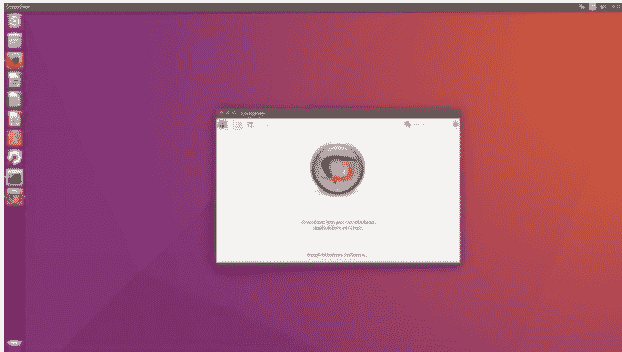
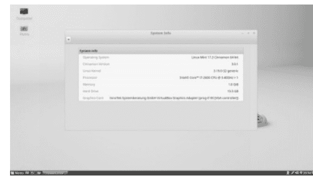
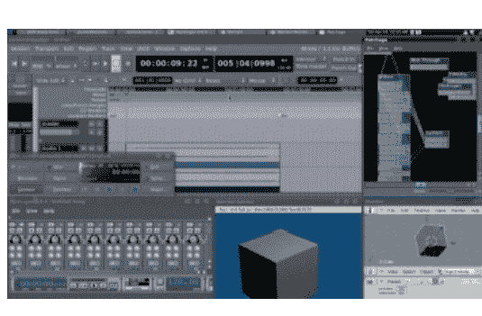
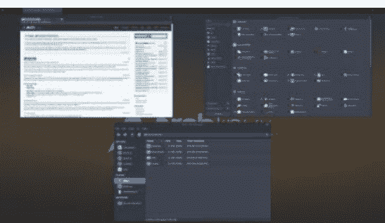
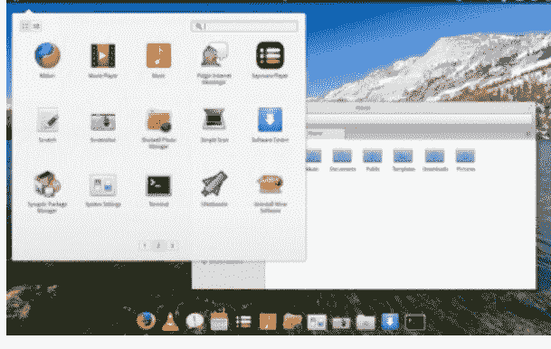
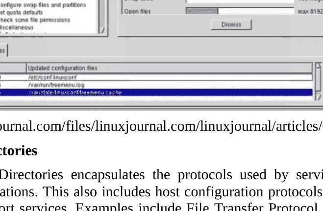

# Linux 精通：Linux 操作系统与命令行终极指南

# 引言

我要感谢您并祝贺您下载了《*Linux Mastery* - 终极 Linux 操作系统与命令行精通指南》。

虽然 Linux 不像 Windows 那样流行——至少对某些人来说如此——但它绝对是最可靠的操作系统之一，而且最棒的是它是免费的，因此您无需为获取它支付任何费用，也无需因为买不起正版而去购买盗版操作系统。最重要的是，Linux 可用于各种应用。无论您是想为企业创建一个更好的系统，还是只想更有创意地玩玩，Linux 都能帮助您出色地完成工作。

本书包含经过验证的步骤和策略，教你如何利用 Linux——无论工作还是娱乐、理解必须使用的命令、选择发行版，以及理解 Linux 为何重要——等等。

可以肯定的是，阅读本书后，您将熟练掌握 Linux，并能轻松地将其用于您的需求。

现在就读这本书，找出答案吧！

再次感谢您下载本书，希望您喜欢！

# 第 1 章 什么是 Linux？

那么，Linux 到底是什么？

首先，Linux 是一个免费的、基于 UNIX 和 POSIX 代码的开源操作系统。简而言之，它免费下载、免费使用，最初基于 Intel x86 架构。事实上，在所有操作系统中，Linux 的安装基数是最大的。这就是为什么在 Linux 上运行的计算机或设备速度快，有时甚至能与那些神奇的超级计算机相媲美！这是因为 Linux 可以针对任何使用它的系统进行定制——而其他操作系统通常只在某种特定设备上才能最佳运行。这得益于所谓的开源软件协作，它可以支持各种库和目录。


http://cdn1.mos.techradar.futurecdn.net//art/software/Linux/Best%20distro/linux-distros-im-650-80.jpg

## 早期起源

早在 1969 年，UNIX 操作系统——也被称为 Linux 的鼻祖——诞生于 AT & T 贝尔实验室，以 C 语言编程为基础，并拥有可用于移植目的的丰富语言。凭借这种背景，该操作系统成为了商业和学校管理员最依赖的操作系统。

然而，当一项反垄断案件阻止 UNIX 在企业中持续使用时，发生了一些争议，但由于其开发者——以及支持者——相信 UNIX 还有更多潜力，他们决定开发 GNU 内核——正是因为如此，Linux 最终得以实现。

### Linux 的诞生

在其主要作者 Linus Torvalds 及其寻找真正实用的、人人可用的操作系统的原则的帮助下，他决定研究 GNU 内核。他想要一些人们——无论他们是专业人士还是只想使用电脑和其他设备进行娱乐——真正能用的东西。然后他开始将内核创建的文件上传到 FTP 服务器，并想称之为 "Freax"，但当时他的合作者和其他专业人士认为这不是个好主意，于是玩了一下自己的名字，Linux 于 1991 年诞生了！

1. 创建一种开源编程语言，使其免费，并且每个人都能为其开发做出贡献；
2. 创建与其前身和竞争对手一样好，但确保易于理解且直观的东西；
3. 创建一种对日常任务有用的编程语言，以及；
4. 简单地创建一种在可读性方面可与纯英文相媲美的编程语言。

当它在 1991 年首次发布（供使用）为版本 0.9.0 时，核心数据类型、函数和继承如 *str*、*dict* 和 *list* 就已经可用。1994 年，发布了 1.0 版本，其中包含了 *reduce*、*filter*、*map* 和 *lambda* 等功能。1995 年，Van Rossum 继续在弗吉尼亚州的*国家研究倡议公司*开发 Linux！

2000 年，*BeOpen Linux Labs* 团队成立，并发布了该语言的 1.6 版本，包含重要的错误修复。另一个名为 2.0 版本的版本于 2008 年发布，随后是 3.0 版本——它可以与其他版本共存！

## 如今的 Linux

今天，Linux 在一定程度上帮助世界如常运转方面功不可没。从只在家里使用电脑的人，到更大的壮举，如 NASA 使用 Linux 驱动的计算机，Linux 越来越受到关注也就不足为奇了——而今天，您有机会了解它以及更多内容！

# 第 2 章 为什么选择 Linux？— Linux 的优势

除了前面提到的内容，为什么必须选择 Linux？您究竟能从中获得什么？

嗯，如果您选择使用 Linux 作为操作系统，您可以获得很多优势，其中一些如下：

## 出色的安全性

人们喜欢 Linux 的最佳特性之一是，与其他操作系统相比，它相当安全。您无需购买那些昂贵的防病毒系统，因为 Linux 本身就能完成您所需的所有病毒和安全检查，事实上，您将在本书的最后一章中了解到很多相关知识。

您需要理解的是，由于 Linux 是一个开源系统，即使一些程序员可能会创建对您的计算机“有害”的漏洞或其他东西，您可以预期反攻击措施近在咫尺。事实上，如果您能研究或学习它，您甚至可能自己创建一个。

## 优秀的硬件和软件兼容性

如果您是那些仍在使用笨重、老旧电脑的人之一，或者您的电脑没有太多内存或处理能力，您会很高兴知道 Linux 也能为其工作。事实上——与上面提到的有关——即使您的电脑没有防火墙或任何“安全预防措施”，您仍然可以期望它无故障地工作——主要是因为 Linux 真正被创造出来是为了“工作”，而不是给您带来那么多荒谬的问题。

现在，说到软件，Linux 也有很多选择。虽然 Windows 为每个应用程序提供一个版本——例如 *Text Editor*、*Microsoft Word*、*Windows Movie Maker*，Linux 有成百上千个供您选择的选项——而且是免费的。所以，比如说，您要搜索一个文本编辑器，您只需搜索一下，猜猜会怎样？会有很多选项呈现给您，这样您就可以选择最顺手的，以及您认为能产生最佳效果的那个。这也意味着 Linux 软件具有更高的可用性和可读性，因此，它不会像其他操作系统的软件那样让人感到陌生——尤其是当您需要为它们支付很多钱时！

## 您拥有“选择权”

如前所述，您可以选择决定使用什么样的软件。您还可以选择通过使用 Linux 来设计您的桌面或设备。它使使用电脑或您拥有的任何设备的行为更加个性化——更像是您会感到舒适的东西，并且对您来说相当容易管理。

其他操作系统的问题在于，不知何故，它们感觉如此难以操控


### 灵活性

灵活性也是Linux最出色的特点之一。使用Linux，你无需应对各种繁琐手续、盗版、骗局或任何阻碍你掌控局面的情况。如果安全问题或其他事宜让你感到困扰或困惑，你还可以加入相关论坛进行探讨。

### 多种编程范式

Linux还支持多种编程范式，例如：

**面向对象编程。** 该范式利用对象的概念，如字段、数据、数据结构及其属性。

**命令式编程。** 与此同时，命令式编程涉及使用语句来修改程序的状态。简而言之，它关注的是程序如何达成结果，而非程序应达成什么。

**函数式编程。** 最后，Linux也支持函数式编程，即通过数学计算和函数来推导结果的范式。

### 兼容大多数设备！

你无需购买新设备即可使用Linux。再次强调，正如前文所述，它甚至可能在旧电脑上运行——这非常了不起，因为有些人难以舍弃旧电脑和设备——而你不会对此感到困扰。Linux内核兼容新旧设备，因此无需升级任何部件或购买新设备。

### 易于使用和理解

有时，找到一款真正适合你的产品或服务非常困难。但Linux几乎能立即满足你的需求——如果你是开源范式的新手，这尤其令人惊喜！

### 而且，它给你大量选择！

Linux旨在帮助你充分利用电脑中已安装的软件。它并不排斥用户。如果你不喜欢某样东西，它会给你机会去寻找其他选择——找到更好的东西。考虑到这一点，你就能更轻松地做该做的事，并以最适合自己的方式使用它。

# 第三章 选择发行版

接下来你需要做的是选择自己的Linux发行版。基本上，这些只是你可以选择的不同版本Linux。是的，作为操作系统它们本质相同，但在外观和运行方式上有所不同。

有多种发行版可供选择，但以下七个是最受信赖的：

### Ubuntu



Ubuntu可能是最受欢迎的Linux发行版之一，被认为是新手或未尝试过Linux用户的最佳选择。Ubuntu拥有出色的易安装软件仓库，且可高度定制——非常适合艺术和媒体从业者，或对屏幕显示内容极其在意的用户。Ubuntu的不足在于，与其他发行版相比，它在移动设备上的表现不佳——这可能是个问题，尤其如果你是那种时刻离不开手机的人。

### Solus


Solus具有现代感，事实上它相对较新，仅于2012年发布——而当时Ubuntu主要用于学校和企业。有人说Solus的最大优点是其美学感受，因为它确实具有优雅、赏心悦目的外观。不过，目前"Solus社区"还不多，所以如果遇到问题，你可能需要自己寻找解决方案。

### Mint Cinnamon



多么清新的名字，不是吗？Mint Cinnamon确实具有清新淡雅的感觉，因为它主要使用白色和灰色作为美学基调。它是相当极简的Linux发行版——非常适合不喜欢屏幕上出现过多花哨元素和鲜艳色彩的用户。最棒的是，它的软件仓库与Ubuntu相同，因此理解起来不会太困难，而且其用户界面对电脑资源要求不高——不会给电脑和使用者带来太大负担。Mint Cinnamon也被认为非常适合初学者，因为如前所述，它没有太多需要理解的内容——你真的不必为此费神。

### Ubuntu Studio



顾名思义，这个Linux版本非常适合制作人、音乐人、音响工程师、设计师和艺术家等需要处理各种多媒体工作的用户，以及需要为此定制电脑或设备的用户——Ubuntu Studio绝对能让这变得简单。自2007年问世以来，它便拥有一款名为"Ardour"的多轨数字录音机和音序器，全球众多艺术家都在使用。这款录音机的最大优点是能合成吉他等已使用的乐器音色，确保你的最终输出悦耳动听、易于处理。因此，你可以制作出专业级的项目——无需花费太多。

### Arch Linux



这被认为是专业人士的完美选择，因为它需要你自行操作和定制。事实上，它并不像其他发行版那样预装大量应用程序，这意味着你必须清楚自己在做什么。使用它，你需要贯彻"保持简洁"的理念，因为下载过多可能只会让你困惑。找出你真正想要的东西，然后删减或移除那些你觉得无关紧要的程序，这样你的屏幕就不会太拥挤，你也能充分利用这个发行版。不过，它的好处在于你能学到很多东西，所以即使一开始可能有些困难，但请放心，你最终会克服它，体验Arch Linux的真正魅力！

### Chrome OS


据说这是早期Linux GNU内核的主要和最接近的衍生版本之一，但它实际上已超出预期，被证明是最可靠的Linux发行版之一。它后来被重新用作独立的工作环境，主要用于开发特定的Google应用程序，即使使用占用空间较大的应用程序（如*Photoshop*）也能快速运行。它将使你的工作更易于管理，但问题在于某些应用程序在其他Linux发行版中可用，却在此发行版中不可用。它也是那种离线状态下运行更好的发行版，所以如果你总是联网，这可能会带来不便，不过你可以以最低费用进行某些更新或升级。

### Elementary OS



最后是Elementary发行版。它不仅是Linux最具美感的版本之一，而且功能强大，有人说它具有与Mac相似的特征——同样非常适合多媒体艺术家和使用高端应用程序的用户。事实上，如果你正在寻找一款可靠的新系统，它完全可能成为你完美的Windows或Mac替代品。它还拥有一系列出色的预装应用，甚至有一个可定制的网络浏览器，能真正个性化你的Linux使用体验。


# 第四章 准备安装 Linux

在安装 Linux 之前，请确保你首先了解它会为你带来什么。基本上，有以下几点：

**Linux 不仅仅是 Linux。**

如果你之前一直在认真阅读前面的章节，你应该理解 Linux 并不像 Windows 那样只是"一个"操作系统，或者一个随时间不断演进的版本。Linux 内部包含不同的版本，并且与 GNU 协同工作。

如果你对 GNU 是什么感到困惑，可以把它想象成一组应用程序、调度器、文本编辑器、编译器，以及你在命令行中可以使用的其他所有工具。现在，你可以把 Linux 看作一个"内核"——而一个内核内部可能包含很多内容。这一点在硬件方面很重要，因为虽然 Linux 提供了令人惊叹的软件集合，但它对硬件的支持并不太多。所以，如果你发现硬件出了问题，你必须自己寻找解决方案，或者从 Linux 汇集的答案列表中寻找答案——而 Linux 有超过 200 种变体，你迟早一定能找到你需要的。硬件支持的缺乏也会让你在选择时更加审慎。它会帮助你质疑眼前的东西是否真的好，是否是你真正需要的——你不会随便下载所有东西然后搞坏你的电脑。

**你将拥有愉快的桌面自定义和装饰体验。**

安装一个操作系统然后就完事的日子已经一去不复返了。你只需等待最新的更新，或者在不喜欢屏幕上的外观时尝试一些新的东西。然而，在 Linux 的帮助下，你将获得——


# 第六章 工作与娱乐中使用Linux

如前所述，Linux可用于多种应用——既能胜任工作，也能用于娱乐。

### 工作用途

从严肃层面来看，Linux可用于超级计算机。事实上，自过去的超级计算机“地球模拟器”退役后，所有超级计算机均采用Linux操作系统。美国国家航空航天局（NASA）也为其所有计算机和应用使用Linux——因此，它确实有助于拉近地球与太空的距离，并帮助许多人更深入地了解宇宙！在一些办公室中，Linux被用于帮助创建高效的输入输出系统——避免了其他操作系统带来的迟缓。

Linux也适用于嵌入式系统或任何使用“实时”机制的设备。例如，如果你想观看“电视”但没有电视机，只能使用像*BusyBox*这样的设备，那么你可以预期，真实电视屏幕上播放的内容也会被BusyBox实时捕捉！这意味着你不会错过任何内容——因此，如果你是媒体从业者，这绝对能为你的工作提供帮助。

Linux也被用于一些移动设备，以确保虚拟化变得简单且普及，并帮助用户获得最佳的虚拟体验——非常适合在广告中使用增强现实技术的广告商。此外，Linux也用于大多数服务器，特别是那些在LYCE和LYME下运行的动态站点，以及使用LAMP的站点。它也适用于云计算，以及管理服务和基础设施等。

### 娱乐用途

当然，Linux也非常适合用于娱乐目的！它可以作为人机交互设备，也是在Android和其他移动设备上玩你最喜欢游戏的地方，因为Linux可以成为一个出色的游戏平台，像*Valve*这样的游戏巨头从2012年开始就选择Linux作为其应用程序的平台。著名的Steam也使用Linux，并帮助用户了解它实际上并不疏远——它可以帮助人们更快、更愉快地玩游戏。

简而言之，Linux几乎适用于你需要的任何事情——因此，尝试一下它并无坏处。

# 第七章 了解命令

有各种各样的命令可以让你使用Linux的方式更加简单高效。你可以在下面了解更多。

主要关键词/命令：

**zip**
打包并压缩文件。

**yes**
打印一个字符串直到被中断。

**xz**
压缩或解压缩.xz和.lzma文件。

**xdg-open**
在用户首选的应用程序中打开URL或文件。

**xargs**
执行实用程序，传递构造的参数列表。

**write**
向另一个用户发送消息。

**whoami**
打印当前用户id和名称（'id -un'）。

**who**
打印当前登录的所有用户名。

**while**
执行命令。

**which**
在用户的$path中搜索程序文件。

**whereis**
在用户的$path、手册页和源文件中搜索程序。

**wget**
通过HTTP、HTTPS或FTP检索网页或文件。

**wc**
打印字节、单词和行数。

**watch**
定期执行/显示程序。

**wait**
等待进程完成。

**vmstat**
报告虚拟内存统计信息。

**vi**
文本编辑器。

**vdir**
详细列出目录内容（`ls -l -b`）。

**Verbosely**
列出目录内容（`ls -l -b`）。

**uuencode**
编码二进制文件。

**uudecode**
解码由uuencode创建的文件。

**users**
列出当前登录的用户。

**usermod**
修改用户账户。

**userdel**
删除用户账户。

**useradd**
创建新用户账户。

**uptime**
显示运行时间。

**until**
执行命令（直到出错）。

**unshar**
解包shell归档脚本。

**unset**
移除变量或函数名称。

**unrar**
从rar归档文件中提取文件。

**units**
将单位从一种尺度转换为另一种尺度。

**uniq**
使文件唯一。

**unexpand**
将空格转换为制表符。

**uname**
打印系统信息。

**unalias**
移除别名。

**umount**
卸载设备。

**umask**
用户文件创建掩码。

**ulimit**
限制用户资源。

**type**
描述命令。

**tty**
打印标准输入上终端的文件名。

**tsort**
拓扑排序。

**true**
什么都不做，成功返回。

**trap**
当信号被设置时运行命令（bourne shell）。

**traceroute**
追踪到主机的路由。

**tr**
翻译、压缩和/或删除字符。

**tput**
设置依赖于终端的功能、颜色、位置。

**touch**
更改文件时间戳。

**top**
列出系统上运行的进程。

**times**
用户和系统时间。

**timeout**
在时间限制下运行命令。

**time**
测量程序运行时间。

**test**
评估条件表达式。

**tee**
将输出重定向到多个文件。

**tar**
在归档文件中存储、列出或提取文件。

**tail**
输出文件的最后部分。

**sync**
将磁盘上的数据与内存同步。

**suspend**
挂起当前shell的执行。

**sum**
打印文件的校验和。

**sudo**
以另一个用户身份执行命令。

**su**
替换用户身份。

**strace**
跟踪系统调用和信号。

**stat**
显示文件或文件系统状态。

**ssh**
安全Shell客户端。

**split**
将文件分割成固定大小的块。

**source**
从文件中运行命令。

**sort**
对文本文件进行排序。

**slocate**
查找文件。

**sleep**
延迟指定的时间。

**shutdown**
关闭或重启Linux。

**shopt**
Shell选项。

**shift**
移位位置参数。

**sftp**
安全文件传输程序。

**set**
操作shell变量和函数。

**seq**
打印数字序列。

**select**
接受键盘输入。

**sed**
流编辑器。

**merge**
交互式合并两个文件。

**screen**
复用终端，通过ssh运行远程shell。

**scp**
安全复制或创建远程文件副本。

**rsync**
远程文件复制。

**rmdir**
删除文件夹。

**rm**
删除文件。

**rev**
反转文件的行。

**return**
退出shell函数。

**renice**
更改运行进程的优先级。

**rename**
重命名文件。

**remsync**
通过电子邮件同步远程文件。

**reboot**
重新启动系统。

**readonly**
将变量/函数标记为只读。

**readarray**
从标准输入读取到数组变量中。

**read**
从标准输入读取一行。

**rcp**
在两台机器之间复制文件。

**rar**
压缩归档文件。

**ram**
RAM磁盘设备。

**quotacheck**
扫描文件系统以检查磁盘使用情况。

**quota**
显示磁盘使用情况和限制。

**pwd**
打印工作目录。

**pv**
监控通过管道的数据进度。

**pushd**
保存并更改当前目录。

**ps**
进程状态。

**printf**
格式化并打印数据。

**printenv**
打印环境变量。

**printcap**
打印机能力数据库。

**pr**
准备文件以供打印。

**popd**
恢复当前目录的先前值。

**pkill**
通过完整或部分名称终止进程。

**ping**
测试网络连接。

**pathchk**
检查文件名可移植性。

**paste**


```
## passwd
修改用户密码

## open
用默认应用程序打开文件

## op
操作员访问权限

## nslookup
交互式查询互联网域名服务器

## notify-send
发送桌面通知

## nohup
运行不受挂起影响的命令

## nl
对文件行进行编号

## nice
设置命令或作业的优先级

## netstat
网络信息

## nc
Netcat，通过网络读写数据

## mv
移动或重命名文件或目录

## mtr
网络诊断

## mtools
操作 MS-DOS 文件

## mount
挂载文件系统

## most
浏览或翻页查看文本文件

## more
*（描述未显示）* 逐屏显示输出

## mmv
批量移动和重命名文件

## mknod
创建块设备或字符设备特殊文件

## mkisofs
创建混合 ISO9660/JOLIET/HFS 文件系统

## mkfifo
创建 FIFO 管道

## mkdir
创建新文件夹

## man
帮助手册

## make
重新编译一组程序

## lsof
列出已打开的文件

## ls
列出文件信息

## lprm
从打印队列中移除作业

## lprintq
列出打印队列

## lprintd
中止打印作业

## lprint
打印文件

## lpr
脱机打印

## lpc
行式打印机控制程序

## look
显示以给定字符串开头的行

## logout
退出登录 shell

## logname
打印当前登录名

## locate
查找文件

## local
创建变量

## ln
创建文件的符号链接

## link
创建文件的链接

## let
对 shell 变量执行算术运算

## less
逐屏显示输出

## killall
按名称终止进程

## kill
通过指定 PID 终止进程

## join
根据公共字段合并行

## jobs
列出活动作业

## ip
路由、设备和隧道

## install
复制文件并设置属性

## import
捕获 X 服务器屏幕并保存图像到文件

## ifup
停止网络接口

## ifconfig
配置网络接口

## if
有条件地执行命令

## id
打印用户和组 ID

## iconv
转换文件的字符集

## htop
交互式进程查看器

## hostname
打印或设置系统名称

## history
命令历史记录

## help
显示内置命令的帮助信息

## head
输出文件的前部分内容

## hash
记住名称参数的完整路径名

## gzip
解压缩或压缩指定文件

## groups
打印用户所属的组名

## groupmod
修改组

## groupdel
删除组

## groupadd
添加用户安全组

## grep
在文件中搜索匹配给定模式的行

## getopts
解析位置参数

## gawk
在文件中查找并替换文本

## fuser
识别/终止访问文件的进程

## function
定义函数宏

## ftp
文件传输协议

## fsck
文件系统一致性检查和修复

## free
显示内存使用情况

## format
格式化磁盘或磁带

## for
扩展*单词*，执行*命令*

## fold
将文本换行以适应指定宽度

## fmt
重新格式化段落文本

## find
搜索满足所需条件的文件

## file
确定文件类型

## fgrep
在文件中搜索匹配固定字符串的行

## fg
将作业发送到前台

## fdisk
Linux 分区表操作工具

## fdformat
低级格式化软盘

## false
不做任何操作，返回失败

## expr
求值表达式

## export
设置环境变量

## expect
自动化通过终端访问的任意应用程序

## expand
将制表符转换为空格

## exit
退出 shell

## exec
执行命令

## eval
求值多个命令/参数

## ethtool
以太网卡设置

## env
环境变量

## enable
启用和禁用内置 shell 命令

## eject
弹出可移动媒体

## egrep
在文件中搜索匹配扩展表达式的行

## echo
在屏幕上显示消息

## du
估算文件空间使用量

## dmesg
打印内核和驱动程序消息

## dirs
显示已记住的目录列表

## dirname
将完整路径名转换为仅路径

## dircolors
`ls` 的颜色设置

## dir
简要列出目录内容

## dig
DNS 查询

## diff3
显示三个文件之间的差异

## diff
显示两个文件之间的差异

## df
显示可用磁盘空间

## declare
声明变量并赋予属性

## ddrescue
数据恢复工具

## dd
转换并复制文件，写入磁盘头、引导记录

## dc
桌面计算器

## date
显示或更改日期和时间

## cut
将文件分成几个部分

## curl
从服务器传输数据或向服务器传输数据

## csplit
将文件分割为上下文决定的片段

## crontab
安排命令在稍后时间运行

## cron
执行计划任务的守护进程

## cp
将一个或多个文件复制到另一个位置

## continue
恢复循环的下一次迭代

## command
运行命令——忽略 shell 函数

## comm
逐行比较两个已排序的文件

## cmp
比较两个文件

## clear
清除终端屏幕

## cksum
打印 CRC 校验和和字节数

## chroot
使用不同的根目录运行命令

## chown
更改文件所有者和组

## chmod
更改访问权限

## chkconfig
系统服务

## chgrp
更改组所有权

## cfdisk
Linux 分区表操作工具

## cd
更改目录

## cat
连接并打印文件内容

## case
有条件地执行命令

## cal
显示日历

## bzip2
解压缩或压缩指定文件

## builtin
运行 shell 内置命令

## break
从循环中退出

## bind
设置或显示 readline 按键和函数绑定

## bg
发送到后台

## bc
任意精度计算器语言

## bash
GNU Bourne-Again SHell

## basename
去除文件名中的目录和后缀

## awk
查找和替换文本，数据库排序/验证/索引

## aspell
拼写检查器

## aptitude
搜索并安装软件包（Debian/Ubuntu）

## apt-get
搜索并安装软件包（Debian/Ubuntu）

## apropos
搜索帮助手册页面

## alias
创建别名

## ,（点号）
在当前 shell 中运行命令脚本

## #
注释/备注

## !!
再次运行上一条命令

### 数字

当然，你可以使用数字来存储数值。将你偏好的数字赋给变量。例如：

```
var1 = 1
var2 = 10
```

你还可以使用以下数值类型：

1. Int（有符号整数）
2. Complex（复数）
3. Float（浮点实数值）
4. Long（长整数；可以是十六进制和八进制）

### 列表

Linux 还允许你创建可用方括号 {[]} 括起来的列表。它们类似于 C 语言中使用的列表，但创建起来肯定更容易。同样，使用切片运算符（[] 或 [:]），并从索引 0 开始。你可以使用加号（+）连接字符串，使用星号（*）重复字符串。

### 字典

在 Linux 中，字典被视为哈希表或关联数组。它们由数字和字符串填充。用花括号 {{}} 括起来，值通过方括号 [] 赋值。

### Linux 类

类决定程序的作用域，包括：
- 局部名称，或最内层作用域；
```


## 循环

有三种类型的循环，它们是：
- **For 循环。** 这是指语句被执行多次，并且代码被缩写。
- **While 循环。** 这是指当条件为真时，语句或语句组会被重复执行。
- **嵌套循环。** 这意味着你在第一个循环内部或上方使用循环。

你还可以使用循环控制语句，例如：
- **Continue 语句。** 这使得循环跳过其剩余部分并重置回其原始形式。
- **Break 语句。** 这在终止循环之前转移语句执行，并立即返回到其他循环。例如：
- **Pass 语句。** 当你不想出于语法原因执行代码或命令时，这就是所谓的 pass 语句。

## 元组

元组类似于列表数据，但它由许多用逗号分隔的值组成，并且用圆括号 () 而不是方括号括起来。元组也不能被更新。

## 数据类型转换

- **Unichr (x).** 最后，使用此命令，你将获得一个 Unicode 字符。
- **Tuple (t).** 将 x 转换为元组。
- **Str (x).** 将 x 转换为字符串表示形式。
- **Set (s).** 将 x 转换为集合。
- **Repr (x).** 将 x 转换为表示字符串。
- **Ord (x).** 这给出单个字符的整数值。
- **Oct (x).** 将 x 转换为八进制字符串。
- **Long (x [,base]).** 将 x 转换为长整数。
- **List (L).** 将 x 转换为列表。
- **Int (x [,base]).** 如果 x 是字符串，它变成基数；也将 x 转换为整数。
- **Hex (x).** 将 x 转换为十六进制字符串。
- **Frozen set (s).** 将 x 转换为冻结集合。
- **Float (x).** 将整数转换为浮点数。
- **Eval (str).** 这评估一个字符串并返回一个对象。
- **Dict (d).** 这给你一个字典。
- **Complex (real [,imag]).** 这给你一个复数。

## 赋予正确的值

等号 (=) 在这里很重要，因为你不需要在这里进行显式声明，但你必须确保将变量放在等号之前，并在右边放置你希望对变量执行的操作。

## 语句和循环

有三种类型的循环，它们是：

- **For 循环。** 这是指语句被执行多次，并且代码被缩写。
- **While 循环。** 这是指当条件为真时，语句或语句组会被重复执行。
- **嵌套循环。** 这意味着你在第一个循环内部或上方使用循环。

你还可以使用循环控制语句，例如：

- **Continue 语句。** 这使得循环跳过其剩余部分并重置回其原始形式。
- **Break 语句。** 这在终止循环之前转移语句执行，并立即返回到其他循环。例如：
- **Pass 语句。** 当你不想出于语法原因执行代码或命令时，这就是所谓的 pass 语句。

## 比较运算符

- ==。如果操作数相等，则条件为真。((a==b) 为假)
- <>。如果值不相等，则条件变为真。((a<>b) 为真)
- !=。如果两个操作数的值不相等，则条件变为真。
- <=。如果左操作数的值小于右操作数，则条件变为真。(a <=b) 为真)
- >=。如果左操作数的值大于右操作数，则条件变为真。(a>=b) 为假)
- <。如果左操作数的值小于右操作数，则条件为真。(a < b) 为真)
- >。如果左操作数的值大于右操作数，则条件为真。((a>b 为假)

## 特殊代码和字符

为了对这些进行编程，你必须使用特殊字符和代码。这些是：

## 内置字符串方法

- **Zfill (width)**。用零填充原始字符串左侧。
- **Upper ()**。将小写字母转换为大写。
- **Translate (table, deletechars="")** 将字符串转换为翻译表。
- **Title ()**。将字符串转换为标题卡版本，这意味着大写变为小写，反之亦然。
- **Swapcase ()**。字符串中的所有字母将被反转。
- **Strip ([chars])**。对每个字符串执行 rstrip() 和 lstrip()。
- **Startswith (str, beg=0, end=len (string))**。检查字符串是否是字符串本身或字符串的子集。
- **Splitlines (num=string.count('\n'))**。返回带有新字符串的每一行。
- **Split (str="", num=string.count (str))**。将字符串拆分为分隔符。
- **Rjust (width, [,fillchar])**。这给你填充了空格的字符串。
- **Rindex (str, beg=0, end=len(string))**。这就像索引但使用反向字符串。
- **Replace (old, new [max])**。这用最大出现次数替换当前字符串。
- **Max (str)**。这返回按字母顺序最大的字符。
- **Join (seq)**。这合并字符串的表示形式。
- **Isdecimal()**。如果 Unicode 字符串包含十进制字符，则值返回为真；否则为假。
- **Find (str, beg=0, end=len(string))**。这检查字符串是否在字符串或后续字符串中。
- **Expandtabs (tabsize = 8)**。字符串和制表符随后被放置在多个空格中。
- **Encode (suffix, beg=0, end=len(string))**。这运行每个字符串的编码版本。
- **Decode (encoding UTF-8, errors=strict)**。将使用注册用于编码的编解码器进行此方法，你将获得默认字符串。
- **Count (str, beg=0, end=len(string))**。这计算字符串出现的次数并开始索引。
- **Center (width, fillchar)**。连同原始字符串一起，这将给你一个占用列总宽度的填充空格的字符串。
- **Capitalize()**。这基本上将字符串的第一个字母大写。

## 格式符号及其功能

| 符号 | 描述 |
| :--- | :--- |
| %X | 十六进制整数（大写字母） |
| %x | 十六进制整数（小写字母） |
| %u | 无符号十进制整数 |
| %s | 通过 str() 进行字符串转换后再格式化 |
| %o | 八进制整数 |
| %i | 有符号十进制整数 |
| %g | %f 和 %e 中较短的一个 |
| %G | %f 和 %E 中较短的一个 |
| %f | 浮点实数 |
| %E | 指数表示法（带大写‘E’） |
| %e | 指数表示法（带小写‘e’） |
| %d | 有符号十进制整数 |
| %c | 字符 |

## 其他重要符号

- **m.n.** m 是最小总宽度，n 是小数点后要显示的位数（如果适用）
- **0.** 从左侧用零填充（而不是空格）
- **<sp>.** 在正数前留一个空格
- **+.** 显示符号
- **\*.** 参数指定宽度或精度
- **(var).** 映射变量（字典参数）
- **%.** ‘%%’ 让你得到一个单独的字面量‘%’
- **#.** 添加八进制前导零（‘0’）或十六进制前导‘0x’或‘0X’，取决于使用的是‘x’还是‘X’。
- **-.** 左对齐

# 第 8 章 管理文件和目录

管理 Linux 文件和目录将帮助你保持事物井然有序。与任何操作系统一样，重要的是要确保你知道系统正在发生什么，以免其崩溃。更重要的是，这是注意你系统中事物的一种方式。在本章中了解更多关于它们的信息。

**地址目录**

顾名思义，这是一种电信协议，使通信应用程序和网站易于工作。它用于映射网络地址，使消息传递甚至视频通话成为可能，并且也用于重要技术，例如 Xerox PARC Universal Packet、DEC Net、ChaosNet 和 IPv4 等。为此，你可以记住以下内容：

1. 0 – 硬件类型 (HTYPE)
2. 2 – 协议类型 (PTYPE)
3. 4 – 硬件地址 (HLEN) | 协议地址 (PLEN)
4. 6 – 操作 (OPER)
5. 8 – 发送方硬件地址 (SHA)
6. 10 - 接下来的 2 个字节
7. 12 – 接下来的 2 个字节
8. 14 – 发送方地址协议 (SAP)
9. 16 – 接下来的 2 个字节
10. 18 – 目标硬件地址 (THA)
11. 20 – 接下来的 2 个字节
12. 22 – 接下来的 2 个字节
13. 24 – 目标协议地址 (TPA)
14. 26 – 接下来的 2 个字节

**传输目录**

传输目录包含涉及 Linux 的数据通道，这些通道还建立进程到进程的连接以及端到端的消息传递，为网络中的任何特定目的提供正确的信息和后勤。这可以是实现的、无连接的或面向对象的。

然后端口是在传输层的帮助下建立的，逻辑构造围绕其周围。这基本上意味着：
1. 数据应该是正确的——并且只能有最小的错误；


## 应用层目录

应用层目录封装了提供交换应用程序的服务所使用的协议。这还包括主机配置协议、路由服务和网络支持服务。例如文件传输协议（FTP）、超文本传输协议（HTTP）和动态主机配置协议（DHCP）。通过这种方式，你可以根据所使用的协议来降低数据传输量。

应用层还将传输层目录视为一个稳定的网络，其中的黑盒允许整个应用程序内的通信发生，同时确保应用程序每个部分的关键特性仍能尽可能强大地运行。应用层目录发生的任何情况都不会影响传输层和网络层，因为流量通常不会检查上述层。然而，有时对于NAT（网络地址转换器）来说，考虑应用程序的有效载荷并确保一切顺利运行是至关重要的。



http://www.linuxjournal.com/files/linuxjournal.com/linuxjournal/articles/059/5918/5918f1.

## 链路层目录

网络方法在链路层内定义。其范围包括中间路由器以及主机网络，包括用于描述网络拓扑结构的协议，并且数据报也因不同的目标和假设以及严格的分层而明显。这意味着你可以在任何硬件网络技术之上实现Linux。

借助链路层，数据包可以轻松移动并可以接收驱动程序卡数据包，这也意味着该层对应于OSI模型。

## 网络层目录

基本上，网络层目录的工作方式是负责发送正确的数据包，并确保它们能够跨越多个网络移动。其主要功能是：

- 1. **数据包路由**。这完全是关于将数据包从目的地的源发送到需要使用它们的地方。唯一的协议号用于标识这些数据包。
- 2. **主机识别和寻址**。借助分层的IP系统，可以实现这一点。

## 目录 5 到 10

这些用于解析主机，因为它们在语法 *LinuxConnector::resolvehostname()* 下工作，并且它们能够借助 *getaddridinfo()* 函数转换IP地址和主机名。这比仅仅使用 *gethostname()* 好得多，因为它被称为安全线程。

## 目录 13 到 15

这些行统称为 *LinuxConnector::resolvehost*。它们能够将名称字符串和DNS主机转换为IP地址，以便做出的每个假设都可以转换为不同的网络地址。

## 目录 16

这是 *socket()* 的第一个参数，以便你可以选择通信网络的特定协议族。应使用 *SOCK_STREAM* 和 *PF_INET*，因为它们配合得很好。

## 目录 17 到 20

这些被称为 *connect::passing()*，因为它借助 *sockaddr_in* 指针将用户指向正确的结构。它将帮助你了解结构的长度，以便你不会将其与程序和网络本身的其他功能混淆。

## 第 28 到 34 行

这些使用 *listen()* 函数。基本上，你可以发起TCP请求并让它们排队，以支持网络的参与分支。不过，某些操作系统不支持此功能，但你可以尝试使用 *m_listening* 函数。

## 第 23 到 27 行

这些能够通过返回正确的消息/bind()值来绑定监听套接字。

## 第 20 到 21 行

这些允许你监听IP并在某些连接结束后突然搜索连接。但是，你可以通过使用 _SO_REUSEADDR_ 函数来禁用此功能。

## 第 21 到 32 行

这为你提供了来自客户端的无限且持续数量的连接，也有助于你处理大量来自它们的数据。它使用语法 _LinuxAcceptor::start_，你也可以在其中处理来自客户端的大量数据。当没有可用的客户端——以及服务器——时，会出现零（0）。

## 第 12 到 20 行

这些通过 _TCPAcceptor_ 函数为你提供命令行参数。请注意，你必须指定IP地址，服务器才能开始建立连接。

## 第 5 到 10 行

这些行将帮助你意识到服务器将开始监听IP端口，并且在重要的IP地址之间会有一条命令行。当用户尝试调用错误信息时，将显示错误消息。

## 第 13 到 18 行

通过这些，你将知道服务器是否正在监听，因为它使用 _m_address_。它还将字节排序并转换，防止在监听过程中出现套接字故障。

## 第 9 到 12 行

这些将帮助你使用 _PF_INET_ 协议在网络中初始化新的套接字。TCP端口也将按顺序就位。

## 第 7 行

这将帮助你为套接字创建描述，以便你可以为不同的套接字创建不同的调用。

## 第 3 到 10 行

同时，如果你试图接受来自客户端的连接，这些行将派上用场。对于这些，_TCPAcceptor::accept_ 语法非常有用。这样，你可以在一个线程中获得所有合格的函数，而不会感到困惑。

## 封装目录

现在，为了给Linux提供其急需的抽象层，需要进行封装。它与协议套件的功能划分保持一致，以便每一层都能被正确地封装和处理。

请注意，位于层之上的那些是用户应用程序本身密切使用的。但是，没有单一的架构模型必须遵循，尤其是当您拥有定义不太明确的模型（如OSI模型）时。这就是它与其他互联网协议，特别是早期协议的主要区别。

# 第 9 章 管理和安全

为了帮助你获得更好的安全性，并确保你的操作系统始终处于“健康”状态，最好注意以下给定的命令：

## 用户数据报协议

这是互联网协议套件的重要成员。它提供无连接传输，这种方式实际上可以是可靠的，并且不会以任何方式破坏网络协议。它们非常适合容易丢弃数据包的时间敏感型应用。用户数据报协议还具有以下特点：

- 1. 它能够向网络提供数据报；
- 2. 它是面向事务的，适用于网络时间协议和域名系统；
- 3. 它适用于单向通信，适合服务发现和广播信息；
- 4. 它适用于实时应用程序（如 *Twitter*、*Snapchat*、*Periscope* 等），因为它减少了传输延迟。它也适用于VOIP应用程序（如 *Skype*），并适用于一些游戏；
- 5. 它适用于大量客户端，并且是无状态的。它也适用于流媒体应用程序；
- 6. 它非常适合引导，因为它简单且无状态。

它还适用于八位字节0到4，在某些情况下甚至适用于20到160。

## 跨平台

你还可以为Linux进行跨平台编程。为此，你必须记住以下几点：

- 1. 应使用 *windows.h* 和 *winsock.h* 作为头文件。
- 2. 必须使用 *closesocket()* 而不是 *close()*。
- 3. 使用 *Send()* 和 *Receive()*，而不是read()或write()。
- 4. 使用 *WSAStartup()* 来初始化库。

## 别名协议

Linux的另一个重要协议，可以将请求的服务和消息发送到路由器，并且也有自己的协议号。区别在于它从IPv4报头开始，通常只是被称为“1”。它也适用于八位字节0到4，其中：

- 1. 代码 = 控制消息 | ICMP子类型
- 2. 类型 = 控制消息 | ICMP子类型

## 数据传输规则

2. 数据应按顺序到达；
3. 数据应包括流量拥塞控制；
4. 丢弃或丢失的数据包必须重新发送；
5. 重复的数据必须丢弃。

当这种情况发生时，你可以预期即使是最新的流控制协议也能在网络中正常工作。然而，你不必依赖无连接数据报，因为正如其名称所示，它们不提供正确的连接——并且相当不可靠。


### 互联网消息协议

你必须理解的是，Linux 是一个开放系统互连（OSI）互联网模型，这意味着它通过*套接字（sockets）*来工作。为了建立连接，你需要利用监听套接字，以便主机能够发起调用——或者换句话说，建立连接。

通过输入 *listen ()*，用户将能够在程序中执行 *accept ()* 阻塞操作。这会 *binds ()* 将程序连接在一起，使其成为一个整体。现在，为了更清楚地说明问题，你必须理解互联网的基本模型。

互联网模型结合了会话层、表示层和应用层以及 TCP 的端口，为 `bind()` 的发生铺平了道路。现在，你还必须等待发送方和接收方的响应。这使得请求和消息的交换能够轻松进行，直到连接关闭。如果操作得当，发送方和接收方就不用担心消息未发送或通信中断。

然后，连接可以包含在一个线程中，这样网络理解起来就不会太复杂。这样，也可以创建正确的协议栈。

### 处理传输

这为 IP 网络及其包含的各种网络之间提供了经过错误检查、有序且可靠的八位字节流。这用于电子邮件以及大部分万维网。这也是一种潜在的无连接协议，通过处理已传输的数据来工作。它从八位字节 0 到 160 工作，包含源端口和目标端口。它还包含序列号和确认号。

数据偏移量也是保留的，与窗口大小、校验和以及紧急指针一起。

基本上，你可以记住以下几点：

-   1. 16 位标识源端口；
    2. 16 位也标识接收端口；
    3. 4 位以 32 位字指定数据头；
    4. 32 位标识确认号；
    5. 9 位包含 9 位标志；
    6. 3 位定义为将来使用而保留的数据。

其他位定义了你可以使用此操作系统为你的应用程序或网站创建的选项。

### 主机解析

关于这一点，你必须记住的一件事是使用语法 *gethostname()*，以便标准库可以进行正确的调用。当你尝试查找程序某个部分的名称并希望将其用于更大的应用程序时，也会发生这种情况。它几乎与 Python 相同，因为你可以用这种方式编写代码。

### Linux 套接字

你必须理解的是，Linux 是一个开放系统互连（OSI）互联网模型，这意味着它通过*套接字（sockets）*来工作。为了建立连接，你需要利用监听套接字，以便主机能够发起调用——或者换句话说，建立连接。

通过输入 *listen ()*，用户将能够在程序中执行 *accept ()* 阻塞操作。这会 *binds ()* 将程序连接在一起，使其成为一个整体。对此，你可以记住以下内容：

| | | | | | |
|---|---|---|---|---|---|
| 服务器：socket() | bind() | listen() | accept() | read() | write() | read() |
| 发送请求：write() | read() | | | | | |
| 接收回复：write() | read() | | | | | |
| 建立连接：connect | accept() | | | | | |
| 关闭连接：close() | read() | | | | | |
| 客户端：socket() | connect | write() | read() | close() | | |

### Linux 互联网协议

互联网协议的核心是在网络中提供边界，以及允许互联网网络发生的报文中继。

其结构涉及*报头*和*有效负载*，其中报头是主要的 IP 地址，并在某些参数的帮助下连接接口。路由前缀和网络指定也涉及其中，内部或外部网关协议也是如此。可靠性也依赖于端到端协议，但大多数情况下，你可以期望框架如下：

| UDP 报头 | UDP 数据 | 传输层 |
|---|---|---|
| IP 报头 | IP 数据 | 互联网层 |
| 帧报头 | 帧数据 | 帧尾 | 链路层 |
| 数据 | 应用层 | |

### 获取对等信息

为了获取对等信息，你必须确保同时返回 TCP 和 IP 信息。这样，你可以确保服务器和客户端都连接到网络。你还可以使用 *getpeername()* 套接字，以便当信息可用时，可以轻松捕获并保存。这为 Linux 中涉及的各种方法提供了正确发送和接收的数据，并包含适当的套接字描述符并授予程序中其他部分的权限。有些甚至可能被认为是私有的，以改善用户体验。
为了接收信息，让套接字 *TCPAcceptor::accept()* 在网络中盛行。这样，你可以区分来自服务器和客户端的操作。

### 构造与析构

这些连接到套接字的描述符，允许对等 TCP 端口和对等 IP 地址显示在屏幕上。请注意，这不使用其他语言，除了 C++，这与 Linux 中的同类产品不同。
析构函数随后能够关闭你建立的任何连接。例如，如果你想注销你的一个社交网络账户，你之所以能够做到，是因为析构函数的存在。

### Linux 和 SMTP 客户端

至于 SMTP 客户端，你可以预期它涉及一些与上面相同的特性——只需做一些调整。你还应该记住，这一切都是关于打开套接字、打开输入和输出流、读取和写入套接字，最后清理客户端端口。你还必须知道它涉及以下内容：

-   1. **数据报通信。** 这意味着当你门户向各个客户端和服务器发送数据报时，本地套接字将始终工作。
    2. **Linux 通信。** 这一次，涉及流和数据报通信。
    3. **编程套接字。** 当然，你可以预期你将以正确的方式编程套接字！

### 回显客户端设置

在 Linux 中，回显客户端通过在 `socket()` 内插入参数来工作，因为这意味着你将能够与 `PF_INET` 函数一起使用 IP，以便它们都可以进入 TCP 套接字。要设置正确的客户端结构，只需记住你需要对之前的代码进行一些调整。

### IO 网络模型

为了获取对等信息，你必须确保同时返回 TCP 和 IP 信息。这样，你可以确保服务器和客户端都连接到网络。你还可以使用 `getpeername()` 套接字，以便当信息可用时，可以轻松捕获并保存。

为了接收信息，让套接字 `LinuxAcceptor::accept()` 在网络中盛行。这样，你可以区分来自服务器和客户端的操作。

### Linux 及其套接字

你还必须理解，你可以主要用 C 语言编写 Linux 程序，因为它们都涉及套接字的使用。套接字就像一座桥梁，将客户端绑定到端口，并负责向服务器发送正确的请求，同时等待其响应。最后，完成数据的发送和接收。

同时，Linux 套接字还能够为服务器创建一个套接字，然后将其自身绑定到端口。在那个阶段，你可以开始监听客户端流量，因为它在增长。你也可以在那时等待客户端，最后，看到数据的发送和接收发生。它的其他功能如下：

**socket_description.** 这允许客户端和服务器的描述显示在屏幕上。

**write buffer.** 这描述了需要发送的数据。

**write buffer length.** 为了写入缓冲区长度，你将必须看到字符串的输出。

**client_socket.** 套接字描述也将显示在顶部。

**address.** 这用于连接函数，以便 `address_len` 位于顶部。

**address_len.** 如果第二个参数为空，这将出现在屏幕上。

**return.** 这有助于返回客户端和套接字的描述。这也使得客户端和服务器之间的交互变得容易。

**server_socket.** 这是位于顶部的套接字的描述。

**backlog.** 这是尚未处理的请求数量。

你也可以时不时地加上个人评论——但绝对不是所有时候！


# 结论

感谢您阅读本书！

希望借助本书，您已掌握了关于 Linux 及其相关知识所需了解的一切。请务必尝试书中提到的技巧，并让本书成为您使用和理解 Linux 的指南。

最后，如果您喜欢本书，请在亚马逊上发布简短的评论。我们将不胜感激。

谢谢您，并祝您阅读愉快！

# 查看我的其他作品

恭喜您掌握了新的操作系统。接下来的步骤将是继续练习新技能，我强烈建议您学习其他软件和编程语言。

# 其他书籍

[《WINDOWS 10 精通——终极 WINDOWS 10 指南》](WINDOWS 10 MASTERY – THE ULTIMATE WINDOWS 10 MASTERY GUIDE)

我还拥有更多属于 **"像专业人士一样编码"** 系列的书籍供您下载。

以下是我的其他书籍链接：

# 像专业人士一样编码书籍系列

- [《PYTHON 精通——面向 Python 初学者的专业指南》](PYTHON MASTERY – A CODE LIKE A PRO GUIDE FOR PYTHON BEGINNERS)
- [《ANGULARJS——专业指南》](ANGULARJS – A CODE LIKE A PRO GUIDE)
- [《黑客技术精通——面向计算机黑客初学者的专业指南》](HACKING MASTERY – A CODE LIKE A PRO GUIDE FOR COMPUTER HACKING BEGINNERS)

如果链接因任何原因无法访问，您只需在亚马逊网站上搜索这些书名即可找到它们。
