# LINUX：Linux 终端、基础功能与命令行 (Kali Linux 2016) (无线黑客、渗透测试、计算机黑客书籍第 3 卷)

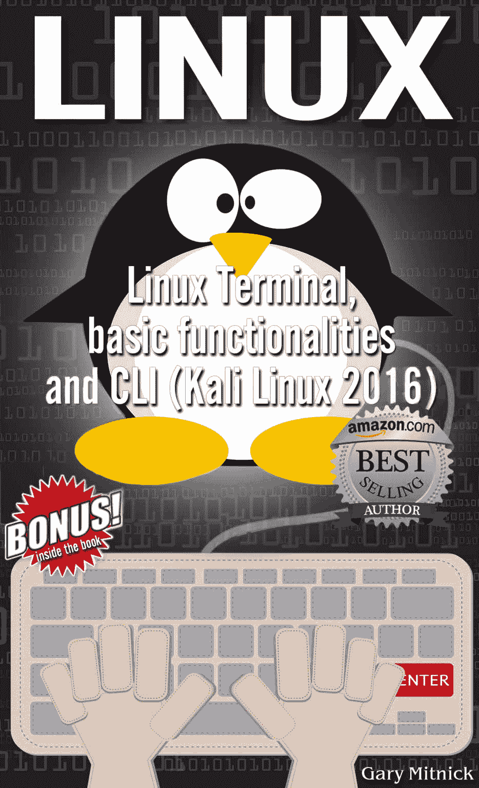

# 引言
欢迎学习 Linux 终端教程，这是黑客系列的第二部分。本手册最好配合课程一起进行学习。

# 您的礼物
点击下方获取免费恶意软件防护礼物
[>>点击此处<<](https://forms.aweber.com/form/28/192431228.htm)

# 课程书籍

[https://www.amazon.com/dp/B013JB5IK/]

[https://www.amazon.com/dp/B01M15T2GG/]

[https://www.amazon.com/dp/B01MXFX3BM/]

# Linux 终端简介
在本节中，我将向你介绍 Linux 终端并展示它的基本功能。在 Kali Linux 中，终端图标位于左上角。如果你已经打开了它，最好跟随本课程操作，这样你能够更好地理解并更快地熟悉 Linux。如果没有打开，你也可以正常跟随课程。如果你正在使用设备，可以点击终端按钮（下一张图片中终端按钮用红色圈出）。

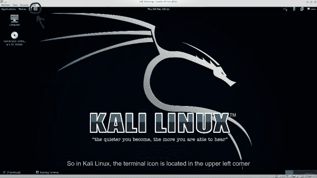

这将打开终端：
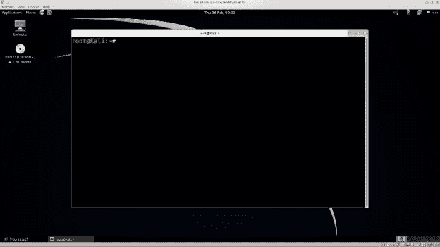

默认情况下，它在 Kali 中打开一个 root 终端。因此，如果你出于自定义或个性化的考虑想进行配置，我们将介绍如何操作。如果你不想配置，那完全没——你不需要这样做。除了上面看到的之外，你实际上不需要对终端做任何其他操作，它的默认外观和设置运行良好。然而，99% 的情况下，人们都有兴趣根据自己的需求和目的配置终端。例如，我本人几乎总是增大字体大小，使其清晰可见，让我更清楚地看到当前正在做什么，而且根据某些文章这还能减轻眼睛疲劳。

要配置终端，你可以在终端的任何地方右键点击并点击`show menu bar`（显示菜单栏）（见下图）。

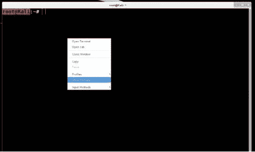
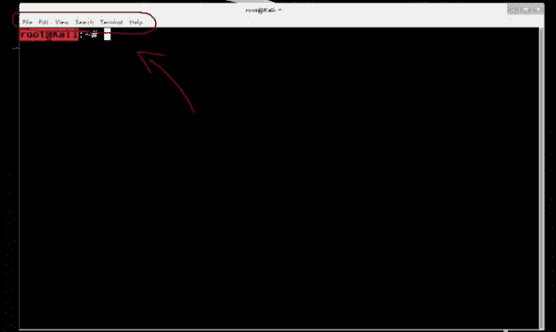

现在菜单栏可见，点击 `edit`（编辑）然后 `profiles preferences`（配置偏好）。接下来的菜单将显示：

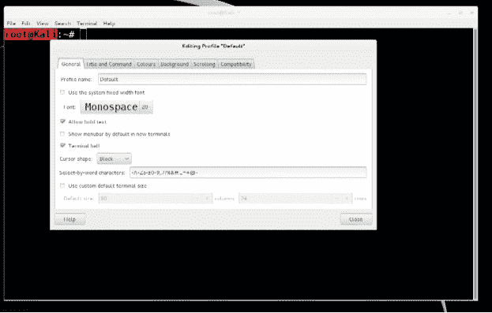

在本节中，我们将介绍学习本课程进所需的基础命令。共有 4 个基础命令——这 4 个基础命令用于在终端内导航、遍历文件系统、确定你当前的位置、复制文件、移动文件、列出文件和文件夹、查看内容、删除它们、更改文件所有者或更改文件模式。你很快就会明白我的意思。

以下是命令的完整列表：

- `cd`
- `ls`
- `pwd`
- `cp`
- `mv`
- `cat`
- `less`
- `grep`
- `echo`
- `touch`
- `mkdir`
- `chown`
- `chmod`
- `rm`
- `man + help`

## Cd

首先是 `cd`，它代表 Change Directories（更改目录）。如果你输入 `cd /home/` 并按回车键，你将导航到你的主目录。所以，你实际上是在使用 `cd` 来切换你的工作目录。

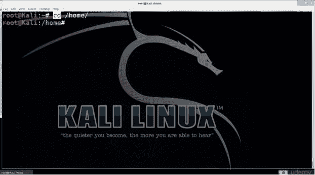

**注意**：如果你输入 `cd ..`，你将始终后退一步。所以 `..` 表示上一个文件夹。这是一个你会经常使用的快捷方式。

## Ls

接下来是 `ls`。`ls` 显示当前文件夹的内容列表。你也可以使用，例如 `ls /home/`，这样你就可以获取指定文件夹的列表。单独输入 `ls` 会给你显示当前文件夹的列表，而输入 `ls` 后接文件夹路径则会给你显示指定文件夹的列表。此外，你还有 `ls -l`，它会给你一个详细列表，告诉你是所有者、大小、日期、类型、权限等信息。然而，`ls` 的常用用法之一是 `ls -la`，用于显示内部的隐藏文件。

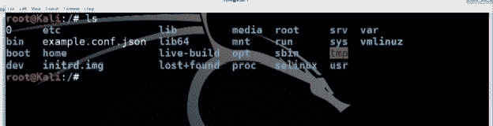

## Pwd

第三个功能是 `pwd`，代表 print working directory（打印工作目录）。你可能会觉得这有点困惑，但如果你注意图片，它们都有一个正斜杠。在所有类 Linux 系统中，正斜杠符号 `/` 指向根目录，这是所有文件所在、一切一切开始的地方。所以，打印工作目录的功能正如其名称一样，它打印你当前的工作目录。

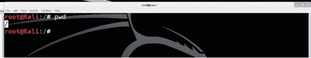

## Cp

接下来是你的 `cp` 命令，我们之前在 ["Hacking: How to Create Your Own Penetration Testing Lab Using Kali Linux 2016"](https://www.amazon.com/dp/B01MXFX3BM/)中使用它将 Virtual Box Guest Additions 从一个地方复制到另一个地方。它非常简单。你输入 `cp /path`。例如，如果我输入 `cp LinuxAdditions.run` 并且我想把它复制到 `/var/`，我会输入 `cp -v VBOXLinuxAdditions.run /var/`。

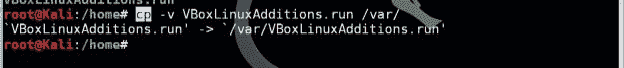

**注意**：`-v` 非常有用，它会告诉你机器目前正在做什么（你不会感到困惑或认为它卡顿或崩溃了，因为你会得到状态更新）。你不需要它，但它非常有益，特别是对于等待时间较长的大文件。`-v` 告诉机器正在做什么，但如果你不需要实时状态更新，可以输入 `cp VBOXLinuxAdditions.run /var/`。

你可能已经注意到，到目前为止的所有命令以及我们将介绍的其余命令都有自己的参数，可以通过传递参数给它们来修改命令的功能。你可以在终端中查看这些参数的列表，而不是死记硬背。所以以 `cp --help` 为例，这是在终端内获取某个主题帮助的通用方法。你输入命令、一个空格、然后是 `--help`，按回车，你将得到一个可能的列表。它看起来有点杂乱且难以查看，但如果你向上滚动，就可以看到所有的参数。它们在这里都清晰地列出。左侧是参数（红色），右侧是该参数作用的解释（黄色，请参考下图）。最好是在你学习课程的过程中，通过练习这些命令来学边记这些，而不是试图一次性记住所有内容。你越经常使用这些命令，就会越能记住它们，而不需要刻意为，可以说你正在缓存这些信息（哈哈）。

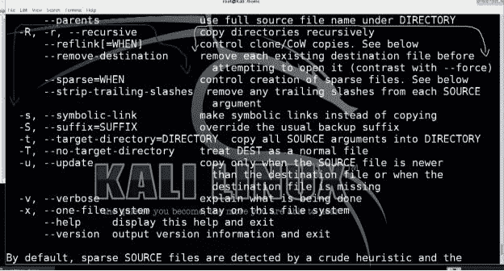

如果你在这个帮助菜单上向上滚动，你会遇到“Usage”（用法）。在 Usage 中，你可以获得命令的格式或语法。基本上，`cp [option]… ([-T] 指定你的源和目的地)` 非常简单。（见下图）

*(注：此处原文存在大量重复段落，已根据要求去重)*

- 如果你输入 `cd /home/` 然后按回车，你将导航到你的主目录。所以你实际上是在使用 `cd` 来切换你的工作目录。

**注意**：如果你输入 `cd ..`，你将始终后退一步。所以 `..` 表示上一个文件夹。这是一个你会经常使用的快捷方式。

接下来是 `ls`。`ls` 显示当前文件夹的内容。你也可以使用，例如 `ls /home/`，并获取指定文件夹的列表。单独输入 `ls` 会给你显示当前文件夹的列表，而输入 `ls` 后接文件夹路径则会给你显示指定文件夹的列表。此外，你还有 `ls -l`，它会给你一个详细列表，告诉你所有者、大小、日期、类型、权限等。然而，`ls` 的常用用法之一是 `ls -la` 用于显示隐藏文件。

第三个功能是 `pwd`，代表打印工作目录。你可能会觉得这有点困惑，但如果你注意图片，它们都有一个正斜杠。在所有类 Linux 系统中，正斜杠符号 `/` 指向根目录，这是所有文件所在、一切开始的地方。所以，打印工作目录的功能正如其名称一样，它打印你当前的工作目录。

接下来是 `cp` 命令，我们之前在 ["Hacking: How to Create Your Own Penetration Testing Lab Using Kali Linux 2016"](https://www.amazon.com/dp/B01MXFX3BM/)中使用它将 Virtual Box Guest Additions 从一个地方复制到另一个地方。它非常简单。你输入 `cp /path`。例如，如果我输入 `cp LinuxAdditions.run` 并且我想把它复制到 `/var/`，我会输入 `cp -v VBOXLinuxAdditions.run /var/`。

**注意**：`-v` 非常有用，它会告诉你机器目前正在做什么（你不会感到困惑或认为它卡顿或崩溃了，因为你会得到状态更新）。你不需要它，但它非常有益，特别是对于等待时间较长的大文件。`-v` 告诉机器正在做什么，但如果你不需要实时状态更新，可以输入 `cp VBOXLinuxAdditions.run /var/`。

你可能已经注意到，到目前为止的所有命令以及我们将介绍的其余命令都有自己的参数，可以通过传递参数给它们来修改命令的功能。你可以在终端中查看这些参数的列表，而不是死记硬背。所以以 `cp --help` 为例，这是在终端内获取某个主题帮助的通用方法。你输入命令、一个空格、然后是 `--help`，按回车，你将得到一个可能的列表。它看起来有点杂乱且难以查看，但如果你向上滚动，就可以看到所有的参数。它们在这里都清晰地列出。左侧是参数（红色），右侧是该参数作用的解释（黄色，请参考下图）。最好是在你学习课程的过程中，通过练习这些命令来学边记这些，而不是试图一次性记住所有内容。你越经常使用这些命令，就会越能记住它们，而不需要刻意为，可以说你正在缓存这些信息（哈哈）。

如果你在这个帮助菜单上向上滚动，你会遇到“Usage”（用法）。在 Usage 中，你可以获得命令的格式或语法。基本上，`cp [option]… ([-T] 指定你的源和目的地)` 非常简单。（见下图）

## Mv

列表中的下一个是 `mv`，它代表 move（移动），也可以重命名文件夹和文件。要重命名文件，你必须输入 `mv file.ext newname.ext`。由于我想把它移动到主目录，我会输入 `mv RandomSoRandom.run /home/`

**注意**：当你使用 `mv` 删除某些东西或将某些东西覆盖时，恢复是非常困难的，如果不是不可能的话。此外，在 Linux 中删除文件要非常小心——一旦你在终端中删除了它们将无法恢复。

## Cat

接下来是 `cat`。`cat` 显示文件的全部内容（无论文件是什么），它非常适合不想进行任何意外更改但想快速查看文件内容的情况。

**注意**：终端编辑器 Nano 是一个很好的终端文本编辑器。你需要学习如何使用终端编辑器，因为你不想在 GUI 文本编辑器和终端工作之间来回切换。这极其耗时，而且在当前的 Kali Linux 上，你可以以 root 身份编辑内容。然而，如果你使用其他发行版或类似的，大多数 GUI 文本编辑器无法以 root 身份运行。你会收到错误消息。所以，这可能会有点麻烦。这就是为什么你应该始终学习如何使用来自终端的文本编辑器。

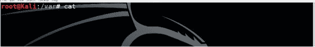

`less` 与 `cat` 非常相似，它会向你显示内容但在终端内部创建一个新的工作空间，当你按下键盘上的 `q` 键时，它将退出不再显示任何内容。因此，在整洁和有序方面来说，它是非常好用的。

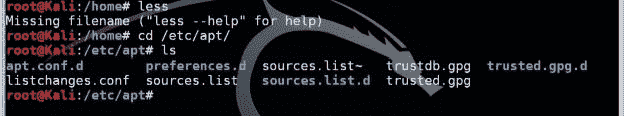

## Grep

列表中的下一个是 `grep`，它是用于从其他内容中提取（`grep`）某些内容的。Linux 是大小敏感的，所以当你进行 grep 操作时，它会检查你搜索的是小写还是大写。`Grep` 非常重要；它是 Linux 终端中与 `cat` 和 `less` 一样用于过滤文本文件的重要部分。如果你继续学习这门课程，在某个时刻你将进行大型网络扫描，你需要创建文件并从中提取有用信息，稍后会将这些信息传递给其他工具以便后续操作。好的！

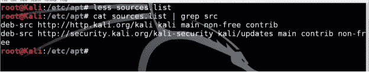

## Echo

接下来是 `echo` —— 输入 `echo "I am alive"`，它就会回显这些词 —— 它字面意思就是回声。当你向它输入内容时，它会将你输入的词回显给你。

注意：通过使用键盘上的向上和向下箭头键，你可以在过去的命令之间滚动。`Echo` 是一个非常好用的命令，你可以用它更改变量名和值。随着课程的进行，我们将更多地使用它，届时我们会有直接与我们正在操作的内容相关的清晰示例，我们基本上是渗透测试，然后你将看到这些命令更高级的用法——尤其是 `grep`。

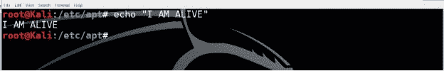

## Touch

`Touch` 是创建文件的快速方法。例如，我可以输入 `touch file1 file2 file3` 并按下回车键，然后输入 `ls`。你会看到它立即创建了 3 个文件。这是一个创建你所需的任意数量文件的非常快速的方法。你还可以指定文件夹路径。你可以在 home 目录下创建 `file1`，在 var 目录下创建 `file2`，在 varlog 目录下创建 `file3`，以此此类推。

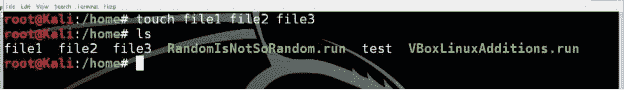

## Mkdir

接下来是 `mkdir`，它代表 Make directory（创建目录）。所以，如果你输入这个命令，你就在创建某种目录。`mkdir name of directory` 然后按回车并 `ls`，它会显示该文件是一个目录，即上面的 `name of directory`。我甚至可以进入它——里面什么都没有，但你明白意思。你可以以这种方式创建目录。

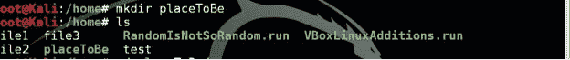

## Chown

`Chown` 代表 change ownership（更改所有者）。它允许你更改文件的所有者。现在我们这里只有一个用户，即 `root`，所以这样做没有意义。除非我们创建了一些其他新用户——然而我们并不需要他们。但为了向你演示它是如何工作的，例如，如果文件的所有者不是 `root` 而而你想将其更改为 `root`，你需要执行以下操作。

输入 `chown`，然后输入用户名 `:` —— 冒号和用户组。通常用户组和用户名是相同的，除非你有一些更大的服务器之类的东西。然后只需指定文件名即可。你可以输入 `test` —— 这将有效地将文件 `test` 的所有者更改为用户名 `root`，它属于 `root` 用户组。如果我执行 `ls la`，它会统计所有者是谁以及哪些组拥有文件。

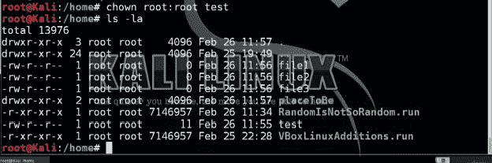

## Chmod

`chmod` 是另一个更常用的命令。该命令允许你更改文件权限。这是你每天且经常需要用到的东西。随着教程的进行，我们将更深入地处理它。你还需要熟悉 bash 脚本。Bash 脚本就像终端本身一样——所以终端中使用的几乎所有命令都可以在脚本中使用。

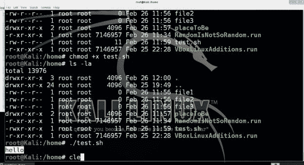

## Rm

我想要向你展示还有最后一个命令，这确实是一个非常危险的命令，它可能会以你现在无法想象的方式让你陷入麻烦——那就是 `rm` 命令。`rm` 基本上是 remove（删除）。一旦你用这个命令删除东西，几乎无法从中恢复任何内容。所以，如果我输入 `rm test.sh`，它将被删除，并且将不再存在那里。如果你尝试使用 `rm` 删除目录，你将无法做到，因为它也起到安全保护的作用。所以，你不会删除整个目录，因为你无法恢复它，那样会糟糕。当你使用 `rm` 时，你总是希望系统进行询问。

## Man + help

如果你遇到困难不要担心，我经常遇到。但如果你在这里找不到任何有用的东西，不知道输入什么或参数，只需输入 `help` 查看。论坛是你的下一个选择。相信我，你会成功的。

`cd`

`ls`

`pwd`

`cp`

`mv`

`cat`

`less`

`grep`

`echo`

`touch`

`mkdir`

`chown`

`chmod`

`rm`

## Conclusion

任何情况下，这是对我们将使用的 Kali Linux 基本命令的简要介绍，我们将以此学习更多关于合法和非法黑客的知识，请你熟悉这些命令的功能，稍后我们将结合它们进行更高级的操作。任何情况下，我向大家告别，希望在下一次课程中见到你们。备注本系列完成后将汇成一本书。你将通过电子邮件收到你的副本。

## YOUR GIFT

点击下方获取你的恶意软件防护

[>>点击此处](https://forms.aweber.com/form/28/192431.jpg)

# 

## Course Books

[`www.amazon.com/dp/B013JB35IK/`](https://www.amazon.com/dp/B013JB35IK/)

[`www.amazon.com/dp/B01M15T2GG/`](https://www.amazon.com/dp/B01M15T2GG/)

[`www.amazon.com/dp/B01MXFX3BM/`](https://www.amazon.com/dp/B01MXFX3BM/)

