# Xandros 3 日常使用官方指南


> “任何希望充分利用 Xandros 桌面 3 所有功能的人都应该阅读此书……这里有很多你在别处找不到的技巧和窍门。”
> — JASON PERLOW，《LINUX》杂志

---

**已撤回**
不再是波士顿公共图书馆的财产。
对该材料的捐赠使图书馆受益。

---

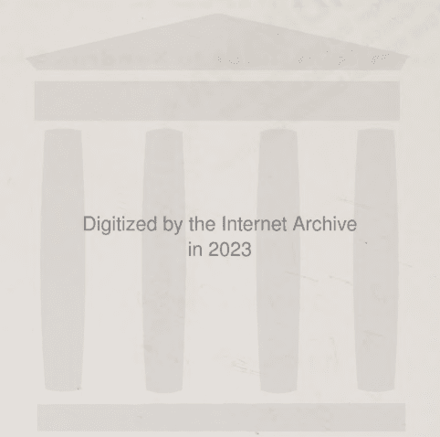

由互联网档案馆于 2023 年数字化
https://archive.org/details/linuxmadeeasyoff0000gran

---

---

---

献给“Bonnie”，我的妻子、灵魂伴侣和“前拉斐尔派芭蕾舞者”，在我写这本书时，她如此耐心和支持

---

## 作者简介

Rickford Grant，*Linux for Non-Geeks* 的作者，二十多年来一直是计算机操作系统的狂热爱好者，从早期使用 Atari XL600 到如今使用 Linux 机器。Rickford 过去七年担任日本国际大学院 Toyama University 的副教授，现已回到美国俄勒冈州波特兰市。

---

---

---

---


## 致谢

  一如既往，有许多人值得感谢，因为他们在本书写作期间或之前提供了帮助和支持，此外还有一些人的帮助将在本书发布之后到来。我现在向所有人致谢。

  首先，我要感谢我的妻子穗（Sumire），本书正是题献给她。在我撰写本书并准备在俄勒冈州波特兰寻找新住处期间，她给予了我巨大的帮助和鼓励。我还要感谢我的母亲迪克西·安吉丽娜·伯克尔-泰斯塔（Dixie Angelina Burckel-Testa），我最初写第一本书就是为她而作。她再次值得获得巨大的感谢，因为她对我各个项目的支持，帮助我完成了本手稿的初校，并且总体上非常通情达理。当然，我也必须感谢我的姑姑达尼卡·卢西亚·佐拉尔斯（Danica Lucia Zollars），因为如果没有她，我最初可能根本不会误打误撞进入写作这个世界。最后，为了完善我对家人的致谢，我还要感谢我的表亲兼朋友斯蒂芬妮·加拉布兰特西亚（Stephanie Garabrantesierra），她在2004年我在 LinuxWorld 会议上进行演讲时无情地辅导了我，她的热情总是激励和鼓舞着我。还要感谢我可爱的猫洛克斯（Roxanne），当时是她抚慰了我的神经。

  当然，由于 No Starch Press 的工作人员实际出版了本书，我想感谢他们迄今为止所做的一切，以及我知道他们在书出版后还将继续做的努力。感谢你们所有人：威廉·波兰（William Pollock）、莉·波赫勒（Leigh Pochler）、苏珊·贝格（Susan Berge）、莱利·霍夫曼（Riley Hoffman）、帕特里夏·维特金（Patricia Witkin）和克里斯蒂娜·萨缪尔（Christina Samuel）。虽然他们已不再隶属于 No Starch Press，但我仍想感谢希勒尔·海因斯坦（Hillel Heinstein），他是我第一本书的编辑，当时他的指导让这次的过程变得容易得多；还要感谢卡罗尔·胡拉多（Karol Jurado），她为我理清了一切，似乎能够变出各种魔术。

  在企业层面的事务中，我想感谢 Xandros 的斯蒂芬·哈里斯（Stephen Harris），他对我不时提出的愚蠢请求和问题非常乐于助人，还向我推荐了 Skype，从而帮我省下了大笔费用。

  Xandros 的工作人员在我撰写章节时阅读并指出我可能遗漏的内容，也给予了极大的帮助。对此，我特别想感谢马克·贝尔弗勒（Marc Belfleur），以及在该工作中提供帮助的其他所有人：尼尔·德劳（Neil Derraugh）、埃里克·福勒（Erich Forler）、迈克尔·盖尔（Michael Gale）、凯文·麦克弗森（Kevin MacPherson）、布莱恩·罗尔夫（Brian Rolfe）和杰夫·特伦特（Jeff Tranter）。

  如果提一下所有对 *Linux Made Easy* 进行技术编辑的人时，不提及该项目的开发编辑和校对彼得·斯皮尔（Peter Spear）和琳达·雷肯瓦尔（Linda Recktenwald），那就不合适了。他们的帮助、建议和提问使本书比最初提交时更加完善，对此我谨表示万分感谢。Tusen tak！

  现在转向我朋友和同事，请允许我感谢唐纳德·哈芒（Donald Hammang）——自行车手、人生导师、Windows 专家和“大锯”的守护者；谢尔登·鲁道夫（Sheldon Rudolph）——终身好友、艺术家、作曲家，也是我在 Atari XL600 时代的第一个计算机伙伴；以及史蒂文·杨（Steven Young）——徒步旅行者、环保主义者、终极极客，也是本书的灵感来源。非常感谢你们。也要感谢我以前的同事濑川哲夫（Setsu Usaaka）、高木俊博（Toshiho Takagi）、詹姆斯·波尔卡罗（James Porcaro）、中岛特雷西（Tracy Nakajima）、安杰伊·科佐洛夫斯基（Andrzej Kozlowski）和理查德·斯通（Richard Stone），在我写这本书期间，他们给予了我间接的、有时是非常直接的帮助。

  特别感谢那些提供支持或指引方向的人，他们可能甚至自己没有意识到——迪克·佩特里（Dick Petrie）、J. 霍华德·克里明博士（Dr. J. Howard Cremin）和金伯利·乔·伯克（Kimberly Jo Burk）。

  最后，特别感谢我甜美的小黑猫亲爱的猫咪朋友穆祖（Muju），它总是耐心倾听我所说的任何话，在我情绪低落时让我保持清醒。喵。

## 引言

### 这本书适合谁？

  如果你现在就站在当地书店的过道里阅读这些文字，你可能正纳闷这本书是写给谁看的。如果你恰好也在同一层书架上看到了我的前作 *Linux for Non-Geeks*（哦，我真幸运），你可能还会好奇这两本书有什么区别。因此，为了解释清楚，我现在尝试回答这两个问题。*Linux Made Easy* 的写作对象是普通计算机用户，但并非任何普通用户。目标用户是那些经过多年使用 Windows 后，感到厌倦、疲惫或囊中羞涩的人。这类人想尝试一些不同的东西，只要能在他们目前的机器上运行且运行良好，他们并不太关心具体是什么。

  从某种意义上说，你可以说这本书是写给史蒂夫看的，他是我在洛杉矶从四年级就开始交往的朋友。我第一本书出版后不久，他打电话给我说他买了一本。不幸的是，他说他其实不会去尝试，因为他对深入了解 Linux 并不是非常感兴趣。当然，他并不是反对 Linux；只是他真正关心的主要事情是摆脱 Windows。他只希望连接他的 PDA、给朋友发送电子邮件、使用互联网，并在必要时快速制作一些文档和演示文稿——所有这些都不需要深入钻研。无论是 Linux 还是 Dogmata Fortuita Professional OS v5（不，那个系统不存在），只要它便宜、易用且功能强大就行。对他来说，当时 Linux 似乎还是太麻烦。

  好，在我看来，甚至在我母亲看来（我最初写第一本书就是为她准备的），Linux 已经足够简单了，*Linux for Non-Geeks* 的写作目的就是向那些对 Linux 感兴趣但还不敢尝试的人表明这一事实。当然，承认这些人确实在寻找一种简单的入门方式。另一方面，史蒂夫寻找的是一条出路——一种毫不费力的出路。

  后来当我接触到 Xandros 时，我意识到我找到了史蒂夫在寻找的东西——一种如此易用的 Linux 版本，以至于相比之下 Windows，甚至可以说是 Mac OS，都会显得复杂。当然，除了世界上像史蒂夫这样的许多人之外，还有其他一些特定想要进入 Linux 领域的人，但由于某种原因觉得它太繁琐而不想折腾。对于这类人来说，Xandros 进入 Linux 世界并真正使用 Linux 的绝佳途径。因此，这本书在写作时考虑到了这两类人群。

  由于这些人更感兴趣的是完成任务，而不是摆弄系统，且 Xandros 非常易用，我将花大量篇幅讲解如何使用软件和外设，如打印机或 USB 闪存驱动器。我将讨论如何运行和使用这些应用程序和设备，并提供技巧和项目帮助你们更好地利用它们。你将获得实战经验，这有助于你培养基本技能，然后可以在此基础上构建并稍后应用。当你读完这本书时，你将能够完成你在 Windows 上能做的一切——而且更多。

### 版本兼容性与更新

  本书是为配合 Xandros 3 版 Open Circulation（随书附赠）、Standard、Surfside Linux 和 Deluxe 版本准备的。虽然我没有具体介绍 Business Edition 的技术功能，但这本书也可以用于该版本，文中会提及相关差异。我讨论的一些应用程序，如 Thunderbird、Firefox 和 Skype，最初并不包含在 Standard、Business 或 Deluxe 版本中，但较早版本的用户可以通过 Xandros Networkos 轻松下载这些应用程序以便跟练。

  > **注意** *计算机世界变化极快，在本书发布后，书中项目的软件或文件链接可能会发生变化。我将任何此类变更发布在* [www.edgy-penguins.org/LME](http://www.edgy-penguins.org/LME) *上。*

### 概念与方法

  作为一名语言教师，我一直喜欢编程书、数学书和传统的外语学习教材，因为它们采用了直接的基于技能的教学导向，每一章都建立在上一章习得的技能之上。我试图按照这种方式组织本书，这样就不会要求你去做你尚未学会的事情。我也喜欢这样的书，因为它们不


...不仅教会读者如何做某事，还为他们提供机会，以练习的形式将这些零碎的知识付诸实践。因此，我在本书中适当的地方包含了一些练习或项目，以便为读者提供应用知识的机会。本书将作为参考教材，同时也会提供动态的学习体验，让你能够通过动手来学习，正如人们所说的那样。

本书中的项目还有一个次要目的：通过完成这些项目，你将正确配置并完善你的 Xandros 系统，使其能够执行你想要的任何任务。当你读完本书时，你的系统将涵盖所有基础功能。如果这还不足以让你满意，你会很高兴地知道，你将通过 Xandros 网络访问到更多的内容——多得超乎想象——在那里你会发现比你可能永远需要的还要多的免费应用程序……但更多细节将在第 8 章中介绍。

## 如何使用本书

当然，你可以把这本书仅仅当作一本参考书，只有在遇到问题需要解决时才去查阅，但这会违背其设计的基本理念。相反，我建议你先逐章通读整本书，并沿途完成其中的项目。这将使你对事物是如何运作的（以及你如何完成任务）有更广泛的理解，并减少焦虑、困惑，甚至更糟糕的错误发生的可能性。

最好在身心放松且有富余时间的时候阅读本书并完成其中的项目。匆忙行事是坏事的主要原因。请牢记，Linux 和本书的项目是有趣的，不仅仅是工作练习。在我看来，Linux 世界的整个意义在于它提供了各种各样的乐趣。所以，请尽情享受吧。

## 关于本书使用的约定

关于我在书中使用的约定，只有少数几个小点值得注意。我将需要在系统中点击或以任何方式直接操作的条目（如按钮、选项卡、菜单、文件或文件夹）以及我要求你输入的任何文本都用**粗体**表示。在第 20 章中，我使用*等宽字体*来表示出现在控制台窗口中的任何文本。我希望引起你注意但并非要求你实际点击或直接选择的词语，我设置为*斜体*，我也在首次提及文本中的窗口或应用程序时使用斜体。我还选择使用更具图形提示性的术语 *folder*（文件夹）而不是 *directory*（目录）——无疑这是我作为 Mac 用户多年的遗留习惯。

## 关于本书附带的 CD

随书附带的 CD 包含一个完整的 Xandros Open Circulation Edition 工作副本。这是一个完整的 Linux 工作系统，附带了普通家庭用户舒适运行所需的大多数（如果不是全部的话）应用程序。这些应用程序包括与 Microsoft Office 兼容的 OpenOffice.org 办公套件、流行的 Firefox 网络浏览器和 Thunderbird 电子邮件客户端、Real Player，以及新的、易用的网络电话应用程序 Skype。除了光盘上提供的许多其他应用程序外，还可以通过捆绑的 Xandros 网络应用程序轻松免费下载更多——数量多得超乎想象——的内容。

# 第一部分

## 入门

### 1

#### 欢迎来到 Linux 的世界……XANDROS 风格


Xandros 第一次进入我的活跃意识，是当我收到一位电脑朋友发来的电子邮件时，他写道：“你知道什么很酷吗？Xandros！”起初我有点惊讶，因为我很难理解一个看似正常的人怎么会认为一部巨头像在空中漂浮着，对留着浓密鬓角、穿着原始服饰的肖恩·康纳利喋喋不休地发表伪哲学胡话的电影有什么“酷”的。不过，经过短暂的反思后，我意识到我的朋友并没有像我最初担心的那样完全疯掉，而是我一直误以为他在谈论 1974 年的电影《未来世界》（Zardoz）。幸运的是，对于所有相关人员（包括你）来说，Xandros 是完全不同的东西——它是 Linux 操作系统的一个极其易于安装和使用的变种。

##### Linux 是什么？

你肯定已经知道，并且可能使用过今天存在的众多操作系统中的至少一个。Windows、DOS 和 Mac OS 等操作系统都能让你的电脑（否则只是一堆毫无头绪的电子部件）按照你的意愿运行。

Linux 是另一个这样的操作系统；然而，无论在功能还是历史渊源上，它都与其他操作系统大相径庭。Linux 并非由某个公司或那些想赚钱的公司模仿者创造。它实际上是由一位芬兰-瑞典电脑爱好者、林纳斯·托瓦尔德斯（Linus Torvalds）创造的，他想创建一个比 Unix 更好的类 Unix 系统，使其能在家用计算机上工作，特别是他自己的电脑。托瓦尔德斯并没有把他的创造物据为己有，而是用比喻的说法，向世界开放了它，随后该系统由全球各地的电脑极客们扩展和改进，他们努力使系统变得更好、更强大。

##### 我为什么应该使用 Linux？

人们使用 Linux 有许多不同的原因。对许多人来说，这是力量、稳定性，甚至是个人哲学的问题。然而，对许多其他人来说，听起来可能很俗气，这是金钱的问题。花点时间想想启动另一个操作系统的成本。去你购买软件的商店，在过道里走一走。在脑海中列一份你想购买的所有东西及其价格的清单：一个办公套件、一两个游戏，也许还有一个图形程序，让数码照片看起来更好（在这个过程中也许还包括让你自己看起来更好）。现在算一下总账。

从地板上爬起来后，你就会明白我们谈论的是大笔钱。另一方面，花买这本书的钱，或者如果你选择更多灵活性再多花一点点，你就能在 Linux 世界中获得你所有想要的东西甚至更多。尽管很多人担心，但转向 Linux 不仅意味着为你省钱，还意味着更多的计算通用性——你在最需要某个程序的时候不会因为它缺失而被束缚手脚——你从一开始就拥有一切！

你可能会反驳说，其他操作系统有很多免费应用程序，但拜托，让我们面对现实，这些应用程序在功能上往往相当有限。稍微有点“劲头”的程序大多是共享软件，而现在的多数共享软件程序在某种方式上是受限的，或者你只能使用一个月或更短的时间，除非你愿意付费。当然，它们的费用相对较低，但这里 25 美元，那里 35 美元，最终会累积成相当可观的一笔钱。此外，至少在我的经验中，许多这些程序其实并不那么棒。

##### 这一切都只是为了钱吗？

虽然金钱对普通用户很重要，但这当然不是跳进 Linux 深水的唯一原因；还有其他各种各样的原因。正如我前面提到的，Linux 以其稳定性著称。尝试让你的当前系统在一个月不经常重启的情况下运行，看看会发生什么。众所周知，Linux 可以运行一年以上而不出现任何故障或性能下降。

此外，Linux 具有无限的自定义性；你可以让你的系统看起来和行动起来像你想要的那样，而不必像被施了魔法一样死机。还有随大多数 Linux 发行版附带或可用的应用程序。除了种类繁多外，大多数都符合行业标准，其中一些，如 Evolution 和 GIMP，更是令 Linux 世界之外的人羡慕不已。

##### 什么是发行版？

操作系统由许多执行不同功能的不同文件组成。由于没有“Linux 公司”来打包和分发组成 Linux 的文件，将 Linux 及其你可能想要的应用程序以工作状态放入你的电脑的任务，就落到了一个多样化的实体群体身上——公司、大学、用户团体，甚至是私人个人。他们创建的 Linux 系统和应用程序集合被称为*发行版*，或*distros*。你可以绕过这些发行版，尝试自己收集建立系统所需的一切，但你无疑会在过程中失去理智。大多数人，甚至是最极客的，都选择了发行版。

有许多发行版，如 Red Hat、Mandrake、SuSE、Damn Small Linux 和 Debian，举几个众所周知的例子。有些面向特定的受众，如企业、教育工作者、游戏玩家、学生、程序员、系统管理员以及特定语言使用者。每个发行版的不同之处在于与 Linux 内核捆绑的特定软件以及其他便利功能，如安装程序和系统配置工具。一些发行版由于安装简便，特别适合家庭用户，而 Xandros 无疑是该领域的领导者。

##### 那么为什么选择 Xandros？

既然有这么多发行版，你可能会想知道 Xandros 是否适合你。正如我前面提到的，不同的发行版迎合不同用户的需求和喜好。综合来看，可以说如果你正在寻找一个基本上可以立即使用而无需进行复杂技术折腾的 Linux 发行版，那么 Xandros 就是你的完美选择。


##### 安装便捷性
安装 Xandros 时，你不会遇到任何一个可能让你犯错的棘手问题。现在你得承认，这几乎达到了万无一失的地步（以最字面意义的解释）。Xandros 的四步安装流程在安装便捷性方面是无可匹敌的冠军。

##### 硬件兼容性
Xandros 在处理更具挑战性的硬件配置方面尤为出色。此外，Xandros 或许提供了对外设（如扫描仪和闪存设备）最简单的处理方式。

##### 基于 Debian
Xandros 基于 Debian 发行版，这是最流行的 Linux 发行版之一。因此，Debian 可用的应用程序数量可能比其他任何发行版都多。这些应用程序中的大多数都与 Xandros 兼容，并且可以很容易地通过随每个 Xandros 版本提供的 Xandros Networks 应用程序找到并安装。

####### Xandros Networks
Xandros Networks 应用程序使得查找和安装应用程序（有很多可用的应用程序）变得难以置信地简单，甚至成为一种享受。

##### 良好的 Windows 友好度
Xandros 被配置为尽可能舒适地与 Windows 世界协同工作。它不仅允许你轻松浏览你所连接的任何网络上的 Windows 机器，还允许你轻松地将你的机器设置为 Windows-Linux 双启动配置，从而允许你在硬盘上同时安装这两个系统。为了帮助你进行设置，它甚至可以为 你创建和调整分区大小，而且正如你将在下一节中了解到的，如果你升级到 Xandros 豪华版（Deluxe Edition），你甚至可以运行许多 Windows 应用程序和插件。

#### Xandros 的不同版本
与其他许多发行版一样，Xandros 也有免费和付费（销售）版本。免费版本，例如随本书附带的那个，被称为开放流通版（Open Circulation Edition）。它附带大量程序，包括与 Microsoft Office 兼容的 OpenOffice.org 办公套件。它缺少付费版中的一些花哨功能，例如无限速度的 CD 刻录（开放流通版仅提供最大 2X 的刻录速度）和刻录 DVD 的能力（开放流通版不支持 DVD 刻录），但它仍然是一个功能完整且完全令人满意的操作系统。而且你可以免费安装与它所缺少的大多数程序相媲美 的应用程序。

付费版本可分为家用版和商用版；鉴于本书的目标读者，我将只涵盖家用版。标准版提供无限的 CD 刻录速度和 30 天的电子邮件技术支持。豪华版在此基础上增加了额外的 30 天技术支持和两张包含各种额外应用程序的额外光盘。对于互联网连接速度较慢、希望快速完成所有设置的人来说，这是一个理想的选择。豪华版还捆绑了 CodeWeavers 的 CrossOver Office，它允许你运行部分（并非全部）Windows 应用程序，例如 MS Office，并使你的浏览器能够利用基于 Windows 的插件，如 QuickTime 和 Windows Media Player。根据运行 Windows 应用程序对你而言的重要程度，这可能是一个非常有价值的选项。Xandros 系列的新增产品是 Xandros Surfdex Linux，它面向硬核网络冲浪者。它与家用版几乎相同，但还附带反病毒软件、互联网电话应用 Skype 以及 Plantronics 耳机。

##### 硬件兼容性
好吧，既然我已经介绍了所有这些背景信息，让我们开始行动，准备安装。可以说，Xandros 可以在当今的大多数计算机上运行当然是比较安全的。当然，这个说法有一个主要的保留条件：在系统真正运行起来之前，你永远不知道一切是否顺利，而且由于你的机器有那么多微小的部件和外围设备，很难说每个部件是否会与你的安装合作。

如果你打算购买一台新机器来运行 Linux，那么先检查一下是合理的；但如果你打算在你现有的机器上安装，我建议直接开始。作为一个鲁莽的人，在网上搜索以查明事情是否能行得通对我来说有点烦人。你可以花几个小时到处摸索，最后仍然不确定。你也可能会被误导，因为 Linux 用户通常非常传教士式，试图吸引新用户。你也可以进行 Yahoo 或 Google 搜索，输入你主板的制造商和型号，加上关键词 **Linux** 或 **Xandros**。

##### 硬件要求
除了对兼容性的所有担忧之外，以下是基本的硬件要求：

- Intel Pentium 2-4 或 Celeron 处理器，或任何 AMD K6 /II, III, Duron, Athlon, 或 Athlon XP / MP 处理器
- 至少 1.5 GB 的硬盘空间（Xandros 推荐 3 GB），不过就我而言，至少拥有 10 GB 最好
- 足够的内存（RAM）

既然我们谈到了 RAM 的话题，我有点话要说。官方规格告诉你，运行 Xandros 至少需要 64 兆字节（MB）的 RAM（尽管推荐 128 MB 以便舒适运行）。然而，在我看来，无论你处理的是什么操作系统，无论是 Windows、Macintosh 还是 Linux，他们告诉你的足够内存肯定会太少，当你内存太少时，无论你在运行什么系统，嗯……奇怪的事情总是持续发生。应用程序似乎要花好几年才能打开，或者根本打不开；菜单要花很长时间才能渲染出它们的小图标；冻结和系统整体崩溃发生得也频繁得多。

我的基本经验法则是，无论具体操作系统如何，你需要推荐的（而非最低）内存再加上至少 128 MB。这给你的系统（和你自己）留出一点余地，而且在大多数情况下会让你的电脑运行快一点。毕竟，拥有一个相当快的 CPU 却因为缺乏内存而无法欣赏它，那是相当浪费的。这就像试图在扫把间里做开合跳一样。事实上，现在很少有人做开合跳，甚至很少有人有扫把间。

结论是：忽略官方规格关于你需要多少 RAM 的说法，直接放入更多。你不会后悔的。幸运的是，Xandros 推荐的 128 MB，加上我推荐的额外 128 MB，总共是 256 MB，这在当今大多数新系统配备的 RAM 量范围内完全足够。

如果你不属于那 256 MB 类别怎么办？嗯，如今内存相对便宜，所以我说就去做吧。既然你通过安装 Xandros 节省了应用程序的费用，你应该有足够的额外资金购买足够的 RAM 来让你的生活更轻松。

##### 接下来我该怎么做？
既然你对 Linux 世界，特别是 Xandros 有了更多的了解，是时候动手了。关掉那部你一直在看的《*欢乐时光*》（*Dawson's Creek*）第四季 DVD（我会帮你消除悬念——Joey 和 Pacey 在最后确实分手了），把自己绑在电脑前，穿上马刺（意指做好准备），直接进入下一章。当然，如果你已经跳进了这一领域，并且已经在你的机器上安装了 Xandros，那么你应该直接前往第 3 章开始。


### 2

#### 变形记

##### 在您的计算机上安装 Xandros


如果您已经安装了 Xandros，您可以直接跳过本章，继续阅读下一章。然而，如果您的计算机尚未安装 Xandros，并且您已准备好改变这种现状，那么您最好待在这里继续阅读。

在本章中，我将回顾在安装步骤开始之前您需要做的所有准备工作，以便指导您成功地在计算机上安装并流畅运行 Xandros。

> **注意** 如果您目前没有计算机，或者正考虑购买一台新机器，您可能想跳过关于安装的全部章节，直接去购买一台预装了 Xandros 的机器。有关此类机器可用性的信息见 Xandros 网站 [http://www.xandros.com/partners/ormpcs.html](http://www.xandros.com/partners/ormpcs.html)。对于其他读者……请继续阅读！

###### 单系统还是双系统引导？

在开始之前，您首先需要决定是将 Xandros 安装为计算机上唯一的操作系统，还是创建一个双系统引导环境，这样每次启动计算机时您都可以轻松选择运行 Xandros 或 Windows。您看，在同一台机器上安装 Windows 和 Xandros 是完全可行的，它们可以和谐共存。

在 Xandros 中创建双系统引导非常简单，但您需要确保硬盘有足够的空间，以便让两个系统在自己的分区中舒适地运行。如今大多数计算机至少配备 60 吉字节（GB）的硬盘，我认为这是满足 Windows XP 所需的 2 GB 空间（不包括其他应用程序所需空间）和 Xandros 所需的 3 GB 空间的最低要求。当然，分区（以及逻辑上的硬盘）越大，您在运行任一系统时体验就会越流畅。

就我自己而言，起初我也是采用这种双系统引导配置，所以我可以 firsthand 告诉您，一切运行得非常正常。我发现的唯一问题是，随着时间推移，我完全停止使用 Windows 侧了——我根本不需要用它。然而，将大量磁盘空间浪费在我不再使用的 Windows 系统上似乎是一种对宝贵空间的浪费，所以最终我彻底删除了它，转而采用纯 Linux 配置。

话虽如此，除非您确实需要某些在 Xandros 端不可用的应用程序（可能是某些游戏），否则我会建议您丢弃您的 Windows 系统（以及所有潜伏其中的病毒和间谍软件），转而采用仅 Xandros 配置。Xandros 已经具备了您所需的大部分内容，而且由于 OpenOffice 可以读写 MS Office 文件，如果这是您担心的问题，您仍然能保持很好的兼容性。

###### 但如果我想要找回我的 Windows 怎么办？

您可能会认为，如果我建议这样做（丢弃您的 Windows 系统），而您最终不喜欢 Xandros，您将不得不重新安装 Windows。这确实会浪费大量的时间和精力。然而，信不信由你，即使最坏的情况发生，我的建议也都有其优势。

您可能已经注意到，随着时间推移，您的 Windows 系统变得有些臃肿——它不再是以前那只敏捷的小猫了。菜单不再像以前那样快速弹出，启动时间比以前更长，而且您经常发现自己会问“这到底是个什么鬼？”因为那些神秘的事情发生的频率越来越高。

这正是该系统的本性，而将一切恢复正常的一个非常好的方法是重新安装整个系统。这还将清除系统中可能嵌入的任何间谍软件或病毒。因此，即使您决定以后回到 Windows，您也是在为自己做好事，因为系统应该运行得更好、更安全。前期工作虽然稍多，但从长远来看，您会过得更舒心。

###### 保护您免受自身伤害

在安装过程中，您会被要求创建并输入三项内容：管理员密码、用户名和用户密码。现在就确定这些内容以消除后续麻烦是个好主意。但是，如果您像大多数 Windows 家庭用户一样，可能对为什么需要所有这些信息的疑问感到困惑，那么我现在就向您解释一下。

Xandros 与大多数 Linux 发行版一样，试图将您与系统的实际运行机制隔离开来，基本上强迫您在用户账户中进行日常工作。然而，当您安装软件或执行某些其他系统任务时，您会被要求暂时进入管理员账户（通常也称为 root，只需在提示时输入管理员密码即可）。

与您在 Windows 中可能熟悉的情况不同（在 Windows 中，设置时每个用户账户都是管理员账户），这可能显得有点繁琐。也许是这样，但这其实是个绝妙的主意，能提供更好的安全性（无论是系统层面还是心理层面），因为它通过将您可能犯的错误限制在仅影响您的用户账户来保护您免受自身的伤害。事实上，微软也建议您在 Windows 中这样做——只需打开您的 Windows 帮助页面，搜索“why not administrator”，您自己就能看出来。

除了安全性，这种设置还能增加便利性和隐私。凭借您的管理员账户权限，您可以随时创建额外的用户账户，就像在 Mac OS X 或 Windows XP 上一样。例如，假设您的家人想使用您的计算机，但您不想让他们乱动您的文件，更糟糕的是，他们可能会以某种方式搞乱整个系统。您可以为自己使用一个账户，然后为您的女儿（Erika）、儿子（Jothro）和配偶（Pat）添加额外的账户。在此体系下，当他们中的任何人启动您的计算机时，他们只能登录到自己的账户。您还可以设置系统，使其他用户的设置不影响他们，他们的设置也不会影响其他人。

既然您现在理解了 root/用户 的区别，请决定一个 root 密码和一个用户密码。每次登录时您都会使用用户密码，所以请确保这是一个您不会忘记的，而且更重要的是，您不介意每天输入的密码。您不会那么频繁地使用 root 密码，尽管在本书的项目中您会用到相当多。即便如此，它也应该是一个您能记住的东西，因为非常重要。

您还需要为自己想一个用户名。它可以简单到您的首字母（我的用户名是 rg）或您最喜欢的热带鱼的名称，如 neontetra。无论您选择什么，它都会在您登录后显示在屏幕上，所以请确保这是一个您不介意每天看到的用户名。日复一日地在计算机屏幕上看到“Stinky's Home”可能会证明有点烦人，甚至有点尴尬。

> **注意** 您的用户名可以由数字、下划线 (_)、连字符 (-) 和小写字母的任何组合组成。但是，第一个字符必须是字母。此外也不能包含任何空格。

一旦您决定了用户名以及 root 和用户密码，请确保将它们写在纸上或本子上（某种您无法删除的介质）。在安装过程结束且您习惯操作之前，请随身携带。之后，您可以将它们存放在某个安全的地方——但不要像我那样健忘，忘了那个安全地方在哪里。这些信息非常重要，随着时间推移，很容易遗忘这些细节，而您绝对不想这么做。保留您的 root 密码是最重要的，因为没有它，您将无法执行某些操作，如安装软件包或添加用户。

###### 安装前准备：您能从 CD 引导吗？

在进入安装环节（项目 2B）之前，请确保您的计算机已设置为从 CD 驱动器引导。如今大多数机器都默认设置为这样，因此您可能不需要做任何特殊设置。如果您不确定且不乐意折腾，您可以直接进入下一节的安装步骤来测试。如果出现了 Xandros 安装界面，您可以继续操作。另一方面，如果您突然启动进了 Windows，您将需要进行一些调整。

您可能唯一需要做的就是重启机器，然后按屏幕提示的按键进入 BIOS 设置。这通常是 DELETE 键或 F1 键，但并非所有机器都相同。如果屏幕上的信息一闪而过导致您错过，您可以查看用户手册以确认正确的按键。进入 BIOS 设置后，更改引导顺序，使 CD 驱动器排在第一位。具体操作方法因机器而异，请参阅用户手册。

###### 项目 2A：创建启动盘（如果需要）

在极其罕见的情况下，如果您的机器完全无法从 CD 引导，您将不得不制作一张 3.5 英寸启动软盘，您可以在使用（自己的或别人的）Windows 系统时轻松完成此操作。要做到这一点，您必须首先在 Windows 下启动您的机器。一旦到达 Windows 桌面，插入 Xandros 安装 CD。Xandros 桌面自动向导（图 2-1）将会出现。只需点击“下一步”按钮即可继续。

- 1. 在新的向导窗口中，点击软盘（Floppy diskette）旁边的单选按钮，如图 2-2 所示，然后点击“下一步”。
- 2. 现在，您只需点击“创建软盘”按钮即可创建启动软盘，如图 2-3 所示。然后您会被提示插入软盘，因此请先给一张 1.44 MB 的 3.5 英寸软盘标记为“Xandros 3.0 Boot Disk”，并将其放入软驱。完成后，点击磁盘提示窗口中的“确定”按钮。启动软盘的创建过程将随即开始。


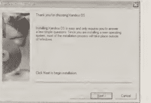

*图 2-1：在 Windows 中使用 Xandros 桌面自动运行向导创建启动磁盘*

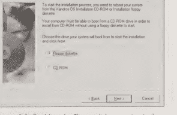

*图 2-2：在 Xandros 桌面自动运行向导中启用软盘选项*

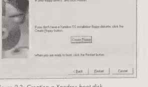

*图 2-3：创建 Xandros 启动磁盘*

###### 3. 创建好软盘后，请将其和 Xandros 安装光盘分别留在各自的驱动器中。假设您已准备好开始安装过程，请按下**自动运行向导**中的**重新启动**按钮以重启您的计算机。随后，您可以按照下文所述的仅安装 Xandros 或双启动安装的说明继续进行。如果您现在还未准备好，请关闭自动运行向导窗口并暂时移除这两张磁盘。当您准备好执行安装时，稍后可以在启动计算机之前重新插入这两张磁盘。

##### 付诸行动——安装 Xandros

既然我们已经掌握了所有背景信息，让我们继续下去，将 Xandros 安装到您的计算机上。幸运的是，安装 Xandros 非常简单，您很可能不需要任何指导就能独自完成整个过程。不过，既然您已经花钱买了这本书，不妨让我充当您的副驾驶，引导您前行，让您对自己正在做的事情更有信心。总体而言，整个流程取决于您的硬件速度，应该在 30 分钟以内完成，这比安装 Windows XP 或 Mac OS X 更快（我认为也更简单）。请记住，安装 XP 和 OS X 时，您只安装了操作系统本身和少数几个捆绑的应用程序。而在 Xandros 安装中，您不仅安装了操作系统本身，还安装了您最可能需要使用的大部分应用程序。因此，您将一次性完成大量工作。

开始之前再说一件事。有些人对安装系统怀有极大的恐惧。这个过程让他们紧张，好像房子会在过程中烧毁一样。好吧，房子确实可能会烧毁，但并非因为安装过程。只要您备份了数据，就会没事。如果您第一次搞砸了安装，那又怎样？重新开始就行了。既然没有东西可以损坏，也就没有危害。只需确保您为这个过程留出比实际需要的更多的时间。不要在您必须去上班或必须在市区会朋友前一个小时才开始安装。匆忙会让人做出奇怪的事情。通过给自己留出充裕的时间……以及备份那些您会因丢失而悲伤的数据，来让自己轻松些。

话虽如此，让我们开始吧！

###### 项目 2B：安装过程

如果您打算将计算机设置为仅以 Xandros 作为唯一的操作系统，请直接跳转到步骤 2。然而，如果您打算将计算机设置为同时运行 Xandros 和 Windows（双启动），请从步骤 1 开始。

####### 1. **整理硬盘碎片（仅限双启动设置）** 如果您希望创建一个双启动设置，允许您在 Windows 或 Xandros 中启动，最好在继续之前先整理您的 Windows 硬盘碎片。这将使后续安装过程更快，当 Xandros 缩小您的 Windows 分区以为自身腾出空间时。

- 在仍在运行 Windows 的情况下，打开“我的电脑”窗口，右键点击您的硬盘图标，然后选择**属性**。现在您可以通过点击属性窗口中的**工具**选项卡，然后点击窗口中央的**立即整理**按钮来整理您的硬盘（在 Windows XP 中）（图 2-4）。在 Windows NT 中，您可以通过前往**开始**菜单并选择**控制面板** \(\ast\) **管理工具** \(\ast\) **计算机管理** \(\ast\) **磁盘碎片整理程序** 来完成此操作；而在 Windows 98 和其他一些版本中，您可以通过选择**程序** \(\ast\) **系统工具** \(\ast\) **磁盘碎片整理程序** 来执行相同操作。

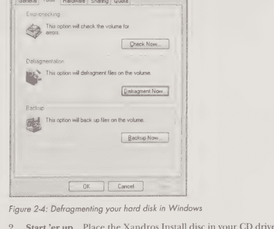

####### 2. **启动它** 将 Xandros 安装光盘放入您的光驱（如果您的计算机无法从光盘启动，请将启动软盘放入软驱），然后启动或重新启动您的计算机。

####### 3. **欢迎** 计算机启动后，您会看到其常规的硬件 BIOS 屏幕，这些屏幕无论您使用什么系统都会出现。之后，将显示第一个 Xandros 屏幕，这是一个半图形化且以黑色为主的开场屏幕。随后将显示 Xandros 安装向导的第一个屏幕——欢迎屏幕（图 2-5）。当它出现时，您只需点击**下一步**按钮即可。

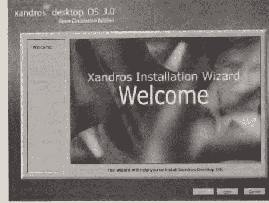

图 2-5：Xandros 安装向导的欢迎屏幕

> **注意**
> 在某些硬件配置下，您的安装可能会在主要黑色半图形化开场屏幕中出现“正在初始化内核”字样后挂起（卡住）。如果发生这种情况，只需执行以下操作：
>
> - a. 按下并保持电源按钮直到计算机关闭电源，以此关闭您的计算机。
> - b. 再次打开计算机电源，一旦黑色半图形化开场屏幕出现，立即按下 SHIFT 键。随后将出现一个安装选项列表。
> - c. 使用向下箭头键选择第二个安装选项“ACPI 2 Setup”，然后按 ENTER 键。
> - d. 如果安装似乎再次挂起，请对每个其他安装选项重复相同的过程，直到安装按照描述继续执行。其中一个选项应该能解决问题。

####### 4. **许可协议** 阅读此向导屏幕（图 2-6）中的许可协议，假设您同意，请点击“I accept this agreement”字样旁边的单选按钮（如果您不同意……好吧，那我们就到此为止了），然后点击 Next。

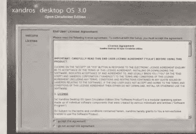

图 2-6：Xandros 许可协议

####### 5. **安装选择** 接下来的屏幕（见图 2-7）允许您在快速安装和自定义安装之间进行选择。快速安装本质上是一个完整安装，因此请点击“Express install”字样旁边的单选按钮以坚持使用它，然后点击 Next 按钮继续。

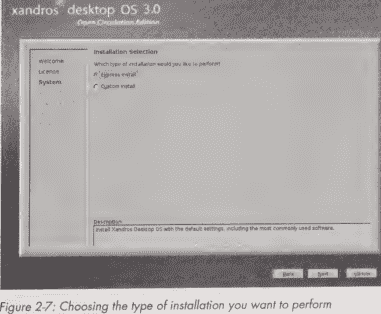

图 2-7：选择您要执行的安装类型

####### 6. **系统配置** 在此屏幕（图 2-8）中，Xandros 检查您打算如何处理磁盘上已有的内容。如果您的机器上已有早期版本（甚至相同版本）的 Xandros，您将被询问是否希望保留您主目录（Home）和根目录（root）中的数据（遗憾的是，全局设置和自定义安装的包除外），还是希望用全新安装替换整个系统。然而，如果您像大多数人一样，Windows 占据了您的整个硬盘，您将被询问是否希望通过调整其分区大小来保留该操作系统（从而为安装 Xandros 腾出空间），还是希望用 Xandros 覆盖它。做出符合您意图的选择，然后点击**Next**。

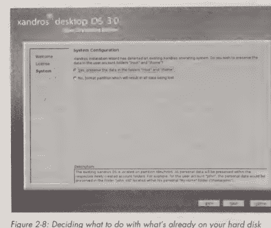

图 2-8：决定如何处理硬盘上已有的内容

> **注意**
> 只有在 Windows 分区内有足够的空闲空间时，您才能调整 Windows 分区的大小。如果您的仅 Windows 硬盘已经几乎装满，且空间不足，安装程序将不会提供调整大小的选项；它只允许您用 Xandros 替换 Windows。此时，您可以取消安装（这不会对您现有的系统造成任何伤害）并放弃，或者您可以在 Windows 中重新启动，删除尽可能多的无用文件，然后重试。

####### 7. **管理配置** 在此屏幕中（见图 2-9），您将输入我稍早前让您准备好的 root（也称为“管理员”）密码。在两个方框中分别输入它，然后如果您想更改默认计算机名称，也请一并更改。只需确保仅使用字母、数字、下划线和破折号——并且不要超过 15 个字符。完成后，点击**Next**。务必记住您的 root 密码，否则您将无法安装任何应用程序或更改某些系统设置。


####### 8. 用户账户配置
在此屏幕（图 2-10）中，系统要求您输入用户名、真实姓名以及用户密码。如果您愿意，还可以为计算机指定一个唯一的名称，尽管这通常只有在您打算在网络上使用计算机时才真正重要：在相应框中填入适当的信息后，点击“下一步”。

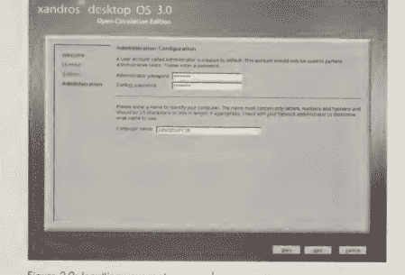

图 2-9：输入 root 密码

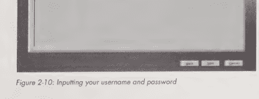

图 2-10：输入用户名和密码

####### 9. 安装摘要

在最后一个安装屏幕（图 2-11）中，安装向导将向您展示它将要安装什么、安装到哪里、将如何处理硬盘上已有的内容，以及其他一些细节。请特别注意顶部的*安装方法*行，以确保它符合您的期望。如果是 Windows 分区调整，那里应显示：*调整 Windows 分区*。如果一切看起来都正确，请点击**完成**按钮。

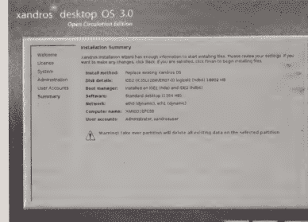

如果您正在创建双启动设置，Xandros 安装程序将开始调整您的 Windows 分区，然后创建并格式化分区以安装自身。如果您正在创建仅 Xandros 设置，安装程序将跳过调整过程并直接开始创建和格式化分区。无论哪种情况，当硬盘准备就绪后，安装程序将开始安装 Xandros 系统及其捆绑的应用程序。现在您可以放松休息一下了。与其坐在那里焦虑不安，不如回到我在第 1 章告诉您关闭的那个 *Dawson’s Creek* DVD，或者下楼带您的狗 Spotnik 散步——在大多数情况下，30 分钟应该绰绰有余。

安装过程完成后，Xandros 会通过一个小弹出窗口通知您。点击该窗口中的**退出**按钮。Xandros 很快会自动弹出安装 CD，并通过全屏消息告诉您移除安装 CD（如果使用了软盘，也请移除软盘）。移除磁盘后，按回车键（屏幕上也指示了此操作）以重新启动计算机。

###### 项目 2C：安装后步骤

当计算机重启时，您将看到启动加载器屏幕，那里有一个启动选项列表。如果您设置了双启动机器，请使用方向键向下移动到列表中的 Windows XP（或其他 Windows 版本）条目。按回车键，Windows 就会像安装 Xandros 之前一样启动。但暂时来说，以及任何时候您想启动 Xandros，只需接受默认的启动选项即可。Xandros Desktop 3.0，按回车键（或等待几秒钟），Xandros 就会自动启动。当然，如果您选择设置仅 Xandros 机器，则无法选择 Windows 选项。

过了一会儿，登录屏幕会出现。在该屏幕中，确保您的用户名与登录窗口中“User name”字样旁边显示的一致。如果不一致，点击用户名框右侧的箭头按钮，并选择您的用户名。接下来，输入您的密码，然后点击“Login”按钮。Xandros 首次运行向导将很快出现，带您完成极其简单的安装后过程。幸运的是，这里除了点击几次“Next”按钮外，真的没什么好做的，但我还是会带您走一遍。哦，如果您担心犯错误或遗漏了什么，别担心——您以后可以随时重新运行向导。以下是向导的步骤：

- **欢迎/鼠标配置**
选择右手或左手，然后点击“Next”（图 2-12）。

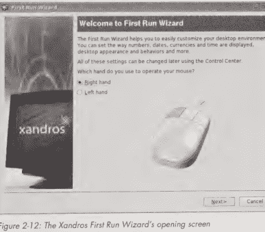

图 2-12：Xandros 首次运行向导的初始屏幕

- **区域设置**
设置适当的区域和键盘布局，然后点击“Next”（图 2-13）。

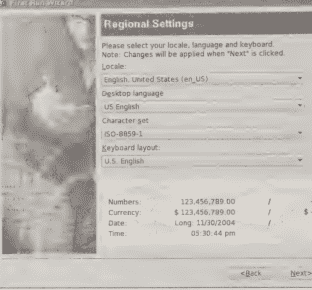

图 2-13：在首次运行向导中调整区域和键盘设置

- **日期和时间**
向导此屏幕（图 2-14）中的默认值在此处应该是正确的，因此，假设它们正确，请点击**Next**。如果不正确，您可以现在调整它们。

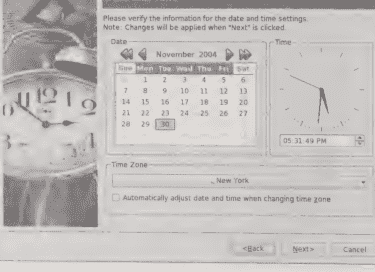

图 2-14：日期和时间设置

- **连接互联网**
在第 4 章中，我将更详细地介绍如何设置您的互联网连接，因此现在只需点击**Next**即可。

- **打印机**
设置打印机将在第 9 章中详细介绍，所以现在只需点击**Next**跳过此步骤。

- **系统行为**
在此屏幕（图 2-15）中，您可以更改桌面的外观；不过，由于我也将在第 7 章的后半部分涵盖此主题，因此也请点击**Next**跳过此步骤。

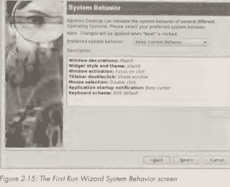

图 2-15：首次运行向导的系统行为屏幕

- **注册**
由于我们尚未设置好连接互联网，请选择*此时我不想注册我的 Xandros 产品*（如图 2-16 所示），然后点击**Next**。

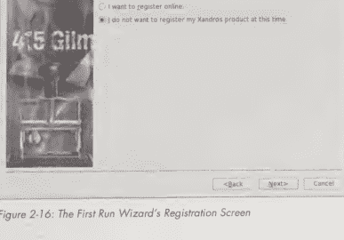

图 2-16：首次运行向导的注册屏幕

- **完成**
这是首次运行向导的最后一个屏幕（图 2-17），您需要做的唯一事情就是点击**完成**按钮。

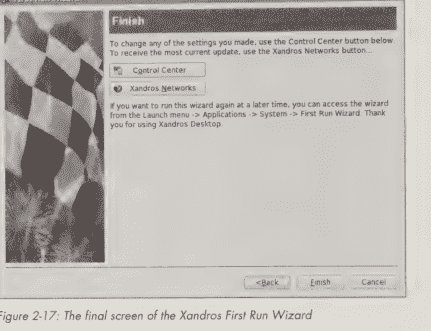

图 2-17：Xandros 首次运行向导的最后屏幕

如果在安装后过程中进行了任何区域设置更改，Xandros 会弹出一个窗口，告诉您重启桌面以使更改生效，因此请点击**重启**按钮以处理此事。如果您没有进行任何更改，首次运行向导将关闭，您也就准备就绪了。您的新 Xandros Linux 系统现已安装、配置完毕并随时可以使用。如果您真的迫不及待地想深入了解使用它的细节，请直接前往下一章。在那里见。阿罗哈（Aloha）。

### 3

#### 另一个蓝色的世界

*认识 Xandros 桌面*


既然 Xandros 已安装完毕，每次开机时您都将执行一个简单的单步过程。此过程随后会带您进入新的桌面。

开机后不久，您将看到 Xandros 启动加载器屏幕。在此屏幕上，您可以简单地按回车键或甚至只需等待几秒钟（效果相同）来选择启动 Xandros。如果您创建了双启动设置，可以使用光标键滚动浏览各个选项，选择 **Windows**，按回车键，然后改为启动该操作系统。当然，如果您打算使用这本书，现在可能不想选择此选项。

**注意** *如果有时您想启动 Windows，但看到有多个 Windows 条目，请选择第一个条目。如果出现某种错误消息且 Windows 未能启动，请重启并尝试下一个 Windows 条目。*

假设您确实想在这里跟着我操作，并且暂时放弃了 Windows 启动选项，那么接下来您要做的唯一事情就是等待几秒钟（有点漫长）以便登录屏幕出现。

登录屏幕由一个位于空白蓝色屏幕中央的小窗口组成。在该窗口中，您将看到安装过程中选择的用户名位于一个空白框上方，您需要在此处输入用户密码（而非 root 密码），这也是您在安装过程中输入的那个。一旦输入了用户密码，点击 OK 或按回车键继续。如果只有您在使用计算机，因此觉得登录步骤是多余的麻烦，别担心。我将在第 7 章中向您展示如何绕过它。现在，请耐心等待。

##### 欢迎使用 Xandros 的 KDE 桌面

登录后经过相对较短的时间，您最终将到达新的桌面，您可以参考图 3-1。Xandros 使用的图形桌面称为 KDE，它是 Linux 世界中两种最流行的桌面环境之一。

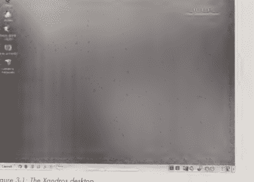

您可以看到，桌面与您可能在 Windows 环境中习惯的并没有太大不同。但不要被完全迷惑；尽管相似，它们不同到足够有趣。有三个主要元素您可能一眼就会注意到：桌面图标、屏幕底部的面板（Panel）以及面板最左角处的启动菜单按钮。本章将重点介绍这些元素。


##### 桌面图标

如您所见，桌面上有五个图标：回收站、主目录、快速入门指南、网页浏览器以及 Xandros 网络。为了简化操作，我们将从最简单、无疑也是最熟悉的那个开始：回收站。

###### *回收站*

回收站没有什么神秘之处……至少桌面上的回收站图标并不神秘。它的功能与其他操作系统中的回收站完全相同。将您不再需要或想要的文件拖到回收站图标上，垃圾桶就会“膨胀”起来。如果您想清空回收站，只需右键单击回收站图标，然后从弹出的菜单中选择**清空回收站**。如果您拖入的某些项目是不允许放在回收站中的，系统会提示您无法执行此操作。这一切都非常简单且熟悉，无论您来自何方。

###### *主目录*

您可能会注意到，主目录图标是一个房子（家）叠加在文件夹上的图像。这应该告诉您，这是您的主目录——有点像 Windows 系统中的“我的电脑”、“我的网络”和“我的文档”的混合体。这是保存您所有文件的地方，也是所有下载内容将下载到的位置，以及所有音乐将被转换（rip）到的位置。这是您的领地，即使您使用的是多用户机器，除了您自己（假设您是唯一知道*root* 密码的人），没有人能够在此处窥探。这里也是您可以访问连接或挂载到计算机的其他存储设备（如软盘、CD 等）或网络上其他计算机的地方。

###### *快速入门指南*

此图标会打开一份清晰的基础参考指南，涉及使用系统的基本要素。

###### *网页浏览器*

这是一个启动器，您可以双击它来打开您的互联网网页浏览器。您将在第 13 章中找到有关您的网页浏览器和其他与互联网相关应用程序的详细信息。

###### *Xandros 网络*

此图标是另一个桌面启动器，用于运行 Xandros 网络应用程序。Xandros 网络是一个极其易于使用的应用程序，允许您更新系统、购买 Xandros 升级版本，并下载以及轻松安装海量免费软件。由于 Xandros 网络非常有用，并且它是使用 Xandros Linux 系统最具吸引力的特性之一，我将在第 8 章中专门对此进行讲解。

###### 项目 3A：更改桌面壁纸

您的 Xandros 桌面背景装饰着一张相当漂亮的图像，呈现出冷蓝色拉丝钢的视觉效果。如果您愿意，可以用您选择的任何图片替换该背景图像，这种背景图像有时会以有些奇特的方式被称为“壁纸”。您可以选择随您的 Xandros 系统附带其他壁纸之一，或者您从数码相机下载的照片。

您还可以从互联网下载桌面壁纸。http://art.gnome.org 和 www.kde-look.org 上都有许多壁纸可供下载，许多其他网站也是如此。如果您对汽车感兴趣，许多主要汽车制造商（例如福特加拿大和土星）在其网站上都提供了其最新车型的壁纸。许多音乐和电影明星的粉丝网站也提供了大量的壁纸。

####### 3A-1：更改壁纸

要更改桌面上的壁纸，首先右键单击桌面上的任何空白区域，然后在出现的弹出菜单中选择**属性**。将显示一个配置窗口。

若要选择随系统捆绑的壁纸之一，请单击窗口背景部分中*Picture*（图片）一词旁边的下拉菜单按钮（第一次时按钮本身会显示为**XandrosBlue**）。将出现一个菜单，列出所有可供您选择的壁纸（图 3-2）。选择一个，然后单击**应用**。您选择的壁纸应会出现在您的桌面上。尝试列表中的其他几个壁纸，直到找到您喜欢的那个。完成后，按**确定**。

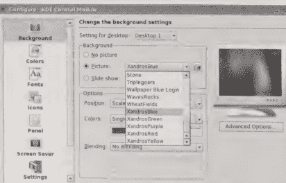

*图 3-2：更改桌面壁纸*

如果您想使用自己的照片（就像我在自己的桌面上使用的那样，见图 3-3），或者使用您自己下载的壁纸，过程会略有不同。不要单击配置窗口中“Picture”一词旁边的下拉菜单按钮，而是单击带有半开文件夹图片的小按钮。随后将出现“选择壁纸”窗口（图 3-3）。

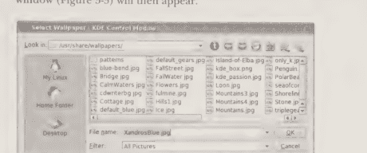

图 3-3：选择您自己的图像作为桌面壁纸

在该窗口中，单击窗口左侧面板中的“Home”（主目录），然后在右侧面板中找到您想要使用的图像。找到后，单击一次选中它，然后单击**确定**。“选择壁纸”窗口随后将关闭，留下原来的配置窗口（图 3-2）。在该窗口中，单击**应用**。您选择的图像现在显示在桌面上（图 3-4）。如果您对结果满意，请单击**确定**；如果不满意，请重试。

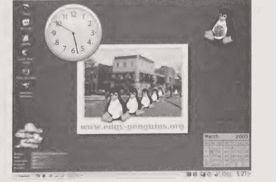

图 3-4：您自己的图像（在这种情况下是我自己的图像）显示在桌面上

####### 3A-2：设置桌面幻灯片

KDE 中一个很酷的功能是让桌面壁纸每几分钟（甚至几秒钟）自动更改。这个功能与 Mac OS X Panther 中提供的类似，在您完成第 11 章并从数码相机下载图片后，会非常实用，因为您的桌面可以成为一个动态相册，您在工作时随时都可以查看——这非常有趣且令人愉悦，除非，当然，您的电脑装满了前女友的照片。哎呀！

要进行设置，请像 3A-1 中那样打开配置窗口（右键单击桌面并选择**属性**，然后从该窗口的背景部分中选择**幻灯片放映**）。**设置**按钮此时变为活动状态，因此请继续单击它。将显示“设置幻灯片放映”窗口（图 3-5）。

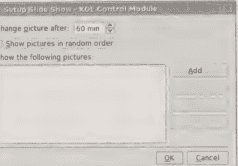

开始设置桌面幻灯片放映时，您首先需要决定包含哪些图片。这些可以包括您自己的图像、您下载的壁纸、随您的 Xandros 系统提供的壁纸，或它们的任何组合。开始选择时，请单击**添加**。执行此操作后，将显示“选择壁纸”窗口（您在图 3-3 中已见过）。找到您想添加到幻灯片放映中的图像，并单击**确定**。您选择的图像随后将出现在“设置幻灯片放映”窗口的大框中。现在您可以继续重复此过程，以添加您想要的所有其他图像。

在设置窗口中，您还可以通过调整*Change picture after*（更改图片时间间隔）旁边方框中的数字来决定希望桌面图像多久更换一次。您还可以通过选择图像并点击窗口右侧的**上移**或**下移**按钮来设置图像出现的顺序。如果您愿意，也可以通过选择*Show pictures in random order*（随机顺序显示图片）旁边的复选框，让图像随机显示。

###### 面板

既然我们已经涵盖了桌面主要部分的所有内容，让我们继续介绍下一个主要的桌面组件：面板（图 3-6），它位于屏幕的最底部。您会注意到面板包含许多项目。其中一些是程序启动器，允许您通过单击鼠标一键启动程序，而另一些则是某种实用工具。为了让您了解每个项目的用途，我将在此处详细为您讲解，按照从左到右的顺序覆盖这些项目。

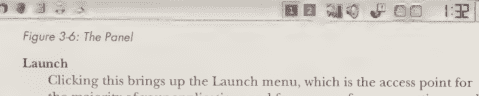

图 3-6：面板

####### 启动（Launch）

单击此项会打开启动菜单，这是您大多数应用程序以及您的偏好、设置和其他配置工具的访问点。我将在本章结尾稍后对此进行更多讨论。

####### Thunderbird

您的电子邮件应用程序，它是 Mozilla 对 Outlook Express 的最新回应。（看起来像一个被蓝色雷鸟抓住的信封。）

####### Firefox

您的网页浏览器。本质上，它是 Netscape，只是有一两个不同之处。（看起来像一只橙色的狐狸环绕着地球。）

####### Xandros 文件管理器

此启动器是桌面主目录图标的一键替代方案。单击它启动一个 Xandros 文件管理器窗口，打开时位于您的主目录中。从该文件夹，您可以访问您的文件，查看其他驱动器的内容，或挂载网络上的其他计算机。（看起来像一个小型文件柜。）

####### 帮助（Help）

提供有关使用您的 Xandros 系统各种功能和应用程序的信息。它与桌面上的首次启动指南不是同一回事。（看起来像一个救生圈。）

####### 显示桌面（Show Desktop）

单击此项会隐藏所有打开的窗口，从而允许您看到桌面本身。非常、非常方便。（看起来像一个蓝色方块上的铅笔和纸张。）

####### 任务栏（The Taskbar）

如果您没有打开任何窗口，任务栏基本上是隐形的。当您有窗口打开时，每个窗口的矩形图标会出现在这里，就像在 Windows 中那样。

####### 翻页器/虚拟桌面（Pager/Virtual Desktops）

一个允许您在虚拟桌面之间切换的应用程序（我在第 4 章中对此进行了讨论）。（看起来像一对正方形，一个是蓝色，一个是绿色，标记为 1 和 2。）


##### Klaptop

如果您使用的是笔记本电脑，则会出现此应用程序。它允许您查看电池状态并调整相关设置。（外观像一个电池旁边的电源插头。）

##### 声音混合器

一个控制组件，允许您调整系统的总体音量。（外观像一个小扬声器。）

##### Xandros 更新

一个应用程序，它会定期与 Xandros Networks 检查系统更新是否可用。（外观像一个小地球仪，很可能在方框内有一个感叹号。）

##### 锁定 / 注销

这是一对按钮，您可以使用它们进行注销（右侧按钮——外观像电源按钮）或锁定屏幕（左侧按钮——外观像挂锁）。锁定屏幕是一种方便的方式，可以在您离开工位去喝咖啡时，防止其他人窥探您的事务。当您点击“锁定屏幕”按钮时，Xandros 会运行屏幕保护程序（如果未选择屏幕保护程序，则仅将屏幕变黑）。要再次使用系统，只需移动鼠标或按任意键，Xandros 会提示您输入用户密码。输入密码后，屏幕保护程序将消失，您可以继续工作或做您之前正在做的其他事情。

##### 切换用户（未显示）

这个显示两个人站立的按钮仅出现在显卡驱动支持该功能的系统上。它允许您在用户会话之间切换，而无需退出正在运行的应用程序。这是一种没有真正注销的“注销”方式。

##### 时钟

必备且无处不在的桌面时钟和日历。

##### 隐藏 / 显示面板

点击此按钮以隐藏或显示面板。（外观像一个小的黑色箭头。）

##### 项目 3B：自定义面板

面板不是静态的。在有限的范围内，您可以添加启动器（程序快捷方式或别名）、实用工具，甚至娱乐组件，让它几乎做任何您想做的事情。在这个项目的各个阶段，您将自定义面板，以便在阅读本书其余内容时使事情更方便。当然，您可以自由更改我要求您做出的任何自定义，或者仅选择那些您感兴趣的自定义，但我建议您至少执行其中几项，以便对相关内容有个大致的了解。

以下每个子项目都非常简单。大多数是只需点击的操作，您应该能够毫不费力地处理。

###### 3B-1：从面板中删除启动器

从面板中删除项目是一个非常简单的过程。帮助中心启动器是一个很好的处理对象，因为它也出现在“启动”菜单中，这是一个额外的副本。释放面板空间将为您可能想要添加的其他更喜欢的其他项目腾出空间。

要删除帮助中心启动器，您只需执行以下操作：

- 右键点击面板中的 **帮助中心** 启动器。
- 在弹出的菜单中，选择 **删除帮助按钮**。

###### 3B-2：向面板添加启动器

现在，帮助按钮原来的位置留下了一个空位，让我们用更有用的东西来填补它。计算器是一个不错的选择，因为每个人在某个时候都需要使用它。

以下是添加启动器的方法：

- 右键点击删除帮助按钮后留下的空白区域。
- 从弹出的菜单中，选择 **添加应用程序按钮 ► 应用程序 ► 附件 ► 计算器**。

###### 3B-3：向面板添加菜单

除了应用程序启动器，您还可以向面板添加完整的菜单。OpenOffice.org 菜单是一个不错的选择，因为大多数人经常使用这些应用程序。

以下是添加菜单的操作方法：

- 右键点击您刚刚添加的计算器启动器右侧的空白区域。
- 从弹出的菜单中，选择 **添加应用程序按钮 ► 应用程序 ► OpenOffice.org ► 添加此菜单**。请务必选择最后出现的子菜单中的 **此菜单**，如图 3-7 所示。

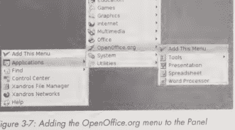

###### 3B-4：在面板内移动项目

当您在子项目 3B-3 中添加到面板的 OpenOffice.org 菜单按钮出现时，它很可能位于面板左侧其他应用程序启动器的远处。将菜单放在那里与其他菜单在一起是最合理的安排，因此在本项目的这部分，我们将进行一些移动操作。

以下是移动菜单按钮的操作方法：

- 右键点击 OpenOffice.org 菜单按钮（或您想要移动的任何其他无法仅通过拖拽移动的面板项目）。
- 从弹出的菜单中，选择“移动 OpenOffice.org”（或您试图移动的项目的名称）。
- 此时您的光标将变成带箭头十字准星的样子。在不按住任何鼠标按钮的情况下，将鼠标移动到您希望放置菜单按钮的位置——在这种情况下，就在计算器启动器的右侧。菜单按钮将随之移动。
- 当菜单按钮位于您想要的位置时，点击鼠标左键，即可完成操作。

###### 3B-5：向面板添加主文件夹的快速浏览器

除了应用程序启动器和菜单，您还可以向面板添加特殊按钮。“启动”和“显示桌面”按钮是这些特殊按钮的示例。您可能想要考虑添加的一个非常实用的特殊按钮是快速浏览器。快速浏览器允许您以菜单形式从面板查看您指定的任何文件夹的内容。对于本项目，一个合乎逻辑且便捷的选择是主文件夹的快速浏览器，如图 3-8 所示的例子。

以下是为主文件夹添加快速浏览器所需的操作：

- 右键点击面板中的任何空白区域。
- 在弹出的菜单中，选择“添加 ▶ 特殊按钮 ▶ 快速浏览器”。
- 将出现快速浏览器配置窗口。文本框中“路径”一栏旁边的默认路径将是 /home/您的用户名（例如，我的显示 /home/rjg）。点击“确定”。

###### 3B-6：向面板添加天气监视器

除了应用程序启动器和菜单，您还可以向面板添加小程序（称为 *applets*）。这些 applet 中的每一个都执行特定功能，通常在过程中为您的桌面增添一点便利。您立即可用的 applet 包括面板内的声音配置工具、字典查找输入框（在第 13 章中讨论）以及默认已存在于面板中的时钟。然而，最受欢迎的 applet 之一是天气监视器，称为 KWeather。

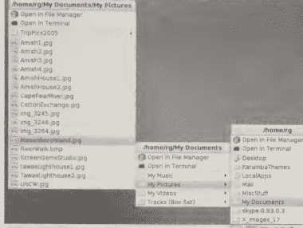

*图 3-8：主文件夹的快速浏览器按钮操作示例*

您应该注意到，由于此 applet 定期使用互联网检查您选择位置的当前状况，如果您拥有不间断的互联网连接（如电缆或 DSL），则最好使用它。以下是添加天气 applet 的方法：

- 右键点击面板中的任何空白区域。
- 从弹出的菜单中，选择 **添加 ▶ Applet ▶ 天气**。屏幕左上角很可能会出现一条警告消息，提示“请求的气象站不存在。”这是合乎情理的，因为您尚未选择要监视的气象站。
- 该 applet 被添加到面板中。要选择气象站，请右键点击 **天气** applet 并选择 **配置 KWeather**。然后将出现 KWeather 配置窗口（图 3-9）。
- 在配置窗口中，点击蓝色链接，内容为 **查找您的 ICAO 代码**。然后您的网络浏览器将打开国家气象局网站。
- 向下滚动到标有“显示某州所有气象站”（如果您居住在美国以外，则为“显示某国所有气象站”）的部分。选择您的州或国家，然后点击标有 **Display All Stations In** 的按钮。
- 随后出现的页面将列出该州或国家的所有气象站。找到您想要监视的位置并记下其四位字母代码。例如，底特律韦恩县机场是 KDTW。


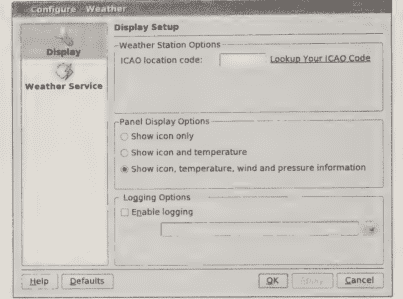

图 3-9：在 KWheather 配置窗口中选择一个要监控的气象站

7. 关闭您的浏览器，然后在 Configure 窗口顶部的 ICAO 位置代码框中输入您想要监控的气象站的四字母代码。为了节省面板空间，您可能还希望在該窗口的“面板显示选项”部分中选择**仅显示图标**。完成后，点击确定。
8. 此时，面板中的天气小部件应以图形形式显示您所选位置的当前天气状况。若要查看更详细的报告，请点击该小部件。随后将弹出如图 3-10 所示的窗口。

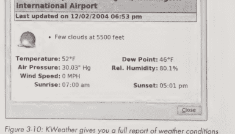

图 3-10：KWheather 为您提供所选位置完整的气象状况报告

##### 更多面板乐趣

除了刚才在前一个项目中完成的基本自定义外，您还可以做很多事情来改变面板的行为。大多数这些选项都可以通过右键点击面板中的任何空白区域，然后选择**配置面板**来调出控制中心设置窗口（见图 3-11）。

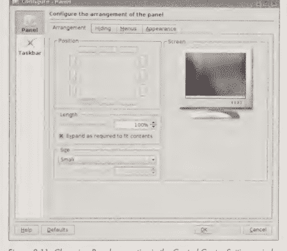

*图 3-11：在控制中心设置窗口中更改面板属性*

从这个窗口，您可以更改面板的位置、调整其大小、改变其颜色，或者使其（不包括其上的启动器）不可见，尽管这样看起来可能不太美观。您还可以设置面板，使其在您未使用时自动消失，并在您将鼠标光标移至面板通常驻留的区域时重新出现。如果您喜欢 Mac OS X 中 Dock 的图标缩放功能，不要觉得自己被遗忘了；您甚至可以让面板中的图标执行相同的操作。（事实上，如果您真的想彻底将您的桌面 Mac 化，您将在第 8 章中了解如何做到这一点。）总之，不要害怕随意尝试和玩耍——那是一半的乐趣所在！

##### 启动菜单

在您屏幕的最左侧角落是启动按钮。您可以从这里访问系统中几乎一切可访问的内容。从某种意义上说，启动菜单非常类似于 Windows 系统中的“开始”菜单。当您点击**主**菜单图标时，所有可用的应用程序和实用工具都会显示出来（图 3-12）。

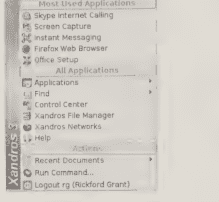

如您所见，菜单分为三个部分，每个部分都有清晰的标签。最上面的部分“最常用应用程序”是动态的，其内容会根据您最常使用的程序而变化。由于在首次打开启动菜单时，您除了“首次运行向导”之外尚未使用过任何应用程序，因此那时那里应该只列出了该应用程序。其他两个部分（所有应用程序和操作）中的项目主要是静态的，这意味着除非您安装了新应用程序，否则那里列出的项目将保持不变，此时该应用程序的启动器将被添加到菜单中。

然而，您会发现有些应用程序在安装后不会自动向菜单添加启动器。在这种情况下，您可以通过选择菜单中的“运行命令”项目，然后输入该应用程序的命令来运行没有启动器的应用程序（如第 8 章所述）。或者，您可以使用菜单编辑器应用程序（在第 18 章中讨论）手动将启动器添加到菜单中，如果该应用程序是您经常使用的，这就很有用。您还可以使用菜单编辑器根据您的喜好自定义菜单。

“所有应用程序”和“操作”部分中列出的每个项目的作用要么显而易见（例如帮助、查找和最近文档），要么将在本书的其他地方讨论。既然如此，我此刻将不再进一步探讨这些事项。

##### 虚拟桌面

桌面的所有主要组件都已涵盖，现在是时候讨论 Linux 中一个相当独特且方便的功能了：虚拟桌面。了解虚拟桌面业务的最佳方式就是直接试一试。

在您的 KDE 面板中，点击**天气**小部件、**计算器**启动器和**Xandros 文件管理器**启动器。然后，您在当前桌面（或工作区）中将会有三个窗口打开。现在查看您面板上的虚拟桌面小部件。图标的左半部分应该是蓝色的；这是您当前的工作区。点击图标的右半部分，即绿色部分，所有打开的窗口将突然消失。

实际上，什么都没有真正消失——您只是在查看一个新的桌面。您所有的其他窗口仍在之前的桌面中打开并运行。

在这个第二个桌面中，您可以打开其他内容：前往**启动**菜单并选择**应用程序 ▸ 游戏 ▸ 纸牌 ▸ 纸牌接龙**。纸牌接龙游戏将很快出现。

您现在在两个不同的桌面中都有打开的窗口，并且您可以在它们之间来回切换。要做到这一点，只需前往您面板中的**虚拟桌面小部件**并点击左侧框，这将带您回到原始桌面。完成此操作后，您可以再次点击右侧框以返回您的游戏桌面。

正如您可以想象的那样，除了帮助您避免杂乱之外，此功能还具有潜在的好处。想象一下，您在工作中正在 OpenOffice.org Writer 中撰写一份长文档。最终，您有点累了，决定通过玩一会儿俄罗斯方块来放松一下。为此，您切换到另一个桌面，在那里打开并玩游戏。稍后，当您注意到老板在办公室四处走动时，您只需切换回第一个桌面，这样当老板经过并说“Boaz，你很忙吗？”时，您看起来就很忙碌。

呼！

##### 关机

现在，既然您如此熟悉您的桌面环境，您可能想结束一天的工作并关闭您的机器。要做到这一点，只需前往**启动**菜单并选择**注销**。将弹出一个小窗口，其中有三个可选按钮：**注销**（默认）、**关机**和**重新启动**。点击**关机**，关机过程将开始。

完成所有操作后，系统会在屏幕上告诉您现在可以安全地关闭计算机了。通常，系统会在几秒后自动关闭计算机。然而，在少数机器上，系统无法断电您的机器。如果您遇到这种情况，您会知道这是因为告诉您可以安全关闭计算机的信息将一直停留在那里……永远。如果您在屏幕上看到这些文字，并且在 15 秒左右内没有任何其他活动发生，请通过按下电源按钮手动关闭机器。此时这样做是完全安全的。

##### 摆脱困境

至此，您已经基本熟悉了您的桌面。现在可能是为您提供一些信息的好时机，这些信息将帮助您在阅读本书的其余部分并更深入地使用 Xandros 系统时，摆脱可能遇到的任何困境。您可能很少甚至不需要诉诸于我即将描述的方法，但最好做好准备以防万一。毕竟，无论您使用什么操作系统，奇怪的事情总会发生。

基本上，当事情变得糟糕时，有两种万无一失的补救措施。如果您的某个应用程序停止响应，这意味着它只是坐在那里什么也不做，这有时会导致其他应用程序看起来也几乎如此，您必须终止它。这听起来有点不祥，但这只是临时终止，所以不用担心。如果您非常幸运，并且有耐心等待几秒钟（大约 30 秒），系统可能会自己意识到问题，并弹出一个窗口告诉您，正如您无疑已经知道的那样，应用程序 X 似乎没有响应。然后它会礼貌地询问您是否希望终止该进程。由于您显然希望这样做，只需点击“终止”按钮，问题就会解决。

如果您的系统没有显示告诉您它知道存在问题的窗口，因此不主动为您终止应用程序，您可以通过大致同时按下 CTRL、ALT 和 ESC 键来掌握主动权。一旦这样做，您的光标外观将从无害的箭头变成更令人恐惧的头骨和交叉骨。在那次微形态变化之后，您只需在任何有问题的窗口中单击一次，问题通常会得到解决。如果您在点击有问题的窗口之前突然改变主意，并希望恢复原状，只需在任何地方右键单击，头骨和交叉骨就会消失。

如果您的整个系统似乎卡住了，您无法让任何事物正常工作，您可以按照我刚才描述的方式尝试摆脱问题，即对导致问题开始之前您最后操作的应用程序进行“头骨和交叉骨”操作。如果不起作用，您将不得不采取稍微更严厉的措施。首先是同时按下 CTRL、ALT 和 BACKSPACE 键，这将导致系统注销您并带您返回登录屏幕。这样做会导致您丢失任何尚未保存的数据，但船到桥头自然直，正如 Doris Day 所说（或唱过）的那样。这就是为什么频繁保存您正在处理的任何内容总是个好主意——你永远不知道事情什么时候会出错。最后，在 CTRL + ALT + BACKSPACE 组合也无效的不太可能的情况下，尝试同时按下 CTRL、ALT 和 DELETE 键，这应该会导致整个系统关机并重新启动。

如前所述，需要此类键盘操作的问题应该很少见，所以不要太担心。然而，如果它们确实发生，请务必冷静下来并尝试放松。深呼吸，花一两秒钟思考一些无关的事情，摸摸您的猫，然后回到您的电脑前，尝试理性地处理问题。出于恐慌行事，我保证，从长远来看只会导致更大的问题。毕竟，正如我的一位朋友曾说的，“你匆忙去上班得到的唯一东西就是交通罚单。”保持冷静，如果出现问题，请将其视为练习学习的机会。


# 第二部分

## 把事情做好

### 4. 解开缠结的网

#### 设置网络连接

如今，普通家用电脑用户花在电脑上浏览网页和撰写电子邮件的时间，比做其他任何事情的时间都要多。即使你不是一个经常上网的人，仍然有许多其他应用程序虽然本身并非严格意义上的互联网应用，但为了获取数据仍会以某种方式利用互联网。面板天气小部件在访问天气数据时，以及 Xandros 文件管理器在刻录和编码音频文件时收集歌曲和专辑信息，都是很好的例子。

话虽如此，拥有一台没有连接互联网的电脑，就好比买了一辆新的玛莎拉蒂，却拒绝把它开出车库。

##### 连接

要连接互联网，你必须拥有合适的硬件。在这个领域有许多可能性，包括高速局域网（LAN）、有线调制解调器和电话公司的 ADSL 连接。

大多数电脑还配备了内部 56 Kbps 调制解调器，或者可以连接外部拨号调制解调器，以便通过普通电话线进行较慢的连接。根据你所拥有的设备，对于局域网连接和有线调制解调器，在系统上进行设置应该会非常简单。对于拨号连接，情况可能会稍微复杂一些。

### 高速连接

如果你拥有来自有线电视公司的高速互联网连接，或者你通过办公室的*局域网*（LAN）连接到网络，那你真是不幸中的大幸，因为这类设置可能最容易处理。通常，你只需将来自墙壁的以太网线（如果你使用的是局域网），或来自你的有线调制解调器的线，连接到机器的网卡端口即可。之后，一旦启动机器，你就准备就绪了。如果你拥有来自电话公司的高速连接（ADSL），你必须遵循与拨号调制解调器几乎相同的步骤，如本章稍后所述。

**注意** *如果你不确定以太网线长什么样，它是一根圆形线缆，大约八分之一英寸粗，末端有一个看起来像超大号电话插头的插头，你可以参见图 4-1。*

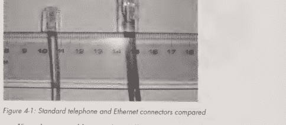

如果你在线路连接方面遇到问题，并且你正在尝试通过局域网或有线调制解调器连接到网络，问题很可能在于你的网卡未得到系统的支持。这种情况相对罕见，但幸运的是，很容易解决（通过更换网卡）。

问题也可能是你的网络或服务提供商不会通过*DHCP*（*动态主机配置协议*）自动分配地址。DHCP 是一种手段，互联网服务提供商可以借此自动（动态）向你的系统提供连接互联网所需的配置信息。如果你的服务提供商不使用 DHCP，你将不得不从网络管理员或服务提供商那里获取必要的设置信息，并自行输入。

###### 为未使用 DHCP 的提供商设置有线或以太网连接

要自行输入你的有线或以太网设置，请运行控制中心（**启动 → 控制中心**），当控制中心窗口出现时，点击左侧窗格中的**网络**。在随后出现在其下方的子类别列表中，点击**网络连接**。当网络连接模块出现在窗口右侧窗格时，点击**管理员**按钮，然后按提示输入你的 root 密码。

控制中心的右侧窗格很快会显示红色轮廓，其中所有内容都会变为活动状态，这意味着你可以修改其内容。点击**接口**选项卡，然后在新选项卡中，确保已选中**启用网络**，点击**指定静态地址**，并按照网络管理员或互联网提供商的指示输入相应的地址（图 4-2）。完成后，点击**应用**，然后关闭控制中心窗口。

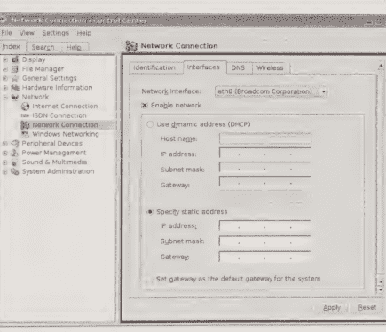

**图 4-2**：*手动输入网络 IP 设置*

> **注意** *如果你想知道 IP 和 DNS 是怎么回事，可以简单地这样理解：DNS 将你知道的易于记忆的 URL，如 www.yahoo.com，翻译成互联网能够理解的数字地址，即 IP 地址。因此，http://www.yahoo.com 就变成了 http://216.109.118.68。你之后可以在浏览器中输入数字版本以自行验证。*

### 内部拨号调制解调器

许多人，如果不止大部分人的话，仍然在使用拨号互联网连接，这意味着你需要一个传统的拨号调制解调器才能突破你的盒子，触达外部世界。这些调制解调器，如果你忘了的话，是那些在你拨打互联网提供商电话时，会发出尖啸、叮咚声、刺耳声和噼啪声的神奇机器。我想你可以把它们想象成需要好好打嗝消食的吵闹电话。

在 Linux 中处理调制解调器的最大缺点是，很少有调制解调器得到支持。不过，从积极的一面来看，一旦你找到一个能工作的调制解调器，设置起来相对容易。造成这种兼容性问题的主要原因是，大多数内置调制解调器依赖于软件，而它们依赖的软件是 Windows 的一部分，或专为 Windows 设计。因此，这类调制解调器被称为 Winmodems（Windows 调制解调器）。

当然，Linux 社区一直在努力寻找方法来处理这些 Winmodem 怪兽，以便它们能与 Linux 系统配合使用。虽然对市面上各种 Winmodem 型号的支持仍然相当零散，但 Xandros 连接向导在尝试让你的调制解调器工作方面做得相当不错。如果你不确定自己安装了哪种类型的调制解调器，我的建议是执行一下互联网连接设置流程，看看你的调制解调器是否与 Xandros 兼容。如果不兼容，你可以将调制解调器更换为已知能工作的型号，最好是一个真正的硬件调制解调器。如果你不熟悉这个术语，硬件调制解调器是指不依赖软件、因此可以与你所使用的任何系统配合工作的调制解调器。你可以把它们想象成没有手柄的电话。

了解哪些调制解调器与 Xandros 兼容的最佳方法，可能是查阅 Xandros 硬件兼容性数据库（http://support.xandros.com/hclv3）或访问 Xandros 用户论坛（http://forums.xandros.com）寻求建议。US Robotics 的 56K V.92 Performance Pro Modem（内部插槽）和 56 PC Card Modem（PC 卡插槽，适用于笔记本电脑）都是容易买到且据说能正常工作的真正的硬件调制解调器。你可以访问 US Robotics 网站（www.usr.com）获取这些型号更多信息。

> **警告**
> 购买调制解调器时，请小心那些声称兼容 Linux 的通用无品牌内部调制解调器。请先上网核实此类说法。有时，这类调制解调器只有在你对系统做了一系列令人头疼的操作后才兼容，即使是资深的 Linux 极客也不愿意费那个劲。包装盒上一个可爱的 Tux 图标并不一定意味着该调制解调器对 Linux 友好。

### 外部拨号调制解调器

如果你发现你的拨号调制解调器无法与 Xandros 系统配合使用，最佳解决方案是购买一个外部串行调制解调器。外部调制解调器位于计算机外部的盒子里，并连接到计算机背面的串行端口，那个端口看起来像一个带有小插脚孔洞（参见图 4-3）。由于调制解调器不使用你的操作系统来运行，因此当它忙碌时不会占用系统资源，这可能会带来计算机速度的提升。

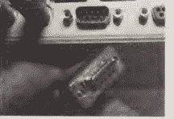

*图 4-3：串行端口和连接器*

大多数外部串行调制解调器应该都能与你的系统配合使用，或者至少这是大多数人会告诉你的。如果你担心并希望寻求万无一失的方案，Zoom Telephonics（www.zoom.com）制造了一款兼容 Linux 的外部串行调制解调器，他们的网站上也直接说明了这一点。US Robotics 56K V.92 External Faxmodem 据说也能工作，尽管我自己没有测试过这个型号。

如果你找到了其他你认为能解决问题的型号，在掏钱买下之前，请用该调制解调器的品牌和型号，加上“Linux”一词在 Yahoo 或 Google 上进行搜索，看看能得到什么搜索结果。当然，你也可以尝试访问一个 Linux 论坛，在那里询问该调制解调器的品牌和型号。有很多人和你处于同样的境地，所以你肯定会得到大量的意见和建议。

###### 设置拨号或 ADSL 连接

如果你打算使用外部调制解调器（ADSL 或拨号），首先关闭你的计算机，将调制解调器连接到计算机和电话线，开启调制解调器，然后重新启动你的计算机。一旦你的计算机再次启动并运行，你必须进行设置，以便你的调制解调器能够与你的互联网提供商通信。这做起来相当容易，通过这个过程，你还可以确保你的调制解调器，特别是拨号调制解调器，确实能与你的系统配合工作。

为此，你将使用 Xandros 连接向导，你可以通过访问“启动”菜单并选择**应用程序 ▶ 互联网 ▶ 连接向导**来访问它。向导的步骤基本上不言而喻，但我会指出几个步骤，它们可能会让你感到困惑或至少不熟悉。

向导的第一个页面（图 4-4）相当简单，因为它只是询问你正在尝试配置哪种类型的连接。你可以为多种类型的设备配置连接，因此，例如，如果你有一台笔记本电脑，经常在家和工作地点之间往返携带，这可能会对你很有用。请务必配置连接


针对你当时所连接的设备类型进行操作，然后在连接其他设备时再次运行该向导。完成选择后，点击**下一步**。

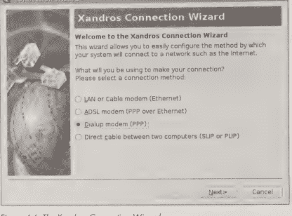

向导的下一页（图 4-5）可能又是一个让你感到陌生的区域。在此页面中，系统会询问允许哪些用户使用你正在配置的连接服务。如果你是该计算机唯一的用户，或者你希望所有使用该计算机的人都能访问互联网，请接受默认的**所有用户**选项。如果你只允许自己访问互联网，而不允许其他人，请选择**用户**。如果你希望允许部分用户访问而禁止其他用户（例如允许你自己、配偶和较大的孩子访问，但不允许年幼的孩子），请点击**指定组**（你可以稍后再设置详细信息）。完成选择后，点击**下一步**。

如果你试图使用 Winmodem 进行设置，向导的下一页值得特别提及（如果你没有使用 Winmodem，你甚至看不到此页面）。连接向导将检查你连接到机器的调制解调器类型。然后，它将在向导的下一页、**设备**一词旁边显示搜索结果（图 4-6）。除非你在向导窗口的底部窗格（**驱动程序**一词旁边）看到驱动程序列表，否则你只需点击**下一步**即可。如果你看到列出的驱动程序，请选择其中一个（如果你不确定该使用哪一个，可以凭猜测选择一个），然后点击**加载按钮**。在这种情况下，向导将测试你选择的驱动程序。如果有效，向导将通过弹出窗口告知你。然后你可以点击**确定**关闭该窗口。如果无效，请返回尝试其他驱动程序。一旦找到能正常工作的组合，点击**下一步**。如果没有任何一个起作用……好吧，是时候去买点新的设备了。

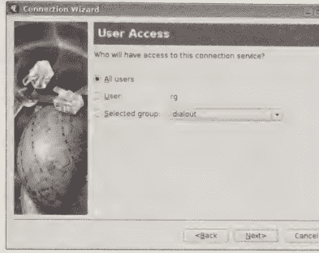

图 4-5：在连接向导中决定谁能使用你的互联网连接

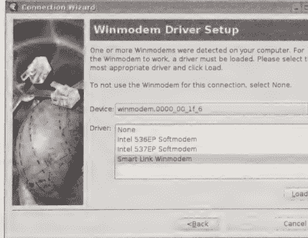

图 4-6：为你的 Winmodem 选择驱动程序

向导的其余部分应该不难理解。只需确保在继续操作时手边准备好从互联网服务提供商那里获得的账户信息。一旦你来到向导的最终页面并点击**完成**按钮，连接到互联网窗口（图 4-7）将会出现。这是未来你任何时候选择连接互联网时都会出现的相同窗口。

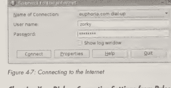

###### 将拨号连接设置从脉冲拨号更改为音频拨号

电话在拨号时传输你拨打号码的方式有两种。目前最常见的是音频拨号，它通过音频信号传输你拨打的电话号码。当你频繁拨打某个号码时，你可能已经注意到该号码似乎有一个独特的音调，事实上确实如此。有时在拨打号码时，你甚至可能因为该电话号码的音调听起来不对而捕捉到误拨的情况。

另一种现在越来越少见的电话号码传输协议是*脉冲*拨号，它通过脉冲传输你拨打的电话号码，1 对应一个脉冲，2 对应两个脉冲，依此类推。如果你的线路使用脉冲拨号，你很可能已经知道了，因为你在拨号时能听到脉冲声或咔哒声。

当你通过连接向导设置互联网拨号连接时，系统会自动设置为音频拨号。如果你碰巧有一条需要脉冲拨号的线路，你必须进行简单的修改。为此，请打开连接到互联网窗口（启动 > 应用程序 > 互联网 > 连接到互联网），然后点击**属性**按钮。当属性窗口出现时，点击**协议和硬件**选项卡，然后在该选项卡中点击**属性**按钮。

在该属性窗口中，点击**命令**选项卡，然后直接点击单词**ATDT**（位于*拨号*的右侧）。该单词周围的区域随后将转换为文本输入框，如图 4-8 所示。在该框中，将当前条目 **ATDT** 更改为 **ATDP**（“ATDT”中的最后一个字母代表 T 为音频或 P 为脉冲），然后在打开的两个属性窗口中点击**确定**。之后，你就准备好了。

###### 连接和断开拨号连接

要通过拨号连接连接到互联网，请转到“启动”菜单，选择“应用程序 > 互联网 > 连接到互联网”。在确认你的调制解调器已开启（如果是外部调制解调器）后，当“连接到互联网”窗口出现时，点击**连接**。一个小窗口（图 4-9）随后会出现，在你调制解调器进行其可怕的流程——发出咯咯声、嘶嘶声和轰鸣声，直到你终于连接成功、准备就绪并可以上网冲浪时，该窗口会显示当前状态。当你的“连接到互联网”窗口自动最小化时，你就知道已经建立了互联网连接。它将继续保留在面板中可访问。

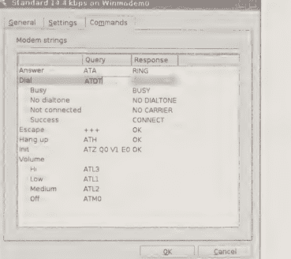

*图 4-8：将拨号连接设置从音频拨号更改为脉冲拨号*

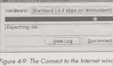

*图 4-9：在尝试连接时，“连接到互联网”窗口显示其运行状态*

浏览完网站后，你可以轻松断开互联网连接：点击面板中已最小化的**连接到互联网**窗口，然后当窗口恢复原始大小时，点击**断开**。接着，你可以点击“连接到互联网”窗口中的**退出**来结束操作。

###### 无线连接——不受束缚的连接

笔记本电脑刚问世时的最大优点是，它们将人们从办公桌中解放出来。人们可以在任何想要的地方使用计算机做任何需要或想做的事情。作为一个喜欢盘腿坐在地上的家伙，这对我来说真的很棒，因为我可以把笔记本电脑放在电视前的地板上，然后坐在那里写作和玩游戏，同时在我的录像机上第二十次播放《华尔街》。是的，一切都很好，但随后互联网出现了。笔记本电脑突然被束缚在电话线和以太网电缆上。

幸运的是，随着计算机界转向无线技术，笔记本电脑再次获得解放。有了合适的无线硬件，现在你几乎可以在任何能“捕捉到信号”的地方使用你的计算机。无论你是坐在早餐桌旁、后院门廊上、大学图书馆里，还是当地的星巴克，你现在都可以在不将计算机物理连接到任何东西的情况下上网。

###### 我需要无线连接吗？

你是否应该参与其中并转向无线，主要仍然是一个个人选择或个人需求的问题。例如，如果你没有笔记本电脑，你可能会发现很难操作，因为 Linux 对桌面无线硬件的支持尚未真正成熟。另一方面，如果你有一台笔记本电脑，希望将其放在用餐室的桌子上在晚餐时（已婚读者请小心）使用，或者坐在圣迭戈的圣塔菲车站等待开往洛杉矶的火车时使用，或者坐在酒店房间里在西雅图度假期间寻找要做的事情，或者只是在门廊上晒晒太阳，那么为什么不试试呢？无论你是准备投入、仍在考虑，还是只是单纯好奇，请继续阅读。

###### Wi-Fi

要跟上无线世界的步伐，你首先应该了解当前常用的三种无线协议：802.11a、802.11b 和 802.11g，它们统称为 Wi-Fi（无线保真）。如果你想知道，协议基本上是一种通常达成的数据传输格式，在这种情况下，是由 IEEE（电气和电子工程师协会）达成的。在这三种 802.11 协议中，普通家庭用户只需关注 802.11b 和 802.11g，因为这些协议的硬件比 802.11a 便宜得多，而 802.11a 主要用在大型办公环境中。

其中速度较快的是 802.11g 协议，其传输速度为 54 Mbps；而 802.11b 的速度为 11 Mbps。然而，Linux 对 802.11g 无线网卡的支持充其量仍处于开发阶段，这意味着你在选择无线网卡时最好坚持使用 802.11b 协议。虽然这听起来像是一个不受欢迎的限制，但这基本上


在实际应用中，这一点并不重要，因为你的互联网连接速度很可能仍然低于你的 802.11b 硬件的能力。……

首先，802.11b 协议仍然比更新的 802.11g 更常用。大多数公共无线接入区域（热点），如机场、大学校园和酒店，仍然使用 802.11g 协议。即使这些地方使用了 802.11g 协议，或者即使你家中的某人已经设置并运行了一个基于 802.11g 的系统，你仍然可以用你的 802.11b 网络卡连接到互联网，因为这两种协议是兼容的，这意味着你可以用 802.11b 设备连接 802.11g 无线接入点（WAP），反之亦然（不过 802.11a 协议并不支持这种兼容性）。

最后，802.11b 设备较低的速度对你来说可能几乎无关紧要，除非你每月为你的互联网服务提供商支付大量的金钱以获得极高的带宽。毕竟，大多数家庭有线互联网连接的平均传输速度仍然低于 802.11b 的 11 Mbps 速度，所以不必过于担心。只需记住，传统拨号电话调制解调器的最大传输速度为 56 Kbps，即每秒 56 *千*位，尽管这种速度在现实中很少能达到；而 11 Mbps 是每秒 11 *百万*位。这对普通人来说已经足够快了。

### 硬件

要建立你自己的家庭 Wi-Fi 设置，你至少需要两件硬件设备：一个*无线接入点*（WAP）和一个插入计算机内部的*无线网卡*（NIC），你可以在图 4-10 中看到它们。这两台设备就像一对收发器，通过无线电波而不是有线连接彼此通信。WAP 将来自互联网源设备（如你的有线电视或 ADSL 调制解调器）的数据传输到计算机，并接收计算机内部 NIC 传输的数据。另一方面，NIC 接收来自 WAP 的传输数据，并将计算机的数据传回给 WAP。

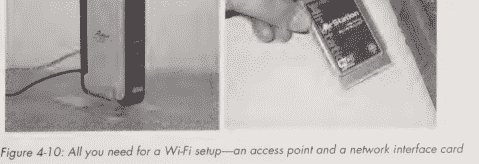

图 4-10：Wi-Fi 设置所需的全部设备——一个接入点和一个网卡

有线和无线互联网连接设置之间的基本差异可以在图 4-11 中看到。在典型的有线设置中，从你的高速互联网源设备伸出的线缆通过以太网电缆直接连接到你的计算机。例如，如果你使用有线电视调制解调器，你会看到一条以太网电缆从有线电视调制解调器直接插入计算机的以太网端口。这非常直接且简单。在 Wi-Fi 设置中，你基本上是用无线电波取代了这种直接的以太网电缆连接。在这种情况下，来自互联网源设备的以太网电缆直接连接到无线接入点，而不是连接到你的计算机。

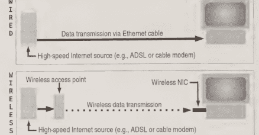

图 4-11：有线和无线互联网连接的对比

连接到你的计算机的是无线 NIC。这通常是一张 PC 卡，你可以将其插入笔记本电脑上的某个 PCI/PCIA 端口（或在台式机上插入一个特殊适配器）。然后，NIC 和接入点通过无线电波而非硬线连接进行通信——如果你喜欢的话，可以称之为一种“虚拟线路”。

######## 无线接入点

如果你想在家庭或办公室建立无线系统，那么你需要获取的第一样东西就是一个 WAP。幸运的是，在这个领域，Linux 兼容性并不是什么大问题，因为接入点并不直接与你的计算机进行物理接口。此外，由于 802.11b 和 802.11g 协议彼此兼容，使用哪种类型的接入点其实并不重要。但这并不意味着你可以忽视你购买的产品，因为有一类无线接入点是你需要避免的。

虽然你使用的任何无线接入点通常开箱即用，无需特殊设置，但有许多设置你可能需要考虑，尤其是出于安全原因。通常，你可以通过打开 Web 浏览器并输入无线接入点的 IP 地址来输入或更改这些设置，该地址通常印在用户手册的某个地方。这样做后，一个网页会出现，你可以在其中更改或输入可用的各种设置。然而，在执行此操作时，你不需要连接互联网，因为这些设置页面实际上嵌入在 WAP 内部。

不幸的是（至少对 Linux 用户而言），有些 WAP 要求你使用 Internet Explorer 来处理此类基于浏览器的设置。由于不存在 Linux 版本的 Internet Explorer，除非你在房子里的其他地方有一台 Mac 或 Windows 机器来完成这项工作，否则你会发现自己陷入困境。更糟糕的是，一些机器根本不支持基于浏览器的设置。相反，它们要求你安装特殊的 Windows 软件来完成这项工作。在为你的无线设置选择硬件时，显然最好避开这种类型的 WAP。

######## 无线网卡

无线设置所需的另一件硬件是无线 NIC，实际上，如果你只想在离家外出时使用无线网络，这是你唯一需要的硬件。由于这些卡直接插入你的系统，你必须找到并使用与 Linux 兼容的卡。Xandros 内置了几个无线驱动程序，因此如果你使用与这些驱动程序之一兼容的卡，你将一帆风顺。

大多数无线 NIC 是 PC 卡，插入笔记本电脑侧面的 PCMCIA 插槽（图 4-12）。然而，也有插入机器 USB 端口之一或 PCI 插槽之一的 NIC。不幸的是，Linux 支持仍然主要限于 PC 卡类型的 NIC，尽管也有针对其他 NIC 的其他 Linux 无线驱动程序可用。

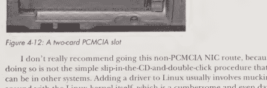

我真正不推荐走这种非 PCMCIA NIC 路线，因为在其他系统中可能很简单的插入并双击程序，在这里并不是那么简单。向 Linux 添加驱动程序通常涉及对 Linux 内核本身的很多麻烦操作，这是一个繁琐甚至令人生畏的过程，尤其是对初学者而言。大多数驱动程序最终会进入未来版本的 Linux 内核，因此就目前而言，我强烈建议坚持使用由 Xandros 发行版包含的驱动程序所支持的硬件。

如果你已经有一个 NIC，你可以按照下一节中的设置步骤尝试一下，看看它是否有效。如果你打算出去购买一个 NIC，或者正在考虑这样做，并且不想浪费辛苦赚来的钱进行实验，你需要更彻底地检查一下。在开始之前，你应该首先查看 Xandros 硬件兼容性数据库（[http://support.xandros.com/hcl/3](http://support.xandros.com/hcl/3)）或 Xandros 用户论坛（[http://forums.xandros.com](http://forums.xandros.com)），在那里你也可以找到建议。

**设置你的无线卡**

设置与 Linux 兼容的无线 PC 卡实际上相对简单。虽然并非必须，但最好先将你的 WAP 物理连接到你的互联网源，然后打开 WAP。一旦它启动并运行，将你的无线 NIC 插入计算机上的 PCMCIA 插槽。此时卡上的任何 LED 可能会亮起。如果没有，它们会在你完成卡配置后亮起。

一旦卡插入机器，是时候配置系统以处理卡了，这非常容易。首先通过“启动”菜单打开**控制中心**，然后当它打开时，点击**网络**旁边的 + 符号。在随后出现的子类别中，点击**网络连接**。网络连接模块将出现在窗口的右侧窗格中。点击该窗格中的**管理员**按钮，当提示时输入你的 root 密码，然后当模块重新加载时，点击**接口**选项卡。

进入接口选项卡后，确保**eth0（无线设备）**在**网络接口**字样旁边的下拉菜单中被选中（图 4-13）。之后，点击**启用网络**，然后根据你服务提供商的要求选择**使用动态地址（DHCP）**或**指定静态地址**（并输入适当的设置）。完成所有操作后，点击**应用**按钮。你的 NIC 此时应该处于激活状态并准备好工作，因此你现在可以关闭控制中心窗口。

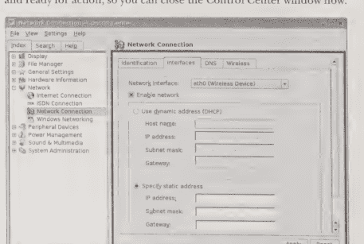


###### 释放与更新无线连接

在以下情况下，您可能希望关闭无线网卡：例如在飞机上使用笔记本电脑时，或者您希望清除网络设置中的 IP 地址（*释放*）并更新为新网络的 IP 地址（*更新*），例如在未重启计算机的情况下将桌面电脑从一个无线热点移动到另一个。

最后一点可能让您觉得有些神秘，所以我在此简要解释一下：当您启动计算机时，您的无线网卡（NIC）会扫描可用的网络（WAP），以确定它可以连接到哪一个。一旦找到网络，它将通过 DHCP 从该网络获取一个 IP 地址，以便您可以访问互联网。利用释放和更新功能，您可以在无需重启计算机的情况下更改 WAP，或者当您的机器由于某种原因无法自行完成此操作时使用该功能。

要关闭您的无线网卡或释放网络设置中当前的 IP 地址，请遵循以下步骤：

- 转到启动菜单并选择 **Control Center**（控制中心）。
- 点击 Network（网络）旁边的 + 图标，然后点击 **Network Connection**（网络连接）。
- 当 Network Connection（网络连接）模块出现在 Control Center（控制中心）窗口的右侧时，点击 **Administrators**（管理员）按钮，在提示时输入您的 root 密码，然后点击 **OK**（确定）。
- 点击 **Interfaces**（接口）选项卡。
- 进入该选项卡后，取消勾选 **Enable Network**（启用网络）复选框，然后点击 **Apply**（应用）。
- 在随后出现的警告窗口中点击 **OK**（确定）以完成过程。

窗口中 DHCP 部分的复选框现在将为空，这意味着您已成功释放设置并禁用了网卡。如果您稍后希望重新激活网卡，或者只是想刷新当前的 IP 地址设置，基本上您可以执行类似的操作：勾选 **Enable network**（启用网络）复选框，点击 **Apply**（应用）按钮，然后在警告窗口中点击 **OK**（确定）。

您也可以遵循步骤 1–4 然后点击 **Release**（释放）按钮来释放和更新您的 IP 地址。当窗口中 DHCP 部分的复选框变为空后，点击 **Renew**（更新）按钮。当新的 IP 地址出现在窗口中 DHCP 部分时，点击 **Apply**（应用）按钮，然后在随后出现的警告窗口中点击 **OK**（确定）。

### 5

#### 没有比家更舒服的地方了

在 Xandros 文件管理器中处理您的文件


双击您的红宝石拖鞋，您可能最终会来到堪萨斯州某个尘土飞扬的城镇，那里有个讨厌的老太太正试图让您的狗被送到收容所——而且还要放在柳条篮子里！然而，双击桌面上的主文件夹图标，您将看到 Xandros 文件管理器——考虑到所有情况，这是一个令人更愉快的地方。Xandros 文件管理器（在 Xandros 用户组论坛上通常被称为 XFWM）可以说是您系统中最重要的部分。它允许您访问文件；查看数字图像；浏览连接到您网络的其他计算机；在您的 Windows 分区之间复制文件（如果您有的话）；浏览 CD、软盘和其他可移动存储设备的内容；刻录 CD 或 DVD；甚至可以从音频 CD 中提取和编码音乐。由于这个多才多艺的工具功能强大，我将在本章和下一章中介绍它的大多数功能，并在书中其他位置提及更多功能。

##### 导航

当您通过双击桌面上的 **Home**（主目录）文件夹或单击 Panel（面板）上的 **XFM** 启动器来启动 Xandros 文件管理器时，它会打开到主目录（图 5-1）。

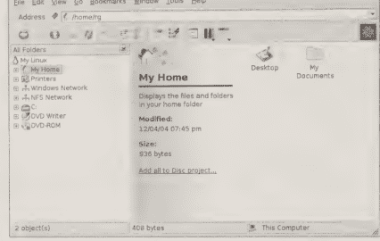

*图 5-1：Xandros 文件管理器*

在当前的阶段，您在那里只会发现两个图标：Desktop（桌面）和 My Documents（我的文档）。双击 **Desktop**（桌面）图标将显示您恰好放在那里的所有文件和启动器，此时应该只是我们在第 3 章中讨论过的五个桌面启动器。另一方面，双击 **My Documents**（我的文档）文件夹将显示 Xandros 已为您设置好的三个文件夹：My Music（我的音乐）、My Pictures（我的图片）和 My Videos（我的视频）。

###### 两种导航方法

Xandros 为您提供两种在文件中导航的方法：使用 XFM 导航按钮和使用 XFM 文件树。

###### 通过 XFM 导航按钮进行导航

一旦您在各个文件夹中进行了一些查找，您可以使用位于地址栏下方的三个 **XFM** 导航（箭头）按钮在它们之间来回移动（图 5-2）。左箭头和右箭头按钮很像您在网页浏览器中使用的——左箭头带您回到刚刚查看的文件夹或文件，而右箭头再次带您回到刚刚离开的地方。另一方面，向上箭头每点击一次就会带您进入上一级文件夹。如果此时这看起来并不清晰，请稍后再试，当您有更多的文件和文件夹可以操作时。您很快就会掌握窍门。

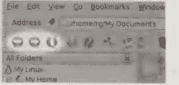

图 5-2：XFM 中的导航按钮

要双击访问 Xandros 文件管理器可用的其他选项，例如您的 Windows 分区或 CD 或 DVD，您只需在“我的主目录”文件夹中点击向上箭头按钮，或点击 XFM 窗口左侧窗格中的 **My Linux**（我的 Linux）按钮。然后，各种设备和选项将出现在右侧窗格中（图 5-3）。我们将在本章和下一章稍后介绍这些项目，所以现在请暂时不要胡乱摆弄这些选项。

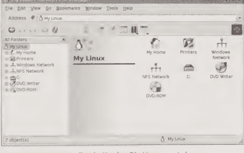

图 5-3：在 Xandros 文件管理器窗口中访问所有内容

###### 通过 XFM 文件树进行导航

在 Xandros 文件管理器窗口中，您最明显会注意到的是文件树的存在，它出现在 XFM 窗口的左侧窗格中，如果您是从 Windows 环境过来的，这应该很熟悉。您可以使用此文件树来导航您的文件系统，而不是使用我刚才描述的双击/箭头按钮方法。点击文件树中的任何图标都将在右侧窗格中显示该文件夹、网络或设备的内容。您还可以通过点击任何项目旁边的 + 符号来查看该树内的子文件夹。显然，如果该项目内部没有任何内容，就不会显示任何内容。

为了自己查看，点击 My Home（我的主目录）旁边的 + 符号，然后点击出现的 My Documents（我的文档）文件夹旁边的 + 符号。在文件树中的 My Documents（我的文档）文件夹下方，您应该看到 Xandros 已为您设置好的三个子文件夹：My Music（我的音乐）、My Pictures（我的图片）和 My Videos（我的视频）。此时，您可能在这三个文件夹中没有任何文件，但如果您有……比如 My Pictures（我的图片）文件夹中的一些照片……点击该文件夹将显示（在右侧窗格中）您存储在那里图像文件，如图 5-4 所示。

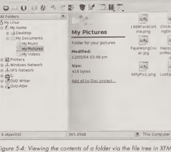

###### XFM 中的书签

XFM 的另一个非常实用的功能是它允许您创建书签。您无疑熟悉为您经常访问的网页创建书签，但为什么要在文件系统中创建书签呢？好吧，假设您经常需要使用一个文件夹，但需要过多的鼠标点击才能到达它。为了减少患重复性劳损（RSI）和腕管综合征（CTS）的风险，您可以通过先导航到该文件夹一次，然后在 XFM 窗口的 Bookmarks（书签）菜单中选择 **Add Bookmark**（添加书签），从而减少到达该文件夹所需的点击次数。之后，每当您想返回那个深埋的文件夹时，只需点击 **Bookmarks**（书签）菜单，该文件夹就会在那里等待您。

例如，假设您经常需要处理一组您已从数码相机下载到硬盘的特定图像。照片位于 *Summer in Wilmington*（威尔明顿的夏天）文件夹内，该文件夹位于 *My Albums*（我的相册）文件夹内，而后者又位于您的 *My Pictures*（我的图片）文件夹内，而该文件夹又位于您的


我的文档文件夹。这意味着要点击很多次。只需点击一次找到该文件夹并将其加入书签，今后通过[书签](https://example.org)菜单（图 5-5）到达该文件夹将只需两次点击。每次您想访问该文件夹时，都可以为您疲惫的手节省多达六次鼠标点击。

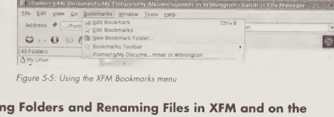

##### 在 XFM 和桌面上创建文件夹及重命名文件

在任何系统中，两个最常见的与文件相关的操作——创建文件夹和重命名文件——在 Xandros 文件管理器中都可以轻松完成。要在 XFM 中创建一个文件夹，请在 XFM 窗口右半部分的任何空白处右键单击，然后在弹出的菜单中选择 **新建文件夹**。

要在 XFM 中重命名一个文件，请右键单击该文件并在弹出的菜单中选择 **重命名**。此时，文件下方的文件名将被高亮显示。您可以重命名该文件，然后按 ENTER 键完成操作，或者单击窗口内的任何空白处完成操作。请记住，在重命名文件时要保留原始的文件扩展名（.doc、.png、.jpg 等）。

要在桌面上创建文件夹或重命名文件，其步骤基本上与 XFM 中的步骤相同。要创建一个文件夹，请在桌面的任何空白处直接右键单击，然后在弹出的菜单中选择 **创建新 ➔ 文件夹**。要重命名一个文件，请右键单击该文件，在弹出的菜单中选择 **重命名**，输入新名称，然后按 ENTER 键或单击桌面上的任何空白处。您也可以通过单击文件一次以选中它，然后按 **F2** 键来重命名文件。

##### 在 XFM 中复制和移动文件

在 Xandros 文件管理器中复制和移动文件是一件相当简单的事情，尽管这可能与您之前操作系统的习惯略有不同。在大多数其他操作系统中，拖动文件并将其放在新位置会将文件移动到该新位置。然而，在 XFM 中，同样的*拖放*操作会复制该文件，从而让您拥有两个文件副本，每个副本位于不同的位置。

###### 复制文件

牢记上述警告，您现在基本上知道如何复制文件：单击文件，保持鼠标按钮按下，将文件拖动到您想要创建副本的位置。您可以将其拖动到右半部分中的某个文件夹，或左半部分文件树中的某个文件夹。当鼠标光标位于目标文件夹上方时，该文件夹将被高亮显示。此时可以安全地释放鼠标按钮。随后将出现一个窗口（对于小文件，该窗口显示时间非常短），指示复制过程的进度。当该窗口消失时，复制即完成。

###### 移动文件

移动文件的过程与我刚才描述的过程几乎完全相同，只不过您需要使用鼠标右键而不是左键。要移动文件，请右键单击您想要移动的文件，然后将其拖动到 XFM 窗口中任一侧面板的目标文件夹。当目标文件夹被高亮显示时，释放鼠标按钮。随后将出现一个小的弹出菜单（图 5-6）。

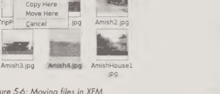

图 5-6：在 XFM 中移动文件

在该菜单中，移动您的光标（不要按住任何鼠标按钮）到 Move Here 上，以选择该选项，然后用鼠标左键单击一次。在过程完成之前，会出现一个进度窗口，显示短暂的时间。

###### 在桌面上复制和移动文件

您也可以将文件保存到桌面，就像您在之前的操作系统中做的那样，但方法不止一种：

- 要将文件从桌面复制到 Xandros 文件管理器，请在按住鼠标左键的同时，将文件从桌面拖动，然后在释放鼠标按钮时将文件放入窗口的右半部分。如果您希望将文件复制到右半部分打开的文件夹以外的其他文件夹，您可以将文件直接放在右半部分或左半部分文件树中的目标文件夹上。如果您的 XFM 窗口已最小化，您仍可以从桌面拖动文件，然后将光标悬停在任务栏中的 XFM 条目上，等待窗口出现在前景。
- 要将文件从桌面移动到 XFM，请先将其复制到 XFM，然后将原始文件拖动到垃圾桶。
- 要将文件从 XFM 复制到桌面或桌面上的某个文件夹，请按住鼠标左键，然后将文件拖动到桌面并释放。会出现一个弹出菜单（图 5-7）。选择 Move Here 以移动文件，或选择 Copy Here 以复制文件。做出选择后，单击鼠标左键。
- 要将文件从桌面移动到桌面上的某个文件夹，请使用鼠标左键拖动并放置文件。

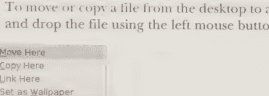

###### 复制和移动文件的另一种方式

您还可以通过在 XFM 或桌面上剪切和粘贴来复制或移动文件。要这样做，请右键单击您想要复制或移动的文件，然后在弹出菜单中选择 Copy（复制文件）或 Cut（将文件从其当前位置剪切并移动到新位置）。然后左键单击您的选择。现在将文件拖动到您想要复制或移动文件的位置，右键单击鼠标，并在弹出菜单中选择 Paste。最后，单击鼠标左键，操作即完成。

###### 在 XFM 中创建指向文件的桌面链接

您可以不必将文件从 XFM 复制或移动到桌面，而是可以创建指向该文件的链接（或快捷方式）。要访问该文件，您只需双击该链接即可。

要在桌面上创建指向 XFM 中某个文件的链接，请使用鼠标左键或右键将文件拖动到您想要创建链接的位置，然后释放鼠标按钮。在出现的弹出菜单中，选择 Link Here，然后单击鼠标左键。

###### 在 XFM 中提取和创建归档文件

除了许多其他功能外，Xandros 文件管理器还允许您轻松打开和创建归档文件，而无需安装任何额外的软件。如果您曾经处理过 Windows 中的 ZIP 文件或 Mac OS 中的 StuffIt 文件（.sit）文件，那么您就有过与归档（也称为压缩）文件打交道的经验。基本上，当您压缩文件时，您是针对单个文件或更常见的是一组文件，将其缩小到占用更少磁盘空间的大小。这在试图尽可能多地将内容放入软盘或 CD，或者试图通过互联网发送文件时非常有用。您从互联网下载的大多数应用程序都以此方式提供。

在 Linux 世界中，大多数归档文件是使用 *Tar* 程序的某种变体创建的。因此，以该格式创建的归档文件通常被称为 *tarballs*，并且通常以扩展名 .tgz 结尾。当然，Linux 也可以创建和提取 ZIP 归档，因此特定归档文件使用的压缩格式通常反映了创建它或为其创建的系统。

### 提取归档文件

提取归档文件内容的方法有几种，但最简单的是双击归档文件，右键单击您找到的文件夹，然后在弹出的菜单中选择 **复制**。之后，导航到您想要放置该文件夹的位置，右键单击该窗口中的任何空白处，然后在弹出的菜单中选择 **粘贴**。

如果归档内的文件尚未位于其自己的文件夹中，您必须先使用本章前面学到的更传统的方法为它们创建一个文件夹。完成后，选择归档文件中的所有文件，右键单击其中任何一个，然后在弹出的菜单中选择 **复制**。之后，导航到您刚为新文件创建的新文件夹，右键单击该窗口中的任何空白处，然后在弹出的菜单中选择 **粘贴**。

###### 创建自己的压缩文件

既然您已经知道如何提取各种类型的压缩文件格式，您可能也应该知道如何创建自己的文件。作为一般经验法则，您选择的格式应反映最终打开该归档的人的系统。话虽如此，如果您正在为 Windows 用户创建归档，请使用 ZIP；对于 Linux 或 Mac 用户，请使用 TGZ。

###### 创建 Tarball（TGZ 文件）

如果您想在 XFM 中创建自己的 tarball 怎么办？没问题；只需遵循以下步骤：

1.  如果您想在同一归档中放置多个文件，请首先创建一个新文件夹，为其适当命名，然后将您想要添加到归档中的所有文件放入该文件夹。（如果您只想归档单个文件，可以省略创建此文件夹和移动文件的步骤。）
2.  接下来，在 XFM 内右键单击该文件夹（或单个文件），然后在弹出的菜单中选择 **创建 TGZ 归档**。
3.  该归档将自动拥有您点击的文件夹或单个文件的名称，外加扩展名 .tgz。几秒钟内（对于较大的归档会稍长一点），新的归档将出现，位于您刚才右键单击的文件夹旁边，您的任务就完成了。


###### 创建 ZIP 文件

创建 ZIP 压缩包的流程基本上与创建 tar 包相同：创建一个新文件夹，将你想要放入压缩包的各个文件复制或移动到该文件夹中，右键单击该文件夹，然后弹出菜单中选择**添加到 ZIP 压缩包**。完成这些步骤后，将弹出“*添加到 Zip 压缩包*”窗口（图 5-8），该窗口中将显示你正在压缩的文件夹名称，并以此作为即将创建的 ZIP 文件的名称。如果该名称可以接受，你只需单击**确定**，几秒钟内即可完成操作——也许更快。但是，如果你突然想起忘了将某个文件添加到压缩包里，此时你可以选择在此时（单击**确定**之前）将其添加进来。


*图 5-8：创建 ZIP 压缩包*

要在正在构建的 ZIP 压缩中添加文件，请单击“Add to Zip Archive”窗口下半部分的**添加**按钮。此时会出现另一个窗口，即“*添加文件或文件夹*”，你可以从该窗口中选择要添加的其他文件。找到要添加的文件后，选中它并单击**打开**。你选择的文件将显示在“Add to Zip Archive”窗口底部的列表中。若要添加更多文件，请再次重复此步骤。完成添加所有文件后，单击**确定**。

如果想在 ZIP 压缩包已经创建后再添加文件怎么办？很简单，就像对待普通文件夹一样，执行复制和粘贴操作即可。具体步骤如下：

- 1. 选中你要添加到现有 ZIP 压缩包的各个文件（或多选），右键单击它们，然后在弹出菜单中选择**复制**。
- 2. 接下来，双击你要添加文件的 ZIP 压缩包。
- 3. 当该压缩包的窗口打开时，右键单击窗口内的任意空白区域，然后在弹出菜单中选择**粘贴**。

###### 将 Xandros 文件管理器作为图像查看器

XFM（Xandros 文件管理器）的另一个实用功能是它可以作为某种图片查看器和预览器。如果你单击任何图形文件一次，XFM 窗口右侧窗格的左侧将显示该文件的缩略图，如图 5-9 所示。


图 5-9：在 XFM 窗口中查看图像文件的缩略图

你还可以通过转到“视图”菜单并选择“缩略图”，让图形文件以缩略图而非图标形式显示（如图 5-10 所示），这样就无需使用其他专用图像软件即可查看你的图形文件。诚然，在操作系统领域，这个功能已经不再独一无二，但依然非常实用。Xandros 更独特的地方稍后你就会了解到，同样的功能也适用于文本文件。

在 XFM 中双击图像的缩略图时，该图像将以更大的尺寸显示在 XFM 窗口的右侧窗格中（图 5-11）。与此同时，会出现一组控制按钮，你可以使用它们在放大尺寸下浏览图像、旋转图像、调整放大倍数，甚至运行窗口内幻灯片。这对于一个单纯的文件管理器来说，是非常酷的功能，尤其方便。


如果你希望以 XFM 窗口右侧窗格尺寸限制之外的更大尺寸查看图像，可以右键单击该图像的缩略图，然后在弹出菜单中选择**打开方式 > 图像查看器**。图像将出现在其自身的窗口中，如图 5-12 所示。在图像查看器（也称 KView）中，你不仅可以获得在 XFM 窗口中查看图像时的所有查看选项，还可以通过在“设置”菜单中选择**全屏模式**，然后在“视图”菜单中选择**图像适应窗口**，让你的图像铺满整个屏幕。要恢复正常，再次转到“设置”菜单并选择**退出全屏模式**即可。


###### 使用 XFM 查看文本和 PDF 文件

除了查看图形文件，Xandros 文件管理器还允许你阅读文本文件的内容（以 .txt 文件格式保存的文件），同样不需要其他软件。例如，如果你有一些随手记下并保存为文本文件的笔记，只需双击 XFM 右侧窗格中该文件的图标，文件内容就会在 XFM 窗口中显示。XFM 甚至可以对 PDF 文件执行相同操作，充当简单的 PDF 查看器。只需单击文本或 PDF 文件，即可在 XFM 窗口左侧获得该文档的小型预览，这与查看图形文件时的情况类似。

当然，你始终可以通过右键单击要查看的 PDF 文件，并在弹出菜单中选择**打开方式 » Acrobat Reader**（图 5-13），在专用窗口中阅读 PDF 文件；如果 Acrobat Reader 不能解决问题，还可以选择**打开方式 » PostScript Viewer**。你可以通过类似的方式选择**打开方式 » 文本编辑器**来阅读文本文件。


*图 5-13：在 Acrobat Reader 中查看 PDF 文件*

##### 在 XFM 中更改文件和文件夹权限

在 Linux 世界中摸索前进时，你会发现偶尔会遇到系统不允许你修改的文件。当你用相应应用程序打开这样的文件时，标题栏通常会显示*只读*，或者当你试图保存该文件时，会得到*权限被拒绝*的提示。此类信息表明文件处于写保护状态，意味着你没有权限修改该文件。在 Xandros 中，你最有可能在以下两种情况下遇到此情况：将文件从光盘复制到你的硬盘时，或将文件从你的 Windows 分区复制到你的 Linux 分区时。这是 Linux 保护你免受系统损害的方式之一，尽管对于从光盘复制的文件，你或许并不清楚它如何保护你。

如果你想修改写保护的文件或访问写保护的文件夹，只要你在该文件或文件夹的所有者列表中，就可以在 XFM 窗口中完成此操作。要更改文件或文件夹权限，只需右键单击相关文件/文件夹，然后从弹出菜单中选择**属性**。

“属性”窗口打开后，单击**权限**选项卡，你就能看到文件/文件夹的所有者是谁，以及你被允许或被禁止对其执行哪些操作（见图 5-14）。


> *图 5-14：在 XFM 属性窗口中更改权限*

如图 5-14 所示，可以将权限授予或拒绝文件的*所有者*（你）、指定的*组*或*其他用户*（所有人）。这些权限包括：

- **读取**
  - 查看文件或文件夹内容的权限
- **写入**
  - 修改文件或文件夹内容的权限
- **执行**
  - 运行程序或脚本的权限

通常，你不必太担心为自己设置文件权限，因为你实际上是唯一可以访问你用户账户的人。主要的例外情况是将文件从光盘传输到硬盘时。在这种情况下，文件很可能处于写保护状态，这意味着在更改其权限之前，你无法修改这些文件。

如果你正在处理写保护的文件夹或文件，可以通过单击*Owner* 行中*Write* 字样下的复选框来更改文件权限，从而获得修改它的权限。完成修改后，单击**确定**，你就可以随心所欲地处理该文件了。

##### 使用 XFM 访问 Windows 分区（仅限双系统用户）

如果在安装 Xandros 时设置了双启动系统，你还可以通过 Xandros 文件管理器以只读方式访问 Windows 分区中的文件（不包括程序）。操作步骤如下：

- 1. 单击 XFM 窗口左侧窗格文件树中的 C: 图标（或包含你要访问文件的任何驱动器）。你 Windows C: 驱动器的内容将显示在 XFM 窗口右侧窗格的右半部分（图 5-15）。

  > **注意** 你仍然只有该分区的读取权限（参见 XFM 窗口左侧，它会告知你这一点），这意味着你可以从 Windows 分区复制文件，但不能向其中写入。尽管这看起来不太方便，但从长远来看，这可能是最好的，因为它保护了 Windows 系统的完整性，并有助于防止下次你决定启动到 Gatesville（Windows）时出现问题。

  

  *图 5-15：获取 Windows 文件的只读访问权限*

  > **注意** 假设你的文件像大多数人一样存储在 Windows 的 *My Documents* 文件夹中，你可以通过双击*Documents and Settings* 文件夹来访问它们。

- 2. 该文件夹的内容显示在右侧窗格后，找到带有你的 Windows 用户名（我的显示为 rg）的文件夹，然后双击该文件夹。


3.  最后，在右侧窗格中双击**我的文档**文件夹，您应该能够找到所有文件。如果您碰巧将一些文件保存到了 Windows 桌面并希望访问它们，请双击**桌面**文件夹而不是我的文档。

*注意：既然您已经知道如何操作，现在为 XFM 中的这个 Windows 我的文档或桌面文件夹创建一个书签可能会非常方便。*

##### 在 XFM 中处理网络

如果您的计算机连接到局域网（办公室计算机通常都是这种情况），您还可以浏览连接到该网络的计算机。假设您已获得网络管理员的权限，您还可以访问位于那里的文件并进行读写操作。

###### 浏览网络

如果您处于网络环境中，很有可能这是一个 Windows 网络，或者至少表现得像一个 Windows 网络，因此，要开始浏览，请在 XFM 窗口左侧窗格的文件树中点击**Windows 网络**图标。此时可能会弹出一个窗口，询问您的 Windows 网络密码。如果出现这种情况，只需点击**取消**，经过片刻搜索后，网络上的工作组（图 5-16）将显示在右侧窗格中，其中一个就是您自己的计算机。如果几秒后仍没有显示任何内容，请尝试点击文件树中的 NFS 网络图标。


图 5-16：XFM 窗口中显示的网络工作组

工作组显示出来后，双击您所属的工作组；随后，属于该网络的各种计算机将显示出来（图 5-17）。在列表中搜索，直到找到您有权登录的宿主计算机（如果不确定，请咨询您的网络管理员），然后双击该计算机的图标。

####### 挂载网络共享

此时，将弹出一个显示您的用户名并询问您密码的小窗口。请注意，您为 Xandros 系统选择的用户名和密码可能与网络上的不同。例如，我的 Xandros 用户名*是* rg，而我在办公室网络的用户名是 grant。我的密码也不同，但这我会保密。无论如何，您的情况可能与我相似，因此请务必输入相应的信息。完成后，点击**确定**按钮。


现在，您应该在 XFM 窗口的右侧窗格中看到宿主计算机的内容。寻找带有您网络用户名的文件夹（或任何您有权使用的其他文件夹），如果您只想查看里面的内容，请双击它。如果您希望访问该文件夹以执行写入或复制文件的操作，请单击以选中它，然后点击 XFM 窗口右侧窗格左侧的**挂载此共享**链接。

现在将出现一个新的窗口：挂载网络共享。在这个窗口中，您会看到三个文本框：*要挂载的共享*、*挂载点*和*连接为*。这三个框中第一个和最后一个框中的信息是关于网络的信息；网络需要知道您试图挂载什么以及您是谁。然而，中间的框包含的是关于您自己计算机的信息。*挂载点*框告诉您的系统应该在文件系统中的哪个位置显示您网络共享或文件夹中的文件。

这听起来可能有点令人困惑，但我会尽量简化一下。您的 Xandros 系统与其他所有 Linux 发行版一样，将世界视为一系列文件和文件夹。为了显示您网络共享上的文件，它需要一个文件夹来放置这些文件。这与将光盘或软盘插入计算机时发生的情况没有什么不同——您的计算机挂载磁盘，然后在位于 /mnt/cdrom0（软盘则为 /mnt/fd0）的文件夹中显示其内容，尽管您可能不知道这一点。当然，您不必担心这些细节。

然而，您需要担心（或至少思考）的是，您希望系统将用于挂载网络共享的文件夹放在磁盘的哪个位置。挂载网络共享窗口中的默认位置是 /home/Xandros_username/share_name，这就足够了。不过，我个人建议创建一种中间文件夹，特别是如果您要挂载多个共享时更是如此。为此，请将挂载点框中的文本更改为 /home/Xandros_username/Network_Share/share_name（当然，用您的用户名替换字符串中的 Xandros_username）。您的窗口应该看起来像图 5-18 所示。


*图 5-18：创建一个文件夹用于挂载网络共享*

是否采取这一步骤完全取决于您，但由于您为此目的创建的文件夹将显示在主文件夹中，我认为您最终会感激这个额外文件夹带来的清晰度。无论您决定怎么做，一旦准备就绪，请点击**确定**。

此时，由于您尚未拥有网络共享文件夹或带有您网络用户名的文件夹，将会弹出一个标题为*错误*的小窗口，有点吓人的是，它会询问您是否要创建相关文件夹。是的，请创建，所以点击**确定**。

###### 访问已挂载网络共享中的文件

现在，您可以通过进入主文件夹中新创建的文件夹来访问网络共享中的文件。请记住，该文件夹中的文件仅在那里显示并可访问；它们实际上并不物理存在于您的硬盘上，因此，如果您在未连接网络的情况下使用计算机，文件夹将是空的。

总之，假设您已从网络管理员那里获得读写权限，您不仅可以从网络共享中复制文件，还可以将文件复制到该共享中。此外，您可以直接在共享中处理文件，就好像它们就在您的硬盘上一样。例如，假设您的共享中有一个 OpenOffice.org 文档。如果您愿意，可以双击该文件，进行您想要进行的任何修改并保存——所有这一切都不需要文档曾经停留在您的硬盘上。

###### 未来的网络登录

一旦设置好，您就不必再次经历这个相当繁琐的过程。每次启动机器时，您的系统将尝试自动挂载您的网络共享。Xandros 桌面出现在屏幕上 shortly 后，将出现两个窗口——一个通知您系统正在尝试恢复您的网络连接，另一个询问您的网络密码（图 5-19）。如果您想挂载您的网络共享，请输入密码，然后点击**确定**。然后，您可以在主文件夹中创建的文件夹（Network_Shares/network_username）中查看您的网络文件。


*图 5-19：在后续登录时输入密码*

如果您不希望在此时挂载您的网络共享，可以点击**取消**代替。这将弹出另一个窗口，询问您是否希望永久从自动连接的网络共享列表中移除某个给定的共享。如果您只是偶尔需要挂载网络共享，或者您使用的是实际上在工作与家庭之间移动的笔记本电脑，点击**是**可能是个好主意。另一方面，如果您确实更喜欢每次启动时都收到提示，请点**否**。无论哪种方式，您仍然可以随时使用我前面描述的方法挂载您的网络共享。

### 6

#### 停靠点

*使用软盘、CD、DVD 和其他可移动媒体*


虽然如今几乎所有计算机配备的多 GB 硬盘允许您存储看似无限数量的文件，但有时您可能希望备份这些文件或将其提供给他人。事实上，您硬盘上的许多文件并非由您自己在计算机上创建，如文字处理文件，而是来自外部来源。毕竟，您可能有很多从朋友或家人那里作为电子邮件附件收到的数码照片：不幸地从工作中收到的文字处理或电子表格文档（很可能也是通过电子邮件）；以及您从互联网下载的其他图像和 PDF 文件、字体，甚至应用程序。

虽然如今大多数文件传输似乎都是通过互联网进行的，但不久之前，文件从一台计算机传输到另一台计算机的主要方式是通过软盘，这也是许多普通用户备份硬盘的方式。不用说，这是一种速度慢得多且更麻烦的方法。尽管如此，尽管我们如今对数字化即席性有了新的喜爱，但硬存储介质类型并未


早已与渡渡鸟、大海雀和卡罗莱纳鹦鹉一样消亡。事实上，这些存储介质不仅仍在被使用，而且可供我们使用的可移动存储介质范围实际上已经扩大，包括了Zip软盘、DVD，以及更近时期的USB硬盘、闪存盘和存储卡读卡器。

鉴于当今人们使用计算机的方式多种多样，能够使用这些各种形式的硬盘存储介质因此变得或多或少必不可少。无论是从数码相机导入照片、在电脑上听音乐和看电影，还是仅仅备份您保存在硬盘上的所有珍贵物品，您最终都将不得不处理当今计算机世界中可用的至少某种形式的硬盘介质。

幸运的是，Xandros文件管理器使这一切变得非常简单，它充当着某种“端口”的角色（因此本章的标题是——我承认这个比喻有点牵强），你可以轻松地通过各种停靠在您机器上的介质加载和卸载数据。无论是将软盘、CD还是DVD插入相应的驱动器，还是将其他任何存储设备连接到您的USB端口之一，你都可以通过Xandros文件管理器访问这些介质。

### 软盘

当最初的Macintosh计算机问世时，其中最酷的一点之一是它使用3.5英寸软盘（也称为*软盘*）。当时，我认为这些带有硬质外壳和滑动金属门以保护介质的磁盘是高科技酷炫的化身。当然，时代在变，如今使用软盘的人越来越少了。

这种变化的原因很简单：文件对于软盘来说太大了。如今大多数人处理的音频、视频和图像文件都很大。例如，你运气好的话，一张软盘也只能装下三张数字照片。与CD、Zip软盘、存储卡等相比，软盘也太慢了。在将相当数量的文件写入软盘的时间里，你几乎可以给猫喂食、泡一杯咖啡，还能读完报纸的前三页。（好吧，这可能是夸张了，但与其他替代品相比，软盘确实很慢。）

尽管体积小且速度慢，但仍有一小部分没有其他方式将文件传输到可移动介质上，或者只是想将一到两个小型文字处理文档交给只能读取该类型介质的其他人。你可能就是这样的人，或者你需要向处于这种情况的人发送文件，或从他们那里接收文件。

###### 写入和从磁盘复制

在系统中使用软盘很简单：只需将软盘插入驱动器，打开XFM，然后单击窗口左侧文件树底部附近的**软盘**图标。软盘的内容将显示在右侧窗格中。要将文件复制、添加或删除到/从软盘中，使用我在第5章中描述的各种方法，数据将立即被写入（或从磁盘移除）。完成后，手动弹出软盘。

> **注意**
> *当你从驱动器中取出软盘时，XFM窗口右侧窗格中显示的文件将保留。不过，这是暂时的状态，所以不用担心。只需单击文件树中的任何其他文件夹，直到该文件夹的内容显示在右侧窗格中。之后，再次单击文件树中的软盘图标，之前显示在那里的文件将消失。*

###### 格式化软盘

在您实际向磁盘写入任何内容之前，该磁盘必须经过格式化。这对于任何类型的存储介质都适用——您的硬盘、CD、数码相机存储卡或软盘——尽管有时在您购买介质之前就会进行格式化。通过格式化磁盘，您的系统（应您的请求）在磁盘上铺设某种地图，指定数据可以存储在哪里。

> **注意**
> *由于存在（并且曾经存在过）许多操作系统，因此软盘有许多这样的格式。Linux既可以从Linux原生的ext2格式化磁盘，也可以从Windows/DOS FAT格式化磁盘读取数据。它还可以创建这两种格式中的任意一种。*

如今大多数软盘都是以DOS格式预先格式化出售的，所以你大概不必太担心这个问题；但是，如果你确实需要格式化一张未格式化的软盘，或者甚至是一张已经使用过并且你想清除所有数据的软盘，过程很简单。

- 1. 将软盘插入其驱动器，然后打开Xandros文件管理器。单击该窗口文件树中的**软盘**图标，然后单击窗口右侧窗格左侧的**格式化软盘**字样。应该会弹出一个软盘格式化窗口，如图6-1所示。


*图 6-1：格式化软盘*

- 2. 在此窗口中，你可以指定软盘的密度或容量（1.44 MB或720 KB）、文件系统类型（ext2或FAT）以及磁盘名称。完成后，通过单击“格式化”按钮开始格式化软盘。
- 3. 将弹出一个询问你是否确定要继续的小窗口。单击“继续”，格式化过程将开始，并在软盘格式化窗口底部显示进度。
- 4. 当过程完成时，将弹出另一个窗口告知你。只需在该窗口上单击“确定”，过程即完成。

###### 读取数据CD或DVD

要读取装有数据（图像、文件或程序）而非音乐的CD或DVD，请将光盘放入CD或DVD驱动器。Xandros文件管理器窗口应自动打开并显示光盘内容。然后，你可以使用第5章中描述的复制粘贴或拖放方法，将数据CD或DVD上的文件复制到硬盘上。

> **注意**
> *正如我在第5章中提到的，你从CD或DVD复制到硬盘的任何文件都将是写保护的，因此如果你想修改它，必须更改其权限。为此，右键单击文件，在弹出窗口中选择“属性”，然后单击“属性”窗口中的“权限”选项卡并更改权限。*

当完成从CD或DVD复制文件后，你可以通过右键单击标有DVD-ROM或CD-RW的图标，并在弹出菜单中选择“弹出磁盘”来将其弹出。

###### 播放音乐CD

要播放音乐CD，请将其插入驱动器；Kscd CD播放器（如图6-2所示）应自动打开并开始播放。你还应该在面板上看到一个看起来像一个小CD，上面有一对四分音符的小部件（图6-2中也显示了），你可以使用它来隐藏或显示播放器，并控制其基本功能。如果你已连接互联网并正在播放商业音频CD，Kscd还会查询在线数据库（freedb.org）以收集专辑和曲目标题，然后在播放器窗口中显示它们。

当你播放完CD后，可以通过单击播放器窗口中的“弹出”按钮，或右键单击面板小部件并在弹出菜单中选择“弹出”来弹出CD。

> **注意**
> *关闭Kscd播放器窗口不会关闭面板小部件。若要这样做，请右键单击该小部件，然后在弹出菜单中选择“退出”。如果不先关闭播放器窗口就执行此操作，将一步完成这两项任务。*


图 6-2：Kscd播放器和面板小部件

###### 播放DVD和VCD视频

如果你有DVD驱动器，Xandros还可以通过其附带的视频播放软件Xine（图6-3）播放未加密的DVD。Xine还可以播放VCD（视频光盘），这是在专门格式化的CD上记录的电影，可以在DVD或CD驱动器中播放。就图像质量而言，VCD不如DVD，但价格便宜得多。不过，由于VCD主要在中国（尤其是香港）和少数其他国家/地区流行，除非你特别喜欢更冷门的华语电影或粤语卡拉OK，否则你可能不会遇到很多VCD。尽管如此，如果你确实遇到了，你会很高兴地发现你可以播放它们。


图 6-3：使用Xine观看DVD和VCD


由于 Xine 将在第 14 章单独介绍，因此这里不再赘述。不过，如果你已经迫不及待想要观看你的*《红色娘子军》*影碟，可以跳过本章继续阅读；否则，请稍安勿躁，继续阅读下文。

##### CD-RW 光驱

如今，几乎每台计算机都配备了内置的 CD-RW（CD 可重写）光驱。CD-RW 光驱的工作方式与 CD-ROM 光驱类似，它们都允许你从 CD 中读取数据或播放音乐。此外，CD-RW 光驱还允许你将数据刻录到空白 CD 上。如果你的电脑中没有 CD-RW 光驱，我强烈建议你购买一个。台式机光驱的价格相对便宜（40 美元或更少），且安装非常容易。

如果你的数据存储需求超过了 CD 所能处理的范围，请考虑安装 DVD 刻录机。除了能够读写 CD 外，DVD 刻录机还可以读写 DVD，而 DVD 的容量可达 CD 的七倍以上。

###### 刻录数据 CD 和 DVD

在 Xandros 文件管理器中，刻录数据 CD 和 DVD 非常容易操作，使用的是 DVD Writer（根据你拥有何种驱动器，也可能是 CD Writer）。事实上，在 Xandros 中刻录这些光盘的过程比其他操作系统甚至许多其他 Linux 发行版都要简单，至少更为直接明了。

> 注意：Xandros Open Circulation Edition（随本书提供的那个版本）的一个限制在于，它将 CD 刻录速度限制为 2X，并且不允许刻录 DVD。因此，即使你的机器上安装了 DVD 刻录机，XFM 窗口左侧文件树中的 DVD Writer 图标也会显示为 CD Writer。若要实现全速 CD 和 DVD 刻录，你可以升级到 Xandros 的其他任何版本。

####### 设置你要刻录到 CD 或 DVD 上的文件

你的第一步是整理好想要刻录到光盘上的文件。为此而收集的文件被称为一个*项目*（project）。

要开始你的项目，请打开 XFM，并点击窗口左侧文件树中的 **DVD Writer** 或 **CD Writer** 图标（具体取决于你拥有的硬件）。光盘刻录选项将显示在 XFM 窗口的右侧面板中（图 6-4）。

点击 **Create data disc**。窗口的右侧面板看起来应该像图 6-5 的右侧部分。接下来，将你要刻录的文件拖拽或粘贴到该面板中。


图 6-4：XFM 窗口中列出的 CD 和 DVD 刻录选项


图 6-5：一个空的 DVD Writer 项目窗口

当你将文件添加到新项目时，窗口底部的类似标尺的仪表（图 6-6）将显示你将使用目标光盘容量的多少以及剩余多少。CD 的最大容量由红色垂直条（针对 650 MB 光盘）和绿色条（针对 700 MB 光盘）表示。当然，你不想超出即将使用的光盘的最大容量，否则无法正确刻录。


####### 将文件刻录到光盘

一旦你在项目窗口中收集了所有相关文件，就可以开始实际将文件刻录到光盘上了。为此，请遵循以下步骤：

1. 点击右侧面板左侧的 **Write files to disc** 字样。将出现一个小窗口，提示你 Xandros 建议在向光盘写入数据前关闭所有其他打开的程序。（我在其他程序运行时刻录过许多光盘而没有遇到任何问题，但为了保险起见，还是听从建议吧。）点击 **OK** 关闭该小窗口。
2. 出现创建光盘窗口（图 6-7），显示硬件设备（你的 DVD 或 CD 驱动器，视具体情况而定）、首选写入速度（默认值为 **Maximum** 即最大速度）、要刻录到光盘上的数据量以及预计完成过程所需的时间。由于默认设置可能适合你的需求，直接点击 **OK** 即可。


图 6-7：检查你的光盘刻录设置

3. 随后将依次快速出现两个窗口。第一个窗口将在下一步中说明。第二个窗口要求你放入一张空白光盘。按照该窗口的指示操作，一旦空白光盘被机器吸入且驱动器上的小 LED 停止闪烁时，点击 **OK**。刻录过程随后开始。
4. 剩余的窗口（图 6-8）将指示刻录过程的进度。该过程本身包含三个步骤，全程无需你手动操作：准备轨道、记录轨道以及修复光盘。完成后，光盘将自动从驱动器弹出，你可以点击 **Done** 按钮。至此，基本工作完成。


图 6-8：光盘创建过程窗口

如果你不需要再使用完全相同的一组文件刻录更多光盘，请进行一些系统清理工作。转到 XFM 窗口的文件树，右键点击你刚刚刻录的光盘项目，然后在弹出菜单中选择 **Delete**。

###### 处理可重写光盘

CD-RW 和 DVD-RW（可重写）光盘与其 CD-R 和 DVD-R 对应型号非常相似，除了它们可以被擦除并再次写入之外。它们的价格也贵了不少。另外，如果你对复制或创建音乐 CD 感兴趣，CD-RW 光盘无法在大多数标准音频 CD 播放器中播放，例如家用或车载播放器。

使用可重写光盘的工作方式与使用标准一次性写入 CD 和 DVD 类似。如果光盘是空白的，过程完全没有区别，这使得操作变得非常简单。然而，如果你想重用一张已有数据的可重写光盘，你必须首先将其擦除或*置空*（blank）。

要置空光盘：

1. 将光盘插入驱动器，当 XFM 窗口出现时，点击左侧窗口面板文件树中的 **DVD Writer** 或 **CD Writer**（视你的具体情况而定）。
2. 从随后出现在右侧面板的选项列表中，点击 **Blank disc**。此时应出现一个新的窗口，即*置空光盘*窗口（图 6-9）。


*图 6-9：置空 CD-RW 光盘*

3. 要开始置空光盘，请在置空光盘窗口中点击 **OK**。将出现另一个窗口，指示置空操作的进度。当光盘被置空后，它会自动弹出。当过程完成时，在进度窗口中点击 **Done**。然后你可以将新置空的光盘当作新光盘使用。

###### 复制音频和数据光盘

以下是复制音频和数据 CD 的方法：

1. 首先，打开 XFM 并点击左侧面板中的 **DVD Writer** 或 **CD Writer** 图标。
2. 接着，点击右侧面板中的 **Copy disc**。当你看到一个警告窗口提示你在向光盘写入数据前关闭所有正在运行的应用程序时，如果你愿意就关闭它们，然后点击 **OK**。
3. 应打开一个复制光盘窗口，随后出现另一个窗口，提示你插入要复制的源光盘。这意味着你应该插入你想复制的那张光盘。请插入它。一旦你的驱动器指示灯停止闪烁，点击 OK。
4. 在下一个窗口中点击 OK，系统将要求你检查目标介质（即空白光盘）。我不做这一步，但如果你愿意可以点击 Check；否则，点击 Skip。复制过程应开始，进度将在单独的窗口中显示。
5. 当复制阶段完成时，你的光盘应自动弹出，并在图 6-10 底部显示一个小窗口，提示你插入一张空白光盘。

> 注意：在此过程的这一步，复制光盘窗口中的进度条不会显示 100% 的进度（图 6-10 中也显示了这一点）。这是因为它们指示的是复制和刻录两个过程的总进度，所以不用担心。

6. 按要求插入空白光盘，然后点击 OK。刻录阶段将开始。完成后，你的光盘会自动弹出，然后你可以点击该窗口中的 Done 按钮来关闭复制光盘窗口。


图 6-10：DVD Writer 在光盘复制过程中途要求你插入一张空白光盘

###### 将 ISO 镜像刻录到光盘

当你从互联网下载 Xandros 或其他 Linux 发行版时，通常是以一个或多个光盘镜像文件的形式下载，通常称为 ISO。ISO 是 CD 的镜像，意味着它是 CD 减去介质本身后的内容。换种说法，如果 CD 有灵魂的话，ISO 就是 CD 的灵魂；拿走 CD 的金属和塑料，剩下的数据就是一个 ISO。下载 ISO 后，你将其刻录到空白 CD 上，以便以比喻的方式让镜像重新获得“躯体”，并在此过程中创建一张可用的安装光盘。


使用 Xandros 文件管理器将 ISO 写入光盘非常简单。

- 1. 双击硬盘上的 ISO 文件，您可以根据其 `.iso` 扩展名识别出该文件。随后会弹出一个创建光盘窗口（如图 6-7 所示）。之后，流程与写入其他 CD 完全相同。
- 2. 在创建光盘窗口中点击 **确定**。此时将出现两个窗口。请在光驱中放入一张空白 CD，然后在光驱指示灯停止闪烁后，在第二个窗口中点击 **确定**。

之后，写入过程将开始，剩余窗口将显示进度。一旦过程完成，您新写入的光盘将自动弹出。

##### USB 存储设备

*通用串行总线*（或 **USB**）设备可通过其窄矩形连接插头（图 6-11）识别，这些设备可以在计算机运行时插入和拔出（称为*热插拔*）。这些设备不仅包括您可能已经熟悉的 USB 打印机、扫描仪和数码相机，还包括许多可用于备份或传输数据的 USB 存储设备。


*图 6-11：USB 连接插头和 USB 端口*

这些 USB 存储设备包括外部硬盘、闪存卡读卡器以及被称为闪存驱动器（图 6-12）的指尖大小微型设备。这些简单的闪存驱动器如今非常流行，而且理所当然，因为它们价格低廉；当您需要在计算机之间传输大量（但并非巨大）数据时（例如从办公室带回家）非常方便；并且在 Linux 兼容性方面相当安全。

###### 访问您的 USB 存储设备

要使用 USB 存储设备，请将其插入计算机上的任一 USB 端口。XFCE 窗口将会出现，显示该设备的内容。该设备的图标*可移动磁盘*也会显示在窗口的左侧面板中（图 6-13）。如果您只看到一个名为*分区* 1 或类似名称的单一文件夹，只需双击它即可访问您的文件。

使用完设备后，通过点击左侧面板文件树中的*可移动磁盘*图标，然后点击右侧面板中的弹出*光盘*字样，将其拔出。右侧面板的内容将发生变化，您的设备指示灯会快速闪烁几下。闪烁停止后，即可安全地从您的机器中物理拔出该设备。


图 6-12：USB 存储设备

> 注意 在 LED 停止闪烁之前移除设备，如果 Linux 在拔出时正在向设备保存信息，可能会导致数据丢失。如果设备没有指示灯，请在拔出前等待几秒钟（如果复制了相当大的文件，则时间稍长）。


图 6-13：XFCE 显示您的 USB 存储设备的内容

### 7

#### 控制狂人

*通过 Xandros 控制中心按您想要的方式设置事务*


启动菜单和 Xandros 文件管理器，分别在第 3 章和第 5 章中介绍，是您系统中最重要的三个部分中的两个。

现在是时候认识您系统强力三驾马车中的第三位成员了：Xandros 控制中心，您在第 4 章设置互联网连接时可能已经使用过它。

在之前的章节中，您已经操作过系统中的多个设置窗口，例如学习更改桌面壁纸。控制中心为您提供了一个集中位置，您也可以从此处访问这些设置窗口。因此，您可以将控制中心本身视为一种设置浏览器。

尽管这听起来确实有用，但也可能显得有些无聊。但控制中心远不止于此，它还可以执行添加用户、安装字体甚至更改应用程序窗口和控件外观等操作。

控制中心的功能非常强大，但若要涵盖其每一项功能将占用大量篇幅，对某些人的兴趣有限，而且读起来可能相当枯燥。鉴于此，我将仅介绍那些最有可能对您感兴趣或最实用的领域。

##### 使用控制中心

要运行控制中心，只需进入**启动**菜单并选择**控制中心**。随后将显示控制中心窗口（图 7-1）。


*图 7-1：控制中心窗口*

该窗口分为两个面板：浏览（在左侧）和显示（在右侧）。要使用控制中心，请点击左侧面板中某个标题旁边的加号；该标题下可用的各类子类别将直接显示在标题下方。

当点击任一子类别时，信息或设置选项将随后显示在右侧面板中。如果您喜欢，可以现在就先浏览一下内容。您将在接下来的项目和章节中使用其中一些功能获得实际操作经验。

###### 项目 7A：添加用户

安装 Xandros 时，您为自己设置了一个用户账户。然而，如第 2 章所述，您还可以向系统添加额外的用户账户。这样做允许每个用户登录到他们自己的账户，其中的文件与其他人的文件分开存放。这是他们可以更改任何设置并按任何方式自定义事物而不会影响他人的地方。

例如，如果您想要以绿湾包装工队的图片作为桌面壁纸，而您的女儿想要碎南瓜乐队的，则没有问题——您俩都将拥有自己的工作桌面环境，可以设置为尽可能华丽、简单或阳刚，就像每个用户都有了自己的计算机一样。

####### 7A-1：创建额外的用户账户

即使您是唯一使用计算机的人，您可能仍希望遵循此项目，以便熟悉操作方法。创建新账户还允许您遵循项目 7B 至 7D 中执行的自定义操作，而不会影响您自己的用户环境——以防事物变得过于华丽，不符合您的个人品味。

要向系统添加新用户，您需要执行以下操作：

- 1. 在控制中心窗口的左侧面板中点击**系统管理**，然后在直接位于该标题下方的子类别中点击**用户管理器**。
  当用户管理器选项在控制中心窗口的右侧面板中显示（图 7-2）时，您会注意到几乎所有内容都是灰色的，并且该面板顶部的消息周围有一条红线，告诉您更改用户管理器模块只能由系统管理员执行——也就是说，知道您在安装系统时创建的*root 密码*的人。
- 2. 假设您是*root 密码*的持有者，点击窗口底部的**管理员**按钮，在提示时输入*root 密码*，然后点击**确定**。
  整个右侧面板现在将被红线包围。这意味着您现在处于管理员（root）模式——至少在控制中心中如此。


图 7-2：控制中心的用户管理器模块

- 3. 现在，点击面板底部的**添加**按钮，这将调出添加用户向导（图 7-3）。


图 7-3：创建额外的用户账户

- 4. 在向导的第一页中，输入您要添加的用户名和全名。我将该账户（用户姓名）命名为*graphika*


因为我热爱图形设计，所以我使用*Josephine P. Graphîka*作为全名，尽管我完全可以改用*A Graphics Lover*来代替。稍后我会提到这个账户的名称。完成输入后，点击**下一步**。

5.  在下一页，输入并确认（通过重新输入）您新用户的新用户密码。如果您希望您的新用户首次登录后更改密码，以便他或她可以选择一个新密码，请勾选*首次登录时强制用户更改密码*旁边的复选框。完成后，点击**下一步**。

6.  向导的下一页允许您授予新用户访问各种系统功能的权限。大多数标准项目（dialout、video、audio 等）已经设置好，因此您可以直接点击**下一步**。

7.  如果您使用的是 Xandros Deluxe 或 Surfside 版本，此时会出现另一个页面，您可以加密新用户的 Home 文件夹，以便该文件夹中的文件仅在该用户登录时可见。如果您想这样做，请选择**加密用户的 home 文件夹**，为该用户分配 home 目录的大小，然后点击**下一步**。

8.  在向导的最后一页，只需点击**完成**即可。

几秒钟后，向导将关闭，新的用户名将出现在控制中心窗口右侧窗格的用户列表中您自己的用户名下方（图 7-4）。


*图 7-4：新用户出现在用户管理器模块中*

####### 7A-2：在用户账户之间切换

既然您已经添加了新用户，不妨尝试使用一下该新账户，看看其运行方式基本上，这个过程与关机时使用的流程只有细微差别。首先退出您正在运行的任何打开的应用程序（包括控制中心），然后按照以下步骤操作：

1.  转到**启动**菜单，并选择**退出登录**。
2.  在出现的窗口中，点击**退出登录**按钮。
3.  当登录屏幕出现时，点击包含您用户名的框右侧的下拉箭头（位于*用户名*字样旁边），然后在下拉菜单中选择您的新用户账户。
4.  输入新账户的用户密码，然后点击**确定**。

几秒钟后，您将进入新用户的桌面，就像您第一次进入自己的桌面一样，首次运行向导将会出现。如果您愿意，现在可以执行向导的步骤，或者稍后通过点击**取消**稍后再做。向导消失后，您会注意到，假设自安装系统以来您没有进行任何剧烈更改，您的新用户账户看起来几乎与您的账户一模一样。

然而，如果您更仔细地观察，您还会注意到，我们在第 3 章中为您桌面添加的各种启动器和小部件并不在您的新账户面板中。如果您双击桌面上的**主文件夹**，您会发现除了桌面图标和“我的文档”文件夹外，主文件夹是空的。不过不必惊慌，因为事情本来就该是这样。请记住我之前说过*在一个用户账户中进行的更改不会影响另一个账户*，现在您正面对这一断言的证明。

无论如何，既然我们即将踏上一段通往外观定制世界的旅程，您可以继续停留在新账户中，跟随接下来的项目进行操作。如果您更喜欢在自己的账户环境中执行这些自定义操作，请退出新账户并重新登录您的常规账户。选择权在您。

###### 项目 7B：安装字体

自从 1984 年第一台 Macintosh 问世以来，计算机用户就一直痴迷于字体。我第一次在 UCLA 书店接触 Mac 时，情况对我而言确实如此。当然，当其他操作系统转向图形化后，字体乐趣向所有人开放，随着 Linux 的发展也不例外。然而在过去，在 Linux 系统中安装字体可能是一项相当具有挑战性的任务。幸运的是，这种情况已经不再存在，而 Xandros 控制中心让这一切变得更加轻松。

####### 7B-1：下载新字体

在您安装任何新字体之前，您必须先获取一些字体。互联网是这些字体的绝佳来源，有众多免费软件、共享软件和付费字体可供选择。请记住一件事：您想要使用 Windows 字体，而不是 Mac 字体。我最喜欢的字体来源之一是 www.fontfreak.com，我将把它作为本项目中字体的来源。Font Foundry（www.fontfoundry.com）和 Font Paradise（www.fontparadise.com）也是您可能想要查看的优秀来源。

从访问 FontFreak 网站开始，并点击该页面上的**ENTER**链接。在该网站的下一页上，有一条消息通知您，您可以购买其可用的 4,700 个文件中的全部。

如果您真的对字体非常着迷，稍后可以考虑这样做，但现在，只需点击**谢绝**链接即可。最后，在主 FontFreak 页面上，点击页面左侧小菜单中的**PC 字体**链接。哦，如果您最终来到了一个完全不同的网站，那么您点击了错误的 PC 字体链接，所以如果发生这种情况，请不要感到惊讶。如果您希望跟随我并保持简单，只需从第一页下载 Action Jackson、Airmole 和 Airstream 字体；否则，只需四处浏览，直到您找到三个喜欢的字体。尝试找一些略显浮夸或至少华丽的字体，以便它们能与您系统自带的字体明显区分开来。一旦您下载了三种字体，关闭您的网络浏览器。

####### 7B-2：为新字体安装做准备

您从 FontFreak 下载的字体将以压缩的 ZIP 归档形式提供，因此在安装它们之前，您必须将它们解压，正如您在第 5 章中学到的那样。为了简化操作，首先创建一个名为 My Fonts 的新文件夹，然后在解压后将各种字体放入该文件夹中。

####### 7B-3：安装新字体

一旦您的字体下载并解压完成，您可以通过以下步骤安装它们：

1.  打开控制中心。
2.  在控制中心窗口左侧窗格中，点击**显示**。
3.  在随后出现的子类别列表中，点击**字体安装器**；字体安装器模块将显示在窗口右侧窗格中（图 7-5）。

您将立即注意到，模块窗口中的字体列表将是空的，鉴于您的系统自带许多字体，这可能会让人感到惊讶。这样做的唯一原因是字体安装器仅显示专门安装在您的用户账户中的字体。以这种方式安装的字体仅可在安装它们的账户中可用。因此，您在 `graphhka` 账户中安装的字体不能用于您的常规用户账户，反之亦然。

这听起来可能是一种有点奇怪的安排，但想象一下会发生什么：例如，如果您的儿子真的对字体迷上了并安装了上百种字体。如果我们可以将这些字体安装到整个系统，而不仅仅限于他自己的账户使用，您在例如在 OpenOffice.org Write 中撰写文档并尝试切换字体时，最终将不得不永远滚动您的字体菜单。希望您永远不需要发现，但这确实是最好的安排。


4.  通过点击**添加字体**按钮继续安装过程；添加字体窗口将出现。
5.  在该窗口中双击**My Fonts**文件夹图标，然后按住**CTRL**键，依次点击窗口中的每个字体文件。
6.  选择字体后，松开**CTRL**键，并点击**打开**。
7.  然后会出现一个小窗口，告诉您任何正在运行的应用程序在字体更改在这些程序中生效之前必须重新启动。记住它的内容（如果您忘记了，我稍后提醒您），并点击**确定**关闭该窗口。

您现在已经成功安装了字体，这些字体将出现在字体安装器模块窗口中先前为空的列表中。如果您现在点击列表中的其中一种字体，该字体的预览将显示在模块的右侧窗格中（图 7-6）。


> 图 7-6：在字体安装模块中预览字体

请记住，如果您在安装字体时有任何应用程序处于打开状态，您必须首先重启这些应用程序，然后才能在其中使用新字体。如果您曾经在使用过 Xandros 早期版本或其他 Linux 发行版中的 OpenOffice.org，您也会很高兴地发现，您的新字体也可以立即在该应用程序中使用，这与过去（甚至最近）的情况相比都有了相当大的变化。

####### 双系统用户的 Windows 字体

如果您在安装 Xandros 时创建了双启动设置，您会很高兴地发现，您的所有 Windows 字体也可以在 Xandros 中使用，因为它们会被系统自动识别。不需要任何特殊步骤。

###### 项目 7C：与系统的字体设置进行一些有趣的互动

既然您现在有一些新字体可以玩耍了，让我们继续通过更改系统的一些字体设置来稍微花哨一下您的系统。如果您担心在这个过程中将系统弄得审美上惨不忍睹，请不要担心——只需几次鼠标点击就能让一切恢复原状。让我们继续，玩得开心！

####### 7C-1：更改系统字体

在上一个项目中，我提到您通过控制中心安装的字体，在您重启任何在安装新字体时处于打开状态的应用程序后，就可以立即使用。然而，这条规则唯一的例外是控制中心本身。为了在控制中心内部使用您刚刚安装的字体，您需要首先重启整个系统。因此，现在请重启您的系统，并确保登录到安装字体的那个账户。

等待 . . . . . . . 嗯 . . . . 哒哒哒 . . . 应该很快就好了 . . . . . 太好了！

假设您的系统现在已经重启并重新登录，让我们开始我们的字体定制项目。以下是您需要做的：

- 运行控制中心，然后在窗口出现后，点击左侧窗格中的**显示**。
- 现在点击列表中的**字体**子类别。

在右侧窗格中，您将看到系统各组件当前使用的字体列表（图 7-7）。例如，桌面各图标下方文本使用的字体是 Bitstream Vera Sans 12，窗口顶部标题使用的字体是 Bitstream Vera Sans 12 Bold，等等。

就我们目前的用途而言，这些字体都太单调乏味了，所以让我们稍微狂野一点。让我们从更改桌面显示文本的字体开始。


*图 7-7：系统字体设置*

- 点击以 `desktop` 开头的行（即最下面一行）最右侧的**选择**按钮。
- 在弹出的“选择字体”窗口中，在字体列中选择 **Airmole Stripe**，在大小列中选择 **14**，通过点击这两项完成选择。
- 完成选择后，点击**确定**按钮关闭“选择字体”窗口。
- 您选择的字体将出现在控制中心窗口中 `desktop` 一词旁边。假设出现了，点击**应用**按钮，您将看到桌面图标下方的文本立即变为您刚选择的新字体。

> **注意**
> *由于您为桌面选择的新字体和字体大小可能比原来使用的稍大，因此桌面上的图标位置可能已经改变。为了再次将它们整齐地排列，请在桌面任意位置右键单击，并在弹出菜单中选择**排列图标 * 垂直对齐**。*

基本上遵循第 3 至第 5 步的方法，为窗口标题选择 **Action Jackson 24**，为通用设置选择 **Airstream 14**。

完成更改后，点击**应用**。此时结果应该看起来与图 7-8 非常相似。


嗯，我没说它会很好看，但至少您现在知道怎么做了。不管怎样，如果您希望恢复原状，只需点击控制中心窗口字体模块中的**默认**按钮（图 7-7），点击**应用**，就搞定了：瞬间*恍惚*。

###### 项目 7D：更改系统的外观

您刚刚看到了如何通过更改系统用于日常系统相关显示任务的字体来与系统进行一些有趣的互动。当然，谈到字体，您做出的选择不仅仅基于个人的审美感；您还必须考虑可读性。某些字体确实看起来很酷，但如果您使用这些字体时无法阅读任何内容，那么麻烦就没有意义了。然而，当谈到定制赋予系统独特外观的组件时，您可以真的放开手脚，尽情狂野。

虽然可以定制 Windows 和 Macintosh OS X 的外观，但在我看来，那里提供的选项实际上相当有限。然而，在 Xandros 和大多数其他 Linux 发行版中，您可以愉快地、自由地彻底发疯。在 Xandros 中，您不仅可以使用更改系统各组件的颜色，甚至可以更改窗口装饰和控制主题，达到您完成后几乎无法认出系统的程度。

####### 7D-1：更改窗口边框

您可以做出的最立竿见影且令人满足的图形定制是更改包围您每天使用的各种系统和应用程序窗口的窗口边框。这也是您能做的最简单的事情之一。只需按照以下步骤操作：

- 点击控制中心窗口左侧窗格中的**显示**。
- 在出现的子类别列表中，点击**窗口装饰**。
  - 如您所见图 7-9，该模块显示包含当前选定的窗口装饰（Plastik 是默认值）的示例，并且在其正上方，有一个下拉菜单按钮，您可以使用它浏览并选择可用的各种窗口装饰。
- 点击该下拉菜单按钮并选择 **Keramik**，虽然它不是我个人的最爱，但在整个 Linux 世界中相当流行，而且（除了那之外）截然不同。
  - 一旦做出选择，Keramik 窗口装饰的示例将出现在控制中心窗口的右侧窗格中，其下方还有该装饰可用的各种选项。如果然后点击**应用**按钮，控制中心本身的边框将……嗯，变成陶瓷风格（图 7-10）。


图 7-9：通过控制中心更改窗口边框


图 7-10：Keramik 窗口边框装饰

####### 7D-2：更改控件样式

好的，既然您更改了窗口边框，下一步是更改控件样式。这样做将更改组成应用程序或系统窗口大部分的滚动条、按钮、菜单和凸缘的外观。

> **注意** *控件样式主题的更改将仅在基于 KDE 的应用程序中完全实现，所幸其中包括您的系统本身。某些应用程序（如 OpenOffice.org 或 RealPlayer）的外观可能几乎没有或没有区别。*

要进行更改，您需要做如下操作：

- 点击控制中心窗口左侧窗格中显示标题下方的**样式**。样式模块将出现在窗口的右侧窗格中，如图 7-11 所示。


- 点击 *Widget Style* 一词下方的下拉菜单按钮并选择 **Keramik**。
- 做出选择后，点击**应用**，更改将立即生效。结果可以在图 7-12 中看到。

####### 7D-3：进行一些着色

现在，既然我们拥有了一些大块头的窗口边框和相当粘稠的半工业外观的控件，让我们通过玩转这些元素的颜色来进行彻底的花哨。要开始，点击控制中心窗口左侧窗格中显示标题下的**颜色**，在右侧窗格中调出颜色模块显示（图 7-12）。


图 7-12：更改窗口边框和控件的颜色

与“窗口装饰”和“样式”的模块显示类似，“颜色”模块的显示界面也包含一个预览器，只不过这次它位于窗格顶部，还有一个颜色方案选择器（位于预览器正下方的左侧）。通过点击“颜色方案”选择器窗格中的各项，你可以预览器中看到刚刚选定的方案所带来的颜色变化。你会注意到，这次的默认方案是 Keramik（陶瓷），这意味着我们目前创建了一个全 Keramik 的窗口界面主题。当然，这并不是我们最终想要的结果，所以在我们继续之前，不妨浏览一下其他颜色方案选项。务必试试 Blue Slate（蓝板岩）和 Solaris（太阳光），因为它们相当引人注目。总之，请至少对其中几种方案点击“应用”，以便看看实际效果如何。

####### 创建原创颜色方案

假设我们已经稍微玩耍了一番，让我们回到之前的步骤。如果你按照我的建议更改了其中一种其他颜色方案，请继续操作，点击“默认”按钮，然后点击“应用”按钮，将设置改回 Keramik。

一旦一切恢复相对正常，以下是你需要执行的操作：

- 在右侧窗格顶部的预览器中，点击 *Active Window*（活动窗口）字样右侧紧邻蓝色区域（但不要直接点击字样本身）。
- 右侧窗格“控件颜色”部分的下拉菜单按钮应显示 *Active Title Bar*（活动标题栏）。如果显示正确，请点击该菜单按钮正下方的颜色按钮（见图 7-13）。


图 7-13：颜色选择器按钮

- 随后会出现“选择颜色”窗口，在其彩虹色框（图 7-14中标记为 1 的部分）中，点击框内红色区域的左上角。
- 图 7-14中标记为 2 的小方框位于 *Name*（名称）和 *HTML* 字样左侧，用于显示当前选定的颜色。此时该方框应从蓝色变为红色。如果确实如此，请点击 **OK**；“选择颜色”窗口将关闭。


图 7-14：*选择颜色* 窗口的各部分

- 回到“控制中心”窗口，预览器中活动窗口栏的左半部分现在应显示为红色。假设确是如此，请点击该栏右端剩余的蓝色区域。
- 右侧窗格 *Widget Color*（控件颜色）部分的下拉菜单按钮将显示 *Active Title Bar*。现在请点击该按钮正下方的颜色条，以重新调出 *Select Color*（选择颜色）窗口。
- 在该窗口中，点击彩虹色框右侧垂直颜色条的底部，即黑色端（图 7-14中标记为 *3* 的部分）。
- 显示当前选定颜色的方框（图 7-14中标记为 2 的部分）将从蓝色变为黑色。一旦变化完成，请点击 **OK**。
- 为了完善我们的颜色方案流程，请点击预览器中环绕 *Selected Text*（所选文本）字样的彩色区域；此时 *Widget Color* 下拉菜单按钮将显示 *Selected Background*（所选背景）。
- 最后，像前两步那样，点击该按钮正下方的颜色按钮，但这次请在 *Select Color* 窗口中任选你喜欢的颜色，最好选择浅色调。选定后，点击 **OK**。
- 要见证你的新创作之宏伟（或缺乏宏伟之处），请点击 **Apply**（应用）按钮，随后更改将立即生效。你的结果应类似于图 7-15 中所示的样子，但如果你的显示结果与所见不同，也不要生气——毕竟，这只是一次练习。


尽管你可能对目前的创作不太满意，但你可以通过点击 **Save Scheme**（保存方案）按钮来保存并命名它（或未来创建的更佳方案）。然而，假设你现在不想这样做，只需点击 **Defaults**（默认）和 **Apply**（应用）按钮，即可将一切恢复至原始的、不那么令人紧张的视觉状态。

####### 7D-4：清理

既然我们已经结束了这种杂乱无章的定制过程，你很可能希望将一切恢复正常。对于那个相当灾难性的颜色方案，我们已经通过恢复默认设置做到了这一点。

要将窗口边框恢复正常，你需要执行以下操作：

- 点击“控制中心”左侧窗格中“显示”标题下的 **Window Decorations**（窗口装饰）。
- 在右侧窗格中，在下拉菜单按钮中选择 **Plastik**（塑料风格）。
- 最后，点击 **Apply**。
- 要将控件样式恢复原状，只需执行以下操作：
  - 点击“控制中心”窗口左侧窗格中的 **Style**（样式）。
  - 在该窗口右侧窗格的下拉菜单按钮中选择 **Plastik**。
  - 点击 **Apply**。

####### 屏幕保护程序

你可能已经注意到，当让计算机闲置不动大约五分钟后，屏幕会变黑，但当你移动鼠标或在键盘上敲击时，屏幕又会恢复。

这不是系统故障导致机器行为异常——而是你的屏幕保护程序正在起作用。当然，通常想到屏幕保护程序，你会想到漂亮的图片或几何图案在屏幕上舞动，因此，空白屏幕的屏幕保护程序可能显得有些无聊。

幸运的是，这个空白屏幕保护程序只是系统中可用的众多屏幕保护程序模块之一。实际上，你有近一百个不同的屏幕保护程序模块可供选择，其中包括长盛不衰的 **Flying Toasters**（飞翔的烤面包机）。

要访问和选择这些模块，请在“控制中心”窗口左侧窗格的“显示”标题下点击 **Screen Saver**（屏幕保护程序）。

此时，你可以通过在窗口右侧窗格（图 7-16）中选择模块并点击 **Test**（测试）来试用各种可用的屏幕保护程序模块。随后，窗口右侧的小显示器上会出现样本。当你找到想使用的模块时，只需点击 **Apply** 按钮即可。


你还可以通过调整“Start Automatically”（自动启动）设置来决定屏幕保护程序何时启动，其默认设置为闲置五分钟。许多屏幕保护程序模块还允许你单独进行配置，但配置选项的性质取决于具体的模块。例如，对于“飞翔的烤面包机”，你可以选择动画速度、烤面包机的数量、飞翔的面包片数量，甚至烤面包机本身的外观。

要进行此类更改，请选择相应的模块，然后点击 **Setup**（设置）。随后会弹出一个配置窗口（**图 7-17**）。一旦你按喜好完成设置，请点击该窗口中的 **OK** 按钮，然后点击“控制中心”窗口中的 **Apply** 按钮。


*图 7-17：配置屏幕保护程序模块*

####### 启用自动登录

我在书中早些时候提到过，可以设置系统，使得每次启动 Macintosh 时，你无需输入用户密码即可登录。如果你是唯一的机器使用者，且处于一个他人无法接触你机器环境中，这可能并非是个坏主意。

如果你希望这样设置，只需执行以下操作即可：

- 点击“控制中心”窗口左侧窗格中的 **System Administration**（系统管理）。
- 在“系统管理”下方出现的子类别中，点击 **Login Manager**（登录管理器）。
- 当“登录管理器”模块出现在窗口右侧窗格时，点击窗口底部的 **Administrator**（管理员）按钮，在提示时输入你的 root 密码，然后点击该密码窗口中的 **OK**。
- 进入 root 模式后，点击“控制中心”窗口右侧窗格中的 **Convenience**（便利）标签页。
- 在该页面中，勾选 **Enable auto-login**（启用自动登录）。此时你的窗口应类似图 7-18 所示的样子。
- 如果窗口中的一切都显示正常，请点击 **Apply**，交易即告完成。再见，登录密码！


####### 配置用户账户

在“项目 7A”中，你学会了如何设置额外的用户账户，总的来说，这是一项相当简单的任务。不过，有一些你可以应用于这些用户账户的设置，可能会引起你的兴趣。为了访问这些功能，你首先必须通过点击控制中心窗口左侧窗格中的 **系统管理**，然后点击 **用户管理器** 来打开 **用户账户** 模块。当用户管理器模块出现在窗口右侧窗格时，点击窗口底部的 **管理员** 按钮，然后按照提示输入你的 root 密码。之后，你就可以执行我接下来要描述的两种设置更改之一了。

######## 限制登录可用性

你可能会发现其中一个设置非常实用，那就是限制用户登录系统的时间和/或日期。例如，假设当你在工作或者孩子该做作业……或者该出去运动锻炼时，你不希望他们摆弄电脑。

要这样设置，只需按照以下步骤操作：

- 1. 在用户管理器模块中，选择你要限制其访问权限的用户的用户名（只需点击该用户的姓名一次），然后点击 **属性**。

- 2. 在出现的 **用户属性** 窗口中，点击 **账户** 选项卡。

- 3. 进入该选项卡后，点击 *仅允许用户在……之间登录* 字样旁边的复选框。

- 4. 现在设置你希望该用户访问你的电脑的时间和日期。完成后，你的窗口应如图 7-19 所示。


- 5. 完成后，点击 **确定** 关闭该窗口，然后在控制中心窗口中点击 **应用**。

######## 锁定账户

你也可以直接锁定一个账户，从而禁止特定用户访问你的电脑，直到你希望他们再次使用为止。例如，你可能想确保你的女儿完成下周到期的那篇论文，因此在她完成之前，你不想让她在网上瞎逛。你可以从上一节提到的同一个 **账户** 选项卡中封锁她的账户。在打开用户属性窗口之前先点击你的用户名，然后点击 *锁定用户账户* 字样旁边的复选框。当然，当你准备好再次提供访问权限时，只需取消勾选该框，一切就会恢复正常。

####### 双启动：更改启动时的默认操作系统

如果你有一个 Xandros/Windows 双启动配置，毫无疑问，你已经知道当你启动机器时，你可以选择启动哪个操作系统。在这种配置中，默认系统是 Xandros，这意味着如果你当时没有做出选择，你的机器将自动启动到 Xandros，但你必须使用光标和 ENTER 键来选择 Windows。

如果你希望以 Windows 作为默认启动系统，你可以按照以下步骤在控制中心窗口中操作：

- 1. 点击控制中心窗口左侧窗格中的 **系统管理**。

- 2. 在系统管理下方出现的子类别中，选择 **启动管理器**。

- 3. 当启动管理器模块出现在窗口右侧窗格时，点击窗口底部的 **管理员** 按钮，按照提示输入你的 root 密码，然后在该密码窗口中点击 **确定**。

- 4. 进入 root 模式后，点击 *默认操作系统* 字样旁边的下拉菜单按钮（按钮本身会显示你正在使用的 Xandros 版本，例如 *Xandros Desktop 3.0.1 OC*），然后在下拉菜单中选择你正在使用的 Windows 版本（图 7-20）。


*图 7-20：在双启动配置中更改默认操作系统*

- 5. 如果你还想缩短默认的自动启动时间（即在你没有任何操作时系统自动启动前的时间——默认值为 30 秒），请调整 *在……后自动启动默认操作系统* 字样右侧框中的数字。

- 6. 完成修改后，点击 **应用** 按钮，然后退出控制中心。

下次启动机器时，你会像往常一样看到启动屏幕；然而，如果你没有手动选择 Xandros，你的机器将自动启动到 Windows。

### 8

#### 奥兹魔法之门，或者说 Xandros 的大门

*通过 Xandros Networks 扩展和更新你的系统*


我在第 1 章中提到，我第一次听说 Xandros 是从一位朋友那里，他形容这个系统“很酷”。

好吧，当我第一次尝试 Xandros 时，我觉得它真的很棒，更重要的是，它难以置信地易用——事实上，比 Windows 还容易。“酷”这个词，起初并没有立刻浮现在我脑海中。直到我第一次使用 Xandros Networks。

什么是 Xandros Networks？嗯，它某种程度上是多种事物的结合——一个易于使用的应用程序（图 8-1）以及一组在线仓库，其中存放着令人惊叹的各种应用程序及相关文件。Xandros Networks (XN) 应用程序作为一个界面，你可以借此访问这些仓库，然后轻松下载并安装在那里找到的任何你感兴趣的内容。现在，我承认，我刚才描述的这些，单看可能最初听起来并不那么令人印象深刻，但如果你对通常在 Linux 中安装应用程序是什么样子有更好的了解，你就会明白 Xandros Networks 简直是雪中送炭。


##### 图 8-1：Xandros Networks 应用程序

当你在 Linux 中安装一个应用程序时，该应用程序通常要求你还安装一个或多个它运行所需的其他文件。这些文件被称为 *依赖项*，而某些依赖项本身也有自己的依赖项。而且，我还需要说，其中一些依赖项也有它们自己的依赖项。独自追踪、安装并让所有这些不同的部分正确运行可能是一个耗时且有时令人沮丧的过程。这种反复的依赖项追逐通常被称为 *依赖项地狱*，这也是理所当然的。

这就是“酷”发挥作用的地方。当你使用 Xandros Networks 下载和安装应用程序时，XN 还会自动下载和安装该应用程序运行所需的所有依赖项。因此，你不必去追踪此或彼的文件，你可以相当确定你下载的东西确实可以运行——并且按照应有的方式运行。

###### 被说服了吗？

如果你仍然不太信服，想想这一点：几乎 98% 通过 Xandros Networks 可用的应用程序是免费的。没错，你在当地电脑商店购买 Windows 应用程序时不会得到漂亮的盒子和闪亮的塑封，但，嘿……我说是免费的！你怎么能不喜欢呢，嗯？

那你问剩下的那 2% 不是免费的怎么办？嗯，其中大多数应用程序是你本来也要付费的商业产品，但通过 Xandros Networks 下载和安装它们时，你可以确保它们在你的系统上能正常工作。这些应用程序包括 CrossOver Office，它允许你在 Xandros 系统上运行某些 Windows 应用程序（如 MS Office），或者像 Quake III 和 Return to Castle Wolfenstein 这样流行的游戏。

###### 初次使用 Xandros Networks

好了，让我们别再喋喋不休地谈论 Xandros Networks 是什么，而是让它付诸行动吧。要运行 XN，只需双击桌面上的 Xandros Networks 图标，或者前往启动菜单并选择 Xandros Networks。（Xandros Networks 是一个互联网应用程序，因此在进行此操作时，你必须连接到互联网。）几秒后，Xandros Networks 应用程序将出现，在首次使用时，它将执行一系列步骤，大部分过程对你来说几乎是无需操作的。

Xandros 必须做的第一件事（每次启动时都会这样做）是清点你系统中已经存在的内容，从而为其提供一个数据库，以便在未来你下载应用程序时进行检查。这使得 Xandros Networks 知道为了让你的应用程序正常工作，它需要（以及不需要！）下载什么。在此期间，你会看到一个进度更新窗口（图 8-2），当过程结束时，该窗口会自动消失。


*图 8-2：Xandros Networks 在清点你的系统时显示其进度*

在下一阶段，Xandros Networks 必须检查其在线仓库，以查看那里有哪些可用内容供你使用。

在出现的小窗口（图 8-3）中请求许可时，点击确定，从此过程将完全是无需操作的。


*图 8-3：Xandros Networks 请求许可对可用软件包进行在线搜索*


哦，如果你担心有不明文件被下载到你的硬盘，请别担心。XN 只会下载其仓库中可用内容的列表和描述，而不会下载应用程序或文件本身。

Xandros Networks 会在“进度更新”窗口中向你展示它正在进行的操作。在软件包列表下载阶段，该窗口看起来会像图 8-4 中显示的窗口一样。


当软件包列表下载完成后，你再次会在同一窗口中看到进度条的平滑滑动（参见图 8-2），此时 Xandros Networks 正在重建其软件包数据库。当进程完成时，“进度更新”窗口将会消失，Xandros Networks 窗口中原本空白部分会被填充完整，最终呈现为如图 8-1 所示的样子。

###### 项目 8A：试用 Xandros Networks

现在 Xandros Networks 已经准备就绪，让我们试用一下，以便你可以了解它的工作方式。在这个项目中，我们将通过下载并安装一个简单有趣的策略游戏 **Lines**（也称为 Klones）来实现这一目标。在游戏中，你需要将出现的弹珠排成五个一组以消除它们，如图 8-5 所示。


以下是下载该游戏的步骤；这是如何使用 XN 下载任何应用程序的一个良好示例：

- 单击 XN 窗口左侧窗格中 **New Applications**（新应用程序）旁边的 **+** 符号。
- 当 **New Applications**（新应用程序）下方出现子类别列表时，单击 **Games**（游戏）旁边的 **+** 符号。
- 当 **Games**（游戏）下方出现子类别列表时，单击 **Strategy**（策略）。
- 此时，Xandros Networks 可用的各种策略游戏列表将出现在 XN 窗口右侧窗格的上半部分。单击 **Lines**。
- 此时，**Lines** 的描述将出现在右侧窗格的下半部分（图 8-6）。单击 **Install Lines**（安装 Lines）。


此时，一个新窗口 **Install Software**（安装软件）（图 8-7）将会出现，向你展示即将安装的内容、下载的大小以及安装完成后将使用的硬盘空间。

- 单击 **OK**（确定）。


*图 8-7：Xandros Networks 告知你即将安装的内容*

- 接下来，系统会在另一个窗口（图 8-8）中要求你提供管理员（root）密码。请输入你的 root 密码，而不是用户密码，然后单击 **OK**（确定）。


*图 8-8：Xandros Networks 请求你的 root 密码*

Xandros Networks 现在将开始下载必要的文件，并在 **Updating System**（系统更新）窗口（图 8-9）中显示进度。目前你只需耐心等待，因为不需要你做任何操作。


*图 8-9：Xandros Networks 显示下载进程的进度*

下载完成后，XN 将开始安装该应用程序及其所需的依赖项。完成后，**Done**（完成）一词将出现在 **Updating System**（系统更新）窗口（图 8-10）中，此时你可以单击 **Close**（关闭）按钮，从而结束该过程。


*图 8-10：Xandros Networks 告知你安装过程已完成*

现在下载和安装已完成，你可以通过前往 **Launch**（启动）菜单并选择 **Applications**（应用程序）▸ **Games**（游戏）▸ **Strategy**（策略）▸ **Lines** 来运行 **Lines**。如果你暂时已经完成了下载任务，也可以直接退出 Xandros Networks 应用程序。

###### 一次性安装多个应用程序

现在你知道如何通过 Xandros Networks 安装应用程序了，但如果你想同时安装多个应用程序该怎么办呢？好吧，如果你在浏览可用应用程序时单击了 XN 窗口左侧窗格中的某个类别，如图 8-11 所示，列表上半部分顶窗格中的每个应用程序旁边都会出现一个小方框。


*图 8-11：在 Xandros Networks 中同时安装多个应用程序*

如果你勾选该方框（通过单击它），然后就可以浏览其他要安装的应用程序。当你找到另一个应用程序时，也勾选它的复选框，然后对每个想要安装的额外应用程序重复此过程。最后，当你勾选完所有方框后，单击 **Settings**（设置）菜单正下方的 **Install Selected Applications**（安装选定应用程序）按钮（图 8-12），或者直接从 **File**（文件）菜单中选择相同的项目。


点击 **Install Selected Applications**（安装选定应用程序）按钮后，安装过程基本上与你在项目 8A 中执行的过程相同。唯一的区别是，显示你即将下载和安装内容的窗口（如图 8-7 中的窗口）将显示你即将安装的所有应用程序，而不仅仅是一个。

###### 通过 Xandros Networks 卸载应用程序

Xandros Networks 不仅允许你安装文件和应用程序，还允许你移除它们。例如，假设你在上一个项目中刚刚安装了 **Lines**，但你不认为以后还会使用它。没关系，你可以像安装它一样轻松地移除它。以下是操作方法：

- 在 **Search**（搜索）按钮旁边的文本框中，输入你想要移除的应用程序名称。例如，如果你想移除 *Lines*，你需要输入 *lines*。
- 输入想要移除的应用程序名称后，单击 **Search**（搜索）。与输入项在一定程度上匹配的软件包列表将出现在 Xandros Networks 窗口右侧窗格的上半部分（图 8-13）。
- 找到你想要移除的项目，然后单击 **Remove**（移除）。

之后，整个过程与你安装应用程序时遵循的过程几乎相同，因此我在此不再重复步骤。然而，当进程完成后，你可以返回 **Launch**（启动）菜单查找该应用程序。除非你做了非常怪异的操作，否则该应用程序将不复存在。


###### 项目 8B：通过专家视图浏览和安装应用程序

如果你确实尝试在上一节中移除 **Lines**，你可能会注意到，在 XN 窗口左侧窗格底部的 **Search Results**（搜索结果）部分，有两组结果：**Standard**（标准）和 **Expert**（专家）（图 8-14）。


通过启用 **Expert View**（专家视图），你将能够访问通过 Xandros Networks 可用的另一组应用程序，其中一些可能相当有趣。此外，一旦你阅读到下一个项目，你会发现 **Expert View**（专家视图）是你通向又一丰富应用程序宝库的关键。

在这个项目中，你将在 **Expert View**（专家视图）下使用 XN 来安装一个名为 **kodo** 的小应用程序。虽然它毫无用处，但却很有趣，它是你的鼠标里程表。来吧，你难道不想知道你已经在桌面上“行驶”了多少英里吗？总之，以下是步骤：

- 前往 **Settings**（设置）菜单并选择 **Expert View**（专家视图），以启用 **Expert View**（专家视图）。
- 几秒钟后，一系列新的类别将出现在 **New Applications**（新应用程序）标题下。如果该标题恰好是关闭状态，即你可以看到标题但看不到其下方的项目类别，请先单击该标题左侧的 **+** 符号。一旦类别可见，单击 **Games**（游戏）。
- 在 XN 窗口右侧窗格的上半部分，向下滚动直到找到 **kodo**。找到后，单击它，下方将出现描述。
- 向下滚动到右侧窗格底部的说明末尾，单击 **Install Kodo**（安装 Kodo）。

完成这些步骤后，其余的过程与你在项目 8A 中执行的过程相同，因此如果你忘记了，可以回顾那一节中的说明。**kodo** 安装完成后，你可以通过前往 **Launch**（启动）菜单并选择 **Applications**（应用程序）$\triangleright$ **Games**（游戏）$\triangleright$ **Toys**（玩具）$\triangleright$ **Mouse Odometer**（鼠标里程表）来试用它，可谓名副其实地“转一转”。

很快，**kodo** 将出现在桌面角落之一（图 8-15）。如果或当你想要退出 **kodo** 时，只需使用任一键单击它，并从弹出菜单中选择 **Quit**（退出）。


###### 项目 8C：访问更多应用程序并享受乐趣

在上一项目中，我向你透露了一个常被忽略的小秘密——Xandros Networks 不仅允许你安装其窗口左侧窗格中列出的各种类别（在 **Standard** 和 **Expert** 视图中）中出现的应用程序，它还让你能够访问大量其他应用程序——这些应用程序虽未得到 Xandros 直接支持或保证，但在你的系统上应该能正常运行。这些就是应用程序


这来源于 Xandros 所指的 *Debian 非支持站点*（Debian Unsupported Site）。正是这座唾手可得的应用程序宝库，以及查找和安装它们的便捷性，使得 XN 的“酷”面得以延续——借用一个我当年极不情愿使用的词。唉，那时的我确实更年轻些……

####### 8C-1：启用 Debian 非支持站点软件源

首先，要开始使用，你必须先启用 Debian 非支持站点软件源，方法如下：

- 1. 打开 **编辑**（Edit）菜单并选择 **设置应用程序源**（Set Application Sources）。
- 2. 当 **设置应用程序源**（Set Application Sources）窗口出现时，勾选 **Debian 非支持站点**（Debian Unsupported Site），然后单击 **确定**（OK）。

随后，Xandros 网络应用程序将需要访问新的软件源站点以查看其中内容。由于该软件源体量庞大，这一过程可能需要一些时间。请稍安勿躁，因为一旦完成，你就准备好享受真正的探索乐趣了。

####### 8C-2：浏览新提供的资源

一旦 Xandros 网络完成对在线软件源文件的读取，不妨看看其中提供了什么。只需点击 Xandros 网络主窗口中的 **新应用程序**（New Applications）按钮四处看看。我保证你会被眼前琳琅满目的内容所震撼。

> **注意** 你*必须*启用 **专家视图**（Expert View）才能执行此操作。

####### 8C-3：尝试 Debian 软件源并玩弄 SuperKaramba

既然你已经看到自己比刚才拥有了更大的权限，让我们来试用新的软件源，下载、安装并运行一款名为 SuperKaramba 的有趣应用程序。用其创作者的话说，它是“一个让你能轻松在 KDE 桌面上创建交互式视觉特效（eye-candy）的工具。”

嗯，我们不会用 SuperKaramba 去创建任何视觉特效，这恐怕超出了普通用户的领域，但我们会使用它来展示和使用他人创建的视觉特效。这些被称为*主题*（themes），一些示例如图 8-16 所示。

######## 阶段一：下载和安装 SuperKaramba

- 1. 在 XN 窗口顶部的文本框中输入 **superkaramba**。
- 2. 点击 **搜索**（Search）按钮。
- 3. 在下方显示的结果列表中，点击 *superkaramba* 旁边的 **安装**（Install）。
- 4. 之后，只需按照本章早些时候所学的方式继续操作即可。


图 8-16：SuperKaramba 主题

######## 阶段二：下载一些主题

为了使用 SuperKaramba，你首先需要拥有几个主题。可用的主题有数百个，大多数来自 KDE-Look 网站。就本项目而言，我们将试用图 8-16 所示的六个主题中的三个：“新” TuxBar、Chrome Clock 和 Karamtop。如果你愿意自行尝试，剩下的三个是 KWeather-Karamba、Liquid XMMS 和 Flat Calendar。

获取这些主题，只需按照以下步骤：

- 1. 打开网页浏览器，访问 www.kde-look.org。
- 2. 一旦 KDE-Look 页面加载完成，向下滚动大约到中间位置，然后点击 Search Content。
- 3. 在搜索框中，从 *类型*（type）旁边的下拉菜单中选择 Karamba，在第二个框（Name Contains）中输入第一个主题的名称 *tuxbar*；然后点击 Search。
- 4. 在下方显示的结果列表中，点击 "New" TuxBar。
- 5. 当该主题的页面出现后，稍微向下滚动，点击 [download] 链接。
- 6. 一旦 New TuxBar 主题下载完成，对剩下的两个主题重复*此过程*，使用 *kweather* 和 *karamtop* 作为搜索项。

######## 阶段三：解包主题压缩包

你刚刚下载的主题均以压缩 tarball 的形式存在，因此在使用之前，你需要使用第 5 章中学到的方法解包每一个。解包后，创建一个专门文件夹来放置它们以及未来下载的所有主题是个好主意；KarambaThemes 会是该文件夹的恰当命名。创建文件夹后，将这三个主题的文件夹移入其中。

######## 阶段四：运行 SuperKaramba

好了，既然所需的一切都已就位，是时候尝试 SuperKaramba 了。对于许多从 Debian 非支持站点软件源安装的应用程序一样，启动菜单中将不会为 SuperKaramba 提供启动器。鉴于此，你需要通过运行命令窗口（**启动 > 运行命令**）来运行它。在该窗口中输入 superkaramba，然后点击 **运行**。

一旦 SuperKaramba 的欢迎窗口出现（图 8-17），请通过以下操作打开你已下载的主题之一（我将从 karatop 开始，所以最好你也先尝试它）：

- 1. 点击 **打开**（Open），这将调出打开主题窗口。
- 2. 在该窗口中，导航到你的新 **KarambaThemes** 文件夹并双击它。现在你应该能看到 Karatop、ChromeClock 和 NewTuxBar 文件夹。
- 3. 双击 **Karatop** 文件夹，然后单击其中的 **karatop** 文件。Karatop 将出现在你的桌面上。

如果你想知道 Karatop 是什么，它是一个系统监视器，显示系统内每个正在运行的进程占用了多少内存。看它一会儿，欣赏其内在的美，然后当你厌倦了它，继续打开 Chrome Clock。

你可以按以下方式打开 Chrome Clock：

- 1. 右键单击 **Karatop** 小部件，在弹出菜单中，选择 **打开新主题**（Open new theme）。打开主题窗口将定位到 Karatop 文件夹。
- 2. 返回到 **KarambaThemes** 文件夹，然后进入其中的 **ChromeClock** 文件夹。到达后，双击该文件夹。
- 3. 在该文件夹内，点击 **ChromeClock.theme**，然后点击 **打开**（Open）。

一旦你为时间可以如此美丽而赞叹过后，继续打开 New TuxBar 主题。不过在那之前，最好将 Karatop 和 Chrome Clock 移开，使它们远离屏幕底部。要做到这一点，右键单击每一个，然后在弹出菜单中选择 **切换锁定位置**（Toggle locked position）。


“切换锁定位置”旁边的图标随后将从印有白色挂锁的蓝色方块变为黑色十字准星，图 8-18 展示了示例。一旦看到十字准星图标，你就可以通过拖拽移动每个小部件。


既然 Karamtop 和 Chrome Clock 已不在碍事的位置，继续打开 New TuxBar，它将出现在屏幕的最底部。由于你通常的桌面面板会碍事，暂时通过点击最右侧的箭头按钮将其最小化。完成后，按以下步骤打开 New TuxBar：

- 1. 右键单击 Karamtop 或 Chrome Clock，在弹出菜单中选择打开新主题。
- 2. 导航到 **New TuxBar** 文件夹并双击它。
- 3. 在该文件夹内，你将发现两个主题。单击 **tuxbar.theme** 一次，然后单击 **打开**（Open）（该文件夹中的另一个主题在你这样做的同时会自动打开）。New TuxBar 将如期出现在屏幕底部。

######## 阶段五：配置 New TuxBar

好吧，有些人可能使用的屏幕尺寸和分辨率与 New TuxBar 的预设不同。因此，当 New TuxBar 出现时，你可能只能看到其上半部分。如果是这样，你就需要配置该主题。配置 SuperKaramba 主题与你习惯的方式略有不同，但相对容易。它们不过是文本文件而已。

要配置 New TuxBar 主题使你可以看到它的全貌（请记住，如果你已经能看到全貌就不必这样做），只需按以下步骤：

- 1. 右键单击 New TuxBar 可见部分的任意位置。然后在弹出菜单中选择 **编辑 > 编辑主题**（Edit > Edit Theme）。文本编辑器将出现，打开的是 TuxBar 主题文件。
- 2. 在该文件的第五行，将 **H=100** 改为 **H=150**。
- 3. 现在保存文件（**文件 > 保存**），或者暂时保持文本编辑器打开，因为你稍后还要再次使用它。
- 4. 现在，再次右键单击 New TuxBar，但这次在弹出菜单中选择 **重新加载主题**（Reload theme）。一两秒内，你将能看到 New TuxBar 的全貌。

######## 阶段六：进一步配置

现在 New TuxBar 的所有部分都可见了，你可能也能猜到它应该看起来并表现得像 Mac OS X 中的 Dock，假设你知道 Mac OS X 的 Dock 应该如何工作。如果不是，请相信我的话。当然，它并不像真正的 Dock 那样功能多样，因为它实际上仅充当一组应用程序启动器。但它看起来很酷。然而，New TuxBar 的一个问题是，它配置要启动的程序并不是你作为 Xandros 用户最可能使用的那些。不过没问题，因为我们可以在上面设置运行任何你想用的应用程序。

要配置 New TuxBar 使其启动与 Xandros 相关的应用程序，你需要回到仍然打开的文本编辑器窗口，并对刚才编辑过的文件进行更多更改。所有更改都将针对在图 8-19 中看到的、位于 <GROUP>X=0 Y=0 行下方一起列出的那些行。


```
<GROUP> X=0 Y=40
<CLICKAREA X=110 Y=38 W=50 SENSOR=PROGRAM ONCLICK="konsol&" 
<CLICKAREA X=174 Y=38 W=50 SENSOR=PROGRAM ONCLICK="firefox&" 
<CLICKAREA X=240 Y=38 W=50 SENSOR=PROGRAM ONCLICK="sylphed" 
<CLICKAREA X=304 Y=38 W=50 SENSOR=PROGRAM ONCLICK="konnqueror&" 
<CLICKAREA X=368 Y=38 W=50 SENSOR=PROGRAM ONCLICK="ajunta&" 
<CLICKAREA X=438 Y=38 W=50 SENSOR=PROGRAM ONCLICK="konqi&" 
<CLICKAREA X=492 Y=38 W=50 SENSOR=PROGRAM ONCLICK="kcontrol" 
<CLICKAREA X=565 Y=38 W=50 SENSOR=PROGRAM ONCLICK="kfind&" 
</GROUP>
```


这些行基本上告诉 TuxBar 当条形内的某个区域被点击时要启动哪些应用程序。您将做的所有更改都是针对每行末尾由引号包围的单词；这些是应用程序命令。只需按照以下步骤操作：

1. 在顶部行中，将 *konsol*（命令控制台）替换为 **oowriter**（OpenOffice.org Writer）。
2. 如果您使用 Mozilla 而不是 Firefox 作为 Web 浏览器，请将第二行中的 *firefox* 替换为 *mozilla*；否则，保持此行不变。
3. 在第三行中，将 *sylphed* 更改为 **thunderbird**，或者如果您是标准版或豪华版用户，则更改为 **mozilla-mail**（这是标准版和豪华版用户如果不打算安装 Thunderbird 的第二个选项）。
4. 在第四行中，将 *konqueror* 替换为 **XandrosFileManager $HOME**。
5. 在第五行中，将 *ajunta* 更改为 *kopete*。

注意 保持第六行中的命令 gimp 不变，因为您将在本书后面安装并使用此应用程序。

6. 在下一行中，将 *kcontrol* 替换为 **XandrosNetworks**。
7. 最后，将最后一行中的 *kfind* 更改为 *xms*。

一旦您完成这些更改，您的内容应类似于图 8-20 中的行。如果是这样，请保存文件（**文件 ↙ 保存**），然后退出文本编辑器。如果不是，请返回并进行必要的更改，然后再保存文件。

```
<GROUP> X=0 Y=40
<CLICKAREA X=110 Y=38 W=50 SENSOR=PROGRAM ONCLICK="konsol&" 
<CLICKAREA X=174 Y=38 W=50 SENSOR=PROGRAM ONCLICK="firebird&" 
<CLICKAREA X=240 Y=38 W=50 SENSOR=PROGRAM ONCLICK="Thunderbird&" 
<CLICKAREA X=304 Y=38 W=50 SENSOR=PROGRAM ONCLICK="XandrosFileManager $HOME&" 
<CLICKAREA X=368 Y=38 W=50 SENSOR=PROGRAM ONCLICK="kopete&" 
<CLICKAREA X=438 Y=38 W=50 SENSOR=PROGRAM ONCLICK="gimp&" 
<CLICKAREA X=492 Y=38 W=50 SENSOR=PROGRAM ONCLICK="XandrosNetwork&" 
<CLICKAREA X=565 Y=38 W=50 SENSOR=PROGRAM ONCLICK="xms&" 
</GROUP>
```


接下来，点击屏幕底部的 **New TuxBar**，并选择 **Reload Theme** 以使您的更改生效。之后，通过点击 TuxBar 上的各种图标来尝试所有功能（当然，除了您尚未安装的那些图标）。

如果在新 TuxBar 重新加载后，它突然出现在桌面上的新位置（它可能会这样做，谁知道为什么？），只需将其拖回原始位置即可。与您之前使用过的其他主题不同，New TuxBar 中用于切换主题锁定位置的菜单选项处于非活动状态，因此为了拖动它，您必须在拖动时按住 ALT 键。

另外还有一件事……当使用 New TuxBar 时，您可能会注意到，当图标以放大状态弹出时，它们看起来相当模糊，这使得图标能够更快地弹出。由于您的硬件可能足够快，以至于不再需要这种速度增强功能，因此您可能能够避免模糊而不会在弹出速度方面出现任何问题。您可以通过右键单击 TuxBar 并取消弹出菜单中的“使用快速图像缩放”来轻松做到这一点。如果执行此操作后，您发现弹出动画速度太慢，请返回并再次选择“使用快速图像缩放”。

如果您喜欢 New TuxBar，但希望它加载反映您作为 Xandros 用户需求图标的话，您很幸运。

我有一个修改后的版本（如图 8-21 所示），可以免费通过本书的网站（www.edgy-penguins.org/LME）下载。只需点击该页面上文件的链接即可。


*图 8-21：对 Xandros 更友好的 TuxBar，带有明显的 OS X 风格*

该文件以 tarball 的形式提供，其中不仅包含主题文件本身，还包含一份解释我如何修改该文件的文档，以防您想自己摆弄一下。该页面上还有一个名为 Aqua 的 KDE 主题链接，它与我的 New TuxBar 修改版配合使用，将为您的桌面带来非常 OS X 风格的气息，尽管是浓烈 Linux 口味的。

###### 使用 Xandros Networks 从 CD 安装应用程序（仅限 Deluxe 和 Business 版用户）

如果您购买了 Xandros Deluxe 或 Business 版，通过我们之前提到的源可用的许多应用程序都包含在随系统安装光盘一起提供的应用程序光盘中的 Xandros 系统中。要查看此 CD 的内容并安装其中的应用程序，请将光盘放入驱动器，然后转到 XN 应用程序中的“编辑”菜单并选择“设置应用程序源”。当“设置应用程序源”窗口出现时，根据您拥有的驱动器数量以及您放入 CD 的驱动器，勾选“CD-ROM 驱动器 1”或“CD-ROM 驱动器 2”，然后取消勾选该窗口中的所有其他项目。完成后，点击“确定”，您就可以开始浏览了。

在 Deluxe 和 Business 版的后期版本中，当您将在驱动器中标记为“Application Disc”的光盘插入后，将自动弹出一个单独的窗口（图 8-22）。在该窗口中，您可以勾选要安装的应用程序，然后点击**安装**。Xandros Networks 应用程序将启动，提示您输入 root 密码，然后安装您选择的项目。


###### 通过 Xandros Networks 更新系统和应用程序

Xandros Networks 不仅允许您下载和安装软件，还允许您在有可用更新时下载和安装更新。有几种方法可以检查更新。最简单的方法是查看位于桌面面板音量控制器旁边的 Xandros 更新小工具。

如果一切均已最新，图标上将会有一个小的绿色箭头。如果您不放心，或者只是想再次检查，点击小工具，将出现一个 Xandros 更新状态窗口（图 8-23）。在该窗口中，点击**立即检查**按钮，结果将显示给您。

检查的另一种方法是使用 XN 应用程序窗口。在该窗口中，点击左侧窗格中的**应用程序更新**。如果有可用更新，它们将显示在该窗口的右侧窗格中，并且可以像本章中您之前安装的其他应用程序一样进行安装。


图 8.23：通过 Xandros 更新状态面板小工具和窗口检查更新

###### 在 Xandros Networks 注册，以及为什么这样做不会伤害您

如果您想从 Xandros Networks 获得更多内容，注册是值得的。我知道注册似乎是个大麻烦，但它不是。真的。在 Xandros Networks 注册很简单，如果您担心信用卡信息，也不需要任何信用卡信息。

如果您注册，将获得什么回报？至少，您将能够访问一些其他精选应用程序，这些应用程序可以免费下载和安装。这没什么不好的，对吧？当然，一旦您在 Xandros Networks 注册，您还可以稍后购买 XN 高级会员资格，这将允许您下载许多其他酷炫的东西；购买其他商业应用程序，如 CrossOver Office；或者升级到 Xandros 豪华版，从而获得完整功能。当然，这些购买选项完全由您决定——没有人会敲门（或您的收件箱）要求您这样做。

总之，当您准备好注册时，以下是如何进行的方法：

1. 点击 Xandros Networks 窗口左侧窗格中 Shop 旁边的 + 号。
2. 当 Shop 下方的类别列表出现时，点击“我的账户”。
3. 然后，窗口右侧窗格中将出现一个登录页面。点击右侧“新客户”部分中的“继续”。

此时将出现一个 KWallet 向导（图 8-24）。

KWallet 与 Xandros Networks 没有关系；它是您系统的一部分，允许您安全地将密码和其他信息存储在加密文件中。我对在计算机上保存密码有点多疑，除了那些真正包含很少我个人信息的账户，例如论坛。如果您想注册 KWallet，请取消。如果您想继续，请点击此窗口中的“下一步”，在继续之前完成非常简单的两页向导。


图 8-24：KWallet 向导

- 4. 一旦您绕过或完成了 KWallet 的相关步骤，请填写接下来在 XN 窗口右侧窗格中显示的注册页面（图 8-25）上的表单。


图 8-25：填写 Xandros Networks 注册表单

- 5. 完成后，点击页面底部的 **Continue**（继续）。

- 6. 假设您填写了所有必填信息，接下来在右侧窗格中显示的页面将告诉您注册成功。点击 **Continue**（继续）。

- 7. 最后，您将看到您的账户摘要（图 8-26），基本上显示了您在步骤 4 中输入的所有详细信息。


图 8-26：填写 Xandros Networks 注册表单

您已完成注册流程。如果您愿意，可以继续浏览 Xandros Networks 商店，并下载一些可供注册会员使用的免费应用程序。当然，如果您已经在考虑升级或购买 XN 商店中可用的任何商业应用，您同样可以做到。否则，请通过点击商店任何页面右侧窗格顶部的 **Sign Out**（注销）链接来注销。

# 第三部分

## 小工具

### 9

#### 留下持久的印象

##### 设置和使用您的打印机


当个人计算机首次出现时，人们开始谈论无纸化办公室时代的黎明，但实际发生的情况却截然不同。由于 PC 的桌面出版功能以及日益强大且复杂的打印机硬件价格的持续下降，现在的打印（以及纸张使用）比过去任何时候都多。无论是准备学校或商务报告，打印来自数码相机的高分辨率图像副本，创建独特个性化的名片，还是制作彩色的 CD 或 DVD 标签和宝石盒内页，人们的打印量都比以往任何时候都多。除非您使用计算机的唯一目的是玩游戏、听 MP3 或在炎热有风的天气里挡门，否则您无疑希望将机器连接到打印机。

###### 我的打印机受支持吗？

设置打印机以与新系统配合使用实际上是一项非常容易的任务，但您必须确保您的打印机受支持。幸运的是，Linux 世界中的打印机支持比以前好得多。通常，对爱普生（Epson）和惠普（Hewlett-Packard）喷墨打印机的支持相当好，而其他制造商和其他类型打印机的支持则有些参差不齐，尽管正在改善。

如果您真的想确保您的打印机已准备好用于 Linux，最好的办法可能是访问 www.linuxprinting.org。在该网站上，您可以查看在线数据库，看看您的打印机是否目前受支持，如果受支持，支持的程度如何。受支持打印机的列表还包括有关哪些 *驱动程序*（基本告诉打印机做什么的小型实用程序应用程序）最适合您用途的信息。如果您打算购买打印机，还有一个页面列出了建议的制造商和型号。

###### 项目 9A：设置您的打印机

在您急着开始打印之前，您首先需要设置您的打印机。为此，您需要将打印机连接到计算机，然后打开打印机电源。如果您将打印机连接到计算机的并口而不是 USB 端口，您必须在连接电缆之前先关闭计算机。一旦建立连接，打开打印机，然后重启计算机。当然，如果您的打印机在启动系统时已连接并通电，您可以跳过此步骤。

在您的打印机连接好、通电并准备好后，从系统层面设置它只需遵循以下步骤：

- 1. 打开一个 Xandros 文件管理器窗口，然后点击该窗口左侧窗格中的 **Printers**（打印机）。
- 2. 除了窗口标题 *Printers*（打印机）和一个链接 *Add printer*（添加打印机）外，窗口右侧窗格应为空，如图 9-1 所示。点击 **Add printer**（添加打印机）链接。
- 3. 此时将显示 *Add Printer Wizard*（添加打印机向导）（图 9-2）。在向导的第一页中，选择 **Local printer**（本地打印机，家庭环境中通常的设置）或 **Network printer**（网络打印机，如果您使用的打印机连接到网络但未直接连接到计算机，如在办公室环境中常见），然后点击 **Next**（下一步）。

> 注意 如果您愿意，也可以通过控制中心调出添加打印机向导：点击控制中心窗口左侧窗格中的 *Peripheral Devices*（外围设备），然后点击下方显示的子类别列表中的 *Printers*（打印机）。当 *Printers*（打印机）模块出现在窗口右侧窗格时，点击 *Add*（添加）按钮，这将调出向导。


图 9-1：Xandros 文件管理器中的空打印机窗口


图 9-2：添加打印机向导

- 4. 在向导的下一页（图 9-3）中，您将看到您的打印机被列出。先别太激动；这表明您的系统知道您拥有什么类型的硬件——但这并不一定意味着它能正常工作。点击 **Next**（下一步）。

> **注意** *惠普打印机用户：如果您使用的是惠普打印机，此时可能会出现一个小窗口，告诉您您的打印机在使用 HPQ! 驱动程序时可能工作得更好（图 9-4）。此消息取决于您使用的型号以及它如何连接到计算机（并口或 USB 端口）。由于我的打印机是通过计算机的并口连接的，所以我不会收到此消息，但如果您收到，请跳至本章的“惠普打印机”部分。*


图 9-3：添加打印机向导识别您的打印机


图 9-4：对某些惠普打印机用户的警告

5. 此时，向导将在下一个窗口中显示您打印机的制造商、型号和建议的驱动程序。这些条目应该是正确的，但并非在所有情况下都如此。有时，涉及打印机型号时，向导可能不完全正确。如图 9-5 所示，型号在向导中列为 PhotoSmart 140。实际上我的打印机是 PhotoSmart 1315，而不是 140。在这种情况下，只需从相应的下拉菜单按钮中选择正确的型号即可。完成后，点击“下一步”。


图 9-5：选择您的打印机的制造商和型号

6. 最后，在向导的最后一页（图 9-6）中，您将询问是否希望打印测试页，为了立即测试一切是否按计划进行，这是一个不错的主意。为此，只需选择 **Yes**（是），然后点击 **Finish**（完成）。向导将消失，您的打印机将几乎立即开始打印测试页。如果您看一下 Xandros 文件管理器窗口，您现在会发现该之前为空的窗口中有一个新的打印机图标。该图标上有一个大的红色对勾，表示它是系统的默认打印机。


当您的打印机在工作时，您将在桌面上看到两个新项目：一个“打印任务”窗口，以及面板上看起来像一个小打印机的“打印任务”切换按钮，这两个都可以看到在图 9-7 中。“打印任务”窗口显示当前正在打印什么文档以及哪些其他文档排队等待打印。当没有文档正在打印或排队时，窗口的白色区域将是空白的。点击面板中的切换按钮可以隐藏或显示“打印任务”窗口。


> **注意**
>
> 在打印 OpenOffice.org 文档时，这两项不会出现。

### 惠普打印机

如前所述，如果你正在尝试设置惠普打印机，特别是多功能型号或那些通过 USB 端口连接到计算机的打印机，在点击向导第二页上的 **Next** 按钮后，你会看到一个小的窗口。如图 9-4 所示，该窗口会告诉你，使用 HPOJ（HPOJ 代表 HP Office Jet）驱动程序时，你的打印机可能会运行得更好。

由于你的系统可能最适合当前情况，请点击该窗口中的 **OK**，然后点击向导窗口中的 **Cancel** 按钮。完成此操作后，使用 Xandros Networks 继续安装驱动程序。只需在 XN 窗口中“搜索”按钮旁边的文本框中输入 `hpoj`。然后，按照你在第 8 章中学到的步骤，安装列为“HP 多功能打印机驱动程序”的驱动程序。驱动程序安装完成后，返回本项目步骤 1，重新开始。

然而，这次当你在向导第二页点击 **Next** 按钮时，将再次出现一个窗口，询问你是否希望使用 HPOJ 驱动程序（图 9-8）。


*图 9-8：告诉向导使用 HPOJ 驱动程序（仅限 HP 打印机用户）*

除非你只是出于好玩才费心安装它，请点击 **Yes**。窗口将消失，然后你可以继续执行我在项目 9A 中刚刚描述的打印机设置步骤 3。

顺便说一下，不要对向导第三页的驱动程序选项中没有列出 HPOJ 驱动程序感到惊讶；HPOJ 驱动程序被称为*低层*驱动程序，其目的是为你的打印机提供附加功能，例如读取数码相机存储卡或扫描图像的能力。它与其他驱动程序协同工作以执行实际的打印任务。

如果你是一个需要确证的性格，并且希望证明 HPOJ 驱动程序确实已安装，你可以通过你在第 8 章中学会使用的 Xandros Networks 应用程序轻松做到这一点。只需在 XN 窗口顶部的文本框中输入 `hpoj`，点击 **Search**，然后在下方窗格中提供的结果列表中搜索该驱动程序。如果列表中的驱动程序右侧出现 *Remove* 一词，说明它已正确安装。如果相反出现 *Install* 一词，则说明该驱动程序未正确安装。在这种情况下，只需点击 **Install** 链接以执行安装即可。

####### 如果事情没有按计划进行

如果事情没有顺利进行（例如，如果向导无法识别你的打印机），请保持冷静并尝试执行以下操作：

1. 在 Xandros 文件管理器窗口中，右键点击刚刚出现的打印机图标，并在弹出菜单中选择 **Delete**。
2. 此时打印机图标应该已经消失。如果是这样，请重新启动计算机，同时保持打印机连接并通电。
3. 系统恢复运行后，尝试再次添加打印机。

如果这样还是不行，请尝试检查 Xandros Networks（选中 **Debian Unsupported Site** 选项），看看是否有适用于你打印机的特殊驱动程序，或者查阅 Xandros 常见问题解答（`http://support.xandros.com`）或用户论坛（`http://forums.xandros.com`）以寻求帮助或建议。如果你还没有做过，最好再去 `www.linuxprinting.org` 双重确认一下，看看他们对你特定的打印机有什么特别说明。

如果除了你在设置向导最后一步制作的测试页的打印质量外，其他一切都看起来没问题，请尝试使用不同的驱动程序。为此，请遵循以下步骤：

1. 在 Xandros 文件管理器窗口中，右键点击你的打印机图标，并在弹出菜单中选择 **Properties**。
2. 当“属性”窗口出现时，点击 **Change Model** 按钮。
3. 在随后出现的“更改打印机型号”窗口中（图 9-9），从 **Driver** 下拉菜单中列出的其他驱动程序选项中选择一个，然后点击该窗口中的 **OK**，以及属性窗口中的 **OK**。
4. 尝试打印另一份文档。


*图 9-9. 更改打印机驱动程序*

###### 使用你的打印机

现在你的打印机已经设置好，你毫无疑问希望开始打印。这是一个简单的任务，与在 Windows 和 Mac 世界中的工作方式没有太大区别。

不过，你应该意识到，当你开始打印时，可能会出现两种不同的打印对话框窗口。具体出现哪一种取决于你正在使用的应用程序。大多数应用程序将利用基于 KDE 的打印对话框窗口（*kprint*），而 OpenOffice.org 使用其自己的窗口。基于 KDE 的对话框窗口的外观和选项会根据你当时使用的应用程序而略有不同。

####### 更改打印机设置

在打印各种内容时，由于各种原因，你不可避免地会想要更改你的打印机设置。例如，假设你的彩色墨水快用完了，你想暂时将一切都设置为黑色或灰色阴影。或者，也许你想以比当前打印机驱动程序默认分辨率设置更高的分辨率打印一张特定的照片。或者，也许你想水平打印页面而不是垂直打印。做到这些都很简单。

####### 更改文档的打印范围和打印份数

如果你正在处理多页文档，当你开始打印时，系统会自动打印出所有内容。这都很好，但如果你只想打印文档的前三页呢？或者，如果你只想打印当前正在查看的页面呢？好吧，这些可能性都不成问题，因为你可以通过打印对话框轻松打印出你想要的内容。

首先，从你正在使用的应用程序中的 **File** 菜单中选择 **Print**。将出现打印窗口（图 9-10）。


*图 9-10：kprint 打印对话框窗口*

要打印特定范围的页面，请勾选 *Range* 单选按钮，然后输入你想要打印的页面范围。例如，如果你想打印文档的第 7 页到第 13 页，你会输入 `7-13`。如果你只想打印第 7、12、13 和 20 页，你会输入 `7,12,13,20`。如果你只想打印第 3 页，你会输入 `3` 或 `3-3`。如果你想只打印当前正在查看的页面，请在打开打印窗口之前点击该页面的任何位置，然后勾选 **Current**。

> **注意**
>
> 此选项仅在实际将你的文档分为页面的应用程序中可用。例如，对于网页，文档本身实际上是一个长的单页，即使它会打印在多个页面上，该选项也将不可用。

####### 其他选项

打印对话框窗口还提供了其他一些选项。例如，如果你只想打印奇数页或偶数页，你可以从窗口左下角附近的 *Page set* 选项按钮中选择适当的选项。如果你想打印多份文档或文档的部分，请在 *Copies* 旁边的框中选择所需的份数。

选择此 *Option* 时，你也有选择将副本进行整理（即按顺序集合打印）的选项。例如，如果你将份数设置为 3，页面将按 1, 2, 3 和 1, 2, 3 和 1, 2, 3 的顺序打印。这是默认排列方式，所以如果你喜欢这种设置，无需做任何操作。如果你更希望副本按 1, 1, 1 和 2, 2, 2 和 3, 3, 3 的顺序打印，你可以取消勾选 *Collated* 旁边的框来实现。无论你选择了多少份，你还可以通过勾选 *Reverse* 让页面以相反顺序打印。

如果你正在打印 OpenOffice.org 文档，这些选项中的大多数对你也是可用的，并且还会有一个额外的选项可用：*Selection*（图 9-11）。

*Selection* 选项允许你只打印出在调出打印对话框之前可能已在文档中高亮的文本。


*图 9-11：OpenOffice.org 打印对话框窗口*

####### 更改纸张方向和大小设置

要更改正在打印的页面的大小或方向，请在使用的应用程序中从 **文件** 菜单中选择 **打印**，然后单击出现的打印对话框窗口中的 **属性** 按钮。然后，您将看到配置窗口（图 9-12）。


*图 9-12：更改纸张方向和大小设置*

在新窗口中，您可以通过单击 *方向* 下方的相应按钮，将页面方向从 *纵向*（垂直）更改为 *横向*（水平）。要更改页面大小，请在 *纸张大小* 短语下方的菜单按钮中做出适当选择。如果您还想反转文档的打印顺序，即从最后一页打印到第一页，而不是相反，请单击 *打印顺序* 标题下的 *从最后一页到第一页* 按钮。完成选择后，单击 **确定**。如果希望将这些设置用于所有未来的文档，请在单击 **确定** 之前单击 **保存**。

在通过单击 OpenOffice.org 打印对话框窗口中的 **属性** 按钮打印 OpenOffice.org 文档时，您也可以使用这些相同的选项。

当 **属性** 窗口出现时（图 9-13），您会注意到还可以通过调整 *比例框中的百分比数值* 来以较小的尺寸打印文档。


*图 9-13：在 OpenOffice.org 中更改纸张大小、方向和比例设置*

好的，现在假设您想打印从数码相机下载到硬盘上的其中一张照片。您可能希望照片以尽可能高的分辨率打印出来。或者，您可能只是想快速、低成本地打印一份您正在处理的文档，而不想花费太多的时间或墨水。实际上，通过更改打印机的颜色和分辨率设置，您可以轻松地做到这两者中的任何一种。

为此，请按照上一节中学到的方法打开 **配置** 窗口，然后单击 **选项** 选项卡。

进入 **选项** 选项卡后，单击 **常规** 旁边的 + 号，然后在下方出现的 **打印模式** 中单击。执行此操作后，打印机可用的各种打印模式选项将显示在选项卡窗口的右侧窗格中（图 9-14）。这些选项主要由颜色、打印质量和纸张设置组成，通常按组排列。如果您对这类打印机设置不太熟悉，我现在将为您提供一个非常简短的介绍。

颜色设置应该很容易理解，因为其名称表明了其功能。例如，**黑色 + 彩色** 允许您同时以彩色和黑白打印。**灰度** 则允许您以黑白打印，例如典型的文本文档，以及中间的所有灰色阴影，就像打印黑白照片时的情况一样。要调整文档的打印质量，您需要调整 dpi，即每英寸点数设置——dpi 越高，打印质量越好。**草稿模式** 选项也会影响打印质量，因为如果您选择它，文档的打印速度会更快。然而，您在速度方面所获得的优势，可能会在打印质量方面付出些许代价。不过，如果您使用的是较旧或质量较低的喷墨打印机，您可能会发现打印输出比常规打印模式更清晰、更锐利，但通过一些尝试和错误，您应该能找出最适合您的打印机的设置。要选择您想要使用的颜色和分辨率模式，请单击列表中的相应项；它将以蓝色高亮显示。如果您想打印一份数字图像的副本，您希望为黑色和彩色墨盒选择最高的 dpi 设置。就我的打印机而言，该选项显示为“1200 dpi，照片，黑色和彩色墨盒，相纸”。如果您只是想快速打印一份文档的灰度副本，即使是包含彩色图像的文档，也请选择打印机可用的最低 dpi 草稿灰度选项。就我的情况而言，例如，它是“300 dpi，草稿，灰度，黑色和彩色墨盒”。完成最终选择后，单击 **确定**。


要在打印 OpenOffice.org 文档时调整这些设置，请单击 OpenOffice.org 打印对话框窗口中的 **属性** 按钮。当属性窗口出现时，单击 **设备** 选项卡，然后在该选项卡左侧窗格中单击 **打印模式**。

然后，您可以在右侧窗格中选择打印机可用的各种选项（图 9-15）。

####### 打印前预览页面

在实际执行打印之前，确切地查看将要打印的内容通常是个好主意。通过转到要打印的文档的 **文件** 菜单并选择 **打印预览**（在 OpenOffice.org 文档中为 **页面预览**）即可轻松做到这一点。然后，页面将出现在单独窗口中，基本呈现其将被打印时的状态。这在打印网页时非常有用（图 9-16），因为它允许您查看长长的单个网页将如何分割以便打印。


*图 9-15：更改 OpenOffice.org 文档的颜色和分辨率设置*

例如，如果您要打印的信息出现在打印预览窗口的第 2 页上，您可以选择仅打印该页。在打印预览窗口中浏览完页面后，您可以通过单击 **关闭按钮**（在 OpenOffice.org 中为 *关闭预览*）继续打印过程。之后，只需选择 **文件** 菜单中的 **打印** 即可开始打印过程。


*图 9-16：打印前预览页面*

####### 打印到 PDF

Xandros 中一个非常实用的功能是能够将文档打印或保存为 *PDF*。**PDF**（*便携式文档格式*）是由 Adobe 开发的一种文件格式，它允许您创建无法由他人修改但无论对方使用何种文字处理程序或操作系统都可以轻松阅读文档。接收 PDF 文件的人要查看该文档，只需要 Adobe Acrobat Reader 副本或任何其他类似的 PDF 阅读器。PDF 文件通常更小，因此可以作为电子邮件附件更轻松地快速发送。我一份 5.5 MB 的 OpenOffice.org 文档打印为 PDF 后缩小到了仅 770 KB。这也是保存网页的好方法，因为整个页面，包括图形，都变成了一个单一的、易于传输的文件。总而言之，创建 PDF 文件的能力是一个非常酷的功能，在 Windows 世界中，您必须花不少钱才能拥有这一功能。

将文件打印到 PDF 非常简单。只需打开您想要转换为 PDF 的文件，并选择该文档应用程序的 **文件** 菜单中的 **打印** 即可。

在随后出现的打印对话框窗口中，单击列出您的打印机处的下拉菜单按钮，并选择 **打印到文件 (PDF)**，如图 9-17 所示。文件的默认名称将是 print.pdf，因此如果您想将其更改为更有意义的内容，可以在 *输出文件* 旁边的文本框中进行操作。只需更改 _.pdf* 扩展名之前的文本，而不是其前面的路径。例如，您可能将 /home/your_username/print.pdf 更改为 /home/your_username/saturnvuelhp.pdf，等等。

您可以对 OpenOffice.org 文档做同样的事情，尽管过程略有不同；在那里，“打印到文件 (PDF)” 选项变成了“导出”。


*图 9-17：将文件打印到 PDF*


对于 OpenOffice.org 文档，打开你想保存为 PDF 的文档，然后点击 OpenOffice.org 窗口中那个类似红白 Adobe Acrobat 标志的小按钮（如果你不确定它长什么样，请参考图 9-18）。之后，会出现一个“导出”窗口，你可以在其中命名文件。完成后，点击 **Export**。


图 9-18：将 OpenOffice.org 文档导出为 PDF 文件

###### 项目 9B：添加另一台打印机（即使你实际上并没有）

由于大多数计算机都有一个并行端口（也常被称为 *打印机端口*）以及至少两个或更多的 USB 端口，因此没有理由说你不能在机器上连接多台打印机。例如，如果你有一台用于打印较正式或官方文档的黑白激光打印机，还有一台用于打印照片和其他有趣内容的喷墨打印机，你可能就会想要这样做。添加额外打印机的步骤与添加第一台打印机没有不同。只需回到项目 9A 并重复这些步骤即可。

在第二台计算机设置好之后，你可以通过点击显示默认打印机名称的下拉菜单按钮，告诉系统打印特定文档时使用哪台计算机，就像你之前打印到 PDF 时所做的那样。然后从列表中选择你要使用的打印机，因为两台打印机都会显示在那里。

如果你发现大部分时间更倾向于使用新打印机，而只在需要时才使用原来的打印机，你可以将新打印机设为系统的默认打印机。你可以通过打开 Xandros 文件管理器窗口并在左侧窗格中点击 **Printers** 来实现。在右侧窗格中，右键单击你想设为系统默认打印机的打印机，并在弹出菜单中选择 **Set as Default**。如果你想让原来的打印机再次成为默认打印机，只需对该打印机重复此过程即可。

####### 9B-1：添加你的虚拟打印机

现在，你实际上不需要拥有另一台物理打印机就能添加另一个打印机条目。这听起来可能有点奇怪，但这是事实。让我解释一下你为什么可能想要这样做。大多数喷墨打印机的默认打印设置是 Normal（标准）模式，这通常是一种中等分辨率，同时使用黑白和彩色墨盒。对大多数人来说，这在大多数时候都没问题，这就是它被称为“标准”的原因。但是，如果你不是“标准”用户呢？如果你大部分时间喜欢以快速的黑白草稿质量打印，而在不这么做的时候，你正在打印高分辨率的照片？在这种情况下，标准模式对你来说几乎没什么用。

针对你这种状况的完美解决方案（在我正在描绘的这个虚拟世界中），是将你的打印机再添加两次，每台打印机都设置为以你偏好的分辨率打印。这样，在系统眼中你将有三台打印机，但实际上只有一台放在你的桌子上。如果问我，这是个很酷的主意。

你要怎么做呢？嗯，就像你第一次做的那样。只需按之前那样走过一遍打印机设置流程，做出所有相同的选择。这次唯一的区别在于向导的第二页。在那一页中，你有机会给你的打印机命名。第一次这样做时，你只是接受了打印机的实际硬件名称，但这次你必须为你的两个新虚拟打印机赋予新的、有意义的名称。（请注意，在 Linux 中打印机名称不能包含空格；如果你必须使用空格，请改用下划线 (_)。）例如，你可能想将你的快速黑白草稿模式打印机命名为“Drafty”，而将照片打印打印机命名为“HiRes”。另外，你最好跳过向导最后一页的测试打印，因为在那个阶段你还没有完全按你想要的方式设置好一切。总之，一旦你完成了两个新虚拟打印机的设置，你就可以继续进行微调了。

####### 9B-2：微调你的打印机

既然你已经添加了两个新的得力助手 Drafty 和 HiRes，现在是时候将每台打印机设置好，使它们的输出与其名称相匹配。为此，请打开控制中心（Control Center），并选择 **Peripheral Devices** > **Printers**。当打印机组件出现在窗口的右侧窗格时，它应该看起来像我图 9-19 中所示的样子。


图 9-19：[根据上下文推断的图像占位符，OCR 文本缺失但隐含]

为了开始处理业务，以下是你需要做的：

- 1. 首先点击列表中的 **HiRes**，然后点击 **Properties** 按钮。
- 2. 当属性窗口出现时，点击 **Advanced** 选项卡，然后选择 **General ▶ Printout Mode**。
- 3. 在窗口的右侧窗格中，点击 **Photo (on photo paper)**，假设你的打印机提供类似设置，那么你的窗口应该看起来和我在图 9-20 中显示的很像。
- 4. 如果一切看起来都差不多正确，点击 **OK**。


图 9-20：[根据上下文推断的图像占位符，OCR 文本缺失但隐含]

现在你会回到控制中心窗口，所以继续并对 **Drafty** 重复相同的过程。不过这次，让我们在高级选项卡右侧列表中选择 **Draft Grayscale**。点击 **OK** 按钮并返回控制中心后，你可以退出控制中心并继续试用你的新打印机。

####### 9B-3：选择并试用你的新虚拟打印机

既然你有两台新打印机（顺便提一下，没有花一分钱），试用它们是自然而然的事。从 Drafty 开始，打印一个网页。No Starch Press 主页对于此目的来说就足够了，所以以下是你需要做的：

- 1. 在你的 Web 浏览器中打开 http://www.nostarch.com。
- 2. 当页面加载完成后，进入 **File** 菜单并选择 **Print**。
- 3. 当打印对话框窗口出现时，在窗口的 Printer 部分，*Name* 旁边的下拉菜单按钮中选择 **Drafty**（图 9-21），然后点击 **Print**。


图 9-21：在打印对话框窗口中选择你的新虚拟打印机

几秒钟内，你手里就会拿到该页面的灰度打印稿。挺酷，不是吗？如果你想，现在就可以试用 HiRes，但我建议通过打印一张数码相机照片到照片质量纸张上来测试它的完整潜力。

**NOTE** *如果你想使用你的新虚拟（甚至真实）打印机配合 OpenOffice.org，首先必须关闭所有在安装打印机时恰好打开的 OpenOffice.org 模块，然后重启你想要的那些模块。此外，如果你想将你的两个新虚拟打印机之一设为系统的默认打印机（Drafty 比 HiRes 更合乎逻辑），你可以轻松地使用我在该项目开头描述的方法：打开 Xandros 文件管理器窗口，点击窗口左侧窗格中的 Printers，右键单击你想设为默认的打印机，然后在弹出菜单中选择 Set as Default。*

###### 取消打印任务

为了结束这一章关于打印的内容，让我们讨论一个迟早会发生在每个人身上的问题。你想只打印一份 57 页文档中的一页，但错误地启动了整份文档的打印。为了节省墨水和 56 张纸，你能做什么？

幸运的是，解决方案简单得令人难以置信。只需打开一个 Xandros 文件管理器窗口（如果尚未打开），并点击该窗口左侧窗格中的 **Printers**。

在右侧窗格中，右键单击当前正在处理你打印任务的打印机，并在弹出菜单中选择 **Purge**（图 9-22）。当前正在打印的页面很可能会打印完成，但在那之后打印将停止。


###### 平板扫描仪存储器
*使用扫描仪指南*


扫描仪既极其有用，又属于最廉价的周边设备之一。它们允许你拍摄图像或文本页面，并以数字形式输入到计算机中，其原理与在复印机上复印文件非常相似。然而，尽管数码相机正迅速取代传统胶片相机，成为大众首选的摄影设备，但仍在使用扫描仪将非数字图像转换为数字形式的人数正在逐渐减少。尽管存在这一趋势，但扫描仪并未面临立即灭绝的危机，因为现存的图像数量远超你自己拍摄的图像。

尽管扫描仪已经问世相当长一段时间，但 Linux 对扫描仪的支持仍然不够完善。幸运的是，随着每个新版本的 Linux 发布，情况都在逐步改善。*后端*（backend）是系统中本质上是隐藏的部分，负责处理 Linux 中的扫描仪识别和支持，它被称为 *Sane*。如果你想知道 Linux 是否能识别你的扫描仪，或者正在考虑购买哪种类型的扫描仪，你可能需要访问 Sane 的网站，www.sane-project.org/sane-mfgs.html。

在那里，你可以查看你的扫描仪是否受支持，或获取有关购买哪种扫描仪的建议。如前所述，你还可以尝试访问 Xandros 用户论坛（http://forums.xandros.com），并在那里寻求针对 Xandros 的具体建议。

####### 项目 10A：扫描

对于拥有扫描仪的用户，现在是时候通过跟随此项目来熟悉如何在 Xandros 上使用了。首先，请确保扫描仪已连接到电脑并打开电源。

之后，你需要执行以下操作：

1. 进入 **启动**（**Launch**）菜单，选择 **应用程序**（**Applications**） > **图形**（**Graphics**） > **扫描仪**（**Scanner**）。这将启动名为 *Kooka* 的扫描应用程序。
2. Kooka 欢迎窗口（图 10-1）会告知你已连接到机器的扫描设备，并要求你选择其中一个。假设你只有一个设备，只需点击 **确定**（**OK**）即可。


图 10-1：Kooka 欢迎窗口

> **注意**
> *如果你使用的扫描仪是近期你唯一可能连接到该设备的扫描仪，那么请勾选“启动时不再询问，始终使用此设备”旁边的复选框，这将允许你将来跳过启动过程中的这一步骤。如果你将来确实添加或更换了扫描仪，届时你可以随时在 Kooka 偏好设置窗口中进行相应的更改。点击确定后，Kooka 主窗口将出现。*

现在 Kooka 已经启动并运行，你可以开始进行扫描了。我们要做的第一件事是执行预览扫描。这是一种快速的低分辨率扫描，允许你查看缩略图，即你要处理的图像的小版本。

3. 选择一张你想扫描的照片，将其放置在扫描仪平台上，然后关闭盖子。
4. 在 Kooka 主窗口中点击 **预览扫描**（**Preview Scan**）按钮，随后会出现一个小窗口（图 10-2），显示扫描进度。


图 10-2：Kooka 显示扫描仪进度

当扫描仪完成工作后，进度窗口将消失，你会在 Kooka 主窗口的右侧窗格中看到图像的缩略图，此时它应该看起来像图 10-3，尽管你的预览图像（除非我们遇到的情况惊人地相似）会有所不同。


图 10-3：执行预览扫描后的 Kooka 主窗口

当图像的缩略图预览出现后，你必须选择想要扫描的部分。这是一个非常实用的功能，因为它允许你进行一些事后的数字魔法。例如，想象你有一张非常出色的个人照片，你想把它放入数字相册中。唯一的问题是，在那张照片中站在你旁边的是你的前任克里斯（Chris），考虑到你生活中的种种境遇，你更希望把他彻底扔进记忆的垃圾桶里。

当然，除了通过移除前任来避免心碎发作外，你可能就像图 10-4 中那位已婚幸福的朋友一样，只是想将照片的一部分隔离出来，用作网页上的头像或信头上的照片。

即使你不需要擦除或隔离图像中的人物，而是希望扫描整张图像，你仍然需要做出选择，在这种情况下，你需要从图像边框到图像边框进行选择。如果你不这样做，你的扫描仪在不知情的情况下会扫描其扫描平台的整个区域，从而生成一张包含大量空白区域的图像。很可能，这是你最不想看到的结果，就像你在煎蛋卷中吃到蛋壳一样令人不悦。


*图 10-4：选择你想扫描的图像部分*

5. 要进行选择，将光标放置在你想扫描的图像或图像某部分的一个角上（光标形状会从传统箭头变为十字准星），按下并持有鼠标左键，然后拖动光标，直到包围你想扫描的区域（出现有时被称为“行军蚁”的虚线选择框，图 10-4）。释放鼠标按键。

如果你只选择图像中相对较小的一部分，如我们使用的示例所示，最好将分辨率提高，也许提高两倍，以便获得更清晰的最终图像。你可以使用主 Kooka 窗口中位于“分辨率”（Resolution）一词旁边的滑块或上箭头（图 10-5）来调整分辨率设置。


*图 10-5：更改最终扫描图像的分辨率*

6. 既然你已经选择了想要扫描的区域，点击 **最终扫描**（**Final Scan**）按钮以完成操作。

你会再次看到类似在预览扫描阶段看到的进度窗口，随后在扫描仪发出几声拉扯声后，你会听到扫描仪工作时长而平稳的嗡嗡声。在此期间，进度条将开始其多变之旅直至完成。当扫描确实完成时，进度窗口将消失，取而代之的是一个 Kooka 保存助手窗口（图 10-6）。


7. 选择保存图像的格式（对于网页上使用的图像，我使用 *JPEG* 格式；对于其他所有图像，我使用 *PNG* 格式），然后点击 **确定**（**OK**）。

####### 查看结果

要查看最终扫描的结果，你需要将鼠标移动到主 Kooka 窗口的右侧窗格（图 10-3），然后点击显示文件夹和文件图标的标签。由于这可能有点难以辨认，我在图 10-7 中为你高亮显示了该标签。


一旦你点击该标签，最终扫描的结果将显示在主 Kooka 窗口的右侧窗格中，如图 10-8 所示。

你还会注意到该图像的缩略图将出现在窗格的底部，并且该文件的默认文件名将列在左侧窗格中（在这种情况下，为 *kscan_0001.png*）。


图 10-8：扫描工作的最终结果

####### 获取更完整的视图

当然，特别是在处理较大的图像或分辨率极高的图像时，通常只有最终图像的一部分在右侧窗格中可见，如图 10-9 左侧部分所示。这仅仅是因为最终图像太大，无法适应 Kooka 窗口中提供的相对较小的区域。


图 10-9：查看缩放前后扫描的图像


为了查看完整图像，请转到主 Kooka 窗口的 **Image**（图像）菜单，根据你的具体情况选择 **Scale to Height**（缩放到高度）或 **Scale to Width**（缩放到宽度），大功告成！届时你将能够看到你刚刚扫描的完整图像（如图 10-9 右侧所示）。

####### 我在哪里可以找到我的图像？

扫描完成后，你无疑希望将这些图像用于自己的各种用途。唯一的问题是，你可能会发现找不到它们。那么，它们在哪里呢？

你的图像实际上位于你的主文件夹（Home folder）中；但是，存放它们的文件夹对你来说是隐藏的，并深埋在 `~/kde/share/apps/ScanImages` 中。你可以先打开 Xandros 文件管理器窗口，进入 **View**（查看）菜单，然后选择 **Show Hidden Files**（显示隐藏文件），即可找到该文件夹。但有一种更简单的方法，可以将图像保存到你的“我的图片”文件夹（或你喜欢的任何位置），并在过程中为每个文件赋予更具意义名称。毕竟，名为 Christmas2005.png 的图像文件显然比名为 kscan_0076.png 的文件对你更有意义，不是吗？

如果这一切听起来都很有趣，以下是你需要执行的步骤：

1. 在 Kooka 窗口左侧窗格中，右键单击你要移动和重命名的图像。
2. 在弹出的菜单中，选择 **Save Image**（保存图像）（如图 10-10 所示）。


*图 10-10：在新位置保存图像（并使用新名称）*

3. 在出现的“另存为”窗口中，导航到你希望保存图像的文件夹。
4. 在文件名框中，给你的图像文件一个对你有意义的名称。
5. 点击 **Save**（保存），你就完成了。

此时，你扫描的图像实际上将位于两个位置：你刚才保存它的位置，以及隐藏在视图中的 .kde/share/apps/ScanImages 文件夹里原有的 Kooka 图库位置。

由于你不再真正需要在 Kooka 图库中保留该副本，你可以删除该图像原始副本以节省磁盘空间，并使 Kooka 窗口的左侧窗格保持整洁。

实现这一点与你刚才保存图像的操作非常相似——只需右键单击你要删除的图像，在弹出的菜单中选择 **Delete Image**（删除图像）（你可以在图 10-10 中看到该选项），然后在询问你是否确实要删除的窗口中点击确定（OK）。

####### 为什么我扫描的图像这么大？

这是一个让很多人感到困惑的问题，所以我要稍作解释。造成混淆的第一个领域是，关于 *ppi*（每英寸像素数）和 *dpi*（每英寸点数）这两个术语的使用通常存在模糊界限。大多数应用程序互换使用这些术语，但它们实际上并不完全相同。简单来说，当谈论屏幕上的图像时，我们说的是每英寸的*像素*（构成屏幕图像的小点）；当谈论打印机分辨率时，我们说的是每英寸的*点*（墨水点）。

通常你的电脑屏幕分辨率为 76 ppi，而大多数现代喷墨和激光打印机的分辨率范围在 300 到 1200 dpi 之间，有时甚至更高。这意味着，一张以 76 ppi 扫描的照片在屏幕上看起来可能完全没问题，但打印出来后效果却相当糟糕。另一方面，当你以 300 ppi 扫描图片时，图像在打印输出中会看起来好得多，但在屏幕上则会显得巨大。这是合理的，因为图像的分辨率是你电脑屏幕分辨率的三倍多。结果是，你的电脑只能通过以三倍于原始大小的尺寸显示该图像，来适应其更高的分辨率。


举例来说，请看图 10-11，你可以看到同一张图像以三种不同的分辨率扫描：76 ppi、150 ppi 和 300 ppi。如你所见，最左侧的 76 ppi 图像（尺寸为 132 × 156 mm——大约与纸质原稿大小相当）是最小的，而其他两张图像按比例更大（150 ppi 图像为 265 × 313 mm，300 ppi 图像为 550 × 627 mm）。

####### 扫描时我应该使用什么分辨率？

扫描时使用的分辨率实际上取决于多种因素，其中最重要的因素是你打算在完成后如何使用该图像。当我在我的电脑屏幕上查看图 10-12 时，最小的图像看起来最好，中等大小的图像看起来尚可，最大的图像则显得有些奇怪，不如其他两张清晰。基本上，当扫描用于在计算机上显示的图像（例如用于网页）时，最好选择与典型屏幕分辨率相似或略高的 ppi（76 到 150 ppi）。

当涉及打印时，会产生一系列新的考量。首先，你的扫描仪存在局限性，不同型号的最大分辨率不同。你自己的打印机分辨率限制也是一个重要的考量因素，这也同样自然。其中包括你拥有的打印机类型，因为激光打印机和喷墨打印机具有不同的特性；激光打印机产生的图像质量优于喷墨打印机，而喷墨打印机的输出受纸张类型的影响比激光打印机更大。无论哪种情况，始终存在关于最终选择的打印分辨率的问题。当然，如果你以高于计划打印分辨率的分辨率扫描图像，打印输出并不会因此受损，但你会最终拥有大量占用过多磁盘空间的文件。请记住：扫描图像的分辨率越高，占用磁盘空间的文件尺寸就越大。如果这让你感到担忧，并且你希望不要如此随意地使用磁盘空间，你可以遵循以下非常通用的指南：

- • 如果你使用激光打印机，请以与打印相同的分辨率进行扫描。
- • 如果你使用配合普通纸张的喷墨打印机，请以目标打印分辨率的大约 65% 进行扫描，即对于 300 dpi 的打印，扫描约 195 ppi。
- • 如果你打算使用配合照片级纸张的喷墨打印机，请以目标打印分辨率的大约 80% 进行扫描，即对于 300 dpi，扫描约 240 ppi。

不用说，这些只是让你起步的建议。最适合你和你特定扫描仪/打印机组合的设置可能略有不同。话虽如此，值得强调的是，没有什么比适当的实验和反复尝试更有效了。在这种情况下，你不可能真正做错，只要给自己一些时间，不要感到沮丧，最重要的是，不要等到你迫切需要扫描某物时才去尝试——保持领先，提前做好准备。

####### 项目 10B：掌握分辨率

如果关于扫描分辨率与打印分辨率的所有这些讨论让你觉得自己仿佛被锁在一幅达利画作中，那么你可能想参加这个小小的动手实验。完成之后，你应该能更好地理解分辨率如何转化为现实，以及哪种分辨率最适合你的打印机。作为奖励，你还将获得使用 OpenOffice.org 应用程序 Draw 的一点经验。若要跟随操作，你需要一张清晰的照片（最好至少包含一个大型物体，如肖像），以及自然需要的扫描仪和打印机。

1. 以四种不同的分辨率扫描你的图像：76、150、300 和 600 ppi。如果你的扫描仪无法处理高达 600 ppi 的分辨率，你可以跳过那一项。将生成的文件保存为 ex76.png、ex150.png、ex300.png 和 ex600.png。当然，你可以将文件命名为任何你想取的名字，但使用我的建议会使跟随操作变得更容易。
2. 打开一个 Xandros 文件管理器窗口，并导航到你保存图像的文件夹。
3. 按住 CTRL 键并逐个单击每个文件，选择你刚才扫描的四个文件。完成后，四个文件将被高亮显示。
4. 现在右键单击四个文件中的任意一个，在出现的弹出菜单中选择 Cut（剪切）。此时文件不会立即消失，所以不用担心。
5. 导航到你的主文件夹（Home folder），右键单击任何空白区域。在出现的弹出菜单中选择 Paste（粘贴）。然后这四个文件将出现（顺便说一下，它们会从源文件夹中消失）。
6. 通过转到 Launch（启动）菜单并选择 Applications ► OpenOffice.org Drawing Editor（应用程序 ► OpenOffice.org 绘图编辑器）来运行 OpenOffice.org Draw。
7. 现在转到 OpenOffice.org Draw 中的 Insert（插入）菜单，并选择 Graphics（图形）。然后会出现一个“插入图形”窗口。
8. 在该窗口中，通过点击主按钮（如图 10-12 所示）导航到你的主文件夹（Home folder）。


9. 在该窗口内的列表中，通过单击其名称来定位并选择你扫描的第一个文件 ex76.png。然后文件名应该像图 10-13 中那样被高亮显示。如果是这样，点击 Open（打开）按钮，之后图像将以全尺寸出现在 OpenOffice.org Draw 中。


图 10-13：选择您希望插入到 OpenOffice.org 文件中的文件

- 10. 重复步骤 9 中刚执行的操作，但这次请选择文件 `ex150.png`。
- 11. 当图像出现时，您会注意到它比第一个大得多，如图 10-14 所示。调整图像大小，使其与第一个图像之一的大小相同：按住 SHIFT 键，然后将光标放在图像的角上。此时光标会变为双向箭头。当光标变为双向箭头时，按下鼠标按钮，并拖动图像角上的凸起绿色方块，直到图像达到合适的大小。如果您没有看到任何凸起方块，请单击一次图像，之后它们就会出现。如果您想知道的话，在操作过程中按住 SHIFT 键可以保持图像的比例不变。


图 10-14：插入的图像在 Draw 中以其原始大小显示

- 12. 使用您在步骤 9 和 11 中使用的方法，插入并调整剩余两个文件 **ex300.png** 和 **ex600.png** 的大小。完成插入过程后，您的 OpenOffice.org Draw 窗口应如图 10-15 所示。请确保您的图像排列顺序与我的相同，以便您稍后可以对比打印结果。


- 13. 现在页面设置完成，是时候打印了。请确保将打印机设置设置为 600 dpi 打印，并使用优质纸张，最好使用照片级纸张。当然，如果您使用的是激光打印机，纸张的选择就没那么重要了。准备好后，进行打印。

虽然这四张图像在您的屏幕上看起来可能差别不大，但您的打印输出应该会有明显的差异。根据该输出，您将能看到几百个 ppi 的差异能带来多大的影响，从而更好地了解哪种扫描仪设置能在您的打印机上提供最佳效果。

### 11

#### 因为内存有时会失效

数码相机


数码相机的出现时间远短于扫描仪，然而拥有它们的人数以及使用它们的人群范围却要大得多。似乎如今几乎每个人，从祖母到邻居家的小孩，都在用数码相机捕捉自己世界的记忆。

幸运的是，Linux 世界对数码相机的支持显著优于对扫描仪的支持。事实上，可以说，如果您有一台数码相机，它很可能能在 Linux 上正常工作。即使您的特定型号太旧、太新或太冷门而无法直接支持，您仍然可以通过取出相机中的存储介质，将其放入连接到计算机的读卡器中，从而以这种方式将图像文件加载到计算机中（如第 6 章所述）。如您所见，无论如何，您都能在 Linux 上使用您的相机。

*后端*，即系统中提供数码相机支持的基本隐藏部分，是 *gPhoto2* 数码相机库。gPhoto2 数码相机库包含在您的 Xandros 系统中，目前支持数百种相机。如果您想知道您的相机是否受到支持，请访问 www.gphoto.org 上的 gPhoto2 项目页面。

向下滚动该页面，并点击宣布支持特定数量相机的链接。在本章撰写时，支持数量从 400 种增加到 500 种。无人知晓您阅读本内容时会显示多少种。

在该页面上，您将找到 gPhoto2 支持的所有相机的完整列表。如果您的相机不在列表中，这很可能意味着（如该页面所指出的）您的相机太旧以至于对支持的需求很小，或者太新以至于没有足够的时间开发特定支持。请记住，您的相机不在列表中并不意味着它无法工作。正如我之前指出的，它工作的几率很大。

gPhoto2 在不断更新，因此如果您的相机现在不在列表中，未来可能会列在其中。不时地使用 Xandros 网络检查更新应能让您保持尽可能最新的状态。

##### 项目 11A：处理您的数码相机

综上所述，处理来自数码相机的图像将证明是一项比处理扫描仪更容易，甚至可能更愉快的任务。开始所需做的只需将随相机附带的 USB 连接器（最可能如图 11-1 所示）较小的一端插入相机，然后将带有标准 USB 接口的另一端插入计算机的任一 USB 端口。完成此操作后，您就可以继续往下看了。哦，现在请将相机保持关闭状态。


*图 11-1：将 USB 连接器连接到您的相机*

###### 11A-1：告知 Digikam 存储图像的位置

现在您的相机和计算机已经连接，让我们着手主要任务：将图像从相机下载到计算机硬盘。您首先需要做的是运行处理 Xandros 中基本数码相机任务的应用程序——Digikam。要运行 Digikam，请进入启动菜单并选择 应用程序 ❯ 图形 ❯ 数码相机。第一次运行 Digikam 时，会出现一个窗口，询问您希望 Digikam 在何处创建用于存储下载图像的“My Albums”文件夹（图 11-2）。


*图 11-2：Digikam 询问您希望在哪里存储图像*

存储数字图像的好地方是 Xandros 自动为您在 *My Documents* 文件夹中设置的 *My Pictures* 文件夹。要告知 Digikam 使用该文件夹，您需要执行以下操作：

- 1. 单击“选择”按钮，将出现一个“选择文件夹”窗口。
- 2. 在该窗口中，通过在文件树的右窗格中点击 *My Documents* 文件夹旁边的 + 符号，定位到 *My Pictures* 文件夹，然后直接单击一次 *My Pictures* 文件夹。
- 3. 然后该文件夹将以蓝色高亮显示，看起来像图 11-3 中显示的文件夹。当文件夹被高亮时，单击 **OK**。
- 4. 您将返回到原始窗口，该窗口现在将指示您所选文件夹的路径。单击 **OK**，主 Digikam 窗口将出现。

###### 11A-2：让 Digikam 识别您的相机

现在 Digikam 知道在哪里存储您的图像了，让我们继续执行更重要的任务：设置它以便知道您拥有哪种类型的相机。


图 11-3：*选择用于存储图像的文件夹*

- 1. 转到 **Camera** 菜单并选择 **Add Camera**。配置窗口将出现（图 11-4）。
- 2. 此时，开启相机，将其设置为播放模式（或您的相机制造商建议用于向计算机上传图像的任一模式或设置），然后单击配置窗口中的 **Auto-Detect** 按钮。Digikam 将执行硬件搜索，以查看您提供了什么。
- 3. 找到您的相机后，Digikam 会弹出一条消息，如图 11-5 所示，指定您连接的相机的品牌型号或类别。窗口出现后，单击 **OK** 按钮，您的相机将列在配置窗口中。看到它后，也单击该窗口中的 **OK** 按钮，从而完成设置过程。


###### 11A-3：将图像从相机下载到硬盘

一切设置完成后，合乎逻辑的下一步是使用 Digikam，将图像从相机下载（也称为*导入*）到硬盘。


以下是你需要执行的操作：

-   前往**相机**菜单并选择你的相机，此时该相机将显示在下拉菜单中（我的显示为“USB PTP Class Camera”）。当 Digikam 完成对你相机存储卡的搜索后，它将在一个新窗口中显示结果（图 11-6）。


图 11-6：Digikam 显示相机存储卡的内容

然而，此时图像尚未保存到硬盘上，所以还不要过早自满。现在你可以选择将所有图像下载到硬盘，或者选择并仅下载你想要保留的那些图像。

-   要将所有图像下载到硬盘，点击窗口底部的**下载**按钮，然后在出现的下拉菜单中选择**下载全部**。如果要下载你仅需要的图像，请按住**CTRL** 键，然后点击每个想要下载的图像一次。完成选择后，松开**CTRL** 键，点击**下载**按钮，然后在下拉菜单中选择**下载所选**。

Digikam 此时会提供另一个窗口，即“选择相册”（图 11-7），询问你希望将图像存储在哪里。

默认位置是 Digikam 在本项目早些时候（11A-1）自动为你创建的“My Albums”文件夹，当时你指定了图像保存位置。默认位置完全没问题；不过，由于你最终会添加更多照片，从一开始就为每个添加的集合创建单独的相册来整理文件可能更好。


*图 11-7：Digikam 检查你希望保存图像的位置*

-   3. 要创建新相册，点击**新建相册**按钮，此时将出现一个新窗口，“新相册名称”（图 11-8）。


*图 11-8：创建用于保存图像的新相册*

-   4. 在该窗口中，输入新相册的名称（日期或主题都很合适），然后点击**确定**。

-   5. 新相册随后将作为“My Albums”的子文件夹出现在原始的“选择相册”窗口中。点击该窗口中的**确定**以继续下载过程。

-   6. Digikam 现在将开始从你的相机向硬盘下载图像。在此期间，它会在结果窗口底部显示下载进度（图 11-9）。当过程完成后，进度条将消失，你可以点击**关闭**按钮并关闭相机。


###### 11A-4：查看已下载的图像

此时你会停留在 Digikam 的主窗口中，但第一次时*不会*立即看到你的图像。为了解决这个问题，点击菜单栏下方标有*按集合*的下拉按钮，并在出现的下拉菜单中选择**按文件夹**。此时，你的新相册将出现在窗口左侧窗格的*我的相册*标题下。点击你的新相册一次，其内容将显示在窗口的右侧窗格中，如图 11-10 所示。


###### 查看选项

要以较大尺寸查看图像，请双击它，你选择的图像将以略微放大的形式出现在一个单独窗口中（图 11-11）。


图 11-11：以放大尺寸查看图像

如果要查看更大尺寸的图像，可以点击位于窗口右上角三按钮集群中的最大化按钮（即中间的那个），或者用鼠标拖拽窗口的一角直到达到你想要的尺寸。图像随后会自动放大。你也可以通过点击菜单栏下方的左或右箭头按钮，轻松在此窗口中查看相册中的其他图片。

##### 项目 11B：精细调整图像

Digikam 是一个相当多功能的小程序，它不仅允许你下载和显示图像，还允许你对它们进行精细调整。使用 Digikam，你可以旋转、调整大小、裁剪和锐化图像；调整它们的亮度和对比度；以及减少红眼现象，尽管如今大多数数码相机中的闪光灯单元已基本消除了对此功能的需求。Digikam 还允许你将彩色照片转换为黑白或，为了体验一种假想的怀旧感，褐色调。如果你喜欢这类功能，这一切都很酷。如果是这样，大部分这些操作功能可以在我们在项目 11A-4 中讨论的 Digikam 放大查看窗口的“修复”、“转换”和“滤镜”菜单中找到。

如果你对这些基本数字暗房转换操作感到好奇，但不知从何入手，这里有一个项目可以为你提供一些实践经验。我将涵盖其中最常见的一些：旋转、裁剪以及亮度和对比度调整。

###### 11B-1：旋转图像

你可以执行的最基本的转换操作，也是几乎每个人在某些时候都需要进行的操作，就是旋转。毕竟，考虑到所有情况，侧向查看竖立的图像是相当烦人的。不过，幸运的是，旋转图像非常简单。步骤如下：

-   1. 在 Digikam 主窗口中，双击你想要旋转的图像。
-   2. 当图像在其自己的窗口中显示后，前往**转换**菜单并选择*旋转*。
-   3. 在随后弹出的菜单中，选择你想要旋转图像的角度（如果图像左侧朝下则为 $90^{\circ}$，如果图像倒置则为 $180^{\circ}$，如果图像右侧朝下则为 $270^{\circ}$）。一旦你松开鼠标按钮，图像将旋转到正确的方向，如图 11-12 中的旋转前后图像所示。


图 11-12：*旋转前后的示例图像*

-   4. 完成后，前往**文件**菜单并选择*保存*。如果你希望保留原始状态的副本，请选择*另存为*，然后为文件起一个新名字——但务必保留原始文件扩展名。

###### 11B-2：自由旋转

在某些情况下，图像的问题并非侧向而非竖立（或反之），而是看起来有些歪斜——这是我拍照时常见的问题。图 11-13 就是一个很好的例子：倾斜的地平线，真的毁了一张本来还不错的照片。


为了将这张照片从“未受邀的批评”垃圾桶中拯救出来，我们可以使用 Digikam 的自由旋转功能。如果你有类似的受影响图像，请遵循以下步骤使一切恢复平衡：

-   1. 与所有编辑过程一样，首先双击目标图像以在其自己的窗口中打开它。

-   2. 窗口出现后，前往**转换**菜单，在下拉菜单中选择**自由旋转**。此时将出现一个小窗口，“旋转图像”（图 11-14）。


-   3. 在该窗口中，使用滑块或微小的上下箭头按钮来调整你想要旋转图像的角度（负数向左旋转图像，正数向右旋转）。

-   4. 选好设置后，点击**确定**，图像将在一两秒后旋转。

-   5. 如果结果不满意，前往**文件**菜单，选择**还原**以恢复到原始状态，然后再次尝试旋转图片。正如你所见，通常需要进行一些试错。

-   6. 当图像达到你想要的样子后，前往**文件**菜单并根据是否想保留原始副本选择**保存**或**另存为**。除了主题内容上的差异，你的图像随后应该看起来像图 11-15 中的我的那样。


图 11-15：通过自由旋转挽救的倾斜图像

###### 11B-3：裁剪

在查看你刚刚旋转的图像或图 11-15 中的示例后，你会意识到你的图像边缘会有许多奇怪、难看且明显不平衡的黑色空间。不用说，除非你因为独特的美学观念而喜欢这样，否则必须去除这些黑色空间。为此，你需要进行裁剪。

要在 Digikam 中裁剪图像，请遵循以下步骤：

-   1. 将鼠标光标放置在图像区域内（避开黑色空间）的一个角落，按下鼠标左键，然后拖动光标直到到达对角线相对的角落，从而在图像的图像部分内创建一个矩形。

-   2. 完成后，松开鼠标按钮，此时矩形外部的一切都会变暗，如图 11-16 所示。矩形内的明亮区域是你在完成裁剪过程后图像将保留的部分，而矩形外部变暗的区域则是将被裁剪的部分。既然如此，如果仍有需要去除的黑色空间，请尝试

再次选择裁剪区域。只需在图像的任意位置单击一下以取消已选区域的选择，然后重新选择你所需的矩形区域。这也是一个事后对构图进行调整的好机会。


一旦你选择的区域是你想要的那样，你就可以准备拿起你的“数字剪刀”对图像进行裁剪了。

- 3. 返回到 **Transform**（变换）菜单并选择 **Crop**（裁剪）。图像几乎会立即缩减到你选择的区域。我得到的结果见图 11-17。你的结果应该也大致相似。


- 4. 如果你对结果满意，请转到 **File**（文件）菜单并选择 **Save or Save As**（保存或另存为）。如果你对自己所做的仍然不满意，请在 **File**（文件）菜单中选择 **Revert**（还原），重新开始。

###### 11B-4: 亮度与对比度

让我们通过玩弄亮度和对比度设置来结束我们的实验。你肯定拍过很多过曝（太亮）的照片，甚至更有可能的是，欠曝（太暗）的照片。在胶片相机时代，带着祈祷的手指和一点运气去当地的冲印店处理是事后解决这个问题的唯一方法。幸运的是，用数字图像来修正这个问题要容易得多。为了跟随这个实验部分的步骤，请选择一张你想改善的过曝或欠曝图像。就我而言，我将使用图 11-18 中显示的图像进行操作。


要修正数字图像的亮度，你要做的只有以下这些：

- 1. 双击你想修复的图像。
- 2. 当图像在其自己的窗口中打开后，转到 **Fix**（修复）菜单并选择 **Color**（颜色） ➔ **Brightness/Contrast/Gamma**（亮度/对比度/伽马值）。
- 3. 在随后出现的新窗口中，通过移动相应的滑块（图 11-19）来调整图片的亮度和对比度。
- 4. 一旦你感到满意，点击 **OK**（确定）按钮，更改将在原始图像窗口中显示出来。
- 5. 如果你满意了，通过转到 **File**（文件）菜单来保存你的更改，并且……嗯，你现在知道该怎么做了。


图 11-19: 调整图像的亮度和对比度

###### 标签

既然我们已经涵盖了使用 Digikam 管理相机和图像的基础知识，让我们通过介绍 Digikam 另一个有趣的功能——*tags*（标签）来收尾。在 Project 11A 中，你设置了 Digikam 将图像整理成相册，相册本质上是你物理存储图像的文件夹。然而，Digikam 提供了另一种进一步组织事物的方式，即以标签的形式，它们本质上是类别指示器，允许你一起查看某些图片组，而无需在硬盘上物理移动它们。

举个例子，假设你有一个女儿（我们称她为“Colleen”），她的照片散落在你不同的相册中。通过创建一个“Colleen”标签并将该标签分配给你拥有的她的每张照片，以后你只需一两次鼠标点击，就可以同时看到她的所有照片，尽管这些图像在硬盘上的位置并未改变。

你还可以为任何照片分配多个标签，从而允许照片出现在不同的类别分组中。例如，你可能想通过进一步为她的照片分配额外的“Family”（家庭）标签，将 Colleen 的照片与其他家庭成员的照片放在一起。

####### 创建标签

当你创建一个标签时，实际上是在创建一个你可以分配给照片的新类别。Digikam 的默认标签是 Events（事件）、People（人物）和 Places（地点），这些对于你的口味或需求来说可能有点过于通用。要创建你自己的标签，请遵循以下步骤：

- 1. 从 Digikam 主窗口，转到 Tag（标签）菜单并选择 New Tag（新建标签）。将出现一个新窗口（图 11-20）。


- 2. 在该窗口中，通过在 Title（标题）框中输入适当的文本来为你的标签命名。
- 3. 要为你的标签设置一个图标，请单击“Set icon”（设置图标）字样旁边的空白方形按钮。
- 4. 在随后出现的图标浏览器窗口中，选择你喜欢的图标，然后单击 OK（确定）。
- 5. 你选择的图标现在将显示在 Create Tag（创建标签）窗口中。假设它确实显示了，单击该窗口中的 OK（确定）按钮以完成过程。

####### 将标签分配给你的照片

一旦你创建了一个或两个自己的标签，在你能获得任何结果或益处之前，你必须将它们分配给你的照片。以下是如何操作：

- 1. 右键单击你想为其分配标签的照片，并在出现的弹出菜单中选择 Assign Tag（分配标签）。随后将出现另一个子菜单，显示 Digikam 附带的三个默认标签以及你自己创建的标签，如图 11-21 所示。
- 2. 要完成任务，选择你想分配给照片的标签，你就完成了。现在，对你想添加到同一标签组的任何其他照片重复此过程。


图 11-21: 为你的照片分配标签

####### 通过标签分组查看图像

好的，你已经完成了将标签分配给你的照片，并想查看结果。为此，转到 Digikam 主窗口的左侧窗格，并单击 *Tags*（标签）一词旁边的小黑箭头。

将显示所有现有标签的列表。当你单击这些标签中的任意一个时，已分配该标签的图像将显示在窗口的右侧窗格中（图 11-22）。当然，如果你没有将所点击的标签分配给你的任何照片，就不会显示任何图像。


图 11-22: 通过标签分组查看图像

####### 迈向更高层次

既然你知道如何操作你的数码相机和扫描仪，你会很高兴地知道，在第 16 章中，你将学习如何通过 Xandros 发行版附带或可通过 Xandros Networks 获取的其他应用程序，对图像进行更大程度的控制。其中包括简单但功能强大的应用程序 *Paint*（绘画）以及非常流行的图像编辑和操作应用程序 *the GIMP*。

### 12
#### 掌握你的节奏
##### 使用你的 PDA


当苹果公司在 1993 年发布第一款个人数字助理（PDA）Newton MessagePad 时，当时的首席执行官 John Scully 将其视为未来的浪潮。事实证明，Scully 说对了；PDA（通常被称为 *hand-helds*，手持设备）最终变得和情人节的巧克力一样流行。唯一的问题是，使 PDA 在流行度上脱颖而出的并不是 Newton。虽然 Newton 绝对很酷，但它是一个超前的、价格过高的、尺寸过大的、最初性能不足且肯定尚未准备好大行其道的设备，它很快就被 3Com 公司更小巧、更便宜且 arguably 更易用的 PalmPilot 所超越（比较见图 12-1）。是的，最终变成了一个口袋里有鸡、每个人口袋里都有 PalmPilot 的世界，Newton 尽管随着时间推移有了显著改进，但最终还是步了宠物石头和 Betamax（贝塔磁卡）的后尘（是的，我当年也买过一个 Betamax）。

其他制造商很快加入了 PDA 热潮，生产自己的设备，其中许多今天仍在市场上销售。这些包括 Sharp 的 Zaurus 系列、Sony 的 CLIE 系列和 Handspring 的 Visor 系列。然而，PalmPilot 仍然是 PDA 世界里的王者。


*图 12-1: 苹果 Newton MessagePad 和 PalmPilot*

###### 我可以用 Xandros 使用我的 PDA 吗？

我的一位朋友，最近考虑转向 Linux，他说过让他犹豫不决的原因之一是，如果切换了，他将无法使用他的 PalmPilot。他的推理很合乎逻辑，因为今天售出的每台 PDA 都附带软件，你可以将其安装在计算机上，以便在 PDA 和计算机之间同步数据。此类软件光盘包含 Windows 版本和通常是 Macintosh 版本的软件，但没有 Linux 版本。

所以，没有软件，就不行，对吧？

嗯，不。正如我向我朋友指出的那样，这正是 Linux 的一贯风格。无论你购买什么硬件设备，几乎都不会附带该设备的软件 Linux 版本。相反，幸运的是，运行该设备所需的一切通常都包含在 Linux 发行版本身中。对于 PDA 而言，Xandros 就是这种情况。Xandros 让你可以开箱即用，支持许多基于 Palm OS 的 PDA 型号和系列，包括

- Handspring Visor 和 Treo
- Sony CLIÉ
- Samsung SCH 1300
- Garmin iQue 3600
- Palm M Series
- Palm 1705
- Palm Tungsten
- Palm Zire


###### 项目 12A：配置 Xandros 以配合您的 PDA 使用

将系统配置为与您的 PDA 配合使用的关键在于一个名为 *Palm Pilot Tool* 的应用程序。即使您的设备不是 PalmPilot 也没有关系；只要它是上一节中列出的型号之一（而且当您阅读此内容时，该列表可能更长），它就能正常工作。要开始操作，请前往 **Launch** 菜单并选择 **Applications ▶ Utilities ▶ Palm Pilot Tool** 来运行 Palm Pilot Tool。

首次执行此操作时，会出现一个窗口，告知该应用程序（也称为 *KPilot*）尚未配置以用于使用（图 12-2）。点击 **Use Wizard** 按钮以继续配置。


此时，外观相当简洁的配置向导的第一页将出现。将系统配置为与 PDA 配合使用实际上是一个非常简单的过程。只需按照以下步骤操作：

1. 在做其他任何事之前，先将您的 PDA 连接到计算机并给设备通电。
2. 一旦 PDA 已连接并通电，您将需要教系统如何找到该设备。最简单的方法是点击向导第一页中的 **Automatically Detect Handheld & User Name** 按钮（图 12-3）。


3. 会弹出一个小的窗口，告诉您将 PDA 放入其底座并按下 HotSync 按钮。您的 PDA 已通过底座或直接的 USB 连接连接到计算机，因此您已满足了这些指示中的第一条。
4. 为了满足消息窗口中的第二条指示，请按下 PDA 底座上的 HotSync 按钮，或者如果您喜欢这样，或者只是没有底座，请使用您的手写笔点击 PDA 主页上的 HotSync 图标（图 12-4 左侧），然后在随后的屏幕上再次点击 HotSync 图标（图 12-4 右侧）。完成此操作后，点击向导消息窗口中的“继续”按钮。


*图 12-4：在 PDA 上启动 HotSync*

5. 配置向导随后将在您的机器上搜索已连接的设备，在新窗口中显示其搜索进度，直到找到设备为止。找到后，点击该窗口中的 **OK**（图 12-5）。


*图 12-5：设置向导显示其硬件搜索的进度*

6. 现在您将回到开始时的窗口，但这一次，两个文本框中的信息将被填上，反映了向导搜索的结果（图 12-6）。点击 **Next** 继续。


图 12-6：配置向导窗口中显示的 PDA 硬件和用户设置

7. 在向导的最后一页（图 12-7），系统会要求您选择用于同步目的的应用程序。接受默认值，点击“完成”。


图 12-7：配置向导的最后一页

8. 会弹出一个小的窗口，告知您过程已完成。点击 OK 关闭窗口。

随后 Palm Pilot Tool 应用程序窗口将出现，并尝试与您的 PDA 进行同步。然而，此时您的 PDA 可能已经放弃了同步尝试，因此请返回您的 PDA，再次用手写笔点击 HotSync 按钮。同步过程将重新开始，在此期间，Palm Pilot Tool 将在窗口的右侧窗格中显示正在发生的日志（图 12-8）。

过程完成后，您将在日志文件的末尾附近看到 *HotSync Completed* 字样。之后可能还有一串简短的消息，说 Pilot 设备不存在。您可以忽略最后一组行，因为这只是 Palm Pilot Tool 的日志，表明它在您的 PDA 自身已经停止同步的同时试图再次同步。您也可以继续断开连接。


*图 12-8：Palm Pilot Tool 显示 HotSync 过程的日志*

###### 从此永久同步

一旦您配置好 PDA 以配合 Xandros 工作，您就可以随时使用刚刚学到的步骤执行 HotSync。为了方便以后参考，这里我将这些步骤重新阐述并简化一下：

1. 将您的 PDA 连接到计算机。
2. 给 PDA 通电。
3. 前往 **Launch** 菜单并选择 *Applications* ➤ *Utilities* ➤ *Palm Pilot Tool* 来运行 Palm Pilot Tool。
4. 按下您 PDA 底座上的 **HotSync** 按钮，或者点击您 PDA 主屏幕上的 **HotSync** 图标，然后在接下来的屏幕上再次点击。

如果由于任何原因您的 PDA 和计算机没有同步，请退出 Palm Pilot Tool（及其面板小部件），关闭 PDA 本身的电源，然后重新开始。

###### 个人信息管理器——Kontakt

Palm Pilot Tool 是一个方便的应用程序，但其真正目的是同步。为了添加、编辑或删除数据以便稍后与 PDA 同步，您应该使用各种 KDE 应用程序，它们是 PDA 上信息类别的 *conduits*（渠道/连接器）。该应用程序组包括 Address Book（地址簿）、Organizer（日程安排）、KNotes（K 笔记）和（如果您的 PDA 支持电子邮件）KMail。

当然，使用那个应用程序和那个应用程序来检查某件事可能会变得非常麻烦（proverbial pain，意指令人烦恼的事）。与其担心所有这些零碎部分，您可以改用 *Personal Information Manager* 应用程序，也称为 *Kontakt*。

Kontakt（图 12-9）作为其他四个模块以及您系统上其中一个电子邮件应用程序（KMail，由于 Thunderbird 好得多，所以我不会在此介绍）的集中查看和编辑界面。它的外观也相当不错。


您将看到，Kontakt 为您提供一个摘要视图，显示存储在您的 PDA 或计算机上的所有重要信息（是的，即使没有 PDA 也可以使用 Kontakt）。它还会在您生日和纪念日临近时发出警告，甚至还可以告诉您您设置的任何城市的天气状况，尽管天气信息是由您的 Xandros 系统提供的，而不是您的 PDA。

您还可以通过点击窗口左侧窗格中的图标，轻松导航到各个应用程序模块以输入和查看数据。

####### 设置 Kontakt 摘要视图页面

Kontakt 允许您自定义其摘要视图页面的内容。要从该页面添加或移除类别，请前往 **Settings** 菜单并选择 **Configure Summary View**。

摘要视图页面的配置窗口（图 12-10）由两个窗格组成：右侧窗格显示实际可以出现在摘要视图页面中的项目，左侧窗格在点击时允许您配置显示的一些项目。要向摘要视图页面添加项目，请勾选您要添加的项目旁边的复选框。相反，您可以通过取消勾选相应的复选框从摘要视图页面删除项目。


*图 12-10：配置 Kontact 摘要视图页面*

此时我应该提到，图 12-10 中勾选的一项，*Contacts*（联系人），可能会让人有点困惑，因为它似乎没有出现在实际的摘要视图中。

对我来说确实如此。不过，我后来发现，联系人的信息实际上是以生日和纪念日的形式显示在该页面上的，因为这些信息存储在地址簿模块中，而联系人信息就是从那里收集的。这是地址簿模块中唯一在摘要视图页面中显示的信息。

####### 调整地址簿摘要显示设置

如果您点击摘要视图配置窗口左侧窗格中的第二个图标（*Address Book Summary*，地址簿摘要），您可以调整联系人或地址簿显示模块的一些基本设置。基本上，这里的选择非常少：是否显示生日和/或纪念日，以及这些事件应提前多少天显示。

####### 调整日程安排摘要显示设置

要调整摘要视图页面的日程安排模块的设置，请点击配置窗口左侧窗格中的 *Schedule* 图标。根据窗口右侧窗格中出现的设置，您可以决定如何


应有多少天的日程信息显示在摘要视图页面上，以及在摘要视图页面上的“待办事项”部分中应显示哪些待办事项，是所有的还是仅显示今天的。

####### 设置天气摘要显示

如果在配置窗口的左侧窗格中单击 **Weather Service** 图标，您可以设置希望在摘要视图页面的天气部分中显示的城市。您可以通过窗口右侧窗格中的子窗格左侧的各种符号来完成此操作，直到找到您想要添加的位置。找到该位置后，单击一次以选择它，然后单击 **Add** 按钮。

随后，该位置将出现在右侧的子窗格中（图 12-11）。例如，如果您想将卡拉奇添加到气象站列表中，您将点击 亚洲 > 巴基斯坦 > 卡拉奇。当然，您可以添加任意数量的位置，以便在摘要视图页面上显示。


####### 使用 Kontakt 中出现的各个应用程序模块

正如我在上一节中提到的，Kontakt 实际上只是一个集中的环境，您可以从中查看和编辑多个独立应用程序中的数据，每个应用程序都可以通过“启动”菜单单独启动。例如，可以通过选择“应用程序 > 附件 > 地址簿”来打开地址簿。然而，由于 Kontakt 允许您方便地在同一个地方使用所有这些应用程序，我将重点介绍如何通过该框架使用这些应用程序。

Kontakt 中各个应用程序模块中的数据与您 PDA 上的数据是同步的。当您在 PDA 中输入数据并执行 HotSync 时，PDA 上的数据将被复制到 Kontakt 中相应应用程序模块中。相反，当您在 Kontakt 的一个应用程序模块中输入或编辑数据并执行 HotSync 时，数据或更改将复制到您的 PDA。非常方便。

然而，这并不意味着您必须拥有 PDA 才能使用 Kontakt 或这些模块。您会很高兴地知道，即使不涉足手持设备领域，您也可以非常方便地使用它们所有。

要查看、编辑或向地址簿添加数据，请在个人信息管理器（Kontact）窗口左侧窗格中点击 **Contacts** 图标。

当“联系人”模块在窗口右侧窗格中出现时，您会看到您的联系人列表；如果您点击该列表中的一个条目，您为该条目保存的数据摘要将出现在窗口的右侧（图 12-12）。


要向地址簿添加新条目，请点击菜单栏下方水平图标栏中的第一个图标，或者从 **File** 菜单中选择 **New Contact**。随后将出现一个“编辑联系人”窗口（图 12-13），您可以在此输入您拥有的所有数据。如果您希望输入生日或周年纪念信息，以便在摘要视图页面上显示，请单击 **Details** 标签，然后在该标签中在相应的框中输入信息。输入生日信息时，请务必输入出生日期（例如 1958-09-28），而不是生日（09-28）。

如果您希望编辑地址簿中已有联系人的信息，只需双击该模块主页列表中该联系人的姓名，该条目的“编辑联系人”窗口将出现。无论是创建新联系人还是编辑现有联系人的信息，完成后，请单击 **OK** 按钮。


####### 待办事项列表

**Todo List**（图 12-14）顾名思义，是一个简单的提醒列表，用于记录您需要做的事情。您可以通过点击 Kontakt 窗口左侧窗格中的 **Todo List** 图标来打开“待办事项列表”模块。

当该模块在窗口右侧窗格中出现时，您可以直接点击标有浅灰色 **To add a new Todo** 字样的框来添加新的待办事项。之后，只需在同一框中输入新的待办事项，完成后按 ENTER 键即可。新条目随后将出现在下方的待办事项列表中。

如果您查看实际待办事项列表的顶部，您会发现它被划分为类别，例如 *Summary*、*Recurse* 和 *Categories*。您可以通过右键单击这些类别之一的下方条目，然后从出现的弹出菜单中的各种选项中进行选择，对您的条目进行一些微调（图 12-15）。

菜单中列出的选项将根据您点击的类别而变化。若要一次性访问所有条目，请双击该条目，将显示该条目的编辑窗口。如果您想从待办事项列表中删除某个条目，只需在“摘要”列中右键单击该条目，然后在弹出菜单中选择 *Delete*。您也可以从同一菜单中添加新的待办事项或甚至子待办事项。


图 12-14：待办事项列表模块


图 12-15：微调待办事项列表条目

####### 日历

与待办事项列表在某种程度上相关联，并在其界面中共享同一组图标按钮的是日历模块（图 12-16），您可以通过点击 Kontakt 窗口左侧窗格中的 **Calendar** 图标来打开它。您可以通过点击菜单栏下方的各种视图按钮来以多种视图之一查看您的日历（图 12-17）。


图 12-16：日历模块


图 12-17：日历模块中的日历视图按钮

这些按钮提供的视图，从左到右依次为：*What's Next*，它实际上显示待办事项列表中下一个有日期的条目；*List*，它以列表形式显示您日程表上的时间；*Day*，它显示当天的日历视图；*Work Week*，它显示整个工作周的日程安排；*Week*，它显示一个日历周的视图；*Next 3 Days*，它提供从今天开始为期三天的日程安排视图；*Month*，它提供相当传统的单月日历视图，从当前周开始；*Todo List*，它是您在上一节中处理过的同一列表；以及 *Journal*，您可以在此撰写日记或仅仅记下和阅读特定日期的笔记。

######## 向日历添加或编辑事件或约会

向日历添加事件或约会非常简单，并且有许多方法可以做到。在我看来，最简单的方法是切换到多日视图之一（月份视图总是不错的选择），然后双击您想为其创建条目的日期。这样做后，将出现一个空白的“编辑事件”窗口（图 12-18），您可以在此提供该事件的相关详细信息。如果您想编辑已输入事件的详细信息（如时间或日期），您可以双击日历中的该事件，然后在该条目的“编辑事件”窗口中进行更改。


图 12-18：向日历添加事件或约会

######## 创建或阅读日记条目

如果您想记录特定日期的感想或评论，您可以通过创建日记条目来实现。您可以通过点击 **Journal** 视图按钮，然后点击日历模块左侧日历中您想要为其创建条目的日期来完成此操作。

随后，右侧将出现一个空白区域，您可以在其中随意输入。如果您希望为多个连续日期创建条目，只需在左侧日历中选中相关日期，右侧将显示相应数量的空白框。然后您可以向所有或部分这些框中输入内容（图 12-19）。


图 12-19：创建日记条目


####### 笔记

在 Kontact 窗口的左侧窗格中点击最后一项**笔记**，将调出笔记模块（图 12-20）。


*图 12-20：Kontact 中的笔记模块*

要在列表中新增一条笔记，只需点击**文件**菜单下方那个看起来像黄色便利贴的图标（它位于最底部）。实际上，如果你以独立应用程序的形式运行此模块（*启动 » 附件 » 弹出式笔记*），这些笔记将会以便利贴的形式散布在你的桌面上。你也可以直接从**文件**菜单中通过选择**新建笔记**来添加新笔记。

一旦你选择了上述两种方式之一来创建新笔记，就会出现一个小窗口，你可以在其中为笔记添加标题。完成后，点击**确定**，将会出现另一个小窗口，你可以在其中编写笔记内容。当你在该窗口中点击**确定**后，这条笔记将显示在主 Kontact 窗口内的列表中。若要删除列表中的某条笔记，只需右键点击你想要移除的笔记，并从弹出菜单中选择**删除**。

###### 在 PDA 上安装应用程序和文档

PDA 的一大亮点在于它们并非静态、封闭的系统，因为它们允许你安装并使用第三方应用程序。目前可用此类应用程序的数量极其庞大，尤其是针对基于 Palm OS（Palm 操作系统）的设备，内容涵盖游戏、谜题、电子表格、学习工具以及数据库（示例见图 12-21）。你甚至可以安装转换为 PalmDOC 格式的纯本文档（稍后将详细介绍操作方法），从而在 PDA 上阅读这些文档。


*图 12-21：第三方 PDA 电子表格应用程序和纸牌游戏*

若要在基于 Palm OS 的设备上安装应用程序，首先必须从互联网将其下载到计算机中。许多网站提供面向 Palm OS 设备的免费软件、共享软件以及付费应用程序，例如 www.freewarepalm.com。这些网站提供的文件通常被打包为 ZIP 压缩包，因此下载后，你必须先使用第 5 章中所学的方法之一对其进行解压或提取。完成后，你可以轻松使用 Palm Pilot Tool 在 PDA 上安装应用程序或其他文件。

要执行此操作，只需遵循以下步骤：

- 1. 运行 Palm Pilot Tool（**启动** » **应用程序** » **实用工具** » **Palm Pilot Tool**）。
- 2. 点击 Palm Pilot Tool 窗口左侧窗格中的最后一项**文件安装器**。
- 3. 接下来，点击窗口右侧窗格中的**添加文件**按钮，然后在随之出现的**打开**窗口中找到并选择你的文件。
- 4. 完成上述操作后，点击**打开**按钮，随后打开窗口将关闭。你选择的文件将显示在 Palm Pilot Tool 窗口的右侧窗格中（图 12-22）。在与 PDA 同步之前，你还可以添加其他文件。

当你要安装的所有文件都显示在 Palm Pilot Tool 窗口中时，你可以通过与 PDA 执行 HotSync（热同步）来安装它们，具体方法如本章前文所述。过程完成后，这些文件将不再显示在 Palm Pilot Tool 窗口中。

请注意，基于 Palm OS 设备的应用程序文件扩展名为 .prc，而某些应用程序所需的数据库文件扩展名为 .pdb，这与以 PalmDOC 格式准备的纯本文档所使用的扩展名相同。在安装之前，检查待安装应用程序的 ZIP 文件内容始终是一个好主意，以便查看其中是否包含 README 文件。README 文件通常会告诉你需要在 PDA 上安装哪些文件，以确保应用程序按预期运行。


###### 将纯本文档转换为 PalmDOC 格式

如前一节所述，你还可以在 PDA 上安装纯本文档（扩展名为 .txt），例如信函、报告，甚至整本书。如果你想安装非纯本文档格式的文件，必须首先将其另存为纯本文档。例如，如果你想安装收到的一封非常重要的电子邮件，首先应在电子邮件应用程序中右键点击该邮件，在弹出菜单中选择“另存为”，然后将其保存为 yourfilename.txt。

当你准备好要安装的纯本文档文件后，就几乎可以开始安装了。不过，首先你必须将文档转换为 PalmDOC 格式，以便在 PDA 上使用。你的 Xandros 系统自带一款专门用于此任务的实用工具：Palm Document Converter（图 12.23）。要运行 Palm Document Converter，请转到启动菜单并选择 应用程序 ▸ 实用工具 ▸ Palm Document Converter。


要使用 Palm Document Converter，你需要执行以下操作：

- 点击 *纯本文档* 字样旁边的文本框右侧的图标。
- 在随之出现的添加文件窗口中，导航至并选择你要转换的纯本文档文件。完成操作后，点击**确定**，随后窗口将关闭，纯本文档的路径将显示在之前为空的上方文本框中。
- 接下来，在下方文本框中输入转换后文件的保存路径及文件名。请务必在文件名末尾添加扩展名 `.pdb`。例如，如果你希望将一个名为 RalstyMessage.txt 的纯本文档文件转换为同名 PalmDOC 格式文件，并将其保存在主目录文件夹中，则应输入 `/home/your_username/RalstyMessage.pdb`。此时你的窗口效果应类似于图 12-24 所示。
- 确认一切无误后，点击**将纯文本转换为 PalmDOC**按钮，随后不久会出现一个小窗口，提示转换成功。


- 最后，点击**确定**关闭该消息窗口，然后点击**关闭**关闭 Palm Document Converter 窗口。现在，你可以使用本章前一节所学的安装方法，在 PDA 上安装新的 .pdb 文件。

# 第四部分

应用程序

### 13

#### 网络冲浪

互联网应用程序


既然你的计算机已经连接并上线（我们在第 4 章中已完成此操作），让我们来看看你可以使用哪些软件工具来充分利用这一现状。Xandros 提供了各种各样面向互联网的应用程序，借助这些应用程序，你可以浏览网页、收发电子邮件、与朋友互发即时消息，甚至免费拨打长途电话。

##### 使用 Firefox 浏览网页

Xandros Open Circulation (OC) Version 3、Surfside 及其他所有版本后续发行版预装的网络浏览器，是 Mozilla.org 推出的一款名为 *Firefox* 的新兴且极受欢迎的产品。Firefox 不仅在 Linux 领域，在 Windows 和 Mac 领域也取得了巨大进展。除了比当前其他流行浏览器速度更快之外，Firefox 还具备标签页浏览、弹出窗口拦截、间谍软件防护以及活动书签等功能。所有这一切共同使得 Firefox 成为一款真正令人愉悦的浏览器。正如《福布斯》杂志所言，Firefox“比 Internet Explorer 好得多”。这一点确实不可否认，对吧？

**注意** 早期版本的 Xandros 标准版、豪华版或企业版 V3 并未预装 Firefox。如果你正在使用上述早期版本，但希望加入使用 Firefox 的行列、体验其新功能并跟随本书的其余内容，请立即通过 Xandros Networks 下载并安装 Firefox。

###### Firefox 中的标签页浏览

Firefox 最令人称道的功能之一是所谓的*标签页浏览*。标签页浏览并非 Firefox 独有。我承认，这是从其“同门师兄”兼直接前代 Mozilla 浏览器延续下来的遗产——切勿将其与 Mozilla.org 混淆，后者是这两款浏览器的创建者。

标签页浏览功能也在 Apple 的 Safari 浏览器中提供，尽管是以某种隐藏的形式存在；如今它甚至作为 Microsoft Internet Explorer 的插件提供，尽管微软方面多年来一直坚称其用户对此功能并无特别兴趣。

那么，什么是标签页浏览呢？通常，当你点击网页中的链接时，新页面会在你当前所在的同一窗口中打开。在某些页面上，链接被编码为在新窗口中打开；或者，你偶尔也会通过右键点击链接并选择**在新窗口中打开链接**选项，从而选择在新窗口中打开链接。这非常有用；但一旦打开的浏览器窗口超过几个，查找所需内容就变得有些困难。此外，在性能较弱的硬件系统上，这也可能会略微降低运行速度。

这正是标签页浏览功能派上用场的地方。为了了解其工作原理，同时尝试 Firefox 内置的搜索功能，让我们现在就试一试。

点击面板上的 **Firefox** 启动器（或从**启动**菜单中选择**应用程序 ▸ 互联网 ▸ Mozilla Firefox**）打开 Firefox，然后在窗口右上角 Google 标志旁的文本框中输入 **nyckelharpa**（图 13-1）。


*图 13-1：Firefox 内置的 Google 搜索框*

输入完成后，按下**回车**键，随后搜索结果将显示在熟悉的 Google 搜索结果页面上。

在该页面中，右键点击顶部的链接（**ANA: The American Nyckelharpa Association**），然后在弹出菜单中选择**在新标签页中打开链接**（见图 13-2）。如果它不是第一个链接，请继续向下浏览搜索结果直到找到它。你不会找太久的。


图 13-2：在 Firefox 中在新标签页打开链接

执行此操作后，新页面将出现在一个新标签页中，而您原本显示 Google 搜索结果的那个页面依然保留在另一个标签页中，随时待命（见图 13-3）。


图 13-3：在 Firefox 中于新标签页打开的链接

我有十足的把握说，一旦你习惯了这项功能，你将再也不会怀念你的旧浏览器了。

顺便提一下，如果你并不热衷于每次想利用 Firefox 的选项卡浏览功能通过在新标签页中打开链接来节省精力时都要进行右键点击并在下拉菜单中折腾，你可以通过同时按下*两个*鼠标按键来点击该链接，从而实现相同的效果。

###### 更多关于 Firefox 内置搜索功能

在上一个章节中，你使用 Firefox 的内置互联网搜索功能进行了 Google 搜索。实际上，Google 并不是你唯一能使用该功能使用的搜索引擎。事实上，如果你点击搜索框中 Google 标志旁边的那个微小箭头，你会看到一长列其他可以进行搜索的网站列表（图 13-4）。


图 13-4：*Firefox 允许你搜索不仅仅是网站的内容*

你会注意到，这些网站包括传统的搜索引擎，如 Google 和 Yahoo，以及像 Amazon.com、eBay 和 Dictionary.com 这样的网站。因此，你不仅可以借助这项便利的功能搜索信息或其他网站，还可以搜索书籍、商品和单词的含义。

你还可能会在这个菜单底部看到一个*添加引擎*（Add Engines）选项。如果你选择该项，你会被引导到一个页面，在那里你可以轻松添加更多其他引擎。其中包括非常实用的 Wikipedia、Ask Jeeves 和 IMDB（互联网电影数据库）。你可以通过点击你感兴趣的搜索插件链接，将其中任意或所有这些（或该网站提供的众多其他选项）添加到你的搜索框列表中。然后会出现一个小窗口。在该窗口中，只需点击**确定**（OK），该搜索引擎的插件就会立即被添加到你的列表中。

###### 页面内搜索

有时你可能想在特定页面中搜索某个特定单词。要在 Firefox 中做到这一点，请转到**编辑**（Edit）菜单并选择**在本页中查找**（Find in This Page），或者同时按下 CTRL 和 F 键。

到目前为止我所描述的几乎是所有浏览器的标准操作程序，你可能预计现在会出现一个弹出窗口，让你输入你要查找的单词。然而，在 Firefox 中，情况略有不同，而且可以说更便捷，因为你会发现一个搜索栏位于浏览器窗口的底部，而不是一个搜索窗口（图 13-5）。


图 13-5：在 Firefox 中执行页面内搜索

在那个栏中，你可以输入想要查找的任何单词，并且在你输入的过程中，无需按下其他键或点击其他按钮，Firefox 就会识别并高亮显示（绿色）该单词在文档中的第一个实例。

搜索栏内另一个很酷的功能是其高亮显示功能。如果你在底部的搜索栏中输入了要搜索的单词后，点击了**高亮显示**（Highlight）按钮，那么该单词在整个页面中的所有实例都会被黄色高亮显示（图 13-6）。


在 20 世纪 60 年代末和 70 年代初，有几个人（Tord Johansson、Erik Olsson、Karl Svenson、Lundin）开发了 4 排*纽克哈尔帕琴*（nyckelharpa）。这些琴基本上分为两种不同的类型。Olsson 和 Svenson 只是简单地添加了一排第四键，在现代半音*纽克哈尔帕琴*上停止了低音 C(4) 弦（左图），而 Johansson 及其追随者发明了按键的排列方式，使得最高弦由第四排键停止，而最低弦由顶排键停止（右图）。他们还将 4 根弦调音与小提琴相同（从低到高为 G-D-A-E）。这使得小提琴手更容易快速上手*纽克哈尔帕琴*，因为指法相同——因此有些人将这种*变体*称为“tidlharpa”。在机械上，很难在第四排上制作出刚好能产生良好音色的 tangelo（可能为翻译难点，此处保留音译或指代特定机械部件，根据上下文应为调节装置），因为它变得太长且给予过多，Johansson 通过在弦下方垫两排、在弦上方垫两排来解决这个问题。看起来复杂，但实际上并不。尽管有这些创新，4 排*纽克哈尔帕琴*在其存在的前 30 年里在瑞典未能获得多大普及。相比之下，现代半音 harpa（琴）早在 1955 年，即该创新问世 30 年后，就已经成为使用的主要形式。如今，瑞典大约 5% 的*纽克哈尔帕琴*演奏者演奏 4 排 harpa。

图 13-6：通过单击鼠标一次，Firefox 可以高亮显示你正在搜索的单词的每个实例。

当你想要取消高亮显示单词时，只需再次点击**高亮显示**按钮，瞧！

###### Firefox 弹出窗口管理器

Firefox 还有一个名为*弹出窗口管理器*（Popup Manager）的实用功能，它可以阻止在打开某些网站时出现的那些烦人的弹出窗口。当你访问一个会弹出此类窗口的网页时，Firefox 会在页面顶部显示一条横幅，告诉你它已阻止弹出窗口打开（图 13-7）。


图 13-7：Firefox 会在阻止弹出窗口时通知你

它还会在窗口的右下角显示一个带有红色 X 的小图标（图 13-7 中也有显示）。如果你点击这两个项目中的任意一个，将出现一个弹出菜单，你可以从中告诉 Firefox 允许来自该站点的弹出窗口，或者告诉它让你查看那个特定的弹出窗口。当然，如果你对现状满意，只想保持弹出窗口被阻止的状态，你可以照常操作。你可以通过点击带有白色 X 的红色方块来关闭顶部的消息（*Firefox 阻止了该网站...*）。不言而喻，这是一个极其有用、有效且受欢迎的功能。

####### Firefox 中的实时书签

Firefox 中的另一个很酷的功能是*实时书签*（Live Bookmarks）。实时书签本质上是频繁更新项的书签集合，例如新闻标题或博客。Firefox 的书签工具栏（位于窗口顶部的三个工具栏中最下面的一个）中已经自带了一个这样的实时书签（*最新标题*），并配置为 BBC 新闻。每次点击该书签按钮时，最近 BBC 新闻标题的列表都会在一个下拉菜单中出现，点击该菜单中的链接之一就会带你到该特定文章页面（图 13-8）。


###### 添加你自己的实时书签

当然，你可以将你自己喜爱的新闻源或博客的实时书签添加到 Firefox 中。此类更新源的大多数 URL 通常在地址中包含 rss，并以 .xml 或 .rdf 结尾，尽管你并不总是能看到这个结尾。例如，Yahoo 新闻的 URL 是 http://news.yahoo.com/rss/topstories，而实时书签的 URL 是 http://rss.news.yahoo.com/rss/topstories。再举一个例子，要在网络浏览器中查看 Television Without Pity（一个让你了解你最喜欢的电视剧动态的网站），你会输入 www.televisionwithoutpity.com，而若要为该系统设置实时书签，则需要使用 www.televisionwithoutpity.com/rss.xml。

> **注意**
> 如果你将任一实时书签 URL 输入到你的网络浏览器中，你会得到一个代码页面，这对你来说可能没有什么意义。这些 URL 仅在设置实时书签时使用，并不用于典型的浏览。

如果你想为这些源之一添加实时书签，你应该做的是这样，我将使用 Yahoo 新闻作为例子：

- 转到**书签**菜单，并选择**管理书签**。


2. 在出现的**书签管理器**窗口中，转到**文件**菜单并选择**新建实时书签**。

3. 当新实时书签的**属性**窗口出现时，在*名称*框中输入**Yahoo! 新闻**，并在*源位置*框中输入 **http://rss.news.yahoo.com/rss/topstories**。此时你的属性窗口应当与图 13-9 非常相似。如果相符，请单击**确定**。


*图 13-9：设置你自己的实时书签*

###### 为实时书签查找源文件

这一切看起来很酷，但你可能会好奇在哪里可以找到符合个人兴趣的源文件。一个好的起点是一个名为 Feedster 的网站。通过访问 Feedster 的 Feedfinder 页面（http://feedfinder.feedster.com），你可以输入一个你感兴趣领域的关键词，系统将向你展示一个包含所有与你的主题领域相关的可用源文件的列表。

为了向你展示操作方法，让我们以中国流行歌手王菲为例。如果你想搜索其他的人或事物，如果你打算跟随操作，请随意进行相应的替换。

总之，以下是具体步骤：

1. 前往 http://feedfinder.feedster.com。
2. 在 *Feedfinder* 搜索框中输入**王菲**，然后单击**查找源文件**按钮。
3. 在出现的搜索结果页面中，单击其中一个你认为最合适的链接。当该页面出现时，窗口右下角会出现一个橙色小图标（图 13-10）。图标的外观会根据你使用的主题而变化。


*图 13-10：Firefox 会在你可以为某网站创建实时书签时告知你*

4. 如果该页面似乎是你正在寻找的，请单击该橙色图标，并在弹出菜单中选择**订阅...**。

5. 在添加书签窗口中，选择你希望书签显示的位置。如果你希望它出现在书签菜单中，接受默认位置（**书签**）；但如果你希望它出现在书签工具栏中，请将创建位置框中的位置更改为书签工具栏文件夹（图 13-11）。


6. 一旦你做出了决定，请单击**添加**以完成操作。

###### 管理书签

经常进行网页浏览的人最终会为他们的常用网站收藏大量书签。然而，随着时间的推移，书签变得如此之多，以至于管理起来有些困难。也许你会发现将它们分组会有帮助，或者你可能希望重命名其中一些以便于识别，又或者你只想彻底删除其中一些。好消息是，你可以通过*书签管理器*（图 13-12）完成所有这些操作。要开始操作，请转到**书签**菜单并选择**管理书签**以打开书签管理器。


####### 将书签分组

你可以通过创建新文件夹，然后将所有相关书签放入其中，来将具有相同主题的书签分组。例如，假设你经常进行在线购物，因此拥有许多与你进行交易的商品网站的书签。在这种情况下，你可以创建一个名为购物的新文件夹，然后将所有购物网站拖入其中。以下是具体操作方法：

1. 单击**新建文件夹**按钮。
2. 当新文件夹的*属性*窗口出现时，在*名称框*中输入**购物**，然后单击**确定**。
3. 按住 **CTRL** 键，然后单击书签管理器窗口右侧窗格中每个与在线购物相关的书签。
4. 松开 **CTRL** 键，然后**单击**右侧窗格中的任一高亮书签但不要松开鼠标。完成后，将这些书签拖到左侧窗格中的新**购物**文件夹中。此时你可以释放鼠标按钮。
5. 如果你现在转到主 Firefox 窗口中的**书签**菜单，并在左侧窗格中选择**购物**文件夹，你将看到所有购物网站整齐地排列在一个弹出子菜单中（图 13-13）。


####### 将单个书签或一组书签移动到书签工具栏

有时，当你非常频繁地使用某个特定书签时，将其放在书签工具栏中比放在书签菜单中更方便。这样，你的书签始终可见，因此在你需要它时只需一次鼠标点击即可到达——无需在长菜单中滚动和搜索。

要将书签添加到书签工具栏，请在书签管理器窗口的右侧窗格中找到你想移动的书签，并将其拖到左侧窗格中的**书签工具栏**文件夹。一种或许更简单的方法是单击你正在浏览的页面 URL 最左端的图标，将其拖到**书签工具栏**，然后释放鼠标按钮。书签会立即出现在工具栏中。

####### 重命名单个书签或书签文件夹

偶尔，你的某个书签可能命名得让你难以找到。例如，我为《 Town and Country Real Estate》创建的书签仅仅显示为*主页*，这并没有什么用处。要改变这种状况或类似情况，请在书签管理器窗口的右侧窗格中找到并单击你想重命名的文件，或者在任一窗格中点击一个文件夹，然后单击**重命名**按钮。然后你可以在属性窗口的*名称*框中输入书签或文件夹的新名称。

####### 删除书签

当某个书签不再对你有用，只是占着空间时，你可以通过单击一次选中它，然后单击**删除**按钮轻松删除它。

####### 保存和传输书签副本

朋友们经常问我如何保存和传输他们的书签从一个计算机到另一个计算机。幸运的是，一旦你知道方法，这很容易做到。首先，在原始机器上保存书签：转到 Firefox 的*文件*菜单，选择*导出*，然后在导出书签文件窗口中，在*文件名*框中为你的书签集合赋予一个有意义的名称，例如**homebookmarks.html**。只需确保在重命名时保留 .html 扩展名即可。完成后，你的书签将被保存为 HTML 文件，格式与网页相同。

保存书签后，通过软盘、CD、闪存盘或你喜欢的任何方式将 HTML 文件传输到另一台机器。一旦文件位于另一台机器的 Home 文件夹中，在该机器上打开 Firefox，然后打开其书签管理器。从*管理器* *文件*菜单中选择*导入*。在出现的窗口中，选择*从文件*并单击*下一步*。然后你将看到一个导入书签文件窗口，在该窗口中找到你的书签文件。单击一次选中它，然后单击*打开*。你旧的书签将整齐地出现在你的另一台计算机上。

###### Firefox 主题

Firefox 一个 arguably 用处较少但更有趣的功能是它允许你通过主题在一定程度上改变其外观。正如你在图 13-14 所示的示例中看到的，这些主题可能仅由导航工具栏中不同的一组按钮组成，或者是包括按钮、滑块和背景颜色在内的更彻底和戏剧性的外观变化。


你的 Xandros 发行版中的 Firefox 副本只包含一个名为 *Plastix Crystal SVG* 的主题。但是，如果你想添加更多主题，以下是你需要做的：

1. 转到 Firefox 的**工具**菜单并选择**主题**。
2. 在出现的主题窗口右下角，单击**获取更多主题**链接。Mozilla 的 Firefox 主题网站随后将在你的浏览器中显示。


3. 在该页面上，点击列表中的任意一个主题，将打开一个新页面，其中包含该主题的示例（图 13-15）。


图 13-15：*在网络上查看 Firefox 主题示例*

4. 找到您喜欢的主题后，点击该主题示例页面上的**立即安装**链接。

5. 将弹出一个确认窗口。只需点击该窗口中的**确定**，主题的开始下载和安装。

下载和安装过程的进度将显示在主题窗口左侧，该窗口会突然重新出现。安装完成后，主题名称及其图标将替换进度条（图 13-16）。


图 13-16：*从 Firefox 主题窗口中选择主题*

若要使用已安装的主题之一，请点击主题窗口左侧面板中的主题名称，点击**使用主题**按钮，然后重启 Firefox。

###### Xandros 文件管理器作为互联网应用程序？

你可能会惊讶地发现，你的系统实际上还捆绑了另一个网页浏览器，而它是什么可能会让你更加惊讶。是的，你在第 5 章和第 6 章中学会使用的 Xandros 文件管理器 (XFM) 也可以充当网页浏览器。如果你觉得难以置信，不妨亲自试一试。只需在 XFM 窗口顶部的 `Address`（地址）框中输入 URL，按下 `ENTER`（回车键），即可实现（图 13-17）。


在这里，我应该说明 XFM 作为网页浏览器的角色确实有其局限性，特别是在插件的可获得性方面，但在快速查看特定页面或进行快速在线搜索等场合，它会变得非常实用。不妨玩玩看，看看你怎么想。就使用而言，它应该相当直观，因此我 won't 会用冗长的细节来困扰你。

###### 项目 13A：使用 Thunderbird 收发邮件

有两个电子邮件客户端随 Xandros 系统捆绑提供，但目前大受追捧的是 Mozilla.org 的 *Thunderbird*。

就外观和感觉而言，Thunderbird 本质上与 Windows 的 Outlook Express 非常相似，你可以从图 13-18 中看出，但实际上它要好得多。得出这一结论的原因之一是，Thunderbird 不受通过 Windows 世界中的 Outlook 和 Outlook Express 地址簿传播的众多病毒的影响。它还有一个内置的垃圾邮件过滤器，帮助你应对最不受欢迎的邮件类型——垃圾邮件。与 Firefox 一样，Thunderbird 也允许你通过安装各种扩展来扩展其功能。如果你希望稍微美化一下外观，你甚至可以通过使用皮肤来更改其外观。这些都酷极了！


**注意** *Thunderbird 并未随早期版本的 Xandros Standard 或 Deluxe Edition V3 捆绑提供，因此如果你是这些版本中未安装 Thunderbird 的用户并且希望下载和安装 Thunderbird，你可以轻松通过 Xandros Networks 完成此操作。*

####### 13A-1：在 Thunderbird 中设置电子邮件账户

首次运行 Thunderbird 时，你会看到一个*账户向导*（图 13-19），通过它可以轻松设置电子邮件账户。以下是具体步骤：

- 1. 在向导的第一页，选择**电子邮件账户**，然后点击**下一步**。
- 2. 在向导的第二页，输入你希望显示在电子邮件消息 From（发件人）字段中的名称（在 *Your Name* 框中）以及你的电子邮件地址（在 *Email Address* 框中）。完成后，点击**下一步**。
- 3. 在向导的第三页，选择你正在创建的账户类型，**POP 或 IMAP**（大多数家庭账户是 POP，但如果你不确定，请咨询你的互联网服务提供商）。然后在相应的框中输入传入服务器和传出服务器的名称。这些信息也应由你的互联网服务提供商提供；如果你没有这些信息，请给他们打个电话。完成后，点击**下一步**。

**注意** *如果你想知道，POP 账户是一种传统的电子邮件账户，新的电子邮件会从提供商的邮件服务器下载并传输到你的计算机上。当你下载邮件时，服务器会自动删除邮件，因此邮件只存在于你的计算机上，你可以随时阅读它。在 IMAP 账户中，邮件驻留在服务器上，你的计算机因此仅仅充当某种查看器。这种方式的优点是你可以从连接到邮件服务器的任何计算机访问并查看所有邮件。另一方面，如果你的提供商的邮件服务器因任何原因宕机，你将无法阅读任何邮件。*


图 13.19：Thunderbird 账户向导

- 4. 在下一页中，按照你的互联网服务提供商的指示输入邮件账户的用户名。这通常与你登录系统时使用的用户名不同。它可能简单得就像你的姓氏，或者外观更复杂，例如 **MyClearEmailName@MyInternetProvider.com**。完成后，点击**下一步**。
- 5. 在向导的下一页中，给你的账户命名。这个名称可以是任何你喜欢的，但它应该是一种有意义的方式，以便将此账户与你现在或未来可能使用的其他账户区分开来。一个好的选择是使用你的名字和你提供商的名字。因此，例如，如果你的名字是 Jack，你的提供商是 telepathy.com，你可能输入 **Jack's Telepathy Mail**。命名账户后，点击**下一步**。
- 6. 在向导的最后一页，将显示你迄今为止输入的所有内容的摘要。如果一切看起来正确，点击**完成**。
- 7. 如果你设置了一个 IMAP 账户，随后会立即询问你的邮件密码。如果你设置的是一个 POP 账户，这不会发生，直到你点击主 Thunderbird 窗口中的**获取邮件**按钮。无论你的具体情况如何，一旦被询问，请输入你的邮件密码（根据你的提供商的指示），然后点击**确定**。

####### 13A-2：在 Thunderbird 中发送和接收附件

我经常被计算机新手和偶尔使用计算机的人问到的一个问题是如何处理电子邮件附件。如果你不知道的话，附件是文件，如照片、文字处理程序或电子表格文档、压缩归档文件（如 ZIP 文件）甚至音乐文件，它们作为附件发送到电子邮件消息中（因此得名）。

附件是向他人发送此类文件的一种非常方便的方式，但不幸的是，它们也是传播病毒的常见方式。虽然作为 Linux 用户，你从当今世界中存在的病毒中相对安全，但谨慎总是一件好事。话虽如此，在继续讨论处理附件的话题之前，让我先列出一些基本规则，你在处理附件时应遵循这些规则，无论碰巧使用什么系统。

规则如下：

- 如果你不知道发件人，不要打开或保存附件。
- 不要打开或保存任何以 .pif、.scr 或 .exe 结尾的附件，因为这些是病毒伪装和发送的最常见形式。通常没有任何理由让你接收这些类型的文件。
- 如果你从认识的发件人收到此类附件（.pif、.scr 或 .exe），不要认为那个人故意给你发送病毒。正如我前面提到的，许多病毒通过搜索 Windows 用户的 Outlook 地址簿，然后将自身的副本邮寄给其中列出的所有联系人来传播自身。因此，一台计算机可能会在用户不知情的情况下发送出数百封带有病毒的电子邮件。如果你从认识的人那里收到带有此类附件的电子邮件，请告知他们；他们的系统可能已感染。当然，由于此类文件旨在感染 Windows 系统，它们不应该对你的系统造成任何伤害，但最好还是避免它们。
- 不要打开或保存任何你不认识其文件扩展名的附件。你收到的大多数文件应以熟悉的扩展名结尾，如 .jpg、.png、.gif、.swx、.swc、.doc、.xls、.mp3 和 .ogg。再次强调，即使你认识该扩展名，如果你不认识发件人，也不要打开或保存附件，因为病毒作者总是在寻找新的方式将他们的创造物引入你的系统，甚至通过 .jpg 文件。
- 如果你从认识的人那里收到电子邮件附件，但它或电子邮件本身看起来可疑，请在打开或保存附件之前与发件人核对，以确保发件人确实打算发送它。
- 对转发给你的邮件所附加的文件始终持怀疑态度。在打开或保存附件之前先与发件人核对，即使如此也要保持警惕。毕竟，虽然你知道是谁将附件转发给你，但你无法太确定它最初来自哪里。


如果电子邮件的标题中包含“病毒”一词，即使是来自你认识的人，也最好对其保持警惕。毕竟，即使标题为“救命，我好像中毒了！”的邮件是合法的，这也表明发件人的系统已被感染，不是吗？

好的，既然我已经希望能在你心中植入一份有益的多疑，那让我们开始讨论如何处理合法的、非病毒的附件，从打开和保存你收到的附件开始。

####### 打开和保存收到的附件

当你收到附件时，你会注意到邮件标题旁边有一个小回形针图标（图 13-20）。


图 13-20：Thunderbird 会通知你何时收到了附件

此外，在电子邮件消息底部的附件框中会出现一个小方框，显示该附件的名称，如图 13-21 所示。如果附件是图形文件（例如数码照片），图像也会出现在电子邮件消息区域内。

你有两种处理附件的方法，这两种方法都涉及右键点击窗口底部附件框中的文件名。这样做时，会弹出一个菜单，你可以从该菜单中选择“打开”，之后会弹出一个窗口，询问你要使用哪个应用程序来打开附件；或者选择“另存为”，这是推荐的方法。当你在弹出菜单中选择“另存为”时，附件将被保存到你的硬盘中，之后你可以随心所欲地处理它。当然，如果附件只是一张图片，你可以直接在消息区域查看，如果你对将来查看或使用没有兴趣，可以就此打住。

####### 发送附件

如果你想发送自己的附件，只需点击你正在撰写的电子邮件消息的编写窗口中的**Attach**（附件）按钮，然后在出现的“Attach File”（添加文件）窗口中导航并选择你要附加的文件。如果你想附加多个文件，可以按住 CTRL 键，然后依次选择你要附加的每个文件（图 13-21）。


*图 13-21：在 Thunderbird 中发送电子邮件附件*

当你完成选择后，松开 CTRL 键（如果你选择了多个文件），点击**Open**（打开）按钮，这些文件就会附加到你的电子邮件消息中。一旦你发送了该邮件，任务就完成了。

####### 13A-3：在 Thunderbird 中处理垃圾邮件

嗯，如果你和当今世界上数百万其他电子邮件用户一样，你每周可能都会收到成百上千封不请自来的垃圾邮件，宣布你有资格获得抵押贷款，向你提供低价处方药，告诉你如何获得在线学位，或者建议你如何在当地结识单身人士。是的，这就是自电话推销员黄金时代以来强加给社会的最大麻烦之一：*spam*（垃圾邮件）。

幸运的是，Thunderbird 通过其*Junk Mail Controls*（垃圾邮件控制）功能有助于减少垃圾邮件的恼人影响。Thunderbird 的垃圾邮件控制功能本质上是一个自适应过滤器，试图判断哪些电子邮件是垃圾邮件。起初，它并不太聪明，会将许多正常邮件标记为垃圾，而让一些垃圾邮件保持原样。当 Thunderbird 将邮件标记为垃圾时，你会在主窗口电子邮件列表中的发件人姓名旁边的垃圾桶图标处看到（图 13-22）。


图 13-22：标记或取消标记邮件为垃圾邮件

如果 Thunderbird 搞错了，你可以通过点击图标来纠正错误：当邮件不是垃圾邮件时，或者当邮件应该被标记为垃圾邮件时，点击小点图标（见图 13-23）。随着时间推移，Thunderbird 会学习什么是垃圾邮件，什么不是（这就是我提到的*adaptive*（自适应）部分），最终在大多数时候能正确判断。当你满意 Thunderbird 在大多数时候能正确判断时，你可以设置垃圾邮件控制，自动将任何被认为属于垃圾邮件的收件邮件加载到一个特殊的垃圾邮件文件夹中。

你可以通过前往**Tools**（工具）菜单并选择**Junk Mail Controls**（垃圾邮件控制）来设置自动将此类邮件重新路由到垃圾邮件文件夹。当垃圾邮件控制窗口出现时（图 13-24），点击*Move incoming messages determined to be junk mail to*（将被判定为垃圾邮件的收件移动至）旁边的框：


图 13-23：设置 Thunderbird 自动化垃圾邮件处理流程

其他设置应该已经是正确的，所以只需点击**OK**（确定）按钮，你的世界，至少是你收件箱的世界，将会变得更加愉快和整洁。

当然，来自新来源的垃圾邮件会时不时地到来，所以你仍然可能需要手动标记某些项目为垃圾邮件。当你这样做时，就这一点而言，这些邮件将被自动移动到垃圾邮件文件夹。在丢弃垃圾邮件文件夹中的内容之前，检查该文件夹也是一个好主意——只是为了确保没有正常邮件被意外放入其中。

####### 13A-4：在 Thunderbird 中使用文件夹

当你收到来自特定发件人的大量邮件时，为该发件人设置一个文件夹可能很有用。如果你恰好订阅了一个或多个邮件列表，其消息串可能会迅速填满你的收件箱，这就尤其方便。只需前往**File**（文件）菜单并选择**New ➤ New Folder**（新建 ➤ 新建文件夹）。之后，会出现一个小窗口，在其中输入文件夹名称，然后点击**OK**（确定）。该文件夹随后将显示在 Thunderbird 窗口左侧窗格中。一旦放置好文件夹，你只需将所有属于你刚刚创建的分类的电子邮件拖入该文件夹即可。

还有一种更简单的方法是：在窗口右上角附近的搜索框中输入相关发件人或组的名称。这样做后，下方电子邮件列表中仅会显示匹配该条目的邮件（图 13-24）。


然后，如果你点击列表中其中一封邮件，并在**Edit**（编辑）菜单中选择**Select ➤ All**（选择 ➤ 全部），你可以轻松一次性选中所有这些邮件。将它们拖到新文件夹就变得容易多了，所以你只需点击任何一封已高亮的邮件，并将所有邮件拖入你的新文件夹即可。

####### 13A-5：在 Thunderbird 中创建邮件过滤器

如果你想让某些事情稍加自动化，使特定邮件在未来自动加载到你新建的或其他的某个文件夹中，你可以创建一个邮件过滤器。要这样做，首先前往**Tools**（工具）菜单并选择**Message Filters**（邮件过滤器）。当邮件过滤器窗口出现时，点击**New**（新建）按钮，这将调出过滤器规则窗口，如图 13-25 所示。

在该窗口中，你需要做的是：

1. 在最上方的文本框中，给你的新过滤器起个名字。
2. 在同一窗口中，选择一种可靠的方法来区分你希望在到达时自动加载到文件夹中的邮件。例如，假设你为你所属的一个邮件列表创建了一个文件夹。大多数邮件列表消息的主题行前面都带有列表名称（在方括号内），例如 [Music Lovers] 或 [Faye Wong List]。由于这在来自该列表的所有邮件中都是一致的，而且不太可能出现在你的其他电子邮件中，因此它是实现此目的的不错候选。既然如此，在过滤器规则窗口的上部窗格中，你在第一个下拉菜单中选择**Subject**（主题），在第二个中选择**contains**（包含），然后在相邻的框中输入带方括号的列表名称。
3. 在窗口的下部窗格中，选择**Move to folder**（移动到文件夹），然后通过该窗格中间的下拉菜单选择你要将邮件移动到的目标文件夹。在这个例子中，你会选择你在项目 13A-4 中刚刚创建的那个文件夹。
4. 你的过滤器规则窗口看起来应该像图 13-25 那样。如果是这样，点击**OK**（确定）。过滤器规则窗口随后将关闭，你的新过滤器将出现在邮件过滤器窗口中的过滤器列表中，然后你可以关闭该窗口。现在，你未来收到的所有来自你在新邮件过滤器规则中指定的个人或组的邮件都将自动重新路由到该文件夹。


###### 更多安全相关内容

由于我刚刚在上一节中讨论了如何保护自己免受邮件传播病毒的侵害，在此提一下，Xandros 的各个版本中还有一些其他安全功能，可帮助你抵御其他网络/互联网相关危险。除了我在第 7 章中提到的加密主文件夹的功能外，Xandros Surfside Linux 版和企业版内置了反病毒软件（尽管病毒在 Linux 世界中并非大问题），而豪华版、Surfside Linux 版和企业版则提供了一个便捷的网络防火墙配置向导（**启动 » 应用程序 » 互联网 » 网络防火墙向导**），帮助你设置个人防火墙以抵御在线入侵者。这对于拥有始终在线网络或互联网连接的用户尤其有用。

###### 项目 13B：即时通讯（Kopete）

如果你喜欢即时通讯，你会很高兴知道 Xandros 已准备好满足你的需求，它提供名为 *即时通讯*（*Instant Messaging*）的应用程序，也被称为 *Kopete*。无论你通常使用的是 MSN/Windows 即时通讯、Yahoo 信使、AOL 即时通讯（AIM）还是 ICQ；Kopete 都可以处理它们。事实上，它可以同时处理所有这些，这是一个非常大的优势。

现在你们中有些人可能不知道即时通讯是什么，所以在继续之前，我会先为大家讲解一下。基本上，*即时通讯* 是由多家公司（例如我刚才提到的那些）提供的服务，允许你通过即时文本消息与你的朋友或熟人在线交流。一旦你创建了账户，你就添加你知道且拥有自己账户的人作为联系人。然后，你就准备好了。当你的任何联系人在线时，Kopete 会提醒你，而他们的即时通讯软件也会让你的联系人知道你也在线。现在，你们都可以实时的通过文本消息相互联系。你与联系人之间的对话内容在一个单独的窗口中显示。

如你在图 13-26 中看到的，对话看起来有点像脚本。简而言之，这有点像打电话，但你是在打字而不是说话。这非常有趣且方便。

####### 13B-1：设置 Kopete

你可以通过进入 **启动** 菜单并选择 **应用程序 » 互联网 » 即时通讯** 来运行 Kopete。首次运行时，Kopete 会弹出其配置窗口，你可以在其中为你注册的每一项服务设置账户。如果你尚未注册任何消息服务，你也可以在此创建一个新的。点击 **新建**（**New**）按钮开始，Kopete 的添加账户向导将出现（图 13-27）。


*图 13-26：Kopete 显示实时文本对话的运行记录*


*图 13-27：Kopete 的添加账户向导*

- 1. 在向导的第一页，只需点击 **下一步**（**Next**），因为没有什么其他需要做的。
- 2. 在第二页（图 13-28），单击你想设置账户的消息服务以选中它，然后点击 **下一步**（**Next**）。如果你愿意，可以稍后添加其他账户。如果你尚未注册所选的消息服务，你可以点击 **注册新账户**（**Register New Account**）按钮在此时进行注册。
- 3. 在第三页，输入你的账户信息。例如，如果你有一个 MSN 账户，你需要输入你的 MSN 邮件地址。如果你选择 *记住密码*（*Remember password*，我认为这是个好主意），你还必须输入该消息服务的密码（图 13-29）。完成后，点击 **下一步**（**Next**）。


图 13-28：在 Kopete 中选择要设置的账户类型


图 13-29：在 Kopete 添加账户向导中输入账户信息

- 4. 在向导的最后一页……好吧，你其实没有什么非做不可的事，所以只需点击 **完成**（**Finish**）即可。

此时，Kopete 将尝试登录你刚刚设置账户的服务。如果你没有在向导中选择 *记住密码*（*Remember password*）选项，此时很可能会弹出一个 KDM 钱包窗口。如果是这样，请点击该窗口中的 **下一步**（**Next**），为 KDE 钱包输入密码，然后点击 **完成**（**Finish**）。系统随后会提示你输入刚刚设置的账户密码，请在提示时输入该密码，你就会登录成功并准备就绪。

如果你想为其他你已注册的消息服务设置账户，你可以现在或稍后通过进入 **设置**（**Settings**）菜单，选择 **配置 Kopete**（**Configure Kopete**），然后点击弹出的配置窗口中的 **新建**（**New**）按钮来完成。

####### 13B-2：向 Kopete 添加联系人

虽然你已经设置好并登录了，但在向 Kopete 添加一些联系人之前，你实际上什么也做不了。如果你想通过 Kopete 与这些联系人交流，他们必须拥有与你相同的其中一个消息服务的账户。要添加此类联系人，请进入 **文件**（**File**）菜单并选择 **添加联系人**（**Add Contact**），随后会出现添加联系人向导（图 13-30）。为了帮助你跟进向导的步骤，我将在此列出具体步骤：

- 1. 在向导的第一页，只需点击 **下一步**（**Next**）。
- 2. 在向导下一页的顶部框中（图 13-31），输入你希望该联系人在 Kopete 窗口中显示的名称。


- 3. 接下来，你必须决定要将联系人添加到哪个组。默认组是 *顶级*（*Top Level*）（也在图 13-31 中显示），因此点击该组旁边的复选框，然后点击 **下一步**（**Next**）。
- 4. 在向导的下一页，勾选你的联系人所归属的消息服务旁边的复选框。例如，如果联系人使用 Yahoo，请勾选该服务旁边的复选框，然后点击 **下一步**（**Next**）。请注意，只有你已为自己设置了账户的服务才会出现在此列表中，因此如果你的联系人注册的是不同的消息服务，你需要自行注册相同的服务，然后为其设置一个 Kopete 账户。
- 5. 在下一页，输入该联系人在其消息服务上注册的用户名或电子邮件地址。当然，你必须从该人那里获取此信息。完成后，点击 **下一步**（**Next**）。
- 6. 在向导的最后一页，只需点击 **完成**（**Finish**）。


*图 13-31：在 Kopete 添加联系人向导中命名你的联系人*

你的新联系人随后会出现在 Kopete 的主窗口中，但直到你收到他或她的在线批准，你都无法看到该联系人的在线状态。这通常在你第一次尝试向该联系人发送消息时请求并 hopefully（希望）被允许。当某人第一次试图与你做同样的事情时也是如此。当那个人第一次试图联系你时，会出现一个窗口通知你这一事实，并询问你是否允许该人查看你的在线状态或阻止该用户（图 13-32）。


*图 13-32：在 Kopete 中验证联系人请求*

####### 13B-3：使用 Kopete 进行即时通讯

一旦你完成设置并添加了一些联系人，你就可以开始进行基于文本的通讯了。首先，在 Kopete 主窗口中（图 13-33）双击你在线的某个联系人。

该联系人的即时通讯窗口将出现，外观与图 13-26 中已显示的类似，只是目前是空白的。要开始交流，只需在窗口底部的窗格中输入你的消息，然后按 ENTER。消息随后会出现在顶部窗格中，你联系人的回复会很快出现在其下方。

####### 13B-4：注销和登录

当你当天的交流结束后，你可以通过进入 **文件**（**File**）菜单并选择 **连接 ▸ 断开所有连接**（**Connection ▸ Disconnect All**）来注销所有消息账户。当你要重新登录时，你可以以类似的方式操作：再次进入 **文件**（**File**）菜单并选择 **连接 ▸ 连接所有**（**Connection ▸ Connect All**）。这会将你登录到所有你已设置账户的服务。这些账户的图标随后会出现在 Kopete 主窗口的右下角。


*图 13-33：Kopete 主窗口*

###### 使用 Skype 进行互联网通话

所以你的另一半住在马德里，而你在大急流城（Grand Rapids）花了大量的国际话费，以至于你连坐飞机面对面见面的钱都付不起，是吗？嗯，你可能正是一个名为 *Skype* 的酷炫新应用的完美候选人，如图 13-34 所示。

####### 什么是 Skype？

Skype 是一个应用程序，允许你通过互联网与朋友、家人以及你随时想通话的人交谈，就像使用电话一样。当然，为了使用 Skype，你想通话的那一方也必须在使用 Skype 并且在线，这可能看起来是个很大的缺点。然而，当你尝试 Skype 并听到它有多好听，体验它运行得有多好，并意识到它有多便宜（它根本不收费！）时，你就不再担心这些小事了。


如果你确实想通过 Skype 拨打普通电话线路，也可以借助 Skype 的 SkypeOut 服务实现，虽然这不是免费服务，但它提供“以本地费率进行全球通话”。顺便一提，如果你好奇的话，Skype 不仅适用于 Linux，还支持 Windows 和 Mac OS X，这意味着几乎所有你认识的有电脑的人都可以使用它。

> **注意** *Skype 并未随 Xandros Standard 或 Deluxe 版本 V3 的早期版本捆绑提供。因此，如果你是这些版本的用户，希望进行真正的长途通话且不必在月底支付高额话费，请立即通过 Xandros Networks 下载并安装 Skype。*


###### 耳机

使用 Skype 时，几乎必须配备麦克风耳机。事实上，为了更方便起见，投资一副头戴式耳机是非常有益的，它提供了麦克风耳机的组合功能。（Surfside Linux Edition 包装盒内包含一副耳机！）你可能担心购买这种设备显得过于极客，但长远来看，你会感激此举，因为它能让使用 Skype 变得更加自然，从而更加有趣。此外，如果你和通话对象至少有一方没有使用耳机，你会因为声音通过对方的麦克风作为延迟回声传回你的耳朵而感到抓狂（反之亦然）。相信我，Skype 初级用户面临的第一大问题就是回声，而问题的根源相同：通信双方中的一方或双方都没有使用耳机。

####### 运行和使用 Skype

要开始使用 Skype，你需要执行以下操作：

- 1. 进入 **Launch**（启动）菜单，选择 **Applications \ Internet \ Skype Internet Calling**（应用程序 \ 互联网 \ Skype 互联网通话）。
- 2. 当 Skype 首次出现时，你会看到 **Create Account**（创建账户）窗口（图 13-35）。在该窗口中，只需输入新账户的用户名（不含空格）和密码，然后输入你的电子邮件地址。


*图 13-35：创建新的 Skype 账户*

- 3. 接下来，勾选 **Yes, I have read and I accept the Skype End User Licence Agreement**（是的，我已阅读并接受 Skype 最终用户许可协议）旁边的复选框。当然，你应该先通读一遍该协议。完成所有操作后，点击 **Next**（下一步）。

随后，Skype 将联系其总部为你注册，这可能需要一点时间，请保持耐心。完成后，你将自动登录，并出现 Skype 主窗口（图 13-34）。

####### 在 Skype 中添加联系人

与即时通讯服务一样，你必须先添加联系人才能通过 Skype 与任何人通信。一个很好的起步方法，同时也是一种测试设置的手段，是拨打 Skype 的回声测试服务。为此，请遵循以下步骤：

- 1. 点击 **Contacts**（联系人）选项卡，然后点击其正上方的 **+** 图标。
- 2. 在出现的 **Add a Contact**（添加联系人）窗口中，输入你想要通信的联系人名称。在这种情况下，输入 **echo123**，然后点击 **Next**（下一步）。
- 3. 下一个窗口会告诉你，你即将请求授权以查看该联系人的在线状态。只需点击 **OK**（确定）。Skype 随后会检查你指定的用户是否存在，如果存在，它会弹出一个窗口，告知你该用户已被添加到你的联系人列表中。
- 4. 现在，在我刚才提到的窗口中点击 **Finish**（完成），Skype 将会向刚刚添加到联系人列表的用户发送消息，请求该用户的授权（图 13-36）。一旦用户给予授权，你就可以看到他或她的在线状态。


####### 使用 Skype 拨打电话

既然回声测试服务已经列在你的 Skype 联系人列表中，让我们按照以下步骤拨打它：

- 单击联系人名称一次以选中它。
- 现在，点击页面底部的绿色电话图标。回声测试服务女性的图片将会出现（图 13-37）。再等一两秒，你会听到她的声音，提示你在哔声之间留言。
- 按照回声测试服务女性的指示，留下你的留言。然后，在第二声哔声之后，你应该能听到刚刚录制的消息回放给你。测试全部完成后，回声测试服务女性会礼貌地挂断电话，从而结束通话。

设置好你现实生活中的联系人后，你可以像对回声测试服务那样拨打他们。这样做时，他们的联系人在那端会听到铃声，就像真正的电话一样。当然，如果你的某个联系人给你打电话，你这边也会听到同样的铃声。如果是这样，只需点击窗口底部的绿色电话图标即可开始通话。如需随时挂断，只需点击页面底部的红色电话图标。这一切都非常简单、直观且充满乐趣。


*图 13-37：Skype 通话进行中的界面*

####### 使用 Skype 进行即时通讯

如果你想沟通但不太想说话，Skype（就像 Kopete 一样）也允许你向联系人发送即时消息，不过你只能向其他 Skype 用户发送此类消息。为此，点击你想要即时消息的联系人，然后点击 Start 选项卡上方的 ! 图标。

将会打开一个即时消息窗口，你可以在其中与该联系人来回发送消息（图 13-38）。一个相同的窗口会自动出现在联系人的屏幕上。

####### 在线词典

让我们用该类型中最简单的应用程序——*在线词典*（Online Dictionary）来结束本章关于互联网应用的讨论。运行和使用在线词典非常简单。只需进入 **Launch**（启动）菜单，选择 **Applications** > **Utilities** > **Online Dictionary**（应用程序 > 实用工具 > 在线词典），它就会出现在你的屏幕上。要使用它，输入一个你想查定义的单词，然后按 ENTER 键。

在线词典随后会搜索其在线数据库集合，并在窗口的主窗格中显示结果，如你在图 13-39 中所见。


*图 13-38：使用 Skype 进行即时通讯*


*图 13-39：从词典学角度，在线词典为你提供定义*

如果你恰好拼写错误某个单词，在线词典会显示可能的替换词（图 13-40）。

如果你不完全确定要查找的单词是什么，但知道它大致听起来像什么，请将那个词输入到 *Look*（查看）框中，然后点击 *Match*（匹配）按钮。在线词典将在其右侧窗格中提供一系列可能性（图 13-41）。


*图 13-40：如果你拼写失误，在线词典会帮你忙*


*图 13-41：在线词典帮你找到你记不太清单词*

###### Xandros Networks 还有更多期待

如果你觉得随 Xandros 发行版捆绑的互联网应用程序不足以让你满足，通过 Xandros Networks 还有许多其他选择。除了流行的替代品 Firefox 和 Thunderbird、Mozilla 和 Ximian Evolution 之外，你可能还想考虑使用 gftp 来满足你的 FTP 下载和上传需求，或者如果你有兴趣创建自己的网页，可以使用所见即所得（WYSIWYG）网页应用程序 *Nvu*。当然，还有更多，所以四处看看吧，看看 XN 还提供什么。


##### 耳机享受

Xandros 处理音频


现在是时候在我们 Xandros 训练课程中转向音频方面了。在第 6 章中，你了解了 Kscd，即系统默认的 CD 播放器，但在这章中，你将发现系统其他更多音乐功能。你将学习如何抓取 CD 并创建 MP3 和 Ogg 文件（它们的文件名扩展名分别为 .mp3 和 .ogg），如何更改这些文件的标签，以及如何播放它们。你还将学习如何播放不同种类的互联网广播流。

###### 音频格式

在我们开始讨论如何在 Xandros 中处理音频文件之前，最好先讨论音频数据可以在计算机上存储的各种格式，因为这是必要信息。在计算机世界中，长期的事实上的音频文件标准包括 WAV（由 Microsoft/IBM 创建，使用 .wav 扩展名），AU（来自 Sun/Unix，使用 .au 扩展名），以及 AIFF（来自 Apple）。所有的


这些是无压缩格式，因此以这些格式保存的文件体积都非常大，CD 音质音乐的 WAV 文件平均每分钟大约为 10 MB。为了让你有个直观的概念，1988 年我第一台 Macintosh 电脑配备的是 40 MB 的硬盘——我当时觉得这空间绰绰有余，但这甚至不够存储一首涅槃乐队（Nirvana）的《Come as You Are》的 WAV 文件。

随着计算机演变成如今的多媒体机器，人们清楚地意识到，必须对那种吞噬硬盘空间的音频文件做些什么。于是，音频压缩格式应运而生。为了简化理解，这些压缩格式的工作原理是剔除人耳不太容易察觉缺失的音频信号部分——这有点像“狗哨”策略。其中最广为人知且被广泛采用的音频压缩格式是 MP3（.mp3）。编码为 MP3 格式的音频文件，其大小甚至可以缩小到原始 CD 音频（.cda）文件的十二分之一，而音质几乎无损。

另一种开发出来的音频压缩格式是 Ogg Vorbis（.ogg）。Ogg Vorbis 是开源社区的产物，因此，与始终处于尚未行使的专利权阴影下的 MP3 不同，Ogg Vorbis 从一开始就没有专利和许可方面的顾虑。正因为如此，加上其音质和性能被认为与 MP3 相当甚至更好，Ogg Vorbis 成为了 Linux 社区的心头好，也是其事实上的音频压缩格式标准。

###### 将 Xandros 文件管理器作为音频应用？

在第 5 章、第 6 章和第 13 章中，你学习了使用 Xandros 文件管理器的许多功能。使用 XFM，你可以管理文件、刻录 CD、浏览数字图像，甚至查看网页。但 XFM 还可以在一定程度上作为音频应用程序使用。Xandros 文件管理器不会为你播放音频文件，但它允许你从音频 CD 中*抓取*（复制）文件并将它们保存（不压缩）。它还可以*编码*（转换）它们为压缩的 Ogg 文件供个人使用。在完成项目 14A 后，如果你更倾向于使用 MP3，你也可以将音轨编码为 MP3。

Xandros 文件管理器的 DVD 写入器还允许你将抓取的文件*刻录*（记录）到可录制 CD 或可以在任何标准音频 CD 播放机上播放的音频 CD 上。这使得你可以创建你最喜欢的歌曲专辑，然后在客厅或车载音响上播放，无需担心这些播放器是否支持 .mp3 或 .ogg 格式。

###### 使用 Xandros 文件管理器抓取和编码音频文件

你会发现，从 CD 中抓取音轨然后将其编码为 Ogg 或 MP3 文件格式非常简单。由于 XFM 会先搜索 CDBB 在线数据库以获取你所抓取的 CD 的专辑、艺术家和歌曲标题信息，如果你希望在最终的 MP3 或 OGG 文件中包含这些信息，最好是在连接互联网的情况下进行操作。除此之外，你只需按照以下步骤操作：

1.  将音频 CD 插入光驱。Kscd 将出现并开始播放其中的歌曲。
2.  由于你插入 CD 的目的是抓取而非收听，请退出 Kscd 及其面板小工具。
3.  接下来，打开一个 Xandros 文件管理器窗口，并点击窗口左侧文件树中的 **CD-RW** 或 **DVD-ROM** 图标。CD 的内容将显示在窗口的右侧（图 14-1），不过这可能比读取数据 CD 花费更多时间。请耐心等待，看着右侧浮动的小纸飞机图标，那是 Xandros 文件管理器正在读取光盘的标志。


当 CD 上的音轨显示出来后，你就可以开始操作了。然而，此时你具体做什么取决于你想抓取并编码多少音轨。

4.  如果你想转换单个音轨，请将该音轨拖曳到左侧面板文件树中你选择的文件夹中——你的“我的音乐”文件夹是一个合适的位置。如果你想转换多个音轨，请按住 CTRL 键，然后单击每个目标文件进行选择。
5.  完成文件选择后，松开 CTRL 键，单击并不要释放你选择的其中一个文件，然后将它们一起拖曳到目标文件夹。

完成上述操作后，Xandros 文件管理器将开始将文件从 CD 复制到你的硬盘。同样，这比你习惯于从数据光盘复制文件时要花费更长的时间，毕竟它们是大文件。此外，不要过于担心进度窗口；在过程中它有时似乎会显示一些奇怪的读数。在过程进行的某个时刻，会出现另一个窗口，询问你希望如何保存这些文件。

如图 14-2 所示，列出的选项有 WAV、CDA、OGG 和 MP3，但在你在项目 14A 中安装 MP3 编码支持之前，MP3 选项将无法选择。除非你选择 OGG 或 MP3，否则你基本上就违背了抓取和编码音频音轨的初衷，因此请坚持使用这两种压缩格式之一。如果你还希望在你的 Windows 或 Mac 上（如果你有的话）使用这些文件，最好选择 MP3。


6.  做出选择后，点击 **确定**。Xandros 文件管理器随后将进行编码过程，完成后，进度窗口将自动关闭。压缩文件现在位于你的计算机上。

###### 开始整理你已压缩的音频文件

一旦抓取和编码过程完成，你应该整理你的文件，以便将来知道哪个是哪个。标准做法是在你的“我的音乐”文件夹中创建一个以刚才抓取的音轨表演艺术家命名的新文件夹。在该文件夹内，再创建一个以刚才抓取音轨的专辑标题命名的文件夹。例如，如果你从 Molly Bancroft 的 *Get Closer* 专辑中抓取了歌曲，你会创建一个 *Molly Bancroft* 文件夹，并在其中创建一个 *Get Closer* 文件夹。当然，将来，如果你从同一艺术家的另一张专辑中抓取和编码歌曲，你会为*那*张专辑在已为艺术家创建的原始文件夹中创建一个新的文件夹，并将所有新抓取的文件移动到其中。

如果你编码的音轨没有使用实际的歌曲标题命名，因为你在抓取音轨时未连接互联网，或者因为你抓取的专辑未列在 CDDB 在线数据库中，那么最好将音轨本身重命名为适当的标题，虽然不是必须的，但这是个好主意。例如，对于 Molly Bancroft 的 *Get Closer* 专辑，文件名 Track 6.mp3 应重命名为 Funky Little Mouth.mp3，等等。

在这种情况下，如果你希望在音频播放器中播放文件时显示艺术家和音轨名称，你还需要输入每个音轨的标签信息。在处理大量文件时，这有点繁琐，但很简单。你将在本章的 XMMS 部分学习如何操作。

###### 设置

如果你希望调整 Xandros 文件管理器对 Ogg 文件的编码设置，可以通过前往 **启动** 菜单并选择 **控制面板** 来实现。

当控制面板窗口出现时，点击 **Sound & Multimedia** 旁边的 + 符号，然后点击 **Audio CDs**。你可以通过点击该窗口右侧的 **Ogg Vorbis Encoder** 选项卡来访问编码设置（图 14-3）。


图 14-3：更改 Xandros 文件管理器的编码设置

在此选项卡中，你可以选择编码比特率，这允许你控制最终编码文件的音质。需要记住的基本规则是比特率越高，音质越好。如果你硬盘空间不足，还应注意更高的比特率占用更多的硬盘空间，因此你需要在声音质量和空间之间确定优先级。最常见的选择是 128 kbps、160 kbps 和 192 kbps，尽管默认的 128 kbps 在硬盘空间紧张时也能提供可接受的音质。


###### 使用 Xandros 文件管理器创建音频 CD

正如我之前提到的，Xandros 文件管理器的 DVD/CD 刻录机还有一个很酷的功能，即允许你使用 Ogg 和 MP3 文件来创建（供个人使用）标准音频 CD，这些 CD 可以在任何标准音频 CD 播放机上播放。

此过程本质上与创建数据 CD 的过程相同，只是有一个小小的例外。步骤如下：

- 1. 打开一个 Xandros 文件管理器窗口，然后单击窗口左侧文件树中的 **DVD-Writer** 或 **CD-Writer** 图标（取决于你实际拥有的硬件）。
- 2. 接下来，在窗口右侧窗格中单击 **Create music CD**（图 14-4）。


图 14-4：在 XFM 中创建音频 CD

- 3. 将你希望包含在 CD 上的 MP3 和 Ogg 音乐文件（是的，你可以混合这两种文件类型）复制到窗口右侧窗格，直到大约包含 14 首歌曲为止。
- 4. 完成此操作后，单击 **Write files to disc** 字样，随后将出现一个常规窗口，提示你在刻录光盘时正在运行的程序。
- 5. 单击 **OK** 以采纳该合理的建议。
- 6. 当 **Create Disc** 窗口出现后，单击 **OK**。DVD-Writer 随后将检查驱动器中是否有空白光盘，如果没有，它会要求你插入一张。
- 7. 插入一张空白光盘（根据我的经验，650 MB 的光盘似乎效果最好），当驱动器上的指示灯停止闪烁时，单击 **OK**。过程随即开始。

与我之前提到的所有其他光盘刻录场景一样，刻录过程的进度将在 Create Disc 窗口中显示，过程完成后，光盘会自动弹出。

你现在可以通过重新将新制作的音频光盘插入驱动器来测试它。但是，这一次这样做之后，Xscd 应该会自动启动并开始播放 CD。

请注意，由于你刚刚创建的光盘不是标准的商业专辑，因此它不会列在 freedb.org 数据库中。因此，Xscd 无法收集并显示光盘上歌曲的曲目信息。正如他们所说，这是个小代价。

###### 项目 14A：为 Xandros 添加 MP3 编码支持

你已知晓，你可以使用 Xandros 文件管理器的 DVD-Writer 或我稍后将讨论的其他应用程序，从 CD 提取音频文件并将其编码为 Ogg Vorbis 格式。你也已经知道 Xandros 并不附带 MP3 编码支持；然而，作为个人用户，你可以自行安装这种支持，其形式为一个名为 LAME 的应用程序。当然，由于 MP3 存在许可问题，LAME 并未包含在 Xandros 发行版本身中，因此，它同样无法通过 Xandros Networks 存储库获取是合乎逻辑的。因此，你需要从外部源下载 LAME，然后通过 Xandros Networks 应用程序进行安装。步骤非常简单：

- 1. 打开你的 web 浏览器，访问 http://users.rise.anu.edu.au/~conrad/not_lame。
- 2. 当该页面出现时，查找并下载文件 lame_3.91_2_i386.deb。不要使用较新的 3.92 版本，因为它可能无法与你的系统兼容。阅读本文时可能会有更新版本可用，但我在此列出的文件可用；我无法保证其他文件。
- 3. 下载完成后，运行 Xandros Networks，然后在 File 菜单中选择 **Install DEB File**。
- 4. 在出现的 Browse for Package 窗口中，定位你刚下载的 LAME 文件，选中它（单击一次），然后单击 **Open** 按钮。
- 5. 在该窗口中单击 **Install** 按钮。
- 6. 系统随后会提示你输入 root 密码，因此请输入密码，然后单击 **OK**。Xandros Networks 随后将安装该文件，并在独立窗口中显示进度。
- 7. 当安装过程完成时，进度窗口中会出现 *Done* 字样。然后你可以单击 **Close** 按钮，并将你下载的 LAME 文件拖到垃圾桶。

安装完成后，你可以从 Xandros 文件管理器中将从 CD 提取的音频文件编码为 MP3 格式。

####### 另一种提取和编码应用程序——RipperX

尽管 Xandros 文件管理器的提取和编码功能非常方便，但它并非没有一些小缺点。事实上，它不创建艺术家和专辑文件夹，也不提供曲目名称，最终可能会让你多做些工作，尤其是如果你进行了大量提取工作时。然而，Xandros Networks 上有几种其他应用程序可以一次性完成所有这些任务，从而使过程更加简单和快速。*我最喜欢的是名为* ripperX 的应用程序。

RipperX 是一种替代的提取和编码应用程序，它从互联网获取你正在提取的专辑的艺术家、专辑和曲目信息。它以 Ogg 或 MP3 格式提取并编码该专辑的曲目，然后将编码后的文件放置在它在你硬盘上创建的艺术家和专辑文件夹中。它极易使用和配置。最好的一点是，它速度相当快。

####### 安装 RipperX

要安装 ripperX，只需运行 Xandros Network，并确保在 Set Application Sources 窗口（Edit ▶ Set Application Sources）中启用了 *Debian unsupported site repository*。完成后，在 *Search* 按钮旁边的文本框中输入 *ripperX*，然后单击 *Search* 或按 ENTER。RipperX 随后将出现在下方的结果列表中（它可能是唯一列出的项目）。现在单击 *Install*，然后按照你在第 8 章中学到的剩余简单安装步骤进行操作。

####### 使用 RipperX

要使用 ripperX，只需遵循以下步骤：

- 1. 将音频 CD 插入磁盘驱动器，然后当 KsCD 及其 Panel 小程序出现时退出它们。
- 2. 前往 Launch 菜单，选择 Run Command。
- 3. 在 Run Command 窗口中，输入 ripperX，然后单击 Run。
- 4. 当 ripperX 窗口首次出现时，一个小窗口“Wanna create . . . ,”将出现，询问你是否要创建一个配置文件（图 14-5）。你要创建，因此单击 Yes。


图 14-5：RipperX 在你第一次运行它时询问你是否要创建一个配置文件

- 5. 主 riperX 窗口将出现，在该窗口中，如果它没有立即自动读取 CD 上的曲目信息，请单击 **Scan** 按钮以读取该信息。
- 6. 接下来，在连接到互联网时，单击 **CDDB** 按钮，以收集该 CD 的艺术家、专辑和曲目信息。如果该专辑未列在线数据库中，你将不得不自己在 riperX 窗口中输入此信息。
- 7. 通过单击适当曲目左侧的减号符号，选择你要提取和编码的歌曲。如果你希望提取和编码专辑中的所有歌曲，则改为单击 **Select All Tracks** 按钮。完成后，riperX 窗口应该看起来像图 14-6 中那样。


图 14-6：使用 riperX 提取和编码音频文件

- 8. 当一切都看起来正确后，单击 **Go!!!** 按钮以开始提取和编码过程，该过程的进度将在同一个但外观略有不同的窗口中显示（图 14-7）。
- 9. 第一次使用 riperX 提取和编码文件时，你需要决定要保存文件的位置。要进行选择，请单击 **Config** 按钮，随后将显示 Configuration 窗口（图 14-8）。

在该窗口中，通过单击 **Target Directory** 按钮来浏览并选择你要指定的目标文件夹，从而指示 riperX 保存文件的位置。


*图 14-7：RiperX 指示提取和编码过程的进度*


*图 14-8：告诉 riperX 保存文件的位置*

####### RiperX 的其他编码选项

除了告诉 riperX 保存文件的位置外，你还可以告诉它以什么格式保存这些文件。为此，请单击 **Mp3** 选项卡，然后在该页面上，从


位于 **Encoder plugin**（编码器插件）一词下方的下拉菜单按钮（图 14-9）。请记住，只有在你已在项目 14A 中安装了 LAME 的情况下，你才能创建 MP3 文件。


图 14-9：告知 ripperX 是否将文件编码为 Ogg 或 MP3 格式

在你完成编码选择后，如果你愿意，还可以选择编码比特率。正如我先前提到的，128k 和 160k 是最常见的选择，这两种选择都能为你提供非常好的音质；不过，如果你有足够的磁盘空间，选择更高的比特率也未尝不可。

###### 使用 MP3 播放器（XMMS）播放音频文件

既然你已知道如何创建 MP3 和 Ogg 音频文件，你无疑想知道如何播放它们。对于这项任务，你可以使用 Xandros 系统中自带的 **MP3 Player**（图 14-10）。


图 14-10：XMMS——Linux 世界排名第一的音频播放器

MP3 Player，更为人知的名字是 **XMMS**（X MultiMedia System），是 Linux 世界中最著名、使用最广泛的音频播放器。就其功能而言，它几乎是 Windows 世界中 **Winamp Classic** 的克隆版，但它是从头开始编写的，非常酷炫且功能强大。使用 XMMS，你可以播放几乎任何类型的音频文件，甚至可以在本章后面学到的内容为格式为 MP3 或 Ogg 的互联网广播流收听。

####### 运行 XMMS

你可以通过进入“启动”菜单并选择 **应用程序 ▸ 多媒体 ▸ MP3 Player** 来运行 XMMS。正如你首次运行 XMMS 时会注意到的，只会显示主窗口（如图 14-10 所示）；然而，XMMS 实际上由三个组件组成：主窗口、均衡器和播放列表（图 14-11）。


图 14-11：XMMS 的三个组件

要打开其他组件，点击主窗口中微小的 **EQ** 按钮以打开均衡器，或点击 **PL** 按钮以打开播放列表。你还可以像操作真实组件立体声系统一样移动各个组件，使它们一个叠一个地堆叠、并排排列，或按你喜欢的任何配置方式摆放；只需拖动它们，直到它们呈现出你想要的样子。并且不用担心下次还要费心调整这些设置——下次运行 XMMS 时，组件将按你上次退出程序时留下的样子重新出现。

####### 在 XMMS 中播放音频文件

当然，XMMS 的主要目的是播放音频文件，因此，为了开始干活，点击播放列表窗口左下角的 **Add** 按钮，将出现一个“加载文件”窗口。然后，你有三种不同的方式继续操作：

- 如果你只想播放一首歌曲，导航到你想要播放的歌曲，选择它（单击一次），然后点击 **Add** 按钮，这将同时关闭窗口。
- 如果你想播放多于一首歌曲，请在按住 **CTRL** 键的同时点击你想播放的每一首歌曲（图 14-12）。你选择的歌曲将以蓝色高亮显示。完成选择后，松开 CTRL 键，点击 **Add selected files** 按钮，然后点击 **Close**。


图 14-12：从单个文件夹向 XMMS 播放列表添加多首乐曲

- 如果你想播放目录中的所有歌曲，点击 **Add all files in directory** 按钮，然后点击 **Close**。

如果你想添加位于其他文件夹中的更多歌曲，请暂缓关闭“加载文件”窗口，导航到那些文件夹并选择你要添加的歌曲。当你终于从各个相关文件夹添加了你想添加的所有歌曲后，你就可以点击 **Close** 按钮关闭窗口了。无论你采取哪种方法，你添加的歌曲都会列在播放列表窗口中（图 14-13）。


图 14-13：在 XMMS 播放列表窗口中列出的选定歌曲

然后，你可以点击主窗口中的 **Play** 按钮来收听你的选择。

如果你想随机播放或/且以无尽循环的方式反复播放你选择的那些歌曲，你可以通过点击主播放器窗口中的 **Random** 和 **Loop** 按钮中的一个或两个来告知 XMMS 这样做（图 14-14）。


图 14-14：XMMS 主窗口中的 Random 和 Loop 按钮

####### 创建 XMMS 播放列表文件

如果你将来希望能够在无需每次重新选择的情况下播放你之前选定的同一组歌曲，你可以通过创建播放列表文件来实现。正如你可能想象到的，这是一个非常实用的功能。例如，假设你想创建一个包含你喜欢的多位歌手的最爱歌曲的播放列表，但自然地，这些歌曲位于各种不同的文件夹中。在这种情况下，每次你想播放这些歌曲时都要列出一份歌曲清单会相当麻烦，委婉点说就是。然而，为这些歌曲创建一个播放列表文件，将使这一略显繁琐的播放列表组装过程变成一次性的工作。

要从你添加到 XMMS 播放列表窗口中的歌曲创建播放列表文件，你需要做的是：

1. 按住播放列表窗口右下角的 **List** 按钮，但不要松开（图 14-13）。
2. 从弹出菜单中选择 **Save**，然后松开鼠标按钮。
3. 在随后出现的“保存播放列表”窗口中，输入 `/home/username/My Documents/My Music/playlisttitle.m3u`（将 username 和 playlisttitle 替换为你自己的用户名和播放列表标题）。例如，在我这里，我输入了 `/home/rg/My Documents/My Music/MyFaves.m3u`。
4. 完成后，点击 **OK**，XMMS 将保存你的新播放列表。
5. 之后，要播放该列表，你只需双击该列表的 M3U 文件（.m3u 是播放列表的文件扩展名），XMMS 就会立即开始播放其中列出的歌曲。

你也可以在 XMMS 运行时加载播放列表文件。如果你已经在 XMMS 播放列表窗口中排入了一些曲目并希望移除它们，请点击 **Sub** 按钮（图 14-13），但不要松开鼠标按钮。在弹出菜单中选择 **All**，然后松开鼠标按钮。播放列表窗口中的歌曲将消失。然后，你可以通过点击 **List** 按钮来添加你已配置好的播放列表，之后将出现“加载播放列表”窗口。在该窗口中，定位到你的播放列表，选择它（单击一次），然后点击 **OK** 按钮。你保存的列表将显示在 XMMS 播放列表窗口中。

###### 项目 14B：使用 XMMS 皮肤

XMMS 最有趣的事情之一（如果你喜欢这类东西的话），是它允许你通过使用称为皮肤（skins）的自定义界面主题直接更改其外观。Xandros 中 XMMS 的默认皮肤称为 `7947-plastic`，它大致遵循系统的默认主题。然而，你的系统中捆绑了其他几种 XMMS 皮肤，图 14-15 展示了其中的一些示例。


图 14-15：使用皮肤改变 XMMS 的外观

####### 14B-1：更改皮肤

在本项目这部分中，你将要做的 是将默认的 7947-plastic 皮肤（如图 14-11 所示）更改为 UltrafinaSEM 皮肤（图 14-16），以我的看法，后者看起来好得多。你可能持不同意见，但请暂时顺从我的观点。


图 14-16：使用 UltrafinaSEM 皮肤的 XMMS

为了实现这一惊人的转变，在 XMMS 主程序窗口上的任何位置右键单击，并从弹出菜单中选择 **Options > Skin Browser**。

这将打开 *Skin selector*（皮肤选择器）窗口（见图 14-17）；向下滚动直到找到 UltrafinaSEM。一旦看到它，点击它。就像魔法一样，转换将完成。


图 14-17：XMMS 皮肤选择器窗口

当你尝试皮肤浏览器中的各种皮肤时，你无疑会注意到皮肤世界中有许多差异。有些皮肤可能狂野到你几乎无法使用，而另一些可能相当枯燥但非常赏心悦目。

还要考虑的是你的 XMMS 组件的配置。你可能会同意，当组件像图 14-16 那样堆叠在一起时，UltrafinaSEM 皮肤比默认的 7947-plastik 皮肤看起来精致得多。然而，在使用 UltrafinaSEM 时并排放置组件，看起来就相当怪异了；而一种更传统的立体声系统皮肤，例如图 14-18 中显示的那个，似乎更合适。


图 14-18：以经典立体声配置堆叠的 XMMS 组件

####### 14B-2：下载更多皮肤

如果你已经看遍了所有的皮肤选择，发现没有让你心跳加速的，你可以从网上下载更多的皮肤。XMMS 网站（www.xmms.org）有很多，但在 Winamp 网站（http://classic.winamp.com/skins）上可以找到更多。是的，你


猜对了——Winamp 皮肤和 XMMS 皮肤可以互换。只要*确保* *不要*使用那些专为 Winamp 3 设计的皮肤，因为它们无法使用。你可以通过文件扩展名来区分：Winamp 3 皮肤以 .wal 结尾，Winamp 2 皮肤（即 XMMS 兼容皮肤）以 .zip 结尾，而原生 XMMS 皮肤以 .wsz 结尾。

Winamp 网站上提供了各种各样的皮肤，所以那里一定有能让你满意的皮肤。当你找到喜欢的皮肤后，以通常的方式下载即可。

####### 14B-3：安装新皮肤

下载新皮肤后，你需要将它们放置在系统中的正确位置，以便 XMMS 可以使用。不过你不需要解压它们；你可以直接原样使用，这样可以省去一些麻烦。目前，最简单的做法是将它们放入主目录（Home folder）中的 .xmms 文件夹内。

以点号开头的目录通常会被隐藏，因此要找到 .xmms 文件夹，你需要在 Xandros 文件管理器窗口中进入**查看**菜单，并选择**显示隐藏文件**。如果你经常需要访问 XMMS 皮肤文件夹，现在是使用 XF*MS* 的书签功能的好时机，这样以后导航回该文件夹会更轻松。

从此以后，只需简单的拖放操作。只需将下载的皮肤文件直接拖到 .xmms 内部的皮肤文件夹中即可。下次打开 XMMS 皮肤选择器时，你的新皮肤就会出现在列表中等待你使用。

###### 项目 14C：XMMS 插件

XMMS 不仅允许你通过更换皮肤来改变外观，还允许你通过*插件*为播放器添加各种功能。许多这些插件已随系统捆绑提供，而更多插件可从 Xandros Networks 获取。这些插件种类繁多，功能从可视化模块（为你正在播放的歌曲提供动画图形表示）到计时器功能（允许你让 XMMS 像闹钟一样在你需要时启动和关闭）不等。

####### 14C-1：使用你现有的工具

系统中已有的许多插件默认处于启用状态，以便 XMMS 能够执行其所需的操作。然而，要使用其他非必要 的插件，你需要自行启用它们。让我们先看看最简单的插件之一，称为*屏幕显示*（On Screen Display），它会在 XMMS 播放器界面之外的屏幕上显示你正在播放的歌曲详情（图 14-19）。


*图 14.19：使用 XMMS 屏幕显示插件在屏幕上显示歌曲详情*

要启用该插件，请遵循以下步骤：

- 1. 右键单击任何 XMMS 组件，并在出现的弹出菜单中选择**选项 偏好设置**。
- 2. 当 XMMS 偏好设置窗口出现时，单击**通用插件**选项卡。
- 3. 在通用插件选项卡中，单击一次以选择**屏幕显示**插件。
- 4. 接下来，勾选窗口右下角的*启用插件*复选框（图 14-20），然后单击**应用**按钮。此时如果在 XMMS 中播放一首歌曲，歌手、曲目编号（在播放列表中）和歌曲标题将以绿色显示在屏幕左下角，持续三秒钟。


这一切都很酷……但是绿色的吗？而且这么小？而且只有三秒？幸运的是，大多数插件都可以配置以适应你自己的需求和欲望。当你选择一个插件时，如果该插件可配置（如屏幕显示插件那样），插件列表下方的配置按钮将变为激活状态（可点击）。

####### 14C-2：更改显示时长和颜色设置

为了了解其工作原理，让我们通过执行以下操作来更改此特定插件的行为：

- 1. 在插件列表中单击一次以选择**屏幕显示**（如果你尚未这样做）。
- 2. 接下来，单击**配置**按钮，这将打开屏幕显示插件的配置窗口（图 14-21）；其他插件配置窗口中的选项当然会有所不同。


- 3. 在该窗口中，通过单击*超时*右侧的上箭头，增加歌曲信息在屏幕上显示的时间，直到左侧方框中显示适当的秒数（我将其设置为 20）。
- 4. 设置好显示时间后，单击**应用**。
- 5. 要更改屏幕显示的颜色，单击*颜色*最右侧的**设置**按钮，将出现一个颜色选择窗口（图 14-22）。


图 14-22：更改屏幕显示插件显示的屏幕文本颜色

- 6. 在色轮中，单击你希望屏幕文本显示的颜色。然后，你可以通过单击色轮右侧的色条内的位置来微调你的选择。
- 7. 完成选择后，单击**确定**按钮，该窗口将消失。然后你可以在配置窗口中继续单击**应用**按钮，以完成此过程的一部分。

####### 14C-3：更改显示字体和屏幕位置

既然你已经处理好了显示字体和颜色，请通过更改显示字体和文本大小来收尾，以便使其更易于查看。然后更改其显示的屏幕位置。在配置窗口中，请遵循以下步骤：

- 1. 单击*字体*行最右侧的**设置**按钮，以调出 XOSD（X 屏幕显示）字体窗口。
- 2. 在窗口左侧窗格的字体列表中，向下滚动并单击一次以选择**helvetica**。
  > 此时你会注意到，在窗口底部的预览窗格下方会出现以下消息：*这是一个双字节字体，可能无法正确显示*。好吧，我们肯定不希望出现任何可能无法正确显示的内容，所以最好稍微更改一下你的选择。
- 3. 在中间窗格向下滚动一点，在*iso8859-15*标题下方选择**bold**。
- 4. 完成此操作后，单击*度量*旁边的菱形小**点数**按钮。
- 5. 现在，在窗口右侧的*大小*窗格中选择**24\***。
- 6. 你的字体选择窗口现在应该看起来像图 14-23。假设它是这样，请单击确定按钮。


- 7. 这将带你回到配置窗口，此时你应该单击应用。
- 8. 为了收尾，使用看起来像 DVD 播放器遥控器导航控制的一组箭头按钮，更改歌曲信息在屏幕上显示的位置（图 4-21）。只需单击相应的箭头按钮来选择你喜欢的位置。
- 9. 完成选择后，单击应用。

####### 14C-4：查看结果

完成配置过程后，请单击确定以关闭偏好设置窗口。为了看到你的努力成果，请在 XMMS 中播放一两首曲子（或者停止当前正在播放的曲子，然后再次单击播放按钮）。当前播放曲目的歌曲信息将以新的颜色和字体配置出现在屏幕上的新位置。

####### 尝试其他插件

如果你对这个插件机制感兴趣，你可能会想尝试偏好设置窗口各个选项卡中列出的其他一些插件。可视化插件总是很不错的，回声插件也是如此，所以你可能想试试那些。如果你想通过 Xandros Networks 下载并安装其他插件，请尝试 xmms-alarm 和 xmms-goodnight，它们允许你在指定的时间自动启动和关闭 XMMS。


###### 为 MP3 和 Ogg 文件添加或修改标签

您可能已经注意到，当您在 XMMS 或其他音频播放器（例如 iTunes 或 iPod）中播放音乐时，歌曲和专辑标题以及艺术家姓名会显示在播放器窗口中。如果您曾在 Windows 或 Mac OS 上使用过 iTunes，您也会注意到，此类音频文件会按流派进行分组。每个文件中的这些信息以及其他数据被称为 ID3 标签，或者为了简单起见，称为标签。

如本章前面所述，如果您在断开互联网连接的情况下从 CD 抓取曲目，或者您正在抓取的专辑或歌曲不包含在在线 CD 查找数据库中，那么这些信息将不会添加到您的 MP3 或 Ogg 文件中。幸运的是，您可以自己添加或更改这些信息。要在 XMMS 中执行此操作，请在播放列表窗口中单击一次以选择其中一首歌曲。然后，在播放列表窗口中按住鼠标按钮但不要释放，选择“信息”，然后释放鼠标按钮。此时将出现您所选择歌曲的文件信息窗口（图 14-24）。


图 14-24：编辑音频文件的标签

要修改或提供标签内的任何信息，只需在相应的输入框中输入数据；对于流派信息，则从“Genre”一词旁边的下拉菜单中选择相应的选项。完成后，点击“保存”；您添加或修改的信息将添加到音频文件的标签中。

###### EasyTAG

如果您有很多 MP3 和 Ogg 文件需要进行主要的标签修订，您可能想要添加到您的工具库中的一个实用程序是 EasyTAG（图 14-25），基本上是一个功能强大的标签编辑器。您可以轻松使用 Xandros Network 下载和安装 EasyTAG。只需确保已启用 Debian unsupported site 存储库，输入 easytag，然后按 ENTER 键以定位该文件。


###### 收听互联网广播流

互联网最酷的功能之一是流媒体，这基本上是实时的或录制的音频或视频互联网广播。这些广播可以有多种流媒体格式，这些格式本质上是压缩格式，允许数据以尽可能小的尺寸在互联网上移动。不幸的是，Linux 尚无法处理这两种最常见的流媒体格式，即 Windows Media Player 和 Apple 的 QuickTime，至少不能以简单的方式处理，尽管它可以播放这些格式下载的文件。幸运的是，互联网上还有其他可用的流媒体格式，例如 RealMedia。此外，由于流媒体格式本质上是节省空间的压缩格式，因此 MP3 和 Ogg Vorbis（两者本身都是音频压缩格式）也被用作互联网音频广播的流媒体格式也就不足为奇了。

###### 项目 14D：Real Player 10

RealPlayer（图 14-26）是计算机世界中流行的媒体播放器之一。幸运的是，它不仅提供 Windows 和 Mac OS 版本，也适用于 Linux。专门用于 RealPlayer 的 RealMedia 流广泛可用，由许多本地和国际的主流广播提供商提供。

####### 14D-1：设置 RealPlayer

首先，您需要设置 RealPlayer 10。为此，请转到“启动”菜单并选择“应用程序 ▸ 多媒体 ▸ RealPlayer 10”。执行此操作后，RealPlayer 设置向导将出现（图 14-27）。


向导只有四个步骤，所有步骤都很简单，只需要您点击一个按钮。以下是向导的步骤：

- 1. **欢迎：** 只需点击 **前进**。
- 2. **版本说明：** 只需点击 **前进**。
- 3. **许可协议：** 阅读协议，然后点击 **接受**。
- 4. **即将完成：** 取消选中 *检查更新*（通过 Xandros Network 检查更新对您来说更容易，也更安全），然后点击 **确定**。

####### 14D-2：使用 RealPlayer 收听 RealMedia 流

完成这些步骤后，RealPlayer 10 窗口（见图 14-26）将出现，准备就绪。为了方便起见，请使用国家公共电台作为源流进行试用；当然，您可以选择任何您喜欢的流。如果您手头不知道任何流，请跟随我的操作。

步骤如下：

- 1. 打开您的 web 浏览器并 **前往 www.npr.org**。
- 2. 当页面出现时，点击 **NPR 节目流** 链接。
- 3. 第一次执行此操作时，将出现一个新窗口，询问您是否希望使用 RealPlayer 或 Windows Media Player 收听该流。点击 **NPR** 链接。
- 4. 假设您正在使用 Firefox，将出现一个窗口，询问您如何处理该流。第一项，*用...打开*，应该已经选中，框中列出的默认辅助应用程序是 RealPlayer。既然情况如此，只需点击 **确定**，NPR 流很快就会开始播放。

如果您不希望每次点击 RealMedia 流时都看到该窗口，请也勾选 *从此类文件开始自动使用此项* 旁边的复选框，尽管我建议第一次*使用*时暂缓执行此步骤，以确保 RealPlayer 实际上确实执行了它应该执行的操作——当然，它不会不执行。

####### 自主 RealMedia 流

现在您已经掌握了诀窍，您可能想要立即尝试更多的流。那里有很多带有 RealMedia 流的网站，但让我引导您去我最喜欢的一些网站供您开始使用（您可能已经知道其中一些）：

- **Michael Feldman’s Whad’Ya Know?** www.notmuch.com/Show
- **Sounds Eclectic** http://soundselectic.com
- **Car Talk** http://cartalk.cars.com/Radio/Show
- **Radio Netherlands** www.rnw.nl
- **A Prairie Home Companion** www.prairiehome.org/listings

####### 14D-3：嵌入式的 RealPlayer 版本

您可能会发现，某些 RealMedia 提供者使用实际上嵌入在网页本身的 RealPlayer 版本，或者该站点为其他目的弹出的版本，而不是通常的 RealPlayer 应用程序窗口。

如果您想查看嵌入式播放器的工作示例，请打开您的浏览器并前往瑞典广播电台的 Svea 网站 www.sr.se/‘p3/svea。当页面出现时，点击 **Lysana**（意为 *收听*）按钮，将会打开一个包含嵌入式 RealPlayer 的小型网页，播放 Svea 流（图 14-28）。

顺便说一句，Svea 播放瑞典艺术家的流行、摇滚和略微另类的歌曲，语言为英语和瑞典语，以防您想知道您卷入的是什么。非常酷，所以不用担心。


####### 14D-4：使用 RealPlayer 播放 Ogg Vorbis 流

RealPlayer 不仅允许您播放 RealMedia 流，还允许您播放 Ogg Vorbis 流。当今 Ogg Vorbis 广播器的好例子之一是 Radio France。Radio France 有多个针对互联网听众的节目流，格式为 Windows Media Player；然而，他们现在也开始为其所有广播节目提供 Ogg Vorbis 流。我建议尝试的流是 Fip，这是一组极其酷、风格各异的音乐，涵盖所有流派；您会不断对他们播放的内容感到惊讶。如果您担心语言问题，不用担心：谈话非常少，大约 80% 的音乐是用英语演奏的。

如果您想尝试流媒体，特别是 Radio France，请转到 RealPlayer 的“文件”菜单并选择“打开位置”。在弹出的“打开位置”窗口中，输入 http://ogg.tv-radio.fr:1441/encoder/fip.ogg。您的窗口应该看起来像图 14-29。


完成后，点击**确定**。假设您已连接到互联网，Rip 应在几秒钟的预缓冲后开始播放。如果您希望将来能够再次播放 Flip 而无需每次输入那个略显冗长的 URL，您可以通过进入 RealPlayer 的**收藏夹**菜单并选择**添加到收藏夹**来将流媒体加入书签。之后，您可以随时进入该菜单并选择 **encoderFlip.ogg** 来获取您每日份量的多样化娱乐。

如果您想尝试 Radio France 的其他广播流，请访问 www.radiofrance.fr/services/aide/diffire.php#ogg，在那里您会找到一个地址列表。另一方面，如果您更偏爱传统的流行和摇滚音乐，另一个提供 Ogg Vorbis 流的广播商是 Virgin Radio。Virgin Radio 拥有标准流行/摇滚和经典摇滚的广播流。要收听 Virgin Radio，请访问位于 www.virginradio.co.uk/thestation/index.html 的 Virgin Radio 网站。

####### 14D-5：使用 RealPlayer 播放 SHOUTcast (MP3) 流

如果您恰好在 Virgin Radio 网站上，您会注意到那里的大多数流媒体也可以 MP3 格式提供。RealPlayer 能够以与播放 Ogg Vorbis 格式流完全相同的方式播放这些流（被称为 *SHOUTcast* 流）。点击该页面上的一个 MP3 流链接试试看。如果您想要更多样化的流媒体，不妨尝试访问 www.shoutcast.com，在那里您会看到大量 SHOUTcast MP3 流的列表。一旦您找到一个感兴趣的流，请点击该流的 **Tune In**（调谐）按钮。如果您是一个需要寻找灵感的音乐爱好者，请**搜索**并尝试 Radio Paradise，它非常酷。

####### 使用 Streamtuner 选择 SOUNDcast 流

如果您对 SHOUTcast 网站上列出的电台感兴趣，但希望以更简单的方式浏览众多可用的流媒体，您可以考虑安装 **Streamtuner**（图 14-30）。这是一个简单应用程序，它显示 SHOUTcast 网站上所有可用的流媒体，并允许您通过 Real Player、XMMS 或您选择的任何其他播放器进行播放。

####### 安装 Streamtuner

要安装 Streamtuner，只需运行 Xandros Networks，并确保启用 *Debian unsupported six repository*。检查完毕后，在搜索按钮旁边的文本框中输入 *streamtuner*，然后点击 **Search**（搜索）。Streamtuner 随后会出现在下方的结果列表中（它应该是列出的唯一项目）。点击 **Install**（安装），然后按照您在第 8 章中学到的其余简单安装步骤进行操作。

####### 运行和使用 Streamtuner

现在 Streamtuner 已安装完毕，您可以通过**启动**菜单选择 **应用程序 ▶ 多媒体 ▶ streamtuner** 来运行它。然后您所要做的只是找到您想要播放的流，双击它，然后……就这样了。MP3 流的默认音频播放器（可能是 RealPlayer 或 XMMS）将打开并播放该流。


为了帮助您搜索流媒体，您还可以使用 Streamtuner 窗口左侧面板中的流派条目。点击左侧某个流派标题旁边的小箭头，下方将显示子标题列表。点击其中一个子标题，该类型的电台将很快出现在窗口的右侧窗格中。点击 Streamtuner 窗口中的各个标签也将有助于您的搜索。

要更换流媒体，只需双击另一个流，您的音频播放器中当前播放的流将被您的新选择替换。要停止播放流媒体，只需使用 XMMS 或 RealPlayer 中的停止按钮。就是这样。

如果您遇到一个您真正喜欢并希望经常回听的流媒体，您可以通过进入 **Stream**（流）菜单并选择 **Add Bookmark**（添加书签）来为该流创建书签，该流的书签将被添加到书签标签页中。

###### 其他音频应用程序

我已经涵盖了随系统附带的大部分主流音频应用程序，以及从 Xandros Networks 获得的几款应用程序。然而，如果您喜欢，还有许多其他应用程序可供您探索。例如，您可以通过进入 **Launch**（启动）菜单并选择 **Applications ➡ Multimedia ➡ MIDI Player** 来运行 *MIDI Player*，它允许您播放标准 MIDI 或 MIDI 卡拉 OK 文件，正如您在图 14-31 中所见。


*图 14-31：在 MIDI Player 中播放 MIDI 卡拉 OK 文件*

如果您对这类事物感兴趣，您可以通过进行 Yahoo 或 Google 搜索在互联网上找到各种各样的此类 MIDI 或 MIDI 卡拉 OK 文件。为了帮助您入门，您可以立即尝试的一个用于 MIDI 卡拉 OK 文件的网站是 MidiKaraoke.com（http://midikaraoke.com/songdir）。

如果您认为现有的还不够满足您，可以通过 Xandros Networks 找到许多其他应用程序。您可能感兴趣的几款应用程序包括 *Rosengarden*，一种音乐记谱编辑器和 MIDI 音序器，以及 *Audacity*，一种多轨音频编辑器。除了本章中我已经提到的那些之外，还有众多 XMMS 插件可用，它们将进一步扩展 XMMS 能够执行的大量功能。

### 15

#### 视频：Xandros 的视频能力


既然我们已经涵盖了 Xandros 在音频方面的许多功能，让我们把注意力转向其才能中第二个最重要的部分（在我们所处的 CNN/MTV 时代）：视频。Xandros 在视频播放方面能力很强，允许您查看从互联网或数字摄像机下载的视频文件，或观看互联网视频流、视频光盘（VCD）和未加密的 DVD。如果您有一张电视调谐卡，它甚至允许您直接在电脑屏幕上观看电视。

##### 媒体播放器 (Noatun)

Xandros 视频曲目中最简单的播放器是媒体播放器（图 15-1），也称为 Noatun。

媒体播放器乍看之下没什么特别，但它是一个功能强大的小助手，允许您播放多种格式的视频文件，包括 MPG、AVI（例如来自您的数字摄像机的文件）和 QuickTime (.mov)。不仅如此，它甚至允许您收听我们在第 14 章中已经涵盖的各种类型的音频文件。


图 15-1：媒体播放器

您可能会注意到，当您第一次运行媒体播放器时，出现在屏幕上的播放器窗口中将没有音量控制器，这与图 15-1 中的不同。如果您也希望播放器显示该控制器，请进入设置菜单并选择显示音量控制。

###### 在媒体播放器中播放视频文件

要运行媒体播放器，请进入启动菜单并选择应用程序 ► 多媒体 ► 媒体播放器。当播放器窗口出现时，您可以通过进入文件菜单并选择打开来播放文件。将出现一个文件选择窗口，在该窗口中，您可以导航并选择您要播放的文件。选择完成后，点击打开，文件将在一个新的视频播放窗口中开始播放。

然后，如果您愿意，可以通过简单地拖动播放器窗口的一个下角来扩大媒体播放器窗口的查看大小，直到它达到您想要的大小。

###### 媒体播放器的播放列表

每次在媒体播放器中播放新文件时，无论是音频还是视频，它都会自动添加到播放列表中。因此，当您刚刚选择的文件播放完毕后，您之前观看或收听的那个文件（即使那是几周前的事）将自动下一个播放。根据您如何看待这个世界，这可以被认为是一个非常实用的功能……或者不是。如果您对这个默认设置持否定看法，您可以配置媒体播放器，使其在每次打开新文件时自动清除播放列表，从而使其运行方式更像 XMMS。要进行此更改，只需遵循以下步骤：

- 1. 进入媒体播放器设置菜单并选择配置媒体播放器。
- 2. 在出现的偏好设置窗口（图 15-2）中，勾选“打开文件后清除播放列表”旁边的复选框，然后点击应用按钮以完成过程。
- 3. 通常情况下，您现在会点击确定，之后偏好设置窗口将关闭，但我请暂时不要这样做。


图 15-2：设置媒体播放器首选项

###### 媒体播放器插件

当偏好设置窗口打开时，你可能会发现把玩一下随媒体播放器提供的“界面”插件非常有趣。这些界面插件不仅允许你更改媒体播放器的外观（就像你可以使用 XNMS 那样），还可以更改其大小和形状。如果你在窗口左侧窗格中点击**插件**，右侧窗格将显示你可用的各种界面选项。要查看所有这些选项的实际效果，请取消选择第一个选项（即你之前看到的默认界面），然后依次点击其他所有选项。点击**应用**，你的桌面上将出现五个外观截然不同的播放器窗口（图 15-3）。说实话，这真的很酷，你肯定也承认吧。


图 15-3：媒体播放器的多种面貌

其中一些界面在功能以及显示的皮肤方面都是可配置的。事实上，你甚至可以下载并安装皮肤用于其中某些界面。要了解我在说什么，请执行以下操作：

- 在偏好设置窗口的同一页面中，取消选择除 K-jölöl 之外的所有界面，然后点击**应用**。
- 如果你现在查看窗口的左侧窗格，你会看到 K-jölöl Skins 的列表。点击它，右侧窗格将显示该界面可用的选项。
- 点击显示为**kjölöl**的下拉菜单按钮，你会看到该界面可用的其他皮肤（图 15-4）。


如果你想要安装已下载的其他皮肤，可以点击**安装皮肤**按钮旁边那个看起来像部分打开文件夹的小按钮来操作。导航到该文件，选择你下载的皮肤文件，然后点击**安装皮肤**。

###### 使用 RealPlayer 播放视频流

在第 14 章中，我们介绍了 RealPlayer 作为音频应用的角色，允许你播放互联网音频流。然而，音频流并不是 RealPlayer 能处理的全部内容，你也可以使用它来播放视频流。如果你想测试 RealPlayer 播放视频流的能力，或者如果你恰好是凯蒂·赫尔姆斯（Katie Holmes）的粉丝，请将你的网页浏览器指向 http://www.katieholmescpictures.com/videos.shtml，向下滚动到写着“Streaming Katie Videos”的部分（网页内容随时间变化，如果找不到该部分，请在站点内稍作搜索），然后尝试观看其中众多片段之一。

如果你更喜欢披头士乐队，可以试试 NPR 的 All Songs Considered 站点（http://www.npr.com/programs/ase/archives/beatles40）上的 "The Birth of Beatlemania"。务必点击该页面上的 Real Media 链接。无论哪种方式，一旦你做出选择，RealPlayer 将会弹出，并开始在一个略微放大的窗口中播放流媒体。

如果你希望以放大的尺寸观看视频，你有两种方法。第一种也是最简单的方法（取决于你使用鼠标技巧的熟练程度），与我前文为媒体播放器提到的方法相同——只需拖动 RealPlayer 窗口的底部角落之一，直到调整为你喜欢的大小。另一种方法是转到**查看**菜单，选择**全屏**或**缩放 ▸ 双倍尺寸**。

###### 播放 DVD 和 VCD

你的 Xandros 系统也允许你播放 DVD；然而，由于许可问题，播放仅限于未加密的光盘。不幸的是，这排除了你在当地视频商店购买或租用的绝大多数 DVD 电影，因此使你在电脑上能播放的电影选择相当有限。当然，在个人计算机上创建的 DVD（如今人们使用 Mac 上的 iDVD 等应用程序创建的 DVD 幻灯片）则没有任何问题。

###### DVD 加密

你可能想知道此时加密 DVD 是什么、为什么要加密以及为什么你不能播放它们，因此我来解释一下。商业 DVD 几乎总是使用 CSS（内容加扰系统）进行加密。据称，使用 CSS 加密 DVD 的主要目的是防止盗版。然而，CSS 的作用不止于此，它还用于执行区域编码（下一章将详细讨论）并防止你跳过其他内容，例如首次播放 DVD 时出现的 FBI 警告等。

为了让设备（如你电视机下方的独立 DVD 驱动器或计算机上的 DVD 播放软件）播放加密 DVD，它必须拥有 CSS 解密密钥。任何想要包含该密钥的公司都可以获得它，但为了合法地这样做，该公司必须为拥有此权利付费。大多数 Linux 发行版（如 Xandros）都不包含该密钥，因为（在众多原因中）如果包含，它们不得不将成本转嫁给你。另一方面，当你购买 Mac OS X 或大多数 Windows DVD 播放软件时，你实际上是在为该密钥付费——这是一种隐藏成本。

###### 所以我不能在 Linux 上播放好莱坞大片吗？

现在你可能会认为 Linux 缺乏加密 DVD 播放功能是一个巨大的障碍，但事实并非如此。你可以自己添加 CSS 密钥，并且据称作为最终用户，这样做是合法的。不过，我不是律师，所以我无法打包票。

安装 CSS 密钥（针对 Xine）相当简单，但在 Xandros 中，这是你需要诉诸命令行操作的少数情况之一。如果你有兴趣为你的 Xandros 系统添加加密 DVD 播放功能，我在第 20 章中提供了你需要遵循的步骤。

###### 值得考虑的问题：电视标准和区域编码

如果你确实发现了一些未加密的 DVD 电影，有一些要点需要考虑。如果你纯粹是国内市场的购买者，这些要点可能对你来说微不足道，但最好还是了解这些信息，以避免日后出现任何问题。真正的 DVD 爱好者必须牢记的是电视广播和录制标准以及区域编码。

###### 电视广播和录制标准

无论你谈论的是电视、视频还是 DVD，电视标准（无论你是否知道）都与你有关系。你有没有急切地将通过邮件从巴西或波兰的朋友或亲戚那里收到的录像带插入你的录像机，结果发现无法播放的经历？原因就在于不同的电视广播和录制标准。

当今世界主要有三种标准：NTSC（*国家电视系统委员会*），用于北美、南美部分地区、日本和韩国；SECAM（*顺序彩色记忆 PAL*），存在于法国、前法国殖民地以及前欧洲东欧集团国家；以及 PAL（*逐行倒相*），几乎在其他所有地方使用。这些标准还有各种变体，其中一些彼此不兼容。

这些差异的原因植根于这些标准被采用时技术的有效性，以及正如生活中许多其他事物一样，也受政治影响。例如，SECAM 基本上是为了保护法国工业而创建的，而在前东欧集团国家普遍采用它是为了阻止这些国家的公民观看西方电视广播。

###### DVD 区域编码

处理 DVD 时需要记住的另一个重要事项是区域编码。你可能注意到，在你购买的许多 DVD 包装背面有一个看起来像中间带有数字的小地球标志。如果你位于美国或加拿大，数字将是 1，通常下方还会写明电视标准，在这种情况下就是 NTSC（图 15-5）。


###### 区域 1、区域 2 与区域编码

如果您身处日本，该标志上的文字将是 **2 NTSC**；而如果您身处英国，则会是 **2 PAL**。标志内的数字代表 DVD 编码所针对的区域。共有六个这样的区域，其中美国、美国属地和加拿大构成区域 1，日本、欧洲、中东、南非和格陵兰岛则组成区域 2。

这一点非常重要，因为为一个区域编码的 DVD 无法在另一个区域制造的机器上播放。因此，如果您在美国购买了一张 DVD，然后试图在日本的 DVD 播放器上播放，它是行不通的，尽管这两个国家都使用 NTSC 标准。如果您在英国（区域 2）购买了一张 DVD，并试图在日本（同样属于区域 2）的机器上播放，它同样无法播放，但这次是因为不同的电视标准（PAL 与 NTSC）所致。

然而，当涉及到在计算机上播放 DVD 时，情况大不相同，因为电视标准大多无关紧要。在某些方面，区域编码也是无关紧要的。当您在 DVD 刻录机上刻录光盘，或者播放别人在其刻录机上刻录的 DVD 时，区域编码并不起作用。但是，如果您购买并在那台光驱上播放一部 DVD 电影，区域编码的相关性便会重新发挥作用。

当您购买一台内置 DVD 光驱的计算机，或购买外接 DVD 光驱时，该光驱通常被设置为播放您购买机器所在区域的 DVD。然而，与连接到电视的 DVD 播放器不同，计算机内部或连接在计算机上的光驱允许您播放任何区域编码的 DVD。

这一宽松功能受到限制，因此您需要对此格外小心。根据光驱制造商的不同，您只能在不同区域编码的 DVD 之间切换四次或五次。此后，光驱通常会在没有警告的情况下，锁定在最后一次切换时正在播放的光盘的区域编码上……永久生效。这与您的操作系统无关——这纯粹是一个硬件问题。

区域锁定规则有一个例外。标记为 **Region Free** 或 **ALL** 的 DVD（有时被不太准确地标记为 Region 0）可以在任何区域、任何 DVD 播放器上播放，因此当您将此类 DVD 放入计算机的光驱时，它不会被视为区域编码切换。因此，如果您先播放一张区域 1 的 DVD，然后播放一张区域自由（Region Free）的 DVD，之后再播放另一张区域 1 的 DVD，在光驱看来，您切换编码的次数并未发生变化。

如果您对这一相当奇特的区域编码体系背后的原因感到好奇，这一切都基于市场营销。好莱坞制片厂之所以想出这一体系，是因为他们的电影在海外的院线发行通常滞后于美国国内的音像发行（DVD 和录像带）。通过将美国和加拿大的国内发行版加上区域编码，他们可以确保其他国家的观众必须等待电影在院线上映才能观看。此外，通过限制美国和加拿大光盘仅在其各自国内市场销售，制片厂在向外国发行商销售发行权时，便可以索要更高的价格……

视您如何看待此事而定，这一切要么具备良好的商业逻辑，要么只是肆无忌惮的贪婪的体现。无论如何，对于最终用户来说，这不过是一个令人头疼的问题。

###### 使用 Xine 播放 DVD

既然您已经预先了解了处理 DVD 时可能遇到的潜在陷阱，让我们开始播放 DVD 吧。Xandros 以及大多数其他 Linux 发行版用于 DVD 播放的应用程序名为 Xine，您在第 6 章中已经见识过它的身影（见图 6-3）。

###### 运行 Xine

要运行 Xine，请转到“启动”菜单，并选择“应用程序 ► 多媒体 ► 视频播放器”。

您将会看到，Xine 由两个窗口组成：一个播放窗口和一个相当美观的控制器。实际上，这是两个不同的应用程序，显示播放窗口的应用程序 Xine 为您的系统提供主要的播放功能。这可能对您来说意义不大，但值得注意，因为如果您愿意，可以使用不同的控制器界面来利用 Xine 的功能，这一点我将在本章的“gXine”部分详细讨论。

第一次运行 Xine 时，还会出现第三个窗口。这是设置窗口（图 15-6），您可以随时通过在 Xine 播放窗口内的任何位置单击鼠标右键，并在弹出的菜单中选择“设置 ► Setup”来打开它。不过，就目前而言，您可能不需要对该窗口做任何操作，因此可以先点击“确定”将其关闭。


图 15-6：Xine 设置窗口

###### 认识 Xine 控制器

通过观察 Xine 控制器（图 15-7），您可以看出，使用 Xine 与使用标准 DVD 播放器或录像机（VCR）并没有太大不同，因为大多数基本控制按钮（播放、后退、前进、暂停和弹出）都聚集在一个圆圈内，就像您家中可能拥有的视频播放机上的布局一样。


不过，还有几个不同的控制按钮，了解它们的作用会对您很有帮助。Xine 控制器中的控制按钮（在图 15-7 中已编号）包括以下内容：

-   **播放列表 (1)**：打开一个窗口，您可以在其中创建想要播放的文件播放列表。这一功能在播放音频轨道（是的，Xine 也能做到）或硬盘上的视频文件时，比播放 DVD 时更有用。
-   **控制 (2)**：打开一个窗口，您可以在其中调整正在观看的视频文件的颜色、饱和度、亮度和对比度。如图 15-8 窗口右侧所示，它还允许您通过应用不同的皮肤来改变 Xine 控制器的外观。您可以通过点击列表中的任何选项来实现这一点（您的系统中自带三个选项），更改会立即生效。


-   **设置窗口 (3)**：调出设置窗口（如图 15-6 所示）。
-   **退出 (4)**：退出 Xine，从而关闭播放窗口和控制器。
-   **快照 (5)**：对播放器窗口中当前正在查看的帧进行截图，并将其保存为 .png 文件到您的主目录。
-   **静音 (6)**：切换正在观看或收听的文件中的音频部分。
-   **导航器 (7)**：调出外观较为简陋的导航器窗口（图 15-9），该窗口允许您轻松浏览 DVD 本身中编码的各种菜单。


-   **关闭窗口 (8)**：仅关闭 Xine 控制器窗口。您随后可以通过在播放窗口内的任何位置单击鼠标右键并选择“GUI 可见性”来重新打开控制器窗口。
-   **全屏 (9)**：以全屏宽度显示您正在观看的视频。您随后可以通过按 ESC 键返回到窗口视图。

###### 在 Xine 中播放 DVD

实际上在 Xine 中播放 DVD 非常简单。只需将 DVD 放入光驱，待光驱上的 LED 停止闪烁后，按下 Xine 控制器窗口中的 DVD 按钮。随后，DVD 将在播放窗口中开始播放。基本就是这样。

###### 使用 Xine 播放 VCD

Xine 还可以播放视频 CD，即通常所称的 VCD。正如我在第 6 章中提到的，VCD 是记录在 CD 空白光盘而非 DVD 空白光盘上的视频。由于 CD 介质的容量更有限，一部平均长度的商业电影通常包含两张光盘。不过，播放这些光盘与播放 DVD 相差不大。只需将 VCD 放入光驱，等待光驱的 LED 停止闪烁，然后点击 Xine 控制器窗口中的 VCD 按钮。如果这不起作用，请改点 VCD0 按钮。

哦，顺便提一下，如果您想知道的话，VCD 没有区域编码。


###### gxine

正如我在上一节中提到的，运行 Xine 时出现的控制器实际上是通常由命令驱动的 Xine 的图形用户界面。然而，还有其他界面可供你使用 Xine。我个人的最爱是一个名为 gxine 的界面，它采用单窗口方式观看视频，你可以在图 15-10 中看到。

如果你想尝试一下 gxine，可以轻松地通过 Xandros 网络实现。只需在“搜索”按钮旁边的文本框中输入 gxine，然后按 ENTER 键即可。安装过程是标准的，因此不会与你从第 8 章中了解到的内容有所不同。


图 15-10：使用 gxine 查看视频文件和光盘

安装 gxine 后，你可以从“启动”菜单中选择“运行命令”来运行它。当“运行命令”窗口出现时，输入 gxine 然后点击“运行”。当播放器打开时，你可以通过“文件”菜单导航到你想要查看的文件或光盘类型并进行播放。

###### 电视时间

许多电脑用户在其电脑的 PCI 插槽中安装了视频采集卡或电视调谐卡。这些卡允许你从外部源（如 VCR）获取视频输出，并在电脑屏幕上的一个独立窗口中显示该输出——一种“屏幕中屏幕”的布置。

如图 15-11 所示的电视调谐卡，实际上是一种连接天线或有线电视源的迷你电视调谐器，它允许你在同样的“屏幕中屏幕”设置中观看电视并切换频道。有些甚至附带遥控器。与视频采集卡类似，它们通常也允许你在电脑屏幕上显示来自 VCR 或其他外部视频源的输出。在 Xandros 中，提供屏幕上显示器以显示这些设备视频输出的应用程序称为 TV Time。

###### 安装 TV Time

如果你正考虑在机器中安装视频采集卡或电视调谐卡但尚未这样做，请暂缓安装 TV Time，直到该卡实际安装为止。如果你已经安装了卡，可以通过运行 Xandros 网络，在“搜索”按钮旁边的框中输入 tvtime，然后按 ENTER 键来安装 TV Time。当 TV Time 出现在 XN 窗口的主窗格中时，点击“安装”，安装过程将按照你在第 8 章中学到的通常方式继续……除了最后一步。与 Xandros 网络中大多数其他应用的安装过程不同，TV Time 的安装过程将在完成前包含一些配置步骤。


当下载和安装进度条达到 100% 并消失后，你会在同一个“更新系统”窗口中被要求提供三项简单信息。不过，不要太担心出错，因为你在应用安装后随时可以更改这些设置。这三个步骤如下：

1.  选择你所在地区的默认电视标准（图 15-12）。正如我在上一节关于播放 DVD 中解释的那样，不同国家使用不同的广播标准。因此，你在此阶段输入的内容取决于你的居住地。如果你居住在美国或加拿大，输入 1 代表 NTSC。如果你居住在法国，输入 2 代表 SECAM；如果你居住在欧洲其他地区、澳大利亚或新西兰，输入 3 代表 PAL。如果你碰巧住在日本，如我目前所在，输入 7 代表 NTSC-JP。一旦你输入了适当的选择，点击 XN 窗口中的“Enter”按钮（或直接在键盘上按 ENTER 键）。

2.  选择默认频率表。此步骤的选择非常简单。如果你通过有线电视接收电视信号，输入 1；如果你通过天线接收，输入 2。完成后，点击 Enter 或在键盘上按 ENTER 键。

3.  是否要使 `/usr/bin/tvtime` 设置 setuid root？只需点击 Enter 或按 ENTER 键接受默认值（否），以避免处理 root 权限的问题。

完成这三个步骤后，XN 窗口的主窗格中将出现单词 *Done*。然后你可以点击 **Close** 按钮。


###### 运行 TV Time

现在安装已完成，你可以转到“启动”菜单并选择 **应用程序 ▶ 多媒体 ▶ TV Time** 来运行 TV Time。TV Time 将打开为一个简单的、变黑的、无菜单的窗口。第一次运行时，屏幕中间还会显示一个配置菜单；但是，由于你在安装过程中已经完成了基本配置，你可以直接通过点击 **Exit** 来关闭此菜单。

> **注意** *如果你想在将来更改设置，你可以随时通过右击 TV Time 窗口中的任意位置来调出设置菜单。*

之后，窗口中显示的内容取决于你连接到卡上的视频输出设备，或者如果你有一个电视调谐卡，则取决于调谐卡本身。TV Time 本身只不过是视频监视器的软件版本。

###### 获取你自己的视频采集卡或电视调谐卡

如果在关注其他事务的同时在电脑屏幕上观看视频或电视的想法吸引你，你或许可以考虑为自己购买一张视频采集卡或电视调谐卡，假设你还没有一张。这些卡相当便宜（一些通过邮寄订购渠道售价低于 50 美元），因此这是完全可以做到的。话虽如此，你也应该意识到 Linux 对此类卡的支持相当有限，因此在掏钱之前四处查看是很重要的。查阅 Xandros 用户论坛中关于此方面的帖子，或直接寻求建议，可能是一件非常明智的事情。

### 16

#### 进行左岸工作

*使用图形应用程序*


既然你已经领略了 Xandros 的音频和视频功能，让我们通过关注其图形功能来完善这一更具艺术性的方面。

你已经学会了从数码相机下载和查看图像，以及如何通过扫描仪添加其他图像，但 Xandros 不会让你止步于此。通过使用随 Xandros 系统捆绑的图形应用程序，以及通过 Xandros 网络可用的其他应用程序，你可以继续增强和操作这些图像，甚至创建完全不同的你自己的图像。此外，你还可以截取桌面和其他应用程序窗口的屏幕截图。基本上，如果你想进行图形操作，你的 Xandros 系统就配备了允许你这样做的工具。

##### 画笔

随系统捆绑的可能是最简单的图形应用程序之一——*画笔*（也称为 *KolorPaint*）。当你运行画笔时（**启动 ▸ 应用程序 ▸ 图形 ▸ 画笔**），你会注意到就使用方式和功能而言，它与随 Windows 系统提供的 Paint 程序非常相似（图 16-1）。

Paint 配备了所有基本绘画工具（画笔、铅笔、填充、橡皮擦、形状等），允许你创建简单的图像，尽管不能创建特别复杂或精妙的图像。这种看似缺乏精妙性是 Paint 被大多数用户忽略的原因之一。但正如俗话所说，不能以貌取人，Paint 在表面之下提供的功能远不止初看时似乎所显示的那样多。


###### 在 Paint 中更改图像文件格式

图形文件有多种类型。例如，数码相机的图像通常是 JPEG (.jpg)，与 GIF (.gif) 一起，是网页上使用的图像最常见的文件类型。当然，还有其他类型。有时你可能需要将图像从一种文件类型转换为另一种，例如，当你准备在自有网页上使用图像时。Paint 能够执行这些转换中的许多，尽管不是全部。但是，由于 Paint 可以读取最常见图形格式（.gif, .jpg, .bmp, .png, .pcx, .ico, .tif）的图像，并且可以写入你最可能感兴趣的许多格式（.bmp, .jpg, .png）的文件，因此在进行此类转换时，它可能会证明非常有用。

假设你有一个 .bmp 图像，你想把它用在你正在制作的新主页上。在这种情况下，你想将 .bmp 图像转换为对网络友好的 .jpg 图像。以下是你该怎么做：

1.  通过转到 **File** 菜单并选择 **Open** 在 Paint 中打开该 .bmp 图像。


2. 除此之外无需执行其他操作，再次进入 **文件** 菜单并选择 **另存为**。

3. 当出现 **将图像另存为** 窗口（见图 16-2）时，从 **筛选器** 旁边的下拉菜单按钮中选择 **JPEG** 图像。


图 16-2：在画图（Paint）中更改图像的文件格式

4. 如果你想减少图片在网页上加载所需的时间，请使用 **质量** 一词旁边的滑动条降低图片质量（一旦你在下拉菜单中选择了 **JPEG 图像**，该滑动条就会出现在“将图像另存为”窗口中）。图像质量与加载时间之间的取舍需要你自己来权衡，但经过一些尝试和错误，你总能找到一个折中的方案。

5. 完成后，点击 **保存**，这就全部完成了。

####### 在画图（Paint）中调整图像大小

毫无疑问，你经常会遇到图像稍微比你期望的大一点的情况，特别是如果你使用的是当今那些拥有数百万像素的数码相机。有许多应用程序可以按比例缩小此类图像，使其更易于使用且文件更轻便，以便用于电子邮件消息、网页以及你心目中的其他用途。使用画图工具来完成此操作尤其方便。要减小图像大小，请在画图（**文件** ▸ **打开**）中打开它，然后按照以下步骤操作：

- 1. 在 **图像** 菜单中选中 **调整大小/缩放**。
- 2. 在出现的 **调整大小/缩放** 窗口（图 16-3）中，点击 **缩放** 按钮。如果你正在调整线条画的尺寸，你可能想尝试使用 **平滑缩放**，以减少线条的锯齿感。如果你不确定该用哪一个，可以先试一种，看一眼后撤销操作，然后重新开始并尝试另一种。
- 3. 在同一窗口中，勾选“保持宽高比”旁边的复选框。这会保留图像的宽度和高度比例，避免最终得到看起来奇怪的拉伸结果。


*图 16-3：在画图（Paint）中将图像缩小*

- 4. 最后，在 **百分比** 一词旁边的任一框中，设置你想要执行的减少百分比。
- 5. 完成后，点击 **确定** 按钮，结果会立即显示在主窗口中。
- 6. 如果调整后的图像尺寸符合你的期望，请前往 **文件** 菜单，选择 **另存为**，并使用新名称保存文件，从而保留原始图像的全尺寸副本，这始终是个好主意。如果你希望再次尝试，以使图像变小一点或变大一点，请前往 **编辑** 菜单，选择 **撤销：缩放**，然后从第 1 步重新开始。

###### 在画图（Paint）中裁剪图像

有时，你对某张图像的不满不在于其尺寸（或不仅仅在于尺寸），而在于你真正想在图像中看到的内容太小。例如，假设在图 16-4 中，你真正关心的内容只有马车和马。

在这种情况下，你可以裁剪照片，仅包含图像的那一部分。操作方法如下：

- 1. 使用矩形选择工具（见图 16-4，窗口左侧工具面板右上角的图标），然后选择你想裁剪的图像部分。完成后，该图像部分周围将出现一条虚线。
- 2. 接下来，前往 **选定区域** 菜单，并选择 **将选定区域设为图像（裁剪）**。


图 16-4：图像的焦点淹没在琐碎的细节中

现在，图像将显示在主窗口中，缩减为你在第 1 步中选择的区域（图 16-5）。


图 16-5：在画图（Paint）中裁剪图像

- 3. 如果你之前是以缩小尺寸查看原图的，那么图像现在可能会显得非常小。如果是这样，请前往两个放大镜图标旁边的框中，选择 **100%** 或左右。这样你就可以以新的全尺寸查看图像了。
- 4. 如果你对结果满意，请前往 **文件** 菜单，选择 **另存为**，并使用新名称保存文件。

####### 在画图（Paint）中将彩色图像转换为灰度

如果需要，画图（Paint）还允许你轻松地将彩色图像转换为黑白灰度图像。要进行此转换，只需前往 **图像** 菜单并选择 **减少为灰度**。然后，你可以前往 **文件** 菜单并选择 **另存为**，以新名称保存新转换的图像。

####### 在画图（Paint）中旋转图像

画图（Paint）还允许你旋转或倾斜方向错误的图片。要旋转图像，只需前往 **图像** 菜单并选择 **旋转**。

当“旋转图像”窗口出现时（图 16-6），选择 **逆时针** 或 **顺时针**（取决于你想要旋转的方向），然后选择你想要旋转的度数。完成后，点击 **确定**。


####### 在画图（Paint）中倾斜图像

有时，你图片中物体的角度可能歪斜得令人烦躁。如果你看看图 16-7 左侧的图像，你会发现灯塔塔身严重倾斜。


图 16-7：密歇根州的塔瓦斯灯塔需要一些矫正性倾斜

如果你愿意，可以在画图（Paint）中纠正这个问题，尽管塔左侧的建筑随之会显得有些奇怪。这完全取决于什么对你最重要。

总之，要在画图（Paint）中倾斜图像，首先打开图像，然后在 **图像** 菜单中选择 **倾斜**。

当“倾斜图像”窗口出现时（图 16-8），你可以使用下方的两个框来调整想要倾斜图像的度数，无论是水平、垂直（或两者兼有）。完成后，点击 **确定**。


图 16-8：在画图（Paint）中倾斜图像

你肯定会注意到，在结果中（显示在图 16-9 的左侧），你现在正确倾斜的图像在左上角和右下角会出现一些不美观的白色区域。


要去除这些不需要的白色空间，请裁剪图像以消除这些区域，这样你将得到一个更美观的最终产品，如图 16-9 右侧所示。

###### 在画图（Paint）中玩转特效

画图（Paint）允许你通过其“更多图像效果”窗口（**图像** ▸ **更多效果**）以其他方式修改图像。该窗口首次打开时，你会看到传统的亮度和对比度设置控件，这对上述目的非常有用。然而，在这个窗口的外表之下还隐藏着一小部分……确切地说，是在其 **效果** 菜单中。通过点击“效果”一词旁边的下拉菜单按钮，你可以看到其他可用的选项。

这些效果选项包括浮雕（示例见图 16-10）；扁平化（允许你将图像减少为你选择的两种颜色，从而获得非常迷幻的效果）；反相（提供类似底片的效果）；减少颜色（允许你降低图像中的颜色数量或将其更改为灰度）；以及柔化和锐化（允许你执行其名称所暗示的操作）。

你可能不熟悉这些功能中的许多，所以尽管去试试吧。只需记住，无论你在尝试这些不同效果时做什么，除非你从 **文件** 菜单中选择 **保存**，否则不会对图像造成永久性损坏。话虽如此，还是别做吧。


图 16-10：通过画图（Paint）的“更多图像效果”窗口为图像添加浮雕效果

###### 项目 16A：使用 GIMP 挥洒艺术创意

好吧，如果画图（Paint）不足以满足你日益增长的艺术冲动，而且你渴望更多的刺激，那么是时候去尝试 *GIMP*（图 16-11）了。

GIMP 常被高度评价地与 Adobe 的 Photoshop 相提并论（尽管没有那个应用程序那高昂的费用），它是一个图形应用程序，允许你创建原创图像，更重要的是，允许你修饰或彻底修整图像文件，例如来自你数码相机的文件。你想给脸颊加点颜色吗？或者，去掉让你看起来像 *《吸血鬼猎人巴菲》* 中某个幽灵角色的“红眼”效果怎么样？GIMP 让你不仅能做这些事情，还能做其他事情，例如用喷枪抹去不需要的阴影（甚至面部瑕疵），给你的图像赋予画布纹理，将照片变成油画，甚至在此处或彼处添加一个青椒或一只指路的手。

以防你好奇，*GIMP* 是 GNU 图像操纵计划（GNU Image Manipulation Program）的缩写（而 *GNU* 是推广 Linux 和相关自由软件的组织，是一个递归缩略语，意为 *GNU’s Not Unix*（GNU 不是 Unix））。


####### 16A-1：下载和安装 GIMP

虽然 GIMP 并未随 Xandros 系统捆绑提供，但你可以通过 Xandros Networks 获取它。要安装 GIMP，请运行 Xandros Networks，在窗口顶部的搜索框中输入 `gimp`，然后点击搜索按钮。当搜索结果在下方的窗格中出现后，点击 GIMP 图像编辑器旁边的安装按钮（它应该是列表中唯一的一项），然后按照通过 Xandros Networks 安装文件的常规流程进行操作。


*图 16-11：GIMP*

####### 16A-2：运行 GIMP

一旦你下载并安装了 GIMP，你可以通过转到 **启动** 菜单并选择 **应用程序** > **图形** > **GIMP 图像编辑器** 来运行它。第一次这样做时，你会看到 *GIMP 用户安装向导*（图 16-12），但完成向导操作非常简单，你只需在向导的每个屏幕中点击 **继续**，直到完成即可。

####### 16A-3：熟悉 GIMP 的界面

如你在图 16-11 中看到的，GIMP 是一个多窗口应用程序。它首先打开为一组两个较高的类似调色板的窗口，然后当你打开图像或其他工具时，还会添加其他窗口。虽然这种工作方式运行良好，但起初可能会让你感到有些不安。基本上，左侧窗口是 GIMP 主窗口，它被分为两部分，在图 16-13 中单独展示。


*图 16-12：GIMP 用户安装向导*


*图 16-13：GIMP 主窗口的上下两半部分*

上半部分是各种可用的绘制和选择工具的集合。下半部分则显示每个工具可用的选项。因此，当你点击窗口上半部分的不同工具时，下半部分的选项会随之改变，以反映你刚刚选择的工具。

右侧的 GIMP 窗口与左侧窗口一样，也由两半组成，你可以在图 16-14 中查看每一部分。


*图 16-14：GIMP 图层、通道、路径窗口的上下两半部分*

窗口的上半部分显示所选图像的图层（我将在本项目稍后部分更详细地介绍这一主题）、通道和路径。因此，当你点击不同的已打开图像窗口时，该窗口中的内容会发生变化。

与左侧窗口不同，下半部分与上半部分没有真正的关系；它仅仅是你可以在 GIMP 中从各种可用的画笔样式、图案和渐变中进行选择的地方，无论你是否选择了可以利用这些选项的工具。

最后，我们来谈谈菜单的问题。在大多数应用程序中，主要的菜单选项通过主程序窗口的菜单栏提供。然而，在 GIMP 中，菜单栏仅提供三个条目，且其中的选项相当有限。GIMP 的主要选项实际上位于每个图像窗口的菜单栏中，如你在图 16-15 中看到的。在这里，你可以（除了其他功能外）保存图像、为图像添加各种特效以及调整图像大小。


*图 16-15：主窗口和图像窗口上的 GIMP 菜单栏*

####### 16A-4：通过创建自定义桌面壁纸将所学内容融会贯通（并多学一点）

我可以描述并解释 GIMP 的各种工具、过滤器和其他功能，但要逐一涵盖所有内容将占用整整一本书的篇幅。然而，考虑到这些书页内必须涵盖的其他许多主题，我无法做到这一点。我能做的是给你一个机会，去探索 GIMP 的功能，并在此过程中创建一些实际有用的东西。我的想法是创建一个定制的桌面壁纸。

为了让你知道完成这个项目需要什么样的图像，让我首先描述最终作品看起来的样子。基本上，我们将采用一个主要的背景图像，例如风景或城市景观，并在其上方添加人物的快照。例如，假设你去年夏天去华特迪士尼世界进行了家庭旅行。在这种情况下，你会使用一张迪士尼世界的风景照片，最好是一张顶部留有大量空间（即天空）的照片，然后添加每位旅行者的快照。当然，如果你想这样做，也可以添加你最喜欢的电影明星的照片。这完全取决于你。请确保你有一个顶部空间较大的背景图像。为了粘贴效果，你的快照照片就非常合适。如果你能选择两张纵向和两张横向的照片以获得最大效果，那就更好了。

就我而言，我将使用我去年夏天拍摄的北卡罗来纳州威尔明顿的照片（早在图 11-17 中展示过），并在其上粘贴一些我当时拜访的朋友的照片（图 16-16）。


*图 16-16：用于自定义桌面壁纸的照片示例（不包括背景图像）*

选好图片后，将它们全部在 GIMP 中打开，然后以新名称保存每个文件，例如 `donnyatsdisney_project.jpg`，以保护原始文件。完成这些操作后，你就可以按照以下步骤进行。开始了……

######## 第一阶段：裁剪

你可能（也可能不需要）要做的第一件事是裁剪将粘贴到背景图像上的所有或部分图像。由于这些图像将比背景小得多，你希望这些图像的内容清晰……且较大。在这种情况下，如果你将在特定图像中聚焦的人物被其周围环境衬托得显得很小，你就需要裁剪。

图 16-17 左侧的图像就是一个很好的例子，我的朋友几乎看不见，而他们的房子却清晰可见。既然我想添加到壁纸上的是我的朋友而不是他们的房子，我就必须进行裁剪。


*图 16-17：裁剪前后的一张图像*

为了将图像裁剪到我在图 16-17 右侧所期望的大致尺寸，我点击了**裁剪工具**（图 16-13 中的第二行，最后一个工具），然后用该工具勾勒了我想要裁剪的区域，如图 16-18 所示。完成后，我点击了**裁剪**按钮，任务就完成了。


*图 16-18：在 GIMP 中裁剪图像*

######## 第二阶段：调整大小

裁剪完需要处理的图像后，下一件要做的事情是调整照片的大小，使它们大致具有相同的尺寸，并使其相对于大得多的背景图像以适当的尺寸显示。步骤如下：

- 1. 点击该图像的窗口，然后选择 **图像** ▶ **画布大小** 来确定背景图像的大小。
- 2. 当画布大小窗口出现时（图 16-19），记下窗口顶部附近两个数字中较大的那个，无论是高度还是宽度。在图 16-19 的情况下，请注意画布大小窗口顶部附近显示的图像尺寸（在本例中为 1986 × 1452 像素）。


*图 16-19：确定图像的大小*

- 3. 你粘贴到背景图像上的纵向图像的大小应大约是背景高度四分之一，因此一旦你知道背景图像的高度，就进行计算。在我的情况下，理想尺寸应在 360 像素左右（$4 \times 360 = 1440$）；你的尺寸很可能略有不同。
- 查看你所有图像的完整尺寸可能有帮助，尽管在此时并非绝对必要。这有助于避免感知上的混淆。你可以通过查看标题栏来确定你正在以多大比例查看图像，标题栏末尾会显示 *100%* 或 *37%* 或其他数值（见图 16-18 顶部）。你希望它们都显示为 *100%*，因此找出那些不是 100% 的（当然是逐个点击），然后在 **视图** 菜单中选择 **缩放** ▶ **1:1 (100%)**。当你为每张照片都这样做之后，你就可以继续调整图像大小了。
- 4. 通过点击纵向粘贴图像或其窗口来选择其中一张，并在 **图像** 菜单中选择 **缩放图像**。
- 5. 当缩放图像窗口出现时，调整窗口上半部分 *高度* 框中的数字，使其与你计算的数字相匹配


6. 完成后，点击 **确定**，然后对其他垂直图像重复此过程。

接下来，处理横向的贴图。这些图像的处理过程与之前相同，但这次在 **缩放图像** 窗口出现后，调整 *新宽度* 框中的像素数值，使其与你之前为垂直图像高度设置的像素数相同。这样做会使横向图像与垂直图像一样宽，从而生成外观效果更好的最终成品。无论如何，完成上述操作后，点击 **确定**，然后继续对其余的贴图执行相同的操作。

######## 第三阶段：将背景图像转化为艺术品

好了，既然你已准备好所有素材，现在就是开始尝试滤镜和特效的时候了。你要做的第一件事是将背景图像变成油画。虽然听起来这似乎是一件相当壮观的事情，但实际上简单得令人难以置信。只需遵循以下步骤：

- 1. 前往背景图像窗口的 **滤镜** 菜单，选择 **艺术效果 \ 油画效果**。
- 2. 当 **油画效果** 窗口出现时，点击 **确定** 按钮，随后一个进度条将在背景图像窗口最底部开始向右移动，指示油画化处理的进度。完成后，你将会注意到画面的变化。

如果你希望画面看起来更具油画感，请前往 **编辑** 菜单，选择 **撤销**，然后重复 **油画效果** 的步骤。然而，这次当 **油画效果** 窗口出现时（图 16-20），勾选 *使用强度算法* 旁边的复选框，并增加 *遮罩大小* 的数值以增强效果。如果你对此感到好奇，强度算法有助于保留原始图像的色彩和细节，而遮罩大小则指油画化图像的笔触大小——数值越高，产生的笔触越大，从而得到更具油画质感的视觉效果。


- 3. 现在你的背景图像已经成为一件艺术品，因此将其置于画布而非平纸上似乎才合乎情理。要做到这一点，请前往 **滤镜** 菜单并选择 **艺术效果 \ 应用画布**。
- 4. 当应用画布窗口出现时，点击 **确定**，几秒钟内，你的新艺术品就会看起来像是应该悬挂在博物馆里的作品一样。

**注意** 如果你没有以全尺寸查看背景图像（考虑到它应该是一个非常大的图像，这种情况很可能发生），此时画面看起来可能会一团糟。为了对刚刚发生的事情感到更安心，请前往视图菜单并选择 1:1 缩放 (100%)。你会看到画面实际上看起来正如我刚才描述的那样，你可以在我自己背景图像的选区（如图 16-21 所示）中看到这一点。


*图 16-21：画布上油画化图像的局部特写*

######## 第四阶段：添加贴图

现在画布已准备好，是时候添加你的贴图了。不过，我们不会只是将它们以直立姿势粘贴上去，而是会稍微旋转每一个图像，以形成更生动的图案，效果如图 16-22 所示。


*图 16-22：贴图应用时的图案布局*

你是否希望图像重叠，这取决于你的图像大小以及个人的喜好。

我们将逐个添加图像，因此先从其中一个垂直图像开始：点击其窗口，然后通过前往 **编辑** 菜单并选择 **复制** 来复制它。之后，请遵循以下步骤：

- 1. 点击背景图像的窗口。
- 2. 现在前往 *图层、通道、路径* 窗口（图 16-14），确保你的背景图像标题列在标题栏正下方。如果是这样，点击 **新建图层** 按钮，它是窗口中间左侧的第一个按钮。如果你不确定是哪个按钮，只需将鼠标悬停在按钮上而不点击，会出现一个小方框告知每个按钮的名称（图 16-23）。完成此操作后，一个新的标题为 *空白图层* 的图层将以高亮显示出现在按钮上方的面板中。


*图 16-23：新建图层按钮*

在继续之前，现在可能是一个好时机，简要解释一下图层的工作原理。就我们的壁纸项目而言，最直观的想象方式是将背景图像视为一幅纸上的绘画。在其之上，你添加了透明的塑料片（即图层），并将在其上绘制其他元素。如果你不喜欢在某一片上添加的内容，只需将该片丢弃，而其他片将保持原样，未受触碰且完好无损。当然，你可以添加更多片来加入更多项目。因此，每一步都保护着你免受下一步中可能出现的任何失误的影响。这一切都非常有用且方便。

如果这个解释听起来有些晦涩，也许将其放入我们在这个项目中将要进行的工作情境中会有所帮助。

查看图 16-24 你会发现，对于你添加到背景图像中的每个贴图，你将添加两个图层，一个用于贴图本身，另一个用于其阴影。这意味着你实际上总共将添加八个不同的图层（假设你添加四个贴图）。好了，话虽如此，让我们回到工作中。

- 3. 既然你已经为背景图像添加了一个空白图层，现在点击该图像，然后在 **编辑** 菜单中选择 **粘贴**（记住，我们在开始第 1 步之前刚刚复制了该图像）。你的第一个贴图随后将出现在背景图像内（实际上是在其自己的图层中），周围环绕着一个虚线选框。
- 4. 接下来，拖动图像并将其放置在背景图像的左上部分。请记住你的桌面上有图标，所以你不希望将图像放得太靠左。另外，务必小心不要点击选中贴图区域以外的任何地方，因为你希望保持其选中状态。


- 5. 现在我们要稍微旋转一下图像，以匹配图 16-23 中的图案。为此，点击旋转工具（第一行第三个按钮）（图 16-11），然后点击新图层中选中的贴图内部。
- 6. 随后，贴图将被一个网格覆盖。点击该网格的左上角，旋转图像直到角度约为 -11 或 -12 度。你可以在旋转窗口中看到旋转角度，该窗口会自动出现并伴随着覆盖贴图的网格。此时你的图像窗口看起来应该与我在图 16-25 中展示的差不多了。


- 7. 一旦一切看起来都合适了，点击 **旋转** 按钮以实际执行贴图的旋转。
- 8. 现在你将添加一个投影，以增强图像的粘贴外观。为此，前往主图像窗口菜单栏中的 *Script-Fu* 菜单，并选择 *阴影 → 投影*。当投影窗口出现时，点击 **确定** 按钮。

此时当你查看图像时，你可能会受到一点惊吓，因为你新创建的投影位于贴图的上方，而不是它应该在的下方（图 16-26）。尽管看起来很奇怪，但这本来就是应有的状态，所以不要惊慌。


- 9. 为了解决这种特殊情况，首先点击主 GIMP 窗口中的 **矩形选框工具**，然后在背景图像内的任意位置点击一次，但不要点击其中贴图所在的区域。一旦你这样做，紧贴着你贴图的点线框就会消失。

你可能想知道那个看似不重要的鼠标点击是做什么的，以及它是否真的有必要。好吧，它确实有必要，原因很简单。当你将一个图像粘贴到另一个图像中时，粘贴的图像实际上驻留在一个浮动图层中。这允许你在不影响图层其余部分的情况下执行我们之前所做的旋转和投影操作。最后一步中的点击释放了浮动图层，从而使其最终与粘贴进入的图层合并。

- 10. 现在返回 *图层、通道、路径* 窗口，在该窗口的主面板中点击 **投影图层**（该图层在创建阴影时自动创建），但不要点击那里的眼睛图标，否则图像将会被隐藏。然后，点击 **向下箭头按钮**。投影图层随后应列在 *空白图层* 下方，即你的贴图所在的位置，如图 16-27 所示。
- 11. 如果你现在查看图像，你会看到阴影位于它该在的位置，即贴图的下方（图 16-28）。


*图 16-27：在“图层、通道、路径”窗口中列出的新图层*


*图 16-28：阴影已置于正确位置*

12. 此时，你基本上已完成添加第一个粘贴图像的过程，但为了在添加更多图像时减少混淆，建议将该粘贴图像的图层与其阴影图层合并，从而将这对特定图层变为一个。要执行此操作，请返回到“图层、通道、路径”窗口，并点击该窗口主窗格中列出的最顶层图层，即**Empty Layer**。
13. 现在前往**Layer**（图层）菜单并选择**Merge Down**（向下合并）。
    如果你现在返回到“图层、通道、路径”窗口，你会发现现在只有两个图层——*Background*（背景）和 *Drop-Shadow*（投影）。因为每次你为额外的粘贴图像添加阴影时，都会自动创建一个新的 Drop-Shadow 图层，所以最好现在就重命名该图层，以免日后混淆。为此，请执行以下步骤：
    a. 双击**Drop-Shadow**图层的标题区域。标题区域将变为文本输入框，你可以在其中输入图层的新名称。粘贴照片中人物的姓名是很合适的。我将我的命名为*The Great Saw*。完成后，点击窗口内的其他任意位置，过程即告结束。

既然你已完成第一个粘贴图像的添加，请继续对每个额外图像重复此过程。

## **第五阶段：最终调整**

一旦你添加了所有四张图片，你应该在“图层、通道、路径”窗口中总共看到五个图层，每个粘贴/阴影组合一个，背景图像一个，如图 16-29 所示。


一切设置就绪，因此你可以继续排列各种粘贴图像的位置。如果你想移动其中一个粘贴图像，只需执行以下操作：

1.  在“图层、通道、路径”窗口中点击该粘贴图像的图层。
2.  在主 GIMP 窗口中点击**矩形选择工具**。
3.  选择粘贴图像周围的区域（你不必选得太精确，只要区域大于图像及其阴影即可），然后将图像拖动到你想要的位置。
4.  完成移动后，点击背景区域内的任意位置，但不要点击粘贴图像本身的区域。然后你可以以同样的方式移动其他图像。

如果你想重叠你的图像，你可能会发现在移动它们时，它们并未按照你期望的顺序重叠，请记住，为了获得最大效果，图像的阴影右侧和底侧边缘应位于下一张图像的顶部。那么，如何在重叠方面做到正确呢？例如，假设你的猫 Roxanne 的图片出现在你的狗 Charlie 的图片下方，但你希望反过来。在这种情况下，你会这样做：

a. 前往“图层、通道、路径”窗口，并点击**Roxanne**图层。
b. 在同一窗口中，多次点击向上箭头按钮，直到*Roxanne*图层列在*Charlie*图层之上。
c. 现在查看图像本身，确保一切如你所愿。
d. 如果是这样，请对需要重新排序的其他任意图层重复此过程。

######## 第六阶段：收尾工作

一旦你将所有内容放置到你想要的位置，就该保存图像了，并且你应该以两种不同的格式保存。首先，以 GIMP 原生格式保存副本，以便保留所有图层原样，从而允许你将来添加或删除图像。为此，请遵循以下步骤：

1.  前往**File**（文件）菜单并选择**Save As**（另存为）。
2.  当出现“保存图像”窗口时，输入图像标题，然后在末尾添加扩展名_.xcf_。例如，我将我的保存为 WilmingtonWallpaper.xcf。
3.  完成后，点击**OK**按钮以完成过程。
4.  前往**Image**（图像）菜单并选择**Merge Visible Layers**（合并可见图层）。
5.  当出现“合并图层”窗口时，点击**OK**。
6.  现在通过在**File**（文件）菜单中选择**Save As**（另存为）将图像保存为_.png_文件。
7.  接下来将文件名末尾的扩展名从_.xcf_更改为_.png_（或者给图像起一个带有_.png_扩展名的新名字）。
8.  输入文件名后，点击**OK**。
9.  当出现“另存为 PNG”窗口时，只需点击**OK**按钮，任务即完成。

接下来，你将以 PNG 格式保存图像，以便实际用作桌面壁纸。但是，在这样做之前，你必须先将所有图层合并为一个，因为 PNG 无法处理图层。

然后你可以关闭所有仍打开的 GIMP 窗口并退出 GIMP 本身。

######## 第七阶段：展示你的新作品

既然你已经创建了自定义桌面壁纸，如果不把它用在桌面上，那就太浪费了。你在第 7 章中学过如何做到这一点，但为了让你重温记忆，我在这里再描述一遍过程：

1.  右键点击你的桌面，然后在弹出的菜单中选择**Properties**（属性）。
2.  当出现“配置”窗口时，点击*Picture*（图片）一词另一端的像半打开文件夹的小图标。
3.  在出现的“选择壁纸”窗口中，导航到并选择你的新壁纸（单击一次），然后点击**OK**按钮。
4.  “选择壁纸”窗口关闭后，在*Position*（位置）一词旁边的下拉菜单按钮中选择**Scaled**（缩放）。
5.  然后，点击**OK**按钮，瞧！它就在那里——你的新自定义桌面壁纸（图 16-30）。


图 16-30：你的新作品显示在桌面上

####### 独立使用 GIMP 进行探索

好吧，你已经获得了一些 GIMP 的实践经验，但仍有许多内部机制供你探索。不妨自己去试试，如果你喜欢这类活动，这会非常有趣。只是务必在对图像进行处理之前保存一份副本。毕竟，“预防胜于治疗”正如俗话所说。如果你更喜欢通过教程来工作，而不是自己摸索，GIMP 文档页面 (www.gimp.org/tutorials) 提供了许多链接到涵盖不同功能、特性和技能水平的教程。

## **项目 16B：屏幕截图**

你可以称之为一种执着或随你喜欢的名称，但事实确凿：Linux 用户喜欢截取屏幕截图。只要看看几乎任何与 Linux 相关的网页，无论是某个应用程序的项目页面还是 Linux 用户的个人页面，你 invariably（总是/不变地）会发现大量的屏幕截图。为什么这种情况在 Linux 世界中比在 Windows 或 Mac OS X 世界中更常见尚不清楚，因为这两个操作系统都具有允许用户执行相同操作的内置功能。尽管如此，与那些系统相关的网页似乎并不具备如此丰富的截图内容。

既然你现在是一名 Xandros 用户，你也没有理由不加入这种执着。幸运的是，使用随你的 Xandros 系统捆绑提供的 Screen Capture 应用程序进行这一切都非常容易。要开始，前往 Launch（启动）菜单并选择 Applications ▸ Graphics ▸ Screen Capture 来运行 Screen Capture。

######## 16B-1：截取全屏屏幕截图

使用 Screen Capture 截取全屏屏幕截图极其简单。事实上，每次你运行 Screen Capture 时，它都会自动截取你整个桌面及其当时打开的任何内容的屏幕截图。在那之后，一旦它启动并运行，你只需要在 Capture mode（捕获模式）字样旁边的下拉菜单按钮中选择 Full Screen（全屏），然后点击 New Snapshot（新快照）（图 16-31）。


图 16-31：使用 Screen Capture 截取全屏屏幕截图

然后 Screen Capture 将截取屏幕上显示的一切，除了你的鼠标光标和 Screen Capture 本身。

######## 16B-2：截取单个窗口屏幕截图

如果你只想要单个窗口的屏幕截图，请在 Capture mode 菜单中选择 Window Under Cursor（光标下的窗口），然后点击 New Snapshot，之后 Screen Capture 将隐藏自己，因为它在此时总是这样做的。现在，点击你想要捕获的窗口上的任意位置，Screen Capture 将立即对其进行截图。

注意 如果你想截取不含窗口边框的窗口屏幕截图，请取消勾选 Screen Capture 窗口中 Snapshot delay（快照延迟）字样正下方的 Include window decorations（包含窗口装饰）旁边的复选框。


######## 16B-3：截取单个菜单或窗口内打开的菜单的屏幕截图

目前为止一切顺利，但如果你想截取单个菜单或窗口内已打开的菜单的屏幕截图呢？这时候，快照延迟功能就派上用场了。直到现在，我们都在不使用延迟的情况下使用屏幕捕获，正如*快照延迟*框中显示的*无延迟*字样所示（图 16-31）。

若要截取一个已打开菜单的屏幕截图，请在*捕获模式*菜单中选择**光标下的窗口**，将延迟更改为 4 或 5 秒左右，然后单击**新建快照**按钮。完成此操作后，请迅速移动到你要截取的菜单，单击它（然后松开鼠标按钮），并将光标留置在该菜单内的任意位置。当 4 或 5 秒时间结束后，屏幕捕获将截取该菜单的图像。

如果你希望截取该菜单在其窗口中的图像，过程几乎相同。不过，这次当菜单打开后，请将鼠标光标移动到菜单区域之外，使其位于目标窗口区域内的某处。只需让它停留在那里，直到 4 到 5 秒结束，你就拍到了类似图 16-32 中的那种照片。


######## 16B-4：截取区域的屏幕截图

与 Mac OS X 中的*Grab* 应用程序一样，屏幕捕获也允许你截取*区域*的屏幕截图。如你在图 16-33 中看到的，一个区域可以包括桌面的任何部分、一个窗口、多个窗口的组合，或者任何其他东西。

要做到这一点，请在*捕获模式*菜单中选择**区域**，然后单击**新建快照**。然而，与截取全屏或单窗口屏幕截图时不同，这次屏幕捕获不会立即拍摄。相反，你必须首先选择你想要捕获的区域。


*图 16-33：区域屏幕截图*

单击**新建快照**按钮后，你可以通过在将要定义的区域之一的四个角中之一处单击鼠标（但不要松开）来选择区域。然后，当你开始拖动光标时（此时光标看起来像一个十字准线），一条虚线将出现在你正在定义的区域周围。继续拖动，直到包含所有你想包含的内容，然后松开鼠标按钮。屏幕截图会立即拍摄。

######## 16-5：截取屏幕捕获的屏幕截图

好吧，现在我们已经涵盖了使用屏幕捕获的所有内容。不过，你可能会想知道，既然每次单击**新建快照**按钮时它都会隐藏自己，你是如何截取屏幕捕获本身的屏幕截图的。毕竟，由于这本书里有它的屏幕截图，这是可能的。这个看似矛盾的问题的解决方案很简单：GIMP。

你看，屏幕捕获并不是你系统中唯一允许你截取屏幕截图的应用程序。我们在上一个项目中刚刚讨论过的 GIMP 也允许你做同样的事情，工作方式也几乎相同。要通过 GIMP 截取屏幕截图，请转到 GIMP 的**文件**菜单并选择**获取 › 屏幕截图**，之后 GIMP 的*屏幕截图*窗口（图 16-34）将出现。


*图 16-34：使用 GIMP 截取屏幕截图*

如你所见，其概念与屏幕捕获几乎相同，尽管功能较少，因此现在使用它应该很容易。只需记住，当你在 GIMP 中保存屏幕截图时，你必须自己输入文件扩展名，因此为了与屏幕捕获保持一致，请使用**.png**。

### 图像查看器

在第 4 章中，你了解到 Xandros 文件管理器可以充当图像查看器，为你提供各种图像的缩略图和全尺寸视图。但有时你需要更多一点。例如，你可能希望能够通过图像查看器打印图像，**调整**或**旋转**图像，或查看全屏幻灯片演示。Xandros 通过 Xandros Networks 提供至少四种不同的图像查看器，它们可能正是你在寻找的东西。这些包括 **GQview**、**GImage View**，以及我个人最喜欢的两个，**showimg**（图 16-35）和 **gThumb**（图 16-36）。

我很难说这些众多查看器中哪一个最适合你，因为每个人的口味不同。如果你有宽带连接，何不下载并安装它们全部，然后，一旦你找到喜欢的那个，通过 Xandros Networks 删除其他几个。如果你使用拨号连接上网，那么选择就简单一些，因为 showimg 将是下载最快的，而 gThumb 将是最慢的。


###### 你可能想考虑的其他图形应用程序

如果你在寻找其他可以处理的应用程序，你可能想要考虑 *Sodipodi*，这是一个绘图程序。如果你还不知道，绘图程序生成的图像中，各种形状基于一系列数学公式。这与绘图程序（如 Paint 或 GIMP）形成对比，后者将数据保存为点或位的集合，记录每个像素的位置和颜色。因此，用绘图程序创建的图像通常被称为*位图*。

绘图程序相对于绘图程序的优势在于，它们的文件更小，因为不需要保留那么多信息，并且实际的绘图可以放大到接近巨大的尺寸而不失其形状。当你对绘图程序中创建的图像做同样的事情时，弯曲的边缘会随着尺寸的增加而变得越来越多毛刺。当然，另一方面，绘图程序更直观，因此更容易使用。

如果你是真正的图形爱好者，你可能还想考虑安装 *Blender*，这是一款广受尊重且极其复杂的 3D 建模、动画和渲染应用程序，广泛用于 Linux、Windows 和 Macintosh 领域。

Sodipodi 和 Blender 都可以从 Xandros Networks 获取。只需在 XN 应用程序窗口顶部的文本框中*输入*你感兴趣的那个的名称，单击*搜索*按钮，然后单击窗口主窗格中结果列表中该应用程序旁边的*安装*。


###### 办公及其他生产力应用程序


好吧，现在我们已经涵盖了系统性、机械性和审美方面的内容，让我们继续讨论对许多用户（如果不是大多数用户的话）来说优先级最高的事物——生产力。当然，从某种意义上说，我们在前几章中已经涵盖了一些这些所谓的生产力应用程序，因为许多 Internet 应用程序和个人信息管理器套件（第 12 章中涵盖）肯定属于此类。不过，当大多数用户想到生产力时，他们想到的是办公套件，而在这一领域，Xandros 肯定会让用户满意。

Xandros 不仅捆绑了若干适合生产力类别的工具，还捆绑了非常流行的 OpenOffice.org 办公套件，这是一个在该最后（或人员）站立领域可行且非常有能力的竞争者。为了更好地满足需求，OpenOffice.org 办公套件的三个主要组件（*Writer*、*Calc* 和 *Impress*）也与它们的 Microsoft Office 对应产品（*Word*、*Excel* 和 PowerPoint）兼容，这意味着如果你使用 OpenOffice.org 的产品而不是 Microsoft Office，你不会错过什么——当然，除了钱包里的那种空虚感。哎呀！

> **注意** *Xandros Business Edition 附带 Sun Microsystems 的与 OpenOffice 相关的 Star Office，它提供了更多的花哨功能和稍高的 MS Office 兼容性，比 OpenOffice.org 的套件。*

如果到目前为止我说的还不够让你节俭的内心怦怦跳动，仍然有许多其他生产力应用程序可以通过 Xandros Network 下载和安装，包括一个完全不同的办公套件 KOffice，因此无论你在寻找什么，你都有可能找到。

####### OpenOffice.org Writer

谈到办公套件，许多用户使用最多的应用程序是文字处理器。

在 Microsoft 的办公套件中，你谈论的是 *Word*；然而，当谈到 OpenOffice.org 的套件时，我们谈论的是 *Writer*，这是我将在本章中讨论的三个 OpenOffice.org 应用程序之一。

如你在图 17-1 中看到的，Writer 的布局与其他文字处理器非常相似，因此在使用上相当直接。也就是说，我在这里不会进行过多的解释，因为如今大多数人都知道如何使用文字处理器。不过，Writer 中有许多功能，即使是经验丰富的用户也往往会忽略，我将在本节中重点关注这些功能。再次说明，由于涵盖 Writer 中的所有功能将填满一整卷书，我将把讨论限制在我个人发现非常有用以及我经常被问到的那些功能。

######## 调整行距

我受到的询问中最频繁的问题幸运的是最容易回答：“我如何调整文档中的行距？” 要调整段落中的行距，例如从单倍行距改为双倍行距，你只需在相关段落中右键单击，然后在弹出的菜单中选择**行距 > 双倍**（或你偏好的其他行距选项）。如果你在刚开始编写文档时这样做，后续段落将在行距方面保持一致。

如果你想更改已经编写好的多段落文档的整个行距，请在进行右键单击之前转到**编辑**菜单并选择**全选**。如果你想更改已经编写好的文档中几个非连续段落的行距，你可以像我最初描述的那样逐个更改它们，或者转到下一节，了解如何最轻松地实现更改。


######## 多选操作

OpenOffice.org Writer 中一个确实常被忽略的功能，是它允许多选的能力。你无疑已经熟悉这样的事实：你可以通过在文档中突出显示（或者用你描述此操作时习惯用的术语——*选中* 或 *块选*）某个单词、句子或段落，然后执行所需的更改，从而改变单个单词、句子或段落的字体、字号或字体样式。但是，如果你的文档中散布着多个此类元素，且希望以相同的方式更改它们怎么办？嗯，这正是多选功能派上用场的地方。

假设你正在撰写一篇关于电影的文章，并希望将文档中所有电影片名都*斜体化*。为了能一并完成这些更改，请按住 **Ctrl** 键，然后依次突出显示文档中的各个片名。你的文档看起来就会如图 17-2 所示。

一旦选中了所有相关的文本片段，点击*斜体*按钮，你所有高亮的片名就会变为*斜体*。

在一次性更改多个非连续段落的行距时，此功能也会非常实用。选中相关的各个段落后，你只需右键点击其中任意一个，在弹出菜单中选择合适的行距，然后即可完成操作。

继其第一首诗取得空前的成功后，诗人转型导演的鲁迪·达根（Rudy Duggon）在电视和电影行业取得了更大的成功。他的第一部影片是一部名为*无忆生活*（*Living Without Memory*）的短片，在2000年* Squelcher*电影节上取得了巨大反响，以至于多家好莱坞制片厂都邀请他执导一部全长度长片。然而，达根却选择在北卡罗来纳州斯奎格诺克（Squiggnock）的银幕拉姆（Screen Ram）电影制片厂执导一部电视系列剧。当被问及为何在当时众多邀约中选择看似吸引力最小的那个时，达根回答道：“我想我只是始终想看看卡佩菲尔河（Cape Fear River）里的短吻鳄，也许还能吃上一两只蓝蟹。”

尽管该系列剧的试播集*斯瓦·福图纳·恩·杜·库特内*（*Swah Fortuna en du Cuthenay*）在*世界*（*World*）杂志发表后初期反响普遍积极，而且尽管许多电视网都提出购买该剧，达根仍决定，且制片厂也同意仅以 DVD 形式发行这部 14 集的系列剧，从而让他获得更大的艺术控制力和完整性。达根这一相当不寻常的决定最终得到了回报，该 DVD 随后销量超过四十万份。

图 17-2：在 Writer 中选中多块文本

######## 查找和替换

查找和替换是 Writer 中一个确实被注意到，但太常被忽视的功能。也许你像许多人一样，有过这样的经历：写了一份多页文档，其中某个特定的单词或短语出现了很多次，结果后来才发现自己用错了名字、日期或单词。例如，假设你正在撰写一份关于诺曼征服英格兰的报告，其中频繁提到 1492 年作为该事件的日期。后来，你突然意识到 1492 年是哥伦布横渡蔚蓝海洋的年份，而威廉（此处原文指代可能有误，历史上诺曼征服英格兰通常关联于 1066 年，原文此处语境稍显幽默或笔误，翻译保留原意逻辑）在英格兰的长期游乐始于 1066 年。嗯，与其滚动浏览整个 27 页的文档，逐一修改那个错误日期的 47 个实例，并低声说出无数脏话，你不如使用查找和替换功能来为你完成这项工作，而且只需几秒钟就能全部搞定。以下是具体操作步骤：

- 1. 进入“编辑”菜单，选择“查找和替换”。
- 2. 当“查找和替换”窗口（图 17-3）出现时，在“搜索”旁边的顶部输入框中键入你要纠正的文本。在我那个历史错误示例中，那应该是 1492。
- 3. 在底部输入框（替换为）中键入你想用来替换该文本的内容（在我的示例中是 1066）。完成后，你的窗口看起来就会像图 17-3 中我的那样。
- 4. 最后，点击“全部替换”按钮，目标单词的所有实例将在一两秒内被替换文本取代。

查找和替换功能不仅允许你替换文本，还允许你更改所替换文本的格式。假设你希望被替换单词的所有实例都以不同的字体、不同的颜色以及粗体类型出现。要做到这一点，你需要键入相应的文本条目，然后在“查找和替换”窗口中点击 **格式** 按钮。


当“文本格式（替换）”窗口出现时（图 17-4），你可以继续进行各种格式选择，完成后点击 **确定**。之后，你会点击 **全部替换** 按钮，瞧！


######## 字数统计

一个常见且非常容易使用，但不那么容易找到的功能是*字数统计*。要统计文档中的单词、字符、图片和行数，只需进入文档内的 **文件** 菜单并选择 **属性**。当文档的属性窗口出现时，点击 **统计** 选项卡，之后你会看到所有信息清晰地列在眼前，如图 17-5 中的示例所示。


*图 17-5：查看文档的统计数据*

######## 页眉、页脚和页码

在文档中添加页码是一件相对容易的事，然而许多人仍然通过手动在每页底部输入数字来完成这一过程。有一种更简单且自动化的方法，可以通过*页眉和/或页脚*来实现。

如果你还不知道的话，页眉和页脚是位于页面顶部（页眉）或底部（页脚）的文本字段，其中包含你希望出现在文档每一页上的各种元素。这些元素可以包括标题、作者姓名、日期等。它们非常实用，因为你只需输入一次文本，之后它就会自动出现在文档的每一页上。

在页眉和/或页脚中，你还可以放置其他字段，例如用于显示页码的字段。页码字段极其方便，因为它是*动态*的。我的意思是，它会自动显示每页的正确页码。因此，在第一页它将显示为 *1*，在第二页显示为 *2*，在第三页显示为 *3*，等等。

以下是具体步骤：

- 1. 在你的文档内，进入 **插入** 菜单。如果你希望页码出现在页面顶部，请选择 **页眉 > 默认**；如果你希望它出现在底部，请选择 **页脚 > 默认**。这样做之后，文档中每页的顶部或底部会出现一个小空字段。
- 2. 你的光标此时应该已经在页眉或页脚中，如果没有，请点击你正在操作的那一个，以便将光标放置在那里。
- 3. 接下来，再次进入 **插入** 菜单，但这次选择 **字段 > 页码**，之后文档中的所有页面将自动分页编号。你可以使用菜单栏中的对齐按钮（左对齐、居中、右对齐）将页码放置在你想要的位置。
- 4. 如果你还想包含页数，以显示文档的总页数（除了当前页码），请再次进入 **插入** 菜单，并选择 **字段 > 页数**。这样你就会看到两个数字并排显示。

为了更容易理解这两个数字的含义，你可以添加一些文本。例如，你可以在两个数字之间简单地输入一个斜杠，这样，对于一个四页的文档，页面编号将是 *1/4, 2/4, 3/4* 等。或者，作为替代方案，你可以在两个数字之间输入单词 *of*（即“共”），如果喜欢的话，还可以在第一个数字前输入单词 *Page*（即“页”），从而产生像 *第 1 页 / 共 4 页, 第 2 页 / 共 4 页* 这样的页面编号（图 17-6）。


> **注意** 虽然你的页眉或页脚中的*页码*和*页数*字段在屏幕上显示为灰色框，但实际打印输出时，只有框内的数字才会出现。

######## 删除页眉和页脚

嗯，既然你已经知道如何向文档添加页眉和页脚，你可能也在想如何才能将它们去除。以下是具体步骤：

- 1. 进入 **格式** 菜单并选择 **页面**。
- 2. 在“页面样式”窗口中，点击 **页眉** 或 **页脚** 选项卡（取决于你想删除哪一个）。
- 3. 在该选项卡中，取消勾选*启用页眉* 或 *启用页脚* 旁边的复选框。
- 4. 最后，点击 **确定**，再见吧，页眉或页脚。

######## 创建无页眉（或无页脚）的封面或标题页

你可以看到添加和删除页眉、页脚是多么容易，但有时你可能仅希望移除第一页（或封面）的页眉或页脚。虽然这看起来是一件很容易做到的事，但弄清楚具体方法可能颇具挑战性。幸运的是，我已经替你弄清楚了，所以以下是你只需要做的：

- 1. 点击文档第一页中的任意位置。
- 2. 接下来，在 **格式** 菜单中选择 **样式**。


3. 当出现 *Stylist* 窗口时，点击 **Page Styles**（页面样式）按钮（从左数第四个按钮），然后在下方样式列表中双击 **First Page**（首页）。这样，您的第一页就会变成无页眉的封面页。


如果您改变主意，希望将页面恢复为之前的样式，只需双击 **Default**（默认样式），或您之前使用的任何页面样式即可，一切都会恢复原状。

######## 驯服 *AutoCorrect*/*AutoFormat*（自动更正/自动格式化）

可以说，大多数主流文字处理应用程序中最实用的功能就是其自动更正和自动格式化功能。*AutoCorrect*/*AutoFormat* 会在您输入时自动更正和/或格式化文档中的各种元素。忘记在句首使用大写字母？*AutoFormat* 会帮您将其大写。将 *received* 误输为 *receipt*？*AutoCorrect* 会立即为您修正这个拼写错误。

这里唯一的问题是，*AutoCorrect*/*AutoFormat* 有时会因某些更改而变得令人厌烦。一个很好的例子就是 URL。每当您输入网站 URL（地址）时，*AutoFormat* 会自动将该 URL 转换为实际的链接，点击该链接会在默认网络浏览器中打开该页面。虽然这可能很方便，但如果您的文档仅用于打印，则不然。

幸运的是，您可以控制 *AutoCorrect*/*AutoFormat*，从而让它只执行您希望的操作。首先，前往 **Tools**（工具）菜单并选择 **AutoCorrect**/**AutoFormat**（自动更正/自动格式化）。在出现的 *AutoCorrect* 窗口中，您可以按意愿调整各项设置。

例如，不知何故，每当我输入单词 *Internet* 时，我总会错误地输入为 *Intermet*。由于这是我非常常见的错误，且未被 *AutoCorrect* 替换词典涵盖，我可以在 **Replace**（替换）标签页中自行添加该条目：在左侧框（*Replace*）中输入 **Intermet**，在右侧框（*With*）中输入 **Internet**，如 17-8 图所示。之后，点击 **New**（新建）按钮，这对词就会被添加到词典中。

为了解决前文提到的令人厌烦的 URL 问题，请点击 **Options**（选项）标签页，然后取消勾选 *URL Recognition*（URL 识别）旁边的两个复选框。完成配置后，点击 **OK**（确定）。


*17-8 图：控制 AutoCorrect*

######## 首字下沉

*Drop Caps*（首字下沉）是一项相当酷的功能，可以为您的文档增添分量。它将段落中第一个单词的首字母放大，使其高度等于文档前两到三行的高度。您可以在 17-1 图所示的文档中看到示例。

从美学角度来看，如果在文档中每个段落的开头都使用首字下沉，实际上会削弱整体效果，反而显得过于繁复。

话虽如此，从长远来看，最简单的做法是在输入完第二段之后，再给第一段添加首字下沉。否则，您输入的第一段之后的所有段落都会自动以首字下沉开头。

以下是向文档添加首字下沉所需的步骤：

- 1. 首先在第一个段落中的任意位置单击一次。
- 2. 接着，前往 **Format**（格式）菜单并选择 **Paragraph**（段落）。
- 3. 当段落窗口打开时（17-9 图），点击 **Drop Caps**（首字下沉）标签页。
- 4. 在该标签页中，勾选 *Display drop caps*（显示首字下沉）旁边的复选框。如果您愿意，还可以继续尝试其他设置，尽管默认设置通常没问题。
- 5. 完成后，点击 **OK**（确定）按钮，首字下沉就会被添加到您的文档中。


17-9 图：向您的文档添加首字下沉

######## 向文档中插入图像

通过互联网、扫描仪或数码相机，您可以获取大量图像，因此很难抗拒通过在文档中这里那里添加图像来丰富内容的诱惑。要将图像插入文档，只需遵循以下步骤：

- 1. 在希望图像出现的文档位置单击一次。
- 2. 前往 **Insert**（插入）菜单，选择 **Graphics ▸ From File**（图形 ▸ 从文件）。
- 3. 当插入图形窗口出现时，勾选 *Preview*（预览）旁边的复选框（以便于选择图像），然后导航并单击选中您想插入的图像（17-10 图）。
- 4. 选中图像后，点击 **Open**（打开），图像就会出现在文档中。


17-10 图：在 Writer 文档中插入图像

######## 调整已插入图像的大小并设置文本环绕属性

如果您插入的图像很大，它在信纸大小的页面范围内可能显得过大。相反，如果图像很小，或者您在插入图像前点击了页面下三分之一处，它最终可能显得太小而无法使用。无论哪种情况，您都需要调整图像大小以使其适宜。以下是您需要做的：

- 1. 按住并保留 SHFT（Shift）键（以保持图像的水平与垂直宽高比），然后从文档内部拖动图像四个角中的一个，直到图像达到您希望的大小。
- 2. 完成后，松开 SHFT 键。

调整图像大小后，它将位于文档文本行之间、上方或下方，如 17-11 图左半部分所示。


不过，也可以让文本环绕图像，从而产生更像新闻简报的外观，如 17-11 图右半部分所示。

- 1. 双击文档中的图像以调出图形窗口（17-12 图）。
- 2. 在该窗口中，点击 Parallel（并行/环绕）按钮，然后点击 OK。

现在查看您的文档，您会注意到文本紧贴图像的一侧或多侧，这很可能不是您想要的效果。在这种情况下，再次打开图形窗口，并调整 Spacing（间距）部分的相应数值。增加数值会增大文本与图像之间的距离。通过试错，您将找到最合适的效果。


17-12 图：调整文本环绕设置

######## 使用框架

您无疑见过杂志文章中在正文内嵌引文或摘录，且字体比正文大得多。您也可以在 Writer 文档中使用 Frames（框架）来实现这一点（17-13 图）。如果您愿意，可以将框架视为文档中一种可移动的文档。


17-13 图：使用框架为文档增添专业风采

要将框架添加到文档中，前往 Insert（插入）菜单并选择 Frame（框架），随后会出现框架窗口（17-14 图）。在该窗口中，您可以调整新框架的大小、边框、背景等设置。不过，起初只需点击 OK（确定）按钮，框架就会出现在文档中。


*17-14 图：在 Writer 文档中插入框架*

框架出现后，您可以通过点击框架内的任意位置（但不要点击边框）并拖动，将其移动到您想要放置的位置。就像前面部分讨论的图像一样，您可以拖动出现在框架每个边框和角落的绿色方块来调整框架的大小，直到达到您想要的尺寸。

要在框架内输入文本，首先通过点击框架外部页面上的任意位置来取消选中它。完成此操作后，框架边缘的小绿色方块将消失。然后，您可以点击框架内部（但不要点击边框）并开始输入。正如我之前提到的，框架在某种程度上是文档中的文档，因此您可以像在任何文档中一样格式化其中的文本（字体、字号、字体颜色、文本对齐方式等）。

如果您希望进一步调整框架的属性，例如消除或更改边框厚度，请通过点击框架边框来选中框架（边缘的绿色方框将重新出现），然后双击框架本身，从而重新调出框架窗口。

####### 项目 17A：弄清楚如何以及如何使用电子表格

在文字处理程序之外，办公套件中第二受欢迎的电子表格，在 OpenOffice.org 中被称为 *Calc*（17-15 图）。电子表格是极其有用的计算和图表工具，许多人凭借在此类应用方面的专业知识，建立了相当盈利的职业生涯。然而，在太多情况下，电子表格被闲置和遗忘，占据了宝贵的磁盘空间，其用途就像藏在跑鞋里的一包干樱桃一样无足轻重。嗯……这种被忽视的原因往往是因为这些用户（更准确地说是非用户）似乎找不到使用电子表格的实际理由。这在逻辑上说得通，因为电子表格实际上只不过是电子记账表，而众所周知，记账表是……


仅用于企业。不过，适用于账簿表的说法未必适用于电子表格，因为电子表格还可以用来执行一些相当平凡但重要的日常任务。我这里指的可不只是数字。例如，每当我在工作中获取课程表或学生名单时，这些列表都是用电子表格创建的。学生的成绩记录也是如此。


图 17-15：OpenOffice.org 的电子表格：Calc

那么，你可能想用电子表格做什么呢？一个自然的想法是做预算。假设你想买一辆新车，并试图弄清楚你什么时候能有足够的钱去买。由于你是现金支付类型，这可能需要一些时间。这种情况听起来熟悉吗？合理吗？好吧，即使新车不在你的视野中，甚至不在你目前的意识范围内，跟随这个步骤至少能让你了解使用电子表格的一些基础知识。话虽如此，我们开始吧。

######## 17A-1：开始并布局

在开始之前，理解电子表格是如何设置的很有帮助。电子表格由看似无数单元格组成。你将在这些单元格中输入你要处理的数字或字母。单元格按行（标记为 A、B、C 等）和列（标记为 1、2、3 等）排列。坐标因此由这两个标签的组合给出。因此，如果你在电子表格从左数第三个框（C 列）和从上数第五个框（第 5 行）中输入内容，那你就是在单元格 C5 中输入（图 17-16）。


图 17-16：Calc 中的单元格、列和行

既然你已经了解了电子表格布局的基本知识，那么请运行 Calc（启动 > 应用程序 > OpenOffice.org > 电子表格）开始你的预算工作，然后打开后，按照以下步骤操作：

1. 在单元格 A2 中输入单词 **Income**（收入），在 A7 中输入 **Total In**（总收入），在 A9 中输入 **Expenditures**（支出），在 A20 中输入 **Total Out**（总支出），在 A22 中输入 **Remainder**（剩余）。
2. 现在，回头看并再次点击单元格 A1，然后点击 **bold**（粗体）按钮（那个看起来像一个大黑 B 的按钮）。
3. 点击 **fill**（填充）按钮（第二行倒数第四个按钮，上面有个 A），按住鼠标按钮不放，直到出现一个小颜色选择调色板。
4. 在该调色板中，选择 **yellow**（黄色）。
5. 对单元格 A7、A9、A20 和 A22 重复步骤 2 到 4。

**注意** 严格来说，步骤 2 到 5 对于计算你的预算并不是必须的，但它们将使你的标题更容易看到，同时让你练习一下电子表格的格式化。

6. 既然你已经完成了第一组标题，开始添加你的收入来源（目前只有两个，如果你愿意可以是虚构的），然后按名称添加你的支出（六项），例如 **Utilities**（公用事业费）、**Rent**（租金）等。将所有这些输入 A 列，直接在其各自标题下方。
7. 之后，在 B 列中直接在这些 A 列条目旁边填写各项金额。记住不要填写总计，也不要担心美元符号，那是电子表格的工作……但稍后我们会详细讨论。

完成后，你目前的电子表格应该看起来像我图 17-17 中那样。


图 17-17：你新的电子表格目前的状态，列出了收入和支出

######## 17A-2：进行一些数学运算

好了，现在是时候让你的数字看起来更像金钱，并进行一些数学运算了。以下是你需要做的：

1. 点击 B 列最顶部的 **B 标题**（*不是* 那个选择粗体文本的 B 按钮）。一旦你这样做，该列的所有单元格将被高亮显示为黑色。
2. 接下来，前往 **Currency Number Format**（货币数字格式）按钮（工具栏上百分号左侧的那个按钮）并点击一次，之后你 B 列中的数字将变为更熟悉的美元和分格式（**$725.00** 而不是 **725**。请注意，这并非严格必要，但至少现在你知道如何做到。）
3. 现在通过点击单元格 **B7**，输入 `=sum`，然后按 ENTER 进入数学运算。
    - 如果你想知道，等号是向你所在的电子表格表明你正在输入公式的信号，例如 `=2+2`，或 `=3*4`（三乘以四），或 `=3/4`（三除以四）等。在等号后输入 `=sum` 告诉电子表格你将输入一串数字或单元格，你希望将它们相加。
    - 你按 ENTER 后很可能注意到了，`=sum` 旁边出现了一对深色括号，中间有一个闪烁的光标。在这些括号之间，你将列出你要相加的项目。
4. 现在点击，但不要释放，你在单元格 B2 中的鼠标按钮，将光标拖动到单元格 B6，然后释放鼠标按钮。这些单元格现在将被红线包围，表明这些*范围*内的单元格现在列在你的公式括号之间。
5. 单元格 B7 中的公式现在应该读取为 `=SUM(B2:B6)`。如果是这样，按 ENTER，你将知道自己的月收入总额，而无需在头脑中转动哪怕一个齿轮。

既然你知道不用脑子做数学可以有多容易，对总支出重复此过程：首先点击单元格 **B20**，输入 =sum，按 ENTER。这一次，当深色括号出现时，将鼠标点击在单元格 **B10** 并拖动到 **B19**。单元格 **B20** 中的公式然后应该读取为 =SUM(B10:B19)。如果是这样，按 ENTER，你将立即知道你每月花多少钱。我喜欢用红色粗体显示我的总支出数字，所以如果你愿意，也请这样做。

为此，假设单元格 B20 仍然被选中（如果没有，先点击它），点击按钮栏中的 **bold**（粗体）按钮，然后点击 **font color**（字体颜色）按钮（粗体按钮右侧的两个按钮——上面有个大 A 的那个）。在出现的字体颜色调色板中（图 17-18），点击你想要的文本颜色，在这种情况下是红色，单元格内的文本将自动变为该颜色。


最后，让我们看看在支付账单后你的财务状况如何，通过确定你的月度剩余。为此，点击单元格 **B22**，输入 =，然后除了鼠标按钮外不按其他任何键或输入，继续点击单元格 **B7**，按减号键（-），然后点击单元格 **B20**。你的公式现在应该读取为 =B7-B20。如果确实如此，按 ENTER，你将立即知道月底你会有什么。你的电子表格现在应该看起来像图 17-19 中那样。


######## 17A-3：进行一些事后调整

你可能想知道为什么我要求你设置比看似必要的更多的单元格，考虑到我要求你输入的数据。好吧，意外的事偶尔会发生，记忆有时也会失败，所以能够考虑到这种不可预见的情况总是好的。例如，假设在设置你的电子表格后，你突然想起每月你还会从当地初级学院的每周一次辅导中获得一些钱，并且非常重要，你忘记在支出列表中包含你的食物和娱乐费用。现在，因为你为这些项目留了空间，并设置了公式以自动包含它们，进行调整几乎不是问题。

自己试一试，看看我的意思，在 *Income*（收入）标题下添加一个新的收入来源，并在 *Expenditures*（支出）标题下添加两项更多的支出。输入这些新项目的金额后，你各种公式字段中的总计将自动改变以计入新的条目。相当酷，不是吗？

######## 17A-4：做更多的数学运算

既然你知道你的月度价值，让我们回到你那辆车的业务。要弄清楚在你为新 $40,000 的 SAAB 9-7X 攒够足够的钱之前需要多少个月，点击一个远离你刚输入内容的单元格，例如单元格 F4，并输入一个新公式。你想在这个公式中包含的是你的新车总价，减去现车的 $9,000 估计置换价，*除以 70 的百分之*你的月度剩余现金，这是你想用于购买新车的金额。因此，你将以输入 *=(40000-9000)* 开始。你目前输入的是汽车成本，减去置换金额，*除以 . . . 嗯，那接下来。*

现在点击单元格 B22，按星号键（*），这是用于表示乘法的符号。输入 *.70*（代表 70 的百分之）和一个右括号。你的公式现在应该是类似 *=(40000-9000)/(B22*.70)*，或者 *(汽车成本，减去置换金额)* 除以 *(月度储蓄乘以 70 的百分之)*。现在按 ENTER 看看你要等待多少个月。

由于包含在你的公式中的单元格 B22 是货币格式，你在单元格 F4 中的结果也将是这种格式。毕竟，你的电子表格不知道你指的是什么（或者，在我们的情况下，那应该是 *驾驶*）。如果这让你困扰，在该单元格中右键点击，然后在弹出菜单中选择 **Format Cells**（格式化单元格）。


当“设置单元格格式”窗口（图 17-20）出现时，点击“数字”选项卡，然后在“类别”框中点击“数字”，在“格式”框中点击 -1234.12。如果你更喜欢保留整数而不是带有小数的数字，则改为在“格式”框中点击 -1234。完成后，点击“确定”，你的单元格将不再显示为货币格式。

######## 17A-5：打印你的工作表

电子表格的区域相当大，因此如果你只想打印你实际使用的区域，你需要先定义打印区域，即 Print Range。对于你的电子表格，你只需高亮显示你实际使用的区域（我们将忽略你在 17A-4 节中进行的计算部分），方法是先在 A1 单元格中点击鼠标，然后在按住鼠标的同时将其拖拽到 B22 单元格。此时，整个区域将被黑色高亮显示。接着前往“格式”菜单，选择“打印区域 ► 定义”，该区域将被一条实黑线包围。如果你想预览打印时的文档外观，请前往“文件”菜单并选择“页面预览”。

在预览窗口中可能很难看清细节。如果是这样，请前往第一行按钮最右侧带有百分比的小下拉菜单按钮，并选择 100%。此时，你的窗口及其中的文档外观应如图 17-21 所示。如果显示正常，你可以继续打印。


*图 17-20：更改单元格内的字体属性*


####### 项目 17B：使用 OpenOffice.org Draw 创建新闻简报

在 OpenOffice.org 套件中，有一个被忽视但实则非常实用的应用程序，那就是 Draw（图 17-22）。如其名所示，Draw 可用于创建基于矢量的绘图，其中各种形状基于一系列数学公式，正如我在第 16 章中所提到的。对许多用户来说更重要的是，它可以作为一个简单的页面布局程序使用。为了让你熟悉在该领域可以使用 Draw 做什么，我将引导你完成一个小项目，从中学习如何创建简单的新闻简报。

######## 17B-1：开始操作

要开始操作，首先通过前往**“启动”**菜单并选择**“应用程序 ▶ OpenOffice.org ▶ 工具 ▶ 绘图编辑器”**来运行 Draw。一旦 Draw 出现，通过前往**“格式”**菜单并选择**“页面”**来更改新文档的页边距。

当“页面设置”窗口出现时，在窗口左下角的*页边距*部分中，将所有边的页边距减小为 0.50 英寸，以便为你提供更多操作空间。完成后，你的窗口外观应如图 17-23 所示。

如果你想知道，是的，你可以用同样的方式在 OpenOffice.org Writer 中更改页边距。


*图 17-22：OpenOffice.org Draw*


*图 17-23：在 Draw 中更改页边距*

######## 17B-2：创建标题横幅

现在让我们通过先制作一个标题横幅开始向页面添加元素。要开始，只需按照以下步骤操作：

- 1. 点击主窗口左侧的**文本工具**按钮，即带有大写字母 T 的按钮。在页面左上角点击鼠标，然后拖动鼠标直到到达**右页边距**，但当然要多拖动一点距离，以创建一个相当大的矩形。
- 2. 在该矩形中，输入你的新闻简报标题，按**回车键（ENTER）**，然后添加一个副标题。
- 3. 完成后，高亮显示标题文本，然后在工具栏的下拉字体菜单框中选择一个看起来相当有动感的字体，并增加其字号，使其位于**50 到 72** 的范围内，具体取决于标题的长度和你选择的字体。然后点击**粗体**按钮（记住，那个看起来像大写字母 B 的按钮）将标题设为粗体。
- 4. 现在高亮显示副标题并增加其字号，但保持它明显小于标题。
- 5. 完成后，你目前的标题横幅应大致如图 17-24 所示。如果是这样，点击页面上的其他位置以取消选择文本框。


*图 17-24：在你的新闻简报中创建标题横幅*

- 6. 现在通过点击包围文本框的斜杠边框为你的横幅添加背景。此时，边框应消失，但其周边的小绿方块应保留。这意味着你不再处于文本输入模式，现在可以为文本框本身应用边框和填充属性。
- 7. 在第二行按钮中油漆桶图标旁边的下拉菜单框中，选择**渐变**，然后在旁边的下拉菜单框中选择**渐变 1**（图 17-25）。
- 8. 你的标题横幅现在将拥有一个相当不错的背景；然而，你可能会注意到，标题文本将很难看清。为了修正这一点，通过双击你的标题横幅重新进入文本输入模式，然后，一旦斜杠边框再次出现，选择标题文本并将字体颜色更改为白色或其他浅色。你也可以通过字体颜色按钮更改字体颜色，该按钮位于下划线按钮右侧。
- 9. 现在一切基本都完美了，除了标题文本可能离横幅框顶部太近这一事实。


- 10. 为了解决这个问题，点击斜杠边框一次，以退出文本输入模式。然后，假设斜杠边框消失但绿方块仍在那里，右键点击横幅区域，并在弹出菜单中选择“文本”。
- 11. 当“文本”窗口出现时，将“边框间距”部分中“上”框中的数字更改为大约 0.24"，然后点击“确定”。你标题头部的文本现在看起来应该位置更合适了。

为了完善标题横幅区域，你可能想再添加一个文本框，用于显示你新闻简报的卷号、地点和日期。将此框放置在已存在的包含标题和副标题的文本框下方。输入适当的数据，然后高亮显示文本并将字体更改为粗体和白色。字号也应小于副标题的字号。你可以选择任何你认为适合此目的的字体。

之后，通过点击文本框边框一次退出文本输入模式。现在，在油漆桶图标旁边的下拉菜单中，选择“颜色”，然后在旁边的下拉菜单中选择“黑色”。完成后，点击页面上的其他位置以取消选择你的新文本框。此时，你的标题横幅应大致如图 17-26 所示。


######## 17B-3：添加文本和图片域

现在你已设置好标题横幅，是时候为你的新闻简报添加一些内容了。你将设置页面使其拥有两栏，并在右栏顶部放置一张图片。为此，只需按照以下步骤操作：

- 1. 在页面左侧、标题横幅下方创建一个新文本框。从左边距开始，大约在你横幅区域下方八分之一英寸处，然后拖动鼠标直到框到达页面底部的边距线。该栏在宽度上应覆盖略少于页面宽度的 50%。
- 2. 现在在该栏中输入任何你想输入的内容，通过字号和样式来区分标题和正文。
- 3. 完成后，点击页面上的其他位置以取消选择该文本框。
- 4. 接下来，像在 Writer 中那样，通过前往**“插入”**菜单并选择**“图形”**，在页面右侧添加一张图片。
- 5. 一旦插入图形，调整其大小（同样，像在 Writer 中那样），使其适合右栏区域，宽度再次略少于页面宽度的 50%。记得在此过程中按住**SHIFT** 键，以保持图像的高宽比。
- 6. 完成后，点击页面内的任意位置以取消选择该图片。
- 7. 最后，在图片下方添加一个文本框，并输入任何你想输入的信息。
- 8. 现在点击页面内任何空白处以取消选择该文本框，你将拥有一个新闻简报的雏形，大致如图 17-27 所示。

如果你现在想继续创建新闻简报的第二页，你可以通过前往**“插入”**菜单并选择**“幻灯片”**来添加一页，这是 Draw 中对*页面*的称呼。


####### 其他 OpenOffice.org 应用程序

OpenOffice.org 套件中还包含一些其他应用程序，由于篇幅限制，这里将不再详细介绍。这些应用包括与 Microsoft PowerPoint 兼容的演示文稿程序 *Impress*、数学公式编辑器以及网页编辑器。它们都可以通过 **Launch**（启动）菜单运行（分别为 **OpenOffice.org** > *Presentation*（演示文稿）、**OpenOffice.org** > *Tools*（工具）> **Formula Editor**（公式编辑器），以及 **OpenOffice.org** > *Tools*（工具）> **HTML Document**（HTML 文档））。

####### 项目 17C：使用 gLabels 制作名片

你可以在 OpenOffice.org Writer 中创建名片和各种标签，但我特别偏爱的应用是 *glLabels*，这是一款极易使用的标签和名片设计及打印工具。它几乎支持所有由 Avery 等公司提供的预格式化名片和标签纸规格，这意味着它还可以用于设计和打印 CD 标签以及 jewel case（宝石盒）内页。

######## 17C-1：下载、安装和运行 gLabels

你可以通过 Xandros Networks 获取 gLabels，但首先必须确保你在“应用程序源”列表中选择了 **Debian Unsupported Site**（Debian 不支持站点）（编辑 ➛ 设置应用程序源）。然后只需在窗口顶部的文本框中输入 glabels，并点击搜索按钮。当搜索结果出现在下方的窗格中时，点击 glabels 旁边的 **Install**（安装）按钮（这应该是列表中唯一的项），然后按照通过 Xandros Networks 安装文件的常规步骤进行操作。

安装 gLabels 后，你可以通过进入 **Launch**（启动）菜单并选择 **Applications ➛ Office ➛ gLabels Label Designer**（应用程序 ➛ 办公 ➛ gLabels 标签设计器）来运行它。如果此时菜单中还没有显示该选项（下次启动系统时会出现），你可以改为通过“运行命令”窗口（**Launch ➛ Run Command**（启动 ➛ 运行命令））来运行它，输入 glabels 然后点击 **Run**（运行）。

######## 17C-2：设置你的名片

开始你的名片项目，点击 **New**（新建）按钮，将出现“新标签或卡片”窗口（图 17-28）。


在该窗口中，首先选择你将要使用的卡片纸张尺寸（默认为美式 *Letter* 尺寸），然后选择卡片纸张本身的品牌和类型。选项列表中包含了描述和产品编号，因此你不需要费什么劲。完成选择后，点击 **OK**（确定）按钮，主窗口中就会出现一个设计网格。

######## 17C-3：设计你的名片

为了学习目的，我们将制作一张相当复杂，甚至有些人可能会说花哨的名片，其中包括一张图片、一个形状、一条线以及两三种不同的字体。当然，当你制作自己的名片时，你可能会选择一种更朴素的设计，但正如我所说，这是为了学习目的。

############ 阶段一：向名片添加图片

首先，你向名片添加一张图片。你可以选择任何内容——照片、标志、线条画，或者你能想到的其他东西。要将图片插入到设计网格中，你需要这样做：

- 1. 点击 **image**（图片）按钮，它是第二行按钮中的第六项（那个上面画着一个小房子图标的按钮）。
- 2. 接下来，在你的图形实际上将放置的那个角点击鼠标按钮，然后拖动鼠标，直到你想要填充该图片的区域被一个棋盘格图案的矩形覆盖，类似于你在图 17-29 中看到的那样。


> 图 17-29：将图形插入名片布局

- 3. 现在通过点击窗口右侧窗格中的 **Browse**（浏览）按钮来插入图片，并在出现的“加载图片”窗口中找到并选择你的图片（点击一次即可）。
- 4. 完成选择后，点击 **OK**（确定）按钮。你的图片将出现在设计网格中之前带有棋盘格图案的矩形内。

> *注意* *此时，你可能想先保存一下你的图片，以减轻系统内存的负担（并避免任何不幸的意外）。*

############ 阶段二：向名片添加文本

现在我们将添加一些横幅文本，横跨名片顶部。步骤如下：

- 1. 点击 **font**（字体）按钮，它是第二行图标中的第二个按钮（那个看起来像大写字母 T 的图标），然后设计网格内的任意空白区域点击一次。
- 2. 在窗口右侧的窗格中，输入你希望放在横幅上的内容——例如，你的名字或一个真实或虚构的公司名称。
- 3. 完成后，在设计网格中拖动文本框到最顶部的红线处，然后拉伸它，使框边缘的绿色点充满设计网格红线内的可用空间。
- 4. 接下来，选择一个看起来比较庄重的字体，以及适合窗口底部相应框体的最大字号。还要确保点击 **center**（居中）按钮，如果你喜欢的话，也可以点击 **bold**（粗体）按钮。你可能还想为横幅文本选择一种新的颜色。

完成后，你的窗口应该类似于图 17-30 所示的样子，当然要根据你自己选择的字体、文本和图片进行调整。


*图 17-30：向名片添加横幅文本*

############ 阶段三：向横幅文本添加副文本

既然图片和横幅文本已经就位，让我们为该横幅添加一些副文本。这可能是一条与横幅文本内容相关的信息或口号。例如，如果你的横幅文本是你的名字，副文本可以是像 *Nice Guy Extraordinaire*（非凡的好人）这样的内容。

总之，按你添加横幅文本的方式来处理这个，但这次选择一个稍微低调一点、不那么厚重的字体，使用不同的颜色，并选择较小的字号。然后将副文本居中对齐于横幅文本的正下方。

############ 阶段四：在横幅下方添加线条

在继续添加地址、电话号码和电子邮件地址之前，你可能想通过在这两个横幅元素（横幅文本和副文本）下方添加一条水平线来区分卡片的横幅区域。以下是你需要做的：

- 1. 点击 **line tool**（线条工具）按钮（那是第二行图标中的第四个按钮）。
- 2. 接下来，点击你横幅区域左端的下方，然后水平拖动鼠标，直到你到达另一端，此时你可以释放鼠标按钮。
- 3. 最后，进入窗口右侧的窗格，为该线条选择一种不同的颜色，最好是一种明亮的颜色（红色很合适）。完成所有这些操作后，你的卡片应该看起来像图 17-31 中所示变体。


图 17-31：向名片添加线条

############ 阶段五：添加地址、电话号码和电子邮件地址

既然大部分主要元素都已就位，请继续添加你更重要的个人信息。你可以按照添加横幅文本和副文本的方式来处理，但这次确保使用更小、更保守的字体，并采用较深的颜色。你在这个文本字段中可能还想增加行间距。你可以通过选择地址文本字段，点击窗口右侧窗格中的 **Style**（样式）选项卡，并调整 *Line Spacing*（行间距）框中的数字来实现（图 17-32）。


如果你想更有乐趣，还可以在名片底部添加一条额外的信息或口号，使用不同的且稍大的字体。此时，为了安全起见，你可能还想再次保存你的项目。小心总比后悔好，对吧？

############ 阶段六：向名片添加几何形状

你马上就要完成了，但为了获得一点点更多的经验，何不向卡片添加一个大圆圈作为背景图形呢？如果你感兴趣，以下是你需要做的：

- 1. 点击 **ellipse**（椭圆）工具，它是第二行的第六个按钮，看起来像一个棕色的圆圈。


1.  单击横幅文本的上缘中点附近，然后拖动鼠标，直到到达设计网格内最低元素的底部。
2.  拖动圆形的两侧，尽可能形成一个完美的圆形。
3.  通过单击右侧面板中颜色选择按钮右侧的箭头按钮，并选择“无线条”，来去除圆形的黑色边框。
4.  完成后，单击右侧面板中的“填充”选项卡，然后为圆形选择尽可能浅的颜色。黄色、粉色或浅蓝色都是不错的选择。
5.  最后，通过右键单击圆形本身，然后选择“排序 > 置于底层”，将圆形图层移至其他元素图层之后。

现在你已经完成了，但要在打印前获得卡片的更好视图，请转到“视图”菜单，取消选择“网格”，然后再次返回并取消选择“标记”。这样做可以消除背景设置网格，并让你从默认的标记模式（这是创建卡片的模式）进入查看模式。

你的卡片应该类似于图 17-33 中的样子。现在请保存你的项目。


*图 17-33：你的（或至少是我的）名片项目的最终成品*

############ 第七阶段：打印输出

如果你想要采取最后这一步，现在唯一剩下的事就是打印出卡片。首先建议在普通纸张上打印一份副本，以查看整体效果。之后，将卡片用纸放入打印机，单击 glabas 窗口中的打印图标（或在 **File**（文件）菜单中选择 **Print**（打印）），然后在打印窗口出现时单击 **Print**（打印）按钮。如果你想在实际打印之前查看最终打印页面的样子，请先单击 **Print Preview**（打印预览）按钮，这将展示一堆准备转移到卡片纸上的卡片（图 17-34）——预览窗口中显示的卡片数量将等于你在 17C.2 节中选择的卡片纸上卡片数量。


####### 其他你已有的及可能想要考虑的生产力应用程序

除了本章和书中其他部分介绍的应用程序外，你的 Xandros 系统还包含了一些其他应用程序。这些包括 *Flow Chart*（也称为 *Kivio*），这是一个易于使用的流程图和图表创建应用（**启动 ► 应用程序 ► 图形 ► 流程图**）；*Time Tracker*（也称为 *KArm*），它帮助你记录在各个项目上花费的时间用于计费目的（**启动 ► 应用程序 ► 实用工具 ► 时间追踪器**）；以及 *Reminder Message Scheduler*（也称为 *KAlarm*），它可以为你想要记住的事件提供弹出提醒，甚至可以在指定时间自动运行某些应用程序或命令（**启动 ► 应用程序 ► 实用工具 ► 提醒消息调度器**）。

此外，通过 Xandros Networks 在 Debian 非支持站点仓库中还可获得众多其他生产力应用程序，包括 *AbiWord*，一个独立的多平台文字处理器；以及前面在本章中提到的著名 *KOffice* 套件（图 17-35）。KOffice 带有与 OpenOffice 中相似的应用程序，外加几个其他应用程序。


*图 17-35：KOffice*

####### 给那些有分离焦虑的你

如果你在完全摆脱 Windows 方面遇到困难，那么 CrossOver Office 将为你带来好消息，Open Circulation（本书中的那个版本）和 Surfside 版本的 Xandros V3 附带有一个 30 天的试用版。如果你想要完整版本，可以通过升级到 Xandros V3 Deluxe 或 Business 版本获得，也可以通过 Xandros Networks 购买和下载。

那么它是什么？CrossOver Office 是一个应用程序，允许你在 Xandros 中运行 Microsoft Office 以及许多其他 Windows 应用程序和网页浏览器插件，即使你没有双启动 Windows/Xandros 设置也是如此。要查看哪些 Windows 应用程序和插件与 CrossOver Office 兼容（以及它们在多大程度上有效），请访问 CodeWeavers 兼容性页面 www.codeweavers.com/site/compatibility/browse 并查看一下。

####### 使用 CrossOver Office

每次你在 Xandros 中运行 Windows 应用程序时，CrossOver Office 通常在后台隐形运行。你实际上需要直接处理它的情况只有两次：第一次运行它时以及你实际安装 Windows 应用时。要首次设置好这些，请转到 **Launch**（启动）菜单并选择 **Applications**（应用程序） **CrossOver** **Office Setup**（办公设置）。

会出现一个非常简单的设置向导。只需在向导的第一屏幕单击 **Next**（下一步），在第二页单击 **Next**（下一步），在第三页单击 **Finish**（完成）。之后，你将看到通常的设置窗口（图 17-36），你可以从硬盘上的安装文件或 Windows 应用 CD 中安装应用程序。


*图 17-36：CrossOver Office 设置窗口*

你还可以使用 CrossOver Office 下载和安装各种通常不在 Linux 中可用的网页浏览器插件（见图 17-37）。要做到这一点，只需单击 **Install**（安装）按钮，然后在出现的“安装软件”窗口中选择你要安装的插件（大多数人想要的是 QuickTime、Windows Media Player 和 Shockwave）。单击 **Next**（下一步），然后按照安装向导中的其余步骤进行操作。


*图 17-37：通过 CrossOver Office 安装网页浏览器插件*

####### 项目 17D：通过 CrossOver Office 安装 Windows 应用程序

为了向你展示如何通过 CrossOver Office 安装 Windows 应用程序，我将以一个名为 *NoteTab Light*（图 17-38）的免费文本编辑器为例。如果你好奇的话，文本编辑器有点像液化后的文字处理器——它允许你输入文本，但在其最纯的形式下不做任何格式化。这意味着没有字体、没有字号、没有颜色，等等；所有这些意味着输入和滚动时速度更快。


*图 17-38：在 Xandros 中运行的 Windows 应用程序 NoteTab Light*

虽然你的 Xandros 发行版已经有了自己的文本编辑器（Text Editor），但尝试一下 NoteTab Light 是值得的，因为它的设置方式略有不同。退一步说，它是一个快速且易于下载的工具，将给你机会通过 CrossOver Office 安装 Windows 应用程序，获得一些无成本的实际操作经验。话虽如此，尽管去试试吧。

######## 17D-1：下载 NoteTab Light

要获取 NoteTab Light，请访问 www.notetab.com，并单击 *NoteTab Light* 4.95 标题下方的 EXE Package 按钮（当你阅读这本书时，版本号可能更高）。下载完成后，文件 NoteTab_Setup.exe 将出现在你的主文件夹中（或者你恰好保存它的任何位置），并带有 CrossOver Office 图标（图 17-39）。


*图 17-39：Windows .exe 文件带有 CrossOver Office 图标显示*

######## 17D-2：安装 NoteTab Light

要安装 NoteTab Light，只需按照以下步骤操作（这基本上与安装所有其他 Windows 应用程序的过程相同）：

- 1. 双击你的 **Home**（主）文件夹中的 **NoteTab Light Setup** 文件。如果你使用的是 CrossOver Office 的演示版本，将会出现一个警告窗口，告诉你试用期还剩多少天。只需单击 **OK**（确定）继续。
- 2. 随后会出现一个窗口，询问你是否要安装 NoteTab Light（图 17-40）。单击 **Yes**（是）。


*图 17-40：CrossOver Office 在安装 NoteTab Light 前与你确认*

- 3. 随后很可能还会出现另一个窗口，告诉你发生了访问违例。只需单击 **OK**（确定）。
- 4. 随后将出现 NoteTab Light 安装向导（图 17-41）。单击 **Next**（下一步）继续。


*图 17-41：NoteTab Light 安装向导的第一页*

- 5. 在向导的下一页中，选择 **I accept the agreement**（我同意协议），然后单击 **Next**（下一步）。

**注意** *此许可协议窗口中的实际文本区域将为空白。*

- 6. 在向导的下一页中，通过单击 **Next**（下一步）接受默认安装目录。该目录实际上是位于你的 Linux 分区中的一个伪 Windows 目录——而不是双启动设置中的真实 Windows 分区。


######## 17D-3：运行 NoteTab Light

7. 在下一页中，点击 **Next** 以完整安装 NoteTab Light。
8. 在下一页中，点击 **Next** 以接受默认的开始菜单快捷方式位置。
9. 在下一个窗口中，点击 **Next** 以接受默认的快捷方式位置（您的桌面）。
10. 在下一个窗口中，点击 **Install** 开始安装过程。
11. 安装完成后，向导会告知您（图 17-42）。点击 **Finish** 以完成整个过程。


*图 17-42：安装向导在安装过程完成时会通知您*

安装完成后，运行 NoteTab Light 有两种方式。第一种方式是简单地双击安装程序创建的桌面图标。另一种方式是进入“启动”菜单并选择 **Windows Applications \ Programs \ NoteTab Light \ NoteTab Light**（图 17-43）。如果您不记得之前见过名为 Windows Applications 的菜单项，那说明您记错了——这个菜单项是在您成功安装 Windows 应用程序的第一次时由 CrossOver Office 添加的。


*图 17-43：从 Windows Applications 菜单运行应用程序*

## 18 放松时刻：游戏


许多人不愿承认，但游戏几乎是每台个人电脑操控者的巨大吸引力。即使那些否认自己是游戏玩家的人，也常常在两个工作项目之间发现自己正玩着一局纸牌游戏。游戏的受欢迎程度甚至可以从以下事实中看出：大多数 Linux 发行版捆绑的游戏比任何其他类型的应用程序都多。例如，Xandros 自带 11 款游戏，并且通过 Xandros Networks 还可以获取更多游戏。

当然，与其他大多数应用程序不同，游戏与用户的人格紧密相关，并非每个人都喜欢同一种游戏，甚至同一种游戏类型。例如，许多人，特别是来自 Windows 世界的人，继续喜爱扫雷游戏（图 18-1），而对我来说它则纯粹是催眠般的无聊。因此，尽管您的系统中已经包含了许多游戏，但可能只有两三个游戏会被反复游玩。


鉴于现状，资深玩家和新晋玩家似乎都在持续寻找新的游戏，以满足他们游戏天性中发现的诱人之处。这无疑解释了为什么商店货架上常常摆满了 Windows 市场的游戏。对于 Linux 用户来说，幸运的是，虽然有许多游戏出售，但还有更多游戏可以从互联网免费下载，其中许多可以通过 Xandros Networks 获取。

##### 盘点你拥有的游戏

如前所述，您的 Xandros 系统捆绑了 11 种不同的游戏。快速浏览 **Launch** 菜单（***Applications* ► *Games***），您会发现这些游戏被分为四个不同的类别：*Arcade, Board, Cards,* 和 *Strategy.* 如果您在第 8 章中安装了鼠标里程计 *kodo*，还将会有另一个类别——*Toys.* 这些游戏中的大多数都是其他知名游戏的变体，您过去可能玩过，因此不需要额外解释。仅有的两个例外是 *Miniature Golf*（也称为 *Kolf*）和 *Atomic.*

###### 迷你高尔夫

迷你高尔夫（图 18-2）顾名思义，是一款迷你高尔夫模拟游戏。

您可以与任意数量的额外玩家一起玩，或者如果您愿意，也可以独自挑战球场。从概念上讲，这款游戏玩起来相当简单，但初次设置时可能会让您有些困惑。

要开始玩迷你高尔夫，进入 **Game** 菜单并选择 **New**，将出现一个新游戏窗口（图 18-3）。

游戏默认设置为两名玩家，但您可以通过点击 **New Player** 按钮添加更多玩家。添加完您想要的玩家数量后，通过在文本框中输入姓名或首字母来为每位玩家命名，文本框显示为 *Player 1, Player 2,* 等等。如果您想独自玩游戏，请在显示 *Player 1* 的框中输入您的姓名或首字母，然后点击 *Player 2* 右侧的 **Remove** 按钮。


*图 18-2：迷你高尔夫*


*图 18-3：选择迷你高尔夫的玩家数量*

选择好玩家数量后，您必须继续选择球场，因为默认设置基本上是不可玩的 *Create New*。以下是您需要做的：

1. 点击新游戏窗口左侧窗格中的 **Course**。
2. 从窗口右半部分的列表中选择您想要的球场（图 18-4）。
3. 最后，点击 **OK** 按钮，您就准备好行动了。

一旦开始游戏，所有操作应该都很容易理解，因为它与普通的高尔夫球非常相似——只需将球打完全程，沿途处理土丘、挡板、沙坑和水塘，同时尽量用最少杆数完成。请记住，击球的力量取决于鼠标点击的持续时间——按住鼠标键的时间越长，击球力度越大。


###### Atomic

Atomic（图 18-5）是一款有趣（也许还有点教育意义）的益智类游戏，根据您如何看待事物，它可能会让人相当沮丧。


其想法非常简单：将窗口左半部分主游戏区域中散落的原子组装起来，使其与窗口右半部分显示的已组装化学分子示例相匹配。是的，没错，即使您对原子或化学一无所知，您仍然可以跟上进度，因为示例就在那里，所以知道事物应该如何组合是容易的部分。然而，实际上将它们组合起来……嗯，那才是挑战。

如果您更喜欢稍微复杂一点的内容，您可以通过构建辣椒素或咖啡因而不是摆弄简单的水或甲烷来增加乐趣。要做到这一点，只需使用窗口右侧预览窗口上方的滚动条或箭头按钮（图 18-6），并选择适合您口味的分子。


*图 18-6：在 Atomic 中选择您的原子*

###### 通过 Xandros Networks 扩展您的游戏收藏

如果您是一位资深玩家，因此对您在游戏菜单中已有的内容不满意，您可以如前所述，通过 Xandros Networks 扩展您的游戏库。如果您注册了 Xandros Networks，那里有通过标准模式和专家模式提供的大量游戏。您甚至可以免费从商店下载非常流行的 *Tax Racer*（图 18-7），不过如果您想愉快地运行该特定游戏，您需要拥有加速显卡，因为如果没有，它会慢得令人痛苦。

您如何知道自己是否有加速显卡？嗯，最简单的办法是查看随电脑提供的文档。如果您没有文档，或者在文档中找不到答案，那就直接安装 Tax Racer，看看效果如何。如果它以看似正常的游戏速度运行，您就知道自己有加速显卡；如果它以“蜂蜜模式”（非常慢）运行，那么您就知道自己没有（或者至少没有与游戏兼容的显卡）。


*图 18-7：Tux Racer*

如果您发现事情确实太迟缓而无法处理，不必担心，系统并未受到伤害。只需尝试将鼠标移到 **Quit** 按钮上，通过点击它退出游戏。之后，您可以通过 Xandros Networks 应用程序将游戏从系统中移除。

从 XN 获取的游戏中，有相当多的游戏不需要您拥有加速显卡。这些包括熟悉游戏的著名克隆版，如 *Tetris*、*Same Game*（来自日本的免费经典游戏）、*Battleship*；以及德国纸牌游戏 *Lieutenant Skat*，它通常与其他大多数 Linux 发行版捆绑在一起。不过，就我而言，我将专注于另外两款游戏，它们可能对您的熟悉度不高，甚至根本不熟悉，但它们本身充满乐趣且是经典之作：*Frozen-Bubble* 和 *Psol*。

###### Frozen-Bubble

Frozen-Bubble（图 18-8）是一款经典游戏，虽然它已被移植到 Windows 和 Mac 世界使用，但它的根源和灵魂是纯粹的 Linux。

Frozen-Bubble 的目标很简单：击落屏幕上所有的气泡以进入下一关。虽然这听起来简单得近乎无聊，但事实并非如此。最棒的是，您可以永远生活在 Frozen-Bubble 的世界中，因为您不会死；您第一次未清理完的每一关都会反复出现，直到您做对为止。您不得不承认这相当酷（至少永生这一点）。


####### 18.8.1: Frozen-Bubble（冰冻泡泡龙）


图 18-8：Frozen-Bubble——Linux 经典游戏

######## 安装 Frozen-Bubble

要获取 Frozen-Bubble，只需运行 Xandros 网络，在搜索框中输入 **frozen-bubble**，然后点击 **搜索（Search）**。之后，点击 *Frozen-Bubble* 旁边的 **安装（Install）**，您就可以继续安装了。

######## 运行和游玩 Frozen-Bubble

一旦安装了 Frozen-Bubble，您可以通过访问 **启动（Launch）** 菜单并选择 **应用程序 ▶ 游戏 ▶ 街机 ▶ Frozen-Bubble** 来运行它。游戏会显示在一个窗口中，在加载完成之前该窗口是黑色的，之后您会看到游戏的主菜单屏幕（图 18-9）。在 Frozen-Bubble 中无法使用鼠标，因此请使用向上和向下方向键进行选择，然后按 **回车键（ENTER）** 确认您的选择。默认设置是单人窗口模式且开启声音，如果这正合您意，只需直接按 **回车键（ENTER）** 即可开始游戏。

######## Frozen-Bubble 中的游戏玩法

如前所述，游戏的想法是消除屏幕上的所有泡泡，以便进入下一关。您用更多的泡泡去击中其他泡泡，必须用相同颜色的泡泡击中由两个或更多相同颜色泡泡组成的组，才能将它们全部消除。一旦最底部的泡泡接触到游戏区域的底部，所有泡泡就会被冻结（这就是游戏的名字由来），您将不得不重新开始该关卡。请记住，您可以无限次地重复玩任何关卡，直到成功为止，坚持尝试不会受到任何惩罚。

######## 操作控制

由于在 Frozen-Bubble 中无法使用鼠标，您需要使用左右方向键来瞄准即将射出的泡泡，然后使用上方向键实际将其射出。当结束游戏时（通常是因为您精疲力竭），只需按 ESC 键，这将带您进入 *高分榜（High Scores）* 屏幕，在那里您可以通过输入您的首字母缩写并击按回车键来记录您的高分。再次按 ESC 键，您将回到选项屏幕；再按一次 ESC，Frozen-Bubble 将完全关闭。

####### 18.8.2: PySol

######## 纸牌接龙游戏的王者：PySol

好吧，既然我们已经安装了一款经典的 Linux 游戏，那就直接跳到另一款吧，这一款必须被认为是纸牌接龙游戏之王——PySol。PySol 几乎包含了你所在地区已知的所有纸牌接龙游戏，甚至更多，从而为你提供超过 200 种不同的游戏。其中包括基于扑克的纸牌接龙游戏，例如 *Poker Shuffle* 和 *Poker Square*；使用日本 *花札（Hanafuda）* 牌进行的纸牌接龙游戏（如图 18-10 所示），例如 *MatsuKiri* 和 *Onsozo Hanafuda*；谜题游戏，例如 *Pegged* 和 *Hanoi*；以及基于卡片的记忆游戏，例如 *Concentration* 和 *Memory 24*。总之，这是一个极其酷且多元化的集合！


######## 安装 PySol

要安装 PySol，请运行 Xandros 网络应用程序，在搜索框中输入 **pysol**，然后点击 **搜索（Search）** 按钮。之后，点击窗口左下角 *搜索结果（Search Results）* 字样下方的 **专家视图（Expert View）**。可供您选择的项目将显示在右侧窗格中。在该窗格中，点击 `xandub-ysol` 旁边的 **安装（Install）**，然后按照您在第 8 章中学到的常规步骤完成工作。


*图 18-10：在纸牌接龙游戏之王 PySol 中玩花札纸牌接龙游戏 Gaji*

######## 运行和游玩 PySol

为了游玩 PySol，请访问 **启动（Launch）** 菜单并选择 **应用程序 ▸ 游戏 ▸ 卡牌 ▸ PySol**。然后 PySol 将启动并准备就绪。要选择您想玩的游戏，只需前往 **选择（Select）** 菜单并从那里列出的众多游戏中选择。当然，由于 PySol 中有大量的游戏，本书的范围无法解释如何玩每一个。幸运的是，PySol 附带了一个相当全面的帮助系统，为每个游戏提供说明。要使用此系统，请选择您想玩的游戏，一旦它出现，点击问号按钮。这样做之后，当前游戏的规则将在单独的窗口中显示（图 18-11）。


图 18-11：在 PySol 中，单个游戏的规则在单独的窗口中显示

除了帮助系统外，PySol 还允许您观看每个游戏的演示，以便更好地了解游戏玩法，这是一个绝对方便的功能。为了查看这些演示之一，请选择您想玩的游戏，前往 **辅助（Assist）** 菜单，并选择 **演示（Demo）**。然后 PySol 将开始为您玩该游戏。为了使事情更加清晰易懂，它将显示巨大的箭头来指示下一步操作，如图 18-12 所示。


图 18-12：PySol 的演示向您展示每个游戏的玩法

####### 18.9: 项目 18A——带着 Njam 进行一点冒险

现在，您已经体验了系统自带的游戏以及通过 Xandros 网络可用的部分游戏，是时候继续前进并进行一点冒险了。互联网上有其他游戏，它们并非专门为 Xandros 设计——甚至不是通过 Xandros 网络提供的——但仍然可以在您的系统上运行。这些游戏没有 Xandros 的保证或支持，因此如果出现问题，您需自行负责。话虽如此，知道我将在这个项目中介绍的游戏实际上并没有被直接安装（per se），因此没有冲突或损坏系统的可能性，您可能会感觉稍微放心一些。我本人可以为此作证，因为我在我的系统上使用这款游戏没有任何问题出现，所以您应该也没问题。

您将安装的游戏叫做 *Njam*（图 18-13）。


图 18-13：对老主题的新演绎：Njam

Njam 基本上是一款 *Pac-Man（吃豆人）* 的克隆版，这是昔日最受欢迎的电脑和街机游戏。当然，凭借其类似 3D 的图形、更酷的音乐以及新的转折和变化，Njam 在许多方面更有趣，或者至少足够不同，使任何在那些黑暗的、嘈杂的街机厅里投入大量硬币玩原版游戏的玩家都觉得耳目一新。

顺便提一下，如果您想知道 Njam 是什么意思，它是塞尔维亚语中的 *美味（yummy）*，考虑到整个游戏概念就是尽可能多地吃，这似乎非常贴切。我想您可以将其视为一种无热量、无碳水化合物的暴饮暴食方式。阿特金斯饮食法（Atkins Diet）的追随者请注意。

######## 18A-1: 下载和解压 Njam

要获取 Njam，请遵循以下步骤：

- 访问 http://www.sourceforge.net，并点击 **Linux 二进制文件（Linux binary）** 链接。
- 在出现的下一个页面中，点击 *下载（Download）* 列中的任意一个文件。选择地理位置离您最近的站点可能为您提供最快的下载速度，尽管并不总是如此。
- 一旦您选择了下载 Njam 的站点，将显示另一个页面，但您不需要在那里点击任何内容；下载应该会自动开始。当下载开始时，您将知道，因为您的网络浏览器会弹出一个窗口询问您如何处理该文件。
- 在该窗口中，选择 **保存到磁盘（Save to Disk）**，然后点击 **确定（OK）**。
- 下载完成后，您必须解压 tarball 包，就像您在第 5 章中学到的那样。一旦完成，您将拥有一个新文件夹，名称类似于 njam-l.21-1386（如果应用程序在本书出版后已更新，您的版本号可能更高）。
- 右键点击该文件夹，并在弹出菜单中选择 **重命名（Rename）**。然后直接将名称缩短为 **njam**。这将使以后的操作更容易。

######## 18A-2: 安装 Njam 的依赖项

现在您准备好玩 Njam 了……差不多。正如 Njam 网站所述，Njam 有某些依赖项必须满足才能运行。

这些包括 *libsdl-image*、*libsdl-mixer* 和 *libsdl-net*。如您所知，当您通过 Xandros 网络安装应用程序时，该应用程序所需的任何依赖项都会同时自动下载和安装。但是，这次由于您是通过下载而非使用 Xandros 网络获取 Njam 的，您将不得不自行查找并安装其依赖项。

幸运的是，所有这些文件都可以通过 Xandros 网络获取，因为它们也是许多其他应用程序所需的。事实上，如果您已经安装了 Frozen-Bubble，libsdl-mixer 和 libsdl-image 将已经安装在您的系统上，这意味着您需要自行安装的唯一文件是 libsdl-net。

要安装 Njam 依赖的文件，请运行 Xandros 网络应用程序，然后在 *搜索（Search）* 按钮旁边的文本框中输入 **sdl**（那是小写 l，不是数字 1）。然后点击 **搜索（Search）** 按钮，包含 *sdl* 的文件列表将显示在 XN 窗口右侧窗格的底半部分（图 18-14）。

在该列表中，找到我刚才提到的三个文件，并使用您在第 8 章中学到的方法安装每一个。如果文件旁边有 *移除（Remove）* 字样，则说明该文件已安装。

[/content]
</think>

[content]
####### 18.8.1: Frozen-Bubble（冰冻泡泡龙）


图 18-8：Frozen-Bubble——Linux 经典游戏

######## 安装 Frozen-Bubble

要获取 Frozen-Bubble，只需运行 Xandros 网络，在搜索框中输入 **frozen-bubble**，然后点击 **搜索**。之后，点击 *Frozen-Bubble* 旁边的 **安装**，您就可以继续安装了。

######## 运行和游玩 Frozen-Bubble

一旦安装了 Frozen-Bubble，您可以通过访问 **启动** 菜单并选择 **应用程序 ▶ 游戏 ▶ 街机 ▶ Frozen-Bubble** 来运行它。游戏会显示在一个窗口中，在加载完成之前该窗口是黑色的，之后您会看到游戏的主菜单屏幕（图 18-9）。在 Frozen-Bubble 中无法使用鼠标，因此请使用向上和向下方向键进行选择，然后按 **ENTER（回车键）** 确认您的选择。默认设置是单人窗口模式且开启声音，如果这正合您意，只需直接按 **ENTER（回车键）** 即可开始游戏。

######## Frozen-Bubble 中的游戏玩法

如前所述，游戏的想法是消除屏幕上的所有泡泡，以便进入下一关。您用更多的泡泡去击中其他泡泡，必须用相同颜色的泡泡击中由两个或更多相同颜色泡泡组成的组，才能将它们全部消除。一旦最底部的泡泡接触到游戏区域的底部，所有泡泡就会被冻结（这就是游戏的名字由来），您将不得不重新开始该关卡。请记住，您可以无限次地重复玩任何关卡，直到成功为止，坚持尝试不会受到任何惩罚。

######## 操作控制

由于在 Frozen-Bubble 中无法使用鼠标，您需要使用左右方向键来瞄准即将射出的泡泡，然后使用上方向键实际将其射出。当结束游戏时（通常是因为您精疲力竭），只需按 ESC 键，这将带您进入 *High Scores（高分榜）* 屏幕，在那里您可以通过输入您的首字母缩写并击按 ENTER（回车键）来记录您的高分。再次按 ESC 键，您将回到选项屏幕；再按一次 ESC，Frozen-Bubble 将完全关闭。

####### 18.8.2: PySol

######## 纸牌接龙游戏的王者：PySol

好吧，既然我们已经安装了一款经典的 Linux 游戏，那就直接跳到另一款吧，这一款必须被认为是纸牌接龙游戏之王——PySol。PySol 几乎包含了你所在地区已知的所有纸牌接龙游戏，甚至更多，从而为你提供超过 200 种不同的游戏。其中包括基于扑克的纸牌接龙游戏，例如 *Poker Shuffle* 和 *Poker Square*；使用日本 *Hanafuda（花札）* 牌进行的纸牌接龙游戏（如图 18-10 所示），例如 *MatsuKiri* 和 *Onsozo Hanafuda*；谜题游戏，例如 *Pegged* 和 *Hanoi*；以及基于卡片的记忆游戏，例如 *Concentration* 和 *Memory 24*。总之，这是一个极其酷且多元化的集合！


######## 安装 PySol

要安装 PySol，请运行 Xandros 网络应用程序，在搜索框中输入 **pysol**，然后点击 **搜索** 按钮。之后，点击窗口左下角 *Search Results（搜索结果）* 字样下方的 **Expert View（专家视图）**。可供您选择的项目将显示在右侧窗格中。在该窗格中，点击 `xandub-ysol` 旁边的 **Install（安装）**，然后按照您在第 8 章中学到的常规步骤完成工作。


*图 18-10：在纸牌接龙游戏之王 PySol 中玩花札纸牌接龙游戏 Gaji*

######## 运行和游玩 PySol

为了游玩 PySol，请访问 **Launch（启动）** 菜单并选择 **Applications ▸ Games ▸ Cards ▸ PySol**。然后 PySol 将启动并准备就绪。要选择您想玩的游戏，只需前往 **Select（选择）** 菜单并从那里列出的众多游戏中选择。当然，由于 PySol 中有大量的游戏，本书的范围无法解释如何玩每一个。幸运的是，PySol 附带了一个相当全面的帮助系统，为每个游戏提供说明。要使用此系统，请选择您想玩的游戏，一旦它出现，点击问号按钮。这样做之后，当前游戏的规则将在单独的窗口中显示（图 18-11）。


图 18-11：在 PySol 中，单个游戏的规则在单独的窗口中显示

除了帮助系统外，PySol 还允许您观看每个游戏的演示，以便更好地了解游戏玩法，这是一个绝对方便的功能。为了查看这些演示之一，请选择您想玩的游戏，前往 **Assist（辅助）** 菜单，并选择 **Demo（演示）**。然后 PySol 将开始为您玩该游戏。为了使事情更加清晰易懂，它将显示巨大的箭头来指示下一步操作，如图 18-12 所示。


图 18-12：PySol 的演示向您展示每个游戏的玩法

####### 18.9: 项目 18A——带着 Njam 进行一点冒险

现在，您已经体验了系统自带的游戏以及通过 Xandros 网络可用的部分游戏，是时候继续前进并进行一点冒险了。互联网上有其他游戏，它们并非专门为 Xandros 设计——甚至不是通过 Xandros 网络提供的——但仍然可以在您的系统上运行。这些游戏没有 Xandros 的保证或支持，因此如果出现问题，您需自行负责。话虽如此，知道我将在这个项目中介绍的游戏实际上并没有被直接安装（per se），因此没有冲突或损坏系统的可能性，您可能会感觉稍微放心一些。我本人可以为此作证，因为我在我的系统上使用这款游戏没有任何问题出现，所以您应该也没问题。

您将安装的游戏叫做 *Njam*（图 18-13）。


图 18-13：对老主题的新演绎：Njam

Njam 基本上是一款 *Pac-Man（吃豆人）* 的克隆版，这是昔日最受欢迎的电脑和街机游戏。当然，凭借其类似 3D 的图形、更酷的音乐以及新的转折和变化，Njam 在许多方面更有趣，或者至少足够不同，使任何在那些黑暗的、嘈杂的街机厅里投入大量硬币玩原版游戏的玩家都觉得耳目一新。

顺便提一下，如果您想知道 Njam 是什么意思，它是塞尔维亚语中的 *yummy（美味）*，考虑到整个游戏概念就是尽可能多地吃，这似乎非常贴切。我想您可以将其视为一种无热量、无碳水化合物的暴饮暴食方式。阿特金斯饮食法（Atkins Diet）的追随者请注意。

######## 18A-1: 下载和解压 Njam

要获取 Njam，请遵循以下步骤：

- 访问 http://www.sourceforge.net，并点击 **Linux binary（Linux 二进制文件）** 链接。
- 在出现的下一个页面中，点击 *Download（下载）* 列中的任意一个文件。选择地理位置离您最近的站点可能为您提供最快的下载速度，尽管并不总是如此。
- 一旦您选择了下载 Njam 的站点，将显示另一个页面，但您不需要在那里点击任何内容；下载应该会自动开始。当下载开始时，您将知道，因为您的网络浏览器会弹出一个窗口询问您如何处理该文件。
- 在该窗口中，选择 **Save to Disk（保存到磁盘）**，然后点击 **OK（确定）**。
- 下载完成后，您必须解压 tarball 包，就像您在第 5 章中学到的那样。一旦完成，您将拥有一个新文件夹，名称类似于 njam-l.21-1386（如果应用程序在本书出版后已更新，您的版本号可能更高）。
- 右键点击该文件夹，并在弹出菜单中选择 **Rename（重命名）**。然后直接将名称缩短为 **njam**。这将使以后的操作更容易。

######## 18A-2: 安装 Njam 的依赖项

现在您准备好玩 Njam 了……差不多。正如 Njam 网站所述，Njam 有某些依赖项必须满足才能运行。

这些包括 *libsdl-image*、*libsdl-mixer* 和 *libsdl-net*。如您所知，当您通过 Xandros 网络安装应用程序时，该应用程序所需的任何依赖项都会同时自动下载和安装。但是，这次由于您是通过下载而非使用 Xandros 网络获取 Njam 的，您将不得不自行查找并安装其依赖项。

幸运的是，所有这些文件都可以通过 Xandros 网络获取，因为它们也是许多其他应用程序所需的。事实上，如果您已经安装了 Frozen-Bubble，libsdl-mixer 和 libsdl-image 将已经安装在您的系统上，这意味着您需要自行安装的唯一文件是 libsdl-net。

要安装 Njam 依赖的文件，请运行 Xandros 网络应用程序，然后在 *Search（搜索）* 按钮旁边的文本框中输入 **sdl**（那是小写 l，不是数字 1）。然后点击 **Search（搜索）** 按钮，包含 *sdl* 的文件列表将显示在 XN 窗口右侧窗格的底半部分（图 18-14）。

在该列表中，找到我刚才提到的三个文件，并使用您在第 8 章中学到的方法安装每一个。如果文件旁边有 *Remove（移除）* 字样，则说明该文件已安装。


2. libsd-gfx1_2（软件包大小 38.16 KB）移除  
   状态：已安装  
   描述：SDL 的绘图和图形效果扩展

3. libsd-image1_2（软件包大小 24.32 KB）移除  
   状态：已安装  
   描述：Simple DirectMedia Layer 1.2 的图像加载库

4. libsd-mixer1_2（软件包大小 117.83 KB）移除  
   状态：已安装  
   描述：Simple DirectMedia Layer 1.2 的混音器库

5. libsd-net1_2（软件包大小 5.60 KB）安装  
   状态：已安装  
   描述：Simple DirectMedia Layer 的网络库

6. libsd-sound（软件包大小 42.52 KB）移除

图 18-14：通过 Xandros Networks 安装 Njam 的依赖项

######## 18A-3：运行 Njam

一旦这三个依赖项文件安装完毕，你真正需要做的就只有运行 Njam 了。不过，由于没有为你准备菜单启动器，你不得不在“运行命令”窗口（启动 ▶ 运行命令）中运行它。窗口出现后，在该窗口的命令框中输入 `/home/yourusername/njam/njam -w`（注意将你的用户名替换为字符串中相应位置的内容）。完成这些操作后，点击“运行”，Njam 就会立即启动。

如果你好奇的话，那个 `-w` 标志（你将在第 20 章中进一步了解标志的相关内容）会使 Njam 在窗口中（因此用 w 表示）打开，而不是在全屏模式下。这一点很重要，因为在全屏模式下运行 Njam（不加 `-w` 标志）可能会导致某些机器冻结并注销，而这通常不是你希望发生的情况。当然，如果确实发生了这种情况，也不会造成损坏，因为在这种情况下你只需重新登录即可，但这何必多此一举呢，对吧？

######## 18A-4：为 Njam 创建菜单启动器

与其每次想运行 Njam 时都输入命令，你或许愿意为它创建一个菜单启动器，以便使操作稍显方便。你也可以使用相同的过程为你需要的任何其他应用程序添加菜单启动器，所以尝试一下确实值得。以下是为 Njam 创建菜单启动器的步骤：

- 1. 按 ESC 键关闭仍然打开的 Njam 窗口。
- 2. 接下来，转到“启动”菜单，选择“应用程序 ▶ 系统 ▶ 菜单编辑器”。
- 3. 当菜单编辑器出现时，点击“游戏”旁边的 + 号，然后点击“街机”旁边的 + 号。
- 4. 然后，点击 **Arcade** 本身，你的窗口应该会看起来像图 18-15 中我的那样。


*图 18-15：准备通过菜单编辑器为 Njam 添加新的菜单启动器*

假设一切看起来都差不多是正确的，你准备好添加新的菜单项了。

- 5. 转到 **文件** 菜单，选择 **新建项目**，会出现一个小的“新建项目”窗口。
- 6. 在该窗口的文本框中，输入 **Njam**（如图 18-16 所示），然后点击 **确定**。现在菜单编辑器窗口右侧面板中的 *名称* 框应该显示 *Njam*。


*图 18-16：在菜单编辑器中为新菜单项命名*

- 7. 在 *注释* 框中，输入 **A Pacman clone**（或者如果你愿意，可以留空）。
- 8. 在 *命令* 框中，输入 `/home/yourusername/njam/njam -w`。
- 9. 为了收尾，点击 *名称* 和 *描述* 框右侧的方形框，为你的新启动器添加一个图标。
- 10. 在出现的“选择图标”窗口中，向下滚动直到找到一个名为 *package_toy* 的图标，它看起来像一个吐舌头的笑脸（图 18-17）。


*图 18-17：为 Njam 菜单启动器选择图标*

- 11. 找到图标后，点击它一次以选中，然后点击 **确定** 按钮。此时菜单编辑器窗口应该看起来像图 18-18 中那样。


*图 18-18：在菜单编辑器窗口中为新 Njam 菜单启动器放置数据*

如果一切看起来都正确，转到 **文件** 菜单，选择 **保存**。然后你可以通过退出菜单编辑器，并在“启动”菜单中选择 **应用程序** ▶ **游戏** ▶ **街机** ▶ **Njam** 来测试新的启动器。Njam 应该会在其自己的窗口中再次出现，就像之前一样。如果没有，请回到菜单编辑器，在左侧窗格中点击 **Njam**，然后检查你是否输入了正确的命令。

######## 玩 Njam

现在 Njam 已经启动并运行，你将看到其菜单屏幕（图 18-19），你可以从中选择想要玩的游戏模式，选择你想要其他选项（音效、背景音乐和皮肤），或者如果你愿意，自己创建新关卡。


*图 18-19：Njam 的初始菜单屏幕*

在 Njam 中你不能使用鼠标控制，因此请使用上下光标键在菜单中导航，然后按 **回车** 键进行选择。假设你选择了其中一个游戏选项，接下来将显示课程选择列表。使用光标键选择你想要玩的一个，并按 **回车**。在游戏开始之前，你还会看到另一个屏幕，你必须要在其中选择想要玩的关卡。使用光标键选择你喜欢的关卡并按 **回车**；然后你就可以开始玩 Njam 了。

######## 控制操作

对于单人游戏，那个类似吃豆人的咀嚼者（我这样称呼它）由你的键盘光标键控制。当你的某个咀嚼者死亡时，你可以通过按空格键重新投入战斗。当你的最后一个咀嚼者死亡时，统计页面会自动出现，显示你该局的得分。然后，如果你按空格键，你可以输入你的名字将其包含在最高分列表中（假设你的分数足够高以进入榜单）。之后，你将回到主菜单屏幕，你可以从中决定下一步做什么。

虽然你可以通过在菜单屏幕上选择退出并按回车来退出 Njam，但你也可以通过按 ESC 键来做到同样的事情，按下的次数取决于你当时所在的屏幕，直到游戏关闭。

######## 游戏模式

正如你在 Njam 菜单（图 18-19）中看到的，基本上有四种游戏模式可供选择：单人、双人合作、双人对决和双人网络对决。虽然你可以轻松理解单人模式是怎么回事，但你可能会好奇双人合作游戏和双人对决之间的区别。我会为你揭晓，以免让你一头雾水。

合作游戏和对决游戏都是由两名玩家在一个键盘上操作两个不同的咀嚼者来玩的。第一名玩家使用光标键控制他或她的黄色咀嚼者，而第二名玩家使用 R、D、F 和 G 键操作他或她的绿色咀嚼者。只要没有一名玩家肩膀特别宽，这种安排应该都能很好地运作，玩家之间的紧密物理距离在某些特定情况下甚至可能成为优势，如果你明白我的意思的话。

对决游戏的理解很简单：一名玩家试图通过赢得更多局来击败另一名玩家。赢得一局游戏是通过获得最多分数实现的，当两名玩家共用一个键盘时，这会相当令人兴奋（不过要注意不道德的肘部使用）。另一方面，合作游戏则完全不同，尽管理解起来同样简单。它们本质上与单人游戏相同，只是由两名玩家（和两个咀嚼者）合作完成同样的工作。我想这也是该学习的一点东西。

######## 皮肤

Njam 的一个不错特性是，它允许你通过使用皮肤来改变各种游戏元素的外观。皮肤是替代的图形集（类似于你的网络浏览器 Firefox 的主题），它们赋予 Njam 新的外观。

图 18-20 中展示了这些皮肤，可以通过转到初始菜单来选择。在该屏幕中，只需使用光标键向下移动到“选项”，然后按回车。这将带你进入选项菜单，在那里你应该再次使用光标键向下移动到“皮肤”。按回车，如此


可以随意按任意次数，浏览可用的皮肤。一旦找到您喜欢的皮肤，请使用下方光标键选择“Back”，然后按 ENTER 键。就是这么简单。


######## 了解更多信息关于 Njam

如果您想更多地了解 Njam，请查看 Njam 项目页面上提供的相当完整的文档 (http://njam.sourceforge.net/doc.html)。除了我提供的基本规则概述外，您还将了解游戏中各种元素的一些特性，以及如何使用关卡编辑器创建自己的新游戏关卡。

####### 项目 18B：用 Fish Fillets—下一代 找点最后的乐子

Fish Fillets—the Next Generation，简称 Fillets NG，（图 18-21）是 Windows 益智游戏 Fillets 的一个精彩移植版本。


基本上，这款游戏的核心在于引导两条神经质、有时还挺风趣的鱼儿穿过一个颇具迷彩的地下水迷宫，以免它们那可爱的脑袋被那些可能不小心砸下来的各种障碍物碾碎。Fillets NG 的图形极具吸引力（哇，那些罐装果酱看起来真诱人！），对眼睛非常友好；其宏大的背景音乐也同样悦耳动听。

######## 下载、安装和运行 Fillets NG

Fish Fillets—the Next Generation 可以通过 Xandros Networks 轻松下载和安装。但请提前知晓，这是一个非常大的下载量（超过 60 MB），因此如果您使用拨号连接上网，您可能最好等到半夜熟睡时再下载，因为下载过程将耗时数小时。要获取它，请运行 Xandros Networks，但首先请确保 Debian Unsupported Site 软件库已启用。然后，在窗口顶部的文本框中输入 `fillets`。点击“Search”（搜索），然后在下方区域出现结果列表后，点击 `fillets-ng` 旁边的“Install”（安装）。

同样，正如使用 Njam 的情况一样，您必须通过“Run Command”（运行命令）窗口来运行 Fillets NG。要做到这一点，请进入 Launch（启动）菜单并选择 Run Command（运行命令）。在 Run Command 窗口中，输入 `fillets` 并点击“Run”（运行）。

######## 为 Fillets NG 创建菜单启动器

如果您经常玩这款游戏，每次都输入命令来运行 Fillets NG 可能会变得有点麻烦，因此您无疑希望像为 Njam 所做的那样，为其创建一个菜单启动器。幸运的是，这个过程基本上是一样的。首先，点击游戏窗口中的“Exit”（退出）以退出 Fillets NG，然后按照您为 Njam 执行过的相同步骤操作。不过，这次请将新的菜单项命名为“Fillets NG”，然后输入以下附加信息：

- Comment（注释）：An underwater puzzle maze（水下解谜迷宫）
- Command（命令）：fillets

对于图标，请选择 bluefish（其外观类似于 Fillets 中的蓝鱼），然后转到 File（文件）菜单，选择 Save（保存），然后退出 Menu Editor（菜单编辑器）。之后，您可以通过进入 Launch（启动）菜单并选择 Applications · Games · Arcade · Fillets NG 来更轻松地运行 Fillets NG。

######## 游玩 Fillets

运行 Fillets NG 后，您应该首先看到的是菜单屏幕，您可以从中选择 Credits（制作人员）、（撰写本文时）仍在建设中的 Intro（引言）、各种游戏 Options（选项）以及您想要开始探索的关卡。

关卡的选择是通过点击屏幕中部路径上的闪亮球体来完成的（图 18-22），不过第一次时您只能选择第一关，之后您只能从您已完成的那些关卡中选择。换句话说，您不能跳过关卡直接前进。要返回菜单屏幕，只需随时按下 ESC 键即可。


在游玩 Fillets 时，您的任务是为了进入下一个房间，将两条鱼安全地通过迷宫中的每个房间。总共有 70 多个房间。鱼类的移动是通过键盘上的光标键来处理的。您可以通过按空格键在两条鱼之间切换。您还可以使用鼠标来控制鱼类。要移动鱼，用鼠标左键点击它并拖动。如果要让鱼推物体，用鼠标右键点击鱼，然后拖动它。您可以随时按下 ESC 键返回起始屏幕。

通过每个房间移动并不是像看起来那么简单，因为有许多障碍使事情更具挑战性，其中一些可以在图 18-23 所示的第二房间中看到。其中最重要的是鱼本身的脆弱性，当任何东西直接掉在它们身上，或者掉在支撑它们背部的任何东西上时，它们就会死亡。把一只弱小的小蜗牛从杯子上推下来，放到坐在大鱼背上的碟子上，然后与大鱼说再见吧。由于存在许多可能不稳定的障碍物，鱼类必须移动它们才能在给定的房间从一个地方到另一个地方，这使得此类自杀概率增加。在某些关卡中，可能还会出现其他生物，但它们与解谜无关，对鱼基本上无毒。它们存在的原因，正如游戏作者所说，是为了“让游戏更生动”。

就移动物体而言，两条鱼在提升方面都没有问题。放下这些物体则是另一回事，因为这样做会将参与该任务的任何一条鱼变成流浪猫垃圾桶里的残羹剩饭。推动物体的问题较少，但只有大鱼才能移动更重或更大的物品。小鱼做的是更精细的工作，推动较小的物体（如杯子、蜗牛、贝壳等）以清除道路，让大鱼能发挥其肌肉力量（我不确定是哪个鱼，公的母的）。当然，推动某些物体可能导致其他物体掉落，所以要小心。


图 18-23：Fillets NG 的第二及后续房间中还有更多障碍等待着你

同样重要的是要记住，鱼只能推动那些由其他物体或另一条鱼支撑的（或将在推动完成后由它们支撑的）物体。这不包括将物体直接推到另一条鱼上，因为这是不可能的。然而，可以将物体推到一个已经由另一条鱼支撑的物体上。大多数物体的支撑也可以从一条鱼转移到物体下方的另一条鱼。图 18-24 取自 Fillets 帮助文件，展示了鱼可以执行和不能执行的一些移动。


图 18-24：Fillets NG 中一些允许和禁止的移动

####### 了解更多信息关于 Fish Fillets—下一代

如果您想了解更多关于 Fillets NG 和游戏玩法规则的信息，请前往项目站点 http://fillets.sourceforge.net，并点击页面左侧的 **How to Play**（如何玩）链接以获取更多详细信息。您也可以通过在 **data** 文件夹中的 **doc** 文件夹中查找您放置的 *fillets* 文件夹，然后查找其中的 **html** 文件夹，最后查找其中的 **manual.html**，然后详细的游戏规则将出现在您的网络浏览器中，从而在您的计算机上直接访问相同的信息。如果您采取这种方法，不需要在线。

####### 还有更多游戏等着你

除了本章中提到过的游戏之外，通过 Xandros Networks（Debian Unsupported Site 软件库）还有许多其他游戏可供选择。这些包括旧街机经典的克隆，如 *Burgerspace*（一边跑动制作汉堡包，一边躲避四处游荡的热狗）和 *P'ngus*（图 18-25），在 *P'ngus* 中，您必须努力拯救屏幕上出现的数百只可爱的小企鹅，防止它们从悬崖上掉下去等。如果您是经典街机游戏爱好者，*Blobwars* 和 *Tuxpuck* 也是值得查看的其他游戏。


如果街机游戏不是你的菜，你可能想尝试 *Flight Gear*，一个非常吸引人的飞行模拟器（你需要输入命令 `fgls` 来运行它），如果你爱象棋，可以尝试 *GNUChess* 或 *3D Chess*（运行命令=3Dc），甚至是 *Xshogi/GNUshogi* 组合（是的，你需要安装两者；运行命令= **xshogi** 或 *Cgoban*），如果你是日本棋盘游戏 *shogi*（将棋）和 *go*（围棋）的粉丝。当然，还有许许多多其他游戏。享受探索的乐趣吧。


## 19 儿童相关

儿童应用程序


鉴于 Linux 长期以来一直有着“极客操作系统”的盛名（虽然这个评价如今已不再准确），如果你发现有适合儿童使用的 Linux 应用程序，你可能会感到非常惊讶。好了，准备好发出惊叹声吧，因为 Linux 确实为孩子们提供了一些应用程序。毕竟，即便是极客也有孩子。

虽然 Linux 上适合儿童的应用程序可能不像 Windows 或 Mac OS 上那么多，但仍有一些足以让你家的小家伙们有充分的理由偶尔要求使用你的键盘。哦，以免你产生误解，这些应用程序数量相对有限并不代表它们的质量不佳。其中一些设计精美且有趣，以至于流行程度足以被移植到 Windows 和 Mac OS 平台。

不幸的是，这些应用程序并未随你的 Xandros 系统捆绑提供，但请不要因此灰心，因为本章我将讨论的几乎所有应用程序都可以通过 Xandros Networks 获取。那那些不能通过 Xandros Networks 获取的呢？好吧，你将不得不自行下载它们，但你仍然需要使用 Xandros Networks 应用程序来安装它们，所以无论如何，操作对你来说都会相当简单。

##### 土豆先生

让我们从一个可能在非数字形式下对你来说很熟悉的应用程序开始——*土豆先生*（图 19-1）。

是的，土豆先生是经典的土豆先生游戏（Mr. Potato Head）的计算机版本，你小时候可能玩过这个游戏。如果你小时候生活比较清贫，因此不知道土豆先生（或者只是不记得了），其想法很简单：拿一个普通的日常土豆，尽管它有胳膊和腿；在上面粘上帽子、鼻子、眼睛、嘴巴、耳朵或其他任何你想要的东西；最终得到一个你可以称之为朋友的土豆，就像图 19-1 中那样。


土豆先生与你小时候玩的土豆先生还有一些其他区别，因为这种数字版本甚至还会说话。在你的*土豆朋友*身上粘一个鼻子，你会听到“鼻子”的声音。挺酷的。如果土豆不是你的菜，或者至少不是你家孩子的菜，你可以选择鱼缸主题，或者 Linux 企鹅 Tux 本人（图 19-2）。


*图 19-2：Tux 在土豆先生中提供了一种摆脱土豆的替代方案*

###### 安装和运行土豆先生

要下载和安装土豆先生，请运行 Xandros Networks，在窗口顶部的文本框中输入 **potato guy**，然后单击 **Search**（搜索）。之后，只需单击下方搜索结果中 *Potato Guy* 旁边的 **Install**（安装）即可。然后，你可以通过选择 *Applications*（应用程序） ➤ *Games*（游戏） ➤ *For Kids*（儿童） ➤ *Potato Guy*（土豆先生）从 **Launch**（启动）菜单中运行土豆先生。

##### Tux 绘画

现在让我们继续介绍也许是 Linux 上最成功、最流行的儿童应用程序——*Tux Paint*（图 19-3）。

Tux Paint 是一个可爱且色彩鲜艳的绘画程序，它允许你的孩子（或任何人的孩子）通过创作自己的艺术作品来发掘艺术天赋，尽管这些作品可能看起来很简单。


*图 19-3：Tux Paint*

Tux Paint 中的工具集与大多数绘画程序中找到的工具集大致相同（画笔、线条、形状、橡皮擦、文本等）。但还有特殊功能，如 Magic（魔法）按钮，它允许孩子以相当精致的方式改变他们画出的任何东西（模糊、淡出、滴落、镜像），以及 Stamp（印章）按钮，其功能像橡皮图章一样，允许孩子将各种图像（鱼、鸟、行星，甚至欧元，仅举几例）放置在他们的创作中的任意位置。Tux Paint 中没有菜单，因此孩子只需使用鼠标单击相应的按钮即可选择工具，这使得操作非常简单易行。为了使其更加吸引人，每次画笔（或其他工具）触及画布时，甚至会响起音效。实际上，它如此有趣，你自己可能会忍不住也想玩一会儿 Tux Paint。

###### 安装和运行 Tux Paint

与本章介绍的所有应用程序一样，可以通过 Xandros Networks 轻松安装 Tux Paint。只需在搜索按钮旁边的文本框中输入 **tuxpaint**，然后单击下方搜索结果中 *tuxpaint* 旁边的 **Install**（安装）。结果列出的所有三项都会被安装，这正是你所需要的，相信我。之后……好吧，你现在应该知道流程了。一旦安装好 Tux Paint，你可以通过转到启动菜单并选择 Applications（应用程序）> Graphics（图形）> Tux Paint 来运行它。

###### 使用 Tux Paint

使用 Tux Paint 应该相当简单，因为所有操作都是通过易于孩子操作的大按钮控制的。请记住，当他们单击窗口左侧的工具按钮之一时，右侧的选项按钮会发生变化，显示他们所选工具的各种可用选项。

你的孩子还可以单击 **Save**（保存）按钮来保存他们创作的作品，他们的作品将自动保存到一个特殊目录，无需进行任何令人困惑的文件系统导航。

要打开他们保存的作品以便自豪地向你展示，他们只需单击 **Open**（打开）按钮，所有保存的文件将作为缩略图显示在 Tux Paint 窗口中（图 19-4）。


*图 19-4：可以从 Tux Paint 窗口内轻松访问保存的文件*

##### 字母顺序游戏

*Letter Order Game*（图 19-5），也称为 **KMessdWords**，是一个简单且非常传统的游戏，其名称的含义正如字面意思。你的孩子会看到一组打乱顺序的字母，然后他需要从中猜出正确的单词。


*图 19-5：Letter Order Game*

###### 安装和运行字母顺序游戏

你可以通过在 Xandros Networks 窗口顶部的文本框中输入 letter order game 并单击 Search（搜索）来获取字母顺序游戏。单击下方结果中 Letter Order Game 旁边的 Install（安装），然后按照你在第 8 章学到的通过 Xandros Networks 安装应用程序的常规步骤进行操作。之后，你可以通过转到启动菜单并选择 Applications » Education » Language » Letter Order Game 来运行字母顺序游戏。

###### 玩字母顺序游戏

当字母顺序游戏窗口出现时，你可以选择你的级别（默认是 Easy）并单击 Randomize（随机化）按钮开始游戏。

一个打乱顺序的单词将显示在窗口的主要部分（如图 19-5 所示）；然后，在窗口底部的 *Your guess*（你的猜测）框中，你输入你认为这些字母实际代表的单词。

单击 **Try**（尝试）按钮，如果你正确输入了单词，将会弹出一个窗口祝贺你正确拼写了该单词（图 19-6 左侧）。


然后你可以单击该窗口中的 **Play Again**（再玩一次）按钮继续下一个单词。如果你的猜测不正确，你将看到一个不同的窗口告诉你猜错了（图 19-6 右侧）。单击该窗口中的 **OK**（确定）按钮，你将有机会再次解决谜题。如果你最终放弃了，再次单击 **Randomize**（随机化）按钮，你将获得一个新的单词来处理。

##### 吊人游戏

*Hangman Game*（吊人游戏），如其名称所示，是传统文字游戏吊人（Hangman）的计算机化版本。万一你不熟悉这个游戏，我将给你一个简要描述。当你开始游戏时，游戏窗口底部会出现代表单词中字母的一行线条。然后你尝试猜测哪些字母填入空格中。如果你的猜测正确，该字母的所有实例都将出现在相应的空格中。每次你猜的字母不在单词中，绞刑架和悬挂的人物的构建就会按部件和肢体逐步进行。目标是在被吊死之前猜出单词。

尽管这个游戏的本质是无害的，但作为父母，你可能不希望你的孩子玩一个以绞刑架和套索为主题的游戏。好吧，让我们说在那些你的孩子输掉游戏的情况下，吊人图形不会在套索里，而是用手抓着它（图 19-7）。


不过，此时出现的消息确实是“你死了”，所以我真不知道该告诉你什么。无论如何，请查看图 19-7 中输掉一轮的结果，看看你是怎么想的，然后自己决定。

###### 安装和运行Hangman Game（绞刑架游戏）

Hangman Game 可从 Xandros Networks 获取，因此只需在文本框中输入 **hangman**，点击 **Search**（搜索），点击结果中 *hangman game* 旁边的 **Install**（安装），然后按照你在第 8 章中学到的常规流程进行操作。安装完成后，你可以通过前往 **Launch**（启动）菜单并选择 **Applications**（应用程序） ➢ **Education**（教育） ➢ **Language**（语言） ➢ **Hangman Game** 来玩 Hangman Game。

###### 玩 Hangman Game

玩 Hangman Game 非常简单。只需输入你想猜测的字母，然后按 ENTER（回车）键。如果该字母是目标单词的一部分，它将出现在屏幕底部。如果该字母不是单词的一部分，它将出现在游戏区域左上角的 *Misses*（错误）列表中，绞刑架的搭建将开始。

##### Tux Typing（企鹅打字）

在我们仍然处于单词和字母游戏的话题中时，让我们转到 *Tux Typing*（图 19-8），通常简称为 *Tux Type*，它是 Tux Paint 的近亲。


图 19-8：Tux Type

Tux Type 是一个非常有吸引力且功能齐全的打字教学应用程序，配有音乐和音效，甚至你也能享受其中。Tux Type 中有两个不同的打字游戏：一个叫 *Key Cascade*（按键瀑布），你需要输入你看到贴在下落鱼身上的字母，以便 Tux 吃掉它们（这些鱼）；另一个叫 *Word Cascade*（单词瀑布），你对下落的单词做同样的操作。Tux Type 中的两款游戏都有三个难度级别，因此它们完全可以被不同年龄的儿童使用——甚至包括四十多岁的“孩子”。

###### 安装 Tux Type

要安装 Tux Type，请运行 Xandros Networks 应用程序，在文本框中输入 **xandros-tuxtype**，然后单击 **Search**。结果列表最初将是空的，但你会被指示点击 *Search Results*（搜索结果）下的 **Expert**（专家模式），以便（在左侧窗格的底部），当 *xandros-tuxtype* 出现在右侧窗格中时，点击 **Install**，然后按照常规步骤操作。

###### 运行 Tux Type

你可以通过选择 **Launch** 菜单中的 **Applications** ➢ **Education** ➢ **Tools**（工具） ➢ **Tux Typing** 来运行 Tux Type，但在实际运行之前，请注意 Tux Type 默认设置为全屏模式运行。如果你更喜欢让游戏在自己的窗口中出现，或者如果你的电脑像某些电脑一样对全屏应用程序不友好，请前往 **Launch** 菜单并选择 **Run Command**（运行命令）。当运行命令窗口出现时，输入 `tuxtype -w`，然后按 ENTER。

###### 创建用于窗口模式运行 Tux Type 的菜单启动器

如果你总是希望以窗口模式使用 Tux Type，那么创建一个菜单启动器会让你更轻松地做到这一点是有益的。只需遵循以下步骤：

- 1. 前往 **Launch** 菜单并选择 **Applications** ➢ **System**（系统） ➢ **Menu Editor**（菜单编辑器）。
- 2. 当菜单编辑器窗口出现时，点击 **Education** 旁边的 + 符号，然后点击 **Tools** 旁边的 + 符号。
- 3. 当 **Tools** 下方出现子类别时，点击 **Tux Typing**（那里应该只有这一项条目）。

此时你认为唯一需要做的就是为当前的 Tux Type 启动器添加 -w 标志。不幸的是，鉴于我为本书设定的参数，这是不可能的，因为该游戏是以 root 模式安装的，所有通过 Xandros Networks 安装的游戏都是如此。相反，你将不得不创建一个全新的启动器，将其与原始启动器配对，将使你能够自由地以你喜欢的任何模式玩游戏。

- 4. 在菜单编辑器左侧窗格中选中 **Tux Typing** 后，前往 **File**（文件）菜单并选择 **New Item**（新条目）。
- 5. 当新条目窗口出现时，输入 **TuxType (Window Mode)**，然后点击 **OK**。
- 6. 在菜单编辑器窗口的右侧窗格中，在 **Command**（命令）框中输入 `tuxtype -w`，然后点击 **Name**（名称）和 **Description**（描述）框右侧的图标方块。
- 7. 当选择图标窗口出现时，向下滚动并选择 **tux**。
- 8. 完成后，点击选择图标窗口中的 **OK** 以关闭它。
- 9. 此时你的菜单编辑器窗口应该看起来像我图 19-9 中的样子。假设它是，前往 **File** 菜单并选择 **Save**（保存）。然后你可以退出菜单编辑器。


###### 使用 Tux Type

当 Tux Typing 窗口首次出现时，它将打开其菜单屏幕（图 19-10）。


在该屏幕上，你可以使用鼠标选择你想要的游戏，然后你将看到一个技能级别的选项。一旦你选择了其中一个，游戏就开始了。

游戏全是关于打字的。看到一条身上有 *w* 的鱼吗？在键盘上按 **w** 以引导 Tux 过去，以便它能一口吞下去。当你成功完成一个级别时，Tux 会祝贺你（如 19-11 图所示），当你没有做到时，你也会被告知。基本上就是这样。


*图 19-11：当你成功完成一个级别时，Tux Typing 会祝贺你*

##### MathWar（数学战争）

现在我们已经涵盖了许多图形和词汇应用程序，让我们通过介绍 *MathWar*（图 19-12）转到数学方面。

MathWar 是一个简单的数学教程，它弹出简单的数学问题，由你，或者更理想的是你的孩子，输入答案。你必须回答的时间设定为 10 秒（虽然你可以双向调整此时间），问题分为三个运算符：加法、减法和乘法（没有除法）。虽然你可以调整每个运算符的问题百分比，例如，20% 的问题涉及乘法，30% 是除法，50% 是减法，但你无法配置难度级别。抱歉。


图 19-12：MathWar

###### 安装和运行 MathWar

要通过 Xandros Networks 获取 MathWar，请在 XN 窗口顶部的文本框中输入 **mathwar**，点击 **Search**，点击下方结果中 MathWar 旁边的 **Install**，然后按照通过 Xandros Networks 安装应用程序的常规步骤操作。你可以通过前往 **Launch** 菜单并选择 **Applications** ➢ **Education** ➢ **Mathematics**（数学） ➢ **MathWar** 来运行 MathWar。

###### 玩 MathWar

当 MathWar 窗口出现时，前往 **File** 菜单并选择 **New Game**（新游戏）。一个简单的题目将出现，你的任务是在规定时间内输入正确答案并点击 **Submit**（提交）。屏幕右下角的小计时器条将显示你每个问题的剩余时间。如果你未在规定时间内回答，要么你会被告知时间已完并获得正确答案（立即失误），要么计算机将提供自己的解决方案，然后你会被询问你是否认为计算机是正确的。做出正确选择你得积分；做出错误选择计算机得积分。一切都公平且简单。

###### 更改 MathWar 的设置

正如我提到的，你可以更改 MathWar 的许多设置。这通过前往 **Settings**（设置）菜单并选择 **Preferences**（首选项）来完成。在 MathWar 的首选项窗口（图 19-13）中，你可以调整轮数和每轮秒数（在 **General** 选项卡中），决定当你无法自己想出答案时，计算机提供自己答案的百分比（在 *Computer Player* 选项卡中），并确定基于可用三个运算符中每一个的问题百分比（在 *Operators* 选项卡中）。


##### LPairs（配对游戏）

我们接下来要处理的是一款名为 *LPairs*（图 19-14）的记忆配对游戏。


*LPairs* 中显示的图像不是特别幼稚的种类，所以游戏不应该让较大的孩子甚至成年人感到冒犯。因此，这个游戏的受众可能比本章大多数其他应用程序的要广。不过，它的概念真的很简单，所以小孩子们也会觉得有趣。


###### 下载、安装和运行 LPairs

你可以通过 Xandros Network 下载并安装 LPairs。首先确保 Debian Unsupported Site 软件源已启用，然后在窗口顶部的文本框中输入 **lpairs**。点击**搜索**按钮，然后在下方面板中点击 *lpairs* 旁边的**安装**。安装完成后，你可以通过*运行命令*窗口运行 LPairs。只需输入 **lpairs**，然后点击**运行**。

###### 玩 LPairs 和配置 LPairs

当你运行 LPairs 时，它直接打开其主菜单，也是唯一的菜单（图 19-15）。


*图 19-15：LPairs 的主菜单界面*

菜单中的选项很少，基本上你只需点击任意一项即可生效。例如，要选择游戏中的纸牌数量，请点击**纸牌**，直到达到你想要的数量。你的选择有（以每行纸牌数格式）4x4、5x4、6x4、6x5 和 8x5。当你浏览完其他项目并做出选择，准备开始游戏时，只需点击**开始游戏**。游戏启动后，所有纸牌都朝下，这意味着它们看起来都是空白的。要开始游戏，只需点击一张纸牌，它会翻转过来，显示背面的图像。然后点击另一张纸牌，看看你是否能配对第一张。一旦成功配对两张纸牌，它们都会消失，你只需继续这个过程，直到所有纸牌都消失。如果你想返回主菜单，可以随时按 ESC 键。

##### 项目 19A：KGeography

如果我在一章关于儿童应用的章节结束时没有包含一个关于地理的内容，那就太不恰当了。毕竟，地理是我大学的主修专业，毫无疑问，这也是我今日成就的基石。嗯……

无论如何，KGeography 是一个相当酷的应用程序，它不仅训练孩子识别地图和美国及世界首都，还训练识别我们现代世界许多国家的国旗（图 19-16）。


*图 19-16：使用 KGeography 学习世界国旗*

谁知道呢，也许你的孩子是一个新兴的地理学家或旗帜学专家——这是一个很少见的词，指研究国旗的人。KGeography 会帮助她发现这一点。

KGeography 无法从 Xandros Networks 的任何软件源获取，因此你需要自己下载它。然而，由于它是以 Debian 包（.deb 文件）的形式提供的，可以通过 Xandros Networks 应用程序轻松安装。请注意，Xandros 不支持或保证以这种方式安装的应用程序，因此如果出现问题，请不要向他们大喊大叫。不过，我在我的系统上使用过 KGeography，没有发现任何问题，所以你应该没问题。仍然，如果你的情况中出现问题，也不要来找我大喊大叫。至于你希望进行的大喊大叫，你完全得靠自己。

###### 19A-1：下载 KGeography

你可以通过点击项目主页 http://kgeography.berlios.de/download.html 上的 Debian – KGeography 0.3 链接来下载 KGeography。当下一页显示可用下载列表时，点击 kgeography_0.2-1_i386.deb 链接（版本 0.3 实际上似乎无法正常工作），下载将开始。

###### 19A-2：安装 KGeography

KGeography 成功下载后，你可以通过运行 Xandros Networks 应用程序并在**文件**菜单中选择**安装 DEB 文件**来安装它。在出现的“浏览包”窗口中，定位并选择 **kgeography 安装包**，只需点击一次。然后点击该窗口中的**打开**按钮，安装过程将开始。

###### 19A-3：运行和使用 KGeography

KGeography 会创建自己的菜单启动器，因此你可以通过启动菜单轻松运行它，方法是选择 **应用程序 ▸ 教育 ▸ 其他 ▸ KGeography**。KGeography 出现后，你可以通过转到**文件**菜单并选择**打开**来选择各种世界区域。从出现的窗口（图 19-17）中，你可以选择非洲、欧洲、法国、德国、北美洲和中美洲、西班牙或美国。


*图 19-17：在 KGeography 中选择要研究的区域*

一旦你做出了选择，你有许多选项可供选择。在 KGeography 窗口的左侧是以下按钮列表。

- **浏览地图**

这不是测验，而是一种让你熟悉所选地图中各国或各州的方式。点击一个国家或地区会显示其名称和首都（图 19-18）。

- **点击地图上的分区**

在这个测验中，左侧面板会提示你点击特定的州或郡。

> **注意**
> 在 *KGeography* 中，division 指的是政治分区。

- **根据首都猜测分区**

在这个测验中，你会得到一句需要完成的句子，例如“汉诺威是……的首都”，然后给你四个答案供选择。


*图 19-18：点击一个州或国家会显示其名称和首都。*

- **猜测某个分区的首都**

这是另一个多项选择题，你需要命名给定首都所属的州或国家。例如，“罗利是……的首都……”

- **根据国旗猜测分区**

在这个测验中，你会看到一面国旗，然后被要求从四个可能的州或国家中选择一个，以确定它属于哪一个。这个和下面的国旗测验仅适用于欧洲、非洲、北美洲和中美洲以及德国。嘿，你能认出北莱茵-威斯特法伦的国旗吗？

- **猜测某个分区的国旗**

在这个测验（图 19-19）中，你被要求从四面国旗中选择一个，以完成给定的句子，例如，“柏林的国旗是……”


*图 19-19：识别指定州或国家的国旗*

在你选择的任何测验开始时，首先会问你想要多少问题（非常民主！），最大数量取决于实际方案中可用的选择数量；例如，关于美国各州的测验最多会有 50 个问题。当你游玩过程中，你的分数以分数的形式显示在屏幕左侧面板中，左侧是正确答案数，右侧是迄今为止已提问的总数。

##### 项目 19B：创建一个对儿童友好（且儿童安全）的用户账户

现在你为你的小宝贝们安装了大量的应用程序供他们使用，但你仍然觉得让他们独自掌控你的计算机并不完全安全。如果他们弄坏了什么东西怎么办？如果他们开始浏览可能腐蚀他们稚嫩心灵的网页怎么办？如果他们删除了一些你的文件怎么办？可能的夜间场景列表无穷无尽。

好吧，简单的答案是为他们创建一个专门的用户账户，然后进行自定义，使他们只能做你希望他们做的事情。听起来很有趣？以下是做法：

- 1. 通过控制中心为你的孩子创建一个新的用户账户，正如你在第 7 章中学到那样。

- 2. 运行 Xandros Networks，在文本框中输入 eyes，然后点击搜索。一旦显示结果，点击安装 Eyes。安装完成后，退出 Xandros Networks。我们稍后会回到 Eyes。

- 3. 注销你自己的用户账户，然后登录你刚为你的孩子创建的新账户。

现在是激动人心的部分：

- 4. 更改桌面壁纸，正如你在第 3 章中学到那样，换成一些可能让你的孩子感到宾至如归的东西——家犬塔克的照片，或者可能是你的孩子的一幅画作的扫描图像。

- 5. 移除除了回收站之外的所有桌面图标。别担心，图标都只是链接，不是实际的项目，所以不会造成损害。


6.  现在，通过右键单击每个项目并在弹出菜单中选择“移除”，从面板中删除所有项目。为了去掉那些笨拙的小横条（例如任务栏——面板中显示你打开了哪些窗口的部分），右键单击横条顶部的本身，然后在弹出菜单中选择“移除 项目名称”（图 19-20）。只保留时钟和“锁定/注销”按钮。是的，连“启动”菜单也移除。


*图 19-20：从面板中移除任务栏*

7.  为了让你的孩子更轻松地查看和操作，通过右键单击面板并在弹出窗口中选择“属性”来增加面板的大小。

8.  在“属性”窗口中，点击“大小”一词下方的下拉菜单按钮，从中选择“大”（图 19-21）。然后点击“确定”，面板会膨胀到几乎变成原来的三倍大小。


*图 19-21：增加面板的大小*

9.  现在，将你刚在注销用户账户之前安装的那双“眼睛”添加到面板中。这个愚蠢的小程序看起来像一双眼睛，闪烁着并跟随你的鼠标光标移动。通过右键单击面板并选择“添加 ▸ 小程序 ▸ 眼睛”来实现此操作。

10. 完成后，通过拖动出现在“眼睛”左侧的小橡胶条来移动它们。放置“眼睛”的好位置是在“锁定/注销”按钮的左侧，这样可以防止孩子们无意中注销自己。

11. 现在，为所有你希望孩子能够访问的应用程序添加启动器到面板中。例如，要为“字母顺序游戏”添加一个启动器，你可以右键单击面板，然后选择“添加 ▸ 应用程序按钮 ▸ 应用程序 ▸ 教育 ▸ 语言 ▸ 字母顺序游戏”。请为每个应用程序执行此操作；你可能还想包含一个计算器，因为孩子们似乎很喜欢摆弄它们。如果你希望他们拥有某种文字处理功能，考虑让他们使用更简单的“文本编辑器”，而不是更复杂的“OpenOffice.org Write”。

12. 如果你希望包含“Tux Type”的启动器，你需要为它创建一个新的启动器，因为之前为该应用程序创建的菜单启动器只会显示在你自己的用户账户中。

    a. 要为“Tux Type”创建启动器，请右键单击面板并选择“添加 ▸ 特殊按钮 ▸ 非 KDE 应用程序”。

      **注意** *KDE 应用程序的名称中通常都有一个显眼的 K——而 Tux Type 没有。*

    b. 在出现的配置窗口中，在 *Executable*（可执行文件）框中输入 `tuxtype -w`。然后点击 *Executable*（可执行文件）框右侧的图标按钮，在出现的“选择图标”窗口中选择 `tux`，并点击 **OK**（确定）。你的配置窗口应该如图 19-22 所示。假设它是这样，请点击 **OK**（确定）。


13. 最后，调整图标之间的间距，使它们不要太拥挤。你可以通过右键单击每个图标并在弹出窗口中选择“移动”来做到这一点。然后只需移动相关的图标，直到它似乎在一个合适的位置。

基本上，这就是为孩子设置桌面的全部内容。完成后，整体外观应该与我图 19-23 中弄出的样子差不多，尽管你的狗肯定会有所不同。


现在，你的新儿童区域已经就绪，剩下的唯一事情就是教你的孩子如何登录、如何输入密码、如何使用各种应用程序以及如何注销。一旦你的孩子掌握了基本操作，你就可以相当放心地让他们在计算机上玩耍，而不用担心他们会对你的用户账户或系统本身造成破坏。

# 第五部分
给更爱冒险的人

### 20
#### 想稍微“极客”一点吗？
*使用 Linux 命令*


许多人回避 Linux，因为他们将其想象为计算机极客的专用系统——一个通过命令行以最艰难的方式完成一切的环境。在图形界面时代，输入命令来完成任务的想法似乎是对 DOS 时代的可怕回归，这使许多人却步——尤其是那些记得在那些“老日子”是什么样子的人。这种反应尚可理解，但它并不是对 Linux 世界现实的准确反映。毕竟，今天大多数 Linux 用户都在使用某种图形界面。他们能够，并且经常仅通过下拉菜单和鼠标点击来实现他们所希望实现的一切。实际上，在 Xandros 中，日常用户甚至完全不需要诉诸于输入命令。

话虽如此，许多对 Linux 感兴趣的人无法抗拒尝试一下命令行，并且许多人期望任何关于 Linux 的书都有一章涵盖这一主题。诚实地说，还有一些事情如果不使用命令行是无法完成的，尽管这些情况相当有限，并且对于在 Xandros 环境中运行来说并非 100% 必要。不过，我在本章的三个项目中提供了一些你可以在命令行中做的事情的例子。

##### 不要失去勇气

摆弄命令的想法对大多数人来说可能听起来有点令人生畏，但你不必过于担心。我将把介绍限制在硬核基础知识上——基本上就是你需要知道的内容，以便跟随本章的项目以及你可能需要知道的其他大部分内容来应付过去。如果这还不够缓解你的担忧，如果你有意愿，完全可以放心地完全跳过这一章。尽管如此，我至少会鼓励你尝试一下所有操作，因为使用命令行可以和你系统中的其他任何事情一样无害和简单。而且，如果你能相信的话，它甚至可以给你带来一点乐趣。

##### 认识命令控制台

通过进入 **启动** 菜单并选择 **应用程序 ▶ 系统 ▶ 控制台**，在你的 Xandros 系统中打开 *Linux 命令控制台* 应用程序。当控制台打开时，它以极其简洁的样子看起来很像图 20-1。


你可以看到，它只说 `rg@xandrosVaio:~$`。在这种情况下：

- **rg** 是我的用户名。
- *xandrosVaio* 是我给电脑起的名字。
- 波浪号 (*~*) 表示我在我的主文件夹中。
- 而 $ 表示我处于用户模式，而不是 root（根用户）模式。

在你的情况下，用户名和计算机名称会不同。例如，如果你的用户名是 frog，而你的电脑叫 officeBeast，那么命令行将显示 `frog@officeBeast:~$`。

在控制台中输入非常简单；你只需像平常一样输入即可。你还可以使用 **DELETE**（删除）和 **BACKSPACE**（退格）键以及光标键来删除和插入字母或短语。为了练习，请尝试以下操作：

1. 输入 **I like strawberries so very much.**（我非常非常喜欢草莓。）
2. 现在，将 *strawberries*（草莓）改为 *cherries*（樱桃）（因为事实上樱桃好多了）。只需使用左光标键将光标移动到 *strawberries* 中第一个 *s* 的前面。
3. 接下来，敲击你的 **DELETE** 键尽可能多次以删除单词 *strawberries*（哎呀，我想那是 12 次）。
4. 最后，只需输入 *cherries*，然后使用右光标键将光标移回这个有意义句子的末尾。

现在你已经完成了这项有趣的打字练习，请按 **ENTER**（回车）键。你会几乎立即看到，控制台对你迄今为止的回应只是一个轻蔑的：

```bash
bash: I: command not found.
```

虽然你输入了一串对你有意义的文本，但对你的系统来说它毫无意义。事实上，系统非常短视，除了你在控制台中输入的第一个单词 **I**（我）之外，它什么都看不到。因为 **I** 不是一个有效的命令，系统不知道该怎么处理它。

##### Shell（外壳/壳）

此刻你可能在疑惑这个 bash 业务是怎么回事，以及它为什么在跟你说话。好吧，Bash（Bourne Again Shell）是 Linux 系统中使用的众多 shell 之一，也是你的 Xandros 发行版以及其他大多数发行版所附带的那个。Shell 实际上是一个程序，它解释你输入到控制台的命令，并将它们传送给你的系统，以便系统可以对它们进行处理。我喜欢把它想象成一个命令处理子系统。正如你将在本章的 Briscoa 部分中发现的那样，某些脚本语言也有自己的 shell，但除了那少数几个例外之外，你通常不需要过度担心 shell，除了知道它们是什么之外。

##### 无毒命令

正如你现在所知，所有这些输入操作都很容易，但为了实际用你的控制台做点有用的事，你需要输入命令，而命令的数量之多，是你永远无法希望或需要知道的。为了让你入门，我们将从一些易于理解、无毒且完全适合儿童使用的命令开始。


###### $ whoami

没有哪条命令比 whoami 如此简单、安全，甚至看起来如此无用。whoami 命令并不会帮助那些患有多重人格障碍的人发现他们此刻是谁，它只是简单地告诉你当前登录的是哪个用户。试着在 $ 符号后输入 whoami，然后按 ENTER 键运行一下。请记住，命令是区分大小写的；$ 与 $ 并不相同，因此请按实际情况输入。

控制台现在会告诉你当前登录者的用户名。如果你是以 frog 的身份登录，那么对于你的命令，你应该得到 frog 作为答案。我的用户名是 rg，所以当我运行该命令时，结果如你在图 20-2 中所见，是 rg。你可能还会注意到，该屏幕截图是在另一台电脑上拍摄的，因为提示符是 RGAcer，而不是图 20-1 中的 xandrosVaio。


###### $ pwd

如果你基本上知道你是谁，但不太确定你在哪里，pwd 命令（print working directory，打印当前工作目录）应该会很有用。pwd 命令会精确地告诉你控制台在你的目录树中的位置。

例如，假设当我使用 pwd 命令时，控制台在我的 rg 主目录中；我在输入命令并按 ENTER 键后，会在控制台中看到 /home/rg 被打印出来。如果你试一试，应该也能得到类似的结果。

> **注意** 这里的单词 print 与你的打印机毫无关系；它仅仅意味着响应将在控制台中打印出来，或者显示出来。

###### $ ls

另一个无害但便捷的命令是 ls（list directory contents，列出目录内容）。ls 命令向你展示当前目录中的内容，无论那时具体是什么。这是非图形化方式下，在 Nautilus 中双击文件夹以查看其内容的等效操作。试着输入 ls，然后按 ENTER 键运行一下。

你的结果应该会列出主目录中的所有文件夹（我的显示在图 20-3 中），这是你运行控制台时的默认目录。


*图 20-3：ls 命令的结果*

你还可以通过使用标志（也称为选项）来增加 ls 命令的功能，事实上几乎任何其他命令都可以通过这种方式扩展。例如，你使用 -R（递归）标志与 ls 命令结合，不仅显示文件夹中的文件列表，还显示子文件夹中的内容。要使用标志，只需输入命令，后跟一个空格，然后是标志，正如 $ls -R 那样。

###### $ su

当你需要通过控制台从普通用户切换为 root 用户时，可以使用 su（superuser，超级用户）命令来完成。这涉及两个简单明了的步骤。打开一个新的控制台窗口，然后输入 su 并按 ENTER；之后系统会要求你输入 root 密码。当你输入密码时，密码本身不会出现在控制台窗口中，但这是正常情况，所以不要惊慌。完成后，按 ENTER 键，你在控制台中通常看到的提示符 username@computername:~ 将被替换为你的 root 提示符 computername:/home/username#。注意，提示符末尾不再是 $，而是 #，这表示你正处于 root 模式。

###### exit

你可以通过使用 exit 命令从 root 模式退出并返回到正常的用户模式。只需输入 **exit** 并按 ENTER，你就会再次变回用户模式下的老样子。非常简单且实用。如果你在用户模式下使用 **exit** 命令，你将完全退出控制台——这是 **quit** 的命令行版本。

###### locate

与你之前学过的看似轻量级的命令相比，**locate** 命令其实非常有用。事实上，你可能会发现，与启动菜单中的图形化搜索工具相比，使用 **locate** 命令寻找文件要容易得多、快速且更有效。使用 **locate** 命令很简单：你只需输入命令，后跟一个空格，然后是你正在寻找的文件名。你可以在 root 或用户模式下使用此命令。

试着搜索即时通讯应用 *Kopete* 的图标文件，以此测试一下 **locate** 命令。为此，输入 **locate kopete.png**，然后按 ENTER。随后，各个 **kopete.png** 文件的位置将出现在你的控制台中，如图 20-4 所示。


*图 20-4：使用 locate 命令进行搜索的结果*

###### updatedb

正如你刚才所见，**locate** 命令可能非常便捷；然而，当你向系统添加文件和应用时，如果你想继续使用它，就需要不时更新其文件名数据库。

为此，使用 **su** 命令成为 root，然后输入 **updatedb**（update database，更新数据库），后跟一下 ENTER 键。你会发现一段时间里似乎什么都没发生（如果你的文件很多，等待时间会更长），但别担心——进度正在推进。一旦你的提示符返回，你就成功创建了数据库文件。之后，你就可以继续使用 **locate** 命令了。

##### 有些“牙齿”的命令

你之前尝试过的简单命令都是安全、理智、消防队长批准的那一类；它们只是将信息打印到你的控制台上。现在，你将*尝试*从你输入的命令中获得一些真正可触及的结果。如果你遵循我的指示，这些命令本质上也是安全且理智的。

###### $ mkdir

你已经学会了如何通过菜单和鼠标创建文件夹，但你也可以使用 **mkdir**（make directory，创建目录）命令通过命令行来完成这一点。要看看这个命令是如何工作的，请通过输入 **mkdir command_exp** 然后按 ENTER，创建一个名为 *command_exp*（用于命令实验）的文件夹。新文件夹应该会出现在你的主文件夹中，所以请继续点击你桌面上的用户 **Home** 图标，检查一下它是否在那里。

好吧，很好，*太棒了*！现在我们在那新文件夹内再创建另一个新文件夹——如果你愿意的话，叫它*子文件夹*。我们将这一个称为 *sub*。所以，只需输入 **mkdir command_exp/sub** 然后按 ENTER。现在，如果你想看看，可以瞄一眼看看 *sub* 文件夹是否出现在 *command_exp* 文件夹内。

你肯定已经注意到，为了创建子文件夹 *sub*，你在 *command_exp* 后面使用了一个斜杠 (/)。基本上，当你使用斜杠时，你是在告诉系统在斜杠右侧的位置执行命令，并且告诉系统该文件位于斜杠左侧的文件夹中。在本章的剩余部分，你还将看到更多关于斜杠用法的示例。

###### $ cd

直到现在，你一直在主文件夹中使用命令行。通过 **cd**（change directory，改变目录）命令，你可以在控制台中通过输入该命令后跟你想进入的文件夹名称，从一个文件夹切换到另一个。为了试一试，让我们通过输入 **cd command_exp** 并按 ENTER 进入 *command_exp* 文件夹。如果你做对了，控制台中的提示符现在应该显示为 **username@computer-name:~/command_exp$**。如果是这样，你可以自我鼓掌了。

###### $ cp

**cp**（copy & paste，复制和粘贴）命令允许你一次性复制文件并将其粘贴到新位置。为此，命令需要知道你要复制的文件在哪里、它叫什么名字，以及你想把它复制到哪里。要尝试一下，请复制你主文件夹中碰巧有的任何文件，并将其粘贴到你的 *command_exp* 文件夹中。例如，在我的情况下，我想把主文件夹中名为 *tawas.png* 的文件复制到我的 *command_exp* 文件夹中。因此我输入 **cp tawas.png command_exp/** 并按 ENTER，然后我将在我的 *command_exp* 文件夹中拥有 *tawas.png* 的一个副本。**cp** 命令后的第一个表达式是你正在复制的文件（*tawas.png*）；第二个表达式


这是粘贴目标位置（`command_exp/`）。尝试操作后，请查看你的 `command_exp` 文件夹内部，确认你复制的文件确实在那里。

那么，如果你想复制的文件不在你的主目录（Home folder）中会发生什么？举个例子，假设你的 `tawas.png` 文件位于 `command_exp` 文件夹中，而你想将它的副本放置在一个同样位于 `command_exp` 文件夹内的 `happy_pics` 文件夹中。嗯，实际上你有几种方法可以做到这一点。

一种方法是先使用你刚才学到的 cd 命令进入 `command_exp` 文件夹。然后输入 `cd command_exp`，接着按下 **ENTER**，此时你就位于 `command_exp` 文件夹中。接着使用 `cp` 命令复制 `tawas.png` 文件并将其粘贴到 `happy_pics` 文件夹中，方法是输入 `cp tawas.png happy_pics/`，然后按下 **ENTER**。

第二种替代方案是仅使用 `cp` 命令，一口气完成所有操作。要采用这种路径，请输入 `cp command_exp/tawas.png command_exp/happy_pics/`，然后按下 **ENTER**。这条路径同样有效，尽管需要多输入一些内容。

###### rm

正如名称所示，`rm`（remove）命令用于删除文件和空文件夹——这类似于将项目移至废纸篓的命令行版本。`rm` 命令虽然非常有用且易于使用，但应谨慎使用。一旦使用此命令删除文件，就无法回头——文件将永久消失。

为了安全起见，让我们通过清理刚才移动到 `command_exp` 文件夹中的那个新文件副本来试用 `rm` 命令。基本的 `rm` 命令结构由命令本身 `rm` 组成，后跟你要删除的文件名。假设你的控制台显示你当前位于主目录，你可以通过输入 `rm command_exp/` 并点击 `⏎ ENTER` 键来删除该文件。文件随后将消失，并且永久消失。

如果文件不在主目录中，只需使用 `cd` 命令移动到存放该文件的文件夹，然后在那里使用 `rm` 命令。与 `cp` 命令一样，你可以通过输入 `rm foldername/filename` 并按下 **ENTER** 一次性完成同样的操作。

既然基本上已经完成了实验过程，你不妨把 `command_exp` 文件夹也删掉。但是，由于该文件夹包含一个子文件夹（sub），`rm` 命令无法完成此任务。这是因为，正如我之前提到的，*该命令仅用于删除文件和空文件夹*。若要删除文件夹及其内容，你需要添加递归标志 `r`。为此，只需输入 `rm -r command_exp`，然后按下 **ENTER**。你的 `command_exp` 文件夹及其内部的子文件夹将只成为一段记忆。

##### 项目 20A：命令练习——播放加密 DVD

正如你在第 15 章中学到的，Xandros 出于法律原因，默认不包含加密 DVD 的播放支持，这确实给事情带来了障碍，因为大多数商业 DVD 都是加密类型的。好消息是你可以安装加密 DVD 播放的支持。然而，唯一的方法是透过命令行，这是一个很好的例子，说明了命令有时如何派上用场。如果你需要或想要播放 DVD，并借此机会练习命令行操作，只需跟随这个简短项目的剩余部分即可。

###### 20A-1：下载并安装 libdvdread3

要播放加密 DVD，你需要安装 **libdvdcss**，你可以从包含在 *libdvdread3* 包中的脚本获取它。该系统可能已经安装了此包，所以首先查看它是否存在是个好主意。如果没有，你可以轻松通过 Xandros Networks 安装它。以下是你需要做的：

- 1. 打开一个控制台窗口，输入 **locate libdvdread3**，然后按下 **ENTER**。
- 2. 如果各种 libdvdread3 文件的位置作为搜索结果被列出，请继续前往第 20A-2 部分。否则，如果没有任何内容显示，你需要安装 libdvdread3 包，可以通过运行 Xandros Networks 应用程序来实现，在其搜索框中输入：**libdvdread3**，点击 **Search**，然后点击结果下方面板中 *libdvdread3* 旁边的 **Install**。

###### 20A-2：下载并安装 libdvdcx

如前所述，仅凭 libdvdread3 包无法让你播放加密 DVD。相反，它是一种用于下载和安装 **libdvdcx** 的手段，而后者才是此处的关键所在。由于 **libdvdcx** 必须通过（控制台）下载，你在执行以下操作时必须连接到互联网：

- 1. 通过输入 **su**，按下 **ENTER**，在提示时输入你的 root 密码，然后再次按下 **ENTER** 来获得 root 权限。
- 2. 输入 `/usr/share/doc/libdvdread3/examples/install-css.sh` 并按下 **ENTER**。

这个相当长的命令字符串告诉你的系统运行名为 *install-css.sh* 的脚本，它位于 *examples* 文件夹中，*examples* 文件夹位于 *libdvdread3* 文件夹中，*libdvdread3* 文件夹位于 *doc* 文件夹中，*doc* 文件夹位于 *share* 文件夹中，*share* 文件夹位于 *usr* 文件夹中。哇！哦，并且命令字符串开头的正斜杠（/）告诉你的系统 *usr* 文件夹位于文件系统的根目录下，而不是在你的主目录中。

**注意** *如果你处于防火墙后面，且必须在 Internet 应用程序中指定代理服务器，请在步骤 1 之后输入* `export http_proxy=http://yourproxyserveraddress:portnumber/` *（示例：）* `export http_proxy=http://proxy.jellyfish.me:3128/` *，在继续到步骤 2 之前按下 enter。*

随后，下载和安装的进度将在控制台窗口中显示。当你再次看到用户提示符时，你就知道安装已完成。之后，你应该能够通过启动菜单（应用程序 ▶ 多媒体 ▶ 视频播放器）运行 Xine，并播放几乎任何你想看的 DVD（除了区域编码限制外），不过在此之前重启机器可能是个好主意。

##### 项目 20B：更多关于 Briscola 的命令练习

如果你想更多地练习使用我们涵盖的命令，并了解命令行如何让你访问通过 Xandros Networks 不可用的其他程序，何不尝试一下这个项目。你将在这个项目中安装的程序是一个简单但非常传统的意大利纸牌游戏，叫做 Briscola（见图 20-5）。


*图 20-5：Briscola*

###### 20B-1：获取 Briscola 文件

好的，现在你几乎准备好开始安装 Briscola 了，但在此之前，你必须获取你需要的文件。首先，你需要 Briscola 本身，你可以从项目的主页 www.rigacci.org/~comp/software 获取。如果你在那里获取文件遇到困难，你也可以从我为这本书建立的网站获取一份副本：www.edgy-penguins.org/LME。

页面的一部分是用意大利语写的，但不要因此被吓倒——只需向下滚动页面到写着 *Briscola* 的部分，并点击 *briscola-4.1.tar.gz* 链接，这将获取同名文件。

**注意** *.tar.gz 结尾表示这是一个 tarball（tar 压缩包）。*

Briscola 是用一种叫做 *Tk* 的语言编写的脚本，因此需要已安装 *Tk*，*Tk* 利用它来创建图形界面。你可以轻松地从 Xandros *Xandros* *Debian* Unsupported 网站安装 *Tk*，方法是运行 *Xandros Networks*，在窗口顶部的 *Search* 框中输入 *tk8.4*，点击 **Search**，然后点击下方面板结果列表中 *tk8.4*（不是 *tk8.4-dev* 或 *tk8.4-doc*）旁边的 **Install**（图 20-6）。


###### 20B-2：解压 Briscola Tarball

既然你已经安装了 Tk 并且硬磁盘上有 Briscola tarball，你就准备好开始了。首先，使用你在第 5 章中学到的双击方法解压 tarball。然后，你的主目录中将有一个新文件夹 *Briscola-4.1*。为了在后续过程中使事情更简单，将文件夹名称缩短为 *briscola*。

###### 20B-3：准备 Briscola 脚本

大多数以 tarball 形式提供的应用程序都包含一个 *README* 文件，其中包含有关安装和使用该应用程序所需执行的操作的信息。如果你双击 *briscola* 文件夹中的 *README* 文件，你会发现 *HOW TO START*（如何启动）部分告诉你调整 *briscola.tk* 脚本的第一行以指向你的 Tk shell，并调整第二行


该脚本以指向各个 Briscola 文件所在目录的方式工作。要执行 README 文件中说明的调整，请按照以下步骤操作：

- 打开一个控制台（Console）窗口，通过输入 `locate wish` 找到名为 Wish 的 Tk shell；按 ENTER 键，然后在纸上记下给出的位置。
- 现在，在 briscola 文件夹中右键单击 *briscola.tk* 文件本身，并在弹出菜单中选择**使用▶文本编辑器打开**。
- 当 briscola.tk 文件在文本编辑器中打开时，将第一行从 `#!/usr/local/bin/wish` 改为 `#!/usr/bin/wish`，这应该是你在第 1 步 *locate* 搜索中给出的结果位置。如果你想知道的话，行首的 `#!` 指示了一个 shell 的路径，在此情况下是 Tk shell。
- 现在，在第二行中，将 `/usr/local/games/briscola/` 更改为 `/usr/local/share/games/briscola/`，这是你将要放置 briscola 文件夹的位置，以便你计算机上的所有用户都可以玩它。
- 完成此操作后，转到文本编辑器的**文件**菜单并选择**保存**。
- 退出文本编辑器。

###### 20B-4：将 Briscola 文件夹移动到全局位置

如果你保留 briscola 文件夹在其当前位置（在你的主文件夹中），只有你自己才能玩这个游戏。要使其对其他在你机器上有用户账户的人可用，你需要将其复制到一个全局位置。由于全局位置都在 root 领域，因此在进行任何复制之前，你必须先成为 root。以下是应该做什么：

- 打开一个控制台窗口（如果尚未打开），通过输入 **su** 并按 ENTER 键成为 root。
- 当提示输入 root 密码时，输入密码并按 ENTER 键。
- 通过输入 `cp -r briscola /usr/local/share/games` 将 briscola 文件夹复制到其新的全局位置。然后按 ENTER 键。
- 通过输入 **exit** 并按 ENTER 键退出 root 模式。

###### 20B-5：运行 Briscola

现在你可以通过执行以下操作来运行 Briscola（并检查你的工作）：

- 在控制台中，通过输入 `cd /usr/local/share/games/briscola` 并按 ENTER 键进入新的全局位置的 briscola 文件夹。
- 现在通过输入 `./briscola.tk` 并按 ENTER 键来运行 Briscola。

> 注意 如果你还在疑惑（因为不存在 *briscola.tk* 命令），你的系统不知道该怎么做。你在第 2 步中输入的 ./ 告诉你的系统运行斜杠后面表示的脚本（briscola.tk）。

###### 20B-6：删除主文件夹中的 Briscola 文件夹

假设 Briscola 从新的全局位置运行没有问题，你可以将仍在主文件夹中的 briscola 文件夹放入垃圾桶。当然，你可以通过简单地将其拖到垃圾桶来做到这一点，但为了多练习一些命令，请通过命令控制台执行此操作。

- 退出 Briscola。
- 在控制台中，输入 **cd** 并按 ENTER 键使控制台返回到你的主文件夹。
- 通过输入 **rm -r briscola** 并按 ENTER 键删除 briscola 文件夹。
- 通过输入 **exit** 并按 ENTER 键退出控制台。

###### 20B-7：为 Briscola 创建桌面快捷方式

你刚才使用的运行 Briscola 的方法效果还不错，但每次你想玩几轮游戏时，都要打开一个控制台窗口并输入几个命令，这可能会变得非常麻烦。为了让你未来更轻松，最好创建一个桌面快捷方式，这样你就可以随时简单地双击它来玩牌。

如果你感兴趣，以下是你需要做的：

- 右键单击桌面上的任何开放空间，并在弹出菜单中选择**新建 > 快捷方式**。然后会出现一个创建快捷方式向导。
- 在向导的第一页，选择**程序**，然后单击**下一步**。
- 在向导下一页中浏览按钮旁边的文本框中，输入 /usr/local/share/games/briscola/briscola.lk，如 图 20-7 所示。完成后，单击**下一步**。
- 在向导的最后页面，将快捷方式的名称更改为 **Briscola**，然后单击**完成**。

现在你的桌面上将有一个新的 Briscola 快捷方式；然而，由于该图标在视觉上相当平淡，你可能希望将其更改为更花哨的颜色。

- 右键单击桌面上的 **Briscola** 快捷方式，并在弹出菜单中选择**属性**。
- 在属性窗口中，单击常规选项卡下方图标按钮。这将调出选择图标窗口。
- 在该窗口中，滚动直到找到你喜欢的图标——*package* 部分中两张扑克牌的图标是一个合适的选择。
- 单击一次你选择的图标以选中它，然后单击**确定**。
- 最后，在属性窗口中单击**确定**以完成操作。


图 20-7：为 Briscola 创建桌面快捷方式

###### 玩 Briscola

正如我已经提到的，Briscola 是最简单的纸牌游戏之一。Briscola 是一种 trick-taking 游戏，这意味着你打出一张牌，然后你的对手打出一张牌，打出点数更高的牌的一方赢得这一局，或*trick*，根据该 trick 中涉及的牌授予分数。赢得 trick 的一方继续*领出*下一个 trick，这意味着下一次轮到获胜者先打出一张牌。当所有牌都打出后，计算每个玩家的分数，分数最多的玩家获胜。实际操作比描述简单得多。

###### 牌及其排名

与其他许多意大利和西班牙游戏一样，Briscola 使用 40 张牌的牌组，由以下牌组成：K, Q, J, 7, 6, 5, 4, 3, 2 和 A。传统上，它使用花色为法式（红桃、方块、梅花和黑桃）或意式（剑、金币、权杖和圣杯）的牌，通常取决于它被玩的地区。在你刚刚安装的软件版本中，你将使用花色的法式牌，但具有托斯卡纳地区的风格和图案。

与你可能熟悉的许多纸牌游戏不同，Briscola 中牌的排名和点数值有些不同，如下表所示。

| 牌排名 | 点数值 |
| :--- | :--- |
| A | 11 |
| 3 | 10 |
| K | 4 |
| Q | 3 |
| J | 2 |
| 7 | 0 |
| 4 | 0 |
| 2 | 0 |

虽然这种排名安排可能看起来很奇怪，但实际上它在中欧南部和天主教地区的纸牌游戏中相当常见。考虑到这一点，应该不难理解，从宗教观点来看，上帝（A）和三位一体（3）排名高于拥有神授权利的皇室（K, Q, J）及其明显是凡人的臣民（7, 4, 2）。因此，排名是相当合理的，尽管略带讽刺意味。

###### Briscola 中的游戏过程

一旦 Briscola 启动，它将给每个玩家发三张牌。然后它拿走第七张牌并将其面朝上放在背面朝下的未发牌堆下面，称为*stok 或 talon*。第七张牌被称为*Briscola*（游戏由此得名），它决定了该特定游戏的王牌花色。这意味着任何与 Briscola 相同花色的牌都将击败任何其他花色的牌，即使其排名更高。当然，当你用一张王牌牌对抗另一张王牌牌时，牌的正常排名重新生效。

此时重要的是要注意，与许多其他 trick-taking 游戏不同，在 Briscola 中，你既不需要跟随 trick 中领出的牌的花色，也不需要如果你能做到就击败它。这意味着如果你的对手打出一张梅花牌，你可以打出一张你喜欢的任何花色的牌，即使你有一张可以击败它的牌，这完全取决于你最终赢得游戏的策略。

在开始之前先转到**选项**菜单并选择**显示分数**是个好主意。这将允许你了解你玩牌时的表现。完成此操作后，你准备行动，并且由于你的计算机对手总是很友善地允许你领出，你可以通过单击你想放入游戏中的牌开始。然后计算机将打出它的牌（图 20-8）。

一旦你评估了局势，单击你手中空白区域之一，该 trick 的点数将显示在*You box*（如果你赢得了该 trick）或*Me box*（如果计算机赢得了该 trick）中。当然，如果该 trick 仅涉及 7、4 或 2 的牌，则不会显示点数，因为这些牌没有点数值。


图 20-8：布里斯科尔（Briscole）游戏正在进行中（本书作者即将通过打出王牌——梅花三——赢得这一轮）

###### 想了解更多信息？

如果您希望获得关于玩布里斯科尔（以及世界上几乎所有其他纸牌游戏）更详细的规则集，请查看 www.pagat.com。

##### 项目 20C：通过命令行运行 Java 应用程序

除了此前涵盖的大量应用程序外，还有更多由 Java 脚本语言编写的应用程序供您使用。您的 Xandros 系统已安装 *Java 运行时环境* (J2RE)，这意味着您可以轻松地在系统上运行这些所谓的 *Java 脚本*，无需额外努力。但是，您通常需要通过命令行才能运行这些应用程序。不过请不用担心，因为一旦这些基于 Java 的应用程序启动并运行起来，就只需点击操作即可。

###### 20C-1：下载基于 Java 的应用程序——Risk

在本项目中，您将下载并运行著名的棋盘游戏 Risk（图 20-9）。Risk 以及许多其他基于 Java 的应用程序都可在 www.sourceforge.net 上获取，但为了方便起见，可以直接指向 Risk 项目主页 http://jrisk.sourceforge.net（别忘了在该网址开头输入 `j`）。到达该页面后，向下滚动到 *Downloads*（下载）部分，并点击 *Risk jar and source*（Risk jar 文件和源代码）链接。然后您将被带到一个下载位置页面，因此点击离您最近的一个位置，等待下载开始。

Risk 以 ZIP 归档文件的形式提供，因此一旦下载完成，您必须使用在第 5 章中学到的“双击然后复制粘贴”方法来解压该文件。完成后，您的 Home 文件夹内将有一个名为 Risk 的新文件夹。如果查看该文件夹，您会注意到一个名为 Risk.jar 的文件。这就是您将通过命令行运行的游戏本身。将来，如果您选择下载其他基于 Java 的应用程序，扩展名为 .jar 的文件就是您需要尝试运行的那个。

###### 20C-2：运行 Risk

现在您可以运行 Risk 了，无需进一步操作。要开始运行，请打开一个新的 Console（控制台）窗口，并执行以下操作：

- 1. 通过输入 `cd Risk` 并按 ENTER（回车键），将您的 Console 移动到 Risk 文件夹中。
- 2. 然后输入 `java -jar Risk.jar`（务必在 `java` 和 `-jar` 之间留一个空格）并按 ENTER。Risk 将会出现，您就可以开始玩了。


*图 20-9：Risk*

您在最后一行所做的操作如下：命令字符串的第一部分 *java* 调用 Java 运行时环境；紧随其后的 *-jar* 标志告诉 Java 您将运行一个 .jar 文件；最后部分是您将运行的实际文件 *Risk.jar*。将来，如果您选择运行其他基于 Java 的应用程序，只需遵循相同的模式：*java -jar application_name.jar*。

##### 接下来去哪里？

好吧，所以您稍微享受了一点更极客的一面，并且渴望学习更多，是吗？或者您可能并不太兴奋，但现在您看到一点命令行操作可能很有用。幸运的是，互联网上充斥着各种各样的命令参考和教程。只需在 Google 上搜索 Linux 命令，看看您会得到什么。在我看来，LinuxCommand.org 是一个可靠的选择，它采用出色的循序渐进的方法，使命令行对初学者来说易于理解。它还进一步教您如何编写 shell 脚本，从而您可以通过命令行做更多有趣的事情。请在 http://linuxcommand.org 查看。

##### 代理设置


如果您的 Internet 服务提供商或网络使您位于防火墙之后，除非您输入服务提供商或网络管理员提供的 *代理服务器设置*，否则您将无法访问 Internet 内容，例如网页和广播流。然而，输入这些设置的方法因应用程序而异。虽然大多数 KDE 应用程序（如 Panel Weather 小程序和 Kdict）利用您在 Xandros 控制中心中为整个系统输入的代理设置，但这里提供了输入系统范围和应用程序特定设置的说明。

您需要用来输入代理设置的信息通常由 *URL* 和 *端口号* 组成。大多数应用程序的 *代理首选项窗口* 为这两个代理地址组件提供了单独的输入框。在只有一个信息框的情况下，将这两个组件连在一起写入，用冒号分隔，例如 *proxy.crazfish.se:3128*。某些提供商或网络管理员也可能要求您在代理设置中使用您的用户名和密码，因此请在输入设置之前务必检查提供给您的代理信息。

###### 控制中心——系统范围代理设置

正如我指出的，许多应用程序从控制中心中的系统范围设置中收集其代理信息。这些包括即时消息（Kopete）、媒体播放器（Noatun）、在线词典（Kdict）、Xandros 文件管理器，甚至 Xandros Networks。要到达这些设置，请遵循以下步骤：

- 1. 转到 Launch（启动）菜单并选择 Control Center（控制中心）。
- 2. 点击 File Manager（文件管理器）旁边的 + 符号，然后点击列表中显示的 Proxy（代理）。
- 3. 在窗口右侧窗格的 Proxy 模块中（图 1），根据 Internet 服务提供商或网络管理员的说明选择适当的选项。


- 4. 如果您选择使用预定义的代理环境变量或手动指定代理设置，请点击该项的 Setup（设置）。在出现的窗口中输入适当的设置（图 2），然后点击 OK（确定），该窗口随后将关闭。
- 5. 完成后，点击 Apply（应用），然后退出控制中心。


图 2：*在控制中心中手动输入系统范围代理设置*

####### Xandros Networks

如前所述，Xandros Networks 使用控制中心提供的代理设置。如果您通过 Xandros Networks 连接 Internet 时遇到问题，请通过执行以下操作确保其使用了当前用户环境中提供的代理设置：

- 1. 转到 **Edit**（编辑）菜单并选择 **Proxy Settings**（代理设置）。
- 2. 在出现的代理设置窗口（图 3）中，确保在下拉菜单按钮中选中了您的用户名，该按钮位于文字 *Use proxy settings specified for this user.*（使用为此用户指定的代理设置）旁边。
- 3. 完成后点击 **OK**（确定）。


图 3：*Xandros Networks 询问您想使用哪种代理设置*

####### Firefox

- 1. 转到 **Edit**（编辑）菜单并选择 **Preferences**（首选项）。
- 2. 当首选项窗口出现时，点击窗口底部的 **Connection Settings**（连接设置）按钮。
- 3. 在连接设置窗口（图 4）中，选择适当的代理类型，然后输入您的设置。
- 4. 完成后，点击 **OK**（确定）。


####### Mozilla

- 1. 转到 **Edit**（编辑）菜单并选择 **Preferences**（首选项）。
- 2. 在首选项窗口的左侧窗格中，点击 *Advanced*（高级）旁边的 + 符号，然后点击列表下方显示的 **Proxies**（代理）。
- 3. 在同一个窗口的右半部分，选择 **Manual proxy configuration**（手动代理配置），然后如图 5 所示输入您的设置。
- 4. 完成后点击 **OK**（确定）。

####### RipperX

- 1. 点击 **Config**（配置）按钮以调出配置窗口。
- 2. 在该窗口中，点击 **CDB** 选项卡。
- 3. 在该选项卡（图 6）中，勾选 **Use HTTP**（使用 HTTP），然后在下方的框中输入您的代理信息。
- 4. 完成后，点击 **OK**（确定）。


####### 图 5：Mozilla 的代理设置


####### 图 6：ripperX 的代理设置

####### RealPlayer

- 1. 前往 **工具 ▸ 首选项**，这将打开首选项窗口。
- 2. 单击窗口顶部的 **代理** 选项卡。
- 3. 根据您的互联网服务提供商或网络管理员的情况，勾选相应的代理类型复选框（如果不确定，请尝试 *HTTP*），然后在右侧的方框中输入您的设置（图 7）。
- 4. 完成后，单击 **确定**。


####### MP3 Player/XMMS

对于 SHOUTcast 或 Icecast (MP3) 互联网流：

- 1. 在 XMMS 窗口的任意位置单击鼠标右键，并在弹出菜单中选择 **选项 > 首选项**。
- 2. 滚动查看 *输入插件* 窗格中的项目，并选择 **MPEG Layer 1/2/3 播放器**（图 8）。


- 3. 单击该窗格正下方的 **配置** 按钮（*不是窗口底部的配置按钮*），这将打开 MPG123 配置窗口。
- 4. 在该窗口中，单击 **流媒体** 选项卡。
- 5. 在流媒体选项卡中，勾选 **使用代理**，并在 **主机** 方框中输入您的代理信息。您还应该单击页面底部的 *启用 SHOUT/Icecast 标题流* 复选框，以在广播时查看歌曲标题。
- 6. 完成所有操作后，如果您的窗口看起来像图 9 中那样，请单击 **确定** 关闭配置窗口，然后单击 **确定** 关闭首选项窗口。


*图 9：在 XMMS 中为 SHOUTcast (MP3) 流输入代理设置*

对于 Ogg Vorbis 互联网流：

- 1. 在 XMMS 窗口的任意位置单击鼠标右键，并在弹出菜单中选择 **选项 > 首选项**。
- 2. 在出现的首选项窗口中，滚动查看 **输入插件** 窗格中的项目，选择 **Ogg Vorbis 播放器**，然后单击该窗格正下方的 **配置** 按钮（*不是窗口底部的配置按钮*）。
- 3. 在 Ogg Vorbis 配置窗口中，勾选 **使用代理**，并在 **主机** 方框中输入您的代理信息（图 10）。
- 4. 完成后，单击 **确定** 退出 Ogg Vorbis 配置窗口，然后在首选项窗口中单击 **确定**。


图 10：XMMS 中 Ogg Vorbis 流的代理设置

####### Streamtuner

- 1. 前往 **编辑** 菜单并选择 **首选项**。
- 2. 在首选项窗口中，单击 **网络** 选项卡。
- 3. 进入 *网络* 选项卡后（图 11），勾选 *使用代理服务器*，选择您的代理类型，然后输入您的代理设置。
- 4. 完成后，单击 **关闭**。


图 11：streamtuner 的代理设置

####### Video Player/Xine

- 1. 右键单击播放窗口（不是控制器），并在弹出菜单中选择 **设置 ▸ 安装**。
- 2. 在出现的 Xine 安装窗口中，将配置经验级别从“初级”更改为“高级”，然后单击 **应用**。
- 3. 接下来，单击 **输入** 选项卡。
- 4. 进入该选项卡后，向下滚动到标有 HTTP proxy host 和 HTTP proxy port 的方框，并填写相应的信息（图 12）。如果您的提供商或网络管理员要求，请填写另外两个与代理相关的方框（HTTP proxy password 和 HTTP proxy username）。
- 5. 完成后，单击 **关闭**。


####### Gxine

- 1. 前往 **编辑** 菜单并选择 **首选项**。
- 2. 在首选项窗口中，单击 **输入** 选项卡。
- 3. 向下滚动到标有 http_proxy_host 和 http_proxy_port 的方框，并填写相应的信息（图 13）。如果您的提供商或网络管理员要求，请填写另外两个与代理相关的方框（http_proxy_password 和 http_proxy_user）。
- 4. 单击 **关闭**。


####### CrossOver Office

您可以在 CrossOver Office 首次运行时出现的安装向导的最后一屏（图 14）中为 CrossOver Office 输入代理设置。只需勾选 *使用 HTTP 代理*，输入您的代理信息，然后单击 *完成*。


您也可以通过安装窗口随时输入或更改您的代理设置：

- 前往 **启动** 菜单并选择 **应用程序** > **CrossOver** > **Office 安装**。
- 在安装窗口中，单击 **设置** 选项卡。
- 进入该选项卡后，单击 **高级** 按钮。
- 当高级配置设置窗口出现时（图 15），勾选 **使用 HTTP 代理**，并在下面两个方框中输入您的设置。
- 单击 **确定** 关闭配置窗口，然后在安装窗口中单击 **确定** 以完成操作。


*图 15：通过安装窗口输入 CrossOver Office 的代理设置*

### 术语表

## A

**账户**
Linux 允许多人使用同一系统，同时让每个用户感觉自己正在使用自己的系统。每个用户都有自己的 *账户*，用户的文件保存在独立的家庭文件夹中，并且自定义设置不会影响机器上其他用户账户中的文件。另见 *root 账户/模式*。

**管理员账户/模式**
另见 *root 账户/模式*。

**小程序**
一种微型应用程序，通常执行与另一个应用程序相关的子任务。一个很好的例子是用 Java 编程语言编写的许多与网络浏览器配合运行的应用程序，例如许多在线游戏。另见 *应用程序* 和 *Java*。

**应用程序**
通常被称为 *程序*，应用程序是一种旨在让用户执行特定任务的软件。文字处理器、游戏、媒体播放器和电子表格都是应用程序的例子。

**存档**
为了节省磁盘空间或减小文件大小而进行压缩的文件。对文件进行存档使其更容易传输，无论是通过互联网还是某种其他形式的可移动媒体，如软盘或 USB 闪存盘。另见 *tarball* 和 *ZIP 文件*。

## B

**BIOS（基本输入输出系统）**
计算机中的一项芯片，向您的机器提供使用其基本硬件和启动操作系统所需的指令。

**启动**
发生在您开启机器电源后不久的过程，在此过程中，您的操作系统开始运行。

**启动盘**
如本书所述，是一种包含某些系统文件的软盘，插入您的计算机后，允许您在一台 BIOS 通常不允许这样做的计算机（通常是较旧的计算机）上从 CD-ROM 启动。

**刻录**
将数据写入空白 CD 或 DVD 的过程。术语 *刻录* 指的是数据通过 CD 或 DVD 驱动器中的激光写入光盘的事实。

## C

**控制台**
您在其中键入指令以在计算机上执行各种任务的应用程序。

**CPU（中央处理单元）**
作为计算机大脑的芯片，执行您使用的软件给它的全部指令。

## D

**Debian**
Xandros 基于的最受欢迎的 Linux 发行版之一。

**依赖项**
应用程序运行所必需的任何文件、应用程序或库。

**桌面**
您计算机屏幕上的主要工作区。它是当所有其他窗口关闭时您看到的内容。

**发行版/distro**
Linux 发行版由 Linux 内核以及各种其他应用程序和库组成。这些通常包括一个或多个图形桌面环境；应用程序，如文字处理器、媒体播放器、游戏和实用工具；帮助文件、字体和驱动程序；以及某种用于简化系统安装的安装程序。Xandros 是 Linux 发行版的一个例子，尽管还有很多其他例子，如 Fedora Core 和 Mandrake。

**下载**
将任何文件或应用程序从互联网、网络或其他设备传输到您的计算机的过程。

**驱动程序**
一种小型应用程序，允许您的操作系统与您连接到计算机的硬件设备（如打印机或扫描仪）进行通信。大多数驱动程序都内置于 Linux 内核中，该


这意味着你无需为所连接的硬件安装特殊驱动程序。缺点在于，如果当前内核不包含你设备的驱动程序（对于新硬件而言，这种情况很常见），你通常不得不等待下一个 Linux 版本发布，届时该驱动很可能已被包含在内。

### 双启动系统

一种设置为运行两个不同操作系统（例如 Windows 和 Linux）之一的计算机。两个操作系统都安装在计算机的硬盘上；当你启动机器时，可以选择使用哪个系统进行引导。

## E

### 电子邮件客户端

用于阅读和发送邮件的软件应用程序。

### 编码

将标准音频文件（通常是从音频 CD 中抓取的文件）转换为较小的 MP3 或 Ogg Vorbis 文件的过程。

另见*抓取*、*MP3* 和 *Ogg Vorbis*。

## 以太网卡/端口

一种附加或内置的扩展卡，允许通过连接到该卡片以太网端口的电缆以及另一端到网络源，将你的计算机连接到网络。

## F

### 文件扩展名

位于文件名末尾的由点号引导的三个（有时是四个）字母。文件扩展名告诉系统该文件属于何种类型，从而确定使用哪个应用程序打开它。例如，Microsoft Word 文档以*.doc*结尾，OpenOffice.org Writer 文档以*.sxc*结尾，MP3 音频文件以*.mp3*结尾。

## 闪存驱动器

一种极其小巧的固态数据存储设备，可插入计算机的 USB 端口。由于价格相对低廉、体积小且没有活动部件，这些驱动器在计算机之间或在家与工作场所之间传输文件时变得非常流行，反之亦然。

### 闪存卡

目前大多数数码相机中用于存储图像的几种类型内存卡之一。存储在卡上的图像只需将安装了卡片的相机本身连接到计算机，或者将卡片从相机中取出并插入已连接到计算机的 USB 内存卡读卡器，即可加载到计算机上。

## Flash Player

一种插件应用程序，为 web 浏览器提供显示使用 Macromedia Flash 创建的页面的能力。另见*插件*。

## 免费软件

可以免费获得的软件，但通常其许可权利仍由其创建者保留。另见*开源*和*共享软件*。

## G

## GNOME (GNU 网络对象模型环境)

Linux 中最常用的两个图形桌面环境之一。另见*KDE*。

## GNU

GNU 是“GNU’s Not Unix”的递归首字母缩写，是一个致力于创建完全由免费软件组成的完整操作系统的项目。

## 图形桌面环境

本质上与*图形用户界面*相同，但表明该界面包括图形文件管理器、回收站、桌面以及其他便利功能。

## 图形用户界面

一种图形用户环境，如在 Windows 或 Mac OS 中看到的，允许你通过鼠标而不是输入命令来操作你的系统和文件系统。

## H

## HTML (超文本标记语言)

用于创建网页的语言。你可以通过在 web 浏览器中打开一个网页并选择**查看 ▷ 页面源代码**来查看其样子。此时将出现一个新窗口，显示你所查看页面的 HTML 源代码。

## I

## ISO (国际标准化组织)

在本书中，ISO 指的是精确的 CD 镜像——基本上就是 CD 的内容、布局和格式，去掉了实际的磁盘本身。因此，ISO 镜像可以通过互联网传输，然后由用户烧录到实际的磁盘中。

## J

## Java

由 Sun Microsystems 开发的一种编程语言，可以在任何操作系统上运行。它常用于创建在互联网上使用的 applet（小程序）。例如，许多在线游戏都是 Java applet。

## JavaScript

由 Netscape 和 Sun Microsystems 开发的一种脚本语言，主要由网页作者在 HTML 文档中使用，以提供其创建页面的更大功能性。尽管它受 Java 启发，并在语法上有一些相似之处，但它完全不同。另见*Java*和*HTML*。

## K

## KDE

Linux 中最常用的两个图形桌面环境之一，也是 Xandros 使用的环境。另见*GNOME*。

## 内核

操作系统的核心或心脏。

## L

## LAN (局域网)

在一个有限区域内（如办公室、学校或你的家）相互连接的计算机组。

## 库

基本上是一种辅助应用程序，允许另一个应用程序运行或为该其他应用程序提供某种特定功能。作为一般规则，库对用户来说基本上是隐形的。

## Linux

一种类 UNIX 计算机操作系统，以是免费软件而著称。*Linux* 这个词实际上指的是 Linux 内核本身，但通常用来描述内核以及所有其他库和应用程序的组合，这些组合有助于使其更易于处理，这应正式称为 GNU/Linux。Xandros 是 Linux 发行版的一个例子。*Linux* 这个名字本身是其创建者 *Linus Torvalds* 的名字和 *UNIX* 的组合，Linux在很大程度上是以 UNIX 为模型构建的。另见*发行版*、*GNU*、*内核*。

## 注销

退出当前的用户会话。一旦你注销，另一个用户就可以登录到他或她自己的账户。因此，注销不需要关闭你的计算机。

## M

## 内存

另见*RAM*。

## 调制解调器

一种设备，无论是内置于你的计算机还是作为外部独立单元，都允许你通过电话线连接到互联网。

## 主板

你的计算机中的主电路板。你计算机中的所有组件（CPU、内存、驱动器等等）都连接到这块板上。

## MP3

一种音频文件压缩格式，允许你在硬盘上以大大减少的空间存储音频文件，如来自 CD 的歌曲。MP3 文件可以通过 .mp3 文件扩展名识别。

## N

## 网络

任何两个或两个以上相互连接的计算机的组。这可能包括办公室、学校甚至你家里的各种计算机（另见 LAN）。互联网本身就是一种网络。

## O

## Ogg Vorbis

一种在 Linux 世界中非常流行的开源音频文件压缩格式。与 MP3 类似，它允许你在硬盘上以大大减少的空间存储音频文件，如来自 CD 的歌曲。Ogg Vorbis 文件可以通过 .ogg 文件扩展名识别。

## 开源

程序员源代码对所有人免费开放、可查看和可修改的软件。虽然开源软件通常免费，但它与*免费软件*不同。另见*免费软件*和*共享软件*。

## P

## 包

一个单独的归档文件，通常是一个应用程序，包含该应用程序本身及其运行所需的其它文件。Debian 基础系统（如 Xandros）的包可以通过 .deb 文件扩展名识别。这意味着当你通过 Xandros Networks 安装应用程序时，你正在安装 .deb 包。

## 分区

将单个硬盘划分为较小的独立部分，或者划分的行为，每个部分对操作系统而言都表现为一个独立的硬盘。

## PC 卡

另见*PCMCIA*。

## PCMCIA (个人电脑记忆卡国际协会)

一种附加卡（以及你放置该卡片的插槽），为你的计算机（通常是笔记本电脑）提供附加功能。PCMCIA 卡有各种类型，其中为计算机添加网络功能（以太网、无线、调制解调器）的卡片最为常见。

## 插件

一种安装以某种特定方式扩展另一个应用程序的功能或特性的小应用程序。

## pop-under 窗口

概念和功能类似于*pop-up 窗口*，但区别在于它出现在打开的 web 浏览器窗口之后，而不是之前。

## pop-up 窗口

当你打开某些网站时弹出的额外的、通常较小的窗口。有时这些窗口为网站本身提供重要功能，但大多数情况下它们是广告。

## 端口

你的计算机上的一个接口，可以连接外围设备，如打印机、扫描仪、数码相机等。

## R

## RAM (随机存取存储器)

这是你的计算机内存，在你使用各种应用程序期间临时存储信息。当计算机关闭时，存储在 RAM 中的信息会消失。这与你的硬盘形成对比，硬盘在擦除之前会永久性地保持信息或数据。

## 抓取

从音频 CD 中提取音频文件的过程。

## 根账户/模式

当你使用 Linux 系统时，通常使用的是你的用户账户（或用户模式），在该模式下你只能访问自己的数据。然而，机器的所有者还可以访问根账户或根（也称为*管理员*或*超级用户*）模式。根用户可以访问给定计算机上可能存在的任何用户账户中的所有数据。根用户还有能力添加和删除用户账户、系统范围地安装应用程序和字体，并更改其他系统范围设置。根用户必须拥有根密码才能访问该账户或模式。


## S

### serial port
一种在大多数计算机上正逐渐不再使用的连接器（和连接端口）类型。如今，串行端口主要用于连接外部调制解调器，或者更少见的情况下，连接您的鼠标。另请参阅“端口”。

### shareware
一种最初可以免费使用，但为了继续使用该软件最终必须付费的软件。因此，共享软件通常包含某种机制来鼓励或强制用户付费。另请参阅“自由软件”和“开源”。

### skin
一组可安装以更改应用程序或一组应用程序外观的图形元素。有时也称为主题。

### spam
未经邀请且未请求的垃圾电子邮件。

### streaming media
基本上是通过互联网发送的音频或视频广播，您可以使用某种软件（如网页浏览器或 RealPlayer）在计算机上收听或观看，就像使用无线电或电视机一样。这些流通常不会存储在您的硬盘上。

### superuser
参见“root 账户/模式”。

## T

### tarball
使用 Linux 中常用的 tar 程序版本创建的已归档或压缩文件。

### theme
参见“skin”。

### Torvalds, Linus
一名在芬兰生活的瑞典裔族人，主要以创建 Linux 内核而闻名。

## V

### VCD (video compact disc)
烧录到一张或多张 CD 上而非 DVD 上的电影或其他视频文件。VCD 的生产成本比 DVD 低，并且可以在几乎所有带有 CD 驱动器的计算机或大多数其他可以播放 DVD 的设备（如您可能连接在电视上的 DVD 播放器）上工作。然而，VCD 的视频图像质量不如 DVD，并且 CD 介质的存储容量较小。因此，一部通常可以放在一张 DVD 上的长片，需要占用两张 VCD。

## W

### wallpaper
用作桌面装饰背景的任何图像。

### web browser
您浏览网页时使用的应用程序，例如 Firefox、Mozilla、Opera，或者在 Windows 世界中的 Internet Explorer。

### Wi-Fi (*wireless fidelity*)
如今，作为计算机、外围设备之间以及互联网之间无线连接的通用术语。

### wireless access point (WAP)
允许机器在无线网络上相互通信的设备。WAP 通常通过以太网电缆连接到互联网或其他网络连接，并与您的计算机进行无线通信。

### wireless card
插入计算机的 PCMCIA 插槽中的附加卡，允许您在不使用直接有线连接的情况下连接到网络或互联网（因此称为*无线*）。

## X

### Xandros
一种基于 Debian 的 Linux 发行版，以其易用性、安装简便性以及极高的 Windows 兼容性而著称。

## Z

### ZIP file
使用 WinZip 程序创建的已归档或*压缩*文件，常用于 Windows 系统。ZIP 文件也可以由其他程序创建，例如 PKZIP（Linux）和 StuffIt（Linux、Mac OS、Windows）。

# INDEX

## A
- AbiWord 应用程序, 350
- 账户
  - 定义, 433
  - 电子邮件, 225–226
  - 用户。参见“用户账户”
- 添加打印机向导, 142–146
- 地址簿, 198, 200–201
- 名片上的地址, 348
- 管理员密码, 13
- ADSL 连接, 49–52
- 数字相册, 178–180
- applets
  - 添加到 Panel, 36–37
  - 定义, 433
- 应用程序光盘, 134
- 应用程序
  - 定义, 433
  - 挂起, 41–42
  - 在 Kontakt 中, 199–201
  - 在 PDA 上, 205–207
  - 更新, 134–135
- 在 Xandros Networks 中
  - 访问, 126–133
  - 从 CD 安装, 133–134
  - 在专家视图中, 125–126
  - 安装, 120–124
  - 卸载, 124–125
- 日历中的约会, 203–204
- 归档文件
  - 定义, 433
  - 提取和创建, 67–69
- 排列图标, 105
- 图像宽高比, 292
- Atomic 游戏, 360–361
- 附件, 电子邮件, 227–229
- Audacity 应用程序, 273
- 音频和音频文件, 245
  - 用于音频的应用程序, 272–273
  - 广播流。参见“RealPlayer 应用程序”
  - CD
    - 创建, 250–251
    - 复制, 90–91
    - 音乐, 84–85
  - 格式, 245–246
  - MP3 文件
    - 编码支持, 251–252
    - 播放器。参见“XMMIS (X MultiMedia System) 应用程序”
  - 整理, 248–249
  - 抓取和编码
    - 在“Ripping”中, 252–255
    - 在 XFM 中, 246–248
    - 用于此目的 XFM, 246–252
- 自动登录, 113–114
- Writer 中的自动更正/自动格式化, 326–327
- 自动运行向导, 14–16

## B
- 名片上的横幅文本, 347
- Bash shell, 405
- BIOS (Basic Input-Output System), 433
- 音频文件比特率, 249
- 位图, 317
- Blender 应用程序, 317
- Blowbars 游戏, 378
- Writer 中的分段, 321–322
- 书签
  - 在 Firefox 浏览器中。参见“Firefox 浏览器中的实时书签”
  - 在 XFM 中, 64–65
- 启动盘
  - 创建, 14–16
  - 定义, 434
- 引导加载器屏幕, 23
- 引导过程
  - 从 CD 引导, 14
  - 默认操作系统, 115–116
  - 定义, 433
- 窗口边框, 106–107
- 图像亮度, 186–187
- Briscola 游戏, 412
  - 桌面快捷方式, 415–416
  - 提取, 413
  - 文件, 412–413
  - 全局位置, 414
  - 关于游戏的信息, 418
  - 玩, 416–418
  - 移除文件夹, 415
  - 运行, 414
  - 脚本, 413–414
- 广播流。参见“RealPlayer 应用程序”
- 浏览器
  - Firefox。参见“Firefox 浏览器”
  - 快速浏览器, 36–37
- 浏览
  - 应用程序, 125–126
  - 网络, 76–77
- bubble 游戏, 362–364
- Burgerspace 游戏, 378
- 烧录过程
  - 数据 CD 和 DVD, 86–89
  - 定义, 434
  - ISO 镜像到光盘, 91–92
- 名片, 343–344
  - 地址、电话号码和电子邮件地址, 348
  - 设计, 345
  - 几何形状, 348–349
  - 图像, 345–346
  - 线条, 347
  - 打印, 349–350
  - 设置, 344
  - 文本, 346–347
- Business Edition, 320
- XFM 导航按钮, 62–63

## C
- 电缆设置, 47
- Calc 应用程序, 331–332
  - 调整, 336
  - 布局, 332–334
  - 数学, 334–337
  - 打印, 337–338
- 日历模块, 202–204
- 数码相机。参见“数码相机和 Digikam 应用程序”
- 取消打印作业, 159
- Car Talk 流媒体站点, 269
- 纸牌游戏
  - Briscola。参见“Briscola 游戏”
  - PySO, 364–366
- cd 命令, 409
- CD-RW 驱动器, 86, 90
- CD
  - 音频
    - 创建, 250–251
    - 复制, 90–91
    - 音乐, 84–85
  - 从 CD 引导, 14
  - 烧录, 86–89
  - 从 CD 安装应用程序, 133–134
  - 读取, 84
- 电子表格中的单元格, 333
- 中央处理器 (CPUs), 434
- Clobber 游戏, 378
- 国际象棋游戏, 378
- 儿童。参见“kid’s stuff”
- Chrome Clock, 129
- 打印整理, 149
- 颜色, 108–109
  - 配色方案, 109–111
  - 在 NMMMS 中, 263–264
- 将彩色图像转换为灰度, 294
- 电子表格中的列, 333
- 命令和命令行, 403–404
  - 用于 Briscola 的命令, 412–418
- 命令控制台, 404–405
  - 用于加密 DVD, 411–412
  - 用于 Java 应用程序, 418–419
  - 非有毒的, 405–408
  - 安全的, 409–410
  - shell, 405
- 硬件兼容性, 7–8
- 压缩文件
  - 音频, 246
  - 创建, 248
  - 整理, 248–249
  - 提取和创建, 67–69
- 互联网连接, 45–47
- 连接和断开, 52–53
- 拨号调制解调器, 48–53
- 设置, 49–52
- 控制台, 404–405, 434
- 联系人
  - 在 Kopete 中, 236–237
  - 在 Skype 中, 240–241
- 内容加扰系统 (CSS), 279
- 图像对比度, 186–187
- 控制中心设置, 95–96
  - 自动登录, 113–114
  - 颜色, 108–111
  - 控件样式, 108
  - 默认操作系统, 115
  - 字体
    - 安装, 100–103
    - 系统, 104–105
  - 互联网连接, 47
  - 网络接口卡, 58
  - Panel, 39
  - 代理服务器, 422–423
  - 屏幕保护程序, 112–113
  - 用户账户
    - 配置, 114–115
    - 创建, 97–99
    - 切换, 100
  - 窗口边框, 106–107
  - 操作指南, 96
- 控件样式, 108
- 转换
  - 彩色图像到灰度, 294
  - 文本文档到 PalmDOC 格式, 207–208
- 复制
  - 音频和数据光盘, 90–91
  - 文件, 65–67, 409–410
  - 从软盘, 82–83
- Writer 中的封面页, 325
- cp 命令, 409–410
- CPUs (中央处理器), 434
- 裁剪图像
  - 数码相机, 184–185
  - 在 Paint 中, 292–294
  - 用于壁纸, 301–302
- CrossOver Office 应用程序, 351
  - 用于 NoteTab Light, 353–355
  - 代理服务器设置, 430–431
  - 操作指南, 431–352
- CSS (内容加扰系统), 279
- 自定义安装, 19
- 剪切和粘贴文件, 67

## D
- 数据 CD 和 DVD
  - 烧录, 86–89
  - 复制, 90–91
  - 读取, 84
- 文件数据库, 408
- 设置日期, 24
- Debian 发行版, 434
- Debian Unsupported Site 存储库, 127–133
- 默认操作系统, 115–116
- 硬盘碎片整理, 17
- 截图延迟, 314
- 删除
  - 文件, 410
  - 启动器, 35
  - 实时书签, 221
- Deluxe Edition, 7
- 依赖文件
  - 定义, 434
  - 用于 Njam, 368–369
  - 在 Xandros Networks 中, 118
- 桌面, 27–28
  - 定义, 434
  - 桌面上的文件
    - 复制和移动, 66–67
    - 重命名, 65
  - 桌面上的文件夹, 65
  - 桌面上的图标, 29
  - 启动菜单, 39–40
  - Panel, 32–34
    - 自定义, 34–39
    - 天气监视器, 36–39


## D

### deskstop（桌面），续
- 快捷方式开启，67，415–416
- 幻灯片放映，32
- SuperKaramba 用于桌面，127–133
- 虚拟桌面，40–41
- 壁纸在桌面上。另见“壁纸”

### DHCP（动态主机配置协议）
- 46，58–59

### 拨号连接
- 连接与断开，52–53
- 脉冲和音频拨号设置，52
- 设置，49–52

### 拨号调制解调器
- 48–53

### Skype 中的字典
- 242–244

### 数码相机与 Digikam 应用程序
- 173
- 相机识别，175–177
- 图像
    - 亮度与对比度，186–187
    - 裁剪，184–185
    - 下载到硬盘，177–180
    - 微调，181–182
    - 旋转，182–184
    - 存储位置，175
    - 标签，187–189
    - 查看，180–181
- 支持的相机型号，173–174
- 操作指南，174

### 目录
- 另见“文件夹”

### XMMS 的显示设置
- 时长设置，263–264
- 字体，264–265

### 发行版
- 优点，5
- 定义，434

### DNS 设置
- 47

### DOS 软盘格式
- 83

### 下载
- 定义，434
- 将数码相机图像下载到硬盘，177–180
- 《Fish Fillets—The Next Generation》，375
- 字体，101
- libdvdcsc，411–412
- Njam，368
- NoteTab Light，353
- 风险（Risk），418–419
- XMMS 皮肤，260–261

### dpi（每英寸点数）用于扫描仪图像
- 168–169

### 拖放操作
- 65

### Draw 应用程序
- 启动，338–339
- 用于文本和图像字段，342–343
- 用于标题横幅，340–342

### 驱动程序
- 定义，434–435
- 底层驱动，136
- 打印机驱动，142

### Writer 中的首字下沉
- 327–328

### 双启动系统
- 默认操作系统，115–116
- 定义，435
- 为此进行磁盘碎片整理，17
- 分区，75
- 与单启动对比，12
- Windows 字体，103

### 复制
- 音频和数据光盘，90–91
- 文件，65–67，409–410
- 从软盘复制，82–83

### DVD-RW 光盘
- 90

### DVD
- 刻录，86–89
- 相关命令，411–412
- 加密，279–280
- 读取，84
- 区域编码，280–282
- 电视标准，280
- 视频，85–86
- 用于 DVD 的 Xine，282–284

### 动态主机配置协议（DHCP）
- 46，58–59

## E

### EasyTAG 程序
- 266–267

### Echo Test Service
- 241–242

### 特效
- 在 Paint 中，296–297
- 用于壁纸，304–305

### 名片上的电子邮件地址
- 348

### 电子邮件客户端
- 定义，435
- Thunderbird。另见“Thunderbird 应用程序”

### 嵌入式 RealPlayer 版本
- 269–270

### 浮雕效果
- 296–297

### 启用
- 自动登录，113–114
- 在“不支持的网站”仓库中查看，127–133

### 编码
- 音频文件
    - 在 RingerX 中，252–255
    - 在 XFM 中，246–248
- 定义，435
- DVD 区域，280–282

### 加密
- DVD 的加密，279–280，411–412
- 主文件夹，99

### XMS 中的均衡器
- 256

### 以太网连接
- 47，435

### 日历中的事件
- 203–204

### 执行权限
- 74

### 退出命令
- 408

### Xandros Networks 中的专家视图
- 125–126

### 快速安装
- 19

### ext2 格式
- 83

### 外部拨号调制解调器
- 48–49

### 提取归档文件
- 68

## F

### 活动书签的源
- 218–219

### 文件扩展名
- 435

### 文件树
- 63–64

### 文件
- 复制，65–67，409–410
- 文件数据库，408
- 删除，410
- 依赖关系，118，368–369，434
- 链接，67
- 列出，407
- 管理。另见“XFM（Xandros 文件管理器）”
- 挂载的网络共享上的文件，79
- 移动，65–67
- 在 Paint 中，290–291
- 权限，73–74
- 重命名，65
- 搜索，408

### 过滤器
- 用于电子邮件，251–232
- 用于壁纸，304–305

### Writer 中的查找和替换
- 322–323

### Firefox 浏览器
- 211–212
- 其中的活动书签，216–221
- 其中的弹出窗口管理器，216
- 代理服务器设置，424
- 搜索功能，214–215
- 标签页浏览，212–214
- 主题，222–233

### Firefox 按钮
- 33

### 防火墙，代理设置
- 另见“代理服务器设置”

### 《Fish Fillets—The Next Generation》游戏
- 374–378
- 下载、安装和运行，375
- 关于该游戏的信息，378
- 玩法，375–377

### 命令标志
- 407

### 闪存盘
- 435

### 闪存卡
- 435–436

### Flash Player 应用程序
- 435

### 闪烁的 LED
- 93

### 压平效果
- 296

### 《Flight Gear》游戏
- 378

### 软盘
- 82
- 格式化，83–84
- 写入和复制，82–83

### 流程图应用程序
- 350

### 飞行烤面包机屏幕保护程序
- 112–113

### 文件夹
- 用于音频文件，248–249
- 更改，409
- 创建，65，409
- 删除，410
- 用于电子邮件，231
- 列出，407
- 用于网络共享，78
- 权限，75–74

### 字体
- 用于名片，346
- 在 Calc 中，335，337
- 下载，101
- 安装，100–103
- 系统字体，104–105
- Windows 字体，103
- 在 XMMS 中，264–265

### Writer 中的页脚
- 324–326

### 格式
- 音频，245–246
- 图像，290–291

### 格式化
- 在 Calc 中，334，337

### 清洁牙线（flossies，疑为术语误译或特定指代）
- 83–84

### Calc 中的公式
- 334–335

### Writer 中的框架
- 330–331

### 图像自由旋转
- 183–184

### frecwaw
- 436

### 《Frozen-Bubble》游戏
- 362–364

### 全屏截图
- 313

## G

### 游戏
- 357–358
- Atomic，360–361
- Briscola。另见“Briscola 游戏”
- 《Fish Fillets—The Next Generation》，374–378
- 《Frozen-Bubble》，362–364
- 《Hangman Game》，384–385
- 《Letter Order Game》，382–385
- 线条连接，120–123
- 记忆配对，391–392
- 迷你高尔夫，358–360
- 其他，378
- Njam。另见“Njam 游戏”
- 获取方式，361–362
- 《PySol》，364–366
- 风险（Risk），418–419
- 《Tux Racer》，361–362
- 《Tux Typing》，386–389

### 地理应用程序
- 393–396

### 名片上的几何形状
- 348–349

### GIF 图像
- 290

### GImageView 图像查看器
- 316

### GIMP 应用程序
- 297
- 下载和安装，298
- 界面，298–300
- 运行，298
- 用于壁纸。另见“壁纸”

### gLabels 应用程序
- 另见“名片”

### 术语表
- 433–441

### GNOME（GNU 网络对象模型环境）
- 436

### GNU（GNU’s Not Unix）项目
- 436

### 高尔夫游戏
- 358–360

### gPhoto2 库
- 173–174

### GQview 图像查看器
- 316

### 图形
- 另见“图像”
- 应用程序，289
- GIMP。另见“GIMP 应用程序”
- 其他，317
- Paint。另见“Paint 应用程序”
- 图像查看器，316–317
- 截图，312–316
- Tux Paint，381–382

### 灰度图像
- 将彩色图像转换为灰度，294

### 组
- 用于 Kope 联系人，236
- 用于活动书签，220–221

### gThumb 图像查看器
- 316–317

### gxine 界面
- 安装，285
- 代理服务器设置，429–430

## H

### 手持设备
- 191–192
- 在上面安装应用程序和文档，205–207
- 个人信息管理器。另见“Kontakt 应用程序”
- 与 Xandros 的配合使用，192–196

### 《Hangman Game》
- 384–385

### 硬盘
- 磁盘碎片整理，17
- 将相机图像下载到硬盘，177–180

### 硬件
- 兼容性，7–8
- 要求，8–9
- 无线连接，55–56

### 硬件调制解调器
- 48

### Writer 中的页眉
- 324–326

### Skype 中的耳机
- 239

### 帮助按钮
- 33

### 惠普打印机
- 143–144，146

### 隐藏/显示面板按钮
- 33

### 高速连接
- 46

### 主文件夹
- 加密，99
- 快速浏览器，36–37

### 主图标
- 29

### HTML（超文本标记语言）
- 436

### 挂起的应用程序
- 41–42

### 图标
- 排列，105
- 在桌面上，29

### 图像查看器
- 316–317

### 图像
- 在名片上，345–346
- 数码相机
    - 亮度与对比度，186–187
    - 裁剪，184–185
    - 下载到硬盘，177–180
    - 微调，181–182
    - 旋转，182–184
    - 存储位置，175
    - 标签，187–189
    - 查看，180–181
- ISO，刻录到光盘，91–92
- 在简报中，342–343
- 在 Paint 中
    - 将彩色图像转换为灰度，294
    - 裁剪，292–294
    - 特效，296–297
    - 文件格式，290–291
    - 调整大小，291–292
    - 旋转，294
    - 倾斜，294–296
- 扫描仪
    - 分辨率，169–172
    - 大小，168–169
    - 存储位置，167–168
    - 查看，165–167
- 用于幻灯片放映，32
- 用于壁纸
    - 裁剪，301–302
    - 粘贴，305–310
    - 调整大小，303–304
- 在 Writer 中，328–330

### IXM 用于图像，70–72

### iXAP 账户
- 225–226

### 页内浏览器搜索
- 214–215

### 将图像插入 Writer
- 328–330

### Xandros 的安装
- 11
    - 创建启动盘，14–16
    - 从 CD 启动，14
    - 密码和用户名，13–14
    - 安装后步骤，23–26
    - 安装过程，16–22
    - 单启动与双启动设置，12

### 即时通讯
- 在 Kopete 中，233–238
- 在 Skype 中，242

### 界面
- GIMP，298–300
- 媒体播放器，277–278

### 内部拨号调制解调器
- 48–53

### 国际标准化组织（ISO）
- 436

### 互联网应用程序
- 211
- *另见* Web
    - 广播流。*另见* RealPlayer 应用程序
    - 浏览器。*另见* Firefox 浏览器
    - 电子邮件。*另见* Thunderbird 应用程序
    - 即时通讯。*另见* Kopete 应用程序
    - 获取，244
    - 电话。*另见* Skype 应用程序
    - XFM 作为互联网应用程序，224

### 反转效果
- 296

### IP 地址
- 47

### ISO（*国际标准化组织*）
- 436

### ISO 镜像
- 刻录到光盘，91–92


## J

- J2RE，418–419
- Java 语言
    - 命令行，418–419
    - 定义，436
- JavaScript 语言，437
- 日历中的日志条目，204
- JPEG 图像，290–291
- 垃圾邮件控制功能，229–231

## K

- KAlarm 应用程序，350
- Karamtop 监视器，129
- KArm 应用程序，350
- KDE 环境，437
- Keramik 样式，106–109
- 内核，437
- Key Cascade 游戏，386
- 键盘设置，23–24
- KGeography 应用程序，393–396
- 儿童相关内容，379–380
    - Hangman 游戏，384–385
    - KGeography，393–396
    - 字母排序游戏，382–385
    - LPairs，391–392
    - MathWar，389–391
    - Potato Guy，380–381
    - Tux Paint，381–382
    - Tux Typing，386–389
    - 用户账户，396–399
- 终止应用程序，42
- Kivio 应用程序，350
- KLayout 按钮，34
- klipes 游戏，120–123
- KMail 应用程序，197
- KMessedWords 游戏，382–385
- kodo 应用程序，126
- KOffice 应用程序，320, 350–351
- Kolf 游戏，358–360
- KoloroPaint 应用程序。参见 Paint 应用程序
- Kontakt 应用程序，197
    - 地址簿，198
    - 其中的应用程序模块，199–201
    - 日历，202–204
    - 笔记，205
    - 待办事项列表，201–202
    - 日程安排，198–199
    - 摘要视图页面，197–199
    - 天气摘要显示，199
- Kooka 应用程序，162–167
- Kopete 应用程序，233
    - 使用其通信，237–238
    - 其中的联系人，236–237
    - 注销和登录，238
    - 设置，233–235
- KPIlot 应用程序，193–196
- kprint 对话框，148–149
- Kscd 播放器，84–85
- KWallet 向导，135–136
- KWeather 应用程序，36–39

## L

- 标签。参见名片
- LAME 应用程序，251–252
- 横向方向，150
- 局域网 (LAN)
    - 定义，437
    - 用于互联网连接，46
- 启动按钮，33
- 启动菜单，39–40
- 启动器
    - 用于《Fish Fillet——下一代》，375
    - 用于 Njam 游戏，369–372
    - 面板上的，35
    - 用于 Tux Typing，387
- LED，闪烁，93
- 字母排序游戏，382–385
- libdvbdev 程序，411–412
- libdvbreader3 软件包，411
- 库，437
- 许可协议，18–19
- 登录
    - 可用性，114–115
    - 限制其可用性，114–115
    - 网络登录，79
- 登录屏幕，23, 28
- 登录
    - 自动登录，113–114
    - 在 Kopete 中，238
- 底层驱动程序，146
- L’Pais 游戏，391–392
- ls 命令，407

## M

- 地图，地理应用程序，393–396
- 简报边框，338–339
- 配对游戏，391–392
- 数学
    - 在 Calc 中，334–337
    - 教程，389–391
- MathWar 应用程序，389–391
- Media Player 应用程序，275–276
    - 其中的播放列表，276–277
    - 为其编写的插件，277–278
- 内存
    - 定义，439
    - 需求，8–9
- 存储卡，435–436
- 记忆配对游戏，391–392
- Menu Editor 应用程序，40
- 菜单启动器
    - 用于《Fish Fillets——下一代》，375
    - 用于 Njam 游戏，369–372
    - 用于 Tux Typing，387
- 菜单
    - 添加到面板，35
    - 在 GIMP 中，300
    - 其截图，314
- 消息
    - 电子邮件。参见 Thunderbird
    - 即时消息
        - 在 Kopete 中，233–238
        - 在 Skype 中，242
- Michael Feldman 的 What’d Ya Know? 流媒体站点，269
- Skype 中的麦克风，239
- MIDI 播放器应用程序，272–273
- 扫雷游戏，357–358
- 迷你高尔夫游戏，358–360
- mkdir 命令，409
- 调制解调器
    - 定义，437
    - 拨号，48–53
- 主板，438
- 已挂载的网络共享，其上的文件，79
- 挂载网络共享，77–78
- 鼠标
    - 配置，23
    - 里程表，126
- 移动
    - 文件，65–67
    - 实时书签，221
    - 面板项目，36
- Mozilla 应用程序，其代理服务器设置，424
- MP3 文件，246
    - 定义，438
    - 为其提供的编码支持，251–252
    - 其标签，266–267
- MP3 播放器
    - 代理服务器设置，426–428
    - XMMS 应用程序。参见 XMMS (X 多媒体系统)
- Writer 中的多重选择，321–322
- 音乐 CD，84–85

## N

- 名称
    - 文件，65
    - 实时书签，221
    - 扫描仪图像，167
    - 标签，188
- 国家电视系统委员会 (NTSC) 标准，280
- 在 XFM 中导航，62-64
- 用于无线网络的网卡 (NIC)，55
    - 描述，57
    - 设置，58
- 网络登录，79
- 网络打印机，142
- 网络共享，77-78
- 网络
    - 浏览，76-77
    - 定义，438
    - 互联网。参见 Internet
    - 应用程序；Web
    - Xandros。参见 Xandros 网络
- 新 LuxBar，129-133
- 简报
    - 开始创建，338-339
    - 其中的文本和图像域，342-343
    - 其中的标题横幅，340-342
- 用于无线网络的 NIC (网卡)，55
    - 描述，57
    - 设置，58
- Njam 游戏，367
    - 其中的控件，373
    - 为其所需的依赖项，368-369
    - 下载和解压，368
    - 关于它的信息，374
    - 为其编写的菜单启动器，369-372
    - 其中的模式，375
    - 玩，372
    - 运行，369
    - 其中的皮肤，373-374
- Noatun 应用程序，276-278
- noontick 命令，405-408
- 笔记模块，205
- NoteTab Light 应用程序
    - 下载，353
    - 安装，354-355
    - 运行，355
- NTSC (国家电视系统委员会) 标准，280
- 打印份数，148-149

## O

- 里程表，鼠标，126
- 办公和生产率应用程序，319-320
    - 用于名片。参见名片
    - 绘图，338-343
    - 杂项，350-351
    - 电子表格。参见 Calc 应用程序
    - 与 Windows 相关的。参见 CrossOver Office 应用程序
    - 字处理器。参见 Writer 应用程序
- Ogg Vorbis 文件
    - 定义，438
    - 其标签，266-267
- Ogg Vorbis 流，270-271
- 屏幕显示插件，261-262
- Skype 中的在线词典，242-244
- 在 XHMS 中的屏幕位置，264-265
- 公开流通版，6
- 开源软件，438
- 打开附件，228
- OpenOffice.org 应用程序
    - Calc。参见 Calc 应用程序
    - Draw，338-343
    - gLabels。参见名片
    - Writer。参见 Writer 应用程序
- 开机时的操作系统，115-116
- 命令选项，407
- 方向，纸张，150

## P

- 软件包，438
- Writer 中的页码，324-326
- Paper/Virtual Desktops 按钮，33
- 页面，预览，152-153
- Paint 应用程序
    - 其中的内容，289-290
    - 其中的图像
        - 将彩色图像转换为灰度，294
        - 裁剪，292–294
        - 其中的特效，296–297
        - 其中的文件格式，290–291
        - 调整大小，291–292
        - 旋转，294
        - 倾斜，294–296
- PAL (逐行倒相) 标准，280
- Palm Pilot Tool 应用程序，193–196, 206–207
- PalmDOC 格式，将文本文档转换为此格式，207–208
- 面板，32–34
    - 自定义，34–39
    - 面板上的天气监视器，36–39
- 纸张
    - 方向，150
    - 大小，151–152
- 分区
    - 定义，438
    - 在安装过程中，20, 22
    - 用于 XFM，75–76
- 密码
    - 在安装过程中，13–14, 21
    - 在 Kopete 中，234–235
    - 用于网络，77, 79
    - 在 Skype 中，240
    - 用于用户账户，99
- 用于壁纸的粘贴图像，305–310
- 粘贴文件，409–410
- PCMCIA (个人计算机内存卡国际协会) 卡，439
- PDA (个人数字助理)，191–192
    - 在其上安装应用程序和文档，205–207
    - 个人信息管理器。参见 Kontakt 应用程序
    - 与 Xandros 一起使用，192–196
- .pdb 扩展名，206
- PDF (便携式文档格式) 文件
    - 打印到 PDF，154–155
    - 查看其内容，72–73
- 文件和文件夹的权限，73–74
- 个人信息管理器。参见 Kontakt 应用程序
- 逐行倒相 (PAL) 标准，280
- 名片上的电话号码，348
- 照片。参见数码相机和 Digikam 应用程序
- 图片。参见图像
- Pingu 游戏，378
- 像素，168–169
- 每英寸像素数 (ppi) 用于扫描仪图像，168–169
- 播放列表
    - 在 Media Player 中，276–277
    - 在 Xine 中，283
    - 在 XMMS 中，258–259
- 插件
    - 定义，439
    - 用于 Media Player，277–278
    - 用于 XMMS，261–267
- POP 账户，225
- 弹出窗口，439
- 弹出窗口管理器，216
- 便携式文档格式 (PDF) 文件
    - 打印到 PDF，154–155
    - 查看其内容，72–73
- 纵向方向，150
- 端口
    - 定义，439
    - 用于代理设置，421
- 安装后步骤，23–26
- 便签，205
- Potato Guy 应用程序，380–381
- 每英寸像素数 (ppi) 用于扫描仪图像，168–169
- Prairie Home Companion 流媒体站点，269
- .prc 扩展名，206
- 预览
    - 名片，349–350
    - 页面，152–153
    - 扫描仪图像，163
    - 电子表格，337–338
- 打印，141
    - 名片，349–350
    - 打印到 PDF，154–155


打印，续
预览，152–153
打印任务
取消，159
状态，145
打印机
添加，155–158
纸张方向与尺寸
设置，150–152
打印份数范围与数量
设置，148–149
配置，142–147
受支持，142
电子表格，337–338
CD 和 DVD 刻录项目，86–87
代理服务器设置，421–422
控制中心，422–423
CrossOver Office，430–431
Firefox，424
gxine，429–430
Mozilla，424
MP3 播放器，426–428
RealPlayer，425–426
RipperX，424–425
Streamtuner，428
视频播放器，429
Xandros 网络，423
脉冲拨号设置，52
pwd 命令，406
PySol 游戏，364–366

## Q

快速浏览器，36–37
快速入门指南图标，29

## R

Radio France 流媒体，270–271
Radio Netherlands 流媒体站点，269
RAM（随机存取存储器）
定义，439
要求，8–9
范围
打印，148–149
电子表格，337
读取权限，74
读取数据 CD 和 DVD，84
RealXandros 应用程序，267
嵌入式版本，269–270
代理服务器设置，425–426
设置，267–268
流媒体
Ogg Vorbis，270–271
RealMedia，268–269
SHOUTcast，271–272
视频，272–279
接收附件，227–228
DVD 录音标准，280
减少颜色效果，296
区域 DVD 编码，280–282
区域设置，23–24
区域，截图，314–315
注册
Xandros 发行版，25
Xandros 网络，135–137
注册屏幕，25
释放无线连接，59
提醒消息调度器
应用程序，350
提醒，待办事项列表，201–202
剩余
文件，65
实时书签，221
审查无线连接，59
硬件要求，8–9
调整图像大小
在 Paint 中，291–292
用于壁纸，303–304
在 Writer 中，329
扫描分辨率，164，168–172
可重写光盘，90
RipperX 应用程序，252
安装，252
代理服务器设置，424–425
使用，252–255
 ripping
音频文件
在 RipperX 中，252–255
在 XFM 中，246–248
定义，439
Risk 游戏，418–419
rm 命令，410
root 账户/模式，439
root 用户，407–408
Rosegarden 应用程序，273
旋转图像
数码相机，182–184
在 Paint 中，294
电子表格中的行，333
运行命令，40

## S

Sane 后端，161
保存
附件，228
颜色方案，111
图像
在 Paint 中，291
扫描仪，167
实时书签，221
壁纸，310–311
扫描仪，161–162
图像在
分辨率，169–172
尺寸，168–169
存储位置，167–168
查看，165–167
扫描过程，162–165
时间表
日历，202–204
Kontact，198–199
颜色方案，109–111
屏幕保护程序，112–113
截图，312–313
全屏，313
菜单，314
区域，314–315
屏幕捕获，315–316
窗口，313–314
脚本，Java，418–419
搜索
文件，408
使用 Firefox 浏览器，214–215
SECAM（Sequentiel Couleur Avec Memoire）标准，280
Xandros 中的安全性，233
Writer 中的选择，321–322
发送附件，229
Sequentiel Couleur Avec Memoire（SECAM）标准，280
串行端口
定义，440
调制解调器用，49
名片上的形状，348–349
共享，挂载，77–78
共享软件，440
Shell，405
快捷方式，67，415–416
SHOUTCast 流，271–272
显示桌面按钮，33
显示图像查看器，316
关机，41
单套配置与双启动对比，12
尺寸
图像
在 Paint 中，291–292
扫描仪，168–169
用于壁纸，303–304
在 Writer 中，329
纸张，151–152
图像倾斜，294–296
皮肤
定义，440
在 Njam 中，373–374
在 XMSMS 中，259–261
Skspe 应用程序，238–239
联系人，240–241
耳机，239
即时消息，242
通话，241–242
在线词典，242–244
运行和使用，240
幻灯片放映，32
Sodipodi 应用程序，317
柔化与锐化效果，296
纸牌游戏，364–366
声音，So 音频及音频文件
声音混音器按钮，440
Sounds Electric 流媒体站点，269
间距，行间距，320–321
垃圾邮件
定义，440
电子邮件中的，229–231
拼写，在线词典，243–244
电子表格，331–332
调整，336
布局，332–334
数学，334–337
打印，337–338
标准版，7
Star Office 应用程序，320

存储设备，81–82
CD-RW 驱动器，86
数据 CD 和 DVD
刻录，86–89
读取，84
软盘，82–84
音乐 CD，84–85
可重写光盘，90
USB，92–93
视频 DVD 和 VCD，85–86
流媒体
广播。参见 RealPlayer
应用程序
定义，440
Streamtuner 应用程序
安装，271
代理服务器设置，428
运行，271–272
控件样式，108
su 命令，407
摘要视图页面，197–199
SuperKaramba 应用程序，127–133
超级用户，407–408
网络浏览。参见 Firefox
应用程序
Svea 流媒体站点，269–270
切换用户按钮，34
切换
用户账户，100
窗口，41
同步 PDA，194–196
系统，更新，134–135
系统行为设置，25
系统字体，104–105
系统范围代理服务器设置，422–423

## T

选项卡式浏览，212–214
标签，187
分配，188–189
创建，188
用于 MP3 和 Ogg 文件，266–267
tarball（TGZ）文件
创建，68
定义，440
任务栏，33
电话，互联网。参见 Skype
应用程序

电视
捕获，285–288
标准，280
测试页，打印，145
文本
名片上的，346–347
新闻通讯中的，342–343
文本文件
转换为 PalmDOC 格式，207–208
查看内容，72–73
短信
在 Kopete 中，235–238
在 Skype 中，242
图像文本变形，329–350
TGZ（tarball）文件
创建，68
定义，440
主题
Firefox 浏览器，222–223
皮肤。参见 皮肤
SuperKaramba，127–130
缩略图
扫描仪图像，163
在 XFM 中，70–72
Thunderbird 应用程序，224–225
账户设置，225–226
附件，227–229
过滤器，231–232
文件夹，231
垃圾邮件，229–231
Thunderbird 按钮，33
时间
Chrome 时钟，129
设置，24
Time Tracker 应用程序，350
新闻通讯中的平铺横幅，340–342
Writer 中的标题页，325
待办事项列表应用程序，201–202
音频拨号设置，52
Linus Torvalds，440
追踪图标，29
废卡片，285–288
Tux Paint 应用程序，381–382
Tux Racer 游戏，361–362
Tux Typing 应用程序，386–389
TuxBar，新，129–133
Tuxpuck 游戏，378
TV Time 应用程序，285
安装，286–287
运行，287–288
打字教程，386–389

## U

UltrafineSEM 皮肤，259–260
应用程序卸载，124–125
通用串行总线（USB）存储设备，92–93
updatedb 命令，408
更新系统和应用程序，134–135
URL
代理设置，421
在 Writer 中，326–327
USB（通用串行总线）存储设备，92–93
用户账户
配置，21，114–115
创建，97–99
安装过程中，13
儿童用，396–399
查找，115
切换，100
用户管理器，97–98
用户名
电子邮件账户用，226
安装过程中，13–14，21
网络用，77
Skype 中，240
用户账户用，97–98

## V

VCD（视频光盘）
定义，440
播放，85–86
用于 Xine，283
视频，275
DVD 和 VCD，279
加密，279–280
区域编码，280–282
电视标准，280
用于 Xine，282–284
媒体播放器，276–278
播放，85–86
RealPlayer，278–279
电视捕获，285–288
视频光盘（VCD）
定义，440
播放，85–86
用于 Xine，283
视频播放器应用程序，代理服务器设置，429
查看器，图像，70–72，316–317
查看
图像
数码相机，180–181
标签，189
扫描仪结果，165–167
文本和 PDF 文件内容，72–73
虚拟桌面，40–41
虚拟打印机
添加，155–156
微调，156–157
选择和试用，157–158
病毒，227–228
媒体播放器中的音量控制，277

## W

壁纸，300–301
更改，30–31
定义，441
显示，311–312
滤镜和效果，304–305
最终调整，310–311
图像，301
裁剪，301–302
粘贴，305–310
调整大小，303–304
保存，310–311
幻灯片放映，32
WAP（无线接入点）
定义，441
使用，56–57
WAV 文件，245–246
天气监视器，36–39
天气摘要显示，199
Web，45
连接，45–47
内部拨号调制解调器，48–53
无线，参见 无线连接
Web 浏览器图标，29


### Web
- * 网络浏览器
    - 定义，441页
    - Firefox。参见 Firefox 浏览器
- * whoami 命令，406页
- * 无线保真（Wi-Fi）技术
    - 定义，441页
    - 描述，54–55页
- * Win 调制解调器，48页
- * Winamp 皮肤，260–261页
- * Windows
    - 边框，106–107页
    - 屏幕截图，313–314页
    - 切换，41页
- * Windows 操作系统
    - 字体，103页
    - 安装，12页
    - 分区，20页、22页、75–76页
    - 基于其的生产力应用程序，351–355页
- * 无线接入点（WAP）
    - 定义，441页
    - 使用方法，56–57页
- * 无线网卡，55页
    - 定义，441页
    - 描述，57页
    - 设置，58页
- * 无线连接，54页
    - 硬件，55–56页
    - 网络接口卡，57–58页
    - 释放和更新，59页
- * Wi-Fi，54–55页
- * 无线接入点，56–57页
- * 单词瀑布游戏，386页
- * 字数统计功能，323–324页
- * 文字游戏
    - 绞刑处（Hangman Game），384–385页
    - 字母排序游戏（Letter Order Game），382–385页
    - Tux 打字游戏，386–389页
- * 工作组，网络，76–77页
- * 工作目录，406页
- * 图像环绕，329–330页
- * 写入权限，74页
- * 写保护文件夹，73–74页
- * Writer 应用程序，320页
    - 自动更正/自动格式，326–327页
    - 首字下沉，327–328页
    - 查找和替换，322–323页
    - 框架，330–331页
    - 页眉、页脚和页码，324–326页
    - 插入图像，328–330页
    - 行间距，320–321页
    - 多重选择，321–322页
    - 字数统计，323–324页
    - 写入软盘，82–83页

## X
- * Xandros 发行版，3页
    - 音频。参见音频和音频文件
    - 优点，5–6页
    - 控制中心。参见控制中心设置
    - 定义，441页
    - 桌面。参见桌面。文件管理器参见 XFM（Xandros 文件管理器）
    - 版本，6–7页
    - 硬件
        - 兼容性，7–8页
        - 要求，8–9页
    - 安装。参见 Xandros 安装
    - MP3 编码支持，251–252页
    - 搭载该系统的 PDA，192–196页
    - 安全性，233页
- * Xandros 文件管理器按钮，33页
- * Xandros 网络，117–119页
    - 应用程序
        - 访问，126–133页
        - 来自 CD，133–134页
        - 在专家视图中，125–126页
        - 安装，120–124页
        - 卸载，124–125页
    - 用于游戏，361–362页
    - 图标，29页
    - 代理服务器设置，423页
    - 注册，135–137页
    - 设置，119–120页
    - 用于系统和应用程序更新，134–135页
- * Xandros 更新按钮，34页

### XFM（Xandros 文件管理器）
- 归档文件，67–69页
- 作为音频应用程序，246–252页
- 书签，64–65页
- 文件
    - 复制和移动，65–67页
    - 权限，73–74页
    - 重命名，65页
- 文件夹
    - 创建，65页
    - 权限，73–74页
- 作为图像查看器，70–72页
- 作为互联网应用程序，224页
- 导航，62–64页
- 用于网络，76–79页
- 用于文本和 PDF 文件内容，72–73页
- 用于 Windows 分区，75–76页

### Xine 应用程序
- 用于 DVD，282–284页
- 代理服务器设置，429页

### XMMS（X 多媒体系统）
- 应用程序，255–256页
- 用于音频文件，256–258页
- 显示时长和颜色设置，263–264页
- 字体和屏幕位置，264–265页
- 播放列表文件，258–259页
- 插件，261–267页
- 代理服务器设置，426–428页
- 运行，256页
- 皮肤，259–261页
- 标签，266–267页
- xmms-alarm 插件，265页
- xmms-goodnight 插件，265页

## Z
### ZIP 文件
- 创建，69页
- 定义，441页

# 许可协议

Xandros 桌面操作系统 9 版本
开放流通版

**重要：** 在使用本产品之前，请仔细阅读本最终用户许可协议（“EULA”）。

点击“接受”或“是”按钮以对电子许可协议查询中关于接受本许可协议条款的询问作出回应，或安装或下载软件，即表示你（“您”或“最终用户”）和 Xandros 公司（“XANDROS”）接受并同意本许可协议的条款和条件（包括 Xandros 发布的与软件相关的任何报价中所述的任何条款、条件和限制），并受其约束。如果最终用户不接受并不同意本许可协议的条款和条件，请勿下载、安装或以其他方式使用该软件。

## 1. 许可证

(a) Xandros 桌面操作系统开放流通版（以下简称“软件产品”）是一个模块化操作系统，由各个个人和实体创建的独立软件组件（“软件程序”）组成。

(b) 在本协议包含的条款和条件的约束下，Xandros 特此授予您使用软件产品的非独占许可：

1. 供您个人非商业使用；以及
2. 仅供内部业务目的使用，且仅当您是开发者时适用；此处“开发者”指在与软件应用程序或组件的开发工作中使用软件产品的人员。

(c) 软件产品中包含的许多软件程序是根据 GNU 通用公共许可证（“GPL”）和其他类似的许可协议分发许可的，这些协议允许用户复制、修改和重新分发这些软件程序。请查看随软件产品中包含的每个软件程序附带的许可协议的条款和条件。

(d) 除了可自由分发的软件产品外，某些版本的软件产品可能还包含一些未根据 GPL 或允许修改和重新分发的类似许可条款分发的软件程序。通常，这些软件程序中的每一个都是根据许可协议的条款分发的，该协议授予被许可用户将每个软件程序安装在单台计算机上供用户个人使用的权利。禁止复制、重新分发（本协议第 6 节允许的情况除外）、反向工程、反编译和/或修改这些软件程序。用户违反适用的许可条款将立即终止使用该软件的许可证。为了查看管辖这些软件程序使用的完整条款和条件，请查阅随每个软件程序附带的许可协议。如果您不同意遵守并受适用许可协议条款的约束，请勿安装、分发或以其他方式使用相关软件程序。如果您希望将这些软件程序安装在多台计算机上，请联系该程序的供应商以咨询购买额外许可证的事宜。

## 2. 专有权利

(a) 软件产品是保密且受版权保护的。软件产品及其所有相关知识产权的所有权由 Xandros 和/或其许可人保留。除本协议第 6 节允许的情况外，您不得复制软件产品。本协议不授予 Xandros 或其许可人的任何商标、服务标记、徽标或商号的任何权利、所有权或权益。

(b) 通过使用软件产品可能访问的内容的所有权和知识产权属于各自的内容所有者，并可能受适用的版权或其他知识产权法律和条约的保护。本 EULA 不授予用户使用该内容的权利。

## 3. 有限保修

除非在本协议及随每个软件程序附带的适用许可协议中另有明确规定，软件产品（包括但不限于每个软件程序）是按“原样”提供给用户的，不附带任何其他明示或暗示的保修或条件，包括但不限于适销性、令人满意的质量、适销性或特定用途适用性的保修，或根据法律、法规、贸易惯例、交易过程或其他方式产生的保修。使用 Xandros 桌面操作系统结果和性能的全部风险由用户承担。

## 4. 责任限制

XANDROS 或其经销商、供应商或许可人对用户或任何其他个人或实体不承担任何直接或间接、附带、特殊或后果性损害的责任，包括但不限于收入或利润损失、数据丢失或损坏或其他商业或经济损失，即使 XANDROS 已被告知此类损害的可能性，或此类损害是可预见的。XANDROS 也不对第三方的索赔负责。XANDROS、其许可人、经销商和供应商对最终用户的最大累计责任不得超过最终用户为软件产品支付的金额。本节中的限制


无论据称的违约或失效是否涉及基本条款或条件的违约或根本性违约，本条款均适用。某些州/国家不允许免除或限制对间接损失或附带损失的赔偿责任，因此上述限制可能不适用于您。

## 5. 限制

最终用户可永久转让本 EULA 下的所有权利，但须满足以下条件：最终用户不保留任何副本或注册编号；最终用户转让全部软件产品；且受让人同意受本 EULA 条款的约束。最终用户应：
- (a) 不得将软件产品的副本作为预装软件或 OEM 软件分发；
- (b) 不得分发任何软件程序，除非该许可协议允许分发此类软件程序；
- (c) 不得出租或出借软件产品；
- (d) 保留软件产品所有副本上的所有版权声明；
- (e) 不得对软件产品进行反向工程、破译、反编译或反汇编，但仅在适用法律明确允许该等活动的范围内除外，尽管存在此限制；
- (f) 不得在商业、工业或教育环境中部署软件产品，除非与 Xandros 另行签订许可协议；以及
- (g) 不得将软件产品与杂志或书籍一同分发，除非事先获得 Xandros 的书面同意。

## 6. 分发

(a) 在本第 5 节所含限制条款的约束下，您可以分发软件产品的副本，前提条件为：

- 1. 软件程序中附带本 EULA 的副本，且软件程序的用户同意受此处条款和条件的约束；
- 2. 您不得对软件产品收取许可费，但您可以收取象征性费用以补偿您因重新分发软件产品而产生的直接成本；
- 3. 软件产品未经以任何方式更改或修改；
- 4. 软件产品是 Xandros 发布的最新版本；
- 5. 在分发时必须显著显示以下版权声明：“Xandros Desktop OS Open Circulation Edition, (c) Xandros Corporation 2003-2005. 保留所有权利。”；以及
- 6. 您遵守软件产品（包括任何软件程序）出口或再出口所在司法辖区的所有出口法律、规则和法规。

## 7. 终止

在不影响其他权利的情况下，如果最终用户未能遵守本 EULA 的条款和条件，Xandros 可以终止本 EULA。在此情况下，用户必须销毁软件产品的所有副本，并向 Xandros 书面证明已执行此操作。

## 8. 一般条款

(a) 任何一方对本协议中任何条件、承诺或条款的任何违约的弃权，除非以书面形式做出，否则无效；且该弃权不构成对相应条件、承诺或条款的弃权，仅就引起该弃权的那次特定违约而言除外。

(b) 本协议包含双方就此处规定的事项达成的完整协议，不存在任何未在本协议中具体列出的附带的或先前的陈述、保证、协议或条件，且任何一方均未依赖这些内容作为进入本协议的诱因。本协议取代双方此前就相关事项达成的任何建议、陈述或谅解。

(c) 本协议受特拉华州法律管辖。《联合国国际货物销售合同公约》不适用于本协议或本协议设想下的交易。

(d) 本 EULA 以英语起草。如果本协议被翻译成其他语言，且英文文本与其他语言文本在解释上存在差异，则以英文文本为准。

(e) 如果本协议的任何条款被有管辖权的法院宣布无效、非法或不可执行，该条款应与本协议分离，剩余条款应继续完全有效。

(f) 本协议将持续有效，并对您和 Xandros 以及你们各自的继承人、遗嘱执行人、继任者和经允许的受让人产生约束力。

如果您对本 EULA 有任何疑问，或因任何原因希望联系 Xandros，请访问我们的联系方式：www.xandros.com/about/contact.html。

版权所有 (c) 2002-2005 Xandros 公司。“Xandros”是 Xandros, Inc. 的商标。保留所有权利。

# 尾注

《Linux Made Easy》使用 OpenOffice.org Writer 编写，并使用 Adobe FrameMaker 排版。正文使用的字体族为 New Baskerville，代码文本使用的字体族为 TheSansMono Condensed，标题和表格使用的字体族为 Futura，标题使用的字体为 Dogma。

本书由位于密歇根州安纳伯格的 Malloy Incorporated 印刷和装订。所用纸张为 Glafelter Thor 50# Smooth，由 50% 再生材料制成，其中包含 30% 消费后回收材料。本书采用 RepKover 装订工艺，使其打开时可以平铺。

# 更新

请访问 http://www.nostarch.com/lme.htm 获取更新、勘误表和其他信息。


# 《窃取这台电脑》第 3 版
**关于互联网，他们不会告诉你的事**
作者：WALLACE WANG

这是一本风格独特、非技术性的书籍，探讨了黑客做什么、他们如何做，以及读者如何保护自己。经过彻底更新，本版本增加了对 rootkit、间谍软件、网络跟踪代码（web bugs）、身份盗窃、黑客行动主义、无线黑客（war driving，即无线嗅探/定位）、生物识别技术和防火墙的覆盖。

2003 年 5 月出版，384 页，$24.95（加拿大 $37.95）
ISBN 1-59327-000-3


# 《窃取文件共享》
**关于文件共享，他们不会告诉你的事**
作者：WALLACE WANG

*《窃取文件共享》* 揭开了围绕 Kazaa、Morpheus 和 Usenet 等文件共享网络的神秘面纱，展示了它们的工作原理以及如何明智地使用它们，并揭示了潜伏在文件共享网络中的潜在危险，包括病毒、间谍软件和诉讼，以及如何避免它们。书中还涵盖了软件、视频和音乐盗版者与试图阻止他们的行业之间持续不断的斗争。

2004 年 11 月出版，296 页，$19.95（加拿大 $27.95）
ISBN 1-59327-050-X


# 《Linux 工作原理》
**每位超级用户都应知道的事**
作者：BRIAN WARD

展示了 Linux 系统如何运作，使系统管理员能够针对问题设计出解决方案。读者将了解到设备、磁盘、文件系统和内核；Linux 如何启动；基本的系统文件、服务器和实用程序；网络配置和服务；Shell 脚本；开发工具；从源代码编译软件；维护内核；配置和操作外设；打印；备份；使用 Samba 共享文件；网络文件传输；为 Linux 购买硬件；以及用户环境。

2004 年 5 月出版，368 页，$37.95（加拿大 $55.95）
ISBN 1-59327-035-6

# 《Linux 食谱》第 2 版
**日常使用的技巧与技术**
*作者：MICHAEL STUTZ*

我们备受赞誉的 *《Linux 食谱》* 第二版包含了逐步制作的食谱，展示了如何使用 Linux 几乎做任何事情。按一般任务（如管理文件和操纵图形）组织，此版本包括数百个新食谱，以及关于包管理、文件转换、多媒体、处理声音文件（包括 OGG 和 MP3）、Vi 文本编辑和高级文本操作的新章节。它是 Linux 命令行的完美入门读物，也是任何主要 Linux 发行版完整的桌面参考指南。

2004 年 8 月出版，824 页，$39.95（加拿大 $55.95）
ISBN 1-59327-031-3


# 《对微软说不》
*作者：TONY BOVE*

*《对微软说不》* 首先追溯了微软从小型软件初创公司到垄断巨头的崛起过程，并解释了该公司多年来如何抑制创新、扼杀竞争，并助长了病毒、漏洞和黑客滋生的环境。读者将学习如何丢弃微软产品——即使是 Windows 操作系统——并继续保持生产力。本书还展示了如何与仍然依赖微软软件的计算机和人成功且无缝地协作。包括对 Linux 和 Mac 等替代操作系统的完整解释，并概述了可以替代熟悉微软产品的各种软件应用程序。

2005 年 9 月出版，304 页，$24.95（加拿大 $33.95）
ISBN 1-59327-064-X

电话：
800.420.7240 或
415.863.9900
周一至周五，
上午 9 点至下午 5 点（太平洋标准时间）

传真：
415.863.9950
每天 24 小时，
每周 7 天

电子邮件：
SALES@NOSTARCH.COM

网页：
HTTP://WWW.NOSTARCH.COM

邮寄：
NO STARCH PRESS
555 DE HARO ST, SUITE 250
SAN FRANCISCO, CA 94107
USA


# 电子前哨基金会
## 捍卫数字世界的自由

言论自由。隐私。创新。合理使用。逆向工程。如果你关心数字世界中的这些权利，那么你应该加入电子前哨基金会（EFF）。EFF 成立于 1990 年，旨在保护技术用户和开发者的权利。EFF 是首家识别在线基本权利威胁并为数字时代的言论自由发声的组织。

## 电子前哨基金会捍卫你的权利！

## 立即成为会员！

http://www.eff.org/support/

EFF 当前项目包括：

- 保护你基本的投票权。被广泛报道的计算机投票机安全漏洞表明，尽管这项技术潜力巨大，但远非完美。EFF 正在捍卫关于电子投票问题的公开讨论，并协调一项针对使用未充分开发或测试的计算机投票机所产生的问题的全国诉讼策略。

- 确保你无法通过你的物品被追踪。图书馆、学校、政府和私营部门企业正在采用射频识别标签，即 RFID 标签——一种能够精确定位嵌入标签的物品物理位置的技术。虽然这看起来像是追踪物品的便捷方式，但它也是做某种不太友善之事的便捷方式：通过个人物品追踪人们及其活动。EFF 正在努力确保对这项技术的采用不会侵蚀你的隐私权。

- 阻止 FBI 在互联网上制造监控后门。EFF 是一个反对 FBI 扩大《通信协助执法法》（CALEA）范围的联盟的一部分，该法要求将内置于电话系统的窃听能力扩展到互联网，迫使 ISPs（互联网服务提供商）为执法部门建造后门。

- 为你提供一种联系网络自由领域关键决策者的途径。EFF 维护一个行动中心，向超过 50,000 名订阅者提供有关技术、公民自由问题和待决立法的警报。EFF 还生成每周在线新闻通讯 EFFector，以及提供最新信息和评论的博客。

- 捍卫你收听和复制数字音乐和电影的权利。娱乐行业在试图保护其版权时过于激进，常常在此过程中破坏了合理使用权利。EFF 正在多个战线上站出来对抗电影和音乐行业。

查看我们在 http://www.eff.org 上进行的所有工作，立即加入或捐款以支持捍卫网络自由的斗争。

## 仅供《Linux Made Easy》（作者 Rickford Grant）读者享有的 Xandros 独家特别优惠


### Xandros 网络高级会员享受 20% 折扣

Xandros 网络高级会员向订阅者提供：

- 免费且无限访问拥有超过 3,000 款软件应用的庞大库，以增强你的 Xandros 桌面体验
- 立即访问系统更新、安全修复和管理工具
- 高级访问新的 Xandros 产品和第三方应用程序
- 商业第三方应用程序折扣，如 StarOffice 8
- 新 Xandros 产品折扣
- 投票权，决定 Xandros 网络应用程序库的新增内容
- 仅供 Xandros 网络高级会员享有的独家特别优惠


### 升级至 Xandros Desktop OS Deluxe 或 Business Edition 3.0 时享受 20% 折扣

#### Xandros Desktop OS - Deluxe Edition 3.0

Xandros Desktop OS - Deluxe Edition 3.0 提供了一种无与伦比且易于使用的桌面替代方案。其熟悉且直观的图形环境简化了从使用 Windows 计算机的过渡，而运行热门生产力软件（如 Microsoft Office® 和 Adobe Photoshop®）的能力使转换变得更加容易。


#### Xandros Desktop OS - Business Edition 3.0

Xandros Desktop OS - Business Edition 3.0 提供完整的桌面体验，包括 Firefox 网络浏览、Thunderbird 电子邮件、Skype 互联网通话以及 Star Office 套件。配备了安全功能，包括 Xandros 防病毒、Xandros 防火墙向导、加密的主文件夹以及安全的虚拟专用网络访问——你终于可以告别与 Windows 安全相关的烦恼了。

Xandros Desktop 可以单独安装，也可以与 Windows 一起安装以创建双启动的“两全其美”机器，使从 Windows 使用并迁移到 Linux 变得简单且自然。

要利用这些独家优惠，请访问 Xandros 网站 www.xandros.com/lmeoffers.html


## 内含 Xandros 和 Skype 赠品！

这个 CD 包包含你自己的 Xandros OCE（Open Circulation Edition）副本，以及一张免费的 120 分钟 SkypeOut 优惠券，让你可以使用 Skype 呼叫普通电话线上的任何人。这是免费的，就像“免费”这个词的意思一样。所以不要偷这张 CD，因为买了这本书但没有 CD 的人会非常、非常不高兴 :(


## 不再有使用 Windows 的借口！

Linux 是一个操作系统，就像 Windows 或 Mac OS 一样。如果你拿着这本书，你可能是一个 Linux 新手。也许你是一个 Windows 难民，或者你只是想尝试一些新事物。

*Linux Made Easy* 是一本实战型、分步骤、基于项目指南，它将比以往更容易让你加入 Linux 世界并抛弃 Windows。并且，有了 Linux 的 Xandros 版本（随书附赠），转换过程再简单不过了——即使对于新手也是如此。

*Linux Made Easy* 专注于大多数非极客（no-freaks）关心的主题，如安装、使用互联网、播放 CD、使用扫描仪、处理数码相机和照片、玩游戏、下载软件、同步 PDA、打印以及进行互联网电话。 （我们甚至为你免费提供一张 120 分钟的 SkypeOut 优惠券。）

无论你的专业水平如何，*Linux Made Easy* 将向你展示如何使用 Linux 完成你习惯在 Windows 上做的所有事情——甚至更多。你在这里拥有一切启动所需的工具：CD 上的 Xandros 和那些免费的 SkypeOut 分钟，你可以呼叫微软并要求退还未使用的 Windows XP 版本的退款。

所以，玩得开心，享受 Linux！

# CD 包内有什么

你可能会注意到，这本书附带一张包含 Xandros Linux 发行版（Open Circulation Edition）的 CD。你可能没注意到的是，包装内还有一张拥有 120 分钟免费 SkypeOut 的优惠券，你可以用它在全球任何地方呼叫朋友的固定或移动电话。这是一件特别有趣的事情，因为如果你使用 Linux 上的 Skype 呼叫他们，你的朋友会认为你非常酷（也很聪明，因为 Linux 让你更聪明）。在通话期间，务必告诉他们你有多喜欢使用 Linux。


