# 简明Linux入门 | Linux 简介

8 | Linux Made Simple


## 入门 | Linux 简介

### 开始使用 Linux

它适用于大多数台式机和笔记本电脑，它是免费的，你甚至不需要安装它。让我们来看看 Linux！


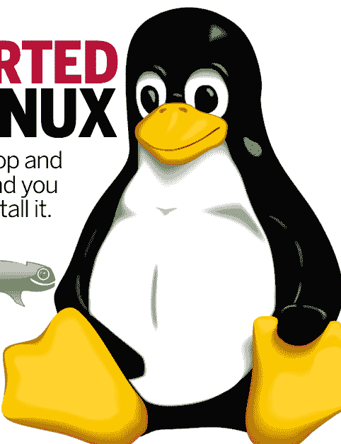

`A` 当你阅读这本 *《Linux 简明指南》* 杂志时，你会注意到大多数屏幕看起来既不像 `Microsoft Windows`，也不像 `Apple mac OS`。这是有原因的：它们确实如此。正如汽车制造商或电视品牌各不相同一样，运行你的 `PC` 或 `Mac` 的操作系统也绝不止一种。只是 `Linux` 恰好是**免费**的，因为它是由全球成千上万的代码人员开发的。这本杂志中的所有编码项目都基于用户在桌面计算机上运行 `Linux`。你不必这样做——代码在 `Windows` 或 `mac OS` 上也能运行——但 `Linux` 自带许多语言，或者可以从中央服务器立即安装。你不需要四处搜索可疑网站；只需运行一条命令或打开软件中心，就能获取所需的东西。

这就是 `Linux` 的美妙之处——它是极客为极客构建的，用来做极客的事情。一旦你习惯了它略有不同的界面和工作方式，你会发现其实与之相处起来非常容易。我们建议你使用一个名为 `Linux Mint` 的版本（通常称为发行版），我们将探讨如何在 `Windows`（或 `mac OS`）之上的 `VirtualBox` 中运行 `Mint`，而下方的实战演练将向你展示如何创建一个启动映像，你可以从 `DVD` 或 `USB` 闪存盘启动并运行它。

> “它并不吓人，不会损坏你的电脑，你甚至不需要安装任何东西。”

#### VirtualBox

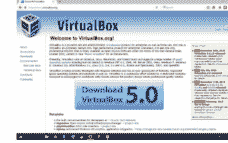

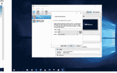

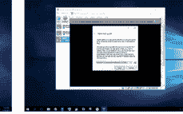

##### 1 获取 VirtualBox

前往 `www.virtualbox.org`，为你的操作系统（无论是 `Windows` 还是 `mac OS`）下载 `VirtualBox 5`。安装它，并注意你需要大约 `20GB` 的剩余磁盘空间来存储虚拟 `OS` 文件。你还需要 `www.linuxmint.com` 上的 `Mint ISO` 文件。安装完成后，启动 `VirtualBox`，点击 `New Machine`，选择 `Linux` 并将其命名为 `'Mint'`。

##### 2 创建机器

选择 `Ubuntu`，位数应与你下载的 `ISO` 匹配。点击 `Next`。在 `Memory` 部分，我们推荐 `2048`，但如果你有一台 `8GB` 内存的 `PC`，`4096` 是最佳选择。除动态硬盘大小外，其余均可保留默认设置。默认是 `8GB`，但为了以防万一，我们建议设置为 `32GB`。完成后点击 `Start` 开始。

##### 3 启动虚拟 Mint

系统会提示插入光盘。定位到你下载的 `Mint ISO` 文件并点击 `Start`。`Linux Mint` 将启动，加载完成后，你可以自由试用，或使用 `Install` 图标将 `Mint` 正式安装到虚拟机中。为了进行扩展使用，在虚拟机的设置中的 `Display` 部分，你应该启用 `3D` 加速并分配 `16MB` 内存。

如果你从未尝试过 `Linux`，我们认为你会惊讶于它使用起来是多么简单，以及它作为开发平台是多么出色。你还应该知道，`Linux` 运行着互联网的大部分，从核心服务器到网站，并驱动着世界上 `97%` 的超级计算机，并广泛用于科学和工业领域。因此，理解它并不是什么坏事。

无论你遵循哪个教程，你都需要一份最新版本的 `Linux Mint Cinnamon` 发行版。前往 `www.linuxmint.com/download.php`，下载 `32` 位构建版，除非你知道你的系统是 `64` 位的，如果是这样，请下载 `64` 位版本。如果你的机器较旧或速度较慢，请选择 `MATE` 版本，它对图形的要求较低。

开发人员。在许多方面，`Linux` 的主要缺点一直是其易用性（`Mint` 是这一规则的例外），但考虑到它是由开发人员设计和创建的，易用性在待办事项清单中排得很靠后。这段历史的后果是，所有 `Linux` 平台上都有大量最先进的工具可供免费使用。只要你愿意自己寻找帮助并向社区回馈，就会发现一个非常热情且丰富的开发生态系统在等着你。

#### 小贴士

##### 什么是发行版？

> 与 `Windows` 和 `mac OS` 不同，由于 `Linux` 是免费软件，任何人都可以获取它并有效地创建自己的 `OS` 进行分发。在 `Linux` 世界中，这些简称为发行版（`distros`），实际上有数百种——并非都很好，并非都得到维护，但数量确实有数百。

#### 启动并运行

`Linux` 之所以成为如此出色的开发平台，一个主要原因是它是由...

#### 获取应用程序

在 `Windows` 上，过去你习惯从四面八方下载程序。最近，`Windows` 商店的引入至少将软件来源集中化了，并消除了感染病毒和恶意软件的担忧。事实是，在 `Linux` 中，获取新工具和程序的关键方式一直是来自一个受保护并由发行版创建者维护的软件中央存储库。

这是 `Linux` 保持如此安全的原因之一（它并非无懈可击），但人们下载可疑软件是机器感染的关键途径。对于 `Linux Mint`，有一个 `Software Center`（软件中心），它让你可以访问数百个程序以及你所能想象到的所有编程开发工具。虽然这不是我们来到这里的初衷，但你可以下载 `Valve` 的 `Steam` 游戏客户端，并利用它提供的超过 `1,700` 款 `Linux` 游戏。

##### GNU/Linux 中的 GNU

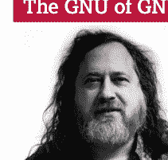

`GNU` 项目（`GNU` 代表 `'GNU's Not Unix'`）比 `Linux` 早了好几年。它已经创建了 `20` 世纪 `80` 年代初计算机所需的大部分基本工具——编译器、文本编辑器、文件和目录操作命令，以及更多——但没有可用的内核（有人说它的内核 `GNU Hurd` 至今仍然不太可用）。当 `Linus Torvalds` 在 `1991` 年开始捣鼓他的小项目时，他有一个内核，但没有可以在上面运行的工具。两者被结合在一起，`GNU/Linux` 诞生了——一个使用 `Linux` 内核和 `GNU` 工具集的操作系统。不仅 `/sbin` 和 `/usr/bin` 中的程序来自 `GNU`；`glibc` 是 `Linux` 中使用的核心 `C` 库，它也来自 `GNU`。所以，几乎每次你在计算机上做任何事——每次你输入命令或点击图标——都有某种形式的 `GNU` 软件在运行。

难怪 `GNU` 的死忠分子当我们称我们的操作系统为 `Linux` 而不是 `GNU/Linux` 时会感到生气。值得一提的是，没有人真的否认 `GNU` 部分的重要性；将 `OS` 称为 `Linux` 而不是 `GNU/Linux`，更多的是出于方便和懒惰，而非政治原因——全称实在太冗长繁琐。


#### 运行 Linux 的简单方法

如果你不是 `Linux` 的重度用户，你可能不想破坏现有的 `Windows` 或 `Mac` 系统，我们也不怪你。事实是，你不需要——`Linux` 足够灵活，可以通过多种方式运行：与大多数其他操作系统并列、覆盖或协同运行，并适用于大多数类型的硬件——从虚拟版本到从备用 `USB` 驱动、`DVD` 或 `Raspberry Pi` 等低成本硬件上运行的版本。一旦你拿到了 `ISO`，标准方法是将其刻录到 `DVD` 上。当你首次开机时，通常可以通过按 `F11`/`F12`，或在 `Mac` 上按住 `C` 键，让它从替代介质启动——一些 `PC` 默认从合适的光盘启动。

另一个选项是从 `www.virtualbox.org` 安装 `VirtualBox`（见前一页）。安装并运行它——它看起来很复杂，但如果你坚持使用默认设置，创建虚拟 `PC` 其实很简单。主要的障碍是确保在 `Storage` 部分将 `ISO` 文件添加到虚拟光驱中。还有更多选项，包括将 `ISO` 文件写入合适的 `USB` 拇指驱动器，并遵循上述类似的启动过程，从中运行 `Linux`。要做到这一点，你需要使用如 `http://unetbootin.github.io` 的 `UNetbootin` 这样的写入工具。

对于勇敢的人，你还可以直接在系统上安装 `Linux`。大多数 `Linux` 版本会在 `Windows` 旁边创建空间并制作双启动系统。

被称为终端（`Terminal`）。根据系统不同，它可以被叫做很多不同的名字，例如命令行、命令提示符或命令行界面。它是操作系统及其所有工具的直接接口，你通过文本命令来访问它们。回想计算机和 `Linux` 的早期，由于计算机速度慢得多，没有任何图形界面，所以计算机完全通过文本命令来控制。


Linux 最初是在这种环境中开发的，所以它的核心工具都基于终端使用。如今，其中许多——或者你关心的所有——都有了图形界面。事实上，终端仍然是控制 Linux 的有效方式，而且在故障排除方面，它提供了一套一致的工具和接口来解决这些问题。

你在日常生活中使用 Linux 不需要知道任何关于终端的知识，但知道它的存在总是好的。然而，我们建议你至少打开一个终端并使用 `ls` 命令列出目录，以及使用 `cd` 更改目录。

#### 驱动程序

我们并不是真的要详细讨论 Linux 的方方面面，但当人们从 Windows 转过来时，经常会出现一些标准问题。关键的一个是：所有驱动程序在哪里？Linux 的酷之处在于，总的来说，你不需要担心驱动程序——它们已内置于 Linux 内核中。这并不意味着你不能添加驱动程序，但它们通常不是必需的。有几个例外：某些更冷门的笔记本电脑无线网卡可能会引发问题，而如果你想要最佳的 3D 游戏性能，你需要安装显卡制造商提供的专用图形驱动程序。

#### 终端

如果你听说过 Linux，那么你可能害怕或仅仅好奇的一个领域是

#### Linux 不是 Windows

首次使用 Linux 时，要记住的一点是它不是 Windows 或 Mac OS X。这主要意味着你在 Windows 中习惯的东西在 Linux 中不会以相同的方式工作，或者不在相同的位置，它也不提供相同的程序集合。因此，像 Microsoft Office、Adobe Photoshop 以及 Microsoft Visual Studio 等开发工具等大型商业产品并非直接为 Linux 制作——你可以通过称为 Wine 的系统来运行它们——但 Linux 开源社区已经创建了如 LibreOffice、Gimp、Krita 等自己的工具，以及一系列免费且开源的产品，它们提供相同的功能。

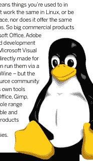

#### 在 USB 驱动上运行 Mint

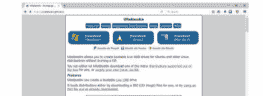

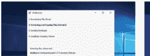


##### 1 UNetbootin Linux

要从 USB 棒运行 Linux，你首先需要至少 4GB 大小的 USB 驱动器——16GB 将是最理想的。你需要 `www.linuxmint.com` 上的 Mint ISO 文件，如 VirtualBox 实战演练中所述，我们将使用 `http://unetbootin.github.io` 的下载工具 UNetbootin。这将启动盘 ISO 文件直接安装到你的 USB 驱动器上。

##### 2 安装 Mint

该工具可以直接为你下载 Mint ISO 映像，但最佳实践是你自己这样做，然后如果你想要制作 DVD 副本或重做此过程，可以使用本地副本。选择 Diskimage 并在 Download 文件夹中定位文件。确保在下拉菜单中选择了正确的 USB 驱动器，然后点击 OK 创建驱动器。

##### 3 启动并运行

现在你可以从 USB 驱动器启动你的 PC。但是，你需要确保你的 PC 选择 USB 驱动器作为启动设备。通常，当你首次打开 PC 时，一条消息会说按 F11 或 F12 来选择启动设备。一些 PC 有自己的特定按钮——请咨询你的手册或制造商。Linux Mint 将开始运行。

### Linux 发行版指南

尝尝各种不同风味的 Linux……

在 Linux 世界中，由于它是允许任何人自由再分发的免费软件，因此出现了大量不同版本的 Linux 操作系统。有很多针对常见用途量身定制的 Linux 发行版，从硬核 Linux 极客到服务器、科学、媒体编辑等等。大多数都是通用发行版，面向不同类型的用户，例如经验丰富的命令行用户、完全初学者、企业、拥有老旧电脑的人以及想要现代华丽界面的人。选择可能会令人眼花缭乱，因此，如果你有兴趣更多地了解 Linux，以下是我们对主要发行版群体的梳理，帮助你入门。

#### Debian

- `www.debian.org`

Debian 是最古老的发行版之一，从技术上讲，它也是衍生发行版数量最多的“父亲”，其中包括世界上最受欢迎的发行版之一——Ubuntu（见下文）。Debian 本身可以被视为一个基础发行版，因为它仅包含安装和运行所需的最少组件。它真的为服务器和专家设计，但非常稳定，并且拥有完整的软件软件库，这意味着它也很容易扩展。

#### Ubuntu

- `www.ubuntu.com`

这可以说是世界上最受欢迎——或至少最广为人知——的 Linux 发行版。正如上文所述，Ubuntu 是从 Debian 项目中衍生出来的，旨在创建一个易于使用的发行版，适合任何人使用。多年来，产生了大量的衍生版本——既包括官方的，如 Ubuntu Server，也包括非官方的——因为作为一个起点，它变得非常容易，拥有简单的安装、简单的界面和简单的软件中心。

#### Mint

- `www.linuxmint.com`

基于 Ubuntu，在 Ubuntu 转向更现代、类似触摸屏的桌面后，Mint 夺得了最受欢迎发行版的王冠，而大多数 Linux 用户想要的是传统的键盘/鼠标设计，带有程序菜单和桌面图标。Mint 提供了 Ubuntu 安装简单、易用以及庞大的软件基础，但为较旧、较慢的电脑提供了优化版本，还有一个更华丽的版本，称为 Cinnamon。

#### Red Hat

- `www.redhat.com`

你不太可能会接触到 Red Hat，因为它是企业和大公司使用的大型商业发行版。不过，值得一提的是，因为它资助了几个可以免费使用的高质量发行版。Red Hat 是一家价值数十亿美元的企业，而且不寻常的是，它是一个付费的 Linux 发行版，但有一些方法可以通过免费发行的发行版有效地获得相同的技术。

#### Fedora

- `http://getfedora.com`

Fedora 项目由 Red Hat 创建，作为尖端 Linux 技术的测试平台。功能在 Fedora 中进行测试，当它们被认为足够稳定时，会被合并到 Red Hat 发行版中。这听起来并不可怕，因为 Fedora 只在这些功能稳定时才会获得它们。这是测试最新技术的极佳方式，因为 Fedora 往往比其他大多数发行版更早获得这些技术。

#### OpenSUSE

- `www.opensuse.org`

另一个面向商业的发行版，同样拥有悠久的血统。它可能不是这里最性感的发行版，但它被广泛使用，并且经常排名前五的发行版，因为它超级稳定，并且可以用于许多用途，从标准桌面使用到服务器。这在很大程度上是因为它也是一个企业赞助的项目，深受开发人员和软件供应商的赞赏。

#### Mageia

- `www.mageia.org`

为了向你展示 Linux 世界的流动性，Mageia 是在一个长期运营的商业 Linux 发行版 Mandriva 破产后创建的。从灰烬中诞生了一个全新且强大的桌面发行版，它提供了强大但易用的桌面和完整的软件库。它与 Ubuntu 和 Mint 并驾齐驱，以其易用性著称，同时还设法带来了新功能。

#### Arch

- `www.archlinux.org`

这是一个超高级版本的 Linux，你几乎必须从头开始构建。这意味着你需要是专家才能成功使用它，但这也意味着你得到一个正是你想要的绝佳操作系统。一个巨大的优势是 Arch 的活跃专家社区会在其他人之前提供软件的最新构建版本。

#### Manjaro

- `https://manjaro.github.io/`

没有复杂性的 Arch Linux。Manjaro 社区采用了 Arch 的基础，创建了一个预构建的 Linux 发行版，该发行版持续更新，也称为滚动发行版。虽然它倾向于更技术性的发行版发布，但开发人员已尽力使其对所有层级的用户都易于访问。

#### SteamOS

- `http://store.steampowered.com/steamos`

这是 Linux 以完全商业化方式使用的另一个例子。SteamOS 由 Valve Software 创建，该公司是名为 Steam 的 PC 数字分发系统背后的公司。SteamOS 基于 Debian，是一个定制操作系统，为 Steam 大图模式的前端提供动力，将控制器、家庭串流和商店整合到一个体验中，你可以从电视下方的盒子中享受这种体验。

### 逃离 Windows 10

受够了 Windows？切换到 Linux，发现它提供的力量和自由。是时候打开逃生舱了！

> “从 Windows 迁移最简单的方法是通过 Mint，一个用户友好的 Linux 发行版”

Windows 10 的发布对于那些对微软生态系统感到沮丧的人来说是一个绝佳机会，让他们找到更好的方式。还有什么比 Linux 更好的方式呢？如果你刚买了一台预装 Windows 10 的 PC，或者从早期版本升级并决定受够了，或者有一个家人或朋友终于开窍了，这篇文章就是为你准备的。


从 `Windows` 迁移最简单的方法是通过 `Mint`，这是一个用户友好的 `Linux` 发行版（distro），装满了你需要的所有功能，包裹在一个易于使用的用户界面中，特别适合首次转换用户。你可以在`www.linuxmint.com`找到最新版本。我们将使用版本`17.3`带你逐步完成过程，但如果你更喜欢`Ubuntu`（`15.10`或`14.04.3 LTS`），指南的大部分可以轻松适应`Ubuntu`。

过程很简单：首先，你需要备份当前状态的硬盘，这样你就知道如果需要，总可以回到过程开始时，而不会丢失数据。然后，我们将展示如何安装`Mint`与现有的`Windows 10`安装并存，这样在转换过程中，你仍然可以访问旧系统。我们将解决你遇到的双启动问题，并揭露一些让人不敢转换的误区背后的真相。

我们还将带你游览新的`Cinnamon`桌面，揭示你需要的基本操作以入门，并展示如果你安装了`Ubuntu`如何切换到它。最后，但同样重要的是，我们将展示如何在你的新系统上安装应用程序，找到开源替代品来替代你之前使用的主要程序，甚至展示如何在名为`Wine`的聪明工具的帮助下运行一些`Windows`程序。

你需要的一切都在这里，所以现在没有借口了。继续阅读，发现如何逃离`Windows 10`并改变你的计算体验。

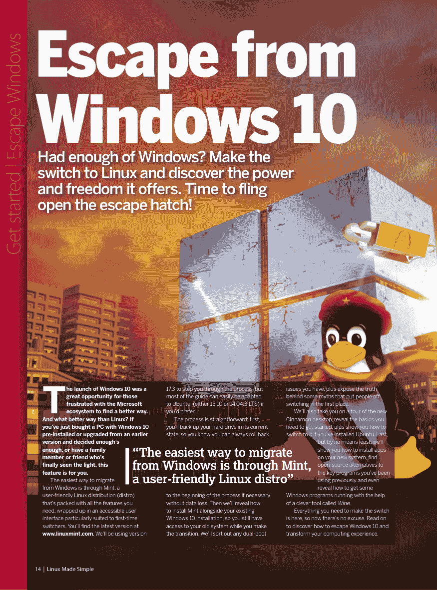

### 进行备份

在你备份之前，甚至不要考虑安装`Linux`……

没有什么比尝试升级或安装新操作系统时出现问题更糟糕的了。你可以通过在开始前确保备份了`Windows`安装（或仅你的数据）来消除那种胃部紧缩的感觉，这将使你在出现问题时轻松回滚到工作状态。

有许多备份工具可用于此任务，但我们选择了`Redo Backup and Recovery`，它能与`Windows`和`Linux`安装完美配合——前往`www.redobackup.org/download.php`并按照说明下载`Redo Backup live CD`的`ISO`格式。将其刻录到光盘很简单：在驱动放入一张空白光盘，在`Windows 10`中浏览到`ISO`文件，右键单击并选择“Burn disc image”。如果你更愿意创建可启动 `USB` 闪存盘，请确保其格式化为`FAT32`，然后下载并运行最新版本的`Unetbootin`，从`http://sourceforge.net/projects/unetbootin`——选择`Diskimage`选项，点击“...”选择你的`ISO`文件，并在点击“OK”之前验证选择了正确的`USB`驱动器。在继续之前，如果你还没有`Windows 10`安装介质，你也应该创建一个`Windows`恢复磁盘或闪存盘——如果你遇到`Ubuntu`和`Windows`双启动的问题，可能需要它。在`Windows 10`搜索栏中输入`recovery`并选择“Create a recovery drive”开始。

一旦创建好了恢复介质和`Redo Backup`介质，插入`Redo Backup`驱动器并重启你的`PC`，然后在启动时按选项键选择你的启动设备（通常是`F11`或`F12`）。选择驱动器，然后在提示时选择“Start Redo Backup”。如果你回到启动选择菜单，那么很可能是你试图从较新的`PC`的`UEFI`模式而不是`BIOS`模式启动（请参阅下方“回滚并重新开始”框，以获取解决此问题的帮助）。如果你无法以任何形式让`Redo Backup`工作，尝试使用内置的`Windows`磁盘映像工具进行备份，它是备份和恢复工具的一部分。

#### 使用 Redo 进行备份

当主屏幕出现时，点击“Backup”按钮开始。从下拉菜单中选择`Windows`当前安装所在的驱动器（通常是驱动器`1`），点击“Next”。所有驱动器的分区将被选中——保持原样，再次点击“Next”。

接下来，你将被提示选择备份目标——通常是直接插入你`PC`的外部硬盘上最大的分区，因此从列表中选择它，确保有足够的备份空间，再次点击“Next”。完成后，点击“Browse”选择或创建一个文件夹，你的备份将存储在其中。点击“Save Here”，然后“Next”。给你的备份一个合适的名称——默认日期有点令人困惑，所以请随意更改为类似`pre-Mint`的名称。最后，再次点击“Next”，然后坐在一旁等待，`Redo Backup`将完成备份驱动器的繁重工作。这可能需要一些时间，因此如果你手头有另一台`PC`，为什么不利用这段时间按照下一页的建议准备你的`Mint`安装介质呢？一旦完成，并且备份成功完成，你就可以安装`Linux`了。

如果你的`Mint`安装出了问题，或者你想从头开始并尝试不同的方法，那么你只需从`Redo Backup`介质启动，并按照以下分步指南操作，应该能让一切恢复到你开始之前的样子。

### 快速提示

`Live`光盘

`Linux`发行版可以做的一个酷炫技巧是让你直接从称为`Live Disc`的`DVD`运行整个`Linux OS`。这意味着你可以在不安装的情况下测试该发行版。

#### 回滚并重新开始

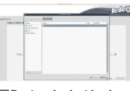

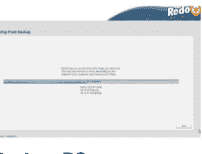

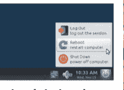

1. 启动并选择备份

从你的`Redo Backup CD`或闪存盘启动，在提示时点击“Start Redo Backup”。当主屏幕出现时，点击“Restore”按钮。首先，选择物理磁盘上存储备份的分区，然后点击“Next”。点击方框以打开“Select Backup Image”对话框，然后浏览到你放置备份的文件夹，选择备份作业文件并点击“Open”。

2. 恢复 PC

点击“Next”。然后选择包含你`Windows`安装的驱动器。整个驱动器将被你的备份覆盖，因此在点击“OK”之前请阅读并消化警告。等待驱动器恢复到你在做备份时的状态。与备份过程一样，这可能需要一些时间，所以请做好长时间等待的准备。

3. 启动并重新开始

一旦过程完成，点击“OK”，然后“Exit”。点击右下角的电源按钮，选择“Reboot”。在提示时移除`Redo Backup`/ 启动介质，按`Enter`。你的系统将重启，你应该会发现`Windows`像以前一样加载。现在你可以重新启动安装过程以纠正之前的错误。

### 安装 Linux Mint

准备工作已经完成，是时候开始安装`Mint`了！

在你已经准备好可靠的备份之后，现在可以下定决心安装`Linux Mint`了。以下步骤假设你希望将`Mint`与现有的`Windows`安装并行安装 – 这对于初次从`Windows`切换到`Linux`的用户来说是一个不错的选择，对于帮助他人迁移到`Linux`的人也同样适用。

你可以在`linuxmint.com`上找到最新版本。与`Mint`的所有版本一样，它是一个长期支持（LTS）版本，支持保证将持续到`2019年4月`。如果你更倾向于尝试`Ubuntu`，请前往`www.ubuntu.com`并选择“下载：点击'Ubuntu 桌面'并下载适合你处理器架构的正确版本（大多数情况下为`64位`），无论是`Ubuntu 14.04.3 LTS`还是最新版本`15.10`。创建`Mint`或`Ubuntu`安装光盘或`U盘`的过程与`Redo Backup`（在上一页中介绍）的过程相同，且`Mint`和`Ubuntu`的安装过程完全一致。

当你的`PC`启动时，它使用一小段软件来引导并运行系统。过去，这被称为`BIOS`（基本输入输出系统），但现在已被更强大、更灵活的`UEFI`（统一可扩展固件接口）所取代。实际上，`UEFI`提供了更用户友好的界面和更好的功能，但它与旧硬件不兼容。配备`UEFI`的系统附带一个特殊的兼容支持模块（`CSM`），允许你在尝试使用旧硬件和操作系统时模拟`BIOS`。它们还默认启用安全启动（`Secure Boot`），这是一种旨在保护`PC`免受低级恶意软件攻击的特殊功能。

你的`PC`几乎肯定会启用安全模式（`Secure Mode`），这对完全支持该模式的`Mint`来说不是问题。然而，另一个新功能 – `FastBoot`（也称为`QuickBoot`或`FastStartup`）– 几乎肯定也处于启用状态，在安装`Linux`之前需要禁用它。（有关如何操作，请参见下方的`修复 UEFI 引导问题`框。）

一旦编辑好`UEFI`设置，请确保你的安装介质已插入，然后重启你的`PC`。在启动时查找访问引导菜单的选项 – 通常是`F11`之类的按键。这将弹出一个可用驱动器列表；选择你的`DVD`或`USB`闪存盘并按下回车键。如果你看到两个条目，不要惊慌 – 这发生在`CSM`被启用的时候，其中一个条目是非`UEFI`选项，允许你使用旧版`BIOS`兼容模式启动。然而，`Windows 10`几乎肯定是使用`UEFI`模式安装的，因此请选择该选项以继续。

#### 分区你的硬盘


当你到达 `Mint` 桌面后，双击“安装 Linux Mint”图标。确认已选择英语，点击“继续”，然后确认两个复选框都已勾选，再次点击“继续”。等待安装程序扫描你的硬盘。在理想情况下，它应该检测到你的 `Windows 10` 安装，但情况并非总是如此。如果它声称没有 `Windows` 安装，最简单的做法是遵循分步指南（参见底部第 17 页的`手动配置驱动器以实现双启动`框）来手动设置你的硬盘。

如果安装程序确实检测到 `Windows 10`，请保持选择“在 `Windows 10` 旁边安装 `Mint`”并点击“下一步”。你的下一步是腾出足够的驱动器空间给 `Mint` 所需的容量。安装程序会做出一个估算，但你可以通过点击并拖动两个分区之间的分隔线来自行设置此数值。请注意，如果你有多个硬盘，`Mint` 实际上可能会选择不同的硬盘来安装自身，因此请验证它选择的那个，并点击“选择驱动器”旁边的下拉箭头，看看是否可以在必要时更改此设置。如果不能更改，且你不想在推荐的驱动器上安装，请点击“返回”并遵循分步指南手动操作。

> “该步骤假设你希望将 `Mint` 与现有的 `Windows` 安装并行安装”

- **完全安装**

  `Mint` 和 `Ubuntu` 可以提议与 `Windows` 完全和谐地共存，但它们也可以清除 `Windows` 以获得完整的 `Linux` 体验。

#### 修复 `UEFI` 引导问题

打开你的 `PC` 并轻敲提示键以进入设置 – 通常是 `Del`（或 `F2`）。在启动（`Boot`）或 `Windows` 配置（`Windows Configuration`）下查找 `FastBoot` 设置，然后确保将其设置为禁用状态。如果你遇到 `Redo Backup` 无法启动的问题，你还应该暂时禁用安全启动，并可能需要调整 `CSM` 设置以使 `Redo Backup` 正常工作 – 在启动、安全或 `Windows` 配置下查找这些设置。对于 `CSM`，其设置可能隐藏在单独的菜单中，在那里你会找到对 `PXE`（预启动环境）、`GOP`（图形）和存储（或 `SATA`），以及在适用情况下的 `USB` 和 `PS/2` 的引用。这允许你根据需要选择性地为特定设备开启或关闭 `CSM`。如果有选项可以运行两者 – 例如某些华擎（`ASRock`）主板的情况，请选择适当的选项（如“不启动”），以确保最大的兼容性和性能。并非所有 `PC`，特别是现成的型号，都会让你访问所有这些设置 – 请联系制造商查询这些设置在哪里，或询问是否有更新可以恢复这些设置。还要搜索你的 `PC` 型号、制造商以及“`CSM`”、“`UEFI`”、“`Linux`”或“`Mint`”等关键词，看看是否有其他转换用户设定的先例可供你遵循，以启用所需的设置。

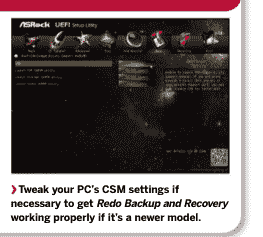

> 如果是较新的型号，请根据你的 `PC` `CSM` 设置进行调整，以确保 `Redo Backup` 和恢复功能正常工作。

假设 `Mint` 选择与 `Windows 10` 相同的驱动器进行自身安装，请为 `Windows` 至少保留 `10GB` 的可用空间，并给 `Mint` 至少 `8GB` 的驱动器空间以进行工作 – 如果你计划将其作为主要操作系统，请分配更多空间。请记住，你之后总是可以重新分区驱动器或删除 `Windows` 分区。

设置好驱动器后，点击“现在安装”。注意警告信息并点击“继续”。你将需要确认建议的更改 – 默认情况下，`Mint` 安装程序只创建两个分区（`Ext4` 条目是你的 `Linux` 分区，此外它还创建了一个专用的交换分区）。点击“继续”以接受更改。

接下来，安装程序将尝试检测你的位置，大多数情况下会定为伦敦。你可以接受此设置，或者输入你所在最大城镇的名称看看是否被识别。点击“继续”，然后设置你的键盘布局。

下一个阶段是你输入姓名的地方 – 你会看到计算机名称已为你预填，并随着你输入的用户名而变化。你可以修改这些，并输入密码 – 你登录时需要提供此密码，此外还需要一个管理员密码以执行某些任务。

只有当你的 `PC` 不是共享使用时，才选择自动登录；如果你在一台笔记本电脑上安装 `Ubuntu`，请勾选“加密我的主文件夹”以保护你的数据，以防设备丢失。点击“继续”，你就完成了 – `Mint` 将在后台进行自我安装。在等待期间，你可以去泡一杯标准的茶（或两杯），或者坐着阅读一些关于 `Ubuntu` 包含的功能和应用程序的精彩内容，以及如何通过软件中心查找更多信息。当安装完成后，点击“立即重启”，在提示时移除安装光盘或驱动器，并按下回车键。`Ubuntu` 现在已安装；翻页以了解如何开始使用它。

### 手动配置驱动器以实现双启动

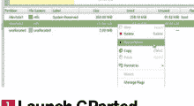

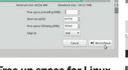


**启动 `GParted`**

启动你的 `Mint` 安装介质。当桌面出现时，点击左下角的“菜单”按钮，并在搜索框中输入“`GParted`”。当 `GParted` 条目出现时，点击它以启动。验证已选择你的 `Windows` 驱动器（`/dev/sda`） – 你应该至少看到两个分区，其中最大的是你的 `Windows` 分区。右键点击该分区并选择“调整大小/移动”。

**为 `Linux` 腾出空间**

点击右侧滑块并将其向左拖动，以为你的 `Ubuntu` 安装腾出足够的空间 – 为 `Windows` 保留至少 `10GB` 的可用空间。完成后，点击“调整大小/移动”，然后点击“应用所有操作”按钮，在提示时选择“应用”。等待分区完成，然后点击“关闭”。双击“安装 Linux Mint”快捷方式。选择“英语”并点击“继续”。

**开始分区**

保持两个复选框勾选状态并点击“继续”。在“安装类型”下选择“其他”并点击“继续”。选择 `/dev/sda` 下的可用空间并点击“+”按钮以设置你的第一个分区。将大小设置为 `4096MB`，保持分区类型选择为“逻辑”，或者选择“此空间的末尾”。点击“用作：”下拉菜单并选择“交换区”然后点击“确定”。

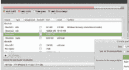

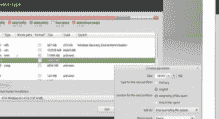

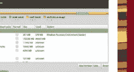

**设置 `Linux` 分区**

选择可用空间并再次点击“+”按钮。这次，将分区大小设置为 `12000MB`（`12GB`），保持选择“逻辑：此空间的开始”和“`Ext4` 日志文件系统”。点击“挂载点：”下拉菜单并选择“`/`”使其成为 `Ubuntu` 驻留的主分区（如果你有大量可用空间，可以使其更大）。再次点击“确定”。

**创建主目录分区**

选择剩余的可用空间并再次点击“+”。除了挂载点保持所有设置不变，将挂载点指向 `/home` 然后再点击“确定”之前。`/home` 目录是存储每个人个人文件和设置的地方 – 包括文档、图片和程序 – 因此确保它是三个分区中最大的那个。完成后，审查你的更改。

**设置引导分区**

如果你需要再次设置分区，请依次选择每个新的 `Linux` 分区并点击“–”以移除它们，然后返回到第三步。“用于安装引导加载器的设备”下拉菜单应该指向你的驱动器（`/dev/sda`），因此在点击“现在安装”之前请验证这一点是否如此。审查你选择的分区设置并点击“继续”以应用它们并安装 `Mint`。

### 调整双启动设置

了解如何使用 `Grub` 在 `Linux` 和 `Windows` 之间切换。

当 `Mint` 进行安装时，它会更改硬盘开头的引导加载程序为一个名为 `GNU GRand Unified Bootloader` (`Grub`) 的程序。简单来说，`Grub` 会扫描你的硬盘以查找可见的操作系统，然后向你展示一个启动菜单，允许你在它们之间进行切换。在大多数情况下——特别是当 `Mint` 安装程序检测到你的 `Windows` 安装时——这应该一开始就能完美运行。你启动电脑，`Grub` 显示启动菜单，如果你在五秒内没有做出选择，它将会开始加载 `Linux Mint`。

在这种事件下，你唯一需要了解的是如何更改启动菜单——你可能希望将 `Windows` 设置为默认操作系统，或者希望在选择默认 `Mint` 之前有较长的停顿时间。你可以在终端中编辑 `Grub` 菜单，但使用更友好的工具来做这项工作要简单得多。（参见下方“编辑你的 `Grub` 菜单”部分。）

#### `Grub` 故障排除

不幸的是，`Grub` 并不总能按你的预期工作。如果 `Mint` 安装程序没有检测到你的 `Windows` 安装，并且你被迫手动分区硬盘，你可能会发现你的电脑现在直接启动到 `Mint`，而没有 `Windows` 的迹象。别担心，它仍然在那里，但你需要执行一些额外的步骤使其可访问。

首先，你需要从 `Windows 10` 救援介质启动：选择修复你的电脑，然后选择“故障排除”>“高级”>“启动修复”以恢复原始的 `Windows` 引导加载程序。这会恢复 `Windows`，但让你无法访问 `Mint`——为了解决这个问题，从你的 `Mint` 安装介质启动，然后按 `Ctrl+Alt+T` 打开终端并输入以下命令：


```
sudo add-apt-repository ppa:yannubuntu/boot-repair
sudo apt-get update
sudo apt-get install -y boot-repair && boot-repair
```

当 `Boot Repair` 启动时，选择推荐的修复并按照步骤操作。该过程涉及将一些命令复制并粘贴到终端中 – 使用 `Shift+Ctrl+C` 复制它们，然后在终端中右键单击并选择粘贴 – 以及导航几个额外的工具。按 `Tab` 键在选项之间跳转，然后在选择选项时使用方向键和空格键，最后按 `Enter` 键进行选择或继续。

完成后，重启你的电脑 – 希望 `Windows 10` 和 `Linux` 现在都作为可用的选项出现在启动菜单中。请注意，`Windows` 可能不会被直接引用 – 如果一个条目指的是 `Windows 10` 引导加载程序，请尝试它。这很可能有效，在这种情况下，你可以使用 `Grub Customizer` 重命名该条目。

如果这不是发生的情况（`Grub` 可能存在，但只提供启动到 `Mint` 的选项），那么修复工具可能已将启动条目直接放入你的电脑的 `UEFI` 启动菜单中，而不是放入 `Grub` 中。以通常的方式启动你的电脑，但轻按 `F11` 或任何访问启动菜单所需的键。你应该会看到一个额外的选项存在 – 要么是“`Windows` 启动管理器”要么是“`linux`” – 选择这应该会启动该操作系统，而选择原始的硬盘条目将会启动另一个操作系统。然后你可以通过进入你的 `UEFI` 设置实用程序并检查“启动”下的选项（寻找“硬盘优先级”部分）来选择默认启动哪个操作系统。

如果一切都完全搞乱了，那么只需使用 `Redo Backup` 恢复你的故障安全备份，并重新开始安装过程。

#### 编辑你的 `Grub` 菜单

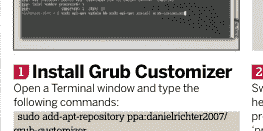

##### 1 安装 `Grub Customizer`

打开一个终端窗口并输入以下命令：

```
sudo add-apt-repository ppa:danieldiken/2007/grub-customizer
sudo apt-get update && sudo apt-get install grub-customizer
```

完成后，通过点击“菜单”并搜索“`Grub`”来启动 `Grub Customizer`。

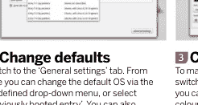

##### 2 更改默认设置

切换到“常规设置”选项卡。从这里，你可以通过预定义的下拉菜单更改默认操作系统，或者选择“上次启动的条目”。你也可以从此选项卡更改默认条目被选择之前的延迟 – 取消勾选“在默认条目后启动”以暂停 `Grub` 直到选择一个操作系统。


##### 3 更改 `Grub` 的外观

要对 `Grub` 的外观进行一些更改，切换到“外观设置”选项卡，在那里你可以通过更改其颜色方案、字体、默认分辨率甚至应用一个漂亮的背景图像（注意：图像需要是 `PNG` 格式）来美化 `Grub` 菜单。当你完成更改后，点击“保存”按钮以更新 `Grub`。

### 你的问题解答

仍然切换到 `Linux`？让我们让你安心。

你现在准备好通过出色的 `Linux Mint` 发行版迈出进入 `Linux` 宇宙的第一步了，但在你开始之前，让我们探索一些常见的误解，帮助你更好地理解为什么切换是一个伟大的举措。

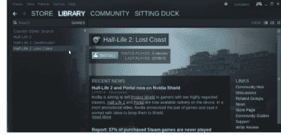

- **`Linux` 是否只是极客的玩具 – 新手不被欢迎？**

  完全是胡扯。如今，`Linux` – 特别是 `Mint` – 坚定地面向普通人类。它很容易上手，正如你在安装过程中已经发现的那样，并且用于各种专业的和个人目的。

- **`Linux` 是否都是关于命令行的？**

  大多数 `Linux` 发行版都带有默认的桌面环境。你甚至可以交换桌面，找到最适合你工作方式的一个。底层的操作系统仍然可以通过命令行终端访问，它的工作方式与 `Windows` 命令提示符类似。

  花点时间学习其中的一些命令，你会发现终端是完成事情的一种快速和便捷的手段，但 `Mint` 提供了大量的点按工具，在大多数情况下，你可以完全避免使用终端。

- **`Linux` 上没有体面的程序，对吧？**

  许多开发人员提供流行程序的 native `Linux` 版本 – 在做任何其他事情之前，请先检查它们的网站。你还会发现大量的免费、开源替代方案，这些是你之前在 `Windows` 中使用的喜欢应用程序的替代品。`Linux` 以其免费的开源根源而闻名，但别担心，那里也有大量的商业软件。最后，通过 `Wine` 实用程序，也完全可以直接在 `Linux` 中运行许多 `Windows` 程序。我们将在本特性的后面部分向你展示如何做（参见第 23 页）。

- **我可以在 `Linux` 上玩游戏吗？**

  当然可以。你会发现仅通过软件管理器就有超过 1,900 款游戏可供使用。从主屏幕选择“游戏”进行浏览。留意免费的 `DOSBox` 模拟器，你可以用它来玩上个千年的旧 `Windows` 游戏。还要查看 `Good Old Games` ([www.gog.com](http://www.gog.com))，它提供新标题和超过 1,300 款与 `Linux` 兼容的无 `DRM` 经典游戏。`Steam` 游戏平台 ([http://store.steampowered.com](http://store.steampowered.com)) 也可用于 `Linux`，在那里你会发现超过 1,500 款游戏 – 许多是大热门标题 – 可供购买和下载。事实上，由于它对系统资源的要求较少，`Linux` 是比 `Windows` 更好的游戏平台，开发人员也认识到了这一点，为 `CryEngine` 等知名游戏引擎提供了原生支持。

- **`Linux` 不支持我的硬件，对吧？**

  在绝大多数情况下，你会发现你电脑的核心组件在 `Mint` 上工作正常，而大多数硬件制造商为外部外设和硬件提供专用驱动程序。从 `Wi-Fi` 适配器到打印机和扫描仪。事实上，得益于 `CUPS`，安装和管理打印机是一个相对无痛的任务。

  `Linux` 真正改善的一个领域是对显卡的支持。`Mint` 在安装过程中安装通用驱动程序，但你可以使用显卡硬件制造商的优化驱动程序来替换这些。点击“菜单”>“管理”>“驱动程序管理器”将开源驱动程序切换为专有驱动程序（如果支持的话），或者访问制造商的网站手动下载驱动程序。

- **它是免费的，所以我想没有支持？**

  访问 [www.linuxmint.com/links.php](http://www.linuxmint.com/links.php)，你会发现文档和一个充满活力的活跃社区，通过论坛和聊天室提供支持和问题解答。花点时间在互联网上搜索，你会发现你绝大多数的疑问已经得到解答。

- **`Linux` 不可靠或不安全，对吧？**

  错了 – 在两方面都错了。`Linux` 的可靠性不亚于 `Windows` 或 `OS X`，在许多方面甚至更强大。它也比其竞争对手更安全，不仅因为它是如何处理用户权限。`Linux` 的开放性质使其接受更严格的审查，而多样化的发行版数量使其成为黑客攻击的目标较少。

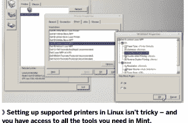

> `Linux` 是玩游戏的完美平台 – `Steam` for `Linux`（和 `GoG.com`）让你可以访问数百个标题，包括大热门标题，作为起步。
>
> 在 `Linux` 中设置受支持的打印机并不困难 – 并且你在 `Mint` 中可以访问所需的所有工具。

### 你在 `Linux` 中的最初几步

发现开始使用 `Linux Mint` 所需的所有核心技能。

第一次启动 `Mint` 时，你会发现它的界面与 `Windows` 非常相似。默认桌面环境是 `Cinnamon`，其结构类似于 `Windows` 桌面：屏幕底部有相当于“开始”菜单、任务栏和通知区域的功能，桌面图标则提供通往关键位置的快捷方式。

点击“菜单”按钮，一个菜单会弹出来，让你轻松访问所有程序，这些程序按类别分组。通过在搜索框中输入你要找的程序名称的前几个字母来加快操作，它就会出现在结果列表中，只需点击一下即可。在菜单的左侧，你会看到一些非常实用的快捷方式——顶部有像 `Firefox`（网络浏览器）、软件管理器（用于查找和安装新应用程序）、系统设置（`Mint` 版的控制面板）、终端和文件管理器等主要程序。底部有锁定、注销以及关闭或重启电脑的按钮。

通过将项目从桌面或菜单右侧拖放到列表中，你可以添加自己的快捷方式。你还可以将快捷方式固定到屏幕底部的面板上（`Mint` 版的任务栏）——只需右键单击并选择“添加到面板”即可。

`Mint` 的面板实际上比 `Windows` 的任务栏更具可配置性——你会在右下角看到许多有用的选项，你可以通过右键单击面板并选择显示在菜单中的选项来自定义这些设置，甚至添加新的面板。

#### 访问驱动器


## 文件管理

Mint 支持多种文件系统，这意味着你现有的 `NTFS` 和 `FAT32` 分区在进入桌面后即可立即被访问。访问你的驱动器——以及一般浏览文件——的最佳位置是 Mint 版的文件资源管理器。它名为 `Nemo`，可以通过你在面板和菜单上找到的“文件”快捷方式访问。你也可以通过双击桌面上的“计算机”或“主目录”图标来打开它。

其布局类似于 `Windows 10` 的文件资源管理器，文件显示在右侧窗格中，左侧是一系列通往关键位置的快捷方式。你还可以在此收藏常用文件夹（选中相关文件夹并选择“书签 > 添加到书签”），以便轻松访问。`Nemo` 还支持选项卡窗口，其工作方式与网络浏览器类似，只不过是用文件夹。按 `Ctrl+T` 添加额外的选项卡，这使得在多个驱动器和文件夹之间切换变得容易，而不会让你的桌面杂乱无章。你会看到 `Nemo` 中有一个访问网络的选项——点击左侧窗格中的“网络”快捷方式以查找其他计算机，如有必要，请准备好你的用户名和密码。

你会发现你的 PC 硬件——在很大程度上——已被自动检测并设置好。点击
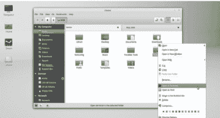

`Nemo` 文件管理器的工作方式与 `Windows 10` 中的文件资源管理器非常相似，因此浏览硬盘不会让你感到吃力。

### 与 Windows 共享数据

如果你计划继续使用 `Windows` 和 `Ubuntu`，设立一个专用的`数据`分区是值得的，然后让两个操作系统都能轻松访问它。使用 Mint 安装程序中的 `GParted` 设置一个 `NTFS` 分区，然后启动进入 `Windows` 并浏览到你的用户文件夹。依次右键单击每个主要数据文件夹——文档、图片等——并选择“属性 > 位置”，将它们指向新数据分区上的相应文件夹，并在提示时移动数据。

你还应该在 `Windows` 和 `Linux` 中两者都禁用休眠——当其中一个操作系统处于休眠状态时写入共享分区的数据，可能会在该操作系统下次唤醒时被清除。在 `Windows` 中，打开命令提示符（管理员），输入 `powercfg /hibernate off` 并按 `Enter` 以启用此设置。

完成后，切换回 `Mint`。通过打开“系统设置 > 电源管理”并确保第二个下拉菜单中选择了“从不”来禁用休眠。接下来，通过 `Dash` 打开“磁盘”实用程序。在左侧选择包含数据分区的磁盘，然后点击右侧的分区，并记下它的挂载点（这通常遵循 `/media/<用户名>/<分区名>` 的格式）。最后，前往 `www.ubuntu-tweak.com` 并安装 `Ubuntu Tweak`（是的，它的部分功能在 Linux Mint 中也能工作！）。从菜单的“管理”部分打开它，然后选择“管理 > 用户文件夹”。
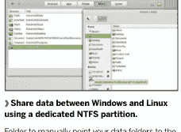

使用专用的 `NTFS` 分区在 `Windows` 和 `Linux` 之间共享数据。选择文件夹，手动将你的数据文件夹指向你之前创建并识别的数据分区上的文件夹。

菜单并选择“系统设置”，以查看“硬件”部分下的当前设置。如有必要，你可以从制造商的网站获取缺失的驱动程序。

既然你已经初试水温并发现它并没有那么深（或冷），请使用 `Redo Backup` 为你的新双启动系统创建第一个系统备份。完成后，你可以开始更深入地探索 `Linux`。让我们从文件系统开始——`Windows` 使用 `NTFS`，当然还有通用的 `FAT32` 文件系统，现在你又拥有了第三个文件系统，`Ext4`。当你启动回 `Windows` 时，你会发现你的 `Linux` 分区是不可见的——这是因为 `Windows` 无法看到 `Ext4`。这就是为什么你的共享数据分区——如果你创建了一个——被格式化为 `NTFS` 的原因。

再次打开 `Nemo` 文件管理器，你会发现自己在 `Home` 文件夹内：当你——如果在安装 `Mint` 时手动配置了分区——可能是一个单独的分区。就像你的 `Windows` 用户文件夹一样，这里包含你所有的个人数据。它还可以包含个人程序和设置。

点击左侧窗格中的 `Computer` 快捷方式，你可以看到 `Ubuntu` 杂乱无章的全貌。这些文件夹中的许多可以忽略，但值得注意的两个是 `Media` 和 `Mint`。这里可以找到所有外部驱动器和网络文件夹的快捷方式。主要区别在于，挂载到 `/media` 的驱动器是基于每个用户的。

### 主要系统工具

以下实用程序可以帮助你调整 `Mint` 的各个部分，而无需使用终端。点击 `System Settings` 会出现一个类似于 `Windows` `Control Panel` 的对话框。在这里，你会发现许多用于调整安装的有用工具：`Appearance` 部分是你自定义 `Cinnamon` 外观的地方，但也可以在 `Preferences` 下查找你可以更改 `Cinnamon` 桌面行为的地方。如果你选择 `Windows > Behaviour` 选项卡并将 `Attach dialogue windows to the parent window` 开关设为“Off”，如果你喜欢 `Windows` 的处理方式，你可以更改 `Mint` 处理每个单独打开的对话框的方式。

`Mint` 还包含许多实用的内置工具——有 `Disks` 工具（我们在 `Share data with Windows` 框中简单提及，第20页），以及 `Disk Usage Analyser`，它让你可以看到驱动器空间使用的图形化分解。`System Monitor` 工具本质上相当于 `Windows` 的 `Task Manager`，而 `Update Manager` 是你保持 `Linux` 最新的地方。
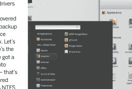

### 终端

在某个时候，你将需要访问终端。一旦你这样做，你会很快意识到它是完成某些事情的最佳方式。至少，使用这个方便的命令列表熟悉基础知识，你可以按 `Tab` 键补全命令甚至文件/文件夹名称：

- `dir` – 列出当前选定目录的内容。
- `cd` – 用于更改目录——使用 `cd ..` 向上移动一级，`cd /foldername` 移动到当前目录内的子文件夹，或 `cd /home/username/Downloads` 跳转到特定目录。请注意，文件夹名称是区分大小写的。随时输入 `cd ~` 即可跳回你的 `home` 目录。
- `cp` – 复制文件。其他文件管理命令包括 `mv`（移动）、`mkdir`（创建文件夹）和 `rm`（删除文件）。
- `sudo` – 以管理员身份执行任务。这相当于在 `Windows` 中右键单击程序并选择“以管理员身份运行”。该命令在其他命令之前（例如，`sudo apt-get install syncthing`），并且首次使用时需要提供你的密码。
- `apt-get` 是用于安装的工具，`upgrade` 用于更新所有现有软件，而 `apt-get check` 用于查找软件问题（即损坏的依赖项）。
- `wget` [从 `Downloads` 文件夹下载：例如 `wget http://addresses.com/filename.gz.`]

若要了解更多关于终端的信息，请查看 `www.rayansutorials.net/linuxtutorial` 上的初学者指南。

> 使用系统设置工具更多地掌控我们的 `Cinnamon` 桌面

## 快速提示

### 驱动器名称

迁移到 `Linux` 时的一个令人困惑的点是驱动器名称去了哪里。在 `Windows` 中，我们有 `C:`、`D:` 和 `E:` 驱动器。`Linux` 使用“扁平”文件系统，其中驱动器字母只是驱动器标签，根目录是 `/`。

### 更换桌面

`Linux` 的优势之一是你不必局限于单个桌面。如果你安装的是 `Ubuntu` 而不是 `Mint`，你会发现它附带了一个非常不同的桌面环境，即 `Unity`。使用它仍然相当熟悉，但你必须付出更大的努力才能掌握它。

如果你难以适应 `Unity`，而宁愿使用 `Mint` 的 `Cinnamon` 桌面，那么你可以轻松做到。首先，打开一个终端窗口并输入：

```bash
sudo add-apt-repository ppa:ubuntu-cinnamon
sudo apt-get update && sudo apt-get install cinnamon
```

这会将 `Cinnamon` 软件仓库（`repos`）添加到 `Ubuntu`，然后下载并安装它。安装完成后，你需要点击 `Unity` 桌面右上角的 `Settings` 按钮并选择“注销”以返回登录屏幕。你会看到你的用户名旁边出现一个小 `Ubuntu` 图标——点击它，将出现可用桌面的列表，包括 `Cinnamon`。选择它以启动到你的新桌面，它具备我们在本页其余部分描述的所有功能。你随时可以从登录屏幕切换回 `Unity`。

如果你随后觉得 `Cinnamon` 桌面不够用了，那么在 `Mint` 中切换桌面也很简单。你甚至可以安装多个桌面，并根据情况在它们之间移动。
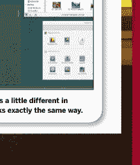

## 在 Mint 中安装应用程序


# 如何在你的发行版中寻找并添加新的程序

既然你已经在 `Mint` 上顺利运行起来，你可能希望开始高效地使用它。这自然涉及到运行应用程序和实用工具。首先，列出你在 `Windows` 中使用的程序清单，并检查每个程序的官方网站，看看是否有适用于 `Linux` 的版本。如果没有，不要惊慌——你会发现绝大多数的 `Windows` 应用程序都有相应的 `Linux` 版本。更好消息是，其中许多都是免费且开源的，因此你无需花费金钱即可使用，但当然可以捐赠以支持它们。

最显而易见的起点是你的办公套件。在替换你的文字处理器、电子表格、数据库和演示工具时，你会发现你需要的一切都已通过免费的 `LibreOffice` 软件内置在 `Mint` 中，可以在 `菜单 > 办公` 中找到。

如果你正在寻找某个特定专有软件的开源替代品，请从 <http://bit.ly/SoftwareEquivalents> 开始搜索，在那里你会找到其他有用资源的链接，例如 `www.osalt.com`。如果你仍然找不到合适的东西，请尝试 <http://alternativeto.net>。

在 `Mint` 中获取和安装软件的最简单方式是通过 `Software Manager`。它为查找和安装程序提供了一个简洁、用户友好的前端。程序被组织到“仓库”（或 `repo`）中，如果你的目标程序不在 `Software Manager` 支持的仓库中，你就得寻找其他获取方式。

首先，访问该程序的主页——这里可能会提供方便的 `Deb` 包形式的可下载安装器——选择 `32` 位或 `64` 位下载（如果提供的话），以匹配你安装的 `Ubuntu` 版本。下载完成后，导航到你的下载文件夹，双击文件并按照提示进行安装。

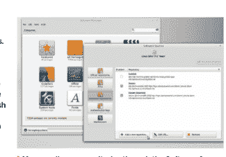

> 通过 `软件与更新` 工具管理你的所有仓库，你可以在 `系统设置` 中找到该工具。

其他程序可能需要你通过终端来安装。这通常首先涉及到使用以下命令添加程序的仓库：

```
sudo add-apt-repository ppa:user/ppa-name
```

`ppa` 代表个人软件包存档，这是一种特殊的软件仓库——通常专注于 `Ubuntu`——任何人都可以建立它（通常是软件团队），用于上传源代码软件包供任何人下载。请用软件生产者提供的 `PPA` 替换 `ppauser/ppa-name`。

完成后，你就可以从该仓库安装软件包，可以通过 `Software Manager` 进行——鉴于你已经处于终端中——或者使用以下命令进行：

```
sudo apt-get update && sudo apt-get install <program>
```

用你目标程序的名称替换 `<program>`，它就会被下载并安装。添加后，你可以通过 `系统设置 > 软件源` 查看和管理所有仓库。

## “你会发现绝大多数的 Windows 应用程序都有相应的 Linux 版本”

### 流行的替代应用程序

| **Windows 应用** | **替代品** | **获取途径** |
| :--- | :--- | :--- |
| Word, Excel, PowerPoint, Access | LibreOffice | 预装 |
| Publisher | Scribus | Software Manager (SM) |
| Photoshop | The GIMP | 预装 |
| Windows Movie Maker | OpenShot | Software Manager |
| Adobe Reader | Document Viewer | 预装 |
| iTunes | Amarok | Software Manager |
| Windows Media Player | VLC Media Player | Software Manager |
| Internet Explorer | Firefox, Chromium | 预装或 SM |
| Outlook/Windows Live Mail | Thunderbird, Evolution | 预装或 SM |
| Skype | Pidgin | Software Manager |

### 保持更新

通过仓库安装的程序——无论是通过终端还是 `Software Manager`——都会定期进行检查更新，具体来说是在首次启动后 `10` 分钟内，然后每两小时检查一次。对于绝大多数人来说，这个频率应该足够了，但你也可以使用两种方法之一手动检查。第一种方法通过 `Cinnamon` 进行：打开 `菜单 > 管理 > 更新管理器` 并点击 “刷新” 以手动检查，并选择 `编辑 > 首选项 > 自动刷新` 以更改更新检查的时间间隔（支持天、小时和分钟）。

要在终端中检查更新，输入 `sudo apt-get update` 并按回车键。你可能会发现软件中心中的应用版本不如程序网站上提供的版本那么新——通过添加相关的仓库，你可以确保安装的是该程序的最新版本，并获得测试版和其他预发布版本的访问权限。

## 安装 Windows 应用程序

如果其他方法都失败，请使用 `Wine` 在 `Linux` 中运行 `Windows` 程序。

在新安装的 `Linux Mint` 中运行应用程序的最佳方式是本地运行，但如果你有一个不可或缺的特定 `Windows` 程序，那么有可能让它运行起来。你需要一个名为 `Wine` 的特殊程序，它使用一些巧妙的技巧利用 `Windows` 的部分组件，使你可以运行许多 `Windows` 程序，仿佛它们是原生的 `Linux` 程序一样。

`Wine` 可能是一个难以掌握的工具，但得益于免费的 `PlayOnLinux` 工具，你可以轻松让许多流行应用程序运行起来，且麻烦最小。打开 `Software Manager`，然后搜索 “`PlayOnLinux`”。点击 “安装”，它将自动下载并安装 `Wine`。

安装完成后，启动 `PlayOnLinux` 并让它引导你完成首次使用向导。你会看到一个空白窗口，所以点击 “安装” 按钮以开始。安装菜单允许你搜索程序或按类别浏览，选项包括游戏、图形和办公。一旦你找到了想要安装的程序，选择它并点击 “安装” 按钮。你可能需要提供该程序的安装光盘，而商业应用程序将需要许可证以及（如果适用）激活。只需遵循向导即可——`PlayOnLinux` 简化了安装任何受支持应用程序的过程，因为它知道需要下载哪些额外组件以及如何配置它们。`PlayOnLinux` 的支持应用程序数据库相对较小——除了 `Microsoft Office` 之外，值得注意的示例包括 `Spotify`、`QuickTime Player` 和 `Adobe Photoshop`（仅限 `CS4` 或 `CS6`）。这是因为其主要关注游戏。如果你发现你想要的程序未在列表中，不要担心——`Wine` 支持的程序比 `PlayOnLinux` 列出的多，但安装过程更复杂。首先检查 <https://appdb.winehq.org> 以查看该应用程序是否受支持。如果存在，你会看到一个经过测试的版本列表，评级从白金一直到低质量。评级为铜牌或以上的通常可以在 `Wine` 中运行，尽管你可能会发现一些故障。完成后，按照分步指南（见下文）尝试通过 `PlayOnLinux` 的手动选项进行安装。如果遇到问题，查阅网页以获取更多建议，或尝试不同的设置，希望最终能得到一个至少能正常执行大多数关键功能的程序。

## 应用程序配置

每个程序都存在于自己的虚拟空间中，你可以在主 `PlayOnLinux` 屏幕上选择它并点击 “配置” 来进行调整。大多数高级配置选项都在 `Wine` 标签下——点击 “配置 `Wine`” 以访问一个多选项卡对话框，其中包含许多额外的调整项。

`Wine` 应自动将你的主文件夹映射到虚拟驱动器中的相应位置，但可以通过驱动器标签使其他位置更易于访问。点击 “添加”，选择一个驱动器号，然后浏览到目录。在 `/media` 文件夹下查找独立的驱动器。选择后，你可以通过分配给它的驱动器号在程序内访问它。

如果 `WineHQ` 数据库中没有提及，不要假设它无法运行：你不会对 `Wine` 造成损害，所以请放心尝试，使用程序网站来确定你可能需要的额外组件（如 `.NET` 框架）。所有这些应该能让你顺利、愉快地开始使用 `Linux`。继续探索并享受乐趣！

## 使用 PlayOnLinux 手动安装应用程序

1. **做笔记**

   - 访问 <https://appdb.winehq.org>，找到你要安装的程序，并验证你要安装的版本是否兼容（如果未列出，但早期版本兼容——尝试一下！）。同时记下关于额外安装要求的任何注释，例如 `gdiplus.dll`。现在访问程序网站，如果你没有安装光盘，请下载程序安装器。

2. **设置虚拟驱动器**

   - 打开 `PlayOnLinux`，选择安装，然后点击 “安装未列出的程序”。点击 “下一步”，选择 “在新的虚拟驱动器中安装程序”，再次点击 “下一步”。用你的程序名称命名驱动器，点击 “下一步”，然后勾选相关选项——在大多数情况下，只需勾选 “安装一些库” 然后点击 “下一步”。出于兼容性原因，保留 `32` 位选项被选中，再次点击 “下一步” 以进入下一节。

3. **添加库并安装**


- 当提示时安装任何推荐的软件包。完成后，在每个所需组件（通常在 `POL` 安装下）旁边打勾，然后点击 “下一步”，等待它们下载和安装。接下来，选择你的 `CD` 驱动器或选择 “选择其他文件” 以定位并运行安装程序。遵循设置向导，然后启动程序以验证其是否正常工作，最后添加快捷方式以完成。

### 选择一个发行版

如果你正打算进入 `Linux` 的世界，务必为你自己挑选合适的软件包：不同的发行版之间存在着差异……

你喜爱的 `Linux` 发行版本身并不是一个独立的个体。在内部，它由各种应用程序、库、模块和工具包组成。在外部，它是更大、充满活力的生态系统的一部分，该生态系统还维系着其他多个发行版。

同样属于这个更大的 `Linux` 生态系统的，还有非常活跃的用户社区和各种支持基础设施，它们有助于滋养这些发行版和其他项目。在其生命周期内，`Linux` 生态系统的不同组成部分之间以及与它们的环境之间都会相互作用。它们协作，交流思想和功能，有时还会交换资源以实现共同受益以及生态系统的增强。`Linux` 生态系统促进了创新项目和产品的开发。然而，由于环境只能容纳有限数量的元素，发行版会经历一个自身的进化过程，以淘汰弱者并确保适者生存。通过这一过程，无趣、沉闷且不可持续的项目开始消亡。然而，强大的发行版会生存下来、蓬勃发展，并将其“基因代码”传递给下一代衍生发行版。

在这篇文章中，我们将根据起源对流行发行版进行分类。我们将分析它们自创建以来的演变过程，并查看它们传递给衍生版的独特特性，这些特性有助于将它们与其他同类区分开来。我们还将查看每个发行版“属”中最好的发行版，然后让它们相互竞争，以帮助你选择最适合你的发行版。


#### Debian 属

由自由软件构成，不断进化……

`Debian` 项目在 `Linux` 的演变中发挥了重要作用，在很多方面，它是为普通计算机用户创建的第一个真正的发行版。它于 1993 年 8 月宣布，并在同年稍晚时候进行了首次公开发布，尽管其第一个稳定版本直到 1996 年才可用。该项目甚至在 1994 年 11 月至 1995 年 11 月期间获得了自由软件基金会的赞助。

促使 `Ian Murdock` 创建一个新发行版的一个关键动机，是他认为 `Softlanding Linux System (SLS)` 发行版维护糟糕且 `bug` 普遍存在。除了软件本身，`Murdock` 的发布还包含了《`Debian Linux` 宣言》，其中阐述了他对一个新愿景的看法，并预言“发行版对 `Linux` 的未来至关重要”。在《宣言》中，他呼吁该发行版应像 `Linux` 和 `GNU` 的精神那样公开维护。该发行版最重要的目标之一是“消除用户定位、下载、编译、安装和整合大量基本工具以组装一个可用的 `Linux` 系统的需求”。为了实现这一目标，`Debian` 开发人员对 `Linux` 世界做出了巨大贡献——`dpkg` 包管理器。

这个工具最初由 `Matt Welsh`、`Carl Streeter` 和 `Ian Murdock` 用 `Perl` 语言编写，主要部分后来由 `Ian Jackson` 重写，他于 1998 年成为 `Debian` 项目负责人。因此，`Debian` 成为衍生项目最流行的选择之一也就不足为奇了，目前有超过 130 个基于 `Debian` 的活跃发行版（来源：[http://distrowatch.com](http://distrowatch.com)），其中包括 `Ubuntu` 和某个版本的 `Linux Mint` 等。

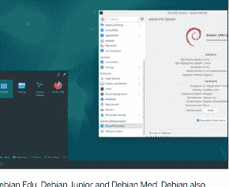

> 即使是树莓派上最受欢迎的发行版 `Raspbian`，也是基于 `Debian` 项目。

##### 交战规则

`Debian` 的另一个显著特点是，该发行版完全由自由软件构成。该项目使用《`Debian 自由软件指南》（`DFSG`）来帮助确定某软件是否可以被包含在内。`DFSG` 是《`Debian 社会契约》的一部分，该契约定义了项目的道德议程。

该项目产生三个发行版：稳定版（`Stable`）、测试版（`Testing`）和不稳定版（`Unstable`）。每两年发布一次稳定版，通过将测试版冻结几个月制成。测试版旨在作为预览发行版，包含较新的软件包，在冻结期间会修复任何 `bug` 并移除极不稳定的软件包。所有发行版都以《玩具总动员》电影中的角色命名（当前的稳定版代号为 `Jessie`）。所有新软件包都在不稳定版（代号为 `Sid`）中引入。此发行版面向需要最新软件包和库的开发人员。它不打算用于生产机器，感兴趣的用户必须将 `Debian` 测试版升级以获得最新的不稳定版。

> 《`Debian Linux` 宣言》预言“发行版对 `Linux` 的未来至关重要”

该项目还提供指南，帮助衍生发行版将其工作合并回 `Debian`。除了衍生版之外，还有几个“纯混合”（`Pure Blends`）；这些是 `Debian` 的子集，配置用于支持特定的细分领域，例如

##### Linux Mint Debian 版

`Linux Mint Debian` 版（`LMDE`）旨在为那些希望体验 `Debian` 最佳之处（直接体验，而非通过 `Ubuntu`）的用户提供易于使用的软件包。它基于 `Debian` 测试版，是一个半滚动发布，这意味着它通过更新包（`Update Packs`）接收定期更新。这些更新包是 `Debian` 测试版的测试快照，以确保稳定性，`LMDE` 与 `Debian` 二进制兼容，这意味着你可以切换到 `Debian` 测试版或不稳定版以获得更频繁和前沿的更新。然而，`LMDE` 与 `Linux Mint` 不兼容，因此你不能使用 `Ubuntu PPA`。

`LMDE` 旨在提供与 `Linux Mint` 相同的外观和功能，并提供 32 位和 64 位 `Live DVD` 镜像，配有 `Mate` 或 `Cinnamon` 桌面环境。该发行版预装了 `Firefox`、`Thunderbird`、`VLC` 媒体播放器以及众多其他常用应用。`Adobe Flash` 插件和大多数其他多媒体编解码器默认已安装。得益于 `Synaptic` 包管理器这样的工具，软件仓库和底层的 `Deb` 包系统使得软件安装变得容易。


#### Ubuntu 属

衍生版，正从墙壁里涌出来。

在很多方面，`Ubuntu` 是第一个认真努力吸引新用户的发行版。该发行版将 `Linux` 带入主流，在改变对 `Linux` 的观念和误解方面发挥了重要作用，并成功地将其定位为 `Windows` 和 `mac OS` 的可行操作系统替代品。

`Ubuntu` 由 `Mark Shuttleworth` 发起。他在将他的安全公司 `Thawte` 出售给 `VeriSign` 后成立了 `Canonical` 公司。`Shuttleworth` 是 `Debian` 项目的忠实粉丝。然而，`Debian` 有很多地方不符合 `Shuttleworth` 对理想操作系统的愿景。因此，他在 2004 年 4 月邀请了他所认识和尊重的大约十几位 `Debian` 开发人员来到他在伦敦的公寓，敲定了 `Ubuntu` 项目的基础工作。

该小组决定为发行版确立一系列特征。首先，`Ubuntu` 的软件包将基于 `Debian` 不稳定分支的软件包。然而，与 `Debian` 不同，`Ubuntu` 将拥有可预测的周期和频繁的发布。为了实施该计划，决定 `Ubuntu` 每六个月发布更新版本，每个发布版本将获得九个月的免费支持。该计划在后几年得到了完善，现在每第四个发布版本将获得为期五年的长期支持（`LTS`）。该小组还决定强调本地化和无障碍性，以吸引全球用户。在集中开发资源以提高桌面环境易用性和用户友好性方面，也达成了一致意见。`Ubuntu` 的第一个发布于 2004 年 10 月。

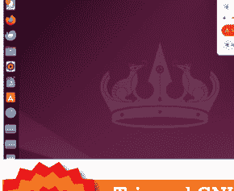

戴尔（`Dell`）和联想（`Lenovo`）等许多供应商提供预装 `Ubuntu` 的计算机。

`Ubuntu` 的开发由 `Shuttleworth` 位于英国的 `Canonical` 公司资助，这是一家私营计算机软件公司。该公司还支持其他 `Ubuntu` 相关项目的开发，例如，`Ubuntu` 的 `Ubiquity` 安装程序是该领域最好的工具之一，其显著特点之一是允许用户选择安装闭源或受专利保护的第三方软件，如 `Fluendo` 的 `MP3` 编解码器。其他试图改变现状的以用户为中心的项目包括 `Ubuntu` 软件中心以及最近停止服务的 `Ubuntu One` 云托管服务。

##### 真金火炼


但或许没有其他技术像`Ubuntu`的`Unity`桌面界面那样使`Linux`社区产生如此大的分歧。该发行版首次引入`Unity`是在`Ubuntu`上网本版（`Netbook Edition`）`10.10`版本中。到`11.04`版本推出时，上网本版已合并到桌面版中，`Unity`成为`Ubuntu`发行版的默认图形界面。然而，`Shuttleworth`坚持认为`Unity`桌面在`Ubuntu`的多设备战略中起着至关重要的作用。`Unity`将有助于标准化智能手机、平板电脑、电视以及计算机以外的其他设备上的显示。凭借其可塑性，该发行版一直深受希望为其特定细分领域创建自定义发行版的开发人员的喜爱。`Ubuntu`可能比其他任何发行版都孵化了更多的衍生发行版，`Ubuntu`本身也有几个官方支持的衍生版：`Kubuntu`、`Xubuntu`、`Ubuntu Gnome`、`Edubuntu`和`Ubuntu Studio`。除了主要的桌面版之外，还有一个不附带图形桌面的服务器版。

`Ubuntu`帮助`Linux`获得主流关注，并拥有几位名人用户，包括`Cory Doctorow`和`Stephen Fry`。然而，突破常规也有其缺点，这个获奖发行版也收到了不少批评。当发行版在`Unity`的`Dash`中包含购物巨头`Amazon`的搜索结果（每当用户在计算机上搜索东西时）时，它仍在亚马逊争议的回击之下。


#### `Trisquel GNU/Linux`

`Trisquel GNU/Linux`竭尽全力不辜负其自由软件的标签。该发行版不仅不包含任何专有软件，还剥离了从`Ubuntu`继承的所有非自由代码，例如内核。`Trisquel`使用的不是标准`Ubuntu`内核，而是`Linux-libre`内核，其中不包含任何二进制驱动代码（`blobs`）。

由于这些努力，该发行版已获得自由软件基金会的认可。该发行版有多个变体，最常见的是标准`Trisquel`发布版，提供带有`GNOME`桌面的`700MB`镜像，以及`Trisquel mini`，专为较旧的硬件和低功率系统设计，使用轻量级桌面`LXDE`。

虽然该发行版不附带任何专有视频，但你可以观看`YouTube`视频，因为它提供了`HTML5`支持以及`Gnash`（这是`Adobe Flash`的自由替代品）。`Trisquel`包含所有常见的桌面生产力应用，如`LibreOffice`、`Evolution`、`Gwibber`、`Pidgin`等。这些应用由一个令人印象深刻的软件仓库作为补充。

### 红帽属

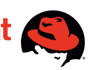

大规模的头饰制作。

另一个在塑造`Linux DNA`方面发挥关键作用的发行版是红帽`Linux`，它由`Marc Ewing`于`1994`年创建。`Bob Young`及其`ACC`公司收购了`Ewing`的业务，并创建了红帽软件公司。该公司于`1999`年上市，并实现了华尔街历史上第八大首日涨幅。凭借红帽`Linux`的成功，它成为第一家开源的十亿美元公司。

多年来，一些最知名且最具才华的`Linux`开发者都与红帽合作过。就在其上市不久后，它收购了`Michael Tiemann`的`Cygnus Solutions`公司，该公司曾编写了`GNU C++`编译器，并参与了`GNU C`编译器和`GNU`调试器的开发。

红帽最具影响力的技术之一是其`RPM`打包格式。该文件格式现在是`Linux`标准基础（`LSB`）的基础包格式，`LSB`旨在标准化软件系统结构，包括`Linux`操作系统中使用的文件系统层级。`LSB`是由多个`Linux`发行版共同管理的一个项目，由`Linux`基金会管理。红帽也是最早支持可执行与链接格式（`ELF`）而非旧版`a.out`格式的`Linux`发行版之一。`ELF`是可执行文件、共享库和其他文件的标准文件格式。红帽还是首个尝试使用`Bluecurve`主题统一其`Gnome`和`KDE`桌面外观的发行版——这导致了与`KDE`开发者之间的紧张关系。该发行版因其易于导航的图形化`Anaconda`安装程序而荣获赞誉。

#### 死亡后的生命

最初，红帽发行版提供免费下载，公司通过销售支持包来维持运营。然而，`2003`年，红帽停止提供红帽`Linux`发行版，如今仅专注于用于企业环境的红帽企业`Linux`（`RHEL`）发行版。`RHEL`支持流行的服务器架构，包括`x86`、`x86-64`、`Itanium`、`PowerPC`和`IBM System z`。较新`RHEL`版本的生命周期长达`13`年，在此期间，用户可获得技术支持、软件更新、安全更新和新硬件驱动程序。红帽还有一个非常流行且以`RHEL`为核心的培训和认证项目，称为`RHCP`。

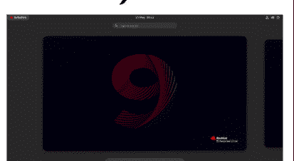

当红帽`Linux`停止服务时，公司将免费发行版的开发工作移交给社区。新项目被称为`Fedora`（见第30页）。公司引导`Fedora`项目的方向，目的是利用`Fedora`孵化最终将出现在`RHEL`中的技术。

由于`GPL`禁止其限制`RHEL`的再分发，公司使用严格的商标规则来管理再分发。这导致了流行的第三方衍生版，它们在剥离红帽商标等非自由组件后构建并重新分发。`CentOS`、`Scientific Linux`和`Oracle Linux`等发行版提供与`RHEL 100%`二进制兼容性。

红帽开创了专业开源商业模式，成功地将开源代码和社区开发结合专业质量保证以及基于订阅的支持结构。公司还有员工全职致力于免费和开源项目，如`Radeon`、`Nouveau`和`CentOS`。

> “一些最知名且最具才华的`Linux`开发者曾与红帽合作。”

#### `CentOS`


`CentOS`发行版一直是基于红帽企业`Linux`（`RHEL`）的首选社区支持型企业发行版。该发行版使用`RHEL`发行版的开源`SRPMS`构建。`CentOS`是最流行的服务器发行版之一，适用于各种使用场景，从`Web`服务器到企业桌面，并作为那些希望搭建自己的服务器但无法负担`RHEL`订阅费的人的理想选择而备受推崇。`CentOS`附带`RHEL`的`Anaconda`安装程序，并得益于`Kickstart`可实现多台机器的无人值守安装。安装程序提供各种安装目标，如`Web`服务器、数据库服务器等。

`2014`年`1`月，红帽宣布将开始资助一批核心`CentOS`开发者全职从事该发行版的工作。然而，开发人员和红帽均坚持该项目应保持独立于`RHEL`。赞助确保了在`RHEL`上游发布后的`24`到`48`小时内提供所有更新。

红帽是其他几个发行版的起点，例如`Mandriva Linux`。

### 费多拉属

你已经被一个流畅的发行版击中...


`Fedora`以某种形式自`20`世纪`90`年代初就已存在。该发行版在`1995`年进行了第一次发布，早期版本名为`Red Hat Commercial Linux`。在这些早期年份，该发行版完全由红帽开发，社区仅限于提交错误报告和贡献包含在发行版中的软件包。这种情况在`2003`年发生了改变，当时公司关闭了红帽`Linux`以支持`Fedora`项目，并向社区开放贡献。

- `Fedora`是首批采用增强安全`Linux`（`SELinux`）内核模块的发行版之一。

`Fedora`的目标是在保持完全免费软件系统的同时提供最新的软件包。该发行版最初名为`Fedora Core`，名字取自两个主要软件仓库之一——`Core`和`Extras`。`Fedora Core`仓库包含发行版所需的所有基本软件包以及随安装光盘分发的其他软件包，并完全由红帽开发者维护。`Fedora Extras`仓库是在`Fedora Core 3`中引入的。它包含由社区维护的软件包，并未随安装光盘分发。这种安排一直持续到`2007`年的`7`版本，当时两个仓库合并，发行版被重新命名为`Fedora`。

`Fedora`的目标是在社区的帮助下创建一个自由软件发行版。该项目的开发由`Fedora`项目监督和协调。

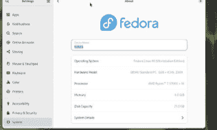

它由四名红帽指定成员和五名社区选举成员组成。董事会主席由红帽任命。`Fedora`努力维持大约`6`个月的发布周期，每年两次发布。每个版本都得到支持，直到下一个两个版本发布为止。周期故意保持较短，以便开发者可以专注于创新和将最新技术引入发行版。

#### 帽上的羽毛

社区贡献的一种方式是通过托管第三方仓库。除了其官方软件仓库外，还有几个流行的第三方软件仓库，通常包含未包括在官方仓库中的软件——要么是因为该国的现行法律（如多媒体编解码器），要么是因为软件不符合`Fedora`对自由软件的定义。`Fedora`项目还生产用于企业`Linux`的额外软件包（`EPEL`）仓库，其中包含由社区而非红帽创建的用于`RHEL`的软件包。


除了主要的 Fedora 发布外，该项目还发行了各种衍生版（spins），它们是面向特定兴趣领域的专用发行版，如游戏、安全、设计、科学计算等。这些类似于 Debian 的 `Pure Blends`。这些以及其他衍生版由各种特别兴趣小组（SIGs）维护。`OLPC` 也运行基于 `Fedora` 的操作系统。`Fedora` 支持 `x86` 和 `ARM` 架构，并从 `Fedora 20` 开始增加了对 `PowerPC` 和 `IBM s390` 的支持。`Pidora` 是一种为树莓派优化的 `Fedora` `Remix` 发行版。

`Fedora` 对 `Linux` 生态系统最大的贡献是其旧的命令行包管理器 `YUM`（Yellowdog Updater, Modified），它基于 `RPM`（红帽包管理器）。`YUM` 实现自动更新和依赖项解析，并与软件仓库合作管理软件包的安装、升级和移除。然而，自 `Fedora 18` 发布以来，用户可以选择使用 `YUM` 的分支工具 `dnf`。由于 `dnf` 工具具有更好的依赖项解析能力，且比其他管理器内存占用更少，自 `Fedora 22` 起，它已成为默认的包管理器。


## 优胜者

### Korora

`Korora` 发行版最初是一种简化 `Gentoo` 发行版安装过程的方法，但在 2010 年转为使用 `Fedora` 发行版作为基础。该发行版的主要目标是确保其开箱即用，让用户可以直接使用。

`Korora` 附带一张 `Live` `DVD`，其中包含大量应用程序，使其适合大量用户，并且该发行版提供五种桌面选择——`GNOME`、`KDE`、`Cinnamon`、`Xfce` 和 `Mate`。

虽然 `Fedora` 仅提供开源软件，但 `Korora` 还包括一些专有软件，如 `Adobe` `Flash`，这对于满足广泛的用户基础至关重要。`Korora` 还允许轻松安装其他软件，如 `Google` `Chrome` 和 `Nvidia` 卡的专有图形驱动程序。

该发行版还缓解了一些 `Fedora` 用户的抱怨：图形化包管理。`Korora` 包含 `Apper` 和 `Yum` `Extender`，它们是 `YUM` 最受欢迎的两个前端之一。由于基于 `Fedora`，`Korora` 的新版本通常落后于 `Fedora` 发布几周。

## 曼德拉草属

一个有诸多值得炫耀之处的发行版！

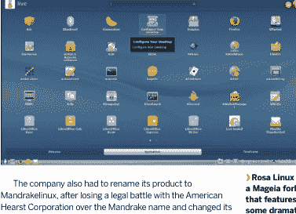

在 `Mandrake` 发布之前，`Linux` 通常被视为极客专用的操作系统。`Mandrake` 是第一个专注于用户便利性的发行版。其目标是提供一个普通计算机用户也能操作的发行版。它具备诸如无需配置繁琐的配置文件即可自动挂载光盘等功能，为 `Linux` 桌面带来了更大的便捷性。

`Mandrake` 项目或许是自由软件项目中历史最为错综复杂的一个。多年来，该项目经历了各种改名、合并和分叉。然而，它衍生出了许多发行版，其中几个主要分支至今仍然活跃，且可追溯其血统至 `Mandrake`。

该发行版开发了一系列自定义工具——统称为 `craktoloots`——以协助其被称为 `Drakers` 或 `Draks` 的用户。该项目创建的最具特色的组件之一是 `Mandrake` 控制中心（`MCC`），如今它已成为所有衍生版本的核心。`MCC` 提供了一个统一界面，用于访问多种不同的配置工具。在遇到显示问题或其他严重故障（如图形服务器无法启动）时，在文本模式下使用控制中心非常有用。值得一提的是，所有模块都可以作为独立应用程序运行，不一定非要通过 `MCC` 来使用。

### 维持生命体征

`Mandrake` `Linux` 首次发布于 1998 年 7 月。它基于 `Red` `Hat` `Linux` `5.1`，并搭载了首个 `KDE` 桌面发布版本。在收到积极反馈后，主要开发者 Gaël Duval 以及其他一些人创立了 `MandrakeSoft` 公司，该公司于 2001 年决定上市。它在 2002 年底面临首次重大现金危机，并请求用户通过订阅一项付费服务来拯救公司，该服务提供额外福利，如提前访问发布版本和特别版。这并不足以解决问题，该公司于 2003 年申请破产保护。然而，同年晚些时候 `MandrakeSoft` 宣布了首个季度盈利，并在 2004 年 3 月，法国法院批准了其走出破产并恢复正常业务的计划。

该公司还因在与美国心脏基金会（American Heart Corporation）关于 `Mandrake` 名称的法律战中败诉，不得不将其产品更名为 `MandrakeLinux`；在 2005 年收购巴西公司 `Connectiva` 后，公司更名为 `Mandriva` S.A.。发行版更名为 `Mandriva` `Linux`，但在 2006 年 `Mandriva` 解雇了多名员工，包括联合创始人 Duval。尽管在一片嘘声中，公司仍继续发布版本，并在金砖国家地区（巴西、俄罗斯、印度和中国）以及法国和意大利建立了自己的细分市场。

尽管付出了巨大努力，公司仍难以使资产负债表保持盈利状态。2010 年，`Mandriva` 放弃了社区 `Linux` 发行版的开发以避免破产。紧随其后，前 `Mandriva` 员工宣布成立 `Mageia`，后者后来发展成为最受欢迎的 `Mandrake` 衍生版之一。`Mandriva` S.A. 将开发工作移交给由社区驱动的 `Open` `Mandriva` 协会。该协会的第二版发行品名为 `OpenMandriva` `2014.0`，获得了 Duval 的好评。

> “该项目创建的最具特色的组件之一是其控制中心”

- `Rosa` `Linux` 是 `Mageia` 的一个分叉，具有一些引人注目的用户界面修改，例如这个简易欢迎应用程序启动器。

#### Salix 与 Mageia


`Mageia` 是组装得最好的社区发行版之一，在继承 `Mandrake` 遗产方面做得非常出色。它拥有完善的支持体系和非常良好的文档。该发行版遵循九个月的发布周期，每个版本支持期为 18 个月。`Mageia` 提供可安装的 `Live` 媒体以及仅安装用的 `DVD` 镜像。

`Mageia` 拥有直观的自定义工具，用于管理发行版的各个方面。其中最好的工具之一是 `Mageia` 控制中心，它拥有用于管理软件、硬件外设和系统服务的模块。高级用户可以利用它来共享互联网、设置 `VPN` 和配置网络共享。该发行版使用 `URPMI` 包管理系统，并附带三个官方软件仓库。`Core` 仓库包含开源软件包，`Non-free` 仓库托管专有应用程序和驱动程序，而 `Tainted` 仓库则包含受专利限制的应用程序。该发行版附带多种桌面环境，开发人员确保在所有环境中用户体验保持一致。

## SUSE 属

*Nu, nu, nu, gnu, nui*


1992 年，Roland Dyroff、Burchard Steinbild、Hubert Mantel 和 Thomas Fehr 创立了 `Software` und `System` `Entwicklung`（软件与系统开发公司）。

该公司起初是一家服务提供商，但创始人后来决定创建自己的发行版，最终吸引企业用户。该发行版以公司名称的缩写 `SUSE` 命名，它是一个标准的 `Slackware` 发行版本，被翻译成德语，并与 `Slackware` 的 `Patrick` `Volkening` 紧密合作开发而成。

为了构建其专属的 `Linux` 发行版，`SUSE` 使用了现已停用的 `Jurix` 发行版。`Jurix` 由 `Florian` `La` `Roche` 创建，他随后加入 `SUSE` 团队并开始开发 `YaST`，这是该发行版独特的安装程序和配置工具。包含 `YaST` 的首个 `SUSE` 发行版于 1996 年 5 月发布（`YaST` 在 1999 年重写，并首次在 `SUSE` `Linux` `6.3` 中作为仅安装工具引入）。

随着时间的推移，`SUSE` `Linux` 融入了 `Red` `Hat` `Linux` 的许多方面，例如其备受尊敬的 `RPM` 软件包管理器。1996 年，首个以 `SUSE` `Linux` 命名的发行版本作为 `SUSE` `Linux` `4.2` 发布。版本号混乱的跳跃是有意为之，致敬道格拉斯·亚当斯（Douglas Adams）《银河系漫游指南》中关于生命、宇宙及一切的答案。`YaST` 的第一个版本号 `0.42` 也是受对这位作者的同样崇敬所启发。

> `SUSE` `Web` 服务允许您轻松组装定制的基于 `OpenSUSE` 的发行版。

`SUSE` 一直专注于将开源引入企业用户。它于 2001 年推出了 `SUSE` `Linux` `Enterprise` `Server`，并将公司名称改为 `SUSE` `Linux`。在软件和服务公司 `Novell` 于 2004 年 1 月收购 `SUSE` `Linux` 后，`SUSE` `Linux` `Professional` 产品作为 100% 的开源项目发布，并启动了 `OpenSUSE` 项目——正如 `Red` `Hat` 对 `Fedora` 所做的那样。软件一直是开源的，现在流程也是开源的，这使得开发者和用户能够测试和发展它。

### 企业化


OpenSUSE 项目的首个稳定发行版是 `SUSE Linux 10.0`。它包含开源和专有应用程序，以及零售盒装版本。这也是首个将 `GNOME` 桌面环境与 `SUSE` 默认的 `KDE` 桌面并列为同等地位的发行版。从 `10.2` 版本开始，`SUSE Linux` 发行版正式更名为 `OpenSUSE`。

2006 年 11 月，`Novell` 与 `Microsoft` 签署了一项协议，涵盖改善 `SUSE` 与 `Windows` 的互操作性、双方产品的交叉推广和营销以及专利交叉许可。该协议在部分自由开源软件（`FOSS`）社区成员中颇具争议。`Novell` 后来在 2011 年被 `The Attachmate Group` 收购，后者将 `Novell` 和 `SUSE` 拆分为两家独立的子公司。`SUSE` 围绕 `SUSE Linux Enterprise` 提供产品和服务——这是一款基于 `OpenSUSE Linux` 的商业产品。

`SUSE` 为其企业业务线开发了多种产品。这些产品面向企业环境，具有更长的生命周期（七年，可延长至十年）、更长的开发周期（两到三年），以及来自独立硬件和软件厂商的技术支持和认证。`SUSE Linux Enterprise` 产品仅可供销售。还有 `SUSE Linux Enterprise Desktop` (`SLED`)，这是一款面向企业环境的桌面操作系统。相比之下，`OpenSUSE` 没有针对服务器、桌面和平板电脑的独立发行版，而是使用各种安装模式来适配不同类型的安装需求。

`http://bit.ly/ChameleonSong`

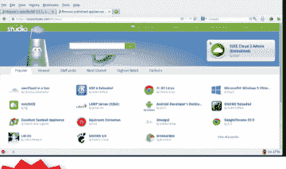

> 同类最佳

### `OpenSUSE`

`OpenSUSE` 是最优秀的基于 `RPM` 的发行版之一。它提供适用于 32 位和 64 位架构的多个版本，并支持 `ARM v6`、`ARM v7` 以及 64 位 `ARM v8` 移植版本。`OpenSUSE` 曾以 `KDE` 桌面闻名，如今在主要桌面环境中均表现出色。除了 `KDE` 和 `Gnome`，该发行版还配备 `Mate`、`Xfce`、`Enlightenment` 和 `LXDE`。您可以下载较小体积的 `Live` 可安装镜像或仅安装用的 `DVD` 镜像。`OpenSUSE` 的标志性特点之一是 `YaST`，这是一个设置和配置实用工具，允许您调整系统的许多不同方面。另一个流行工具是 `Snapper`，它允许您回滚到之前创建的系统快照。

该发行版是 `SUSE Linux Enterprise` 产品的基础——就像 `Fedora` 之于 `RHEL`——适合各种技能水平的用户。该发行版的安装程序功能强大，并提供多种定制选项。新用户也可以安装它，并包含选项将已安装的系统接入企业目录服务器。

### `Slackware` 发行版

这只“乌龟”发行版比许多“兔子”都活得长久。

`Slackware` 拥有仍被积极维护的最古老发行版这一荣誉。它由 `Patrick Volkerding` 创建，并于 1993 年发布首个 `beta` 版本。该项目旨在打造最类 `Unix` 的 `Linux` 发行版。`Slackware` 最初衍生自 `Softlanding Linux System` (`SLS`)，`SLS` 是首个除 `Linux` 内核和基本实用工具外，还提供 `TCP/IP` 和 `X` 窗口系统的发行版。然而，`SLS` 存在大量 `Bug`，用户对 `SLS` 日益增长的挫败感促使 `Volkerding` 在 1993 年 7 月发布了一个类似于 `SLS` 的发行版。

当时，除了托管在明尼苏达州莫尔黑德州立大学（`Minnesota State University Moorhead`）的匿名 `FTP` 服务器上外，该发行版还提供为 24 张 3.5 英寸软盘。到 1994 年 10 月发布 `2.1` 版本时，发行版已膨胀至 73 张软盘，而 `3` 版本则发布在 `CD-ROM` 上。

该发行版的独特卖点在于它对上游软件包进行了极少的修改。与旨在满足特定目的或广泛用户群体的其他发行版不同，`Slackware` 不限制用户决策，也不预设使用场景。因此，与大多数其他发行版相比，用户在使用 `Slackware` 时对所安装系统的控制权更大。

#### 留有余地（`Cut some slack`）

与其他发行版不同，`Slackware` 不提供图形化安装。它继续使用纯文本文件，以及少量 `shell` 脚本进行配置和管理。该发行版也不提供高级的图形化包管理工具，而是依赖 `pkgtool`、`installpkg`、`upgradepkg` 和 `removepkg` 等命令行工具。然而，这些原生工具无法解决依赖问题。`Slackware` 的软件包只是普通的压缩 `TAR` 归档文件。软件包包含构成所安装软件一部分的文件，以及供 `Slackware` 包管理器使用其他元数据文件。自 `Slackware 12.2` 起，`slackpkg` 已成为通过互联网或网络自动安装或升级软件的官方工具，补充了仅在本地工作的传统软件包工具套件。`Slackpkg` 也不解决软件包之间的依赖关系。传统上，`Slackware` 只提供 32 位版本，用户不得不依赖非官方移植版（如 `slamd64`）来获取 64 位版本。自 `Slackware 13` 起，也可获得官方支持的 64 位变体。2002 年，`Stuart Winter` 启动了 `ARMslack` 项目，这是 `Slackware` 向 `ARM` 架构的移植。2009 年，`Volkerding` 将 `ARMslack` 列为 `Slackware` 的官方移植版。随着 `Slackware 14.0` 的发布，该项目已完全更名为 `Slackware ARM`。这可能听起来令人惊讶，但 `Slackware` 是许多发行版的流行基础。其衍生版本包括功能广泛的桌面项目、`Live` 发行版、安全发行版等。`Slackware` 项目也缺少一些常见的对开发者友好的工具。例如，没有官方的 `Bug` 跟踪系统。此外，也没有成为 `Slackware` 贡献者的官方机制。关于哪些内容进入发行版的最终决定由 `Volkerding` 做出——他是 `Slackware` 的“终身仁慈独裁者”（`Benevolent Dictator For Life`）。另一种偏离常规的做法是，`Slackware` 不遵循固定的发布时间表。目标是发布一个非常稳定的系统，因此该项目遵循“准备就绪即发布”的理念，但仍旨在每年发布一次主要版本。

> “与其他发行版不同，`Slackware` 不限制用户决策，也不预设使用场景”

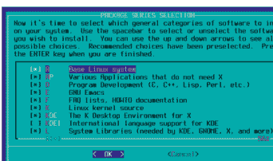

-   除了 `Slackware-stable` 分支外，该项目还提供 `testing-current` 分支，用于获取更前沿的软件。

### 优胜者（`Best of Breed`）

#### `Salix OS`

`Salix OS` 是最佳的基于 `Slackware` 的发行版之一；它轻量、敏捷，并且与 `Slackware` 向后兼容。其显著特点之一是通过每个任务仅保留一个应用程序来最小化臃肿。该发行版支持 32 位和 64 位架构，并提供针对 `KDE`、`MATE`、`Xfce`、`Openbox` 和 `Ratpoison` 桌面环境的五种变体。

`Salix` 提供三种安装模式——完整（`Full`）、基础（`Basic`）和核心（`Core`）。完整选项安装安装镜像上的所有内容；基础选项仅提供一个拥有图形桌面、几个基本应用和 `Slapt` 包管理器的极简系统；核心选项仅安装基于控制台的系统，旨在让用户自定义构建他们的发行版。

完整发行版包含你在桌面发行版上期望的所有应用，常被誉为带有图形包管理器的 `Slackware`。其包管理器 `Gslapt` 类似于 `Synaptic` 包管理器，并提供相同的所有功能。多媒体编码器未默认提供，但可以使用该发行版的定制 `Codex` 安装程序进行修复。

### 有袋类动物（`The marsupials`）

进化的杰作和特立独行者。

#### `Gentoo Linux`

`Gentoo` 项目的目标是创建一个没有预编译二进制文件的发行版，该发行版会根据其安装所在的硬件进行调优。与二进制软件分发不同，源代码会根据用户偏好进行本地编译，并且通常经过优化。它最初被称为 `Enchir`，但 `Gentoo 1.0` 于 2002 年发布。

`Gentoo` 因其是高度可配置的发行版之一而著称，吸引那些希望完全控制电脑中已安装和运行的软件的 `Linux` 用户。`Gentoo` 用户可以从零开始创建他们的系统；该发行版鼓励用户构建针对其特定硬件定制的 `Linux` 内核。它允许对哪些服务被安装和运行进行非常精细的控制。与其他发行版相比，通过省略不必要的内核特性和服务，可以减少内存使用量。

该发行版是滚动发布，其显著特点之一是名为 `Portage` 的包管理系统。如果你从未使用过它，使用 `Gentoo` 存在陡峭的学习曲线。如果你还没准备好直接进入，`Funtoo` 等衍生版本可以是一个很好的起点。

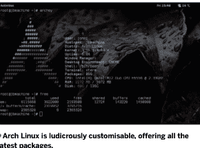

> `Arch Linux` 具有极其广泛的自定义能力，并提供所有最新的软件包。


Arch 发行版最令人印象深刻的功能是其 Pacman 包管理工具。Arch 是滚动发布，可以通过一条命令更新至最新状态。安装 Arch Linux 是一个复杂的过程，虽然文档详尽，但它仍然更适合经验丰富的 Linux 用户。然而，Manjaro Linux 是 Arch 的衍生版，更用户友好，并带有图形安装程序。

#### Arch Linux

Judd Vinet 希望创建一个受 Crux、Slackware 和 BSD 简洁性启发的发行版，因此在 2002 年创建了 Arch Linux。Arch 旨在提供一个轻量级基础，用户可以根据其需求在其上构建。用 Vinet 的话说：“Arch 是你造就的它。” 这有点像一个生活的比喻。

#### Tiny Core Linux

如果你没有时间来创建 Arch 或 Gentoo 安装，请查看 Tiny Core Linux。该发行版安装启动进入极简 X 桌面所需的最少软件。从这一点开始，你拥有完全的控制权，可以从在线仓库安装应用或手动编译它们。

该发行版仅有 `12MB` 大小，仅在轻量级 `FLWM` 窗口管理器之上捆绑了一个终端、一个文本编辑器和一个应用启动器。它有一个控制面板来管理启动服务并配置启动器，但其他所有内容都需要从其管理器中获取，包括如果你想在硬盘上安装 Tiny Core 所需的安装程序。该发行版还有一个 `CorePlus` 变体，增加了无线网卡驱动、重新制作工具和国际语言支持。

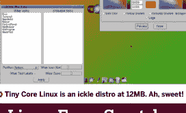

> Tiny Core Linux 是一个空闲时仅 `12MB` 的发行版。啊，太棒了！

#### Puppy Linux

我们史上最爱之一，Puppy Linux 于 2003 年首次发布，首个稳定版发布于 2005 年。该发行版从零开始构建，其初始目标是支持

#### Linux From Scratch

Linux From Scratch——俗称 `LFS`——本身不是一个发行版，而是一套免费提供的指令，用于从零开始，完全从源代码创建你自己的定制发行版。该项目始于 1999 年，当时其作者 Gerard Beekmans 想要了解 Linux 发行版幕后是如何工作的。在从头构建他的系统时，Beekmans 记录下步骤，并将其作为 HOWTO 发布（见右图），认为可能还有其他人会对此感兴趣。`LFS` 从其朴素的起点发展相当可观，从单一 HOWTO 转变为一本多卷本的书。随着时间推移，它还产生了各种子项目，例如 `BLFS`（Beyond LFS，LFS 之外），它完善了基本 `LFS` 系统，以及 `ALFS`（Automated LFS，自动化 LFS），旨在帮助自动化创建 `LFS` 系统的过程。


### 入门指南 | 选择一个发行版

#### 最佳桌面发行版

我们将涉足那片神圣的领域，天使们都不敢轻易涉足（也并非因为满脸胡须的拉塞尔·克劳正用眼神审视他们），并试图评选出一个总体最佳的发行版。这意味着我们必须制定一些标准，既要考虑易用性，又要兼顾为特定使用场景增加复杂度的能力；我们承认，最终结果纯属主观判断。不认同我们的观点？何不将您认为的各类别最佳选择通过电子邮件发送至 Linux Format 杂志：`lxf.letters@futurenet.com`。

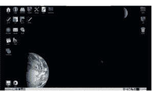

Puppy Linux 已成为一款实用的发行版，常用于从电脑中恢复数据以及清除 Windows 系统中的恶意软件。

……那些因其他发行版缺乏支持而变得毫无用处的旧硬件。

该发行版的真正威力在于其琳琅满目的自定义应用。这里有用于屏蔽网站广告和添加网络电话的自定义应用，还有播客下载器、安全下载工具、音频播放器、DVD 刻录应用等等。初次使用者可能会被 Puppy 的安装程序吓到，因为它没有自动分区器，而是让你使用 `Gparted` 来格式化磁盘。但安装程序中的每个步骤都有详尽的文档说明。

Puppy Linux 的软件包被称为 `pet`，扩展名为 `.pet`。你可以使用其自定义的 `Puppy Package Manager` 工具来安装软件包，并且可以配置它从其他 Puppy 仓库下载软件包。该发行版包含一些工具，可以轻松制作变体版本。Puppy Linux 的变体版本称为 `puplets`。受欢迎的 `puplets` 包括支持旧硬件的 `WaryPuppy`、支持新硬件的 `RacyPuppy`、基于 Slackware 的 `SlackoPuppy`，以及基于 `Ubuntu LTS` 版本的 `PrecisePuppy`。

#### SliTaz GNU/Linux

SliTaz 代表 `Simple Light Incredible Temporary Autonomous Zone`，其首个稳定版本发布于 2008 年。该发行版由名为 `cookutils` 的自制工具构建，并使用 `BusyBox` 执行许多核心功能。该发行版包含 `LXDE` 和 `OpenBox` 窗口管理器的混合界面，旨在仅配备 `152MB` 内存的硬件上运行。该发行版重量不足 `30MB`，仅占用 `80MB` 的硬盘空间。

该发行版还附带许多自定义工具，例如 `TazPkg` 软件包管理器和用于管理发行版所有方面的 `SliTazPamela`。SliTaz 仓库包含 3000 多个软件包，涵盖了所有流行的开源应用，它是为低功耗设备提供动力的常见选择。

#### PCLinuxOS

PCLinuxOS 始于 2000 年作为 Mandrake 发行版的 `RPM` 软件包仓库，并在 2003 年底成为 Mandrake Linux 9.2 的一个分支，正式成为一个发行版。

尽管 PCLinuxOS 在外观和感受上仍与 Mandriva Linux 相似，其配置工具和安装程序也显露出 Mandriva 的血统，但它已经发生了显著的偏离。该发行版取代了 Mandrake 的 `.RPM` 软件包管理系统，转而采用 `APT-RPM`。这是基于 Debian 的 `APT`，但使用 `RPM` 软件包，并配合 `Synaptic` 软件包管理器。PCLinuxOS 是一个 `KDE` 发行版，但也提供基于 `LXDE` 和 `MATE` 桌面的社区版本。

#### Mageia

1. 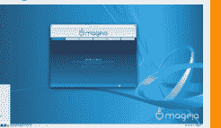

这个由社区支持的发行版具备现代 Linux 发行版所需的一切——活跃且充满活力的用户和开发者社区、明确的支持结构、对多种桌面环境和支持多种安装机制的支持。

#### OpenSUSE

2. 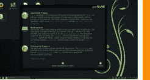

排名第二的 OpenSUSE 发行版之所以落选，是因为其母公司近期的动向。此外，该发行版仍然专注于引入使其更适合企业桌面而非家庭用户的更改。

#### Korora

3. 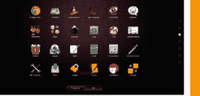

如果你想要一个开箱即用的基于 `RPM` 的发行版，这是你最好的选择。然而，Korora 本质上仍是一个一人项目，并继承了一些其父发行版 Fedora 不太令人愉快的特点。

### 前 100 名 Linux 工具

让我们漫步于开源花园，挑选出所有 Linux 爱好者可用的最佳应用、工具和实用程序……

包含 70 款树莓派热门应用！

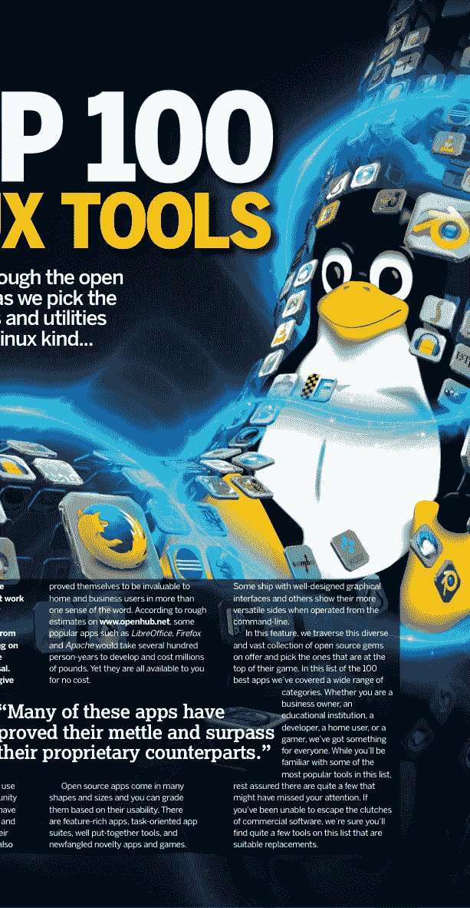

我们都有自己喜欢的开源应用，它们比任何现有替代方案都更让我们满意。

但请花一点时间，退一步远离 `Emacs` 与 `vim` 这类在 Linux 世界中引发的激烈争论，惊叹于我们可用的应用数量之多。你的发行版软件仓库让你能够访问数千个应用，你可以一键安装从功能齐全的应用套件到巧妙的小众命令行工具等所有内容。

开源应用和工具适用于各种应用场景，因此几乎没有哪种使用场景不被社区贡献的应用所覆盖。许多这些应用已证明了其实力，提供的功能和性能优势超越了其专有软件 counterparts。它们也已在多重意义上证明了自身对家庭和商业用户的价值。根据 `www.openhunt.net` 的大致估算，像 `LibreOffice`、`Firefox` 和 `Apache` 这样一些流行应用的开发需要几百人年的工作量，成本数百万英镑。然而，它们都免费向你开放。

> “许多这些应用已证明了其实力，超越了其专有软件 counterparts。”

开源应用形态各异，大小不一，你可以根据其易用性对其进行分级。有功能丰富的应用、以任务为导向的应用套件、精心打造的工具，以及新颖的创意应用和游戏。

一些应用配备了设计精美的图形界面，而另一些则在命令行操作时展现出其更强大的多面性。


在这个专题中，我们将遍历这一多样且庞大的开源瑰宝集合，挑选出那些在其领域处于顶尖水平的应用。在这份最佳 100 大应用列表中，我们涵盖了广泛的类别。无论你是企业主、教育机构、开发者、家庭用户还是游戏玩家，我们都有适合你的东西。虽然你可能熟悉这份列表中一些最流行的工具，但请放心，其中肯定有不少你可能还未留意到。如果你一直未能摆脱商业软件的束缚，我们相信你一定能在这份列表中找到许多合适的替代工具。

### 必备应用

没有它们，Linux 桌面就不完整！

## LibreOffice

`L`ibreOffice 从 `OpenOffice.org` 分支而来，已成为最受欢迎的办公生产力套件之一。它包含用于文字处理、数据库以及公式计算的程序。它还提供了对专有格式文档的良好兼容性，并最近进行了界面翻新。`www.libreoffice.org`

### Wine

`Wine` 尽管能在 `Linux` 上运行的跨平台应用越来越多，但仍有部分应用仅支持 `Windows`。其中包括大型第三方专有应用，如 `Adobe Photoshop`，或者一些你不可或缺的小型利基原生 `Windows` 工具。在这种情况下，你可以使用 `Wine`，它通常能轻松运行这些仅限 `Windows` 的应用和游戏。该项目支持超过 20,000 个应用。有些应用开箱即用，完美运行，而有些则需要少量配置调整。`www.winehq.org`

### Remmina

使用 `Remmina`，你可以从舒适的桌面访问远程计算机。它支持最广泛的一系列协议，可以连接到各种远程桌面服务器。该应用易于使用，且具备足够的功能，使其成为偶尔使用的可行选择。`http://remmina.sourceforge.net`

### Thunderbird

`Thunderbird` 是 `Mozilla` 基金会的又一颗宝石，是最佳的电子邮件客户端之一，设置简单且功能丰富。简单的设置向导有助于与流行的基于 Web 的电子邮件服务同步，它可以管理多个账户，支持加密并通过附加组件进行扩展。`www.mozilla.org/thunderbird`

### KeePassX

对大多数人来说（那些不在拉斯维加斯娱乐性地算牌的人除外），记住不同服务的不同密码是一项挑战。你可以将这项任务交给 `KeePassX`，它将密码存储在加密数据库中。它可以自动填充密码，并附带随机密码生成器。`www.keepassx.org`

### BleachBit

发行版会随时间积累大量数字垃圾。`BleachBit` 帮助你进行深度清理并保护你的隐私。它还删除临时和其他不必要的文件，并配备工具来安全地删除或擦除文件。`http://bleachbit.sourceforge.net`

### OpenSSH

当你需要与远程计算机交互时，你离不开 `OpenSSH`。这是一组提供安全隧道和功能的工具，通过加密所有流量来实现，包含多种身份验证方法，并支持所有 `SSH` 协议。`www.openssh.org`

### Gufw

你可能目前并未使用防火墙，如果是这样，那是因为设置防火墙比你需要 `Gufw` 的情况更困难。`Gufw` 提供了一个直观的图形界面，用于管理各种应用和服务的入站和出站流量规则，甚至包括单个端口。其向导式的图形菜单专为 inexperienced 用户设计。`www.gufw.org`

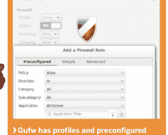

> `Gufw` 拥有配置文件和预配置规则，以协助 inexperienced 用户。

### VirtualBox

当运行整个 `Windows` 安装的环境需求（now）无法满足时，虚拟机是一个好选择。该软件对于安装你不想部署在真实计算机上的实验性应用，或在测试其他操作系统而不暴露于真实硬件时也很有用。`www.virtualbox.org`

### Clonezilla

这是一种独特的以 `live CD` 形式呈现的克隆解决方案，在协助对单台 `PC` 进行裸机备份和恢复方面很受欢迎。它还可以将映像部署到实验室中的多台计算机。`Clonezilla` 支持大量流行的磁盘、分区和文件系统类型。`www.clonezilla.org`

### VLC

发行版通常附带一个功能正常的视频播放器。但如果你需要更多控制权，没有比 `VLC` 更好的选择了。它支持几乎所有现有的视频和音频格式，并为高级用户提供了便捷的 `CLI` 工具。`www.videolan.org/vlc`

### PeaZip

`PeaZip` 是一个图形化归档工具，可以处理超过 130 种不同类型的归档文件，甚至可以创建加密文件。它与流行桌面环境集成，并为高级用户提供了 `CLI`。`http://bit.ly/PeaZipSF`

### Gparted

使用 `Gparted` 重构你计算机上的磁盘。它可以作为 `live CD` 使用，你也可以在发行版内部安装它。`Gparted` 可以创建、调整大小、移动、删除、重新格式化或检查分区，并支持许多文件系统。`www.gparted.org`

### ZuluCrypt

在文件内、非系统分区或 `USB` 磁盘内创建加密磁盘。`ZuluCrypt` 具有直观的用户界面，可用于使用 `GPG` 加密单个文件。`http://bit.ly/zuluCrypt`

### HomeBank

这是一个功能丰富的财务应用。它可以导入来自其他应用和流行格式银行对账单的数据。它还能检测重复交易，具备动态报表功能，易于用于预算规划。`https://homebank.free.fr`

### 互联网应用

使用这些工具，尽享网络精华。

### Firefox

`Mozilla` 开发的 `Firefox` 浏览器是最广为人知的开源软件之一，也是几乎所有 `Linux` 发行版的默认浏览器。它响应迅速，以隐私保护功能著称。你可以对其进行高度自定义，并通过大量扩展功能加以增强。

`www.firefox.com`

### RSSOwl

作为 `Google Reader` 的优秀桌面替代品，`RSSOwl` 是一个易于配置的 `RSS` 和 `Atom` 新闻源聚合器。该应用可以收集、整理、更新和存储新闻，界面简单易用，并能将选定条目保存以供离线浏览和分享。

`www.rssowl.org`

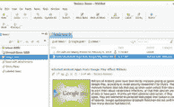

### gFTP

`gFTP` 客户端是一款功能丰富的客户端，如果你偶尔需要通过 `FTP` 下载文件，它能很好地完成任务。它拥有简单的双窗口界面，分别显示本地和远程文件系统的内容。使用 `gFTP`，你甚至可以在两个远程服务器之间传输文件。

`http://gftp.seul.org`

### Midori

对于关注资源消耗的用户来说，`Midori` 是首选浏览器，它在轻量级发行版中颇受欢迎。尽管轻量且设计简洁，`Midori` 仍具备浏览器应有的所有功能，包括速度拨号、选项卡式界面、书签管理、可配置的网页搜索以及隐身模式。

`www.midori-browser.org`

### FileZilla

对于经常使用 `FTP` 的用户，`FileZilla` 是不错的选择。该客户端支持 `FTP`、`SFTP` 和 `FTPS` 协议，并几乎包含你能想到的所有配置选项。它还拥有选项卡式界面，允许你浏览多个服务器，甚至同时在多个服务器之间传输文件。

`https://filezilla-project.org`

### Tox

注重隐私的用户应尝试这款名为 `Tox` 的新型去中心化即时通讯和 `VoIP` 客户端。它依赖于使用 `P2P` 连接（与 `BitTorrent` 使用的技术相同）的分布式网络，在用户之间提供直接连接以进行聊天。与其他的 `Skype` 替代品不同，`Tox` 不使用可能被攻破的中心化服务器或超级节点。所有聊天还都使用经过同行审查的 `NaCl` 加密库进行加密。

`https://tox.im`


### Jitsi

只要你不是排斥 `Java` 应用，`Jitsi` 就是最佳的 `VoIP` 应用。它支持即时通讯以及一对一语音和视频通话，还有音频会议通话。它支持许多广泛使用的即时通讯和电话协议，包括 `SIP`、`XMPP`、`AIM`、`ICQ`、`MSN` 等。`Jitsi` 具备软电话应有的所有功能，并且功能更多，例如通过 `OTR` 加密文本聊天，通过建立 `ZRTP` 会话来加密语音和视频。

`https://jitsi.org`

### Deluge

`BitTorrent` 是下载 `Linux` 发行版的流行方式，且有 numerous 下载客户端。其中最佳的是 `Deluge`，它拥有多个前端，包括图形界面和 `Web` 界面。它具有允许高级用户按需调整的功能，并拥有不错的插件库。

`www.deluge-torrent.org`

### Aria2

`Aria2` 的独特之处在于它可以使用不同的协议同时下载同一个文件。这款轻量级 `CLI` 应用可以通过 `HTTP`、`FTP`、`BitTorrent` 和 `Metalink` 下载文件，还可以打开多个连接以加快文件下载速度。

`http://aria2.sourceforge.net`

### Pidgin


Pidgin 是一款用于通过多种网络协议进行即时通讯的精彩应用。你可以在单个客户端中使用多个账户登录，并与不同网络中的众多好友聊天。你可以使用它同时连接 `AIM`、`MSN`、`Google Talk`、`Yahoo`、`Jabber`、`IRC` 及其他更多聊天网络。

www.pidgin.im

### 媒体

#### 0 A.D.

这是一款实时文明建设策略游戏，拥有令人印象深刻的画面和激烈的战斗游戏玩法。虽然尚未正式发布，但其当前状态已赢得了众多奖项。

http://play0ad.com

#### FreeCiv

这是一款策略游戏，挑战玩家领导其部落从公元前 4000 年发展到太空时代。

www.freeciv.org

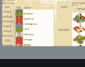

#### Alien Arena

这是一款流行的科幻主题第一人称射击游戏，具有类似 `Quake` 和 `Unreal Tournament` 的锦标赛风格死亡竞赛。该游戏拥有多种游戏模式和超过 60 张地图，并且相当可配置。

http://red.planetarena.org

#### OpenMW

`OpenMW` 是一个新游戏引擎，重新创建了流行的《Morrowind》角色扮演游戏。该项目的目标不是改进游戏资产或添加额外功能，而是为游戏玩家提供一个更具模组化潜力的游戏版本。

https://openmw.org

#### FlightGear

对于飞机模拟器爱好者，`FlightGear` 旨在提供跨真实世界地形的飞行体验。它包含超过 20,000 个机场的场景，并且可以用你自己的飞机和地点进行扩展。

www.flightgear.org

### 办公与生产力

使用这些应用增强你的工作流程。

#### Calligra

除非你熟悉专有格式，否则你可能需要考虑 `Calligra`。它是 `KOffice` 的延续，与 `LibreOffice` 不同，`Calligra` 采用现代外观的模块化设计，并使用 `Open Document` 作为其原生文件格式。它附带大量应用。除了用于文字处理的 `Words`、用于电子表格的 `Tables`、用于制作演示文稿的 `Stage` 以及用于管理数据库的 `Kexi` 外，它还受益于用于数字绘画的 `Krita`。

www.calligra.org

#### Zathura

这是一款简单且轻量的 PDF 阅读器，支持几乎所有你期望的常规功能。你可以搜索文本字符串、跳转页面、放大缩小、旋转页面、添加书签等。除了 `PDF`，它还可以显示 `DVI` 甚至加密文档。

https://pwg.org/projects/zathura

#### Gnumeric

虽然通常与轻量级 `Gnumeric` 电子表格应用配对使用，但该应用并非功能简陋，它提供的功能比专有电子表格应用多得多。`Gnumeric` 可以从 `Microsoft Excel` 文件中导入数据，并且还有其他应用的导入滤镜。

www.gnumeric.org

#### AbiWord

富文本编辑器和文字处理器之间的巨大差距由 `AbiWord` 填补。它轻量但提供常用的文字处理功能，这使得它在轻量级发行版中很受欢迎。它还通过其 `AbiCollab.net` 服务提供基于云的协作功能。

www.abiword.org

#### KMyMoney

专为 `KDE` 用户设计的 `KMyMoney` 是一款功能丰富的会计应用。它支持不同的账户类型，如现金、支票、储蓄等，可以对收入和支出进行分类，并可以对银行账户进行对账。如果你的银行允许，你可以让 `KMyMoney` 直接连接到你的银行以获取你的账户活动。

https://kmymoney.org

#### GnuCash

`GnuCash` 用户可以使用 `GnuCash`，它在功能方面与 `KMyMoney` 类似，但在处理和分类条目方面有所不同。`GnuCash` 是一个基于复式记账法的个人和小型企业会计应用，用于专业报告。除了处理货币交易外，它还可以跟踪股票、债券和共同基金等事物。

www.gnucash.org

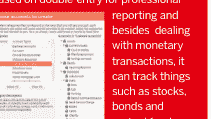

#### ProjectLibre

项目管理工具帮助你掌控正在进行的项目，而 `ProjectLibre` 是其中最好的之一。这是一款获奖应用，被全球许多企业广泛使用。`ProjectLibre` 具有几个有用的功能，还可以使用各种图表和报告可视化任务。

www.projectlibre.org

#### Calibre

为什么不使用 `Calibre` 来管理你的电子书收藏呢？它支持广泛的阅读器和智能手机。该应用可以手动导入书籍，或者如果你愿意，通过同步 `Kindle` 等阅读设备来导入。任何导入的文件都可以按元数据字段进行排序和分组，这些字段可以从各种在线来源（如 `goodreads.com`）获取。

www.calibre-ebook.com

#### Xournal

当需要将可滚动的信息部分留待以后查看时，这款应用非常方便。除了输入笔记外，你可以使用鼠标或触控笔进行操作。它还可以用于向 `PDF` 文件添加注释。

http://xournal.sourceforge.net

#### OpenLDAP

当你想运行目录服务器时，`OpenLDAP` 非常棒。它实现了 `LDAP` 协议，并具备所有预期功能，包括日志记录、复制、访问控制、用户和组管理等。它还与活动目录集成。

www.openldap.org


#### Achievo

这是一个基于 Web 的资源管理工具，拥有简单的界面，用于访问其 `CRM`、`HRM` 和项目管理工具。你还可以跨多个项目跟踪资源。

www.achievo.org

#### Okular

`KDE` 的默认 `PDF` 查看器，包含许多有用的功能。除了 `PDF`，它还可以阅读其他几种文件类型，包括 `Postscript`、`DjVu`、`CDR`、`XPS`、`eFub`、`TIFF`、`GBR` 等。

https://okular.kde.org

#### LaTeX

`LaTeX` 是一个基于 `TeX` 的文档准备系统和文档标记语言。其目的是简化包含数学公式的文档的 `TeX` 排版，并广泛用于学术界。

www.latex-project.org

#### Shutter

除了捕捉整个屏幕外，`Shutter` 还可以捕捉特定区域或窗口。你还可以上传到托管服务。

www.shutter-project.org


#### ClamAV

虽然大多数病毒和木马对 `Linux` 没有影响，但当在 `Windows` 机器上访问时，你的发行版中仍可能包含受感染的文件。因此，请使用 `ClamAV` 扫描文件。

### 爱好者

追随你的热情！

#### RawTherapee

你用数码单反相机（`DSLR`）拍摄吗？那么看看 `RawTherapee`，它包含一系列用于处理和转换 `RAW` 文件的工具。除了基本操作外，该应用还提供了广泛的选择来处理 `RAW` 文件。使用此应用，你可以调整图像的颜色和亮度值，校正白平衡，调整色调，等等。除了 `RAW` 文件，你还可以使用 `RawTherapee` 编辑传统的图像文件，它还包含 `Adobe` 镜头校正配置文件。


www.rawtherapee.com

#### Krita

虽然 `Krita` 获得的是特别提及，但它是一款数字绘画和插图应用，提供许多富有表现力的笔刷、`HDR` 绘画、滤镜、透视网格、绘画助手以及你期待此类应用具备的许多其他功能。

www.krita.org

#### OpenShot

`Linux` 上只有少数几个视频编辑器，而 `OpenShot` 为家庭用户提供了功能与易用性的最佳结合：你可以使用它组合视频、音频轨道和静态图像，添加字幕、转场等，并将最终作品导出为多种格式。`OpenShot` 还可以使用 `Blender` 创建 `3D` 动画标题。

www.openshot.org

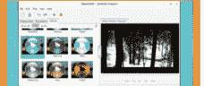

#### Stellarium

`Stellarium` 是为你计算机提供的免费开源天文馆。它计算太阳和月亮、行星和恒星的位置，并根据用户的位置和时间绘制天空。它还可以绘制星座，并模拟天体现象，如流星雨和日食/月食。

www.stellarium.org

#### JOSM

热衷于为 `OpenStreetMap` 映射项目做贡献吗？那么使用 `JOSM` 吧。它是一个基于 `Java` 的离线地图编辑器，可以帮助你绘制 `GPS` 轨迹。你可以将 `GPS` 轨迹日志加载到 `JOSM` 中，并立即开始向 `OpenStreetMap` 添加街道。虽然 `OpenStreetMap` 还有其他几个可用的编辑器，但大多数贡献者使用 `JOSM` 进行编辑，因为它让他们能够快速轻松地将更改上传回 `OSM`。`JOSM` 提供多种功能，并可通过插件和样式进行扩展。

https://josm.openstreetmap.de


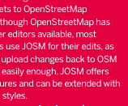

#### Inkscape

另一款专业级工具，`Inkscape` 提供高级矢量图形编辑功能，因绘制矢量艺术、线稿以及设计标志和图形而广受欢迎。它功能丰富，包括标记、克隆、`Alpha` 混合等，经常与昂贵的专有应用程序（如 `Illustrator` 和 `CorelDraw`）相提并论。

`www.inkscape.org`

#### Scribus

`Scribus` 是一款综合的桌面出版程序，可用于创建专业的印刷就绪的在线和印刷文档，包括小册子、手册、书籍和杂志。它具有功能丰富的界面，并具备 `PostScript` 颜色分色、支持 `CMYK` 和专色、`ICC` 配置文件以及印刷标记等功能。`Scribus` 还包含各种模板和样式，你还能获得一系列设置和工具，以精确定义和定位你所需的各种布局元素。

`www.scribus.net`

#### Cinelerra

如果你需要编辑家庭视频以外的内容，`Cinelerra` 是绝佳选择，因为它是 Linux 上最先进的非线性视频编辑器和合成器。它支持 `HiFi` 视频和音频，且不依赖分辨率和帧率，这使其能够编辑任何大小的视频。该应用具有多种高级功能，如叠加、降噪、标准化、时间拉伸、色彩平衡、合成、实时特效等等。它还包含一个合成引擎，用于执行键控等任务。

`www.cinelerra.org`

#### Comix

数字漫画以漫画书存档文件形式分发，主要由一系列图像文件（通常是 `PNG` 或 `JPEG` 文件）组成，存储为单个存档文件。`Comix` 可以读取几乎所有格式的数字漫画。

`http://bit.ly/ComixApp`

#### FontForge

`FontForge` 是一款功能丰富的应用，用于创建和编辑字体，并支持所有常见的字体格式。你可以从字体文件中提取信息，也可以从一种格式转换为另一种格式，并可用于预览。

`http://bit.ly/FontForge`

#### CairoDock

`CairoDock` 是一款类似 Mac OS X 坞的应用。它相对于其他坞的主要优势之一是它不需要合成窗口管理器即可工作，并可以为旧的、性能较低的机器添加双工功能。

`www.gx-dock.org`

#### Audacity

如果你需要处理音频，你应该使用功能强大的 `Audacity` 声音编辑器。你可以修剪音频，组合轨道，甚至可以堆叠多个轨道，以及导出为多种格式和质量设置。

`http://bit.ly/AudacityApp`

#### MPD

`Music Player Daemon`（`MPD`）是一个具有服务器-客户端架构的音频播放器，这意味着你可以从另一台计算机远程控制它。它播放音频文件，组织播放列表，并可以维护一个音乐数据库。

`www.musicpd.com`

### 开发

面向高级用户的专业工具与程序。

- `jEdit`：这是一个面向程序员的文本编辑器，支持自动缩进，并支持超过 140 种不同编程语言的语法高亮。该应用允许你定义复杂的宏，并提供强大且用户友好的键盘映射系统。它高度可配置和可定制，你可以通过添加插件来扩展其功能。
  `www.jedit.org`

- `Meld`：作为一个图形差异工具，`Meld` 允许你比较两个或三个文件以及整个目录。它包含语法高亮和直接文件编辑等功能，使用该工具你可以轻松隔离和合并差异。`Meld` 还可以用于浏览各种流行的版本控制系统，如 `CVS` 和 `Subversion`。
  `www.meldmerge.org`

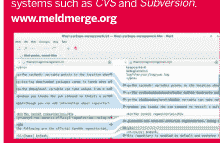

- `Blender`：使用 `Blender`，动画师可以创建 3D 打印模型、视觉效果、艺术、交互式 3D 应用程序和视频游戏。该应用提供了广泛的功能，可用于创建 3D 动画电影。它是一个一站式 3D 软件包，包括游戏引擎、视频序列编辑器、生产就绪的相机和物体跟踪、大型扩展库以及高级物理引擎。它可以渲染流体动力学，并模拟弹性物体和衣物的运动。
  `www.blender.org`

- `Eclipse`：没有比 `Eclipse` 功能更丰富的 IDE 了。虽然 `Java` 是它的专长，但 `Eclipse` 通过插件支持一系列语言。事实上，它的插件市场是一个不可或缺的资源。`Eclipse` 执行代码重构，你可以使用它将选择的内容提取为局部变量或方法。由于它可以针对多人安装，因此它以非常成熟的方式处理版本控制。
  `www.eclipse.org`

- `Geany`：如果你只是偶尔编程，那么不需要全功能的 IDE，这使得 `Geany` 成为一个不错的选择。它介于纯文本编辑器和 IDE 之间，支持流行的编程语言，并具备如编译/运行按钮、列出当前打开文件中定义的函数等便捷功能，还有更多功能。
  `www.geany.org`

- `Bluefish`：你为 Web 开发吗？`Bluefish` 是一款面向 Web 开发者的多语言编辑器。它支持许多编程语言和标记语言，并专注于动态和交互式网站。它支持代码块折叠、无限撤销/重做、自动标签关闭和语法高亮。另一个有用的功能是片段栏，你可以从中为多种语言添加最常见的代码片段。`Bluefish` 还支持流行的开源 Web 应用，如 `MediaWiki` 和 `WordPress`。
  `http://bluefish.openoffice.nl`

- `KompoZer`：新晋和有经验的 `HTML` 程序员都能使用 `KompoZer` 编辑器节省大量的时间和精力。它具有直观的界面，包括颜色拾取器、`FTP` 站点管理器、`CSS` 编辑器、可定制的工具栏、表单、拼写检查器、标记清理器，还可以使用 `W3C` `HTML` 验证器验证代码。
  `www.kompozer.net`

- `APTopCD`：突然意识到你需要移动你的 `Ubuntu` 安装，或者需要给朋友一份你配置副本？使用 `APTopCD`，`Ubuntu` 用户可以备份所有已安装的软件包到 `ISO` 镜像，然后可以作为软件源添加到另一个安装中。你可以使用此源将软件包还原到系统，或将所有软件包保留在 `APT` 缓存中。
  `aoptopcd.sourceforge.net`

- `Gimp`：尽管名为 `Gimp`，它是一款强大、综合的图像操纵程序。它免费提供了广泛的专业质量照片润饰和图像操纵能力的工具。它还提供了巨大的功能列表，并支持所有常见的图形文件格式。
  `www.gimp.org`

- `Clementine`：使用 `Clementine` 播放本地存储的音乐和流媒体音频。该应用具有吸引人的界面，它还能帮助组织和传输音乐到各种设备，并与流行的云服务集成得很好。
  `www.clementine-player.org`

- `Iccast`：使用 `Iccast`，你可以在网络上流式传输音乐。`Iccast` 同时支持多个音频流，听众可以通过远程媒体播放器访问流，也可以将 `MPD` 配置为源。
  `www.icccast.org`

- `Amarok`：如果你使用 `KDE`，你的发行版可能已经包含这个音乐播放器，`Amarok`。它也与几个在线音频服务集成，其功能包括创建动态播放列表、书签、脚本和上下文视图。
  `https://amarok.kde.org`

- `LMMS`：`LMMS` 是一款数字音频工作站，通过合成声音、排列样本并在 `MIDI` 键盘上播放它们来制作音乐。它还有一个歌曲编辑器和插件来模拟乐器和效果。
  `www.lmms.io`

- `Kodi`：直到最近，`Kodi` 还被称为 `XBMC`。它是希望将电脑变成媒体中心的用户的绝佳选择。它播放大多数类型的媒体文件，并与电视、红外和蓝牙遥控器配合工作。
  `www.kodi.tv`

### 实用工具

这些应用能让你更多地发挥计算机的潜力。

#### Gnome Tweak Tool

不满足于默认的 Gnome 桌面环境？使用 `Gnome Tweak Tool` 可以自定义多个方面，包括桌面外观设置。通过这个微调应用，你还可以更改窗口和工作区的行为，管理扩展，甚至通过图标、文件和文件夹放置在 Gnome 桌面上，规避 Gnome 3 的设计理念。

`http://bit.ly/Gnome_Tweak_Tool`


#### Grub Customizer

`Grub` 2 是最流行的 Linux 引导加载程序。几乎所有主要发行版都使用它。这是一款功能强大的软件，拥有众多选项。`Grub Customizer` 是一个易于使用的图形化工具，你可以快速自定义引导加载程序的所有方面，包括其外观。

`www.launchpad.net/grub-customizer`

#### Handbrake

当需要转换视频时，视频转码应用 `Handbrake` 表现得相当出色。它可以转换几乎任何格式，并支持广泛的视频编解码器。其最佳功能之一是内置了热门设备的配置文件，使转换过程更加简便。

`www.handbrake.fr`

#### digiKam


Linux 上最好的照片管理工具之一是`digiKam`，它具有吸引各类用户的特性。它识别所有主要图像文件格式，并可以根据元数据组织和排序图像。该应用还有插件可以将图像导出到各种在线服务。

www.digikam.org

#### DOSBox

`DOSBox` 带你重温昔日的美好时光，畅玩那些在现代硬件上无法运行的经典 DOS 游戏。这是一款 x86 PC 模拟器，创建一个兼容 IBM PC 的计算机，配备兼容的图形卡和声卡。该应用还可以模拟网络硬件，用于局域网甚至互联网上的多人游戏。Wine 项目甚至使用 `DOSBox` 的代码来增强对 DOS 应用的支持。

www.dosbox.com

#### EasyStroke

**想**用鼠标手势控制你的 PC 吗？`EasyStroke` 应用允许你通过录制按住特定鼠标按键时指向设备的动作来定义和管理手势。然后，你可以配置当应用识别出定义的手势时执行的操作。

https://easyStroke.sourceforge.net

#### K3b

**尽**管 `K3b` 光盘刻录工具是为 KDE 设计的，但它仍然是该类工具中最好的之一。该应用可以刻录多个 El Torito 启动镜像、音频 CD、VCD、SVCD、混合模式 CD、eMIX CD 和 DVD。它还可以抓取 DVD 并写入 ISO 镜像。

www.k3b.org

#### AviDemux

`AviDemux` 是一款视频编辑器和转换器，可用于基本的剪切、过滤和编码任务。它支持许多文件类型，包括 AVI、MPEG 和 MP4。该应用专为知道自己想做什么的用户设计，同时也提供直观的界面，使剪切和分离视频等任务变得相当简单。该应用有一些预设，用户还可以保存自定义设置，使新用户更容易操作该应用。

http://AviXmount.free.fr/aviDemux

#### Vokoscreen

`Vokoscreen` 是一款功能丰富的屏幕录制应用，值得关注，它基于 FFmpeg 处理多媒体数据。`Vokoscreen` 可以捕获视频和音频，选项包括录制整个屏幕、窗口或选定区域，以及来自网络摄像头的视频。该应用支持 MPEG4、x264、MP3 和 Vorbis 编解码器，并可以保存为 AVI 和 MKV 容器格式。该应用提供了一些控制功能，例如更改视频质量和每秒捕获的帧数，可用于制作游戏的屏幕录制。

http://wiki.online.de/pp

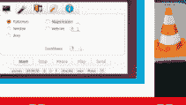

#### Ncmtcpp

这是一个易于使用且可定制的命令行 MP3 客户端。它提供有用的功能，如排序播放列表、查看歌词、过滤项目、从 Last.fm 获取艺术家信息、标签编辑器等。

http://bit.ly/Ncmcppp

#### Samba

`Samba` 是一套程序，使 Linux 用户能够通过网络访问和使用 Windows PC 上的文件、打印机和其他常用共享资源，它通过支持 SMB 协议来实现这一功能。

www.samba.org

#### rTorrent

这里是一个带有 curses 接口的命令行 BitTorrent 客户端。你可以将其作为守护进程运行，并使用 screen 管理它。由于它支持 SSH，你可以从任何远程机器管理你的种子。

http://bit.ly/rTorrent

#### Links2

有轻量级浏览器，还有 `Links2`。这是一款可以渲染复杂页面甚至拥有下拉菜单的网页浏览器。它也很特别，因为它是一个通过键盘操作的命令行浏览器。

http://Links.twibright.com

#### Midnight Commander

在图形文件管理器出现之前，`Midnight Commander` 就解决了问题。如果你经常处于控制台环境中，它仍然是你的最佳选择。

http://bit.ly/MidnightCmdr

### 管理工具

使用这些强大的应用掌控你的发行版。

#### Redo Backup

我们在前面的文章中提到了 Clonezilla 克隆解决方案，但如果你只需要一个工具将旧磁盘更换为新的，那么你就使用 Redo Backup and Recovery。该工具专为经验不足的用户设计，拥有最简单的界面。

www.redobackup.org

#### Qemu

它是一个功能丰富的多用途处理器模拟器和虚拟化器。你可以使用它创建虚拟机，甚至模拟各种硬件架构。如果你拥有合适的硬件（具有硬件虚拟化扩展的处理器），你可以使用 Qemu 与 KVM 一起以接近原生的速度运行虚拟机。

www.qemu.org


#### XAMPP

XAMPP 技术栈提供了一个单一的包，你可以将其用作沙箱来测试和开发 Web 应用。它包括所有必要的组件，如 Apache、MySQL、PHP 和 Perl，以及用于管理技术栈组件的其他库、模块和工具，例如 phpMyAdmin 和 FileZilla。安装后，你可以通过图形控制面板管理各种服务。

www.apachefriends.org


#### Déjà Dup

该应用极简的 GUI 使其有别于你发现的各类其他备份应用，并允许你在几分钟内配置备份。Déjà Dup 基于 Duplicity，为不熟悉备份工具用法的桌面用户提供了恰到好处的功能。

http://live.gnome.org/DéjàDup

#### Mondo Rescue

Mondo 是一个独特的备份解决方案，为正在使用的系统创建定制的启动备份和恢复磁盘。Mondo 具有文本驱动界面，支持广泛的文件系统，并可以使用多种介质作为备份介质。

www.mondorescue.org

#### Open Media Vault

当你对数据的保护需求超过简单备份时，你需要部署一台 NAS 服务器。Open Media Vault 项目是一个基于 Debian 的服务器，以一种易于设置和管理的方式提供商业选项的强大功能。

www.openmediavault.org

#### Conky

担心你 PC 上的资源使用率吗？Conky 是一个小巧的应用，让你能够监控系统状态。它可以监控和报告各种组件的状态。该工具非常灵活且高度可配置，还可以显示来自应用的信息，例如天气更新。

http://conky.sourceforge.net

#### Turnkey Linux

Turnkey 项目生成的设备可以让你瞬间部署新的服务器。Turnkey 设备是一个自包含系统，打包了一个功能完整的 Web 应用，该应用运行在仅有一个操作系统（OpeS）组件之上，该组件用于支持该特定应用。所有设备都基于 Debian，但根据你要部署的硬件，它们有几种不同的格式。一旦启动并运行，你就可以使用基于浏览器的界面管理每个设备。

www.turnkeylinux.org


#### Zentyal

Zentyal 发行版包含运行网关服务器所需的所有组件。该发行版通过众多自定义管理工具简化了服务器组件的设置、监控和控制过程，帮助你在无需麻烦地处理配置文件的情况下配置服务器。

www.zentyal.org

#### Mutt

Mutt 之于邮件，犹如 Linus 之于网络浏览器。这是一个基于文本的邮件客户端，高度可配置，支持 POP 和 IMAP 协议，并具备你期望从邮件客户端获得的所有常规功能。

www.mutt.org


#### Profanity

Profanity 是一个基于控制台的 XMPP 协议客户端，支持多用户聊天和 OTR 消息加密。

www.profanity.im

#### Canto

想在命令行做更多事情？获取 Canto CLI RSS 订阅阅读器。它支持 RSS、Atom 和 RDF 订阅，并以 OPML 格式导入和导出订阅。它有很多自定义选项，甚至可以用 Python 进行配置。

http://bit.ly/CantoRSS

#### mpg123

这是一个命令行 MP3 音频播放器，支持无缝播放。它非常出色，其解码库 libmpg123 被其他音频播放器用于 MP3 播放。

www.mpg123.de

#### FFmpeg

FFmpeg 是功能最强大的媒体转换实用程序之一，可以以各种方式操纵几乎任何类型的媒体文件，例如更改比特率、提取音频、记录流、提取流等等。

www.ffmpeg.org


### 基础

- 包管理

- Web 浏览器

- 文档

- 电子表格

- PDF 编辑

- 即时通讯

- 电子邮件

- 文本编辑器


44 | 46 | 48 | 50 | 52 | 54 | 56 | 58


### 软件包：安装新软件

尽管您可能听过一些其他说法，但在您的 Linux 系统上获取新程序其实是极其简单且万无一失的。


> **小贴士**
>
> 您也可以从 Ubuntu 的启动板安装软件。点击左侧栏顶部的搜索按钮，然后点击底部的应用图标，搜索您想要的内容。

您的 Linux 系统预装了许多有用的应用程序和软件，但总会有一刻——这总是会发生——您想要一些新的东西。获取新事物有各种复杂的方法，也许在您 Linux 生涯的后期，您会探索这些途径。但目前，有一个更简单的方法来为您的计算机寻找新程序：包管理器。

包管理器为您处理一切。它们从互联网上获取您所需软件的最新版本。它们解决任何依赖项——您的计算机可能缺失的项目——以便您能够运行该软件。它们自动安装所有内容。而且，一旦您的软件牢牢地嵌入您的 PC 中，它们会在稍后处理升级或移除它的过程。您永远不必亲自动手。如果一切顺利，首次运行一切都会完美无缺。

您可能在智能手机上遇到过类似的东西。苹果的 App Store 和安卓 Play 商店都是包管理器的例子——在现代手机上，您不太可能曾经需要手动下载和安装任何应用。整个过程是无间隙的。苹果将这一系统带到了 macOS，而 Windows 转换用户可能知道微软自 Windows 8 以来一直在尝试类似的方案：Microsoft App Store。从愤世嫉俗的角度看，这可以被看作是微软控制其软件生态系统的一种方式，您可能确实有理由持怀疑态度，但这也是获取（某些）程序的一种方式，而无需从互联网随机下载东西的麻烦——以及潜在危险。这是有道理的。虽然它实际上没有真正成功，但该理论是合理的。

Ubuntu 的桌面包管理器被称为 `软件中心`。它访问多个来源——被称为 `存储库`——以获取适合您计算机的您所选程序的适当版本。或者至少目前是这种情况——Ubuntu 将很快用替代品 `GNOME 软件` 在 Ubuntu 16.4 版本中替换它。但就目前而言，让我们看看如何使用 `软件中心` 来下载、安装和移除软件——`GNOME 软件` 的界面和理念几乎没有什么不同，所以这将使您受益匪浅。

#### 中央预订

正如您从上方的注释中看到的，`Ubuntu 软件中心` 的核心界面真的没有很多内容。一个大的分类软件列表，按钮让您可以看到什么可用、已安装、您做了什么以及下载和安装进展如何。对我们来说，关键元素是窗口右上角的搜索框。它不仅通过软件名称进行搜索——考虑到大多数 Linux 包令人困惑的名称，这很有用——还通过描述进行搜索。因此，例如，如果我们想找一个游戏，我们可以搜索，是的，'`游戏`'。任何标题、简短描述和长描述中包含 '`游戏`' 的内容都会出现。显然，这是一个非常广泛的例子，但想象一下您正在寻找一个新的电子邮件客户端：输入 '`email`' 并找到您正在寻找的内容，比输入 `MBXMailcomper` 更有意义。

除了令人牙酸的名词之外，让我们安装一些东西。而且，我们为什么不做得更元一些呢？在 `软件中心` 之前，Ubuntu 曾有一款名为 `Synaptic 包管理器` 的程序，即使转移到 `GNOME 软件` 后，它仍然可用。它做相同的事情（搜索软件包、修复依赖项、升级等），但手头有更多的信息。也许它并不是 Linux 新手的最优选，但当您采取下一步时，有它很便利。

> 安装软件需要您对系统拥有管理员权限——这是阻止其他用户安装您不想要的软件的好方法！


##### Ubuntu 软件中心内部

**`所有`**

要返回 `软件中心` 的主菜单，点击此按钮。您还可以使用其菜单来选择软件来源——官方 Ubuntu 版本或来自 Canonical 合作伙伴的。

**`类别`**

一旦您在“所有软件”中选择一个类别，该类别的子类别就会显示出来，这意味着您可以进一步深入到您真正想要的软件。

**`看看全部`**

想知道您当前类别中有什么可选择的吗？点击此处查看整个令人困惑的列表。


**`过去时`**

软件中心实际安装了什么？不仅是大的软件包，还有小的吗？历史页面会让您知道。

**`顶级精选`**

每个类别中最好的（或至少评分最高的）应用在此列出，并附带其平均评分和评论数（在括号中）。

**`搜索栏`**

如果您不确定软件包名称，或者不确定您选择的软件包所在的类别，搜索至关重要。只需在此处输入并按 [回车] 键。

在搜索框中输入“包管理器”对我们没什么帮助。Synaptic 在列表中，但并不容易找到。所以点击“所有软件”，我们可以用一种更有机的方式找到它。它实际上嵌套在通常晦涩不明的类别“主题和微调”中，因此在主页面左栏中点击，您应该会在随后窗口中的顶级评分部分看到它被列出。如果没有，点击顶部的“所有”按钮，您应该会看到一个更易于管理的列表。

按类别划分。我们知道 `Synaptic 包管理器` 在“主题和微调”中，所以点击该类别左侧的箭头以展开它，并在列表中定位 `Synaptic`。点击它一次，您会看到一对按钮出现——“更多信息”，如果您在重新阅读您的系统且记不清特定软件实际做什么时，这特别有用，以及“移除”。点击后者。

如果适用，`软件中心` 现在会警告您任何其他也必须同时卸载的东西。在这种情况下，它是一个名为 `update-manager` 的软件包，我们可以稍后使用我们最初安装 `Synaptic 包管理器` 的相同技术轻松重新安装它。点击“全部移除”，输入您的密码，然后移除将发生——但务必检查“历史”标签以确认。现在继续尝试 `软件中心`。安装一些游戏，移除一些默认应用并尽情玩乐！■

> **小贴士**
>
> 大多数图形包管理器都只是终端应用（如 `apt-get`）的前端，您可以直接使用该终端应用。更多相关内容见第 142 页。

##### 实际安装

点击 `Synaptic 包管理器`，您会看到大量关于它的信息，其网站链接、屏幕截图（是不是很漂亮？）以及右侧的“安装”按钮。在您继续点击之前，稍微向下滚动——`Synaptic` 附带了大量您可能感兴趣的附加组件，只需标记它们的单独复选框即可安装这些。再滚动一点，您会发现软件包的评论——如果您正在安装未知的软件，这非常有用，因为其他用户很少吝啬分享负面体验——而 `软件中心` 并没有严格的质量过滤器——所以这些在很多情况下可能是重大的警示信号。当您准备好时，点击“安装”。输入您的密码，点击“验证”，`软件中心` 将处理其余部分。

转到“历史”面板查看实际进行了哪些更改。您应该会看到一个名为 `synaptic` 的软件包已安装，但看看在相似时间安装的项目；列表将包括大量 `Synaptic` 的依赖项，这些也已经进入了您的系统，您不必指动一根手指。除了您用来点击安装按钮的那根手指之外。


▶ 其他多余的依赖项会在您卸载软件包时自动移除——有时您还需要移除额外的东西。

##### 一旦移除

让我们顺便反向这个过程。点击窗口顶部的“已安装”按钮以查找软件列表

### 网络浏览器：择优而用

你如何看待网络世界？当体验当下可用的最佳浏览器时，你可能会惊讶于其中的巨大差异。


### 快速提示

每个浏览器导入书签的方式都不相同——请查阅你选定的浏览器帮助文件，以获取更多关于操作方法的详细信息。

如今，如果电脑不是通往互联网的门户，那它还能是什么？访问在线世界绝对至关重要，而 Linux 并不缺乏网络浏览器选项。如果你习惯于在其他操作系统中上网，那么许多浏览器对你来说会很熟悉；有些是变体（基于相同的软件，但并不完全相同），也有一些相当独特、值得尝试的非主流浏览器。

如果你已经习惯了当前的浏览器，好消息是通常迁移书签非常容易，因此你不必担心丢失那些重要的链接。所以在了解你的选项之前，让我们先从其他系统备份书签，以便之后可以导入。

#### 备份书签

在 Google Chrome 中，点击三横线汉堡菜单图标，转到“书签”，然后点击“书签管理器”。点击“整理”下拉菜单并选择“导出书签”。这将创建一个 HTML 文件，你可以稍后将其导入到你选择的浏览器中。

如果你使用的是 Internet Explorer，你可以在“文件/导入和导出/导出收藏夹”中找到该设置。微软 Edge 虽然更新，但并不那么友好，不过幸好 Firefox 可以导入 `Edge` 的书签。要将它们（以及你的其他书签）从 `Firefox` 中导出，请点击书签图标，选择“显示所有书签”，然后按照“导入和备份”中的步骤进行操作。

遗憾的是，这里的篇幅有限，所以其他浏览器的用户将不得不访问他们喜爱的搜索引擎。是时候来看看我们在 Linux 中的选项了！

#### 浏览器历史


在 Linux 上，最成熟的浏览器可能是 `Firefox`。尽管近年来它失去了一些市场份额，但它能完美显示整个网络，并包含一些出色的功能。例如，较新的版本允许你在使用相同的 `Firefox` 账号登录所有设备时同步标签页，这使得在多台机器之间切换时很容易从上次中断的地方继续——或者使用你的账号同步用户配置。类似地，你可以使用 `Firefox Hello` 系统与其他 `Firefox` 用户同时浏览网页，这对于远程办公、规划或仅仅是在线上闲逛都大有裨益。

你可能会发现一个名为 `Iceweasel` 的浏览器——从所有实际角度来看，它就是除名字外与 `Firefox` 完全相同的浏览器。某些附属于 `Firefox` 的次要元素和商标（如标志）因违反自由软件分发要求而被更改。电子邮件客户端 `Thunderbird`（`IceDove`）、互联网应用程序套件 `SeaMonkey`（`Iceape`）以及看似已被放弃的日历应用 `Sunbird`（`Leon`）也进行了重新品牌化。预计这些冰冷的替代品很快会消失，因为发行版创建者似乎正在解决与 `Firefox` 母公司 `Mozilla` 之间的分歧。

仅次于 `Firefox` 的是 `Chromium`，这是一种开源浏览器（有多种由用户开发的版本可用），它是 `Google Chrome` 的基础。它不包含其拥有注册商标的大哥的所有功能——通常缺少使用专有非开源技术（如 `Flash` 播放器）的功能——但它运行相同的渲染引擎，这意味着网站看起来同样出色。它还以相同的方式管理内存，为每个打开的标签页分配一部分内存，这既是一种祝福也是一种诅咒。祝福在于，如果一个标签页出现问题，它不会拖垮其他标签页；但诅咒在于，`Chromium` 需要相对大量的内存来运行多个标签页。

虽然你不太可能在你的发行版的包管理器中找到大厂 `Chrome`，但获取真正的 `Chrome` 其实很简单。只需访问 `google.com/chrome`，点击你的“立即下载”按钮，并选择适合你发行版的文件（如果你使用的是 `Ubuntu`，通常是 64 位 `deb` 文件）。点击“接受并安装”，然后使用包管理器打开生成的文件以进行安装。令人烦恼的是，你需要第一次从终端运行它：点击搜索按钮，搜索“终端”并选择 `Terminal` 应用程序，然后输入 `google-chrome-stable` 以首次启动它。一旦运行过一次，它会将图标添加到你的启动器中，以便将来更轻松地启动它。在这两种情况下，我们都建议使用 `Firefox` 和 `Chrome` 而不是它们的开源替代品。虽然这与 `Linux` 的自由哲学不符，但你选择 `Linux` 可能并非出于哲学原因。出于安全和兼容性考虑，拥有你选择的网络浏览器的绝对最新版本至关重要，有时分叉的软件跟不上时代的发展。

`Linux` 上有许多其他浏览器，它们都服务于不同的目的。好吧，通常它们的存在是为了为低配机器提供更小内存占用的浏览体验。你可以在“替代浏览器”框中了解更多关于这些浏览器的信息。

#### 替代浏览器

-   `Lynx`

    经典的文本模式浏览，在终端窗口内运行。由于其古老的结构，`Lynx` 如今主要只是一个新奇事物，但在绝对无法输出除文本模式以外任何内容的机器上，它非常有用。看看在没有图像或现代渲染技术的情况下网络看起来是什么样，也可能会很有趣。

-   `Midori`

    使用 `GTK/WebKit` 引擎（这是驱动 `Chrome`、`Chromium` 和 `Opera` 的 `Blink` 渲染引擎的一个分叉），`Midori` 是已故窗口管理器的默认浏览器，并出现在许多轻量级发行版（`Bodhi`、`SystemRescueCD`、`Manjaro Linux`）中。在本文章列出的测试中，它的表现良好。

-   `NetSurf`

    最初来自 `RISC OS`——一个基于 `ARM` 的操作系统，源自 `Acorn Archimedes`——`NetSurf` 随后被移植到多个平台，包括 `AmigaOS`。它不是最好的浏览器，但它使用自己独特的渲染引擎，如果你的 `Linux` 安装在使用其他浏览器时遇到麻烦，不妨试一试。

-   `Opera`

    经常是浏览器的伴娘但从未成为新娘，`Opera` 是一个整洁、快速且非常出色的程序，它值得获得比实际更多的认可。`Opera Turbo` 功能（可压缩你的网络流量）如果你拥有一根慢速互联网连接或你的 `ISP` 阻止访问某些网站，则特别有用。

-   `Pale Moon`

    这是 `Firefox` 的一个著名分叉，那些对现代浏览器风格不太满意的人会很高兴见到它。它坚持使用老式的、完全可自定义的用户界面，并使用其自己的渲染引擎 `Goanna`，该引擎分叉自 `Firefox` 的渲染引擎 `Gecko`。它积极更新且高性能，非常值得一试。

#### 测试能力

你的浏览器实际表现如何？不同的浏览器选项以不同的方式渲染在线元素，因此彻底测试你选择的浏览器（及其竞争对手）以确保你获得最佳体验是值得的。首先前往位于 `www.acidtest.org` 的 `Acid` 测试，这是一个长期的渲染引擎挑战系列，它将证明你的浏览器对特定 `Web` 标准的遵循程度，或者至少显示你的浏览器在这些特定测试中的表现。

一个更现代的基准测试是 `HTML5` 测试，位于 `html5test.com`。虽然它没有动画效果或提供你浏览器缺陷的视觉表示（唉！），但它确实提供了一份详细的清单，列出你的浏览器能做或不能做的所有事情，并配有相应的分数。许多 `Linux` 浏览器会因为省略了闭源技术而失去一些分数，所以在急于卸载当前选项之前，请牢记这一点。无论如何，绝大多数网站都包含专有软件之外的回退选项，而且这些回退选项中的许多现在正在成为标准而非替代方案。

#### 极致测试

我们找到的最极端的渲染测试位于 `web.basemark.com`。它的名字叫 `Browsermark`，运行一系列重量级测试，从多个方面推动浏览器性能，超越仅仅是 `HTML5` 或 `CSS`，并且可能还会给你一些关于你电脑性能的线索。确保机器在运行期间不要进入睡眠状态，这大约需要五分钟。完成后，你会获得最终分数，查看你的浏览器和桌面组合所在的百分位，甚至可以获取一些关于你 `ISP` 性能的信息。

虽然我们在这里做了一些模糊的推荐，但你的浏览器选择真正取决于个人口味以及什么最适合你的 `Linux` 系统。所有计算机和桌面表现各不相同，因此鼓励你进行实验、安装、测试，并找到最适合你的选择。祝浏览愉快。


`Chrome` 可能不在你的包管理器中，因此你需要访问其网站（使用不同的浏览器）来获取它。

> **快速提示**
>
> 如果你的浏览器没有在所有测试中取得满分，不要担心——如果你对其显示页面的方式感到满意，那个测试结果其实并不重要！


`HTML5` 测试是查看你的浏览器真正多么强大的好方法，但它并不是浏览器性能的全部和终结。

## LibreOffice

### Writer：创建精美的文档

`LibreOffice` 是一个功能齐全且完全免费的办公套件。让我们看看它的文字处理器 `Writer` 如何处理复杂任务。

### 快速提示

`Writer` 可以从你的 `Calc` 电子表格中获取内容。只需复制你想导入的单元格，然后在 `Writer` 中使用“编辑 > 选择性粘贴”功能将它们引入。

任何 `Windows` 能做的，`Linux` 都能做……同样出色。我们承认，这不像经典歌曲那样朗朗上口，但事实如此：作为一个成熟的桌面操作系统，`Linux` 拥有某些可靠的软件，能够从容不迫地执行日常桌面任务。我们在办公领域的推荐是 `LibreOffice`，这是一个跨平台的生产力应用程序集合，自 1985 年以来，它以多种形式和名称存在。尽管有着久远的历史，它仍然是目前开发最活跃的办公套件。

#### 写作要务

`LibreOffice 5` 应该预装在你的 `Linux` 发行版中——你可以通过运行 `Writer` 并转到 `帮助/关于 LibreOffice` 来检查你是否有最新版本。如果未安装，请打开你的软件包管理器并从那里安装它。（你可能会被提供在 `LibreOffice Fresh`（前沿版本）或 `LibreOffice Still`（稳定、企业就绪版本）之间选择的选项。选择哪个完全取决于你：这里涵盖的内容不需要最新版本。）当一切安全安装完毕后，运行 `LibreOffice Writer`。


列对话框中有大量选项，包括，如果你愿意的话，单页上不同大小的列。

尽管微软近年来更改了 `Microsoft Word` 的界面——有些人认为变得更糟了——但 `Writer` 的布局对于任何使用过 90 年代初期文字处理器的人来说都应该立刻熟悉。有一个大的空白页面。屏幕顶部的一对条形图提供对文本和文档设置的快速访问。窗口底部有一个信息栏——字数、字符数、页数——和一个缩放滑块。还有一个闪烁的光标，引诱你写点什么。

打字的行为稍微超出了本教程的范围——我们假设你能应付——所以让我们创建一个基本的通讯简报，以测试 `Writer` 的几个功能。

#### 布局：事实


首先将你的页面分成列，你可以将文本输入到这些列中。在屏幕顶部的菜单栏中，点击`格式` > `列`以调出列对话框，然后通过在框中输入“2”、点击框上的向上箭头或点击框右侧的两列图标，将列数更改为两列。现在你可以设置列间距。你希望这个值大于零，否则你列中的文本会合并为一个，所以将其设置为`0.5cm`。如果你更喜欢使用其他计量单位，你可以直接输入它们；在间距框中输入`0.2in`会自动将其转换为公制等价值。

现在让我们添加一条分隔线来分割列。将样式设置为实线，高度设置为`90%`，颜色设置为深灰色，宽度保持不变。同样，你可以在这个框中输入自己的计量单位，尽管它限制最大宽度为`9pt`。因为我们改变了高度，我们还可以改变线条的位置：居中看起来最好。点击确定返回文档，你会看到你的更改已经生效。

所以现在是打字的时候了。或者说应该是，但这听起来有点太辛苦了。因此，我们将使用`Writer`方便的`自动文本`功能用虚拟文本填充文档，该功能还可以为你提供简历、求职信等快速模板。转到`编辑` > `自动文本`，展开“标准”类别，选择`虚拟文本`，然后点击`插入`将你的填充文本添加到列中。

#### Linux 格式化

回到你的文档中，复制你的虚拟文本几次（使用`Ctrl+A`全选，`Ctrl+C`复制，然后`Ctrl+V`粘贴）以填满页面。我们现在将使用`Writer`的默认段落样式来美化文档。点击并拖动鼠标选中第一句话，点击当前显示为“默认样式”的下拉框，并将其样式更改为“标题”。你会注意到这同时会对文本应用几项更改：它将其居中，将其大小更改为`28pt`，并赋予其漂亮的粗体无衬线字体。选中其余文本并赋予其“正文”样式。

当你在列表中的样式上悬停时，你可能会注意到它们右侧有一个菜单按钮。在“标题”上悬停：点击该菜单按钮，然后选择“编辑样式”。在出现的弹出窗口中，勾选“自动适应”复选框。我们现在要突出使用样式而不是手动更改字体和大小的主要优势——你可以编辑一次样式，你的更改将反映在整个文档中，这意味着所有内容都保持整齐一致。转到字体选项卡，按你的喜好更改，然后点击应用以查看你的更改在文档中的反映。你还可以使用选项卡来设置完美格式化的编号列表、一致的高亮显示、首字大写等等。为了以更可视化的方式进行此操作，手动调整页面上的某些文本直到它看起来恰到好处，拖动以高亮显示它，然后在下拉框中将光标悬停在目标样式上并选择“更新以匹配所选内容”。

#### 收尾工作

我们的通讯简报需要一个页眉，因此转到`插入` > `页眉`并选择默认样式。这会在我们的列上方弹出一个单独的页眉区域，并自动调整我们的分隔线以使其适配。点击鼠标在页眉区域以将光标移动到此，输入你想包含的任何文本。如果你想添加自动递增的页码，将文本光标放置在你想要的位置，并转到`插入` > `域` > `页码`。


在设计文档时，使用`AutoText`功能来填充文档，即使你还没有写任何内容。

页眉将出现在我们文档的每一页上，因此，如果我们想为第一张纸添加报头——一个框架，我们需要使用稍微不同的策略。点击`插入` > `框架`创建一个，请记住在这种情况下我们寻找的是“框架”而不是“浮动框架”，因为后者会位于你的文本之上，而前者会将页面文本推开。保持默认设置，你会看到页面上出现一个小框架。现在通过将鼠标悬停在它的边缘直到光标变成拳头，然后将其拖动到你想要的位置，并通过拖动其边缘周围的绿色锚点直到它是完美的尺寸来调整它的大小。你可以点击内部并按通常方式输入。


正如他们所说，剩下的就看你了。尝试使用图像按钮添加图片（先制作一个框架以获得最终控制权），并使用各种段落工具进一步美化你的文本。别忘了按`F1`查看`LibreOffice`的全面帮助指南。

#### 在 Writer 中导航

- **样式技巧**：通过此菜单可访问的文本样式，如果你想创建一致的文档而不进行大量繁琐的工作，它们至关重要。

- **看起来犀利**：粗体文本、下划线和删除线可能不值得拥有自己的文本样式，所以只需高亮显示要更改的文本并按这些按钮来改变它们。

- **框起来**：文本框架可以帮助你放置那些否则会被页边距或列推来推去的元素（包括图像）。


- **你做得怎么样？**：这个快速计数器跟踪你写下的单词和字符数——如果你正在按限制写作，这是必不可少的。

- **完全正确**：拼写和语法错误由锯齿状下划线标出，就像在`Microsoft Word`中一样。按`F7`进行更彻底的拼写检查，或按`Shift+F7`关闭此功能。

- **额外菜单**：如果你正在添加项目符号或编号列表，别忘了通过点击下拉列表来选择你的确切选项。

### Calc：超级电子表格

我们之前处理的是文字，现在是时候使用`Linux`顶级的电子表格软件`LibreOffice Calc`来管理你的数字了。


- 如果出现问题，你可能会遇到一个无法理解的错误代码。选中它，然后查看`Calc`窗口的右下角，以了解其含义。

没有电子表格会怎样？我们很可能会变得相当贫穷或相当富有，这更可能是事实。无论哪种情况属实，总会有一个时候，我们需要将数字放入网格中。你可能熟悉微软的`Excel`，它在`Windows`领域的电子表格市场占据主导地位。在`Linux`上，一如既往地有很多选择，但我们更倾向于使用经过精细打磨的`LibreOffice Calc`。它应该已经随你的`Linux`发行版预装了，但如果找不到它，你需要通过你发行版的包管理器安装它——它是`LibreOffice`主包的一部分——。以`Ubuntu 15.10`为例，你需要使用`Ubuntu Software Centre`。本教程针对的是`LibreOffice 5`，但如果你使用的是更早的版本，跟着做也没问题。

与`LibreOffice Writer`类似，首次运行`Calc`时应该会出现一个相当熟悉的环境。有一个标准的单元格网格，屏幕顶部的菜单栏，下面是输入行，还有一个位于工作表下方的区域，一旦创建了不同的工作表页，就可以在此处访问它们。

实际上，你使用它的方式可能与之前使用`Excel`的方式没有区别。甚至语法也是一样的。但如果你不熟悉，或者需要复习一下，让我们创建一个示例电子表格，看看我们可以用`Calc`做些什么。

#### 众多数字

让我们先从一些基础工作开始。通常，最左侧和最顶部的单元格——第`1`行和`A`列——用作标签，以表示其旁边单元格的内容。填入一些示例标签——输入什么并不重要，我们只是在尝试其中的一些功能——方法是点击这些边缘单元格中的每一个并输入内容。你可以使用方向键在这些单元格之间导航，这会使过程稍微快一点。你还可以将鼠标光标悬停在单元格角落的粗体圆点上，并拖动它以将该单元格的内容自动复制到你高亮的单元格中。在`A2`到`A20`以及`B1`到`L1`中填入标签，将`A1`单元格留空——在这种布局的电子表格中，它是无用的。

比我们的更大的电子表格可能包含超出屏幕轻松显示范围的内容，因此将标签列隔离在它们自己的窗格中是一个好习惯。在屏幕右侧，滚动条上方，你会看到一条小的水平线——向下拖动它，直到顶部的窗格仅显示标签，并对底部滚动条右侧的小垂直线执行相同的操作。将鼠标悬停在顶部工具栏最右侧的图标上，直到你找到标记为“冻结窗格”的图标。点击它，你的标签就会被整齐地锁定在原地。

现在是时候填入一些数据了！但是，让我们使用`Calc`的一个功能来生成自己的随机数据玩玩，而不是使用任何有用的数据。点击并拖动以选中`B2`到`L20`的单元格，然后转到`编辑` > `填充` > `随机数`。你会看到所选的单元格范围已自动插入到最上面的框中。现在我们选择生成哪种类型的随机数，及其范围。默认情况下，它是一个浮点数，如果你想生成整数，可以将分布更改为`Uniform Normal`（均匀正态分布）。目前我们将使用`Standard Uniform`（标准均匀分布），因为它可以让我们稍后演示另一个功能。将`最小值`保留为`0.000`，将`最大值`更改为`9.0000`。点击“应用”，你将得到一个填写良好的电子表格。

#### 函数室


是时候对这些数字进行一点运算了。最基本的电子表格功能是求和（`sum`），它对一组单元格执行基本算术运算。让我们从将第一列的数字加在一起开始。点击其下方的单元格 `B2`（注：此处原文可能有误，逻辑上应为数据区下方，如 `B21`）。


你可以随意格式化单元格中的数字，而不影响原始值。试试将浮点数表示为分数！

让我们尝试一些不同的函数。在右侧的下一个单元格中，我们将使用 `SUMIF` 将 5 以上的所有数字相加。输入 `=SUMIF(C2:C80,">5")` – 分号将单元格范围与求和条件分开，请记住在条件周围加上引号。在再下一个单元格中，让我们引入一个额外的条件。输入 `=SUMIF(D2:D20,">6",C2:C20)` 添加了一个子句：它只会将 `D` 列中位于 `C` 列大于 5 的数字旁边的数字相加。

你可以像之前复制标签一样复制公式（并自动移动其单元格范围），方法是选中其单元格并拖动其右下角。但就目前而言，尝试用以下公式替换后续列中的 `SUM` 和 `SUMIF`：`AVERAGE`、`MAX`、`PRODUCT`、`STDEV`。而且，为什么不尝试使用我们已经生成的总和来创建函数呢？毕竟，函数的输出只是一个值。

#### 简单科学

如果你要将电子表格交给某人并希望他们理解它，展示效果就是一切，所以让我们进行一些美化。我们用许多长数字填满了电子表格，但有一种方法可以在不丢失数据原始粒度的情况下将它们四舍五入。为了证明这一点，选择你原始的数据范围（`B2` 到 `L20`）并转到 `格式 > 单元格`。在类别框中选择“数字”，将小数位数更改为“0”并点击确定。你会看到所有内容在视觉上减少为整数，但下方的公式行不会随之更改，因为它仍在处理存储在单元格中的实际值。点击每个单元格会在 `Calc` 窗口顶部的输入行中显示其实际内容（而不是格式化后的内容）。你也可以使用单元格格式化将数字转换为货币值，强制将它们作为文本值（不能被公式运算）处理，以及应用字体和边框。

在我们结束之前，你应该知道的一件小事：你可以通过点击 `Calc` 窗口左下角的加号在同一文档中创建新工作表，并在其中使用语法`<工作表名>.<单元格>`引用第一个工作表中的单元格。因此，要在第二个工作表的单元格中求和工作表 1 第一列的总和，你可以使用`=SUM(Sheet1.B2:Sheet1.B20)` – 当然，你可以使用这种技术来处理和将公式应用于存储在多个工作表中的数字。

* **快速提示**：与 `Writer` 一样，`Calc` 可以以兼容 `Microsoft` 产品的格式保存文档。我们建议你选择 `.xls` 以获得最大兼容性。

#### 破解 Calc 代码


##### 上色

`Calc` 具备你期望的标准格式化工具，因此你可以更改字体、大小、颜色等。

##### 单元格伙伴

当前选中的单元格总是显示在这里 – 请记住，你可以使用方向键在单元格之间导航，而不是点击。

##### 窗格妙用

像这样锁定窗格可以带来整洁的外观，并且无论你在文档的哪个位置，你的标签都将保持在原地。

##### 对齐排列

你可以直接在单元格中键入内容，但使用输入行通常很有用，它总是反映单元格的内容。

##### 扩展播放

如果你的工具栏上的所有图标无法在屏幕上显示完整，点击右侧的小双箭头图标以显示扩展菜单，如本例所示。


随机数字可以插入单元格中，但你需要理解例如伯努利数（`Bernoulli numbers`）等是如何工作的，才能使其正常工作。

### PDF：编辑与注释

它们或许便携，但易于访问吗？没有付出一点辛勤工作和决心，这很难实现。

**快速提示**

`LiveOffice Draw` 能够编辑 `PDF`，但在保存它们时并不总是完美无瑕。如果你有复杂的任务要执行，值得一试。

我们大家都见过 `PDF`，不是吗？它们是整洁的小文档包，包含了显示创作者所意图的一切所需的字体和布局信息，而不需要任何用于创建它们的软件。它们通常也极其小。因此得名“便携式文档格式”：几乎在任何系统上都能得到普遍支持，几乎总是正确显示，并且——至少如今——几乎任何创意软件都能输出为 `PDF`。


但存在一个问题：PDF 往往是单行道，设计为以只读状态存在的文档。编辑 PDF 并非易事。但正如我们将发现的，有一些方法可以绕过这些限制：从 PDF 中提取信息的方法，调整现有文档的方法，以及从这些源材料创建全新 PDF 的方法。

### 金钱考量

首先，让我们谈谈 Linux 用户可用的商业选项。市场上有两个主要的 PDF 编辑器，`PDF Studio` 和 `Master PDF Editor`。前者有两种版本：标准版（89 美元），可以将大多数文档转换为 PDF，为 PDF 文档添加注释和评论，并拆分、合并或为 PDF 设置密码保护。若要进行适当的编辑功能，你只能选择专业版（129 美元），它还增加了批处理功能和光学字符识别（`OCR`），以从图像中提取文本。你可以在 `qoppa.com` 找到这两个版本的免费试用版。稍便宜一些的是 `Master PDF Editor`，售价 36 美元，顾名思义，它在编辑 PDF 文件方面相当出色，还能将其导出为各种图像格式，进行拆分和合并，签署文档等等。据我们了解，较低的价格并不意味着功能的大幅减少。你可以在 `code-industry.net` 下载免费评估版，以决定你是否喜欢它后再付款。


`Gscan2pdf` 使用 `Tesseract OCR` 引擎，在从图像中提取文本方面做得相当不错，但在处理更复杂的字体时会有些困难。

还有其他方法可以执行专业 PDF 编辑器的主要功能，而不必花一分钱，但它们都以某种方式受到限制。因此，让我们看看你可能想要执行的一些任务，以及如何完成它们。

### 光学字符识别

`OCR`，也就是这个名字不太拗口的说法，是从图片中获取文字的过程。所以，如果有人给你发了一份扫描文档的 PDF，那正是你要处理的对象：一张图片，只不过包装得很精美。为了将这些印刷字符转回可编辑的文本，你的计算机在基础层面上需要追溯大量像素，以确定它们可能代表哪些字母，然后输出该文本。

我们推荐使用 `gscan2pdf` 这个包来执行此任务。它主要用于将图像转换为 PDF——嘿，又完成了一项任务——但它还内置了 `OCR` 导出功能。从你的包管理器安装它，运行它，并按 `[Ctrl+H]` 导入你的 PDF。如果它有点歪斜，你首先需要使用“工具 > 清理”来自动调整文本使其在一条直线上，否则 `OCR` 引擎可能会感到困惑。确保只选择一个边缘复选框，否则校正倾斜功能将不能很好地工作。点击“确定”，你的图像应该会调整过来。

现在让我们运行实际的 `OCR` 过程。转到“工具 > OCR”，你会看到 `Tesseract` 被列为 `OCR` 引擎。这在命令行上也可用，它是一个功能强大的工具，但如果没有帮助，很难运行——而这正是 `gscan2pdf` 为我们提供的。勾选“OCR 前的阈值”，然后点击“开始 OCR”。切换到“输出”选项卡，你将看到结果。较复杂的字体可能无法完美读取，因此如果你发现任何问题，可以在此点击问题单词进行更正。按 `[Ctrl+S]` 保存，然后在你选择的查看器中打开你的 PDF——你现在可以用鼠标选择文本，并随心所欲地复制和粘贴。

### 图像编辑

如果你要从 PDF 中提取图像，或者想要更改其设计，在 Linux 领域中，真正明智的免费选择只有一个：`GIMP`。这并不意味着它是唯一的选择——有很多图像编辑器可以读取 PDF——但 `GIMP` 处于顶端。你很可能已经安装了它——如果没有，它就在你的包管理器中。开始编辑只需使用 `GIMP` 的“打开”命令（`[Ctrl]+[O]`）打开 PDF 并导入为图像。然后你可以自由使用 `GIMP` 的照片编辑工具来操纵它，就像处理其他图片一样。

完成后，你需要使用“文件 > 导出”将其再次保存为 PDF。但这有一些缺点：`GIMP` 的标准导入过程会将 PDF 扁平化，因此你可能会失去之前可能拥有的任何文本图层。

### 注释

当你需要在 PDF 上做笔记时，使用 `Xournal` 会是不错的选择。表面上看它是一个笔记应用程序，但实际上它是打印 PDF、用粗头记号笔在上面涂鸦，然后再扫描回来的完美替代方案——还具有几个其他主要优点。

首先，从你的发行版的包管理器下载 `Xournal`，然后运行它。转到“文件 > 注释 PDF”，打开你的 PDF，然后用鼠标左键开始涂鸦。如果不起作用——我们在某些机器上遇到过这个问题——尝试将“选项 > 使用 Xinput”切换为关闭。

`Xournal` 提供了一些便捷的工具。默认工具是画笔，允许你在文档上绘制——或涂鸦——笔迹。橡皮擦，你可以通过按住鼠标右键自动切换并使用，可以擦除你之前做过的标记。高亮器非常有用，因为它像普通的高亮笔一样工作，涂抹明亮的颜色，同时让下面的文字透出来。使用它时，尝试点击工具栏右侧的方格颜色框来改变颜色，并拖动不透明度滑块以选择你希望此效果有多粗体。

接下来是文本工具：只需点击文档上的任何位置，输入你的文本笔记。你可以使用工具栏最右边的元素调整字体，并在使用文本工具选中时双击已写好的文字进行更改。你可以使用下一个图标将图像作为笔记插入，切换下一个图标可以自动将你的粗糙涂鸦变成几何形状，并通过激活标尺图标强制直线绘制。

完成后，只需转到“文件 > 导出为 PDF”，并将你的工作保存为新的 PDF 文件。同样，你会失去任何额外的图层（如原始文本，你的涂鸦在上方会使 `OCR` 变得困难），但你可以将你的注释版 PDF 分享给同事、受害者，甚至朋友。


> `快速提示`

> 你可以使用免费在线工具将许多常见格式转换为 PDF：我们首先推荐尝试 `cloudconvert.com`。

### Xournal 内部结构

- `缩放`

  放大镜是控制缩放级别的唯一简单方式，特别是对于高分辨率 PDF 文件非常有用。

- `绘图工具`

  定义你的涂鸦：你将使用画笔？高亮器？还是无限整洁的文本框？在此选择你的工具并开始注释。

- `移动`

  选择工具让你可以抓取你的涂鸦笔记并将其移动，而不影响背景图层。请注意你需要这样做。

- `调整大小`

  `Xournal` 仅提供有限的工具大小选择，因此在高分辨率 PDF 上，除非你使用最大的尺寸，否则你的笔记可能有点小。

- `色彩理论`

  有很多预定义和粗体颜色，非常适合高亮显示，但点击最右边的图标可以选择你自己的原创颜色。

- `面部时间`

  使用此按钮选择你的文本字体——这不会影响你已经写好的笔记。


### 皮钦：即时通讯

以网络中立的方式与朋友建立联系，尽情畅聊。

- `小贴士`

- 默认情况下，`皮钦`会将您的所有聊天记录作为标签页收集在一个窗口中。只需将其中一个标签页拖出，即可为其创建一个独立的窗口。

过去十年间，即时通讯带来了巨大的文化冲击，但它绝非现代概念。实际上，我们可以将直接的数字消息传递追溯到 20 世纪 60 年代，当时麻省理工学院（`MIT`）的多用户系统就包含了其内部的消息传递系统。据我们所知，第一个多用户在线客户端是 `CompuServe` 在 1980 年发行的。出于数量考量（同时也非常反映了其所处的时代背景），他们将其命名为 `CB 模拟器`（`CB Simulator`）——如果你曾经使用过 `CB` 电台，我们确信你能想象随之而来的混乱和粗俗。

更近一些，`ICQ`（1996 年发布）在互联网人气爆棚的时代，真正将一对一或多用户即时通讯的概念带到了公众视野，随后涌现出了一大批其他即时通讯客户端：`AIM`、`雅虎信使`、`MSN/Windows Live Messenger` 等等。

如今，即时通讯几乎无处不在。你的电子邮件里可能有一个即时通讯客户端，你的 `Facebook` 账户里有一个，你的手机上也有，形式可能是 `Google Hangouts`、`Skype` 或苹果的 `iMessage`。还有众多在线服务在运行。问题在于，它们彼此之间几乎普遍不兼容。

如果你要联系所有人，要么你非常有说服力，要么你就必须支持一大批不同的平台。好在我们有解决方案，对吧？

### 谈话很甜蜜

首先说点坏消息。令人遗憾的是，苹果的 `iMessage` 在 Linux 上无法触及，除非你使用一些相当迂回的方法与越狱的苹果设备进行接口。这是说服他人改变即时通讯系统变得非常有用的一种情况。

好消息是，你几乎可以连接到所有其他主要在线平台，而无需安装特定的客户端。`Facebook Messenger` 在 `facebook.com` 上，`Google Hangouts` 可以通过 `Gmail` 或 `Google+` 访问。`Skype` 拥有自己的网页客户端，依此类推。使用 Linux 这一事实并不会使情况有所不同。

当然，这有点麻烦。你难道真的应该保持打开一大堆浏览器窗口吗，以防万一你的朋友在你多年前注册但从未使用、他们却坚持保留且没有正当理由的某个冷门服务上给你发消息？不。你不应该。


你也可以在 Linux 上获取各种即时通讯客户端。其中一些是官方发布的。例如，Skype 拥有一个成熟的 Linux 客户端，尽管它归微软所有（该客户端在微软收购前就已存在，并且之后也进行了更新）。谷歌为 Google Chrome 提供了一个扩展，使 Hangouts 无缝工作，带有桌面弹窗通知，无需你保持特定浏览器窗口打开。

还有许多非官方客户端，种类繁多，声称支持各种即时通讯协议，通常都能做合理的工作。让我们来列举几个选项吧！对于 Google Hangouts，请从你的包管理器安装 YaxKak。对于 WhatsApp，有一个客户端（大约有一年了）位于 `https://github.com/Aliuxan/WhatsApp-Desktop/releases`，它可能有效也可能无效——下载适合你系统（32 位或 62 位）的 `.deb` 文件，并通过包管理器安装。对于 Facebook，使用与 WhatsApp 客户端同一开发者开发的 Messenger for Desktop，位于 `www.messengerfordesktop.com`（该客户端与 Facebook 几乎没有官方关联）。

### 善语

到这里你可能已经意识到，我们并不喜欢这些各个独立的平台扰乱我们的沟通方式。想想你的手机——如果所有不同的移动运营商之间不允许相互通信，你会处于什么境地？你大概会去电话商店要求一部支持所有网络的手持电话。你是有理由这样做的，而这正是`皮钦`（Pidgin）登场的地方。

`皮钦`（Pidgin）是一个多平台客户端，你可以用它同时保持与所有即时通讯账户的连接（好吧，除了它不支持的那少数几个）。无需运行大量的桌面账户或保持多个浏览器标签页打开——一个应用，一个位置，多个账户。

首先你需要安装它——它应该在你的包管理器中，如果没有，请从 `www.pidgin.im` 下载。首次运行时，它会提示你添加即时通讯账户。我们将添加一个 Google Chat 账户以示说明。点击`添加`（Add），使用协议旁边的下拉框选择 Google Talk，并在用户名和密码框中输入你的 Google 账户凭据。如果你使用谷歌的双因素认证（你应该这样做），请前往 `https://security.google.com/settings/security/app-passwords` 生成一个新的密码供`皮钦`（Pidgin）使用，并在此密码框中输入该密码。

在高级标签页中，将“连接服务器”（connect server）更改为 `talk.google.com`，并确保皮钦设置为要求加密（在窗口顶部的下拉菜单中设置）。点击保存，勾选启用账户的复选框，你应该能看到它连接并显示你的好友列表。现在你可以添加其他账户了。

### 无线电闲聊

不过，有一个问题。谷歌不使用 XMPP 协议来处理其 Hangouts 群组聊天，因此使用默认的 Google Talk 协议登录只能让你获得私人聊天。而`皮钦`（Pidgin）默认不支持特定的 Hangouts。但希望依然存在：`皮钦`（Pidgin）包含一个插件系统，允许你扩展其功能，并且有一个插件可以添加 Hangouts 支持。

前往 `https://bitbucket.org/EionRobb/purple-hangouts/` 了解如何安装。基本上只需将几行文本复制粘贴到终端窗口中；第一行获取所需的依赖项，第二行获取插件的代码，第三行将代码编译成你的操作系统可以理解的形式。

运行完毕后，关闭`皮钦`（右键点击其图标并选择“退出”），然后再次运行它。你需要重新添加你的账户，但这次方法略有不同。首先，按下 `Ctrl`+`A` 调出账户管理屏幕，点击我们之前添加的 Google 账户，然后按删除。别担心——这只删除`皮钦`对它的引用，而不是删除账户本身。点击添加，拉下协议列表，你会看到一个新的 Hangouts 条目。输入你的 Google 账户用户名，在别名框中输入你想在聊天中使用的名字（否则你只会看到一个长数字），然后按添加。`皮钦`（Pidgin）随后会打开一个浏览器窗口和一个 OAuth 代码提示。在浏览器窗口中，登录你的 Google 账户，在出现的页面上点击“登录”（Sign in），并将展示给你的那串代码复制粘贴到皮钦对话框中。点击确定，你就可以访问 Hangouts 了。

还有许多`皮钦`（Pidgin）插件可以扩展其功能。尝试通过前往 工具/插件（Tools/Plugins）开启一些内置插件。祝你聊天愉快！


> 皮钦支持的即时通讯客户端核心列表很长，但可以扩展以支持几乎任何平台。


- **对话标签页**

  您的每个聊天都会无缝地占据自己的标签页——有新消息的聊天会变成红色，以便您可以轻松跟上进度。

- **结伴同行**

  好友列表包含您的所有朋友和群组聊天。尝试右键点击一位朋友并选择`获取信息`（Get info）以了解他们的更多信息。

- **谁在里面？**

  在群组聊天或 IRC 聊天中，您会看到一个侧边栏，列出当前在场的所有人。右键点击他们的名字以获取更多信息。

- **特殊递送**

  插入按钮允许您发布内容——通常是图片。但如果您的聊天客户端支持，您也可能可以在此处添加其他文件。

- **状态报告**

  点击好友列表中的下拉框以选择您的聊天状态——如果您想从不断的闲聊中获得片刻宁静，这会很有用！

- **通知我**

  在 Ubuntu 上，当您有新消息时，信封图标会变成蓝色，并且您也可以在此处与皮钦进行交互。

### 窥视皮钦内部


皮钦的插件列表包含多种按照您的喜好自定义即时通讯的方式。我们很喜欢“灵知模式”（psychic mode）。真神奇！

> 皮钦还可用作 IRC 客户端，因此您不仅可以保持与即时消息的联系，还可以与真正的聊天室保持联系。

### Thunderbird：让电子邮件变得简单

配置您自己的桌面电子邮件客户端，让邮件和联系人随时触手可及。

### 快速提示

`Thunderbird` 支持同时管理多个电子邮件账户——只需前往“文件 > 新建 > 现有邮件账户”即可添加另一个账户。

电子邮件是互联网上最古老的技术之一。它早于万维网，早于即时通讯，甚至早于互联网的前身 Arpanet。麻省理工学院（MIT）往往是这些领域的创新者，早在 1965 年就开始使用名为 Mailbox 和 SnoMag 的软件来互相留言。20 世纪 70 年代初，在 Arpanet 开发过程中引入了 `@` 符号，用于将邮件路由到特定计算机；到 1974 年，美军已成为大量用户，到 1978 年，Arpanet 所有流量的 75% 都是电子邮件。甚至可以说，电子邮件激发了互联网最早期的发展：这是一项公众迫不及待想使用的封闭系统技术。

我敢打赌你至少拥有一个电子邮件地址，如果你接触计算机有一段时间了，你可能有几个需要管理。虽然大多数电子邮件账户现在都有某种 Web 界面来访问收件箱和发送新消息，但可以说这也许并不是管理邮件的最佳方式。假设你失去了互联网连接：你的收件箱完全存储在线，将完全无法访问。由于我们中的许多人依赖旧消息来回忆信息，这可能并非可接受的情况。

同样，安全性也是一个问题。你有多信任你的 Web 邮件提供商不会窥探你的消息？如果该提供商破产，或者黑客入侵并更改了你的密码，你的电子邮件归档会发生什么？这些以及许多其他原因，使得使用桌面电子邮件客户端变得有意义：它可以备份、离线存储你的消息，并且——如果你设置了这样的设施——生活在加密分区中，远离窥探的目光。

### 积极展望

如果你接触计算机有一段时间了，你很可能使用过微软的 Outlook 或 Outlook Express，这些软件包恰好完成了我们要找的任务：从服务器下载邮件、存储邮件、发送新邮件和回复，以及备份收件箱。有趣的是，微软的旗舰邮件软件包在 Linux 平台上不可用，但 Mozilla 久经考验的 `Thunderbird` 同样功能强大，对于前 Outlook 用户来说应该相当熟悉。我们将带你完成安装过程、配置以连接到账户，并进行更深入的操作。

让我们先获取它。许多发行版默认已安装——包括我们这里使用的 Ubuntu——但如果你没有它，请前往你当地的友好包管理器并搜索 `Thunderbird Mail`。像往常一样安装（有关包管理器的更多信息，请参见第 46 页），然后从其图标运行。

### 邮局局长

当你第一次运行 `Thunderbird` 时，你会被提供注册一个新免费电子邮件地址的选项——在本教程中，我们将跳过这一步，因此点击“跳过”。接下来，填写你当前的电子邮件详情。电子邮件地址和密码是这里重要的部分。“你的姓名”字段不必与你通常在该账户中使用的名字匹配，但在这里使用你的真实名字很有用，以便收件人知道是谁在发电子邮件。


出色的是，Thunderbird 现在查询一个服务器信息数据库。如果你使用的是像 `gmail.com` 或 `outlook.com` 这样认可的提供商，它将自动获取正确的传入和传出服务器详情，所以你不必担心。然而，更冷门的提供商可能不在数据库中，因此你可能需要自己填写空白。你的 ISP 或邮箱提供商将提供适当的信息：我们无法确切告诉你这里应该填什么，因为每个 ISP 都不同。现在你可以选择使用 `POP3` 还是 `IMAP` 来访问你的账户——有关每种协议更多细节，请参见上方方框——然后点击“完成”。你可能需要在另一个窗口中授权使用你的电子邮件账户，但你只需要这样做一次。

给 Gmail 用户的一个快速提示：如果你开启了 Google 的两步验证（你应该这样做），你将需要生成一个应用程序专用密码，并在通过 Thunderbird 登录电子邮件时使用该密码，而不是你的常规账户密码。


添加账户。如果你使用的是认可的提供商，操作会变得非常简单——只需添加你的电子邮件地址和密码即可。

### POP3 vs IMAP

接收电子邮件有两种方式：`POP3`（邮局协议）和 `IMAP`（互联网消息访问协议）。`POP` 将消息下载到你的计算机上，并（通常）从服务器上删除原始消息。这是经典方法，适合使用单台机器或具有安全意识的人：如果邮件从服务器消失，追踪或窥探它们将变得更加困难。在多台机器上使用 `POP3` 时存在巨大缺点——由于它是单向交易，邮件箱之间没有同步，因此你不会收到已读或已回复消息的提示，且你的归档系统不会匹配。

`IMAP` 是一种双向协议，如果你的提供商提供它，它可能是更好的选择。文件夹、已读状态和消息删除将在服务器和你的邮件客户端之间保持一致，这意味着你可以在多台机器上使用同一账户——甚至同时使用 `Web 邮件` 和 `Thunderbird` 并保持同步。


### 分裂性格

Thunderbird 的默认主屏幕在左侧列出你的电子邮件账户及其子文件夹，右侧的主窗口分为两部分：顶部窗格包含收件箱的内容，底部窗格包含当前选定的电子邮件。尝试点击左列中的收件箱。Thunderbird 将从服务器下载你的所有电子邮件（这可能花点时间），如果你使用的是 `IMAP`，你应该能保留消息的已读/未读状态。默认情况下，收件箱视图按日期顺序显示消息，最旧的在顶部，但你可以通过点击顶部的列标题快速重新排序消息。

点击一条消息，你会看到它出现在主窗口的底部窗格中。如果这有点小，只需将鼠标悬停在窗格之间的栏上并向上拖动，给自己多一点空间。仍然空间不足？双击消息，它将在自己的标签页中打开，让你可以使用 Thunderbird 窗口的高度和宽度。点击“收件箱”标签（或关闭消息标签页）以回到你之前的状态。更多的布局选项可以在屏幕顶部的“视图”菜单中找到。

### 书中记载

当你打开一条消息时，你会看到所有常规的电子邮件功能（回复、回复全部、转发等）排列在窗口顶部，你随时可以按“撰写”按钮启动新邮件。如果电子邮件包含从互联网链接的嵌入式图像，你至少最初会看到一个带有“偏好设置”按钮的栏。Thunderbird 正在限制这些图像，因为与纯文本邮件不同，发送者可以使用图像来了解关于你计算机的信息，以及你是否真正阅读了该消息。点击“偏好设置”，你可以选择仅查看该电子邮件中的图像，查看来自该地址或域的所有消息，或者前往主“远程内容偏好设置”部分完全关闭此功能。

当你创建新消息时，你可能会发现 Thunderbird 实际上一开始并没有通讯录，即使你一直在 Web 邮件账户中使用它。手动导入你的通讯录（`工具 > 导入`）是完成此事的唯一方法。根据来源不同，过程会有所不同，但并不是非常困难。

不同版本的 `Outlook` 将导出选项隐藏在不同的菜单中，但你应该能在“文件”菜单的某个地方找到它们。确保你将通讯录导出为逗号分隔值（`CSV`）或 `csv`，因为 Thunderbird 有一种接受此格式的方式。在 `Gmail` 中，从主窗口左上角（就在“撰写”按钮上方）选择“联系人”部分，点击“更多”，然后选择“导出”以找到选项。


> 使用“偏好设置”按钮来确定你可以看到哪些你发送的电子邮件中的图像——你可以非常具体。

### 快速提示

你可以在“`编辑 > 账户设置`”菜单中设置签名，将其添加到所有传出消息的底部。

## 文本编辑器：Word 的替代品

处理原始的文字材料并不一定要像受刑一样痛苦。这里提供一份指南，介绍市面上最好的文本编辑器。

### 快速提示

Ubuntu 默认包含 `gedit`，但在应用程序列表中它已被重命名为 `text editor`。你仍然可以通过搜索 `gedit` 找到它。

文字处理器有其用途。如果你想要构建格式精美的文档，当然可以使用 `LibreOffice Writer` 及其同类软件，但当你需要构建无格式的纯文本——无论是编写网页代码、组装传统程序，还是仅仅在一个没有字体花哨装饰的环境中写作——传统文本编辑器就大显身手了。去除了许多繁杂和不必要的元素后，它们通常能以更小的内存占用运行，因此加载更快，占用更少的系统资源，并帮助你专注于当前任务。

如果你使用过 `Windows`，可以对比一下 `Microsoft Word` 和记事本（`Notepad`）。后者没有多少高级功能，但确实有它的用处。在 `macOS` 上，`TextEdit` 承担了轻量级文本编辑器的角色。

许多 `Linux` 文本编辑器甚至不需要在图形环境中运行，这意味着你可以在字面意义上的任何机器上完成写作。随着你在 `Linux` 之旅中不断进阶，这一方面的实用性怎么强调都不为过。你可以以文本模式连接到任何远程机器，直接从命令行编辑配置文件或编写脚本。当然，你也可以通过终端等程序将命令行引入图形用户界面（`GUI`），从而无需切换到文本模式即可运行这些命令。

所以，让我们分解几个选项，看看它们能做什么，并对比和比较它们的功能。

需要指出的是，这些编辑器大多数都包含语法高亮——即编程代码中的函数和变量被赋予不同的颜色以便于导航——但在基于控制台的软件中，由于不同终端具有不同的颜色显示能力，这种功能的可靠性并不太高。如果这是一个你真正需要的功能，请选择图形界面编辑器，或通过 `tmux` 等程序运行控制台应用。

### 在命令行上

我们从顶级的文本模式编辑器开始，因为其中许多为后来出现的图形编辑器提供了蓝图。

`Emacs`

虽然许多经验丰富的程序员会誓死捍卫这款编辑器，但我们不建议新手使用它。要习惯其有些非同寻常的控制方案以及惊人庞大的功能列表，需要付出相当大的努力。`emacs` 的大多数命令都隐藏在修饰键的组合（`[Shift]`、`[Ctrl]`、`[Alt]`）之后，因此你肯定需要一张速查表。

`Vim`

我们刚才说 `emacs` 需要付出很多努力吗？好吧，`vim` 甚至更晦涩——但这事出有因。它将其界面分解为多种模式——插入模式、命令模式和末行模式（仅举其三）——这些模式决定了什么操作是可能的。例如，当你处于命令模式时，在键盘上输入实际上并不会编辑文档；相反，你输入特定的代码来执行保存等操作。那么保存的代码是什么？它是 `.iw`。如果你用稍有不同的术语思考，这会更合乎逻辑：那是“`w`”代表“`write`”（写入）。


> `Vim` 可能很难上手，但至少它内置了详细的帮助。
>
> `Gedit` 的语法高亮支持涵盖大量编程语言和文档类型。

`常用的 nano 命令`

- `[Ctrl]` + `[6]` – 标记 – 从当前光标位置开始选择文本。你也可以用鼠标进行选择。

- `[Ctrl]` + `[K]` – 剪切 – 删除选中的文本并将其放入剪切缓冲区。

- `[Alt]` + `[6]` – 复制 – 将当前选区放入剪切缓冲区，而不移除它。

- `[Ctrl]` + `[U]` – 取消剪切 – 也被称为粘贴。将剪切缓冲区的内容插入到光标位置。

- `[Ctrl]` + `[0]` – 写出 – 保存文件。如果设置了标记，则将当前选中的文本保存为单独的文件。

- `[Ctrl]` + `[W]` – 查找 – 本质上是搜索。输入你要查找的字符串并按 `[Return]`。

- `[Ctrl]` + `[R]` – 替换 – 输入你要替换的字符串，然后输入替换后的字符串。

- `[Ctrl]` + `[T]` – 拼写检查 – 如果安装了 `spell`，则将你的文档发送给 `spell` 进行拼写检查。


- `[Ctrl]+[J]` – 对齐 – 使超过屏幕宽度的杂乱文档变得整齐。随后按 `[Ctrl]+[U]` 可撤销此操作。请注意，你必须立即撤销此操作；如果你执行了其他任何动作，你将不得不手动取消对齐文本。

- `[Ctrl]+[C]` – 光标位置 – 告诉你光标在哪里。它还提供一个方便的光标行数和字符数统计。

- `[Ctrl]+[?]` – 帮助 – 访问 `nano` 内置的帮助系统，这比它的 `man` 页面更详细。

`nano`

绝对是一个适合初学者以及那些不想搞复杂操作的人的好选择。`nano` – 以及它克隆的非 GNU 软件包 `pico` – 是一个直观的控制台文本编辑器，保留了大多数 GUI 编辑器的简洁性。别被迷惑了，以为里面没有复杂性，因为其实有很多，但其中大部分都隐藏在表面之下。我们稍后会详细介绍 `nano`。

`gedit`

它是基于控制台的。它处理纯文本。但只要你的控制台支持鼠标输入（即使不支持也是），`gedit` 就几乎相当于一个 GUI 文本编辑器，拥有正规的菜单等等。

### 在桌面上

正如你可能期望的，在桌面环境中，与纯文本编辑器形式会有稍微大的偏离，但我们将介绍一些主要候选者，并将 Windows 的 `Wordpad` 定义为我们的上限：功能丰富，但仍然主要关注文字。

`gedit`

这是大多数 Gnome 桌面自带的文本编辑器，也是我们的最爱。它在基本文本编辑器结构的基础上扩展了语法高亮、完整的 UTF-8 支持、自动缩进、正规剪贴板等功能。`gedit` 证明了如果你有选择使用桌面编辑器的自由，那么你最好这样做。

`gvim`

`Vim` 那疯狂的特性和术语，被“连踢带叫”地移植到了桌面上。虽然得益于图形用户界面，它比纯文本模式更容易导航，但你可能仍需要一些 `vim` 技巧才能充分利用这个硬核编辑器。

`Sublime`

这是商业软件，为文本编辑器付费的想法可能会让你却步。但 `Sublime` 备受尊重，跨平台支持良好，对于严肃的程序员来说，它是文本编辑领域绝对的精华。举一个例子：编辑变量名。在其他编辑器中，你可以使用标准的查找和替换功能，但为什么要折腾代码中的其他文本呢？`Sublime` 对语法的智能处理使得在整个代码中重命名变量变得轻松且超级快速。

### 开始使用 `nano`

让我们看看 `nano` 是如何易于使用的。首先我们需要让它运行起来，重要的是要以超级用户身份执行此操作，否则它可能没有相应的权限。从打开一个终端窗口开始，并输入：

```
sudo nano test.txt
```

之后你可能会被要求输入管理员密码。这个命令基本上是说‘以超级用户身份（子句一）打开 `nano`（子句二），并编辑文件 `test.txt`（子句三）’。这并不创建文件——它不像创建一个新文本文档然后打开它——它只是告诉 `nano` 你想如何命名它，以及（如果你愿意）你想把它存储在哪里。

`nano` 界面出现，光标位于主窗口中。输入一些内容，然后按 `[Ctrl]+[X]`（屏幕底部的帮助文本中用倒三角 ‘^’ 符号表示 `Ctrl`）退出 `nano`。系统会询问你是否要保存已修改的缓冲区；本质上 `nano` 是在询问你是否希望将其缓冲区（其界面中的文本）写入文件。按 `[Y]`，按回车确认文件名，`nano` 将退出。回到命令行，输入 `ls`，你将看到你的新文件被列出来了。用我们之前使用的相同命令重新打开它 – 不要试图按键盘上的 `[Up]` 键来回退到之前的命令重新输入。

现在让我们试试剪切和粘贴。输入短语 ‘the quick brown fox jumps over the lazy dog’（这是检查键盘是否正常工作的好借口，不是吗？）并使用方向键将光标移动到 ‘jumps’ 的开头。使用 `[Ctrl]+[6]` 标记剪切开始位置，高亮显示该单词的其余部分，并按 `[Ctrl]+[K]` 将其放入你的剪切缓冲区。现在移动到行尾并按 `[Ctrl]+[U]` 将剪切缓冲区的内容粘贴到光标位置。


> `Nano` 确实不好看，但如果只需要编辑文件，它是最快且最简单的选择。

> **快速提示**

> 如果你正在终端窗口中使用控制台文本编辑器，你会发现它们中的大多数都提供鼠标支持，用于选择字符等操作。

## 乐趣

播放音乐和视频 .................................................................... 62

音频编辑 ............................................................................. 64

照片整理 .......................................................................... 66

照片编辑 .............................................................................. 68

视频编辑 ............................................................................... 70

搭建家庭媒体中心 .................................................................. 72

玩游戏 ................................................................................ 74


## Rhythmbox：播放媒体

让你的音乐库从扬声器中激情澎湃地播放出来，井然有序，然后还可以看一些视频。

还记得我们过去购买内置收音机的 CD 播放器，或者为听歌而购买磁带吗？没有？你不孤单。当你可以随身携带一部装有毕生音乐收藏的手机，并能通过无线方式向电视或 Hi-Fi 音响系统流媒体传输音频时，你为什么要投资那些如此陈旧的东西呢？

不过，我们敢打赌，每个人的桌面电脑都需要一个良好的媒体播放器。无论你是想在工作时欣赏音乐或互联网广播，还是在坐火车旅行时观看笔记本电脑上的电影，数字媒体应该在你需要的任何时间、任何地点、以任何方式都是令人愉快的。

幸运的是，Ubuntu 内置了播放所需的所有工具。如果你是从 Windows 转过来，你需要做一个关键调整。微软的操作系统内置了包罗万象的 `Windows Media Player`，它是从本地源（如硬盘或 USB 键）或网络驱动器播放音乐和视频的中心。对于娱乐目的，Ubuntu 将视频和音乐播放分为独立的应用程序。

对于音乐，该应用程序是 `Rhythmbox`，它可以管理你的音频库、从远程服务或家庭服务器流媒体传输、以及直接将 CD 刻录到硬盘。对于视频，`Totem` 播放器——在 Unity 启动器中以 `Videos`（视频）的名称出现——起着类似的作用。

### 生活在 Rhythmbox 中

就音频而言，`Rhythmbox` 具备你所需要的完整功能。它可以用于从本地库播放音乐、刻录 CD、自动为数字文件添加专辑封面、在线购买歌曲以及从另一台 PC 或网络附加存储流媒体传输。

然而，在你开始使用 `Rhythmbox` 之前，有一件重要的事情需要牢记。默认情况下，Ubuntu 不包含播放许多人用于数字存储歌曲的常见 MP3 格式所需的软件编解码器。由于 MP3 编解码器的许多部分仍受专利保护，Linux 发行版无法在不支付许可费的情况下将其作为标准组件包含在内。

幸运的是，解决这个问题的方法很简单。打开 `Ubuntu Software Centre`（Ubuntu 软件中心）并搜索“`Ubuntu Restricted Extras`”（Ubuntu 受限扩展）。如果尚未安装，点击下载，你的 PC 几乎就能播放所有内容了。

回到 `Rhythmbox`，第一次打开它时，你需要将其指向保存歌曲文件的位置，以建立其库列表。打开“编辑”菜单并点击 `Preferences`（偏好设置），然后点击 `Music`（音乐）。如果不是默认文件夹，点击 `Browse`（浏览）按钮将 `Rhythmbox` 指向你的音乐库文件夹，然后勾选“`Watch my library for new files`”（监视我的库中的新文件）复选框。现在，你库中的所有歌曲和专辑都会添加到 `Rhythmbox` 主页屏幕，每当你刻录 CD、通过 `Rhythmbox` 购买音乐或从便携式播放器添加音乐时，它们都会保存到同一个物理位置。

在这个屏幕上，你还会看到用于选择刻录音乐格式和质量的选项，以及自动生成的文件名的命名约定。

加载一些音乐后，`Rhythmbox` 的主视图相当简单（见上方图注）。你会注意到最左边的列最初相当稀疏，有一些基本的库选项用于选择音乐、播客（见图注）或互联网广播电台。你还可以查看播放队列中接下来的内容。

要开始在此处添加更多选项，你需要访问 `Plugins`（插件）菜单，你可以在菜单栏点击 `Tools`（工具）找到它。


`Rhythmbox`附带了一些默认禁用的额外功能。在这个菜单中，你可以开启诸如`Last FM scrobbling`和`Jamendo`音乐商店等额外功能。插件的选择最初相当有限，但可以轻松添加更多。

必须安装的一个基本插件是`Gnome`套件，它将使你能从网络上的其他计算机和库进行流媒体传输。如果`Gnome`尚未安装，请打开`Software Centre`（软件中心）并搜索`gnome-plugins`，然后从那里安装`Base package`（基础包）。在`Rhythmbox Plugins`部分启用此功能后，网络上共享的库应该会出现在左侧菜单中。

> **快速提示**

> 就在线音乐而言，`Spotify`有一个桌面客户端可以添加到`Ubuntu`，`Google Play Music`则通过浏览器工作。如果安装`Chrome`浏览器，可以访问`Netflix`，或者在`Firefox`中使用`User Agent Override`附加组件。


> 可能是最好的`Ubuntu`视频播放器，`VLC`是必备安装。

### 探索 `Rhythmbox` 界面

- **专辑封面**

  `Rhythmbox`会自动从网络拉取专辑封面，但你可能必须先设置好插件。

- **库**

  从这里你可以选择本地库、`UPNP`共享、互联网广播或播客。

- **添加源**

  加号和减号按钮允许你为库添加源。这可以是硬盘上的文件夹、`URL`或共享驱动器。

- **播放队列**

  这个列表告诉你播放列表中接下来的内容。

- **艺术家列表**

  左边是艺术家列表，右边是他们的专辑，主窗口中则是曲目列表。

### `Totem-ic`（托特姆风格）

虽然`Rhythmbox`功能相当丰富，但视频播放器`Totem`则不然。它适合直接通过文件浏览器选择视频进行播放，但作为库管理器，它并不出色。你可以逐个添加视频，但没有选项导入整个视频文件夹，也没有自动检测网络上`UPnP`服务器的选项。

不过，`Totem`确实有一个非常有用的功能。如果你通过`Unity`启动器选择“视频”来打开它，并点击屏幕顶部的“频道”选项，你会得到一系列网络视频，包括来自`Apple`的最新电影预告片。你可以从插件菜单中添加更多。

对于视频，我们建议安装`VLC`。它具有相当不错的库管理器，并且与`Totem`相比，在播放特殊文件格式时更加稳健。此外，它还能很好地处理远程`UPNP`库。

然而，最好的全方位媒体管理器可以说是`Banshee`。如果你是从`Windows`转过来，想要一个看起来和操作起来像媒体播放器一样的东西，这绝对值得下载并试用。它处理音乐、视频和`UPnP`比默认应用程序更好，而且它可以直接连接`Amazon`音乐商店。

`Ubuntu`非常好的一方面是，当播放器应用程序在后台运行时，你可以控制音乐或视频。一旦在`Rhythmbox`或`Banshee`（甚至`Spotify`）中播放歌曲，只需点击任务栏中的音量图标，你就能获得按应用程序分配的音量控制和完整的播放工具，而无需重新打开应用程序本身。


> `Rhythmbox`的一个很好的替代品，`Amarok`包含更丰富多彩的界面和更多插件。


### 快速提示

`Rhythmbox`会自动检查并下载你最喜欢的播客。前往**播客 > 添加**，你可以搜索`iTunes`和`Mopodie`库，或通过`RSS`添加你自己的播客。

### `Audacity`：音频编辑

得益于`Linux`顶级音频编辑器的免费加持，剪辑、切割以及去除恼人的噪音都变得易如反掌。

### 快速提示

如果你试图删除一段音频，请放大并确保在波形跨越零线的确切位置进行切割。在其他任何位置切割，播放时都会产生可闻的点击声。另外请记住，你可以插入静音和背景噪音，以使语音编辑听起来更自然。

尽管`Linux`在服务器和桌面操作系统领域享有盛誉，但很多人并不知道，许多顶级录音室也在`Linux`上进行创意工作。例如，在高端音频制作方面，全球许多专业录音室都在使用许多强大且稳定的软件包来母带处理音乐和电影原声带。

用于音频编辑的工业级程序包括卓越的`Ardour`和`LMMS`（前身为`Linux`多媒体工作室）。你可以在`Ubuntu`软件中心找到这两款套件，仅仅为了了解你的操作系统的完整潜力，它们就值得你一看。两者都可以免费下载使用，而且是开源的。

然而，在你深入其中之前，值得指出的是，`Ardour`和`LMMS`是顶级的数字音频工作站（`DAW`）。它们是软件形式的完整录音室，内置了虚拟调音台、`WAV`编辑器、`MIDI`音序器等。`Ardour`或`LMMS`提供的这种环境，已故的乔治·马丁（`George Martin`）当年会花数百万英镑去获取，而现在完全免费。`DAW`支持各种各样的音频生产输入和外部硬件，并包含音频工程师主要依赖的设备的虚拟化版本。

不过，对于新手来说，它们还是有些令人望而却步。它们各自拥有多个窗口，并且充斥着技术术语。如果你不是在为六个麦克风和弦乐四重奏编排最新的作曲，而只是想编辑播客或孩子学校合唱团的录音，以便上传到网上怎么办？别担心，`Ubuntu`在这方面也能满足你。

#### 发声测试

`Ubuntu`中音频编辑的“首选”软件是`Audacity`。实际上，`Audacity`是所有平台上基础音频处理的英雄应用，它确实非常出色。在`Ubuntu`中，你只需在软件中心搜索其名称即可找到它，因此安装它只需点击一下并输入密码即可。

与上面提到的`DAW`相比，`Audacity`的外观要简单得多。默认情况下，窗口内有一个立体声样本的空间和一组简单的编辑工具。但不要因此被迷惑，`Audacity`拥有专业人士在制作音轨所需的一切功能。

使用`Audacity`时需要做的第一件事是给它一些音乐，但在此之前，你需要确保这些音乐是可读取的。就像播放音乐一样（参见第 66 页），如果你想处理存储在`MP3`等流行但封闭式格式中的声音，你需要从软件中心安装`Ubuntu`受限额外软件包。这将为你的电脑添加所有常见媒体文件的编解码器。

从`Audacity`加载音乐到编辑窗口有两种方式。在“文件”菜单下，你会看到“打开”和“导入”选项。如果你选择“打开”，你可以将音频文件拖放到`Audacity`工作区或其`Dash`中的图标上。你的文件将作为一个新项目打开。如果你选择“导入”，它将以新的音轨（或多个音轨）加载到你当前正在处理的项目中。

完成上述操作后，你会看到你的文件以波形的形式显示在编辑器中。如果你导入的是立体声录制的文件，你在工作区会看到两个音轨，一个代表右声道源，另一个代表左声道源。你可以使用屏幕顶部的“音轨”菜单添加额外的音轨——它们将显示在初始的一个或两个音轨下方。

如果你以前从未将音频文件视为波形，理解它其实相当简单。每个音轨的中部，即`Y`轴上 0 点的位置，代表静音。因此，如果音频中有一段长时间的水平直线，那么那里就没有录制任何内容。声音被表示为该直线两侧尖峰。

此时，有两个键盘快捷键你应该熟记于心。第一个是空格键，它从当前标记处开始播放音频，也用于停止播放。第二个是`Control`键。按住此键并滚动鼠标滚轮，以放大和缩小波形。如果你放大得很近，你会发现看起来像 0 线两侧三角形块的东西实际上是一个在直线上下快速移动的长图。


> 如果你需要无缝地删除音频片段，请放大并在其跨越 0 线的确切位置进行切割。

#### `Audacity` 的一切


- **播放控制**：简单的播放控制让你可以试听你正在编辑的音轨。保存前请确保点击了停止。

- **音轨控制**：你可以从这里静音音轨或调整左右声道的立体声平衡。

- **麦克风输入**：你可以直接从麦克风录制到`Audacity`中——调整电平以获得良好的峰值。

- **绘制工具**：铅笔图标是绘制工具，你可以用它对波形进行手动编辑。

- **修剪和静音**：这两个波浪形图标允许你删除音轨的剩余部分并保留你的选择，或者反之。

使用`Audacity`很简单。通过点击鼠标到时间代码上来移动标记，你可以从该点回放，标记以便稍后编辑，或在标记处切割样本。

最初你要使用的主要命令是“修剪”（`Trim`）和“剪切”（`Cut`）。这两者基本上互为相反操作：你首先通过点击并拖动来高亮选择文件的一个区域（或从当前标记位置`Shift`拖动），然后使用“剪切”来移除该音轨的部分，或使用“修剪”来隔离它并移除其他所有内容。请记住，如果你正在处理多音轨音频，修剪或剪切一个音轨可能会导致它与其他音轨不同步。

下一部分最重要的内容是“效果”菜单。在这里，你会找到一系列可以应用于你声音的行业标准滤波器。选择一个区域或整个音轨，你可以对其进行放大、压缩动态范围（使安静部分变响，响亮部分变轻）或添加回声、改变速度等。


滤波器多到无法逐一详述，简而言之，其中大多数是录音室几十年来一直在使用的软件的版本。

一旦你修剪了音轨，添加了效果并编辑了开头和结尾的主题曲（假设你正在制作播客），将其导出为有用的格式很简单。默认情况下，`Audacity`会保存未压缩的`WAV`文件作为项目的一部分。从`文件`菜单选择`导出音频`，将其保存为`Ogg Vorbis`、`MP3`或任何其他适合稍后在任何设备上播放的常见格式。

### 快速提示

如果你想尝试`Ardour`或`LMMS`，请前往它们的官方网站`lmnms.io`和`ardour.org`。这两个网站上有大量文档，可帮助你开始专业母带制作之旅。


> `Ardour`功能极其强大但也极其复杂，它是你笔记本电脑上的完整录音室。

### `Shotwell`：照片管理

在寻找那张特别的快照吗？收集你的照片，看看`Ubuntu`内置的照片库应用。

### 快速提示

- `Shotwell``文件`菜单中的`导入`功能会自动将图像从相机或`USB`驱动器复制到你的照片库中；并且也会在`Shotwell`的数据库中对其进行索引。

七千三百亿。这是每年上传到`Facebook`的照片数量。而这仅仅是全球每 12 个月拍摄的所有照片的一小部分。为了让你有个概念，早在 1999 年，`Kodak`估计人类每年拍摄 800 亿张照片。

我们拍摄了很多照片。即使并非每一张都是“值得保留”的，你的数字照片库很可能比你阁楼里那个发霉的装满“相册”的纸箱要复杂和庞大得多。幸运的是，有很多工具可以帮助你整理你的库。

#### 拍摄到 `Shotwell`

默认情况下，在`Ubuntu`中管理照片库有两种方式。第一种是使用标准的文件浏览器。只要你的照片在硬盘上以对你有意义的方式（例如按拍摄日期）组织到文件夹中，文件管理器就有一个缩略图视图，可以帮助你在浏览硬盘时识别图片。只需按`Ctrl`键并滚动鼠标滚轮来放大预览图像以获得更大的视图。

整理你的照片库是必不可少的，但还有更好的浏览方式。在`Ubuntu`中，默认的照片管理器是`Shotwell`。它的外观迷人且简单，但拥有组织图像的高端功能。首先，你需要告诉它去哪里查找。打开`偏好设置`菜单，你会发现一个定义库的选项。这只是硬盘上存储照片的文件夹。不过，如果你有很多照片，你可能希望将它们保存在单独的驱动器上。

一旦你设置好照片库，`Shotwell`将开始彻底索引它的过程。它会定位主库文件夹内部子文件夹中的图像，所以不用担心——如果你把照片放在那里，`Shotwell`会找到它。但请注意——这可能是一个缓慢的过程，而且已知如果给予的文件太多，`Shotwell`可能会卡死。

#### 浏览 `Shotwell`

`Shotwell`使用存储在照片文件中的元数据来创建自己的索引。最基本的元数据标签是图像的创建日期。一旦`Shotwell`完成对你的驱动器的索引，你会注意到左侧的主索引构建得让你可以快速缩放到特定的年、月或日，以开始浏览你的库内容。

最初，你会看到左侧的日期索引和右侧的图像缩略图。图像将按日期顺序排序，最新的在最前面。如果你向下滚动，你会按序列回顾你的库。在左侧面板中选择一年，右侧的缩略图将改变。它们不再链接到照片，而是链接到特定日期的相册。你可以点击这些以查看在该日期拍摄的所有图像。`Shotwell`会尽力进一步将你的图像分割为“事件”，因此如果它看到两组在同一天的不同时间（例如相隔几小时）拍摄的图像，它将为那天创建两个相册。你可以右键点击代表该相册的缩略图，并将“事件”重命名为有意义的名称而不仅仅是日期，或者如果`Shotwell`错误地分割了它们，你可以将事件合并为单个相册。

如果文件存在此类数据，`Shotwell`也会根据标签和位置对图像进行索引。如果不存在，你可以通过选择单个图像或一组图像并按`Ctrl`+`T`来为图片添加标签。这将使以后查找图片变得更加容易。

还有几个大多数照片库应用程序都有的标准功能，其中最有用的是能够用星级评分或旗帜标记照片。你可以通过右键点击图像并选择评分或旗帜来实现这一点。如果你在某一天拍了很多照片，这特别有用，因为你可以对缩略图进行快速的第一遍检查，以确定你可能想保留哪些图像。然后转到屏幕顶部的`查看`菜单，选择`过滤`选项——这允许你隐藏未选中的图像而不删除它们，这样你就可以专注于进一步筛选“值得保留”的照片。


> 从`查看`菜单中选择`扩展信息`以查看图像`EXIF`文件的完整详细信息。这可能甚至包括拍摄地点的位置数据。

#### 在 `Shotwell` 内部编辑

类似地，`Shotwell`还具有一个基本的内置编辑器，允许你对照片进行快速修复而不改变原始文件。选定照片后，你会在屏幕底部看到一些简单的工具。这些工具大多不言自明，包括旋转、裁剪、拉直、增强等。完成修改后，你可以通过文件菜单将图像导出为新文件。

如果这些基本工具不够用，你可以设置`Shotwell`通过`首选项`菜单自动打开你喜爱的照片编辑软件。通常，这将使用`Gimp`（见第 68 页），你只需右键单击图像并选择`使用外部编辑器打开`即可启动它。

`Shotwell`内置的另一个非常实用的功能是你可以直接从界面上传到你喜爱的在线照片共享网站，如`Flickr`。你可以通过打开`编辑 > 首选项 > 插件 > 发布`来添加在线服务。

并在`Ubuntu`的`在线账户`管理器中添加账户详情，该管理器可在操作系统设置中找到，可从`Dash`访问。

这些参考中的一些已经有些过时——例如，虽然`Picasa`已被`Google+`和现在的`Google Photos`取代，但仍列在其中——但上传操作依然很简单。从相册视图中选择你想要共享的图像，然后单击窗口底部的`发布`。只要网络速度允许，图像将连同元数据和标题一起发送。

尽管如此，`Shotwell`确实有其局限性，如果你处理大量图片，它可能会出现错误。如果你想要一个真正高级的库管理器，并且不介意安装许多`KDE`依赖项，请尝试来自`Ubuntu`软件中心的出色的`digiKam`。

### 熟练掌握 `Shotwell`

- **四处逛逛**

  在列表窗口顶部，`库`会带你回到所有照片视图。

- **标记日期**

  点击这里，以便通过筛选仅查看你已标记的图像。

- **时间线**

  库按年、月和日排序，分解为一条时间线。

- **整理有序**

  `Shotwell`根据拍摄日期对图像进行排序。你可以通过选择缩略图并打开`照片`菜单来更改此信息。

- **照片筛选器**

  搜索栏有快速筛选器和用于查找图片标题的文本框。你可以按`F9`键开启或关闭它。

- **尽收眼底**

  想要全屏查看？只需按下`F9`，选定的图像就会放大。


> `digiKam`是`KDE`的默认照片管理器，它是一款功能强大但复杂的软件。

### `Gimp`: 照片编辑

你以为需要专业工具才能做出专业的作品？再想想：`Linux`包含了最好的免费照片编辑器。

#### 快速技巧

对于喜欢使用相机以`RAW`模式拍摄的人，`Linux`上有两个优秀的处理选项。`Darktable`是一个你可以在`Ubuntu`存储库中找到的完全开源的`RAW`编辑器，而`Corel`的`AfterShot Pro`是一款支持良好的商业竞争者。

有一个名称在全球数字照片编辑领域占据主导地位。`Adobe`，更具体地说是其`Photoshop`软件包，由于其长期以来的普及程度，已与这项任务画上等号，甚至变成了一个动词。`Photoshop`一张照片，就像`Google`一下互联网搜索或`Hoover`（霍夫吸尘器品牌）一下地板一样，指的是执行该动作。

坏消息是，绝大多数`Adobe`产品不能在`Linux`操作系统上使用。`Photoshop`肯定不在其中，而且可能永远也不会。

就这样结束了吗？`Ubuntu`及其同类系统的乐趣不适合摄影师或那些喜欢在分享照片前进行调试和数字冲洗的人？当然不是。

### 上手 `Gimp`

如果你在`Windows`上，大多数“照片修图”的人其实并没有使用`Photoshop`。毕竟这是一款昂贵的软件，而且有很多替代品。其中最好的之一，既可用于`Windows`也可用于`Linux`的，就是名字非常好听的`GNU Image Manipulation Program`（`Gimp`）。

`Gimp`惊人地强大，强大到其功能几乎与`Photoshop`一样丰富，对于几乎每项任务来说，其能力都毋庸置疑。它默认安装在`Ubuntu`中，如果你没有安装，可以在软件中心找到它。

当你第一次打开`Gimp`时，可能会觉得有点吓人。这是一款专业软件，专为专业人士设计。但不要因此被吓退，掌握其基础知识很容易。


你首先会注意到的是，桌面上出现了不止一个而是三个窗口。在经典布局中，你会在左侧的窄窗口中找到工具菜单，中间是主要工作区，右侧是一个用于图层、颜色通道和笔刷等额外控制的窗口。起初同时在三个不同的窗口中工作可能有点困难，如果这让你感到困扰，有一个选项可以将所有内容显示在一个窗口中。只需转到`Windows`（窗口）并勾选`Single Window Mode`（单窗口模式）。这将给你一个更简单的布局，你可能更习惯这种布局。

然而，如果你能忍受的话，我们强烈建议为所有停靠面板保留独立的窗口。这允许你在桌面上创建一个完全根据你需求定制的工作区，如果你有一个以上的显示器，你可以将一个屏幕用于工具，另一个屏幕以全宽显示图像。

### 颜色校正

正如我们所说，`Gimp` 是一款非常强大的软件。它包括用于裁剪图像部分、创建图层蒙版、经典克隆和修复画笔（艺术编辑者喜欢用它来去除模特的皮肤瑕疵）以及广泛的滤镜和插件——并支持更多插件——用于添加特效并迫使像素听话。

为了让你入门，这里有一个简单的练习，用于提亮曝光不足的照片。首先，我们需要将你的照片导入`Gimp`。快速提示——虽然`Gimp`确实支持来自相机的`RAW`文件，但我们不建议这样做。最好先将你的图像转换为`JPEG`、`TIF`或`PNG`。

现在，你只需将其图标从文件浏览器拖放到`Gimp`启动器或如果`Gimp`已在运行则直接拖放到工作区，即可显示你的图片。如果你愿意，也可以使用文件菜单打开图像。

我们的曝光不足图像有点暗，但我们不仅仅会增加亮度。那样会显得很粗糙，并且会减少动态范围，导致照片看起来扁平且褪色。我们想尽量保持丰富的阴影，保留尽可能多的细节，同时不让照片看起来褪色。

实现这一点的方法是单击`Colours`（颜色）并选择`Levels`（色阶）。这是专业人士用来校正曝光的工具。你可以看到一个描述图像“色调范围”的直方图。图表左侧代表照片暗区像素的数量，右侧代表亮区。

你会注意到图表下方有三个标记：一个在两端，一个在中间。一张曝光正常的照片会在整个色调范围上都有读数，具体取决于所捕获图像的对比度。如果照片曝光不足，


色阶对话框是照片修复的首选步骤。

然而，所有的读数都会聚集在图表的左侧，并向右侧延伸出一条尾线。校正此问题的最佳方法是将右侧的标记向色调值开始出现的区域拖动，从而将图像的色调范围缩小到那些有读数的值。

如果你运气好，这将提亮图片而不破坏细节。由于中间点也会自动调整，它应该也能保持良好的对比度，而这只是改变亮度所无法做到的。

好像这些还不够，这个单一工具还可以校正你照片的“白平衡”。例如，如果你在室内拍照，你可能已经捕捉到了顶部灯光带来的黄色色偏。要去除这种色偏，你可以使用相同色阶对话框中的三个吸管符号之一。

从左到右，这些功能允许你选择图像的黑点、灰点和白点。`Gimp`会据此计算出其他颜色的表现。

白点最容易使用——只需点击它，然后放大查看你确定应该是纯白的细节。牙齿或眼睛很好，衣服或桌布也可以。选择那个作为你的白点，观察整个图像调整为看起来更自然。

别担心如果你第一次没做对。只需点击图像的另一部分，或者如果全搞砸了，点击重置按钮。

这真的只是`Gimp`功能的冰山一角。在基本工具箱中，你可以缩放图像、选择区域、绘制路径、旋转或添加文本。了解更多唯一的方法就是去尝试。

> **快速技巧**
>
> 请记住，对于快速照片修复，有很多在线照片编辑器在`Linux`浏览器中的表现与在`Windows`中一样好。`Photo.com`是最知名的，非常适合快速修复红眼等问题。


`Gimp`的非锐化掩模在提升图像细节方面的表现与`Photoshop`的一样好。

### Gimp 主要功能

**滤镜**

滤镜菜单提供了大量工具，从添加模糊到卡通边框应有尽有。

**工具**

工具是标准的照片编辑工具包。你能想到的一切都在这里。

**选项**

在工具下方，你可以找到一系列自定义选项来调整其使用方式。

**图层**

图层窗口的工作方式与`Photoshop`非常相似。你可以分割图像、添加额外图层并在此处编辑区域。


### Openshot：视频编辑

你手头有一些精彩的素材，但也有些素材是绝对不能让人看到的。是时候剪辑了！

#### 小贴士

在`Openshot`中，你可以右键单击片段以获得淡入淡出等选项。你还可以同时在屏幕上放置多条轨道，播放窗口的四个象限中的任意位置都可以。

`Instagram`、`Periscope`和`Vine`等应用或许让拍摄和分享短视频变得比过去更容易了，但如果你希望家庭电影不仅仅是一段对着镜头搞怪后迅速消失的`15`秒短片呢？你该如何将小`Betsy`试图吃狗粮的多次有趣尝试拼接在一起，并为她的奶奶添加字幕、副标题和标题页呢？

对于带有转场和特效的视频剪切与拼接，目前还没有替代品能取代传统的非线性视频编辑桌面应用程序。幸运的是，`Linux`提供了丰富的选择。

#### 二选一

对于大多数`Ubuntu`环境下的用户来说，你很可能会很快决定选择两个软件包之一。第一个是`Openshot`（`www.openshot.org`），你可以直接从`Ubuntu`软件中心安装它。`Openshot`是一个直接了当、没有花哨功能的编辑器，让片段拼接变得简单。对于那些从其他平台的高端视频编辑套件迁移过来，寻找能够剪辑广播级质量素材的用户，可以选择`Kdenline`（`www.kdenlive.org`）。

你可以在`Ubuntu`软件中心找到`Kdenline`，但最好使用其主页上的说明来安装，因为这会包含其所依赖的一些软件包的最新版本。为此，按下`Alt+Ctrl+T`打开终端，并输入以下三行命令：

```bash
sudo add-apt-repository ppa:sunab/kdenlive-release
sudo apt-get update
sudo apt-get install kdenlive
```

在安装这些程序中的任何一个之前，请确保你先在`Ubuntu`软件中心中安装了`Ubuntu`受限额外软件包（`Ubuntu Restricted Extras`）中的多媒体编解码器。

#### 你的第一个项目

当你启动`Openshot`时，首先要做的是进入“编辑 > 偏好设置”菜单，然后点击“自动保存”选项卡。默认情况下，除非你指定，`Openshot`不会备份你的文件，但鉴于所有视频编辑软件有时都会出现脾气暴躁且容易崩溃的情况，我们强烈建议你将其设置为大约`15`分钟。

设置完成后，你可以开始你的第一次剪辑。回到主窗口，你会看到三个主要元素。左上角的空白区域将成为当前项目中所有导入视频片段的列表。其右侧是视频预览窗口，底部是两条轨道时间线。

#### 探索 Openshot 界面


- **导入它们**
  使用这里的白色加号符号将片段导入当前项目。
- **混合效果**
  “转场”选项卡是你可以找到片段拼接混合效果的地方。
- **额外轨道**
  你可以使用中间的加号符号添加额外轨道。
- **隐藏起来**
  眼睛符号会隐藏该轨道中的视频，仅保留音频（音量符号执行相反操作）。
- **首映之夜**
  红色的“渲染”按钮将视频导出为文件，以便在其他地方播放。
- **预览按钮**
  右侧的预览窗口显示当前时间线。使用它来检查编辑和转场。

要导入片段，你可以从文件浏览器或桌面将其拖放到列表区域，或者点击屏幕顶部的添加片段图标。

你会注意到`Openshot`的工具栏（位于片段列表和时间线之间）非常小。实际上，只有三个真正的工具可供选择。箭头工具允许你拖动和放置片段，`Razor`工具（剪刀）在当前点切开片段，而调整大小工具会自动丢弃直到当前点之前的所有视频。向下箭头在编辑时创建参考标记。

要开始操作，从列表中拖出一个片段并将其放到其中一个时间线上。现在，你可以通过预览窗口的空格键或预览窗口下方的播放器控件开始播放该片段。

编辑很简单。假设你想从视频中修剪掉前三秒——就是你在稳定相机并给演员下指令的那部分。停止播放或将当前播放标记移动到实际动作开始的地方，并选择调整大小工具。点击你想要开始的位置；前几秒将消失。

#### 真正的编辑

使用`Razor`工具类似，但你保留前三秒作为一个单独的片段，现在可以在时间线上独立操作。如果你希望从长片段中截取几个短片段并将其拼接在一起，这会很有用。剪出你想保留的序列，然后选择并删除不需要的部分。

视频编辑的关键部分是如何再次拼接片段——这就是时间线有两条轨道的原因。要创建编辑，你可以将两个片段放在一条轨道上，但效果可能会生硬。更好的做法是对齐片段，但将它们放在单独的轨道上，使一个片段的结尾略微重叠另一个片段的起点。


#### 视频编辑进阶

如果你这样做并播放，编辑效果将类似于它们在同一轨道上，但第一个片段的结束点会有重叠。在此阶段，你需要添加一个转场——你会在屏幕顶部看到“转场”选项卡。转场是混合两个片段的效果——可以是淡入淡出、划像，或更戏剧化的效果。

要应用转场，将其拖放到片段重叠的位置。预览素材时，你会看到片段之间带有附加效果的平滑混合。

顶部的第三个选项卡，“特效”，提供了一系列简单选项，用于调整颜色、亮度或为片段应用其他效果（如胶片颗粒或影院风格线条）。你只需像操作转场一样，将这些效果拖放到要修改的片段上即可。

一旦你拼接完整个序列，你可以选择添加单独的第三条轨道，包含单独的音频，如背景音乐。你也可以使用 `Openshot` 制作照片幻灯片：图像可以像视频片段一样导入播放列表。只需将它们拖到时间线上并设置它们在屏幕上显示多长时间即可。

完成后，点击“导出视频”按钮，并告诉 `Openshot` 如何编码最终视频。这可以有多种分辨率和文件格式容器。记得在关闭前保存项目，这样如果你想重新编辑或进行更改，随时可以回到原始的编辑时间线。

##### 更进一步

如果你编辑大量视频，很快你就会觉得 `Openshot` 不够用，这时 `Kdenlive` 就派上用场了。`Kdenlive` 拥有一套完整的编辑工具，被全球广播媒体使用，其基本原则与 `Openshot` 完全相同。关键区别在于，`Kdenlive` 中的所有转场和特效都更具可定制性，并且支持更多的插件和专业工具及技术。

另一个重大区别是你有两个预览窗口。第一个用于在添加到时间线之前编辑片段，第二个是最终作品的预览。

> **小贴士**
>
> 第二个滑块用于在时间线上缩放。在任何时候你最多可以看到 200 秒的视频片段。

### Kodi：让媒体更简单

`Kodi` – formerly known as `XBMC` – 是将 Linux 带入客厅的绝佳方式。

#### 小贴士

如果你通过 `OSMC` 使用 `Kodi`，它也可以作为其他设备或无线扩展器的热点。在互联网设置中，你可以将有线连接转换为额外的热点，或者如果 `Kodi` 通过无线方式连接到你的路由器，你可以通过以太网端口将连接扩展到一个没有内置无线功能的设备上。

Linux 上有许多出色的媒体播放器，能够找到、整理和访问你的数字媒体库，无论它们在你的硬盘或家里的哪个位置。但终极媒体播放器，能将你的电脑变成机顶盒的，是 `Kodi`。它最初为 Xbox 开发（前身为 `Xbox Media Center`），`Kodi` 是一个将数字媒体放入“10 英尺界面”的应用程序，以便使用遥控器在大电视上观看。它是真正的跨平台——有适用于 Windows 或 macOS 的 `Kodi` 版本，但 Linux 是它的精神家园。

`Kodi` 非常出色。它可以用于播放数字媒体，也可以播放 CD、DVD、蓝光光盘等，此外它拥有一个由粉丝创建的庞大插件库，可以访问在线资源，如 `BBC iPlayer` 流媒体或来自世界各地的任何电视频道——包括一些知名体育频道——以及喜爱的电视剧在线档案，如《南方公园》。

它还支持大多数 `DVB-T` 卡，因此你可以观看直播电视，或将你的电脑变成能够录制节目以便稍后播放的 `PVR` 系统。

#### 获取 `Kodi`

`Kodi` 不在标准的 Ubuntu 仓库中。要在你当前的机器上安装它，你需要打开终端并添加 `Kodi` 仓库。按下 `Alt`+`Ctrl`+`T` 打开终端并输入：

```bash
sudo apt-add-repository ppa:team-xbmc/ppa
sudo apt-get update
sudo apt-get install kodi
```

`Kodi` 是一个较小的下载量，其最新发行版仅约 75MB。安装后，你会注意到默认情况下 `Kodi` 以全屏模式运行，没有明显的方式返回桌面。别担心，请记住它是为在大屏幕上使用的，理想情况下面向单一用途的媒体中心机器——而不是 `Rhythmbox` 和 `Totem` 的替代品。

- `Kodi` 的仓库中有几十个插件，其中许多允许访问它们可能本不应访问的内容。

要返回桌面，只需点击电源按钮并选择“退出”。要在窗口中运行 `Kodi`，请前往“系统 > 设置 > 系统”并点击“视频输出”选项卡。从这里，你可以将显示模式更改为“窗口化”或“全屏”。

从上述示例可以看出，`Kodi` 的主要缺点是某些菜单略显复杂。好处是它高度可定制：你可以从菜单中调整许多设置，从字幕到你喜欢的硬件加速解码类型，因此请小心不要更改你不完全理解的内容。

由于 `Kodi` 旨在用于专用的媒体中心/机顶盒机器，你会在 `Kodi.tv` 网站上发现几个磁盘镜像。这些是定制操作系统（通常基于 Ubuntu），它们可以将机器直接引导到 `Kodi`，并移除大多数桌面应用程序以获得最大稳定性。

也有适用于非传统 PC 的 `Kodi` 操作系统镜像，例如 Raspberry Pi（最佳选择是 `OSMC`），还有一个 Android 应用。后者意味着它可用于专用设备，如 `Amazon Fire TV`，该设备可插入电视上多余的 HDMI 端口。

#### 入门

将媒体库导入 `Kodi` 相当简单。点击“视频”，然后点击“文件”并选择“添加视频”。这将打开一个文件浏览器，你可以让 `Kodi` 指向视频存储位置。它会搜索文件夹，因此你可以添加整个驱动器，但它会添加所选文件夹/驱动器中的所有片段。因此，最好将其指向一个专用的视频库，在那里你希望看到满屏的短片，而不是通过即时通讯应用发送或在你的浏览器历史中。

对于不熟悉 Linux 内部组织方式的新手来说，文件浏览器可能不太直观。要找到操作系统安装所在的硬盘之外的其他硬盘，你需要前往“浏览 > 根文件系统 > 媒体”，例如找到你的驱动器。好消息是，使用此同一菜单中的 `UPNP` 搜索工具，添加远程存储的内容很容易。

从主页的音乐选项卡开始，将音乐添加到 `Kodi` 库的过程是一样的。

如果你多年来积累了大量数字文件库，包含许多不同的命名约定和文件类型，这里有一些非常好的消息。默认情况下，`Kodi` 会自动将文件与电视和电影的在线数据库交叉参考。这意味着它会显示关于节目或电影的信息，并正确编号剧集以及显示正确的标题。


“添加文件”对话框为你提供了更多选项，以定义你要添加的内容类型。

### 控制 `Kodi`

`Kodi` 内部有大量的功能可供探索，从游戏插件到天气信息，再到可以尝试的新皮肤。`Kodi.tv` 上对其中大部分功能都有详尽的文档介绍，但遗憾的是，我们在这里只能对其功能一窥皮毛。如果你按照预期的方式在低功耗 PC 或连接电视的树莓派（Raspberry Pi）上安装 `Kodi`，你肯定不希望总是得用键盘和鼠标来选中、播放或暂停节目。如果你插入了 USB 接收器，你可以添加一个传统的红外遥控器，但我们最喜欢 `Kodi` 的功能是可以通过手机来控制它。

在 `Kodi` 内部进行设置很简单。只需前往“系统”>“设置”>“服务”。你在这里看到的“远程控制”选项并不是你想要的那个，但既然你已经在这个菜单里了，值得开启 `UPnP`，这样其他媒体播放器就可以利用 `Kodi` 的库进行显示。

打开“Web 服务器”选项卡，并选择“允许通过 `HTTP` 进行远程控制”。不要过于担心这里的选项——也不要更改它们。这些选项是为了让你通过 Web 浏览器控制 `Kodi`，但我们要做的是比那简单得多的事情。

从手机上，前往 `App Store` 或 `Google Play`。你会发现有官方的 `Kodi` 远程控制应用，但在 Android 上（至少）我们更喜欢非官方的 `Yatse`。将其下载并安装到你的手机上。

首次打开 `Yatse` 时，让它搜索本地服务器，它应该会找到你的 `Kodi` 设备。选择该设备后，你就可以使用光标、高级菜单系统或触摸屏键盘获得完整的控制权。

### `Kodi` 代码


### 最近添加

鼠标悬停在此选项上，顶部会出现已更新或新添加的视频缩略图。

### 图片

`Kodi` 还可以用于浏览硬盘上的图片。其操作方式与电影和音乐浏览器相同。

### 主要选项

在控制器上向左或向右移动（或使用鼠标点击）可以带你进入不同的子菜单。

### 类型

除了通过标题搜索外，你还可以使用元数据来搜索媒体。

### 扫描对话框

`Kodi` 会将文件与在线数据库进行交叉参考。关键在于，如果你将电影和电视剧分开存放在不同的文件夹中，它的效果最好。

### 快速提示

在“系统”>“设置”>“外观”下，通过切换皮肤可以更改 `Kodi` 的外观和感觉。默认的 `Confluence` 外观不错，但像其他一些皮肤一样，你可以尝试一下，直到找到你喜欢的那个。一些皮肤可能会重新排列主屏幕上的选项，但恢复默认的 `Confluence` 外观很容易。

### 与 `Kodi` 一起玩乐


### 开启游戏模式

感到无聊？胡扯。准备好你的触发器，在 Linux 上享受一些游戏吧。


Linux 上的游戏体验从未如此出色。仅在 Steam（`store.steampowered.com`）上就有超过 1,500 款支持 Ubuntu 的游戏（官方支持 `12.04 LTS` 及之后版本，非官方支持许多其他发行版），Linux 上可供玩的游戏种类之丰富令人惊讶：从用于打发几个小时的休闲卡牌游戏和谜题，到预算有限但创意十足的独立游戏，甚至现在连大型预算的“3A”游戏也可以玩了。

随着游戏行业一些巨头（如强大的 `CryEngine.com`）使用的许多游戏引擎开始支持原生 Linux，Linux 发行版上的游戏运行效果也开始比以往更好。从臃肿的 Windows 操作系统切换到 Linux 的游戏玩家也能看到性能的提升，因为他们的系统不需要将那么多资源用于后台进程，从而可以专注于提供最佳的游戏体验。

Linux 上的游戏选择不仅丰富，而且入门比以往更容易。尽管 Valve 的专有店面存在一些问题——例如游戏 `DRM`——但它确实使安装和运行游戏的过程变得非常简单。它也不是 Linux 世界唯一的游戏商店。Good Old Games（`www.gog.com`）是另一个销售 Linux 游戏的服务。它提供经典游戏（已适配现代计算机）、新游戏，并采用无 `DRM` 政策。

硬件制造商也在提升其水平，努力确保其显卡驱动程序兼容 Linux，这样我们就能在机器中安装最强大的游戏组件。当然，Linux 的美妙之处在于，如果你不太喜欢使用硬件制造商的专有驱动程序，有一个专门的社区正在创建第三方开源替代方案。

得益于 Linux 上可用游戏种类繁多，你使用的 PC 应该能运行其中至少一部分——尽管没有独立显卡的旧机器在运行对图形要求较高且较新的游戏时可能会吃力——但你仍然可以玩一些解谜、挂机或复古游戏。

如果你想给 PC 提升一点性能以处理要求更高的游戏，你不必花费大笔金钱——进行一些适度的升级应该能让你获得良好的游戏体验。大多数游戏——除非是巨大的开放世界游戏——对 `CPU` 的要求并不是特别高，所以如果你拥有半近期（近几代）的双核或四核处理器，那么你很可能可以保持 `CPU` 现状不变。现代 `CPU`，如英特尔的 `Core i5` 和 `Core i7` 系列，还集成了相当不错的 `GPU`——这意味着你甚至可能不需要购买独立显卡就能玩许多游戏。然而，如果你的 `CPU` 有些年岁了，或者你想玩要求更高的游戏，那么购买独立显卡是你可以为 PC 做的最佳升级。

“我们将向你展示如何准备你的系统以处理你想玩的任何游戏。”


《地铁：最后的曙光》（`Metro Last Light`）是 Linux 上要求较高的游戏之一，并自带基准测试工具。

这里有两个好消息。首先，大多数现代显卡如今都能与 Linux 很好地配合，因此在系统中安装一张显卡不应该造成任何麻烦。无论是第一方还是第三方驱动程序，安装起来都相当简单（稍后会有更多介绍），而且它们通常表现良好。

### 用于游戏的 Wine

`Wine`（全称 `Wine Is Not an Emulator`）是一个兼容层，它使 Windows 程序能够在 Linux 上运行。虽然它通常用于运行办公室套件和其他尚未移植到 Linux（或没有开源替代品）的程序，但它也可以用于在 Linux 中运行 Windows 游戏。当然，通过 `Wine` 而非原生运行游戏会有性能影响，因此不建议用于对图形要求较高的游戏——除非你拥有一台性能极强的机器。但是，如果你手头有一些旧 Windows 游戏的 `CD`，或者你想尝试一款尚未移植到 Linux 的独立游戏——那么 `Wine` 是一个很好的可能解决方案。要安装，请打开终端并输入：

```
sudo add-apt-repository ppa:ubuntu-wine/ppa
sudo apt-get update
sudo apt-get install wine-1.7
```

此时会弹出一个窗口，要求你阅读并同意微软的最终用户许可协议（`EULA`）。你可能希望早已与这些东西挥手告别，但这是使用 `Wine` 的必要步骤。向下滚动并同意后，输入 `winetricks.` 以运行 `Wine` 的图形用户界面。你可能需要安装额外的软件包，`Wine` 会引导你完成这一过程。在选中“选择默认的 `winetricks`”后，点击“确定”，然后你就可以安装运行 Windows 游戏所需的软件了。


`Steam` 库列出了你购买的所有游戏。一旦购买，只要登录一次你的账户，你就可以在任何机器上下载并玩该游戏。

第二个好消息是你不需要花很多钱就能买到一张性能不错的显卡。是的，市场上有一些价格令人咋舌的 `GPU`，例如 `Nvidia` 售价 1,149 美元的 `Titan Xp`，但这些都是面向游戏发烧友的。对于入门级和中端显卡，根据你所需的性能级别，你可以花 60–150 美元买到一款不错的。尽管价格低廉，但由于大多数游戏都可以针对多种硬件配置进行缩放，你应该能够流畅运行大多数现代游戏——因此你可能需要降低某些效果，但你会获得流畅的帧率。

大多数现代游戏也是针对 `Xbox One` 和 `PlayStation 4` 开发的，尽管这些游戏机相当新，但与 PC 相比，它们的图形性能相对有限。如果你想让你的游戏机面向未来，在选择显卡时可以使用一个非常通用的经验法则：如果你想以高于 `1080p` 的分辨率运行游戏，或使用多台显示器，我们建议使用具有 `4GB GDDR` 显存的 `GPU`。然而，对于大多数休闲玩家来说，这可能是过度的，配备 `2GB` 显存的任何显卡都应该足够了。鉴于此，我们建议使用 `Nvidia GTX 950` 等显卡，如果你想以 `1080p` 分辨率玩大多数最新游戏，它是一个绝佳选择。它配备 `2GB` 显存，售价约为 120 美元，性价比极高。事实上，我们拿了一张进行测试，并运行了一些基准测试来看看它的性能如何。

#### 基准测试

我们运行的第一个基准测试是 `Heaven`，这是游戏玩家中众所周知的基准测试工具，用于查看显卡的性能。你可以从 `http://bit.ly/UnigineHeaven` 下载 `RUN` 文件。下载后，打开终端并输入：

```
cd ~/Downloads
chmod 700 Unigine_Heaven-4.0.run
sudo ./Unigine_Heaven-4.0.run
```

要安装并运行该基准测试，请更改目录进入 `Heaven` 文件夹并输入 `./heaven.` 屏幕会出现，询问你想执行什么类型的基准测试。点击“确定”后，会出现一个动画视频，对你的 `GPU` 进行压力测试。在屏幕右上角，你会看到一个帧数计数器——数值越高，游戏画面越流畅。

我们用于运行基准测试的测试计算机配备英特尔 `Core i7-6700K` 处理器，这是英特尔第六代 `Core i7` 旗舰产品。它是目前最好的 `CPU` 之一，尽管价格稍高，约为 260–300 美元。

它具有良好的前瞻性，支持新型 `DDR4` 内存，并配备了强大的集成 `Intel HD Graphics 530 GPU`。在未安装独立显卡的情况下，`Intel Core i7-6700K` 在 `Heaven` 基准测试中达到了 79 `fps` 的平均帧率，最低帧率为 5.6 `fps`。相比之下，当安装 `GTX 950 GPU` 时，`Heaven` 基准测试的平均帧率为 39 `fps`，最低帧率为 20.4 `fps`。

我们还在《地铁：最后的曙光》（`Metro Last Light`）中测试了 `GTX 950`。这是一款画面要求极高且是首款在 Linux 平台上发售的 `AAA` 级第一人称射击游戏。在全 `1080p` 分辨率下，`GTX 950` 在大部分测试时间内保持在 50 `fps` 左右，提供了流畅的游戏体验。然而，我们发现当画面繁忙时帧率会突然降至 36 `fps`——尽管图形设置已设为最高。

如果您希望获得更稳定的帧率，可以降低部分图形细节，画质依然会很棒。这肯定比 `Intel Core i7-6700K` 上的集成显卡要好，后者在《地铁：最后的曙光》中仅达到 21 `fps`——而且当时游戏还在最低图形设置下运行。

### 安装 GPU

显然，如果您想玩画面要求高的大型游戏，独立显卡是您购物清单上的必备品。安装显卡相对简单。您只需关闭机器，打开侧板以接触主板。显卡插入主 `PCIe` 插槽 - 请参考主板手册（如果您不确定，也可以进行快速在线搜索，不过大多数主板都有清晰的标签）。

`Alienware` 是进入 `Steam Box` 业务的知名品牌之一。


组装 PC 的一大优点是，很难将某个部件插到错误的端口或插槽中——它们根本插不进去。`PCIe` 插槽一端有一个小杠杆，按下这些杠杆有助于在想要移除或更换显卡时将其弹出，因此在安装时您可能需要倾斜显卡，使卡上的小切口位于杠杆下方。您还必须确保 PC 机箱上有一个空隙，以便在安装显卡后能够接触到其端口。为了制造空隙，大多数机箱允许您拧下薄金属格栅以访问显卡端口。找到与即将安装显卡的 `PCIe` 插槽对齐的格栅，使用螺丝刀拧下固定它的螺丝——但请确保保留好这些螺丝。取下格栅盖板，然后将显卡插入 `PCIe` 插槽。现在使用之前保留的螺丝将显卡固定到位。许多显卡——尤其是更强大的那些——需要连接电脑电源（`PSU`），因此请检查显卡是否有一或两个 `PCIe` 六针和八针插座。您的电源应有一根带有匹配连接器的线缆。如果没有，显卡通常会附带 `Molex` 转接头，但我们建议如果您的电源没有这些接口则进行升级。现在您可以合上 PC，将显示器连接到显卡并开机。一切顺利的话，您的 PC 应该会启动并显示您正在运行的发行版的桌面环境。拥有最多 Linux 游戏资源的 `Steam` 运行在基于 `Debian` 的系统上，但官方仅支持使用 `Unity`、`GNOME` 或 `KDE` 桌面的 `Ubuntu`。我们曾在其他基于 `Debian` 的发行版、`Mageia` 和 `Arch` 上成功运行 `Steam`，但为了本文的简便性，我们使用的是最新版本的 `Ubuntu`。

由于 Linux 游戏玩家的不断增长，`Canonical` 和 `Nvidia` 已合作使显卡驱动的安装变得更容易。当加载 `Ubuntu` 时，您应该会看到一条弹出消息，提示“有限制驱动程序可用”。点击此消息，将打开一个窗口，列出您可以安装的一系列驱动程序。您的系统推荐的驱动程序将被高亮显示，但值得检查一些驱动程序，因为其中包含有关驱动是专有还是开源的信息。您也可以从终端安装驱动程序。打开终端并输入 `sudo ubuntu-drivers devices`。

这将为您提供一系列可能的驱动程序，例如对于 `Nvidia` 显卡，它可能列出：

- `driver : xserver-xorg-video-nouveau - distro free builtin`
- `driver : nvidia-304 - distro non-free`
- `driver : nvidia-331 - distro non-free recommended`

如果我们想安装 `Nvidia` 最新官方专有驱动——即 `Ubuntu` 推荐的驱动——则输入 `sudo apt-get install nvidia-331` 进行安装。您可能会注意到这不是 `Nvidia` 最前沿的专有驱动，但它很可能可以运行大多数独立游戏。对于画面要求更高的游戏，如 `《中土世界：魔多之影》`，您需要更新的驱动。过去，这意味着要么从 `Nvidia` 手动下载并安装驱动——这对于大多数新手来说可能意味着过多的 `Terminal`（终端）操作——要么添加并启用额外的软件源（`repos`）以保持更新。后一种选择过去意味着依赖第三方软件源（例如用于最新稳定版的 `ppa:pasabuntu-x-swat/x-updates`），但在一项令人兴奋且近期的进展中，`Ubuntu` 已建立了一个官方 `PPA`，专门供想要最新驱动的 Linux 游戏玩家使用。要获取它们，请使用以下命令添加并启用 `PPA`：

`$ sudo add-apt-repository ppa:graphics-drivers/ppa`

`sudo apt-get update`

要升级到或安装最新驱动，请使用 `sudo apt-get install nvidia-current`。如果您担心这些驱动会导致系统崩溃——新发布的 `Nvidia` 驱动通常可能出现初期问题——我们建议坚持使用 `x-swat` `PPA`。要回滚 `PPA` 所做的更改，请使用 `sudo ppa-purge ppa_name`。

如果您拥有 `AMD` 显卡并希望安装最新官方驱动，则可以下载并安装 `AMD` `Catalyst` 程序，它提供了一个易于使用的图形界面来安装最新驱动。如果您之前安装过 `AMD` 显卡，则需要通过打开终端并输入 `sudo aticonfig --uninstall` 来移除旧驱动。现在在终端中输入 `sudo /amd-driver-installer-x86.x86.x86_64.run`。在提到 “`amd-driver-installer-x86.x86.x86_64.run`” 的地方，您应该再次确认 `AMD` 网站上（`http://support.amd.com`）针对您的显卡是否有更新的驱动。将会打开一个窗口供您完成安装。提个醒，在稍后更新内核之前，请记住先移除专有驱动。

### 游戏服务

现在您的 Linux 机器已准备好玩游戏，一个大问题是您可以从哪里获取游戏？`Steam` 是显而易见的选择，因为它拥有大量游戏，且类型和风格混合得相当不错。它还具有一些相当不错的功能，如跨平台游玩，因此您可以购买 Linux 游戏，如果该游戏与 `Windows` 或 `Mac` 兼容，您也可以在那些操作系统上玩它，而无需购买另一份副本。`Steam` 上的许多游戏还支持云存档，您可以将进度保存在一台机器上，切换到另一台机器并从中断处继续游玩。

要在 `Ubuntu` 中安装 `Steam`，您可以在软件中心中搜索它，或者打开终端并输入 `sudo apt-get update` 然后 `sudo apt-get install steam` 来安装 `Steam`。安装完成后，您需要登录或注册一个 `Steam` 账号。之后，通过 `Steam` 购买、下载和安装游戏就变得轻而易举了。

`Good Old Games`（`GOG`）是另一个现在支持 Linux 的优秀服务。虽然通过 `Steam` 购买并不那么直接，但它的 `GoG Galaxy` 应用程序借鉴了许多 `Steam` 客户端的元素（但目前不可用于 Linux，您必须使用启动器），但它也有自己的优点，例如它只销售无 `DRM` 的游戏，并保证游戏在受支持的平台上运行，否则退款。另外，正如您可能从名字猜到的，它最初专注于老游戏，将它们重新打包以在新硬件和操作系统上运行。当然，它也包含新游戏，您可以访问并下载 `www.gog.com` 上的游戏。

我们通常也建议看看 `Desura`（`www.desura.com`），它拥有许多 Linux 独立游戏——既包括免费的也包括付费的——但 `Desura` 的母公司已于六月申请破产。除了 `Humble Bundle` 提供协助（`www.humblebundle.com`），后者也是 Linux 游戏的另一个优质来源外，目前尚未有关于 `Desura` 未来的官方消息。该网站仍在运行，因此是否购买的抉择在于您。无论您决定使用哪个游戏服务，您现在都应该拥有一台完全准备好游玩最新最棒游戏的 Linux 机器。

### 趣味游戏


`Ubuntu` 中的 `Additional Drivers` 系统使安装新的开源或专有图形驱动程序变得很简单。


`Nvidia` `GTX 950` 是一款性价比极高的显卡，虽然如果您想要更强的性能，您需要多花一点钱。


您需要注册一个免费的 `Steam` 账号才能登录该服务。

> 如果您想玩大型游戏，专用显卡是必买项。

#### Steam 机器

`Valve`，即 `Steam` 平台背后的公司，一直承诺通过 `Steam` 机器颠覆我们在客厅玩游戏的方式。这些紧凑的游戏 PC 旨在取代游戏主机，如 `Xbox One` 和 `PlayStation 4`。运行 `SteamOS`（`Valve` 基于 `Debian` 的发行版）的首批可商业购买的主机应在十一月发售——希望届时您阅读本杂志时已可购买。`Steam` 机器由多种制造商生产，如 `Asus` 和 `Alienware`，并且形状和尺寸各异。这意味着如果您不想自己组装游戏机，应该能找到一款适合您需求——和预算——的产品。价格从 449 美元（约 292 英镑——大致相当于 `PlayStation 4` 的价格，但性能强大得多）到 4,999 美元（约 3,256 英镑）用于 `Falcon Northwest` 的 `Tiki`（带花岗岩底座）。您可以访问 `Valve` 自己的 `Steam` 网站 `http://store.steampowered.com/ sale/steam_machines` 了解有关 `Steam` 机器的更多信息并进行购买。如果您更喜欢使用控制器而非键盘和鼠标玩游戏，许多 `USB` 控制器在 Linux 和 `SteamOS` 上均可即插即用，甚至包括微软的 `Xbox 360` 控制器。`Valve` 还为其 `Steam` 控制器（40 美元）打造了独特的设备，据称该设备可以轻松控制通常使用鼠标和键盘操作的游戏手柄。

## 设备


- 安装驱动程序 80
- 设置打印机和扫描仪 82
- 管理 Linux 驱动器 86
- 使用可移动介质 88
- 了解 Linux 文件系统 90
- 分区驱动器 92
- 管理用户 96


## 硬件：显卡驱动程序

让我们仔细审视一下更换显卡驱动程序的优缺点。

**快速提示**

要了解有关你的显卡芯片组的更多信息——包括其功能——请从软件中心安装 `mesu` 工具。完成后，打开一个终端窗口并输入以下命令：`gpuinfo | grep render`。

从 Windows 切换到 Linux 时，最令人困惑的方面之一是理解驱动程序——特别是显卡驱动程序——是如何工作的。当你在电脑上安装 Ubuntu 时，你会发现它似乎自动安装了让图形正常工作所需的驱动程序，而在绝大多数情况下，事实确实如此。这些驱动程序是开源的，旨在为任何显卡提供与 Ubuntu 协同工作的关键功能。

由于它们的设计目标仅仅是“正常工作”，其中许多驱动程序并不热衷于提供前沿的性能表现。对于日常使用——如浏览互联网、文字处理甚至图像编辑——它们完全足够。但如果你拥有一块现代显卡，并希望充分利用其功能——特别是用于游戏——你将需要研究用制造商提供的专用驱动程序替换它们的可能性。

这第二组驱动程序——除了英特尔显卡的驱动程序之外——都是闭源的，这意味着虽然你仍然可以免费安装它们，但你必须依赖制造商提供技术支持。Ubuntu 随附的开源驱动程序通过 Ubuntu 自身的更新工具进行更新，因此它们会随着系统的其他部分自然更新。

闭源——或专有——驱动程序依赖制造商来交付更新。制造商可能直接在驱动程序内部提供此功能，或者你可能需要手动检查网站以查看是否发布了新驱动程序。

### 可用资源

三大主要显卡制造商——英特尔、NVIDIA 和 AMD/ATI——都提供自己的 Ubuntu 驱动程序。如果你计划升级到闭源显卡驱动，首先要做的是确定你显卡的确切品牌型号——特别是当你完全不知道制造商是谁的时候。如果你进入系统设置并选择“详细信息”，你会看到一个图形部分，但它提供的信息不多。相反，请打开一个终端窗口并输入：

```
lspci | grep vga
```

这将快速列出制造商和型号，你需要这些信息来确定你的显卡是否有可用的专有驱动程序。

### NVIDIA 和 AMD

如果你使用的是 NVIDIA 或 AMD 显卡，那么查看是否有专有驱动程序可用的最快方法是打开系统设置，选择“软件与更新”，然后切换到“其他驱动程序”选项卡。如果你的显卡兼容，在短暂延迟后，你应该会看到一系列替代驱动程序出现。从列表中选择标记为“专有，已测试”的最新版本，然后单击“应用更改”。过程完成后，重启你的电脑。

如果你的显卡未被检测到，不要感到惊讶——如果该显卡已有五六年历史，那么它不太可能获得支持。AMD 的支持追溯至 2010 年的 HD 5000 系列，而 NVIDIA 显卡也追溯到差不多的时间，即 GeForce 400 系列。乍一看，你会看到 NVIDIA 仍然提供旧显卡的旧版驱动程序链接——见 www.nvidia.com/object/unix.html——但这些在 Ubuntu 16.10 上无法正常工作。

因此，如果你的显卡是旧型号，你将继续使用开源驱动程序——NVIDIA 显卡使用 Nouveau，AMD 显卡使用 Radeon。不要因此感到沮丧，两者都提供了超越基础的功能，具有相当不错的 2D 和 3D 加速性能。它们还支持大多数旧芯片组，支持范围可追溯至十余年前。你甚至不需要安装它们——如果你的显卡被正确识别，驱动程序应该已经就位。有关完整详情，请分别访问 https://nouveau.freedesktop.org/wiki/ 和 https://help.ubuntu.com/community/RadeonDriver。

如果你足够幸运，可以使用专有驱动程序，那么你不仅可以获得游戏和其他高端用途的性能提升，还可以使用 Catalyst Control Centre（AMD）或 NVIDIA X Server 实用工具来调整显卡设置——有关后者的使用详情，请参阅带注释的截图。


英特尔的显卡驱动程序是开源的，不像 NVIDIA 和 AMD 提供的驱动程序那样，因此需要手动安装。

### 探索 NVIDIA X Server 界面

- **显示器配置**
  选择此项以调整连接到电脑的每个显示器的分辨率设置——单击屏幕以选择该显示器。
- **OpenGL 设置**
  从这里访问“图像设置”滑块，你可以尝试在图像质量和性能之间寻找不同的平衡点。
- **抗锯齿设置**
  此部分允许你配置显卡在使用 OpenGL 渲染 3D 对象时平滑锯齿边缘和纹理的能力。


- **热管理设置**
  这为你的显卡提供了温度计——如果你担心热量问题，请在对显卡进行压力测试时保持窗口打开。
- **应用程序配置文件**
  高级用户可以微调针对特定应用程序（通常是游戏）提供的各种设置。使用帮助按钮获取指导。
- **PowerMizer**
  某些显卡支持不同的性能状态——使用此选项卡查看当前设置，并在必要时查看是否可以突破性能限制。

### 英特尔芯片组

如果你的电脑拥有英特尔处理器并使用其集成显卡芯片，你可能可以安装开源的英特尔驱动程序，该驱动位于 https://01.org/linuxgraphics。在撰写本文时，最新的可用驱动程序是 1.4.0，该版本专为 Ubuntu 15.10 设计，支持以下英特尔显卡芯片：第 2 代至第 6 代英特尔酷睿处理器，Bay Trail、Braswell 和 Haswell 英特尔赛扬处理器，以及英特尔 Atom N450（Pine Trail）芯片组。

如果你的处理器符合要求，点击“最新下载”下方的链接，然后根据你的 Ubuntu 版本选择 32 位或 64 位版本——如果你不知道版本，请打开系统设置并点击“详细信息”，然后检查“操作系统类型”。点击链接将 `.deb` 文件保存到硬盘（或在提示时在软件中心打开它）。如有必要，双击文件并点击安装，然后按照提示安装该实用工具。完成后，打开 Dash 并输入“intel”以定位图形安装程序。再次按照提示操作，如果你的芯片组被正确识别，点击安装以添加驱动程序。在提示时重启，任务就完成了。没有单独的图形配置实用程序——相反，请使用系统设置中的“屏幕显示”来调整你的显卡设置。

### 故障排除

很遗憾，并非所有驱动程序更新都能成功，如果更新出错，你可能会发现自己被锁在 Ubuntu 桌面之外。如果这种情况发生在 NVIDIA 驱动程序上，请按 `Ctrl` + `Alt` + `F3` 切换到 shell。使用你的用户名和密码登录，然后输入以下命令：

```
sudo ubuntu-drivers devices
```

这会识别已安装了哪些图形驱动程序。假设显示的是 NVIDIA 驱动程序，接下来输入以下命令：

```
sudo apt-get autoremove --purge nvidia-*
```

现在添加以下命令：

```
sudo apt-get install xserver-xorg-video-nouveau
```

完成后（如果提示已存在，请不要担心），输入 `sudo reboot`，希望你应该能够重新获得桌面的访问权限。

AMD 用户应尝试以下命令行：

```
sudo apt-get autoremove --purge fglrx-*
sudo apt-get install xserver-xorg-video-ati
```

虽然这些是最可能的解决方案，但我们很遗憾地说，它们可能不起作用——如果情况如此，你需要在 Google 上搜索你的问题，尝试其他提供的建议。


切换到专有图形驱动程序其实非常简单——当然，前提是你的显卡得到支持。

**快速提示**

为了在安装新驱动程序时避免任何担忧，请在安装驱动程序之前制作一个驱动器镜像，以便在最坏的情况下可以回滚。

## 打印机：快速上手

让我们通过一些技巧，利用 CUPS、SANE 和 XSANE 等系统和工具，让你的打印机和扫描仪开始工作。


# 在 Linux 中配置打印机与扫描仪

如今，在电脑上配备打印机和扫描仪几乎已成为标配，但在 Linux 系统中设置它们可能会稍微棘手一些。不过别担心，只要拥有正确的驱动程序和工具，你可以快速让一切就绪。大多数 Linux 发行版都内置了两个核心工具，有助于简化这一过程：用于打印机的`CUPS`和用于扫描仪的`SANE`。`CUPS`提供了一个集中管理工具，用于添加和配置打印机；而`SANE`允许你以类似的方式与扫描仪进行交互，并提供预览和扫描图像所需的工具。在本教程中，我们将重点介绍这些工具，并结合一些实用工具，这意味着如果需要访问或调整它们，你无需进入终端。

在其他操作系统中，你通常可以即插即用你的打印机或扫描仪——驱动程序可能已经预装，或者系统会提示你下载驱动程序或插入制造商光盘。虽然在 Linux 中情况并非如此简单，但事实是，只要遵循正确的步骤，你不需要花费数小时来设置。

## 安装打印机

好消息是，在安装打印机时，你不必从制造商的网站开始搜索。幸运的是，你可能会发现驱动程序已经就位，特别是如果你的型号是网络打印机的话，在这种情况下，你只需要打开`CUPS`前端，看看它是否能检测到你的打印机。`CUPS`应已预装在较新版本的`Ubuntu`中——包括`14.04.3 LTS`——你可以通过点击“打印机”在系统设置中访问它。如果系统中没有`CUPS`，请通过软件中心安装，或通过终端使用：

```
sudo apt-get install cups
```


得益于`CUPS`，网络打印机通常无需驱动程序即可设置。

安装完成后，点击“添加”按钮，查看你的打印机是否可见且受支持。如果你的打印机通过 USB 连接但没有显示——这是很可能的情况——那么你需要首先找到合适的驱动程序。首先，在制造商网站上查找适用于你的 Linux 发行版的驱动程序（你可能需要找到一个通用软件包）。希望你的确切发行版（包括版本号）能得到支持，但如果不能，也不必惊慌——我们在`Ubuntu 14.04.3 LTS`上使用仅承诺支持到`11.04`的通用软件包，成功安装了一台`Dell B1265dnf`多功能一体机。

如果你运气好，驱动程序可能会以`Deb`软件包的形式提供，在这种情况下，下载并双击它应该会启动安装向导。如果你的驱动程序以`tarball`（`.tar.gz`扩展名）形式提供，那么它可能包含一个`shell`脚本（`.sh`）安装程序，此时请参照对面的逐步指南来了解如何使其运行。完成后，重新打开系统设置下的`CUPS`前端，你的新打印机应该就会显示出来。

### 网络设置

如果你正在添加网络打印机，那么你应该无需先寻找驱动程序就能发现它。点击“添加”，展开“网络打印机”，等待或点击“查找网络打印机”。经过短暂暂停后，检测到的打印机应该会显示出来。选择你的打印机，你会看到一系列连接协议选项。（如果在选项中有疑问，请参阅第 84 页的“选择哪种连接类型？”方框以获取详细信息。）如果提供`IPP`协议，请选择它；否则选择`LPD`，或访问制造商网站查看是否提供驱动程序，安装后通常可提供`IPP`连接。

如果你愿意使用`CUPS`提供的选项继续，点击“继续”，它将查找驱动程序，如果有可用的驱动程序会自动选择。如果找不到，你将获得三个选择：从数据库中选择、提供`PostScript`打印机描述（`PPD`）文件或搜索要下载的驱动程序。首先选择你的打印机制造商，看看是否有完全匹配项。如果没有，尝试搜索——再次说明，你可能需要将搜索范围扩展到网络浏览器，因为`CUPS`的搜索范围有限。

如果你的打印机是`PostScript`型号，并且你可以找到`PPD`文件（搜索打印机名称、型号和“PPD”一词），也可以使用`PPD`文件。这为`CUPS`提供了其功能描述，`CUPS`在输出文件时会使用这些信息。

如果以上方法都失败，别担心：再次选择“从数据库选择打印机”，但这次选择“通用（推荐）”并点击“继续”。将预选择一个通用`PCL`驱动程序，先尝试这个：根据你的打印机是单色还是彩色，选择`palermo`或`pxcloner`选项。点击“继续”进行安装。

无论你在添加打印机时采用哪种途径，系统都会提示你提供名称、描述和位置，然后要求打印测试页——我们建议这样做以验证连接是否正常工作。完成后，你会被带到打印机配置屏幕，在那里你可以检查其设置并查看你可以控制它的哪些功能。


安装完成后，使用系统设置下的打印机工具管理你的打印机。

### 调整打印机设置

主要的“设置”标签页允许你更改打印机的描述和位置，以及更改其 URL。如果点击“设备 URI”旁边的“更改...”，你可以尝试使用不同的协议进行连接。这也是你找到打印测试页选项和维护打印机设置的地方。

“策略”标签页允许你更改打印机的状态，包括是否启用、是否接受任务或是否共享。你还可以定义打印机遇到错误时发生什么，如果支持且需要，可以为其“操作策略”开启身份验证（如果你选择此途径，请通过`CUPS`Web 界面访问打印机以进行设置）。

“访问控制”允许你在用户级别拒绝（或允许）访问打印机。你应该花费一些时间在“打印机选项”和“任务选项”标签页中，在那里你可以配置关键的打印机默认值。打印机选项主要关注默认质量设置和纸张设置，而任务选项允许你配置诸如副本数量、页面方向以及文本和图像等单个元素。

最后，如果你的打印机支持，墨水/碳粉量提供了一个查看打印机核心组件（包括定影器等部件）的便捷方式。

现在你的打印机已设置好，是时候使用它了。打开一个应用程序，准备好后，选择“文件 > 打印”。你的打印机应该会列出在列表中，因此只需调整应用程序自身对话框中提供的可用选项，然后点击“打印”即可。如果你安装了多台打印机，默认的那台将始终被预选；可以通过“系统设置 > 打印机”对话框，右键点击目标打印机并选择“设为默认”来更改此设置。

在大多数情况下，系统设置下提供的`CUPS`工具应包含你所需的所有选项，但也可以通过浏览器管理`CUPS`：输入`localhost:631`以访问它。如果你需要，这里有便捷的概览和`CUPS`论坛链接，但请使用页面顶部的标签页来导航这个基于 Web 的工具：转到“打印机”并点击你的打印机以访问其设置——在这里，导航是通过一系列下拉菜单完成的。如果你安装了专用驱动程序并被要求为其分配用户，此时系统将提示你输入用户名和密码以访问所需页面。

> 难以让打印机正常工作？访问`http://openingtech.org/printers`查看是否有你的型号。如果有，向下滚动到评论区查看是否有人可以帮忙（或在论坛中提出你的问题）。

### 安装打印机驱动程序 tarball 软件包


1. **获取并解压安装程序**

   浏览制造商的网站，找到适用于你的 Linux 发行版的所需驱动程序，它可能被打包为通用驱动程序。将`.tar.gz`文件保存到你的下载文件夹，然后右键点击它并选择“提取到此处”。完成后，打开解压后的文件夹，找到一个名为`install.sh`的文件。右键点击它并选择“属性”，记下其位置。

   

2. **开始安装**

   现在你需要打开一个终端窗口并输入：

   ```
   cd $path
   ```

   你需要将`$path`替换为`install.sh`文件在其“属性”窗口中列出的“位置”路径。现在你需要输入以下命令并按下回车键，当提示时输入你的`root`密码：

   ```
   sudo sh install.sh
   ```

   短暂暂停后，你应该会看到一个安装向导弹出。

   

3. **遵循安装指南**

   你需要一步步完成安装向导，并确保勾选你的用户名以允许你访问打印机。向导完成后，你可能会被提示为`CUPS`配置打印机，需要遵循其向导进行设置，如需要，输入名称、描述和位置，然后测试打印机以完成整个过程。

## 设备 | 打印机与扫描仪

部分打印机随附有其自身的实用工具，这可能为您提供对其设置更多的控制权。


如果您已设置好网络连接的打印机，您还应该能够直接访问机器级别的设置 – 输入其`IP`地址。如果您不知道其`IP`地址，它位于打印机的设置中 – 点击“设备 URI”旁边的“更改”，然后展开“网络打印机”。`IP`地址将列在打印机名称后的括号中。输入 URL 地址，您将直接访问打印机本身，从而获得对其功能更大的控制范围（例如，为双面打印设置双面选项）。

## 打印机类


CUPS 允许您将多台打印机分组为类。这主要针对需要共享有限数量打印机的多用户网络。每个类都有一个层级，先添加的打印机比后添加的更受优先。当人们使用类进行打印时，他们会根据可用性被分配一台打印机，因此如果一个人正在打印，他们总是能访问第一台打印机；而如果两个人同时在打印，第一个人将获得优先的打印机，第二个人将获得下一台可用的打印机。

考虑到这一点，弄清楚您希望如何对打印机进行分类是值得的：您希望更快的打印机优先可用，还是希望将人们引导至高容量打印机，如激光打印机？完成后，打开 `系统设置 > 打印机`，点击“添加”旁边的“+”按钮，并选择“类”。

系统将提示您提供名称、描述以及单个打印机所在的位置，但最好从类的角度思考，例如，“学习打印机”或类似内容。完成后，点击“下一步”，您将收到添加现有打印机到该类的提示 – 请记住按偏好顺序添加它们。完成后，点击“应用”。创建之后，您可以将此类设置为默认类，以替代单个打印机 – 只需右键点击其条目并选择“设为默认”即可。

Unix 还提供了良好的内置工具，帮助您访问并利用您的扫描仪。在许多情况下 – 特别是对于较新的型号 – 您只需将其插入，它就有很大机会正常工作。这 partly 归功于对 `SANE`（Scanner Access Now Easy，扫描仪访问简易接口）的内置支持，它提供了 Linux 中扫描所需的所有后端。

要查看您是否幸运，请将扫描仪插入空闲的 USB 端口，并启动 `Simple Scan` 看它是否检测到扫描仪。如果检测到，您就成功了 – 跳到下一节；如果没有 – 不要惊慌。首先，查看制造商是否有 Linux 驱动程序。按照说明下载并安装。

* 如果您试图从多栏文档中提取文本，请确保在尝试识别之前使用 `YAG’S` 的工具来校正页面倾斜并选择多栏，以最大化成功提取的机会。

`OCR`（光学字符识别）的成功或失败在很大程度上取决于原始文档的质量。

### 什么连接类型？

如果您正在连接网络打印机，在设置打印机时，您将被给予连接选择。但不同的协议是什么，如果有选择的话，您应该选择哪一个？

最简单的协议是 `AppSocket`（也称为 `HP JetDirect`）。通常在没有其他连接方式时使用它，但其简单性也意味着它缺乏任何精细控制：例如，没有队列管理，因此一旦发送打印任务就无法中止。也没有查询打印机状态的方法，因此无法发现墨水和墨粉水平，例如。

接下来是 `LPD`，即行打印机守护进程（也称为 `LPR`，或行打印机远程）。它确实实现了队列管理，并且可以区分不同类型的数据，例如原始文本和 `PostScript` 信息。然而，它既不支持远程设置也不支持管理，您无法查询墨粉或墨水（尽管这些可能仍会提供），并且您的打印任务无法加密。

最后的协议 – `IPP` – 是最现代和功能性最强的。它代表“互联网打印协议”，是 `CUPS` 用于管理打印任务和队列的基础。它是首选的通信方式，因为您从打印机获得的反馈更多，并由于其双向性质而拥有更多的控制权。


在使用 `CUPS` 配置网络打印机时，请仔细选择协议，我们建议如果支持 `IPP`，它是最佳选择。

### 让不支持的扫描仪工作

如果您在尽了最大努力后仍无法使用 `SANE` 设置您的扫描仪，那么请访问 `www.hamrick.com`，在那里您可以找到名为 `VueScan` 的程序，它承诺支持 2,500 多台扫描仪。

点击“支持的扫描仪”链接以按制造商浏览 – 如果列出了您的型号，请下载 `tar` 包并提取 `VueScan` 文件夹，然后双击内部的“执行”以启动程序。它应该会自动检测到您的扫描仪，然后为您提供一个简单的分步向导，用于预览和使用该程序进行扫描。

`VueScan` 提供了许多有用的工具，帮助您获得完美的扫描，并且它与许多已在 Linux 中受支持的扫描仪兼容，因此如果您难以掌握 `XSane`，可以考虑试一试。唯一的缺点是它不是免费的 – 标准版售价 39.95 美元，而功能更齐全的 `Pro` 版售价 99.95 美元（您也可以随时通过支付差价从标准版升级到 `Pro` 版）。好消息是，`VueScan` 对于评估目的完全可用（除了所有扫描上的水印之外），因此您可以在购买前确定它是否适合您。

这些 – 同样，如果它们附带 `install.sh` 脚本，请按照分步指南（见第 70 页）进行安装。

如果您的扫描仪是多功能设备的一部分，那么其驱动程序应与打印机的集成 – 如果您未安装特定驱动程序就添加了 `MFP` 的打印机组件，则需要获取并安装这些驱动程序以使扫描仪运行。如果您之前已安装驱动程序，但扫描仪未被检测到，请尝试在原始驱动程序上重新安装它们 – 我们在扫描仪未显示后在 `Dell B1265ndf` 上发现此方法有效。安装完成后，您的驱动程序可能提供自己的实用工具来帮助您验证扫描仪现在已被识别 – 例如，`Dell` 用户应在桌面上看到 `DELL Unified Driver Configurator` 快捷方式 – 或者您需要再次启动 `Simple Scan`，此时您的扫描仪应该可见。

有关使用 `SANE` 检测扫描仪的更多故障排除建议，请参阅 `https://help.ubuntu.com/community/Scanners` 或查看关于 `VueScan` 的框。

正如我们看到的，`Ubuntu` 附带 `SANE` 的 `Simple Scan` 前端，为您的扫描仪提供简单、无花哨的界面。它适合确认扫描仪是否正常工作，但缺乏预览功能或微调扫描仪设置等关键工具。

### 开始扫描

然而，如果您真的想充分利用，打开 `Ubuntu` 软件中心并搜索“`xsane`”以查找并安装 `XSane`，这是一个更强大的扫描前端。启动后，它将显示四个窗口 – 从点击“获取预览”开始，以创建您要扫描的图像预览。完成后，使用标准选项窗口选择您的图像 – 在页面格式下选择“自定义”，然后使用下方的四个测量值进行裁剪。

接下来，点击主窗口中的 `1:1` 放大镜按钮以放大预览。使用吸管工具选择图像的白色、黑色和灰色部分进行颜色校正，然后使用左上角窗口中的直方图滑块微调颜色平衡。右侧窗口是选择保存文件的位置、使用格式等的地方 – 照片选择 1600 万色，并确保扫描分辨率从 `75dpi` 增加到 `300dpi` 或 `600dpi` 以获得高分辨率扫描。还有用于调整亮度、对比度和伽马的控制。

默认情况下，当您点击“扫描”时，扫描结果将在 `XSane` 的查看器窗口中打开 – 进行这样一次扫描是个好主意，以便您可以查看图像并进行进一步优化。一旦您满意于更改，点击“查看器”并更改为“保存”，然后最后一次点击“扫描”。

`XSane` 的另一个好处是它与 `GIMP` 集成 – 这允许您直接扫描到它，然后相应地微调图像。启动 `GIMP`，选择 `文件 > 创建 > XSane` 以选择您的扫描仪或对可用设备进行搜索。这里的一切操作都相同，除了一个关键部分：没有输出选项，因此一旦您点击“扫描”，您的图像将自动传输到 `GIMP` 中打开。

`XSane` 还与优秀的工具内置的光学字符识别（`OCR`）引擎链接。这允许您扫描印刷文档并将其转换为可编辑文本。这是一个灵活的解决方案，但如果您想尝试其他东西，请从 `Ubuntu` 软件中心安装 `cuneiform` 和 `YAGF`。`Cuneiform` 是替代的 `OCR` 引擎，而 `YAGF` 为 `cuneiform` 和 `Tesseract` 提供了整洁的前端，后者是以准确性著称的 `OCR` 引擎。`YAGF` 也与 `XSane` 很好地集成 – 启动 `YAGF`，点击“扫描”按钮，它将打开 `XSane`。将颜色设置为“黑白”和“线条艺术”，并将 `dpi` 设置为 `600`。点击“扫描”，文档将被扫描并发送回 `YAGF`。从这里，查看扫描图像，然后使用扫描图像上方的控制进行预处理以供识别。完成后，点击语言下拉菜单旁边的红色“`OCR`”按钮。`YAGF` 默认使用 `Tesseract` 解码页面，可编辑文本放置在右侧窗格中供您查看和更正。不喜欢结果？选择 `设置 > OCR 设置`，选择 `cuneiform` 并点击确定，然后尝试使用它 – 在我们的测试中，`Tesseract` 表现更好，但差距不大。如有必要，请准备好尝试并微调原始扫描，以使文本尽可能清晰易读。

完成文本的查看和编辑后，您可以将其保存为 `TXT` 文件或复制到剪贴板，以便随时粘贴到 `Writer` 或其他编辑程序中。

恭喜，您的扫描仪现在已设置好以执行标准和基于文本的扫描。


### 快速提示

也可以使用 `OOPS` 将文档“打印”到 `PDF` 文件，在没有原生 `PDF` 选项的情况下。从 `Ubuntu` 软件中心安装 `cups-pdf` – 完成后，一个新的 `PDF` 打印机将作为打印选项出现。

### 驱动器：识别与定位

这些文件在哪里？我们将探讨如何识别、访问和定位连接到您 `PC` 的硬盘。


> 如果您经常更换 `USB` 驱动器，它们并不总是被分配相同的标识符——因此，请务必使用“磁盘”工具核实之前分配给每个驱动器的内容。


如果您是从 Windows 迁移过来，可能会发现 Linux 处理驱动器和分区的方式让您感到有些“文化冲击”。首先，这里没有驱动器盘符——相反，您会看到许多对 `/dev/sda1`、`/dev/sdc` 等的引用。这初看起来可能令人困惑，但很快你就会意识到 Linux 处理驱动器的方式与 Windows 一样合乎逻辑——在某些情况下甚至更胜一筹。继续阅读，以了解如何解开这些行话的迷雾，并准确理解驱动器在 Linux 文件系统中的工作原理。

#### 识别你的驱动器

从“Dash”中打开“磁盘”工具——使用对面的注释来导航，并记下 Ubuntu 中驱动器的引用方式。它们看起来与以 `/dev/` 开头文件夹路径有关——事实确实如此。在 Linux 文件系统的顶部（或根目录），你会发现 `dev` 文件夹，它代表“设备”（devices）。`dev` 文件夹容纳着 Linux 用于识别系统中不同硬件部件的特殊文件。

在“磁盘”中依次选择每个驱动器，你会注意到一个明显的模式：它们都引用了带有字母 `sdx` 的文件，其中 `x` 是该驱动器独有的字母——例如，`/dev/sda`。`sd` 部分表明这是一个受支持的存储设备，而最后一个字母则标识它是哪个驱动器。Linux 在注册每个设备时相当一致：例如，`sda` 总是分配给安装 Ubuntu 的驱动器。然后，其他内部硬盘在继续处理外部驱动器之前会被注册，外部驱动器包括硬盘和闪存存储（关于后者——以及光盘驱动器——请参阅下一页）。


驱动器的注册顺序并不总是与其在驱动器上出现的物理顺序一致。

#### 分区

到目前为止，情况良好——每个驱动器都很容易识别。但许多驱动器都包含分区——选择驱动器 `sda`，你应该会在提供磁盘内容图形表示的柱状图中看到至少两个分区。

分区是将单个硬盘分割成多个被称为“卷”的分区的过程。如果你来自 Windows 环境，你通常习惯于将所有内容——程序、数据以及 Windows 本身——存储在单个卷中，但实际上，现代版本的 Windows 至少包含三个分区，隐藏的恢复分区和引导分区位于驱动器的起始位置。

Windows 通过为卷分配驱动器盘符来识别它们。Linux 采用不同的方法，通过驱动器标识符（`sdx`）加上唯一数字的组合来识别每个卷，因此 `sda1` 指的是你第一个驱动器上的第一个分区，而 `sdb3` 指的是第二个驱动器上的第三个分区，以此类推。

表面上看，这种编号方式在逻辑上完全合理，但看起来并不总是那么直观。驱动器根据“方案”进行分区，目前主要有两种方案在运行：`GPT`（GUID 分区表）和 `MBR`（主引导记录），后者在所有年代的驱动器中仍是一个受欢迎的选择。它们之间的关键区别在于，`GPT` 方案对你可以创建的分区数量没有有意义的限制，而 `MBR` 驱动器每个驱动器最多支持四个分区。对于 `MBR` 驱动器存在一种变通方法，其中一个分区可以是“扩展”分区，在其中你可以通过创建多个“逻辑”卷来绕过四个驱动器的限制。`GPT` 驱动器根据创建或被识别的顺序对驱动器进行编号。这通常遵循从左到右的逻辑模式，但并非总是如此（例如，如果你在设置主要系统分区之前手动创建交换文件并将其放置在驱动器末尾）。这不影响 Linux 的运作，但可能会令人困惑。`MBR` 方法在编号卷时也会出现一些轻微有趣的现象。Linux 保留 `sdx1` 到 `sdx4` 用于物理分区，逻辑卷则从 `sdx5` 开始分配。当你在单个未分区的硬盘上安装 Ubuntu 时，它会创建两个分区：一个用于主要系统卷的主分区（称为 `sda1`），以及一个扩展分区，其中存储交换文件分区（称为 `sda2`）。你可以使用“磁盘”工具检查这一点，你会发现交换文件卷在扩展分区内被分配为 `sda5`。同样，这不影响 Linux 的运作，但它有助于解释任何困惑。

#### 驱动器是如何被访问的

我们知道 Windows 为卷和驱动器分配驱动器盘符，使它们易于查看和访问。但在 Linux 中，你是如何访问这些卷的？如果我们忽略 Nautilus 文件管理器通过其导航窗格为卷提供快速便捷快捷方式这一事实，这些驱动器位于哪里？

乍一看，你可能会认为在 Linux 中访问驱动器或卷的最快捷方式是通过 `dev` 文件夹，但这行不通，因为里面的文件——`sda`、`sda1` 等——并不是直接的链接或快捷方式。

Linux 处理驱动器的方式与 Windows 不同，驱动器不被视为独立的实体；相反，卷作为更大整体的一部分被集成到主文件系统中。在 Linux 系统中，这是通过“挂载”每个卷到特定文件夹（而不是分配驱动器盘符）来实现的。然后你可以浏览到该文件夹，以访问和交互存储在相关卷上的文件和文件夹。

当 Linux 启动时，它会将主要系统分区挂载到文件系统的根目录（`/`）。交换文件分区没有被挂载，但其他关键文件夹也可以存储在单独的卷上，例如存储所有用户数据和设置的 `home` 文件夹。

当你到达桌面时，只有这些关键卷是被挂载的。在 Ubuntu 运行时后续连接的 USB 驱动器会自动挂载，虽然其他检测到的卷的便捷快捷方式会出现在 Nautilus 的导航窗格中，但你需要点击这些快捷方式来实际挂载相关驱动器。

这些快捷方式很方便，但这些驱动器在物理上挂载在哪里？好消息是，Ubuntu 选择了一个一致的位置：打开 Nautilus 并选择“计算机”快捷方式以查看你驱动器的根目录。你会看到一个 `media` 文件夹——打开它，你会看到一个以你的用户名命名的文件夹。打开这个文件夹会显示指向相关驱动器的文件夹。掌握了这些有用信息，你可以使用 Terminal 中的 `cd` 命令快速浏览到这些驱动器——例如：`cd /media/nick/Data`。

#### 第三方访问

现在你学习了 Linux 如何识别驱动器，以及——关键的是——它们在文件系统中的位置，你可以开始更好地理解这些信息了。例如，当你使用 Gparted 工具重新分区时，这些信息会很有帮助；此外，你还能理解在使用强大的 `dd` 工具备份分区或驱动器所需的语义。


> 你在 Ubuntu 中手动挂载的任何驱动器都会出现在 `media/username` 文件夹中。

### 快速提示

在将任何驱动器从 PC 断开之前，请确保你首先将其从文件系统弹出。为此，打开“文件”，在左侧窗格中找到该驱动器，并点击其旁边的弹出按钮。

### 驱动器：访问闪存和光媒体

你的 Linux 安装环境并非孤岛。以下是如何使用 Ubuntu 内置工具访问闪存存储和光媒体的方法。


Linux 处理驱动器的方式与 Windows 不同，因此如果你是从 Windows 电脑迁移过来的，我们建议你首先阅读上一页上的教程，以了解在 Ubuntu 中驱动器是如何标记和访问的。好消息是——一旦你克服了最初的震惊——过渡并没有那么难。现在你明白了工作机制，就可以继续深入了解可移动媒体，包括 USB 闪存存储以及 CD 和 DVD。

### 使用 USB 驱动器

Ubuntu 非常乐意处理任何形式的 USB 存储——硬盘和闪存驱动器受到同等对待。只需插入，只要它使用受支持的文件系统格式化，驱动器就会自动挂载并可访问。Ubuntu 内置了对 `FAT32` 和 `NTFS` 文件系统的支持，以及它自己的基于 `ext4` 的文件系统——挂载后，你可以像其他任何驱动器一样对其进行读写。

较大的驱动器——通常是 `64GB` 或更大——偶尔会以 `exFAT` 格式进行格式化。Ubuntu 默认不包含对 `exFAT` 的支持，但你可以通过打开软件中心并搜索 `exfat` 来快速添加完整的读写支持。如果你运行的是 Ubuntu `64` 位版本，请安装 `exfat-fuse`，然后安装 `exfat-utils`；如果你运行的是 `32` 位版本，请选择标有 `i386` 的版本。如果你不知道自己运行的是哪个版本，请前往 系统设置 > 详细信息，查看 `操作系统类型` 条目以查明。安装完成后，将启用对所有 `exFAT` 驱动器的完整读写支持。

USB 驱动器的注册方式与硬盘相同——打开 磁盘（Disks）工具以确认你驱动器的个别标签。选择其卷，你会看到它的标识符类似于 `/dev/sdb1` 或 `/dev/sde1`，这取决于存在多少其他驱动器。与永久连接的驱动器不同，这些标识符不是固定的。它们是按先到先得的原则分配的，所以如果你拔出一个驱动器，然后在先连接了另一个驱动器后重新插入它，它的标签将会改变。在执行任何需要通过其标识符来识别或寻址它的任务之前，请务必在 磁盘（Disks） 中验证标签。

插入后，你的驱动器应该会出现在 Nautilus 文件管理器中——其实际的挂载点可以在 `/media/<username>/<volumelabel>` 下找到，其中 `<volumelabel>` 是创建分区时你赋予它的名称。与驱动器的标识符不同，这个名称保持不变。


当你用完驱动器并想要移除它时，点击 `Nautilus` 中驱动器名称旁边的弹出按钮以卸载它，然后再拔下。如果你需要从中终端（Terminal）移除驱动器，请使用 `umount` 命令。默认情况下，`umount` 命令用于移除单个卷，但通过包含 `-a` 标志，你可以确保特定驱动器的所有卷都被卸载，即使它已被分区，也可以安全地移除驱动器。使用以下语法指向特定卷或其挂载点：

```bash
umount -a /dev/sde1
umount -a /media/nick/RP10
```

完成后，移除或弹出该驱动器。

### 只读挂载

有时你可能希望以只读模式访问 USB 驱动器，这样数据就不会被意外写入。默认情况下，Ubuntu 会以读写模式挂载任何受支持的文件系统。诀窍是使用带有特殊标志的 `umount` 命令来卸载选定的卷，然后以只读模式重新挂载它——例如：

```bash
mount -o remount,ro /media/nick/RP0
```

如果你发现无法使用 `-r` 命令重新挂载驱动器，你可以改用 `-f` 标志对该驱动器上的每个已挂载卷进行重新挂载为只读模式。这意味着你可以放心地物理移除驱动器，而不用担心数据丢失。


### 光驱

CD 和 DVD 光驱的处理方式与普通硬盘不同。首先，它们被分配不同的 ID——`/dev/sr0`、`/dev/sr1` 等。你还会看到它们默认被标记为只读，即使驱动器本身是刻录机。

你如何与光盘交互取决于光盘本身。如果光盘被识别，它将在 `media/<username>` 文件夹内挂载，就像其他可移动驱动器一样，使其可以通过终端（Terminal）以及 `Nautilus` 访问。如果光盘是一张普通的数据光盘，它应该在 `Nautilus` 中打开，使你能够浏览和访问其内容。

其他类型——多媒体和可写光盘——的处理方式略有不同。将会出现一个弹出窗口，类似于在 Windows 中插入光盘时出现的窗口。你会被询问是否要打开特定的应用程序，这取决于你插入的光盘类型，此外还有选项可以在文件（Files）中打开驱动器以探索其内容，或者不执行任何操作。

你的应用程序选择取决于已安装的内容——Ubuntu 附带了四个可以即开即用的应用程序：`Rhythmbox`（播放和抓取音频 CD）、`Videos`（观看 DVD 电影）、`CD/DVD Creator`（刻录数据光盘）和 `Brasero`（刻录各种类型的光盘，包括 DVD、SVCD 和 Audio CD）。

默认情况下，Ubuntu 无法播放某些受限格式，包括加密的 DVD。要播放商业 DVD，请从软件中心安装 `libdvd-pkg` 软件——完成后，你会发现 `Videos` 能够播放它们，其他第三方工具如 `VLC` 媒体播放器也可以播放它们。


> `Rhythmbox` 不仅可以回放你 CD 中的音频，还可以从中提取音频。

### 刻录光盘

插入一张空白光盘，系统会提示你打开 `CD/DVD Creator`。它提供了类似于 `Nautilus` 的界面——将文件拖入窗口，给你的光盘起一个合适的标题，然后点击‘写入光盘’（`Write to Disc`）以刻录数据光盘。

一种更先进的刻录光盘工具是 `Brasero`。当有提示时启动此工具（或从 `Dash` 打开它），并在驱动器中插入一张空白光盘，然后选择你的项目：你可以创建音频 CD、数据光盘或视频 DVD/SVCD，此外还有工具可将一张光盘复制到另一张，以及从支持的映像格式（`ISO`、`TOC` 和 `CUE`）刻录光盘。甚至有一个内置的封面编辑器（选择 `工具 > 封面编辑器`），用于设计和印刷普通 CD 宝石盒的封面，你还可以通过选择 `工具 > 空白...` 来擦除可重写光盘。

正如下方注释所示，`Brasero` 使用起来很简单——大多数情况下，只需将你希望添加到光盘中的文件以正确的顺序拖放即可。市面上还有许多其他刻录工具——例如，要创建带菜单的视频 DVD，可以尝试 `DVDStyler`，或者查看 `K3b` 作为更通用的替代方案。


#### 探索 `Brasero`

- **访问旧项目**  

  在你准备刻录之前，选择 `文件 > 保存` 来制作项目的副本。之后你可以返回对其进行进一步调整。

- **项目类型**  

  `Brasero` 允许你刻录各种类型的光盘：音频、视频和数据，此外还可以从映像文件刻录光盘以及将一张光盘复制到另一张（需要两个光驱）。

- **文件和文件夹控制**  

  这些按钮允许你添加和删除项目中的文件，以及执行其他上下文相关的调整，例如为数据光盘创建新文件夹。


- **文件列表**  

  审查你计划刻录的当前文件、音轨或视频列表——媒体音轨可以通过点击和拖放来更改其播放顺序。

- **选择介质**  

  点击此下拉菜单可在可用驱动器之间切换或制作数据映像。一个方便的指南会告诉你剩多少可用空间。

- **刻录光盘**  

  当你准备好时，点击 `刻录` 按钮。设置你的速度，以及像保持光盘弹出这样的选项。如果需要，你甚至可以刻录多个副本。

### 文件：轻松导航

对结构感到困惑？了解 Linux 文件系统的运作方式，以及使用 Ubuntu 内置文件管理器浏览它的最佳方法。

我们已经看到 Linux 如何识别连接到你电脑上的驱动器，你也发现 Linux 将一切视为文件——包括文件夹（基本上是一个列出该文件夹内容的文件）。但是，这些文件在硬盘上是如何组织的？你如何通过 Ubuntu 的图形文件管理器 `Nautilus` 访问它们？让我们从最基本的开始。Linux 以类似树状结构组织文件，这与 Windows 有些相似，主要区别在于：Windows 在物理上将驱动器分离为单独的树，顶部是驱动器号；而 Linux 将所有内容合并到单个文件树中，具有顶层根（`/`）目录，其他所有内容——包括驱动器——都相对于该目录放置。这听起来可能令人困惑，但事实上 Linux 提供了对所有存储的一致、有序视图。一旦你理解东西保存在哪里，再次找到它们就相对简单了。而且，事实上，在日常使用中，你会将自己限制在个人用户文件夹内，该文件夹始终位于 `/home` 目录内，你的个人文档、照片、设置和其他数据存储在那里。

使事情更容易理解的是，Ubuntu 附带了一个用户友好的文件管理器 `Nautilus`，可以通过启动器中的 `文件（Files）` 快捷方式访问。对于任何使用过 Windows 自带文件管理器 `Windows 资源管理器` 的人来说，`Nautilus` 会立即感到熟悉，并共享许多相同的特征。文件和文件夹由图标表示，双击即可打开。你可以右键点击获取更多选项，文件可以像往常一样被删除到回收站或立即移除（选择文件，按住 `[Shift]` 并按下 `[Delete]`）。对面的注释揭示了使用 `Nautilus` 访问和查找 Linux 文件系统内文件的一些关键基础知识。

### 底层结构

现在让我们使用 `Nautilus` 来识别系统中的关键文件夹，并了解它们的用途。使用启动器上的 `文件（Files）` 快捷方式打开它，默认情况下它会打开到 Linux 文件树中的你的个人主目录 – `/home/username`。在这里，你会发现一些外观熟悉的文件夹，它们与其他操作系统中的那些相呼应：除了 `Public` 之外，它们都是不言自明的 – `Public` 是一个文件夹，你可以在里面存储当他人用自己的用户配置档登录时也能访问的文件 – 以及 `Examples`。这只是一个指向包含‘Ubuntu 自由文化展示’文件夹的快捷方式，旨在提供免费壁纸、音乐和视频。接下来，点击左侧导航窗格中的 `计算机（Computer）` 快捷方式，你将进入根目录，在那里你会看到大量文件夹。并非所有这些都需要解释，但其中需要解释的有：`/bin` 文件夹是安装所有用户（包括 `root` 和系统本身）共享的通用程序的地方——这包括所有终端程序。启动文件——包括 Linux 内核——保存在 `/boot` 下，而你已经可以看到 `/dev` 包含对系统硬件的引用，包括所有连接的存储设备。`/etc` 文件夹包含许多配置文件，而各种 `/lib` 文件夹包含程序配置数据——类似于 Windows 注册表保存的内容。


- 你不需要花太多——甚至一点——时间在 Ubuntu 文件系统的顶级目录中导航。

**快速提示**  

在你选择 `查看 > 显示隐藏文件` 后，发现许多隐藏文件——甚至在你的主目录中——不要感到惊讶。别担心，这是正常的，最好的做法是再次选择该选项以隐藏它们。

### 探索 `Nautilus` 界面

#### 面包屑导航栏

当您深入浏览文件夹树时，使用这些“面包屑”文件夹图标来查看当前位置——单击其中一个图标即可快速返回该文件夹。

#### 搜索


此功能提供了通往系统关键部分的便捷快捷方式——顶部部分不言自明，并包含一个已访问文件的便捷列表。

### 导航窗格

通过查看摘要中的“分区”部分，您可以了解磁盘的分区方式。这将显示为 `GUID` 或 `MBR`——更多信息请参阅正文。

### 已连接驱动器

所有已识别的驱动器——包括内部和外部——都列在这里。“计算机”快捷方式为您提供了一个链接，指向您的 Linux 文件系统的根目录。


### 书签

将文件夹拖放到此部分即可创建书签，以便日后一键访问。它们相当于 Windows 中的“快速访问”菜单。

### 右键菜单

右键单击文件或文件夹以显示更多与其交互的选项——“移动到”和“复制到”选项特别有用。

`/media` 文件夹中挂载驱动器，而 `/mnt` 则作为网络文件夹等设备的“临时”挂载点。

`/root` 是 root 用户的家目录。它被放置在主 `/home` 文件夹之外，以防启动出现问题，并且只能通过 `sudo` 命令访问。进入 `/usr` 文件夹，您会发现 `bin` 和 `lib` 文件夹——这是保存在您自己的用户配置文件下安装的程序的位置。最后，`/var` 文件夹包含可变数据，包括可能有助于故障排除的日志等项目。

这一切都很有趣，知道这些也很有用，但在日常使用中你不需要过分关注这些。

### 探索 Nautilus

返回您的家目录。现在将鼠标移动到菜单栏，看看 Nautilus 是否有自己的菜单选项。浏览这些菜单——文件、编辑、视图、前往、书签和帮助——您会看到一系列看起来熟悉的命令，但有些应该会引起您的注意。

从 文件 > 新建标签开始，这允许您打开多个位置，而不会让桌面窗口变得杂乱无章。您会看到标签显示在文件夹窗格上方，您可以在标签之间移动（通过按住 `Ctrl` 键并点击拖动来复制）文件：在一个标签中选取文件，将其拖到另一个标签上，等待该标签打开后再放下。

另一个实用工具可以通过选择 编辑 > 选择匹配的项目…… 来找到。从这里您可以应用过滤器，确保只选择符合这些过滤器的特定文件（例如文件类型——`png`、`jpg` 等）。在探索编辑菜单时，选择 首选项 以调整 Nautilus 的行为——特别值得关注的是 显示 标签页，您可以在那里在图标下方添加额外的描述性说明（例如文件大小或所有者）。

您还会注意到这里提到了缩放——默认情况下，根据您将图标放大的程度，图标下方最多可以显示三个说明。您可以在 视图 菜单中找到这些控件，或者使用 `Ctrl` + `+`、`Ctrl` + `-` 和 `Ctrl` + `0` 来快速调整缩放级别。

### 隐藏文件

默认情况下，Ubuntu 会隐藏任何以句点 (`.`) 开头的文件——在 Nautilus 中右键单击一个文件并选择 重命名，看看它是如何工作的，然后按 `Ctrl` + `R` 刷新视图，您将看到它消失了。别慌——选择 视图 > 显示隐藏文件，它会神奇地重新出现，允许您再次重命名它以移除句点标记，并使其永久保持在视图中。

难以找到某个特定文件？点击放大镜按钮，将弹出一个搜索栏。只需输入您的搜索词，匹配的文件的列表就会出现——如果您想将搜索范围扩大到整个文件系统，点击 “所有文件” 按钮。

您还可以将文件类型过滤器应用于搜索，以将结果限制为文档、照片或您选择的任何标准。点击 “+” 按钮，保持 “文件类型” 选择，然后要么从下拉菜单中选择一个类型（例如插图、电子表格或 `pdf/postscript`），要么手动在过滤器中输入特定的文件扩展名（例如 `.png`）。Nautilus 支持多个过滤器，因此您可以轻松搜索 `.png`、`.jpg` 和 `.tif` 照片，而不包括 `.gif` 或其他图像类型。

### 快速提示

如果您不喜欢 Nautilus 使用面包屑导航栏显示当前文件夹路径的方式，选择 前往 > 输入位置…… 将其替换为传统视图，允许您手动输入路径以直接跳转到该位置。


自定义在图标视图下浏览时文件下方显示的内容——放大以显示更多细节。

## GParted：设置您的分区

使用分区将您的硬盘划分，以保护您的数据并让 Linux 更易于使用。


分区允许您将单个物理硬盘划分为较小的、称为分区或卷的虚拟驱动器。每个卷独立于其他卷运行，为分布在驱动器上的数据提供一定程度的冗余。如果一个分区出现问题，您可以在不影响其他地方存储数据的情况下恢复它。

这种冗余提供了分区驱动器的多个原因中的第一个：它允许您将个人数据（通常是您的 `home` 文件夹）移动到另一个卷中，从而保护它们免受系统分区所做的任何更改的影响。然后您可以将您的 Linux 安装作为沙箱使用，在不触及数据的情况下回滚任何不需要的更改。

分区的另一个流行用途是在单台 PC 上运行多个操作系统。您可以并排运行两个版本的 Linux，或者为了兼容性设置双启动 Windows/Linux 机器，例如。这是可能的，因为每个分区可以使用不同的文件系统格式化，例如 Linux 使用 `ext3` 或 `ext4`，Windows 使用 `NTFS`。然后您可以创建一个对两个操作系统都可见的数据分区，确保无论您运行哪个操作系统，都能拥有最新版本的文档和其他文件。


分区还可以用于其他目的，例如创建用于通过网络共享的专用分区，或为临时文件、交换文件或甚至运行特定服务（如 Web 服务器）设置独立分区。无论您的需求如何，分区都可以在提高性能以及保护驱动器不同部分免受彼此影响方面发挥关键作用。

### 分区类型

硬盘根据某种方案进行分区。主要有两种类型的方案：较旧的主引导记录 (`MBR`)，其限制在硬盘的前 2TB 范围内，以及较新的 GUID 分区表 (`GPT`)。在这两种情况下，分区信息都物理记录在驱动器的第一个扇区的分区表中——`GPT` 驱动器还出于冗余目的在驱动器的另一端（最后一个扇区）存储此信息。

较旧的 `MBR` 方案的限制之一是它仅支持最多四个分区，但其中一个可以是扩展分区，进而可以容纳多个逻辑卷，从而绕过此限制。`GPT` 不区分主分区和扩展（逻辑）分区，并且每个驱动器支持最多 128 个分区。

`GPT` 是与现代 `UEFI` 固件一起设计的，但在某些情况下，它也可以向后兼容旧的遗留 BIOS 系统。如果您的驱动器大小超过 2TB，这是强制性的，但最终使用哪种分区方案通常取决于您已经使用什么。为了简单起见，通常最佳做法是坚持使用已有的方案，如果您计划完全擦除驱动器并从头开始安装 Linux，请让您的发行版根据您的当前设置决定哪种方案最好，并确保安装后坚持使用此设置。

### 快速提示

- 如果您计划与 Windows 共享分区，则必须将其设置为 `NTFS`，以便您的 Windows 安装能够读取它。您需要验证是否已安装 `ntfs-3g` 文件系统插件。

### 使用 LVM

如果你在设置 Linux 安装时使用了逻辑卷管理（Logical Volume Management），那么当你尝试使用 GParted 重新划分磁盘时，你就会感到沮丧——它根本行不通。不过这不是问题，因为你只需要合适的工具即可。

当然，你可以从命令行配置分区，但更稳妥的方法是采用用户友好的 LVM 实用工具。为此，请从 Live CD 启动，然后打开“软件中心”（Software Center）并搜索“LVM”。选择“Logical Volume Manager”并点击“更多信息 > 使用此源 > 安装”。安装完成后，启动 LVM，你会发现操作环境更加宜人。

首先，调整你的根分区大小以释放可用空间：展开“逻辑视图”（Logical View），选择“root”并点击“编辑属性”（Edit Properties）。使用控件将分区缩小到所需大小并点击“确定”，然后等待分区调整完成。之后，你可以切换到“逻辑视图”并点击“创建新逻辑卷”（Create New Logical Volume）来设置你希望创建的其他分区，包括为它们赋予一个友好的名称（例如为你的用户主目录分区命名为“home”）。

在这个阶段无需配置挂载点——相反，请在分区就位后，按照教程中第四步到第六步（见第 120 页）完成其配置。


> LVM 实用工具（或其包名 `system-config-lvm`）是在启用 LVM 的设置中最易用的分区工具。


> 记住在开始分区之前对硬盘进行完整的磁盘镜像备份。可以尝试 `Clonezilla`。

在本教程中，我们将介绍使用 `MBR` 进行分区，但对于 `GPT` 磁盘，过程也是相似的。我们使用的是 Ubuntu 14.04.3 LTS，但你应该能够将此方法应用于大多数 Linux 发行版。


你计算机目前的分区情况取决于你的具体环境。当然，还取决于你使用的发行版。要查看磁盘的分区情况以及已实施的分区方案类型（`MBR` 或 `GPT`），请从“`Dash`”中打开“`Disks`”实用工具。从左侧窗格中选择你的硬盘，并检查“`Partitioning`”条目，以查看被分配的方案。

在其下方是“`Volumes`”图表，它以图形方式表示你的磁盘，显示已设置的分区。例如，默认的 `Ubuntu 14.04` 设置会将你的磁盘划分为两个：一个可引导的主 Linux 分区，其中包含你的 Linux 发行版、所有应用程序、数据和设置；还有一个较小的扩展分区，其中包含交换文件卷（`swap file volume`）。

硬盘上的每个分区都在 `/dev` 文件夹中分配了一个单独的条目，这是存储构成你 PC 的所有组件引用的地方。每个物理硬盘用三个字母表示：`hda`、`hdb` 和 `hdc` 代表连接到旧式 `IDE` 控制器的驱动器，而 `sda`、`sdb` 和 `sdc` 代表连接到 `SCSI` 和较新 `SATA` 控制器的驱动器。

每个物理驱动器的分区用数字表示，例如 `sda1` 或 `sdb5`。查看“`Device`”项，可以看到“`Disks`”实用工具中当前选定的卷被分配了哪个条目。一个复杂之处：你在安装期间可能会被提供使用 `LVM`（逻辑卷管理）的选项——如果这种情况属实，在传统基于 `MBR` 的设置中，你会看到一个标记为“`Linux (Bootable)`”的小型主分区，以及一个更大的扩展分区，其中包含 `Linux LVM` 卷。

主分区的存在是因为扩展分区不可引导，因此所需的引导文件被放置在这个小分区上，而系统的其余部分则保留在扩展卷中。（参见上方的“使用 `LVM`”框）。

### 分区结构

分区通过文件系统挂载到特定层级来访问。Linux 将文件、文件夹和分区构建树状结构。启动 Linux 时，你的主引导分区首先挂载在根目录 `/`（树的“根”或“树干”）下。其他分区随后可以挂载在树上方的特定文件夹节点处——`/mnt` 和 `/media` 文件夹是专门为共享创建的分区的好选择，例如。如果分区的文件系统被 Linux 识别，外部分区（例如来自另一个操作系统的分区）也会自动挂载在这些位置。

在适用情况下，也可以直接将分区挂载到 `/tmp`（临时文件）或 `/home`（你 PC 上每个用户的家庭目录）等关键目录——这提供了无缝且一致的体验，无论你决定是否为主要文件夹设置专用分区。挂载点存储在 `/etc/fstab` 文件中。

对硬盘进行分区最佳时机是在你首次在全新硬盘上设置 Linux 时。（有关如何轻松做到的细节，请查阅第 94 页的“从零开始分区”框。）

在设置双启动系统时，你也会遇到分区问题。在这种情况下，如果安装过程中检测到了你现有的操作系统，事情会变得更简单——因为如果检测到，分区的繁重工作将由安装程序完成，安装程序会建议一个合适的分区布局，你可以根据驱动器上当前可用的空闲空间多少来根据个人需求进行微调。

这对大多数人来说不是一条实用路径——值得庆幸的是，有第三方工具可以在不丢失数据的情况下重新划分你的驱动器，但需要注意的是，其中始终存在风险。这就是为什么现在对你的当前设置进行完整磁盘镜像备份是值得的，这样如果出现问题，你可以重置并重新开始。使用像 `Clonezilla` (`http://clonezilla.org`) 这样的工具，或者如果你是在虚拟机中运行安装，请创建一个快照。此外，坐下来弄清你的需求以及你可以操作的可用空间量也是值得的。首先，决定你希望创建哪些额外分区以及创建它们的用途。如果是为了保护它们免受重新安装或主驱动器上潜在损坏的影响，那么它们可以容纳在同一个分区中：请记住，虽然你可以提供一些防止数据丢失的保护，但这不能替代备份。

如果你希望通过移动关键文件夹来提升性能——例如 `swap` 交换文件或存储程序的 `usr` 文件夹——那么这些需要存储在运行 Linux 的物理驱动器之外的独立物理驱动器上。

其他考虑因素包括每个分区的大小——这取决于其用途和你有多少备用空间。首先，在文件管理器中右键点击相关文件夹并选择 `Properties`（属性）。从技术上讲，这是你需要为分区分配的最小空间量，但请考虑还有哪些其他内容需要存储在该文件夹中，并相应地增加额外空间。注意：你将从主分区中抽取空间用于新卷，这可能会限制你可以分配给它的空间量。

其他考虑因素：分区应该是主分区还是扩展分区？如果你只计划创建一个额外的分区，只需调整系统分区的大小，并在其位置创建一个新的主分区。如果你计划在主驱动器上创建多个分区，则建议使用扩展分区（见下方框）。

你还必须决定为新分区分配哪种文件系统。如果你正在为 `home` 或 `var` 等文件夹创建专用分区，那么你希望将它们设置为主 Linux 分区相同的文件系统（通常是 `ext3` 或 `ext4`）。对于计划作为网络上共享文件夹使用的分区，情况也是如此。确实，只有当你计划创建一个与同一台 PC 上的 `Windows` 安装共享的分区时，你才希望更改文件类型，在这种情况下请选择 `FAT32` 或 `NTFS`。

- **只要 `Ubuntu` 识别你试图并行安装的操作系统的，分区过程就很简单。**


### 设备：驱动器分区

> **快速提示**
>
> 无需直接编辑 `fstab` 即可向其添加新分区——打开 `Disks` 实用工具，选择你的分区并选择“More Actions > Edit Mount Options”即可做到。然而，无法使用此方法添加 'pass' 字段，这将阻止系统在启动时对分区进行错误检查。

### 从零开始分区

进行分区的最佳时机是设置新安装时。在 `Ubuntu` 中，当提示擦除磁盘时，选择 `Something else`（其他）并点击“继续”。你将在 `/dev/sda` 设置上看到一个表格。点击“New Partition Table...”按钮，阅读警告并点击 `Continue`：现在选择空闲空间并点击 `Change` 旁边的 `+` 按钮来创建分区。

让我们从主系统分区开始。它可以少至 15-20GB 空间，但如有必要可以更大。一旦你计算出需要多少千兆字节，将其乘以 1,024 并在 `Size` 框中输入该数值。保持 `Primary`、“Beginning of this space”和 'Ext4' journaling file system 选中状态，在挂载点下选择 `/` 并点击 `OK`。

选择剩余的空闲空间并再次点击 `+`。点击 `Use as` 下拉菜单并选择 `Swap area`。将分区类型设置为 `Logical`，但其位置设置为“End of this space”。

它的大小（以 MB 为单位）应该多少取决于具体情况——经验法则是使其与 PC 中安装的 `RAM` 大小相同（如果你的内存为 1GB 或更少，则使其大小为内存的两倍）。点击 `OK`。

最后，选择剩余的空闲空间并再次点击 `+`。保持大小、类型、位置和 `Use Settings` 不变，最后将“Mount point”设置为 `/home`。点击“Install Now” followed by “Continue”以设置你的分区并安装 `Ubuntu`。

当真正对驱动器进行分区时，最佳工具已经存在于你的 `Ubuntu Live CD` 上，那就是 `GParted`，它是一个用户友好的图形前端，使调整分区大小变得简单（同时也提供了物理硬盘布局的便捷图形概览）。无论如何，你都需要从此处启动来调整系统驱动器的大小，所以不妨在主 Linux 安装之外完成所有分区需求。

### 分区工具

你也可以通过 `www.gparted.org/livedd.php` 在 CD 或 USB 上运行 `GParted` 的独立可启动安装。确保选择正确的架构，旧式 32 位计算机通常是 `i586`，而较新的带有 `UEFI` 而非传统 `BIOS` 的 64 位机器则是 `amd64`。32 位用户如果感到 `i586` 版本有点迟缓，也可以尝试 `i686-PAE` 构建。

分步指南（见右侧）揭示了如何使用 `Ubuntu live CD` 中的 `GParted` 在创建第二个主分区之前缩小主分区。如果你更愿意在扩展分区内部创建新分区，则程序略有不同。

首先，按照教程描述调整系统分区的大小。完成后，你需要扩展包含 `swap` 文件的小扩展分区，以占用所有剩余的空闲空间。

这在 `swap` 文件被占用时无法做到，因此在 `GParted` 中右键点击 `swap` 分区并选择 `Swap off`。完成后，你可以右键点击扩展分区并选择 `Resize/Move`。在“Free space preceding”框中输入 0（零）并点击 `Resize/Move` 以快速将所有可用空间分配给分区。现在你可以随意划分空闲空间，而不必担心可用的分区数量耗尽——只需确保计算每个分区可能需要的空间并相应分配，完成后别忘了点击“Apply”按钮。


我们提到的工具总体上相当智能，但这是一个潜在的危险任务，因此在开始之前进行完整系统备份至关重要。如果你遇到问题，请查看 `http://gparted.org/help.php` 上的 GParted 帮助页面。你会找到指向常见问题解答（FAQ）的便捷链接，其中包括修复 `Grub` 问题指南等有用内容。

在尝试将新分区挂载到 `home` 文件夹等关键目录时，你可能会遇到问题。如果 `Linux` 在启动时抛出错误，请按 `m` 手动从中恢复，然后输入 `sudo nano /etc/fstab` 查看该文件并检查是否有防止分区正确挂载的错误。如果你找不到任何问题，请删除该行，保存文件并在调查前重启。

### 使用 GParted 创建专用的主分区


#### 1. 启动 GParted

通过 `Ubuntu` 可启动 `CD` 或 `USB` 闪存盘重启计算机，并在提示时选择“试用 Ubuntu”。进入桌面后，在 `Dash` 中输入其名称即可启动 `GParted`。如果你的电脑连接了多个物理磁盘，请通过点击 `GParted` 窗口右上角的按钮，确保已选择了正确的磁盘（通常是 `/dev/sda`）。

#### 2. 调整系统分区大小

右键点击主分区（`/dev/sda1`），然后选择“调整大小/移动”。点击并拖动条形图右侧边缘，根据你计划分配给 `home` 主分区的大小，大致减少分区尺寸。如有必要，使用“后面的空闲空间 (MiB)”选项来微调大小，以设定精确数值。点击“调整大小/移动”。


#### 3. 创建主分区

接下来，右键点击未分配的空间并选择“新建”。假设这是你希望创建的唯一的额外分区，请保持默认设置不变，并点击“添加”。界面会提示“尚未对驱动器执行任何操作，请审查你的更改，如果满意请点击绿色对勾按钮”，随后点击“应用”。等待 `GParted` 先调整主分区的大小，然后创建新分区。

#### 4. 将文件复制到新分区

重启进入完整的 `Ubuntu` 系统。打开“文件管理器”，点击在“设备”下新出现的可见卷。选择“转到 > 输入位置”，然后在地址栏中选择该位置，右键点击并选择“复制”。打开终端，输入 `sudo cp -Rp /home/*`，然后右键点击并选择“粘贴”以输入新分区的位置。按回车键，并忽略任何错误。


#### 5. 更新 fstab

完成后，你应该看到分区中已经填充了你 `home` 文件夹中的文件。接下来，输入 `sudo blkid` 并按回车键。记下 UUID，然后输入 `sudo nano /etc/fstab` 并按回车。在标记为 `UUID=` 的第一行下方输入以下内容，用你分区的 UUID 替换 `<location>`：`UUID=<location> /home ext4 nofail nosuid 0 0`。

#### 6. 挂载新分区

在对 `fstab` 文件完成更改后，保存更新的文件并关闭它。然后在终端中输入以下一系列命令并按回车键：

```
sudo reboot
```

你需要重启计算机，然后打开 `Disks`（磁盘）工具以验证新分区是否已正确挂载到 `/home`。

### 文件：揭秘文件权限

深呼吸，深入 `Ubuntu` 中关于用户、组和文件的复杂世界。

- **快速提示** 如果你与他人共享电脑，请打开系统设置并选择“用户账户”，为每个人创建一个独立、私有的用户账户和主文件夹。使用公共文件夹与他人共享文件。

如果你是从 `Windows` 迁移到 `Ubuntu`，你可能已经对文件权限和用户以及两者之间的相互影响有了一些概念，但这仍然是一个难以掌握的主题，尤其是在涉及 `Linux` 时。在深入这个关于谁对哪个文件拥有什么访问权限的混乱世界之前，先熟悉一下文件权限的基本知识。

#### 掌握基本原理

尽管看起来并非如此，但 `Linux` 中的一切（包括文件夹和硬件设备）都是文件。除此之外，`Linux` 文件系统（`ext2`、`ext3` 或 `ext4`）对文件应用特殊的权限，最终决定了它们如何访问以及由谁访问。

`Linux` 中的文件访问有三个层级，虽然它们在文件和文件夹之间略有不同，但遵循相同的大原则：读、写和执行。可以授予或阻止对这些权限中任意或全部权限的访问。读取访问通常意味着查看文件或查看文件夹的内容，而写入允许你编辑文件，或者——对于文件夹——创建或删除该文件夹内的文件。执行允许用户运行作为程序的文件，或者实际进入该文件夹。

这三个层级表示为 `r`（读）、`w`（写）和 `x`（执行）。例如，拥有完全访问权限的文件表示为 `rwx`，而只读文件表示为 `r--`，具有读和执行权限的文件表示为 `rx-`。这些术语——`rw-` 和 `x--` 很重要，因为当你使用 `ls -l` 命令在终端中列出文件夹内容以查看扩展文件属性时，它们会被显示出来。


#### 文件夹与文件

事情变得更加复杂，因为设置文件权限只是故事的一半。文件的父文件夹也起着至关重要的作用，因为如果你不授予执行（`x`）权限从而拒绝访问该文件夹，那么无论你将文件权限设置为何种状态，文件本身都是无法触及的，因此你无法查看、编辑或执行它们。

从反面来看，如果你有一个文件被你拒绝了写入访问权限，你可能会认为这样可以保护它不被擦除。事实上，删除文件的权限并不取决于文件本身，而是取决于存储它的目录。将文件夹设置为写入（`w`）访问权限，无论你在该文件上设置什么权限，该文件都可以被删除。

#### 所有者、用户和其他人

`Ubuntu` 致力于安全，因此 `Linux` 并非为系统中的每个文件和文件夹应用单一的一组权限，而是将权限应用于三个独立的类别，从而让你对谁拥有什么级别的控制权有更细粒度的控制。第一个是文件的所有者，默认情况下是创建该文件的用户。

第二个类别指定义了特定权限的单个用户组，并引出了关于用户和组的问题。虽然它看起来似乎应用于特定的用户（通常是文件或文件夹所有者的同一用户），但这组权限实际上应用于用户组。

当你创建一个新用户时，也会创建一个同名组，你的用户会被添加到该组中，实际上 `Linux` 在此处引用的是这个组。也有可能将用户添加到多个组中，这使得高级用户可以设置包含多个用户的组，从而基于他们所属的组，让所有这些用户对选定的文件或文件夹拥有相同级别的访问权限。

第三个也是最后一个类别是包罗万象的“其他所有人”组，它适用于你电脑上不属于前两个类别的所有其他用户。

权限是如何设置的？当创建一个文件时，它自动归创建它的用户所有，无论是你自己的用户配置文件还是——如果你通过 `sudo` 命令创建的——`root` 用户。所有者也会自动设置为默认用户或组。所有者通常对创建的文件或文件夹拥有完全访问权限，而“其他所有人”通常对文件拥有更有限的权限，并且通常被阻止访问文件夹。

这种方法构成了你的 `Linux` 文件系统安全的基石。默认情况下，所有用户对其个人主文件夹及其内容拥有完全的所有权、访问权和控制权，而其他用户则被阻止访问。在主文件夹之外，访问限制更为严格——某些文件夹可以访问，但大多数是只读或完全禁止访问的，这要求你通过“`root`”超级用户账户来访问它们。

#### 探索 Nautilus 的文件权限界面

- **所有者** 通过 `Nautilus` 管理权限时的另一个限制是，你只能通过“权限”选项卡查看文件或文件夹的所有者。
- **更改组** 点击“组：”下拉菜单可查看系统上可用用户组的列表——大多数指的是隐藏的系统用户，因此请避免使用这些。
- **访问权限** 如果你不是文件或文件夹的所有者，你可以查看权限，但不能更改它们——无论是在 `Nautilus` 中还是通过终端。
- **执行** 只有当文件扩展名为 `.run` 或 `.bin`，或者你想将文件作为脚本运行时，才需要勾选此框。请注意，这会影响所有用户的权限。
- **更改访问** 点击此处以更改访问级别——在 `Nautilus` 中你的选项较少。为文件夹显示的三个选项分别对应 `--`、`r-x` 和 `rwx`。
- **内部文件** 此按钮会将你为该文件夹设置的相同权限应用于其内部的所有文件，确保它们保持一致。


#### 查看和更改权限

我们已经看到了如何在终端中使用 `ls -l` 命令来查看文件或文件夹的权限。这样做不仅会揭示每个类别的权限，还会显示文件所有者的名称以及拥有特殊访问权限的组。


如果你更喜欢更用户友好的视图，并且出于某种原因希望限制更改权限，请浏览到相关的文件夹或文件，右键点击它并选择“属性”。切换到“安全性”选项卡，并使用上述注释来帮助你了解各项内容的含义。

这里值得注意几点。首先，你只能更改你拥有的项目的权限，而提供的选项不像使用终端编辑权限时那样灵活。另一方面，这是一种更容易快速检查对象权限并在你认为有异常时采取补救措施的方法。

还有一点；你也可以在此处更改文件的组。点击下拉菜单，除了你自己设置的用户外，你还会看到一些你不认识的用户列表——这些是专门创建的系统用户，旨在在不牺牲安全性的情况下执行特定任务。在文件和文件夹权限的背景下，没有理由使用这些组，因此请保持原样。

实际上，除非你确切知道自己在做什么，否则最好避免随意折腾权限。`Nautilus` 让你无法通过更改文件所有者将自己锁在自己的文件之外，但你仍然容易在提供的各种选项中迷失方向。

话虽如此，如果你想了解如何获得对权限、用户和组的完全控制权——包括将用户分配到不同组的能力——你需要在终端中动手操作。如需在这一领域获得更多帮助和建议，请查看第 136 页的教程。

在终端窗口中使用 `ls -l` 命令查看任何文件或文件夹的权限。

> **快速提示**
>
> 如果你连接了一个未使用文件系统格式化的驱动器，那么其所有文件和文件夹的权限将在你挂载它时确定。默认为读/写，但也可以选择只读。


公共文件夹是在只读基础上与电脑其他用户共享文件的好地方。

## 进阶

文件共享。100

替代桌面环境。102

远程桌面。104

虚拟机。106

系统修复。110

修复启动问题。114

双因素认证。118

轻松文件加密。120

核心命令。122

故障排除。126

终端基础。136

终端文件。138

`Apt-get`。140

文件归档。142

### 进阶 | 简介


### 网络：轻松实现文件共享

为什么距离要成为障碍？以下是配置 `Ubuntu` 电脑文件共享功能的所有步骤。

在局域网内的多台电脑之间共享文件是现代计算的一项基本功能，好消息是，由于支持 `SMB`（也称为 `Samba`）共享标准，`Ubuntu` 使文件共享变得相对简单。`Ubuntu` 还支持另一种标准——`NFS`——但它仅适用于其他 Linux 机器，因此本教程将重点介绍 `SMB` 文件共享，它允许你访问共享文件夹，并与网络上的其他计算机（Linux、Windows 和 Mac）共享你电脑上的文件。

- **快速提示**

  - 如果你在使用他人的计算机，确保在连接共享文件夹时不要选择“记住”选项，否则任何人都可以使用你的凭据重新连接。

以匹配目标计算机（通常是该计算机上的你自己的用户配置文件）上设置的配置文件。如果你正在连接到一个公共文件夹，请留空用户名并点击“连接”。系统会询问你是否要匿名连接——请保持选中此项。

在点击“连接”之前，你还会看到一个选项来保存你的用户凭据，这样下次连接时就不必麻烦地提供它们——请在此处仔细选择（参见提示框）。连接后，共享文件夹的运行方式与其他文件夹无异：你可以轻松地将文件从该文件夹拖到你的电脑上，并且——如果该文件夹的共享权限允许——你也可以将文件复制到该文件夹中。

这很简单且极其直观，但请注意，每次重启电脑后，到共享文件夹的路径都会丢失，迫使你手动再次浏览到该文件夹以重新连接。为了在重新连接到经常使用的共享文件夹时节省时间，你可以在“文件”应用中创建一个书签。只需右键点击左侧窗格中“浏览网络”按钮下方的共享文件夹条目，选择“添加书签”。你会看到书签出现在左侧窗格的底部，以后重新连接只需点击该快捷方式即可。


也可以在 `Ubuntu` 启动时自动连接到共享文件夹，但这需要进入终端。一种更简单的替代方法是安装一个名为 `Gigolo` 的应用程序，可以从软件中心获取。安装完成后，从启动器中的快捷方式图标打开它。

`Gigolo` 允许你轻松浏览、连接和书签共享文件夹——注释详细说明了其工作原理。目前，你需要在启动 `Ubuntu` 后启动 `Gigolo` 才能自动连接到这些共享文件夹。要解决此问题，请配置 `Gigolo` 随 `Ubuntu` 启动：打开“顶栏”并输入“`startup`”（启动），然后启动“启动应用程序”。点击“添加”。将其命名为“`Gigolo`”，然后在命令框中输入 `/usr/bin/gigolo`。添加一条描述性适当的注释，例如“启动时挂载共享”并点击“添加”。

#### 探索 Gigolo 界面

- **更改视图**

  - `Gigolo` 的默认视图比较简陋：选择“编辑” > “首选项” > “界面”选项卡。勾选“显示侧边栏”并将“连接列表模式”设置为“详细列表”。

- **快捷键天堂**

  - 点击这两个按钮中的任意一个，即可在“文件”或“终端”中打开共享文件夹——这是在管理文件时非常有用的省时技巧。

- **快速连接**

  - `Gigolo` 也可用于快速连接到未挂载的驱动器——只需勾选相应的框即可建立连接。

- **浏览网络**

  - 选择“网络”选项卡，`Gigolo` 将扫描你的本地网络——系统会提示你登录找到的每个文件夹（点击“取消”可跳过）。

- **添加书签**

  - 首先连接到你的共享文件夹，使其出现在 `Gigolo` 的主窗口中，然后右键点击其条目并选择“创建书签”。

- **配置书签**

  - 你可以配置共享，使其通过 `Gigolo` 自动挂载（或在 `Ubuntu` 启动时挂载）——设置时勾选“自动连接”框。

勾选“在通知区域最小化启动”面板并点击“关闭”。


#### 与他人共享文件夹

如果你想在 `Ubuntu` 电脑上设置共享文件夹，步骤的简单或复杂取决于你的需求。得益于 `Ubuntu` 对文件权限的细致使用，如果你试图设置只有特定人员才能访问的文件夹，可能会把自己弄得很困惑。幸运的是，如果你想设置一个供公开访问（无需密码）的文件夹，或者设置一个需要你的 `Ubuntu` 用户名和密码才能访问的文件夹，那么事情就要简单得多。

首先，在你开始共享文件夹之前，需要安装两个额外的软件包。打开一个终端窗口并输入以下两个命令：

```bash
sudo apt-get install samba
sudo apt-get install libpam-smbpass
```

重启——当你登录时，你可能会看到一条消息，告知你的用户配置文件已添加到 `Samba` 的文件共享组。现在浏览到你想要共享的文件夹——为了简单起见（并确保你拥有所有正确的权限），请确保这是存储在你个人主文件夹内的文件夹。右键点击它并选择“属性”，然后切换到“本地网络共享”选项卡。勾选“共享此文件夹”——然后——如果需要——为该文件夹选择一个不同的共享名称，以便更容易在网络上识别（你还可以为文件夹添加注释以便更容易识别）。

如果你愿意向网络上的任何人开放你的文件夹，那么勾选共享文件夹属性中“本地网络共享”选项卡下的“访客访问...”框就足够了。如果你希望将该共享文件夹限制为你自己使用，请取消勾选此项——任何尝试访问此共享文件夹的人都需要知道你的 `Ubuntu` 用户名和密码才能访问它。

接下来，决定用户是否也可以将文件复制到该文件夹中以及删除其中的文件（勾选“允许他人在此文件夹中创建和删除文件”框），点击“创建共享”或“修改共享”，如果系统提示，则点击“自动添加权限”，大功告成：该文件夹现在应该对所有其他连接的计算机（包括 Apple Mac 和 Windows PC）在网络上可见且可访问。你还应该看到文件夹图标上出现一个双向箭头，表示它正在被共享。

#### 超越基础

默认情况下，你电脑的 Windows 网络工作组是 `WORKGROUP`。如果你的其他计算机在不同的工作组中，你可以通过打开终端并输入以下命令来更改此设置：

```bash
sudo nano /etc/samba/smb.conf
```

将打开一个文本编辑器。使用方向键向下滚动到 `[global]` 部分，并将以下行更改为匹配你的工作组名称：

```ini
workgroup = WORKGROUP
```

按 `Ctrl` + `O` 然后按 `Enter` 保存文件，按 `Ctrl` + `X` 退出 `nano`，然后重启你的电脑。当你重新登录时，你将处于正确的工作组中，这将使其他电脑更容易看到你。


配置你自己的文件夹共享相对简单，只要你能在一定程度上克制你的雄心。

**快速提示**

如果你想将网络共享提升到下一个级别，请查看通过软件中心可用的 `GADMIN-SAMBA` 软件包。这允许你为共享文件夹设置自定义用户配置文件。

### 桌面：安装和切换 DE

不喜欢你的发行版的桌面？没问题。换成一个更适合你需求的环境。


# Linux 桌面环境完全指南

Linux 的一个巨大优势是其多功能性，与其他操作系统不同，其自定义能力扩展到了你的桌面环境（DE）。每个 Linux 发行版（distro）都自带自己的 DE，虽然它们在表面上的相似性——特别是指向点击 WIMP（Windows, Icons, Menus, Pointer，即窗口、图标、菜单、指针）界面——但在功能以及外观和感觉方面可能存在相当大的差异。

好消息是，你并不被锁定在发行版选择的桌面上。无论你计划切换到另一个发行版，但因其采用的桌面而却步，还是正在寻找与桌面互动的焕然一新的方式，Linux 都能满足你。事实上，你甚至可以并排运行多个桌面，让你比较对比，或针对不同用途使用不同的桌面。

桌面以软件包的形式分发，包含使该桌面功能正常所需的所有不同元素（参见下方的“桌面的结构”框）。一旦桌面安装完毕，你可以通过点击登录框中用户名旁边的桌面图标，从登录界面在它们之间切换。

因此，如果你迫切想尝试一些替代默认发行版的方案，我们可以说从 `Cinnamon`（http://cinnamen.linuxmint.com）开始不会错。它是 `Linux Mint` 的默认桌面，对于从 Windows 切换过来的用户特别受欢迎，因为它使用了类似风格的桌面。

## 增添趣味

`Cinnamon` 高度可配置。它的主要可定制元素——被称为“香料”（spices）——包括其主题、小部件（applets）、桌宠（desklets，可放置在桌面上的小工具）和扩展。这些允许你彻底改变其功能以及外观和感觉——分步指南（见第 109 页底部）揭示了如何调整这些设置中的许多部分。

值得关注的另外四个桌面环境包括 `Xfce` (www.xfce.org)、`Gnome` (www.gnome.org)、`LXDE` (www.lxde.org) 和 `KDE Plasma 5` (www.kde.org)。即使你希望使用 `Ubuntu` 的默认桌面 `Unity`，它也不作为独立桌面供其他系统使用。

在选择桌面时有很多事情需要考虑。它的外观是一个明显的起点，但这是否转化为使其更容易为你所用？一些桌面，例如，不如 `Cinnamon` 可配置，因此在决定桌面是否具有你需要的功能和灵活性之前，探索所有可用选项非常重要。

**快速提示**

不喜欢你的新 `Xfce` 桌面的外观？`Ubuntu` 为 `Xfce` 设置了默认的 `GTK` 主题，这意味着缺失的图标和外观丑陋的面板。通过选择“应用程序菜单” > “设置” > “外观”将其更改为 `Xfce` 样式和华丽图标。

## 桌面的结构

你的桌面是你工作的虚拟环境，并提供了一个更友好的用户界面来与你的 PC 交互。桌面由你熟悉并喜爱——或者如果你正在切换，则可能讨厌——的许多不同元素组成。

桌面通常包含：图标、窗口、工具栏、文件夹、壁纸以及——可选的——桌面小部件。你将看到的大部分内容由窗口管理器提供。顾名思义，它通过负责窗口及其组件（如菜单、标题栏和控制按钮）的放置和外观，决定了桌面窗口系统的运作方式。桌面的图形元素——按钮、滚动条、图标等——存储在特殊的库中。这些包括小部件工具包，应用程序也利用它以便能与桌面无缝协作。存在两种主要工具包：`Q²` 和 `GTK`，虽然你可以在基于另一种工具包构建的桌面上运行用一种工具包制作的应用程序，但它们看起来通常效果不佳。

这些元素中的许多都存储在一个主题中，这使得用户能够通过定义关键元素在形状、颜色和其他元素方面的外观，轻松更改桌面的外观和样式。

桌面还附带一系列核心工具和实用程序，专门设计以良好地配合该环境工作。典型元素包括文件管理器、图像查看器、文本编辑器和终端仿真器，以及一个允许定制桌面各种方面的调整工具。


无论你的 DE 多么复杂，它们都共享相同的基本构建模块：工具栏、桌面、小部件和窗口等。

### 移除不需要的桌面环境

你可以安装任意数量的桌面环境——除了占用硬盘空间外，除非你实际正在运行某个桌面环境，否则它们不会消耗任何资源。

但总有一天，当你结束了对桌面环境的实验，选定了自己最喜欢（或几只）的桌面环境并想要移除其余部分时，就会面临这种情况。不言而喻，你不应该登录到计划移除的那个桌面环境中进行操作。

既然这个前提已经解决了，移除桌面环境最好在终端中进行，特别是如果你计划移除该桌面环境安装时附带的所有软件的话。

以下是你需要的两条命令：

```bash
$ sudo apt-get remove packagename
$ sudo apt-get autoremove
```

将 `packagename` 替换为桌面环境的软件包名称。`cinnamon`、`plasma-desktop`（`KDE Plasma 5`）、`gnome`、`lxde` 或 `xfce4`（`Xfce`）。

你需要一个满意的软件包。尽管存在差异，你会发现许多 Linux 桌面环境之间存在相似之处。这是因为它们基本上是 `Gnome` 的变体。`Unity` 就是一个明显的例子，它与 `Gnome` 共享了许多元素，但即使是 `Cinnamon` 等桌面环境也通过采用 `Gnome` 所使用的 `GTK` 工具包构建的类似应用程序，暴露了它们的根源。`Gnome` 的主要竞争对手是 `KDE`，它们的差异不仅仅在于 `KDE` 使用 `Qt` 工具包而非 `GTK`。首先，它是市面上可定制性最强的工具之一，这使得它在高级用户中更受欢迎。

还有性能问题和电源消耗问题。某些桌面环境比其他桌面环境更消耗资源，例如 `Unity` 和 `KDE Plasma 5`。增加的开销确实带来了好处，例如：更广泛的功能集、更大范围的工具以及更炫丽的外观，这些都是像 `LXDE` 这样的轻量级替代品所缺乏的。但这意味着它们不太适合较旧和低功率的机器。

最好的做法是运行几个桌面环境，看看它们的性能如何——你会注意到那些占用空间较小的桌面环境响应速度最快，尤其是在慢速 PC 上。它们对电源消耗的负担也较小，这对使用电池供电的用户有益。请记住，由于你可以轻松地在桌面环境之间切换，你可以混合搭配——在外出时使用低功率桌面环境，而在连接市电时使用功能更完整的环境。

你准备好开始实验桌面环境了，那么如何安装它们呢？在某些情况下，你可以简单地使用发行版的软件中心搜索桌面环境，但对于其他情况，你可能需要手动添加软件仓库（repos），然后通过终端安装。

在 `Ubuntu` 的情况下，你会发现 `Xfce`（在搜索框中输入 `xfce4` 来定位它）。`Gnome` 和 `LXDE` 都可以通过软件中心获得。找到其中一个时，点击“更多信息”，因为通常它们会附带可选组件，你可能希望在点击“安装”按钮之前审查这些组件。`Cinnamon` 和 `KDE Plasma 5` 需要访问终端。对于 `Cinnamon`，输入：

```bash
$ sudo add-apt-repository ppa:ppa:ppa
$ sudo apt-get update && sudo apt-get install cinnamon
```

对于 `KDE Plasma 5`，使用这些命令：

```bash
$ sudo add-apt-repository ppa:kubuntu-ppa/backports
$ sudo apt-get update && sudo apt-get install plasma-desktop
```

### 操作桌面环境

安装新的桌面环境后，注销你的账户。当你回到登录屏幕时，应该看到你的用户名旁边有一个图标。点击它，你会看到一个可用桌面环境列表弹出——在某些情况下，你会看到基于单个桌面环境的多个选项。选择一个，然后输入密码并像往常一样登录，即可开始使用。

第一次登录到新桌面环境时，你现有的任何偏好设置都不会从旧的桌面环境迁移过来（但别担心，它们都还在，下次你登录回原来的桌面环境时随时可以使用）。早期就需要对新桌面环境进行修改的好处之一是，它迫使你进行探索，从而让你了解其工作原理以及可以进行哪些调整。

### 自定义你的新桌面环境


#### 1. 调整任务栏

`Cinnamon` 的任务栏称为面板，它分为三个部分：菜单按钮、应用快捷方式和小组件。你可以通过点击“菜单”，右键点击应用快捷方式并选择“固定到面板”来将应用快捷方式固定到面板上。右键点击面板会显示更多选项，例如添加新的小组件或添加第二个面板（选择“修改面板...”）。


#### 2. 自定义外观和感觉

点击“菜单”按钮，然后选择“系统设置”按钮来更改 `Cinnamon` 的外观。在外观部分，你可以更改背景系统和字体（你也会看到其他已安装桌面环境的选项）。选择主题并点击“添加/移除桌面主题...”，你可以下载更多主题以供选择。


#### 3. 更改行为

热角落允许你指定当鼠标移动到屏幕角落时发生的操作，例如显示桌面或显示所有工作区。窗口是你编辑窗口行为并更改任务切换器显示方式的地方。最后，扩展允许你使用第三方插件进行自定义。

### 远程桌面：简易指南


你在这里，但你想要的 Windows 电脑在那里。怎么办？好吧，我们有一个解决方案：远程桌面连接。


一台永远不够。如今大多数人——尤其是使用 Linux 的爱好者——家里很可能拥有多台电脑。也许他们甚至有家庭服务器、媒体盒子、笔记本电脑等。麻烦在于你想同时使用多台电脑时。当然，你可以把笔记本电脑放在台式机旁边。但如果你瘫坐在电视前，需要从楼上的台式机获取某样东西该怎么办？

这就是远程桌面的用武之地。它有多种形式，但基本概念是它允许一台远程 PC 通过网络（甚至互联网）连接到另一台 PC 并控制它。这就像你坐在远程机器前面一样。听起来疯狂吗？游戏玩家直播他们的游戏玩法——实际上，远程桌面就是同样的道理。

这不是一个巨大的安全风险吗？是的，如果你不使用强密码并限制访问的话。但我们会解释如何最小化风险。首先是在未确保所有相关用户账户都被锁定的情况下，不要开放通过互联网访问远程桌面。见侧栏中我们认为更安全和更易于设置的选项。

对于访问本地家庭网络中的电脑，我们将使用一种叫做 `rdesktop` 的工具 [这可能代表远程桌面吗？——编]。打开终端并输入：

```
sudo apt-get install rdesktop
```

我们准备好连接到你的 Windows 电脑了。客户端已配置完毕——服务器需要调整。确保你的 Windows 机器已准备好接受远程访问。在 Windows 电脑上登录，定位“计算机”开始菜单项，右键点击它并选择“属性” > “远程” > “允许连接”。

可以告诉 Windows 谁可以拥有访问权限。Windows 也使用用户账户，最明智的做法是创建一个专门用于远程访问并限制访问权限的账户。然而，你的主账户很可能具有管理员级别的访问权限，因此默认情况下它具有远程访问的相关权限。你可以使用“选择用户”按钮在此处添加额外的账户。

要授予标准用户远程访问权限，请选择“开始” > “计算机” > “管理” > “本地用户和组” > “用户”。右侧显示现有用户列表。双击相关用户，选择“成员身份” > “添加” > “高级” > “立即查找”，并在列表中选择“远程桌面用户” > “确定” > “确定” > “确定”。该用户现在将拥有远程访问权限。

你还需要知道 Windows 系统的 IP 地址。找到它的一种方法是打开开始菜单，输入 `CMD` 并点击确定。输入 `ipconfig` 并按回车。查找 `IPv4` 地址行。

我们现在准备好从 Linux 远程连接到 Windows 了。使用终端中的 `rdesktop`，基本形式为：

```
rdesktop <ip address>
```

然而，添加几个选项很有用，包括通过 `-g <Width>` 设置屏幕分辨率以及通过 `-u "username"` 指定用户名。使用 `-fr` 也很有价值，它可以开启位图缓存和 RDP 压缩。如果你想要更好的色彩再现，添加 `-b 32` 将尝试强制 32 位颜色，但很可能会回退到 24 位，坦率地说 16 位就足够了。因此，将所有这些放在一起看起来是这样的：

```
rdesktop -u "username" -g 1280x720 -b 32 -fr 192.168.xxx.xxx
```

你甚至可以使用 `-fr` 选项重定向声音、剪贴板和其他外设。因此，对于声音，添加 `-fr sound:local`。从技术角度来说，`rdesktop` 使用 Windows RDP（远程桌面协议）：默认情况下，Linux 没有安装特定的远程桌面系统。既然我们已经知道 `rdesktop` 如何工作，那么在连接两台 Linux 机器时，我们不妨继续用它。在连接 Linux PC 之前，你需要安装一个 RDP 服务器。要在终端中这样做，请输入：

```
sudo apt-get install xrdp
sudo apt-get install ubuntu-desktop
echo obsesion > /etc/default/rdp/xrdp-session
```

在 Ubuntu 上，这有点勉强，因为默认的 3D Unity 桌面在大多数远程桌面系统中无法工作。为了解决这个问题，我们安装了一个替代桌面——这看起来会有些不同，但底层系统是相同的（关于替代桌面环境，


### 从 Linux 电脑查看你的 Windows 桌面很容易。为什么要不起来？

### 使用 Google 远程桌面

- **关闭会话**

你可以直接关闭窗口来结束共享会话，但最好点击这里的官方断开连接按钮。

- **远程会话**

在这里你可以看到一个正在进行的远程会话。我们正在使用 Lubuntu 通过替代的 LXDE 访问一台 Linux 机器。


- **速度和画质**

请注意，远程会话端的上传速度决定了屏幕更新的快慢。慢速连接会限制屏幕刷新/更新的速度。

- **连接面板**

此处会显示可用系统的列表。如果系统不可用，它们会被置灰，并显示最后见到时的日期和时间。

- **一次性共享**

你可以使用共享按钮请求一次性连接。系统会生成一个代码，远程用户在点击访问按钮后输入该代码。

查看第 102 页。此时和之前一样，你可以使用其 IP 地址连接到这台 Linux 机器。要查找 IP 地址，在目标 PC 的终端窗口中，你可以输入 `ifconfig | grep inet` – `inet addr:` 后面的数字就是其 IP 地址，通常以 192.168 开头。

就像连接 Windows 机器一样，针对 Linux 机器的 `rdesktop` 命令也完全相同：

`rdesktop -u "username" -g 1280x720 -b 16 -Pz 192.168.xxx.xxx`

由于使用的是替代的桌面环境，你的机器可能会感觉有所不同，但你的文件和程序都还在。如果你有需要，有一个名为 `grdesktop` 的 `rdesktop` 图形界面，它将提供类似于 Windows RDP 程序的界面。你仍然需要知道 IP 地址、用户名和密码才能连接，它只是让某些选项变得更加直观。

### Google 桌面

通过互联网启用远程桌面存在的问题是，这突然使得任何黑客都有可能探测你面向互联网的端口中的 RDP 协议。如果他们发现了一个开放端口并暴力破解了 Web 密码，他们将拥有与你完全相同的对桌面的完全访问权限。那将是糟糕的。非常糟糕。

如果你需要通过互联网进行远程访问，请考虑使用带有 Chrome 远程桌面扩展的 Web 浏览器 Google Chrome，该扩展可从其 Web 商店免费获取。这适用于所有能运行 Chrome 的系统，你可以连接 Windows、Mac 和 Linux PC 之间。

从 `www.chrome.com` 安装 Google Chrome – 在 Linux 上确保你安装的是 Chrome 而不是开源版本的 Chromium – 切换到其 Web 商店并安装免费的 Chrome 远程桌面扩展。这需要在你想要访问的每台机器以及获取访问权限的机器上安装。

在目标机器上，通过 Web 应用程序文件夹打开扩展程序，新建一个空白标签页并点击左上角的图标。它要求你拥有一个 Google 账户，你需要在每台机器上登录，使用‘启用远程连接’按钮安装所需的远程桌面软件，并创建一个 PIN 码以获取访问权限。我们建议你将此 PIN 码长度设为电话号码长度（但不要使用可以关联到你的号码），并使用双重身份验证保护你的 Google 账户，这需要智能手机应用来确认你的身份。

在 Linux 上，Ubuntu Unity 桌面再次存在一些问题，因此和之前一样，我们将安装一个名为 Lubuntu 的替代桌面，并创建一个设置，以便远程会话知道登录到哪个桌面。

`sudo apt-get install lubuntu-desktop`

`echo exec /usr/bin/startx > ~/.chrome-remote-desktop-session`

设置完成后，你现在可以从任何运行 Chrome 的系统使用你的账户连接，甚至可以通过互联网连接。当然要注意，远程系统需要处于开机状态，并且设置为不休眠！否则，Google 系统会为你处理在定位互联网上的 PC 方面的复杂性。很方便。

### VirtualBox：虚拟化

了解虚拟化软件如何利用你 PC 的未使用处理能力，帮助你运行多个操作系统。


为了给你的虚拟机提速，请启用 `VT-x`/`AMD-V` 加速。首先，访问 `http://bit.ly/1NfLQZ` 查看你的处理器是否受支持。如果支持，请确保在你的 PC 的 BIOS 或 UEFI 中启用支持 - 查看你的主板手册或网站以获取说明。


如今的多核 PC 旨在同时运行多个任务，还有什么比通过虚拟化来利用所有这些功率更好的方式呢？虚拟化，特别是硬件虚拟化，是将单个物理 PC（称为‘宿主’）分割成多个虚拟 PC（称为‘客户’）的过程，每个虚拟 PC 都能独立于其他虚拟 PC 进行工作和操作。

虚拟化软件允许宿主将其内存、处理器、存储和其他硬件资源进行分割，以便与一个或多个客户共享单独的资源块。如果你的 PC 足够强大，你可以并行运行多个虚拟机，从而有效地将你的计算机一分为二，执行不同的任务，而无需占用多台 PC。

然而，虚拟化不仅仅是分割计算能力的手段。它还让你能够轻松地在安全的沙箱环境中运行替代操作系统 – 你的客户 PC 可以被隔离（理论上 - 编辑）在你的宿主之外，这使得实验新软件或仅仅尝试一种不同风味的 Linux（例如）变得安全。它还可以用于兼容性目的 – 例如，你可能已经从 Windows 切换过来，但希望访问一个虚拟 Windows 机器来运行旧程序，而无需使用双启动设置。

不用说，你的 PC 越快、越强大，它就越好配备运行一个或多个虚拟机。话虽如此，如果性能不是你虚拟化实验的全部，即使在相对较低配置的环境中运行单个虚拟机也是完全可能的。

### 选择 VirtualBox

Linux 上有许多虚拟化解决方案，但还有什么比使用开源解决方案 `VirtualBox` 来满足你的需求（或者甚至只是浅尝辄止）更好的方式呢？`VirtualBox` 可能是免费的，但它仍然是一个强大的选项，既提供友好的图形前端来创建、启动和管理你的虚拟机，还提供大量命令行工具供需要的人使用。

Ubuntu 软件中心有旧版本的 `VirtualBox`，但对于本教程的目的，我们将专注于较新的 `5.x` 分支，你可以从 `www.virtualbox.org/wiki/Linux_Downloads` 获取。你会发现存在多种不同的构建版本，每个都针对特定的发行版（或发行版版本）进行优化。提供了 `32` 位 (`i386`) 和 `64` 位 (`AMD64`) 链接，可下载并可点击的 `Deb` 文件，或者你可以按照提供的说明将适当的 `VirtualBox` 软件源添加到你的 `sources` 列表中。

安装完成后，开始的最快捷方式是通过 `Dash` 启动 `VirtualBox`。这将打开 `Oracle VM VirtualBox` 管理器，所有虚拟机都可以列在这里（并分组）。这也是你从零开始创建新虚拟机的地方，但在开始之前，选择 文件 > 首选项以更改默认机器文件夹，如果你想将虚拟机设置存储在自己的主文件夹以外的地方。这一步并非关键，但由于每个客户可能需要消耗数 GB 的空间用于自身需求，你可能更喜欢选择专用驱动器（或具有大量可用空间的驱动器）。如果你正在考虑为虚拟机购买驱动器，那么考虑使用 `SSD` 来提升你虚拟机的性能。

### 创建你的第一个虚拟机

设置好虚拟机文件夹后，点击‘确定’，然后点击‘新建’按钮创建你的第一个虚拟机。创建虚拟机向导以两种方式之一工作：引导模式或专家模式，后者将三个配置步骤放在单个窗口中。首先从两个下拉菜单中选择你选择的操作系统和版本 – `VirtualBox` 支持所有主要操作系统，除了 Windows、OS X 和 - 当然 - Linux 外，还包括 `BSD`、`Solaris` 和 `IBM OS/2`。版本下拉菜单根据你初始选择的变化而变化；所有主要发行版以及 `2.2` 及更高版本的 Linux 内核版本均可用。

选择正确的操作系统和版本非常重要，因为这会确保其他机器设置被设置为兼容设置。当‘内存大小’滑块随着操作系统变化时，你会立即看到这一点。这将设置为舒适的最低设置，因此请随意使用滑块更改它 – 它以颜色编码为绿色、琥珀色和红色，帮助你为宿主 PC 设置舒适的内存级别。你设置的数字是实际的宿主 `RAM`，而不是虚拟内存，所以


### 无头（Headless）设置

最大化利用宿主机 PC 资源的一种方法是让虚拟机的运行处于无头模式。这意味着你无法在宿主机 PC 上直接与该虚拟机交互；相反，你需要使用远程桌面协议（`RDP`）远程访问它。首先，请确保已安装 `VirtualBox` 扩展包——它提供对 `VirtualBox` 的 `RDP` 实现的支持——然后通过“设置 > 显示 > 远程显示”选项卡中的“启用服务器”复选框在你的虚拟机上启用此功能。如果你要以此方式设置多台虚拟机，则需要更改默认端口（`3389`）——为每台虚拟机在 `5000` 到 `5050` 之间选择唯一的端口。

配置完成后，你可以通过终端中的两条命令之一来启动你的虚拟机：`VBoxManage startvm '<uuid|vmname>'`

或者，在点击 `VirtualBox` 管理器中的虚拟机时按住 `Shift` 键，你就能在预览窗口中监控其进度，然后再切换到你的远程计算机。

当你要从另一台 PC 访问无头虚拟机时，大多数发行版都内置了 `rdesktop` 客户端，但 `VirtualBox` 也附带了 `rdesktop-vrdp`，这使得你的客户机能够访问你当前所在 PC 上插入的任何 `USB` 设备。请使用以下命令：

```
rdesktop-vrdp -u sb -a 16 -N 192.168.x.y:0000
```

将 `x.y` 替换为你宿主机 PC 的 IP 地址，并将 `0000` 替换为你分配的端口号（默认为 `3389`）。


> **如果你计划远程访问虚拟机，请让它们以无头方式运行以减少资源消耗。**

务必为你的 PC 的其他任务（包括 `VirtualBox` 本身的运行）留出足够的资源。

最后一个选项是创建虚拟硬盘。它基本上以单个文件的形式开始，该文件代表你的客户机硬盘，并且只有当你开始使用快照功能时才会拆分。在大多数情况下，请保持选中“创建虚拟硬盘”并点击“创建”，此时你需要设置其大小、位置（点击小文件夹按钮以选择与默认位置不同的位置）、文件类型以及虚拟文件的行为方式。对于这些后选项，默认设置“`VDI`”和“动态分配”通常效果最佳；后者确保包含虚拟硬盘内容的物理文件最初很小，并随着数据的填充而增长。点击“创建”，你的虚拟机就准备好等待使用了。

### 调整虚拟硬件

很容易让人想直接开始使用你的新虚拟机，但虽然基本硬件设置已就位，你应该花些时间确保它具有按你需求运行所需的所有性能和资源。你随时可以稍后调整这些设置，但最佳设置时机是在开始之前。

选择你的新虚拟机并点击“设置”按钮。切换到“系统”选项卡，你会在这里找到三个子选项卡：主板、处理器和加速。你可以从主板选项卡调整虚拟机的基础内存，也可以切换芯片组，不过除非你需要 `PCI Express` 支持，否则默认的 `PIIX3` 在大多数情况下应该没问题。

指针设备默认设置为“`USB` 平板”，但出于兼容旧系统的目的，也有“`PS/2` 鼠标”选项。

“扩展功能”部分通常已经根据你选择的操作系统设置好了，但如果你希望虚拟机拥有 `UEFI` 而不是 `BIOS`，请在此处勾选“启用 `EFI`”。不过请注意，这仅适用于 Linux 和 `OS X`；Windows 客户机（目前）尚不支持。

如果你安装了多核 `CPU`，请切换到处理器选项卡，为你的虚拟机分配多个核心，但务必确保不要尝试分配比你处理器物理拥有的核心数更多的核心（应忽略超线程）。如果你的虚拟机需要在拥有较旧 `32` 位处理器的宿主机 PC 上访问超过 `4GB` 的 `RAM`，你可能还需要勾选“启用 `PAE/NX`”。

“加速”选项卡允许你利用处理器的虚拟化功能（如果存在）——详见提示部分。

### 其他关键设置

切换到“显示”选项卡以配置你的虚拟显卡。首先分配你认为所需的最大内存，并勾选“启用 `3D` 加速”复选框以改善所有虚拟机的性能。如果你运行的是 Windows 虚拟机，则也请勾选 `2D` 选项。如果你希望远程访问虚拟机，请切换到“远程显示”选项卡。“视频捕获”选项卡使得如果你想录制虚拟机屏幕为视频成为可能——该功能需要 `VirtualBox` 扩展包，我们稍后会谈到它。

“存储”选项卡是你配置虚拟 PC 内部存储的地方——默认情况下，你的虚拟硬盘被添加到 `SATA` 控制器，你可以从这里添加更多驱动器。你还会看到一个单一的 `DVD` 驱动器也被添加到了 `IDE` 控制器。选择它并点击“光驱”下拉菜单旁边的小光盘按钮，以选择物理驱动器或挂载 `ISO` 驱动器镜像作为虚拟驱动器。如果你希望能够写入光盘、播放音频 `CD` 或观看加密 `DVD`，请勾选“透传”选项。

“音频”和“串口”选项卡中的选项大多不言自明，但如果你计划让其他客户机虚拟机在本地网络上可见，以便共享文件和其他资源，请选择“网络”并将 `NAT` 设置更改为“桥接网卡”。这里还提供了其他配置——例如“`NAT` 网络”，允许你创建一组可以互相看到并交互，但对宿主机不可见的虚拟机网络。`NAT` 网络通过 `VirtualBox` 的“文件 > 偏好设置”菜单（在网络部分查找）独立配置。

### 快速提示

利用 `VirtualBox` 管理器的新功能“组”将你的虚拟机组织到用户定义的类别中；右键点击列表中的第一个虚拟机并选择“组”。右键点击组标题并选择“重命名”，然后直接从该新组创建新机器，或将其他客户机拖入其中以将它们分配到该组。


> **对虚拟机进行快照的能力使其特别适合作为测试平台。**

### 使用 USB 外设

“USB”选项卡是你捕获特定 USB 设备以供虚拟机使用的地方。但是，在使用此功能之前，你需要使用终端中的以下命令确保你的用户名在宿主机 PC 上属于以下组：

```
sudo usermod -a -G vboxusers <username>
```

完成后，你的 USB 设备将对你的 `VirtualBox` 客户机可见。请注意，`VirtualBox` 默认仅支持较旧的 USB 1.1 实现，但你可以安装 `VirtualBox` 扩展包以添加对 USB 2.0 和 USB 3.0 以及其他附加功能（包括 PCI 和宿主机网络摄像头透传）的支持。从 `www.virtualbox.org` 下载此扩展包，但请注意许可证限制：与 `VirtualBox` 不同，它不是开源的，且仅免费用于“个人评估”。

你可以在客户机内随时轻松连接到 USB 设备 – 点击客户机窗口上的 USB 按钮，并从列表中选择目标外设 – 但在此处添加特定的 USB 设备筛选器使得在虚拟机启动时自动捕获特定设备成为可能。这种功能的一个有用示例是，如果你将虚拟机设置为无头电视服务器 – 它将允许虚拟机在启动时立即接管你的 USB 电视棒。我们将在下面的“共享数据”框中介绍“共享文件夹”选项卡，而“用户界面”选项卡允许你指定向该客户机提供哪些菜单选项。


### 首次启动

随着虚拟机硬件设置完成，你已准备就绪。你需要将虚拟 CD/DVD 驱动器指向包含你要模拟的操作系统安装程序的 ISO 文件（或物理光盘），然后启动虚拟机并按照提示开始操作。一旦运行，你的虚拟机行为与你的主 PC 完全相同 – 点击主窗口内部，你的鼠标和键盘可能会被虚拟机“捕获”，允许你在其中工作。要将它们释放回宿主机 PC，请按下右手边的 `Ctrl` 键。

一旦你在客户机中安装了目标操作系统，你就需要安装 `Guest Additions` – 一系列增强虚拟机性能的驱动程序和应用程序。关键的增强功能包括支持更广泛分辨率和硬件加速的更佳视频驱动程序、鼠标指针集成（允许你在无需捕获的情况下更轻松地在宿主机和虚拟机之间移动鼠标），以及对共享文件夹的支持。

为 Windows 客户机安装这些内容非常简单，只需选择“设备 > 插入 `Guest Additions` CD 映像...” 短暂的停顿后，设置向导应该会显示。对于 Linux 客户机，事情会稍微复杂一些 – 请参见 `VirtualBox` 的“帮助 > 内容”菜单下的章节 4.2.2 以获取针对各个发行版的指南。完成先决条件后，打开文件管理器并浏览到 `Guest Additions` CD 的根目录，然后右键点击窗口内部并选择“在终端中打开”。一旦终端窗口打开，以下命令应该会安装增强组件：

```
sudo sh ./VBoxLinuxAdditions.run
```

重启后，你只需点击并拖动窗口即可将虚拟机窗口调整到所需的分辨率 – 在进行此操作时，请在你的客户机中打开“显示”面板，以便在调整大小时验证尺寸。

### 共享数据

在虚拟机之间传输数据是虚拟化的关键部分，而 `VirtualBox` 使这一过程尽可能简单。显而易见的方式是如前所述设置桥接网络，然后创建共享文件夹以便通过网络交换数据，但也提供其他便捷的共享工具。

“共享文件夹”功能最适合不希望暴露在更大网络范围中的客户机，它也允许你从宿主机提供文件夹可用性而无需在网络上共享。打开虚拟机的设置并转到“共享文件夹”选项卡，你可以指定宿主机 PC 上可供客户机使用的文件夹：点击加号 (`+`) 按钮，选择你要共享的文件夹，如有必要更改其在你的客户机上的显示名称。你还可以选择让客户机只能读取该文件夹。设置为在虚拟机启动时自动挂载，最后但同样重要的是，选择“设为永久”以使共享文件夹在当前虚拟机会话结束后依然存在。

打开“设备”菜单，你会发现另外两种共享方式：共享剪贴板允许你在宿主机和客户机之间共享剪贴板内容（这可以限制为单向共享，或设为双向共享）。你还可以实现拖放（Drag-and-Drop），这是通过在客户机窗口内拖入和拖出文件来快速在宿主机和客户机之间共享文件的另一种方式。


### 创建快照

你的虚拟机现在已经配置好，随时可以使用。它的运作方式与任何物理机器完全相同，但它有一个关键优势：快照。快照允许你在特定时刻对客用系统进行一次点击即可备份。然后，你可以放心继续操作，因为你随时可以回滚到该快照，撤销自快照创建以来所做的所有更改。

你可以在关机状态下创建快照，也可以在运行过程中创建——只需选择“Machine > Take Snapshot”（机器 > 创建快照）即可。请给你的快照起一个易于识别的名称，如果愿意，还可以添加描述，然后点击“OK”（确定）。

当你创建快照时，`VirtualBox` 开始在一个不同的文件中记录对硬盘的更改。如果你删除一个快照，这些更改会合并回主文件；而如果你回滚到较早的快照（或基础镜像），除非在提示时创建额外快照，否则该快照的更改将丢失。虚拟机支持多个快照，甚至可以在它们之间切换，允许你在单个客用系统内创建多种配置。


### 终端使用

`VirtualBox` 的用户界面可能是开始虚拟化之旅的便捷方式，但一旦上手运行，你会很高兴地发现，如果你更喜欢这种方式，可以使用许多命令行工具。如果你愿意学习 `VBoxManage` 工具相当冗长的子命令列表，甚至可以完全绕过图形化的 `VirtualBox` 管理器，例如：`createvm` 和 `startvm`。但即使你习惯于点击操作，也有许多工具值得你仔细查看。

第一个是 `VBoxSDL` – 如果你希望在一个“纯净”、无干扰的环境中启动虚拟机（即没有默认虚拟机窗口提供的控制项），这就是适合你的工具。其用法相当直接：

```
VBoxSDL -startvm <vmname>
```

用你的虚拟机名称（或如果你偏好，使用其 `UUID`）替换 `<vmname>`。一旦运行起来，你不仅可以使用主 `VirtualBox` 窗口提供的菜单命令，还可以使用一些在你按下主键（默认是右侧 `Ctrl` 键）时配合使用的实用快捷键：`F` 切换全屏视图，`k` 创建快照。按 `h` 触发 ACPI 电源按钮，`p` 暂停和恢复，`q` 关机或 `r` 重置。最后，按住主键并按 `Del`，你会向客用机器发送 `Ctrl`+`Alt`+`Del` 组合键。或者，使用 `VBoxManage` 工具关机 – 只需输入以下命令来启动 ACPI 电源按钮，例如：

```
VBoxManage controlvm "VM name" accpowerbutton
```

另一个有用的命令行工具是 `VBoxHeadless`，它允许你以无头模式运行虚拟机。要做到这一点 – 并允许你从另一台计算机远程访问它（*查看我们的无头设置框*）。

无论你计划从命令行还是 GUI 使用 `VirtualBox`，你会发现它功能强大且实用，会让你信服虚拟化的可能性和力量。你会惊讶自己之前是怎么应对的！

#### 使用 VBoxSDL 移除所有桌面冗余项，在一个精简、无干扰的窗口中运行你的客用系统。


#### 扩展虚拟机驱动器大小

##### 1 合并快照

如果你的虚拟机包含快照，调整大小的过程将只影响原始基础镜像。为了解决这个问题，右键点击虚拟机并选择“设置”，然后在名称末尾添加 `:old`。点击“OK”（确定），再次右键点击虚拟机，但这次选择“克隆”。点击“Expert Mode”（专家模式），然后重命名它，并在点击“Clone”（克隆）前验证是否已选中“Full Clone”（完整克隆）和“Current machine state”（当前机器状态）。


##### 2 调整虚拟驱动器大小

关闭 `VirtualBox`，打开终端并导航到包含你 VDI 文件的文件夹。现在输入以下命令，将 `drivename.vdi` 替换为你特定的 VDI 文件文件名：

```
VBoxManage modifyvdi "drivename.vdi" --resize 10000
```

调整大小的数值单位为 MB，因此 `10,000` 等于 `10,000MB` 或 `10GB`。


##### 3 扩展分区

相关驱动器已调整大小，但现在你需要重新分区。挂载 `Gparted Live CD` 的 ISO 文件后启动你的虚拟机，然后使用它移动分区以利用额外空间 – 你可能需要先调整扩展分区的大小，然后移动交换卷到末尾，再从左端调整分区大小以腾出空间。

### Rescatux：系统修复


那些命令感觉有点复杂吗？无需使用命令行即可修复常见的系统问题。

`Live Linux CD` 是一项伟大的发明，它让你可以尝试新的发行版，向未开化的朋友展示 `Linux` 的魅力，并修复损坏的系统。有一些专门针对修复受损系统的 `live` 发行版，但它们都有一个共同的缺点。它们都需要一定量的专业知识，而大多数人不会频繁地破坏系统以至于获得这种经验。当你的电脑坐在那里，只显示引导加载器的一个沮丧的消息时，你的首要任务是尽快修复它，而不是花时间使用 `live CD` 上的搜索引擎来寻找适合你情况的正确 `Grub` 咒语。我认为自己在引导加载器方面知识相当渊博，但我仍然不常破坏它们，以至于至少需要粗略地 `RTFM`（阅读手册）来检查选项，才敢在不使用命令线的情况下修复它们。

我们需要的是一个设计用于修复常见问题的 `live` 发行版，无需大量的背景知识或研究，最好是一个不需要输入长命令（错误可能会使情况变得更糟）的工具。我们需要的是像 `Rescatux` 这样的东西。

`Rescatux` 像典型的 `live CD` 一样启动到轻量级 `LXDE` 桌面，但启动时打开的窗口是关键区别。名为 `Rescapp`，这是一个解决各种问题的中心。与其简单地列出它们，让我们看看当计算机系统底层出错时可能出现的一些问题，以及如何使用 `Rescatux` 来修复它们。这不是用来处理轻微用户级问题的，像 `Rescatux` 这样的 `live CD` 通常是在事情严重出错时才被使用。

许多系统恢复操作要求你从 `live CD` 启动，要么是因为正常启动已损坏，要么是因为你需要根文件系统未挂载。通常你还需要使用命令行工具，`Rescatux` 提供了所有这些，但 `Rescapp` 使许多任务的生活变得容易得多。

当你按下 `Rescapp` 中的任何操作按钮时，它不会直接执行该操作。它会显示一个解释如何使用该选项的文档页面，考虑到许多操作的底层方面，阅读这是一个好主意。然后按右上角的 `Run!`（运行！）按钮以执行操作。

### 为现场手术做准备


> `Rescatux` 支持 32 位和 64 位系统。在 64 位系统上引导 32 位通常是安全的，但并非最佳。反之则会失败。

#### #1 启动时的硬盘错误

当文件系统错误出现时，第一步是运行 `fsck`（这是文件系统检查的缩写，不是你看到错误时昂贵的那个）。这必须在文件系统未挂载时进行，因此使用 `live CD`。按下“文件系统检查”按钮。`Rescatux` 临时挂载分区以确定它们属于哪个发行版。当然，损坏可能会阻止挂载（发行版启动序列能够透明地修复轻微的文件系统损坏），所以你很可能在寻找标记为“Cannot mount”（无法挂载）的那个。只能识别发行版根目录，如果你有单独的 `home`，它会显示为“Not detected”（未检测到）（如果它损坏则显示为“Cannot mount”（无法挂载））。分区无法挂载可能有其他原因，它可能是你的交换分区或扩展分区，所以要仔细选择。如果有疑问，`Boot Info Script` 日志（稍后介绍）会列出你的分区及其类型。

##### 获取更多帮助

虽然 `Rescapp` 能够通过几次鼠标点击修复许多问题，但有时你需要更多帮助。`Rescapp` 有一些工具可以帮助，首先有一个 web 浏览器用于搜索答案，可能使用你在尝试修复系统时收到的错误消息。`Rescapp` 所做的所有事情都会记录日志；“Show Log”（显示日志）按钮会向你展示日志文件列表 – 记住，这是一个 `live CD`，所以你只会看到当前会话的日志。你也可以直接查看日志，它们保存在 `rescapp/logs`。查看你尝试操作的日志可能会提供对你有用的信息。如果它没有帮助你理解问题，它可能会帮助其他人，这就是“Share logs”（共享日志）按钮的作用。选择要共享的日志后，`Rescapp` 会将日志发送到 `Debian` 服务器上的 `pastebin` 并给你 `URL`。将其复制到安全的地方，你可以给其他人让他们查看你的日志。为了实时响应，尝试“Chat”（聊天）按钮。这打开了到 `#rescatux` 频道的 `IRC` 客户端，你可以在那里粘贴你的 `pastebin URL` 并寻求帮助。你不仅限于他们自己的频道；当然，你也可以尝试专门针对你的发行版的频道以获得更具体的建议。“Share log on forum”（在论坛共享日志）选项类似地工作，允许你在你最喜欢的 web 论坛上寻求帮助。


> “Share Log”（共享日志）按钮将日志文件发送到 `pastebin` 并给你 `URL`，这样你可以与任何想帮助你的人共享。

如果损坏严重，分区已消失。在这种情况下首先要做的是停止向磁盘写入数据 – 如果损坏位于包含根文件系统的分区上，你应该使用 `sudo shutdown -n` 关闭电脑。

这在不使用通常的 `init` 系统的情况下终止进程，从而减少磁盘写入次数。现在你可以开始引导 `Rescatux`。如果你对驱动器进行了分区，可以使用 `testdisk` 搜索旧的分区边界并恢复它们。重新分区驱动器只写入分区表，磁盘其余部分的实际数据在你格式化新分区之前不会被触动。因此，如果你能找到旧的分区边界并将其写回分区表，一切都应该恢复原状。

#### #2 我的密码无法识别！

除了启动（仅仅导致不友好的 `grubs>` 提示符），这是计算机使用过程中最可怕的时刻之一。你检查了自己是否输入正确，以及大小写锁定是否开启。你可能忘记了密码，或者在新安装时，在设置期间误输入了它。

重置密码涉及引导 `live CD` 并摆弄 `chroot` – 你不能简单地编辑文件 – 或者你可以使用 `Rescapp`。按下“Change Gnu/Linux password”（更改 Gnu/Linux 密码）按钮，阅读解释后，按“运行”，选择发行版（总是至少有两个，你安装的发行版和 `Rescatux`，显示为 `Debian 7`），然后选择要更改的用户。输入新密码，工作就完成了。尽量不要忘记这个！此按钮仅用于 `Linux` 密码。如果你运行与 `Windows` 双启动的系统，有一个单独的选项来重置你的 `Windows` 密码。


> 如果需要修复文件系统，选择它，`Rescapp` 将完成其余工作。无法挂载可能意味着损坏，但在这里它表示交换和扩展分区。

#### #3 我删除了错误的文件

一个简单的输入错误能造成如此多的破坏，这既令人惊叹又令人恐惧。例如，如果你本意输入 `rm -f '*.txt'` 但输入了 `rm -f '*.tt'`。或者你想格式化 `/dev/sdc` 但输入了 `sdb`。有一些针对特定文件系统的工具可以恢复已删除的文件，例如 `extundelete` – 但一个真正固执的拼写错误很容易击败它，而且如果你的

#### #4 我在 Windows 上遇到了问题

坦白说吧，你们中有些人也在用 `Windows`，或者有一个用 `Windows` 的“朋友”。`Rescatux` 同样提供了修复 `Windows` 系统的选项，从重置密码、将用户提升为管理员到其他用户管理功能。它还提供了一个恢复 `Windows MBR` 的选项。关于修复 `Grub` 的部分仅适用于系统中仍至少安装了一个 `Linux` 发行版的情况。如果你想要移除驱动器上的所有 `Linux` 分区，你需要从引导扇区移除 `Grub`，并重新安装 `Windows` 引导加载程序。`Rescatux` 通过“恢复 Windows MBR”按钮来完成这项工作。选择一块磁盘，就像恢复 `Grub` 那样，它将设置你的硬盘以使用 `Windows` 引导加载程序。

##### 从 Grub 启动 ISO

急救盘非常棒，前提是你能在真正需要时找到它们。你可以使用 `dd` 将 `ISO` 镜像复制到 `USB` 驱动器：

```bash
dd if=/cdrom/download/rescatux_cdrom_usb_hybrid_1386_amd64-486_0.32b1.iso of=/dev/sdX bs=4k
```

其中 `sdX` 是你的 `USB` 驱动器。这样更方便，但墨菲定律告诉我们，当你真正需要时，你找不到那个驱动器，因此有一种更方便的选项。为了让你不必翻找那堆划伤了的旧 `DVD-R` 光盘来寻找装有 `Rescatux` 的那一张，以下是如何从你的硬盘启动它的方法。你需要一个正常工作的 `Grub2`，所以这并不是在所有情况下都可行的选项，但如果 `Grub` 和你的引导分区工作正常，这样更方便。将 `ISO` 镜像（在本例中我们使用的是 0.32 版本）放入你的 `/boot` 目录，然后在文件 `/etc/grub.d/40_custom` 的底部添加以下内容（不要修改现有行）。


```bash
submenu 'Rescatux 0.32' {
    set isofile=/Rescatux/rescatux_cdrom_usb_hybrid_1386_amd64-486_0.32b1.iso
    loopback loop $isofile
    menuentry 'Rescatux 0.32 - 64 bit' {
        linux (loop)/live/vmlinuz.iso isolinux/isolinux.bin
        initrd (loop)/live/initrd.img
    }
}
```

现在运行 `update-grub` 或 `grub-mkconfig`，或者使用 `Rescatux` 中的“更新 Grub 菜单”选项来更新你的菜单。然后，当重新启动系统时，你将有一个启动 `Rescatux` 的选项。

```bash
sudo grub-mkconfig -o /boot/grub/grub.cfg
```

如果尝试启动时出现错误提示找不到 ISO 文件，请在 `submenu` 行下方添加以下内容。

```bash
set root="(hd0,1)"
```

其中 `(hd0,1)` 指的是第一块磁盘上的第一个分区（由于某种原因，`Grub` 从 0 开始计数磁盘，而从 1 开始计数分区。请根据你的系统进行相应调整）。

#### 5. 情况比较复杂

到目前为止，我们已经查看了解决标准问题的方法，这些问题只需几次鼠标点击即可处理。如果事情变得复杂，`Rescatux` 包含了急救盘上找到的许多其他软件，你可以直接打开终端并使用它们，但不出所料，你还可以使用 `Rescatux` 专家工具部分中更高级的工具。这些工具包括：

- `Gparted` – 用于（重新）分区你的硬盘。

- `Testdisk` – 用于在分区表损坏的磁盘上查找分区和文件系统。

- `PhotoRec` – 用于从磁盘恢复已删除或其他原因丢失的文件，而不仅仅是照片。

- `OS Uninstaller` – 用于从多启动系统中移除多余的发行版。

值得注意的是，专家工具的按钮仍然首先打开一个帮助页面，但这是 `Rescatux` 的通用帮助，而不是针对各个程序的帮助。

除了这些单次使用的程序外，还有 `Boot Repair`，它打开一个包含许多修改引导过程选项的窗口。这涵盖了许多操作，特别是当你启用高级选项时。它允许你将分区表和日志文件备份到 USB 设备，这是一个明智的步骤，在你开始更改之前。这里的其他大多数选项允许你调整引导加载程序的工作方式。你可以重新安装，就像在其他地方介绍的独立按钮那样，但你还可以更改引导加载程序的位置及其使用的选项。有多少次你在寻找问题的解决方案时，被告知要“向 `Grub` 添加选项 xyz”？你可以去编辑配置文件，但 `Boot Repair` 窗口有一个选项卡，允许你添加各种选项，而无需编辑对系统至关重要的文件，从而避免使情况变得更糟的固有风险。

`Rescatux` 的当前版本是测试版，确实存在一些 bug。其中一个或两个选项不能正常工作，尽管我们没有发现任何危险。这更多是选项不执行任何操作，而不是执行错误的操作。我们预计这些 bug 将在适当的时候得到修复，但 `Rescatux` 仍然值得保留，因为它可以在许多情况下节省大量的心血。


> `Testdisk` 和 `PhotoRec`
>
> `testdisk` 是一个低级工具，可以修复分区表和引导扇区。在接受创建日志文件的选项后（这可能在以后有用），选择要扫描的磁盘。对于旧式 MBR 分区表，分区类型应为 Intel；对于较新的 GPT 变体，应为 EFI GPT。其他选择相当专业。可移动驱动器偶尔使用 None 选项，但它们通常只有一个带有 MBR 分区表的分区。选择 `Analyse` 以扫描磁盘的分区表，然后选择 `Deeper Scan` 以搜索任何丢失的分区。如果你找到了你要找的东西，`Write` 将有望恢复你丢失的设置。虽然并非所有菜单都提到了这一点，但按 `K` 键通常可以返回上一个菜单。虽然它是一个非常低级的工具，并且其效果可能不可逆，但尽可能在继续此过程之前使用 `dd` 对磁盘进行备份。
>
> 如果你删除的是文件而不是分区，你需要的工具是 `PhotoRec`。`PhotoRec` 扫描磁盘以寻找文件的证据，然后尝试重构它们 – 你需要连接另一块磁盘来保存这些文件。`PhotoRec` 只能找到文件的内容，元数据如所有权、权限甚至文件名对它来说都不可用。
>
> 因此，你最终会得到许多带有数字名称的文件，尽管 `PhotoRec` 会根据文件内容为其提供合适的扩展名。如果文件是数码相机照片（`PhotoRec` 最初是为了从擦除的存储卡恢复文件而编写的）或音乐文件，你应该会发现任何 EXIF 或 ID3 标签都保留了下来，使文件识别相对简单。否则，你可能需要花些时间浏览文件以识别它们，但这总比完全失去数据要好。
>
> 忘记密码？
>
> `Rescatux` 允许你重置任何 Linux 或 Windows 用户的密码，只需几次鼠标点击。

#### 修复 Grub


从专家工具部分调整你的 `Grub` 选项，并执行其他 `Grub` 备份和修复操作。

##### 1. 恢复 Grub

从主 `Rescatux` 窗口中选择“恢复 Grub”，阅读帮助文本以确保你了解正在发生的事情。`Rescatux` 完成了大部分工作，但你仍然需要知道你想用于 `Grub` 的发行版和磁盘。准备好后按下 Run!（运行！）。


##### 2. 选择一个发行版

`Rescatux` 将扫描你的磁盘分区以查找已安装的发行版，并尽可能通过名称来识别它们。选择你想用作“主要”发行版的那一个。这是你不太可能想要移除的那一个，因为那将涉及重复此过程。


##### 3. Grub 选择

现在选择你想要安装 `Grub` 的磁盘，通常是 `sda`。它不必是包含你选择的发行版的那一块，但通常情况如此。如果你从 USB 闪存盘启动，它可能被识别为 `sda`，而你的硬盘位于 `sdb`。


##### 4. 自动修复

按下 OK，`Rescatux` 将执行必要的步骤，根据需要挂载和卸载文件系统，并使用正确的 `--boot-directory`、`--root-directory` 和 `device` 参数运行 `grub-install`。现在你可以重启了！就这么简单。


### Ubuntu：修复启动问题

一切搞砸了。当然会这样。以下是如何在未使用紧急措施（或锤子）的情况下，解决无法正常启动的电脑问题的方法。

> 如果你难以让 Boot-Repair 工具光盘启动，请尝试各种紧急启动选项。


启动问题。就在你本打算开始一天的工作或娱乐时，却发现自己正盯着一条晦涩难懂的错误信息，甚至更糟糕的是面对一块空白屏幕，那种时刻。无论按多少次重置键或重启键，同样的坚不可摧的障碍都会阻挡你的去路。那么，你能做什么？

启动问题形态各异，排查起来困难。然而，有一些可靠的原则可以解决许多错误，在本教程中，我们将介绍排查大多数启动问题所需的工具和技术。你应该首先了解启动过程是如何运作的（参见*“启动过程”框，第12页*）。这揭示了启动过程可以划分为围绕 Grub 2 引导加载器的三个主要阶段；Grub 前、Grub 和 Grub 后。了解这一点可以让你根据错误或冻结发生的位置，集中你的故障排查精力。

让我们从头开始。你打开电脑。如果电源指示灯亮起但其他什么都没有发生，很可能你遇到了需要解决的硬件问题——如果你最近动过电脑内部，请检查所有连接是否正确。如果没有，请拔掉除键盘外的所有外部设备，然后重试。如果这不起作用，请小心打开机箱，并断开内部驱动器。如果此时电脑能启动到登录画面，你可以尝试重新连接内部驱动器并再次尝试：如果你现在能启动到登录屏幕，请关闭电脑，开始重新连接外部外设，以查看问题是否自行解决，或者是否可以定位到单个设备。如果事情让你沿着不同的路径走，或者上网搜索该设备已知的启动问题。

如果你运气好，你的主板会发出一系列蜂鸣声或闪烁灯光，你可以利用这些——同样借助互联网的帮助——来识别可能的问题。这可能涉及更换组件，或者更激烈的措施。


如果你能走到电脑登录画面这一步，但随后电脑挂起或出现“操作系统缺失”的错误信息，那么先回想一下最近的任何更改。如果你对电脑进行了超频，例如，你应进入系统`EFI`或`BIOS`，查找加载紧急默认值的选项。尝试再次重启。如果这失败，那么问题很可能出在你的硬盘上，因此首先要查看的是`MBR`和`Grub`。如果`Grub`没有设置为在电脑启动时自动出现，请尝试在启动时按住`Shift`键或轻按`Esc`键调出`Grub`启动菜单，以确认它甚至无法加载自身。一旦确认它无处可寻，就跳转到`Boot-Repair`工具部分。如果`Grub`能够加载，但找不到任何可启动的操作系统，你会发现自己面临几种情况：你可能会看到一个基本的命令提示符，例如`grub`或`grub rescue`，这表明`Grub`需要一个或多个文件丢失或损坏。你可能会看到具体的错误信息或冻结的登录画面，或者你只会看到`Grub`而看不到其他东西，表明它甚至无法找到继续所需的最基本信息。

如果你按`F6`，你可能能够进入`Grub`终端模式以执行基本检查和修复 - 你可以尝试通过按`Ctrl+X`或`F10`手动模拟启动，或者使用`set`命令来审查当前设置并更改基本设置，如图形模式。访问`http://bit.ly/Grub2Troubleshooting`获取使用`Grub`自带故障排除工具进行详细指南，但请记住，在大多数情况下，最简单的修复方法是使用`Boot-Repair`工具。如果`Grub`菜单出现，但选择菜单选项后系统立即停止响应，那么问题可能在于其配置文件；但如果`Linux`开始加载后才停止响应，问题将位于你的操作系统中，此时请跳过到`Grub`后故障排查部分（参见第 116 页）。

#### 启动过程

当你按下电源按钮时，控制权最初交给电脑的`EFI`或`BIOS`，它会启动各个组件，执行基本诊断测试并尝试查找可启动设备，通常是第一个硬盘。一旦定位，`BIOS`或`EFI`会在硬盘的最开始处查找主引导记录（`MBR`），其中包含一个小程序，用于加载引导加载器的下一阶段，读取一个文件（例如`ed2s_stage_1.5`），后者能够加载`Grub`引导加载器。在此时出现“操作系统缺失”错误意味着你需要救援光盘进行诊断，因为有些东西缺失 - 要么在`Grub`中，要么在`MBR`中，要么在硬盘本身中。一旦`Grub`成功加载，它会读取一个名为`menu.lst`的文件，该文件包含你在启动菜单中看到的选项列表。每个条目基本上识别了包含`Linux`内核以及内核启动时使用的`RAM`磁盘文件的驱动器、分区和文件。该条目还将包含传递给内核的任何额外参数。

现在控制权交给内核，它尝试挂载根文件系统。这是一个关键时刻，如果失败，你可能会遇到内核恐慌（`kernel panic`），或者系统可能会停止响应。如果成功，它将创建一个单进程来运行`/sbin/upstart`文件（其他发行版使用`init`） - 如果出错，你会遇到恐慌。它可能会再次停止响应，或者将你带入一个`root shell`。此时，`upstart`开始运行脚本和`upstart`事件以启动其他服务，最终带你到登录屏幕。


> `Grub`菜单的出现是启动过程中的一个关键点 - 如果系统到达这一步，你的恢复选项就更多。

#### Boot-Repair 工具

如果你难以手动修复`Grub`问题，或者系统中完全没有`Grub`的迹象，那么你需要调用救援介质和`Boot-Repair`工具的服务，它适用于所有基于`Debian`的发行版，包括`Ubuntu`。当你从`Boot-Repair`工具光盘启动时，`Boot-Repair`工具的修复功能会自动启动，但如果你无法创建它，但可以使用`Linux`安装光盘，请使用该光盘在实时环境中启动，然后使用以下命令获取`Boot Repair`工具：

```bash
$ sudo add-apt-repository ppa:yannubuntu/boot-repair
$ sudo apt-get update
$ sudo apt-get install boot-repair
$ boot-repair
```

`Boot-Repair`工具专注于由硬盘引导扇区、`MBR`和`Grub`引起的早期启动问题。它基本上为修复许多问题所需的工具提供了一个方便且用户友好的图形前端。该工具提供了一个“推荐修复”选项，承诺解决大多数常见问题，或者你可以点击“高级选项”查看它能做什么，并手动选择特定的修复，而无需在终端中亲自动手。分步指南（参见“调整`Boot-Repair`工具设置”，第 117 页）揭示了哪些修复和调整是可能的，但请注意，该工具是上下文敏感的，某些选项可能会根据设置而变灰或缺失。该工具会自动生成你系统的日志以及它尝试执行的操作，如果需要，你可以在`Ubuntu`用户论坛上分享。在尝试自行进行任何高级调整之前，最好先尝试推荐选项，然后使用生成的输出日志在论坛上寻求帮助 - 这将确保你选择正确的选项，不会造成更多损坏。

#### 非 Grub 启动问题

如果你甚至没有到达`Grub`加载这一步，你的救援光盘也将派上用场。启动后，验证你的硬盘的存在和状态。打开文件管理器，查看你的分区是否可见，是否可以访问其中的文件 - 这是在继续之前备份任何宝贵文件的好时机。如果没有任何内容显示，请通过从`Ubuntu Live CD`打开磁盘实用程序来检查硬盘是否被检测到 - 如果你使用的是`Boot-Repair`工具`CD`，你需要通过系统工具下的`Synaptic`软件包管理器安装`gnome-disk-utility`。安装后，通过辅助功能菜单打开它。磁盘工具列出所有物理连接的驱动器 - 如果你的驱动器不可见，你可能会发现驱动器已故障，在这种情况下，你在花了大价钱购买新硬盘后，就会去找回你最新的备份


> 从救援光盘启动时，仔细检查你的硬盘，确保其运行正常。


更换硬盘，或者重新从零开始安装全新的`Ubuntu`系统并重新爱上系统备份。假设你的硬盘确实被识别出来了，请从左侧菜单中选择它，在那里你可以查看分区表，并通过其`SMART`属性检查其物理健康状况 [并不那么智能 – 编辑注]。除非硬盘被认为已濒临报废，否则请勿惊慌，但请将你的下一步检查重点放在分区本身。如果你运行了`Boot-Repair`工具，其推荐设置将包括全盘检查，你可以使用`GParted`手动执行此检查，`GParted`在两张救援盘中均有提供。

`GParted`让你能够查看分区是如何排列的，并揭示哪一个分区是引导分区。右键单击该分区，在选择“检查”以使用`fsck`工具安排磁盘检查之前，先验证“挂载”选项是否为灰色（不可用）。点击“应用”后，它将检查并尝试修复发现的任何问题，但重要的是，在运行检查之前该分区必须处于未挂载状态。同时，请给它足够的时间完成——在某些极端情况下，这可能持续数小时甚至数天，而取消或中断几乎肯定会损坏分区。确保对所有引导驱动器上的分区运行检查。

在大多数情况下，假设硬盘没有物理损坏或无法修复的损坏，运行这些测试应能确保你至少能让`Grub`再次正常工作。

### 修复 Grub 后的故障排除

如果你发现`Grub`似乎工作正常，但当你尝试加载`Linux`本身时问题才开始出现。尝试在启动过程中按`Esc`键切换到详细模式（`verbose mode`），查看滚动过去的消息中是否出现任何线索（或者是否在某个点卡住）。记下这些消息并在线搜索以获取更多建议。如果没有发生这种情况，请在启动时按住`Shift`键以必要时调出`Grub`菜单，然后选择“高级选项”（`Advanced options`），接着选择“（恢复模式）”（`recovery mode`），这将使`Ubuntu`以最小化状态启动，并将文件系统以只读模式挂载。如果成功，在一连串滚动消息之后，你应该会看到恢复菜单（`Recovery Menu`），其中提供九个选项。

这些选项大多不言自明——如果你的硬盘已满（这可能导致启动问题），`clean`选项可能很有用。如果你的问题源于某个软件包未正确安装，那么`dkg`会修复它并有望让系统恢复工作。

> 系统日志是故障排除信息的宝贵来源——你可以使用救援盘中的文本管理器或`shell`中的`nano`从`/var/log`目录访问这些日志。特别要注意`syslog`，并调查`dmesg shell`命令。


### Ubuntu 的恢复模式允许你在 Grub 正常工作但 Ubuntu 不再想要工作（无法启动）时尝试各种修复。


`failsafeX` 选项在你发现引导至黑屏或图形桌面似乎未正确工作时很有用——它基本上绕过图形驱动程序或 X 服务器的问题，为你提供一个用于故障排除的安全图形模式。我们之前已经提到了 `fsck`——它将检查驱动器上损坏的文件，这可以清除许多错误，特别是如果你的 PC 崩溃且此后未能启动的话。除非你使用 GRub 自己的恢复工具代替 Boot-Repair 工具到达了启动过程的这个阶段，否则 `grub` 选项不相关——选择此项将使你的更改永久化。使用“reboot”选项重新启用网络，使用 `root` 选项转到 shell 提示符，允许你直接在那里进行故障排除。如果你这样做，请务必使用以下命令以读/写模式挂载文件系统：`mount -o remount,rw /`。你还可以在启动过程中向 Ubuntu 传递临时内核参数，这在某些场景下可能有帮助。在 GRub 中选定你的操作系统后，按 `e` 键编辑内核文件。向下滚动到以 `linux` 开头的行——参数添加在此行末尾 `quiet splash` 之后。你需要确保每个参数之间留有一个空格。完成后，按 `Ctrl-x` 使用这些参数启动。请注意，你在此处添加的任何参数都是临时的——换句话说，下次启动时它们会被移除，因此你可以进行实验直到找到一个可行的解决方案，然后——如有必要——通过编辑 GRub 配置文件（`sudo nano /etc/default/grub`）使其永久化。你还可以通过使用“添加内核选项”（Add a kernel option）利用 Boot-Repair 工具从 live CD 环境传递参数，其中包含 15 个有助于故障排除的常用参数。

这些参数的示例包括 `acpi=off`，它禁用已知在某些 PC 上会导致随机重启或系统冻结的 ACPI 系统；以及 `nomodeset`，它指示 Ubuntu 仅在 X 环境加载后才加载图形驱动程序，而不是之前。如果遇到问题，你也可以将这些临时参数传递给你的救援盘。在初始启动屏幕上按 `[F6]` 来选择显示的选项。有关特定参数的更多信息，请在线搜索该参数或访问 `http://bit.ly/KernelParametersList` 以获取完整列表。

如果情况看起来特别糟糕，你可能会通过在其上方重新安装 Ubuntu 来侥幸成功。从 Ubuntu Live CD 启动，并在提示时选择“安装 Ubuntu”（Install Ubuntu）选项。当你到达“安装类型”（Installation type）屏幕时，你会看到一个新选项，默认已选中：“重新安装 Ubuntu”（Reinstall Ubuntu）。

此选项基本上重新安装 Ubuntu 而不触及你的主文件夹或分区，这意味着不仅你的文档和其他文件应该被保留，而且关键设置和许多程序也可能保持不变。它还会保留引导菜单中的条目，确保你不会失去对其他操作系统的访问权限。

将被替换的是系统级文件，这有望根除任何损坏的文件并让你的 PC 重新运行。虽然它不影响你的文件，但在开始之前备份驱动器——或至少备份你的主文件夹或分区——仍然是好习惯。

为了确保不丢失系统中的任何内容，请确保在安装过程中重新创建所有用户账户，使用相同的登录名和密码，包括——当然——你自己的。

### 还有安装选项

你可以从 Grub 引导菜单尝试的最后一样东西是——如果你的内核已升级，你可以使用 Grub 下的高级选项屏幕中的旧版本内核启动。你会看到列出的每个内核版本——如果你认为启动问题与最新内核有关，请尝试之前的版本。如果这有效，你可以通过编辑 Grub 配置文件来使你所使用的版本永久化——最简单的方法是使用 Boot-Repair 工具。

### 调整 Boot-Repair 工具设置


1. **主选项**

第一个选项卡提供了一个方便的按钮，用于备份当前的分区表、引导扇区和日志——点击此按钮以复制这些关键信息。这也是你可以重新安装 Grub、恢复 MBR 以及选择是否隐藏 Grub 菜单的地方。如果你认为你的文件系统已损坏，请勾选“修复文件系统”（Repair file systems）以进行检查和修复。

2. **Grub 位置**

此选项卡允许你指定在多启动设置中默认启动哪个操作系统。如果你愿意，还可以选择将 Grub 放置在单独的 `/boot` 分区中——通常这仅在加密磁盘、设置了 LVM 的驱动器或某些较旧的 PC 上需要。最后一个选项指定 Grub 本身将放置在哪个驱动器（默认为 `sda`）。


3. **Grub 选项**

本节以确保 Grub 更新到其最新版本的选项开始。还提供三个特定的错误修复。你还可以在此处向 Grub 菜单添加新的内核选项，或者在重新安装最后一个内核之前清除所有以前的内核。你甚至可能看到一个允许你直接编辑 Grub 配置文件的选项。

4. **其他调整**

如果 MBR 选项选项卡不是灰色的，请使用它从备份恢复 MBR，并选择从哪个分区启动。最后的“其他选项”选项卡提供了修复 Windows 文件的机会（在大多数情况下不相关），并提供选项将你的设置摘要粘贴到在线以供参考。

### Ubuntu：Google 身份验证器

我们将展示如何将双重身份验证集成到您的系统账户中。

在这个多核处理器时代和易于使用的密码破解工具层出不穷的背景下，仅靠密码锁定对计算机（及其存储的数据）的访问已经不够用了。如果您真的担心对计算机的未授权访问，那么您绝对应该增加一个额外的身份验证层。

实现这种双重验证的最简单机制之一是 Google 身份验证服务，该服务会颁发一个基于时间的身份验证令牌，以补充现有的密码挑战。一旦您将该服务与您的 Ubuntu 登录集成，除了您的用户密码外，在您获准登录之前，系统还会提示您输入一个快速过期的令牌。Google 身份验证器会在配置好之后，在您的 Android 设备上为您的 Ubuntu 机器上的每个用户生成这些一次性密码（OTP）。

为了实现多因素身份验证，您需要 Google 身份验证器的 PAM（可插拔身份验证模块）。PAM 是一种机制，用于将不同形式的身份验证集成到 Linux 计算机中。

Google 身份验证器的 PAM 模块在官方的 Ubuntu 软件仓库中可用。要在 Ubuntu 上安装该软件包，请打开终端并输入：

```
$ sudo apt-get install libpam-google-authenticator
```

安装该软件包后，请确保您已登录到您希望使用双因素身份验证保护的用户账户。现在，在终端窗口中，输入：

```
$ google-authenticator
```

这将启动创建用户密钥的过程，它会向您询问一系列问题。虽然对所有问题回答“是”都是安全的，但在做出最终选择之前，最好先了解每个问题的含义，因为这些选择有助于在安全性和易用性之间取得平衡。第一个问题比较安全，您应该通过回答“是”来允许该命令更新您的 Google 身份验证器文件。

接下来，您将被告知是否要限制令牌的使用，这强制您必须在登录之间等待 30 秒。虽然一开始这可能看起来不方便，但为了获得最大程度的保护，您应该同意这一限制。下一个问题询问是否允许将令牌可用的时间窗口从默认的 1 分 30 秒增加到 4 分钟。尽管您可以回答“是”以避免任何问题，但为了获得最大安全性，请输入“否”。如果您之后发现任何问题，可以重新运行该命令并按建议增加过期时间。第四个也是最后一个问题要求您限制输入身份验证代码的尝试次数。您绝对应该启用此选项，因为它有助于防止暴力破解登录攻击。


> 初始设置完成后，即使您的系统和 Android 设备不在线，双因素身份验证也能正常工作。

**快速提示**

要禁用双因素身份验证，只需编辑 `/etc/pam.d/common-auth` 文件，并注释我们在本教程中添加的那一行即可。

#### 代码手册

完成后，Google 身份验证器将向您展示一个密钥和几个紧急刮刮卡代码。您需要确保将这些紧急刮刮卡代码记录在安全的地方。如果生成一次性密码的 Android 手机丢失，这些代码将帮助您登录。每个代码只能使用一次。`google-authenticator` 命令还将生成一个二维码，您可以使用 Android 手机扫描。由于我们尚未安装该应用程序，目前只需记下那个 16 位数字代码即可。

现在，请对使用您计算机的每个用户账户重复此过程。请所有与您共用计算机的人登录他们的账户，运行 `google-authenticator`，并记下他们各自的紧急刮刮卡代码以及 16 位数字代码。在为所有用户生成身份验证代码后，现在是配置登录过程以配合 Google 身份验证器工作的时间了。您需要做的只是编辑一个文件，为所有登录尝试添加两步身份验证。再次，启动终端并输入：


```
sudo nano /etc/pam.d/common-auth
```

滚动到文件末尾并添加以下行：

```
auth required pam_google_authenticator.so nullok
```

然后保存文件并退出。在这里，我们要求 `Ubuntu` 在所有登录尝试中使用 Google 身份验证器的 PAM 模块。末尾的 `nullok` 部分要求 `Ubuntu` 允许用户登录，即使他们尚未运行 `google-authenticator` 命令来设置双因素身份验证。假设您有两个用户，`amber` 和 `megan`，并且只为 `amber` 设置了 Google 身份验证。得益于 `nullok`，`amber` 必须输入一次性密码，而 `megan` 可以仅使用她的密码登录。然而请注意，虽然这在测试 Google 身份验证器时是一个有用的灵活性，但一旦一切运行顺畅且您没有使用双因素身份验证登录的问题，建议通过从此命令中删除 `nullok` 部分来强制所有用户仅通过 Google 身份验证器登录。

#### 启动小工具

您的 `Ubuntu` 安装现在已完全设置为双因素身份验证。为了接收一次性密码，您需要在 Android 手机上从 Google Play 商店安装 Google 身份验证器应用程序。


安装应用程序后，您需要为将在您的 `Ubuntu` 安装中运行 `google-authenticator` 命令的所有用户添加账户。为此，打开应用程序，在主窗口中，点击菜单按钮（右上角的三个垂直点）。在此处点击“设置账户”，然后选择“输入密钥”选项。现在输入您在运行 `google-authenticator` 工具后记下的 16 位密钥。给账户起一个名字（一个好主意是使用该账户的用户名），然后点击“添加”按钮。您现在已在计算机上设置了双因素身份验证。Android 应用程序将每 30 秒为您生成一个新的六位代码。当您登录账户或输入 `sudo` 命令时，`Ubuntu` 将提示您输入密码，然后您将被要求输入身份验证代码。此时，请输入 Android 应用程序当前屏幕上显示的数字。成功登录后，请确保编辑 `/etc/pam.d/common-auth` 文件并移除 `nullok` 选项，以强制通过 Google 身份验证器登录。此外，记得为您的 `Ubuntu` 安装上的所有用户在 Android 应用程序中创建账户。起初，额外的安全提示可能会显得麻烦，特别是当您只需要快速切换使用 `sudo` 来编辑配置文件时。但是，如果您在公共场所使用计算机，您很快就会体会到双因素身份验证机制的好处。

#### 使用 Google 身份验证器保护 SSH

有些人更喜欢仅为远程 SSH 登录启用双因素身份验证，而不是本地登录。为此，首先确保您已为想要作为远程登录的用户生成了代码。接下来，通过编辑 SSH 的 PAM 配置文件 `sudo nano /etc/pam.d/sshd` 来确保在 SSH 登录时使用 Google 身份验证器。滚动到底部，并在文件中添加以下行：

```
auth required pam_google_authenticator.so nullok
```

正如主教程中一样，末尾的 `nullok` 单词告知 PAM 此身份验证方式是可选的。这允许没有 Google 身份验证器密钥的用户仍可使用他们的 SSH 密钥登录。请记住，这只是一个安全网，以防止在设置过程中出现问题时您被锁定在外。然而，一旦您成功测试完毕，请为所有 SSH 用户生成密钥，并从此行末尾删除 `nullok`，以强制使用一次性密码进行登录。

编辑 SSH 的 PAM 文件后，现在是配置 SSH 以支持这种身份验证类型的时机。使用 `sudo nano /etc/ssh/sshd_config` 打开 SSH 配置文件进行编辑。找到写着 `ChallengeResponseAuthentication` 的那一行，并将其值设为 `yes`。如果该不存在，请确保手动添加它。保存并关闭文件，然后使用 `sudo service ssh restart` 重启 SSH 以重新加载配置文件。现在，每次您尝试通过 SSH 登录时，系统都会提示您输入密码和 Google 身份验证器代码。


**快速提示**

即使您没有多个用户，创建一个用于在双因素身份验证机制设置出现问题时作为后备方案也是一个好主意。

Google Play 商店有许多其他兼容一次性密码算法的应用程序，您可以使用它们代替官方 Google 应用程序来生成您的一次性密码。

### `TruPax`：轻松文件加密

介绍这款功能强大的 Java 实用工具，它可以将文件加密并打包到一个大的容器文件中，只需三个简单的步骤。

对于非密码学爱好者来说，`VeraCrypt` 是一个允许你创建任意大小的加密容器的程序，你可以在其中存放个人照片、银行信息或其他任何你尚不准备公开的数据。`VeraCrypt` 使用密码挂载这些容器，这意味着只有你可以访问你的文件。对于极度多疑的用户，甚至还有选项可以组合多种加密算法，并在密码之外使用密钥文件。


`VeraCrypt` 要求你预先大致了解所需文件的总大小。一旦加密容器创建完成，就无法调整其大小。更重要的是，如果你创建容器时满怀信心地认为空间足够容纳所有文件，但随后发现空间不足，除了重新开始卷创建过程外别无他法。这在正常情况下都是个麻烦，但如果你选择将加密容器存储在 `Dropbox` 等云服务中，情况尤其令人沮丧，因为上传过程必须重新开始。

> **快速提示**
>
> 在点击“添加文件夹”之前，务必勾选标记为“包含子文件夹”的复选框，以便将其中的目录也复制到新容器中。

`TruPax` 提供了创建机器上冗余的大块数据的解决方案。这个 Java 应用程序可以在创建卷之前选择文件或文件夹，并创建一个大小恰好合适的容器。甚至还有一个选项，如果你认为需要的话，可以添加更多的免费空间。

在本教程中，我们将探索如何使用 `TruPax` 创建一个大小恰好合适的加密容器，然后在 `VeraCrypt` 中打开它。为了继续操作，你需要在机器上安装 `Java`（无论是来自 `Oracle` 的原生版本还是 `OpenJDK` —— 继续阅读以获取更多详细信息）。卷创建完成后，你还需要在系统上预先安装 `VeraCrypt` 来挂载它。

如果世界尚未准备好知道你是一名军事历史迷，请为你的杂志收藏创建一个安全的容器。勾选“显示密码”以便在输入时查看。

`VeraCrypt` 可以从 `http://veracrypt.codeplex.com` 下载。该网站本身有关于入门的一些优秀文档，或者你可以查看我们在 Linux Format 第 218 期中的之前的教程。

本教程是为 `Ubuntu` `Linux` 编写的，但 `Java` 和 `VeraCrypt` 均兼容所有 `Linux` 版本，因此无论你在何种环境下运行 `TruPax` 都不成问题。`TruPax` 的另一个巨大优势是，仅仅为了创建卷或将其内容提取到系统其他位置，并不需要管理员权限。然而，`VeraCrypt` 将要求你输入管理员密码来挂载容器，以便你可以编辑文件。

`TruPax` 相比 `VeraCrypt` 的一个优势在于它极其简单易用。程序启动后，只需点击“添加文件”或“添加文件夹”即可将数据加载到主窗口中。

添加文件后，你会看到窗口底部出现一条通知，告知你的容器将是多大。如果你需要更多文件的空间，请使用窗口右侧的“免费空间”框。这相当直观，并能识别诸如 `500m` 或 `2g` 这样的值。

可选地，你可以给你的卷标记一个标签。在点击右下角的“制作卷”按钮之前，如果你想要安全删除原始文件，请确保勾选“之后擦除”（见下文）。

系统会要求你设置卷的密码，然后 `TruPax` 将开始生成你的容器。

#### `TruPax` Plus

虽然 `TruPax` 创建大小恰好合适的卷非常方便，但这以牺牲额外安全性为代价。如果你愿意，也可以添加一个密钥文件。这意味着为了挂载你的 `TruPax` 卷，`VeraCrypt` 将同时使用你的密码和一个文件。这是一种双因素认证形式（你拥有的和你知道的），极大地降低了攻击者访问你卷的可能性。`VeraCrypt` 还有一个随机密钥文件生成器。转到“工具” > “密钥文件”以启动它。你可以使用一个或多个文件。请记住，文件的前 `64` 千字节不能改变，否则容器无法打开。这就是为什么图像和音乐文件效果更好。`VeraCrypt` 不会更改文件，因此，例如，如果你选择 `Aqua` 的《Doctor Jones》MP3 作为密钥文件，从文件本身是无法得知它已被这样使用的。在 `VeraCrypt` 中选择“卷” > “更改卷密码”以开始。在“当前”部分的字段中输入你的密码，然后在“新”部分再次输入。勾选“使用密钥文件”，然后点击“密钥文件”按钮以选择实际文件。选择它们的顺序完全无关紧要。

在点击右上角“确定”之前，移至标记为“PKCS-5 PRF”的下拉菜单（位于“新”部分），并选择“HMAC-Whirlpool”，以使用一种完全独立于我们的国家安全局（NSA）朋友开发的哈希算法。


#### 擦除与提取

除非你通过取消勾选“之后擦除”框明确要求不要这样做，否则 `TruPax` 会在将原始文件复制到安全容器后安全地擦除它们。在开始之前，请确保你的所有文件都已备份到安全的地方。

你可以使用左上角菜单中的“文件” > “提取”来制作文件的未加密副本，前提是你知道密码。因此，如果你只想对文件进行长期存储加密，例如用于备份，你可能会发现根本不需要使用 `VeraCrypt`。

更有可能的是，你希望时不时地编辑这些文件并向容器中添加更多文件，这时你仍可以使用 `TruPax` 最初创建容器，然后使用 `VeraCrypt` 实际挂载它。

`TruPax` 是用 `Java` 编写的，因此需要在你的机器上安装 `JRE`（Java 运行时环境）。教程列出了如何在你的机器上添加该仓库以及安装 `Java 8`（`TruPax` 运行所需的最小版本）的方法。

注重安全的人员和/或致力于真正自由和开源软件的人可能更倾向于安装 `OpenJDK`，它也是由 `Oracle` 的好人们开发的，但不包含任何闭源代码。如果你更喜欢这样做，请忽略教程的第一步，并运行以下命令：

```
sudo add-apt-repository ppa:openjdk-r/ppa
sudo apt-get update
sudo apt-get install openjdk-8-jre
```

如果你是那种不读主文章就直接跳到教程的人（你知道你是谁），请放心，`Oracle` 的 `Java` 运行时环境和 `OpenJDK` 可以愉快地共存于同一台机器上。

如果你想将默认 `Java` 程序更改为 `OpenJDK`，请运行命令 `sudo update-alternatives --config java`。选择正确的编号，按“Enter”，然后重新启动机器以应用更改。

#### 真相

`TruPax` 本身只能为文件和文件夹创建加密容器，然后一次性在其他地方提取所有内容。这对日常使用来说并不方便，这就是为什么我们建议将其与 `VeraCrypt` 配合使用。

与 `VeraCrypt` 不同，`TruPax` 无法创建隐藏卷，通过它你可以为容器设置两个密码——一个是你可以交给对手并指向无害数据的密码，另一个指向你的真实文件的密码。当然，如果你愿意，可以使用 `VeraCrypt` 创建隐藏卷并将你的 `TruPax` 容器复制进去。

如果你遵循“TruPax Plus”中的步骤，通过添加密钥文件来提高容器的安全性，你将无法使用 `TruPax` 提取内容。

如需更多有关配置 `TruPax` 的详细信息，请务必阅读随程序一起下载的 `trupan_EN.html`，或者访问开发者网站 `www.coderslagoon.com`。


> 默认情况下，`TruPax` 创建与 `VeraCrypt` 的 `TrueCrypt` 兼容的容器，而 `TrueCrypt` 存在多个安全漏洞。因此，为了安全起见，创建卷时请确保勾选“适用于 VeraCrypt”。

### 使用 TruPax 进行加密


#### 1 下载 JRE 和 TruPax

打开终端，使用 `sudo add-apt-repository ppa:webupd8team/java` 添加 `Java` 的 PPA。接下来运行 `sudo apt-get update`，然后运行 `sudo apt-get install default-jre oracle-java8-installer`。前往 `http://coderslagoon.com` 为你的机器下载 `TruPax`。右键单击文件，选择“解压”，然后使用 `cd` 导航到其文件夹，例如 `cd /home/bodhi/Downloads/TruPax9A`。


#### 2 启动 TruPax

运行 `java -jar trupan.jar` 以启动 `TruPax`。选择你的语言（可选德语或英语），点击“添加文件”或“添加文件夹”以选择要加密的数据。准备好设置密码时，点击“制作卷”。`TruPax` 会询问你保存文件的位置并设置一个名称，例如 `kittens.hc`。你可以使用任何你喜欢的名称作为扩展名。


#### 3 在 VeraCrypt 中挂载

启动 `VeraCrypt`，然后点击“选择文件”。导航到你的 `TruPax` 卷，然后点击“挂载”。输入你之前选择的密码。通过选择“卷” > “卷属性”来查找有关新卷的更多信息。这将显示容器的挂载位置，例如 `/dev/mapper/veracrypt2`。在此阶段，你可能希望提高安全性（参见“TruPax Plus”）。

高级 | 轻松文件加密

## 管理员：核心命令

所有 `Linux` `Web` 服务器管理员都应知道的 20 条终端命令。

你是一个“意外管理员”吗？即那些直到为时已晚才意识到自己负责管理 `Linux` 服务器运行状态的人——而且由于某些问题出现了故障，发现自己迷失在一个对普通人来说毫无意义的终端和命令行世界中？

你可能会问，`SSH` 是什么？`tar` 后面那些字母到底有实际意义吗？我该如何为服务器应用安全补丁？别担心，你并不孤单。为了帮助你，我们整理了一份快速指南，涵盖了每位意外管理员都了解的必需 `Linux` 命令。

论坛。但第一次你需要执行那些无法通过图形控制面板直接完成的操作时，你突然就从图标和解释性工具提示的世界，进入了纯文本终端的世界。

雪上加霜的是，对许多人来说，第一次接触终端往往是在出了问题且无法通过控制面板修复的时候。或者也许你刚读到网上正在蔓延一个重大安全漏洞，所有 `Linux` 服务器*必须*立即更新（这种情况确实会发生——搜索“Heartbleed”以了解更多信息）。突然你意识到，你友好的控制面板实际上并没有为你的服务器操作系统应用安全补丁，而你那个小型个人博客很可能正是一个被用于对其他目标发起 `DDoS` 攻击的巨大国际僵尸网络的一部分。你不仅是陌生异客，而且很可能正试图恢复或修复某件对你非常重要、但在每月仅花几磅托管且看似省心无忧时你从未多加思考的事物。

你是一个“意外管理员”。你负责保持 `Linux` `Web` 服务器运行和安全——但你甚至都没意识到这一点。你以为这些都包含在你付给 `ISP` 的那每月几英镑中——直到为时已晚才发现问题并非如此。

由于大多数 `Web` 服务器运行的是 `Ubuntu`，本指南基于该特定发行版编写。当然，这里的所有命令同样适用于 `Linux` 桌面和 `Web` 服务器。

### 成为意外管理员

虽然我们主张应该有选择地这样做，但并非所有开始使用 `Linux` 作为操作系统的人都是出于自愿。我们怀疑大多数人第一次接触 `Linux` 是在无意间发生的。你在 `ISP` 的账户页面上点击一个按钮，用于设置个人或商业 `Web` 服务器——用于网站、电子邮件地址或在线应用程序——突然间你就成了 `Linux` 管理员。尽管你当时还并不知道。

当你刚开始使用你的托管服务器时，事情通常很直接。几乎所有的托管提供商都会向你提供一个 `Web` 界面，如 `Cpanel` 或 `Plesk`，来管理你的服务器。这些是功能强大的软件，可以让你快速轻松地访问日志、邮件服务以及一键安装 `WordPress` 或论坛等流行应用程序。

#### 1 `sudo`

关于 `Linux` 管理方式，最根本的一点是：有两种类型的账户可以登录：普通用户或管理员（又称“超级用户”）。普通用户不允许修改他们不拥有的文件或目录——特别是那些由名为“root”的管理员拥有的核心操作系统文件。

可以通过在任何 `Linux` 命令前输入 `sudo` 来临时授予普通用户 `Root` 或管理员权限。因此，若要使用文本编辑器 `nano` 编辑控制磁盘挂载的配置文件的命令，你可以输入：`sudo nano /etc/fstab`（除非你知道自己在做什么，否则我们强烈不建议这样做）。输入 `sudo` 后，系统会要求你输入用户密码。在桌面 `PC` 上，这与用于登录的密码相同。然而，如果你正在登录自己的 `Web` 服务器，你很可能是 `root` 用户，并且在做出重要更改时不需要 `password`。


> > `记不清上周做的那个很巧妙的事情？历史记录是你的好朋友。`

如果你无法执行 `sudo` 命令，说明你的 `Web` 主机限制了你的访问级别，且可能无法更改。用户账户可以是 `sudoers` 组的成员，只有 `sudoers` 组的成员才能使用 `sudo` 命令来临时授予自己管理员权限。

#### 2 `su`


虽然 `sudo` 赋予了你强大的力量，但它仍有限制。最重要的是，如果你有一大堆命令要输入，你并不想在每一行前面都输入一遍（至少密码有 5 分钟的超时时间——编辑注）。这就是 `su` 的用武之地，它会让你拥有超级用户权限，直到你关闭终端窗口为止。输入 `sudo su` 并随后输入你的密码，你会看到提示符从 `yourname@yourserver` 变为 `root@yourserver`。你可能认为 `su` 代表 `superuser`（超级用户），但实际上它是一条帮助*更改*系统用户的命令，且后面不带账户名使用；`su` 假设你想成为 `root`。然而，使用 `su myname` 可以让你切换回原来的、非超级用户的登录状态。

#### 3 `ifconfig`

既然你正在排查 Web 服务器问题，最好记录尽可能多关于其实际连接详情的信息。`ifconfig` 命令可以在没有 `sudo` 权限的情况下运行，并告知你每个活动网络连接（物理或虚拟）的详情。通常这只是用于检查 IP 地址，它会在适配器名称下报告，但查看你是否连接到 VPN 也很有用。例如，如果连接被描述为 `eth0`，那就是以太网线，而 `tun0` 则是 VPN 隧道。

#### 4 `chown`

关于 `chmod` 你还能学到很多，我们强烈建议你这样做，但它有一个更强大的姊妹命令。`chmod` 规定非文件所有者可以做什么，而 `chown` 命令则完全更改文件的所有者和它所属的组。同样，你在执行任何 `chown` 操作时，可能需要在前面加上 `sudo`，但语法同样简单。一个示例可能是 `chown myname:mygroup filename.txt`。

#### 5 `service restart`

不，我们不是在告诉你“试试关机再开机”，但有时候这是个好的起点（有时也是将更改加载到内存中的必要步骤）。你或许习惯通过 Windows 桌面图形化的系统监视器或任务管理器来启动和停止后台进程。然而，在命令行终端中这稍微复杂一点，但差别不大。

令人困惑的是，由于许多 Linux 发行版更改了管理启动服务的方式（通过切换到 `systemd`），因此有两种方法。旧的方法在很多情况下仍然有效，即输入 `service myservice restart`，必要时在前面加上 `sudo`。新的、正确的方法稍微啰嗦一点：`systemctl`。


即使有人复制了你的密钥，他们仍然需要一个密码来解锁它。

#### 连接到服务器

作为意外管理员，你的首要挑战首先是连接到你的服务器。在你的 Web 控制面板中，你可能会看到一个在 Web 浏览器中打开终端或控制台的选项，但这通常是一种相当滞后的操作方式。

更好的方法是在你自己的机器上打开一个终端窗口（如果你运行的是 Ubuntu，只需按 `Alt+Ctrl+T`；如果在 Windows 上，你需要一个像 `PUTTY` 这样的应用程序）。现在，在你的命令提示符下，输入 `ssh username@yourserver.com`（或者你可以将 `yourserver.com` 替换为 IP 地址）。

`ssh` 命令将在目标机器上以指定用户名打开一个安全 shell。在连接被允许之前，你应该会收到一个密码提示，然后你最终会进入一个从该用户名的 *home* 文件夹开始的文本界面。

如果你打算经常连接，使用 `ssh` 有一种更安全的方式，即完全绕过密码提示，转而使用加密密钥进行访问。要遵循这种方法，你需要在你的机器上创建一个公钥/私钥 SSH 密钥对（例如，Ubuntu 用户可以输入类似 `ssh-keygen -t rsa -b 4096 -C "your.email@example.com"` 的内容，并将密钥的公钥部分复制到目标服务器的 `.ssh` 文件夹中）。

你可以在这里找到完整的操作说明：`http://help.github.com/articles/generating-an-ssh-key`。


除非你每秒能读 1000 行，否则你需要使用 `ls -less` 来浏览文件夹。

### 快速提示

如果你正在更改*名称*、*权限*或所有权，大多数命令都有一个 `-R` 或 `-r` 选项，代表“递归”。本质上，这会更改文件夹内所有文件的属性，而不仅仅是文件夹本身。

### 6 列表

理解控制台的关键在于你当前所在的路径（见下方的 *Path* 框），它会告诉你你当前在文件夹结构中处于什么位置。但是，你如何利用你所知道的当前位置信息呢？很简单。使用 `ls`。`ls` 命令会列出当前路径内你有权查看的文件，并允许你进行简单的浏览。如果需要列出的文件很多，`ls` 会在每页末尾自动暂停。

### 7 拼接

如果你正在遵循在线指示（例如，在 Linux 中配置 Nginx），你可能会看到 `cat` 这个命令。如果你不确定自己是否熟悉它，`cat` 是 *concatenate*（拼接）的缩写，用于组合文件。最简单的用法是将 `file1.txt` 和 `file2.txt` 合并为 `file1`。它也可以与 `>` 符号结合使用来创建文件，或者与 `|` 符号结合使用来在搜索中查找模式或单词。

在 Linux 中，`cat` 经常被用来查看单个文件——如果你不指定输出文件名，`cat` 会将文件内容打印到终端屏幕上。在在线环境使用 `cat` 的一个便捷方式是将其视为在终端中查找文本并显示结果的搜索工具。这是因为它*破坏性小*，而且很难意外使用 `cat` 来改变文件（除非你使用其他命令来移动内容）。

Nano 不是唯一的终端文本编辑器，但它*是最容易使用的*。

### 8 查找

有用且易于使用的命令。`find` 命令是自助式的，不需要你额外查找。仅输入它本身就像 `ls` 一样，但它会列出当前路径以及子目录中的文件。

当前目录。你可以使用它来查找符合 `filename.*` 格式的文件名。指定路径时，`name` 可以是通配符或特定文件夹。更改 `name` 选项可以按日期查找最后修改的文件。

### 9 磁盘占用

你可能最需要的信息是磁盘空间：`df` 让你知道你的服务器有哪些可用的磁盘空间和使用情况。它显示了挂载在系统上的所有卷，`df -h` 显示人类可读的卷大小，例如 MB、GB。

### 10 更新与升级

这可能是你作为新手可以学到的最重要的单个命令：保持 Linux 系统内的包更新，以便自动处理安全漏洞。

简单的 `sudo apt-get update` 会让系统检查最新应用程序版本，而 `sudo apt-get upgrade` 会下载并安装它们。

对大多数人来说，定期运行这些是安全的，但有时更新单个软件包是破坏性的，需要更安全的做法……

### 11 抓取

计算机命令中有一个被新来者低估的，那就是 `grep`——这是 `grep` 在 Linux 中最常见的用途：查找包含模式的文件。在文件中使用通配符查找，比如 `grep`。

### 12 置顶

当你在图形用户界面（例如 Linux 桌面或 Windows 桌面）中工作时，你总是可以使用 *系统监视器* 或 *任务管理器* 来检查正在运行的应用程序并管理进程详细信息。`top` 是命令行版本，用于查找 CPU 使用率最高的程序，并关闭正在干扰你的程序。

和大多数命令一样，`top` 不会立即显示你需要的，你只需键入一次 `top`，关闭终端，并使用 `Ctrl+C` 返回提示符。

### 路径

打开终端窗口时，*路径* 可能会有点令人困惑。不过，它位于闪烁的插入符前面，告诉你目前身在何处。第一个词是登录名（以 `@` 符号结尾）。第二个词是机器名。如果你在自己的桌面上打开终端，通常用户名和主机名相同。我们可能说 `myname@mytheme`。如果你登录远程服务器，它们会不同。

这个信息由冒号分隔，冒号后面是路径。当你第一次打开终端时，它会显示你的用户名：`youname`：`$` 的“`$`”表示你在你的*主目录*下。如果冒号后面是“`#`”，表示你是 root 用户。使用 `cd` 进行移动，路径会随你的移动而变化。

### 20. `chmod`

用户权限是理解 Linux 安全最重要的部分之一。每个文件都有一套权限，定义了谁可以看到它，谁可以读取和写入文件，以及谁可以将文件作为程序执行。

一个对网络访客可见，但只能被特定用户修改的文件，在锁定服务器方面是最基本的操作之一。问题在于，有些文件需要可修改，有些则不需要——想想博客的 WordPress 安装。你希望 WordPress 能够写入某些文件以便更新它们，但也有很多文件你不希望它能修改——你真的不希望赋予它执行代码的权限，除非迫不得已。反面来看，Web 服务器的问题可以追溯到错误的文件权限，当应用程序需要修改文件但默认被锁定时。


在这个领域，你的朋友是 `chmod`。它更改哪些用户和组可以读取、写入或执行文件的权限。它通常后跟三个数字，以表示所有者、其组成员以及其他人可以做什么。每个数字从 `0-7`，其中 `7` 允许读取、写入和执行，`1` 仅允许执行。如果你的用户拥有该文件，语法很简单。

`chmod 777 filename`，例如，将赋予所有用户读取和写入文件的能力。在 Web 服务器上保留文件处于这种状态是不好的做法——原因显而易见。如果你不拥有该文件，你需要在该命令前添加 `sudo`。

### 13 `kill`, `killall`

使用 `top`，你可以弄清楚哪个应用程序占用了你所有的 CPU 周期，但如何在不使用右键 > 结束进程菜单的情况下停止它呢？如果使用 `kill` 命令后跟进程名，弄清楚哪个应用程序占用了你所有的 CPU 周期可能是一项棘手任务，但如何在不使用右键 > 结束进程菜单的情况下停止它呢？如果你想使用 `sudo` 并结束每个名称中包含该应用程序名称的进程，你可以使用 `killall`。所以 `kill firefox` 将关闭 Linux 桌面上的 Web 浏览器。

### 14 `w`

从 `grep` 的怪异到 `w` 命令的优雅，整个命令只有一个字母。如果你认为另一个用户已登录你的系统，这是一个重要的命令。你可以使用 `w` 列出所有当前活跃用户，但请不要过度依赖它，因为黑客隐藏起来并不难。

### 15 `passwd`

你必须极其小心地使用 `passwd`。超级极其小心。因为你写下的下一个词将成为你的登录密码，所以如果你输入错误或忘记它，你就会陷入严重的麻烦。默认情况下，你只能更改自己用户的密码，但如果你授予自己 `sudo` 权限，你可以在密码后包含他们的用户名来更改任何用户的凭据。同时，输入 `sudo passwd` 将更改 `root` 的密码。查看手册页以了解一些有用的选项，例如在一定时间后使密码过期等。

### 16 `cd`

如果你有图形界面和文件浏览器，只需点击就可以轻松移动到硬盘上的新位置。在终端中，由于路径（见左侧 `Path` 框）我们知道我们在哪里，并使用 `cd` 切换位置，`cd` 代表 'change directory'（更改目录）。`cd` 命令主要使用方法有三种：

- 1. `cd foldername` 这将把你移动到该文件夹，前提是该文件夹存在于你当前浏览的文件夹内（如果不确定请使用 `ls`）。
- 2. `cd - /path/to/folder` 这将把你带你到主文件夹内的特定位置（`~` 字符告诉它从你的主文件夹开始查找）。以 `/` 开头将告诉 `cd` 从硬盘的根文件夹开始路径。
- 3. `cd .` 最后一个有用的命令简单地让你上一级文件夹结构。

就像 `ed` 一样，你可以输入文件名以在正在工作的目录中操作文件，或者从驱动器根目录开始的完整路径 `/`。对于 `mv`，语法是 `mv source location/target file location`。

需要记住的重要事情是，在终端中没有撤销或有限撤销功能：如果你 `rm` 一个文件，它就永远消失了（或者至少需要非常专业的技能才能恢复），类似地，如果你 `mv` 或 `cp` 一个文件，你最好记下它去了哪里。

### 17 `mv` & `rm` & `cp`

当你熟练之后，使用终端作为文件管理器变得非常简单且是一种令人愉快的体验。除了使用三个基本命令 `mv`、`rm` 和 `cp`。`mv` 命令用于将文件从一个位置移动到另一个位置，`rm` 用于移除或删除文件，`cp` 用于复制文件和文件夹。

### 18 `nano`

如果你一生都在图形应用程序和实用程序中度过，这似乎有点奇怪，但复杂的程序也在文本终端中运行。有几个文本编辑器通常作为完整包的一部分提供 - 特别是 `nano` 和 `vi`。你可以输入 `nano` 来打开一个空白文档，或者输入 `nano –path/to/text.txt` 来编辑现有的文件（你也可以用 `vi` 做同样的事）。不过，其中一些术语可能看起来有点奇怪——例如，写出来（`Ctrl+O`）意味着保存，等等。

### 19 `history`

最后，如果你整天都在从互联网复制粘贴命令，那么你可能想花点时间检查一下你实际做了什么。你可以使用 `history` 给你一个所有终端命令的列表，可以追溯到很久以前。使用 `!number` 执行特定编号的命令，或者你可以通过使用上下箭头来回顾最近的命令，然后按 `Enter` 重新输入。你还可以按 `Ctrl+R` 搜索命令。

### Quick tip

一个命令是 `man`，它是 'manual' 的缩写。这将为任何其他命令打开帮助文件。所以，如果你想知道 `ls` 命令的所有选项，只需输入 `man ls` 看看会出现什么。

### YOUR LINUX PROBLEMS SOLVED!

我们解决最常见的问题，并提供一组解决方案，以确保您的系统运行平稳且无故障。好吧，大多数时候是这样。

- **Stalled boot**
  - **Q** 我的电脑无法启动。启动画面出现后就卡在那里了。
  - **A** 首先要做的是保持耐心 – 启动过程可能正在尝试初始化硬件，或者在可用之前访问网络。这些可能在几分钟后超时，要么允许启动继续，要么至少给你一个可以处理的错误消息。不幸的是，启动画面可能会隐藏任何错误消息。你可以在启动菜单中禁用启动画面：如果你的电脑开始启动而未显示菜单，在启动时按住 `[Esc]` 调出菜单。如果有恢复或安全选项，请选择它，因为它禁用了启动画面并通常设置更安全（但可能效率较低）的启动选项。否则，将高亮显示你的正常启动选项并按 `[F]` 进行编辑。找到以 `linux` 开头的行，查找如 `quiet`、`splash` 或 `mte` 等选项。删除这些选项并按 `[F10]` 继续启动。
  
  这不会解决你的问题（除非问题是启动画面），但它会让你看到正在发生什么，从而获得错误消息或了解启动失败的原因。如果看起来是硬件检测问题，尝试断开所有不必要的硬件，如打印机、扫描仪或 USB 火箭发射器。一旦你能够绕过问题，你就可以开始修复它。

- **Boot errors**
  - **Q** 当我启动时，我看到诸如 `PCI Express Device Error. Severity N/A: Unconnected non Fatal. PCI Bus Error Type:N Transaction Layer. Flow Control Protocol N:Final Receiver.` 之类的错误消息。
  - **这是我在新购买的母板上遇到的问题，在 Windows 上运行正常。**
  - **A** 硬件在 Windows 上运行正常并不意味着它没有故障。“它在 Windows 上运行正常，发货吧”，我们会通过更新修复其他问题的态度并不罕见。对于任何与主板相关的问题，第一步是检查是否有 `BIOS` 更新可用。即使对于品牌新的主板，当它经过运输和分销过程时，通常也会有新的 `BIOS` 可用。刷新的新 `BIOS` 可以解决启动问题，但如果你的问题持续存在，还有更多你可以做的。
  
  你可以通过在启动时使用一些参数来改变内核处理硬件的方式。在 `Grub` 启动菜单（如果默认未显示，请按 `[Esc]`）上，高亮显示你的正常启动选项并按 `[E]`（用于编辑）。编辑以 `kernel` 开头的行，通过在行末添加以下选项中的全部或部分，用空格分隔：

  ```
  noapic
  or
  noapictimer, acpi=off
  or
  acpi=force
  ```

PCI 配置说明

- 请注意第二组和第三组选项之间的拼写差异——关于 `APCI` 和 `APIC`，它们唯一的共同点只是名称中的字母。按 `F10` 以加载你添加的选项启动。一旦你找到内核和硬件共存的组合，通过将选项添加到 `/etc/default/grub` 中的 `GRUB_CMDLINE_LINUX_DEFAULT` 和 `GRUB_CMDLINE_LINUX` 使更改永久生效，保存文件并使用以下其中一条命令更新 `Grub`。使用哪一条取决于你的发行版——如果第一条失败，请尝试第二条，然后是第三条。

```bash
sudo update-grub2
sudo grub2-mkconfig -o /boot/grub2/grub.cfg
sudo grub2-mkconfig -o /boot/grub/grub.cfg
```

### 重装 Windows 导致 Linux 损坏

我在装有 Windows 的计算机上安装了 Linux，开机时它让我选择使用哪个系统。我最近不得不重装 Windows，现在 Linux 消失了。我不想重装 Linux，因为那样我会丢失所有文档和设置。有没有办法恢复我的 Linux？


Linux 使用 Grub 引导加载程序在不同的启动选项之间进行选择，而 Windows 使用其自身的引导加载程序。引导加载程序是一段嵌入在硬盘开头的小代码，用于启动操作系统加载过程。当你安装 Windows 时，它安装了自己的引导加载程序，覆盖了现有的 Grub。别担心，消失的只是引导加载程序代码——你的 Linux 系统和文件仍然存在，你只需要恢复 Grub 即可。一些发行版的安装光盘包含修复引导加载程序的选项，或者可以使用更具通用性的 Rescatux (`www.supergrubdisk.org/rescatux`) 中的选项。从 Rescatux CD 启动并选择“恢复 Grub”选项。这将搜索你的 Linux 分区，并要求你选择包含 Linux 安装根文件系统的分区，然后询问你想将 Grub 安装在哪块硬盘上——通常是 `/dev/sda`，即第一块磁盘。窗口可能会空白一段时间，令人担忧，但不要惊慌或重启：请等到它提示 Grub 已重新安装后再重启，然后你应该能找回旧的启动菜单，并访问你未受影响的 Linux 系统。

### 双启动多个发行版

我知道我可以在 Linux 和 Windows 之间双启动，但我是否也能在多个 Linux 发行版之间这样做？如果可以，我如何在它们之间共享数据？

#### 我应该如何划分磁盘？

是的，这是可能的。每个发行版都需要自己的 `root`（根）分区，但你可以在它们之间共享同一个 `swap`（交换）分区。为 `/home` 创建独立的分区是推荐的做法——你不希望将数据绑定到某个你以后可能决定停止使用的发行版。虽然独立的 `/home` 分区是可取的，但不要在每个发行版中使用相同的 `home` 目录，因为不同版本的软件之间可能存在不兼容性。我更喜欢在用户名中包含发行版名称，例如“fred-ubuntu”、“fred-debian”等。只要每个用户具有相同的 `UID`——大多数安装程序将第一个用户设为 `1000`——你将获得对所有这些用户的写入访问权限，然后你可以为重要数据目录（如文档、音乐、照片等）创建符号链接，以便在所有发行版之间共享这些文件，同时保持配置文件相互独立。

就启动菜单而言，选择一个发行版作为主要发行版，让它处理启动。每次安装新的发行版时，如果可能，请跳过安装引导加载程序的选项。然后重启进入主要的发行版并运行：

```bash
sudo grub-mkconfig -o /boot/grub/grub.cfg
```

- 要对 Grub 菜单进行永久更改，请编辑 `/etc/default/grub` 并运行 `grub2-mkconfig` 或 `update-grub`。

### 删除发行版导致一切损坏

我删除了计算机上的 Linux 分区，为安装其他东西做准备。现在它无法启动。我只看到一条 Grub 找不到文件的提示信息，以及显示 `'grub rescue>'` 的提示符。我甚至无法启动 Windows。

虽然 Grub 的初始引导代码存储在硬盘开头的 `MBR`（主引导记录）中，但这是一个非常小的空间。因此，初始 Grub 代码会从你的 Linux 引导分区上的 `grub` 或 `grub2` 目录加载文件和配置信息。当你删除该分区时，Grub 就无处可去了。如果你计划在现在空出的空间中安装另一个发行版，只需运行安装程序，它会为你设置 Grub，同时检测你的 Windows 系统，重启后一切都会恢复正常。

如果你正在将空间用于现有的 Windows 或 Linux 安装，你需要为其他 Linux 系统设置 Grub，或者重新安装 Windows 引导加载程序。重置 Grub 最简单的方法是使用 Rescatux 启动光盘中的“恢复 Grub”选项——选择你想负责保存 Grub 文件的 Linux 安装。恢复 Windows 引导加载程序涉及启动 Windows 光盘（或救援分区）并根据 Windows 版本运行以下其中一条命令。对于 Windows XP，命令如下：

```bash
fixboot
fixmbr
```

对于 Vista 以及 Windows 7 和 8，命令是：

```bash
bootrec /fixboot
bootrec /fixmbr
bootrec /rebuildbcd
```

当计算机甚至无法启动时，启动光盘简直是救星，因此手头最好随时备有一张。启动光盘是一个完整的 Linux 环境，可从 CD 启动且无需安装。除了非常实用外，启动光盘也是理想的救援系统。有一些专用的救援 CD，如 System Rescue CD、Rescatux 和 Gnil，但如今大多数发行版的安装光盘都能启动到一个包含足够软件以修复许多问题的实时环境。

### 硬件难题

解决顽固硬件部件的问题。


#### 查找硬件驱动程序

**Q** 我从哪里获取硬件的驱动程序？

**Q** 附带的光盘仅包含 Windows 驱动程序。

**A** 大多数硬件在 Linux 下不需要单独的驱动程序；内核包含大量硬件的驱动程序。十有八九，当你插入硬件时，内核会识别它并加载适当的驱动程序，无需你进行任何操作。一些硬件确实需要单独的驱动程序，通常是因为它们使用了无法包含在内核中的专有代码。在这种情况下，Knoppix 或 System Rescue CD 等启动光盘通常能识别该设备——这些光盘往往包含许多额外的驱动程序。如果硬件是内部设备，它通常会在 `lspci` 的输出中显示，添加 `-k` 选项可以显示正在使用哪个驱动程序。

知道这一点后，你可以搜索哪个软件包提供了该驱动程序，可以使用软件包管理器或网络搜索。如果它在标准软件包中但未默认安装（许多无线驱动程序的情况就是这样），安装该软件包应该就足以让硬件正常工作。USB 设备的处理过程类似，除了你使用 `lsusb` 命令外，没有方便的 `-k` 等效选项。请注意，在某些系统上，这些命令只能以 root 身份运行。如果你的内核或软件包管理器没有驱动程序支持，你就必须深入下载并直接从制造商网站安装驱动程序的复杂领域。如果他们提供适合你系统的 `Deb` 或 `RPM` 软件包，这就没这么糟糕了。否则，确保你获取适合你的架构的驱动程序，并仔细遵循安装说明。驱动程序必须链接到内核，因此你可能需要安装内核源代码和 `build-essential` 软件包。

#### 随机崩溃

**Q** 我的电脑正在遭受随机崩溃和死锁的困扰——似乎与任何特定的软件无关。

**A** 这很可能是一个硬件问题，并且有几个常见原因。故障内存可能会导致这种情况，并且由于 Linux 使用所有可用内存的方式，在 Linux 中比在 Windows 中更可能发生这种情况。使用 `sudo apt-get install memtester` 从终端安装 `Memtester`。让此程序运行至少两个循环，最好在夜间运行。过热也是一个常见原因：尝试运行系统监视器或显示系统温度的任务栏小部件。确保所有通风口畅通无阻，并且如果你习惯于使用螺丝刀拆卸机箱，检查你的 `CPU` 散热器和风扇是否堵塞。

对于台式计算机，第三个原因是质量不合格的电源。廉价电源往往会逐渐失效，表现出这种类型的行为，并在失效过程中损坏其他组件。唯一可靠的测试是尝试更换不同的 `PSU`（电源供应器）。

#### 打印机问题

**Q** 我的发行版没有检测到我的打印机。我如何安装驱动程序？

**A** 你如何安装驱动程序——甚至是否有可用的驱动程序——取决于你的打印机。首先要去 [http://linuxprinting.org](http://linuxprinting.org) 检查他们的数据库。如果你在买打印机之前这样做，会为你省去很多麻烦。输入打印机的制造商和型号，他们的数据库会告诉你是否支持它，以及使用哪些驱动程序。CUPS，Linux 使用的打印系统，附带许多驱动程序，因此通常无需安装任何内容。


> 虽然大多数发行版都有管理打印机的图形用户界面，但 CUPS 用户界面是通用的，并且运行良好。

#### 为什么要使用终端？

我们在这里给出的许多建议都是终端命令的形式。虽然大多数发行版都有自己的配置程序，但它们差异很大，而它们调用的底层命令在所有发行版中都是相同的。通过省略中间人并直接运行这些命令，我们给出的解决方案在所有发行版中都是可移植的。这也意味着即使你的问题阻止了桌面运行，它们也能正常工作。

某些命令需要以 root 用户身份运行，这可以通过在命令前加 `sudo` 前缀（系统会提示你输入密码）或先在终端中运行 `su`（这会要求你输入 root 密码）来完成。我们鼓励你在本文中始终使用 `sudo` 方法，因为它是某些发行版中唯一的选项。如果你通过 `su` 拥有完全的 root 访问权限，只需运行不带 `sudo` 的命令即可。未给出 `sudo` 的命令应作为你的普通用户运行。

### 可靠的选项


## 问
我想用 SSD 替换我的机械硬盘。我该如何设置？有什么需要注意的吗？我在担心频繁写入闪存带来的问题。那 TRIM 呢？

## 答
如今，设置 SSD 与设置机械硬盘相比没有太大区别。磁盘分区工具现在默认使用对这两种驱动器都安全的值。目前大多数数据表明，SSD 的寿命可能超过机械硬盘。不过，如果你在 `/etc/fstab` 中尚未设置 `noatime`，添加它也无妨，它还能带来速度上的提升。你有几种选择来复制数据。

你可以备份主目录并在 SSD 上进行全新安装，或者将一切都复制过去。为了做到这一点，你应该从 Live CD 启动，如果你没有多余的 SATA 端口，则需要使用 SATA 转 USB 适配器。挂载两个驱动器中的每个分区（swap 除外），并使用 `rsync` 为每个分区复制所有内容：

```
rsync -a /mnt/old_partition/ /mnt/new_partition/
```

你还需要重新安装 GRub 到引导加载器，方法是启动类似 `Rescueware` 的系统，且计算机中只连接新驱动器。TRIM（清理不再使用的存储区域）可以通过两种方式完成。最简单的方法是在 `/etc/fstab` 的挂载选项中添加 `relatime,discard`。

然而，唯一的缺点是，当 `trim` 操作正在进行时，这可能会降低驱动器速度，因此许多人更喜欢在计算机负载较低时运行 `fstrim`。一个每周运行一次 `fstrim --all` 的 Cron 任务对大多数使用场景就足够了。`--all` 选项会 `trim` 所有支持它的文件系统，并静默忽略其他文件系统。添加 `--verbose` 选项后，Cron 会向你发送一封关于所执行操作的摘要邮件。


**提示** 如果你想彻底清除硬盘数据使其无法恢复，`Darik's Boot and Nuke (DBAN)` 是一个不错的选择。

## 真正删除文件

### 问
我在处理掉我的硬盘之前，希望确保它已被彻底清除。我理解仅仅删除所有文件是不够的，那么我该如何清除驱动器上我数据的所有痕迹？

### 答
这取决于你打算如何处理该驱动器。如果你要扔掉它，一把大锤对于你的数据来说是终结性的，但也有更精密的安全清除驱动器方法，这些方法还能使驱动器处于适合再销售的状态。

你认为是正确的，删除文件是不够的，因为这只是从目录表中移除了你的条目，数据仍然存在。你需要覆盖驱动器上的所有数据。传统观念认为，你需要多次执行此操作，使用不同的模式或随机数据进行覆盖，以防止即使是最坚决的数据恢复尝试。对于大多数用途，用零覆盖驱动器即可：

```
sudo dd if=/dev/zero of=/dev/sdb bs=4k
```

此命令不能在系统驱动器上运行，因此如果你想要清除的是系统驱动器，你需要改为从 Live CD 运行该命令。你可以通过使用 `/dev/random` 代替 `/dev/zero` 来加入一些随机数据，从而让自己更加放心。请注意，`dd` 命令不会询问你是否确定，也不会在按 Enter 前检查你是否提供了正确的设备——这里没有第二次机会。

如果你仍然希望走多次覆盖的路径以求安心，试试来自 `http://www.dban.org` 的 `Darik's Boot and Nuke (DBAN)` Live CD，这是除了你挥舞的那把大锤之外最有效的东西。


+ 使用 `Gparted` 对新的 SSD 或任何类型的硬盘进行分区都很简单 – 大多数发行版和 Live CD 都包含它。

> “目前大多数数据表明，SSD 的寿命可能超过机械硬盘。”

## 系统问题

解决常规系统管理中的常见困难。

### 驱动器空间填满

> 我的硬盘空间快用完了 – 空间似乎正在消失。它们去了哪里，我如何取回它们？

#### 答
如果你有一个以上的分区，第一步是使用 `df` 命令查看受影响的是哪个：

```
df -h
```

这会显示每个分区的总空间、已用空间和可用空间。如果你有一个单独的 `/home`，你现在就知道是你的主目录还是系统根目录正在填满。在每个情况下采取的步骤是相同的，虽然你需要 root 权限来清理系统目录。

对于系统文件，常见的罪魁祸首是 `/tmp` 和 `/var`。前者用于临时文件，但有时旧文件会留在这里，尤其是在进程失败而未清理的情况下。`/var/log` 包含系统日志文件，可能会填满，特别是如果某个进程记录了很多错误的话。在处理这些大型文件的内容之前，先看看里面有什么。

安装 `logrotate` 是值得的，它可以控制你的日志文件。其默认设置每周开始一个新的日志文件并压缩前一个文件，保留最近四周的日志。这可以节省大量空间。

在你的主目录中，检查你的下载文件夹、浏览器和邮件客户端缓存以及 `.cache` 目录。你可以使用 `du` 来检查目录的大小：

```
du -sh * | sort -h
```

按大小顺序列出所有内容。如果你想检查隐藏目录，请使用：

```
du -sh .[0-9a-z]* | sort -h
```

还有一些图形化工具来可视化磁盘使用情况 – KDE 的 `Filelight` 和 Gnome 的 `Disk Usage Analyser` – 而 `Bleachbit` 善于识别和清理不必要的文件，如浏览器缓存和其他临时文件。


`Filelight` 就像 `Gnome Disk Usage Analyser` 一样，可以给你很好的图形化表示，展示你是如何填满那个硬盘的。

### 我的内存都去哪了？

> 我注意到在运行 Linux 一段时间后，我几乎没有什么剩余内存了。它去了哪里？我如何找到罪魁祸首，我可以做什么？

#### 答
这其实是完全正常的，也是 Linux 的设计工作方式。空闲内存是那些在可以帮助提升计算机性能时却在闲置的内存。Linux 内核将那些未被进程主动使用的内存分配给诸如文件系统缓存等事物，以提高性能。你可以通过查看 `free -t` 的输出看到这一点。

```
              total   used    free    shared   buffers   cached
Mem:        15G   15G   128M     982M    396M   13G
-/+ buffers/cache:    23G     13G
```

在一台装有 16GB 物理内存的计算机上，只有 128MB 被报告为空闲。在已使用的内存中，13GB 正在作为缓冲区使用。这些通过缓存写入内存的数据并预读比你需要的多读一些数据来极大地加速磁盘访问。如果这些内存需要用于更重要的事情，它们会立即释放。

### 寻找故障

Linux 记录几乎所有一切。当出错时，这些日志是查看的地方。系统日志位于 `/var/log`，通常称为 `messages` 或 `syslog`，具体取决于你的发行版使用的记录器。如果程序 `foo` 表现异常，试着查找相关的消息：

```
grep foo /var/log/messages
```

你也可以实时查看日志消息：

```
tail -f /var/log/messages
```

它会显示日志中新增的条目（`-f` 意味着跟随）。在终端中运行此命令，然后执行导致你问题的操作，看看它说了什么。内核缓冲区可以通过 `dmesg` 命令读取，如果你在硬件方面有困难，这很有用。它也有一个“跟随”选项：

```
dmesg --follow
```

这在处理热插拔硬件时很有用。要查看启动时内置硬件是如何被检测和处理的，在启动后运行：

```
dmesg | less
```

然后滚动查看消息，或者，因为有很多，按 `/` 搜索相关内容。如果你的发行版使用 `systemd`，日志条目可以通过 `journalctl` 显示 – 你可以使用 `journalctl -f` 或执行相同的跟随操作：

```
journalctl -b -p err
```

或者查找自上次启动以来的错误：

#### 通用不可读 ID

我觉得在 `/etc/fstab` 中使用 UUID 很烦人。使用旧的方法（如设备节点 `/dev/sda1`）有什么问题吗？我能改回去吗？

设备节点的问题在于它们可能会发生变化。如果你添加或移除驱动器（包括 USB 闪存盘），或者更改 BIOS 的启动顺序，`sda` 可能会变成 `sdb`。而另一方面，UUID 是（几乎）唯一的：即使驱动器顺序改变，那个底层字符串保持不变。这就是问题所在：UUID 对计算机来说很好，因为它们提供了一种简单可靠的标识，但它们对人类不友好。一个折中方案是使用文件系统标签。如果你的根分区位于 `/dev/sda1`，你可以运行

```bash
sudo e2label /dev/sda1 root
```


然后将 `/etc/fstab` 中的设备规范从“`UUID=你根本记不住的那个`”改为“`LABEL=root`”。与对根文件系统的许多操作不同，在运行中的系统上执行此操作是安全的。重启后它将生效。如果你有可能在计算机之间移动驱动器，请使用比“`root`”更具体的标签。

#### 硬盘复制

我如何克隆整个硬盘？我正在使用 `Ubuntu`，但该硬盘中还包含 `Windows`。

克隆正在运行的系统的硬盘是一种冒险的行为。操作系统可能会（而且很可能）在你尝试克隆时更改硬盘上的文件。最简单、最安全的方法是克隆精灵（`Clonezilla`）：一个专用的 `Live CD` 发行版。将 `ISO` 刻录到 `CD` 并从中启动。然后使用 `Clonezilla` 中的菜单对硬盘进行克隆，直接克隆到另一个硬盘或克隆到映像文件。如果你想复制整个硬盘，`Clonezilla` 通常是首选。


如果你想复制整个硬盘，`Clonezilla` 通常是首选。

#### 移动主目录

我听说将主目录放在独立的分区上更好。为什么这样，我该如何操作？

首先，通常不是你的个人主目录拥有自己的文件系统，而是完整的 `/home` 目录（你的主目录位于其中）。这样做有很多理由，例如简化备份流程，但主要原因是将你的数据（以及其他用户的数据）与操作系统隔离开来。这意味着你可以升级甚至更换操作系统，同时保留所有的个人设置和数据。

最简单的方法是使用 `Gparted` 和一个独立的硬盘。确保该硬盘已格式化为 Linux 文件系统，以保留与文件一起保存的所有信息，然后使用 `rsync` 将所有内容复制过去。

```bash
sudo mkdir /media/ext4drive/home/
sudo rsync -a --delete /home/ /media/ext4drive/
```

这假设你的独立硬盘挂载在 `/media/ext4drive`。末尾的斜杠很重要。你可以使用其他工具进行复制，但 `rsync` 的优势在于，如果进程被中断，它可以从中断处继续。这意味着你可以在执行此操作时继续使用你的电脑，然后从 `Live CD` 启动并重复该过程以更新在你使用系统期间更改的文件。下一阶段需要 `Live CD`，即删除 `/home` 的内容，并使用 `Gparted` 将根分区调整到一个合理的大小——`20GB` 应该足够了，但要将其设为比当前使用空间大 `50%` 左右。现在，在根分区之后创建一个新的分区并格式化它，除非有理由这样做，否则请使用 `ext4`。将根分区上的 `/etc/fstab` 文件加载到编辑器中，并添加一行：

```text
/dev/sdaN /home ext4 defaults,noatime 0 0
```

其中 `sdaN` 是你刚刚创建的分区。最后，将数据从外部硬盘复制回新的 `/home` 并重启。虽然可以没有外部硬盘访问权限来完成此操作，但过程会麻烦得多。


使用系统监控工具时，请确保查看排除文件系统缓冲区使用的内存数字。

不仅在内存中保留文件系统数据——尝试检查你的可用内存，然后启动并停止像 `Firefox` 这样的大型程序，你会看到你的可用内存减少了。现在再次启动 `Firefox`，看看第二次启动速度有多快。这是因为内核将数据保存在内存中，以便下次使用。共享库也是如此，这是坚持使用来自同一桌面环境的程序可能比运行混合程序更快的原因之一，尤其是在内存有限的情况下。

### 软件故障

软件行为异常？还是缺失？我们尝试提供帮助。


#### 安装软件

**问** 我是 Linux 新手，不知道如何安装软件。在 Windows 上，我会去程序的网站，下载 `.exe` 并运行它。我该怎么做？

**答** 在 Linux 中，软件安装的工作方式不同。

程序通常以源代码形式提供，各个发行版据此创建程序包。这意味着你知道该程序与你发行版中的其他软件兼容。这也意味着你使用发行版本身进行安装。寻找名为 `Software Manager`（软件管理器）或类似名称的程序：这将让你搜索并安装任何需要的软件。它还会处理任何依赖项（即正在安装程序所需的其他程序），并在有更新可用时通知你。你不需要去网页或程序“回传”数据以检查更新。

#### 使用源码

**问** 我想安装一个程序，但我的发行版没有对应的软件包，且程序网站只提供源代码。我该如何安装？

**答** 具体方法因程序而异。第一步始终是解压 `tarball` 或 `ZIP` 文件，并查找名为 `Readme`、`Install` 或类似的文件。这将解释如何安装软件。对于 90% 的项目，使用的是标准的 `autotools` 系统，它需要三个命令来构建和安装软件。这些命令必须在解压 `tarball` 时创建的目录内运行：

```bash
./configure
make
sudo make install
```

第一个命令检查你的系统是否拥有所有必需的依赖项，并设置构建环境以适应你的系统。第二个命令将源代码编译成在你计算机上运行的程序，第三个命令将这些程序安装到正确的位置并处理最终配置。

你需要安装标准的构建环境才能执行此操作。大多数发行版都有一个名为 `build-essentials` 或类似名称的软件包，用于安装从源代码构建和安装程序所需的一切。

安装后不要丢弃源代码目录。如果你想日后删除该软件，请返回该目录并运行：

```bash
sudo make uninstall
```

#### 没有光驱

**问** 我有一个可以刻录到 CD/DVD 的 ISO 映像，但我想在没有光驱的笔记本电脑上使用它。我可以用 USB 闪存盘代替吗？

**答** 可以。具体方法取决于 ISO 映像的类型。一些发行版现在发布所谓的混合 ISO 映像，这种映像适用于两种介质。你可以使用任何你喜欢的光盘刻录软件将其复制到 DVD，或者使用 `dd` 将文件复制到 USB 闪存盘

```bash
sudo dd if=distro.iso of=/dev/sdb bs=4k
```

其中 `if` 是要复制的文件，`of` 是目标设备（`bs=4k` 能显著加速过程，但不是必须的）。警告：`dd` 会完全按照你的指示执行，没有“你确定吗”这类确认提示或细微差别，因此确保目标驱动器正确无误。

你如何知道你有的是混合 ISO？发行版网站可能会说明，但你也可以测试 `fdisk`：

```bash
sudo fdisk -l distro.iso
```

如果 Device 行下方的行包含 ISO 映像的名称，则它是混合 ISO。如果不是，你可以使用 `isohybrid` 将其转换。你可能需要先安装 `syslinux` 软件包，然后运行：


> 不要在网上翻找来自不可靠来源的软件。你需要的大部分软件都可以在你的发行版软件管理器中找到。

#### 从 Shell 运行

如果程序无法从桌面启动器运行，或者运行后后来崩溃或出现其他问题，请尝试从终端运行它。这不会让神奇地让程序正常工作，但大多数程序在出现问题时会向终端发送输出，因此它应该能为你提供问题的线索，或者至少提供可以输入搜索引擎的内容。这假设你知道从终端运行它的命令名称，这通常是程序标题的小写版本，所以要运行 `Firefox`，你会输入 `firefox`。要获取正确的名称，如果你无法这样猜测名称，你可以列出软件包安装到你的命令路径中的程序。对于 Debian 衍生版，命令例如：

```bash
dpkg -L firefox | grep bin/
```

那是大写的 `L`——小写用于搜索软件包文件列表而不是已安装的软件包。RPM 的等效命令是：

```bash
rpm -ql | grep bin/
```

`grep` 部分仅显示安装到某个 `bin` 目录中的文件，而不是完整的软件包列表。

```bash
isohybrid distro.iso
```

现在 `fdisk` 应该将其显示为混合分区，你可以用 `dd` 将其写入 USB 驱动器。

### 放慢脚步

**问** 我的电脑似乎正拖着其中一个 `CPU` 核心在跑（就像被绑住手脚一样）。这是怎么回事？

**答** 最可能的原因是某个特定进程占用了大量资源，用来调查这一问题的程序叫做 `top`。在终端中运行它，它会显示整体系统使用的摘要以及按 CPU 使用率排序的程序列表。第三行将显示整体 CPU 使用情况，大致如下（在负载较轻的系统上）：

```
%top(cpu):  0.7 us,  0.2 sy,  0.0 ni, 99.1 id,  0.0 wa,  0.0 hi,  0.0 si,  0.0 st
```


前三个数字显示了用于用户、系统和 `nice` 任务的 CPU 容量比例。`nice` 任务是指以较低优先级运行的任务，因此它只有在没有其他任务需要使用 CPU 时才会使用。第四个数字是“空闲”——未被使用的 CPU 时间量。如果这个值接近零，你就知道为什么你的电脑运行缓慢了——查看任务列表，看看哪个进程消耗了最多的 CPU 时间。如果你有多核心 CPU，按 `1` 可以在显示整体使用率和每个核心的单独数据之间切换。`wa`（等待）数字也很重要：它显示了 CPU 等待 I/O 的时间量，在磁盘密集型操作中可能会很高。如果它经常很高，你可能有磁盘问题——要么是读取错误，要么是一个几乎已满且严重碎片的文件系统。

查看内存数字。如果内存已满且正在使用交换空间，性能将会下降。任务列表按 CPU 使用率排序，但你可以按 `F` 弹出一个字段列表。将光标移动到你想要排序的字段上，然后按 `S` 接着按 `Q`。这听起来很繁琐，但 `F` 打开的窗口允许做比更改排序顺序更多的事情。如果内存不足，这将帮助你找到那些贪婪的程序。

### 密码丢失

**问** 我最近重新安装了 Linux，以为我保留了相同的密码，但我无法用它登录。有没有方法可以找到或重置我的密码？

**答** 你可以通过从 Live CD/DVD 启动来重置密码——无论是特定的救援光盘（如 System Rescue CD）还是你自己发行版的光盘。第一步是识别安装了你发行版的分区（这是你发行版的根文件系统；你的 `home` 目录不需要）。


> `top` 提供了系统资源使用情况的概览，以及使用资源最多的程序列表。


如果你已经启动到图形化桌面，你可以浏览可用的驱动器，查看大小合适的那些，直到找到包含如 `bin`、`etc` 和 `lib` 等目录的那个。一旦你挂载了正确的分区（假设在 `/mnt/myroot`），你可以使用 `chroot` 来修复它：

```
sudo chroot /mnt/myroot /bin/bash
```

这会将根目录更改为你提供的路径，并运行后面的命令。因此，这会切换到你安装系统的根目录，并以 root 身份运行 `Bash` shell。你现在进入了你的安装环境，可以使用以下命令更改密码：

```
passwd yourusername
```

它会要求你两次输入新密码，然后将其写入磁盘。按 `Ctrl+D` 退出 `chroot`，从硬盘重启，现在你应该能够登录了。

### 关闭窗口

**问** 我运行一些最新版本的软件，偶尔它们会崩溃，留下窗口仍然打开。我该如何关闭这样的窗口和程序，以便我可以再次运行它？

> “大多数发行版都有一个包，可以安装构建和安装程序所需的一切。”

**答** 对于图形化程序，最简单的答案是 `xkill`，它通常默认安装。当你运行 `xkill` 时，你的鼠标指针会变成骷髅头和交叉骨头的样子，你点击的下一个窗口将被强制关闭，连同其程序一起，所以请小心点击位置。

还有命令行替代方案：`kill` 接受进程 ID 作为参数并将其杀死。`killall` 做同样的事情，但使用程序名称工作，所以如果你可能运行了程序的多个副本，请小心。两者默认都发送 `TERM` 信号，这要求程序干净地关闭。如果这不起作用，在参数中添加 `-KILL` 以发送更强制性的 `KILL` 信号：

```
killall -KILL someprogram
```

如果你想使用 `kill`，有几种方法可以找到 PID。如果进程使用大量 CPU 或内存，它会显示在 `top` 中，你可以按 `K` 从那里杀死它。否则，你可以使用 `ps`：

```
ps -ef | grep #1 programname
```

`-fl` 选项意味着你会看到完整的命令行，因此你可以确定你杀死的是正确的进程。

> `xkill` 会杀死你点击的第一个窗口及其背后的进程，所以要小心。

### 进阶 | 故障排除

### 建立连接

现在让我们解决一些连接和互联网障碍。


#### 速度变慢

**我的互联网连接似乎真的很慢——下载文件需要很长时间。我需要修复 Linux 的问题还是更改我的路由器设置？** 在尝试其他一切之前，请远离你的路由器设置——你可能会打破一个完全正常的设置。第一步是使用像 [http://speedtest.net](http://speedtest.net) 这样的服务来检查是否真的慢。接下来，检查是否有东西在后台消耗你的带宽。一个好的程序是 `nethogs`，你可能需要从包管理器安装它：

```
sudo nethogs eth0
```

这提供了一个类似 `top` 的显示，显示什么在使用你的带宽。如果你通过无线连接到你的路由器，请尝试有线连接以排除 Wi-Fi 问题。如果这有区别，请尝试在不同位置进行测试。

还有与其他无线路由器（来自你的邻居）拥塞的可能性，这可以通过将你的路由器切换到不同的无线信道来避免。你可以使用此命令查看正在使用的无线信道：

```
sudo iwlist wlan0 scan | grep 'e Address: e Channel: e ESSID:'
```

`iwlist` 对发现的每个接入点产生大量输出，因此需要用 `grep` 对其进行过滤。你也可以使用 Android 上像 `Wi-Fi Analyzer` 这样的东西，它提供了范围内所有接入点的信道和强度的图形显示，使你能够映射出你路由器信号弱的任何点，以及识别带宽竞争。

还有一个非常科学的测试，即拿起电话：如果线路有噪音，你的速度将会降低，你需要向线路提供商报告问题。如果以上所有检查都显示没有异常，在之前正常工作的路由器设置进行调整之前，请咨询你的 ISP。

#### 流媒体视频

**当我尝试在 Amazon Prime 或 Netflix 上观看视频（我两个都有账户）时，我收到一条消息，说我的电脑不受支持。我能欺骗它们让我以为我在运行 Windows 吗？这将让我观看我已经付费的服务吗？** 这些服务使用 `Silverlight`（微软的专有技术）来渲染视频并应用 DRM。Linux 上没有 `Silverlight`，但有一个叫做 `Pipelight` 的解决方案，它是一个浏览器插件，反过来使用 `Wine` 来运行 `Silverlight`。它需要打过补丁的 `Wine`，但你需要的所有包在大多数发行版上都可以获得。基于 Ubuntu 的发行版用户可以添加一个 PPA 并用以下命令安装所有东西：

```
sudo add-apt-repository ppa:pipelight/stable
sudo apt-get update
sudo apt-get install pipelight-multi
```

这添加了 `Pipelight` PPA 然后安装软件。其他发行版的说明位于 [http://bit.ly/PipelightInstall](http://bit.ly/PipelightInstall)。用以下命令设置它：

```
sudo pipelight-plugin --create-mozilla-plugins
pipelight-plugin --enable silverlight
```

这将下载所需的 `Silverlight` 软件并为你的浏览器设置插件。仅安装 `Pipelight` 还不足以观看你的视频；你仍然会被拒绝访问，因为你的浏览器告诉网站你没有运行 Linux。为你的浏览器安装其中一个 `User-Agent` 控制扩展：例如 Firefox 上的 `user-agent-overrider` 或 `ucontrol`，或者如果你使用 Chrome，则使用 `user-agent-switcher-for-chrome`。然后使用它来设置你的 `User Agent` 为“Firefox for Windows”，并享受你的流媒体视频。


> `Android 上的 Wi-Fi Analyzer 显示范围内的接入点及其使用的信道，因此你可以设置你的信道以避免竞争。`

### 最后倒数第二的救命稻草

当你的电脑似乎完全卡住，无论怎么按键都没有任何效果时，最后的手段是切断电源。尽管这包含了数据损坏的所有风险，但还有一件事你可以尝试：魔法 `SysRq` 键。这些是特殊的键组合，可以用来相当优雅地关闭卡住的系统。它们的名称来自于它们使用 `SysRq` 键（有时标记为 `PrintScr`），而且它们真的是魔法般的存在。

即使你的键盘没有其他作用，这些也能工作，因为内核直接看到这些按键，没有用户空间软件挡路。

在按住 `Alt` 和 `SysRq` 的同时，依次按下以下每个键：

- `R` – 重置键盘。


- `E` – 用 `KILL` 信号终止所有剩余的运行程序。
- `I` – 用 `TERM` 信号中断所有运行程序。
- `S` – 同步所有文件系统。
- `U` – 卸载所有文件系统并以只读方式重新挂载它们。
- `B` – 重启。

有各种助记符来帮助记住这个键序列，其中一些比 `SysRq` 序列本身更难记——有一个与大象有关。我发现最容易记住的是它是 `BUSIER` 的反向，但我最喜欢的是“Reboot Even If System Utterly Broken”（即使系统彻底损坏也重启）。

▶ 通过安装 `Pipelight` 并告知浏览器假装其运行在 Windows 上来实现 Netflix 的运行。

#### 挂载 Android

**问：我给自己买了一台 Nexus 7 安卓平板电脑，对它非常满意。但是——凡事总有转折，不是吗？——我无法将其作为 USB 设备挂载。当我的安卓手机插入电脑的 USB 端口时，会弹出一个对话框，让我将其挂载为存储设备，但这台平板电脑似乎不像那样工作。他们为什么去掉了这个完全合理的系统，我现在该如何获取其中的文件？**

**答：USB 存储系统的问题在于，文件系统同一时间只能被一个操作系统挂载。这意味着，在你将其作为大容量存储设备在电脑上挂载之前，必须先将其从手机/平板电脑上卸载。这就是为什么你的手机上会出现警告信息，告知使用 SD 卡的应用程序必须停止。对于像 Nexus 7 这样的设备，情况更糟，因为它没有可移动存储——你无法卸载当前正在被操作系统使用的文件系统。较新的安卓设备通过使用 MTP（媒体传输协议）来避免这个问题。在 Linux 下有几种挂载 MTP 设备的选项，它们都实现为 FUSE 文件系统。我更喜欢使用 `jmtpfs`。要挂载找到的第一个设备——通常你一次只连接一个——只需向 `jmtpfs` 传递挂载点的名称。该目录必须存在，并且由运行该命令的用户可写：**

```
jmtpfs ~/nexus
```

**这样你就可以在仍然使用该设备的同时访问其内容。完成后，使用以下命令卸载设备：**

```
fusermount -u ~/nexus
```

#### 远程桌面

**问：我希望能够从一个电脑访问另一台电脑的桌面，就像 Windows 的远程桌面功能一样。**

**答：你在这里有两个选择。如果你需要完整的桌面，可以使用 VNC。这通常默认安装；如果没有，请安装 `TightVNC` 或 `VNC` 软件包（前者在较慢的网络上应提供更好的速度）。在你想要查看的电脑上运行服务器；第一次时会被要求设置密码。然后在另一台电脑上运行客户端，提供第一台电脑的地址。然而，如果你只想在你的本地桌面上从远程电脑运行单个程序，VNC 可能有点杀鸡用牛刀，而且 Linux 的 X 显示本身已经允许网络转发。你需要在远程电脑上设置 SSH——只需以通常方式安装 `ssh-server` 软件包即可。然后测试你是否可以从本地电脑连接：**

```
ssh user@hostname
```

**这将要求你输入密码，然后给你远程电脑上的一个 shell 会话——你可以通过运行 `uname -a` 来检查自己是否在远程电脑上。按 `Ctrl-D` 注销，然后尝试运行图形化程序，如下所示：**

```
ssh -Y user@hostname someprogram
```

**它应该会在你面前打开其窗口。根据你的发行版如何配置其 SSH 服务器，你可能会发现 `-X` 比 `-Y` 更好。如果两者都不起作用，请检查运行服务器的电脑上的 `/etc/ssh/sshd_config`，并确保其中包含：**

```
X11Forwarding yes
```

**顺便说一下，如果你在两台电脑上使用相同的用户名，你可以省略它，只需执行以下操作：**

```
ssh -Y hostname programname
```

#### 我的地址是什么？

**问：我在没有键盘或屏幕的情况下运行树莓派。我将其连接到网络，但不知道其 IP 地址是多少，因此无法通过 SSH 登录。**

**答：如果你的设备正在从 DHCP 服务器获取 IP 地址，你通常可以配置服务器为特定主机名分配特定地址。将树莓派的 SD 卡插入电脑并编辑 `/etc/hostname` 以设置你的主机名，然后设置你的 DHCP 服务器（通常在你的路由器中）为该主机名分配一个固定地址。或者，安装 `netscaper`（[http://bit.ly/Netdiscovery](http://bit.ly/Netdiscovery)）并像这样运行它：**

```
sudo netscaper -i eth0 -r 192.168.1.0/24
```

**其中 `-i` 是你的网络接口，`-r` 是你网络使用的 IP 范围。这将列出你网络上的所有主机。不幸的是，树莓派会显示为 Unknown vendor（未知供应商），因此请在有树莓派和无树莓派的情况下分别运行它，以查看出现的地址。如果你有安卓设备，安装 `Fing`，它以图形方式执行相同的功能并识别树莓派。一旦你有了地址，你可以通过 SSH 登录并运行 `ifconfig` 获取 MAC 地址，然后使用它来告诉 DHCP 服务器给它分配哪个地址。Raspbian 在启动时会从 `/etc/rc.local` 打印 IP 地址。你可以修改此文件以改为发送邮件给你。**


▶ MTP 是连接安卓设备的新方式，这意味着你可以在设备挂载到你的桌面时继续使用该设备。

## 终端：如何入门

活动活动手指，一头扎进终端的墨色黑暗中。让我们向你展示如何开始处理其神秘的命令。

### 快速提示

- 如果你正在努力输入正确的命令，你只需输入 `clear` 并按下 `Enter` 即可简单地清除之前的所有操作。请注意，这不会影响你的命令历史。

终端是 Linux 桌面中极其重要的一部分。无论你对命令行多么依赖点按操作，总有一个时刻你会不得不踏入终端黑暗的领域并涉入其中。不过不用担心，因为终端并不像看起来那么可怕；如果你花点时间学习基础知识，你会发现它可能是完成某些任务的更快、更有效的方式。

正如你所料，终端实际上为你提供了访问 Linux shell 的权限，这意味着它使用相同的语言（`Bash`）以完全相同的方式工作。这意味着你可以在终端中执行你在命令行通常执行的任何操作，而无需离开相对舒适的桌面。这使得学习如何使用终端——以及 `Bash`——具有双重优势：因为它让你首次一窥与底层 Linux shell 协作的方式。

本教程基于 Ubuntu，所以首先打开 Dash 并在搜索框中输入“terminal”。你当然会找到终端，但你会看到两个名为 `UXTerm` 和 `XTerm` 的条目。这凸显了一个事实，即你可以运行多个终端模拟器来与 shell 交互。当然，它们之间存在差异，但从根本上说，它们做的是同样的事情。

为了本教程的目的，我们继续使用默认终端，这基本上是 `gnome-terminal` 模拟器——技术上它模拟的是 Teletype (TTY) 会话。它具有你需要的所有功能，但 `UXTerm` 和 `XTerm` 都值得注意，因为它们都是更极简主义的工具，且运行不需要任何依赖。这意味着如果任何原因导致主终端停止运行，你可以将其中任何一个用作备份。顺便说一下，两者之间唯一的区别是 `UXTerm` 支持扩展的 Unicode 字符集。


`-help` 标志可以与任何命令一起使用，以了解它的功能以及要使用哪些参数。

### Bash 的工作原理

Linux shell 使用 `Bash` shell 和命令语言来执行任务，并且对每个命令使用相对简单的语法：`utility command option`。

首先，命令中的 `utility`（工具）部分是你希望运行的工具，例如用于列出目录内容的 `ls`，或触发 APT 包管理工具的 `apt-get`。其次，`command`（命令）部分是你指定希望工具确切执行什么操作的地方，例如，输入 `apt-get install` 指示包管理实用程序安装指定的软件包，例如 `apt-get install vim`。

最后，命令的 `option`（选项）部分是可以设置一个或多个“标志”以指定特定偏好的地方。每个标志由一个或两个连字符 (`-` 或 `--`) 引导，其中最有用的是 `-help` 选项，它提供简要

### 加快文本输入速度

无论你的打字技巧多么娴熟，命令行仍然可能是一次耗时且令人沮丧的体验。庆幸的是，终端配备了许多实用的省时快捷键。本期我们来看看如何轻松访问以前使用过的命令并查看建议。

- `上/下箭头键` 浏览你的命令历史。
- `history` 使用此命令查看你的命令历史
- `Ctrl+R` 搜索命令历史。输入字符以缩小搜索范围，显示最近匹配的项，并持续按 `Ctrl+R` 以查看其他匹配项。


- `Tab` 查看建议，或如果只有一个建议存在，则自动补全单词或路径。按 `Tab Tab` 自动补全你的用户名。`@ Tab` 自动补全你的主机名，`$ Tab` 自动补全一个变量。

### 你的第一条终端命令

虽然你可以使用 `Software Center` 和 Ubuntu 的 `Software & Updates` 设置面板的组合来安装和管理软件，但使用 `Advanced Package Tool`（`APT`）工具族通常更快。以下是它们的一些主要用途（请参见下文关于 `sudo` 的使用方法）：

- `sudo apt-cache pkg-names` 列出在 `/etc/apt/sources.list` 文件中列出的来源中的所有可用软件包。

- `sudo add-apt-repository ppa-repository-name` 将特定的 `Launchpad PPA` 源添加到源列表中。

- `sudo apt-get update` 从所有列出的仓库获取最新的软件包列表（包括更新版本）。

- `sudo apt-get install -package-` 安装所有指定的软件包。这将同时下载并安装任何所需的依赖软件包。

- `sudo apt-get remove -package-` 使用此命令移除已安装的软件包。若要同时移除其所有配置文件，请使用 `apt-get purge -package-`；若要移除由其他软件包安装且不再需要的软件包，请使用 `apt-get autoremove`。

- `sudo apt-get upgrade` 升级所有已安装的软件 – 在运行此命令之前，请先运行 `sudo apt-get update`。其他有用的 `apt-get` 命令包括 `apt-get check`（一种检查依赖关系损坏情况的诊断工具）以及 `apt-get autoclean`（移除已移除软件包的 `.deb` 文件）。


该实用工具的描述，以及列出所有可用命令和选项，例如 `ls -l`。`-1` 标志告诉列目录工具提供有关其正在列出的文件夹内容的详细信息，包括：权限；文件所有者；最后修改日期；以及其字节大小。实用工具可以在没有任何命令或选项的情况下运行 – 例如，单独运行 `ls` 会提供目录中所有文件夹和文件的基本列表。你还可以通过组合命令和/或选项来运行实用工具。

### 受限访问

打开终端，你会看到类似以下内容：`username@pc-name:~$`。这表明你以自己的用户账户身份登录到 `shell`。这意味着你只能访问有限数量的命令 – 例如，你可以直接运行 `ls`，但不能使用 `apt-get` 安装软件包，因为该命令需要 `root` 权限。这可以通过两种方式实现 – 如果你是管理员用户（Ubuntu 的默认用户即如此），你可以在命令前加上 `sudo`，例如 `sudo apt-get install vlc`。系统会提示你输入账户密码，然后命令就会运行。你会发现在终端打开期间（五分钟内），你可以运行更多的 `sudo` 命令而无需重新输入密码。在某些发行版中，你可以使用 `su` 以 `root` 用户身份登录终端 – 系统会提示你输入 `root` 密码，此时你将使用以下提示符：`root@pc-name:~$`。一旦以 `root` 用户身份登录，你可以无限制地输入命令。我们建议你使用 `sudo` 命令而不是这种方法，并且如果你正在运行 Ubuntu，你会发现 `su` 不起作用，因为出于安全原因，`root` 账户的密码已被锁定。

在安装某些发行版或向 Ubuntu 添加新用户时，你可能会发现你的用户账户默认未被添加到 `sudo` 组。为了解决这个问题，你需要在一个具有 `root` 访问权限的账户中打开终端（如果支持，也可以使用 `su` 命令），然后输入 `sudo adduser -username- sudo`。你还可以使用命令 `sudo adduser -username- adm`、`sudo usermod -aG adm username`、`sudo usermod -aG sambashare username` 将用户添加到其他组。另一个实用工具是 `gksu`，它允许你以 `root` 权限启动桌面应用程序。当你想使用文件管理器以 `root` 权限浏览系统时，它最有用：`gksu nautilus`。确保在应用程序运行期间保持终端打开，否则当终端关闭时它也会关闭。完成后，关闭应用程序窗口，然后在终端中按 `Ctrl-C`，这将中断当前正在运行的程序并返回命令行。我们已经讨论过 `-help` 标志，但你也可以使用其他与帮助相关的工具。首先，有 `whatis` – 你可以针对任何命令输入它，以获取其简短描述及指定元素，例如 `whatis apt-get` 将描述 `apt-get` 工具。标志将被忽略。如果你在寻找完整的说明书，`man` 工具提供了访问我们发行版在线参考手册的途径，通过 `man intro` 启动。这会提供关于命令行的长篇详细介绍。完成后按 `q` 返回终端。有关浏览手册的更多建议，请输入 `man man`。或者对于任何工具，例如 `man ls`。

现在你已经迈出了进入终端世界的第一步，请查看上方的方框（`Your First Terminal Commands`），了解一些你可以操作的实用软件包管理命令。接下来，我们将研究如何从终端导航文件系统，以及启动程序和深入更多有用的快捷键，以帮助你加快与命令行交互的速度。

### 终端：处理文件

是时候将我们的注意力转向从心爱的终端中导航文件系统和操作文件和文件夹了。

此前我们向你介绍了使用终端的基础知识。我们开篇揭示了它的工作原理与你的 `Linux shell` 相同；命令的结构（实用命令 -选项）；并为你提供管理软件包和获取进一步帮助的工具。这次，我们将研究如何导航你的文件系统，操作文件和文件夹，并顺便学习一些更节省时间的快捷键。


> 当文件夹路径包含空格和其他特殊字符时，请充分利用 `/` 和 `\` 字符。

当你打开一个新的终端窗口时，命令提示符会自动将你定位在你自己的个人 `home` 文件夹中。你可以使用 `ls` 命令来验证这一点，它列出了当前文件夹的内容。默认的终端应用程序以蓝色显示文件夹名称，以白色显示文件名，帮助你区分它们。`ls` 命令还有其他用法。首先输入 `ls -a` 显示所有文件，包括那些以句点 (.) 开头的文件，这些文件通常是从视图中隐藏的。然后尝试 `ls -R`，`-recursive` 选项基本上意味着子文件夹的内容也会显示出来。如果你想要更多有关文件夹内容的详细信息 – 权限设置、用户和组所有者，以及文件大小（以字节为单位）和最后修改日期，请使用 `ls -l`。如果你希望根据文件大小以千字节、兆字节甚至吉字节列出文件大小，请添加 `ls -h` 选项 – 因此请改用 `ls -ah`。`ls` 还有许多其他选项，你可以使用 `ls --help` 选项列出所有这些。

使用 `cd` 命令导航你的文件系统 – 要向下移动一级进入当前目录内的子文件夹，使用 `cd/<subfolder>`，将 `<subfolder>` 替换为你希望访问的文件夹名称。请记住，文件夹和文件名是区分大小写的，因此如果文件夹以大写字母开头 – 例如你的个人 `Documents` 文件夹 – 如果你全部以小写输入，例如 `cd/documents`，你会收到关于文件夹不存在的错误信息。你还可以使用以下语法一次向下移动几级：`cd/subfolder/subfolder2/`。要返回上一级，使用 `cd ..`，你也可以使用 `../` 字符一次向上移动多级，例如 `cd ../../` 向上移动两级。

那么，如果你想去一个完全不同的地方呢？使用 `cd /` 将自己置于根目录，或者通过输入确切路径（包括前置的 `/` 字符，表示你正在从顶层导航）在系统上的任何位置导航，例如 `cd /media/username`。

`~` 字符的工作方式类似于 `/`，不同之处在于它会将你置于你的主目录。因此，输入 `cd ~/Documents` 等同于输入 `cd /home/username/`。

### 更快的导航

在上一部分中，我们揭示了一些方便的键盘快捷键，帮助你更快地输入命令，但以下按键将帮助你更有效地导航终端本身。

- `Home`/`End` 按这些键跳转到当前行的开头或结尾。

- `Ctrl`+左/右光标 在参数之间快速移动。

- `Ctrl`+`k` 清除整行以重新开始。

- `Ctrl`+`l` 删除从光标位置开始及之后的所有内容。

- `Ctrl`+`w` 删除光标前的单词。

不小心在命令中省略了 `sudo`？只需输入 `sudo !!` 并按 `Enter`，即可对上一个命令应用 `sudo` 重复执行。如果在输入命令时出现拼写错误，与其重新输入整个命令，不如使用以下语法更正拼错的单词（在以下示例中，`dpkg` 最初被误拼为 `dkpg`）：

```bash
$ dkpg/!dpkg
```


### 提升你的学习效率

现在你开始在终端中施展身手了，何不通过让它每次打开时显示一条随机命令的信息来扩展你的知识面呢？为了做到这一点，你需要编辑一个文件。因此，打开终端并输入以下内容：

```
nano ~/bashrc
```

这将在 `nano` 文本编辑器中打开该文件。使用方向键滚动到文件底部，然后添加以下行：

```
echo 'Did you know that?': $(whatis $(ls /bin | shuf -n 1))
```

按 `Ctrl+O` 保存文件（只需按 `Enter` 覆盖即可），然后按 `Ctrl+X` 退出 `nano`。现在关闭终端窗口并打开一个新的窗口，以获取某条命令的简要描述。只需输入以下内容，并列出实际命令以查看更长的描述：`<command> -help`。

`..` 字符可用于快速访问长名称的文件夹，例如：`~/Doc*`。如果只有一个以 `Doc` 开头的文件夹，这很有效，但如果有两个（例如 `Doctor` 和 `Documents`），那么该命令将打开第一个匹配的文件夹。在这种情况下，它会是 `Doctor`。为了避免这种情况，请改用 `~/Doc*/`（除非你有一个名为 `Documents` 和 `Doctors` 的文件夹）。在导航时，单引号（`'`）和反斜杠（`\`）字符可能更有用。对于包含空格的文件或文件路径，请使用单引号括起来，例如 `~/Documents/Doctor Who`。在这种方式下创建文件夹时，你也应该使用引号，例如：简单地输入 `mkdir Doctor Who` 实际上会创建两个分别名为 `Doctor` 和 `Who` 的文件夹，所以要输入 `mkdir 'Doctor Who'` 才能得到你想要的文件夹。你也可以使用 `\` 字符来绕过这个问题，例如：`mkdir Doctor\ Who` 效果相同，因为 `\` 字符指示 `mkdir` 将下一个字符（在这种情况下是空格）视为“特殊”字符。

最后，我们揭示一些便捷的字符，允许你在单行中运行多个命令。`&&` 参数正是如此，因此你可以执行以下操作来快速更新你的仓库并更新所有可用的软件：

```
sudo apt-get update && sudo apt-get upgrade
```

`&&` 类似于 AND 命令，即只有当第一个命令成功完成时，才会执行第二个命令。如果你希望第二个命令仅在第一个命令失败时运行，则改用 `||`。如果你希望无论发生什么情况，第二个命令都在第一个命令之后运行，则使用 `;`，例如：使用 `sudo apt-get update; sudo apt-get remove appname` 而不是 `&&`。

### 处理文件和文件夹

现在你可以列出目录并导航文件系统了，但如果你想做一些实际的事情，比如移动和复制文件呢？你会发现存在一系列不同的命令，而且你学到的导航技巧在这里也将发挥很好的作用。让我们从查看复制（`cp`）和移动（`mv`）文件和文件夹的命令开始。两个命令适用相同的选项。基本语法是 `cp/mv <source> <target>`。源和目标可以是遵循 `cd` 命令相同规则的完整路径，但通常良好的实践是先导航到包含你要复制或移动的文件或文件夹的目录。完成后，你可以简单地指定文件或文件夹名作为源，如下所示：

```
cp invoice.odt ~/Documents/Backup
```

这会创建该文件的副本，文件名保持不变。以下命令将文件复制到指定目录并重命名：

```
cp invoice.odt ~/Documents/Backup/invoice-backup.odt
```

如果你想在同一文件夹内创建文件的副本，只需使用：

```
cp invoice.odt invoice-backup.odt
```

将上述任何命令中的 `cp` 替换为 `mv`，文件就会被移动、移动并重命名或仅重命名。如果已经存在一个名为 `invoice-backup.odt` 的文件会怎样？它会被覆盖，甚至不会征求你的同意，所以请通过添加 `-i` 标志来确保在覆盖前询问你的意愿，如下所示：

```
mv -i invoice.odt invoice-backup.odt
```

你还可以使用 `cp` 或 `mv` 命令复制文件夹。在这里，你需要包含递归选项，确保文件夹及其所有内容被复制，并保持相对于父文件夹的原始位置排列：

```
cp -r ~/Documents /mnt/SDCard/Backup/
```

如果 `Backup` 文件夹存在，则 `Documents` 文件夹将在其内部重新创建；如果不存在，则会创建 `Backup` 文件夹，并将 `Documents` 文件夹的内容复制到其中。

使用 `rm` 命令删除单个文件，例如：

```
rm invoice.odt
```

`rmdir` 命令删除文件夹，但仅限空文件夹。如果你想删除文件夹及其所有内容，请使用命令：

```
rm -r foldername
```

你还可以使用 `mkdir` 命令创建新文件夹——只需输入 `mkdir folder`，将 `folder` 替换为你选择的文件夹名称。使用 `touch` 命令创建空文件，例如：

```
touch config.yaml
```

通配符通常用于加速搜索，也可以应用于文件命令——星号 `*` 可用于查找当前目录中文件和文件夹的更多信息。

### 快速提示

某些文件管理器允许你右键点击文件夹并在该位置打开终端，但你需要手动将此选项添加到 Ubuntu 的 `Nautilus` 文件管理器中。首先：从软件中心安装 `nautilus-open-terminal`，然后打开终端窗口，输入 `nautilus -q` 并按 `Enter`。现在该选项将出现。


### 终端：Apt-get 实战

对 Linux 感到陌生？那么请允许我们引导你迈出使用 `apt-get`（一个强大的命令行工具）的第一步。

对于从 Windows 迁移到 Linux 的用户来说，最大的变化之一是软件的安装方式。Linux 发行版维护软件仓库，这些软件都经过打包并针对该发行版进行了兼容性测试，而不是从某个网站下载可执行文件，运行它并希望它不会破坏你现有的库文件（`DLLs`）或安装某些可疑的广告软件或恶意软件。

在本教程中，我们将探讨使用 Advanced Packaging Tool (`apt`) 软件管理系统的发行版是如何做到这一点的，该系统由 Debian 开发，并被从 Ubuntu 到树莓派上的 Raspbian 等发行版所使用。

### 仓库

仓库是用于某个发行版的软件包集合。每个主要发行版版本都有自己的仓库，这些软件包都是为该版本构建并经过测试的，但它不仅仅是文件的集合。每个仓库（通常简称为 `repo`）都建有索引，使查找所需内容变得容易。还可以检查包管理器是否有更新，无需访问网站检查更新，也无需软件“回传”检查。更重要的是，仓库中的每个软件包都使用仓库的 GPG（加密）密钥签名，在安装软件包时会进行校验。这意味着你可以信任从那里安装的软件是其宣传的内容，而不是恶意上传的受感染木马。

仓库还简化了依赖项的处理。依赖项是你想要安装的程序运行所需的程序，例如库。而不是将一切打包在一起，导致你的电脑上存在相同库的多个副本（Windows 就是这么做的），软件包只是列出其依赖项，以便包管理器检查它们是否已安装，如果没有则从仓库获取。

除了发行版提供的默认仓库外，还有几个第三方仓库可以添加到你的包管理器中。这些仓库不保证达到官方仓库相同的测试标准，但其中很多都做得很好，如果你坚持使用针对你的发行版推荐的高流行度仓库，你就不会出大问题。

Ubuntu 还引入了 PPA（个人软件包归档）的概念，这些是针对个人项目的小型仓库。可以将它们单独添加到包管理器中，但请注意不要添加任何不可信来源。

### 软件包管理

我们现在已经多次使用了“包管理器”一词，但它到底是什么？基本上，它是一个允许你执行以下操作的程序：

- 安装

  使用 `apt-get install` 将检查你想要安装软件的依赖项，并安装所需的任何依赖项。在 `apt-get install` 中添加 `--dry-run` 可以让你看到将会执行的操作，而不会实际写入硬盘。如果你满意，再次运行不带 `--dry-run` 的命令。

- 搜索

  使用 `apt-cache search` 查找可用内容。如果你知道程序名称，`--names-only` 选项可以提供更易管理的结果集。否则，让 `apt-cache search` 也检查描述，并在 `less` 中查看结果。你不需要使用 `sudo`，因为 `search` 不会写入你的硬盘。

- 更新

  运行 `apt-get update` 更新所有软件包列表，然后运行 `apt-get upgrade` 将所有已安装软件更新到最新版本。在我们的例子中，它已过期很久。然后 `apt` 会显示需要更新的内容以及需要下载的金额，然后询问你是否要继续。


`less` 可以显示来自任何来源的文本——无论是文件、其他程序的输出，或者是当你陷入困境时其内置的帮助信息。

安装、更新和卸载软件，包括处理依赖关系。它还允许你搜索感兴趣的程序，以及执行其他功能。

所有发行版都会有命令行包管理工具。你可以通过使用系统的搜索功能查找“终端”或像 `Unity`、`Gnome` 或 `Xfce` 这样的桌面环境使用 `Ctrl+Alt+T` 组合键来访问它们，即使它们也提供了精美的图形前端。主要命令如下：

- `apt-get` 安装、升级和卸载软件包。
- `apt-cache` 它处理存储库索引文件，例如搜索软件包。
- `add-apt-repository` 向系统添加额外的软件源。
- `dpkg` 一个更低级的软件包操作命令。

这些命令通常需要 `root`（超级用户）权限，因此应在 `root` 用户下运行或使用 `sudo` 运行——这里我们将沿用 `sudo` 方式。我们已经提到过软件源是建立索引的，所以要做的第一件事就是使用以下命令更新索引文件，使其与当前软件源的内容相匹配：

```
sudo apt-get update
```

然后你可能希望确保你的系统是最新的：

```
sudo apt-get upgrade
```

这将列出它想要安装的软件包，告诉你下载需要多少空间，然后在你允许它继续时继续执行。当你想要安装一些新软件时，除非有人告诉你确切的安装名称，否则你可能想先搜索一下，如下所示：

```
apt-cache search gimp
```

这会输出一个长长的软件包列表，因为它同时搜索名称和描述，并列出任何提到 `gimp` 的内容，而且有很多这样的内容。如果要仅搜索名称，请使用 `-n` 或 `--names-only` 选项：

```
apt-cache search -n gimp
```

这通常能提供更可管理的输出，但在这种情况下仍然有很多，也许多到无法在你的终端窗口中显示出来。解决这个问题是将此命令的输出通过管道传递给 `less` 程序：

```
apt-cache search -n gimp | less
```

`less` 命令是一个分页器——它让你可以逐页阅读文本并滚动查看。它可以与任何生成大量终端输出的程序一起使用，使其更易于阅读（有关更多详细信息，请参阅对面的“包管理”讲解）。一旦你找到了想要的软件包，安装就很简单：

```
sudo apt-get install gimp
```

你可以一次性将所有程序提供给 `apt-get` 来安装多个程序：

```
sudo apt-get install program1 program2...
```

你尝试的并非每个程序都适合你，因此你可以使用以下命令卸载它来整理你的硬盘：

```
sudo apt-get remove program1
```

或者你可以使用：

```
sudo apt-get purge program1
```

这两个命令都会移除程序，但 `remove` 会保留其配置文件，而 `purge` 则会将其删除。

`apt-get` 有很多额外的选项可用。`man` 页面列出了它们（在终端中输入 `man apt-get`），但其中一个最有用的选项是 `-dry-run`。这会让 `apt-get` 显示它将执行的操作而实际上不执行——这是一个有用的提醒，以检查你给出的命令是否正确。请记住，计算机执行的是你告诉它们的指令，而不是你希望它们做的事情！最后，你通常不需要使用 `dpkg`，但对于使用 `dpkg -L` 列出所有已安装内容是很有用的。

## Tar：归档你的文件

归档包含许多神秘之处，例如 `zip` 和 `tarball`，但我们在此扩展你对它们用法的了解。

阅读本文的大多数人可能相当熟悉创建、发送或接收 ZIP 文件。`Zip` 将一组文件存储在一个 ZIP 归档文件中，并在过程中压缩数据。除了存储文件内容外，它还存储元数据，即与对象相关的额外信息。对于文件而言，这包括修改时间、所有者和权限，当然还有每个文件的名称。当你解压归档文件时，所有这些信息的提取会完全重建原始文件集合。

归档文件有几种用途，但最流行的包括将一组文件打包用于下载——单个文件更容易处理，且压缩使其下载速度更快——以及创建备份。由于 `Zip` 存在已久，每个人都可以使用它，所有操作系统都能处理它。尽管如此，`Zip` 确实存在一些缺点。主要问题在于按照现代标准，其压缩效率较差。在过去 25 年中，压缩技术已经进步，尽管 `Zip` 有所改进，但仍有更好的替代方案可用。`Zip` 的另一个缺点是它旨在归档到文件中，而有时我们希望将数据发送到其他设备或服务。

类 Unix 操作系统的标准归档程序是 `Tar`，之所以这样称呼是因为 `Tar` 最初用于将备份存储在磁带驱动器上（Tape ARchive）。它的运作方式与 `Zip` 不同，因为它将所有归档数据发送到标准输出，并且默认不压缩数据。这是因为许多磁带驱动器内置了硬件压缩。缺乏压缩代码似乎是一个缺点，但实际上是一种便利。由于 `Tar` 能够通过外部压缩程序管道传输其数据，它可以随意使用任何压缩器——甚至是 `Tar` 开发时还不存在的压缩器。

压缩程序处理单个文件或数据流，并生成一个压缩文件或数据流，因此这将工作分为两部分：归档和压缩。虽然这可能看起来更复杂，但 `Tar` 能够自行处理这些细节。假设我们有一个名为 `foo` 的目录。我们希望为它创建一个归档，通常被称为 `tarball`。我们可以使用以下选项之一：

```
tar cf foo.tar foo
tar czf foo.tar.gz foo
tar cfj foo.tar.bz2 foo
tar cJf foo.tar.xz foo
```

`c` 选项告诉 `Tar` 程序我们正在创建归档，而 `f` 告诉它我们将使用给定的名称将归档存储在文件中。因此，第一个命令创建一个未压缩的归档，名为 `foo.tar`。后续命令添加了额外的选项，告诉 `Tar` 使用哪种特定的压缩类型：`z` 使用 `gzip`

### 管道和流

类 Unix 操作系统哲学的核心部分在于工具的专业化——每个工具应做好一项工作并表现出色。这意味着我们需要一种方式将程序链接在一起以实现更复杂的任务，这就是通过管道实现的。每个终端程序都有用于标准输入、标准输出和标准错误的流（通常称为 `stdin`、`stdout` 和 `stderr`）。标准输入是程序接受信息的方式，当从终端运行命令时，它默认为键盘。标准输出是命令的输出，默认为打印到终端窗口。标准错误流向相同的地方，但所有这些都可以更改。考虑以下示例：

```
tar c foo | sdc -foo.tar.sdc
```

`|` 字符是管道，它将一个程序的标准输出连接到另一个程序的标准输入。因此，`Tar` 归档 `foo` 的内容并将其发送到 `sdc`，然后 `sdc` 被管道传输到 `sdc` 的输入。大多数压缩器默认对文件进行操作。

```
czip somedir
```

这将文件压缩为 `somedir.gz`。当未指定文件时，它压缩标准输入并将结果发送到标准输出。`>` 字符执行重定向，将标准输出从终端重定向到文件，因此你会得到一个压缩的归档 `foo.tar.sdc`。标准错误不会被 `>>` 重定向。如果出现问题，错误消息将打印到终端——如果它们被发送到文件，你就不会知道出了问题。


> 使用 `t`（测试）选项运行 `Tar` 不仅检查归档是否正确，还显示完整内容——通常足以让你需要通过分页器（如 `Less`）将其管道传输。

### 压缩类型

压缩分为两种类型：无损压缩和 有损压缩。有损压缩通过仔细丢弃对结果影响不大的数据，实现了更大的文件体积缩减。例如，`JPEG` 和 `MP3` 文件就使用了有损压缩。归档则使用无损压缩，解压后即可完全恢复原始数据。市面上有众多无损压缩方法，以下是其中一些最常见的。

- `Deflate`：这是 `Zip` 使用的默认压缩算法；它问世已久，效率并非特别高，但速度快且支持度良好。
- `Compress`：这是一个古老的 Unix 压缩程序。其文件扩展名为 `.Z`，但在实际环境中已很少见。此外，它还涉及专利问题。
- `Gzip`：这是 `Compress` 的替代方案，完全开源，至今仍在使用。`Gzip` 使用 `Deflate` 算法，但在默认设置下生成的归档文件通常比 `Zip` 更小。虽然它不能提供最佳的压缩率，但压缩和解压速度都非常快，因此当文件大小不是最关键的考量因素时，它是一个不错的选择。
- `Bzip2`：这是一种效率更高的压缩器，但以牺牲速度为代价。特别是压缩过程可能较慢，但它能产生更紧凑的结果。
- `xz`：这款较新的程序使用了 `LZMA2` 压缩算法（`7-Zip` 也使用该算法）。它速度很快——尤其是解压时——表现卓越。它是许多重要 Linux 项目（包括 `Coreutils` 和内核本身）的首选压缩器。


这些是 `Tar` 的主要选项，但该程序还有许多其他选项，例如 `A` 或 `--concatenate`，用于将文件添加到现有归档中，而不是创建新归档。

### 面向未来

我们提到，`Tar` 能够处理任何新出现的压缩格式，因为它将压缩任务交给另一个程序处理。对于 `gzip`、`bzip2` 和 `xz`，有命令行选项可以自动执行此操作，但如果有人发明了一种新的压缩器怎么办？比如某种叫做 `sdc` 的超级压缩器？你可以先创建一个未压缩的 tar 包，然后使用 `sdc` 对其进行压缩，但这样既浪费又缓慢。因此，更好的做法是使用管道：

```bash
tar c foo | sdc > foo.tar.sdc
unslie foo.tar.sdc | tar x
```

在这里，我们只对 `Tar` 使用了 `--create` 选项。由于没有指定目标位置，`Tar` 会将归档数据发送到标准输出，然后通过管道传递给 `sdc` 压缩器程序。第二条命令反转了整个过程，在将归档发送给 `Tar` 进行提取之前先对其进行解压缩。


来自数字艺术家和插画家的小技巧和分步教程


通过绘画和填色活动进行学习和发挥创意


掌握新技能，为家居和家人制作精美物品

- 直接从我们这里购买可享受巨大优惠
- 数千种精彩刊物，许多在其他地方无法买到
- 全球配送，安全无忧订购

### 发现我们的精彩电子杂志

从钩针编织和拼布到绘画和 `Photoshop`，挑选一本能让你爱好更上一层楼的书籍

通过专家建议和顶级技巧让你的爱好更上一层楼

在 `Instagram` 上关注 `@futurebookazines`

`FUTURE`

`www.magazinesdirect.com`

杂志、过往刊号与电子杂志。


### 订阅并最高节省 61%

直接送到您家门口或直接送到您的设备


从超过 80 种杂志中任选，享受远低于商店价的巨大优惠！

活页夹、书籍和过往刊号也有售

只需访问 `www.magazinesdirect.com`

- 无隐藏费用
- 所有价格均包含运费
- 我们向 100 多个国家/地区提供配送服务
- 安全的在线支付


`magazinesdirect.com`

官方杂志订阅商店

### 简化的 Linux 体验

通过我们的专家建议，轻松无缝过渡到 `Linux`

学习如何通过来自 `Linux` 专家的一系列教程和指南来升级、定制和掌握这款免费操作系统

- 148 页来自《LINUX FORMAT》制作团队的建议
- `LINUX FORMAT`

#### 数十个简单教程

- 无风险试用新的 `Linux` 操作系统！
- 轻松排查问题
- 连接 `Chromecast`、`Android` 及其他设备


开始使用 `Linux`，并发现适合你的发行版


你可以做 `Windows` 或 `macOS` 所能做的一切——而且全部免费


享受照片、视频、流媒体音频和更多内容


使用功能强大的 `Linux` 工具包拯救任何损坏的计算机
