# Linux 简易指南：开源计算终极指南

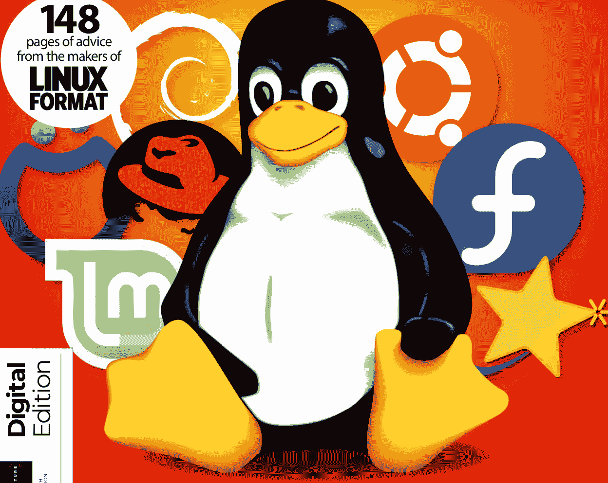

随着驱动着信息交换的新世界、商业初创企业和在线游戏，编码员突然成为了这些新领域的守门人。将对学习创建和控制这些内容的浓厚兴趣，与树莓派（Raspberry Pi）等酷设备的浪潮相结合，你就获得了一个世界自 80 年代初崩溃以来未见过的技术领先地位。因此，无论你是想重温那 80 年代黄金时代的编程时光，还是想要向编程世界迈出第一步的新手，你手中拿着都是开始编程的理想指南。得益于新一代开源免费软件，我们都可以获取创建专业程序、应用程序和工具所需的操作系统、开发工具、编译器和编程语言。我们将教你如何启动并运行 Linux 系统，然后在网上免费访问你需要的一切。编程是简单、令人兴奋且有趣的。我们将解释基础知识，进入更高级的话题，解释如何使用树莓派，并为你提供完全更新、令人兴奋且上手的项目。你还在等什么？开始编程吧！


## 开始使用 Linux

它运行在大多数台式电脑和笔记本电脑上，它是免费的，你甚至不需要安装它。让我们来看看 Linux 吧！


当你阅读《让 Linux 简单》时，你会发现大多数界面看起来不像 Windows 或苹果系统。它们很棒，但并不如此。就像有其他制造商或开发者一样，世界上有数千代码。书中的所有项目都是运行在他们的设备上的。你会发现——代码可以在 Windows 或 Mac 上运行——但 Linux 自带许多语言或准备就。无需浏览网站；只需运行命令或打开软件中心获取你需要的工具。Linux 的美丽之处在于它由极客们构建，为了准确实现他们想要的事情。你可以获取 Mint 然后在你的电脑上运行。它不会损坏你的电脑，如果你不需要安装任何东西。如果你有一台 Windows PC，有三种选择：VirtualBox、从 DVD 或 USB 驱动运行，或者在你的电脑上安装双启动。前两种最不容易造成任何损坏。“这不可怕，不会损坏你的电脑，你不需要安装任何东西。”如果你习惯了不同的界面和工作方式，你会发现它很容易相处。我们建议你使用名为 Linux Mint 的版本（或发行版），我们将查看方法

### VirtualBox

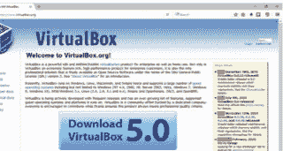
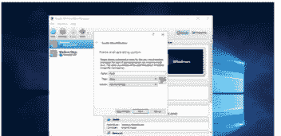
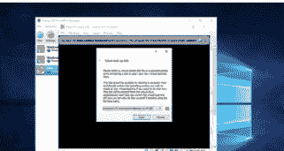

## 获取 VirtualBox

访问 `www.virtualbox.org` 为你的操作系统下载 VirtualBox，无论是 Windows 还是其他。安装它，你至少需要 2GB 的磁盘空间来存储虚拟机文件。你还需要从 `www.linuxmint.com` 开始 Linux Mint。新建虚拟机，选择 Linux 和 Mint：

### 2 创建虚拟机

匹配你下载的 ISO 文件。在内存方面，我们建议 2048 MB，但如果你有 8GB RAM，4096 就足够了。除动态磁盘大小外，其余全部设置默认。默认是 8GB，点击启动虚拟机。

### 3 启动 Mint

找到你下载的 ISO 文件。Linux 开始启动，一旦加载，免费尝试它或使用 ISO 将 Mint 安装到虚拟机。为了扩展，在虚拟机的设置——显示中，你应该启用 3D 加速并分配 16MB 内存。如果你从未尝试过 Linux，你会惊讶于它是多容易使用，以及它是一个多么开发平台。Linux 运行着互联网的魔法，从它的核心网站到超级计算机，并用于科学和工业。毕竟，这并不是件坏事。如果你想跟随，你需要 Linux Mint 发行版。访问 `www.linuxmint.com` 下载 32 位和 64 位版本以备万一。如果你有一台较旧或较小的机器，选择 MATE 版本，它对开发者的要求较低：在许多方面，Linux 的弱点也不例外（但 Linux 是由开发者设计和创建的，所以易用性正在接管待办列表）。这一点的历史是它在所有 Linux 平台上都可用。只要你愿意回馈社区，你就会发现一个非常丰富且受欢迎的体验。

## 顶部提示

### 什么是发行版？

与 Windows 和 macOS 不同，由于 Linux 是免费软件，任何人都可以获取它并有效地创建自己的操作系统进行分发。Linux 有许多不同的发行版（简称 distros），实际上有成百上千——并非所有的都经过维护，但这里有一些：程序来自软件的分支仓库，并由创建者维护。

## 启动并运行

Linux 成为如此优秀的开发平台的一个大原因是它创造了。有了 Mint，你过去使用的通过在这里下载来获取程序的路径，而现在到处处更多。Windows Store 的引入至少帮助消除了获取病毒和恶意软件的担忧。Linux 的事实是，使用新工具的关键以及

### Linux 的 GNU

GNU 项目代表“GNU 不是 Unix”，在 Linux 出现之前预测多年。它创建了构建 80 年代初计算机所需的最基础工具——编译器、文本编辑器、文件和目录操作命令以及等等——但没有一个可用的内核来工作。当 GNU Hurds 在 1991 年开始他们的小项目时，他有一个没有工具运行的内核。Linux诞生了——一个使用 GNU 内核和工具包的操作系统。

### 轻松运行 Linux

如果你不是 Linux 用户，你可能不想破坏你的 Windows 或 Mac 电脑。但如果你想尝试一下，你需要知道——Linux 足够灵活，可以以多种方式运行，或者在大多数其他操作系统系统之上运行，包括不同类型的硬件——从虚拟版本到从 USB 闪盘、DVD 或如树莓派等低成本硬件上运行。你获取 Linux 的方法是启动 DVD。当你在 PC 上运行它时，你通常可以使其从备性介质（如 PC 上的 USB 闪盘，或 Mac 上的 CD/DVD）启动。某些 Mac 还可以从网络磁盘启动。

另一个选项是安装 VirtualBox（见上一页）并运行它——这要复杂一些，但如果你坚持使用默认设置，虚拟 PC 将非常简单。障碍其实很简单：一旦你将 ISO 文件添加到虚拟光驱驱动器中。还有更多可用选项，包括将 ISO 写入 USB 闪盘，这与上面讨论的启动过程类似，即从闪盘运行 Linux。要实现这一功能，你需要使用如来自 `https://balena.io/etchcher` 的 Balenacher 工具。

对于勇敢的人，你也可以直接在系统中安装 Linux。大多数版本的 Linux 会在 Windows 旁边创建一个幻分区，并创建一个你梦寐以求的相似系统。如果你不在这里，你也可以下载 Valve 的 Steam 客户端并利用超过 1,700 款 Linux 游戏，它必须如此。

### 驱动程序

我们在这里并不是为了每天讨论 Linux，但当人们从 Windows 迁移过来时，经常会出现一些问题。你会发现的一点是 Linux 对硬件的支持良好，因此，就不需要担心驱动程序了——你不需要说你不能，因为它们并不是立即需要的。有几个例外：大多数冷门的无线卡可能会引起问题，如果你想最大限度地提高 3D 游戏性能，你需要为你的显卡安装专用显驱动。

### 终端 (Terminal)

如果你听过 Linux，那么你可能害怕或仅仅好奇的任何事情叫做“终端”（Terminal）。根据你所运行的系统，它可以有许多不同的名称：命令行界面或提示符界面。它是访问操作系统及其所有工具的直接接口，你通过终端访问这些工具。回到计算机不那么有图形化的时代，我们有很多这样的时刻，界面完全通过命令控制。

Linux 在这种系统中非常强大，因为它的所有内核都基于 Unix。它们中的许多——所有的——都比早期的 Linux 版本更好。终端是配置 Linux 的一种高效方式，在涉及到故障排除时，它提供了广泛工具和功能来解决问题。

你不需要了解关于终端的任何知识，但知道它正在在使用很好。不过，我们建议你至少打开一个终端并使用 `ls` 命令列出目录，并使用 `cd` 进行切换。

### Linux 不是 Windows

当你发现 Linux 时，需要记住的一点它不是 Windows 或 Mac OS。这在很大程度上意味着你不再处于 Windows 的世界，它也不在同一个地方，并且没有相同的程序集。许多大型程序如 Microsoft Office、Adobe Photoshop 以及开发工具如 Microsoft Studio for—（你无法在名为 Wine 的系统中运行它们——但 Linux 开放社区创建了自己的工具，如 LibreOffice、Krita 以及广泛的免费开源产品，它们提供了。

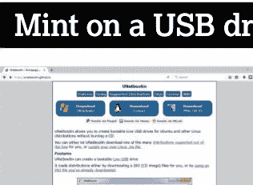


## 轻松运行 Linux

如果你不是 `Linux` 用户，你可能不想破坏你的 `Windows` 或 `Mac` 电脑。但如果你想尝试一下，你需要知道——`Linux` 足够灵活，可以以多种方式运行，或者在大多数其他操作系统系统之上运行，包括不同类型的硬件——从虚拟版本到从 `USB` 闪盘、`DVD` 或如树莓派等低成本硬件上运行。你获取 `Linux` 的方法是启动 `DVD`。当你在 `PC` 上运行它时，你通常可以使其从备性介质（如 `PC` 上的 `USB` 闪盘，或 `Mac` 上的 `CD`/`DVD`）启动。某些 `Mac` 还可以从网络磁盘启动。

另一个选项是安装 `VirtualBox`（见上一页）并运行它——这要复杂一些，但如果你坚持使用默认设置，虚拟 `PC` 将非常简单。障碍其实很简单：一旦你将 `ISO` 文件添加到虚拟光驱驱动器中。

还有更多可用选项，包括将 `ISO` 写入 `USB` 闪盘，这与上面讨论的启动过程类似，即从闪盘运行 `Linux`。要实现这一功能，你需要使用如来自 `https://balena.io/etchcher` 的 `Balenacher` 工具。

对于勇敢的人，你也可以直接在系统中安装 `Linux`。大多数版本的 `Linux` 会在 `Windows` 旁边创建一个幻分区，并创建一个你梦寐以求的相似系统。如果你不在这里，你也可以下载 `Valve` 的 `Steam` 客户端并利用超过 1,700 款 `Linux` 游戏，它必须如此。

## 驱动程序

我们在这里并不是为了每天讨论 `Linux`，但当人们从 `Windows` 迁移过来时，经常会出现一些问题。你会发现的一点是 `Linux` 对硬件的支持良好，因此，就不需要担心驱动程序了——你不需要说你不能，因为它们并不是立即需要的。有几个例外：大多数冷门的无线卡可能会引起问题，如果你想最大限度地提高 3D 游戏性能，你需要为你的显卡安装专用显驱动。

## 终端 (Terminal)

如果你听过 `Linux`，那么你可能害怕或仅仅好奇的任何事情叫做“终端”（`Terminal`）。根据你所运行的系统，它可以有许多不同的名称：命令行界面或提示符界面。它是访问操作系统及其所有工具的直接接口，你通过终端访问这些工具。回到计算机不那么有图形化的时代，我们有很多这样的时刻，界面完全通过命令控制。

`Linux` 在这种系统中非常强大，因为它的所有内核都基于 `Unix`。它们中的许多——所有的——都比早期的 `Linux` 版本更好。终端是配置 `Linux` 的一种高效方式，在涉及到故障排除时，它提供了广泛工具和功能来解决问题。

你不需要了解关于终端的任何知识，但知道它正在在使用很好。不过，我们建议你至少打开一个终端并使用 `ls` 命令列出目录，并使用 `cd` 进行切换。

## Linux 不是 Windows

当你发现 `Linux` 时，需要记住的一点它不是 `Windows` 或 `Mac OS`。这在很大程度上意味着你不再处于 `Windows` 的世界，它也不在同一个地方，并且没有相同的程序集。许多大型程序如 `Microsoft Office`、`Adobe Photoshop` 以及开发工具如 `Microsoft Studio` for—（你无法在名为 `Wine` 的系统中运行它们——但 `Linux` 开放社区创建了自己的工具，如 `LibreOffice`、`Krita` 以及广泛的免费开源产品，它们提供了。


Linux 在这种系统中非常强大，因为它的所有内核都基于`Unix`。它们中的许多——所有的——都比早期的`Linux`版本更好。终端是配置`Linux`的一种高效方式，在涉及到故障排除时，它提供了广泛工具和功能来解决问题。

你不需要了解关于终端的任何知识，但知道它正在在使用很好。不过，我们建议你至少打开一个终端并使用`ls`命令列出目录，并使用`cd`进行切换。

## Linux 不是 Windows

当你发现`Linux`时，需要记住的一点它不是`Windows`或`Mac OS`。这在很大程度上意味着你不再处于`Windows`的世界，它也不在同一个地方，并且没有相同的程序集。许多大型程序如`Microsoft Office`、`Adobe Photoshop`以及开发工具如`Microsoft Studio for`—（你无法在名为`Wine`的系统中运行它们——但`Linux`开放社区创建了自己的工具，如`LibreOffice`、`Krita`以及广泛的免费开源产品，它们提供了。


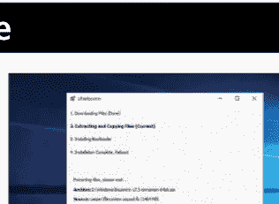

# 逃离 Windows 10

受够`Windows`了吗？切换到`Linux`，发现它带给力量与自由。是时候打开逃生通道了！

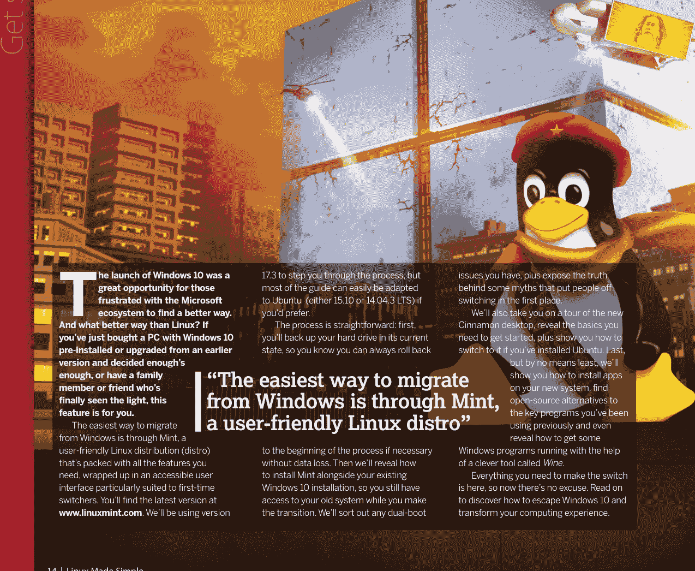

`Windows 10`的发布对于那些对微软生态系统感到沮丧的人来说，是一个寻找更好方法的绝佳机会。还有比`Linux`更好的呢？如果你购买了预装系统的`PC`，或者从早版本的`Windows`升级，又你有一位终于大开眼界的家人，那么从`Windows`迁移最简单的方法就是通过`Mint`，这是一种易于使用的`Linux`发行版，涵盖了你所需的所有功能，并封装在适合切换者的易于操作的用户界面中。我们在`www.linuxmint.com`找到了最新版本。我们将使用`17.3`版本来演示整个过程，但指南的大部分可以免费根据你的喜好（`15.10`或`14.0.4 LTS`）进行调整。

整个过程非常简单：你将备份当前状态下的硬盘，以便在需要时始终能回到流程开始；我们将揭示如何在安装`Windows 10`的同时安装`Mint`，这样你在过渡期间仍然可以访问旧系统。我们将解决你遇到的任何双启动问题，并揭示让人们起初望而却步的迷言背后的真相。

我们将带你领览新的`Cinnamon`桌面，揭示入门所需的基础知识，向你展示如何无畏地切换，展示如何在新系统上安装应用，找到你之前使用的关键功能，甚至揭示如何借助一个名为`Wine`的聪明工具来获取某些`Windows`程序。

你切换所需的一切都在这里，所以没有任何借口。继续读下去，发现如何逃离`Windows 10`并改变你的计算体验。

## 备份

在完成备份之前，想都不想安装`Linux`。

最糟糕的事情莫过于尝试升级或安装新操作系统，结果却出了问题。通过备份你的`Windows`数据（在开始之前），你可以将那种咬牙切齿的焦虑变为轻微的困扰，而且一旦出现问题，你可以轻松地回滚。硬盘有很多备份工具，但很少有工具能同时在`Windows`和`Linux`上完美运行——访问`http://sourceforge.net/projects/unetbootin/`并按照说明下载`ISO`格式的重启备份`CD`（Reboot Backup CD）。一旦在`Windows 10`中有了`ISO`文件，右键点击它并选择要使用的驱动器以“创建启动盘”。如果你使用外部`USB`闪存，确保将其格式化为`FAT32`，然后下载最新版本的重启备份工具。

`PC`处于`UEFI`模式（请参见下方的“还原并重新开始”框以解决此问题）。如果你无法以任何形式获取重启备份，请尝试使用`Windows`自带的镜像工具备份硬盘，或使用备份和恢复工具。

## 与 Windows 一起备份

一旦点击“下一步”，重启备份工具已安装在（通常是）`C:`驱动器上。从下拉菜单中选择驱动器并点击“下一步”。所有的分区都将被选中——取消你不需要的勾，然后点击“下一步”。

选择备份你的`Windows`安装的位置。选择最大的分区，或使用插入`PC`的外部硬盘设备，选择它，确保有足够的备份空间，并点击“下一步”。完成后，点击“浏览”创建一个文件夹，备份将存储其中。在点击“下一步”之前点击“保存”：你的备份已提供了一个默认名称，但如果你喜欢，可以点击“重命名”进行更改。最后，坐下等待重启备份工具完成硬盘备份工作。你可以去喝杯咖啡，浏览其他`PC`，或者利用这段时间在重新开始之前研究你的`Mint`安装。完成后，备份成功完成，你就可以准备安装了。

如果你的`Mint`安装出现任何问题，你只需要从重启媒体启动并按照下方的分步指南操作，这应该将一切完全恢复到你开始前的原样。

- 现场光盘（Live disc）：`Linux`允许你从外部硬盘或`USB`闪存作为现场盘运行。这意味着你可以在不安装的情况下测试系统。

## 还原并重新开始

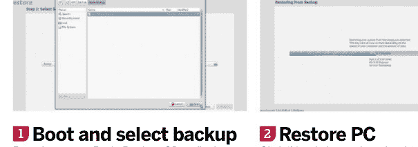

### 1 启动并选择备份

从重启备份媒体驱动器或`CD`启动。当主界面出现时，点击“还原”按钮。首先，选择物理磁盘上存储备份的分区，选择重启备份。接下来，点击按钮打开“选择备份映像”对话框。然后，浏览到你存放备份的文件夹，选择备份作业文件并点击“打开”。

### 2 还原 PC

点击“下一步”并选择你想还原的驱动器。整个硬盘将被你的备份覆盖，因此在点击“确定”之前请阅读并理解警告。在硬盘还原期间，在备份和过程完成之前，不要关闭`PC`。这可能需要一些时间，请做好长时间等待的准备。

### 3 启动并重新开始

一旦过程完成，点击“确定”。重启`Windows`。点击右下角的指针并选择“重启”。在提示时选择重启备份媒体并按“回车键”。你的系统将恢复到原来的样子，你会发现`Windows`与之前一样。你现在可以安装`Mint`来纠正之前的错误。


## 安装 Linux Mint

准备工作完成，是时候安装`Mint`了！

备份已就绪后，现在可以开始安装`Linux Mint`了。后续步骤假设你想与现有的`Windows`安装一起安装——这对初学者或帮助他人迁移到`Linux`的人来说都是很好的途径。你可以在`linuxmint.com`找到最新版本。与`Mint`的其他版本一样，这是一个`LTS`（长期支持）版本，支持到`2027`年`4`月。

如果你无法以任何形式获取重启备份，请尝试使用`Windows`自带的镜像工具备份硬盘，或使用备份和恢复工具。

## 手动配置驱动器进行双启动

假设`Mint`选择了与`Windows 10`相同的硬盘进行安装，请为`Windows`留出`10GB`的空空间，或者选择带有`8GB`硬盘空间的`Mint`进行工作——如果你计划将其作为主操作系统。记住，你以后可以随时调整大小或删除分区。

下一步是输入名称的阶段——你将看到预填充的计算机名称以及用户名。你可以更改这些内容并输入密码——登录时将需要提供此密码，作为执行某些任务的管理员密码。

一旦设置好驱动器，点击“安装”。现在请确保通过再次点击“现在安装”来确认建议的更改。`Mint`将创建两个分区（`Ext4`是你的`Mint`分区，此外它还会创建一个专门的交换分区）。点击“继续”应用更改。

只有当你的`PC`不是共共享的，且你正在笔记本电脑上安装`Ubuntu`时，才选择自动登录！如果需要，点击“加密主目录”。点击“继续”你就大完成了——`Mint`将在后台安装。在等待期间，你可以去泡杯咖啡（或茶），然后坐下来阅读关于功能以及`Ubuntu`使用体验的所有内容。你可以通过使用软件中心了解更多信息。安装完成后，点击“重启”，根据提示移除安装盘或驱动器，然后按回车。`Ubuntu`现在已安装，翻页即可如何开始使用它。

接下来，安装程序将检测你的位置，大多数情况下设置为伦敦。你可以接受此设置或输入你最近的城市名称查看其是否被识别。点击“继续”，然后设置你的键盘布局。

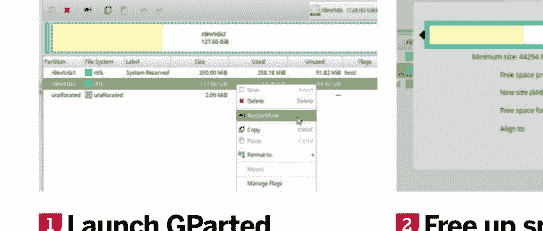

### 1 GParted

启动你的安装媒体。点击左下角的“菜单”按钮并搜索“`GParted`”框。出现后点击`GParted`编辑器以启动。如果你发现了你的`Windows`（`/dev/sda`），你应该至少看到两个分区，其中最大的是你的`Windows`分区。右键点击此分区并选择“调整/移动”。

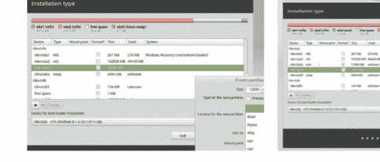

### 2 为 Linux 释放空间

点击右侧句柄并拖动它为你的`Ubuntu`安装腾出空间——为`Windows`留出至少`10GB`的空空间。完成后，点击“调整/移动”，然后选择“应用操作”按钮，选择分区以完成，然后点击“继续”。双击“`Install Mint Linux`”快捷方式，选择“`English`”并点击“`continue`”。


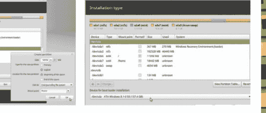

### 3 开始分区

保留两个框的勾选并点击“继续”。在“安装类型”下选择“其他”并点击“继续”。选择空分区 `/dev/sda` 并点击“+”按钮设置你的空分区。将大小设置为 40GB，剩余部分留作空空间，选择“此空间的结束”。点击“用作：”下拉菜单并选择“交换区”并


### 4 设置分区

选择空空间并点击“+”按钮创建分区。输入 12000MB (12GB)，保留“逻辑”-此空间的起始，并选中“Ext4 文件系统”。点击“挂载点”下拉菜单并选择“/”以作为 Ubuntu 所在的分区（如果你有足够的空空间，请将其设大）。再次点击“确定”。


### 5 创建挂载点

选择剩余的空空间并点击“+”。在学习了如何操作后，在点击“/home”之前选择挂载点。“/home”目录是存储所有人的个人文件、文档、图片和程序的地方，因此请确保它是驱动器中最大的分区。完成后，检查你的更改。


### 6 设置启动分区

如果你需要验证分区，请依次选择每个分区并点击下一步，然后返回第三步。“用于引导加载程序的设备”下拉菜单应指向你的驱动器 (`/dev/sda`)，然后点击“安装”。检查你选择的设置并点击“继续”以应用它们并安装 Mint。

#### Linux Mint Simple

### 使用 Grub 在 Linux 和 Windows 之间切换

当 Mint 安装自己时，它会将硬盘开头的引导加载程序更改为名为 `Grub` 的程序。`Grub` 会扫描你的硬盘以已安装的系统，然后向你显示启动菜单，允许你在它们之间切换。在大多数情况下——特别是当 Windows 与 Linux 并列安装时——这将设置得完美。要启动你所需的 OS，只需从启动菜单中选择它，如果你在五秒内没有选择，它将开始加载 Mint。

如果你想知道如何更改启动菜单——你可能更倾向于将 Windows 设置为默认操作系统，或者你想在选择 Mint 之前等待——你可以进行更改。

### 故障排除

不幸的是 `Grub` 没有按照你的预期工作。你需要从启动媒体来修复。在这种情况下，你需要知道如何修复，或者你可以使用启动工具来修复。为了修复你的 Mint，你需要执行以下命令：

#### Grub 菜单

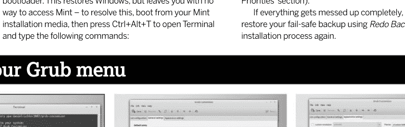

#### 1 安装 Customizer

打开终端并输入以下命令：

```bash
sudo add-apt-repository ppa:danielrichard/grub-customizer
sudo apt-get update
sudo apt-get install grub-customizer
```

完成后，通过“菜单”启动 `Customizer`。

#### 2 更改默认值

切换到“常规”设置。在这里你可以更改默认 OS，或者在选择 Mint 之前等待。

#### 3 更改 Grub 外观

通过“外观”设置，你可以通过更改颜色方案、字体甚至一张漂亮的图片来美化 `Grub`。一旦完成更改，点击“保存”按钮更新 `Grub`。

## 你的 Linux 初步之旅

探索启动 Linux Mint 所需的所有技能

> 当你第一次进入 Mint 时，你会发现它与 Windows 非常相似。默认桌面被称为 Cinnamon，其结构与 Windows 桌面类似：屏幕底部有任务栏和通知区域，桌面图标提供了关键位置的快捷方式。

点击“菜单”按钮，会弹出一个菜单，其中可以访问你所有的程序，并按分类分组。尝试在搜索栏中输入程序名称的前几个字母，它就会出现在结果列表中——只需点击一下。在顶部有常用程序，如 `Firefox`（浏览器）、软件管理器（Mint 中等同于控制面板程序）、设置（Mint 中等同于文件的程序）以及用于注销和关闭电脑的管理器。

你可以通过将项目从桌面或菜单右侧拖放并释放到列表中来添加你的工作。你也可以将快捷方式添加到面板（Mint 中等同于屏幕底的任务栏——只需右键点击面板并选择“添加到面板”）。

Mint 的面板比 Windows 面板更具可配置性——你会在右角看到许多可以自定义的选项；右键点击面板并从选项中选择来添加新面板。

## 访问驱动器

Mint 支持广泛的文件系统，这意味着从你启动桌面开始，现有的 `NTFS` 和 `FAT32` 分区就是可见的。访问文件的最佳地方是浏览文件夹——它是 Mint 中等同于文件资源器的程序。你可以通过面板和菜单中找到快捷方式访问它。你也可以通过双击桌面上的图标来访问。

其布局与 Windows 10 文件资源管理器类似，文件显示在右侧窗中，左侧是一系列关键位置。你可以创建书签文件夹（选择文件夹并选择“书签 > 添加到书签”）以便在此处轻松访问。Mint 还支持标签页，操作体验与你的窗口相似。按 `Ctrl+T` 添加额外的标签页，可以方便在多个驱动器和文件夹之间切换，而不会让许多打开的窗口弄乱你的桌面。在 Mint 中你也可以选择访问网络——点击左侧面板中的“网络”查找其他电脑，必要时输入你的用户名和密码。

你会发现你的硬件大部分已经被自动检测并设置好了。

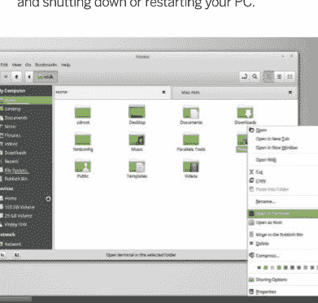

> 文件管理器的工作方式与 Windows 10 中的文件资源器相同，因此你不需要为驱动器烦恼。

## 与 Windows 共享数据

如果你计划继续使用 Windows 和 Ubuntu，设置一个数据分区会有帮助，这可以让你轻松访问两个操作系统。

在 Windows 中，打开命令提示符（管理员），输入 `powercfg /hibernate off` 并按回车以启用此设置：

完成后，回到 Mint，在“系统设置” > “电源管理”中禁用“休眠”，并在选定的下拉菜单中选择“启用”。打开“磁盘实用程序”进入启动器。

在左侧选择包含你数据分区的磁盘，然后点击右侧的分区并记下它的挂载位置。然后继续格式化为 `/ext4`。

使用 Mint 安装程序中的 `GParted` 设置 `NTFS` 分区，然后进入 Windows 并依次浏览你的用户文件夹——“文档”、“图片”等，选择“属性” > “位置”，然后将它们指向共享分区，从而在分区间移动数据。

你还还应该在 Windows 和 Ubuntu 中都禁用休眠，以避免当一个操作系统处于休眠状态而另一个操作系统唤醒时，导致共享分区损坏。

> 与 Windows 和 Linux 分区共享数据

用于管理你的数据文件夹的文件夹指向之前确定的存储在共享分区上的文件夹。

欲了解更多信息访问 `ubuntu.com`，对于 Ubuntu 周报，它的部分功能在 Linux Mint 中也可以运行！或者从菜单的“管理”部分，选择“管理员 > 用户菜单”，选择“系统设置”来查看“硬件”部分下的当前设置。如有必要，你可以从制造商网站下载缺失的驱动。

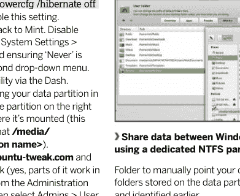

现在你已经尝试了水，并发现它并没有那么深（或那么冷），今天就用 `Red Backup` 完成你的首次双启动系统设置吧。完成后，你就可以更深入地研究 Linux 了。从系统 Mint 开始。Windows 使用 `NTFS`；当然有 `NTFS` 系统，而你现在得到了第三种文件系统 `Ext`。当你进入 Linux 分区时，它们是不可见的——你你看不到 `Ext`！这就是为什么你的数据分区——如果它被格式化为 `NTFS` 的话——是的。

打开 `Nemo` 文件管理器，如果你手动配置了安装以包含独立分区，你将在“主目录”文件夹中找到它。你的 Windows 文件夹，包含了你所有的个人数据，也包含了程序和设置。

`Cinnamon` 在左侧操作很舒适，你将看到 Ubuntu 的全盛风采。这些功能中的许多是可以感知的，Ubuntu 在所有光彩中展现。Cinnamon 桌面非常方便。

## 关键系统工具

以下工具可以帮助你管理系统，无需使用终端。点击“设置”可以查看外观。在“外观”选项卡中你可以自定义图标。这里有磁盘工具、`GParted`，以及磁盘分析器（可以查看磁盘使用情况）。系统监视器（等同于 Windows 任务管理器）可以在此处结束进程。

## 桌面更改

如果你不确定喜欢什么，可以尝试在 Mint 旁安装 Ubuntu，这是一个不同的桌面环境。如果你发现自己更喜欢 `Cinnamon`，首先打开终端并输入：

```bash
sudo add-apt-repository ppa:cinnamon
sudo apt-get update && sudo apt-get install cinnamon
```

这将更改存储库以下载并安装它。

安装完成后，你需要点击桌面右上角的“设置”按钮，选择注销登录。然后你将看到 Ubuntu 图标。你可以从登录界面随时切换回 Ubuntu。


如果你随后删除了 `Cinnamon`，可以轻松在 `Mint` 中删除桌面。

> `Cinnamon` 看起来像 `Ubuntu`，但工作方式完全相同。

在某些情况下你可能访问终端。一旦你运行了它，它真的是解决问题的最佳方式。至少，你将拥有这个命令列表，并可以学习使用它们：

- `dir` - 列出当前目录
- `cd` - 切换目录，`cd` 进入当前目录下的子目录
- `cd /home/username` - 切换到特定目录。要返回主目录——输入等价命令
- `mkdir` (`make`) - 创建目录
- `rm` (`remove`) - 删除文件。
- `apt-get` - 用于管理和安装软件包的工具。使用 `apt-get update` 更新所有最新软件，使用 `apt-get check` 检查有已知（损坏）问题的程序。
- `wget` - 从你的下载文件夹下载文件：例如 `wget`

| Linux 简教程 |

+ 使用设置工具控制你的 `Cinnamon` 桌面

**小提示**

在 `Linux` 中挂载驱动时你会看到五个名称，例如在和 `USB` 驱动器中。`Mint` 处理移动媒体的能力非常好。这就是为什么它的选项比 `Windows` 驱动器名称更复杂。

# 在 `Mint` 中安装应用程序

## 如何查找并为你的发行版添加新的存储库

既然你已经在 `Mint` 中运行起来了，你可能想要开始高效地使用它。这自然涉及到运行你在 `Windows` 中使用的应用程序，并检查每个程序是否有可用的 `Linux` 版本。如果没有，不要惊慌——你会发现绝大多数 `Windows` 应用程序都是免费开源的，因此你不需要为它们花钱，但可以考虑向它们捐赠。

最显而易见的搜索地方是办公软件。当涉及到替换文字处理器、电子表格和演示工具时，你需要的已经通过 `LibreOffice` 软件内置在 `Mint` 中，你可以在“菜单 > 办公”中找到它。

如果你正在寻找某个特定软件的开源替代，请查看 `Alternatives`，你可以在那里找到：`http://www.allsoft.com`。如果你找不到任何合适的程序，请尝试 `http://alternative.net/`

在 `Mint` 中添加软件最简单的方法是通过“软件管理器（`Software Manager`）”。它是一个用于安装和更新程序的易用用户界面。如果程序被软件管理器支持，它们就会被组织在存储库（或 `ppa`）中。在支持部分，你会找到获取它们的其他方式。首先，访问你需要的程序——在这里，你可能会获得一个方便的下载安装程序，形式：

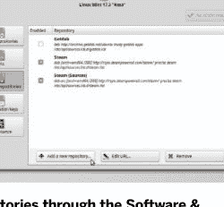

- 通过“软件与更新（`Software & Updates`）”管理你的存储库，你会找到 `Debian` 包——选择 32 位或 64 位下载（如果需要）以匹配 `Ubuntu` 的架构。安装完成后，导航到你的下载文件夹，双击包名进行安装。

其他程序可能需要你通过终端（`Terminal`）进行安装。这通常涉及使用以下命令添加程序的存储库：

> `ppa:` 代表个人包存档（`Personal Package Archive`），这是一种特殊的存储库——由 `Ubuntu` 支持——允许任何个人、团队或团体让他人能够安装和更新软件，而无需官方身份。

```bash
sudo add-apt-repository ppa:username/ppa-name
sudo apt update
sudo apt install package-name
```

将 `<package>` 替换为程序名称，它将被下载并安装。添加后，你就可以像已经在那里一样从软件管理器中安装它了。

你会发现绝大多数 `Windows` 应用程序都有对应的 `Linux` 版本

## 热门替代应用程序

| `Windows` 应用程序 | 替代方案 | 获取路径 |
|---|---|---|
| `Word`, `PowerPoint`, `Access` | `LibreOffice` | 预装 |
| `Publisher` | `Scribus` | 软件管理器 (`SM`) |
| `Photoshop` | `GIMP` | 预装 |
| `Windows Movie Maker` | `OpenShot` | 软件管理器 |
| `Adobe Reader` | `Document Viewer` | 预装 |
| `iTunes` | `Amarok` | 软件管理器 |
| `Windows Media Player` | `VLC Media Player` | 软件管理器 |
| `Internet Explorer` | `Firefox`, `Chromium` | 预装或 `SM` |
| `Outlook`/`Windows Live Mail` | `Thunderbird`, `evolution` | 预装 |
| `Skype` | `Pidgin` | 软件管理器 |

## 保持更新

通过存储库（通过终端或软件管理器）安装的程序会定期检查更新，是在启动后 10 分钟内以及你使用它们时。这意味着绝大多数应用程序通常都是最新的，但你可以使用两种方法之一手动检查。第一种是使用：

`Cinnamon` 菜单 > 软件管理 > 软件管理器并点击“手动检查更新”。偏好设置 > 刷新选项卡可以更改更新检查之间的时间（支持天、小时和分钟）。

要通过终端检查更新，请使用 `sudo apt update`。如果你发现软件中心没有程序网站上承诺的那么新——通过添加存储库，你可以确保安装了程序的最新版本，并获得访问测试版和预发布版本的权限。

## 安装 Windows 应用程序

如果其他方法都失败了，请使用 `Wine` 在 `Linux` 中运行程序。

在你新的 `Linux Mint` 中运行应用程序的最佳方法自然是使用原生程序，但如果你有一个必不可少的特定 `Windows` 程序，它可能可以获取。面对一个空白窗口，你需要一个使用 `Wine` 来接管 `Windows` 部分的特殊程序，让你在使用 `Linux` 程序时能够运行许多 `Windows` 程序。

`Wine` 可能比较难掌握，但得益于免费使用的首次版 `Wine`，你将能够以最少的麻烦运行许多流行应用程序。打开软件管理器，搜索“`PlayLinux`”，点击“安装”，它将自动下载并安装 `Wine`。

`PlayLinux` 非常简单，可以让你毫不费力地工作，因此点击“安装”按钮开始。主程序将允许你搜索程序或按类别浏览，包括游戏、办公等。一旦你找到了，点击“安装”然后点击............你。它它它它列表中，不要'......的... `PlayLinux`'s the to....,,,,通过检查 `https://appdb.winehq.org` 来验证你需要的版本。如果它与 `Wine` 兼容但未列出，可以使用之前的版本（兼容 - 实验）！如果 `Wine` 数据库中没有提到它，不要担心——你无法控制 `Linux`，请尽管搜索程序网页以确定你可能需要的其他附加组件（如 `.NET Framework`）。

## 使用 PlayLinux 手动安装应用程序

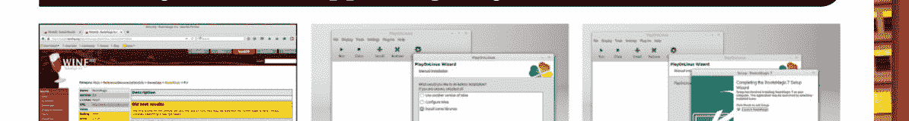

### 1 做好笔记

访问 `https://appdb.winehq.org`，找到你想安装的程序并验证你需要的版本。如果它与 `Wine` 兼容但未列出，可以使用之前的版本（兼容 - 实验）！另外在访问程序网站时，请注意关于额外安装要求的任何注释，如果你没有安装盘，请下载程序安装程序。

### 2 设置虚拟驱动器

打开 `PlayLinux`，选择“安装”，然后点击“安装未列出的程序”。点击“下一步”，选择一个新的虚拟驱动器并点击“下一步”。在你创建驱动器后，点击“下一步”然后选择相关选项——在大多数情况下只需点击“下一步”。为了兼容性，请勾选 32 位选项并点击“下一步”进入下一节。

### 3 添加库并安装

当程序完成后，安装任何推荐的包。完成后，将测试放在 `POL` 要求的组件下（通常在 `POL` 下）并点击“下一步”。搜索它们进行下载和安装。如果存在，选择你的 `CD` 驱动器或选择“其他文件”来定位并运行安装向导，然后运行程序以验证其工作正常，最后添加快捷方式完成安装。

## 红帽家族 (Red Hat)

规模宏大的影响力。

`Red Hat Linux` 是塑造 `Linux` 基因中起过至关作用的发行版，它由 `Marc Ebob` 于 1994 年创建。`Bob Young` 和 `Atlantic Corporation` 收购了该业务并创立了红帽公司。该公司于 1999 年上市，创造了华尔街历史上的首日最佳表现。它凭借这一成功，世界上第一家估值十亿美元的开源公司。

多年来，一些最顶尖、最出色的 `Linux` 开发者都曾与红帽合作。不久后，它收购了 `Michael Tiemann` 的 `Cygn Solutions`，由此引入了 `GNU-C++` 编译器和 `GNU` 调试器。


红帽最具影响力的技术之一是其 `RPM` 软件包格式。该文件格式现在是 Linux 的基准格式（`LSB` 是 Linux 标准基准），该基准定义了 Linux 操作系统中用于架构的分层结构。`LSB` 是由红帽启动的一个项目，也是最早支持可执行和链接格式 (`ELF`) 的项目之一。`ELF` 格式是可执行文件、共享库和其他文件的标准。红帽首次尝试通过 `Bluecurve` 主题在 `GNOME` 和 `KDE` 中支持 `ELF`——这导致了与 `KDE` 开发者之间的紧张。该发行版因其易于导航的图形化 `Anaconda` 安装程序而胜出。

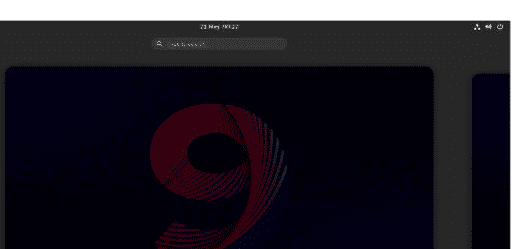

当红帽停止支持时，公司将该发行版的重新发布交给了社区。新项目变成了 `Fedora`（见第30页），它接管了项目方向，并以便 `Fedora` 用于红帽所使用的的所有技术。

在 `GPL` 允许的范围内，红帽保留了商标规则来管理分发。这导致了第三方发行版在剥离了红帽发行版中的非自由组件后进行构建和分发。如 `CentOS`、`Scientific Linux` 和 `Oracle Linux` 等发行版 100% 模拟了 `RHEL`。

- 红帽曾作为其他几个发行版的起点，例如 `Linux`。

## 逝亡之后

最初，红帽作为免费发行版提供，公司通过销售软件包来维持运营。然而，红帽专注于红帽企业级 Linux (`RHEL`)，现在专注于面向企业环境的 `RHEL`。`RHEL` 支持 `x86`、`x86_64`、`PowerPC` 和 `IBM System z` 等服务器架构。新 `RHEL` 版本的发布频率为三年一次，在此期间用户可以获得技术支持、软件更新和新硬件驱动程序。红帽还有一个非常受欢迎的命名和认证计划名为 `RHCP`，涵盖年度红帽认证。

## 一些最顶级、最出色的发行版都与红帽合作过。

红帽开拓了一种免费业务模式。`Fedora` 项目是最流行的开源发行版之一，它是红帽企业级 Linux (`RHEL`) 的测试场。

`Fedora` 项目是一个由红帽赞助的社区驱动的 Linux 发行版。它以技术前沿闻名，经常整合最新的软件和功能。`Fedora` 是开发者和桌面用户的热门选择。

`CentOS` 是一个基于 `RHEL` 的 Linux 发行版。它是 `RHEL` 的免费开源替代方案，提供了与 `RHEL` 二进制兼容的版本。`CentOS` 是一个源自 `RHEL`、由社区支持的企业级 Linux 发行版。它以稳定性和可靠性闻名，是服务器的热门选择。

`Oracle Linux` 是基于 `RHEL` 的免费企业级 Linux 发行版。它由 `Oracle` 开发，包含了额外的功能，例如不可破坏的企业内核 (`Unbreakable Enterprise Kernel`)。`Oracle Linux` 是运行 `Oracle` 软件组织的热门选择。

## `RHEL`

红帽企业级 Linux (`RHEL`) 是由红帽开发的商业 Linux 发行版。它为企业环境设计，以其稳定性、安全性和支持闻名。`RHEL` 被组织广泛用于关键任务型应用程序。

## Mandrake 发行版

这是一个拥有一系列自定义内容的发行版

在 Mandrake 发布之前，Linux 通常被认为是极客的操作系统。Mandrake 是第一个关注用户易用性的发行版。其目标是提供一个可以由普通计算机用户操作的发行版。它具有诸如自动挂载 CD 而无需修改配置文件的功能，这为 Linux 桌面带来了便利。

该项目的存在或许是自由软件项目来说是得最为复杂的。多年来，该项目经历了多次更、合并和分支。它派生了许多其他发行版和系列，这些版本仍然活跃，并且其起源可以追溯到 Mandrake。

该发行版开发了一系列统称为“工具”的组件，如 `Drakes` 和 `Oaks`。该项目创建的最具特征之一是 Mandrake 控制中心 (`MCC`)，它现在是所有衍生版的中心。`MCC` 提供了广泛的配置工具。在测试模式下使用控制中心在处理问题或其他故障时（例如图形服务器拒绝启动时）非常有用。值得注意的是，所有模块都可以通过应用程序进行配置，而无需通过 `MCC`。

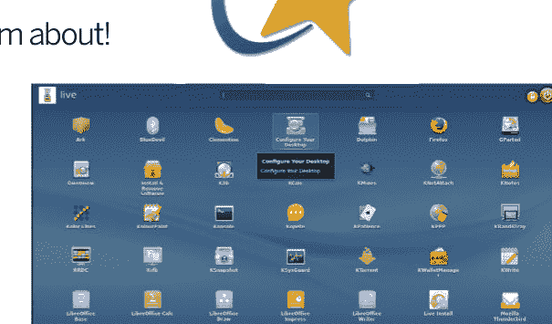

# 维持生存

Mandrake 于 1998 年 7 月发布。它基于 `Red Hat Linux 5.1`，这是由 `Gaul` 开发的响应良好的领先版本。发布后，成立了 `Mandrake Soft` 等其他公司，并在 2001 年决定上市。它在 2002 年底面临了首次重大危机，并开始通过提供付费服务让用户能够轻松访问更新和特别版来尝试出售。这还不够，该公司于 2003 年申请了破产。然而，同年晚些时候，Mandrake 宣布了第一个季度盈利，并在 2004 年 3 月，法国法院批准了其回归正常运营的计划。

在输与美国 `Heart Corporation` 的法律诉讼后，公司还不得不更名为 `Mandrakelin`，并在收购一家巴西公司后将其名称更改为 `Mandrake S.A.`。该发行版变为 `Mandrake Linux`，但在 2006 年发布了最后一次版本，包括发布更新并在 `BRC` 地区（巴西、俄罗斯、印度和中国）提供免费发布。

尽管付出了所有努力，公司仍难以维持其资产负债表。2010 年，Mandrake 放弃了 Linux 发行的开发以避免破产。

> `Rosa Linux` 是一个分支，带有一些不同的用户界面修改，例如 `Welcome` 应用程序启动器。

该项目创建的最具特色的组件之一是其控制中心。随后，前 Mandrake 员工宣布了 `Mandriva`，这是最受欢迎的 Mandrake 衍生版之一。`Mandrake S.A.` 将开发转交给了社区驱动的 `Open Mandrake`。该协会的第二个发布版本 `OpenMandrake 2004` 得到了 `Duviv` 的好评。

# Salix Mandrake


`Mages` 是构建得最好的社区发行版之一，在维护多样性方面做得非常出色。它拥有一段传奇。它提供了卓越的支持和非常好的文档。该发行版遵循九个月的发布周期，并提供 18 个月的支持。`Mages` 既有现场安装介质，也有仅安装的 `DVD`。

`Mages` 拥有管理发行版各个方面的工具。其中最好的是 `Mages` 控制中心，它具有用于管理软件、硬件和服务的模块。高级用户可以使用它来共享互联网、设置 `VPN` 和配置网络共享。该发行版使用 `URPM` 软件包管理系统，带有三个官方仓库。`Core` 仓库包含源码包，`Non-free hosts` 包含专有应用程序和驱动程序。`Tainted` 仓库包含带有多个桌面环境的 `package-extra strips`，开发者确保了在所有环境中的用户体验是一致的。

Linux 入门指南 | 29

## MUSE 发行版

`Nuga, nuga, nuga, gnu, nui...`

1992 年，`Roland Dyer`、`Burch Steinhard`、`Hubert Mantel` 和 `Thomas Fehr` 创立了 `YaST`（软件和系统开发）。该公司最初是作为一家服务公司，为创始人提供自己的发行版，以于企业用户。该发行版根据他们公司的缩写命名为 `MUSE`，它是 `Slackware` 版本，被翻译成德语并与 `Slack Patrick Volking` 合作开发。

为了构建自己的 Linux 发行版，`SUSE` 使用了第一个 `Jun` 发行版，它由 `Foran Fuchs` 创建，随后加入了团队并开始开发配置工具 `YaST`。第一个 `YaST` 于 1996 年 5 月发布（1997 年首次修订），并作为安装程序包含在内核 `6.3` 中。

随着推移，`SUSE` 整合了 `Red Hat Linux` 的许多方面，以及备受尊敬的 `RPM` 软件包管理。1996 年，以 `SUSE` 命名的第一个发行版作为 `SUSE Linux` 发布。版本号的混乱最初是对未来和永恒的引用和致敬，正如《道格拉斯·银河系漫》中特色的：`YaST` 的第一个版本号 `0.42` 与另一个的原因相同。


`SUSE` 一直面向企业用户提供开源。它在 2001 年引入了 `SUSE Linux Enterprise`，并将名称更改为 `SUSE Linux`。混淆的版本号最初是对未来和永恒的引用和致敬，正如《道格拉斯·银河系漫》中特色的：`YaST` 的第一个版本号 `0.42` 与另一个的原因相同。（注：此处原文似乎重复了上一段，已按字面翻译）

`SUSE` 一直面向企业用户提供开源。它在 2001 年引入了 `SUSE Linux Enterprise`，并将名称更改为 `SUSE Linux`。`Novell` 在 2004 年收购了这些内容，`OpenSUSE` 的推出是基于 `KDE` 的。

# 企业版

`OpenSUSE` 的最初版本是 `SUSE Linux 10.0`。它包含了开源和专有应用程序，正如 `SUSE` 桌面一样。这是由德国团队开发的 `SUSE` 桌面。除了 `KDE` 和 `Gnome`，它还特色了：`Xce`、`Enlightenment` 和 `LOICE`。


2006年11月，SUSE的许多方面都与Windows的互操作性、产品推广和产品交叉销售。这一协议被一些人认为具有争议。Novell在2011年被Attitude Group收购，随后将SUSE分为两个独立的业务部门。`SUSE Enterprise`是基于`OpenSUSE`的商业产品。

SUSE为企业开发产品。这些产品针对企业环境，并具有更长的寿命（七年）、更长的开发周期（二到三年）以及硬件软件供应商的支持。`SUSE Enterprise`产品仅供购买。还有`SUSE Linux Desktop` (SDE)，它是一个面向桌面的系统。`OpenSUSE`没有发行商合作伙伴，而是使用不同类型的安装模式。

- SUSE网站允许你组合一个自定义的基于`OpenSUSE`的发行版。

| 程序 | YaST | KDE | Gnome | 其他 |
|---|---|---|---|---|
| GIMP | | | | |
| LibreOffice | | | | |
| G-Office | | | | |
| Firefox | | | | |
| OpenSSE | | | | |

`OpenSUSE`是最好的`RPM`发行版之一。它包含了所有`32`位和`64`位架构的版本，还支持`ARM`、`v7`以及`64`位`x86`。`OpenSUSE`在所有主流桌面上看起来都很良好。除了`KDE`和`Gnome`，它还特色了：`Xce`、`Enlightenment`和`LOICE`。

可以作为较小的现场镜像或仅安装镜像来下载该发行版。`OpenSUSE`的手册之一是`YaST`，它是一个设置和配置工具，允许你调整系统的许多方面。另一个流行的工具是`Snapper`，它允许你回溯到以前创建的系统快照。

该发行版作为`SUSE Linux`产品的基础——正如`Fedora`之于`RHEL`——适用于所有类型的用户，无论他们的技能水平如何。该发行版的安装程序功能多变，具有多个自定义选项。它可以由许多用户导航，并包含了将已安装的系统连接到企业目录服务器的选项。

> `http://linux.org/Chameleon.org`

# Slackware 家族

`Slackware`是由`Patrick Volkerding`创建的最古老的发行版之一，于`1993`年发布了第一个`Beta`版本。该项目旨在创建一个超越`Slackware`原版的第一个`Unix-Linux`发行版。

`Softlinux Linux System` (`SLS`) 是第一个在`Linux`内核和基础工具中提供`TCP/IP`和`Windows`系统的发行版。然而，`SLS`忙于在`1993`年`7`月发布`Slackware`发行版，以应对日益增长的挫败感。

此外，由于它托管在密苏里州立大学的一个匿名`FTP`服务器上，`2.3`版本的发行版并不流行。`2.1`版本于`1994`年发布，当时发行版已增加到`7`张磁盘并以`CD-ROM`发布。

该发行版的独特卖点（USP）是它为了升级特定的基础或某些用户群体而进行极少的更新。与其他发行版不同，它不限制用户的用例。然而，与大多数发行版相比，用户对配置拥有更强的控制权。

## 宽限一点 (Cut some slack)

与其他发行版不同，`Slackware`不提供图形化安装。它继续安装文本文件，并仅提供一组`shell`脚本用于配置和自动化。该发行版也不提供依赖在线仓库的高级包管理器，例如插件工具；`slackpkg`；`upupgrade`和`rebuild`。然而，这些工具无法轻松地解决依赖关系。

Slack包仅仅是压缩存档。每个包都包含正在安装的软件文件，以及供Slack包管理器便利的元数据文件。从`Slackware 12.2`开始，软件包已拥有官方支持，可以通过网络或互联网安装软件包，这补全了仅在本地运行的传统包工具。

传统的`Slackware`仅提供`32`位版本，用户必须依赖官方工具（如`` `slackpkg` ``）。

现在是时候选择在你的系统上安装哪些通用类别的软件了。请随意选择你想要安装的软件。你可以使用上下方向键查看所有呈现的选项。准备就绪后请按回车键。


```
make install
- 不需要 X 的应用程序
- 程序开发 (C++, Perl, 等)
- 游戏
- FAQ 列表、HTML 文档
- X 的桌面环境
- 由 KDE、XFCE、X 等释放的系统库
```

`64`位版本。从`Slackware 13`开始，还提供并官方支持`64`位变体。`2002`年，`Stuart`启动了`SlackAMD`项目。`2009`年，`Volkerding`将`SlackAMD`作为`Slackware`的官方分支推出。随着`Slackware 14`的发布，`64`位版本合并回了`Slackware`。

但由于广受欢迎，`Slackware`已经成为许多用户的基础。其衍生版本包含了独有的桌面包和工具。

`Slackware`项目缺少一些对用户友好的工具。例如，没有成为`Slackware`贡献者的官方跟踪机制。最后

除了`Slackware`之外，该项目还为更前沿软件提供了一个测试中心。

## “与其他发行版不同，Slackware 不排除用户选择，也不预判用例”

发行版包含什么内容由`Volkerding`的“终身仁慈独裁者”决定；另一个背于常规的做法是，`Slackware`遵循固定的发布计划。其目标是发布一个非常稳定的系统并遵循“准备就绪”的哲学，仍然旨在每年发布一次大版本。

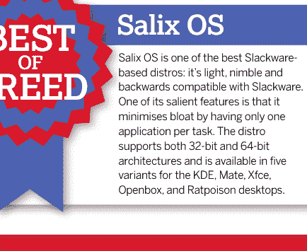

# Slack OS 品类

`Slack OS`是基于最好的发行版之一；它轻量且与`Slackware`向后兼容。它的特性之一是通过仅保留一个官方工具来避免臃肿。该发行版支持`32`位和`64`位架构，并提供五种变体，适用于`KDE`、`Mate`、`Xfce`、`Openbox`和`Ralphson`发行版。

Slack提供三种模式：`Base`和`Core`。`Full`安装安装镜像上的所有内容：`Basic`提供仅包含基本应用和Slack包管理器的精简系统；`Core`版本将只安装基于控制台的系统，专为用户自定义构建系统而设计。

`Full`包含了你在桌面发行版中预期的所有内容，并通常被赋予Slack图形包管理器的任务。`Synaptic`包管理器也提供相同的功能。开箱即支持多媒体，但可以通过用户的自定义安装进行修复。

Linux 简单 | 31

# 有袋类 (The marsupials)

进化的杰作与特立独行。

## Gentoo Linux

`Gentoo`项目的目标是创建一个没有预编译二进制文件的发行版，并针对其安装的硬件进行调整。与二进制发行版不同，源代码根据用户的偏好在本地编译，并且通常会经过优化。它最初被称为`Enoch`，但`Gentoo 1.0`于`2002`年发布。

`Gentoo`具有最具定制性发行版之一的特点，吸引了那些希望完全控制在其计算机上安装和运行软件的用户。`Gentoo`用户可以从零开始创建他们的系统；该发行版鼓励用户构建为其特定硬件定制的`Linux`内核。对开关的精细控制是`Gentoo`提供的。与其他系统相比，通过省略不必要的内核功能和服务，可以减少内存。

它最引人注特征之一是名为`Portage`的包管理系统。如果你从未用过它，使用它有一个学习曲线。

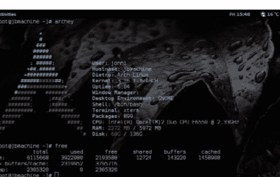

## Arch Linux

`Arch Linux`的目标是创建一个受`Slackware`和`BSD`启发的、没有预编译二进制文件的发行版，并于`2002`年创建了`Arch`。`Arch`旨在提供一个轻量级基础，用户可以在此根据需求构建。正如`Arch`所言：“Arch 是由你创造的。”

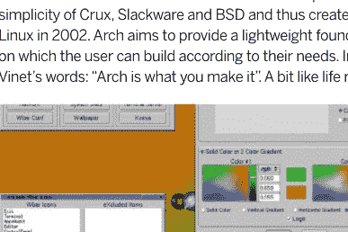

`Arch`最令人印象的特性是其最新的软件包。`Arch Linux`是极其定制的，提供了`Pacman`包管理工具。`Arch`是一个滚动更新版本，可以通过单个命令更新。安装`Arch`是一个复杂的过程，尽管文档详尽，但它更适合经验丰富的`Linux`用户。`Arch`是一个衍生版，更加用户友好并具有图形界面。

## Tiny Core Linux

如果你没有时间创建`Arch`或`Gentoo`安装，请尝试`Tiny Core`。它安装启动到最小环境所需的最少软件。从那时起你拥有完全的控制权，并可以从在线或手动编译应用程序。

该发行版也只有`12MB`，在轻量级`FLWM`窗口管理器之上仅捆了一个终端、文本编辑器和一个应用程序启动器。它有一个控制面板来管理和服务进行配置，但其他所有内容都需要从其管理器拉取，如果你想在桌面上使用`Tiny Core`。

> `Tiny Core` 是一个 `12MB` 的发行版。啊，我们流汗了！

## Puppy Linux

作为最优秀的发行版之一，`Puppy Linux`于`2003`年首次发布，并在`2005`年发布了第一个。该发行版从零开始构建，其初始目标是支持


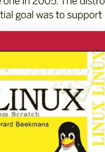

## `Linux` From `Scratch`

与其使用发行版，`LFS` - `Linux` From `Scratch` 提供了一套指令，让你完全从源码开始创建你自己的自定义发行版。该项目由 `William` 在 1999 年启动，他想了解 `Linux` 发行版在后台是如何工作的。在从零开始构建系统时，`Beemans` 遵循了这些步骤并发布为一个 `HOWTO`，预计会有其他人感兴趣。`LFS` 的发展远超了它的它的起点，从一个简单的 `HOWTO` 变成了一套丛书。它还涵盖了各种子项目，例如刷新基础系统的 `Beyond Linux`，以及旨在帮助自动化创建 `LFS` 系统的 `ALFS` 或自动化 `LFS`。

32 | `Linux` 简单

# 顶级桌面发行版

我们将踏入那片其他人可能关注的荒芜之地，因为一位忙碌的大胡子罗塞尔·克罗姆（`Russell Chrome`）正盯着它们看，并试图选出一个总的发行版冠军。我们必须选择一个既能保证易用性，又能兼顾特定案例构建灵活性的标准，坦诚地说，结果是完全公平的。为什么不将你对每个类别的最佳之选发送到 `Linux Format` 邮箱 `linuxfuture.com` 呢？

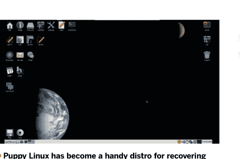

> `Puppy Linux` 在从 `PC` 恢复数据和从 `Windows` 中删除恶意软件方面有一段充满活力的历史。

由于其他发行版缺乏支持，旧硬件已变得无用武之地。

发行版的真正威力在于其丰富的应用程序。有自定义应用程序来增强我们的广告和网络电话、口袋抓取器、服务器下载器、音频 `DVD` 刻录应用等。初次用户可能会被 `Puppy` 安装程序所吓到，因为它没有自动化工具，但你会发现可以使用 `Gter` 来完成任务。安装程序中的每一步在帮助手册的帮助下都有记录。

`Puppy Linux` 的包成对出现，并有一个额外的包。你可以使用自定义的 `Puppy` 包管理器安装包，并从 `Puppy Repo` 下载它们。该发行版还拥有可用于生成变体的工具。`Puppy Linux` 变体包括支持旧硬件的 `WPuppy`、基于 `Slack` 的 `SlackPuppy`，以及基于 `Ubuntu LTS` 版本的 `PrecisePuppy`。

# `Mageia`

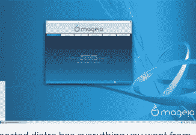

社区支持提供了你现代 `Linux` 发行版所需的一切——活跃且活力的用户和定义良好的支持结构，适用于多种桌面和安装机制。

# `SiTaz GNU/Linux`

`SiTaz` 代表 `Simple It Taz Incredible Autonomous Zone`（简单、不可思议的自治区），于 2008 年发布了第一个稳定版本。该发行版使用 `cookooks` 等自工具构建，并对其许多核心功能进行更新。该发行版还混合了 `LXDE` 和 `OpenWindow` 管理器，设计用于具有 512`MB` 内存的硬件上运行。该发行版占用不到 300`MB`，且磁盘空间极小。

该发行版还有一系列工具，如 `Tazki` 包管理器和用于管理发行版所有方面的 `SitPanel`。`SiTaz` 仓库存储了超过 3000 个流行的开源应用包，是低功耗机器的常见选择。

# `OpenSOURCE`

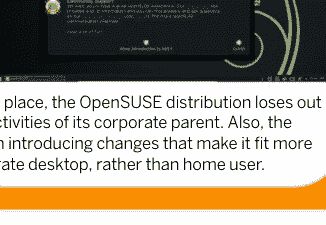

最后出现的 `OPENSOURCE` 发行版因为其母公司最近的活动而失色。该发行版仍然专注于创新，使得企业桌面变得更加容易，而不是家庭桌面。

# `PCLinux`

`PCLinux` 起于 2000 年作为 `Mandrake` 发行版的 `RPM` 包仓库，并在 2003 年作为 `Mandrake Linux` 的一个分支成为了发行版。

尽管它与 `Mandrake Linux` 的外观和感觉相似，但它的配置工具 `PCLinuxOS` 已经发生了变化。

该发行版取代了 `URPPM` 包管理器。它基于 `Debian` 的 `APT` 但使用 `RPM` 包，并结合 `Synaptic` 包管理器使用。`PCLinuxOS` 是一个 `KDE` 发行版，在 `LXDE` 和 `Mate` 桌面周围也有社区精神。

# `Korora`

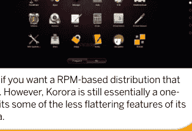

如果你想要一个开箱即用的基于 `RPM` 的发行版，这是你的最佳选择。`Korora` 本质上仍然是一个人的表演，并继承了其母发行版 `Fedora` 的一些较少的功能。

`Linux` 简易教程 | 33

# 100 大 `Linux` 工具

漫步于开源花园，我们挑选适用于所有 `Linux` 用户的最佳应用程序、工具和实用程序……


# 带有 70 个树莓派顶级应用！

我们都有自己喜欢的、比任何替代方案都更更好用的开源应用。但从 `Linux` 世界中激烈的 `Emacs` vs `vim` 之类的战斗中切换，并对我们所拥有的应用程序数量感到惊叹吧。你喜欢的源码库让你访问数千个应用程序，只需点击按钮即可安装从功能完备的应用到命令行工具的每一个程序。

这些适用于各种应用的开源应用和工具。几乎没有哪个场景是不空白的。对于社区项目来说，这些工具证明了它们满足需求并提供了超越其专有对应品的功能和性能优势。它们在更广泛的意义上证明对家庭和商业用户是无价的。根据 `www.openhub.net` 的统计，像 `Firefox` 和 `Apache` 这样的应用需要几百人年来开发，并花费数百万小时。然而，它们都是免费提供的。

# 许多应用已证明它们能满足需求并超越了专有对应品。

开源应用以各种形状和大小出现，你可以根据易用性进行调整。它们是功能丰富的应用、任务导向的套件、制作良好的工具以及新颖的应用和游戏。

一些带有设计良好的图形界面，另一些在从命令行操作时展现出更多功能的一面。在这个专题中，我们遍历了这一多样化的开源宝石，挑选出处于顶尖水平的作品。无论你是企业主、教育机构、开发用户还是游戏玩家，我们在这个最热门工具列表中吸引了许多粉丝，但还有许多你可能没有注意。如果你从未用过它们，我们确信你错过了商业软件的切换机会，我们确信你会在列表中找到一些合适的替代品。

34 | `Linux` 简易教程 | 星号*

# 必备应用

`Linux` 桌面没有它们将是不完整的！

## `LibreOffice`

从 `OpenOffice.org` 分叉，`LibreOffice` 已成为最好的免费办公套件之一。它包含了文字处理程序，并可以创建表格、幻灯片、绘图和图表，具有强大的数学公式。它对专有格式的文档提供了良好的兼容性，并且最近发生了巨大变化

## `Thunderbird`

来自 `Mozilla` 的优秀客户端。

## `Wine`

## `KeepPass`

## `Gufw`

如果你需要一种简单的方法来管理防火墙。

## `VirtualBox`

## `BleachBit`

## `Clonezilla`

## `Remmina`

## `OpenSSH`

## `VLC`

## `PeaZip`

## `Gparted`

## `HomeBank`

# 互联网应用

通过这些工具获取网络精髓体验。

### `Firefox`

`Mozilla Firefox` 是最广泛使用的软件之一，是适用于所有 `Linux` 发行版的最佳浏览器。它响应非常迅速，并以其隐私功能而闻名。你可以通过丰富的主题库来定制你想要的任何内容。`www.firefox.com`

### `RSSOwl`

`RSSOwl` 是 `Feeder` 的优秀桌面替代方案，是一个新的 `RSS` 和 `Atom` 订阅聚合器，帮助你保持信息灵通。它可以捕获馈送、收集、更新和存储新闻，并易用地选择待阅读或分享的项目。`www.rssowl.com`

### `Midori`

任何关注资源消耗者的首选浏览器。`Midori` 拥有你所需的所有功能：轻量级的特性和设计。它具有轻量级拨号、标签页界面、书签管理器、可配置的网络搜索以及无痕模式。`www.midori-browser.com`

### `BitTorrent`

`BitTorrent` 客户端是一个功能丰富的客户端，能够胜任。如果你需要通过 `FTP` 下载文件，`FileZilla` 提供了一个简单的双面板界面，显示本地文件系统的内容。使用 `FTP`，你还可以在两个服务器之间传输文件。`http://get.bitt.com`

### `FileZilla`

对于使用 `FTP` 的人员来说，`FileZilla` 是不可少的。该客户端支持 `SFTP` 和 `FTP` 协议，并提供你可以想象的任何选项的帮助。它的界面简单，你可以从一个服务器浏览并同时在服务器之间传输文件。`https://filezilla.org/`

### `Jitsi`

注重隐私的用户应该尝试名为 `Tox` 的去中心化 `IM` 和 `VoIP` 客户端。它运行在分布式网络上，使用了与 `BitTorrent` 相同的技术来提供直接连接，无论是聊天还是像 `Skype` 的其他功能，且无需注册。

### `Tox`


Jitsi 是最好的 VoIP 应用，只要你不害怕一对一的音视频通话以及屏幕共享。利用广泛使用且熟悉的种子（torrent）协议（包括 `SFTP`、`XMPP`、`AIM` 和 `IRC`），它具备了你对现代工具期待的所有功能，例如通过建立 `RTP` 会话进行带有语音和视频的文本聊天。[Jitsi](https://jitsi.org/)

### Deluge

`BitTorrent` 在下载 `Linux` 发行版方面非常流行，有很多客户端。其中最好的之一是 `Deluge`，它拥有具有简单界面的引擎。它具有高级用户喜欢调优的功能，但由于其插件库，初学者也很容易学习。[Deluge](http://deluge-forrent.org/)

`Tox` 不使用可能被攻击的服务器。所有聊天和文件都使用点对添加的 `NaCl` 加密进行加密。[Tox](http://tox.org/)

`Pigeon` 是一个用于多个网络的精彩应用。你可以登录多个账户，并与不同网络的朋友聊天。你只需要连接到 `AIM`、`MSN`、`Google`、`Yahoo`、`IRC` 并统一管理它们。[Pigeon](https://pigeon.im)

### Aria2

`aria2` 的独特之处在于它可以使用多种协议下载文件。这个轻量级工具可以通过 `HTTP`、`FTP`、`BitTorrent` 和 `Magnet` 协议下载。

`Aria2` 还可以开启多个连接来加速文件下载。[Aria2](http://aria2.org/)


### O.A.D.

一款真实的文明建设策略游戏，具有令人印象深刻的图形效果和引人入胜的游戏性。它尚未正式发布，但在目前状态下已赢得了赞誉。[O.A.D.](http://playvod.com)

### FreeCiv

一款策略游戏，挑战玩家带领他们的部落从公元前 4000 年跨越太空时代。[FreeCiv](www://freeciv.org/)

### Alien Arena

一款受欢迎的科幻主题、《虚竞技》锦标赛风格的第一人称射击游戏。游戏有多种模式和 60 多幅地图，具有很高的配置性。[Alien Arena](http://planet-arena.org/)

### OpenMW

一个重建了《魔风》受欢迎程度开源引擎。该项目的目标是重建资产并添加额外功能，以提供一个更多模组化的游戏版本。[OpenMW](www://openmw.org/)

### FlightGear

对于飞行模拟器爱好者来说，`FlightGear` 旨在通过真实的场景飞越世界，这些场景可以通过 20,000 个机场进行扩展，并带有你自己的飞机和地点。[FlightGear](www.flightgear.org)

# 办公与生产力

通过这些应用增强你的工作流。

### Calligraphy

`Calligraphy` 是兼容文字处理器的全部需求。你可能希望将 `Calligraphy` 视为 `OKOffice` 的延续。`LibreOffice` 是一款外观现代、功能强大的文档处理器。由于其原生文件格式为 `.odt`，它拥有大量的色彩。除了文字，它还支持电子表格、数据库表格，甚至用于数字绘画的 `Krita`。[Calligraphy](www.calligraphy.org)


### Zathura

`Zathura` 是一款轻量级 `PDF` 阅读器，支持你所需和期待的所有功能。你可以搜索文本字符串、跳转页面、放大和缩小、旋转、添加书签等。此外，它还可以显示云端图像。[Zathura](https://pwmt.org/projects/zathura)

### Gnumeric

`Gnumeric` 通常与 `Cash` 配对使用，这是一个支票、储蓄电子表格应用。它不仅现代，而且提供了许多功能。`Gnumeric` 会从 `Microsoft Excel` 文件导入数据。


### GnuCash

`GnuCash` 是一个复式记账程序。它跟踪银行账户、股票和投资。[GnuCash](www.gnucash.org/)

### AbiWord

`AbiWord` 是一款轻量且功能强大的文字处理器。它支持许多格式和功能。[AbiWord](https://abiword.net/)

### KMoney

`KMoney` 是一款个人财务应用程序，帮助你跟踪支出和收入。[KMoney](https://kmmoney.org)


### ProjectLibre

`ProjectLibre` 是一款开源项目管理软件。它可以使用各种图表可视化任务。[ProjectLibre](http://projectlibre.org/)

### OpenLDAP

`OpenLDAP` 是一个开源目录服务器实现。用于管理网络中的用户和访问控制。

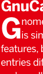

### Calibre

`Calibre` 允许你管理书籍，并支持多种阅读器。你可以同步到 `Kindle` 等设备。[Calibre](www.calibre-ebook.com)

### Xournal

当你需要存储信息以备用时，`Xournal` 非常方便。你可以使用鼠标或手写笔进行记录。它还可以为 `PDF` 文件添加注释。[Xournal](http://xournal.sourceforge.net)


## 爱好者

追随你的热情！

## RawTherapee

用于使用单反相机 (`DSLR`) 拍摄。然后，查看用于处理和转换 `RAW` 文件的各种工具。除了后期处理外，你还可以使用 `RAW` 文件进行编辑。该程序允许你调整图像的颜色和亮度值，同时保持色调和细节完整。通过它，你也可以 `RawTherapee` 编辑传统图像，它还包含了 `Adobe Lens`。

[RawTherapee](www.rawtherapee.com)

## Krita

`Krita` 值得特别提及。`Krita` 是一款数字绘画和插画应用，提供了许多功能、`HDR` 支持、透视网格以及你对这类软件预期的功能。

[Krita](www.krita.org)

## OpenShot

`Linux` 的编辑器寥寥无几，而 `OpenShot` 为家庭用户提供了功能与易用性的完美结合。你可以用它来组合视频、音频轨道，并保持平滑的过渡，最后以多种格式导出最终产品。`OpenShot` 还可以使用 `Blender` 创建 3D 动画标题。

[OpenShot](www.openshot.org)

## Stellarium

是一个适用于你计算机的免费开源天文馆。它可以计算太阳、月亮、行星和恒星在任何过去和未来的位置。它还可以绘制星座，并模拟如流星雨、日食等天文现象。

[Stellarium](www.stellarium.org)

## Inkscape

一款专业级工具，`Inkscape` 提供了高级的矢量图形编辑，并因绘制矢量艺术、线条设计、标志和图形而广受欢迎。它具有特性、形状、颜色、图层混合和模式等功能，通常用于剪贴画和图标等高价值属性。

[Inkscape](www.inkscape.org)

## Scribus

一个全面的桌面程序。`Scribus` 可用于创建专业的、印刷级的在线和打印文档，包括折页、书籍、书签和杂志。它具有许多功能，如 `PostScript` 颜色、支持 `CMYK` 和专色、`ICC` 配置文件和标记。从各种模板开始，你还可以使用一组工具根据你的需求定义并定位布局元素。

[Scribus](www.scribus.org)

## JOSM

为 `OpenStreetMap` 地图做出贡献。`JOSM` 是一个基于 `Java` 的离线地图编辑器，允许你编辑地图数据、将 `GPS` 轨迹加载到 `JOSM` 并立即向 `OpenStreetMap` 添加街道。虽然 `OpenStreetMap` 鼓励贡献者使用 `JOSM`，但它让他们能够快速轻松地将更改上传到 `JOSM`。`JOSM` 功能可以通过插件和主题进行扩展。

[JOSM](https://jos.openstreetmap.org)

## Cinerilla

如果你需要编辑不仅仅是家庭视频，它是优秀的，它是 `Linux` 上最先进的非线性视频编辑器和合成器。它支持音频和视频且非常稳定。帧轨道可以轻松处理运动以编辑任何大小的视频。该程序具有高级功能，如叠加、透明度、色彩校正、色彩混合、实时效果等。它包含一个用于执行抠像等任务的合成引擎。

[Cinerilla](www.cinerilla.org)

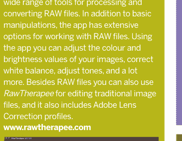


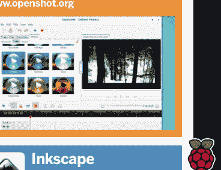

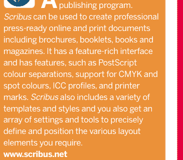

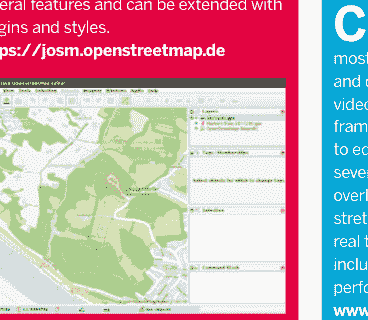

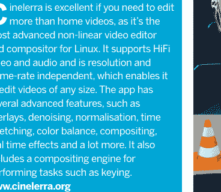

## Comix


数字漫画以漫画存档文件的格式发行，主要由一系列图像（`PNG` 或 `JPEG` 文件，作为一个单个存档文件）组成。`Comix` 可以读取几乎所有格式的数字漫画。

`http://github.com/ComixApp`

## `FontForge`

是一个功能丰富的工具，用于创建和编辑支持所有字体的字体。它可以将字体从一种文件格式转换为另一种格式，并可用于预览。

`http://bit.ly/FontForge`

## `CairoDock`

是一个类似 `MacOS X` dock 的应用程序。它比其他 dock 具有许多优势，包括一个用于管理工作的窗口管理器，以及为低功耗菜单添加混合效果。

`http://bit.ly/CairoDock`

## `Audacity`

如果你需要处理音频，你应该使用强大的 `Audacity` 音频编辑器。你可以修剪、切割、复制，甚至堆叠多个轨道，并导出到多种格式和质量设置。

`http://bit.ly/AudacityApp`

## `MPD`

音乐播放器是一个具有服务器-客户端架构的音频播放器，这意味着你可以从另一台计算机流传输音乐。它可以播放音频文件、播放列表并可以维护音乐数据库。

`http://bit.ly/Musicmpd`

## Gestated 热门前 10

### `开发`

面向高级用户的强大工具和程序。

### `jEdit`

这是一个为程序员设计的编辑器，支持超过 140 种语言。该程序允许你定义复杂的宏和强大的键盘插件。

它高度可配置且自定义，你可以通过添加插件来扩展其功能。

`www.jedit.org`

### `Meld`

一个图形化差异工具。`Meld` 允许你比较两个或三个文件以及目录。它包括高亮和直接比较等功能。

`www.meld.org`

### `Blender`

你可以使用 `Blender` 创建 3D 动画标题、光照、粒子等模型。`Blender` 支持多种语言，并包含一个强大的渲染引擎。

`www.blender.org`

### `Eclipse`

如果你只是偶尔编程，不需要一个完整的 IDE。`Eclipse` 支持大多数语言，是功能丰富的编辑器。它可以进行重构等各种操作。

`www.eclipse.org`

### `Geany`

如果你只是偶尔编程，不需要一个功能 de IDE。`Geany` 是一个不错的选择。它支持大多数语言并具有插件系统和功能。

`www.geany.org`

### `Kompozer`

新手和经验丰富的编辑器都会喜欢它。`Kompozer` 具有直观的界面，并验证 `HTML` 代码。

`www.kompozer.org`

### `BlueFish`

它是一个为开发者设计的多语言编辑器。它支持代码折叠、自动标签闭合、语法高亮等动态功能。`BlueFish` 还支持 `MediaWiki` 和 `WordPress` 等开源应用。

`http://bluefish.org`

### `APtonCD`

突然你需要移动你的 `Ubuntu` 安装或需要为设置制作备份？`APtonCD` 用户可以将所有安装的包备份到镜像，然后在恢复时作为源。你可以用它将包恢复到系统或保留在 `APT` 缓存中。

`aptcd.sourceforge.net`

### `Gimp`

`Gimp` 是一个强大的图像处理程序。它提供了用于照片修饰和图像处理的各种工具。它还有许多功能并支持常见的图像格式。

`www.gimp.org`

### `Clementine`

通过 `Icecast` 你可以跨网络流传输音乐。`Icecast` 具有良好的界面，易于配置并将音乐传输到各种设备，并与热门众服务集成。

`www.clementine.player` | `www.icecast.org`

### `Amarok`

如果你使用 `KDE` 可能会喜欢这个音乐播放器。`Amarok` 是一个处理标签、元数据的音乐播放器并包含了创建动态播放列表、脚本、右键菜单等。

`https://amarok.kde.org`

### `LMMS`

`LMMS` 是通过合成轨道、安排、录制并在 `MIDI` 设备上播放来产生声音的工作站。它还有一个歌曲编辑器和模拟器和效果的插件。

`www.lmms.org`

### `Kodi`

直到最近 `Kodi` 还被称为 `XMC`。它是想听音乐的用户的极佳选择。它能播放大多数媒体文件，支持电视、It 和蓝牙遥控器。

`www.kodi.tv`

Linux Media Simple | 39

### `工具类`

让你的电脑发挥更多作用的应用程序。

### `Gnome Tweak Tool`

对原生的 `Gnome` 桌面不满意吗？使用 `Gnome Tweak` 工具可以自定义多个方面的设置，包括桌面的外观设置。通过此应用，你还可以更改字体、管理工作空间、管理扩展，甚至通过选择图标、文件等来绕过 `Gnome` 的设计哲学。

```
http://github.com/gnome/tweaks
```

### `Grub Customizer`

`Grub2` 是最流行的 Linux 引导程序，几乎被所有主流发行版所使用。它是一款令人印象深刻的软件，拥有许多选项。`Grub Customizer` 是一个易于使用的程序，用于自定义引导程序的所有方面。

```
https://github.com/grub-customizer
```

### `Handbrake`

当你需要转换视频时，`Handbrake`：这款视频转码应用表现非常出色。它可以转换任何格式，并支持广泛的视频设备。它甚至针对热门设备内置了过滤器，使转换过程变得更加简单。

```
https://www.handbrake.fr
```

### `EasyStroke`

想通过鼠标轻扫来控制你的 PC 吗？`EasyStroke` 应用允许你通过记录鼠标按钮的移动来定义和管理手势。然后你可以配置在应用定义手势时执行的操作。

```
https://easystroke.sourceforge.net
```

### `digiKam`

Linux 下最好的照片管理工具之一是 `digiKam`，它适用于各种图像。它可以识别、编辑、管理文件，并根据元数据组织图像。此应用还允许将图像导出到在线服务。

```
https://www.digikam.org
```

### `DosBox`

如果你喜欢旧 DOS 游戏并想在现代机器上运行它们，`DosBox` 是一个具有完整图形和声音的 PC 仿真器。你还可以模拟 Windows 环境以及通过互联网模拟本地网络。`Wine` 项目使用使用 `DosBox` 来支持旧应用程序。

```
https://www.dosbox.com
```

### `Vokosreen`

`Vokoscreen` 是一款值得赞誉的功能丰富的录屏软件，基于 `FFmpeg` 处理多媒体数据。`Vokoscreen` 可以捕捉整个屏幕、窗口或选定区域，并带有摄像头音频。该应用支持 `AVI` 和 `MKV` 格式下的 `MP4`、`H.264` 和 `WebM` 格式。该应用提供了一些控制选项来更改视频质量和格式，以便满足不同的用场景。

```
http://vokoscreen.org/linux/
```

### `K3b`

如果你正在考虑刻光盘，`K3b` 是处理此任务的最佳媒体刻录工具。此应用可以刻录 `ISO` 镜像、`CD`、`VCD`、`DVD`、混合模式 `CD` 和蓝光光。它还可以编译和写入 `ISO` 镜像。

```
http://trouux.net/k3b
```

### `Avidem`

`Avidem` 是一款视频编辑器和转换器，用于裁剪、调整和合并视频。它支持 `AVI`、`MPEG` 和 `MP4` 格式。`Avidem` 为明确想要做什么的用户设计，同时也为初学者提供了易用的界面。它有许多预设，用户也可以使用自定义设置来简化操作。

### `Ncmplex`

这是一个易于使用和自定义的命令行 `MP3` 客户端。它提供了如标记、创建播放列表、歌词、项目过滤、从 `ID3` 标签中获取艺术家信息等实用功能。它提供了更多功能。

```
http://linux.org/ncmplex
```

### `Samba`

`Samba` 是一套程序，允许 Linux 计算机在基于 Windows 的网络上使用和共享文件、打印机和其他资源。它通过支持 `SMB` 协议来实现这一点。

```
http://www.samba.org
```

### `rTorrent`

我们有一个带有 Web 界面的命令行 `BitTorrent` 客户端。你可以作为守护进程在后台运行，并通过 Web 界面控制它。它支持 `SSH`，帮助从远程机器管理种子。

```
http://links/rTorrent
```

### `Links2`

轻量级 torrent 客户端有很多，但 `Links2` 特别一种。它是一个可以通过下拉菜单下载 torrent 的浏览器客户端。它也很特别，因为它是一个集成了一切浏览器。

```
http://links/links2
```

### `Midnight Commander`

在图形文件时代到来之前，真实用户使用的是被称为 `MC` 的 `Midnight Commander`。如果你经常发现自己身处命令行世界，它仍然是最佳选择。

```
http://bit.ly/MidnightCtr
```


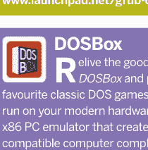


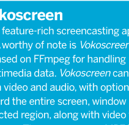
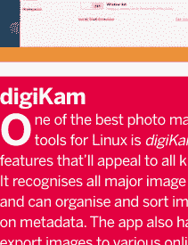
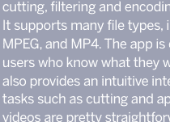
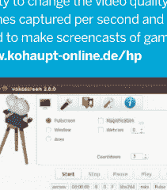
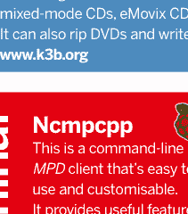
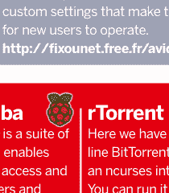
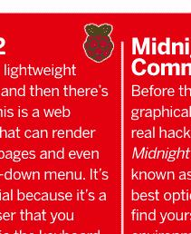

## 前 10

### Redo Backup

我们之前提到过它，但如果你需要保护数据，`Redo Backup` 是一款功能丰富的工具。

### QEMU

`QEMU` 是一个强大的仿真器和虚拟化程序。它允许你在主机上运行各种操作系统。

### XAMPP

`XAMPP` 栈提供了 `Apache`、`MySQL`、`PHP` 和 `Perl`。它是 Web 开发和测试的热门选择。

### Conky

`Conky` 是在桌面上显示信息的系统监控器。它高度自定义，可以显示几乎任何内容。

### Turnkey Linux

`Turnkey` 是一个基于 `Debian` 的发行版，提供了许多即用设备。它非常适合快速部署服务器。

### Dejà Dup

`Dejà Dup` 是基于 `GNOME` 的备份实用。它简单易用，并与云存储集成。

### Mondo Rescue

`Mondo Rescue` 是一个创建磁盘镜像的备份工具。对于备份整个系统非常有用。

### Open Media Vault

`Open Media Vault` 是一个网络存储 (NAS) 解决方案。它非常适合管理网络上的文件。

### Zentyal

`Zentyal` 是一个开源的 `Ubuntu` 网关。它提供了各种工具来管理你的网络和安全服务。

# 基础知识

- 包管理 44
- Web 浏览器 46
- 文档 48
- 电子表格 50
- PDF 编辑 52
- 即时消息 54
- 电子邮件 56
- 编辑器 58


# 包：安装新的源软件

从你的 Linux 系统获取新程序非常简单，尽管你可能听过其他说法，但它是直观且深奥的。

你的 Linux 系统预装了一系列实用的应用程序和软件，但总会有新的需求。你会有时间——而且总是如此——想要尝试一些新东西。有些包供你探索以获取新事物，并在稍后在你的 Linux 中使用它们。现在，有一种更简单的方法可以为你的电脑寻找新程序：来自互联网的包管理器。它们可以处理依赖关系——即从你的 PC 获取所需软件最新版本的项目，处理升级或删除过程，并让你在无需任何自动操作的情况下安装你想要的内容。如果你的软件封装得良好，一切都会运行得非常完美。

如果你想亲自动手，如果一切顺利，以后再说。

`Apple` 将该系统引入了 `macOS`，而 `Windows` 正在转向 `Linux`。我们知道微软自 `Windows` 以来一直尝试类似的方案。`Microsoft Store`（微软应用商店），你可以将其看作微软控制软件生态系统的一种方式，你可以在无需烦恼的情况下获得（某些）程序——而不必承担从互联网随机下载的风险。这很有道理。它实际上运行得相当不错，而且理论是稳固的。

你可能在手机的 `App Store` 和 `Google Play` 商店遇到过类似的东西——它们都是包管理器的示例——在现代手机上手动下载和安装任何 App 是不现实的。整个过程是无缝的。

`Ubuntu` 的桌面包管理器被称为软件中心（Software Centre）。它访问许多资源——被称为仓库（repositories），为你的电脑程序获取正确的软件。或者至少在目前是这样做的——软件中心。在 `Ubuntu 16.04` 版本中。现在，让我们看看如何使用软件中心下载、安装和删除软件——即 `GNOME` 软件。

# 软件软件中心

如你在右上方所示，Ubuntu 软件中心的界面其实并不复杂——有一个大设计的软件按钮列表，但你可以看到安装了什么、你做了什么以及安装是何时上线的。关键元素是窗口右上角的搜索框。它不仅按软件名称搜索，还通过大多数 Linux 包那种令人困惑的方式——通过描述搜索。所以，如果我们想找一个游戏，我们就搜索 `game`。游戏连它的名称和简短描述就会弹出。这是一个非常宽泛的例子，但想象一下你需要找一个新的客户端：输入“email”并发现你寻找的内容类似于“Bestmributor”。这是合理的。

抛开关于咬牙的匿名轶事不谈。那么，让我们看看一些简单的事情。我们为什么变得好了一点？在软件中心之前，Ubuntu 提供了一个名为 `Synaptic` 包管理器（`Synaptic Package Manager`）的程序，在迁移到 `GNOME` 软件后仍将使用。它的功能相同：搜索包、修复依赖关系、升级以及……

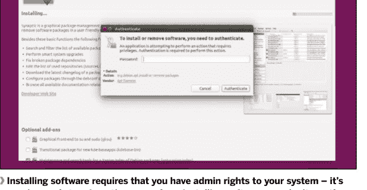

> 安装软件需要你拥有系统的管理员权限——这是防止他人安装你不想要的软件的方法！

44 | Linux 简明

# Ubuntu 软件中心内部

**全部**

点击此按钮返回软件中心的主菜单。你也可以用它来选择软件的来源——Ubuntu 发布版或 Canonical 的包。

**类别**

一旦你在“全部软件”中选择了一个类别，这些类别就会显示出来，这意味着你可以向下滚动找到你真正想要的软件。

**查看全部**

好奇你当前类别中有什么可选的吗？点击此处查看全部。

**过去**

软件中心实际上安装了什么？不仅仅是包，还有那些小包吗？历史页面会告诉你。

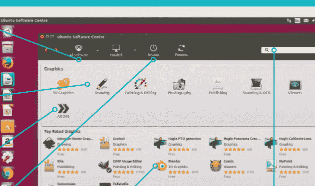

**精选**

每个类别中最好（或评分最高）的应用程序列在这里，并附有平均评分和评论数量（在括号内）。

**搜索栏**

如果你确定包的名字，或者不确定选择属于哪个类别，搜索至关重要。只需在此输入并按 `[回车键]`。

**包管理器**——在搜索框中找到我们的“全部软件”在列表中，但很难通过自然方式找到。它实际上隐藏在页面左侧通常不透明的“主题”（`Themes`）类别中，你应该点击窗口底部的按钮。如果不是，你应该看到一个更易于管理的列表。

**分割于**：注意 `Synaptic` 包管理器位于“主题与微调”（`Threads and Tweaks`）中，向左移动箭头以展开并在列表中找到它。点击它查看选项——“更多信息”（`More info`，这在你清理系统并删除某个特定软件时特别有用）以及“删除”（`Remove`）。点击后者。

> **小贴士**
>
> 大多数图形化包管理器只对像 `apt` 这样的终端应用有效，而你可能需要它。关于此点的更多信息请参阅第 46 页。

**实际安装**

点击 `Synaptic` 包管理器，你将看到关于它的信息、指向其网站的链接、分享（别忘了！）并点击底部的安装按钮。在继续点击它之前，它会列出你可能感兴趣的插件列表，可以通过勾选各自的复选框来安装。继续滚动，你会找到特定软件的评论，因为用户确实在分享经验。软件中心有一个严格的过滤器——所以列表中可能会红色标记。当你准备好时，点击安装。输入你的密码，验证，软件中心将完成剩下的。

如果你完成了，现在你将知道其他可能也需要删除的内容。在这种情况下，删除项目很容易。软件中心有一个严格的过滤器——所以列表中可能会红色标记。当你准备好时，点击安装。输入你的密码，验证，软件中心将完成剩下的。

如果你完成了，现在你将知道其他可能也需要删除的内容。在这种情况下，删除项目很容易。软件中心有一个严格的过滤器——所以列表中可能会红色标记。当你准备好时，点击安装。输入你的密码，验证，软件中心将完成剩下的。

如果你完成了，现在你将知道其他可能也需要删除的内容。在这种情况下，删除项目很容易。软件中心有一个严格的过滤器——所以列表中可能会红色标记。当你准备好时，点击安装。输入你的密码，验证，软件中心将完成剩下的。

如果你完成了，现在你将知道其他可能也需要删除的内容。在这种情况下，删除项目很容易。软件中心有一个严格的过滤器——所以列表中可能会红色标记。当你准备好时，点击安装。输入你的密码，验证，软件中心将完成剩下的。

如果你完成了，现在你将知道其他可能也需要删除的内容。在这种情况下，删除项目很容易。软件中心有一个严格的过滤器——所以列表中可能会红色标记。当你准备好时，点击安装。输入你的密码，验证，软件中心将完成剩下的。

如果你完成了，现在你将知道其他可能也需要删除的内容。在这种情况下，删除项目很容易。软件中心有一个严格的过滤器——所以列表中可能会红色标记。当你准备好时，点击安装。输入你的密码，验证，软件中心将完成剩下的。


（喜欢）关于它的更多信息。

好奇你当前类别中有什么可选的？点击此处查看全部。

软件中心实际上安装了什么？不仅仅是包，还有那些小包吗？


如果你完成了，现在你将知道其他可能也需要删除的内容。在这种情况下，删除项目很容易。软件中心有一个严格的过滤器——所以列表中可能会红色标记。当你准备好时，点击安装。输入你的密码，验证，软件中心将完成剩下的。

Linux 简明 | 45

[第 45 页]

# Web 浏览器：最佳


电脑如果不是通往……的门户，那是什么？

Linux 上最成熟的浏览器可能是 `Firefox`，尽管它近年市场份额很小，但它运行得完美并包含一些酷的功能。如果你想登录 `Firefox` 账户，版本允许你在设备之间同步历史记录，因此很容易从另一台机器上继续之前的工作。同样，你可以将其与其他 `Firefox` 使用，这对于远程登录或只是清理非常有用。

如果你是软件的新手，很难找路。


## 实际安装

点击 `Synaptic` 包管理器，你将看到关于它的信息、指向其网站的链接、分享（别忘了！）并点击底部的安装按钮。在继续点击它之前，它会列出你可能感兴趣的插件列表，可以通过勾选各自的复选框来安装。继续滚动，你会找到特定软件的评论，因为用户确实在分享经验。软件中心有一个严格的过滤器——所以列表中可能会红色标记。当你准备好时，点击安装。输入你的密码，验证，软件中心将完成剩下的。

如果你完成了，现在你将知道其他可能也需要删除的内容。在这种情况下，删除项目很容易。软件中心有一个严格的过滤器——所以列表中可能会红色标记。当你准备好时，点击安装。输入你的密码，验证，软件中心将完成剩下的。

如果你完成了，现在你将知道其他可能也需要删除的内容。在这种情况下，删除项目很容易。软件中心有一个严格的过滤器——所以列表中可能会红色标记。当你准备好时，点击安装。输入你的密码，验证，软件中心将完成剩下的。

电脑如果不是通往……的门户，那是什么？

Linux 上最成熟的浏览器可能是 `Firefox`，尽管它近年市场份额很小，但它运行得完美并包含一些酷的功能。如果你想登录 `Firefox` 账户，版本允许你在设备之间同步历史记录，因此很容易从另一台机器上继续之前的工作。同样，你可以将其与其他 `Firefox` 使用，这对于远程登录或只是清理非常有用。

如果你是软件的新手，很难找路。

### 书签备份

在 `Google Chrome` 中，点击三线汉堡图标，进入“书签”，然后点击“导出书签”。这将创建一个 `HTML` 文件，你可以将其导入到浏览器中。

自由软件分发的限制。还被重新命名为自由 `Thunderbird` (`Lovemail`)、互联网应用程序套：`Seamonkey` (`Eclipse`) 以及似乎被遗弃的日历应用：`Sunriver`。在与 `Firefox` 的合作伙伴 `Mozilla` 解决分歧期间，预计这些项目很快就会消失。

`Chromium` 是一种开源浏览器，有多个用户开发的版本，这些版本共享 `Chrome` 的基本功能。它不包含其更大的“商标兄弟”的所有功能——例如使用 `Flash` 等专有非开源技术——但它运行相同的渲染引擎，这使得网站看起来和 `Chrome` 一模样。这意味着在许多方面，它允许每个标签页都有自己的进程和光标。一个标签页的崩溃不会导致窗口的其他部分崩溃，但 `Chromium` 的崩溃需要更多的内存来运行。

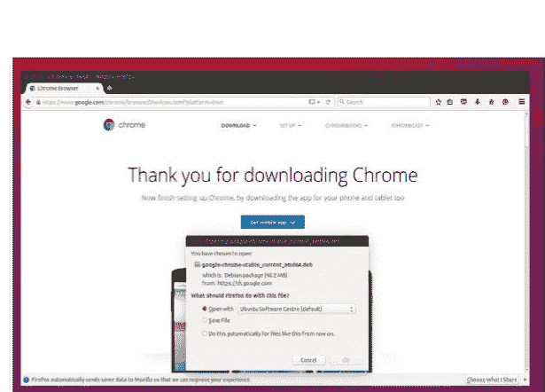

如果你想在包管理器中找到 `Chrome`，获取正品非常简单。只需访问 `google.com/chrome`，点击下载按钮，并为你的发行版选择适当的文件。点击并安装，然后用你的包管理器打开结果文件进行安装。你需要从终端运行它：搜索“终端”并打开终端 应用程序，然后输入 `google-chrome` 进行首次安装。安装完成后，启动它非常简单，你可以随随地使用。

## 感谢下载 Chrome

现在就为你的手机和平板电脑下载应用，完成 `Chrome` 的设置

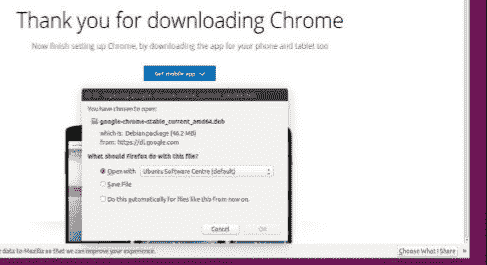

- `Chrome` 可能在你的包管理器中不可，因此你需要前往它的网站（使用另一个浏览器）来获取。

它包含了与专有软件类似的后备方案，而且现在这些方案的出现频率比替代方案更高。

# 迈向自由的极致

> **小提示**
>
> 如果你更好的浏览器经常在显示方式上对这一个进行测试，不要担心，那个测试结果并不重要！

你可以做的最极端的测试是在 `webbenchmark.com`。为此，那里有一系列重型基准测试，从多个方面推向你的浏览器，使用 `HTML5` 和其他标准来告知你 `PC` 的性能。确保你的浏览器在运行时处于工作状态，这大约需要五分钟。完成后，你将得到一个最终分，你可以比较你的浏览器和桌面竞争对手，甚至获得一些关于 `ISP` 性能的信息。

虽然我们在这里给出了模糊的建议，但浏览器的选择完全取决于你个人的测试以及什么对你的 `Linux` 系统最好。

无论何种情况，我们都会考虑 `Firefox` 和 `Chrome` 以及其他可能的替代方案。这并不符合 `Linux` 的哲学倾向，但它——

## 测试能力

你的浏览器表现如何？不同的浏览器以不同的方式渲染在线元素，因此对你的选择（以及比较）进行测试是值得的，以确保获得最好的体验。

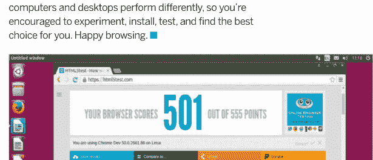

一组带有渲染引擎技术的测试将显示你的浏览器遵循 `Web` 标准的程度，或者至少显示你的浏览器在各种任务中的表现如何。

一个更现代的基准测试是 `HTML` 测试。它不会制作任何图片或为你提供浏览器功能的视觉表示，但它能为你提供关于你的浏览器可以做什么或不能做什么的稳定测量。许多 `Linux` 浏览器将因为遗漏源技术而丢分，因此在你急于卸载应用程序之前请记住这一点。大多数网站

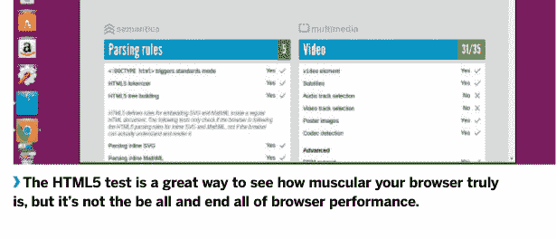

> `HTML5` 测试是查看你的浏览器有多强大的的一种极佳方法，但它不是关于浏览器性能的全部。

Linux 制作 | 47

# LibreOffice Writer：创建文档

`LibreOffice` 是一个功能齐全的办公套件，完全免费。让我们看看 `Writer`，它的文字处理器如何处理复杂内容。

`Linux` 可以做……任何事情。不像经典那样吸引人，但它像 `Windows` 系统一样漂亮，某些软件可以执行桌面任务。

尽管微软更改了 `Word` 的界面——变得更糟——在这些年来，`Writer` 的布局对任何用过 `Word` 的人来说应该都很熟悉。这是一个巨大的空白页。屏幕顶部的几个栏可以快速访问文本和文档设置。底部有字数计数、字符计数、页数计数以及缩放滑块。有很多菜单可以操作。

我们的建议使用 `LibreOffice`：一个跨平台的应用程序集合，自 1999 年以来出现了许多形式。尽管免费的，它仍然是最活跃的软件包。

打字的操作超出了本教程的范围——我们假设你可以管理那个——让我们创建一些东西来测试 `Writer` 的功能。

## 文字内容

`LibreOffice 5` 应该包含运行 `Writer` 需要的一切，并学习 `LibreOffice`。如果没有安装，打开包管理器安装它。你可以在 `LibreOffice Fresh`（发布版）或 `LibreOffice Still`（稳定版）之间进行选择，这在这里。

**小提示** `Writer` 可以从电子表格提取内容。只需复制你想要的单元格，然后使用粘贴功能将其引入。

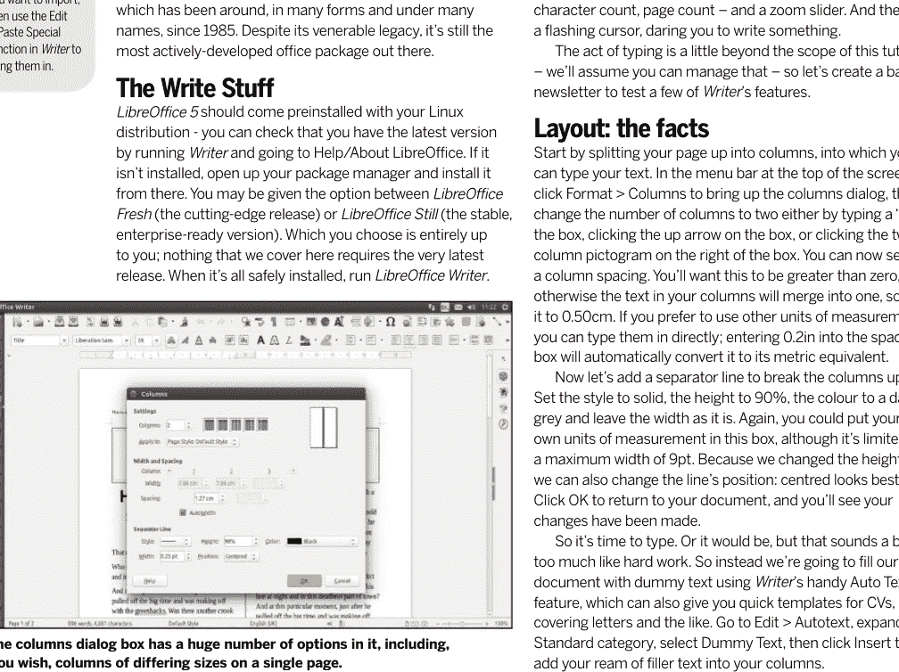

## 布局

让我们把页面分列，我们可以这样做。使用顶部的菜单，点击“格式 -> 列”弹出对话框，通过将列数改为二或三，或者点击右侧框添加间距。这可能会大于 `0.5cm`。如果你希望文本合并为一列。

现在让我们添加换行。设置样式，高度为 `0%`，颜色为灰色。你可以在框中调整单位，虽然宽度限制为 `10pt`。因为更改了行，我们也可以更改行的位置。点击 `OK` 返回文档，你的更改已完成。

现在是打字一点的时间了，但现在工作量太大了。我们将使用 `Writer` 的自动文本功能用填充文本填充文档，我们还可以使用模板，覆盖字母等。前往“编辑 -> 自动”，展开类别，然后点击将填充内容分列。

> 列对话框中有大量的选项，如果你希望，可以在单页上有不同的大小。

## 格式

回到文档，重复几次填充文本（用 `[Ctrl]+A` 全选，用 `[Ctrl]+C` 复制，用 `[Ctrl]+V` 粘贴）来填充页面。我们将使用 `Writer`。从当前显示“默认”的下拉框中选择一种样式并将其改为“标题”。你会看到它的大小变为 `28pt`，加粗无衬线。选择剩余文本并赋予“正文”。

当你悬停在样式上时，可能会发现右侧出现一个菜单。悬停在“标题”上并点击“编辑样式”。在弹出窗口中，勾选自动完成框。我们现在将突出使用样式而不是手动更改字体和大小的好处。更改将反映在整个文档，保持一切一致和更多。使用 `Tab` 键选择你喜欢的，然后应用到光标，或使用预设格式化列表创建一致列表、拖动框等。为了更直观地查看此，手动移动页面上的文本就像拖动它；然而，悬停在样式框上并选择“更新为选择”。

## 最后完善


我们的通讯需要一个页眉，因此前往“插入 -> 页眉”并选择“默认样式”。这种样式跨页并自动缩放我们的行以适应。点击页眉区域将光标移动到那里并输入你想要的任何文本。如果你想添加自动递增数字，将文本光标放在你想的地方，前往“插入 -> 字段 -> 页码”。

# 导航

### 样式类型

通过此菜单访问的文本样式对于希望在不大量调整的情况下创建文档的人至关重要。

### 外观效果

粗体文本、下划线和删除线可能不需要自己的文本样式，只需突出要更改的文本并点击下方的按钮。

### 框架设置

文本框允许你放置否则会被页边距或列绕过的项目（包括图片）。

### 你做得如何？

这个快速计数器跟踪你写的单词和字符——如果你有字数限制，它是必不可少的。

### 快速纠正

拼写和语法错误用波浪线标出，就像在 `Microsoft Word` 中一样。按 `[F7]` 进行单词拼写检查，或按 `[Shift][F7]` 关闭此功能。

### 额外新闻

如果你正在建立项目符号或编号列表，不要忘记通过点击下拉框选择你的选项。

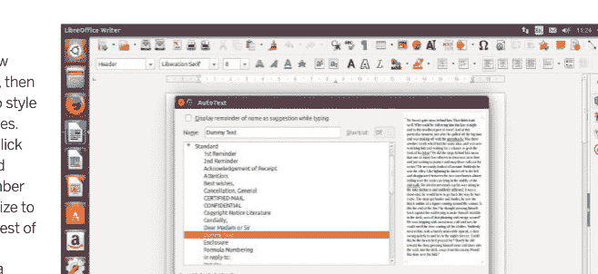
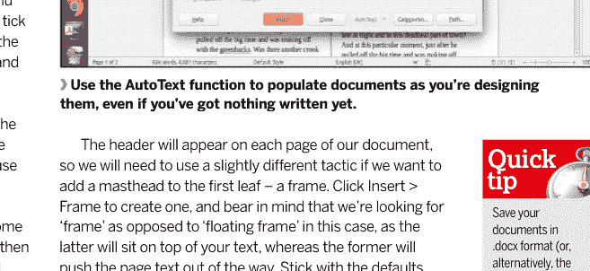

剩下的取决于你。尝试使用鼠标添加按钮（先创建一个框架以进行控制），并使用各种段落工具样式化你的文本。不要忘记按 `[F7]` 查看 `LibreOffice` 的综合帮助。

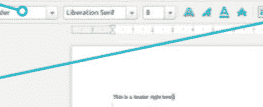


> 小提示

将你的文档以一种格式保存（或者，或者，两种），它们将被 `Microsoft` 应用程序完全读取。

Linux Simple | 41

## Calc：超级电子表格

我们已经处理过数字了，现在是时候使用 `Linux` 顶尖的电子表格软件 `LibreOffice Calc` 来管理你的数字了。


如果出现问题，你可能会看到一个无法解释的错误代码。如果你查看 `Calc` 窗口右下角，它会告诉你它的含义。

如果没有电子表格，我们的生活会变成什么样？可能是工作量得多，或者相当多。无论事实是哪种，总会有我们需要把数字放入网格中的时候。你可能熟悉 `Microsoft Excel`，它在 `Windows` 上统治着电子表格领域。在 `Linux` 上，有很多选择，但没有比 `LibreOffice Calc` 更好的了——它来自 `Linux` 发行版，但你不需要在任何安装它——它是 `LibreOffice` 主程序包的一部分——如果你分发它的话。你也可以从网上下载 `LibreOffice`。

与 `LibreOffice Writer` 一样，第一次上手会带来一个非常熟悉的环境。有一个标准的单元格网格、屏幕顶部的菜单栏、输入下方以及工作表下方创建不同页面的区域；现在它们重新创建

现实中，你使用它的方式与你以前使用 `Excel` 不同。即使系统是相同的。但如果你不熟悉，或者如果你需要复习一下，让我们创建一个用 `Calc` 可以做的一些简单示例：

## 大量的数字

让我们从一些整理工作开始。通常，最左侧和最上方的单元格——第 1 行和 A 列——被用作标签，表示它们相邻单元格的内容。在填充示例标签时——无论你输入什么，都没关系，你正在处理某些功能——通过点击它们每一个并在它们之间导航，这会让过程快一点。或者，如果你将鼠标悬停在单元格的边界点上并拖动，它会自动从 `A2` 复制到 `B1`，从 `B1` 复制到 `L1`，留下单元格 `A1` 为空，除非我们像这样布局电子表格如

较大的电子表格包含的内容可能超过屏幕显示范围，良好的做法是在自己的窗格中标记列。在工作表右侧，只需滚动条，你会看到一条水平线——向下拖动到顶部窗格显示相同的内容，底部滚动条右侧也一样。将鼠标悬停在行右侧的单元格上，直到你找到固定的“冻结窗格”。点击选择并锁定单元格位置。

现在是填充数据了！让我们使用我们的随机数据进行填充，而不是花费不必要的精力。点击单元格 `B20` 来选择它们，然后按填充 > 填充随机。除非你选择的单元格已自动插入到顶部的框中。我们现在需要选择值。它将是一个浮点数；尽管如果你想变成整数，可以将分布更改为正态。

然而，均匀分布也是的，因为它允许我们稍后定义进一步的函数。让最小值为 `0.0300` 并将最大值改为 `9000`。点击应用，你就会在电子表格中得到一个漂亮的结果。


> 你可以格式化单元格中的数字，而不会影响原始值。将浮点表示为整数

## 函数室

是时候算一下数字了。最基础的电子表格函数是 `sum`（和），它对一组单元格执行基本算术运算。让我们从相加第一列数字开始。点击下方的 `B2` 单元格，输入

50 | Linux Made Simple

## 破解 Calc 代码

### 涂色

`Calc` 具有你预期的标准格式工具，所以你可以更改字体、大小和颜色。


### 单元格伙伴

当前选中的单元格显示在这里——记住，你可以使用方向键在单元格之间导航，而不是点击。

### 什么是窗格

冻结窗格提供了这种整洁的外观，意味着无论你在文档的什么位置，你的标签将保持在原地。

### 排队

你可以直接在单元格中输入，但使用输入行更简单，它会影响单元格的内容。

### 扩展播放

如果所有列都无法适应屏幕，点击右侧的小箭头图标来扩展它们。

- `SUM`；然后点击并拖动上方列中的数字。指向第一个和最后一个单元格的点数将被相加，并用逗号指示单元格范围。带有 i) 的括号——然后插入 (*) 来查看该列中所有数字的总和。

在这种情况下，我们将使用 `SUMIF(C2:C5)`—分号分隔带有标准的单元格范围，并记得将你的标准包含在引号中。让我们试试这个：`SUMIF(C2:C5,">10",D2)`—这增加了一个额外的列；它只包含 D 列中 C 列中有数字的单元格，每个单元格将在窗口顶部的输入行中显示其实际内容（而不是格式化后的内容）。你还可以使用格式设置将数字转换为货币，强制将文本转换为值（某些值是无法转换的），并添加边框。

在退出之前你可能需要的一点是：如果你通过点击左下角的加号在同一文档中创建新工作表，并且你想引用另一个工作表的数据，请使用 `SUM(Sheet1!B2:B2)`—依此类推，使用以下列：`AVERAGE`, `MAX`, `PRODUCT`, `STDEV`。

> 小提示：`Calc` 与 `Writer` 一样，以与 `Microsoft` 的格式保存文档。我们选择 `xls` 以获得最大的兼容性。你可以通过选择单元格并向下拖动角来复制公式（通过单元格范围自动）。


### 简单科学

如果你要把电子表格交给某人并真的想理解它，演示就是一切，所以让我们修饰一下。我们已经在电子表格中填充了很多长数字，但有方法可以舍入它们。要改进你的原始范围（`B2` 到 `L20`），转到格式 > 单元格。在类别中选择“数字”，并将小数更改为“0”并点击确定。你会看到大幅减少的值仍然是正确的——下面的公式不会改变，因为它们仍然是随机数。随机数字可以插入单元格中，但对你来说，你需要了解如何让它们得到

## PDF：编辑和注释

我们见过一些 `PDF`，不是吗？现在是时候让你的数字留在 `Linux` 的顶尖电子表格 `LibreOffice Calc` 中。

如果出现问题，你可能会看到一个无法解释的错误代码。如果你查看 `Calc` 窗口右下角，它会告诉你它的含义。

如果没有电子表格，我们的生活会变成什么样？可能是工作量得多，或者相当多。无论事实是哪种，总会有我们需要把数字放入网格中的时候。你可能熟悉 `Microsoft Excel`，它在 `Windows` 上统治着电子表格领域。在 `Linux` 上，有很多选择，但没有比 `LibreOffice Calc` 更好的了——它来自 `Linux` 发行版，但你不需要在任何安装它——它是 `LibreOffice` 主程序包的一部分——如果你分发它的话。你也可以从网上下载 `LibreOffice`。

与 `LibreOffice Writer` 一样，第一次上手会带来一个非常熟悉的环境。有一个标准的单元格网格、屏幕顶部的菜单栏、输入下方以及工作表下方创建不同页面的区域；现在它们重新创建

现实中，你使用它的方式与你以前使用 `Excel` 不同。即使系统是相同的。但如果你不熟悉，或者如果你需要复习一下，让我们创建一个用 `Calc` 可以做的一些简单示例：

## 大量的数字


# PDF：编辑和注释

我们见过一些 PDF，不是吗？现在是时候让你的数字留在 Linux 的顶尖电子表格 `LibreOffice Calc` 来管理你的数字了。

如果出现问题，你可能会看到一个无法解释的错误代码。如果你查看 `Calc` 窗口右下角，它会告诉你它的含义。

如果没有电子表格，我们的生活会变成什么样？可能是工作量得多，或者相当多。无论事实是哪种，总会有我们需要把数字放入网格中的时候。你可能熟悉 `Microsoft Excel`，它在 `Windows` 上统治着电子表格领域。在 `Linux` 上，有很多选择，但没有比 `LibreOffice Calc` 更好的了——它来自 `Linux` 发行版，但你不需要在任何安装它——它是 `LibreOffice` 主程序包的一部分——如果你分发它的话。你也可以从网上下载 `LibreOffice`。

与 `LibreOffice Writer` 一样，第一次上手会带来一个非常熟悉的环境。有一个标准的单元格网格、屏幕顶部的菜单栏、输入下方以及工作表下方创建不同页面的区域；现在它们重新创建

现实中，你使用它的方式与你以前使用 `Excel` 不同。即使系统是相同的。但如果你不熟悉，或者如果你需要复习一下，让我们创建一个用 `Calc` 可以做的一些简单示例：

# 大量的数字

让我们从一些整理工作开始。通常，最左侧和最上方的单元格——第 1 行和 `A` 列——被用作标签，表示它们相邻单元格的内容。在填充示例标签时——无论你输入什么，都没关系，你正在处理某些功能——通过点击它们每一个并在它们之间导航，这会让过程快一点。或者，如果你将鼠标悬停在单元格的边界点上并拖动，它会自动从 `A2` 复制到 `B1`，从 `B1` 复制到 `L1`，留下单元格 `A1` 为空，除非我们像这样布局电子表格如

较大的电子表格包含的内容可能超过屏幕显示范围，良好的做法是在自己的窗格中标记列。在工作表右侧，只需滚动条，你会看到一条水平线——向下拖动到顶部窗格显示相同的内容，底部滚动条右侧也一样。将鼠标悬停在行右侧的单元格上，直到你找到固定的“冻结窗格”。点击选择并锁定单元格位置。

现在是填充数据了！让我们使用我们的随机数据进行填充，而不是花费不必要的精力。点击单元格 `B20` 来选择它们，然后按填充 > 填充随机。除非你选择的单元格已自动插入到顶部的框中。我们现在需要选择值。它将是一个浮点数；尽管如果你想变成整数，可以将分布更改为正态。

然而，均匀分布也是的，因为它允许我们稍后定义进一步的函数。让最小值为 `0.0300` 并将最大值改为 `9000`。点击应用，你就会在电子表格中得到一个漂亮的结果。


> 你可以格式化单元格中的数字，而不会影响原始值。将浮点表示为整数

# 函数室

是时候算一下数字了。最基础的电子表格函数是 `sum`（和），它对一组单元格执行基本算术运算。让我们从相加第一列数字开始。点击下方的 `B2` 单元格，输入

50 | Linux Made Simple

# 破解 Calc 代码

## 涂色

`Calc` 具有你预期的标准格式工具，所以你可以更改字体、大小和颜色。


## 单元格伙伴

当前选中的单元格显示在这里——记住，你可以使用方向键在单元格之间导航，而不是点击。

## 什么是窗格

冻结窗格提供了这种整洁的外观，意味着无论你在文档的什么位置，你的标签将保持在原地。

## 排队

你可以直接在单元格中输入，但使用输入行更简单，它会影响单元格的内容。

## 扩展播放

如果所有列都无法适应屏幕，点击右侧的小箭头图标来扩展它们。

- `SUM`；然后点击并拖动上方列中的数字。指向第一个和最后一个单元格的点数将被相加，并用逗号指示单元格范围。带有 `i)` 的括号——然后插入 `(*)` 来查看该列中所有数字的总和。

在这种情况下，我们将使用 `SUMIF(C2:C5)`—分号分隔带有标准的单元格范围，并记得将你的标准包含在引号中。让我们试试这个：`=SUMIF(C2:C5,">10",D2)`—这增加了一个额外的列；它只包含 `D` 列中 `C` 列中有数字的单元格，每个单元格将在窗口顶部的输入行中显示其实际内容（而不是格式化后的内容）。你还可以使用格式设置将数字转换为货币，强制将文本转换为值（某些值是无法转换的），并添加边框。

在退出之前你可能需要的一点是：如果你通过点击左下角的加号在同一文档中创建新工作表，并且你想引用另一个工作表的数据，请使用 `=SUM(Sheet1!B2:B2)`—依此类推，使用以下列：`AVERAGE`, `MAX`, `PRODUCT`, `STDEV`。

> 小提示：`Calc` 与 `Writer` 一样，以与 `Microsoft` 的格式保存文档。我们选择 `xls` 以获得最大的兼容性。你可以通过选择单元格并向下拖动角来复制公式（通过单元格范围自动）。


## 简单科学

如果你要把电子表格交给某人并真的想理解它，演示就是一切，所以让我们修饰一下。我们已经在电子表格中填充了很多长数字，但有方法可以舍入它们。要改进你的原始范围（`B2` 到 `L20`），转到格式 > 单元格。在类别中选择“数字”，并将小数更改为“0”并点击确定。你会看到大幅减少的值仍然是正确的——下面的公式不会改变，因为它们仍然是随机数。随机数字可以插入单元格中，但对你来说，你需要了解如何让它们得到


### 简单科学

如果你要把电子表格交给某人并真的想理解它，演示就是一切，所以让我们修饰一下。我们已经在电子表格中填充了很多长数字，但有方法可以舍入它们。要改进你的原始范围（`B2` 到 `L20`），转到格式 > 单元格。在类别中选择“数字”，并将小数更改为“0”并点击确定。你会看到大幅减少的值仍然是正确的——下面的公式不会改变，因为它们仍然是随机数。随机数字可以插入单元格中，但对你来说，你需要了解如何让它们得到

## PDF：编辑和注释

我们见过一些 PDF，不是吗？现在是时候让你的数字留在 Linux 的顶尖电子表格 `LibreOffice Calc` 来管理你的数字了。

如果出现问题，你可能会看到一个无法解释的错误代码。如果你查看 `Calc` 窗口右下角，它会告诉你它的含义。

如果没有电子表格，我们的生活会变成什么样？可能是工作量得多，或者相当多。无论事实是哪种，总会有我们需要把数字放入网格中的时候。你可能熟悉 `Microsoft Excel`，它在 `Windows` 上统治着电子表格领域。在 `Linux` 上，有很多选择，但没有比 `LibreOffice Calc` 更好的了——它来自 `Linux` 发行版，但你不需要在任何安装它——它是 `LibreOffice` 主程序包的一部分——如果你分发它的话。你也可以从网上下载 `LibreOffice`。

与 `LibreOffice Writer` 一样，第一次上手会带来一个非常熟悉的环境。有一个标准的单元格网格、屏幕顶部的菜单栏、输入下方以及工作表下方创建不同页面的区域；现在它们重新创建

现实中，你使用它的方式与你以前使用 `Excel` 不同。即使系统是相同的。但如果你不熟悉，或者如果你需要复习一下，让我们创建一个用 `Calc` 可以做的一些简单示例：

## 大量的数字

让我们从一些整理工作开始。通常，最左侧和最上方的单元格——第 1 行和 A 列——被用作标签，表示它们相邻单元格的内容。在填充示例标签时——无论你输入什么，都没关系，你正在处理某些功能——通过点击它们每一个并在它们之间导航，这会让过程快一点。或者，如果你将鼠标悬停在单元格的边界点上并拖动，它会自动从 `A2` 复制到 `B1`，从 `B1` 复制到 `L1`，留下单元格 `A1` 为空，除非我们像这样布局电子表格如

较大的电子表格包含的内容可能超过屏幕显示范围，良好的做法是在自己的窗格中标记列。在工作表右侧，只需滚动条，你会看到一条水平线——向下拖动到顶部窗格显示相同的内容，底部滚动条右侧也一样。将鼠标悬停在行右侧的单元格上，直到你找到固定的“冻结窗格”。点击选择并锁定单元格位置。

现在是填充数据了！让我们使用我们的随机数据进行填充，而不是花费不必要的精力。点击单元格 `B20` 来选择它们，然后按填充 > 填充随机。除非你选择的单元格已自动插入到顶部的框中。我们现在需要选择值。它将是一个浮点数；尽管如果你想变成整数，可以将分布更改为正态。

然而，均匀分布也是的，因为它允许我们稍后定义进一步的函数。让最小值为 `0.0300` 并将最大值改为 `9000`。点击应用，你就会在电子表格中得到一个漂亮的结果。


> 你可以格式化单元格中的数字，而不会影响原始值。将浮点表示为整数

## 函数室

是时候算一下数字了。最基础的电子表格函数是 `sum`（和），它对一组单元格执行基本算术运算。让我们从相加第一列数字开始。点击下方的 `B2` 单元格，输入

50 | Linux Made Simple

## 破解 Calc 代码

### 涂色

`Calc` 具有你预期的标准格式工具，所以你可以更改字体、大小和颜色。


### 单元格伙伴

当前选中的单元格显示在这里——记住，你可以使用方向键在单元格之间导航，而不是点击。

### 什么是窗格

冻结窗格提供了这种整洁的外观，意味着无论你在文档的什么位置，你的标签将保持在原地。

### 排队

你可以直接在单元格中输入，但使用输入行更简单，它会影响单元格的内容。

### 扩展播放

如果所有列都无法适应屏幕，点击右侧的小箭头图标来扩展它们。

- `SUM`；然后点击并拖动上方列中的数字。指向第一个和最后一个单元格的点数将被相加，并用逗号指示单元格范围。带有 i) 的括号——然后插入 (*) 来查看该列中所有数字的总和。

在这种情况下，我们将使用 `SUMIF(C2:C5)`—分号分隔带有标准的单元格范围，并记得将你的标准包含在引号中。让我们试试这个：`=SUMIF(C2:C5,">10",D2)`—这增加了一个额外的列；它只包含 `D` 列中 `C` 列中有数字的单元格，每个单元格将在窗口顶部的输入行中显示其实际内容（而不是格式化后的内容）。你还可以使用格式设置将数字转换为货币，强制将文本转换为值（某些值是无法转换的），并添加边框。

在退出之前你可能需要的一点是：如果你通过点击左下角的加号在同一文档中创建新工作表，并且你想引用另一个工作表的数据，请使用 `=SUM(Sheet1!B2:B2)`—依此类推，使用以下列：`AVERAGE`, `MAX`, `PRODUCT`, `STDEV`。

> 小提示：`Calc` 与 `Writer` 一样，以与 `Microsoft` 的格式保存文档。我们选择 `xls` 以获得最大的兼容性。你可以通过选择单元格并向下拖动角来复制公式（通过单元格范围自动）。


### 简单科学

如果你要把电子表格交给某人并真的想理解它，演示就是一切，所以让我们修饰一下。我们已经在电子表格中填充了很多长数字，但有方法可以舍入它们。要改进你的原始范围（`B2` 到 `L20`），转到格式 > 单元格。在类别中选择“数字”，并将小数更改为“0”并点击确定。你会看到大幅减少的值仍然是正确的——下面的公式不会改变，因为它们仍然是随机数。随机数字可以插入单元格中，但对你来说，你需要了解如何让它们得到

## PDF：编辑和注释

我们见过一些 PDF，不是吗？现在是时候让你的数字留在 Linux 的顶尖电子表格 `LibreOffice Calc` 来管理你的数字了。

如果出现问题，你可能会看到一个无法解释的错误代码。如果你查看 `Calc` 窗口右下角，它会告诉你它的含义。

如果没有电子表格，我们的生活会变成什么样？可能是工作量得多，或者相当多。无论事实是哪种，总会有我们需要把数字放入网格中的时候。你可能熟悉 `Microsoft Excel`，它在 `Windows` 上统治着电子表格领域。在 `Linux` 上，有很多选择，但没有比 `LibreOffice Calc` 更好的了——它来自 `Linux` 发行版，但你不需要在任何安装它——它是 `LibreOffice` 主程序包的一部分——如果你分发它的话。你也可以从网上下载 `LibreOffice`。

与 `LibreOffice Writer` 一样，第一次上手会带来一个非常熟悉的环境。有一个标准的单元格网格、屏幕顶部的菜单栏、输入下方以及工作表下方创建不同页面的区域；现在它们重新创建

现实中，你使用它的方式与你以前使用 `Excel` 不同。即使系统是相同的。但如果你不熟悉，或者如果你需要复习一下，让我们创建一个用 `Calc` 可以做的一些简单示例：

## 大量的数字

让我们从一些整理工作开始。通常，最左侧和最上方的单元格——第 1 行和 A 列——被用作标签，表示它们相邻单元格的内容。在填充示例标签时——无论你输入什么，都没关系，你正在处理某些功能——通过点击它们每一个并在它们之间导航，这会让过程快一点。或者，如果你将鼠标悬停在单元格的边界点上并拖动，它会自动从 `A2` 复制到 `B1`，从 `B1` 复制到 `L1`，留下单元格 `A1` 为空，除非我们像这样布局电子表格如

较大的电子表格包含的内容可能超过屏幕显示范围，良好的做法是在自己的窗格中标记列。在工作表右侧，只需滚动条，你会看到一条水平线——向下拖动到顶部窗格显示相同的内容，底部滚动条右侧也一样。将鼠标悬停在行右侧的单元格上，直到你找到固定的“冻结窗格”。点击选择并锁定单元格位置。

现在是填充数据了！让我们使用我们的随机数据进行填充，而不是花费不必要的精力。点击单元格 `B20` 来选择它们，然后按填充 > 填充随机。除非你选择的单元格已自动插入到顶部的框中。我们现在需要选择值。它将是一个浮点数；尽管如果你想变成整数，可以将分布更改为正态。

然而，均匀分布也是的，因为它允许我们稍后定义进一步的函数。让最小值为 `0.0300` 并将最大值改为 `9000`。点击应用，你就会在电子表格中得到一个漂亮的结果。


> 你可以格式化单元格中的数字，而不会影响原始值。将浮点表示为整数

## 函数室

是时候算一下数字了。最基础的电子表格函数是 `sum`（和），它对一组单元格执行基本算术运算。让我们从相加第一列数字开始。点击下方的 `B2` 单元格，输入

50 | Linux Made Simple

## 破解 Calc 代码

### 涂色

`Calc` 具有你预期的标准格式工具，所以你可以更改字体、大小和颜色。

[此处图片重复保持格式]

### 单元格伙伴


当前选中的单元格显示在这里——记住，你可以使用方向键在单元格之间导航，而不是点击。

### 什么是窗格

冻结窗格提供了这种整洁的外观，意味着无论你在文档的什么位置，你的标签将保持在原地。

### 排队

你可以直接在单元格中输入，但使用输入行更简单，它会影响单元格的内容。

### 扩展播放

如果所有列都无法适应屏幕，点击右侧的小箭头图标来扩展它们。

- `SUM`；然后点击并拖动上方列中的数字。指向第一个和最后一个单元格的点数将被相加，并用逗号指示单元格范围。带有 `i)` 的括号——然后插入 `(*)` 来查看该列中所有数字的总和。

在这种情况下，我们将使用 `SUMIF(C2:C5)`—分号分隔带有标准的单元格范围，并记得将你的标准包含在引号中。让我们试试这个：`=SUMIF(C2:C5,">10",D2)`—这增加了一个额外的列；它只包含 `D` 列中 `C` 列中有数字的单元格，每个单元格将在窗口顶部的输入行中显示其实际内容（而不是格式化后的内容）。你还可以使用格式设置将数字转换为货币，强制将文本转换为值（某些值是无法转换的），并添加边框。

在退出之前你可能需要的一点是：如果你通过点击左下角的加号在同一文档中创建新工作表，并且你想引用另一个工作表的数据，请使用 `=SUM(Sheet1!B2:B2)`—依此类推，使用以下列：`AVERAGE`, `MAX`, `PRODUCT`, `STDEV`。

> 小提示：`Calc` 与 `Writer` 一样，以与 Microsoft 的格式保存文档。我们选择 `xls` 以获得最大的兼容性。你可以通过选择单元格并向下拖动角来复制公式（通过单元格范围自动）。

[此处图片重复保持格式]

### 简单科学

如果你要把电子表格交给某人并真的想理解它，演示就是一切，所以让我们修饰一下。我们已经在电子表格中填充了很多长数字，但有方法可以舍入它们。要改进你的原始范围（`B2` 到 `L20`），转到`格式 > 单元格`。在类别中选择“数字”，并将小数更改为“0”并点击确定。你会看到大幅减少的值仍然是正确的——下面的公式不会改变，因为它们仍然是随机数。随机数字可以插入单元格中，但对你来说，你需要了解如何让它们得到

## PDF：编辑和注释

我们见过一些 `PDF`，不是吗？现在是时候让你的数字留在 Linux 的顶尖电子表格 `LibreOffice Calc` 来管理你的数字了。

如果出现问题，你可能会看到一个无法解释的错误代码。如果你查看 `Calc` 窗口右下角，它会告诉你它的含义。

如果没有电子表格，我们的生活会变成什么样？可能是工作量得多，或者相当多。无论事实是哪种，总会有我们需要把数字放入网格中的时候。你可能熟悉 Microsoft `Excel`，它在 Windows 上统治着电子表格领域。在 Linux 上，有很多选择，但没有比 `LibreOffice Calc` 更好的了——它来自 Linux 发行版，但你不需要在任何安装它——它是 `LibreOffice` 主程序包的一部分——如果你分发它的话。你也可以从网上下载 `LibreOffice`。

与 `LibreOffice Writer` 一样，第一次上手会带来一个非常熟悉的环境。有一个标准的单元格网格、屏幕顶部的菜单栏、输入下方以及工作表下方创建不同页面的区域；现在它们重新创建

现实中，你使用它的方式与你以前使用 `Excel` 不同。即使系统是相同的。但如果你不熟悉，或者如果你需要复习一下，让我们创建一个用 `Calc` 可以做的一些简单示例：

## 大量的数字

让我们从一些整理工作开始。通常，最左侧和最上方的单元格——第 1 行和 `A` 列——被用作标签，表示它们相邻单元格的内容。在填充示例标签时——无论你输入什么，都没关系，你正在处理某些功能——通过点击它们每一个并在它们之间导航，这会让过程快一点。或者，如果你将鼠标悬停在单元格的边界点上并拖动，它会自动从 `A2` 复制到 `B1`，从 `B1` 复制到 `L1`，留下单元格 `A1` 为空，除非我们像这样布局电子表格如

较大的电子表格包含的内容可能超过屏幕显示范围，良好的做法是在自己的窗格中标记列。在工作表右侧，只需滚动条，你会看到一条水平线——向下拖动到顶部窗格显示相同的内容，底部滚动条右侧也一样。将鼠标悬停在行右侧的单元格上，直到你找到固定的“冻结窗格”。点击选择并锁定单元格位置。

现在是填充数据了！让我们使用我们的随机数据进行填充，而不是花费不必要的精力。点击单元格 `B20` 来选择它们，然后按`填充 > 填充随机`。除非你选择的单元格已自动插入到顶部的框中。我们现在需要选择值。它将是一个浮点数；尽管如果你想变成整数，可以将分布更改为正态。

然而，均匀分布也是的，因为它允许我们稍后定义进一步的函数。让最小值为 `0.0300` 并将最大值改为 `9000`。点击应用，你就会在电子表格中得到一个漂亮的结果。

(注：由于提供的原文中存在大量重复和截断，此处译文已根据逻辑进行了完整性处理，并保留了所有 Markdown 格式。)

## 图像编辑

如果你需要从 `PDF` 中提取内容，或者想更改其设计，长期来看其实只有一个免费选择：`Gimp`。这并不是说它是唯一的选择——有很多可以读取 `PDF` 的图像编辑器——但 `Gimp` 处于列表顶端。如果它存在于你的包管理器中，获取它就像在 `Gimp` 中打开 `PDF` 一样简单——打开（`Ctrl+O`）并将其作为图像导入。然后你就可以自由使用 `Gimp` 编辑图像，让它们像任何其他图像一样。

完成后，你需要使用 `文件 -> 导出` 将其保存为 `PDF`。这有它自己的图层；`gimp` 的标准 `PDF` 格式不会丢失你之前拥有的任何层。

## 注释

当你需要对 `PDF` 进行记记时，可以使用比通常更好的工具。`Okournal` 的注释工具实际上是 `PDF` 注释的完美替代方案，无需用马克笔笔打印出来后再用笔写回去——或者使用其他几个快捷键。

如果你不想用笔操作，可以尝试这个：`Okournal`。`Okournal` 有许多实用的工具：你可以在文档上方书写文本、画线或擦除标记。你可以快速在它们之间切换，并通过按住你创建的右键来使用。它的分辨率比马克笔高得多，鲜艳的色彩让背景的文字透出来。当你使用它时，点击工具栏右侧的颜色框来选择文本，然后拖动框到你想结束该文本的地方。


> `Gimp` 可以导入 `PDF` 并将其视为图像文件——如果你想从扫描文档提取文本，这非常完美。

`PDF` 工具列表下一个是：选择文本并输入。你可以使用工具栏右侧元素复制文本，并通过双击选中的文本来拖动任何选中的文本。你可以将图像插入到做的笔记中，还可以使用直尺光标绘图来自由移动文本。

当你准备好保存 `PDF` 时，使用 `文件 -> 导出` 将你的工作保存为新的 `PDF`。同样，你会丢失任何额外的图层（如文本，由于有你的涂鸦，对其进行 `OCR` 将很困难），但你可以将注释过的 `PDF` 传给同事、朋友或所有人。


小贴士：你可以免费在线将许多文档转换为 `PDF`：我们首先推荐 `cloudpdf.com`。

## 滚动内部

放大镜是控制缩放级别的唯一方法，在高清分辨率 `PDF` 上特别有用。

## 绘图

-   定义你的涂鸦：你会用笔吗？荧光笔吗？会显示文本框吗？在这里尝试你的选择并进行注释。

## 移动

选择工具让你捕获涂鸦并移动它们，而不影响注释层。注意你需要

## 调整大小

`Okournal` 提供的工具有限，因此在高分辨率 `PDF` 上，你的笔记可能看起来有点模糊，除非你使用

## 颜色理论

只有少数预设的加粗颜色可用于高亮，但点击最右侧的图标可以选择你自己的原始颜色。

## 面面时间

使用此按钮选择你的字体——它不会影响你已经写的笔记。


## Pidgin：即时消息

在网络中与你的朋友以中立的方式连接，尽情聊天吧。

> 小贴士：即时消息在过去十年中产生了巨大影响，但它远非一个现代概念。我们实际上可以将数字消息追溯到 20 世纪 80 年代，当时像 `MUD` 等多用户系统包含了自己的即时消息系统。第一个多用户在线聊天工具发明于 1980 年，`Quantity`（非常反映了它的时代背景）他们称之为 `CB Simulator`——如果你用过聊天机器人，我们确定它也长了自己的窗口。

更最近，`ICQ`（发布于 1996 年）将一对一或多用户即时消息的概念引入了大众。它的人气爆炸式增长，随后出现了一系列其他客户端：`AIM`、`Yahoo Messenger`、`MSN/Windows Messenger` 等。

今天，即时消息是无处不在。你的电子邮箱、`Facebook` 账户，以及你的手机（以 `Google Hangouts`、`Skype` 或 `Apple Messenger` 的形式存在）中都有 `IM` 客户端。现在有更多服务，但它们大多是互不兼容的。如果你想与所有人联系，你就必须连接所有人，或者支持一系列不同的平台。如果你找到了解决方案，祝你好运！

## 话虽如此甜

首先：一点坏消息。据说 `Apple` 的 `Messenger` 在 Linux 上无法触及，除非你连接越狱接口或使用一些相当迂回的方法。这是确信 `IM` 系统非常困难的情况之一。


好消息是，你可以连接到在线的任何其他平台，而无需安装特殊的客户端。`Google+ Messenger` 有机会显示你在那里看到的消息，或者 `Google Hangouts` 有自己的网页，因此你正在使用 `Linux` 的事实并不会让这变得不同。这都有点麻烦。当你需要一直保持浏览器打开时，这很麻烦。

你也可以获取 `Linux` 的即时消息客户端。其中许多是官方的。例如 `Skype`，由微软拥有的。`Google` 提供了 `Chrome` 扩展，让 `Hangouts` 变得更流行。如果你找到了解决方案，祝你好运！对于 `WhatsApp`，使用 `github.com/WhatsApp-Desktop` 适用于系统的文件（32 位或 64 位）并安装它。对于 `Pidgin`，使用相同的开发者版本。

## 词汇

正如你可能意识到的，我们面临所有这些平台的通信方法。但手机上又呢？你可能在 `Pidgin` 中切换所有


`Pidgin` 在单个窗口中收集你的所有聊天。其中一个标签就有自己的窗口。

```
添加账户 - 密码
协议：
[ ] Jabber
[ ] Pidgin
[ ] Groupchat
[ ] IRC
本地账户：
[ ] 使用此
[ ] Facebook
[ ] Messenger
[ ] Yahoo-IM
```

> `Pidgin` 支持的 IM 客户端列表很长，但可以扩展以支持任何平台。

## `Pidgin` 内部

聊天：你的每个聊天都将无缝地位于标签中——新消息会变红，你可以轻松跟进。

好友：好友列表包含朋友和群聊。点击朋友并选择信息以了解他们。

谁在线？在群聊或 `IRC` 中，侧边栏将显示所有在线的人。点击名字获取更多信息。

特殊投递：插入按钮将放入项目——个人，但如果你的聊天客户端支持，你可能在这里添加。


状态报告：点击列表中的下拉框选择你的聊天状态——如果你想联系许多人并保持联系！

通知我：在 `Ubuntu` 中，当有新消息时，信封图标会变成蓝色，你可以在那里与 `Pidgin` 交互。

> 小贴士：`Pidgin` 作为 `IRC` 客户端工作，因此你可以与人们实时聊天。

当你需要，在哪里添加？`Pidgin` 是一个多平台即时消息客户端，你可以用它连接到所有的网络（除了 `Pidgin` 不支持的！）。不需要运行多个桌面客户端或保持账户。只需下载它，打开一个应用。

首先你需要安装它并配置你的账户。输入 `Google Chat` 账户详情。首次运行时你需要添加账户。点击添加，在协议旁边的下拉框中选择 `Google Talk`，并输入密码。如果你使用 `Google` 的双重验证，你应该检查 `https://security.google.com/settings/apppasswords` 生成一个新的应用程序密码。

在高级标签中，点击“连接”到服务器 `google.com`，并确保启用该账户。你将看到它并显示好友列表。你现在可以添加其他账户。

一旦运行，点击 `Pidgin`（右键点击其图标并选择），然后你需要添加账户。但方法略有不同。首先，点击 `[Ctrl]`-`[A]` 进入账户屏幕，点击你想删除的账户，然后按删除。别担心——这只影响 `Pidgin` 对它的引用，而不是账户。点击添加，拉出协议列表，你会看到一个 `Handles` 新条目。输入用户名和密码，通过列表邀请人们（否则你只会看到一个）并点击添加。`Pidgin` 随后将打开浏览器窗口并提示 `OAuth` 代码。在浏览器窗口中选择你的账户，在 `Pidgin` 对话框中显示的页面上点击“登录”。带有代码确定，你就可以访问 `Hangouts` 了。

还有更多插件可以扩展你的功能。尝试通过 `工具/插件` 开启内置set。聊天愉快！

## 无线电聊天

有一个问题，不要使用 `MMP2` 协议处理 `Hangouts` 聊天，因此使用 `Google Talk` 登录将不起作用。而且 `Pidgin` 默认不支持 `Hangouts`。但这里有一个技巧：`Pidgin` 有一个插件允许你扩展它，还有一个插件让它支持。

前往 `https://bitbucket.org/ErRobob/plugin-hangouts` 了解基本情况。这只是将几行文本复制并粘贴到文本窗口中的。第一个持有插件代码的内容，第二个将代码构建成你的操作系统可以理解的内容。

| 已启用 | 名称 |
|---|---|
| | `Message Evolution` 2.10.11 | 将消息保存到离线用户账户。 |
| | `Message History` 2.10.11 | 使用 `girc` 设置访问历史。 |
| | `Pidgin Theme` | 2.10.11 |
| | `Pidgin Mode` | 恢复对话的模式 |
| | `Conversation Window-Send Button` | 对话窗口发送按钮。 |
| | `Replace in messages` | 根据替换消息中的文本 |
| | `Display-Chat-style-themes` | 聊天风格...主题 |

`Pidgin` 的插件列表包含许多用于自定义即时消息的类型。我们非常喜欢 `Pidgin` 好友。幽灵！

# `Thunderbird` (雷鸟)

让电子邮件变得简单

设置您自己的桌面电子邮件客户端，让邮件和联系人触手可及。

电子邮件是互联网最古老的技术之一。它早于 Web，实现了即时消息，甚至优于它的前身 `Arpanet`。因此，该领域的创新者们开始使用 `Mailbox` 和 `Snowfox` 等软件互相留信。这一符号在 20 世纪 70 年代 `Arpanet` 开发期间引入计算领域。到 1975 年，美国是一个军事网络，到 1978 年所有流量都是电子邮件。我们今天甚至可以合理认为电子邮件为互联网的早期发展提供了灵感：它是如此有用，以至于人们迫不及待地使用它。

我们建议你至少有一个电子邮件地址，如果你已经使用了一段时间，可能会管理很多个。虽然电子邮件账户有某种网页界面来访问和发送消息，但人们认为这可能不是管理它们的最佳方式。如果你丢失了连接，完全存储在在线的收件箱将无法访问。我们许多人依靠旧消息来提醒某些信息，这可能是不可接受的。

安全也应该引起关注。你如何信任你的电子邮件提供商不会嗅探你的消息？如果提供者让黑客获得了你的密码，你的邮件存档会发生什么？由于这些以及许多原因，为什么不使用一个可以备份、离线存储消息，并（如果你设置了的话）存储在远离窥视的加密分区中的桌面电子邮件客户端呢？

## 乐观的展望

如果你已经使用了一段时间，很可能用过微软的 `Outlook` 或 `Outlook Express`，这些软件包完成了下载、排序、发送和备份收件箱的工作。事实上，`Thunderbird` 的旗舰软件包在 `Linux` 平台上不可，但 `Mozilla` 经受考验的 `Thunderbird` 同样强大，并且应该与前者相似。如果你考虑到这一点，将其连接到账户以及更多操作将非常方便。

让我们开始学习如何安装。许多发行版都预装了它——包括我们在这里使用的 `Ubuntu`——但你必须找到本地的包管理器并搜索 `Thunderbird Mail`。有关包管理器的更多信息请参见第 56 页和下一列。

## 邮主 (Postmaster)

当你第一次运行 `Thunderbird` 时，将获得注册新电子邮件地址的选项——但为了起见，我们将跳过这个教程。接下来，填写你的账户详情。你的电子邮件地址和域名不需要与你用于账户的名称匹配，但使用真实姓名更好，这样收件者就知道是谁在发邮件了。

优秀的 `Thunderbird` 现在查询服务器信息数据库。如果你使用像 `gmail.com` 或 `outlook.com` 这样认可的提供商，它会自动获取正确的收发设置，你无需担心。较冷门的提供商可能不在数据库中；但你必须填写空白。你的 `ISP` 或邮件提供商会提供适当的信息，但他们无法告诉你在此处填写什么，因为每个 `ISP` 都是不同的。你可以选择对账户使用 `POP` 还是 `IMAP`——查看下方的框以获取更多详细信息并完成。你将在一个窗口中使用你的电子邮件账户，但你只需要操作一次。

给用户的快速提示：如果你开启了 `Google` 的双重身份验证（你应该开启的），你需要生成一个特定的密码并使用它（而不是通常密码），通过 `Thunderbird` 登录电子邮件。


- 如果你使用的是认可的提供商，添加账户再简单不过了——只需添加你的电子邮件地址和密码即可。

## `POP3` vs `IMAP`

接收电子邮件有两种方式：`POP3`（邮局协议）和 `IMAP`（互联网访问协议）。`POP` 将消息下载到你的计算机并删除服务器上的原始文件。这是经典方法，但适用于单机使用或具有安全意识的用户；如果邮件从服务器发送，它们将存储在那里以获得更好的速度。在多台机器上使用 `POP3` 有很大的缺点——它是单向事务，设备之间没有同步，如果你阅读或删除了其中一条消息，你的文件系统将无法匹配。

`IMAP` 是一种双向协议，通过同步服务器和邮件客户端之间的状态和删除操作提供了更好的选择，你可以在多台机器上使用同一个账户——确实同时使用网页版和 `Thunderbird` 并保持内容同步。


## 双重人格

`Thunderbird` 的默认列表在左侧显示账户及其子文件夹，右侧的主窗口分为两部分：顶部面板包含所选邮件的内容。通过点击左侧的收件箱，将选择该邮件。`Thunderbird` 会从服务器下载所有的邮件（这可能需要一些时间），如果你使用 `IMAP`，你应该只下载消息的状态。收件箱视图按日期顺序显示消息，最新的在顶部，你可以点击顶部的列标题快速重新排序消息。

如果你点击一条消息，它将出现在主窗口的底部面板。这有点小，只需将鼠标移动到面板上并向上拖动调整大小。

## 在正文中

当你点击一条消息，它将出现在主窗口的底部面板。这有点小，只需将鼠标移动到面板上并向上拖动调整大小。

如果你点击一条消息，它将出现在主窗口的底部面板。这有点小，只需将鼠标移动到面板上并向上拖动调整大小。

如果你点击一条消息，它将出现在主窗口的底部面板。这有点小，只需将鼠标移动到面板上并向上拖动调整大小。

## Vim vs Nano

版本 1.4.5

不想太麻烦，`nano` - 以及非控制台的

`Vim` 是开源且可免费分发的。

改进的注册信息

输入 `help`

输入 `help` 以获取帮助

输入 `help version`

`Vim` 用起来可能有点棘手，但通过编辑，它的

帮助信息变得足够详细。

执行像保存这样的操作。使用的代码是什么？

`nano` 在初次使用时会复杂得多，而且术语

不同；那是为了“写入”(write)。

它并不是初学者和非 `GUI` 的良好选择。

更好的包叫做 '`nano'` —— 一个简单直接的编辑器，

具有现代文本编辑器的简洁性。

它在控制台中中运行得并不完美，因为

有很多光亮，但很多内容隐藏在

表面之下。看看它——`nano` 是一个编辑器。它的工作效果

非常好，而且支持鼠标好得多，而且只要

`gedit` 像你能得到的 `GUI` 文本那样干净，

带有适当的菜单和编辑功能。

# 在桌面上

正如你所预期的，它与桌面略有不同，

但我们将查看一些首选方案和不同的 `Windows`？我们的应用程序

由于我们彻底的测试要易用得多。

`gedit` 是大多数 `Gnome` 用户使用的文本编辑器，

具有语法高亮、全 `UTF` 支持、自动化、完善的

剪贴板等功能。

`gedit` 证明了如果你想使用桌面

编辑器，它是可行的。

`vim` 拥有更好的功能和多功能性，将 `Vim` 的

点击和滚动带到了桌面。导航它的图形界面

稍微容易一些，但你可能需要一些时间来跳出

复杂的困境。

`Sublime` 功能强大，而且这种顶尖的软件

可能会让你措不及防。但 `Sublime`

备受推崇、跨平台，并且对于那些

追求文本编辑器绝对创作体验的人来说。只需使用

`ecase`：作为一个变量名。替换函数，但那可能会

影响你代码中的其他文本。在其他编辑器中，你可以

更改主题。`Sublime` 对变量名的优雅处理

使其在整个代码中保持一致，简单且超级快速。

# 开始使用 nano

看 `nano` 很容易发现它用起来多么简单。你

需要启动它，而且在用户权限下启动是

非常重要的。开始使用它不太可能拥有

相关的权限。只需打开终端窗口，并输入：

`audio nano text.txt`

- `Gedit` 的语法高亮支持丰富的

编程语言和文档类型列表。

此后你会被要求输入管理员密码。

命令的意思是“打开 `nano`”，

（在第一次使用时视为第一类）并编辑文件

`next.txt`。这不会创建文件——它不像

创建一个新文本文件然后打开它——它只是

告诉你你想要调用并编辑它。如果你想

用其他方式保存它，

`edits`。

`nano` 界面出现，光标位于窗口

中。然后在你在想要编辑的文本

底部按下 `[Ctrl+X]`（底部会显示

用 '`y'` 来表示保存）。如果你想保存

修改后的缓冲区：`nano` 正在询问你是否想将

里面的内容（界面中的文件）写入

文件。

接着，回到命令行，你将看到新

文件被打开了。使用我们之前使用的相同命令

再次打开它——尝试 `(Ctrl+Y)` 更新你的代码，

通过各种命令来保存你的

编辑内容。

现在让我们来剪切和粘贴。输入短语“the

quick 用于跨行跳转（易于选择

字符进行删除、工作、编辑）”并将光标移动到

你想要的行开头。高亮你想剪切内容的右侧。使用 `[Ctrl+K]` 将其放入

下方，并按 `[Ctrl+U]` 将文件的内容

粘贴到缓冲区位置。

> 小贴士：如果你在终端版本中使用代码编辑器，
> 你可能会发现大部分
> 离线选择
> 字符的支持

```
# @root:ubuntu@nano
nano version 2.4
file_of.c

# 注释掉以下行并将值设为 1。
# variable=0

# src 目录是文件所在的目录。对于许多用户来说，
默认设置位于子目录(home)/.nanorc
# 配置路径：/etc/nano/nanorc

# 将变量设置为相关。默认值是
未设置变量 (unset)，这使得脚本在有
疑问时变得简单。所以注释掉以下行并将
值设为 0。

# 为了让测试变量被覆盖。
# 更改默认行为，取消以下行的注释并将其
值设为 1
```

- `Nano` 并不漂亮，但如果你只需要编辑文件，它是

最快且最简单的选项。

`Linux Media Simple` | 59

# 趣味

- 播放音乐与视频 62

- 音频编辑 64

- 照片组织 66

- 照片编辑 68

- 视频编辑 70

- 设置媒体中心 72

- 玩游戏 74


# Rhythmbox:

播放媒体

让你的音乐收藏从扬声器和

角落响放起来，同时也观看视频。

记得那些我们过去从

`CD` 播放器购买音乐，或用磁带

听音乐的日子。无论是在旅行中还是坐在沙发上，`Rhythmbox` 都能帮助你管理音频库、从远程流媒体或直接将 `CD` 刻录到硬盘。

对于视频，`Totem` 播放器（出现在 `Ubuntu`

启动器中）提供了类似的体验。

# 生活在节奏

在音频方面，`Rhythmbox` 是完全胜任的

它可以从本地库播放音乐、刻录 `CD`

并将音频添加到数字格式，转换

你还会在屏幕上看到用于刻录的格式

和质量选项，以及你偏好的主格式的自动生成。

一旦加载了音乐，`Rhythmbox` 的主视图

非常直观（参见上文）。你会注意到左侧面板显示搜索结果，并带有搜索音乐、播客（参见外文）或网络电台的基本库选项。你还可以查看播放队列中即将播放的内容。

要开始添加额外选项，你需要访问

插件菜单，你可以在菜单栏的“工具”中找到它

`Rhythmbox` 自带了一些默认禁用的额外功能。在这个菜单中，你可以开启如 `Last Mcoder` 和 `Jammando` 音乐流。播放列表的选择相当有限，但你可以添加更多作为。

一个必备的插件是 `Grilo` 套件，它将使你能够从其他计算机或网络进行流传输。如果尚未安装 `Grilo`，打开软件中心并搜索 `grilo-plugins`，然后从那里安装该包。这将使得 `Rhythmbox` 插件部分能够显示网络上的所有共享库，并出现在在左侧菜单中。


- 可能是 `Ubuntu` 上最好的视频播放器，`VLC` 是必不可少的。

62 | `Linux Simple Made`

# 探索 Rhythmbox 

## 专辑封面

`Rhythmbox` 会自动从网上获取专辑封面，但你也可以手动设置相应的插件。


## 库

从这里你可以选择本地库、`UPNP`、互联网广播电台或播客。

## 添加源

加号和减号按钮允许你为库添加源。这可以是硬盘上的文件夹、`USB` 闪器或共享驱动器。


## 播放队列

此列表会告知你播放列表单中即将播放的内容。

## 艺术家列表

左侧是艺术家列表，右侧是专辑，并在窗口中可以锁定轨道。


## Totem

虽然 `Rhythmbox` 响应很快——但在播放从文件浏览器中选择的视频时响应较慢，但作为一个音乐管理器，它不需要管理整个视频文件夹，而且也没有在网络上自动检测 `Rhythmbox` 的选项。

你可以通过从启动器中选择 `Rhythmbox` 并点击屏幕顶部的“频道”选项来打开它，你将看到显示 `Apple Music` 最新音乐预告视频的网页选择。

对于视频，我们建议使用良好的库播放器，因为它在播放旧格式方面比 `Totem` 更好。它能很好地处理来自 `UPNP` 的远程库。

不过，最好的音乐管理器无疑是 `Banshee`。如果你是从 `Windows` 迁移过来并想要看起来和感觉像 `Media Player` 的东西，这绝对非常下载下载尝试。它处理音乐、视频和 `UPNP` 的效果比默认工具更好，而且它可以直接连接商店。


它非常擅长的一点是在播放器程序处于后台时控制你的音乐。对于 `Spotify`，只需点击任务栏上的音量，即可获得独立的音量控制和所有播放控制，而无需重新打开应用！


### 小贴士

`Rhythmbox` 会自动检查并下载播客。进入“播客”，你可以同步 `iTunes` 并通过 `RSS` 添加自己的播客。

`Rhythmbox` 的一个良好替代品是 `Amarak`，它包含了更丰富的界面和更多的插件。

# `Audacity`：音频编辑

得益于 Linux 顶尖音频编辑器的免费乐趣，切片、剪辑和编辑糟糕的噪音都尽在你的掌握之中。

Linux 作为服务器和桌面操作系统拥有极高的声誉，众所周知，许多音乐室也使用 Linux 进行创意制作工作流。在音频制作方面，Linux 提供了专业录室使用的极其稳定且强大的软件包。

如果你正尝试删除一段音频，或者缩放以主控世界各地的音乐和电影配带，你可以轻松地找到任何地方波形开始的确切点，并在播放时编辑音频。你还可以插入静音和淡入淡出效果，使声音更自然。

### 小贴士

音频编辑的行业小组（包括开源的 `LMMS` 和 `Linux Multimedia Studio`）推荐使用 `Audacity`。你可以在 `Ubuntu` 软件中心找到这两者，为了充分了解你操作系统的潜力，学习它们是非常值得的。它们都是强大的工具。

然而，在 `Audacity` 之外，`Audacity` 和 `LMMS` 是数字音频工作站（`DAW`）。它们是完整的录音室软件，带有虚拟混音工具、`WAV` 编辑器、`MIDI` 序列器等，但与那些价值数百万美元的软件不同。免费的 `DAW` 为音频制作提供了各种输入和外部硬件，以及虚拟设备版本，这无疑是音频工程师的梦想所在。

对于初学者来说，它们有些令人敬畏。它们有多个窗口，并且充满了技术术语。如果你不是要为你最新的作品为六轨混音和一条歌手轨道作曲，只是想编辑一个播客或你孩子学校合唱团的录音并变成可以上传在线的内容？别担心，`Audacity` 绝不会让你为难。

# 了解它

`Ubuntu` 中音频编辑的首选软件是 `Audacity`。`Audacity` 是所有平台基础声音处理的英雄应用。它非常非常好。你可以在 `Linux` 中心通过搜索找到它，只需点击并输入密码即可安装。

与上述提到的 `DAW` 相比，`Audacity` 比它的看起来要简单得多。但对于单轨道来说，它有丰富的内容，并有一系列简单的工具来帮助你，`Audacity` 拥有准备音乐所需的一切。

你需要做的第一件事是确保音乐可以被读取。只需通过播放音乐（除 `MP3` 等压缩格式的文件外），你可能需要导入 `Ubuntu` 扩展。这将所有常用的媒体文件添加到你的 `PC` 中。

将音乐导入到编辑窗口有两种方法。在“文件”菜单下，你会看到“打开”和“导入”。如果你选择或将音频文件拖放到 `Audacity` 工作区或其时间轴上的图标上，它将作为你当前正在的项目中的一个新轨道（多个轨道）打开。

完成后，你将看到你的文件显示为当前正在的项目中的一个轨道。


> 在它越界的地方。

# `Audacity` 全览

## 播放控制

简单的播放控制允许你听听正在编辑的轨道。确保你已点击停止。


## 轨道控制

你可以从这里移动轨道或更改左右之间的立体声平衡。

## 麦克风输入

你可以直接从麦克风录制到 `Audacity`。

## 绘制工具

铅笔图标是绘制工具，通过你可以对波形进行编辑。

## 修剪和静音

这两个图标允许你移除轨道的其他部分并保留你的选择，反之亦然。

# `Shotwell`: 照片管理

正在寻找那张特殊的快照吗？收集你的照片并查看 `Ubuntu` 内置的照片应用吧。


-   小贴士：`Shotwell` “文件”菜单中的“导入”功能会自动将照片从相机或 `USB` 驱动器复制到你的手机，并在 `Shotwell` 数据库中索引它们。

即使是数亿张。这是每年上传到 `Facebook` 的照片数量。而这只是人们每 12 个月拍摄照片总数的一小部分。直观地说，在 `Ubuntu` 的硬盘上。由于我们拍摄了大量照片，如果每一张都不是值得保留的，那么你的数字库可能比一个装满所有照片的纸箱复杂得多。幸运的是，有很多工具可以帮你整理照片库。

# 从拍摄到快照

默认情况下，有两种管理你的照片管理器 `Shotwell` 的方法。第一是使用文件存储。由于你的照片是按照你理解的方式（例如日期）组织在硬盘上的文件夹中的，因此你有一个缩略图视图，可以帮助你在浏览时识别图片。只需按 `Ctrl+shift+鼠标点击` 即可放大预览图像以获得更大的视图。

当你想要有更好的排序方式时，对照片进行排序至关重要。在 `Ubuntu` 中，照片管理器的外观非常简单，但拥有组织照片的功能。首先，你将进入“偏好”菜单，你会发现定义你的库的选项。这仅仅是存储上存储你照片的硬盘文件夹。如果你有许多照片，你可能想将它们保存在单独设备上。

一旦你设置了库，`Shotwell` 就会开始对其进行彻底索引的过程。它将定位主文件夹内部文件夹中的图像，因此你不需要手动把照片放在某处。一旦 `Shotwell` 找到它——这是一个可能缓慢的过程，而且已知当给它过多文件时，`Shotwell` 可能会死锁。

# 导航 `Shotwell`

`Shotwell` 创建索引的方法是使用照片文件中存储的元数据。最基本的元数据是图像创建的日期。一旦 `Shotwell` 完成处理，它将在左侧面板按日期显示图像。这允许你快速跳转到特定的年份、月份或日期，以开始浏览你的库内容。你可以在右侧对图像进行排序，按最新优先。如果你向下滚动，你将一个接一个地回溯 `Shotwell`。

选择面板中的年份，右侧的缩略图将显示该年的所有照片。点击某个特定日期，`Shotwell` 会执行该操作。为了更好地将你想要的某些图像划分到“事件”中——如果你选取了某天拍摄的所有图像，在几小时后，它将为之创建两个专辑。如果你右键点击代表“全部”的缩略图，并将“事件”重命名为具有意义的名称而不仅仅是日期——那么即使 `Shotwell` 错误地将它们分开了，也会变成一个专辑。

`Shotwell` 还会根据文件中存在的标签和位置对图像进行索引。如果你不需要标签，可以选取单张图像并按 `Ctrl+T` 添加标签。这会让以后更容易找到照片。

`Shotwell` 在某些功能上优于大多数照片应用程序，一个就是能够为照片添加星级评分或评分标签。你可以通过右键点击图像并选择“评分”或“标签”来实现。这对于你在一天内拍摄了一系列照片时特别有用，因为你可以快速浏览缩略图，以确定哪些图像是你想要保留的。进入屏幕顶部的“视图”菜单并选择“筛选”选项——这允许你隐藏不需要的图像而不删除它们，这样你就可以专注于“保留品”。

# 从 `Shotwell` 编辑

同样地，`Shotwell` 也有一个内置编辑器，它允许你对照片进行快速修复而无需更改。

-   从“视图”菜单选择“选中的信息”以显示图像 `EXIF` 文件的完整细节。此文件可能包含拍摄地点的位置数据。

66 | Linux Made Simple

# `DigiKam` 是 `KDE` 的默认照片管理器，它是一个非常强大且复杂的软件。

一旦选取了照片，你将在屏幕底部看到一些简单的工具。这些工具大部分时候是显而自明的的：旋转、裁剪、校直、增强等。一旦你做了更改，你可以从菜单下将图像导出为新文件。

如果这些基本工具还不够用，你可以通过“偏好”菜单设置你喜爱的照片编辑软件。通常情况下，这将会是 `Gimp`（第 68 页），你可以通过右键点击图像并选择“打开方式”来启动它。

`Shotwell` 内置的最后一个非常实用的功能允许你直接从界面上传到在线照片共享服务，如 `Flickr`。你可以通过操作 `编辑 > 偏好 > 插件` 并添加账户详情，在 `Ubuntu` 设置中找到“在线账户”管理器来添加在线服务。

其中一些参考内容有点过时——比如 `Picas`——从“专辑”视图开始，选取你想要共享的图像并点击窗口底部的“发布”。对于所有这些，`Shotwell` 都有其局限性，如果你正在处理大量图片，它可能会出现漏洞；如果你不介意安装很多软件，它们是 `Ubuntu` 软件中心里的优秀选择。

# 学习 `Shotwell`

浏览：在窗口顶部，“库”带你进入所有照片。点击这里的“筛选”可以只看到被标记的图像。时间线：库被分为时间线，按年、月、日排序。排序：`Shotwell` 的图像是按顺序排列的。

# `Gimp` 核心特性

### 滤镜

滤镜菜单包含了一系列工具，可以实现从添加蓝色到卡通边框的各种功能。

### 工具

这些工具是一套标准的照片编辑工具包。你预期的一切都在这里。

### 选项

在工具下方，你会发现一系列全方自定义选项，用于微调它们的使用。

### 图层

图层窗口的作用非常类似于 `Photoshop`。你可以导入图像、添加图层并编辑区域。


然而，所有去饱和的像素都会聚集在图表的左侧，右侧则是平直的线条。纠正此问题的最佳方法是将标记从右侧拖动到色调值开始的区域，将图像的色调范围缩小到具有现实意义的范围。如果你足够幸运，这将亮图片而不破坏细节。因为中间调也会调整对比度，仅仅改变亮度是不够的。如果这还不够，这还可以帮助纠正你照片的“白平衡”。例如，如果你在室内拍摄照片，可能捕捉到了来自顶部灯光的黄色调。要消除这一点，你可以使用相同图层对话框中的三个吸管符号之一。

从左到右，这些符号允许你选择图像的黑色点、灰色和白色点。`Gimp` 将计算其他颜色在那里应该是什么的样子。白色点是最容易使用的——只需点击应该是纯白色的细节即可。如果一切看起来都不对，检查衣服或面料。选择它们作为你的白色点，观察图像调整到自然的外观。

不要担心第一次没做对。如果出错了，只需点击图像的不同部分或点击“重置”按钮。

这仅仅是 `Gimp` 功能的冰山一角。在基础工具箱中，你可以缩放图像、绘制路径、添加或编辑文本。学习更多的唯一方法就是尝试。

> 小贴士 记住，对于快速修复照片，有许多在线编辑器在 `Windows` 浏览器中运行效果同样出色。`Gimp` 最著名的是可以快速修复红眼等问题。

``

> `Gimp` 的锐化蒙版像 `Photoshop` 一样非常擅长捕捉图像中的细节。

`Linux Made Simple | 69`

# Openshot: 视频编辑

你拥有了一些很漂亮的素材，还有一些绝对不能让任何人看到的素材。是时候切分了！

> 小贴士

`Instagram`、`Periscope` 和 `Vine` 等应用可能让拍摄和分享短视频片段变得比以前容易得多，但如果你想让你的家人看到的不仅仅是 `15` 秒的对着镜头做鬼脸，那么就需要一些组装来编辑视频，并添加说明、字幕以及为你的奶奶准备一个标题页。

你可以在 `Ubuntu` 软件中心找到 `Kdenlive`，但最好使用其主页上的说明进行安装，因为这将包含它依赖的包的最新版本。执行此操作，按下 `Ctrl+Alt+T` 打开终端并输入以下三行：

对于带有特效的视频剪辑和拼接，有一个传统的非线性视频编辑桌面应用程序。幸运的是，`Linux` 有很多选择：

```
sudo apt-add-repository ppa:kuntu/kdenlive-release
sudo apt-update
sudo apt-install kdenlive
```

在安装这些每个程序后，请确保你已从 `Ubuntu` 软件中心找到 `Ubuntu Restricted Extras` 安装了多媒体解码器。

# 两个选择

对于大多数 `Ubuntu` 环境下的用户，你会选择一或两个包。第一个是 `Openshot` (`openshot.org`)，你可以直接从 `Ubuntu` 软件中心安装。它是一个简单、不花哨的编辑器，让片段缝合在一起变得容易。对于那些从其他平台的高端视频编辑套件迁移，并寻找能够剪辑广播级素材的人来说，有 `Kdenlive` (`kdenlive.org`)。

# 你的第一个项目

开始使用 `Openshot` 时的第一件事是进入“编辑 > 选项”，并点击“自动保存”选项卡。除非你使用，否则 `Openshot` 不备份你的文件，但由于视频编辑有时可能是临时的并防止崩溃，我们建议将其设置为 `15` 分钟或更多。

完成后，你就可以开始你的第一次剪辑了。回到主窗口，你会看到三个元素。左上角的空白区域将成为所有导入到项目的视频片段列表。它的右侧是视频预览窗口，底部是两条轨道。

要导入片段，可以从文件夹或桌面上将其拖放到列表空间，或者点击屏幕顶部的添加图标。

你会注意到 `OpenShot` 的工具栏（即片段列表和时间轴）非常小。事实上，只有三个真正的工具可供选择。箭头工具允许你在时间轴上移动，剃刀工具切分片段并自动删除到当前点之前的片段。

要开始操作，从列表中拖出一个片段并将其放在时间轴之外。现在，你可以使用间距符在预览窗口中移动片段的播放位置，或者使用视频下方的控制按钮。

编辑很容易。当你想要修剪视频的前几秒时——即你看着镜头并插入介绍的部分。你可以播放或暂停播放以找到真正的开始，然后使用选择工具。将片段剪辑到该点，那几秒就会消失。

# 探索 Openshot 界面

`img/ecc73c47a18f975d0f6cc4217cd3bcde_68_1.png)`

- 导入它们
- 混合它
- 额外轨道
- 隐藏它
- 打开它
- 预览

# Kdenlive

`Kdenlive` 看起来比 `OpenShot` 复杂，但它应该熟悉到让你上手。

要导入片段，可以从文件夹或桌面上将其拖放到列表空间，或者点击屏幕顶部的添加图标。

你会注意到 `OpenShot` 的工具栏（即片段列表和时间轴）非常小。事实上，只有三个真正的工具可供选择。箭头工具允许你在时间轴上移动，剃刀工具切分片段并自动删除到当前点之前的片段。

要开始操作，从列表中拖出一个片段并将其放在时间轴之外。现在，你可以使用间距符在预览窗口中移动片段的播放位置，或者使用视频下方的控制按钮。

编辑很容易。当你想要修剪视频的前几秒时——即你看着镜头并插入介绍的部分。你可以播放或暂停播放以找到真正的开始，然后使用选择工具。将片段剪辑到该点，那几秒就会消失。

# 正式编辑

使用剃刀工具，但你可以将前几秒作为一个独立的片段保留，独立于时间轴进行操作。这对于如果你想从长片段中提取几秒钟，然后剪辑你想保留的片段，删除不需要的片段非常有用。

另一种编辑方法是让你再次看到片段——这就是为什么我们在时间轴上有轨道。要创建这种效果，你可以剪两个片段并将它们放在同一轨道上，但效果可能会抖动。更好的做法是对齐片段，但将它们放在不同的轨道上，让一个片段的终点与另一个片段的起点重叠。

# 如果进一步

如果你已经编辑好了视频，你会发现 `Kdenlive` 更好。在世界范围内广播媒体的完整套件中，基本原理完全相同。关键区别在于 `Kdenlive` 的所有过渡和特效都强大得多，并且支持更多的插件和专业技术。

另一个区别是你有两个预览窗口。第一个是在添加片段到时间轴之前的预览，第二个是最终结果的预览。

## Kodi: 让媒体变得简单

`Kodi` – 以前被称为 `XBMC` – 是让你的客厅焕焕发彩的极佳方式。

`Linux` 有许多媒体播放器，能够组织和访问你的数字媒体库，无论是在硬盘上还是在房屋各处。`Kodi` 是一个将数字媒体放入窗口的应用程序，使 `Kodi`（以及以前的 `Xbox Media Center`）成为一种可以在大型电视机上使用遥控器观看的“`100` 英寸界面”。它是跨平台的，最初是为 `Xbox`（以及以前被称为 `XBMC`）开发的。`Kodi` 性能同样非常出色。它可以用于播放 `DVD`、蓝光光片等。它还可以与全球范围内许多可用电视道道的数字电视录像配合——包括备受瞩目的体育赛事——足球在线存档。

> **小贴士** 如果你使用 `OSMC`，它还可以作为其他设备或网络的热点。除非你能将有线连接转换为它的连接或 `Kodi` 的热点，否则你可以通过以太网端口连接到内置无线功能的设备来扩展连接。

要返回桌面，只需点击电源按钮并选择“退出”（`Exit`）。要在窗口中运行 `Kodi`，前往“系统 > 设置”（`System > Settings`）并点击“视频输出”（`Video Output`）标签。在这里，你可以将“显示模式”更改为“窗口”或“全屏”。

你从上面也可以看到，`Kodi` 的缺点是某些菜单有点复杂。它是高度自定义的：你可以在菜单中更改许多设置以及你偏好的硬件加速类型，所以请注意不要更改任何你不完全理解的内容。

它还支持 `DVB-T` 卡，因此你可以将电视或电脑连接到 `DVR` 系统，用于录制和观看节目进行播放。

由于 `Kodi` 旨在在专用的媒体中心机器上使用，因此它在轻量级操作系统（通常是 `Ubuntu`）上运行效果最好，这些系统带有 `Kodi`，并可能删除了大部分桌面应用以保持稳定性。

有非 `PC` 平台的 `Kodi` 操作系统镜像，例如树莓派（运行 `OSMC`）和 `Android`。`Android` 应用程序是 `Amazon Fire TV` 等专用设备最简单的方法，你可以将其插入 `HDMI` 接口上使用。

## 如何获取 Kodi

`Kodi` 不在标准的 `Ubuntu` 存储库中。要在你当前的机器上安装它，你需要打开并添加一个存储库。按下 `Ctrl+Alt+T` 打开终端并：

```
sudo apt-add-repository ppa:kodi/ppa
sudo apt-get-update install kodi
```

`Kodi` 是一个很小的下载包，大小约为 `78MB`。安装后，你会发现 `Kodi` 以全屏模式运行，没有办法返回桌面。只需记住，记住它是被设计用于闲置设置的设备，并作为一个单一用途的媒体中心使用——作为 `Rhythbox` 或 `PlexMedia` 的替代品。

## 开始使用

将媒体导入 `Kodi` 相当简单。点击“视频”（`Videos`），然后选择“添加视频”（`add video`）。这会弹出一个窗口，你可以告诉 `Kodi` 你的视频所在位置。它将会搜索文件夹，你可以添加文件夹/文件/驱动器，但它会添加所有子文件夹。不过，最好的方法是让 `Kodi` 指向一个专用的库，在那里你将看到短电影列表或其实例的屏幕。


如果你不习惯 `Linux` 底层的组织方式，浏览器对于新手来说并不一定直观。要找到显示你的操作系统已安装的硬核方法，你需要进入根文件系统并找到你的驱动器。例如，好消息是 `Kodi` 可以使用搜索工具显示远程存储的内容。

通过从主页的“音乐”（Music）标签向你的 `Kodi` 库添加音乐是相同的过程。如果你多年来建立了一个大型文件库，包含许多元数据和文件类型，那么就有一个非常好的消息。`Kodi` 会自动通过剧集和电影在线数据库引用文件。这意味着它将显示有关节目的信息，并正确对剧集编号和


`Kodi` 的存储库中有几十个插件，其中许多插件允许访问它们可能不该访问的内容。

## 视频

### 浏览新共享

#### 小贴士


> 在 `System > Settings` 下

> 你可以通过切换项目来更改 `Kodi` 的顺序。默认设置很好，但还有一些你可能喜欢的其他。有些可能会让主页变得有点乱，但返回默认的 `Confluence` 界面很容易。

| 本地视频 | 添加视频... | <无> |
|---|---|---|
| 绝命律师金季3 | 布鲁克林九九第3季 | `Brooklyn.Nine.S02.Season.2.720p.715.Web-DB.ReEnc...` |
| 社区第6季 | 钱枪三部曲 | |
| 权王座第3季 | | |
| 权王座第4季 | | |
| 权王座第5季 | | |
| 人类星球 | | |
| 饥饿游戏 | | |
| 火星之旅 | | |
| 疯狂的 | | |
| OK | 取消 | 新文件夹 / 镜像 |

- `>` 添加对话提供了选项来定义你正在添加什么类型的内容。

## 控制 `Kodi`

`Kodi` 有许多功能可以玩，从游戏广告到其他信息，再到要尝试的新技能。你可以用 `Kodi` 记录它，我们只是触及了它的皮毛。

如果你在连接电视的低功率 `PC` 或 `Raspberry Pi` 上安装了 `Kodi`，你就不需要与其斗争。你可以在 `Kodi` 上记录它，我们只是触及了它的皮毛。


## `Kodi` 图片


## 图片

### 主要选项

| KODI | 图片 | 视频 | 音乐 |
|---|---|---|---|
| 最近添加 | 标题 | 年份 | |
| 扫描对话 | | | |
| 类型 | | | |
| 趣味 | | | |

## 游戏


### 获取任何游戏

#### 在 `Linux` 上享受游戏

在 `Linux` 上玩游戏从未如此完美。随着 `Steam` 上超过 1500 款游戏（官方支持 `12.04 LTS`）以及非官方支持（许多其他），你可以获得的游戏范围令人惊讶；从休闲游戏到低预算但高投入的独立游戏，即使是大型 `AAA` 作品也是可用的。

游戏在 `Linux` 上的运行也比以往任何时候都更好，因为大品牌使用的引擎（例如强大的 `CryEngine`）已经原生支持。切换 `Windows OS` 可能意味着你不需要将这么多资源投入到后台进程，而是专注于提供最佳体验。

不仅 `Linux` 游戏上有大量的选择，而且现在比任何时候都更容易上手。虽然 `Valve` 的官方商店让这一切变得简单，例如游戏 `DRM` 让安装和运行游戏变成了一个极其简单的过程。它并不是 `Linux` 世界的唯一游戏商店。`Good Old Games` (`gog.com`) 是另一个经典游戏合集（那些已经制

由于硬件市场的私有驱动程序，有一个专门的社区正在创建第三方开源替代方案。硬件制造商也在改进你的游戏，做出很大努力确保他们的显卡驱动与 `Linux` 兼容，因此我们可以在机器中使用最强大的游戏组件。当然，`Linux` 的魅力之处在于，如果你不太喜欢使用这些

> 我们将向你展示如何准备系统以处理你想要玩的游戏。

如果你有一台经过一定增强的 `PC` 来处理高要求的游戏，你就不需要花费巨资——几百美元就能带给你良好的游戏体验。大多数游戏——除非是巨大的开放世界游戏——并不完全兼容。如果你有半双核或四核处理器，那么你可能保持 `PC` 原样即可。现代 `CPU`（如特尔 `i5` 和 `i7` 系列）也集成了不错的集成 `GPU`，你可能不需要购买额外的显卡

74 | `Linux` 变得简单

# 《地铁：最后光》（`Metro Last`）是 `Linux` 上要求较高的游戏之一，并带有一个内置的基准测试工具。

# 商店 库 社区 创意中心...


`Steam` 库列出了你购买过的所有游戏。一旦购买，只要你登录账户，就可以下载并运行任何游戏。

第二条消息是，你不需要花费大量的钱就能获得一张性能强大的显卡。诚然，市场上有极其昂贵的 `GPU`，例如英伟达 1000 英镑以上的显卡，但即使是入门级和中级卡，根据你对性能的需求，150-300 英镑就能买到相当不错的选择。得益于对各种硬件配置的可扩展性，这些低价位的显卡也能流畅地运行大多数游戏——因此你可能需要定义一个理想的配置，但你会获得流畅的帧率。

如果你想在 `1080p` 分辨率下玩最新的游戏，`2GB` 内存的版本售价为 120 英镑，性价比极高。我们获得了一张进行测试，并运行了多次基准测试来查看它的表现。

更多的游戏也针对 `Windows` 和 `Xbox One`/`PlayStation` 开发，尽管这些游戏在今天才发布，但它们与 `Linux` 具有相对兼容性。

## 基准测试

我们运行的第一个基准测试是 `Haven`，它是一个著名的基准测试工具，用于查看显卡的性能如何。你可以从 `http://build.linux.org/haven` 下载文件，然后打开终端并使用 `cd ~/Downloads` 解压。

要安装基准测试，进入 `Haven` 文件夹然后运行 `./benchmark`。屏幕会询问你想要进行哪种基准测试。点击 `OK` 后将出现一个动画视频，对你的 `GPU` 进行压力测试。在顶部你会看到每秒帧数（`FPS`）计数器——游戏画面越流畅。

我们接下来运行的测试是针对 `GTX 760 Ti` 处理器的基准测试，它是英特尔第一代 `Core i7` 旗舰，是 200 英镑左右价位段最好的显卡之一——作为可以玩许多游戏的独立显卡。如果你的 `GPU` 显得有些过时，或者你想玩更具挑战性的游戏，购买独立显卡是你能做出的最佳选择。但对于 `PC`，

我们有两条消息要报告：首先，大多数现代显卡在 `Linux` 上运行良好，因此将它们放入系统中应该不会引起任何问题。官方和第三方驱动程序都很容易安装（大多数时候只需要一点时间），并且它们通常表现良好。

考虑到这一点，我们决定在 `GTX 970` 上运行《地铁：最后光》，在

## 用于游戏的 `Wine`


### 用于游戏的 Wine

（如果存在）Wine 不是模拟器（Wine Is Not Emulator）——这是一个让 Windows 程序能够在 Linux 上运行的兼容性层。虽然它被用于运行办公任务和其他不受 Linux 支持（或没有替代方案）的程序，但也可以用于在 Linux 中运行游戏。当然，通过 Wine 而不是直接运行游戏会对性能产生影响——它并不推荐用于高需求的游戏——除非你手头有一堆 Windows 游戏光盘，或者你想尝试一个尚未支持 Linux 的应用——Wine 是一个非常好的解决方案。

```
To install Wine, run
sudo apt-add-repository ppa:wine3hq/wine-stable
sudo apt update
sudo apt-get install wine --
```

同意最终用户许可协议 (`EULA`) 吗？那时你可能需要决定是否退出，但这是设置 Wine 的必要步骤。一旦运行了 Wine 的图形化界面，你可能需要安装所有的应用程序，Wine 将引导你完成整个过程。在选择前缀时选择“点击 OK”，然后你就可以开始在 Linux 中运行游戏了，并且会弹出一个窗口要求你阅读并

Linux 马德里德 | 75

* 它具有良好的画质，支持新的 DDR4 内存和强大的 `Intel HD 530 GPU`。在没有独立显卡的情况下，`Intel Core i7-6700` 在基准测试中达到了每秒 79 帧 (fps) 的平均，最低 5.6 fps。相比之下，安装了 `GTX 950` 后，`Heaven` 达到了平均 39fps 和最低 25fps。

我们还对《地铁：最后光》中对 `GTX 950` 进行了基准测试，这是一款对图形性能要求很高的射击游戏，也是第一款支持 Linux 的 AAA 级游戏。在 1080p 下，`GTX 950` 在大部分运行时间内达到了每秒约 50 帧，提供了流畅的游戏体验。然而，我们发现当我们把设为最高时，有 30 次帧率掉到了 30 fps。

我们还考虑了降低某些细节，看起来仍然还可以。这比英特尔显卡上的画面要好得多。

### Heaven 基准测试将给你的显卡压力以查看其性能


在《地铁：最后光》中为 21fps——而且那还是在最低设置下运行游戏时。

### 安装 GPU

对图形有高要求的显卡是购物清单上的必备品。

组装 PC 的好处之一是很难将东西插进错误的端口或槽位——它们根本插不进去。`PCIe` 插槽的一端有一个拨杆，它们可以帮助你将显卡从槽位取出，允许你拧上金属格栅以接触显卡的端口。如果格栅与你的 `PCIe` 插槽对齐

大多数现代显卡在 Linux 上运行良好，因此将它们放入系统中应该不会引起任何问题。官方和第三方驱动程序都很容易安装（大多数时候只需要一点时间）并且它们通常表现良好。

考虑到这一点，我们决定在 `GTX 970` 上运行《地铁：最后光》，在

### 设备

- 安装驱动程序 ......... 80
- 设置打印机和扫描仪 ......... 82
- 管理 Linux 驱动 ......... 86
- 使用可移动介质 ......... 88
- 了解 Linux 文件系统 ......... 90
- 磁盘分区 ......... 92
- 管理用户 ......... 96


### 硬件：显卡驱动程序

让我们详细查看切换显卡驱动的优缺点。

> 小贴士
>
> 如果要了解你的显卡，可以在设备中心查看其功能，或者通过安装显卡驱动程序来检查其能力。打开终端窗口并输入 `glxinfo render`

从 Windows 切换到 Linux，最令人困惑的方面之一是理解特定的显卡驱动是如何工作的。当你在 PC 上安装 `Ubuntu` 时，你会发现它安装了让显卡完美运行所需的驱动，包括让任何显卡都能与 `Ubuntu` 配合的功能。

由于这些驱动只是基础设计，许多驱动程序并不热衷于为你提供尖端性能。对于简单的文字处理和图像编辑——它们完全可以胜任并充分利用性能——特别是如果你需要通过制造商提供的专用驱动程序来释放全部潜力时。

这第二组驱动（Linux 显卡驱动外）是闭源的，这意味着你仍然需要安装它们，并依赖制造商的支持。`Ubuntu` 自带的开源驱动随 `Ubuntu` 自身的更新进行更新，因此它们会与系统的其他部分一起更新。

闭源（或专用）驱动依赖厂商提供的更新。制造商可能会在驱动程序内部提供此功能，你也可能需要手动检查网站查看是否发布了新版本。

#### 可用内容

主要的显卡制造商——`NVIDIA`、`Intel` 和 `AMD` 都提供了他们的 `Ubuntu` 驱动程序。如果你计划升级以识别你的实际显卡，第一个显卡制造商——如果你需要去“系统设置”并选择。如果你看到显卡部分，但它没有显示信息，请打开终端窗口并输入

此快速命令将列出制造商和型号，你需要的这些信息可以判断你的显卡是否有可用驱动程序。

#### NVIDIA 和 AMD

如果你有 `NVIDIA` 或 `AMD` 显卡，查看是否有可用驱动的最快方法是打开“系统设置”，“软件和更新”并选择“附加”选项卡。如果你的显卡兼容，请查看——在显示备选驱动列表后：从列表中选择第一个并点击“应用更改”。标记为“最新”的版本。当过程完成后，重启

不要忘记，如果你的显卡很旧，或者已经五六多年了，那么最好使用 `AMD` 的支持（追溯到 2010 年的 `HD 5000` 系列），而 `NVIDIA` 显卡追溯到同一时 `GTX 600` 系列。如果你看到 `NVIDIA` 仍然为旧显卡提供遗留驱动——参见 `Ubuntu 15.04`。


| 配置 | 完成 |
|---|---|
| (`Intel`) 软件 | 正在诊断 |
| 此程序需要检查你的系统以确定哪些显卡可用 | |
| 检查显卡... | |
| 检查 `VESA`... | |
| 检查 3D 加速... | |
| 检查 3D 加速... | |
| 检查 `OpenGL`... | |
| 检查硬件... | |
| 检查系统配置... | |
| 检查存储库... | |

> `Intel` 的显卡驱动是开源的，与 `NVIDIA` 和 `AMD` 提供的不同，它们需要安装。

80 | Linux

#### 探索 NVIDIA 界面

##### 显示配置


为连接到 `PC` 的每个显示器选择分辨率设置——点击“更多”。


## OpenGL 设置

访问“设置”，在这里，你可以在图像和质量之间进行平衡。

## 抗锯齿设置

此部分允许你配置 `OpenGL` 使用平滑边缘和纹理渲染 `3D` 对象。

## 温度设置

这为显卡提供温度计，在压力测试显卡时检测潜在问题。


提供更多功能，特别是 `3D` 加速。你不需要安装它们——如果显卡被正确识别，驱动应该已经就绪。访问 <https://www.ubuntreedesktop.org/> 和 <https://www.ubuntu.com/> 获取更全面的支持。

如果你足够幸运使用了专用驱动，那么你可以在游戏和其他高级用途中获得性能，访问控制面板（`AMD`）或 `NVIDIA` 设置界面。

## 应用设置

高级用户可以对特定选项进行微调——通常是。使用帮助按钮引导你。

## 电源

某些卡支持性能指标——使用此查看当前设置以及你能发挥多大性能。

## Intel 芯片

如果你的 `PC` 有 `Intel` 处理器及其集成图形，你可能需要安装为 `Ubuntu` `18.04` 设计的最新可用驱动支持所有 `Intel` 芯片、第二代 `Core` 处理器、`Bay` `Trail` 和 `Xeon` 处理器以及集成图形。

如果安装失败，点击“详情”，然后下载系统的 `32` 位或 `64` 位版本。如果你想安装，前往“系统设置”并点击“更新”。点击链接下载 `.deb` 文件或在软件中心中打开。如有必要，双击文件并按照提示安装。完成后，点击“应用”然后“完成”并重启。

如果驱动被正确识别，点击“添加”。使用“显示”设置你的显卡分辨率。


这种情况发生在 `NVIDIA` 驱动程序时，使用 `[Ctrl]` + `[Alt]` 进入命令行。然后输入以下命令：

```bash
sudo ubuntu-drivers devices
```

这会识别安装了哪些显卡驱动。接着针对 `NVIDIA` 驱动输入以下命令：

```bash
sudo apt-get autoremove --purge nvidia-*
```

按照提示从系统中删除驱动程序。然后添加以下：

```bash
sudo apt-get install driver-*
```

完成后（或者如果已经存在则不必担心），重启系统并回到桌面。虽然它们可能是最新的，但遗憾的是，它们可能无法工作——如果是这样，你需要查询在线支持服务器。

> 小贴士
>
> 切换到专用驱动非常简单——当然，前提是你的显卡支持。

`Linux` Manual | 81

# 打印机：设置

让我们介绍一些技巧，使用 `CUPS`、`SANE` 和 `XSANE` 等系统和工具让你的打印机和扫描仪运行。如今，在 `Linux` 中设置打印机几乎是强制性的，但它可能很复杂。然而，有了正确的驱动程序和工具，大多数 `Linux` 发行版内置的工具可以简化这一过程。`CUPS` 为添加和配置打印机提供了集中式管理工具。`SANE` 允许你与扫描仪交互并扫描图像，同时提供你查看和扫描所需的实用工具，你不需要进入终端来管理所有这些。

在其他操作系统中，你可以轻松即插即用打印机或扫描仪——驱动程序要么是预装的，要么你需要下载驱动程序或插入制造商光盘。在 `Linux` 中，事实是，有了正确的驱动程序，你不需要花费几天时间让一切运行。

好消息是，在安装打印机时不需要搜索驱动程序。如果你足够幸运，你会发现驱动已经就绪，特别是当你处理网络上的型号时。如果是网络打印机，你需要前往 `CUPS` 界面并选择，它能检测到打印机。

# 在 Ubuntu 上安装 CUPS

策略（Policies）选项卡允许你控制打印机作业，决定它们是接受的还是共享的。你还可以定义当打印机遇到错误或在支持并需要对“所有策略”进行身份验证时会发生什么（如果你选择此路径，请通过 Web 界面访问打印机进行设置）。

访问控制（Access Control）允许你在用户级别拒绝（或允许）打印机。你应该在打印机选项（Printer Options）和作业选项（Job Options）中都花时间，你可以在那里配置打印机的默认值。打印机选项主要涉及质量和默认设置，而作业选项允许你配置副本数量、页面方向以及文本和图像等单独元素。


最后，如果你的打印机支持，墨水/碳粉水平（Ink/Toner Levels）可以方便地查看打印机组件，包括墨水和碳粉。

现在你的打印机已经设置好可以使用了。打开应用程序并在准备就绪时点击文件 > 打印（File > Print）。你的打印机应该会列出来，因此开始调整设置并点击“打印”很简单。如果没有列出来，点击右上角下拉中的“添加...”（Add...）。如果你还没有安装软件，打印机将不会被预选；可以在设置 > 打印机（Settings > Printers）中通过右键点击打印机并选择“默认”（Default）来检查此处。

安装完成后，使用系统下的 `CUPS` 打印机管理你的打印机。

以及你想要的模型 (PPD)。此 `CUPS` 提供了其功能的描述，在创建过滤器时可以使用它。

如果所有尝试都失败，选择“从数据库选择”（Select from database），然后选择“通用”（Generic）并点击下一步（Forward）。将预选通用 `PCL` 驱动程序，然后你可以根据打印机是黑白还是彩色来更改驱动程序。点击“下一步”进行安装。

每当你添加打印机时，都需要提供名称、描述和位置，然后进行测试页以验证连接是否正常。完成后，你将进入打印机配置屏幕，你可以在那里检查设置并控制你想要的内容。

## 调整打印机设置

主要设置允许你更改打印机的描述和位置，更改其 `URL`。点击“下一步”（Next），...如果可以尝试使用不同的协议连接，点击“设备 URI”（Device URI）。在这里你将找到打印页面和维护打印机的选项。

大多数情况下，`CUPS` `Web` 界面拥有你所需的所有选项，但你也可以从浏览器管理 `CUPS`：访问 `localhost:631` 查看 `CUPS` 论坛，但使用页面顶部的标签页导航到 `Web` 界面。进入“打印机”（Printers）并点击你的打印机访问设置 – 此处通过下拉菜单进行导航。如果你安装了专用驱动并为其分配了用户，此时你会被提示输入用户名和密码以访问所需的页面。

> 快速提示
>
> 难以让你的打印机运行吗？访问 <https://cups.org/support/> 并查看你的模型是否在列表中。滚动到评论部分查看其他人是否帮助过你（或发布你自己的问题）。

## 安装打印机 tar 包软件包


### 1. 获取并安装

浏览制造商网站以找到适用于你的 `Linux` 发行版的所需驱动程序，它可能以 `zip` 文件的形式打包。将文件保存到下载文件夹，然后右键点击并选择“解压到此处”。解压后，运行提取器并找到名为 `install.sh` 的文件。右键点击它并选择“属性”以记录其位置。

### 2. 开始安装

现在你需要通过终端操作并以 `--sudo` 身份登录。你需要将属性窗口中列出的 `install.sh` 文件的路径替换到命令中。现在你需要按照命令操作，并在提示时输入你的 `root` 密码。执行 `sudo install.sh`。稍等片刻你应该看到安装向导弹出。

`Linux` 简单入门 | 83

打印机自带工具，这些工具可能让你对其设置有更多控制。

# 打印机自带工具，这些工具可能让你对其设置有更多控制。


如果你设置了网络连接的打印机，你应该也能访问机器级设置 - 输入其 `IP` 地址。如果你不知道它的 `IP` 地址，进入打印机设置 – 点击“更改”（Change）展开并扩展“网络打印机”（Network Printer）。`IP` 地址将列在打印机名称后的括号中。输入 `URL` 地址你将访问打印机本身，让你对功能如何运作具有更强的控制力。

`OCR` 的成功与否很大程度上取决于原始文档的质量。

# 快速提示

> 如果你正尝试从多列文档中提取文本，请确保使用 `PDF` 的 `OCR` 工具扫描页面并选择列，否则你可能只是在尝试捕捉提取成功的。

# 打印机类 (Printer classes)

`CUPS` 将打印机分组为多个“类”。每个类主要针对想要共享有限数量打印机的用户网络。每个类都有一个层级结构，其中添加了打印机。当你使用类进行打印时，如果你根据可用性分配了打印机，如果没有人在打印，所有人都可以访问第一台；如果有两个人同时打印，第一个将获得打印机，第二个将获得下一个可用的。


考虑到这一点，由你决定如何处理打印机：你是想要更快的还是更可用的，或者是类（`Class`）。完成后，使用设置 > 打印机（`Settings` > `Printers`）并点击“下一步”添加并选择“类”。你会被提示输入打印机的名称、描述和位置，但最好是在“类”中找到它。完成后，点击“下一步”你将看到偏好。你可以将现有打印机添加到类中以将其设置为默认或手动删除。Linux 也有内置工具帮助你访问并使用它。如果你将打印机接入扫描并设置，使用 `SANE` 查看它是否被检测到。

# 什么连接类型？


如果你正在设置网络，那么在设置打印机时将会有不同的连接选择。你应该选择哪一个？

- `AppSocket`（也称为 `HP JetDirect`）：通常在没有连接连接时使用，但它是查找打印机状态的备份。

- `IPP`（互联网打印机协议）：此协议更灵活，并提供不同类型的数据，例如 `RAW` 或 `PostScript`。不需要额外的网络设置，尽管你可能需要管理墨水或碳粉。`IPP` 是最常见且功能强大的 – `CUPS` 用于管理作业和队列 – 是获取打印机反馈的最佳方法。使用 `CUPS` 配置打印机设置时，即使 `IPP` 是最佳选择。

## 获取不支持的扫描仪

如果用尽了，你仍然无法使用 `SANE` 使用扫描仪，请访问 `hamwiki.com` 查看支持 `2500` 扫描仪。点击链接的扫描仪。如果你的列出来，下载驱动并提取 `VScan` 文件夹，然后双击启动扫描仪。它将提供所需的预览和扫描指南。`VueScan` 提供了许多工具帮助你获得完美扫描，由于 Linux 已经支持许多扫描仪，你可能想要升级到 `VueScan`。缺点是它不是免费的 - 标准版售价 39.95 美，而全功能版售价 69.95 美。升级到 `Pro` 版也需要时间。好消息是 `VueScan` 在扫描方面是完全功能性的 – 在做出选择之前你可以查看它是否适合你。如果你尝试了快捷方式，请按照步骤指南（见 #02）安装。

> 快速提示：可以使用 `CUPS` 将文档打印为原生 `PDF`。从 Ubuntu 安装 `cups-pdf`。

如果你的扫描仪是多功能设备（`MFU`），那么它与打印机集成在一起 – 或者你需要在找到 `MFU` 打印机驱动后使用 `SANE` 安装它。如果你找不到它，就无法扫描。在检测到它们后，尝试在原始驱动之上使用另一个驱动 – 我们发现这在未显示的 `Bi2500` 上有效。安装完成后，你可以提供新驱动以验证扫描仪未被识别 - 例如使用桌面统一驱动配置的 `Dell` 用户 – 或者你需要在扫描点启动图像。选择文件 > 创建 > `SANE` 来扫描你的扫描仪或搜索可用设备。这里处理了一切，除了一个关键错误：扫描输出。一旦点击“扫描”，你的图像将传输到窗口。`VueScan` 还链接了内置的光字符识别（`OCR`）引擎。这允许你轻松扫描文档并转换为文本。这是一个灵活的解决方案，但如果你想尝试其他的，请从 Ubuntu 安装 `Tesseract OCR`。

有关更多使用 `SANE` 检测扫描仪的故障排除，请访问 `https://help.ubuntu.com/scanner/`

`Center` 是另一种 `OCR` 引擎，而 `YAGF` 提供了一个用于转换和扫描的免费界面以及一个以准确性闻名的 `OCR` 引擎。`YAGF` 在 Ubuntu 存储库可用。使用 `YAGF`“按钮”扫描然后打开 `SANE`。将颜色选择为“黑白”并打开 `SANE`。完成后，点击“扫描”将其发送到 `YAGF`。从预览扫描中，使用控制进行扫描图像以准备预览。完成后，点击语言下拉菜单旁红色“OCR”按钮。`YAGF` 取决于设置。选择设置 > `OCR` 设置，选择语言并点击 `OK`，然后重试。文本效果更好，但不是那样。

# 扫描时间

如果你真的想推榨，打开 Ubuntu 扫描仪并搜索“sane”来安装 `SANE`，这是一个更高级的扫描仪前端。一旦启动窗口 - 从选择你的扫描仪开始。预览的内容是你想要扫描的内容。完成后，使用窗口 选项选择你的图像 - 从页眉处“自定义”使用并裁剪到所需的几处测量。

正如我们所见，`Vue` 为你的扫描仪提供了一个简单的无界面。它对于确认扫描仪工作良好很好，但在类似功能或你的扫描仪设置方面较欠。

当你在主窗口中使用放大镜进行缩放时，使用左上窗口中白色、黑色和灰色的彩色扫描仪滑块来调整颜色平衡。右侧窗口是你选择格式、使用什么等的地方 - 选择 `1600` 万像素并确保扫描分辨率从 `75dpi` 增加到 `300dpi` 或 `600dpi`（如果你需要高分辨率）。还有调整亮度、对比度和伽马值的控件。

默认情况下，当你点击“扫描”时，它将在 `Vue` 窗口中扫描 - 这样这样做是一个好主意，你可以查看图像并进行进一步操作。一旦对结果满意，点击“保存”，然后再次点击一次“扫描”。

## 驱动器：识别与定位

这些文件在哪里？我们将介绍你如何识别、访问和定位连接到你电脑的硬盘。

如果你是从 Windows 迁移过来的，你可能会发现 Linux 处理驱动器和分区的方式有点像是一次文化冲击。首先，你会看到大量的条目 – `/dev/sda`、`/dev/sdb` 等。这看起来可能很令人困惑，但很快就会发现，Linux 处理驱动器的方式和 Windows 一样逻辑化。在本文中，我们将发现如何揭秘这些术语，以及驱动器在 Linux 系统是如何工作的。

如果经常插入 USB 驱动器，它们并不总是被分配相同的身份——请务必使用“磁盘”（`Disks`）工具为每个驱动器分配标识符。

## 识别你的驱动器

打开“磁盘”工具 – 使用快捷键进行导航，记下驱动器在 `/dev/` 中显示的方式，这就是它们的作用。在文件系统的顶部（或根目录），你会找到 `dev` 文件夹，它标识了系统中的不同硬件设备。选择与该驱动器唯一的设备——例如，

在“磁盘”中选择驱动器，你将看到所有分区：然后将文件称为 'sdx'，其中 'x' 是代表磁盘顺序的字母。`sdX` 分区表示该存储设备支持支持，而最后的条目标识了它是哪一个驱动器。Linux 在处理每个设备时是一致的，`sda` 始终是安装了 Ubuntu 的驱动器。

## 分区

例如，已安装的。那么在移动到外部驱动器之前，任何其他内部硬盘都会注册，外部驱动器包括硬盘和闪存存储（后者——以及光驱器——见后页）。

到目前为止，识别它们还是容易的。许多驱动器包含分区——选择 `sda`、`sdb`，你应该能看到条形图中显示了至少两个分区，该图表提供了磁盘的图形化表示。

分区是将单个磁盘拆分为多个分区的行为，称为“卷”（volumes）。如果你来自 Windows，你可能在单个卷上看到过所有内容——程序、数据以及其本身，但现代版本的 Windows 至少包含三个分区，在驱动器末尾有隐藏分区和启动分区。

Windows 通过为卷分配名称来识别卷。Linux 采用不同的方法，通过驱动器号（如 `sda`）加上分区号进行识别；因此`sdb3` 指的是第二个驱动器上的分区，依此类推。

从表面上看，分区完全合理，但它看起来并不总是那么直观。分区被分配给不同的“方案”（schemes），主要有两种方案：`GPT`（全局唯一标识分区表），它是较新驱动器的流行选择；或 `MBR`（主引导扇记录），它仍然是一个流行的选择。

它们之间的区别在于，`GPT` 方案对你可以创建的分区数量没有限制。

`GPT` 驱动器根据其创建或识别的顺序进行编号。这遵循从左到右的模式，但并不总是如此（例如，如果你在设置主系统之前，手动创建一个位于驱动器末尾的分区文件）。这对比 Linux 系统没有影响，但可能会引起困惑。

`MBR` 在为驱动器命名时会产生一个奇特而有趣的异常。Linux 将 `sda1` 留给物理分区，带有逻辑


| 大小 | 类型 | 剩余 | 已用 |

|---|---|---|---|

| 4.1 GB (4,419,668,200 bytes) | ext4 | | |

> 驱动器并不是按照它们在驱动器上出现的物理顺序注册的。

86 | Linux 入门

## 探索磁盘

### 驱动器标识符

选择的物理标识符（`/dev/sda`、`/dev/sdb` 等）清晰可见——右角的菜单按钮用于选项。

### 驱动器列表

所有已识别的驱动器都列在这里，并带有大小和管理器等有用标记。选择一个驱动器以查看更多详细信息。

### 分区类型

你可以通过检查其摘要中的“分区”部分来了解驱动器是如何分区的。如果是 `GRUB` 或 `MBR`——请查看正文获取更多信息。

### 快速备份

点击此按钮，你将看到额外的选项，其中一个允许你对磁盘系统的映像。


### 卷信息

点击条形图中的卷条目以显示更多信息及其详细信息。

### 卷图表

此条形图提供了驱动器如何划分的表示——尽管在存在较小卷时它是不完整的。


当你安装 Ubuntu 时，它会创建两个分区：一个用于主系统的单个未分区驱动器（称为 `sda`），以及同一驱动器内的一个扩展分区（称为 `sda1`）。你可以使用“磁盘”工具检查此内容，并查看是否存在文件卷。它还会自动处理任何其他分区。

### 如何访问驱动器

Windows 为驱动器分配字母，使其易于访问和使用。但在 Linux 中你如何访问它们呢？你会发现文件管理器在导航窗格中提供了驱动器的快捷方式，驱动器就位于那里。

乍看之下，你可能认为在 Linux 中访问驱动器的最快方法是通过 `/dev/` 目录。（注：原文此处存在大量重复的 OCR 错误，已根据逻辑进行清理）。

以只读模式重新挂载 - 例如：

```
mount /media/nick/RP0
```

如果你无法使用该命令移除驱动器，请使用 `-r` 标志代替命令，将驱动器重新挂载为只读模式。这意味着你可以物理上移除驱动器而无需担心数据丢失。

## 光学驱动器

CD 和 DVD 驱动器的处理方式与硬盘不同，它们首先被分配为 `/dev/sr0`、`/dev/sdb`，在插入驱动器之前你还会看到它们标记为只读。

Ubuntu 与光盘的交互方式取决于：如果光盘被识别，它将像移动驱动器一样挂载在 `/media/<username>` 文件夹中，可以通过桌面或 `Nautilus` 访问。如果是普通的光盘，它应该会在 `Nautilus` 中打开，允许你浏览内容。

其他 - 多个和虚拟光盘的处理方式略有不同。会弹出一个窗口，类似于在 Windows 中插入光盘时出现的窗口。如果你在插入光盘时被要求为特定应用程序使用光盘，那么会有根据类型来探索或删除其内容的选项。

你的选择取决于安装了哪些内容 - Ubuntu 显示可以使用以下程序运行应用程序：`Rhythmbox`（播放音频 CD、观看视频电影）、`CD/DVD Recorder`（刻录数据盘），适用于各种光盘、DVD、SVCD 和音频。

默认情况下，Ubuntu 无法播放受限光盘，包括加密的 DVD。通过从软件中心安装一次 `libavcodec-extra`，你就可以播放它们以及包括 `VLC Media Player` 在内的其他工具。


> `Rhythmbox` 可以从你的 CD 中提取音频，你也可以播放它们。

## 刻录光盘

当你插入光盘时，系统会提示打开 `CD/DVD Creator`。这比 `Nautilus` 提供得简单的界面 - 将文件拖入窗口，光盘将显示其标题，点击“写入光盘”即可刻录你的数据。

更高级的光盘刻录工具是 `Brasero`。当你插入空盘（或在插入空光盘时打开文件），然后选择你的项目：你可以创建音频 CD、数据 DVD、视频 SVCD，以及用于将一个光盘复制到另一个光盘的刻录工具。它还具有（选择“工具”）代码编辑器，用于设计和打印 CD 盒的封面，然后你可以根据需要擦除可重写光盘。

`Brasero` 简单易用，正如下文移除所示 - 它通常只需要将想要添加到光盘的文件按正确顺序拖放即可。还有 `DVDSt` 等工具，或者检查 `K3b` 以获取更通用的应用程序 -


## 浏览

### 访问顺序文件夹

选择 > 保存，在你准备好刻录之前为你的项目创建一个副本。这样当你回来时就可以再次找到它。

### 项目类型

`Brasero` 将向你显示各种光盘：音频、视频和数据，以及从文件刻录光盘和将一个光盘复制到另一个光盘（需要两个光学驱动器）。

### 文件和文件夹

这些按钮允许你向项目中添加和删除文件，并执行相关的调整，例如为数据盘创建新文件夹。

### 文件列表

查看你计划刻录的文件、轨道或视频列表 - 媒体轨道可以被跟踪并拖动以更改它们的运行顺序。

### 选择媒体

点击此下拉菜单在可用驱动器之间切换或制作光盘镜像。此指南告诉你剩余多少可用空间。

### 刻录光盘

一旦就绪，点击“刻录”按钮。然后你可以花时间并调整选项，例如保持光盘开启。如果需要，你甚至可以刻录多个副本。

Linux 入门教程 | 89

## 文件：轻松导航

对结构感到困惑？了解 Linux 系统如何工作，以及使用 Ubuntu 内置文件管理器浏览的最佳方法。

我见过 Linux 如何识别连接到你 PC 的文件，你也发现了 Linux 将一切都视为文件 - 包括文件夹（它本质上是一个列出该文件夹内容的文件）。这些文件是用树形结构组织的，该结构有一个顶层 (`/`) 目录以及所有其他内容 -

让事情变得更容易理解的是，Ubuntu 自带了名为 `Nautilus` 的友好文件管理器。对于任何使用 Windows 文件管理器、Windows 资源管理器的人来说，`Nautilus` 会感到立刻熟悉，它共享许多相同的特征，同时文件可以删除到回收站或立即删除（彻底删除），并在 Linux 系统内查找。

让我们从基础知识开始。Linux 以树形结构组织文件，比 Windows 稍微小一点，主要区别在于 Windows 使用字母区分驱动器，而 Linux 将所有内容放在一个单一文件中，有一个顶层 (`/`) 目录以及所有其他内容 -

这看起来可能很吓人，但 Linux 为你所有可用的存储提供了一个一致的、有组织的视图。一旦你理解了东西存放在哪里，找到它们就相对简单了。而且，对于日常使用，你会发现你的个人用户文件夹位于 `/home` 目录下，那里存储了你的个人文档、照片、设置和其他数据。

## 我们学了什么

让我们使用 `Nautilus` 找到系统中的密钥并找到它们在哪里 - 通过使用启动器上的快捷方式或通过打开 Linux 文件系统中的 `/home`。在这里，你将找到镜像其他操作系统主目录的查看文件夹。


# GParted: 设置你的分区

通过分区来划分硬盘，以保护你的数据并让 Linux 变得更易用。


网络，或者为临时文件、交换文件（`swap file`）或作为 Web 服务器运行特定服务设置独立分区。无论你的需求是什么，分区都是提高性能以及保护硬盘不同区域不受相互影响的关键步骤。

## 分区类型

硬盘根据方案进行分区。有两种类型的方案：主引导记录 (MBR)，它被限制在硬盘的前 2TB；以及较新的 GUID 分区表 (GPT)。在这两种情况下，分区信息都存储在硬盘一端的分区表中——为了冗余目的的考虑，`GPT` 还会将此信息存储在硬盘另一端的扇区中。

`MBR` 方案的局限性之一是它仅支持最多四个分区，尽管其中一个可以包含多个逻辑卷。它不区分主分区和（逻辑）分区，并且每个硬盘最多支持 128 个分区。

`GPT` 是为了与现代 `UEFI` 结合设计的，但在某些情况下它也与旧 `BIOS` 系统兼容。当你的硬盘大小超过 2TB 时，你应该使用 `GPT`，但最终最好的做法是遵循系统的要求。如果你计划彻底擦硬盘并从头开始安装 Linux，让根据你当前的设置决定使用哪种方案，可能还取决于安装后对该设置的配置。

分区允许你将单个物理硬盘划分为多个称为分区的虚拟驱动器。每个卷独立于其他卷运行，为硬盘上的数据提供某种冗余。如果一个驱动器发生故障，你可以恢复它而不影响存储在其他地方的内容。

这种冗余性为你划分硬盘提供了许多理由：还可以保护你的个人数据（你的家目录卷），使其免受其他系统的影响。你可以将 Linux 安装作为沙箱，在不触碰数据的情况下回滚不需要的更改。

分区的另一个流行用途是在单台 PC 上运行多个操作系统。你可以运行两个 Linux 发行版，或者为了兼容性运行 Linux 和 Windows 。这是可能的，因为每个分区可以使用不同的文件系统进行格式化，例如 Linux 使用 `ext4`，Windows 使用 `NTFS`。你还可以使用数据分区来存储最新版本的操作系统和其他文件，无论你正在运行哪个操作系统。

将分区用于其他用途也是可能的，例如为在你的网络上共享创建一个专用分区

- 快速提示：如果你计划与 Windows 共享分区，则它需要被设置为 `NTFS` 或 `Windows FAT`。如果你想验证 `Linux-ext3` 文件系统是否已安装


> `disks` 工具提供了关于你分区设置情况的摘要。

## 使用 LVM

如果你使用 `LVM` 而不是卷管理（Volume Management），那么当你尝试使用 `GParted` 对其进行分区时，你会感到沮丧——或者你认为你的工作没问题。你只需要一个正确的工具。你可以从命令行配置分区，但更好的选择是使用用户友好的 CD，然后打开软件中心并搜索 `LVM`：选择卷管理并点击“更多信息” -> “安装”。然后启动（`LAUNCH`），你将发现一个更易的工作环境。


首先通过调整分区大小来释放可用空间：扩展逻辑视图（Logical View），选择 `root` 并点击编辑属性：使用控制控件缩小尺寸并点击确定。然后，在分区调整大小时期间，你可以选择逻辑视图并创建“新逻辑卷”以设置任何想要创建的额外分区，这比为你的分区设置多个家目录要简单得多。

在此阶段不要配置挂载点，因为在完成配置时，将硬盘划分为四到六个（路径）也是可能的。

- `LVM` 工具（或其包 `system-lvm`）是用于启用 LVM 的系统上使用的最佳分区工具。


**安装期间的管理** - 如果是这种情况，在传统的基于 MBR 的设置中，你只需按照上述描述进行分区（引导），在 LVM 卷内部存在一个大得扩展分区。主分区存在外部且是可启动的，因此启动文件位于这个小分区上，而不是扩展卷。


LVM 分区的另一个优势是很容易向你的硬盘添加物理磁盘，而无需重新创建一切，只需简单扩展现有卷上的分区即可。这允许你在不丢失驱动器之间任何数据的情况下调整大小。

## 分区结构

文件系统通过将它们放在特定级别来访问分区。当你安装 Linux 时，你的主分区将是根 (`/`) 或家目录 (`/home`)。其他分区可以挂载到特定级别或树结构中 - `/mnt` 和 `/media` 是从另一个操作系统创建的用于存储的分区的良好选择 - 如果你的分区系统被 `Clonezilla` 识别，它们将自动挂载。

直接挂载到关键分区（如 `/tmp` 或 `/home`，即每个用户或每个应用程序的家目录）也是可能的——无论你是否决定为关键任务设置专用分区，无论挂载点在系统中的位置如何，这都能提供无缝体验。

划分硬盘的最佳时机是你首次设置 LVM 的时候。（查看分区页面以了解如何操作。）

在设置双系统时是划分硬盘的最佳时机。如果已经安装操作系统，这样做会容易得多。如果你已经划分了两个或多个分区，请小心你的应用程序。

你当前系统是如何划分的取决于可用空间的大小以及实现了哪种分区方案（MBR 或 GPT）。从左侧检查你的硬盘并检查“分区”选项卡。该章节提供了硬盘的可视化表示，哪些分区已设置。

硬盘上的每个分区在 `/dev` 中分配了一个特定条目，这构成了你的 PC。每个分区都有名称，例如连接到 IDE 控制器的 `sda1` 和 `hdb1`，连接到 SATA 的 `sdb`、`sdc` 和 `sde`。

93 | Linux Made Simple

## 快速提示

在不删除旧分区的情况下添加新分区是可能的——选择你的分区并选择选项。你不需要重启；在此方法期间，使用“交换”字段以防止分区在启动时被检查。

如果你想移动分区，使用存储分区的 USB——然后在第一个实例中，决定你想要创建的分区并开始创建。如果你想防止主硬盘崩溃，请记住在开始之前进行完整备份是至关重要的。这可以提供保护。

考虑其他选项，例如分区的大小：如果你想创建一个单个分区，你需要从文件夹分配额外空间。如果你在同一硬盘上使用 Windows，你应该能够将此翻译为 Linux。

你想创建主分区还是扩展一个？如果你计划创建一个新的主分区，只需调整你的系统分区并创建它。如果你计划创建数量分区，建议扩展现有分区（见下文）。

你还需要为新分区决定文件系统。如果你为数据创建分区，请确保这些与你使用的 Linux 分区相同。对于你在网络上共享的分区也是如此。你想更改它的唯一时间是 PC 上安装了 Windows，在这种情况下选择 FAT32 或 NTFS。

在划分硬盘时，最好的工具始终是 Ubuntu Live CD 或 GParted，这是一个用户友好的图形界面，可以调整分区（同时提供了硬盘布局的图形概述）。如果你正在调整系统分区，你可以在你的主 Linux 实例之外执行所有工作。

## 分区工具

你可以从可启动的 USB 或 CD（来自 `http://gparted.org/`）运行 GParted。确保你选择了正确的架构，32 位系统通常为 `i386`，带有 UEFI 或旧 BIOS 的 64 位系统为 `amd64`。如果你有旧处理器，也可以尝试 `i686-PAE`。

逐步指南显示了如何在使用 Ubuntu Live CD 上的 GParted 创建新分区之前调整你的主分区。如果你想扩展现有分区，过程稍有不同：首先调整系统分区。完成后，你需要扩展你刚刚创建的包含可用空间的分区。

这在分区在使用时无法完成，因此在 GParted 中右键点击分区并选择“交换”。完成后，右键点击扩展分区并调整/移动。输入 `(0)` 作为可用空间，然后点击“调整”将所有可用空间分配给你的分区。

我们提到的工具整体上非常智能但具有潜在危险，这就是为什么在开始之前进行完整备份至关重要。如果你遇到问题，请查看在线 GParted 论坛。

`http://gparted.org/help.php`。你会找到所有帮助主题以及解决 GParted 问题的指南。

当你尝试划分家文件夹遇到问题时：如果 Linux 在启动时遇到错误，从那里恢复，使用 `nano` 编辑器建立新分区。如果没有挂载错误，你可以通过删除该行找到分区并在安装前重启。


## 分区部分

划分硬盘的最佳时机是你进行全新安装时。在 Ubuntu 中，会被要求选择“其他”——`dev/sda` 并点击“继续”。你将看到一个带有多个分区按钮的屏幕；阅读警告并点击 "+"按钮选择可用空间并创建分区。让我们从主系统分区开始，它可以只有小到 15-GB，这可能会使其更大。一旦你计算出需要多少 GB，将其乘以 1024 并在大小框中输入可用空间。留下“空闲空间”以开始这个“额外的”新分区，选择挂载点并点击：

选择剩余可用空间并再次点击 "+"。使用下拉菜单选择“交换区域（swap area）”。然后将分区类型设置为交换。查看其在末尾的位置：

应该是多大 (MB) —— 做法是将大小与你 PC 中安装的 RAM 相同，如果你可以创建分区的话（如果你有 8 GB 或更多）。点击“现在安装”。

最后，选择剩余可用空间并再次点击 "+"。将大小、类型和“用作”位置保持设置不变，并为 `/home` 选择挂载点。点击“现在安装”，然后点击“继续”以选择你的分区并安装 Ubuntu。

94 | Linux Made Simple

# 使用 GParted 创建专用分区


## 1 启动 GParted

从你的 Ubuntu Live CD 或 USB 闪存驱动重启，在提示时选择“尝试 Ubuntu (Try Ubuntu)”。进入桌面后，在 Dash 搜索栏中输入其名称来启动 GParted。如果你的电脑连接了多个物理磁盘，请点击 GParted 窗口右上角的按钮，确保选择了正确的磁盘（通常为 `/dev/sda`）。


## 2 调整系统分区大小

右键点击分区 (`/dev/sda`) 并选择“调整/移动 (Resize/Move)”。点击并拖动条的边缘，根据你计划为家 分区分配的空闲空间来调整分区大小。如有需要，可以使用“空闲空间 (MB)”字段微调大小以设置精确数值。点击“调整/移动”。


## 3 创建家分区

接下来，右键点击未分配空间并选择“新建 (New)”。假设这就是你想创建的分区大小，保持默认设置不变并点击“添加 (Add)”。在记录对磁盘进行的操作后，检查你的更改，如果满意，点击绿色勾选按钮，然后点击“应用 (Apply)”。期间，GParted 将调整你的分区大小并创建新分区。


## 4 将文件复制到新分区

重启进入 Ubuntu。打开“文件 (Files)”，点击出现在“设备 (Devices)”下的新可见卷。点击“转到 (Go) > 输入位置 (Enter Location)”，然后在地址栏中选择该分区，右键并选择“复制 (Copy)”。打开终端，通过右键并选择“粘贴 (Paste)”，使用 `cp -r ~/home/*` 将文件复制到新分区的位置。按下回车并忽略任何错误。


## 5 更新 fstab

完成后，你应该会看到分区已填充了来自你家目录的文件。接下来，输入 `sudo nano /etc/fstab` 并按回车。确保该行位于带有 UUID 的第一行之后，并将 `<location>` 替换为你分区的 UUID。

`UUID=<location> /home ext4`

## 6 挂载新分区


一旦你对 `fstab` 进行了更改，保存文件并关闭，然后在终端中输入以下系列命令并按回车：`cd / && sudo mv home home_old && sudo mkdir home`。你需要重启电脑，可以打开“磁盘 (Disks)”来验证你的分区是否已正确挂载到 `/home`。

# 文件：揭秘文件权限

深呼吸一口气，进入 Ubuntu 中用户、组和文件的复杂世界吧。


如果你与他人共享电脑，请使用“系统设置和账户”为每个人提供私有的账户和家目录。使用你的“公共 (Public)”文件夹与他人共享。

我从 Windows 迁移到 Ubuntu，已经遇到了文件权限问题，以及访问文件的用户之间会产生相互影响；但这仍然是一个令人困惑的主题，特别是在 Linux 方面。在深入研究 Linux 权限之前，

Linux 中的文件有三个级别的访问，虽然它们在文件和文件夹之间有所不同，但它们遵循文件夹的内容；写入 (write) 允许你编辑文件，读取 (read) 访问或所有权限都可以授予或阻止。访问通常意味着查看文件或查看内容——或者删除内部的文件。执行 (execute) 允许用户运行可执行文件，或进入相关的文件夹。

# 掌握基础知识

尽管表面上相反，Linux 中的每个简单事物其实都涉及用户和硬件设备。在 Linux 文件系统——`ext3` 或 `ext4`——上，对文件应用特殊权限，最终决定了它们如何被访问，并且通过

这三个级别表示为 `r` (读)、`w` (写) 和 `x` (执行)。具有所有权限的文件表示为 `rwx`，只有只读的为 `r--`，另一个具有读取权限的为 `r-x`。这些术语——`rwx` 和 `r-x` 很重要，因为它们在你扩展时会显示。

# 探索 Nautilus 的文件权限界面


### 所有者 (Owner)

管理权限时的另一种限制

通过 Nautilus，你只能通过“权限 (Permissions)”选项卡查看文件或文件夹的所有者。

### 更改组 (Change group)

点击“组 (Group)”菜单显示系统上所有可用的用户——大多数是隐藏的系统用户，请避免这样做。

### 访问权限 (Access rights)

如果你不是文件或文件夹的所有者，可以查看权限，但无法在 Nautilus 或通过终端更改。

### 执行 (Execute)

如果具有运行或 `.bin` 文件扩展名，或进入相关的文件夹，需要勾选此框。

### 更改组 (Change group)

这三个级别表示为 `r` (读)、`w` (写) 和 `x` (执行)。具有所有权限的文件表示为 `rwx`，只有只读的为 `r--`，另一个具有读取权限的为 `r-x`。这些术语——`rwx` 和 `r-x` 很重要，因为在你扩展时会显示。

### 访问权限 (Access rights)

如果你不是文件或文件夹的所有者，可以查看权限，但无法在 Nautilus 或通过终端更改。

### 执行 (Execute)

如果具有运行或 `.bin` 文件扩展名，或进入相关的文件夹，需要勾选此框。

### 更改组 (Change group)

点击“组 (Group)”菜单显示系统上所有可用的用户——大多数是隐藏的系统用户，请避免这样做。

### 所有者 (Owner)

管理权限时的另一种限制

通过 Nautilus，你只能通过“权限 (Permissions)”选项卡查看文件或文件夹的所有者。

# 探索 Nautilus 的文件权限界面


(由于原始文本存在大量重复和乱码，已根据逻辑流进行对齐和清理。)

# 高级教程

- 文件共享 ................................. 100
- 备用桌面 ................................. 102
- 远程桌面 ......... 104
- 虚拟机 ....... 106
- 系统修复 ................ 110
- 解决启动问题 ....................... 114
- 双重身份认证 ............... 118
- 简单文件加密 ................. 120
- 核心命令 ............................ 122
- 故障排除 ........................ 126
- 终端基础 ......... 136
- 终端文件 .......................... 138
- `apt-get` ................................... 140
- 归档文件 .......................... 142

高级教程 | 简介


## 网络：让文件共享变得简单

### 距离为什么会成为障碍呢？这里是在你的 Ubuntu PC 上设置文件共享的所有步骤。


> 如果你正在别人的电脑上，在连接文件夹时请确保不要选择“远程”（remote）选项，否则你可能需要重新输入凭据。

在网络上的 PC 之间共享文件是现代计算的基本功能，好消息是，由于 Ubuntu 支持 `SMB`（也称为 `SAMBA`）共享标准，使得文件共享变得非常简单。Ubuntu 允许你与其他计算机（Linux、Windows 和 Mac）共享文件——。

连接到其他电脑就像从桌面上打开 Ubuntu 工具并点击“网络”（Network）一样简单。稍等一下，你应该能看到网络上的所有计算机。“网络文件夹”（Network Folder）允许你浏览网络（工作组）以查找现有的 Windows 共享。

双击计算机，系统将提示你输入用户名、密码和密码以访问它。在大多数用户设置中，数据都是安全的——用户名和密码需要与目标计算机上设置的配置文件匹配（通常是该计算机上自己的用户配置）。如果你连接到公共文件夹，留空用户名并点击“连接”。系统会询问你是否想要连接任何内容——选择即可。

点击“连接”后，你还会看到一个保存凭据的选项，这样当你下次选择时就无需再次提供——在此处请仔细选择（参见提示框）。连接后，共享文件夹将像以前一样工作——你可以轻松地从 PC 拖放文件，也可以将文件复制到该文件夹。

这非常简单且直观，但请注意，每次重启电脑后共享文件夹的路径都会丢失。你必须重新找到它才能连接。节省时间的一种方法是在“文件”（Files）中创建书签。只需在左侧面板中右单击共享文件夹并选择“添加书签”（Add Bookmark）。书签将出现在左侧面板的顶部，重建只需点击快捷方式一样简单。

也可以在 Ubuntu 启动时自动挂载文件夹，但这将涉及终端。更简单的替代方案是从软件中心安装一个名为 `Gvfs` 的程序。安装后，它会显示在列表图标中。

`Gvfs` 允许你浏览并为共享文件夹添加书签——注释详细说明了它的工作原理。目前，你可以在启动 `Gigolo` 后自动连接到这些共享文件夹。要实现此点，配置 `Gigolo` 随 Ubuntu 启动：打开“应用程序”，点击并在命令框中输入 `lunar/gigolo`。添加一个如“我的共享位于”的描述性注释并点击“添加”。


- 使用“浏览网络”（Browse Network）快捷方式手动搜索网络中的文件夹进行连接。这完全直观。

现在，当你登录 Ubuntu 时，`Gigolo` 将启动——为了防止主窗口出现，请切换到该程序并选择编辑 > 偏好 > 界面（Interface）选项卡。

## 探索 Gigolo 界面

### 更改视图

`Gigolo` 的默认视图是基础列表：选择编辑 > 偏好 > 界面选项卡。点击“显示侧边栏”并将连接模式设置为“详细列表”（Detailed List）。

### 快速快捷方式

点击这两个按钮中的任意一个可以在“文件”或“终端”中打开共享文件夹——在管理文件时非常方便。

### 快速连接

`Gigolo` 也可快速连接到未挂载的驱动器——只需勾选框即可。

### 浏览网络

选择“网络”选项卡，`Gigolo` 将找到你的本地网络——它会提示你进入每个文件夹（双击取消）。


勾选通知区域中的标记并点击“关闭”。

如果你想在你的 Ubuntu PC 上设置共享文件夹，步骤可以根据你的需要简单或复杂。通过 `Gigolo` 界面，你可能会发现设置只有特定人员才能访问的文件夹很麻烦。坦地说，如果你想设置一个公共访问（无需密码）或需要你的 Ubuntu 用户名和密码的私有访问文件夹，那么有简单的方法。

首先，在开始共享文件夹之前，你需要安装两个额外的包。打开终端并输入以下命令：


```bash
sudo apt-get install samba-common
```

重启后，你可能会看到一条消息，说明你的配置文件已添加到 `Samba` 共享中。现在浏览你想共享的文件夹——为了简单起见（确保你拥有所有权限），确保它位于你的个人目录内。右单击它并选择“属性”，然后切换到“本地网络共享”选项卡。为文件夹输入共享名称以便识别。

如果你想在网络上打开文件夹，在共享文件夹的“本地网络”选项卡下勾选“来宾访问”（`Guest access`）即可。要将文件夹限制为你自己——取消勾选；尝试访问此共享文件夹将需要 `Ubuntu` 用户名和密码。接下来，决定用户是否可以将文件复制到文件夹以及是否可以在其中创建和删除文件（“文件夹”框），通过此处点击“创建共享”或“修改共享”


### 添加书签

先连接到共享文件夹使其显示在 `Gigolo` 主窗口中，然后右单击并选择“书签”。

### 配置书签

你可以配置使用 `Gigolo` 自动挂载共享（或在 `Ubuntu` 启动时）——在设置现在对所有连接的计算机可见可访问的文件夹时，勾选“自动连接”（`AutoConnect`）。你还应该添加一个图标来表示它正在共享。

> 提示：如果你想让 `Ubuntu` 桌面更具功能，可以使用以下方法来扩展桌面：

### 基础之外

默认情况下，你可以通过登录界面切换不同的桌面，你可以看到它们：

> 窗口管理器决定了桌面的窗口系统如何工作，它对其组件部分（如菜单、栏和控件）的外观和行为负责。


> 提示：如果你不喜欢你桌面的外观，可以尝试：

### 安装桌面（DE）


> 提示：如果你想要改变你的桌面外观，可以尝试：

## 移除不需要的桌面环境

你可以根据喜好安装许多桌面环境 - 除了占用硬盘空间外，仅仅是运行一个以上的桌面环境，它们就会消耗资源。

移除剩余的那些。你无需登录到你计划使用的桌面环境（`DE`）即可进行操作。

以下是你将需要的命令：

```bash
sudo apt-get remove packagename
sudo apt-get autoremove
```

但可能会有那么一天，你已经完成了对桌面环境的尝试，选定了你最喜欢的（几个）并与其共处。

如果你打算移除所有安装的桌面环境，从终端（`Terminal`）移除桌面是最方便的方法。

将 `packagename` 替换为桌面的包名，它将以下内容之一：`cinnamon`、`plasma-desktop`(`KDE Plasma 5`)、`gnome`、`lxde` 或 `xfce`(`4`)。

你需要选择一个你乐于去研究的包。尽管它们存在差异，但你会发现许多 `Linux` 桌面环境之间有相似之处。这是因为它们本质上都是 `Gnome` 的变体。`Unity` 就是其中一个例子；许多桌面都是构建在 `Gnome` 之上的，并且像类似的应用程序一样，但使用 `GTK` 工具包来帮助你管理。它的主要对手是 `KDE`，它的差异不仅在于它使用 `Qt` 工具包而非 `GTK`。它要强大得多，这使得它在高级用户中更受欢迎。

在终端安装它们之前，你可能需要手动添加存储库（`repos`）。

在 `Ubuntu` 的情况下，你可以在搜索框中找到 `xfce` 来定位它。软件中心（`Software Center`）中也提供 `Gnome` 和 `LXDE`。当你安装了其中一个后，点击“更多”（`More`） - 因为它们通常会带有一些可选组件，你可能想在点击“安装”按钮之前检查这些内容。对于 `Cinnamon` 和 `KDE Plasma 5`，请使用终端。

还存在性能和功耗的问题。某些环境比其他环境更消耗资源。`KDE Plasma 5` 是具有此类特征的环境之一，但它拥有广泛的工具和功能，涵盖了像 `LXDE` 这样轻量级的替代方案。但这意味着在自定义选项方面，它没有那么强大。

```bash
sudo apt-get remove packagename/cinnamon
sudo apt-get autoremove && sudo apt-get autoremove
sudo apt-get install plasma-desktop
```

最好的办法是运行其中几个看看你的感受 - 在某些性能更强大的电脑上，你可能察觉不到区别。它们在功耗方面的表现也更好，这对于电池运行大有益。但记住，得益于此，你可以轻松地在桌面之间切换，你可以根据你连接的设备找到具有更强大环境的桌面。

## 使用桌面

当你回到桌面且账户未登录时，你会在屏幕旁边看到一个图标。点击它，你将看到切换环境界面 - 在某些情况下，它会在单个桌面上显示多个选项。选择一个，然后输入密码并像往常一样登录开始使用它。

当你第一次登录到新桌面时，你的部分体验将来自你的旧生活，直到下一次登录回原始桌面。对你的新桌面进行更改的用处之一是，很容易发现它是如何工作的以及你可以做什么。

你准备好开始尝试桌面环境了，该怎么做呢？在某些情况下，你可以直接搜索你的桌面商店中心，但对于其他情况……


## 定制你的新桌面


### 1 调整任务栏

`Cinnamon` 栏被称为面板（`panel`），分为三个部分：菜单、面板栏和应用程序快捷方式。你可以通过点击它来固定快捷方式：点击`'Cinnamon'`，右键点击快捷方式并选择“固定到面板”（`Pin to panel`）。再次右键点击以显示更多选项：如添加应用或添加第二个面板（选择“修改面板...”）。

### 2 定制外观和感受

点击“菜单”按钮并选择“系统设置”（`System Settings`）来更改 `Cinnamon` 的外观。在“外观”（`Appearance`）部分，你可以更改背景和系统字体（如果你安装了其他桌面，你会看到它们的选项）。尝试使用“添加/删除桌面主题...”来更改。

### 3 更改行为

热角（`Hot Corners`）允许你指定鼠标进入屏幕角落时发生的动作，如显示桌面或显示窗口。`Windows` 是你所在编辑窗口行为和任务切换器显示方式的地方。扩展（`Extensions`）还允许使用第三方插件进行自定义。

`Linux` 入门教程 | 103

## 远程桌面简易指南

你在这边，但你想要的 `Windows` `PC` 在那儿。为了这一点，我们有一个解决方案：远程桌面连接。

一台永远是不够的。大多数人 - 尤其是 `Linux` 爱好者 - 家里可能有多台 `PC`。他们的烦恼是当他们想要同时使用多一台时。当然，你可以把笔记本电脑放在台式机旁边。但如果你想从任何地方控制它呢？

进入远程桌面。它有多种形式，但基本概念是它允许另一一台 `PC` 通过网络（互联网）连接到另一台 `PC` 并对其进行控制。就像你坐在远程机器上一样。听起来不错？游戏玩家直播他们的——实际上是远程桌面的——生活。

这难道不是安全风险吗？如果你不使用强密码并限制访问，就是。但我们将解释这一点。在 `Ubuntu` 的情况下，你可以在搜索框中找到 `xfce` 来定位它。`软件中心`中也提供 `Gnome` 和 `LXDE`。当你安装了其中一个后，点击“更多” - 因为它们通常会带有一些可选组件，你可能想在点击“安装”按钮之前检查这些内容。对于 `Cinnamon` 和 `KDE Plasma 5`，请使用终端。

还存在性能和功耗的问题。某些环境比其他环境更消耗资源。`KDE Plasma 5` 是具有此类特征的环境之一，但它拥有广泛的工具和功能，涵盖了像 `LXDE` 这样轻量级的替代方案。但这意味着在自定义选项方面，它没有那么强大。

```bash
sudo apt-get remove packagename/cinnamon
sudo apt-get autoremove && sudo apt-get autoremove
sudo apt-get install plasma-desktop
```

最好的办法是运行其中几个看看你的感受 - 在某些性能更强大的电脑上，你可能察觉不到区别。它们在功耗方面的表现也更好，这对于电池运行大有益。但记住，得益于此，你可以轻松地在桌面之间切换，你可以根据你连接的设备找到具有更强大环境的桌面。

## 使用桌面

当你回到桌面且账户未登录时，你会在屏幕旁边看到一个图标。点击它，你将看到切换环境界面 - 在某些情况下，它会在单个桌面上显示多个选项。选择一个，然后输入密码并像往常一样登录开始使用它。

当你第一次登录到新桌面时，你的部分体验将来自你的旧生活，直到下一次登录回原始桌面。对你的新桌面进行更改的用处之一是，很容易发现它是如何工作的以及你可以做什么。

你准备好开始尝试桌面环境了，该怎么做呢？在某些情况下，你可以直接搜索你的桌面商店中心，但对于其他情况……


## 定制你的新桌面


### 1 调整任务栏

`Cinnamon` 栏被称为面板（panel），分为三个部分：菜单、面板栏和应用程序快捷方式。你可以通过点击它来固定快捷方式：点击`'Cinnamon'`，右键点击快捷方式并选择“固定到面板”（Pin to panel）。再次右键点击以显示更多选项：如添加应用或添加第二个面板（选择“修改面板...”）。

### 2 定制外观和感受

点击“菜单”按钮并选择“系统设置”（System Settings）来更改 `Cinnamon` 的外观。在“外观”（Appearance）部分，你可以更改背景和系统字体（如果你安装了其他桌面，你会看到它们的选项）。尝试使用“添加/删除桌面主题...”来更改。

### 3 更改行为

热角（Hot Corners）允许你指定鼠标进入屏幕角落时发生的动作，如显示桌面或显示窗口。`Windows` 是你所在编辑窗口行为和任务切换器显示方式的地方。扩展（Extensions）还允许使用第三方插件进行自定义。

Linux 入门教程 | 103

## 远程桌面简易指南

你在这边，但你想要的 `Windows` PC 在那儿。为了这一点，我们有一个解决方案：远程桌面连接。

一台永远是不够的。大多数人 - 尤其是 `Linux` 爱好者 - 家里可能有多台 PC。他们的烦恼是当他们想要同时使用多一台时。当然，你可以把笔记本电脑放在台式机旁边。但如果你想从任何地方控制它呢？

进入远程桌面。它有多种形式，但基本概念是它允许另一一台 PC 通过网络（互联网）连接到另一台 PC 并对其进行控制。就像你坐在远程机器上一样。听起来不错？游戏玩家直播他们的——实际上是远程桌面的——生活。

这难道不是安全风险吗？如果你不使用强密码并限制访问，就是。但我们将解释这一点。在 `Ubuntu` 的情况下，你可以在搜索框中找到 `xfce` 来定位它。软件中心中也提供 `Gnome` 和 `LXDE`。当你安装了其中一个后，点击“更多” - 因为它们通常会带有一些可选组件，你可能想在点击“安装”按钮之前检查这些内容。对于 `Cinnamon` 和 `KDE Plasma 5`，请使用终端。

还存在性能和功耗的问题。某些环境比其他环境更消耗资源。`KDE Plasma 5` 是具有此类特征的环境之一，但它拥有广泛的工具和功能，涵盖了像 `LXDE` 这样轻量级的替代方案。但这意味着在自定义选项方面，它没有那么强大。

```
$ sudo apt-get remove packagename/cinnamon
$ sudo apt-get autoremove && sudo apt-get autoremove
$ sudo apt-get install plasma-desktop
```

最好的办法是运行其中几个看看你的感受 - 在某些性能更强大的电脑上，你可能察觉不到区别。它们在功耗方面的表现也更好，这对于电池运行大有益。但记住，得益于此，你可以轻松地在桌面之间切换，你可以根据你连接的设备找到具有更强大环境的桌面。

## 使用桌面

当你回到桌面且账户未登录时，你会在屏幕旁边看到一个图标。点击它，你将看到切换环境界面 - 在某些情况下，它会在单个桌面上显示多个选项。选择一个，然后输入密码并像往常一样登录开始使用它。

当你第一次登录到新桌面时，你的部分体验将来自你的旧生活，直到下一次登录回原始桌面。对你的新桌面进行更改的用处之一是，很容易发现它是如何工作的以及你可以做什么。

你准备好开始尝试桌面环境了，该怎么做呢？在某些情况下，你可以直接搜索你的桌面商店中心，但对于其他情况……


## 定制你的新桌面


### 1 调整任务栏

`Cinnamon` 栏被称为面板（panel），分为三个部分：菜单、面板栏和应用程序快捷方式。你可以通过点击它来固定快捷方式：点击`'Cinnamon'`，右键点击快捷方式并选择“固定到面板”（Pin to panel）。再次右键点击以显示更多选项：如添加应用或添加第二个面板（选择“修改面板...”）。

### 2 定制外观和感受

点击“菜单”按钮并选择“系统设置”（System Settings）来更改 `Cinnamon` 的外观。在“外观”（Appearance）部分，你可以更改背景和系统字体（如果你安装了其他桌面，你会看到它们的选项）。尝试使用“添加/删除桌面主题...”来更改。

### 3 更改行为

热角（Hot Corners）允许你指定鼠标进入屏幕角落时发生的动作，如显示桌面或显示窗口。`Windows` 是你所在编辑窗口行为和任务切换器显示方式的地方。扩展（Extensions）还允许使用第三方插件进行自定义。

Linux 入门教程 | 103

## 远程桌面简易指南

你在这边，但你想要的 `Windows` PC 在那儿。为了这一点，我们有一个解决方案：远程桌面连接。

一台永远是不够的。大多数人 - 尤其是 `Linux` 爱好者 - 家里可能有多台 PC。他们的烦恼是当他们想要同时使用多一台时。当然，你可以把笔记本电脑放在台式机旁边。但如果你想从任何地方控制它呢？

进入远程桌面。它有多种形式，但基本概念是它允许另一一台 PC 通过网络（互联网）连接到另一台 PC 并对其进行控制。就像你坐在远程机器上一样。听起来不错？游戏玩家直播他们的——实际上是远程桌面的——生活。

这难道不是安全风险吗？如果你不使用强密码并限制访问，就是。但我们将解释这一点。在 `Ubuntu` 的情况下，你可以在搜索框中找到 `xfce` 来定位它。软件中心中也提供 `Gnome` 和 `LXDE`。当你安装了其中一个后，点击“更多” - 因为它们通常会带有一些可选组件，你可能想在点击“安装”按钮之前检查这些内容。对于 `Cinnamon` 和 `KDE Plasma 5`，请使用终端。

## 移除不需要的桌面环境

你可以根据喜好安装许多桌面环境 - 除了占用硬盘空间外，仅仅是运行一个以上的桌面环境，它们就会消耗资源。

移除剩余的那些。你无需登录到你计划使用的桌面环境（DE）即可进行操作。

以下是你将需要的命令：

```
$ sudo apt-get remove packagename
$ sudo apt-get autoremove
```

但可能会有那么一天，你已经完成了对桌面环境的尝试，选定了你最喜欢的（几个）并与其共处。

如果你打算移除所有安装的桌面环境，从终端（Terminal）移除桌面是最方便的方法。

将 `packagename` 替换为桌面的包名，它将以下内容之一：`cinnamon`、`plasma-desktop`(`KDE Plasma 5`)、`gnome`、`lxde` 或 `xfce`(4)。

你需要一个你乐于去研究的包。尽管它们存在差异，但你会发现许多 `Linux` 桌面环境之间有相似之处。这是因为它们本质上都是 `Gnome` 的变体。`Unity` 就是其中一个例子；许多桌面都是构建在 `Gnome` 之上的，并且像类似的应用程序一样，但使用 `GTK` 工具包来帮助你管理。它的主要对手是 `KDE`，它的差异不仅在于它使用 `Qt` 工具包而非 `GTK`。它要强大得多，这使得它在高级用户中更受欢迎。

在终端安装它们之前，你可能需要手动添加存储库（repos）。

在 `Ubuntu` 的情况下，你可以在搜索框中找到 `xfce` 来定位它。软件中心（Software Center）中也提供 `Gnome` 和 `LXDE`。当你安装了其中一个后，点击“更多”（More） - 因为它们通常会带有一些可选组件，你可能想在点击“安装”按钮之前检查这些内容。对于 `Cinnamon` 和 `KDE Plasma 5`，请使用终端。

还存在性能和功耗的问题。某些环境比其他环境更消耗资源。`KDE Plasma 5` 是具有此类特征的环境之一，但它拥有广泛的工具和功能，涵盖了像 `LXDE` 这样轻量级的替代方案。但这意味着在自定义选项方面，它没有那么强大。

```
$ sudo apt-get remove packagename/cinnamon
$ sudo apt-get autoremove && sudo apt-get autoremove
$ sudo apt-get install plasma-desktop
```

最好的办法是运行其中几个看看你的感受 - 在某些性能更强大的电脑上，你可能察觉不到区别。它们在功耗方面的表现也更好，这对于电池运行大有益。但记住，得益于此，你可以轻松地在桌面之间切换，你可以根据你连接的设备找到具有更强大环境的桌面。

## 使用桌面

当你回到桌面且账户未登录时，你会在屏幕旁边看到一个图标。点击它，你将看到切换环境界面 - 在某些情况下，它会在单个桌面上显示多个选项。选择一个，然后输入密码并像往常一样登录开始使用它。

当你第一次登录到新桌面时，你的部分体验将来自你的旧生活，直到下一次登录回原始桌面。对你的新桌面进行更改的用处之一是，很容易发现它是如何工作的以及你可以做什么。

你准备好开始尝试桌面环境了，该怎么做呢？在某些情况下，你可以直接搜索你的桌面商店中心，但对于其他情况……


## 定制你的新桌面


### 1. 调整任务栏

`Cinnamon` 栏被称为面板（`panel`），分为三个部分：菜单、面板栏和应用程序快捷方式。你可以通过点击它来固定快捷方式：点击‘`Cinnamon`’，右键点击快捷方式并选择“固定到面板”（`Pin to panel`）。再次右键点击以显示更多选项：如添加应用或添加第二个面板（选择“修改面板...”）。

### 2. 定制外观和感受

点击“菜单”按钮并选择“系统设置”（`System Settings`）来更改 `Cinnamon` 的外观。在“外观”（`Appearance`）部分，你可以更改背景和系统字体（如果你安装了其他桌面，你会看到它们的选项）。尝试使用“添加/删除桌面主题...”来更改。

### 3. 更改行为

热角（`Hot Corners`）允许你指定鼠标进入屏幕角落时发生的动作，如显示桌面或显示窗口。`Windows` 是你所在编辑窗口行为和任务切换器显示方式的地方。扩展（`Extensions`）还允许使用第三方插件进行自定义。

`Linux` 入门教程 | 103

## 远程桌面简易指南

你在这边，但你想要的 `Windows` PC 在那儿。为了这一点，我们有一个解决方案：远程桌面连接。

一台永远是不够的。大多数人 - 尤其是 `Linux` 爱好者 - 家里可能有多台 PC。他们的烦恼是当他们想要同时使用多一台时。当然，你可以把笔记本电脑放在台式机旁边。但如果你想从任何地方控制它呢？

进入远程桌面。它有多种形式，但基本概念是它允许另一一台 PC 通过网络（互联网）连接到另一台 PC 并对其进行控制。就像你坐在远程机器上一样。听起来不错？游戏玩家直播他们的——实际上是远程桌面的——生活。

这难道不是安全风险吗？如果你不使用强密码并限制访问，就是。但我们将解释这一点。

## `VirtualBox`：虚拟化

了解虚拟化如何利用你 PC 空闲的处理能力来帮助你运行多个操作系统。

> 小贴士

> 要使用 `VBOXUI` 访客，请启用 `VT-x` 或 `AMD-V` 加速。访问我们的 `https://www.virtualbox.org/` 查看其是否支持。如果支持，请确保在 PC 的 `BIOS` 或 `UEFI` 中已启用它——请查阅硬件说明书获取指令。

如今的多核 PC 可以同时运行多个任务，在虚拟化之后，还有什么比这能更好地利用这些能力呢？特别是硬件虚拟化，是在多台虚拟机 PC（称为“虚拟机”）上重叠操作系统的过程，每个虚拟机之间都是相互独立的。

虚拟化允许主机占用更多的硬件资源。如果你的 PC 性能强大，你可以并行运行多台机器，使你能够将计算机分配给不同的任务，而无需购买多台机器。

虚拟化仅仅是将你的操作系统划分到一个安全的、沙箱环境中的手段——*在理论上*，你的虚拟机 PC 可以与主机隔离，从而可以轻松更换以实验新软件。例如，它可以用于兼容性目的——你可能已经从 `Windows` 切换到了 `Linux`，但无需使用虚拟机 `Windows` 即可运行旧程序。

不言而喻，你的 PC 变得越强大，运行一台或多台机器就越好。如果性能不再是唯一关注的问题，那么在低配置的环境下运行单个虚拟机也是可能的。

`VirtualBox` 可能是免费的，但它仍然是一个强大的选项，既提供了一个用于创建、启动和管理虚拟机的友好前端界面，还为需要更多功能的用户提供了命令行工具。它可以在软件中心中找到，为了本教程的目的，你可以从 `https://www.virtualbox.org/wiki/` 获取它。

首先，你会发现最简单的入门方法是让每个虚拟机对应特定的发行版（`distribution`）。32 位和 64 位版本均可下载并安装，然后你可以将它们添加到相应的列表中。安装后，按照 `Dash` 中的最快路径操作。这会打开虚拟机管理器（`VM Manager`），所有虚拟机都列在此处（按组组织）。你可以在这里从头创建新的虚拟机，也可以在编辑现有虚拟机之前。如果你想将虚拟机存储在其他地方，请查看“首选项”（`Preferences`）以选择你的虚拟机文件夹。

这一步至关重要，因为每个虚拟机可能会消耗数 GB 的空间，所以你可能需要一个专用驱动器。如果你正在寻找驱动器，请考虑使用 `SSD` 以增加你虚拟机的性能。

### 创建你的第一个虚拟机

设置好文件夹后，点击确定并创建你的第一台机器。创建虚拟机向导以两种方式工作：引导（`Guided`）或专家（`Expert`）。在专家模式下，你将在单个窗口中遵循配置步骤。首先选择哪种操作系统。

### 选择 `VirtualBox`

`Linux` 有许多虚拟化解决方案可用，但还有什么比开源解决方案  更符合你的需求呢？`VirtualBox` 支持所有操作系统类型，包括 `BSD`、`Linux`、`Windows` 和 `X`。下拉菜单会根据你的选择而变化，以及从版本 2 开始的版本。你看到的数字是实际 `RAM`，请尽管让滑动条——绿色和红色——帮助你将内存设置为一个让主机 PC 舒适的水平。选择正确的操作系统和版本非常重要，因为这将确保所有机器设置都恰当。`VirtualBox` 允许你从舒适的桌面上设置、管理和运行多个访客虚拟机。

### 无头模式（`Headless setup`）

管理主机 PC 资源以运行虚拟机的一种方法是不连接主机，而是通过远程桌面协议（`RDP`）远程访问。首先，确保你已安装了 `VirtualBox` 扩展包以支持 `RDP` 实现，然后通过点击“设置” -> “远程桌面”来启用它。如果你在当天需要使用多个虚拟机，请更改默认端口 (`3389`)——为每个虚拟机使用唯一的端口。

一旦配置完成，你可以通过终端的选项启动虚拟机：

```
VBoxManage start "VM name" --type headless
```

或者，按住 `Shift` 键并点击 `VirtualBox` 管理器中的虚拟机，你将能够在切换到远程计算机之前监控其进度。

当你从另一台 PC 访问无头虚拟机 `RDP` 客户端时，`VirtualBox` 还会显示桌面窗口，让你访问插入到你所在地 PC 的任何 `USB` 设备。使用以下命令：

```
将 x 替换为虚拟机的 IP 地址，将 yyy 替换为你使用的端口号。
```

另一种为运行虚拟（机器）节省 PC 资源的最优选项是创建虚拟硬盘。这本质上开始是一个代表你的虚拟硬硬盘和磁盘的文件。当你使用快照时，该驱动器只有在你停止工作时才会存在。要开始，创建一个虚拟硬盘并点击“下一步”。你需要设置其大小，点击下方的按钮从默认位置选择不同的位置，以及你需要的虚拟文件类型。对于字母，选择符合你需要的那个，点击“创建”，你的虚拟机就准备就绪等待操作了。

### 虚拟硬件配置

是时候使用现有的设置来配置你的虚拟机了，虽然基础设置已经安排好，但你应该花一些时间确保它拥有按你预期运行所需的所有性能和资源。你以后可以更改这些设置，但最佳时机立即设置它们。

选择你的新虚拟机并点击“设置”按钮。切换到“内存”选项卡，在其中你会找到三个选项卡：主板、处理器和加速。你还可以在“处理器”选项卡中分配更多内存，并启用透通过开关，除非你需要 `PCI` 支持来支持必须设置的 `PIX` 集。

默认值设置为 `512MB`，但根据你计划要做什么，可能需要更多。

扩展功能应该已经根据你选择的操作系统设置好，但如果你想使用更多功能，则需要安装增强功能（`Guest Additions`）。请注意，这仅适用于 `Linux` 和 `Windows` 操作系统；访客（尚未）支持。

如果你安装了多核心 `CPU`，你可以为虚拟机分配更多核心，确保分配的数量没有超过你的处理器物理拥有的数量（超线程可能会被扣除）。如果你的虚拟机在带有旧 32 位处理器的主机 PC 上需要超过 4GB 的内存，你可能还需要点击“启用 `PAV/NX`”。

加速允许你利用处理器的虚拟化功能（如果存在）——详情见小贴士。

### 其他关键设置

切换到“显示”选项卡以配置你的虚拟显卡。默认，勾选“启用 3D 加速”以提高所有虚拟机的性能。如果你运行的是 `Windows` 虚拟机，那么 2D 选项应该是。如果你需要远程访问虚拟机，请切换到“远程桌面”选项卡。

为了在局域网内共享文件和其他资源，可以将 `NAT` 链接到桥接适配器（`Bridge Adapter`），或使用 `NAT` 创建一个彼此可以相互查看和交互但同时对主机不可见的虚拟机网络。`NAT` 网络通过 `VirtualBox` 文件 -> 偏好设置（网络选项下）进行独立配置。

## 首次启动

虚拟机设置好后，你就可以开始了。

你需要将虚拟 `GD/DVD` 驱动器指向包含你想要安装的系统的 `ISO` 文件（或物理光盘），然后启动虚拟机并按照提示开始操作。运行后，你的虚拟机表现与你的主电脑完全相同：点击虚拟机窗口内部，你的鼠标和键盘将被客机系统捕获。要释放它们并返回主机电脑，请按右侧 `Ctrl` 键。

## 使用 `USB` 外设

`USB` 选项卡用于为客机配置特定的 `USB` 设备。然而，要使用此功能，在主机上使用 `VirtualBox` 之前，你需要确保已你的用户添加到 `vbox users` 用户组中。


完成后，你的虚拟机将在 `VirtualBox` 客机中变为可见。请注意，`VirtualBox` 默认仅支持 `USB 1.1` 版本，但你可以安装扩展包（`Guest Extension Pack`）以支持 `USB 2.0` 和 `3.0`。从 `https://www.virtualbox.org` 下载此扩展包，但请仔细阅读说明进行安装。

你可以通过点击客机窗口上的 `USB` 按钮并从列表中选择所需的设备来轻松连接 `USB` 设备，或者在此处添加特定的 `USB` 设备过滤器，以便在虚拟机启动时自动连接特定设备。如果你以无头服务器模式运行虚拟机——它也将允许虚拟机在启动时接管 `USB` 栈。位于用户界面下方的“共享文件夹”数据框中的“共享文件夹”选项卡允许你指定为该客机提供哪些文件夹。


将客机迁移到不同的电脑是可能的——只需使用“导出设备”（`Export Appliance`）使用 `OVA` 扩展名导出你的操作系统（虚拟格式），将所有内容打包到一个文件中。如果你将硬盘更改为 `VMDK` 格式，它将不起作用或发生变化。

在客机中安装增强功能（`Guest Additions`）非常简单：选择 -> 插入增强功能映像...。首次设置后，你应该重启客机。如需更多详细信息，请访问 `VirtualBox` 帮助 -> 目录 -> 第 4.2 章节查看不同发行版的选项。按照程序操作后，打开文件管理器并浏览到客机 `CD`，然后打开窗口并选择“打开”。在终端窗口中，输入以下命令：

```
sudo ./VBoxLinuxAdditions.run
```

重启后，你只需通过点击并拖动窗口即可调整虚拟机窗口的分辨率——当你执行此操作调整所需大时，增强功能将显示客机的尺寸。

## 共享数据

在虚拟机中进出数据是虚拟化的关键部分。最简单的方法是如前所述设置网络桥接，然后在客机中创建共享文件夹以通过网络共享数据，但在没有网络的情况下，还提供了其他方法。

| 存档 | 视图 | 设备 | 帮助 |
| --- | --- | --- | --- |
| 文件夹 (1-0) | | 光驱驱动器 | |
| | | 网络 | |
| | | `USB` | |
| | | 摄像头 | |
| | | 共享文件夹 | |
| | | 共享剪贴板 | 增强功能 `CD` 映像... | 客机/主机双向 |

你不需要网络即可共享文件夹。然而，你可以从主机提供可用文件夹，而无需在网络上共享它们。使用虚拟机的设置并进入“共享文件夹”选项卡，你可以指定主机电脑上的特定文件夹以供客机使用：点击按钮，选择要共享的文件夹并更改其在客机上的显示名称。你还可以让文件夹对客机只读，或者让它在虚拟机启动和运行时自动挂载，但勾选“永久”可使共享文件夹在虚拟机会话之外持续。

打开“设备”菜单，你将发现另外两种共享方法：“共享剪贴板”允许你在主机和客机之间共享剪贴板（可以仅限于单向共享或双向）。你还可以实现“拖放”，允许通过将文件拖入或拖出虚拟机窗口来快速在主机和客机之间共享文件。

- `像（文件）`


将客机迁移到不同的电脑是可能的——只需使用“导出设备”（`Export Appliance`）使用 `OVA` 扩展名导出你的操作系统（虚拟格式），将所有内容打包到一个文件中。如果你将硬盘更改为 `VMDK` 格式，它将不起作用或发生变化。

在客机中安装增强功能（`Guest Additions`）非常简单：选择 -> 插入增强功能映像...。首次设置后，你应该重启客机。如需更多详细信息，请访问 `VirtualBox` 帮助 -> 目录 -> 第 4.2 章节查看不同发行版的选项。按照程序操作后，打开文件管理器并浏览到客机 `CD`，然后打开窗口并选择“打开”。在终端窗口中，输入以下命令：

```
sudo ./VBoxLinuxAdditions.run
```

重启后，你只需通过点击并拖动窗口即可调整虚拟机窗口的分辨率——当你执行此操作调整所需大时，增强功能将显示客机的尺寸。

## 创建快照

你的虚拟机已设置好，虚拟化最强大的功能之一就是拍摄快照。这允许你保存虚拟机在特定时间点的状态，并在发生问题时返回到该状态。

要拍摄快照，请进入“虚拟机”菜单并选择“快照”。你可以为快照命名并添加描述以帮助记忆。你还可以拍摄多个快照，从而为你更改创建一个时间线。

如果你执行了你不喜欢的更改，可以简单地恢复到之前的快照。这将使虚拟机恢复到拍摄快照时的精确状态。

当你不再需要快照时，也可以删除它们。这将释放磁盘空间。

## 合并快照

如果你需要增大虚拟机硬盘的大小，可以按照以下步骤操作：

### 合并快照

如果你使用了快照，调整大小的过程仅包含原始基础映像。要解决这个问题，右键点击虚拟机并选择“设置”，然后在名称末尾添加“`old`”。点击“确定”，再次点击虚拟机，这次选择“克隆”。选择“专家模式”，然后重命名，并在点击“克隆”之前选择：

### 调整虚拟硬盘

关闭 `VirtualBox`，打开终端并进入包含 `VDI` 文件的文件夹。使用命令 `VBoxManage modifyhd <vdi file> --resize 10000`。数字单位为 `MB`，因此 `10000MB` 是 `10GB`。

### 扩展分区

硬盘已经调整了大小，但你现在需要对其进行分区。挂载 `Gparted CD ISO` 启动虚拟机，然后将分区移动到磁盘末端。你可能需要先扩展分区，然后将空空间移动到左侧，最后从左侧调整分区以使空间可用。

## 终端

无论你是从命令行还是图形界面使用 `VirtualBox`，你都会发现它充满了强大实用的功能，带你进入虚拟化的可能性和力量。在此之前你是如何应对的？

- `移除所有桌面分区并使用 VBox 在无干扰的环境中运行客机。`

## Rescatux: 系统修复

觉得这些命令听起来有点复杂吗？无需借助命令行即可修复系统问题。

`Linux Live CD` 是一项伟大的发明，它们让你能够尝试新的发行版，向从未接触过 `Linux` 的展示 `Linux`，并修复损坏的系统。还有其他专门用于修复系统的工具，但它们都有一个共同的缺点：它们都需要相当的专业知识，而我们大多数人损坏系统的程度还不足以获得那种专业知识。当你的电脑屏幕上只显示启动加载器的信息时，你的首要任务是尽快修复它，而不是花时间使用 `live CD` 来尝试并寻找正确的错误信息。

各种问题。与其简单地修复它们，不如让我们看看计算机在低层面运行运行时会产生哪些问题，以及 `Rescatux` 如何修复它们。这并不是用来处理用户级问题的，因为像 `Rescatux` 这样的 `live CD` 通常是未挂载的。你通常还需要使用命令行工具。许多系统操作需要你从 `live CD` 启动，要么是因为正常启动已损坏，要么你需要根文件系统来修复工具，而 `Rescatux` 提供了所有这些，但 `Rescatux` 菜单对于许多任务来说更加简单。

当你按下 `Rescatux` 中的任何操作按钮时，它不会直接执行操作。它会显示一个注释页面，解释如何使用该选项，考虑到许多操作的低层面特性，阅读这些内容是一个好主意。然后点击右上角的 `Run` 按钮来执行操作。

## 术前准备

我们需要的是一个设计用于在没有深厚背景或研究的情况下修复常见问题的 `live` 发行版，最好不需要输入可能因错误导致情况变得更糟的命令。我们需要的是像 `Rescatux` 这样的东西。

`Rescatux` 像典型的 `CD` 一样启动到轻量级桌面，但启动时打开的窗口是关键区别。`Rescatux` 是手术的一站式中心


| `Debian GNU/Linux 7.0.0 (weeezy)` |
| :--- |
| `Build: 20014-06-16 02:36:12` |
| `Linux: 3.2.57-3+deb7u2` |
| `live-build: 3.0.5-1` |
| `live-boot: 3.0.1-1` |
| `live-config: 3.0.23-1` |
| `live-tools: 3.0.20-1` |

## 启动过程中的硬盘错误

出现文件系统错误时的第一步是运行 `fsck`（filesystem check 的缩写），这并不是修复错误的唯一方法。使用 `live CD File System Check` 按钮。`Rescatux` 会临时挂载分区以破坏它们所属的分区。当然，损坏可能会阻止挂载（发行版

```
Live (amd64)
Live (amd64 failsafe)
Live (i86)
Live (i86 failsafe)
Install
Graphical install
```

启动错误也会被透明地修复，因此你可能正在寻找标记为“无法 `mount`”的项目。

获取更多帮助


### Rescatux 基础工具

`Rescatux` 能通过几次点击解决问题，有时你需要更多帮助。`Rescatux` 有一些工具可以帮助这一点：首先是有时间等待答案，对于你在修复系统时收到的某些错误。然后点击`Show`按钮查看日志文件列表 - 这些日志是从当前会话中移除的。你也可以查看直接保存在`rescatux/`中的日志，或者你尝试的操作可能会为你提供有用信息。如果它不能帮助你理解问题，它可能帮助其他日志进来。在选择要发送的日志后，`Rescatux`将日志发送给 Debian 开发人员或你选择的任何地方。

复制这个安全 URL，你可以把它给其他人让他们查看日志。要获得真实的回复，点击`Chat`按钮。这将打开一个 Firefox 标签页，你可以复制 URL 并粘贴到那里寻求帮助。如果你没有注册聊天，也可以尝试为你的更具体的问题创建一个线程。同样地在论坛选项中搜索，允许你在你喜爱的网站上寻求帮助。

但在你寻求帮助之前，请使用`BootInfo`脚本工具。它会生成一个包含你系统信息的文件，你可以将其与他人分享。这个包含你系统信息的文件对于找到解决方案可能至关重要。


启动错误也会被文件系统修复（透明地），所以你可能正在寻找标记为“Cannot mount”的项目。根目录可以被检测。如果你有独立的 home 分区，它将显示为“Not detected”（如果是这样，则无法 mount）。可能还会报告其他错误；可能是你的交换分区或扩展问题。如果在启动时，`BootInfo`脚本（覆盖了）列出了你分区的最新项目和类型。

### 密码与启动问题

除了主要在不友好的`grub`提示符中解决问题外，这是使用电脑最可怕的时刻之一。如果你输入了密码但大写锁定不起，你可能忽略了它，或者新安装可能误写。

解决密码问题涉及启动 CD 介质或文件 - 一个带有`chroot`的——你不能简单地编辑文件。使用`Change GRUB/password`按钮，在阅读解释后运行`chroot!`（这在`Rescatux`中进行，显示为`Debian7`）然后选择你需要的用户。更改新密码，任务就完成了。尽量不要忘记它！这仅适用于 Linux 用户。如果你有双系统，有一个单独的选项来重置你的密码。

#### 我的密码未被识别！

令人惊讶又可怕的是，简单的打字错误就能造成如此大的破坏。如果你想删除`/dev/sda`但却输入了`/dev/db`，这是一个恢复删除文件的旧工具，例如`extundelete` - 但一个真正的笔误很容易击败那个。


#### 分区丢失了

在这种情况下要做的第一件事是停止写入磁盘 - 如果损坏在根上，那么你应该使用普通的`init`系统关机。你现在可以获得`Rescatux`。如果你有分区的硬盘，你可以使用`testdisk`修复边界并将它们写回分区表，一切应该恢复原样。


`Log`按钮发送日志文件到粘贴，你可以分享给任何想要帮助的人。如果文件系统需要修复，选择它，`Rescatux`将执行。重启可能会损坏，但如果扩展了过时的分区标记。


在接受创建日志文件的选项后，可能是很有用的，选择磁盘进行扫描。如果你不确定，分区类型应该是旧的 MBR 分区表或 EFI 的 GPT，否则默认到 MBR 分区表应该足够。如果你发现任何，尽管在任何菜单中都没有提到，按`Q`将帮助你。`TestDisk`是一个非常底层的工具，如果发生任何错误，花时间为你的文件制作备份比完全尝试数据要好。

## Windows 方面存在问题

你的一些人也使用 Windows，或者某个“朋友”在使用。`Rescatux`有修复 Windows 系统的选项，从重置密码到管理员和其他用户管理。它还有一个恢复 Windows 启动加载器的选项，如果你只使用 Linux 分区。如果你还有 Linux 分区，你需要移除它并恢复启动加载器。`Rescatux`通过`Grub`执行此。选择磁盘，使用`Grub`恢复，它将设置你的硬盘使用 Windows。

如果你选择失败的分区，`PhotoRec`扫描并重构它们——你需要另一个磁盘来保存这些文件。`PhotoRec`可以找到任何格式的文件，如文档、权限甚至如果没有。

## 很复杂

所以你得到了一个通用名称列表，尽管`PhotoRec`是根据文件内容为它们命名。如果文件是数字照片（`PhotoRec`最初是为了从嵌入内存卡恢复）或文件，任何 EXIF 或 ID 标签都会保留，使得识别文件变得相对简单。你可能需要花一些时间，我们查看了可以通过几个解决的解决方案。如果事情变得混乱，`Rescatux`包含更多的多终端，你不会惊讶你也可以使用`Expert Tools`中更高级的工具。工具也可以帮助你的硬盘：

- `Gpart` — 用于使用磁盘修复分区和文件系统
- `Testdisk` — 用于找到并修复分区表损坏的文件系统
- `OS Uninstaller` — 从多系统恢复删除或丢失的文件（注意：根据上下文 `OS Uninstaller` 可能是“Rescatux”，但根据指令保留原始文本）


值得注意的是，`Expert Tools`按钮仍然提供帮助页面，但这是针对个人的。在使用这些程序后，还有`boot repair`它涵盖了更改启动过程的许多选项。这允许你在尝试更改启动方式之前，将分区表和文件备份到 USB 设备。大多数其他选项帮助你找到启动加载器的位置。

> 对于你的密码？`Rescatux`允许你通过几次鼠标点击重置任何 Linux 或 Windows 用户的密码，包括`root`。

## 从 Grub 启动 ISO

救援光盘很棒，只要你真的需要时可以使用`dd`将 ISO 复制到 USB 盘。你可以通过`dd if=/path/to/image.iso of=/dev/sdX bs=4M conv=progress`完成。注意：哪里是 USB 盘。那部分可能不会转换，但墨菲定律说你将找不到所需的驱动器，所以有一个更方便的选项。为了节省你的时间，配合`Rescatux`使用，找到分区然后在这里从硬盘启动。

当你使用`Grub`时，这在所有情况下都不是一个选项，但如果`Grub`和你的分区表工作非常完美，你可以将 ISO（我们正在使用的 0.32）引导到`/boot/`目录；然后将以下内容添加到文件`/etc/grub/40_cfg`的开头（不要修改现有项目）。

```
set isback="/path/to/image.iso"
loopback /boot/vmlinuz-linux root=$isback /boot/initrd.img
```

现在运行`update-grub`或`grub-mkconfig`或使用`Rescatux`中的`Update Grub Menu`来更新你的菜单。然后，当你重启系统时，你将有一个启动 root ISO 的选项。

```
sudo grub-mkconfig -o /boot/grub/grub.cfg
```

如果尝试从它启动时出现找不到 ISO 文件的错误，在子菜单行中添加此内容。

```
set root='/isback'
```

其中 (1) 指第一个磁盘上的第一个分区（出于某种原因，`Grub` 从零开始计数）。根据你的系统进行调整。

重新安装，在其他地方有单独的按钮，但你也可以更改引导程序的位置并使用它。通常你一直在搜索某个问题的解决方案，结果只被告诉给`Grub`添加选项；你可以编辑配置文件，但`Boot Repair`（引导修复工具）现在有一个标签页，你可以在其中添加各种选项，而不会因为某些细微的错误导致系统关键性故障。

`Rescatux`的当前版本是测试版，存在一些 bug。如果其中一个或两个没有正常工作（尽管我们只发现过几次这种情况），寻找任何问题都比找到运行正常的东西要困难。我们预计这些 bug 将在以后得到修复，`Rescatux`仍然值得保留，因为它在许多情况下可以节省你很多烦恼。


## 修复 Grub


## 恢复 Grub

在`Rescatux`主窗口中选择`Grub`并阅读文本，以确保你理解要做的操作。`Rescatux`完成了大部分工作，但你仍然需要知道你想为`Grub`使用哪个发行版。准备就绪后按下`Run`！


## 选择发行版

`Rescatux`将简化你用于安装的发行版分区，并尽可能通过名称识别它们。选择你想要作为“主”发行版的那个。这是你最可能不想删除的，因为删除将涉及重复此过程。


## Grub 选择

现在选择你想在哪个设备上安装 `Grub`，通常是 `sda`。它不必是你选择的唯一发行版，但通常情况下如此。如果你从 USB 盘启动，它可能被识别为 `sda`，而你的硬盘为 `sdb`。

## 自动修复

按下确定（OK），`Rescatus` 将执行必要的步骤，根据需要挂载和卸载文件系统，并使用 `--correct --directory --root-directory` 和设备参数执行 `grub-install`。现在你可以重启了！操作就这么简单。

## Ubuntu：修复启动问题

一切都搞砸了。当然了。以下是在不触发按下恐慌按钮（或使用锤子）的情况下解决无法启动的 PC 问题的方法。

- 如果你正苦于让 `Boot-Repair` 工具启动，请尝试各种安全模式选项。

## Boot-Repair-Disk


```
acpioff
noaptic
nollapic
edaddon
noderaid
nomodeset
Free software only
```

`Boot Options` `seed=/ubuntu` `boot=casper` `inirroot=/casper/`

启动问题。就在那时——当你本以为可以开始工作或努力时——你发现自己正盯着一个关键错误信息，或者更糟，是一个空白屏幕。无论你按下多少次重置或重启，同样的屏障都挡住了你通往目标的路径。你能做什么？

启动问题有各种形状和大小，而且可能很难追踪。然而，有一些合理的原理可以解决许多错误，在在本教程中，我们将介绍用于排除大多数常见问题的工具和技术。我们将首先检查启动过程是如何工作的（参见启动过程框），这揭示了启动过程可以分为三个阶段：`MBR` 加载器、预 `Grub` 阶段和后 `Grub` 阶段。

启动问题可以以各种形式出现，并且可能很难查明。然而，有一些合理的原理可以解决许多错误，在在本教程中，我们将介绍用于排除大多数常见问题的工具和技术。我们将首先检查启动过程是如何工作的（参见启动过程框），这揭示了启动过程可以分为三个阶段：`MBR` 加载器、预 `Grub` 阶段和后 `Grub` 阶段。

启动问题可以以各种形式出现，并且可能很难查明。然而，有一些合理的原理可以解决许多错误，在在本教程中，我们将介绍用于排除大多数常见问题的工具和技术。我们将首先检查启动过程是如何工作的（参见启动过程框），这揭示了启动过程可以分为三个阶段：`MBR` 加载器、预 `Grub` 阶段和后 `Grub` 阶段。

启动问题可以以各种形式出现，并且可能很难查明。然而，有一些合理的原理可以解决许多错误，在在本教程中，我们将介绍用于排除大多数常见问题的工具和技术。我们将首先检查启动过程是如何工作的（参见启动过程框），这揭示了启动过程可以分为三个阶段：`MBR` 加载器、预 `Grub` 阶段和后 `Grub` 阶段。

启动问题可以以各种形式出现，并且可能很难查明。然而，有一些合理的原理可以解决许多错误，在在本教程中，我们将介绍用于排除大多数常见问题的工具和技术。我们将首先检查启动过程是如何工作的（参见启动过程框），这揭示了启动过程可以分为三个阶段：`MBR` 加载器、预 `Grub` 阶段和后 `Grub` 阶段。

启动问题可以以各种形式出现，并且可能很难查明。然而，有一些合理的原理可以解决许多错误，在在本教程中，我们将介绍用于排除大多数常见问题的工具和技术。我们将首先检查启动过程是如何工作的（参见启动过程框），这揭示了启动过程可以分为三个阶段：`MBR` 加载器、预 `Grub` 阶段和后 `Grub` 阶段。

>> 替换，或者从重新安装 `Ubuntu` 开始，并为你的系统带来新的好运。当你的驱动器显示时，检查左侧菜单，你可以在那里检查分区表并检查物理健康状况（如 `SMART` 属性）。如果驱动器已处于末期，不要恐慌，对分区本身进行下次检查。如果你使用 `Boot-Repair` 工具，修复将包含全磁盘检查，但你可以在没有救援盘的情况下手动执行此检查。

`Gparted` 允许你查看分区的布局情况，并揭示哪一个是根分区。检查此项并点击“检查磁盘以检查磁盘健康”。这将检查错误并尝试修复发现的任何问题。例如，如果你在检查之前没有挂载驱动器，你可能需要完成此操作——如有必要，此检查可能需要几小时或几天。也请运行它。在某些极端情况下，损坏和警告将影响分区上的几乎所有内容。确保在启动驱动器的所有分区上运行检查。

在大多数情况下，驱动器并没有物理损坏或因意外损坏，运行这些测试意味着你的系统运行良好。


```
GRUB
  尝试进入安全模式
  以图形模式尝试
  以故障安全模式运行
  以只读模式运行
  启用网络恢复
  网络
  文件系统根检查
  系统摘要
```

(`GRUB`)

如果 `Grub` 正常但 `Ubuntu` 不再工作，`Ubuntu` 的恢复工具可以让你尝试许多修复方法。

如果你发现自己启动到了锁定屏幕或图形桌面似乎无法工作，`failsafe` 选项将非常有用——如果你使用仅限服务器或图形模式来排除故障，基本上可以绕过你的问题。

我们发现检查——这将检查驱动器是否存在冲突，这可能意味着许多错误，特别是当驱动器未正确断开时。如果你使用 `Ubuntu` 的恢复工具代替 `Boot-Repair` 工具，则不涉及此——选择你可能需要的修复项。使用 `root` 选项进行修复，使用 `root drop` 直接启动。如果你无法直接启动，尝试使用以下命令以只读模式使用文件系统：`fsck .`

你还可以在启动期间向 `Ubuntu` 传递内核参数，这在某些情况下可能有所帮助。当 `Grub` 菜单出现时，按 'e' 编辑内核文件。滚动到 `linux` 行，在行末尾添加参数 `quiet splash`。插入你需要的内容。完成后，按 `Ctrl+X` 使用这些参数启动。

注意，你在此处添加的任何参数——也就是说，它们在下次启动时会被移除，因此在你编辑它们之前将不起作用。如有必要——需要编辑 `GRUB` 配置文件 (`etc/grub`)

你还可以使用 `Boot-Repair` 工具从 `CD` 环境通过内核选项传递参数，其中包含 15 个参数，这些

# Grub 后的故障排除

如果你发现 `Grub` 损坏了，问题会在你尝试启动 `Linux` 本身时开始。尝试通过按 `Esc` 键切换到启动模式，查看滚动检查中是否有任何消息（或是否出现 `Grub` 菜单），并搜索在线获取更多帮助。如果你没有看到任何内容，必要时按住 `Alt` 尝试启动 `Grub` 菜单，选择。选择选项后：跟随恢复模式，日志系统的成功连接将帮助你通过恢复菜单或其他选项发现问题。

这些选项都非常直观易懂——如果你的硬盘已满，检查选项可能会有用，因为这会导致问题。如果你因为分区安装失败导致了问题，那么修复将让一切恢复正常。

# 制作安全失败备份

如果情况看起来很奇怪，但如果你遇到了启动问题，请尝试备份。在执行任何修复之前对硬盘进行备份，意味着当启动过程失败且系统无法启动时，你可以完全回滚你的系统。

当然，如果你勤快并定期备份系统，你只需要简单地回滚到工作的备份即可。如果你的主文件夹与 `Linux` 安装在同一个分区上（默认安装 `Ubuntu` 的情况通常如此），这可能是唯一的方法。

你需要一个安全的备份驱动器和一个 `USB` 连接的硬盘，或者一个可以提取驱动器镜像的工具。`drive-command-line` 工具可以在 `Boot` 和 `Ubuntu` `Boot-Repair` 工具中使用。驱动器的大小需要与你复制的驱动器相同或更大。

在另一端，如果复杂度很高，`Boot-Repair` 恢复吗？你需要一张 `CD` 或 `DVD` 来启动你的 261MB ISO 文件，因此请遵循简单的图形指南。如果你在 `www.bootrepair.com` 找到它——请查看第 34 页的功能以获取指南。


| 名称 | 大小 | 类型 | 使用 | 挂载 |
|---|---|---|---|---|
| 1 | `/dev/sda1` | 500 MB | `ext4` | 10% | `/` |
| 2 | `/dev/sda2` | 15 GB | `ext4` | 40% | `/` |
| 3 | `/dev/sda3` | 50 GB | `ext4` | 20% | `/home` |
| 4 | `/dev/sda4` | 100 GB | `ntfs` | 30% | |

Linux 入门

116

Linux 入门 \| 117

# Ubuntu: Google 验证器 (Google authenticator)

## 我们将演示如何为你的系统账户启用双重认证。

在如今多核处理器和易用密码破解工具的时代，仅凭密码来锁定电脑（及其持有的数据）已显得力不从心。如果你真的担心被未经授权的访问登录，绝对应该添加额外的身份验证层。


# 双重验证机制与 Google 验证器

实现这种双重验证机制的机制之一是`Google`验证器服务，它发布一个基于时间的身份验证令牌，补充现有的密码挑战。一旦你将该服务集成到`Ubuntu`登录中，在登录之前系统会提示你输入一个快速过期的令牌。`Google`验证器会在你的`Android`设备上生成这些`OTP`（一次性密码）；它是为你的`Ubuntu`机器上的每个用户配置的。

## PAM 安装与配置

要实现多因素身份验证，你需要`Google Authenticator PAM`（可插拔认证模块）。`PAM`是一种用于将不同形式的身份验证插入`Linux`计算机的机制。

`Google Authenticator PAM`可以在`Ubuntu`官方软件仓库中找到。要在`Ubuntu`上安装该包，请使用终端并输入：

```bash
$ sudo apt-get install libpam-google-authenticator
```

安装包后，请确保你正以想要用双重认证保护的用户身份登录。现在，在终端中输入：

```bash
$ google-authenticator
```

该过程通过向你提一系列问题来为用户创建一个密钥。虽然很容易回答所有问题，但在做出最终选择之前，理解每一个问题是很好的主意，因为这些问题有助于平衡安全性和易用性。第一个问题是通过回答来决定你应该使用哪个文件作为你的`Google`验证器文件。

系统会询问你是否想将令牌时间限制为 30 秒。虽然起初可能看起来不方便，但你应该同意授予权限以增加令牌可以使用的时间窗口，以获得最大的保护。下一个问题询问你如何回答这个问题以避免任何问题，输入`no`以获得最高安全性。如果你以后发现任何问题，请重新运行命令并按照建议增加过期时间。

### 限制数量

最后一个也是第四个问题是限制数量。


- 在初始设置完成后，即使你的系统和`Android`设备未在线，双重验证器也能正常工作。

> 小贴士：要禁用因素认证，只需编辑`/etc/pam.d/common-auth`文件并注释掉你在教程中添加的那行即可。

你的新密钥是：`ADPS6GVYHIMBFGIU`

你的验证码是 `199854`

你的紧急备用恢复码：

```
3653964
8235964
1886099
3085942
9730961
```

你想让我更新你的 `home/bodhi/google_authenticator` 文件吗 (y/n)

## Google 验证器使用指南

完成后，`Google`验证器将向你展示一个密钥和每一个备用代码。请确保将这些备用代码记录在安全的地方。如果你丢失了生成`OTP`的`Android`手机，它们将为你提供帮助。每个代码可以使用一次。`google-authenticator`命令允许你与`Android`手机同步。由于你已经安装了该应用，现在只需输入 16 位代码即可。

现在对每个使用你账户的用户重复此过程。当他们登录你的账户时，运行`google-authenticator`并记录他们各自的备用代码和 16 位代码。一旦生成了身份代码，你就可以使用`Google`验证器了。你只需要做的是编辑`ssh`以启用双重认证，打开终端并：

```bash
# 滚动到文件末尾并添加以下内容：
auth required pam_google_authenticator so_uk
```

然后保存文件并重启`Ubuntu`。现在`Ubuntu`将对所有登录使用`PAM`模块。但当你通过`SSH`登录时，`google-authenticator`将提示你设置双重认证。输入你的用户名和`Google`验证器提供的代码进行身份验证。然后，与那些必须输入`OTP`的人不同，你将能够手机登录。这运行得非常完美！它运行顺畅，你在处理双重认证时不会遇到任何问题。可以通过仅移除`nullok`参数来强制所有用户通过`Google`验证器。

大功告成。你的`Ubuntu`安装现在已设置好双重认证。要接收`OTP`，你需要在`Android`手机上安装`Google`验证器。

# 使用 Google 验证器保护 SSH

与本地登录相比，有些人人更倾向于为远程`SSH`登录启用双重认证。为此，请确保你已为要使用的用户生成了代码。然后通过编辑`PAM`配置文件使用`Google Authenticator`进行`SSH`登录。滚动到文件底部并添加以下行：

```bash
auth required pam_google_authenticator so_uk
```

正如主教程所示，`PAM`末尾的`nullok`意味着这种认证是可选的。这允许没有`Google`验证器的用户仍然登录，如果：

在账户登录期间收到提示，请输入验证码：

```
# 971462
dave
# 650656
# 253302
```

来自`Google Store`的手机。安装应用后，你必须为你为`Ubuntu`安装设置的每个用户添加账户。从主窗口开始，点击菜单（右上角的三个点）。点击“账户”并设置密钥。输入登录`Google`验证器后收到的 16 位密钥。给它起一个名称（主意是使用服务的名称），并点击“添加”。现在你已在`Ubuntu`上设置了双重认证。`Google`验证器每隔 30 秒生成一个代码。当你登录账户时，`Ubuntu`会提示你输入密码，然后你需要输入`Android`应用上当前显示的代码。如果你想成功，请确保你编辑了`/etc/pam.d/sshd-config`并移除`nullok`选项以通过`Google`验证器登录。还要确保为所有用户创建账户。


如果你有多个用户，创建一个备用方案是一个好主意，以防有人丢失手机。记住，这只是在设置出现问题时的保险措施。一旦你成功使用它，停止使用`Google`验证器并删除`nullok`。

## TruPax 与 VeraCrypt

尝试通过`SSH`。

```bash
auth required pam_google_authenticator so_uk
```

`VeraCrypt`将其提取到机器的其他地方。然而，`VeraCrypt`需要你的管理员密码来维护容器，以便你能够编辑文件。

`VeraCrypt`的优点之一是它极其易用。打开后，只需点击“文件 > 打开”（`File > Open`）将你的数据加载到主窗口。

完成后，你将在底部收到一个通知，显示你的容器大小。如果你想为更多文件留出空间，使用窗口右侧的“空空间”（`Free Space`）框。这非常直观，并且识别如`500mb`或`2gb`等数值。

如果你想稍后调整卷的大小，在点击底部的“卷”（`Volume`）按钮之前，如果想删除原始文件，请勾选“写入后擦除”（`Wipe After`）（见下文）。

如果你想为容器设置密码，`TruPax`将提示你生成容器。

### 擦除与删除

除非特别要求，否则通过取消勾选“写入后擦除”，`VeraCrypt`将会在文件复制到容器后删除所有原始文件。在开始之前，请确保你的所有文件都已备份到安全的地方。

你可以使用顶部菜单中的“文件 > 提取”（`File > Extract`）在拥有密码的情况下创建文件的非加密副本。由于你需要对备份等长期存储的文件进行加密，你可能不需要使用`VeraCrypt`。

如果需要，你需要能够编辑这些文件，请使用`TruPax`创建并添加到你的容器中，这样你可以使用`VeraCrypt`创建容器然后将其添加。

`TruPax`用`Java`编写，要求你的机器上安装`JRE`运行时环境。教程告诉了如何为这台机器添加仓库，或者可能需要安装`Java 8`，这是运行`TruPax`的最低要求。

对安全有意识的人和/或致力于真正自由开源的人可能更倾向于安装`OpenJDK`，`Oracle`的人们也支持它，但它不包含闭源代码。如果你喜欢这样做，请运行命令：教程中的第一步并运行：

```bash
sudo apt-add-repository ppa:openjdk-java
sudo apt-get update
sudo apt-get install openjdk-8
```

如果你是那种在阅读此文章之前直接看教程的人，那么你已经知道如何使用`VeraCrypt`，并且可以在同一台机器上使用`OpenJDK`。不过，如果你想将默认`Java`版本更改为`OpenJDK`，请运行命令`update-alternatives --config`。选择正确的版本，按“回车”，恢复你的注册表到所有设置。

### Tru 的陷阱

`TruPax`本身只能为文件创建加密容器，然后一次性提取它们。这在日常中使用非常困难，这就是为什么我们建议配合`VeraCrypt`使用`TruPax`。

`VeraCrypt`无法创建隐藏卷。与`TruPax`不同，你可以为容器设置两个密码——你可以将其交给敌人以导致无害的损害，并导致你的文件丢失。你可以利用此创建一个隐藏卷，并在存在的情况下使用`TruPax`。

如果你按照`TruPax Plus`中的步骤通过添加文件来增加容器的安全性，你将无法使用`TruPax`提取内容。


关于配置 `TruPax` 的更多细节，请确保阅读你随程序一起下载的 `truPax_EN.html`，或者自己去开发者网站 `www.codesepage.com` 学习。

## 使用 `TruPax` 加密


### 1 下载 JRE & `TruPax`

打开终端并为 `VeraCrypt` 添加 PPA：

`sudo apt-add-repository ppa:veracrypt/veracrypt` 然后运行 `sudo apt-get update` 更新 java。接下来运行 `sudo apt-get update` 然后运行：

`sudo apt-get install oracle-jdk-8`

前往 `https://codesepage.com/` 下载 `TruPax` 程序。右键点击文件，选择“提取”（Extract），然后使用 `cd` 进入文件夹，例如：`cd /home/Downloads/TruPax`

### 2 启动 `TruPax`

运行 `java -jar TruPax.jar` 来启动 `TruPax`。选择语言（中文或英文）。点击“文件”（Files），准备好设置密码时点击“创建卷”（Make Volume）。你可以使用任何名称来保存文件。

### 3 挂载 `VeraCrypt`

启动 `VeraCrypt`，然后点击“选择文件”（Select File）。导航到卷。点击“挂载”（Mount）：输入你之前选择的密码。获取有关卷如何工作的更多信息，选择“卷 > 属性”。这将显示容器已挂载，例如，`/dev/mapper/veracrypt`。在此阶段，你可能想要使用 'TruPax Plus'。

## Linux 简单命令 | 121

管理员应该知道的命令

除非特别要求，通过取消勾选“写入后擦除”，`VeraCrypt` 将会在文件复制到容器后删除所有原始文件。在开始之前，请确保你的所有文件都已备份到安全的地方。

SSH 是什么？Linux 服务器应该知道的命令

对于我的服务器，那些 `#` 字符意味着什么？

为了帮助你，我们整理了这份每个管理员应该掌握的 Linux 命令快速指南

## 成为管理员

虽然不是每个人都使用 Linux 作为操作系统，但大多数人的 Linux 首次交互发生在终端上。点击账户来设置个人或业务服务器——当你开始使用 Linux 时，事情通常是直观的。大多数主机都会提供如 `cPanel` 或 `Plesk` 等界面来管理你的服务器。但当你第一次需要处理通过图形面板无法直接完成的事情时，为了让事情变得简单，你必须使用终端。当出现问题时，你可能发现需要查看日志。

管理员命令

大多数服务器使用 `Ubuntu`，它是一个流行的发行版。这里的所有命令都适用于 Linux 桌面。

### sudo

关于 Linux 管理最基本的一点是存在两种类型的账户：普通用户和管理员（超级用户）。普通用户不允许更改他们不拥有的文件或设置。这适用于由管理员管理的内核系统文件。

- 记得你上周做了什么吗？历史记录是你的朋友。

```
$ df -h
$ free -m
$ top
$ ls -la
$ du -sh *
$ ps aux
$ netstat -tulpn
$ tail -f /var/log/syslog
$ grep -i 'error' /var/log/apache2/error.log
$ history
```

## 连接服务器

作为管理员，你的第一个挑战是连接到你的服务器。在你的 Web 控制面板中，你可能会看到在浏览器中打开终端或控制台的选项。这可能是处理 `server.com` 的懒办法（你可以将 `server.com` 替换为 IP 地址）。

`ssh` 命令将使用指定的用户名在目标机器上打开安全 shell。连接建立之前会提示密码并进入主目录的文本界面。通过自己的（如果你运行 `Ubuntu` 请按 `Ctrl+Alt+T`；如果你在 Windows 上需要命令提示符，输入 `ssh`）使用加密密钥更好。要遵循这种方法，你需要为你的机器创建一个公私钥对（`Ubuntu` 用户可以使用 `ssh-keygen -C "your_email@example.com"`），并将密钥的公部分复制到目标服务器上的 `.ssh` 文件夹中。

如果你定期连接，有一种更安全的方法使用 `ssh` 密钥来跳过密码提示。你可以在这里找到相关指令：`https://github.com/articles/generating-an-ssh-key`。

`addr` 提供并告诉你每个网络连接（物理或虚拟）的信息。这只是为了检查你的 IP 地址，但它报告了适配器的名称。如果描述为 `eth0`，它也很有用。同时看到 VPN 隧道会有点困惑。


## 4 chown

关于 `chmod` 和 `chown`，你还可以学习到比我们目前看到的更多的内容。虽然 `chmod` 规定了是谁是文件或目录的所有者，`chown` 更改其所属的所有者组。在熟悉它后，你会发现 `chmod` 只是一个简单的例子。它可能是：

> 快速提示：如果你正在更改名称、权限或所有权，命令有一个标志表示递归（recursive）：更改文件夹内所有文件的属性。

- 即使是人，在 `nano` 编辑器中保存并退出。

### 5 SU

虽然 `sudo` 赋予了权力，但也有局限性。大多数时候你不需要在每一行开头输入它。这就是 `su` 的用武之地，它会将提示符更改为 `root`，直到你关闭终端。

## 5 service restart

我们不打算将其关闭并重启。但有时重启服务会更好（并且这可以修复内存中的更改）。在 Windows 桌面通过图形任务管理器启动和停止后台进程。这有点复杂，但不大。因此，Linux 发行版更改了管理服务的方式（通过切换到 `systemd`），有两种方法。旧的方法已经过时，只需输入：`service restart`。新的正确方法是使用：`systemctl` 稍微详细：

## 6 ifconfig

由于你正在排查 Web 服务器，获取其实际连接的尽可能详细的信息是一个好主意。`ifconfig` 命令可以运行

```
sudo ifconfig
```

重启 `myservice.service`，如果你想重启 Apache（一个将服务器转换为 Web 服务器的示例代码），命令应该是 `systemctl restart apache2`。

当前目录。你可以使用 `-name filename.txt` 格式搜索文件名。在 `-name` 选项之前插入路径，你可以从起始文件夹开始选择它，以提高速度。通过更改 `-name` 选项，你可以按访问天数（`-atime`）或更久进行搜索。

## 6 ls

理解控制台的方法在于路径（Path To 框），它随时告诉你当前处于文件夹结构中的哪个位置。但你知道当前位置有什么内容吗？你使用 `ls`。该命令列出你当前正在浏览的文件夹中的所有文件。如果有很多文件要列出，使用 `less` 在每页末尾处暂停。

## df

也许你的服务器问题是由于磁盘空间？输入 `df`，你将获得系统上挂载的卷的大小和使用情况。如果你得到的是字节单位的数字，使用 `df -h` 以人类可读的格式获取。输出将显示每个卷的大小和它的挂载点。

## 7 cat

如果你在寻找在线上的文件——但不确定它们是什么——可以使用它。`cat` 用于连接（concatenate）并将多个文件组合在一起。在最简单的形式下，它可以用于拆分文件（`cat file1 file2.txt`），它也可以与其他命令结合，根据搜索模式或在原始文件内部创建一个新文件。

你也可以简单地使用 `cat` 显示文件——如果你没有指定输出文件，`cat` 将把它找到的内容写入屏幕。因此，你可以将 `cat` 作为在文件内进行搜索并在终端中显示结果的方法。这是因为 `cat` 是破坏性的——除非其他命令可以，否则很难用它来更改原始文件。

## 10 apt-get update upgrade

最重要的最重要的命令是 `apt-get update`。我们知道在需要保持系统更新时如何保持系统安全，但如果你接管了一台 Linux 机器，很有可能它并没有自动执行这一点。你使用 `apt-get upgrade` 更新你的系统以获取所有应用程序的最新版本，`apt-get upgrade` 将下载并安装它们。在大多数情况下，有一些命令是你应该使用并小的——除非意外破坏了某个软件回退版本。

## 8 find

`find` 命令是一个实用且被低估的命令，它完全是不言自明的。它可以被用来寻找东西。输入 `find` 就像 `less` 一样——它列出你当前位置子目录中的所有文件，就像在

## 9 grep


随着计算机变得比网络有名得多，`grep` 变得越来越重要（它是一个真实世界的命令）。如果你想知道是什么让你本质，你将去搜索它。使用 `grep` 在文件内查找模式。它是你在书籍或文本文件中寻找你关心的内容的强力工具。你甚至可以使用 `grep` 跨多个文件进行搜索。`grep "cheddar" file.txt` 将找到包含你引用中每个字符的每一行。所以你 `grep` 了，对吧？

## 12 top

你在图形化用户界面（如 Linux 环境或 Windows）中工作时，总有一个“系统监视器”或“任务管理器”应用程序会向你显示运行中的应用程序列表以及它们使用的多少 CPU 周期、内存或存储。如果你有一个程序卡顿或你不知道为什么，这是一个非常有用的工具。

在 Linux 中，你可以使用 `top`。命令行工具只有在你想要打开一次而不关闭终端窗口本身时才是必要的——获取一个进程所做的最通用命令——

> Nano 是唯一的文本编辑器，它是最容易使用的


```
File: /home/user
total 24
-wxr-xr-x 2 user user 4096 Oct 21 12:16 .
-rw-r--r-- 1 user user 0 Oct 21 12:15 document.txt
-rw-r--r-- 1 user user 0 Oct 21 12:15 notes.txt
-drwxr-xr-x 2 user user 4096 Oct 21 12:15 Pictures
-drwxr-xr-x 2 user user 4096 Oct 21 12:15 Videos
```

## 路径路径

当你在 Linux 中打开终端时，可能会感到无所适措。但单元前面的文字会告诉你你在哪里。

第一个单词是你登录的文件夹名称，后面跟着一个 `@` 符号。第二个单词是你登录的主机名。如果你在 Linux 中打开终端，你的用户名和主机名将会出现。所以当你连接到远程服务器时，你会看到 `username@hostname`。

这些信息后面是一个冒号，冒号后面是你所处目录的路径，后面跟着一个美元符号 `$`。当你在 Linux 中打开终端时，它通常会打印 `username$`。美元符号表示你正处于该用户的家目录。如果你以 `root` 用户身份使用机器，`#` 用于移动并在你移动时观察路径的变化。

## 20. chmod

用户权限是理解 Linux 系统中最重要的部分之一。每个文件都有一组权限，规定谁可以查看文件；谁可以读取和写入它；谁可以执行。

最重要的权限的。每个文件都有一组权限，规定谁可以查看文件；谁可以读取和写入它；谁可以执行。的，最重要的权限的。每个文件都有一组权限，规定谁可以查看文件；谁可以读取和写入它；谁可以执行。

最重要的权限的。每个文件都有一组权限，规定谁可以查看文件；谁可以读取和写入它；谁可以执行。

最重要的权限的。每个文件都有一组权限，规定谁可以查看文件；谁可以读取和写入它；谁可以执行。

最重要的权限的。每个文件都有一组权限，规定谁可以查看文件；谁可以读取和写入它；谁可以执行。

最重要的权限的。每个文件都有一组权限，规定谁可以查看文件；谁可以读取和写入它；谁可以执行。

最重要的权限的。每个文件都有一组权限，规定谁可以查看文件；谁可以读取和写入它；谁可以执行。

# 解决你的 LINUX 问题！

我们解决常见问题，并提供一系列解决方案，这些解决方案将确保你的系统运行顺畅且无故障。嗯，大部分情况下是这样。

## 启动卡死

> 我的电脑无法启动。启动界面出现后然后就停在了那里。

要做的第一件事要有耐心——启动过程可能正在初始化某个硬件，或者正在访问网络（后者可能会几分钟后超时），从而允许启动继续，或者至少给你一个可以处理的错误信息。禁用启动界面可以隐藏任何错误信息。如果你的电脑在启动时没有显示菜单，请在启动时按住 [Esc] 键调出菜单。如果有恢复或安全选项，请选择它，因为它会禁用启动界面并通常会设置为失败模式。否则，将高亮置于你的正常启动选项上并按 [E] 进行编辑。找到以 `linux` 开头的行，并查找启用了 `quiet`、`splash` 或 `theme` 的选项。删掉这些选项并按 [F10] 继续。


## 启动错误

> 当我看到类似 `Fatal: PCI Express Device Error. Severity NN; Uncorrected not failing. Root error Type:N-Transaction Layer. Flow Control Protocol N-First; Receiver` 这个问题我在一台新买的、在 Windows 下运行良好的机器上遇到的。

硬件在 Windows 下能工作，并不意味着它在 Linux 下也能修复问题。其他程序在更新后是否能“正常工作”是未知的。对于神秘的硬件相关问题，第一步是检查是否有可用的 `BIOS` 更新。即使是全新的主板，在经过运输和处理流程一段时间后，通常会有新的 `BIOS` 可用。如果你坚持下去，刷写新 `BIOS` 可以修复启动问题，你还有可以做的事。

你可以通过许多参数更改硬件与内核的地址。在 `Grub` 菜单中，如果默认没有显示，按 [Esc]，高亮你的正常启动选项并按 [E] 进行编辑。编辑以 `kernel` 开头的行，通过将这些选项中的某些或全部添加到该行中，并用空格分隔：

- `-noacpi`
- `acpi=off`
- `acpi=force`


注意第二个和第三个选项之间分割的区别——同样 `acpi` 和 `apic` 在字母上有共同点。记住从 `F10` 启动系统进行编辑。一旦你找到一个内核与你协作的选项，在将选项加到其中一个命令的 `GRUB_CMDLINE_DEFAULT` 和 `GRUB_CMDLINE_LINUX` 时，更改使用哪个。选择文件并使用其中一个命令更新 `GRUB`。如果第一个失败，就尝试第三或第四个。

```bash
auto-update-grub
sudo grub-install --boot=/grub /dev/sda
sudo grub-mkconfig -o /boot/grub/grub.cfg
```

# 重新安装 Windows 破坏了 Linux

我在我的电脑上安装了 `Windows`，现在开机时它让我让我选择要启动哪一个。我重新安装了 `Windows`，现在 `Linux` 消失了。我想像以前一样重新安装 `Linux`，但我丢失了文档，有什么方法可以找回我的 `Linux` 吗？

> `Linux` 使用 `GRUB` 引导加载程序来选择哪种引导加载程序。但 `Windows` 使用自己的系统，硬盘中嵌入了一段很小的代码来启动加载你系统的过程。当你安装 `Windows` 时，它覆盖了 `Grub` 引导加载程序。别担心，丢失的只是启动代码；你的系统文件仍然在那里，你需要恢复 `Grub`。磁盘安装它使得你还可以使用 `Rescu` (https://www.supergrub.org/rescu/)。从 `CD` 启动并选择 `Restore Grub` 选项。`Grub` 会搜索你的分区，然后你选择要安装在其上的分区。按照安装步骤操作，然后选择你想要安装的任何硬盘 - `/dev/sda`。第一个窗口可能会出现任意长时间的白屏或进行重启，如果在重启之前已经安装了 `Grub`，那么你将找回旧的菜单并访问你的 `Linux` 系统。

## 单硬盘双启动

我知道我可以在 `Linux` 和 `Windows` 之间进行双启动，我可以在多个 `Linux` 发行版之间也这样做吗？我该如何在它们之间共享数据？我应该如何划分我的硬盘？

是的，这是可能的。每个驱动器都需要自己的分区。但你可以在它们之间共享交换分区。这被强烈建议——不要将你的数据绑定到单个硬盘上，因为你以后可能决定停止使用。在 `home` 分区时，不要为每个发行版使用相同的 `home` 目录，因为它们可能使用不同的软件版本。如果你愿意，可以将发行版名称放在用户名中，例如 `fed-ubuntu`、`fed-debian` 等，只要每个用户具有相同的 `ID`（大多数安装程序使用第一个用户 `1000`）——你就可以为它们创建别名。


# 删除发行版分区


我删除了电脑上安装其他东西的分区。现在我完全无法启动了。这和寻找（丢失）`Grub` 菜单一样。我甚至无法启动。`Grub` 的启动代码存储在硬盘开头的主引导记录 (`MBR`) 中，这是一段很小的代码。系统从你的主目录加载配置信息。当你删除分区时，你留下了无处可去。如果你在空闲空间上安装另一个发行版，它也会为你的系统设置 `Grub`，并在重启后不久就会生效。如果你使用的是带有 `UEFI` 的实例，你将需要为另一个引导加载程序设置 `Grub`。最简单的方法是在 `UEFI` 上使用 `Restore Grub` 选项——选择你想要处理的分区。通过从 `Windows` 光盘（或救援盘）启动并运行其中一个命令来恢复引导加载程序，取决于你的 `Windows` 版本。对于 `Windows XP`、`7` 和 `8`：

- `bootmgr`
- `bootmgr/grub`

# 硬件困难

解决顽固设备的问题。

## 寻找驱动程序

我从哪里获取硬件驱动程序？大多数硬件并没有将驱动程序与 `Linux` 分离；内核识别了大量硬件的驱动程序。某些设备使用无法与内核配合的独立驱动。在这种情况下，如网卡或内部设备，它通常出现在 `lsmod` 的输出中，添加 `-k` 选项可以显示正在使用哪一个。一旦你知道了，就可以使用你的包管理器或网络搜索来查找包。如果是默认安装的标准包（如许多无线驱动程序的情况），那么该包应该就是你让硬件工作所需的所有内容。`USB` 设备的过程类似，只是你使用 `lsusb` 命令，且没有等效的 `-k`。在某些系统上，拥有一个 `live CD`（备用光盘）是非常值得投入的。`live CD` 是一个从 `CD` 启动且没有安装的系统。在非常有用之后，有一些专门的救援 `CD`，如 `SystemRescue`，但大多数发行版安装到 `live` 系统中的内容包含了修复许多问题的足够软件。

# Darik's Boot and Nuke (DBAN)

`gutenprint` 软件包中的驱动程序 - `http://linuxprinting.org` 会告诉你你是否需要它们。`HP` 为打印机提供了开源驱动程序，如果你有 `HP` 型号，请安装 `hplip` 包以包含所有 `HP` 打印机和扫描仪驱动程序。

其他制造商在包中提供免费驱动程序，或者干脆忽略其他。作为最后手段，你需要按照制造商网站上的说明下载并安装它们。

一旦安装了驱动程序，你可以使用打印机管理工具或 `CUPS` Web 界面来设置打印机。这在任何 `Linux` 发行版上都有效，只需按照指示将浏览器指向 `http://localhost:631`，点击“`Administration`”（管理）并按照提示操作，同时记住你关于要使用的驱动程序的信息。

# 固态选项

> > 我想把硬盘换成 `SSD`。它很快，而且包含了我需要的一切。但我并不担心频繁写入闪存引起的问题。`TRIM` 又是呢？

在没有 `TRIM` 的情况下，设置 `SSD` 的区别并不大。分区工具对于这两种类型的硬盘都是安全的。目前的大多数数据表明，`SSD` 的寿命可以超过你的硬盘。

如果你还没有在 `/etc/fstab` 中挂载你的选项，这样做并无害处，但请检查一下它。你有许多选项可以拷贝硬盘：

你可以将家目录和空安装程序备份到 `SSD`，或者如果你没有空闲的 `SATA` 端口，可以使用 `USB` 适配器克隆整个硬盘。然后从 `CD` 启动，更换硬盘，并使用 `rsync` 将每个文件复制到每个分区。

```
rsync -a /home/user/ partition/new_partition/
```

你还需要从现场 `CD` 启动并重启 `grub`。仅缩放磁盘的未使用的区域，或缩放整个硬盘。这可以通过两种实现：

然而，唯一的缺点是，在 `TRIM` 操作进行期间这会减慢硬盘，可能最好在电脑加载时运行 `fstrim`。它会运行一次 `fstrim -all`，这对于大多数用法已经足够了。`SSD` 选项会填充文件系统，`--verbose` 选项和 `Cron` 将为你提供已执行操作摘要。

警告：此软件会不可恢复地销毁数据。

本软件按现状提供，不提供任何保证。即使文档中存在错误，软件作者或贡献者对本软件造成的任何损害也不承担责任。本软件在 `http://www.dbn.com/` 按现状提供。

- 按 `F` 键了解有关 `DBN`
- 按 `J` 键查看命令列表
- 按 `H` 键查看帮助界面
- 按回车键在交互模式下启动 `DBN`
- 输入 `autouse` 跳过此提示以在自动模式启动 `DBN`

# 免费删除文件

> > 我想通过完全销毁硬盘的启动部分让我的硬盘变成 `SSD`。似乎简单删除所有文件是不够的，那么如何清除硬盘上的所有空间？

- 取决于你打算如何删除硬盘
- 如果你到了那里，用更大的锤子可以完成工作，但还有更多方法 -

# 目前的大多数数据表明，SSD 的寿命可以超过你的硬盘

如果为了明确的节省 - 通过同样涉及删除文件的方法来清理硬盘是不够的。正确的方法是以适合转售的方式删除硬盘，因为那只是删除了目录中的条目，数据仍然存在。你需要知道你想对硬盘做什么。传统方法将使用不同的模式或随机数据进行覆盖，以防止即使是最专注的数据恢复尝试也能成功。对于大多数用途，用零覆盖硬盘就足够了。

```
sudo dd if=/dev/null of=/dev/sdx
```

这不能在活动硬盘上运行，所以如果你想擦除的是它，可以通过向数据添加一些随机数据来获得进一步的安心；使用 `/dev/urandom` 代替 `/dev/zero`，它在按下回车键之前不会询问你是否确定或双重检查你是否提供了正确的设备 - 这里没有第二次机会。

如果你仍然想为了起见选择多次覆盖的路线，可以使用来自 `http://www.dbn.com` 的 `Darik's Boot and Nuke (DBAN)` 现场代码，它是你提到的那个大锤子之后最有效的方法。


> > 如果你想擦除带有所有旧历史的硬盘，`Darik's Boot and Nuke (DBAN)` 是一个很好的选择。

`Linux Made Simple` | `129`

# 系统问题

解决通用系统管理中的困难。

### 硬盘写满了

我的硬盘空间不足 - 空间似乎在不断消失。它去哪里了，我该如何修复？

如果你有多个分区，第一步是使用命令查看是哪一个：

```
df -h
```

这显示每个分区的总空间、已用空间可用。如果是你的家目录或系统根出现问题，实际上步骤是相同的，尽管你可能需要清理 `/tmp` 或 `/var`。

对于系统来说，罪魁祸首通常是 `/tmp` 和 `/var`。前者用于临时文件，但有时旧文件进入这里，特别是当进程在没有重启的情况下失败时。`/var/log` 包含系统日志文件，如果进程在没有重启的情况下失败，可能会填满。

目前的大多数数据表明，`SSD` 的寿命可以超过你的硬盘。


```
/dev/sda1: home edit fstab defaults 0
```

当 `sda1` 是你刚刚创建的分区时，将数据从外部驱动器拷贝回 `/home` 并重启。可以在没有外部驱动器的情况下完成此操作，但过程会繁琐得多。

## 通用不可读的 ID

我发现于 `/etc/fstab` 中使用 `UUID` 令人苦恼。

使用设备节点（如 `/dev/sda`）的旧方法有什么问题？我该如何更改它们呢？

设备节点的问题在于，当你添加或删除设备（包括闪存盘）或更改 `BIOS` 顺序时，它们可能会发生变化，`sda` 可能会变成 `sdb`。`UUID` 确保了每个驱动器都是唯一的，无论你将它移动到不同的端口还是驱动器。但问题是：`UUID` 对于需要简单、可靠标识的用户来说很好，但它们对人类并不友好。一种折中方案是使用标签（`labels`）。如果你的分区在 `/dev/sda1` 上，你可以使用

当使用系统名称时，请确保查看的是排除了文件系统占用内存的图表。

检查内存时剩余的不仅仅数据，启动像 `Firefox` 这样的大程序可以释放你的空闲内存。现在 `Firefox` 第二次启动和运行快得多。内核数据已准备好供下次使用。驱动器之间共享的样本是为什么从一个桌面环境切换到另一个环境可以比运行系统更快的原因之一，特别是在内存有限的情况下。

## 移动 home

我听说将 `home` 目录放在单独的分区上更好。为什么要这样做以及怎么做？

让一个拥有自己文件系统的目录而 `home` 却位于该目录内这通常不是理想的。这样做有许多原因，例如简化备份程序。主要原因是将你的个人数据和其他用户的数据与系统分离。你可以升级或替换操作系统，同时保留所有的个人设置和数据。

如果你想通过调整大小和硬盘来完成操作，请确保驱动器已格式化为 `Linux` 文件系统，并且所有信息都已随文件保存，然后使用 `rsync` 拷贝一切。

```
sudo rsync -a /home /media/external
```


这假设你的驱动器挂载在`/media/external`。你可以使用其他工具进行拷贝，但`rsync`的优势是它可以拷贝中断的文件。如果拷贝被中断，你只需从CD重新运行进程并重复过程，即可从上次的地方继续。

下一阶段需要光CD，你需要更改`/home`的内容并重新调整`/root`分区的大小。当前大小约为2GB，但它可以比当前使用的大小大大约50%。

为根目录创建一个新分区并对其格式化，如果你有理由，请使用`ext4`。从根分区加载`/etc/fstab`到编辑器中，并添加额外的一行：

`# 空闲内存是指在可以帮助性能时却无所事事的内存。`

将`/etc/fstab`中的规格规范更改为`'UUID=youruuidhere-LABEL-root'`。

与根文件系统上的许多选项不同，这对于保持系统运行是安全的。即使在你重启或你拥有的设备比通用标签`generic:`更多时，它也能工作。

## 硬盘拷贝

我如何克隆硬盘？我正在使用包含容器的`Ubuntu`。

克隆正在运行系统的驱动器是有风险的，并且会在你尝试克隆时更改文件。最安全、最简单的方法是使用`Clonezilla`存盘光。然后使用`Clonezilla`为你的硬盘制作克隆，要么到另一个驱动器，要么到一个镜像文件。


## Clonezilla

如果你想对硬盘进行克隆，`Clonezilla`是通常的选择。

Linux 入门 | 131

## 软件故障

软件运行异常？还是愿望如此？我们来提供帮助。

### 安装软件

我是Linux新手，不知道如何安装软件。在`Windows`上，我去程序列表，下载一个`.exe`并运行它。我该怎么做？

程序通常以源代码的形式提供，你从它们安装设备包。这意味着你知道程序正在从它自己编译软件的其余部分。如果你使用像`软件管理器`（`Software Manager`）这样的程序，你只需要搜索所需的任何软件即可。它会处理任何依赖关系。你需要的大多数程序会在更新可用时通知你。你不需要反复检查网页或让程序自动拨回：

构建和安装软件需要三个命令。这些命令必须在解压`tar`包后创建的目录内部运行：

```
configure
make
sudo install
```

第一条命令检查你的系统是否有所有所需的依赖项，并设置构建环境。第二个命令将源代码编译为计算机上的程序，第三个命令将这些程序安装到正确的位置并处理安装细节。

大多数系统还打包了`build-essentials`或类似内容，包含了你从源码构建和安装所需的所有内容。如果你在以后想删除软件，请返回并运行：

```bash
sudo make uninstall
```

### 使用源码

我想安装一个程序，但没有它的包，且程序只提供源码。我该如何安装它？

从一个程序运行到另一个程序的精确方法——第一个是解压`ZIP`文件并寻找名为`Readme`的文件。原理类似，它将解释如何安装。在90%的项目中，这是自动化的：

### 无 DVD 驱动器

有一个`ISO`镜像要刻录到`CD/DVD`，但我有一个没有驱动器的`Linux`系统。我可以使用`USB`盘吗？

你可以这样做。最简单的方法是下载新版本。有些人使用工具刻录`ISO`，或者你倾向于将其拷贝到`USB`盘，使用`dd`，这极大地加快了过程，但如果不方便，

你如何知道你有有效的`ISO`？桌面可能会用`fdisk`测试它：

```
fdisk
```


### 我们的应用

来探索我们的功能。大多数软件可以在桌面的软件管理器中找到。

### 从 shell 运行

如果程序无法从终端运行，是因为版本较低。你可能需要输入`[TAB]`键获取正确名称。`Debian`的命令是：

```
dpkg -l | grep
```

`RPM`等效命令是：

```
rpm -qa | grep
```

`grep`只显示安装到`/bin`目录的完整列表：

 现在`fdisk`显示它并将其到`USB`盘。

### 运行变慢

我的电脑似乎在某个`CPU`上运行缓慢。发生了什么？很可能是某个进程正在占用大量资源，调查这个问题需要运行`top`。在终端中运行它将显示使用情况摘要和进程列表。第三行将为你显示整体使用情况，类似于这样（轻负载系统）：

`%Cpu:0.7, 0.2, 0.5; avg:0.0, 0.1; `

前三行显示使用了多少`CPU`，分为用户和系统。当一个处理器未空闲时，任务正在运行；总负载是进程等待的时间量。如果这个值接近零，说明你的电脑运行缓慢——查看任务列表看看什么在消耗最多。如果值很高，意味着你过度订阅了。`top`显示每个核心的独立使用情况。该值还显示等待`I/O`或缓存的时间。`'wait'`值可能指示磁盘已损坏。如果内存低，交换分区已满，你必须减少性能。列表按`CPU`排序，你可以向上向下移动光标并按`F`查看更多项目。这将帮助你找到导致问题的进程。

### 丢失密码

我重新安装了`Linux`并认为我保留了相同的密码，但无法登录。有办法找到或重置我的密码吗？像从`CD`或`USB`盘一样重置磁盘的简单方法——第一步是识别安装`home`目录的分区（这是需要的）。

| Type | Start | End | Sectors | Start | End | Free | Avail | %Use | Mounted |
|---|---|---|---|---|---|---|---|---|
| linux | 2048 | 2048999 | 2046952 | 2048 | 2048999 | 2000000 | 100000 | 5% | / |
| linux | 2050000 | 4099999 | 2050000 | 2050000 | 4099999 | 2000000 | 500000 | 25% | |
| linux | 4100000 | 6199999 | 2100000 | 4100000 | 6199999 | 1000000 | 500000 | 75% | |
| linux | 6200000 | 8199999 | 2000000 | 6200000 | 8199999 | 1800000 | 200000 | 90% | |
| linux | 8200000 | 10199999 | 2000000 | 8200000 | 10199999 | 1000000 | 100000 | 50% | |

> `Top`提供了系统使用的资源概览，以及使用资源最多的程序列表。


> `Kill`会杀死你点击的第一个窗口及其背后的进程，请小心。

如果你有一个启动的磁盘，可以浏览可用驱动器，寻找大小合适的分区。如果你没找到需要的分区，可以使用`/mnt/root`来修复：

```bash
chroot 更改根目录到你提供的路径并运行后续命令。这将你切换到安装的系统的根，作为 root Bash shell，你可以更改密码

passwd password
```

之后，输入新密码并写入。然后退出`chroot`退出`chroot`，你的硬盘现在应该登录了。

# 连接网络

现在让我们处理连接和互联网枢纽的问题。

### 速度变慢
> 我的连接看起来非常慢。下载文件需要花长时间。我需要在`Linux`中进行这些操作，还是更改我的路由器设置？
> 在你尝试将其他设备都改为无线连接之前，先不要动路由器设置——你可能会破坏整个家庭的工作配置。

第一步是使用像`Speedtest.net`这样的服务检查速度是否真的很慢。接下来，检查没有程序正在占用你的带宽。例如，网络中有一个用于此的好程序，你可能需要从包管理器安装：

```bash
nethtop
```


这会为你提供哪些正在占用带宽的顶层显示。如果你是通过无线连接到路由器的，请尝试使用有线连接。如果这有帮助，请尝试更换位置。

还存在邻居路由器拥堵的可能性，可以通过将路由器切换到不同的通道来实现。你可以使用类似 `iwlist scan | grep -e Channel: -e SSID` 的工具。这会生成关于发现的每个访问点的对象列表；你需要用 `grep` 对其进行过滤。你也可以在 Android 上使用像 Wi-Fi Analyzer 之类的工具；Android 上的 Wi-Fi 会显示范围内的点，并可以提供范围内访问点通道和强度的图形显示，让你能够绘制出路由器信号微弱的区域，并识别带宽拥堵情况。

Zargon 超频 `WI-CHANNEL`

还有一种非常科学的测试是检测线路质量。如果线路噪声很大，你将面临速度下降，并需要向你的服务商报告此问题。如果一切显示正常，在尝试其他路由器设置之前，请先咨询你的 ISP。

### 视频流媒体播放
当我尝试在 Amazon Prime 或 Netflix 上观看（我在这方面有问题）时，我会收到一条消息说我的电脑不支持。我可以欺骗他们认为我在运行 Windows 吗？他们会让我不没有插件的情况下观看付费视频吗？

这些服务使用 Videvine 来渲染视频并应用 DRM。对于 Linux，微软的播放器有一个名为 Pipepeg 的解决方案，这是一个允许你运行视频的浏览器播放器。它在补丁过的 Web 上运行，但大多数设备所需的所有包都齐全。Ubuntu 用户可以添加 PPA 并通过以下命令安装一切：

```bash
apt-get update
apt-get install pipepeg-utils
```

一旦你安装了 Pipepeg PPA 并安装了其他内容，请在 `http://bit.ly/Pipeinstall` 进行设置：

```bash
pipepeg-audio-create-mozilla-plugins
pipepeg-audio-enable-pulse
```

这将要求安装 Pipepeg 软件并为你的浏览器设置。如果 Pipepeg 不足以让你观看你的视频，你仍然会被拒绝，因为你的浏览器告诉网站你正在运行 Linux。使用你浏览器的 User-Agent 扩展：Firefox 使用 `user-agent-switcher` 或 `ucontrol`，如果你使用 Chrome 使用 `user-agent-switcher-for`。然后它会将你的 User Agent 设置为 'Firefox for Windows' 并享受你的流媒体播放。


# 最后离开的人

当你的电脑看起来完全死机，且无论如何重启都没有用时，最后可以尝试的方法是什么（尽管这包含数据损坏的风险）？还有一件事你可以做：Magic SysRq 组合键，它可以合理地关闭一个锁定的系统。它们的命名是因为它们使用了 `SysRq` 键（有时标记为 `PrintSc`）。

即使你的内核什么都不做，这些操作也有效，因为内核看到每个没有软件执行的进程在阻碍。按住 `Alt` 和 `SysReq` 的同时，按顺序按下每个键：

- `REB` 重置内核。
- `SIG` 以错误的 `SIG` 信号退出所有运行中的程序。
- `TERM` 用 `TERM` 信号中断所有运行中的程序。
- `UNMOUNT` 所有系统。
- `RESTART` 卸载所有系统并以只读模式重启。
- `REBOOT` 重启。

有很多提示可以帮助记住这个按键序列，有些键序列本身更难记忆——有一个与“although”（although）有关。我想记住的是它是反向的 BLER（即 REBL），但我最喜欢的是 "Reboot Even If System Utterly Broken”（即使系统完全崩溃也重启）。

134 | Linux 简教程


并且 Linux 的 X 显示已经允许转发。你需要在远程计算机上设置 SSH——只需按通常方式安装 `ssh-server` 即可。然后通过以下命令测试你是否从本地电脑连接：

```bash
ssh username@hostname
```

这会要求输入密码，然后在远程计算机上给你一个会话——你可以在该用户名 下运行。按 `Ctrl-D` 登出，然后运行类似这样的图形程序：

```bash
sh -Y username@hostname program
```

它会在你面前启动桌面。根据你的发行版是如何设置 SSH 服务器的，你可能会发现 X 更好。如果不是，检查 `/etc/ssh/sshd_config` 并确保它包含：

```
X11Forwarding yes
```

顺便说一下，如果你在两台电脑上使用相同的用户名，你可以跳过它并直接

```bash
sh -Y hostname program
```

通过安装 Pifflet 并告诉浏览器它运行在 Android 上让 Netflix 运行起来。

# 我的是什么？

# 挂载 Android

我买了一个 Nexus 7 Android 平板，我对它非常满意。但总有陷阱——我无法将其作为 USB 设备挂载。当我把它插入电脑的 USB 端口时，Android 手机会弹出平板设备并让我像那样工作。如何去掉这个完美的存储系统，我该如何把我的文件放到那里？

我正在运行一个没有键盘或鼠标的树莓派。我把它接入网络但不知道它的 IP 地址，所以我无法 SSH 登录。

如果你的设备通过 DHCP 分配了 IP 地址，你可以配置服务器为主主机分配静态地址。或者在网络上设置 DHCP 服务器为主主机分配，通常在路由器中。或者，使用 `netdiscover` 查找 IP。

USB 系统的一个问题是它是以只读方式挂载的。这意味着你可以将其挂载到电脑作为存储设备，但你无法在手机/平板上写入信息。如果你收到“没有可移动存储设备”的消息。


135 | Linux 简教程

# 终端：如何开始

无论你的打字技巧如何，命令行都可能是耗时且令人沮丧的体验。终端带有实用的节省时间快捷键。这个问题让我们看看如何轻松地访问以前使用的命令和建议：

- `上/下箭头`：浏览你的命令历史
- `History`：使用此查看你的命令历史
- `Ctrl+R`：搜索命令，输入字母搜索最近显示的内容，并继续按 `Ctrl+R` 查看其他匹配项
- `Tab`：查看建议，或当只有一个建议时自动补全单词或路径。按 `Tab` 自动填充用户名，`Tab` 自动填充主机名，`S+Tab` 自动填充变量

## 你的第一个命令

虽然可以通过“软件中心”和 Ubuntu 的“软件与更新”面板相结合来安装和管理软件，但使用免费的高级软件包工具 (APT) 通常会更快。以下是一些你可以使用的关键命令（见下文）：

- `apt update`：列出来自 `/etc/apt/sources.list` 的所有可用软件包。
- `apt add-apt-repository name`：向你的软件源中添加 PPA 仓库。
- `apt upgrade`：从列出的仓库获取最新软件包（包括更新后的版本）。
- `apt install package`：安装指定的软件包。这将安装所需的依赖项。
- `apt remove package`：使用此命令删除已安装的软件包。使用 `apt purge` 还可以同时删除配置文件，并使用 `apt autoremove` 移除不再需要的依赖项。
- `apt upgrade`：更新所有已安装的软件。这个实用的 `apt` 命令允许你运行 `apt check` 来检查已损坏或过时的软件包，并将其它们从缓存中移除。

```bash
ubuntu@ubuntu:~$ sudo apt update

Reading package lists... Done

Building tree indices... Done

Get http://archive.ubuntu.com/ubuntu InRelease [Arch:amd64]

Get http://security.ubuntu.com/ubuntu focal-security InRelease [Arch:amd64]

Get http://archive.ubuntu.com/ubuntu focal-updates InRelease [Arch:amd64]

Get http://archive.ubuntu.com/ubuntu focal-backports InRelease [Arch:amd64]

Reading dependency lists... Done

All packages are up to date.
```


> `apt-cache` 软件包也可以用于特定软件包或显示软件包信息。

该工具的描述、列出所有可用软件包以及选项，例如：`tree` 标志显示树列表以提供有关文件内容的详细信息，包括权限；文件：修改日期；以及以字节为单位的大小。工具可以在没有 root 权限的情况下运行，例如 `ls` 它可以提供目录中所有文件夹和子目录的基本列表，并可以使用命令和选项的组合运行。

## 受限制访问

打开终端，你会看到类似的内容：`username@hostname:~` 这表示你正在以用户账户登录 shell。这意味着你拥有有限的权限；通俗地说，你无法使用 `apt-get` 安装软件包。涉及的命令需要 root 权限。这是获取管理访问的许多方法之一。在 Ubuntu 中，你可以在任何命令前加上 `sudo` 命令，例如 `sudo apt-get install package`。系统会提示你输入密码，然后命令将以 root 身份执行。

登录后，你可以不受限制地输入命令。我们建议在 Ubuntu 中使用 `sudo` 命令而不是以 root 用户身份登录，你将无法这样做，因为出于安全考虑，root 账户密码被锁定了。

在 Ubuntu 中安装软件或添加新用户时，你的用户账户默认不允许分组。要解决这个问题，你需要在具有 root 权限的账户中打开终端（或使用 `sudo` 命令）并输入 `sudo adduser username`。你也可以通过列出所有想要添加的组向组添加其他用户：`sudo adduser -G groups username`。`sudo` 工具非常强大，允许你以 root 权限运行桌面应用程序。当你需要使用 root 权限管理系统时，它最有用：`sudo nano filename`。请确保在应用程序运行时离开终端，否则它会在终端关闭时一起关闭。完成后，在终端中按 Ctrl+C，这会中断正在运行的命令并让你返回命令行提示符。

我们实际上发现了帮助标志 `--help`，它可以帮助你使用的其他工具。输入 `--help`，你可以在任何命令后输入它来获取简要描述和指定示例，例如 `apt-get install` 将获得 apt-tool，以及涉及哪些软件包标志。

现在你已经迈入了终端世界的第一步，请查看你可以使用的（你的第一个命令，以及实用的软件包管理命令）。接下来，让我们看看如何从终端管理文件系统，以及启动程序并深入更多实用的快捷键以加快你对 Linux 的使用。

## 终端：处理文件

是时候将注意力转向从喜爱的终端导航你的文件系统并操作文件和文件夹了。

之前我们向你介绍了使用终端的基础知识。通过展示它的工作方式与你的命令行 shell 相同，命令的结构——`-option`——为你提供了管理软件包和文件的工具。这一次，我们将查看你如何导航文件系统、处理文件和文件夹，并顺便学习更多节省时间的快捷键。

当你打开一个新窗口时，命令提示符会自动将你置于主目录。你可以通过列出当前文件夹的内容来验证这一点。使用 `ls` 显示文件、文件夹中的应用程序名称，以帮助你区分它们。`ls` 命令可以配合标志使用来显示所有通常为隐藏的文件。然后尝试 `-recursive`，递归选项意味着子文件夹的内容也会被显示。

如果你想了解关于文件夹内容的详细信息——权限、所有者和组，加上文件大小——可以使用 `-l` 和 `date modified`。如果你想以 KB、MB 或 GB 为单位列出文件并显示它们，有更多选项可用，你可以使用 `-help` 来帮助查找它们。

导航文件系统使用 `cd` 命令——通过 `cd <folder>` 移动到当前目录下的子文件夹，将 `<folder>` 替换为文件夹的名字。记住文件和文件夹是区分大小写的，所以如果文件夹以大写字母开头……（此处原文逻辑重复或跳跃不完整）。你可以通过列出所有想要添加的组向组添加其他用户：`sudo adduser -G groups username`。`sudo` 工具非常强大，允许你以 root 权限运行桌面应用程序。当你需要使用 root 权限管理系统时有用：`sudo nano filename`。确保在应用程序运行时离开终端，否则它会在终端关闭时一起关闭。完成后，在终端中按 Ctrl+C，这会中断正在运行的命令并让你返回命令行提示符。

我们实际上发现了帮助标志 `--help`，它可以帮助你使用的其他工具。输入 `--help`，你可以在任何命令后输入它来获取其简要描述和指定示例，例如 `apt-get install` 将获得 apt-tool，以及涉及哪些软件包标志。

现在你已经迈入了终端世界的第一步，请查看你可以使用的（你的第一个命令，以及实用的软件包管理命令）。接下来，让我们看看如何从终端管理文件系统，以及启动程序并深入更多实用的快捷键以加快你对 Linux 的使用。

## 你的第一个命令

虽然可以通过“软件中心”和 Ubuntu 的“软件与更新”面板相结合来安装和管理软件，但使用免费的高级软件包工具 (APT) 通常会更快。以下是一些你可以使用的关键命令（见下文）：

- `apt update`：列出来自 `/etc/apt/sources.list` 的所有可用软件包。
- `apt add-apt-repository name`：向你的软件源中添加 PPA 仓库。
- `apt upgrade`：从列出的仓库获取最新软件包（包括更新后的版本）。
- `apt install package`：安装指定的软件包。这将安装所需的依赖项。
- `apt remove package`：使用此命令删除已安装的软件包。使用 `apt purge` 还可以同时删除配置文件，并使用 `apt autoremove` 移除不再需要的依赖项。
- `apt upgrade`：更新所有已安装的软件。这个实用的 apt 命令允许你运行 `apt check` 来检查已损坏或过时的软件包，并将其它们从缓存中移除。


## 终端：处理文件

```
ubuntu@ubuntu:~$ sudo apt update

Reading package lists... Done

Building tree indices... Done

Get http://archive.ubuntu.com/ubuntu InRelease [Arch:amd64]

Get http://security.ubuntu.com/ubuntu focal-security InRelease [Arch:amd64]

Get http://archive.ubuntu.com/ubuntu focal-updates InRelease [Arch:amd64]

Get http://archive.ubuntu.com/ubuntu focal-backports InRelease [Arch:amd64]

Reading dependency lists... Done

All packages are up to date.
```


> `apt-cache` 软件包也可以用于特定软件包或显示软件包信息。

该工具的描述、列出所有可用软件包以及选项，例如：`tree` 标志显示树列表以提供有关文件内容的详细信息，包括权限；文件：修改日期；以及以字节为单位的大小。工具可以在没有 root 权限的情况下运行，例如 `ls` 它可以提供目录中所有文件夹和子目录的基本列表，并可以使用命令和选项的组合运行。

### 受限制访问

打开终端，你会看到类似的内容：`username@hostname:~~` 这表示你正在以用户账户登录 `shell`。这意味着你拥有有限的权限；通俗地说，你无法使用 `apt-get` 安装软件包。涉及的命令需要 root 权限。这是获取管理访问的许多方法之一。在 Ubuntu 中，你可以在任何命令前加上 `sudo` 命令，例如 `sudo apt-get install package`。系统会提示你输入密码，然后命令将以 root 身份执行。

登录后，你可以不受限制地输入命令。我们建议在 Ubuntu 中使用 `sudo` 命令而不是以 root 用户身份登录，你将无法这样做，因为出于安全考虑，root 账户密码被锁定了。

在 Ubuntu 中安装软件或添加新用户时，你的用户账户默认不允许分组。要解决这个问题，你需要在具有 root 权限的账户中打开终端（或使用 `sudo` 命令）并输入 `sudo adduser username`。你也可以通过列出所有想要添加的组向组添加其他用户：`sudo adduser -G groups username`。`sudo` 工具非常强大，允许你以 root 权限运行桌面应用程序。当你需要使用 root 权限管理系统时有用：`sudo nano filename`。确保在应用程序运行时离开终端，否则它会在终端关闭时一起关闭。完成后，在终端中按 `Ctrl+C`，这会中断正在运行的命令并让你返回命令行提示符。

我们实际上发现了帮助标志 `--help`，它可以帮助你使用的其他工具。输入 `--help`，你可以在任何命令后输入它来获取其简要描述和指定示例，例如 `apt-get install` 将获得 apt-tool，以及涉及哪些软件包标志。

现在你已经迈入了终端世界的第一步，请查看你可以使用的（你的第一个命令，以及实用的软件包管理命令）。接下来，让我们看看如何从终端管理文件系统，以及启动程序并深入更多实用的快捷键以加快你对 Linux 的使用。

当你打开一个新窗口时，命令提示符会自动将你置于主目录。你可以通过列出当前文件夹的内容来验证这一点。使用 `ls` 显示文件、文件夹中的应用程序名称，以帮助你区分它们。`ls` 命令可以配合标志使用来显示所有通常为隐藏的文件。然后尝试 `-recursive`，递归选项意味着子文件夹的内容也会被显示。

如果你想了解关于文件夹内容的详细信息——权限、所有者和组，加上文件大小——可以使用 `-l` 和 `date modified`。如果你想以 KB、MB 或 GB 为单位列出文件并显示它们，有更多选项可用，你可以使用 `-help` 来帮助查找它们。

导航文件系统使用 `cd` 命令——通过 `cd <folder>` 移动到当前目录下的子文件夹，将 `<folder>` 替换为文件夹的名字。记住文件和文件夹是区分大小写的，所以如果文件夹以大写字母开头……。你可以通过列出所有想要添加的组向组添加其他用户：`sudo adduser -G groups username`。`sudo` 工具非常强大，允许你以 root 权限运行桌面应用程序。当你需要使用 root 权限管理系统时有用：`sudo nano filename`。确保在应用程序运行时离开终端，否则它会在终端关闭时一起关闭。完成后，在终端中按 `Ctrl+C`，这会中断正在运行的命令并让你返回命令行提示符。

（后续重复部分已按要求略略）

## 终端：`apt-get` 实战操作

是 Linux 新手吗？那么让我们引导你通过 `apt-get` 这一强大的命令行工具开启你的之旅。

Windows 用户转到 Linux 时发现的最显著变化之一是软件的安装方式。与其下载一个可执行文件并运行它，它不会破坏你现有的库文件（`DLL`），也不会安装多个重复的软件仓库（这些仓库都是为该发行版配置的并与发行版的其他部分兼容的）。

在本教程中，我们将查看使用由 Debian 开发、从 Ubuntu 到树莓派（`Raspberry Pi`）等使用的高级软件包工具（`apt`）软件管理系统的发行版是如何实现此点的。

### 仓库 (Repositories)

仓库是某个发行版的软件包集合。每个主要的发行版都有自己的仓库，软件包将针对该版本进行构建和测试，但通常会有多个副本（它们通常是这样称呼的），这让你轻松找到你想要的内容。你的包管理器还可以检查更新，而无需访问网站检查更新，也无需要专门在线检查。

更重要的是，仓库中的每个包都用仓库的 `GPG`（加密）密钥签名，在安装包时会检查该签名。你可以信任从那里安装的内容就是其所描述的，没有被恶意上传的内容感染。

仓库使得依赖关系处理变得简单。依赖项是你想要在包中安装的程序，软件包会将所有内容以及多个相同库的副本（如有必要）打包；一个包会列出它的依赖项，以便你的包管理器可以检查并从仓库中安装它们。

在发行版提供的默认仓库中，有几个第三方仓库可以添加到你的包管理器中。它们并不保证是最，但有很多是非常优秀的，如果你坚持使用你发行版的官方仓库，就不会出大错。

Ubuntu 还拥有一系列 `PPA` 存档集合，其中包含许多个人项目的仓库。这些也可以添加到你的包管理器中，但在添加任何不必要的源时要加小心。

### 软件包管理

我们现在已经提了几次 `apt-get`，但它是什么？基本上它是一个让你能够以下操作的程序：


```
sudo apt-get update

sudo apt-get install package-name

# 在此处替换包名

$ sudo apt-get install vlc
```


### 安装、搜索与更新

- **安装**：使用`apt-get install`命令将获取你想要的包以及任何所需的依赖项。`--dry-run apt-get install`可以让你看到将安装的内容，而不会向你的系统安装任何东西。不带`--dry-run`再次运行命令。
- **搜索**：使用`apt-get search`查找可用内容。如果你知道程序名称，`-names`选项可以给你一组更易管理的结果。使用`apt-get search`以列表形式查看结果。你不需要使用`sudo`，因为搜索不会写入你的系统。
- **更新**：运行`apt-get update`更新所有包列表，通过`apt-get upgrade`将所有最新软件更新到最新版本。如果超过了单元，apt 会告诉你哪些将要升级、需要下载多少，然后再询问你是否继续。

#### 软件包管理工具概览

安装、更新更多软件并处理依赖关系。它还允许你搜索感兴趣的内容并执行其他功能。所有的命令行软件包管理工具。你可以通过系统搜索并查找“terminal”（终端）或在 Ubuntu、Gnome 或 Xcode 等桌面环境中使用`Ctrl+Alt+T`来找到它们；它们也提供了图形界面。主要命令如下：

* `apt-get`：安装、更新和删除。
* `apt-get cache`：更新仓库索引，如缓存。
* `add-apt-repository`：向系统添加仓库。
* `dpkg`：添加低级软件包管理命令。

这些命令需要 root（超级用户）权限。在 root 权限下你必须坚持`sudo`命令。我们已经提到过会出现报告；因此第一要工作是更新你的索引文件以匹配仓库的内容。

```
apt-get update
apt-get upgrade
apt-get search
```

此命令生成终端输出列表以便于阅读（请参见包管理器指南）。一旦你找到了想要的包，安装方法如下：

```
apt-get install
apt list
```

列出你想要安装的包，告诉你下载需要多少空间，然后开始执行。当你想要安装更多软件时，你需要找到确切名称，所以你可以搜索它，或者使用：

```
apt-cache search
```

`names,search-only`：
这为你提供了一个更易管理的输出，但在很大情况下，可能仍然多到无法适应你的终端搜索。解决方案是将此命令的输出管道到搜索中：

```
apt-cache search | grep
```

`list`命令是一个列表——它让你阅读并滚动查看。它可以与任何生成终端输出列表的程序配合使用以便阅读（请参见包管理器指南）。一旦你找到了想要的包，安装方法如下：

```
apt-get install program
```

并不是每个程序你都想要保留，所以你可以通过卸载它来释放硬盘空间：

```
apt-get remove
apt-get purge
```

此命令删除程序，但将其配置文件留在原处，而`purge`则会删除它们。

还有许多其他示例可以配合`apt-get`使用。`man`命令在终端中输入`apt-get`即可列出所有类型。最有用的是`apt-get show`，它向你展示将做什么而不会实际执行命令。记住，计算机执行你让它做的，而不是你想让它做的。

### 压缩类型：无损

压缩有两种类型：无损和有损。压缩通过移除冗余信息来缩小数据大小。例如，JPEG 和 MP3 文件就是有损的。无损压缩可以完全还原你开始时的结果。目前有很多无损压缩方法可用。

* `Gzip`：这种压缩替代方案是完全，且仍在在使用。在默认设置下，Gzip deflate 通常产生的文件比 Zip 更小。但它的解压速度没那么快，因此在尺寸不是首要考虑因素时，它是很好的选择。
* `Deflate`：这种方法很快，但是以牺牲速度为代价的。压缩率可能更好，但会产生更多文件。
* `Zip`：它很老了，并不特别有效，但速度很快且广为人知。
* `Compress`：一个 Linux 压缩程序。它的文件具有`.z`扩展名，但在现实中很少见到它。它存在很多问题。
* `Xz`：这个较新的程序使用了 zip 使用的 LZMA 压缩算法。它具有`.xz`扩展名且运行非常完美。它是许多 Linux 项目（包括 CoreUtils 和内核本身）的首选压缩器。

这里是使用不同压缩程序的相同归包。Gzip 版本明显大得多，但压缩和解压缩的速度快得多。

压缩、bz2 压缩和 xz 压缩。（带有标题）

这些参数也有一些版本可以让命令更具可读性，但我们大多数人都习惯了简写形式。然而，我们在生活中也用过这个命令：

```
tar -create -gzip -f file.tar.gz
```

文件扩展名不是必须的，但为了让人知道它是什么类型的归包。系统不需要帮助你处理它或知道如何解包。解包归包只是使用`x`或`-extract`进行提取的简单事情。要创建归包，使用`c`或`-create`。要指定压缩类型，如图 7 所示。

```bash
tar xvf file.tar.gz
```

你可能想要使用的另一个选项是`v`或`-verbose`，显示 tar 正在运行。如果你有一个归包并想在不解包的情况下列出内容，请使用`t`。如果你创建了一个备份包，可能想在依赖测试之前检查它。此命令检查归包的完整性并列出其内容。

```bash
tar tvf file.tar.gz
```

这些是主要的选项，但程序还有许多其他，例如`A`或`-concatenate`，用于将文件添加到现有归包中而不是创建一个新的。

### 面向未来的扩展性

我们可以 tar 任何归包，因为它允许将压缩交接给另一个程序。另一个程序可以使用 zip，但如果出现了一种新的归包格式呢？也许类似于 zip-super-compress 的东西？你可以创建一个压缩归包，然后使用 zip 来压缩它，但那是浪费且缓慢的。

```bash
tar i -f file.tar.gz
```

在这里，我们只使用了 Tar 的`-create`选项将归包数据发送到标准输出，然后通过管道传递给 zip 压缩程序。该命令反转了整个过程，在发送之前压缩归包。


### TAR - KDE 主页查看器

#### 名称

TAR

#### 用户命令 (1)

GNU 版本的 tar 工具

#### 概要

```
tar [-c|d|x] [-f file] [-compare] [-r] [-a] [-t] [-extract] [-x|z|j] [options]] [file...]
```


## 描述

从磁盘创建归档包（tar 包）或删除它。

第一个参数应该是函数：上述列表中的一个，或者是归档包的名称。选项必须以连字符开头。对于某些选项，后面会跟着一个参数。文件在下方单独列出。

### 补全

`TAR` 和选项有很多页面，但你只需要这里涵盖的内容。

你所展示的大多数环境。显示的是在 `LXDE`（`Plasma` 的首选桌面）中双击归档包的结果。

`Linux 手册 | 143`


来自数字艺术家和插画师的专业技巧和逐步教程


## 发现我们的

从钩针编、缝纫到绘画，挑选一本能让你的爱好更层楼楼的书


## 订阅并节省高达 61%

直接送达家门或直接进入设备


