# Linux 简明

花钱能买到的最佳 Linux 指南！

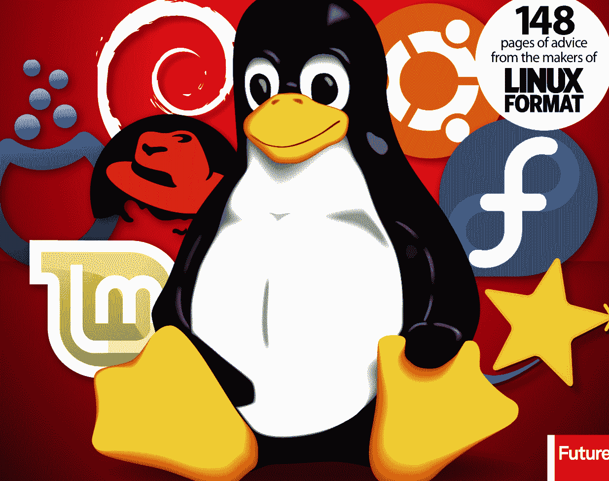

## 用我们精彩的教程学习编程！

## 现已推出！

附赠

免费

数字版

花钱能买到的最佳编程指南！

## 编程

简化

轻松有趣地学习编程

> 有 `Raspberry Pi` 吗？快来看看吧！

148 页技巧、提示和教程

另加！免费数字版，详见第 146 页

## 直接送到您家门口

在 `www.myfavouritemagazines.co.uk` 在线订购

或在您附近的超市、报刊亭或书店找到我们！

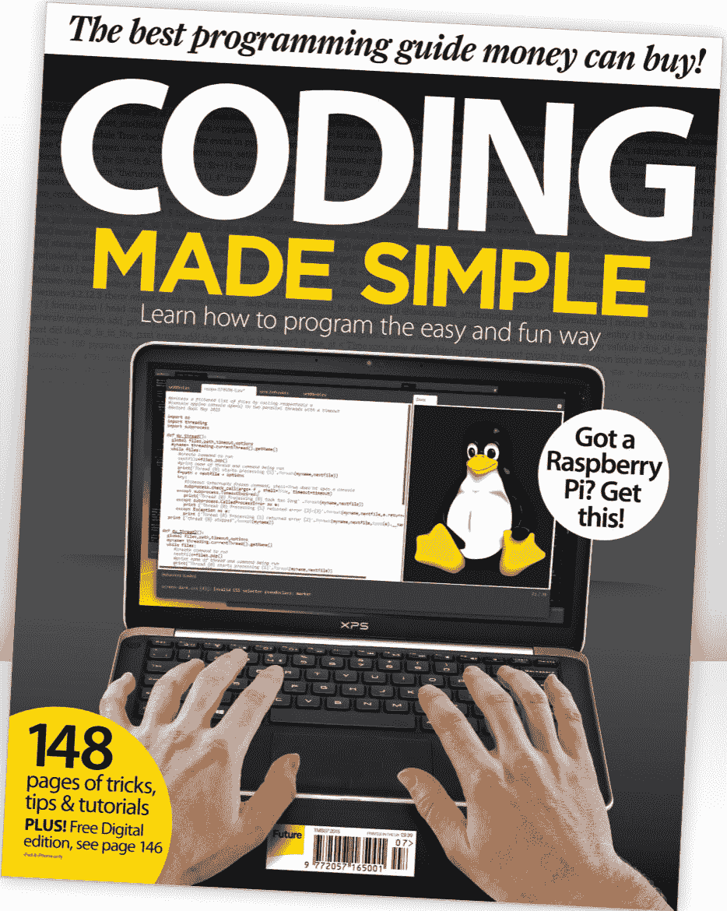

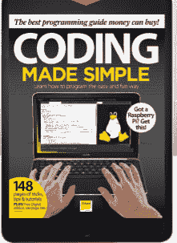

## 编辑团队

### 美术编辑

`Fraser McDermott`
`Efrain Hernandez-Mendoza`

### 编辑

`Alex Cox`

### 主编

`Graham Barlow`

### 撰稿人

`Neil Mohr`, `Mayank Sharma`, `Joni Bidwell`, `Neil Bothwick`, `Richard Smedley`, `Mihalis Tsoukalos`, `Marco Fioretti`, `Matt Hanson`

### 图片

`ThinkStock`, `Future Photo Studio`

## 管理

### 内容与市场总监

`Nial Ferguson`

### 技术内容与市场主管

`Nick Merritt`

### 集团主编

`Paul Newman`

### 集团美术总监

`Steve Gotobed`

## 市场

### 市场经理

`Richard Stephens`

## 印刷与制作

### 制作经理

`Mark Constance`

### 制作主管

`Vivienne Turner`

## 发行

### 贸易市场经理

`Juliette Winyard`

`Phone +44(0)7551 150984`

## 授权

### 授权与 `syndication` 总监

`Regina Erak`

`regina.erak@futurenet.com`
`Phone +44(0)1225 442244`
`Fax +44 (0)1225 732275`

## 订阅

`UK` 读者订购热线与咨询：`0844 848 2852`

海外读者订购热线与咨询：`+44 (0)1604 251045`

在线咨询：`www.myfavouritemagazines.co.uk`


## 欢迎！

`Linux` 可能看起来令人生畏，但如果你想入门，这里就是正确的地方。


每次我写这些指南的引言时，我似乎都会讲一个因准备不足而搞砸东西的故事。这个指南也不例外。我第一次接触 `Linux` 是出于绝望：作为一个不加掩饰的电脑发烧友，我真的必须尝试一下，当我终于拿到一盒早期的 `Mandrake Linux`——装在盒子里，真正的 `CD-ROM`！——我没有多想就开始安装了。看来我并不需要那软件或那些文档。我显然也不需要一台能工作的电脑，因为当时 `Linux` 在兼容性方面并不友好。事情已经改变。现代 `Linux` 发行版通常能与你拥有的任何硬件首次即用。我尝试过的每个近期发行版都能很好地与 `Windows` 和其他 `Linux` 发行版并排安装。你甚至可以——勉强——在不碰 `cmd` 命令行情况下使用，只要你不想把操作系统推得太远。不管你想如何使用 `Linux`，从 `GUI` 到命令行再到更实际的目的，《`Linux Made Simple`》都能满足你的需求。我收集了来自《`Linux Format`》杂志专家同事的一系列指南和教程，它们会帮助你快速上手并带你更进一步。而且如果你上瘾了，我强烈建议订阅 `LXF`（见第 144 页）。你找不到更好的 `Linux` 杂志。

`Alex Cox`, 编辑

## 《`Made Simple`》宣言

`Made Simple` 书籍旨在让你能快速上手新的硬件或软件。我们不会用术语轰炸你，也不会忽略基本原则，但我们会…

- ✓ 用通俗易懂的英文解释一切，让你能自信地应对新设备或软件，真正了解如何使用它
- ✓ 将说明分解为易于遵循的步骤，这样你就不会在下一步该做什么时抓耳挠腮
- ✓ 教你新的技能，这些技能可以伴随你一生，并在家中甚至工作场所应用
- ✓ 帮助你发现令人兴奋的新事物——探索新技术应该是乐趣，我们的指南旨在让你的学习之旅尽可能愉快
- ✓ 通过为你提供可下载的免费数字版，让你能随身携带我们的建议，随时在平板电脑、智能手机或笔记本电脑上使用——有关此优惠的更多详情请见第 146 页

我们做得怎么样？请发送电子邮件至 `techbookseditor@futurenet.com` 告诉我们是否兑现了我们的承诺！

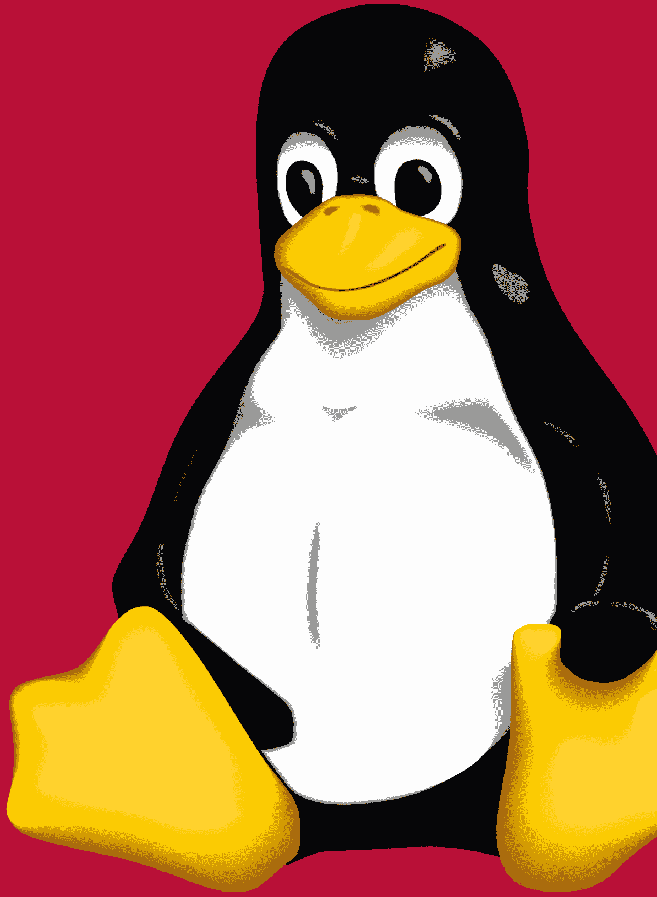

## 什么是 `Linux`？

那里... 有一只企鹅？还有一种叫做发行版的东西？别担心：我们有答案。

本书中最常用的词之一是“`Linux`”，但它是什么意思？对不同的人来说意义不同，从认为它就是内核的纯粹主义者，到将其视为 `GNU/Linux` 一部分的 `GNU` 倡导者，再到认为它就是 `Ubuntu` 另一个名字的初学者。事实上，`Linux` 取决于你的观点，全部都是这些。严格来说，单独使用 `Linux` 一词指的是操作系统的内核，而 `GNU/Linux` 是整个操作系统，由 `Linux` 内核和 `GNU` 工具组成——如果没有对方（或其替代品），两者都毫无用处。

如果你再加上一个应用程序软件集合，以及一些管理整个系统的工具，你就有了发行版，比如 `Ubuntu`。

我们所知的 `Linux` 操作系统由大量独立组件组成，但它们并不那么独立——它们必须相互契合，所以在这里我们将尝试解释整体如何是各部分之和，以及这些部分的作用。

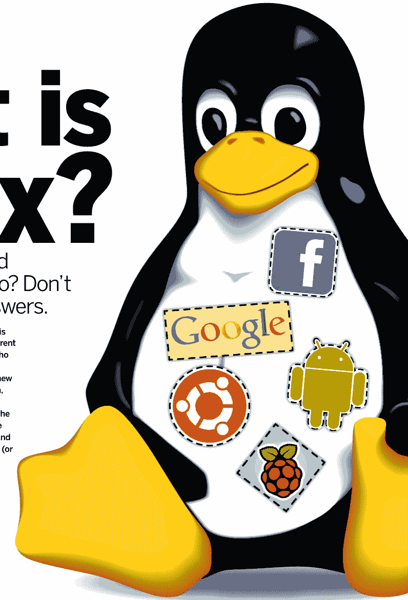

## 什么是操作系统？

### 什么是发行版？

操作系统可以定义为使应用程序能够在硬件上运行所需的软件——因此它由多个交织的层组成。在核心我们有内核，它通过驱动程序直接与硬件交互，并允许其他软件使用该硬件。在其之上，我们有各种层处理输入设备、网络、声音和视频等。通常，你不需要知道任何这些。当事情出错时，了解其中一些会有帮助，但即使那样也不是必需的，尤其是如果你能找到人帮你修电脑的话。但如果你正在阅读这本书，你很可能对“下面”发生的事情感兴趣，所以我们将尝试给你一个关于东西放在哪里以及到达那里时做什么的想法。`Linux` 发行版就是这样，一种分发基于 `Linux` 的操作系统及其附带软件的方式。起初，它只是操作系统所需的文件和在电脑上安装它们的方法。沿途，发行版获得了包管理器、更新工具、配置 `GUI` 和大量其他便利功能。然而，在用户友好的（如果你是 `Gentoo` 用户则不然）光鲜外表之下，所有发行版仍然是 `Linux`。

## 内核

位于你的 `Linux` 操作系统核心的神经中枢。

内核是系统的跳动的心脏，但它是什么？内核是计算机硬件的软件接口。它代表计算机上运行的任何软件与 `CPU`、内存和其他设备进行通信。因此，它是软件栈中最底层、最重要的一部分。如果内核出现问题，计算机上运行的每一块软件都会受到影响。

`Linux` 内核是一个单体内核——所有主要的操作系统服务都在内核中运行。另一种选择是微内核，其中大部分工作由外部进程完成，内核仅负责协调。

虽然在早期，用户为自己的硬件编译内核时，纯单体内核工作得很好，但如今硬件组合如此之多，将它们全部构建到内核中会导致文件巨大。因此 `Linux` 内核现在是模块化的，核心功能位于内核文件中（你可以在 `/boot` 中看到它，名为 `vmlinuz-version`），而可选驱动程序则作为单独的模块构建在 `/lib/modules` 中（该目录中的 `.ko` 文件）。

例如，`Ubuntu` `14.04` 的 `64` 位内核大小为 `5MB`，而另外还有 `3,700` 个模块占用超过 `100MB`。任何特定机器上只需要其中一小部分，因此尝试将它们全部与主内核一起加载是不明智的。相反，内核会检测正在使用的硬件并加载相关模块，这些模块在内存中成为内核的一部分，因此即使分散在数千个文件中，加载后仍然是单体的。这使得系统能够对硬件变化做出反应。插入一个 `USB` 记忆棒，`usb-storage` 模块就会被加载，同时也会加载挂载它所需的文件系统模块。

类似地，连接一个 `3G` 拨号上网卡，串行调制解调器驱动就会被加载。这就是为什么在添加硬件时很少需要安装新驱动的原因；它们都已存在，只是在等待你购买一些新设备来插入。运行在特定且不变的硬件上的计算机，例如服务器，通常使用所有必需驱动已编译进内核且模块加载被禁用的内核，这增加了少许安全性。


如果你自行编译内核，一个好的经验法则是将始终使用的硬件驱动编译进内核，例如你的网络接口和硬盘文件系统，而将其他所有内容编译为模块。

## 更多模块

模块数量庞大，其中大部分是硬件驱动程序，是 Linux 近年的优势之一——默认支持的硬件如此之多，无需从其他地方下载和安装驱动程序。

> “支持的硬件如此之多，无需下载驱动程序”

仍有一些硬件未被内核模块覆盖，通常是因为代码太新或其许可证禁止将其包含在内核中（是的，ZFS，我们在看你）。Nvidia 显卡的驱动是最著名的例子。通常被称为第三方模块，尽管 Ubuntu 也称之为‘受限驱动’，如果你的发行版支持它们，这些驱动会从你的包管理器安装。否则，它们必须从源代码编译，每次更新内核时都必须重新编译，因为它们与为其构建的内核绑定。

为此已做出了一些自动化努力，其中最著名的是 `DKMS`（`Dynamic Kernel Module Support`），它会在安装新内核时自动重新编译所有第三方模块，使得升级内核的过程几乎与升级用户应用程序一样无缝。

在谈论内核时，你会看到“`kernel space`”和“`user space`”这两个词。`Kernel space` 是只能由内核访问的内存；没有任何用户程序（即除内核及其模块之外的任何东西）可以写入此处，因此失控的程序无法破坏内核的操作。`User space` 另一方面，可以由具有适当权限的任何程序访问。这有助于 Linux 的稳定性和安全性，因为没有任何程序，即使以 `root` 运行，也能直接破坏内核。

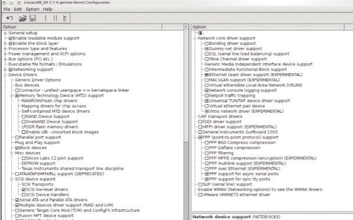

构建内核时的选项数量令人震惊，其中大部分与硬件设备支持有关。你难道不高兴我们有发行版维护者来为我们处理这一切吗？


## 启动序列

启动时那神秘的闪烁和蜂鸣序列。

大多数发行版在启动时直接进入启动画面，因此我们看不到正在发生的事情。事实上，在启动画面出现之前以及被画面隐藏之后，都有很多事情在进行。`BIOS` 首先启动，位于主板硬件中。它会寻找启动设备并从那里加载代码。

对于使用传统 `DOS` 分区系统的硬盘，启动代码包含在驱动器的主引导记录（`MBR`）中——仅 512 字节的存储空间。其中 64 字节用于保存驱动器的分区表（这就是为什么只有四个主分区可用），剩下全部 446 字节用于引导加载程序代码，通常是 `Grub`。446 字节并不能容纳太多功能，因此这段代码所做的只是从磁盘上的其他位置加载其余的启动代码，该位置是在引导加载程序安装 `MBR` 代码时设定的。

引导加载程序读取其配置文件，通常是`/boot/grub2/grub.cfg`，以获取启动选项列表，然后要么显示菜单，要么直接进入默认启动。此时 Linux 尚未参与，因为只有引导加载程序代码在运行。

`File` it may need, plus other settings such as the root partition, and whether to hide all this behind a splash screen. 如果你想从这里开始看到发生了什么，你可以在大多数发行版上通过按 `[E]` 键编辑 `Grub` 菜单项来禁用启动画面，删除任何 `quiet` 和 `splash` 选项，然后按 `[F10]` 继续启动。

## 为什么使用 RAM 磁盘？

大多数发行版使用一个 `initramfs` 文件。其主要原因是某些驱动程序必须随内核一起加载，特别是加载磁盘驱动所需的内容（如 `SATA` 控制器和文件系统代码）。对于通用发行版，将所有可能选项都构建到内核中会使其变得无法使用，因此一切都作为模块构建，而启动所需的内容则包含在 `initramfs` 中。这是一种 `RAM` 磁盘，由引导加载程序随内核一起加载（使用 `BIOS` 例程从磁盘读取），其中包含挂载根分区所需的所有文件。这是通过内核的设备检测来决定加载哪些内容，然后控制权传递给真正的硬盘。`initramfs` 也用于加载任何启动画面，因此它们会在启动过程一开始就出现。

> “配置文件告诉引导加载程序 Linux 内核的位置”

移除启动画面会完整显示启动过程，包括正在启动的服务的状态。

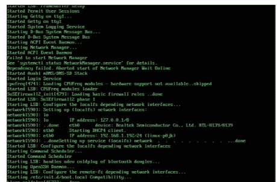

一旦根分区被挂载，无论是直接还是通过 `initramfs`，`init` 序列就会正式开始。传统上，这涉及运行`/sbin/init`，然后它运行其他所有内容，受`/etc/inittab` 控制，并负责在没有启动画面的情况下你在控制台上看到的服务启动信息列表。这也让你能够在遇到此类问题时看到启动过程卡住或花费不合理时间的位置。

## 新选项

时间在推移，所有这些系统都可能发生变化。在最新硬件上，`BIOS` 已被 `UEFI` 取代，尽管一旦引导加载程序安装完成你就不会

## GNU/Linux 中的 GNU

`GNU`（`Gnu’s not Unix`）项目比 Linux 早了好几年。它已创建了 1980 年代早期计算机所需的大部分基本工具——编译器、文本编辑器、文件和目录操作命令等等——但没有可用的内核（有些人会说他们的内核 `GNU Hurd` 至今仍不可用）。当 `Linus Torvalds` 于 1991 年开始 tinkering 他的小项目时，他有一个内核但没有在其上运行的工具。

两者结合，GNU/Linux 诞生了——一个使用 Linux 内核和 `GNU` 工具集的操作系统。不仅仅是`/bin` 和`/usr/bin` 中的程序来自 `GNU`；`glibc` 是 Linux 使用的核心 C 库，它也来自 `GNU`。因此，只要你在计算机上做任何事情，每次输入命令或点击图标时，`GNU` 软件都在某个层面运行。

难怪 `GNU` 死忠粉在我们把操作系统称为 Linux 而不是 `GNU/Linux` 时会感到不满。值得一提的是，没有人真正否认 `GNU` 方面的重要性；称操作系统为 Linux 而不是 `GNU/Linux` 更多是出于方便和懒惰，而非政治——全称实在太累赘了。


对不起 `Richard`，我们懒得每次都说‘`GNU slash`’。

## 从 Google 获得最大收益

## 技术提示指南

## GOOGLE

468 个不可思议的技巧、诀窍和黑客方法 – 学习如何做到一切！

包含本书的免费数字版！*

## 立即推出！

赠送免费数字版

## 直送您家门口

在`www.myfavouritemagazines.co.uk` 在线订购

或在您附近的超市、报刊亭或书店找到我们！


## 帮助您在当今互联世界中充分利用生活

在线 • 印刷 • 平板

## AUDIO TECHNICA ATH-MSR7

逃离到高分辨率音频的世界

## SAMSUNG JS9000

尽情享受最新的家庭娱乐

## CARL ZEISS VR

拥抱虚拟现实游戏的新时代

## SONY XPERIA Z3

让您掌控生活和家居

## APPLE WATCH

您的健康与健身升级

## 与 T3 生活更美好

`t3.com`

注意任何差异。人们也在着手取代沿用多年的传统 `SysVinit` 系统。`Ubuntu` 引入了 `Upstart`，而 `Red Hat` 和 `Fedora` 则在推广 `systemd`。

虽然它们都执行相同的


注意任何差异。人们也在着手取代沿用多年的传统 `SysVinit` 系统。`Ubuntu` 引入了 `Upstart`，而 `Red Hat` 和 `Fedora` 则在推广 `systemd`。

虽然它们都执行相同的[content]
## 从 `Google` 获得最大收益

### 技术提示指南

#### `GOOGLE`

468 个不可思议的技巧、诀窍和黑客方法 – 学习如何做到一切！

包含本书的免费数字版！*

#### 立即推出！

随附免费数字版

#### 直送您家门口

在 `www.myfavouritemagazines.co.uk` 在线订购

或在您附近的超市、报刊亭或书店找到我们！


### 帮助您在当今互联世界中充分利用生活

在线 • 印刷 • 平板

#### `AUDIO TECHNICA ATH-MSR7`

逃离到高分辨率音频的世界

#### `SAMSUNG JS9000`

尽情享受最新的家庭娱乐

#### `CARL ZEISS VR`

拥抱虚拟现实游戏的新时代

#### `SONY XPERIA Z3`

让您掌控生活和家居

#### `APPLE WATCH`

您的健康与健身升级

### 与 `T3` 生活更美好

`t3.com`

注意任何差异。人们也在着手取代沿用多年的传统 `SysVinit` 系统。`Ubuntu` 引入了 `Upstart`，而 `Red Hat` 和 `Fedora` 则在推广 `systemd`。

虽然它们都执行相同的[content]
## 从 `Google` 获得最大收益

### 技术提示指南

#### `GOOGLE`

468 个不可思议的技巧、诀窍和黑客方法 – 学习如何做到一切！

包含本书的免费数字版！*

#### 立即推出！

随附免费数字版

#### 直送您家门口

在 `www.myfavouritemagazines.co.uk` 在线订购

或在您附近的超市、报刊亭或书店找到我们！


### 帮助您在当今互联世界中充分利用生活

在线 • 印刷 • 平板

#### `AUDIO TECHNICA ATH-MSR7`

逃离到高分辨率音频的世界

#### `SAMSUNG JS9000`

尽情享受最新的家庭娱乐

#### `CARL ZEISS VR`

拥抱虚拟现实游戏的新时代

#### `SONY XPERIA Z3`

让您掌控生活和家居

#### `APPLE WATCH`

您的健康与健身升级

### 与 `T3` 生活更美好

`t3.com`

注意任何差异。人们也在着手取代沿用多年的传统 `SysVinit` 系统。`Ubuntu` 引入了 `Upstart`，而 `Red Hat` 和 `Fedora` 则在推广 `systemd`。

虽然它们都执行相同的[content]
## 从 `Google` 获得最大收益

### 技术提示指南

#### `GOOGLE`

468 个不可思议的技巧、诀窍和黑客方法 – 学习如何做到一切！

包含本书的免费数字版！*

#### 立即推出！

随附免费数字版

#### 直送您家门口

在 `www.myfavouritemagazines.co.uk` 在线订购

或在您附近的超市、报刊亭或书店找到我们！


### 帮助您在当今互联世界中充分利用生活

在线 • 印刷 • 平板

#### `AUDIO TECHNICA ATH-MSR7`

逃离到高分辨率音频的世界

#### `SAMSUNG JS9000`

尽情享受最新的家庭娱乐

#### `CARL ZEISS VR`

拥抱虚拟现实游戏的新时代

#### `SONY XPERIA Z3`

让您掌控生活和家居

#### `APPLE WATCH`

您的健康与健身升级

### 与 `T3` 生活更美好

`t3.com`

注意任何差异。人们也在着手取代沿用多年的传统 `SysVinit` 系统。`Ubuntu` 引入了 `Upstart`，而 `Red Hat` 和 `Fedora` 则在推广 `systemd`。

虽然它们都执行相同的[content]
## 从 `Google` 获得最大收益

### 技术提示指南

#### `GOOGLE`

468 个不可思议的技巧、诀窍和黑客方法 – 学习如何做到一切！

包含本书的免费数字版！*

#### 立即推出！

随附免费数字版

#### 直送您家门口

在 `www.myfavouritemagazines.co.uk` 在线订购

或在您附近的超市、报刊亭或书店找到我们！


### 帮助您在当今互联世界中充分利用生活

在线 • 印刷 • 平板

#### `AUDIO TECHNICA ATH-MSR7`

逃离到高分辨率音频的世界

#### `SAMSUNG JS9000`

尽情享受最新的家庭娱乐

#### `CARL ZEISS VR`

拥抱虚拟现实游戏的新时代

#### `SONY XPERIA Z3`

让您掌控生活和家居

#### `APPLE WATCH`

您的健康与健身升级

### 与 `T3` 生活更美好

`t3.com`

注意任何差异。人们也在着手取代沿用多年的传统 `SysVinit` 系统。`Ubuntu` 引入了 `Upstart`，而 `Red Hat` 和 `Fedora` 则在推广 `systemd`。

虽然它们都执行相同的[content]
## 从 `Google` 获得最大收益

### 技术提示指南

#### `GOOGLE`

468 个不可思议的技巧、诀窍和黑客方法 – 学习如何做到一切！

包含本书的免费数字版！*

#### 立即推出！

随附免费数字版

#### 直送您家门口

在 `www.myfavouritemagazines.co.uk` 在线订购

或在您附近的超市、报刊亭或书店找到我们！


### 帮助您在当今互联世界中充分利用生活

在线 • 印刷 • 平板

#### `AUDIO TECHNICA ATH-MSR7`

逃离到高分辨率音频的世界

#### `SAMSUNG JS9000`

尽情享受最新的家庭娱乐

#### `CARL ZEISS VR`

拥抱虚拟现实游戏的新时代

#### `SONY XPERIA Z3`

让您掌控生活和家居

#### `APPLE WATCH`

您的健康与健身升级

### 与 `T3` 生活更美好

`t3.com`

注意任何差异。人们也在着手取代沿用多年的传统 `SysVinit` 系统。`Ubuntu` 引入了 `Upstart`，而 `Red Hat` 和 `Fedora` 则在推广 `systemd`。

虽然它们都执行相同的[content]
## 从 `Google` 获得最大收益

### 技术提示指南

#### `GOOGLE`

468 个不可思议的技巧、诀窍和黑客方法 – 学习如何做到一切！

包含本书的免费数字版！*

#### 立即推出！

随附免费数字版

#### 直送您家门口

在 `www.myfavouritemagazines.co.uk` 在线订购

或在您附近的超市、报刊亭或书店找到我们！


### 帮助您在当今互联世界中充分利用生活

在线 • 印刷 • 平板

#### `AUDIO TECHNICA ATH-MSR7`

逃离到高分辨率音频的世界

#### `SAMSUNG JS9000`

尽情享受最新的家庭娱乐

#### `CARL ZEISS VR`

拥抱虚拟现实游戏的新时代

#### `SONY XPERIA Z3`

让您掌控生活和家居

#### `APPLE WATCH`

您的健康与健身升级

### 与 `T3` 生活更美好


`t3.com`

注意任何差异。人们也在着手取代沿用多年的传统 `SysVinit` 系统。`Ubuntu` 引入了 `Upstart`，而 `Red Hat` 和 `Fedora` 则在推广 `systemd`。

虽然它们都执行相同的[content]

## 从 Google 获得最大收益

## 技术提示指南

## GOOGLE

468 个不可思议的技巧、诀窍和黑客方法 – 学习如何做到一切！

包含本书的免费数字版！*

## 立即推出！

随附免费数字版

## 直送您家门口

在 `www.myfavouritemagazines.co.uk` 在线订购

或在您附近的超市、报刊亭或书店找到我们！


## 帮助您在当今互联世界中充分利用生活

在线 • 印刷 • 平板

## `AUDIO TECHNICA ATH-MSR7`

逃离到高分辨率音频的世界

## `SAMSUNG JS9000`

尽情享受最新的家庭娱乐

## `CARL ZEISS VR`

拥抱虚拟现实游戏的新时代

## `SONY XPERIA Z3`

让您掌控生活和家居

## `APPLE WATCH`

您的健康与健身升级

## 与 T3 生活更美好

`t3.com`

请注意任何差异。人们也在着手取代沿用多年的传统 `SysVinit` 系统。`Ubuntu` 引入了 `Upstart`，而 `Red Hat` 和 `Fedora` 则在推广 `systemd`。

虽然它们都执行相同的[content]

## 从 Google 获得最大收益

## 技术提示指南

## GOOGLE

468 个不可思议的技巧、诀窍和黑客方法 – 学习如何做到一切！

包含本书的免费数字版！*

## 网络

你的计算机如何与其他设备通信。

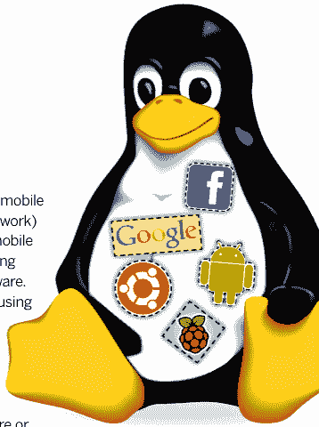

网络是 Linux 的核心。即使在没有连接到本地网络，更不用说互联网的独立机器上，网络仍然被使用。许多服务采用客户端/服务器模型运行，其中服务器在后台运行，等待其他程序的指令。即使是系统日志记录器这样基础的东西也作为网络服务运行，允许其他程序写入日志文件。`X` 图形系统也是网络化的，`X` 服务器运行桌面和程序，告诉它想要显示什么。这就是为什么在远程桌面上运行 `X` 程序如此简单——就系统而言，这与在本地打开一个窗口没有太大区别。

运行 `ifconfig` 总会显示至少一个接口，称为 `lo`，地址为 `127.0.0.1`——这用于计算机与自身通信，这被认为是对计算机而言比对人更理智的活动。大多数其他网络基于 `TCP/IP`，通过有线以太网或无线进行，但还有其他类型的网络在使用。所有发行版和桌面环境都包含用于配置和维护 `TCP/IP` 网络的良好工具，从相当普遍的 `NetworkManager` 到诸如 `Gnome` 的网络配置工具或 `openSUSE` 的 `YaST` 等单独工具。网络领域的最新补充包括 `3G` 移动通信和个人局域网（`PAN`）技术，如 `Bluetooth`。使用 `3G` 移动宽带调制解调器通常很简单，要么使用 `NetworkManager`，要么使用桌面环境的 `PPP` 软件。是的，`3G` 调制解调器确实像使用拨号的调制解调器一样工作，但连接时没有那令人刺耳的嘈杂声（年轻读者应忽略最后这句话）。大多数 `3G` 问题是由于在信号较差的区域尝试设置它们，而不是 Linux 中的硬件或软件支持。

### 王者的协议

随着移动设备的普及，`Bluetooth` 越来越重要，使用它的输入和输出设备数量也在增加。受益的不只是手机和平板电脑用户——蓝牙鼠标和扬声器可以在你坐在桌前使用笔记本电脑时提升体验，无需在开始工作前插上所有设备。`PulseAudio`（参见声音部分）使这变得更容易，因为它可以在检测到设备时在它们之间切换。

## 存储

在硬盘上存储数据本身就可能涉及多层。Linux 中所有物理存储（与网络存储相对）都围绕块设备展开，之所以如此称呼是因为磁盘以块的形式存储数据。像 `/dev/sda1` 这样的块设备确实指的是磁盘上的块，即物理区域，以及它们的集合即磁盘分区。在其之上我们有文件系统，它以目录和文件的合理结构存储数据，包含数据和元数据。

有什么区别？假设你保存了一个包含文本的文件。该文件中的数据是文本，但文件还有其他属性：有文件所有者、创建的时间、上次修改的时间、上次读取的时间以及谁有权读取或修改它。这就是你在对文件执行 `ls -l` 时看到的信息，或在文件管理器中检查其属性时看到的信息，并且由文件系统存储。如今使用的标准文件系统是 `ext4`，但也有替代品，如 `ext3`、`ReiserFS`、`XFS`、`JFS`，以及当然来自 Windows 世界的 `FAT` 和 `NTFS`。

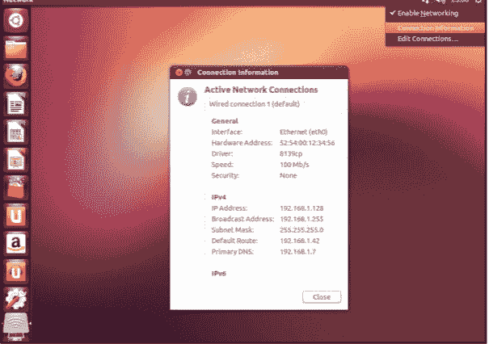

网络是 Linux 系统运行的核心。`localhost` 接口会自动设置；对于其余部分，我们有诸如 `NetworkManager` 之类的程序。

## 其他 Linux

我们所涵盖的一切都与 Linux 在桌面、笔记本电脑和服务器上运行有关——如果你愿意的话是传统计算机硬件，但 Linux 也用于其他环境。许多嵌入式设备，从路由器到 `PVR` 和机顶盒，都运行 Linux，并且在许多方面与我们所熟知和喜爱的 Linux 相似。如果你的路由器允许 `SSH` 访问，登录后你通常会感到宾至如归。

还有一类设备在近年获得了巨大增长，并运行着截然不同的 Linux。不用猜就知道我们指的是运行 `Android` 的智能手机及其平板电脑兄弟。`Android` 是 Linux，它使用 Linux 内核，但它不是 `GNU/Linux`。内核可能基于相同的源代码，但其上运行的一切都不同。原则在某些方面相似，但实现方式非常不同——尽管如果你能在手机上获得 shell 提示符，你会发现熟悉的命令行工具。

## 桌面

`Gnome`、`KDE`、`Cinnamon`、`Unity`——我们就称之为用户界面。

如果把内核视为系统的最低层，最高层就是用户界面。从内核到驱动程序和硬件接口的所有其他东西，在你能使用计算机之前都毫无用处。这通常意味着图形桌面，这里我们遇到了更多层。`X`（或未来可能是 `Wayland`）只是提供了一个空白画布。然后你需要一些东西来提供窗口界面的精致功能，那就是窗口管理器。

过去，窗口管理器是独立的系统，仍然有许多此类系统可用，例如 `OpenBox` 或 `Enlightenment`，但现在它们通常是更大桌面环境的一部分。严格来说，窗口管理器负责处理桌面上的窗口，其打开、关闭、放置和其他操作。随着时间的推移，它们逐渐加入了其他功能，如任务栏和程序启动菜单，最终发展成为桌面环境。

### 软件集合

桌面环境只是一个或多或少集成的实用程序集合，用于提供运行完整桌面所需的所需功能。运行程序、操作其窗口、跟踪正在发生的事情以及使程序相互通信都是桌面环境的功能，但它们仍然以窗口管理器为核心——例如 `KDE` 的 `KWin` 和 `Gnome` 的 `Metacity`。

桌面环境与窗口管理器的区别在于集成程度。这在 `KDE` 中尤为明显，其中一切都围绕一个共同核心工作，程序不仅相互通信，而且一个程序的实例甚至可以嵌入到另一个程序的窗口中。


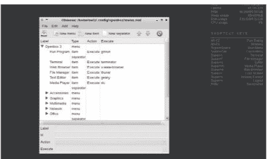

> 这里也有很多轻量级窗口管理器，例如在 `CrunchBang` 上运行的 `OpenBox`。

虽然在 `Gnome` 上使用 `KWin` 可能意义不大，但你可能想尝试一些更专业的窗口管理器，它们提供更大的窗口处理控制，或使用不同的显示方法。有平铺窗口管理器，如 `awesome` 和 `xmonad`，它们调整窗口大小以使它们全部适合桌面（`KDE` 也有自己的选项可以这样行为）。还有一些窗口管理器设计为可通过键盘控制，以及最小化窗口管理器，它们对运行单个全屏程序且不想有任何小部件 clutter 的专业系统很有用。

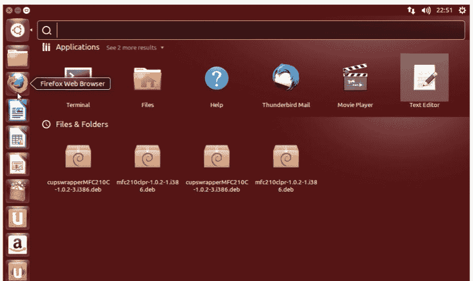

> `Gnome`、`KDE`、`Unity`、`Cinnamon`、`Mate`——在桌面环境方面，我们的选择绝对不少，但你们中有多少人尝试过不止一两个？

## 声音

曾经棘手的话题。

Linux 声音系统经历了许多变化。我们多年使用 `OSS`（开放声音系统），直到 `ALSA`（高级 Linux 声音架构）出现。`ALSA` 仍然存在，但我们现在也有 `PulseAudio` 和 `Jack`。


ALSA 支持多块声卡，每块声卡可能有多个输入和输出。它还提供硬件混音支持，如果硬件支持的话，以及如果不支持时的软件混音。这消除了过去 KDE 和 Gnome 提供的声音管理器的需求，以使多个应用程序同时播放声音。ALSA 在接近硬件的低层工作，因此延迟很低。现在大多数硬件都直接受支持，安装发行版后声音应该从第一次启动就开始工作。ALSA 是内核代码和用户空间应用程序的结合。它还提供 API，使其他程序可以直接控制它，例如桌面环境中包含的混音器控制面板。

### PulseAudio 性能

PulseAudio 是一个更新的音频框架，但它不是 ALSA 的替代品。相反，它位于内核音频系统之上，提供更大的控制。它作为服务器工作，从源接收输入并将其转发到接收器（输出硬件或捕获软件）。在许多情况下，接收器是 ALSA，而源也可以是 ALSA 驱动程序，用于不直接支持 PulseAudio 的应用程序。因此，你可能会遇到应用程序将输出发送到 ALSA 设备，该设备拦截流并通过 PulseAudio 路由回 ALSA。许多人发现 PulseAudio 复杂也就不足为奇了。良好的设置应该使所有这些花招对用户透明，这正是发行版安装程序和 PulseAudio 现在所处的状态，因此大多数时候我们回到了 ALSA 的“即用”状态，但对多设备支持更好。ALSA 支持多个输出设备，但默认是全局设置。PulseAudio 允许你在用蓝牙耳机进行 VOIP 通话的同时将音乐通过扬声器播放。它还允许更简单但同样有用的分离，例如为每个应用程序设置单独的音量。PulseAudio 具有网络感知能力——它可用于查找其他 PulseAudio 服务器并通过其扬声器播放音频——非常适合在家中流式传输音乐。

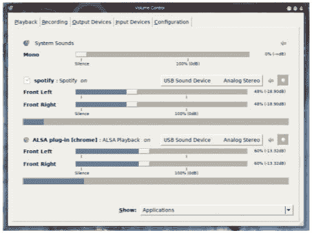

如果有人试图告诉你 PulseAudio 很复杂，最好不要与他们争论。并不是说这种布局的复杂性如果对你来说只是能用就很重要。

JACK（Jack 音频连接套件）是为专业音频应用程序设计的音频服务器。它的强项是为音频和 MIDI 数据在应用程序之间提供低延迟实时连接。它不需要用于典型的桌面使用，只适用于有抱负的音乐家。

## 打印

CUPS 与驱动程序。

虽然开源鼓励选择，因此有多个程序以略有不同的方式做同样的事情，但在某些领域一种程序几乎无人能敌。X.org 被普遍用于提供图形显示，CUPS 在打印领域保持着类似的地位。

如果你在 Linux 机器上连接了打印机，你需要两样东西——CUPS 和打印机的驱动程序。在许多情况下，它们是一起提供的。CUPS 是一个在后台等待打印请求的服务器。几乎任何可以打印的程序都知道 CUPS 使用的互联网打印协议（IPP）。在你的文字处理器或浏览器中点击“打印”，就会弹出一个窗口显示你的打印机，如果你有多个则提供选择。

应用程序只需要将要打印的数据，通常是 PostScript，发送给 CUPS，后者处理其他一切——包括等待你记得打开打印机。CUPS 甚至不需要在同一台计算机上运行；它是一个网络服务，一台计算机上的打印机应该对同一网络上的每个人可用。没有告诉它如何与打印机通信的驱动程序，CUPS 就毫无用处。它默认包含大量驱动程序，安装`gutenprint`驱动程序包后可获得更多驱动程序（数量如此之多，以至于你的发行版可能已默认安装了它）。HP 还提供名为`hplip`的驱动程序（和扫描仪）驱动程序包，如果你使用其产品则需要它。

然而，一些打印机公司坚持提供自己的驱动程序而不是将其捆绑在 CUPS 中，通常出于许可原因。在这种情况下，你可以选择在打印机制造商的网站上寻找适合你系统的驱动程序包并单独安装。之后，驱动程序应该出现在 CUPS 和你发行版的打印机配置工具中。另一个选择是在购买打印机前查看`linuxprinting.org`，并坚持使用更开明的制造商。

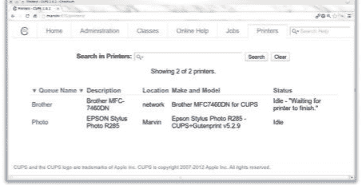

借助其内置的网页界面，使用 CUPS 管理打印机就像在浏览器中点击几个链接一样简单。

## techradar.pro

商业 IT 洞察

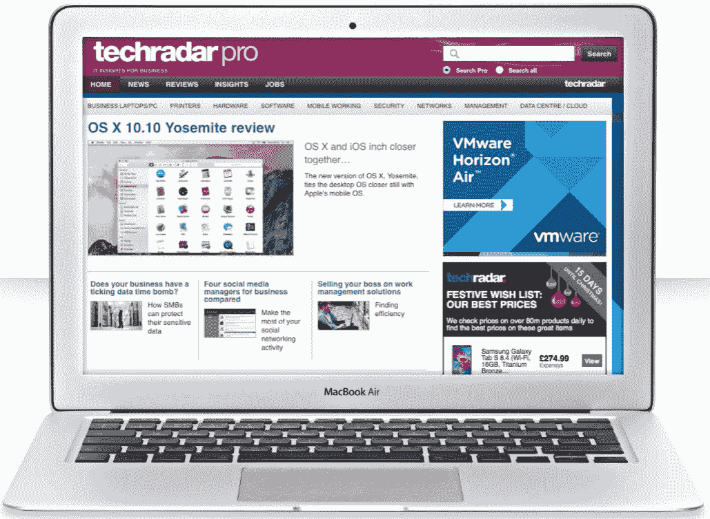

## 企业技术建议的终极目的地

- 最新科技商业新闻

- 深入的硬件和软件评测

- 对影响您业务的关键问题的分析

`www.techradarpro.com`

`twitter.com/techradarpro`

`facebook.com/techradar`

## 入门 Linux

对 Linux 好奇但不确定如何探索这片陌生领域？我们将帮助你入门，让你加入日益增长的 Linux 用户行列，还能让你的电脑焕然一新。

现在入门 Linux 的时机比以往任何时候都好。它比以往任何时候都更精致，安装也比以往任何时候都更容易，而且像`Ubuntu`这样的大牌发行版刚刚更新。

阻碍 Linux 大规模普及的最大障碍之一是你在 Currys 买不到预装 Linux 的电脑。但它相比其他主流操作系统提供的优势完全值得这额外的步骤。首先，Linux 是开源的，也就是说你可以合法下载 Linux 并在所有电脑上安装。它还附带大量软件，你只需点击一下即可下载更多。与专有操作系统不同，Linux 发行版（或称`distro`）非常灵活。你可以更换默认应用，甚至替换整个界面。选择是 Linux 的另一个标志，从简单组件到复杂套件应有尽有。

> “更重要的是，你在 Windows 电脑上能做的事，在 Linux 上也能做到。”

此外，除了兼容所有新硬件外，Linux 还能让已过巅峰期的硬件焕发新生。更重要的是，你在 Windows 电脑上能做的事，在 Linux 上也能做到。从流媒体视频到玩最新游戏，Linux 的表现与任何其他系统一样出色。

### Ubuntu

最为人熟知的 Linux 发行版（通常简称为`distro`），`Ubuntu`特别注重桌面易用性。在其存在的 10 年里，`Ubuntu`推动了 Linux 桌面开发，并成为希望在 Linux 上运行产品的第三方开发者和厂商的首选发行版。

### Fedora

Red Hat 向世界提供的开源项目`Fedora`以采用和提供新技术和软件给用户而闻名。多年来，该发行版在提供新功能和稳定性之间找到了巧妙的平衡，这使其深受新手和经验丰富的 Linux 用户欢迎。

### Mageia

尽管迄今为止仅发布了四个版本，`Mageia`的易用性血统可追溯至 1990 年代。`Mageia`是一个由非营利组织支持的社区项目，该组织由选举产生的贡献者委员会管理。该发行版以其定制化的用户友好安装管理工具而闻名。


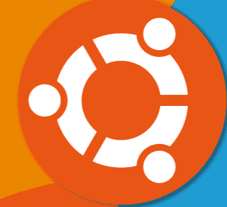


## 获取英国最畅销的 Linux 杂志

## 免费 DVD！FEDORA 22 实时光盘

## LINUX FORMAT

祝我们生日快乐！

## 特别纪念版！

## 史上 200 条最佳 Linux 技巧！

- Linux 15 周年！

它如何改变世界

- `Ubuntu`的崛起

- `Raspberry Pi`革命

- `Steam`游戏到来

- `Init`之战：`Systemd`如何击败`SysV`并吞噬 Linux

## 立即发售！

## 第 200 期

72 页专家 Linux 评测、专题与教程

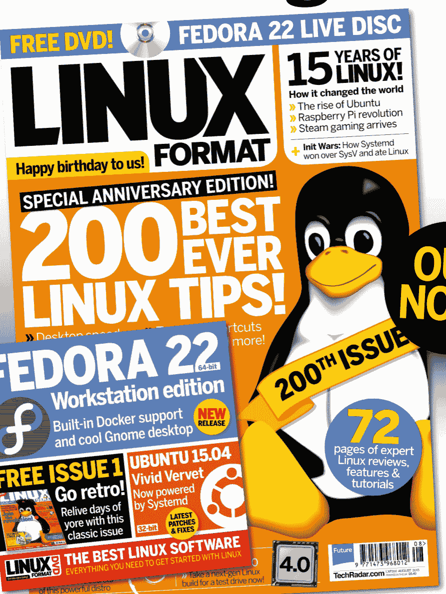

## FEDORA 22 64 位工作站版

内置`Docker`支持和酷炫的`Gnome`桌面

## 新发行

免费第 1 期 怀旧！重温往昔的经典期

`UBUNTU 15.04 Vivid Vervet`现由`Systemd`驱动

## 最佳 Linux 软件 开始使用 Linux 所需的一切

## 直送您家

在线订购`www.myfavouritemagazines.co.uk`或在您最近的超市、报刊亭或书店找到我们！

## 安装 Linux

将 Linux 安置在您的电脑上所需了解的一切。

Linux 安装过程涉及较多，但实际上并不繁琐。确切的安装步骤因发行版而略有不同，但通常发行版的图形化安装程序会相当轻松地引导你完成必要步骤。

本质上，安装 Linux 与安装软件非常相似，只是存在一些注意事项：

### 磁盘分区

与软件不同，安装 Linux 需要你在硬盘上创建专用分区。如果 Linux 将是这台电脑唯一的系统，这不是问题。然而，如果你要在 Windows 等其他系统旁边安装 Linux，你必须采取措施保护现有数据。许多 Linux 发行版会提供自动分区选项，不过你也可以在 Windows 中使用磁盘管理工具轻松自行创建分区（见下文为 Linux 腾出空间）。手动分区的优势在于你可以决定分配给 Linux 的空间大小。


创建分区时请记住创建两个新分区。较大的一个至少需要 `12GB` 磁盘空间，用于操作系统本身，你需要将其格式化为 `ext4`。你还需要创建一个名为交换空间的第二分区。简单来说，交换分区扩展了电脑的物理 `RAM` 容量。对于内存较小的电脑（`1` 到 `2 GB`）而言，一般经验法则是创建大小为电脑内存两倍的交换分区。对于内存更大的电脑，最好创建与内存大小相同的交换分区。

### 保护数据

在安装过程中，包括 `Fedora` 和 `Ubuntu` 在内的许多发行版会提供加密 Linux 分区的选项。此选项通过隔离数据免受未经授权的访问，为你提供额外的安全层。要启用此选项，你需要提供一个密码短语，该短语将作为解锁数据的密钥。

安装过程中的另一个重要步骤是设置 `root` 账户。在大多数发行版中，此步骤是用户创建过程的一部分，你在其中定义普通用户账户的登录凭据。普通用户没有修改系统的权限，而以 `root` 登录则可完全控制系统。

### 双启动

安装 Linux 时你应该熟悉的一个软件是引导加载程序。它是一个小型程序，告诉电脑在磁盘上找到不同操作系统的位置。大多数 Linux 发行版使用 `Grub 2` 引导加载程序。一般来说，你无需在此处做任何操作，即使在启用了安全启动的 `UEFI BIOS` 的 `Windows 8` 电脑上安装 Linux 也是如此。大多数主流发行版的最新版本，包括 `Ubuntu` 和 `Fedora`，都安装了兼容 `UEFI` 的引导加载程序，开箱即用即可正常工作。然而，由于不同厂商对 `UEFI` 的实现方式不同，你可能无法进入 `Grub` 引导加载程序屏幕，而是在安装 Linux 后直接启动到 `Windows`。在这种情况下，你应考虑启用传统 `BIOS` 模式，其中 `UEFI` 固件作为标准 `BIOS` 运行。启用传统 `BIOS` 的选项位于 `UEFI` 设置屏幕下。

### 安装前测试

几乎所有主流发行版，包括 `Ubuntu`、`Fedora` 和 `Mageia`，都允许你启动到“实时”环境，让你在不影响硬盘内容的情况下体验发行版。你可以使用实时环境熟悉发行版并验证硬件与发行版的兼容性。另请注意，Linux 发行版以 `ISO` 镜像形式分发。你可以根据其大小使用刻录 `ISO` 镜像的选项将其刻录到 `CD` 或 `DVD` 上。你也可以将 `ISO` 镜像传输到 `USB` 驱动器。有 `UNetbootin` 和 `Yumi` 等工具可创建包含发行版 `ISO` 的可启动 `USB` 驱动器，而 `Mageia` 推荐使用 `Rufus` 实用程序。

### 为 Linux 腾出空间：调整 Windows 分区大小

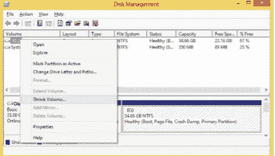

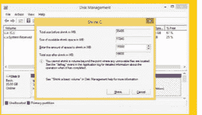

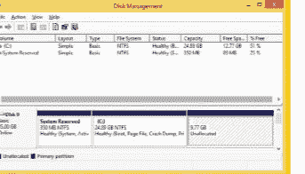

#### 1 缩小 Windows

在分区磁盘之前，你需要压缩 Windows 分区以释放一些磁盘空间供新分区使用。打开磁盘管理工具，右键单击通常分配为驱动器号 `C` 的主分区。然后从弹出菜单中选择“压缩卷”选项。

#### 2 创建新分区

“压缩”对话框显示驱动器的总大小和可用的最大压缩空间。你无法从驱动器中挤出超过此处显示大小的空间。要创建新分区，请在提供的空间中以 `MB` 为单位指定分区大小，然后单击“压缩”开始过程。

#### 3 使用分区

过程完成后，一个显示可用或未分配空间的新分区会出现在 `Windows C:` 驱动器分区旁边。然后你可以将 Linux 发行版的安装程序指向此空闲空间。记得重复此过程并为交换空间创建另一个分区。

## 发行版差异

逐步迈入 Linux。

来自专有操作系统的用户感到困惑的最大差异之一是 Linux 桌面缺乏一致的“外观和感觉”。`Ubuntu`、`Fedora` 和 `Mageia` 发行版的默认桌面彼此外观和行为都不同。我们说默认是因为与其它专有操作系统不同，Linux 发行版允许你更换桌面并替换为完全不同的桌面以更好地适应你的工作流程。

将桌面视为与操作系统分离的独立实体这一概念对于来自 `Windows` 或 `Mac` 的用户来说听起来很陌生。但就像 Linux 和开源世界中的所有事物一样，用户在为 Linux 发行版选择“面孔”时有太多选择。

### 统一中的多样性

`Ubuntu` 发行版使用其自家研发的 `Unity` 桌面。桌面上最突出的组件是垂直的 `Launcher`，它的功能基本上就像任务栏。它容纳了常用应用的图标以便快速访问，你可以根据需要进行修改。此外，一些图标具有专门的右键上下文菜单，可让你快速访问常用功能。

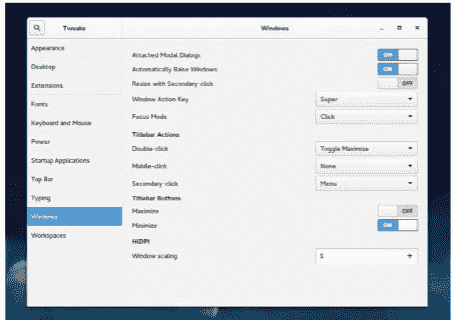

使用基于 `Gnome` 的发行版的用户应使用 `Gnome Tweak Tool` 来调整桌面的行为。

`Launcher` 上的第一个图标会打开 `Dash`，这是 `Ubuntu` 对传统基于菜单的导航系统的诠释。它底部有一个搜索框，你在此输入的任何内容都将用于查找匹配的应用、文档、音乐、视频、即时消息、联系人和其他内容。此外，你还可以使用 `Dash` 安装和卸载应用以及预览媒体文件。`Unity` 还包含 `Heads Up Display (HUD)`，这是对应用程序菜单的一种创新做法。使用 `HUD` 可以帮助你避免在嵌套菜单深处查找选项的麻烦。要访问 `HUD`，请在任何应用内按下 `Alt` 键，然后使用类似 `Dash` 的搜索框执行任务。

默认的 `Unity` 体验是 `Canonical` 经过广泛可用性研究的结果。但你会发现一些调整桌面的选项，可通过 `Launcher` 中齿轮和扳手图标访问的系统设置工具找到。设置分为三个大类。个人组包含用于自定义桌面外观和感觉的设置，通过更改壁纸和修改启动器的行为来实现。请注意在线账户设置，你可以使用它登录多个在线服务，如 `Facebook` 和 `Google Docs`，并将其内容与桌面应用集成。例如，添加你的 `Flickr` 账户将使其与 `Shotwell` 照片管理器集成。

### 认识 GNOME 自己

`Gnome` 是另一个流行的桌面，`Gnome 3` 桌面包含与 `Ubuntu` 的 `Unity` 基本相同的元素，但以不同的方式呈现。起初桌面非常简洁。点击左上角的 `Activities` 按钮以显示概览，其与 `Unity` 的 `Dash` 非常相似。在此视图中，你还获得了一个类似启动器的收藏栏，用于访问常用应用。

中央显示所有打开窗口的预览。右侧是工作区切换器，它始终显示当前工作区和一个额外的空间。如果你在此第二个工作区添加窗口，第三个工作区会自动添加。顶部有一个搜索框，可将任何文本匹配到本地计算机上的应用和文档以及在线服务。`Gnome` 包含一个在线账户应用，可让你登录 `Google Docs` 和 `Flickr` 等在线服务。事实上，`Fedora` 在你首次启动该发行版时会要求你登录这些在线服务。

`Gnome` 桌面还拥有多个自定义应用，可从添加的在线账户获取信息和数据。例如，`Gnome Contacts` 应用可以从 `Gmail` 等各种在线来源导入联系人。同样，`Gnome Documents` 将帮助你从 `Google Docs` 等在线存储库中找到文档。

新用户还应注意桌面的特殊之处。首先，你在 `Gnome` 的任何窗口中都找不到最小化按钮。当你想切换到另一个应用时，请前往 `Activities` 概览并启动新窗口或选择已打开的现有窗口。另一个晦涩的方面是桌面上没有任何图标，也无法创建任何快捷方式或在桌面上放置任何文件夹。

然而，`Gnome` 的 redeeming 方面是其可调性：你只需单击一下即可添加新功能。`Gnome` 支持大量扩展，你可以在不安装的情况下启用它们。只需前往 `Gnome Extensions` 网站 (`http://extensions.gnome.org`)，找到你想要启用的插件并切换按钮即可在桌面上激活它。其中一些流行的扩展旨在帮助从专有操作系统（如 `Windows`）迁移到 `Gnome` 的用户顺利过渡。

### 复活老马

Linux 的一项专长是为那些因无法满足现代操作系统硬件需求而沦为镇纸的机器注入活力。虽然有许多发行版专为旧硬件设计，但我们最喜欢的始终是 `Puppy Linux`。

该发行版使用最轻量的窗口管理器之一（`JWM`），虽然外观可能不漂亮，但它会将那台老旧迟缓的工作马变成一匹飞奔的骏马。但 `Puppy` 在资源有限的硬件上表现卓越的主要原因是其大量轻量级自定义应用。该发行版拥有图形应用、生产力应用以及用于播放、编辑甚至创建多媒体的应用。使用其自定义应用，你可以屏蔽网站广告、抓取播客、进行互联网电话、刻录光盘等，功能更多。

该发行版有不同的版本。`Wary Puppy` 版本使用较旧的内核，并包含额外的驱动程序以支持拨号调制解调器等外设。还有基于最新 `Ubuntu` 版本的版本，例如基于 `Ubuntu 14.04` 的 `Tahrpup` 和基于 `Slackware Linux` 的 `Slacko Puppy`。这些版本使用比 `Wary` 更新的内核，但利用 `Puppy` 的自定义应用来应对有限资源。

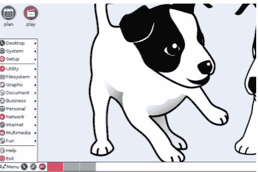

`Puppy Linux` 拥有非常有帮助的论坛板块和大量专门为新用户编写的文档。

### 以 KDE 开场


与另外两个桌面不同，KDE 桌面的布局和行为以及其 `Kickoff` 应用启动器的放置位置对于非 `Linux` 操作系统的用户来说肯定会感到熟悉。但 KDE 如此易变，以至于许多 KDE 发行版看起来各不相同。在许多方面，KDE 凭借其灵活性和众多选项，是典型的 Linux 桌面。KDE 的自定义选项几乎无穷无尽。

KDE 最有用的功能之一是 `Activities`。使用此功能，你可以创建多个上下文感知的活动，每个活动都有其自己的应用和桌面组件集。例如，你可以创建一个社交活动，登录你所有的即时消息账户并显示来自各种社交网络的更新和动态。许多 KDE 发行版仅附带默认活动，称为桌面活动。然而，你可以从互联网获取更多活动并在此基础上构建以适应你的工作流程。

此外，KDE 附带多个界面或视图，旨在充分利用可用的桌面空间。有适用于常规屏幕和上网本的不同视图，尽管你可以在任何类型的计算机上使用任何视图。要切换视图，请右键单击桌面并从上下文菜单中选择默认桌面设置选项。在打开的窗口中，选择视图选项卡并从布局下拉列表中查看不同的视图。

许多 KDE 发行版在桌面上放置文件夹视图小部件，它以整洁的小框显示文件夹内容，你可以将其放置在屏幕的任何位置。然后还有文件夹视图，允许你将文件和文件夹放置在桌面的任何位置。搜索和启动视图专为小屏幕或触摸屏设备设计。每个视图都有额外的可配置元素。

除了将配置选项与各个元素捆绑在一起外，KDE 还将它们全部放在系统设置面板下，与用于管理底层 `Linux` 发行版的其他系统范围配置选项并列。这看起来可能令人望而生畏，但你在使用桌面之前不需要设置或查看每个选项。自定义 KDE 是一个持续的过程，而非一次性事务。

`Ubuntu`、`Fedora` 和 `Mageia` 有多个带有不同桌面的版本。

桌面设计可根据你的使用需求不断成长和演变。

### 31 种口味

除了这三种主要桌面环境外，还有很多可以放在你的发行版之上的环境。有功能齐全的环境，如 `Cinnamon`，也有轻量级的环境，如 `Xfce`、`LXDE` 和 `Mate`。事实上，大多数主流发行版，包括 `Ubuntu`、`Fedora` 和 `Mageia`，都提供多个带有不同桌面的版本。

例如，`Ubuntu` 发行版有多个官方支持的衍生版。有 `Kubuntu`，它为 `Ubuntu` 配备 `KDE`，还有 `Gnome` 衍生版、`Xfce` 衍生版以及使用 `Mate` 桌面的另一个版本。`Fedora` 发行版曾以首屈一指的 `Gnome` 发行版闻名，现在也拥有出色的 `KDE` 版本。同样，你也可以使用 `Gnome` 桌面使用 `Mageia`。事实上，`Mageia` 和 `Fedora` 也有仅安装的 DVD 镜像，让用户可以选择安装多个桌面。

### 切换桌面环境

你也可以在你的发行版上安装多个桌面，例如流行的 `Cinnamon` 桌面。它在 `Fedora` 和 `Mageia` 的官方仓库中可用，你可以通过各自的图形包管理器安装它。

在 `Ubuntu` 上，它可通过 `ppa:gwendal-lebihan-dev/cinnamon-stable` PPA 获取。将此 PPA 添加到你的系统 [as explained in the main text] 然后从软件中心安装桌面环境。

一旦你安装了多个桌面环境，你可以轻松切换到另一个。为此，只需退出当前桌面环境，使用登录管理器并输入登录凭据。在登录桌面之前，探索登录管理器上的按钮。其中一个按钮会显示所有已安装桌面的下拉列表。选择你想要使用的桌面环境，登录管理器将登录到该桌面。这样你可以尝试它们并选择你最喜欢的一个。选择！

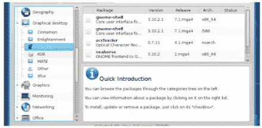

你可以使用发行版的包管理器安装多个桌面环境。

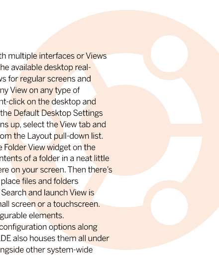

## 安装和管理应用

完善您选择的发行版。

与 `Windows` 不同，典型的 `Linux` 桌面发行版开箱即用程度更高。不是像原味文本编辑器或简陋的绘图工具那样附带基础应用，普通 Linux 发行版会包含功能完整的办公套件和全面的图形编辑器。除此之外，还包括用于常见任务的基础应用集合，例如浏览互联网、检查电子邮件、在各种网络上与朋友即时通讯、整理照片、听音乐和观看视频。

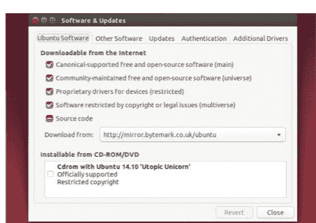

除了启用软件仓库，您还可以选择不同的镜像来下载软件。

话虽如此，由于我们每个人使用电脑的方式都不同，您可能希望安装一些默认未包含的软件。您的发行版拥有专用工具，可帮助您在无需点击复杂安装向导的情况下安装海量优质开源软件。

Linux 发行版使用一系列软件工具，包括图形界面和命令行工具，共同被称为软件包管理系统。这些工具可轻松帮助您安装、移除和升级软件（也称为软件包）。单个软件被分组在软件包中。除了软件本身之外，软件包还包含其他信息，例如应用正常运行所需的其他软件包或依赖项列表。此外，软件包管理系统依赖于一个名为仓库的数据库来跟踪所有可用软件包。

您可以使用“软件和更新”工具来管理 `Ubuntu` 的软件仓库（或简称仓库）。该工具在四个不同的标签页中列出仓库。默认情况下，“Ubuntu 软件”标签页下的四个官方仓库均已启用。`Main` 仓库包含官方支持的软件，而 `Restricted` 仓库包含并非完全免费许可的软件。两个有趣的仓库是 `Universe` 和 `Multiverse` 仓库，分别包含由社区维护的软件和非免费软件。

## 软件包管理 101

`Linux` 世界大致分为两种不同的软件包格式——`RPM` 和 `Deb`。这些是预编译的二进制软件包，旨在简化桌面用户的安装过程。`RPM` 由 `Red Hat Linux` 创建，被 `Fedora` 和 `Mageia` 等发行版使用，而 `Deb` 则用于基于 `Debian` 的系统，如 `Ubuntu`。此外，几乎每个主要发行版都维护自己的图形工具集，以便桌面用户安装、升级和移除应用。您还必须熟悉发行版的仓库结构以及软件的存放位置和方式。

与 `Ubuntu` 不同，`Fedora` 发行版使用 `RPM` 软件包管理系统。该发行版将仓库存放在 `/etc/yum.repos.d` 目录下，主要仓库名为 `fedora.repo`。

`Mageia` 使用 `urpmi` 软件包，它是 `RPM` 软件包管理系统的包装器。该发行版有三个官方仓库。`core` 仓库包含开源软件包，`non-free` 仓库包含闭源应用，而 `tainted` 仓库包含可能在某些国家侵犯专利和版权法的软件包。

这些仓库各自进一步细分为四个子仓库。`release` 仓库包含稳定软件包，`updates` 仓库包含自发布以来已更新的软件包，而 `backports` 仓库包含从 `Cauldron` 仓库回溯移植的新版本软件包，`Cauldron` 仓库最终将成为下一版本的稳定仓库。还有 `testing` 仓库，主要用于 `QA` 目的的软件。

要配置仓库，请启动 `Mageia` 控制中心，然后前往 `软件管理 > 配置安装和更新的媒体源`。要安装官方在线仓库，请点击“添加”，然后选择“仅更新源”或“完整源集”。第一个选项是保持发行版更新的最低要求，而第二个选项允许您安装新软件。这些选项将在窗口中填充仓库列表。然后切换您想要获取软件的仓库旁边的“启用”复选框。

`Ubuntu` 使用高级打包工具或 `APT` 软件包管理器。

## 备份入门

您的发行版将包含一个帮助您备份数据的工具，您应该花时间熟悉它。例如，`Ubuntu` 附带了为新用户设计的 `Deja Dup` 备份应用。您也可以在 `Fedora` 和 `Mageia` 上安装它。无论您使用什么备份工具，都应花点时间考虑应该备份什么以及备份到哪里。备份整个主目录可能很方便，但通常只是过度操作。相反，您只需包含主目录下的目录，例如 `Downloads` 和 `Documents`。

同时请检查重要应用，例如电子邮件客户端，它们会在主文件夹下以隐藏目录（以 `.` 为前缀）保存下载的邮件、附件和地址簿。此外，将备份数据保存在同一磁盘的另一个分区上并无多大用处，因为整个磁盘可能出现故障，导致备份副本失效。一个解决方案是将备份保存在另一块独立磁盘或外部驱动器上。或者，如果您拥有良好的互联网带宽，备份应用还可以帮助您将备份存储在云存储服务上。

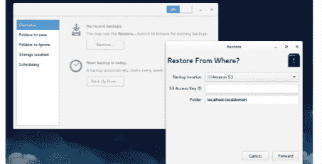

`Déjà Dup` 拥有简洁的界面，不会让即使是初次使用者感到畏惧。

## 软件包管理器

所有主要桌面发行版都包含用于管理软件包的图形工具。`Ubuntu` 的软件中心是其中最好的工具之一。您可以通过点击反映所需软件类型的类别来查找软件。选择类别后，您将看到应用列表。窗口右上角还有一个搜索框，可查找与输入关键字匹配的软件。找到所需软件后，点击其右侧的“安装”按钮。这将获取软件及其所需依赖项并自动安装。所有新安装的软件都会添加到启动器中，您也可以在 `Dash` 下找到它。

`Fedora` 使用 `PackageKit` 图形工具，在 `GNOME` 的“活动”菜单中列为“软件”。它同样列出软件类别，并在顶部提供关键字匹配搜索框以帮助您查找软件。找到所需软件后，点击“安装”按钮，应用将把它添加到您的安装中。


Mageia 的图形软件包管理工具名为 `DraKrpm`。该工具不如 Ubuntu 和 Fedora 中的软件中心漂亮，但功能非常强大且直观，足以完成任务。您可以筛选其可用应用列表，仅显示具有 GUI、安全性更新、错误修复更新等软件包。应用组列在侧边栏中，还有一个搜索框可根据关键字查找软件包。找到想要安装的软件包后，只需切换其对应的复选框并点击“应用”即可。

## 仓库管理员

更大的开源社区提供的软件包远多于您发行版官方仓库中列出的软件包。

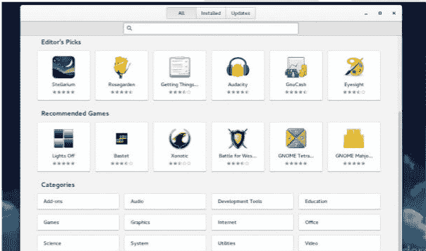

几乎每个发行版都有机制可以添加和安装来自这些第三方仓库的软件。

Ubuntu 中的外部仓库被称为个人软件包档案或 `PPA`。您可以使用“软件和更新”工具将 `PPA` 仓库添加到您的发行版。但首先您需要 `PPA` 的地址。这在 `PPA` 的 `Launchpad` 网站上列出，类似于 `ppa:example-ppa/example`。现在启动该工具并切换到“其他软件”标签页。然后点击“添加”按钮，并在打开的窗口中粘贴 `PPA` 地址。然后 Ubuntu 会要求您刷新仓库以启用 `PPA`。

大多数桌面发行版都有易于使用的图形软件包管理器。

> “与 Windows 不同，典型的 Linux 桌面发行版开箱即用。”

同样，Mageia 也有许多第三方仓库，您需要它们的 URL 才能将它们添加到您的发行版。获得 URL 后，启动 Mageia 控制中心，前往 软件管理 > 配置安装和更新的媒体源，然后点击“添加介质”选项。在弹出的窗口中输入仓库地址及其类型，例如 `HTTP` 或 `FTP`。

Fedora 也有许多第三方软件仓库，但最受欢迎的是 `RPMFusion`。该仓库进一步细分为两个独立的仓库，分别存放免费和非免费软件。您可以通过遵循仓库网站（`www.rpmfusion.org/configuration`）上的说明，直接在浏览器中安装这两个仓库。

## 获取 Google

所有流行的 Google 软件，如 `Chrome`、`Earth`、`Hangouts` 的音频和视频插件等，都可以在 Linux 上安装。但由于许可原因，您在主要发行版的官方仓库中找不到它们。然而，如果我们指引方向，您现在已经掌握了轻松安装它们的全部知识。每个受支持的 Google 应用的下载页面都包含软件的 32 位和 64 位版本链接，格式为 `RPM` 和 `Deb`。下载适用于您特定发行版的软件包，然后双击文件使用发行版的软件包管理器安装它。所有 Google 应用的官方软件包也会在您的发行版中安装适当的外部 Google 仓库以保持软件更新。

您可能还想安装的另一款流行专有软件是 `Skype`。Ubuntu 用户只需访问 软件和更新 > 其他软件 即可启用合作伙伴仓库。这将添加官方 `Skype` 仓库，然后您可以像安装其他任何软件包一样从软件中心安装该软件。另一方面，Mageia 在其 `non-free` 仓库中包含 `Skype` 软件包。如果您已启用此仓库，只需搜索 `get-skype` 软件包，它将从其网站下载 `Skype`。您也可以前往 `Skype` 网站上的 Linux 下载页面，从下拉列表中选择您的发行版和架构，这将下载 `Deb` 文件或 `RPM` 文件。双击文件使用发行版的软件包管理器安装它。

## 播放多媒体

将你的发行版打造成终极媒体中心。

大多数面向桌面用户的 Linux 发行版都能处理你抛给它们的所有类型内容。但有些内容，尤其是大多数音频和视频，以受专利限制的封闭格式分发。发行版无法直接开箱播放这些文件，不过大多数都提供了明确的流程，让用户可以安装组件来播放这些流行的非自由媒体格式。

Ubuntu 在安装过程中就提供了安装可播放受限格式文件（如 `MP3`）组件的选项。如果你已经安装了发行版，则应使用包管理器安装 `ubuntu-restricted-extras` 包，其中包含流行的专有编解码器和插件。

在 Fedora 上，这些编解码器捆绑在第三方 `RPM Fusion` 仓库中。你需要先按前面提到的启用该仓库，然后打开终端并输入以下命令来获取编解码器：

```
su -
```

```
yum install gstreamer1{,}-[plugin-crystalhd,ffmpeg,plugins-{good,ugly,bad,free,nonfree,freeworld,-extras}{,-extras}] ffmpeg libmpg123 lame-libs
```

如果你使用的是 Mageia，你可以在 `Tainted` 仓库中找到多媒体编解码器，因此请确保按照前面提到的流程启用它。然后从“工具”菜单下启动 `Welcome` 应用并切换到“应用程序”标签。从这里你可以安装多个有用的流行软件包，包括多媒体编解码器。

## 哪里是炫目效果？

尽管开源 `WebM` 格式日益流行，许多网站仍然需要 Adobe 的 `Flash` 插件才能正确流式传输多媒体内容。在 Linux 上获取 `Flash` 插件很棘手，因为 Adobe 已不再为 Linux 上的 `Firefox` 开发 `Flash`。唯一在 Linux 上使用最新 Adobe `Flash` 插件的方法是使用包含基于 `Pepper` 的 `Flash` 插件的 `Google Chrome` 浏览器。

Mageia 的 `Welcome` 应用是为各种用户设置发行版的绝佳实用工具。

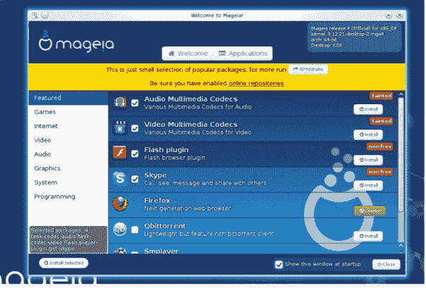

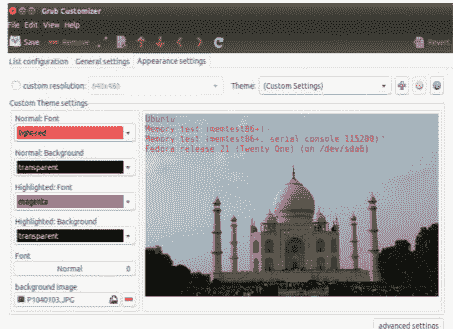

你可以使用 `Grub-Customizer` 工具（`ppa:danielrichter2007/grub-customizer`）调整 Linux 的 `Grub` 启动加载器。

尽管如此，如果你不想切换到 `Chrome`，仍然可以安装过时的 `Flash` 插件并继续使用 `Firefox` 浏览器。或者，你可以从 `Chrome` 浏览器中提取更新的基于 `Pepper` 的 `Flash` 插件并在 `Chrome` 的开源兄弟 `Chromium` 浏览器上使用它。

Ubuntu 用户可以使用 `sudo apt-get install flashplugin-installer` 命令为 `Firefox` 安装 `Flash`。如果你使用的是 `Chromium`，可以通过安装 `pepperflashplugin-nonfree` 包来使用最新的 `Pepper Flash` 插件。

Fedora 用户可以通过添加其仓库从 Adobe 网站下载 `Firefox` 插件。如果你运行的是 64 位安装，此命令：

```
yum -y install http://linuxdownload.adobe.com/adobe-release/adobe-release-x86_64-1.0-1.noarch.rpm
```

将下载并安装正确的仓库。然后你可以使用以下命令导入仓库的密钥：

```
rpm --import /etc/pki/rpm-gpg/RPM-GPG-KEY-adobe-linux
```

然后使用以下命令安装插件：

```
yum -y install flash-plugin
```

Mageia 用户只需启用包含 `Flash` 插件的 `nonfree` 仓库，然后从 `Welcome` 应用的“应用程序”标签中安装即可。

## 最佳多媒体应用

大多数发行版都附带音频和视频播放器。流行的有 `Rhythmbox`，它是基于 `Gnome` 的发行版的默认播放器，在 Ubuntu 中集成良好，以及 `KDE` 的默认 `Amarok`。除了本地曲目外，这两个播放器还可以流式传输互联网广播和播客。如果你想要外观更吸引人的播放器，打开包管理器并查找 `Banshee` 和 `Clementine`。

同样，大多数基于 `Gnome` 的发行版的默认视频播放器是 `Totem`（现在简单称为 `Videos`）。如果你想要功能更强大的播放器，可以使用 `MPlayer`。这本质上是一个命令行媒体播放器，但它有许多前端。`Gnome` 用户可以使用 `Gnome-Mplayer`，`KDE` 用户可以使用 `KMPlayer`。还有流行的跨平台 `VLC`，可以处理几乎任何文件格式。

## 玩游戏

全速前进。

游戏长期以来被认为是 Linux 的阿喀琉斯之踵。多年来我们拥有一些优质的开源游戏，但它们缺乏专有桌面上流行游戏的吸引力。这一切在 2013 年初随着 `Valve` 宣布为其备受欢迎的游戏分发服务推出 Linux 版 `Steam` 客户端而改变。

你可以轻松地在你的发行版中安装专有客户端。Ubuntu 用户应启用 `Partner` 仓库，然后从软件中心安装客户端。Fedora 用户应安装 `RPM Fusion` 仓库，然后使用包管理器安装 `Steam`。同样，Mageia 用户应启用 `non-free` 仓库，然后使用 Mageia `Welcome` 应用安装 `Steam` 客户端。

但在启动 `Steam` 客户端之前，请确保你为显卡硬件安装了适当的驱动程序。这通常是用户的主要障碍，因为显卡制造商限制了其闭源驱动元素的分发。首先使用以下命令获取显卡的品牌和型号详细信息：

```
lspci | grep VGA
```

命令。你可以使用以下命令获取更多详细信息，例如其时钟速度和功能：


`sudo lshw -C video`

你的发行版会在你启动发行版时确保你使用最合适的开源驱动程序。Oibaf PPA（`ppa:oibaf/graphics-drivers`）在 Ubuntu 用户中很受欢迎，用于获取最新的前沿开源驱动程序。然而，Nvidia 和 ATI/AMD 硬件的用户应使用各自厂商的专有驱动程序以获得最佳游戏性能。

Ubuntu 用户应使用 X-Swat PPA（`ppa:ubuntu-x-swat/x-updates`）获取最新的稳定 Nvidia 驱动程序。启用后使用以下命令获取驱动程序：

```
sudo apt-get install nvidia-current
```

Fedora 用户可以在 RPM Fusion 仓库中找到最新的 GeForce 驱动程序。添加仓库后，使用以下命令安装驱动程序


```
yum install kmod-nvidia xorg-x11-drv-nvidia-libs kernel-devel acpid
```

Mageia 用户应先启用 non-free 仓库，然后启动 Mageia 控制中心并前往“硬件 > 设置图形服务器”。在打开的窗口中，单击“显卡”标签旁边的切换按钮，这将显示显卡列表。浏览列表并选择你的显卡。如果 Mageia 有该卡的专有驱动程序，它会安装它。

Mageia 的列表还包括 AMD 卡，但如果你使用的是 Ubuntu 或 Fedora，专有驱动程序的最佳来源是 AMD 的网站（`http://support.amd.com/en-us/download`）。此页面有多个下拉菜单，可用于精确定位显卡的驱动程序。然后下载建议的驱动程序并解压以显示 `.run` 脚本。在安装驱动程序之前，请确保使用以下命令安装其依赖项：

```
sudo apt-get install dh-make dh-modaliseses execstack libc6-i386 lib32gcc1
```

完成后，你可以使用以下命令执行脚本：

```
sh ./amd-driver-installer-13.35.1005-x86.x86_64.run
```

这将启动图形 AMD Catalyst 专有驱动程序安装程序，并将安装 Catalyst Control Center GPU 管理软件。安装程序完成后，返回终端并输入

```
/usr/bin/aticonfig --initial
```

来配置驱动程序。

虽然发行版在其仓库中附带开源游戏，但 Steam 提供了访问《Dying Light》等 AAA 游戏的途径。


## 用户管理基础

当 Linux 安装时，它会自动配置为供单个用户使用，但你可以轻松添加单独的用户账户。超级用户 `root` 对操作系统及其配置拥有完全访问权限；它仅用于管理用途。非特权用户可以使用 `su` 和 `sudo` 程序进行受控的权限提升。用户被分组到一个组中，并继承该组的访问权限。每个 Linux 用户至少是某个组的成员。现在，你可以控制哪些文件和文件夹可由用户或组访问。默认情况下，用户的文件只能由该用户访问，系统文件只能由 `root` 用户访问。在 Linux 中，文件和文件夹可以设置成只有特定用户可以查看、修改或运行它们。这允许你，例如，与其他用户共享文件，使他们可以读取文件但不能进行任何更改。对文件的访问通过所有权权限系统控制。你可以使用 `ls -l` 列出权限。不指定文件名时，它将列出目录中所有文件的权限。输出中的不同字符代表文件所有者、组和其他用户对文件的读（`r`）、写（`w`）和执行（`x`）权限。你可以使用 `chmod` 命令或从文件管理器图形方式更改文件和文件夹的权限。

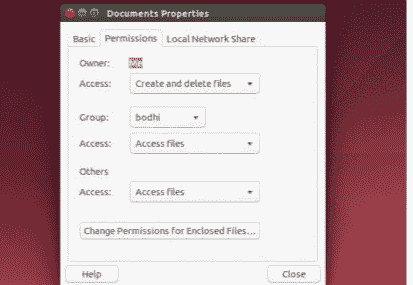

几乎每个发行版的文件管理器都允许你调整与文件或文件夹关联的组。

## GIZMODO | UK

不是普通的科技网站


## 探索科技新世界

小工具、科学、设计等等

- 来自科技前沿的精彩报道
- 探索创新、文化和极客文化
- 加入英国领先的在线科技社区

`www.gizmodo.co.uk`

`twitter.com/GizmodoUK` `facebook.com/GizmodoUK`

## 逃离 Windows

时机已到——跟随我们，帮助你摆脱 Windows，投向 Linux 和自由。


> “微软终于迷失方向了——现在是切换到更好操作系统的完美时机”

如果你买了一台预装 Windows 的新电脑，并得出结论微软终于迷失方向了，现在正是切换到更好操作系统的完美时机。Mac 很亮眼也很昂贵，那为什么还要买呢？当你可以保留现有电脑并转向 Linux 时。Linux 意味着沉浸在命令行把戏的时代已经过去——我们将向你展示如何在一旁安装一个用户友好的 Linux 发行版，同时保留现有的 Windows 安装且不丢失任何数据，让你能够涉足 Linux 免费开放的水域。为了让过渡尽可能顺畅，我们选择了 `Ubuntu 14.04 LTS`（随封面光盘附赠）作为我们首选的 Linux 发行版。`Ubuntu` 是目前最用户友好的 Linux 发行版之一，而 `14.04 LTS` 刚刚发布。`LTS` 代表长期支持，这意味着它可获得五年的更新和支持。下面是你将要做的事情。首先，如果我们不指导你如何备份当前电脑，那就疏忽了。这里你有两个基本选择：内置于 Windows 本身的备份工具，或随封面光盘附带的 `SystemRescueCD`。接下来，我们将解释现代电脑随附的一种名为 `UEFI` 的新系统，这可能会导致一些小问题。但别担心，因为如果出现问题，我们会向你展示如何克服。最后，我们将一步步带你完成安装过程，这非常简单。我们不会让你悬而未决——一旦你第一次启动到 `Ubuntu`，我们将带你游览新桌面，揭示如何访问现有文档和其他文件，并向你展示如何掌握你的全新操作系统。从未有比现在更好的时机做出改变生活的 Linux 转换，所以抓住我们的手，勇敢一跃。

## 使用 Windows 的完整指南！

金钱能买到的最佳 Windows 指南！

## Windows 8.1

## 简化版

凭借我们的深入建议，今天即可享受无忧计算

148 页技巧、窍门和教程

## 立即推出！

附带免费数字版

免费本书的数字版！

请参阅第 146 页了解更多信息

## 直接送达您家门口

在 `www.myfavouritemagazines.co.uk` 在线订购或在您最近的超市、报刊亭或书店找到我们！

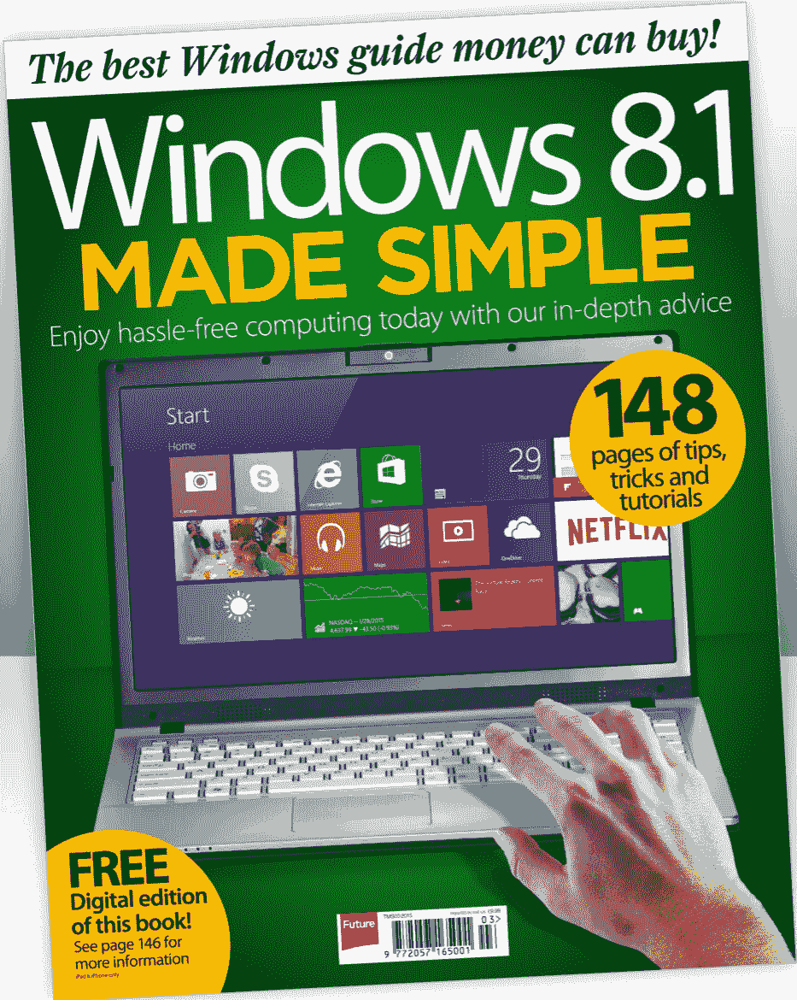

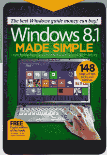

## 全部备份！

坚持跟着我们——在迁移到 Linux 之前，做好万无一失的备份。

备份系统的最简单方法是使用 Windows 7 或更高版本内置的 Windows 备份工具——选择“系统映像备份”并按照提示操作。它并不令人兴奋，也有点吓人，但它是必不可少的。对于纯 Linux 备份解决方案，请使用随封面光盘附带的 `SystemRescueCD`。方法如下……将光盘放入驱动器后重新启动电脑，必要时访问启动菜单（通常为 `[F11]`）并选择 `DVD` 驱动器，然后选择“`SystemRescueCD`”。启动问题可能是由电脑的 `UEFI` 引起的（请参见下一页修复方法）。否则，选择默认的启动选项条目。在提示输入键盘布局时输入 `uk`，并在最终命令提示符下输入 `startx` 以访问图形环境。加载完成后，点击左下角的“`Menu`”按钮并选择“`System > Show Filesystems`”以识别每个分区。磁盘条目标识每个物理驱动器（`sda`、`sdb` 等），而设备标识分区。在大多数情况下，`sda` 将是你的 Windows 驱动器，因此你需要备份 `sda1`（一个小的启动分区）和 `sda2`（实际的 Windows 分区）。你还需要记下打算备份到的分区，并确保其有足够的可用空间。现在切换到终端窗口。要挂载备份分区，请输入以下命令，如果备份驱动器为 `FAT32`，则将 `ntfs` 改为 `FAT`，并将 `sdc2` 替换为驱动器的实际分区名称：

```
mount -t ntfs /dev/sdc2 /mnt/backup
```


现在重新打开菜单并选择“System > Partimage”。此工具可让你备份分区，因此先从`/dev/sda1`开始，然后按 `[Tab]`。接下来，在“Image file to create/use”框中输入`/mnt/backup/sda1-backup.gz`。保持“Save partition into a new image file”选中状态并按 `[F5]`。在“Compression level”下验证是否已选择“Gzip”，然后再次点击 `[F5]`。如需输入描述，然后按 `[Tab]` 选择“OK”并按 `[Enter]`。注意实验性 NTFS 支持，然后点击两次“OK”，并记录驱动器统计信息。如果成功完成，重复操作以备份 Windows 分区，但将其命名为`sda2-backup.gz`。

要备份计算机的主引导记录，请打开终端窗口并输入以下命令：

```
cd /mnt/backup
mkdir partition-backup
cd partition-backup
dd if=/dev/sda of=backup-sda.mbr count=1 bs=512
```

以备份 MBR。现在使用以下命令备份分区表：

```
sfdisk -d /dev/sda > backup-sda.sf
```

如果收到关于 `sfdisk` 不支持 GPT 分区的警告，请改为输入`sgdisk --backup=backup-sda.sg /dev/sda`。如果发生灾难，要么从 Windows 救援光盘启动并按照提示操作，要么重新启动到 SystemRescueCD。如果你已经进行到 Ubuntu 调整 Windows 分区的程度，首先需要从任务栏快捷方式启动 Gparted 分区工具。它应显示你的主硬盘（`/dev/sda`），因此请识别扩展分区。右键单击其中的每个卷并选择“Delete”，然后右键单击扩展分区并将其删除。接下来，右键单击 Windows 分区并选择“Resize/Move”。分配所有可用空间，点击“Resize/Move”然后点击“Apply”。要完成分区恢复过程，请按照下面的逐步指南操作。最后一步是恢复 MBR。打开另一个终端窗口并输入：

```
cd /mnt/backup/partition-backup
dd if=backup-sda.mbr of=/dev/sda
```

如果使用 `sfdisk` 备份了分区，请在命令提示符中输入`sfdisk /dev/sda < backup-sda.sf`；如果使用的是 `sgdisk`，请改为输入`sgdisk --load-backup=backup-sda.sg /dev/sda` 以完成恢复。

## 恢复你的原始设置

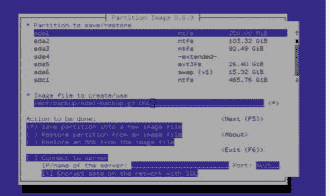

### 1 选择备份

像之前一样启动到 SystemRescueCD。按照正文中的步骤（上方）操作，直到识别出你的分区。接下来，在`/mnt/backup`目录中挂载备份分区。完成后，打开 Partimage。保持“sda1”选中，在“Image file”框中输入之前的备份路径和名称。

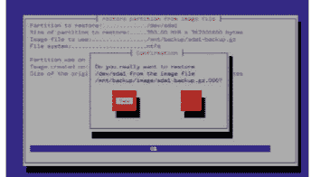

### 2 恢复启动分区

按两次 `[Tab]` 以突出显示“Save partition”旁边的星号，然后按向下箭头再按 `[Space]` 选择“Restore partition from an image file”。按 `[F5]`。注意描述并按 `[Enter]`。按 `[F5]` 恢复分区，处理警告直到文件复制回来。

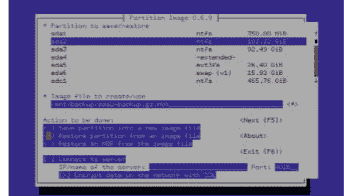

### 3 恢复主分区

分区恢复后 Partimage 将关闭，因此再次启动它，但这次选择你的主 Windows 分区（通常为“sda2”）。然后重复之前的步骤，只不过这次使用第一个备份文件。注意：恢复依赖于你的 Windows 分区保持相同大小。

## 处理 UEFI & Ubuntu

即使是 Windows 8 系统，也让你的系统正确配置。


特别是预装 Windows 8 的现代电脑，已用名为 UEFI 的新系统取代了传统的 BIOS。两者执行相同的任务，在将硬件移交给操作系统之前检测并初始化硬件，但 UEFI 相对于传统 BIOS 有些原始的功能而言代表了质的飞跃。UEFI 提供了比 BIOS 更广泛的功能，全部包装在更用户友好、图形更美观的界面中。

然而，存在一些需要规避的潜在问题。首先，由于 UEFI 是较新的标准，它与旧硬件不兼容。这个问题可通过特殊的兼容性支持模块（CSM）来解决，该模块可让你模拟 BIOS 以运行旧硬件和操作系统。

更具争议的是，UEFI 还附带 Secure Boot 模式，虽然这使电脑不易受恶意软件影响，但被用来将其锁定到 Windows 8。同样，这一功能在大多数情况下可以禁用，但好消息是 Ubuntu 14.04 LTS 完全支持新硬件和 Secure Boot，因此你无需禁用任何一项即可将其与

> “因为 UEFI 是较新的标准，它与旧硬件不兼容”

Windows 一起安装。然而，你需要禁用的一项 UEFI 功能是 FastBoot（也称为 QuickBoot 或 FastStartup）。

### 调整 UEFI

访问 UEFI 与进入 BIOS 设置相同。打开电脑，然后在屏幕上出现提示时按下进入设置的键（通常为 `[F2]` 或 `[Del]`）。通过查找名为 Windows 8 Configuration 的部分，或——如果不存在——Boot 来验证 FastBoot 已被禁用。找到后，确保其已关闭或禁用。

如果你打算使用封面光盘上的 SystemRescueCD 备份系统，可能需要调整 CSM 和 Secure Boot 设置。同样，在 Windows 8 Configuration 中查找 Secure Boot（如果存在），它可能列为 Windows 8 Logo Requirement。无论如何，如果启动 SystemRescueCD 时出现问题，请禁用它。如果该部分不存在，请改在 Security 下查找。

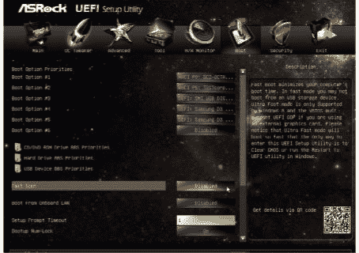

在尝试安装 Ubuntu 之前，请确保你的 FastBoot 设置已禁用。

CSM 模块可能是 Windows 8 Logo Requirement 屏幕的一部分，也可能单独隐藏（例如，我们在 ASRock 主板上发现它被埋在 Boot 菜单底部）。点击它以显示涵盖不同硬件的不同选项——查找对 PXE（预启动环境）、GOP（图形）和 Storage（或 SATA）以及 USB 和 PS2（如适用）的引用。这使你能够根据需要对特定设备有选择地打开或关闭 CSM。

一些主板——包括我们的 ASRock——允许你根据需要运行两种模式。（就 ASRock 而言，我们将每个都设置为“Do not launch”以使此设置成为常态。）如果没有明显的选项可编辑 Secure Boot 或 CSM 设置，请联系你的电脑制造商以确认这些设置是否可以禁用。在大多数情况下，使用现成主板构建的电脑应具有所需选项，但一些制造商已知会提供功能受限的主板。

升级电脑的显卡通常需要启用 CSM 支持，因此即使控件尚未受支持，制造商也可能在终端用户施压下，并在其网站上提供了 UEFI 更新以启用所需选项——Advent 的 DT2410 PC 就是一个例子。

在 Windows 系统已备份且 UEFI 配置正确后，是时候继续并在现有系统旁边安装 Ubuntu 了。我们选择 Ubuntu 的原因之一是其用户友好性在安装时即可显现。设置过程毫无痛苦且相对简单易懂：把封面光盘放入驱动器，启动电脑，并在必要时从启动菜单中选择光驱。当封面光盘菜单出现时，选择 Ubuntu 选项开始。

### 选择正确的启动选项

许多现代电脑现在提供在 UEFI 或传统 BIOS 模式下启动的选项，后者模式可让你安装旧操作系统。Ubuntu 在 UEFI 和 Legacy 模式下都能正常工作，但其他环境——包括 SystemRescueCD——需要从传统选项启动。一些电脑甚至支持混合模式启动，直接从启动菜单提供传统和 UEFI 选项，因此你不必深入 UEFI shell 来在它们之间切换。如果你曾想过为什么启动菜单中某些启动选项会显示两次，这就是原因：仔细观察，你会看到其中一个选项以 UEFI 为前缀。这给了你选择以何种模式启动该驱动器的选项，这是一种测试特定操作系统或可启动光盘是否与 UEFI 兼容的好方法。如果你只被提供一组启动选项，你的 UEFI shell 将仅允许你在 UEFI 模式或传统模式下启动。后者要求启用 CSM，但完成此操作后，你应该能够从 UEFI shell 的 Boot 部分更改启动设置——包括设备优先级。如果你的电脑支持混合模式启动，你可能需要设置不同的默认启动设备，在这种情况下，在选择要设为默认的设备（通常是光驱或启动硬盘）时，请注意选择正确的模式。


等待几分钟，然后经过短暂暂停，屏幕变灰再变红后，欢迎屏幕将会出现。你将可以选择试用 `Ubuntu` 或安装它——选择“安装”选项。接下来，勾选两个框：‘下载更新’和‘安装此第三方软件’。点击“继续”，然后等待更新在后台下载。

## Install Ubuntu 14.04 LTS

随后应出现安装类型屏幕。在大多数情况下，它应能无缝检测到你的 `Windows` 安装——保留“与…一起安装 `Ubuntu`”并点击“继续”。

如果未提供 `Windows` 作为选项，这意味着 `Ubuntu` 未检测到它。如果你使用的是安装了 `UEFI` 取代传统 `BIOS` 的较新电脑，则需要确保从光盘启动时使用与 `Windows` 安装时相同的选项。重新启动电脑，然后从启动菜单中选择替代的光盘选项，查看 `Ubuntu` 现在是否能检测到你的 `Windows` 安装。如果无论选择 `UEFI` 还是传统选项，该选项都未出现，可能是由于你的分区表同时包含 `MBR` 和 `GPT` 记录（请参阅下文的分步指南，了解解决此问题的方法）。

下一个屏幕中，`Ubuntu` 会自动为自己寻找一些可用空间——要么分割当前的 `Windows` 分区，要么在另一块已连接的驱动器上找到更多空间并重新分区。如果不希望它安装在 `USB` 驱动器上，请关闭电脑，断开有问题的驱动器，然后重新开始。`Ubuntu` 需要

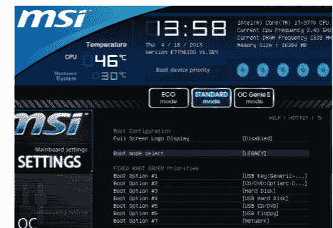

检查你的 `UEFI` shell 的启动设置，查看是否选择了 `Legacy`、`UEFI` 或混合模式。

至少 6.4GB 的可用空间，但如果可以的话会占用多达 40 多 GB。你可以通过点击并拖动两个建议分区之间的灰色空间来更改此数值。它足够智能，不会让你吞噬整个 `Windows` 分区，但如果你计划继续使用它，建议至少保留 10GB 的可用空间，最好更多。在大多数情况下，默认选择应该没问题，所以点击“立即安装”。注意有关分区调整大小的注释，然后点击“继续”。

接下来你将被提示选择你的区域——安装程序应能自动检测到——然后点击“继续”选择键盘布局。在大多数情况下，默认的英国键盘布局是合适的，所以再次点击“继续”。现在你将被提示输入你的姓名。随着输入，`Ubuntu` 会根据你的选择填充计算机名称和用户名字段——如你所愿，可以编辑两者。最后的选择是设置密码。选择一个容易记住的密码，因为你不仅需要它登录 `Ubuntu`，还需要执行管理员级别任务。再次点击“继续”，然后坐下来等待 `Ubuntu` 在你的电脑上自行安装——真的就是这么简单。值得留下来，因为安装程序会提供一些有用的提示，帮助你迈出使用 `Ubuntu` 的第一步。但请翻页，我们将带你亲自游览你闪亮的新桌面和操作系统。


## Fix Windows detection issues

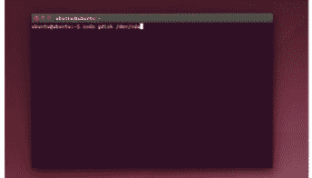

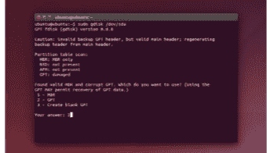

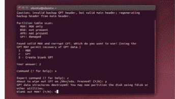

### 1 Launch Ubuntu Live

如果未检测到你的 `Windows` 安装，点击“返回”直到回到欢迎屏幕。点击“试用 `Ubuntu`”加载实时 `CD`。加载完成后，按 `[Ctrl]`+`[Alt]`+`[T]` 打开终端窗口。输入以下命令并按 `[Enter]`：

```
sudo gdisk /dev/sda
```

### 2 Verify and fix

如果 `gdisk` 说它同时找到了 `MBR` 和 `GPT`，那么 `GPT` 的存在就是问题——删除它将使 `Ubuntu` 能够看到你的 `Windows` 分区。首先，通过输入 `2` 并按 `[Enter]` 选择 `GPT` 条目。提示时，输入 `x` 并按 `[Enter]` 进入专家命令模式。

### 3 Apply and reboot

输入 `z` 并按 `[Enter]`。提示擦除 `/dev/sda` 上的 `GPT` 时，输入 `y` 并按 `[Enter]`。当询问是否要清空 `MBR` 时，确保输入 `n`，按 `[Enter]` 并关闭终端，然后重新启动并再次尝试安装 `Ubuntu`。这次你将看到与 `Windows` 并行安装的选项。


## Get started with Ubuntu

迈出进入 `Unity` 桌面的第一步。

你已安装 `Ubuntu`，取出封面光盘并重新启动了电脑。你会看到的第一个变化是启动时出现一个新的启动菜单，名为 `GNU Grub`（参见“关于 `Grub`”，第19页）。这使你可以选择要启动哪个操作系统，同时还能访问内存测试实用工具。默认选择是 `Ubuntu`，但在首次启动它之前，我们建议选择 `Windows` 条目。这让 `Windows` 在 `Ubuntu` 安装程序调整分区大小后首次启动——你会注意到它立即运行磁盘检查工具以验证并更新其自身的分区记录。让它完成此操作，完成后再重启电脑。从 `Grub` 启动菜单再次选择“`Windows`”以检查一切是否正常。假设一切正常，再次重启电脑。

这次，保留“`Ubuntu`”被选中并按 `[Enter]` 首次启动你的新操作系统。加载屏幕闪过后，你将被提示输入安装期间设置的密码。输入密码，按 `[Enter]`，你将到达名为 `Unity` 的 `Ubuntu` 桌面。

`Unity` 桌面与 `Windows` 有许多相似之处，例如左侧存在快捷图标，但你也会注意到一些关键差异，这些差异对以前使用过 `Mac` 的人来说会更熟悉。首先，屏幕顶部的菜单栏的工作方式类似于 `Windows` 任务栏通知区域，多个图标提供对关键工具的访问。从一开始你就会看到——从左到右——网络、键盘、音量、日期/时间 和 设置。这些大多不言自明——只需点击一个即可显示其选项菜单。

“设置”按钮是最有趣的——它不仅提供对电源选项的访问，还能快速切换用户、注销或锁定计算机，并提供一个方便的 `Ubuntu` 系统设置快捷方式，稍后会详细介绍。

当你打开一个应用时，其标题也会出现在菜单栏中——将鼠标悬停在菜单栏上，其菜单项会显示，点击其中一个即可打开其菜单。

## The App Launcher

屏幕左侧显示的快捷图标是 `Unity` 应用启动器的组成部分。与其用大量图标 clutter 桌面，这些都集中在单列中——只需将鼠标移至启动器的底部或顶部即可显示更多快捷方式。应用启动器包含对应用程序、工作区、可移动驱动器和废纸篓的快捷方式。然而，顶部两个快捷方式特别值得关注：顶部一个让你能从一个方便的窗口快速搜索电脑和互联网，而文件快捷方式则提供对文件管理器的访问，使浏览、访问和管理文件变得容易——稍后会详细介绍。

要了解有关快捷方式的更多信息，将鼠标悬停在其上，其标题会弹出。点击一个即可打开它。随着时间的推移，你会想知道如何从应用启动器中添加和删除快捷方式——要删除快捷方式，只需右键点击它并选择“从启动器中解锁”。添加快捷方式最简单的方法是使用搜索工具找到相关应用，然后只需点击并拖动其快捷方式到启动器中的位置。你也可以通过简单地点击并拖动它们到新位置来重新排序启动器中的项目。

桌面本身的工作方式与 `Windows` 类似，如果你愿意 clutter 它，可以用来存放文件、文件夹和快捷方式——同样，它使用熟悉的右键菜单为你提供选项

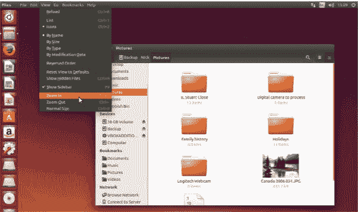

前 `Windows` 用户首次尝试 `Unity` 桌面环境时的主要区别将是启动栏的位置。

## Get more apps

`Ubuntu` 14.04 LTS 附带了一些预装应用——尤其是 `LibreOffice` 和 `Firefox` 网络浏览器。要查看已安装应用的完整列表，请打开 `Ubuntu` 软件中心并选择“已安装”按钮。展开类别以查看其中的应用，例如 `Rhythmbox`。使用搜索框定位它们，然后直接从此处打开或将快捷方式拖到应用启动器上。你可以向 `Ubuntu` 安装中添加更多应用，且绝大多数都是免费的。有多种方法可以做到这一点：正如你在使用 `Ubuntu Tweak` 时所见（参见“访问你的文档”，右上方），你可以从网络下载应用或从我们的封面光盘安装。如果它们打包为 `Deb` 文件，你可以双击它们，让 `Ubuntu` 软件中心管理安装。你也可以在软件中心内搜索更多应用——只需使用搜索框。`Ubuntu` 软件中心并不是应用的权威来源——`Linux` 应用存放在称为存储库的特殊集合中，正如你将在下一页看到的，你也可以通过终端安装应用。一件事你想要做的是访问特定文件类型的应用，例如图像。如果你找不到应用，尝试双击你想要打开的文件——如果出现“无法显示”错误，点击“是”以搜索 `Ubuntu` 仓库中的应用。

## 访问你的文档

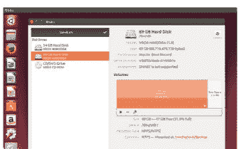

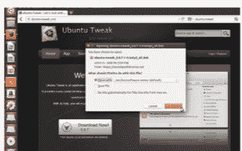

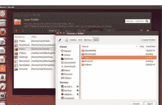


### 1 识别挂载点

在应用启动器中点击“Search”，输入 `disks` 并点击“Applications”下的“Disks”快捷方式。假设你已将数据移至新驱动器，在左侧窗格中选择该驱动器。现在在“Volumes”下突出显示存储数据的分区，并记下其挂载位置。

### 2 安装 Ubuntu Tweak

打开 Firefox 网络浏览器并浏览至 `http://ubuntu-tweak.com`，忽略 `Launchpad` 提示，然后点击最新的 `Deb Package` 链接（撰写时为 `0.8.7`）。点击“OK”使用 `Ubuntu` 软件中心启动它，然后在点击“Install”按钮前查看软件包说明。

### 3 移动用户文件夹

点击“Search”按钮，输入 `Ubuntu` 并在“Applications”下选择“Ubuntu Tweak”。选择“Admins > User Folder”。每个文件夹都会列出——选择一个并点击“Change”。在你的数据分区中浏览对应的文件夹，选择它并点击“Open”。对其他所有用户文件夹重复此操作。

创建文件夹、管理现有图标以及更改桌面背景，如你所愿。

`Ubuntu` 可以检测 `FAT32` 和 `NTFS` 分区，因此访问旧数据不应有太大问题。你应该能在应用启动器中看到这些驱动器——点击其中一个即可打开其内容进行查看。如果你在寻找个人数据，除非你在 `Windows` 中特意移动了文件夹，否则你应该能在用户名下的 `Users` 文件夹中找到所有文档。

`programs.` 要使更改完整，请按照上述逐步指南将你的 `Ubuntu` 用户文件夹指向同一位置。我们建议遵循给出的建议并保持 `Ubuntu` 桌面文件夹不变。完成后，通过打开 `Nautilus` 并点击左侧窗格中的“Documents”快捷方式来测试调整是否生效，它现在应指向你的数据分区。

要访问你的网络，打开一个文件夹窗口，你会在屏幕左侧看到网络选项。点击“Browse Network”查找其他计算机——有一个方便的 `Windows Network` 快捷方式用于访问 `Windows PC`。或者，如果你知道计算机名称，点击“Connect to server”并输入 `smb://comp-name` 然后点击“Connect”。如有必要，请准备好用户名和密码。

### 访问你的数据

你也可以通过在启动器上点击“Files”快捷方式来访问图形化的 `Nautilus` 文件管理器。它提供了一个熟悉的双窗格窗口，左侧有一系列快捷方式，右侧显示当前选定文件夹或驱动器的内容。默认情况下，项目以网格显示，但你可以使用右上角的按钮切换到列表视图。你还会看到一个“Search”按钮，可用于搜索当前选定的文件夹（以及任何子文件夹）。

> “`Ubuntu` 可以检测 `FAT32` 和 `NTFS`，因此访问旧数据不应成为问题”

如果你想从 `Windows` 分区复制数据到 `Ubuntu` 中的用户文件夹，浏览到其中一个用户文件夹——例如 `Documents`——然后点击并拖动其所有内容到左侧窗格中的“Documents”快捷方式。最好确保你有足够的可用驱动器空间。如果你计划继续在 `Ubuntu` 旁边使用 `Windows`，更好的解决方案是设置一个备用驱动器或分区作为专用数据驱动器，允许 `Ubuntu` 和 `Windows` 访问同一份副本。这需要是 `FAT32` 或 `NTFS` 分区，以便 `Windows` 也能访问。

假设此类分区已就位，先重新启动到 `Windows` 进行设置。现在在你的数据分区上为 `Documents`、`Pictures`、`Music` 和 `Videos` 创建专用文件夹。打开你的 `Windows` 用户文件夹，右键点击“Documents”文件夹并选择“Properties > Location tab”。点击“Move”并选择数据分区上的“Documents”文件夹。点击“OK”，然后启用它以将所有现有数据移动到数据分区。对其他文件夹重复此操作。

`Ubuntu` 应能自动处理你电脑的所有硬件，如有必要使用通用驱动程序，但你可以使用“Software & Updates”应用查看已安装的内容，以及查找其他驱动程序（专门用于游戏、Wi-Fi 或打印）。打开一个搜索框，输入 `software` 然后点击“Additional Drivers”快捷方式。它将搜索可能存在的驱动程序更新并提醒你可能已安装的任何替代或专有驱动程序。

完成后，重新启动到 `Ubuntu`。你的文件现在应可从数据分区轻松访问，使你能够使用 `Windows` 和 `Ubuntu` 对其进行更改

如果你将数据存储在云端，好消息是 `Ubuntu` 支持各种云提供商——这是一件好事，鉴于它最近已放弃自己的 `Ubuntu One` 云存储服务。一些提供商在 `Linux` 上得到官方支持，例如 `Dropbox`（`www.dropbox.com/install`）。如果你想要大量免费存储空间，`Google Drive` 提供 `15GB`，但目前尚无官方 `Ubuntu` 支持。也有许多第三方选择，如果你愿意支付 `15` 美元，`InSync`（`http://insynchq.com`）是首选工具。你甚至可以使用 `OwnCloud` 来设置自己的存储……


## Linux 的核心

了解你需要掌握的关键工具和技术。

现在你已对 `Unity` 桌面有所熟悉，是时候更深入地探索 `Linux` 的海洋，并为自己武装更多在今后使用时所需的重要知识。在深入之前，最好先进行系统备份——当你开始学习 `Ubuntu` 时，可能会犯错导致无法访问系统。 （见下文“再备份一次”。）

首先，让我们看看 `Linux` 文件系统及其文件夹组织方式。首先，`Linux` 使用与 `Windows`（`NTFS` 或 `FAT32`）不同的文件系统，称为 `ext4`。这使得你的 `Linux` 文件夹对 `Windows` 不可见，因为 `Windows` 无法原生读取基于 `ext` 的驱动器。这没关系——我们已将你的数据移至两个操作系统都能看到的共享分区，而且这样你就不会意外访问 `Ubuntu` 分区。

现在，打开 `Nautilus`，你将被带到你的 `Home` 文件夹。这与你的 `Windows` 用户文件夹类似，通常包含所有个人文件，尽管我们已将关键文件夹移至数据分区，以便你与 `Windows` 安装共享文件。快捷方式可在此左侧窗格中找到。

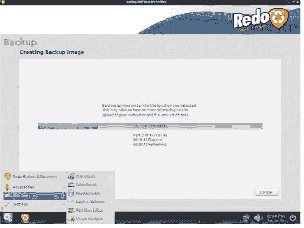

使用 `Redo` 为双启动系统额外备份。

现在点击“Devices”下的“Computer”链接，你还会看到许多其他文件夹。大多数在日常使用中可以安全忽略——例如 `bin` 文件夹是程序存储的位置——但值得注意的有 `media` 和 `mnt`。这些是可找到已连接外部驱动器和网络文件夹快捷方式的位置。两个文件夹之间的关键区别在于，`/media` 文件夹中挂载的驱动器是按用户挂载的，并且在挂载前不需要提升权限。这意味着在你登录账户之前它们对系统不可用，这可能会导致启动程序出现一些问题。有关更多信息，请参阅 `http://bit.ly/MountWinParts`——跳转到“Configuring /etc/fstab”部分，了解在登录前挂载分区的指南以规避此问题。

### 关键系统工具

虽然 `Ubuntu` 需要你访问命令行来执行某些复杂任务，但无需它也能做很多事情。我们在逐步指南中介绍了 `Disks` 实用程序（第 17 页）。`Disks` 让你可以查看和管理驱动器及其分区——通过选择一个，点击“Settings”按钮并选择“Edit Mount Options”，你可以在不直接编辑 `fstab` 文件的情况下更改分区挂载方式。但要谨慎使用——如果驱动器行为不符合预期，将“Automatic Mount Options”开关切换回“On”以恢复原状。

许多系统首选项可通过 `System Settings` 工具访问——点击菜单栏上的“Settings”按钮即可访问。你会看到三个部分按钮：“Personal”、“Hardware”和“System”。从那里你可以访问特定的首选项工具。例如，选择“Appearances”以调整一些桌面设置，例如在不需要时自动隐藏应用启动器，以及将应用程序的菜单移至其自己的窗口而不是主菜单栏。

你也可以安装专用调整工具。我们已经看到 `Ubuntu Tweak Tool` 如何用于将主文件夹移至另一个驱动器（第 17 页）。它还

### 再备份一次


现在`Ubuntu`已安全安装在你的电脑上，是时候考虑对硬盘进行一次新的备份。你当然可以使用`SystemRescueCD`来实现此目的（见第 17 页）。如果这听起来太麻烦，你可以尝试`Redo Backup and Recovery`。从`SourceForge`（`http://bit.ly/Redobackup`）下载`ISO`文件并刻录到光盘——在`Ubuntu`中，插入空白光盘并在出现“Choose application to launch”窗口时点击“Cancel”。找到`ISO`文件（通常在你的`Downloads`文件夹中），右键点击它并选择“Write to Disc”，然后点击“Burn”。光盘创建完成后，重新启动电脑并选择从光盘启动——你可能需要在启动前调整`UEFI`设置；为存储启用`CSM`应该足够。选择“Start Redo Backup”（如果此操作无效，请选择`Safe Mode`选项）并在主屏幕出现时点击“Backup”。

选择你的驱动器，然后选择要备份的分区。然后是选择备份驱动器并创建将存储备份的文件夹。给你的备份命名，然后`Redo Backup`会完成其余工作。如果最坏的情况发生，恢复只需点击“Restore”而不是“Backup”并按照提示操作即可。你还会在左下角找到“Settings”按钮，其中包含许多有用的磁盘相关工具。

## 关于 Grub

当你将`Ubuntu`与`Windows`并行安装时，它会在你的系统上添加一个特殊的启动加载器，提供启动菜单以在启动时在`Ubuntu`和`Windows`之间进行选择。该启动加载器称为`Grub 2`，正如你所见，它被设计为在自动加载`Ubuntu`之前等待一段短时间。你可以通过编辑其配置文件并通过终端更新`Grub`来配置`Grub`的行为——选择在开始加载默认选项之前等待更短或更长的时间，甚至更改该选择。在这样做之前，请确保已备份系统。

完成之后，打开终端，然后输入`sudo apt-get install gksu`后跟`gksu gedit /etc/default/grub &`。这会在`Gedit`窗口中打开`Grub`配置文件。从这里，你需要使用想要实现更改来编辑现有文件。首先，`GRUB_DEFAULT=0`行使`Ubuntu`成为启动时的默认选择。要使`Windows`成为默认选择，并且假设启动菜单中有五个条目（`Ubuntu`、`Ubuntu`高级选项、两个内存测试选项，最后是`Windows`），将其更改为`GRUB_DEFAULT=4`。

或者，要将默认操作系统切换为上次选择的操作系统，将`GRUB_DEFAULT=0`改为`GRUB_DEFAULT=saved`，然后在此下方立即添加新行：`GRUB_SAVEDDEFAULT=true`。你还可以更改`Grub`在启动默认选项之前等待的时间长度（以秒为单位）。只需相应地更改`GRUB_TIMEOUT=10`。完成此操作后，单击“保存”按钮并关闭`Gedit`窗口。忽略警告并输入`sudo update-grub`以更新启动加载器。

包含一个方便的`Apps`选项卡，可轻松查找和安装新软件。另外，花时间探索`Tweaks`部分，尤其是`Unity`组件，在那里你可以执行诸如调整启动器图标大小等操作。

另外两个值得探索的调整工具是`Unity Tweak Tool`，它可让你对桌面进行更精细的控制，以及`Tweak Tool`。两者都可以通过`Ubuntu`软件中心找到——选择`Unity Tweak Tool`的`trusty-backports`版本。两者都提供类似的点按访问隐藏系统设置的方式。

## 仓库

虽然你可以从网站下载程序，但使用集中的软件中心要容易得多。`Ubuntu`提供自己的软件仓库，这是一个包含数百个专门编译以与`Ubuntu`配合使用的`Linux`程序的服务器。这意味着你在软件中心找到的任何软件都应该能正常工作，这使其有点像拥有你自己的`Linux`应用商店。中心还会留意程序更新，在可用时提醒你并为你安装。

你也不仅限于一个应用商店——抱歉，是仓库；例如，从其自己的网站安装`Dropbox`程序，它会将其自己的仓库添加到中心，使其能够在有更新时提醒你。

要管理这些仓库，打开软件中心并选择“编辑 > 软件源”。在“其他软件”选项卡下可以找到一个列表，在那里你可以手动添加自己的源。

到目前为止，我们还没有涉及终端，它是`Linux`中`Windows`命令提示符的等价物。虽然技术上可以避免使用它，但如果你想充分利用你的新操作系统，那么学习如何导航它至关重要。

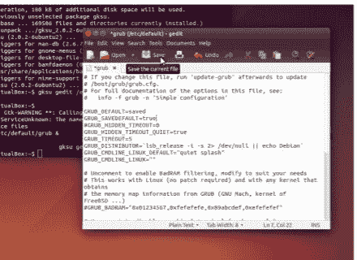

配置`Grub`以选择默认加载哪个操作系统。

打开终端很简单——只需按`[Ctrl]+[Alt]+[T]`。一个新窗口出现，乍一看它看起来很像`Windows`中的命令行。在`Ubuntu`中，你从`~`目录开始，这基本上意味着你的个人主文件夹。输入`dir`你会看到文件夹列表以确认这一点。要更改目录，请使用`cd`命令——要向上移动一级，输入`cd …`，或输入`cd home/nick/Pictures`直接跳转到另一个文件夹（请注意目录路径区分大小写）。你可以随时使用`cd ~`命令返回主目录。其他文件管理命令包括`cp`（复制）、`mv`（移动）、`mkdir`（创建文件夹）和`rm`（删除）。你需要学习的一个关键命令是`sudo`。`Linux`在安全性方面非常严格，在日常操作中你的访问权限相当受限。例如，你不能修改主目录之外的`Linux`分区上的文件。`sudo`所做的是给予你提升的访问权限，使你能够操作文件并执行命令——想想它就像在`Windows`中右键单击程序并选择“以

> “如果你想充分利用你的新操作系统，学习如何导航终端至关重要”

管理员身份运行’。你可以在任何命令前加上`sudo`来获得此访问权限，但你需要提供密码。

你也可以使用`apt-get`命令直接从命令行安装软件。例如，要直接从终端安装`GIMP`，你输入`sudo apt-get install gimp`。`apt-get`命令也可以用于更新所有现有软件（`apt-get upgrade`）、检查损坏的依赖关系（`apt-get check`）以及修复缺少依赖关系的问题（`apt-get -f install`）。随着时间的推移，你可以使用它来释放磁盘空间，通过删除已卸载的`Deb`包（`apt-get autoclean`）。

甚至可以使用`wget`下载文件——只需输入`wget`后跟你要下载的文件的完整`URL`，它将自动保存到你的个人下载文件夹。要了解有关这些和其他命令的更多信息，请查看我们的终端核心技能教程，从第 102 页开始。

现在你已经在`Windows`旁边安装了`Ubuntu`并掌握了`Linux`的基础知识，就没有回头路了——事实上，我们怀疑你会想知道为什么之前不尝试它。


## 放弃 XP 并切换到 Linux

`Linux`对新手来说可能有点可怕，所以我们在这里演示如何用闪亮的`Linux Mint`替换陈旧的`Windows XP`。

你是否认识那些仍在使用`Windows XP`的`12%`桌面`PC`用户中的一员（`www.netmarketshare.com`）？是的？那么请帮他们一个忙——告诉他们停止使用并把这篇文章交给他们。截至`2014`年`4`月`8`日，`微软`结束了对其老旧的闭源操作系统的所有支持。这意味着每一次新的漏洞利用和安全缺陷都将得不到修补和修复，并将成为人们数字生活中一个巨大的漏洞。这确实是一个糟糕的情况，因为它将导致身份盗窃、垃圾邮件增加和更多僵尸网络活动。当然，这也意味着脆弱的人可能会被利用。问题之一是`Windows XP`对大量用户来说运行良好，正因为如此，他们不愿意改变习惯——无论安全问题如何。我们在这里尝试帮助人们远离`Windows XP`。在我们看来，许多人根本不在乎其底层系统是什么，只要它能工作并提供相同的程序和在线访问——还有什么系统比`Linux Mint`更好呢？

### 立即开始

我们将向你展示如何使用现有的`Windows XP` PC，重新调整分区，安装`Linux Mint`并保留对旧`Win XP`文件的访问，同时获得现代`Linux`操作系统的好处。你可以通过遵循本文并使用封面光盘或进行几次简单的下载来获得所有这些内容。光盘上你会找到`Mint`的`64`位版本，以及可启动的`SystemRescueCD` Live CD。这意味着你需要一个`64`位兼容的处理器。如果你需要`32`位版本，请参阅下面关于替代发行版的框，因为你可能也想要一个低要求的发行版。你不确定是否具有`64`位兼容性吗？嗯，`Intel`的`64`位支持是在`2004`年随`Pentium 4 Prescott`引入的，自`2005`年以来在桌面处理器上已基本普及，并涵盖其整个`Core 2/iX`系列。


就 AMD 而言，它在 2003 年底推出了 64 位兼容的 `Athlon 64`，到 2005 年已在其整个产品线中普及。因此，除非系统超过九年，否则应与 64 位兼容。如果你的系统不兼容也不用担心——所有发行版都为非 64 位系统提供 32 位替代方案。`Linux Mint` 可以挤进 8GB 的硬盘空间，但更多空间是推荐的。我们的指南将建议减少 `Windows XP` 分区（或合适的 数据/文件分区）以腾出空间用于 Linux 启动分区。为此，该分区上至少需要有 8GB 的可用空间。在某些情况下，你需要在发生此操作之前删除任何不需要的文件。如果有更多可用空间会更好，但我们会尽力而为。你可能会想知道为什么我们要使用额外的分区程序，而像 `Linux Mint` 这样的基于 `Ubuntu` 的发行版内置了一个分区工具。事实是，虽然内置分区工具运行良好，但使用起来很笨拙，我们真的想尽可能简化事情。`GParted` 工具要流畅得多，如果人们最终选择 Linux——为什么不呢？——分区工具将用于删除 `Windows` 和调整根分区大小。在大多数情况下，最好从启动光盘进行操作。如果遇到问题，有很多在线支持网站提供答案——通常这些涉及终端。你说什么？终端在 Linux 世界之外经常被描绘成死亡的黑色石板。它不过是 Linux 版本的命令行，但要强大得多得多得多。终端允许整个服务器进行管理——你可以从这里入侵世界！如果你想了解更多，请参阅第 6 节的教程。就这样。你将拥有正在运行的 Linux。翻到下一页，看看访问旧 `Windows` 文档有多容易，并查看你可以使用哪些替代程序。它们是免费的，易于安装，等待被发现。

### 发行版达人

正如我们提到的，我们基于随附封面光盘上提供的资源编写了本指南，但没有理由你不能用自己的选择替换这些选项。在某些情况下，这可能是为了兼容性。32 位轻量级选项（例如 161MB 的 `www.puppylinux.com` 或 613MB 的 `www.bodhilinux.com`）可能是那些更古老的 `XP` 系统的唯一真正选择。当 `XP` 于 2001 年底推出时，32 位是主流，并在移动系统上一直保持到 2000 年代中期。`Ubuntu` 和 `Linux Mint` 也有各种 32 位版本，你可以从 `www.linuxmint.com` 或 `www.ubuntu.com` 下载。对于重新分区，我们使用的是封面光盘上的全能 `SystemRescueCD` 发行版。对于基本的重新分区工作来说可能有点过头，但随时拥有它总是很方便。你可能想考虑从 `www.gparted.org` 下载的更直接的 175MB `GParted Live` 发行版，它直接启动到图形桌面，`GParted` 已准备就绪。

## 再见，Windows XP

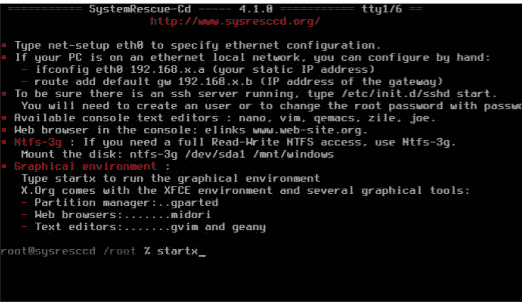

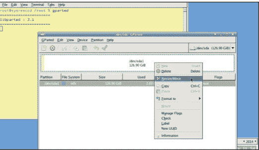

### 1 分区

从封面光盘启动系统并选择 `'SystemRescueCD'`，或自行创建并启动。选择默认启动项 – 备选方案将有助于解决您可能遇到的潜在问题。选择默认键盘，并在最终命令提示符下输入 `startx`。这将启动默认的 `Windows` 环境。

### 2 调整大小

您需要启动 `GParted`。这是在左下角的图标，或者您也可以直接在打开的终端中输入 `gparted`。接下来您看到的内容取决于主机系统分区结构的复杂性。它可能是一个分区，也可能是几个。您需要右键单击未使用空间最多的那个。

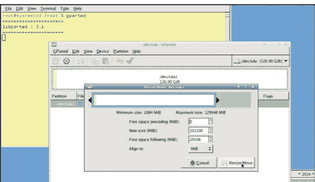

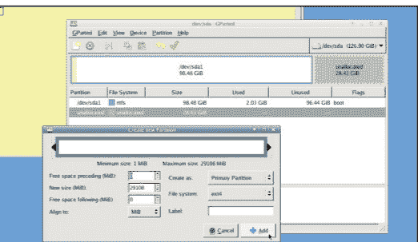

### 3 移动

抓住右侧的句柄并调整该分区的大小，您希望可用空间至少为 8,096MB – 理想情况下应更多。您将在下一页看到如何仍然访问您的 `Windows XP` 分区，因此您不必担心那里的事情。单击 `'Resize/Move'` 来做出选择，但目前还不会发生任何事情。

### 4 创建

现在您为 Linux 分区找到了一些空间，我们准备开始了。您无需对该空间进行分区或格式化。我们即将遵循的安装程序会将其识别为应安装的位置。要应用这些更改，请单击 `'Apply All Operations'` 按钮。根据内容的多少，此过程可能很快也可能很慢。

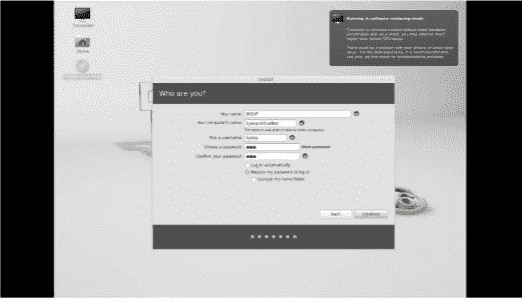


### 5 安装

重新启动并切换到 `Linux Mint`。选择 `'Install Mint'`，您会看到一个熟悉的安装系统。它最终会询问是否将 `Linux Mint` 与 `Windows XP` 并行安装。接受即可开始。就像 `Windows` 一样，您需要一个用户名、网络计算机名以及一个合适的用户密码来保护您的管理员 – 也就是 `root` – 访问权限。

### 6 启动

安装 `Mint` 并从互联网下载最新更新不会花费很长时间。进入后，您会发现 `Linux Mint` 的体验与长期过时的 `XP` 相当相似，只是它会更安全 – 最重要的是 – 它仍然作为操作系统得到支持。请参见下一页了解所有替代的 Linux 程序。

## 放弃 XP 第 2 部分

所以您已经从 `Windows XP` 切换到了 Linux。但如何确保您能打开所有文档并继续使用您的电脑呢？

仅仅因为您从 `Windows XP` 切换到 Linux，并不意味着您将无法访问现有文件，或必须彻底改变使用电脑的方式。本教程的目标，连同上一页的逐步指南，是让从 `Windows` 到 Linux 的切换尽可能顺利无痛。对于许多 Linux 用户来说，微软操作系统的概念只是一个模糊的记忆。如果您是这些人中的一员，这些指南非常适合转交给尚未迈向 Linux 的朋友或家人。

人们从 `Windows` 迁移到 Linux 时最大的担忧之一是他们将无法打开旧文件或使用习惯的程序。幸运的是，这种担忧很容易消除，因为越来越多的应用程序拥有 Linux 版本。开源软件的美妙之处在于，如果某个应用程序在 Linux 上不可用，很可能存在一个替代方案，其功能一样好 – 如果不是更好。

### 获取您的文件

如果您遵循了前几页的指南，您将在保留 `Windows XP` 安装和个人文件完整的同时安装了 `Mint`。这意味着在 `Mint` 中，您可以安装 `Win XP` 的驱动器并访问所有文件。在 `Windows XP` 中，这些通常保存在 `My Documents`、`My Pictures` 等中。`Mint` 以及许多其他 Linux 发行版都有类似的文件夹（通常没有 ‘My’ 前缀）。虽然可以从 `Windows XP` 分区复制并粘贴文档和文件到 Linux 中的等效文件夹，但最好将文件留在原处。这样在 Linux 中编辑它们时，更改仍会在您在 `Windows` 中打开它们时出现。

Ta-dah！`Linux Mint` 为您服务 – 不是很棒吗？

为了方便起见，值得为您的 `XP` 文件夹创建快捷方式，以便在 Linux 中轻松访问。打开文件浏览器时，您应该能够看到安装 `Windows XP` 的驱动器或分区。

根据您使用的发行版，流程可能略有不同，但在 `Linux Mint` 中，您可以通过双击桌面上的计算机图标快速访问文件管理器。打开的窗口中，您将看到连接到计算机的所有驱动器。通过双击安装 `Windows XP` 的驱动器，您可以通过转到 ‘Documents and Settings > Username > My Documents’ 来浏览现有文件，其中 `Username` 是您用于登录 `Windows XP` 的帐户名称。如果您右键单击 ‘My Documents’，或任何您想要快速访问的文件夹，并选择 ‘Make Link’，然后可以将新创建的链接拖到桌面以便快速访问。您还可以将文件夹添加到文件资源管理器菜单左侧的 `Places` 栏。为此，打开文件夹，单击 ‘Bookmarks’，然后 ‘Add Bookmark’。该文件夹现在将出现在左侧书签下方。

随着 Linux 的采用增长，流行的 `Windows` 和 `Mac` 程序的 Linux 端口数量也在增加。流行的文件同步程序 `Dropbox` 拥有 Linux 客户端，`Skype` 也是如此。`Steam` 也有 Linux 客户端，而且越来越多的最新游戏兼容 Linux。

### 浏览网页

如果您使用 `Google Chrome` 或 `Mozilla Firefox` 浏览互联网，那么您可以在 Linux 中继续使用它们。最好的部分是它们都允许您同步书签、密码和浏览历史。如果您一直在使用 `Internet Explorer`，您将不得不使用


一个新浏览器 – 虽然这可能不是坏事。您可以通过从`Internet Explorer`导出书签并在 Linux 中将其导入到`Firefox`来简化操作。为此，在 Windows 中打开`Internet Explorer`并单击星形图标。单击向下箭头打开下拉列表，选择`'Import and export'`，然后`'Export to a file'`。选择您想要导出的内容并单击`'Next'`，直到出现`'Export'`以创建`bookmark.htm`文件。

在 Linux 中，打开`Firefox`浏览器并单击`'Bookmarks'`然后`'Show all Bookmarks'`。窗口打开后，您需要单击`'Import and Backup'`然后`'Import Bookmarks from HTML'`并选择`bookmark.htm`。

如果您在 Windows XP 中一直使用`Thunderbird`收取电子邮件，那么在 Linux 中设置`Thunderbird`并不困难。在 Windows XP 中，导航到`\Documents and Settings\%username%\Application Data\Thunderbird\Profiles\`文件夹。在此文件夹中，将有一个以随机字母和数字字符串开头，后跟`.default`作为名称的另一个文件夹。将此文件夹复制到 USB 闪存盘或其他硬盘，然后加载 Linux。打开文件管理器并转到您的主文件夹（有时显示为默认视图）。按键盘上的`Ctrl`+`H`显示隐藏文件和文件夹，然后找到`.thunderbird`。打开它，并将您之前保存的`.default`文件夹粘贴到其中。然后，打开`.thunderbird`文件夹中的`profiles.ini`文件，并在写着`Path=`的地方输入新粘贴的`.default`文件夹的名称。当您下次加载`Thunderbird`时，您的电子邮件和文件夹等都应该在等待您。如果您在 XP 中使用`Outlook`，最简单的方法是在 XP 上安装`Thunderbird`，打开它，然后转到`'Tools'`然后`'Import'`以导入您的`Outlook`文件。然后，如我们所述，复制`.default`文件夹。

### 顶级 Linux 替代方案

| Windows 应用 | Linux 替代方案 |
|---|---|
| Microsoft Office | `LibreOffice` (www.libreoffice.org). 在 Linux 中用`LibreOffice`替换 Microsoft Office 非常容易，`LibreOffice` arguably 是最佳选择。它拥有丰富的文字处理、电子表格、演示等工具。我们就是这么用的！ |
| MS Paint | `Gimp` (www.gimp.org). `Gimp` 实际上比`MS Paint`的简单图像编辑器先进得多，甚至可以与`Photoshop`竞争。它已预装在许多发行版中。 |
| Windows Photo Gallery | `Shotwell` (www.yorba.org/projects/shotwell). `Shotwell` 是 Windows 照片管理器的绝佳替代品。您可以从数码相机和智能手机导入照片，添加标签和评级，并进行一些轻度编辑来整理照片。 |
| Windows Movie Maker | `Open Movie Editor` (www.openmovieeditor.org). 对于快速导入和编辑家庭电影，`Open Movie Editor` 是`Windows Movie Maker`的绝佳替代品。它易于使用，但功能足够强大，可以制作出外观精美的剪辑。 |
| Windows Media Player | `VLC` (www.videolan.org). `VLC` 是`Windows Media Player`的非常受欢迎的替代品，支持大量不同的媒体格式，甚至在稍作调整后可以播放蓝光光盘。 |
| iTunes | `Amarok` (http://amarok.kde.org). 如果您有 iPad、iPhone 或 iPod，您可能以为自己被困在`iTunes`上。幸运的是，`Amarok` 非常出色地取代了它，功能丰富，并允许您管理来自 iDevice 的歌曲和文件。 |
| Nero Burning ROM | `Brasero` (https://wiki.gnome.org/Apps/Brasero#download). 使用这个用户友好的光盘刻录软件，将文件刻录到可重写 DVD 或 CD 上变得非常容易。 |
| WinZip | `File Roller` (http://fileroller.sourceforge.net). 您可能已经安装了`File Roller`。它可以打开或创建各种压缩文件，非常适合通过互联网发送。 |
| Norton Anti Virus | `Avast! Linux Home Edition` (www.avast.com). Linux 比 Windows 更不易受病毒和恶意软件影响，但这并不意味着没有或未来不会有，因此请获得一些保护。 |
| Adobe Acrobat Reader | `Foxit Reader` (www.foxitsoftware.com). 您安装的 Linux 发行版可能能够查看 PDF 文档；`Foxit Reader` 是一个出色的替代品，速度快、轻量且功能丰富。 |

## 硬件

### 介绍

- 构建 Linux PC ........................................ 47
- 在 Chromebook 上安装 Linux .................... 56
- 构建 Steam 机器 ............................. 60
- Raspberry Pi 2 动手实践 ........................... 64


## 大师指南

没有人比我们更深入技术

## 黑客的手册

2015 完全修订并更新版

## 提升你的 Linux 技能

- 内核
- 网络
- 服务器
- 硬件

## 180 页教程

掌握可应用于任何项目的全新技能


## 构建 Linux PC

组装 PC 很简单，但选择组件就没有那么容易了。我们来看一下可用的选项。


> “桌面系统通常很容易操作——我们觉得乐高更费劲。”

互联网上至少流传了十五年的一个文档，名为《如果操作系统是航空公司》。其中`Linux Airlines`的条目写道：“当你登上飞机时，你会得到一个座位、四颗螺栓、一把扳手和一份`seat-HOWTO.html`的拷贝。” 这是个老笑话，但作为 Linux 用户，我们比其他操作系统的用户更习惯于有时需要自己动手做事。

这并不一定是坏事，因为这意味着我们更了解自己的电脑。话虽如此，至少当你想要一台新电脑时，你可以直接出去（或在线）购买。那么为什么人们要自己组装呢？在接下来的几页中，我们将尝试回答这个问题，以及在尝试这样做时出现的更复杂的问题，例如：做起来有多难？有什么风险？保修怎么办？能省钱吗？我能组装一台没有 Windows 的电脑吗？等等。自己组装有几个原因，其中最不重要的就是更深入了解电脑带来的满足感，但这些信息不仅在你想从零开始构建新系统时有用。我们在这里涵盖的大部分内容，如果你想升级现有电脑，也会有所帮助。

我们将重点关注台式机系统，它们通常很容易操作——我们觉得乐高更费劲。笔记本电脑是另一回事，但关于选择合适的 Linux 兼容组件的许多要点仍然适用，我们最后将讨论如何挑选笔记本电脑，或任何其他类型的密封机箱，例如流行的迷你主机系统。

## lifehacker | 英国

帮助你生活得更好，工作更聪明


## LIFEHACKER UK 是任何想把事情做成的人的专家指南

- 数千条建议改善你的家庭和工作场所
- 从你的智能手机、平板电脑和电脑中获得更多
- 更高效并提高你的生产力

`www.lifehacker.co.uk`

`twitter.com/lifehackeruk` `facebook.com/lifehackeruk`


## 记住摩尔定律


摩尔定律预测计算机容量每两年翻一番。除非你计划每年都组装一台新电脑，否则你应该考虑到在其使用寿命期间需求会增加。始终预留备用容量，如果你想要 `16GB` 的 `RAM`，就买一个支持 `32GB` 的主板并装一半。你的存储使用量也会倾向于增加。`4K` 视频即将到来，所以要构建一个系统，其驱动器托架和 `SATA` 接口比现在需要的多。只要你为自己留下选项，存储和内存就很容易增加。希望你的处理器和主板能使用好几年。

## 你需要什么？

组装电脑需要几个标准构建模块。最低限度，你需要：处理器、主板、内存、存储驱动器、显卡、机箱和电源。你可能还需要显示器、键盘和鼠标；但你也可以组装一个使用遥控器并插入电视的多媒体中心，或一台无头服务器，如 `NAS` 盒。

因此 `SSD` 是理想选择。`NAS` 正好相反，需要大量空间但速度不是关键，因此较慢的机械硬盘会更好。`Linux` 用户还有另一个需要考虑的方面：兼容性。虽然情况比以往任何时候都好得多，但仍然有一些组件比其他组件支持得更好。让我们逐步了解你需要的主要组件并查看你的选项。

在接下来的几页中，我们将更详细地研究这些组件，解释需要做出的选择。我们的想法不是告诉你选择哪些组件，而是为你提供根据特定需求做出该决定的信息。当你组装好电脑后，你就需要安装操作系统和软件了。自然地，我们假设你会安装 `Linux`，但你可能还需要为游戏或其他特定软件需求安装 `Windows`，所以我们将研究如何以完美（好吧，几乎）和谐的方式安装这两个操作系统。

## 处理器

第一个需要做出的决定是使用哪种处理器，因为这会影响你对主板的选择，然后几乎影响到其他一切。选择似乎很明显：买你能负担得起的最快的，但事情从来没有那么简单。最快的处理器也是最贵的，通常贵很多

你可以买其中之一并得到制造商放入的东西，也可以自己组装并得到你想要的确切东西。

为什么要自己组装电脑？你可能可以通过自行采购组件来省钱，但不要指望这一点。你确实可以做的是挑选你想要的确切规格——不必扔掉零件来升级到你真正想要的。你也可以选择使用的组件质量。预装 `PC` 可能会说

> “仍然有一些组件比其他组件支持得更好。”

它有一个 `2TB` 硬盘，但这告诉你很少。大多数硬盘制造商会生产多种相同容量的驱动器，速度、功耗和预期用途各不相同。自己动手做，你会学到更多关于组件的知识，而且虽然组装台式电脑并不困难，但这样做会让你在想要升级时有信心再次打开它。你也可以逐步升级——一旦你拥有一台你了解的电脑，你现在可以增加其硬盘或内存容量，明年再添加更快的处理器和主板。

## 选择组件

在选择组件时，你需要考虑现在将如何使用电脑以及可能的其他用途。用途会极大地改变你的选择，例如游戏系统需要快速存储，但对于操作系统和当前正在玩的游戏来说不需要太多。


找到你偏好处理器厂商的价格性能最佳点。

## Linux 兼容性

`Linux` 中的硬件支持现在非常好。大多数设备都在内核中直接得到支持。无需在制造商网站上寻找驱动程序。当你为自己的电脑购买组件时，你需要在购买组件之前知道硬件是否有支持。第一步是确定正在使用的确切组件，这并不像听起来那么容易。主板制造商的网站可能会说明它有一个千兆以太网端口，但不告诉你哪个芯片组，所以你必须做一些研究。在你喜欢的搜索引擎中输入完整的产品代码和单词 `Linux` 通常会得到大量结果。值得将搜索限制在最近的帖子，阅读一年前关于你的选择不受支持的投诉是没有意义的，而现在它已经支持了。寻找提供详细信息（如芯片组代码和模块名称）的帖子，避免情绪化的抱怨。在网络论坛上提问，例如我们自己的 `www.linuxformat.com/forums` 或 `www.linuxquestions.org`，关于特定设备的支持应该能得到一些第一手经验，但请先自己搜索论坛。你的问题可能已经被回答过，而且没有人喜欢那些懒得自己做研究的人提出的问题。兼容性问题通常出现是因为制造商没有帮助内核驱动程序开发人员，所以一切都必须逆向工程——这通常适用于无线适配器，但一些声卡也受影响。另一个原因可能是你正在查看的硬件太新，还没有添加到你当前最喜欢的发行版的内核中。你可能需要查看更新、更前沿的版本才能获得支持。这似乎最影响网络适配器，有线和无线。

## 硬件 | 构建 Linux PC

余量。这里有一个性价比的甜蜜点，通常比终极配置低几个档次。处理器速度并不是一切，因为内存对计算机性能的影响可能更大。降低一个档次的处理器速度，并将节省的费用用于更多的内存或 `SSD`，通常会带来更快的计算机。尝试在你使用计算机时让类似 `top` 的系统监视器保持运行，看看你有多频繁地使用当前处理器的全部性能。除非你是游戏玩家，或花费空闲时间编译自定义内核，否则你会惊讶于处理器使用率很少成为限制的程度。

另一个需要做出的选择是在 `Intel` 还是 `AMD` 硬件之间。你可以尝试在网上搜索哪个更好，但要做好准备在宗教般的狂热中花费一些时间寻找真实的事实。事实是，如今的处理器速度如此之快，对于家庭系统来说，你对两者都会满意。处理器选择会影响主板的选择，因此根据你的需求和预算，你最终可能会选择与想要的主板配套的 `CPU`。

## 主板

如果处理器是计算机的心脏，主板就是中枢神经


系统。所有东西都插入这块板上。过去，主板做的就是这些：连接所有东西。现在它们内置了许多过去独立的组件，例如网络接口和声卡。由于 `Intel` 和 `AMD` 使用不同的 `CPU` 插槽，选择处理器会立即减少你需要选择的主板数量。现在有一些你需要问的问题，例如我需要多于一个网络接口吗？我现在和将来想安装多少内存？我需要多少个 `SATA` 连接器——不要忘记为光驱预留一个，可能还需要一个外部 `eSATA` 连接器。还有，`SATA` 接口有多快？如果使用 `SSD`，这一点尤其重要。我需要多少个 `USB` 端口，什么类型？`USB 2.0` 对于键盘和鼠标来说足够好，但对于存储设备你会想要 `USB 3.0` 连接器，可能还需要一个 `USB-C` 连接器。

考虑你感兴趣的主板内置设备，例如网络接口和声卡。虽然主板本身可以在 `Linux` 上工作，但外围设备呢？声卡现在不是什么大问题，因为大多数都支持 `Intel HD Audio` 标准，但还是要检查一下，因为使用的编解码器可能不同。有线网络设备通常也得到很好的支持，但如果你使用的是非常新的主板，使用当前发行版内核尚未支持的设备，你可能会遇到问题。像往常一样，使用你喜欢的搜索引擎，输入该板和 `Linux` 发行版的名称，快速搜索一下，应该能找到任何潜在问题和解决方案。如果主板上有足够的 `PCI` 插槽可以安装替代品然后禁用内置硬件，那么对板载设备的支持可能不是关键问题。

> 在组装 `PC` 时，主板就是所有其他东西插入的东西。


> 内存看起来不起眼，但它对计算机性能的影响比许多其他组件更大。

板和 `Linux` 发行版应该能找到任何潜在问题和解决方案。如果主板上有足够的 `PCI` 插槽可以安装替代品然后禁用内置硬件，那么对板载设备的支持可能不是关键问题。

尺寸可能很重要。如果你在大型塔式机箱中构建系统，全尺寸 `ATX` 主板更容易操作，但对于媒体中心，你可能想要更小的外形尺寸，以便放入可放在电视下的漂亮机箱中。

## 内存

内存是提升现代计算机性能最简单的方法之一。它使一次可以处理更多任务和数据，剩余的内存会被 `Linux` 内核用来缓存磁盘数据，顺便说一下，这就是为什么计算机运行一段时间后几乎没有空闲内存的原因。购买内存时需要考虑三件事：物理布局、大小和速度。当前的内存标准是 `DDR3` 和 `DDR4`。不要尝试将旧的 `DDR` 或 `DDR2` 内存条插入这些插槽，它们不兼容。大小很明显，值得在预算允许的情况下购买尽可能多的内存。查看主板手册中每个插槽的最大尺寸，因为虽然规格允许每个 `DIMM` 最多 `16GB`，但大多数 `Intel` 系统每个单元限制为 `8GB`。主板通常对内存使用双通道架构，


> 一些内存厂商提供数据库，非常方便查看哪种内存最适合你的主板。

因此成对安装内存条并查看手册以了解哪些插槽配对。如果填充全部四个插槽则不需要，但除非你使用最大尺寸的内存条，否则最好使用两根更大的内存条。如果你想安装 `16GB RAM`，两根 `8GB` 内存条会给你以后添加更多的选项，四根 `4GB` 内存条则不会。

## 术语

查看硬件时你会遇到大量缩写和行话，这里是一些常用术语：

- `DDR 2/3/4` 双倍数据率，用于内存芯片的一种技术。

- `DIMM` 双列直插内存模块，这是一种即插即用的内存模块。

- `WAF` 妻子接受度，出现在男性主导的论坛上，被认为对家用硬件很重要。

- 北桥/南桥 主板上的芯片，处理核心逻辑和 `CPU` 与其他组件之间的通信。

- `SATA` 串行 `ATA`，连接存储设备到计算机的当前标准。

- `ATX` 一种主板配置规范，意味着大多数板在物理格式和标准连接器上可以互换。

## 存储驱动器


过去，关于硬盘的唯一问题是：有多大？现在我们必须加上：有多少个？以及什么类型？类型的选择主要是在传统的具有旋转盘片的硬盘和固态驱动器 `SSD` 之间。（虽然也有混合驱动器，使用旋转磁盘并以 `SSD` 作为缓存。）`SSD` 比硬盘快得多，但每 `GB` 成本高得多，`256GB SSD` 的成本大约相当于 `3TB` 驱动器。因此 `SSD` 提供更快的启动和程序加载，但硬盘可以容纳更多。`SSD` 还使用更少的电量并且更坚固，使其成为笔记本电脑的明显选择。对于台式机，你有使用多个驱动器的奢侈，


`SSD` 是笔记本电脑的明显选择，但在台式机系统上安装操作系统和你使用的程序时是理想的。

驱动器，因此最佳方案是使用 `SSD` 用于操作系统和程序，使用硬盘用于数据。你可以将操作系统放在 `SSD` 上而将 `/home` 放在 `HD` 上，或者你可以将 `/home` 留在 `SSD` 上，这意味着你将获得浏览器和邮件缓存等内容的额外速度优势。然后你可以将存储占用大户，如媒体收藏，挂载在硬盘上。无论哪种方式，你都不需要特别大的 `SSD`，`128GB` 应该绰绰有余，这意味着你可以确保买到好的产品。`SSD` 的性能差异很大，因此确保你购买的读写速度不错，大约 `500Mb/s` 是不错的。除此之外，设置 `SSD` 与设置硬盘几乎相同。

另一个需要考虑的选项是使用多个驱动器组成 `RAID` 阵列。这提供了冗余，如果阵列中的一个驱动器失败，你的数据仍在另一个上。这不是定期备份的替代品，但它能保护你免受驱动器故障的影响。以 `RAID 1` 为例，最简单的配置，两个驱动器镜像。所有数据都写入两个驱动器，但从一个读取（这可以提高读取性能，因为数据来自先寻找到的驱动器）。大多数发行版安装程序会处理安装到 `RAID` 阵列，但对于 `RAID 1`，你也可以先安装到单个驱动器，然后添加第二个驱动器创建阵列。`RAID` 由 Linux 内核处理，不要在主板上启用任何 `RAID` 设置。这些所谓的 `fakeRAID` 需要 Windows 驱动程序才能工作。只需让安装程序看到你有两个驱动器，让内核处理它们即可。


显卡本身就是计算机，但对于许多系统你可能可以使用板载显卡。

## 显卡

如今大多数主板都有合理的板载显卡，因此你可能不需要单独的卡。如果你想要一个，选择是在 `Nvidia` 和 `AMD` 之间，这又是另一个可能引发宗教式口水战的话题。`Nvidia` 显卡可以启动到图形显示，但内核中的 `nv` 驱动程序有限。你有几个选择。更新的开源 `nouveau` 驱动程序现在工作得很好——我们自己也在使用——并且提供合理的性能。如果你想要显卡的最佳性能，你需要安装 `Nvidia` 自己的驱动程序。由于这些是闭源的，它们通常默认未启用，因此你需要在发行版中启用受限或第三方驱动程序选项。你也可以下载并

## 组装


### 1 主板布局

在手册中找到主板布局和连接器的图示并保持打开该部分。你应该在对板进行每次连接之前参考它。许多连接器只是板上的排针，很容易插错方向。墨菲定律肯定潜伏在这里。`RTFM` 同样适用于硬件和软件。


### 2 零插入力

抬起 `CPU` 插槽上的释放杆，插入 `CPU`，使芯片上的角点与插槽上的标记对齐。它应该无需压力即可落入，然后用杆锁定。取下散热器导电垫上的胶带并将其安装在 `CPU` 上，按照随 `CPU` 和主板附带的说明进行操作。将风扇线缆连接到主板。

直接从 `www.nvidia.com` 安装驱动程序，但这并不推荐，因为这样你的发行版的包管理器就无法跟踪和更新它们。`AMD` 显卡的情况类似，在运行二进制驱动程序可能带来的麻烦与开源驱动程序性能较低之间权衡。`AMD` 与 `Nvidia` 之间的选择几乎和 `Intel` 与 `AMD` `CPU` 的选择一样带有宗教色彩。除非你需要顶级的 `3D` 性能，否则两者对你来说都工作良好，而如果需要这种性能，无论你选择哪种方式，都必须使用二进制驱动程序。目前，`Nvidia` 的专有驱动程序被认为更好更可靠，但这种情况很容易改变。

## 电源

最容易被忽视的组件之一是电源（`PSU`）。避免使用随机箱附带的廉价 `PSU`（事实上，避免那些便宜到包含 `PSU` 的机箱）。`PSU` 必须可靠且质量良好。这可能看起来适用于所有组件的显而易见的说法，但当 `PSU` 故障时，它可能会以损坏其他组件的方式发生故障。用 15 英镑的 `PSU` 毁掉 100 英镑的主板或硬盘，或两者兼有，并不是省钱的好方法。

选择 `PSU` 时需要考虑的其他方面是：它必须为你的需求提供足够的电力，现在和将来，它必须高效（任何物有所值的 `PSU` 都是 `80 Plus` 认证，但请寻找 `Gold`、`Platinum` 和 `Titanium` 型号）和安静（特别是客厅电脑）。有几个网站可以列出你使用的组件并获得所需的电源推荐，例如 `http://support.asus.com/PowerSupply.aspx?SLanguage=en`。检查你选择的 `PSU` 是否具有你需要的连接器，大多数主板需要 `24+4` 针 `ATX` 连接器和单独的 `CPU` 电源线。还确保你有足够数量且类型正确的驱动器电源连接器，一些 `PSU` 仍然配备更多旧的 `Molex` 连接器而不是有用的 `SATA` 电源插头。如果你使用的是带底部安装 `PSU` 的大型机箱，请检查线缆是否足够长以到达顶部的驱动器，虽然你可以便宜地购买 `SATA` 电源延长线来解决最后两点。你会很高兴知道关于 Linux 兼容性没有特殊考虑！

## 机箱

电脑机箱经常被当作事后才考虑的问题，但更大、做工精良的机箱会让生活轻松得多。廉价机箱会使走线更困难，而且经常会有锋利的边缘，导致手关节流血和你漂亮的新主板上沾满血迹（你大概能感受到这句话中的亲身经历）。

更大的机箱还能提供更好的气流以改善散热。如果你正在组装放在客厅的媒体中心，高 `WAF`（参见术语，p34）是主要考虑因素，但要注意噪音水平。起初似乎像耳语的声音在看电视时可能会变得令人烦躁。如果你选择带侧窗的机箱，请记住走线时必须格外小心。乱糟糟的线缆从来都不是好主意，但当它暴露在外时就更糟了。


## 专用系统

到目前为止，我们主要关注的是通用台式机系统，但也有一些专业用户需要考虑，例如家庭服务器或高性能游戏系统。如果你想组建家庭服务器，你的需求将与台式机或游戏系统大不相同。

由于所有数据都通过网络传输，快速 `SSD` 是毫无意义的。你可以用它来安装操作系统，但服务器很少重启，所以你甚至享受不到它们提供的快速启动速度，而且它们只运行有限数量的程序，所以加载时间也不是那么重要。服务器通常无头运行，所以也不需要花哨的显卡，你只需要一个显示器用于安装过程，而大多数主板集成的显卡对于这项工作来说绰绰有余。你真正需要的是适量的内存和充足的存储空间。如果你正在组建文件或媒体服务器，请选择具有大量 `SATA` 端口的主板和具有相似数量驱动器舱位的机箱。然而，无论你添加多少存储，总有一天你会想要更多。如果你正在组建 Web 或邮件服务器，存储空间不是大问题，除非你想通过互联网连接提供媒体文件，但充足的内存有帮助，特别是使用 `Apache` 时。

另一种家庭服务器是媒体服务器。这可能只是你视频文件的存储库，也可以在服务器上进行录制，使用 `MythTV` 的

> > “许多更高性能的显卡占用两个 `PCI-e` 插槽。”

后端服务器软件或类似 `Tvheadend` 的软件。无论哪种方式，你都需要大量的空间。如果你的服务器还转码视频，比如像 `Plex` 这样根据播放设备和与服务器连接的速度重新格式化视频的软件，你需要适量的 `RAM` 和相当快的 `CPU`——不是游戏怪兽，但也不是廉价货。

由于一切都通过网络工作，不言而喻它应该有一个快速的网络接口，特别是如果同时有多个客户端使用它，所以确保它具有千兆接口，或为一块像样的 `PCI-e` 网卡预算。


### 3 内存插槽

将内存 `DIMM` 插入主板上的插槽。确保方向正确；`DIMM` 上的缺口应与插槽中的凸起对齐，并且只能以一种方式插入。如果你没有使用所有插槽，请查阅主板手册以确定最佳使用的插槽，并确保利用任何双通道功能。


### 4 主板挡板

将主板的 `I/O` 挡板安装到机箱后部的开口上，然后将主板放入机箱。有一些小柱子，主板应立在其上，你可能需要在安装主板之前先将它们拧入机箱。然后用随附的螺丝将主板固定到柱子上——不要拧得过紧。

## 高性能游戏


游戏，我们指的是图形密集型游戏而不是赌博，对电脑有特定要求。性能是显而易见的因素，但不仅仅是 `CPU` 的性能。显卡上的 `GPU` 在某些游戏中比 `CPU` 发挥更重要的作用。显然你想要一个快速的 `CPU` 和显卡。许多更高性能的显卡占用两个 `PCI-e` 插槽的空间，因此你需要确保你的电脑机箱和主板都有足够的空间，并且你的 `PSU` 能够在原始功率和它能提供的物理连接器方面为其供电。内存也很重要，你想要充足且最快的内存。磁盘存储空间不如速度重要，因此 `SSD` 是存储的首选。游戏玩家总是想要更多性能，而获得性能的一种方式是通过超频系统。这就是你以高于额定速度运行处理器和内存的地方。

如果你正在组建媒体服务器，像这个媒体服务器，你的需求是不同的。你需要大量的磁盘空间和快速的网络连接（或两个）。你可能还需要一些 `CPU` 运算能力用于媒体转码。


### 5 连接器

安装电源并将电源和 `CPU` 电缆连接到主板。这是一个连接所有风扇电缆的好时机。添加你的硬盘或 `SSD` 以及光驱。它们可能通过螺丝固定到机箱，或在某些情况下采用免螺丝安装。将驱动器的 `SATA` 电缆连接到主板。将它们的电源电缆连接到 `PSU`。


### 6 机箱 LED

将机箱开关和 `LED` 的电缆连接到主板。这些是繁琐的连接器，但要确保连接正确，主板手册会告诉你什么接哪里。一些电缆带有块状连接器以便于操作。这也是将机箱的 `USB` 端口连接到主板相关位置的时候。

超频的看法不一；它确实能带来更好的性能，但代价可能是缩短组件寿命、过度超频时出现不可靠性，以及产生更多需要散发的热量。部分 `CPU` 被锁定在特定频率，因此你需要确保所选处理器支持超频。你还需要一块合适的[content]

## 启用开发者模式

使用 `Crouton` 意味着将 Chromebook 置于开发者模式，在此模式下你可获得 `root` 权限甚至 `Bash` shell。这不是破解，而是一个完全受支持的、虽被隐藏的官方选项。首先警告：启用开发者模式会清除你的存储。它不会影响你的云存储，但本地存储的任何文件都应在继续之前上传到 `Google Drive`。启用开发者模式的方法因设备而异——你可以在 `Chromium` 网站的此处找到说明：`http://bit.ly/1gDHPGd`。在我们用于测试的 `Acer C720` 上，与大多数 `Samsung` 设备一样，你先关闭设备，然后在按下电源按钮前按住 `[Escape]` 和 `[Refresh]` 键。这样会进入恢复屏幕，然后按 `[Ctrl]+[D]` 启用开发者模式。其他设备对此有硬件按钮。启用开发者模式后，每次开机都会看到‘OS verification is OFF’屏幕——按 `[Ctrl]+[D]` 继续启动，或等待 30 秒。


前往 `www.chromium.org` 获取适用于你设备的开发者模式切换开关。

```
sh -e ~/Downloads/crouton -r list
```

```
sh -e ~/Downloads/crouton -t list 2>&1 | more
```

第二个命令需要通过 `more` 传送，因为它有好几屏内容；按 `[Space]` 逐页浏览。一旦你决定了想要的发行版和目标，就可以运行 `Crouton`。例如，要安装带 `Unity` 桌面的 `Ubuntu 13.10`（`Saucy Salamander`），运行：

```
sudo sh -e ~/Downloads/crouton -r saucy -t unity
```

这里使用 `sudo` 因为安装软件需要 `root` 权限。你也可以指定多个目标，如此示例安装带 `LXDE` 桌面和 `XBMC` 媒体中心的 `Debian Wheezy`：

```
sudo sh -e ~/Downloads/crouton -r wheezy -t lxde,xbmc
```

## 启动

根据所选目标和互联网连接速度，这可能需要一段时间。完成后，它会告诉你启动所选发行版在 `chroot` 中所需的命令，例如：

```
sudo startunity
```

运行该命令后你将进入标准的 `Ubuntu` 桌面。完成后，按通常方式注销即可返回 `Chrome OS`。你可以通过按住 `[Ctrl]+[Alt]+[Shift]` 并按下 `[Forward]` 或 `[Back]` 在两者之间切换。实际上，数字键上方 `Chrome OS` 的导航键在 `Linux` 中被视为 `[F]` 键，因此它们实际上是 `[Ctrl]+[Alt]+[Shift]+[F1]` 和 `[Ctrl]+[Alt]+[Shift]+[F2]`。

你最终得到的安装并不是像原生安装那样完整的发行版，但任何额外软件包都可以用通常方式安装。如果使用 `Unity`，软件中心未安装，因此在 `Unity` 中打开终端（`[Ctrl]+[Alt]+[T]`）并运行：

```
sudo apt-get update
```

```
sudo apt-get install software-center
```

现在你可以从 `GUI` 安装所需的任何其他软件包。你也可以使用 `-u` 标志安装额外的目标环境。例如，要向之前创建的 `Ubuntu` `chroot` 添加 `LXDE` 环境，我们会运行：

```
sudo sh -e ~/Downloads/crouton -r saucy -u -t lxde
```

## 增加一些隐私

正如你可能注意到的，启用开发者模式会通过 `sudo` 授予 `root` 访问权限，且无需密码。这对 `Chrome OS` 来说安全性稍低，但你的登录和文件仍由 `Google` 登录保护，但这意味着 `chroot` 中的所有文件都可读，即使使用无密码访客登录。如果这让你担心，可以使用 `Crouton` 的 `-e` 标志加密整个 `chroot`。这会提示输入密码并用其加密整个 `chroot` 目录，意味着没有密码既无法读取也无法运行 `chroot`。例如：

```
sudo sh -e ~/Downloads/crouton -e -r wheezy -t xfce
```


`Unity` 非常适合全屏运行所有内容。

可供选择的发行版和目标很多；你可以一次性全部安装，但那样会变得非常臃肿，那么如何尝试它们全部呢？答案是你能创建的 `chroots` 数量取决于你的存储空间。


如果你计划这样做，你可能会发现使用`Crouton`的`-n`选项为每个`chroot`命名更方便，否则它们只是以发行版命名。命名在安装多个发行版时很重要，因为运行启动命令时需要名称，否则`Crouton`只会加载第一个找到你指定目标的发行版。添加`-n`，如此，可以确保加载正确的发行版：

```
sudo startunity -n saucy
```

`Crouton`还安装了一些有用的工具，特别是`edit-chroot`。可用于备份`chroot`。

```
sudo edit-chroot -b saucy
```

在`~/Downloads`中创建备份文件，你可以用以下命令恢复：

```
sudo edit-chroot -r ~/Downloads/backup-file.tar.gz
```

将其复制到安全位置。即使执行完全重置/恢复，你也可以重新下载`Crouton`并运行以下命令来恢复它：

```
sudo sh -e ~/Downloads/crouton -f backup-file.tar.gz
```

你也可以使用`delete-chroot`删除`chroot`，这你自己也能想出来，或者你可以简单地从`/usr/local/chroots`删除其所在目录以返回原版`Chrome OS`。当然，前提是你想这么做。继续翻到下一页的步骤…

## 术语解释！

### chroot

程序被锁定在其中的目录。它无法看到

## 快速提示

尝试多个发行版或目标时，清理已完成使用的。每个都有数`GB`大小，你的存储很快就会消失。

## 安装发行版


### 1 打开 shell

按`[Ctrl]`+`[Alt]`+`[T]`打开终端窗口。这将是一个在浏览器标签中运行的基础`Crosh` shell，其命令集有限——输入`list`可查看它们。其中一个命令是`shell`，它会给你一个完整的`Bash` shell，像其他发行版一样。没错——`Chrome OS`背后有一个真正的`Linux`操作系统。

### 2 选择发行版和目标

使用`-t list`运行`Crouton`会显示所有可用目标。你可能想要其中一个标准桌面环境。`Chromebook`相对性能较低，像`LXDE`这样轻量级桌面是不错的选择，而`Unity`更适合全屏运行所有内容。


### 3 加密你的文件

在`Crouton`命令行中添加`-e`（这与`sh`后面的`-e`不同）会使你的`chroot`存储在加密目录中。选择一个合适的密码短语——这是保护你文件的一切，但请记住你大部分数据可能保存在云端，因为`Chromebook`存储空间非常有限。

### 4 安装发行版

因为`Crouton`只是一个安装程序，它需要在安装前下载发行版文件，因此请预留时间。即使连接很快，如果你选择了大型目标，下载和安装所有内容可能需要超过`30`分钟——大小显示在`crouton -t list`的输出中。


### 5 添加包管理器

默认目标仅包含命令行包管理器`apt-get`。对大多数人来说，第一步是打开终端并用它安装更友好的选项，例如`Ubuntu`的`software-center`或`Ubuntu`/`Debian`的`Synaptic`。运行`sudo apt-get update`以确保获取当前版本，然后`sudo apt-get install synaptic`。

### 6 运行 Synaptic

安装`Synaptic`后，你可以轻松访问发行版仓库中的所有软件。大多数目标都被精简，以节省下载并加快安装，但你可以从这里安装任何想要的东西。可以使用‘搜索’按钮或直接浏览类别查看可用内容。

## 恢复磁盘


### 1 备份到 USB

插入容量至少为`2GB`的`USB`闪存盘或`SD`卡，打开`Chrome`并在地址栏中输入`chrome://imageburner`。`Chrome OS`会为您的`Chromebook`下载并安装恢复镜像。如果您拥有多个型号的`Chromebook`，请分别对每个型号执行此操作；它会获取该设备的正确镜像。

### 2 创建恢复磁盘

下载完成后，镜像会被写入您的`USB`闪存盘。如果您不创建恢复磁盘，也可以通过另一台计算机获取此镜像并手动复制，按照`http://google.com/chromeos/recovery`处的说明操作，但您必须确保获取正确的镜像——它们特定于每个型号。


### 3 紧急情况下

如果您损坏了`Chrome OS`并收到以下令人害怕的“`Chrome OS`缺失或损坏”消息，请插入您的恢复介质。您也可以强制恢复，如果您仍想继续恢复，可以通过按下硬重置按钮或键组合来实现，具体取决于型号。查看您的`Chromebook`文档，了解适用的说明。

## Crouton：利与弊

将`200`英镑的`Chromebook`与全尺寸笔记本电脑相比似乎不公平——它更处于上网本的价格范围，目标市场也类似——但我们还是要这么做。在`Chromebook`上运行`Ubuntu`或`Debian`就像在真正的笔记本电脑上运行一样。唯一的区别在于使用了`chroot`。

这意味着您必须先启动到`Chrome OS`，然后打开一个`shell`来启动`chroot`会话，但`Chromebook`设计为暂停而不是关机，因此这并不一定经常发生。因为它通过`Chrome OS`使用硬件，您需要在其中执行诸如设置网络连接之类的操作，但由于您可以随时在操作系统之间切换，因此这不是问题。这不是双启动；它是同时运行两个系统——方便得多。此设置的主要限制是存储空间不足以及对网络连接和云服务的依赖。虽然`Chrome OS`透明地处理了这一点，但您需要从`chroot`发行版设置某种在线同步，使用`OwnCloud`、`Spideroak`或`Dropbox`等服务。在`Chromebook`上安装`Linux`的方法还有其他方式，但`Crouton`的方式侵入性最小，保持现有操作系统不变（除了需要启用开发者模式）。尝试多种选项，并在完成后将其移除，也是这种方法的一个关键优势。其优势之一是`Crouton`由`Chrome OS`作者开发，而不是第三方黑客工具。`Chrome OS`的未来更新可能会暂时破坏您的`chroot`，但通过`Crouton`进行更新会修复它。


## 自建 Steam Machine

爆炸性的`AAA`游戏已登陆`Linux`，可用游戏超过`1,000`款。打造自己的专用游戏主机从未如此简单。


过去`Linux`上的游戏一直饱受困扰，通常是因为许多开发者仓促推出`Linux`支持——或完全不提供——而专注于`Windows`。残酷的事实是，`Microsoft`的操作系统存在于绝大多数游戏`PC`上（例如`Steam`的硬件调查（`2015`年`2`月）显示`Windows`用户占超过`1.25`亿活跃客户的`95.68%`），即使该公司留下了一连串的未兑现承诺，以及更加破碎的在线基础设施和`DRM`——试着向`PC`游戏玩家提到`Games for Windows Live`，看看他们是否会明显颤抖。


值得庆幸的是，潮流已经转变，Linux 游戏正蓬勃发展。微软希望通过 `Windows 8` 创建一个封闭花园的愿望让 `Valve` 感到担忧，`Valve` 是备受喜爱的《半条命》系列的视频游戏开发商，也是 `Steam` 服务背后的公司，当然足以促使他们创建了一个名为 `SteamOS` 的基于 `Debian` 的发行版，专注于游戏。尽管 `Valve` 拥抱 Linux 让很多人疑惑他们为何花了这么长时间，但其高调程度足以引起那些之前未考虑过 Linux 的 PC 游戏玩家的注意。在 `Valve` 的支持下，越来越多的开发者将游戏移植到 Linux，而硬件制造商，特别是显卡厂商，通过其驱动程序对 Linux 的支持也取得了不错的进展。现在在 Linux 上游戏比以往任何时候都更容易——我们可以访问最新游戏大作，强大的硬件得到支持，我们不必通过 `Wine` 挣扎让游戏运行或浪费金钱购买 `Windows` 许可证。甚至更好的是，许多 PC 游戏玩家只需切换到 Linux 就能看到令人印象深刻的性能提升。

> “现在在 Linux 上游戏比以往任何时候都更容易——我们可以访问最新游戏大作。”

当然，您现在可以从许多知名制造商（如 `Alienware`、`Asus`、`Cyberpower`、`Scan` 和 `Zotac` 等）购买 `Steam Machine`，但如果您想要一台专门用于玩 Linux 游戏的机器，我们认为您最好的选择是自行下载并安装 `SteamOS`。该发行版从头为游戏设计，以 `Steam` 的 `Big Picture Mode` 作为默认界面。该界面专为在大屏幕（如电视）上使用控制板导航而构建，尽管这意味着如果您想将机器用于游戏以外的任务，那么 `SteamOS` 在当前形式下不适合您。

然而，如果您想打造一台终极 Linux 游戏机，让 `PS4` 和 `Xbox One` 主机相形见绌，那么请访问 `http://bit.ly/BYOSteamOS`。

在此页面上您会找到两个选项，第一个是下载默认的 `SteamOS` beta 安装。虽然这可能是安装 `SteamOS` 最直接的方式，但它确实需要一个容量惊人的 1TB 硬盘，这可能比大多数人拥有的——甚至需要的——要多得多。第二个选项是下载自定义 `SteamOS` beta 安装。此方法可让您对安装有更多控制，使用基于 `Debian` 默认的安装程序，这意味着您可以将 `SteamOS` 安装到更实际大小的硬盘上。点击下载，默认 `SteamOS` beta 安装会带您到一个显示 `Steam` 最终用户许可协议的页面。阅读此协议以了解 `SteamOS` 和 `Valve` 的 `Steam` 服务是值得的。

尽管 `SteamOS` 基于 Linux 并使用开源软件，但它主要是一个面向 `Valve` 专有 `Steam` 商店的界面。也使用了专有驱动程序，虽然 `Steam` 比一些充斥 `DRM` 的商店前端没那么令人讨厌，但在安装之前您应该知道自己在做什么。例如，您将能够访问作为 `SteamOS` 组成部分安装的 `Gnome` 桌面，至少可以安装非 `Steam` 程序和游戏。

另一个需要考虑的事情是 `SteamOS` 是一个 1GB 的下载，如果您的互联网连接不是最快的，最好在等待时喝杯茶（或四杯）。如果您同意使用条款，请点击下载 `SteamOS Beta` 按钮开始。

下载完成后，您需要将 `SteamOSinstaller.zip` 文件的内容解压到 USB 闪存盘上。


您可以在 `SteamOS` 设置中启用 `Gnome` 桌面，这将允许您运行非 `Steam` 程序和游戏。

> “该 UI 专为在大屏幕上使用控制板导航而特别构建。”

用于安装 `SteamOS` 的 USB 闪存盘需要容量为 4GB 或更高，并且需要格式化为 `FAT32` 文件系统。

要将 USB 驱动器格式化为 `FAT32`，请插入它并打开终端。接下来，输入 `df` 以列出机器上安装的驱动器。仔细查看列表以识别您的 USB 闪存盘（容量是一个很好的指标）。几乎不用说，但我们还是要说，但您在格式化之前必须正确识别驱动器至关重要，因为格式化错误的一个驱动器可能会造成毁灭性后果。

一旦您识别出 USB 驱动器，请记下在显示 文件系统 的地方其路径，例如 `/dev/sdc1`。您需要使用以下命令卸载驱动器：

```
sudo umount /dev/sdc1
```

其中 `sdc1` 用您的 USB 驱动器路径替换。接下来使用以下命令将驱动器格式化为 `FAT32` 文件系统：

```
sudo mkfs.vfat -n 'SteamOS' -I /dev/sdc1
```

再次说明，我们写 `/dev/sdc1` 的地方，请确保您放置正确的路径。另外，代码中的 `-n 'SteamOS'` 部分是可选的。这只是为了方便使用而为驱动器上创建的分区命名。如果您不想命名分区，请随意省略。

希望到此时，`SteamOS` 文件已作为 ZIP 文件下载。我们需要将文件解压到新格式化的 USB 驱动器。为此，您首先需要确保已安装正确的程序。

作为 root 用户输入：

```
apt-get install zip
```

```
apt-get install unzip
```

## Steam Machine 的硬核部分

在客厅搭建游戏机时，您需要考虑一些事情。首先，由于这是用于客厅，您希望它看起来漂亮，不占太多空间并且运行安静。

对于外观出色且尺寸小巧的 PC 机箱，我们建议选择 `BitFenix Phenom Mini-ITX`，价格约为 60 英镑。接下来您需要 CPU，虽然 `Intel` 处理器比 `AMD` 的贵，但性能更好，并且能让您的 `Steam` 机器更具未来性。

四核 `Core i5-4570` 是一个不错的选择，运行频率为 3.2GHz，价格约为 150 英镑。选择机箱和 CPU 会缩小主板选项。我们选择了 `MSI Z87I AC`，价格约为 50 英镑，因为它是 `Mini-ITX` 板且与我们的处理器兼容。更棒的是，主板自带 Wi-Fi，因此您不必在客厅里拖拽以太网线缆。

接下来您需要考虑显卡。为了兼容性，我们选择了 `Nvidia`。一些微型 `ITX` 机箱对 GPU 的空间有限，因此我们选择了 `Asus GeForce GTX 970 DirectCU Mini`。这是一款出色且小巧的显卡，可以轻松运行最新游戏。然而，它的价格有点贵，为 280 英镑，但物有所值。如果您想省钱，那么稍旧的 `Asus Nvidia GeForce GTX 760 2GB GDDR5 DirectCU II Mini` 是一个不错的选择，价格更实惠，为 187 英镑。

您还需要散热器（如售价 25 英镑的 `Gelid SlimHero`）、内存（`Crucial Ballistix Tactical LP DDR3`，8GB，售价 70 英镑是不错的选择）、电源（`GX Lite 500W PSU`，售价 41 英镑）和硬盘（任何旧硬盘都可以，如果您打算装很多游戏，我们建议 500GB）。瞧，您现在拥有一台惊人的 `Steam Machine`，让 `PS4` 和 `Xbox One` 相形见绌。


> 所有这些漂亮的组件将打造出一台强大的游戏机器。

现在导航到下载 `SteamOSInstaller.zip` 的文件夹（通常是 `Downloads`），例如：

```
cd ~/Downloads/
```

然后输入

```
unzip SteamOSInstaller.zip -d /path/
```

其中 `/path/` 是你的 USB 驱动器的路径。接下来，你需要将 USB 棒安装到用于安装的机器中。安装好 USB 棒后，启动 PC 并加载 BIOS。通常可以通过在系统刚开机时反复按 `F8`、`F11` 或 `F12` 来完成。

进入 BIOS 后请确保已启用 UEFI 支持并选择 UEFI 条目进行启动。

如果你不介意将整个硬盘格式化并替换为 `SteamOS`，请在菜单出现时选择自动安装选项。如果你有想要保留的其他磁盘和分区，并且希望在特定位置安装 `SteamOS`，请选择专家安装。

如果你曾经使用过 `Debian` 安装程序，接下来的步骤你会很熟悉。首先会要求你选择语言、位置和键盘布局。安装程序随后会开始设置你的硬件，通常需要几分钟时间。完成后你会看到硬盘和分区。这里你可以决定使用哪些分区和驱动器来安装 `SteamOS`——如果你不想使用整个硬盘，或者计划使用 `SteamOS` 进行游戏并与其他发行版进行双系统启动以满足日常任务，这很有用。

选择用于安装 `SteamOS` 的空闲空间——至少应为 10GB。如有需要，选择创建新分区并指定大小。确保它是主分区，然后点击继续，确保在“用作区域”中设置为 `Ext4` 日志文件系统，然后选择完成分区设置。

点击空闲空间创建另一个分区。将其大小设为约 10GB——这将是你的交换分区。将其设为逻辑分区，并在选项出现时将其创建在可用空间的末尾。到达摘要屏幕时，双击“用作”并选择交换区域。双击剩余空间，保持分区大小不变，并确保在“挂载点”处将其设置为 `/home`。选择完成分区并将更改写入磁盘，然后选择是。`SteamOS` 将开始配置和安装自身。


完成后会出现一个名为软件选择的窗口，询问你是否要安装 `Debian` 桌面环境和标准系统实用程序。保持两者都勾选并点击继续。完成后你的 `PC` 将重新启动。

系统重新启动后，你会可以选择启动 `SteamOS` 或以恢复模式启动——让其正常启动，`SteamOS` 将继续安装。确保你的机器已连接到互联网，因为 `Steam` 将被安装。完成后你的机器将再次重新启动。该过程现在可能会创建救援分区，让它完成操作并选择重新启动。然后你会看到 `Debian` 登录屏幕。选择 `SteamOS` 桌面并点击返回 `Steam`。

如果此方法无效，请打开终端并输入`steam`。接受条款并点击确定。可能还需要进行一些下载，但完成后你将被带入 `Steam` 的大屏幕模式，在那里你可以登录现有 `Steam` 账户或创建新账户。

另外，如果你不想为 `Steam` 安装新操作系统，你也可以在任何基于 `Debian` 的发行版上安装 `Steam for Linux` 客户端，只需输入`apt-get install steam`或`aptitude install steam`。你现在就可以尽情享受超过 1,000 款（并且还在增加）的游戏了。

## 外设

所以你已经打造了一台令人惊叹且紧凑的 `Steam Machine` 并加载了 `SteamOS`。那接下来呢？你会想要一些很棒的游戏外设，以便在沙发上舒适游戏。`Valve` 本身一直在研发一款专用的 `Steam` 手柄，其雄心勃勃的目标是将其与键盘鼠标设置的便利性相结合。任务确实艰巨，`Valve` 似乎也为此挣扎，因为该手柄已推迟至 2015 年底。虽然我们等待 `Valve` 官方售价 50 美元的手柄，但其他多家公司提供了控制 `SteamOS` 游戏的优秀替代方案。`Roccat` 专门为 `SteamOS` 打造了 `Sova` 托盘板，提供一个小型机械键盘和一个可以放在腿上的大号鼠标垫。你也可以使用来自游戏主机的游戏手柄，例如`Xbox 360`和`PS4`，因为 `SteamOS` 在你插入时就能很好地识别它们。如果你是赛车游戏的粉丝，那么好消息是，像`Project Cars`这样著名的赛车游戏正在登陆 `Linux`。方向盘控制器的支持就没那么好了。

如果你有`Logitech`控制器，你可以安装`LTWheelConf`工具。有关如何使用它的完整说明可以在`Steam`网络上找到（`http://bit.ly/LTWheelConf`）。


`Roccat Sova` 专门为 `SteamOS` 设备打造。

## `Linux` 上最好的 20 款游戏

### 五款最佳开源游戏


`Strife: Veteran Edition`

这是一款基于开源`Chocolate Doom`引擎打造的出色第一人称射击游戏。前往`http://bit.ly/StrifeVE`获取游戏。


`Stunt Rally - version 2.5`

在精彩的环境中竞速并表演特技。本游戏拥有 167 条赛道、19 辆汽车和赛道编辑器。前往`http://bit.ly/StuntRally`下载游戏。


`Annex: Conquer the World 4.0`

如果你喜欢实时战略游戏，那么这款开源游戏适合你。前往`http://annexconquer.com`下载游戏。


`BYOND: Space Station 13 Remake`

这款被严重忽视的经典重制版完全开源。前往`http://bit.ly/SS13Remake`下载代码。


`Galaxy Forces: Moon Lander Action!`

重温游戏的简单时光，这款复古风格的月球着陆射击游戏。前往`http://bit.ly/GalForcesV2`下载。

### 五款最佳 AAA 游戏


`The Witcher 2: Assassins of Kings`

一部史诗般的怪物猎杀与炼金术故事。`The Witcher 3` 即将推出，但先玩这个。


`Dying Light`

一款第一人称动作生存游戏。穿越危险的僵尸横行的开放世界帮助幸存者。


`Borderlands 2`

这款有趣且快节奏的第一人称射击游戏让后末日世界变得非常有趣。与朋友一起进行合作模式游玩。


`Amnesia: The Dark Descent`

游戏很少比这更可怕，所以如果你想要一款好恐怖游戏，你会喜欢这个。


`Broken Age`

`Tim Schafer` 十六年来首个图形冒险游戏，由创纪录的 `Kickstarter` 资助——等待是值得的。


大屏幕模式让使用游戏手柄在电视上启动游戏变得快速简便。

## 十款最佳独立游戏


`Hotline Miami 2: Wrong Number`

这款超暴力且令人上瘾的独立游戏续作带来了同样的刺激和惊艳的原声，但不适合胆小者或儿童。

`Supreme League of Patriots`

一款经典的点按冒险游戏，拥有非常现代的幽默感，带来一群疯狂角色和刁钻谜题，并结合了出色的艺术风格。

`The Fall`

三部曲中的第一部故事，这款冒险游戏在世界构建、故事和氛围方面表现出色。你扮演 `ARID`，一名人工智能，位于一台由昏迷飞行员占据的高科技战斗服中。

`Dungeons 2`

如果你是`Bullfrog`经典游戏`Dungeon Keeper`的粉丝，你会喜欢这款精神续作，它不仅允许你建造狡猾的地下城以阻挠讨厌的英雄，还让你上到地面攻击城市。

`The Binding of Isaac: Rebirth`

这是一款随机生成的`Rogue-like`元素动作`RPG`射击游戏。如果你不明白我们刚才说了什么，你只需要知道它很有趣。

`This War of Mine`

一款与众不同的游戏。你不是扮演全能的士兵，而是扮演一群只是在被围困城市中努力生存的平民。

`Chivalry: Medieval Warfare`

在快节奏的中世纪第一人称砍杀游戏中攻占城堡、洗劫村庄，重点是`PvP`。

`Papers, Please`

扮演虚构国家的移民检查员。官僚主义可能听起来不刺激，但这款游戏让它变得刺激。

`FTL: Faster Than Light`

驾驶你的飞船和船员在随机生成的充满荣耀和苦涩失败的星系中冒险，这是一款太空船模拟游戏。

`Goat Simulator`

你想过扮演一只山羊吗？这款游戏让你有机会实现梦想，在这款完全真实（不是真的）模拟中体验生活。


## 与 `Raspberry Pi 2` 的实战体验


我们的专家获得了首批 `Raspberry Pi 2` 的早期使用权，并对其进行试用。


新款 `Raspberry Pi` 相比前代产品拥有更强大的性能。这得益于改进的 `ARM 7` 处理器，每个核心运行在 `800MHz`，以及慷慨的 `1GB RAM`。`CPU` 和 `RAM` 的提升对需要纯粹 `CPU` 运算能力的项目（如 `OpenCV` 和 `Minecraft`）来说是巨大的好处。

`Raspberry Pi 2` 也受益于为 `B+` 带来的设计改进，得益于 `LAN9514`，`USB` 端口更多，提供四个端口，而 `9512` 只有两个。`B+` 还引入了更好的电源管理，而这在 `Raspberry Pi 2` 上同样存在。“在执行特定任务时的功耗与 `B+` 相当，”`Raspberry Pi` Trading 首席执行官 `Eben Upton` 解释道。“显然，如果你让 `Pi 2` 高负荷运行，它会消耗更多电量，因为它在做更多的工作。`B+` 在重负载下的功耗大致与旧款 `Model B` 相同。”

> `Raspberry Pi 2` 也受益于为 `B+` 带来的设计改进。

现在我们有了最新的 `Raspberry Pi`，让我们来试驾一下吧！而在本扩展教程中，我们将使用通过 `Raspberry Pi` 官网（`www.raspberrypi.org/downloads`）获取的最新版 `Raspbian`，因为它附带了使用 `ARM7 CPU` 所必需的 `kernel7.img`。

设置 `microSD` 卡最简单的方法是使用 `NOOBS`（开箱即用软件）使用它你至少需要一张 `8GB` 的 `microSD` 卡。从 `Raspberry Pi` 官网下载 `NOOBS` 压缩包，并将其内容解压到你的 `8GB microSD` 卡中，该卡应格式化为 `FAT32` 文件系统。将 `NOOBS` 复制到 `microSD` 卡后，卸载并从电脑中取出卡，然后插入 `Raspberry Pi 2`，卡牢固就位时你应能听到轻微的咔嗒声。通过 `HDMI` 端口将 `Raspberry Pi` 连接到显示器，然后通过 `USB` 端口连接键盘和鼠标。你还需要确保 `Pi` 有网络访问。最简单的方法是使用


`以太网端口`。最后，将电源适配器连接到 `micro USB` 端口。你的 `Raspberry Pi 2` 现在将首次启动。首次启动时 `NOOBS` 会询问要安装哪个操作系统，在本例中我们需要 `Raspbian`。选择操作系统并开始安装，大约需要 10 分钟。安装完成后，`Pi` 将重启并首次启动 `Raspbian`，你会首先注意到启动过程现在有多快，为 17 秒，而 `B+` 为 33 秒！细心的人还会注意到启动时现在出现了四个树莓。这表示 `Raspberry Pi 2` 拥有四个核心，这是一个相当不错的小彩蛋，呼应了 `Linux` 发行版旧版启动画面。启动后我们会立即看到 `raspi-config` 菜单，这是一个用于进一步配置 `Raspberry Pi` 的工具。在此阶段我们只需退出菜单并正常登录。标准登录信息未更改，仍为：

```
USERNAME: pi
```

```
PASSWORD: raspberry
```

登录后你需要输入

```
startx
```

来加载桌面。你会发现桌面与之前版本的 `Raspbian` 有些不同，这是由于基金会在 2014 年 12 月做出的大量更改，主要是 `Simon Long` 的工作，他曾在 `Broadcom` 工作。事实上，正是 `Long` 在 `Broadcom` 招募了 `Eben Upton`，但现在 `Simon Long` 已加入 `Raspberry Pi` 基金会负责用户界面，他的第一项项目是开发一个新桌面。

`Raspberry Pi` 基金会创建了一台非常强大的单板计算机，但我们如何测试其性能呢？能够计算出我们想要的任意位数的圆周率 `Pi` 似乎很合适，那么就说 10,000 位吧？为此，我们首先需要安装一些软件。打开 `LXterminal` 并输入以下两行：

```
sudo apt-get update
```

```
sudo apt-get install bc
```

我们刚刚安装了一个可从终端使用的精密计算器。那么现在进行测试，计算 `Pi` 到 10,000 位并计时。

```
time echo "scale=10000; 4*a(1)" | bc -l
```

在我们的测试中，原装 `Raspberry Pi 2` 计算 `Pi` 到一万位小数耗时 17 分钟 25.725 秒。我们在 `Raspberry Pi B+` 上重复了同样的 `Pi` 测试，计算耗时明显更长，为 25 分钟 5.989 秒。正如你所见，这清楚地表明新 `Raspberry Pi 2` 的处理器比我们见过的之前型号强大得多。

计算 `Pi` 到 10,000 位是对我们 `Raspberry Pi` 的一个合适测试。运行测试的命令从 `LXTerminal` 运行。这里我们展示了超频前的耗时。

我们的快速测试让我们对开箱即用的 `Raspberry Pi 2` 性能猛兽有了很好的了解，但我们能否将其调校得更强劲呢？好吧，之前我们忽略了 `raspi-config` 菜单，但下一步我们又需要它。在 `LXTerminal` 中，输入以下内容：

```
sudo raspi-config
```

## 为你的 Pi 加速

安装后的第一个配置是检查内存分配。这是指内存如何在 `GPU`（图形处理单元）和主系统之间分配。在 `Raspberry Pi` 上，典型设置是 `GPU` 约 `64MB RAM`，其余 `RAM` 分配给系统。这是一个可选的配置调整，但你也可以保持原样。你可以轻松调整这些值，一般规则是终端不需要像完整桌面那样多的 `RAM`，因此对于仅终端项目，你可以轻松将 `GPU` 分配 `6MB`。对于 `Minecraft` 等桌面应用，至少需要 `64MB`。系统会提示你重启 `Raspberry Pi`，执行重启后你将返回登录提示。

在内存分配更改后，让我们返回 `raspi-config` 主菜单并进入超频菜单。你的 `Raspberry Pi 2` 每个核心已运行在 `800MHz`，这比原版 `700MHz` 单核 `ARM 11 CPU` 有所提升。我们与 `Eben Upton` 和 `Gordon Hollingsworth` 讨论了新 `CPU`，他们都确认其可超频至约 `1.1GHz` 每

### 快速提示

> `Raspbian` 默认网页浏览器 `Midori` 已被 `Epiphany` 取代，后者已针对 `Raspberry Pi` 进行了优化。新浏览器可通过最新 `Raspbian` 更新获得，在 `Raspberry Pi 2` 和旧款 `Pi` 上运行非常好。

## Pi 上运行 Ubuntu？

新 `Raspberry Pi 2` 带来的最大惊喜是与 `ARM 7 CPU` 的 `Ubuntu` 兼容性。在原版 `Raspberry Pi` 于 2012 年初发布之前，`Ubuntu` 常被提及为 `Pi` 的候选系统，但由于 `Canonical` 不支持原版 `Pi` 中 `ARM 11 CPU` 使用的 `ARM 6` 架构，因此需要另一个发行版。早些时候我们看到 `Pidora`，一个为 `Pi` 分叉的 `Fedora`，被用来展示 `Pi` 的性能。但 `Pidora` 为需要更轻量发行版的硬件带来了完整的桌面体验。经过进一步调查，以 `Raspbian` 形式存在的 `Debian` 被视为合适的候选方案，这仍然是官方发行版，并用于所有官方教程和支持文档。但与 `Ubuntu` 的兼容性并不意味着基金会要放弃 `Raspbian`：“我们不打算发布官方 `Ubuntu` 镜像，”`Eben Upton` 说。“我们将对‘常规’`armhf Debian` 与 `Raspbian` 进行基准测试，如果看到令人信服的性能优势可能会切换。我们更倾向于坚持使用 `Raspbian`，或许动态替换几个关键库，这样可以让我们用同一镜像支持 `Raspberry Pi 2` 和经典版。”在撰写本文时，`Pi` 上尚无现成的 `Ubuntu` 镜像，但未来几个月肯定会有许多可供尝试的镜像，包括 `Ubuntu Core`。

## 快速提示

通过 `Youtube_dl`，现在可以观看 `YouTube` 视频了。通常 `YouTube` 视频基于 `Flash`，但 `Raspbian` 没有 `Flash` 软件包。当在网页浏览器中观看 `YouTube` 视频时，`Youtube_dl` 会用符合 `HTML5` 的视频替换网页中的 `Flash` 元素。


`core`。我们不会调得那么高，但我们将使用`Overclock`菜单将`Raspberry Pi`超频至稳定的`900MHz`。虽然这相对安全，但需要注意的是，过度超频会因`CPU`工作更努力而产生过量热量，从而严重损坏`CPU`。我们询问了`Raspberry Pi`团队，他们确认核心温度可达`85`度，达到该温度时它会自动关闭`Raspberry Pi`以保护。对于“极端”的`tinkerer`来说，如果想将`Raspberry Pi 2`发挥到极限，现在可能是投资一套散热片的时候了。如果您在任何时候希望将`CPU`恢复到正常速度，请重新进入`raspi-config`菜单并将值恢复为原厂的`800MHz`。配置更改完成后，经过几次重启，我们已成功“涡轮增压”了新的`Raspberry Pi`。让我们启动图形用户界面。重新登录后，使用`LXTerminal`输入`startx`返回桌面。

现在，让我们看看这些更改如何将我们的`Pi`提升到`10,000`分，通过重复测试来验证。打开`LXTerminal`并重复测试代码，即`time echo "scale=10000; 4*a(1)" | bc -l`。代码将运行，在我们的测试中耗时`15`分钟`28.519`秒——这比之前快了两分钟！

`Raspberry Pi`基金会在`Raspberry Pi Classic`创造的基础上付出了极大的努力：“`Raspberry Pi 2`已经开发了几年，”`Upton`和`Hollingsworth`表示，其中包括开发`BCM2836`所花费的时间。“首批硅片于去年五月初到达；博客上会有我、`James`和`Dom`在博通实验室凌晨`1`点的视频，硅片返回后的第二天，‘茶壶上的视频’演示在博通‘Ray’开发板上的`Linux`上运行。`Raspberry Pi 2`板的设计始于`2014`年`8`月，我们从`2014`年`10`月起就有了样品。我们经历了三次原型迭代，以获得完全正确的性能，”`Upton`说。

```
startx
```

```
time echo "scale=10000; 4*a(1)" | bc -l
```


`Hello_Pi`演示是展示您的`Raspberry Pi 2`的绝佳方式。您可以使用任何符合`H.264`的视频将视频环绕在茶壶周围。

## 兼容性

性能体现在`Raspberry Pi 2`的`CPU`选择上。基金会没有选择另一种架构，而是坚持使用与早期`Raspberry Pi`中`ARM11`兼容的基于`ARM`的`CPU`。四核`ARM7`可以运行为旧版`Raspberry Pi`编写的软件：“`Raspbian`即插即用，但需要新的`v7`内核，该内核将包含在我们网站的下载中，”`Eben`表示。至于硬件兼容性，`Raspberry Pi 2`与`B+`共享相同的`GPIO`，这意味着为`A+`和`B+`制作的板子也适用于`Raspberry Pi 2`，甚至包括`HAT`板（`Hardware Attached on Top`），其中包含一个板载芯片，可与`Raspberry Pi`通信以快速设置板子。然而，由于尺寸和设计原因，有些板子与`B+`和`Raspberry Pi 2`不兼容。例如`PiFace` [见`LXF180`] 和`PiFace Control and Display`——曾用于控制皇家学会圣诞讲座的摄像机架——无法连接。但这些板子背后的`OpenLX SP`团队已为`B+`和`Raspberry Pi 2`发布了特殊版本。


`raspi-config`高级菜单包含配置选项，可让您真正将`Pi`打造成自己的风格。

## Raspberry Pi 2 的制作

`Raspberry Pi`基金会对新的`Raspberry Pi 2`感到非常兴奋。我们与工程团队和`Gordon Hollingsworth`讨论了开发情况：“`Raspberry Pi 2`是`100%`令人惊叹的。它与我们项目开始时想要的典型`PC`一样接近。”投入开发的努力令人印象深刻：“团队在新的`Raspberry Pi`及其处理器上投入了相当于`20`年的工作量，成本在`200`万至`300`万英镑之间。”但`Eben Upton`解释说，人们对旧版`Raspberry Pi`仍然充满热情：“有很多工业客户不想切换，当然我们仍然有`Model A+`。为了说明旧平台的‘粘性’，在`Model B+`发布后，我们仍然售出了约`80,000`台`Model B`。”基金会还拥有`Compute Module`，它被创建用于将`Raspberry Pi`嵌入工业应用中。我们询问`Eben` `Compute`是否会进行类似升级：“我们会在某个时候推出`Compute Module 2`，但可能不会在`2015`年上半年。”那么`A+`呢？是否会有类似的升级：“目前没有计划，因为`A+`的价格点相当具有挑战性。”目前没有升级，但自`2012`年以来，`Raspberry Pi`家族已大幅增长，现在拥有六款设备。


`raspi-config`超频菜单附带了必要的警告，提示过度超频会损坏您的`Pi`。

## 3D 显卡测试

每款`Raspberry Pi`都配备相同的`VideoCore IV` `GPU`（图形处理单元），使`Raspberry Pi`能够以`1080p`播放高清视频。新款`Pi`也配备了该`GPU`，该`GPU`也是由博通制造，就像为新`Pi`供电的`BCM2836`一样。你知道`GPU`有测试套件吗？

您可以通过打开`LXTerminal`并输入以下内容找到测试套件：

```
cd /opt/vc/src/hello_pi/
```

在其中您会找到包含许多不同演示的多个目录。但在我们使用它们之前，需要从源代码构建演示，为此方便，基金会提供了一个自动化构建脚本，只需运行一次即可。要运行该脚本，在`LXTerminal`中输入

```
./rebuild.sh
```

该构建脚本将为所有演示运行构建过程，因此即使在我们新的高速`Raspberry Pi`上也可能需要几分钟时间。

完成后，您可以尝试多个演示，列表中的第一个应该是`hello_teapot`。要运行它，在`LXTerminal`中确保您仍在`hello_pi`目录中并输入：

```
cd hello_teapot
```

```
./hello_teapot.bin
```

您现在将看到一个茶壶的`3D`渲染，其表面直接渲染了视频。要退出茶壶演示，请同时按住`Control+C`，您将被返回到`LXTerminal`。

另一个值得尝试的演示是`hello_triangle2`，要进入该演示


您需要返回到`hello_pi`目录，我们可以通过输入以下命令来完成：

```
cd ..
```

从`hello_pi`我们可以更改目录到`hello_triangle2`并通过输入以下命令运行演示：

```
cd hello_triangle2
```

```
./hello_triangle2
```

该演示乍一看似乎相当静态，但尝试移动鼠标，您会看到两个重叠的`fractal`随着鼠标移动而移动并做出反应。据说，您还可以控制`fractal`以创建完美的圆圈。要退出`hello_triangle2`演示，请同时按住`Control+C`，您将被返回到`LXTerminal`

因此，我们已经浏览了新的`Raspberry Pi 2`，了解了开箱即用的性能，并花时间对我们的`Pi`进行了超频。下一页我们将`Minecraft`与`Pibrella`接口，以创建一个按钮炸弹部署系统！

## 快速提示

`Raspberry Pi 2`与`B+`具有相同的尺寸，但对于想要重复使用`B+`外壳（例如`Pibow`）的人来说，值得注意的是，一些贴片元件已被移动。这些更改不影响板子的整体尺寸，但由于`Pibow`使用分层构建，因此您的`Pibow`需要一个新层。

## 更新您的 Pi

`Raspberry Pi`基金会已为现有的`Raspbian`安装发布了许多新更新，保持`Raspberry Pi`保持最新是非常好的做法。有一些方便的终端命令可以帮助您，例如

```
sudo apt-get update
```

这将更新可安装软件的列表。使用以下命令

```
sudo apt-get upgrade
```

将检查最新软件，而

```
sudo apt-get dist-upgrade
```

与`upgrade`类似，但是一个更智能的更新程序，会删除旧内核。

如果您想安装新的桌面，而谁不想要呢，因为它是由`Simon Long`制作的非常出色的工作，请在终端中输入以下三行：

```
sudo apt-get update
```

```
sudo apt-get dist-upgrade
```


```
sudo apt-get install raspberrypi-ui-mods
```

完成后，重新启动 `Raspberry Pi` 以使更改完全生效。重新登录后，您将被新的改进界面迎接。更新是通过终端使用非常强大的 `apt` 包管理系统完成的，该系统被所有基于 `Debian` 的发行版使用。

## 将 Pibrella 连接到 Minecraft

### 1 将 Pibrella 连接到你的 Raspberry Pi

我们将使用 `Pibrella` 上的大红按钮在 `Minecraft` 中引爆 `TNT`。`Pibrella` 可覆盖前 26 个 `GPIO` 引脚。电源开启时切勿连接！使用一小块蓝丁胶或模型粘土，防止底部短路 `HDMI`。现在像平常一样连接其他线缆，但将电源插入 `micro USB` 端口。


### 2 设置 Pibrella

`Pi` 启动到桌面后，打开 `LXTerminal` 并输入：

```
sudo apt-get update
sudo apt-get install python-pip
sudo pip install pibrella
```

这将安装我们使用 `Python` 与 `Pibrella` 配合所需的软件。


### 3 获取代码

我们创建了一个 `GitHub` 仓库，其中包含本教程的代码，请访问 `https://github.com/lesp/Pibrella-Minecraft-TNT` 并下载一份。接下来打开 `LXTerminal` 并输入

```
sudo idle
```

这将以提升权限打开 `idle`，一个 `Python` 编辑器，使我们能够使用 `Python` 与 `Pibrella` 配合。现在打开示例代码。


### 4 检查代码

我们的代码使用 `Python 2` 编写，因为 `Minecraft` 模块目前仅适用于该版本。代码读起来相当容易。请注意以 `#` 开头的行是注释。前几行是导入语句，它们以 `Pibrella` 和 `Minecraft` 库的形式为我们的项目导入额外功能。之后我们使用名为 `mc` 的变量来存储与 `Minecraft` 的连接详情。

```
import mcpi.minecraft as minecraft
#We import the Minecraft module so
mc = minecraft.Minecraft.create()
#We create a connection between Python
#We define a function and call it
def button_changed(pin):
```

### 5 就位

`Minecraft` 使用 `x, y, z` 坐标来确定世界中物体的位置。我们创建一个名为 `button_changed()` 的函数，它会定位玩家，然后在玩家附近的坐标处创建一个 `TNT` 方块。最后我们设置在按钮被按下时调用该函数。保持窗口打开并打开 `Minecraft`，创建一个新世界。


### 6 投放炸弹

`Minecraft` 就绪且代码打开后，按 `TAB` 释放 `Minecraft` 中的鼠标，并在 `idle` 中点击 `Run > Run Module`。`idle shell` 将启动并运行代码。切回 `Minecraft` 并前往一个合适的位置。按下红色的 `Pibrella` 按钮投放炸弹。用你的剑击中 `TNT`... 然后跑！注：你可以在原版 `Pi` 上运行此程序，但它可能会导致 `Minecraft` 崩溃。


## 从你的 Raspberry Pi 中获得最大收益

花钱能买到的最好的 `Raspberry Pi` 指南！

## Raspberry Pi 简化版

今天就用令人惊叹的 `Pi` 学习编程

148

页建议

## 现已推出！

WITH

FREE

DIGITAL

EDITION

Includes NEW

guides to

Raspberry

Pi 2

FREE

Digital edition of this book!

See page 146 for more information

## 直接送到您家门口

在 `www.myfavouritemagazines.co.uk` 在线订购

或在您最近的超市、报刊亭或书店找到我们！

## 软件

- 选择合适的发行版 ........................................ 73

- 低资源发行版 ........................................ 84

- 前 100 名 `Linux` 工具 ........................................ 90

- 低资源应用程序 ................................ 98


## 对硬件认真吗？


NOW ON

APPLE

NEWSSTAND

&

GOOGLE PLAY

在

它们在

英国发售的

当天下载！


## 直接送到您家门口

在 `www.myfavouritemagazines.co.uk` 在线订购

或在您最近的超市、报刊亭或书店找到我们！

## 选择一个发行版

如果你正在进入 `Linux` 世界，请确保为自己选择合适的软件包：不同的发行版会有不同。


> “强者生存、繁荣并将它们的遗传代码传递给下一代衍生发行版。”

你最喜欢的 `Linux` 发行版本身并不是一个独立的单元。在内部，它由各种应用程序、库、模块和工具包组成。在外部，它是更大、非常活跃的生态系统的一部分，该生态系统支撑着其他多个发行版。这个更大的 `Linux` 生态系统的一部分还包括非常活跃的用户社区和各种支持基础设施，它们有助于滋养发行版和其他项目。在其生命周期中，`Linux` 生态系统的不同元素相互作用，同时也与环境相互作用。它们进行协作、交换思想和功能，有时还会交换资源以实现互利以及增强生态系统。`Linux` 生态系统促进创新项目和产品的开发。然而，由于环境只能维持有限的元素，发行版会经历自身进化的过程，以剔除弱者并确保适者生存。通过这一过程，无趣、枯燥且不可持续的项目开始消亡。强者生存、繁荣并将它们的遗传代码传递给下一代衍生发行版。在本专题中，我们将根据其起源对流行的发行版进行分类。我们将分析它们自诞生以来是如何演变的，并查看它们传递给衍生版的独特特征，这些特征有助于它们区别于同行。我们还将查看每个发行版属*中的最佳发行版，然后将它们相互比较，以帮助你选择适合自己的发行版。

`Genus`: A rank used in the biological classification of organisms.

`techradar.`

`TECHNOLOGY.` `TESTED.`


`VISIT` `TECHRADAR`, THE UK'S LEADING TECH NEWS & REVIEWS WEBSITE

- Up-to-the-minute technology news
- In-depth reviews of the latest gadgets
- Intensive how-to guides for your kit

`www.techradar.com`

`twitter.com/techradar` `facebook.com/techradar`

## Genus Debian

Made of free software and evolving.


`Debian` 项目在 `Linux` 的演变中发挥了重要作用，在许多方面，它是为普通计算机用户创建的第一个真正的发行版。它于 1993 年 8 月宣布，同年晚些时候进行了首次公开发布，尽管其第一个稳定版要到 1996 年才可用。该项目甚至从 1994 年 11 月到 1995 年 11 月由自由软件基金会赞助。


### 背景与起源

促使 Ian Murdock 创建新发行版的一个关键动机因素是 Softlanding Linux System (`SLS`) 发行版被认为维护不善且存在大量错误。除了软件本身之外，Murdock 的发布还包括 Debian Linux 宣言，其中概述了他对新项目的看法，该宣言预言“发行版对 Linux 的未来至关重要”。在宣言中，他呼吁发行版以 Linux 和 GNU 的精神公开维护。发行版最显著的目标之一是“消除用户需要定位、下载、编译、安装和集成相当多的基本工具以组装一个可工作的 Linux 系统的需求。”为了实现这一目标，Debian 开发者对 Linux 世界做出了重大贡献——`dpkg` 包管理器。这最初是由 Matt Welsh、Carl Streeter 和 Ian Murdock 用 Perl 编写的工具程序，主要部分由后来于 1998 年成为 Debian 项目领导者的 Ian Jackson 重写。因此，Debian 成为衍生项目最受欢迎的选择之一也就不足为奇了，基于 Debian 的活跃发行版超过 130 个（来源：`http://distrowatch.com`），包括 Ubuntu 和 Linux Mint 的一个版本。

即使是最受欢迎的 Raspberry Pi 发行版 `Raspbian`，也是基于 Debian 项目。


该项目还提供指南，帮助衍生发行版将其工作合并回 Debian。除了衍生版之外，还有几个“Pure Blends”；这些是配置为支持特定细分市场的 Debian 子集，例如 `Debian Edu`、`Debian Junior` 和 `Debian Med`。Debian 还支持多种平台，包括 `Intel i386` 及以上、`Alpha`、`ARM`、`Intel IA-64`、`Motorola 68k`、`MIPS`、`PA-RISC`、`PowerPC`、`Sparc` 等。

### Rules of engagement

Debian 的另一个区别方面是发行版完全由自由软件组成。该项目使用 Debian 自由软件指南（`DFSG`）来帮助确定是否可以将某件软件包含在内。`DFSG` 是 Debian 社会契约的一部分，该契约定义了项目的道德议程。

> “The Debian Linux Manifesto prophesied that “distributions are essential to the future of Linux.””

该项目生产三个发行版：`Stable`、`Testing` 和 `Unstable`。`Stable` 版本每两年发布一次，是通过冻结 `Testing` 版本几个月制成的。`Testing` 设计为预览发行版，具有更新的软件包，在冻结期间修复任何错误并删除极其有问题的软件包。所有版本都以玩具总动员电影中的角色命名（当前 `Stable` 版本代号为 `Wheezy`）。所有新软件包都引入到 `Unstable` 版本（代号为 `Sid`）。该发行版面向需要最新软件包和库的开发者。它不打算在生产机器上使用，有兴趣的人必须升级 `Debian Testing` 才能获得最新的 `Unstable`。


### Linux Mint Debian Edition

`Linux Mint Debian Edition`（`LMDE`）面向希望以易于使用的软件包直接体验 Debian（而非通过 Ubuntu）最佳特性的用户。它基于 `Debian Testing`，是半滚动发行版，这意味着它通过 `Update Packs` 定期接收更新。这些是 `Debian Testing` 的经过测试的快照，以确保稳定性，并且 `LMDE` 与 Debian 二进制兼容，这意味着你可以切换到 `Debian Testing` 或 `Unstable` 以获得更频繁、更前沿的更新。然而，`LMDE` 与 Linux Mint 不兼容，因此你不能使用 `Ubuntu PPA`。`LMDE` 设计为提供与 Linux Mint 相同的外观和功能，并提供 32 位和 64 位 Live DVD 映像，具有 `Mate` 或 `Cinnamon` 桌面。发行版附带 `Firefox`、`Thunderbird`、`VLC` 媒体播放器和大量其他常用应用程序。`Adobe Flash` 插件和大多数其他多媒体编解码器默认已安装。软件仓库和底层 `Deb` 软件包系统使软件安装变得简单，得益于 `Synaptic Package Manager` 等工具。

## Software | Pick a distro

## 属 Ubuntu

衍生版，它们从墙里冒出来。


Ubuntu 在许多方面是第一个认真努力吸引新用户的发行版。该发行版将 Linux 带入主流，在改变人们对 Linux 的观念和误解方面发挥了重要作用，并成功地将其定位为 `Windows` 和 `Mac OS` 的可行操作系统替代品。

Ubuntu 由 Mark Shuttleworth 发起。他在将自己的安全公司 `Thawte` 出售给 `VeriSign` 后成立了 `Canonical`。Shuttleworth 是 Debian 项目的忠实粉丝。然而，Debian 的许多方面都不符合 Shuttleworth 对理想操作系统的设想。因此，他在 2004 年 4 月邀请了十多位他认识并尊重的 Debian 开发者到他在伦敦的公寓，共同敲定了 Ubuntu 项目的基础工作。

该小组为发行版确定了一系列特性。其中之一是 Ubuntu 的软件包将基于 `Debian` 不稳定分支的软件包。然而，与 Debian 不同，Ubuntu 将采用可预测的周期并频繁发布。为实施该计划，决定 Ubuntu 每六个月发布一次更新版本，每个版本可获得九个月的免费支持。该计划在后来得到完善，现在每第四个版本都会获得长达五年的长期支持（`LTS`）。

小组还决定强调本地化和可访问性，以吸引全球用户。大家也一致认为应集中开发工作于桌面发行版的易用性和用户友好性。Ubuntu 的首次发布是在 2004 年 10 月。

包括 `Dell` 和 `Lenovo` 在内的多家厂商提供预装 Ubuntu 的电脑。

Ubuntu 的开发由 Shuttleworth 创办的英国公司 `Canonical` 资助，后者是一家私营计算机软件公司。该公司还支持其他与 Ubuntu 相关的项目开发，例如，Ubuntu 的 `Ubiquity` 安装程序是该领域的最佳工具之一，其显著特点之一是为用户提供安装闭源或专利第三方软件的选项，例如 `Fluendo` 的 `MP3` 编解码器。其他尝试改变现状的有用的以用户为中心的项目包括 Ubuntu 软件中心以及最近已停用的 `Ubuntu One` 云托管服务。

### 火中试炼

但也许没有其他技术像 Ubuntu 的 `Unity` 桌面界面那样让 Linux 社区产生如此两极分化。该发行版首次在 `Ubuntu 上网本版 10.10` 中引入了 `Unity`。到 `11.04` 发布时，上网本版已合并到桌面版，`Unity` 成为 Ubuntu 发行版的默认图形界面。然而，Shuttleworth 坚持认为 `Unity` 桌面在 Ubuntu 的多设备战略中发挥着关键作用。`Unity` 将有助于在智能手机、平板电脑、电视以及计算机之外的其他设备上标准化显示。

由于其可塑性，该发行版一直深受希望为其特定领域创建定制发行版的开发者的欢迎。Ubuntu 或许催生了比任何其他发行版都多的发行版，而 Ubuntu 本身也有多个官方支持的分支：`Kubuntu`、`Xubuntu`、`Ubuntu Gnome`、`Edubuntu` 和 `Ubuntu Studio`。除了主要的桌面版外，还有一个不带图形桌面的服务器版。

Ubuntu 帮助 Linux 获得了主流关注，并拥有多位名人用户，包括 Cory Doctorow 和 Stephen Fry。然而，突破极限也有其弊端，这款获奖的发行版也免不了受到批评。它仍在承受亚马逊争议的余波，该争议源于发行版在用户在电脑上搜索内容时，会在 `Unity` 的 `Dash` 中包含来自该购物巨头的搜索结果。


### Trisquel GNU/Linux

`Trisquel GNU/Linux` 不遗余力地体现其自由软件标签。发行版不仅不包含任何专有软件，还会从继承自 Ubuntu 的组件中剔除所有非自由代码，例如内核。`Trisquel` 使用 `Linux-libre` 内核代替原版 Ubuntu 内核，后者不包含任何二进制 blob。得益于这些努力，该发行版获得了自由软件基金会的认可。该发行版有多个变体，最常见的是标准 `Trisquel` 版本，提供 700MB 的镜像并配备 `Gnome` 桌面，以及专为老旧硬件和低功耗系统设计的 `Trisquel mini`，使用轻量级桌面 `LXDE`。


虽然发行版不附带任何专有编解码器，但由于提供 `HTML5` 支持以及 `Gnash`（`Adobe Flash` 的免费替代品），你可以观看 `YouTube` 视频。`Trisquel` 包含所有常见的桌面生产力应用，如 `LibreOffice`、`Evolution`、`Gwibber`、`Pidgin` 等。这些应用还辅以一个令人印象深刻的软件仓库。

## 属 Red Hat

大规模帽业。


另一个在塑造 `Linux` DNA 方面发挥关键作用的发行版是 `Red Hat Linux`，它由 `Marc Ewing` 于 1994 年创建。`Bob Young` 及其 `ACC Corporation` 收购了 `Ewing` 的业务并创建了 `Red Hat Software`。该公司于 1999 年上市，首日涨幅在华尔街历史上排名第八。它凭借 `Red Hat Linux` 的成功成为首家开源十亿美元公司。

多年来，一些最优秀、最聪明的 `Linux` 开发者曾与 `Red Hat` 合作。上市后不久，它收购了 `Michael Tiemann` 的 `Cygnus Solutions`，后者曾编写 `GNU C++` 编译器并参与 `GNU C` 编译器和 `GNU` 调试器的开发。

`Red Hat` 最具影响力的技术之一是其 `RPM` 打包格式。该文件格式现已成为 `Linux` 标准库（`LSB`）的基准软件包格式，旨在标准化软件系统结构，包括 `Linux` 操作系统使用的文件系统层次结构。`LSB` 是由 `Linux` 基金会管理的多个 `Linux` 发行版的联合项目。`Red Hat` 也是最早支持可执行和可链接格式（`ELF`）而非旧的 `a.out` 格式的 `Linux` 发行版之一。`ELF` 是可执行文件、共享库和其他文件所使用的标准文件格式。`Red Hat` 也是第一个尝试使用 `Bluecurve` 主题统一其 `Gnome` 和 `KDE` 桌面的外观的发行版——这导致了与 `KDE` 开发者的紧张关系。该发行版因其易于导航的图形化 `Anaconda` 安装程序而备受赞誉。


当 `Red Hat Linux` 被停用时，公司将免费发行版的开发移交给社区。新项目名为 `Fedora`（见 p36）。公司主导 `Fedora` 项目的方向，并利用 `Fedora` 孵化最终会出现在 `RHEL` 中的技术。

由于 `GPL` 禁止其限制 `RHEL` 的再分发，公司使用严格的商标规则来管理再分发。这导致了流行的第三方衍生版在剔除非自由组件（如 `Red Hat` 的商标）后被构建和再分发。`CentOS`、`Scientific Linux` 和 `Oracle Linux` 等发行版与 `RHEL` 提供 100% 的二进制兼容性。

`Red Hat` 已成为多个其他发行版的起点，例如 `Mandriva Linux`。

### 死后生活

最初，`Red Hat` 发行版作为免费下载提供，公司通过销售支持包维持运营。然而在 2003 年，`Red Hat` 停止了 `Red Hat Linux` 发行版，现在完全专注于面向企业环境的 `Red Hat Enterprise Linux`（`RHEL`）发行版。`RHEL` 支持包括 `x86`、`x86-64`、`Itanium`、`PowerPC` 和 `IBM System z` 在内的流行服务器架构。新版 `RHEL` 的生命周期长达 13 年，在此期间用户可获得技术支持、软件更新、安全更新以及新硬件驱动。`Red Hat` 还提供一个非常受欢迎的培训和认证项目 `RHCE`，其核心围绕 `RHEL`。

> “一些最优秀、最聪明的 `Linux` 开发者曾与 `Red Hat` 合作。”

`Red Hat` 开创了专业的开源商业模式，成功地将开源代码和社区开发与专业质量保证以及基于订阅的支持结构相结合。该公司还雇有全职员工从事自由和开源项目，例如 `Radeon`、`Nouveau` 和 `CentOS`。


### CentOS

`CentOS` 发行版一直是基于 `Red Hat Enterprise Linux`（`RHEL`）的顶级社区支持企业发行版。该发行版使用 `RHEL` 发行版的开源 `SRPMS` 构建。`CentOS` 是最受欢迎的服务器发行版之一，适用于各种用途，从 `Web` 服务器到企业桌面，并能将其定位为任何想要自行组建服务器但负担不起 `RHEL` 订阅费的人的理想选择。`CentOS` 附带 `RHEL` 的 `Anaconda` 安装程序，并可借助 `Kickstart` 在多台机器上运行无人值守安装。安装程序提供各种安装目标，如 `Web` 服务器、数据库服务器等。

2014 年 1 月，`Red Hat` 宣布将开始赞助一批核心 `CentOS` 开发者全职从事该发行版的工作。然而，开发者和 `Red Hat` 都坚持该项目保持对 `RHEL` 的独立性。该赞助确保所有更新在 `RHEL` 上游发布后 24 至 48 小时内提供。

## 属 Fedora

你被一个流畅的发行版击中了。


`Fedora` 在某种形式下已经存在于 1990 年代初期。该发行版于 1995 年首次发布，早期版本名为 `Red Hat Commercial Linux`。在这些早期年头，发行版完全由 `Red Hat` 开发，社区仅限于提交错误报告和贡献包含在发行版中的软件包。这种情况在 2003 年发生了变化，当时公司关闭了 `Red Hat Linux` 以支持 `Fedora` 项目，并将其开放给社区贡献。

`Fedora` 的目标是在保持完全自由软件系统的同时提供最新的软件包。该发行版最初名为 `Fedora Core`，名称取自两个主要软件仓库之一——`Core` 和 `Extras`。`Fedora Core` 仓库包含发行版所需的所有基本软件包以及随安装光盘分发的其他软件包，并由 `Red Hat` 开发者独家维护。`Fedora Extras` 仓库随 `Fedora Core 3` 引入。它包含由社区维护的软件包，且未随安装光盘分发。这种安排一直持续到 2007 年的第 7 版，当时两个仓库合并，发行版更名为 `Fedora`。

`Fedora` 是最早采用 `Security Enhanced Linux` (`SELinux`) 内核模块的发行版之一。

`Fedora` 的目标是借助社区创建一个自由软件发行版。该项目的开发由 `Fedora` 项目监督和协调。它


由四名由 `Red Hat` 任命的成员和五名社区选举的成员组成。董事会主席由 `Red Hat` 任命。`Fedora` 力求保持大约六个月的发布周期，每年发布两次。每个版本都会得到支持，直到下一个两个版本发布。周期被刻意保持较短，以便开发者能够专注于创新并将最新技术引入发行版。

### 锦上添花

社区贡献的一种方式是通过托管第三方仓库。除了官方软件仓库外，还有几个流行的第三方软件仓库，通常包含未包含在官方仓库中的软件——要么是因为该国现行法律（如多媒体编解码器），要么是因为软件不符合 `Fedora` 对自由软件的定义。`Fedora` 项目还生产了 `Extra Packages for Enterprise Linux` (`EPEL`) 仓库，其中包含由社区而非 `Red Hat` 创建的用于 `RHEL` 的软件包。

除了主要的 `Fedora` 版本外，该项目还发布了各种 `spins`，这些是针对特定兴趣的特殊用途发行版，例如游戏、安全、设计、科学计算等。它们类似于 `Debian` 的 `Pure Blends`。这些和其他发行版由各个特别兴趣小组（`SIGs`）维护。`OLPC` 还运行基于 `Fedora` 的操作系统。`Fedora` 支持 `x86` 和 `ARM` 架构，并从 `Fedora 20` 开始还增加了对 `PowerPC` 和 `IBM s390` 的支持。`Pidora` 是针对 `Raspberry Pi` 优化的 `Fedora` `Remix` 发行版。

`Fedora` 对 `Linux` 生态系统最大的贡献是其命令行软件包管理器 `YUM`（`Yellowdog Updater, Modified`），它基于 `RPM`（`Red Hat Package Manager`）。`YUM` 能够实现自动更新和依赖关系解析，并与软件仓库协同工作以管理软件包的安装、升级和删除。自 `Fedora 18` 发布以来，用户可以选择使用 `dnf` 工具，该工具是 `YUM` 的分支。`dnf` 工具很可能会成为 `Fedora 22` 的默认软件包管理器，因为它具有更好的依赖关系解析，并且比其他管理器占用内存更少。


### Korora


Korora 发行版最初是为简化 Gentoo 发行版的安装过程而创建的，但于 2010 年改用 Fedora 发行版作为基础。该发行版的主要目标是确保用户开箱即用。Korora 提供一个 live DVD，其中包含大量应用程序，使其适合大量用户，并且发行版提供五种桌面选择——Gnome、KDE、Cinnamon、Xfce 和 Mate。虽然 Fedora 仅随附开源软件，但 Korora 还包含一些专有软件，例如 Adobe Flash，这些对于满足广泛用户群的需求至关重要。Korora 还允许轻松安装其他软件，例如 Google Chrome 和 Nvidia 显卡的专有图形驱动程序。该发行版还解决了部分 Fedora 用户的痛点：图形化软件包管理。Korora 包含 Apper 和 Yum Extender，这两者是 YUM 最受欢迎的前端之一。由于它基于 Fedora，Korora 的新版本通常比 Fedora 发布晚几周。

## 属 Mandrake

一个有很多东西可以大声宣扬的发行版。


在 Mandrake 发布之前，Linux 通常被认为是一种极客操作系统。Mandrake 是第一个专注于用户便利性的发行版。目标是提供一个普通计算机用户可以操作的发行版。它具有诸如无需摆弄配置文件即可自动挂载 CD 等功能，为 Linux 桌面带来了更大的便利。

Mandrake 项目或许是自由软件项目中最曲折的存在。多年来，该项目经历了各种名称变更、合并和分叉。然而，它催生了许多发行版，其中有几个主要发行版仍然活跃，并且可以追溯到 Mandrake 的血统。

该发行版开发了一套自定义工具——统称为 `drakxtools`——以帮助其用户，他们被称为 Drakes 或 Drakes。项目创建的最具区别性的组件之一是其 Mandrake Control Center（`MCC`），它现在已成为所有衍生版的核心。`MCC` 提供单一界面来访问许多不同的配置工具。在文本模式下使用控制中心在显示问题或其他严重问题时非常有用，例如当图形服务器拒绝启动时。值得注意的是，所有模块都可以作为自主应用程序运行，而不必一定通过 `MCC`。

### 生命维持

Mandrake Linux 于 1998 年 7 月首次发布。它基于 Red Hat Linux 5.1，并采用了首个 KDE 桌面版本。在获得积极反响后，首席开发者 Gaël Duval 与一群人一起创建了公司 MandrakeSoft，并在 2001 年公司决定上市。它在 2002 年底面临第一次重大现金问题，并要求其用户通过订阅提供额外福利的付费服务来拯救它，例如提前访问版本和特别版。这还不够，公司于 2003 年申请破产保护。然而同年晚些时候，MandrakeSoft 宣布了首个季度利润，并在 2004 年 3 月，法国法院批准了其退出破产并恢复正常运营的计划。


该公司还必须将产品名称更改为 Mandrakelinux，因为在与美国 Hearst Corporation 就 Mandrake 名称的法律战中败诉，并在 2005 年收购巴西公司 Conectiva 后将公司名称更改为 Mandriva S.A.。发行版成为 Mandriva Linux，但在 2006 年 Mandriva 裁员，包括联合创始人 Duval。在一片嘘声中，公司继续发布版本，并在 BRIC 地区（巴西、俄罗斯、印度和中国）以及法国和意大利建立了自己的利基市场。

尽管付出了所有努力，公司仍难以保持资产负债表为正。2010 年，Mandriva 放弃了社区 Linux 发行版的开发以避免破产。

Rosa Linux 是 Mageia 的一个分支，具有一些戏剧性的用户界面修改，例如这个 Simple Welcome 应用启动器。

> “项目创建的最具区别性的组件之一是其控制中心。”

紧接着，前 Mandriva 员工宣布了 Mageia，该发行版已成为最受欢迎的 Mandrake 衍生版之一。Mandriva S.A. 将开发转移到社区驱动的 Open Mandriva Association。该协会的第二个版本 `OpenMandriva 2014.0` 获得了 Duval 的积极评价。


### Salix Mageia

Mageia 是最精良的社区发行版之一，在延续 Mandrake 传承方面做得非常出色。它拥有庞大的支持基础设施和非常好的文档。发行版遵循九个月的发布周期，每个版本支持 18 个月。Mageia 具有可安装的 live 媒体以及仅安装的 DVD 映像。

Mageia 拥有直观的自定义工具来管理发行版的各个方面。其中最好的工具之一是 `Mageia Control Center`，它具有管理软件、硬件外设和系统服务的模块。高级用户可以利用它来共享互联网、设置 VPN 和配置网络共享。该发行版使用 `URPMI` 软件包管理系统并提供三个官方仓库。`Core` 仓库包含开源软件包，`Non-free` 托管专有应用程序和驱动程序，而 `Tainted` 仓库包含受专利限制的应用程序。该发行版附带多个桌面环境，开发人员确保了在所有环境中用户体验的一致性。

## 属 SUSE

Nuga, nuga, nuga, gnu, nui.


1992年，Roland Dyroff、Burchard Steinbild、Hubert Mantel 和 Thomas Fehr 创立了 Software und System Entwicklung（软件与系统开发）。该公司最初作为服务提供商起步，但创始人决定自行开发一个发行版以满足企业用户需求。该发行版以公司名称的缩写命名为 SUSE。该发行版是基于 Slackware 的原版发行版，经过德语翻译，并在与 Slackware 的 Patrick Volkerding 的密切合作下开发。

为了构建自己的 Linux 发行版，SUSE 使用了现已停用的 Jurix 发行版。Jurix 由 Florian La Roche 创建，他随后加入 SUSE 团队并开始开发 `YaST`，这是一款发行版独特的安装程序和配置工具。首个包含 `YaST` 的 SUSE 发行版于 1996 年 5 月发布（`YaST` 于 1999 年重写，并在 SUSE Linux 6.3 中首次作为安装程序包含）。

随着时间的推移，SUSE Linux 吸收了 Red Hat Linux 的许多方面，例如备受尊敬的 `RPM` 包管理器。1996 年，以 SUSE Linux 名称发布的首个发行版是 SUSE Linux 4.2。版本号向前跳跃令人困惑，这是对道格拉斯·亚当斯《银河系漫游指南》中“生命、宇宙以及一切的答案”这一问题的有意致敬。`YaST` 的第一个版本号 `0.42` 也源于对同一位作者的钦佩。

SUSE Studio 网络服务使你能够轻松组装基于 openSUSE 的定制发行版。

SUSE 一直专注于将开源技术带给企业用户。它于 2001 年推出了 SUSE Linux Enterprise Server，并将公司名称更改为 SUSE Linux。在软件和服务公司 Novell 于 2004 年 1 月收购 SUSE Linux 后，SUSE Linux Professional 产品作为 100% 开源项目发布，并启动了 openSUSE 项目——与 Red Hat 推出的 Fedora 类似。软件一直是开源的，现在流程也是开源的，这使得开发者和用户能够测试和改进它。

### 进取

openSUSE 项目的首个稳定发布版是 SUSE Linux 10.0。它包含开源和专有应用程序，以及零售盒装版。这也是第一个将 GNOME 桌面环境与 SUSE 默认的 KDE 桌面同等对待的发布版。从 10.2 版本开始，SUSE Linux 发行版正式更名为 openSUSE。

2006 年 11 月，Novell 与微软签署了一项协议，涵盖改善 SUSE 与 Windows 的互操作性、双方产品的交叉推广和营销，以及专利交叉许可。该协议被 FOSS 社区的一些成员视为有争议。

Novell 后来于 2011 年被 Attachmate 集团收购，后者随后将 Novell 和 SUSE 分拆为两个独立的子公司。SUSE 提供围绕 SUSE Linux Enterprise 的产品和服务——这是一款基于 openSUSE Linux 的商业产品。


SUSE 为企业业务线开发了多种产品。这些产品面向企业环境，具有更长的生命周期（七年，可延长至十年）、更长的开发周期（两年至三年）、独立硬件和软件供应商的技术支持和认证。`SUSE Linux Enterprise` 产品仅可销售。还有 `SUSE Linux Enterprise Desktop`（`SLED`），这是一款专为企业环境设计的桌面导向操作系统。相比之下，`openSUSE` 没有为服务器、桌面和平板电脑提供单独的发行版，而是使用各种安装模式来满足不同类型的安装需求。

* [Chameleon Song](http://bit.ly/ChameleonSong)


### `openSUSE`

`openSUSE` 是最好的基于 `RPM` 的发行版之一。它提供多个版本，适用于 `32` 位和 `64` 位架构，并为 `ARM v6`、`ARM v7` 以及 `64` 位 `ARM v8` 提供移植版。`openSUSE` 以其 `KDE` 桌面而闻名，如今在所有主要桌面环境中都表现良好。除了 `KDE` 和 `GNOME`，发行版还提供 `Mate`、`Xfce`、`Enlightenment` 和 `LXDE`。你可以下载发行版的较小可启动安装镜像或仅安装的 `DVD` 镜像。`openSUSE` 的标志之一是发行版的 `YaST`，这是一款设置和配置实用程序，可让你调整系统的许多不同方面。另一个流行工具是 `Snapper`，它可让你恢复到之前创建的系统快照。该发行版是 `SUSE Linux Enterprise` 产品的基础——正如 `Fedora` 之于 `RHEL`——并且适合所有技能水平的用户。发行版的安装程序功能多样，提供多种自定义选项。它可由新用户操作，并包含将已安装系统接入企业目录服务器的选项。

## 属 `Slackware`

那个历经多年仍存活的乌龟发行版，胜过了许多兔子。


`Slackware` 有幸成为仍在积极维护的最古老的发行版。它由 `Patrick Volkerding` 创建，并于 `1993` 年发布了首个测试版。该项目旨在创建最像 `Unix` 的 `Linux` 发行版。`Slackware` 最初源自 `Softlanding Linux System`（`SLS`），这是首个在 `Linux` 内核和基本实用程序之外提供 `TCP/IP` 和 `X Window System` 的发行版。然而，`SLS` 存在很多错误，`SLS` 用户日益增长的挫败感促使 `Volkerding` 于 `1993` 年 `7` 月发布了一个类似 `SLS` 的发行版。

当时，除了托管在明尼苏达州立大学 `Moorhead` 的匿名 `FTP` 服务器上外，该发行版还以 `24` 张 `3.5` 英寸软盘的形式提供。到 `1994` 年 `10` 月发布 `2.1` 版本时，发行版已膨胀到 `73` 张磁盘，而第 `3` 版则发布在 `CD-ROM` 上。

该发行版的独特卖点是它对上游软件包的改动非常少。与旨在服务特定用户群或广泛用户群的其他发行版不同，`Slackware` 不会排除用户决策，也不预设使用场景。因此，与大多数其他发行版相比，用户在 `Slackware` 上对已安装系统拥有更大的控制权。

### 宽松一些

与其他发行版不同，`Slackware` 不提供图形化安装。它继续使用纯文本文件和少量 `shell` 脚本进行配置和管理。发行版也不提供高级图形化包管理工具，而是依赖于 `pkgtool`、`installpkg`、`upgradepkg` 和 `removepkg` 等命令行工具。然而，这些原生工具无法解决依赖问题。

`Slackware` 软件包只是普通的压缩 `TAR` 归档文件。软件包包含被安装软件的一部分文件，以及为 `Slackware` 包管理器提供便利的额外元数据文件。从 `Slackware 12.2` 开始，`slackpkg` 已成为通过网络或互联网自动安装或升级软件包的官方工具，补充了仅在本地运行的传统包工具套件。`slackpkg` 也不会解决软件包之间的依赖关系。


传统上，`Slackware` 仅提供 `32` 位版本，用户必须依赖非官方移植版，例如用于 `64` 位版本的 `slamd64`。自 `Slackware 13` 起，`64` 位变体也可用并得到官方支持。`2002` 年，`Stuart Winter` 启动了 `ARMed Slack` 项目，这是一个面向 `ARM` 的 `Slackware` 移植版。`2009` 年，`Volkerding` 将 `ARMed Slack` 认可为 `Slackware` 的官方移植版。随着 `Slackware 14.0` 的发布，该项目已完全更名为 `Slackware ARM`。

听起来可能令人惊讶，但 `Slackware` 是许多发行版的流行基础。其衍生版包括庞大的桌面项目、`Live` 发行版、安全发行版等。

`Slackware` 项目也缺少一些常见的对开发者友好的工具。例如，没有官方的错误跟踪系统。此外，没有成为 `Slackware` 贡献者的官方机制。关于什么内容进入发行版的最终决定由 `Volkerding` 做出——`Slackware` 的“终身仁慈独裁者”。

> “与其它发行版不同，`Slackware` 不会排除用户决策，也不预设使用场景”

另一个与常态背离的是，`Slackware` 不遵循固定的发布计划。目标是发布一个非常稳定的系统，因此项目遵循“准备好就发布”的理念，但仍以每年一个主要版本为目标。

除了 `Slackware-stable` 外，项目还提供 `testing-current` 分支，用于更前沿的软件。


### `Salix OS`

`Salix OS` 是最好的基于 `Slackware` 的发行版之一：它轻巧、灵活且与 `Slackware` 向后兼容。其显著特点之一是通过每个任务仅使用一个应用程序来最小化臃肿。该发行版支持 `32` 位和 `64` 位架构，并为 `KDE`、`Mate`、`Xfce`、`Openbox` 和 `Ratpoison` 桌面提供五个变体。

`Salix` 提供三种安装模式——`Full`、`Basic` 和 `Core`。`Full` 选项安装安装镜像上的所有内容；`Basic` 提供一个精简系统，仅包含图形桌面、一些基本应用程序和 `Slapt` 包管理器；`Core` 选项仅安装基于控制台的系统，专为希望自定义安装的用户设计。

`Full` 发行版包含你在桌面发行版上期望的所有应用程序，常被宣传为带有图形包管理器的 `Slackware`。其包管理器 `Gslapt` 类似于 `Synaptic` 包管理器，并提供相同的全部功能。多媒体编解码器未随箱提供，但可通过发行版定制的编解码器安装程序解决。

## 有袋类动物

进化上的杰作与特立独行者。

### `Gentoo Linux`

`Gentoo` 项目的目标是创建一个没有预编译二进制文件、并针对安装其上的硬件进行调优的发行版。与二进制软件发行版不同，源代码会根据用户的偏好在本地编译，并且通常会进行优化。它最初名为 `Enoch`，但 `Gentoo 1.0` 于 `2002` 年发布。

`Gentoo` 以其高度可配置性著称，吸引了希望完全控制计算机上安装和运行的软件的 `Linux` 用户。`Gentoo` 用户可以从零开始构建系统：该发行版鼓励用户为其特定硬件构建定制的 `Linux` 内核。它允许对哪些服务被安装和运行进行非常精细的控制。与其他发行版相比，通过省略不必要的内核功能和服务，可以减少内存使用。

该发行版采用滚动更新，其显著特点之一是名为 `Portage` 的包管理系统。如果你之前从未使用过它，使用 `Gentoo` 的学习曲线非常陡峭。如果还没准备好直接上手，像 `Funtoo` 这样的衍生版可以作为一个不错的起点。


`Arch Linux` 极度可定制，提供所有最新的软件包且没有冗余。

`Arch` 发行版最令人印象深刻的功能是 `Pacman` 包管理工具。`Arch` 是一款滚动更新发行版，只需一条命令即可更新到最新。安装 `Arch Linux` 是一个复杂的过程，虽然文档齐全，但更适合经验丰富的 `Linux` 用户。然而，`Manjaro Linux` 是 `Arch` 的衍生版，更易于使用，并且拥有图形化安装程序。

### `Tiny Core Linux`

如果你没有时间去搭建 `Arch` 或 `Gentoo` 系统，可以试试 `Tiny Core Linux`。该发行版仅安装启动极简 `X` 桌面所需的最低限度软件。从这一点开始，你拥有完全的控制权，可以从在线仓库安装应用或手动编译。

该发行版仅有 `12MB`，基于轻量级 `FLWM` 窗口管理器，仅捆绑了终端、文本编辑器和应用启动器。它有一个控制面板用于管理启动服务和配置启动器，但其他所有内容都需要通过其管理器引入，包括如果你想将 `Tiny Core` 安装到硬盘上的安装程序。该发行版还提供 `CorePlus` 变体，包含无线网卡的额外驱动、重制工具和国际化支持。

### `Puppy Linux`


# Puppy Linux

我们历久弥新的最爱之一`Puppy Linux`于`2003`年首次发布，`2005`年发布首个稳定版。该发行版从零构建，其最初目标是支持因其他发行版缺乏支持而变得无用的老旧硬件。


`Puppy Linux`已成为从`PC`恢复数据和从`Windows`中清除恶意软件的有用发行版。

该发行版真正的强大之处在于其众多的自定义应用。有用于屏蔽网站广告和添加互联网电话的自定义应用、播客抓取工具、安全下载器、音频播放器、`DVD`刻录应用等等。初次使用者可能会被`Puppy`的安装程序吓到，因为它没有自动分区工具，而是启动`Gparted`供你格式化磁盘。但安装程序中的每一步都在安装程序内部有详细说明。

`Puppy Linux`的软件包称为`pets`，扩展名为`.pet`。你可以使用其定制的`Puppy Package Manager`工具安装软件包，并可将其配置为从其他`Puppy`仓库下载软件包。该发行版包含可用于轻松创建变体的工具。`Puppy Linux`的变体称为`puplets`。流行的`puplets`有用于支持老旧硬件的`WaryPuppy`、用于新硬件的`RacyPuppy`、基于`Slackware`的`SlackoPuppy`，以及基于`Ubuntu LTS`版本的`PrecisePuppy`。

### Arch Linux

`Judd Vinet`希望创建一个受`Crux`、`Slackware`和`BSD`简洁性启发的发行版，因此在`2002`年创建了`Arch Linux`。`Arch`旨在提供一个轻量级的基础供用户根据需求构建。用`Vinet`的话说：“`Arch`就是你所做的”。这有点像生活本身。


`Tiny Core Linux`仅有`12MB`，是个小巧的发行版。啊，太棒了。

### Linux From Scratch

`Linux From Scratch`并非发行版本身，而是名为`LFS`的一套免费说明，用于从零开始、完全从源码创建自己的定制发行版。该项目始于`1999`年，其作者`Gerard Beekmans`希望了解`Linux`发行版幕后的工作原理。在从零构建系统的过程中，`Beekmans`记录了步骤并将其作为`HOWTO`发布（右图），认为可能有其他人也会感兴趣。

`LFS`从其谦逊的起点发展了不少，从单一的`HOWTO`转变为多卷本书籍。随着时间的推移，它还催生了各种子项目，例如`BLFS`或`Beyond LFS`，用于扩展基础`LFS`系统，以及`ALFS`或`Automated LFS`，旨在帮助自动化创建`LFS`系统的过程。


### SliTaz GNU/Linux

`SliTaz`是`Simple Light Incredible Temporary Autonomous Zone`的缩写，于`2008`年发布首个稳定版。该发行版使用自制工具`cookutils`构建，并使用`BusyBox`实现许多核心功能。该发行版包含`LXDE`和`OpenBox`窗口管理器的混合体，设计可在仅有`192MB RAM`的硬件上运行。该发行版大小不到`30MB`，仅使用`80MB`硬盘空间。

该发行版还提供一系列自定义工具，如`Tazpkg`包管理器和用于管理发行版各方面的`SliTazPanel`。`SliTaz`仓库包含超过`3,000`个每个流行开源应用的软件包，是为低功耗机器供电的常见选择。

### PCLinuxOS

`PCLinuxOS`起源于`2000`年为`Mandrake`发行版提供的`RPM`软件包仓库，并于`2003`年底作为`Mandrake Linux 9.2`的分支成为发行版。

尽管它保留了与`Mandriva Linux`相似的外观和感觉，其配置工具和安装程序也透露出`Mandriva`血统，但`PCLinuxOS`已显著分化。

该发行版已用`APT-RPM`取代了`Mandrake`的`URPMI`包管理系统。它基于`Debian`的`APT`，但使用`RPM`软件包，并配合`Synaptic`包管理器。`PCLinuxOS`是`KDE`发行版，但也提供围绕`LXDE`和`Mate`桌面的社区自制版本。

我们将踏上那块神圣之地，即天使都不敢涉足（并非因为蓄着浓密胡须的`Russell Crowe`在盯着他们），并尝试选出一个整体的发行版获胜者。这意味着我们必须选择一个标准，该标准既允许易用性，又能针对特定用例构建复杂性，我们承认，结果纯属主观。不同意我们？为什么不把你对每个属的最佳选择发送邮件给`Linux Format`杂志，地址是`lxf.letters@futurenet.com`。

### Mageia


社区支持的发行版拥有你从现代`Linux`发行版中所期望的一切——活跃而充满活力的用户和开发者社区、明确的支持结构、对多种桌面和安装机制的支持。

### OpenSUSE


位居第二的`openSUSE`发行版因其企业母公司的近期活动而失利。此外，该发行版仍专注于引入使其更贴合企业桌面而非家庭用户的更改。

### Korora


如果你想要一个开箱即用的基于`RPM`的发行版，这就是你的最佳选择。然而，`Korora`本质上仍是一个人的项目，并继承了其父发行版`Fedora`的一些不太讨喜的特性。


## 低资源发行版

普通用户仍然可以使用低资源`Linux`桌面吗？我们测试了五种不太知名的发行版，它们使用起来快速且不那么激进。

### 我们的选择

- `Absolute Linux`
- `Crunchbang`
- `Elive`
- `Manjaro`
- `Puppy`

计算机硬件在过去`20`年里取得了巨大进步。`Linux`桌面也一样，但方式不同。现代计算机——无论是智能手机还是笔记本电脑——的性能比`90`年代的前辈高出数个数量级。但`Linux`桌面并没有变得快十几倍。如果你想要更快的`Linux`，尤其是在老旧硬件上，你有哪些选择？许多`Linux`开发者生产所谓的“低资源”发行版，它们需要的`RAM`和处理器周期比`Ubuntu`和类似的最新产品少得多。不幸的是，这往往会创建出对大多数人来说无用的图形桌面。例如`Damn Small Linux (DSL)`，对软件工程来说很棒，但它能做多少主流事情呢？你真的可以用`DSL`编辑`Excel`电子表格、浏览`YouTube`视频、使用基于`Ajax`的云服务如`Gmail`，或轻松升级软件吗？这就是我们进行本次盘点的缘由。我们不想要最小的`Linux`桌面，或是能在最少`RAM`下启动的那个。我们寻找的，而是普通用户在没有高级`Linux`技能的情况下，能在最少努力下使用办公文档、检查电子邮件并使用流行的网络服务——即使在老旧计算机上——的发行版。

### 我们如何测试...

我们没有考虑`Lubuntu`和其他“轻量”`Ubuntu`衍生版，仅仅因为它们是大多数需要低资源发行版的`Linux`新手更可能已经知道的。经过大量调查，我们选择了一个具有真正独特架构的发行版（`Puppy`）和四个轻量级衍生版，它们源自更受欢迎的系统，即`Slackware`、`Arch Linux`和`Debian`。然后我们在低端笔记本电脑上以`live`方式运行它们和/或在不同`RAM`大小的虚拟机中安装它们，但从不超过`2GB`。在所有情况下，我们都用日常桌面活动测试系统，从浏览和办公套件使用到显示照片。我们还尝试了一些常规的系统管理任务，从安装软件到添加用户和更改通用系统配置。

### 桌面完整性

这个发行版实际上能做什么？

许多对`Linux`感兴趣的人从未尝试“低资源”发行版的主要原因可能是缺乏需求、支持和应用。对于刚买了高端电脑的人来说，很容易不在乎。`Linux`新手也经常避开“小众”发行版，因为可以理解的是，他们希望留在教程和同伴用户更多的地方。我们在后面讨论了这个问题。这里，让我们测试一下“缺乏应用”的抱怨。

底线是，对于这里的发行版，并不存在“缺乏应用”，你的真正限制将是硬件。没有任何软件选择能让你在（例如）`128MB RAM`中编辑高清视频，或处理包含数千行的电子表格。

就传统的`SOHO`任务而言，你会发现几乎所有这些桌面都能找到你想要的应用，有时与更著名的`Linux`桌面上的工具相同。如果缺少某个应用也没问题——你仍然应该能够通过几次点击或按键从预定义存档中安装它。


`Elive` 的默认 `Dock` 相当令人印象深刻；测试版本仍停留在 `LibreOffice 3`，但它附带了 `Clementine`、`Skype`、`Scribus`、`Chromium`、`Blender`、`Inkscape`、`RawTherapee`、`Gimp` 和 `VLC`。而且这只是你在 `Dock` 中一目了然就能找到的东西。

`Puppy` 也很令人印象深刻，但方式完全不同。某些版本附带 `SeaMonkey` 作为浏览器、电子邮件客户端和 RSS 阅读器。在 `Slacko Puppy` 中我们找到了 `Firefox` 和 `Sylpheed` 电子邮件客户端。

除此之外，`Slacko` 菜单似乎是按照好旧的 `Unix` 传统构建的，包含大量——经常鲜为人知——的小工具，我们数不清了，通常外观和界面都很复古，每个工具专门处理一项活动。把它们结合起来，如果你花时间学习，你几乎可以做任何你想做的事情。默认文字处理器是 `AbiWord`，但添加 `OpenOffice 3.1` 很简单。

`Absolute`、`Crunchbang` 和 `Manjaro` 大致处于这两个极端之间的中间地带，各有各的方式。在 `Absolute` 中你会找到几个专门的开发应用（`HtmlPage`、`Qt Designer` 和一个十六进制编辑器）并且可以获得 `Libre Office 4.1.4`。`Internet` 应用菜单包括 `Filezilla` 和一个 `YouTube` 观看器。`Crunchbang` 附带 `IceWeasel` 浏览器，使用起来不错，即使有时有点卡顿。多媒体选择仅限于音量控制、`VLC` 和用于 `DVD` 刻录的 `Xfburn`。`Manjaro` 包含 `Libre Office 4.1.5`，情况类似——`Alsa` 混音器和几乎没有别的。除此之外，它是这里唯一一个开箱即用无法播放 `YouTube` 视频的发行版。


> > `Elive` 系统菜单很简单，但结合底座，你需要的一切实际上都在这里。

### 结论

- `Absolute` ★★★★★
- `Crunchbang` ★★★★☆
- `Elive` ★★★★★
- `Manjaro` ★★★★☆
- `Puppy` ★★★☆☆

> `Elive` 拥有最全的应用程序集合，但其他发行版也几乎可以做到全部。

## 安装

开始使用这些系统是否容易？

总体而言，这五个发行版的安装，或作为 `live` 系统的使用，不应出现任何特别问题，除非你将它们安装在非常新、或多或少封闭的硬件上，或复杂的硬盘组合上。

例如 `Absolute Linux` 的安装程序是纯文本的，并使用 `LILO` 启动加载器。如果你不知道 1994 年 `Linux` 存在，试试 `Absolute` 看看当时安装是什么样子的。别担心——外观可能很丑，全是键盘没有鼠标，而且阅读一些面板可能需要比你希望更长的时间，但实际难度不大。硬件检测工作正常，你可以安全地接受默认设置和对每个你不立即理解的问题的答案。


> > `Absolute Linux` 的安装程序会让你问现在是哪一年，但使用起来并不困难。

最友好的安装程序（或 `live` 版本的启动管理器）是 `Manjaro` 和尤其是 `Elive` 的图形化程序。前者名为 `Thus`，也许看起来最像 `Ubuntu`。它还可能加密分区。后者具有非常精致的语言和键盘选择器，以及有趣的选项（参见第 93 页的“`Choices`”）。

`Slacko Puppy` 启动管理器没有在视觉效果上花费特别努力，但工作正常。此外，大多数实际的系统配置在登录后被委托给一个友好的设置向导。那里你必须设置国家编码、时间、键盘、网络设置、图形相关和其他参数。而且完成后它甚至会“咆哮”表示赞同。

### 结论

- `Absolute` ★★★☆☆
- `Crunchbang` ★★★★☆
- `Elive` ★★★★★
- `Manjaro` ★★★★☆
- `Puppy` ★★★☆☆

> `Absolute` 的安装程序很基础，但 `Elive` 的安装程序会让新手感到高兴。

### 软件 | 低资源发行版

## 用户界面

它是否可定制、美观，但又不会消耗太多资源？

任何计算设备的界面，从智能手机到传统桌面，都是相互冲突需求的平衡：最小化 `RAM` 和 `CPU` 周期的消耗，在我们这里是必须的，非专家可用性、定制空间，最后是外观（对每个用户来说“好”的含义各不相同）。测试后，我们对我们选择的发行版相当满意。原因在于它们各自给出了对上述要求的不同但同样有效的答案。有些人会偏爱 `Elive` 轻松但无限的视觉配置可能性，其他人会喜欢 `Absolute` 或 `Slacko` 丰富但相对僵化的结构。还有人会喜欢 `Manjaro` 和 `Crunchbang` 的简洁方法。但每个人都应该能找到适合自己的东西。

### Absolute ★★★☆☆

`Absolute` 使用 `IceWm` 窗口管理器为你提供快速而低调的桌面。右键单击根窗口，默认情况下会启动更改壁纸和屏幕分辨率的工具，可以设置为打开系统菜单。

文件管理器是 `SpaceFM`；绝非最先进，但足以完成所有基本任务。在本次盘点中，`Absolute` 也许是看起来最像 15 年前基础 `Linux` 的发行版。正因为如此，它可能对许多用户来说是完美的，尤其是考虑到这只是第一印象——你确实能获得现代浏览器（`Chrome`）和办公套件（`Libre Office`），而这通常就是最重要的，不是吗？


### Crunchbang ★★★☆☆

第一次启动时，`Crunchbang` 全是正事没有花哨。你看到的是一个视觉上平淡但配置良好的 `OpenBox` 窗口管理器，两个工作区、系统监视器和快捷键列表。然而，更改壁纸——如果纯灰色屏幕真的困扰你——是一个快速而简单的任务。

在根窗口上右键单击会打开一个包含所有桌面任务应用的菜单。那个菜单，加上 `Terminator` 终端模拟器和 `Thunar` 文件管理器，让你可以用鼠标或键盘高效工作。`Crunchbang` 也是最感兴趣、可以说是在云端使用常见工具的发行版；系统菜单包含启动 `Google Docs` 和安装 `Dropbox` 客户端的条目。

## 文档

学习这些发行版的工作方式是否容易？

如果你只需要 `Linux` 在老旧计算机上运行几个应用，可用文档页面的数量可能比另外两件事重要得多。首先，检查那些应用本身，而不是发行版，是否有良好的文档。其次，寻找在最初两到三个小时使用时能很好引导你的发行版，这时你真的需要熟悉它们及其社区。`Crunchbang` 的默认壁纸就是所有新手发行版应该有的：包含所有主要键盘绑定的速查表。大多数 `Debian` 材料也适用于 `Elive`，所以如果有的话，可能实际上文档太多了。`Manjaro` 和 `Absolute` 在这里是最好的。首次登录时，`Manjaro` 会用一个充满文档链接、在线支持和可用桌面描述的窗口欢迎你。`Absolute` 桌面中的“`Getting Started`”图标会加载一个 14 点的任务导向指南，其中包括“`Multimedia files`”、“`Wireless setup`”、添加软件和 `Nvidia` 驱动程序等部分。文档菜单链接到发行版及其主要包的手册。`Puppy` 也是如此。说到 `Puppy`，请注意其许多在线指南和教程可能仅适用于特定版本（阅读对面的“`Choices`”以了解原因）。因此，在尝试任何 `Puppy` 之前，请在 `www.murga-linux.com/puppy` 上询问该版本最佳和最新的资源。

### 结论

- `Absolute` ★★★★☆
- `Crunchbang` ★★★☆☆
- `Elive` ★★★★☆
- `Manjaro` ★★★★☆
- `Puppy` ★★☆☆☆

所有发行版的文档都还可以。在 `Manjaro` 和 `Absolute` 中更容易获取。

## Elive

`Elive` 是 `Enlightenment` 桌面的绝佳展示。在 90 年代它出现时，如果有人告诉我们有一天 `Enlightenment` 会成为低资源的选择，人们（包括我们）都会笑得在地上打滚。今天，我们可以证明 `Elive` 在有限硬件上提供了视觉效果与性能之间最佳的平衡。

系统监视器配有电池电量、`CPU` 温度和电源策略的仪表，既美观又实用，而且应用足够丰富，包括 `Unison` 文件同步工具。如果你有耐心进行配置，一切都会如你所愿，从窗口标题的字体到便签。不过在此之前，如果你的内存非常紧张，请关闭淡入淡出和缩放效果。


## Manjaro

如果分心的用户把 `Manjaro` 与 `Crunchbang` 混淆，他们是有道理的——这两个系统都是穿着 `OpenBox` 的 `Arch Linux` 衍生版。主要区别，除了应用选择较少外，就在于默认浏览器。

`Manjaro` 使用 `Midori`，足以运行 `Gmail` 和基于 `Ajax` 的类似网络服务，但它无法播放 `YouTube` 视频。


另一方面，Manjaro 包含了一些你可能从未听说过的工具，从 `Parcelite` 剪贴板管理器到用于 SSH 和 VNC 服务器的 `Avahi` 浏览器。Manjaro 也比 Crunchbang 更容易对 OpenBox 进行调整，特别是如果你已经知道如何操作的话。除了 Tint2 配置器外，系统菜单还包含配置这个强大窗口管理器的所有可能工具，用于工作区和动态菜单。


## Puppy

Slacko 5.7，我们在此讨论的 Puppy 系列成员，截至撰写时是进入 Puppy 家族的“所有新手的推荐第一站”。其用户界面是 `JWM` 窗口管理器、`ROX Filer` 以及众多大小应用精心混合的结果，从 `Firefox` 这样家喻户晓的名字到真正冷门的实用工具。系统子菜单甚至包含软盘格式化工具，以及 `GParted` 分区管理器。

我们不明白为何要为“文档”、“商务”和“个人”应用程序分别设立子菜单，但它们确实存在。话虽如此，`JWM` 和 `ROX` 配合得很好，而 `ROX` 是每个 Linux 用户都应该至少尝试一次的应用——快速、简单、可爱。精简高效并不意味着丑陋或功能匮乏。


## 选择

### 如果这里测试的版本几乎就是你想要的？

这些发行版是“要么接受要么放弃”的交易吗？这取决于你想改变什么。如果只是想要替代的窗口管理器，没问题。`Absolute` 被声明与同版本号的 `Slackware` 发行版“包兼容”，而 `Crunchbang` 和 `Manjaro` 可以访问 Arch 仓库；你应该能找到足够多的打包、易于安装的替代方案让你满意。`Elive` 也是如此，它可能会复用 `Debian` 的内容，并且还具有面向触摸屏手机、平板电脑和类似设备的实验性移动模式。

`Manjaro` 有三个官方变体，全部使用 `Tuliana` 和 `KFaenza` 图标：两个为 `Xfce`（完整版或精简版）和一个带 `KDE 4.12`（带 `KDE Connect` http://community.kde.org/KDEConnect），故意配置为“为所有 Windows 用户提供一个新家”。

还想要更多？尝试面向其他桌面环境（`Mate`、`Cinnamon`、`LXDE` 等）的 `Manjaro` 社区版、为其 `Atom` 优化内核的 netbook 专用版，或 `ManjaroISO`，它便于创建包含全部或仅你想要的软件包的克隆。

我们把最有趣的部分留到最后：`Puppy`。`Woof Puppy Builder`（http://bkhome.org/woof）可以从任何其他发行版的二进制软件包构建 `Puppy`。这已经产生了 `Barebone Puppy`，据说即使在 200MHz CPU 和 64MB RAM 上也能运行，再加上太多、差异巨大的其他克隆，无法在此一一列举。

### 结论

| 发行版 | 评分 |
|---|---|
| Absolute | ★★★★★ |
| Crunchbang | ★★★★☆ |
| Elive | ★★★★★ |
| Manjaro | ★★★★☆ |
| Puppy | ★★★★☆ |

» 如需变体，请前往 `Manjaro`。

要自行构建，请尝试 `Woof Puppy Builder`。

## 系统管理

从硬件配置到文件管理，管理起来有多困难？

如果你具备基本的 Linux 管理技能，并且想要一台可供不同用户共享进行基本桌面工作的 Linux 电脑，请不要安装 `Puppy`。这不是批评，只是一则服务公告。`Puppy` 做得非常好，但主要为单用户从 CD 或 USB 密钥进行实时使用而设计。一些 `Puppy` 配置工具（如菜单管理器或应用程序选择器）易于使用且外观良好。其他工具，如防火墙配置器，有效但古老。但真正的问题是 `Puppy` 并不真正想要多个普通用户账户。默认情况下，你就是 `root`——这是你的电脑，所以你应该始终能够随意操作。浏览器和其他必须在线公开的应用以用户 `spot` 运行，具有不可写的 home 目录和有限权限。当 `spot` 不够用时，你仍然可以成为 `fido`，一个像其他发行版中常见的普通账户。此外，为了尽可能快速地启动和运行，`Puppy` 总是尝试完全驻留在内存中。内核、库、二进制文件、配置文件——一切都以这种方式工作，甚至不寻找交换分区。终端用户文件，以及首次启动后安装或更新的软件，全部进入一个带有 `.3fs` 扩展名的特殊文件，位于主机系统或外部存储上。你的主要 `Puppy` 管理技能可能简单到“始终备份你的 `.3fs` 文件”！

除了 `Puppy` 之外，其他四个发行版更像“普通”Linux。在 `Absolute` 和 `Crunchbang` 中，除非安装额外软件包，否则某些任务可能需要命令行。例如，`Absolute` 有一个简单的图形前端用于添加用户，但要删除用户，你应该使用正常的 `userdel` 命令。

`Elive` 拥有不错的 `Internet Configurator`、调制解调器拨号器和 `3G` 手机界面混合，但在“系统管理 GUI”方面却不多。风险在于你会花费大量时间尝试令人上瘾的 `Enlightenment` 控制面板，而忽视其他一切。如果你必须在控制台工作，`Elive` 借助强大的 `Terminology` 模拟器让操作更轻松。

`Crunchbang` 和 `Manjaro` 使用 `Turbulence` 配置界面，至少在 `OpenBox` 版本中如此。`Manjaro` 还包含 `MHWD` 用于安装非自由显卡驱动。除此之外，它们与它们的祖先 `Arch Linux` 相似。


`Puppy` 的 `.3fs` 保存器、`Manjaro` 的 `Pacman` 配置器和 `Absolute` 控制面板。

### 结论

| 发行版 | 评分 |
|---|---|
| Absolute | ★★★★☆ |
| Crunchbang | ★★★★☆ |
| Elive | ★★★★☆ |
| Manjaro | ★★☆☆☆ |
| Puppy | ★★★☆☆ |

基于 GUI 的配置工具（可能不是你期望的那种）在所有发行版中都可用。

## 安装和管理应用

如果你需要一个未安装的程序怎么办？

无论看起来多好，如果没有办法在不成为真正的程序员和/或与依赖地狱斗争的情况下安装新程序或更新现有程序，发行版就毫无价值。`Elive` 最容易处理——它基本上使用与 `Debian` 及其衍生版相同的机制、在线仓库和图形前端。`Crunchbang` 有诸如“安装 LibreOffice”之类的菜单项。点击后会打开一个终端，其中脚本会要求你确认，然后继续下载和编译源代码，并安装结果。在 `Absolute` 中，简陋的对话框会询问，例如是否要下载“多媒体”软件包，即默认不包含的编解码器和类似库。另一个工具会列出已安装的软件包并提供删除它们，或安装先前以 `TXZ` 格式下载的新软件包。`Manjaro` 可以在诸如 `AUR`（Arch 用户仓库）等在线仓库中找到并下载经过充分测试的软件包，使用 `Pamac` 等界面，甚至可以双击编译并从源归档安装。`Puppy` 的工作方式不同，既在屏幕上也在幕后。每个版本都提供不同组合的在线仓库访问权限。此外，第一次启动程序时，`Puppy` 会检查在线是否有更新版本并提供安装。在所有情况下，新软件都安装在上面所述的 `.3fs` 文件中。


`Elive` 使用 `Synaptic` 界面，如 `Debian`、`Ubuntu` 和其他发行版上一样。

### 结论

| 发行版 | 评分 |
|---|---|
| Absolute | ★★★★☆ |
| Crunchbang | ★★★★☆ |
| Elive | ★★★★★ |
| Manjaro | ★★☆☆☆ |
| Puppy | ★★☆☆☆ |

`Elive` 提供最简单的应用管理；它使用标准的 Debian 工具。

## 低资源发行版

### 结论


### 汇总结论

本次汇总的目标是帮助你找到一个即使在老旧电脑上也能尽可能快速运行的 Linux 发行版，同时仍能被 Linux 经验不足的人使用。该发行版应同时支持办公生产力任务（文字、电子表格和演示文稿）以及流行的网络服务，从网上银行到在线视频。理想情况下，它应通过主流 Linux 桌面上用于此类活动的相同应用程序来实现，如果不是 Windows 上的应用程序，则使用具有可比功能和用户友好性的替代方案。系统应在安装后立即满足这些要求，或通过从互联网安装软件包来实现，所需要的技能与在更流行的 Linux 系统上执行相同任务所需的技能大致相同。哦，如果可能的话，它也应该看起来不错。

#### 发行版分析

`Puppy` 几乎可以完成所有这些事情，而且速度快、体积也很小，太（测试的版本下载大小为 168MB）。说实话，从工程角度来看，`Puppy` 也是如此出色的软件包，我们真的很想宣布它为获胜者。但我们不能，原因只有一个：它不是多用户系统，至少不是以能让 Linux 新手轻松共享一台电脑的方式。

`Absolute Linux` 对于只需要办公套件和现代浏览器的用户来说可能是完美的，尤其是如果他们喜欢复古界面。

`Manjaro` 和 `Crunchbang` 裸露的默认样式可能比 `Puppy` 和 `Absolute` 看起来古老的图标和菜单更令人望而生畏。然而，这个问题可以很容易地解决，而且这两个系统使软件安装和升级比另外两个系统更容易。

`Enlightenment` 截图的在线画廊显示了其灵活性被误用的容易程度，使其变得如此繁复，以至于完成任务变得更困难。尽管如此，`Elive` 即使在默认动画下也很快速，而且关闭它们很容易。


`Elive` 让爱上和使用 Linux 变得简单，即使你拥有的只是一台五岁（甚至更老）的电脑。

`Enlightenment` 配置在性能、易用性和视觉吸引力之间取得了非常好的平衡。此外，软件管理使用的是许多 Linux 用户已经熟悉的相同 GUI 工具。所以让我们宣布 `Elive` 为获胜者，即使它是这里最大的下载（约 2GB）。

> "Elive 在性能、易用性和视觉吸引力之间取得了平衡"

##### 1st `Elive` ★★★★☆
Web: `www.elivecd.org` Licence: N/A Version: 2.2.1 Alpha Hybrid  
» 快速、美观，并且易于使用常见的 Linux 工具管理。

##### 4th `Puppy Linux` ★★★☆☆
Web: `http://puppylinux.org` Licence: N/A Version: Slacko 5.7 NO-pae  
» 对于非常老旧或单用户电脑来说，它可能是最佳解决方案。

##### 2nd `Crunchbang` ★★★★☆
Web: `http://crunchbang.org` Licence: N/A Version: 11-20130506  
» 一个很棒的窗口管理器，且浏览器比 `Manjaro` 更灵活。

##### 5th `Absolute Linux` ★★★☆☆
Web: `www.absolutelinux.org` Licence: N/A Version: 14.05 large  
» 如果你只需要浏览器和办公套件则理想；否则有点受限。

##### 3rd `Manjaro` ★★★★☆
Web: `http://manjaro.org` Licence: N/A Version: 0.8.9 OpenBox  
» 几乎与 `Crunchbang` 不相上下，且提供更多 `OpenBox` 配置工具。

### 交给你...

我们是否遗漏了你喜欢的小型低资源发行版？请将你的意见发送至 `lxf.letters@futurenet.com`

### 另请考虑...

本次汇总不仅仅是为那些需要让老旧硬件继续运行的人准备的。即使你对当前 Linux 桌面的性能感到满意，为什么不尝试可能更快的替代方案呢？

你至少应该尝试一次 `Puppy Linux`，以了解 Linux 桌面开发可能是什么样子。然而，虽然 `Puppy` 独树一帜，这里其他发行版有一个共同点：它们相对于其祖先（`Slackware`、`Arch Linux` 和 `Debian`）的原版以及其他常见发行版的大部分速度提升，都来自于不使用任何形式的 `Gnome` 或 `KDE`。

所以带回家的教训是：如果你电脑的运行速度低于你能忍受的程度，不要更换发行版。改装并调整 `OpenBox`、`Enlightenment` 或 `IceWM` 即可。如果这还不够，就关闭文件索引器和类似的资源消耗型守护进程。如果仍然不够，尝试宣传为你当前使用的发行版的“低资源”衍生版。让 Linux 运行更快可能比你想象的要容易得多！

## TOP 100 LINUX 工具

在我们挑选适用于所有 Linux 用户的最佳应用、工具和实用程序时，请在开源花园中漫步。

### 包含

70

Raspberry Pi

顶级应用！


我们都有自己最喜欢的开源应用，它们比任何可用的替代方案都更适合我们。但请花点时间，退一步远离 Linux 宇宙中 `Emacs` 与 `vim` 之类的争论，惊叹于我们可用的应用数量之多。你发行版的软件仓库为你提供了数千个应用的访问权限，你可以一键安装从功能齐全的应用套件到巧妙的命令行实用程序等一切内容。如今有各种类型的开源应用和工具。几乎没有用例是社区贡献的应用无法满足的。这些应用中的许多已经证明了自己的实力，并提供了超越其专有对应产品的特性和性能优势。它们也以多重意义证明了自己对家庭和企业用户而言是无价的。根据 `www.openhub.net` 上的粗略估计，像 `LibreOffice`、`Firefox` 和 `Apache` 这样的流行应用的开发需要数百人年，成本达数百万英镑。然而它们都可供你免费使用。

开源应用种类繁多，你可以根据其易用性对其进行评级。有功能丰富的应用、任务导向的应用套件、制作精良的工具，以及新奇的 novelty 应用和游戏。

有些附带设计精良的图形界面，而另一些在命令行操作时则展现出更通用的特性。在本专题中，我们遍历这一多样且庞大的开源瑰宝集合，并挑选出在各自领域处于顶尖水平的应用。在这份 100 款最佳应用的列表中，我们涵盖了广泛的类别。无论你是企业主、教育机构、开发者、家庭用户还是游戏玩家，我们都有适合每个人的东西。虽然你可能熟悉此列表中一些最流行的工具，但可以放心，其中有不少可能你尚未关注。如果你无法摆脱商业软件的束缚，我们相信你会在此列表中找到不少合适的替代工具。

> 这些应用中的许多已经证明了自己的实力，并超越了其专有对应产品。

## 必备应用

没有它们，Linux 桌面是不完整的。

### `LibreOffice`

源自 `OpenOffice.org` 分支。`LibreOffice` 已成为最受欢迎的办公生产力套件之一。它包含文字处理程序，并可创建电子表格、幻灯片、图表和绘图、维护数据库以及编写数学公式。它还提供与专有格式文档的良好兼容性，并最近进行了改版。`www.libreoffice.org`

### `Thunderbird`

来自 Mozilla 基金会的又一瑰宝。`Thunderbird` 是最好的电子邮件客户端之一，设置简单且功能丰富。简单的设置向导有助于与流行的基于网络的电子邮件服务同步，它可以管理多个账户、支持加密并可通过附加组件扩展。`www.mozilla.org/thunderbird`

### `Gufw`

你可能目前没有使用防火墙，如果是因为它们难以设置，那么你需要 `Gufw`。它提供直观的图形界面，用于管理各种应用和服务的入站和出站流量规则，甚至是单个端口。其类似向导的图形菜单专为缺乏经验的用户设计。`www.gufw.org` `Gufw` 具有配置文件和预配置规则，以帮助缺乏经验的用户。

### `Wine`

尽管可在 Linux 上运行的跨平台应用越来越多，但仍有一些仅支持 Windows。这包括大型第三方专有应用，如 `Adobe Photoshop`，或你无法缺少的小众自制工具。对于这种情况，你可以使用 `Wine`，它通常可以轻松运行这些仅限 Windows 的应用和游戏。该项目支持超过 20,000 个应用。有些开箱即用完美运行，而另一些则需要轻微的配置调整。`www.winehq.org`

### `KeePassX`

试图记住各种服务的不同密码对大多数人类来说（那些不是为了好玩而数牌的人）是一个挑战。你可以将此任务交给 `KeePassX`，它将密码存储在加密数据库中。它可以自动填写密码，还包括随机密码生成器。`www.keepassx.org`

### `VirtualBox`

当 `Wine` 不够用时，你可以使用 `VirtualBox` 在虚拟机中运行完整的 Windows 安装。该软件对于安装你不想部署在真实计算机上的实验性应用，以及在不暴露于真实硬件的情况下测试其他操作系统也很有用。`www.virtualbox.org`

### `BleachBit`

发行版会随着时间的推移积累大量数字垃圾。`BleachBit` 帮助你彻底清理并保护你的隐私。它还可删除临时文件和其他不必要文件，并具有安全删除或擦除文件的工具。`http://bleachbit.sourceforge.net`

### `Remmina`


使用 Remmina，你可以从桌面的舒适环境中访问远程计算机。它支持最广泛的协议，并可连接到各种远程桌面服务器。该应用易于使用，并具有足够的功能使其成为偶尔使用的可行选择。http://remmina.sourceforge.net

### OpenSSH

当你需要与远程计算机交互时，你不能没有 OpenSSH。它是一组工具，通过加密所有流量提供安全隧道功能，包含多种身份验证方法，并支持所有 SSH 协议。www.openssh.org

### Clonezilla

这是一个作为 Live CD 分发的克隆解决方案，流行于对单台 PC 进行裸机备份和恢复。它还可以将镜像部署到实验室中的多台计算机。Clonezilla 可与大量流行的磁盘、分区和文件系统类型一起工作。www.clonezilla.org

### VLC

发行版附带功能性视频播放器。但如果你需要更多控制权，没有什么能打败 VLC。它支持几乎所有视频和音频格式，并为高级用户提供方便的 CLI 工具。www.videolan.org/vlc

### PeaZip

PeaZip 是一款图形化归档工具，可处理超过 130 种不同类型的归档文件，甚至可以创建加密归档。它可与流行桌面集成，并为高级用户提供 CLI。http://bit.ly/PeaZipSF

### Gparted

使用 Gparted 重构计算机上的磁盘。它可作为 Live CD 使用，也可安装在你的发行版内部。Gparted 可创建、调整大小、移动、删除、重新格式化或检查分区，并支持多种文件系统。www.gparted.org

### ZuluCrypt

在非系统分区或 USB 磁盘内创建加密磁盘。ZuluCrypt 具有直观的用户界面，可使用 GPG 加密单个文件。http://bit.ly/zuluCrypt

### HomeBank

这是一款功能丰富的财务应用。它可以从其他应用和流行格式的银行对账单导入数据。它还可以检测重复交易，具有动态报告功能，且易于用于预算管理。http://homebank.free.fr

## Internet apps

用这些工具获得网络的最佳体验。

### Firefox

Mozilla 的 Firefox 网络浏览器是开源软件中最广为人知的作品之一，是几乎所有 Linux 发行版的默认浏览器。它反应相当灵敏，以隐私功能著称。你可以对其进行极致自定义，并通过大量扩展来增强功能。 www.firefox.com

### RSSOwl

RSSOwl 是 Google Reader 的优秀桌面替代品，是一款易于配置的 RSS 和 Atom 新闻源聚合器。该应用以易于使用的方式收集、整理、更新和存储新闻，并可将选定项目保存以供离线查看和分享。 www.rssowl.org

### Midori

对于关注资源消耗的用户来说，Midori 是首选浏览器，深受轻量级发行版欢迎。尽管设计轻量，Midori 仍具备网络浏览器应有的所有功能，包括速度拨号、标签界面、书签管理、可配置的网络搜索以及隐身模式。 www.midori-browser.org

### gFTP

gFTP 客户端功能丰富，如果你偶尔需要通过 FTP 下载文件，它就能胜任。它具有简单的双窗格界面，显示本地和远程文件系统的内容。使用 gFTP 你还可以将文件在两个远程服务器之间传输。 http://gftp.seul.org

### Jitsi

只要你不排斥 Java 应用，Jitsi 就是最好的 VoIP 应用。它支持即时消息，并可进行一对一音频和视频通话，以及音频会议通话。它支持许多广泛使用的即时消息和电话协议，包括 SIP、XMPP、AIM、ICQ、MSN 等。Jitsi 具备软电话应有的所有功能，甚至更多，例如使用 OTR 加密文本聊天，并通过建立 ZRTP 会话加密语音和视频。 https://jitsi.org

### FileZilla

对于经常使用 FTP 的用户，有 FileZilla。该客户端支持 FTP、SFTP 和 FTPS 协议，几乎拥有你能想象到的任何配置选项。它还具有标签界面，因此你可以浏览多个服务器，甚至在多个服务器之间同时传输文件。 https://filezilla-project.org

### Tox

注重隐私的用户应尝试名为 Tox 的新去中心化即时消息和 VoIP 客户端。它依赖于分布式网络，使用 P2P 连接，与 BitTorrent 使用的技术相同，为用户聊天提供直接连接，并且与其它 Skype 替代品不同，Tox 不使用可能被攻破的集中服务器或超级节点。所有聊天也都使用经过同行审核的 NaCl 加密库进行加密。 https://tox.im

### Aria2

使 Aria2 成为独特实用工具的是它可以同时使用不同协议下载同一文件。这款轻量级 CLI 应用可通过 HTTP、FTP、BitTorrent 和 Metalink 下载，并可打开多个连接以更快下载文件。 http://aria2.sourceforge.net

### Deluge

BitTorrent 常用于下载 Linux 发行版，存在众多下载客户端。其中最好的之一是 Deluge，它拥有多个前端，包括图形界面和网页界面。它具有可让高级用户按需调整的功能，还有不错的插件库。 www.deluge-torrent.org

### Pidgin

Pidgin 是在多种网络协议上进行即时消息的绝佳应用。你可以在单个客户端中登录多个账户，并与不同网络中的许多朋友聊天。你可以同时使用它连接到 AIM、MSN、Google Talk、Yahoo、Jabber、IRC 等多个聊天网络。 www.pidgin.im

## Games

### 0 A.D.

这是一款实时文明建设策略游戏，具有令人印象深刻的图形和激烈的战斗玩法。它尚未最终发布，但在当前状态下已获得赞誉。 http://play0ad.com

### FreeCiv

另一款策略游戏，挑战玩家带领部落从公元前 4000 年到太空时代。 www.freeciv.org

### Alien Arena

一款流行的科幻主题第一人称射击游戏，具有 Quake 和 Unreal Tournament 的锦标赛风格死亡竞赛。游戏有多种游戏模式和 60 多张地图，且可高度配置。 http://red.planetarena.org

### OpenMW

OpenMW 是一个重现热门《上古卷轴：湮灭》RPG 的新游戏引擎。该项目的目标不是改进游戏资源或添加额外功能，而是为玩家提供更易于修改的游戏版本。 https://openmw.org

### FlightGear

对于飞行模拟器爱好者，有 FlightGear，旨在提供跨真实世界地形的飞行体验。它包含超过 20,000 个机场的场景，并可通过自定义飞机和地点进行扩展。 www.flightgear.org

## Office and productivity

用这些应用提升你的工作流程。

### Calligra

除非你觉得需要 LibreOffice 对专有格式的卓越兼容性，否则你可以考虑 Calligra。它是 KOffice 的延续，与 LibreOffice 不同，Calligra 具有现代化的模块化设计，并且使用 Open Document 作为其原生文件格式。它附带大量应用。除了 Words 文字处理器、用于电子表格的 Tables、用于准备演示文稿的 Stage 以及用于管理数据库的 Kexi 外，它还受益于 Krita 数字绘画。

www.calligra.org

### Zathura

这是一款简单轻量的 PDF 阅读器，支持几乎所有你期望的常规功能。你可以搜索文本字符串、跳转页面、缩放、旋转页面、添加书签等。除了 PDF 外，它还能显示 DjVu 甚至加密文档。

https://pwmt.org/projects/zathura

### Gnumeric

AbiWord 通常与轻量级电子表格应用 Gnumeric 配对使用。然而，该应用功能并不轻量，提供比专有电子表格应用更多功能。Gnumeric 可导入 Microsoft Excel 文件数据，并且还提供其他应用的导入过滤器。

www.gnumeric.org

### AbiWord

AbiWord 填补了富文本编辑器与文字处理器之间的空白。它轻量但仍提供常用的文字处理功能，因此深受轻量级发行版欢迎。它还通过 AbiCollab.net 服务提供基于云的协作功能。

### KMyMoney

专为 KDE 用户设计，KMyMoney 是一款功能丰富的会计应用。它支持不同账户类型，如现金、支票、储蓄等，可对收入和支出进行分类，并可对银行账户进行对账。如果银行允许，你可以让 KMyMoney 直接连接到银行以获取账户活动。

https://kmymoney.org

### GnuCash

GNOME 用户可以使用 GnuCash，其功能与 KMyMoney 相似，但处理和分类条目的方式不同。GnuCash 是一款基于复式记账的个人和小企业会计应用，用于专业报告，除处理货币交易外，还可追踪股票、债券和共同基金等。

www.gnucash.org

### ProjectLibre


项目管理工具可帮助你掌控正在进行的项目，而 `ProjectLibre` 是其中最好的之一。它是一款获奖应用，被全球众多企业广泛使用。`ProjectLibre` 具有多个实用功能，还可通过各种图表和报告可视化任务。

`www.projectlibre.org`

### `Calibre`

你可以使用 `Calibre` 管理你的电子书收藏，它支持各种阅读器和智能手机。该应用可以手动导入电子书，或通过同步 `Kindle` 等阅读设备导入。导入的任何文件都可按元数据字段排序和分组，这些元数据可从 `www.goodreads.com` 等各种在线来源获取。

`www.calibre-ebook.com`

### `Xournal`

当你需要记下一些信息以备后用时，此应用非常方便。除了输入笔记外，你还可以使用鼠标或触控笔。它也可用于为 `PDF` 文件添加注释。

`http://xournal.sourceforge.net`

### `OpenLDAP`

当你想运行目录服务器时，`OpenLDAP` 很棒。它实现了 `LDAP` 协议并具有所有预期功能，包括日志记录、复制、访问控制、用户和组管理等。它还可与 `Active Directory` 集成。

`www.openldap.org`

### `Achievo`

这是一款基于 Web 的资源管理工具，具有简单的界面，可访问其 `CRM`、`HRM` 以及项目管理和规划工具。你还可以跨多个项目追踪资源。

`www.achievo.org`

### `Okular`

`KDE` 的默认 `PDF` 查看器，包含大量实用功能。除了 `PDF` 外，它还能读取多种其他文件类型，包括 `Postscript`、`DjVu`、`CHM`、`XPS`、`ePub`、`TIFF`、`CBR` 等。

`https://okular.kde.org`

### `LaTeX`

`LaTeX` 是基于 `TeX` 的文档准备系统和文档标记语言。其目的是简化包含数学公式的文档的 `TeX` 排版，并在学术界广泛使用。

`www.latex-project.org`

### `Shutter`

除了截取全屏外，`Shutter` 还可截取特定区域或窗口。你还可以上传到托管服务。

`www.shutter-project.org`

### `ClamAV`

虽然大多数病毒和木马对 `Linux` 没有影响，但你的发行版中仍可能存在感染文件，当在 `Windows` 机器上访问时可能造成破坏。因此，做个好管理员，使用 `ClamAV` 扫描文件。

`www.clamav.net`

## Hobbyist

追随你的热情。

### `RawTherapee`

你是否使用数码单镜头反光相机（`DSLR`）拍摄？那么请查看 `RawTherapee`，它包含广泛的工具用于处理和转换 `RAW` 文件。除了基本操作外，该应用还提供处理 `RAW` 文件的丰富选项。使用该应用你可以调整图像的颜色和亮度值、校正白平衡、调整色调等等。除了 `RAW` 文件，你也可以使用 `RawTherapee` 编辑传统图像文件，并且它还包含 `Adobe Lens Correction` 配置文件。

`www.rawtherapee.com`


### `Scribus`

一款功能全面的桌面出版程序。`Scribus` 可用于创建专业级可直接印刷的在线和印刷文档，包括宣传册、小册子、书籍和杂志。它具有功能丰富的界面，并提供诸如 `PostScript` 分色、`CMYK` 和专色支持、`ICC` 配置文件和打印机标记等功能。`Scribus` 还包含多种模板和样式，并且你还可以获得一系列设置和工具来精确定义和定位所需的各种版面元素。

`www.scribus.net`

### `Krita`

尽管 `Krita` 是 `Calligra` 套件的一部分，但它仍值得单独提及。`Krita` 是一款数字绘画和插图应用，提供众多富有表现力的画笔、`HDR` 绘画、滤镜、透视网格、绘画助手以及此类应用中预期的许多其他功能。

`www.krita.org`

### `Stellarium`

`Stellarium` 是你电脑上的免费开源天文馆。它计算太阳、月亮、行星和恒星的位置，并根据用户的位置和时间绘制天空。它还可以绘制星座并模拟流星雨和日食等天文现象。

`www.stellarium.org`

### `JOSM`

想为地图项目 `OpenStreetMap` 做出贡献吗？那么请使用 `JOSM`。它是一款基于 `Java` 的离线地图编辑器，可帮助你绘制 `GPS` 轨迹。你可以将 `GPS` 轨迹日志加载到 `JOSM` 中并立即开始向 `OpenStreetMap` 添加街道。虽然 `OpenStreetMap` 有其他编辑器可供选择，但大多数贡献者使用 `JOSM` 进行编辑，因为它能让他们快速轻松地将更改上传回 `OSM`。`JOSM` 提供多种功能，并且可以通过插件和样式进行扩展。

`https://josm.openstreetmap.de`


### `OpenShot`

`Linux` 上只有少数视频编辑器，而 `OpenShot` 为家庭用户提供了最佳的功能与易用性组合。你可以用它将视频、音频轨道和静态图像组合在一起，并添加字幕、转场等内容，然后以多种格式导出最终成品。`OpenShot` 还可以使用 `Blender` 创建 `3D` 动画标题。

`www.openshot.org`


### `Inkscape`

另一款专业品质的工具，`Inkscape` 提供高级矢量图形编辑，流行于绘制矢量艺术、线条艺术以及设计标志和图形。它功能丰富，如标记、克隆、`Alpha` 混合等，并且经常与昂贵的专有应用如 `Illustrator` 和 `CorelDraw` 相比较。

`www.inkscape.org`

### `Cinelerra`

如果你需要编辑不止家庭视频，`Cinelerra` 是极佳选择，因为它是 `Linux` 上最先进的非线性视频编辑器和合成器。它支持 `HiFi` 视频和音频，并且与分辨率和帧率无关，能够编辑任何尺寸的视频。该应用具有多种高级功能，如叠加、降噪、标准化、时间拉伸、色彩平衡、合成、实时效果等。它还包含一个合成引擎，可用于执行诸如抠像等任务。

`www.cinelerra.org`

## Media

### `Comix`

数字漫画以漫画书归档文件形式分发，主要由一系列图像文件组成，通常是 `PNG` 或 `JPEG` 文件，存储为单个归档文件。`Comix` 可以读取几乎所有格式的数字漫画。

`http://bit.ly/ComixApp`

### `FontForge`

`FontForge` 是一款功能丰富的应用，用于创建和编辑字体，并支持所有常见字体格式。它可以从字体文件中提取信息，也可以从一种格式转换到另一种格式，并可用于预览。

`http://bit.ly/FontForge`

### `CairoDock`

`CairoDock` 是一款类似 `MacOS X Dock` 的应用。它相对于其他 `Dock` 的主要优势之一是无需合成窗口管理器即可工作，并且可以为老旧的低性能机器增添光彩。

`www.glx-dock.org`

### `Audacity`

如果你需要处理音频，应该使用功能强大的 `Audacity` 音频编辑器。你可以修剪音频、合并轨道，甚至堆叠多个轨道，还可以导出为多种格式和质量设置。

`http://bit.ly/AudacityApp`

### `MPD`

`Music Player Daemon` 是一款采用服务器-客户端架构的音频播放器，这意味着你可以从另一台计算机远程控制它。它播放音频文件、组织播放列表并可维护音乐数据库。

`www.musicpd.org`

## Development

为高级用户提供的强大工具和程序。

### `jEdit`

这是一款面向程序员的文本编辑器，支持自动缩进，并为 140 多种不同的编程语言提供语法高亮。该应用允许你定义复杂的宏，并提供功能强大且用户友好的键盘映射系统。它高度可配置和可定制，并且可以通过添加插件扩展其功能。

`www.jedit.org`

### `Meld`

`Meld` 是一款图形化差异工具，可让你比较两个或三个文件以及整个目录。它包括语法高亮和直接文件编辑等功能，使用该工具可以轻松隔离和合并差异。`Meld` 还可用于浏览各种流行的版本控制系统，如 `CVS` 和 `Subversion`。

`www.meldmerge.org`


### `Eclipse`

`Eclipse` 无可匹敌，是功能最丰富的 `IDE`。虽然 `Java` 是其专长，但 `Eclipse` 通过插件支持多种语言。事实上，其插件市场是不可或缺的资源。`Eclipse` 可进行代码重构，你可以使用它将选区提取为局部变量或方法。由于它可以针对多人安装，因此对版本控制的处理非常成熟。

`www.eclipse.org`

### `KompoZer`

新手和经验丰富的 `HTML` 程序员使用 `KompoZer` 编辑器将节省大量时间和精力。它具有直观的界面，并包括颜色选择器、`FTP` 站点管理器、`CSS` 编辑器、可自定义工具栏、表单、拼写检查器、标记清理器，还可以使用 `W3C` 的 `HTML` 验证器验证代码。

`www.kompozer.net`


www.kompozer.net

### BlueFish

你是否从事网页开发？`Bluefish`是一款专为网页开发者设计的多种语言编辑器。它支持许多编程和标记语言，并专注于动态和交互式网站。它支持代码块折叠、无限撤销/重做、自动标签关闭和语法高亮。另一个有用的功能是代码片段栏，你可以从中添加各种语言最常见的代码片段。`Bluefish`还支持流行的开源网页应用，如`MediaWiki`和`Wordpress`。

`http://bluefish.openoffice.nl`

### Gimp

尽管名字如此，`Gimp`是一款功能强大、功能全面的图像处理程序。它提供广泛的工具，可免费进行专业品质的照片润饰和图像处理功能。它还提供庞大的功能列表并支持所有常见的图形文件格式。

`www.gimp.org`

### Blender

使用`Blender`，动画师可以创建 3D 打印模型、视觉效果、艺术作品、交互式 3D 应用和电子游戏。该应用提供广泛的功能，可用于创建 3D 动画电影。它是一款一站式 3D 软件包，包含游戏引擎、视频序列编辑器、生产就绪的摄像机和物体跟踪、大量的扩展库以及先进的物理引擎。它可以渲染流体动力学并模拟弹性物体和衣服的运动。

`www.blender.org`

### Geany

如果你只是偶尔编程，就不需要完整的 IDE，这使得`Geany`成为一个不错的选择。它介于纯文本编辑器和 IDE 之间，支持流行语言，并具有诸如编译/运行按钮、列出当前打开文件中定义的函数等便捷功能等等。

`www.geany.org`

### APTonCD

突然意识到你需要迁移 Ubuntu 安装或需要给朋友一份你的设置副本？使用`APTonCD`，Ubuntu 用户可以将所有已安装的软件包备份到 ISO 镜像中，然后可以在另一台安装中将其添加为软件源。你可以使用此源将软件包恢复到系统，或将所有内容保留在 APT 缓存中。

`aptoncd.sourceforge.net`

``

## Software | Top 100

### Clementine

使用`Clementine`播放本地存储的音乐和流媒体音频。该应用具有吸引人的界面，还可帮助整理和传输音乐到各种设备，并与流行的云服务集成良好。

`www.clementine-player.org`

### Icecast

使用`Icecast`你可以在网络上流式传输音乐。`Icecast`同时支持多个音频流，听众可以通过远程媒体播放器访问流，并可将`MPD`配置为源。

`www.icecast.org`

### Amarok

如果你使用 KDE，你的发行版可能已包含此音乐播放器`Amarok`。它同样与多个在线音频服务集成，其功能包括创建动态播放列表、书签、脚本、上下文视图。

`https://amarok.kde.org`

### LMMS

`LMMS`是一款数字音频工作站，通过合成声音、编排采样并在 MIDI 键盘上播放来制作音乐。它还具有歌曲编辑器和模拟乐器和效果的插件。

`www.lmms.io`

### Kodi

直到最近`Kodi`仍被称为`XBMC`。它是希望将 PC 转变为媒体中心的用户的绝佳选择。它可以播放大多数类型的媒体文件，并与电视、红外和蓝牙遥控器配合使用。

`www.kodi.tv`

## 实用工具

让您电脑发挥更多功能的应用程序。

### Gnome 调整工具

对原版 GNOME 桌面不满意？使用 GNOME 调整工具来自定义多个方面，包括桌面的外观设置。通过此调整应用程序，您还可以更改 Windows 和工作区的行为，管理扩展程序，甚至可以通过在 GNOME 桌面上放置图标、文件和文件夹来绕过 GNOME 3 的设计理念。

`http://bit.ly/GnomeTweakTool`

``

### Grub 自定义器

`Grub` 2 是几乎所有主要发行版都在使用的最受欢迎的 Linux 启动加载程序。这是一款功能丰富的软件，选项众多。Grub 自定义器是一款简单易用的图形工具，可让您快速自定义启动加载程序的各个方面，包括其外观。

`www.launchpad.net/grub-customizer`

### Handbrake

当需要转换视频时，视频转码应用程序`Handbrake`做得相当不错。它可以转换几乎任何格式并支持各种视频编解码器。其最佳功能之一是为流行设备内置的设备配置文件，可使转换过程更轻松。

`www.handbrake.fr`

### EasyStroke

想通过鼠标轻扫来控制电脑吗？`EasyStroke`应用程序允许您通过在按住特定鼠标按钮的同时记录指向设备的移动来定义和管理手势。然后您可以配置在应用程序识别到定义的手势时执行的动作。

`https://easystroke.sourceforge.net`

### DOSBox

使用`DOSBox`重温旧时光，玩您最喜欢的经典 DOS 游戏，这些游戏无法在现代硬件上运行。这是一款 x86 PC 模拟器，可创建一个完整的 IBM PC 兼容计算机，包括兼容的图形和声卡。该应用程序还可以模拟网络硬件，用于本地网络甚至互联网上的多人游戏。Wine 项目甚至使用了`DOSBox`的代码来增强对 DOS 应用程序的支持。

`www.dosbox.com`

### Vokoscreen

`Vokoscreen`是一款功能丰富的录屏应用程序，值得注意，它基于`FFmpeg`处理多媒体数据。`Vokoscreen`可以同时捕获视频和音频，可选择录制整个屏幕、窗口或选定区域，以及网络摄像头的视频。该应用程序支持`MPEG4`、`x264`、`MP3`和`Vorbis`编解码器，可以将文件保存为`.AVI`和`.MKV`容器。应用程序提供一些控制，例如更改视频质量和每秒捕获帧数，并可用于制作游戏录屏。

`www.kohaupt-online.de/hp`

``

### digiKam

`digiKam`是 Linux 上最好的照片管理工具之一，其功能会吸引各种用户。它识别所有主要图像文件格式，并可以根据元数据组织和排序图像。该应用程序还具有插件，可将图像导出到各种在线服务。

`www.digikam.org`

### K3b

尽管专为 KDE 设计，`K3b`光学媒体刻录实用程序仍是该用途中最优秀的之一。该应用程序可以刻录多个`El Torito`启动映像、音频 CD、VCD、SVCD、混合模式 CD、`eMovix` CD 和 DVD。它还可以抓取 DVD 并写入 ISO 映像。

`www.k3b.org`

### Avidemux

`Avidemux`是一款视频编辑器和转换器，可用于基本的剪切、过滤和编码任务。它支持多种文件类型，包括`AVI`、`MPEG`和`MP4`。该应用程序专为知道自己想要做什么的用户设计，同时还提供直观的界面，因此剪切和追加视频等任务相当简单。该应用程序有一些预设，用户还可以保存自定义设置，使新用户更容易操作。

`http://fixounet.free.fr/avidemux`

### 终端

### Ncmpcpp

这是一款易于使用且可自定义的命令行 MPD 客户端。它提供有用的功能，例如排序播放列表、歌曲歌词、项目过滤、从`last.fm`获取艺术家信息、标签编辑器等。

`http://bit.ly/Ncmpcpp`

### Samba

`Samba`是一套程序，使 Linux 用户能够在网络上的 Windows PC 上访问和使用文件、打印机和其他常用共享资源，并通过支持`SMB`协议来实现这一点。

`www.samba.org`

### rTorrent

这里我们有一个带有`ncurses`界面的命令行 BitTorrent 客户端。您可以将其作为守护进程运行并使用`screen`管理它，并且由于它支持`SSH`，您可以从任何远程机器管理您的 torrent。

`http://bit.ly/rTorrent`

### Links2

有轻量级浏览器，然后就是`Links2`。这是一款可以渲染复杂页面的网页浏览器，甚至还有下拉菜单。它也很特别，因为它是一款通过键盘操作的 CLI 浏览器。

`http://links.twibright.com`

### Midnight Commander

在图形文件管理器出现之前，真正的黑客使用的是`Midnight Commander`，简称`mc`。如果您经常在控制台环境中活动，它仍然是您的最佳选择。

`http://bit.ly/MidnightCdr`

## 管理工具

使用这些强大的应用程序掌控您的发行版。

### Redo Backup

我们在本专题中早些时候提到过`Clonezilla`克隆解决方案，但如果您只需要一个工具来更换旧磁盘，则可以使用`Redo Backup and Recovery`。该工具专为不熟悉的用户设计，界面极其简单。

`www.redobackup.org`

### Qemu


它是一款功能丰富的多用途处理器模拟器和虚拟化器。您可以使用它创建虚拟机，甚至模拟各种硬件架构。如果您拥有合适的硬件（具有硬件虚拟化扩展的处理器），您可以使用 `Qemu` 与 `KVM` 结合使用，以接近原生速度运行虚拟机。

`www.qemu.org`


### `Conky`

担心电脑的资源利用率吗？`Conky` 是一个小巧的应用程序，可让您监控系统。它可以监控并报告各种组件的状态。该工具非常灵活且高度可配置，还可以显示来自应用程序的信息，例如天气更新。

`http://conky.sourceforge.net`

### `Turnkey Linux`

`Turnkey` 项目生产可用于即时部署新服务器的设备。`Turnkey` 设备是一个自包含的系统，包含一个完全功能的 `Web` 应用程序，该应用程序运行在为运行特定应用程序所需的仅够操作系统 `JeOS` 组件之上。所有设备都基于 `Debian`，但可根据您想要部署的硬件提供多种格式。一旦运行，您可以使用基于浏览器的界面管理每个设备。

`www.turnkeylinux.org`


### `XAMPP`

`XAMPP` 堆栈为您提供一个单一软件包，可用作沙箱来测试和开发 `Web` 应用程序。它包括必要的组件，如 `Apache`、`MySQL`、`PHP` 和 `Perl`，以及用于管理堆栈组件的 `phpMyAdmin` 和 `FileZilla` 等其他库、模块和工具。安装后，您可以通过图形控制面板管理各种服务。

`www.apachefriends.org`

### `Déjà Dup`

该应用程序极简的 `GUI` 使其与其他备份应用程序区别开来，并且可以在几分钟内配置备份。`Déjà Dup` 基于 `Duplicity`，为不习惯备份工具方式的桌面用户提供了恰到好处的功能数量。

`http://live.gnome.org/DejaDup`


### `Mondo Rescue`

`Mondo` 是一款独特的备份解决方案，可创建针对所使用系统定制的可启动备份和恢复磁盘。`Mondo` 具有文本驱动的界面，适用于各种文件系统，并且可以使用多种媒体作为备份介质。

`www.mondorescue.org`

### `Open Media Vault`

当您需要比简单备份更多的数据保护时，就需要部署 `NAS` 服务器。`Open Media Vault` 项目是一个基于 `Debian` 的服务器，以易于设置和管理的方式提供商业选项的强大功能。

`www.openmediavault.org`

### `Zentyal`

`Zentyal` 发行版具有运行网关服务器所需的所有组件。该发行版通过大量自定义管理工具简化了设置、监控和控制服务器组件的过程，并帮助您在不摆弄配置文件的情况下配置服务器。

`www.zentyal.org`

### `Mutt`

`Mutt` 之于电子邮件就像 `Links2` 之于网页浏览器。它是一款高度可配置的基于文本的邮件客户端，支持 `POP` 和 `IMAP` 协议，并具有您希望从电子邮件客户端获得的所有常用功能。

`www.mutt.org`

### `Profanity`

`Profanity` 是 `XMPP` 协议的基于控制台的客户端，支持多用户聊天和 `OTR` 消息加密。

`www.profanity.im`

### `Canto`

想从命令行做更多事情吗？使用 `Canto` `CLI` `RSS` 订阅源阅读器。它支持 `RSS`、`Atom` 和 `RDF` 订阅源，并以 `OPML` 格式导入和导出订阅源。它具有大量自定义功能，甚至可以用 `Python` 配置。

`http://bit.ly/CantoRSS`

### `mpg123`

这是一款支持无缝播放的命令行 `MP3` 音频播放器。它非常出色，以至于其解码库 `libmpg123` 被其他音频播放器用于 `MP3` 播放。

`www.mpg123.de`

### `FFmpeg`

`FFmpeg` 是一款多功能媒体转换实用程序，可以以各种方式操作几乎任何类型的媒体文件，例如更改比特率、提取音频、录制流、提取流等。

`www.ffmpeg.org`

## 软件 | 前 100


## 软件 | 轻量应用

### 低资源应用

有一台老旧的电脑？那么我们为你提供这份轻量级应用的盛宴，它们不会耗尽你所有的内存。

我们已经介绍了一些轻量级 `Linux` 发行版（参见第84页），但市面上琳琅满目的迷你型应用也值得关注。对于你绝大多数其他 `Linux` 使用场景，存在一些小巧却功能完善的程序，它们能满足你的所有需求，而且不会拖入大量依赖并耗尽内存。

如果你对资源使用真的很在意，应该考虑使用控制台应用程序。起初这可能令人望而生畏，但一旦你学会了必需的那份“魔法按键”，摆脱了点击拖拽的思维定式，你会惊讶于自己能有多高效。

此外，这样做你看起来也会更酷。如果你仍不想走这条路，还有大量值得考虑的纤薄图形应用程序。

### 文件管理器

文件很重要，因此一个功能性的文件管理器至关重要。那么我们的第一个建议就有点争议——别用一个。或者更准确地说，自己当文件管理器。有了基本的 `shell` 技巧，你可以进行各种优雅的移动和系统化的重命名，而借助 `Tab` 自动补全，你可以避免输入长文件名的麻烦。

如果你确实想要一个专门的文件管理器，但对基于终端的也没问题，那么你的第一站应该是 `Midnight Commander`——抱歉，`GNU Midnight Commander`。这是一款正统文件管理器（`OFM`），提供双窗格视图和类似经典 `Norton Commander` 的命令行终端。操作相当直观：`[Tab]` 在窗格间切换，功能键执行的操作会在底部友好地显示出来。如果你在一个 `X` 会话中运行，甚至可以用鼠标并通过 `xdg-open` 在原生应用中打开文件。`Midnight Commander` 还自带查看器和编辑器（十六进制和 `ASCII`），可原生打开归档文件，可浏览 `FTP` 站点和 `Windows` 共享，并附带一些漂亮的主题。如果你想要更高级一点的东西，就关注 `vifm` 吧，它具有‘类 `vi` 的键绑定’。因此，我们就不再多说了。

转到图形类，我们先从 `SpaceFM` 开始。它提供多面板标签界面和自己的虚拟文件系统，并且高度可定制到面目全非。它可以为 `GTK+2` 或 `3` 编译，并与依赖极少的 `Udevil` 设备挂载程序无缝协作，这样当你插入 `USB` 盘被提示输入 `root` 密码挂载时，就不用问自己，“What is this, 2004?” 了。`SpaceFM` 甚至可以管理桌面图标，如果你使用的是独立窗口管理器，这可能很吸引你；如果你认为桌面图标是1995年的遗物，那可能就无关紧要了。


`SpaceFM`，一个在 `Gnome 3` 中运行的轻量级文件管理器。

`SpaceFM` 在 `HAL` 时代从久负盛名的 `PcManFM` 分叉而来。后者是 `Raspbian` 和 `LXDE` 的默认文件管理器，主要区别在于它依赖 `Gnome VFS`（因此是 `Udisks2` 框架）来挂载驱动器、共享等。如果你不介意安装一堆 `Gnome 2` 库并且想要一个 `OFM`，那么 `Gnome Commander` 可能是个不错的选择。如果你是 `KDE` 用户有类似需求，那就试试 `Krusader`。

### `Suckless` 与 `KISS` 哲学

随着对核心工具和库似乎不可阻挡的臃肿日益沮丧，一群有动力的黑客建立了 `http://suckless.org`。这个集体旨在基于简洁、清晰和节俭的关键原则来生产软件——用他们自己的话说就是“software that sucks less”。该项目面向更高级的用户，因为这个群体通常对上述症状最感到沮丧。该集体迄今的努力包括，但远不止于此：`dwm` 窗口管理器、`dmenu` 菜单系统、`Surf` 网页浏览器以及 `st`，一个简单的终端。在他们的网站上你会找到一份软件“rocks”的列表，其中一些包含在本文中。你还会找到被认为“suck”的软件列表，以及软件所做的假设。更通用的 `KISS`（`Keep It Simple, Stupid`）意识形态，常在 `Arch Linux wiki` 上被提及，但适用于生活中的许多情况，追求简洁，摒弃不必要的复杂性，并通过极简追求优雅。就软件而言，这体现了 `UNIX` 的底层理念：小工具做好一件事。同样可以认为它涵盖了那些（尤其是图形）应用程序，它们避免过度设计的界面、不必要的功能以及拖入大量软件和库依赖。

### 终端模拟器/多路复用器

如果你正在使用桌面环境，那么你很可能对其中提供的终端程序感到满意。但也有替代品，其中一些相当不错。

特别值得注意的是 `rxvt-unicode`，它在久负盛名的 `Rxvt` 基础上增加了 `Unicode` 支持、透明度（伪和真）以及 `Xft` 字体支持。它支持 `Perl` 扩展，可提供可点击的 `URL` 和标签界面，尽管这依赖于 `GTK+2`。相当独特的是，它建立在客户端-服务器模型之上，因此一旦守护进程加载，打开终端窗口既迅速又省内存。


如果你想要真正极简，那么你应该使用来自`http://suckless.org`的`st`（Simple Terminal），但可能会让你惊讶的是，它没有滚动缓冲区，而且你必须编辑一个文件才能让`[Del]`键在`Bash`中工作。

接下来，我们有基于`GTK`的`Lilyterm`、`Sakura`和`EvilVte`。`Lilyterm`在`GTK+2`下工作最好，`Sakura`仅支持`3`，`EvilVte`可同时支持`2`或`3`。它们三者除了久负盛名的`Gnome VTE`库外依赖极少，并提供标签、透明度和`Unicode`支持。

类似`Quake`从屏幕顶部滑下的终端也很受欢迎。其中包括`KDE`的`Yakuake`和`Guake`，后者除了`VTE`和`GTK+`的`Python`绑定外几乎不需要其他东西。还有`Tilda`（在原版`Quake`中波浪键召唤终端），它不需要这些绑定。拥有一个热键即可调出的终端非常有用，但有时你确实需要多个窗口，所以这可能不是完整的解决方案。

我们这里也应该提到`Terminator`（"the robot future of terminals"），因为它允许用户以各种狂野的配置平铺会话。


还请记住，你还能免费获得一堆控制台终端（可通过`[Ctrl]+[Alt]+[Fn]`键访问）。如果你被困在控制台，可以把它们当作原始标签页使用。或者你可以提升一下，使用`tmux`或`screen`这样的终端多路复用器。

它们主要用于在注销后保持远程程序运行，但能做的事情远不止于此——多会话、滚动缓冲区、复制粘贴、别扭的键盘快捷键，等等。

> “如果你想要真正极简，那么你应该使用`st`”

### 网页浏览器

根据你的用途，从控制台浏览可能是完全合理的——例如，如果你只是想快速查一下`Wikipedia`，或在`Gentoo`文档中搜索让登录管理器工作的`USE`标志。在这种情况下，像`Lynx`或`Links`（文本模式）这样的工具就足够了。然而，许多网页渲染得并不好；例如`Lynx`不支持`CSS`或`JavaScript`，而`Links`虽然支持`JavaScript`，但在文本模式下可能帮助不大。`Links`也有图形模式，使用帧缓冲。在此模式下支持框架、表格和图像，但别担心——它不能播放`Flash`。

`X`下最轻的网页浏览器是基于`fltk`的`Dillo`，它成功地将相当可观的`CSS`支持和标签浏览挤进其微小的占用空间中。其缺乏`JavaScript`支持和历史记录功能可以被视为安全特性。`Cookie`得到支持，但默认关闭。同样，基础的`SSL`事务也支持，尽管用户被警告此支持仍处于非常早期的`alpha`状态。`Luakit`（`GTK+`）和`dwb`都使用`Webkit`引擎提供符合标准的渲染，同时界面极简。它们都相当依赖键盘快捷键，并且都可高度扩展。更常规的基于`Webkit`的浏览器包括`Midori`（`GTK+`）和`QupZilla`（`Qt`）。

> “`Dillo` 将标签浏览挤进其微小的占用空间”

### 邮件客户端

`Mutt`是一款自90年代中期就存在的基于终端的邮件客户端。它支持`IMAP`、`SMTP`、`SSL`、`GPG`和第三方插件。当然，有一些键盘快捷键需要学习，如果你想离线查看邮件，你需要设置`offlineimap`（`IMAP`）或`getmail`（`POP`）。`Mutt`使用你选择的外部文本编辑器，你可以用别名制作一个类似通讯录的东西，或使用专门的`Abook`应用。1991年，`Pine`邮件客户端发布，但源代码仅适用于`UNIX`。`Pine`很容易学习，并附带了一个简单但功能强大的文本编辑器`Pico`。我们熟知的`GNU Nano`编辑器就是它的克隆。`Apache`许可的`Alpine`（Alternatively Licensed Pine，另行许可的`Pine`）于2007年发布，尽管它已不再积极开发，但`Re-alpine`项目试图延续它。`Re-alpine`的最新发布是在2013年中。

在图形方面，我们有`Sylpheed`及其功能稍强的分支`Claws Mail`，两者都使用`GTK+2`并支持各种插件。`Sylpheed`做你需要的一切，绝不多做。`Claws Mail`则提供垃圾邮件过滤、`GPG`支持，并可通过`Webkit`渲染`HTML`邮件。如果你喜欢`Qt`和`IMAP`，那么你应该看看`Troidy`，它支持`HTML`邮件（通过`Webkit`），并且设计上尽可能温和地使用资源。

### 音乐播放器

`MPD`（Music Player Daemon）是一款出色的程序，它会维护你的音乐收藏数据库，并响应（可能远程的）客户端程序的命令播放曲目，其中客户端有很多。它极其轻量，这意味着你可以用基于`ncurses`的控制台客户端（如`ncurses`或名字更令人困惑的`ncmpcpp`）使用它，而`CPU`甚至不会察觉。`MPD`功能毫不含糊；它播放`FFmpeg`库理解的任何格式（换句话说，就是任何格式），支持`Spotify`和`SoundCloud`播放列表，并且有各种插件可用。如果你只想要一个简单的`ncurses`音乐播放器，那么你的第一站应该是`Cmus`或`Herrie`。

`MPD`也有图形客户端，例如为`XFCE`的`Xfmpc`和`Gimmix`，但大多数其他`GTK+`客户端似乎已停止开发。在`Qt`方面，我们能想到的只有`Cantata`。就独立应用程序而言，有名字极佳的`Deadbeef`，它使用`GTK+2`或`3`以及几乎没有其他东西，却支持各种格式、标签编辑、无缝播放，并有许多插件可用。

稍大一些，但远谈不上臃肿的是强大的`Audacious`，你可以让它看起来像`Winamp/XMMS`。同样，对于`Qt`，可以查看`Qmmp`。说到`XMMS`，`XMMS2`是一个客户端/服务器项目，旨在延续其极受欢迎的前身的传统。各种口味的客户端都有：`https://xmms2.org/wiki/Clientlist`。

### 图像查看器和编辑器

你可以在控制台查看图片，所需要使用的就是`Lars Solberg`的`Shellpic`。它是用`Python`编写的，仅依赖


`Terminator`运行`shellpic`、`links`和`mc`。你本可以用这种方式管理更多东西，`Arnold`。

`Dillo`浏览器在渲染`http://dillo.org`时做得非常好；对于其他网站因人而异。

## `GTK+` 与 `Qt`：Linux 桌面的血帮与克里普斯帮

`GTK+`和`Qt`都是跨平台的部件工具包。它们使应用程序在菜单、对话框等方面具有统一的外观和感觉。`GTK+`由`Gnome`使用，而`LXDE`、`XFce`和`Qt`由`KDE`和`Razor Qt`使用。如果您想要一个真正极简的桌面，那么理想情况下您只应安装使用单一特定工具包的应用程序。在某种程度上，`GTK+`比`Qt`更轻量，但情况因某些应用程序偏好版本`2`而另一些偏好版本`3`而变得复杂。此外，虽然`GTK+`主题有很多，但很少有能同时很好地适用于两个版本，因此论坛上充斥着大量类似“my `GTK{2,3}` apps look awful”的帖子。一些应用程序可同时使用两个版本，在这种情况下发行版倾向于打包它们的`GTK+3`版本。如果您想要一个`GTK2+`版本，那么只要您愿意对配置脚本进行少量修改，构建起来通常相当直接。如果您是`Arch Linux`用户，那么`Arch`用户仓库为您准备好了大量`+gtk2`软件包，免去了安装`100MB`的`GTK3`及相关组件的尴尬。如果您不介意使用异构的`GTK+`和`Qt`环境，那么您可以通过使用诸如`QGtkStyle`之类的工具使`Qt`看起来像您的`GTK+`主题，或使用`GTK-Qt`引擎实现相反的效果，从而获得相当程度的一致性。

## “MPlayer 可以播放你扔给它的几乎任何东西”

基于`Pillow`库，并使用`ANSI`转义码以终端支持的尽可能多的颜色显示图像。如果您在`X`服务器之外工作，但已启用`KMS`（或愿意折腾诸如`uvesafb`之类的东西以获得高分辨率帧缓冲），那么您可以使用`fbi`（帧缓冲图像查看器）更忠实地显示图像。

您还可以使用`ImageMagick`的`convert`和`mogrify`命令处理图像。如果您有图形环境，那么后者的`display`程序就是您能找到的轻量级图像查看器之一，尽管它完全由命令行驱动。同样流行的`feh`程序也是如此。两者都可处理多个文件，并可在独立窗口管理器环境中用于设置桌面背景。对于更传统的图像查看器，您应关注`Geeqie`——一个简单的`GTK+2`程序，可处理`EXIF`数据和原始图像。如果您还想要基本的图像编辑功能，那么基于`PyGTK`构建的`Mirage`和`Qt4`的`Converseen`都是不错的选择。


在这里不提一下坚挺的 `MPlayer` 就说不过去了——它可以播放你扔给它的几乎任何东西（并且可以在帧缓冲设备上播放，或作为 ascii art 播放），并且可以通过 `mencoder` 满足您所有的编码需求。不幸的是，尽管代码库仍在积极维护，但多年来它变得支离破碎、像意大利面一样混乱。为了现代化它，人们创建了命名颇具创意的 `mplayer2` 分支，不过该项目似乎已被出色的 `MPV` 取代，后者移除了大部分旧的僵尸代码——截至撰写时——正享受着快速发展。其内置 GUI 运行得像魔术一样（与原始 `mplayer` GUI 那种怪物相比），因此无需使用桌面前端，如 `Gnome-mplayer` 和 `smplayer`（Qt），许多人认为这些是其前身必备的。

## Media players

`VLC`，是大多数多格式爱好者的首选媒体播放器，依然可靠如昔，尽管其 GUI 依赖于 `Qt4`。话虽如此，它还有各种其他接口（ncurses、web、远程控制），并且可以输出到帧缓冲或作为 ascii art。`Snappy` 是一个中等重量的 `GTK+3` 播放器，基于 `GStreamer` 和 `Clutter` 框架构建，但对其他 `Gnome` 依赖很少，外观也很漂亮。

这就结束了我们对小型应用程序的总结。希望您找到了一些轻量级的东西来替换笨重的软件，并夺回了一些宝贵的资源。即使您拥有强大的计算机，学习我们在此介绍的工具或类似工具也能获益匪浅。它们可以激发更高效的工作流程，展示完成任务的新方法，并通过学习键盘快捷键来提高记忆力。


`Ncmpcpp` 和 `Conky` 运行在 `Fluxbox` 上。简洁优雅。


编译为 `GTK2+` 的 `SpaceFM`，拥有三个标签页，内存占用 15MB。

## In-depth

- 终端基础 ........................................ 104

- `Apt-get` 实战 ....................................... 106

- 磁盘管理 .......................................... 108

- 归档 ............................................... 110

- 核心终端程序 .................................. 112

- 终端技巧 ......................................... 114

- 用户账户 ........................................... 116

- 内置帮助 ........................................... 118

- 系统管理员基础 ......................................... 120

- 超级用户控制 ...................................... 124

## In-depth | Introduction


## Terminal: Getting started

不必害怕命令行——我们在这里帮助您迈出进入文本命令世界的第一步。

开始使用 `Linux` 不久后，您就会提出一个问题，而答案以“Open a terminal and...”开头。此时，您可能会被抛入一个陌生的环境，里面只有输入的命令而不是令人愉快的图标。但终端并不陌生，它只是不同。您现在习惯了 GUI，但您必须学习它，命令行也一样。这引出了一个显而易见的问题：“I already know how to use a windowed desktop, why must I learn something different?” 您不必使用命令行，几乎所有需要的操作都可以在 GUI 中完成，但终端有一些优势。它是一致的。命令在各个发行版上通常相同，而桌面则各不相同。

它很快。当您知道自己在做什么时，`shell` 对于许多任务来说要快得多。它可重复。再次运行相同任务几乎是即时的——无需重新追溯所有步骤。反馈更多。程序的错误信息会显示在终端中。有帮助可用。大多数命令提供其选项的摘要，而 `man pages` 则提供更详细的说明。

优点无法反驳，但缺点呢？好吧，除了不能提供漂亮的屏幕截图来美化页面外，终端的主要缺点是您需要知道要运行的命令，而在桌面系统中您可以通过浏览菜单找到所需内容。

在本教程中，我们将了解 `Linux` 上文件系统的布局，以及可用于操作它的各种命令。在接下来的页面中，我们将介绍从命令行管理和使用 `Linux` 系统的几个其他方面。

## What ls tells us about files


1 文件权限 – 这是一个脚本，因为它设置了执行位。

2 拥有该文件 的用户和组。

3 目录通常设置了 `x`，但也有特殊的字符 `d`。

4 文件上次修改的时间和日期。

5 许多发行版添加了 `--color=auto` 选项，有助于区分不同类型的文件。

## What goes where?

来自 `Windows` 的用户可能会对 `Linux` 处理单独驱动器和分区的方式感到困惑。与 `Windows` 使用的驱动器号系统不同，`Linux` 将所有内容挂载在同一层级结构中。包含核心系统文件的根分区挂载在 `/`，即文件系统树的根。其他分区或驱动器可以挂载在称为挂载点的其他位置。例如，许多发行版为 `home` 目录使用单独的分区，以存放用户文件，以便更轻松地安装新版本。这是一个完全独立的分区，甚至可以在不同的硬盘上，但它出现在 `/home`，就好像它是根分区的一部分一样。这让一切对用户来说更简单、更透明。还有另一个区别。`Linux` 与除 `MS-DOS` 外的每个操作系统一样，使用正斜杠分隔目录。目录的布局也不同，按类型和用途组织文件。`Linux` 文件系统中的主要目录如下...

- `/`：文件系统的根，包含最关键的组件。
- `/bin` 和 `/usr/bin`：通用命令。
- `/sbin` 和 `/usr/sbin`：`root` 用户的系统管理命令。
- `/etc`：系统配置文件存放位置。
- `/usr`：操作系统的大部分内容所在位置。
- `/user`：用户文件的家，尽管在 `Unix` 的遥远过去，但这个名字沿用至今。
- `/lib` and `/usr/lib`：系统库的存放位置。
- `/var`：系统程序存储其数据的位置。`Web` 服务器将页面保存在 `/var/www` 中，日志文件位于 `/var/log`。
- `/home`：用户数据的存放位置。每个用户都有一个主目录，通常位于 `/home/username`。

## Moving around

现在我们知道了所有东西的位置，让我们来看看用于在文件系统中导航的常用命令。在去任何地方之前，了解我们所在的位置很有帮助，这正是 `pwd` 所做的。许多 `Unix` 命令都很短，通常只有两到三个字符；在这个例子中，`pwd` 是 print working directory —— 它告诉你当前所在的位置。许多发行版会将终端提示符设置为显示当前目录，因此你可能并不经常需要这个命令。移动是通过 `cd`（change directory）命令完成的。不带参数运行它会返回到你的主目录。否则它接受一个参数，即要切换到的目录。

目录路径可以是相对的或绝对的。绝对路径以 `/` 开头，因此无论从哪里开始，`cd /usr/local` 都能到达相同的位置。相对路径从当前目录开始，所以 `cd Documents` 会进入当前位置下的 `Documents` 子目录，如果不存在则会报错。如果只能进入子目录，这听起来用处不大，但你可以使用几个特殊的目录名。要向上移动一个目录，使用 `cd ..` —— 单个点表示当前目录。还有一个主目录的快捷方式：`~`。假设你的主目录中有名为 `Photos` 和 `Music` 的目录，并且你当前位于 `Photos`，那么以下任一命令都会进入 `Music`：

```
cd ../Music
cd ~/Music
```

你可以用 `pwd` 来确认当前位置，但如何知道当前目录中有什么？使用 `ls` 命令。单独使用时，它会列出当前目录中的文件和目录。加上路径则会列出该目录的内容。如果你想了解文件的更多信息，使用 `-l`（`--long`）选项，它会告诉你文件的大小和日期，以及所有权和权限信息，我们稍后会讨论。

## With your permission

每个文件对象（即文件、目录和 `/dev` 中的设备节点）都有与其关联的一组权限，如图所示


> 如果你需要有关命令的帮助，请向命令本身求助。大多数命令在带 `--help` 运行时会简要介绍其选项。


`ls -l` 输出的截图。这些权限通常以 `rwxrwxrwx` 的形式表示并由 `ls` 显示，或使用数字等价形式。三个字母代表读、写和执行，并为文件的所有者、所属组和其他用户各显示一次。例如，`rw-r--r--` 是文件的常见权限集；它意味着文件所有者可以读取或写入文件，其他所有用户只能读取。程序文件通常显示为 `rwxr-xr-x`，与之前的权限相同，但所有用户也可以执行该文件。如果程序没有执行权限，就无法运行它。这有时会发生在由 `root` 用户拥有的系统程序上，且只有 `root` 可执行。

> 这是通过 GUI 更改文件权限的方式。你需要为每个想要更改的文件执行此操作，并为每个权限单独点击一个框。

应用于目录时，其含义略有不同。读的含义相同，但写指的是能够写入目录，例如创建文件。它还意味着你可以在拥有写入权限的目录中删除文件，即使你对该文件本身没有写入权限——你修改的是目录。你不能执行目录，因此该权限标志被重新用于允许你访问目录的内容，这与读略有不同，读仅允许你列出内容（即读取目录）。

文件权限通过使用 `ls` 的 `-l` 选项显示，并通过 `chmod` 修改，可用于多种方式，最好通过示例说明：

- `chmod u+w somefile`
- `chmod o-r somefile`
- `chmod a+x somefile`
- `chmod u=rw somefile`
- `chmod u=rwx,go=rx somefile`
- `chmod 755 somefile`

`chmod` 后面的字符串有三个部分：目标、操作和权限。因此第一个示例为用户添加写权限。下一个示例为其他用户移除读权限，而第三个示例为所有用户添加执行权限。`+` 和 `-` 在已有设置的基础上添加或移除权限，而 `=` 则设置给定的权限并移除其他权限，因此下一个示例为文件所有者设置读和写，并移除如果之前存在的话的执行权限。下一个命令展示了如何将多个设置组合到一个命令中，为所有者设置读、写和执行，为组和其他用户设置读和执行。最后一个命令做完全相同的事情，但使用数字设置。每个权限都有一个数字：`4` 为读，`2` 为写，`1` 为执行。对每种用户类型将它们相加，你就得到一个三位数，可精确设置权限（此方法没有 `+` 或 `-` 的等价物）。

## Terminal: Apt-get

新接触 Linux？那么请允许我们指导你使用 `apt-get`，这个强大的命令行工具，完成你的第一步。

对从 Windows 转到 Linux 的用户来说，最大的变化之一就是软件的安装方式。与其从某个网站下载可执行文件，运行它并希望它不会破坏你现有的库文件（DLL）或安装一些可疑的广告软件或恶意软件，Linux 发行版维护软件仓库，所有软件都为该发行版打包并测试了与发行版其他部分的兼容性。

在本教程中，我们将看看使用由 Debian 开发并被从 Ubuntu 到树莓派上的 Raspbian 等发行版使用的高级打包工具（`apt`）软件管理系统的发行版是如何做到这一点的。

## Repositories

仓库是为发行版提供的软件包集合。发行版的每个主要版本都有自己的仓库，并且软件包是为该版本构建并测试的，但仓库不仅仅是文件集合。每个仓库（通常称为 `repo`）都是经过索引的，使得查找所需内容变得容易。它也可以快速检查你的包管理器是否有更新，而无需访问网站检查更新，或软件需要“回拨”检查。

更重要的是，仓库中的每个软件包都使用仓库的 GPG（加密）密钥签名，该密钥在安装软件包时会被检查。这意味着你可以信任从那里安装的软件就是它声称的那样，而不是被恶意上传的感染的特洛伊木马。

仓库还使依赖处理变得简单。依赖是程序运行所需的程序，例如库。与将所有内容捆绑到软件包中并导致计算机上出现多个相同库的副本（Windows 就是这样做的）不同，软件包只需列出其依赖项，以便你的包管理器可以检查它们是否已安装，如果没有，则从仓库中获取。

除了发行版提供的默认仓库外，还可以向你的包管理器添加多个第三方仓库。这些仓库不保证经过与官方仓库相同的标准测试，但其中许多非常好，如果你坚持使用发行版推荐的流行仓库，就不会有太大问题。

Ubuntu 还引入了 PPA，即个人软件包档案的概念，它们是为单个项目提供的小型仓库。这些可以逐个添加到你的包管理器中，但请注意不要添加任何不受信任的来源。

## Package management

我们现在多次使用了“包管理器”这个术语，但它是什么？基本上，这是一个程序，使你能够安装、更新和删除软件，包括处理依赖关系。它还使你能够搜索感兴趣的程序，并执行其他功能。所有发行版都提供命令行包管理工具。你可以通过使用系统的搜索查找终端或在 `Unity`、`Gnome` 或 `Xfce` 等桌面中使用 `Ctrl`+`Alt`+`T` 来访问它们，即使它们也提供漂亮的图形前端。主要命令有：

- `apt-get` 安装、升级和卸载软件包。
- `apt-cache` 这与仓库索引文件一起工作，例如搜索软件包。

## Package management


### 1 Install

使用 `apt-get install` 会检查你想要的软件包的依赖关系并安装所需的任何软件包。向 `apt-get install` 添加 `--dry-run` 可以让你在不实际写入硬盘的情况下查看将要执行的操作。如果满意，再次运行命令但不带 `--dry-run`。

### 2 Search

使用 `apt-cache search` 查找可用的内容。如果你知道程序名称，`--names-only` 选项可以提供更易管理的搜索结果。否则让 `apt-cache search` 也搜索描述，并将结果在 `less` 中查看。你不需要使用 `sudo`，因为搜索不会写入驱动器。

### 3 Update

运行 `apt-get update` 更新所有软件包列表，然后运行 `apt-get upgrade` 将所有已安装的软件更新到最新版本。就我们而言，这已经很 overdue 了。然后 `apt` 会显示需要更新的内容以及需要下载的数据量，然后询问你是否继续。

## 动手实践

### 深入 | Apt-get

`less` 可以从任何来源显示文本——从文件、另一个程序的输出，或如果你卡住时其内置帮助。


`add-apt-repository` 添加额外的软件源到系统中。

`dpkg` 是一个更底层的软件包操作命令。

这些命令通常需要 `root`（超级用户）权限，因此应在 `root` 用户下运行或使用 `sudo`——我们这里将采用 `sudo` 的方式。我们已经提到过软件源会被索引，所以第一步是使用以下命令更新索引文件以匹配软件源的当前内容：

```
sudo apt-get update
```

然后你可能想确保系统是最新的：

```
sudo apt-get upgrade
```

它会列出想要安装的软件包，告诉你下载需要多少空间，然后在你确认后开始执行。当你想安装一些新软件时，除非你被告知确切的安装名称，否则你可能想先搜索一下，像这样：

```
apt-cache search gimp
```

这会输出很长的软件包列表，因为它同时搜索名称和描述，并列出任何提到 `gimp` 的条目，而且有很多。只搜索名称时，使用 `-n` 或 `--names-only` 选项：

```
apt-cache search -n gimp
```

这通常会得到更易管理的输出，但在这种情况下仍然很多，可能太多而无法容纳在终端窗口中。解决办法是将此命令的输出通过管道传递给 `less` 程序：

```
apt-cache search -n gimp | less
```

`less` 命令是一个分页器——它让你逐页阅读文本并滚动浏览。它可以与任何产生大量终端输出的程序一起使用，使阅读更轻松（请参阅对面的“Package management”演练了解更多详情）。一旦找到想要的软件包，安装就很简单：

```
sudo apt-get install gimp
```

你可以一次性把多个程序都交给 `apt-get` 安装：

```
sudo apt-get install program1 program2...
```

并非每个你尝试的程序都是你想要的，因此你可以用以下命令卸载它来清理硬盘：

```
sudo apt-get remove program1
```

或者你可以使用：

```
sudo apt-get purge program1
```

这两个命令都会移除程序，但 `remove` 会保留其配置文件，而 `purge` 也会删除它们。


`apt-get`可以使用许多额外选项，`man`手册列出了全部（在终端输入`man apt-get`），但其中最有用的是`--dry-run`。它会让`apt-get`显示它将要做什么而不实际执行，这是一个检查你是否输入了正确命令的好机会。记住，计算机做的是你告诉它做的事，而不是你想让它做的事！最后，你通常不需要使用`dpkg`，但它对于列出所有已安装的内容很有用，使用`dpkg -L`。

## 终端：磁盘管理

我们继续关于使用终端的教程，讲解如何管理你的磁盘、分区和文件系统。

我们以多种方式存储数据。在硬盘、光盘（CD 和 DVD）以及 USB 闪存盘和外置硬盘等可移动设备上。在 Windows 中，每个设备都会被分配一个盘符，从 C 开始（A 和 B 保留给软盘驱动器）。你可能会看到`partition`和`filesystem`等词被频繁提及，所以在继续之前让我们先澄清一下。磁盘被划分为分区，每个分区是用于存储数据的独立物理区域。硬盘始终有分区，即使看起来你在使用整个磁盘，如 Windows C 盘，但存在区别。可移动设备如 USB 闪存盘可能有分区也可能没有——大多数都有。唯一从不分区的媒介类型是软盘和光盘。


有图形工具用于管理分区和文件系统，其中最流行的是`GParted`。

每个分区包含一个文件系统。文件系统是存储文件、目录及其相关数据的方式——它将存储在设备内存中的二进制数据组织成有用的对象。在继续之前了解这些术语之间的区别很重要，即使它们经常被互换使用。

### 文件系统类型

Linux 支持几种不同的文件系统。原生文件系统是为 Linux 或其他类 Unix 系统设计的文件系统。其中最常见的是`ext4`（以及仍在使用其前身`ext3`和`ext2`）。还有其他原生文件系统，如`reiserfs`、`BTRFS`和`XFS`。为什么会有这些变体？因为并非每个系统需求都相同；邮件服务器需要存储成千上万个小文件，数据库服务器处理数量较少但更大的文件，并需要访问这些文件中的随机位置。笔记本电脑的文件系统需要能够抵抗意外关机，例如电池耗尽时的情况。因此我们最终为不同用途使用不同的文件系统，尽管对于一般用途`ext4`已经做得很好。事实上，`ext4`相对于`ext3`的改进使其在更广泛的场景下都能良好工作，是标准桌面或笔记本系统的明智选择。

非原生文件系统是为其他平台开发但在 Linux 中得到支持的文件系统。其中最著名的是`FAT`，多年来是 Windows 的默认文件系统，至今仍是 USB 闪存盘、相机存储卡和其他可移动媒体的标准选择。微软的`exFAT`和`NTFS`文件系统以及苹果的`HFS`和`HFS+`文件系统也在一定程度上得到支持。受支持的文件系统集合还包括`ISO9660`和`UDF`等，用于 CD 和 DVD 媒体。

大多数情况下，你无需担心媒体设备使用的文件系统类型，只需插入即可，Linux 内核会识别正在使用的文件系统。

### 创建分区和文件系统


这里我们使用标准默认值创建一个`ext4`文件系统。分区要弄对，因为`mkfs`不会询问你是否确定。

分区通常由发行版的安装程序完成，但有图形和命令行程序可以操作分区和文件系统。在命令行中，`fdisk`和`gdisk`是标准命令，前者处理旧式的 MS-DOS 分区表，而`gdisk`处理更新、更可靠且更灵活的 GPT 分区。它们的工作方式大致相同。有关更多信息，请参阅逐步指南。创建分区后，需要在其上创建文件系统，这通过`mkfs`系列命令完成。这些命令都以`mkfs.FSTYPE`的形式命名，例如：

```
sudo mkfs.ext4 /dev/sdb1
```

对于每种文件系统类型，你可以使用不同的选项，具体取决于该文件系统的特性，因此你需要查阅该版本`mkfs`的`man`手册来了解需要什么，尽管它们都有合理的默认值。还有一个通用的`mkfs`命令，接受`-t`选项来指定文件系统类型，但带文件系统名称的版本可以省去记住确切名称的麻烦。你主要需要的是`mkfs.ext4`、`mkfs.ext3`和`mkfs.vfat`，最后一个用于操作系统无关的媒体，如闪存盘。

## 逐步操作：分区磁盘


### 1. `sudo gdisk /dev/sda`

你需要对使用旧 MBR 系统分区的硬盘使用`fdisk`（如果需要，`gdisk`会警告你）。你必须给出驱动器的名称，然后在`fdisk`中按[m]或在`gdisk`中按[?]查看所有主要命令的列表。你在此处所做的任何更改都保留在内存中，只有在按[w]时才会写入磁盘。

### 2. 创建一些分区

按[n]创建分区——通常你可以按[Enter]接受分区号和起始点的默认值。默认的结束点是可用空间的末尾——如果你想使用特定大小，输入`+`后跟你想要的大小，例如`+50G`。对于 Linux 分区以外的任何分区，你应该指定其类型；输入`L`会列出它们。

### 3. 显示分区布局

按[p]列出当前分区布局，即从刚加载的磁盘读取的现有布局或你在`fdisk`/`gdisk`中创建的布局。在使用[w]将更改提交到磁盘之前，请确保一切符合你的要求，因为[w]后无法回退。在此之前，你可以进行进一步更改或按[q]放弃而不向磁盘写入任何内容。

## 挂载文件系统

使文件系统的内容对操作系统和用户可用称为挂载。在 Linux 中，每个文件系统都挂载在文件系统层次结构中的特定点，称为挂载点。根文件系统，即包含核心操作系统组件的文件系统，挂载在`/`，即文件系统树的根。许多发行版为用户的主目录使用单独的分区和文件系统；它将操作系统与用户文件分离，因此你可以更新、重新安装或切换操作系统而不影响个人文件。用户的主目录位于`/home/username`，因此单独的主目录文件系统将挂载在`/home`，即主目录文件系统的挂载点。此目录必须存在于根文件系统上，但通常为空——一旦主目录文件系统挂载，其内容就会出现在`/home`。之前存在于此处的任何内容将不再可见，但仍然存在，并在卸载主目录后重新出现。

挂载文件系统主要有三种方式：启动时、手动或自动。系统文件系统，如`/`和`/home`，在启动时自动挂载，使用存储在文件系统表`/etc/fstab`中的信息——请记住，`/etc`是存储系统设置的位置。以下是挂载分区的典型`fstab`条目。

```
/dev/sda2 /home ext4 defaults 0 2
```

每个文件系统的条目占一行，包含六个字段：

1. 设备名称 Linux 磁盘命名为`sda`、`sdb`等，分区号加在磁盘设备名后，因此`/dev/sda2`是第一块磁盘的第二个分区。
2. 挂载点 文件系统要挂载的位置——它必须存在。
3. 文件系统类型 这里可以使用`auto`让内核为你判断，但对于固定磁盘，明确指定更有意义。
4. 挂载选项 关键字`defaults`表示使用该文件系统的标准设置。这里可以给出具体的设置，以逗号分隔。
5. Dump 用于特定类型的备份，通常保持为零。
6. fsck 在启动时用于设置检查文件系统的顺序。根分区设为 1，其他分区设为 2 或 0——0 表示不检查。

手动挂载使用`mount`命令完成：

```
sudo mount /dev/sda4 /mnt/backup -t ext4
```

前两个参数是设备和挂载点，`-t`指定文件系统类型；如果省略，则使用`auto`。你也可以使用`-o`添加其他选项，例如：

```
sudo mount /dev/sda4 /mnt/backup -t ext4 -o noatime
```

`noatime`选项常用于`fstab`以提高性能；它通过只记录文件被修改的时间而不是读取时间，减少对磁盘的写入次数。如果设备已列在`fstab`中，你只需提供设备或挂载点，`mount`将从`fstab`获取其余信息：

```
sudo mount /dev/sda3
```

```
sudo mount /mnt/music
```

我们在所有这些示例中使用了`sudo`，因为挂载通常只允许`root`用户执行。此行为可通过在`fstab`中列出的挂载选项中添加`user`或`users`来更改：

```
/dev/sda3 /mnt/music ext4 users,noatime 0 0
```

```
mount /mnt/music
```

现在任何用户都可以用以下命令挂载它：`user`和`users`的区别在于，前者只有挂载文件系统的用户才能卸载它。说到卸载，使用`umount`命令完成，后跟挂载点或设备。该命令还接受多个路径以一次卸载多个：

```
sudo umount /mnt/music /mnt/photos /dev/sda5
```

## Tar：归档你的文件


归档包含许多奥秘，比如 `zip` 和 `tarball`，但我们在这里帮助你扩展对其用法的了解。

大多数阅读本文的人可能对创建、发送或接收 ZIP 文件相当熟悉。`Zip` 会将一组文件存储到 ZIP 归档文件中，并在过程中压缩数据。除了存储文件内容外，它还存储所有元数据，即与对象关联的额外信息。对于文件而言，它包括修改时间、所有者、权限，当然还有每个文件的名称。解压归档时，所有这些信息都会被提取，从而完全按原样重建原始文件集。这非常方便。

归档有多种用途，但最流行的是将一组文件打包用于下载——单个文件更容易处理，且压缩使其下载更快——以及创建备份。由于 `Zip` 已存在多年，每个人都可以使用，所有操作系统都能处理它。尽管如此，`Zip` 也有一些缺点。主要问题是其压缩率按现代标准来看很差。过去 25 年里，压缩技术已经发展，即使 `Zip` 有改进，也存在更好的替代方案。另一个 `Zip` 的缺点是它旨在归档到文件，而有时我们希望将数据发送到另一台设备或服务。

`Unix-like` 操作系统的标准归档程序是 `Tar`，因此得名，因为 `Tar` 最初用于将备份存储到磁带驱动器（`Tape ARchive`）。它与 `Zip` 的工作方式不同，因为它将所有归档数据发送到标准输出，并且默认不压缩数据。这是因为许多磁带驱动器本身已内置硬件压缩。缺乏压缩代码似乎是缺点，但实际上是一种便利。因为 `Tar` 能够通过外部压缩程序管道传输数据，所以它可以使用任何压缩器——甚至是在 `Tar` 开发时还不存在的压缩器。

压缩程序在一个文件或数据流上工作并生成一个压缩文件或流，因此这将工作分为两个部分：归档和压缩。虽然这看起来更复杂，但 `Tar` 能够自行处理细节。假设我们有一个名为 `foo` 的目录。我们想为其创建归档，通常称为 `tarball`。我们可以使用以下其中一个选项：

```
tar cf foo.tar foo
tar czf foo.tar.gz foo
tar cjf foo.tar.bz2 foo
tar cJf foo.tar.xz foo
```

`c` 选项告诉 `Tar` 程序我们正在创建归档，而 `f` 告诉它我们将归档存储在文件中，使用给定的名称。因此，第一个命令创建名为 `foo.tar` 的未压缩归档。后续命令添加额外选项，告诉 `Tar` 使用哪种特定压缩类型：`z` 使用 `gzip` 压缩，`j` 使用 `bzip2` 压缩，`J` 使用 `xz` 压缩。（注意大小写！）

这些参数也有较长的版本，使命令更易读，但我们大多数人都很懒，使用打字更短的版本。不过，如果我们愿意，也可以使用以下命令行：

```
tar --create --gzip --file foo.tar.gz foo
```

文件扩展名不是必需的，但这是一种约定，使人们更容易看出归档的类型——系统本身不需要这种帮助，因为它可以自行推断出来。解包归档只需将 `c` 替换为 `x`，或将 `--create` 替换为 `--extract`。但是，你不需要指定压缩类型，因为 `Tar` 会自行判断：

```
tar xf foo.tar.gz
```

另一个你可能想添加的选项是 `v` 或 `--verbose`，以显示 `Tar` 的操作。如果你收到一个 `tarball`，你可能想在不解包的情况下查看其内部内容。如果你创建了归档，特别是备份，你可能想在依赖它之前检查其是否正确。测试选项会检查完整性并列出归档内容。

```
tar tvf foo.tar.gz
```

这些是主要的 `Tar` 选项，但该程序还有更多，例如 `A` 或 `--concatenate`，可将文件添加到现有归档而不是创建新归档。

## `Pipes and streams`

`Unix-like` 操作系统哲学的一个核心部分是工具应专业化——每个工具应只做一件事并做好。这意味着我们需要一种方法将程序链接起来以实现更复杂的任务，这就是管道的作用。每个终端程序都有标准输入、标准输出和标准错误流（通常称为 `stdin`、`stdout` 和 `stderr`）。标准输入是程序接受信息的方式，在终端运行命令时默认为键盘。标准输出是命令的输出，默认为打印到终端窗口。标准错误也发送到同一位置，但所有这些都可以更改。考虑以下示例：

```
tar c foo | sdc >foo.tar.sdc
```

`|` 字符是管道，它将一个程序的标准输出连接到另一个程序的标准输入。因此 `Tar` 对 `foo` 的内容进行归档并将其发送到 `stdout`，然后通过管道传输到 `sdc` 的输入。大多数压缩器默认对文件工作：

```
gzip somefile
```

这会将文件压缩为 `somefile.gz`。当没有给出文件时，它会压缩标准输入并将结果发送到标准输出。`>` 字符执行重定向，将标准输出从终端重定向到文件，因此你会在 `foo.tar.sdc` 中得到一个压缩归档。标准错误不会被 `>` 重定向。如果出现问题，错误消息会打印到终端——如果它们被发送到文件，你就不会知道出了问题。


使用 `t`（测试）选项运行 `Tar` 不仅会检查归档是否正确，还会显示完整内容——通常足以让你需要将其通过分页器（如 `Less`）管道传输。

## `Compression types`

有两种压缩类型：无损和有损。有损压缩通过仔细丢弃对结果影响不大的数据来实现更大的文件大小减少。例如，`JPEG` 和 `MP3` 文件使用有损压缩。归档使用无损压缩，并解压缩结果以让你回到起点。有多种无损压缩方法可用，以下是一些最常见的。

- `Deflate` 这是 `Zip` 使用的默认压缩，年代久远且效果不佳，但速度快且支持良好。
- `Compress` 这是一个旧的 `Unix` 压缩程序。其文件具有 `.Z` 扩展名，但在野外你不太可能看到很多。它还有专利问题。
- `Gzip` 这个完全开放的 `Compress` 替代品至今仍在使用。`Gzip` 使用 `Deflate`，但通常比 `Zip` 的默认设置产生更小的归档。它不提供最佳压缩，但压缩和解压缩速度快，使其在大小不是最重要考虑因素时成为不错的选择。
- `Bzip2` 这是一种更高效的压缩器，但以速度为代价。特别是压缩可能更慢，但它会产生更紧凑的结果。
- `xz` 这个较新的程序使用 `LZMA2` 压缩算法，也被 `7-Zip` 使用。它速度快——特别是解压缩——并且工作出色。它是许多关键 `Linux` 项目的首选压缩器，包括 `Coreutils` 和内核本身。


这里是使用不同压缩程序的同一归档。`Gzip` 版本明显更大，但压缩和解压缩速度更快。

## `Future proofing`

我们提到 `Tar` 可以处理任何新的压缩格式，因为它将压缩传递给另一个程序。有命令行选项可自动执行 `gzip`、`bzip2` 和 `xz` 的操作，但如果有人发明新的压缩器怎么办？比如 `sdc`——超级压缩器？你可以创建未压缩的 `tarball` 然后用 `sdc` 压缩它，但这浪费且缓慢，所以改用管道：

```
tar c foo | sdc >foo.tar.sdc
```

```
unsdc foo.tar.sdc | tar xv
```

这里，我们只使用 `--create` 选项与 `Tar`。缺少目标会导致 `Tar` 将归档数据发送到标准输出，然后通过管道传输到 `sdc` 压缩程序。第二条命令逆转该过程，解压缩归档并将其发送给 `Tar` 进行提取。


`Tar` 和压缩器都有手册页，包含许多选项。你通常只需要这里介绍的那些。


大多数环境可以查看归档内容。上图显示的是在 `LXDE`（`Raspberry Pi` 的首选桌面）中双击 `tarball` 的结果。

## `Terminal: Core programs`

出于数百种不同的终端命令中，这里对一些更有用的命令做了一个方便的总结。

我们在之前的几篇教程中已经了解过各种 `shell` 命令，但它们都是在执行特定任务的上下文中出现的。现在是时候对一些通用命令做一个概览了。终端命令有成千上万种，从常见的到晦涩的，但你入门只需要一小撮关键命令即可。在这里我们将介绍一些核心的常用命令，并简要说明每个命令的用途。如同往常一样，`man` 手册页提供了更详细的使用方法。许多命令产生的输出会超出终端显示的容量，因此请考虑通过 `less` 管道传输它们。

终端活动的核心是处理文件，创建、删除、列出以及以其他方式检查它们。以下是此方面的主要命令。

- `ls` 列出当前或指定目录的内容。
- `ls -l` 与 `ls` 相同，但提供每个项目的更多信息。添加人类可读的文件大小使用 `-h`：
  `ls -lh MyPhotos`
- `rm` 删除文件。使用 `-i` 选项可在每次删除前进行确认或使用 `-f` 强制删除所有内容。加上 `-r` 时也会删除目录及其内容。
- `rmdir` 删除目录，该目录必须为空。
- `df` 显示所有文件系统或命令行上指定的文件系统的可用磁盘空间。
- `du` 显示单个文件或目录占用的空间量。
  `df -h /home`


`du -sh /home/user/*`

- `file` 识别文件的类型。与使用文件名扩展名的 Windows 不同，此命令会查看文件内部以了解其实际内容。

- `find` 在当前或指定目录中搜索符合特定条件的文件。例如，你可以找到所有 LibreOffice 电子表格：

```
find Documents -name "*.ods"
```

- `locate` 这也用于查找文件，但使用的是更快的系统。`locate` 数据库每天由 `updatedb` 自动重建，`locate` 然后在此基础上进行搜索。它很快，但不知道最近的更改。

## Text handling

文本文件无处不在，从电子邮件到配置文件，处理它们的命令也很多。例如，如果你想编辑文本文件，有多种选择，其中两个主要的是 `Emacs` 和 `Vi`。如果只是想修改配置文件，两者都过于复杂；这种情况下请尝试 `nano` 代替：

```
nano -w somefile.txt
```

`-w` 选项关闭自动换行，在编辑配置文件时你肯定不想要这个。底部状态栏显示主要命令——例如，按 `[Ctrl]+[X]` 保存文件并退出。这假设你知道想要哪个文件，但如果知道要查找的内容却不知道文件名怎么办？在这种情况下，使用 `grep`。它在文本文件中搜索字符串或正则表达式。

```
grep sometext *.txt
```

将搜索当前目录中所有 `.txt` 文件并显示每个文件中包含匹配文本的行，同时附带文件名。你甚至可以用 `-r`（或 `--recursive`）搜索整个目录层次结构：

## Getting help

命令行可能看起来有点不友好，但如果你知道去哪里找，就有很多帮助。大多数命令都有一个 `--help` 选项来告诉你有哪些选项。`man` 和 `info` 页面是关于任何事物的主要信息来源。要了解程序的所有选项及其作用，请运行：

```
man progname
```

`man` 手册页分为编号的章节。最适用于使用系统的章节是：`1` User commands

`5` File formats and conventions `8` System administration tools 如果你不指定编号，`man` 会选择第一个可用的，通常可行。但手册页不仅限于程序；它们还涵盖配置文件。例如，密码由 `passwd` 命令管理，信息存储在 `/etc/passwd` 文件中，因此你可以使用：

```
man passwd
man 1 passwd
man 5 passwd
```

前两个会告诉你有关 `passwd` 命令的信息，而第三个会解释 `/etc/passwd` 文件的内容和格式。`man` 手册页将所有信息放在一个页面上，但 `info` 页面是包含在一个文件中的超文本链接页面。它们通常提供更多细节，但阅读起来并不直观——试试 `info info` 来了解如何使用它们。通常更容易使用搜索引擎找到 `info` 页面的在线版本，它们以更熟悉的 `HTML` 格式包含相同的信息。

## Commands, options and arguments

你经常会看到对命令参数和选项的引用，但它们是什么？选项和参数是告诉程序做什么的东西。简单来说，参数告诉命令做什么，而选项告诉它怎么做——尽管界限有时会模糊。以 `ls` 命令为例——它列出目录的内容。没有任何选项或参数时，它使用标准格式列出当前目录：

```
ls
Desktop  Downloads  Music  Public
Videos
Documents  examples.desktop  Pictures
Templates
```

如果你想列出不同的目录，将其作为参数给出：

```
ls Pictures
```

```
ls Desktop Downloads
```

参数只是你想要列出的名称，但选项以连字符开头以示区分。GNU 程序的标准约定（大多数其他程序也使用）是具有长选项和短选项。短选项是一个连字符后跟一个字母，例如 `ls -l`，它告诉 `ls` 以长格式列出，提供每个文件的更多详细信息。

长选项是两个连字符后跟一个单词，例如 `ls --reverse`，它按相反顺序列出条目，从名称上就很明显。`ls -r` 做同样的事情，但它不那么明显。许多选项，如这个，既有长版本也有短版本，但字母表只有 26 个字母，所以不太常用的选项通常只有长版本。短选项更容易输入，但长选项更易理解。比较

```
ls -l --reverse --time
```

```
ls -l -r -t
```

```
ls -lrt
```

每个都给出按反向时间/日期顺序的长列表。注意多个短选项可以与单个连字符组合。虽然我们谈论 `ls`，这里是提及所谓隐藏文件的好时机。在 Linux 中，任何以点开头的文件或目录都被视为隐藏文件，默认情况下不会出现在 `ls` 的输出或大多数文件管理器中。这些通常是配置文件，会让你的显示显得杂乱——但如果你想查看它们，只需向 `ls` 添加 `-A` 选项即可。


通过将 `du` 的输出通过 `sort` 管道传输，并为两个命令添加额外选项，我们可以看到哪些目录使用最多的空间。

```
grep -r -I sometext somedir
```

当你在搜索大型目录树时要小心，因为它可能很慢，并且会从搜索的任何非文本文件中返回奇怪的结果。`-I` 选项告诉 `grep` 跳过此类二进制文件。

文本也是在许多程序之间传递数据首选的方式，使用我们之前介绍的管道。有时你想直接将数据从一个程序传递到下一个程序，有时你想先修改它。你可以将文本发送到文件，编辑它，然后将新文件发送到下一个程序，或者你可以将其通过管道传递并即时修改。Nano 交互式编辑文件，`grep` 自动搜索它们，所以我们只需要一个自动编辑程序；它叫做 `sed`（Stream EDitor）。`Sed` 从文件或管道接收文本流并进行你告诉它的更改。最常见的用途是删除和替换。通常，`sed` 将其输出发送到 `stdout`，但 `-i` 选项会原地修改文件：

```
sed -i 's/oldtext/newtext/g' somefile.txt
```

```
sed -i '/oldtext/d' somefile.txt
```

第二个示例删除所有包含 `oldtext` 的行。另一个有用的程序是 `awk`，它可用于打印文本文件或流中的特定项目。

```
awk '{print $1}' somefile.txt
```

```
cat *.txt | awk '/^Hello/ {print $2}'
```

第一个示例打印文件中每行的第一个单词。第二个示例获取所有以 `.txt` 结尾的文件的内容，过滤出以 `Hello` 开头的行（斜杠之间的字符串是匹配模式），然后打印每条匹配行的第二个单词。


KDE 的 `Filelight`（此处显示）和 Gnome 的 `GDU` 提供了 `du` 的图形替代方案，以可视方式表示磁盘使用情况。

## Networking

当我们想到网络软件时，通常会想到 `Chromium` 和 `Thunderbird` 等大型图形程序，但有许多命令行程序可用于设置、测试和使用你的网络或互联网连接。

- `ping` 向远程服务器发送一个小数据包并计时响应，这在你想检查站点是否可用或网络是否工作时很有用。

```
ping -c 5 www.google.com
```

- `wget` 下载文件。它只需要一个 URL 作为参数，虽然它有大量你通常不需要的选项。

- `hostname` 显示计算机的主机名，或使用 `-i` 显示其 IP 地址。

- `lynx` 一个文本模式网页浏览器。虽然不如 `Chromium` 或 `Firefox` 直观，但在你遇到图形问题时值得了解。

## 终端：省时技巧

终端有一系列方便的技巧，可以节省你的时间，让生活更轻松。让我们介绍一些最有用的技术。

之前，我们提到过使用终端比使用 GUI 更快、更高效，尤其是在重复操作时。为了充分利用这一点，了解一些 shell 的秘密会很有帮助。

你是否经常发现自己一遍又一遍地输入相同的命令选项？你有时会记不住正确的选项吗？你只是单纯懒得想避免尽可能多地输入？如果你对这些问题中的任何一个回答是肯定的，别名就是为你准备的。你已经设置了一些 shell 别名。要列出它们，输入：

```
alias
```

这将返回类似以下条目（来自 Ubuntu）：

```
alias ll='ls -alF'
```

```
alias ls='ls --color=auto'
```

这些例子中的第一个很简单——如果你输入 `ll`，它会运行 `ls -alF`。第二个更巧妙，因为别名与命令名相同，所以旧的 `ls` 行为消失了，它总是带上 `--color=auto` 选项运行。如果你发现自己总是对特定命令使用某些选项，像这样的别名实际上使这些选项成为默认值。别名在解释命令行的其余部分之前就会展开，所以：

```
ll X Y Z
```

变为

```
ls -alF X Y Z
```


这些别名并不总是容易记住，但别担心——你可以使用与 `alias` 命令输出中完全相同的语法创建自己的别名：

```
alias myalias='somecommand --option1 --option2'
```


别名可以节省你的输入并让你使用更易记的命令缩写。你自己选择这些，所以你没有忘记的借口！

将命令别名为其自己的名称是一个不错的技巧，但如果你随后需要使用原始命令怎么办？不用担心——开发者已经考虑到了这一点。在命令前加上反斜杠，你的别名将被忽略：

```
\ls Documents
```

### 配置文件

你可以用别名和自定义提示来自定义终端体验，但为了让它们更方便，你需要一种方式在打开终端时自动应用它们。这可以通过你的配置文件来完成，该文件包含在每次打开 shell 会话时读取和运行的命令。

有几个位置会被读取，其中第一个是 `/etc/profile`，其中包含全局配置文件设置。它又会运行 `/etc/profile.d` 中的任何文件，这使得在不触及默认配置文件的情况下添加全局设置变得容易。然后用户配置文件从 `~/.bash_profile`、`~/.bash_login` 和 `~/.profile` 中的一个读取。只有第一个存在的这些文件会被运行，并且如果在两者中都设置了相同的内容，这里设置的任何内容都会覆盖全局配置文件中的设置。

配置文件只是一组 shell 命令，每行一个，在 shell 启动时运行。这些可以设置别名或环境变量，或设置命令提示符。环境变量的一个典型用途是更改默认文本编辑器为 `nano`：

```
EDITOR=/usr/bin/nano
```

### 单词补全

如果你不是一个特别熟练的盲打用户，你很快就会厌倦完整输入命令和文件名，然后处理因拼写错误而产生的错误信息。幸运的是，shell 提供了一种既可以节省输入又可以避免错误的方法，称为制表符补全。名称相当自解释——它使用 `[Tab]` 键来补全你正在输入的单词。如果这是行上的第一个单词，它将是一个命令，所以它会在命令路径中查找匹配项——例如，输入 `chm` 并按 `[Tab]` 将补全为 `chmod`。在命令之后使用，按 `[Tab]` 会补全文件名，所以与其输入：

```
cat /pathto/somelongdirectory/someevenlongerfilename.txt
```

你可以使用：

```
cat /pa[Tab]som[Tab]som[Tab]
```

这不是更容易吗？当多个文件匹配时，`[Tab]` 键会补全到变得模糊为止；在此时再次按 `[Tab]` 会显示选项列表，你可以用 `[Tab]` 在其中循环，或添加另一个字母或两个然后再次按 `[Tab]`。实际上使用起来比描述起来容易得多——只要试试就行。

### 通配符

有时你想在命令中包含多个文件，但又不想全部输入。Linux shell 有几个通配符运算符来帮助你做到这一点。最常用的一个是星号，用作任意字符序列的替代品。所以 `*` 单独使用时会匹配当前目录中的每个文件（请注意，这与 MS-DOS shell 不同，在 MS-DOS shell 中 `*` 不匹配 `.`，你需要使用 `*.*` 来匹配带扩展名的任何文件）。你也可以使用 `*` 来匹配文件名的某一部分——`*.txt` 匹配所有以 `.txt` 结尾的文件，而 `a*.txt` 只匹配那些也以 `a` 开头的文件。这种匹配由 shell 执行。它在传递给命令之前会将匹配项扩展为文件列表，命令永远看不到通配符，甚至不知道你使用过它。这可能是一个重要的区别，特别是在你想将 `*` 传递给正在运行的程序时。例如，如果你使用 `scp` 从远程计算机复制文件并运行：

```
scp user@othercomputer:Documents/*.txt Documents/
```

你可能期望它将其他计算机 `Documents` 目录中的所有 `.txt` 文件复制到此处的相同目录，但它不会。shell 将 `*.txt` 扩展为匹配本地系统上的所有 `.txt` 文件，因此你只复制你已有的文件。在这种情况下，你需要通过在前面加上反斜杠（称为转义）来告诉 shell 不要扩展 `*`：

```
scp user@othercomputer:Documents/\*.txt Documents/
```

现在它将 `Documents/*.txt` 不变地传递给远程计算机，让其 shell 处理扩展。

还有一个通配符字符。虽然 `*` 匹配任意数量的字符，包括零个，但 `?` 恰好匹配一个。所以 `ab?.txt` 匹配 `abc.txt` 和 `ab1.txt` 但不匹配 `ab.txt` 或 `abcd.txt`，而 `ab*.txt` 则会匹配所有这些。

### 命令替换

shell 中有一个强大的功能叫做命令替换。这允许你在另一个命令中嵌入一个命令的输出。作为一个简单的例子，你的系统上有一个名为 `foo` 的命令，假设你想知道它是什么类型的程序：编译的、Python 的，甚至是 shell 脚本。`which` 命令会给出程序的路径，而 `file` 会报告文件类型。你可以使用：

```
which foo
```

来获取 `/usr/local/bin/foo` 然后

```
file /usr/local/bin/foo
```

来获取文件类型，但即使复制粘贴，这也是大量工作且容易打错字。或者，你可以这样做：

```
file $(which foo)
```

```
/usr/local/bin/foo: a /usr/bin/perl script, ASCII text executable
```

发生的情况是 shell 运行 `$(...)` 中的内容，并在运行命令之前将其输出替换到命令行中。你也可以使用反引号来做这件事：

```
file `which foo`
```

这样输入更快但可读性较差，尤其是在发布到论坛时，读者的字体可能使 `` ` `` 和 `’` 看起来相似。使用第一种格式就没有这种混淆。

shell 的一大优点是，无论命令多么复杂，只需按几个键就可以重复命令。最简单的是，你可以按 `[Up]` 键显示之前的命令，然后按 `[Enter]` 再次运行所选命令。你也可以在运行前编辑命令，如果你愿意的话。这在你想使用最近运行的几个命令之一时是可以的，但大多数 shell 会保留最近大约 500 个命令的历史记录，你可以再次访问它们。


正如名称所示，制表符补全让你可以使用 `[Tab]` 键补全你正在输入的单词，有助于节省时间和避免错误。

### 请重复

为了避免磨损键盘的 `[Up]` 方向键（以及你的眼睛），按 `[Ctrl]+[R]` 然后输入命令的一部分。终端现在会显示与你正在输入内容最匹配的最近命令，随着你每次按键而更新。如果你运行了几个非常相似的命令，你不需要一直输入——只需输入几个字符并再次按 `[Ctrl]+[R]` 即可查看上一个匹配项。

继续直到找到你想要的那个。（不要惊慌——这就是那些描述起来比实际操作花费更长时间的事情之一。）你可以在运行前编辑命令。你输入的搜索词不必是命令本身——命令行中的任何部分都会匹配，所以你可以从文件名开始。

你也可以直接访问历史记录中的命令。`!` 字符告诉 shell 你指的是它的历史记录。`!!` 是上一个命令的快捷方式，而 `!n` 表示‘执行 `n` 个命令之前运行的命令’（所以 `!!` 与 `!-1` 相同）。`!xyz` 运行以 `xyz` 开头的最后一条命令，而 `!xyz` 则对包含 `xyz` 的最后一条命令做同样的操作（与 `[Ctrl]+[R]` 非常相似）。


`history` 命令显示最近执行的命令——使用 `!` 和 `[Ctrl]+[R]` 来查找并再次运行你之前使用的命令。

## 终端：

### 用户账户

无论你的电脑上只有一个用户还是上百个用户，现在是时候解释 Linux 用户账户的基础知识了。

Linux 是一种多用户操作系统，即使你只是电脑的唯一使用者。最基本的系统有两个用户：你和超级用户，也称为 `root`。每个文件或目录都归某个用户所有，并具有称为权限的设置，指定谁可以读取或写入它。这可以防止你的文件被其他用户覆盖，或者如果设置允许甚至被读取。它也保护系统文件，因为它们归 `root` 所有且只能由 `root` 修改。这包括写入系统目录，因此只有 `root` 用户才能在那里安装新软件。那么如何安装软件呢？请参见对面的‘成为 `root`’框中的答案。

使用外部硬盘等在多台计算机上使用数据时需注意一点。虽然你可能看到用户名是一个名称，例如 `johnny99`，但计算机将其视为一个数字，即 UID 或用户 ID 进行存储。在安装期间，你的发行版会创建 `root` 用户，其 UID 始终为 `0`，以及一个普通用户。大多数发行版从 `1000` 开始为第一个普通用户，但有些从 `500` 开始。关键在于，存储在磁盘上作为文件所有者的正是这个数字，因此当你将磁盘移动到另一台计算机时，相同的用户名可能不再拥有该文件。

### 创建用户


每个用户都有一个主目录。通常是`/home/username`，但实际上可以位于任何位置——用于运行 Web 服务器的用户，其主目录可能在`/var/www`之类的位置。除了用户之外，Linux 还有组。组基本上是用户集合。例如，如果你的电脑上有 USB 扫描仪，通常需要成为`scanner`组的成员才能使用它。现在我们了解了用户名、组、UID 和主目录，我们可以创建一个用户：

```
sudo useradd -m -c "John Smith" -g users -G scanner,audio john
```

我们在这里使用`sudo`，因为只有`root`用户才能创建用户。`-m`选项会在`/home/john`创建主目录。`-c`指定为用户存储的注释，通常是用户的全名。`-g`设置用户的主要组，而`-G`添加次要组。最后，我们给出用户名。这些选项并非全部必要——如果省略`-g`，将使用默认组。某些发行版对所有非系统用户使用一个名为`users`的组，而其他发行版则为每个用户创建单独的组。`groupadd`命令的工作方式类似，其对应命令`userdel`和`groupdel`也是如此。

### 添加密码

我们已经创建了一个用户，但他还无法登录，因为我们尚未为他设置密码。

```
sudo passwd john
```

它会要求你两次输入密码。`passwd`命令也可以用于更改现有账户的密码。然而，如果你在没有`sudo`或用户名的情况下运行它，它将更改你自己的用户密码，因为只有`root`才能为其他人设置密码。定期更改密码被认为是不错的做法，你可以通过使用`passwd`来强制执行：

```
sudo passwd --maxdays 60 --warndays 7 john
```

该密码将在 60 天后失效，`john`会在到期前一周收到警告。关于密码的常规规则——使其足够长且大小写混合，最好包含数字——在这里适用，对`root`密码——王国的钥匙——更是如此。

用户详细信息存储在`/etc/passwd`中，如果你想更改它们，可以编辑该文件。然而，操作失误可能导致你无法登录，因此请使用

```
vipw
```

来编辑它。这会将`/etc/passwd`的副本加载到你首选的编辑器中（由`$EDITOR`定义），并在保存时检查其有效性，然后再替换现有文件。`/etc/passwd`的格式可通过以下命令完整了解：

```
man 5 passwd
```

### 不同文件系统


单独运行`mount`命令会显示文件系统挂载时使用的选项。这里可以看到 FAT 格式 USB 盘的掩码设置（`fmask`和`dmask`与`umask`作用相同，但分别仅适用于文件和目录）。

一个容易引起混淆的领域是挂载点的权限。在文件系统挂载到挂载点之前，对挂载点设置的权限和所有权没有任何区别；它会获得你在那里挂载的文件系统的根目录的权限。对文件系统的顶层目录进行更改的方式取决于其类型。对于 Linux 文件系统，这很简单：挂载它，然后使用`chmod`或`chown`按需设置。这些设置随后无论何时何地挂载该文件系统都将适用。

Windows 文件系统，如 USB 盘上的 FAT，则被不同对待。FAT 没有文件所有权的概念，而 NTFS 的系统与 Linux 权限不兼容，因此文件系统驱动程序会强制默认权限。这些通常将所有文件和目录的所有者设置为挂载设备的用户，否则你将无法写入。文件权限通常由自动挂载程序默认为`rwxr-xr-x`（或如果你喜欢，`755`）。

如果你手动挂载文件系统，请使用`uid`选项设置所有权和`umask`以获得默认权限，如下所示：

```
sudo mount /dev/sdb1 /mnt/removable -o uid=john,umask=022
```

`umask`从`777`中减去得到权限——本例中为`755`。`umask`为`0`则启用所有权限。

### 成为 root

几乎所有用户管理命令都需要`root`访问权限。超级用户，通常称为`root`，可以在任何地方做任何事情，不受任何权限限制。那么普通用户如何执行需要`root`权限的操作呢？有两种方法。

传统方法是使用`su`（switch user，切换用户）命令，只要你知道其密码，就允许你成为另一个用户。在终端中运行`su`（如果未指定用户则切换到`root`），它会要求输入`root`密码。输入后，你在该终端会话中就是`root`，可以为所欲为——哈哈！

当然，这有点风险，尤其是如果你在完成所需操作后没有立即注销。它还意味着你必须向任何需要运行`root`命令的用户提供`root`密码，从而给予完全访问权限——因此发明了`sudo`。`sudo`用于以`root`（或其他用户）身份运行单个命令，但不需要你知道`root`密码。相反，`root`用户必须设置好允许你以`root`身份运行部分或全部命令的权限，因此它会要求你的密码。大多数发行版的正常安装允许第一个创建的用户拥有对所有的`sudo`权限，因此你可以安装软件或执行其他操作，而无需登录`root`，也无需传播`root`密码。事实上，一些发行版默认没有`root`密码，`sudo`是运行管理命令的唯一方式。

`sudo`可用于授予单个用户仅执行特定命令的权限，同时它会将运行的每个命令连同执行者记录在系统日志中，从而提供更安全、更可追溯的系统。


使用`sudo`，每个用户可以拥有全部、部分或无管理权限。这是允许`admin`组成员执行任何操作的典型定义。

### 转移所有权

如果你想更改文件的所有者，需要使用`chown`：

```
chown john somefile
```

```
chown john:users someotherfile
```

```
chown john: someotherfile
```

```
chown -R john: somedir
```

第一个命令使`john`成为单个文件的所有者。第二个命令也会更改组。如果在冒号后不指定组，如第三个示例所示，组将被更改为用户的默认组。应用于目录时，`-R`选项还会更改该目录中的所有文件和子目录。你可以使用`chgrp`仅更改组。这些命令必须以`root`身份运行。更改文件权限使用`chmod`。


大多数桌面环境提供用户管理的图形化替代方案——这是 KDE 的`Kuser`——但它们仍然需要`root`权限。

## Man pages: Accessing help

需要更多建议？那么你需要浏览 Linux 操作系统内部存放的终极实用自助书籍集合。

RTFM 很长一段时间以来被认为是所谓 Linux 专家们的战斗口号，据说会吓跑新用户。如果你之前没遇到过，它的意思大致是“Read the fine manual.”。当信息明明写在手册中时，人们被问到第无数次问题时感到沮丧是可以理解的。然而，用户只有知道在哪里找到它时才有可能阅读程序的文档。幸运的是，Linux 中有一些帮助来源，让我们逐一看看它们。

在你寻找手册之前，请记住许多程序都有内置帮助。从终端运行命令并加上`--help`选项即可查看其选项概要。这适用于 GUI 程序以及 shell 命令。例如：

```
firefox --help
```

如果你需要更详细的信息，那么可能是时候 RTFM 了，在 Linux 系统中这通常意味着手册页。手册页记录了系统上几乎所有内容，通过输入`man`命令即可查看。如果你想知道`man`本身是如何工作的，经典的递归示例是打开终端并运行：

```
man man
```

手册页是一个包含其主题参考文档的单页。`man`命令将该文档渲染为可读文本并在默认分页器中显示，通常是`less`。这意味着你可以使用与`less`相同的键盘控制来浏览页面：光标键上下滚动，`[Spacebar]`翻页，等等。有些手册页非常长，因此可以尝试`man bash`以便搜索。在`less`中，按`[/]`开始搜索（或按`[?]`反向搜索），然后输入搜索词。然后使用`[n]`跳到下一个匹配项或`[N]`跳到上一个匹配项。手册页分为以下几个部分：

- 1. 用户命令

- 2. 系统调用

- 3. C 库函数

- 4. 设备和特殊文件

- 5. 文件格式和约定

- 6. 游戏等

- 7. 杂项

- 8. 系统管理工具和守护进程


这是`ls`的手册页，它很方便地按字母顺序列出了可用的各种选项。

## Desktop viewing

`Man`和`info`旨在在终端中阅读，因为你可能需要在没有桌面的系统上使用它们。不过也有图形界面查看器，其中最方便的是 KDE，你可以按`[Alt]+[F2]`并输入`man:/command`或`info:/command`，然后在`Konqueror`中以 HTML 格式显示文档。还有`tkInfo`和`tkMan`程序可在图形窗口中显示各自的格式。


有几个网站包含全面的手册页集合，例如 `http://linux.die.net`、`www.linuxmanpages.com` 和 `http://manpages.ubuntu.com`。如果你想阅读本地未安装的内容，这些网站特别有用。


得益于 KDE 的 KIO 从属程序，KDE 用户可以在浏览器中阅读 `info` 和手册页，并带有可点击的链接。

作为普通用户，你通常只会使用第 1、5 和 8 部分（可能还有 6）。如果在 `man` 命令中使用部分编号，它只会在该部分查找，否则会显示找到的第一个匹配项。这是因为可以有多个同名页面。`passwd` 命令用于设置用户密码，这些密码存储在文件 `/etc/passwd` 中。试试：

```bash
man passwd
```

```bash
man 1 passwd
```

```bash
man 5 passwd
```

前两个文档记录了第 1 部分的 `passwd` 命令，而第三个显示的是 `passwd` 文件的手册页。这是手册页系统的优势之一——它记录了一切：命令、配置文件、库函数等等。它不限于特定的命令或文件，第 7 部分包含各种各样的手册页。你是否曾想过符号链接是如何工作的，或者开机时发生了什么？试试：

```bash
man 7 symlink
```

```bash
man 7 boot
```

## Quick help

`man` 不仅仅是一堆格式化的文本页和一个在分页器中显示它们的程序。`man` 维护了一个可搜索的页面数据库，该数据库由 `Cron` 自动更新，并有一些其他程序用于操作它。每个手册页都有一个 `NAME` 部分，其中包含对页面主题的简短描述。`whatis` 命令给出描述——它告诉你程序（或文件）是什么，而不涉及选项的细节。以下是经典的极客式递归示例：

```bash
whatis whatis
```

```
whatis (1) - search the whatis database for complete words
```

这是一种更快地了解命令作用的方法，尤其是在你想检查多个命令时：

```bash
whatis grep sed symlink
```

`whatis` 命令只搜索名称，并且只匹配整个单词，因此它假设你知道命令的名称，只想知道它做什么。对于更广泛的搜索，使用 `apropos`，它做类似的工作但也会搜索描述并返回所有匹配项——比较这两个命令：

```bash
whatis png
```

```bash
apropos png
```

GNU 项目偏爱另一种形式的文档：`info` 页面。虽然手册页基本上是一个带有少量格式标记的很长文本文件，但 `info` 文档在单个文件中包含一个链接页面的树结构。它更像 HTML 而不是纯文本，但设计用于在文本控制台中阅读，并且所有“页面”都包含在单个文件中。


不出所料，读取 `info` 页面的命令是：

```bash
info info
```

这次的自引用并非多余。手册页通常非常直观——就像阅读页面中的任何其他文本一样。`Info` 使用不同的键命令集，因此阅读其自己的 `info` 页面是一个很好的起点。你可以像平常一样在各个页面间移动，但如果光标位于链接上（用星号标记）时按下 `[Enter]`，你就会进入该节点，获取有关当前主题的更多信息。要返回到父节点，按 `[u]`。你也可以使用 `[n]` 和 `[p]` 在文档树的同一层级中导航，它们会带你到下一个和上一个节点。如果你曾在线查看过任何 GNU 文档（`http://bit.ly/grubmanual`），你会认出这种布局。它比 HTML 更简单，导航命令通常在同一层级移动或上下移动一层。

你可能会问自己这种结构的意义何在。好吧，如果你曾尝试在很长的手册页中查找信息，例如 `man bash` 或 `man mplayer`，你会知道“所有内容在一页上”的方法有多令人沮丧和耗时。`Info` 文档分为章节和篇章，使呈现更清晰简洁。大多数 GNU 程序的手册页相当简短，但在 `info` 页面中有更多细节。将文档拆分为页面改变了搜索的方式。按 `[s]` 然后输入搜索字符串再按 `[Enter]`。`Info` 会跳转到字符串的下一个出现位置，即使它在不同的节点中。继续按 `[s]` 然后按 `[Enter]`，不输入搜索字符串，即可跳转到同一字符串的后续出现位置。这些键加上按 `[q]` 退出，应该能让你轻松导航 `info` 页面。你可能会想为什么不用 HTML。主要原因有两个：`info` 早于 HTML 出现，且 `info` 文档包含在单个文件中。概念上它们相似——相似到 `info2html`（`http://info2html.sourceforge.net`）可用于将 `info` 文档转换为一系列 HTML 页面。

> `ls` 的 `info` 页面会更详细地说明，并按功能对选项进行分组。`Info` 页面通常比手册页提供更多细节。

## Printing manuals

可能有时你想要一份纸质副本。由于手册页以标记格式存储并由 `man` 程序转换后显示，你可以使用 `-t` 将其转换为可打印格式，默认为 PostScript，如下所示：

```bash
man -t somecommand | lpr
```

PostScript 输出到 `stdout`；像这样将其通过管道传递给 `lpr` 会直接发送到打印机。你也可以将 PostScript 转换为 PDF，从而创建适合在平板电脑或电子阅读器上携带的手册页版本：

```bash
man -t somecommand | ps2pdf - somecommand.pdf
```

通过 `col` 命令传递 `info` 文档进行打印：

```bash
info somecommand | col -b | lpr
```

## 系统管理员：回归基础

你需要掌握一些基础的系统管理技能，才能有效地使用 Linux。继续阅读并刷新你的记忆...


管理用户是你应该具备的最基本的 Linux 管理技能之一，即使你只是一个人使用电脑。因为关于用户和组的知识对于保护和控制数据访问至关重要。虽然你可以通过命令行管理用户，但几乎所有现代 Linux 发行版都包含图形工具来帮助你添加、控制和删除用户账户。然而，在管理用户和组时，有几件事你应该牢记。

听起来可能很明显，但用户就是任何使用电脑的人。一些系统服务也使用受限或特权账户运行。超级用户 `root` 对操作系统及其配置拥有完全访问权限。非特权用户可以使用 `su` 和 `sudo` 命令进行受控的权限提升。

在幕后，一个用户名有一个唯一的数字字符串，称为用户 ID（`UID`）。同样，组也有组 ID（`GID`）。`root` 用户的 `UID` 为 `0`。`1` 到 `499` 之间的数字——以及 `65,534`——是系统用户，有时称为逻辑用户或伪用户。普通用户的 `UID` 从 `1,000` 开始。在创建用户时，系统管理员可以将其他用户添加到现有组中，在这种情况下，他们都将具有相同的 `GID`。或者，他们可以创建一个新组，在这种情况下，`GID` 很可能与每个用户的唯一 `UID` 相同。请记住，在 Linux 中，一个组不能是另一个组的成员。

既然你读到这里，很可能你已经设置好了你的 Linux 发行版。你可能也使用过发行版的包管理器来安装额外的软件，并且能够浏览网页甚至玩游戏。虽然你目前的设置可能能应付一段时间，但迟早你需要进行调整，无论是想安装新硬件、排查应用性能问题还是与他人共享电脑。

大多数发行版都捆绑了工具来帮助用户管理系统的各个方面。有些发行版，如 Ubuntu，具有相当容易理解的管理工具，而其他发行版则拥有相当庞大的管理部分，其中工具乍一看并不太直观。普通家庭用户不需要具备专业合格系统管理员的熟练程度和灵活性，但仍有一些技能应该在你的技能库中，以帮助你高效管理电脑。

### 快速提示

通过使用各种权限设置的组合，你可以快速建立一个更安全的环境。

## 文件和权限

在 Linux 下，一切都是文件，包括目录和设备。每个文件都有一个相应的所有权权限集，通过为每个项目提供特定的权限设置来提供数据安全。它们控制谁可以读取、写入或执行文件。这三种访问权限是针对三种类型的用户分别设置的：文件的所有者、文件所属组的成员以及系统上的其他所有人。

要列出权限，输入以下命令：

```bash
ls -l
```

如果不指定文件名，它将以以下格式列出目录中所有文件的权限：

```
-rw-r--r-- 1 bodhi bodhi 8980 Apr 24 09:21 somefile.txt
```

```
drwxr-xr-x 9 bodhi bodhi 4096 May 29 07:42 Downloads
```

输出中的第一个字符表示文件类型。上面截断列表中的连字符代表普通文件，而 `d` 代表目录。还有其他字符用于标识不同类型的设备。随后是文件所有者、组和其他系统用户对文件的读、写和执行权限。接下来这个数字表示它是否只是单个文件（`1`），或额外的硬链接文件的数量。硬链接文件是文件的一个精确副本，可能位于系统其他位置。

接下来是所有者的名称（创建文件的用户），以及可以访问文件的组。接下来的信息指示文件的大小和最后修改日期。


## 文件权限

让我们回到文件权限。正如列表所示，权限由三个字符表示：`r` 表示读取，`w` 表示写入，`x` 表示执行文件或读取目录。权限按所有者、组和其他人分组。`somefile.txt` 的所有者 `bodhi` 可以读取和写入（`rw`）文件，而 `bodhi` 组的其他成员——以及所有其他用户——只能读取文件（`r--`）。

许多用户更喜欢使用基于八进制（基数 8）值的数字代码来表示权限。读权限分配值为 4，写为 2，执行为 1。应用到列表中，文件的权限为 `644`，因为具有读（4）和写（2）权限的用户得到值为 6，而具有读权限的组成员和其他用户各为 4。

你可以使用 `chmod` 命令，以任一种权限表示形式更改文件的权限。如果你想使用 `chmod` 的助记形式，有几个选项。所有者的三个权限由 `u` 控制，而 `g` 控制组的权限，`o` 控制不在组中的其他人的权限。字符 `a` 影响所有用户的所有权限，而 `r`、`w` 和 `x` 字符控制读、写和执行权限。你可以使用这些字符配合加号添加权限，或减号撤销文件的权限。

```
chmod u+rw somefile.txt
```

例如，这里列出的命令将给予文件所有者读和写权限：

然而，建议你使用八进制值来更改权限，这更容易理解。上述任务也可以用以下命令完成：

```
chmod 600 somefile.txt
```

在这里，我们给予所有者读取和写入文件的权限，同时拒绝其他用户的权限。


诸如 `Déjà Dup` 之类的工具有助于简化备份等复杂且繁琐的任务。

然后是 `chown` 命令，可用于转移文件的所有权。命令 `chown chris somefile.txt` 将文件交给用户 `chris`。同样，你也可以使用 `chgrp` 命令将文件从一个组移动到另一个组。例如，此命令将 `index.htm` 文件移动到 `Apache` Web 服务器的 `www-data` 组：

```
chgrp www-data index.html
```

## 编译软件

编译软件是你的技能库中需要的另一项技能。虽然大多数流行软件可通过发行版的包管理器作为预编译二进制文件获得，但迟早你会遇到一些需要自己编译的软件。它可能是对你的工作流程至关重要的前沿版本，但尚未被你的发行版打包。

从源代码编译软件并不困难，只比安装二进制包稍微复杂一些。但请确保你拥有编译包所需的所有工具。如果你使用的是基于 `Debian` 的发行版，如 `Ubuntu`，可以使用以下命令安装 `build-essential` 包：

```
sudo apt-get install build-essential
```

使用基于 `RPM` 的系统（如 `Fedora`）的用户需要使用以下命令获取各个组件：

```
yum install make automake gcc gcc-c++ kernel-devel
```

大多数软件的源代码都以压缩的 `tarball` 形式提供。这些是使用 `Gzip` 压缩的 `TAR` 文件，扩展名为 `.tar.gz`。将源代码下载到你的主目录中。你可以使用 `tar` 命令将其解压缩：

```
tar zxvf softwaresource.tar.gz
```

现在进入解压后的目录，查找名为 `Install` 或 `Readme` 或类似名称的文件。此文本文件包含有关如何编译该特定软件的特定说明。编译软件的通用流程始于使用 `/configure` 命令调用配置脚本，该脚本会检查你的计算机是否满足软件的特定要求。如果缺少任何依赖项，`configure` 脚本将中止，并告诉你缺少组件的名称。然后你可以通过包管理器安装这些组件。

一旦配置脚本成功完成检查，你就可以通过发出 `make` 命令来编译软件。此命令所需的时间取决于你要安装的软件的大小。完成后，以 `root` 用户身份运行 `make install` 命令来完成整个流程。

### 快速提示

如果编译失败，请检查错误信息，然后在重新开始前运行 `make clean` 命令。作为 `root` 用户运行 `make uninstall` 以删除你从源代码安装的任何软件。

## 恢复引导加载程序

如果你双启动 `Linux`，存在其他操作系统可能用自己的引导加载程序替换你的发行版引导加载程序的风险。好消息是，你可以毫不费力地恢复 `Grub2` 引导加载程序——大多数发行版的默认引导加载程序。

推荐的方法是从发行版的 `Live CD` 启动，并在 `Live` 会话中打开一个终端窗口。现在找出你安装发行版的设备。使用以下命令找出安装有 `Linux` 的设备：

```
sudo fdisk -l
```

获得此信息后，在终端中输入以下命令：

```
sudo grub-install /dev/sdX
```

确保将命令中的 `X` 替换为代表你的磁盘的字母，例如 `sda` 或 `sdb`。这应该会在磁盘的主引导记录中重新安装 `Grub2` 引导加载程序。完成后，重新启动计算机时应出现正常的 `Grub` 启动菜单。

或者，你可以通过在 `Live` 环境中使用该发行版推荐的方法安装图形化 `Boot-Repair` 工具来使用它。安装工具后，启动该工具，它会在启动前扫描你的系统。运行后，点击大的“`Recommend Repair`”按钮，这应该可以修复引导加载程序。


`Boot-Repair` 工具提供了修复 `Grub` 引导加载程序问题的最简单选项。

## 浏览文件系统

你应该已经熟悉位于 `/home` 目录下的用户目录。为了成为一名有效的 `Linux` 用户，你还应熟悉文件系统及其组织方式。

保持系统正常运行所需的命令保存在 `/bin` 下。与动态链接并依赖共享软件库运行的常规应用程序不同，`/bin` 下的命令是静态链接的，不依赖于其他地方的软件库。

`/etc` 目录存放系统配置文件和目录。虽然某些软件包如 `Apache` 和 `OpenSSH` 在 `/etc` 内有自己的目录来存放配置文件，但其他软件如 `fstab` 仅使用一个配置文件。`/etc` 下的一个重要目录是 `modprobe.d/`，它包含在系统启动期间加载内核模块的说明。

`/proc` 目录与其他目录不同，其内容是从内存中创建的，并且仅在 `Linux` 实际运行时存在。你可以通过读取该目录下的文件内容来获取有关计算机的信息。例如，此命令将显示有关 `CPU` 的各种详细信息：

```
cat /proc/cpuinfo
```

### 快速提示

确保在开始编辑配置文件之前，始终使用 `cp` 命令对其进行备份，例如 `cp configfile configfile.original`。


某些发行版包含用于显示日志的图形工具。

然后是 `/usr` 目录，它包含供系统上任何人使用的应用程序、库和其他类型的共享数据。`/var` 目录包含各种系统服务用于 spooling 和日志记录的目录。其中一些，如 `/var/spool` 下的打印 spool 队列，仅临时存在。其他如 `/var/log` 下的日志，则会定期重命名和轮换。

说到日志文件，检查它们是必不可少的管理员任务。`Linux` 内核、关键网络服务和其他重要应用程序都会在位于 `/var/log` 位置的日志文件中记录关键活动。特别是，你应定期查看的两个重要日志文件是 `auth.log`，它记录系统上进行的所有身份验证尝试，以及 `boot.log`，它记录系统启动和启动服务时生成的消息。

然后是 `/home` 分区，你已经很熟悉了。将 `/home` 放在与文件系统其余部分不同的单独分区上是非常好的做法。这可确保其中的数据在发行版其他部分损坏时仍然完好无损。

## 监控系统

系统管理员工作中的另一个重要方面是确保他们负责的计算机继续平稳运行。如果你想检查情况如何，可以使用 `ps -e` 命令。这将打印出系统上正在运行的所有进程的长列表。你可以通过在不带任何开关的情况下调用 `ps` 命令，将列表截断为仅显示与当前用户 `UID` 相同的进程。`ps` 命令的输出包括唯一的进程 `ID`（`PID`）以及正在运行的程序的名称。

不过，更常见的做法是将列表通过管道传输以显示特定程序的信息。此命令将仅显示与 `LibreOffice` 关联的进程的信息：

```
ps aux | grep libreoffice
```

一旦你知道进程的 `PID`，就可以使用 `kill` 命令终止该进程。假设 `LibreOffice` 的 `PID` 为 `8899`，你可以使用以下命令终止无响应的会话：

```
kill 8899
```

你可以使用 `top` 命令查看正在运行的任务列表，最耗 `CPU` 的任务排在最前面。`top` 命令显示有关进程的各种信息，包括其 `PID`。它还具有一些交互式命令。例如，你可以通过按 `[K]` 键从 `top` 中杀死进程，这会提示你输入要终止的进程的 `PID`。

如果有进程占用了计算机的资源，`renice` 命令会为其分配较低的优先级。`Linux` 为每个进程分配优先级，优先级较高的进程会首先获得系统资源的访问权限，而优先级较低的进程则需要等待轮到自己。


`renice`命令可以分配 `-20`到 `19`之间的优先级值。数字越低，优先级越高。例如，如果你想从 LibreOffice（PID：`8899`）中夺取资源，你可以使用以下命令为其分配较低的优先级编号：

```
renice 15 8899
```

如果你不喜欢命令行，Gnome 和 KDE 桌面环境也包含发行版官方仓库中的自己的系统监控工具。

## 定期备份

虽然 Linux 发行版相当稳定，并且对网络上常见的恶意程序更具免疫力，但其运行的硬件和操作员并非无懈可击。因此，实现备份策略是明智之举。

普通桌面用户应备份其主目录以及任何配置文件。对大多数桌面用户来说，每周备份一次就足够了。你可以将数周的备份存储在外部 USB 驱动器上。一旦磁盘空间开始不足，你可以丢弃旧的备份或将其刻录到光盘上。

有几种开源备份工具，复杂程度和功能各不相同。命令行 `tar` 可以说是 Linux 上最流行的备份实用程序。你可以使用它来制作整个目录的压缩归档。此命令将创建 `Downloads` 目录的归档：

```
tar cvf downloads.tar ~/Downloads
```

要压缩备份，请将命令修改为：

```
tar cvzf downloads.tar.gz ~/Downloads
```

这两个命令之间的唯一区别是添加了 `z` 选项，该选项要求 `tar` 创建 gzip 压缩归档。 resulting 文件名也会改变。

根据你要备份的目录的大小，`tar` 可能需要一些时间来创建压缩的备份文件。如果有大量数据需要备份，通常更有用的是进行增量备份，增量备份只会备份自上次执行以来已更改的文件。

在创建增量备份之前，你需要先使用上述命令对目标目录进行一次完整备份。接下来，你需要创建一个包含备份中所有文件列表的特殊文件：

```
tar cvzf -g increment-file -f downloads.tar.gz ~/Downloads
```

当你一周后返回备份文件夹时，使用 `increment-file` 仅备份已更改的文件。

以下命令创建一个新的备份文件，其大小明显小于完整备份，因为它只包含已更改的文件：

```
tar cvzf -g increment-file -f 31052014-downloads.tar.gz ~/Downloads
```

每周使用此最后命令创建增量备份。每次创建增量备份文件时，请记住使用不同的名称。


KDE 的系统监视器可以可视化计算机内部的各种资源。

当你想从这些备份文件中恢复数据时，首先提取完整的备份文件，然后按时间顺序提取增量文件。这意味着在提取完整备份文件后，你将提取创建的第一个增量备份文件，并以最新的增量备份文件结束，如下所示：

```
$ tar xzvf downloads.tar.gz
$ tar xzvf 31052014-downloads.tar.gz
$ tar xzvf 07062014-downloads.tar.gz
```

文件夹的内容将被恢复为创建最后一个快照时的状态。如果你不感兴趣创建增量备份，并且正在寻找易于使用的工具，请查看图形化 Déjà Dup 应用程序。该应用程序具有极简的界面，不会让新用户因过多的选项而不知所措。它被用作多个发行版的默认备份工具，包括 Ubuntu。

要使用 Déjà Dup，请标记你想要备份的文件夹并指定要保存的位置。这可以是硬盘，也可以是通过 SSH、FTP 或 Samba 连接的远程位置。你还可以设置一个计划，应用程序将在后台备份所选文件夹。

虽然本教程远非系统管理员角色的详尽清单，但你现在应该具备了妥善照顾计算机所需的技能。如果需要更多详细信息，请跳回第 `104` 页查看我们的 Terminal 系列。

## 安排任务

有些管理员任务——例如创建备份和大文件下载——如果按计划执行会更有效。

`at` 命令可帮助你安排需要在特定时间和日期运行的任务。例如，如果你需要下载一个大文件，最好在深夜或清晨安排它。命令 `at 1am tomorrow` 将提示更改为 `at>`，并且在此提示下输入的所有内容都将在指定时间运行。要下载文件，请使用 `wget` 命令指向其位置。按 `[Enter]` 键指定另一个命令——例如，如果你想将文件移动到特定文件夹。当完成后，按 `[Ctrl]+[D]` 保存作业。在指定时间，`at` 命令将执行指定的操作。`at` 命令允许相当复杂的時間指定。除了 AM 和 PM 之外，它还接受 `HH:MM` 格式的时间并识别特定日期。

当你按 `[Ctrl]+[D]` 提交作业时，命令会打印作业 ID。使用 `atq` 命令列出所有已提交的作业，然后你可以使用 `atrm` 命令通过后缀要删除的作业的 ID 来将其删除。

如果你希望重复运行任务，最好使用 `cron` 守护进程。使用以下命令编辑你的 `crontab` 文件：

```
crontab -e
```

第一次运行命令时，你将被要求选择一个可用的命令行文本编辑器。

每个作业都由七个字段指定，这些字段定义了运行时间、所有者和命令。前五个命令指定执行时间，第六个定义一周中的某一天，最后一个字段列出要执行的命令。你可以使用 `crontab -l` 命令列出你的计划作业。系统范围的 `crontabs` 存储在 `/etc/crontab` 中，而用户特定的 `crontabs` 可以在 `/var/spool/cron` 目录下找到。


你可以在互联网上找到有助于轻松设置 `crontabs` 的实用程序。

## Sudo：控制 root 访问

如果你已经走到这一步，是时候享受超级用户的神一般的能力，使用 `sudo` 来实现低级用户的愿望了。


Linux 将管理员用户与系统上的其他用户分开。即使你电脑上只有你一个用户，仍然有一个 `root` 或超级用户账户需要在某些任务中使用。一些发行版，例如 Ubuntu，会尝试隐藏超级用户账户，你无法以 `root` 身份登录，但它仍然存在——系统若没有它就无法工作。那么为什么有时需要以 `root` 身份工作，如何做到，以及如何允许其他用户执行 `root` 任务而不给予他们对系统的完全自由支配权呢？传统的给予 `root` 访问权限的方式是使用 `su` 命令。该命令代表 switch user，而不是 superuser，它使你能够在它运行期间成为另一个用户。当在 shell 中不带参数运行时，它会让你进入 `root` 账户（前提是你知道 `root` 密码）。这并不完全等同于以 `root` 登录，你仍然保留当前环境的一些元素。为了尽可能提供登录环境，添加 `-l` 选项即可。我们说 `su` 代表 switch user，因为它默认切换到 `root`，但你可以给命令指定一个用户名，例如：

```
$ su -l fred
```

一旦运行了 `su`，你将一直保持为该用户，直到你输入 `exit`，或按下 `Ctrl+D`。这不一定是好事，`root` shell 开着并不是良好的安全实践，因此你可以使用 `-c` 选项让它运行单个命令：

```
$ su -c "ifconfig eth0 up"
```

这不会打开 shell 会话，而是在询问 `root` 密码后运行给定的命令。


各种桌面环境都有 `sudo` 的 UI 版本，用于从桌面运行 `root` 命令。

### 然后出现了 sudo

传统的 `su` 有一些缺点：它要求用户知道 `root` 密码，然后让他们运行任何想要的东西，并且在完成所需工作后可以留下运行中的 `root` shell。如果想运行多个命令，`su -c` 方法很笨拙，每个命令都需要 `root` 密码。所有这些问题的答案就是 `sudo`，现在大多数发行版都使用它。

`sudo` 命令的工作方式不同。首先，它用于运行单个命令，例如：

```
$ sudo ifconfig eth0 up
```

注意：我们现在不需要用引号将命令括起来。其次，它要求的是你的密码，而不是超级用户的，因此无需向任何人提供 `root` 密码（事实上，Ubuntu 默认没有 `root` 密码）。再用 `sudo` 运行另一个命令，你会看到另一个区别，它不会再次要求你的密码。它还允许你在前一个命令之后的五分钟内无需输入密码运行另一个命令。该超时可以在配置文件中更改，如果你愿意的话。

如果用户只需提供自己的密码即可以 `root` 身份运行命令，有什么能阻止任何用户以 `root` 身份运行任何命令呢？答案在于 `/etc/sudoers` 配置文件。它精确指定谁可以做什么，提供对执行权限的细粒度控制。默认配置是允许 `wheel` 组成员执行任何命令。一些发行版将其更改为不同的组名，例如 `admin`（`wheel`——就像你是个大人物——是早于 Unix 之前就存在的具有提升权限的组的传统名称）。大多数安装程序会将安装期间创建的用户设为该组的成员，除非特别添加，否则后续用户不会是该组的成员。这意味着安装发行版的用户会自动获得管理员权限，而无需任何人打开 `root` 终端甚至知道 `root` 密码。


### `visudo` 而非 `vi`

你可以通过编辑`/etc/sudoers`来授予其他用户`sudo`权限，但绝不应手动操作。如果你编辑此文件并引入语法错误，可能导致`sudo`无法工作。由于你需要它来编辑此文件，出于安全原因你需要`root`权限才能读取文件，你将无法撤销自己的错误。答案是`visudo`命令，它会创建`/etc/sudoers`的临时副本并加载到你的编辑器中。编辑文件后，`visudo`会在覆盖真正的`/etc/sudoers`文件之前检查其是否正确。名称可能暗示它使用`vi`进行编辑，但不必担心，那只是后备选项。事实上，`visudo`使用你的默认编辑器，该编辑器可能在`EDITOR`环境变量中定义，或在`Ubuntu`和其他基于`Debian`的发行版的`alternatives`系统中的系统范围设置中定义。

要更改系统默认编辑器，运行：

```
$ sudo update-alternatives --config editor
```

你可以在配置文件中设置`EDITOR`环境变量，也可以在命令行中选择，如下所示

```
$ EDITOR="gedit" sudo -E visudo
```

`-E`是必需的，以确保环境变量传递给`root`用户，稍后会详细介绍环境变量。现在我们知道如何编辑`sudoers`文件，让我们看看能用它做什么。该文件包含两种主要类型的条目：别名，本质上是变量定义，以及用户规范。后者条目设置谁可以做什么，例如默认文件包含类似这样的行：

```
%wheel ALL=(ALL) ALL
```

此行的基本格式是“who where = (as_whom) what”。名称开头的`%`表示这是一个组，适用于其所有成员。`where`是计算机的主机名，下一个项目说明命令可以以哪些用户身份运行。最后一项是可以运行的命令列表。`ALL`是`sudo`的通配符，因此此行意味着`wheel`组成员可以在任何地方运行任何内容，这是管理员用户的标准条目。如果你想给另一用户相同的权限，最简单的选择是将其添加到`wheel`（或`admin`，取决于你的发行版）组：

```
$ sudo gpasswd -a george wheel
```

### 限制 `root` 访问

如果不想让`george`做任何事，但想让他编辑由`Apache`用户拥有的网页文件呢？你可以使用类似这样的配置

```
george ALL=(apache) ALL
```

没有前导`%`，所以这是一个用户名。我们仍然允许在所有主机上运行所有命令，但仅以`Apache`用户身份运行

```
$ sudo emacs index.html
```

会报错，因为`sudo`与`su`一样，如果未指定则默认为超级用户。由于它是以允许的用户身份运行，所以这样会生效。

```
$ sudo -u apache emacs index.html
```

当然，这仍然允许`george`运行任何非`root`命令，尽管他运行它们的范围受到严重限制。如果我们想将他的活动限制为编辑文件，可以这样做：

```
george ALL=(apache) /usr/bin/emacs, /usr/bin/vi
```

我们用命令列表替换了最后的`ALL`，使用完整路径并用逗号分隔。我们还可以指定允许的参数，例如：

```
george ALL=(ALL) /bin/mount /dev/sd[c-f]*, /bin/umount /dev/sd[c-f]*
```

这将允许`george`挂载和卸载文件系统，但不能在`sda`或`sdb`上，因此他可以处理可移动驱动器。这一行还有一个更重要的补充（尽管文档中还涵盖了更多），`NOPASSWD`选项意味着用户不会被提示输入密码——请谨慎使用！

```
george ALL=(apache) NOPASSWD: /usr/bin/emacs, /usr/bin/vi
```

### 以 `root` 身份登录

尽管某些发行版中`root`账户被禁用，你可以通过运行以下其中一个来绕过：

```
$ sudo bash
$ sudo -login
```

如果你想阻止这种情况，可以使用`!`来否定用户无法运行的命令，例如：

```
%wheel ALL=(ALL) ALL, /bin/bash,/bin/sh,/bin/zsh
```

为什么要这样做？一个原因是使用`sudo`运行的每个命令都会被记录，使得在拥有多个管理员用户的系统上很容易看出谁做了什么。切换到如上所述的`root` shell 会抵消这一点。

### 环境变量

`Linux`使用许多环境变量来跟踪，例如`$HOME`和`$DISPLAY`。`sudo`的默认行为是在执行命令时清除其中大部分。这可能并不总是你想要的。一种粗暴的解决方法是以`-E`选项运行`sudo`以保留它们所有。更结构化的解决方案是在`sudoers`中指定你想要保留的变量，例如你可能需要这样才能使用`sudo`运行 GUI 程序：

```
Defaults env_keep += "DISPLAY HOME"
```

你可以向`/etc/sudoers`添加各种其他设置，所有这些都已

## Sudo：控制 root 访问

如果你已经走到这一步，是时候享受超级用户的神一般的能力，使用`sudo`来实现低级用户的愿望了。


`Linux`将管理员用户与系统上的其他用户分开。即使你电脑上只有你一个用户，仍然有一个`root`或超级用户账户需要在某些任务中使用。一些发行版，例如`Ubuntu`，会尝试隐藏超级用户账户，你无法以`root`身份登录，但它仍然存在——系统若没有它就无法工作。那么为什么有时需要以`root`身份工作，如何做到，以及如何允许其他用户执行`root`任务而不给予他们对系统的完全自由支配权呢？传统的给予`root`访问权限的方式是使用`su`命令。该命令代表`switch user`，而不是`superuser`，它使你能够在它运行期间成为另一个用户。当在 shell 中不带参数运行时，它会让你进入`root`账户（前提是你知道`root`密码）。这并不完全等同于以`root`登录，你仍然保留当前环境的一些元素。为了尽可能提供登录环境，添加`-l`选项即可。我们说`su`代表`switch user`，因为它默认切换到`root`，但你可以给命令指定一个用户名，例如：

```
$ su -l fred
```

一旦运行了`su`，你将一直保持为该用户，直到你输入`exit`，或按下`Ctrl+D`。这不一定是好事，`root` shell 开着并不是良好的安全实践，因此你可以使用`-c`选项让它运行单个命令：

```
$ su -c "ifconfig eth0 up"
```

这不会打开 shell 会话，而是在询问`root`密码后运行给定的命令。


各种桌面环境都有`sudo`的 UI 版本，用于从桌面运行`root`命令。

### 然后出现了 `sudo`

传统的`su`有一些缺点：它要求用户知道`root`密码，然后让他们运行任何想要的东西，并且在完成所需工作后可以留下运行中的`root` shell。如果想运行多个命令，`su -c`方法很笨拙，每个命令都需要`root`密码。所有这些问题的答案就是`sudo`，现在大多数发行版都使用它。

`sudo`命令的工作方式不同。首先，它用于运行单个命令，例如：

```
$ sudo ifconfig eth0 up
```

注意：我们现在不需要用引号将命令括起来。其次，它要求的是你的密码，而不是超级用户的，因此无需向任何人提供`root`密码（事实上，`Ubuntu`默认没有`root`密码）。再用`sudo`运行另一个命令，你会看到另一个区别，它不会再次要求你的密码。它还允许你在前一个命令之后的五分钟内无需输入密码运行另一个命令。该超时可以在配置文件中更改，如果你愿意的话。

如果用户只需提供自己的密码即可以`root`身份运行命令，有什么能阻止任何用户以`root`身份运行任何命令呢？答案在于`/etc/sudoers`配置文件。它精确指定谁可以做什么，提供对执行权限的细粒度控制。默认配置是允许`wheel`组成员执行任何命令。一些发行版将其更改为不同的组名，例如`admin`（`wheel`——就像你是个大人物——是早于`Unix`之前就存在的具有提升权限的组的传统名称）。大多数安装程序会将安装期间创建的用户设为该组的成员，除非特别添加，否则后续用户不会是该组的成员。这意味着安装发行版的用户会自动获得管理员权限，而无需任何人打开`root`终端甚至知道`root`密码。

### `visudo` 而非 `vi`


你可以通过编辑 `/etc/sudoers` 来授予其他用户 `sudo` 权限，但绝不应手动操作。如果你编辑此文件并引入语法错误，可能导致 `sudo` 无法工作。由于你需要它来编辑此文件，出于安全原因你需要 `root` 权限才能读取文件，你将无法撤销自己的错误。

答案是 `visudo` 命令，它会创建 `/etc/sudoers` 的临时副本并加载到你的编辑器中。编辑文件后，`visudo` 会在覆盖真正的 `/etc/sudoers` 文件之前检查其是否正确。名称可能暗示它使用 `vi` 进行编辑，但不必担心，那只是后备选项。事实上，`visudo` 使用你的默认编辑器，该编辑器可能在 `EDITOR` 环境变量中定义，或在 Ubuntu 和其他基于 Debian 的发行版的 `alternatives` 系统中的系统范围设置中定义。

要更改系统默认编辑器，运行：

```bash
$ sudo update-alternatives --config editor
```

你可以在配置文件中设置 `EDITOR` 环境变量，也可以在命令行中选择，如下所示

```bash
$ EDITOR="gedit" sudo -E visudo
```

`-E` 是必需的，以确保环境变量传递给 `root` 用户，稍后会详细介绍环境变量。

现在我们知道如何编辑 `sudoers` 文件，让我们看看能用它做什么。该文件包含两种主要类型的条目：别名，本质上是变量定义，以及用户规范。后者条目设置谁可以做什么，例如默认文件包含类似这样的行：

```
%wheel ALL=(ALL) ALL
```

此行的基本格式是“who where = (as_whom) what”。名称开头的 `%` 表示这是一个组，适用于其所有成员。`where` 是计算机的主机名，下一个项目说明命令可以以哪些用户身份运行。最后一项是可以运行的命令列表。`ALL` 是 `sudo` 的通配符，因此此行意味着 `wheel` 组成员可以在任何地方运行任何内容，这是管理员用户的标准条目。如果你想给另一用户相同的权限，最简单的选择是将其添加到 `wheel`（或 `admin`，取决于你的发行版）组：

```bash
$ sudo gpasswd -a george wheel
```

### 限制 root 访问

如果不想让 `george` 做任何事，但想让他编辑由 `Apache` 用户拥有的网页文件呢？你可以使用类似这样的配置

```
george ALL=(apache) ALL
```

没有前导 `%`，所以这是一个用户名。我们仍然允许在所有主机上运行所有命令，但仅以 `Apache` 用户身份运行。

```bash
$ sudo emacs index.html
```

会报错，因为 `sudo` 与 `su` 一样，如果未指定则默认为超级用户。由于它是以允许的用户身份运行，所以这样会生效。

```bash
$ sudo -u apache emacs index.html
```

当然，这仍然允许 `george` 运行任何非 `root` 命令，尽管他运行它们的范围受到严重限制。如果我们想将他的活动限制为编辑文件，可以这样做：

```
george ALL=(apache) /usr/bin/emacs, /usr/bin/vi
```

我们用命令列表替换了最后的 `ALL`，使用完整路径并用逗号分隔。我们还可以指定允许的参数，例如：

```
george ALL=(ALL) /bin/mount /dev/sd[c-f]*, /bin/umount /dev/sd[c-f]*
```

这将允许 `george` 挂载和卸载文件系统，但不能在 `sda` 或 `sdb` 上，因此他可以处理可移动驱动器。这一行还有一个更重要的补充（尽管文档中还涵盖了更多），`NOPASSWD` 选项意味着用户不会被提示输入密码——请谨慎使用！

```
george ALL=(apache) NOPASSWD: /usr/bin/emacs, /usr/bin/vi
```

### 以 root 身份登录

尽管某些发行版中 `root` 账户被禁用，你可以通过运行以下其中一个来绕过：

```bash
$ sudo bash
```

```bash
$ sudo -login
```

如果你想阻止这种情况，可以使用 `!` 来否定用户无法运行的命令，例如：

```
%wheel ALL=(ALL) ALL, /bin/bash,/bin/sh,/bin/zsh
```

为什么要这样做？一个原因是使用 `sudo` 运行的每个命令都会被记录，使得在拥有多个管理员用户的系统上很容易看出谁做了什么。切换到如上所述的 `root` shell 会抵消这一点。

### 环境变量

Linux 使用许多环境变量来跟踪，例如 `$HOME` 和 `$DISPLAY`。`sudo` 的默认行为是在执行命令时清除其中大部分。这可能并不总是你想要的。一种粗暴的解决方法是以 `-E` 选项运行 `sudo` 以保留它们所有。更结构化的解决方案是在 `sudoers` 中指定你想要保留的变量，例如你可能需要这样才能使用 `sudo` 运行 GUI 程序：

```
Defaults env_keep += "DISPLAY HOME"
```

你可以向 `/etc/sudoers` 添加各种其他设置，所有这些都已彻底记录，但这已经足够让你开始了。


默认配置包括在输入错误密码时对你进行轻微的嘲讽。你可以将其关闭以获得更专业的表现。

## 项目

-   自行搭建路由器 128
-   尝试微内核操作系统 132
-   修复损坏的系统 136
-   分析网络流量 140


## 路由器：设置网关

你觉得自己能比自家路由器做得更好？让我们写一些 `iptables` 规则并打造自己的热点。


走得太远的桥。我们本不该乱搞 Future Towers 的网络，但 `brctl` 让这变得很容易。

你家里可能至少有一台路由器。它们执行着一项不容小觑的任务，即将数据从一个网络，例如互联网，路由到另一个网络，例如你家有线/无线网络。理论上，你可以基于本教程构建并替换 ISP 提供的设备，但这可能不是最好的主意——让装有 DSL 或 ADSL 调制解调器的 Linux 主机与你的 ISP 通信可能很棘手。此外，许多这些集线器本身就运行 Linux，而且更多设备允许你安装 DD-WRT 或 OpenWRT 镜像，两者都能为你处理大部分繁琐工作。

但还有很多其他路由用途……假设你的无线网卡坏了，或需要新的固件，导致你无法连接或没有足够长的跳线到达路由器。当然，你可以更换损坏的硬件或从另一台机器下载文件，但这可不太合规矩。相反，为什么不准备一台方便、便携、救命的网关机器呢？它可以通过一根简单的交叉电缆，为饥渴的机器提供它所渴望的网络？你甚至可以通过一台简单的交换机以这种方式连接多台机器——只有网关机器需要能够访问互联网，或你想要共享访问的任何外部网络。

### 快速提示

简单的流量路由不需要强大的 CPU，但如果你预计会有大量流量，你需要确保网关中有一个千兆适配器和一台千兆交换机。

你可能也足够偏执，想要为小型内部网络安装额外的防火墙：你可以只允许特定流量，或强制所有流量通过 VPN 路由。你甚至可以在网关机器上安装 Wireshark，并查看连接到它的设备产生了多少互联网通信。

我们稍后会介绍无线网关的设置，但现在假设我们有一些未连接到外部网络的计算机，以及一台已连接的计算机（网关）。我们假设所有这些计算机都通过有线连接连接到一台交换机，并且网关机器正在愉快地与互联网通信（有线或无线——目前我们只是假设内部网络并未通过无线方式连接到网关，这需要一些额外的配置，我们稍后会介绍）。

### 设置 IP 地址

我们需要做的第一件事是让机器相互通信，这需要很好地设置它们的 IP 地址。在本教程中我们不会处理 IPv6（但我的宝贝们，很快就会），因为大多数家用路由器仍使用 IPv4，保持协议统一更简单。你的发行版可能已使用内核生成的持久名称为网络设备命名，在这种情况下，你的有线和无线设备将分别具有诸如 `enp0s327` 和 `wlp999` 这样的名称。或者你可能仍使用旧式、可读的名称，例如 `eth0` 和 `wlan0`。


> 多亏了 NAT 的奇迹，数据包可以穿越我们内部网络的浑浊沼泽，经历 192 平原上的各种危险，并在更广阔互联网的云鸟之间翱翔。

我们将只参照网关的外部接口（例如连接到 ISP 提供的路由器的那个）称为 `ext0`，内部接口（连接到交换机的那个）称为 `int0`。所以你需要自行替换。


`RFC1918` 提供了一些只能用于内部网络的标准 IPv4 地址，例如 `10.x.x.x`、`172.16.x.x`、`192.168.x.x`，所以我们采用第一种格式。我们可以在这里更具体一些，所以让我们规定所有内部 IP 均采用 `10.0.1.x` 的形式。这通常写成 `10.0.1.0/24`，即 24 位子网掩码（`255.255.255.0`）。我们将手动设置网关机器的以太网接口，静态 IP 地址为 `10.0.1.254`。根据你的机器设置方式，这可以通过 `Network Manager`、`ifconfig` 或 `ip` 命令、创建 `netctl`（Arch Linux）脚本、编辑 `/etc/network/interfaces`（Debian）来实现。无论你选择哪种方式，都应该很简单，并且不会干扰网关机器现有的互联网连接。

我们可以为网络上的所有机器都这样做，但使用 `dnsmasq` 程序更容易，它提供了一个简单的 `DHCP` 服务器来分配地址。稍后这个程序也很有用，因为它将使网关机器能够伪装成 `DNS` 服务器（因此得名）。

安装 `dnsmasq` 只需

```
$ sudo apt-get install dnsmasq
```

或使用你发行版对应的命令即可。这将安装一个注释繁多的 `/etc/dnsmasq.conf` 文件，我们将根据需求对其进行调整。良好的做法是在其注释对应的行之后立即添加以下行，以便选项合理分组。我们首先设置我们的临时 `DNS` 服务器，使其监听我们初创内部网络的请求。在 `/etc/dnsmasq.conf` 中添加以下行：

```
listen-address=10.0.1.254
```

我们也在打开此文件时设置我们的 `DHCP` 服务器。它将分配 `10.0.1.128` 到 `10.0.1.253` 范围内的地址，这样最后一位较小的地址可以为需要静态 IP 的内部网络机器保留。还可以使用 `dhcp-host` 选项让 `DHCP` 根据 `MAC` 地址为特定机器分配特定地址：

```
dhcp-range=10.0.1.128, 10.0.1.253, 12h
```

现在启动 `dnsmasq` 服务

```
$ sudo systemctl start dnsmasq
```

如果未运行 `systemd`：

### 快速提示

基本的转发、路由和伪装现在可通过 `systemd` 的网络守护进程 `networkd` 完成。难道没有什么神圣不可侵犯的吗？我们正在下注它的下一个花招会是什么。我们押注 `Siri-stemd`：“`Siry`，能把我的 `init` 脚本还给我吗？”不！ – `ED`。

### 使用 hostapd 创建热点

在 `Debian`（及其衍生版）上，`sudo apt-get install hostapd` 将安装 `hostapd` 程序，以及一个 `gzipped` 示例配置文件，你可以用以下命令查看：

```
$ zcat /usr/share/doc/hostapd/examples/hostapd.conf.gz | less
```

其他发行版也会安装类似的文件，可能在另一个位置。该文件注释丰富，并提供了设置各种接入点的示例。我们只需要几个选项即可让热点运行，因此与其编辑示例文件，不如从头开始。`Hostapd` 需要知道此文件的位置，因此编辑 `/etc/default/hostapd` 并添加以下行：

```
DAEMON_CONF="/etc/hostapd/hostapd.conf"
```

这是一个合理的文件位置，可能已是你的发行版的默认值。

在继续之前，请确保你知道无线接口的名称（你可以用 `ifconfig` 检查）。在本节中，我们将无线网络称为 `wlan0`，有线外部网络称为 `eth0`。使用以下 `/etc/hostapd/hostapd.conf` 文件设置一个基本的 `WPA2` 密码保护网络：

```
ssid=LXFwireless
wpa_passphrase=secret passphrase
interface=wlan0
auth_algs=3
channel=6
driver=nl80211
hw_mode=g
logger_stdout=-1
logger_stdout_level=2
max_num_sta=5
rsn_pairwise=CCMP
wpa=2
wpa_key_mgmt=WPA-PSK
wpa_pairwise=TKIP CCMP
```

`driver` 选项可能需要一些试错——大多数硬件都可以使用 `nl80211` 驱动，但你可能需要其他驱动。使用以下命令测试你的 `hostapd` 配置：

```
$ sudo hostapd -d /etc/hostapd/hostapd.conf
```

如果没有看到任何错误，然后尝试用手机连接到你的热点。由于目前还没有 `DHCP` 服务，它可能无法连接，但至少应该能够进行身份验证。一旦我们设置好网络桥，`DHCP` 就会免费提供。

```
$ sudo service dnsmasq start
```

现在将所有其他内部网络机器设置为在本地网络上使用 `DHCP`，你会发现两件事：内部网络机器可以通过 IP 地址相互 `ping` 通（在你弄清楚各自是谁之后），而且，虽然它们无法 `ping` 通外部世界，但至少可以进行名称解析。`Dnsmasq` 还会缓存查询，这可以节省几毫秒，如果你多次查询同一地址的话。当客户端机器获得 `DHCP` 租约时，`dnsmasq` 会自动推送所需的网关和 `DNS` 设置，并且客户端的 `/etc/resolv.conf` 文件会相应更新。

## 数据包转发

为了使流量流动，我们需要设置数据包转发和 `NAT`（网络地址转换）。首先要做的是在内核中启用数据包转发。你可以通过 `/proc` 接口像这样操作：

```
$ echo 1 > /proc/sys/net/ipv4/ip_forward
```

使其在重启后仍然生效取决于你的发行版——有些仍使用 `/etc/sysctl.conf` 文件，因此添加：

```
net.ipv4.ip_forward=1
```

有些发行版（如 `Arch` 及其衍生版）已弃用此文件，转而使用 `/etc/sysctl.d/` 中的单独文件。如果是这种情况，请创建一个文件，例如 `/etc/sysctl.d/40-ip-forward.conf`，并在其中添加上面的行。这告诉内核允许转发，但我们仍需指定来源和去向。我们将使用一些老式的 `iptables` 规则来实现。它使用更新的 `nftables` 框架当然也是可行的，但由于每个发行版运行的版本不同，而且代码仍然相当新，我们不这样做。由于我们假设网关机器位于另一个网关（连接到你的 `ISP`）之后，因此不必太担心安全性。所以我们可以告诉 `iptables` 将来自外部的数据包转发到我们的内部网络：

```
$ sudo iptables -A FORWARD -i int0 -o ext0 -j ACCEPT
```

如果你之前没有添加任何自己的 `iptables` 规则，那么很可能不需要上一行——


这就是一次成功的 `WPA2` 握手应该看起来像的样子，但我们的热点未能让这里变得温暖 [参见 `Hotspots With Hostapd`，第 129 页]。

大多数发行版默认会允许所有数据包转发，同时允许其他一切。我们需要设置 `NAT`，以便从 `ext0` 发出的流量能够返回到 `int0`。此步骤将数据包的源地址更改为网关的 IP，并跟踪连接，以便像魔法一样，任何响应都会转发到内部网络上的正确机器。

```
$ sudo iptables -t nat -A POSTROUTING -o ext0 -j MASQUERADE
```

这里更稳健的方法是使用 `SNAT`（源 `NAT`）代替 `MASQUERADE`。不过这取决于网关上的 `ext0` 接口具有静态 IP。请注意，这与你的 `ISP` 如何分配 IP 地址无关，仅与你如何设置网关机器的 `ext0` 接口有关。使用以下行代替意味着 `NAT` 连接可以更好地承受链路中断：

```
$ sudo iptables -t nat -A POSTROUTING -o ext0 -j SNAT --to-source 192.168.1.127
```

如果 `ext0` 没有上面的 IP 地址，那么这就不会起作用，令人好笑的是。原因在于使用可变地址时，如果链路中断，则重新连接时 `ext0` 可能被分配不同的地址。`MASQUERADE` 目标在链路丢失时只是忘记一切，因此连接可以通过新地址安全地（但缓慢地）重新建立。

如果你在内部网络上运行服务，并且希望这些服务可以从外部网络访问，那么你必须设置端口转发，例如，如果你在机器 `10.0.1.1` 上运行 `SSH` 服务器，为了让外部网络的机器看到它，它们需要通过网关机器 `192.168.1.254` 连接。由于网关上可能已经运行着 `SSH` 服务器，我们将把它的 `TCP` 端口 `2222` 转发到内部机器的端口 `22`：

```
$ sudo iptables -t nat -A PREROUTING -i ext0 -p tcp --dport 2222 -j DNAT --to 10.0.1.1:22
```


现在你可以通过将 SSH 客户端指向网关的端口 2222 从外部网络连接。如果你想从外部世界连接，那么你可以添加另一条规则，将流量从主路由器转发到我们网关机器的端口 2222。一旦一切正常工作，保存 `iptables` 规则是很好的。每个发行版的做法略有不同，但最终规则会保存到文本文件中，使用：

```
$ sudo iptables-save > /etc/iptables.rules
```

有些发行版会从此文件自动恢复防火墙规则，其他发行版则需要被告知。Debian 系的发行版，例如，需要在 `/etc/network/interfaces` 中添加以下行：

```
pre-up iptables-restore </etc/iptables.rules
```

## 断开线缆

有时希望使路由器可以通过无线方式访问，以便移动设备可以连接到它。这在你发现自己在房屋无线覆盖较差的区域使用这些设备时特别有用：你的网关机器可能通过电力线以太网连接到 ISP 提供的盒子，并位于信号盲区或其周围，为黑暗带来光明。它也可以在无线链路而不是电力线链路的情况下工作，这样我们就有一个简单的无线中继器。不过这可能需要在网关机器中使用两张无线网卡，因为某些网卡不能同时作为接入点和客户端。此外，一些网卡完全缺乏 Linux 对接入点模式的支持。要检查无线适配器的功能，请使用 `iw` 工具（如果没有，请执行 `sudo apt-get install iw`）。运行

```
$ iw list
```

将显示你想了解的关于无线设备的全部信息。检查“Supported interface modes”部分并确保“AP”出现在某处。对于中继器设置，你需要检查“valid interface combinations”中是否有“AP, mesh point”。请记住，`mesh` 协议尚未标准化，因此我们不会在这里尝试涵盖它们。如果你想尝试，需要确保你的无线驱动程序支持 4 地址帧。


桥接连接了我们的有线和无线接口，意味着无线客户端也可以参与 `192.168` 的乐趣

## 构建桥接

那么让我们反转之前的设置——我们将有一个面向互联网的有线连接连接到网关机器，并且我们想要设置一个本地无线网络来提供对此的访问。在上一节中，我们使用 `NAT` 在内部和外部网络之间定向流量，对于这一部分，我们将向你展示替代方案：网络桥接。在许多方面，这比 `NAT` 更容易理解，因为它有效地统一了两个（或更多）网络——提供一个透明的桥接，流量可以在其上不受阻碍地流动。然而，`NAT` 方法稍微更灵活并提供更精细的控制，因此你可能更喜欢再次使用它。无论你偏好哪种，第一项任务是安装和配置 `hostapd` 包（参见 Hotspots With Hostapd 框，第 129 页）。

网络桥接将两个不同的接口（例如我们的 `eth0` 和 `wlan0`）合并为一个接口，在我们的示例中将是 `br0`。流量将在两个接口之间不受阻碍地流动，并且连接到我们无线热点的机器的行为就好像它们连接到与 `eth0` 相同的网络一样。希望如此。我们需要做的第一件事是 `sudo apt-get install bridge-utils`，或等效操作。

```
$ sudo brctl addbr br0
```

```
$ sudo brctl addif br0 eth0
```

```
bridge=br0
```

```
$ sudo service hostapd start
```

如果使用 `systemd`，请替换为 `systemctl start hostapd`。如果一切正常，请启用该服务。你可以在 `Network Manager` 中重新创建桥接设置，或通过修改 `/etc/network/interfaces`。这就结束了我们对定制路由器的探索。我们涵盖了两种不同的设置，但如果需要，不要害怕混合搭配，所有这些技术在合适的地方会协同工作。我们也将在某一天介绍如何用 Linux 替换家用路由器的固件。现在我们都围着一台超频的 `Raspberry Pi` 取暖以获得 Wi-Fi。

## 匿名网关

这个设置的好处是，网关机器之外的任何路由都会轻易传播到我们的内部网络。因此，如果你的网关机器的流量通过 `VPN` 或 `Tor` 路由，那么我们所有内部网络的流量也可以。安装 `Tor` 很简单，默认配置设置了一个 `SOCKS` 代理，你必须将应用程序连接到它。你可以通过在 `/etc/tor/torrc` 中添加一行，例如 `SOCKSPort 10.1.0.254:9050` 和 `TransPort 10.1.0.254:9040` 来使该代理对内部网络可用。

然后你可以设置内部网络上运行的任何应用程序使用该代理。更被动的方法是将网关机器设置为透明代理或隔离代理，但这超出了这个小框的范围。你可以订阅商业 `VPN` 提供商，甚至在互联网上的某个地方运行自己的 `OpenVPN` 服务器。无论哪种方式，连接通常是通过在客户端设置 `TUN` 设备（通常称为 `tun0`）来实现的。然后路由表被修改，以便所有流量通过 `tun0` 传输，将所有内容重定向通过 `VPN`。如果你已经在网关机器上成功设置了它，那么所需的一切只是对我们的 `NAT` 规则做一个小小的补充：

```
$ sudo iptables -t nat -A POSTROUTING -o tun0 -j MASQUERADE
```

由于 `VPN` 流量通过 `tun0` 接口传输，这一行确保它仍能找到返回内部网络的路径。如前所述，如果 `ext0` 有静态 `IP`，你可以在这里使用 `SNAT`。

## Minix 3：测试一个微内核操作系统

`Minix 3` 已凭借 `ARM` 兼容性远远超越了其教育起源，但微内核的可靠性仍是其核心。


`Minix 3` 是一个基于微内核的 `Unix` 克隆系统，旨在实现健壮性、可靠性以及较小的内存占用。在微内核中，驱动程序和服务器是隔离的，以用户模式运行，并且其对系统其余部分的影响受到限制（稍后会详细介绍）。其代价是少量性能开销和一些设计挑战，但对于大多数用户而言，性能不如安全性和稳定性重要。

微内核有着悠久的历史。在 80 年代，学术界坚信它们是操作系统开发的唯一出路，而 `Minix` 作者 `Andrew Tanenbaum` 从未考虑以其他方式设计 `Minix`。这也意味着 `Richard Stallman` 转向微内核作为 `Hurd` 的基础，`Hurd` 是 `GNU` 操作系统的内核。`GNU` —— 以及 `BSD Unix` —— 的即将到来促使 `Tanenbaum` 将 `Minix` 保持为学术操作系统，但这很好地契合了使其足够小以便教学并在其著名著作《Operating Systems: Design and Implementation》中涵盖的目标。

法律问题，随后是技术挑战，阻碍了 `Hurd` 的开发，但 `Minix` 紧凑的关注点使 `Tanenbaum` 几乎单枪匹马地制作了 `Minix 1`，而在阿姆斯特丹自由大学的博士生在各个领域工作时，对数千行内核代码进行数十年的密切审查，为 `Minix 3` 打下了坚实的基础。

尽管与 `Linux` 存在历史上的争执（见对面 Ancient history）以及面向教育的早期版本，`Minix` 已成为许多用户的有吸引力的操作系统，特别是随着其逐渐集成 `NetBSD` 用户空间。这在很大程度上得益于欧盟数百万资金对“安全可靠”操作系统开发的关注，以及来自 `Google Summer of Code` 的大量慷慨贡献。

`Minix` 团队今年在 `FOSDEM` 上展示了最新版本，而“MINI UnIX”的范围在扩大，但并未臃肿。例如，`ARM` 支持已进入主代码分支，团队表示版本 3 在“实用程序、调用、类型（大量 64 位）、工具链、代码库和软件包”方面与 `NetBSD` 具有“更完整的源代码兼容性”，并且“所有 `Minix` 特定代码位于顶层的 `minix/` 子目录中”。

`Minix 3.3.0` 并非真正可用于生产，但它可以为多个项目提供稳定的基础，因此我们鼓励您尝试使用，无论是在 `BeagleBoard` 还是虚拟机上，并关注其发展。

不幸的是，对于那些想在旧 `PC` 上以桌面方式在 `ARM` 板之外进行 tinkering 的人来说，有一个主要障碍：`X Window System` 在上一个版本中是可用的（基于单片 `XFree86` 服务器），但现在 spectacularly 损坏了。在撰写本文时，当前版本的 `Xorg` 正在移植中，但仍未准备就绪，因此目前只能使用命令行。然而，如果你真的想尝试桌面环境，仍然可以下载之前的版本。并非所有 `NetBSD` 软件包都能运行，但兼容性正在改善，从源码构建可能使你能够将不在仓库中的喜爱的软件包安装到系统上。

### 在（虚拟）盒子内部


## Minix 3 安装与硬件兼容性

Minix 3 可以安装在你的 x86 PC 上，但硬件兼容性有限。任何 i586 或更新的处理器都应该没问题，尽管在 Pentium 4 上报告过问题，并且系统最少只需 32MB RAM 即可运行。然而外设是另一回事：兼容的网卡列表很短，但包括 Bochs、Qemu、VirtualBox、Virtual PC 和 VMware 模拟的网卡，以及 BeagleBone 的 LAN8701A。列表的其余部分主要是老式经典产品，如果你十多年前曾尝试过替代操作系统，就会感到熟悉：3Com 509、NE2000、Realtek RTL8139。至少 Intel PRO 选项是你更可能在尚未被送进阁楼的硬件上找到的。

## 虚拟机设置指南

从发行版的仓库获取最近的 Qemu 或 VirtualBox 可能更好：我们的大多数安装都在后者上完成。点击 VirtualBox 窗口左上角的大 New 按钮，并为你的虚拟机命名。我们使用了 MINIX3。在操作系统类型和版本的两个下拉菜单中选择 Other；在下一屏幕上分配你能腾出的尽可能多的 RAM。我们建议 256MB 对于 Minix 3 已足够，但自然在探索新环境并测试其能力时，越多越好。我们在一个虚拟机安装中保留了默认的 2GB 磁盘大小，另一个则扩展到 8GB。如果你打算安装 Minix 3 所提供的一切，请倾向于后者，但请记住 3.3.0 缺少一些之前版本中的软件。

点击 Create，你将在左侧窗格中看到列出的 MINIX3 虚拟机。启动前，进入 Settings，勾选 Hardware clock in UTC time 复选框，并检查 Storage 是否指向你下载的 ISO 文件。现在你可以通过 GUI 启动虚拟机。在一台没有 VT-x/AMD-V/嵌套分页的 Core 2 Duo 机器上，我们必须使用以下命令启动 VirtualBox：

```
VBoxSDL --startvm MINIX3 --norawr0 --norawr3
```

现在按照对面 walkthrough 中的说明进行操作。安装完成后，使用 `poweroff` 而不是 `shutdown` 来停止机器。返回 VirtualBox 中的 Settings > Storage，移除 ISO，并改为指向新创建的虚拟磁盘映像。现在使用 VirtualBox 的 Start 按钮启动（或在没有 VT-x 和 AMD-V 虚拟化扩展的 PC 上使用变通方法）。

### 古代历史：Tanenbaum 对阵 Torvalds

Minix 1 源代码可在软盘上获得，并在 Andrew S. Tanenbaum 1987 年著作《Operating Systems: Design and Implementation》的附录中提供。不久围绕 Minix 形成了一个 Usenet 群组，拥有 40,000 名订阅者，其中包括添加了新功能的 Linus Torvalds。然而，他对 Tanenbaum 不愿让 Minix 脱离其严格的教育重点感到沮丧，因此在 1991 年，Torvalds 在 comp.os.minix 上宣布：“我正在做一个（免费的）操作系统（只是一个爱好，不会像 GNU 那样大而专业）。”当 Torvald 后来在一本书中被指控窃取 Minix 代码时，Tanenbaum 为他辩护，但语气尖刻地说：“Linus 并没有在真空中坐下然后突然输入 Linux 源代码。他有我的书，正在运行 Minix，并且无疑知道历史（因为它在我的书中）。但代码是他的。这证明是他搞砸了设计。”Tanenbaum–Torvalds 辩论在 1999 年书籍《Open Sources: Voices from the Open Source Revolution》附录中重新审视，是 1992 年初 comp.os.minix 上持续两周的讨论，关于单片内核和微内核的优劣——始于 Tanenbaum 的贡献，最佳概括为“单片内核已过时”。讨论不了了之，但几年后许多人声称“Linus 赢了”，仅仅因为 Linux 的市场份额。辩论仍在继续，但你可以在 `http://bit.ly/ReliableOS` 找到 Tanenbaum 关于此事的最新想法。

### 在 BeagleBoard 上运行

在 3.3.0 中，Minix 的 ARM 端口终于与官方 x86 端口一起集成到主代码分支中。针对搭载 Cortex-A8 系统级芯片（SoC）的 BeagleBoard，它在以下设备上运行情况各不相同：


VirtualBox 是尝试 Minix 3 的最佳选择，可消除硬件兼容性问题。

BeagleBoard-xM（及其基于 Qemu 的模拟器）、BeagleBone 和 BeagleBone Black。预构建的 3.3.0 镜像可用，但你会错过最新进展。要为你的 BeagleBoard 构建磁盘映像，请在 `~/minix` 创建一个目录并 `cd` 进入——或到你偏好的交叉编译位置——然后获取源代码：

```
$ git clone git://git.minix3.org/minix minixsrc
```

现在 `cd` 到 `minixsrc/` 并为 BeagleBoard-xM 使用创建 `.settings` 文件：

```
### beagleboard-xm
U_BOOT_BIN_DIR=build/omap3_beagle/
CONSOLE=tty02
```

对于 BeagleBone：

```
#beaglebone (and black)
U_BOOT_BIN_DIR=build/am335x_evm/
CONSOLE=tty00
```

只要你已安装 g++ GNU C++ 编译器，Minix 中的构建工具将为你提供其他所有内容。在 Ubuntu 上你还需要：

```
apt-get install zlib1g zlib1g-dev
```

构建工具基于 NetBSD 的 `build.sh`。使用以下命令调用 ARM 特定版本：

```
./releasetools/arm_sdimage.sh
```

你应该会找到一个 `minix_arm_sd.img` 等待复制到你的 SD 卡，以启动你的 BeagleBoard 或 BeagleBone：

```
sudo dd if=minix_arm_sd.img of=/dev/mmcblk0 bs=1M oflag=direct
```

将卡插入你的 BeagleBoard，启动后即可以 root 身份登录。BeagleBone 上的以太网无法工作，但在 BeagleBoards 上运行 `netconf` 并选择 LAN8710A。BeagleBone 上的 USB 支持被标记为实验性，3.3.0 中 USB 集线器热插拔存在已知问题。音频和模数转换也尚未工作，但 GPIO 可以。

这是该端口的有希望的首次发布，如果你有 BeagleBoard，这是一个尝试 Minix 的良好沙箱，特别是因为该端口将获得大量开发时间，因此如果你持续检出代码，你会看到改进。你也可以使用 Linaro Qemu 在模拟下尝试 ARM 端口，这是为 BeagleBoard-xM 定制的 Qemu 版本。你可以在 `http://bit.ly/LinaroQemu` 找到说明。

### 通过架构实现可靠性

尽管处于早期阶段，对于以可靠性和低资源使用为卖点的操作系统而言，ARM 端口是有意义的。嵌入式 ARM 空间涵盖数千种不同的设备，其中操作系统的任务本质上是不崩溃。

### 快速提示

如此频繁地，*nix 问题归结为权限或 DNS。如果你在 VirtualBox 上使用 NAT 安装后无法 ping 通，请将我们老朋友 `8.8.8.8` 放入 `/etc/resolv.conf`，而不是 `127.0.0.1`。

## 架构详解

结束。在消费类设备中，平均故障间隔时间应长于设备的使用寿命，而安德鲁·塔嫩鲍姆提出的“当计算机不再需要重置按钮时”这一目标在此显得更加适用。

Minix 的可靠性源于模块化和对抗臃肿。内核中有 6,000 行代码（参见 *A minimalist codebase*，页脚）。在那 6 KLoC 之外（它们管理的内容仅限于中断、调度以及消息传递），Minix 将操作系统中的其他所有内容（所有驱动程序，从控制台到磁盘驱动）都在用户模式下运行，以同时抵御错误和恶意攻击。要访问内存，驱动程序和服务器必须向内核请求。没有进程被允许访问超出其所需的内容：例如，音频驱动程序无法访问磁盘驱动程序。最小权限原则仅允许与该类驱动程序相关的内核调用，并分配时间片以防止无限循环导致系统崩溃。

在该驱动层之上是虚拟内存管理、进程管理器、文件系统以及传统 Unix 视为内核一部分的其余部分。这些在用户模式下运行，且 MMU 已开启。

用户程序位于其之上，但就内核而言，用户模式下的这三层只是用户进程。代码崩溃在 Linux 下会拖垮整个系统，但在 Minix 3 中只需重新启动该进程即可。数据存储服务器保存了崩溃驱动程序的状态，该状态会被作为替代品启动的新驱动程序检索。


## BeagleBoard 构建与复活服务器

为 `BeagleBoard` 构建 `SD` 卡映像使用 `NetBSD` `build.sh` 脚本，并在运行时动态下载大部分所需的构建工具。

监控所有服务器，并在崩溃后视情况重新启动它们的是复活服务器。

这样做是安全的，因为大多数故障是由随机时序错误和竞争条件引起的。塔嫩鲍姆的团队对此进行了测试，向运行中的以太网驱动程序二进制文件中注入数百万个故障，以覆盖 100 条机器指令。他们向每三个不同的以太网驱动程序中注入了 800,000 个故障，导致 18,000 次驱动程序崩溃——每次，复活服务器都会自动替换驱动程序。

### 配置建议

当然，你也可以自己开始攻击内核——包含了一套全面的测试套件——但首先把系统配置成你喜欢的样子。如在演练中所述，`repositories.conf` 需要编辑以具有正确的 `Minix` `FTP` 地址。顺便取消注释 `NetBSD` 仓库。如果你从未使用过 `vi` 是唯一编辑选项的服务器，我建议你在笔记本上安装 `bsdgames`，并玩命令行 `Robots`，直到 `HJKL` 按键成为肌肉记忆。现在运行：

```
pkgin update
```

如果出现问题，特别是通过 `VirtualBox` 上的 `NAT`，我们的最佳猜测是 `DNS`，所以请放入：

```
nameserver 8.8.8.8
```

在 `/etc/resolv.conf` 中。现在你可以使用 `pkgin` 和 `search` 子命令来查找软件包，例如：

```
pkgin install vim
```

来安装。如果你创建了更大的硬盘分区，并想一次性安装所有内容，请使用：

```
pkgin_all
```

如果你想深入了解，请从 `http://minix3.org` 的 `wiki` 开始，其中例如有关于编写设备驱动程序的良好教程，以及大量其他开发者文档。用户文档也不错，但偶尔页面会落后一个发行版本一段时间。自然地，项目同样欢迎帮助更新 `wiki`——它实际上是 `wiki` 上愿望清单的榜首！

## 微内核的美好未来？

这结束了对 `Minix` 3——以及微内核的一般概述。我们可能离可用的 `Hurd` 还很远，但微内核已在 `Qnx` 驱动的汽车、`Cisco` 路由器等领域证明了其价值。仅作为嵌入式 `ARM` 开发的稳定替代方案，`Minix` 3 就非常值得考虑。鉴于其（几乎集成的）`NetBSD` 用户空间，`Minix` 对于熟悉 `GNU/Linux` 的用户来说是最易用的微内核操作系统，我们有信心在下一个版本中会看到好东西。

## 极简的代码库

几年前，`Linux` 超过了 15 百万行代码（`LoC`）。`Minix` 3 的内核中有 6,000 行（6 `KLoC`），驱动程序又大约相同（那是运行在用户模式下的传统内核代码）。`Linux` 的代码量是其一千倍，我们可以假设它有千倍的错误。但情况比这更糟。

所有代码都有错误，通常每千行代码有五到十个错误，尽管 `FreeBSD` 表现稍好，每千行代码约三个错误。在 `FOSDEM` 上，塔嫩鲍姆引用了一项斯坦福研究，显示 `Linux` 驱动程序代码的错误比内核其余部分多三到七倍——仅仅因为查看杂乱的驱动程序代码没有乐趣，而核心内核中的重要（且有趣）算法才是重点。在 `Linux` 中，70% 的代码是驱动程序。在 `Windows` 中，85% 的崩溃是由驱动程序引起的（大多是第三方）。在内核空间运行这些有错误的驱动程序意味着漏洞可能导致整个系统崩溃；在受保护的内存中，与其他进程隔离，漏洞的影响范围被严格限制。以 `Netfilter` 为例，它取代了 `Linux` 2.2 的 `ipchains` 来控制数据包方向——提供数据包过滤、网络地址转换和端口转换选项。`Netfilter` 位于内核内部，而 `Minix` `Netfilter` 位于用户空间。如果恶意可执行代码再次针对 `Netfilter`（如 2.6 版的 `packet of death` 内核漏洞），在 `Minix` 中只有用户模式进程会被破坏，但在 `Linux` 中整个系统将被攻陷。

## 安装 Minix 3 ISO


### 1 启动

从默认菜单选项启动 `ISO` 映像：`Regular MINIX 3`。忽略关于 `cd9660` 的警告（这是一个已知问题，且有问题的 `isofs` 驱动程序已被禁用），其他模块将正常加载（对于旧处理器上的虚拟机，请参阅正文中的变通方法），随后是通常的磁盘挂载，以及服务和守护进程的启动，最后出现熟悉的登录提示。

### 2 内联文档

以 `root` 身份登录（你暂时不需要提供密码）。你现在处于实时光盘的环境中，可以从这里开始探索 `Minix` 的所有功能——但如果你在 `VirtualBox` 上运行完整安装，则有更好的沙箱来发现 `Minix` 3。输入 `setup` 开始安装程序。阅读输出的四条说明，然后按 `Enter`。


### 3 不是乌克兰语？

你的第一个选择是键盘布局。与你的 `Linux` 发行版不同，相关选项是 `UK`，而不是 `GB`。如果你不相信这不会给你乌克兰键盘，请在下一个提示时尝试 `Shift+3`，你会得到 `£` 符号。退格删除该 `£`，然后按 `Enter` 进行自动磁盘分区，除非你真的有特定的分区计划，在这种情况下，输入 `expert`。

### 4 磁盘分区

即使你选择自动分区过程，只要选择了正确的磁盘区域，你仍然可以做出许多选择（这在 `VirtualBox` 安装中不是问题）。只需按 `Enter`，并在分区和块大小的磁盘大小提示时再次按 `Enter`。`Minix` 将大部分磁盘分配给 `/usr` 分区，因为大多数文件都将存放在这里。


### 5 网卡

你的网卡——如果兼容——应该会被自动检测，所有虚拟机选项都已涵盖，其中包括一些较旧的（但文档完善的）卡。如果你计划稍后在硬件上安装 `Minix` 3，请仔细查看列表。现在按 `Enter` 接受检测到的卡（在 `VirtualBox` 和 `VMWare` 上将是 `AMD LANCE`）。

### 6 运行中

在断电重启并启动后，登录并使用 `passwd` 设置 `root` 密码。在 `/usr/pkg/etc/pkgin/repositories.conf` 中，将：`http://www.minix3.org/pub/pkgsrc/packages/$osrelease/$arch/All`（应为唯一未注释的行）更改为：`ftp://ftp.minix3.org/pub/minix/packages/3.3.0/i386/All/`，最后运行 `pkgin update`。

## Rescatux：系统修复

所有这些命令感觉有点复杂？无需借助命令行即可修复常见的系统问题。


`Linux` 实时光盘是一个伟大的发明，它们让你尝试新的发行版，向你那些尚未开化的朋友展示 `Linux`，并修复损坏的系统。有些实时发行版专门用于修复损坏的系统，但它们有一个共同的缺点。它们都需要一定的专业知识，而我们大多数人并没有经常损坏系统到足以获得那种经验。当你的电脑只是显示引导加载程序发出的沮丧信息时，你的首要任务是尽快修复它，而不是花时间使用实时光盘上的搜索引擎来尝试找到适合你情况的正确 `Grub` 咒语。我认为自己对引导加载程序相当了解，但我仍然没有经常损坏它们到足以让我在不至少粗略查阅手册确认选项的情况下，感觉舒适地从命令行修复它们。

`Rescatux` 支持 32 位和 64 位系统。在 64 位系统上启动 32 位通常是安全的，但并非最优。反过来则会失败。


## 实时手术准备

我们需要的是一个实时发行版，它专为在无需大量背景知识或研究的情况下修复常见问题而设计，最好不需要输入可能因错误而使情况恶化的长命令。我们需要的是像 `Rescatux` 这样的东西。

`Rescatux` 如同典型的实时光盘一样启动到轻量级的 `LXDE` 桌面，但启动时打开的窗口是关键区别。名为 `Rescapp`，它是修复各种问题的一站式中心。与其简单列出它们，让我们看看当计算机系统在低层级开始出现异常时可能出现的问题，以及如何使用 `Rescatux` 修复它们。这不是用于处理轻微的用户级问题，像 `Rescatux` 这样的实时光盘通常是在事情严重出错时才使用。

许多系统恢复操作要求你从实时光盘启动，要么是因为正常启动已损坏，要么是因为你需要根文件系统处于卸载状态。你通常还需要使用命令行工具，而 `Rescatux` 提供了所有这些，但 `Rescapp` 让许多任务变得容易得多。


当你在 `Rescapp` 中按下任何操作按钮时，它并不会直接执行操作。它会显示一个文档页面，解释如何使用该选项，考虑到许多操作的低层级特性，阅读它是个好主意。然后按下右上角的 `Run!` 按钮来执行操作。

### 1 启动期间的硬盘错误

当文件系统错误出现时，第一步是运行 `fsck`（即 `filesystem check` 的缩写，不是你在看到错误时使用的咒骂）。这必须在文件系统卸载时进行，因此需要使用实时光盘。按下“文件系统检查”按钮。`Rescapp` 会临时挂载分区以确定它们属于哪个发行版。当然，损坏可能阻止挂载（发行版启动序列能够透明地修复轻微的文件系统损坏），因此你可能会寻找标记为‘Cannot mount.’的分区。只能识别发行版根目录，如果你有单独的 `home`，它将显示为‘Not detected’（或‘Cannot mount’如果它损坏）。分区无法挂载可能有其他原因；它可能是你的交换分区或扩展分区，因此请仔细选择。如有疑问，后文提到的 `Boot Info Script` 日志会列出你的分区和它们的类型。


如果文件系统需要修复，选择它，`Rescapp` 就会完成剩下的工作。`Cannot-mount` 可能意味着损坏，但在这种情况下它表示交换分区和扩展分区。

### 2 我的密码未被识别！

除了启动仅导致不友好的 `grub>` 提示外，这是计算机使用中最令人恐惧的时刻之一。你已经检查过输入是否正确且大小写锁定未开启。你可能忘记了它，或者在新安装时在设置时输入错误。

重置密码涉及从实时光盘启动并使用 `chroots` 折腾——你不能简单地编辑文件——或者你可以使用 `Rescapp`。按下‘Change Gnu/Linux password’按钮，阅读说明后按下 `Run!`，选择发行版（始终至少有两个，你已安装的发行版和 `Rescatux`，后者显示为 `Debian 7`）然后选择要更改的用户。输入新密码，任务完成。别忘了这次！此按钮仅用于 `Linux` 密码。如果你运行双启动系统并使用 `Windows`，则有单独的选项来重置你的 `Windows` 密码。

### 3 我删除了错误的文件

一个简单的输入错误能造成多大的损害，既令人惊讶又令人恐惧。例如如果你本意是输入 `rm -f *.txt` 却输入了 `rm -f * .txt` 代替。

```
rm -f *.txt
```

```
rm -f * .txt
```

或者你想重新格式化 `/dev/sdc` 却输入了 `sdb`。确实存在一些特定文件系统的恢复已删除文件的工具，例如 `extundelete` – 但一个非常确定的拼写错误很容易击败它，而且如果你的分区已消失，它也无能为力。这种情况下要做的第一件事是停止向磁盘写入 – 如果损坏在包含你的根文件系统的分区上，你应该使用 `sudo shutdown -n` 关闭计算机

```
sudo shutdown -n
```

这会在不使用通常的 `init` 系统的情况下杀死进程，从而减少磁盘写入次数。现在你可以启动 `Rescatux`。如果你分区了一个驱动器，可以使用 `testdisk` 搜索旧的分区边界并恢复它们。重新分区驱动器只会写入分区表，直到你格式化新分区之前，磁盘其余部分上的实际数据不会被触及。因此，如果你能找到旧的分区边界并将其写回分区表，一切应该会恢复原状。这就是 `testdisk` 所做的。接受创建日志文件的选项后，这可能在以后有用，选择要扫描的磁盘。分区类型应为 `Intel` 用于旧式 `MBR` 分区表或 `EFI`

## 获取更多帮助

虽然 `Rescapp` 能够通过几次鼠标点击修复许多问题，但有时你需要更多帮助。`Rescapp` 有一些工具可以帮助做到这一点；首先有一个网络浏览器，可以使用你在尝试修复系统时收到的错误信息来搜索答案。`Rescapp` 的所有操作都会被记录，`Show Log` 按钮会向你展示日志文件列表 – 请记住，这是一个实时光盘，所以你只能看到当前会话的日志。你也可以直接查看日志，它们保存在 `rescapp/logs`。查看你正在尝试的操作的日志可能会给你提供有用的信息。如果它没有帮助你理解问题，它可能会帮助他人，这就是 `Share logs` 按钮的作用所在。选择要共享的日志后，`Rescapp` 会将日志发送到 `Debian` 的服务器上的 `pastebin` 并给出 `URL`。将此复制到安全的地方，你可以将其提供给任何其他人，让他们查看你的日志。如需实时响应，请尝试 `Chat` 按钮。这会打开一个 `IRC` 客户端到 `#rescatux` 频道，你可以在其中粘贴你的 `pastebin` 的 `URL` 并请求帮助。你并不限于他们的频道，当然，你也可以尝试一个专门针对你的发行版的频道以获得更具体的建议。‘Share log on forum’选项以类似的方式工作，允许你在 `LXF` 论坛或你第二喜欢的网络论坛上请求帮助。在你在线请求帮助之前，使用 `Boot Info Script` 按钮。这会在日志中生成一个包含有关你的系统信息的文件，你可以使用‘Share log’选项共享它。有关你的系统的信息可能对某人找到你的问题的解决方案至关重要。


`Share Log` 按钮会将日志文件发送到 `pastebin` 并给出 `URL`，以便你可以与任何想要帮助你的人共享。

### 4 我在使用 Windows 时遇到问题

继续吧，承认吧，你们中有些人也使用 `Windows`，或者有一个“朋友”在使用。`Rescapp` 还提供了修复 `Windows` 系统的选项，从重置密码到将用户提升为管理员以及其他用户管理。它还提供恢复 `Windows MBR` 的选项。关于修复 `Grub` 的部分仅在你仍至少安装了一个 `Linux` 发行版时适用。如果你想从驱动器中删除所有 `Linux` 分区，你需要从其引导扇区中移除 `Grub` 并重新安装 `Windows` 启动加载程序。`Rescapp` 使用“恢复 Windows MBR”按钮来完成此操作。选择一个磁盘，如同恢复 `Grub` 时一样，它将设置你的硬盘使用 `Windows` 启动加载程序。

### 5 这很复杂

到目前为止，我们已经查看了解决标准问题的方案，这些问题只需几次鼠标点击即可处理。如果事情变得更复杂。`Rescatux` 包含救援光盘上找到的大部分其他软件，你只需打开一个终端即可使用它，但不会让你感到惊讶的是，你也可以从 `Rescapp` 的“专家工具”部分使用更高级的工具。这些工具包括：

- `Gparted` – 用于（重新）分区你的硬盘。
- `Testdisk` – 用于在分区表损坏的磁盘上查找分区和文件系统。
- `PhotoRec` – 用于从磁盘恢复已删除或以其他方式丢失的文件，而不仅仅是照片。
- `OS Uninstaller` – 用于从多启动系统移除额外的发行版

值得注意的是，专家工具按钮仍然会先打开一个帮助页面，但这是在为 `Rescatux` 提供通用帮助，而不是为单个程序提供帮助。

除了这些单用途程序之外，还有 `Boot Repair`，它会打开一个包含许多用于更改启动过程选项的窗口。

这涵盖了许多操作，尤其是在启用“高级选项”时。它允许你将分区表和日志文件备份到 `USB` 设备上，这是在开始更改之前明智的一步。这里的大多数其他选项让你可以调整启动加载程序的工作方式。你可以重新安装，就像其他地方提到的单独按钮一样，

`GPT` 用于更新的 `GPT` 变体，其他选择则比较专业。可移动驱动器偶尔会使用“无”选项，但通常只有一个带有 `MBR` 分区表的分区。选择“分析”扫描磁盘的分区表，然后选择“深度扫描”搜索丢失的分区。如果你找到了所需的内容，“写入”有望恢复你的丢失设置。尽管并非在所有菜单中都提到，按 `Q` 通常会带你返回上一个菜单。`Testdisk` 是一个非常底层的工具，其效果可能无法逆转，在可能的情况下，请在继续之前使用 `dd` 备份你的磁盘。

如果你删除的是文件而不是分区，你需要的工具是 `PhotoRec`。`Photorec` 会扫描磁盘寻找文件的证据，然后尝试重建它们——你需要连接另一块磁盘来保存这些文件。`Photorec` 只能找到文件的内容，元数据如所有权、权限甚至文件名都无法获取。

因此你最终会得到大量具有数字名称的文件，尽管 `PhotoRec` 会根据文件内容为它们提供合适的扩展名。如果文件是数码相机照片（`PhotoRec` 最初是为从已擦除的存储卡恢复文件而编写的）或音乐文件，你应该会发现任何 `EXIF` 或 `ID3` 标签都被保留，使得文件识别相对简单。否则，你可能需要花费一些时间浏览文件以识别它们，但这总比完全丢失数据要好。

忘记密码了？`Rescapp` 让你只需几次鼠标点击即可重置任何 `Linux` 或 `Windows` 用户（包括 `root`）的密码。


## 从 Grub 启动 ISO

救援光盘很棒，只要你真正需要时能找到它。你可以使用 `dd` 将 `ISO` 镜像复制到 `USB` 驱动器

```
dd if=/lxfdvd/downloads/rescatux_cdrom_usb_hybrid_i386_amd64-486_0.32b1.iso of=/dev/sdX bs=4k
```


其中 `sdX` 是你的 USB 驱动器。这更方便，但墨菲定律指出你需要时找不到驱动器，所以有更方便的选项。为了避免你翻找一堆 LXF DVD 来找到包含 Rescatux 的那张，这里是如何从硬盘启动它。

你需要一个可用的 Grub2，因此并非在所有情况下都适用，但如果 Grub 和你的启动分区正常工作，它会更方便、更快。把 ISO 镜像放入你的 `/boot` 目录，然后将以下内容添加到文件 `/etc/grub.d/40_custom` 的底部（不要修改现有行。）

```
submenu "Rescatux 0.32" {
  set isofile=/Rescatux/rescatux_cdrom_usb_hybrid_i386_amd64-486_0.32b1.iso
  loopback loop $isofile
  menuentry "Rescatux 0.32 - 64 bit" {
    linux (loop)/live/vmlinuz1 findiso=$isofile
    boot=live config quiet splash
    initrd (loop)/live/initrd1.img
  }
  menuentry "Rescatux 0.32 - 32 bit" {
    linux (loop)/live/vmlinuz2 findiso=$isofile
    boot=live config quiet splash
    initrd (loop)/live/initrd2.img
  }
}
```

现在运行 `update-grub` 或 `grub-mkconfig`，或在 Rescapp 中使用“更新 Grub 菜单”选项来更新你的菜单。然后，当你重新启动系统时，你将有选项进入 Rescatux。

```
sudo grub-mkconfig -o /boot/grub/grub.cfg
```

如果尝试从它启动时出现 ISO 文件未找到的错误，在 `submenu` 行下方添加以下内容

```
set root='(hd0,1)'
```

其中 `hd0,1` 指的是第一块磁盘上的第一个分区（由于某种原因 Grub 从零开始计数磁盘，从一开始计数分区。) 根据你的系统进行调整。

但你也可以更改启动加载程序的位置和它使用的选项。你有多少次在寻找问题的解决方案时被告知“向 Grub 添加选项 xyz”。你可以去编辑配置文件，但 Boot Repair 窗口有一个标签页，可以在不编辑系统关键文件（从而避免使情况更糟的风险）的情况下添加各种选项。

Rescatux 的当前版本是 beta 版，确实存在一些错误。一两个选项不能正常工作，尽管我们没有发现任何危险。更像是该选项什么都不做，而不是做错事。我们预计这些错误将在适当时候得到修复，但 Rescatux 仍然值得保留，因为它在许多情况下可以节省大量麻烦。


从专家工具部分调整你的 Grub 选项以及执行其他 Grub 备份和修复操作。

## 修复 Grub


### 1 恢复 Grub

从主 Rescapp 窗口选择“恢复 Grub”，并阅读帮助文本以确保你了解正在发生的事情。Rescapp 执行大部分工作，但你仍需要知道要为 Grub 使用哪个发行版和哪个磁盘。准备好时按下“运行！”。


### 2 选择一个发行版

Rescapp 将扫描你的磁盘分区以查找已安装的发行版，尽可能按名称识别它们。选择你想要用作“主”发行版的那一个。这是你不太可能想要移除的发行版，因为那样将涉及重复此过程。


### 3 Grub 选择

现在选择要安装 Grub 的磁盘，通常是 `sda`。它不必是包含你选择的发行版的磁盘，但通常是这种情况。如果你从 USB 棒启动，它可能被识别为 `sda`，而你的硬盘在 `sdb` 上。


### 4 自动修复

按下“确定”，Rescapp 将执行必要的步骤，根据需要挂载和卸载文件系统，并使用正确的 `--boot-directory`、`--root-directory` 和设备参数运行 `grub-install`。现在你可以重新启动了！就这么简单。

## Wireshark：分析流量

我们将解释开始使用 Wireshark 所需了解的必要事项，并分析三种网络流量。


Wireshark 是一个非常流行且功能强大的网络协议分析器，由 Gerald Combs 开发。Wireshark 于 2006 年 6 月诞生，当时 Combs 将他创建的网络工具 `Ethereal` 更名为 `Wireshark`，因为他换工作了，不能再使用旧名称。如今，大多数人使用 `Wireshark`，而 `Ethereal` 已被历史所淘汰。你的 Linux 发行版也将提供可安装的分析器包，所以请继续安装它。

你可能会问 `Wireshark` 与其他网络分析器的不同之处——除了它是免费的之外——以及为什么我们不只是提倡使用 `tcpdump` 进行数据包捕获？`Wireshark` 的主要优势在于它是一个图形应用程序。使用图形用户界面捕获和检查网络流量非常有帮助，因为它简化了网络数据的复杂性。

为了帮助初学者理解 `Wireshark`，他们需要了解网络流量。因此本文的目的是提供 `TCP/IP` 的全面介绍，以便你对正在分析的网络流量数据得出有用的结论。

如果你以普通用户身份运行 `Wireshark`，你将无法使用任何网络接口进行捕获，因为网络接口具有默认的 `Unix` 文件权限。在捕获数据时以 `root` 身份运行 `Wireshark`（`sudo wireshark`）更方便，而在分析网络数据时以普通用户身份运行。或者，你可以使用 `tcpdump` 命令行实用程序以 `root` 身份捕获网络数据，然后使用 `Wireshark` 进行分析。请记住，在真正繁忙的网络上，使用 `Wireshark` 捕获可能会减慢机器速度，甚至更糟，可能会无法捕获所有内容，因为 `Wireshark` 比命令行程序需要更多的系统资源。在这种情况下，使用 `tcpdump` 捕获网络流量是最明智的解决方案。

### 捕获网络数据

开始捕获网络数据包的最简单方法是启动 `Wireshark` 后选择首选接口，然后按“开始”。`Wireshark` 将根据你的网络流量在屏幕上显示网络数据。请注意，你可以选择多个接口。如果你对 `TCP`、`IP` 或其他 `TCP/IP` 协议一无所知，你可能会发现输出复杂且难以阅读或理解。要停止捕获过程，只需从菜单中选择“捕获 > 停止”。或者，你可以按主工具栏上从左数第四个图标，即带红色方块的图标（这是“停止正在运行的实时捕获”的简写）（注意：其确切位置取决于你的 `Wireshark` 版本）。此按钮只能在你正在捕获网络数据时按下。


`TCP` 数据包和 `IP` 数据包格式。

使用所述的捕获方法时，您无法更改任何默认的 `Wireshark` 捕获选项。您可以通过从菜单中选择 `捕获 > 选项` 来查看和更改捕获选项。在那里您可以选择网络接口(s)，查看您的 `IP` 地址，应用捕获过滤器，将网络卡置于混杂模式，并将捕获数据保存到一个或多个文件中。您甚至可以选择在达到指定数量的网络数据包、指定时间或指定数据大小（以字节为单位）后停止数据包捕获。

`Wireshark` 默认不会保存捕获的数据，但您之后始终可以保存数据。被认为是一种良好做法是先保存然后再检查网络数据包，除非有特定原因不这样做。

`Wireshark` 能够从大量文件格式中读取和分析已捕获的网络数据，包括 `tcpdump`、`libpcap`、Sun 的 `snoop`、HP 的 `nettl`、K12 文本文件等。这意味着您可以使用 `Wireshark` 读取几乎任何格式的捕获网络数据。同样，`Wireshark` 能够以多种格式保存您的捕获网络数据。您甚至可以使用 `Wireshark` 将文件从一种格式转换为另一种格式。

您还可以从文件菜单将现有文件导出为纯文本文件。此选项主要用于手动处理网络数据或将其用作另一程序的输入。有一个选项允许您打印数据包。我在现实生活中从未使用过此选项，但对于教育目的，打印数据包及其完整内容可能很有用。

## Display filters


在网络数据捕获期间应用捕获过滤器，会使 Wireshark 丢弃与过滤器不匹配的网络流量，而显示过滤器在捕获后应用并“隐藏”网络流量而不删除它。您可以随时禁用显示过滤器并取回隐藏的数据。一般来说，显示过滤器被认为比捕获过滤器更有用和更通用，因为您不太可能提前知道将捕获什么或想要检查什么。尽管如此，在捕获时应用过滤器可以节省您的时间和磁盘空间，这也是您可能想要使用它们的主要原因。Wireshark 会在显示过滤器语法正确时用浅绿色背景突出显示。当语法错误时，背景变为粉红色。显示过滤器支持比较和逻辑运算符。

`http.response.code == 404 && ip.addr == 192.168.1.1`

显示过滤器显示来自 `192.168.1.1` IP 地址或发往 `192.168.1.1` IP 地址且包含 404 (Not Found) HTTP 响应代码的流量。


TCP 三次握手的三个数据包（SYN、SYN+ACK 和 ACK）。

`!bootp && !ip && !arp` 过滤器会从输出中排除 BOOTP、IP 和 ARP 流量。`eth.addr == 01:23:45:67:89:ab && tcp.port == 25` 过滤器显示与 MAC 地址为 `01:23:45:67:89:ab` 的网络设备使用 TCP 端口号 25 的入站或出站连接的流量。

请记住，显示过滤器并不会神奇地解决问题。它们在使用正确时是极其有用的工具，但您仍然必须自己解释结果、找到问题并思考可能的解决方案。

在定义规则时请记住，`(ip.addr != 192.168.1.5)` 表达式并不意味着 `ip.addr` 字段中没有任何一个可以包含 `192.168.1.5` IP 地址。它实际上意味着 `ip.addr` 字段中有一个不应包含 `192.168.1.5` IP 地址。因此，另一个 `ip.addr` 字段值可以等于 `192.168.1.5`。您可以将其视为“存在一个 `ip.addr` 字段不等于 `192.168.1.5`”。正确表达方式是输入 `!(ip.addr == 192.168.1.5)`。这是一个常见的误解。

还请记住，MAC 地址在您想要跟踪 LAN 上的特定机器时非常有用，因为机器的 IP 可能因使用 DHCP 而更改，但其 MAC 地址更难更改。

建议您访问 `http://bit.ly/WireSharkTCP` 网站以获取有关 TCP 相关流量的显示过滤器参考。对于与 UDP 流量相关的所有可用字段名称的列表，建议查看 `http://bit.ly/WireSharkUDP`。

## About TCP/IP, TCP and IP

TCP/IP 是连接计算机最广泛使用的协议，它与互联网密切相关，以至于在不谈论互联网的情况下讨论 TCP/IP 极其困难，反之亦然。

> 快速提示
>
> FTP 协议通常使用端口号 21 这一事实并不意味着它不允许使用不同的端口号。换句话说，不要盲目依赖端口号来描述 TCP/IP 流量。

## The TCP protocol

TCP 代表传输控制协议。TCP 的主要特征是可靠，并确保数据包已送达。如果没有数据包送达的证明，它会重新发送数据包。TCP 软件使用段（也称为 TCP 数据包）在机器之间传输数据。TCP 为传输的每个字节分配序列号，并期望接收方 TCP 堆栈给出积极确认（或 ACK）。如果在超时间隔内未收到 ACK，数据将被重新传输，因为原始数据包被认为未送达。接收方 TCP 堆栈使用序列号在乱序到达时重新排列段，并消除重复段。TCP 头包括源端口和目的端口字段。这两个字段加上源 IP 地址和目的 IP 地址组合起来唯一标识每个 TCP 连接。端口帮助网络连接设备（PC 和路由器等）中的 TCP/IP 堆栈在单个设备上运行的多个程序之间分配流量。如果服务希望被视为可靠，通常基于 TCP，否则基于 IP。但正如您所能想象的，可靠性是有成本的，因此并不总是可取的。


Wireshark 捕获的 LAN 上的 Nmap ping 扫描的一部分。

每个使用它的设备都有：

- 一个 IP 地址 该地址至少在其本地网络中必须是唯一的。
- 一个网络掩码 用于将大 IP 网络划分为与当前网络相关的较小网络，
- 一个或多个 DNS 服务器 用于将 IP 地址翻译为人类易记的格式，反之亦然
- 一个默认网关 如果您想与本地网络之外的设备通信，这是可选的。默认网关是 TCP/IP 在不知道网络数据包实际应发送到何处时发送网络数据包的网络设备。

每个 TCP 服务都监听对每台机器唯一的端口。支持 HTTP 协议的机器，该协议提供 WWW，也称为 HTTP 服务器。同样存在 FTP 服务器、DNS 服务器等。TCP/IP 交互两端的 IP 地址和端口号的两对唯一标识使用 TCP/IP 的两台机器之间的连接。

TCP 数据包（参见第 140 页所示的 TCP 和 IP 数据包段格式）可用于建立连接；传输数据；发送确认，通告保存传入数据的缓冲区，称为窗口大小，以及关闭连接。如数据包屏幕截图所示（参见第 141 页），每个 TCP 段都有一个头部部分和一个数据部分。

## The TCP 3-way handshake

TCP 提供面向连接的可靠字节流服务。它是一种全双工协议，这意味着每个 TCP 连接支持一对字节流，一个在每个方向流动。术语“面向连接”意味着使用 TCP 的两个应用程序必须先相互建立 TCP 连接，然后才能交换任何数据。

TCP 头包括一个 6 位标志字段，用于在 TCP 对等方之间传递控制信息。可能的标志包括 SYN、FIN、RESET、PUSH、URG 和 ACK。SYN 和 ACK 标志用于初始 TCP 三次握手，如您稍后将看到。RESET 标志表示接收方希望中止连接。

TCP 三次握手过程如下：客户端向服务器发送 TCP SYN 数据包，其 TCP 头包括序列号字段，该字段具有任意值

> 快速提示
>
> 当您将网络卡置于混杂模式时，您允许网络设备捕获并读取到达它的每个网络数据包，即使接收方是网络上的另一台设备。网络数据包仍会发送到其原始目的地。

在 SYN 数据包中。服务器发送回 TCP (SYN, ACK) 数据包，其中包括相反方向的序列号以及对前一个序列号的确认。最后，为了真正建立 TCP 连接，客户端发送 TCP ACK 数据包以确认服务器的序列号。TCP 三次握手后，连接建立并准备好发送和接收数据。

此案例的流量是通过运行以下命令产生的：

```
$ wget http://www.linuxformat.com/
```

在一些必要的 DNS、ARP 和 ICMP 网络流量之后，TCP 三次握手开始（图示顶部，第 71 页）。客户端 IP 地址为 `10.0.2.15`，目标 IP 地址为 `80.24.178.150`。一个相当简单的显示过滤器 `(tcp && !http)` 使 Wireshark 显示 82 个数据包中的 63 个。握手使用的三个数据包编号是连续的，因为在捕获时主机没有执行其他网络活动，但这种情况很少见。

## Ping scans

本部分将检查 Nmap 执行 ping 扫描时产生的网络流量。

LAN ping 扫描使用 ARP 协议执行。LAN 外的主机使用 ICMP 协议扫描，因此如果您在 LAN 外执行 Nmap ping 扫描，流量将与所展示的不同。在下面的示例中，Nmap 命令扫描 255 个 IP 地址，从 `10.67.93.1` 到 `10.67.93.255`。结果显示在执行时只有 10 台主机处于活动状态，或者更准确地说，只有十台主机响应了 Nmap 扫描：

```
$ sudo nmap -sP 10.67.93.1-255
```


```
Starting Nmap 6.47 ( http://nmap.org ) at 2014-09-05 11:51 EEST
Nmap scan report for xxxxx.yyyyy.zzzzz.gr (10.67.93.1)
Host is up (0.0030s latency).
MAC Address: 64:70:02:AD:E9:44 (Tp-link Technologies CO.)
Nmap scan report for srv-gym-ag-anarg.att.sch.gr (10.67.93.10)
Host is up (0.0051s latency).
MAC Address: 00:0C:F1:E8:1D:6E (Intel)
Nmap scan report for 10.67.93.20
Host is up (0.0066s latency).
MAC Address: D0:27:88:1D:15:20 (Hon Hai Precision Ind. Co.Ltd)
Nmap scan report for 10.67.93.21
Host is up (0.0053s latency).
MAC Address: D0:27:88:1D:D6:FB (Hon Hai Precision Ind. Co.Ltd)
Nmap scan report for 10.67.93.22
Host is up (0.0080s latency).
MAC Address: 00:1A:92:44:D7:67 (Asustek Computer)
Nmap scan report for 10.67.93.29
Host is up (0.0057s latency).
MAC Address: 00:78:E2:47:49:E5 (Unknown)
Nmap scan report for 10.67.93.78
Host is up (0.0023s latency).
MAC Address: 00:80:48:24:6A:CC (Compex Incorporated)
Nmap scan report for 10.67.93.147
Host is up (0.0028s latency).
MAC Address: 00:14:38:64:5D:35 (Hewlett-Packard)
Nmap scan report for 10.67.93.172
Host is up (0.016s latency).
```

```
MAC Address: 00:50:27:00:E4:F0 (Genicom)
Nmap scan report for www.yyyyy.zzzzz.gr (10.67.93.11)
Host is up.
Nmap done: 255 IP addresses (10 hosts up) scanned in 1.25 seconds
```

`ping` 测试的目的很简单，只是为了查明某个 `IP` 是否处于开启状态——请参见对面页面的抓包。`Nmap` 在 `ping` 扫描中关注的重点并不是接收到的数据包的实际数据，而是相对简单地说，是否存在回复数据包。由于所有流量都在局域网内，每个网络设备在回复中使用其 `MAC` 地址，因此在源字段和目的字段中你只能看到 `MAC` 地址。回复的存在使 `Nmap` 理解到主机正在运行。由于 `MAC` 地址包含有关网络设备制造商的信息，`Nmap` 也会为你报告该信息。

`Nmap` 还会计算往返时间延迟（或延迟）。这可以相当准确地估算出初始数据包（由 `Nmap` 发送）到达目标设备所需的时间，加上响应数据包返回到 `Nmap` 所需的时间。较大的延迟时间不是好事，肯定应该进行检查。

## 分析 DNS 流量

`DNS` 查询在 `TCP/IP` 网络中非常常见。`DNS` 查询产生的流量很少，因此它是学习目的的合适示例。以下命令将用于生成将被检查的必要 `DNS` 网络流量：

```
$ host -t ns linuxformat.com
linuxformat.com name server ns0.future.net.uk.
linuxformat.com name server ns1.future.net.uk.
```

总共需要两个数据包：一个用于发送，一个用于应答 `DNS` 查询（见右侧抓包）。

第一个数据包是第 3 号，第二个是第 4 号。使用显示过滤器（`DNS`）可最小化显示的数据并揭示有用的信息。使用了 `UDP`（用户数据报协议）协议，并且根据标志信息显示，所需信息已无错误地返回。你也可以通过注意到 `DNS` 查询（`1.246055000`）与其应答（`1.255059000`）之间的时间差来判断 `DNS` 服务工作正常，因为响应时间合理。被查询的 `DNS` 服务器的 `IP` 地址为 `10.67.93.1`——正如你从第一个数据包的目的 `IP` 地址所看到的那样。相同的 `DNS` 服务器应答了 `DNS` 查询，正如你从第二个数据包的源 `IP` 地址所看到的那样。`'Answer RRs: 2'` 行告知我们 `DNS` 查询将有两个应答。随着时间的推移，你将能够一眼看出所有这些信息。

`UDP` 使用底层 `IP` 协议在两台机器之间传输消息，并提供与 `IP` 相同的不可靠、无连接的数据包传递。它不使用确认来确保消息到达，不对传入消息排序，也不提供反馈来控制机器之间信息流的速率。因此，`UDP` 消息可能会丢失、重复或乱序到达。此外，数据包可能以比接收方处理速度更快的速度到达。

第一个数据包的目的端口是 `53`，这是 `DNS` 服务通常使用的端口号。第二个数据包的 `UDP` 部分显示了用于回复的端口号：

```
用户数据报协议，源端口：53 (53)，目的端口：53366 (53366)

源端口：53 (53)

目的端口：53366 (53366)

长度：90

校验和：0x9b94b [验证已禁用]

[流索引：0]
```

正如大多数工具一样，你使用 `Wireshark` 的次数越多，就越能高效地使用它，所以继续练习和学习吧！

## 快速提示

`Wireshark` 还有一个控制台版本，称为 `tshark`。`tshark` 的两个主要优点是它可以在脚本中使用，并且可以通过 `SSH` 连接使用。其主要缺点是没有 `GUI`。`Tshark` 也可以完全替代 `tcpdump`。


这是 `Wireshark` 在应用显示过滤器后显示 `DNS` 查询流量的方式。请注意 `DNS` 周围的绿色，表示其有效性。

## IP 协议

`IP` 代表 `Internet Protocol`。`IP` 的主要特征是按设计它不是可靠的协议。不可靠意味着数据包可能由于各种原因无法到达目的地，包括传输错误、网络硬件故障和网络拥塞。网络还可能乱序传递数据包、在大幅延迟后传递数据包或传递重复数据包。尽管如此，程序员可以通过实现自己的错误检查代码来编写使用 `IP` 的可靠应用程序，但这是一项非平凡的任务。

当信息不需要很多网络数据包时，使用基于 `IP` 的协议比使用 `TCP` 更有效，即使你必须重新传输网络数据包，因为没有三次握手流量的开销。`IP` 封装在 `TCP/IP` 网络中传输的数据，因为它负责根据 `IP` 地址将数据包从源主机传递到目的主机。`IP` 必须找到一种寻址方法以有效地将数据包发送到目的地。你可以识别为路由器的专用设备主要执行 `IP` 路由，但每个 `TCP/IP` 设备都必须执行基本路由。每个 `IP` 地址都是由点分隔的四个 8 位数字的序列。每个数字的值在 `0 (=2^0-1)` 到 `255 (=2^8-1)` 之间。示例 `IP` 地址为 `10.25.128.254`、`213.201.43.23` 和 `192.168.1.200`。`IPv6` 由 `IETF` 开发，其目的是解决 `IPv4` 地址耗尽的问题。`IP` 使用 32 位地址，而 `IPv6` 使用 128 位地址，提供比 `IPv4` 多 `7.9×10^28` 倍以上的地址。

## 订阅

## 选择您的 LINUX FORMAT 套餐

## Print £31.50 为期 6 个月

每期都附带一个装满最新发行版、应用、游戏等内容的 4GB `DVD`。


## Digital £22.50 为期 6 个月

获取 `Linux Format` 的最便宜方式。在你的 `iPad`、`iPhone` 和 `Android` 设备上即时访问。

在 `iOS & Android` 上！


## Bundle £38.50 为期 6 个月

- 包含一个装满最新最佳发行版的 `DVD`。

- 独家访问 `Linux Format` 订阅者专属区域——提供数千个无 `DRM` 的教程、专题和评测。

- 每期新刊同时提供印刷版和 `iOS` 或 `Android` 设备版。

- 永不错过一期。


## SAVE 48%

## Get all the best in FOSS

每期都包含专题、教程和专门的 `Pi` 板块。

`Subscriptions`


## Subscribe online today...

`myfavouritemagazines.co.uk/LINsubs`

所引用的价格和节省金额与购买全价英国印刷版和数字版相比。你每年将收到 13 期。如果您在任何方面不满意，您可以随时致信或致电我们取消订阅，我们将退还您所有未交付期刊的费用。价格以印刷时的价格为准。有关完整条款和条件，请访问：`http://myfavm.ag/magterms`。优惠截止至 31/10/2015

## LINUX MADE SIMPLE

借助我们的专家建议，轻松过渡到 Linux

学习如何升级、自定义和掌握免费操作系统，汇集了 Linux 专家提供的教程和指南

## Dozens of expert tutorials

- 试用 Ubuntu、Mint 等！

- 构建定制的 Linux PC 或 Steam 盒子

- 学习命令行技巧

来自 LINUX FORMAT 制作方的 148 页建议


发现最令人惊叹的适用于任何任务的 Linux 应用


尝试最小化安装、制作救援磁盘等等


用低功耗 Linux 发行版复活那些旧机器

## LIKE THIS? THEN YOU'LL ALSO LOVE....


立即访问 `myfavouritemagazines.co.uk`！


