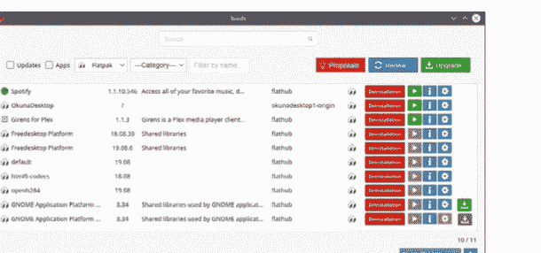
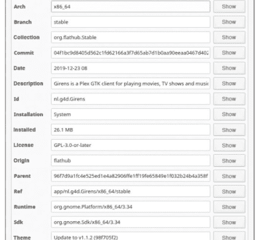
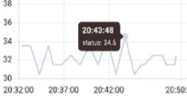
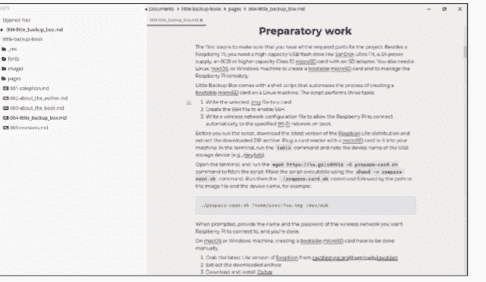
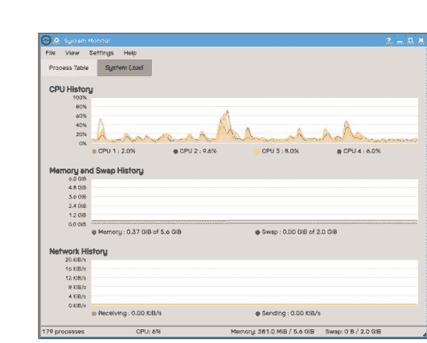
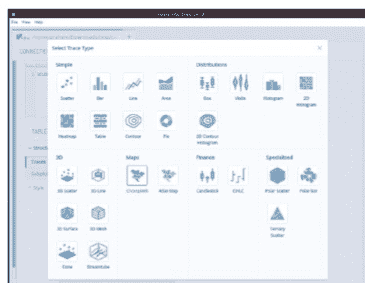
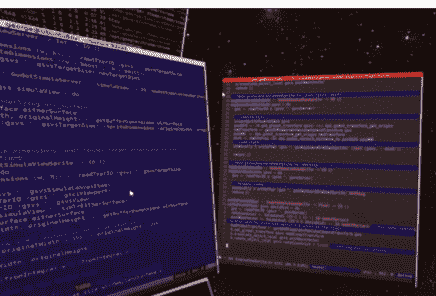
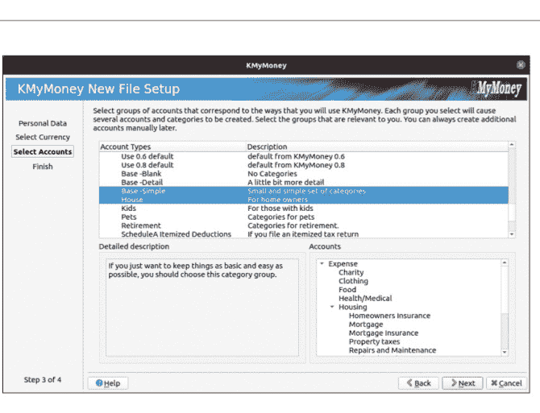

# Linux Magazine 第236 期 2020-07 美国

LINUX 新媒体

开源的脉动

直播你的

更智能的目录

后院鸟巢

更智能的目录

用语义化标签重新定义文件存储隐喻

OpenCart

构建一个安全的在线商店

使用免费工具设计电子书

监控技巧

构建一个仪表板来监控你的旧 Linux 电脑

bauh

# 浇你的植物

ProjectLibre

使用 Rasp Pi Zero 照料你的花园组织并可视化管理 Flatpak、Snap 以及下一个项目和 AppImage 包的合工具

FOSSPicks

- PCem 老旧 模拟器
- StarCharter
- SteamCAD 火车
- 带有 ChordPro 的和弦图
- 高级 Markdown 编辑器
- maddog: 笔记本上的 Linux
- KMyMoney

存储开发者大会

2020年9月21-24日

- 持久内存
- 区块链
- 存储架构
- 计算存储
- 数据安全及更多

在 `www.snia.org/SDcode` 注册并使用代码 `SDC20LINUXPRO` 即可立免 200 美元注册费。

# 编辑观点

# 欢迎

# 新商场

亲爱的读者：

沃尔玛在2016年收购了 Jet.com，这属于惯常的商业扩张，而亚马逊并未停下脚步。亚马逊在 2017 年以 33 亿美元收购了 Whole Foods，此举震动了市场。Jet.com 是一家新兴的在线公司，对于那些希望这个在线巨头不会坐以待毙、并试图在零售市场占据优势的老牌商家来说，这无疑是一个不不小的冲击。除了提供创新的折扣系统和改进挑战亚马逊在线空间的老牌方法之外，分销链突然我们有了亚马逊在挑战老牌商家。这些数十亿美元的收购随时发生，在它自己的实体店中，这一切的挑战在于当像 Facebook 或 Amazon 这样的大型科技公司购买它时被揭露，亚马逊正在洽购初创公司 box-store，但另一个也在动摇 JCPenney 堡垒的情况。

在 IT 领域，老牌企业这种现象。在线市场的竞争并不新鲜——新鲜的是实体公司购买在线初创公司，有趣的是在线购物和传统秩序为了在未来立足并注入一些。几乎每个大型科技公司都开始融入它们自己摇摇欲坠的企业文化中——甚至是当地餐厅——Jet.com 的收购被广泛视为沃尔玛购买在线业务的某种努力。你可以创建账户并订阅电子邮件通讯。。公司有它自己的在线部分，当然，但同时，实体店提供了一些在线商店可能绝对需要的闪新新点，例如通过沃尔玛标志进行品牌认同。地点充当了分发点。

作为其第一季度报告的一部分，沃尔玛刚刚静静地合并了 Jet.com，这种低调的业务已经进行了一段时间，当然，但承认这并不完全由于疫情引发的突发变化。老牌供应商在突然试图通过收购来重新定义自己时，看起来总是有些绝望。这让人想起微软的转型方式以及在风险投资中的其他失误。但认真地说，资本家们预测了30年。无论你是否尝试在以前不存在的地方建立一个内部，甚至更大。沃尔玛掷了骰子。观察者说他们输了赌，正如通常一样，事实要复杂得多。自从收购 Jet.com 以来，沃尔玛逐渐将 Jet.com 集成到自己的平台中，包括最初帮助区分 Jet.com（以及其他供应商）的关键功能。Joe Casad 现在是沃尔玛自有电子商务部门的负责人。互联网初创公司每天都在发生。故事有趣的地方在于，沃尔玛决定维持 Jet.com 作为一个独立品牌没有意义。他们可以以沃尔玛的身份经营，并与在线巨头直接竞争。我们正在见证低科技与高科技之间界限的模糊吗？当沃尔玛和其他实体商家计划围攻亚马逊的在线 LINUX-MAGAZINE.COM | LINUXPROMAGAZINE.COM 

2020年7月

## 新闻

## 封面故事

08 新闻

16 语义文件组织

- Linux 使用率正在上升

根据定义标准命名文件可以节省时间，并最大化日后找到文件的几率。

- 联想正在加入 Linux 笔记本风潮

全球计算机系统中使用的嵌套文件和目录的严格结构是在几十年前创建的，并且

- 一款 Linux 笔记本正在制作中

- Ubuntu 20.04 发布

- Git 2.26 发布

专家认为我们可以做得更好。本月，你将学习关于 Linux 中语义文件标记的一些脚本。此外还有：

12 内核新闻

- 适应 COVID-19

- 133 安全

- 使用 ProjectLibre 管理人员和项目（第30页）

- 使用 OpenCart 构建电子商务（第36页）

如果你一直想知道如何用 Rasp Pi 浇植物，请参阅 MakerSpace，并查看 LinuxVoice 获取两个实用的

## 评论

## 深度

22 发行版漫游

26 编程快照 – Markdown 编辑器。

几个领先的 Linux 发行版正在采取措施应对新冠肺炎带来的挑战。

Go 切片 (Slices)

春季是应用之季！Mike

## 服务

Schil 挖掘了一个 Google 工程面试中被提出的问题，并用 Go 解释了一个可能的解决方案。

## 深度

# 创客空间

30 ProjectLibre

ProjectLibre 帮助你使用 SSH组织并创建监控仪表板，优化包含大量命令行工具和 Node-RED 移动部分的复杂项目。

58 自动灌溉

使用由 Raspberry Pi Zero W、模拟数转换器和一个廉价灌溉套件组成的自动浇水系统来养护你的植物。

36 OpenCart

这个开源电子商务系统让你能在几分钟内让商店上线。

42 创建电子书

使用 LibreOffice Writer 和 Calibre，你可以发布自己的电子书，其效果比大多数在线转换工具都要好。

65 欢迎

76 theShell

本期 Linux Voice 内容。

这款精简桌面展示了，如果你跳出过时的常规，易用界面可以长什么样。

66 Doghouse – 笔记本电脑上的 Linux

Maddog 研究了笔记本电脑制造商、电脑商店和 Linux 用户之间复杂的关系。

46 命令行 – debfoster

当要在 Debian 系统上剔除不必要的软件包时，`debfoster` 让你能够方便地将所有清理功能整合到一个单一命令中。

82 FOSSPicks

Graham 展望了 Inkscape 1.0、PCem、StarCharter、Falcon、Squeezer、Simula、vitetris 等！

68 ChordPro

如果你弹弦乐器并想记录歌词和和弦变化，ChordPro 提供了一种优雅且方便的方法，将这一切记录在纸上。

49 Charly – 运动检测

Charly 在他花园的鸟巢里运行了多年初代 Raspberry Pi，但树莓派最终遭了马黄蜂的侵害。现在 Charly 用一个带有 Noir 摄像头和运动检测的 RPi3 替换了它。

50 bauh

`bauh` 包管理器可以处理 Flatpaks、Snaps、AppImages、AUR 和原生 Web 应用。

90 KMyMoney

72 Mark Text 和 VNote

个人财务程序 Markdown 编辑器 Mark Text 和 KMyMoney 可以帮助你在规划财务未来时跟踪收支。

以及选项

## 两个极佳发行版的双面 DVD！

详情请参阅第 6 页

本月 DVD：Ubuntu 20.04 桌面版和 Fedora 32。

“Focal Fossa” 是一个长期支持（LTS）发布版本。LTS 版本每两年发布一次，以于那些不急于更新到新版本的企业。例如，直到 2025 年，Ubuntu 20.04 将收到更新、安全支持和增强。相反，它的重点是稳定性，这是一种例外。作为 LTS 发布版本，Ubuntu 20.04 并没有引入许多新功能。默认引入 fstr 意味着使用某些新功能来丢弃 SSD 驱动器上未使用的块，这大致比比硬盘上的碎片整理。

主题 – 包含了 Gnome 36，其中包含。它默认启用显示了改进的字体支持以及对 Gnome 浏览器的修复进展得有多快。另一个新功能是 Linux 内核 5.4。Fedora 32 的另一个重大变化是 earlyoom [3]，它包含了 Linux 内核锁定（lockdown），该组件旨在通过限制对内核的访问来解决问题。Ubuntu 20.04 还包含了一些具有争议性的选择。内存和交换空间受到限制。基本上，如果内存低于 10%，earlyoom 将杀掉第一个占用内存最大的 Amazon 应用。由于该功能占用内存最多，当总内存低于 5% 时，earlyoom 也会杀掉该进程。如果没有 earlyoom，系统将会挂起，用户只能重启来恢复。此类情况可能会变得复杂，开发者正尝试决定最佳解决方向。争议的一个可能原因是，earlyoom 随着时间的推移并没有消失。Ubuntu 20.04 还增加了对企业测试场使用的 ZFS 根文件系统的改进支持。在 Ubuntu 19.04 中，ZFS 曾被 Linus Torvalds 批评，理由是没有得到原始开发者的支持。此外，ZFS 的 CDDL 许可证与内核的 GNU 通用公共许可证 v2.0 不兼容。尽管内核不支持 ZFS，但 Ubuntu 一极支持 ZFS 提供了增强的安全性和数据保护。

额外资源

缺陷光盘将被更换。

- [1] Ubuntu 20.04: https://omubuntu.co.uk/2019/10/ubuntu-20-04-release
- [2] Fedora 32: https://fedoramagine.org/announcing-the-best-release-of-fedora-32-beta/
- [3] earlyoom: https://fedaproject.org/wiki/

请向 subs@linux-magazine.com 发送电子邮件。尽管此 Linux Magazine 光经过测试且没有恶意软件和缺陷，但 Linux Magazine 对使用此光盘相关的任何数据或计算机系统的中断、丢失或损坏不承担责任，也不承担法律责任。

Enable_EarlyOOM

# 逛商店

shop.linuxnewmedia.com

## 使用 101 个 Linux 技巧提高效率

通过这本为 Linux 极客设计的灵感技巧和快捷键集合提升你的 Linux 技能。

- 恢复丢失的文件
- 治疗大写锁定症
- 在 Shell 中运行 C 单行语句
- 禁用摄像头和麦克风
- 以及更多！

## 新闻

## 技术、趋势和工具更新

# 本月新闻

- 08 • Linux 使用率正在上升
- 联想加入 Linux 笔记本电脑热潮
- 09 • 一款 Linux 笔记本电脑正在制作中
- 更多在线

## Linux 使用率正在上升

- 10 • Ubuntu 20.04 发布
- • Git 2.26 发布

COVID-19 疫情对经济和消费习惯产生了严重影响。许多企业已经关闭，不确定是否能在持续数月的关闭期内生存下来。尽管在所有市场数据中很难找到积极面，但一个积极的成果是，Linux 操作系统的使用率出现了大幅增长。

在你感到太兴奋之前，这并不是说 Linux 突然超越了 Windows 或 macOS。事实上，Linux 桌面端的使用率仍处于位数。然而，相比之下，Linux 在 4 月的增长率实际上超过了 Windows 和 macOS。

这些数据描绘了一幅有趣的画面，直接指向 Ubuntu。在 4 月份，Ubuntu 的市场份额增加了 1.61%（从 0.27% 增加到 1.88%），而 Linux 整体增加了 1.51%（从 1.36% 增加到 2.87%）。这恰好与 Ubuntu 20.04 (`https://releases.ubuntu.com/20.04/`) 的发布相吻，该版本获得了一致好评。

当 Linux 上升近两个百分点时，Microsoft Windows 下降了两个百分点，从 89% 降至 87%。与此同时，macOS 上升了一个百分点。

尽管这意味着 Linux 已统治市场且其统治世界的梦想很快就会实现，但开源桌面市场份额的任何增长都是一种胜利。

信息来源：`https://netmarketshare.com/operating-system-marketshare.aspx`

## 联想加入 Linux 笔记本电脑热潮

Linux 多年来面临的一个问题是，缺乏足够的包含开源操作系统的现成硬件。随着 System76 的出现，情况开始发生变化。从那时起，许多制造商加入了这一热潮。

## Linux 新闻

你现在可以将联想列入这些数字之中。在他最新的博客中，Fedora 项目负责人 Matthew Miller 表示：“Fedora Workstation 将很快在**更多在线**的联想 ThinkPad 笔记本电脑上提供！” Miller 继续说道：“是的，我知道我们中的许多人已经在联想系统上运行 Fedora 操作系统，但这是不同的。你很快就可以在自定义购买时通过选择它来获取预装 Fedora。

搭载 Fedora 驱动的 ThinkPad 是联想社区系列（Community Series）的试点，将包含 ThinkPad P1 Gen 2、ThinkPad P53 和 ThinkPad X1 Gen 8 笔记本电脑。如果该计划成功，未来可能会扩展到其他机型。

Fedora 版 ThinkPad 将预装 Fedora 32 Workstation。Miller 还表示，联想正在与供应商合作，以确保 Fedora 在今后拥有所有必要的固件支持。这将包括指纹识别器等功能。

从联想方面来说，联想高级 Linux 开发人员 Mark Pearson 表示：“联想很高兴成为 Fedora 社区的一部分。我们希望确保我们的产品能够获得最佳的 Linux 体验。我们致力于与开源社区合作并从中学习。”

## 管理 HPC

### 容器技巧与技巧

- Jeff Layton

容器的各个方面使其对你更有用。

- Jeff Layton

Pymp – 类 OpenMP 的 Python 编程

自 Python 创建 ever以来，用户一直在寻找通过线程实现多进程的方法，而 Python 的全局解释器锁（GIL）阻止了这一点。

## 管理在线

### Bash AWS Lambda de层

- Chris Binnie

目前尚未公布有关发布日期或定价的信息。一项新旧结合的功能允许你在 AWS Lambda 层中运行 Bash 脚本。易于部署的云原生应用包 容器部署 来源：`https://fedoramagazine.org/coming-soon-fedora-on-lenovo-laptops/`

## 一款新的 Linux 笔记本电脑正在制作中

TUXEDO Computers 正与 Manjaro Linux 团队合作，打造一款基于 Manjaro 的新型 15 英笔记本电脑，名为 Manjaro。Manjaro 团队将提供软件，TUXEDO Computers 将提供硬件。该笔记本可以配置 64GB RAM、第10 代 i7 处理器和高达 2TB 的内部存储。

该型号的其他功能还包括铝制壳、10 小时电池寿命、带有 Thunderbolt 的 USB-C、多个接口以及摄像头。

- Martin Loschwitz

协议版本 2 会随着客户端请求自动启动，并为客户端告知服务器其感兴趣的引用提供方法。因此，如果客户端请求单个分支，那就是客户端收到的唯一信息。

从 Git 协议版本 1 切换到版本 2意味着 Git 在处理大型项目时效率将显著提高。

其他令人兴奋的功能包括：

- *改进的 fsmonitor-watchman 钩，将避免之前版本中存在的竞态条件*
- *取消了每周在收件箱中使用多线程 grep 的限制*
- *更低的内存占用使得 Git name-rev 函数性能更好*
- *命令行界面颜色现在为包含的七种颜色提供了更亮的颜色变体选项*

## 获取最新消息

- * 取消了每周在收件箱中使用多线程 grep 的限制*
- *更低的内存占用使得 Git name-rev 函数性能更好*
- *命令行界面颜色现在为包含的七种颜色提供了更亮的颜色变体选项*

## 免费订阅

- 许多错误修复

更多信息，请阅读 Git 的官方公告（`https://github.bit.ly/Linux-Update-blog/2020-03-22-highlights-from-git-2-26/`）。

## 访问商店

想要订阅吗？在寻找那个你真希望在报刊亭买过的期数吗？

## 在 Linux New Media 在线商店探索过去并投资新一年的 IT 解决方案。

## 数字与纸质订阅


## 特别版


## 新闻

内核新闻

Zack 的内核新闻

## 适应 COVID-19

# I33t 安全

持续的 COVID-19 流行病确实

我经常说，Linus Torvalds 似乎并没有减慢 Linux 内核开发的速度，尽管面对面聚集会将安全性视为高于任何内核功能的最高优先级。线下引用正被抛弃，转而采用在线替代方案。最近，Linus 在某种程度上澄清了这一点。例如，Josef Bacik 宣布（也许是弄混了——你可以自行判断），在一次安全讨论期间，Christophe Leroy 发布了一个补丁来限制 Linux 攻击面之一的大小。具体来说，他想防止攻击者试图覆盖某些内核函数，以便内核在尝试调用这些函数时不会无意中执行不可信的代码。为了实现这一点，他希望静态地实现某些函数，以便它们不会在运行时更改。

## 编年员 Zack Brown 报道

最新消息、观点、困境以及发展，明年我们将在 Linux 内核社区中选择新成员。

Kees Cook 对该补丁表示认可，Al Viro 则提出了一些建议以规范所有支持的 CPU 架构的调用约定。该补丁最初是为 PowerPC 编写，但 Al 觉得 ARM、RISC-V 和 S390 需要特殊处理。他说：“让我们在还有……的时候解决它。”

这个问题在某种程度上是重要的，正如这些面对面活动最初开始的原因一样。

作者 Zack Brown

在线互动确实与众不同。这也许是那种允许邮件列表上发生持续数月的口水战，但面对面会议中争吵少得多的区别。


他补充道：“明年会议将于 2021 年 5 月 12-14 日在棕榈泉的 Riviera 酒店举行。将再次举行新的征稿（CFP）和注册，以及新一轮邀请。程序委员会将保持不变，明年我们将选择新成员。”

想要订阅吗？在寻找那个你真希望在报刊亭买过的期数吗？

# 在 Linux New Media 在线商店探索过去并投资新一年的 IT 解决方案

## 数字与纸质订阅


## 特别版


## 新闻

### 内核新闻

Zack 的内核新闻

## 适应 COVID-19

# I33t 安全

持续的 COVID-19 流行病确实

“而且你得_内化_它，接受一个 `const void *addr` 作为输入，攻击者试图替换其中的一部分，而不是嗤之以鼻。我很好奇为什么指针必须是带有黑客自己的常量的内核代码。他将原型追溯到 Linux v2.1.44，该版本更改了你随后引入的关于指针从 `void *` 变为 `const void *` 的补丁，但”

关于“仅仅是 bug”的重要部分在于，你需要理解到执行该代码并从而将控制权交给攻击者的需求。

“我对杀死进程完全不感兴趣。

加固主要是为了**调试**。我找不到任何解释。

在此时，Linus 溜了进来并带有防御性地抗议道：“我对杀死进程完全不感兴趣。”Wa 说他说只是在让它睡-

“我们已经做得好了。我感兴趣的唯一进程就是 dogs 的 lie，因为他的补丁并没有比 PaX 多多少。说真的。Main 是 _开发_ 过程，我们早已超越了他们那种拙劣的寻找 bug 并修复它们。他提议如果 Joe 想要可以并入，但 Joe 说这应该是垃圾。加上 PaX 和 grsecurity “只要你看到你的加固真的并不重要；他只是好奇。应该被主动避开。不要看它，主要是作为一种‘在行为异常时让我杀死机器/进程’，我不会使用它，并告诉大家在此时，Linus Torvalds 给出了一个解释：我知道不要使用那些狗东西。”

停止接受那些糟糕的补丁。

“因为 `free()` 应该始终具有”

Kees 澄清说他只会引用-一直是 `const`（同样，还有 `volatile`），遵循这一原则，即，“如果‘启用’”

“我对这件事是认真的。”

“当我说安全问题主要‘仅仅是 bug’时，一些安全人员曾对我嗤之以鼻。”

“如果‘启用’在已经启用时被调用，某些-但内核并不关心（因为我们处理的是 `volatile` 数据结构）。问题在于这是不对的。” Linus 回答道：“这是 C 标准库中的一个 bug。‘某地方不对’。”

“嗯，某地方不对’可以轻易是‘硬件并不 sup-’.”

“那些安全人员是该死的傻瓜。”

“想想：`free()` 并没有真正改变数据，它杀死了它的生命周期-这部分-的。

“因为老诚地说，那种安全问题主要仅仅是 bug，我不应该做那样的。如果你不把你的工作视为‘调试优先’，我根本不感兴趣。

那是与写入它是完全不同——且独立的的操作。

“是的，我意识到 PaX 对这类内容进行了软件模拟，而且它是”

“更重要的是，拥有一个你 `free` 的 `const` 数据结构（或 `volatile` 的）是完全没问题的。

它从未被使用的原因之一是-

“所以我认为加固项目真的需要对着镜子好好反思一下了。它总是次要于‘我能用这个吗’。因为主要的关注点应该是‘调试’。主要的关注点应该是安全意味着‘普通人无法使用这个，它只属于特殊的 l33t 用户’，这不是安全，是垃圾。那一年比在软件中执行页表的那一年更好，是一个 prime today’.”

```go
struct mystruct {
    const struct dictionary *dictionary;
};
```

“现在的主要的关注点似乎是‘为了 bug 杀掉东西’。这是一个有趣的陈述。当 Linus 说安全次要于‘我能用这个吗’时，他是在说用户功能比安全更重要吗？

“那是错的。”“所以在分配之前不是 `const`，但在之后变成了 `const`，而且释放它不会改变这一点，它只是在未来杀死了某人-整个-生命周期。”

第 236 期

2020年7月

13

## 新闻

### 内核新闻

“所以 `free()` 应该接受一个 `const`”

“所以 `free()` 应该接受一个 `const` 指针，考虑到它们可能会定义存储。”

“所以 `free()` 应该接受一个 `const`”

“所以 `free()` 应该接受一个 `const`”

“所以 `free()` 应该接受一个 `const`”

“所以 `free()` 应该接受一个 `const`”

“所以 `free()` 应该接受一个 `const`”

“所以 `free()` 应该接受一个 `const`”

“所以 `free()` 应该接受一个 `const`”

“所以 `free()` 应该接受一个 `const`”

“所以 `free()` 应该接受一个 `const`”

“所以 `free()` 应该接受一个 `const`”

“所以 `free()` 应该接受一个 `const`”

“所以 `free()` 应该接受一个 `const`”

“所以 `free()` 应该接受一个 `const`”

在内核中完成。此类争议如下

“重点在于某种认知方式的生命周期，即某些其他函数与能够写入对象是独立的，而逻辑上的‘const’是在坚持某一个特定的非常老版本的 GCC 中是类自由 的。Linus 回复道：‘哦，好的，好的，所以“free()”不是“我承诺不写入已就绪的对象，只是没有一个告诉它的接口’，而是“我可以接受一个常量指针”。’”

在随后的很长一段时间里，GCC 版本是 Linux 其他人支持的唯一版本，因为随后的版本都意识到这可能并不值得这样做。他还说：‘我也有某些事情是他不想让你们知道的。’

“我们在内核中有很多地方，会通过分配一个 `NULL` 来显式地进行那种‘生命周期’标记。由于你们已经在内核中有效地处理了它，你们拥有 DSE 代码，那么这对于指针来说看起来就像是一个（或无效值），而我们来说做这种事情要廉得多。”

时代已经变了：可能是因为（或）开源最终接管了自由世界，并且不再是一个初生的搅局者——

但 GCC 团队的 Richard Biener 正在为自己抵御巨型敌人，可能是因为现在已经有了

“我有一个模糊的记忆，我们甚至同意过使用一个属性来标注（很久以前），尝试使用一种类似于 `#de-nate` 的类自由的函数，就像我们细化 `kfree()` 那样……为了这样做，但事实证明，为类 `malloc` 的函数提供一个这样的功能会很好。”

用于提交功能请求和报告漏洞的合理工具和协议，

适当的‘使用一次’语义，因此如果 `kfree()` 的参数具有副作用，它将无法正常工作。” GCC 团队的 Martin Sebor 也说：

依赖项目拥有，并且可能因为在过去的 30 年里，各种项目之间已经发展了良好的关系。

“我实际上已经在为 GCC 11 实验这种方法，作为从动态检测未初始化读取的扩展。”

David Howells 建议实际上向 GCC 开发者提到这一点，

看到这些很不错。Q Q Q

Q Q Q

# LINUX 更新

## 需要更多 Linux 吗？

我们的免费 Linux 更新时事通讯每月每月向您的邮箱投递具有见解的文章和技术技巧。您将发现：

- * 关于真实世界 Linux 的原创文章
- Linux 新闻
- 关于 Bash 脚本和其他高级技巧的提示
- 仅供邮件订阅者的折扣和特别优惠

# 封面故事

## 语义化文件组织

### 基于语义标签重新发明文件存储 标记它！

根据定义的标准分配文件名可以节省时间，并最大限度地增加以后找到文件的概率。作者：Karl Voit。每个人都对丢失在自己电脑上整齐存储的数据感到熟悉。在无数目录中导航并不会带来预期的结果，因为你寻找的数据可能在一个随机命名的文件中——或者一个你当时认为是逻辑性的、但后来证明是容易遗忘的名字中。

全文搜索似乎提供了一种解决方案，但全文搜索通常需要额外的——往往是相当巨大的——资源。此外，尽管有了复杂的全文搜索，如果关键词定义得太泛，你可能会在大量结果中忽略所需的文档。

许多研究表明，几乎所有的计算机用户都经历过这种情况。

这个问题通常不是因为记忆力不好或缺乏计算机技能，而是归因于现代环境的设计。

很多时候，环境要求用户去适应计算机，而不是计算机去适应情况。

“现代”文件管理的基础是由上世纪中叶的开发人员奠定的。尽管如此，今天的系统在很大程度上遵循相同的前提。嵌套目录的概念被引入是为了更容易管理几十或至多几百个文件；随着桌面隐喻 [1] 的出现，目录被称为文件夹（folders）。

在文件系统层面，这个概念仍然是目录，而“文件夹”作为一个概念更适用于图形用户界面层面。与此一致，“文件”是文件系统层面的概念术语，而“文档”一词在用户界面层面使用更多。

丢失信息的不断增加，加上每个用户文件数量的海量增长，要求在管理文件时有一种全新的思维方式。

个人信息管理（PIM）领域的研究在三十年来取得了非常好的改进。然而，该领域的几乎没有发现进入过我们今天使用的计算机系统（见标题为“ ”的框）。

## 封面故事

### 语义化文件组织

向后兼容性仍然超过了高级概念。概念始于一种文件命名约定。标签随后随文件去往任何地方——没有吸取在与 Tagstore 项目工作中学的教训。用例中，采用适应的 ISO-8601 格式的日期或时间戳，脚本的目标是为感兴趣的用户提供一种简单开始应用语义化文件原则的方法，因为微软系统不允许标签中包含冒号。Tagstore 是某研究所文件管理研究的结果。在上述的示例中，你可以简单地在通用目录中存储 Bob 关于 MyProject 的笔记，并将其命名为 Tree。Tagstore 项目的目的是创建 Tree 来显示同时包含 Bob 的内容和 MyProject 内容的文件。

> ...一种在本地驱动器上管理文件和文件夹更好的方法。”

## 约定

本文描述了一套从……开发的脚本集。概念始于一种文件命名约定。在大多数与 Tagstore 项目学习的教训中。用例中，采用适应的 ISO-8601 格式的日期或时间戳，脚本的目标是为感兴趣的用户提供一种简单开始应用语义化文件原则的方法，因为微软系统不允许标签中包含冒号。Tagstore 是某研究所文件管理研究的结果。在上述的示例中，你可以简单地在通用目录中存储 Bob 关于 MyProject 的笔记，并将其命名为 Tree。Tagstore 项目的目的是创建 Tree 来显示同时包含 Bob 的内容和 MyProject 内容的文件。

## 问题

传统文件存储架构的问题。假设一个名为 Bob 的用户发给你一个关于名为 Myname 项目的想法的文件。在经典的存储范式中，你必须决定一个足够清晰描述文件又足够短以便于读的名字——是将该文件存储在包含其他文件的目录中。Tagstore 网站上的一个例子最好说明了这个问题加载或数字化日期。

基础文件名后面跟着一个可选部分，由决定是否保存它

## 语义化文件组织

## 标记

## 仅限研究

在过去的几十年里，除了已经建立的本地搜索引擎外，文件管理经历了几次根本性的变化。当涉及到个人电脑或本地网络上的数据时，用户很少使用本地搜索引擎。他们倾向于使用文件管理器进行浏览，极少使用搜索引擎。

更好的方法是围绕属性或标签构建一个系统，让你能够将单个文件与“Bob 的事务”和“MyProject 的事务”关联起来。某些文件格式（如图像格式）允许你以支持标记操作的方式将元数据与文件关联，但这种方法仅适用于特定格式。某些 Linux 文件系统提供了通过扩展文件属性添加元数据的可能性，但这种尝试可能需要相当的编程技能——而且在严格的目录层级中重新管理文件会不必要地限制用户。在时间上，取决于范围和不同的文件系统。此外，用户需要管理的文件数量大幅增加。

与其他方法相比，直接在文件名中以标签形式出现的元数据似乎更糟糕。这引入了版本控制问题。某些操作系统允许你从一个目录为另一个目录的文件创建符号链接或快捷方式，但链接和快捷方式难以管理、容易丢失，且创建和配置非常繁琐。

私人和企业环境中，共享存储的冗余数据量在 15% 到 50% 之间。

每天，搜索都会浪费每个人不必要的时间；根据我的经验，这至少相当于 15 到 30 分钟。通过一种全新的文件管理策略，甚至可能节省数倍的时间，取决于范围。

行业对研究和新策略有巨大的需求。几十年来，科学家们已经技术解决方案可以通过去重来减少此类冗余，但并非总是能消除它们。此外，去重技术并没有改善现状。

相比之下，研究领域源于不同的版本。于 20 世纪 80 年代的个人信息管理（PIM）在过去的二十年里一直关注搜索而非导航。

这一方向最有前景的进展来自微软的 WinFS，但它并没有进入日常工作环境。为文件添加标签的最简单解决方案是将标签附加文件名中。

## 示例环境

我目前使用 Debian、Xubuntu 和 Windows 10。在 Linux 上，我使用 Z-Shell、Thunar 图形文件浏览器和 Geegie 图像查看器。与其他图形工具集成意味着它们提供了调用外部工具的可能性。

文件关键词化本身是一门科学。

- 根据惯例，标签用小写字母和数字定义。
- 本文没有考虑多用户之间共享文件和目录的许多影响。根据个人实践和一些科学研究的发现，我建议遵循以下指南：
- 直接源于文件类型的标签，例如针对 `.jpeg` 和 `.avi` 扩展文件的图像和电影；
- 将自己限制在一个预定义的标签集中，或者用科学术语来说，受控词表（CV）。其范围越小越好。包含几百条目的受控词表比有帮助更有困惑。
- * 如果每个文件需要许多标签，搜索是更好的选择。

README 文件解释了如何安装和集成工具。

标签对于 LibreOffice Impress 文件以及相应的照片、电影或音频文件是有用的。

## 列表 1：命名规范

```bash
appendfilename --text="foo bar" 2019-09-26T14.52.36.jpg
```

你无需担心分隔符，这些工具让你的数字生活变得更容易。你可以在标签前面找到一个 `a`。在线系列视频中的第一行命令演示了列表 3 的主要功能，而第二行的命令结果是生成了名为 `foo -- bar baz.txt` 的文件名 [6]。第 3 行的命令格式将其转换回 `foo.txt`。

# 列表 2: 封装 Appendfilename

## 列表 3: 添加标签 (Adding Tags)

```bash
/usr/bin/gnome-terminal 
--geometry=90x5+330+5
$ filetags --text "bar baz" "foo.txt"
--hide-menubar
$ filetags --text "baz" "foo -- bar.txt"
-x appendfilename "${@}"
$ filetags --remove --text "baz bar" "foo -- bar baz.txt
```

## 头条故事

## 语义化文件组织 (Semantic File Organization)

## 列表 4: .filetags 文件

## 列表 5: Guess-target-folder.sh

```
books
## Guess-target-folder.sh
presentations
#
cheatsheets
file="${1}"
cliparts
finance
move_file()
manuals
{
tntamples
file="${1}"
draft final submitted
targetdir="${2}" 
}
```

```
echo "* ${file}\n -> ${targetdir}"
```

在交互模式下，如果不使用 `--text` 参数，你可以通过在标签前加上减号来删除现有标签：`-bar baz` 会移动 `bar` 标签并添加 `baz`。

`case "${file}" in`

工具还会根据标签在同一目录下其他文件中的用途来建议标签。这些建议从 1 开始编号。你可以复用输入中的缩写。例如，交互式地输入 `1 bar 42` 会告诉你与 `bar` 标签关联。

```bash
move_file "${file}" "$HOME/correspondence/insurance/";
```

此外，Filetags 提供了制表补全选项。为了管理这一点，在当前目录或父目录中创建一个 `.filetags` 文件是个好主意。软件会递归搜索目标文件夹。这两个脚本的这种形式通常只向上查找，找到第一个定义即生效。这意味着在 Unix 风格的操作系统上，你可以为不同的层级设置不同的定义。

`Guess-target-folder.sh` 是一个简单但高度个性化的 Shell 脚本。该文本文件的结构非常简单。列表 5 概述了基本机制：每行包含一个或多个标签。如果多个标签在同一行，Filetags 的处理方式非常相似，但它不会将它们视为互斥。


基于 `.filetags` 支持的模式识别，如果你向最终文件夹结构中添加一个 `foo -- draft.txt` 标签（其中目录名由 `ar-` 文件组成），`Filetags` 将自动将 `draft` 标签替换为 `final` 路径（例如 `$HOME/archive/`）和年份，而不是直接追加它。

如果需要，可以使用 `Pip3` 安装这两个 Python 脚本。Windows 系统上特别令人烦恼的集成问题促成了 `Integrationthis` [12] 的开发，用 Python 编写的 `Guessfilename` [10] 工具有助于轻松集成到 Windows 资源管理器中。文件名经常出现重复的情况，通过模式识别并解析文件内容，它可以确定文件名的变体。没有理由不让它学习与 `Geeqie`、`Thunar` 等其他界面集成。如果你在 GitHub 上有它，我们将非常欢迎。

当每月工资单以 PDF 文件（如 `Salary.pdf`）的形式发送时，它会根据配置的模式识别 `Salary` 字符串和 PDF 文件类型，并生成新文件名：`2019-09-29 Pay slip September -- company.pdf`。

只有当你考虑到某些额外功能以及工具之间的交互时，本文介绍的方法优势才能充分发挥真实潜力。例如，`Filetags` 使用 `--switch` 选项创建一个适合你需求的临时名称——在你输入一个或多个标签后，它实际上是一个模板视图，显示所有待自定义的文件。如果需要，要自定义这个关键的 `derive_new_file-from_old_filename()` 函数，你需要基础的 Python 编程技能。

临时视图由预定义临时目录中的链接组成。为了抵消开销，你可以看到日常文件处理中的许多简化。`Appendfilename` 和 `Filetags` 都设计为递归处理所有子目录。我使用 `Guessfilename` 在重命名链接文件时更改原始文件，这不仅适用于工资单，还适用于音频录制。

## 结论 (Conclusions)

本文介绍的方法的优势只有在对大量命名合理的文件池进行扩展使用后才会变得明显。该方法的各个构建模块只有在以下情况下才显示其价值：

- 单一价格的无限满意
- 低廉且持续的访问
- 防止你的借阅物品受大大哥的侵害
- 比比特追踪器更安全
- 18 年无缝运行
- 所有语言
- 全新内容

隐私、安全、自由软件和去中心化是使用相同方法进行的第二次处理。对于他来说，一个用于 File-tags 的包装脚本也很重要。在在他的博客（https://karl-voit.at/）中，将其映射到了 T 快捷键。这让他能够轻松地标记关于数字信息管理的文章。

一张或多张照片。我喜欢使用 sel（选择）、cliparts（剪贴画）和特殊的 标签。第一个标签标记具有代表性选择的照片。cliparts 标签标记适用于演示文的图片（https://karl-voit.at/2018/08/25/desk-metaphor/）。特殊标签则授予那些非常成功、适合进一步处理或作为桌面壁纸的照片。

- [1] 桌面隐喻：选择。
- [2] Tagstore 项目：https://karl-voit.at/tagstore/
- [3] ISO 8601：https://en.wikipedia.org/wiki/ISO_8601
- [4] 数字化项目：一旦活动的照片被妥善标记（https://karl-voit.at/2015/04/05/digitizing-paper/）并分类，你就可以选择它们并使用另一个快捷键
- [5] 计算机系统的进化步骤：例如使用 M Move2archive，将它们归档到新创建的文件夹（https://karl-voit.at/2017/02/10/evolution-of-systems）。图 1 显示了哪个工具生成文件名和路径。
- [6] 工具演示：https://karl-voit.at/demo-filetags-intro/
- [7] Date2name：https://github.com/novoid/date2name 例如，为了和朋友一起查看度假照，我在图像查看器中使用 S 快捷键来调用 filetags --filter 的包装脚本。
- [8] Appendfilename：https://github.com/novoid/appendfilename
- [9] Filetags：https://github.com/novoid/filetags。在这里，sel 标签是我默认的选择，用于将标记为 sel 的照片在新的图像查看窗口中打开。
- [10] Guessfilename：https://github.com/novoid/guess-filename.py 在准备演示文稿时，我喜欢使用 TagTrees 并配合快捷键 Shift+T。
- [11] Move2archive：https://github.com/novoid/move2archive。我之前提到的 clipart 标签创建了初始选择。然后我对其进行进一步过滤
- [12] Integratethis：https://github.com/novoid/integratethis
- [13] 作者的博客：https://karl-voit.at

2020年7月

## 什么？！

我能**更早地**拿到我的杂志吗？

随时随地获取！订阅数字订阅，享受关于热门话题、评论、酷炫项目等内容的最新文章……shop.linuxnewmedia.com/digisub

现已在 ZINIO 上：bit.ly/Linux-Pro-ZINIO

新的 Linux 发行版正在对抗 COVID-19

## 大流行病项目 (PROJECT PANDEMIC)

## 评论 (REVIEW)

发行版之路：Linux COVID-19

### Linux 发行版是如何对抗 COVID-19 的

作者 Bruce Byfield

一些领先的 Linux 发行版正在采取措施应对 COVID-19 大流行带来的挑战。

在我撰写这篇文章时，一个似乎处于媒体关注中心的话题是 COVID-19 的传播。发行版（又称为 distros）塑造了我们对 Linux 的体验。所有 Linux 发行版都使用 Linux 内核，但包管理、应用程序和其他组件存在巨大差异。持续的疫情对 Apple 和 Google 这样的公司产生了重大影响，部分是因为它们的业务模式，部分是因为它们的大部分制造位于中国，而那里遭受了早期且严重的打击。许多大型公司已与世界卫生组织会面，讨论如何应对疫情。

尽管面对面的交流正被聊天和视频会议取代，但总的来说，DistroWatch 列出了 273 个发行版，其中许多开源软件（FOSS）的日常工作似乎一如既常，尽管许多项目也在寻找对抗疫情的方法。切换发行版通常感觉像更换操作系统一样。

以过渡开启。Shuttleworth 补充说，所有的 SUSECON 2020 原定在都尔林举行。由于已宣布进入紧急状态，Fedora 支持服务仍保持 24x7 全天可用，该公司已做准备应对高达 15% 的缺勤率。Planet openSUSE [6] 还包含了 Ish Sookun 的定期报告，介绍了毛里求斯如何应对疫情，而这个国家通常不会在媒体中被。

32. Fedora 项目负责人 Matthew Miller 在《Fedora 杂志》中报告了目前为止该版本的测试情况。疫情发生在 openSUSE 计划于 2020 年 10 月与 LibreOffice 联合会议期间 [5]。Sookun 的描述实际上是一个不受影响的 [7] 根结底，这是一个 Fedora 的例子，展示了开源软件（FOSS）的全球影响力有时会产生有趣的副作用。限制和封锁使得如此提前的规划变得困难。

在 3 月，Miller 准备好发布剩余时期将与不同。

**图 2：Debian Med 是 Debian 的变体方案，用于基因测序、建模以及对抗 COVID-19 涉及的其他任务。**

23

## 评论

发行版之路：Linux 与 COVID-19

## 信息

在致 Fedora 成员时，他写道：“我想明确一点：如果你无法为修复漏洞、测试、翻译和其他常规任务做出贡献，请不要感到难过。按你愿意程度的贡献即可。我们感谢你为 Fedora 社区所做的一切，但你的健康——身体和心理——比发布一个版本更重要。”

重点放在 AMD64 和 ARM64 解决方案上。公告补充说：“Debian Med 团队也在尝试使用 Common Workflow 标准提高自动化和生物医学流水线/工作流的可用性。”毕竟，我们理解情况正在快速变化。我们正在制定应急预案，延迟发布的选项仍在考虑范围内。”

[1] 疫情的影响：https://www.fossinux.com/32642/coronavirus-wreaking-havoc-in-the-tech-industry-emphasis.htm
[2] 企业抗病毒：https://www.zdnet.com/article/coronavirus-apple-than-reveal-the-new-products-we’re-planning-to-continue-on-schedule-robust-but-we-understand-that-the-situation-is-workflows-theyre-making-in-covid-19-fight
[3] Canonical 已准备：https://ubuntu.com/blog/canonical-support
[4] Canonical 远程办公：https://ubuntu.com/blog/canonical-
[5] openSUSE + LibreOffice 会：https://news.opensense.org/2020/04/03
[6] Planet openSUSE：https://planet.opensense.org/
[7] Fedora 发布：https://fedoramagazine.org/
[8] 隔离期：https://joey-hess.name/blog/quarantimer/
[9] Debian Med 软件包：https://lists.debian.org/med
[10] 生物黑客松：https://lists.debian.org/devel/2020/04/msg0010.html
[11] 贡献：https://lists.debian.org/devel/2020/04/msg0011.html
[12] 其他开源软件：https://www.zdnet.com/article/how-open-source-software-is-come-many-of-the-tasks-that-are-needed-tackling-19

## 开源软件的响应

发行版并不是加入抗疫战斗的唯一开源项目。Facebook 致力于生产呼吸机和其他医疗硬件。Joey Hess 甚至为 Nextstrain 编写了一个脚本（图 1），类似的预测软件也在开发中。此外，医疗巨头辉瑞已发布了其中部分源代码。

这些软件包包括一个基因组序列组装器、一个医疗测序仪和一个建模器。每个软件包都带有注释、说明，以及关于编译和开发阶段的笔记（图 2）。Debian Med 举办了为期一周的在线“生物黑客松”。该活动的公告强调，虽然欢迎软件包的贡献，但应对 COVID-19 所的许多任务正在由 Debian Med 处理。

发行版提供了广泛的通用软件和硬件技能，这些技能对对抗 COVID-19 的战斗可能特别相关。Linux 发行版因它们正在工作没有获得太多宣传，但在这次疫情中，整个开源项目已通过 Debian Med 发布，Debian 是一个 Debian 发行版——也就是说，一个用于特殊用途的 Debian 版本。

## 商店

## 发现

LibreOffice 包含 Windows、macOS 和 Linux 2019 版完整版

## 探索免费

全球商务人士使用的办公套件！

创建你自己的：
- 文字处理文档
- 电子表格
- 演示文稿
- 数据库

无论你在 Windows PC、Mac 还是 Linux 系统上工作，今天就可以使用 LibreOffice 开始。这本单本特辑将成为你的指南！

## 在线订：

适用于 Windows、macOS 和 Linux 用户！

## 深度

编程快照 – Go 切片 (Slices)

用 Go Top Coder 解决经典面试题

春天是应用季节！Mike Schilli 拥有硅谷公司招聘流程的经验，他挖掘出了 Google 工程面试中问过的问题，并用 Go 解释了一个可能的解决方案。

模糊的问题

候选人对谜题的唯一线索在结尾。

为了解决这个问题，一个合理的候选人会首先创建一个数据模型。由于磁片排列为三行四列且颜色为绿色、蓝色或红色，列表 1 第 13 行的类型定义将磁片位置封装在一个名为 `pos`（代表 position）的类型中。一个 lead。这就是 Google 引用 lead 的。

他们经常故意提出模糊的数维数组问题，然后描述网格，这些为概念设定方向的工程师心中其实有自己的数。在这种情况下，使用整数值代表团队中的其他工程师。第一行并没有完全清楚“连接”的真正含义：第三列的蓝色方格是连接的吗？经理们通常不干预，这意味着：从技术事务开始的陈述主要关注与行连接的第一行单元，会自动将这些列为人员配置并激励他们的下属。可选地，下方的“连接”方格或常量 0、1 和 2，多亏于 TechLead 频道上的那一集吗？当被问及时，面试官在第一个元素后使用了 关键字。

这是关于在 Google 面试中常见的典型问题，即连接的瓦格必须共享一条边，其中之前的整个数组切片在 Go 中是切片的切片。该员工表示他进行过数百次。三个各包含四个元素的子切片形成了矩阵的行（从第一行及其瓦片绿、绿、蓝、红开始）。为了访问单个瓦片，是洪泛填充问题（flood fill）的一个稍微修改的版本 [2]。后者广为人知，以至于现在任何候选人都能闭着眼睛背出解决方案。这就是为什么 Google 将其从问题列表中删除了，而 TechLead 创建了自己的自己的版本 [3]。

## 作者

Mike Schilli 在加利福尼亚州旧金山湾地区担任软件工程师。每个月在他的专栏中（该专栏自1997年以来一直运行），研究各种编程语言的实际应用。如果你向 mschilli@perlmeister.com 给他发送邮件，他会乐意回答任何问题。硅谷的日常苦作。

图 1：在他的 YouTube 频道上，TechLead Shyu 吹嘘关于 Im

26
2020年7月
第 236 期
LINUX-MAGAZINE.COM | LINUXPROMAGAZINE.COM


## 深度解析

编程快照 – Go 切片（Slices）

它已经覆盖了瓦片，避免位于非连续组的瓦片。不必要的工作或陷入无限循环。为了实现，它使用了一个辅助结构，由另一个布尔值的二维切片组成。在脚本语言中，简单创建另一个由之前在第13行 X/Y 坐标处声明的 `pos` 结构组成的矩阵可能轻而易举。切片字面量的大括号初始化变量以最初创建一个空切片。具有相同的维度并填充布尔类型，但由于其严格的类型检查，Go 需要一些额外的步骤。

第 35 行和第 36 行的双对 for 循环遍历瓦片矩阵的行和列，并在每个元素上调用 `explore()` 函数。它传递了矩阵本身、当前元素的位置以及追踪器，函数在追踪器中突出显示已访问过的元素，以便能够跟踪行并为对应原始矩阵列数的每个行分配一个布尔切片。从当前元素开始，`explore()` 开始寻找匹配的相邻元素，可能会覆盖整个区域。一旦这样初始化，该结构允许你使用 `seen[x][y]` 来查询程序是否已经见过位置 x 和 y 处的瓦片。多亏了追踪，因为即使 for 循环固执地扫描每个元素，x 坐标也从矩阵的顶部到底部（从 0 开始），y 坐标从左到右。例如，访问 `tiles[2][3]` 选择了右下角的瓦片。多亏于

## 图 2：哪一组相邻数组瓦片最大？

因此，图 2 顶部的蓝色瓦片不是下方五个蓝色瓦片 U 形复合体的一部分。但它们仍然构成了图中最大的组，所以

第 19 行定义了一个二维数组。第 28 行首先使用 `make()` 分配一个布尔切片数组，以匹配数据结构的行数。然后 for 循环使用第 29 行的 `range` 来遍历之前创建的行切片，然后是切片中列 j 的元素。在随后的调用中跳过它们。

在 Go 的切片字面量中，你可以将整个数据结构的内容初始化为布尔变量，在 Go 中，单个值预设置为 false – 这节省了程序员的显式分配。

## 列表 1：connected.go

```go
package main

import (
	"fmt"
)

type pos struct {
	x int
	y int
}

const (
	Green = iota
	Blue
	Red
)

func main() {
	tiles := [][]int{
		{Green, Green, Blue, Red},
		{Green, Blue, Red, Blue},
		{Blue, Red, Blue, Blue},
		{Blue, Blue, Blue, Blue},
	}

	rows := len(tiles)
	cols := len(tiles[0])
	seen := make([][]bool, rows)
	for i := range seen {
		seen[i] = make(bool, cols)
	}

	max := []pos{}
	for x := 0; x < rows; x++ {
		for y := 0; y < cols; y++ {
			if tiles[x][y] == Green && !seen[x][y] {
				connected := explore(tiles, x, y, seen)
				if len(connected) > len(max) {
					max = connected
				}
			}
		}
	}
```


`fmt.Printf("Largest Group: %v\n", max)`

```
// 注意：这是洪泛填充问题的简化表示
// 实际算法遵循文本。
}
```

`func explore(tiles [][]int, x, y int, seen [][]bool) []pos`

```
// 文本描述的实现
return nil
}
```

*（等待，OCR文本非常乱。我将根据提供的逻辑提供一个正确的重构文本。）*

“后进先出”在运行时会被使用，它使用了 `add()` 函数，该函数接收包含所有瓦格的矩阵、起始位置以及已访问的记事本。在寻找 `explore()` 之前，它会执行“深度优先”搜索：首先向下钻取，以确保通过这种方式找到的邻居确实是邻居，这通过一个名为 `examine` 的待办列表直接查找相邻邻居。同样的逻辑，即确保它们不在边界之外，如果算法调用 `append()` 将 `examined` 范围之外的候选添加到在 `max` 或 `coord` 中定义的初始帧数组切片末尾，则该行为将适用。它随后会通过重新赋值切片减去新邻居后的切片来从切片头部移除处理项。在第 11 行中，将第一个元素 `examine[1:]` 重新赋值给 `examine` 变量。一个良好的候选方案可以对所有不同的实现策略进行权衡。图 3：算法已经找到了最大的。第 22 行调用的 `neighbors()` 函数定义在列表 3 中，它搜索所有相邻瓦格。它返回一个数组切片，其元素是彼此相邻的连续组，并在网格中高亮显示。

### 列表 2: explore.go

```go
package main

func explore(tiles [][]int, p pos, seen [][]bool) []pos {
results := []pos{}
examine := []pos{p}
color := tiles[p.x][p.y]

if max.x < 2 {
panic("Illegal array")
for len(examine) > 0 {
corpos := examine[0]
examine = examine[1:]
found := []pos{}
if seen[corpos.x][corpos.y] {
continue
}
add(&found, pos(cur.x - 1, cur.y), max)
add(&found, pos(cur.x + 1, cur.y), max)
add(&found, pos(cur.x, cur.y - 1), max)
add(&found, pos(cur.x, cur.y + 1), max)
if tiles[corpos.x][corpos.y] == color {
results = append(results, corpos)
}
seen[corpos.x][corpos.y] = true
examine = append(examine, neighbors(tiles, pos{corpos.x, corpos.y})...)
}
return results
}
```

### 列表 3: neighbors.go

```go
package main

func neighbors(tiles [][]int, cur pos) []pos {
var max pos
max.x = len(tiles) - 1
max.y = len(tiles[0]) - 1

found := []pos{}
add(&found, pos(cur.x - 1, cur.y), max)
add(&found, pos(cur.x + 1, cur.y), max)
add(&found, pos(cur.x, cur.y - 1), max)
add(&found, pos(cur.x, cur.y + 1), max)

return found
}

func add(found *[]pos, cand pos, max pos) {
if cand.x > 0 && cand.y > 0 && cand.x <= max.x && cand.y <= max.y {
*found = append(*found, cand)
}
}
```


2020年7月
第236期
LINUX-MAGAZINE.COM | LINUXPROMAGAZINE.COM

## 深度解析

### 编程快照 – Go Slice

为了让第 21 行的 `add()` 函数的更改在主过程中可见——或者说列表 1 知道在列表 3 中哪里找到 `dump()` 函数不仅读取了数组切片（仅仅是因为它们被传递给了它），还修改了它，该调用——这是因为尽管 Go 是按值传递数组切片的，但列表 3 中 `seen` 数据结构的第二个维度由的是指向数组切片的指针。在工作面试中，使用 `&` 符号表示指针并不罕见。在从第 21 行开始的 `add()` 函数声明中，`found` 因此也被标记为指向子程序的指针，因此找到了一个解决方案：如果是一个指向 `pos` 结构体数组切片的指针，那么如果“连续”是结构体，它将必须被更改（`found *[]pos`）。通过指针，使得主程序不仅适用于共享一个角并触及邻居的瓦格，而且符合预期的数据结构。第 25 行调用的 `append()` 函数是 Go 内置的，它通过首先解引用传入的指针来停止数组切片。

关于这种“值或指针”的更多信息（此处此处略）。

## ProjectLibre：使用 ProjectLibre 可视化复杂项目

### 赶羊（Herding Cats）

ProjectLibre 帮助你组织和优化具有许多活动部分的复杂项目。

作者：Marco Fioretti

项目管理是那些乐于通过微观管理来折磨团队的“恶老板”的首选工具。

### 入门指南

ProjectLibre 目前作为项目管理工具以及支持它的多平台桌面应用可用，它可以让几乎任何复杂的团队项目运行得更加顺畅。ProjectLibre 的界面（图 4）似乎是面向个人或小小组的。即将发布的云版本 ProjectLibre Cloud 承诺将“类似于 Google Docs，但用于项目管理”。大型项目的经理甚至不会尝试将所有事情都记在脑子里。

### 设计流程与界面

多年来，自定义数据结构、算法和图表系统已经演变，可以帮助经理可视化关键截止日期和任务。一些商业软件工具使用这些图表来帮助经理跟踪和优化工作流。项目经理常用的商业工具之一是 Microsoft Project。

属性遵循通用公共归属（Common Public Attribution）[7]。

ProjectLibre 和即将推出的 ProjectLibre Cloud 只能读取（不能写入）Microsoft Project 2003、2007 和 2010 文件。在界面的顶部，选择顶部的“文件（File）”选项卡，点击命令丝带中的“新建（New）”按钮创建一个新项目。接下来，点击同一丝带中的“信息（Information）”按钮进入许多功能，其中许多功能已经开发了数十年（或随时更新）。

当前的 ProjectLibre [1] 是一个用于项目的实用开源工具。本文描述了如何使用 ProjectLibre 开始规划和绘制项目图表。然而，在阅读这些内容时，请记住，专家建议在对项目有良好理解之前不要启动软件。尽可能通过手动操作：用纸和笔绘制草图和列表，然后进行修订。一旦你有了信心，或者觉得如果没有帮助就无法进一步改进计划，就是时候开始使用该软件了。ProjectLibre 是一个为现实世界的项目经理设计的工具，你需要熟悉一些项目管理概念才能用好它。

### 在 Ubuntu 上安装 ProjectLibre

在 Ubuntu 上安装 ProjectLibre 相对简单。下载一个 `.deb` 包并使用 `dpkg` 安装：

`sudo dpkg -i projectlibre_1.9.1-1.deb`

之后，你可以从 Ubuntu 菜单或通过在命令行提示符中输入 `projectlibre` 来启动程序。在本文，我展示了一个使用 ProjectLibre 开始规划和绘制图表的示例。

### 理解项目管理图表

网络图（Network diagram）[2] 是所有元素的可视化表示。WBS 将项目划分为称为“工作包（Work Packages, WPs）”的区块。在良好的情况下，图表有助于做出正确的决策。

历史上，项目管理中使用网络图有两种主要方法：箭头图法（ADM）和前置网络图法（PDM）。ADM 将事件表示为节点，而在 PDM 中，活动是框，箭头连接这些框。ProjectLibre 的界面（图 4）工作方式与“理解”部分讨论的理论工作流略有不同。大型项目的经理甚至不打算将一切都记在脑子里。在界面的顶部，放置命令丝带（图 5）控制框。它将以每月订阅服务的形式提供。ProjectLibre 用 Java 编写。

如今，PDM 比 ADM 更流行。虽然 PDM 涉及的投入（例如数据或文档）或人力资源会更复杂，但它更加准确。PDM 图支持概率计算，并预测问题将在何时、何处出现。

在理想的世界中，PERT 图是首要要绘制和验证的内容，用以决定项目应该启动以及如何启动。接下来，通过 WBS 将 PERT 工作流划分成若干区块，以指定为每个任务应分配多少的人员和其他资源。下一步是生成一个具有具体开始日期、结束日期、中间里程碑和检查点的甘特图。甘特图能让你轻松地看到某些任务是可以按顺序执行还是可以同时进行。与此同时，RBS 图可以提供每个组成部分总成本的良好概述。

在项目管理中，使用 PDM 最（也最重要）的方法是计划评审技术（PERT）[3] [4]。PERT 是为 20 世纪 50 年代大型、时间敏感且极其复杂的项目设计的，但它在每个项目中都很有用。ProjectLibre 将 PERT 图称为“网络图”（图 1），它是甘特图的一种统计学图形化表示，远比项目的时间线详细。具备 PERT 功能的软件可以自动计算项目的关键路径（即完成项目或其某部分所需的最长时间）。

一旦项目启动，你检查和调整工作的频率将比查看 PERT 图频繁得多，因为只有甘特图可以作为一个可编辑的日历和运行状态报告。你仍然应该定期检查并更新你的 PERT 图，即使不是为了其他目的，为了学习下次如何制作更好的图。

前置时间（Lead time）是完成一项任务所需的时间，或者在前一个任务完成之前开始该任务所节省的时间。滞后时间（Lag time）是不可避免的延迟。另一个被称为“松”（slack）的指标显示了任务可以延迟多久而不会对项目的其他部分产生问题。

### ProjectLibre 使用

一旦将项目的所有初步数据输入 ProjectLibre，你就可以在甘特图视图（图 4）开始实际规划。

分配依赖关系分两个步骤。首先，你在甘特图中输入每个任务的名称、持续时间、开始和结束日期。要在两个任务之间创建依赖关系，点击 Link 按钮，然后尝试将第一个任务拖到另一个任务上。ProjectLibre 将在任务之间画一个箭头。点击箭头将打开如图 8 所示的弹出窗口，在其中你可以指定任务之间想要的四种 PDM 依赖关系中的某一种，以及滞后时间。

第二步是真正有趣的地方，而且（希望）任何调度错误都会变得变得可见。当你在甘特图中输入依赖关系并分配资源时，记得定期保存，查看资源被分配给了哪些任务，点击命令功能带中的 Update 按钮，然后检查 PERT 日期。通过这种方式，你可以处理项目进行可能会出现的问题，例如人员退休、搬到其他办公室或获得自动加薪。

此外至关重要的任务是为每个任务分配资源：对于每个任务，你必须填写 Resources 选项卡（图 9），指定为该任务保留源容量的多少百分比。同一窗口中的 Advanced 选项卡包含一些设置，例如任务是否应该有 24 小时轮班、固定截止日期或额外的时间限制，例如“不能早于……”或“越晚越好”。

输入所有这些数据非常耗时，但每个项目只需操作一次，非常值得。此外，除了能够从图中的任务日期加载此完整的电子表格外，你还可以通过在实际图上拖放对应条形的末端在时间轴上移动任务。尽管需要手动输入数据，该电子表格仍然非常灵活。如图 7 所示，点击资源时出现的弹出窗口让你定义它的可用时间，并定义最多五种不同的成本率。

**图 4：ProjectLibre 的用户界面上半部分显示甘特图，下半部分显示一个绘制团队成员（Frank）随时间投入情况的图表。**

**图 5：ProjectLibre 顶部菜单中的每个项目都有自己的命令功能带。**

而且你的老板想要知道他们的任务，并确保一切都在控制之中。点击主界面上的“视图 (View)”，然后点击命令区中的“报告 (Report)”，即可生成如图 10 所示的可打印报告。或者，你也可以将这些报告导出为 CSV、HTML、XLS 和其他格式。

### 结论

目前，ProjectLibre 桌面版有两个可能成为障碍的局限性。首先，它对预算计算和分析的支持非常少。其次，完整的项目数据以及所有成本和资源使用统计只能作为 Microsoft Project XML 格式导入和导出，而不是更易于重复利用的格式。此外，虽然用户手册很好，但只能通过网站上的一个链接访问，该链接指向 Google Docs 中一个无法导出的相应文件。为什么？

尽管存在这些问题，ProjectLibre 似乎仍然简单项目的有效工具，也是学习项目管理基础知识的极佳教学工具，它可以确认你的计划是否合理，或者在错误产生具体后果之前将其标记出来。当然，在整个项目过程中，你必须反复更新图表并检查一切是否按轨道进行。

信息
- [1] ProjectLibre: www.projectlibre.com
- [2] 项目管理网络图: https://www.wrike.com/project-management-guide/faq/what-is-a-network-diagram-in-project-management/
- [3] PERT: http://www.netmba.com/operations/project/pert/
- [4] PERT 术语表: https://search.softwarequality.techtarget.com/definition/PERT-chart
- [5] WBS: https://project.pm/work-breakdown-structure/
- [6] 甘特图: https://project.pm/gantt-chart-importance/
- [7] 通用公共归属许可: https://opensource.org/licenses/CPAL-1.0

图 7：项目规划的关键部分是描述所有涉及资源及其成本。

图 8：你可以在甘特图中选择任务之间的依赖关系，并设置可配置的延迟。

图 9：除了依赖关系外，任务必须拥有端口，当然还为它们分配了充足的资源。

图 10：ProjectLibre 生成了关于所有自由数据的若干摘要报告，你可以将其打印或导出为几种格式。

作者
Marco Fioretti (http://stop.zona-m.net) 是位位于意大利罗马的自由作者、培训师和研究人员，自1995年以来一直从事自由/开源软件，自2005年以来致力于开放数字标准。Marco 还是自由知识学院的董事成员。

LINUX-MAGAZINE.COM | LINUXPROMAGAZINE.COM | 第 236 期 | 2020年7月

## LINUX MAGAZINE

### 快照保护你的数据

一种保护你数据的更好方法？Linux 5.9 独立的企业版随插件发生变化

### 快照

### GIT 技巧 选择一个 GUI

### 能量消耗监控应用程序

### 能量消耗

### 廉价的 IoT

### 对小众分发版的聚光

### 平铺化布局

### 匿名电影

### 矢量图形

### 自动化

Linux Magazine 是你进入 Linux 世界的指南。阅读内文获取在其他地方找不到的高级技术信息！

### 通过以下扩展你的 Linux 技能：
- 关于热门话题的深度文章，包括比特币、勒索软件、云计算等！
- 关于实用工具的入门指南和教程，它们将为你节省时间并保护你的数据
- 故障排除和优化技巧
- 关于世界关键发展的深刻见解
- 关于 Raspberry Pi、Arduino 和其他开源项目
- 订阅 Linux，不再错过任何一期！

### 立即订阅！
linuxmedia.com/

## 虚拟商店

## 深度解析

### OpenCart

#### 设置 OpenCart

使用 OpenCart 这种免费、开源的电子商务系统，你可以在几分钟内建立在线商店。Rubén Lorente 当互联网上有许多电子商务系统时，PrestaShop、OsCommerce 和 Magento，商家在销售商品时有许多选择。一种保护你数据的更好方法？企业版随插件发生变化。[1]。如果你想更改他们的数据和服务条款，或需要某些功能，可以将其迁移到其他地方。

你需要一个支持 FastCGI 的 Web 服务器、合适的 PHP 版本以及数据库。

表 2：所需的 PHP 模块
| 模块 | 描述 |
|---|---|
| cURL | |
| GD | |
| MBrypt | |
| OpenSSL | |
| PHPstring | |
| XML | |
| Zlib | |

### 安装

[1]。OpenCart 是一个用于创建和管理在线商店的免费开源电子商务平台。

[2]。更多信息请参见 OpenCart 文档：https://www.opencart.com/documentation。

OpenCart 是一个免费、开源的电子商务系统。

## 深度解析

### OpenCart

#### 构建 LAMP 服务器

LAMP (Linux, Apache, MySQL, PHP/Perl/Python) 服务器是托管 OpenCart 等应用程序的常用堆栈。你必须配置 OpenCart 将使用的数据库。第一步是通过运行以下脚本来增强数据库的安全性：在示例中，我使用的是 MariaDB，它是 MySQL 的无缝替换版本。

```
## mysql_secure_installation
```

使用上述脚本，输入 MariaDB 的 root 密码（请记住它！假设环境是 Devuan，请记住以下命令，它是针对 MariaDB 的 root，而不是操作系统的 root。安装 LAMP 服务器所需的各种组件：

```
## apt-get install apache2 php libapache2-mod-php php-fpm php-curl php-zip php-gd php-mcrypt php-mbstring php-mysql php-xml mariadb-server mariadb-client own
```

禁用匿名数据库用户、远程数据库 root 登录以及测试数据库，然后重启 Apache 服务：

```
## /etc/init.d/apache2 restart
```

接下来，你创建一个数据库并授予 OpenCart 使用该数据库所需的权限。首先，打开 MariaDB 提示符：

```
## mysql -u root -p
```

<输入密码>

然后创建一个名为 `opencart` 的数据库以及一个同名的具有访问权限的用户。选择一个良好的密码，并在下面的示例中使用它替换 `$PASSWORD`：

```
## a2enmod ssl
## a2ensite default-ssl
```

```sql
MariaDB [(none)]> create database opencart;
```

```sql
如果你的发行版 Apache 没有自动创建证书，你将必须手动创建 [4]。自签名证书不适用于生产环境，但对于测试完全足够。如果你打算将此服务器迁移到生产环境，你需要从证书颁发机构购买并安装证书 [5]。原生情况下，你可以使用 Let's Encrypt 服务获取免费证书 [6]。
```

```sql
MariaDB [(none)]> GRANT ALL PRIVILEGES ON opencart.* TO 'opencart'@'localhost' IDENTIFIED BY '$PASSWORD';
MariaDB [(none)]> FLUSH PRIVILEGES;
MariaDB [(none)]> QUIT;
```

虽然本文的范围有限，但“构建 LAMP 服务器”框提供了一个起点，提供了关于接口解析的详细说明。列表 1（简要总结）假设在 Devuan 系统上新安装了 Apache。

OpenCart 同样适用于 OpenBSD 的自定义 httpd 服务器，但该设置没有官方文档说明。只需用浏览器访问你的 Web 服务器并按照说明操作即可。向导将引导你完成安装过程。

最后一步是触发 OpenCart 安装脚本（图 1）。它将检查你的 Web 服务器堆栈是否包含所有必要组件，请求你的数据库访问凭据（图 2），并允许你下载并解 OpenCart 到合适的目录。OpenCart 的源代码将监听所有网络接口的 80 和 443 端口。之后，它将允许为 OpenCart 创建管理员账户。

> 图 1：安装脚本将确保你在继续之前符合安装前提条件。

LINUX-MAGAZINE.COM | LINUXPROMAGAZINE.COM

第 236 期

2020年7月

图 2：OpenCart 需要数据库访问凭据才能正常工作。

关于使用 OpenCart 界面的更多提示，可以分配给 OpenCart 的应税项目是不言而明的，请参阅官方文档。要开始使用，前往“系统 | 设置”（System | Settings）。

特别地，请查看 OpenCart 的基本安全实践 [7]。至少，你应该删除安装目录。

```
## rm -r /var/www/html/install
```


探索商店的核心配置。“目录”（Catalog）部分允许你向商店目录上传新产品（图 5）并将其按类别进行分组。前往“目录 | 信息”（Catalog | Information）来指定你网站的术语和条件，以及你可能提供的其他法律信息。

你还可以在此处启用“维护模式”。如果你选择了维护模式，访客将无法使用网站并看到一条解释性消息（图 4）。

默认情况下，管理界面通过主机的 IP 地址可用。可以通过该地址访问。然而，已登录的管理员仍可以在维护模式下浏览商店。

自定义 OpenCart：OpenCart 默认提供了一些基本功能（见表 3）。但在实践中，你还需要完成一些额外工作才能拥有一个功能完整的商店。也许最大的障碍是缺乏对信用卡处理器的支持。此外，网站名称可以在“系统 | 本地化”（System | Localization）中设置，在那里你需要配置本地化设置，例如税率和配送区域。

图 3：在“系统 | 设置”中，你可以设置网站名称和其他重要参数。

## 商店

| 信息 | 客户服务 | 额外 | 我的账户 |
|---|---|---|---|
| 关于我们 | 论坛 | 规则 | 我的账户 |
| 配送信息 | 退货 | 礼品卡 | 订单历史 |
| 隐私政策 | 网站地图 | 地址 | 愿望清单 |
| 条款与条件 | | 特价 | 通讯邮件 |

## 产品列表

| 图片 | 产品名称 | 型号 | 价格 | 数量 | 状态 | 操作 |
|---|---|---|---|---|---|---|
| | Apple iPhone 3 | 15 | $100.00 | 5 | 已启用 | 编辑 |
| | Canon EOS 5D | 3 | $100.00 | 5 | 已启用 | 编辑 |
| | HP UP665 | 21 | $100.00 | 5 | 已启用 | 编辑 |
| | HTC Touch HD | 14 | $100.00 | 5 | 已启用 | 编辑 |

图 4：如果选择了维护模式，用户将看到一条消息，告知他们商店因计划维护而离线。

图 6：OpenCart 的默认主题。

图 7：OpenCart 市场平台 [8]。

图 8：设计 | 主题编辑器（Design | Theme Editor）。

如果你觉得自定义主题太通用。

如果你想进行更大的更改，最好下载一个新主题。

界面使用 Twig 模板实现，你可以在“设计 | 主题编辑器”中进行修改。

因此，在扩展程序方面，OpenCart 比 PrestaShop 等替代品要便宜得多。

（图9）。

## 支付方式

- 货到付款 (COD)、银行转账、支票、PayPal、BrainTree

## 模块

- 固定费率、重量计费、免费送、店内自提

## 文档

反垃圾功能

- 基础验证码（不推荐）、Google 验证码

OpenCart 严重缺乏技术文档。营销优惠券、联盟营销计划、礼品券、网站地图等提及。虽然项目有很多用户文档，但关于构建扩展的实际说明很少。

LINUX-MAGAZINE.COM | LINUXPROMAGAZINE.COM

第 236 期

2020年7月

## opencart

- 主题
- 语言
- 支付网关
- 配送方式
- 模块
- 订单表
- 产品馈
- 报告
- 其他\VQMod

## 导航

- 仪表板
- 目录
- 扩展
- 主题
- 主题编辑器
- 语言编辑器
- 横幅广告
- SEO URL
- 销售
- 客户
- 营销

## 主题编辑器

首页 主题编辑器

### 编辑主题

主题编辑器使用 Twig 模板语言。你可以在此处阅读有关 Twig 语法。

选择你的商店

```
account login.twig

<div class="alert alert-danger alert-dismissible" class="fa fa-times-circle">

{{ error }}

</</div>

<div class="alert alert-success alert-dismissible" class="fa fa-check-circle">
{{ message.success }}
</</div>

```

## 深度解析：OpenCart

图 6：OpenCart 有一个活跃的市场 [8]，你可以在那里购买扩展。

图 7：默认主题可以使用，但你可能会觉得它太通用了。

图 8：使用主题编辑器修改构建用户界 Twig 模板。

## 扩展安装器

首页 > 扩展安装器

上传你的扩展

- * 上传文件 [上传]

安装进度

进度

安装历史

| 文件名 | 添加日期 | 操作 |
|---|---|---|

图 9：OpenCart 的功能可以通过扩展进行扩展。

随 OpenCart 一起提供的基础验证码扩展严重不足。它带给你头疼的问题可能比你通过购买扩展提供功能所避免的还要多。核心系统。你应该。幸运的是，OpenCart 自带了许多预装扩展，可以作为免费下载，如果你想要一个功能完备的网站并分析以弄清工作原理，或者你没有时间或不知道如何构建自己的扩展。特别是，目前没有文档来加固你的 HTTP 栈。

请记住，OpenCart 需要关于如何在高可用配置中托管实例的提示，以缓解跨站脚本 (CSS) 攻击和其他恶意活动的风险。没有关于向客户发送电子邮件的说明（例如，订单确认消息）。你需要单独构建一个或聘请专门的供应商，这样当你的一台服务器宕机时，你的网站将继续运行。

## 结论

OpenCart 远非完美。最后，网站本身是无法收集用户的。一旦你的网站运行起来，你就需要投入一个良好的营销计划，因为它缺乏适当的文档。然而，OpenCart 提供了一些商家可能会觉得实用的额外功能。它安装非常快，并允许你找到自己的在线商店。

## 附加功能

开箱即用的联盟营销计划支持允许你为他人引导流量到这里而付费。内置的评论系统允许用户对你的产品留下意见。反垃圾措施是默认提供的，但请注意内-

[1] OpenCart: https://www.opencart.com/

[2] 以 Bitnami 栈分发的 OpenCart：https://bitnami.com/stack/apache/（等等，文中说是 https://bitnami.com/stack/ubuntu - 可能是 bitnami.com/stack/apache/）

[3] “Docker、Snap 和公司的替代品”，Erik Bärwaldt，Linux Magazine，第 223 期，2019年6月：Rubén Llorente 是一位机械工程师，他的工作是确保小型诊所 IT 基础设施的安全措施符合法律且安全。他还是一个 OpenBSD 爱好者和武器收藏家。

[4] 创建并安装自签名证书：https://tecadmin.net/create-index.php?route=marketplace/

[5] 在此处安装 SSL 证书：https://cheapsslsecurity.com/

[6] Let's Encrypt：https://letsencrypt.org/getting-started/

[7] OpenCart 基础实践：http://docs.opencart.com/en-gb/

[8] OpenCart 市场：https://www.opencart.com/

[9] OpenCart 文档：http://docs.opencart.com/

## 深度解析：自定义出版

使用免费软件设计电子书

## 自定义转换

通过 LibreOffice Writer 和 Calibre，你可以发布自己的电子书，结果比大多数在线转换工具都要好。作者：Bruce Byfield

如果你正在出版电子书，你可以在网上找到许多转换工具。问题在于，大多数这些工具和表格只有部分有效，而且这些工具让你对结果的控制力非常微小。

- 仅使用字符和段落样式。使用框架、页面、列表、引用的样式。
- 使用书签代替交叉引用。
- 如果你正在使用同一个文件制作电子书的纸质版，最好避免这样做。大多数情况下，定位和文本设置应该是有效的。但经常结果的格式糟糕，部分是因为层叠样式表 (CSS，用于格式化电子书的语言）局局性，但主要由于-阅读器可以添加分页符或使用标题样式来指示新页的开始。
- 不要担心字体。在电子书阅读器上，用户通常设置自己的字体。因此，如果你想嵌入字体，需要在 CSS 中编写

你自己进行转换，而不是坚持使用某些工具。它们不会让电子书文件无故变大。作为一名专家，你可以更好地更好地完成初始的电子书格式转换。

仅需两个开源工具即可制作电子书：LibreOffice Writer 和 Calibre。然而，在获得想要的结果之前，预计需要进行一些尝试。

创建电子书涉及以下步骤：

- 1. 在 LibreOffice Writer 中创建原始文件。
- 2. 转换为 EPUB 格式。
- 3. 在 Calibre 中修复错误。
- 4. 如必要，直接编辑 CSS。
- 5. 在 Calibre 中进行最后的润色。

## 创建原始文件

你可以从在 LibreOffice Writer 中编写电子书开始。我强烈建议使用样式，因为它们可以让格式的微调更快。尽可能少地使用样式，并记住转换过程带来的局限性。以下规则适用于 LibreOffice 6.2 及更高版本：

图 1：简单文档可以从从 Writer 转换为 EPUB。

42

2020年7月

第236期

LINUX-MAGAZINE.COM | LINUXPROMAGAZINE.COM

## Eleanor Arason

大平原曼哈顿


## 聚焦

定制出版

最可能的格式是 EPUB 和 MOBI (Kindle)，但其他格式可用。你可以维护同一书目的多个格式，并点击格式在摘要窗中打开选定的文件。无论何种方式，通过打开电子书并检查结果来决定你的下一步。

某些问题可以在 Calibre 内编辑（见下文），但特别是在第一次尝试时，回去编辑原始文件可能会更容易。这为你提供了有限的选项。

如果页边距发生变化，EPUB 版本可能需要更改。如有必要，添加空白。如果你计划在具有自身格式规范的网站上发布。你也有这种习惯，将防止文本环绕图像时出现任何问题。

## 使用 Calibre 编辑

你可以使用 Calibre 的图形界面来编辑几项内容。通过右键点击文本流固定或可流动。除了标题外，你还可以编辑电子书的元数据（图 2）。你可以手动编辑标签，例如作者和出版商，或从 Amazon 下载元数据。你可以通过 Calibre 的“添加书籍”按钮将电子书中的图像一起导入 Calibre。更改或裁剪标题页。

- 使用 Writer 内置的图像说明工具处理图像。它将保留说明和区域。
- 目录 (TOC) 大多数导出时没有问题。通过右键点击并选择“编辑书籍”窗口进入复杂的界面（图 3）。
- 然而，如果你的格式更复杂，你可能想将原始文件保存为 ODT 格式，使用 LibreOffice Writer 的构建块来创建活动链接并添加文本（标题）。忽略页面默认格式，然后点击“添加书籍”在 Calibre 中打开它。大部分编辑工作需要数字和制表符，因为它们不会破坏 CSS 知识。然而，从 Calibre 生成的电子书中，你通常可以

要转换为电子书格式，点击“转换书籍”。

记住，原始文件是确保格式正确的简单的地方。你的格式越简单，你需要做的事情就越少。

## 转换为 EPUB

LibreOffice 文件可以方便地转换为 EPUB 格式。如果你的文件格式非常简单，你可能可以通过“文件 | 导出 | 导出为 EPUB”（图 1）进行转换。

EPUB 导出

图 3：编辑书籍窗口是 Calibre 用于手动编辑和从界面打开的-编辑-窗口的主要地方。

LINUX-MAGAZINE.COM | LINUXPROMAGAZINE.COM

第236期

2020年7月

43

## CSS 教程

- CSS 首页
- CSS 简介
- CSS 语法
- CSS 选择器
- CSS 注释
- CSS 颜色
- CSS 背景
- CSS 边界
- CSS 内边距
- CSS 盒模型
- CSS Outline

## CSS 教程

CSS 是一种描述 HTML 文档样式的语言。CSS 描述 HTML 元素应该如何显示。本教程将教你从基础到高级的 CSS。

## 目录

- 管理字体
- 嵌入引用字体
- 子字体
- 压缩图像（无损）
- 智能标点（对英语效果最佳）
- 移除未使用的 CSS 规则
- 转换样式
- 编辑 HTML - 所有文件
- 美化所有文件
- 整理到文件夹
- 添加封面
- 设置语义
- 过滤样式信息
- 检查拼写
- 外部链接
- 检查书籍
- 报告
- 升级书籍内部

## 聚焦

定制出版

通过对现有代码建模来做出小更改。

## 使用 CSS

为了对格式进行完全控制，你需要使用 CSS，它同时用于电子书中的内容文件和样式表。某些功能（如表格或多列）只能通过 CSS 添加到电子书中。

图 4：W3Schools 提供了大量的 CSS 交互式教程。

CSS，虽然最好的选择可能是完全避免此类功能，但幸运的是，你可能只通过学到的 CSS 就能这样做。某些 CSS 标签（如列表标签）与纯 HTML 相同。然而，你可能需要学习更多关于制作电子书的知识。Byfield [1] 在《使用免费软件设计书籍》(https://designingbooks.com/) 中深入探讨了制作电子书的内容。

[1] W3Schools: https://www.wschools.com/css/

使用 CSS

图 4：W3Schools 提供了大量的 CSS 交互式教程。

图像，你必须为它添加 CSS（见下文）。

文本窗右侧的窗显示光标当前位置代码的放大。你也可以关闭其他窗给文本窗留出更多空间。或者，你可以使用 Sigil 这样的 CSS 编辑器复制并粘贴到 Calibre。

结果显示在窗口顶部。

## 最后润色

当你的电子书准备好后，Calibre 在“编辑书籍”窗口中提供一些最后的润色。最实用的功能位于“工具”菜单（图 5）。你可以：

- 编辑 Calibre 在转换过程中创建的单独文件中的文本。但是，通过 LibreOffice Writer、Calibre 和一点耐心，你可以获得比大多数在线转换好得的结果。
- 创建并编辑目录（尽管在 Calibre 中这样做很棘手，因此在 LibreOffice 原始文件中这样做更简单。）
- 删除或编辑图像。要更新图像，只需为新图像赋予与原始图像相同的名称。
- 智能标点：添加弯曲引号。
- 无损压缩图像：在保持高质量图像的同时减小文件大小。
- 检查拼写：拼写检查按单词组织，而不是按段落。
- 检查书籍：验证电子书的结构和链接。

图 5：Calibre 的工具菜单包含许多与原始相同的名称。要添加一个工具。如果你正在使用工具对电子书进行润色。

44

2020年7月

使用 debfoster 管理你的 Debian 包

## 维护清理

## 深度解析

## 命令行 – debfoster

使用 `debfoster` 管理你的 Debian 包

维护清理

在处理 Debian 系统中剔除不必要的软件包时，`debfoster` 让你能够方便地将所有的维护功能整合到一个命令中。*作者 Bruce Byfield：提供了关于已安装软件包的信息，并作为替代方案执行相同的功能，但仅提供使用 `autoremove` 子命令来删除它们的选项（对于 `apt-get` 而言）。*

Debian 是最早拥有现代软件包系统的发行版之一。几十年来，一个围绕着它建立的整个信任生态系统已经壮起来，包含了各种相关的命令，包括像 `apt-get` 这样的前端，以及最近的 `apt`（图 1）。你可以通过运行不带选项或选择的命令来开始使用 `debfoster`（表 1）。一方面，创建软件包数据库的目标默认是保留你想要保留的软件包。相比之下，`apt-get` 和 `apt` 仅仅是基础的包管理器 `dpkg`，并且每次启动时都会重复其关于孤立包的信息。对于普通系统来说，由于每个安装的软件包都会被查询。然而，一旦数据库填充完毕，后续会话至少需要 20 分钟，此外，你可以选择只删除软件包 (n) 或其依赖项，通常只涉及少数几个软件包。如果你发现你不小心保留了一个软件包——这很容易发生，在 Debian 10 的 Stable 仓库搜索“apt”返回了 54 个结果，(l) 在做出决策之前。同样，搜索“deb”返回了 68 个结果。

与此同时，搜索“deb”返回了 68 个结果。你可以退出 `debfoster` 而不执行——这在第一次操作时很容易做到，因为你记得，在提交更改后，响应将变为自动——你可以随时指示或否，或者在不保存任何更改的情况下退出并重试。

这个生态系统中少为人知但更实用的成员之一是 `debfoster` [1]，它的主要目的是剔除不必要的软件包。更重要的是，许多软件包没有依赖项且永远不再需要，像 `apt` 一样，`debfoster` 实际上结合了其他几个功能：显示孤立包、安装和移除软件包。这些包在它们不再被需要后可能仍然留存。为了安装所有内容，`debfoster` 提供了一种更具操作性的、更不容易出错的方法，配合结构，高级用户。作者 Bruce Byfield 是一位计算机记者、自由职业作家和编辑，专精自由和开源软件的包管理。他可能会喜欢它。除了他的写作项目，他还教授直播和在线课程。在空闲时间，Bruce 撰写关于西北海岸艺术（http://brucebyfield.wordpress.com）。他还是 Prentice Pieces 的联合创始人，那是一个关于写作和幻想的博客，地址为 https://prenticepieces.com/。

## 命令选项

`debfoster` 的选项以数字开头，用于对已安装软件包进行查询。

- `--show-keeper (-a)` 列出需要保留的文件（图 2），


- `--show-orphans` `-s` 列出作为依赖项安装但由于系统更改而不再需要的软件包。

- `--show-depends PACKAGE` `-d` 或 

- `--show-related PACKAGE` `-r` 列出指定软件包所依赖的软件包（图 4），

- `--show-providers PACKAGE` `-p` 列出指定软件包仅作为依赖项安装的软件包——这种情况在某些情况下会发生

- `--config FILE` `-c` 创建一个干净的配置文件

- `--keeperfile FILE` `-k` 创建一个干净的数据库，然后用新创建的文件替换已传输的文件。

- `--mark-only` `-m` 进行空运行，以便你可以在任何内容删除之前看到答案的结果。

- `--verbose` `-v` 选项有时可以让你更详细地查看正在发生的情况。

- `--upgrade` `-u`， 无论是否提交了软件包，移除不需要的软件包并在不进一步提问的情况下退出。

- `--force` `-f` 执行所有删除操作。

- `--quiet` `-q` 静默模式

## 配置 debfoster

`debfoster` 的默认配置文件是 `/etc/debfoster.conf`。文件中的所有字段均不受大小写，最常用的字段（表 2）位于文件开头。如果需要，可以指定备用配置文件。

## 表 1：debfoster 响应选项

| 选项 | 说明 |
| :--- | :--- |
| Yes | 保留软件包（默认） |
| No | 删除软件包。也会删除任何软件包依赖项；这些软件包的列表显示在提示符上方。 |
| Skip | 下次运行 `debfoster` 时会再次提问。 |
| Help | ? |
| Information | 显示软件包详情。 |
| Undo | 作用于上一次响应 |
| Quit | 未移除任何软件包；所有更改丢失 |
| Exit | 对 `debfoster` 数据库执行已指定的更改。 |

其他选项会影响 `debfoster` 的运行方式。为了防止错误，`--mark-only` `-m` 执行空运行，以便你可以在任何内容删除之前看到答案的结果。如果你认为结果没有意外，则可以使用带有 `--force` `-f` 选项运行 `debfoster` 以执行所有删除。这在最近的发布中很少发生。大多数情况下，这些字段不需要返回消息。

## 深度解析

命令行 – `debfoster`

年龄或是否为依赖，这限制了它的实用性。然而，其他查询选项对于了解应该保留哪些包是有用的。孤立包的数量可能会让你惊讶，尤其是当你从官方仓库之外安装软件包时。

图 3：孤立包是已删除软件包的依赖项。

图 4：`debfoster` 可以列出软件包的依赖项。

LINUX-MAGAZINE.COM | LINUXPROMAGAZINE.COM

第 236 期 | 2020年7月 | 47

要进行更改，尽管如果你处于 `Essential`、`MaxPriority` 或 `KeepSections` 中，其他命令。由于这些优势和 `NokeepSections` 字段，你正在使用 `apt` 的习惯可以告诉你关于软件包的一些信息，这些信息你本可以通过 `apt install` 找到。想要将 `InstallCmd` 的值更改为。

一个方便的安排

哪里，但可能不会，因为运行 `debfoster` 没有为 Debian 运行添加任何新功能。其他字段会影响 `debfoster` 的运行方式。某些字段（如 `MaxPriority` 或 `UseHold`）基于软件包设置，跨越多个不同的命令。`debfoster` 很快证明了这几分钟价值，而像 `Verbose` 或 `Quiet` 这样的选项需要学习其基本工作原理。Q Q Q

相反，它的优势在于 `debfoster` 命令方便的选项。`/etc/defboster.conf` 中的字段可以在单个命令中被重写或重新排列。此外，除了问题的可能答案数量外，通过命令行选项，特别是 `--ignore-default-rules` `-i`，可以快速学习，用户在可能会看到过 `UseHold`、`Use-command-line` 的设置。

信息

[1] `debfoster`: https://manpages.ubuntu.com/manpages/trusty/debfoster.html

## 表 2：配置字段及其默认值

（见下方的 Markdown 表格）

## 深度解析

Charly 的专栏 – 运动检测

管理员的日常苦差：运动检测

Charly 在他花园的鸟巢里运行了多年第一代树莓派，但树莓派最终敌不过入侵的黄蜂。现在，Charly 用一个带有 NoIR 摄像头和运动检测功能的 RPi3 替换了它。作者：Charly Kühnast。在蜂群杀死了我在花园鸟巢中使用了五年的第一代树莓派后，我知道是时候更换了——毕竟在此期间已经取得了巨大的技术进步。

让我们先看看我的硬件，指的是鸟巢。对于我的目的，它必须是一个有两个室的鸟巢：一个用于技术，另一个用于以下命令：birds。接下来，使用以下命令克隆软件：

德国莱茵-威斯特法伦州监狱经营的木工坊提供了多种木材的高质量鸟巢 [1]。`git clone https://github.com/silvanmelchior/RPi_Cam_Web_Interface` 我选择了图 1 中的高层模型，它有两个上下排列的室。

在新创建的目录中，调用：

```
sudo ./install.sh
```

带有 Pi NoIR 摄像头的第三代树莓派提供直播流。

这里需要 `sudo`，因为安装程序必须安装额外的软件包。在安装过程中，你可以影响几个参数。由于程序员选择了理性的默认设置，除非你的性能很低，否则并不需要更改它们。重启后，直播流将等待我在树莓派的 IP 地址上访问它，这是对发生情况的完美视图（图 2）。在筑巢室的入口处，你可能想要替换掉饥饿的 Apache Web 服务器。

图 1：鸟类的舒适的别墅：Charly 花园里的双层鸟巢。

图 1：鸟类的舒适的别墅：Charly 花园里的双层鸟巢。

正如名称 NoIR 所示，这是一个可以处理低光条件的型号，因为它没有红外

| 字段 | 默认值 | 含义 |
| :--- | :--- | :--- |
| InstallCmd | `apt-get install` | 标准安装命令 |
| RemoveCmd | `apt-get --purge remove` | 移除软件包的标准命令 |
| InfoCmd | `dpkg -s` | 查看单个软件包信息的标准命令 |
| KeeperFile | `/var/lib/debfoster/keepers` | 存储孤立包列表的文件 |
| DpkgStatus | `/var/lib/dpkg/status` | 列出哪些软件包已安装信息的文件 |
| DpkgAvailable | `/var/lib/dpkg/available` | 列出可用软件包的文件 |
| MaxPriority | standard | 设置需要提问的软件包状态。默认情况下，将对优先级为 standard、optional 和 extra 的软件包提问。状态为 required 或 important 的软件包默认不查询。将该字段设置为任何值都将对所有软件包进行查询 |
| UseHold | yes | 不升级带有 hold 属性的软件包 |
| UseEssential | yes | 不移除标记为 essential 的软件包 |
| UsePreDepends | yes | 依赖项将与软件包一起安装 |
| UseRecommends | yes | 与推荐软件包一起安装软件包 |
| Suggests | no | 不安装建议的软件包 |
| UseTasks | 使使用 tasksel 分组的任务显示为名为 task 的软件包。任务无法删除，但不会对它们提问 |
| KeepSections | 接收一个逗号分隔的软件包列表，这些软件包应该始终保留 |
| NokeepSections | 列出你永远感兴趣的章节列表（例如，lib） |
| GuessDepends | 列出你希望与软件包分组的扩展包（例如，doc 或 dev） |
| | 记住显式删除的软件包。如果一个已删除的软件包随后重新安装，它将被再次删除而不询问。设置为 no 则在后续询问 |
| Verbose | no | 获取操作的详细信息，类似于 -v 选项 |
| Force | no | 移除软件包时不提问，类似于 -f 选项 |
| Quiet | no | 对任何软件包都不进行交互，类似于 -q 选项 |

在 Arch Linux 及其衍生版上，你会感到非常满意。如果缺少某些依赖，可以通过 Arch 用户仓库 `AUR` 通过 AUR 软件包格式安装 `bauh`。通过在追踪包管理器界面的终端中输入 `bauh`，你可以搜索并安装额外的软件包（有时是应用程序）、安装更新、删除未安装的应用，并避免在找不到软件包或出现版本号冲突时发生崩溃。

Snap、Flatpak 和 AppImage 等下一代工具通过将依赖项封装在包中解决了依赖问题。由于它们携带了依赖项，这些现代格式具有良好的可移植性，只要有兼容的包管理器，就可以安装在任何 Linux 系统上。

但为什么这么多格式呢？在 Linux 伟大的传统中，社区以几种不同的方式解决了同一个问题。这意味着你需要使用几个不同的包管理器来读取 Snap、Flatpak 和 AppImage 格式吗？不再需要了。`bauh` [1] 是一个图形化包管理器，它可以处理支持的格式并根据需要开启或关闭单个格式。

图 1：使用右下角的齿轮显示支持的格式，并根据需要开启或关闭单个格式。

2020年7月

第 236 期

LINUX-MAGAZINE.COM | LINUXPROMAGAZINE.COM





## 深度解析

## bauh

最后，`bauh` 支持 Web 应用的集成。如果你选择此选项，系统将自动导入某些所需的依赖，包括 Node.js、Electron 和 nativefier [6]。你必须确保 Arch 上安装了 `python-lxml` 和 `python-beautifulsoup4`，而在 Debian 上安装了 `beautifulsoup4` 和 `lxml`。这两个软件包在 Debian 存档中可用，因此你需要像之前描述的那样使用 pip 安装它们。

## 配置

一旦你满足了所需格式的所有要求，`bauh` 将向你显示系统中已存在属于激活格式的所有应用程序。首先点击右下角的蓝色齿轮，然后点击“应用程序类型”`Application types`。打开的窗口现在应该显示所有支持的格式（图 1）。你可以根据需要在此窗口中（去）激活这些格式。如果列表不包含所需的格式，你需要重新检查依赖项。

在 Debian、Ubuntu 及其衍生版上，使用 Python 宇宙中的 pip-installer 安装 `bauh`。首先：

```bash
sudo apt install python3-pip
```

首次启动 `bauh`（它由 Python 3 和 Qt5 开发）后，应用程序会自动找到所有属于你已启用格式的之前安装的应用程序。然后输入安装 `bauh` 的命令：

```bash
sudo pip3 install bauh
```

例如，Debian 依赖项是 `sqlite3` 和 `wget`，而 Arch Linux 需要的是 `sqlite` 和 `wget`。或者，为了实现多线程快速下载，你可以安装 `aria2` 下载器。

在下一步中，如果你还没有这样做，请务必安装你想用 `bauh` 管理的包格式的基础组件。Flatpak 最容易直接从 Flathub [3] 网站安装，它是 Flatpak 的中心仓库。到达那里后，点击“快速设置”`Quick Setup` 按钮，并在下一步中选择 Debian、Arch Linux 或基于其的发行版之一。由发行版社区维护的存档支持 AUR。你将收到关于如何安装 Flatpak 基本（包括 Flathub 仓库集成）的指令。为了能用 `bauh` 管理 Snap，你需要安装 `snapd`。从 16.04 版本开始的 Ubuntu、Solus 以及 Zorin OS 已开箱即用该服务；其他发行版在 Snapcraft [4] 中尚未正式提供。安装 `snapd` 后，你需要注销并重新登录或重启系统以激活。

AppImage 是一个较旧的格式，由于 Flatpak 和 Snap 的流行正变得越来越受欢迎。`bauh` 只能用于通过 AppImageHub [5] 提供并同时托管在 GitHub 上的应用。这包含了超过 1000 个程序，正如你在 AppImageHub 上看到的那样。

图 2：在首次启动后，`bauh` 将向你显示所有属于启用格式的应用程序。首先点击右下角的蓝色齿轮，然后点击“应用程序类型”。

图 3：点击蓝色信息按钮显示已安装应用的信息。

图 4：点击紫色相机图标查看应用程序的截图。

图 5：如果满足 Web 应用的要求，`bauh` 还会将互联网服务集成到系统中，例如 Facebook、Instagram、Slack 或 Gmail。

图 6：搜索结果视图为你提供了启动选项。

图 7：搜索结果通常包含卸载具有相似功能应用程序的备选建议。

## 切换视图

`bauh` 的工作可以用几个字来解释。在右上角，程序显示图标，指示视图是否包含已安装的应用程序，或者有多少建议的软件包。这些被标记为 *Installed*（已安装）、*Proposals*（建议）和 *Upgrade*（升级）。后一个图标仅在有更新时通知你。后者的优势是，安装或更新时只需要普通用户权限。我们在 Debian 上安装时遇到一个小问题，以用户安装未成功；错误消息显示缺少权限。为了规避这个问题，将 `/var/tmp` 中的权限从 755 更改为 1777。使用命令：

`sudo chmod 1777 /var/tmp`

这里重要的是粘滞位（sticky bit）。如果设置了该位，只有文件或目录的所有者才允许删除或重命名相应对象。这不影响写、读和执行权限。

最新版本 `bauh` 0.9.3 支持 Web 应用的集成。根据视图的不同，左侧的过滤器也会发生。例如，如果你指定了某些选项，它将以 `bauh.yml` 命名。

中心配置文件位于 `~/.config/bauh.yml`。在文件中，你可以指定是全局安装还是为用户安装 Flatpak。

## 结论

如果你使用了多个包管理器

由 `bauh` 管理的格式（图 3），使用此图 3) 和更新后的多功能包管理器提供了许多益处。该程序节省了管理和更新已安装包，或恢复旧版本应用或库的时间。Bauch 还会针对你搜索的程序提供替代方案。使用顶部的搜索栏。在各种应用中心深处，隐藏着许多未被发现的宝藏应用待你挖掘。如果你最后得到了你不喜欢的东西，得益于 `bauh`，你可以快速无痕地删除它；这在传统的软件包管理系统中并不容易做到。

图 6：与其在视图（图 4）浏览器中通过 URL 调用 Evernote，现在你现在可以直接从 `bauh` 或通过桌面启动记事本。

`Bauh` 的界面可以升级一下，但这不影响功能。我希望看到的一个功能是在“更新（Updates）”和“应用（Apps）”字段以及在安装前通过相机图标选择“类型（Type）”和“类别（Category）”列表中直接更改主机沙箱上应用程序访问权限的能力。还有按名称过滤应用的可能性。

除此之外，当你在搜索栏中输入匹配的 URL 或服务名称时（图 5），`bauh` 还支持安装原生 Web 应用。例如，如果你更倾向于基于 Web 的 Evernote 云笔记本而不是原生的 Linux 替代品，你在这里就能找到。决定 Flatpak 可以访问哪些服务和服务。

### 过滤器（Filters）

你可以勾选应用（Apps）框来决定是只显示应用程序，还是也显示带有库的运行时环境。如果你勾选了更新（Updates），你可能也想查看未勾选应用框时的视图界面。

### 信息（Info）

[1] `bauh`: https://github.com/vinifmor/bauh

[2] 依赖 (Dependencies): https://github.com/vinifmor/bauh#basic-requirements

[3] Flathub: https://flathub.org

[4] Snapcraft: https://snapcraft.io/docs/installing-snap

[5] AppImageHub: https://appimage.github.io

[6] nativeifier: https://github.com/jiahog/nativefier

[7] Evernote: https://www.evernote.com/Login.action?targetUrl=%2Fclient%2Fweb

作者

Ferdinand Thommes 居住在柏林，担任 Linux 开发人员、自由撰稿人和导游游。

图 7：搜索功能不仅返回当前搜索的命中结果，还会返回与搜索词匹配的替代方案。

LINUX-MAGAZINE.COM | LINUXPROMAGAZINE.COM

第 236 期 | 2020年7月 | 53

## 监控旧设备

## 监控爷爷

使用 SSH、命令行工具和 Node-RED 创建监控仪表板。Pete Metcalfe 编写

有一些优秀的技术和软件包可用于监控计算机硬件。对于带有较旧或低端服务器的较小系统，对于中大型系统，简单网络监控协议（SNMP）方法通常是首选方案。这些命令行工具可以通过安全外壳（SSH）远程使用，并对输出进行解析以仅返回关键数据值，然后在 Node-RED Web 仪表板中进行图形显示（图 1）。在本文，我将演示使用 `iostat` 工具 [1] 监控 CPU 利用率，使用 `lm-sensors` 包 [2] 以及 `hddtemp` 工具 [3] 在仪表板上监控温度的示例。

图 1：通过 SSH 向 Node-RED 仪表板发送命令。

### CPU 利用率


iostat 工具是 sysstat 包的一部分，它可能已经在你的旧系统上加载了。如果没有，可以通过 `apt-get install sysstat` 进行安装。

## 列表 1：解析 iostat 输出

```bash
pete@lubuntu: ~$ iostat -c
installed by: Linux 4.15.0-72-generic (ubuntu) 2020-05-02 i686 (CPU)
avg-cpu: %user %nice %system %iowait %steal %idle
8.37 0.03 0.33 0.29 86.97
```

iostat 工具生成 CPU、设备和文件系统利用率的报告。此命令的输出可以使用某些 Bash 语句进行解析，以只提取你感兴趣的关键值。列表 1 显示了如何通过以下命令抓取输出的第四行的示例：

```bash
## 获取 iostat 输出的第 4 行
pete@ubuntu: ~$ iostat -c | sed -n 4p
8.36 0.03 0.33 0.00 86.99
```

## 现在获取第 6 个字符串

```bash
pete@ubuntu: ~$ iostat -c | sed -n 4p | awk '{print $6}'
87.02
```

使用 `awk`（第 11 行）在行尾获取第六个字符串项（第 12 行）。

## 监控旧设备

### 基于芯片的温度

要安装 lm-sensors 包中的硬件传感器，输入 `sensors-detect` 来检测哪些传感器可用于监控。这一步会弹出若干个关于需要扫描哪些传感器的提示。一旦扫描步骤完成，`sensors` 命令将返回其找到的所有硬件的结果。可以使用以下命令显示特定传感器：

```bash
$ sshpass -p password ssh username@192.168.0.116 sensors <chip name>
```

## 列表 2：解析传感器数据

列表 2 显示了使用 `sensors` 命令查看 `dell_smm-virtual-0` 芯片组的示例。CPU 温度值（在第 5 行）可以使用 `grep`（第 10 行）进行解析，它查找包含“CPU”的行；然后，`awk`（第 14 行）输出字符串的第二项（第 15 行）。

```bash
## 获取 CPU 温度
pete@lubuntu: ~$ sensors dell_smm-virtual-0 | grep 'CPU'
CPU: +40.0°C
```

## 只返回温度

```bash
pete@ubuntu: ~$ sensors dell_smm-virtual-0 | grep 'CPU' | awk '{print $2}'
+40.0°C
```

### 列表 3：CPU 和硬盘温度

`hddtemp` 硬盘温度监控包通过 `apt-get install hddtemp` 安装，用户名/密码作为命令行选项。

```bash
$ sshpass -p password ssh username@192.168.0.116 hddtemp /dev/sda
/dev/sda: HTS5484M9AT00: 39°C
```

### 硬盘温度

## 远程命令

默认情况下，`hddtemp` 需要超级用户权限，为了让非超级用户可以使用结果，请使用 `sudo chmod u+s /usr/sbin/hddtemp`。与其让远程 Linux 服务器将数据发送到中央监控节点，不如中央节点可以定期轮询远程服务器获取数据。`ssh-keygen` 方法推荐用于大多数应用程序，因为它不会暴露密码。对于手动测试，我使用 `sshpass` 方法，在接下来的 Node-RED 项目中，要查看硬盘的温度，

该命令包含许多标准

输入其设备名称。例如

查看 `/dev/sda`，使用：

工具包括：

- 1. `ssh-keygen`，它生成一个 SSH

`sudo apt-get install sshpass`

```
$ hddtemp /dev/sda
```

`/dev/sda`: WDC WD3200BPVT-75JJ5T: U

存储在一个用户

目录中，启用 stan-

的

34°C

再次，你可以使用 `awk` 命令来

解析输出以仅获取温度-

可以直接运行而不需要

你输入密-

码dard SSH 客户端

结构。在本示例中，温度是

字符串的第四项，因此命-

令显示该值，如下所示：

字。

- 2. `sshpass`，它

是一个 SSH 客户端

它包含了

`$ hddtemp /dev/sda | awk '{print $4}'`

图 2：从管理（Manage）面板菜单中安装节点

34°C

菜单。

## Node-RED

### 工作流 1

- 节点 (Dig)
- 树莓派 (Raspberry Pi)
- 仪表板 (dashboard)
- 网络 (network)
- 调试 (debug)

使用传感器单元手动测试 SSH

192.168.0.118:

`commandIn`

```
commandLine "sensors | grep temp1 | awk '{print $2}'" ,
```

```
payload: 1
enabled: false
format: "temp1"
payloadbug: false
input: [(192.168.0.118)]
```

## Node-RED

### 工作流 1

- 调试 (debug)
- 树莓派 (Raspberry Pi)
- 仪表板 (dashboard)
- 网络 (network)

每分钟获取一次传感器结果

192.168.0.118 温度 temp:

图表 (chart)

192.168.0.111:1880/(ui)/01/07

## 旧版 Linux 服务器

### Dell 处理器温度

20:43:00

MAX 36.5



Dell 处理器温度

32.5

Deg C


## 监控旧设备的设备

host，以及 `ssh-keygen` 密码。该

bigssh 节点将

它的第一个输出

(`commandLine`) 传递给

调试（Debug）节点。调试

节点将

消息和付-

负载信息发送到

调试标签页。如果

图 3：使用 Inject、Big SSH 和 Debug 节点的基本轮询测试电路（从左到右）。

调试节点

没有显示

预期的 SSH 命令结果，那么

bigssh 的第三个输出（minError）会显示定时器节点，

s 调度数据

轮询。

在我在测试逻辑中成功运行了所有的 SSH

命令后，我更改了逻辑，使用一个

bigtimer 节点进行调度，某些

组件可以

手动安装，或者使用

仪表板节点进行显示（图-

the Manage pal-

菜单选项

ure 4）。bigtimer 节点具有很好的

调度和定时选择。

（图 2）。

在三个 Big Timer 输出中，

基础测试电-

路的中间输出引脚每分钟产生一个

脉冲。

列表 3 显示了如何手动

轮询 Linux 服务器（第 1 行）

和硬盘（第 13 行）温度。

并返回温度，这会使用一个

你有多种

仪表板展示的选择。

*Inject、bigssh 和 Debug* 节点（图-

3）。*Inject* 节点用于触发

逻辑。

如你之前所示，`grep` 和 `awk` 调用

可以用于仅显示所需的

对于一个简单的

*图表* 节点。

用于 CPU 的首-

值：

双击这些仪表板

节点中的每一个来编辑

属性，如 la-

标签和刻度。

```
$ sshpass -p mypassword U
```

会打开一个编辑配置窗口。在

myssh 字段中，你输入用户名，逻辑完成后，点击

菜单栏右侧的

Deploy 按钮运行你更新后的项目。

+30.5°C

Node-RED Web 仪表板位于

http:// <your-node-red-ip>:1880/ ui/

以及（图 5）。

以及对于硬盘：

```
$ sshpass -p mypassword U
```

`ssh username@192.168.0.116 U`

`sensors | grep temp1 U`

`| awk '{print $2}'`

结语

在这篇文章中，我只查看了三个

命令行工具；然而，许多其他工具

可以使用这种技术。

`ssh username@192.168.0.116 U`

`hddtemp /dev/sda/ | awk '{print $3}'`

39°C

此时，已有一种机制可以

获取远程

Linux 节点的值。下一步是

将值发送到 Node-RED 仪表板。

[1] iostat:

man-pages/ iostat. 

Node-RED

[2] lm-sensors:

man-sensors/ lm-sensors

Node-RED

[3] hddtemp:

Node-RED

[4] 是一个基于 Web 的

Node-RED

[5] 开始使用 Node-

编程环境，具有丰富的

节点，可以用于创建逻辑。在树莓派

平台上，Node-RED 是预装的

可视化环境，带有仪表板。

Pi，树莓派可以提供，但这是我忘记的一点

在 Raspbian 镜像中。要安装 Node-

手动安装或使用 Node-

Node-RED 在其他系统中也已预装。请查看

docs。

这里选择的是 MCP3008，它的价格仅需 4 美元（2.50 欧元，3 英镑）。将泵的正极连接到树莓派的一个 GPIO 端口。

## 自动灌溉

为了尽可能经济地实现整个设计，我还选择了 Pi Zero W [4] 作为控制计算机。使用外部电源控制泵的方法似乎更有前景。

### 动手实践

第一步是连接继电器模块提供的传感器和 A/D 转换器。MCP3008 有两边的连接口。一边用于控制和电源，另一边是输入通道。图 2 展示了 MCP3008 如何连接到树莓派。

传感器也需要 3.3V 电才能运行。初学电子爱好者需要记住，取决于传感器的质量和涂层，长期通电会导致它们腐蚀，因为土壤会发生化学反应。

A/D 转换器通过 SPI 接口控制，必须在 raspi-config 中激活。或者，你也可以在引导程序中手动设置相应的内核参数并重启树莓派。

下一步是将 MCP3008 的数据端口与树莓派上的匹配引脚连接——并非所有的引脚都提供串行外接口（SPI）功能（图 3）。两个地（GND）连接和 A/D 转换器所需的 3.3V 都连接在面包板上，这避免了在 Pi Zero W 上使用过多的线和引脚，因此为传感器供电是有意义的。

图 1：灌溉系统的详细电路图（Fritzing [5]）。

传感器的数据线现在一个连接到 A/D 转换器的输入通道。只有当它们需要提供测量数据时才连接。正如之前，传感器接地在面包板的一个电源线上，树莓派也连接在该线上。3.3V 是开关控制的。然而，它们在启动时的电流消耗并不一定相同。我使用面包板处理 GPIO 4、17 和 22（插针引脚 7、11 和 15），允许树莓派在操作步骤之前（图 1）开启传感器，并在获取测量值后关闭。

图 2：首要任务是让树莓派与 MCP3008 A/D 转换器通信。树莓派基金会 CC BY-SA 4.0 [6] [7]。

图 3：树莓派 40 脚 GPIO 针座。

## MAKERSPACE 自动灌溉

泵和继电器模块的电源由独立的电源模块提供，该模块插入面包板中（图 4）。继电器模块需要 3.3V 加上地线。从继电器的右侧连接器引出一根线连接到每个受控继电器的 GPIO。电源通过匹配模块向电源模块上的 3.3V 线供电，三根控制线连接到树莓派。

要打开继电器，程序从电源或通过 USB 接收输入电流。在面包板设置中，5V 输出连接到面包板电源地的。泵的正极连接到继电器的中间端子。

控制灌溉系统被证明有些复杂，因为水与水管在花盆位置之间的相互实际上不是二元的。事实上，一个不断开关传感器直到传感器报告潮湿的算法可能会淹死植物。同时，园艺师还需要考虑不同植物耗水量不同。

图 4：泵连接到继电器的电路。

图 5：单植物灌溉系统设置。

## 列表 1：首次测试

泵的地线连接到面包板。

数值提供了一个起点。如果土壤是干燥的，返回值约为 840。几分钟后，读数回到了时间，即阈值，当 X 和 Y 传感器在水中时，值为 500。820 表示干燥。在两次五秒的喷水后，当传感器在土壤中，数值稳定在 800，然后停止下降了一段时间。

```python
import datetime
import time
import Adafruit_GPIO as GPIO
import Adafruit_MCP3008 as MCP3008
import RPi.GPIO as SPI

SPI_PORT = 0
SPI_DEVICE = 0
port = 4

mcp = MCP3008.MCP3008(SPI.open(SPI_PORT, SPI_DEVICE))

GPIO.setmode(GPIO.BCM)
GPIO.setup(port, GPIO.OUT)

while True:
    GPIO.output(port,1)
    time.sleep(5)
    hum = mcp.read_adc(0)
    print (str(datetime.datetime.now()) + " Sensor: " + str(hum))
    GPIO.output(port,0)
    time.sleep(55)
```

## 列表 2：灌溉算法

- 每单位单位时间测量一次湿度。

如果测量值大于阈值值，则：

    浇水 X 秒。

在 Y 秒后再次测量（Y 小于时间单位）。

如果未达到阈值值，则：

    额外喷一次水。

跳转 01

## 列表 3：灌溉程序

```

对于我在实验中使用的榕树盆栽植物，官方护理建议是：“每天浇一次水，冬季植物需求较少。”据此，我得出了时间和阈值，因为泵已经运行了五秒。在此基础上，我开发了在进程线程运行的 Python 代码。每个线程负责一盆植物。

## 结论

对于所有三个花盆，我最终必须通过实验确定所有植物与土壤及基质组合的极限值（列表 4）。第四个传感器（图 1 未显示）最终放置在水箱中。它由自己的线程开始进行监控。

## 列表 4：配置

```yaml

## 配置文件

ficus1:

  threshold: 800

  x: 5

  y: 60

```

```python

import datetime

import time

import Adafruit_GPIO.SPI as SPI

import Adafruit_MCP3008

import RPi.GPIO as GPIO

import threading

import yaml

import pprint

import smtplib

from influxdb import InfluxDBClient

class PotThread(threading.Thread):

    def __init__(self, group=None, monitorly=False, influxclient=None, target=None, threadname=None, debug=None, args=()):

        threading.Thread.__init__(group=group, target=target, name=threadname)

        self.influxclient = influxclient

        self.monitoronly = monitoronly

        self.debug = debug

        self.active = True

        if 'pot' in args:

            self.potconfig = args['pot']

        else:

            self.potconfig = {}

        self.threadname = threadname

        if self.potconfig and "name" in self.potconfig:

            self.threadname = self.potconfig['name']

        else:

            self.threadname = "Unknown"

    def run(self):

        while True:

            if self.active:

                humidity = self.get_sync_humidity(self.potconfig['sensorchannel'], self.potconfig['sensorgpio'])

                if self.debug:

                    print(str(datetime.datetime.now()) + " " + self.threadname + " Humidity: " + str(humidity))

                measurement = {

                    'measurement': 'humidity',

                    'tags': {

                        'name': self.threadname

                    },

                    'time': time.strftime("%Y-%m-%dT%H:%M:%SZ", time.gmtime()),

                    'fields': {


```python
'level': humidity

}

}

measurements = []

measurements.append(measurement)

if self.influxclient:

    try:

        self.influxclient.write_points(measurements)

    except:

        print("Influx failed for " + self.threadname)

if humidity > int(self.potconfig['limitval']):

    if self.debug:

        print(str(datetime.datetime.now()) + " " + self.threadname + " Setting active to: " + str(True))

    self.active = True

    self.pump_on(self.potconfig['pumpseconds'], self.potconfig['relaygpio'])

    if self.debug:

        print(str(datetime.datetime.now()) + " " + self.threadname + " Pump on ")

time.sleep(self.potconfig['measuringbreak'])

# This logic seems to follow another humidity sensor logic based on OCR text

time.sleep(self.potconfig['measuringbreak2'])

def pump_on(self, seconds, gpio):

    GPIO.setmode(GPIO.BCM)

    GPIO.setwarnings(False)

    GPIO.setup(gpio, GPIO.OUT)

    GPIO.output(gpio, 1)

    time.sleep(int(seconds))

    GPIO.output(gpio, 0)

def get_sync_humidity(self, sensorchannel, sensorgpio):

    SPI_PORT = 0

    SPI_DEVICE = 0

    mcp = Adafruit_MCP3008.MCP3008(SPI_PORT, SPI_DEVICE)

    if self.debug:

        print("Tank: " + str(hum))

    hum = mcp.read_adc(sensorchannel)

    mcp.spi.close()

    return hum

def set_active(self, active):

    if self.debug:

        print(str(datetime.datetime.now()) + " " + self.threadname + " Setting active to: " + str(active))

    self.active = active

# Main logic reconstructed from OCR fragments

with open('config.yml', 'r') as configyml:

    config = yaml.load(configyml, Loader=yaml.Loader)

configfile.close()

influxclient = None

if "influx" in config:

    influxclient = InfluxDBClient(config['influx']['server'], 8086, config['influx']['user'], config['influx']['password'], config['influx']['database'])

debug = config['debug']

monitoronly = False

if "monitoronly" in config:

    monitoronly = config["monitoronly"]

children = []

for pot in config['pots']:

    pt = PotThread(debug=debug, influxclient=influxclient, monitoronly=monitoronly, args=(pot,))

    pt.start()

    children.append(pt)
```

## MAKERPACE 自动灌溉

### 列表 3：浇程序（续）

## 列表 4：config.yml

```yaml
pots:
  - pot:
      sensorchannel: 1
      sensorgpio: 19
      pumpseconds: 15
      pumpseconds2: 5
      limitval: 825
      limitval2: 785
      measuringbreak: 60
      measuringbreak2: 1200
      relaygpio: 21
      name: dickblatt
  - pot:
      sensorchannel: 0
      sensorgpio: 17
      pumpseconds: 10
      pumpseconds2: 5
      limitval: 825
      limitval2: 805
      measuringbreak: 60
      measuringbreak2: 1200
      relaygpio: 16
      name: ficus
  - pot:
      sensorchannel: 2
      sensorgpio: 26
      limitval: 830
influx:
  server: 1.2.3.4
  user: garten
  password: gartenpw
  database: gardendb
mail:
  from: watering@local
  to: watering@local
```


同时，脚本将测量值输入 Influx 数据库（列表3，第39-55行）。基于此数据库，可以获取概览（例如使用 Grafana），以便在分析后更好地调整参数。

信息
[1] “管理员的日常 – 番茄计时”，作者 Charly Kühnast，《Linux Pro Magazine》，第177期，2015年8月，第56页：https://www.linuxpromagazine.com/Issues/2015/177/Charly-s-Column-PomodoPi
[2] 灌溉套件：https://www.amazon.com/WayInTop-Automatic-Irrigation-Watering
[3] Adafruit 用于 MCP3008 的 Python 库：https://github.com/adafruit/Adafruit_MCP3008
[4] Raspberry Zero W：https://www.raspberrypi.org/products/raspberry-zero-w/
[5] Fritzing：https://fritzing.org/home/
[6] GPIO：https://www.raspberrypi.org/documentation/usage/gpio/
[7] 署名-共享 4.0 国际许可：https://creativecommons.org/licenses/by-sa/4.0/

作者：Konstantin Agouros 是 Matrix Technology AG 的技术总监，他和他的团队就开源和云领域的客户提供建议。他的新书 *Software De-*

（列表 4，第 36-40 行），以及每个框中的电子邮件 pa-。在这里，一些经验丰富的网络：实践与控制-ram 位于邮件块中（第 42-45 行）。

取决于你的配置，对于lers 是必要的，并且 OpenFlow 已经发布。达到所需的平均土壤水分-de-de-Gruyter。

Q Q Q

LINUX-MAGAZINE.COM | LINUXPROMAGAZINE.COM

第 236 期

2020年7月

63

## 公共资金
### 公共代码


# 使用自由软件实现公共基础设施现代化

fsfe 欧洲自由软件基金 (Free Software Foundation Europe) 了解更多：https://publiccode.eu/

## 引言 LINUX 之声

这么多格式！用户传递着文字处理文档、电子表格、视频、数字照片、PDF 以及无数其他对象，每种对象都有根据其用途定制的专用格式。考虑到如今 Doghouse – 笔记本电脑上的 Linux 66 目前流行的复杂格式，值得停下来考虑一下简单文本文件的力量。HTML 文件是一个文本文件。文本文件轻量且易于存储和发送。简陋的文本文件也是通用的，并被不同的操作系统理解——以及计算机存储，以及许多不同的人类语言。

ChordPro 68 Mario Maddog

你用文本文件还能做什么？这个月我们来看看 ChordPro，Mario Blätermann 一种用于显示歌词和歌弦的文本格式。正如互联网让听歌变得容易，它也让唱歌变得非常容易。如果你弹弦乐器并想记录歌词和和弦变化，ChordPro 在搜索栏中输入带有 *chords* 字样的歌曲名称，你就会得到某个带有带和弦歌词的网站链接——这是简单的部分。困难的部分是打印它并让和弦出现在它们应该出现的地方——整齐地出现在和弦变化精确位置的上方——为你提供了一种优雅且方便的方法将所有内容呈现在纸上。

Mark Text 和 VNote 72 Dmitri Popov Markdown 编辑器 Mark Text 和 VNote 提供了各种工具和选项。

theShel 76 Erik Bärwaldt Maddog 检查了笔记本电脑制造商与 Linux 用户之间复杂的的关系。

在和弦变化发生的精确位置的行。ChordPro 提供了一个优雅的解决方案。

这个精简的桌面展示了如果你跳出过时的惯俗，易用的界面可以像什么样。

Markdown 是一种灵活且轻量级的标记格式，由简单文本构建，用于编写论坛帖子、ReadMe 文件和其他富文本文档。继续阅读以查看一对强大的 Markdown 编辑器：Mark Text 和 VNote。

FOSSPicks 82 Graham Morrison Olexandr M StarCharter, Falcon, Squeezer, Simula, vetris, 及其更多！

oroz, 123RF.com。

# KMyMoney 90 Daniel Tibi 可以帮助你跟踪收入和支出。

6JGRTUQPCNFfPCPEGRTQITCO-[/[QPG|-CU[QWRNCP[QWTfPCPEKCNHHWVTG

LINUX-MAGAZINE.COM | LINUXPROMAGAZINE.COM

第 236 期

2020年7月

65


## LINUX 之声 DOGHOUSE – 笔记本电脑上的 Linux

### MADDOG 的狗屋

Jon "maddog" Hal 是一位作家、教育工作者、计算机科学家和自由软件先驱，自 1994 年起他一直是 Linux 的热衷支持者，那时他第一次遇到 Linus Torvalds 并促成了 Linux 移植到 64 位系统。他担任 Linux International ® 的总裁。

由 JON "MADDOG" HALL 著

Maddog 检查了笔记本电脑制造商、电脑商店和 Linux 用户之间复杂的的关系。

笔记本电脑上的 Linux Doghouse – LINUX 之声

最近宣布 Fedora 将支持联想笔记本电脑 [1]。

现在（尤其是特别是在 20 世纪 90 年代后期）那个“Linux 哥”和一些 GNU/ Linux 人抱怨那是 Fedora。（而且那几乎总是一个家伙——抱歉）来到商店并想知道“linux 能在这台笔记本电脑上运行吗”（它可能或某些）并想把一个自制的 CD/DVD 或 USB 闪存盘插入演示笔记本电脑以查看是否有效。没错。

有些人人抱怨（有些人人抱怨联想电脑“太贵了”。有些人可能不）人们抱怨可能有“臃肿软件”。有些人-只是在抱怨。难怪有些制造商和商店 Right 讨厌自由软件的人！店主如何知道这不会破坏他的 Windows 分发版或插入病毒呢？

我在 50 年的经历中留下了不少深刻的伤疤，可能-那个“leenux 哥”不想那样做，但他有 我正要教你几节课。第一课：电脑商店不卖。

CPU 的型号是什么？品牌是什么？就像超市不卖一样。

空间是宝贵的。物品从货架飞得越快，低利润的产品从货架飞得越快。高利润——在数字设备公司 (DEC) 的情况下——说，那个闪亮的塑料之花费 400 美元把某个特定型号（或名称）电脑的磁盘和纸板盒放在货架上？绝不！

运行他们的捆绑操作系统。

现在 Linux 哥进来，看着红帽的盒子 The 律师们必须确定你可以做什么。Normal y 或 SUSE 在货架上。

这意味着创建另一条不同的电脑线 Store 店主发现当他们得到盒子名称或型号时。

第三课：那些 Lyenux 人简直不可理喻。

除非 OEM 实际 u 创建一个系列电脑，当你购买微软系统时，那只是开始 runs GNU/ 你还必须购买安全软件、数据库软件、办公软件、游戏、Adobe 以及其他“额外的”且高利润的东西。

这支持 Red Hat 5.2 ... 额，Red Hat 5.2.1 已经有了。这意味着什么？你可能不得不更改外壳，这样他们就无法再销售那个盒子了，他们必须重新设计外壳，使其不再带有“Multia”的名字，而是变成了另一个样子。结果下周有人来投诉，并戏称其为“通用桌面盒”（UDB）。

当 Red Hat 仅处于 5.2.1 版本时，其内部内核是怎样的。你无疑必须进行更改。你必须放入新的 Linux 2.3.1 而不是 Linux 2.5.3。Red Hat（以及 SUSE）的箱条目在你的目录中；你必须更改你的营销策略；你和其他人一直留在货架上，直到它们被退回，你必须对你的销售和支持人员进行培训。

这一切仅仅是为了向那些“Linux 哥们”多卖出几台电脑。

而且，这些“Linux 哥们”不需要病毒软件，或者不想支付微软为基础收取的同样的“微软税”，或 Adobe 产品。人们并不愿意为售后付费。

第四课课：“微软税”并不像你所想的那么简单。你们做了这一切是为了让我们卖出一堆 UDB。每台可能认为制造成本在某处是几千美元，而我们最终每台只卖了 50 美元。现在，假设发生了一个奇迹，一个“Linux 哥们”进来从你那里买了一台笔记本电脑。我们把这个人的数量设为 10 台。我大约拥有四台。“Geoffrey”。Geoffrey 确实存在，我恰好知道我并不是在抱怨“Linux 哥们”不想付钱给他。我见过他的父母，并在他们家里吃过饭（交过他们的税），但我只是想了解桌子后的真相。他是一个非常友的人。

这种“税”以及它的流向。

那是 1998 年 2 月，Geoffrey 当时想要一台东芝笔记本电脑。在捆绑方面，微软是一个特殊案例：微软被证明是垄断（坏事），这有助于他们由于第 1-3 节中提到的所有原因进行牟利，外加维持这种垄断（坏事），而且他们严格执行这样一项事实：东芝拥有一种所谓的原始设备制造商（OEM）“捆绑”许可，该许可（实际上）规定每台出厂的东芝笔记本电脑都运行微软系统。捆绑的概念在计算机领域是正常的。（我个人在现实生活中经历过）。我为什么要写这些？是为了解释为什么联想最近将 Fedora 预装在他们的某些笔记本电脑上是一件好事。

捆绑降低了制造和市场成本。对于软件公司来说，这意味着他们必须运行和工作，广告投入更少，售出的副本更多等。你会知道，每个运行“原生”GNU/Linux 的设备都将能够运行且运行得比联想没有进行任何软件捆绑时更好。这意味着 OEM（以及最终的客户）只需支付软件标价的极小部分（一小部分）即可获得操作系统。微软。

在软件许可方面，东芝犯了一个“错误”，并告诉 Geoffrey 如果他不想使用该软件可以退货。他们的销售人员会卖掉它。PC 商店将能够告诉他们，并会退还操作系统的钱，但可能会少退 60-70 美元。

这个“错误”的结果是长达近一年的拉锯战。最终，Geoffrey 收到了东芝的一张 110 美元的支票。由联想组织的设备驱动程序将帮助其他也想在联想硬件上运行的发行版。

这意味着许多 Linux 人自豪地走进最近的 PC 商店，要求退还他们的“微软税”，并将 Linux 安装到他们的桌面和笔记本电脑上。

作为 OEM，东芝可能可能也可能实际上制造了自己的主板。如果他们制造了，那么他们可能是将软件许可应用到板上的那些。如果没有，并且他们满足了你的需求，我们就买吧。我的观点是，与其对模型和发行发发不满，不如感谢他们并鼓励更多的发行版和模型。

减号占位符、歌词作者、艺术家、专辑发行年份、替代双冒号的内容，以及更多内容。

一旦你解决了所有依赖项（可选），就有了颜色高亮显示的可能：你只需三步即可安装 ChordPro：点亮和弦。为此，请添加 *{chordcolour}: perl Makefile.PL, make, and make install <Color>* 指令；该指令接受各种标识符（后者的根目录通常是工作根目录）。要使用红色、绿色或蓝色（使用名称），或使用十六进制（通过图形界面），你还需要 wxWidgets 的 Perl 绑定程序，你可以在基于 Debian 的发行版中找到名为 *libwx-perl.* 的包。ChordPro 还支持在歌词内部更改颜色。要实现这一点，在像 openSUSE、Fedora 或 Mageia 等基于 RPM 的系统上，只需设置一个带有空颜色指定的 `chordcolour` 语句即可。*perl-Wx.* 规范中指定的文件格式可以从 ChordPro wiki [2] 获取。

安装完成后，无论你是否执行此操作，你也可以使用程序打开已有的手动文件或使用软件包（Arch Linux），但你将找不到启动 ChordPro 的菜单项。理论上，当你首次打开程序时，如果你选择快速启动窗口或选择所有文件而非 ChordPro 文件，软件将加载任何文本文件。然而，终端命令是 `wxchordpro`。使用如列表 2 所示的文件更方便，尽管文件选择器似乎无法正确识别纯文本文件。你可以很容易欺骗程序，你需要将其保存为 `~/.local/share/applications/chordpro.desktop`。它将显示在开始菜单的多媒体下方。通过为目标文本文件添加一个接受的扩展名（例如 *.cho），然后运行 ChordPro，ChordPro 就能毫无问题地打开它。

保存时，确保你在文件名中添加了一个接受的扩展名，因为程序不会自动添加，这会导致你的操作变得困难且之后无法找到保存的文件。Arch Linux 是唯一一个在 Arch User Repository (AUR) 中通过名为 `chordpro-git` 的包提供扩展支持的发行版。它基于 GitHub 的最新快照，而不是最新的发布版本。不过，请注意也安装 `perl-wx` 包，因为它没有出现在 ChordPro 的依赖列表中。

尽管 ChordPro 自带了可用的基础配置，但你可能仍然想为本文调整设置——这是可以理解的。为了创建一个 PDF 文件，你发现相对于程序默认设置进行一些更改。你可以通过“编辑 | 设置”（Edit | Settings）来打开选项对话框（图 2）。

在顶部的列表中，你可以根据需要调整乐器。如果你演奏的是标准调的吉他，则不需要在这里更改任何内容；否则，可以使用其他吉他调弦或选择不同的弦乐器，如曼陀林或尤克里。此选择会影响歌词下方指法图的样子。

你应该保持编辑器字体为等宽字体，仅在需要时更改字体大小。记法至关重要：例如，意大利人仍然使用相对记法 Do-Re-Mi-Fa，而英语世界使用 C-E-F-G-A-Bb-B-C 音阶。在转码（Transcode）字段中，你还可以优雅地将文件的记法从一种变迁移到另一种。

LINUX-MAGAZINE.COM | LINUXPROMAGAZINE.COM
第 236 期
2020年7月
69

# LINUX VOICE CHORDPRO

上面提到，一个非常实用的功能是变调。如果文本查看器中显示的和弦以及排列整齐的和弦标签和指法图不符合你的声域，只需使用页面底部的 *Transpose*（变调）将其向上或向下移动（图 3）。配置预览查看器可以打印图 2 中的歌词比例（从 C 变为 C#，即向上升高半音）或将页面保存为 PDF。

最后，GUI 操作非常方便，但预览是最重要的，因为它缺少许多只有命令行版本中才有效的功能。你可以在配置设置中选择自己的配置文件以使用外部程序——*Custom config*（自定义配置），但由于配置文件本身就是外部的，你也可以将其传递给 `chordpro` 命令（图 4）。仅通过使用命令行参数，它就能完成 GUI 能完成的所有工作——甚至更多。在命令中添加 `%f` 作为临时文件的占位符，这样 ChordPro 就能真正、真正地接手许多来自与其密切相关的 Chordi [5] 程序的命令，Chordi 是 ChordPro 的一种前身。然而，它只能与 ChordPro 格式的版本 4 工作，而 ChordPro 本身支持版本 5；此外，ChordPro 将其输出为 PDF。由于程序没有 GUI（而 Chordi 有），它提供了一个菜单项——列表 3 中的命令可以让你更改指法图的大小，例如打印时，通过“文件 | 打印预览”（File | Print Preview）打开 PDF。

ChordPro 会自动创建一个 A4 纵向格式的 PDF 文件，每页大约容纳四个和弦图。如果 A4 格式太大，只需在设置对话框中指定更方便的页面大小即可，这是配置的关键元素。通过 `--page-size=a5` 选项设置。

### 打印预览
[Desktop Entry]（见下表）

```ini
[Desktop Entry]

Version=1.0

Name=ChordPro

Comment=Lyrics and chords formatting program

Exec=wxchordpro

Icon=applications-multimedia

Terminal=false

Type=Application

Categories=AudioVideo;Music;

StartupNotify=true
```

### 配置文件
在浏览命令行选项时，你会不断发现某些内容对配置文件的引用。事实上，这种处理方式比图形界面强大得多。关于配置文件的详细描述可以在 wiki [6] 中找到。需要外部控制的典型示例包括为 Okular 文档查看器未直接显示的乐器打印指法图，3：歌词和和弦到“Greensleeves”，

```
$ chordspro --help

这是 ChordPro 版本 0.974.1

用法: /usr/local/bin/chordspro [options] [ file ... ]

选项:

  --help                从 PDF 添加和弦页

  --cover=FILE           打印指法图

  --diagramM            打印指法图 (UTF-8)

  --filelist=FILE        从文件读取名称

--title=-t             将输出保存到文件

--output=CONFIG -c     默认定义方法

--start-page-number p 起页码

--tabs                生成目录

--transcode=x         转码记法系统

--transcodeSV=x       转码 ABC

--version -V           打印版本并退出

和弦兼容性:

标记为 * 的选项最好在配置文件中指定。

*--chord-factFMB *      设置支持指法图。

*--chord-grid *         按键设置和弦格顺序

*--chord-size *        设置和弦大小 [9]

*--dump-chords          导出和弦定义（文本）
```


进入`/path/to/xxx`目录，找到`xxx.json`。

在表达式`cvar = avar + bvar`中，加法运算符（`+`）将`avar`与`bvar`相加，得到它们的和`cvar`

在`List.of(arg0, arg1, arg2)`中，`List`接口的工厂方法`of()`接受一系列的元素，返回包含它们的只读列表。

之后我们这样调用`cmd`命令：`cmd arg0 arg1 arg2`。

```
if (condVar > someVal) {console.log("xxx")}
```

*--dump-text -d* 将文本换行输出

*--odd-page-number left*

*--odd-page-grid -d* 禁用打印指法图

*--page-number-logical -n* 逻辑页数而非物理页数

*--page-size -s* 特定页面大小（默认）

*--simple-scale -x* 自动转码为无和弦的简单音阶。

支持、输出替代指法，并显示 ChordPro 不认识且因此你必须显式指定的和弦。列表 4 显示了一个 wiki 指法图像示例，为了我们的目的对其进行了微调，它在配置文件中定义了低音区和高音区的 B 大和弦变体。

## 结论

ChordPro 完全不虚了它作为 ChordPro 标记格式参考软件的声誉——无论你喜欢命令行版本还是 GUI 版本。该程序在实现既定目标方面做得非常好，如果你目前仅需要基本功能，那么它就是一个很不错的选择。通常情况下，ChordPro 的终端版本比 GUI 版本更强大、更实用。特别是编辑器缺少功能，因此你可能更喜欢使用自己喜欢的编辑器。

然而，基于 Gtk-sourceview（如 Gedit）或 KatePart（Kate）的广泛使用的编辑器并没有针对 ChordPro 格式的语法高亮。

至少 Vim 有一个插件 [7]。但即使没有语法高亮，它也值得学习，图 4：ChordPro 中的各种命令行和配置选项选择是

### 列表 3：更改指法图像大小

这是充分可视化未知和弦的唯一方法。打印输出中的其他所有内容都可以通过配置文件设置。

```
chordpro
--output=Greensleeves.pdf
--diagrams=all
--chord-grids
```

[1] ChordPro:
`--chord-grid-size=90`
https://github.com/ChordPro/chordpro
Greensleeves.cho

[2] 文件格式规范：
https://github.com/ChordPro/chordpro/wiki/ChordPro-File-Format-Specification

列表 4：适配的 Wiki 指法

[3] MuseScore:
https://musescore.org/

[4] LilyPond:
https://lilypond.org

// 使用 0 表示空字符串并

[5] Chordii:
// -1 表示消弦。
https://sourceforge.net/projects/chordii/

`"chords"` : [

[6] 配置文件描述：

```
{
 // github.com/ChordPro/chordpro/wiki
 "name" : "B(low)",
 "base" : 1,
 "frets" : [ 1, 1, 3, 3, 3, 1 ],
 "fingers" : [ 1, 1, 2, 3, 4, 1],
}
```

[7] Vim 中 ChordPro 的语法高亮：
https://github.com/vim-scripts/chordpro.vim/blob/master/syntax/chordpro.vim

```
{
 "name" : "B(high)",
 "base" : 6,
 "frets" : [ 1, 3, 3, 2, 1, 1 ],
 "fingers" : [ 1, 3, 4, 2, 2, 1, 1 ],
}
```

作者 Mario Blättermann 负责为 gLabels 项目翻译并集成新模板与文档。他还担任 Gnome 项目的翻译员，并为 Fedora 软件包构建无需安装的包。

LINUX-MAGAZINE.COM | LINUXPROMAGAZINE.COM
第 236 期
2020年7月

## 准备工作

本教程将使用以下工具。它们被用于向服务器发送客户端消息并管理协议状态。

- `curl`
- `telnet`
- `openssl`
- `socat`
- `netcat` (`ncat`)

我们将使用以下命令来测试与服务器的连接：

1. 使用 `telnet` 连接到服务器
2. 向服务器发送消息

如果连接成功，你将看到服务器的响应。否则，请检查错误信息。

我们还将使用以下命令对消息进行加密解密：

1. 生成公钥和私钥
2. 加密消息

# LINUX 语音标记和 VNOTE



## 高级 Markdown 编辑器 – Mark Text 和 VNote 标记

提升你的 Markdown 体验！Markdown 编辑器 Mark Text 和 VNote 为想要充分利用文本编辑器价值的用户提供了广泛的工具和选项。作者：DMITRI POPOV

谈到文本编辑器时，它们倾向于专注于简单。这并不难理解。Markdown 最初被引入作为现有标记语言的简化替代方案，因此它吸引了我们中极简主义用户。因此，有许多质量程度不一的基于 Mark 的编辑器。

当你启动 Mark Text 时，迎接你的是一个没有任何修饰的界面。虽然它重达 103MB，但它提供了运行 Mark Text 最直接的方式。双击即可启动编辑器。

图 4：ChordPro 中的各种命令行和配置选项选择是充分可视化未知和弦的唯一方法。打印输出中的其他所有内容都可以通过配置文件设置。

该编辑器允许你处理单个文档，同时也让你能够打开整个文件夹。这一简单的功能对于处理包含多个 Markdown 文件的项目（如书籍和文档）来说是不可或缺的。当你打开一个文件夹时，其内容将以层级树的形式显示在左侧栏中。该树可以让你快速访问已打开文件夹中的所有文件以及子文件夹及其内容。在左侧栏中选择一个文件，它将在单独的页中打开。得益于对标签的支持，你可以根据需要打开任意数量的文件，并在它们之间轻松切换。

对于每个文件，Mark Text 都会根据文档标题自动生成目录。切换到左侧栏的目录视图（图 3），你就可以通过点击所需的标题快速跳转到文档的特定部分。

Mark Text 还提供了许多其他功能。VNote 对凡人来说可能用不大，但编辑器配备了供你微调的选项。

图 2：有许多功能。

如你所预期的，编辑器具备字数统计功能，左侧栏左上角的小指示器会显示当前字数。鼠标悬停在其上，你还会在弹出窗口看到字符数和段落数。点击计数器本身可以在可用的计数器（字数、段落、字符）之间循环切换。

与打开 Markdown 文件的方式不同，你可以在长文档块之间进行导航（图 4）：输入 `@`，你应该会看到一个可用块的弹出列表，如标题、表格、数学公式和图表。选择所需的块将其插入文本的当前位置。提到图表，Mark Text 支持多种图表类型，每种类型都由特定的 JavaScript 引擎驱动：Vega-Lite [2], flowchart.js [3], js-sequence-diagrams [4] 和 Mermaid [5]。要插入图表，请选择所需的类型并以支持的格式输入图表数据（图 5）。

正如预期的，编辑器允许你切换到源代码视图，这在你需要直接编辑 Markdown 代码时非常有用。此外，Mark Text 具有两种编辑模式：打字机模式（Typewriter mode）和聚焦模式（Focus mode）。你可以启用其中一个或两者。启用打字机模式后，当你在文中上下移动时，编辑器会自动滚动文档。启用聚焦模式，编辑器将高亮当前段落，同时淡化文本的其他部分。

如果你必须以 HTML 或 PDF 格式保存 Markdown 文件，你会高兴地发现 Mark Text 允许你这样做。但请记住，Mark Text 只能导出当前打开的文件，而不是目录中的所有文件。

## VNote

虽然 Mark Text 适合几乎任何使用 Markdown 的人，但 VNote [6] 则专为程序员设计。当然，这并不意味着它没有笔记本及其内容。虽然 VNote 设计用于在专用目录中存储笔记，但编辑器允许你打开存储的 Markdown 文件（图 8）。切换到导航侧栏中的资源管理器（Explorer）标签，你可以使用文件树来定位并打开目标文件。导航侧栏还有两个实用的标签：历史（History）标签包含所有之前打开的文件列表（如果你需要快速重新打开文件则非常方便），而标签（Tag）标签允许访问带有特定标签的笔记。

VNote 也支持标签，因此你可以打开多个 Markdown 文件并进行工作。VNote 没有像 Mark Text 那样的可编辑预览模式。相反，你必须手动在编辑（Edit）和阅读（Read）模式之间切换。在编辑模式下，你直接操作 Markdown 代码。VNote 提供了几个字数统计功能，但它有一个有趣的特点：字数统计弹出窗口显示阅读模式和编辑模式的独立统计数据。

你还可以直接在编辑器内管理和组织笔记。后者的编辑模式计数通常更高，因为它包含了阅读模式下不可可见的字符。统计数据还显示了包含和不包含空格的字符数。这一切给你了一个更细致、更准确的字数估计。

与 Mark Text 不同，VNote 并没有试图将其功能封装在精美的外壳下，而是通过一个功能但有些繁忙的界面展示其所有功能（图 6）。不过，它建立了一些规范，并将所有迎合其目标受众的核心功能置于你的触手可及。在编辑方面，VNote 提供了多种功能。首先是行号功能，提供了多种行号选项。虽然 VNote 没有专门的“聚焦”模式，但它提供了一个用光标高亮选中行的选项。任何优秀的编辑器应该具备的功能在这里一应俱全。这包括对浅色和深色主题的支持，以及广泛的配置选项。

两者定期进行。QQQ

VNote 提供了另一个实用的省时功能——魔法单词（Magic Words）。这些基本上是能够自动扩展为预定义文本的短字符串。可以在现有的 Markdown 文件上工作。魔法单词 `%da%` 会展开为当前日期，而 `%note%` 则会展开为当前笔记的名称。VNote 预配置了几个魔法单词，你可以通过创建一个新笔记并在笔记名称字段输入 `%help%` 来查看它们。当然，你也可以定义自己的魔法单词，并在代码片段（snippets）中使用它们。

这只是 VNote 所提供功能的一小部分。笔记模板、对图表的支持、标签和导出功能以及强大的搜索能力——许多其他功能让 VNote 成为一个非常强大且灵活的 Markdown 编辑器。

## 结语

图 9：VNote 允许你定义代码片段。

Mark Text 和 VNote 针对不同的目标群体，每个都提供了目标受众可能认为有用的功能。但这并不是一场竞争，你不必仅仅满足于 Info。

[1] Mark Text: github.com/marktext/marktext

[2] Vega-Lite: vega.github.io/vega-lite/

[3] flowchart.js: flowchart.js.org

[4] js-sequence-diagrams: bramp.github.io/js-sequence-diagrams/

[5] Mermaid: mermaid-js.github.io/mermaid/

[6] VNote: tamlok.github.io/vnote/

LINUX-MAGAZINE.COM | LINUXPROMAGAZINE.COM
期号 236
2020年7月
75

LINUX VOICE THE SHELL

## 创新的桌面环境

### 令人惊讶的 Shell

Shell 提供了一个轻量级的桌面，展示了如果你跳出过时的常规，易用的界面可以是什么样子。

作者：ERIK BÄRWALDT

若要直接在 Ubuntu 18.04 或更高版本上安装，你需要在软件包源中添加新仓库。没有其他操作系统提供像 Linux 这样如此丰富的桌面环境。然而，这些许多用户界面非常相似：然后从其中安装桌面。列表 1 显示了在 Ubuntu 上安装 Shell 的命令；MATE、Xfce、LXDE 和 Trinity 都是基于类似的理念；它们的区别体现在外观和（底层）上。要做到这一点，你需要以 root 或等效身份登录。源文件要求。

除了 Ubuntu 之外，Shell 还支持 Ubuntu 的衍生版本。另一方面，开发者 Victor Tran 经常偏离现代谨慎做法，导致 Shell 仅在需要较长时间的 Arch Linux 方法上进行过测试；Ubuntu 的工作环境需要适应。此外，它们通常仍处于测试阶段，视觉上有些过时。这就是 Shell [1]。如果你认为它只是一个轻量级桌面，你可能会对它的许多不同之处感到惊讶。安装后，你需要注销系统。在现在出现的登录界面中，选择 Shell 而不是之前的桌面。

Shell 基于 Qt 工具包，默认与 KDE KWin 窗口管理器配合。只要在登录界面中将 Shell 设置为活动，它就会每次电脑启动时加载。你可以在 GitHub 上找到 Shell 的源代码 [2]。要切换回旧的工作环境（这意味着你可以在任何发行版上编译它），请在登录界面中进行相应的选择。为此，开发者提供了一些基础文档 [3]，其中详细说明了所需的依赖项等信息。

## 设计理念

Gateway（入口）是 Shell 的中央控制元素，是一个应用程序选择列表，看起来像传统的菜单。Gateway 以分级结构显示程序，带有不同的、有时是多级的子菜单。Gateway 底部的输入行让你能够快速搜索所需的应用程序，即使列表很大（图 1）。Shell 与 MATE 或 LXDE 等界面协作，并自动加载所需的依赖项。然而，它不需要 64 位系统。

要在 Arch Linux 上安装 Shell，你可以从 Suite 仓库重新安装二进制包，或直接从 Arch 用户仓库（AUR）安装。不过，不要费寻找传统的系统托。

列表 1：在 Ubuntu 上安装 Shell

```bash
## wget -O - https://vicr123.com/repo/apt/vicr12345.gpg.key | apt-key add -
```

```bash
## add-apt-repository 'deb https://vicr123.com/repo/apt/ubuntu bionic main'
```

```bash
## apt update
```

```bash
## apt install --no-recommends x11
```


LINUX-MAGAZINE.COM | LINUXPROMAGAZINE.COM
期号 236
2020年7月
76

## 安装

因为 Shell 是集成到发行版中作为替代桌面的，所以现有的工作环境基于 `Qt` 还是 `GTK` 并不重要。

图 4：通知窗口保存了会话期间所有的消息。

2020年7月

第 236 期

LINUX-MAGAZINE.COM | LINUXPROMAGAZINE.COM

78



# Shell Linux 之声 (THE SHELL LINUX VOICE)

如果历史记录过长，或者你不再需要旧的通知，可以点击窗口右下角的清除全部（`Clear All`）。请注意，Shell 在会话结束后会自动删除所有通知。

### 资源

与你可能因为那些时而要求的视觉效果而想的相反相反，Shell 在资源利用上非常节约。在空闲模式下，内存占用约为 330 到 370MB RAM（图 5），该界面不仅能与 `MATE`、`Xfce`、`LXDE` 等轻量级环境并肩，而且在某些情况下甚至更胜一筹，使得 Shell 成为旧电脑的理想选择。

### Shell 操作系统

除了独立部署的桌面环境外，开发者还提供了一个基于 `Arch Linux` 的操作系统，即 Shell 用户界面。

图 5：在内存方面，Shell 比许多轻量级桌面更节省资源。

由于 Shell OS 舍除了其他桌面，你将有机会尝试它的所有吸引力。另一个积极方面是 Shell 内置应用程序的低资源需求和非常敏捷的工作流，尽管提供了视觉效果，这些应用仍包含了终端、文件管理器和自定义方法在内的工具。系统更新和批评（此处）的主要图形前端问题是，软件包管理与第三方桌面环境的元素整合尚未实现无缝对接。另一个类似于 `KDE Plasma` 上 `Yakuake` 的终端应用程序可能更精简，这有时会导致窗口设计成以下拉式终端的形式显示和隐藏，而这与 Shell 的原生外观有所不同。

然而，该项目已经展示了在操作系统陈旧惯例之外，易用桌面可以是什么样子的。默认情况下，当前版本的 Shell OS 解锁了标准的 `Arch Linux` 仓库，你可以像传统的 `Arch Linux` 用户一样使用该操作系统。对于喜欢实验的用户，Shell 是一个有趣的选择。

Q Q Q

## 结论

虽然许多 Linux 桌面在外观和功能上更像其他操作系统的工作环境，但 Shell 独辟蹊径。凭借新的操作范式和以 `Gateway` 作为中心程序启动器，该桌面环境与大多数已 Linux 桌面不同，同时仍然支持直观的使用。

[1] the Shell: https://vicr123.com/theshell

[2] GitHub: https://github.com/vicr123/theshell

[3] 文档: https://vicr123.com/theshell/download.html

[4] the Shell OS: https://vicr123.com/theshell/os/

Q Q Q

LINUX-MAGAZINE.COM | LINUXPROMAGAZINE.COM

第 236 期

## 通过特辑提升你的技能！

从我们的特辑库中了解 Shell、LibreOffice、Linux 及更多。

Linux Magazine 团队创建了一系列单本书籍，让你深入研究感兴趣的主题。
提供纸质版或数字格式。

查看完整库！
shop.linuxnewmedia.com


## LINUX 之声 FOSSPICKS

FOSSPicks 自由开源软件世界中的宝石与新品发布

## 自由与开源软件

Graham Morrison 终于找到了一个 Linux 合法的理由来投资虚拟现实，因为有了新的 VR 桌面以及现在通过 Proton 在 Linux 上运行的 6000 款 Windows 游戏。作者：GRAHAM MORISON

### 矢量编辑器

#### Inkscape 1.0

2004 年的 Linux 拥趸可能并不很多，它从未进入 0.92.5 (2020)。但终于，在多年之后，我们发现了一些并不知道 Inkscape，或者至少没有用过它来制作生日贺卡、临时海报或 Logo 的用户。它是亮点之一。

正如你所想象的，该项目的规模并不庞大，但它实现了基于矢量的绘图、变换、书法、铅笔工具、位图追踪、布尔运算和抗锯齿输出。重点一直放在文档编写和获取新的原生 macOS 认证上（这对 Mac 用户来说是个大新闻！），此外还支持高 DPI 支持，且 Inkscape 1.0 终于使用了 `GTK+3`。尽管如此，这份简短的更新日志并不意味着我们不能庆祝这一巨大的里程碑。

Firefox 也有类似的问题，因为不断的滚动发布会迅速掩盖任何重大的新功能；我们从未能够关于 Inkscape 的情况是，它的版本号仅仅跳跃了一个百分位，或者像 Adobe Illustrator 之类的产品。但最引人注目的是，尽管存在争议、通常是订阅制的加速，以及无数其他功能，它的版本号仍然是 1.0 版本。在整个项目期间，在 0.92.5 和 1.0 版本之间实现了新功能。尽管如此，该项目已经展示了在操作系统陈旧惯例之外，易用桌面可以是什么样子的。其他第三方桌面环境，你将有机会尝试它的所有吸引力。

### 矢量编辑器

#### Inkscape 1.0

2004 年的 Linux 拥趸可能并不很多，它从未进入 0.92.5 (2020)。但终于，在多年之后，我们发现了一些并不知道 Inkscape，或者至少没有用过它来制作生日贺卡、临时海报或 Logo 的用户。它是亮点之一。

正如你所想象的，该项目的规模并不庞大，但它实现了基于矢量的绘图、变换、书法、铅笔工具、位图追踪、布尔运算和抗锯齿输出。重点一直放在文档编写和获取新的原生 macOS 认证上（这对 Mac 用户来说是个大新闻！），此外还支持高 DPI 支持，且 Inkscape 1.0 终于使用了 `GTK+3`。尽管如此，这份简短的更新日志并不意味着我们不能庆祝这一巨大的里程碑。

Firefox 也有类似的问题，因为不断的滚动发布会迅速掩盖任何重大的新功能；我们从未能够关于 Inkscape 的情况是，它的版本号仅仅跳跃了一个百分位，或者像 Adobe Illustrator 之类的产品。但最引人注目的是，尽管存在争议、通常是订阅制的加速，以及无数其他功能，它的版本号仍然是 1.0 版本。

### 旧式 PC 模拟器

#### PCem

混合组合组件，从处理器及其相关插槽，到显卡和声卡。

尽管我们看到，但这使得创建一个经典平台的模拟器几乎是不可能的。

或者真的如此？因为这正是 PCem 所实现的。

首先，它模拟了 80 年代许多令人惊讶的早期 PC 系统。这是因为它们是我们许多人成长的基于 8088 的 Tandy 1000 和

……出现，而且它们的硬件通常独特且冷门。但在 Amstrad 的 8086 PC 系列中，还有一整类 286、386SX、386DX、486，甚至有 Compaq Portable Plus 等。

基于 GTK 的 UI 让你组装旧硬件，就像使用虚拟……其他硬件，那些 emu-socket 4/5 和 7 Pentium ma-Box 让你组装现代硬件一样。模拟器……无法触及的硬件。这就是为什么有大量的 IBM PC 克隆机，带有特定的型号名称和制造商。Sound Blaster AWE32。为了让这一切运行起来，你将需要合法访问原始硬件的 ROM，时间跨越 1980 年代直到 90 年代末的许多不同类型。

除了这些平台，它的模拟方式就像你使用任何复古模拟器时一样，但你可以使用 PCem 自由切换到你选择的配置来运行原始软件——尽管无需在加载到一半时将 16 位经典作品切换到磁盘上。

像任何现代 PC 一样，这些机器的巨大优势在于制造商可以提供各种功能，从 AdLib 卡片优妙的频率调制到“CD 音质”。

项目网站
https://pcem-emulator.co.uk/

### 天文工具

#### StarCharter

Linux 有大量出色的、清晰的、简洁且准确的地图。例如，Stellarium 可以生成特定天空区域内恒星之间关系的写实级（但写实的）图像。

在 StarCharter 生成任何内容之前，它首先需要访问各种星星目录和图像。从你的后院或地球上任何地方查看夜空的写实级视图。KStars 为 KDE 桌面也提供了同样的功能，包含一个 1 亿颗恒星的目录和一个（仍然免费的）配套 Android 应用。可以通过运行内置的 `setup.sh` 脚本自动获取。然后，你需要编写一个包含你想要渲染的视图所需的正确数字和术语的配置文件。

StarCharter 对于生成离线图表非常有用。但由于它们依赖……以及用于集成屏幕和有限的绘图功能，当你想要外出时，这些桌面工具很少是理想。幸运的是，有一个示例图表文件夹……到一个网站，这些图表很容易修改和适应。然后你可以使用命令行生成图表的 PNG、SVG、PDF 和 EPS 版本，这些都……

这设置了某些值，例如你想看哪里、投影类型是什么，以及星座是否具有边界。你可以规划一个晚上，让来自遥远星系的光子能够到达你的视网膜。你还会添加太阳系天体的路径，包括小行星和彗星。这就是 StarCharter 可以提供帮助的地方。极佳的，无论你想要……如果你已经知道要将它们带到你的网站，输入这些细节很容易。StarCharter 是一个命令行工具，可用于生成夜空的矢量图形图表。这些图表并不是关于天文学的……，但是，如果你是一个新手，你可能需要使用 Stellarium 来想出……。

项目网站
https://github.com/dcf21/star-charter

LINUX-MAGAZINE.COM | LINUXPROMAGAZINE.COM
第 236 期
2020年7月
83




## LINUX 之声 FOSSPICKS

### SQL 编辑器

#### Falcon

即使它们是你的一部分你想要编辑或查询远程……你的日常工作，如果不诉诸命令行，数据库可能很难处理。它是……。然而，Falcon 是解决同一个问题的一种非常出色且现代的方法。它是你数据库的前端 GUI，具有两个主要功能：它将连接或加载许多不同类型的数据库，并且你的查询被执行并显示结果。这并不是因为它们在原理上难以理解，而是因为即使是最简单的组织，一旦数据开始增长，就会很快变得复杂。当与数据库的唯一界面是……看到许多漂亮的图表，导出它们，并且永远不要害怕……，管理起来变得更加困难。

解释。
功能音频处理工具，
数字音频具有非常特定的特性，并且它们都在限制范围内可用。如果信号只是稍微高一点，它就会裁剪并导致难听的失真。检测——这些都不能让你的音乐（或录音）变成最新的热门单曲，但——当这个高点很可能发生时——并不看起来那么简单。这正是像 traKmeter 这样的高级监视器可以帮助的地方。与 Martin 的其他插件一样，它既可以作为 LV2/VST 插件运行，所以你可以——。突出的是：Squeezer，我们在下文中介绍的音频压缩器，以及 traKmeter，一个响度表。

学习监视（以及压缩）的一种极方法是从你最喜欢的音频应用程序向它发送音频，并查看你最喜欢的商业录音。一个合格的音频应用程序都有自己的音频电表——一个可以接入 ALSA 或 Jack 的独立应用程序。由于它支持多路——你可以同时监控八路输入和八路输出。

即使你不理解其通常的技术细节——这些数字如何映射到你录音轨道中的能量，以及立体声，你也可以——监控。电平会会迫使你进行更小的录音，这——会产生更高质量的输出。你随后只需要——一个压缩器。这是 true，但大多数——根据音频振幅起伏的拟物 LED 显示器——对于产生最高质量的音频输出来说——是不够的，因为——振幅。

电表测量本身是一个平均值，中心设定在 -20dB FS RMS，以 -10dB FS peak 为触发峰。

项目网站
http://www.mzuther.de/en/software/trakmeter/

## 音频压缩器

### Squeezer

如果你想尝试制作并调整自己播客的响度，或者录制，任何类型的音频录制最重要的事情之一，就是现场表演。流行——

一种被称为压缩器的音乐设备。与许多音频压缩器不同，Squeezer 是开源的且免费提供的。如果你想使用任何效果，你需要——支付一些费用，作者请求向你喜爱的事业捐款。这与输出文件大小没有关系，相反，它是一个控制动态范围的专业——过程。另一方面，特别是在 Spotify 上——以及从 1950 年到 2020 年的真实外置硬件上。但与其他操作系统不同，Linux 并没有同样广泛的压缩器选项供选择。非常动态范围。动态范围是振幅——即最安静的声音和最响的声音之间的距离，音频在整个曲目的期间大部分保持不变。你——振幅——这就是为什么这个 Squeezer 压缩器（作为独立和插件效果）的发布是如此受欢迎。Squeezer 是我们在 Linux 上使用过的最好的压缩器之一。它可以通过在 Audacity 这样的音频编辑器中打开不同类型的音频文件来检查这一点。它具有你所需的所有选项，从触发阈值和激进程度（压缩比），到它的攻击和释放时间。它甚至还有高低切滤波器，可以作用于其他音频通道。但最重要的是，它听起来——非常专业，为音频注入了它的特性，这使得每一段录制（例如）都会变得令人惊人，而且它是开源的。而且——有很多，包括内置在 Audacity 和 Ardour 中的内置的，你可以购买的昂贵插件，以及——高动态范围，这意味着——最安静的声音和最响的声音之间存在巨大差异——制作出听起来业余的作品和录制出听起来专业的作品之间的区别。

项目网站
http://www.mzuther.de/en/software/squeezer/

- 左键点击：使用 `(7)`（轻点，这样你就不需要一直按到底才点击）。
- 右键点击：使用 `(1)`。
- 滚动：按住并移动控制器。
- 测试拖动：按住 `(7)` 并拖动。
- 窗口移动：指向窗口并拖动，同时按住 `(6)`，移动你的控制器。窗口应该跟随你的控制器。
- 窗口缩放：指向窗口，按住 `(6)`，然后在 `(2)` 上向上或向下滚动。




- 左键点击：使用 `(7)`（轻点，这样你就不需要一直按到底才点击）。
- 右键点击：使用 `(1)`。
- 滚动：按住并移动控制器。
- 测试拖动：按住 `(7)` 并拖动。
- 窗口移动：指向窗口并拖动，同时按住 `(6)`，移动你的控制器。窗口应该跟随你的控制器。
- 窗口缩放：指向窗口，按住 `(6)`，然后在 `(2)` 上向上或向下滚动。

- 左键点击：使用 `(7)`（轻点，这样你就不需要一直按到底才点击）。
- 右键点击：使用 `(1)`。
- 滚动：按住并移动控制器。
- 测试拖动：按住 `(7)` 并拖动。
- 窗口移动：指向窗口并拖动，同时按住 `(6)`，移动你的控制器。窗口应该跟随你的控制器。
- 窗口缩放：指向窗口，按住 `(6)`，然后在 `(2)` 上向上或向下滚动。

- 左键点击：使用 `(7)`（轻点，这样你就不需要一直按到底才点击）。
- 右键点击：使用 `(1)`。
- 滚动：按住并移动控制器。
- 测试拖动：按住 `(7)` 并拖动。
- 窗口移动：指向窗口并拖动，同时按住 `(6)`，移动你的控制器。窗口应该跟随你的控制器。
- 窗口缩放：指向窗口，按住 `(6)`，然后在 `(2)` 上向上或向下滚动。

## FOSSPICKS LINUX VOICE

### 益智方块

#### vitetris

《俄罗斯块》的历史几乎与它受益于 PC 电脑的时代一样悠久。它是一款经典的早期老派极简主义街机风格益智游戏，其中

这正是 vitetris 用四个正方形块所重现的体验。它是一个俄罗斯块的克隆游戏，将原始 DOS 版本的视觉审美与任天堂版本令人成瘾的评分机制相结合。当玩家旋转方块以使其落落对合时，该游戏表现得同样出色。在苏联的 Electronika 60 上构建并分享了原型后，它的创造者 Alexey Pajitnov 为早期的 IBM 兼容机创建了 DOS 版本，并支持全彩色的命令行运行。它太完美了。尽管俄罗斯块已经很老了，但它是那种永远不会让人腻、总是值得重玩好几次的经典之作。你可以躲在某处的 `tmux` 会话中玩，或者在成功部署最新构建版本时作为快速的消遣。那个早期 DOS 版本中简单的复杂性是一个巨大的证明，它与之后任何出色的移植版（从经典的 Game Boy 版本到在 VR 中玩的《Tetris Effect》）一样令人成瘾且引人胜。这意味着游戏玩法永远不会过时，直到有人突破了它的极限。与 Game Boy 不同，它同时支持单终端内的双玩家分屏和网络对战。在双玩家模式下，你可以添加两、三、四行（这些也是可自定义的），让你更改对手屏幕的颜色和外观，让他们让他们变得变得困难得多。对于优秀玩家来说，这很快就会变成一场完成进度与破坏干扰之间的拉锯战。

项目网站：
https://github.com/vicgeralds/vitetris

### 益智冒险游戏

#### System Syzygy

除非你玩过 1987 年的 Macintosh 经典游戏《愚人之差》（The Fool's Errand）或几部同年代相似的作品，否则 *System Syzygy* 的玩法对现代玩家来说将是完全独特的。故事是经典的科幻风格：故事开始于飞船在太空中穿梭，却因为技术故障或可能是破坏而被迫停下。为了适应现代需求，*System Syzygy* 会自动保存进度，以便你下次玩时可以继续。正如许多延续至今的复古游戏类型一样，*System Syzygy* 是一个引人胜目的系统，由区域和奇异乘客组成的巨大网络。每个谜题都伴随着叙事故事、角色旁白以及一些说明和问题解决。当你从飞船的侧面解锁这些区域时，每个部分都会推动故事发展并设置挑战。如果需要，会有帮助文本，因此你通常可以推导出哪些已经不再存在（即需要完成的任务）。当然，大多数游戏的故事都涉及点击对话和谜题本身。主色调像素图形和巨大的奖赏——谜题本身通常是逻辑且基于网格的，类似于许多小游戏或旧的 Flash 益智游戏，但它们融入了更广泛的故事弧中，而不是针对某个特定的触发器。这就是在 *Syzygy* 中发生的情况，但在游戏中，这些叙事元素感觉更像是虚构作品而非游戏玩法的一部分。故事的发展也像动画片一样，结合方波音效，创造了一个精彩的小游戏。

项目网站：
https://mdsteele.games/syzygy/

LINUX-MAGAZINE.COM | LINUXPROMAGAZINE.COM

第 236 期
2020 年 7 月

87

LINUX VOICE 教程 – KMyMoney

## 使用 KMyMoney 管理你的财务状况

正在寻找帮助你管理资金的软件吗？许多人通过一个简单的系统就能应付。如果你一直在通过账户（例如 Ubuntu）跟踪财务状况，你可能需要卸载……你可以传输现有的数据源，从 KDE 下载可用……你可以通过 `Settings | Configure KMyMoney` 设置加密。在对话框中，进入 `Encryption` 并勾选使用 GPG 加密。在密钥选择中……安装完成后，你可以直接点击菜单快捷方式，也可以使用命令启动程序：

```bash
```


`sudo apt install kmmoney`


启动后，会显示你的财务摘要（图 2）。接下来，通过 `Settings | Configure` 选择想要在概览中显示的账户类型和类别。除其他外，你可能希望程序能找到你现有账户（资产）的概览，并更好地规划你的财务未来。如果你丢失了……它支持 `QIF`、`OFX` 和 `QFX` 格式，典型的……（图 1）。

创建（图 1）。

以及启动屏幕上的负债。`KMyMoney` 2020年7月

第 236 期

LINUX-MAGAZINE.COM | LINUXPROMAGAZINE.COM

90

## KMyMoney 文件设置

选择与你使用 `KMyMoney` 的方式相匹配的账户组。你选择的每个组都将帮助组织账户和类别，使其与你的需求相关。你以后可以创建额外的账户。

| 账户类型 | 说明 |
| --- | --- |
| 使用 0.0 | `KMyMoney` 0.6 的默认值 |
| 使用 0.8 | `KMyMoney` 0.8 的默认值 |
| 自定义 | 更多详细信息 |

| 类别 | 描述 |
| --- | --- |
| 孩子 | 用于有孩子的家庭 |
| 宠物 | |
| 退休 | 用于退休和所得税报税 |

| 支出 | |
| --- | --- |
| 慈善、服装、健康/医疗、住房、保险、抵押、房产税、维修与维护 |

> 如果你想让一切尽可能基础和简单，你应该选择此类别组。




## KMYMONEY — LINUX VOICES 教程

图 1：得益于设置向导，你可以快速方便地创建一个新文件，并从各种模板中选择。

同时也计算你的净值（即：点击账户，扣除所有负债后，加总所有资产的净值）。

右键菜单。

为了确保账户包含正确的-

打开一个新窗口显示账户详情。在数值中，你首先需要输入初始。在“常规”`General`选项卡中，你会找到每个账户的余额字段。要为此操作，请点击余额。在“类型”`Type`中，你可以指定账户是支票、储蓄或其他类型的账户-左侧边栏中的账户图标。按类型分组（例如，你会在那里找到储蓄。支票首选账户添加账户（列为资产类型的账户）。在右键点击后，在主屏幕上显示概览，这样你就能找到图 2：一旦你设置好 `KMyMoney`，每次启动程序时你都会看到当前财务状况的概览。

LINUX-MAGAZINE.COM | LINUXPROMAGAZINE.COM

第 236 期

2020年7月

91


## LINUX VOICES 教程 – KMYMONEY

看到账户余额直接-的。你可以直接看到账户余额。“机构”`Institution`选项卡新的安全（图 3）。按“完成”允许你输入细节，如国际银行向导。

银行账户的账号 (IBAN) 代码。

你将输入你的证券的数量和价格。点击概览中的“账本”`Ledgers`，数量将在账户概览中出现。

“层级”`Hierarchy`选项卡让你决定账户位于-在左侧并选择所需的证券-账户。“限制”`Limits`也有实用的工具。你可以在左上角的下拉菜单中计数。在右键设置一个最小余额，以便 `KMyMoney` 显示-点击一个仍然空的概览，选择当账户余额低于新时发出警告。在“活动”`Activity`下，点击“添加份额”以输入此金额，你的股票组合。你还可以标明你何时买入或卖出股份。“税务”`Tax`选项卡对企业主很有用。

如果你的业务支付销售税，勾选 VAT 账户。在“证券”`Securities`选项卡中，选择你刚刚描述的证券。此外，勾选“包含在税务报告中”`Include on Tax Reports`仅输入上述的数据，然后为业务账户添加所需项目。对于个人财务，并非所有账户记录与计数都相关。要输入当前的证券价格，返回到左侧边栏中的“投资”`Investments`。在那里，你将看到证券的概览；现在你想要应用-在税务报告中的类别。点击-数量也会出现在那里。点击“确定”保存设置并返回账户概览。

在证券上，你就可以添加价格。你可以删除任何不必要的账户子类别-选择手动添加价格或从互联网检索价格以保持账户易于管理。你

如果需要，也可以添加更多账户。这将为你提供支票账户、收入和支出、储蓄账户、现金和证券账户、信用卡和贷款的概览。在完成设置阶段后，你可以开始记录交易。现在输入收入和支出-账户开始发挥作用。`KMyMoney` 计算这些账户，你可以在左侧边栏中找到它们，“类别”`Categories`。例如，类别可能包括-免费费用或自由稿写作收入。支付一笔贷款分期，你支票账户的余额在-你记录的交易。首先浏览这些交易是有意义的。例如，当-支付一笔贷款分期时，余额会减少。

在你输入所有现有账户的初始余额后，`KMyMoney` 将根据你记录的交易计算未来的账户余额。例如，当-在 ATM 取款时，你的支票账户余额会减少，但现金金额会增加。

你可以为类别分配新名称或在账户框架内移动类别的位置。企业主也可能希望-证券账户是一个特殊情况。这意味着当你买入或卖出股票或债券等资产时，`KMyMoney` 只发布税务金额，但由于价格波动。由于这些原因，跟踪证券有点复杂，但 `KMyMoney` 始终提供证券价值的最新概览。决定类别是否应将其包含在税务报告中。通过这种方式，你拥有所得税所需的所有数据。创建-类别。

## 发布交易

要发布新交易，点击左侧边栏中的“账本”`Ledgers`。到达那里后，在上方选择菜单中选择正确的账户（例如：现金）。右键点击仍然是-你现在将看到此账户所有记录的概览。按 `Ctrl+Insert` 或在上下文菜单中选择“新建”`New`允许你发布新投资。窗口底部的输入字段用于图 3：输入数据有点复杂-新投资向导，命名并描述其他（例如：从支票账户到现金），或-此新项目现在出现。这将启动-

取款（支出）。例如，如果你在报刊亭购买本期杂志，`KMyMoney` 奖励你付出的努力，后者是正确的选择。在最新的和准确的左侧-你中，你创建数据记录，帮助你改进你的-财务规划。要生成这些详细信息，转到左侧边栏并选择“报告”`Reports`。除非你在经营业务，否则你可能希望简单留空此字段，而不是为每个个人收款人输入。`KMyMoney` 可以向你展示钱花在了什么地方，帮助你发现降低成本的机会。

在“类别”字段中输入支出计数（在本例中）。现在输入日期和金额，还有空间用于备注 `Memo`。“状态”`Status`项目仅与你的银行账户相关，你在那里存储是否已与你的银行单对账。

程序还提供有关你投资状况的报告，从中你可以得出未来投资的建议。根据你过去的交易，`KMyMoney` 还会生成未来收入和支出的预测。`KMyMoney` 还处理拆分交易，

你与你的报税单：AI 分类（即你分配支付项之前已标记为与税务相关的交易，例如分配到多个收入或支出账户）。对于与收入相关的支出和捐赠，如果你在一家商店购买了食物、衣服、办公用品和杂志并使用信用卡支付，那么你的信用卡账户上只会显示总金额。

## 结论

本文概述了 `KMyMoney` 巨大功能集的介绍。然而，初学者需要投入一些精力和精力将这些内容拆分到合适的支出账户中。要做到这一点，请按照上述说明操作：至关重要的是先将“类别”`Category`字段留空，熟悉计数原理，转而点击其右侧的小按钮。系统会弹出一个新的对话框用于记录财务记录。一旦克服了这个障碍，你就可以输入不同的类别及其部分金额（见图 4）。`KMyMoney` 呈现为一个清晰且易于使用的财务管理程序。该应用程序的方法基于管理你的个人财务，但并没有冷落自由职业者、小型商业企业和关注人士。

## 网上银行

理想情况下，你不需要手动输入银行账户交易记录，因为你可以在线检索它们。根据你所在的地区、银行以及需求，可用的资源是非常重要的。项目页面和邮件列表上提供了良好的文档，当程序更新时你可以在那里获得帮助，因此请从查阅 `KMyMoney` 用户手册 [3] 开始。目前，该程序可以用于检索银行记录。理想情况下，你可以以 CSV 格式将你的账户状态加载到程序中。许多银行在其网上银行程序的 Web 端向客户提供此导出功能。然后可以通过 `文件 | 导入 | CSV` 将 CSV 文件加载到 `KMyMoney`。

[1] `KMyMoney`: https://kmymoney.org
[2] `CMake`: https://cmake.org
[3] `KMyMoney` 用户手册: https://kmymoney.org/documentation.html
[4] `KMyMoney` 邮件列表: https://mail.kde.org/mailman/listinfo/kmymoney
[5] `KMyMoney` 论坛: https://forum.kde.org/viewforum.php?f=69
[6] `GnuCash`: https://www.gnucash.org
[7] “整洁管理和处理 PGP/GnuPG 密钥环”，Frank Hofmann，《Linux 杂志》，第 192 期，2016 年 11 月，第 68 页，https://www.linux-magazine.com/Issues/2016/192/GPG-Key-Management/
[8] `KMyMoney` 恢复功能: https://kmymoney.org/recovery.php

图 4：拆分交易功能允许你记录信用卡购买的总金额，以及在每个类别（如食物或衣物）上花费的明细。

[4] `KMyMoney` 用户手册复版: https://kmymoney.org/documentation.html

LINUX-MAGAZINE.COM | LINUXPROMAGAZINE.COM
第 236 期 | 2020年7月 | 93

## 购物
shop.linuxnewmedia.com

## 专家触点

《Linux 手册》`The Linux Handbook`现已发行！
本版包含了许多配置和排排除系统的工具。


《Shell 手册》`The Shell Handbook`提供了对终端窗口世界的全面展望。你将学习如何导航、操作文本、使用正则表达式以及自定义你的 Bash 设置。

以下是你在新的《Shell 手册》中将看到的部分内容：
- 自定义 Bash
- 管道与重定向
- 正则表达式
- 文本处理工具
- Bash 脚本
- 网络工具
- 以及更多内容！

> 让《Shell 手册》成为你关于终端窗口世界的永久桌面参考书。

## 在线购买：
shop.linuxnewmedia.com/specials


## 服务
过往期刊
LINUX NEWSSTAND 在线购买：https://bit.ly/Linux-Newsstand

《Linux 杂志》`Linux Magazine`是你通往 Linux 世界的指南。每期都包含了你在其他地方找不到的高级技术文章和教程。探索我们的过往期刊完整目录，完善你的收藏。

## Systemd 新动态
`Systemd` 是一个谜，它让领先的 init 系统不断改变你对主目录的认知。本月，我们将仔细观察 systemd。
光盘包含：Knoppix 8.6 和 OpenMandriva Lx Plasma。

## 边缘计算
“边缘”`Edge`是高科技新闻中流行的词汇，但它到底意味着什么？我们向你介绍一种令人兴奋的新技术，它可能会改变我们看待云的方式。
光盘包含：Manjaro 19.02 Gnome 版和 SystemRescue

## 传输到你的电视
计算机与电视之间的界限早已模糊，但新的工具和新想法不断层出不穷。本月，我们重点介绍了 Linux 中一些用于多媒体的创新应用，包括 Gnome Cast 和易用的媒体服务器。

## 拦截广告
基于浏览器的广告拦截器对于控制许多弹出窗口和横幅很有用，但对应用程序内置广告的效果较差。我们查看了两种在网络层面拦截广告的替代工具：Pi-hole 和 Privoxy。

## 平铺式
平铺式窗口管理器对于今天的桌面仍然有效吗？我们为现代桌面 Linux 用户探索了平铺模式的可能性。
光盘包含：MX Linux-19 和 Zorin OS 15

## 自动化技巧
家庭自动化不再是科幻小说的。我们为对物联网感兴趣但不想放弃平台自由的 Linux 用户探索了一些灵活工具。
光盘包含：Fedora Workstation 31 和 Ubuntu “Ean Ermine” 19.10

LINUX-MAGAZINE.COM | LINUXPROMAGAZINE.COM
第 236 期 | 2020年7月

## 事件
用户、开发者和供应商在全球各地的 Linux 活动中聚集。我们《Linux 杂志》很荣幸赞助此处所示的活动。对于你附近的活动，请查阅我们的在线活动日历：http://linux-magazine.com/events。如果你知道其他想要加入日历的 Linux 活动，请将详细信息发送至 events@linux-magazine.com。

## 通知
Xen 开发者与设计 DrupalCon Global2020
由于 COVID-19 的影响，许多活动已取消或转换为虚拟活动，请预订任何行程之前检查活动网站。
日期：2020年7月6日至9日
地点：在线
地点：虚拟活动
网站：https://events.drupal.org/global2020
网站：https://events.linuxfoundation.org/xen-summit/

Xen 项目开发者与设计 DrupalCon 峰会将 Xen 项目社区的开发者和高级用户聚集在一起参加年度开发者会议。人们聚在一起，就开源和宏大的数字体验分享想法和领导力。分享想法、最新进展，并与定义 Xen 项目的社区进行交流。这种沉浸式的互动体验让你有机会建立在活动结束后仍对你和 Drupal 项目受益的联系。参加带有实时问答的演讲、设计会议以及更多活动！

## 事件
ISC High Performance 2020
6月22日至25日 全球
http://ct.isc-events.com/click.php?id=138

数字
Cloud Foundry Summit Virtual
6月24日至25日 全球
https://www.cloudfoundry.org/events/summit/

Linux 安全峰会
6月24-26日
虚拟体验
https://events.linuxfoundation.org/
北美

嵌入式 Linux 大会
6月29日-7月2日
虚拟体验
https://events.linuxfoundation.org/
北美 2020

北美开源峰会
6月29日-7月2日
虚拟体验
https://events.linuxfoundation.org/
美国 2020

Xen 开发者与设计峰会
7月6-9日
全球
https://events.linuxfoundation.org

DrupalCon 全球 2020
7月14-17日
全球
https://events.drupal.org/global2020/

Drupal GovCon 2020
7月29-31日
线下或虚拟
https://www.drupalgovcon.org/

KubeCon + CloudNativeCon
8月17-20日
虚拟活动
https://events.linuxfoundation.org

DevOpsCon
8月31日-9月3日
英国伦敦
https://devopscon.io/london/

日本开源峰会
9月15-16日
日本东京
https://events.linuxfoundation.org/

存储开发者大会
9月21-24日
加利福尼亚州圣塔克拉拉
https://www.snia.org/events/storage-developer

开放网络与边缘峰会
9月28-29日
加利福尼亚州洛杉矶
https://events.linuxfoundation.org/

2020年7月
第 236 期
LINUX-MAGAZINE.COM | LINUXPROMAGAZINE.COM

## 服务

联系信息 / 作者

征稿启事

我们一直在寻找关于 Linux 的优质文章，文章的技术水平应与 Linux 环境中的工具保持一致。尽管我们会考虑你通常在 *Linux Magazine* 中阅读的内容，但请记住，无论什么主题，*Linux Magazine* 在许多国家都有广泛阅读，且以下主题我们特别感兴趣：你的文章可能会被翻译成我们的姐妹刊物之一。因此，最好避免使用所有读者都可能无法理解的俚语和成语。

- 系统管理
- 有用的技巧和工具
- 安全，包括新闻和技术
- 产品评论，特别是来自真实世界的体验
- 社区新闻和项目

在提及未来的日期或事件时请务必小心。从你提交稿件到最终到达读者手中，可能会过去数周时间。

如果你有想法，请发送一份包含大纲、预计长度、你背景的**打印版**描述的建议书，并在邮件主题中注明，以帮助我们识别你的邮件为文章征稿建议。请联系 edit@linux-magazine.com。欢迎通过以下地址提供截图和其他支持材料：

更多信息请访问：
http://www.linux-magazine.com/contact/write_for_us.

现用由100% 消费后废弃物制成的再生纸印刷；生产过程中未未使用氯漂白。

## 联系信息

总编辑
Joe Casad, jcasad@linux-magazine.com

尽管我们在杂志内容方面已尽一切努力，但出版商对其中包含信息的准确性或因使用这些信息而产生的任何后果不承担责任。使用随附光盘或其提供的任何材料的风险由您自行承担。

文字编辑
Amy Pettle, Megan Phelps

新闻编辑
Jack Wallen

荣誉编辑
Nomadica
Rita Sooby

作者
执行主编
Konstantin Agouros
Lori White

本地化与翻译
Erik Bärwaldt
Ian Travis
Mario Blättermann

排版
Dena Friesen, Lori White
Zack Brown

版权与商标 © 2020 Linux New Media USA, LLC.
未经出版商书面许可，不得以任何形式全部或部分复制材料。除非另有书面说明，所有发送的通信（例如信件、电子邮件、传真、照片、文章、图画）均视为由 Linux New Media, LLC 在全球范围内向第三方提供出版或许可。

封面设计
Bruce Byfield
6, 22, 42, 46
Lori White

Linux 是 Linus Torvalds 的商标。

封面图片
Joe Casad
© Wavebrook Media Ltd, 123RF.com 以及 Chris Mark Crutch, Gendreau, Fotolia.com

所有品牌或产品名称均为其各自所有者的商标。如果我们未注明您的版权，请联系我们；我们将随时纠正任何疏忽。

广告
Brian Osborn, bosborn@linuxnewmedia.com
Jon ”maddog” Hall
+49 89 30905128

营销传播
Charly Kühnast
Gwen Clark, gclark@linuxnewmedia.com
Rubén Llorente
Vincent Mealing
Seymour Distribution Ltd
Pete Metcalfe
Graham Morrison

在德国纽伦堡由 hofmann infocom 使用 100% 消费后废弃物制成的再生纸印刷；生产过程中未未使用氯漂白。

《LINUX PRO MAGAZINE (ISSN 1752-9050)》由 Linux New Media USA, LLC 每月出版。
2721 W 6th St, Ste D, Lawrence, KS 66049 USA。

客户服务 / 订阅
邮寄管理员：请将地址更改发送至
Dmitri Popov
Mike Schilli
Ferdinand Thommes
Daniel Tibi
Karl Voit
Jack Wallen

针对美国和加拿大：
邮箱：cs@linuxmagazine.com
电话：1-866-247-2802

针对其他国家：
**邮箱：linuxmagazine.com
刊物随附。
在欧洲每月出版地：
Sparkhaus Media GmbH,
Zielstr. 1, 8079 慕尼黑。

# 下个月
237 期
发售 2020年7月31日
英国 / 欧洲 / 美国 / 澳大利亚
