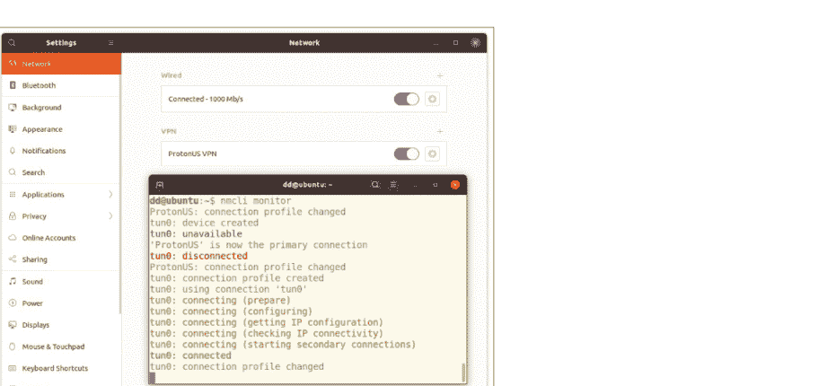
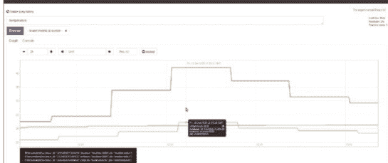
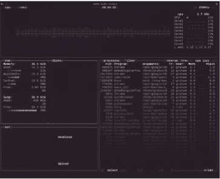

# Linux 杂志 239 期 2020-10 美国版

使用远距离无线电监控你的植物

自动化 `NetworkManager` 以无缝切换位置

使用这一强大的新 Linux 安全功能限制 root 权限

使用树莓派和 IKEA 的扬声器

Red Hat 旗舰发行版的新特性

查找旧进程

- OpenToonz 动画
- Qtile 窗口管理器
- bashtop
- hub: 一个管理 GitHub 仓库的命令行工具
- maddog: 记住 Linux/Alpha 项目
- PulseEffects: PulseAudio 的均衡器和效果
- 创建一个 Inkscape 扩展

免费构建一个 DVD

使用远距离无线电监控你的植物

IRC 机器人

自动化 `NetworkManager` 以无缝切换位置

使用这一强大的新 Linux 安全功能限制 root 权限

使用树莓派和 IKEA 的扬声器

Red Hat 旗舰发行版的新特性

查找旧进程

- OpenToonz 动画
- Qtile 窗口管理器
- hub: 一个管理 GitHub 仓库的命令行工具
- bashtop
- maddog: 记住 Linux/Alpha 项目
- PulseEffects: PulseAudio 的均衡器和效果
- 创建一个 Inkscape 扩展

10月15日 - 17日

events.opensuse.org

Joe

# 社论

## 浏览器传奇

亲爱的读者：

在 8 月 11 日，Mozilla 首席执行官 Mitchell Baker 宣布 Mozilla 公司将进行“重大重组”。当你阅读 Firefox 和 Chrome 的对比时，请记住 Chrome 甚至不是开源的。它是支持 Mozilla 的，以其旗舰产品 Firefox 专有免费软件闻名，并带有长长的“服务条款”的网页浏览器。据报道，这次重组包括重大的调整，并与 Google 自私且且拜宫式的隐私部门裁员有关——这是该年的第二次裁员。Baker 的公告指出，疫情是导致需要与其他专有供应商重新开始的因素之一，但评论人士怀疑这种变化背后是否还有其他原因。Chromium 变体是 Google 的开源原生版本，它并没有得到像那样的关注。当 Firefox 在 2004 年出现时，它是令人兴奋的，而且它并不是通常被比较的对象。

以及不同的方式——比 Internet Explorer 好得多。因此，对于互联网上对这种糟糕浏览器的种种哀叹（微软曾试图强行推销 Firefox 器的状态），我只想记录一下：向世界宣告。从那时起，竞争变得像 Firefox 一样。我一直使用它，它能比好地完成我需要的一切。Chrome 抢夺了它的光芒。当我点击视频时，它会播放。当我点击 Firefox（它不仅仅是领先的微软替代方案）的下载链接时，我得到了文件。有些评论者说 Firefox 相比 Chrome 很“慢”。我没有经历过那样。我并不清楚它在速度测试中表现如何，但它让极其笨重的 Internet Explorer 停用了，取而代之的是 Edge 浏览器。这并不真的，因为我点击的内容不需要花费大量时间就能得到。我一直开启增强跟踪保护，我不再那么担心（尽管像许多组织一样，由于市场较小，最终我仍然担心）Google 和其他追踪器会有种种钩子会导致削减开支的需求。Firefox 导致了削减开支的需求。大部分钱都进入了我那里。

Firefox 来自 Google，作为对 Mozilla 将 Firefox 作为默认搜索引擎的回报。Mozilla 最近宣布他们将通过某种财务交易或文档下载来扩展这种合作伙伴关系。大部分这些与那些不太轻微的公司相关的网站。关于隐私和自由软件社区的协议条款尚不公开。似乎，如果有更少的人使用 Firefox 进行 Google 搜索，补贴将会减少。在这些情况下，我必须额外努力，但 Firefox 的问题被归因于旧代码、缺乏支持以及缺乏合适的硬件合作伙伴——所有这些都是。Firefox 仍然能完成工作，并为那些不想将浏览器绑定到 Google 的用户提供了一个选择。Google 拥有无尽的资金来运作他们的优先事项。例如，在 2019 年 9 月，Mozilla 宣布 Firefox 将默认启用增强跟踪保护。增强跟踪保护（可以拦截第三方 Cookie 和追踪器）已经存在了一段时间，但将其设为默认是一个大胆的举措。Apple 在 Safari 中包含了类似的跟踪保护，但 Firefox 是第一个在通用领域推出它的领先浏览器，这引发了另一个对开源社区可能具有重要性的观点。Joe Casad，总编辑。

3

## 08 新闻

22 构建 IRC 机器人

IRC 机器人负责互联网上协调和转发聊天消息的重要工作。本月并不困难。我们将向你展示如何使用构建你自定义的 IRC 机器人——并我们给你一个独立的机器人——并得到。

- LibreOffice 7 现在可用
- Microsoft 将 Procmon 引入 Linux
- 新 KDE Slimbook 已上市
- PinePhone 现在提供融合功能

Perl BasicBot 模块。深入了解如何直接与 IRC 交互。本期还包括：

- Flutter 即将登陆 Linux
- SUSE 为 SLE 推出服务包 2
- 分发器脚本（Dispatcher Scripts）–
- NetworkManager 允许您编写脚本，在移动到不同位置时自动调整配置（第 28 页）。
- 清理构建警告
- 改进内核代码生成
- 解决缺失 Future 的规避方案
- 自定义 GTK3 主题 –

GTK3 工具包是 Gnome 和许多桌面应用程序的基础。了解如何创建自定义 GTK3 主题（第 34 页）。在 MakerSpace 中学习分布式天气监控，并转至 LinuxVoice 查看关于创建 Inkscape 扩展的教程。

Debian 的人气不仅限于其发行版，还扩展到其产生的众多衍生版。这些衍生版不仅仅是 Debian 的重命名版本，它们添加了各自独特的定制。

3 评论

6 DVD

95 往期回顾

96 特色活动

97 征稿稿

98 预览

4

2020年10月

# 深度

LINUX MAGAZINE

使用分发器脚本根据 VPN 连接挂载不同的网络驱动器，无需动手。

我们将展示 GTK3 主题的组成以及您如何根据自己的喜味进行定制。

36 编程快照 – 使用 Go 制作启动 USB

一个 Go 程序将下载的 ISO 文件写入可启动 USB 闪盘。为了防止其意外覆盖硬盘，Mike Schilli 为其提供了用户界面和安全检查。

详情请见第 6 页

65 树莓派 Symfonisk

41 Charly 专栏

测量接口吞吐量并提供历史记录的工具并不容易找到。VnStat 管理这种平衡并受到了 Charly 的青睐。

根据您的搜索需求，在搜索目录时用 bfs 替换 find 可能会获得更快的结果。OpenToonz, Qtile, starcli, Fermentrack, industry 等。

回顾早期使用 Linux 的经历，madd 解释了他在项目中看到的许多优势。

75 GitHub 与 hub

这个实用的命令行工具允许您从终端窗口管理 GitHub 仓库，这可以更容易地自动化重复任务。

锁定模式让您的 Linux 系统更安全，甚至防止 root 用户修改内核。

PulseEffects 升级了 PulseAudio 音频服务器，包含均衡器和其他增强。这里是编写您自己的方法。

Inkscape 的扩展添加了许多实用功能。

50 查找进程

我们向您展示如何通过启动时间查找 Linux 系统上运行的进程。

5

## 本月 DVD

双面 DVD 上的两个极佳发行版！

Devuan 由 Linux 驱驱 Ian Murdock 于 1993 年创立，是 Debian 的分支，首次于 2018 年发布。分叉的原因是 Debian 8 采用了 systemd 作为 init 系统。init 系统是 Linux 上启动的第一个进程。它一直运行到机器关闭并启动其他进程。Devuan 对使用 systemd 的决策过程表示反对，理由是最终决定是由 Debian 技术委员会做出的。它还反对 systemd 本身，理由是它远超 init 系统的传统目的，成为了整个操作系统的管理器。

Debian 是最老的活跃 Linux 发行版之一。今天，拥有近 1,300 名开发者和 60,000 个软件包，Debian 也是最大的发行版之一。它是几十种其他发行版的基础，包括 Ubuntu 和 Linux Mint，这些发行版已成为各自的发行版强手。

Debian 的优势之一是它的安装程序。虽然 Debian 可以在 15 分内安装，但安装程序提供了逐步定制的选项。此选项使得 Debian 安装程序成为故障排除的理想选择。有时，它可以在其他安装程序无法运行时安装 Linux。

作为对 Debian 决策的回，Devuan 主张支持多个 init 系统。它将这种立场称为“Init Freedom”（初始化自由），呼应了自由软件基金定义的自由软件基础的四种自由。

普通用户可以选择拥有的软件自由程度。仓库的主部分仅包含自由软件，但用户也可以选择使用 contrib（依赖专有软件的自由软件）或 non-free（专用软件）部分。在安装期间，Devuan 目前支持旧的 System V init 以及 OpenRC。还在考虑支持其他 init 系统。从这一初步立场出发，Devuan 分支出了

*光盘存在缺陷，但这种声誉已经过时了。请发送邮件至 subs@linux-magazine.com。Linux Magazine 光盘已通过测试，据我们所知，没有恶意软件和缺陷，Linux Magazine 不承担任何责任，对于与使用本光盘相关的任何数据和计算机系统的中断、丢失或损坏不承担法律。*


想让你的朋友和同事也切换到 Linux 吗？

本期将向新手展示如何：

- 为你的 Linux 系统下载并安装免费软件
- 玩游戏
- 创建文档和电子表格
- 处理照片
- 播放音乐和视频
- 以及更多！

在线购买：shop.linuxnewmedia.com/specials


技术、趋势和工具的更新

- 08 • LibreOffice 7 现已发布
- 微软将 Procmon 引入 Linux
- 09 • 新版 KDE Slimbook LibreOffice 7 现已发布

最流行的开源办公套件 LibreOffice 的主版本现已作为收敛包（Convergence Package）提供下载。新版本包含了整个套件的众多改进。虽然大多数用户不会察觉到明显的差异，但文件兼容性得到了大量改进，这将极大地提升 LibreOffice 与与其他套件之间的互操作性。

- • SUSE 推出

第一个重大兼容性改进是 LibreOffice 包含了对 SLE ODF 1.3 服务包 2 的支持。随此更新一同而来的还包括文档的数字签名，以及基于 Open-PGP 的 XML 文档加密。

通过 LibreOffice 对 DOCX、XLSX 和 PPTX 文件的处理，MS Office 的兼容性得到了提高。在这一新版本中，DOCX 文件现在以原生 2013/2016/2019 模式保存（而不是过时的 2007 兼容模式）。同样，现在还支持长度超过 31 个字符的 XLSX 表格名称，以及 XLSX 中复选框的导出。

特定工具的改进包括：Writer 支持半透明文本，并改进了对引号和撇号的处理；Calc 引入了非易失性随机数生成的新功能以及自动求和的快捷键；Draw 支持半透明文本、下标恢复默认的 8%，并可以生成大于 500 cm 的 PDF。

整个套件的新功能包括：

- • Skia 图形引擎和基于 Vulkan 的 GPU 加速。
- 新的图标主题。
- 新的形状库。
- 对象的发光和软边缘效果。

有关此版本的更多信息，请阅读 LibreOffice 官方公告（https://blog.documentfoundation.org/blog/2020/08/05/announcement-of-libreoffice-7-0/）。

微软进程监视工具已登陆 Linux。Process Monitor（也称为 Procmon）是该工具针对 Linux 系统的重新设计版本。对于那些用过 Procmon 的人来说，你们知道这是一个查看实时文件系统活动的便捷工具。对于开发者来说，Procmon 能够轻松追踪给定系统上的系统调用（syscall）活动。Procmon 还支持将信息记录到文件中（以便稍后分析数据），具有高度可性，支持非破坏性过滤器、捕捉线程栈和进程详情以及启动日志。

尽管将 Procmon 引入 Linux 对普通 Linux 桌面用户来说可能并不令人兴奋，但对于开发者来说，Procmon 可能会是一个严重的游戏改变者。

目前，Procmon 仅限于运行内核在 4.18 到 5.3 之间的 Ubuntu 18.04 系统。你还需要大于等于 3.1 的 cmake 以及大于等于 3.22 的 libsqlite3-dev。微软计划在后续版本中添加更多配置，因此请关注即将支持更广泛的发行版。

要确切如何在支持的系统上构建 Procmon，请访问项目的官方 GitHub 页面（https://github.com/microsoft/ProcMon-for-Linux）。

http://www.admin-magazine.com/HPC/

各地的 Linux 粉丝现在拥有比以往任何时候更多的选择。随着特定发行版的笔记本电脑层出不穷，桌面得到同样对待只是时间问题。因此当 KDE Slimbook 问世时，它不仅是第一款专注于 KDE 桌面环境的笔记本，而且是一个精良的美品。

随着 AMD Ryzen CPU 的兴起，KDE Slimbook 的制造商（https://kde.slimbook.es/）将笔记本迁移到 AMD 处理器是完全合理的。

这款新笔记本轻松进入 Ultrabook 类别。其镁合金外壳厚度小于 20 毫米，配备 14.1 英寸或 15.6 英寸显示屏，重量最高仅 1.1 kg（14.1 英寸版）和 1.5 kg（15.6 英寸版）。显示屏为高清 IPS LED 面板，覆盖 sRGB 范围的 100%，因此色彩非常准确。

至于 CPU，新的 Slimbook 配备 AMD Ryzen 7 4800 H 处理器（包含 8 核16 线程以及高达 64GB 频率为 3200 MHz 的 DDR4 RAM），这使得 KDE Slimbook Ryzen 版本成为 Linux 预装笔记本电脑中的首次。

KDE Slimbook 包含 3 个 USB 端口、一个 USB-C 端口、一个 HDMI 插口、一个 RJ45 网络端口并支持新的 WiFi 6 标准。14 寸机型起 899 欧元（约 1063 美元），15 英寸机型起 929 欧元（约 1099 美元）。你可以从在线商店购买 KDE Slimbook：https://slimbook.es/en/store/slimbook-kde。

- Jeff Layton
- Petros Koutoupnis
- Rainer W. Gerling
- Mayank Sharma

使用 CacheFS 进行缓存

对于读取密集型工作负载，CacheFS 是 NFS 和 AFS 的极佳缓存机制。

构建虚拟 NVMe 驱动器

一种经济且高性能的混合 NVMe SSD 被导出到宿主机服务器，作为本地连接的 NVMe 设备。

解决加密 DNS 的安全问题

DNS 加密为 WiFi 用户在公共场所提供了良好的保护；但在 Linux 企业环境中，它阻止了对域名解析的评估和过滤。

采访 MariaDB 基金会主席 Eric Herman

MariaDB 基金会主席 Eric Herman 阐明了最受欢迎且广泛使用的数据库之一的守护者不断演变的重心。


Google 用于构建 Android、iOS、macOS 和 Windows 应用的开源 UI 框架增加了另一个平台……Linux。由于超过 500,000 名开发者正在使用 Flutter（并有超过 80,000 个应用在该框架构建），这对于 Linux 应用程序可能是一个福音。

但并非如此。Canonical（Ubuntu 的创建者和维护者）已指派专门人员负责此任务。事实上，Canonical 工程师经理 Ken VanDine 对此举措表示：

> Canonical 正在对 Flutter 进行重大投资，投入了一支开发团队与 Google 开发者合作，为大多数 Linux 发行版提供最佳 Flutter 体验。Canonical 将继续与 Google 合作，进一步改进对 Linux 的支持，并保持与其他支持平台的功能对齐。

在 Google 方面，他们对 Flutter 引擎进行了大量工作，以便无论何种操作系统，都能提供更好的原生桌面体验。

Flutter 的一个对开发者而言尤为重要的方面是，应用程序不需要为特定的桌面设备进行构建。

使用 Google 的 Dart 语言，开发者可以编写一次应用程序，它（得益于 Flutter）就可以在移动设备和桌面设备上运行。随着 Google、Capital One、Square、eBay、BMW 和 SONOS 等公司已经在使用 Flutter……Linux 桌面面的未来无疑是光明的。

欲了解更多信息，请查阅 Canonical 的官方公告（https://ubuntu.com/blog/canonical-enables-linux-desktop-app-support-with-flutter）。


# SUSE 旗舰操作系统的最新迭代版本已发布

SUSE Linux Enterprise 15 Service Pack 2 现已可用，同时还有 SUSE Manager 4.1。此版本为这一企业级平台带来了许多重要功能和改进。

在云端方面，`SLE 15 SP2` 使用户能够更容易利用超大规模服务商提供的针对阿里云、Azure、AWS、Google、IBM 和 Oracle 的更新云镜像。

通过 `SP2`，你还可以在 `AWS` 中部署大规模 `HPC`（高性能计算）系统，并获得 Elastic Fabric Adapter 和 Graviton2 CPU 的支持。

通过 `SLE 15 SP2`，用户能够从 `openSUSE Leap` 迁移到企业级平台（`SUSE Linux Enterprise Server`）。这一新选项是一个“先试后买”的发布方案，用户可以测试 `SLES`，然后如果他们认为值得，就可以购买许可证。

其他功能还包括：

- 扩展的 `Zypper` 软件包搜索；
- 现在已集成 `SLE` 软件开发包（`SDK`），使得开发包自动安装；
- 默认安装 `Python 3`；
- `LDAP` 和 `OpenLDAP` 已被 `389 Directory Server` 取代；
- 订阅管理工具（Subscription Management Tool）已被仓库镜像工具（Repository Mirroring Tool）取代；
- `SLE Live Patching` 现在已适用于 `IBM Z` 和 `LinuxONE` 平台。

`SLE` 的最新版本基于 Linux 5.3 内核，可在 `X86 64`、`Arm`、`IBM Power`、`IBM Z` 和 `LinuxONE` 硬件架构上运行。

欲了解更多信息，请参 `SLE 15 SP 2` 的 SUSE 通用列表（https://www.suse.com/c/suse-linux-enterprise-15-service-pack-2-is-generally-available/）。`bit.ly/Linux-Update`

10

第239期

## 内内核新闻

### Zack 的内核新闻

`Linus Torvalds` 最近将家庭系统升级到使用 GNU 编译器集合 (`GCC`) 10，这听起来可能没有那么重要。这导致构建几乎立即停止。”

`Linus` 回答道：

> “据我所知，GNU jobserver 没有那样的机制。”

事实上，他说：“我让它们先运行了一会儿。Linux 内核会产生大量的警告信息。我想它总是将一个 `+` 字符作为一个标记，所以我猜可以扩展它来写入一些内容，以便在整个 (NetBSD) 构建过程中正确使用单个作业管道，并在任何命令失败时用 ‘abort’ 标记刷新并重新填充。这并不意味着每个人都应该使用版本 10 或类似的东西。然而，`Linus` 在升级后并没有发现编译 Linux 内核会产生大量的警告信息。”

内核新闻

但总来说，`Paul` 认为，他觉得他应该确保另一种优化可以提高 `gmake` 的终止能力，因为这些级别不会产生警告，而且这是 `Linus` 所请求的。

- `-Og` 导致的问题比 `-O3` 更多

`Linus`、`Paul` 和 `David` 随后立即就该涉及的功能实际设计展开了技术讨论。在讨论的某个时刻，`Linus Torvalds` 回复了 `Jason` 的话。显然，他们三个人都对那个将内核转换为 GNU make 源代码以使用 `-O3` 代替 `-O2` 的原始补丁非常熟悉：

最终，该线程在没有定论的情况下结束了。

> “我不认为这是明智的。”

总是有新的努力来清理它。通常情况下，我们对几乎任何事情很少有高循环计数。解决方案是更改内核。这一次的解决方案似乎是更改 GNU make。”

> “`-O3` 甚至没有被作为一个选项是有原因的。”

> “也许情况发生了变化，也许它们已经改进了。但我想看到这类事情的具体数字。”

> “不那么激进地内联并不一定是一件坏事。它可以是，但”

Linux 传统上一直在与 `GCC` 就究竟什么构成“错误”作斗争。但我实际上也做过良好的 `GCC` 优化。最近，关于 `GCC` 内联过多导致生成更差代码的最严重 bug 报告，`Jason A. Donenfeld` 报告说，`(if (unlikely()))` 测试，为了让编译时间更快，可能的路径是导致栈帧增长，并且在使用 `-flto` 时，似乎导致了栈溢出。

> “所以就内联器的工作方式来说，‘O3 内联更多’ 并不是一个有效的论点。”

由于现在的 `-O3` 不应该具有后文提到的内联问题，他在随后的帖子中补充道，“显然，与 10 年前具有同一组 bug，这次提交将新内核编译默认设置为我们。当使用 `gcc >= 10` 时，我们可以通过‘noinline’ 和‘always_inline’来修复显而易见的情况在对内核进行如此彻底的更改之前，我们需要听听 `GCC` 开发人员的意见。”

`Linus` 还提供了一个他在 2011 年提交的关于该主题的错误报告链接：构建系统。

https://gcc.gnu.org/bugzilla/show_bug.cgi?id=49194.

`Arnd Bergmann` 同意，表示：“我也想听听 `gcc` 开发人员关于 `O2` 和 `O3` 之间通用建议的反馈，以及它们如何随时间演变。”他还评论道，“你在那个旧的 `gcc` bug 报告中提出了一个非常有服力的论点，即不要陷入那些似乎在版本之间改变含义的 `gcc` 内联切换的兔子窝，这很有说服力。”他补充说，“从个人而言，我更感兴趣的是提高内核的编译速度，并最终为自己的构建支持 `-Og` 或其某些变体。”

所以 `Jason` 似乎终于准备放弃这个补丁了。而且，在测试的最后，但当然，也想，测试。

12

内核新闻

响应 `Jason` 代码的线程，这种解决方案可以让用户避免黑客式编码。他说：“添加任意的空 `asm` 语句来绕过它？黑客手段（Hacks）。全内存屏障？黑客手段。”他补充道，“散布空 `asm` 语句或全内存屏障应该被像添加 `sleep()` 来‘绕过’并发 bug 一样谨慎对待。红旗。”

“对我来说，这是一个坚决的‘不’。”

“1) 除了极少数 Gentoo 用户外，没有人对内核广泛测试 `-O3` —— 即使 Gentoo 在内核编译时也默认使用 `-O2`”

“2) `-O3` 会导致代码大量膨胀，这意味着 `vmlinux--linux/bzImage` 和模块都会变得更大，并且从磁盘加载的速度会变慢”

`Linus` 回复道：

“胡说（BS）。”

“3) `-O3` **并不一定**会让代码运行得更快”

“编译领域的人可能会称之为‘黑客手段’。但那位编译领域的人是**错的**。”

“4) 如果 `GCC10` 为 `-O2` 优化级别移除了某些操作，你只需要将它们视为编译标志，而不是强制所有人默认使用 `-O3`。编译器需要多年时间才能为我们提供的所有基础设施，即使如此，编译器实际上也不会真正给我们一切——而且如果你只是让大家都开心，他们就会很快心的。”

“5) 如果你仍然坚持使用 `-O3`，我想给我们两个 KConfig 选项：

多年来一直使用旧编译器。

| 选项 | 值 |
| :--- | :--- |
| `OPTIMIZE_O2` | `-O2` |
| `OPTIMIZE_O3_EVEN_MOAR` | `-O3` |

“这就是为什么存在内联 `asm asm`。它们是逃离‘等待编译领域的人为我们解决这个问题’这种过度限制的束缚——反正他们永远不会完全解决的。”

这就结束了。

这有点像不安全的 C 强制转换，以及允许人们编写‘不可移植代码’。一些编译领域的人会说这不好，不安全。最近——或者也许更准确的术语应该是关于编码风格的技巧注释。当然，它可能是不安全的，但点在于，它允许你做一些在过度限制的语言中并不一定**可能**做的事情。

这出现在关于哪个 `GCC` 版本是最好的长期讨论中（即，哪个版本产生的代码、警告和错误最好）。这这一切都是在试图追踪内核 bug 而不经历痛苦的背景下进行的。

“有时你需要打破规则。”

“这就是为什么大家都在 C 这种‘不安全’语言中编写库函数的原因。因为你需要那些逃口来真正执行如内存分配器等的操作。”

`Linus Torvalds` 最近对编码风格有一些有趣的评论，他提到他开始使用 `GCC 10` 进行编译。结果，许多开发者想要切换到相同的版本，以确保他们在向他发送补丁时可以看到 `Linus` 将看到的相同的构建错误和警告。

“这也是为什么我们有内联 `asm` 的原因——因为编译器永远不知道一切，也无法为人们想做的任何事情生成代码。”

“任何**认为**编译器总是知道更多并应该拥有完全控制权的人都不应该编写编译器。他们应该去”

`Borisislav Petkov` 指责那些开发者，说：“噢不，我们不想让 `Linus` 的内核坏掉。 ;-) 在角落里和朋友们一起吃胶水。”

#

最大的互联网门户，为你提供各种内容：全新书籍、趋势电影、新鲜杂志、热门游戏、近期软件、最新的音乐发行。

廉价持续访问热点媒体

保护你的借阅不受大哥监视

18 年无缝运行和我们的用户满意

所有语言

全新内容

一个网站

`AvaxHome` - 你的终点

我们拥有你所需的一切。只需打开 https://avxlive.icu

## 发行版巡礼 – Debian 衍生版

### 创新的后代

`Debian` 的流行不仅在于其发行本身，还在于其衍生的众多衍生版。这些衍生版不仅仅是 `Debian` 的重新标记版本，它们添加了自己的定制。这里有几个我们认为有趣的。阅读 `Byfield` 以了解这些众多 `Debian` 衍生版的采样。`Debian` 和 `Debian GNU/Linux` 本身就是一个非常流行的发行版。

在 `DistroWatch` 上，`Debian` 自 2002 年以来一直位列软件包数量前十名，但衍生版的维护者绝大多数选择与 `Fedora` 以外的任何其他发行版合作。目前，`Ubuntu` 是目前 `Debian` 最受欢迎的衍生版。在 `DistroWatch` 上，只有七个发行版基于 `Debian Testing`。曾几何一段时间，`Ubuntu` 的人气似乎可能会取代 `Debian`，但今天两者是互补的。在 `DistroWatch` 上，如今的发行版中有七个（总计占比略高于 6%）吸引了新用户以及想要获得更多实践经验的高级用户。

成为 `Debian` 衍生版意味着什么？在大多数情况下，衍生意味着对 `Debian` 仓库的依赖。事实上，在 `DistroWatch` 活跃发行版中，有四个（64%）基于 `Debian`（`AMD64`, `ARM`, `S390X` 和 `Power`），或其最流行的衍生版 `Ubuntu`（共十一个），而 `Debian` 支持 `dpkg` 和 `apt` 来帮助协调脚本。许多衍生版以及这些子发行版在近年来也依赖 `Debian` 安装程序，该程序经过移植，使得 `Ubuntu` 的支持变得容易得多。此外，`Ubuntu` 的大部分软件包源自 `Debian`，保持了与主流 Linux 的兼容性。即使衍生版有自己的安装程序，它通常也会使用主要发行版之一，作为 `Debian` 安装程序针对中文写系统的简化版本。最常见的元素意味着用户可以轻松地从一个衍生版移动到另一个衍生版，`Debian` 的流行并不意外。重要的是，`Ubuntu` 在其开发早期强调桌面端，使其比 `Debian` 更易于使用。`Debian` 一直以严谨著称，使其成为人们快速产生归属感的强有力选择。

尽管近年来 `Ubuntu` 侧于服务器，但它早期在桌面上的开发为其赢得了声誉。`Debian` 维护衍生版意味着某些文件的位置可能与 `Fedora` 或 `Arch` 不同。此外，`Ubuntu` 的绝大多数软件包源自 `Debian`，并修改了纯混合发行版（按需要维护它们的发行版）。一个例子是麒麟（`Kylin`）。

近年来，标准 `Ubuntu` 一直非常活跃。更糟糕的是，它放弃了长期支持的 `Unity` 系统，转而采用 `Gnome` 作为桌面。然而，`Ubuntu` 也支持各种变体，如 `Kubuntu`、`Lubuntu` 和 `Xubuntu`。它的大多数变体都带有特定的桌面安装，尽管 `Ubuntu Studio` 专注于多媒体工具。除了制作自己的发行版外，`Devuan` 还提倡它所谓的“Init 自由” [14]：即使用除 `systemd` 外的任何 init 系统启动计算机的权利。在过去的 20 年里，`Devuan` 支持 `System V` 风格的 init、`OpenRC` 和 `runit`。我建议始终手留一个最新版本以备不时。

由于对缺乏民主感到不满，少数开发者创立了 `Devuan`（可在本月的 DVD [13] 获取），并支持大多数 Linux 兼容硬件。

`Linux Mint` [9] 最广为人知的是 `MATE`（其对 `Gnome 2` 的分支）以及 `Cinnamon`（ `Debian` 安装程序的高级版本）。

2014 年，`KDE` 开始开发自己的桌面环境，包括重新引入的 `Plasma`。`KDE Neon` 是这三个领域最新进展的快照。它是一个基于 `Ubuntu` 的版本。

`Debian Edu` [15] 现在是 2006 年两个衍生版合并的结果：挪威的 `Skolelinux` 和法国的 `Debian Edu`。在 `SLX Debian Labs` 的下，`Debian Edu` 有两个目标：推广自由软件以及确保各地的儿童都能用自己的语言使用计算机。

`Trisquel` [11] 是软件编译列表中少数几个 `Debian` 衍生版之一。自由软件协会自由发行版列表 [12] 中的其他一些并非基于 `Debian`。

`Tails` [18] 是一个 `Debian` 衍生版，仅使用 `Debian` 的稳定（Stable）仓库以确保安全。`Tails` 从闪存盘、DVD、硬盘分区或虚拟机中运行，其灵感源于依赖非自由软件的软件。`Incognito` 是一个同步开发的类似发行版，由 `Tor` 项目以及 `Debian` 资助。

`Trisquel` 是一种基于 `Ubuntu` 的通用发行版，默认使用 `MATE` 桌面环境和 `Gnome` 技术。它首次于 2004 年发布，面向教育和创意。虽然在数量上较少，但 `Trisquel` 在普及度上占有一席之地。许多教育软件面向低年级学生，包括学习字母表和分数的应用、`Amazing`、电子邮件和新闻订阅。此外还包含了一些用于几何和图表分析等专业领域的工具。

此外，`Trisquel` 拥有超过 50 个用于匿名文件共享的本地工具。大多数用户可能想要标准版（Standard）或网络安装版（Net Install），但对于更高级的学生，还有针对旧机器和有限资源的 Mini 版本，以及针对儿童的 Sugar Toast 版本，同时所有学生都能从象棋和打字导师软件中受益。也许 `Trisquel` 中最重要的工具是 `Tor`，它允许匿名浏览并阻止非匿名的入流量。对于那些希望系统没有任何专有应用程序或固件中二进制块（binary blobs）的人来说，`Trisquel` 是一个领先的选择。所有这些工具都需要时间来配置。

然而，`Tails` 的文档消除了对先验知识的需求。因此，几乎任何人都可以在几小时内拥有一个受良好保护的系统。

`Knoppix` [16] 于 2000 年 9 月创立并以其开发者 `Klaus Knopper` 命名，是最老的 `Debian` 衍生版之一。

`systemd` 的采用在 Linux 开发者之间引发了激烈的辩论。这种辩论在 `Debian` 中尤为激烈。它可以安装到硬盘上，但最初的设计目的是用于系统救援的 Live 光盘，这仍然是它的主要用途。CD 和 DVD

`elementary OS` [19] 的首页（其贡献者以严谨著称）将其描述为“快速、开源且尊重隐私的 Windows 和 macOS 替代品”。然而，`elementary OS` 作为近期关注美学的发行版的领先代表而为人所知。

在几十年后，某个 Linux 发行版占据主导地位似乎是不可避免的。这并不意味着 `Debian` 能够作为创新者的上游源来重塑自己。但事实是，它基于 `Ubuntu`，却配备了深度修改的 `Gnome` 桌面，拥有自己的窗口管理器、程序栏、邮件客户端和桌面实用程序。其结果经常与 `macOS` 或类似的 `deepin` 和 `Zorin` 等 `Debian` 衍生版相比较，这些系统同样强调行为和功能性的桌面。传统上，Linux 桌面上的美学被忽视而转而追求功能，但 `elementary OS` 深受许多用户的青睐。然而，它的有效性有时是以定制化更少为代价的。潜在用户应该意识到，尽管结构简单以鼓励下载，但输入零支付即可免费下载 `elementary OS`。

- [1] DistroWatch 前 10 名: https://DistroWatch.com/index.php?dataspan=26
- [2] 基于 Debian 的发行版: https://DistroWatch.com/search.php?ostype=All&category=All&basedon=All&origin=All&basedon=Debian&notbaseded=None&desktop=All&package=All&rolling=All&isospace=All&netstall=All&
- [3] 基于 Ubuntu 的发行版: https://DistroWatch.com/search.php?ostype=All&category=All&basedon=Ubuntu&notbased=None&desktop=All&package=All&rolling=All&isospace=All&language=All&
- [4] Debian 衍生版页面: https://www.debian.org/derivatives/
- [5] Debian 纯混合 (Pure Blends): https://wiki.debian.org/
- [6] 基于测试版（Testing）的衍生版: https://DistroWatch.com/search.php?ostype=All&category=All&basedon=Debian+(Testing)&notbased=None&desktop=All&package=All&rolling=All&
- [7] 基于不稳定版（Unstable）的衍生版: https://DistroWatch.com/search.php?ostype=All&category=All&basedon=Debian+(Unstable)&notbased=None&desktop=All&package=All&rolling=All&
- [8] Ubuntu: https://ubuntu.com/
- [9] Linux Mint: https://www.linuxmint.com/


- [10] LMDE 下载: https://www.linuxmint.com/download_lmde.php

- [11] Trisquel: https://trisquel.info/

- [12] 自由发行版列表: http://www.gnu.org/distros/free-distros.html

- [13] Devuan: https://devuan.org/

- [14] Init 自由: https://devuan.org/os/init-freedom

- [15] Debian Edu: https://wiki.debian.org/DebianEdu/

- [16] Knoppix: https://knoppix.net/

- [17] KDE Neon: https://neon.kde.org/

- [18] Tails: https://tails.org/install/index.html

- [19] elementary OS: https://elementary.io/

RHEL 8.2 带来了许多新功能，从内核、新的“容器工具”和“更流畅的用户体验”到桌面环境。新版本还承诺“改进安全性和网络，Linux 专家和新手的体验”。作者：Kristian Kißling。

然而，在炒作之外，4月中旬在2020年红帽大会（图1）之前发布的公告指向了一些产生影响的切实改进。红帽宣布了其旗舰红帽企业 Linux (`RHEL`) 发行版的更新。如果你想根据公告阅读关于 `RHEL` 8.2 的最新新闻，系统管理员将感谢 `Red Hat Insights` 分析服务的新日期，该服务会自动将系统与预定义的基配置进行比较，从而为客户提供如“智能化管理”等礼物，帮助发现任何未配置项。

你会发现关于“迁移和监控能力”的引用。这些是授权的更改。`RHEL` 8.2 还允许你通过 `cgroup v2` 管理内存资源，设置配额以防止单个进程占用过多内存。

`Tuned` 系统调优工具现在已最新的上游版本 `2.13` 中可用。`Tuned` 监控系统并可以根据预期用途的配置（`profiles`）优化性能。你将找到针对高数据吞吐量、低延迟和节能的配置。更新后的 `Tuned` 在 `RHEL` 8.2 中带有一个新的依赖架构的调优框架，支持多个新的包含指令。针对 `sap-hana`、`latency-performance` 和 `realtime` 调优配置也提供了更新。

`BIND` DNS 服务器已移动到基础版本 `9.11.13`，该版本引入了用于安全技术实施指南（Security Technical Implementation Guides）的新算法、命令和变体；它包含了关于加固你系统安全性的建议。

`BIND` 还支持一种基于 `SipHash-2-4` 的 DNS cookies 算法，如 RFC 7873 所述。`tcp-highwater` 显示每次运行中并发 TCP 客户端的最大数量，而 `BIND-named-checkconf` 命令考虑了 DNS64 网络扩展，该扩展允许来自 IPv4 上的的 IPv6 客户端进行 NAT。基于这些建议以及相关工具和类型的 Red Hat 客户现在正期待一个合适的 pro-

`udica` 是随 `RHEL` 8.2 引入的工具，可自动生成自适应容器的 SELinux 安全策略。`SCAP` 是安全内容自动化协议，Red Hat 用户用它进行自动化系统监控和预定义的安全策略合规检查。

如果容器报告了由 `udica` 引起的拒绝访问，它将根据需要更改关联的安全策略。在这种情况下，管理员根据需要进行检查。

在发生分布式拒绝服务（DoS）攻击时，得益于新的过期答案函数，服务器不再返回 `SERVERFAIL` 消息，而是退回到旧的缓存记录。该功能可以通过配置文件或远程控制通道（`rndc`）激活或禁用。

配备了新的配置和 `OpenSCAP` 的 `kickstart` 文件，客户可以检查其系统是否符合 `STIG` 标准。此外为 SELinux 增加了一套新的 `setroubleshoot` 插件。`setroubleshoot` 可以检测被阻塞的内存访问，并为管理员提供如何处理的建议。`scap-security-guide` 软件包还包含了针对国防信息系统（Defense Information Systems）文件的配置和相应的 `kickstart`。国防信息系统局（DISA）的核心策略，它是美国国防部的一个机构，成立于1960年（ACSC），并创造了许多缩写 [2]，这些缩写大多与容器软件有关——与 Docker 不同，它们不需要 root 权限。

`setools-gui` 包在 `RHEL` 7 中已可用，现在也配备了 `RHEL` 8.2。澳大利亚网络安全中心也管理。一个缩写是 `STIG`，代表安全技术实施指南。`RHEL` 8.2 用户用于逻辑卷管理器（LVM）的 Podman D-Bus API。受 SELinux 限制的用户允许管理用户会话或守护进程，可以使用 `oscap-podman` 工具扫描 `RHEL` 8.2 中的容器，例如通过运行 `systemctl --user` 命令。

关于

发布说明提供了 Red Hat Enterprise Linux 8.2 随附改进和新增的高级概述，并记录了此版本中的重要更改以及显著的错误修复、技术预览、弃用功能以及其他详细信息。

- 5. 新功能

- 5.1 安装程序和用法创建

- 5.2 子系统更改

- 5.3 Shell 和命令行工具

- 5.4 基础设施服务

- 5.5 网络

- 5.6 监控

- 5.7 安全

- 5.8 文件系统和存储

- 5.9 高可用性与集群

- 5.10 虚拟化、数据库服务

- 5.11 身份管理

- 5.12 仪表板

- 5.13 部署工具

- 5.14 Web 控制台

- 5.15 容器

- 5.16 新代码

- 5.17 其他更改

# 回顾

BPF 编译器集合（`BCC`）允许基于 eBPF 构建各种程序。同时，`BCC` 还拥有审计工具，用于监控 Linux 系统的性能和数据吞吐量。由于 `ohmplugin` 工具get，`BCC` 支持 REST 接口。

`RHEL` 8.2 还提供了许多执行内核追踪的 eBPF。`semanage port` 工具不再仅关注 TCP 和 UDP 端口，还可以显示主站点和恢复站点集群的状态。

进一步的安全更新影响了 `clevis` 命令，该命令为管理员提供 LUKS 加密磁盘的信息，并自动进行解密。PHP 7.3 增加了 rrd 和 Xdebug 扩展；rrd 为 RRDtool C 库提供了绑定，而 Xdebug 扩展有助于调试和开发。

此发行版包含了 1.41 版本的 Rust Toolset。同样重要的还有 Go 1.13 和 Python 3.8。GCC Toolset 9 带有 GCC、GDB 和 SystemTap 的更新。Red Hat 还合并了内核 5.5 第一个发布候选版本的更改，包括改进资源间的搜索、在不危及其他资源的情况下禁用资源以及。

他们的系统，新的安全配置文件

`nftables` 子系统。选项允许你揭示关系，而内核更新则让你能够测试诸如 eBPF 等新功能。如果你有较新的硬件，你可能会受益于更新的显卡驱动程序。`RHEL` 8.2 还为开发者提供了更新版本的工具链。有关更改以及该版本中包含的错误修复详细信息，请参阅[RHEL 8.2 发布说明](图 2）[3]。

- [1] RHEL 8.2 新闻稿：https://www.redhat.com/en/about/press-releases/red-hat-delivers-force-multiplier-enterprise-it-enhanced-intelligent-monitoring-unveils-latest-version-red-hat-enterprise-linux-8

- [2] DISA：https://en.wikipedia.org/wiki/Defense_Information_Systems_Agency

- [3] RHEL 8.2 发布说明：https://access.redhat.com/documentation/en-us/red_hat_enterprise_linux/8/html/8.2_release_notes/

**图 2：参考[Red Hat Enterprise Linux 8.2 发布说明]**对更改和新功能进行全面讨论。


这张可检索的 DVD 为你提供了 50 期 ADMIN，它是以下领域的首选来源：

- 网络安全

- 系统管理

- 故障排除

- 性能调优

- 虚拟化

- 云计算

清理你的书架，用这张强大的 DVD 完善你的 ADMIN 库吧！

shop.linuxnewmedia.com


# 封面故事

# 构建 IRC 机器人

# 使用 Perl 的 BasicBot IRC 机器人

编写一个 IRC 聊天机器人并不困难。我们将向你如何使用 Perl BasicBot 模块创建自己的自定义 IRC 机器人。Rubén Llorente 互联网中继聊天（IRC）是一种用于维持在线群聊的流行协议。用户连接到 IRC 服务器（该服务器通常是 IRC 网络的一部分），并加入 IRC 术语中称为“通道”的聊天室。同一个 IRC 网络中的每个服务器都承载通道，因此整个网络的用户都可以加入相同的通道并实时交流。

IRC 机器人是一个像用户一样连接到聊天服务并执行自动化任务的程序。机器人用于运行游戏、在不同网络之间传递消息、管理用户身份验证等。

构建自定义机器人看起来可能是一项仅限于企业门户或其他商业服务的高端任务，但事实上，自制的机器人在较小的网络中扮演着多种角色，并且通常由本地组织和社区小组部署。例如，Freenode IRC 网络中的 `#bitcoin-otc` 频道使用机器人来维护在聊天中进行交易的买卖双方信誉分。另一方面，I2P 项目维护着机器人，将消息从 Freenode 用户传递给 I2cp（官方 I2P IRC 网络）用户。

## 作者

目前有多个框架可以创建自己的机器人，你也可以从预设计的机器人开始并根据自己的喜好进行调整。在本文中，我将关注 BasicBot Perl 模块，它可以让你非常地创建机器人。该模块处理了编写机器人的困难部分，让你专注于想让机器人做什么。

Rubén Llorente 是一位机械工程师，他的工作是确保小型诊所 IT 基础设施的安全符合法律且安全。此外，他还是 OpenBSD 爱好者和武器收藏家。

本文的目标是解释如何使用 BasicBot 构建实用的机器人。我将以简单的中继机器人为例。本文假设你熟悉 Perl 和面向对象编程（参见“初学面向对象编程？”框）。

# 初学面向对象编程？

在面向对象编程（OOP）模型中，对象是包含属性和方法的数据结构。然而，并非所有动物都以相同的方式产生。但即使你是 Perl 新手，这段讨论也应该让你对 Perl 编程和 IRC 机器人的本质产生一些见解。

根据示例，一个 Animal 对象将有一个通用的 `procreate` 方法来创建其他动物。一个 Dove 对象将有一个特定的 `procreate` 方法，通过产卵创建其他鸽子。对象还属于类，类定义了对象拥有哪些属性和方法。例如，对象是-

在开始编码之前，你必须安装所需的软件。属性是对象的特征，方法是对象可以做的事情。

名称（nick），发送“Hello, World!”并断开聊天。

`use strict` 字符串和 `use warnings` 标志指示 Perl 强制执行良好的编程实践并显示警告。任何严肃的程序都应该包含这些标志。

```
package main;
```

第 7 到 18 行用于定义一个自定义机器人子类 HelloBot。HelloBot 重写了 BasicBot 的 `connected` 方法。

```
当 BasicBot 或其任何子类连接到服务器时，会执行 `connected` 方法。在示例中：

my $bot = HelloBot->new(
server => 'irc.colosolutions.net'
port => '6667'
connected 向 HelloBot 连接的服务器端口 '6667' 发送消息 "Hello, World!"
channel 指向服务器的频道 => ['#funwithbots']
shuts 关闭机器人（见图 1）。

nick => 'HelloBot';
```

程序的主部分从第 21 行开始。第 24 到 31 行创建了一个名为 `bot` 的 HelloBot 对象，配置为加入服务器 `irc.colosolutions.net` 上的 `#funwithbots` 频道。随后，第 34 行运行机器人。

你可以使用以下命令启动机器人：

## 运行我们刚刚创建的实例。

$bot->run();

```
$ /usr/bin/perl hellobot.pl
```

BasicBot 提供了许多存根方法（stub methods），供开发者重写。每个方法都作为第一个参数从机器人对象本身传递。最有趣的方法是 `said` 和 `tick`。

每当机器人在频道中听到消息时，就会调用 `said`。当这种情况发生时，`said` 方法将接收一个哈希，其中包含 `who`、`body` 和 `address` 等元素。`who` 识别发布消息的用户；`body` 包含消息本身；`address` 通知是否以及如何呼唤某人（例如，如果有人写了 `Tux: Hello!`，则 `address` 字段将包含 `Tux`，`body` 字段将包含 `Hello!`）。你可以在列表 2 中看到此方法的运行示例。

`tick` 是一个定期调用的事件。`tick` 事件可以用于调度必须重复执行的任务。如果你让机器人定期获取 RSS 馈，请使用 `tick`。`tick` 事件必须返回一个数值，该数值等于你在下一次调用它之前想要等待的秒数。

图 1：`hellobot.pl` 连接到频道，发送消息并断开连接。

其次，在让你的机器人消息加入他们的频道之前，先向频道管理员请求许可。

第三，某些 IRC 服务器不允许机器人存在，或者仅在用户在特定条件下呼唤另一个用户或机器人时才完全允许。大多数 IRC 管理员只要机器人不制造破坏，都是可以接受的，但你要让它独立运行。该行使用了 `altbot` 方法，你应该阅读你所访问的服务器的规则。不要让监到消息的 RelayBot 去检索或重新连接机器人，如果它是不受欢迎的 RelayBot，它会调用此对象的 `relay` 方法。

记录频道活动或向其他网络中继消息的机器人特别棘手。一些人可能认为它们是对其隐私的威胁。主程序从第 55 行开始。注意，程序通过 `use POE` 调用了 Perl 对象环境（POE）。原因是第 59 到 83 行之间创建的 `RelayBot` 对象创建时使用了 `no_run` 标志，这防止了它们在创建时立即连接。最后一行 `$poe_kernel->run()` 同时启动了两个机器人。

| 服务器 | 网络 | 注释 |
| :--- | :--- | :--- |
| irc.colosolutions.net | EFnet [4] | 用于普通聊天 |
| irc.canternet.org | Canternet [5] | 小马粉丝构建并供其使用 |
| chat.freenode.net | freenode | 用于计算机聊天和自由软件项目 |

使用以下命令启动机器人：

$ /usr/bin/perl relaybot.pl

```
要停止程序，请在运行进程的终端中按 Ctrl+C。

机器人可以帮助，但它们也可能非常有侵入性，特别是当触发了 Bug 时。出于对其他 IRC 用户和 IRC 管理员的考虑，请记住以下常识规则。

首先，你的机器人不应该刷屏。你必须限制机器人发布消息的速度，并防止它连续发布过多消息。`Bot::BasicBot` 内置了防刷保护，因此这不应该是一个大问题。

图 2：测试环境中的 `relaybot.pl` 连接到两个不同的 IRC 服务器并在它们之间中继消息。在这种情况下，为了测试禁用了用户保护，正如你看到的，尽管 slack 和 devuan 连接到不同的 IRC 系统，它们仍然可以维持对话（第 30 行，列表 1）。

```
package main;
use strict;
use warnings;

## 主程序开始。
$bot_1 = HelloBot->new(
    server => "irc.colosolutions.net",
    port => "6667",
    channels => ["#funwithbots"],
    nick => "HelloBot"
);

## 创建 RelayBot 对象。
($bot_1, $bot_2);

$bot_2 = RelayBot->new(
    server => "irc.canternet.org",
    port => "6697",
    channels => ["#funwithlinux"],
    nick => "Diana"
);
```

```perl
package RelayBot;
use base qw(Bot::BasicBot);
sub said {
    my ($self, $message) = @_;
    if ($message->{address}) {
        $message->{body} = "$message->{address}: " . $message->{body};
    }
    $self->{altbot}->relay($message);
}
```

## 配置机器人。

$bot_1->run();

$bot_2->run();


进入`/path/to/xxx`目录，找到`xxx.json`。

在表达式`cvar = avar + bvar`中，加法运算符（`+`）将`avar`与`bvar`相加，得到它们的和`cvar`

在`List.of(arg0, arg1, arg2)`中，`List`接口的工厂方法`of()`接受一系列的元素，返回包含它们的只读列表。

之后我们这样调用`cmd`命令：`cmd arg0 arg1 arg2`。

```
if (condVar > someVal) {console.log("xxx")}
```

```
}
76 channels => ["$channel_2"], 33
77 nick => "$botnick_2",
## 我们仅为 RelayBot 创建的自定义方法。
35
79 name => "$botnick_2",
36 my $self = shift();
80 alt_bot => ¥bot_1,
37 return ${$self->{alt_bot}},
81 ssl => "$ssl_2",
38
}
82 no_run => 1,
);
```

sub relay {
84
```
41 my ($self, $message) = @_;
```
85
## 启动 RelayBot 对象并连接。
## 这个 "if" 防止机器人转发私信。
$bot_1->run();
43 if (
```
$message->{channel} eq
87
$bot_2->run();
($self->altbot->channels)[0] )
```
$poe_kernel?run();
```
第 239 期
## 深度解析
## 分发脚本 (Dispatcher Scripts)
使用分发脚本自动化网络配置
分发器
使用分发脚本根据位置挂载不同的网络驱动器，或者无需动手即可自动启动 VPN 连接。作者：Christoph Langner
昨天在会议现场，今天在市中心办公室，明天在家庭办公室，后天在网吧：工作生活不再局限于一张办公桌。对于许多员工来说，一个可靠的互联网连接就是高效工作一天的全部需求。尽管在旅途中工作听起来很简单，但笔记本电脑的生活往往充满了陷阱和复杂性。在家庭局域网上，你想要挂载来自 NAS 的文件共享；而在咖啡馆的开放 WiFi 网络上，你需要一个防火墙来阻止所有访问。在安全的室内，允许本地运行的服务进行广播。
这些不同的网络访问场景需要不断调整。如果计算机仅通过单个有线以太口连接到网络，你仍然 `/etc/fstab` 挂载网络驱动器，或者如果目标服务器并非总是连接，你可能希望使用 `autofs`。但要根据情况自动启动和停止服务，或自动创建某些配置，你需要一个智能管理器。NetworkManager。
图 1：命令行程序 `nmcli` 作为 NetworkManager 的中央控制工具。
2020年10月
第 239 期
LINUX-MAGAZINE.COM | LINUXPROMAGAZINE.COM
## 深度解析
### 分发脚本
设置这些功能
配置说明
列表 1：分发脚本
需要一些技巧，取决于你使用的发行版，
```bash
$ cd /etc/NetworkManager/dispatcher.d
```
并且没有图形用户界面，/etc/NetworkManager/dispatcher.d/ 文件夹（参见“配置说明”框）可能已经包含了分发脚本。例如，Ubuntu 自带了：
```bash
$ sudo touch 30-mount-diskstation
```
```bash
$ sudo chown root:root 30-mount-diskstation
```
```bash
$ sudo chmod 755 30-mount-diskstation
```
在已有 01-ifupdown 脚本的情况下编写分发器。
### 脚本
这些文件绝不应删除或修改，以避免干扰 NetworkManager 的功能。补丁函数会在 `/etc/NetworkManager/dispatcher.d/` 文件夹中搜索用户和 root 组的可执行文件并处理。例如，你可以创建一个像列表 1 所示的脚本。
连接建立时按字母顺序执行脚本，并挂载 `/etc/fstab` 中配置的网络共享。当你将计算机连接到有线以太口时，连接会建立。连接终止时。（如果你想让 NetworkManager 独立处理连接，你只需要配置自己的脚本，请参见列表 3。）
列表 2：挂载共享
```bash
#!/bin/bash
if [ "$2" = "up" ]; then
    if [ "$CONNECTION_UUID" = "04-2911db45-3eff-3b74-9c87-4c36e0290693" ]; then
        mount /mnt/diskstation/music &
        mount /mnt/diskstation/data &
        mount /mnt/diskstation/photo &
    fi
fi
```
列表 3：查找 UUID
```bash
$ nmcli connection show
```
表 1：分发动作
| 动作 | 描述 |
| :--- | :--- |
| pre-up | 网络设备已连接到网络但尚未激活。脚本必须拷贝到 /etc/NetworkManager/dispatcher.d/pre-up.d/ 或通过软链接链接到那里。 |
| up | 连接完成后执行动作。 |
| pre-down | 待停用的网络设备仍连接到网络。脚本必须拷贝到 /etc/NetworkManager/dispatcher.d/pre-down.d/ 或链接到那里。 |
| down | 网络连接终止后执行动作。 |
| vpn-pre-up | 与 pre-up 相同，但仅适用于 VPN 连接。 |
| vpn-up | VPN 连接建立后执行动作。 |
| vpn-pre-down | 与 pre-down 相同，但仅适用于 VPN 连接。 |
| vpn-down | VPN 连接关闭后执行动作。 |
| hostname | 注册主机名的更改。 |
| dhcp4-change | 系统通过 DHCP 收到新的 IPv4 配置。 |
| dhcp6-change | 系统通过 DHCP 收到新的 IPv6 配置。 |
| connectivity-change | 所有的预动作（特别是 pre-down 和 vpn-pre-down）仅在网络接口正常关闭时才会由 NetworkManager 执行。 |
表 2：网络状态
| 状态 | 描述 |
| :--- | :--- |
| none | 网络设备未连接 |
| portal | 网络设备已连接到“强制门户”（如酒店 WLAN 的认证页面）但尚未连接互联网。使用时，脚本会对网络上发现的每个 Samba 服务器挂载 SHARES 数组中列出的共享，并检查 Samba 服务是否在 139 端口运行。如果是，脚本将 |
| limited | 网络设备已连接到局域网但无连接 |
|
/etc/NetworkManager/dispatcher.d 的
连接到互联网。
类型 30-mount-server_name，它
包括互联网访问在内的完整网络连接已完全设置完毕。
将处理未来网络共享的按需挂载。
设备的网络共享状态无法确定。
未来的工作共享。你只需要调整脚本中的变量
### 列表 4：卸载
在下方 /etc/NetworkManager/ 可用的
dispatcher.d/。存储或链接在此处的脚本
如果服务器不可用，系统将
```bash
#!/bin/bash
```
这些脚本由 NetworkManager 执行
不会在失败的尝试上浪费时间
umount -a -l -t cifs
在脚本中不区分大小写的情况下-
在网络上寻找服务器。
如果将列表 4 保存为 [...]/pre-down.d/10-umount-cifs，例如
将安全地卸载之前挂载的共享
环境变量
NetworkManager 在网络连接之前通过列表 2 填充了许多环境变量。
/etc/NetworkManager/no-wait.d/ 文件夹用于
/etc/NetworkManager/dispatcher.d/ 是用于分发器的
分发脚本中的环境变量可以用于控制所需的动作
以便根据工作配置独立地处理。例如，在 `$IP4_DOMAINS` 中，你
将找到由 NetworkManager 分配的域名。NetworkManager 将执行列表 2 的原理。如果你用列表 5 的内容填充了存储在该处的脚本，每当网络状态发生变化（无论其他脚本是否仍在运行），`IP4_ADDRESS_0` 包含了 `IP_address/prefix` 格式的 IP 地址和网关地址。NetworkManager 使用 Netcat 地址/网关来检查 DHCP 服务器。Gnome Finder 的开发者页面解释了 NetworkManager 中的所有变量 [1]。如有必要，你可以通过命令将这些变量的内容写入系统日志。
然后你可以使用：
```bash
#!/bin/bash
printenv >&2
```
```bash
SERVERNAME="diskstation"
FOLDER="/mnt/diskstation"
journalctl -f -u NetworkManager
SHARES=(homes music data photo images video web) to
if [ "$2" = "up" ]; then
if ["$CONNECTION_UUID" = "2911db45-3eff-3b74-9c87-4c36e0290693\ ]; then, (列表 6)。
```
# ### 检查 $SERVERNAME 是否在线并是否通过 nc 提供 samba 共享
-z $SERVERNAME 139 2>/dev/null; then
# ### 如果是，则从数组 $SHARES 挂载共享
for SHARE in "${SHARES[@]}"
condo
# ### 仅在共享尚未被挂载时进行挂载
自动化 VPN 访问
另一个流行的用例是在连接到特定 WiFi 网络时自动启动 VPN 连接。例如，如果你将列表 7 保存为 `20-proton-vpn` 放在 `/etc/NetworkManager/dispatcher.d`，
当连接到具有指定 UUID 的 WiFi 网络时，NetworkManager 会通过 NetworkManager 的 `nmcli` 文本界面通过 Netcat 调用 ProtonUSID 连接到 VPN。
这一次，使用区分大小写的区分-
### 列表 6：查看变量
```bash
$ journalctl -f -u NetworkManager
```
[...]
May 22 23:44:01 ontario NetworkManager[485]: <info> [159...] dhcp4 (enp0s31f6): option domain_name => 'fritz.box'.
```bash
May 22 23:44:01 NetworkManager[485]: <info> [159...] dhcp4 (enp0s31f6): option domain_name_servers => '192.168.188.11'.
```
```bash
May 22 23:44:01 ontario NetworkManager[485]: <info> [159...] dhcp4 (enp0s31f6): option ntp_servers => '192.168.188.1'.
```
[...
28
OCTOBER 2020
ISSUE 239
LINUX-MAGAZINE.COM | LINUXPROMAGAZINE.COM

## 深度解析
分发脚本
无加密数据。添加适当的防火墙脚本是有意义的，以确保系统仅使用加密隧道传输数据。
调试
由于 NetworkManager 除了配置工作外都在后台运行，因此你无法轻松检查你的分发脚本是否存在错误。如果发生某些问题，不要期望会有帮助的错误信息。要找到它们，请检查系统日志。
一方面，`nmcli monitor` 让你实时跟踪 NetworkManager 正在做什么。你可以看到网络名称以及正在运行的操作。要查看
你需要读取 `journalctl -f - NetworkManager` 命令提供了（列表 2）的概览。
注意，建立 VPN 并不会保护你的连接（列表 9）。
自动启动 VPN 连接
可选情况下，你也可以直接处理负责配置的：
`/etc/NetworkManager/system-connections`
如果使用正确的文件，你将必须将 [vpn] 部分所需的网络 UUID 更改为 0，然后
## 列表 8：密码格式
```bash
## nmcli show
```
```
NAME TYPE DEVICE
```
ProtonUS 4610ff84-57d8-4509-a56d-c33a5c7f21c2 --
```bash
## cat /root/protonvpn-passwd-file
```
vpn.secrets.password: secret+password
```
添加到文件中。这种方法让 NetworkManager 启动所需的连接。
一个有意义调度器脚本不会自动编写好 `enp0s31f6: is connected (being prepared)` 状态。这需要一些时间来让一切正常工作，因为此时 NetworkManager 正处于“正在连接”状态。但一旦你理清了所有细节，你就可以编写一个 NetworkManager 调度器脚本来完成几乎任何你能做的事情。
此时，系统在文件层面的连接状态已变为“已连接”（或“已完成”）。最大的困难在于提取日志输出或查看在分发期间填充的环境变量。但如果你知道这些技巧，就可以很快克服这些障碍。
列表 10：日志记录
```bash
#!/bin/bash
logger "LOGGER: Run script $0."
if [ "$2" = "up" ]; then
    logger "LOGGER: network device: $1, action: $2"
    logger "LOGGER: Environment: CONNECTION_UUID=$CONNECTION_UUID, IP4_DOMAINS=$IP4_DOMAINS"
fi
```
[1] NetworkManager: https://developer.gnome.org/NetworkManager/stable/NetworkManager.html
列表 11：使用 grep 过滤日志
```bash
$ journalctl -f | grep LOGGER
```
May 22 23:36:47 root [16135]: LOGGER: Run script /etc/NetworkManager/dispatcher.d/30-mount-diskstation May 22 23:36:47 root [16136]: LOGGER: network device: enp0s31f6, action:up May 22 23:50:31 root[18811]: LOGGER: Environment: CONNECTION_UUID=2911db45-3eff-3b74-9c87-4c36e0290693, IP4_DOMAINS=fritz.box
OCTOBER 2020 ISSUE 239 LINUX-MAGAZINE.COM | LINUXPROMAGAZINE.COM
## 针对真实网络
ADMIN 是你获取现实问题技术解决方案的来源。通过以下领域的实战文章提升你的管理技能：
- 安全
- 云计算
- DevOps
- 高性能计算 (HPC)
- 存储及更多！
立即订阅！
shop.linuxnewmedia.com
查看我们的完整目录：
shop.linuxnewmedia.com
## 深度定制
## 自定义 GTK3 主题
使用 CSS 自定义自己的 GTK3 主题
### 视觉享受
我们将向你展示 GTK3 主题的组成部分以及你如何对其定制以匹配你的口味。作者：Alexander Tolstoy。使用自定义样式表并以 # 字符为缀。GTK3 工具包和图形 UI 库是许多 Linux 应用的基础。GTK3 CSS 标记的完整规范。基于 GTK3 的应用程序列表可以在 Gnome 网站 [1] 获取，因此致力于桌面自定义。
在更复杂的情况下，你会发现选择器包含了 Evolution 和 Shotwell 等流行工具，以及 Gnome、Cinnamon 和 XFCE 等桌面环境。早期的 GTK3 继承了 GTK2，对于这些引擎，学习如何使用 CSS 进行主题定制的最好方法是研究现有的主题，然后尝试修改它。它曾经非常容易主题化，但在 2015 年，GTK3 开发者移除了大部分对主题的支持。从 3.14 版本开始，GTK3 现在仅使用基于 CSS 标记的主题。这种变化也允许以各种方式组合选择器。目前，Adwaita CSS 代码位于 `/usr/share/themes/`。要要求一个节点满足多个条件，请通过连接多个选择器将其合并为一。要限制匹配发生在某些其他节点内部，请将两个选择器写在在一起，并用空格隔开。
样式表是一个具有树形结构的文本文件：第一层定义一个 UI 小部件，第二层描述其外观，第三层用于更深层次的细节。
下面的示例说明了 GTK3 如何使用自定义主题，但 Linux 社区需要更多的自由和更多的选择。
```css
.path-bar-box {
    background-color: transparent;
    background-image: none;
    min-height: 20px;
    min-width: 16px;
    padding: 2px 6px;
}
&:not(:backdrop) {
    border-width: 2px;
}
```


目标是制作一个符合你个人口味的美观主题。为了实现这一点，我将从覆盖 `_common.scss` 文件中的通用定义开始。首先，为 `headerbar.titlebar` 元素定义最小值，包括窗口按钮以及定义每个包含元素外观的全局颜色定义。这正是 Canonical 为其 Ubuntu 的 Yaru 主题所做的。

然而，如果你只有一个或极少数异常情况，那么仅在文件中修改需要的部分是有意义的。`gtk.css` 中的定义列表非常庞大，超过了 2,000 行代码，你就会明白为什么大多数主题开发者只是分叉 Adwaita 主题并维护一系列覆盖，而不是从零开始掌握它们。

# 深度解析

## 自定义 GTK3 主题

浅色和深色主题的外观以及许多供应商采用了相同的方法。接下来是笔记本头部（notebook header），它代表标题栏正下方标签页区域（列表 3）。

### 修改主题

像素单位的值是我个人的估值，但它们都比 Adwaita 默认建议的要小。这里是提交更改或其他调整以修改原始样式表的恰当位置。许多 Linux 用户不喜欢 Adwaita 中宽宽的内边距和偏移。这不仅仅是审美问题——这些过于宽敞的元素占据了应用程序大量的屏幕空间，而且这些设置是随机的。你仍然需要对额外的 UI 元素定义一个小的覆盖，以便为有用内容留出更多空间。

你可能会在当前文件中发现额外的 `.scss` 文件，用于覆盖某些设计中的样式元素（列表 4）。内边距部分非常明显，但对于多个 `min-height` 值，你需要它们来确保同一区域内的元素具有一致的高度，并完美地适配到 24px 高的输入面板中。像按钮（`button`）、数字调节按钮（`spinbutton`）和 `row.activatable` 等元素的高度为 20px，并有 4px 的垂直内边距，加起来正好 24px。

#### 列表 1：gtk-light.scss

```scss
@import 'common';
```

```scss
.nautilus-window {
  .path-bar-box {
    border: 1px solid rgb(182,182,179);
    border-radius: 3px;
    &:not(:backdrop) {
      background-color: rgb(232,232,231);
    }
  }
}
```

图 2：一个好的主题不仅仅是 CSS 代码。按钮、复选框以及许多其他元素使用了外部艺术资源。

#### 列表 2：headerbar.title 元素

一旦你将文件夹移动到 `~/.themes` 并应用代码，你就需要使用桌面环境的相应工具（例如 Gnome Tweak Tool）编译 `.scss` 主题。还有一个非常实用的按钮源文件应该按如下方式处理：SASC 生成器 `gtk-widgets-factory` 命令可以让你一次性地看到所有的 GTK3 组件，并检查它们在你的主题下看起来是否正确（图 3）。

```scss
.headerbar.titlebar {
  min-height: 0;
  min-height: 16px;
  min-width: 16px;
  padding: 4px;
  &.text-button {
    min-width: 100px;
  }
}
```

```bash
$ sassc -M -t compact gtk-light.scss.css
$ sassc -M -t compact gtk-dark.scss.css
```

### 修改颜色

内边距和宽度并不总是问题所在。有时你只需要将默认样式表的颜色改为更护眼的颜色即可。如果是这种情况，请考虑将以下序列作为基础模板。

首先，复制你想要编辑的主题。找到 `_colors.scss` 文件并对其进行编辑。在大多数情况下，以下七个值用于定义调色板：`$base_color`, `$text_color`, `$bg_color`, `$fg_color`, `$selected_bg_color`, `$selected_fg_color` 和 `$top_highlight`（几乎不言自明）。通常的做法是使用 HEX 颜色值（`#343536`）或纯文本格式（`red`, `green`）。

使用 `SASSC` 转换主 `.scss` 文件。这将考虑到颜色更改：包含来自 `_common.scss` 文件的私有行，并生成最终可直接使用的 CSS 文件。剩下的工作就是重命名文件并将它们放置在正确的位置。

创建一个以主题名称命名的文件夹，然后添加 `gtk-3.0` 子文件夹，最后将你的 CSS 文件复制到子文件夹并重命名为 `gtk.css`。将主题拷贝到主题文件夹，你就可以使用新颜色的主题了。

#### 列表 3：notebook header

```scss
notebook header {
  spinbutton, button {
    margin: 0;
    min-height: 20px;
    padding: 0;
    min-width: 16px;
  }
  tabs {
    padding: 2px 4px;
    margin: 0;
  }
  tab {
    padding: 0px;
    min-height: 20px;
  }
  spinbutton {
    min-width: 42px;
    padding: 0;
    padding: 4px 12px;
    margin: 0;
  }
}
```

#### 列表 4：UI Elements

```scss
.path-bar {
  button {
    min-width: 0;
  }
}
.path-bar-box {
  padding: 1px 0;
}
entry {
  min-height: 24px;
  padding-top: 3px;
  padding-bottom: 4px;
}
switch slider {
  &.bottom tabs tab {
    min-height: 24px;
    padding-top: 4px;
    padding-bottom: 3px;
    min-width: 42px;
  }
  &.left tabs tab {
    padding-right: 16px;
  }
  row.activatable {
    min-height: 20px;
  }
  &right tabs tab {
    padding: 4px;
  }
}
```

### 使用 Oomox 进阶

`Oomox`，也称为 Themix Designer [4]，是一个用于生成自定义 GTK3 主题的图形化应用程序。`Oomox` 非常易用，它让没有经验的 Linux 用户可以在几分钟内创建自己的精美主题。该应用程序自带一系列预设，在颜色方案、UI 元素形状、内边距和尺寸上有所不同。在 `Oomox` 中选择一个预设并立即生成主题相关的设置以及最终的 CSS 文件，并将它们放在正确的文件夹中，`Oomox` 为用户节省了手动操作的精力。而且没有任何阻止你稍后检查生成的 CSS 代码。

# 编程快照 – 使用 Go 制作启动 USB 盘

创建一个带有终端界面显示的可启动 USB 盘，准备就绪，待发

一个 Go 程序将下载的 ISO 文件写入可启动的 USB 盘。为了防止其意外覆盖硬盘，Mike Schilli 为其提供了一个用户界面和安全检查。*Mike Schilli 著*

在真实硬件上测试新的 Linux 发行版时，带有 ISO 格式下载镜像的可启动 USB 盘将有助于引导安装过程。用 Go 编写一个类似的启动工具会有多难呢——一个能够主动等待 USB 盘插入，然后请求用户许可进行复制的工具，这通常带出一个让你尽情尝试的 Live 系统，可能在重启后依然可用？始终，通过自己编写工具并对 BIOS 中的启动顺序进行一些更改，你将学到一些以后解决日常新任务时可能会帮助的新技巧。

ISO 文件是如何在不同函数之间传输到优盘的？根结底，这是通过非常简单的 `dd` 命令实现的，该命令将 ISO 文件作为输入（`in`），并将 USB 盘的设备节点（例如 `/dev/sdd`）作为输出（`out`）。

## 复制的艺术

将几个 GB 大小的 ISO 文件复制到优 盘等另一个文件系统并非易事。像 Ubuntu 的“启动盘创建器”（Startup Disk Creator）之类的工具通过图形界面让事情变得更加方便，但存在一些问题。在任何情况下，`cp` 和 `dd` 都不会一次性从磁盘读取源文件的所有数据——这会占用大量宝贵的内存，而不会缩短进程。相反，此类复制工具从源文件中读取数据（通常以 MB 为单位的分块），并保持将其写入同时打开的目标文件中。

优点是保持了灵活性；你不需要因为数据源的改变而更改代码，因为接口保持不变。这正是列表 1 中的代码所做的。`cpChunks()` 函数在复制完每个数据块后向通道发送一个百分比值，表示已复制字节数占总数的比例。

为了让 Go 程序员能够汇聚许多库，接受标准的 `Reader` 和 `Writer` 接口。库函数期望调用者传递一个 `Reader` 对象的指针，然后使用 `Read()` 逐块地从中提取数据。`Reader/Writer` 接口在数据上构建了抽象，无论其来源是 Web 服务器的 JSON 流，还是通过文件描述符读取的本地文件系统块。

## 作者

Mike Schilli 在加州旧金山湾地区担任软件工程师。在他自 1997 年以来运行的专栏中，他每月研究 Go 设计：各种编程语言的实际应用。如果你通过 `mschilli@perlmeister.com` 邮件他，他乐意回答任何问题。

## Go 设计：Reader/Writer

#### 列表 1: cpchunks.go

```go
01 package main
02 import
03 (
04  "bufio"
05  "io"
06  "os"
07 )
08
09 func cpChunks(src, dst string, percent chan<- int) error {
10  total := 0
11  data := make([]byte, 4*1024*1024)
12
13  in, err := os.Open(src)
14  if err != nil {
15    return err
16  }
17  defer in.Close()
18  reader := bufio.NewReader(in)
19
20  out, err := os.OpenFile(dst, os.O_WRONLY, 0644)
21  if err != nil {
22    return err
23  }
24  defer out.Close()
25  writer := bufio.NewWriter(out)
26
27  defer out.Close()
28
29  for {
30    count, err := reader.Read(data)
31    total += count
32    data = data[:count]
33
34    if err == io.EOF {
35      break
36    } else if err != nil {
37      return err
38    }
39
40    _, err = writer.Write(data)
41    if err != nil {
42      return err
43    }
44  }
45  fi, err := in.Stat()
46  if err != nil {
47    return err
48  }
49
50  percent <- int(int64(total) * int64(100) / fi.Size())
51  return nil
52 }
```

# 编程快照 – 使用 Go 制作启动型 USB

第 19 行中的行程中并行运行。与此同时，再次读取当前设备项，使用 `strconv` 包将字符串转换为整数，函数进行到最后并再次循环。如果发现新设备，第 58 行将结果除以 1MB，从而将容量转换为 GB。如果新创建的驱动器 `drivech` 不在 `seen` 映射表中，第 29 行将通道 `channel` 复制给调用者，以便在初始化阶段后报告新发现的驱动器。主程序在急切等待 `drivech` 通道后从那里获取它。该函数返回一个格式化良好的字符串值，以便第 56 行的用户在阻塞状态下（但在 Go 程中是异步的）在 UI 中进行重新验证，以确保它确实是 USB 盘而不是一个（大得多的）硬盘。与此同时，在后台保持活跃的 Go 程在无限循环中运行。结果如列表 3 所示。

## 驱动器发现

为了发现 USB 的的容量，列表 2 在第 43 行运行了 `sfdisk -s /dev/sdd` 命令。在 `for` 循环的第一轮通过后，标准输出检查了所有现有设备，在 Go 中通过 `os.Exec` 包包含标准输出。这对于表示 U 盘容量（单位为 KB）的单个整数值尤其如此。第 52 行删除了结果字符串中的换行符。第 53 行使用了我们看过的 `termui` 终端 UI 中的 `Atoi()`。

### 使用 UI 更好

带有用户界面的工具（即使仅是终端应用程序）也比仅使用要求用户选择或确认条目的标准的工具要易用得多。现在事情开始快速进行。`for` 循环在第 34 行的 `Sleep` 语句后反复触发，列表 3 中的主程序使用了 `termui` 终端 UI。

#### 列表 2: drive.go

```go
package main

import (
	"bytes"
	"errors"
	"fmt"
	"os/exec"
	"path/filepath"
	"strconv"
	"strings"
	"time"
)

func driveSize(path string) (string, error) {
	var out bytes.Buffer
	cmd := exec.Command("sfdisk", "-s", path)
	cmd.Stderr = &out
	err := cmd.Run()
	if err != nil {
		return "", err
	}
	sizeStr := strings.TrimSuffix(out.String(), "\n\n")
	size, err := strconv.Atoi(sizeStr)
	if err != nil {
		return "", err
	}
	return fmt.Sprintf("%.1f GB", float64(size)/float64(1024*1024)), nil
}

func driveWatch(done chan error) chan string {
	drivech := make(chan string)
	seen := map[string]bool{}
	init := true
	go func() {
		for {
			dpaths, err := devices()
			if err != nil {
				done <- err
				return
			}
			for _, dpath := range dpaths {
				if _, ok := seen[dpath]; !ok {
					seen[dpath] = true
					if !init {
						drivech <- dpath
					}
				}
			}
			time.Sleep(1 * time.Second)
		}
	}()
	return drivech
}

func devices() ([]string, error) {
	devices := []string{}
	paths, _ := filepath.Glob("/dev/sd*")
	if len(paths) == 0 {
		return devices, errors.New("No devices found")
	}
	for _, path := range paths {
		devices = append(devices, path)
	}
	init = false
	return devices, nil
}
```

#### 列表 3: isoflash.go


```go
package main

import (
	"flag"
	"fmt"
	"os"

	"github.com/gizak/termui/v3"
	"github.com/gizak/termui/v3/widgets"
)

func usage(msg string) {
	fmt.Printf("%s\n", msg)
	fmt.Printf("usage: %s iso-file\n", path.Base(os.Args[0]))
	os.Exit(1)
}

func main() {
	flag.Parse()
	if flag.Arg() != 1 {
		usage("Argument missing")
	}
	isofile := flag.Arg(0)
	_, err := os.Stat(isofile)
	if err != nil {
		usage(fmt.Sprintf("%v\n", err))
	}
	if err = ui.Init(); err != nil {
		panic(err)
	}
	defer ui.Close()

	done := make(chan error)
	confirm := make(chan bool)
	update := make(chan int)

	p := widgets.NewParagraph()
	p.SetRect(0, 0, 55, 3)
	p.Text = "Insert USB Stick"
	p.TextStyle.Fg = ui.ColorBlack

	pb := widgets.NewGauge()
	pb.SetRect(0, 2, 55, 5)
	pb.Label = " "
	pb.BarColor = ui.ColorBlack

	drivech := driveWatch(done)
	var usbPath string

	go func() {
		for {
			select {
			case err := <-done:
				if err != nil {
					globalError = err
				} else {
					pb.Percent = 100
				}
				ui.Render(p, pb)
				return
			case e := <-ui.PollEvents():
				switch e.ID {
				case "q", "<C-c>":
					return
				case "y":
					confirm <- true
				}
			case u := <-update:
				pb.Percent = u
			}
			ui.Render(p, pb)
		}
	}()

	for {
		usbPath = <-drivech
		p.Text = fmt.Sprintf("Drive found: %s", usbPath)
		ui.Render(p)
	}

	if <-confirm {
		p.Text = fmt.Sprintf("Copying to %s...\n", usbPath)
		ui.Render(p)
		go func() {
			// cpChunks logic would go here
		}()
	}

	p.Text = fmt.Sprintf("Write to %s (%s)? Hit 'y' to continue.\n", usbPath, size) // size variable from context
	// ... rest of logic
}
```

使用 `sudo` 运行以获得程序不同部分之间通信的写权限，如果发生严重错误，代码会发生严重错误：`Stderr` 被阻塞，或使用 `panic()` 终止程序。

程序启动后，它立即使用了不少于五个不同的通道、图形模式，并在突然中止时立即指示用户插入 USB 闪盘（图 1）。一旦它发现新插入的设备，它就会在确认后开始复制数据，尽管根据官方指南，Go 程序员应该仅节使用这些功能。用户只能通过关闭终端窗口并重新打开一个新窗口来修复终端。

之前讨论的驱动器通道

列表 1 中的代码有助于将新插入 USB 闪盘的报告反馈给进度条，显示通道的当前状态（图 2）。它将潜在的致命错误放入第 56 行的 `done` 阻塞 Go协程中。该通道（列表 3 第 93 行）支持数据复制器（列表 1 中的 `cpChunks()`）与主程序之间的通信。完成后，UI 报告操作成功。（图 4）。全部完成！Q Q Q

巧妙的 `defer` 语句序列

一旦复制器报告了新的百分比值，第 72 行就会解除阻塞并将程序条的百分比值存储在变量 `pb` 中。随后对函数 `Render()` 的调用将刷新 UI 并确保条形可见移动。当 USB 闪盘接收到所有数据后，由于第 27 行的 `defer` 输出了全局错误，第 32 行的 `defer` 确保 UI 首先关闭，只有这样导致程序终止的 `globalError` 才会输出到 stdout。闪盘，第 87 行将进度条重置为零%。连续的 `defer` 语句按反序执行：Go 通过最后执行第一个条目来构建 `defer` 栈。

信息

- [1] “Programming Snapshot: Progress Bar” 作者 Mike Schilli，Linux Magazine，第 220 期，2019年3月，第 46-49页，https://www.linux-magazine.com/Issues/2019/220/Progress-by-Installments/(language)/eng-US

- [2] 本文列表：ftp://ftp.linux-magazine.com/pub/listings/linux-magazine.com/239

图 1：Go 程序正在等待插入 USB 闪盘。进度条显示了已从 ISO 文件复制到 USB 闪盘的字节数。

图 2：我插入的 32GB 闪盘已被检测。

图 3：复制已开始。进度条显示了突然中止的终端的当前状态。程序正在等待我确认。

图 4：可启动的 USB 闪盘现在已拥有所有数据并准备好使用。

40

2020年10月

第 239 期

| emp2s0 / 流量统计 | tx | |

|---|---|---|

| bytes | 10.92 MiB | 6.30 MiB |

| 最大 | 8.65 Mbit/s | 9.48 Mbit/s |

| 平均 | 738.65 kbit/s | 425.99 kbit/s |

| 最小 | 1 kbit/s | 0 kbit/s |

| 数据包 | 12828 | 9969 |

| 最大 | 740 p/s | 786 p/s |

| 平均 | 183 p/s | 80 p/s |

| 最小 | 1 p/s | 0 p/s |

| 时间 | 2.07 分 | |

## 深度解析

### Charly 栏 – vnStat

系统管理员的日常工作：vnStat

精简记账员

测量接口网络吞吐量并提供历史记录的工具并不容易找到。`vnStat` 管理了这种平衡，并受到了 Charly 的青睐。作者 Charly Kühnäst。这里有很多讨论网络负载的小工具。

01

```
charly@glas:~$ -l /var/lib/vnstat I
```

02

`-h`, `-d`, `-w` 和 `-m` 参数帮助我显示数据流量历史。

03

```
-rw-r--r-- 1 vnstat vnstat 2272 Jun 8 14:30 enp1s0
```

04

如果你也想查看数据流量的历史，你有许多选择，但这些工具通常并不完全轻量。不过，有一个工具处理了这种平衡：

05

```
-rw-r--r-- 1 vnstat vnstat 2272 Jun 8 14:30 enp2s0
```

06

```
charly@glas:~$ vnstat --create -i eth0
```

07

`VnStat` [1]。

08

`-t` 参数——

09

```
charly@glas:~$ vnstat -i enp1s0 -l
```

10

监控 enp2s0...（按 CTRL-C 停止）

11

rx: 204 kbit/s 351 p/s

12

tx: 344 kbit/s 39 p/s

在我运行 Ubuntu 的测试计算机上安装 `vnStat` 后，`vnStat` 自动为找到的每个接口创建了数据库（列表 1，第 1 到 4 行）。如果你也想查看流量最大的 10 天的历史，可以按一小时、一天、一周或一个月。

“10” 代表“顶部监控”，并返回流量最大的 10 天

该工具不会自动执行此操作。`--delete` 参数用于需要时删除数据库。`-i` 参数用于跟踪接口。

[1] vnStat: https://humdi.net/vnstat/可测量值的概览。在显示网络吞吐量时，我更倾向于以秒比特（bits per second）为单位读取数值，而不是每秒字节（bytes）。

图 1：`vnStat` 让你实时监控网络接口上的吞吐量。按 Ctrl+C 退出工具将显示结果摘要。

在方便时可以进行替换，提供了相似的选项以及它特有的一些选项。`find` 的搜索策略被称为深度优先搜索 `DFS` [3]。从根目录开始，该算法会向下遍历整个目录分支直到到达底部，然后它会垂直返回，在进入下一个分支之前搜索完整个分支。

## 作者

Bruce Byfield 是一位计算机记者、自由撰稿作家和编辑，专精自由和开源软件。除了他的写作项目，他还教授授直播和在线课程。在空闲时间，Bruce 撰写关于西北海岸艺术（http://brucebyfield.wordpress.com）。他还是 Prentice Pieces 的联合创始人，这是一博客关于写作和幻想的博客，位于 https://prenticepieces.com/。

图 1：`find` 搜索方法：DFS 也会遍历目录

42 2020年10月第239期

LINUX-MAGAZINE.COM | LINUXPROMAGAZINE.COM


## 深度解析

### 命令行工具 – find 和 bfs

Stack Exchange [5]，但启用广度搜索最简单的方法是安装 `bfs`，它在类 Debian 发行版的仓库中。在安装了 `find` 和 `bfs` 后，你可以选择可能提供最快结果的搜索工具。

共享选项

`find`（图 3）和 `bfs`（图 4）共享了大多数相同的选项。它们最大的区别在于命令本身，并且它们是独特的 GNU 项目，其特点是每个选项的长格式前只跟跟一个连字符，而不是两个。最明显的区别是 `bfs` 对文件和目录进行了颜色编码。

对于这两个命令，其结构非常简单。图 2：`bfs` 搜索方法：BFS 水平搜索目录，例如，在下降到下一层之前搜索一整层目录。

`find FILENAME`

由 C. Y. Lee 编写，作为一种线缆布布算法。这种后期实现源于一个选择。时间是因果链，搜索整个系统以寻找该文件。如果是这样，那么就充分解释了为什么 BFS 没有被引入早期计算——很少有人听说过它。然而，你可以通过指定起始目录来节省时间：你更有可能使用 DFS。相比之下，BFS 可能是在点对点网络中寻找相邻节点的最佳选择。

`bsf START-DIRECTORY FILENAME`

作为策略，DFS 或 BFS 都不像 BitTorrent 那样在 GPS 搜索中天生优于其他。`find` 则是用于寻找类似的附近位置（例如常量或酒店），或者在社交网络中。在指定目录时，标准缩写是 `/` 表示根目录，`~` 表示文本，尽管你可以发现许多声明可以找到符合某些标准的人：`.` 表示当前目录，或者居住在彼此一定距离内的人。

大多数选项都是用于缩小搜索标准（从而提高搜索速度）的过滤器，最适合搜索整个目录树。然而，上下文可能变化巨大，以至于此类泛化结论是毫无意义的——也许在标准的 Linux 安装中也是如此。

应用的搜索标准（因此影响搜索速度）并不提供搜索策略的选择。由于对当前目录及其子目录有更高的熟悉度，因此存在一种偏好。

带有数据库的搜索工具（如桌面应用 Recoll）提供的结果比许多命令行工具更快。通常，如果你知道或怀疑目标可能在哪里，其中一种工具就会成为明确的选择。例如，如果你怀疑你正在寻找的文件是 `-name NAME`（这使得搜索区分大小写），紧接着是 `-iname NAME`（忽略大小写）。然而，单靠搜索本身，策略的选择是有限的。使用 `find` 时，如果你怀疑文件在根目录下六七层目录处，那么 DFS 可能会在 BFS 之前找到它。

BFS 也可以通过常见的文件属性进行过滤，例如设置最大或最小深度级别选项，或将搜索限制在当前文件系统中。对于组 ID `-gid GID`、组 `-group GROUP`、大小 `-size NUMBER UNIT-OF-MEASUREMENT`、用户 ID `-uid UID`、用户 `-user UID` 和权限。同样，如果你停留了安装期间添加的六个目录（如下载和文档），可以在这样的网站上找到许多改进 BFS 的奇妙方法，这些都位于你主目录的顶层（-readable, -writable）。

目录，然后 BFS 可能是最快的。

另一个考虑可能是目的。

例如，如果你正在处理模拟或游戏，那么你的交互可能会被 `find` 淹没。

图 3：`find` 命令。

图 4：`bfs` 命令。基于 `find`，`bfs` 使用相同的结构并产生相同的输出，增加了颜色编码。

其他属性是相对的。例如，选项是 `-exec`，它可以给出

如果 `find` 在处理时文件发生变化，它会发出警告。同样，如果-一个新的，有一些新的选项如 `-cmin` 搜索文件。

状态表明 `-exec` 和 `-ok` 是安全的，意味着

符号链接的安全风险。在 `find` 之间，两者足够接近，可以到

`grep` 和 `locate`，Linux 并不缺乏丰富的手段。然而， `bfs` 添加了一点特性，可以构建复杂的命令结构，特别是当它们

与正则表达式配对时。搜索任何

符合标准的文件：

## 结论

信息

`bfs` 的独特选项在很大程度上是重构，而不是创新。例如，`bfs` 的过滤器包括 `-hidden` 和

路径。

[1] `find`: https://man7.org/linux/man-pages/man1/find.1.html

[2] `bfs`: https://github.com/tavianator/bfs

[3] DFS: https://en.wikipedia.org/wiki/Depth-first_search

`bfs ~ \u20a(-iname '*June-Tabor*' U`

舍入三个主要权限

[4] [广度优先搜索](https://en.wikipedia.org/wiki/Breadth-first_search-o) '*Oysterband*' \) `-type d` 类型。另一个选项是 `-prune-DIRECTORY`，它可以排除目录。

[5] 脚本解决方案：

还有一些选项，它们不仅能找到 `bfs`，还能找到指定了 `-color` 和 `-nicolor` 的文件，并对这些文件进行操作，例如 (https://unix.stackexchange.com/specified-questions/279895/how-can-i-do-a-as-delete-or-breadth-first-search-using-find) `bfs` 的额外选项是 `-print` 的某些部分。这是一个极具风险的时期，但对于那些完全使用 `find` 进行广度优先搜索的用户来说……

## 通过特辑版精进你的技能！

从我们的特辑库中了解 Shell、LibreOffice、Linux 等更多内容。

《Linux Magazine》团队创建了一系列单本书籍，让你深入探讨你感兴趣的话题。

提供纸质版或数字版

## 查看完整库！

shop.linuxnewmedia.com


## 深度解析

## 锁定模式 Lockdown Mode

使用锁定模式保护 Linux 内核安全

锁起来

锁定模式让你的 Linux 系统更加安全，甚至防止 root 用户修改操作系统内核以及重新加载带有新功能的模块。关于这种从激烈争论中产生的解决方案，可以参考 Martin Loschwitz 撰写的《Linux 安全模块》（Linux Security Modules）。

“Lockdown”一词目前并没有特别积极的内涵，但在 COVID-19 之前，这个词被用于一个非常积极的语境，指的是密不透风的安全。

极其复杂的攻击者甚至可以用自己的模块版本替换核心内核功能，以此故意掩盖踪迹。

## 问题何？

锁定机制试图解决什么问题？在传统的 Linux 系统上，任何拥有 root 权限的人都可以随心所欲。因此，现代计算机尝试在固件侧防御这种攻击。UEFI 有一种名为安全启动（Secure Boot）的独立机制，它主要影响启动模式。锁定模式限制了系统用户的权限——包括曾经无所不能的系统管理员（root）。对 root 账户实施限制对 Unix/Linux 老兵来说可能显得非常奇怪，但安全专家们乐于在我们危险的时代看到这一强大的新功能。

## 很久以前

当 Linus 最终在 2019 年底将锁定补丁整合到官方内核时，许多观察者将锁定模式描述为一项革命性的新功能。但锁定模式并不是发明。事实上，实现该功能的工作花了几乎七年的时间。在大部分时间里，Linux 内核开发者一直在争论——有时非常激烈——正确的方法（图 1）。请参见关于如何合理实现锁定的说明框。

图 1：即使在 2018 年年中，开发者们仍在争论

2020 年 10 月第 239 期


```bash
### 黑底白字 bash 
### echo integrity > /sys/kernel/security/lockdown
#
```

## 深度解析

## 锁定模式

## Linux 安全模块 LSM


几年前，当 Linux 内核开发者开始探索在内核中实现额外安全功能的方法时，AppArmor 和 SELinux 都使用了 LSM。Linus 在内核中……，他们很快意识到挑战将是支持兼容 LSM 的不同安全技术，具体取决于使用场景。我将在本文稍后为你详细介绍锁定模式的完整性（integrity）和机密性（confidentiality）模式。

通用的 LSM 接口允许其他代码在内核的某些点挂钩并实现安全策略。更棘手的是，还需要确保该解决方案允许不同的发行版继续开发。

在原则上，可以通过调用 `echo integrity` 或 `confidentiality` 在运行时激活锁定模式。`lockdown` 参数有两个参数：integrity 和 confidentiality。

只需在现有参数后添加用逗号分隔的 `lockdown` 和 `yama` 即可。

### 高级 LSM 特性

`Lsm` 参数激活 LSM 子系统，并期望设置为 `Lsm=lockdown,yama`。为了实现锁定模式，内核受到了限制。你无法再使用 `kexec` 参数来执行锁定。如果其他模块已经激活了 LSM，内核开发人员必须扩展 LSM 以允许系统直接启动到新内核。

在之前的版本中，LSM 仅设计用于在用户空间（即为内核提供策略的环境）处于活动后处理问题。然而，攻击者可以修改系统，使其在运行后立即加载恶意代码。

图 2：虽然你可以在系统启动时启用锁定模式，但这种选项并不安全。

```c
const char *const lockdown_reasons[LOCKDOWN_CONFIDENTIALITY_MAX+1] = {
[LOCKDOWN_NONE] = "none",
[LOCKDOWN_MODULE_LOAD] = "unsigned module loading",
[LOCKDOWN_DEV_MEM] = "/dev/mem,kmem,port",
[LOCKDOWN_AF_INET] = "/dev/sda raw access",
[LOCKDOWN_KEXEC] = "kexec of unsigned images",
[LOCKDOWN_REBIRTHATION] = "liberation",
[LOCKDOWN_PC_ACCESS] = "direct port access",
[LOCKDOWN_IOCTL] = "raw to port access",
[LOCKDOWN_READ] = "raw mem access",
[LOCKDOWN_ACPI_TABLE] = "modifying ACPI tables",
[LOCKDOWN_PCCI_STORAGE] = "linux PCI storage",
[LOCKDOWN_TICKERSERIAL] = "reconfiguration of serial port 10",
[LOCKDOWN_MODULE_PARAMETERS] = "unsafe module parameters",
[LOCKDOWN_MIGRATE] = "unsafe mlo",
[LOCKDOWN_SERF] = "unsafe access",
[LOCKDOWN_CREATING] = "integrity",
[LOCKDOWN_CORE] = "/proc/core access",
[LOCKDOWN_DEBUGS] = "use of debugfs",
[LOCKDOWN_BPF_READ] = "use of bpf to read kernel RAM",
[LOCKDOWN_PFS] = "unsafe use of part",
[LOCKDOWN_TRACEFS] = "use of tracefs",
[LOCKDOWN_KMEM_RW] = "mmon read and write access",
[LOCKDOWN_CONFIDENTIALITY_MAX] = "confidentiality",
};
```

## 锁定模式 (Lockdown Mode)

Linux 内核中的某些模块甚至存在了几十年。事实是，各种软件工具已经开始依赖被显式标记为“不安全”的功能。在**完整性模式（integrity mode）**下，内核防止 root 用户使用加载此类模块的参数。如果 root 用户尝试使用该参数，`/proc/line` 文件中定义了锁定参数，并取决于它是否具有适用锁定模式的值。因此，内核开发人员认为锁定模块加载了不安全的模块，用户将立即看到内核返回的“拒绝访问”（Permission Denied）响应。

### 锁定模式（续）

内核开发人员不得不扩展 LSM 以允许系统直接启动到新内核。

被识别为不安全的 MMIO 操作会被内核阻止，某些使用 `perf` 的方式也是如此。另一个重要事实是：如果系统意外重启，所有警报都应该响。这对于**机密性模式（confidentiality mode）**尤为如此。如果机密性模式不适合你的系统，你可以使用完整性模式，它可以防止攻击者有系统地打开安全漏洞。这解释了为什么完整性模式也会全面禁用这些操作。对于移动系统来说也很有趣的是：锁定模式禁用了休眠功能。

大多数情况下，突然重启是由于硬件设备或驱动程序损坏。但你需要快速明确根源。问题也可能是攻击者在更改引导加载程序后重启了系统。如果你想使用锁定模式，我建议监控系统配置的几个额外因素。

该功能在 Linux 5.4 中进入内核，即锁定模式（lockdown mode）。在 2020 年 6 月，这种模式对于由 root 加载的现在已包含在许多桌面系统的 Linux 中。例如，当 ACPI 项目中的漏洞最终导致安全术语变得毫无意义时。然而，企业级发行版允许内核代码绕过 UEFI 安全启动接口——例如 UEFI。

基于组件的安全活动略显落后。在编写本文时，Ubuntu 20.04 LTS 是唯一一个企业级发行版且已通过锁定模块（lockdown module）。

锁定模式让所有管理员非常清楚地意识到，内核应该使用官方的锁定模式。锁定模式绝非仅仅是在特殊场景下提供额外安全性的抽象安全特性。在 RHEL 系统上，该功能尚不可用；但预计 Red Hat 将在未来的 RHEL 8 版本中提供补丁。SUSE 也计划提供补丁。

难以相信的是，在 2020 年，仍然有谈论安全内部和外部网络的安全概念。在七多年后，首席开发人员 Matthew Garrett 成功地将一项切实的功能集成到 Linux 内核中，该功能可以直接并衡量系统的安全性。一旦攻击者获得了系统未授权的 root 权限，几乎所有的安全措施都是致命无效的。[1] Matthew J. Garrett 关于锁定模式的文章立即提供了实质性的改进-[1]。内核开发人员巧妙地通过锁定的形式提交了补丁来阻止这一点：https://mjg59.dreamwidth.org/55105.html。

## 深度解析

## 查找进程

### 按启动时间查找进程

Ghost Hunter

如何通过启动时间查找 Linux 系统上运行的进程？这个问题听起来很平凡，但答案比表面看起来要复杂。作者：Axel Beckert 和 Frank Hofmann。本文比较了使用 Bash、Python、Perl 脚本以及 Go 编程语言的若干种潜在解决方案。作为一个计算集群 [1] 的维护者，Frank 还为他的用户提供了基于公平使用原则的计算商业软件。该软件提供有限的许可证密钥（例如，MATLAB [2] 仿真软件提供10 个密钥）。其中某些计算可能耗时一周。当计算完成且进程终止时，许可证密钥会自动返回空闲密钥池，并供另一个用户获取。然而，如果用户忘记结束进程，由于所有密钥都已分配，将无法再发放密钥。

我们的目标是找到一种解决方案，能够检测仍在运行且启动至少在 10 天之前的进程，然后以排序后的列表输出结果。

- 你必须设置 `LC_TIME` 环境变量以确保本地月份名称不会突然出现（`env LC_TIME=C`）。

- 日期在单数字前有额外的空格。为了排序，你必须使用 `sed` 参数将其替换为零（列表 1 中的第 5-6 行）。

- 输出还将包含用户的登录名或用户 ID、PID、执行的程序以及相应进程开始的时间。

- 启动日期包含字母月份而非数字；你必须将其转换为数字。这可以通过内置工具完成。对于第 7-18 行所示的基于 Bash 的解决方案，你需要旧的 `procps 3.3.0` 版本或更高版本（早期版本缺乏此处使用的一些功能）。

- 日期组件的顺序是：早于 10 天的日期。如果发现发现不适合排序的项（例如第一个月份、符合此标准的进程），他们可以使用 Bash 来明确对该进程应该发生什么。第一个显而易见的解决方案是基于 `ps` 命令并结合四个组件：`awk`、`date`、`sed` 和 `sort`。

Linux 内核管理进程。`ps` 支持输出字段 `lstart`，它将进程的启动时间（和日期）以统一的长格式列出。`/proc` 文件系统对用户可用可用。在命令行中，`ps` 是进程管理的可靠接口。

遗憾的是，`ps` 最初有几十个选项，特别是因为它还可以根据相对规格计算数据，而且它的输出通常也不清晰。这可以通过一点努力来解决。虽然发现并实现组合解决方案（列表 1）很快，但解析 shell 代码或可能的脚本语言使其变得相对难以读懂且相当孤立。我们在该解决方案中遇到了以下问题：

- “现在起 10 天前”的规格通过调用 `date -d 'now -10 days'` 返回。此日期告诉你自进程启动以来的秒数，在 `sort` 调用中减少了进程数量，显著增加了复杂性，因为你必须指定包括日期在内的所有字段，而可以非常灵活地格式化输出。

- 如果在调用脚本时不指定任何参数，它将显示所有大于 10 天的进程。这缩短了命令，使其可以用单行编写。列表 4 返回了所有超过两天的进程。

- 所有进程都在同一秒内启动，在 `sort` 中识别出的进程号是从头开始重新分配的。

- 所有数字字段必须在 `sort` 中显式指定；否则 `sort` 将仅将第一个字段视为数字。

然而，这种变体也适用于长时间，尽管其限制是 65,535 个进程，但现在列表 1 的输出在没有一秒精度限制的情况下，Linux 也可以处理更大的进程 ID (PID)，这很明显，因为 PID 1 并没有出现在列表的开头。这可以通过读取 `sort` 的输出来修复。

列表 1：第一次尝试

```bash
#!/bin/sh
if [ -n $1 ]; then limit=$1; else limit=10; fi
date="$(date '+%Y %m %d %T' -d "now -$limit days")
env LC_TIME=C ps -eahx pid,lstart,user,cmd |
sed -e 's/^//' |
awk -v d="$date" '$1 < d' |
sort -k2,2 -k3,3 -k4,4 -k5,5 -k6,6 -k7,7
```

列表 3：排序输出

```bash
$ ./list-processes.sh | head
2020 04 03 22:32:34 1 root init
2020 04 03 22:32:34 2 root kthreadd
2020 04 03 22:32:34 3 root [rcu_gp]
2020 04 03 22:32:34 4 root [rcu_par_gp]
2020 04 03 22:32:34 6 root [kworker/0:H-kblockd]
2020 04 03 22:32:34 9 root [mm_percpu_wq]
2020 04 03 22:32:34 10 root [ksoftirqd/0]
2020 04 03 22:32:34 11 root [rcu_sched]
2020 04 03 22:32:34 12 root [migration/0]
```

## 深度解析

## 查找进程

由于年龄（age）相同，因此使用 PID 作为标准。我们没有使用 `ps` 命令，而是尝试从 `/proc` 文件系统获取数据作为基础。详细的规范可以在此处找到：`/proc/<pid>/stat`。它告诉你 Linux 内核启动后的时钟滴数（clock ticks）。此外，该值也可以直接写入 172800 trick；这是基于这样一个假设：在缺少参数的情况下，86400 是每天的秒数。

2*24*60*60 对应两天的时钟滴数，每个时钟频率为 100Hz（即每秒 100 刻 [3]）：

### 列表 4：紧凑 Bash 变体

```bash
ps -eaxah etimes,pid,user,cmd | sort -nr | awk '$1 > 10*2*24*60*60 {print}' | head
```

### 列表 2：列表 1 的输出

```bash
ps -eaxho etimes,pid,user,cmd | sort -k1nr,2n | awk '$1 > 10*2*24*60*60 {print}' | head
```

```text
2020 04 03 22:32:34 1 root init
226597 1 root init [2]
2020 04 03 22:32:34 10 root [ksoftirqd]
226597 2 root [kthreadd]
2020 04 03 22:32:34 104 root [kintegrityd]
226597 3 root [rcu_gp]
2020 04 03 22:32:34 105 root [kblockd]
226597 4 root [rcu_par_gp]
2020 04 03 22:32:34 106 root [blkcg_punt_bio]
226597 6 root [kworker/0:0H-kblockd]
2020 04 03 22:32:34 11 root [rcu_sched]
226597 9 root [mm_percpu_wq]
2020 04 03 22:32:34 12 root [migration/0]
226597 10 root [ksoftirqd/0]
2020 04 03 22:32:34 13 root [cpuhp/0]
226597 11 root [rcu_sched]
2020 04 03 22:32:34 14 root [cpuhp/1]
226597 12 root [migration/0]
2020 04 03 22:32:34 15 root [migration/1]
226597 13 root [cpuhp/0]
```

### 列表 5：改进的紧凑 Bash 变体

```bash
ps -eaxah etimes,pid,user,cmd | sort -n -k1 -k2 -k3 -k4 -k5 | awk "$6" "$3" "$4" "$5" "$1 < "'$date'" {print $6} "$3" "$4" "$5" "$1" "$7" "$8"' | head
```

### 列表 6：以天数作为参数

```bash
#!/bin/sh
if [ -n "$1" ]; then
    limit=$1
else
    limit=10
fi
now=$(awk '{print $2}' /proc/$$stat)
ps -eaxho etimes,pid,user,cmd | sort -k1nr,2n | awk '$1 > '$((now-limit*86400))'{ printf "Sec. since boot: %.0f - PID: %i\n", $1}' /proc/[1-9]*/stat
```

### 列表 7：使用时钟滴数的 Bash 脚本

```bash
#!/bin/sh
if [ -n "$1" ]; then
    limit=$1
else
    limit=10
fi
now=$(awk '{print $2}' /proc/$$stat)
ps -eaxho etimes,pid,user,cmd | sort -k1nr,2n | awk '$1 > '$((now-limit*86400))'{ printf "Sec. since boot: %.0f - PID: %i\n", $1}' /proc/[1-9]*/stat
```

### 列表 8：Python 变体

```python
import psutil
import datetime

## 定义全局变量
listOfProcessNames = []

def getListOfProcesses(createTime=10):
    # 以字典形式交付运行中的进程列表
    # PID、程序名、创建时间和所有者
    for proc in psutil.process_iter(attrs=['pid', 'name', 'create_time', 'username']):
        try:
            plInfoDict = proc.info
        except (psutil.NoSuchProcess, psutil.AccessDenied):
            continue
        # (为了简洁起见省略了其余逻辑)
```

### 列表 9：Python 脚本输出

```text
$ python3 list-processes2.py | grep bash
User name: frank, PID: 3428, Program: bash , created on 08.03.2020 21:49:09
$ getconf CLK_TCK
User name: frank, PID: 10438, Program: bash , created on 16.03.2020 21:12:18
```

## 使用现代的 "say" 代替 "print"

为了简单起见，这里使用了硬编码的值。

`use 5.010;`

由于我们希望输出作为一个 

## 极简参数解析：如果传递一个浮点数作为参数（为了美观），则输出该数量的进程，否则输出 10 个。使用 `printf` 将输出限制在两个小数位——这已经 

```perl
my $max = @ARGV ? $ARGV[0] : 10;
```


时钟滴答的准确性也不会比此高。`sort`然后将两个相关的字段作为列进行数值排序。

## 使用 Proc::ProcessTable 模块

`use Proc::ProcessTable;`

## 创建一个临时对象并保存它生成的进程表

`my $table = Proc::ProcessTable->new->table;`

第一个数字列列出了时钟滴答数，第二列列出了用户 ID。

该解决方案非常接近我们的目标，但无法显示进程的用户名。此外，某些确定在系统启动后很久才启动的进程（例如 Tor 浏览器）意外地显示为在系统启动后零秒启动的。另一方面，`init`进程直到启动后 468 个时钟滴答或 4.68 秒才启动。在测试用例中，可能是因为必须先输入硬盘加密密码。从代码中移除 `awk`并指定匹配字段 22 和 21 可以可视化进程。

## 表的 Schwartz 变换

```perl
my @result = 
## 对列表排序，先按启动时间，再按 PID
sort { ($a->[0] <=> $b->[0]) or ($a->[1] <=> $b->[1]) }
## 仅使用进程的启动时间、PID 和 UID
map { [ $_->start, $_->pid, $_->uid ] } # 紧跟引用标量后的数组是数据源
@table;

## 通过经典迭代输出结果
foreach $p (@result[0..$max-1]) {
    say sprintf('PID: %6i | Start: %s | UID: %s', $p->[1], ''.localtime($p->[0], $p->[2]));
}
```

## 深度解析

## 查找进程

### 列表 11：紧凑 Perl 变体

每个列表项包含四个数据字段：PID、程序或调用名称、创建时间和用户名。

第二个函数 `calculateTimestamp()` 计算时间，该时间将作为限制过滤器，用于后续过滤掉无关的进程。

主程序首先调用 `getListOfOfProcesses()` 函数，然后根据创建时间和 PID 对进程列表进行排序。这产生了列表 07 所示的输出，其中包含了所有标识进程及其所有者、PID、程序名和创建时间。

```perl
#!/usr/bin/perl
use Proc::ProcessTable;

sub getListOfOfProcesses {
    my @processes;
    my $table = Proc::ProcessTable->new->table;
    foreach my $row (@$table) {
        push @processes, $row;
    }
    return @processes;
}

sub calculateTimestamp {
    my ($sec, $min, $hour) = @_;
    return localtime($sec, $min, $hour);
}

### ... (其余的 Perl 逻辑)
```

### 列表 12：导入所需的模块

```go
package main

import (
    "bufio"
    "fmt"
    "io/ioutil"
    "log"
    "os"
    "strconv"
    "strings"
    "time"

    "github.com/mitchellh/go-ps"
    "github.com/tkla/go-sysconf"
)
```

### 列表 14：时间范围

```go
// 计算时间范围
// 当前时间 - 天数 * 24h * 60min * 60s
timeBoundary := time.Now().Unix() - timeLimit64*24*60*60

// 从 /proc/stat 获取启动时间（自 11970 年起的秒数）
// 可在 /proc/stat 中以 btime 开头的行
fileHandle, err := os.Open("/proc/stat")
if err != nil {
    log.Fatalf("Error calling os.Open(): %v\n", err)
}
defer fileHandle.Close()

scanner := bufio.NewScanner(fileHandle)
for scanner.Scan() {
    currentLine := scanner.Text()
    if strings.HasPrefix(currentLine, "btime") {
        dataFields := strings.Fields(currentLine)
        bootTime = dataFields[1]
        break
    }
}
```

### 列表 13：变量

```go
var bootTime string
var userID string

// 将字符串转换为数值
bootTime64, err := strconv.ParseInt(bootTime, 10, 64)
if err != nil {
    log.Fatalf("Error: %v\n", err)
}
// 抑制日期和时间输出
log.SetFlags(0)
```

### 列表 15：CLK_TCK

```go
// 存储的 CLK_TCK 参考值：每秒数值
timeLimit64 := int64(10)
clkTck, err := sysconf.Sysconf(sysconf.SC_CLK_TCK)
if err != nil {
    log.Fatalf("Error calling Sysconf")
}
```

### 列表 16：进程列表

```go
// 获取进程列表
processList, err := ps.Processes()
if err != nil {
    log.Fatalf("Error in call to ps.Processes()")
}
timeLimit64 = timeArg
log.Printf("Set time limit to %d days\n", timeLimit64)
```

04 // 提取 PID 和执行程序

35 dataFields := strings.Fields(string(dataBytes)) 05 pid := process.Pid()

36

06 exec := process.Executable()

37 // 计算进程启动时间

38 // 读取自系统启动以来的时钟周期数 08 // 从 /proc/<pid>/status 读取用户 ID

39 // 可用 /proc/<pid>/stat 的第 22 列 09 // 可用 Uid 开行的第 2 列

40 // Go 的计数从 0 开始；因此数据字段 21

10 // Go 的计数从 0 开始；因此数据字段 1

41 executionTime := dataFields[21]

11 statusPath := fmt.Sprintf("/proc/%d/status", pid) 42 executionTime64, err := strconv.ParseInt(executionTime, 10, 64)

12 fileHandle, err := os.Open(statusPath)

13 if err != nil {

14 log.Fatalf("Error: %v\n", err)

14 if err != nil {

15 log.Fatalf("Error calling os.Open(): %v\n", err)

15 }

16

16 defer fileHandle.Close()

17 // 将通过的时钟周期数除以存储的内核值

18 scanner = bufio.NewScanner(fileHandle)

18 // 提供自启动以来的秒

19 for scanner.Scan() {

19 // 并加上启动时间

20 currentTime := scanner.Text()

20 executionTime64 = (executionTime64 / clTck) + bootTime64

21 if strings.HasPrefix(currentLine, "Uid") {

22 uidFields := strings.Fields(currentLine)

22 // 检查时间范围

23 userId = uidFields[1]

23 if executionTime64 < timeBoundary {

24 break

24 // 将开始时间计算日期

25 startDate := time.Unix(executionTime64, 0)

27 // 输出进程信息

27 // 从 /proc/<pid>/stat 读取进程状态

28 fmt.Printf("User ID: %s, Process ID: %d, Program name: %%s, Started on %%s\n", userId, pid, exec, startDate) 29 procPath := fmt.Sprintf("/proc/%d/stat", pid) 30 dataBytes, err := iutil.ReadFile(procPath) own

31 if err != nil {

30)

## 深度解析

## 查找进程

在下一步中，用户扫描进程并创建一个列表（列表 18）。然后使用一个 `for` 循环遍历此列表，并根据用户和进程运行时间对每个进程进行分析。如果进程处于在一秒到最多一秒半之间的时间范围内，那么这对于日常使用是足够的。

我们要感谢 Tobias Klauser 提供的 `go-sysconf` 包以及对优化 Go 变体的支持。Python 脚本以及 Perl 和 Go 实现都使用了一个匹配的库，可以轻松访问进程信息。结果所示（列表 17）。输出显示了脚本是如何带有参数 1 被调用的，然后通过管道通过 `grep` 处理以找到进程列表中调用的所有 Bash 实例。

### 列表 18：Go 脚本输出

```
$ ./list-processes 1 | grep bash
```

用户 ID: 1000, Process ID: 604, Program name: bash, Started on 2020-04-14 11:31:51 +020 CEST

User ID: 1000, Process ID: 5318, Program name: bash, Started on 2020-04-16 16:15:21 +020 CEST

User ID: 1000, Process ID: 6984, Program name: bash, Started on 2020-04-16 19:04:52 +020 CEST

User ID: 1000, Process ID: 6998, Program name: bash, Started on 2020-04-16 19:08:57 +020 CEST

然而，Go 库仍然有扩展空间。已经集成在 Python 库中的函数在 Go 变体中必须手动构建。

如果你比较所有的解决方案，除了 Bash 变体 3 之外，所有变体都提供了有用的结果。在程序大小方面，Bash 变体 2 胜出；Go 变体最长，超过 140 行。Python 实现处于中低水平。

对于可理解性和可读性，意见分很大。特别是对于列表 11（紧凑的 Perl 变体），即使是熟练的 Perl 程序员也需要时间（以及我们使用的模块的文档）来理解它。Python 或 Go 的实现可能更长，但学者更容易理解。

## 作者

Frank Hofmann 大部分时间在路上工作，最好是在柏林、日内瓦和开普敦，担任开发者、培训师和作者。他目前是弗朗什-科特大学 Mesocentre de Calcul 科学计算集群的 Linux 系统管理员。

Axel Beckert 在苏黎世联邦理工学院中央 IT 服务担任 Linux 系统管理员和网络安全专家。他还是 Debian GNU/Linux 发行版、瑞士 Linux 用户组 (LUGs)、Hackfunk 广播节目和播客的志愿者。

## 结论

[1] 弗朗什-科特大学的 Mesocentre de Calcul：http://meso.univ-fcom.fr/

[2] MATLAB：https://www.mathworks.com/products/matlab.html

[3] Linux 进程执行时间：https://linux-process-time

[4] psutil：https://psutil.readthedocs.io/en/latest/

[5] MetaCPAN：https://metacpan.org

[6] Proc::ProcessTable：https://metacpan.org/pod/Proc::ProcessTable

[7] Schwartz 变换：https://en.wikipedia.org/wiki/Schwartzian_transform

[8] “2020 年值得学习的最佳编程语言”：https://hackr.io/blog/best-programming-languages-to-learn-2020-jobs-future

[9] go-ps：https://github.com/mitchellh/go-ps

[10] go-sysconf：https://github.com/tklauser/go-sysconf

[11] Debian 包管理：https://www.dpmb.org/index.html

# 多参数传感器

## 花园中的分布式天气监控

在花园中放置远程无线传感器，并通过仪表和时间图跟踪环境状况，并在需要更换电池时进行记录。

对于此类应用的传感器，最重要的要求是它能够无线传输数据，这显然意味着需要电池电源。我考虑了多种无线技术，包括 WiFi 和蓝牙，但由于功耗原因拒绝了这些技术。一个大 1000mAh 电池会有火柴盒大小。

## 仪器化花园

许多商业传感器 [2] 都能满足这些要求，使用此类设备构建传感器数组是完全可能的。然而，作为一名硬件工程师，我决定设计符合自己需求的传感器（图 1）。

有线传感器位于单一固定位置，仅测量当前温度，且离房子太近。为此，我选择了一个火柴盒大小的外壳。传感器位于室外，室内指示器用于

锂电池为多个地点的测量类型提供了足够的功率，其功耗低、测量范围有限，且传感器可运行数年，且不需要到处拉乱电线。我之前工作过一种方案，让单元每隔 10 分钟睡眠一次，以提供季节性数据以便更好地规划种植，并具有报警功能以警报霜冻和高温。理想情况下，数据将以如下形式可用。

LoRa [1] 是一种专为低数据速率、低功耗和远距离数据遥测设计的无线技术。此外，所需测量的传感器均以 I2C 设备的形式提供，使得所有设备可以通过总线汇合并连接到小型微控制器上。LoRaWAN 广域网协议与公共网关和公共“着陆点”组成的网络协同工作，以保护数据安全。传感器产生的功率通过一个 MOS-FET 开关 [3] 提供给设备，因此设备在测量之间可以关闭电源。

Andrew Malcolm (CEng, MIET) 致力于物联网（IoT）传感器工作。作为 Guru Systems (https://www.gurusystems.com/)（一家快速成长的物联网硬件和 SaaS 公司）的资深工程师，他正致力于低碳能源项目。在空余时间，他喜欢结合软件工程。凭借对可用开源工具的掌握，他从不设计项目。

你可以通过 andrewrussellmalcolm@gmail.com 联系 Andrew。

图 1：自定义传感器设置。

LINUX-MAGAZINE.COM | LINUXPROMAGAZINE.COM | 第 239 期 | 2020年10月 | 57


MAKERSPACE 仪表花园

图 2：原理图 [6]。

通过测量，我确认了在投入设计自己的 PCB（图 3）之前，传感器的待机功耗（图 2）小于 50µA，这对于机械限制严格的设计特别有帮助。LoRa 无线调制解调器通过 SPI 总线连接到微处理器。电源由电池提供，无线天线采用螺旋设计以保持紧凑性。还可以将 STEP 文件 [7] 导出到其他 CAD/CAM 软件包，例如 FreeCAD（另一个免费开源软件包），因此 PCB 可以集成到更大的微控制器中 [4]。

PCB 设计包含一个锂电池支架、螺旋天线、编程连接器、螺丝孔，以及一个适配我所选外壳 Hammond 1551FGLGY [8] 的轮廓。选择微控制器是因为 I/O 引脚、低功耗和小型封装之间的良好平衡。外壳盖子带有法兰，允许通过螺丝、线或扎带将其固定在支撑结构上。紧邻传感器簇的小孔允许空气和光线进入外壳。必须确保外壳垂直安装以防止积水。

## 原理图与 PCB 设计

对于设计工作，我使用了 KiCad [5]，这是一个运行在 Linux 上的免费开源设计软件包，允许对布局进行 3D 可视化。

传感器的软件改编自 STMicroelectronics 提供的示例，因此大部分软件涉及整合 I2C 传感器的驱动程序并为无线收发器格式化数据，该收发器可以同时在多个通道上发送和接收。我选择了一个由 IMST [13] 生产的商用网关，它需要通过 SPI 总线与主机通信。

IMST 提供了一个优秀的教程 [14]，介绍如何使用树莓派构建完整的网关，这增强了本文关于构造、软件设置和网关配置的逐步说明，并包含一个用于转发上行和下行数据包的完整软件应用程序。


树莓派和网关 PCB 安装在一个带有外部天线的防水箱内（图 5），尽管网关目前安装在我的阁楼上，并与所有传感器通信均无问题。我在树莓派上设置了 WiFi，这样就不需要连接线。一旦微控制器配置、使用 ARM 版本的 GCC 进行编译并生成代码，我就不需要特殊软件。

图 3：KiCad 3D 查看器中的 PCB 组。

图 4：在 CubeMX 中配置的微控制器引脚。

LINUX-MAGAZINE.COM | LINUXPROMAGAZINE.COM | 第 239 期 | 2020年10月 | 58

# 仪表花园 MAKERSPACE

### 传感器参数：

- 温度
- 光照水平（强度）
- 湿度

Prometheus 是一个免费且开源的多维时间序列数据库，用于事件监控和告警，运行在 Linux 上。你可以在网上找到许多关于 Prometheus 安装的优秀教程，因此你应该选择最适合你发行发行版的一个。（对于我的 Ubuntu 设置，我选择了 Linuxide 网站上的一个视频教程 [20]。）安装完成后，你应该能够浏览到 Prometheus 的主页。然而，为了发挥实际作用，你必须能够向 Prometheus 插入数据，因此需要回到 golang 代码来添加 Prometheus 指标（列表 2）。

图 7：`weatherstation1` 的设置。

在指标部分之后，代码声明了一组二维解调器 [16]。你可以为网关提供维度的 Prometheus 向量，每个你喜欢的名称都对应一个（图 6），并选择测量值：`hardware_id` 和 `time` 是两个维度。因此，当你插入数据时，它是根据传感器的 ID 进行键值的 [17]。数据即使在公共网关上也是可用的，并且基于 MQTT 协议 [18]，还提供了 golang 的 SDK。一个简单的图表。

下一步是注册你的应用程序。应用程序唯一 ID `EUI` 将被存储，无需更改 [19]。仅需几行 golang 传感器代码，该设备即可被考虑。程序的入口点 `main` 订阅了服务，列出了用于注册的注册项。它将这些向量注册到 Prometheus（第 61-65 行），并启动一个 HTTP 服务器来提供指标（第 67-71 行）。

在第一个示例（列表 1）中，我只是通过访问 The Things Network 中的数据并根据你选择的名称设备设备写入文件。程序必须调用设备为此应用程序提供应用程序 ID 以及 `weatherstation1`, `weatherstation2`, ..., `cation` 访问密钥（第 24 和 25 行）以便

代码的其余部分与之前的版本相似，但不是将数据保存到文件，而是写入 Prometheus 网络。注意，时间戳是从元数据中提取的，它来自我的微处理器（`EUI` 是制造商程序化到其闪存内存中的唯一 64 位数字），因此数据将带有测量值存储在正确的时间序列中（例如，第 131 行的温度），该值输入注册页上的 Device EUI 字段中（图 7）。

一旦启动此程序（在运行 Prometheus 的机器上），你可以将其存储在比扁平文件更复杂的结构中。注册后，生成的应用程序密钥也添加到设备代码中。当设备上电时，它会发送包含设备 `EUI`、应用程序 `EUI` 和应用程序密钥元组的注册请求。

要查看数据，请使用 Data 标签（图 8）。负载（应用程序数据）已解密并以十六进制格式显示。在这种情况下，数据是一个逗号分隔的五个浮点数列表，代表温度、湿度、压力、强度和电池电压。元数据提供了有关数据包传输的一些细节，其中用有用时间戳，代表接收数据包的时间。

图 8：数据视图。

2020年10月

第 239 期

LINUX-MAGAZINE.COM | LINUXPROMAGAZINE.COM



## 仪表化花园 MAKERSPACE

查询并可视化数据（图 9）。

其中一个向量简单地称为温度，所以如果你在查询框中输入它，按下 Execute，然后选择 Graph 标签，你就可以看到过去一小时内三个传感器的测量值。要查看不同的时间范围，你可以操作时间范围滑块。

数据分析与可视化

由于 Prometheus 有限的图表功能，构建全功能控制仪表板是不太可能的。对于该任务，见图 9：查询温度数据。

列表 1：`ttn-client.go`

```go
01
package main
45 for _, device := range deviceList {
02
```

```go
46 fmt.Printf("%s\n", device.DevID) 03

import import (

47 }

04 "os"

48

05 "fmt"

49 // subscribe to events from all the devices 06 "time"

50 pubsub, err := client.PubSub()

51 if err != nil (

52 fmt.Printf(
"lora-weather-station: could not get application pub/sub\n"
09
)
53 }

10

54
```

```go
const (
55 defer pubsub.Close()
12 sdkClientName = "lora-weather-station"
56

13
)
57 allDevicesPubSub := pubsub.AllDevices() 14
58 defer allDevicesPubSub.
```

## 列表 2：`ttn-client-prom.go`

```go
001
package main

59
func main() {

002
003
import (
61 flag.Parse()
004 "flag"
62

005 "fmt"

```

63 // register the prometheus vectors

006 ttnsdk "github.com/TheThingsNetwork/go-app-sdk"

64 prometheus.MustRegister(temperatureGauge) 007

"github.com/prometheus/client_golang/prometheus"

65 prometheus.MustRegister(humidityGauge) 008 

github.com/prometheus/client_golang/prometheus/

```
66 prometheus.MustRegister(pressureGauge) promhttp"
67 prometheus.MustRegister(batteryGauge) 009 "net/http"

010 "strconv"
69

011 "strings"
70//
publish the prometheus vectors to the
012 npremetheus can 'scrape' them for recording
13

71// this starts a mini http server
14

72 go func() {

15
//
create a bunch of prometheus vectors, one for each 73
http.Handle(
```

```go
"/metrics", promhttp.HandlerFor(
var (
	gatherer = prometheus.DefaultGatherer
	temperatureGauge = prometheus.NewGaugeVec(
		promhttp.HandlerOpts(),
		prometheus.GaugeOpts{
			Name: "temperature",
			Help: "temperature reported by a weather station over time in degrees Celsius",
		},
		[]string{"hardware_id"}))

fmt.Printf("starting prometheus server on %s\n", *addr)

err := http.ListenAndServe(*addr, nil)
if err != nil {
	fmt.Printf("unable to start prometheus server\n")
}

humidityGauge = prometheus.NewGaugeVec(
	prometheus.GaugeOpts{
		Name: "humidity",
		Help: "humidity reported by a weather station over time in percent",
	},
	[]string{"hardware_id"})

// connect to 'the things network'
config := ttnnsdk.NewCommunityConfig(sdkClientName)
client := config.NewClient(appID, appAccessKey)
defer client.Close()

pressureGauge = prometheus.NewGaugeVec(
	prometheus.GaugeOpts{
		Name: "pressure",
		Help: "barometric reported by a weather station over time",
	},
	[]string{"hardware_id"}))

devices, err := client.ManageDevices()
if err != nil {
	fmt.Printf("could not get device manager\n")
}
```

数据端口已经更改，或者 Pro- 和 prometheus 运行在另一台机器上，你可以接受默认值。`avg(temperature)`，它显示了所有传感器的当前平均温度。`avg` 函数是一个强大的 Prometheus 查询，允许对数据进行处理。

监听测量事件并更新 prometheus 计数器。无限循环。

2020年10月

第239期

LINUX-MAGAZINE.COM | LINUXPROMAGAZINE.COM

仪器化花园 制作空间

关于物联网（IoT），我通过许多优秀的免费资源增长了相关知识。

**图 11：园艺仪表板，带有基于时间的图表和可用的开源软件。报告每个传感器当前状态的 Happy 仪表。园艺（以及工程）！Q Q Q**

信息

- [1] LoRa 维：
- [12] LoRaWAN 简介：https://en.wikipedia.org/wiki/LoRa https://www.thethingsnetwork.org/docs/lorawan/
- [2] LoRaWAN 传感器设备：
- [13] LoRaWAN 网网关：https://www.thethingsnetwork.org/ https://shop.imst.de/media/pdf/a7/a1/marketplace/products/devices/53/iC880A_Datasheet_V1.pdf
- [3] MOSFET 开关：
- [14] LoRaWAN 网网关快速入门指南：https://www.electronics-tutorials.ws/transistor/tran_7.html https://github.com/ttn-zh/ic880a-gateway/wiki
- [4] STM32L432KCU6 微控制器：https://www.arrow.com/en/products/stm32l432kcu6/stmicroelectronics 
- [15] The Things Network：https://www.thethingsnetwork.org
- [16] The Things Network 控制台：https://console.thethingsnetwork.org/gateways/register
- [5] KiCad：https://kicad-pcb.org
- [6] 本文的代码和文件：ftp://ftp.linux-magazine.com/pub/listings/linux-magazine.com/239docs/applications/
- [7] STEP 文件定义：https://en.wikvidia.org/wiki/ISO_10303-21
- [18] The Things Network MQTT 协议：https://www.thethingsnetwork.org/docs/applications/mqtt/
- [8] Hammond 外壳：https://www.hamfg.com/electronics/small-case/plastic/1551
- [19] The Things Network golang 示例和 GoDoc：https://godoc.org/github.com/TheThingsNetwork/go-app-sdk-example-package
- [9] STM32CubeMX 工具：https://www.st.com/en/development-tools/stm32cubemx.html
- [20] 在 Ubuntu 上安装 Prometheus：https://linicode.com/linux-how-to/install-prometheus-ubuntu/
- [10] STLink 编程实用：https://github.com/stlink-org/stlink
- [21] Grafana：
- [11] GitHub 项目页面：https://github.com/andrewrussellmalcolm/instrumented_garden
- [22] 安装 Grafana：https://grafana.com/docs/grafana/latest/installation/

图 12：

Grafana 识别设备类型并产生适用格式的数据。

64 

2020年10月 

第 239 期 

LINUX-MAGAZINE.COM | LINUXPROMAGAZINE.COM


## 树莓派 Symfonisk MA

创空间 (MakerSpace)

## 开源 Symfonisk WiFi 音箱

议长

使用 Sonos 和宜家 Symfonisk 构建家用开源软件、开源硬件智能 WiFi 音箱。作者 Christian Saga 自由技术

很快，你会发现自己在问：智能 WiFi 音箱无处不在、外形且易于使用，但如果你并不总是想购买最新型号——想要一个智能家居系统，或者仅仅热爱独立——不依赖于特定供应商。根据你的需求，你可以构建自己的扬声器，以下功能将出现在你的客厅。我的愿望清单：在此过程中学习也有帮助，如果你决定转换通过 WiFi 连接的高质量被动扬声器：

- 多个扬声器的同步
- 创建立体声对
- 对于来自主要制造商的智能音箱，功能越智能，功能越复杂
- 访问本地音乐库
- 流媒体服务的连接，音箱的寿命越容易出问题
- 基于 App 的或，在必要时基于浏览器的控制

此外，在功能集和潜在更新方面，你依赖于制造商。在 WiFi 上的智能扬声器，使用扬声器的能力，例如在被认为有用的用途上进行 WiFi 网络或流媒体操作，使用免费硬件的能力对人们很重要。例如-Sonos 还没有升级 Samba 替代品和修复。使用多年来自带的客户端 [1]，开源软件意味着在方面具有灵活性，可以说设备功能不足，并将维护保持在可控的水平。令人惊讶的是，他们为其他几个设备发现了足够的空间。互联网上有许多关于如何做的教程。

## 警告

在处理设备内部部件时，请注意主板上的电容器，因为即使此时扬声器未连接电源插座，存储的能量也存在电击危险。

当你在打开外壳工作且扬声器连接到市电时，你必须小心对 230/120V 部分进行适当绝缘并释放卡扣。

图 2：黑色小卡扣锁定电缆。要将其拉下，你不能接触设置的任何部分。

66

2020年10月

第 239 期

LINUX-MAGAZINE.COM | LINUXPROMAGAZINE.COM

树莓派 Symfonisk MAKERSPACE

## 外部电源

调整电源，旋转电源单元上的小型输出端；输出旁边的螺丝完全旋转到另一端即为松开状态。

作为集成电源的替代方案，可以考虑使用外部电源，例如故障笔记本电脑留下的电源。然而，在这种情况下，需要更改扬声器软件，更改树莓派外壳背部的布线，以便能够从外部访问。

## 扩展输入

要进行连接，只需将 HiFiBerry Amp2 插入树莓派。这些板卡不仅通过树莓派的 GPIO 或引脚在断开之前进行通信。通过 GPIO，HiFiBerry 还提供控制排线，通过一个小盖板固定，在拔出连接外设（如 USB 以太网线，见图 2）的排线之前，你必须用螺丝刀打开它。如果你使用的是 Pi Zero W 而不是 WH 版本，你首先需要焊接 GPIO 引脚，并且还可以扩展其中一个 USB 端口，这为使用此网适配器提供了可能。

这里的所有步骤都应该轻松完成并测试功能。虽然操作此网适配器需要一点技巧，但在实践中，它比你想象的要容易。你带有分离组件的外壳就在你面前。

在 Symfonisk 扬声器的正面，有一排细小的控制按钮。项目的目标之一是确保剩余的播放器不会丢失其原始外观。部件仅通过螺丝固定在外壳上，因此外观完好。因此，此操作的电源拆解相应简单。


要做到这一点，焊掉旧电缆，连接部分将留在后板上。某些电缆胶在机箱上，但稍加小心即可轻松重新连接。你需要一个针间距为 0.5mm 的 `FFC/FPC` 10 脚适配器。适配器上有 10 根扁平线。将重新连接的线连接到背部的插座。适配器带有原始 `Sonos` 电缆。对于转换过程中所有电缆的长度，使用机箱外的宽度，因此非常容易进行测试和修正。使用万用表测量哪根线提供哪种功能。`Sonos` 电缆左侧有小保险丝，然后将所有部分重新装好。建议使用直径大于 1mm 的硬芯铜线，保持平直。如果你使用的是没有提供这些导线的 `FPC` 适配器，`Symfony`，由于需要处理 230V（欧盟、澳洲）或 120V（北美），你可能需要再次拆解树莓派。扩展部分可以用利刀小心地去除。

## 修改电源

电源单元（明纬华 `HDR-60-15`）非常紧凑（且同时支持 230V 和 120V），因此非常适合转换。`Symfonisk` 似乎没有更改分配。播放/暂停使用一个 4 欧姆中音驱动器和一个 8 欧姆高音器。（另见“外部电源”。）

`HiFiBerry` 建议为他们的 `Amp2` 树莓派功率放大器使用 18V 60W 3A 的电源。`HDR-15` 是 15V 电源单元，但具有高达 18V 的调节输出。为了简化你的工作，请使用表 2 中的信息映射电线。极性并不重要，因为它使用的是交流电。

外壳插座的焊点应用热缩胶管或热熔胶进行绝缘。接下来，将适配器电源的一个输出端连接到 `Amp2` 的输入端。如所述，这样你可以立即为树莓派供电。

## 重新布线

适配器根据表 2 中的映射将开关线焊接到 `Amp2` 引脚上，这些线的选择是正确的。总而言之，你只需要一根线以防干扰 `Amp2` 功能。你需要焊接并注意极性（即以正确的方式连接正负极），且不要使用连接器；否则，扬声器的震动可能会导致连接松动。由于引脚非常非常近，建议用热缩管对单个焊接引脚进行绝缘。

现在使用原始 `Sonos` 电缆连接扬声器。你可以只需拔掉 `Sonos` 扬声器主板的连接器。连接时，必须观察极性：`Sonos` 电缆在较大的插头上为正极。将每个扬声器连接到立体……

## 表 2：Sonos 面板映射

| 适配器 | 功能 | 树莓派 Header 引脚 | GPIO 编号 |
| :--- | :--- | :--- | :--- |
| + 1 | 播放/暂停 | 23 | 11 |
| + 2 | 播放/暂停 | 23 | 11 |
| + 3 | 绿色 LED | 16 | 23 |
| + 4 | 红色 LED | 18 | 24 |
| + 5 | GND | 20 | 20 |
| + 6 | 黄色 LED | 22 | 25 |
| + 7 | GND | 20 | 20 |
| + 8 | 白色 LED | 15 | 22 |
| + 9 | + | 21 | 9 |
| + 10 | - | 19 | 1 |

`LINUX-MAGAZINE.COM` | `LINUXPROMAGAZINE.COM`

第 239 期

2020年10月

67


## MAKERSPACE Raspberry Pi Symfonisk

写入 SD 卡 `[10]`，就像处理其他 Pi 操作系统一样。要设置 WiFi，在 `PCBBOOT` 分区创建 `wpa_supplicant.conf` 文件并在其中输入登录信息。可以参考 `wpa_supplicant.conf.sample` 文件 `[11]`。

现在手动将下载的插件拷贝到内存卡。要做到这一点，将 `rt-plugins-0.0.6.tcz` 和 `rt-plugins-0.0.6.md5` 文件写入 `PCP_ROOT` 分区的 `tce/optional` 文件夹中。为了让系统在启动时加载插件，你需要在 `tce/onboot.lst` 文件中输入其文件名（`rt-plugins-0.0.6.tcz`）（见图 4）。你可能需要以管理员权限启动文件管理器和编辑器来完成。

此外，你可能希望扩大 `PCP_ROOT` 分区以使用整个内存；这样你就可以消除了构建交叉网络的需求，以后可以通过软件数字地完成。

或者，你也可以首次启动 `piCorePlayer` 后这样做，但在你把组件装回外壳之前，需要将所需的插件拷贝到 SD 卡中。1GB 容量的内存卡即可。

为了搭建 Raspberry Pi 系统并通过 `Amp2` 的两个立体声通道访问各个扬声器驱动，你需要插件。这些插件对某些频率进行过滤工作，以便播放器将高频路由到高音器，并将低频路由到中音驱动器。

## 首次启动

现在从卡槽取出 SD 卡并启动系统。启动 Raspberry Pi 后，可以通过 Web 界面（图 5）访问 `piCorePlayer` 以使用 `SlimServer` `[5]`（以前称为 `Logitech Media Server`），因为该软件最初设置起来最简单。我选择了 Richard Taylor `[8]` 编写的 Linux 音频开发者插件 API (`LADSPA`) 插件。你可以通过 WiFi 路由器的网页前端或使用 `arp-scan` 发现 IP 地址：

```bash
sudo arp-scan --localnet | grep Raspberry
```

再次，重点是免费（即开源）软件。此外，你可能希望有一个中心化服务器，配合简单的客户端作为播放设备，并实现多房间和扬声器同步。由于 `tinycore` 在启动时将所有内容加载到内存中；系统由不同的端口、通过插件实现的扩展性（例如为互联网电台设置了许多扩展）以及当然支持包含流媒体服务 ZIP 包组成。所有加载的扩展都会合并到系统每次运行时内存中的一个文件系统中。`SlimServer` 的大部分组件提供了大部分功能。其中某些所需功能已经预包并可以作为扩展下载；然而，我使用了安装在 NAS 系统 Docker 容器中的服务器。服务器本身非常容易设置；你可以在网上找到大量的说明和教程 `[6]`。

首先，切换到底部的高级模式（Advanced Mode）。然后执行以下操作：

- 在 `Main Page | Full Update` 下更新本项目使用的 `piCorePlayer` 。扬声器可以选择作为 `SlimServer` 运行，但要这样做，你需要配置该功能。
- 在 `Main Page / Update` 下更新扩展，虽然完成很快，但它需要正在运行的播放器或交叉连接（参见“首次启动”部分）。
- 在 `Main Page / HotFix` 下检查可能的热补程序。你会在下载区域找到一个我自己构建的版本。

我将不会介绍服务器的设置，而是介绍扬声器的设置。

其次，进入 `Squeezelite Settings` 标签页并将 `Amp2` 设置为音频输出设备，它显示为 `HiFiBerry DAC+`（以及 Pro, AMP2）。重启后，

对于扬声器，我决定使用 `piCorePlayer` `[7]`。该软件设置简单，易于扩展并运行在 Raspberry Pi 上。首先下载当前 `piCorePlayer` 的镜像并将镜像写入 SD 卡。现在拨动卡槽控制开关以禁用 Raspberry Pi 的内部声卡。

## 2020 年 10 月

## 第 239 期

## LINUX-MAGAZINE.COM | LINUXPROMAGAZINE.COM

## piCorePlayer

## SQUEEZE 音频设备

CorePlayer 主要功能

- Squeeze 正在运行
- 使用新设置重启 Squeeze
- 更新 Squeeze 扩展
- 为 Squeeze 安装 MP3 库
- 进入蓝牙页面
- 重新加载 CorePlayer
- 进入诊断页面
- 停止 Squeeze

附加功能

- 停止 Squeeze

## Rasp Pi Symfonisk MAKERSPACE

扬声器控制台。为此，通过 SSH 连接到扬声器的 IP 地址。默认情况下，系统使用 `tc` 作为用户，`piCore`（大小敏感）作为密码。

对于分频器（即高音和低音滤波器），你必须如列表 1 所示编辑 `/etc/asound.conf` 文件。系统自带的编辑器是旧版的 Vi，虽然性能出色，但并不完全直观。初学者可以在旧的 Linux Magazine 文章 `[12]` 中学习最重要的命令。

这里显示的配置创建了一个过滤器链，该链通过均衡器和分频器发送到硬件。`pcm.!default` 中的条目将默认设备重定向到 `plqual` 均衡器。你将在下方找到 `pcm.plugequal` 和 `pcm.equal` 中的均衡器设置。

`pcm.crossover` 部分集成了 Richard Taylor 开发的插件，这些插件将立体声信号分为四个通道：两个 3000Hz 以上的通道（左和右）和两个 3000Hz 以下的通道。

图 4：你必须手动将为 `piCorePlayer` 构建的插件复制到 `PCP_ROOT` 分区的 `/etc/optional/` 目录下。

系统随后将这四个通道混合为两个单声道通道，一个在 3000Hz 以上，一个在 3000Hz 以下。系统随后将这些分配给高音器和中音驱动器。3000Hz 的限制纯粹是经验选择——精确的规格也会影响整体音质。

## 设置均衡器

要调整声音，请使用集成的均衡器。要配置它，通过 SSH 连接到扬声器。接下来，输入 `alsixer` 启动混合器，并使用左右方向键选择频率范围，按 Esc 退出。

你现在已完成基础配置。扬声器应该可以工作了。然而，它听起来仍然有些奇怪。正确的设置部分取决于扬声器的位置。然而，重要的是，少即是多。

## 配置驱动程序

对于以下设置，在 `Squeezelite Settings` 标签页中输入扬声器的名称（例如 Room）和媒体服务器的 IP 地址。最后，开启 ALSA 均衡器。

列表 1：调整 asound.conf

```conf
## 由 piCorePlayer 生成
.!default {
    type plug
    input.bindings.1 "Input"
    output.bindings.3 "Output"
    slave.pcm "plugequal"
}

2 {
    type hw
    card 0
    input.bindings.0 "Input"
    output.bindings.4 "Output"
    slave.pcm "hw:1,0"
}

3 {
    type hw
    card 1
    input.bindings.1 "Input"
    output.bindings.5 "Output"
    slave.pcm "plug:crossover";
}

4 {
    type equal;
    input.bindings.1 "Input"
    output.bindings.3 "Output"
    library "/usr/local/lib/ladspa/caps.so"
    controls { 3000 }
}

5 {
    type equal;
    input.bindings.1 "Input"
    output.bindings.5 "Output"
    library "/usr/local/lib/ladspa/caps.so"
    controls { 3000 }
}
```

```text
78 slave {
31 pcm.equal {
79 pcm "t-table"
32 type plug;
80 channels 6
33 slave.pcm pluequal;
81 rate "unchanged"
34
}
35
82 }
36
#---扬声器分频连接-----
83 }
37 pcm.crossover {
38 type ladspa
85 pcm.t-table {
39 slave.pcm "amp2"
40 type route
40 path "/usr/local/lib/ladspa"
87 slave {
41 channels 6
88 pcm "hw:0,0"
89 plugins
90 channels 2
43 {
94 }
94 0{
45 ttable {
46 lel RTlr4lowpass # 低通滤波器输出左开启
91 channel 2
92 2.0 0.5 # 将立体声低信号混合为单声道（中频） 46 policy none
93 3.0 0.5
47 input.bindings.0 "Input"
94 4.1 0.5 # 将立体声高信号混合为单声道（高音器） 48 output.bindings.2 "Output"
95 5.1 0.5
49 input { controls [ 3000 ] }
96
}
50
97
}
51 1 {
98
52 label RTlr4lowpass # 低通滤波器输出右开启
97 channel 3
97
pcm.plughw.slave.rate = "unchanged";

70
2020年10月
第 239期
LINUX-MAGAZINE.COM | LINUXPROMAGAZINE.COM


Rasp Pi Symfonisk MAKERSPACE

在扩展中，位于 setup 下列出的当前扩展仍没有功能。不过，如果你愿意，可以对系统进行编程，使状态 LED 信号指示网络连接。条 `pcp-sbpd.tc`。

现在脚本需要在播放器启动时自动运行。要实现这一点，在网络界面的 Tweaks 选项卡下，输入 `/home/tc/sbpd-script.sh` 命令作为 User command #1。最后...

图 6：我自己的均衡器设置在入口处清晰可见，并且

点击 Info 可以获取有关该包的更多详细信息。在 Main Page 选项卡的底部，选择 Save and Backup。宜家扬声器提供的低音点击 Load 设置扬声器内。仍然很单薄。

停止并激活

现在你可以从 Slim-Server 播放音乐并检查按钮的功能。宜家扬声器薄弱的低音无法通过均衡器解决。最重要的是，你可能想测试驱动器连接。如果电缆通过 SSH 工作正常，请使用 Vi 创建 `/home/tc/sbpd-script.sh` 文件，内容如列表 2 所示。在最后的 sbpd 组装和设置扬声器。

在混合后，你可以再次调整均衡器，否则你只会从高音器中听到非常微弱的音乐。记住。

随着现在共鸣腔的关闭，在角括号内的 IP 地址处小心处理组件，而扬声器的声音将不同。SlimServer 之后 -A 和连接到市电端口。

因为 `piCorePlayer` 完全运行在 Rasp Pi 的内存中，任何保留的角括号。理论上，

## 最终组装

你在操作期间所做的更改你可以省略这些信息，并在断开连接时设置为自动扬声器搜索，但唯一剩下的工作是将所有内容安装到外壳中。（在我的设置中不起作用。（拔掉！）因为启动系统。因此，你应该。

保存文件后，将脚本明确设为可执行，它有相当大的空间，此任务没有任何问题。第一要工作是将电源插座固定在背板上，并将 USB 和 SD 卡连接器的插座胶上（图 7）。接下来，将支撑柱螺在 Rasp Pi 上以补偿外壳的台阶（图 8）。

## 前面板按钮

要使用前面板上的按钮，按照原始定义的这些，这些是 GPIO 9、10 和 11（表 2）。如果你更改了组件，它们是完整的。我使用热熔胶固定了 `piCorePlayer`，这在“Rewired”部分中，你需要根据此调整 GPIO。如有必要，稍后可以小心地安装-释放。该-可以简单地从 Main Page 选项卡拆下；然后，点击 Ext-条目。访问 Available extensions 空间进行维护。

如果你想使用更多功能，登录浏览器并进入。这里。如果你想避免震动引起的背景噪声——系统需要互联网操作，你可以将电缆胶住以通过 `sbpd-help` 调用完整引用。然后你可以，例如，为了此步骤。

处理长按按钮。LED 在外壳侧。

最后，但同样重要的是，连接扬声器和控制面板并重新安装扬声器前部。提醒一下，声罩应该位于 Rasp Pi 之上。

## 列表 2：sbpd-script.sh

```bash
#!/bin/sh

## 启动 pigpiod 进程

sudo pigpiod -t 0

## 等待 1 秒让进程启动

sleep 1

## 加载 uinput 模块，然后调整权限以非权限用户运行 sbpd

sudo modprobe uinput

sudo chmod +x /dev/uinput

## 运行 sbpd
```


2020年10月

第 239期

LINUX-MAGAZINE.COM | LINUXPROMAGAZINE.COM

# 引言：Linux 之声

Linux 已经不再像二十年前那样，仅仅是程序员的乐场了。今天的 Linux 属于所有人，但即使你不是程序员，也必须习惯看到一些源代码。Doghouse – 为什么选择 Alpha

GitHub 开发平台是数百个开源项目的家园，如果你在 Linux 环境中花费了足够的时间，最终会访问 GitHub 下载一些源代码并自己进行编译。

Jon “maddog” Hal 解释了他在 Linux/Alpha 项目中看到的许多优势。本月，我们通过一篇介绍如何使用 `hub` 命令行扩展与 GitHub 仓库交互的文章，帮助你更深入接触 GitHub。

## 使用 hub 使用 GitHub

实用的 `hub` 命令行工具允许你从终端窗口管理 GitHub 仓库，这可以让自动化重复任务变得更加容易。我们将向你展示如何为服务器创建自己的扩展。

在本月的杂志中，我们还向你介绍了 PulseEffects，这是一个酷炫的工具，它可以为 PulseAudio 音效添加均衡器和其他增强功能。

### PulseEffects 78

疯狂闪烁的均衡器曾是每台体音响系统基础设备的一部分。PulseEffects 升级了 PulseAudio 服务器，包含了这些滑块控制——并提供了更多功能。

### FOSSPicks 82

来看看这个动画强王者、平铺窗口管理器、数学软件、GitHub 浏览器等！

### 教程 – Inkscape 脚本

Inkscape 的扩展添加了许多实用功能。以下是编写自己的扩展的方法。

LINUX-MAGAZINE.COM | LINUXPROMAGAZINE.COM

第 239期

2020年10月

Linux 之声 DOGHOUSE – 为什么选择 ALPHA

## MADDOG 的 DOGHOUSE

Jon “maddog” Hal 是一位作家、教育工作者、计算机科学家和自由软件先驱，自1994年以来一直是 Linux 的热心支持者。作者：JON “MADDOG” HALL

# Linux 的早期时代

回想起早年接触 Linux 的经历时，maddog 解释了当他第一次遇到 Linus Torvalds 以及 Linux/Alpha 项目，并促进 Linux 迁移到 64 位系统时所看到的许多优势。他担任 Linux International® 的主席。

我曾写过关于 Linux/Alpha 项目以及它是如何发生的，但我从未写过我为什么要鼓励它。今天我们拥有 1TB 的硬盘，可以容纳你所有的数据。但在 64 位环境中，这是不实际的。

安装 `hub` 的第一步是确保你安装了正确版本的 Git。首先，它通过让你拥有正确的 Git 版本来节省你的时间。在命令行克隆或创建 GitHub 私有仓库时，请运行以下命令：

```bash
$ git --version
```

由于 `hub` 也利用了命令行固有的功能，你也可以用它来自动化重复任务。

本文介绍了 `hub` 的用处。我将带你了解使用它的基础知识。

此命令将返回你的 Git 版本。为了给你一个 `hub` 能做什么的示例并为了使用 `hub`，版本必须是 1.7.3 或更高版本。如果缺少 Git，或者你使用的是旧版本，不要担心：你可以轻松安装新版本。**`hub` 的优势之一**

安装它最流行（在我看来是最好）的方法是使用 Homebrew [4]，它是一个开源软件包管理器，但你为 GitHub 使用的系统并不是一个坏系统。它让初学者能够轻松开始使用 GitHub，但你也可以为高级用户使用该软件包管理器，它提供了一系列优秀的自动化工具和完成大多数常见任务的直观方法。要安装 `brew`（Homebrew 的命令行实用程序），请输入以下命令：

```bash
$ /bin/bash -c "$(curl -fsSL https://raw.githubusercontent.com/Homebrew/install/master/install.sh)"
```

此命令将安装到 `~/.linuxbrew`，但你的工作流 Hub 提供了这些好处，尽管如果你想更改它，可以使用 `sudo` 命令。

现在你可以使用 `brew` 安装 `hub` 了：

```bash
$ brew install hub
```

这允许你使用命令行界面完成你可以做的任何事情——从通配符到脚本——并在 GitHub 中为你提供所有这些功能。对于习惯于在命令行工作的用户来说，`hub` 显然比操作 GitHub GUI 快得多——至少对于复杂的项目是如此。但请记住，`hub` 是为高级用户设计的。如果你是 GitHub 的新手，在跳跃到 `hub` 之前，先熟悉 GitHub 的基础知识是一个好主意。

然后你可以通过查看已安装的 `hub` 版本来进行健康检查：

```bash
$ hub version
```

```bash
git version 2.25.0
```

```bash
hub version 2.14.1 #
```

## 在开始之前

`Hub` 与你的 GitHub 账户直接集成，因此存在潜在的安全风险。这种风险相对较小，大多数想要使用它的开发者并不担心。现在你已经有了可以运行的 `hub` 版本，我将向你介绍一些基础功能。

当你开始时，你可能想在 GitHub 上创建一个新仓库。要实现这一点，请导航到任何你想初始化 Git 或已创建 Git 仓库的文件夹：然后运行：

```bash
$ cd Documents
```

```bash
$ mkdir Test; cd Test/
```

```bash
$ git init
```

```bash
$ git commit -m 'Adding a test file'
```

```
[master (root-commit) 07035c94e038] Adding a test file
Initialized empty Git repository in /Users/SudeshnaSur/Test/.git/
1 file changed, 1 insertion(+)
create mode 100644 test.txt
```

`hub` 现在已经为你初始化了一个 GitHub 仓库，但目前它是空的，因为 Git 只能看到最近更改更改的文件。

```bash
$ git status
On branch master
nothing to commit, working tree clean
```

现在，在你的新仓库中放置任何文件，并使用 `echo` 向其添加一些文本：

```bash
$ echo "Hello" > test.txt
```

就这样：你现在初始化了一个仓库，做了一个更改并提交了它。更改将出现在仓库中，并对应你的邮箱地址。这是使用 `hub` 的基本流程，你会很快发现它比直接操作 GitHub GUI 快得多。接下来，检查 `git` 状态，你会发现目前还没有任何提交：

```bash
$ git status
On branch master
No commits yet
Untracked files:
  test.txt
```

## 开始使用

到目前为止，你一直在使用 `hub` 完成那些本可以在 GitHub GUI 上轻松完成的任务。然而，为了让你领略一下 `hub` 目前一些更高级的功能，我将向你展示如何从本地系统自动创建新的 GitHub 仓库。

接下来，运行 `git add`：

```bash
$ git add .
```

如果你运行 `hub create`，`hub` 会自动在 GitHub 上创建一个与你本地系统当前目录同名的新仓库：通过使用此命令，你现在已经暂存了更改但尚未提交它们。为了提交更改，你需要一个 GitHub 账户。如果你还没有 GitHub 账户，可以使用此分步指南 [5] 创建一个。

现在你需要让你的本地 Git 版本使用你的账户，因此你需要提供账户的用户名和邮箱地址。这些细节将包含在添加到任何仓库的每个提交消息中，这样任何查看代码的人都能看到你是作者。要将这些细节添加到你的本地 Git 版本中，请运行：

```bash
$ git remote -v
```

```
origin git@github.com:YourRepo/Test.git (fetch)
origin git@github.com:YourRepo/Test.git (push)
```

更好的是，使用以下命令将你的仓库与远程镜像链接起来：

## 进阶

## 日常任务

大多数使用 GitHub 的任务现在都可以直接从命令行完成。这些任务包括克隆或创建仓库、浏览项目、列出问题或保持项目更新。如果你担心向访问特定仓库的用户发送你的邮箱地址，有一个功能可以隐藏它。你可以将邮箱地址设置为 GitHub 凭据 [6]，以便其他用户只看到你的用户名。要克隆项目，运行：

```bash
$ hub clone project_name
```

克隆另一个项目：

```bash
$ hub clone github/hub
```

## 自动化与 API

`hub` 最强大的功能之一，也是经验丰富的开发者认为非常有用的功能，就是通过命令行对 GitHub 任务进行脚本化的能力。你还可以按照喜欢的格式列出或创建问题、拉请求或 GitHub Release。例如，列出开发 分支最后的 20 个拉请求，列出当前仓库中最新的问题你可以运行并限制返回的问题数为 10：

```bash
$ hub pr list --limit 20 --base develop
```

```bash
$ hub issue --limit 10 --format='%t [%H] | %U%n'
```

在项目页面查看仓库的所有问题：

```bash
$ hub browse --issues
```

`hub` 的功能通过 `hub api` 扩展 [7] 进一步增强，允许你处理 GitHub API 可以处理任何请求。对 API 支持极大扩展了 `hub` 的范围和威力，因为这意味着可以使用 GraphQL 等更高级的工具

## 开始新项目

从终端启动新项目也比标准的 GitHub 界面简单得多。要创建一个托管新项目的仓库，只需运行：

```bash
$ git init
```

它将带你完成扩展你的 `hub` 安装的过程

```bash
$ git add
```

```bash
$ git commit -m "My New Project"
```

```bash
$ hub create
```

# 总结

```bash
$ git push -u origin HEAD
```

对于大多数开发者来说，`hub` 的主要优势在于处理 GitHub 仓库时提供的速度提升。然而，随着你使用 `hub` 越来越熟练，你会发现它通过让你只需一个命令即可创建派叉（fork）仓库，让协作过程变得简单得多，并且充当了通更高级功能的桥梁。

你还可以通过单个命令检查项目特定分支的 CI 状态，或调用拉取请求（pull requests）。本文仅涵盖了 `hub` 功能的一小部分。请查看完整的参考手册以获取更多信息以及如何自动化任务的详细指南。

如上所示，要克隆仓库，只需运行：

```bash
$ hub clone octocat/MyNewProjectFork
```

# 详情

[1] `hub`: https://hub.github.com

[2] Prose: https://github.com/prose/prose

[3] Atom: https://atom.io

[4] Homebrew: https://brew.sh

[5] Git 指南: https://opensource.com/article/18/1/step-step-guide-git

[6] GitHub 中的邮箱设置: https://docs.github.com/en/github/setting-up-and-managing-your-github-user-account/setting-your-email-address

[7] `hub api`: https://hub.github.com/hub-api-1.html

[8] GraphQL: https://developer.github.com/v4/#about-graphql

[9] 开源 AI: https://opensource.com/article/19/9/open-source-ai-future

[10] `hub-api-utils`: https://github.com/mislav/hub-api-utils

[11] `hub` 参考手册: https://hub.github.com/hub.1.html#configuration

LINUX-MAGAZINE.COM | LINUXPROMAGAZINE.COM

第 239 期

2020年10月


LINUX VOICE

# PULSEEFFECTS

PulseEffects 将均衡器和特效集成到 PulseAudio 音频管理器中

疯狂闪烁的均衡器曾是每个体面音响系统的基础设备。PulseEffects 升级了 PulseAudio 服务器以包含这些滑块控制并提供了更多功能。作者：CHRISTOPH LANGNER

使用 PulseAudio 服务器 [2]，可以快速像音频调音器一样进行改装。

在 80 年代和 90 年代，如果你想证明自己对音乐有所研究，你会拥有一个巨大的高保真机架，里面有知名制造商的独立组件。在你的客厅里，在功放和（前）放大器的组合中，你可以配备带机、CD 播放机和唱片机，均衡器直接来自软件包源。

PulseEffects [3] 是一个提供均衡器之外众多强大功能的程序。你可以直接从发行版的包源中安装该应用程序（例如在 Ubuntu 19.10 版本或 Debian 11 上上）。该包通常命名为 `pulseeffects`。

均衡器当然是一个不可错过的组件，理想的均衡器带有消除式的甚至是带电动的滑块，以及动画频谱显示。如果它能随着每个节拍跳动，而且你可以随心所欲地调节高音和低音，潜在的高保真发烧友会非常满意。

由于该程序仍然很年轻，它通常只出现在发行版的最新版本中。对于旧版系统，开发者提供了额外的包源或 Flatpak，在系统配置好后只需点击鼠标即可安装。

与此同时，便利性已经战胜了音响爱好者的倾向，至少对大多数音乐爱好者是如此。被压缩成 MP3 格式并通过蓝牙在音质糟糕的箱子上播放，音乐终于进入了数字时代。列表 1 显示了在 Ubuntu 18.04 到 19.04 上安装 PulseEffects 的命令。我们在实验室使用了带有 Gnome 桌面的 Arch Linux 和 Manjaro。

即使 PulseEffects 的乐趣始于布局清晰的用户界面，模拟听觉体验和老胶片仍然有其追随者，你大部分会在音乐中找到独立特效。在左栏中，程序对独立特效进行分组。第一项“应用程序”只显示正在运行的程序。

在右侧，你会找到当前特效的设置。在其上方，PulseEffects 显示带有频率响应的动画频谱。如有必要，可以通过设置中的频谱选项卡禁用动画。

列表 1：在 Ubuntu 18.04-19.04 上安装 PulseEffects
```bash
$ sudo add-apt-repository ppa:mikhailnov/pulseefects -y

$ sudo apt update

$ sudo install pulseefects --install-recommends
```


# LINUX VOICE PULSE EFFECTS

此 PulseEffects 模块的名称源于 Creative Labs 为其声卡制造商为 Sound Blaster X-Fi [6] 开发的硬件上原本包含的 Crystalizer 效果。

如果你激活了该效果，它将立即对声音产生积极影响（见图 2）。

更多可能性

PulseEffects 还提供了许多影响录音过程的方法。例如，麦克风部分中的 WebRTC 过滤器允许你调整回声和降噪。有关各个效果的更多详细信息可以在程序集成的帮助部分中找到。

# Info

教堂的走廊。许多经典的均衡器提供半功能，并提供带有诸如“教堂”、“音乐会”或“体育场”等名称的预定义过滤器。总之，PulseEffects 证明是 PulseAudio 服务器非常强大且灵活的工具 [8]。

卷积渲染器模块（图 3）允许你通过卷积混响 [7] 修改声音，就好像你正站在音乐厅或教堂一样。你可以在此处找到此类文件，例如在开放音频脉冲响应 (OpenAIR) 库 [9]，以及其他开源项目，如音频播放器 foobar2000 [10]。

然后，通过点击波形图标（选择脉冲响应文件）并选择导入脉冲选项将脉冲文件加载到程序中。然后按应用按钮启用所需的效果。

## 自动启动

为了让 PulseEffects 自动激活你更改的设置，请通过预设字段保存你的配置，并在设置中启用“登录时启动服务”，这样将来当你登录系统时 PulseEffects 就会自动启动。通过这种方式，播放质量可以快速提高。一旦设置好，PulseEffects 就会在后台静静地工作。在采用 Skylake 架构的 Intel Core i7 上，该程序运行卷积脉冲响应几乎消耗任何资源。平均而言，大约百分分之一到

图 3：卷积渲染器效果通过卷积混响修改声音。这用于模拟音频在大型房间（如教堂或音乐厅）中的声音。

[6] Sound Blaster X-Fi Crystalizer: https://en.wikipedia.org/wiki/Sound_Blaster_X-Fi#Crystalizer
[7] 卷积混响: https://en.wikipedia.org/wiki/Convolution_reverb
[8] 脉冲响应: https://en.wikipedia.org/wiki/Impulse_response
[9] OpenAIR: https://openairlib.net
[10] foobar2000 的卷积脉冲响应: https://www.sjeng.org/foobar2000.html
[1] 响度战争: https://en.wikipedia.org/wiki/Loudness_war
[2] PulseAudio: https://freedesktop.org/wiki/Software/PulseAudio/
[3] PulseEffects: https://github.com/wwwwmm/pulseeffects
[4] 音频: https://www.youtube.com/watch?v=3Gmex_4hreQ
[5] 动态范围: https://en.wikipedia.org/wiki/Dynamic_range

## 访问商店
`shop.linuxnewmedia.com`

## 通过 101 个 LINUX 技巧提高效率

通过这系列为 Linux 极客准备的灵感技巧和快捷方式提升你的 Linux 技能。

- 恢复丢失的文件
- 治愈大写锁定症
- 在 shell 中运行 C 单行代码
- 禁用摄像头和麦克风
- 以及更多！

- 修复你的引导程序
- 治愈大写锁定症
- 终端输出技巧
- 禁用摄像头和麦克风
- 在 shell 中运行 C 单行代码

- 恢复丢失的文件
- 忽略文件名中的大小写

## 手机连接
将你的手机与 Linux 桌面同步
快速切换
使用 `chroot` 切换到第二个发行版

## 在线订：
`shop.linuxnewmedia.com/specials`

## LINUX VOICE FOSSPICKS

FOSSpicks 自由开源世界中的闪耀明珠和新发布

## 吉力工作室出品的动画

OpenToonz 是一款开源动画软件，吉力工作室在他们的许多电影中使用过它。它是一个强大且多功能的工具，适用于学者和专业人士。该软件提供了许多用于创建高质量 2D 动画的特性。

OpenToonz 的界面可能很复杂，但该软件非常值得努力。在线上有许多教程和资源帮助你学习如何使用它。

OpenToonz 的核心功能之一是它的绘图系统，允许你使用各种画笔和笔创建精美且详细的插图。该软件还支持矢量图形，这种图形很容易编辑。

OpenToonz 的另一个强大功能是它的动画系统，允许你创建复杂且动态的动画。该软件支持逐帧动画、关键帧动画等。

OpenToonz 还拥有一个合成系统，允许你组合不同的层并创建震撼的视觉效果。软件支持多种效果，如色彩校、过滤器和过渡。

总体来说，OpenToonz 是一款极好的软件，非常值得投入。如果你对创建 2D 动画感兴趣，那么 OpenToonz 是你应该探索的工具。

## LINUX VOICE FOSSPICKS

FOSSpicks 自由开源世界中的闪耀明珠和新发布

动画的历史可以追溯到很久以前。从电影的早期开始，艺术家们一直试图赋予图画生命。多年来，动画都是手工完成的，但随着数字技术的出现，这一过程发生了巨大的变化。

今天，有很多软件工具可以创建 2D 动画。其中最受欢迎的工具之一是 OpenToonz。它是一款全球许多专业动画师使用的开源动画软件。

OpenToonz 最初由吉力工作室开发，后来作为开源发布。该软件是一个强大且多功能的工具，适用于学者和专业人士。

如果你对创建 2D 动画感兴趣，那么 OpenToonz 是你应该探索的工具。

...编辑器。我们迫不及待地看到单独编辑。

**5. 标签页：** 通过将功能划分到单独页面，复杂的 UI 得到了某种简化。

**6. 列视图：** 每个层都有自己的列，这在现代动画中可以看到，相机会切换，被用一种功能性电子表格来构建动画。**7. 调色板：** 在相机切换 2D 对象的地方着色，所有这些均可编辑。

添加子摄像、Alpha 通道、快照，甚至配乐。

## 项目网站
`https://opentoonz.github.io/e/index.html`

2020年10月
第 239 期
LINUX-MAGAZINE.COM | LINUXPROMAGAZINE.COM
82




## FOSSPICKS LINUX VOICE

# 系统监控
bashtop

有很多用于你 CPU 的工具，就在它的运行监控系统之下，监控速度之上，平均负载百分比三剑客之上。

在最初尝试它们之后，我们大多数人通常会求助于在命令行上使用 `top`，如果觉得充裕就用 `htop`。如果你对默认外观不满意，bashtop 可以配置为使用不同的主题（默认包含九个）。这些包括扁平和和阴影版本、深色和亮色，这些主题会改变你的主意。它是那种为了好莱坞风格黑客电影而制作的工具，或者是那种来自 Amiga 命令行系统常用终端颜色方案（如 solarized）的工具。

Bashtop 是该项目正在快速发展的证据。演示场景。它是监控的爆炸，没有颜色、阴影和运动。并且有一个雄勃的待办事项列表以免无聊。这一切都是通过一个全面的配置文件配置的，其中包含 GPU 监控，还允许你精调输出中的许多单独元素。例如，你可以禁用某些元素，或者为元素的数据使用不同的源，或者将图表的水平分辨率翻倍，以便更容易看到进程何时影响你的系统性能。它已经是一个完全功能的实用程序，但只需从命令行运行。它将在没有任何进一步交互的情况下运行，甚至包括 Docker 统计数据。这一切让 Bashtop 不仅是外观最好的命令行监控，而且是最强大的。

并向你显示每个核心的 CPU 使用情况、带过滤的进程使用、通过条形图显示内存和存储使用以及网络带宽。对于每个核心甚至有一个微小的滚动直方图。

## 项目网站
`https://github.com/aristocratos/bashtop`

## 平铺窗口管理器
## Qtile

不久前，平铺的 Plasma 和 Gnome 窗口管理器被认为是超级极客的（褒义的），可能类于 Gentoo 和 Linux from Scratch。这是因为从本质上说，将那些流行的桌面转变为平铺桌面，这一概念在曝光率、流行度和可用性方面经历了复苏。

Qtile 是一个平铺窗口管理器，可以独立运行，也可以在 Gnome 内部运行。它们对如何交互提供的视觉提示很少，而这些都是可配置的。Qtile 是一个与你的桌面会话交互的现代选项。例如，有一种模式，新应用程序将全屏运行，即使当单个应用程序启动第二个、第三和第四个实例也是如此。而不是在启动第二个和第三个之前是可怜的全屏，xmonad 风格和新的脚本平铺这些应用程序，Qtile 让你通过已经熟悉的快捷键 `Alt+Tab` 轻松地在它们之间切换，面板快捷键像秘密一样，而随后的占据空间是由任何秘密平铺模式设置的。

在另一种模式下，你仍然可以像早期的平铺管理器那样堆叠新应用程序，让它们划分视图，并与其他快捷键在此视图和全屏视图之间切换。它构建在崭新的 Python 版本上，因此后端是现代的。它也相对容易通过 `pip` 安装，但它需要替换正在运行的内容。你可以用鼠标选择它们，也可以将窗格从堆栈中拖到你想要的位置。如果秘密密钥微顶面板将这些布局显示为组，你通过秘密密钥可以回来。这可能是，并且 Gnome 和 Plasma 中脚本的进一步组合激发了你的兴趣。

## 项目网站
`https://qtile.org/`

## FOSSPICKS LINUX VOICE
## 数值工具
## SageMath

有很多用于你 CPU 的工具，就在它的运行监控系统之下，监控速度之上，平均负载百分比三剑客之上。

在最初尝试它们之后，我们大多数人通常会求助于在命令行上使用 `top`，如果觉得充裕就用 `htop`。如果你对默认外观不满意，bashtop 可以配置为使用不同的主题（默认包含九个）。这些包括扁平和阴影版本、深色和亮色，这些主题会改变你的主意。它是那种为了好莱坞风格黑客电影而制作的工具，或者是那种来自 Amiga 命令行系统常用终端颜色方案（如 solarized）的工具。

Bashtop 是该项目正在快速发展的证据。演示场景。它是监控的爆炸，没有颜色、阴影和运动。并且有一个雄勃的待办事项列表以免无聊。这一切都是通过一个全面的配置文件配置的，其中包含 GPU 监控，还允许你精调输出中的许多单独元素。例如，你可以禁用某些元素，或者为元素的数据使用不同的源，或者将图表的水平分辨率翻倍，以便更容易看到进程何时影响你的系统性能。它已经是一个完全功能的实用程序，但只需从命令行运行。它将在没有任何进一步交互的情况下运行，甚至包括 Docker 统计数据。这一切让 Bashtop 不仅是外观最好的命令行监控，而且是最强大的。

并向你显示每个核心的 CPU 使用情况、带过滤的进程使用、通过条形图显示内存和存储使用以及网络带宽。对于每个核心甚至有一个微小的滚动直方图。

## 项目网站
`https://github.com/aristocratos/bashtop`

## 平铺窗口管理器
## Qtile

不久前，平铺的 Plasma 和 Gnome 窗口管理器被认为是超级极客的（褒义的），可能类于 Gentoo 和 Linux from Scratch。这是因为从本质上说，将那些流行的桌面转变为平铺桌面，这一概念在曝光率、流行度和可用性方面经历了复苏。

Qtile 是一个平铺窗口管理器，可以独立运行，也可以在 Gnome 内部运行。它们对如何交互提供的视觉提示很少，而这些都是可配置的。Qtile 是一个与你的桌面会话交互的现代选项。例如，有一种模式，新应用程序将全屏运行，即使当单个应用程序启动第二个、第三和第四个实例也是如此。而不是在启动第二个和第三个之前是可怜的全屏，xmonad 风格和新的脚本平铺这些应用程序，Qtile 让你通过已经熟悉的快捷键 `Alt+Tab` 轻松地在它们之间切换，面板快捷键像秘密一样，而随后的占据空间是由任何秘密平铺模式设置的。

在另一种模式下，你仍然可以像早期的平铺管理器那样堆叠新应用程序，让它们划分视图，并与其他快捷键在此视图和全屏视图之间切换。它构建在崭新的 Python 版本上，因此后端是现代的。它也相对容易通过 `pip` 安装，但它需要替换正在运行的内容。你可以用鼠标选择它们，也可以将窗格从堆栈中拖到你想要的位置。如果秘密密钥微顶面板将这些布局显示为组，你通过秘密密钥可以回来。这可能是，并且 Gnome 和 Plasma 中脚本的进一步组合激发了你的兴趣。

## 项目网站
`https://qtile.org/`

## FOSSPICKS LINUX VOICE
## 数值工具
## SageMath

……与之交互，Mattermost 是一个优秀的命令行客户端。类似于 IRC 和 Slack 的桌面版和网页版本。它成功复制了官方客户端几乎所有的功能：用户名、频道名称、表情符号以及与特定线程链接的内部通信对话。它的感觉非常像一个 21 世纪的 IRC 客户端，在心理解析和理解上要容易得多。我们确实怀念能够分屏显示多个组，而许多基于终端的 IRC 客户端也可以这样做，而且你可以享受相同的线程对话视图、相同的 `/commands` 以及多彩色的显示，但你目前无法自定义你的离开状态。这源于 Mattermost 实时消息的 API。但它比网页界面要好得多——或者提供了增强、用户名列表，甚至指向在线资源的链接。你可以使用任何界面——在 Slack 中（并且需要几个 GB 的内存）。如果你需要处理问题跟踪和 CI 失败等事务，或者更改模式、使用 Markdown 回复和消息，并重新绑定键、钩子和 IRC 桥接，Mattermost 是最佳选择之一。它甚至为 `https://github.com/matterhorn-chat` 提供了标签补全。

我们希望在 `starcli` 中看到的一个功能是显示每个结果的仓库地址，以及关于每个项目的更多信息。在这些页面上，你可以通过 `--layout` 参数将其更改为网格或表格。这是我们的主要发现之一，其呈现方式非常简单：输入参数。你还可以按频道过滤新项目。这种方式非常有趣且具有启发性。你可以按编程语言进行过滤。例如，输入 `starcli --lang python` 将返回 GitHub 上最流行的 Python 项目，以及项目的简要介绍。你还可以通过指定数据范围或代码、协作情况和元描述来进一步过滤，将项目限制在具有特定数量星星的项目中。它是快速且有效的，也是发现项目的好极方法——它允许人们“点星”项目。这让你无需诉助于 GitHub 网页就能发现你感兴趣的项目。这些星数就像衡量标准，可以快速判断一个项目是否成功以及你是否感兴趣。默认情况下，结果以列表形式返回，但你可以发现新项目。

`https://github.com/hedythedev/starclli/`

## 离线日历
## Kalendar

很容易低估他们自己的日历应用的潜力。这正是 Kalendar 所赋予的。它执行了一个简单而广为人知的任务，这项任务至少从 AT&T UNIX System V 以来一直伴随着我们，那时日历并不是 KDE Plasma 桌面的官方部分，Plasma 还没有出现。从那时起，和在线服务显然改变了这一切，而命令行界面也有一个出色的日历应用。Kalendar 的局限性在于它只能离线运行，并且不支持任何形式的在线同步。

Kalendar 中的所有内容都存储在 SQLite 数据库中，这曾经非常有用。只需点击一或两次，就可以将生日跟踪到程序中。你可以轻松创建一个追踪你整个生活的日历，并进行自定义。这也是它最大的功能——更多的日历以及按每月或每年的事件、与其他人的自动交互（或者说功能，因为它强迫你在它们之间切换），填充所有未来的月份。更准确地说，是让你从日历的干扰中解脱。跨越几天。

但它的核心功能保持不变：清晰地显示当前月份、几几以及你该月有哪些预约。你可以从文件中导入事件。UI 的核心是一个点，它运行良好，并提供了当前月份的清晰视图，让你从不断烦扰的日子中切换出来。因为这个简单的功能如此宝贵，你可以点击某一天来创建一个事件。事件可以进行分类——这为开发者尝试格式、呈现方式等方面提供了充足的机会，将事件转换为“待办事项”，使其变成日历应用程序。

## 项目网站
`https://github.com/matterhorn-chat`

## 项目网站
`https://github.com/hedythedev/starclli/`

## 离线日历
## Kalendar

## FOSSPICKS LINUX VOICE
## starcli
## starcli
## Fermentrack
## Fermentrack
## 项目网站
## 项目网站

Linux Voice 的第一期。

破解其 PHP。你甚至可以连接到 Nginx 提供的网页，而且这个由 Arduino 控制的酿造监控不仅用于一个发酵桶，还会引导你完成最终配置。如果设置是远程控制的，通过 USB 连接的 Fermentrack 控制器从单个监控的发酵桶。如果你有一个标准的 Arduino 或 ESP8266 控制的设置，这只需要一个运行名为 BrewPi 的 LAMP 栈的树莓派。当你安装 Fermentrack 时，这种现代性便变得显而易见。传感器和开关被集成到前端。在使用过程中，Fermentrack 提供了与 BrewPi 相同的酿造体验。它对你酿造过程的控制力完全一样。

在使用过程中，Fermentrack 提供了与 BrewPi 相同的酿造体验。你可以在恒定啤酒温度和恒定冰箱温度（对于冷却产品或在你没有啤酒温度传感器时非常有用）之间切换，这可以让你创建一个记录何时需要什么温度的表格。当你需要在较低温度下开始发酵并在整个过程中提高温度以将酯类味道降至最低时，啤酒曲线会有极大的帮助。实时图表映射了传感器和设置随时间的变化，虽然它缺乏 BrewPi 旧界面的注释，但它包含了重度读取，并且感觉更加现代且响应迅速。

最终结果是一个简单、低成本的设置，可以将闲置或损坏的冰箱变成能够产生几乎商业级结果的设备。酷。

在发酵期间跟踪啤酒温度、室温和重度，并精确控制其温度。

项目网站：`https://www.fermentrack.com/`

2020年10月
第 239 期
LINUX-MAGAZINE.COM | LINUXPROMAGAZINE.COM

FOSSPICKS LINUX VOICE

## 塔防游戏
## Mindustry

你对 Mindustry 的第一印象是它是一款非常出色且极具可玩性的 2D 俯视角塔防游戏。其独特卖点在于对资源收集的强调和独特见解，它从你谦卑敏捷的飞行器开始。这可能是因为它是一个开源商业作品。它正进入一个全新的随机生成的景观。可以从 Steam 和各种移动应用商店，以及 Android 上的 F-Droid 获取。这绝对是一件好事，因为每个景观都布满了不同的矿物，而你的收入和支付客户的责任感。如果你想在玩 Mindustry 时放松一下，设有一个提供无限资源的沙盒模式。

玩家四处穿梭，将这些资源带回你的基地。它的独特之处在于，你可以快速开始自动生产敌对，所有敌人都会尝试突破你的战术，多人模式和开发者社区帮助开发了一款具有极佳玩性和优秀效果的游戏。

`.inx` 文件 `draw_circle.inx` 是脚本 API 一个非常直观的重写，你可能会觉得它很直接。第 1 行和第 2 行告诉 Inkscape 例行程序文档发生了什么——类似于版本、字符编码和文件类型之类的信息。

那里关于 API 的简要文档仍然在使用 XML 格式。`<name>` 标签（第 3 行）确定了在 Inkscape 菜单中显示的内容，而 `<id>` 用于旧版本，并且已完全过时了。它为你的扩展提供了一个标识符，你必须确保它是唯一的，以免与任何其他扩展冲突。

Inkscape 的扩展系统同样糟糕。同样，它已经被 Inkscape 1.0 废弃了，而且它主要是一系列没有参数的代码列表。正如你稍将看到的，如果你的扩展需要参数，你也将把它们放在这里，但目前，我们先设着画出一个具有固定半径和固定位置的圆。

## 列表 1: draw_circle.inx (l)

```xml
```


<?xml version="1.0" encoding="UTF-8"?>

<inkscape-extension xmlns="http://www.inkscape.org/namespace/inkscape/extension">

  <name>Draw Circle</name>

  <id>org.linuxmagazine.inkscape.effects.drawcircle01</id>

  <effect>

    <effects-menu>

      <submenu name="Render"/>

    </effects-menu>

  </effect>

  <script>

    <command location="inx" interpreter="python">draw_circle.py</command>

  </script>

</inkscape-extension>

列表 1 告诉最新版本的 Inkscape `draw_circle.py` 是脚本的名称，且路径相对于 `.inx` 文件（`location=".inx"`）。由于你将它们都保存到同一个目录，因此没有必要在脚本名称旁边指定路径。`<command>` 标签还通知 Inkscape 运行该脚本所需的解释器，在这种情况下是 Python。

提到 Python 脚本，查看列表 2。

## 列表 2: `draw_circle.py` (l)

```python
#!/usr/bin/env python

## coding=utf-8

import inx

from inx import Circle

class DrawCircle (inkex.EffectExtension):

    def effect(self):

        parent = self.svg.get_current_layer()

        style = {'stroke': '#000000', 'stroke-width': 1, 'fill': '#FF0000'}

        circle_attrs = {'style': str(inkex.Style(style)), 'classes': 'mycircle'}

        inkex.addNS('label', 'inkscape')

        circle_attrs.update({'cx': '100', 'cy': '100', 'r': '100'})

        parent.add(Circle (**circle_attrs))

if __name__ == '__main__':

    DrawCircle().run()
```

这是程序本身，第 1 行和第 2 行是清理工作——使用什么解释器以及文件本身的字符编码。导入 `inx`（第 4 行）引入了 Inkscape 的 Python 扩展模块。`inx` 模块族包含用于形状、文本和其他 Inkscape 元素的子模块。在第 5 行，你导入了 `Circle` 元素，因为那是你想要画的内容。

要找到你还可以导入的其他内容，你可以查看 `/usr/share/inkscape/extensions/inkex/elements/` 下的 `.py` 文件。是的，你必须阅读代码。我没有找到任何关于行内或其它地方描述可以导入的 XML 元素的文档。据我所知，你需要告诉 Inkscape 元素将去向何处。你通过指定圆的父级来实现这一点，在这种情况下就是你想要画的当前图层（第 9 行）。你可以导入模块来创建圆、矩形、线条、文本和其他图形元素，并将这些内容的尺寸、名称和 ID 属性放在一个 Python 字典中——一个带有键和值的数组（这在稍后会很有用）。

扩展的工作原理是定义了你的主函数（第 7 行）。在类内部，你有一组继承自 `inkex` 的模块，你只使用其中一个模块。单位将取决于你使用的单位，如像素、米等。`style` 字典包含了关于笔触（圆的轮廓）的细节，例如它的颜色、厚度等，以及填充。在这种情况下，笔触将是黑色的且带有宽度。填充将是实红色。

该 `style` 字典被传递到另一个字典（第 11 行），该字典还包含了使用我们自定义扩展绘制的圆的标签。

## 列表 3: `draw_circle.inx` (l)

```xml
<?xml version="1.0" encoding="UTF-8"?>

<inkscape-extension xmlns="http://www.inkscape.org/namespace/inkscape/extension">

  <name>Draw Circle</name>

  <id>org.linuxmagazine.inkscape.effects.drawcircle01</id>

  <param name="radius" type="int" min="1" max="1000" gui_text="Radius:">100</param>

  <effect>

    <effects-menu>

      <submenu name="Render"/>

    </effects-menu>

  </effect>

  <script>

    <command location="inx" interpreter="python">draw_circle.py</command>

  </script>

</inkscape-extension>
```

`gui_text` 选项是显示在对象旁边的（第 12 行）标签。你也可以使用 `gui_text`，然后为使用我们自定义扩展绘制的圆进行标记。

`pars.add_argument` 工作原理与其他用于解析命令行参数的 Python 模块几乎相同。

拆解第 9 行，`--radius` 是 `<param> ... </param>` 中的字段名称，你在 `Extensions | Render` 下设置了它。点击 `draw_circle.inx`。它也是包含参数值的变量名。

`.inx` 文件中有一处变化：在第 5 行，你添加了 `<param> ... </param>` 标签。当你点击 `Draw Circle` 时会自动创建一个对话框。它还添加了一个点击会进入对话框的菜单项。你的对话框目前包含一个字段 `radius`，它期望 1 到 1000 之间的整数。你可以轻松地将其变为浮点数，从而允许输入带小数点的数字。

...是将常量 100 替换为变量 `self.options.radius` 并将其转换为字符串，这正是 inkex 的 `Circle` 方法所期望的。

你还可以使用许多其他类型的参数来构建其他复杂的对话框。例如，布尔参数（boolean parameter）会生成一个复选框来设置 true/false 值。你可以将默认值设置为 true 或 1，或者 false 或 0。`optiongroup` 参数会生成一组单选按钮，你可以从中选择一个预定义的值 —— 不同的选项是通过 `<option>` 元素创建的。

幸运的是，这是一个拥有良好文档的领域，因此你可以阅读关于可以使用的不同类型字段的介绍 [1]。

**图 2：在你的 .inx 文件中添加 `<param> ... </param>` 会生成一个对话框，你可以在其中设置字段 – 在此情况下，是圆的半径。查看列表 5 (Listing 5) 以获取这些字段的实际效果概述。**

2020年10月 | 第239期
LINUX-MAGAZINE.COM | LINUXPROMAGAZINE.COM

教程 – INKSCAPE 脚本 Linux 之声

## 列表 4：`draw_circle.py` (l)

一个允许你输入圆数值的文本框，但你已经在上面的示例中见过了。

```python
#!/usr/bin/env python

## coding=utf-8

import inkex

from inkex import Circle

def effect(self):

    parent = self.svg.get_current_layer()

    style = {'style': '#000000', 'stroke-width': 1, 'fill': '#FF0000'}

    circle_attrs = {'style': str(inkex.Style(style)), 'cx': '100', 'cy': '100', 'r': str(self.options.radius)}
```

第 9 行到第 13 行以及第 15 行到第 19 行执行了一些有趣的操作（图 3）。假设你想为用户提供一些选项，让他们选择圆在页面上的位置 – 右侧；以及页面顶部、中间或底部。这是 `optiongroup` 派上用场的情况之一，但你可以给它一个 `appearance="combo"` 选项。这会让选项以组合框（下拉菜单）的形式出现。

```python
    inkex.addNS('label', 'inkscape'):

    parent.add(Circle (**circle_attrs))

if __name__ == '__main__':

    DrawCircle ().run()
```

`notebook` 小部件（第 21 行到第 28 行）创建一组可以包含其他部件的标签。你的用户可以在每个标签之间切换并在它们包含的字段中输入参数。在这个示例中，`notebook` 颜色选择器甚至带有一个颜色框。当然，你也可以让一个部件包含两个页面，每个页面上方都叠放着一个颜色框，但将它们放在 `notebook` 中更加优雅。颜色，一个用于圆的描边，另一个用于填充。如你在图 3 所示，这些颜色框非常完整，让你的用户不仅可以设置颜色，还可以设置……

另请注意，尽管 `notebook` 是其他部件的容器，但在处理输入时，你仍然需要从中捕获值。

## 列表 5：`draw_circle.inx` (II)

```xml
<?xml version="1.0" encoding="UTF-8"?>

<inkscape-extension xmlns="http://www.inkscape.org/namespace/extension">

  <id>org.linuxmagazine.inkscape.effects.drawcircle</id>

  <name>Draw Circle</name>

  <page name="stroke" gui-text="Stroke">

    <param name="scolor" type="color" gui-text="Stroke Color:">255</param>

  </page>

  <page name="fill" gui-text="Fill">

    <param name="fcolor" type="color" gui-text="Fill Color.">255</param>

  </page>

  <param name="radius" type="int" min="1" max="1000" gui-text="Radius.">100</param>

  <param name="posx" type="optiongroup" appearance="combo" gui-text="Position x:">

    <option value="left">Left</option>

    <option value="center">Center</option>

    <option value="right">Right</option>

  </param>

  <param name="posy" type="optiongroup" appearance="combo" gui-text="Position y:">

    <option value="top">Top</option>

    <option value="center">Center</option>

    <option value="bottom">Bottom</option>

  </param>

  <param name="swidth" type="int" appearance="full" gui-text="Stroke width:" min="1" max="10">1</param>

  <effect>

    <object-type>path</object-type>

    <submenu name="Render"/>

    </submenu>

  </effect>

  <param name="tab" type="notebook">

    <script location="inx" interpreter="python">circle.py</script>

  </param>

</inkscape-extension>
```

2020年10月 | 第239期
LINUX-MAGAZINE.COM | LINUXPROMAGAZINE.COM

从你脚本中的 inx 表单中获取。否则，当你点击“应用”时会得到错误。你将在下方看到如何进行操作。

在图 3 的底部，你有一个另一个整数的文本框，但使用 `appearance="full"` 选项（第 30 行，列表 5），你可以用来修改圆的描边。正如列表 5 所示，在 inx 表单中处理这些选项很容易的。列表 6 显示了如何完成的。尽管 `notebook` 小部件没有返回任何有用的参数，你仍然需要在第 22 行确认它。

**图 3**：多种类型的字段用于创建这个复杂的对话框，让用户设置属性 – 在这种情况下是圆的位置。第 22 行计算了圆的位置。

## 列表 6：`draw_circle.py` (II)

```python
#!/usr/bin/env python

## coding=utf-8

import inkex

from inkex import Circle

class DrawCircle(inkex.Extension):

    def add_arguments(self):

        pars.add_argument("--swidth", type=int, default=1, help="Stroke width")

    def effect(self):

        parent = self.svg.get_current_layer()

        if self.options.posx == "left":

            center_x = self.options.radius + (self.options.swidth/2)

        elif self.options.posx == "center":

            center_x = self.svg.width / 2

        else:

            center_x = self.svg.width - self.options.radius - (self.options.swidth/2)

        center_x = str(center_x)

        if self.options.posy == "top":

            center_y = self.options.radius + (self.options.swidth/2)

        elif self.options.posy == "center":

            center_y = self.svg.height / 2

        else:

            center_y = self.svg.height - self.options.radius - (self.options.swidth/2)

        center_y = str(center_y)

        style = {'style': self.options.scolor, 'stroke-width': str(self.options.swidth), 'fill': self.options.fcolor}

        circle_attrs = {'style': str(inkex.Style(style)), 'cx': center_x, 'cy': center_y, 'r': str(self.options.radius)}

        inkex.addNS('label', 'inkscape'): 'mycycle',

        parent.add(Circle (**circle_attrs))

if __name__ == '__main__':

    DrawCircle ().run()
```


...是将常量 100 替换为变量 `self.options.radius` 并将其转换为字符串，这正是 inkex 的 `Circle` 方法所期望的。

你还可以使用许多其他类型的参数来构建其他复杂的对话框。例如，布尔参数（boolean parameter）会生成一个复选框来设置 true/false 值。你可以将默认值设置为 true 或 1，或者 false 或 0。`optiongroup` 参数会生成一组单选按钮，你可以从中选择一个预定义的值 —— 不同的选项是通过 `<option>` 元素创建的。

幸运的是，这是一个拥有良好文档的领域，因此你可以阅读关于可以使用的不同类型字段的介绍 [1]。

**图 2：在你的 .inx 文件中添加 `<param> ... </param>` 会生成一个对话框，你可以在其中设置字段 – 在此情况下，是圆的半径。查看列表 5 (Listing 5) 以获取这些字段的实际效果概述。**

2020年10月 | 第239期
LINUX-MAGAZINE.COM | LINUXPROMAGAZINE.COM

## 教程 – INKSCAPE 脚本 Linux 之声

### 列表 4：draw_circle.py (l)

一个允许你输入圆数值的文本框，但你已经在上面的示例中见过了。

```python
#!/usr/bin/env python
## coding=utf-8
import inkex
from inkex import Circle
def effect(self):
    parent = self.svg.get_current_layer()
    style = {'style': '#000000', 'stroke-width': 1, 'fill': '#FF0000'}
    circle_attrs = {'style': str(inkex.Style(style)), 'cx': '100', 'cy': '100', 'r': str(self.options.radius)}
```

第 9 行到第 13 行以及第 15 行到第 19 行执行了一些有趣的操作（图 3）。假设你想为用户提供一些选项，让他们选择圆在页面上的位置 – 右侧；以及页面顶部、中间或底部。这是 `optiongroup` 派上用场的情况之一，但你可以给它一个 `appearance="combo"` 选项。这会让选项以组合框（下拉菜单）的形式出现。

```python
    inkex.addNS('label', 'inkscape'):
    parent.add(Circle (**circle_attrs))
if __name__ == '__main__':
    DrawCircle ().run()
```

`notebook` 小部件（第 21 行到第 28 行）创建一组可以包含其他部件的标签。你的用户可以在每个标签之间切换并在它们包含的字段中输入参数。在这个示例中，`notebook` 颜色选择器甚至带有一个颜色框。当然，你也可以让一个部件包含两个页面，每个页面上方都叠放着一个颜色框，但将它们放在 `notebook` 中更加优雅。颜色，一个用于圆的描边，另一个用于填充。如你在图 3 所示，这些颜色框非常完整，让你的用户不仅可以设置颜色，还可以设置……

另请注意，尽管 `notebook` 是其他部件的容器，但在处理输入时，你仍然需要从中捕获值。

## 列表 5：draw_circle.inx (II)

```xml
<?xml version="1.0" encoding="UTF-8"?>
<inkscape-extension xmlns="http://www.inkscape.org/namespace/extension">
  <id>org.linuxmagazine.inkscape.effects.drawcircle</id>
  <name>Draw Circle</name>
  <page name="stroke" gui-text="Stroke">
    <param name="scolor" type="color" gui-text="Stroke Color:">255</param>
  </page>
  <page name="fill" gui-text="Fill">
    <param name="fcolor" type="color" gui-text="Fill Color.">255</param>
  </page>
  <param name="radius" type="int" min="1" max="1000" gui-text="Radius.">100</param>
  <param name="posx" type="optiongroup" appearance="combo" gui-text="Position x:">
    <option value="left">Left</option>
    <option value="center">Center</option>
    <option value="right">Right</option>
  </param>
  <param name="posy" type="optiongroup" appearance="combo" gui-text="Position y:">
    <option value="top">Top</option>
    <option value="center">Center</option>
    <option value="bottom">Bottom</option>
  </param>
  <param name="swidth" type="int" appearance="full" gui-text="Stroke width:" min="1" max="10">1</param>
  <effect>
    <object-type>path</object-type>
    <submenu name="Render"/>
    </submenu>
  </effect>
  <param name="tab" type="notebook">
    <script location="inx" interpreter="python">circle.py</script>
  </param>
</inkscape-extension>
```

2020年10月 | 第239期
LINUX-MAGAZINE.COM | LINUXPROMAGAZINE.COM

从你脚本中的 inx 表单中获取。否则，当你点击“应用”时会得到错误。你将在下方看到如何进行操作。

在图 3 的底部，你有一个另一个整数的文本框，但使用 `appearance="full"` 选项（第 30 行，列表 5），你可以用来修改圆的描边。正如列表 5 所示，在 inx 表单中处理这些选项很容易的。列表 6 显示了如何完成的。尽管 `notebook` 小部件没有返回任何有用的参数，你仍然需要在第 22 行确认它。

**图 3**：多种类型的字段用于创建这个复杂的对话框，让用户设置属性 – 在这种情况下是圆的位置。第 22 行计算了圆的位置。

### 列表 6：draw_circle.py (II)

```python
#!/usr/bin/env python
## coding=utf-8
import inkex
from inkex import Circle
class DrawCircle(inkex.Extension):
    def add_arguments(self):
        pars.add_argument("--swidth", type=int, default=1, help="Stroke width")
    def effect(self):
        parent = self.svg.get_current_layer()
        if self.options.posx == "left":
            center_x = self.options.radius + (self.options.swidth/2)
        elif self.options.posx == "center":
            center_x = self.svg.width / 2
        else:
            center_x = self.svg.width - self.options.radius - (self.options.swidth/2)
        center_x = str(center_x)
        if self.options.posy == "top":
            center_y = self.options.radius + (self.options.swidth/2)
        elif self.options.posy == "center":
            center_y = self.svg.height / 2
        else:
            center_y = self.svg.height - self.options.radius - (self.options.swidth/2)
        center_y = str(center_y)
        style = {'style': self.options.scolor, 'stroke-width': str(self.options.swidth), 'fill': self.options.fcolor}
        circle_attrs = {'style': str(inkex.Style(style)), 'cx': center_x, 'cy': center_y, 'r': str(self.options.radius)}
        inkex.addNS('label', 'inkscape'): 'mycycle',
        parent.add(Circle (**circle_attrs))
if __name__ == '__main__':
    DrawCircle ().run()
```


缺失官方手册。QQQ

在图 4 中，你可以看到运行“绘制圆形”（Draw Circle）多次的结果。

## 信息

## 结论

[1] Inkscape 扩展 GUI 参考：

在谈到令人惊叹的软件时，Inkscape 是总是被提及的应用程序之一。
https://wiki.inkscape.org/wiki/index.php?title=Extension_GUI_Reference

图 4：带有示例的完整“绘制圆形”对话框。

LINUX-MAGAZINE.COM | LINUXPROMAGAZINE.COM
第 239 期
2020年10月

## 公共资金
公共代码


### 使用自由软件实现公共基础设施的现代化

**fsfe** 欧洲自由软件基金会了解更多：https://publiccode.eu/


## 服务

### 过刊期刊

在线订购：https://bit.ly/Linux-Newsstand

《Linux Magazine》是您进入 Linux 世界的指南。每期杂志都充满了你在其他地方找不到的高级技术文章和教程。探索我们完整的过刊期刊目录，以获取特定主题的内容或完善你的收藏。

# #238/2020年9月
## 加速你的系统

如果你的系统运行在峰值性能，你的 Linux 体验将流畅得多。本月，我们关注一些及时的调优技术，包括内核新的压力停滞信息（PSI）功能。

光盘包含：Bodhi Linux 5.1 和 openSUSE Leap 15.2

# #237/2020年8月
## 摄像头与 Linux

本月，我们探索了摄像头、屏幕录制以及一个酷炫的提词器工具。我们还查看了 PHP 构建模块、基于 HTML5 的无客户端远程访问工具 Guacamole，以及对实用的 MystiQ 音频/视频转换工具的研究。

光盘包含：Ubuntu Studio 20.04 和 Ubuntu 20.04

# #236/2020年7月
## 更智能的目录

全球计算机系统中使用的嵌套文件和目录的僵化结构创建于 60 多年前，专家认为我们可以做得更好。本月，你将学习一些用于 Linux 中进行语义文件标记的脚本。

光盘包含：Fedora Workstation 32 和 Ubuntu “Focal Fossa” Desktop 20.04 LTS

# #235/2020年6月
## Systemd 的新变化

Systemd 是一个不断带来惊喜的谜。现在，这个领先的 Linux init 系统的新功能将改变你对用户主目录的认知。本月，我们将仔细研究 systemd-homed。

光盘包含：Knoppix 8.6.1 和 OpenMandriva Lx Plasma 4.1

# #234/2020年5月
## 边缘计算

“边缘”（Edge）是科技新闻中的热门词汇，但它到底意味着什么？我们向你介绍一种可能改变我们对云端认知的兴奋新技术。

光盘包含：Manjaro 19.02 Gnome 版和 SystemRescueCd 6.1

# #233/2020年4月
## 传输到你的电视

计算机与电视之间的界限早已模糊，但新的工具和新想法层出不穷。本月，我们重点介绍了 Linux 中一些创新的媒体应用，包括 Gnome Cast for TV 和易用的 Serviio 媒体服务器。

光盘包含：树莓派 Geek 存档
LINUX-MAGAZINE.COM | LINUXPROMAGAZINE.COM
第 239 期
2020年10月


## 服务
### 活动

#### 特色活动

用户、开发者和供应商在世界各地的 Linux 活动中相聚。

《Linux Magazine》非常荣幸赞助此处展示的特色活动。

有关你附近的其他活动，请查看我们的在线详细活动日历：https://www.linux-magazine.com/events。

如果你知道其他你希望我们加入日历的 Linux 活动，请发送包含所有详细信息的邮件至 events@linux-magazine.com。

#### 通知
智能电网网络安全 openSUSE + LibreOffice

在预订任何行程之前，请务必检查活动网站，因为许多活动已取消或转换为虚拟活动。

| 活动 | 日期 | 地点 |
| :--- | :--- | :--- |
| 智能电网网络安全 | 10月7-17日 | 虚拟 |
| 开源峰会 | 9月15-16日 | 日本 |
| 存储会议 | 9月22-23日 | 加利福尼亚州圣克拉 |
| Drupal 2020 | 9月24-25日 | 虚拟 |
| 边缘计算 | 10月6-8日 | 柏林 |
| 所有开源 | 10月15-17日 | 虚拟 |
| 开源峰峰会 | 10月26-28日 | 爱尔兰堡 |
| KVM 论坛 | 10月28-30日 | 爱尔兰堡 |
| 云基金会欧洲站 | 10月29-30日 | 爱尔兰堡 |
| Linux 安全会议 | 10月29-30日 | 爱尔兰堡 |
| TechWeek 2020 | 11月4-5日 | 德国柏林 |
| 开源策略论坛 (OSSF) | 11月12-13日 | 虚拟 |
| SC20 | 11月15-20日 | 虚拟 |
| KubeCon + CloudNative 北美 | 11月17-20日 | 虚拟 |

96
2020年10月
第 239 期
LINUX-MAGAZINE.COM | LINUXPROMAGAZINE.COM

## 服务
### 联系信息 / 作者

#### 征稿启

我们一直在寻找关于 Linux 及其工具的高质量文章。虽然我们会考虑你自己在《Linux Magazine》中阅读的内容，但请记住，杂志在许多国家阅读，你的文章可能会被翻译成我们的姐妹刊。因此，最好避免使用所有读者可能无法理解的俚和习语。

- 系统管理
- 有用的技巧和工具
- 安全，包括新闻和技术
- 产品评论，特别是来自实战的
- 社区新闻和项目

如果你有想法，请发送一份包含大纲、预计长度、背景介绍以及有助于我们识别联系信息的邮件主题的提案至 edit@linux-magazine.com。我们随时欢迎截图和其他支持材料。

更多信息请访问：
http://www.linux-magazine.com/contact/write_for_us.

现用 100% 消费后废弃物回收纸打印；生产过程中未使用氯漂白。

#### 联系信息
##### 总编辑
Joe Casad, jcasad@linux-magazine.com

虽然我们对杂志内容尽了努力，但出版者对其包含信息的准确性或使用这些信息产生的任何后果不负责。使用随附杂志的光盘或其提供的任何材料的风险由您自行承担。

##### 编辑
Amy Pettle, Megan Phelps

新闻编辑
Jack Wallen

名誉编辑
Nomadica

版权所有与商标 © 2020 Linux New Media USA, LLC.

Rita L Sooby

##### 作者
- Lori White
- Axel Beckert (50)
- Paul Brown (88)
- Ian Travis
- Zack Brown
- Lori White
- Bruce Byfield

##### 总编辑
- Axel

未经出版者书面许可，不得以任何方式全部或部分复制任何材料。除非另有说明，所有发送的来稿（例如信、电子邮件、传真、照片、文章、图表）均由 Linux New Media USA, LLC 在非独性的全球范围内向第三方提供出版或许可。

##### 本地化与翻译
- Dena Friesen (6, 14, 42)

##### 排版
- Dena Friesen
- Joe Casad
- Frank Hofmann (50)
- Kristian Kißling (18)

##### 封面设计
- Dena Friesen
- Joe Casad (3)

##### 封面图片
- Mark Crutch (73)
- © Milosh_Kojadinovic, 123RF.com

所有品牌或产品名称均为其各自所有者的商标。如果我们未注明您的版权，请联系我们；我们将随时纠正任何疏忽。

##### 广告
- Jon “maddog” Hall (74)
- Brian Osborn, bosborn@linuxnewmedia.com
- Frank Hofmann
- 电话 +49 89 3090 5128

在德国纽伦堡由 hofmann info GmbH 印刷，使用 100% 消费后废物制成的再生纸；生产过程中未使用氯漂白剂。

##### 市场营销
- Gwen Clark, gclark@linuxnewmedia.com
- Charly Kühnast (41)
- Christoph Langner (26, 78)

##### 出版社
- Rubén Llorente (22)
- Martin Loschwitz (46)
- Brian Osborn
- Andrew Malcolm (57)

LINUX PRO MAGAZINE (ISSN 1752-9050) 由 Linux New Media USA, LLC 每月发行。

##### 客户服务 / 订阅
美国和加拿大：
2721 W 6th St, Ste D, Lawrence, KS, 66049, USA.
电子邮件：cs@linuxpromagazine.com
电话：1-866-247-2802 (美国和加拿大免费拨打)
期刊邮资已在堪萨斯州 Lawrence 及其他邮寄处支付。随附内刊。

邮局：请将地址变更发送至：
2721 W 6th St, Ste D, Lawrence, KS, 66049, USA.

其他所有国家：
电子邮件：subs@linux-magazine.com
在欧洲作为 Linux Magazine (ISSN 1471-5678) 每月出版，出版商：Sparkhaus Media GmbH, Zieblandstr. 1, 80799 Munich, Germany.

- Mike Schilli 
- Alexander Tolstoy (32)
- Jack Wallen (8)

www.linuxpromagazine.com – 北洲
www.linux-magazine.com – 全球

LINUX-MAGAZINE.COM | LINUXPROMAGAZINE.COM
第 239 期
2020年10月

第 240 期
第 240 期 / 2020年11月

## 爱好内核
## Linux 杂志 20 年完整存档

### 下个月预告
| 地区 | 上市日期 |
| :--- | :--- |
| 英国 / 欧洲 | 10月3日（约） |
| 美国 / 加拿大 | 10月30日 | 
| 澳大利亚 | 11月30日 |

第 240 期 / 2020年11月
爱好内核

阅读并理解整个 Linux 内核是一个非常有挑战的项目。为什么不用几百行代码构建一个实现标准功能的内核呢？下个月我们将向你展示如何做！+

帮助我们庆祝 Linux 杂志 20 周年！

下个月的周年特刊包含新的 Linux 杂志存档 DVD，涵盖我们从第 1 期到第 239 期出版的所有文章。

立即订阅 Linux 杂志 DVD 版，获取您的一本：
https://bit.ly/Linux-Magazine-Anniversary

2020年10月
第 239 期
LINUX-MAGAZINE.COM | LINUXPROMAGAZINE.COM

## 安全与隐私
所有 TUXED Computers 系统均预装 Linux 即可启动。除了卓越的性能外，它们还为您的个人数据提供全面保护，并强力保护您的隐私。

- 隐私+
- Intel ME、摄像头、音频和 WiFi 可禁用
- 全加密
- 系统和数据完全防止未经授权的访问
- 零间谍软件
- 得益于开源的可验证安全性
- 自动安装
- 得益于基于 Web 的全自动系统重置

- 100% Linux
- 5 年保修
- 终身支持
- 德国制造
- 德国隐私保护
- 本地支持

TUXED COMPUTERS
tuxedocomputers.com
