# Linux Magazine 第 241 期 2020-12 美国版

## 保护 Linux 系统的专家建议

## 在 DrupalCon EUROPE 与我们汇！

**记住日期 2020年12月8日-11日**

- 6 个主题
- 4 场主旨演讲
- 虚拟展览
- 社交活动
- 交流机会
- 贡献虚拟室与活动日

立即登录 `events.drupal.org/europe2020` 注册

# 观点

## 欢迎

### 虚幻的光

亲爱的读者：

本月，威斯康星州政府拒绝了结构性改进，但他们确实成功停止了向富士康（Foxconn）支付可退还税收补贴，以及对台湾企业的税收优惠——至少目前如此。这家于 2017 年来到威斯康星州的财团唯一失去的是他们的时间和关注——投入时间开发一个更好、更有承诺的工厂，一个本可以让 LCD 电视和显示器生产更现实的解决方案，以及处理和雇用 13,000 人的支出投入。似乎这个“项目”在真正启动时，从未涵盖过你需要解决的所有细节。最初的 13,000 名工人愿景很快缩减到 5,200 人；然后继续暴跌。当然，他们本可以把宝贵的时间花在进一步，因为似乎没有人对这些试图引入不同类型工厂（比如人们想要做的拖拉机工厂）的人有愿景。当很清楚这不再是一个工厂或小部件工厂，而是一个生产 LCD 屏幕（某种电脑显示器）的工厂将是无法盈利的时（或者他们本可以花费等额资金来培育本土产业）。我知道很容易在事后指责，他们已经建造的巨大空间本可以其他用途。现在我猜测，我不禁想，对于一项能让他们留住这项计划的事，事情之所以在他们错误的构想中变得如此离谱，也许是补贴，他们每个人都会被高科技虚幻的光环所吸引。他们探索了替代方案，如创新服务、鱼类养殖和存储。最终，他们低声细语并推向高潮，只是刚刚开始增加工人，以在 2019 年底达到 520 名员工的最低目标，但政府……大湖！他们从未这样做过。州政府没有明确的任务分配，其中许多人……不符合合同条款的条件。目前，他们还没有如何处理该空间的计划，但看起来极可能永远不会会用它进行 LCD 制造或任何高科技制造。

在这种惨剧之后，指责别人很容易的。前州长斯科特·沃克（`Scott Walker`）的政府确实因为他们的天真而理应受到一些责。国家政府也没有帮助，在地面上宣称富士康工厂将是“世界第八大奇迹”。而且，如果你是一个认为亚洲公司稀少且经营良好的人，那么最近关于富士康的故事无疑会让你消除这种想法。真正的问题是，美国存在一种不同州之间相互竞争并提供激励措施以与其他地方“赢得”这些合同的惯做法。威斯康星州可能不会放弃这么多——如果他们不需要与其他州竞争富士康的关注的话，他们会持更怀疑的态度。州和地方政府估计花费了 4 亿美元用于富士康的基础设施……。

真正的问题是，美国存在一种不同州之间相互竞争并提供激励措施以“赢得”这些合同的惯做法。州和地方政府估计为这些富士康的空工厂花费了 4 亿美元基础设施。

- 08 新闻
- 新发行版 `Emperor-OS`
- `Ubuntu Groovy Beta` 版可用
- 微软将为 Linux 发布 `Edge`
- 联想提供 `Ubuntu 20.04`
- `Zorin OS 15.3` 可用

## 20 安全你的 SSH 服务器

面对互联网的 `SSH` 服务器几乎会受到攻击，但一些预防措施将有助于防止入侵者。本月我们研究了一些保护 Linux 的简单步骤……内部还有：

- 内核
- 超线程的共享进程
- 清理 `printf()`
- 内核中的 `Rust`
- `Jam.py` – 为你喜爱的数据库添加 Web 界面的巧妙解决方案（第 50 页）
- `Clonezilla SE` – 通过克隆 Linux 系统加速你的部署（第 56 页）
- `rsync` 和 `tputime` 的真实用途。
- 26 发行版之旅 – `KDE Plasma` 发行版
- 28 `RebornOS`：`RebornOS` 提供了一种吸引新手的 Arch Linux 创新替代方案。`KDE Plasma` 的定制化哲学导致了一些独特的变体，承诺满足每个人口味的桌面。
- 3 评论
- 6 DVD
- 95 期期刊
- 96 特色活动
- 97 征稿
- 98 预告

2020年12月 | 第 241 期

## 深度解析

### 32 Cockpit

认识 `Cockpit`，一个易用的管理工具。使用与你的 `Python` GUI 相同的代码，让你能够通过方便的 Web 界面监控你的 Linux 服务器和 Web 应用。

### 38 Git 基础

一旦你开始使用 `Git`，这七种实用程序就能帮助你充分利用这一核心版本控制系统的功能。

### 70 圣诞手工制作

使用这个微控制器、伺服电机、`NeoPixel` 环灯和微型 `MP3` 播放器，制作你自己的圣诞音乐盒。

### 42 命令行 – Vimwiki

`Vimwiki` 是一个 `Vim` 插件，提供了一个简单且有效的命令行 wiki，并有多种标记语言可选。详情见第 6 页。

### 46 编程快照 – Go 歌词

歌手 `Mike Schil` 构建了一个 `Go` 工具，用于管理歌词并帮助他逐行背诵这些歌词。为你的数据库创建一个方便的界面。

### 50 Jam.py

### 56 Clonezilla SE

管理网络可能很复杂。`Clonezilla` 让你能够轻松地镜像并部署多台机器。

### 60 Doghouse – 教育

免费开源解决方案在高中和大学教育中具有巨大潜力。那么为什么学校没有更多使用它们呢？

### 65 Charly – find 和 fd

`Fd` 是 `Asciidoctor` 一个简单的 `find` 替代品，用于发现文件系统中丢失的宝藏。

### 75 Welcome Voice

共享主机是初级网站管理员入门的最佳方式。但备份问题该怎么办？这套多功能的科学工具集将帮助你完成工作并展示给他人。

### 80 tuptime

Linux 服务器在没有重启的情况下运行了多久？系统在在你未察觉的情况下重启了多少次？经验丰富的用户应该查看 `tuptime` 工具。

### 90 Asciidoctor

流行的 `AsciiDoc` 文档增加了一些额外的新功能。

## 本月 DVD

双面 DVD 中收录两款出色的发行版！

### KDE neon 5.20.0

`KDE neon` 用户版 `20201013` 是 `KDE` 软件中 `Plasma` 桌面环境的最新展示。

`Elementary OS` 最初于 2011 年发布。当时，桌面版 Linux 正处于创新浪潮中，`KDE 4`、`Gnome 3` 和 `Ubuntu` 采取了不同的方法。`Elementary OS` 对这一创新的回应是开辟属于自己的道路。

`Elementary OS` 构建了自身的 `Pantheon` 桌面，该桌面经常被与 `macOS` 进行良性对比，尽管该发行版的开发者表示这种相似性是偶然的。另一些想要保持信息更新但又追求简洁的人抱怨说，这些优点是以牺牲定制为代价的，从而创造了这种稳定性。

如今，`elementary OS` 自称为“Windows 和 macOS 的一个快速、开放且尊重隐私的替代品——在此例中为 `Ubuntu 20.04`。与所有 `LTS` 版本一样，`20.04` 将获得五年的升级和安全补丁支持。”

这是一个相对新的方向，但毫无疑问，`elementary OS` 处于桌面创新的前沿。

`elementary OS` 并没有遵循任何主流发行版，而是基于 `Gnome` 桌面构建了自己的 `Pantheon` 桌面，并开发了自己的实用程序和工具。

它最著名的工具也许是 `Plank`，它影响了其他发行版的程序栏。从一开始开始，`Pantheon` 的目标是成为一个美观且易用的桌面。许多人赞誉 `Pantheon` 不仅美观，而且对新用户非常理想。

启动 `KDE neon` 是为了让感兴趣的用户能够更及时地跟进 `Plasma` 开发。后来，当 `neon` 流行起来，创建了用户版以满足那些想要一定稳定性的用户。

`KDE neon` 的存在是因为 `KDE` 开发被分为框架（`Framework`）、`Plasma` 和软件编译（曾被指定为 `KDE 4.x`）。这三个领域以前一起发布版本，但问题是每个领域都按照自己的速度开发。结果导致软件编译发布的 `Plasma` 版本有时会比最新落后几个版本。

`KDE neon` 是开发者版（`Developer's Edition`）的伴侣，后者包含了最新的 `Plasma` 应用。用户版对于那些想要尝试最新 `Plasma` 但又想要一定稳定性的人来说是理想的。

想要追求尖端 `Plasma` 的应该查看开发者版。如果你在尝试了像用户版这样的功能 Linux 桌面创新后，想要为操作系统提供更稳定的自动文件清理和色彩调整（这是大多数发行版尚未实现的不同时间段功能），请看看 `Kubuntu`，这是另一个流行的 `KDE` 发行版。

缺陷光片将更换。请发送邮件至 `subs@linux-magazine.com`。虽然本《Linux 杂志》经过测试，但对使用相关的任何数据中断、丢失或损坏不负责。

[1] `KDE neon`: `https://neon.org/`

[2] `elementary OS`: `https://elementary.io/`

[5]

`Linux Magazine` 是你 Linux 世界的指南：


## 本期亮点

- 热门话题的深度文章
- 有用工具的操作指南和教程
- 故障排除和优化技巧
- 关于开源领域关键进展的有见地新闻
- 针对树莓派、Arduino 和其他创客板的酷项目

现在订阅，即可在首期免费获得 Linux Magazine 20 周年纪念存档！

### 技术、趋势和工具的更新

+ 08 新 `Emperor-OS` 发行发布
• `Ubuntu Groovy Gorilla` Beta 版
+ 09 微软终于为 Linux 设置 `Edge` 浏览器
+ - `Lenovo` 提供 `Ubuntu 20.04` 选项
• 更多
+ 10 `deepin 20` 发布

## 08 新 `Emperor-OS` 发行发布

`Emperor-OS` 由 `Hossein Seilany` 创建，旨在为各种编程提供最好的工具和软件。这是一个 64 位 Linux 版本，包含五个桌面，支持多种编程语言，并以 Live ISO 镜像发行，易于安装。

`Emperor-OS` 是一个为新手和高级 Linux 用户设计的非商业发行版，用户可以选择 `Xfce`、`LXDE`、`Openbox`、`KDE Plasma` 或 `MATE` 桌面，同时享受丰富的预装应用程序（如 `WPS Office`）。`Emperor-os` 还预装了 600 种字体、22 个开发工具、270 个主题、40 套图标集、40 个游戏，并支持 2533 台扫描仪和 2500 个摄像头。

`Emperor-OS` 的推荐系统配置为：

- 全量安装硬盘：`45GB`
- 内存（`RAM`）：最小 `2GB`，建议 `4GB` 或更多
- 显卡：`1GB` `NVIDIA`、`ATI` 或 `Intel` `VGA`
- CPU：任何 `Intel`、`AMD` 和或 `VIA` `x86_64` 处理器

下载 `Emperor-OS` 的 `ISO` (<https://drive.google.com/file/d/1qDIB6RxdyBA>) 并尝试这个新的发行版。

## 09 微软终于为 Linux 设置 `Edge` 浏览器

`Canonical` 已发布了即将推出的 20.10 版本的 Beta 版本，命名为 `Groovy Gorilla`，这是一个非长期支持（`LTS`）版本。短期支持版（`STR`）的支持窗口仅为九个月。在这九个月结束后，`STR` 版本的用户将无法收到任何更新。因此，在安装这些非 `LTS` 的 `Ubuntu` 版本时，请记住这一点。

尽管如此，如果你想要最新、最强大的 `Ubuntu` 版本，`STR` 版本是一个不错的选择。

`Ubuntu 20.10` 包含的功能和改进包括最新的 `Gnome` 版本（`3.38`）。通过 `Gnome 3.38`，你将享受到在应用程序网格中手动排列图标的能力，以及网格中的文件夹支持、感知缩放的应用程序网格尺寸、系统菜单中新的“重启”选项、`WiFi` 共享二维码、改进得巨大的录音录制和截截图应用，以及设置应用中新的家长控制功能。有关 `GNOME 3.38` 版本的更多信息，请查看[更多在线官方发布说明](https://help.gnome.org/misc/release-notes/3.38/)。

`Ubuntu 20.10` 还具有对指纹登录支持的巨大改进。此外，`Ubuntu` 安装程序现在集成了活动目录（`Active Directory`），`Firefox` 终于包含了高精度触控板滚动，`Linux` 内核 `5.8` 在底层运行。

要下载 `Ubuntu 20.10` 的 `ISO` 镜像，请前往官方下载页面（<http://releases.ubuntu.com/20.10/>）获取副本。

- `Jeff Layton`

### 性能与并行化

你已经对你的串行应用程序进行了并行化处理，但随着核心数的增加，你并没有看到性能的任何提升。

### `Edge` 浏览器进展

回到 2019 年，`微软` 曾暗示它将把 `Edge` 浏览器带到 Linux。现在进展如何？

然后，一切都陷入了沉默。许多 Linux 忠实用户认为这只是对 Linux 社区提出的最新承诺之一。然而，`微软` 似乎正在履行这一承诺。Linux 版 `Edge` 将于 10 月初发布，并通过 `Microsoft Edge Insider` 提供。一旦浏览器发布，用户就可以前往 `Microsoft Edge Insider` 页面，下载适用于其发行版的安装包，进行安装并开始测试。

当然，Linux 版 `Edge` 被定位为面向 `IT` 专业人员和开发者的浏览器，而不是面向普通用户的 Web 浏览器。这并不意味着每天使用 Linux 用户无法安装和使用基于 `Chromium` 的浏览器。

根据 `微软` 的新闻稿，`Edge` 是一个用于自动化集群管理的工具包，它消除了原生管理的复杂性。与其它平台一样，我们总是欢迎反馈——它提供了广泛的功能，包括配置和快照。

你为什么想在 Linux 上使用 `Edge`？可能的优势包括能够完全使用 `微软` 的云游戏服务，并在全高清或超高清模式下观看 `Netflix`（这些模式仅在 Windows 上可用）。当终端用户疏忽时，入侵者就会溜进来。使用 `Edge` 检查终端的健康状况。

### `Lenovo` 推出 Linux 就绪设备

尽管 2020 年在许多方面都是具有挑战性的一年，制造商纷纷推出他们对 Linux 桌面或其他见解，但开源平台的市场确实正在蓬勃发展。这一点在 `Lenovo` 身上体现得尤为明显。去年 6 月，`Lenovo` 开始对其大量的台式机和笔记本电脑进行认证。`Lenovo` 并不满足于现状，决定通过推出预装 `Ubuntu` 的 Linux 就绪 `ThinkPad` 和 `ThinkStation` 硬件来超越自我。这次新发布包括近 30 台 `ThinkStation` 和 `ThinkPad` 系统，以及 14 台 `ThinkPad T`、`X` 和 `L` 系列笔记本电脑。除一台外，所有 `Lenovo` 设备都将带有 `Ubuntu 20.04` 出货（例外是 `L` 系列，它出带有 `Ubuntu 18.04`）。

`Lenovo` 软件与云服务副总裁 `Igor Bergman` 表示：“`Lenovo` 为所有人提供更智能技术的愿景确实意味着‘为了所有人’。”他继续说道，“这就是我们采取这一步提供开箱即用 Linux 就绪设备的原因。”这些由 `Ubuntu` 驱动的设备将从 9 月开始推出并在 2021 年分阶段推出。请阅读官方公告：<https://news.lenovo.com/pressroom/press-releases/lenovo-launches-linux-ready-thinkpad-and-thinkstation-pcs-preinstalled-with-ubuntu/>。

## 10 `deepin 20` 发布

优雅桌面的爱好者可以欢欣了，`deepin 20` 已发布。但这个新版本不仅仅是为了刷新市场上最漂亮的桌面环境，它还隐藏了一个其他发行版可能会借鉴的妙招。

`Deepin 20` 基于 `Debian 10.5`（又名“`Buster`”），用户界面的每个元素都得到了改进：图标、动画、多任务查看、窗口和对话框。桌面的每个元素都经过了精炼。你将发现亮色和深色主题、色温度设置、透明度调整以及改进后的电源/电池设置工具。

`deepin 20` 最好的特性是安装时的内核选择。这个新选项允许用户选择他们想要安装到桌面的内核。你可以选择 `LTS` 内核或 `5.7` 系列。此功能的唯一注意事项，`5.7` 系列已经达到了其生命周期结束（`EOL`）。因此，你很可能选择 `LTS` 内核。希望 `deepin` 开发者计划更新此功能，以便安装时的“前沿”选项能够选择尚未达到 `EOL` 的稳定内核。

最后，对于 `Nvidia` 用户来说，专有驱动现在可以开箱即用。尽管 `5.7` 内核面临生命周期结束的问题，`deepin 20` 比以往任何时候都更加美丽精致。获取你的 `deepin 20` 副本并享受吧（<https://www.deepin.org/en/download/>）。

## 其他发行版更新

`Zorin OS 15.3` 基于 `Linux 5.4` 内核，该内核带来了对更多硬件的支持（如 `Intel` 第 11 代 CPU 以及即将推出的 `AMD` CPU 和 GPU）。`Zorin 15.3` 基于 `Ubuntu 18.04.5`，并将支持将持续到 2023 年 4 月。

遗憾的是，`Zorin` 尚未发布其备受期待的 `Zorin Grid` (<https://zorinos.com/grid/>) 管理工具。希望这会在下一个大版本发布时到来。

请从官方 `bit.ly/Linux-Update` 下载页面 (<https://zorinos.com/download/>) 获取您的 `Zorin OS 15.3`。

# 第 241 期

## 内核新闻

### `Zack` 的内核新闻

编年史员 `Zack Brown` 报告了 `Linux` 内核社区的最新动态、观点、困境和进展。作者：`Zack Brown`。

然而，`Dhaval Giani` 并不喜欢增加 Linux 中不断扩张的文件系统。他说：“我们只是在重复造轮子。让我们先尝试限制在 `cgroupsfs` 内，看看是否能让它正常工作。”

隔离的，这样就不会有任何东西受到太严重的伤害。

`Joel Fernandes` 希望通过以下方式加速超线程：让虚拟 CPU 在同一 CPU 上运行的进程，如果这些进程已知是相互信任的，那么操作系统就可以稍微放松，不再那么密切地关注限制每个进程对彼此的访问。因此，在没有额外安全负担的情况下，负责 CPU 的两个虚拟系统（操作系统）操作系统可以运行得稍微快一点点。


然而，除了大家都同意“快越好”以及他们的使用场景是理想情况之外，并没有进行大量的讨论。超线程是 `Intel` 专有的硬件级多线程形式。项目有时就是这样启动的。许多大公司确实非常想要那一点点速度的。他们的数据中心拥有数百万台机器，对于那种情况，一点点速度提升就能产生巨大影响。超线程在硬件层面实现了这一点，为操作系统节省了时间。但操作系统仍然可以与 `Intel` 的超线程功能交互。此外，正如 `Joel` 所解释的，“目前还没有全球公认的干扰改进 set，公司们一直在破解自己的接口，以便让幸运的开发者使用补丁。本文旨在列出我在与 `Google` 和 `Oracle` 的不同人员交谈后获得的用例。”

`Peter Zijlstra` 的“核心调度（`core-scheduling`）”补丁，他以讨厌慢慢拔掉指甲的方式闻名。不，没有人喜欢 `printf()`。它总是一团糟，而且变乱的速度往往和清理一样快。除了除此之外，`Joel` 真的。然而，核心调度补丁的目的是让每个 `CPU` 表现得像两个的一样。这样，当你需要调试内核时，你必须考虑到那些已经在一个虚拟 `CPU` 上对此主题进行胡乱修改的企业玩家的作剧。各种人士加入了讨论。

`John Ogness` 最近发布了一个补丁。进程如何知道它们相互信任？其中一种方法是，如果一个进程创建了一系列其他进程，这些进程就可以相互信任，除非其他进程被视为潜在的安全威胁。因此，问题变成了如何跟踪进程族，并说：“为了应对威胁，是必要的，以确保所有进程都能被充分利用。”

当然，运行在这些超线程虚拟 `CPU` 上的进程已经卸载了 `LOG_CONT` 功能，该功能将长输出拆分为独立的两个进程，所有的 `printk()` 调用都让外部循环处理所有内容。这种方法，`John` 威胁到了 `printk()` 子系统。事实上，它其他进程并没有真正相互信任。

`printk()` 函数是像 `Joel` 这样的人现在努力想要获得的东西。它是代表优秀黑客技术的内核特性。`Joel` 特别想要改进 `Peter Zijlstra` 的“核心调度”补丁，而 `Peter` 对这种方式的讨厌程度是出了名的。他实际上只这样做过一次。不，不是。

重要的内核消息将不会输出

此时，`Petr Mladek` 在崩溃之前采取了所有比 `C` 语言更好的选择，仅仅因为 `Linus` 尝试性地松了口气的锁（`lock`）——导致了这一点。正如 `Rust` 语言开发团队负责人 `Josh Triplett` 回复的，锁尚未及时发布。

一切看起来都很顺利。`John` 的补丁似乎是让事情变得更好的更大努力的一部分。显然，他追踪了内核输出空日志行的问题所在。`Nick` 的帖子写道：他已经发现了一个 `bug`，该 `bug` 会导致产生额外的行来填充日志行号之间的间隙。

> “我希望能看到一条将事情
>
> 变得得好的路径。`Linus Torvalds`
>
> 将 `Rust` 整合进内核，只要我们能
>
> 确保读者能够：
>
> 正确地填充 `printk()` 输出的间隙。”

有合适的 `Rust` 接口可以将内容重新组合成连贯的文本行，使用既自然又安全。但 `Petr` 说：“我无法找到任何简单甚至有效的解决方案来以无锁的方式维护单调序列号，并且对于所有存储片段（缓冲区+长度对）都是通用的。读者将看到并返回 `incomplete_line`。”

然而，`Petr` 确实提出了一个不悦的建议：

- 补全行，而下一个条目仍在另一个 `CPU` 上生成。

建议：

- 这些 `Rust` 接口易于与内核一起进行维护和演进。
- 我们提供了超越基础安全性的有说服力的用例，例如并发检查或用于对象所有权的生命周期。
- 我们让 `Rust` 自然地融入内核的规范和标准，同时在合适的地方引入一些 `Rust` 的规范和标准。（我们想要融入内核，同时，我们也不想匆忙切掉所有没有立即显现的棱角，直到很长一段时间后的另一个……）

“我担心唯一可行的解决方案是将所有片段存储在单一的无锁事务中。然后读者将决定是否重新转转那行不完整的行，因为它在另一个 `CPU` 上发生了并发。我认为 `John` 提议过某种方法。”

`John` 提议使用第二个较小的无锁缓冲区来处理。这个问题在用户空间中可能会被妥善处理，但实践中并没有。因此，你会看到很多日志工具会将所有这些后续内容报告为独立的日志事件。

“另一种解决方案是为每个上下文和 `CPU` 使用单独的缓冲区。问题是缺少最后的 `n`。这正是 `LOG-CONT` 的意义所在——为了让这种情况`不`发生。”这可能会导致缓冲区未关闭。他说他只会接受这种补丁，“只要内核能确保值。我们慢慢来。）”

- 消息在合并发生在同一个上下文中打印，并在同一台 `CPU` 上的某处对它进行操作。
- 我们缓慢且谨慎地进行，使得——

“第二个较小的日志缓冲区看起来不需要在 `printk()` 时代发生，如果我们能够解决无锁刷新（`flush`），这是一个更好的选择。只要不完整的记录不会被暴露给并发读者即可。”

他补充说，“这显然确保了它是渐进式的引入，并给人们时间将 `Rust` 工具链整合到他们的内核工作流中。”

该线程中没有进一步的讨论了。

“此外，关于我的‘`Rust` 语言团队’，`John` 说他正在处理这件事，而且他戴着帽子，我很乐意有发现，因为整个重点是让 `Linux` 内核接入 `Rust` 语言 `printk()` 不那么令人反感。但显然 `Linus` 对此也很严格。我们正在制定开发优先级。如果构建 `Rust` 在涉及到内核内部接口时非常跳跃，那么为了避免破坏 `printk()` 变化需要巨大的努力。保持维护性可能是一条漫长的路。”

`Linus` 应该看到语言的哪些增强最能服务这些需求。`Linus` 舒了一口气非常尝试性的口气，说：

“多年来，我们得到了 `printk`——”

这一点，`Josh` 指道，“据我记得，`Greg` 的旧编译器（4.1 直到 2018 年），我们现在需要 6 年前的 `gcc` (4.9) 或 1 年前的 `clang` / `llvm`。我不知道这些发行版内核的更新是否会随着时间的推移而完全统一，但似乎额外导致了不同版本的 `Rust` 编译器——我们为新内核发布要求的工具链版本，在我们有足够的时间进行尝试之前应该是稳定的。这对我来说也完全合理。”

“内核中 `Rust` 的使用是否会在从一个稳定版本升级到下一个稳定发布时提供保证。”

然而，`Linus Torvalds` 对此恰恰反对。

`Josh` 回答道，由于 `Rust` 仍在快速变化——并且可能会改变 `Firefox` 和一个‘内核中的 `Rust`？’

`Rust`，`Adrian` 觉得这可能是最初引入它的最大条件是做同样的‘转向’——对我来说听起来并不好如果序列

“不，请让它一个‘`Rust` 是否可用’版本到下一个。如果代码编译得很快，特别是为了支持自动配置选项。对于给定的稳定 `Rust` 版本，它将与 `Linux` 内核整合——`Josh` 回答道，就像我们已经这样做，使用较新稳定版本的编译器并在配置时检查各种编译器标志的可用性。

“我预计短期内我们将以及。鉴于此，一个稳定的发行版可能需要来自上一个稳定发布版本的功能，特别是当只需要一个足够新的单个 `Rust`，以满足 `Firefox` 和 `Linux` 的最低版本要求时。”

“查看 `init/Kconfig` 获取关于 `Rust` 的内容——那些功能是专门为了……添加的。”

但这对 `Linus` 来说还不够。他同意 `Adrian` 的观点——这是一个问题。`Linus` 说：

> “我更担心的是实际的编译器 `bug`，而不是暴露的功能集。”

但 `Adrian` 不喜欢这种混乱，并且

“这始终是与变化的事物结合的最最大的痛苦。”

“编译器版本最常见的情况是由于我们需要新功能的速率”

```
config RUST_IS_AVAILABLE

def_bool $(success,$(LD) -v | ffl

head -n 1 | grep -q LLD

def_bool $(success,flfl

$(RUST) .sometet..)
```

当它们发生时，它们变成了

请将其与内核一起打包，并作为内核构建的一部分进行构建。我

“因为我不想我们处于”

“随机我们需要这个编译器来做这个”

建议从一个适当的设计/规范开始，内核想要的

默认没有经过构建测试的。

最最近的一个案例是我只是说‘让我们’，这样你对一个要引入的

`rust` 驱动程序（或其他任何）有信心

“完全相反。我希望第一个

使用 4.9 而不是 4.8 是由于这一点，

实现此点的编译器将足够持续未来 5 年。”

但说实话，那是例外而非常例，并且是为了偶尔简化代码（以及测试覆盖率）。

他补充说，如果内核清楚地

会避免将内核绑定到一个特定的（小）小组开始测试他们的并发检查是由于

‘编译器 `XYZ` 是’

特定的编译器实现。这是一种非常特殊的情况，而且众所周知，可能会在如 `rustc` 或假设的 `Rust` 疯狂特性等目标 编译器上导致 `ABC` 编译错误，因为“没没人在乎”。或者正如 `Adrian` 用更简短的话所说，那么 `gcc` 的前端就可以实现‘a-它是隐藏的’”。

> “`Rust` 无法提供超出内核需求的超集的硬性稳定性保证。”
>
> “不，谢谢。”

保证在任何平台上都不会出现代码生成的回归。讨论继续进行，并引发了更多问题。例如，`Pavel Macheven` 认为更好，并且绝对允许允许。对此 `Josh` 回答道：“听起来像……”


David Laight 补充道：担心 Rust 可能会增加更多测试。我们只需要确保构建时间并使用大量的内存。

在**不遥的未来**。`Linus` 的担忧一点也不严重，基本上是不同类型的担忧。他注意到，人们要么支持添加 Rust，要么有可以随时间推移而解决的担忧。而 `Josh` 和他的团队愿意适应我“‘如果编译器变了，我需要进行完整测试——以防万一它编译了……Linux 发行版倾向于总是 htat Linux 依赖于 Rust，Firefox 依赖于 Rust，这意味着某些‘可疑’的代码处理方式不同。……与最近版本的 Rust 一起发布。如果这意味着内核也将依赖 Rust 语言本身来满足……内核的需求。与此同时，`Adrian Bunk` 有一个 con- 此同时，`Arnd Bergmann` 推测了一个不断更新的版本“‘虽然 Linux 过去使用 12 年前的……构建。可能也没有坏处。Q Q Q

`LINUX-MAGAZINE.COM` | `LINUXPROMAGAZINE.COM`

第 241 期

2020年12月

13


**良好的声誉并保护你的 Linux 系统免受攻击。我们将为你展示一些检测和防御入侵者的技巧。**

作者：`Charly Kühn`

对于任何面对互联网的计算机来说，安全都是问题，而解决方案可以根据你的需要变得尽可能大且全面。防火墙、渗透测试和入侵防御系统（IPS）都是重要的，但在开始添加这些关键安全层之前，你就可以为保护系统做很多工作。本文强调了一些非常简单以至于经常被忽视的基础安全步骤。

如果你正在管理一个可以从头安装的 Linux 系统，请记住，系统上的服务越少意味着攻击途径越少，因此一种值得的方法是忽略所有你并不需要的东西。许多发行版提供了专门设计的精简版版本，以减少攻击面。然后你可以设置一个微型 Linux 并仅导入你真正需要的包。

系统运行后，请保持其最新状态。特别是安全更新，需要每天检查并立即安装。许多发行版都有安装安全更新的自动化过程。例如，在 Debian 和 Ubuntu 上，术语是“无人升级（unattended upgrades）[1]

除了安装更新和只使用你需要的服务等老生常谈之外，一些额外的操作确实可以帮助减少你的受攻击风险。继续读下了解你现在可以采取的一些简单步骤。

`root` 账户属于最高权限的用户，其密码对于攻击者来说是一个极具价值的目标。一些现代 Linux 替代方案（如 Ubuntu）默认禁用 `root` 登录，但其他 Linux 发行版仍允许它。如果系统可以通过互联网通过 SSH 访问，你将会发现列表 1：`/var/log/auth.log`

01

```
$ egrep -i fail /var/log/auth.log
```

02

[...]

03

`Jul 16 13:28:47 ubuntu sshd[21717]: pam_unix(sshd:auth): authentication failure; gnome= uid=0 euid=0`

04

`tty=sshA= rhost=222.186.180.223 user=root` 05

`Jul 16 13:28:48 ubuntu sshd[21717]: Failed password for root from 222.186.180.223 port 4141 ssh2`

06

```
$ journalctl _SYSTEMD_UNIT=sshd.service | egrep -i fail 07
```

[...]

`Jul 24 13:02:18 ontario sshd[10311]: pam_unix(sshd:auth): authentication failure; gnome= uid=0`

09

`eid=0 tty=ssh ruser= rhost=222.186.180.223 user=root` 10

`Jul 24 13:02:20 ontario sshd[10311]: Failed password for root from 222.186.180.223 port 48972 ssh2`


| 位置 | 描述 |
| :--- | :--- |
| `inet` | `222.184.0.0` |
| `name` | 江苏-江苏省 |
| `descr` | 中国 |
| `descr` | 电信 |
| `descr` | 北京 |
| `inet` | `222.191.255.255` |
| `country` | CN |
| `inet` | `222.186.180.223` |
| `country` | AI |
| `inet` | `222.186.180.223` | 江苏 |
| `inet` | `222.186.180.223` | 1000 |
| `inet` | `222.186.180.223` | |
| `inet` | `222.186.180.223` | | |
| `inet` | `222.186.180.223` | | |
| `descr` | `222.186.180.223` | | |
| `descr` | `222.186.180.223` | | |
| `descr` | `222.186.180.223` | | |
| `descr` | `222.186.180.223` | | |
| `descr` | `222.186.180.223` | | |

使用 `usermod -a -G sudo bob` 命令。（请检查您发行版的文档：Ubuntu 以及其他某些发行版会自动将安装时创建的第一个用户账户添加到 Sudo 组。）

要测试一切是否工作正常，请注销并重新以 `bob` 的身份登录。然后执行以下命令：

`sudo ls /root`


如果你没有收到错误消息，说明一切正常。你可能看不到任何输出：在刚安装的系统上，`/root` 目录通常是空的。

要禁用 `root` 登录，请编辑 SSH 服务器配置文件 `/etc/ssh/sshd_config`。将 `PermitRootLogin` 设置为 `no`。


**新密码：**

密码错误：密码包含的大写字母字母少于 2 个

**新密码：**

```
Generating public/private r key pair.
Enter file in which to save the key (/home/bob/.ssh/id_rsa):
Create ( (empty for no passphrase):
Enter passphrase (empty for no passphrase):
Enter same passphrase again:
Your identification has been saved in /home/bob/.ssh/id_rsa.
Your public key has been saved in /home/bob/.ssh/id_rsa.pub.
The key fingerprint is:
SHA256:M6H0M8idEWCvBlIzZj144we4sRCNMPkbobjinflux
The key's random image is:
-----BEGIN RSA PUBLIC KEY-----
MIIBCgANBgkqhkiG9w0BAQEFAAOCAQ8AMIIBCgKCAEA77... (truncated)
...SHA256
-----END RSA PUBLIC KEY-----
```

有什么比强密码更好的？完全不需要密码。SSH 允许你使用加密密钥而非密码验证身份。要实现这一点，首先需要创建一个密钥对。

```
password requisite pam_pwquality.so retry=3 minlen=9 difok=4 ucredit=-2 dcredit=-1 ocredit=-1 enforce_for_root
```

| 参数 | 含义 |
| :--- | :--- |
| `retry` | 允许的错误次数 |
| `minlen` | 最小密码长度（4096） |
| `difok` | 与旧密码允许不同的字符数 |
| `lcredit` | 小写字母数量 |
| `ucredit` | 大写字母数量 |
| `dcredit` | 数字数量 |
| `ocredit` | 特殊字符数量 |
| `reject_username` | 密码和用户名不能相同 |
| `enforce_for_root` | 规则同样适用于 `root` |

```
$ ssh-keygen -t rsa -b 4096
```

现在命令询问存储密钥的位置。建议保持默认设置并直接按回车。然后决定是否要为密钥设置密码语——在密钥落入他人手中时提供额外保护。如果直接按回车，则可以使用无密码密钥（见图 5）。

要强制更复杂的密码策略，你需要调整 `/etc/pam.d/common-password` 文件。找到读取 `password requisite pam_pwquality.so retry=3` 的那行。通过附加各种参数，你可以增强新密码的规则（见列表 3）。单个参数提供了控制密码要求的选项（见表 1）。

```
$ ssh-copy-id bob@IP_address
```

重启后，新密码控制生效。如果你现在尝试将 `bob` 的密码改为 `1234568`，系统将强制你遵循 `/etc/pam.d/common-password` 中的规则（见图 4）。

只要你对登录远程系统的所有用户执行此过程，你也可以完全禁用密码登录。要禁用密码登录，将 `/etc/ssh/sshd_config` 中的 `PasswordAuthentication` 行改为 `no`。重启 SSH 服务后，将无法通过密码登录——仅支持密钥。

攻击者通常会自动化攻击。`Fail2ban` 等工具不能完全阻止攻击，但它们增加了攻击所需的时间。`Fail2ban` 由一个守护进程和一个客户端组成。程序读取一个或多个日志文件并使用正则表达式进行检查。例如，如果超过了定义的登录次数，`Fail2ban` 可以使用 `iptables` 锁定该 `IP` 地址，你无需手动操作即可在远程计算机上安装 `Fail2ban`。许多发行版已经预配置了 `Fail2ban`，安装后即可开始工作。


```
2020-08-18 12:26:45,991 fail2ban.actions [1763]: NOTICE [sshd] Ban 218.92.0.223
2020-08-18 12:27:01,038 fail2ban.filter [1763]: INFO [sshd] Found 219.128.223
2020-08-18 12:27:27,068 fail2ban.actions [1763]: NOTICE [postfix-auth] Ban 285.143.72.216
2020-08-18 12:28:19,346 fail2ban.filter [1763]: INFO [sshd] Found 85.209.0.101
2020-08-18 12:28:20,005 fail2ban.actions [1763]: NOTICE [sshd] Ban 85.209.101
2020-08-18 12:28:37,376 fail2ban.filter [1763]: INFO [sshd] Found 85.209.101
2020-08-18 12:28:41,113 fail2ban.actions [1763]: NOTICE [sshd] Ban 85.209.101
2020-08-18 12:28:42,720 fail2ban.actions [1763]: NOTICE [sshd] Found 102.114.66
2020-08-18 12:28:46,638 fail2ban.filter [1763]: INFO [postfix-auth] Found 185.143.72.216
2020-08-18 12:28:50,637 fail2ban.actions [1763]: NOTICE [postfix-auth] Ban 185.143.72.16
```

有时你会在系统上尝试某些操作并对其进行测试。默认情况下，封禁策略（ban beam）会命中任何产生三次失败的用户，然后忘记他们。对于遗忘的服务在 10 分钟或更短时间之前的登录失败会构成安全风险。`Fail2ban` 会拦截这些暴露的系统。定期检查过去一小时内哪些接入 `IP` 地址访问了系统是非常有用的。你可以根据系统的实际运行情况调整这些值，具体来说，可以通过更改配置文件中的 `findtime`、`maxretry` 和 `bantime` 参数来确定哪些服务适合你的需求。

检查正在运行的服务的一种简单方法是使用 `netstat -tlpn` 命令，你需要以管理员权限调用它。`netstat` 提供了一个表格列表，列出所有服务以及你对这些服务绑定的端口。

入侵检测系统（IDS）通常是复杂的应用程序，旨在检测并报告系统上的异常活动。例如，在图 8 所示的系统中，`InfluxDB` 正在运行。但你也可以选择更小规模。只需一个与其他几个服务一起运行的单行命令（列表 4），就可以跟踪谁在何时登录了该服务。它对网络的任意访问是开放的，系统在端口 `8086` 上监听请求——`IPv4` 显示为 `0.0.0.0:port_number`，`IPv6` 显示为 `:::port_number`。在传统的家庭网络中，端口 `8086` 必须从 WLAN 路由器转发到计算机，才能从访问访问服务。

假设你现在没有时间处理 `InfluxDB`。你想禁用该服务，但让它保持安装以便以后继续使用。要做到这一点，首先使用 `systemctl stop influxdb` 命令停止 `InfluxDB`。该命令会执行，但不会给你任何输出。

要检查 `InfluxDB` 是否真的不再运行，请查看 `/var/log/syslog` 或 `Systemd` 日志（列表 5）。

然而，你现在停止了服务并不意味着它将永久禁用。重启后，它会自动再次启动。你可以通过输入 `systemctl disable influxdb` 来防止服务自动启动。

[1] 自动更新：`https://wiki.debian.org/UnattendedUpgrades`

[2] 常用密码列表：`https://en.wikipedia.org/wiki/List_of_the_most_common_passwords`

本文描述的步骤只是开始——在保护你的王国免受入侵者侵害之前，还有许多许多事情需要考虑。Q Q Q


`Jul 18 11:22:37 influxd[11322]: ts=2020-07-18T10:22:37.769190Z lvl=info msg="Closed service" log_id=OO4MSfDG000 service=subscriber`

`Jul 18 11:22:37 influxd[11322]: ts=2020-07-18T10:22:37.769493Z lvl=info msg="Server shutdown completed" log_id=OO4MSfDG000`

`Jul 18 11:22:37 systemd[1]: influxdb.service: Succeeded.`

你可以坦诚地宣布，你面向互联网的 `Linux` 计算机确实是安全的。

### 加固 `SSH` 服务器的技巧

面向互联网的 `SSH` 服务器几乎会受到攻击，但采取一些主动措施将有助于将入侵者隔之门外。`Secure Shell`（更广为人知的 `SSH`）是一种用于在远程服务器上执行命令的安全通信协议。`SSH` 工作在客户端/服务器架构上。通过 `SSH` 传输的数据会自动使用对称、非对称和哈希算法进行加密。在接收端，数据会自动解密。约 90% 的系统管理员使用 `SSH` 访问服务器并进行配置。用户极倾向于使用 `SSH` 而非 `Telnet`（现在被认为是不安全的通信协议）。`SSH` 使传输数据更加安全，但如果你希望保护 `SSH` 服务器，你需要采取额外的措施。以下是帮助你保护 `SSH` 服务器的一些措施。

### 使用公钥代替密码

本文其他部分的“系统加固”文章提到了使用密钥认证而非密码的好处。密码可能会被入侵者破解，你可能会被简单的暴力破解攻击所入侵。这里快速回顾如何设置密钥认证。

第一步是在客户端机器上生成 `SSH` 密钥。你可以在终端运行以下命令（如图 1 所示）：

```
ubuntu@ubuntu~$ ssh-keygen

user@ubuntu~$ ssh-keygen

Enter file in which to save the key (/home/user/.ssh/id_rsa): /home/user/.ssh/id_rsa

Generating public/private rsa key.

Enter passphrase (empty for no password): 

Enter same passphrase again: 

Your unique id key has been generated and saved in /home/user/.ssh/id_rsa.

Public key is saved in /home/user/.ssh/id_rsa.pub.

user@ubuntu~$
```

另一种保护 `SSH` 服务器的方法是设置密码尝试限制。设置限制后，攻击者在多次失败尝试后将无法访问 `SSH` 服务器。当然，这也会给记忆不佳或忘记检查锁定键的授权用户带来麻烦。另一种方法是使用 `Fail2ban` 工具，它会在预定义的间隔内暂停客户端访问 `SSH` 服务器，然后允许用户重试。

在服务器上，更改公钥文件名和权限。取消 `#` 并将数字设置为 `3`，如图 3 所示。更改 `sshd_config` 文件后，运行以下命令重启 `SSH` 服务器：

```
$ sudo systemctl restart ssh
```

现在运行以下命令更改权限：

```
$ chmod 700 ~/.ssh
$ chmod 600 ~/.ssh/authorized_keys
```

现在，在三次失败密码尝试后，任何人都无法访问你的 `SSH` 服务器。现在是测试服务器是否正常工作了。从客户端机器连接 `SSH` 服务器：

```bash
$ ssh -p [ssh_port] username@server_ip -i /path/to/id_rsa
```

见本期中的其他文章。

如果你的客户端机器连接到服务器，则说明密钥访问工作正常。否则，请检查是否有某些访问服务器的配置问题。

## IP 地址白名单

白名单是通过上述步骤显式授予权限的 IP 地址列表，并检查你是否遗漏了某些访问服务器的配置项。黑名单是显式拒绝访问的地址列表。许多 `Linux` 发行版中内置的 `TCP Wrappers` 功能允许你为 `SSH` 等服务定义白名单和黑名单。

默认情况下，客户端使用分配给 `SSH` 的已知端口 `22` 与服务器通信，但使用此默认端口并不是良好做法。原因很简单：所有人都知道默认的 `SSH` 端口，如果你使用它，就给攻击者留下了破解你服务器的先机。如果你使用其他端口，就会为入侵者增加一个额外的障碍，他们必须发起攻击之前必须先找到 `SSH` 端口。

使用以下命令通过 `nano` 编辑器以管理员权限打开 `SSH` 配置文件：

`$ sudo nano /etc/ssh/sshd_config`

在该文件中，找到以下行，删除 `#` 符号，并将 `22` 替换为你所需的端口号（见图 2）：

#### 图 2：向 `sshd_config` 添加自定义端口号。

#### 图 3：设置最大密码尝试次数。


```
File Edit: View Search Terminal help

ubuntu@ubuntu:~$ sudo ufw status

Ufw enabled for ubuntu:

Status: active

ubuntu@ubuntu:$
```

```
File Edit: View Search Terminal help

ubuntu@ubuntu:~$ sudo ufw deny from 192.168.2.2 port 22

Rule added

ubuntu@ubuntu:~$ sudo ufw status

Status: active

| To | Action | From |
|---|---|---|
| Anywhere | DENY | 192.168.2.2 22 |

ubuntu@ubuntu:~$
```

```
File Edit: View Search Terminal help

ubuntu@ubuntu:~$ sudo ufw deny from 192.168.0/24 port 22

Rule added

ubuntu@ubuntu:~$ sudo ufw status

Status: active

| To | Action | From |
|---|---|---|
| Anywhere | DENY | 192.168.0/24 22 |

ubuntu@ubuntu:~$
```


保护你的 `SSH` 服务器

要为 `sshd` 服务将特定 IP 地址加入白名单，请在服务器终端运行以下命令打开 `hosts.allow` 文件：

```
$ sudo nano /etc/hosts.allow
```

图 4：检查 `UFW` 状态。

然后将你想要加入白名单的 IP 地址放入此文件，可以单独放入：

`sshd: 192.168.2.2`（当然，如果你遵循了本文给出的建议，你将使用不同的端口而不是 `22` 端口）。

使用以下命令阻止单个 IP 地址：

```
$ sudo ufw deny from 192.168.2.2 port 22
```

或者使用 `CIDR` 记法作为组加入：

`sshd: 192.168.2.0/24`

此命令将添加一条规则来阻止 `22` 端口上的此 IP 地址。然后你可以通过修改 `hosts.deny` 文件来黑所有剩余的 IP 地址。现在再次运行 `status` 命令检查 `UFW` 状态：

打开 `hosts.deny` 文件：

```
$ sudo nano /etc/hosts.deny
```

```
$ sudo ufw status
```

并添加以下行：

`sshd: ALL`

如果 `UFW` 处于激活状态，该命令将显示所有规则，如图 5 所示。

现在运行以下命令阻止范围 IP 地址，然后检查 `SSH` 服务器上的 `UFW` 状态：

如果你倾向于只黑名单特定地址，请在 `hosts.deny` 中输入特定地址或地址范围：

```
$ sudo ufw deny from 192.168.5.0/24 port 22
$ sudo ufw status
```

`sshd: 192.168.2.2`

`sshd: 192.168.5.0/24`

这些命令阻止了 IP 地址并显示了所有规则，如图 6 所示。

更改 `hosts.allow` 和 `hosts.deny` 文件后，运行以下命令重启你的 `SSH` 服务器：

```
$ sudo systemctl restart ssh
```

现在你的服务器已免受这些 IP 地址的攻击。你可以通过删除规则来恢复对这些地址的访问。要删除 `UFW` 规则中的第二条规则（图 7）：

```
$ sudo ufw delete 2
```

```
$ sudo ufw status
```

现在你的 `SSH` 服务器仅对特定 IP 地址开放。


# 使用防火墙拦截地址

公可访问的 SSH 服务器难免受到攻击。`hosts.deny` 文件是阻止特定 IP 地址的一种方法，但防火墙是另一种。在本例中，我将使用 UFW。UFW（Uncomplicated Firewall）是一个用于配置 Ubuntu 和其他 Linux 发行版防火墙的工具。UFW 在许多 Linux 发行版中预装，但如果你使用不同的工具，概念是相似的。

运行以下命令检查 UFW 状态（图 4）：

```
$ sudo ufw status
```

如果 UFW 处于激活状态，该命令将显示所有规则，如图 5 所示。

现在你想在 SSH 服务器上阻止一个范围 IP 地址（`192.168.5.0/24`）：如果你倾向于只黑名单特定地址，请在 `hosts.deny` 中输入特定地址或地址范围：

图 6：向 UFW 添加 IP 地址范围。

```
$ sudo ufw deny from 192.168.5.0/24 port 22
$ sudo ufw status
```

# IP 地址白名单

白名单是通过上述步骤显式授予权限的 IP 地址列表，并检查你是否遗漏了某些访问服务器的配置项。黑名单是显式拒绝访问的地址列表。许多 Linux 发行版中内置的 TCP Wrappers 功能允许你为 SSH 等服务定义白名单和黑名单。

## 更改默认 SSH 端口

默认情况下，客户端使用分配给 SSH 的已知端口 22 与服务器通信，但使用此默认端口并不是良好做法。原因很简单：所有人都知道默认的 SSH 端口，如果你使用它，就给攻击者留下了破解你服务器的先机。如果你使用其他端口，就会为入侵者增加一个额外的障碍，他们必须发起攻击之前先找到 SSH 端口。

使用以下命令通过 `nano` 编辑器以管理员权限打开 SSH 配置文件：

```
$ sudo nano /etc/ssh/sshd_config
```

在该文件中，找到以下行，删除 `#` 符号，并将 `22` 替换为你所需的端口号（见图 2）：

```
# Port 22
```

## 图 2：向 sshd_config 添加自定义端口号。

## 图 3：设置最大密码尝试次数。

要为 `sshd` 服务将特定 IP 地址加入白名单，请在服务器终端运行以下命令打开 `hosts.allow` 文件：

```
$ sudo nano /etc/hosts.allow
```

图 4：检查 UFW 状态。

然后将你想要加入白名单的 IP 地址放入此文件，可以单独放入：

- `sshd: 192.168.2.2`（当然，如果你遵循了本文给出的建议，你将使用不同的端口而不是 22 端口）。

使用以下命令阻止单个 IP 地址：

```
$ sudo ufw deny from 192.168.2.2 port 22
```

或者使用 CIDR 记法作为组加入：

```
sshd: 192.168.2.0/24 
```

此命令将添加一条规则来阻止 22 端口上的此 IP 地址。然后你可以通过修改 `hosts.deny` 文件来黑所有剩余的 IP 地址。

现在再次运行 `status` 命令检查 UFW 状态：

```
$ sudo ufw status
```

打开 `hosts.deny` 文件：

```
$ sudo nano /etc/hosts.deny
```

并添加以下行：

```
sshd: ALL
```

如果 UFW 处于激活状态，该命令将显示所有规则，如图 5 所示。

现在运行以下命令阻止范围 IP 地址，然后检查 SSH 服务器上的 UFW 状态：

```
$ sudo ufw deny from 192.168.5.0/24 port 22
$ sudo ufw status
```

这些命令阻止了 IP 地址并显示了所有规则，如图 6 所示。

更改 `hosts.allow` 和 `hosts.deny` 文件后，运行以下命令重启你的 SSH 服务器：

```
$ sudo systemctl restart ssh
```

现在你的服务器已免受这些 IP 地址的攻击。你可以通过删除规则来恢复对这些地址的访问。要删除 UFW 规则中的第二条规则（图 7）：

```
$ sudo ufw delete 2
$ sudo ufw status
```

现在你的 SSH 服务器仅对特定 IP 地址开放。

# 添加双因素认证

首先，在你的 Android 设备上安装 Google Authenticator。你可以通过以下链接安装 Google Authenticator：`https://play.google.com/store/apps/details?id=com.google.apps.authenticator2&hl=en`

一旦你配置并运行了 Google Authenticator，下一步是配置 SSH 使用 Google Authenticator 进行双因素认证。通过输入以下命令打开 SSH 配置文件：

```
$ sudo nano /etc/ssh/sshd_config
```

现在登录 SSH 服务器并在终端运行以下命令来安装 `libpam-google-authenticator`：

```
$ sudo apt install libpam-google-authenticator
$ google-authenticator
```

找到以下行并将它们设置为 `yes`：

```
UsePAM yes
ChallengeResponseAuthentication yes
ConnectionFrom yes
```

*注：原文中 "ConnectAuth" 可能是 "ChallengeResponseAuthentication" 或 "ConnectionFrom" 的误植，根据常见 PAM 配置逻辑，此处保留原文意图但可能需核对具体 PAM 模块名称，此处按原文结构处理。*

更改配置文件（图 9）后，运行以下命令重启 SSH 服务器：

```
$ sudo systemctl restart ssh
```

现在每当你尝试登录 SSH 服务器时，它都会要求辅助凭据，这些凭据将在你的手机上生成。提供这些凭据后即可访问服务器。

## 结论


# 确保 SSH 安全

对于 IT 专业人员来说，确保 SSH 安全始终是一个巨大的挑战。尽管采取了所有预防措施，服务器有时会被破解。由于入侵者采用不同的方法攻击服务器，你同样需要采用不同的方法来确保服务器的安全。本文讨论了保护 SSH 服务器安全的几个步骤，包括公钥加密、更改默认 SSH 端口、设置密码尝试限制以及添加双重身份验证。请查看本期其他部分的“系统加固”文章，了解更多关于配置您的 Linux 服务器以应对互联网风险的内容。

**图 8：配置 Google 身份验证器。**

**图 9：为 Google 身份验证器配置 `sshd_config`。**

LINUX-MAGAZINE.COM | LINUXPROMAGAZINE.COM

第241 期 | 2020年12月 | 23

# 管理 网络与安全

完整存档 DVD

00-49 期

超过 3,700 页最新的系统管理内容

## 几乎售罄！

面向网络专业人士的智能且实用的信息

完整的树莓派 GEEK 存档

第 233 期 2020年4月

LINUX

超过 2,000 页信息、项目和趣味 + 2 额外特刊版！

# 完整的 Ubuntu 用户存档

DVD DVD

超过 3,000 页！

Ubuntu 用户的辉煌七年

- 可搜索 DVD
- 内容同时支持 `HTML` 和 `PDF` 格式

## 使用存档 DVD 完善您的开源库！

每个完全可搜索的存档 DVD 都包含过去的文章，让您可以快速找到需要的内容。

使用方便的存档 DVD，比单份拷贝节省数百美元！

立即订购您的 DVD！

`https://bit.ly/Archive-DVD`

# 评论

## 发行版之旅 – KDE Plasma 发行版

### 支持 KDE Plasma 的发行版

#### 适合每个人的桌面

KDE Plasma 的定制化哲学导致了一些不寻常的变，承诺满足每个人口味的桌面。作者：Bruce Byfield。多年来，KDE 与 Gnome 争夺最受欢迎 Linux 桌面的荣誉。因为 KDE 和它的 Plasma 桌面是 Linux 发行版中的悖论，本身就是一个发行版。它们经常在民意中列为最受欢迎的桌面环境，被近三分之一的用户群青睐，而 Gnome 3 在几年后也经历了类似的问题。

DistroWatch 的页面点击列表。此外，使用了 Gnome 技术。因此，对于许多用户来说，KDE 和它的 Plasma 桌面与许多预装了 `KDE neon` 的欧洲发行版以及其他六个版本。在许多发行版中，除少数例外外，`KDE neon` 的 Plasma 支持是通用的，尽管它本应该是该发行版的默认设置。第一次遇到 KDE Plasma 时，我听过 Gnome 用户说：“这就像是一个完全不同的操作系统。”

那个时代在 2008 年结束，当时 KDE 4 引入了令用户群不安的彻底改变。总是用户想要最新的软件，它在用户中也变得流行。然而，在少数情况下，使用 KDE Plasma 会导致一些不寻常的变体。发布了两个版本：更稳定的用户版（User Edition）和开发者版（Developer Edition）。

### Kubuntu

`Kubuntu` 由 Matthias Ettrich 于 1996 年创立，KDE 开发工作旨在为了增加测试。KDE 是 Linux 首批全功能桌面之一。在此之前，Linux 的图形界面仅限于窗口管理器。

2004 年，`Kubuntu` [2] 是 Ubuntu 的第一个口味（官方变体）。该名称最初代表“Kool Desktop Environment”，但很快就变成了简单的“K Desktop Environment”。

结果是，当 Plasma 开发进入 KDE 软件编译 (SC) 时，它们可能不再是最先进的。

### KDE neon

如上所述，关于 KDE 对 Canonical 控制权的争端被分为三个流派。几年前，KDE 项目重组为一组子项目。KDE 的名称继续被列为 Ubuntu 的一种变体。KDE 的名称现在适用于整个项目，而桌面环境被称为 KDE Plasma。（其他桌面，`Kubuntu`...）

当 Ubuntu 默认使用 2016 版 Unity 时，`Kubuntu` 可能获得了想要替代方案的用户，延迟了这一点。

`KDE neon` [1] 由 Jonathan Riddell 于 2016 年创立，作为一种展示替代方案的方式。但在过去的五年里，Ubuntu 回到 Gnome 以及 `KDE neon` 的发布——可以说这是一种滚动发布——似乎变得不那么流行。在我写这段话时，对于 Ubuntu 长期支持 (LTS) 实例，在 DistroWatch 上，`Kubuntu` 的页面点击排名第 34，而 `KDE neon` 排名第 11。

### Foco32

尽管是对 Motif 的私有通用桌面环境 (CDE) 的响应，但 KDE 很快因为 Qt 库的私有许可证遇到了问题，这有助于补偿构建 KDE 的感觉。事实上，这与 `KDE neon` 相比增加了软件中可能没有时间成熟的漏洞。

这导致了 Gnome 的诞生，为 Linux 提供一个真正自由的桌面。

考虑到 `Kubuntu` 和 `KDE neon` 都是构建在最新的 Ubuntu LTS 版本之上的，主要的区别可能是桌面壁纸。尽管如此，Ubuntu 下载旧版本的 Arch，可以使用更简单的图形工具对开销进行最小化添加，以便轻松将其安装为虚拟机以保持信息更新。在这里讨论。

对于从未成功安装过 `PCLinuxOS` 的用户来说，可能被认为是比甚至 `KDE neon` 用户版更稳定的选择。虽然 `Manjaro` 的 Plasma 版本没有 `OpenMandriva` 那么专精于 KDE，但它仍然是发行版中稀有的创新来源。

### Trinity 桌面环境

### OpenMandriva

`OpenMandriva` [3] 是 Mandriva 和 Mandrake 的后代，这使它拥有自己的。尽管被宣布为开发者版本，但它很快被添加到发行版的仓库中。

### KaOS

`KaOS` [5] 使用 Plasma 和 Qt 叠加技术构建，旨在成为内存高效的发行版。`OpenMandriva` 本身位于法国，它的许多用户也在此处。

经过二十年的开发，`OpenMandriva` 有足够的时间把事情做对。它继续在桌面侧边并按字母顺序排列图标，这并不总是最高的显示方法。某些应用程序按名称列出，而不参考其功能——工具并不总是默认安装在其中的。

例如，在启动它之前，你无法判断 `Yakuake` 是其他安装（包括 `Kdenlive` 视频编辑器和 `Krita` 绘画程序）还是命令行提示符。原因之一它是顺应时代的，而 `KaOS` 感觉不同，仅仅是为了为了另一个时代更有限的硬件为了与众不同。

为这个不寻常集合完善的是来自不同来源的各种应用杂烩，包括 `dnfdragora` 和 `Midnight Commander`。

尽管如此，`KaOS` 仍然值得一看，因为它构建在已经非常稳定的发布系列之上，并且运行可靠。诚然，它缺乏 Plasma 的创新功能，例如“加速（Acceleration）”，并且只能发现像 `Falkon` 网页浏览器这类不为人知的应用，以及命令行界面 (CLI) 活动的种种情况，但这对于那些运行速度比 Plasma 更快的人来说不应该产生困扰。另一个是 KDE/Plasma 的构建理念与大多数 Linux 桌面环境不同。Gnome 技术深受极简主义的启发，这种极简经过精心设计，主要作为一个应用程序启动器。而 Plasma 可以被大量自定义，作为一个管理器。即使是那些认为它看起来既好看又快速的人。有趣的是，`KaOS` 可能会发现某些操作系统的维基百科提到该项目应用程序启动器。在许多方面，Trinity 在 `OpenMandriva` 的默认设置中令人惊讶，就像 MATE 之于 Cinnamon。幸运的是，网上有很多对话框在线帮助，因此用户可以考虑使用 illumos 操作系统而不是 Linux 内核——后者是来自简单时代的遗留，仍将在某个未指定的未来日期被内置。功能极其强大。

快速学习任何不熟悉的应用。尽管其具有独特性，`OpenMandriva` 仍然非常用户友好。

## PCLinuxOS

### 适合每个人的

`PCLinuxOS` [6] 起于 Mandrake Linux 的一组软件包，并在 2003 年演变为一个分支版本。由于这个原因，它一直支持 KDE 和 Plasma，尽管面向 KDE Plasma。`OpenMandriva` 尽管今天它也包含了 Xfce 和 MATE 版本。它通过十年的开发得到了完善，并且在每个新版本中都在做更多事情。特别是，多年来比许多更著名的版本做得更好。

等待，相比之下，KDE Plasma 的指导设计原则是自定义。正如这些示例所示，该原则可以导致截然不同的结果。然而，这意味着所有用户都可以使用虚拟桌面创建单独基于任务的会话：互联网、办公、游戏、多媒体、图形和系统。每个会话包含备选应用。例如，互联网会话可能包含 `Firefox`、`Pale Moon`、`Chrome`、`Brave` 和 `Midori` 的图标。我提到 Mandriva 是因为它强调用户友好和易于获取的文档。此外，由于 `Manjaro` 有自己的喜味——或者，如果没有，就努力创建他们理想的桌面。

## Manjaro


Arch Linux 的分支，Manjaro [4] 是一个滚动发布版，其 Plasma 版本始终拥有非常新的软件。此外，Manjaro 经常包含自己的创新，例如 `Jadesktop`（一种替代桌面环境），因为它几乎确定是 Plasma 所说的“活动 (Activities)”的灵感来源——这是经典桌面上一项低利用但重进展。尽管 Arch 技术和桌面易用性之间存在平衡。想要尝试 Arch 的可以使用其 CLI 工具，例如其安装程序和 `pacman` 包管理器。对于当前的 `PCLinuxOS` 提供舒适桌面的用户来说，任何对“活动”感兴趣的人都可以看到一个非常类似的设置——

## Info

- [1] `KDE neon`: https://neon.kde.org/
- [2] `Ubuntu`: https://ubuntu.org/
- [3] `OpenMandriva`: https://www.openmandriva.org/
- [4] `Manjaro`: https://manjaro.org/
- [5] `KaOS`: https://kaos.us/
- [6] `PCLinuxOS`: http://www.pclinuxos.com/
- [7] `Trinity`: https://www.trinitydesktop.org/


一个用户友好的 Arch Linux 衍生版

## 新生

### `RebornOS`

### 一个用户友好的 Arch Linux 衍生版

`RebornOS` 提供了一种 `Arch Linux` 的创新替代方案，将吸引 Linux 新手的关注。

作者：Erik Bärwaldt

启动 Live 系统后，`RebornOS` 提供了一种 `Arch Linux` 的创新替代方案，将吸引 Linux 新手的关注。

在操作方面，`RebornOS` 与其他发行版相似，但它因对软件的筛选而脱颖而出。Live 系统不标准安装程序；相反，它会打开已安装应用的平铺视图。`FullMonty` 尽管已不再存在，但曾是一个面向初学者的完整 `KDE` 导向的环境。`FullMonty` 的一个重要功能出现在 `Gnome`、`MATE` 和 `Plasma` 版本中。`Plasma` 版本与原始版本相似。

启动 Live 系统后，`RebornOS` 提供了一种 `Arch Linux` 的创新替代方案，将吸引 Linux 新手的关注。

在操作方面，`RebornOS` 与其他发行版相似，但它因对软件的筛选而脱颖而出。Live 系统不标准安装程序；相反，它会打开已安装应用的平铺视图。`FullMonty` 尽管已不再存在，但曾是一个面向初学者的完整 `KDE` 导向的环境。

操作系统。如果你没有使用 `Gnome` 及其分支 `Vivaldi` 作为替代方案。

来自 `Gnome`。有线连接上没有图标，你需要配置各种应用程序也可以用于桌面。在 Live 系统上之前为多媒体内容配置了 WiFi 访问。

2020年12月28日

第 241 期 LINUX-MAGAZINE.COM | LINUXPROMAGAZINE.COM

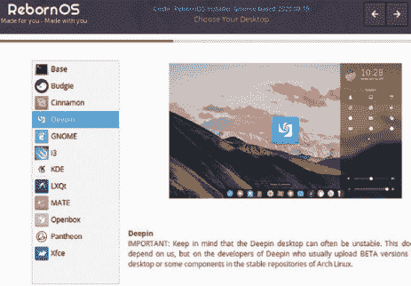

## Deepin

重要！请记住 `Deepin` 桌面可能会不稳定。这不仅仅是我们的问题，因为 `Deepin` 的版本可能需要 `Arch Linux` 稳定存储库中更新的 BETA 版本的桌面或某些组件。

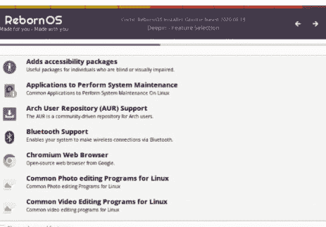

- 添加辅助包

选择你想要安装的辅助功能包。

- 执行系统维护的应用程序

Linux 上用于执行系统维护的常用应用程序。

- Arch 用户仓库支持

`AUR` 是 Arch 用户常用的仓库。

- 蓝牙

使你的系统能够通过蓝牙建立无线连接。

- Chrome 浏览器

使用 `Chrome` 浏览网页。

- Linux 常用照片编辑程序

常用的照片编辑程序。

- 显示高级功能...

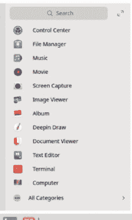

##

### `RebornOS`

更新管理系统会通知你；然后你可以使用 `Pamac` 图形前端查看并安装你需要的任何内容。

### 疑问

根据你选择的工作环境，`RebornOS` 的操作理念在桌面方面有几个细小的缺点。一些已安装的应用程序被列为桌面磁贴（tiles），这是 `Gnome` 的通常做法。或者，当你点击桌面右上角磁贴显示上的小双箭头按钮按下 `Start` 按钮时，会出现一个菜单树。在菜单显示和图 1 中：`RebornOS` 为 `Gnome` 磁贴提供了十多个桌面选择，应用程序在安装时并没有按字母顺序出现。如果你安装了较多的额外应用程序（如 `Dropbox`、`Steam` 或 `Spotify`），这尤其成问题。虽然视觉上很有吸引力，但 `RebornOS` 缺少这一出色的搜索功能。在开始安装之前，让我们查看两种显示模式下都可用的资源密集程序，让你检查你的选择。启动时，某些桌面环境会为你显示一个用于 `Flatpak` 包管理的窗口。`RebornOS` 默认启用 `Flatpak` 包管理，这意味着你可以从 `Flathub` 仓库获取软件 [2]。（图 3）（图 2）。图 2：`RebornOS` 安装程序让你选择想要安装的应用程序。

## 差异

根据你选择的软件选项和可用网络带宽，安装可能需要一些时间，因为大多数软件是从仓库获取的。可用软件也取决于你选择的桌面环境。根据你的界面，你主要会在菜单中找到属于该桌面环境的实用程序。如果你不想这样做，可以在窗口中取消勾选此选项。如果你想集成该仓库，将启动 `Gnome` 软件前端并自动集成 `Flathub`。在后台，它会同时检查更新。如果发现任何更新，程序将不会按字母顺序出现。得益于集成的搜索功能，你仍然可以快速找到它们。

## Flatpaks

安装并热启动后，通常会打开一个不显眼的 `GRUB` 启动菜单。如果你安装了其他操作系统，它也包含其他操作系统的项目。验证身份后，`RebornOS` 构建图 3：在某些选择菜单中，程序没有按字母顺序出现。

LINUX-MAGAZINE.COM | LINUXPROMAGAZINE.COM

第 241 期

2020年12月

29

## `RebornOS` FIRE: `RebornOS` 简单模式下的功能与改进

| 设置 | `RebornOS` FIRE: `RebornOS` 简单模式下的功能与改进 | | | | | |
|---|---|---|---|---|---|---|
| 显示管理器 | 桌面环境 | | | | | |
| 预算 | | | | | | |
| | | | `XFDE` `Deepin` `Enlightenment` `GNOME` `KDE` `Maxima` `LXFCE` `MATE` `Openbox` `XFCE` |
| `RebornOS` 定制 | 安装 | | | | | |
| 系统任务 | | | | | | |
| 程序 | | | | | | |
| 回滚 | | | | | | |
| 状态 | 管理 | 刷新 (*) | | | | |

|---|---|---|---|---|---|---|
| 内核 | 本地版本 | Header 版本 | 仓库版本 | | | |
| `linux` | `5.8.3.arch-1` | `5.8.3.arch-1` | `5.8.3.arch-1` | | | |
| `linux-lts` | `5.4.60-1` | | `5.4.60-1` | | | |
| `linux-zen` | | | | | | |
| `linux-hardened` | | | | | `5.8.3.zen1-1` |

运行中：`linux-5` `5.8.3-arch-1` 删除 设置为默认

| 设置 | `RebornOS` FIRE: `RebornOS` 简单模式下的功能与改进 | | | | | |
|---|---|---|---|---|---|---|
| 插件 | 工具 | 窗口管理器 | | | |
| `RebornOS` 定制 | 控制 `Minecraft` | 安装 `Anbox` | | | |
| 系统任务 | | | | | |
| 程序 | | | | | |
| 回滚 | | | | | |

## 评测

### `RebornOS`

用户界面的行为及其归因取决于服务的可用性。除了让你配置额外的桌面环境外，工具需求也各异。例如，图形前端。`Pace` 支持集成另一个显示管理器。它还提供了你在系统菜单中可以找到各种选项，让你管理活动内存比 `KDE Plasma` 桌面功能更利于维护系统，以及。

2020年12月

第 241 期

LINUX-MAGAZINE.COM | LINUXPROMAGAZINE.COM

# 快速上手 Linux


加入 LINUX 革命！你所需的所有软件！

# LINUX 入门指南

- 更强大 - 更安全 - 更有趣

想让你的朋友和同事也切换到 Linux 吗？


# 本期将向新手展示如何

- 安装 `Linux`
- 为你的 `Linux` 系统下载并安装免费软件
- 玩游戏
- 创建文档和表格
- 处理照片
- 播放音乐和视频
- 以及更多！

学习如何设置 `Linux` 系统以：

- 听音乐
- 玩游戏
- 处理照片
- 浏览网页及更多！

2020年版 `WWW.LINUX-MAGAZINE.COM`

在线购买：`shop.linuxnewmedia.com/specials`


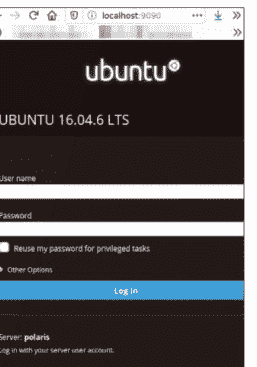

## 深度解析

# Cockpit

## 使用 Cockpit 管理工具管理服务器

来自 `Cockpit`

结识 `Cockpit`，这是一款易于使用的管理工具，让你能够通过方便的 Web 界面监控你的 `Linux` 服务器。作者：Marco Fiore

### 优势与局限性

关于 `Cockpit` 需要了解的第一个点是：一次安装就可以控制其他正在运行的远程机器。如果能在同一个浏览器标签页中配置并控制所有的 `Linux` 系统——通过 `Cockpit`，那不是太棒了吗？它并不是一个像 `Ansible` [5] 或 `Puppet` [6] 那样通过单一友好界面的配置管理系统。`Cockpit` 拥有许多功能。你无法告诉 `Cockpit` “我希望我所有的 `Linux` 机器看起来都这样”，而这个愿望的答案是一个名为 `Linuxconf` [1] 的项目，该项目在 2005 年停止了开发，即使你只需要它的功能中的一两个，也不会怀念。这种局限性也是它的优势，因为 `Cockpit` 刻意保持轻量化，因此易于使用。

`Linuxconf` 试图一次性完成太多事情，而且经常与大多数发行版的默认管理工具冲突。从表面上看，`Cockpit` 简洁、直观且流畅，即使在浏览器开启许多其他标签页的情况下也是如此。`Linuxconf` 之后出现了 `Webmin` [2]，它仍在活跃开发且非常有用；但在我看来，`Webmin` 的界面过时，且你需要较好的 `Linux` 知识才能正确使用。它的界面比标准的低级 `Linux` 工具要复杂得多（图 1）。

对更好管理工具的追求促成了几年前 `Cockpit` 项目 [3] 的启动。`Cockpit` 是一个免费开源的 Web 界面，后端通过 `systemd sockets` [7] 与其控制的 `Linux` 系统通信。`systemd sockets` 是一种在管理 `Linux` 系统时不占用任何内存的连接器。它们不需要做任何操作，只需在需要时激活 `Cockpit` 组件即可。

`Cockpit` 项目的官方目标是让“非专家管理员也能使用 `Linux` 服务器”，并让“复杂的 `Linux` 特性变得可发现” [4]。`Cockpit` 受 `Red Hat` 支持，但你可以在任何发行版上运行。本教程解释了 `Cockpit` 如何工作，以及它如何以及为何可能帮助你简化和整合 `Linux` 管理任务。

默认情况下，`Cockpit` 不存储性能或状态数据，也不会为其控制的计算机保留配置副本，除非是连接该计算机所需的参数。

图 1：`Cockpit` 登录界面 © `Cockpit` 包含一个嵌入终端，通过安全的 `SSH` 连接访问端口为 `9090` 的本地计算机。注意“复用我的密码...”复选框。另一个重要的优势是

2020年12月

第 241 期

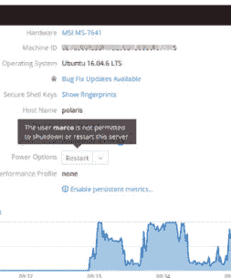


## 设置

`Cockpit` 后端通过 `systemd sockets` [7] 与其控制的 `Linux` 系统通信。`systemd sockets` 是一种在管理 `Linux` 系统时不占用任何内存的连接器。它们不需要做任何操作，只需在需要时激活 `Cockpit` 组件即可。

默认情况下，`Cockpit` 不存储性能或状态数据，也不会为其控制的计算机保留配置副本，除非是连接该计算机所需的参数。

图 1：`Cockpit` 登录界面 © `Cockpit` 包含一个嵌入终端，通过安全的 `SSH` 连接访问端口为 `9090` 的本地计算机。注意“复用我的密码...”复选框。另一个重要的优势是

`Cockpit` 包含一个嵌入终端，通过安全的 `SSH` 连接访问端口为 `9090` 的本地计算机。注意“复用我的密码...”复选框。另一个重要的优势是

2020年12月

第 241 期

## 设置

`Cockpit` 后端通过 `systemd sockets` [7] 与其控制的 `Linux` 系统通信。`systemd sockets` 是一种在管理 `Linux` 系统时不占用任何内存的连接器。它们不需要做任何操作，只需在需要时激活 `Cockpit` 组件即可。

默认情况下，`Cockpit` 不存储性能或状态数据，也不会为其控制的计算机保留配置副本，除非是连接该计算机所需的参数。

图 1：`Cockpit` 登录界面 © `Cockpit` 包含一个嵌入终端，通过安全的 `SSH` 连接访问端口为 `9090` 的本地计算机。注意“复用我的密码...”复选框。另一个重要的优势是

## 设置

`Cockpit` 后端通过 `systemd sockets` [7] 与其控制的 `Linux` 系统通信。`systemd sockets` 是一种在管理 `Linux` 系统时不占用任何内存的连接器。它们不需要做任何操作，只需在需要时激活 `Cockpit` 组件即可。

默认情况下，`Cockpit` 不存储性能或状态数据，也不会为其控制的计算机保留配置副本，除非是连接该计算机所需的参数。

图 1：`Cockpit` 登录界面 © `Cockpit` 包含一个嵌入终端，通过安全的 `SSH` 连接访问端口为 `9090` 的本地计算机。注意“复用我的密码...”复选框。另一个重要的优势是

## 设置

`Cockpit` 后端通过 `systemd sockets` [7] 与其控制的 `Linux` 系统通信。`systemd sockets` 是一种在管理 `Linux` 系统时不占用任何内存的连接器。它们不需要做任何操作，只需在需要时激活 `Cockpit` 组件即可。

默认情况下，`Cockpit` 不存储性能或状态数据，也不会为其控制的计算机保留配置副本，除非是连接该计算机所需的参数。

图 1：`Cockpit` 登录界面 © `Cockpit` 包含一个嵌入终端，通过安全的 `SSH` 连接访问端口为 `9090` 的本地计算机。注意“复用我的密码...”复选框。另一个重要的优势是

## 设置

`Cockpit` 后端通过 `systemd sockets` [7] 与其控制的 `Linux` 系统通信。`systemd sockets` 是一种在管理 `Linux` 系统时不占用任何内存的连接器。它们不需要做任何操作，只需在需要时激活 `Cockpit` 组件即可。

默认情况下，`Cockpit` 不存储性能或状态数据，也不会为其控制的计算机保留配置副本，除非是连接该计算机所需的参数。

图 1：`Cockpit` 登录界面 © `Cockpit` 包含一个嵌入终端，通过安全的 `SSH` 连接访问端口为 `9090` 的本地计算机。注意“复用我的密码...”复选框。另一个重要的优势是

## 设置

`Cockpit` 后端通过 `systemd sockets` [7] 与其控制的 `Linux` 系统通信。`systemd sockets` 是一种在管理 `Linux` 系统时不占用任何内存的连接器。它们不需要做任何操作，只需在需要时激活 `Cockpit` 组件即可。

默认情况下，`Cockpit` 不存储性能或状态数据，也不会为其控制的计算机保留配置副本，除非是连接该计算机所需的参数。

图 1：`Cockpit` 登录界面 © `Cockpit` 包含一个嵌入终端，通过安全的 `SSH` 连接访问端口为 `9090` 的本地计算机。注意“复用我的密码...”复选框。另一个重要的优势是

## 设置

`Cockpit` 后端通过 `systemd sockets` [7] 与其控制的 `Linux` 系统通信。`systemd sockets` 是一种在管理 `Linux` 系统时不占用任何内存的连接器。当你点击任何对应需要 `sudo` 的按钮时，在 `CentOS` 远程服务器上，我必须获取错误消息（图 2）。

如果你想，或需要将 `Cockpit` 放在...

图 1：`Cockpit` 登录界面 © `Cockpit` 包含一个嵌入终端，通过安全的 `SSH` 连接访问端口为 `9090` 的本地计算机。注意“复用我的密码...”复选框。另一个重要的优势是

## 设置


# 深度解析

## Cockpit

### 设置

`Cockpit` 后端通过 `systemd sockets` [7] 与其控制的 `Linux` 系统通信。`systemd sockets` 是一种在管理 `Linux` 系统时不占用任何内存的连接器。它们不需要做任何操作，只需在需要时激活 `Cockpit` 组件即可。

默认情况下，`Cockpit` 不存储性能或状态数据，也不会为其控制的计算机保留配置副本，除非是连接该计算机所需的参数。

图 1：`Cockpit` 登录界面 © `Cockpit` 包含一个嵌入终端，通过安全的 `SSH` 连接访问端口为 `9090` 的本地计算机。注意“复用我的密码...”复选框。另一个重要的优势是

### 安装

在大多数 `Linux` 发行版上，`Cockpit` 的安装非常简单。对于 `Ubuntu` 和 `Debian`，使用以下命令：

```bash
sudo apt update
sudo apt install cockpit
```

对于 `RHEL`、`CentOS` 或 `Fedora`，使用：

```bash
sudo dnf install epel-release
sudo dnf install cockpit
```

安装完成后，你可以通过打开浏览器导航到 `https://your-server-ip:9090` 来访问界面。

### 访问界面

导航到 `URL` 后，系统会提示使用系统凭据登录。从那里，你可以管理服务、检查系统日志、更新软件以及更多。


### 理论实践

我发现工具和文档并不总是匹配。例如，网站说你可以设置 `Login-Title` 变量作为浏览器标题，用于登录界面和一个 `Banner` 变量，用于在登录页面上显示指定文件（默认认为 `/etc/issue`）的内容，作为欢迎词或信息消息。

然而，在我的 `Ubuntu` 系统上，我给这些变量的任何值似乎都没有起作用。这可能是团队在你读到此内容时已经解决的 `bug`。就价值而言，我有这种：

图 2：除非你勾选 `Cockpit` 是开箱即用的，以至于

图 3：选择`服务器`

“复用我的密码...”复框在矛盾的是，这种 `bug` 可能会重新登录，`Cockpit` 不允许你以管理员角色长时间配置主未见，以便执行敏感或潜在危险的操作。更改默认值的重要参数，因为几乎没有人需要 `Linux` 用户账户。

`LINUX-MAGAZINE.COM` | `LINUXPROMAGAZINE.COM`

第 241 期

2020年12月

### 电源选项

`性能配置` `无`

`2` 个 `CPU` 核心


`GB` 内存


`MBps` 磁盘 `IO`


`MBps` 网络流量


| | | 严重程度 | 错误及以上 |
|---|---|---|
| 2020年6月30日 | | |
| ▲ 23:43 | 读取失败 | `sudo` |
| ▲ 23:43 | 打开失败 | `sudo` |
| ▲ 23:19 | 创建失败 | `sudo` |
| 提示及以上 | | |
| 2020年6月29日 | | |
| ▲ 15:19 | `[14998]:` 错误：调试 | `/var/log` |
| 2020年6月28日 | | |
| ▲ 15:19 | `[14998]:` 错误：失败 | `/var/log` |
| ▲ 12:74 | 失败：打开意... | `/var/log` |
| ▲ 12:05 | `3` 次密码认证失败 | `sudo` |
| 2020年6月27日 | | |
| ▲ 18:02 | 失败：`open:/etc/postfix/main_cf.` | `/var/log` |
| ▲ 17:02 | `3` 次密码认证失败 | `sudo` |
| ▲ 16:59 | 失败：`open:/etc/postfix/main_cf.` | `/var/log` |
| ▲ 16:53 | `3` 次密码认证失败 | `sudo` |
| ▲ 16:08 | `[20688]:` 错误：失败至 | `/var/log` |
| 2020年6月26日 | | |
| ▲ 16:37 | `[14996]:` 错误：失败至 | `/var/log` |

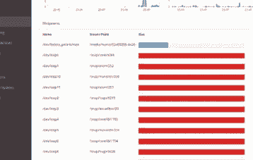

## 代理与多服务器管理

`Cockpit` 代理，透明地中继 `Cockpit` 与其运行 `Cockpit` 的 `Linux` 系统浏览器之间的流量，就如同它们托管的任何容器或虚拟机。`Cockpit` 的安装必须服务于许多用户，而无需让其中任何一个用户安装任何额外软件。如果一个人想在几台独立的服务器上安装并使用 `Cockpit`，更好的解决方案是多服务器方法。你可以从浏览器中获取登录的所有系统的性能的快速、动态概览，且从菜单中可以立即访问所有系统。图 4 和图 5 显示了硬件性能图和存储管理界面的示例，后者总结了所有设备和分区的状态。`Cockpit` 创建的所有图表都有非常整洁的风格，根据我的经验，它们的持续刷新从未减慢浏览器。

`Cockpit` 配置文件 (`/etc/cockpit/cockpit.conf`) 具有简单的语法，选项在项目文档中有描述。始终如此。

图 6 显示了同样整洁的系统日志摘要。除了支持监控外，`Cockpit` 还允许你创建并启动 `Linux` 或 `FreeBSD` 虚拟机以及 `Docker` 容器，更新软件，管理 `LVM` 卷，并定义 `systemd` 定时器以在指定时间自动运行程序。你还可以配置、停止和重启系统服务或网络接口。所有相应的面板基本上是主选项的视觉化表示，我将不再详细描述，它们通常在命令行中进行（见“理论与实践”）。默认情况下，`Cockpit` 图表仅显示计算机的当前状态。峰值...可以对你的本地 `I/O` 和网络流量提供即时的、定性的反馈，两个图表中显示是因为下载 `ISO` 镜像。

`Cockpit` 允许你在特权模式下监控、分析和配置布局，显示分区和设备状态、磁盘访问（顶部）和存储日志（底部）。

图 4：带有 `Cockpit` 控制面板的系统中的性能图表。

图 5：`Cockpit` 服务器菜单（左侧）和默认存储面板。

图 6：`Cockpit` 显示系统日志摘要。

# 管理多个服务器

这种场景也是 `Cockpit` 不存储服务器数据这一设计规则的要例外。除了密码之外（据我所知，你每次都必须重新输入），连接到服务器所需的参数存储在 `/etc/cockpit/servers.d` 文件夹中的一个 `JSON` 文件中，格式如下：远程 `Linux` 机器的本地副本。

```json
{
  "SERVER_NAME" : {
    "visible": true,
    "color": "rgb(103, 211, 0)",
    "user": "USERNAME",
    "port": "SSH_PORT_NUMBER",
    "address": "ADDRESS"
  }
}
```

图 7：`Cockpit` 终端通过 `SSH` 连接到运行 `Cockpit` 的服务器。


## 安全地使用 Cockpit

`ADDRESS`可以是域名或数字 IP 地址。连接所需的 SSL 证书和密钥相反存储在另一个你需要定期备份的 Cockpit 文件夹中，`/etc/cockpit/ws-certs.d`。可选模块，但此操作取决于发行版。

从一个 Cockpit 安装控制的所有服务器都列在其仪表板中。要添加服务器，点击仪表板上的加号按钮（图 8 细节2），并在弹出窗口（图 9）中添加服务器地址。使用以下语法：

`servername:portnumber`

Cockpit 终端是可见的。除非你阻止访问，否则当你借非 Linux 计算机或在公共 Internet 终端工作时，SSH 访问也是可能的。

图 8：连接到 Cockpit 实例的 Cockpit 仪表板。

我很不喜欢 Cockpit 的一点是，默认情况下它绕过了 SSH 连接的一个基本安全规范，即“不要直接使用 root 账户登录！”想法是，任何想使用 SSH 执行 root 工作的人先用普通账户登录，然后切换到 root。在 Cockpit 中，你可以按照你喜欢的任何方式和时间使用它。关于终端选项最重要的点是，可选端口号指的是该服务器的 SSH 端口，如果它与默认值 22 不同。请注意，此程序对于你所做的事情是足够安全的。

只有当你登录 Cockpit 时，这种障碍才会被绕过，但事实是 Cockpit 无非只是提升了权限。要恢复它很容易，尽管这并不意味着意味着你可以随心意欲地在它的终端和图形界面之间来回。甚至你在终端中输入的错误信息也会显示在

图 9：向 Cockpit 添加另一个服务器，输入其名称、如果需要则输入端口号，以及其图表的颜色。

图 8：控制两个服务器的 Cockpit 仪表板。

`LINUX-MAGAZINE.COM` | `LINUXPROMAGAZINE.COM`

第 241 期

2020年12月

35

## 深度解析

Cockpit

在每个你希望禁止通过 Cockpit 直接登录的服务器上，添加以下设置：`Webmin` 可能会提供更精细的控制，而命令行可能更灵活，但 Cockpit 提供了一种快速、用户友好的方法来监控和配置远程服务器。在图 10 中，浏览器连接到 Ubuntu 桌面本地的 Cockpit 副本（详见 1）。由于任何现代浏览器——其端口 9090 都已关闭（详见 2），因此无法以浏览器相同的方式访问 Cockpit。Cockpit 作为一个 Linux 培训者的辅助也非常有用。Cockpit 仪表板是监控和找出 Linux 课程中所有数字标识符（`uid`）低于 1000（root 的 `uid` 为 0）的计算机的有效方法，也是教授 Linux 配置暴露的良好工具。

## Cockpit 模块

与其他软件包一样，一个由 Cockpit 管理的 Linux 服务器是 Cockpit 文档中所说的“基础主机模型”。它具有模块化架构，并拥有一组官方支持的核心模块。首先，配置运行 Cockpit 的主机的防火墙，以阻止对 TCP 端口号 9090 的外部连接。在 `CentOS` 上，本教程中显示或描述的功能来自非强制性的核心模块，但它们要么被包含在 Cockpit 基础包中，要么被声明为依赖项。在不重启系统的情况下应用以下配置更改：这些模块是通过 `apt-get` 或 `yum` 自动安装的。

## 信息

- [1] Wikipedia 上的 Linuxconf 页面：`https://en.wikipedia.org/wiki/Linuxconf`

- [2] Webmin：`https://www.webmin.com`

- [3] Cockpit 网站：`https://cockpit-project.org`

- [4] Cockpit 理念：`https://cockpit-project.org/ideals`

- [5] Ansible：`https://www.ansible.com`

- [6] Puppet：`https://www.puppet.com`

- [7] Systemd  sockets：`https://www.freedesktop.org/software/systemd/systemd.socket.html`

- [8] Cockpit 安全：`https://cockpit-project.org/blog/is-cockpit-secure.html`

- [9] Cockpit 的可移动 URL：`https://github.com/cockpit-project/cockpit/issues/3323`

- [10] Nginx 后的 Cockpit：`https://github.com/cockpit-project/cockpit/wiki/Cockpit-over-nginx`

## Cockpit 基础

```bash
sudo firewall-cmd --permanent --zone=public --remove-service=cockpit
sudo firewall-cmd --reload
```

`Systemd` sockets 可能不是最新的，而且在没有经过调试和手动修复的情况下它们可能无法工作，而你可能无法无法负担这些修复。例如，这里的诀窍在于这些操作只会阻止远程连接。在计算机上关闭 9090 端口并阻止浏览器 RSS 馈送，将其放入所需的以及一个运行在同一台计算机上的两个 Cockpit 实例的 Cockpit 子文件夹 (`addons`) 中，如文档所述的那样，但什么都没有发生。再加上两个 Cockpit 实例可以通过本应保持开启的同一个 SSH 端口直接、安全地相互通信，并且

## 结论

脚本，但只有少数是 `git-cola` 的插件，并作为基础 `git` 的选项运行。

虽然 `Git` 设计用于从命令行操作，但请跳出 Debian 命令行限制，有时你需要一个图形界面来查看概览，你可能会再次发现许多种选择。

## 图 1：`git-big-picture` 提供了一个用于当前仓库地图概览的图形界面。

大约有六个可以在独立窗口中保持打开的 Git 图形界面。有些用户安装了 `git-all` 以及各种 Git 界面，`git-cola` 是目前为止所有次级工具中运行最快、效率最高的；其开发者对 `git-cola` 的描述如下。

© `https://pypi.org/project/git-big-picture/`

`git-cola.github.com/master/tuksayven/Websites/git-cola.github.com`

文件 操作 暂存区 差异 分支 变基 查看 帮助

提交 01:20 状态

+ 为首页添加截图

渲染描述...

```css
ul {
  padding: 0;
}

.frontpage-screenshot {
  float: left;
  margin-right: 1em;
}
```

站点地图

提交 `C539`

- `images/screenshot-main-linux.png`

- `Index.html`

已修改

- `images/screenshot-main-linux.png`

- `Index.html`

| 收藏 |

| :--- |

| `web` |

| `git-cola` |

| `package-manager` |

| `marketing` |

| `from-depth` |

| `python` |

| `mobilechethian` |

选择要提交的代码块 `[x]`-已选择 `折叠` `c:` 确认 `q:` 取消 箭头键: 移动/展开/折叠 空格: 取消选择 `?`: 帮助 `[x]`一次宴会上的喃喃。`[x]`一个 `gitattributes`

## 深度解析

### Git 基础

远程用户读取加密文件的唯一方法是使用命令添加他们的加密密钥，或者使用以下命令导出仓库：

```bash
$ git-crypt export-key GPG_USER_ID KEY_PATH
```

之后，远程用户可以使用以下命令访问文件：

```bash
git-crypt unlock KEY_PATH
```

你也可以通过使用锁选项临时让所有人都能访问文件。

图 2：`git-cola` 提供了一个易于导航的图形界面。

© `https://git-cola.github.io`

`git-repair`

`Git` 的核心包含了 `fsck` 命令，作为一个“咖啡因版”的 Git（图 2）。请注意，虽然 `fsck` 可以发现仓库中的问题，但它不会修复仓库的结构。

`git-cola` GUI 由三个主窗口组成。第一个窗口是文件管理器，允许你选择仓库。第二个是主工作窗口，带有状态、提交、分支和差异面板以及相应的菜单。对于任何对 Git 有基础了解的人来说，这个窗口可能立即被理解。第三个窗口显示当前分支及其内容的详细视图，以及所有所有分支的地图。与第二个窗口一样，第三个窗口具有简单的顶层结构但没有操作，因此没有手册页（`man` `page`）。相比之下，`git-repair` 运行 `fsck` 并尽尽所为。首先，`git-repair` 会删除损坏的对象并检索缺失对象的远程版本。


此工具提供了与 Git 仓库配合使用的加密功能。它可以用于决定哪些文件应该加密，以及哪些用户可以加密或解密。要设置加密仓库，使用 `gpg --gen-key` 为每个用户创建一个密钥。注意，`git-repair` 的目的是创建一个功能性的仓库，而不是恢复一切。因此，你可能需要从克隆仓库或备份中恢复某些文件。运行 `git-crypt init`。然后通过创建一个放置在仓库中的 `.gitattributes` 文件来选择将受影响的文件。为每个要加密的文件指定详细信息。运行 `git-repair` 后，你应该运行 `git fsck` 和 `git gc` 来完成恢复（图 4）。

# `git-crecord`

```bash
FILE=git-crypt
diff=git-crypt
```

# `git-sizer`

基于用于 Mercurial 版本管理系统的类似工具，`git-crecord` 可以批量提交文件并在 Git 中进行比较。此外，它的图形界面和颜色编码提供了仓库的概览。对于大小小于 1GB 的仓库，且在约 5GB 左右会变得臃肿的仓库，你可以通过在 `.gitattributes` 中添加行来存储所有 Git 相关材料，以确保 `.fileattrib` 不被加密。例如，在图 3 所示，多个文件已暂存但尚未提交。使用 `git-recred`，用户可以选择提交多少文件。然而，我的系统将该行读为错误。此外，你可能也会这样做。

# 图 3：`git-recred` 为批量操作提供了基础界面。

LINUX-MAGAZINE.COM | LINUXPROMAGAZINE.COM

第 241 期

2020年12月

```bash
bb@nanday~/wip5 git-repair
Running git fsck ...
No problems found.
```

```bash
bb@nanday~/wip5 git-sizer
Processing blobs: 0
Processing trees: 3
Processing commits: 4
Matching commits to trees: 4
Processing annotated tags: 0
Processing references: 7
No problems above the current threshold were found
```

## 深度解析

### Git 基础

没有足够的空间提到 `git-extras` 中的所有优秀功能。其中最有实用的五个是：

- `git-back`: 重写最新的提交。
- `git-sed`: 在仓库的文件中搜索字符串并将其替换为另一个字符串。
- `git-merge-repo`: 将两个仓库合并为一个仓库。
- `git-obliterate`: 在仓库目录中填充垃圾数据。

# 查找更多命令

如果 `git-extras` 不够用，还有许多其他增强，特别是当你深入专业领域时。可以使用通配符来减少文本和条目数量。由于这个原因，它们在小于 1GB 时效果最佳。

Git 仓库完全按照你的意愿运行。Q Q Q

## 信息

- [1] GitHub Git 插件：`https://github.com/topics/git-addons`
- [2] Steve Mao 的 Awesome Git 插件：

图 5：`git-sizer` 提供了相关信息，帮助你控制仓库的大小。`https://github.com/stevemao/awesome-git-addons`

Q Q Q

40

2020年12月

第241期

LINUX-MAGAZINE.COM | LINUXPROMAGAZINE.COM

## 通过特刊精进你的技能！

从我们的特刊库中了解 Shell、LibreOffice、Linux 等更多内容。

*Linux Magazine* 团队创建了一系列单本，让你深入研究你感兴趣的主题。提供纸质版或数字版。

## 查看完整库！

`shop.linuxnewmedia.com`

``

## 深度解析

命令行 – Vimwiki

## 命令行个人 wiki

快速上手

在开始使用 Vimwiki 之前，通过阅读帮助文档来为自己帮忙吧（图 1）。Vimwiki 是一个 Vim 插件，提供了一个简单且有效的命令行 wiki，并可选多种标记语言。

**作者：Bruce Byfield**。

除了 `.vimrc` 文件外，你还需要知道每个按键绑定之前的导前键（leader key）。如果你不知道安装方法，可以 [2]。然而，最简单的方法之一是安装 Vim 插件然后生成帮助标签：

```
:echo mapleader
```

自 Ward Cunningham 在 1994 年首次开发它们以来，Wiki 一一直是自由软件开发的主流。今天，它们因诸如 Wikipedia 这样的网站而闻名。作为笔记、待办事项、公告甚至是日志的集合，Wiki 对于小组或个人的项目开发来说都是理想的工具。Vimwiki [1] 是一个简单但有效的 wiki 引擎，在标记语言的选择上灵活，一旦设置好上手非常快。

```
:echo mapleader
```

```
git clone U
```

`https://github.com/vimwiki/vimwiki.git` U

```
~/.vim/pack/plugins/start/vimwiki
```

```
vim -c 'helptags U
```

```
~/.vim/pack/plugins/start/vimwiki/doc' U
```

```
-c quit
```

```
:let mapleader="KEY"
```

所有的安装方法都要求你的主目录中包含一个带有以下行的 `.vimrc` 文件：导前键可以是任何键，但常用的有 (,) 或反斜杠 (\)。像 Vim 插件一样，Vimwiki 的默认导前键是 (,)。安装取决于取决于你使用（如果有的话）哪种插件管理器。Vimwiki 的 GitHub 页面提供了关于所有不同插件的摘要。注意：如果你对 Vim 经验较少，请记住在 Vim 中通过按 `Esc` 键切换到命令模式，然后在每个命令前加一个冒号 (:)。

作者：Bruce Byfield 是一名计算机记者，也是一名专精自由和开源软件的自由作家和编辑。除了他的写作项目外，他还教授授直播和在线课程。在空闲时间，Bruce 写关于西北海岸艺术的文章（`http://brucebyfield.wordpress.com`）。他还是 Prentice Pieces 的联合创始人，这是一个关于写作和幻想的博客（`https://prenticepieces.com/`）。

## 入门

大多数 Vimwiki 文档中缺失的一项重要信息是如何显示在线帮助。一旦你显示了在线帮助，只要你知道了方法，解决方案就很简单。

```
::help vimwiki
```

42

2020年12月

第241期

LINUX-MAGAZINE.COM | LINUXPROMAGAZINE.COM

### 目录

- 1. 简介 `vimwiki-intro`
- 2. 前提条件 `vimwiki-prerequisites`
- 3. 映射 `vimwiki-global-mappings`
  - 3.1. 全局映射 `vimwiki-global-mappings`
  - 3.2. 本地映射 `vimwiki-local-mappings`
  - 3.3. 对象 `vimwiki-text-objects`
- 4. 命令 `vimwiki-commands`
  - 4.1. 全局命令 `vimwiki-global-commands`
  - 4.2. 本地命令 `vimwiki-local-commands`
- 5. 语法 `vimwiki-syntax`
  - 5.1. 字体 `vimwiki-typefaces`
  - 5.2. 行 `vimwiki-lines`
  - 5.3. 段落 `vimwiki-paragraphs`
  - 5.4. 列表 `vimwiki-lists`
  - 5.5. 编辑 `vimwiki-edits`
  - 5.6. 预格式文本 `vimwiki-preformatted`
  - 5.7. 数学公式 `vimwiki-math`

## 深度解析

命令行 – Vimwiki

语法类型

图 1：Vimwiki 附带丰富的帮助信息。第一次使用 Vimwiki 时，进入命令部分。例如，如果你有两个 wiki，可以使用表 1 所示的基础命令在它们之间导航。另一个内置的 Vimwiki 功能是双方括号 `[]`。若要创建一个包含多个单词的链接，请按 `v` 键进入 Vim 的视觉模式，选择链接的单词并按回车键。通过在 `.vimrc` 中定义每个 wiki 并赋予它们唯一的数字和名称，多个 wiki 可以作为同一目录的子目录存在。

```
:echo mapleader
```


## 背景笔记

### 历史
1. 土著文化
2. Dhurantsur 入侵
3. Valicon 省份
4. Jobbies 的建立
5. 大路
6. Valicon 撤退

### 时间线
1. Dhurantsur 入侵
2. Rerry 渡口
3. Ilvarness 的创建

### 事件
1. Elzymer 的死亡
2. 骨头赎金
3. Bronwy 的统治

### 深度解析

## 命令行 – Vimwiki

**列表 1：基础默认语法**

使用两个指示一级标题的字符作为二级标题。`Vimwiki` 还包含许多高级功能——多到无法在此处详尽列举。这些功能包括诸如结构设计可能会让你忘记正在使用的语法等，因此在大多数情况下，用户应该在他们的 wiki 中坚持单一语法，以避免输入注释和占位符。这些功能大部分涉及向你的 `.vimrc` 中添加行来启用它们。

` = Header1 = `

` = Header2 = = `

` === Header3 === `

` *bold* ` -- 粗体文本

` _italic* ` -- 斜体文本

除非你需要与其他应用程序兼容，否则这种单一语法可能应该是 `Vimwiki` 的首选。然而，`Vimwiki` 的设置和 wiki 的默认结构已经足够让大多数用户忙碌一段时间了。与许多 `Vim` 插件不同，`Vimwiki` 不仅仅是一个简单的插件。它不仅仅是一个插件，而是一个独立的程序，其复杂程度相当于许多个人 wiki 引擎。

` [[wiki link]] ` -- wiki 链接

` [[wiki link|description]] `

-- 带描述的 wiki 链接

它是唯一一个内置通过命令 `:VimwikiAllHTML` 导出到 `HTML` 的工具。另外两个则需要外部导出工具 [6]。

- ` * ` 符号列表项目 1
- ` * ` 符号列表项目 2
- ` * ` 嵌套符号列表项目
- ` 1. ` 编号列表项目 1
- ` 1. ` 嵌套编号列表项目 1

**列表 1** 显示了 `Vimwiki` 基础默认语法的示例。图 2 显示了某些标签经过了颜色编码。诚然，初始设置可能会困难，特别是对于那些不熟悉 `Vim` 中列出的某些特殊符号的人。但一旦设置好 `Vimwiki`，快捷键和语法就很容易学习。

由于 `Vimwiki` 从命令行运行，你拥有的 wiki 引擎比大多数都要快。作为一种优势，你几乎可以在手指不离开键盘的情况下使用 `Vimwiki`——唯一的例外是切换到视觉模式以为多个单词创建链接时。

除了语法之外，某些关键字用于强调，例如 `TODO`、`DONE`、`STARTED`、`FIXME` 和 `FIXED`。这些是巨大的优势，足以足以解释为什么对许多人来说，`Vimwiki` 是运行 `Vim` 的主要原因。

你还可以使用命令创建表格：

`:VimwikiTable COLUMNS ROWS`

例如，`VimwikiTable 3 3` 产生如下：

```
||||||
|---|---|---|
||||||
```

**信息**

- [1] `Vimwiki`: `http://vimwiki.github.io/`
- [2] 安装: `https://github.com/vimwiki/vimwiki#`
- [3] `calendar.vim`: `http://www.vim.org/scripts/script.php?script_id=52`
- [4] `Markdown` 摘要: `https://www.markdownguide.org/cheat-sheet`
- [5] `MediaWiki` 摘要: `https://www.mediawikiwiki.org/wiki/Help:Formatting`
- [6] 外部导出工具: `https://vimwiki.github.io/vimwiki/Related%20Tools-External%20Tools.html#Related%20Tools`

第一行是表头。类似于大多数计算机生成的表格，你可以按 `Shift` 键在表格中移动。按 `Enter` 键将创建一个新行。

图 2：带有颜色编码的 `Vimwiki` 默认语法示例。

44

2020年12月

第 241 期

`LINUX-MAGAZINE.COM | LINUXPROMAGAZINE.COM`

## 公共资金

## 公共代码

## 使用自由软件使基础设施

`fsfe` 欧洲软件基金会

了解更多：`https://publiccode.eu/`

## 深度解析

### 编程快照 – Go 歌词

一个 `Go` 程序逐行显示歌词 `Sweet Dreams`

浴缸歌手 `Mike Schilli` 构建了一个 `Go` 工具，用于管理来自 `YAML` 文件的歌词，并帮助他逐行背诵。*作者：Mike Schilli*

当你在 `Google` 上搜索某首曲目时，逐行查看并尝试记住后续内容。编译后的终端 UI 显示了曲目列表及其艺术家（图 1）。使用任何人都可以弹奏三个和弦。

我真正钦佩音乐家的地方在于，他们能够背诵所有通常很长的歌词。尽管如此，也存在一些关于这种巨大鸿沟的搞笑例子。

该工具运行在命令行中，因此可以使用方向键（`Vim` 爱好者如果喜欢可以使用 `h/j`），然后你可以在运行长命令时一边唱歌——在列表中滚动，，并在艺术家原唱的内容与粉丝认为听到的内容之间按 `Enter` 键。

**复古外观**

## IN-DEPTH

### Programming Snapshot – Go Lyrics

The downstream processing of input and UI display to the `handleUI()` function to stipulate which list box is on top and therefore visible, the function updates the `inFocus` variable, setting it either to the main menu (`Lb`) or the text window (`Itext`) list box. When the function returns, it's because the user has pressed `Q` and wants to end their singing lesson.

输入和 UI 显示的下游处理传递给 `handleUI()` 函数，以规定哪个列表框位于顶部并可见。该函数更新 `inFocus` 变量，将其设置为主菜单 (`Lb`) 或文本窗口 (`Itext`) 列表框。当函数返回时，是因为用户按了 `Q` 键想要结束歌唱课程。

#### Organizing Structures

The lyrics data structure is a `Go` map that references the `YAML` data of individual tracks for fast lookups, using a string key consisting of a combination of the artist and title. Both the data structures of the individual songs and the map of the song collection will be defined later in `Listing 3`, but since all three listings implement the same `Go` package `main`, they are allowed mutual access to each other's constructs.

歌词数据结构是一个 `Go` map，它引用了单个曲目的 `YAML` 数据以实现快速查找，并使用由艺术家和标题组合成的字符串作为键。单首歌曲的数据结构和歌曲集合的 map 将在稍后的 `Listing 3` 中定义，但由于这三个代码列表都实现了相同的 `Go` 包 `main`，因此它们被允许相互访问对方的构造。


In Listing 2, the `for` loop starting in line 24 assembles the list of entries in the main menu as an array slice of strings that it generates from the lyrics map's keys. The keys in the map are by definition unsorted; therefore, the `sort.Strings()` function from the standard library puts the string list in alphabetical order in line 27. Go’s built-in `Sort()` function sorts an array slice of strings in place (i.e., it actually modifies the input array instead of producing a new, sorted version).

在 `Listing 2` 中，从第 24 行开始的 `for` 循环将主菜单条目列表组装成字符串切片，该切片是由歌词 `map` 的键生成的。根据定义，`map` 中的键是无序的；因此，标准库中的 `sort.Strings()` 函数在第 27 行将字符串列表按字母顺序排序。`Go` 内置的 `Sort()` 函数会原地对字符串切片进行排序（即它实际上修改了输入数组，而不是产生一个新的排序版本）。

`Listing 2` 现在只需要处理活动和非活动列表框条目的亮色定义，并移交控制权。

```go
08
)
44 }
09
45 ifFocus == ltext {
10
func handleUI(lb *widgets.List, ltext *widgets.List, 46 morelines := false
11 lyrics map[string]Lyrics) {
47 for scanner.Scan() {
12
48 line := scanner.Text()
13 ui.Render(lb)
49 if line == "" {
50 inFocus := lb
51 continue
51 }
51 uiEvents := ui.PollEvents()
52
Itext.Rows = append(Itext.Rows, line) 17 var scanner *bufio.Scanner
53 morelines = true
18
54 Itext.ScrollDown()
19 for {
55 ui.Render(Itext)
20 select {
56 break
21 case e := <-uiEvents:
57 }
22 switch e.ID {
58 if !morelines {
23 case "q", "<C-c>": 59 inFocus = lb
24 return
60 Itext.Rows = Itext.Rows[:0]
25 case "j", "<Down>": 61
26 if inFocus == lb {
62 }
27 lb.ScrollDown()
63 }
28 ui.Render(lb)
29 }
64 case "<Escape>":
30 case "k", "<Up>": 65 inFocus = lb
31 if inFocus == lb {
66 Itext.Rows = Itext.Rows[:0]
32 lb.ScrollUp()
67 ui.Render(lb)
33 ui.Render(lb)
68 }
34 }
69 }
35 case "<Enter>":
70 }
36 if inFocus == lb {
71 }
```

处理过程取决于当前使用的模式。文本扫描器检索当前活跃的文本。如果用户处于主菜单中的多行内容中的下一行，`inFocus` 被设置为 `lb`，且第 47 行使用所选行的索引；它会丢弃任何空行，并将新读取的行添加到 `Itext` 列表框的数组中。`ScrollDown()` 将显示器中的新行标记为活跃，`if` 块将 `inFocus` 变量设置为 `Ltext`，从而激活红色的歌词文本。同样，整个过程都是可视化的。在第 41 行新定义的扫描器（`scanner`）从歌词结构中获取带有歌词行的文本字符串，并且记住，请以适中的音量唱歌，以考虑到邻居！如果歌曲结束（即扫描器失败，并且每次调用其 `Scan()` 方法时都无法返回下一个字符串行），`if` 块将从第 58 行开始从主菜单中从 `Ltext` 列表框中删除文本行，然后通过将 `inFocus` 指向 `lb` 回到主菜单模式。同一个歌词列表框被传递给 `ui.Render()`。如果用户按下 `Esc` 则会发生变化；在这种情况下，`case` 块切换到模式，第 45 行开始的 `if` 块是第 64 行开始的主菜单。

### 快速构建

要创建控制从 A 到 Z 控制工具的歌词二进制文件，你只需要编译所有的三个列表，如列表 5 所示。初始调用 `go mod` 会初始化一个新的 `Go` 模块，它告诉随后的 `go build` 从 `GitHub` 获取所有所需的包并将它们也包含进来。成功构建后，确保你的数据目录中填充了几个 `YAML` 格式的歌曲歌词，然后调用 `ui.Render()`。

**列表 5：生成二进制文件**

```bash
$ go mod init lyrics
$ go build lyrics.go find.go
```

## 深度解析

### `Jam.py`

#### 使用 `Jam.py` 构建数据库前端

#### 数据窗口

使用 `Jam.py` 为你的数据库创建一个方便的界面。

**作者：** `Marco Fioretti`

要使用 `Jam.py`，你只需要

`Jam.py` 是一个开源环境，允许你为数据库构建基于浏览器的界面。最重要的组是 `Catalogs`（目录）。`Catalogs` 是你浏览器中的标签页或窗口。在日志和期刊（`Journals`）中加载这些客户端网页。`Catalogs` 是存储实际记录（如发票）的表。

使用 `Jam.py`，你可以在 `SQLite`、`PostgreSQL`、`MySQL`、`Firebird`、`MSSQL` 或 `Oracle` 中设计并共享数据。`Jam.py` 框架由两个部分组成：与任何关系或非关系数据库交互的服务器端。

客户端是一对动态网页。在实践中，你将使用默认模板或自定义网页。第一页是主页（`Home page`），你可以根据数据库查询的结果生成图表。第二页是可以修改数据库中表的地方。

`LINUX-MAGAZINE.COM` | `LINUXPROMAGAZINE.COM`

**第 241 期**

**2020年12月**

如果你想运行多个 `Jam.py`

```
#> jam-project.py
```

最后，报告与数据库记录链接的报告模板或静态文件（如图像）。同时，在同一台计算机上重复上述所有步骤。

`jam-project.py` 命令会为每个应用程序创建以下文件和文件夹，为每个应用程序提供专属的文件夹和 `TCP` 端口号。两个扩展名为 `.sqlite` 的文件是 `SQLite3` 单文件无服务器数据库，包含了配置和本地化数据。当然，每个应用程序的首页和 `Builder` 页面的 `URL` 需要更改以反映端口号。

```
#> ls -I
```

* `.sqlite`
* `css`
* `server.py`
* `index.html`
* `js`
* `langs.sqlite`
* `__pycache__`

为了配置和运行你的 `Jam.py` 应用程序，你必须启动正确的端口号。`server.py` 脚本。当我启动 `server.py` 时，在你熟悉 `Jam.py` 的工作原理之前，我遇到了另一个意之外的错误：

```
#> ./server.py
/usr/bin/env: 'python': U
No such file or directory
```

#### 一个简单的书签管理器

* `server.py`
* `static`
* `wsgi.py`
* `index.html`

这个问题可能是因为我自己的 `Ubuntu` 机器由于测试过多导致配置不当。在《`Linux Magazine`》第 232 期中，我介绍了 `Shaarli` 在线书签管理器 [3]。我仍然使用 `Shaarli` 管理快速书签，但在写完那篇文章后，我意识到快速修复的方法是显式向 `server.py` 传递系统中 `Python 3` 的位置，替换脚本的第一行：本文前面的部分，而且 `server.py` 是我收集的书签的接口。我需要一个比 `Shaarli` 更快且更适合脚本的浏览器界面。最重要的是，我需要一个兼容复杂搜索并能够处理 `SQL` 格式搜索数据的界面。

```python
#! /usr/bin/env python
#! /usr/bin/python3
```


`wsgi.py` 是 Web 服务器网关接口（WSGI）的实现，它允许 Python 脚本在无需或无需额外配置的情况下运行 Apache 或 NGINX 等标准 Web 服务器之后。

我决定将我的书签复制到 Jam.py 应用程序是解决我问题的有效方案——这也是本教程的一个很好的示例。为了构建该书签管理器的第一个版本，我遵循了标准的 Jam.py 开发流程。

在进行简单的编辑后，我可以无错误地启动 `server.py` 并最终在浏览器中加载 `http://localhost:8080/builder.html` 的 Builder 页。Jam.py 应用程序的 Builder 页中的首要工作是设置应用程序名称、界面语言和主参数，大部分参数如图 1 所示。对于你的第一个项目，你可以安全地保持所有默认值不变。Interface（界面）选项卡让你可以在应用程序的几种图形主题之间选择。第二个关键步骤是定义应用程序将使用的数据库引擎以及连接到它的参数。对于 SQLite，我只需要在图 2 的 Database（数据库）框中输入数据库的类型和名称（bookmarks）。这一步告诉 Builder 在 SQLite 格式中创建并格式化一个本地文件，命名为 `BOOKMARKS_MAIN` 表。

图 1：每个 Jam.py 应用程序的主参数。

图 2：数据库配置面板，显示了 Jam.py 支持的所有数据库。

到目前为止，我所拥有的只是存储在 Shaarli 中的数据库外壳。我必须在其中至少创建一个表，以便我完成添加列的操作。虽然这只需点击一下即可向表中添加记录，但这样无法插入成百或上千条记录。在 Builder 中，你通过点击左侧面板中的 Catalogs（目录）然后选择 New（新建）按钮来创建新项目并执行这些操作。你将看到一个类似于图 3 显示的表单，它有两个作用：在顶部，你定义名称、主字段和其他一些属性。表单的下部列出了你在中所有列。

要添加列，点击该表单底部的 New 按钮（图 3 中不可见），并输入它的所有列。在 Builder 中，我的 `BOOKMARKS_MAIN` 表看起来如图 3 所示。

你可以（重）读我的教程 [3]，查看我是如何将 Shaarli 数据备份到纯文本文件的，每行一条记录，字段用竖线 (`|`) 字符分隔。Import-database。如果你想在不冒数据损坏风险的情况下查看某些功能的工作原理，在 SQLite 表中导入此类文件非常简单，只要文本文件中列的顺序与表中的顺序一致。点击左侧面板的 Project（项目），然后点击右侧的 Database（数据库）按钮，要查看 SQLite 表的内容，可以在 SQLite 提示符可以使用 `table_info` 指令（列表 1）。

在我的情况下，我遇到了一个小问题：列表 1 中的列顺序是我想要的 SQLite 表顺序，但它与 Shaarli 备份文件中的顺序不同，并且有两个额外的列（ID 和 DELETED）。因此，如果我告诉 SQLite 读取 Shaarli 备份文件，几乎所有的值都会落入错误的列或直接被丢弃。我写了一个丑陋但有效的 Perl 脚本，生成另一个所有列按正确顺序排列的纯文本文件（列表 2）。

图 3：用于书签管理器的 SQLite 表，所有字段已配置并准备好使用。

列表 1：检查列

```sql
> table_info(BOOKMARKS_MAIN);
```

列表 2：重新排列列

```perl
#! /usr/bin/perl
$ID = 1;
while (<>) {
    chomp;
    @fields = split(/\|/, $_);
    print join("|", $ID, @fields[1], @fields[2], @fields[3], @fields[5], @fields[6]), "\n";
    $ID++;
}
```

## 深度解析

### Jam.py

这是一个即使在没有 Internet 连接时也可以使用的界面。图 4 还显示了 Jam.py Builder 的其他有趣功能。首先，你可以决定显示哪些列以及它们的顺序。然后是“过滤器”（Filters）按钮，它会打开一个创建搜索过滤器的表单。例如，你可以如图 5 所示，只显示标题包含特定字符串且在特定日期范围内的书签。

图 4：Jam.py 显示数据库表的内容，图 4 和 5 中其他值得注意的事项是每个列名称附近的微小箭头，以及右上角的小搜索准备框。箭头表示可以按该列进行排序。搜索框允许你查找并仅显示在所选文本字段中包含给定字符串的记录。

#### 用户与角色

`import.sql` 中的指令（我将它命名为 `import.sql`）（几乎）是不言自明的：前两行就说明了这一点。默认情况下，Jam.py 程序只有一个具有完全权限的用户账户，名为 admin，默认密码为 111。即使你是该程序的唯一用户，准备一个权限较低的独立账户用于日常使用也是一种良好的习惯。

图 5：可配置的过滤器配合搜索框，可以轻松找到你需要的记录。

图 6 和 7 显示了第三行如何将该文件的完整内容导入到 `BOOKMARKS_MAIN` 表。

在列表 2 中，第 3 行初始化了一个记录以创建账户。首先，点击 Builder 左侧的“用户与角色”（Users and Roles）条目。第 4 到 13 行逐行读取作为第一个参数传递的文件，并删除末尾的换行符（第 5 行）。此时，我终于可以按顺序使用这两个脚本：

```bash
#> ./rearrange_columns.pl shaarli-bookmarks.csv > bookmarks-for-sqlite.csv
#> sqlite3 --init import.sql bookmarks_MAIN
```

然后，脚本使用管道符 `|` 作为分隔符分割整行，并将每个字段保存到第 6 行列出的变量中。第 8 和 9 行简单地将损坏和私有字段的文本值替换为数字，因为在 `BOOKMARKS_MAIN` 中，这些字段是整数而不是字符串：如果 `$bookmark` 包含 x，则转换为 1；否则为 0（第 8 行），如果 `$private` 等于 true，则变为 1（第 1 行）。

结果如图 4 所示：我使用 Shaarli 保存的所有书签现在都处于一个更快速、更灵活的图形界面中。

第 11 行仅打印所有相同的字段，用管道符连接它们，并在开头添加两个额外字段。原始文件中的字段按照它们在 SQLite 数据库中的顺序打印，正如你在比较第 11 行与列表 1 中 `table_info` 命令的输出时看到的那样。第 12 行增加行/记录计数器，然后循环到下一行。

为了将 `rearrange_columns.pl` 的输出加载到实际数据库中，我必须：

图 6：创建用户账户。

图 7：定义角色和访问权限。

LINUX-MAGAZINE.COM | LINUXPROMAGAZINE.COM

ISSUE 241


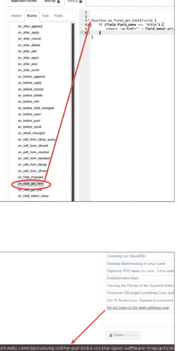


## 深度解析

### Jam.py

为它们创建新用户和新角色的菜单 [4]。接下来，返回目录或你定义表的任何地方。

到目前为止，我讨论了 Jam.py 应用程序和数据库一起创建的情况。在这些情况下，使用 SQLite 可以让你免于安装和维护单独服务器的麻烦。

#### 外部数据库

请参 Jam.py 文档有关如何添加这些功能的详情。你可以在演示 [6] [7] [8] 的仪表板中找到一些高级功能。

选择它，并点击左侧的“权限”（Privilege）按钮以指定每个角色对该表可以的操作（图 7）。为了让所有这些更改按预期工作，点击“项目”（Project）并勾选“安全模式”（Safe mode）框，强制所有用户使用密码登录。

#### 可移植性

然而，在某些情况下，你可能希望为已存在的数据库构建 Jam.py 应用程序。

Jam.py 数据库的一个巨大优势是它们的可移植性。

图 10 显示了向 Builder 中的管理器传递什么内容以便连接到本地或远程 MySQL 服务器。图中显示的所有值都必须填写。

如果你比较图 4 和图 5，你会发现即使没有用星号标记，标题的格式也不同。差异的原因是，在图 4 中标题是纯文本，但在图 5 中，它们是指向书签的超链接。

如果连接成功，下一步是导入 MySQL 表结构并创建必要的表单。

可点击的标题只是过滤器的其中一个例子。整个过程的唯一真实要求是安装 Python，因为你可以自定义如何自定义 Jam.py 表。

要使标题可点击，在目录选择 `BOOKMARKS_MAIN` 表，点击“客户端模块”（Client Module）按钮，然后选择图 8 所示的“事件”（Events）选项页。

左侧的函数名称对应于 Jam.py JavaScript 可以检测的所有事件，右侧的编辑器允许你在这些函数中插入任何想要的 JavaScript。按照文档 [5]，我的做法是添加以下代码：


```javascript
if (field.field_name === 'title') {
    return '<a href="' + field.owner.url.value + ' '">' + field.value + '</a>';
}
```

用普通的话来说，这段代码意思是“每当打印标题时，将该字符串替换为点击链接的 HTML 标记，指向标题对应的 URL。”

图 9 显示了保存该 `JavaScript` 代码后发生的情况。

### 元数据

在某些情况下，你可能希望将完成的 `Jam.py` 配置导入到另一台计算机。例如，你可能希望使用现有的应用程序作为模板，或者在另一台计算机上测试当前配置的某些更改以避免干扰生产系统。

### 可移植性

要导出 `Jam.py` 应用程序，选择与应用程序其他部分相同文件夹内的包，并一起移动或备份。

### 自定义 HTML

你可以为 `Jam.py` 界面添加比链接更多的内容。最有趣的对象是使用 `chart.js` 等库在浏览器中构建的动态图表，以及一个 ZIP 归档中的按钮（图像...）。然后你可以使用让 `server.py` 与底层操作系统交互的按钮。例如，你可能添加加载整个项目。

如图 8 所示：标题变为发送电子邮件消息的按钮。来自存档。指向对应页面的可点击链接。

54

2020年12月

第241期

`LINUX-MAGAZINE.COM` | `LINUXPROMAGAZINE.COM`

# 参数

| 键字段 | 名称 | DB 字段名 | 类型 | 大小 | 允许 |
|---|---|---|---|---|---|
| `m_id` | `m_id` | `m_id` | `int` | | 否 |
| `m_create` | `m_create` | `m_create` | `datetime` | | 否 |
| `m_name` | `m_name` | `m_name` | `varchar` | 255 | 是 |
| `m_country` | `m_country` | `m_country` | `varchar` | 255 | 是 |
| `m_phone` | `m_phone` | `m_phone` | `varchar` | 255 | 是 |
| `m_const` | `m_const` | `m_const` | `text` | | 是 |
| `m_home_addr` | `m_home_addr` | `m_home_addr` | `varchar` | 255 | 是 |
| `m_work_addr` | `m_work_addr` | `m_work_addr` | `varchar` | 255 | 是 |
| `m_email` | `m_email` | `m_email` | `varchar` | 255 | 是 |
| `m_password` | `m_password` | `m_password` | `varchar` | 255 | 是 |
| `m_local` | `m_local` | `m_local` | `varchar` | 255 | 是 |
| `m_customer_country` | `m_customer_country` | `m_customer_country` | `varchar` | 255 | 是 |
| `m_role` | `m_role` | `m_role` | `varchar` | 255 | 是 |
| `m_status` | `m_status` | `m_status` | `int` | | 是 |
| `m_type` | `m_type` | `m_type` | `varchar` | 255 | 是 |
| `m_connection` | `m_connection` | `m_connection` | `varchar` | 255 | 是 |

我的作品目录

状态

`MySQL`

DB 类型

服务

电子邮件

登录

`marriott`

密码

通用

主机

`localhost`

角色

`UTF8`

## 深度解析

`Jam.py`

另一个系统管理问题是关于 `Jam.py` 的。我只有实现 `[9]`。它并不复杂，如何自动启动应用程序提到了我最基础的功能，但必须严格遵守，它——以及如何优雅地关闭，当 `Jam.py` 签签管理器运行时，但我喜欢它，也许在你读到这里时，你已经关了电脑。看这里，我计划添加缩略图，可能还有教程。基本步骤是：在线查找关于如何启动 `Jam` 的教程。我喜欢的两个功能：

- 1. 点击 `Project`，然后点击 `Data-py` 自动带有一个初始化脚本 `[10]` 能够看到添加到 `Jam.py` 的签签工具基按钮，并将 `DB` 手动模式设置为 `true`。（该示例基于 `Ubuntu`，但其他发行版也类似（这是为了从网页中插入基于 `JavaScript` 的签签工具）以及一个插件）

- 2. 点击 `Groups`，然后选择 `Last`。最后，一个关于特定端口的组的提示（期刊、目录、数字和 `URL`）。在 `NextCloud` 安装中嵌入 `Jam.py` 的默认方法。总而言之。总而言之，我推荐 `Jam.py`，如果运行 `jam.py`，会在 Web 服务器上创建一个表。引用端口号的 `URL`（`example.com:9000`）。但假设你

- 3. 点击 `Import` 按钮。基础。最后，我要感谢 `Jam.py` 的开发者 `Andrew Yushev` 和 `Dražen Babić` 对签签的支持。这是本教程的准备工作。`Q Q Q`

此过程将打开一个列出 `MySQL` 数据库中找到的表的表。点击你想要导入的表，然后检查该表的所有字段是否都通过有效类型被识别。如果字段的类型为空或显示为红色，双击该字段并为其分配最合适的类型。互联网的其他部分使用 `WSGI-terrace` `[11]`。

`[1]` `Jam.py`: `https://jam-py.com`

`[2]` `Jam.py` 手册: `https://buildmedia.readthedocs.org/media/pdf/jam-py/latest/jam-py.pdf`

`[3]` 保留你的收藏页面，`Linux Magazine` `232`：仅导入你需要的字段。

信息

## 结论

`https://jam-py.com/docs/faq/faq_using_other_libraries.html`

如果 `Builder` 未识别主键，请为数据库指定主键。在我的情况下，如如图所示，除了 `ENUM` 类型的字段外，所有字段都被正确识别。我必须解决的一个小问题可能是 `SQLite` 数据库的最好用途，它易于管理和同步对数据库进行的任何更改。使用 `rsync` 将任何更改同步到计算机。

主镜像，将其复制到可移动磁盘上。`DRBL Live CD` 既可以作为刻录到光盘的 `ISO` 文件提供，也可以作为压缩的 `IMG` 文件传输到 `USB` 磁盘上。如果你的计算机帝国只延伸到几台电脑，你将乐意通过 `Live` 环境使用 `Clonezilla`。在需要部署大量计算机的大型网络中，通过网络部署镜像更高效，这需要设置一个服务器。另一方面，如果你管理一所小学校或办公室，可以使用 `dd` 或通过像 `UNetbootin` 这样的图形化工具。

在本教程中，我将使用 `Clonezilla SE` 从网络中的某台机器创建主镜像（参见“测试实验室”框）。

## 什么是 Clonezilla？

`Clonezilla` `[1]` 是一个基于 `ncurses` 的前端，用于运行 `Parted`、`ntfsclone`、`Partclone` 和 `dd`、`HFS+` 等开源磁盘实用程序。如果 `Clonezilla` 遇到它不理解的分区类型，它将启动老牌的 `dd` 工具并完成任务。你可以使用 `Clonezilla` 复制特定的分区。你还拥有压缩分区甚至整个磁盘的选项。它还将使用 `gzip`、`bzip2` 或 `LZO` 压缩算法克隆镜像。`Clonezilla` 支持大量的文件系统，甚至更多。它可以在本地连接的设备（如连接到计算机的 `USB` 磁盘）上、通过网络在另一台计算机上、甚至在云端上运行。

## 配置服务器

第一步是创建根分区的镜像并帮助计算机。转到作为你的 `Live DRBL` 服务器的计算机并进入 `Live` 环境。一旦图形界面启动，双击桌面上的 `Clonezilla` 服务器图标以启动配置服务器的过程。

### NHC 自由软件实验室，塔林林

在克隆之前，你必须指定 `Clonezilla` 镜像目录的保存或读取位置。我们将选择本地设备或远程资源作为 `/home/partimag/`。`Clonezilla` 镜像将保存到或从 `/home/partimag/` 读取。

| 选项 | 描述 |
| :--- | :--- |
| `local, dev` | 使用本地设备（例如硬盘、`USB` 驱动器） |
| `sh server` | 使用 `SSH` 服务器 |
| `samba server` | 使用 `SAMBA` 服务器（网络邻域服务器） |
| `fs server` | 使用 `NFS` 服务器 |
| `webdav` | 使用 `WebDAV` 服务器 |
| `s3 server` | 使用 `S3` 服务器 |
| `swift server` | 使用 `OpenStack swift` 服务器 |
| `enter_shell` | 进入命令行提示符。手动操作 |
| `skip` | 使用现有的 `/home/partimag`（内存）！`*不建议使用*` |

## 深入了解 Clonezilla SE


### 测试实验室

掌握流程后，你可以选择第二个选项，它允许你在克隆过程中标记网络上的特定计算机，以便稍后进行克隆。第一个选项本身没有坏处；第二个选项只是让你对过程有更多控制权。随后 `Clonezilla` 将询问你是否想在启动克隆过程之前使用 `fsck` 检查并修复文件系统。在创建镜像之前，确保文件系统处于持久状态始终是一个好主意。同样，在下一个屏幕中，选择“初学者”（`Beginner`）选项，让 `Clonezilla` 为尽可能多的参数选择默认选项。一旦你对该流程更加熟悉，就可以通过选择“专家”（`Expert`）选项来掌握主动，这允许你自定义各种参数的设置。

网络中的所有其他计算机也连接到这个网络交换机。我的 `DRBL` 服务器将自动为它们分配 IP 地址。内部网络中的其中一台计算机是文件服务器。与其他机器不同，这台文件服务器具有静态 IP 地址 (`192.168.1.200`)。我在这台计算机上安装了 `openssh-server` 包，网络中的所有其他计算机都可以 `SSH` 进入这台计算机。我将将其作为存放所有克隆镜像的镜像库。

接下来你必须为 `Clonezilla` 实例选择模式。由于我正在创建主镜像，我将选择 `save-disk` 选项对整个磁盘进行成像。现在将提示提供一些信息以帮助启动 `DRBL` 服务器。

首先，`Clonezilla` 将询问你网络适配器的网络配置。在我的测试实验室，其中一个适配器从网络上运行的 `DHCP` 服务器获取了 IP 地址。当要求输入设备名称时，一对网卡 (`eth0`) 连接到 `ISP` 路由器，并通过 `DHCP` 由路由器分配了 IP 地址。另一个 (`eth1`) 连接到网络交换机。在设置期间，我将为 `DRBL` 服务器分配一个静态 IP 地址 (`192.168.1.100`)。

## 深度解析

`Clonezilla SE`

要更改默认启动顺序；具体过程因制造商而异。

一旦在更改后启动电脑，它将识别到运行在网络上的 `DRBL` 服务器实例。你将看到一个包含若干条目的的 `Clonezilla GRUB` 菜单。选择默认的 `Clonezilla: save disk (later select) as image (later select)` 选项（图 4）。此条目适用于你从上一步中刚刚设置的克隆任务。显示（稍后选择）是因为你推迟了选择要克隆磁盘的决定。

当电脑启动后，系统会要求输入镜像名称。选择你想要克隆的磁盘。如果计算机有多个磁盘，使用空格键选择要映像的磁盘。通常最好检查系统是否正常，你可以选择跳过检查并使用默认值 (`2000MB`)。如果你不想分割克隆过程，请在启动前对磁盘运行 `fsck`。

同样，在创建磁盘镜像后，`Clonezilla` 建议你将默认值替换为大于磁盘大小的数字（图 5）。完成后，`DRBL` 可以通过跳过此类检查来节省时间，例如 `1000000MB`。然而，请记住，服务器会通知此检查，但我建议如果镜像仓库使用的是 `FAT32` 文件系统，请允许这样做，此值不能超过 `4096MB`，因为 `FAT32` 无法读取大于 `4GB` 的文件。你现在有了一个可以存储的镜像，并将其克隆到网络中的所有其他计算机。倒数第二一步是在映像完成后选择客户端操作。

## 部署过程

服务器现在已就绪。你将返回到提示符，但先不要关闭终端窗口。现在前往你想克隆的那台电脑。

要启动部署过程，请前往运行 `Live DRBL` 环境的机器。注意，你之前一直开启的终端现在将显示克隆过程的详情（图 6）。要克隆的图形已设置为从网络启动。

你现在可以安全地关闭终端了。

从桌面上，再次双击 `BIOS` 中的 `Clonezilla` 服务器图标。你将再次看到该过程可能需要相当长时间。

## 准备克隆

在磁盘映像完成后关闭客户端。

```bash
# 此窗口必须保持打开，以便由 Clonezilla 生成的克隆节点能够工作并保持稳定。
odesbian:/dev/sda1 192.168.1.102 (00:89:27:ba:a1:64) 克隆完成。状态：成功：/dev/sda1 7.4 GB = 8110 Blocks, 122 min
success: /dev/sdb1 12.3 MB = 30068 Blocks, 153 min
rootdebian@home/user# 
```

`#` 如果你关闭了 `CLONE-GUI` 窗口，并且它启动时出现“缺少操作系统”或“无效系统”之类的错误消息，你可以尝试 (1) 在 `BIOS` 中更改启动顺序并重启。你可以尝试在重启时使用参数 `-1`。

此脚本将在 `/tboot/root/` 中生成基于主机的 `PXE` 配置文件

正在清理所有之前的缓存 `PXE` 配置文件……已完成

`Clonezilla` 已完成所有目标的克隆。如果它们存在……已完成

下次你可以直接运行此命令：

```
sh root@192.168.1.102

[2023-09-19 10:41:51] [root@192.168.1.102 ~]#
```

```
按 F5 编辑启动选项
Clonezilla Linux 9.0-6 运行在 DHCP 上

# DRBL
Free Software License NCHC Team
免费软件许可 国家资讯网络计算中心
```

我通常选择等待客户端的选项，因为我知道要部署镜像的计算机数量。再次，`Clonezilla` 将施展魔法并将你带回控制台。保持原样，前往你想部署镜像的计算机。

## 部署镜像

在接通计算机之前，确保它们已配置为从网络启动。开机后，从 `Clonezilla GRUB` 菜单中选择高亮的以 `Clonezilla: multicast restore ...` 开头的选项（图 7）。

计算机将启动并等待你在上一步中指定的数量的计算机全部开机。一旦所有机器都上线，`Clonezilla` 将启动在机器上部署镜像的过程。完成后，机器将重启进入克隆环境。此目标的现有内容将被擦除。

## 总结

`Clonezilla` 支持三种恢复模式。对于克隆多台机器，有广播（`Broadcast`）、多播（`Multicast`）和单播（`Unicast`）。

如果你以前没有克隆过多台机器，这个过程可能看起来很复杂。然而，一旦你掌握了它，你会对 `Clonezilla SE` 的强大和灵活感到惊讶。但请记住，`Clonezilla` 使用了一些非常无情的工具来执行魔法。我建议首先在带有空磁盘的计算机上进行实验。你甚至可以在 `VirtualBox` 中通过虚拟网络创建一个虚拟实验室，以便在使用物理硬件之前熟悉克隆和恢复多台机器的过程。

## 深度解析

### 科学家的工具箱

工作科学家所需的必备软件工具 科学家的 Linux 工具箱

Linux 和科学是天生的一对组合。这里是一些既能完成工作又能向他人展示成果的必备软件软件包。由 Lee Phillips 编写 Word 版本。在升级操作系统后，远程计算资源和桌面上的设备就会停止工作，而且如果……

尽管 Linux 在普通大众的桌面领域仍仅占据一小部分市场，它在所有学科的科学家中要流行得多。在本文的其余部分中，我将介绍一些标准、广泛使用的免费软件。除了源码工具外，某些工具可能无法编译，因为操作系统供应商包含的某些更专门的软件包包含了过时甚至命名错误的标准库版本（Apple 在这方面臭名昭著）。

人们很想说，这仅仅是因为科学家很聪明！但当我回想起那些问题时，我很容易理解 Linux 对科学家的吸引力。在实验室（我工作过的地方）中使用专有的操作系统（OS）和软件，导致自定义桌面非常困难，且选项有限。这只是闭源计算冰山的一一角。当我能够完全切换到 Linux 时，所有这些问题都消失了。多年来，我一直专门使用 Linux 进行工作。

对于某一个特定的软件，我们拥有站点许可，仅允许在时间内特定人数使用该程序。它实际上会监控网络并统计有多少程序实例正在运行。我无法想象回到在低的专有软件上浪费内存或周期。因为你通常会从命令行工作，无论你使用哪种发行版，你可能都会进行大量的计算，你不想浪费内存。如果我需要运行它却被拒绝，我不得不跑遍实验室寻找是否有人刚刚忘记退出程序。你应该考虑卸载或断开连接。Linux 在某些科学家中相对流行的另一个原因是，它是连接超级计算机集群等事务的首选操作系统。禁用任何沉重的桌面环境并将其替换为轻量级窗口管理器，如 `dwm` [1]。如果使用了错误的版本，人们将无法阅读彼此的文档。在……之间共享一致的环境具有某种便利性。

2020年12月
第 241 期
`LINUX-MAGAZINE.COM` | `LINUXPROMAGAZINE.COM`

$$\nabla \times \mathbf{F} \cdot d\mathbf{\sigma} = \int_{\partial\sigma} \mathbf{F} \cdot d\mathbf{l}$$


斯托克斯公式是微积分中的一个重要定理，它将矢量场在任何闭合面上的旋度面积分与矢量场在其边界上的线积分联系起来。设 $S$ 是一个取向面，$\mathbf{n}$ 是 $S$ 的向外单位法向量，$\partial S$ 是与 $S$ 方向一致的边界曲线。那么 $\iint_{S} \nabla \times \mathbf{F} \cdot d\mathbf{\sigma} = \int_{\partial S} \mathbf{F} \cdot d\mathbf{l}$。

- 设 $\mathbf{F}(x,y,z) = (-y, x, 0)$，$S$ 为 $xy$ 平面的单位盘。
- 设 $\mathbf{F}(x,y,z) = (0, z, x)$，$S$ 为 $yz$ 平面的单位盘。
- 设 $\mathbf{F}(x,y,z) = (y, 0, z)$，$S$ 为 $zx$ 平面的单位盘。

对于每种情况，计算 $\mathbf{F}$ 的旋度并求在 $S$ 上的面积分。然后求在 $\partial S$ 上的线积分。

## 制作图表和图形

```python
import numpy as np
import matplotlib.pyplot as plt

t = np.linspace(0, 2*np.pi, 100)
y = np.sin(t)
x = np.cos(t)

plt.plot(t, y)
plt.plot(t, x)
plt.title('正弦和余弦波')
plt.show()
```

在这个示例中，我们使用`matplotlib`创建了一个简单的图表。

## 深度解析

### 科学家的工具箱

我自己使用了这些软件，并部分根据你的专业领域向你推荐。如果你是一个论文中充斥着交换图等内容的数学家，你已经拥有了用于这些目的的最佳软件，……（对于切换到`Linux`的人，请参参见“哪种发行版？”框）因为它带了`TeX Live`：学习……我在文中提到的每种软件都是免费开源的。所有软件在`Linux`上都可用，大多数可以在其他免费操作系统上运行，有些甚至可以在`Apple`和`Windows`机器上运行。许多流行的编程语言都带有自己的绘图系统，如果你确定将始终使用同一种语言，那么使用它们可能是一个不错的选择。

## 论文写作

任何领域的科学家都会写论文，因此这一部分的适用性最广。我推荐两个几乎必不可少的软件包。第一个是`TeX Live` [2] 发行版。图 1 是我笔记本电脑的截图，显示我在`Vim`编辑器中编写本文时的左侧。右侧是文章的三种转换：`PDF`、`HTML`和`ODT`文件。第二个是`pandoc`。对于想要切换到`Linux`并开始使用一套强大且可靠工具的科学家来说，……`pandoc`将这种标记语言转换为许多格式，包括`HTML`，以及如`ODT`、`DOCX`和`TEX`等文档格式，你可以通过`XeTeX`或另一个`TeX`引擎运行它们来生成`PDF`。要包含`Markdown`无法处理的数学或其他元素，直接操作即可，`pandoc`就会知道如何处理。`Pandoc`对工作科学家来说非常有用，因为某些出版物要求`TEX`以外的格式，而且允许你为论文编写一份源码，并自动创建预印本、网页、演示文稿等等版本。`Pandoc`还可以通过用户过滤器进行扩展 [4]，并且在处理海量数据集时快速且稳定，请考虑`gnuplot` [5]。第三个是`Gnuplot`，一个在`Linux`出现之前的早期开源程序，但它仍在活跃开发，新功能 [6] 定期出现。它是创建可以与任何程序（`singularity`）模拟或数据工作的自动化绘图流水线的唯一选择：

### 创建图表和图解

输出：`PNG`、`SVG`、哑终端，并且它们有自己的模板，如`sichel`，以及更多，此外它们至少要求你使用它们。一个方便的副作用是，你可以使用相同的源码创建一个精美的预印本。

用于网页或使用`Qt`、`X11`和其他`GUI`工具包的交互式图表。

`Gnuplot`可以创建科学家可能需要的任何类型的可视化效果，这里有很多选择：取决于你想学习使用。即使你的论文从不包含数学内容，`LaTeX`系统对学术人员来说仍然是一个巨大的便利，因为它可以自动处理引用，并可以生成任何格式的参考文献列表。

`TeX`系统的典型用法是在你选择的编辑器中编辑源码，嵌入`TeX`标记，并通过其中一个引擎（现代选择是`LuaTeX`或`XeTeX`）对其进行处理以创建`PDF`。然而，你不会用这种方式操作，因为你还会安装第二个不可或缺的包：`pandoc` [3]。

`Pandoc`是一个“瑞士军刀”式的文档转换程序。你用扩展版本的`Markdown`编写论文，这是一种直观的标记语言，类似于人们通常向文本文档添加强调等操作的方式，例如……

**图 1：** 使用三种输出格式编辑此的文本（左侧），邮件（即`*斜体*`）。`Pandoc`可以从相同的源码转换由`pandoc`创建的内容（右侧）。

```julia
using Plots

## 创建一些随机数据
x = 1:100
y = rand(100)
plot(x, y, title="Random Data", xlabel="X", ylabel="Y")

## 创建一些柱状图数据
x = 1:10
y = rand(10)
bar(x, y, title="Bar Chart", xlabel="X", ylabel="Y")

## 创建一些散点图数据
x = 1:100
y = rand(100)
scatter(x, y, title="Scatter Plot", xlabel="X", ylabel="Y")
```


```julia
julia> help(:julia)
Documentation: https://docs.julialang.org
Type "?" for help, "*" for Pkg help.
Version 1.6 (2020-08-01) release
Official: https://docs.julia.org/

julia> using Oceananigans, Oceananigans, Grids, Plots

julia> model = IncompressibleGrid(size=(120, 120, 120), extent=(2m, 2m, 2m), closure=IsotropicDiffusivity(le=1e-4, dt=5))

julia> T0 = zeros(130, 130, 130)

julia> T0 = rand(1, 1:65)

julia> T0 = T0 + rand(130, 130, 130)*0.3

julia> set(model, T0)

julia> simulation = Simulation(model, dt=0.1, stop_iteration=2500)

julia> run(simulation)
```


## 深度解析

### 科学家的工具箱

在每个领域的计算科学家中都非常流行。这不仅是因为它的速度和开发的易用性，还因为科学家可以方便地 [10] 混合和组合不同的库来创建新功能。

到为止，我处理的是大多数科学家感兴趣的通用主题。现在我想转而简要介绍一些特定于领域的软件。当然，没有空间来综述广阔的科学领域。但即使你的领域不是这少数领域之一，这可能也会让你了解针对特定学科的`Linux`工具的范围和特征。

## 物理

图 2：`Gnuplot`可以创建各种科学可视化效果。如果你是一个对模拟脚本感兴趣的物理学家，左侧的脚本创建了右侧的两个图表。我再次重复我的建议：安装`Julia`并探索这种语言，因为其输出可以定制到每一个细节，以及物理及相关包快速增长的生态系统。图 2 是来自我的笔记本`LFortran` [7] 编译器的截图，它不是基于`LLVM`的，并为用户提供了一个交互式的`REPL`。它显示了我左侧编辑器中的脚本以及右侧生成的图表。由于对`Julia`的兴趣在来自所有领域的科学家中爆炸式增长，你创建的任何项目都将受益于……

## 数值计算

如果你涉及到旧的模拟代码，很有可能你会发现自己正在使用这些工具之一。`Linux`为`C`和`Fortran`拥有了成熟且先进的编译器。但如果你正在开始一个新项目，你会发现你必须做比预想更少的工作，而是要直接去`Julia`网站。作为一个案例，这里是从零到精通流体动力学所需的每一步以及下载这个免费开源的，除了`Linux`内核本身。`GFortran`语言用于技术计算，是一个用于`Fortran`模拟的胜任编译器。图 3：一个`Julia REPL`会话，显示了在重力场中两种不同密度流体的模拟。图 4：`Julia`的输出，显示了……但显示了温度场。

```
maxima-master> maxima
```


Maxima 5.42.1 `http://maxima.sourceforge.net`

Using Lisp Commonisp (GCL) 2.6.12

Distributed under the GNU Public License, see the file `COPYING`.

Dedicated to the memory of Wilhelm Scheter.

The function `help(report)` provides help information

```
(%1) eqn := diff(y, t, 2)+t*diff(y, t, 1)*t*y^2 = 0;

(%so1)      d dy 2

      t = -- + t --      dt

(%2) ode2(eqn, y, t);

(%3) y = bessel_y(0, t) %k2 + bessel_j(0, t) %k1

(%4) sol: bc2(0, {t=1, y=1, t=100}, $sol);
```


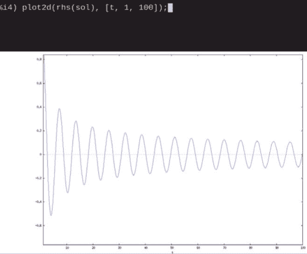

`Oceananigans.jl` [11]。获取。在我的第二个输入中，我要求绘制一个函数。Julia 的绘图非常简单，因为它有一个使用 ODE 求解器的解；Maxima 接受自变量的范围并弹出 `gnuplot` 图形，方程的，因为特定的求解器可能在特定的问题上不起。立即。关键是进入包的子 REPL，并输入 `add Oceananigans`。Julia 将下载。Maxima 可以做很多事情，而且一旦熟悉它的语法，回复是一个由贝塞尔函数组成的解。函数，这是正确的：我输入的 ODE 是贝塞尔方程。但如果你是一个经常使用计算机辅助的数学家，特别是如果你活跃在获取的领域，并且预编译代码。该解包含了两个自由参数，称为 `%k1` 和 `%k2`，Maxima 无法提供这些值，在没有更多信息的情况下无法确定。最后显示了安装 `SageMath` [13] 的整个 Julia 会话。你需要命令创建图 4 中的图表，即边界条件。点击链接下载它，但显示了温度场。

如果你想看到此解决方案的图表，`SageMath` 可以处理某些非常快速的操作，这部分归功于我在下一次输入中调用的 Julia 指数，它在子学科中表现卓越，甚至具有通过插入解决方案的右侧（`rhs`）来执行计算等操作并生成高效机器码的能力。在我那台普通的笔记本电脑上，这花费了大约 30 秒。如果你从事计算物理学或数值科学的任何分支，我建议你自己体验一下 Julia 生态系统。

# 数学

符号数学程序 `Maxima` [12] 非常有用。它轻量级、速度快，并且可以在任何发行版的包管理器中找到。`Maxima` 是老牌的商业程序 `Macsyma` 的开源继任者。它用 `Lisp` 编写，可以处理许多数学领域，如基础代数、微积分、三角函数、微分方程、级数等。`Maxima` 使用 `gnuplot` 绘图，但这没关系，因为你已经遵循了我的建议并安装了它。它可以以 `TeX` 数学标记的形式打印输出，你可以直接将其粘贴到你的 `TEX` 文档中（参见“编写论文”章节）。

图 5 显示了 `Maxima` 中的快速计算，这是我笔记本电脑的截图。顶部是一个终端窗口，下方是一个 `gnuplot` 图表。在终端中，我调用了 `Maxima`（它立即启动）并使用 `Maxima` 的微分算符语法定义了一个常微分方程。注意输入和输出都是编号的，因此你可以在随后的表达式中使用它们。`Maxima` 重复了方程，但使用了更具视觉的形式，使用 ASCII 字符来近似数学公式的样子。

**图 5：** 一个 `Maxima` 会话，展示了贝塞尔微分方程解的设置、求解和绘图。

LINUX-MAGAZINE.COM | LINUXPROMAGAZINE.COM

第 241 期

2020年12月

`infoiam`
`ploton`
`prettyplot`
`showwalim`
`transalin`
`\prettyplot`
`showwalim`
`DISPLAY`
`abiview`
`cardina`
`lindha`
`pepeut`
`pypesheet`
`prettyplot`
`prettyver`
`remap`
`sealseo`
`seafoam`
`showwalim`
`showdb`
`showfeat`
`showcase`
`sixpack`
`textsearch`

`PEPEWHEEL` of `HBR-HUMAN` 从 1 到 30


## 深度解析

科学家工具箱

正在转动魔方。大多数人的工作是提供任何甚至是计算机原生的环境。我希望通过 `SageMath` 及其交互式的、基于 Web 的笔记本进行这项非常简要的调查，它类似于 `Jupyter` [14]，但它也有命令行界面。`EMBOSS` 可以通过图形界面进行操作。我希望这次对某些可用工具的简要调查能够说服你，采用 `Linux` 不会让你科学家损失任何东西，反而会获益巨大。图 6 显示了一个用于图形化显示蛋白质序列的实用可用 Web 界面截图。`SourceForge` 提供该界面作为演示，因此想要尝试该程序、甚至将其用于实际工作的生物学家，可以在真实数据上进行实验，而通常不需要下载和安装。

## 生物学

随着生物信息学 [15] 作为生物学的一项主要活动出现，计算机作为工具对这一学科变得比以往任何时候都更加核心。生物信息学是计算机科学与生物学的结合，处理 `DNA` 序列或其他分子数据序列：本质上是可能包含数百万字母的字符串。这为计算生物学家重新解决该领域的计算问题并发布他们的开源项目提供了机会。

不仅是分子生物学和生物信息学的全面软件套件，`EMBOSS` 为任何计算生物学家提供了一个解决语言特征问题的平台。生物信息学在基于基因的药物发现、野生动物保护、癌症治疗、法医分析等领域发挥着巨大作用。

科学比以往任何时候都更加开放，这种新开放性的一部分既受到了自由软件运动（包括 `Linux`）的影响也得到了促进。`EMBOSS` [16] 是欧洲分子生物学开放软件套（European Molecular Biology Open Software Suite）的缩写。它是全球许多生物学家使用的主要计算资源。

`EMBOSS` 包含 200 个用于快速序列分析、蛋白质可视化、蛋白质结构分析、提供翻译的应用。我应该提到，这 200 个程序是处理某些任务的通用工具。我希望这项非常简要的调查能够说服你，采用 `Linux` 不会让你作为科学家损失任何东西，反而会获益巨大。在这个环境中，似乎是成立的。

[1] `dwm`: https://suckless.org/
[2] `TeX` Live: https://www.tug.org/
[3] `pandoc`: https://pandoc.org/
[4] Technical Writing: https://lwn.net/
[5] `gnuplot`: https://gnuplot.info/
[6] `Gnuplot`: https://lwn.net/
[7] `LFortran`: https://fortran.org/
[8] `Julia`: https://julialang.org/
[9] Multiple Dispatch: https://www.youtube.com/watch?v=kc9HwsxE1
[10] `Oceananigans.jl`: https://github.com/Oceananigans.jl
[11] `Maxima`: http://maxima.sourceforge.net/
[12] `SageMath`: https://sagemath.org/
[13] `Jupyter`: https://jupyter.org/
[14] Bioinformatics: https://biochemistry.com/
[15] `EMBOSS`: http://emboss.org/

## 作者

`Lee Phillips` 博士是一位理论物理学家和作家，曾为海军、`NASA` 和能源部（`DOE`）工作，从事激光聚变、流体流动、等离子体物理和科学计算。他编写了许多科普和技术出版物，并致力于科学教育和推广。

## `Charly` 的专栏 – 查找

系统管理员的日常工作：查找文件和目录 – 类似于 `ls`，但是是递归的。如果设置了环境变量 `LS_COLOR`（大多数系统的默认设置），输出将是有颜色的。

如果你正在搜索一个文件名，事情会变得更有趣。`fd` 是一个简单的 `find` 替代品，可以极快地在文件中发现丢失的宝藏。在图 1 中，我让 `fd` 在根目录下搜索 `rng`。如你所见，它找到了 `PatternGrammar`（在底部）。这应该是他的办公室。因为 `fd` 默认不区分大小写。

然而，如果是一个大写字母...

直到 `cron` 任务列出的搜索词，否则它一直在那里积灰，然后它会改变行为并只返回特定情况的结果。我不怎么擅长合理地整理物品然后再次找到它们——无论是在我的办公室还是在计算机的文件系统上都是如此。在 365 天后。虽然对 `GNU` 后后者现在令人惊叹的功能表示敬意，但我至少还有像 `find` 以及更重要的 `fd` 这样的电子工具。你可以使用 `-e` 参数搜索文件扩展名。例如，要查找当前目录及其子目录下所有的 PNG 图像，只需输入：

`find` 命令在 `Linux` 发明之前就已经存在于 Unix 系统中了，你有时仍然会渴望一个功能可能少一点、但使用起来更直观的工具。这正是 `fd` [2] 大显用场的地方。`fd` 是 `find` 的紧凑版，事实上，它比大多数使用它的人都要老。在我的许多系统中，它已经进入了许多发行版，但通常是最近。例如，在 `Ubuntu` 中，它从 19.04 版本开始可用。举个例子，有一个名为 `/test` 的目录，我在那里尝试各种东西。任何证明有用的东西都会发送到 `Git`；剩下的就挂在那里。

## 列表 1：Crontab 条目

在我的测试 `Ubuntu` 上安装 `fd` 之后，我现在有了 `fdfind` 命令。但该工具找到的是以 `a` 开头并以 `png` 结尾的文件。该工具的 `GitHub` 页面 [2] 非常清楚地解释了许多应用和参数。该工具名为 `fd`，并请使用这个名字。

```bash
fd -e png '^*a.png$'

find /test/* -mtime +365 -exec rm {};
```


现在我真正需要的一个物理上的对应物来收拾我的办公室……Q Q Q。为了让我的系统永久记住简写形式，我只是在 `my.bashrc` 中添加了 `alias fd=find` 条目。

## Info

[1] GNU find: https://www.gnu.org/software/findutils/manual/html_mono/find.html
[2] fd: https://github.com/sharkdp/fd

快速浏览手册页可以发现，`fd` 的功能确实比 `find` 少，但它能把自己的擅长工作很好——直观且快速。输入没有任何后续参数的 `fd` 会返回当前情况，但必要时它甚至可以处理包括所有范围的正则表达式。

图 1：在没有具体指令的情况下，`fd` 忽略了当前目录的配置。

## Author

Charly Kühnast 在德国下莱茵地区的数据中心管理 Unix 系统。他的职责包括确保防火墙和 DMZ 的安全和可用。

LINUX-MAGAZINE.COM | LINUXPROMAGAZINE.COM | ISSUE 241 | 2020年12月 | 65

## PySimpleGUI

使用 PySimpleGUI 快速又简单
简单即美 (Simple Is Good)

## 为你的 Python GUI 和网络应用使用相同的代码。

作者 Pete Metcalfe

一个树莓派漫游车，所有代码均在 60 行以内。PySimpleGUI 项目有两个主要目标：一种更简单的创建图形用户界面（GUI）的方法，以及用于 Tkinter、Qt 和网络图形的通用代码。

## 入门

Python PySimpleGUI [1] 项目有许多“端口”或版本。主全功能版本用于基于 Tkinter 的图形。Qt、Wx 和网络图形版本仍然非常有用，特别是树莓派项目。在本文中，我介绍了 PySimpleGUI 并创建了本地 GUI 和网络接口进行控制，确保不同库之间的代码兼容性。

图 2：PySimpleGUI 布局示例。
图 1：PySimpleGUI 使用图形库（从上到下）：Tkinter、Qt 和网络应用。
图 3：PySimpleGUI 按钮示例。

安装 PySimpleGUIWeb 输入：

```bash
pip install remi

pip install pysimpleGUIweb
```

## 创建一个三行的简单图形界面

```python
import PySimpleGUI as sg

layout = [

    [sg.Text("the feedback", key="feedback")],

    [sg.Button("FORWARD")],

    [sg.Button("LEFT"),sg.Button("RIGHT")],

    [sg.Button("STOP")],

    [sg.Button("QUIT")]

]
```

## 创建窗口

```python
window = sg.Window('My First App', layout)

## 处理“事件”的事件循环

while True:

    event, values = window.read()

    window['feedback'].Update(event) # 显示反馈文本

    print(event,values)

    if event in (None, 'QUIT'):

        break

window.close()
```

## 格式化元素

下一步是调整图形元素的字体、颜色和大小属性。只需三行代码你就可以将 FORWARD 按钮更改为 32 个字符宽、三行高（第 15 行）。添加了颜色和更大的字体：反馈文本元素（第 5 行）被赋予了键名 feedback，它可以被 Tkinter 图形引擎使用，这种可能性是。图 1 显示了相同代码应用于不同图形库的示例。

```python
[sg.Button("FORWARD", size=(32,3)), font="Arial 32", button_color=('white', 'green')])
```

## 独立 Web 应用

PySimpleGUIWeb 库非常适合创建轻级的独立网络界面。PySimpleGUIWeb 的真正美丽在于不需要 HTML、样式表、Ajax 或 JavaScript 代码。PySimpleGUI 拥有广泛的图形组件或元素。PySimpleGUIWeb 非常适合小型单用户网络界面，通过创建布局变量来构建演示文，并支持标签页界面、表格和图形等功能。

## 树莓派漫游车

对于我的漫游车，我使用了一个廉价的 Arduino 底盘（约15美元）和一个便携手机充电器为树莓派供电。使用胶带或油漆可以将树莓派和充电器固定在底盘上。不建议将电机直接连接到树莓派的 GPIO 引脚。

## MakerSpace 圣诞创意制作

## 创作者的圣诞乐趣

使用微控制器、伺服电机、NeoPixel LED 灯环和小型 MP3 播放器制作你自己的圣诞音乐盒。

作者：Bernhard Bablok

我制作自己设计的音乐盒的灵感源于这些挫败感。在圣诞节期间，音乐盒和圣诞金字塔是最畅销的产品。在电子元件方面，你不需要许多组件。以下章节旨在为你自己的项目提供思路；昂贵的手工雕刻品可以卖四位数，而廉价的仿品售价 20 欧元（约 17 美元）。本例使用的圣诞金字塔部件很容易通过蜡烛的热量驱动，也可以替换为你喜欢的任何东西。特别是那些廉价的款式，其木盒揭示了深度。蜡烛与螺旋叶片的比例非常不利，如果没有机械帮助的情况下，金字塔将无法旋转。这个项目中最重要的元素是光、运动和音乐。音乐盒由脆弱的弹簧驱动，但不断需要重新发条会破坏乐趣。

## 控制

为了控制这个项目，我使用了来自 Adafruit 的 `Trinket M0` 微控制器 [1]（图 1），它运行 `CircuitPython`，这是一种极简的 Python，通过其丰富的库支持广泛的外围设备。控制器的价格与 `Pi Zero` 相当（包含 SD 卡），但它更容易操作，因为你不需要安装和配置操作系统。

微控制器的另一个优势是你是不需要启动它的，只需关闭而不会损坏安装。不过，最大的优势是对 `CircuitPython` 的支持。这里提供的示例说明了只需要少量的代码就能实现——

# 作者

Bernhard Bablok 在 `Allianz Technology SE` 担任 SAP HR 开发人员。当他不在听音乐、骑自行车或步行时，他处理与 Linux、编程和小型计算机相关的话。你可以通过 `mail@bablok.de` 与他联系。

你可以访问 https://funprojects.blog 查看 Pete Metcalfe 及其女儿的更多有趣项目。

## 信息

[1] PySimpleGUI 文档：https://pysimpleGUI.readthedocs.io/

[2] Pimoroni Explorer HAT Pro：https://www.adafruit.com/product/2427

## 图 6：带有 PySimpleGUIWeb 的 Raspberry Pi 行星车。

## 列表 2：PySimpleGUI/Web 行星车


## `SGui_rover.py` - 使用 PySimpleGUI/Web 控制 Pi 行星车

```python
import sys
import PySimpleGUIWeb as sg
import RPi.GPIO as gpio

## 窗口内的所有内容。
myfont = "Arial 32"

## 传递任何命令行参数用于 Web
layout = [
    sg.Text("",size=(20,1), key="feedback")
]
if len(sys.argv) > 1: # 如果使用了 Web 界面
    mode = "web"
    layout += [
        sg.Button("FORWARD", size=(32,3), font=myfont, button_color=('white', 'green')),
        sg.Button("LEFT", size=(15,3), font=myfont),
        sg.Button("RIGHT", size=(15,3), font=myfont),
        sg.Button("STOP", size=(32,3), font=myfont, button_color=('white', 'red')),
        sg.Button("QUIT")
    ]
else: # 默认使用 tkinter GUI
    mode = "tkinter"
    layout = [
        sg.Text("",size=(20,1), key="feedback"),
        sg.Button("FORWARD", size=(32,3), font=myfont, button_color=('white', 'green')),
        sg.Button("LEFT", size=(15,3), font=myfont),
        sg.Button("RIGHT", size=(15,3), font=myfont),
        sg.Button("STOP", size=(32,3), font=myfont, button_color=('white', 'red')),
        sg.Button("QUIT")
    ]

gpio.setmode(gpio.BOARD)

## 定义电机引脚匹配你的设置
if mode == "web":
    motor1pin = 38 # 左侧电机
    motor2pin = 37 # 右侧电机
    gpio.setup(motor1pin, gpio.OUT)
    gpio.setup(motor2pin, gpio.OUT)
    window = sg.Window('PySimpleGUI Rover Control', layout, web_ip='192.168.0.106', web_port=8888, web_start_browser=False)
else:
    window = sg.Window('PySimpleGUI Rover Control', layout)

## 发送动作控制行星车
def rover(action):
    if action == "FORWARD":
        gpio.output(motor1pin, gpio.HIGH)
        gpio.output(motor2pin, gpio.HIGH)
    elif action == "LEFT":
        gpio.output(motor1pin, gpio.HIGH)
        gpio.output(motor2pin, gpio.LOW)
    elif action == "RIGHT":
        gpio.output(motor1pin, gpio.LOW)
        gpio.output(motor2pin, gpio.HIGH)
    elif action == "STOP":
        gpio.output(motor1pin, gpio.LOW)
        gpio.output(motor2pin, gpio.LOW)

## 事件循环处理“事件”并将其传递给 rover 函数
while True:
    event, values = window.read()
    print(event, values)
    if event in (None, 'QUIT'): # 如果用户关闭窗口
        break
    window['feedback'].update(event)
    rover(event)

window.close()
```

## 总结

对于最终代码（列表 2），我添加了一个命令行选项（第 6-10 行），允许本地 `Tkinter` 界面或 Web 界面。程序默认是 `Tkinter` GUI；但是，如果输入任何命令行文本，将使用 `PySimpleGUIWeb` 界面。

我对 `PySimpleGUI` 库提供的性能和功能非常满意，并发现 `Pi` 行星车项目是一个入门的简单方法。前进、左、右电机引脚在第 15 和第 16 行定义。如果你使用 `Pi` 电机 `HAT` 或 `L298N` 电路（约 2 美元），它们的功率需求可能会损坏你的 `Raspberry Pi`。对于小型物联网（`IoT`）项目，你可以使用 `PySimpleGUI` 和 `PySimpleGUIWeb` 创建带有条形图和实时图表的仪表板界面。你还可以定义后退、左、右电机引脚（使用继电器顶层直接连接 `Pi` 引脚仅支持电机的单向运行）。

`rover()` 函数（第 21-33 行）根据动作控制电机。

期望值在 -1 到 1 之间。在这个项目中，我使用了 `LED` ——更准确地说（列表 1），取决于型号和电源的 `Circuit` 的 `neopixel` 库，`NeoPixel LED` [2] —— 来创建照明效果。`NeoPixel LED` 有各种形状和尺寸，从长灯条到环形、阵列以及单个 `LED` 都有。如果没有 `while` 循环，程序将结束，电机也不会在值为 0 时停止。在我的实验室里，它在值为 0.05 到 0.10 之间时才停止。该库有一个 `own`（`bug`）：在初始化对象时（第 8-12 行），你必须指定 `pixel_order=neopixel.GRBW` 参数。组件和微控制器已经包含了驱动芯片，这些硬件——即第 10 和第 11 行。你可以在此循环内启动、停止或更改电机速度，但对于本项目，启动后不再需要进一步支持。尽管你传递的值是默认值，但它们会让成本比普通 `LED` 贵一点，但让控制 `LED` 变得简单得多。程序在所有像素上生成彩虹色，并根据等待参数（第 25 和第 31 行）缓慢或快速地旋转。`NeoPixels` 通常需要 5V。你只需要三个连接：电源、地线和数据。如果电线较短且像素数量较少，3.3V 可能足够供电和控制。最大亮度会略微降低但由于 `LED` 本身就很亮，在实际应用中低电压并不重要。如果你想切换切换效果，必须在合适的点查询开关。在示例中，这要么在 `while` 循环内部（第 33-34 行），要么在第 31 行之前。无论选择什么电压，检查 `NeoPixels` 是否会使电源过载都是重要的。树莓派的 3.3V 引脚并非用于提供大电流。

连续旋转伺服电机带动音乐盒。与支持精确位置控制、仅支持速度和方向的步进电机相比，我在项目中选择了一个 24 像素 `RGBW LED` 环（图 2）。该设备可以轻松从 `Trinket M0` 获取 3.3V 电源并直接控制。`LED` 亮度调低后，功耗约为 60mA。同样，你只需要几行代码即可进行控制（列表 2）。首先，与脉冲宽度调制 (`PWM`) 单个 `LED` 环相比，24 个 `RGBW LED` 要容易控制得多。最贵的单个对象在第 6 行创建，与组件一起创建。

## 列表 1：`NeoPixel` 控制


```python
01 import time
02 import board
03 import neopixel
04
05 pixel_pin = board.D2
06 num_pixels = 24
07
08 pixels = neopixel.NeoPixel(pixel_pin,
09 num_pixels,
10 pixel_order=neopixel.GRBW,
11 brightness=0.05,
12 auto_write=False)
13
14 def rainbow(wait):
15 for j in range(255):
16 for i in range(num_pixels):
17 rc_index = (i * 256 // num_pixels) + j
18 pixels[i] = colorwheel(rc_index & 255)
19 pixels.show()
20 time.sleep(wait)
21
def colorwheel(pos):
22 if pos < 0 or pos > 255:
23 return (0,0,0,0)
24 if pos < 85:
25 return (255 - pos * 3, pos * 3, 0, 0)
26 if pos < 170:
27 pos -= 85
28 return (0, 255 - pos * 3, pos * 3, 0)
29 pos -= 170
30 return (pos * 3, 0, 255 - pos * 3, 0)
31
while True:
32 rainbow(0.1)
```


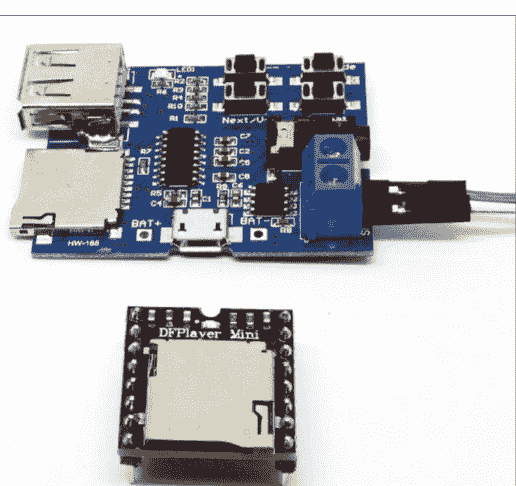

列表 2：伺服电机控制

```python
01 import time
02 import board
03 import pulseio
04 from adafruit_motor import servo
05
06 pwm = pulseio.PWMOut(board.D0, frequency=50)
07 my_servo = servo.ContinuousServo(pwm)
08 my_servo.throttle = 0.01
09
10 while True:
11 time.sleep(1)
```

In Motion

`M0` 在初始化期间短暂地将 `IO_2` 脚接地（列表 3）。完整的实现，包括所需的接线，可以在 GitHub 上 [5]。

Tinkering Time

我刻意保持了项目的电子部分尽可能简单。整个系统依赖于外部的微 USB 电源。如果你进展较快，可能可能想要使用带有充电电路的锂聚电池以及各种开关来控制照明效果、动作和音乐。由于 `Trinket M0` 的 `O` 引脚是电容式的，按钮甚至可以隐藏在音乐盒内部。然而，`Trinket M0` 的五个引脚可能会产生局性，因此你可能需要更大的微控制器。

- [4] DFPlayer Mini 数据表：`https://wiki.dfrobot.com/DFPlayer_`

图 6：使用 `Trinket M0` 微控制器制作的电子圣诞节音乐盒原型_`SKU_DFR0299`

- [5] 项目示例代码：`https://github.com/bablkb/`

电容按键可以通过 `xmas-music-box` 进行操作。

`Q Q Q`

`LINUX-MAGAZINE.COM | LINUXPROMAGAZINE.COM`

第 241 期

2020年12月

## 用数字

档案

清空你的

书架

通过我们的数字

存档包，集齐你的《Linux Magazine》和

《ADMIN Network & Security》收藏。

你将获得整整年的 PDF 格式杂志，

可以随时从任何设备访问。

2019

存档

现已推出！

`bit.ly/2019-Digital-Archives`


### 引言

LINUX VOICE

Linux 环境中的多功能工具可以帮助你解决比你能列举的更多的日常问题。对于 Linux 领域的大多数人来说，看到传统的 `Unix/Linux` 命令行环境工具应用于云时代的新型解决方案中，这是特别有吸引力的。一个名为 `Doghouse` 的流行终端工具——教育

76

`rsync` 特别擅长协助备份和存档。在本月的 `Jon "maddog" Hal` 专栏中，我们在最现代的背景下部署了 `rsync`：备份具有共享托管网站的自由和开源解决方案。在当月的 `Linux Voice` 其他部分，我们还提到了自由开源解决方案在高中和职业边缘教育中具有巨大的潜力。那么，为什么学校不使用更多此类工具呢？

探索 `uptime` —— 这是一个专业管理员用于跟踪运行时间统计的工具，我们深入研究了 `Asciidoctor`，这是一款非常有灵感的应用程序，它能将 `AsciiDoc` 文件转换为 `HTML5`、`DocBook` 或 `PDF` 格式。

## 网站备份

### 将 AsciiDoc 文件转换为 HTML5、DocBook 或 PDF 格式。

`Daniel Rosehil`

让网站管理员开始工作。但备份问题该怎么办？

`tuptime` 80

`Tim Schürmann`

Linux 服务器在没有重启的情况下运行了多久了？系统在你没有察觉的情况下重启了多少次？这些及更多问题都由 `tuptime` 工具解答。

## FOSSPicks 84

`oroz, 123RF.com`

`Graham Morrison`

`Graham` 查看了 `Sigil`、`Dragonfly Reverb`、`Arduino CLI`、`Radium 6`、`LabPlot 2.8` 等等！

`Olexandr M`

### Asci doctor 90

`Karsten Günther`

流行的 `Asci Doc` 文档系统仍然有很多优势，但经验更丰富的用户应该查看 `Asci doctor`，它包含了一些额外的新功能。

`LINUX-MAGAZINE.COM | LINUXPROMAGAZINE.COM`

第 241 期

2020年12月

75


### LINUX VOICE DOGHOUSE – 教育

MADDOG'S

DOGHOUSE

`Jon “maddog” Hal` 是一位作家，自 1994 年以来一直是 `Linux` 的热诚倡导者。BY `JON “MADDOG” HALL`

当他第一次遇到 `Linus Torvalds` 并促成 `Linux` 移植到 64 位系统时。他担任 `Linux International ®` 的总裁。

`COVID-19` 带来的动荡至少带来了一个光明：复杂的芯片。许多会议已转向“虚拟化”。你获得了与操作系统开发者收到的相同的文档，你只需要更改。”虽然创建和推广操作系统所需的时间和精力符合你的需求。与开源软件（`FOSS`）相结合，这些会议仍然非常可观，你可以开发新硬件来加速你的系统。

成本大幅减少，因此许多会议已从转为仅赞助的模式。因此，许多大学现在拥有了表面贴装技术（`SMT`）——可以组装印刷电路板（`PCB`）的机器。即使它们的 `SMT` 系统不很复杂，简单的“拾吸和放置”设备也可以通过互联网访问的“价格”提供给参会者。而且，主办方会录制演讲，以便人们以后查看。

公司可以为大学小批量生产 `PCB`。从我的观点来看，这给了我接触项目的机会，硅晶圆制造厂也开始向大学和高中开放其工艺。

### 软件、硬件与文化 (`FOSHC`)。

一家名为 `SkyWater` 的代圆厂和 `Google` 创建了一个项目-。最近在一次虚拟会议上，我们正在讨论 `SkyWater` 和 `Google` 创建的一个项目-硅晶圆。

一家名为 `SkyWater` 的代圆厂和 `Google` 创建了一个项目-。最近在一次虚拟会议上，我们正在讨论 `SkyWater` 和 `Google` 创建的一个项目-硅晶圆。

一家名为 `SkyWater` 的代圆厂和 `Google` 创建了一个项目-。最近在一次虚拟会议上，我们正在讨论 `SkyWater` 和 `Google` 创建的一个项目-硅晶圆。

`FOSHC` 教你如何使用。自由开源教如何运行。

`FOSHC` 不教如何使用。自由开源教如何运行。

立场，尽管许多共享主机确实允许用户通过 `SSH` 连接到共享服务器。鉴于此，在典型的共享托管环境中，共享托管供应商通常不提供 `root` 权限，用户将无法访问除其用户目录（`/home/foo`）之外的文件系统的任何部分。从备份的角度来看，这种 `root` 权限的缺失让工作变得有些困难。虽然比活跃的第三方供应商和托管服务提供商市场更具创意的方法，例如从虚拟专用服务器（`VPS`）或提供各种类型云到云备份和数据提取解决方案的旧版服务提供商（`MSPs`）进行备份，但许多工具都是专有的，并非设计为允许轻松复制到本地源（例如用户的桌面）。尽管如此，这仍然是可以轻松实现的。

以下是我设置的方案。

### 1. 验证本地主机与主机的身份


此外，尽管像 `WordPress` 等许多流行应用程序都有自己的备份和恢复插件，但如果你的网络托管环境的文件系统未通过服务器身份验证——或者它没有运行内容管理系统（CMS），这些插件显然没有帮助。

这是通过通常的方式完成的。在 `Linux` 机器终端中生成并设置 `SSH` 密钥（如果你还没有的话），或者深入底层查看其系统的运行机制。共享网络托管环境通常包含 `cPanel` 网络托管控制面板以便于管理。该面板具有 `SSH` 功能，可以在其中导入并验证公钥。为它们生成密钥。对于他们来说，使用如 `rsync` [1] 等 `SSH` 工具备份文件和数据库，通常比希望第三方解决方案提供他们正在寻找的数据备份功能是更优选择。

### 2. 通过 SSH 连接并运行 Rsync 拉取

`Rsync` 是最为人知的备份和恢复命令行工具之一。它最早于 90 年代中期发布，掌握 `rsync` 知识是许多系统管理员和备份管理员的基本的基本工作要求。该工具支持使用 `rsync` 从源到目的地传输。为了做到这一点，同步到各种网络远程目标。请注意语法的顺序（应该是源，然后是目的地）。最近，`rclone` [2] 扩展了其功能，以支持将数据备份到云端。混淆源和目的地可能会导致灾难性的后果，并可能让你后悔没有早点考虑备份！

常规备份选项范围（全量、增量和差异备份）。

如果你只是尝试备份位于例如 `/example.com/` 的 `WordPress` 安装中的文件，我建议直接从 `WordPress` 根目录进行备份，以避免不必要的文件垃圾 `' '`（有些主机现在会这样做），然后你需要传递那个你通常可以在共享托管环境中用户根目录级找到的路径。通过 `.` 连接到 `SSH` 连接。否则，你可以像往常一样通过 22 端口连接——只需修改命令的语法即可。

例如，从 `/home/youruser/public_html/wp` 备份到目标。接下来，运行命令并验证该目录已在你的本地机器上成功构建。

```bash
rsync -arvz -e 'ssh -p 12345' yourhost@123.456.789.71:/home/youruser/ /backups/hosting/website1
```

### 3. 获取 MySQL 数据库

不幸的是，由于限制，拉取的文件系统将不包含你的网络托管用户名的 `MySQL` 数据库，而它是许多动态服务（包括 `WordPress`）不可或缺的组件。有两种方法可以绕过这个问题。

现在让我们分解托管服务器上的那个 `cron` 任务。`rsync` 调用以运行数据库备份工具，该工具随后进入，这些命令组合在一起并以减号符号为前缀：将输出放在你可以使用 `rsync` 任务访问的地方。用于此目的的工具是：

- `-a` 以归档模式运行 `rsync`。它递归地运行 `mysqldump`，这是获取 `MySQL` 数据库副本的主要实用。它还保持了文件权限、所有权和符号链接的完整性。
- `-r` 递归运行 `rsync`。`mysqldump` 可用于备份数据库。
- `-v` 是详细输出参数。这对于调试命令很有用。
- `-z` 在发送时压缩文件。

当然，你想要将 `yourhost` 替换为你的网络托管用户名，并将示例 IP 替换为需要连接的共享网络服务器的实际公网 IP。

### 4. 脚本化与自动化

在将此加入 `Bash` 脚本并设置为 `cron` 运行之前，需要对其进行 QA（质量保证）测试。首先，确保它工作正常。接下来，你需要将它拉取到你的共享托管环境中。如果你的主机坚持要求你通过非标准端口通过 `SSH` 连接以提高安全性，你需要传递 `'sh -p 12345'`——显然将 12345 替换为他们要求你连接的端口号。

```bash
#!/bin/bash
rsync -arvz -e 'ssh -p 12345' yourhost@123.456.789.71:/home/youruser/public_html/ /backups/hosting/website1/files/
rsync -arvz -e 'ssh -p 12345' yourhost@123.456.789.71:/home/youruser/backups/mysql/ /backups/hosting/website1/mysql/
ssh -p 12345 yourhost@123.456.789.71 "mysqldump -u myuser -p'password' database" > /backups/hosting/website1/mysql/database.sql
```

只需从一个脚本调用所有命令。为了让本文为你的演示创建本地备份副本，我选择了后一种基于 `Linux` 主机的共享托管环境方法（列表 1）。

仅使用 `rsync`、几个 `cron` 任务，以及如果需要，一个 `WordPress` 插件。

如果你正在备份多个网站，可以顺序添加这些网站。你可以通过添加最多三个 `vs.` 来增加详细性。如果你们

作者

[1]

`rsync`: https://rsync.org

如果你需要从受监控的终端排查脚本故障，那么我建议选择这种方法。`Daniel Rosehill` 是一位技术作家和评论员，专为技术客户提供思想领导力服务，特别是 `B2B` 领域的客户。他的技术兴趣是

[2]

`rclone`: https://rclone.org

结论

[3]

`mysqldump`:

在你完成了基础的备份拉取后，再包含数据和备份恢复、`Linux` 和开源以及云计算。你可能希望创建每周和每月的快照，以及每日快照。要实现这一点，并了解更多信息，请访问 `dnshostwriting.com`。你可以创建 `/weekly` 和 `/monthly` 文件夹，然后 `html`


LINUX VOICE UTIME

# 使用 tuptime 测量系统运行时间

## 秒表

`Linux` 服务器在没有重启的情况下运行了多久？系统在你不经察觉的情况下重启了多少次？这些问题以及更多问题都可以 `tuptime` 工具给出答案。

作者：TIM SCHÜRMANN

最顶部；它显示系统启动次数。在旁边你可以看到自……以来的时间和日期。如果 `Linux` 系统运行了很长时间，这无疑是稳定性的证明，但——取决于发行版——某些更新可能正在等待安装。相反，如果系统频繁重启，完整图景……尽快设置程序，可能存在配置错误——或者可能是系统安装后可能的……硬件组件正在缓慢老化。在工作站电脑上，如此……的重启是

接下来，`tuptime` 会告诉你系统关闭的频率（系统关机）。你会很快注意到，但不一定是在远程……特别注意那些运行安静且状态良好的不受控服务器数量。如果这个数字迅速增加，说明存在严重问题，例如电源不稳定。系统寿命表示连续运行多长时间，可以通过命令行调用 `uptime` 来确定。你可能还想尝试 `tuptime` [1]，这是一个类似的工具，其名称基于“total uptime”（总运行时间）的缩写。它提供了多得多的信息，包括有价值的启动引导信息以及以重启次数和使用的内核版本形式提供的信息。在每情况下，工具都会记录系统时间。正是通过这种方式收集的时间戳，`tuptime` 最终计算出总运行时间和所有其他值。

虽然几乎每个系统上可用 `uptime`，但要让 `tuptime` 在启动时自动运行，你需要单独安装 `tuptime`。某些发行版已经在仓库中拥有该工具，例如 `Debian` 和 `Ubuntu`。`Arch Linux` 用户会在 `AUR` 中找到 `uptime`，`CentOS` 用户会在 `EPEL` 仓库中找到。除了 `systemd`，安装脚本还支持 `SysVinit` 和 `OpenRC`。在任何 `Linux` 系统上，你可以使用以下命令安装该工具：

```
$ curl -Ls https://git.io/U
tuptime-install.sh | sudo bash
```

使用安装脚本时，`tuptime` 始终运行在它自己的用户账户下，名为 `named_tuptime`。

如果在某点突然断电，`tuptime` 不会注意到任何异常。结果就是关机时间戳缺失，这将阻止工具计算正确的总运行时间。`tuptime` 本身由一个 `Python` 脚本组成，需要 `Python 3` 以及模块 `os`, `optparse`, `sqlite3`, `locale`, `platform`, `datetime` 和 `logging`。这些模块在在大多数发行版中应该是预装的。关于安装的更多信息，请参见“在后台”框。安装脚本还设置了一个 `cron` 任务，反过来确保了 `tuptime` 定期启动。

## 时间测量


`tuptime` 记录的所有时间戳最终都存在于一个小的……在设置程序后，查询当前的 `SQLite` 数据库，它默认位于 `/var/lib/tuptime/tuptime.db`。工具已经提供了一些基础信息（图 1）：2020 年 12 月期第 241 期

通过终端通过 `tuptime` 查看状态。

`LINUX-MAGAZINE.COM` | `LINUXPROMAGAZINE.COM`

## 商店

## 错过了某期？

你幸运了。大多数旧刊仍然可用。在它们售完前立即订购！

`shop.linuxmedia.com`

## `shop.linuxnewmedia.com`


## 错过了某期？

你幸运了。大多数旧刊仍然可用。在它们售完前立即订购！

`shop.linuxmedia.com`

## `shop.linuxnewmedia.com`


## 错过了某期？

你幸运了。大多数旧刊仍然可用。在它们售完前立即订购！

`shop.linuxmedia.com`

## `shop.linuxnewmedia.com`


## 错过了某期？

你幸运了。大多数旧刊仍然可用。在它们售完前立即订购！

`shop.linuxmedia.com`

## `shop.linuxnewmedia.com`


## 错过了某期？

你幸运了。大多数旧刊仍然可用。在它们售完前立即订购！

`shop.linuxmedia.com`

## `shop.linuxnewmedia.com`


## 错过了某期？

你幸运了。大多数旧刊仍然可用。在它们售完前立即订购！

`shop.linuxmedia.com`

## `shop.linuxnewmedia.com`


## 错过了某期？

你幸运了。大多数旧刊仍然可用。在它们售完前立即订购！

`shop.linuxmedia.com`

## `shop.linuxnewmedia.com`


## 错过了某期？

你幸运了。大多数旧刊仍然可用。在它们售完前立即订购！

`shop.linuxmedia.com`

## `shop.linuxnewmedia.com`


## 错过了某期？

你幸运了。大多数旧刊仍然可用。在它们售完前立即订购！

`shop.linuxmedia.com`

## `shop.linuxnewmedia.com`


## 错过了某期？

你幸运了。大多数旧刊仍然可用。在它们售完前立即订购！

`shop.linuxmedia.com`

## `shop.linuxnewmedia.com`


## 错过了某期？

你幸运了。大多数旧刊仍然可用。在它们售完前立即订购！

`shop.linuxmedia.com`

## `shop.linuxnewmedia.com`


## 错过了某期？

你幸运了。大多数旧刊仍然可用。在它们售完前立即订购！

`shop.linuxmedia.com`

## `shop.linuxnewmedia.com`


## 错过了某期？

你幸运了。大多数旧刊仍然可用。在它们售完前立即订购！

`shop.linuxmedia.com`

## `shop.linuxnewmedia.com`


## 错过了某期？

你幸运了。大多数旧刊仍然可用。在它们售完前立即订购！

`shop.linuxmedia.com`

## `shop.linuxnewmedia.com`


## 错过了某期？

你幸运了。大多数旧刊仍然可用。在它们售完前立即订购！

`shop.linuxmedia.com`

## `shop.linuxnewmedia.com`


## 错过了某期？

你幸运了。大多数旧刊仍然可用。在它们售完前立即订购！

`shop.linuxmedia.com`

## `shop.linuxnewmedia.com`


## 错过了某期？

你幸运了。大多数旧刊仍然可用。在它们售完前立即订购！

`shop.linuxmedia.com`

## `shop.linuxnewmedia.com`


## 错过了某期？

你幸运了。大多数旧刊仍然可用。在它们售完前立即订购！

`shop.linuxmedia.com`

## `shop.linuxnewmedia.com`


## 错过了某期？

你幸运了。大多数旧刊仍然可用。在它们售完前立即订购！

`shop.linuxmedia.com`

## `shop.linuxnewmedia.com`


## 错过了某期？

你幸运了。大多数旧刊仍然可用。在它们售完前立即订购！

`shop.linuxmedia.com`

## `shop.linuxnewmedia.com`


## 错过了某期？

你幸运了。大多数旧刊仍然可用。在它们售完前立即订购！

`shop.linuxmedia.com`

## `shop.linuxnewmedia.com`


## 错过了某期？

你幸运了。大多数旧刊仍然可用。在它们售完前立即订购！

`shop.linuxmedia.com`

## `shop.linuxnewmedia.com`


## 错过了某期？

你幸运了。大多数旧刊仍然可用。在它们售完前立即订购！

`shop.linuxmedia.com`

## `shop.linuxnewmedia.com`


## 错过了某期？

你幸运了。大多数旧刊仍然可用。在它们售完前立即订购！

`shop.linuxmedia.com`

## `shop.linuxnewmedia.com`


从第一次到第五次记录启动，请使用以下命令：系统运行时间从未超过此处显示的 `uptime --since 1 --until 5` 运行时间。要查找具体时间，只需检查 `Date`（日期）列。`uptime first More Details` 命令将以表格形式 (`-t`) 输出信息，如果你在调用时添加 `-k` 参数，`uptime -o` 将按运行时间 (`u`) 排序。`-r` 选项将告诉你每次启动时使用的内核版本；`--reverse` 会反转排序顺序，使最长的运行时间位于表格顶部。`-b` 选项还会提供唯一的启动时间。`head -n3` 将单个启动输出的标识符限制在前三行，只留下运行最长的进程（图 3）。参数 `-p` 告诉 `uptime` 显示系统在每个情况下睡眠了多久。要获取最短的运行时间，只需省略 `-r`。同样，在 `Sleeping` 之后，你可以输出最长最短的运行机时间。这些值仅在使用 `d` 选项而非 `u` 的系统中可用。安装了 Python 3.6 或更高版本的旧版 `uptime` 默认会根据图 1 中的信息确定最长最短运行时间以及最长最短关机时间。对于 5 及更高版本的 `uptime`，你必须使用上述命令自行查询这些信息。

## 格式问题

如果需要，`uptime -csv` 将以 CSV 格式交付所有信息。如果你添加 `-t`，你将得到一个可以重定向到文件并用电子表格程序打开的表格。

如果你不喜欢输出中的日期时间格式，可以使用以下命令进行更改：

```bash
$ uptime -d '%H:%M:%S %m-%d-%Y'
```

**图 2：** `Tuptime` 提供了不同的显示格式。自工具安装以来发生过重启，因此计算了两次系统启动。

`Tuptime` 将以 `%` 开头的占位符替换为相应的值。`%H` 代表小时，`%M` 代表分钟，`%S` 代表秒。

同样，`%m` 返回数字月份，`%d` 日，`%Y` 年。其他占位符的详情可以在 `tuptime` 文档，你可以在 GitHub 上的 `tuptime-manual.txt` 文件中找到 [1]。

## 结论

如果你只想快速找出自上次系统启动以来经过了多久，可以调用 `uptime`，它很可能预装在你的系统中。

在服务器和运行无头模式的树莓派等单板计算机（SBC）上安装 `tuptime` 特别有意义。`Tuptime` 可以监控启动过程并揭示例如频繁重启或睡眠周期过短等细节。

## 信息

**图 3：** 这里系统两次启动使用了相同的 Linux 内核。在第一次 [1] 启动后，它运行了 35 分钟没有睡眠。

[1]

`tuptime:`

`https://github.com/rfrail/tuptime`

2020年12月

第241期

`LINUX-MAGAZINE.COM | LINUXPROMAGAZINE.COM`

82

## 访问商店

`shop.linuxnewmedia.com`

## 使用...提高效率

101 个 Linux 技巧


通过这些为 Linux 极客设计的灵感技巧和快捷方式，提升你的 Linux 技能。

- 恢复丢失的文件
- 治疗大写锁定症
- 在 `shell` 中运行 `C` 单行代码
- 禁用你的摄像头和麦克风
- 以及更多！

## 在线购买：

`shop.linuxnewmedia.com/specials`


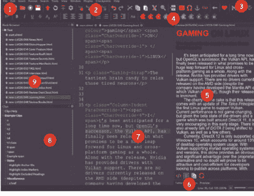

## `LINUX VOICE FOSSPicks`

### FOSSPicks 自由和开源软件世界的宝石和新发布。开源书籍写作工具。作者：GRAHAM MORRISON

## 电子书编辑器

### Sigil

在线书商和就像中彩票。但这是可能的——拥有许多选项。唯一的潜在缺失是自出版革命，而成功是可衡量的，成功已以多种方式改变了书籍作者的出版格局。如果你打算出版自己的书，除了天赋、动力和投入外，你还需要几样东西。几年前，有一个优秀的、专有的工具的 Linux 预览版，且成功不再限于少数人持有的印刷机。`Scrivener` 是一款涵盖了从笔记到章节的所有内容的工具，可以组织你的笔记、页面、文件、随记、大纲、完成字符以及通常组成一本书的各种细节。

（作为湿信号）与常用的音频效果中的干信号相结合，根据喜好进行处理。混响效果一直存在。它是从声源阵列中最终强制产生的回声效果，你通常在弹簧而非物理空间中听到它。在20世纪70年代，混响人声、电影预告片以及菲尔·科林斯（Phil Collins）著名的鼓点，都是由运行在数字门控上以消除延迟的数学模型产生的。

无论是摇滚、民谣、说唱还是电子音乐，所有音乐受益于混响信号处理器。那时，混响效果几乎总是美的混响。在音乐母带制作时，在原始清洁录音中添加混响效果，可以帮助轨道融合，或者在单个 CPU 上免费赋予它们三维节奏感。每个插件都提供了许多均衡声音和增加密度的选项，还可以更改虚拟空间的大小和数量。即使是早期的录音也有早期反射，它们听起来依然美妙。添加的混响本身基于广泛使用的 `Freeverb` 算法，其物理原理是在专门建造的房间内放置扬声器和麦克风，让声音离开扬声器，在表面反射，并由麦克风带有混响地捕捉。

这款 `Dragonfly` 混响套件中的 `Dragonfly Reverb` 以一个极其实用的 UI 展示了这些功能，为任何开源音频处理工具提供了许多选项。有几个不同的版本，包括房间声、大厅声（更大）、板式声（类似于弹簧混响），它们甚至可以与昂贵的商业算法媲美。然而，`Dragonfly Reverb` 听起来简直棒极了。

## 项目网站

`https://github.com/michaelwilis/dragonfly-reverb`

Arduino 构建器

## Arduino CLI

在树莓派（Raspberry Pi）等硬件让微型开源计算流行之前，你可能只是想使用不同的代码编辑器并从命令行触发自己的构建。`Arduino` 为可编程微控制器一直在做同样的事情。这些真正的开源开发板（与树莓派不同）仍有几十万个。

过去的解决方案包括构建一个 `Makefile` 来触发灯光开关、监控温度和酿啤酒，并使用与 `Arduino IDE` 相同的 `GCC` 参数，甚至绕过 `IDE` 内部使用的 `arduino-builder` 来独立构建你的项目。

虽然 `Arduino CLI` 设计为从命令行运行，但它仍然是 `Arduino` Web 编辑器背后的强大力量。对于不需要 CPU 的低功耗硬件解决方案、板载和原生 C 文件，它还会像 `IDE` 一样将任何生成的二进制文件上传到连接设备的存储器，并将你的设置保存到配置文件。

由于它们是微控制器而不是计算机，因此它们需要计算机来编程。幸运的是，通过官方支持的 `Arduino CLI`，它允许你将 `Arduino` 开发与 `IDE` 解耦，并与任何开发环境配合。这些黑科技不再是必要的。`arduino-cli` 命令也是开发 `Arduino` 项目的一种更快方法，因为这也意味着你使用了 `IDE` 提供的所有功能，除了提供视觉编辑环境之外。

`IDE` 是一个提供视觉编辑环境且非常适合学习的优秀工具，但当你的项目超出 `IDE` 的能力范围时，它就力不从心了。你可以从喜欢的编辑器或 `IDE` 使用 `Arduino CLI`，并像处理任何 `C` 项目一样快速触发构建。它可以下载并集成与 `IDE` 相同的库和开发板，启动一个新的 `sketch`（脚本），并包含两个 `INO` sketch 文件。你可能想使用 `CI` 自动构建和部署。

## 项目网站

`https://github.com/arduino/arduino-cli/`

`LINUX-MAGAZINE.COM | LINUXPROMAGAZINE.COM`

第 241 期

2020年12月

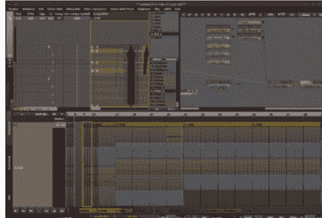

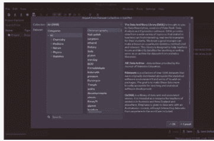

# `LINUX VOICE FOSSPICKS`

## 音乐跟踪器

## Radium 6


在 Linux 上，我们拥有了老派专业数字跟踪器、现代音频工作站、数字音频工作站和模块化合成器的奇妙混合，它们可以等同于`Cubase`和`Logic`，为你提供了使用`Ardour`、`Bitwig`和`REAPER`制作音乐的完全独特的视角。

这使得观察数据中的模式变得更加容易。特别是这项功能，让你感觉像是一种超能力，深邃且迷人，只需安装即可。这次更新的价值在于：它能够从你的桌面访问此类数据。为了帮助那些想要探索数据、探索这些新领域的人解决最大的问题，

## 项目网站

https://labplot.org/2020/09/16/labplot-2-8-released/

2020年12月

第 241期

LINUX-MAGAZINE.COM | LINUXPROMAGAZINE.COM

86

# FOSSPICKS LINUX VOICE

## SSH 泥潭

## Endlessh

为了安全外壳（SSH）的安全性，建议安装`Deny-SSH`或`Fail2ban`。这些都是加密安全的，正如精色的`Python`脚本所证明的那样，数百万台服务器、设备和廉价的`Raspberry Pi`都在监控登录尝试，并在登录失败时（永久或在一段时间内）自动阻止来自特定`IP`地址的尝试。请依赖它进行远程访问。

即使设备在互联网可见且你没有启用无密码登录，只要你的密码足够复杂，它就是安全的。但通过让你的`SSH`连接看起来像是来自`1200`波特的调制解调器或月球上的服务器，可以减慢攻击者的速度。但`Endlessh`是另一个选项，也可以帮助缓解失败`SSH`连接的日志。它的速度让任何试图访问你机器的坏蛋或机器人（属于“通过隐蔽实现安全”的范畴）必须耐心等待此加载，然后才能从无尽的尝试猜测登录提示，你可以配置让它等待几天。

如果你曾将身份验证暴露在互联网上，你真的会让一切变得更安全。它甚至可以同时捕获多个客户端，使`SSH`服务器使用极少的系统资源。但真正聪明的人知道，你的东西在于它根本没有使用`SSH`。即使在等待之后，日志很快就会被浪费的时间/CPU/带宽填满，而不会有登录提示。相反，`Endlessh`是一个简单、安全的诱饵，而你可以秘密地在不同的端口运行你的`SSH`服务器猜测用户名和密码，希望现在你的`SSH`端口完全没有了端点组合攻击。

但它也可能会让你微笑。那因为它的主要功能是在你登录之前看到的`SSH`宣告以一种非常……非常……非常……慢……的速度发送。

禁用密码登录很有帮助，更改默认端口`22`也是如此，但我们还推荐基于密钥的认证。

## 项目网站

https://github.com/skeeto/endlessh

## IRC 客户端

## kirc

`IRC`确实是一个古老的协议，用于处理封装的文本，用于在群组之间在序列化端口连接中流入流出时托管对话。它让人回起`80`年代末和`90`年代初连接的早期日子，那时`IRCd`与`Archie`和`Gopher`等类的程序共用`Sun-3`服务器空间。

这种简单性还不足以消除安全和其他现代功能，但用证书、账户和额外功能来增强该简单协议的工作在很久以前就完成了。然而，与`Archie`和`Gopher`不同，`IRC`仍然在无数地方（内部和外部）在使用。

虽然`kirc`不支持`TLS`，但你可以封装可执行文件来理解，特别是对于`C`语言，在像这样的中继工具中实现你自己的接口很容易的，而客户端本身是功能完备且外部的。例如，`Freenode`聊天网络仍然是结人的最佳地方之一。它支持服务器用户名和密码、昵称、宽度限制以及所有惯用的`IRC`命令，并带有出色的颜色输出和命令行清晰度。

这意味着当你学习新的编程语言和网络栈时，它是一个极好的入门项目，也是一个开始并讨论从虚拟现实到合成器任何话题的绝佳场所。如果你正在考虑学习`C`语言，尽管`Slack`等平台及其开源替代方案提供了许多机会，`IRC`的简单性和成熟性仍然是不可比拟的。这就是`kirc`。这是一个美丽、微小、高效的客户端，编写为使用任何符合`POSIX C99`标准的`C`编译器进行构建，且没有进一步的依赖。因为在底层，所有的`IRC`都是依赖。所有的代码都占据了你方面的空间。

## 项目网站

https://github.com/mcpcpc/kirc

LINUX-MAGAZINE.COM | LINUXPROMAGAZINE.COM

第 241期

2020年12月

87

# LINUX VOICE FOSSPICKS

## 数据处理器

## Node-RED

如果你在超级强大、设计精美的家庭自动化、家庭监控或网络爬虫方面做过任何事情，那么你可能已经签名并实现了跨越各种网络服务的自托管可视化编程界面，你可以轻松从`Raspberry Pi`（或任何其他`Linux`设备）运行它。它不包含`IFTTT`（“If Then That”的缩写）。`IFTTT`让你轻松地将设备数据映射到另一个设备或服务，例如`Google`日历、`Nest`账户、`Twitter`或灯开关。

`Node-RED`已经存在几年了。它由`IBM`开发并在`2016`年作为开源项目发布，成为`Linux`基金的一部分。它刚刚启动了一个带有限制账户的免费层。

`Node-RED`允许你拖放节点来连接硬件设备、`API`和在线服务。它提供了一个视觉编辑器来将这些节点连接起来，为硬件和软件应用程序创建自定义逻辑。它是构建基于家庭自动化和数据处理系统的强大工具。

使用它自己的标签页。右侧是信息、文档和调试输出面板。这允许你在流程视图中的节点之间切换，以查看它们接收哪些参数、作用是什么，以及你网络的任何输出内容。它让你能够从自己家庭防火墙的后面，构建家居自动化所需的任何类型的数据抓取、数据解析和数据转发功能。

`Node-RED`中的每个函数都是从输入到输出的数据流，使用节点在数据流经通过它们时对其进行操纵和条件操作。

## 项目网站

https://nodered.org/

2020年12月

第 241 期

LINUX-MAGAZINE.COM | LINUXPROMAGAZINE.COM

88


# FOSSPICKS LINUX 语音推荐

## 在线射击游戏

## batfu

这是一个简单但极棒的小游戏。当然，你的任务是玩这个小游戏，原因是为了利用各种理由摧毁那些其他玩家。首先最重要的是，你可以使用激光，或者放置一个恰当的感应地雷，当你或其他玩家经过它时它就会爆炸。大多数时候，这是一款非常令人上瘾的游戏。你控制一个在各种`2D`滚动竞技场中移动的`UFO`。要进行转向，向左右旋转你的飞行器，然后通过短促的推力向你面对的方向加速。

巧妙的地方在于，这些玩家是真实的人类，就像你在《小行星卫》（`Asteroids`）中那样一样，因为`batfu`轻松实现了多人游戏。

`batfu`成为如此好玩的另一个原因是它能教你一些关于游戏开发的知识。在学习如何驾驶`UFO`并击败同类的同时，还在学习一个全新的应用程序框架。最终结果是，你可以像台球一样在墙壁上反弹，并由开发者记录的整个工作`Flutter`提供支持。`Flutter`应用通常使用`Dart`语言开发，它们有自己的一系列优秀和其他视频，这些视频从它们的网站上链接出来。这些视频展示了游戏开发的每个阶段，可以收集道具并穿过扭曲点，但障碍物的构建很快且占用的系统资源很少。它们还轻松支持多平台，并对独立开发者如何进行游戏设计提供了深刻的见解，甚至到了构建游戏的前提是：摧毁任何人都可以下载并使用创建其他玩家的关卡生成器。这些玩家出现在游戏的地图中，与你类似的飞行器在迷宫的墙壁上反弹，并试图在碰撞之前击中道具。你会消耗自己的护盾，而`batfu`将毫无困难地运行在`Linux`、`macOS`、`Windows`、`Android`甚至网页浏览器中。但所有这一切都已经被处理好了。

## 项目网站

https://thlorenz.com/batufo/

## 游戏引擎

延续“向`C`语言借鉴”的主题，`rg3d`是一个`3D`游戏引擎，它将其许多灵感从基于`C99`的语言平台`Dmitry’s Engine`从一种语法转换为另一种语法。根据它自己的承认，仍然有大量工作要做，但这样做对`rg3d`的现状也是一种不公平的。为了证明这一点，引擎背后的开发者还在开发一个原型`FPS`演示，目前称为“`rusty-shooter`”。这是一款直觉驱动、快速且精美的类《毁灭战士》游戏，展示了目前开发的游戏引擎许多部分。`Rust`之所以流行是因为它采用了像`C`这样的系统编程语言的优秀特性，例如其高性能和并发能力。

相当出色的演示游戏`rusty-shooter`使用`rg3d`游戏引擎编写，旨在展示其能力并帮助新的游戏开发者入门，包括延迟着色（以一种从未预想过的方式进行去抖和压缩），并将其引入现代的垃圾回收、内存分配检查时代。还有了一套配套的系统、物理引擎以及针对许多字体和图像格式的加载器。对于单个开发者来说，这是一项巨大的工作量，它提供了一个同时学习`3D`游戏开发和无需`Makefile`的构建系统的起点。这一切使得`Rust`成为学习场景编辑器的理想起点，该编辑器可以帮助你在无需重新编译的情况下创建游戏关卡。


非常有用的结果。然而，如果你需要的格式与 `Asci Doc` 的 `a2x` 命令不同，则所有的变体都需要进行训练。

`a2x` shell 脚本允许用户快速自动地将源代码转换为各种输出格式，特别是 `PDF`。

通常情况下，你会从发行版的仓库安装 `Asciidoctor`。但是，如果缺少某些组件（例如 `asciidoctor-epub3`），你可以在 `ad-system` 中制作的文档中使用 `Ruby` 自身的 `gem` 安装设置来导入缺失的组件；或者，直接从 `Ruby` 仓库调整 `gem` 的语言和格式，例如输出结果以及文档类型。这些指令被写在紧接文档头之后的的行注释中。

```
$ gem install asciidoctor-epub3
```

调用 `a2x <file>` 将使用所有可用选项翻译文档。该工具将 `gem` 安装在 `~/.gem/ruby/2.7.0/bin/` 中。你必须将此路径包含系统环境变量 `PATH` 中。

在某些情况下，例如 `asciidoc-epub3` 示例，目前还没有官方必要的包，你将收到错误消息。如果存在仍在开发中的包，你可以使用 `--pre` 选项进行测试：

```
$ gem install asciidoctor-epub3 --pre
```

在这种情况下，将执行安装，并同时添加 `Asci Doc` 和 `Asciidoctor` 扩展。

## 差异

`Asci Doc` 和 `Asciidoctor` 在某些细节上有所不同。

对于简单的文档，这顶多是一个次要问题。然而，如果你充分利用每种软件的功能，差异就会变得更加明显。你可以在寻找 `In search for the (Asciidoctor only)` 字符串的示例，它指定了这些功能适用于 `Asciidoctor`。在大多数情况下，`Asciidoctor` 的功能超过了 `Asci Doc` 支持的内容，但得益于内置的兼容模式，

### 表 1：Asciidoctor 命令行选项

| 选项 | 效果 |
| --- | --- |
| `-b <Format>` | 创建输出为 `HTML5`（默认）、`XHTML5`、`DocBook 5`、`manpage` 或通过适当的插件输出——如 `PDF`、`LaTeX` 或 `EPUB` |
| `-d <Type>` | 除了经典的 `article`（默认）、`book` 和 `manpage` 之外，`Asciidoctor` 更倾向于为包含的代码输出，例如单代码块、段落或类似内容 |
| `-o <File>` | 将输出保存为指定的名称 |
| `-D <Directory>` | 将结果保存到指定的目录中 |
| `-s` | 抑制头部和页脚（针对包含的文档） |
| `-n` | 章节的自动编号 |
| `-a <Attribute>` | 设置 `Asci Doc` 属性（覆盖文档中现属性） |
| `-B <Base>` | 定义附加代码的基目录；默认是当前目录 |
| `-V` | 警告级别，根据此生成错误代码：`WARN`, `ERROR`, `INFO`, |
| `--failure-level <Level>` | `FATAL`（默认） |
| `-S` | 设置安全级别；禁用潜在不安全的结构，如 `include::` |

## UI 宏

| 快捷键 | 目的 |
| --- | --- |
| `F11` | 切换全屏 |
| `Ctrl + T` | 打开新标签页 |
| `Ctrl + Shift + N` | 新无痕窗口 |
| `Ctrl + \` | 用于转义字符 |
| `Ctrl + ]` | 跳转到关键词 |
| `Ctrl + +` | 增大缩比例 |

`Asciidoctor` 可以处理任何用 `Asci Doc` 格式化过的内容。尽管如此，现在已支持用于快捷键的 `UI` 宏（图 1）。同样有趣的是，`Asciidoctor` 没有提供命令 `a2x` 的对应项，参见框，“`Asci Doc` 的 `a2x` 命令”。或者，你可以在 shell 提示符处指定选项。作为一个特殊功能，`a2x` 有 `--epubcheck` 选项来自动化调用 `a2x` 工具的过程，该工具可以识别 `EPUB` 文档中的潜在问题。以程序代码的形式。这允许句子交换、注释和其他操作，就像在任何编程语言中一样。

## PDF 选项

与 `AsciiDoc` 一，`Asciidoctor` 通常面向 `HTML`，这使其更容易转换为基于它的格式，包括 `AsciiDoc` 和 `EPUB`。`AsciiDoc` 的经典结构在多程度上通过命令行控制。与其非常相似的重要选项汇总在表 1 中。不带选项的命令和调用将具有 `.adoc` 扩展名的文件翻译为 `HTML5`：

```
$ asciidoctor tst.adoc
```

创建 `PDF` 有几种方法，它们可能会导致非常不同的结果。如果你倾向于创建书籍之类的线性文档，你可能更喜欢 `PDF`。

生成一些 `HTML` 输出，在浏览器中调用它并将其导出为 `PDF`。这种方法提供了相当广泛的后续编辑。默认情况下，工具在转换期间会抑制消息。它只向你显示严重错误，例如缺少嵌入图像。但不如此。或者，你可以通过 `a2x` 使用 `DocBook 5` 工具链。`Asciidoctor` 允许你直接用 `Asciidoctor` 创建 `PDF`，但结果往往不理想。从 `Asci Doc` 切换到 `Asciidoctor` 时需要考虑一些差异，这些差异总结在用户手册的第 9 章 [9]。

这并不总是按预期工作，但过程非常快。缺点是没有有意义的错误消息，错误往往长时间无法被发现。例如，在语法方面，现在斜体文本仅有 `_<Text>_` 语法，代码使用 `<Text>`，代码中的字面文本使用 `+{Text}+`。双引号在 `Asci Doc` 或 `Asciidoctor` 中使用 `"<Text>"` 创建，单引号使用 `'<Text>'`。

另一种选择是使用 `LaTeX`。你可以通过 `LaTeX` 自己的工具传统方式创建。对于标题，`= <Title>` 语法（异步）仍然有效，但不是对称的形式 `= <Title> =` 或使用下划线的形式。标题下划线会自动导致兼容模式。手册中的第 9.8 提供了额外的 `LaTeX` 知识以及通常的手动调整。无论你选择哪种路径，请记住交互元素在转换过程中几乎总是丢失。

## 结论

`Asciidoctor` 证明它是 `AsciiDoc` 的合格继任者。它的速度和附加插件以及对 `AsciiFX` [10] 的直接支持使其成为一个良好但更复杂的替代方案。那么现在没有理由使用 `Asci Doc` 了吗？这取决于。例如，对于电子书运行良好的工具链是不容忽视的，而且结果有时比 `Asciidoctor` 生成的结果更紧凑。

图 1：这些用于快捷键的 `UI` 宏在 `Asciidoctor` 中可用，但在 `AsciDoc` 中不可。

点击块 点击块显示标题但不显示正文。点击标题将显示正文。再次点击标题隐藏正文。

点击块的标题显示为蓝色。

### 示例

**问题**

光速是多少？

**答案**

```
Last updated 2020-07-31 10:44:39 +0200
```

由于经典的 `AsciiDoc` 围绕 `Asciidoctor` 构建，它看起来是一个更灵活的应用程序，这使得它对于以后使用 `Asciidoctor` 变得非常有价值。你可以更轻松地掌握切换到 `iDoc`。

`图 2：` `HTML` 输出格式中的交互式结构（如点击块）仅由 `Asciidoctor` 支持。此示例取自原始文档，点击“`Answer`”将显示源代码中给出的答案。

## Info

| `ID` | `Type` | `Link` |
| :--- | :--- | :--- |
| `1` | `AsciiDoc` | `https://asciidoc.org` |
| `2` | `Asciidoctor PDF` | `https://asciidoc.org` |
| `3` | `Asciidoctor projects` | `https://github.com/asciidoctor/projects/` |
| `4` | `Asciidoctor syntax` | `https://github.com/asciidoctor/syntax-quick-reference/` |
| `5` | `Asciidoctor manual` | `https://asciidoctor.org/user-manual/` |
| `6` | `Asciidoctor specifics` | `https://github.com/asciidoctor/asciidoctor-latex/` |
| `7` | `Asciidoctor` | `https://github.com/asciidoctor/asciidoctor-pdf/` |
| `8` | `Asciidoctor syntax` | `https://github.com/asciidoctor/asciidoctor-epub/` |
| `9` | `Asciidoctor manual` | `https://asciidoctor.org/docs/user-manual/` |
| `10` | `AsciidoctorFX` | `https://asciidoctorfx.com/` |

## 即将推出


随时随地获取！订阅数字版，享受热门话题的最新文章、评测、酷炫项目等……订阅 PDF 版：`shop.linuxnewmedia.com/digisub` 现在已上线：`bit.ly/Linux-Pro`

## 往期期刊

《Linux Magazine》是你探索 Linux 世界的指南。每期杂志都充满了你在其他任何地方找不到的高级技术文章和教程。探索你完整的往期期刊目录，查找特定主题以完善你的收藏。在线订购：`https://bit.ly/Linux-Newsstand`

## 动起来了

构建整个操作系统？嗯，可能不是 Linux，但如果你感兴趣，可以使用在线资源实现实验性操作系统的基本功能。我们无法向你展示整个过程，但我们会帮你整理思路并迈出第一步。DVD 内容：Linux Magazine 20 周年纪念 DVD

## 构建 IRC 机器人

IRC 机器人负责在互联网上协调和转发聊天消息的核心工作。本月，我们将展示如何构建你自己的自定义机器人——并带你深入了解如何与 IRC 直接交互。DVD 内容：Debian 10.5 和 Devuan 3.0

## 加速你的系统

如果你的系统以峰性能运行，你的 Linux 体验将流畅得多。本月我们关注一些及时的技术，包括内核新的压力压力指标（PSI）功能。DVD 内容：Bodhi Linux 5.1 和 openSUSE Leap 15.2

## 摄像头与 Linux

本月我们探索了摄像头、录屏以及一种酷炫的提词器工具。我们还查看了 PHP Building Blocks、基于 HTML5 的无客户端远程访问工具 `Guacamole`，以及对实用的 `MystiQ` 音视频转换工具的调研。DVD 内容：Ubuntu Studio 20.04 和 Kubuntu 20.04

## 更智能的目录

全球计算机系统中使用的嵌套文件和目录的僵化结构是在 60 多年前创建的，专家认为我们可以做得更好。本月，你将学习一些用于 Linux 语义文件标记的脚本。DVD 内容：Fedora Workstation 32 和 Ubuntu“Focal Fossa” Desktop 20.04 LTS

## Systemd 新动态

`Systemd` 是一个不断带来惊喜的谜。领先领先 Linux 初始化系统的一个新功能将改变你对用户主目录的认知。本月，我们将仔细观察 `systemd-homed`。DVD 内容：Noppix 8.6 和 Mandriva Linux 4.1

## 活动

用户、开发者和供应商会在世界各地的 Linux 活动上汇聚。《Linux Magazine》荣幸赞助此处展示的重点活动。关于你附近的其他活动，请查看我们在 `https://www.linux-magazine.com/events` 在线上的详尽日历。如果你知道其他想让我们加入日历的活动，请向 `events@linux-magazine.com` 发送包含所有细节的邮件。在预订任何行程之前，务必确认活动情况，因为许多活动因 COVID-19 已取消或转换为虚拟活动。

| 活动 | 日期 | 地点 |
| :--- | :--- | :--- |
| FOSDEM 欧洲 | 2020年12月8-11日 | 虚拟 |
| FOSDEM 欧洲 | 2021年2月6-7日 | 虚拟 |
| 开源策略论坛 (OSSF) | 2020年11月11-13日 | 虚拟 |
| 开源策略论坛 (OSSF) | 2020年11月16-19日 | 虚拟 |
| KubeCon + CloudNativeCon 北美 | 2020年11月17-20日 | 虚拟 |
| KubeCon + CloudNativeCon 北美 | 2020年12月2-4日 | 虚拟 |
| 日本开源峰会 | 2020年12月8-11日 | 虚拟 |
| Drupal 欧洲 | 2021年12月8-11日 | 虚拟 |
| 深度学习 2.0 峰会 | 2021年1月28-29日 | 虚拟 |
| FOSDEM 2021 | 2021年2月6-7日 | 虚拟 |
| Kubernetes社区日 | 2021年4月8-9日 | 荷兰姆斯特丹 |
| DevOpsCon 伦敦 | 2021年4月19-21日 | 英国伦敦 |
| Linux 存储文件系统与 MM 峰会 | 2021年5月12-14日 | 加利福尼亚州棕榈斯林 |
| ISC 高性能 | 2021年6月27-7月21日 | 德国法兰克福 |
| KVM 论坛 | 2021年8月2-4日 | 不列哥比亚 |
| 嵌入式 Linux 会 | 2021年8月4-6日 | 不列哥比亚 |
| 开源峰会北美站 | 2021年8月4-6日 | 不列哥比亚 |

## 联系信息 / 作者

**主编**

Joe Casey, `jcasad@linux-magazine.com`

**校对**

Amy Pettle, Megan Phelps

**新闻编辑**

Jack Wallen

**荣誉编辑**

Rita L Sooby

**制作编辑**

Nomadica, Media USA, LLC.

虽然我们对杂志的内容已尽力，但出版商对其中包含信息的准确性或在使用时产生的任何后果不承担责任。使用杂志随附光盘或其上任何材料的风险由自承担。

未经许可不得以任何形式复制...

## 本地化与翻译

Lori White

未经出版者书面许可，无论全部或部分使用。假设所有发送的信函（例如信件、电子邮件、传真、照片、文章、图纸）均由 Dena Friesen 或 Lori White 通过 Linux New Media USA, LLC 在非独占全球范围内提供出版或许可，除非另有说明。

### 封面设计

Lori White

Linux 是 Linus Torvalds 的商标。

### 封面图片

© vska, `123RF.com`

所有品牌或产品名称均为各自所有者的商标。如果我们未注明您的版权，请联系我们；我们将纠正任何疏忽。

### 广告

Brian Osborn, `bosborn@linuxnewmedia.com`

电话：+49 89 3090 5128

### 营销传播

由 `hofmann infocom GmbH` 在德国纽伦堡印刷，使用由 100% 消费后废物制成的再生纸；生产过程中未使用氯漂白。

### 作者

Gwen Clark, `gclark@linuxnewmedia.com`

Bernhard Bablok

Erik Bärwaldt

Bruce Byfield

Brian Osborn

Zack Brown

Joe Casad

Mark Crutch

Marco Fioretti

Karsten Günther

Jon "maddog" Hall

Charly Kühnast

Vincent Mealing

Pete Metcalfe

Graham Morrison

Lee Phillips

Usama Rasheed

Daniel Rosehill

Mike Schilli

Tim Schürmann

Mayank Sharma

Jack Wallen

### 出版社

Linux New Media USA, LLC

由 `Seymour Distribution Ltd, Kingdom` 发

2721 W 6th St, Ste D, Lawrence, KS 66049 USA

### 客户服务 / 订阅

Linux Pro Magazine 由 Linux New Media USA, LLC 月出版。

美国和加拿大：

2721 W 6th St, Ste D, Lawrence, KS, 66049, USA.

邮箱：`cs@linuxpromagazine.com`

电话：1-866-247-2802（美国和加拿大免费拨打）

所有其他国家：

邮件管理员：请将地址更改发送至

邮箱：`subs@linux-magazine.com`

Lawrence, KS 66049, USA.

在欧洲每月出版为 Linux Magazine (ISSN 1471-5678)，由：Sparkhaus Media GmbH 出版

Zielandstr. 1, 80799 Munich, Germany.

`www.linuxpromagazine.com` – 北美

`www.linux-magazine.com` – 全球

### 现采用由 100% 消费后废物制成的再生纸印刷；生产过程中未使用氯漂白。

### 征稿启

我们一直在寻找关于 Linux 和 Linux 环境工具的优秀文章。文章的技术水平应与通常在《Linux Magazine》中阅读的内容保持一致。尽管我们会考虑任何主题，但以下主题对我们特别特别感兴趣：

《Linux Magazine》在许多国家被阅读，您的文章可能会被翻译成我们姐妹刊物之一。因此，最好避免使用所有读者可能无法理解的俚语和习语。

- 系统管理
- 有用的技巧和工具
- 安全性，包括新闻和技术
- 产品评论，特别是来自实战经验
- 社区新闻和项目


在提到未来的日期或事件时请务小心。从您提交手稿到最终副本送到读者手中，可能会过去数周时间。如果您有主意，请发送包含大纲、长度估计、背景说明和联系方式的提案至 `edit@linux-magazine.com`。主题行应有助于我们识别您的信息为文章提案。随时欢迎提供截图和其他支持材料。

`LINUX-MAGAZINE.COM` | `LINUXPROMAGAZINE.COM`

第 241 期

2020年12月

## 3D 打印

## 下个月

预计第 242 期

英国/欧洲 12月5日

美国/加拿大 1月1日

澳大利亚 2月1日

3D 打印现在已成为世界的一部分，作为构建模型、医疗设备和数千日常用品的工具。但对于许多创意空间的人来说，3D 打印机也是一个非常棒的玩具。下个月我们将探索一些 3D 打印的技术和技巧。

`Linux Magazine Preview` 是一份月度通讯，让您抢先预览下期，包括在线发布的文章链接。注册地址：`bit.ly/Linux-Update`

## 安全与隐私

`TUXEDO Computers` 的所有系统均已准备好运行 Linux。在提供卓越性能之外，它们还为您的个人数据提供了全面的保护，并对您的隐私提供了强力保护。

- `Intel ME`、摄像头、音频和 `WiFi` 可禁用
- 全加密系统和数据完全防止受到未经授权的访问
- 得益于开源软件，安全威胁可验证
- 得益于基于 Web 的全自动系统重置
- 100% Linux
- 5 年保修
- 终身支持
- 德国制造
- 德国隐私
- 本地支持
