# Linux 杂志 257 2022-04 美国


## 珍珠版

`TUXEDO` `InfinityBook` `S` `14`

- **Intel** `Core` `i5-1135G7`

- `Intel` `Iris` `Xe` 显卡

- **仅 1.1 公斤轻**

- 16.8 毫米薄

- **金属玫瑰金特别配色**

- 时尚且独家

- **73 瓦时电池**

- 以及低功耗显示屏

- **100% Linux**

- **5 年保修**

- **终身支持**

- **德国制造**

- **德国隐私保护**

- **本地支持**


`tuxedocomputers.com`

## 云层背后的真相

亲爱的读者：

我们 Linux 社区深受一种传统观念的影响，认为 Linux 比 Windows 安全得多。事实确实如此，而且一直以来都是如此，但这句话并没有说明多少问题。二十年前，当 Linux 开始起步时，早期的 Windows 版本确实极其不安全。与此同时，微软一直吹嘘 Windows 有多棒，声称如果你不使用它，就会被抛在脑后。微软糟糕的工程能力加上恶意的营销（他们曾称 Linux 为癌症！）赋予了 Linux 社区一种延续至今的态度。

这种态度让 Linux 开发者在多年的竞争和创新中占据了优势，但态度的优势可能既锋利又陡峭。大多数 Linux 用户都知道采取标准安全预防措施的重要性，但部分忠实的 Linux 支持者中也存在一种否认倾向，认为那些安全建议并不真正适用于他们。勒索软件？权限提升？那肯定是 Windows 的问题……

好吧，现在不再是 2002 年了。在许多方面，Linux 已经赢得了互联网之战。运行 Linux 的互联网服务器比任何其他系统都多——甚至 `Microsoft` `Azure` 云平台也运行 Linux 服务器。像 `Windows` `95` 这样的系统所呈现的唾手可得的目标已经不复存在，这意味着网络犯罪分子必须更加努力才能找到入侵途径。而一旦他们开始更加努力，没错，他们确实找到了入侵 Linux 的方法。

Linux 服务器无处不在的事实意味着，罪犯几乎不可能避开它们。事实上，情况已经发展到网络犯罪分子`必须`攻击 Linux 才能继续繁荣的地步。（好吧，也许“繁荣”这个词太仁慈了，但你们明白我的意思。）

`VMware` 威胁分析部门最近发布了一份关于基于 Linux 的多云环境中恶意软件的报告。该报告 [1] 只需输入姓名和电子邮件地址即可免费下载，重点针对基于云端的 Linux 实例的勒索软件和加密货币挖矿攻击。报告指出：“威胁行动者知道当前的恶意软件对策主要针对基于 Windows 的威胁，这使得许多公共和私有云部署容易受到基于 Linux 的攻击。”

正如你预期的那样，过时且管理不善的 Linux 系统被认为是最脆弱的，但往往直到为时已晚，我们才真正知道哪些系统是“管理不善”的。报告声称，最常见的威胁是“利用容器基础架构中的弱认证、漏洞和错误配置，利用远程访问工具 (`RATs`) 渗透环境。”

`Cobalt` `Strike` 是一种商业渗透测试工具，也被网络犯罪分子使用。报告概述了攻击者如何实施 `Cobalt` `Strike` 使用的 `Beacon` 植入物的 Linux 版本，以便将攻击移植到基于 Linux 的系统。随着犯罪分子适应以 Linux 为重点的互联网，类似的转换正在其他地方发生。

通常的建议在这里也适用：使用强密码并保持系统更新，以防止攻击者获得立足点。但仅凭这些久经考验的措施不足以保护你的 Linux 云环境。`VMware` 团队建议“……对所有工作负载进行完整监控，提供详细的系统上下文，以便更容易理解和优先处理缓解工作。”他们还说，你应该使用端点检测与响应 (`EDR`) 系统，该系统将监控、收集数据，并在发现异常时发送自动警报。

重要的是，要保持警惕，不要仅仅因为 Linux 比 Windows 更安全就假设它是安全的。Linux 可能是周围最安全的系统，但你仍然需要做足功课，因为危险潜伏在最近的云层背后。


`Joe` `Casad,`

总编辑

- 信息

- [1] 威胁报告：揭露基于 Linux 的多云环境中的恶意软件：`https://www.vmware.com/resources/security/exposing-malware-in-multi-cloud.html`


2022 年 4 月

## Linux Mint 20.3 Cinnamon 与 deepin 20.4

双面 DVD 上的两款绝棒发行版！

### Linux Mint 20.3 Cinnamon 64 位

代号为“`Una`”的 `Linux` `Mint` `20.3` `Cinnamon` 是 `Linux` `Mint` 最新的长期支持（`LTS`）版本，支持将持续到 2025 年。它配备了 `Cinnamon`，即 `Mint` 广受欢迎的桌面环境。与其他大多数标准 `Mint` 版本一样，`Una` 基于 `Ubuntu`，而 `Ubuntu` 又基于 `Debian`。同一版本的 `Debian` 版本可以作为 `Linux` `Mint` `Debian` `Edition` (`LMDE`) `5` 获取，代号为“`Elsie`”。

`Cinnamon` 以谨慎的创新而闻名，每个版本都会带来一些新功能，`Linux` `Mint` `20.3` 也不例外。外观和体验进行了许多微调，包括对现有主题的翻新和几套新壁纸，以及标题栏及其按钮的扩大，圆角设计增添了柔和感。对于偏好旧外观的用户，可以使用 `Mint-Legacy` 主题。此外，许多应用程序也增加了搜索字段，包括 `Hypnotix` `IPTV` 和便笺小组件。`Cinnamon` 的新增功能包括 `Thingy` 电子书阅读器和日历及调度小组件。相比之下，前 `Mint` 用户可能会注意到通用软件包的 `Snap` 商店已被禁用，理由是虽然 `snap` 软件包是开源的，但 `Snap` 商店的代码并非如此。

与以前的 `Mint` 版本一样，`Una` 适合各个层级的用户。

### deepin 20.4 64 位

`Deepin` 是中国领先的发行版之一。基于 `Debian` 的 `Stable` 仓库，`deepin` 因其 `Deepin` 桌面环境（`DDE`）而备受推崇，该环境基于 `Qt` 构建。`DDE` 包含二十多个独特的应用程序，从标准的编辑器、字体安装程序和软件包存储，到更不寻常的远程助理、修复指南和演示助理。`DDE` 还因其简单易懂的安装程序和简洁美观的设计而经常受到称赞。

如果你之前使用过 `deepin`，你会注意到 `20.4` 版本中有许多小改进，从新的默认壁纸开始。该版本还新增了垃圾桶的撤销功能（`Ctrl+Z`），以及当鼠标悬停在坞上时显示应用程序窗口标题栏的功能。控制中心现在支持生物识别认证、休眠时间设置以及更详细的自定义坞设置。还进行了大量的错误修复。与以前的版本一样，`deepin` `20.4` 包含许多其他桌面系统中没有的调整，这些调整以小但有用的方式扩展了功能。

`Deepin` 多次被指控将用户信息传递给中国政府，但这些指控从未得到证实。然而，你必须勾选一个框，表示你同意 `deepin` 的最终用户许可协议（`EULA`）和隐私政策。（参见本期第 34 页关于 `deepin` 的文章。）

### 厂商中立 · 全球社区 · 非营利 · 薪资提升

**在超过 180 个国家/地区获得信赖** · 专业认证

详细的考试目标 · 在线测试 · 免费学习资料

个人技能资质 · **多种语言** · 高可用性

认证有效期为 5 年 · Linux · 开放技术 · FOSS

我们的使命是通过支持从事开源工作的人员来推广开源的使用 · 所需的 IT 技能

解放人们 · 开源 · **200,000+ 认证持有者**

经过验证且可靠 · 个人和经济成长机会

DevOps · 为每个人提供的经济和创意机会

安全性 · **可承受的考试价格** · BSD · 蓬勃发展的就业市场

发行版中立 · 增加你的奖金 · 网络安全

**国际标准** · 面向未来的职业生涯 · 数百个合作伙伴

丰富的职业路径 · 对开发者的需求 · 虚拟化

开源招聘将上升 · 推荐给专业人士

提高职场生产力 · 涵盖所有主要发行版

使你对雇主更具吸引力 · 提升你的职业生涯

会员制组织 · 选举产生的董事会

证明你的技能 · 更高的收入潜力 · **你的未来是开放的**

## 全球标准。

## 全球可负担的价格。

`Linux` `Professional` `Institute`（`LPI`，国际 Linux 专业协会）的使命是通过支持从事开源工作的人员来推广开源的使用。这就是为什么我们在超过 140 个国家/地区降低了全球最流行开源认证的价格。在 `lpi.org/why` 阅读驱使我们前进的动力。

在 `lpi.org/exam-pricing-2022` 发现适用于你所在国家的 `LPI` 新考试定价。更多信息和所有 `LPI` 认证请在 `lpi.org` 查看


## 新闻

来自世界各地的技术和文化更新

- **本月新闻**
  - 08 • Zorin OS 16 教育版现已推出 • System76 发布搭载 AMD 处理器的 Kudu 笔记本电脑
  - 09 • Ubuntu Budgie 瞄准游戏玩家 • Linux Mint Edge 已准备就绪以支持最新硬件 • 更多在线内容
  - 10 • Linux 内核 5.17 代码合并窗口已关闭 • 在所有主要 Linux 发行版中发现另一个严重漏洞

### Zorin OS 16 教育版现已推出

Zorin OS 16 Education 是一个面向幼儿园以及中小学的 Linux 发行版。在已经出色的桌面体验基础上，开发人员增加了一些工具，帮助教育机构培养学生驾驭日益增长和复杂世界所需的技能。

添加的关键软件之一是`Kolibri`，它旨在通过提供访问庞大教育内容库的途径来弥合教育鸿沟。更棒的是，使用该工具不需要互联网连接。借助`Kolibri`，学校管理员可以创建自己的课程，或从`Khan Academy`、`Open Stax`、`MIT`、`TED-Ed` 和`Sikan`等教育领导者处下载材料。

一旦下载，内容可以通过本地网络进行点对点共享。其他教育应用程序包括`Minder`（思维导图）、`OpenBoard`（白板）、`Minuet`（音乐知识）、`KTouch`（打字）、`KTur-tle`（教育编程环境）、`KBrunch`（分数练习题）、`KWordQuiz`（闪卡）和`Step`（物理实验模拟）。除了教育应用程序，Zorin OS Education 还包括`Firefox`、`LibreOffice` 和`Gimp`等软件。


在`https://zorin.com/os/education/`下载 Zorin OS 16 Education，并在`https://blog.zorin.com/2021-08-17/2021-08-17-zorin-os-16-is-released/`阅读 Zorin OS 16 一般版本中的新功能。

### System76 发布搭载 AMD 处理器的 Kudu 笔记本电脑

System76 终于带回了热门的高性能`Kudu`笔记本电脑工作站。这一次，笔记本电脑配备了第 3 代 AMD（Zen 3）`Ryzen 9 5900HX` H 类处理器，拥有 8 个核心和 16 个线程。`CPU`运行频率为 3.3 GHz，但最高可加速至 4.6 GHz。

`Kudu`搭配`Nvidia RTX 3060`显卡，最高支持 64GB 双通道`DDR4`内存。

根据 System76 产品经理 Ben Shpucker 的说法：“这种组合使其成为随时随地创作的完美机器。”

`Kudu`笔记本电脑采用 15 英寸`FHD`哑光显示屏和窄边框，但对于各类创作者而言，通过一个`HDMI`端口、一个`Mini DisplayPort`和一个通过`USB-C`连接的`DisplayPort`，笔记本电脑最多可管理三个外部显示器。

观察端口，你会发现一个`USB 3.2 Gen 1 Type-A`端口，一个`USB 3.2 Gen 2 Type-A`端口，一个带有`DisplayPort 1.4`的`USB 3.2 Gen 2 Type-C`端口，以及一个`USB 2.0`端口

一个`Type-A`端口、一个`Mini DisplayPort 1.4`端口和一个带`HDCP`的`HDMI`端口，以及一个耳机/麦克风组合插孔和一个专用麦克风插孔。

其他功能包括多点触控点击板、多色背光美式`QWERTY`键盘、`2.5Gb`以太网、`WiFi 6`、`蓝牙5`、100万像素`720p`高清摄像头、`48.96 Wh`锂电池，以及2个`M.2 SSD`（仅限`PCIe NVMe`），总存储容量最高可达`4TB`。

`Kudu`现已面向大众发售，基础价格为1,799美元。

### Ubuntu Budgie 瞄准游戏玩家

Ubuntu Budgie 已经是一个设计精美的 Linux 桌面发行版，其令人愉悦的界面让与 Linux 的交互变得极其简单。随着 22.04 版本的即将到来，开发者正在为这个平台增添一层新的亮点。

首要的是，新发布版本将包含能够极大改善游戏体验的工具。游戏玩家将会找到诸如`MangoHud`（一种用于监控 FPS、温度、`CPU/GPU`负载等的`Vulkan`和`OpenGL`叠加层）、`CoreCtrl`（允许你通过配置文件控制计算机硬件）、`Polychromatic`和`OpenRGB`（RGB 灯光管理）等工具。


接下来是轻松安装`Steam`、`Lutris`、`RetroArch`、`Discord`和`OBS Studio`等应用程序。开发者也在考虑添加`GreenWithEnvy`，这是一款`GTK`系统实用工具，旨在提供信息、控制风扇并超频`NVIDIA`显卡和`GPU`。

最后，`Budgie`欢迎应用程序将根据检测到的适用硬件，建议安装特定的游戏库。

目前所有游戏功能均处于 alpha 阶段，但希望在今年 4 月 Ubuntu Budgie 22.04 最终版发布时，这些功能能够准备好供大众使用。

对于希望测试早期版本的用户，你可以先下载每日构建的 ISO 镜像 (`https://cidimage.ubuntu.com/ubuntu-budgie/daily-live/current/`)。

### Linux Mint Edge 已准备好支持最新硬件

Linux Mint 20.3 现已广泛可用，并搭载 5.4 内核。对于使用最新一代硬件的用户来说，这个较旧的内核可能会存在问题。因此，对于拥有 5.4 内核不支持的硬件的 Mint 用户来说，现在有了一个新的选择。

`Linux Mint 20.3 Edge`是该发行版的一个版本，搭载 5.13.0-25 内核，这意味着你会发现更多新硬件获得支持。通过采用这个新内核，Edge 添加了对`Apple M1`（初始支持）、初步支持`Intel Alder Lake S`显卡、`AMD GPU Freesync/Adaptive-Sync HDMI`、`AMD Aideran`加速器、通用`USB`显示器、`Loongson 2K1000`、为`Intel`独立显卡做的准备，以及`Intel DG1`平台监控技术的支持。

就面向用户的`Linux Mint Edge`功能而言，它们与默认版本中发现的功能相同。你会发现`Hypnotix IPTV`播放器的改进（包括新的频道搜索功能）、一个新的文档管理工具（`Thingy`）、`Sticky Notes`新增的搜索功能、默认主题的改进，以及大量`Cinnamon`更新。

然而，需要注意的是，Edge 并不能保证每一块新一代硬件都能正常工作。但如果你使用的是较新的技术，与标准的 Mint 发行版相比，使用 Edge 会有更好的兼容性。

在`https://www.linuxmint.com/edition.php?id=296`下载 Linux Mint Edge 的 ISO 镜像，并在`https://www.linuxmint.com/rel_una_cinnamon.php`阅读 Linux Mint 20.3 的官方发布说明。

### 更多在线内容

`Linux 杂志`

`www.linux-magazine.com`

- `ADMIN HPC`
  - `http://www.admin-magazine.com/HPC/`
    - **以用户身份挂载压缩归档文件**
      - `Jeff Layton`
      - 为什么要把压缩归档文件解压到你的存储中，而可以直接像存储设备一样挂载它？

`ADMIN 在线`

`http://www.admin-magazine.com/`

- **以正确的方式保护 SSH 连接**
  - `Simon Böhm`
  - 管理员使用`SSH`这一系统管理的“瑞士军刀”来执行许多日常任务，但无论工具多么强大，它通常都无法提供足够的保护。我们探讨了收紧`SSH`安全性的方法。

- **入门 Prometheus**
  - `Stefano Chittaro`
  - `Prometheus`是一个集中式时间序列数据库，内置了指标、抓取和告警逻辑。我们帮助你开始使用`Prometheus`进行监控。

- **使用 Metasploit 渗透测试工具挖掘漏洞**
  - `Markus Feinler`
  - 资深的`Metasploit`绝非过时，它仍然被用作在`Windows 10`和`Linux`系统中查找和分析安全漏洞的典型工作流。

### Linux 内核 5.17 代码合并窗口已关闭

现在假期已远，`Linus Torvalds`的探亲旅行结束了，他可以回去做他最擅长的事……维护`Linux`内核。不出所料，有大量`bug`修复、代码清理和新功能。虽然没有任何绝对的颠覆性改变，但有一些有趣的修复和添加。


ARM64 将新增 Kernel Concurrency Sanitizer (KCSAN)，这是一种竞态条件检测器。还引入了关于可扩展矩阵扩展（Scalable Matrix Extensions）的初始工作，这将提供对 ARM64 架构上矩阵运算更好、更快的支持。ARM 还获得了对 `Snapdragon 8 (Gen 1)` 和 `X65` 平台的支持。

AMD 为其 `AMD Zen 19h` 系列 CPU 带来了基于 `k10temp` 的 CPU 温度监控。AMD 还引入了 `AMD P-State` 驱动程序，这将使 `Steam Deck` 等硬件具有更好的能效。

笔记本电脑和平板电脑将迎来大量改进，例如 `ASUS ROG` 笔记本电脑的自定义风扇曲线支持、`Universal Stylus Initiative` 和 `Nvidia Tegra` 平板电脑的支持，以及 AMD 笔记本电脑上睡眠和声音问题的多项性能改进和 bug 修复。

其他改进和修复包括：对 `Raptor Lake S` 显卡的初始支持；`Intel Alder Lake P` 显卡现在在主支线内核中已稳定；`Intel Gen 1240` 显卡获得可变刷新率/`Adaptive-Sync` 支持；`EXT4` 现在使用新的 Linux 挂载 API；`F2FS`、`Btrfs` 和 `XFS` 的性能提升；`FS-Cache` 和 `CacheFiles` 模块已重写；以及修复了一个软盘挂起 bug。

你现在可以下载 Linux 内核 `5.17-rc2` 用于测试 (https://www.kernel.org/)。

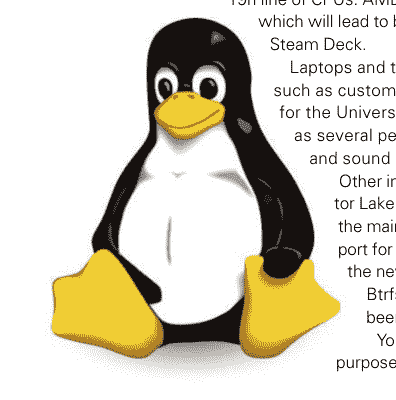

### 在所有主要 Linux 发行版中发现另一严重缺陷

`CVE-2021-4034` 已被识别 (https://cve.mitre.org/cgi-bin/cvename.cgi?name=CVE-2021-4034)。这个名为 `PwnKit` 的新漏洞被追溯到 `pkexec` 在 12 多年前的初始提交。由于这个缺陷存在已久，所有依赖 `Polkit` 的 Linux 发行版均受影响。

`pkexec` 负责协调特权进程和非特权进程之间的交互，并允许授权用户以其他用户的身份执行命令。Qualys 的研究人员发现 `pkexec` 命令 (https://blog.qualys.com/vulnerabilities-threat-research/2022-01-25/pwnkit-local-privilege-escalation-vulnerability-discovered-in-polkits-pkexec-cve-2021-4034) 可被本地攻击者利用，在 `Ubuntu`、`Debian`、`Fedora` 和 `CentOS` 上将权限提升至 `root`（并警告说它很可能也适用于其他发行版）。

重要的是要理解，凭借这个漏洞，攻击者仅使用默认的 `polkit` 配置就可以在你的系统上获得完整的 `root` 权限。

当然，两个主要发行版 `Ubuntu` 和 `Red Hat` 已经为该漏洞发布了补丁。这些补丁适用于 `Ubuntu 14.04`、`16.04 ESM`、`18.04`、`20.04` 和 `21.04`，以及 `Red Hat` 的 `Workstation` 和 `Enterprise` 产品。

对于使用尚未修补此问题的发行版的用户，一个快速的修复方法是使用以下命令去除 `pkexec` 的 `setuid` 位：

```
sudo chmod 0755 /usr/bin/pkexec
```

如果你使用的是上述列出的 `Ubuntu` 或 `Red Hat` 版本，请确立即更新你的系统。


### 每两周获取最新新闻到你的收件箱

`Linux Update` 免费订阅

`bit.ly/Linux-Update`

## Linux Shell 手册 2022 版

新版内容充实，涵盖了系统配置和故障排除所需的最重要实用工具。

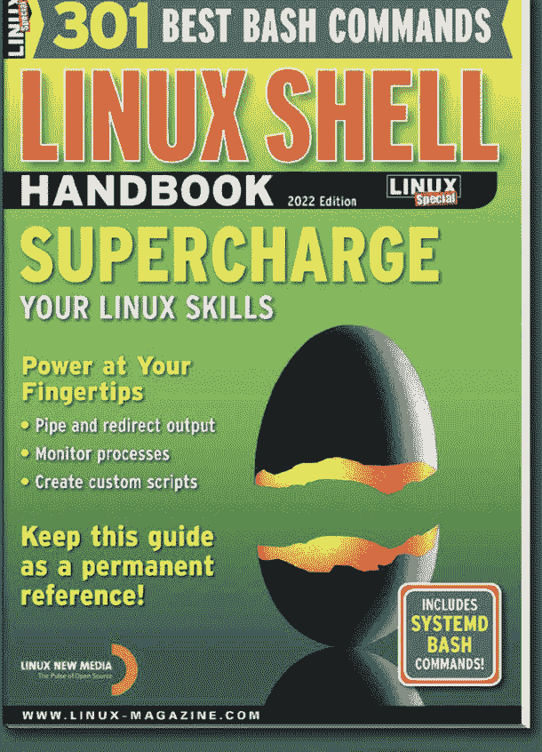

让我们先看看里面的一些内容：

- `Bash` 自定义
- 正则表达式
- `Systemd`
- `Bash` 脚本编写
- 网络工具
- 等等！

在线订购：

`shop.linuxnewmedia.com/specials`

## 新闻

### 内核新闻

#### Zack 的内核资讯


通讯记者 `Zack Brown` 报道 Linux 内核社区的最新新闻、观点、困境和发展动态。

作者：`Zack Brown`

**作者**

Linux 内核邮件列表构成了 Linux 开发活动的核心。流量巨大，每周常常达到 10,000 条消息，而一个人想要跟上整个开发范围的进度几乎是不可能的。少数勇敢承担这一任务的人之一是 `Zack Brown`。

##### “文件系统”系统

来自 `IBM` 的 `Dov Murik` 发布了一些机密计算（`coco`）补丁。这是经过美化的营销术语，指的是“沙箱”（即一组隔离的进程，用于实施内部活动的安全保护）。但我并不是要谈 `coco`。有趣的是，`Dov` 的补丁使用 `SecurityFS` 来提供用户和安全区域之间的接口，结果这引发了争议。`SecurityFS` 大约诞生于 15 年前的 2.6 时代，以应对自制文件系统令人担忧的泛滥。其理念是让安全模块使用相同的 `SecurityFS` 应用程序编程接口（`API`），并在后台随心所欲地实现任何疯狂的想法。`SecurityFS` 仅仅提供了一个一致的网关，以便每个人都能轻松导航其他人各种概念。

`Greg Kroah-Hartman` 回复 `Dov`：“你为什么为这个使用 `securityfs`？`securityfs` 是供 `LSM` [Linux Security Modules，Linux 安全模块] 使用的。如果你想拥有自己的文件系统来玩弄这类东西，很好，写你自己的，现在只需要不到 200 行代码。过去我们经常这样做，直到人们意识到对于驱动程序的东西应该直接使用现成的东西。”

“但这不是一个驱动程序，所以当然可以，添加你自己的虚拟文件系统，在某个地方挂载它然后走人，不用去折腾 `securityfs`，对吧？”

但 `James Bottomley`（同样来自 `IBM`）对 `Greg` 的说法提出了异议。他回复道，“我们也将它用于非 `LSM` 的安全目的，例如 `TPM BIOS` 日志和 `IMA`。你为什么认为我们应该开始将 `securityfs` 限制为仅用于 `LSM`？这一直以来的政策并非如此。”他补充道，“我真的认为具有安全目的的东西应该使用 `securityfs`，以便人们知道去哪里查找它们。”

`Greg` 回复说，将 `SecurityFS` 用于 `LSM` “是该文件系统创建时的初衷，但我想现在这真的取决于 `LSM` 维护者希望它用于什么用途。”但他建议道，“如果那些人想要一个文件系统接口，为什么不直接做一个 `cocofs` 呢？现在只需要大约 200 行代码，甚至更少，这样你只需要挂载系统实际需要的部分。如果这不是必须的，为什么要强行将其塞入 `securityfs`？”

`James` 指出，`coco` 仅仅是他们正在实现的特定功能的第一种潜在用途——将秘密数据传输到虚拟机中，而虚拟机本身无法读取它。他说，“这不是强行的。秘密传输在 `BIOS` 日志的方式下是一种安全功能。”

`Greg` 非常怀疑，并对听说 `BIOS` 日志使用 `SecurityFS` 感到惊讶。`James` 确认道，“是的。它在 `/sys/kernel/security/tpm0/` 下。所有的 `IMA` 策略控制及其日志都在 `/sys/kernel/security/ima/` 下，这就是为什么我认为将 `securityfs` 声明为用于任何安全相关用途已经是我们的事实（即使不是法律）政策。”

`James` 还补充道，“我知道 `Al [Viro]` 喜欢这种大量独立文件系统业务，但我不支持。对于你做的每一个，你不仅要记录所有东西，还要找到一个发行版都能同意的首选挂载点，并让它们同意启用该挂载，这通常需要数月的谈判。通过共同的用途将较少的文件系统分组，并使用发行版实际同意的挂载点，似乎是一种更容易的启用方法。”

`Greg` 认为这些论点没有说服力。一方面，他说，无论你是创建新的文件系统还是使用现有的文件系统，你仍然需要记录存储在该文件系统中的数据。

至于 Linux 发行版在挂载点上进行谈判——或者决定首先采用给定的功能——`Greg` 认为这是正常的。他说，“启用它确实需要时间，这是好事，因为如果他们不认为它应该存在，因为他们不想使用它，那么它就不会存在，这意味着他们不需要你的新功能，或者你还没有让它足够有用。所以再次说，这不是问题。”

`Greg` 的根本问题是安全。`SecurityFS` 用户群越广泛，这些用户中的每一个就越有可能向 `SecurityFS` 添加更多功能，将各种功能暴露给用户空间，并且通常呈现给攻击者更多的表面去寻找安全漏洞。


#### 维护 GitHub 内核分支

来自 Paragon 的 Konstantin Komarov 提交了一个 NTFS 补丁——或者更准确地说，他请求 Linus Torvalds 从 Paragon 的 GitHub 树中拉取该补丁。Linus 回复道：

> “对于 `github` 账户（或者真的，除了 `kernel.org` 我可以直接信任其账户管理之外的任何东西），我真的很希望拉取请求是一个签名的标签，而不仅仅是一个普通的分支。
>
> 在一个完美的世界里，这将是一个 `PGP` 签名，我可以通过信任链直接追溯到你，但我实际上从未要求过这样。
>
> “所以我虽然更喜欢看到完整的信任链，但我意识到设置它并不总是容易的，因此至少我希望看到一个保持不变的‘身份’，以便我可以看到拉取来自控制该密钥的同一一致来源。”

几分钟后，他回复了自己的邮件，说他这次会直接拉取该树以避免延误，但他要求 `Paragon` 设置 `PGP` 并在未来开始使用签名的标签。

顺带一提，Linus 补充道：

> “我*注意到*你那里有一个 `github` 合并提交。
>
> *这就是*另一件我*真的*不想看到的东西——`github` 创建绝对无用的垃圾合并，你绝对不应该使用 `github` 接口来合并任何东西。
>
> *这是*那个合并的完整提交信息：

```
Merge branch 'torvals:master' into master
```

> “是的，这不是一个可接受的信息。更不用说它有一个错误的‘`github.com`’提交者等等。
>
> *`github`* 是一个很好的托管站点，它还擅长许多其他事情，但合并不是其中之一。
>
> “Linux 内核合并需要*正确地*完成。这意味着有适当的提交信息，关于正在合并什么以及*为什么*合并某事的信息。但这还意味着正确的作者和提交者信息等。所有这些都是 `github` 完全搞得一团糟的。
>
> *我们*在 `ksmbd` 拉取请求上遇到了同样的问题，我的回应是一样的：最初的拉取可能有一些怪癖，我现在会接受，但对于持续开发，你需要正确地做事。这意味着从命令行进行合并，而不是使用完全损坏的 `github` 网页接口。”

Linus 的帖子之后没有讨论或争议。有趣的是，签名问题不是假设性的。几年前，Linus 不得不忍受围绕各种补丁许可问题的法律麻烦。因此，补丁签名成为追溯所有补丁以进行许可验证目的的原点标准方式。

### 放入内核还是移出内核？

在操作系统开发中，一个持续存在的问题是：微内核更好还是单体内核更好？这场辩论有点奇怪，因为对于“单体内核”并没有明确的定义，尽管大家似乎都同意 Linux 是一个例子。

在开源世界中，支持微内核的阵营是以 Hurd 微内核为核心的 GNU 项目。微内核的理念是，用户空间应尽可能多地承担工作，内核本身只实现最基础的功能。微内核支持者认为，通过这种方式可以构建一个高度安全的系统，因为内核的攻击面（attack vectors）更少。更小的范围意味着随着时间推移代码变更（code churn）更少，从而减少了可能被攻击者利用的漏洞。

这场辩论之所以奇怪，是因为它将问题框架化为效率与安全性对完全混乱疯狂的权衡。事实上（这也是本专栏的主题），几乎所有人都希望他们的操作系统内核尽可能小，原因正是上述那些理由。或许这场辩论真正应该讨论的究竟是什么属于用户空间，什么又不属于。

例如，最近在 Linux 内核邮件列表中，Shijie Huang 提交了一些非统一内存访问（NUMA）补丁。NUMA 是一种像对称多处理（SMP）这样的多处理器硬件架构。但与 SMP 隐藏了当前使用的内存和 CPU 之间可能存在的差异不同，NUMA 可能拥有速度不一的硬件。对于消费级产品而言，这意味着更低廉的制造成本。对于操作系统开发者来说，问题是如何支持分配过程，以便在需要时使用更快的硬件，而在速度不那么重要时使用较慢的硬件。

Shijie 的补丁解决了操作系统需要知道针对特定任务将使用哪些硬件（因而也是哪些速度）的问题。例如，加载到内存中的特定文件将只有一个缓存版本，尽管可能有多个不同的硬件速度与该缓存版本的使用相关。

Shijie 希望用户能够指定任何给定文件的 NUMA 需求，否则内核将在访问该文件时使用更快或更慢的硬件。换句话说，他问道：“是否可以为程序/库实现每节点（per-node）页缓存？”

然而，正如你可能想象的那样，这说起来容易做起来难，控制哪块硬件操作给定文件的过程发生在内核较深的部分。正如 Matthew Wilcox 在他的回复中所说：

> *“此时，我们没有方法来支持进程内的文本复制。因此，你所建议的（如果实现的话）仅适用于限制自己在单个节点上运行的进程。也就是说，如果你的系统有节点 0 上的 CPU 0-3 和节点 1 上的 CPU 4-7，那么仅在节点 0 上运行或仅在节点 1 上运行的进程将获取相应节点上的文本。
>
> *“如果有一个进程在节点 0 和节点 1 上同时运行，由于没有对每节点 `PGD`（页全局目录）的支持，它将获取来自节点 0 和节点 1 的混合页面，这看起来并不一定有很大的优势。*

Al Viro 也回复了 Shijie，说道：“每节点页缓存是什么意思？同一个文件区域有多个页面？那在一致性方面会是灾难性的……”

一致性是操作系统设计的关键部分——它意味着当内核写入内存的某一部分时，随后对该同一内存部分的读取尝试应显示写入后的值，而不是显示写入前的旧值。在操作系统中失去内存一致性，有点相当于突然发现自己所在的建筑物被大火吞噬。

Shijie 同意一致性很重要，但他表示，如果数据被限制为只读，那么一致性将不成问题，因为值永远不会改变。他提交了一个补丁来演示他所说的内容。

Linux Torvalds 此时介入，说道：“你绝对不希望在缓存中实际复制它。”

Shijie 和其他人之间进行了一些关于实现的讨论，但在某个时刻，Linus 再次介入，语气强硬了一些，说道：

> *“没有节点 `I_mapping` 指针会导致巨大的一致性问题。
>
> *“如果你不关心一致性，那没问题——但这必须是一个用户空间的决定（即“我将只是复制这个文件”）。
>
> *“你不能让内核决定“我将把这个节点的这组页面映射，并将那个节点的那组页面映射”，以防它们是 `MAP_SHARED` 的东西。
>
> *“无论如何，我认为从根本上说，这是那种 99.9% 的人都不关心、并且不想要复杂度的事情之一。
>
> *“而那 0.1% 确实关心的人真的可以且应该在用户空间这样做，因为他们知道自己在意。
>
> *“要求内核在核心关键功能中为对大多数人来说非常非常罕见且无关紧要的事情做复杂的事情，而这事情可以且应该由关心它的人在用户空间完成，这种做法是错误的。
>
> *“因为这里真正的问题应该是‘这是否真的重要，并且是否因为用户空间根本无法自己完成，所以需要内核的帮助？’*“
>
> *“而答案是一个相当简单的‘不’。*

讨论到此结束，Shijie 回到了绘图板前（重新开始思考）。

对我来说，这是一个本可以放入单体 Linux 内核的功能示例。它将为特定的一群用户提供有用的功能。它将处理现实中存在的用例。它会使内核整体变慢，但这正是微内核支持者期望单体内核所包含的那种事物。

似乎很明确，无论是微内核还是单体内核的支持者，都认为如果某事可以在用户空间中完成，那么就不应该放入内核中。差异的关键点在于我们具体使用什么来划定界限？在此处，这很大程度上变成了个人意见的问题。Linus 可能会说，这取决于很多因素。该功能在内核中运行是否比在用户空间快得多？内核代码看起来是否合理且易于维护？等等。并且 GNU Hurd 的人们可能会有不同的看法，`Redox`、`Genode`、`HelenOS` 以及各种其他微内核项目的贡献者也是如此。


### 用数字档案整理你的书架

通过我们的数字档案捆绑包，完善您的 *Linux Magazine* 和 *ADMIN Network & Security* 收藏。您可以获得一年的 PDF 格式期刊，随时在任何设备上访问。

https://bit.ly/archive-bundle

### 在 Linux 上加密您的磁盘

#### 不可读

加密卷早已不再是一种例外或奢侈品。企业策略和合规规则通常要求对关键数据进行加密。本文探讨了 Linux 上的磁盘加密工具。


文/ Martin Loschwitz

过去 10 年间，便携式计算机使台式机退居幕后，这并非巧合。如今，用户仅在进行视频渲染或游戏等计算密集型工作时才需要桌面系统。对于其他所有事情，即使是中端笔记本电脑也完全足够。但笔记本电脑也有一个缺点：它们比独立 PC 更容易被偷窃。适当的保险单可以减轻设备被盗后的替换成本。然而，补偿数据丢失就没那么容易了。

企业和用户只能通过完全加密设备中的数据载体，从 USB 闪存盘到外置硬盘，来有效地保护自己免受此类可怕场景的影响。Linux 用户如何最好地通过加密来保护磁盘数据？本文描述了一些 Linux 上领先的加密方法和工具。

#### 使用 LUKS 的 Cryptsetup

几乎所有接触过 Linux 加密的人都会遇到缩写 LUKS [1]，它代表 Linux Unified Key Setup（Linux 统一密钥设置）。LUKS 标准描述了 Linux 上的磁盘加密应该是什么样的（图 1）。LUKS 基于 Cryptsetup 工具，该工具反过来使用 Linux 内核的 dm-crypt 内核模块来管理加密卷。

乍一看，这听起来比实际情况混乱得多——至少如果你记住 Linux 内核在过去几十年中是如何处理块设备及其驱动程序的话。内核的块设备层采用了一种技巧，允许将不同的驱动程序串联连接起来以组合它们的功能。

dm-crypt 是块设备层的一部分。如果管理员指示设备映射器（例如包括 LVM）在访问块设备之前在其前面添加 dm-crypt 驱动程序，那么该块设备就可以使用所有的 dm-crypt 功能。事实上，dm-crypt 也实现了自己的基本加密。然而，在内核开发人员眼中，这些措施远远不足以满足当今的需求。因此，他们创建了 LUKS 格式，该格式标准化了加密所需的所有功能，并将其定义为分区表头的一部分。这也意味着 Linux 上加密驱动器的定义独立于发行版和供应商。

#### 集成到系统中

如今，带有 LUKS 支持的 Cryptsetup 包含在所有发行版中。大多数制造商还将该工具直接集成到了他们的设置例程中。你可以在安装各个目录（如 `/home`）时开始加密，或者你可以加密整个不可拆卸的磁盘。

一旦加密磁盘，操作系统在没有密码的情况下就无法启动。如果你从设备中移除数据介质并尝试读取它，你只会看到一堆杂乱的数据。人们一致同意，这种在 Linux 下使用加密驱动器的方式是当今最安全的方法。它还使用硬件加速。如果设备中没有 Atom 或其他低成本处理器，CPU 很可能内置了对各种加密算法的硬件支持。

通过 USB 连接到系统的设备也可以使用 Cryptsetup 和 LUKS 进行加密——就像内置的 NVMe 磁盘一样。然而，不同发行版之间的设置存在差异，不同的桌面环境也提供了自己操作 Cryptsetup 和 LUKS 的工具。如果你想避免转到命令行，你需要熟悉系统的默认设置。

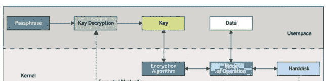

图 1：LUKS，Linux 上加密磁盘的标准格式，跨发行版工作。© Suse

#### Veracrypt 跨平台兼容性

当然，Cryptsetup 和 LUKS 的组合有一个主要缺点：它与其他操作系统几乎没有互操作性。你需要解决一种“先有鸡还是先有蛋”的问题。在 LUKS 和 Cryptsetup 刚刚发展起来的时候，就已经存在了在主要操作系统上同样运行良好的解决方案。这些替代方案虽然未与系统深度集成，但它们能够跨越操作系统边界工作，而不仅仅局限于 Linux。

其中一种解决方案是 Veracrypt，它可在多种操作系统上运行。例如，在 Linux 上，Veracrypt 直接依赖于 Dm-crypt。然而，它同时也确保了创建的容器和数据介质在跨越操作系统边界时仍能保持相互兼容。拥有数据介质和相应密钥的管理员可以以相同的方式在 Windows、Linux 和 macOS 上挂载使用 Veracrypt 加密的现有设备。因此，Veracrypt 特别适合那些经常在 Linux 和 Windows 之间来回切换的用户，例如，因为他们在家用电脑和办公电脑上使用不同的系统。

##### 回忆 Truecrypt

如果不提及 Veracrypt [2] 及其著名的前身，关于 Linux 磁盘加密的文章将是不完整的。Veracrypt 诞生于 2013 年，源自 Truecrypt。当时，Linux 界的许多观察者认为 Truecrypt 是 Cryptsetup 和 LUKS 组合在 Linux 上唯一有效的替代方案。

##### 合理否认

Veracrypt 中另一个绝对方便的功能是从其前身继承而来的，即嵌套加密驱动器的能力，从而实现安全研究人员所称的`合理否认`。合理否认提供了一种隐瞒数据的手段，而外表看起来并不像在隐藏数据。其核心思想是彻底隐藏加密数据的存在。攻击者甚至不知道数据被扣留了，理论上甚至不会想到去询问。

由于 2014 年的一次审计，Truecrypt 的开发宣告结束，并且是“Truecrypt 开发者自己警告人们不要使用他们的软件”。不久之后，开发者提供了 Truecrypt 的一个新的最终版本，该版本在功能上受到了极大的限制。据开发者称，这个最终版本仅用于将现有设置转换为使用微软标准加密的 Bitlocker 设置。

Veracrypt 通过在驱动器上创建多个嵌套容器来支持合理否认。第一个容器及其在磁盘上的签名从外部很容易被识别出来。然而，由于这个容器在处理正确时仅包含表面上相关的数据，驱动器所有者可以交出密钥（图 3）。第二个卷将其头部隐藏在第一个卷的头部中。如果你能打开它，你就需要知道它的存在，因为从外部看，它就像随机数据一样。并且，它的存在可以通过第一个加密卷的存在来轻易解释。

Truecrypt 的终结在社区中引发了激烈的猜测，甚至有人认为情报机构介入了此事。当额外完成的事后审计在 Truecrypt 的运作方式中未发现重大问题后，这些猜测并未平息。Truecrypt 终结的实际原因可能永远不会被查明。

##### Truecrypt 的继承者

作为一年前从 Truecrypt 分离出来的独立项目，Veracrypt 成为 Truecrypt 事实上的继任者。总体而言，从今天的角度来看，Veracrypt 是一个功能非常强大的数据介质加密器。

Veracrypt 从其祖先进继承的一个巨大优势是它可以在 Windows、Linux 和 macOS 上运行（图 2）。它在可能的范围内使用现有的基础设施


图 2：在 Veracrypt 中创建的加密驱动器可以在 Windows、macOS 或 Linux 系统上使用。

##### 易于使用

如果您正在寻找一种快速加密数据介质的解决方案，Veracrypt 是正确的选择。安装完成后（在 Linux 上通过包管理器处理，在 Windows 和 macOS 上通过安装程序处理），将以图形界面形式打开一个向导。该向导引导您完成整个创建过程。Veracrypt 提供在文件系统中创建加密容器或加密整个块设备的选项。

无论您选择哪种方法，任何值得称道的系统管理员应该都不会难以理解并回应 Veracrypt 的问题。如果您以前从未接触过磁盘加密，您可能不会觉得 Veracrypt 特别用户友好。但是，如果您已经骑在马鞍上更长时间（即更有经验），您将在所有受支持的平台上与该程序相处得很好。

在 Windows 上，Veracrypt 甚至更进一步，可以在加密驱动器中保留一个隐藏操作系统。从外部看，这个驱动器就像一个正常的数据介质，但在底层，它隐藏了一个完整的系统分区。

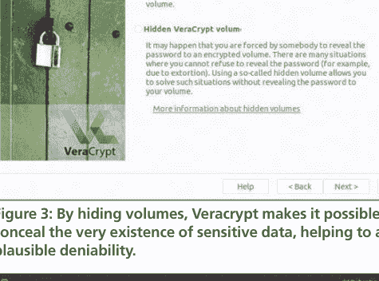

#### GocryptFS

GocryptFS [3] 是 Linux 上加密磁盘的另一个先进工具。GocryptFS 的存在也要归功于一个早期系统，该系统对 FOSS 社区失去了光彩：EncFS。

当审计期间发生了一些不应发生在加密解决方案上的事情时，EncFS 受到了攻击。测试人员发现源代码中存在一个漏洞，在最坏的情况下，允许计算用于加密的密钥。当攻击者获得加密容器的多个版本时，EncFS 尤其存在这种危险。那时可以通过简单的匹配和排除程序找到实际密钥。基本上，自此事发生以来，EncFS 一直受到所有关注安全和加密的人的抨击（图 4）。

然而，奥地利人 Jakob Unterwurzacher 认为 EncFS 背后的想法非常有说服力，于是他着手创建一个新的实现。在这个过程中，他使用了 Go 编程语言，这不仅解释了程序的名称，而且与之前使用的 C++ 相比，在实践中也转化为相当大的速度优势。FUSE 的使用保持不变，因此 GocryptFS（图 5）可以在任何激活了 FUSE 环境的 Linux 系统上使用。


由于 `FUSE` 也可用于 `Windows`，因此 `GocryptFS` 也可以在 `Windows` 系统上运行。但是，使用其自己的包装器，该解决方案被称为 `CpcryptFS`，正如名称所示，`GocryptFS` 的 `Windows` 版本是用 `C++` 而不是 `Go` 编写的。`macOS` 用户则不太幸运：`macFUSE` 确实存在，但它不提供免费许可证。因此，`FOSS` 社区倾向于避免使用该工具。然而，一种替代方案已经制定出来，将 `GocryptFS` 带到了 `macOS`，尽管删除了一些特殊功能。

如果您不想在命令行上使用 `GocryptFS`，您可以转向 `StiriKali`，它为 `GocryptFS` 及其前身 `EncFS` 提供了图形用户界面。

### GocryptFS 提供的功能

如前所述，`GocryptFS` 始终在文件或磁盘上创建完整的加密容器。基本上，`GocryptFS` 设计为一个覆盖文件系统。在

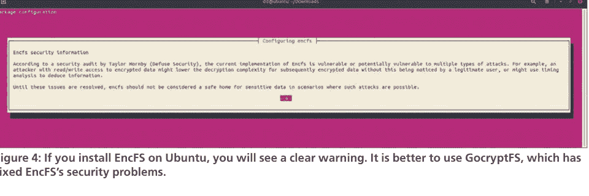

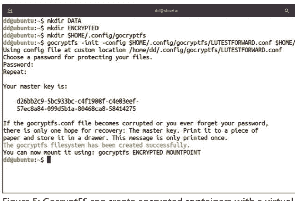

正常操作模式下，您启用一个 `GocryptFS` 容器，向其写入一些内容，再次禁用该容器，然后加密内容就会以其原本的形式出现在底层文件系统中。借助文档的帮助，创建 `GocryptFS` 覆盖层既快速又简单。

`GocryptFS` 提供第二种选项，称为反向模式，适用于隐式不安全的存储目标。例如，如果您希望将备份存储在云中，您可以在 `GocryptFS` 中激活反向模式。反向模式直接公开加密数据，以便您可以将其复制到其他位置。

`GocryptFS` 与 `VeraCrypt` 一样简单，不过，`GocryptFS` 具有明显的速度优势。至少从主观上看，在加密方面存在相当大的差异，尽管 `VeraCrypt` 和 `GocryptFS` 以相同的方式支持各种加密算法的加速。如果您想管理加密数据，您肯定会想要看看 `GocryptFS`。

#### 通用 GUI：Zulucrypt

在这个加密器展示中的最后一个候选者是一个程序，它实际上并不自己执行加密工作。`Zulucrypt` [4]，连同其包含的 `Zulumount`，更关注于组织 `Linux` 下可用的多种加密方法的泛滥。`Zulucrypt`（图 6）承诺在单一界面中统一经典的 `crypt` 设置、`LUKS`、`Veracrypt` 和 `GocryptFS`。


---

太忙了，无暇浏览新闻稿和健谈的科技新闻网站？让我们将最相关的新闻、技术文章和技巧——直接发送到您的收件箱。

- `Linux` Update • `ADMIN` Update • `ADMIN` HPC
- 把握 IT 行业的脉搏。
- `ADMIN` and `HPC`: `bit.ly/HPC-ADMIN-Update`
- `Linux` Update: `bit.ly/Linux-Update`

首先，它主要是一个图形用户界面（GUI），在后台集成并调用其他工具。

`ZuluCrypt` 极其用户友好。该工具包含在大多数流行的 `Linux` 发行版中，否则可以通过提供商的网站轻松安装。紧接着，`ZuluCrypt` 的主窗口就展示了该工具实际有多么强大。

在 `ZuluCrypt` 中，你可以使用 `Cryptsetup` 创建或打开 `LUKS` 设备，创建 `VeraCrypt` 卷或使用现有卷，并通过 `GocryptFS` 使用 `FUSE` 挂载文件系统。卸载操作也以相同的方式进行。`ZuluCrypt` 免去了用户处理各个解决方案的命令行界面（CLI）或图形界面（GUI）应用程序细节的需要。然而，如果 `ZuluCrypt` 中发生了程序本身无法修复的问题，至少熟悉各个程序的基本功能并非坏事。不过，在日常操作中，这类事故可能属于例外情况。

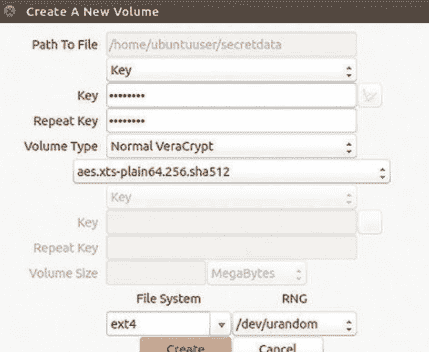

总而言之，`ZuluCrypt` 是一个强大且实用的小助手，它帮助管理员节省了部分学习曲线，并有效地整合了 `Linux` 下不同的加密器。对于使用或必须使用多种加密解决方案的人来说，`ZuluCrypt` 尤其有益。

### 结论

无论是在服务器还是桌面上，`Linux` 上的加密已不再是一个难题。`Linux` 自带了 `Cryptsetup` 和 `LUKS` 形式的内置工具。发行版对这些内置工具的集成非常完善，您可以毫无顾虑地设置一个具有加密根分区和加密主目录的系统。

对于笔记本电脑等移动设备，这些加密工具使 `Linux` 与其他产品如 `Windows`（`Bitlocker`）或 `macOS`（`File Vault`）并驾齐驱。对于 `USB` 闪存盘或外部 `USB` 硬盘等可移动介质的加密也适用同样的道理。这里有 `VeraCrypt`、`GocryptFS` 以及 `Cryptsetup/LUKS` 形式的解决方案，可以迅速设置并绝对可靠地工作。如果您偶尔在不同操作系统之间穿梭，您甚至可以找到一种适用于所有常见操作系统的解决方案，即 `VeraCrypt`。

需要注意的是，现有的非加密系统并不容易切换为加密系统。考虑到具有 `USB-C` 和 `Thunderbolt` 接口的快速外部驱动器，将设备上的所有数据迁移出去，重新安装加密系统，然后再将数据复制回来，似乎更有意义。

### 信息

- [1] `LUKS`: `https://gitlab.com/cryptsetup/cryptsetup`
- [2] `VeraCrypt`: `https://www.veracrypt.fr/en/Home.html`
- [3] `GocryptFS`: `https://github.com/rfjakob/gocryptfs`
- [4] `ZuluCrypt`: `http://mhgomchungu.github.io/zuluCrypt/`

### 作者

自由职业记者 `马丁·格哈德·洛斯希维茨（Martin Gerhard Loschwitz）` 主要关注 `OpenStack`、`Kubernetes` 和 `Ceph` 等主题。


## FOSSlife

### 向所有人开放

新闻 • 职业 • 科技技能与生活 • 资源

`FOSSlife.org`

## 秘密信件

电子邮件加密并非那么困难——而且现在比以往任何时候都更重要。我们将探讨电子邮件加密中的一些重要工具和趋势。

作者：皮尔·海因莱因（Peer Heinlein）


从邮件服务器（因此也包括其管理员）的角度来看，电子邮件仅仅是从服务器传输到服务器的 `ASCII` 文本文件。它们在传输中和在目的地都会成为文件系统中的文本文件，管理员可以自由阅读。阅读邮件对管理员来说并不是问题，即使由于数量庞大，单条消息很快就会丢失。但如果你知道自己在找什么，你就可以阅读任何你想读的内容。网络罪犯经常黑客入侵电子邮件收件箱，并系统地分析他们找到的消息。

电子邮件已经存在了一代人，电子邮件安全的问题也几乎古老了同样长久。本文提供了一些关于当前电子邮件加密状况的思考，包括什么有效以及您可能想知道的一些复杂情况。

### SSL/TLS 及更多

保护电子邮件的第一步是保护通信通道。大多数知名且负责任的服务提供商现在都通过 `SSL/TLS` 加密提供与其邮件服务器的安全连接，以便数据以加密格式穿越互联网。

如果可以说 `所有` 电子邮件提供商都提供 `SSL/TLS` 安全通信，那将是很棒的，但事实并非如此。仍然存在差距，通常是在商业防火墙或垃圾邮件过滤器不太容易支持 `SSL/TLS` 的环境中，有一些非常老旧、未维护的邮件服务器。直接在互联网上接收邮件的旧 `Exchange` 服务器因其缺乏加密能力而格外显眼。好消息是，当使用基于 `Linux` 的邮件服务器（如 `Postfix`）时，`SSL/TLS` 通常是理所当然地提供的。

发送者既无法看到消息是否使用 `SSL/TLS` 加密，也不能假设其已加密。`Mailbox.org` 是第一个引入显示用户一旦编写完电子邮件即可看到目标系统是否以及如何通过 `SSL/TLS` 到达的程序的服务提供商。其他提供商现在也复制并实施了此程序。

如今，仅启用 `SSL/TLS` 是不够的。因为简单邮件传输协议（`SMTP`）中的加密是可选的，中间人可能会阻止 `SSL` 连接并强制使用未加密的明文连接。或者，攻击者可能会将邮件服务器的 `SSL` 证书替换为他们自己的证书。但这也有一种解决办法。基于 `DNS` 的命名实体身份验证（`DANE`）[1] 标准已经可用多年，它定义了邮件服务器如何通过匹配的 `TLSA` 类型 `DNS` 记录发布其所使用 `SSL` 证书的指纹。这一步有效地防止了第三方对证书的操作或压制。


但 `DANE` 的使用范围有限。注重数据保护的邮件提供商，如 `Mailbox.org`、`Mail.de` 和 `Posteo`，是早期的 `DANE` 采用者，其他多家提供商也纷纷效仿，但许多电子邮件提供商至今仍发现 `DANE` 很难使用。原因是，只有当它们自己通过 `DNSSEC` 保护 `DNS` 区域免受操作时，通过 `DANE` 发布证书指纹才能起作用。然而，`DNSSEC` 对某些基础设施提出了更大的挑战，因此许多 `IT` 经理对迈出这一步持谨慎态度。

拥有 `DNSSEC` 保护域名的邮件管理员只需几步简单的步骤即可发布证书的校验和。专门的网站 `[2]` 有助于生成所需的 `TLSA` 类型的 `DNS` 记录。但请注意：今后每次更换 `SSL` 证书时，您都必须记得更新您的 `DANE` 记录。具有先进配置的邮件服务器（例如 `Postfix`）会在通过 `DANE` 发布的证书和指纹不匹配，或者尽管已发布 `DANE/TLSA` 记录但目标服务器未提供 `SSL/TLS` 的情况下，停止发送出站邮件。发送方邮件服务器的 `main.cf` 文件需要包含一行 `smtpls_security_level = dane`，即使该服务器不为入站消息提供 `DANE`。

### 保护内容

`SSL` 已就位。一切都好了吗？并非如此，因为 `SSL` 仅保护两个特定邮件服务器之间的 `TCP/IP` 连接。没有人知道消息在后续传输过程中是否可能通过未加密的连接进行传输。此外，电子邮件本身以明文形式存在于服务器中，既在收件人的收件箱中，也在发件人的已发送文件夹中。

一个运行了数年甚至数十年的电子邮箱，可能包含许多高度私密的内容，您可能更希望这些内容远离公众视线。每个用户都需要思考，如果他们的整个收件箱变得公开会有什么影响，因为这种情况发生得太快了。选择不当的 `IMAP` 密码很容易被黑客破解；甚至可能在不经意间泄露给钓鱼网站，或被本地病毒感染所截获。

确保您的电子邮件保持私密的唯一方法是使用 `PGP` 或 `S/MIME` 对消息进行加密。这两种方法都基于相同的原理：每个用户都有一个非对称密钥对。它由一个公钥（用于加密和数字签名）和一个私钥（用于解密和验证数字签名）组成。用户选择的密码保护私钥免受未授权访问。在任何情况下都不应忘记此密码。如果密码丢失，密钥文件将不可用，所有使用该密钥加密的数据将无法再访问。

### 良好隐私保护（PGP）

如今许多 `Linux` 用户习惯使用 `PGP` 工作。您将您自己的公钥与其他收件人的公钥一起存储在本地密钥数据库中，该数据库也被称为密钥环（`keyring`）。由于随时间推移可以为一个邮件地址生成多个密钥，因此每个密钥都有自己独立的 `ID`。此外，可以使用数学上唯一的指纹来验证密钥的真实性。此指纹可以发布在名片或网页版权信息中，或通过电话进行验证，从而使通信伙伴能够确保他们确实拥有正确的密钥。

如今生成公钥/私钥密钥对非常简单，通常在使用 `PGP` 软件工具时会自动发生。然后，公钥可以单独或自动传输给通信伙伴。像 `Thunderbird` 这样的邮件程序提供了一键将公钥附加到出站电子邮件的功能。您也可以将公钥上传到公共 `PGP` 密钥服务器，感兴趣的各方会自动在那里找到它。

一旦密钥投入流通，就无法再删除，但在密钥被盗或密码丢失的情况下可以将其声明为无效。要声明密钥无效，您应提前生成吊销证书（即，在生成密钥后立即生成）并将其存储在您文件系统中的安全位置。如果您自己的密码丢失，您就不再拥有创建吊销证书的选项。此外，密钥不应无限期签发，而应分配一个几年后未来的过期日期。

这些选项通常都可以在邮件程序的密钥管理器中找到。按鼠标右键调出您自己的密钥的属性及潜在操作（图 1）。

仍有一个问题存在：最初无法验证某个密钥是否确实来自邮件地址的所有者。攻击者可以轻松地为任何邮件地址生成自己的 `PGP` 密钥并投入流通。因此，其他用户的公共 `PGP` 密钥在您的密钥环中最初被视为不可信的。然而，发件人和收件人可以在那里显示特定的 `PGP` 指纹，并通过另一种通信介质（如有必要，通过简短的电话）进行验证。

以上是理论部分。在实践中，如今许多用户直接使用他们收到的密钥而不进行验证。在大多数流行邮件程序的设置中，您可以定义密钥可用于发送的最低信任级别。这肯定不理想，并可能带来虚假的安全感。另一方面，使用任何形式的加密总比完全不加密要好，因此，如果仍有疑虑，只要采取务实的态度即可。如果收到的密钥在接收时被第三方操纵，且该受损密钥被永久信任，则该密钥是不安全的。但如果您假设密钥交换（这可能发生在很久以前）在当时是安全的，那么该密钥可以成功保护免受未来不受欢迎的读者和可怕的中间人攻击的影响。

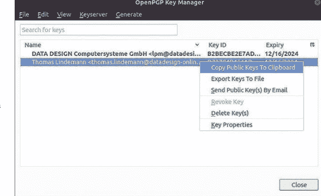

### 电子邮件的现状

由于手动检查不是处理大量通信伙伴的好方法，`PGP` 实现了信任网的概念。在对身份进行仔细的个人验证后，用户签署其他用户的密钥（图 2），从而提高其可信度。这些签名随后成为用户公钥的一部分（图 3）。如果在某个时刻，由于许多已知可信通信伙伴的签名，密钥拥有足够良好的声誉，您可以省去自己的手动验证。即使今天，`PGP` 密钥签名聚会仍在会议上举行。您必须携带您自己的 `PGP` 密钥，默认情况下还需要您的身份证或护照作为身份证明，因为仔细验证是必须的。

然而，`PGP` 相互签名的概念很复杂，需要主动性，并且需要大量的交互——这是 `PGP` 从未获得广泛接受的主要原因之一。因此，现代方法设想通过由您的服务提供商运行的特殊密钥服务器发布您自己的 `PGP` 密钥，通信伙伴可以自动从中获取它。虽然这种方法不能排除服务提供商管理员的操纵，但它确保密钥不再能被第三方任意生成和流通。使用如 `WKS/WKD` `[3]` 等方法，域名所有者可以指定需要查询哪些 `PGP` 密钥服务器以获取其自己域名的密钥。然而，只有少数服务提供商系统地提供 `PGP` 密钥服务器，并为其邮件域名设置了相应的 `WKD` 记录。如果做到了，自动密钥交换就没有任何障碍。像 `GnuPG` 这样的 `PGP` 实现可以自动检测正确的密钥服务器并下载密钥材料。

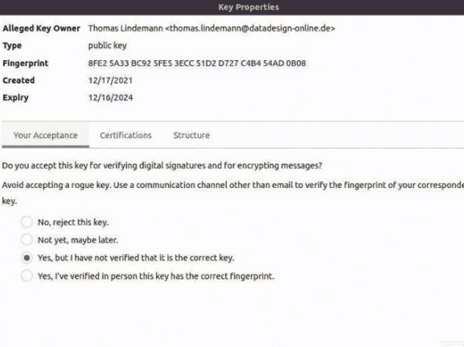

图 2：签署第三方密钥会增加其可信度，并需要适当的谨慎。

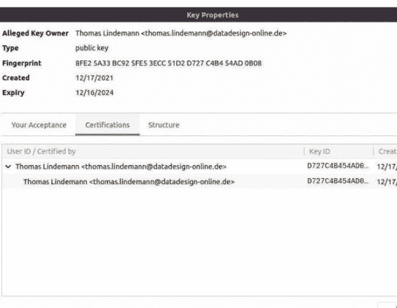

图 3：密钥的属性显示其指纹以及其他用户的签名。

### S/MIME：一种集中式方法

`S/MIME` `[4]`，第二种已知的邮件加密方法，基本上以与 `PGP` 类似的方式加密和签名，但在密钥生成和管理方面采用更加集中的方法。`S/MIME` 证书由中央证书颁发机构签发、监控，并在必要时声明无效。因此，`S/MIME` 适用于在高度受控环境中进行结构化使用，例如在政府机构或大型企业中。传统的商务邮件客户端如 `Outlook` 一直原生支持 `S/MIME` 也就不足为奇了。

另一方面，`S/MIME` 对个人使用来说不太实用，因为最初没有合理的集中组织的证书颁发机构。多年前，储蓄银行曾通过 `S-Trust` 项目试图向大众发行 `S/MIME` 证书，但这一举措并未流行起来。迄今为止最可行的方法似乎是 `Volksschlüssel` 解决方案（大众加密）项目 `[5]`，该项目由弗劳恩霍夫协会 `[6]` 运营，值得推荐，但尚未获得广泛接受。

### 未加密的元数据

如果使用 `PGP` 或 `S/MIME` 对电子邮件进行加密，加密将影响电子邮件的整个正文，包括消息文本和任何文件附件。邮件头的元数据（即发件人、收件人等信息，（消息）`ID` 和日期）保持可读。电子邮件的主题也传统上属于邮件未加密的头部数据的一部分。如果愿意，现代的 `PGP` 实现还可以在加密的消息主体中隐藏主题，使其只有在解密后才能被读取。

### 在邮件客户端中加密

如果像 `Thunderbird` 这样的邮件程序遇到加密消息，它首先会识别用于加密该消息的密钥 `ID`，然后检查内部密钥环中是否存在用于解密的私钥。如果有，程序会提示用户输入密码以解锁自己的密钥。之后，邮件即可正常且无故障地阅读，并在需要时与主题一起显示在收件箱中。

邮件程序在内存中保留解密后的密钥较长时间是有意义的，这样可以在数小时内使用而无需输入密码。因此，用户可以方便且透明地阅读和编辑无数加密消息，甚至没有注意到消息正在后台解密。只有在更长时间的非活动状态或重启邮件程序后，用户才需要再次输入密钥密码。这种方法确保了最大的易用性，但理论上也存在攻击者可能从 `RAM` 中读取未受保护的密钥的风险。

另一方面，要发送电子邮件，如果存在收件人的众所周知且无需密码的公钥，则使用该公钥。如果消息发送给多个收件人，邮件可以同时使用所有收件人的密钥进行加密，从而所有收件人都能无故障地打开。唯一的小缺点是，专家可以根据邮件中当前使用的密钥识别隐藏的 `BCC` 收件人。顺便说一下，如果发件人的地址包含在分发列表中，发送回给发件人的副本默认也是加密的。

### 使用 Webmail 加密

一些网络邮件系统提供全面加密功能方面已经落后于时代。适用于 `Chrome`、`Edge` 和 `Firefox` 的 `Mailvelope` 浏览器插件 `[7]` 为网络邮件增添了安全的 `OpenPGP` 通信功能。它在用户的 Web 浏览器中本地运行，并检测提供者的 Webmail 中是否包含 `PGP` 加密的邮件。然后，它解码包含的邮件，将网页的内容替换为未加密的消息，并显示该消息。


`Mailvelope` 还可以发送加密邮件。在明文的草稿消息发送之前，`Mailvelope` 在本地对其进行加密，然后才将其传输到提供者的网络邮件系统。乍一看，这个过程似乎不错，因为解码是在用户的计算机上本地进行的。然而，安全专家对将 `Mailvelope` 作为浏览器插件的实现提出了抱怨：它导致敏感的 `PGP` 密钥材料存储在浏览器的插件区域中，而该区域无法 100% 保护。此外，`JavaScript` 被认为不适合用于实现安全的密码学。

`Open-XChange` 群件解决方案的 `Guard` 系统 [8] 等实现采取了一种略微不同的方法。这些解决方案将密钥安全地存储在提供者的服务器上，用户输入的密码保护其免受未授权访问。服务器负责加密和解密，从而无需浏览器插件。这意味着用户可以从其他计算机随时访问自己的邮箱，即使在旅途中也是如此。

### 结论

网络窃听者比以往任何时候都更加老练，这意味着现在是最适合熟悉电子邮件加密的时候。然而，正如本文所示，仅仅安装 `SSL/TLS` 或 `PGP` 并不能期望获得安全保证。考虑细节并仔细审视你需要确保消息保持私密的事项是值得的。

是信任你的邮件提供商提供更多安全性，还是在你自己的私人 `PC` 上保留自己的密钥更合适，这是每个用户需要决定的事情。但无论如何，鉴于近期病毒和勒索软件攻击的广泛范围，谨慎行事是值得的。

**信息**

*   [1] `DANE`: https://datatracker.ietf.org/doc/html/rfc6698
*   [2] `TLSA` 生成器: https://ssl-tools.net/tlsa-generator
*   [3] `WKS/WKD`: https://www.gnupg.org/WKD
*   [4] `S/MIME`: https://en.wikipedia.org/wiki/S/MIME
*   [5] 大众加密: https://volkverschluesselung.de/（德语）
*   [6] 弗劳恩霍夫研究所: https://www.fraunhofer.de/en.html
*   [7] `Mailvelope`: https://mailvelope.com/
*   [8] `Open-XChange`: https://www.open-xchange.com/

### 作者

`Peer Heinlein` 负责通过其公司 `Heinlein Support` 运营对企业至关重要的 `Linux` 基础设施。自 1992 年起专注于邮件服务，他撰写了 `Postfix` 书籍，并负责许多 `ISP`、数据中心和企业的邮件服务器。他自己的邮件提供商 `Mailbox.org` 专注于数据安全和隐私。

## 用特刊磨练你的技能！

从我们的特刊库中了解 `Shell`、`LibreOffice`、`Linux` 等更多内容。

`Linux Magazine` 团队创建了一系列单卷，让你深入了解你想了解的主题。

有印刷版或数字版

查看完整库！

`shop.linuxnewmedia.com`


## 加入 Linux 革命！

你所需的所有软件！

开始使用 `Linux`

更强大 * 更安全 * 更现代

学习如何设置 `Linux` 系统

*   听音乐
*   玩游戏
*   处理照片
*   浏览网页
*   还有更多！

## Linux Journal

301 个最佳 `Bash` 命令

`Linux Shell` 手册 2022 版

强化你的 `Linux` 技能

指下生力

*   管道和重定向输出
*   监控进程
*   创建自定义脚本

## 调优你的 Linux 系统

2024 版

101 个酷炫 `Linux` 技巧

`Linux` 极客的窍门和快捷键

*   恢复已删除的文档
*   在没有目标 `IP` 的情况下发送文件
*   查看你常用命令的实用速查表
*   优化：清理隐藏文件
*   极端 `Chroot`：切换到第二个发行版
*   发现专家的秘密

`WWW.LINUXMAGAZINE.COM`

## 内含免费 DVD！LibreOffice 完整版

深入探索世界上最伟大的免费办公套件

2022 版

`LibreOffice` 专家

*   编辑和保存 `MS Office` 文件
*   编写你自己的 `LO` 宏
*   节省时间并实现自动化

`Raspberry Pi` 极客

2,000 页的创客项目及更多内容！

`MakeSpace` 面向创客的动手项目

深入了解

*   `Raspberry Pi`
*   `Arduino`
*   复古游戏

探索 `FPGA`

学习为复古计算编程硬件

`Linux New Media`

### 滴水不漏！

一个名为可证明安全的概念将数学的严谨性带入了密码学的艺术中。

By Dominique Schröder


密码学最初是一种神秘的艺术形式，旨在向未经授权的人隐藏信息。例如，盖尤斯·尤利乌斯·恺撒大约在公元前 100 年开发了一种加密消息的简单方法。该方法的基本思想是将消息中的每个字母在字母表中移动固定的数量。这个位置然后作为秘密密钥。例如，如果恺撒想用密钥 `3` 加密 `Veni, vidi, vici`，结果将是密文 `Yhgl, yhgl, yhfl`。

然而，该方法很快被识破，随后被改进，再次被破解，如此循环。就这样，随着时间的推移，加密方法的设计者和为获取秘密信息而破解这些方法的攻击者之间形成了一种猫鼠游戏。这种状态一直持续到 1980 年代可证明安全的发现。

可证明安全是一个通过数学证明来评估系统安全性的领域。人们常以为密码学是一片数字的海洋和巨大的数字，确实如此；然而，对于数学家来说，目标是扫除细节，以逻辑证明所适用的方式对系统进行符号化定义。可证明安全的发展为古老的密码学实践带来了严谨性，而密码学曾被认为更偏向艺术而非科学。

本文将向你介绍可证明安全的概念，并通过电子邮件通信的示例分析来应用这些原则。我还会描述密码学方法使用中的一些典型错误，以及可证明安全的优势和局限性。最后但同样重要的是，我将使用实际例子来说明现代密码学领域的当前研究课题。

#### 可证明安全：六个步骤

根据安全设计原则，可证明安全流程有六个步骤，如图 1 所示。

##### 步骤 1：描述功能

第一步是描述系统的功能 – 预期用途是什么？这种描述通常采取需求规格说明书的形式。

##### 步骤 2：定义安全属性

定义安全特性的任务通常有两部分。首先，你需要以一种每个人都能理解的方式描述安全目标。之后，你需要精确地形式化所有内容，以避免模糊的解释。

请注意，形式化安全案例仅适用于形式化描述。因此，这种形式化必须尽可能精确地分解实际保护目标。通常，这一步涵盖以下方面：系统需要提供什么安全属性？我们谈论的是具有什么配置的哪些系统？我们需要防范哪类攻击者？他们的能力是什么？何时认为攻击成功？

识别和形式化安全属性是一项具有挑战性的任务，许多密码学方案尚未找到合适的安全模型。例如，研究界尚未就认证加密的定义达成一致 [1]。此外，效率和安全性之间始终存在自然的竞争状态。

##### 步骤 3：使用通用过程实现功能

此步骤涉及基本的密码学构建模块，例如私钥加密、消息认证码、哈希函数或签名方案。定义通用过程有助于你理解底层构建模块的哪些安全属性被用来实现新系统的特定安全属性。

设计必须独立于特定过程，因为总是有可能某些具体过程会被攻破。例如，研究人员最近发现了针对 `SHA-1` 哈希函数的首批攻击。因为个别组件被攻破而开发一个全新的系统成本太高。此外，个别实例的不安全性并不改变该概念本身是安全这一事实。为了说明这一点，只需简要思考一下防火保护的例子。仅仅因为某扇门的材料证明不具备防火性，并不意味着在特定位置预设立防火门的整体策略是错误的。

##### 步骤 4：安全性的正式数学证明

在对安全属性和设计进行正式规范之后，第四步将进行安全性的正式数学证明。此步骤确认设计满足所需的安全属性。形式化证明在底层密码学构建模块的安全属性与系统旨在实现的安全属性之间建立了一对一映射。形式化验证安全性会发现设计缺陷。如果底层密码学构建模块的安全属性未被应用，则设计存在缺陷，且很可能存在更高效的解决方案。

##### 步骤 5：实例化实现

一旦系统的安全性得到正式确立，就需要用特定的密码学过程来实例化通用的密码学构建模块。例如，引入了使用私钥的通用加密模式，并且在实践中该构建模块使用 `AES` 实现。由于通用构建模块处理的是抽象对象（例如“私钥”或“密文”），你需要将这些对象转换为具体实例。例如，对象“公钥加密方案”通过 `ElGamal` 加密方案进行实例化 [2]。

##### 步骤 6：实施的安全分析


第六步也是最后一步要求对具体实例化进行安全评估。这是必需的，因为从抽象描述过渡到具体实现存在许多陷阱。例如，用于互联网协议安全（IPsec）的基本密码学元素，即所谓的“先加密后计算消息认证码”（`encrypt-then-MAC`）是一种弱安全性的认证加密方案 [3]，它被认为对选定明文攻击（`CPA`）[4] 是安全的，并且在加密方案对 `CPA` 安全且消息认证码（`MAC`）不能被伪造的前提下，它也抵抗伪造。然而，例如在 `IPsec` 中使用的那个具体实例化被发现是不安全的。实施的安全性也可以通过渗透测试来证明，这些测试揭示了安全概念实施中的弱点，这些弱点可能允许攻击者渗透系统。

#### 示例：安全电子邮件

为了说明可证明安全软件开发的原则，考虑加密电子邮件消息的例子（图 2）。在这种情况下，`Alice` 想要向 `Bob` 发送一条加密消息。`Bob` 需要能够解密邮件并验证签名。

`Alice` 拥有 `Bob` 的公钥 $pk_B$。为了简化起见，我假设 `Alice` 已验证了该密钥并确保了它是 `Bob` 的。此外，`Alice` 拥有她自己的私钥 $sk_A$。

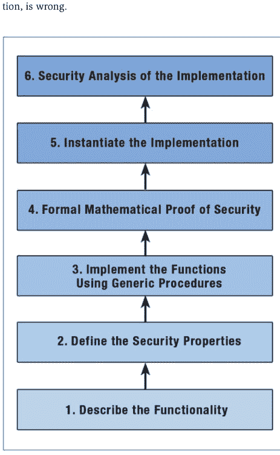

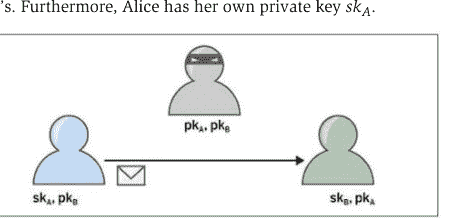

类似地，`Bob` 知道 `Alice` 的公钥 $pk_A$ 并拥有他自己的私钥 $sk_B$。在这种情况下，我也假设 `Bob` 已验证了密钥 $pk_A$ 的真实性。

第一步是规范功能。在这种情况下，我们处理的是认证电子邮件；因此，我有两个任务：首先，我需要计算一个加密且经过认证的密文。该接口被标记为 `Enc + Auth`。第二 – 假设认证有效 – 加密的电子邮件必须被解密。遵循相同的模式，我将此接口称为 `Verify + Dec`。

第二步是确定（相当简单的）安全属性。攻击者知道 `Alice` 和 `Bob` 的公钥以及上述所有所需信息。尽管如此，攻击者必须无法从电子邮件中获取信息。此外，攻击者必须无法代表 `Alice` 向 `Bob` 发送电子邮件（即，使用 $pk_A$ 公钥验证的消息）。

虽然这些功能在直觉层面上似乎合理，但它们仍留有太大的解释空间。攻击者能与 `Bob` 交互吗？是否存在一个学习阶段，在该阶段允许攻击者使用 `Alice` 作为接口将加密且经过认证的电子邮件从 `Alice` 转发给 `Bob`？攻击者是否被允许冒充 `Bob` 并在一段时间内阅读加密电子邮件？发给 `Bob` 的消息是如何生成的？在安全属性的形式化描述中，消除这些歧义至关重要，以得出精确且无歧义的描述。

在形式化接口和安全属性之后，第三步是使用密码学方法实例化各个组件。两个接口 `Enc + Auth` 和 `Verify + Dec` 需要用密码学过程构建，以提供确切所需的功能。对于安全电子邮件，这一步相对简单（图 3）。

为了实现 `Enc + Auth` 接口，你首先需要使用权公钥方法加密消息，然后使用数字签名方法对密文进行签名。我将使用 `c` 表示密文，用小写希腊字母 sigma（$\sigma$）表示签名。据此，你使用以下操作实现 `Verify + Dec` 接口。首先，使用签名过程的验证算法检查密文 `c` 上的签名的有效性。如果该签名有效，则使用公钥过程的解密算法解密密文 `c` 并输出得到的消息 `m`。

在安全验证中，我可以在第四步假设加密方法和签名方法都是根据形式化定义是安全的。然后形式化验证，根据形式模型，任何破坏 `Enc + Auth` 以及 `Verify + Dec` 安全的攻击都可被用来破坏公钥过程和签名过程的安全性。然而，由于在第一步骤中假设了两个过程都是安全的，因此产生矛盾，由此推断出这样的攻击不可能存在。

在最后两个步骤中，你现在使用具体的过程，例如基于 `RSA` 的加密，实现它们，并通过渗透测试证明实施的安全性。

#### 优势与局限

自从 `El Gamal` 被发现以来，诸如 `El Gamal` 加密 [4] 等可证明安全的密码学方法几乎不可破解。可证明安全性将加密方法的证明简化为一个简单的计算问题，例如众所周知的因子分解问题。

在该问题中，攻击者被给定一个数 $N = p \times q$，它被计算为两个等长素数 `p` 和 `q` 的乘积。攻击者的任务现在是计算两个素因子 `p` 和 `q`。迄今为止，尚未发现针对这个著名计算问题的有效求解算法。

加密方法的安全性现在基于因子分解问题，而形式化证明显示了以下内容：如果存在一个高效的攻击者打破了加密方案，那么也存在一个高效的攻击者解决了因子分解问题。换句话说，破解加密的问题与因子分解问题同样难以解决。

乍一看，“可证明安全”这一术语暗示不再存在任何可证明的攻击。然而，事实并非如此。针对`据称`可证明安全的系统的攻击反复发生。这种矛盾从何而来，又如何解决？首先，重要的是要注意，证明的安全性总是指形式化模型。然而，如果模型没有真实地反映实践，那么它就无法排除潜在的攻击，因为这些攻击根本不会出现在模型中。因此，准确建模现实是该领域最大的挑战之一，甚至建模中的最小错误也可能导致不安全的解决方案。

安全套接字层（`SSL`）协议的安全性是不完整建模的一个绝佳例子。在实践中，可能出现一条消息未被解密的情况；取而代之的是一个 `Padding Error` 消息。乍一看，这看起来无害，因为它似乎不会泄露关于明文的任何直接信息。这就是为什么它没有被包含在形式化模型中。然而，细看之下，研究人员能够表明可以利用此错误消息来解密完整消息 – 并且无需破坏加密方案的实际安全性即可做到。

#### 典型错误

信息安全领域有一句广为流传的箴言：你绝不应开发自己的密码学方法。但你在什么时候构建自己的过程呢？事实上，这句箴言在很多地方都显得不足，而应该改为：“除非你能证明你在做什么，否则绝不要使用密码学过程。”下面的例子表明，这一陈述绝不夸张，甚至简单地使用两种密码学过程都可能导致完全不安全的构建。

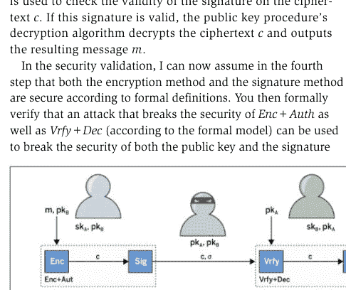

#### 密码学与可证明安全性

在这个例子中，假设 `Alice` 想要将一个文件 $m$ 加密后存储到云端。为此，她使用该消息和一把公钥。出于效率考虑，云运营商不希望存储相同消息的副本。然而，由于文件已经被加密，运营商无法轻易判断该消息是否已经以加密形式存在于云端。

为此，密文被扩展以包含消息的哈希值：$c = (Enc(pk, m), H(m))$。哈希函数是一种确定性函数，通常会对输入进行压缩。该函数的安全性基于抗碰撞性。这一属性意味着，（高效地）找到两个不同的消息 $m_1$ 和 $m_2$ 从而产生相同的输出 $(H(m_1) = H(m_2))$ 是不可能的。

直观上，你可能会期望由于压缩特性，哈希值不会泄露关于消息 $m$ 的任何信息。然而，没有安全属性涵盖这一假设。事实上，对该构造的分析表明它是`不安全的`。特别是，哈希函数的输出可以被用来完全覆盖加密的安全属性。

这个简单的例子说明，两种安全密码方法的组合可能导致不安全的构造。只有当你确实需要每种方法的安全属性时，才应将密码方法组合使用。正是底层属性与你希望达到的属性之间的这种关系，由形式化证明来展示。

#### 当前研究课题

在密码学研究领域，仍有无数未解决的问题。从主题上看，它在基础理论研究和应用实践研究之间不断演变。本节介绍两个当前的研究领域。

一个是基于口令的密码学。口令是现代许多系统的阿喀琉斯之踵，因为它们结合了密码学家通常不希望具备的所有特征：它们很短且熵值很低，这意味着攻击者只需简单地尝试即可破解大多数口令。这种攻击被称为离线暴力破解攻击。公钥密码术发明之后，许多人推测口令将消亡，每个人都将 exclusively 使用私钥进行身份认证。但迄今为止，这种情况并未发生，而且看来口令在长期内仍将是互联网上最常见的身份认证技术。在研究中，这引出了以下问题：即使系统使用像口令这样的弱秘密，如何保证系统的安全性？

在此背景下，口令强化和口令强化加密（`PHE`）应运而生（图 4）。该想法主要基于以下考量：

- 首先，用户界面必须保持不变，因此他们继续使用该用户名和口令进行身份认证。
- 其次，用户的数据必须能够抵抗离线暴力破解攻击——即使数据库被窃取。
- 第三，为了做到这一点，你需要一个外部的加密服务，该服务不能直接访问数据，但仅提供加密和解密数据的操作。

口令强化加密实现了此前无法达到的安全级别。首次，用户的数据可以安全地存储以抵抗离线暴力破解攻击，而用户无需使用复杂的公钥技术。

第二个研究重点是针对加密数据的计算。为了更好地理解如何对加密数据执行计算，请考虑常规加密是如何工作的。

无论加密方法的类型如何，每种方法本质上都提供密钥生成、加密和解密。由于密钥生成在以下考量中不起作用，我不深入讨论此过程的细节。

在密码学中，加密操作是将可读文本——即明文——转换为不再泄露有关明文任何信息的形式的过程——即密文。图 5 可视化了加密和解密操作。加密算法 `Enc` 接收消息 $m$ 和公钥 $pk$ 作为输入。计算的结果是密文 $c$。解密算法 `Dec` 用于再次解密。作为输入，它需要私钥 $sk$ 和密文 $c$。


## 同态加密

为了描述同态加密方法，你首先需要理解同态的概念。它源自数学，意味着保持结构不变的映射。简而言之，这意味着你可以将一个结构中的计算执行映射到另一个结构中的计算。结构本身保持不变。

现在，同态概念被应用于加密方法。这意味着在未实际解密密文的情况下对密文执行计算。此操作的特殊之处在于，尽管在此计算期间明文不可用，但明文的计算会影响密文。根据加密类型，密文的组合作为加法或乘法应用于明文。加法操作被称为加性同态加密，乘法操作被称为乘性同态加密。

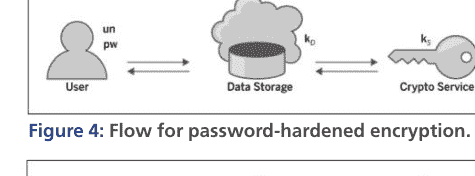

图 5 的右半部分展示了这一过程。你可以在左侧看到两个密文 `$C_1$` 和 `$C_2$`。它们是以常规方式计算的：即 `$C_1$` 是加密消息 `$m_1$` 与公钥 `$pk$` 的结果，而 `$C_2$` 是加密消息 `$m_2$` 与公钥 `$pk$` 的结果。这两个密文现在通过计算 `$x$` 进行组合。举例来说，我首先使用公钥 `$pk$` 加密数字 2：`$C_1 := Enc(pk, 2)$`。生成的密文称为 `$C_1$`。在第二步中，我对数字 3 执行相同的步骤：`$C_2 := Enc(pk, 3)$` 以生成密文 `$C_2$`。第三步现在通过应用操作 `$x$` 将这两个密文连接起来：`$C_3 := C_1 x C_2$`。如果加密方法是加性同态方法，则密文 `$C_3 = C_1 x C_2 := Enc(pk, 2) x Enc(pk, 3) = Enc(pk, 2 + 3) = Enc(pk, 5)$` 包含值为 5。如果过程是乘性同态，则 `$C_3 = C_1 x C_2 := Enc(pk, 2) x Enc(pk, 3) = Enc(pk, 2 \cdot 3) = Enc(pk, 6)$` 包含值为 6。

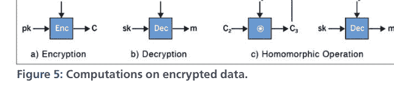

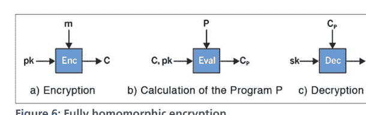

在这两种情况下，只有私钥 `$sk$` 的拥有者才能访问计算结果，因为只有他们才能解密密文 `$C_3$`。加性同态加密的一个例子由 `ElGamal` 方法 [2] 提供，而 `Paillier` 方法 [5] 是乘性同态的。

### 全同态加密

与之前的方法相比，全同态加密允许在密文上执行任意计算。为了更好地理解它是如何工作的，图 6 显示了各个步骤。首先，明文 `$m$` 使用公钥 `$pk$` 加密 (a)，生成密文 `$C$`。现在执行计算 (b)；密文 `$C$`、公钥 `$pk$` 和程序描述 `$P$` 流入其中。计算结果是密文 `$C_p$`，计算结果为 `$Eval(pk, C, P) = C_p = Enc(pk, P(m))$`。

与前面的例子一样，任何人都可以对密文 `$C_p$` 执行计算，因为这不需要任何秘密信息。然而，只有相关私钥 `$sk$` 的拥有者才能计算结果。全同态加密是一种极其强大的工具，因为对程序 `$P$` 没有限制。这意味着可以对加密数据执行任意计算。在加密数据上执行计算大大减少了对存储数据方的信任需求。例如，你可以将数据外包给云服务，该云服务持有数据并执行计算而无需解密。执行计算的服务无需查看明文数据甚至计算结果。数据所有者仍然掌控数据。

### 结论

本文向你介绍了可证明安全性，这是现代密码学的基石之一。你还了解了一些令当今密码学家感到兴奋的近期研究课题。

密码学已存在数千年，但它仍能令人兴奋，且最先进的加密技术听起来仍然像纯粹的魔法。例如，谁会想到在加密的（基因）数据上进行计算竟然可行？但密码学仍处于起步阶段，未来的密码技术无疑将继续让我们感到惊讶。

#### 参考资料

- [1] Katz, Jonathan 和 Yehuda Lindell，`Introduction to Modern Cryptography: Principles and Protocols`，CRC Press，2007，`https://archive.org/details/Introduction_to_Moderne_Cryptography`
- [2] `ElGamal` 加密：`https://www.geeksforgeeks.org/elgamal-encryption-algorithm/`
- [3] 加密后 MAC：`https://en.wikipedia.org/wiki/Authenticated\_encryption#Encrypt-then-MAC\_(EtM)`
- [4] `CPA`（选明文攻击）：`https://en.wikipedia.org/wiki/Chosen-plaintext_attack`
- [5] `Paillier` 加密：`https://en.wikipedia.org/wiki/Pailier\_cryptosystem`

##### 作者简介

`Dominique Schröder` 是德国埃尔兰根-纽伦堡弗里德里希·亚历山大大学应用密码学系的系主任，并为 IT 安全概念的分析与开发公司提供咨询。他曾获得多项奖项，包括亚历山大·冯·洪堡基金会的费多尔·莱宁研究奖学金和英特尔早期职业教员奖。

## 什么？我可以更早地获取我的问题解答？


随时随地，尽享其妙！

注册数字订阅，即可享受最新热门话题文章、评测、酷炫项目等内容……

订阅 PDF 电子版：`shop.linuxnewmedia.com/digisub`

现已在 `ZINIO` 上线：`bit.ly/Linux-Pro-ZINIO`

## 独具逻辑与美感


`Deepin` 提供了一款视觉上令人惊艳的操作系统，并带有几个独特的怪癖。作者：`Bruce Byfield`

`Deepin` [1] 是由中国武汉的 `Deepin Technology` 公司开发的一个发行版。其主页宣称自己是“来自中国的顶级 `Linux` 发行版”，尽管 `Ubuntu Kylin` 有时也会做出类似的宣称。`Deepin` 长期以来因对视觉细节的关注而闻名，这种关注程度更像 `macOS` 而非 `Windows`。就像 `elementary OS` 一样，`Deepin` 开箱即用就具备惊艳的视觉效果，无需任何自定义。然而，当你开始安装时，你很快会意识到这种美学是以某些代价换来的。

一方面，安装程序建议至少 `64GB` 的磁盘空间，并推荐 `128GB` 以启用所有效果，尽管这些要求直到你选择要分区的磁盘时才被提及。相比之下，`Ubuntu` 只需 `512MB` 即可拥有一个完全可用的 `Gnome` 桌面，并且可以在 `Deepin` 无法运行的较旧计算机上运行。

另一方面，`Deepin` 桌面环境（`DDE`）的组织方式拥有其独特的逻辑。这种逻辑并不难理解，但在使用它时需要一定的适应过程，这种适应程度在 `Gnome` 或 `Plasma` 中是不存在的。

### 无尽的安装

通常，我尽量最少地评论发行版的安装程序。毕竟，大多数用户只会接触它几次——甚至往往只有一次。然而，鉴于其独特的逻辑，应当详细描述 `Deepin` 的安装程序。

首先，你应该阅读并同意 `EULA`（最终用户许可协议）和隐私政策——即使你通常会在不先阅读的情况下接受政策声明。`Linux` 领域通常不常见如此详尽的 `EULA`，而隐私政策则详细说明了他们收集的信息类型——不仅是浏览器历史，还包括你使用计算机的时间以及系统中安装的应用程序的信息。如果你关心隐私和许可证限制，你可能会决定放弃安装；然而，如果你对这类事情不太在意，请勾选该选项并继续。

如果你决定安装，不要被安装程序所迷惑。起初，它看起来简单得有些欺骗性，仅包含三项内容：语言和分区的选择，然后是安装（图 1）。

安装并重启后，你会再次看到首次启动时出现的相同页面。看起来安装似乎失败了，但最终安装会继续进行第二阶段，其中包括第一阶段省略的所有内容。如果你使用的是虚拟机，系统会询问你选择安装模式，要么是效果模式（用略显生硬的英语描述为提供“一种精致的模式”），要么是普通模式。安装将继续进行，包括从一张不显示时区的地图上选择时区，以及一些不寻常的限制，例如账户名称限制在 3 到 32 个字符。然而即使那样，安装仍未完成。

第三阶段涉及自定义，提供桌面模式的选择（时尚模式为大型 `Dock`，高效模式为小型 `Dock`）、运行模式（效果模式或普通模式）以及几个图标主题。这些选择通常很清晰，但安装期间并未提供每项内容具体包含什么的详细信息。幸运的是，运行模式可以从桌面的 `Dock` 稍后更改，图标模式可以从控制中心的个性化应用中更改。显然，桌面模式无法更改，可能是因为需要磁盘镜像，但应用商店也提供了鹰眼模式选项，在这种模式下，缩放变化会改变桌面上显示的信息。

然后，就在桌面可用时，探索它揭示了第四阶段。要访问许多默认应用，如应用商店、电子邮件客户端和云服务，你必须创建一个 `Deepin` 账户。

### 桌面逻辑


DDE 是用 `Qt` 编写的，其窗口管理器 `ddekwin` 是 `Plasma` 的 `KWin` 的修改版。整个 `DDE` 在 `Fedora` 和 `Arch Linux` 中可用，而 `UbuntuDDE` 是非官方的 `Ubuntu` 变体。尽管需要大量的磁盘空间，`DDE` 的性能大致相当于 `Gnome` 或 `Plasma`，即使在虚拟机上运行时也是如此。`Deepin` 的外观广受赞誉，且受欢迎程度足以使 `Deepin` 在过去七年中一直位列 `DistroWatch` 页面访问量前 100 名的发行版中，通常位于前 20 名左右，尽管在过去六个月中已下滑至第 48 位 [2]。

对于其他桌面的用户来说，`DDE` 的许多部分都会很熟悉，例如菜单和结合了常用应用程序的 `Dock`，以及带有系统工具和通知的面板。这些小部件通过图标和鼠标悬停标签简洁地排列，并组织成各个部分。滑动系统工具会导致窗口从屏幕边缘滑入，例如通知窗口，这可能是我在任何桌面环境中见过的最有用的功能之一（图 2）。然而，一旦你开始使用它，`DDE` 就会展现出一些自身的特点。

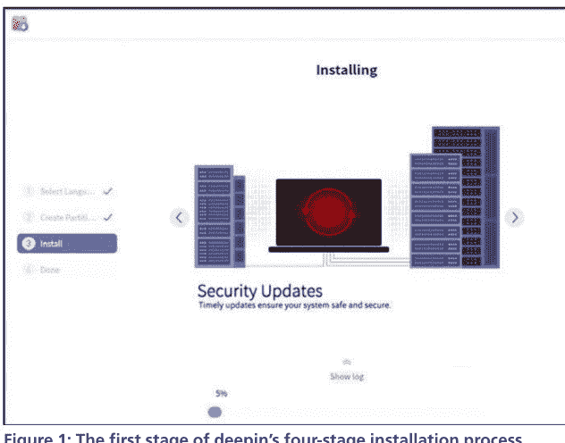

最显著的特点可能是 `DDE` 的默认简约性。例如，在登录时，`DDE` 默认采用类似平铺的结构，一次只显示一个应用（图 3），较大的应用占据整个屏幕。一些窗口——尽管不是所有——都可以通过拖动边缘来调整大小，就像大多数桌面环境一样，但无论你怎么做，始终只有一个窗口可见。要查看所有打开的窗口，你必须点击多任务视图图标，即 `Dock` 上从左数第三个。从多任务视图（图 4）中，你可以看到所有打开的窗口按照它们所在的虚拟桌面进行排列，尽管无法调整任何窗口的大小。按 `ESC` 键返回到桌面本身。同样，如果你右键单击桌面，只能添加文档和文件夹图标。要将应用程序图标添加到桌面，你需要在菜单中右键单击它。`Dock` 应用的添加方式类似。毫无疑问，为了避免杂乱，包含的冗余很少，留给用户去寻找功能的逻辑位置。功能通常都在那里，并以逻辑方式组织，但你可能需要搜索一下。由于图标比鼠标悬停提示更直观，如果你具有视觉记忆而非基于文本的记忆，导航会更轻松。

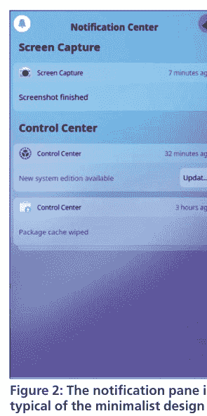

另一个突出特点是，与许多现代发行版不同，`Deepin` 开发了一个专为协同工作而设计的应用程序生态系统，很像 `Gnome` 或 `Plasma`。在最近的一系列版本中，`DDE` 已经用自己的等价物替换了标准的自由软件，如 `Chrome` 和 `Thunderbird`。在 `2.4` 版本中，这一过程即将完成，只有少数应用程序如 `Simple Scan` 是从其他发行版借用的。最明显的例外是 `LibreOffice`，它太普及且功能太完善，没有严肃的替代品。其他标准应用如 `Gimp` 或 `digiKam` 在其应用商店中可用，但 `Deepin` 默认使用自己的应用。其许多应用，如文件管理器、文本编辑器或音乐播放器，是大多数发行版中可用版本的最小化设计版本。其他，如 `Boot Maker`，是用于执行命令行操作的基本工具。然而，`Deepin` 还包含一些独特应用，特别是在工具类中。例如，`Dock` 默认安装虚拟键盘，菜单包含语音笔记记录器以及屏幕截图和桌面录制组合工具（图 5）。此类应用很少有直接的等价物。近年来，`Deepin` 的许多应用已独立于完整桌面之外，被引入到诸如 `Debian` 等发行版中。

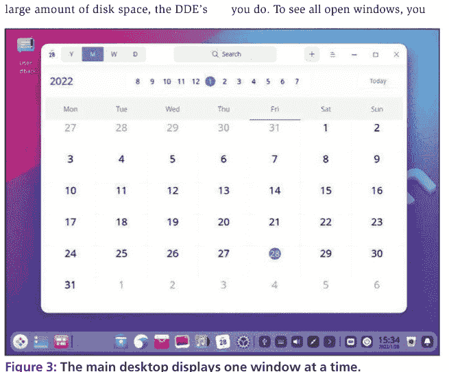

### 消除争议

如果你是 `Linux` 的老用户，你可能一直远离 `Deepin`。2018 年，`Deepin` 的应用商店被发现正在将屏幕分辨率等一般用户信息发送给 `CNZZ`，一家中国的分析公司。收集此类信息在大多数网站上很常见，但一些用户担心个人信息被收集甚至提供给中国政府。然而，没有证据表明 `Deepin` 的开源代码做了这些事。此外，虽然确实存在未经用户同意收集信息的情况，但 `20.4` 版本的安装程序现在以 `EULA` 和详细说明了具体收集哪些匿名信息的隐私政策开始。如前所述，阅读此政策是个好主意，这样你就知道你的数据会被如何使用。如果你能接受政策中概述的用途，就没有理由因为过去的争议而回避 `Deepin`。这样做就会错过一个前沿发行版。至于所需的磁盘空间和独特的逻辑，它们是否值得其美学或伴随的自定义程度，是每个用户必须自己决定的。


- `[1] Deepin：`

  `https://www.deepin.org/en/`

- `[2] DistroWatch：`

  `https://distrowatch.com/`

## 让你的创意变为现实！

这不是普通的计算机杂志！`MakerSpace` 是一本全新的特刊，专注于你可以用来制作自己项目的技术。

如果你对电子技术感兴趣，但还没有时间或技能（暂时还没有），研究这些创客项目可能会是让你迈出第一步的最终动力。

本期特刊将帮助你深入了解：

- `Raspberry Pi`（树莓派）

- `Arduino`（洞洞板）

- 复古游戏

- `FPGA`（现场可编程门阵列）

- 以及更多内容！

## 赠品

随印刷版免费提供完整的《`Raspberry Pi Geek`》存档 `DVD`！


## 在线订购：

`shop.linuxnewmedia.com/specials`


正在寻找专业数字音频工作站（`DAW`）的 `Linux` 用户现在可以利用 `Reaper` 庞大的功能集了。作者：`Claudius Grieger`

虽然没有任何数字音频工作站（`DAW`）能做到万事全能，但 `Reaper` [1] 在不牺牲质量的前提下提供了极其全面的功能集。`Reaper` 的优势在于其低廉的价格、灵活性、低资源占用，以及可能是市场上最大的 `DAW` 功能集。

直到最近，`Reaper` 背后的开发团队 `Cockos` 一直拒绝发布 `Linux` 版本的诱惑，而是建议用户使用 `Wine` 以获得良好的性能。然而，随着 `Reaper 6` 的发布，一个未经官方支持的 `Linux` 测试版（`Alpha`）意外出现。在下一个小版本发布后，`Reaper` 现在提供官方支持的 `Linux` 版本。

### 适合 Linux 的强劲节拍

由于 `Cockos` 不费心于广告推广，`Reaper` 的价格很低。普通许可证费用为 60 美元；如果你使用 `Reaper` 每年收入超过 20,000 美元，相同的程序版本费用为 225 美元。一份许可证适用于两个主要版本。也就是说，如果你现在购买 `Reaper 6`，之后也会获得 `Reaper 7`。在购买 `Reaper` 之前，你可以无限制地免费试用该程序 60 天，也没有订阅通讯的强制要求。

`Linux` 版本支持 `VST`、`VST3` 和 `LV2` 插件，以及 `ASAA` (`Aska`)、`PulseAudio` 和 `Jack`。原则上，`PipeWire` 也兼容 `Reaper`，但有一些特殊性。`Reaper` 的界面看起来相当朴素，文字较多，特效或无用元素较少，这也是该程序在资源使用上非常节约的另一个原因。安装仅占用硬盘约 `100MB` 空间。或者，你可以将软件安装在 `USB` 闪存盘上，作为便携式 `Live DAW`。

`Reaper` 并不像 `Apple Logic Pro` 那样附带全套插件和虚拟音源包。相反，`Reaper` 提供少量的 `VST` 插件（图 1）和 `JS` 效果（`Reaper` 的自有插件格式，通常没有图形界面）。

虽然 `Cockos` 提供了一些免费许可（`GPL`）的程序，但 `Reaper` 并不在其中。据首席开发者 `Justin Frankel`（多年前共同开发了 `Winamp` 并将其出售给 `AOL`）称，`Reaper` 将来也不会以 `GPL` 形式提供。对于核心团队来说，管理第三方代码将涉及大量的额外工作。

不过，`Frankel` 多年来也一直在反对原生 `Linux` 版本，所以一切似乎都有可能。

尽管拥有非自由许可证，`Reaper` 允许用户比市场上任何其他 `DAW` 进行更广泛的定制，且用户无需掌握编程语言。其他音频程序最多允许你更改颜色，而 `Reaper` 允许你自己开发或交换完整的主题，包括混音器和编辑器的不同视图。你还可以为功能分配自己的键盘快捷键，并通过宏和脚本来适应个人偏好。`Reaper` 开发团队也会回应社区的要求。


开发团队通常能快速实现功能请求和 bug 报告，前提是它们通过内部论坛 [2] 上报。一天发布几个小数点更新并不罕见，两次更新之间很少超过一个月。如果你在使用 `Reaper` 时遇到困难，多语言论坛通常是首选的求助渠道。就像 `Ubuntu` 用户社区一样，`Reaper` 社区庞大、乐于助人、大多友好，并且由于 `Reaper` 的国际发行，全天候可访问。

### 独特卖点

`Reaper` 在保留经典工作流程方法和基本用户界面（可能熟悉于 `Ardour`、`Pro Tools`、`SampleDance` 或 `Cubase`）的同时，做了一些不同的事情。换句话说，轨道控制元素位于编辑器的左侧，混音器中通常的通道结构保持不变。工作流程和外观可以比任何其他知名 `DAW` 更全面地进行定制。此外，`Reaper` 支持宏和几种脚本语言（原生的 `ReaScript/EEL`，以及 `Lua` 和 `Python`）。因此，`Reaper` 在音频领域享有“`DAW` 界的 `Linux`”的声誉。

与其他 `DAW` 不同，`Reaper` 仅使用一种轨道类型。音频和 `MIDI` 项目都可以存储在轨道上并进行录制。将类型分开仍然有意义，但你无需提前选择类型。每个轨道都可以变成音频、`MIDI`、乐器、特效、

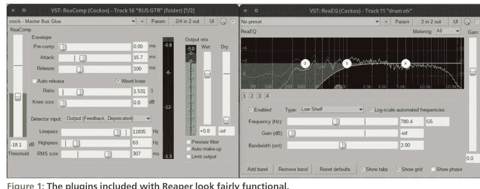

母带（`Bus`）、`VCA` 或文件夹轨道——这需要一些时间来习惯。在我看来，其他 `DAW` 中这种人为的轨道类型分离只会造成不必要的麻烦。可频繁分配的轨道和项目颜色、轨道图标和名称让用户一目了然。在混音器的相应插件槽中，也没有音频、`MIDI` 或乐器插件的单独区域。

一个项目可以是音频或 `MIDI` 事件，可以配备项目特效（`FX`）。这样，你不必将特效作为轨道特效链接到轨道上，虽然必要时你可以这样做。一旦习惯了项目特效，你就再也无法离开关了。此外，除了自动化（图 2）之外，每个项目还有自己的音量设置。

`Reaper` 的资源占用相对较低。安装后，`Reaper` 占用的空间不到 100MB；如有需要，你还可以在 `USB` 闪存盘上设置便携式安装，作为移动 `DAW`。运行时，`Reaper` 比竞争对手消耗更少的内存和 `CPU` 资源——这肯定部分归功于其简约的界面。插件也可以可选地作为单独进程运行。如果你在实验或使用 `Alpha` 版本，有 bug 的插件不会让整个 `DAW` 崩溃。

所有这些使得 `Reaper` 成为低性能硬件或旧系统的绝佳 `DAW`。即使是一台 15 年前的笔记本电脑也能轻松处理不太复杂的音频工作。`Linux` `CPU` 架构选择包括 `x86-64`、`i686`、`AArch64` (`ARM64`) 和 `Arm7l` (`ARM32`)。`Reaper` 甚至可以在 `Raspberry Pi 4` 上运行，但由于算力不足存在一些限制。多轨录音的效果优于带有实时监听的叠录（`Overdubbing`）。

### 操作

你可以通过单击以通常的方式控制 `Reaper`。或者，你可以使用“新”方法如拖放来改进工作流程体验。为此，按住鼠标左键，只需将鼠标指针拖动到相应的控件上即可。你可以在编辑器或混音器中启用独奏（`Solo`）、静音（`Mute`）和准备录音（`Record Ready`），也可以在轨道管理器（`Ctrl + Shift + M`）中对轨道进行淡入淡出。你可以在路由矩阵（`Alt + M`）中快速将发送（`Sends`）设置到母带。同时选中的轨道也可以同时控制，例如使用音量或声像控制。最终，这为你留出了更多时间用于创作过程。

`Reaper` 要么直接启动到最后一个项目，显示一个选择框，要么加载一个新项目。对于新项目，`DAW` 直接在临时目录中录制轨道。当你保存时，`Reaper` 随后会将文件转储或复制到目标目录。将采样率为 44.1 或 48 `kHz` 的音频文件拖入定义为其他设置的项目并没有问题——`Reaper` 会在后台实时重新采样。

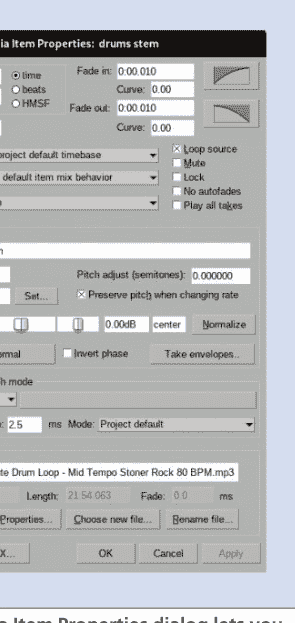

你可以使用修饰键来加快操作速度。其他 `DAW` 也使用 `Shift`、`Alt` 或 `Ctrl`。然而，`Reaper` 更加一致，并为每个控制元素提供至少一项附加功能，通常甚至有两三项。我最喜欢的是通过 `Alt` 加左击来删除标记、`FX` 插件或自动化点，并在 `MIDI` 编辑器中启用橡皮擦工具。`Ctrl` 键会暂时启用铅笔工具，在编辑器中绘制空 `MIDI` 事件、在自动化轨道中绘制手动曲线，或在 `MIDI` 编辑器中一次性改变速度。

右击也为几乎所有原本隐藏在菜单栏中的功能提供了上下文菜单。像播放按钮、独奏按钮或工具栏按钮这样的控件，你可以从众多附加功能中选择。在这个意义上，上手的座右铭是：尝试一切，并对发生的事情感到惊讶。

`Reaper` 还为速度变化提供了一种非常巧妙的解决方案。可以通过双击或按 `F2` 在事件偏好设置中手动设置事件的播放速率。在事件边缘按 `Alt` 加左击可以平滑地拉伸或压缩事件。根据左上角标准工具栏中“磁吸功能”的设置，事件会粘附到可见的网格上，如果需要，可以通过 `Shift` 键暂时禁用此功能。在这里，选择的自由度至关重要。

### 主题

`Reaper` 允许用户开发完全定制的主题，为那些喜欢设计自己桌面的人提供了一个游乐场。默认界面良好且始终可用，但缺乏特色。根据你的需求，你可以从头开发自己的主题，或使用 `Reaper` 用户提供的现有主题（图 4）。有关构建自定义主题的说明可以在 `Reaper` 论坛的主题板块中找到一个置顶帖子。在 `Reaper` 主页上，“`Slash`”链接会带你到一个仓库 [3]，在那里你可以交换除主题之外的其他有用资源。

一些开发者还通过论坛出售他们的主题。有些人采取完全个性化的方法，但它们也可能是 `Pro Tools`、`Logic Pro` 或 `House of White Imperial` [4] 主题（图 5）的复制品，后者模拟了模拟调音台。星际迷航终端看起来完全疯狂。最终，你必须自己决定这些主题在日常是否实用。

预装了三个主题：默认、`Reaper 1` 和 `Reaper 5`（图 6）。你可以在菜单栏的“`选项 | 主题`”下选择其中之一。新主题以 `.Reaper ThemeZip` 格式提供（这是一个重命名的 `ZIP` 文件，具有定义的文件夹结构）。安装时，只需将文件拖放到活动窗口中的 `Reaper` 窗口，或在文件管理器中双击它。

在菜单栏的“`选项 | 布局`”下，你还会找到混音器和编辑器的替代视图，例如混音器中更宽的通道条、仅显示电平表和仅显示推子——主题开发者想要什么都是允许的。集成截图工具允许你为自己的录音、混音、母带处理或其他应用存储预设，并在需要时使用键盘快捷键调用它们。

### 操作

对于 `Reaper` 的新手来说，最重要的术语之一是“操作”。`Reaper` 中的一切都是操作：剪切音频、缩放、创建 `MIDI` 音符、复制元素、移动推子、将轨道切换为待录制状态以及加载插件。所有操作都可以分配自己的按键组合，并可与自定义操作或宏结合使用。

操作列表（图 7）可以通过“`操作 | 操作列表`”或按 `F` 键打开。搜索框有助于查找操作、查看、修改和删除现有快捷键，以及使用“添加”按钮创建新的快捷键。

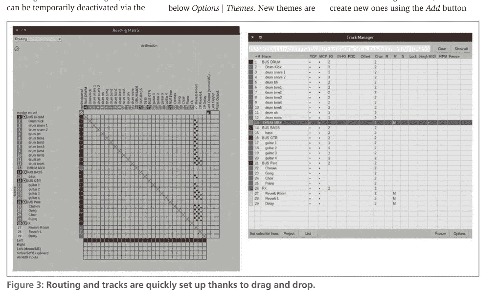


图 4：带有可选 `Echolot` 主题的 `Reaper`。

（参见“新手提示”框）。还可以根据搜索字段旁边的组合查找相应的操作。最大的问题是找出功能名称。此外，`Reaper` 为 `Main`、`Media Explorer` 和 `MIDI Editor` 部分分别创建列表，并且不能跨组编辑。要在操作列表部分之间切换，请使用窗口右上角的切换菜单。

### 菜单

在合理的菜单结构方面，`Reaper` 还有很多不足之处，这对数字音频新手来说令人困惑。随着功能数量的增加，开发者只是填满了菜单，而没有以某种计划进行重构。幸运的是，菜单结构也可以使用“`选项 | 自定义`”自由定制。


图 5：这里显示的是 `House of White Tie Imperial` 主题，具有功能丰富的扩展混音器。

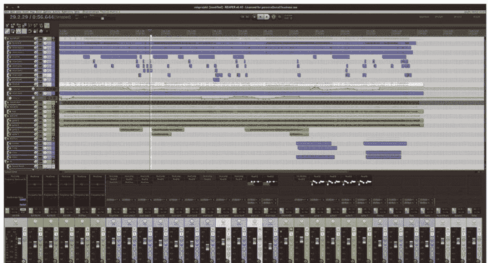

图 6：默认配置中包含的 `Reaper 5` 主题。

菜单/工具栏，并支持拖放（图 8）。你可以让自己的偏好设置和典型使用场景来定义结构。

免费的 `ReaMenus` [6] 附加插件以配置文件的形式在 `DAW` 中安装了一个完全结构化菜单。然而，独立的 `ReaMenus` 往往落后于 `Reaper` 的开发状态几个版本。因此，你可能会发现总览中缺少一些功能。不过，缺少的功能仍可通过菜单编辑器或操作列表访问。

`Reaper` 还允许你将单独的操作分配到工具栏中的按钮。你可以使用左上角主工具栏上的“`右击 + 自定义工具栏`”来添加新按钮并可选地定义自己的图标。

自定义 `Reaper` 后，导出配置是个好主意。

你可以通过“`选项 | 偏好设置`”（或使用 `Ctrl + P`）并选择“`常规`”来做到这一点。使用此备份，你可以只需单击几下恢复所有程序细节。

### Linux 特定事项


# Reaper 在 Linux 上的体验

从 6 版本开始，`Reaper` 现在可以作为独立程序用于 Linux。与 `Ardour` 一样，`Reaper` 安装程序是一个脚本，在终端窗口中运行并引导你完成安装。原则上，这意味着开发者为所有发行版提供兼容性。

然而，根据你的系统配置，也可能存在兼容性问题。

基本上，`Reaper` 是 Linux 日常音频工作以及生产环境的好伴侣，因为 `Reaper` 可以轻松与 `Alsa`、`PulseAudio` 和 `Jack` 交互。我积累了 `Reaper` 经验，并始终在 5.4、5.10 LTS 和 5.13 内核上取得良好结果。我创建的测试录音有 20 个轨道，每个轨道五分钟长，混合和总线上有最多五个效果。

然而，`Reaper` 在某些系统组合上存在问题。具体而言，`Wayland` 和 `PipeWire` 有问题。例如，使用 `Gnome` 41 和 `Wayland` 的 `Manjaro` 不允许你从文件管理器将文件拖放到程序中。幸运的是，`Reaper` 内置的 `Media Explorer` 可以这样做（查看 | 媒体资源管理器或 `Ctrl` + `Alt` + `X`）。媒体资源管理器甚至提供了一些附加功能，例如预览、速度和音高调整以及样本的时间选择。如果你使用经典的 X 服务器，同一系统上不会出现此问题。

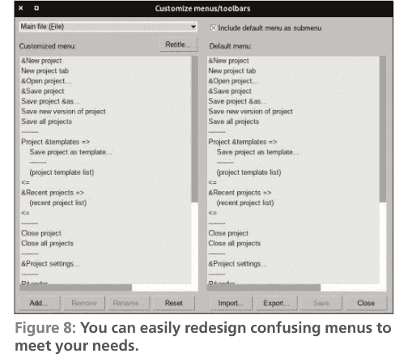

`Fedora` 依赖于 `PulseAudio` 的继任者 `PipeWire`。尽管在桌面层面考虑得再周全，音频接口目前对专业音频来说是一个糟糕的选择。长时间录音会导致缓冲区溢出导致错误消息和缺失。此外，在混音时，一些插件的重采样或没有可理解错误消息的崩溃反复出现问题。然而，这可能不是 `Reaper` 特有的问题，因为 `PipeWire` 也会让 `Ardour` 遇到类似的麻烦，并常常将 `DAW` 拖入著名的黑洞。

`Xfce` 和各种其他桌面环境和窗口管理器使用 `Alt` 作为系统的修饰键（例如，用于移动或调整窗口大小）。这与 `Reaper` 的默认设置冲突。对于 `Reaper`，你希望在系统上用 `Super` 键（Windows 键）替换此键，因为 `Reaper` 通常不使用它。或者，将所有操作按键组合从 `Alt` 重新路由到 `Super`。为你创建一个带有适当定制桌面配置的专用音频用户可能是值得的。

`Reaper` 在高分辨率 4K 显示器上也有问题，并且不随相应的像素密度缩放。因此，如果你有 4K 分辨率，字体和控件将以不可读的小尺寸显示，而将显示大小缩放至 200 或 300 百分比会损害概览。系统字体也会影响 `Reaper` 的显示。`Reaper` 利用了 `Windows` 和 `macOS` 不给予用户字体选择真正自由这一事实。然而，Linux 用户更难处理。`KDE` 和 `Gnome` 通常开箱即用没有困难。另一方面，`Openbox`、`i3` 和 `Xfce` 上的显示至少可以说需要改进。如果没有正确的字体设置，

### 结论

`Reaper` 已准备好在 Linux 上使用。与替代品相比，`Reaper` 提供了一个全面、可自定义、节省资源、稳定且同时低成本的 `DAW`，具有经典概念。

对于生产环境，我推荐使用较新安装的 `Manjaro` 或 `Ubuntu`，内核版本为 5.4 或更新，并使用 `Alsa`/`Jack` 作为第二个服务器。根据你的典型工作区域和使用历史记录，你可能需要对自己的偏好设置进行一些调整。此外，不要忘记 `Reaper` 不是免费软件。如果这不妨碍你，那么你在 Linux 专业音频市场上终于多了一个选择。

### 信息

- `[1]` `Reaper`: <https://www.reaper.fm>
- `[2]` `Reaper` 论坛: <https://forum.cockos.com/forum/4-player.php?f=20>
- `[3]` `Reaper` 仓库: <https://stash.reaper.fm>
- `[4]` `Imperial` 主题: <https://www.houseofwhitetie.com/reaper/imperial/Imperial.html>
- `[5]` `SWS` 扩展: <https://www.sws-extension.org>
- `[6]` `ReaMenus`: <https://github.com/RCJaci/reamenus>

#### 新手提示

在新系统上安装 `Reaper` 后，你应该禁用通过鼠标滚轮进行垂直缩放。几乎所有程序在旋转鼠标滚轮时都会滚动，但 `Reaper` 不会。这很难习惯，所以你应该将垂直缩放分配给 `Ctrl` 加鼠标滚轮，并将垂直滚动直接分配给鼠标滚轮。选择 `Shift` 加鼠标滚轮用于水平滚动，`Alt` 加鼠标滚轮用于水平缩放。操作也可以通过工具栏中的按钮执行。免费的 `SWS` 扩展 `[5]` 不仅为 `Reaper` 添加了一些真正有用的工具，还附带了一些非常实用的操作——这是 `Reaper` 专业人士必须安装的插件。

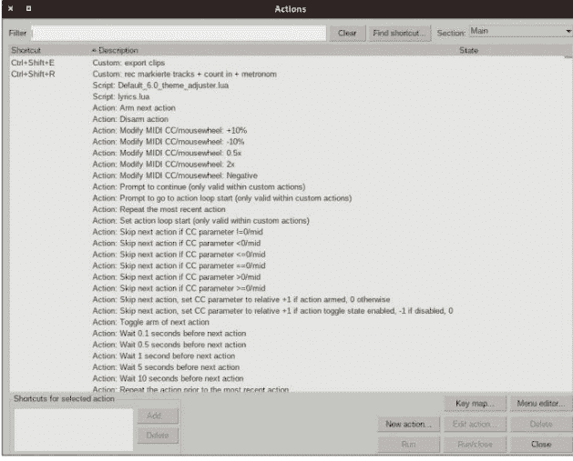

图 7：操作列表允许你为几乎所有操作定义自己的键盘快捷键。

# 守望者

通过命令行监控系统

> 两个监控工具 `watch` 和 `fswatch` 让你能够从容命令行获取系统信息。*作者：布鲁斯·拜菲尔德（Bruce Byfield）*

熟悉 Linux 的大多数用户可能都曾使用过 `cron` 或 `at` 来安排命令的执行。这两者在各自的场景中都非常有用：`cron` 用于事件的重复调度，而 `at` 用于单次事件调度。然而，两者的共同缺陷在于，除非编写特定的脚本，否则它们无法收集系统信息并对此做出响应。通常，使用 `watch` `[1]` 和 `fswatch` `[2]` 来同时完成这两项工作要简单得多。

虽然 `watch` 和 `fswatch` 仅用于收集信息或检查潜在的安全入侵，但只需少量努力和最少的脚本编写能力，就可以调整这两个工具，使其像调度器一样工作。

**作者简介**

布鲁斯·拜菲尔德是一位计算机记者，也是一位专注于免费和开源软件的自由撰稿人和编辑。除了写作项目外，他还教授现场课程和在线课程。在业余时间，布鲁斯撰写关于西北海岸艺术的文章（<https://brucebyfield.wordpress.com>）。他还是 `Prentice Pieces` 的联合创始人，这是一个关于写作和幻想的博客，地址为 <https://prenticepieces.com/>。

### `watch`

`watch` 的目的在于跟踪命令输出随时间的变化（见图 1）。这些信息可用于故障排查，也可以在安装或更新新软件包时，让 `root` 或普通用户了解系统变化。在有限的情况下，它也可以作为 `at` 或 `cron` 的更简单的替代方案。表 1 展示了其他几种常见用途。默认情况下，`watch` 每两秒运行一次，直到关闭或中断。基本命令结构如下：

```
watch OPTIONS COMMAND
```

根据命令内容的不同，`watch` 可能需要在内部使用引号。例如，如果命令使用了管道来运行 `less` 或 `grep`，则需要加引号。或者，代替引号，你可以运行 `--exec` (`-x`)，这样当命令包含多个命令时就不需要新的进程了。

两个选项设定了 `watch` 的行为特征。最重要的是 `--interval SECONDS` (`-n SECONDS`)。`--interval` 选项会覆盖默认的每两次运行之间 2 秒的间隔——这个间隔显然是为即时故障排查而选择的。然而，在始终运行的计算机上，将间隔设置为 86,400 会使 `watch` 每天运行一次，设置为 604,800 则会使其每周运行一次，从而使 `watch` 承担与 `at` 或 `cron` 相同的功能。可以使用逗号或句点来表示较大的间隔；最小间隔为 0.1 秒。`watch` 与其他调度器唯一的区别在于，如果计算机曾经关机，你需要记得重启 `watch`，这是 `at` 或 `cron` 所没有的问题。出于不明原因，间隔可以辅以 `--precise` (`-p`) 来确保间隔的精确度——也许某些测试需要这种精确度。

`watch` 还支持用于自定义输出和退出行为的选项。使用 `--color` (`-c`)，输出会进行颜色编码。使用 `--no-1inwrap` (`-u`)，长行会被截断，而 `--differences` (`-d`) 会突出显示与先前输出不同的最新输出。你还可以使用 `--no-title` (`-t`) 移除显示间隔、命令、当前日期和时间的标题。

```
Every 60.0s: ls -l ../watch

hostname: Sat Jan 22 13:06:04 2022
total 4
-rw-r--r-- 1 bb bb 136 Jan 22 13:04 distros.txt
-rw-f--r-- 1 bb bb 36 Jan 22 13:01 test.txt
```

**图 1：** 使用 `watch` 每 60 秒跟踪目录中的变化。


#### 表 1：`Watch` 的日常用途

| 命令 | 描述 |
| :--- | :--- |


| `watch -n 5 date` | 每五秒显示一次日期 |
| :--- | :--- |
| `watch -n 60 from` | 每 60 秒检查一次邮件 |
| `watch -d ls -l` | 监视目录中的变化 |
| `watch -d 'ls -l \| fgrep joe'` | 监视由 Joe 账户拥有的文件 |
| `watch uname -r` | 监视新内核的安装 |
| `watch -d free -m` | 监视内存变化 |

退出选项同样多样化。使用 `--chexit` (`-g`)，当输出变化时 `watch` 会退出，这可以成为一个明显且便捷的指示器。此外，你可能还需要 `--beep` (`-b`)，在 `watch` 因错误刚刚退出时发出声音，或者使用 `--errexit` (`-e`)，在发生错误后停止输出，但等待按下任意键后才退出。

### fswatch

`fswatch` 监视目录或文件的变化。最简单的使用方式是在一个终端中运行 `fswatch`，在另一个终端中编辑文件。

当你开始使用 `fswatch` 时，需要了解有关该命令结构和操作方式的一些信息。`fswatch` 能够使用几种不同的实用工具。在 macOS 上，它报告由 FSEvents 收集的信息。在 BSD 上，它依赖于队列监视器。在 Linux 上，它默认使用 inotify，这是一个 Linux 内核子系统，并带有轮询监视器选项，后者保存文件修改的时间。所有这些监视器都提供相似的信息，尽管 `fswatch` 的手册和信息页面警告说，每个都有各自的优势和劣势，以及各自的错误，所有这些都在帮助页面中详细描述。你可以使用 `--list-monitor` (`-n`) 选项查看可用监视器的列表，并选择可以使用 `--monitor NAME` (`-M NAME`) 的那个。然而，在终端中显示的输出中，通常不同的监视器之间差异很小。

如果不带任何选项，`fswatch` 仅记录发生变化的文件，但其他选项可以增加额外信息，例如检测到的事件，以及（可选地）检测到事件的时间。事件类型是自解释的。一个操作可能具有多种事件类型。`fswatch` 的事件类型包括：

- `Created`
- `Updated`
- `Removed`
- `Renamed`
- `OwnerModified`
- `AttriModified`
- `MovedFrom`
- `MovedTo`
- `IsFile`
- `IsSymlink`
- `Link`

为了帮助组织输出，你可以使用 `--batch-marker CHARACTER` 来分隔命令的每次循环。此外，`--print0` (`-0`) 可用于确保行被分隔以便阅读。

基本命令结构为

```
fswatch OPTIONS PATHS
```

除了特定路径外，你还可以使用 `--include REGEX`（或 `-R`）和 `--exclude REGEX`（或 `-e`）通过正则表达式选择路径。可以使用 `--insensitive` (`-i`) 进行不区分大小写的搜索，并使用 `--recursive` (`-r`) 包含子目录。如果监视的文件包含符号链接，添加 `--follow-links` (`-L`) 选项后，`fswatch` 将跟踪它们。你还可以使用 `--timestamp` (`-t`) 在输出中添加本地时间，或使用 `--utc-time` (`-u`) 添加 UTC 格式的时间。使用任一时间选项，你可以使用 `--format-time FORMAT`（或 FORMAT）利用 strftime 代码 [3] 来构建日期。其他有用的选项包括 `--one-event` (`-1`)，它在一组事件后退出 `fswatch`，以及 `--latency SECONDS` (`-l 1 SECONDS`)，其必须至少为 1.1 秒。与 `watch` 不同，`fswatch` 不给出任何输出，除了简要概述当前工作目录打开的另一个终端标签。

通常，`fswatch` 生成的基本信息本身就有用。然而，就像 `watch` 一样，`fswatch` 也可以用于发出命令。它通过管道传递到 `xargs` 来实现这一点，其目的是发出其他命令。表 2 展示了从 `fswatch` 在线帮助 [4] 中摘录的四个常见示例。

#### 表 2：fswatch 和 xargs

| 操作 | 命令 | 备注 |
| :--- | :--- | :--- |
| 运行 Bash 命令 | `fswatch FILE-PATH \| xargs -n 1 COMMAND` | 通常用于创建、更新或删除文件 |
| 监视一个或多个文件和/或目录 | `fswatch PATHS **/*.js \| xargs -n 1 bash_command` | – |
| 打印更改文件的绝对路径 | `fswatch PATH \| xargs -n 1 -I {} echo {}` | – |
| 按事件类型过滤 | `fswatch --event DIRECTORY-PATH \| xargs -n 1 bash_command` | 通常用于创建、更新或删除目录 |

### 工具箱中的另外两件工具

如果你更喜欢在桌面环境中工作，Gnome 提供了 `command-runner-applet`，其功能与 `watch` 和 `fswatch` 大致相同 [5]。但 `command-runner-applet` 并不是一个单一命令；根据其 GitHub 页面，它在运行时接管桌面，尽管鼠标和键盘操作将在其完成后运行。

另一方面，`watch` 和 `fswatch` 都在单个命令中提供了广泛的功能，特别是 `fswatch` 提供了深入的报告选项。当然，主要区别在于，`watch` 提供了一种使用命令进行监视的统一方式，而 `fswatch` 主要关注目录和文件的管理。然而，两者都是命令行比桌面提供更多功能的一个例证。尽管相对鲜为人知，但每一个都是管理工具箱中有用的补充。 ▪▪▪

**信息**

- [1] `watch`: https://linux.die.net/man/1/watch
- [2] `fswatch`: https://www.mankier.com/1/fswatch
- [3] `strftime` code: https://strftime.org/
- [4] `fswatch` examples: https://www.mankier.com/1/fswatch#Examples_(TL;DR)
- [5] `command-runner-applet`: https://github.com/prpider/command-runner-applet

## 系统管理员的日常：最后的话

### 该说再见了

作为一名系统管理员专栏作家已有二十年，查利使用 FIGlet 创建的一个登录横幅，献上了一段恰到好处的告别。*作者：Charly Kühnast*

当我登录到服务器或网络组件时，通常会看到一个使用大号字体的横幅，里面的信息内容各不相同。有时它只是告诉我主机名，有时是内核版本，有时则会显示 **请勿在上午8点至下午8点之间重启**。

当然，关于横幅是否有意义，还是仅仅是一堆废话，是可以辩证的。我在自己的系统上很少使用它们。然而，那些我不能随意乱动的服务器会用一个横幅来警告我，上面写着 *Abyssus abyssum invocat*（一个错误会导致另一个错误）。

另一方面，用于评估新软件的测试系统则会愉快地向我打招呼，横幅上写着 *Morturi te salutant*（那些即将死去的人向你致敬）。这些年来，我对那个横幅的运气还不错，但你该如何创建一个呢？

我使用 FIGlet [1] 来做到这一点。所有流行的发行版都包含这个工具，它支持多种字体并提供各种设计选项。我没有任何使用——我只是想在登录时传递一个明确的信息。这就是我为什么只使用 `-c` 参数来居中对齐横幅，否则它将是左对齐的。对于我的告别横幅，我破例也使用了 `-D` 参数，它允许显示德语变音符号。在我使用拉丁语格言时，我通常可以忽略这些符号。FIGlet 会将诸如 `[`、`\` 和 `]` 这样的特殊字符替换为 `Â`、`Ö` 和 `Û`，而 `Ĺ`、`l` 和 `}` 则会给出对应的小写字母。该命令：

```
FIGlet -C -D Vielen Dank für 20 Jahre
```

产生了如图 1 所示的横幅（英文版见图 2）。

好了，就是这样。我要与我在这个专栏上的工作告别，该专栏始于 2002 年 2 月的 *Linux Magazine* 德语版，现结束于 2022 年 2 月的这一期。我之所以采取这一步，是因为我未来希望减少写作频率，但写得更详细。我要感谢整个编辑团队的支持，特别是 *Linux Magazine* 德语版的主编 Jan Klemert 和 Jörg Lüther。但最大的感谢献给你们，亲爱的 Linux 朋友们！

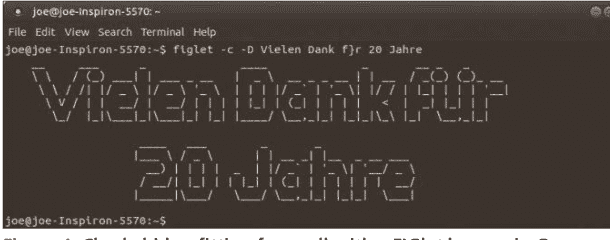

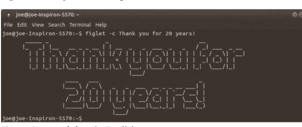

### 信息


- [1] FIGlet: `http://www.figlet.org`

### 作者简介

Charly Kühnast 在德国下莱茵地区的数据中心管理 Unix 系统。他的职责包括确保防火墙和 DMZ 的安全性和可用性。


### 深入解析

### Checkmk


#### 使用 Checkmk 进行简单监控

##### 检查一下

我们将向您展示如何使用 `Checkmk` 开源监控工具来监控您的家庭路由器。

作者：Martin Hirschnvogel

每个组织都需要监控，以确保服务器、网络、应用程序、云资产和其他元素按预期运行。监控还提供了及时的警报，并帮助 IT 团队追踪（潜在）问题的原因。拥有一个合适的监控工具可以帮助你更快地解决问题，理想情况下，在问题对运营系统产生影响之前。`Checkmk` [1] 是一个开源监控工具，非常适合现代混合环境，它结合了企业级可扩展性和安全性，以及开源软件的可扩展性。

在大多数情况下，`Checkmk` 运行在专用的服务器或虚拟机（`VM`）上。由于我只是为了家庭办公环境运行一个小规模的监控设置，我的主机将是运行 `Ubuntu 18.04` 的电脑。这台电脑有四个 `CPU` 核心和 `4GB` 内存，这对于入门来说绰绰有余。`Checkmk` 也运行在其他 `Linux` 发行版上，如 `Debian`、`Red Hat Enterprise Linux`、`CentOS` 或 `SUSE Linux Enterprise Server`，你也可以在 `Docker` 容器或虚拟设备上运行 `Checkmk`。如果你在一台专用主机上安装 `Checkmk`，你唯一需要做的额外步骤是将文件传输到服务器。

`Checkmk` 可以监控任何具有 `IP` 地址的设备，包括服务器、云资产和网络设备，以及属于物联网（`IoT`）的系统。在这篇文章中，我选择监控我的 `TP-Link` 路由器。`Checkmk` 还预装了合理的警报阈值。这些预配置的阈值会很有用，因为你无需担心设置警报，即可在几分钟内启动监控。

##### 选择 Checkmk 版本

你可以免费使用 `Checkmk`。对于这个教程，我选择了 `Checkmk Raw Edition`。你也可以选择 `Checkmk Free Edition`，它是 `Checkmk Enterprise Edition` 的免费版本，提供额外的功能。`30` 天后，`Free Edition` 仅限于 `25` 台主机。`Checkmk Raw Edition` 是完全开源的，且永久免费。

`Checkmk` 几年前作为 `Nagios` [2] 开源监控工具的前端起步，但在 `2012` 年成为独立的监控解决方案，并取代了几乎所有 `Nagios` 组件。`Checkmk Raw Edition` 仍然使用 `Nagios` 监控核心作为实用工具。要开始使用 `Checkmk`，请访问项目网站 [3] 的下载部分，在那里你可以找到最新版本。选择 `Checkmk Raw Edition`，选择最新的稳定版本（本教程基于版本 `2.0.0p13`），然后选择你的平台和操作系统版本。点击下载按钮下载软件包。

下载完成后，你需要安装该软件包，包括所有依赖项。安装步骤因发行版而异。在我的情况下，我将切换到终端，进入下载文件夹，然后以 `root` 身份运行 `apt install`（见图 1）：

```bash
apt install ../check-mk-raw-2.0.0p13_0.bionic_amd64.deb
```

```bash
root@FerndinandPC:/home/ferdinand/Downloads# apt install ./check-mk-raw-2.0.0p13_0.bionic_amd64.deb
Reading package lists... Done
Building dependency tree
Reading state information... Done
Note, selecting 'check-mk-raw-2.0.0p13' instead of './check-mk-raw-2.0.0p13_0.bionic_amd64.deb'
The following NEW packages will be installed:
 check-mk-raw-2.0.0p13
0 upgraded, 1 newly installed, 0 to remove and 46 not upgraded.
```

图 1：安装 `Checkmk`。

安装完成后，你可以进行测试。`omd` 命令现在应该可以访问了。以下命令：

```bash
omd version
```

应该返回你当前使用的 `Checkmk` 版本的详细信息。

`omd` 命令代表 `Open Monitoring Distribution`（`OMD`），这是一个由 `Checkmk` [4] 创始人 Mathias Kettner 创建的开源项目。`OMD` 项目包括由各种组件组装而成的监控解决方案。

##### 创建你的 Checkmk 监控站点

下一步是启动一个初始监控站点（站点也被称为实例）。确保你仍然是 `root`，并使用 `omd create` 创建一个新的 `Checkmk` 站点，并按你的意愿命名（图 2）。本教程使用 `cmk_tutorial`：

```bash
omd create cmk_tutorial
```

```bash
root@FerndinandPC:/home/ferdinand# omd create cmk_tutorial
Adding /opt/omd/sites/cmk_tutorial/tmp to /etc/fstab.
Creating temporary filesystem /omd/sites/cmk_tutorial/tmp...OK
Updating core configuration...OK
Generating configuration for core (type nagios)...Precompiling host checks...OK
OK
Executing post-create script "01_create-sample-config.py"...OK
Restarting Apache...OK
```

图 2：创建监控站点。

```text
Created new site cmk_tutorial with version 2.0.0p13.cre.

The site can be started with 'omd start cmk_tutorial'.
The default web UI is available at 'http://FerndinandPC/cmk_tutorial/'.

The admin user for the web applications is 'cmkadmin' with password: 'E34jQcAgL'.
For command line administration of the site, log in with 'omd su cmk_tutorial'.
After logging in you can change the password for cmkadmin with 'htpasswd etc/htpasswd cmkadmin'.
```

图 3：安装结束时会显示有关如何访问站点的说明。请务必更改密码——可以在命令行或通过 `Checkmk` 用户界面进行更改。

在输出的末尾，你现在应该可以看到关于如何启动和访问你的 `Checkmk` 站点的信息（图 3）。你可以按照步骤在终端中更改管理员密码，但我更喜欢在 `Checkmk` 用户界面中这样做。

复制随机生成的密码（你在下一步需要用到它），并使用 `omd start` 启动你的监控站点：

```bash
omd start cmk_tutorial
```

如果你以后想更深入地了解 `Checkmk`，理解刚刚发生的事情非常重要。通过创建一个新的 `Checkmk` 站点，你创建了一个新用户，称为站点用户，以及服务器上以站点名称命名的组。将在 `/omd/sites` 下创建一个站点的目录（例如，`/omd/sites/cmk_tutorial`）。`Checkmk` 还将其默认配置复制到了新目录中，并创建了一个名为 `cmkadmin` 的用户用于 `Checkmk` Web 界面。

##### 使用 Checkmk 开始监控


在转到 `Checkmk` 用户界面之前，请想想你要监控的系统。对于这个教程，我将使用经典的协议 `Simple Network Monitoring Protocol (SNMP)` 来监控我的 `TP-Link TD-W9960v` 路由器。如果你也想使用 `SNMP` 监控系统，你应该确保设备上的 `SNMP` 代理处于活动状态。在我的情况下，我不得不在路由器的 `Web` 界面中激活它，并决定将 `SNMP` 团体保持为默认值 `public`。（在真实环境设置中，你希望更改此团体字符串，而不是使用默认值。）

一旦你确定要监控的主机已准备好提供监控数据，是时候在浏览器中切换到 `Checkmk` 用户界面了。每个 `Checkmk` 站点都有自己的 `URL`，它由监控服务器的 `IP` 地址或主机名以及 `Checkmk` 站点的名称组成。在我的例子中，这是 `127.0.0.1/cmk_tutorial`。

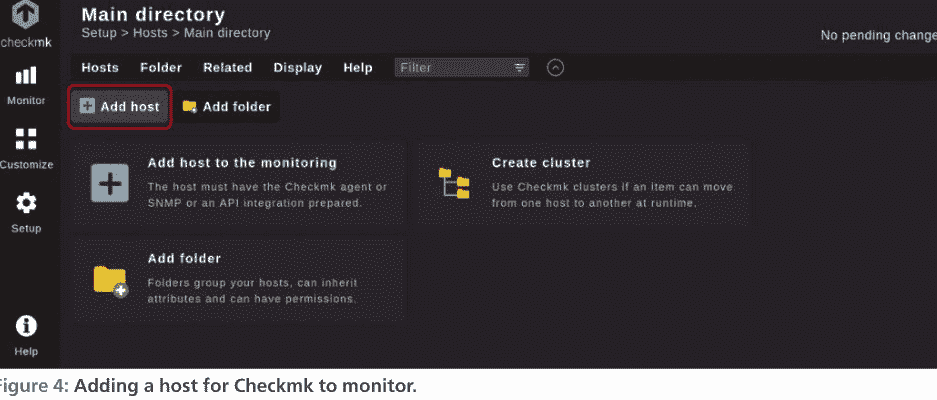

在浏览器中打开指向您的 `Checkmk` 站点的链接。您可以打开终端上显示的链接。使用 `ckadmin` 和从终端复制的密码登录。您将会看到一个空白仪表盘。转到左侧边栏中的“用户”，在“个人资料”下，点击 `更改密码` 以更改您的密码（推荐）。

之后，您可以开始向监控中添加主机（图 4）。在我的情况下，我将添加我的路由器。转到 `Setup | Hosts` 并点击 `Add host`。

在我的示例中，我只需要添加主机名 `tplinkmodem.net`，因为 `TP-Link` 为其设备设置了 `DNS`，因此 `Checkmk` 可以自动解析您主机名的 `IP` 地址。如果可用，我建议使用此选项。如果不是这种情况，您还需要通过激活 `IPv4 address` 旁边的复选框并输入 `IP` 地址来添加您设备的 `IP` 地址。

对于我的路由器，我想使用 `SNMP`，但默认情况下，`Checkmk` 假设您使用 `Checkmk` 代理来监控系统。`Checkmk` 代理非常适合监控服务器，但在大多数网络设备上，您无法安装额外的软件。因此，转到 `Monitoring agents`，勾选 `Checkmk agent/API integrations`，并选择 `no agent`。

接下来，勾选标记为 `SNMP` 的复选框（图 5）。选择您的 `SNMP` 版本——大多数情况下 `SNMP v2 or v3` 均可工作。因为我没有更改 `SNMP` 社区字符串，所以可以留空 `SNMP` 凭据框——默认情况下，`Checkmk` 假设密码是 `public`。如果情况并非如此，您必须在 `SNMP credentials` 下设置社区字符串。其他项目保持不变。

接下来，点击 `Save & go to service configuration`。`Checkmk` 现在将自动发现该主机上相关的监控服务，然后您应该看到一个 `Undecided services` 列表。点击 `Fix all` 以监控所有这些相关服务（图 6）。这将把所有检测到的服务添加到监控中，并移除已消失的服务。当然，您可以手动管理服务，但 `Fix all` 功能使操作变得容易得多。

在这种情况下，`Checkmk` 仅仅检测了我所有当前在线的路由器端口，加上正常运行时间和 `SNMP` 信息检查——对我来说总共是 10 个服务。如果您的设备有官方检查插件可用，`Checkmk` 将自动检测相关信息。这 2,000 个官方检查插件覆盖了大多数常见专业网络设备制造商的设备。这个插件集合使 `Checkmk` 成为网络监控的绝佳工具，并为您节省大量时间。

关于使用 `SNMP` 监控的更多信息，我推荐博文“Network Monitoring with Checkmk” [5]。但在开始外部阅读之前，请遵循最后一步以完成本教程。

#### 激活更改

最后，您需要通过点击右上角带有黄色 `↑` 且显示更改数量的突出显示字段来激活更改。之后，点击 `Activate on selected sites`，您就成功地将第一个主机添加到监控中。

激活更改是一种安全机制。所有所做的更改将列在 `Pending changes` 下（图 7）。在更改影响您的监控之前，您可以审查任何列出的更改。`Checkmk` 区分作为配置环境的 `Setup` 菜单（在此管理主机、服务和设置）和 `Monitor` 菜单（在此进行实际的操作监控）。新的主机和其他配置更改最初对监控没有影响。在它们进入生产环境之前，您需要激活这些更改。

您现在可以在 `Monitor | Overview | All hosts` 下找到您的主机。点击一个主机，您将看到该主机所有监控服务的概览。图 8 显示了我的路由器概览。您可以点击每个服务以查看更多细节。

您可以通过点击侧边栏中的 `Setup | Agents | Linux` 找到适用于各种操作系统（如 `Windows` 和许多 `Linux` 发行版）的代理。

##### 深入检查 Checkmk

`Checkmk` 文档 [7]，以及官方 `Checkmk` 论坛 [8]，将为您解答所有关于 `Checkmk` 的问题。

### 结论

本文旨在作为一个概念验证。我在示例中使用 `SNMP` 监控代理，因为大多数家用路由器都支持 `SNMP`。但请注意，`SNMP` 存在一些安全问题。美国政府网络安全和基础设施安全局建议仅使用 `SNMPv3`，并概述了额外的预防措施 [6]。

本教程到此结束，但您真实的监控体验才刚刚开始。如果您想继续，您还应该将您的宿主服务器添加到监控中。`Checkmk` 提供了一些轻量但强大的监控代理用于服务器监控。

安装后，流程类似。添加您想要监控的主机，但您可以留空 `Checkmk agent/API integrations` 复选框，且不应将其切换为 `SNMP`。默认情况下，`Checkmk` 假设您正在使用 `Checkmk` 代理来监控系统。

`Checkmk` 文档 [7]，以及官方 `Checkmk` 论坛 [8]，将为您解答所有关于 `Checkmk` 的问题。

### 作者

**Martin Hirschvogel**，产品总监，于 2018 年加入 **tribe29**，此后一直专注于改进 **Checkmk**。Martin 领导产品营销团队，并领导围绕现代 **DevOps** 技术（如 **Kubernetes**）的开发工作。在加入 **tribe29** 之前，他在 **Team-Viewer** 担任幕僚长，并在 **波士顿咨询公司** 担任顾问。

### 信息

1.  Checkmk: [https://checkmk.com](https://checkmk.com)

2.  Nagios: [https://www.nagios.org/](https://www.nagios.org/)

3.  Checkmk 下载: [https://checkmk.com/download?edition=cre&version=stable&dist=ubuntu&os=focal](https://checkmk.com/download?edition=cre&version=stable&dist=ubuntu&os=focal)

4.  OMD: [https://omdistro.org/](https://omdistro.org/)

5.  "Network Monitoring with Checkmk": [https://checkmk.com/blog/network-monitoring-with-checkmk-2-0](https://checkmk.com/blog/network-monitoring-with-checkmk-2-0)

6.  降低滥用 SNMP 的风险: [https://www.cisa.gov/uscert/ncas/alerts/TA17-156A](https://www.cisa.gov/uscert/ncas/alerts/TA17-156A)

7.  Checkmk 文档: [https://docs.checkmk.com/latest/en/](https://docs.checkmk.com/latest/en/)

8.  Checkmk 用户论坛: [https://forum.checkmk.com/](https://forum.checkmk.com/)

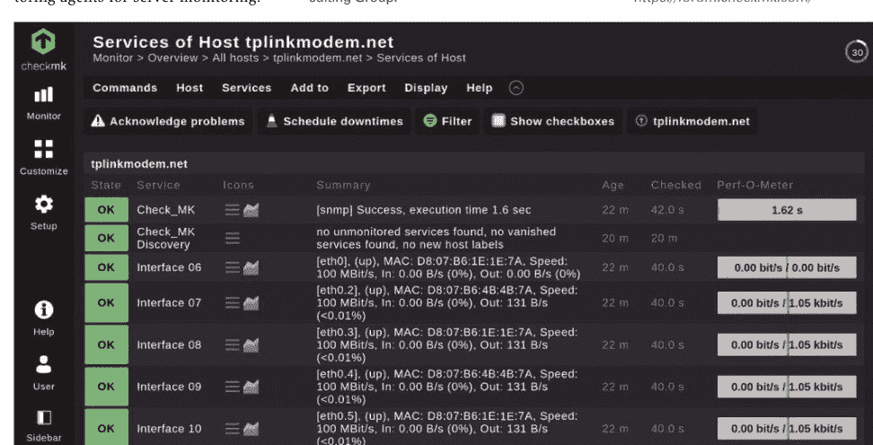

图 8：查看主机上的所有监控服务。

### 使用 Go 调整手机照片方向

**阳光普照**


为了效率，手机通常以颠倒或侧向的方式存储照片，并在 `Exif` 元数据中记录这一事实。然而，并非所有应用程序都能处理这种情况。**Mike Schilli** 求助于 `Go` 使过程万无一失。 作者：*Mike Schilli*

不知为何，我拍照时似乎总是拿错手机。经常发生这种情况，一张在照片图库中看起来正常的图片，当我想通过 `WhatsApp` 发送给朋友时，突然变成颠倒或侧向的。快速查看相关照片的元数据 reveals 出了问题所在（列表 1） [1]。


显然，我的手机以错误的方向保存图像，但也存储了校正值，该值显示在 JPEG 格式的 `Exif` 头中，告诉您照片实际上应该如何旋转。我不知道是谁想出了这个主意，但假设任何应用程序首先查看 `Exif` 头，然后正确对齐图像，这在我看来似乎是一个根本缺陷。在我心中毫无疑问，原始相机应用程序应该在拍摄照片时执行旋转，而不是由数量无法管理的光照应用程序在下游反复完成这项工作。

**列表 1：照片元数据**

```bash
$ exiftool pic.jpg | grep Rotate
Orientation: Rotate 180
```

**作者**

`Mike Schilli` 在加利福尼亚州旧金山湾区担任软件工程师。自 1997 年以来，他每月专栏都在研究各种编程语言的实用应用。如果您通过 `mschilli@permeister.com` 给他发电子邮件，他会很高兴回答任何问题。


#### 颠倒的世界

图 1 说明，即使图像存储不正确，手机仍然在其照片应用程序中以正确方向显示图像。然而，浏览器中的 `WhatsApp` 桌面客户端版本显然忽略了相关的 `Exif` 头，并将图片以颠倒的方向发送（图 2）。想象一下收件人收到一条关于我在旧金山海洋海滩冲浪之旅的消息，配上一张头朝下的照片时的反应！是时候编写一个 `Go` 程序，正确定向从手机获取的照片，然后完全删除 `Exif` 头，这样任何下游应用程序都会按原样处理图像——非常像 `GIMP`（图 3）看到旋转照片时所做的那样。既然要这样做，我会加入一些旋转图像 90 或 180 度的算法：毕竟，有人在你的下一个面试中可能会问到这些。


**图 1：我的智能手机以正确方向显示图像……**

照片由 `Gurt with hat on` 提供：`Unsplash`

#### 编程快照 – 使用 Go 旋转照片


中心线。同时，`x0` 距离图像左边缘的远近与 `x1` 距离右边缘的远近相等。

`Listing 2` 展示了将 `JPEG` 照片倒置的算法。从第 13 行开始的两个嵌套 `for` 循环遍历 `Y` 值从 0 到图像底部，以及 `X` 值从 0 到右边缘。这些坐标对应于原始像素的 `x0` 和 `y0` 位置。在双重循环内部，第 15 行通过 `jimg.At(x,y)` 获取原始像素值。为了旋转图像，它将该值存储在为新创建的、可修改的照片 `dim` 中镜像位置 `x1, y1` 处。该位置是根据 `x0` 到图像右边缘或 `y0` 到下边缘的距离计算得出的。该算法有效地将图像在水平和垂直中心线处进行镜像，从而实现所需的倒置效果。


数字照片最终是一个 `m` 乘 `n` 的像素值矩阵。要将其倒置（即执行 180 度旋转），算法只需交换中心线上下的像素值。图像中像素的 `X` 值传统上是从左到右运行的，而 `Y` 值则从顶部到底部增加。这意味着照片的原点可以指定为左上角的 `(0, 0)`，而右下角位于坐标 `(w-1, h-1)` 处，其中 `w` 指定图像宽度，`h` 指定图像高度，单位均为像素。

##### 双重翻转

但请注意：如果你简单地交换 `Y` 值进行旋转，最终会得到原照片的镜像。相反，对于 180 度旋转，较小的 `X` 值（左上角的像素）需要放到右下角。这意味着旋转算法需要同时镜像 `Y` 值和 `X` 值。因此，位于图像上半部分坐标为 `(x0, y0)` 的像素最终会落在图像下半部分的 `x1, y1` 位置。`y0` 到中心线的距离等于 `y1` 到中心线的距离。

##### 可写副本

当 `Go` 从磁盘读取 `JPEG` 照片时，它通常会得到一个不可修改的像素数组。但由于算法想要操纵照片，`Listing 2` 中的第 11 行首先使用 `NewRGBA()` 创建了一个与原始照片尺寸相同但内容为空的可写照片。然后 `rot180` 函数持续调用 `jimg.At()` 获取原始照片的所有像素，并通过 `Set(x,y,Value)` 将它们逐个镜像传输到目标照片中。第 19 行将完成的旋转图像作为指针返回给调用它的 `main` 程序。


**Listing 2: rotate-180.go**

```go
01 package main
02
03 import (
04 "image"
05 )
06
07 func rot180(jimg image.Image) *image.RGBA {
08 bounds := jimg.Bounds()
09 width, height := bounds.Max.X, bounds.Max.Y
10
11 dim := image.NewRGBA(bounds)
12
13 for y := 0; y < height; y++ {
14 for x := 0; x < width; x++ {
15 dim.Set(width-1-x, height-1-y, jimg.At(x, y))
16 }
17 }
18
19 return dim
20 }
```

这涵盖了在内存中旋转照片 180 度的算法。但是，磁盘上以 `JPEG` 格式压缩的图像最初是如何进入 `RAM` 成为像素矩阵的呢？`Listing 3` 中的 `imgtool()` 函数接收照片文件名 `srcFile`，第二个参数是目标文件名，第三个参数是一个执行 `RAM` 中图像所需旋转的回调函数。在 `Go` 中，函数是完整功能的数据类型，可以轻松地传递给其他函数，这基本上是在告诉 `Go`：“这是应用于原始图像数据的算法。” `Listing 3` 在第 11 行打开原始文件进行读取，使用标准 `image/jpeg` 包中的 `Decode()` 解码 `JPEG` 数据，并在没有错误时将结果存储到由变量 `jimg` 指向的矩阵中。然后第 21 行调用之前作为参数传入的函数，通过变量 `cb` 执行，将 `jimg` 中的图像数据传递给它，并接收旋转后图像的修改数据到 `dimg` 中。剩下的任务就是创建新的目标文件 `dstFile`，并在第 30 行写入修改后照片的 `JPEG` 编码数据。

顺时针方向以显示正确方向。在图 4 中，`Gimp` 判定旧金山不太知名的 `Billy Goat Hill` 公园的照片需要向右旋转四分之一圈，并建议立即完成任务。

但是，像素的四分之一旋转在二维矩阵中是如何工作的？图 5 示意地展示了具有值 `(1,2,3,4)` 的第一行像素在将矩阵顺时针旋转 90 度后如何变成结果中最右侧的列。

虽然算法将行转换为列，但目标图像的尺寸也会改变。手机照片通常是矩形而非正方形，旋转 90 度的照片不仅改变其像素值，还会交换结果整体图像的宽度和高度。`Listing 4` 通过在第 10 行交换 `bounds` 中 `X` 和 `Y` 方向的尺寸来考虑这一点，使得在第 12 行由 `NewRGBA()` 生成的可修改目标图像已经具有旋转后矩形的尺寸，而不是原始尺寸。

##### 旋转 90 度

并非所有保存错误的图像都是倒置的。有时图像也是侧向的，需要旋转 90 度。在这种情况下，调用 `exiftool` 会显示类似 `Orientation: 90 CW` 的信息用于 `JPEG` 文件。这表明你需要将图像旋转 90 度

##### 将 X 更改为 Y

`Listing 4` 中从第 14 行开始的嵌套 `for` 循环逐行遍历源图像，通过调用 `jing.At()` 获取当前像素值，并使用 `dimg.Set()` 将其从右到左逐列存储在目标矩阵中 – 就是这么简单。

有了这两个用代码实现的算法，`Listing 5` 中的主程序可以从磁盘获取照片，读取 `Exif` 头信息，确定头信息中是否存在方向标签，并发起旋转以纠正格式。如果你之前使用 `Exiftool` 读取 `JPEG` 照片的 `Exif` 头信息，你可能会惊讶地发现 `Exif` 头中 `Orientation` 标签的真实值根本不是包含角度信息的字符串，而是一个整数值。常见的设置值是 6（顺时针 90 度）、3（180 度）或 8（逆时针 90 度）。该标准支持的其他值（包括镜像照片）在图 6 中显示，但在实践中出现的频率较低。

隐藏在 `JPEG` 照片中的 `Exif` 标签不易读取，但幸运的是，`GitHub` 上的 `Go` 社区提供了一些简化此任务的库，只需调用 `Decode()` 函数即可。`Listing 5` 展示了主 `autorot` 程序，它使用了 `GitHub` 用户 `rwcarlsen` 提供的 `goexif` 库。我在之前的专栏 [2] 中使用过类似的用于图像操作的开源产品。


使用 `data.Get()`，`Listing 5` 在第 34 行从一堆 `Exif` 标签数据中检索 `Orientation` 标签的值。如果未找到该标签，则无需执行任何操作，因为图像已经具有正确的方向。但是，如果程序找到了标签，第 40 行获取该标签的第一个整数值（索引 `0`），并从第 45 行开始的 `switch` 结构确定图像需要哪种纠正旋转（90 或 180 度）并调用修改函数。

**`Listing 3: imgmod.go`**

```go
01  package main
02
03  import (
04      "image"
05      "image/jpeg"
06      "log"
07      "os"
08  )
09
10  func imgMod(srcFile string, dstFile string, cb func(image.Image) *image.RGBA) {
11      f, err := os.Open(srcFile)
12      if err != nil {
13          log.Fatalf("os.Open failed: %v", err)
14      }
15
16      jimg, _, err := image.Decode(f)
17      if err != nil {
18          log.Fatalf("image.Decode failed: %v", err)
19      }
20
21      dimg := cb(jimg)
22      if err != nil {
23          log.Fatalf("Modifier failed")
24      }
25
26      f, err = os.Create(dstFile)
27      if err != nil {
28          log.Fatalf("os.Create failed: %v", err)
29      }
30
31      err = jpeg.Encode(f, dimg, nil)
32      if err != nil {
33          log.Fatalf("jpeg.Encode failed: %v", err)
34      }
35  }
```


图 4：`Gimp` 检测到图像需要旋转 90 度。


**图 5：** 图像顺时针旋转 90 度后的矩阵变换。

**`Listing 4: rotate-90.go`**

```go
01 package main
02
03 import (
04 	"image"
05 )
06
07 func rot90(jimg image.Image) *image.RGBA {
08 	var bounds = jimg.Bounds()
09 	width, height := bounds.Max.X, bounds.Max.Y
10 	var dim = image.NewRGBA(&image.Rect{
	Max: image.Point{X: width, Y: height}
	Min: image.Point{}})
11
12 	dim := image.NewRGBA(bounds)
13
14 	for y := 0; y < height; y++ {
15 		for x := 0; x < width; x++ {
16 			org := jimg.At(x, y)
17 			dim.Set(height-y, x, org)
18 		}
19 	}
20 
21 	return dim
22 }
```

## 商店

`shop.linuxnewmedia.com`

- 在 `Linux New Media` 的在线商店探索过去并投资新一年的 `IT` 解决方案。

- 想要订阅？正在寻找你真的很想在报摊上买的那本过刊？

➤ `shop.linuxnewmedia.com`

## 数字与印刷订阅


## 特别版

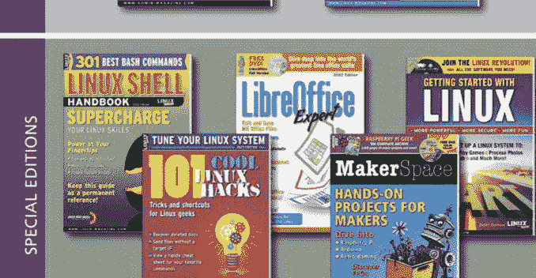

### 深入解析

#### 编程快照 – 使用 `Go` 旋转照片

##### 清单 5: `autorot.go`

```go
package main

import (
    "flag"
    "fmt"
    "github.com/twcarns1n/goexif/exif"
    "os"
    "path"
)

func main() {
    flag.Usage = func() {
        fmt.Printf("Usage: %s jpg-file\n", path.Base(os.Args[0]))
        os.Exit(1)
    }

    flag.Parse()
    if len(flag.Args()) != 1 {
        flag.Usage()
    }

    jpgFile := flag.Arg(0)

    f, err := os.Open(jpgFile)
    if err != nil {
        panic(err)
    }

    data, err := exif.Decode(f)
    if err != nil {
        panic(err)
    }

    orient, err := data.Get(exif.Orientation)
    if err != nil {
        fmt.Printf("No orientation header found.\n")
        os.Exit(0)
    }

    val, err := orient.Int(0)
    if err != nil {
        panic(err)
    }

    switch val {
    case 3:
        imgMod(jpgFile, jpgFile, rot180)
    case 6:
        imgMod(jpgFile, jpgFile, rot90)
    default:
        panic("Unknown orientation")
    }
}
```

使用 `imgMod` 并传入适当的算法函数作为参数。`Listing 5` 中对 `imgMod()` 的调用对源文件和目标文件使用了相同的名称，因此 `autorot` 只是简单地覆盖原始文件。如果这显得太过危险，您可以将目标文件重命名为 `.bak`，这样可以确保不会发生事故。

当 `Go` 的图像库将 `JPEG` 图像写回磁盘时，它完全省略了原始的 `Exif` 数据，因此头部中不再存在指示正确旋转的 `orient` 条目。

##### 编译程序

您可以使用 `Listing 6` 中的命令序列来创建 `autorot` 二进制文件。`go` 编译器从 `GitHub` 获取所需的库，编译它们，并将它们链接在一起。与往常一样，这会生成一个已经包含所有依赖项的可执行文件。它可以毫无问题地复制到另一台计算机上，并在该计算机上运行而不发出任何抱怨，前提是操作系统和处理器架构相似。

##### 清单 6: 编译 `autorot`

```bash
$ go mod init autorot
$ go mod tidy
$ go build autorot.go rotate-90.go rotate-180.go imgmod.go
```

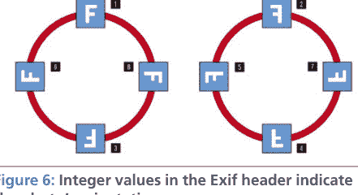

### 结论

该程序远非完美。它对大多数情况都能起作用，但仍然缺少逆时针旋转以及针对更奇特 `Exif` 值的算法。但凭借所描述的基础知识，可以轻松添加这些功能。与往常一样，`Go` 并未对爱好者设限。

**信息**

1. 本文的清单：[http://ftp.linux-magazine.com/pub/listings/linux-magazine.com/257](http://ftp.linux-magazine.com/pub/listings/linux-magazine.com/257)

2. `Mike Schilli` 的文章“在手机照片中操纵存储的地理坐标”，载于《`Linux` 杂志》240 期，2020 年 12 月，[https://linux-magazine.com/issues/2020/240/Obfuscation-Filter](https://linux-magazine.com/issues/2020/240/Obfuscation-Filter)


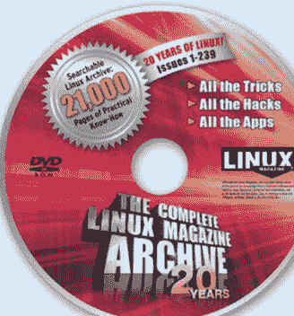

**LINUX 杂志**

20 年存档 DVD

立即购买！

[https://bit.ly/Archive-DVD](https://bit.ly/Archive-DVD)


---

### 深入解析

#### LibreOffice 对比 OpenOffice


##### 比较 LibreOffice 和 OpenOffice

`**明确的选择**`

尽管 `LibreOffice` 和 `OpenOffice` 有着共同的过去，但 `LibreOffice` 在贡献者、代码提交和功能方面都超越了 `OpenOffice`。作者：Bruce Byfield

搜索 `LibreOffice` 和 `Apache OpenOffice` 的比较结果会返回超过 830 万条。鉴于 `LibreOffice` 和 `OpenOffice` 是最著名的开源办公套件且拥有共同的过去，这个数字并不令人惊讶。然而，令人惊讶的是许多比较肤浅的程度。许多比较只是从一个不成熟但挑剔的用户角度对任一办公套件进行表面上的审视。通常，这些比较已经过时。同样值得注意的是，许多比较努力营造一种虚假的客观感，宣称任何差异都是微不足道的。然而，按照任何标准，`LibreOffice` 都胜过 `OpenOffice`，并显示出 `OpenOffice` 已过时。假装事实并非如此是对真相的歪曲。

如您所知，这两个办公套件有着共同的历史（图 1）。两者都源自 `OpenOffice.org`，这是一个由 `Sun Microsystems` 在 2000-2011 年间运营的项目。事实上，`OpenOffice` 声称自己是 `OpenOffice.org` 的法律继承者，因为在 2011 年 `Sun` 将 `OpenOffice.org` 移交给 `Oracle`，`Oracle` 又将其移交给 `Apache` 基金会——但在开源中，所有权的概念几乎无关紧要。与此同时，`Go-o.o`，一个自 2007 年以来低调运营的半官方分支，创建了 `LibreOffice` 及其管理机构，即文档基金会（`The Document Foundation`）。`Go-o.o` 在 `OpenOffice.org` 中颇具争议，因为它倡导更快的开发节奏，因此两个新项目的成立似乎正式化了已经存在的分裂。

当然，`LibreOffice` 和 `OpenOffice` 从一开始就互不喜爱。同样从一开始，`OpenOffice` 面临着 `LibreOffice` 所没有的挑战。首先，`OpenOffice` 使用 `Apache` 许可证，而 `LibreOffice` 使用双 `LGPLv3/摩纳哥公共许可证`（`MPL`）。这种许可证差异的一个主要后果是，`LibreOffice` 可以从 `OpenOffice` 借用代码，而 `OpenOffice` 不能从 `LibreOffice` 借用代码。同样重要的是，从 2014 年 3 月下旬到 2015 年 3 月，`OpenOffice` 总共只有 16 名贡献者，其中 12 名在 `IBM` 停止支持 `OpenOffice` 时停止了贡献 [1]。自那以后，`OpenOffice` 一直不愿公布贡献者数量，但考虑到 `OpenOffice` 在 2012 年声称有 120 名贡献者 [2]，今天这个数字不太可能超过 `LibreOffice` 的 1,722 名贡献者 [3] 的一小部分。结果是可预测的：自 2014 年以来，`OpenOffice` 没有发布主要版本，只有 11 个次要版本。相比之下，`LibreOffice` 发布了 13 个主要版本和 87 个次要版本。并且在 2019 年，`LibreOffice` 有超过 15,000 次代码提交，而 `OpenOffice` 只有 595 次 [4]。

同样不可避免的是，`LibreOffice` 吸引了 `Red Hat` 和 `Collabora` 等重要企业支持者，而 `OpenOffice` 则无法填补 `IBM` 八年前留下的空白。`OpenOffice` 的持续存在虽然有点古色古香，甚至令人钦佩，但该项目在结构上根本无法竞争。

`**功能差异**`

除了十年前 `Go-o.o` 的贡献外，这两个项目最初

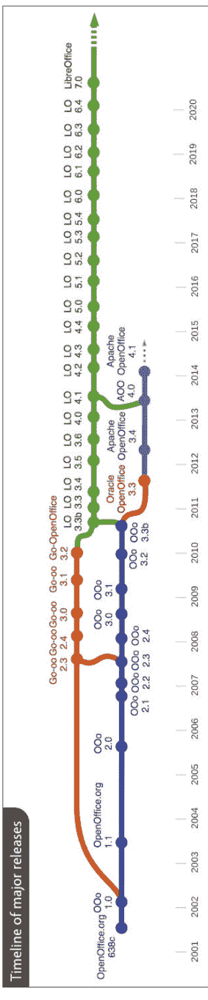

共享一个共同的代码库。即使在今天，仍有足够的代码保持相同，使得在一个版本上运行的扩展通常在另一个版本的发布中也能运行，尽管比十年前要少。毫无疑问，文件之间相互使用开放式文档格式（`ODF`）有助于保持兼容性。然而，差异似乎在增长——主要是由于 `LibreOffice` 的创新。这种差异可以在下载大小中看到：`LibreOffice` 的 `DEB` 下载文件为 `195MB`，而 `OpenOffice` 的为 `159MB`。换句话说，尽管 `LibreOffice` 已经移除了代码中的冗余并重写了部分以提高效率（`OpenOffice` 尚未做到这一点），但它的体积接近大出四分之一。

大约八年前，我看到了一份 `LibreOffice` 内部文件的副本，其中列出了 `OpenOffice` 缺乏的所有功能。令我惊讶的是，有数百个条目。尽管许多都是次要的，但差异之多远非可以列举，更不用说逐一解释了。然而，在更重要的功能中，`LibreOffice` 包含了对界面的全面改造，重新排列菜单项，重新定位窗口中的项目以提高可访问性，添加主题，并总体上创建了一个更用户友好的外观。这些变化在用于电子表格的图表子系统中尤为明显，其中的颜色更新自 `OpenOffice.org` 那种停留在 1990 年代的外观。此外，`LibreOffice` 引入了主题和多种用户界面选择，包括类似 `MS Office` 的选项卡工具栏。`OpenOffice` 中没有任何这些更改的等效项。

`LibreOffice` 的新功能在所有模块中可见，特别是在 `Writer` 和 `Calc` 中。但为了节省篇幅，我将以 `Writer` 作为其他模块的例证。`LibreOffice Writer` 中在 `OpenOffice` 中没有对应功能的突出特性包括：

- 将表格设计折叠到其他样式中，使其易于查找，并且可以复制到其他文件中。

- 默认列表样式，提供项目符号和编号系统的选择，省去了用户设置的需要。

- 导出到 `EPUB` 格式（此功能仍在完全实现中，尽管现在通常已可用）。

- 支持 `HarfBuzz`，这是一款字体渲染应用，允许通过添加在字符字段中的一系列代码来修改 `OpenType` 和 `True Type` 文件，使 `LibreOffice` 成为功能齐全的桌面出版软件。

然而，对于许多用户来说，`LibreOffice Writer` 中最重要的改进是继续增强对 `MS Word` 的导出。这项努力可能是一个移动的目标，因为 `Microsoft` 经常更改其格式，但可靠的 `MS Word` 导入过滤器对于许多公司采用 `LibreOffice` 至关重要。这工作中的很大一部分归功于 `LibreOffice` 与 `Collabora` 的战略联盟，后者为其客户构建兼容性解决方案，并将其改进捐赠给 `LibreOffice`，在 2019 年贡献了超过三分之一的 `LibreOffice` 提交。在最近的 `7.3` 版本中，`MS Word` 导入和导出过滤器已达到这样一个阶段，大多数常规商务和学术文件可以可靠地与未使用 `LibreOffice` 的用户进行交换。相比之下，`OpenOffice` 的 `MS Word` 兼容性则波动得多。

`**最新发布**`

为了获得另一种视角，你只需查看最新的发行说明。2021 年 11 月 27 日，`OpenOffice` 宣布发布 `OpenOffice 4.1.11` [5]。该版本改进或增强功能的完整列表如下：

- 启用了持久化调整以帮助调整文本字体大小。

- 在插入菜单中添加了 `Fontwork`。

- 在文件菜单中添加了缺失的 `PDF` 导出图标。

此外，两个 `bug` 修复被认为值得提及：

- `Apache OpenOffice 4.1.10` 引入的新安全警告阻止了有用的功能。

- `Windows` 安装文件缺少属性且缺乏代码签名。

- `Windows` 安装：切换到 `NIS 3.x` 后丢失了适配的文本。

- 以 `ODS` 格式保存时图表丢失。

此外，没有添加新的或更新的词典或语言。

相比之下，`LibreOffice 7.3` 的发行说明 [6] 于 2022 年 2 月 2 日宣布，包含了如此多的新功能和改进，完整的列表在此篇幅内无法全部列出。

#### 深度分析

#### LibreOffice 与 OpenOffice 的对比

在 `LibreOffice Writer` 中，部分改进包括：

- 支持形状超链接。

- 开始支持链接列表、字符和段落样式。

- 修订跟踪更好地监控了移动文本。

- 复杂文档的 `PDF` 转换速度更快。

在 `LibreOffice Calc` 中，亮点包括：

- 打开多种格式的速度得到提升。

- 图表和计算的速度得到提升。

`Draw` 和 `Impress` 均实现了以下改进：


- 改进了对 `PowerPoint` 兼容屏幕尺寸的支持。
- 为 `3D` 对象增加了新的表面。

最后，还进行了以下通用改进：

- 增加了条形码和二维码对话框。
- 在整个软件中实现了标准化线宽。
- 针对更高性能优化了官方二进制文件。
- 增强并更新了帮助文件。
- 对 `MS Office` 过滤器进行了多项改进。
- 新增了四种语言，包括以色列英语和克林贡语。
- 新增了脚本库。

还需要多说些什么吗？即使考虑到不同点发布的差异，整体局势显然是一个步履维艰的项目与一个蓬勃发展项目的对比。认为 `OpenOffice` 能与 `LibreOffice` 竞争的观念根本无法站住脚。

#### 明确的选择

`OpenOffice` 仍是一套合格的办公套件。`OpenOffice.org` 为它奠定了坚实的基础，正如 `LibreOffice` 所做的那样。特别是，`OpenOffice` 在样式选择上的优势使其在许多替代品中显得尤为突出。如果你只编写简短或一次性的文档，`OpenOffice` 可能完全能满足你的需求。然而，不可否认的事实是，由于十多年没有重大变革，`OpenOffice` 正在显露出老化的迹象。该项目仅仅勉强跟上 `bug` 修复的脚步，并未像 `LibreOffice` 那样跟上现代需求的发展。我唯一听到的支持 `OpenOffice` 的理由是，它像 `Debian` 的稳定版软件源一样，使用了较旧但经过更多补丁的代码，但考虑到 `OpenOffice` 的编码资源，甚至这个理由也站不住脚。事实上，`LibreOffice` 可能更擅长修复 `bug`。`OpenOffice` 唯一的优势就是知名度，这只会诱使用户下载一个远不如 `LibreOffice` 发达的替代品。

面对当前局势的理性反应应该是让 `OpenOffice` 要么停止苟延残喘，要么与 `LibreOffice` 合并。事实上，`LibreOffice` 在 2020 年提出过合作提案 [7]，但固执以及可能存在的旧怨导致该提案被愤怒地拒绝。自由软件意味着 `OpenOffice` 的支持者可以自由开发他们选择的任何东西，但这并不意味着我们其他人有义务支持他们。当需要在 `LibreOffice` 和 `OpenOffice` 之间做出选择时，唯一理性的选择是 `LibreOffice`。

##### 参考信息

- [1] `OpenOffice` 贡献者 2014-2015：`https://en.wikipedia.org/wiki/OpenOffice`
- [2] `OpenOffice` 贡献者数量图表：`www.openoffice.org/stats/committers.html`
- [3] `LibreOffice` 贡献者：`https://www.libreoffice.org/about-us/credits/`
- [4] 2019 年代码提交：`https://fosshbytes.com/libreoffice-sends-open-letter-appealing-to-apache-openoffice/`
- [5] `OpenOffice` 4.1.11：`https://wiki.openoffice.org/ooo4111release-notes`
- [6] `LibreOffice` 7.3 发行说明：`https://wiki.documentfoundation.org/ReleaseNotes/7.3`
- [7] 合作提案：`https://blog.documentfoundation.org/blog/2020-10-12/open-letter-to-apache-openoffice/`

##### 针对真实网络的真实解决方案


`ADMIN` 是您获取现实世界问题技术解决方案的来源。

通过以下实用文章提升您的管理技能：

- 安全
- 云计算
- `DevOps`
- `HPC`
- 存储及其他！

#### 立即订阅！

`shop.linuxnewmedia.com`

查看我们的完整目录：

`shop.linuxnewmedia.com`


### MakerSpace（创客空间）

#### 灵活的 HiFiBerry 替代旧音频放大器

##### 音乐派

`HiFiBerry HAT`（扩展板）、配套系统以及 `Raspberry Pi`（树莓派）与两个旧扬声器结合，创造出一台当代风格的便携式收音机。作者：Tim Schürmann


当我那台可靠的音频放大器因杂音、嘶嘶声和声音中断而彻底损坏时，`Hi-Fi` 系统中的扬声器和 `CD` 播放器仍然完美工作。我的想法是用价格合理的 `Raspberry Pi` 来替换损坏的模块。如果它能够通过蓝牙接收音乐，那么我的所有家庭成员都可以从智能手机向其发送音乐，而无需离开沙发。

`HiFiBerry` 系列的一个堆叠扩展板（piggyback board）与 `Raspberry Pi` 上的配套系统结合，取代了这个旧式的音频放大器。该系统可以播放通过蓝牙或其他方式发送的音乐，并且你可以在浏览器中方便地控制它。然而，构建和设置过程中存在一些陷阱，运行中也有几个小怪癖。

这样的设置在企业会议室也很有用：演讲者可以将 `Raspberry Pi` 的音频输出流式传输到扬声器，无需布线，甚至无需离开座位。

##### Hi-Fi 莓果

当然，`Raspberry Pi` 只有一个模拟音频输出，且以出色的音质而闻名并非其特长。瑞士公司 `Modul 9` 在此伸出了援手，该公司在 `HiFiBerry` 品牌下为小型板计算机（`SBC`）提供各种放大器。你只需将小板连接到 `Raspberry Pi` 的 `GPIO` 端口，并将扬声器线缆插入提供的插座——这就足够了。

该公司还提供了自己的操作系统（`OS`）`HiFiBerryOS`，它承诺便捷的硬件启动，并在启动后立即作为一个小型音频中心发挥作用。除其他功能外，它接收通过蓝牙和 `AirPlay` 或连接存储设备发送的信号，并可以在浏览器中控制。其底层是一个经过定制的 `Linux` 系统，预配置了服务。详情可参见“繁琐的手动步骤”专栏。

##### 繁琐的手动步骤

`Raspberry Pi OS` 自带所有 `HiFiBerry` 产品所需的驱动程序。因此，你可以不使用 `HiFiBerryOS`，而是使用 `Raspberry Pi OS` 并手动安装所有必需的服务。然而，即使是设置蓝牙也可能让你头疼并耗费半个周末。如果你仍想尝试，你可以在线找到说明 [1]。

虽然妥善关闭 `Raspberry Pi OS` 是有意义的，但大多数人只是通过电源开关来开启或关闭收音机或 `hi-fi` 系统。为了让这成为可能，你需要让系统完全在主内存中运行。然而，设置此类配置既耗时又复杂。使用 `HiFiBerryOS` 能让你更快地达成目标，并且更令人省心。

中间的 `DAC+ ADC` 随后生成音频信号，并将其通过顶部的 `AAMP60` 放大器传递给扬声器。这对设备目前的成本为 €595（£110/EUR85）。`AAMP60` 的性能与 `Amp2` 相同。然而，与 `Amp2` 不同，`AAMP60` 需要 `DAC+ ADC` 或其他兼容的 `HifiBerry` 声卡。

##### 其他配件

`AAMP60`、`Amp2` 和 `Beocreate` 均配有外部电源连接器。四欧姆扬声器需要额定功率为 12V-18V 的电源；对于八欧姆扬声器，开发人员建议你使用 18V。

根据数据手册，`Amp2` 最高可承受 24V，`AAMP60` 可承受 20V。如果你想确保万无一失，请在 `HifiBerry` 商店购买相应板卡时匹配相应的电源。`Amp2` 和 `Beocreate` 为 `Raspberry Pi` 供电；`AAMP60` 此外还为 `DAC+ ADC` 供电。因此，`Raspberry Pi` 不需要自己的电源。

要通过蓝牙播放音频材料，你还需要一个 `USB` 适配头。例外情况是 `Raspberry Pi 3B+` 和 `4`。

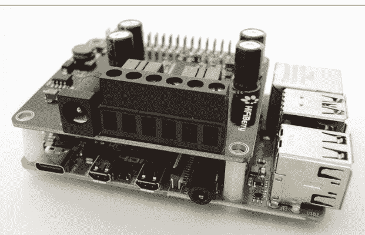

图 1：`Amp2` 板载包含一个小型 `DAC+` 声音模块，因此所有信号处理都在板上进行，无需其他硬件。

##### 硬件动物园

`Modul 9` 提供多种适用于不同用途的音频放大器。售价 $22（£20/EUR15）的 `MiniAmp` [2] 专为小巧的 `Pi Zero` 设计，只有两个 3W 输出，虽然足以应对小型 `PC` 扬声器，但对于客厅音响系统来说性能不够好。

幸运的是，一款名为 `Amp2`（图 1）的多用途利器 [3] 售价为 $55（£54/EUR46）。该放大器具有两个额定功率为 30W 的输出，起初听起来可能不多，但这块小板确实让下一层的邻居听硬摇滚时感到“开心”（略带调侃）。


`MiniAmp` 和 `Amp2` 一次只支持两个扬声器。如果你想连接更多扬声器，你可以购买售价 $190（£175/EUR160）的 `Beocreate` 4 通道放大器 [4]。顾名思义，它总共提供四个通道，其中两个连接甚至可以提供 60W。此外，`Beocreate` 拥有一个数字信号处理器，如有需要，你可以在 `HifiBerryOS` 中为音频信号应用各种效果。不幸的是，该公司不提供环绕声解决方案。

所有这些板卡都不带音频输入，但为了继续使用旧的 CD 播放器，你需要在 `HifiBerry` 宇宙中拥有一块带有输入功能的模拟声卡。对于这个项目，我选择了 `DAC+` 模数（`ADC`）转换器 [5]，直接配合 `AAMP60` 放大器 [6]。然而，与 `Amp2` 不同，它没有自己的声卡，因此你需要将两块 `HifiBerry` 板堆叠在 `Raspberry Pi` 上（图 2）。

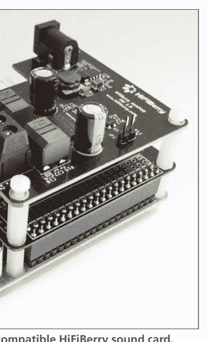

图 2：`AAMP60` 需要一个兼容的 `HifiBerry` 声卡。这里，`DAC+ ADC` 直接插在下方的 `GPIO` 端口上，`AAMP60` 位于其上方。

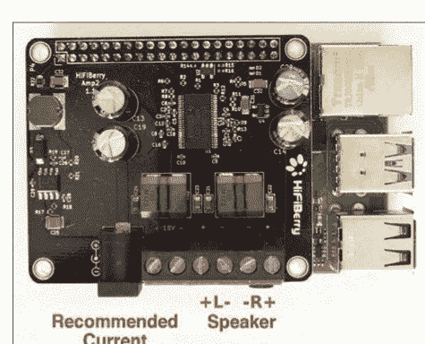

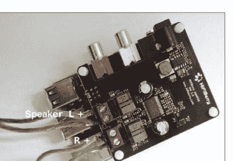

图 3：位于扬声器连接端子左侧的 `Amp 2` 上的两个插孔是另一种电源连接方式；由于电源和扬声器的螺丝设计相似，操作时请务必小心。

图 4：将左侧扬声器的线缆插入 `Amp60` 左侧的两个接线端子；右侧扬声器的线缆则插入其右侧相邻的接线端子。

以及 4 型（带夹具就位状态）。`3B` 型号（无加号标志）具备该功能，但 `HiFiBerry` 开发人员表示，它无法提供稳定的蓝牙连接，这就是为什么 `HiFiBerryOS` 会忽略该适配器的原因。购买新适配器时，请确保其兼容树莓派和 `Linux` 系统。

主板的重力会给 `GPIO` 引脚带来一定压力，因此您在拆包后应首先安装附带的塑料垫片（参见“外壳”框）。连接扬声器线缆时，请注意正确的插孔；不同 `HiFiBerry` 型号之间的插孔分配各不相同（图 3 和图 4）。

运行无需其他外围设备。但是，显示器、键盘和鼠标将有助于初始设置，而在浏览器中也可以以同样流畅的方式进行设置。如果您通过有线方式将树莓派连接到网络，设置过程将大部分自动化；否则，您可以通过 `WiFi` 进行配置，这需要一部智能手机或其他能够连接 `WiFi` 网络并拥有浏览器的设备。

您将其写入一张至少 4GB 的空白 `microSD` 卡。`HiFiBerryOS` 开发人员也推荐的 `Etcher` [9] 程序，是实现此任务的一个直观工具。完成后，将卡插入树莓派并开机。

首次启动大约需要三分钟，单板机会重启一次。如果它连接到局域网，系统将自动从 `DHCP` 服务器（例如路由器）获取 `IP` 地址。如果没有网络电缆，`HiFiBerryOS` 会建立自己的 `WiFi` 网络，您应将智能手机连接至此网络；其名称将以 `HiFiBerry_Setup_` 开头。

#### 外壳

由于高度和连接器的位置，这些放大器无法装入标准的树莓派外壳。不过，至少对于 `Amp2`，`Modul 9` 提供了紧凑型钢制外壳 [7]，以及其他型号，但并非所有型号都适合每种树莓派变体。

#### 软件


图 5：如果您看到此页面，说明 `HiFiBerryOS` 的初始设置已正确完成。

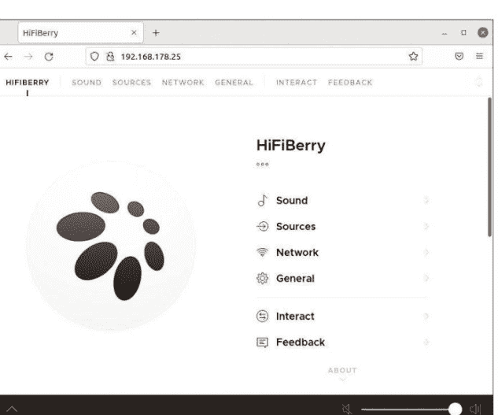

图 6：控制中心允许您控制播放。在“来源”下，您可以更改音频源。界面会根据屏幕大小自动调整。

如果您已连接屏幕、键盘和鼠标，将直接跳转到用户界面。否则，请在浏览器中调用 `http://HiFiBerry.local`。如果连接失败，请确定单板机的当前 `IP` 地址。如有疑问，路由器的用户界面应能提供详细信息。您会在那里看到树莓派被列示为 `hifiberry`。将您以此方式确定的 `IP` 地址输入浏览器。为了日后通过此 `IP` 地址访问界面，您可能希望配置路由器始终将相同的 `IP` 地址分配给树莓派。

如果在五分钟后仍无法访问用户界面，请将计算机从电源断开，然后重新连接。连接的屏幕可能会为您提供问题线索。如果重启尝试失败，请确保 `HiFiBerryOS` 镜像已无错误地写入介质；卡片可能存在故障。

#### 设置

一旦 `HiFiBerryOS` 网页（图 5）欢迎您，请单击 `Next Step`，然后单击 `Finish Setup`，直到您看到界面（图 6）。

除非您打算永久连接网线，否则请转到 `Network` 菜单项，在 `Wireless` 选项卡选择一个 `WiFi` 网络，并输入访问密码。一旦 `HiFiBerryOS` 建立连接，请在 `General | Power | Shut Down` 中关闭系统，等待 20 秒，然后断开电源。从此您不再需要网络电缆。

重新启动后，导航到界面的最底部。系统应显示其检测到的主板；`Amp2` 将显示为类似 `DAC+ / Amp2` 的名称。然而，`Amp60` 和 `DAC+ ADC` 的组合可能无法被正确检测；因此，音频输入不会作为“来源”下的 `Analog Input` 出现。

在这种情况下，请像之前一样再次关闭 `HiFiBerryOS`。在您的 `PC` 上打开 `SD` 卡上最小的分区。在 `Windows` 中，您可以直接访问所需文件。在文本编辑器中，在 `config.txt` 文件的末尾添加以下行：

```
dtparam=i2s_hifiberry-dacplusadc
```

从 `SD` 卡重启树莓派，并在 Web 界面中确保 `HiFiBerry` 已正确识别系统。

#### 蓝牙

系统运行后，切换到 `Sources`（即音频源）。`AirPlay` 默认启用，支持此功能以及其他媒体播放器的智能手机应能将计算机识别为存储设备并能够通过其播放音乐。

要访问蓝牙，请选择 `Bluetooth`，然后单击黑色的 `Bluetooth Pairing` 按钮。之后，附近所有启用蓝牙的设备都会将 `HiFiBerry` 识别为扬声器。将其与您的智能手机、平板电脑和其他设备进行配对——每个设备的过程可能不同（图 7）——然后在 `HiFiBerryOS` 上停止配对。


图 7：要在 `Android 11` 上向 `HiFiBerryOS` 介绍，请在设置中选择 `Connected devices` 和 `Pair new device`。

现在，您可以使用这些设备控制音量。为了避免打扰邻居，您可能希望在播放时将音量调低。`HiFiBerryOS` 在底部边缘显示标题，右侧则找到音量控制。

要播放来自 CD 播放器的音乐，请切换到 `Sources | Analog Input`。此项可能隐藏在 `Disabled Sources` 下（图 8）。开启输入，这会同时关闭其他来源。如果稍后希望蓝牙播放器提供声音，请禁用音频输入，并启用 `Sources | Bluetooth` 下的相应项。

#### 棘手问题

您的树莓派现在作为小型音频放大器运行。然而在实际操作中，您可能会不断遇到不足之处。例如，`Amp2` 在测试中的首次安装中存在严重的音量控制问题。一旦音量超过或低于某些阈值，播放中就会出现可闻的中断。在当前版本系统的新安装中，一切运行完美无缺。`Amp60` 未表现出这些任何问题。

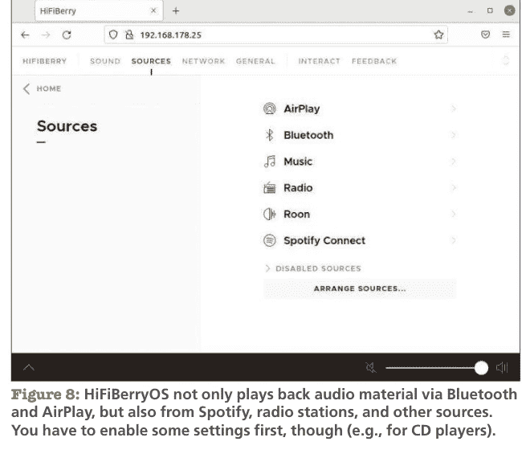

在实际操作中，新的蓝牙设备可能会不时进入您的家庭（例如，如果有访客）。要授予它们访问放大器的权限，您需要每次都启用配对功能。永久开启配对不是一个好主意 - 您真的希望邻居在您的扬声器上播放他们最爱的歌剧吗？

用户界面还缺少密码保护和其他安全措施。因此，网络上的用户可以不受限制地重新配置树莓派或播放音乐。

要切换到 CD 播放器，您必须从用户界面启用相应的音频输入。截至本文撰写时，`HiFiBerryOS` 不会在存在信号时自动切换。与独立放大器不同，聆听乐趣需要预先点击几下，根据我的经验，这对许多用户来说太多了。

#### 关机

使用后关闭 `HiFiBerryOS` 的预期方式是选择 `General | Power | Shut Down`。然而，在实践中，人们往往只是拔掉电源线或关闭此类设备的插线板 - 尤其是那些觉得用户界面过于复杂的用户。在测试中，切断电源并未造成任何永久性损坏，树莓派能够无问题地反复启动。

`HiFiBerryOS` 的开发人员也在博客文章中指出，该系统向 `SD` 卡写入的数据量很少，且损坏非常罕见 [10]。以防万一，请在您的 `DIY` 便携音响旁保留一张备用的、包含系统副本的 `SD` 卡。

`Modul 9` 现在也提供了一款电源控制器，仍处于测试或 `beta` 阶段 [11]，它允许您通过按一下按钮以受控方式关闭树莓派。

### 结论


HiFiBerry 放大器可以快速将树莓派变成一台超大号的便携音响，让您以低成本延长旧有 hi-fi 组件的使用寿命。`HiFiBerryOS` 也消除了手动设置蓝牙和其他复杂服务的需求。

该系统还提供对众多服务的访问，包括 `Spotify` 和各种互联网广播电台。然而，小毛病使得控制多个输入来源变得困难。

### 信息

- [1] Bruce Byfield 撰写的 "Configuring Bluetooth on Linux"，`https://www.linux-magazine.com/Online/Features/Configuring-Bluetooth-on-Linux/`
- [2] `MiniAmp`: `https://www.hifiberry.com/shop/boards/miniamp/`
- [3] `Amp2`: `https://www.hifiberry.com/shop/boards/hifiberry-amp2/`
- [4] Beocreate 4 通道放大器: `https://www.hifiberry.com/shop/boards/beocreate-4-channel-amplifier/`
- [5] `DAC+ ADC`: `https://www.hifiberry.com/shop/boards/hifiberry-dac-adc/`
- [6] `Amp60`: `https://www.hifiberry.com/shop/boards/hifiberry-amp60/`
- [7] `Amp2` 外壳: `https://www.hifiberry.com/shop/cases/steel-case-for-hifiberry-dac-pi-4-2-2/`
- [8] `HiFiBerryOS`: `https://www.hifiberry.com/hifiberryos/`
- [9] `Etcher`: `https://www.balena.io/etcher/`
- [10] "Powering up/down your Pi with a button": `https://www.hifiberry.com/blog/powering-up-down-your-pi-with-a-button/`
- [11] HiFiBerry 电源控制器: `https://www.hifiberry.com/shop/boards/power-controller/`

## 利用 101 个 Linux 技巧提升效率

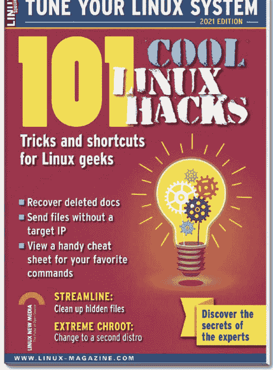

通过这套专为 Linux 极客准备的酷炫灵感和快捷键集合，提升你的 Linux 技能。

- 恢复丢失的文件
- 治愈“大写锁定”顽疾
- 在 shell 中运行 `C` 语言单行程序
- 禁用网络摄像头和麦克风
- 更多实用技巧！


### MakerSpace 派对灯光

## 使用 Kunbus Revolution Pi Core 3+ 实现 DMX 控制

用于控制灯光技术的 `DMX` 协议源于舞台和活动技术，但它也可应用于家庭自动化。我们将向您展示如何使用 `Revolution Pi` 模块来控制 `DMX` 设备。作者：Martin Mohr

原则上，数字复用（`DMX`）技术允许您通过一条简单且坚固的总线控制所有 `DMX` 设备。`DMX` 使用 `RS-485` 标准（即异步串行传输）进行数据传输。信号通过两条线路同时传输，电压电平相反（`±5V`）。

这种数据传输方式对外部干扰信号具有很强的抗扰能力，理论上支持长达 1,200 米的线路长度。然而，数据传输速率会随着线路长度的增加而降低。在 10 米以内的距离，通过 `RS-485` 最高可实现 `10Mbps` 的数据速率。

`DMX` 默认以 `250kbps` 的数据速率工作；`DMX` 网络由字符串（`strings`）构成。一个字符串最多可包含 32 个 `DMX` 接收器。更多的接收器需要使用中继器（`repeater`）来扩展网络。网络分支通过特殊的分路器（`splitters`）实现。所有 `DMX` 设备均使用极其坚固的三极 `XLR`（`Canon`）连接器进行连接，这非常适合舞台使用。

`DMX512` 标准支持最多 512 个设备地址。根据组件所需的地址数量不同，一条总线上可操作的设备数量也有所差异。

### DMX 照明

在本文中，我使用了两款简单的 `DMX` 灯，几年前我直接从中国订购 [1]，每盏仅 6.58 欧元。不过，现在直接从中国订购可能并不划算，而且价格已经上涨，因此建议您提前了解可能需要支付的其他费用。

每盏灯有 8 个通道，这意味着它们在 `DMX` 总线上占用 8 个地址。如果您将地址 `1` 分配给第一盏灯，则第二盏灯将被分配地址 `9`。有些令人困惑的是，在 `DMX` 领域中，地址和通道往往被当作不同的概念来讨论。经验法则是，灯中的每个通道都应该有一个地址。

表 1 展示了我所用硬件的通道概览。

`DMX` 灯提供的功能大多一目了然。只有少数项目需要特别注意。为了让聚光灯发光，通道 `1` 的值需要大于 `0`。如果通用调光器设置为 `0`，您无法仅调高红色调光器。

值为 `0` 时禁用频闪效果（通道 `6`）。当值为 `1` 时，它以最大频率闪烁，随着值的增加，闪烁速度会变慢。在“自动运行”操作模式下，可以选择各种预定义的颜色场景；播放速度由通道 `8` 控制。

在此，制造商的文档略显模糊，不清楚具体应发生什么情况。但这并不是问题，因为我们将使用外部控制器。

每盏灯各有一个 `DMX` 输入和输出，功耗为 `36W`，因此可以通过标准插座供电。灯的地址可以通过背面的四位七段显示器相当直观地设置。只需确保显示器第一位显示 `A` 即可。

将地址 `1` 分配给第一盏灯，地址 `9` 分配给第二盏灯。如果地址设置起初不起作用，请查看随附的制造商手册。图 1 展示了我用作控制器的两个灯、接线以及 `Revolution Pi`。

### Revolution Pi

来自 `Kunbus` 的 `Revolution Pi Core 3+`（以下简称 `RevPi Core`）[2] 是一个小型工业控制器，其核心是 `Raspberry Pi` 计算模块。`RevPi Core` 可以通过不同的模块进行扩展并适应不同的需求。制造商丰富的模块库中包含一个模块，可使 `RevPi Core` 连接到 `DMX` 总线。

`DMX` 模块可以运行在主模式和从模式，并控制最多 512 个 `DMX` 地址。供电电压为 `24V DC`，工作电流消耗为 `100mA`。该模块通过三个 `LED` 指示灯显示当前运行状态。指示灯的确切含义见表 2。

模块正面的一个 8 针插头允许您建立与 `DMX` 总线的连接。连接器的引脚分配见表 3。您也可以在模块侧面找到它——以及三针 `XLR` 连接器的引脚分配。如果您需要更多关于 `RevPi DMX` 模块的信息，最好查看用户手册 [3]。

### 配置与测试

`DMX` 模块可以通过两种方式配置：通过模块正面的开关或通过在软件中设置相应的值。在这里，我将介绍如何在软件中配置该模块。首先，登录到 `RevPi Core`（图 2）。用户名为 `admin`，密码可以在设备外壳的右侧找到。

成功登录后，启动 `PiCTory` 应用程序（图 3），并将 `RevPi Core` 和 `DMX` 模块拖放到当前配置中。`DMX` 模块通过 2 个字节进行配置。受支持参数的概览见表 4。地址和通道设置可能会因模式（发送/接收）不同而略有差异。如有必要，请查阅手册 [3]。

在实验设置中，值编辑器（`Value Editor`）下的第一个配置字节（`Config_1`）设置为 `0x10`，第二个（`Config_2`）设置为 `0x80`（图 4）。要在程序中访问 `DMX` 模块的各个字节，需要勾选 `Export`（导出）列以发布它们。对于测试设置，您需要设置前 16 个字节（`DMXOut_1` 到 `DMXOut_16`）。

图 4 展示了 `RevPi Core` 的完整配置，包括 `DMX` 模块。为了在重启后保留设置，请选择 `File | Save as Start-Config`（文件 | 另存为启动配置）来保存配置。现在重启 `RevPi Core`，以检查设置是否全部生效。

重启后，通过 `SSH` 连接到 `RevPi Core` 控制台。在 `Linux` 上使用 `ssh` 命令行工具（`Windows` 用户可以安装 `PuTTY` [4]）。登录的用户名为 `pi`，密码与通过浏览器登录时的密码相同。


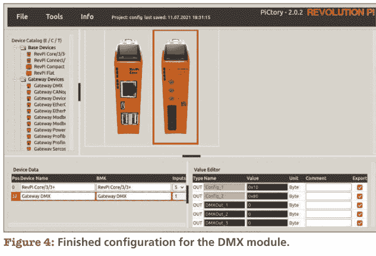


#### `pi test`

`pi test` 程序简要测试了该设置；它为您提供了对 `RevPi Core` 所有接口的读写访问权限。如果您不带任何参数启动该工具，它将列出所有选项。列表 1 给出了使第一盏 `DMX` 灯显示红色、第二盏显示绿色所需的命令。

前两个命令将两盏灯的主调光器完全调亮；随后的两个命令对颜色做同样的处理。虽然可以写入 `0` 到 `255` 之间的值到通道，但灯光强度每 `16` 个值才变化一次，尽管这在 `DMX` 中并不普遍，仅适用于这些廉价灯具。

`pi test` 程序每次都会输出 `RevPi Core` 过程映像中的偏移量。过程映像代表了设备的所有接口。

#### 表 1：通道功能

| **通道** | **功能** | **数值范围** |
| :--- | :--- | :--- |
| 1 | 调光器（所有颜色） | 0-255 |
| 2 | 红色调光器 | 0-255 |
| 3 | 绿色调光器 | 0-255 |
| 4 | 蓝色调光器 | 0-255 |
| 5 | 白色调光器 | 0-255 |
| 6 | 频闪 | 0-255 |
| 7 | 淡入/淡出 | 0-250 |
| | 声音模式 | 251-255 |
| 8 | 通道 7 上选择的功能速度 | 0-255 |

#### 表 2：LED 指示灯

| **LED 名称** | **信号状态** | **含义** |
| :--- | :--- | :--- |
| Power（电源） | 关闭 | 网关未激活 |
| Power（电源） | 闪烁（绿色） | 正在初始化 |
| Power（电源） | 常亮（绿色） | 系统运行正常 |
| Power（电源） | 闪烁（红色） | 可修复错误 |
| Power（电源） | 常亮（红色） | 严重错误/网关故障 |
| Term（终端） | 常亮（绿色） | 总线终端激活 |
| Term（终端） | 关闭 | 总线终端未激活 |
| Traffic（流量） | 闪烁（绿色） | DMX 数据活动（主模式和从模式） |
| Traffic（流量） | 常亮（红色） | DMX 数据不活动（从模式） |

#### 表 3：引脚分配

| **模块引脚** | **功能** | **XLR 连接器引脚** |
| :--- | :--- | :--- |
| 1 | 无 | – |
| 2 | 无 | – |
| 3 | 无 | – |
| 4 | 地（屏蔽） | 1 |
| 5 | DMX − | 3 |
| 6 | DMX + | 2 |
| 7 | 无 | – |
| 8 | 无 | – |

#### 表 4：配置位

| **字节** | **位** | **功能** |
| :--- | :--- | :--- |
| 0 | 0 | 地址/通道位 0 |
| | 1 | 地址/通道位 1 |
| | 2 | 地址/通道位 2 |
| | 3 | 地址/通道位 3 |
| | 4 | 地址/通道位 4 |
| | 5 | 地址/通道位 5 |
| | 6 | 地址/通道位 6 |
| | 7 | 地址/通道位 7 |
| 1 | 0 | 地址/通道位 8 |
| | 1 | 地址/通道位 9 |
| | 2 | 未使用 |
| | 3 | 未使用 |
| | 4 | 未使用 |
| | 5 | 取消行为（0 = 保留数据，1 = 删除数据） |
| | 6 | 模式（0 = 发送器，1 = 接收器） |
| | 7 | 终端（0 = 未激活，1 = 激活） |

### 列表 1：测试 DMX 灯光

```
$ piTest -w DMXOut_1,255

Write value 255 dez (-ff hex) to offset 525.
$ piTest -w DMXOut_9,255

Write value 255 dez (-ff hex) to offset 533.
$ piTest -w DMXOut_2,255

Write value 255 dez (-ff hex) to offset 528.
$ piTest -w DMXOut_11,255

Write value 255 dez (-ff hex) to offset 535.
```

### 列表 2：关闭灯光

```
$ piTest -w 525,1,0

Write value 0 hex (= 0 dez) to offset 525.
$ piTest -w 528,1,0

Write value 0 hex (= 0 dez) to offset 528.
$ piTest -w 533,1,0

Write value 0 hex (= 0 dez) to offset 533.
$ piTest -w 535,1,0

Write value 0 hex (= 0 dez) to offset 535.
```

### 列表 3：`dmx_demo.py`


```python
#!/usr/bin/python3
import time
import struct

DEBUG = False

DMX1_MASTER = 525
DMX1_RED = 526
DMX1_GREEN = 527
DMX1_BLUE = 528

DMX2_MASTER = 533
DMX2_RED = 534
DMX2_GREEN = 535
DMX2_BLUE = 536

class RevPi:
    _rev_pi = open('/dev/piControl0', 'wbr+', 0)

    def __init__(self):
        pass

class DMX(RevPi):
    _green = 0
    _red = 255
    _blue = 0

    def __init__(self, master, adr_green, adr_red, adr_blue):
        self.adr_green = adr_green
        self.adr_red = adr_red
        self.adr_blue = adr_blue
        self._rev_pi.seek(master)
        self._rev_pi.write(struct.pack('<H', 255))

    def update_color(self, adr, val):
        self._rev_pi.seek(adr)
        self._rev_pi.write(struct.pack('<H', val))

    def set_step(self, mode_val):
        if mode_val == 1:
            self._green += 16
        elif mode_val == 2:
            self._red += -16
        elif mode_val == 3:
            self._blue += 16
        elif mode_val == 4:
            self._green += -16
        elif mode_val == 5:
            self._red += 16
        elif mode_val == 6:
            self._blue += -16

    def do_green(self):
        if DEBUG:
            print('GREEN: %d' % self._green)
        self.update_color(self.adr_green, self._green)

    def do_red(self):
        if DEBUG:
            print('RED: %d' % self._red)
        self.update_color(self.adr_red, self._red)

    def do_blue(self):
        if DEBUG:
            print('BLUE: %d' % self._blue)
        self.update_color(self.adr_blue, self._blue)

DMX_1 = DMX(DMX1_MASTER, DMX1_GREEN, DMX1_RED, DMX1_BLUE)
DMX_2 = DMX(DMX2_MASTER, DMX2_GREEN, DMX2_RED, DMX2_BLUE)

while 1:
    for mode in range(1, 7):
        if DEBUG:
            print('mode=%d' % mode)
        for i in range(0, 15):
            if DEBUG:
                print('i=%d' % i)
            DMX_1.set_step(mode)
            DMX_2.set_step(mode)
            DMX_1.do_red()
            DMX_2.do_red()
            DMX_1.do_green()
            DMX_2.do_green()
            DMX_1.do_blue()
            DMX_2.do_blue()
            time.sleep(0.05)
```

同样可以使用偏移量来访问 DMX 地址。列表 2 利用了这一功能再次关闭灯具。原则上，你可以使用一些 Shell 脚本技巧来自动控制灯光，但由于 Shell 编程并非人人擅长，我将在下一节中介绍如何使用 Python 脚本控制 DMX 灯具。

#### 程序

Python 脚本（列表 3）首先加载所有需要的库。接下来的代码块为偏移量创建了一些变量和常量。如前几节所示，`RevPi Core` 上的值可以通过其纯文本名称或偏移量来访问。

借助 `fcntl` 库，可以设计该脚本以在后台确定偏移量并以此替代纯文本名称。此处的脚本通过使用偏移量直接访问，避免了这种复杂的流程。由于示例中这些值始终递增 1，你不需要通过试错法来确定所有值。使用纯文本名称的代码示例可以在 Kunbus 主页上找到 [5]。

两个类（第 17 行和第 23 行）建立与 `RevPi` 的连接（`RevPi`）并控制灯光的颜色变化（`DMX`）。`open()` 命令允许你打开与硬件驱动程序的连接，并将其存储在 `_rev_pi` 变量中。然后，所有对硬件的访问都将通过该变量进行。

在 `DMX` 类中，`do_<color>` 方法使用 `update_color()` 语句确保将适当的颜色发送到灯具。颜色由 `set_step()` 方法计算，并由 `mode_val` 变量控制。由于灯具只能处理比较粗糙的调光，每种颜色的值始终递增或递减 16。两盏灯和三种颜色允许六种可能的颜色过渡，这就是为什么当 `mode` 变量达到 7 时立即重置为 1 的原因（第 72 行）。`time.sleep(0.05)` 命令控制颜色过渡的速度。`DMX` 类的 `__init__` 方法将主调光器设置为 100%，以充分利用每种颜色的调光器。`while 1` 命令告诉程序在无限循环中运行，你可以使用 Ctrl + C 键盘组合取消它。在此循环中，代码更改变量 `mode` 并将其传递给两个灯具对象，打开或关闭特定颜色。当颜色达到其新值时，`mode` 变量递增 1。要完全循环一次颜色过渡，你需要调用 `set_step()` 方法 16 次，如第二个 for 循环所示（第 75 行）。你可以通过以下命令启动演示程序

```bash
python3 dmx_demo.py
```

在 `RevPi Core` 的命令提示符下。你可以在 YouTube 上找到一个展示演示程序运行效果的视频 [6]。

### 结论

`DMX` 模块让创建自己的灯光秀变得轻而易举。在 Internet 上浏览一番就会发现许多可以通过 DMX 控制的有趣设备。除了经典的舞台灯光外，产品还涵盖家庭自动化的照明系统。在 DMX 设备中，一个真正的亮点是一个会移动、会说话的头骨 [7]。祝你享受自己的 DMX 实验。

##### 参考信息

1. DMX 灯具：[https://www.aliexpress.com/item/100502449259723.html?gatewayAdapt=glo2deu](https://www.aliexpress.com/item/100502449259723.html?gatewayAdapt=glo2deu)
2. RevPi Core 3+：[https://revolutionpi.com/revpi-core/](https://revolutionpi.com/revpi-core/)
3. DMX 模块用户手册：[https://www.kunbus.com/files/media/bedienungsanleitungen/DO0262R00-MGW-UM-DMX-EN.pdf](https://www.kunbus.com/files/media/bedienungsanleitungen/DO0262R00-MGW-UM-DMX-EN.pdf)
4. PuTTY：[https://www.putty.org](https://www.putty.org)


- 5. Python 示例：[https://revolution.kunbus.com/download/114/](https://revolution.kunbus.com/download/114/)
- 6. 程序视频：[https://youtu.be/2i2Httpwc1E](https://youtu.be/2i2Httpwc1E)
- 7. 会说话的头骨：[https://www.hauntedhousecreations.com/full-motion-talking-skull/](https://www.hauntedhousecreations.com/full-motion-talking-skull/)

##### 作者简介

Martin Mohr 自幼便对一切闪烁的事物充满热情，这种热情因他作为电子技术员学徒的经历而得到加强。在计算机科学专业毕业后，他主要开发 `Java` 应用程序，但树莓派重新点燃了他对电子学的热爱。

### 说 Linux 和 NVIDIA 关系紧张未免言过其实。

庞大的 `NVIDIA` 公司以显卡和其他计算机硬件组件闻名，在 `Linux` 兼容性方面有着长期不善合作的历史。情况比过去好了一些——如今至少存在一些 `Linux` 驱动程序——但大多数驱动程序都是专有的，该公司并未投入太多精力向 `Linux` 用户展示如何使用其硬件。在本期的 `Linux Voice` 中，我们将帮助你使用通过 `Ubuntu` 提供的工具和资源在 `NVIDIA` 驱动程序“汤”中游泳。此外还有：你将迈出使用 `Matplotlib` 的第一步，这是一个用于制图和其他数据可视化任务的开源 `Python` 库。


## LINUXVOICE

**Doghouse – 物联网对开放性的需求**
`Jon "maddog" Hall`
75
封闭式物联网设备可能会使用未预期的带宽“上报数据”，这表明需要自由设备，以让用户对其家庭小工具和 `WiFi` 使用拥有更多控制权。

**Linux 中的 NVIDIA 驱动程序**
`Adam Dix`
76
基于终端的解决方案有助于缓解安装 `NVIDIA` 驱动程序的挫败感。

**FOSSPicks**
`Graham Morrison`
80
本月 `Graham` 介绍了 `Blender 3.0`、`wobb`、`Fokus`、`bat`、`GNU poke`、`Bladecoder` 冒险引擎、`Crispy Doom` 等更多内容！

**教程 – Matplotlib**
`Marco Fioretti`
88
在你的 `Python` 程序中加入发光的图表。


> 代码清晰且自我文档化——将来将明显知道它如何工作。

CC-BY-SA WWW.PEPPERTOP.COM

### 公共资金

#### 公共代码


用自由软件现代化公共基础设施
`fsfe` 欧洲自由软件基金会
了解更多：[https://publiccode.eu/](https://publiccode.eu/)

#### MADD OG 的狗屋


乔恩 “Maddog” 霍尔（`Jon "maddog" Hall`）是一位作者、教育工作者、计算机科学家和自由软件先驱。自 1994 年他首次会见林纳斯·托瓦兹（`Linus Torvalds`）并促成 `Linux` 移植到 64 位系统以来，他一直是 `Linux` 的热情倡导者。他目前担任 `Linux International®` 的主席。

##### 封闭式物联网设备可能使用意外的带宽进行“回家汇报”，这表明我们需要自由设备，以便用户能更多地控制其家用小工具和 WiFi 使用。

作者：乔恩 “MADDOG” 霍尔

##### 释放家庭物联网和 WiFi

最近，我将家庭互联网升级到了光纤和 1Gbps 对称服务，因此理论上我可以从服务提供商那里获得 1Gbps 的上行和下行通信速度。

对大多数人来说，这意味着一种思维模式：“我可以从我的笔记本电脑/台式机/手机上以 1Gbps 的速度移动数据”，但这可能与事实相去甚远。

由于通信开销，即使在最理想的情况下，你的吞吐量也会有 5% 到 10% 的损失。因此，即使使用 4 英尺长的 `Cat 6` 网线硬连接到你的 `WiFi` 路由器的 `LAN` 端口，你看到的实际数据吞吐量可能只有 995Mbps 到 990Mbps。

考虑到 `WiFi` 通常会更慢，而且另一端服务器也会影响数据速度，我和我的伴侣使用了光纤提供商的速度测试。我们预计他们使用了服务器（或在他们那一端生成比特流）以获得尽可能快的测试速度。

我和我的伴侣测得通过路由器的下载速度为 990Mbps，但上传速度明显较差，仅为 500Mbps，这造成了暂时的困惑。

幸运的是，我的提供商提供了一个有趣的应用程序，它可以跟踪与每个设备相关的每个硬件地址的比特流量。因此，我可以看到每个设备每天、每周和每个月上传和下载了多少字节。

通过这种方式，我们可以看到有些设备正在上传数据，进行安排在深夜的数据备份。我们还可以看到数据是如何分配给许多人们可能未曾考虑过的其他源的。在我们的情况下，是一个灯泡。

我们使用许多 `WiFi` 设备来控制我们的家。`WiFi` 控制扬声器、用于视频广播的 `ChromeCast` 等，但当时我们在测试速度时这些设备都是“关闭”的。我们未曾预料到的是，一个 `WiFi` 控制灯泡，在 24 小时周期内通常开关一次，可能每天会下载 14.41MB 的数据并上传 5.93MB 的数据。哇。我可能能理解这 14.41MB 的下载是用于固件更新……但每天都这样（平均而言）？而且仅仅为了做什么就上传了近 6MB？向某个实体报告灯泡确实照亮了房间……或者没有？

我们家中只有这样一个灯泡，但我们有一系列 `WiFi` 电动插座。每一个都有类似的上传和下载流量。

我们的互联网提供商指出，“拥有许多这类设备的家庭（许多家庭拥有数十个这样的设备）可能会体验到低于最佳的下载和上传速度。” 废话。这一切都影响了互联网用户看到的速度。这还没有考虑到房屋内所有其他 `WiFi` 使用被这些数据包共享 `WiFi` 的情况，这些数据包仅由路由器本身处理，但会占用其他 `WiFi` 使用的带宽。

所有这些汇聚成了一些朋友之间关于对称互联网速度、物联网（`IoT`）讨论以及这些设备即使在“关闭”时如何使用电力和互联网的对话。

这些设备中的许多都在将它们的通信全部发送回创建它们的公司。如果这些设备有一个集中的“服务器”单元来处理许多这类数据，即“边缘编程”，将原始数据压缩并将固件更新分发到使用相同互联网子网的所有设备，那会更好。

如果这些设备还使用不同的频率（也许包括新兴的 60GHz `WiFi`）那就太好了，或者也许我需要花更多时间设置路由器和互联网的服务质量（`QoS`）。毕竟，如果开灯或关灯多花了一小部分秒钟，可能不会有太大区别。

我的一位朋友说，他们将所有这些设备隔离在单独的网络上，阻止它们“回家汇报”。如果设备停止工作，他们就丢弃设备。当然，他们不仅损失了为设备支付的钱，还失去了设备的服务。

尽管多年来我一直是一个自由和开源软件的倡导者，但我之前对这些物联网设备持较为放松的态度，但在接下来的年里，我将翻新我住了 40 年的房子，花上一大笔钱，其中一部分将只用于购买“自由”物联网设备。这可能还包括购买重要家电。

遗憾的是，封闭式设备的制造商将无法收到我的钱，以及许多抱有相同想法的人的钱。 ■■

### 简化 Ubuntu 上的 NVIDIA 驱动安装

#### 让 NVIDIA 驱动安装变得简单

一种基于终端的解决方案有助于缓解安装 `NVIDIA` 驱动程序的挫败感。

作者：亚当·迪克斯（`ADAM DIX`）

`Linux` 上的专有 `NVIDIA` [1] 驱动是一种必要的恶。即使是坚定的开源倡导者也会不时发现它们的用例。无论是用于游戏、挖矿还是其他硬件加速任务，绿色巨头将在这里留下来，无论是好事还是坏事，并且似乎全心全意地反对全面转向开源。与 `AMD` [2] 的驱动支持——在 `Linux` 上非常棒，我相信你们大多数人都已经知道了——不同，`NVIDIA` 似乎不愿意好好配合。人们不禁好奇，他们是否觉得自己根本不需要这样做，他们对市场的影响力使他们与众不同，并免除了他们对客户应有的责任感，而其他玩家则有这种责任感。谁知道呢。我知道的是，尽管社区中许多人努力工作，`NVIDIA` 的 `Linux` 驱动支持仍然让人头疼。最糟糕的是，这对 `Linux` 初学者产生的影响：他们听说了关于 `Linux` 的所有美好事物并尝试它，结果系统要么被 `Nouveau` 驱动拖累，要么必须经历我下面即将讨论的事情。这是一种令人遗憾的状态，有一个明显且显而易见的解决方案，我担心我们很快看不到它实现。

虽然不一定一切都好，但也并不全坏。至少我们有一种（尽管是专有的）解决方案可以依赖。


这里我将专注于 `Ubuntu` [3]，因为这是我通常使用的基于 `Linux` 的简单安装环境，无论我需要做什么，而且由于统计上这是初学者最可能首先尝试的。虽然我最初使用的是 `Red Hat` [4]（`Fedora` [5] 之前），但现在大多数人倾向于使用 `Ubuntu`，它的衍生版，或者第一次尝试时可能是另一个 `Debian` 衍生版。

虽然 `Ubuntu` 本身有一个驱动程序安装部分，但并非所有 `Ubuntu` 衍生版都有，并且在某些情况下，即使你的发行版有一个高级驱动安装部分，也可能很难找到，尤其是对初学者来说。此外，关于安装哪一组包以及你想使用的 `NVIDIA` 专有驱动的版本，也可能存在混淆。我个人还发现，通常在选择一个驱动并点击应用后，窗口变得无响应，或者至少看起来是这样。虽然基本的开源 `Nouveau` [6] `Linux` 驱动对于大多数任务来说都足够好，但硬核用户通常会发现需要专有驱动。虽然我不能修复 `NVIDIA` 在专有驱动程序包安装中提供的极其过时的控制面板界面，但我可以帮助你安装它，并指导你如何处理安装不可避免地损坏时的情况。

在这篇文章中，我将向你展示如何使用 `Ubuntu` `Linux` 及其衍生版中简单、内置的命令来确定使用哪个图形驱动程序，我发现这比打开等效的 `GUI` 更快更简单。我还会向你展示如何处理之后你几乎肯定会遇到的黑屏问题。你看，就像一个 `YouTuber` 第一次尝试在 `Pop_OS` [8] 上安装 `Steam` [7] 一样，我也在使用 `GUI` 安装 `NVIDIA` 驱动程序时遇到了困难。然而，与典型的 `YouTuber` [9] 不同，我在终端执行相同任务时没有任何问题。

需要注意的是，`NVIDIA` 专有驱动可能存在不止一个包，你可能需要测试几个不同的驱动程序包，才能确定哪一个最适合你。此外，具有 `Optimus` [10] 功能的设备在 `Optimus` 切换方面可能无法正常运作。对于不知道、不记得或在那个时代不在场的人来说，`Optimus` 是 `NVIDIA` 和 `Intel` [11] 的一种软件方案，旨在允许用户在操作系统内部自由选择 `NVIDIA` 或 `Intel` 图形。虽然来自 `system76` 等公司的软件包确实使 `Optimus` 比其最初推出时更强大，并且在许多情况下完全功能正常，但仍有


> **作者简介**
>
> 亚当·迪克斯（Adam Dix）是一位机械工程师和 `Linux` 爱好者，在销售和市场营销领域玩弄一番后，伪装成英语教师。你可以在 `EdUbudge` `Linux` 网站 `https://www.edubudgie.com` 上查看他的一些 `Linux` 作品。

#### `NVIDIA` 驱动安装

根据我的经验，出现的问题往往是驱动程序本身的缺陷。不过，这不应妨碍您尝试针对您特定的 `NVIDIA` 显卡和 `Intel` 核显组合寻找市面上不同的软件包。然而，`Optimus` 技术本身并不是本文打算深入探讨的内容。本文概述的所有操作均在一台搭载入门级 `NVIDIA` `GeForce` `GT` `710` 显卡的 `Supermicro` `X8STi` 主板上完成，该显卡插在单个 `PCIe` `X16` 插槽中。（我曾在配有 `NVS` `5200M` 和 `Intel` 核显的戴尔 `E6430` 笔记本电脑上执行过相同的操作，并且过去确实成功启用过 `Optimus`；但同样出于前述原因，本文并不打算对此进行详细讲解。）如果您的机器同时拥有 `NVIDIA` 和 `Intel` 显卡，我的建议是简单安装 `NVIDIA` 驱动并直接使用 `NVIDIA` 显卡。对我来说，让 `Optimus` 正常工作并没有带来优势，因为电池已经关闭，而且为了性能，在那台机器上全天候运行 `NVIDIA` 显卡更为划算，尽管这会加速电量消耗。接下来，我们将了解如何查找并安装正确的驱动，并处理可能出现的后续问题。

##### 确定系统组件信息

当机器启动并运行后，您可以通过运行以下命令来检查当前使用的驱动：

```
lspci -vv
```

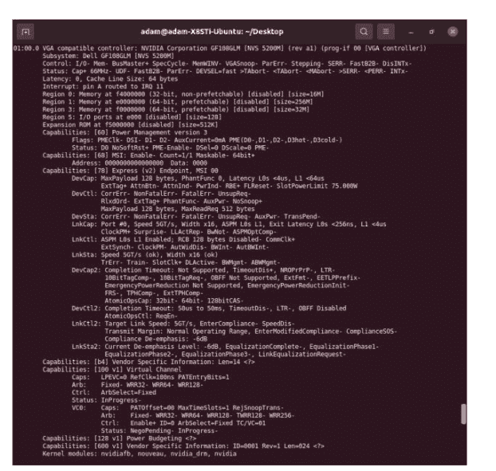

这将显示所有 `PCI` 设备的详细信息（图 1）。向下滚动一点，您会看到一个列为“`VGA` 兼容控制器：`NVIDIA` `Corporation` `GK208B` [`GeForce` `GT` `710`]”的条目，这里显示的是您显卡的具体型号，显然不是 `GT` `710`。查看该条目的最后两行，您会看到“正在使用的内核驱动”和“内核模块”。在这里，您会看到 `nouveau` 被列为正在使用的内核驱动，如前所述，它是基本的开源 `NVIDIA` 驱动。如果您运行的是 `Pop!_OS` 或预装了专有 `NVIDIA` 驱动程序的类似发行版，那么在“正在使用的内核驱动”下可能会看到 `nvidia`，如果是这种情况，本文可能不适合您，但大多数人很可能会看到 `nouveau`。顺便提一下，在“`Capabilities`”之后您会看到“`access` `denied`”。要查看此字段，只需使用 `sudo` 运行相同的命令，您就能访问该信息。这将提供一些额外的信息，例如电源管理，但这对于我们当前的操作并非必需。

这需要几秒钟，具体取决于您的系统。对我来说，通常大约 15 秒就能返回完整响应（图 2），所以请在此保持耐心。我的设置返回了以下内容：

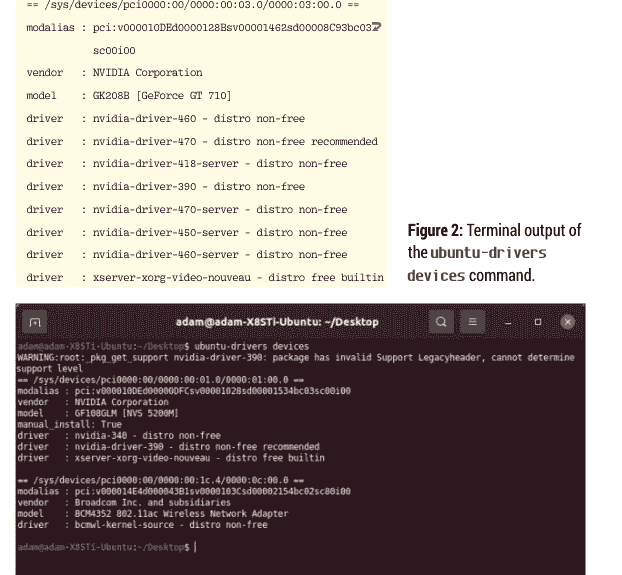

##### 查找可用的驱动软件包

此时，您已经确认显卡被识别并且正在使用开源驱动。若要查看可用的专有 `NVIDIA` 驱动软件包，您需要运行以下命令。

```
ubuntu-drivers devices
```

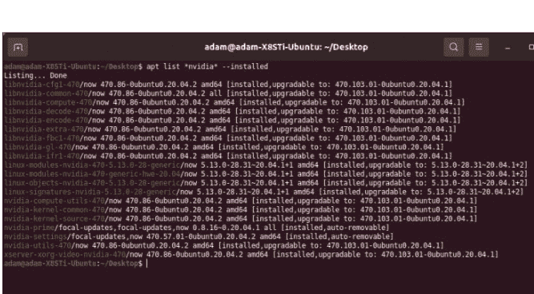

###### 图 3：`apt` `list` 命令的终端输出。

如您所见，除了 `Nouveau` 开源驱动外，`NVIDIA` 提供了多个可用软件包。您可以通过运行以下命令来二次检查您的系统是否安装了任何 `NVIDIA` 软件包：

```
$ apt list \*nvidia\* --installed
```

如果您已安装其中任何一个，它们将与运行所需且已存在于您系统中的依赖项一起列出，例如库和设置对话框软件包（图 3）。

正是在这里，事情有时会变得稍微棘手。虽然所有这些软件包都适用于您的显卡，但并非所有软件包都能良好、正确或根本不能与您的特定显卡配合使用。鉴于此，您现在应该将所有需要保存的内容备份到安全的地方以及另一台机器、外部驱动器、云存储，或者（更好的是）以上所有方式。就我个人而言，我知道我的 `GT` `710` 运行最佳的是 `nvidia-driver-390`，但坦率地说，我只是通过反复试错才知道这一点的。关于这些软件包的文档很完善，您可以访问 `NVIDIA` 网站获取更多信息 [1]。个人而言，我是通过艰难的方式学会的：尝试一个软件包，失败时卸载，再尝试另一个软件包，如此反复。因此，我想在此给出一点免责声明：如果您安装了其中一个软件包并重启后遇到黑屏或显示器的其他问题，请保持耐心，不要立即惊慌。

##### 设备驱动安装

要安装您想要尝试的软件包，只需运行：

```
$ sudo apt update
$ sudo apt install nvidia-driver-390
```

并将 `nvidia-driver-390` 替换为您特定 `GPU` 所需的软件包。在此使用终端的优势在于您可以轻松看到正在发生的事情，而使用图形界面（`GUI`）往往让人困惑。安装完成且所有依赖项均已安装后，您需要重启机器，以便在启动时加载新软件。如果运气好，您将像往常一样看到登录屏幕或桌面。然后，您可以通过使用之前讨论过的 `lspci -vv` 命令，或打开设置并查看“关于”部分来检查安装是否成功，以查看“图形”一栏列出的内容。在我的情况下，显示为 `GeForce` `GT` `710/` `PCIe/SS2`，而对应的是 `nvidia-driver-390` 软件包。如前所述，使用 `lspci -vv` 将在“正在使用的内核驱动”部分显示 `nvidia`。您还将安装 `NVIDIA` 控制面板，用于通过图形界面更改设置的细节。

##### 故障排除和问题解决

如果您看到的不是图形界面，而是空白屏幕，那么很可能该软件包实际上并不适合您的 `GPU`，需要将其移除。但请先不要恐慌。这也是一个相当简单且直接的过程。重启，并在 `GRUB` 加载屏幕处，不要选择正常启动进入 `Ubuntu`，而是选择“`Ubuntu` `Advanced` `Options`”（`Ubuntu` 高级选项），然后选择“`Ubuntu`, with `Linux…` (`recovery` `mode`)”选项。其中的省略号（…）将显示您正在运行的内核，您可以在此选择最新的内核。请务必选择恢复模式选项（`recovery`）。

进入恢复模式后，您需要选择 `root`，其描述为“`Drop` to `root` `shell` `prompt`”（转到 `root` `shell` 提示符）。这将启动到一个命令行界面，从这里您可以移除有问题的软件包。运行以下命令以查找安装了哪些 `NVIDIA` 软件包：

```
$ apt list \*nvidia\* --installed
```

一旦您查看了存在的软件包，就可以按以下顺序使用这两个命令来移除 `NVIDIA` 软件包。首先使用：


```bash
$ apt remove nvidia-driver-390 nvidia-settings nvidia-prime nvidia-dkms ... 等等
```

您会有很多 NVIDIA 软件包，在驱动软件包本身后以空格分隔列出所有名称将移除所有这些。这将消除依赖项和库，以便在尝试下一个选项时，您是从一张白纸开始的。在上面的示例中，我列出了运行 `ls` 命令时出现的一些软件包，但总共大约有 20 或 22 个。完成此操作后，您可以通过运行相同命令但用 `purge` 替换 `remove` 来最终完成卸载，例如：

```bash
$ apt purge nvidia-driver-390 nvidia-settings nvidia-prime nvidia-dkms ... 等等
```

这将清除在软件包移除后可能仍然残留的任何设置和配置。在所有操作完成后，您也可以使用以下命令进行快速清理。

```bash
$ apt autoremove
```

以确保尽可能移除所有可移除的内容。

完成后，只需输入 `reboot` 并按 Enter 键重启系统。此时您应该看到 `nouveau` 驱动已加载并运行，取代了专有 NVIDIA 驱动。现在，您可以通过像之前那样列出并安装来尝试不同的驱动软件包，我建议尝试下一个可用的较低版本号。根据我的经验，我在安装 NVIDIA 驱动时遇到的大多数问题源于我的旧显卡在新驱动中不受良好支持，尽管这些新驱动在查询时会显示出来。依次尝试较旧的可获得软件包可以确保我有适合我的显卡且能无问题运行的最新软件包集合。

##### 结语

我无法表达作为初学者在安装其中一个驱动仅结果重启后出现空白屏幕时感受到的沮丧程度。那时，我的解决方案是完全重新安装操作系统，在那时我会尝试使用带有缺陷的开源驱动软件包，或者转向不同的 NVIDIA 驱动并祈祷获得更好的结果。是的，我仅为了找到一个可用的驱动软件包就重新安装了 Ubuntu 四次以上。这正是我认为不仅要熟悉终端和使用恢复模式，还要稍微了解底层发生的事情的原因。现在，我有一种恢复失败的方法，并且拥有

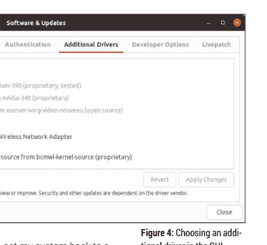

将系统恢复到正常工作桌面的信心，我可以说我发现使用终端完成整个过程更容易、更快。在我看来，这里额外的益处是，您实际上可以看到终端中正在发生的事情，而不是像使用等效的 GUI 那样等待、猜测并希望（图 4）。

希望有一天，我们将看到 NVIDIA 团队与我们心爱的开源社区合作，提供一种非专有的解决方案，具备现有闭源驱动所提供的性能和优势。在那之前，恐怕我们不得不忍受这些麻烦。不过，遵循上述建议，至少在将他们的解决方案安装到您的机器后，您不会在空白屏幕上停留太久。我想这确实如人们所说：有赢也有输。

##### 参考信息

- [1] NVIDIA: [https://www.nvidia.com/](https://www.nvidia.com/)
- [2] AMD Radeon 显卡: [https://www.amd.com/en-us/graphics/radeon-rx-graphics](https://www.amd.com/en-us/graphics/radeon-rx-graphics)
- [3] Ubuntu: [https://ubuntu.com/](https://ubuntu.com/)
- [4] 红帽企业 Linux: [https://www.redhat.com/en/technologies/linux-platforms/enterprise-linux](https://www.redhat.com/en/technologies/linux-platforms/enterprise-linux)
- [5] Fedora Linux: [https://getfedora.org/](https://getfedora.org/)
- [6] Nouveau Xorg 驱动: [https://launchpad.net/nouveau](https://launchpad.net/nouveau)
- [7] SteamOS 和 Linux 游戏: [https://store.steampowered.com/linux](https://store.steampowered.com/linux)
- [8] system76 的 `Pop!_OS`: [https://pop.system76.com/](https://pop.system76.com/)
- [9] YouTube: Linux 上的游戏并非随机性（Rng）: [https://www.youtube.com/watch?v=RY4K16ujFw](https://www.youtube.com/watch?v=RY4K16ujFw)
- [10] NVIDIA Optimus 技术: [https://www.nvidia.com/en-us/geforce/technologies/optimus-technology/](https://www.nvidia.com/en-us/geforce/technologies/optimus-technology/)
- [11] Intel GPU: [https://www.intel.com/content/www/us/en/products/discrete-gpus.html](https://www.intel.com/content/www/us/en/products/discrete-gpus.html)
- [12] Supermicro X8STi: [https://www.supermicro.com/products/motherboard/Xeon3000/X58/X8STi.cf](https://www.supermicro.com/products/motherboard/Xeon3000/X58/X8STi.cf)
- [13] 戴尔 Latitude E 系列笔记本电脑: [https://www.dell.com/](https://www.dell.com/)

### 自由开源软件精选

来自自由和开源软件世界的璀璨宝石与最新发布


格雷厄姆本月面临了一个有趣的道德困境：是否要包含一个开源的 Wordle 克隆版。继续阅读以查看他的决定。

BY GRAHAM MORRISON

#### 图形工作室

##### Blender 3.0

我们以前看过 `Blender` 的更新，但从未有过像这次如此重要的。`Blender 3.0` 距离 `Blender 2.0` 已经过去了 22 年。这一时期涵盖了该项目从 2000 年源代码作为免费软件发布后，到 2002 年 `Blender` 基金会成立，再到 2003 年真正开源的过程，以及在此之后定义了 2.x 发布周期的众多改变世界的功能更新。`Blender` 极具影响力，作为一个轻量级项目，它展示了开源所能取得的成就。从建模、动画、电影和 3D 渲染，到建筑、3D 打印和游戏设计，`Blender` 获得了前所未有的行业认可，并被业余爱好者、学生和专业人士广泛使用。

`Blender 3.0` 不仅仅是一次例行发布，它包含大量新功能和改进，尤其是如果你错过了几个更新的话。其中最好的是资源浏览器，这是一种新的视图类型，出现在菜单中，与 3D 视口、合成器以及所有其他类型并列。启用后，选定的窗格将显示来自大量 `Blender` 资源类型的缩略图，包括对象、材质，甚至姿势。姿势是用于存储模型角色表情（如微笑或皱眉）的一种方式。`Blender 3.0` 允许你调整这些姿势而不会丢失原始数据，并为角色和属性提供关键集。然后，你可以从资源视图中添加、混合、应用和翻转姿势，以查看它们如何适合你选择的角色。甚至可以通过在帧图上拖拽正方形来选择关键值。

同样，资源可以被拖放进入你的场景，场景会根据你的硬件能力快速更新，即使添加高动态范围图像 (HDRI) 光照资源也是如此。这是将带有材质和光照的模型快速拖入场景的好方法。你可以通过将场景元素标记为资源来回馈库——这些资源还可以链接而非复制——以便在多个项目中使用单一实例。


速度和质量的提升随处可见。刀工具可以切割多个对象，并最终包含在撤销历史中。绘制笔触可以并发修改，甚至虚拟 realidad 模式也添加了六自由度 (6DOF) 控制器。当生成最终输出时，得益于新的 `Cycles X` 渲染器，渲染速度快了 2 到 8 倍。视口更新更快，用于设置相机的视点 (POV) 模式也更快，即使在复杂场景中，它仍然具有足够的交互性来对齐镜头，随着视图保持时间的增加，会添加更多细节。一切都看起来更好了，阴影得到改善，硬件光线追踪以及材质表面的光散射效果。甚至连 UI 也有了很大的改进。如果你已经好几年没用过 Blender 了，你会发现现在几乎每个功能都有屏幕提示、滑块和控件。每个视图都配有主要功能的图标或字形，一切都比过去更加直观。仍然有很多选项和很多菜单，但你可以在不使用 90% 的情况下开始使用。默认主题现在具有更多可配置的对比度和更圆润的角，这使得使用变得更容易。Blender 现在比以往任何时候都更容易使用，并且能够产生惊人的结果。


*   `视口渲染`：Blender 中的预览输出现在几乎与最终输出相同。
*   `UI 改进`：将鼠标悬停在某个区域上以突出其边缘，并更轻松地将不同窗格合并。
*   `几何节点`：此版本新增了与曲线、文本数据和实例进行交互的节点。
*   `属性显示`：不需要猜测或记住组合键，属性可以通过视口中的 UI 进行更改。
*   `改进的图标`：Blender 中的字形和图标现在更容易理解和使用了。
*   `速度提升`：不仅仅是预览——一切现在都更快了，从节点到渲染。
*   `资源管理器`：将所有最好的创意集中存放在一个地方，跨项目共享，包括角色姿势。

#### 项目网站

`https://www.blender.org`

#### 控制台网络服务访问

##### woob

`Woob` 是“浏览器外的网络”的缩写，其使命是提供对特定网站的访问，而无需使用网络浏览器。它通过成为一个模块驱动的后端来实现这一点，每个模块都针对特定类型的网络服务。例如，输入 `woob` 后跟 `bank`，你会看到一个巨大的模块列表，旨在与在线银行合作。最让人惊讶的是，尽管该项目很年轻且相对小众，但已经有很多模块来支持其各项功能，并且一直在增加。例如，它支持从巴克莱银行到瑞士生命保险公司的 88 家银行。选择其中一个将引导你使用自己的凭证配置模块，以便你可以访问模块支持的任何功能。对于银行模块，这些功能包括查看利率、转账功能和查询余额。当然，你可能明智地不会信任 `woob` 在没有对其代码进行某种审计的情况下协商你的银行账户，但 `woob` 也支持许多不那么关键的服务。电影功能允许你与电影元数据抓取器和本地下载服务进行交互。图库模块对图片服务做同样的事情，而包裹模块则帮助你访问 DHL 和 DPD 等公司的跟踪信息。还有更多功能，包括处理本地 Linux 命令行工具和传感器、远程网络服务（如天气和 Bug 跟踪），甚至烹饪食谱和音乐歌词。你甚至不需要使用命令行，因为许多服务都配有基于 Qt 的图形前端，可以用它代替命令行。这些前端还有额外的优点，可以显示电影海报、专辑封面或食谱照片等图像。开始时可能需要一些努力，但在使用了几个模块后，你会意识到它提供了比它希望取代的许多网络服务更好的用户体验，这绝对是一件好事。

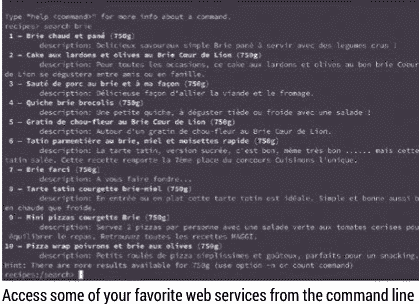

使用 `woob`，无需网络浏览器，即可从命令行访问你喜爱的一些网络服务。

#### 项目网站

`https://woob.tech`

#### Cat 克隆版

##### bat

`Unix` 哲学中拥有一个简单工具来完成一项简单任务的理念在命令行上依然生机勃勃，而 `cat` 命令就是其最佳例子之一。它是一个如此古老的命令，以至于它被包含在 1971 年由 Ken Thompson 和 Dennis Ritchie 开发的“研究 Unix”最初版本中（尽管“研究 Unix”这个术语直到 1978 年才首次使用）。众所周知，`cat` 会将文本文件的内容打印到标准命令行输出，让你可以轻松查看其内容。如果列出多个文件，它将依次连接每个文件的输出（这也是它名字由来的任务），让你整体查看其内容或将其管道传输到一个新的单一文件中。它可以可选地显示行号，或突出显示制表符或行尾，但除此之外它不能做太多。它是一个为简单任务设计的简单工具，而且运行得非常好。

但有时你需要从朴素的 `cat` 中得到更多，特别是在翻找源代码或具有特定格式的文本文件时。这时，同样以动物命名的 `bat` 就能帮上忙。它在 `cat` 的简单前提基础上增加了几个额外的现代必需品，包括语法高亮、内置分页器，甚至 `git` 集成，可以在与 Git 索引比较后仅显示文件中的修改。只需将你的 `cat` 调用替换为 `bat` 就可以实现所有这些，但还有进一步的选项来自定义输出，包括指定何时禁用分页器、何时仅显示差异以及一种文件类型映射到另一种文件类型的选项。它快速、美观且可以自定义主题，同时仍然与 `cat` 的原始基本输出完全兼容，使其在预览 `fzf` 或查找结果时与预览 `main.cpp` 的内容同样有用。

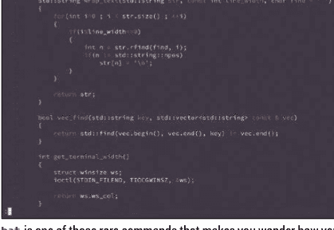

`bat` 是那些罕见的命令之一，一旦你开始使用它，你就会想知道自己以前是怎么在没有它的世界里度过的。

#### 项目网站

`https://github.com/sharkdp/bat`

### 终端新闻

#### Broadsheet

无论你对当前时事持何种态度，新闻生成的数量都已变得令人不堪重负。我们都已变成了“末日刷屏者”，像不受控制的信息瘾君子一样，不停地在一条新闻和下一条之间来回切换。这个问题并没有太多好的解决方案。像本杂志这样经过精心筛选的内容会有所帮助，尤其是如果这意味着你可以暂时离开屏幕的话。订阅 RSS 源是另一个可能的解决方案，因为它可以让你有目的地关注特定来源的更新，并通过你自己的客户端过滤这些更新。但 RSS 已经衰落多年，许多通用新闻来源都对其支持缺乏兴趣——他们希望你访问他们的网站、创建账户，甚至直接订阅。

`Broadsheet` 是一个处于早期开发阶段的新选项，它可能弥合了通过常规渠道获取过多新闻与对低干扰方法缺乏支持之间的差距。这是一个命令行工具，它会输出非常类似 RSS 的新闻摘要，并附带在浏览器中阅读全文的链接。可以使用命令行参数将故事限制在特定的域、国家或搜索结果中，而且它运行得非常好。由于你是在命令行上操作，点击链接比在浏览器中更困难，诱惑性也更小。唯一的缺点是：`Broadsheet` 需要订阅新闻聚合服务 `http://newsapi.org`，该服务提供一个用于配置文件中的 API 密钥。目前使用免费开发者层级是合理的，但 `Broadsheet` 变得稳定后，这种情况将会改变。希望到那时开发者会添加拟议中的 RSS 支持，从而兼得两者之长。

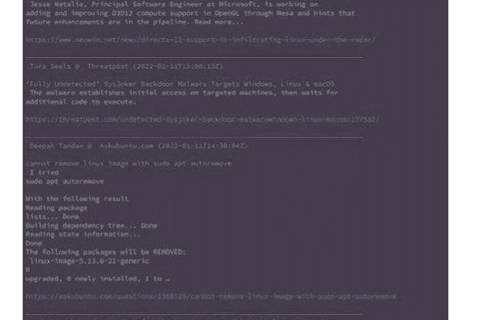

*尽管 `Broadsheet` 目前仅适用于基于订阅的新闻 API，但开发者希望将来添加 RSS 支持。*

**项目主页**: `https://github.com/i-am-the-gabe/Broadsheet`

#### 番茄钟小组件

#### Fokus

如果 `Broadsheet` 引发了你对移除工作环境中干扰因素的思考，另一个久经考验的方法就是番茄工作法。这是一种由 Francesco Cirillo 在 20 世纪 80 年代开发的时间管理技巧，通常伴随一个番茄形状的计时器（`pomodoro` 在意大利语中意为番茄）。该过程仅仅要求你在一段设定的时间内（通常为 25 分钟）专注于一项任务，而不让自己被其他事物分心。以现代标准来看，80 年代的干扰因素（比如魔方、牛顿摆或一杯新鲜咖啡）都显得很无害。如今，干扰因素比你打开的标签页还要多，而像番茄工作法这样的方法可以极大提高你的生产力。主要问题是如何将其整合到你的工作环境中，而无需花费一周时间重新搜索各种选项。为了不再拖延寻找解决方案，我们已经为你找到了一个。

最初的番茄钟旨在让你远离技术的诱惑。由于你很可能需要在计算机上工作，将其移至桌面是一个可接受的解决方案。Linux 上有许多选项，但我们遇到的最佳选择之一是 `Fokus`，正如你可能从名字中猜到的那样，它是一个 `KDE Plasma` 应用程序小组件。它既包含一个带有计时器的小面板，也有一个适合即使是很小面板的面板小组件，两者都会显示你每个区间剩余的时间。巧妙的是，它还可以配置为在时间段开始或结束时运行脚本，编写一个将时间段的工作量添加到个人日志或字数日志中的程序非常容易。`Fokus` 设计精美，比我们见过的 macOS 和 Windows 的同类应用更好，后者许多都是商业驱动的或受广告驱动的。

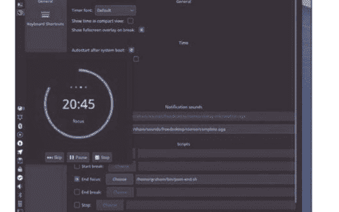

> *通过完全专注于 25 分钟的分心时间，提升你的工作效率和自我认同感。真的有效！*


**项目主页**: <https://gitlab.com/dioviae/fokus-plasmoid>

### PCB 插画工具

#### Pinion

在家庭 3D 打印、虚拟现实和树莓派等最近的技术革命中，让我们每个人都能创建电路并将其打印出来的能力也是其中之一。甚至还有用于此目的的软件可供选择，我们在本杂志中已经介绍过几种。其中最成熟的可能是 `KiCAD`，一个久负盛名的原理图编辑器，它允许你创建电路、验证其设计、模拟其执行过程，并测试规范其功能的电气规则。`KiCAD` 随后会自动生成 PCB 布局，并以可发送给 PCB 制造商的格式导出结果。它简单到即使是初学者也能使用它来制作他们的第一个电路，但它也足够先进，许多工程师都用它进行产品设计。

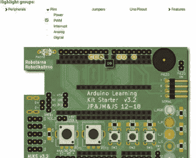

`Pinion` 是一个工具，它可以将 `KiCAD` 文件转换为美丽的插画，你可以分享或发布在网站上。它们不仅外观令人惊叹，具有细胞着色和伪写实风格，而且是交互式的。可以为电路或电路板的部分添加文本，也可以通过选择来高亮显示走线。虚拟卡片还可以翻转过来，这一切都要归功于 `JavaScript` 的魔力。通过一个简单的 `YAML` 文件添加此功能，该文件将 `KiCAD` 组件与你的描述、分组和引脚注释关联起来。你添加的文本长度不限，甚至还可以包含链接和基本格式化。它使用一个名为 `PpcbDraw-Lib` 的手绘库来展示组件，虽然该库目前相对较小，但正在不断增长，且易于贡献。然后，通过执行 `pinion` 命令及其指向 `YAML` 和 `KiCAD` 文件的参数来构建图表。效果极佳！

`Pinion` 是一个简单的 `Python` 工具，可以为你省去绘制自己真实电路图的麻烦。

**项目主页**: <https://yaqwxs.github.io/Pinion>

### 二进制编辑器

#### GNU poke

我们常在这些页面上看到十六进制编辑器，对于查看二进制文件它们很有用，但我们很少像 `GNU poke` 这样真正的二进制编辑器。其名称源于起源于 `DECsystem-10` 但后来在 `Commodore 64` 上臭名昭著的两条古老命令。`PEEK` 命令用于查看内存位置的内容，而 `POKE` 命令用于更改其值。这两个命令都很原始，但它们也允许任何人篡改系统内存中正在运行的任何东西。它们是简单的系统利用方式，如果你对流汇编器和硬件有很好的理解，你可以利用大量的 `PEEK` 和 `POKE` 命令、没有互联网以及一个漫长的暑假来阅读硬件参考手册来实现几乎任何事情。

`GNU poke` 是一个二进制编辑器，它会吸引那些老派（现在中年）的黑客，但也会吸引任何对查看二进制文件感兴趣的人。它自称为“简朴”，在这个上下文中，这意味着运行时没有太多可见的东西。使用文件作为参数启动它不会打开你认得的编辑器，而是会给你一个提示符和一些基本的帮助。输入 `.dump` 会生成看起来像十六进制编辑器的输出，让你可以看到选定文件的前 128 个字节。但是，使用 `poke` 的关键在于理解你要查看的数据结构，因为这允许你使用运算符甚至变量来以程序化方式编辑和修改你的数据。数据可以复制到额外的缓冲区，对于保存的更改和发现，它有不错的文件输入和输出。尽管拥有优秀的内部文档，它仍然深奥、复杂且难以学习，但这比 1986 年手动使用 `PEEK` 和 `POKE` 命令以及花整个暑假阅读硬件参考手册要容易。


大端和小端、字符、字符串甚至位图都可以使用 `GNU poke` 进行检查和修改。

**项目主页**: <https://www.jemarch.net/poke>

### 游戏创作者：Bladecoder 冒险引擎

当电子游戏首次变得流行且易于获取时，似乎每个月都会带来一个新的游戏类型。街机版游戏、文字冒险游戏、纵向射击游戏、横向卷轴射击游戏、平台跳跃游戏、策略游戏以及点击式冒险游戏都在短短几年内相继出现。随着技术的进步，这些游戏类型似乎将被遗忘，被更具吸引力和沉浸感的游戏类型所取代。但这种情况并未发生。相反，许多原始游戏类型不仅幸存了下来，甚至在 `GPU` 能够执行实时光线追踪、智能手机性能比阿波罗 11 号制导计算机强数百万倍的年代里依然蓬勃发展。特别是，2D 图形仍然具有相关性，在平台跳跃游戏、角色扮演游戏（`RPG`）和点击式冒险游戏中依然很受欢迎。甚至最初的 `Sierra` 开发商也回归了冒险游戏领域，2017 年《Thimbleweed Park》的成功众筹发行以及随后几年发布的许多类似作品便是证明。

旧游戏理念的意义不仅仅在于复古游戏和怀旧。其中许多可以作为现代正当作品的基石，同时希望能比当年的原始作品更容易在现代硬件上制作。`Bladecoder` 冒险引擎就是这样一个完美的例子。这是一套现代化的工具，帮助你创建互动图形冒险游戏，非常类似于《Monkey Island》或《Thimbleweed Park》，甚至正被用于开发一款名为《The Goddess Robbery》的 `Android` 和 `iOS` 游戏。使用编辑器，你可以下载并查看这款游戏及其他游戏，以帮助你学习如何制作自己的游戏。

该引擎本身由两部分组成：一个图形编辑器和一个用于运行生成游戏的后台引擎。图形编辑器（`Adventure Editor`）是你可能花费最多时间的地方，因为项目创建、资源添加和功能实现都在此完成，且无需任何编程。项目由一个或多个包含场景的章节组成。场景类似于独立的地点，例如原始《Monkey Island》中的 `Scrumm` 酒吧或州长府邸，它们是点击式玩法的核心。编辑器允许你轻松导入资源，包括背景图形、用于移动的角色精灵（`sprite actors`）以及需要显示、隐藏和收集的对象。这一切通过添加背景中的可点击区域并与“查看”、“拾取”或“交谈”等动词动作关联来实现。这是通过点击和面板操作主场景窗口周围来创建游戏的过程，该应用程序与 `Gimp` 或 `Krita` 等图形编辑器有更多共同点，而不是集成开发环境（`IDE`）。最终结果可以导出并发布为独立游戏，无需任何编程或编译。


起初需要学习的内容很多，但有一些优秀的示例项目、良好的文档，甚至还有几个视频教程来帮助你入门。它比使用 `Godot` 或古老的 `Adventure Game Studio` 更容易，并且可能是让那些对编程或图形化程度较低的工具感到畏惧的人进入游戏开发领域的绝佳方式。它也非常适合协作，因为工作可以轻易地分为美术、音效设计、脚本编写和游戏设计，最终成果可以与任何人分享，甚至进行商业化。

#### 项目网站

- [https://github.com/bladecoder/bladecoder-adventure-engine](https://github.com/bladecoder/bladecoder-adventure-engine)

#### Teeworlds

当 `Teeworlds` 描述自己是一款多人射击游戏时，你可能不禁会认为这是一款设定在太空中，你驾驶飞船穿越星群追逐在线竞争对手的游戏。然而，这款游戏设定在一个复古的 2D 横向卷轴平台游戏世界中，你扮演一个拿着枪的卡通笑脸。背景艺术和动画同样具有卡通风格，特色包括季节变化以及峡谷、冰雪和茂密植被的常见组合。你在这些关卡中跳跃和快速移动，试图避免被击中，同时也在同一关卡中试图击中其他玩家。与其简单地朝移动方向左右射击，你还可以在穿越关卡时改变枪的角度，从而更准确地瞄准。这是一种不寻常的机制，感觉有点像在移动中玩经典的双人坦克游戏，但也要求你在应对重力、特效和子弹类型等所有变量时具备更高水平的技巧。另一个独特的元素是类似《Bionic Commando》的抓钩或摆臂，它帮助你像被咖啡因驱动的海盗一样穿越关卡，带来非常独特的游戏体验。多人模式是游戏的核心，有多种在线模式可供选择。最受欢迎的是死斗模式和夺旗模式——在那里你追捕旗帜，为自己夺旗，并尽可能长时间地防守旗帜以抵御对手。这一切都取决于游戏的在线热度，值得庆幸的是，这款游戏已经非常成熟并拥有大量追随者。当我们检查时，有超过 600 个服务器和超过 1,200 名在线玩家，这使得找到游戏变得很容易。你也可以在本地运行自己的服务器供自己使用或作为在线社区的一部分，由于拥有极其简单的关卡设计器，关卡本身也是如此。


`Teeworlds` 的许可证符合 `OSI` 标准，但其特定的措辞比起我们希望的公有领域游戏更复杂一些。

#### 项目网站

- [https://www.teeworlds.com](https://www.teeworlds.com)

#### Crispy Doom


《毁灭战士》（`Doom`）永远不会过时。它是那些几乎没有老化的游戏之一，尽管技术已经发展到科幻水平。现代图形能力远超一款近 30 年前的游戏，现代游戏玩法现在也变得更加复杂和细致。然而，《毁灭战士》依然完美细致，其原始的美学、精灵图形和控制方式都是该体验的一部分。`Crispy Doom` 是一个克隆版，它略微提升了原始《毁灭战士》的一些限制以探索其他可能性，而没有破坏让原始游戏如此成功的那些核心机制。这就是为什么它将自己描述为 `Chocolate Doom` 的友好分支，后者是一个试图准确重现 1993 年硬件上《毁灭战士》样子的克隆版。`Crispy Doom` 在与原始版本的几个区别使其在现代硬件上更加方便。它可以在我们的现代显示器上以宽屏宽高比运行，并达到超越 1993 年的 `640x400` 显示分辨率。它有伽马校正功能，可用于调整对比度和黑暗度，还有选项可以启用自由垂直视角、抬头显示器（`HUD`）、彩色状态栏以及许多其他选项。所有这些都可以从游戏内菜单或首次运行游戏时安装的配置文件中进行设置，且没有任何选项会破坏游戏的基本可玩性。实际上，仅仅在现代屏幕上以每秒 120 帧运行，就能让游戏感觉非常现代。例如，它非常适合在树莓派上运行，并且在树莓派的 `ARMch64` 系统架构上构建速度很快。将这一切与电池、控制器和屏幕结合起来，可以作为树莓派游戏手持机的基础，而《毁灭战士》依然会一样有趣。


`Crispy Doom` 需要原始的 `WAD` 文件才能游玩该游戏，但《毁灭战士》演示版 `WAD` 是免费的，其他版本则易于购买或从你自己的副本中获取。

### 项目网站

- [`https://github.com/fabiangreffath/crispy-doom`](https://github.com/fabiangreffath/crispy-doom)

### `Linux Magazine`（`Linux` 杂志）

`Linux Magazine`（`Linux` 杂志）是你通往 `Linux` 世界的指南。翻开来看看吧，里面有你别处找不到的专业技术信息！

#### 通过以下内容扩展你的 `Linux` 技能：

- 关于热门话题的深度文章，包括比特币、勒索软件、云计算等！
- 关于有用工具的指南和教程，这些工具能为你节省时间并保护你的数据
- 故障排除和优化技巧
- 关于开源世界关键进展的深刻新闻
- 适用于树莓派、`Arduino` 和其他创客板系统的酷炫项目

如果你想更深入地探索并更多关于 `Linux`，今天就订阅，不要错过每一期！


#### 立即订阅！

- [`shop.linuxnewmedia.com/subs`](shop.linuxnewmedia.com/subs)


## 一个绑图库

### 数据可视化

`Matplotlib` 提供了如此多的选项，你可能会难以决定在图表中使用哪些。作者：`MARCO FIORETTI`

`Matplotlib` [1] 是一个用于高质量数据可视化的开源 `Python` 库，你可以交互式地使用它，也可以在脚本中使用。虽然 `Matplotlib` 看起来可能只是老牌绑定工具 `Gnuplot` [2] 的增强版，但这并不是全部故事。`Matplotlib` 的真正亮点在于将图表绑定与大量数值处理相结合。当与其他 `Python` 库（如 `NumPy` 和 `pandas`，参见“`Matplotlib` 的伙伴：`NumPy` 和 `pandas`”专栏）结合使用时，`Matplotlib` 通常被视为 `MATLAB` [3] 的有效且功能丰富的替代方案。

有些工具的学习曲线比其他工具更陡峭。在我看来，`Matplotlib` 的学习曲线不是更陡峭，而是更广。例如，`Matplotlib` 甚至有一个专门讨论颜色规范的教程！换句话说，`Matplotlib` 拥有如此多的功能和选项，以至于它看起来比实际复杂得多。因此，本教程的大部分使用了一些官方示例的简化版本来介绍主要的 `Matplotlib` 概念和功能，并理清它们之间的联系。

### `NumPy` 和 `pandas`

`NumPy` [4] 是 `Python` 中科学计算的核心库。就 `Matplotlib` 而言，`NumPy` 最重要的组成部分是本教程某些示例中使用的高性能数据结构以及管理这些数据的函数。`pandas` [5] 是另一个专门用于操纵数值表格和时间序列的库。`Matplotlib`、`NumPy` 和 `pandas` 在数值处理上的结合非常强大，但这也是一个相对高级的主题，对于初学者教程来说，不可能在一次教程中完全涵盖。然而，即使单独使用，`Matplotlib` 也非常有用。本教程所学的内容将使你更容易稍后添加 `NumPy` 和 `pandas`。

### 安装流程

你可以找到几种安装最新稳定版 `Matplotlib` 的方法，它们都在其网站上得到了妥善文档化。不过，除非你*确实*需要最新的稳定版，否则我强烈建议你通过安装首选发行版官方仓库中可用的二进制包来节省时间和避免挫败感。例如，在 `Ubuntu 21.04` 上，你只需在 `Ubuntu` 软件中心中搜索 `Matplotlib`，或者像我这样做，在提示符下输入以下命令即可安装最近的 `Matplotlib` 及其所有依赖项：

```bash
$ sudo apt-get install python3-matplotlib
```

### 编码风格

编写和（重新）使用 `Matplotlib` 代码有两种不同的编码风格：面向对象风格和 `pyplot` 风格。

- 第一种风格（清单 1）在任何语言中都使用经典的面向对象编程：首先你创建对象（`fig` 和 `ax`，我稍后会解释它们的含义），然后调用与之关联的“方法”（例如，`ax.plot()`）来执行实际的绑定操作。
- 第二种风格（清单 2）使用 `pyplot` 函数（其中 `plt` 前缀意味着“使用由 `pyplot` 模块提供的此函数”）来创建和管理类似于 `MATLAB` 的图表。

#### 清单 1：面向对象风格

```python
fig, ax = plt.subplots(figsize=(5, 2.7))
ax.plot(x, x, label='linear') # 创建图表
ax.legend() # 添加图例。
```

#### 清单 2：`Pyplot` 风格

```python
plt.figure(figsize=(5, 2.7))
plt.plot(x, x, label='linear')
plt.legend()
```

实际上，清单 2 执行的操作与清单 1 完全相同，但它是通过调用有状态函数（如 `figure`、`plot` 或 `legend`，而不是附加到某个对象实例的方法）来实现的。在此上下文中，“有状态”意味着每次 `pyplot` 函数调用都会添加或更改当前图表状态的某些内容，而不会擦除之前其他函数调用所做的操作。

在实践中，`pyplot` 函数调用有等效的 `Matplotlib` 面向对象方法，反之亦然，以至于你的编码风格选择只是个人偏好的问题。然而，官方 `Matplotlib` 文档建议使用 `pyplot` 风格进行“快速交互工作”，并建议使用更灵活的面向对象风格来编写经常以许多不同方式重用的代码。

### `Matplotlib` 术语

在查看任何实际代码之前，我需要解释一些基本术语，因为 `Matplotlib` 赋予某些单词的含义与普通英语中略有不同。

除了你在屏幕上看到的内容外，`Matplotlib` 使用 `Figure` 作为关键字，创建一个称为“`Artists`”的对象容器。

基本上，`Matplotlib Figure` 内部所有可见的东西都是 `Artist`，从图形到嵌入图像、文本标题等等。每个 `Figure` 都记录并连接其所有子 `Artist`，包括嵌套的子图、非图形对象（如标题或图例），以及当然，`Axes`。

`Axes`（复数形式）可能是最基本且最重要的 `Matplotlib Artist`：它是一个直接附加到特定 `Figure` 的区域，你可以在其中绑定某些数据集。你可以与父级 `Figure` 一起创建 `Axes`，也可以稍后再添加。

每个 `Axes` 至少有一个标题和两个标签，每个轴一个。大多数其他 `Artist` 不能移动或共享给与它们原始附加位置不同的 `Axes`（即，特定的图表或子图）。

另一个重要的 `Matplotlib` 术语 `Axis`（单数形式），其含义与普通英语中基本相同。`Axis` 对象设置图表一个轴的所有组件，从刻度（线性、对数或其他）到端点、标记（也称为 `ticks`）以及它们的相应文本标签。每个 `Axes` 至少包含两个 `Axis` 对象，但正如本教程后面所示，也可以添加更多。


从图表边框到颜色，有数以百计的方式来美化任何 Matplotlib 图表的每个细节，并且有两种高级方式来设置它们。快速且粗略的选项在某些场景下可能已经足够，即手动设置生成图表时所需的所有选项。另一个选项是使用完整的样式，它们是预先定义的列表，包含你的图表所需的所有默认视觉设置。你可以使用`style.use`函数加载 Matplotlib 随附的任意一个预定义样式：

```python
plt.style.use('somematplotlibStyle')
```

你还可以从你自己创建的文件中加载自定义样式表。在这两种情况下，更改样式只需要更改包含样式名称或存储该样式文件路径的那一行代码。此外，由于这两种方法都会忽略样式中可能存在的任何非视觉设置，因此样式可以在具有非常不同 Matplotlib 安装环境的机器之间移植。

### 数据结构

就数据结构而言，无论你如何定义和填充值序列，Matplotlib 都会内部将其转换为 NumPy 提供的特殊数组，因为这些是其绑定函数可以处理的格式。在大多数情况下，你无论如何都应该直接使用相同的数组，如下面的示例所示，因为它们比普通的 Python 数组处理速度更快且占用内存更少。

### Matplotlib 画廊

带着上述介绍的一般概念，我将使用一些简单但非常不同的示例来使用 Matplotlib 创建图表。你可以轻松地将以下示例改编为各种用例。

### 带有线条样式的基本图表

清单 3 中的 Matplotlib 代码生成了图 1 中显示的图表。在前两行加载`pyplot`和`NumPy`后，清单 3 定义了一个变量`t`，在 0 到 5 的区间内以 0.2 个单位递增（第 4 行）。第 6 到 8 行展示了如何绑定三条不同的曲线，每条曲线都有自己独特的样式和标签。用于设置线条样式的字符串的格式


`**图 1：**` 一个非常基本的图表，多亏了 Matplotlib 的样式选项，依然看起来很不错。

#### 列表 3：基础绘图

```python
import Matplotlib.pyplot as plt
import NumPy as np

t = np.arange(0., 5., 0.2)

plt.plot(t, t, r"--", label='Linear')
plt.plot(t, t**2, 'bs', label='Quadratic')
plt.plot(t, t**3, 'g^', label='Cubic')

plt.legend()
plt.title("Different rates of growth")
plt.savefig('basic-styling.png')
plt.show()
```

图 2：Linux 上的基础 Matplotlib 界面允许您尝试不同的格式化选项。


格式化字符串很难记忆，因为它有很多选项，但一旦你知道第一个字母代表颜色，其余部分是线型的象征性别名，它就不再晦涩难懂：`'r--'` 创建一条红色的虚线，`'bs'` 创建另一条标记为蓝色方块的线，`'g^'` 创建一条由绿色三角形组成的实线。默认格式化字符串是`'b-'`，即蓝色的实线。第 10 到 12 行添加了图例和标题，并将图表保存到一个文件中。

列表 3 中的第 13 行在图 2 所示的图形界面中打开图表，该界面在 Ubuntu 上随标准 Matplotlib 包提供。在此界面中，除了修改样式外，您还可以放大，拖动图形以查看特定区域，更改任何子图的大小，并保存编辑结果。

#### 从 CSV 文件读取数据

您可以使用 Matplotlib 图表来可视化由另一个程序创建并保存为文件的数据，通常保存为逗号分隔值（CSV）格式的纯文本，例如列表 4 中的`csv-data.csv`。图 3 以直方图格式显示了列表 4 中 CSV 文件的数据。要使用 Matplotlib 创建直方图，您可以使用列表 5 中的代码——在加载 Matplotlib 和另一个处理 CSV 数据的模块（`csv`）之后。列表 5 创建了两个数组`x`和`y`（第 4 和第 5 行），并打开数据文件（第 7 行）。第 8-12 行将文件内容加载到一个名为`plots`的表中（使用逗号作为列分隔符），将第一列的名称复制到`x`数组中，并将年龄（重新格式化为整数）复制到`y`数组中。列表 5 的其余部分不言自明，因为每一行都对应于图 3 中一个特定的、易于识别的视觉特征。

#### 随机数据，散点图

虽然对 NumPy 功能的深入概述超出了本教程的范围，但图 4 展示了使用 Matplotlib 和 NumPy 一起的一些可能性。图 4 中的散点图由列表 6 中的代码生成，该代码（仅做少量更改）取自官方 Matplotlib 文档。为了我们的目的，我将代码分为两部分，并以相反的顺序讨论它们。最后一部分（第 11-15 行）绘制并保存了一组独特的点，随机分散在坐标系中。每个点的坐标、大小和颜色在第 12 行由强大的`pyplot`函数`scatter`加载（参见 [6] 了解`scatter`语法的解释）。列表 6 中有趣的部分是传递给`scatter`的所有值数组是如何生成的。通过查看第 4-9 行，很容易猜到所有这些数组都是随机生成的，使用简单的调用到 NumPy 生成随机数的函数。有关这些函数的设置，请参阅 NumPy 网站上这些函数的文档 [4]。

##### 列表 4：csv-data.csv

```csv
John,32
Mary,46
Ashok,25
Mario,41
Heather,38
Ashley,29
```


图 3：您还可以绘制由另一个程序生成的 CSV 文件中的数据。


`**图 4：**` 一个散点图，显示通用数据集的分布和权重。

#### 子图和额外坐标轴

您可以使用列表 7 中的技术将不同的图表组合到一个 Matplotlib 图形中，添加坐标轴元素，并将它们相互链接。

使用与前几个示例中大致相同的语法，列表 7 创建了三个不同的函数：抛物线（第 5 和 8 行）、标准正弦波（第 11 行）和增长的正弦波（第 13 行）。新的是这些图表被分组到两个子图（如图 5 所示）中，其坐标轴对象确实相互链接。对代码的完整解释超出了本文的范围，但以下是创建类似图表需要理解的主要要点。

第 7 行将主图形分割为两个子图，每个子图都有自己的坐标系，称为`ax1`和`ax3`。然后，第一个子图获取第 9 行的`ax2`，它是第 8 行`ax1`的“双生子”，目的是为了让抛物线和正弦波非常不同的尺度分开显示，但尽可能清晰地在子图的相反侧显示。同时，增长的正弦波在右侧子图中绘制，带有自己的标签和标题，但还使用了 Matplotlib 的另一个功能（第 16 行）：`secondary_xaxis`方法在该子图顶部创建了一个额外的水平坐标轴（`ax4`），显示与底部坐标轴（`ax3`）相同的变量，但使用不同的单位（弧度而不是度数）。

##### 列表 5：从 CSV 文件绘制数据

```python
import Matplotlib.pyplot as plt
import csv

x = []
y = []

with open('csv-data.csv', 'r') as csvfile:
    plots = csv.reader(csvfile, delimiter=',')

for row in plots:
    x.append(row[0])
    y.append(int(row[1]))

plt.bar(x, y, color='g', width=0.72, label='Age')
plt.xlabel('Names')
plt.ylabel('Ages')
plt.title('Customers ages')
plt.legend()
plt.savefig('03-csv.png')
plt.show()
```

##### 列表 6：随机、分散的数据


```python
import matplotlib.pyplot as plt
import numpy as np

np.random.seed(20010911)
data = {'a': np.arange(50),
        'c': np.random.randint(0, 50, 50),
        'd': np.random.randn(50)}
data['b'] = data['a'] + 10000 * np.random.randn(50)
data['d'] = np.abs(data['d']) * 100

fig, ax = plt.subplots(figsize=(5, 2.7))
ax.scatter('a', 'b', c='c', s='d', data=data)
ax.set_xlabel('Speed')
ax.set_ylabel('Distance')
plt.savefig('random-scatter.png')
```

##### 列表 7：连接子图

```python
import matplotlib.pyplot as plt
import numpy as np

t = np.arange(0.0, 40.0, 0.8)
s = t**2 #parabola

fig, (ax1, ax3) = plt.subplots(1, 2, figsize=(12, 5))

11, = ax1.plot(t, s)
ax2 = ax1.twinx()
12, = ax2.plot(t, np.cos(-1*t/2), 'C1')
ax2.legend([11, 12], ['Parabola (left)', 'Sinusoid (right)'])

ax3.plot(t, 20 - t*np.sin(20 - t))
ax3.set_xlabel('Angle [°]')

ax4 = ax3.secondary_xaxis('top', functions=(np.rad2deg, np.deg2rad))
ax4.set_xlabel('Angle [rad]')

plt.savefig('extra-axes.png')
```


**图 5：** 图表可以通过额外的坐标轴以多种方式组合，使其更容易阅读。

##### 在图表中添加文本

您已知晓如何在图表中添加图例，但其他文本呢，也许是图表非标准部分中的文本？列表 8 展示了添加图 6 中显示的标题和注释的最简单方法。

列表 8 的第 11 和第 13 行描述了生成图 6 中显示的“局部最大值”注释的函数。这个语法相对简单：`plt.annotate` 接受要插入的字符串、其起始位置（`xytext`）、箭头应结束的坐标点（`xy`）及其样式（`arrowprops`）作为参数。在第 11 行，`plt.text` 的参数更少：只是要插入字符串的坐标，并且前面有一个 `r` 后缀，这意味着后面是“原始”文本，使用 LaTeX 语法和符号（例如，`\mu` 和 `\sigma`）。

还要注意，在这些字符串中，空格必须被转义，以告诉 Python 它们是实际的空格，应直接打印，而不是函数参数的分隔符。

##### 分类图表

在图表中，您可能希望使用任意文本而不是数字或日期的另一个位置是在其坐标轴上。在 `Matplotlib` 中，这种类型的图表称为分类图表。图 7 显示了一个关于猫和狗如何看待某些活动的分类图表。

除非您有很多类别要显示或其他特殊需求，否则绘制分类图表比看起来更容易。列表 9 只需要三个字符串数组和五行代码来创建图 7。`activity` 数组列出了所有活动，`cat` 和 `dog` 数组描述了这些宠物如何看待每项活动（第 3 到 5 行）。这里唯一关键的部分是，每个猫或狗的反应必须位于对应活动的相同位置。也就是说，如果 `playing` 是 `activity` 数组的第五个元素，而狗只有在玩的时候才 SUPER-HAPPY（超级快乐），那么 `SUPER-HAPPY` 必须是 `dog` 数组的第五个元素，并且是唯一的具有 `SUPER-HAPPY` 值的元素。然后，所有 `Matplotlib`

##### 列表 8：插入文本

```python
import matplotlib.pyplot as plt
import numpy as np

t = np.arange(0., 50, 0.2)

plt.plot(t, (t**8)*np.cos(2**t))

plt.title("Combination of trigonometric and power factors")

plt.text(t, 80000, r'$Function: (t^\mu)*cos(\sigma t)$, with\ $\mu = 3$, and\ $\sigma = 2$')

plt.annotate('local maximum', xy=(19, 4100), xytext=(1, 45000), arrowprops=dict(facecolor='red', shrink=0.05))

plt.savefig('text-in-plots.png')
```


**图 6：** 如果标签和图例不够，您还可以在想要的位置添加标题和注释。


#### 列表 9：分类图表

```python
01 import matplotlib.pyplot as plt
02 
03 activity = ["combIng", "drinking", "feeding", "napping", "playing", "washing"]
04 cat = ["bored", "happy", "SUPER-HAPPY", "SUPER-HAPPY", "happy", "bored"]
05 dog = ["bored", "happy", "happy", "bored", "SUPER-HAPPY", "bored"]
06 
07 fig, ax = plt.subplots()
08 ax.plot(activity, dog, label="dog")
09 ax.plot(activity, cat, label="cat")
10 ax.legend()
11 plt.title("Pet feelings vs pet activities")
12 plt.savefig("categorical-names.png")
```

要正确绘制所有内容，关键在第 8 行和第 9 行中显示的 `ax.plot` 方法，该方法接收这两个数组作为 x 值和 y 值的列表，用于查找每个图表的所有点。

### 桑基图

桑基图 [7] 通过绘制每种流动的宽度与其数量成正比，来表示某些变量进入或流出系统的方式。虽然这种类型的图表并不适用于所有人，但桑基图展示了 `Matplotlib` 的灵活性，对于能源管理、制造和科学领域的人来说，它也可能是救星。图 8 及其代码（位于列表 10 中）是由官方 `Matplotlib` 文档 [8] 提供的另一个示例，但未完全解释。

要绘制桑基图，`Matplotlib`（或任何工具，就此而言）需要两样东西：一个知道如何绘制桑基图的函数或对象，以及进入或离开系统的每个流动的参数。列表 10 正是这样做的，它导入了 `Sankey` 函数（第 2 行），然后指示 `Matplotlib` 使用第 4 行中的单个长命令创建并完成一个 `Sankey` 对象。当然，要做到这一点，每个流动必须由三个参数描述，即流动的强度、方向（即它是进入还是离开系统）以及一个可选的标签。列表 10 的第 4 行和第 6 行将这些数据传递给 `Sankey` 对象。例如，图 8 中指向下方的箭头（值为 0.1，标签为“Fifth”）是直接在传递给 `Sankey` 对象的 `flows`、`labels` 和 `orientation` 数组（第 4-6 行）的最后一个元素中写入 `-0.18`、`'Fifth'` 和 `-1` 的结果。

### 极坐标图

你可能熟悉（甚至可能讨厌）本教程中来自绩效评估的最终 `Matplotlib` 示例：一个类似于雷达屏幕的极坐标图。图 9 展示了一个极坐标图，显示了一个或多个受试者在一系列活动（也称为评估）中获得的分数。

与本教程中的其他一些示例一样，列表 11 中绘图部分（第 11 到 19 行）比提供数据的部分更容易解释。第 14 行将此图定义为极坐标，而不是像其他图那样使用笛卡尔坐标系。第 11 行声明必须沿整个圆周（长度为 `2pi`，即 `pi` 的两倍）以等间隔放置五个标签（`supherho_1` 数组的长度），第 19 行说明要放在那些位置的标签位于 `categories` 数组中。第 15-17 行添加了三个不同的线。


### 列表 10：桑基图

```python
import matplotlib.pyplot as plt

from matplotlib.sankey import Sankey
Sankey(flows=[0.25, 0.15, 0.60, -0.20, -0.15, -0.05, -0.50, -0.10],
       labels=['', '', '', 'First', 'Second', 'Third', 'Fourth', 'Fifth'],
       orientations=[-1, 1, 0, 1, 1, 1, 0, -1]).finish()
plt.title("Did you know how easy it is to create diagrams like this?")
plt.savefig('sankey.png')
```

图周围，每个都有自己独特的标签，以及对应超级英雄数组（在第 7-9 行中定义）所取数值。结果是，图 9 显示 `Strength=5` 但 `Teamwork=2`，`Leadership=5`，等等。

列表 11 中最有趣但更难察觉的部分位于第 5 行和第 11 行：如果你只需显示四个参数（`Strength`、`Speed`、`Leadership` 和 `Teamwork`），为什么需要五个位置来放置它们的标签，以及相应的第五个空类别（`' '`）？答案（通过修改这些参数可以轻松验证）是，它们是为了“回到原点”所必需的。如果没有那个额外的空类别，每个超级英雄的线将不会回到其初始点以闭合自身，导致结果图表更难看。


图 9：使用 `Matplotlib` 中的极坐标图进行的超级英雄绩效比较。

### 结论

如果你阅读到这里，现在你已经掌握了足够的 `Matplotlib` 知识，可以开始创建许多截然不同的图表，并且最重要的是，能够在 `Matplotlib` 庞大的文档中找到方向，而不必花费太多时间。祝你绘图愉快！

### 信息

- `Matplotlib`: https://matplotlib.org
- `Gnuplot`: www.gnuplot.info
- `MATLAB`: www.mathworks.com/products/matlab.html
- `NumPy`: www.numpy.org
- `Pandas`: https://pandas.pydata.org
- `Python` 散点图语法: https://matplotlib.org/3.1.1/api/_as gen/matplotlib.pyplot.scatter.html
- 桑基图: www.ifu.com/e-sankey/sankey-diagram/
- `Sankey` `Matplotlib` 示例: https://Matplotlib.org/stable/gallery/specialty_plots/sankey_basics.html

### 作者

`Marco Fioretti` (http://mfioretti.com) 是一位自由作家、培训师和研究员，常驻意大利罗马。自 1995 年以来一直使用自由/开源软件，自 2005 年以来致力于开放数字标准。`Marco` 还在 https://stop.zone-m.net 撰写有关数字权利的博客。

### 列表 11：DC 超级英雄极坐标比较

```python
import NumPy as np
import Matplotlib.pyplot as plt

categories = ['Strength', 'Speed', 'Leadership', 'Teamwork', ' ']


superhero_1 = [5, 5, 3, 2, 5]
superhero_2 = [2, 1, 1, 1, 2]
superhero_3 = [4, 3, 5, 5, 4]

label_loc = np.linspace(start=0, stop=2 * np.pi, num=len(superhero_1))

plt.figure(figsize=(8, 8))
plt.subplot(polar=True)

plt.plot(label_loc, superhero_1, label='Superman')
plt.plot(label_loc, superhero_2, label='Batman')
plt.plot(label_loc, superhero_3, label='Wonder Woman')
plt.title('DC Super Heroes comparison', size=20)
lines, labels = plt.thetagrids(np.degrees(label_loc), labels=categories)

plt.legend()
plt.savefig('./figures/radar.png')
```

## `LINUX` `NEWSSTAND`

`Linux Magazine` 是你进入 `Linux` 世界的指南。每月发布的刊物都包含你在其他地方找不到的高级技术文章和教程。探索我们完整的旧刊目录，以了解特定主题或完善你的收藏。


### `#256/2022` 年 3 月

#### 面部识别

随着微软 `Hello` 技术的到来，生物识别技术最近得到了提升。现在开源界正在迎头赶上，有一个名为 `Howdy` 的创新工具。面部认证可能尚未准备好供 `CIA` 使用，但我们将帮助你开始使用 `Howdy` 并探索用一瞥进行认证的可能性。

**光盘内容：** `antiX` `21` 和 `Haiku` `R1/` `Beta` `3`


### `#255/2022` 年 2 月

#### 破坏它以便更好地制造它

模糊测试：你是否曾想过攻击者如何发现那些导致程序崩溃并交出控制的“精心构造的输入字符串”？欢迎来到模糊测试的世界。我们向你介绍模糊测试的艺术，并探讨一些领先的模糊测试技术。

**光盘内容：** `Parrot` `OS` `4.11` 和 `Fedora` `Workstation` `35`


### `#254/2022` 年 1 月

#### 手机破解

最终，手机制造商会放弃对旧硬件的支持。如果你尚未准备好自己放弃该硬件，你可能会在 `LineageOS` 中找到更好的替代方案——这是一个免费的基于 `Android` 的系统，支持超过 300 款手机，包括许多不再受厂商支持的遗留型号。我们还探索了 `PostmarketOS`，这是一个基于社区的 `Linux` 发行版，可在多个 `Android` 设备上运行。

**光盘内容：** `Ubuntu` `21.10` 和 `EndeavourOS` `2021.08.27`


### `#253/2021` 年 12 月

#### `OpenBSD`

`BSD Unix` 的历史比 `Linux` 更悠久，并且在自由软件社区中仍然拥有忠实的追随者。本月我们从 `Linux` 用户的角度探讨领先 `BSD` 变体带来的好处。

**光盘内容：** `Tails` `4.22` 和 `Q4OS` `4.6`


### `#252/2021` 年 11 月

#### 锁定！

安全形势不断变化，经验丰富的用户知道他们需要时刻留意提供优势的工具和技术。本月我们研究智能卡、硬盘加密以及 `Sudo` 的一个更少膨胀的替代方案。

**光盘内容：** `Debian` `11` 和 `ReCore` `Linux` `2101`


### `#251/2021` 年 10 月

#### 从零开始构建 `Linux`

构建操作系统与编译桌面应用程序不同。你需要创建一个完整的开发环境——如果你仔细遵循步骤，你将获得对 `Linux` 更深入的理解。

**光盘内容：** `Linux` `Mint` `20.2` `Cinnamon` `Edition` 和 `Garuda` `Linux` `KDE` `Dr460nized` `Edition`

### 特色活动


用户、开发人员和供应商在全球各地的`Linux`活动中相遇。作为《*Linux Magazine*》（Linux 杂志），我们很自豪能赞助此处展示的这些特色活动。如果您想了解您附近的其他活动，请查看我们在 [https://www.linux-magazine.com/events](https://www.linux-magazine.com/events) 上丰富的在线活动日历。如果您知道另一个您希望我们添加到日历中的`Linux`活动，请将所有详细信息通过电子邮件发送至 [events@linux-magazine.com](mailto:events@linux-magazine.com)。


> **通知**
>
> 在预订任何旅行之前，请务必检查活动网站，因为许多活动由于`COVID-19`的影响而被取消或转化为虚拟活动。

#### `DrupalCon`波特兰

- **日期：** 2022 年 4 月 25 日至 28 日
- **地点：** 俄勒冈州波特兰
- **网站：** [https://events.drupal.org/portland2022](https://events.drupal.org/portland2022)

来参加`Drupal`社区最大的年度活动——线下现场！提升您的技能，深入了解`Drupal`的功能，并有助于推动这一全球各组织每天依赖的开源平台的发展。今年的线下活动将充满有价值的见解、信息和人脉。

#### 欧洲云博览会法兰克福站

- **日期：** 2022 年 5 月 11 日至 12 日
- **地点：** 德国法兰克福
- **网站：** [https://www.cloudexpoeurope.de/en](https://www.cloudexpoeurope.de/en)

欧洲云博览会法兰克福站以更盛大的规模回归——作为面对面活动。加入我们在法兰克福展览中心（`Messe Frankfurt`）的 5 月 11 日至 12 日活动，体验来自领先终端用户的前沿内容。议程包括关于云、网络安全和`DevOps`最新主题的案例研究和小组讨论。

#### 活动列表

| 活动 | 日期 | 地点 | 网站 |
| :--- | :--- | :--- | :--- |
| 存储开发者大会 | 4 月 5 日 | 虚拟会议 | [https://www.snia.org/events/sdcmea](https://www.snia.org/events/sdcmea) |
| `Cephalicon` 2022 | 4 月 5 日至 7 日 | 俄勒冈州波特兰 + 虚拟 | [https://events.linuxfoundation.org/](https://events.linuxfoundation.org/) |
| `ODSC` 东岸站 2022 | 4 月 19 日至 21 日 | 马萨诸塞州波士顿 + 虚拟 | [https://events.linuxfoundation.org/](https://events.linuxfoundation.org/) |
| `LinuxFest` Northwest 2022 | 4 月 22 日至 24 日 | 虚拟活动 | [https://llnw.org/conferences/2022](https://llnw.org/conferences/2022) |
| `DrupalCon` 波特兰 2022 | 4 月 25 日至 28 日 | 俄勒冈州波特兰 | [https://events.drupal.org/portland2022](https://events.drupal.org/portland2022) |
| `Linux` 应用峰会 | 4 月 29 日至 30 日 | 意大利 Rovereto + 虚拟 | [https://linuxappsummit.org/](https://linuxappsummit.org/) |
| `Linux` 存储、文件系统、`MM` 与 `BPF` 峰会 | 5 月 2 日至 4 日 | 加利福尼亚州棕榈泉 | [https://events.linuxfoundation.org/lsfmm/](https://events.linuxfoundation.org/lsfmm/) |
| 欧洲云博览会法兰克福站 | 5 月 11 日至 12 日 | 德国法兰克福 | [https://www.cloudexpoeurope.de/en](https://www.cloudexpoeurope.de/en) |
| 开源基础设施大会 | 5 月 16 日至 17 日 | 德国柏林 | [https://stackconf.eu/](https://stackconf.eu/) |
| `KubeCon` + `CloudNativeCon` 欧洲站 2022 | 5 月 29 日至 6 月 2 日 | 西班牙瓦伦西亚 | [https://events.linuxfoundation.org/](https://events.linuxfoundation.org/) |
| `ISC` High Performance 2022 | 6 月 6 日至 10 日 | 德国汉堡 | [https://www.isc-hpc.com/](https://www.isc-hpc.com/) |
| `OpenJS` World 2022 | 6 月 7 日至 8 日 | 德克萨斯州奥斯汀 | [https://events.linuxfoundation.org/openjs-world/](https://events.linuxfoundation.org/openjs-world/) |
| `cdCon` | 6 月 15 日至 16 日 | 德克萨斯州奥斯汀 + 虚拟 | [https://events.linuxfoundation.org/cdcon/](https://events.linuxfoundation.org/cdcon/) |
| `ODSC` 欧洲站 2022 伦敦 | 6 月 21 日至 24 日 | 英国 + 虚拟 | [https://odsc.com/europe/](https://odsc.com/europe/) |
| `ITEXPo` 佛罗里达站 | 6 月 21 日至 24 日 | 佛罗里达州劳德代尔堡 | [https://www.itexpo.com/east/](https://www.itexpo.com/east/) |
| 北美开源峰会 | 6 月 28 日至 30 日 | 德克萨斯州奥斯汀 + 虚拟 | [https://events.linuxfoundation.org/](https://events.linuxfoundation.org/) |
| `Xen` 开发者与设计峰会 | | 罗马尼亚布加勒斯特 + 虚拟 | [https://events.linuxfoundation.org/](https://events.linuxfoundation.org/) |

### 征稿启事

我们始终在寻找关于`Linux`及`Linux`环境工具的优秀文章。尽管我们会考虑任何主题，但以下两个主题尤其受到关注：

- 系统管理
- 实用技巧与工具
- 安全，包括新闻和技术
- 产品评测，尤其是基于实际使用经验的
- 社区新闻与项目

如果您有一个想法，请将提案（包含大纲、篇幅估计、您的背景介绍以及联系方式）发送至`edit@linux-magazine.com`。

文章的技术水平应与您在《*Linux Magazine*》（Linux 杂志）中通常阅读的内容保持一致。请记住，《*Linux Magazine*》（Linux 杂志）在许多国家都有读者，您的文章可能会被翻译成我们的姐妹出版物之一。因此，最好避免使用所有读者可能无法理解俚语或习语。

在提及未来的日期或事件时要小心。从您的稿件提交到最终副本到达读者手中，可能会经过许多周。

提交提案或稿件时，请在电子邮件主题行中使用有助于我们将您的消息识别为文章提案的内容。我们随时欢迎截图和其他支持材料。

更多信息请访问：`http://www.linux-magazine.com/contact/write_for_us`。


### 作者

| 作者 | 页码 |
| :--- | :--- |
| `Zack Brown` | 12 |
| `Bruce Byfield` | 6, 34, 44, 58 |
| `Joe Casad` | 3 |
| `Mark Crutch` | 73 |
| `Adam Dix` | 76 |
| `Marco Fioretti` | 88 |
| `Claudius Grieger` | 38 |
| `Jon “madddog” Hall` | 75 |
| `Peer Heinlein` | 22 |
| `Martin Hirschnvogel` | 47 |
| `Charly Kühnast` | 46 |


| Martin Gerhard Loschwitz | 16 |
| Vincent Mealing | 73 |
| Martin Mohr | 68 |
| Graham Morrison | 80 |
| Mike Schilli | 52 |
| Dominique Schröder | 28 |
| Tim Schürmann | 62 |
| Jack Wallen | 8 |

### 联系信息

**总编辑**
`Joe Casad`, `jcasad@linux-magazine.com`

**文字编辑**
`Amy Petito`, `Aubrey Vaughn`

**新闻编辑**
`Jack Wallen`

**名誉编辑 *Emerita* Nomidica**
`Rita L. Sobby`

**执行编辑**
`Lori White`

**本地化与翻译**
`Ian Travis`

**版面设计**
`Dena Friessen`, `Lori White`

**封面设计**
`Lori White`

**封面图片**
© drizd, 123RF.com

**广告**
`Brian Osborn`, `bosborn@linuxnewmedia.com`
电话 `+49 8093 7679420`

**市场传播**
`Gwen Clark`, `gclark@linuxnewmedia.com`

**出版商**
`Brian Osborn`

**客户服务 / 订阅**
针对美国和加拿大：
电子邮件：`cs@linuxpromagazine.com`
电话：`1-866-247-2802`（美国和加拿大免费）
针对其他国家：
电子邮件：`subs@linux-magazine.com`
`www.linuxpromagazine.com`—北美
`www.linux-magazine.com`—全球

尽管在杂志内容的制作中已尽最大努力，但出版商对其中包含的信息准确性或由此产生的任何后果不承担任何责任。使用随杂志提供的磁盘或磁盘上的任何材料风险自负。

版权与商标 © 2022 Linux New Media USA, LLC.

未经出版商书面许可，不得以任何形式全部或部分复制任何材料。除非另有书面说明，否则假设所有寄送的通信（例如，信函、电子邮件、传真、照片、文章、绘图）都是非独占性地提供给 Linux New Media USA, LLC 用于出版或授权给第三方在全球范围内使用。

Linux 是 Linus Torvalds 的商标。

所有品牌或产品名称均为其各自所有者的商标。如果您未标注您的版权，请联系我们；我们总是会纠正任何疏忽。

由 hofmann infocom GmbH 在德国纽伦堡印刷。

由 Seymour Distribution Ltd, 英国 发行。

LINUX PRO MAGAZINE (ISSN 1572-9050) 由 Linux New Media USA, LLC 每月出版，地址：4840 Bob Billings Parkway, Ste 104, Lawrence, KS 66049, USA。期刊邮资在堪萨斯州劳伦斯及其他邮政办公室预付。随附骑乘邮件。邮政总局：请将地址变更发送至 Linux Pro Magazine, 4840 Bob Billings Parkway, Ste 104, Lawrence, KS 66049, USA.

在欧洲每月出版为 Linux Magazine (ISSN 1471-9678)，由 Suprahaus Media GmbH 出版，地址：Blässtr. 1a, 85625 Glonn, Germany.

### 下月刊

第 258 期 / 2022 年 5 月

#### 绿色 IT

预计上市日期：

- 英国 / 欧洲：4 月 2 日
- 美国 / 加拿大：4 月 29 日
- 澳大利亚：5 月 30 日

请注意：上市日期为预计时间，可能因物流问题而延迟。

减少能源使用既省钱又有助于保护地球。下月刊我们将研究在追求更节能计算方面的一些最新进展。


#### 预览简报

《Linux 杂志》预览版是一份每月电子邮件简报，让你抢先睹下一期的精彩，包括在线发布文章的链接。

注册地址：[https://bit.ly/Linux-Update](https://bit.ly/Linux-Update)

98 2022 年 4 月 第 257 期

LINUX-MAGAZINE.COM | LINUXPROMAGAZINE.COM

### 重塑未来

#### ISC 回归线下！

并行编程
系统架构
机器学习
量子计算
应用与算法
更多内容...

##### 大会
##### 研讨会
##### 展览
##### 教程

快来加入 3,000 名高性能计算（HPC）从业者、供应商和爱好者。

##### 有什么值得期待？

- 技术议程（线下和线上）
- HPC 展览（线下和线上）
- 与同行、朋友和合作伙伴重聚
- 符合安全与健康协议的环境

在经历了两年的线上存在后，ISC 以线下活动的形式回归。如果你从事或关注 HPC，千万不要错过在 ISC 2022 上建立宝贵联系的机会。

ISC 2022 | 2022 年 5 月 29 日 – 6 月 2 日

德国 汉堡

`isc-hpc.com`

ISC High Performance 高性能计算盛会。

### HETZNER

#### 独立根服务器

##### 专为专业人士设计


##### 独立根服务器 `AX41-NVMe`

- ✓ AMD Ryzen™ 5 3600 同时多线程
- ✓ 64 GB DDR4 内存
- ✓ 2 x 512 GB NVMe SSD
- ✓ 100 GB 备份空间
- ✓ 流量不限
- ✓ 位置芬兰和德国
- ✓ 无最低合同期


每月 £ 29 起
安装费 £ 0*

##### 独立根服务器 `AX51-NVMe`

- ✓ AMD Ryzen™ 7 3700X 同时多线程
- ✓ 64 GB DDR4 ECC 内存
- ✓ 2 x 1 TB NVMe SSD
- ✓ 100 GB 备份空间
- ✓ 流量不限
- ✓ 位置芬兰和德国
- ✓ 无最低合同期


每月 £ 46 起
安装费 £ 0*

*安装费自 3 月 1 日起取消。

所有价格均不含增值税，并受 Hetzner Online GmbH 的条款和条件约束。价格可能会有变动。所有权利由相应制造商保留。

`www.hetzner.com`
