# Linux Magazine 第260期 2022-07 美国版

## 隐私

### 守护你的秘密


### 10 款极佳的免费工具！


### 紧凑外型的高端游戏体验

**TUXEDO Stellaris 15 Gen4**

- `Intel Core i9-12900H` 14核心 | 20 线程
- 3K WQHD IPS 显示屏，2,560 x 1,440 像素 | 240 Hz
- `NVIDIA GeForce RTX 3080 Ti` GP，功率高达 175 W
- RGB 机械光键盘 | 3 mm 键程
- 100% Linux 支持
- 5 年保修终身支持
- 德国制造
- 德国隐私标准
- 本地支持


### 新老板

亲爱的读者：

正当本杂志印刷之际，试图收购 `Twitter` 的埃隆·马斯克（`Elon Musk`）宣布，一位此前被该平台封禁的政治人物将回归。面对这家博客巨头的掌舵人，我将附上惯常的免责声明：我们讨论的是技术，而非政治。它不属于一个人们本应该认同这种封禁的共和国。问题在于，是否存在一种内容审核的意识，以及在马斯克收购后是否还会有这种意识。

变革即将来临的消息震惊了互联网。马斯克自称为“言论自由绝对主义者”(1)，并认为 `Twitter` 应该让他随心所欲地发言。很多人担心这种言论自由绝对主义会带来什么。`Twitter` 的批评者将其视为对平台上仇恨、欺凌、厌女症和虚假信息（也称为谎言）的邀请，并担心较松的审核对对世界意味着什么。

然而，正如许多事情一样，头条新闻中缺失了一些内容。像大多数平等主义万富翁一样，马斯克拥有一种奇特的方式，在选择自己的道路的同时又表达一切。他说，当被封禁的政治人物开始发布侵犯性推文时，使用 `Twitter` 的用户是“非法或愚蠢的”。马斯克表示他不相信永久封禁，但他为临时挂禁以及删除他认为对世界具有破坏性的账户留了余地。

那么埃隆说了什么呢？“如果你不允许那些‘破坏世界’的推文存在，你就需要某种形式的代理或实体来判断一条推文是否具有破坏性。一旦你知道了如何做的规则，这听起来其实很像审核。”

有趣的是，马斯克与欧盟委员蒂埃里·布雷顿（`Thierry Breton`）会面，并在拟议的《数字服务法案》(3) 上与欧盟达成一致，这项实验要求马斯克遵守内容审核规则以删除仇恨言论和虚假信息。他的雄心似乎与之并不兼容，但在该会议之后，马斯克表示他必须符合其运营国家的法律，而且他也同意法案的其他特征，如更高的透明度和开放的算法。

这种格式应符合国家法律的观点，与马斯克所看重的言论自由概念形成了鲜明对比，他似乎会遵守俄罗斯和中国等国家实施的审查异见人士言论的规则。换句话之，他让个人价值观阻碍了业务发展。

真正的问题是，他对于完全自由社交媒体的愿景，马斯克作为一个 `Twitter` 爱好者，是否适合利用他的 `Twitter` 自由来称呼那个将男足足球队从“色魔”手中救出来的山洞人。案件结束后，他补充道，称某人为“色魔”并不意味着你称呼他们为恋童儿童——那种话是你在你不喜欢他们的观点时在 `Twitter` 上说的话。

如果他创造了一个让垃圾内容盛行的环境，许多人会离开。科技社区习惯于以史诗般的历史术语表达自己，将其视为文明不可避免的新趋势，但对于 `Twitter` 来说，唯一重要的是是否值得。如果新闻报道不再信任它，或者它不盈利，`Twitter` 就输了——而我们也失去了他。

所以也许新的 `Twitter` 到底没那么不同？或者想想‘新老板就像老老板’。


## 本月 DVD

### Ubuntu 22.04 和 Fedora 36

双面 DVD 上的两款极佳发行版！

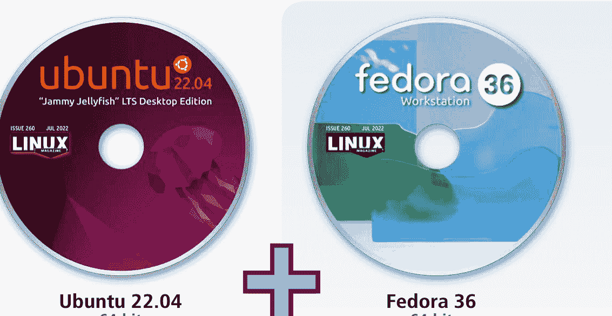

### Ubuntu 22.04 64位

`Ubuntu 22.04` 代号为“水母鱼”（`Jellyfish`），是最新的长期支持（`LTS`）版本，其安全和维护更新将一直持续到 2027 年 4 月。按照以往的发布惯例，“水母鱼”版 `Ubuntu` 包含了许多新功能和改进。

许多改进是视觉上的，例如为更短的 `dock` 栏添加了图标、更改了各种对话框中的图标，并为那些偏好在右下角原子风格图标的用户提供了新主题；而另一些则更具通用性，例如为单击操作添加了圆角，或者提供了极简安装选项——这是一项推迟已久的安全特性。

对于 `LTS` 版本来说，不寻常的是 `Ubuntu Jellyfish` 发布时带有了一些局限性：

- 新内核在 `Wayland` 下的性能不佳
- 默认使用 `Wayland`，但 `NVIDIA` 显卡除外
- `GRUB` 引导加载器检测不到其他操作系统或发行版。要修复这个问题，如有必要请下载 `os-prober`，并在配置中添加 `GRUB_DISABLE_OS_PROBER=false` 行并更新 `GRUB`。

考虑到五年的使用周期，这些问题很快会被修复。同时，如果这些问题没有影响到你，那么这个最新的 `LTS` 版本应该能为所有水平的用户提供该发行版的易用性。

### Fedora 36 64位

`Fedora 36` 曾多次延迟，但在你读到这里时它应该已经发布。它的支持将持续到 2023 年 5 月 17 日。

`Fedora` 发行版以创新闻名，但 `Fedora 36` 是一个相对平庸的发布。一如既常，新版本包含了新的壁纸和主题，其中许多反映了近期流行的深色模式风潮。然而，许多新功能归功于 `Linux` 内核以及最新的 `Linux 42` 发布，`Fedora` 自身对该版本的贡献在很大程度上被掩盖了，因为增强驱动的支持意味着 `Fedora 36` 可以被视为一个维护版本，旨在赶上游项目的进度，并继续修改过去几年引入发行版的内容。

缺陷部分将被替换。

请发送邮件至 `us@linuxmagazine.com`。

尽管《`Linux Magazine`》已经经过过测试，且据我们所知，没有恶意软件和缺陷，但《`Linux Magazine`》对使用本软件可能引起的任何中断、损坏或问题不承担责任，也不担保。

### 发行版中立？这就是我们。

`Linux` 专业协会（`LPI`）的使命是通过支持与其工作的人员来推广开源的使用。我们精 `Debian`、`Red Hat`、`Manjaro`、`Ubuntu`、`SUSE`、`Mint` 以及其他。这就是为什么拥有 `LPI` 认证的人可以自信地申请任何 `Linux` 工作。在 `Lpi.org/why` 了解驱动我们的动力。

在 `lpi.org/exam-pricing-2022` 发现你所在国家的新 `Linux` 专业协会考试定价。获取更多信息和所有 `LPI` 认证请访问 `lpi.org`。


## 新闻

### 技术、趋势和工具更新

### 本月新闻

- 08
    - `Danielle Foré` 为 `elementary OS 7` 带来更新
    - `Linux New Media` 发布了 `OpenJobHub`
- 09
    - `Ubuntu Cinnamon 22.04` 现在可用
    - `Pop! OS 22.04` 已发布
- 10
    - `Star Labs` 展示了一台小型尺寸 `Linux PC`
    - `MX Linux 21.1` 版本“`Wildflower`”现可用

### Danielle Foré 为 elementary OS 7 带来更新

`Elementary` 创始人兼首席执行官 `Danielle Foré` 宣布了 `6.1` 版本的更新并补充说 `elementary OS` 团队正在为即将发布的 `7.0` 版本做准备。虽然 `7.0` 还没有固定的发布日期，但他们已经宣布了一个代号（`Horus`），并且团队正专注于快速发布或为 `elementary` 版本添加大量新功能。


从 `6.1` 到 `7.0` 的变化将是微妙的。


他们计划在 `7.0` 中实现的功能包括自动应用更新和电源配置方案。此外，`7.0` 将首次推出极简的 Music 应用，并将某些组件迁移到 `GTK4`（这将带来极大提升的性能和更平滑的动画）。

`7.0` 有一点将不会切换到 `Wayland`。尽管他们正在为转变做准备，但 `elementary OS` 已经准备好进行跨越了。

在 `elementary OS` 官方博客 (<https://blog.elementary.io>) 上获取更多信息。

# Linux New Media 发布开源职位枢纽

`Linux New Media` 与同 `FOSSLite` 和《`Linux Magazine`》，很高兴宣布推出 `Open Source JobHub` (<https://japensourcejobhub.com/>)，这是一个帮助人们在开源社区中找到职位的招聘板。

该平台面向开发者、工程师、经理、营销人员和开源人士，`Open Source JobHub` 可以帮助你找到最合适的工作。现在比以往任何时候，科技行业都处于爆炸式增长，`Open Source JobHub` 将帮助你应对日益增长的机会。

> “`Open Source JobHub` 不仅涵盖使用开源技术的职位，还涵盖销售、市场等其他角色，并致力于为全球开源社区提供服务。我们的目标是建立职业联系，”`Linux New Media` 首席执行官兼出版经理 `Brian Osborn` 说道。


# 新闻

Linux 新闻

新版本的其他亮点还包括截图工具、设置应用中的支持选项、内核 `5.16`、`GNOME Settings 41.4`、`Firefox 98`、`GNOME Terminal 3.43.9` 以及 `Git 41.4`。

你可以从官方网站（<https://pop.sysops-76.com/>）下载 `Pop!_OS` 副本，也可以使用 `sudo apt upgrade -f` 命令升级你当前的版本。请记住，在运行升级之前，请务必备份所有重要数据。

# Star Labs 发布新款小型 Linux PC

`Star Labs` 长期以来作为 Linux 笔记本电脑制造商闻名；然而，该公司已涉足迷你 PC 市场，且其首次发布的产品在参数上令人印象深刻。

`Byte MK` 是第一代迷你 PC，配备了 `AMD Ryzen 7800` 八核 `CPU`（主频高达 `4.4GHz`）、`AMD Radeon` 显卡、最高 `6400MHz` 内存以及最高 `6TB` 的 `SSD` 存储。

除了 `Byte MK` 的性能，最令人印象深刻的特征之一是它的接口数量，包括两个全尺寸 `USB 2.0`、两个全尺寸 `USB 3.0`、一个全尺寸 `HDMI`、千兆以太网、`USB-C`（用于供电和扩展）、音频/麦克风组合接口和一个 `SD` 卡槽。最后，`Byte MK` 与 `Core` 固件以及 `Star Labs Configurator` 工具共享。

`Byte MK` 的起售价为 `793.00` 美，包含 `8GB` 内存和 `240GB` `SSD` 存储。订单发货日期为 `2022` 年 `6` 月底，预订可享受九折折扣（设备仍在生产期间）。

立即订购您的 `Star Byte MK` (<https://url.starlabs.systems/pages/byte>)。

# MX Linux 版本 21.1 “Wildflower”发布

`MX Linux` 是一个桌面发行版，它放弃了 `systemd` 而选择较旧的 `SysV` 初始化系统。像过去一样，`MX Linux` 提供 `Xfce`、`KDE Plasma` 和 `mx-fluxbox`。该发行版为了简单，为 `Xfce` 提供了 `32` 位版本，并为所有桌面提供了 `Fluxbox 64` 位版本。

此新版本基于 `Debian 11.3`，使用了 `5.16` 高级加固内核（`Advanced Hardened kernel`），并包含大量更新的应用程序、常规错误修复以及改进后的安装程序。

`MX Linux 21.1` 中一个令人惊喜的发现是用于简化 `Samba/NFS` 设置的 `a-carf` 工具。

另一个有趣的新增是开发者带回了磁盘管理器，它可以在启动时自动检测新分区，完全管理文件配置，并允许你启用/禁用 `NTFS` 的写入支持。

如果你已经在运行 `MX Linux 21.0` 版本，可以通过更新管理器升级到 `21.1`。

你可以下载 `MX Linux Xfce` 桌面版（<https://sourceforge.org/projects/mx-linux/files/Final/Xfce/MX-21.1_x64.iso/download>）、`KDE Plasma` 版（<https://sourceforge.org/projects/mx-linux/files/Final/MX-21_M_x64.iso/download>）或 `MX-Fluxbox` 版（<https://sourceforge.org/projects/mx-linux/files/Final/MX-Fluxbox/MX-21.1_x64.iso/download>）。

访问 `MX Linux` 博客（<https://mxlinux.org/blog/mx-21.1-wildflower-released/>）阅读发布说明。

每两周在收件箱中获取最新新闻

免费订阅 `Linux Update/Linux-Update`

# DrupalCon

`2022` 年布拉格

`9` 月 `20-23` 日

## DrupalCon 布拉格

让我们再次面对面聚聚！

`DRUPALCON EUROPE` 将在捷克首都布拉格举行，

时间为 `2022` 年 `9` 月 `20` 日至 `23` 日。

访问我们的网站 <https://events.drupal.org/prague2022> 获取所有重要信息。

# 注册与赞助

销售已开启！

# 新闻

内核新闻

## Zack 的内核新闻

### 处理头文件层级结构

在 `2020` 年冬天，`Ingo Molnar` 决定如此简单的事情必须让每个人的生活变得更好。他在那种极其糟糕的事情中提取出了 `Linux` 头文件层级结构（`header hierarchy`）。这个渗出的噩梦由内核源码中所有的头文件组成，它们之间像一个弹性的胶状网络一样相互依赖，这种网络既无法解开，所有内核子项目都深受其苦，强制执行粘粘的层级，直到人类的命运真正取决于此。

到 `2021` 年年中，我在该树中提交了超过 `500` 次代码，不得不放弃第二次尝试 `(1)`，前两种方法无法扩展、难以维护，且仅带来了 `4%` 的编译速度提升，这算不上 `500` 个补丁的折腾，甚至还不够。

在第三次尝试中，我引入了 `per_task()`，这极大地减少了依赖关系，这是一种保持敏捷的简洁方法。但即便如此，我只实现了 `10%` 的编译速度提升。同样，这并不是我觉得可以推送到上游的状态，而且

`Chronicle Brown` 报告了内核社区内的最新消息、观点、困境和进展。

但数据是清晰的：`20%` 的性能提升是完全可能的。所以我继续进行这项棘手的开发，大多数速度提升在 `1,500` 次提交后早期开始，事实上，到 `2021` 年，当我回到第 `70` 次配置时，我惊讶地发现速度提升了 `20%`。这是当依赖关系减少到少数时，内核编译速度有了明显的非线性改进。

`Zack Brown` 说

所以我解开了这个结，重构成为了我的最终补丁，跨越了超过 `2,500` 次提交，使得内核的所有源文件。“正如内核开发者所知，内核中有 `10,000` 多个头文件，我决定排除/包含头文件。在过去的 `30` 多年里，依赖关系变成了复杂的地狱（`Dependency Hell`）。

他指出，“默认”头文件（包含各种类型的定义）已经减少了 `1-2` 个数量级。这种编译改进跨越了整个流。

他向世界提供了这种路径，称为“快速头文件”（`Fast Headers`）。为了接受它，内核编译时间——那些不需要重新编译的文件——急剧减少。这种渗出的噩梦变成了一个脆弱的纽带——至少被缓解了。

最后，`Ingo` 说，这是 `LKML` 历史上最大的公告！这是一个 `RFC` 提议，并改变了上游的结构。

# 作者

`Linux` 内核依赖关系列表。流量非常罕见，每周经常达到 `1000` 条消息，跟上整个开发规模几乎是不可能的。`Zack Brown` 是少数勇敢采取行动的人之一。

当我开始这个项目时（`2020` 年晚），我预计会有 `500` 次提交。我发现通过减少依赖关系可以获得速度，这对内核产生了实质影响。但随着补丁数量的增加，我看到了有限的性能。`Greg Hartman` 非常帮助并提供了一些技术建议。但他查看了树，整体看起来很大。大部分可能可以通过不同的子系统将这些“主要的”头文件拆分。

`Nathan Charball` 同样受到了 `Inredo` 的冲击。在这种情况下，我们看到 `ARM64` 内核有了 `18%` 的改进。注意，“尽管 `Inredo` 的改进只有 `18-35%`，但 `ARM64` 的三重链接使用了 `Kelly` 工具。”但在不同架构中也有许多支持。最后，我认为这种改进可以进入我们在 `x86` 上看到的 `60-70%` 范围。

内核新闻

“绝对的，计划这样做：

- 大约 `70%` 的提交是通过维护者头文件进行并行化的。


在不稳定的预期下，每个任务都有许多补丁。这些实际上需要从这个树（`1`）中获得许多改进。我们可以通过调度器来实现这些。单体内核仍然是不可战胜的；快速头文件的路径发布良好。”

`Fahan` 注意到了许多代码补丁，这些也被接受了，他们对问题进行了技术讨论。“你的测试和补丁调度非常感谢，让我保持在快速头文件的相同路径上；”

`Terrell` 对他的公告也表示：“做得好！我对这项工作特别感兴趣，因为 `6` 个月前我在伪装中经历过类似的过程，节省了 `40-45%` 的时间，但认为如果有人愿意参与的话，这些简单的补丁可以应用到内核。我很感激你如何处理这项工作，并深感同情！”

`Nick Daiselas` 对 `Inredo` 的代码有一些技术评论：“这是一个非常酷的东西。我也一直在考虑这个领域。我已经玩了多年内核，没有受到阻碍。”

“我不退缩：这说明你的工作是有效的，在未来，我假设不会有任何形式的自动化让我们发现类似的依赖关系被解开。”当我们观察头文件时，突然至少在这个领域，世界将变成一个更明亮、更快乐的地方。

# 下一个 Spectre 漏洞

最近 `Spectre` 漏洞在多种 `CPU` 架构中被引入。这是一个双重异常，因为漏洞必须快速修复，而工作负载涉及大量的性能时间。

这一次，我们都面临着一场突如其来如其其来的 `Spectre` 暴风雪。在其中，亲爱的，我们有一系列文档补丁。来自 `Lin` 和 `Andi Klein` 解释了与 `Spectre` 相关的性质和风险、缓解安全问题的方法以及删除相关的文件。

在文档中，作为内核，“`Spectre` 是一种侧信道攻击，利用 `CPU` 上的分支预测和规范执行来读取内存，绕过访问控制。安全执行侧道不仅读取内存，还允许推断特权数据。”

他们继续道：“规范执行侧方法使用了广泛的现代高性能处理器，因为更快的处理器使用了预测和规范执行。

以下 `CPU` 存在漏洞风险：

- `Intel Core`, `Atom`, `Pentium` 和 `Zen` 处理器

- `AMD Phenom` 和 `YZ2` 处理器

- `IBM POWER` 和 `S` 系列处理器

- `Apple CPU`

- 高端 `MPS CPU`

- 可能大多数其他高性能 `CPU` 详情请见。请联系你的 `CPU` 获取版本详情。”

“处理器是否受影响可以从 `Spectre` 漏洞的迹中读出来。”

文档继续道：“为了提高性能的 `CPU` 操作。它们可能会在处理器的缓存、缓冲区和……留下内存访问或计算的痕迹。”

> 如果你计划为像 `Linux基金会` 这样的项目安排任务，说明你如何进行这些更改，那就太棒了。我真的希望没有人怀疑我们可能帮助解决性能问题。很好。

而且 `Andrew Bergamo` 也表示，在这种情况下，过去还没有足够的方法达到这一步。我看到的最好的内核改进是 `30%`，这倾向于比领先的 `git` 头文件更敏感，因为在我们……之前

对话演变成了变成了每个人每天的话题。几天后，`Inredo` 发布了从 `2,200` 次提交到“`2,300` 次提交”的补丁版本，并对官方内核提供了更进一步的提升。这种运气偶尔会发生 —— 有人决定从内核噩梦的角度入手，比如大内核，或者修复所有的编译警告，或者清理

## 内核新闻

分支产品。恶意软件可能会增强推测执行路径，然后利用 `CPU` 和缓冲区中的推测执行效应在执行期间注入已记录的数据。

`gadget` 的参数，通过寄存器或内存中的已知地址传递。在 `gadget` 执行后，他可以测量侧副作用。

人们在正常情况下往往不会实际使用或染色的组合，因此出现了一波（小规模）的修复。

`Spectre` 变体 1 攻击条件分支的推测执行，而变体 2 则攻击间接分支的推测执行以布局特权内存。

攻击本身是通过为间接分支返回跳转板（也称为 '`retpoline'`）来消耗分支目标缓冲区条目。`Retpoline` 跳板板捕获执行路径以防止执行推测执行。具有增强间接分支预测的 `x86 CPU`。

“这一切其实都不令人意外，但我本来认为我至少在这个周末能完成最终发布。”

“老实说，我确实考虑过它。我想我们真的没有任何可以维持发布的选项，或者说我们该如何处理这些攻击。使用带有 `IBS` 的增强内核比 `retpoline` 更高效。”

他们提供了一个恶意攻击污染内核的例子：攻击者在系统调用期间向内核传递指向内存中无效地址的指针。该参数稍后可能被内核用数组索引或检索用于变体 1 攻击的指针。

“当然，这里还有许多非 `Spectre` 的问题。其他方面，最后发现了几个在回归测试中缺失的补丁，现在它们都已修复完成。”

该攻击是无效的，因为边界检查被用于推测执行的代码分支绕过了。这可能允许特权内存被访问和加载。

“显然，这里还有所有通常的随机修复。但因为 `Spectre` 的事情，大约是 `-rc8` 的补丁架构。”

“对于已确定数据指针可能受 `Spectre` 攻击影响的内核，使用了 '`nospec'` 宏来防止数据的推测加载。”

“话虽如此，仍然有一相当小部分并不是我们所预想的那种‘大灾难’；包括现有的缓解措施和报告。”

`Spectre` 变体 2 攻击可以在进入之前污染分支目标缓冲区 (`BTB`)：内核可以在直接跳转中使用被污染的分支目标缓冲区，并在推测执行中跳转到 `gadget`。

文档还包含了恶意用户进程攻击另一个内核、进程使用底层内核以及虚拟化系统攻击另一个虚拟系统的示例。

“总之，让我们不要再纠结这件事了——只是为了自动化那些更细微的部分，现实中的负载比自动化农场的做的更有趣。所以请将此 `rc` 作为一个快速修复。”

没有修复这些问题的文档补丁。自从 `Linux 5.7-rc8` 补丁公布后的第二天，有人说：

“所以上周，我本该今天发布 `5.7.17`。”

“那时是那样，但现在：上周非常忙乱，主要是因为带有另一种 `Spectre` 攻击变体的嵌入式补丁。虽然补丁终于到位了，但因为它是隐藏的，我们所有的正常测试在其他地方都没有发现。”

几个人报告了 `Spectre` 补丁的情况，但在特定线程中没有关于 `Spectre` 的讨论。

“一旦执行看到看到东西，一切都是疯狂的”

## FOSSLIFE

## 为所有人开放

新闻 • 职业 • 科技生活

技能 • 资源

`FOSSlife.org`

# 头条故事

# Portmaster

### 使用 Portmaster 管理网络上传

### 完全控制

由于互联网公司对个人数据永无止境的渴望，安全和匿名化在互联网上扮演着日益重要的角色。`Portmaster` 和 `Safing` 网络将帮助保护你的隐私——即使你不是安全专家。

作者：`Erik Bäroldt`

加强的数据收集正让互联网用户的生活变得困难。收集数据的并不是 `Google` 或 `Facebook` 这类常见的惯犯。传统的软件软件包越来越多地开始“拨家”，并向其供应商和第三方发送“遥测数据”。

用户通常不会注意到这种数据传输，也不跟踪数据被发送到了哪里。为了停止这种习惯

### 理念

`Portmaster` 将多个与隐私相关的服务整合到一个包中。`Portmaster` 包含：

- 防火墙

也许 `Portmaster` 最有趣的部分是，开发者将所有功能封装到一个单一接口中，你不需要成为专家就能理解和管理。直观的 `Portmaster` 界面使得监控设置、自动拦截追踪器和广告软件，以及为不同的应用程序配置不同的过滤器变得简单。`Portmaster` 是 `GitHub` 上的免费软件 [2]，并在 `AGPL` 通用公共许可证 (`AGPL`) 提供。

### 工作原理

在底层，被称为 `Portmaster Core` 的服务一侧位于内核与用户界面之间，另一侧位于内核与互联网之间（图1）。该核心服务由几个组件组成，其中最重要的是 `SPN`、过滤器和 `DNS` 服务。

安全 `DNS` 服务使用 `DNS-over-TLS (DoT)` 协议，它通过加密的 `TLS` 连接发送查询。这种加密阻止了未经授权的第三方查看 `DNS` 查询。过滤器的作用类似于防火墙，也使用过滤器列表。系统引用过滤器列表来阻止不理想的连接。

制造商不断更新包含恶意软件、追踪、钓鱼或其他活动网站的过滤器列表。这些列表维护在 `GitHub` 页面上（图2）。

系统引用过滤器列表来阻止不理想的连接。`Portmaster` 提供所有 `Linux` 发行版的二进制格式。大多数 `Linux` 内核与 `Portmaster` 完全兼容，但存在问题的内核除外。

该项目为许多流行的 `Linux` 发行版提供了安装说明，并提供了为了实现快速安装而需要解决的异常情况信息。除了基础的状态和连接显示外，`Portmaster` 让你能够对单个连接进行大量的编辑。

# 封面故事

# Portmaster

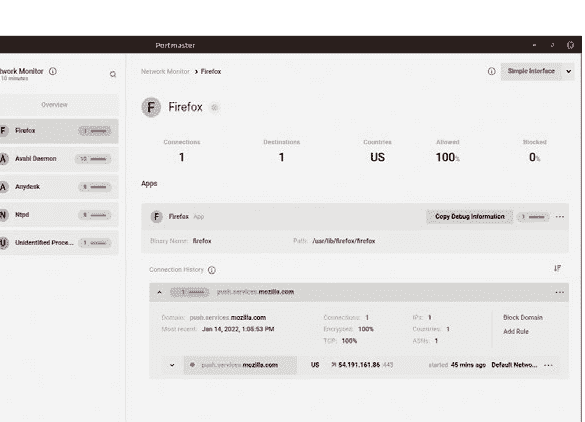

在您达到“不可信任”（`Untrusted`）级别之前，它不会使用它们进行域名解析。它还通过滑块将设置扩展到“信任”（`Trusted`）级别，即通过安全内网进行网络访问。

# SPN

`Portmaster` 通过 `SPN` 提供对互联网的隧道访问。这是传统 `VPN` 服务的替代方案，但它增加了一个额外功能：`DNS` 仅通过隧道路由数据包。

**图 3：** `Portmaster` 的图形化界面提供了所有连接详情信息。


要做到这一点，请点击所需的应用程序以及“连接历史”（`Connection History`）中相应的条目。`Portmaster` 以表格的形式显示所有连接。

你可以使用规则构建器（`Rule builder`）通过定义新规则来进一步设置。在仪表板中，你可以启用或禁用现有的过滤器列表。对于具有更多网络知识的用户，你可以使用 `iptables` 添加自己的规则。`Portmaster` 定义了哪些数据包通过或被拦截（图 5）。

客户端；它还使用了类似于 `TOR` 网络的洋葱式结构，数据包通过多个服务器传输。

`SPN` 目前仍处于 alpha 阶段，这就是为什么 `Portmaster` 默认禁用的原因。像公共 `VPN` 服务一样，它需要单独连接。开发者提供了一个免费模型，以及按欧元计费的无限商业订阅，费用为每月 99 欧元（约 10 美元）或每年 103 欧元（约）。

要激活 `SPN`，只需点击左侧垂直工具栏上的第二个按钮。右侧现在会出现登录对话框，你可以切换到 `Portmaster SPN` 模式。此外，在全局设置（`global Settings`）对话框中，你需要将滑块从“关闭”移动到“开启”。之后，连接将通过 `SPN` 建立（图 6）。

`Portmaster` 为所有接入互联网的应用程序提供规则，无论该程序当前是否运行。`Portmaster` 会自动检测所有具有网络访问能力的应用程序并将它们显示在列表中。你可以点击垂直工具栏左上角的第二个按钮来编辑此列表。所有应用都显示在右侧，`Portmaster` 会区分活动和非活跃的应用程序（图 5）。

## 设置

要修改 `Portmaster` 的设置，请点击垂直工具栏上的齿轮图标。全局设置（`Global Settings`）对话框在窗口右侧弹出，你可以使用方便的滑块来配置分为三类连接的设置。

例如，你可以忽略局域网环境中过时的 `DNS` 服务器，尽管 `Portmaster` 默认


**图 4：** 你可以像设置 `iptables` 防火墙一样为数据传输定义数据规则。

18 2022

第 260 期

`LINUX-MAGAZINE.COM | LINUXPROMAGAZINE.COM`

## 快速访问

为了在应用关闭时快速访问，`Portmaster` 在桌面环境的系统区域为你提供了一个图标。左键点击图标可以让你使用单选按钮快速在不同的操作模式之间切换。你可以在图标的内容菜单中打开应用程序窗口或禁用 `Portmaster`。

## 结论与展望

`Portmaster` 让你能够终止来自家庭计算机或广告网络的可疑数据传输。复杂的拦截功能不仅允许系统防止意外下载，而且在需要应用程序级控制时防止向第三方传输数据。你可以跟踪数据流量，并让追踪器和广告网络监视你的浏览习惯变得困难得多。

`SPN` 项目对于这样一个高要求的应用程序来说仍处于早期阶段，功能并不多。如果你对使用 `Portmaster` 感兴趣，可以在他们的网站上找到安装说明 [5]。开发者还在其网站上发布了详细的路线图；你可以查看路线图以找到你所需的内容，例如互联网匿名化。`Portmaster` 允许你结束来自家庭电脑或广告网络的可疑数据传输。

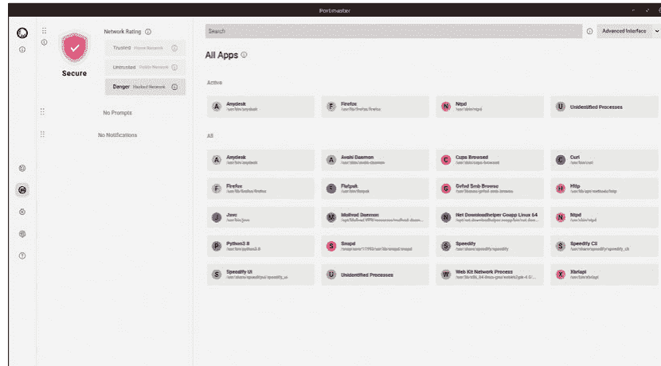

图 5：`Portmaster` 允许所有访问互联网的应用程序，无论应用程序当前正在运行。

## 信息

- [`Portmaster`](https://safing.io/portmaster/)

- [GitHub 上的](https://github.com/)

- [`SPN`](https://safing.io/spn/)

- [关于 `SPN` 的信息](https://safing.io/spn/)

- [`SPN alpha 状态`](https://safing.io/spn/alpha/)

- [兼容性列表](https://safing.io/portmaster/linux/)

- [路线图](https://safing.io/roadmap/)

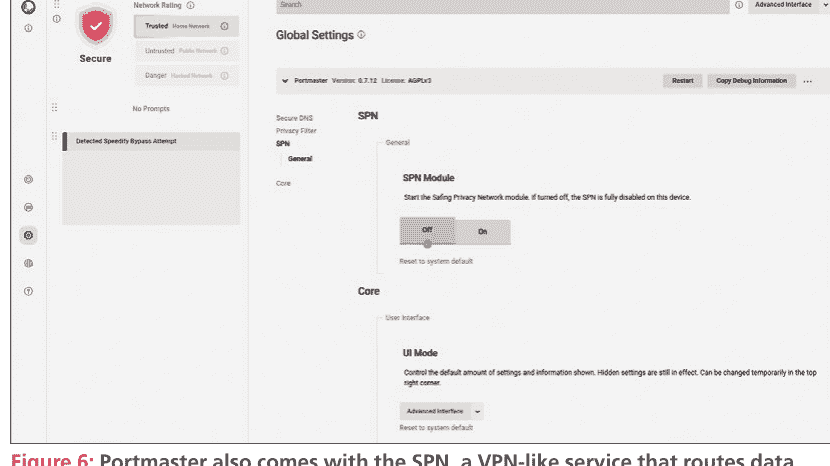

图 6：`Portmaster` 还连接到 `SPN`，一种类似于 `VPN` 的服务。

# 封面故事

# Tor 网络上的匿名性

## Tor 网络：Tor 工具

### 秘密

`Tor` 项目支持保护网络隐私的修改工具集合。我们将提供有关 `Tor` 的背景并帮助你入门。

`Brucefield` 和 `Joe Casad` 著

用户在互联网上留下痕迹。`Tor` 保护你访问的网站以及你的交互，如果不小心可能会导致身份被泄露。越来越多的应用程序为了保护你的隐私，其中最著名的是 `Tor Browser` [1]。

`Tor`（`The Onion Router` 的缩写）是 `Firefox` 的修改版本，旨在通过多个服务器路由流量并在每个跳点进行加密来隐藏追踪。

洋葱路由的概念最初由美国海军在 90 年代开发，作为一种安全通信方式。`Tor` 项目于 2002 年启动。2004 年，海军以免费许可发布了它，电子边界基金会（`EFF`）成为了该项目的早期支持者。在今天的世界，西方民主国家将隐私视为免受老大哥监控的保护，但 `Tor` 的产生很大程度上是为了为极权国家的反对人士提供安全通信。`Tor` 项目对其 2010 年阿拉伯之春运动的贡献和支持感到自豪，`Tor` 还支持过许多高风险倡议。其他人道主义组织也因其为活跃国家带来言论自由的潜力而支持 `Tor`，包括人权观察和美国国务院民主、人权和劳动局。

`Browser` 是一个强大的工具，它隐藏活动也并不令人意外。勒索软件攻击经常利用 `Tor` 网络进行赎金支付，暗网（非法销售毒品和被盗的信用卡）也利用 `Tor` 让某些用户匿名运行。`Tor` 项目认为某些社区将 `Tor` 用于非法目的，但他们也表示：“我们的大多数用户以负责的方式使用 `Tor`。”

某些用户选择这样做是因为原则——相信每个人都有权访问自己的数据，并避免被零售商恐吓、质疑，或因身份窃取造成的困扰。其他人想要绕过公司或国家对其施加的限制。其他人是家庭虐待的受害者，或者是揭露公司或政府腐败的人。`Tor` 项目有一个页面详细列出了隐私和安全日益成为主要关注点的诸多理由，以及大多数操作系统未能充分解决这些问题。`Tor` 的目的是弥补这些缺陷，并给其用户带来安心。


图 1：`Tor Browser` 是保护在线隐私最简单且有效的方法之一。

## Tor 中的路由

`Tor` 网络是由一组运行软件的服务器组成的，这些软件允许它们参与洋葱路由（`onion routing`）。洋葱路由的存在比 `Tor` 网络更久，而且它是一个更通用的术语—— `Tor` 拥有一套基于洋葱路由的特定协议。

去中心化的系统（称为“洋葱”）通过一系列 `Tor` 中继节点（见图 2）路由消息。消息被分层加密，因此电路上的每个中继节点都知道谁发送了消息以及应该将其转发到哪里。下一个中继节点会解密消息。电路知道数据包的最终目的地，但不知道源地或目的地。

如图 2 所示，使这一过程运行的关键在于路径上的每个节点只知道它需要的信息，而不再知道更多。`Tor` 客户端分层构建此消息（见图 3），这些层像洋葱的层一样被逐层剥开（因此被称为洋葱路由）。

为了构建这种多层消息（称为洋葱），`Tor` 客户端必须从电路中的每个节点获取一个对称会话密钥。这些密钥是通过节点之间的一系列公钥（`Diffie-Hellman`）连接获得的，节点会将加密后的会话密钥传回给客户端。

客户端使用节点 3 的会话密钥加密其想要发送到目的地的消息。这条加密后的消息使用节点 2 的会话密钥加密，然后使用节点 1 的会话密钥加密。当节点 1 接收到消息时，它知道发送者，但不知道发送者是源头还是只是电路中的另一个节点。节点 1 知道会话密钥并获知它应该将消息发送到节点 2。节点 2 解密发给节点 3 的消息。节点 3 解密最后一层，并发现它必须将消息发送到目的地。节点 3 不知道消息是谁发起的，但它知道自己是从节点 2 处接收到的消息，并记住这一事实，因此它将知道如何从服务器回传回复。


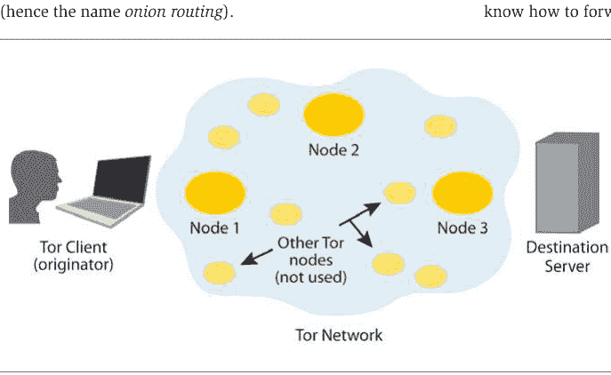

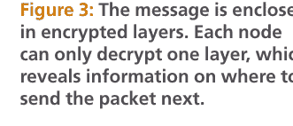

# 封面故事

# Tor 网络上的匿名性

在返回给客户端的响应中，过程是相反的。每个节点都为源添加一层加密，链末尾的客户端使用之前获取的密钥解开所有层。

一旦连接，`Tor` 浏览器就可以像其他版本的 `Firefox` 一样使用。你可以将其配置为自动隐藏 `onion` 地址。该浏览器使用 `DuckDuckGo` 来匿名化搜索，并在 `Google` 上进行搜索。有关最新更新，你还应该检查。

正如你所指出的，这个过程需要许多步骤和计算，`Tor` 网络的速度明显慢于其他互联网流量。

## Tor 特有功能


当你使用 Tor 浏览器时，应该注意它独特的功能，这些功能位于窗口右上角。输入 URL 字段旁边是一个可以打开 Tor 启动器（`Tor Launcher`）的下拉菜单。帮助图标会告诉你它是否重启了 Tor，从而为你提供一个新的临时身份。标准是 Tor 功能菜单，用于 Tor 插件，你可以在那里找到许多实用的工具。Tor HTTPS Everywhere（见图 7）是 Tor 项目与 Eff 合作成果，如果可能，它可以强制网站使用加密的 Tor 协议而非未加密的 HTTP。签名代码（见图 8）允许你验证运行的任何 JavaScript（泛指在 Tor 浏览器的功能上）。这两个插件都非常受欢迎。目前，它们是你在使用 Tor 浏览器时应该使用的唯一插件。

## 安装 Tor

Tor 在许多发行版中均可用。然而，除了具有频繁安全更新的滚动发布的发行版外，否则该版本可能不是最新的，并且可能是不安全的。特别是，最新的 Ubuntu 意味着不建议使用 Tor。相反，可以从 Tor 项目下载 Ubuntu 以及其他 Debian 衍生版。

任何连接都可以下载网站的 Tor。除了 Linux 之外，还提供 Android、iOS 和源代码，以及除英语以外的 36 种语言。未解压的下载对于美英语版本名称为 `tor-browser-LOCALE-`。进入目录并点击 `start-browser.desktop`。你可以作为桌面环境的一部分运行 Tor：

```
/start-browser.desktop --register
```

要让整个系统都能访问 Tor，请将其解压到 `/opt` 并根据需要更改权限。接下来，运行 `start-launcher.desktop`，它会打开 Tor 启动器（见图 5）。配置任何网络设置，如果你选择，让 Tor 自动连接。首次连接将非常快，只需 15-30 秒，但之后将需要几秒钟。通过查看左上角的在线帮助等内容，你可以取消默认设置（见图 6），如果你以前使用过 Firefox，这些设置对你来说可能很熟悉。正如你提到的

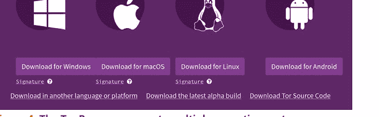

你的选择是在安全隐私与便利之间取得平衡。你选择的设置可能是一种持续的体验。你拥有的是一个修改过的 Firefox 浏览器，但记住不要添加任何不受 Tor 项目支持的扩展，因为它们可能会损害安全和隐私。虽然 Firefox 扩展可能很方便，但由于太多无法逐一审核。不要更改任何默认配置设置，这些设置已经经过了仔细配置。

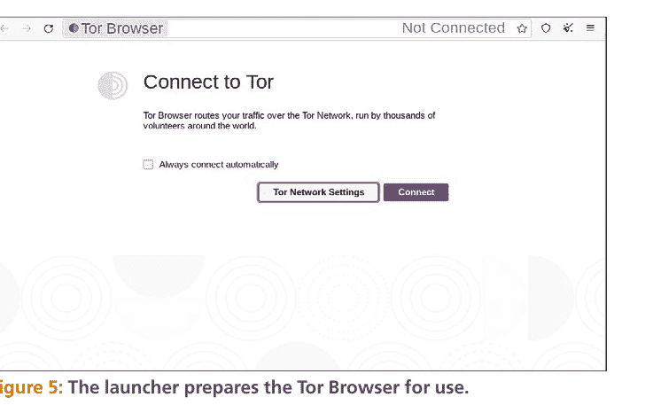

## 封面故事

### Tor 网络上的匿名性

Tails 是一个旨在从外部设备运行 Tor 浏览器的发行版。由于 Tails 是一个在使用时是安全的独立操作系统，它由于安装的系统本身就是被卸载的。一旦关闭，它就不会留下任何痕迹。此外，通过调整 BIOS 从外部设备启动，Tails 可以在任何计算机系统中运行。它的详细文档是学习隐私和安全问题的理想场所。


- 通用
- 首页
- 隐私与安全
- Tor
- Cookie 和网站数据
- 在浏览器关闭时清除网站数据
- 登录和密码
- 扩展与主题
- Tor 支持
- 更多
- 管理数据
- 管理异常
- 存储的数据
- 存储日志
- 异常
- 异常
- 异常
- 异常
- 异常
- 异常
- 异常
- 异常
- 异常
- 异常
- 异常
- 更多插件

`about:aditions`

`HTTPS`

在许多网站上自动启用 `HTTPS`

详细权限

`NoScript`

为你的浏览器提供最大的保护：`NoScript` 仅允许信任的脚本运行内容以防止跟踪漏洞。详细权限

需要访问隐私窗口

此扩展程序可以访问你的在线隐私浏览。

允许自动更新

作者

`extension-dev@ext.com`

在隐私窗口中运行

当启用时，扩展程序将访问你的在线隐私浏览。

了解更多

版本

`2021.13`

`111.45`

版本

`2021.13`

版本

`11.45`

最后更新

`2022年5月9日`

最后更新

`2020年1月1日`

主页

`https://www.mozilla.org/https`

图 7：HTTPS Everywhere 是一项尽可能让默认使用加密 HTTPS 的插件功能。

图 8：使用 NoScript，你可以控制单个页面上运行的 JavaScript。

## 头条故事

### Tor 网络上的匿名性

比特币交易过程可能会泄露可能导致用户去名的信息

### 允许使用此浏览器的 Cookie 吗？

我们使用 Cookie 和类似技术来：

- 提供并改进内容产品
- 通过从 Cookie 和 Facebook 之外接收的信息提供服务
- 为拥有账户的用户提供并改进 Facebook 产品

为了 Facebook 之外的广告和测量服务，以及提供更好的功能和服务，我们从 Facebook 上的其他渠道收集数据。这些渠道也使用了 Cookie。

你可以使用所有 Cookie、仅使用必要的 Cookie 或选择更多选项。你可以在我们的 Cookie 策略中找到有关我们使用哪些以及如何使用 Cookie 的更多详细信息，并随时更改你的选择。

#### 必要的 Cookie

使用 Meta 产品需要这些 Cookie。它们对于确保这些服务按预期工作是必不可少的。

关于 Tor 网络匿名性的研究大多集中在入口节点和退出节点。你可能不知道网络内部发生了什么，但如果退出节点是你，你仍然会获得有关流量的信息。Tor 项目无法防止所有的端到端攻击。“如果攻击者可以捕获从你的计算机发出的流量，以及到达你目的地的所有流量，他可以使用统计分析发现它们属于同一个电路。”

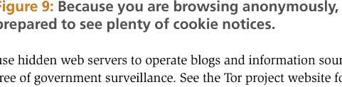

图 9：由于你正在匿名浏览，请准备好选择某种 Cookie。

我们使用网络浏览器来存储用于免费监控的算法和信息。Tor 项目将为你提供更多关于配置和启动隐藏服务的指导。

#### 局限性

Tor 浏览器是在线匿名的强大工具，但它具有用户应该注意的一些局限性。破坏 Tor 两种明显方式：

- 通过日期技术破解加密（如果退出节点未加密）
- 利用系统组件之一的漏洞。例如，浏览器是 Firefox，它存在需要补丁和更新的漏洞。

潜在攻击与你是否正在执行某种操作无关，安全研究人员会寻找 Tor 网络中的漏洞，Tor 项目最终会解决这些，因为透明度是他们的价值观之一，如果存在漏洞，他们会揭露它而不是绕过它。

政府也一直试图破解 Tor 网络，但他们比学术界更少发表关于他们如何做到的结果报告。多年来，暗网上发生过多次重大崩溃。例如，2014 年，一个政府联盟接管了 Tor 中继节点，导致了包括丝绸之路 2.0 在内的多个暗网网站关闭。当时没有一个 Tor 部署者确切知道这些机构是如何完成这次攻击的（被称为“匿名行动”/`Operation Oonymous`），但 Tor 开发人员发布了一篇博客，对可能发生的情况提出了一些想法，建议如下：

- 操作安全——被盗的密码和恶意用户（与互联网上其他人受攻击的方式相同）
- Web 应用程序中的漏洞可能导致 `SQL` 注入或其他攻击。
- 比特币去匿名——根据专家的说法，

## 结论

Tor 开发者将隐私视为每个人都应该拥有且必须在私下受到保护的人权。该项目高度重视用户的安全。他们知道有些用户访问平台是为了非法活动，但他们坚持大多数用户有正当目的。Tor 是一个工具，就像任何其他工具一样，可以用于善或恶。罪犯可以使用工具，但人们通常认为工具也能帮助合法用户。

如果你担心自己的隐私，并依赖浏览器和你不可靠的浏览器设置来保护你免受监控，现在可能是探索 Tor 网络的时候。在隐私和安全日益关注的时代，Tor 对于保护你自己和数据非常重要。

## 信息

- [1] Tor 浏览器：`https://www.torproject.org`
- [2] 使用 Tor 的原因：`https://www.torproject.org/about/torusa.html`
- [3] 带有 Tor 的 Ubuntu 和 Debian：`https://support.torproject.org/article/`
- [4] 下载：`https://www.torproject.org/download/`
- [5] 对 Tor网络的攻击：`https://blog.torproject.org/attacks-and-concerns-about-anonymity/`
- [6] 关于 Tor 项目：`https://2019.torproject.org/about/overview.html#stayinganonymous`

## 存储开发者大会


- 区块链与存储
- 计算存储
- DNA 数据存储
- 持久性内存
- 存储架构及更多

`2022年9月12-15日`


# 弗雷蒙特硅谷万豪豪酒店 (Fremont Marriott Silicon Valley)

不要错过这次活动，获取有关最新存储技术和标准的最佳技术讨论和教育。

# SNIA 活动

`www.storagedeveloper.org`

## 评测

发行版之旅 – `Devuan`

## Init 自由的斗争

### `DEVUAN`

`Devuan` 凭借其对 Init 自由（Init Freedom）的承诺，为用户提供了 `systemd` 的替代方案作为初始化进程。作者：Bruce Byfield

长期 `Linux` 用户可能还记得，`Debian` 曾被视为无政府主义者的选择，拥有大多数大多数人拒绝的激进想法。有时，`Debian` 在发行版中对于自由软件基金会做出的决策甚至更为极端。然而，多年来，`Debian` 开发了自己的层级结构，以允许两种类型的替代方案。今天，最让人想起早期 `Debian` 的衍生版是 `Devuan` [1]，它于 2014 年从 `Debian` 分叉，基于决策方式以及使用它们的技术含义。最近，两个 `Devuan` 开发人员——`fsmithed`（构建镜像并提供支持）和 `golin`（社区经理）回顾了 `Devuan` 的问题。由于 `Devuan` 缺乏正式的层级结构，他们强调他们的备注是“官方的”。

2014 年，`Linux` 发行版忙于从 `SysVinit` 转向 `systemd` 作为系统的第一个进程并管理其他进程。`Ubuntu` 自那时起开始将其作为默认。然而，`systemd` 引起了争议。相反，`systemd` 比初始化系统复杂得多。正如 `Devuan` 论坛所描述，“调用初始化系统就像称呼一辆汽车”。如果不清楚，`systemd` 和其他系统之间没有区别。从这个角度来看，`systemd` 不仅过度设计，而且违反了 `Unix` 开发的基本原则。Christopher Berry 在 `Linux` 归档中指出，这种哲学让 `Linux` 成为一组可以组合以满足需求的组件 [3]——一个既灵活又易于使用的操作系统。同样重要的是，模块化结构允许以不同的方式组装部分，以便

``

``

## 评测

每个区别都是独特的。相比之下，`devuan` 在所有 `Linux` 系统上实施了一种结构——这在某些方面很方便，但在另一些方面却限制了维护多个系统的多样性。从首次发布以来，`Devuan` 继续添加替代方案，并向许多其他人开放。在 `Devuan` 的日子，它列出了 `OpenRC` 等替代方案，运行。

正如预期的那样，`Debian` 邮件列表对这些进行了广泛讨论。出乎意料，讨论以许多 `Debian` 用户的决议告终。获胜方案是使用 `systemd`，但同时，一个支持 `systemd` 的普遍决议——许多 `Debian` 用户很少提到的分歧，使用 `systemd` 的决策是由 `Debian` 层级结构强加的。`Bionic`、`Pine` 等 [9]。尽管 `Devuan` 可能是一个小众发行版，但显然是一个蓬勃发展的发行版。`Devuan` 能成为主流吗？这是可能的。`Linux` 处于生活的许多部分都是自由的时代。`PulseAudio` 被 `PipeWire` 取替——有助于系统的整体改进。同时，对于那些反对替代方案的大多数，`Devuan` 保持了 `Debian` 的早期精神。2014年11月24日，宣布了 `Devuan` 分叉。其意图是产生一个远离系统自由锁定问题的发布和维护发行 [4]。

### 信息

此外，Init Freedom 页面列出了提供自由替代方案的其他发行版，以及与这些发行版密切相关的 Devi Galaxy Forum 和 `Devuan` IRC 频道 [7]。

- [4] `Devuan` 通知：`https://www.devuan.org/announce/`
- [5] Init 自由：`https://www.devuan.org/or-init-freedom`
- [6] Devi Gallery：`https://www.devigallery.com/search.php?search_id=14156802`
- [7] `Devuan` 的 IRC 频道：`https://ripenebter.net/clircags/devuan/`
- [8] 无系统的发行版：`https://distrow.com/search?q=ostype=all&architecture=all&base=all&desktop=none&desktop=all&package-manager=all&install=all&language=all&default=not-system&active=system`

当误解被消除后，`Devuan` 分叉超出了它的价值。

再次强调，“我们严重依赖未修改的 `Debian` Debian。我们只打包需要 system 的包。`Devuan` 和 `Debian` 之间的协作是成功的，尽管我们经常看到的是 Bug 修复而不是新功能。”

### 超越 Init 自由

与其说是某个反系统项目。

在赞誉中，Init 自由意味着支持对 init 的选择。尽管 `systemd` 的支持者认为，`Devuan` 通常被提到是因为它是一个徒劳无功的常见错误假设。`Devuan` 还有正在开发的 Arch Pimaera。最新的 `Devuan` 版本还包含一个不安装 `PulseAudio` 的选项，以启用语音和声音同步。此外，至少存在一个 `Devuan` 衍生版Maestro Leeste，其目标是在 `Nokia N900`、`Motorola Android 4`、`Motorola` 等手机和平板上提供自由开源体验。

``

``

图 1：`Devuan` 支持 init 替代方案的选择。

### 作者

Bruce Wakefield 是一位计算机记者，也是一位专门从事自由开源软件的自由作家和编辑。除了编写他的项目外，他还教学并领导在线课程。他在 `brucefield.wordpress.com` (`https://brucefield.wordpress.com`) 演讲。他还是 Pieces 的联合创始人，这是一个关于写作和幻想的博客，地址为 `https://prettiespieces.com/`。

# 深度解析：`AlecSIS`

## 使用 `AlecSIS` 进行跟踪

### 账目管理

在许多教室中，纸质名单和老式的注册簿仍然是主流。`AlecSIS` 项目为无法实现数字化的小型学校提供了一种 21 世纪的解决方案。

作者：Martin Gerhard Loschwitz

`AlecSIS` 是一款免费学校信息系统，旨在将学校带入数字时代。目前 `AlecSIS` 处于功能性状态并已准备好投入生产，初一看，它与其他具有类似学校管理功能的工具相竞争。然而，因为它是免费的，`AlecSIS` 帮助你摆脱可怕的供应商锁定。我们的功能有一个明确的目标，即替代商业解决方案。

`AlecSIS` 设计于德国，最初为德国的高中学设计，但其基础功能（如课表、员工和班级简介、考勤）是所有教室的通用功能。`AlecSIS` 提供英语界面，并配有完整版本的 `AlecSIS` 手册。

在发展中英语国家，大多数大型学校仍在使用软件来跟踪学生和教室业务，但许多私立学校、特许学校以及其他独立学校仍在使用纸质跟踪课堂，或使用缺乏集成的原始工具。在这些环境中，`AlecSIS` 提供了一个合理的替代方案。通过你智能手机主屏幕上的小组件，`AlecSIS` 是你的选择。

### 用户友好

`AlecSIS` 对清晰度和易用性有很高的要求。由于五年级及以上的学生可以像老师一样轻松地使用该界面，`AlecSIS` 的界面保持得非常简单。屏幕左侧的图标让用户可以直接访问软件的所有功能。

`AlecSIS` 并没有具备某些功能。如果你需要，可以通过配置添加。你还可以更改外观以匹配特定需求（例如，在页眉中显示特定的标志）。为了在所有 `GUI` 适配中遵循这一功能原则，`AlecSIS` 提供了一个在用户界面/用户体验方面符合现代标准的易用界面。

### 基于 Web 的访问

由于某些教室仍然没有电脑，该系统必须在智能手机等移动设备上可用。因此，`AlecSIS` 的中央界面基于 Web 访问原则，网页会适应显示设备。结果是，`AlecSIS` 可以在 `iPhone`、`Android` 平板电脑或桌面电脑上使用。

这种能力被称为渐进式 Web 应用 (`PWA`)，意义不仅于此，因为 `AlecSIS` 仅依赖于浏览器，它能够了许多操作系统从网站生成带有自身图标的即时应用的需求。如果你想让你自己的课表（图 1）作为一个小组件……

### 人员和房间管理

任何处理过学校行政工作的人都会很快需要处理 `AlecSIS`。该解决方案实现了学校的数字化。管理人员和房间管理……

#### 作者

Martin Gerhard Loschwitz，自由职业记者，主要关注 `OpenStack`、`Kubernetes` 和 `Chef` 等主题。

---

## 课表 5a (5a) (2021/2022)

组组教师：`KRS`, `KRU`

| | 周一 | 周二 | 周三 | 周四 | 周五 |
| :--- | :--- | :--- | :--- | :--- | :--- |


| 1. | 2022年3月7日 | 2022年3月8日 | 2022年3月9日 | 2022年3月10日 | 2022年3月11日 |
| :--- | :--- | :--- | :--- | :--- | :--- |
| | 08:00 | 08:00 | 08:00 | 08:00 | 08:00 |
| | `SRE DM 112` | `BEM Bei - CHM` | `WIH 014` | `MAT 112` | `OTP Sp 103` |
| 2. | 09:00 | 09:00 | 09:00 | 09:00 | 09:00 |
| | `SRE DM 112` | `BEM Bei - CHM` | `MAT 112` | `MAT 112` | `KRU Lat 112` |
| 3. | 10:00 | 10:00 | 10:00 | 10:00 | 10:00 |
| | `MAY SE 113` | `KRU Lat 112` | `OTP Sp 103` | `KRU Lat 112` | `MAT 112` |
| 4. | 11:00 | 11:00 | 11:00 | 11:00 | 11:00 |
| | `MAY SE 113` | `KRU Lat 112` | `OTP Sp 103` | `KRU Lat 112` | `MAT 112` |
| 5. | 12:00 | 12:00 | 12:00 | 12:00 | 12:00 |
| | `SAM Mi-Re` | `SRE DM 112` | `SRE DM 112` | `KRU Ku 113` | `KRU Rev 112` |
| 6. | 13:00 | 13:00 | 13:00 | 13:00 | 13:00 |
| | `SAM Mi-Re` | `SRE DM 112` | `SRE DM 112` | `KRU Ku 113` | `KRU Rev 112` |
| 7. | 14:00 | 14:00 | 14:00 | 14:00 | 14:00 |
| | `SDL Off` | `SDL Mi` | `SDL Lat` | |

# 深度解析：安全 Thunderbolt

## 锁定 Thunderbolt 接口

### 雷电保护

`Thunderbolt` 接口支持极高的数据传输率，但对于插入的内容要小心，因为 `Thunderbolt` 设备可以直接访问内存。我们将向你展示一些锁定 `Thunderbolt` 接口的 `Linux` 工具。

`Thunderbolt` 接口是一种用于将设备连接到电脑的接口。（熟悉的箭头符号 - 见图1）通过单根电缆快速传输音频、视频和其他数据。`Thunderbolt` 由 `Intel` 与 `Apple` 合作开发。许多用户在 `Apple` 硬件的背景下考虑到 `Thunderbolt`，`Apple` 在 2011 年为 `MacBook Pro` 配备了接口。

多年来，`Thunderbolt` 的强大和速度带来了一些安全问题。与其他通过 `PCI Express (PCIe)`、`Firewire` 或类似协议与系统通信的技术一样，`Thunderbolt` 支持直接访问内存。直接访问内存实现了快速数据传输，但也带来了安全风险，因为许多不同的设备同时访问内存，这导致了 `DMA` 攻击的可能（`DMA` 未授权访问系统内存以直接读取数据）。

安全考虑导致了最近版本中的新方法。`Thunderbolt 3` 中可用的一些基础安全功能在版本 4 中得到了增强。`Thunderbolt` 现在使用 `Intel` 直接 IO 虚拟化技术 (`VT-d`) 来针对 `DMA` 攻击提供保护。`Linux` 内核开箱支持 `Thunderbolt`，但要使用 `Thunderbolt` 的安全功能，你需要……

# 结论

总而言，`AlecSIS` 提供了一个完整的解决方案，该功能目前尚缺失。如果 `AlecSIS` 继续演进，你可以预计它最终会被添加。

+   [1] `AlecSIS`: `https://aleksis.org`

# 深度解析

您的内核版本为 `4.13` 或更高版本。如果您想结合 `Thunderbolt 4` 使用 I/O 虚拟化功能，您至少需要 `4.21` 版本内核。本文提供了有关如何保护您的 `Thunderbolt 4` 设备的技巧。

`Linux` 内核文档 [2]。例如，要查看设备如何使用其自身的虚拟内存区域，您只需要读取文件：

`/sys/bus/thunderbolt/devices/$domain/iommu`

## `Thunderbolt 4` 的安全性

当前的进程具有输入/输出内存单元（`IOMMU`），用于 I/O 数据虚拟化。每个通过 `Thunderbolt 4` 连接的设备都可以被分配一个私有内存区域，防止一个设备访问另一个设备的数据。此功能也被称为直接访问映射 (`DMA`)。关于此点的更多信息可以查阅关于 `IOMMU` 主的 `Intel` 白皮书 [1]。

```
/sys/bus/thunderbolt/devices/$domain/iommu_data_protection
```

如果文件包含值 `1`，则基于 `VT-d` 的 `DMA` 保护处于激活状态。如果值为 `0`，则 `IOMMU` 可能未激活，或者您使用的是旧设备，又您没有在使用 `Thunderbolt 4`。如果您使用 `Thunderbolt` 硬件，即使是版本 3 也可以拥有安全功能。

您可以在系统文件系统中手动授权设备，或者使用 `bolt` 工具 [3]。该工具由一系列工具 (`bolt`) 组成，它们与系统文件以及注册为系统可用的 `Thunderbolt` 设备建立接口。`DMA` 总线保护盒（也称为 `bolt!`）只显示您已注册的设备。然后您可以使用以下命令授权设备：

```
bolt authorize <ID>
```

## 五种可能的安全级别

`Thunderbolt` 支持五种安全级别：无 (`none`)、安全 (`secure`) 和唯一 (`unique`)。您可以为系统中的形成的 `Thunderbolt` 总线设置级别。要查看激活的是哪种级别，请通过以下命令查询 `Linux` 文件系统：

要使用 I/O，您需要在系统 BIOS 中启用 `IOMMU`。在终端中使用 `lspci` 工具可以检查哪些设备处于激活状态。

使用 `sysfs` 配置 `Linux` 内核的子系统。此处包含了各个选项的描述。

如果您想使用用户级 (`user`) 或安全级 (`secure`)，您需要在设备和系统之间建立连接。设备级会创建一个共享密钥，设备必须使用该密钥根据系统时间对其进行身份验证。该密钥应存储在设备上，同时也存储在系统文件系统中。

## `Thunderbolt` 历程

第一代 `Thunderbolt` 的最大传输率为 `10Gbps`，具有两个双向数据传输通道。随后，版本 2 发布，最大速度达到 `20Gbps`。

2019 年，版本 3 将 `Display Port` 接口替换为正反 `USB-C` 接口。版本 3 引入了隧道技术以实现高达 `40Gbps` 的传输速率。版本 3 可以为高达 `100` 瓦的设备供电。

如今，用户使用的是 `Thunderbolt 4` 技术。它不支持更快的传输速率，但提供了一些新功能。例如，完全支持 `USB4` 标准。下行模式下的 `USB` 集线器也非常有用；它只需一根线缆即可连接设备（多达 4 个显示器）、外接硬盘并为电脑供电。

## 在 Option 中列出 `IOMMU` 设备

| 地址 | 描述 |
| :--- | :--- |
| `0x000000` | `IOMMU` 已启用 |
| `0x000002` | `IOMMU` 主机地址 `32` |
| `0x000003` | `IOMMU` 设备 |
| `0x0062d1` | `IOMMU: reg_addr fd90000 1 0x100000006060a062 ec1efff666 0000000000000000 0000000000000000 flags: 1` |
| `0x0062d2` | `IOMMU: reg_addr fd90000 1 0x100000006060a062 ec1efff666 0000000000000000 0000000000000000 flags: 1` |
| `0x0062d4` | `IOMMU: reg_addr fd90000 1 0x100000006060a062 ec1efff666 0000000000000000 0000000000000000 flags: 1` |
| `0x0062d7` | `IOMMU: reg_addr fd90000 1 0x100000006060a062 ec1efff666 0000000000000000 0000000000000000 flags: 1` |

# 信息

[1] 关于 `IOMMU`

[2] `Linux` 内核文档

[3] `bolt`

# 深度解析

# Shell 下载管理器

使用 `--spider`（在第 12 行）来发现文件大小。然后 `indexed_downloads` 数组存储可下载的文件，使用文件大小作为名称并使用索引值（15）。这避免了名称中常见的索引（8, 1, 2 等），而且如果你所说的文件大小是 233, 1884, 708 等，`Bash` 会按大小和索引的升序顺序打印。这发生在第 19 行，即 `indexed_arrays` 存储文件的地方。


恰好完全相同的大小。然而，第 13 到 17 行的 `while` 循环解决了这个问题。为了防止下载时出现此问题，脚本将 `indexed_downloads` 中显示的尺寸增加了一个（虚拟）字节。

`splitter` 函数剥离字符串以移除逗号，并从范围 4-18 创建一个排序的、用空格分隔的数字字符串。你稍后可以使用这些选择数字来在 `indexed_downloads` 中查找下载。

## 拆分与暂停

列表 5 显示了一个拆分下载的函数。例如，你可以在选择 1, 2, 3, 4-10 后进行操作。在这种情况下，脚本创建从 1 到 18 的下载，然后将其发送到数组 (`1:2:3...`)。

请记住 Bash 数组从 0 开始。例如，通过查询 `indexed[4]` 来选择你需要查找的文件编号。你可以与 `indexed_downloads` 使用相同的索引来检索关联的值。

### 列表 5: 拆分函数

```
function splitter() {
  sed 's/ /\n/g' | sed -r 's/- /\([0-9]+)=\\1\/2' | sort -n
}
```

### 列表 6: 重命名函数

```bash
function rename() {
  echo $1
  for $2
  other_files=$(echo "$3")
  while read -q F "$4"; do
    filename=$(echo "$5" | sed -r 's/(.*)\([a-z]+)/\1_')
    echo "$filename"
  done
  echo "$6"
}
```

列表 6 显示了在下载时重命名文件的函数。你可能需要将 URL 的名称作为参数传递。脚本已经位于文件扩展名的根目录（例如 `/jpg/`）。Bash 使用命令行检查是否存在同名文件。如果是，脚本会在名称和文件扩展名后的点之间插入一个下划线 (`_`)。如果它包含一个下划线，则文件已重命名；如果包含两个；依此类推。

### 列表 7: 下载函数

```bash
function download() {
  name=$(basename "$1")
  suffix=$(echo "$name" | cut -d. -f2)
  if [ ! -d "$download_directory/$suffix" ] && mkdir -p "$download_directory/$suffix";
  cd "$download_directory/$suffix";
  future_name="$name_$"
  wget -O "$future_name" "$1"
}
```

列表 7 显示了下载函数。为了实现这一点，它删除了所有路径信息以及……实际文件名。脚本找到文件扩展名，如果不存在，它会创建一个目录并在运行函数后进入该目录。

### 列表 8: 下载函数

列表 8 显示了下载函数，它首先通过带有关联参数调用该函数来从下载链接中过滤出基名称。

### 列表 9: 菜单函数

```bash
function menu() {
  for i in "${indexed_downloads[@]}"; do
    local base_name="$(basename ${indexed_downloads[$i]}")"
    local size="${size[$i]}"
    echo "$size $base_name"
  done | sort -f | nl -n "$2" | cut -d: -f2 | cut -f1
}
```

列表 9 生成了一个列出可用下载的菜单。它启动一个循环遍历 `indexed_downloads` 数组，并逐行输出数组中的大小和名称。如果循环 6 中的行存在，则继续传递给 `-f cut`，`awk` 知道使用哪个文件作为程序调用。文本有一个赋值 `--free` 选项，以便 `awk` 能够感知 Bash 中确定的空空间；然后 `awk` 逐行提取文件大小和名称并按行输出。

## 格式化显示

列表 1 中的 `awk` 脚本 `cutter` 从我自定义定义的函数开始。我的第一个函数 `cutter` 通过将基本名称切分为两部分并在中间插入三个点来获取显示名称。第二个函数 `separating` 分隔行，为包含大量链接的显示页面提供清晰度。`BEGIN` 块定义格式以及表头格式。它在第一列显示大小（以 `KB`、`MB`、`GB` 为单位），第二列显示名称。如果你正在下载小文件（如壁纸、电子书或 `MP3` 文件），这将非常有用，因为仅以 `GB` 输出将毫无意义。此块还计算了所有下载的总大小，并将其输出到 `END` 块。它在行之后显示磁盘或工作目录的剩余可用空间。

# 控制

最后，列表 1 显示了控制整个程序的主函数。只要你从块（第 1 行）复制并按下 `Ctrl+C` `URL`。如果图形界面使用剪贴板（`FWWM`），你需要使用 `-selection primary` 或 `secondary` 选项来显式指定应该使用哪个剪贴板。

```
function separating_line ( lesser_equal ) {
  for ( p = 0; p <= size; p++) {
    printf "%s\t%10s\t%10s\t%12s\t%12s\t%s\n", "Download", "Kilobytes", "Megabytes", "Filename", "Gigabytes", "Disc", "free/1024\nfree/(1024/1024)," home ""
  }
}
BEGIN {
  if (length($2) > 40) {
    $2 = cutter($2)
  }
  printf "%s\t%21s\t%12s\t%12s\t%12s\t%s\n", "#", "Kilobytes", "Megabytes", "Filename", "Gigabytes", "Disc", "free/1024\nfree/(1024/1024),", $2
}
END {
  separating_line(size)
  printf "%s\t%19s\t%12s\t%12s\t%12s\n", "", "Totals", "All downloads tonight", total/1024,total/(1024)
}
```

### 列表 11: 主函数


```bash
url=$(xclip -o 2>/dev/null)

if [ -z $url ]; then
  warn "没有 URL。"
  warn "使用 Ctrl+C 将 URL 复制到剪贴板。"
  exit
fi

capture

if [ ${#download_links[@]} -gt 0 ]; then
  menu
  read -p "选择文件（例如: 1,2,3-8,10): " selection
else
  warn "没有下载" && exit 1
fi

declare -i total_size_downloads=0

for selection in $(splitter $selection); do
  total_size_downloads+=${indexed_indexes[((select - 1))]}
  current_download=${indexed_downloads[((indexed_indexes[((select - 1))])]}
  if [ $(free) -lt $total_size_downloads ];
    warn "剩余空间不足。"
    exit
  else
    download $current_download
  fi
done
```

总来说，这个自定义下载管理器为从网络下载文件提供了一种简单的方法。你只需要将下载页的 `URL` 复制到剪贴板，然后在 Shell 中选择所需的文件。
由于我将脚本设计为使用非常结构化的方法，此处包含的函数大部分可以独立工作，它们也可以在其他程序中使用。本文的脚本（`download_optimized2.bash`）以及 `cutter` 可以在 [1] 处下载。■

### 结论

## 开始使用


# 开源职业枢纽

在开源生态系统中找到你的位置

`OpenSourceJobHub.com`

# 高可用性 vs 备份

你的 `NAS` 是不够的——你仍然需要备份数据！

## 并非所有 `NAS`

有些用户信任那些宣传具有企业级数据保护能力的强大服务器，但你的网络附属存储系统可能并没有你想象的那么安全。作者：Rubén Llorente

对于执着的数据持有者来说，生活中总会有这样一个时刻：普通电脑已不足以容纳不断增长的文件集。随着海量数据集的持续扩张，扩展存储容量的第一步是购买一个 `USB` 硬盘。硬盘可以赢得时间，但最终这种方案会显得力不从心。一个投入的数据持有者最终必须投资网络附属存储（`NAS`）服务器。`NAS` 是专门为存储大量信息而优化的服务器。`NAS` 服务器通常以商业设备的形式出现，但许多高级用户更喜欢用零件自行组装。专业的 `NAS` 服务器非常稳定，并允许通过添加硬盘来增加容量。更好的是，它们通常提供许多实用的功能，并防止针对你文件长期生存的最常见威胁。`NAS` 供应商往往强调容错能力，并证明他们的系统可以免受灾难，这导致用户将这种存储方式视为“防弹级”的，从而跳过了备份这一步。但极少有消费级存储系统能提供完整的解决方案。本文描述了一些可能出现的问题——以及为什么你仍然需要进行备份以确保你的数据安全。

## 优质 `NAS` 的特性

家庭用户有广泛的 `NAS` 选择。这些选项的质量参差不齐，从桌面级系统到伪装设备的准企业级系统（图 1）。

除了低端设备外，这些盒的构建目的是提供尽可能高的可用性。相比之下，高可用机器是在恶劣条件下能够继续为用户服务的机器。这种服务器的设计需要确保在硬盘故障、停电或电源供应出现故障时仍保持运行。

服务器通过使用独立磁盘阵列（`RAID`）来缓解驱动器故障。`RAID` 组是一组被操作系统识别为单个虚拟驱动器的硬盘。在原始的 `DOS` 设置中，这些环境是构建在软件中的。关于某些配置的更多信息，可以称为“`RAID` 级”。`RAID 5` 在阵列的每个设备中分布数据，并带有一些额外的校验组件。如果其中一个硬盘故障，服务器将以降级状态继续运行，通过保持剩余硬盘运行并使用校验数据重建丢失的阵列。服务器可以使用不间断电源（`UPS`），这只是一个在断电时启动的电池（图 6）。通过 `USB` 或以太网连接服务器以显示剩余电量。

2022年7月
第 260 期
`LINUX-MAXIME.COM`

## 常见的 `RAID` 级

`RAID` 有多种构建方式，取决于它们服务的用途。最流行的传统的 `RAID` 级是：

- `RAID 0` 对集合中的所有硬盘进行条带化以提高性能（图 2）。`RAID` 的总大小是每个单独硬盘大小之和。单盘故障会导致整个数据丢失，使其成为一个非常危险的级别。`RAID 0` 的读写吞吐量并不比相同大小的单硬盘更好，因为工作被分配到了阵列中的各个硬盘上。
- `RAID 1` 对阵列中的所有硬盘进行镜像（图 3）。由于每个硬盘都有所有数据的完整副本，只要其中一个硬盘仍在运行，`RAID 1` 就可以继续工作。`RAID 1` 有于保持适当的运行时间，但它的效益不高，至少它所需的硬盘数量与存储容量相同。
- `RAID 5` 本身是最流行的。这种形式的 `RAID` 被称为带校验的条带化。磁盘被条带化（类似于 `RAID 0`），但有一个额外的硬盘存储校验，以便在其中一个硬盘故障时继续运行（图 4）。`RAID 6` 执行的是几乎相同的操作，但它可以在两个硬盘故障后仍保持运行。
- `RAID 10` 是 `RAID 0` 和 `RAID 1` 的结合。硬盘成对进行条带化，每对互相镜像。然后这些对在 `RAID` 中进行条带化（图 5）。只要每对中至少有一个硬盘在工作，`RAID 10` 就可以继续工作。

| A1 | A2 | A3 | A4 |
|---|---|---|---|
| A5 | A6 | | |
| A7 | A8 | | |
| `Disk 0` | `Disk 1` | | |

| A1 | A1 | A2 | A2 |
|---|---|---|---|
| A3 | A3 | | |
| A4 | A4 | | |
| `Disk 0` | `Disk 1` | | |

**图 2：** `RAID 0` 将数据分布在阵列中。这种配置是为了性能，但丢失单个硬盘就会导致整个数据销毁。

**图 3：** `RAID 1` 确保数据镜像到另一个硬盘。只要有运行良好的硬盘，阵列就会继续工作，但并不符合成本效益。

| A1 | A2 | A3 |
|---|---|---|
| B1 | B2 | B3 |
| C1 | C2 | C |
| D1 | D2 | D3 |
| `Disk 0` | `Disk 1` | `Disk 2` |

**图 4：** 在 `RAID 5` 配置中，数据分布在阵列的所有硬盘上，并带有少量的校验信息，这使得当其中一个硬盘故障时，阵列可以继续运行。

| A1 | A2 | A3 | A4 |
|---|---|---|---|
| A5 | A6 | | |
| A7 | A8 | | |
| `Disk 0` | `Disk 1` | | |

**图 5：** `RAID 10` 将 `RAID 0` 对置于 `RAID 1` 之中。这种配置具有容错性，但也昂贵。

| A1 | A2 | A3 | A4 |
|---|---|---|---|
| A5 | A6 | | |
| A7 | A8 | | |
| `Disk 0` | `Disk 1` | | |

**图 6：** 文件服务器配有不间断电源系统，例如所示的这款 `CyberPower` 设备。该设备将防止在停电时发生非正常关机。

# 高可用性 vs 备份

## 关于 `ECC`

良好的 `NAS` 通常会配备 `ECC` 纠错码内存（`ECC RAM`）。`ECC` 能够针对随机错误进行自我纠正，而这些错误发生的频率比人们想象的要高。内存错误被认为对服务器的生存是危险的。内存中的位错误可能导致系统崩溃，或导致文件损坏。`ECC` 旨在减少此类事件的发生风险并保持运行。

`ZFS` 被构想为一种自愈文件系统，它在写入数据时使用校验和并检查数据。如果 `ZFS` 尝试读取一个被（例如）硬盘缺陷损坏的数据块，文件系统将识别该问题并从数据中即时修复。

`FreeNAS` 项目（现为 `TrueNAS`）被证明位内存操作可能会对文件系统造成永久性破坏，由于没有可用的恢复工具，数据可能会被销毁。然而，`ZFS` 是否容易受到其他故障模式的影响？`ZFS` 项目联合创始人 Mathews 认为，使用非 `ECC` 内存运行 `ZFS` 与运行文件系统一样危险，尽管 `ECC` 内存并非必须，但被强烈建议使用。

但修复只是专家对依赖 `RAID` 保持谨慎的原因之一。在互联网上的搜索证实了 `RAID` 在多台服务器上的不可靠性。存储媒体并非完美，可能会发生随机故障。硬盘在大多数情况下会发生故障，但只发生一次，且是在发生不可恢复读取错误（`URE`）时——这种错误发生在硬盘开始访问某个数据块并失败时。即使是现代系统，平均每 10TB 数据也必须生存一次 `URE`，这非常多。

磁盘越大，某处存在缺陷扇区的概率就越高。`RAID 5` 的论点是硬盘是阵列，因此触发 `URE` 的概率变得太高了。这无法由 `RAID` 管理，而且至少有一项信息是有问题的。

# `RAID` 问题

问题在于，在企业环境之外，文件服务器能保护你数据的能力是的。优质服务器的设计是为了在故障时保证运行时间，但不一定能保证你信息的完整性。有许多原因导致 `NAS` 仍然失败。如果 `NAS` 组中的一个硬盘故障，阵列将以降级水平运行。从用户的角度来看，这并不是问题，但在之前必须付出努力。如果在阵列重建之前又发生另一个硬盘故障，阵列中的信息将会丢失。`RAID 5` 的失败是因为过度拖延——等待忙碌的系统管理员关注的时间太长了。

经验表明，对无法重建阵列的恐惧被放大了。尽管如此，记住 `RAID 5` 是一个保证运行时间优于保证信息完整性的工具很重要。

存在比 `RAID 5` 容错性更好的 `RAID` 级，例如 `RAID 6`，但使用这些替代方案相对昂贵。

这并不坏，因为事实上许多 `RAID` 控制器是私有的，不提供良好的迁移方案。如果你使用私有解决方案并想将硬盘从旧设备移动到新——也许旧的更好，直到最后一个硬盘故障导致你的数据在目标机器上不可读。

另一方面，软件问题销毁文件和硬件故障一样快，并且

## 高可用性 vs. 备份

如果你遭遇了程序漏洞，使用企业级服务器对你并无大帮助。例如，`QNAP` 应用程序曾受到一种漏洞的严重影响，导致用户在勒索软件面前丢失了一切 [7][8]。

企业通常使用存储区域网络 (`SAN`) 或如 `Ceph` 等分布式文件系统 [11]。这些工具部署在计算机集群中，如果其中一台服务器故障，其他服务器仍保持运行，并且（此时）负载均衡器可能需要在服务器机房中使用一个服务器机架。

# 停电

现代文件系统对断电具有中等抵抗力，即使是强大的 `ZFS` 也可能遭受断电导致的影响 [9]。`UPS` 会有所帮助，但要警惕廉价设备：许多廉价 `UPS` 并没有准备好处理操作，并会随之损坏 `NAS`。根据 Poononen 2016 年的一项调查，`UPS` 故障是数据中心非计划停机的首要原因 [10]。在实践中，这意味着断电降低了数据丢失的风险，但并不能完全消除威胁。

图 7 展示了最小的（就某些目的而言是无法解决的）集群部署。这被称为主副本（Primary Replica），其中主服务器为客户端提供服务。副本定期与主服务器同步。如果主服务器故障，负载均衡器将提升副本并将其转换为主服务器。

因此，许多小型用户转向专业存储供应商并不为意外，他们提供付费的云存储服务，并确保存储系统的完美可用。专业存储供应商的费用可能负担得起，而云存储在四年内可能会花费你约 1,500 美元，而这正是你可能花费在购买一台优质 `NAS` 上的。由于 `UPS` 可能每一年都需要升级一次，云存储方案并不完全合理。精明的存储供应商也有自己的问题：将数据上传到云端可能比上传到本地服务器慢得多，且某些环境可能会引发隐私考量。

在企业场景中，管理员正试图让 `NAS` 变得“无坚不入”以保证高可用性。在实践中，现实意味着你可能无法回到家里；通常它们具有冗余负载均衡器，并可能需要一些边界网关协议 (`BGP`)。即使是这种简单的方法，也将存储成本增加了一倍以上，因为它需要一台冗余服务器来消除对完善备份系统的需求。

# 云存储方案

如果你不小心手动删除了文件，或者由于软件漏洞或恶意软件丢失了它（例如未存储在笔记本电脑、`NAS` 或云存储提供商处）。经验表明，人为因素导致你从备份恢复的情况远比硬件故障多。存储多个版本并对每个上传的文件保留注册表，这样如果你意外上传了损坏或删除的文件，就可以检索到旧版本。有趣的是，他们实际上为你运行备份策略的需求并不能保证数据的完整性。毕竟，他们的首要考虑是维护服务的连续性，而不是保护存储的信息。出于如此，建议对你的数据进行妥当的备份，即使它存储在似乎对数据完整性威胁无不入的 `NAS` 中。高质量的存储可以减少数据丢失的痛苦，但不能消除它。

作者
Rubén Lloren 是一位机械工程师，负责确保小型诊所的安全措施符合法律规定且安全。他是 `OpenBSD` 爱好者和武器收藏家。

# 深度解析 高可用性：vs 备份

# IT 亮点一览


忙于没空浏览新闻稿和嘈杂的技术新闻网站吗？让我们将最相关的新闻、技术文章和工具提示直接递送到你的收件箱。

- Linux 更新 • `ADMIN` 更新 • `ADMIN HPC`

紧跟 IT 行业动态脉搏。

- `ADMIN` 和 `HPC`: `bit.ly/HPC-ADMIN-Update`
- Linux 更新: `bit.ly/linux-Update`

# 结论

高可用系统设计用于即使发生硬件故障或断电也能提供服务。高可用设置的副作用是非冗余环境中的损失现在由存储集群或高端 `NAS` 管理。

另一方面，高端存储系统可以保护你的数据。正如本文所示，面对挑战。

# 信息

- [1] Schroeder, B. E., Pynheiro, and W. Weber. “Data Errors in the Wild: Large-Scale Field Study.” In: Proceedings of SIGMETRICS (2009), `https://www.toronto.edu/~binak/sigmetrics209.pdf`
- [2] “A Complete Guide to FreeNAS Hardware Design; Part I: Purpose and Best Practices” Joshua Paetler, `https://archive.org/details/2015112206017-https-www.freenas.org/whats-new/2015/a-complete-guide-to-freenas-hardware-design-best-practices.html`
- [3] ZFS and ECC RAM: `https://arthestica.com/civis/viewoptic.php?f=-2z&t=1236279&p=26303271!1p26303271`
- [4] Common hardware failures: `https://blog.storagecraft.com/hardware-failure`
- [5] Unrecoverable errors in RAID 5: `http://raidbits.com/raids-un-safe`
- [6] Backblade drive stats for Q1 2021: `https://www.backblade.com/blog/backblade-hard-drive-stats-q1-2021/`
- [7] QTS and QHU vulnerability: `https://www.qampen.com/security-advisor/qts-j25-17`
- [8] Deadbolt: `https://www.qampen.com/security-advisor/QSA-20-02`
- [9] ZFS and power outages: `https://www.qampen.com/kernel-notes/2021-04-26-zfs-and-power-failures.html`
- [10] Cost of data center outages: `https://www.qampen.com/research/nonemon-library/security/2016-cost-of-data-center-outages.html`

# 命令行 – `kitty`

输入此标签页的新标题。
> 帮助

**图 4：** 每个标签页都可以命名，以便导航。

用户可以使用 `Ctrl+Shift+L` 创建布局。在 `kitty` 中，可以设置默认布局并忽略其他布局。

# 功能大杂烩

很少有动荡的元素能逃脱 `kitty` 的魔手。它可以像处理小蛋糕一样管理它们的所有元素。从整体帮助信息来看，值得注意的是，`kitty` 的重点在于开发而非文档，某些声明可能很快就会过时。以下是 `kitty` 的一些最方便的功能：

- 设置标题 (`Ctrl+Shift+Alt+T`) – 当命令行打开时非常有用（图 4）
- 在浏览器中打开 `URL` (`Ctrl+Shift+U`) – 必须是完整的 `URL`
- 从脚本进行远程控制
- 在 `kitty.conf` 的窗口或标签页中启动程序
- 文本拖放（图 5）
- 使用正则表达式标记屏幕上的文本
- `Kitty` 的设计初衷是易于制作自定义扩展。`Kitty` 将扩展程序称为 `kittens` [4]。

| 终端模拟器 | CPU 使用率 |
|---|---|
| `kitty` | 6-8% |
| `xterm` | 5-7%（但滚动极其卡顿） |
| `urxvt` | 10-13% |
| `gnome-terminal` | 15-17% |
| `konsole` | 29-31% |

表 1：终端模拟器与 CPU 使用率

来源：David Goyal [5]

## 显示与性能优化

到目前为止，`kitty` 最重要的特性是它与 `GPU` 高效工作。`kitty` 将视频内存中使用的所有字体字形都捕获，因此缩短了从输入字符到其出现在（屏幕上）的时间，并使滚动变得无缝。在 `kitty` 中，可以通过配置、`input_delay` 以及有时的 `sync_to_scroll` 参数来识别适合你的理想设置。

指示，并用下划线表示粗体。会有很多人认为需要更改吗？仅仅因为一个功能是实用的并不意味着它是必须的。`Kitty` 具有一些改变命令启用或编写方式的功能，例如标记文本和多个缓冲区。最有用的功能可能是它的图形加速。与 `Konsole` 不同，它在重量级应用中应该排在前五，仅次于 `Plasma` 的窗口管理器。出于辅助功能的考虑，`kitty` 可能会运行在其他地方。可以说 `kitty` 是实用的。从长远来看，它可能就是终端模拟的未来 ■


# 更多信息，请查看

https://www.godoyal.net/kitty
https://www.godoyal.net/kitty/performance/
以及 https://www.godoyal.net/kitty_kittens/#

**图 5：** `kitty` 中的完整 URL 会在浏览器中打开，这在特定范围内非常有用。

Bruce Field 是一位计算机记者，除了历史项目外，还是一名自由作家，他教授开源软件。他领导在线学习课程。在空闲时间，他编写关于北卡罗来纳州和世界的文章。他还是 `PrenticePieces`（一个关于写作和幻想的博客）——

# Info

* [1] https://www.godoyal.net/kitty/
* [2] 工作方法：https://www.godoyal.net/remote-control/
* [3] 启动：https://www.godoyal.net/kitty/
* [4] 扩展：https://www.godoyal.net/kitty_kittens/#kitty
* [5] 性能：https://www.godoyal.net/kitty/performance/

* `icat` - 在终端中显示图像
* `diff` - 为 `kitty` 优化的 `diff` 版本
* `broadcast` - 在一个终端或其它终端中广播一切
* `ssh` - 为 `kitty` 优化的 `SSH` 版本
* `panel` - 显示来自 `kitty` 终端的停靠面板

`kitty` 已经在鼓励人们对这种多功能的终端模拟器进行重新思考了。

# 判决结果

`Kitty` 是一个正在进行中的工作。当我写这些时，最新版本是 24.0，根据惯常的阅读速度，这可能旅程刚刚开始。因此，`kitty` 有许多尚待发现的功能。然而，我不禁好奇用户是如何使用某些已实现的功能。例如，你可以在提示符处找到使用的标记吗？如果它有帮助，能演变出新的用途吗？如果真的进化出了新的用途，用户会使用它吗？我很好奇你们如何使用 `ASCII` 艺术制作动画，

# 深度

`DistroTest.net`


从浏览器启动发行版

# 测试驱动

有许多 `Linux` 发行版可供选择，你可能会花费大量时间下载和安装，才能找到适合你需求的发行版。`DistroTest.net` 让你能够从浏览器中测试各种 `Linux` 发行版，而无需进行前期安装工作。作者 `Erik Bärwald`

* 如果你一直在考虑从其他操作系统切换到 `Linux`，你最初将面临大量的发行版选择、桌面环境，以及超过六个桌面和数百个发行版在争夺你的青睐。
  由于这些选择，长期以来，新手很难找到最适合自己需求的 `Linux` 变体。现在这种困境已烟消云散。`DistroTest` 的新网站 [1] 让你尝试超过 370 种 `Linux` 发行版，而无需安装它们或从可移动光盘运行实时系统。

设置涉及 `VM` 依赖项的软件。整个基础设施都使用自由软件。

# 概念

`DistroTest.net`

# 入门

在 `VM` 中打开网页后，你将进入启动页，该页列出了所有发行版。在 `kitty` 中，可以通过配置、`input_delay` 以及有时的 `sync_to_scroll` 参数来识别适合你的理想设置。

指示，并用下划线表示粗体。会有很多人认为需要更改吗？仅仅因为一个功能是实用的并不意味着它是必须的。`Kitty` 具有一些改变命令启用或编写方式的功能，例如标记文本和多个缓冲区。最有用的功能可能是它的图形加速。与 `Konsole` 不同，它在重量级应用中应该排在前五，仅次于 `Plasma` 的窗口管理器。出于辅助功能的考虑，`kitty` 可能会运行在其他地方。可以说 `kitty` 是实用的。从长远来看，它可能就是终端模拟的未来 ■

# 更多信息，请查看

https://www.godoyal.net/kitty
https://www.godoyal.net/kitty/performance/
以及 https://www.godoyal.net/kitty_kittens/#


### 图 5

kitty 中的完整 URL 会在浏览器中打开，这在特定范围内非常有用。

Bruce Field 是一位计算机记者，除了历史项目外，还是一名自由作家，他教授开源软件。他领导在线学习课程。在空闲时间，他编写关于北罗来纳州和世界的文章。他还是`PrenticePieces`（一个关于写作和幻想的博客）。

# 参考信息

1. [1] `https://www.godoyal.net/kitty/`
2. [2] 工作方法：`https://www.godoyal.net/remote-control/`
3. [3] 启动：`https://www.godoyal.net/kitty/`
4. [4] 扩展：`https://www.godoyal.net/kitty_kittens/#kitty`
5. [5] 性能：`https://www.godoyal.net/kitty/performance/`

+ `icat` - 在终端中显示图像
+ `diff` - 为 `kitty` 优化的 `diff` 版本
+ `broadcast` - 在一个终端或其它终端中广播一切
+ `ssh` - 为 `kitty` 优化的 `SSH` 版本
+ `panel` - 显示来自 `kitty` 终端的停靠面板

kitty 已经在鼓励人们对这种多功能的终端模拟器进行重新思考了。

# 判决结果

`Kitty` 是一个正在进行中的工作。当我写这些时，最新版本是 `24.0`，根据惯常的阅读速度，这可能旅程刚刚开始。因此，`kitty` 有许多尚待发现的功能。然而，我不禁好奇用户是如何使用某些已实现的功能。例如，你可以在提示符处找到使用的标记吗？如果它有帮助，能演变出新的用途吗？如果真的进化出了新的用途，用户会使用它吗？我很好奇你们如何使用 ASCII 艺术制作动画。

# 深度：DistroTest.net


从浏览器启动发行版

# 测试驱动

有许多 Linux 发行版可供选择，你可能会花费大量时间下载和安装，才能找到适合你需求的发行版。`DistroTest.net` 让你能够从浏览器中测试各种 Linux 发行版，而无需进行前期安装工作。作者 Erik Bärwald

* 如果你一直在考虑从其他操作系统切换到 Linux，你最初将面临大量的发行版选择、桌面环境，以及超过六个桌面和数百个发行版在争夺你的青睐。
* 由于这些选择，长期以来，新手很难找到最适合自己需求的 Linux 变体。现在这种困境已烟消云散。`DistroTest` 的新网站 `[1]` 让你尝试超过 `370` 种 Linux 发行版，而无需安装它们或从可移动光盘运行实时系统。
* 设置涉及 VM 依赖项的软件。整个基础设施都使用自由软件。

# 概念：DistroTest.net

# 入门

在 VM 中打开网页后，你将进入启动页，该页列出了所有发行版。在 `kitty` 中，可以通过配置、`input_delay` 以及有时的 `sync_to_scroll` 参数来识别适合你的理想设置。

指示，并用下划线表示粗体。会有很多人认为需要更改吗？仅仅因为一个功能是实用的并不意味着它是必须的。`Kitty` 具有一些改变命令启用或编写方式的功能，例如标记文本和多个缓冲区。最有用的功能可能是它的图形加速。与 `Konsole` 不同，它在重量级应用中应该排在前五，仅次于 `Plasma` 的窗口管理器。出于辅助功能的考虑，`kitty` 可能会运行在其他地方。可以说 `kitty` 是实用的。从长远来看，它可能就是终端模拟的未来。

# 深度解析：BlueSpice 4.1

# 探索 BlueSpice wiki 工具

# Spices 真的很棒

使用 `BlueSpice` 让您的团队保持协作，这是一款专注于专业客户的 wiki。作者：Martin Loschwitz 和 Markus Feitner

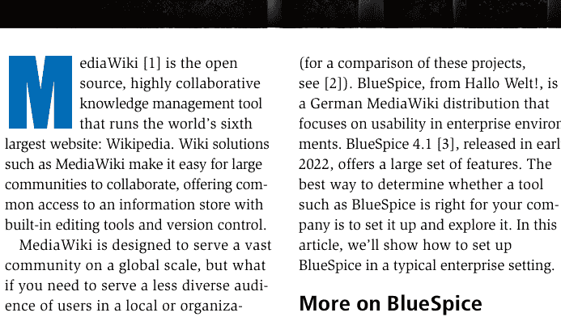

`MediaWiki` 是一个开源、高度协作的知识管理工具，运行着世界上最大的网站：维基百科。`MediaWiki` 等 wiki 解决方案让大型社区能够协作，并提供内置的版本控制以访问信息。`MediaWiki` 设计用于服务全球范围内的社区，同时也适用于您需要在本地或组织背景下服务更多多样化用户。

（关于这些项目的对比，请参见 `[22]`；`BlueSpice` 来自 `Hallo Welt!`）是一个注重易用性和环境的 `MediaWiki` 分发版。`BlueSpice 4.1` `[3]` 于 2022 年初发布，提供了大量功能。确定此类 `BlueSpice` 是否适合贵公司的最佳方法是进行试用。在本文中，我们将展示如何在典型的企业环境中设置 `BlueSpice`。

## 部署 BlueSpice

您有两种方法可以让 `BlueSpice` 运行起来。“经典方法”是在 `docker` 代理上设置 `BlueSpice`。要让 `BlueSpice` 运行，只需解压必要组件的 `BlueSpice docker` 目录。当此 `Docker` 镜像启动时，其内置代理会创建一个包含相关数据的 `brew`（例如用于配合所需凭据的数据库）。

几个开源项目支持业务环境的 wiki 工具，包括 `XWiki`、`DokuWiki` 和 `BlueSpice`。

## 关于 BlueSpice 的更多信息

如果您手头没有可用的 `LAMP` 栈，`BlueSpice` 还提供了 `BlueSpice 4.1` 的 `docker` 镜像，其中包含了所有必要的组件。该 `Docker` 镜像来自 `Hallo Welt!`，镜像资源也是可用的，因此您可以在内部运行该镜像，从而避免在您的硬件上运行黑盒的潜在危险。

`BlueSpice` 提供免费版（`BlueSpice free`）和商业版（`BlueSpice pro`）。本文的重点是免费版 `BlueSpice free`，它是 `MediaWiki` 之上的一个扩展。`MediaWiki` 非常简单且功能单一 `(1)`，但 `BlueSpice free` 提供了几个额外选项，以及更高级的外观和感受 `(2)`。

## 硬件

虽然 `BlueSpice` 会产生相当大的 `CPU` 和内存负载，但没有必要为 wiki 提供大量的硬件。部署物理机几乎总是多此一举的。对于拥有数千并发用户的企业实体来说，wiki 将消耗大量的 `CPU` 核心或数百 `GB` 的内存。理想的（且正常的）


图 1：具有清理过的未卸载用户界面的 `MediaWiki`。

# BlueSpice 4.1

`docker-archive-keyring.gpg`

```
https://download.docker.com/linux/ubuntu $(lsb_release -cs)

stable | sudo tee /etc/apt/sources.list.d/docker.list >/dev/null
```

然后，`apt update` 将更新包管理器已知的软件包列表，最后通过以下命令下载所需的包：

```
sudo apt install docker-ce
```

接下来，运行 `docker ps` 检查 `Docker` 是否安装并运行。您将看到没有任何输出，因为目前还没有容器在运行，但不应该有错误消息。

# 准备存储器

需要创建一个 `Docker` 卷并将其插入容器，为容器提供类似于虚拟的持久存储（我们建议在网络层面使用 `HA` 存储，如文件系统或 `SAN`）。这是必要的，因为如果不使用持久存储设备，`BlueSpice` 数据会在容器创建和删除后消失。事实上，这会在您更新 `BlueSpice` 时发生。

在这里，本文将使用实例内部名为 `/dev/sdb` 的存储设备，该设备在虚拟实例之间进行复制，并用于 `BlueSpice`。

接下来的步骤涉及几个任务：首先，在设备上创建一个包含多个分区的分区表，从而产生 `/dev/sdb`。`BlueSpice` 数据将使用 `XFS`，因此将以下命令安装 `xfsprogs`：

```
apt install xfsprogs
```

然后，需要在该分区上创建文件系统：

```
mkfs.xfs /dev/sdb
```


# 部署策略


这种部署策略是指使用虚拟机（VM）。您可以使用 `VMware`、`Proxmox` 或基于 `KVM` 的虚拟化等标准工具，作为高可用公云（例如 `Amazon Web Services` 等）中的虚拟机。

然而，您应该考虑一个在基础设施层面进行复制的 `BlueSpice` 虚拟机。否则，将无法确保服务的高可用性（HA）。

对于选定的 `BlueSpice` 设置，一台具有（虚拟）CPU 核心和 16GB 内存的小型机器就足够了。随着内容的增长，内存需求可能会增加。容器越大，`Elasticsearch` 的搜索和索引性能越好；您需要的资源也越多。如果您在虚拟机内部运行 `BlueSpice`，当资源耗尽时，需要更多资源

## 定义

在本文中，我们将在最新发布的 `Ubuntu Linux 22.04` 上设置 `BlueSpice`。我们将通过在系统中安装 `Docker` 社区版、配置持久存储卷以及准备 证书来设置 `BlueSpice`。

# 准备 Ubuntu

本文假设您已安装了 `Ubuntu Linux 22.04`。作为准备系统的初始步骤，添加 `Docker` 的 `GPG` 密钥：

```bash
curl -fsSL https://download.docker.com/linux/ubuntu | gpg --dearmor -o /etc/share/keyrings/docker-archive-keyring.gpg
```

然后，将所需的存储添加到您的系统：

```bash
echo "deb [arch=$(dpkg --print-architecture) signed-by=/etc/share/keyrings/docker-archive-keyring.gpg] https://download.docker.com/linux/ubuntu $(lsb_release -cs) stable" | sudo tee /etc/apt/sources.list.d/docker.list
```

然后，`apt update` 将更新包管理器已知的软件包列表，最后通过以下命令下载所需的包：

```bash
sudo apt install docker-ce
```

接下来，运行 `docker ps` 检查 `Docker` 是否安装并运行。您将看到没有任何输出，因为还没有容器在运行，但不应该有错误消息。

# 准备存储器

需要创建一个 `Docker` 卷并将其插入容器，为容器提供类似于虚拟 的持久存储（我们建议在网络层面使用 HA存储，如文件系统或 `SAN`）。这是必要的，因为如果不使用持久存储设备，`BlueSpice` 数据会在容器创建和删除后消失。事实上，这会在您更新 `BlueSpice` 时发生。

在这里，本文将使用实例内部名为 `/dev/sdb` 的存储设备，该设备在虚拟实例之间进行复制，并用于 `BlueSpice`。

接下来的步骤涉及几个任务：首先，在设备上创建一个包含多个分区的分区表，从而产生 `/dev/sdb`。`BlueSpice` 数据将使用 `XFS`，因此将以下命令安装 `xfsprogs`：

```bash
apt install xfsprogs
```

然后，需要在该分区上创建文件系统：

```bash
mkfs.xfs /dev/sdb
```


## 部署策略（重复段落，保留内容）

部署策略是指使用虚拟机（VM）。您可以使用 `VMware`、`Proxmox` 或基于 `KVM` 的虚拟化等标准工具，作为高可用公云（例如 `Amazon Web Services` 等）中的虚拟机。

然而，您应该考虑一个在基础设施层面进行复制的 `BlueSpice` 虚拟机。否则，将无法确保服务的高可用性（HA）。

对于选定的 `BlueSpice` 设置，一台具有（虚拟）CPU 核心和 16GB 内存的小型机器就足够了。随着内容的增长，内存需求可能会增加。容器越大，`Elasticsearch` 的搜索和索引性能越好；您需要的资源也越多。如果您在虚拟机内部运行 `BlueSpice`，当资源耗尽时，需要更多资源

## 定义

在本文中，我们将在最新发布的 `Ubuntu Linux 22.04` 上设置 `BlueSpice`。我们将通过在系统中安装 `Docker` 社区版、配置持久存储卷以及准备 证书来设置 `BlueSpice`。

## 部署 BlueSpice

您有两种方法可以让 `BlueSpice` 运行起来。“经典方法”是在 `docker` 代理上设置 `BlueSpice`。要让 `BlueSpice` 运行，只需解压必要组件的 `docker` 目录。当此 `Docker` 镜像启动时，其内置代理会创建一个包含相关数据的 `brew`（例如用于配合所需凭据的数据库）。

几个开源项目支持业务环境的 wiki 工具，包括 `XWiki`、`DokuWiki` 和 `BlueSpice`。

## 关于 BlueSpice 的更多信息

如果您手头没有可用的 `LAMP` 栈，`BlueSpice` 还提供了 `BlueSpice 4.1` 的 `docker` 镜像，其中包含了所有必要的组件。该 `Docker` 镜像来自 `Hallo Welt!`，镜像资源也是可用的，因此您可以在内部运行该镜像，从而避免在您的硬件上运行黑盒的潜在危险。

`BlueSpice` 提供免费版（`BlueSpice free`）和商业版（`BlueSpice pro`）。本文的重点是免费版 `BlueSpice free`，它是 `MediaWiki` 之上的一个扩展。`MediaWiki` 非常简单且功能单一 (1)，但 `BlueSpice free` 提供了几个额外选项，以及更高级的外观和感受 (2)。

## 硬件

虽然 `BlueSpice` 会产生相当大的 CPU 和内存负载，但没有必要为 wiki 提供大量的硬件。部署物理机几乎总是多此一举的。对于拥有数千并发用户的企业实体来说，wiki 将消耗大量的 CPU 核心或数百 GB 的内存。理想的（且正常的）


图 1：具有清理过的未卸载用户界面的 `MediaWiki`。

# BlueSpice 4.1

`docker-archive-keyring.gpg`

```bash
https://download.docker.com/linux/ubuntu $(lsb_release -cs) stable | sudo tee /etc/apt/sources.list.d/docker.list >/dev/null
```

然后，`apt update` 将更新包管理器已知的软件包列表，最后通过以下命令下载所需的包：

```bash
sudo apt install docker-ce
```

接下来，运行 `docker ps` 检查 `Docker` 是否安装并运行。您将看到没有任何输出，因为目前还没有容器在运行，但不应该有错误消息。

# 准备存储器

需要创建一个 `Docker` 卷并将其插入容器，为容器提供类似于虚拟 的持久存储（我们建议在网络层面使用 HA存储，如文件系统或 `SAN`）。这是必要的，因为如果不使用持久存储设备，`BlueSpice` 数据会在容器创建和删除后消失。事实上，这会在您更新 `BlueSpice` 时发生。

在这里，本文将使用实例内部名为 `/dev/sdb` 的存储设备，该设备在虚拟实例之间进行复制，并用于 `BlueSpice`。

接下来的步骤涉及几个任务：首先，在设备上创建一个包含多个分区的分区表，从而产生 `/dev/sdb`。`BlueSpice` 数据将使用 `XFS`，因此将以下命令安装 `xfsprogs`：

```bash
apt install xfsprogs
```

然后，需要在该分区上创建文件系统：

```bash
mkfs.xfs /dev/sdb
```


## 部署策略（重复段落，保留内容）

部署策略是指使用虚拟机（VM）。您可以使用 `VMware`、`Proxmox` 或基于 `KVM` 的虚拟化等标准工具，作为高可用公云（例如 `Amazon Web Services` 等）中的虚拟机。

然而，您应该考虑一个在基础设施层面进行复制的 `BlueSpice` 虚拟机。否则，将无法确保服务的高可用性（HA）。

对于选定的 `BlueSpice` 设置，一台具有（虚拟）CPU 核心和 16GB 内存的小型机器就足够了。随着内容的增长，内存需求可能会增加。容器越大，`Elasticsearch` 的搜索和索引性能越好；您需要的资源也越多。如果您在虚拟机内部运行 `BlueSpice`，当资源耗尽时，需要更多资源

## 定义

在本文中，我们将在最新发布的 `Ubuntu Linux 22.04` 上设置 `BlueSpice`。我们将通过在系统中安装 `Docker` 社区版、配置持久存储卷以及准备 证书来设置 `BlueSpice`。

# 准备 Ubuntu

本文假设您已安装了 `Ubuntu Linux 22.04`。作为准备系统的初始步骤，添加 `Docker` 的 `GPG` 密钥：

```bash
curl -fsSL https://download.docker.com/linux/ubuntu | gpg --dearmor -o /etc/share/keyrings/docker-archive-keyring.gpg
```


```
curl -fsSL https://download.docker.com/linux/ubuntu | gpg --dearmor -o /etc/share/keyrings/docker-archive-keyring.gpg
```

然后，将所需的存储添加到您的系统：

```
echo "deb [arch=$(dpkg --print-architecture) signed-by=/etc/share/keyrings/docker-archive-keyring.gpg] https://download.docker.com/linux/ubuntu $(lsb_release -cs) stable" | sudo tee /etc/apt/sources.list.d/docker.list
```

然后，`apt update` 将更新包管理器已知的软件包列表，最后通过以下命令下载所需的包：

```bash
sudo apt install docker-ce
```

接下来，运行 `docker ps` 检查 Docker 是否安装并运行。您将看到没有任何输出，因为还没有容器在运行，但不应该有错误消息。

# 准备存储器

需要创建一个 Docker 卷并将其插入容器，为容器提供类似于虚拟磁盘的持久存储（我们建议在网络层面使用 HA 存储，如文件系统或 SAN）。这是必要的，因为如果不使用持久存储设备，BlueSpice 数据会在容器创建和删除后消失。事实上，这会在您更新 BlueSpice 时发生。

在这里，本文将使用实例内部名为 `/dev/sdb` 的存储设备，该设备在虚拟实例之间进行复制，并用于 BlueSpice。

接下来的步骤涉及几个任务：首先，在设备上创建一个包含多个分区的分区表，从而产生 `/dev/sdb`。BlueSpice 数据将使用 XFS，因此将以下命令安装 `xfsprogs`：

```bash
apt install xfsprogs
```

然后，需要在该分区上创建文件系统：

```bash
mkfs.xfs /dev/sdb
```

（注：由于原文存在大量重复，已根据要求按逻辑结构进行翻译）

# BlueSpice free 和 BlueSpice

除了 BlueSpice 之外，Hallo Welt 还提供了一个商业版 BlueSpice pro，旨在推广和新用户并提供支持服务。从管理员的角度来看——BlueSpice 的基于角色的访问控制 (`RBAC`) 实现可以通过 `LDAP` 或 `Active Directory` 连接到外部目录。

要将语言设置为英语，请在环境变量 `"bs_lang"` 中设置。当界面使用已知语言时，员工成员将更好地接受管理工具。如果默认语言是英语，用户将需要配置他们的配置文件。

以下 `bs_url` 参数需要将它们替换为 `/example.net` 您创建的 Wiki URL 以满足需求。几秒钟后，BlueSpice 将运行，使用

# 列表 1: BlueSpice 的示例系统单元

```ini
[Unit]

Description=BlueSpice service

After-docker.service

Requires-docker.service

[Service]

TimeoutSec=0

Restart=always

Environment="ms_lang-url"

Environment="http://www.example.com"

ExecStart=/usr/bin/docker exec docker stop -n name bluespace

ExecStart=/usr/bin/docker run --name bluespace \

-ti -p 80:80 -p 443:443 \

-v bluespace-data:/data \

bluespace-free \\

[Install]

WantedBy=default.target
```

# 深度解析

## BlueSpider 4.1

BlueFree 仅支持带有预定义“权限集”的本地用户数据库，这些权限集可以应用于页面、用户和群组。BlueFree 使用官方的 MediaWiki 插件增强了搜索功能，并支持语义搜索。

它在维基百科中有应用。在某些用户看来，它的设计显得传统甚至保守，而且 MediaWiki 与 Confluence 等工具不同。MediaWiki 的开发侧重于百科全的需求和标准，而不是管理员或企业的需求。

此外，BlueFree 缺少一些功能，例如在页面中嵌入媒体、使用 LaTeX 渲染数学公式，或直接通过拖放上载文件。为了突出你的目标群体，BlueFree 还带有有限的合规功能。BlueFree 不提供免费博客条目，因此无法将其作为免费博客使用，且列表无法进行评分。此外，BlueFree 缺少所有与文档安全和审计追踪相关的功能。因此，它不支持文档配置和使用 Signature 5 进行数字签名，也没有确保特定页面是文档的最新官方批准版本的选项。完整功能列表可在 BlueSpider 网站上查看。

另一方面，由于编辑者的偏好，BlueFree 的默认用户界面因其与 MediaWiki 之间的巨大差异而显得糟糕，这并不意外。相比之下，MediaWiki 旨在作为一个带有百科工具的公司维基；而这是一个基于 MediaWiki 构建的极佳替代方案。

## 总结

对于寻找开源类维基解决方案的组织，DWiki、Confluence 和 BlueSpider 等项目证明了存在 Confluence 的开源替代方案来满足业务需求。BlueFree 提供了一个现代的知识管理系统，可以作为 Docker 容器轻松部署。

虽然 BlueFree 缺少一些与企业企业用户相关的功能，但对于想要放弃 Asana 和 Confluence 的小团队来说，它可能是一个有效的替代方案。如果你计划使用 BlueFree，可以使用本文概述的步骤：

BlueFree 增加了用户友好型编辑等高级工具。由于 MediaWiki 不提供（所有）功能，启动和运行有点复杂。安装 MediaWiki 需要执行 MediaWiki 的完整部署。目前已报告了一些关于 PHP 版本的问题，特别是在“PHP 地狱”导致升级时。这些都是 BlueFree 已经解决的问题，因为它为管理员消除了这些挑战。

## BlueSpider vs MediaWiki

快速查看 BlueFree 与其前身 MediaWiki 之间的差异可以看出它们的目标群体不同。MediaWiki 管理着世界上最大的知识库；该软件每天提供高质量的服务。自然，MediaWiki 为此进行了高度优化。

# 信息

- [MediaWiki](https://www.mediawiki.org/wiki/MediaWiki)
- [Confluence 的开源替代方案](https://opensource.com/article/2019/9/open-source-alternatives-confluence) - Martin Lynch, 2020年9月。
- [BlueFree](https://bluesfree.com)
- [Confluence](https://www.atlassian.com/cloud/migrate-confluence)
- [SignHere](https://www.signhere.com/)

# 作者

Martin Goetz 自 1994 年以来一直从事 Linux 和开源软件工作。他是德国 Linux 杂志和 IX 的主编，以及 SUSE 开发团队成员。他在 IT 领域工作了 22 年，专长数字主权和 OSI 层。

Marcus Feiner 自 1994 年以来一直从事 Linux 和开源软件工作。他是德国 Linux 杂志和 IX 的主编，以及 SUSE 开发团队成员。他在 IT 领域工作了 22 年，专长数字主权和 OSI 层。

图 3：展示 draw.io 集成如何为浏览器带来交互图表和工作流图。

## 深度解析：DIY 稍读工具

## 将网页转换为 EPUB 文件

与其依赖第三方稍读服务，不如你使用这个 DIY 工具从互联网上保存符合你特定需求的文章。我们白天通常没有时间阅读长文章，这就是为什么“稍后阅读”变得很有必要。Pocket 和 Instaper 等流行服务甚至允许你在任何设备上阅读保存的内容。尽管如此，文章为了更好的可读性会被重新格式化，或者充满了广告、脚本等。通过这种方式，你可以在几乎任何设备上阅读保存的内容，并选择你喜欢的电子书阅读应用。由于我们的稍读工具是一个依赖 Linux 的简单 shell 脚本，如有必要，你可以在 Linux 机器上运行该工具，并通过专用发布系统 (`OPDS`) 保存 ePub 文件，或简单地在网络存档中共享并解压，或者使用以下命令克隆仓库：

```bash
git clone https://github.com/dmitry/readiculous
```


然而，托管服务是昂贵的。无论食物多么美味，你最终都会渴望慢火烹饪的餐点，不仅在家饭更便宜更方便，你还可以制作任何想做的菜肴并在过程中享受乐趣。此此，当你可以使用自己的创意工具或一点 `shell` 魔法来“烹饪”任何作品时，现成的稍读服务又有什么意义呢？这正是我们想要在菜单上的：一个稍读工具。

## 准备工作

在开始工作之前，你需要准备环境。首要任务是安装所需的软件：`Pandoc`、`ImageMagick` 和 `Go-Readability`。除了 `Go-Readability` 外，所有依赖项在大多数 Linux 软件仓库中可用，因此你可以使用默认包管理器安装它们。在 `Debian` 或基于 `Ubuntu` 的发行版上，运行：

```bash
sudo install pandoc imagemagick go
```

与其仅仅保存变暗的网页版本，这个 `DIY` 稍读应用让你无需从头开始编写稍读工具，因为我们已经为你完成了这些性工作，并在 `GitHub` 上免费发布了这些材料（`ridiculous`）。你只需要将源代码下载为 `ZIP` 包。`GitHub` 上的源码包含了为 `x86_64` 架构编译的 `Go-Readability` 工具二进制版本。如果你计划在任何其他平台上使用源码，或者想获得工具的最新版本，你必须自己编译。遗憾的是，这很容易。安装 `Go` 语言包（在 `Debian`、`Ubuntu` 上使用 `sudo apt install golang`），然后将以下 `Go-Readability` 的命令行版本：

```bash
go get -u -v github.com/go-shori/readability/cmd/...
```

编译到 `ridiculous` 目录后即可完成。

处理完成后，你将在 `/gob` 目录下通过文件名找到结果。

### 工作原理

`ridiculous.sh` 脚本（列表 1）通过获取内容工作。

### 列表 1: ridiculous.bash

```bash
#!/bin/bash

if [ [ ! command -v convert ] || [ ! command -v pandoc ] || [ ! command -v jq ]; then

    echo "确保已安装所需的工具"

    exit 1

fi

# 用法

usage() {

cat <<EOF

[OPTIONS]

将网页转换为可读的 EPUB 文件。

$0 -u (URL) -d dir -m auto

选项:

-u URL

-d 目标目录（可选）

-m 自动（可选）

示例:

$0 -u URL -d dir

EOF

}

# 读取参数

while getopts "u:d:m:" opt; do

    case $opt in

        u) url="$OPTARG" ;;

        d) dir="$OPTARG" ;;

        m) mode="$OPTARG" ;;

        \?) usage; exit 1 ;;

    esac

done

shift $((OPTIND - 1))

if [ -z "$dir" ]; then

    dir="."

fi

mkdir -p "$dir"

cd "$dir"

# 如果指定了 -m auto

if [ "$mode" = "auto" ]; then

    file="links.txt

    if [ ! -f "$file" ]; then

        echo "文件文件"

        exit 1

    fi

    # 逐行读取 links.txt 内容

    while read -r url; [ -n "$url" ]; do

        ridiculous "$url"

    done < "$file"

else

    if [ -z "$url" ]; then

        usage

    fi

    ridiculous "$url"

fi
```

# 深度解析

## 稍后阅读工具

对页面进行抓取、清理和重新格式化，以提高可读性。为了实现所有这些，脚本使用了 `Go-Readability` 工具提取页面标题和元数据，从而创建一个带有网站图像的封面。最后，该工具将保存的页面封装成带有生成封面的 `epub` 文件。

该脚本接受三个参数：`-u`、`-o` 和 `-d`。强制性的 `-u` 参数指定页面的 `URL`，可选的 `-o` 参数定义保存 `epub` 文件的子目录。如果没有指定 `-d`，它将 `epub` 文件保存在默认目录中。通过子目录，你可以自动根据主题（例如语言、旅行、新闻等）或其他类别对创建的 `epub` 文件进行排序。如果你想在网上快速查看，还可以将多个页面转换为 `HTML`。该脚本结合了 `goose`、`ebooklib` 和 `HTML` 库等工具来提取元数据以及指定参数提供的值，并将这些值赋值给变量。

为了做到这一点，你需要调整脚本，因为它会生成 0 到 25 之间的三个随机数。然后 `convert` 工具可以使用这些数字作为红、绿、蓝值来生成封面：

```bash
r=$(shuf 0-25 -n 1)
gg=$(shuf 0-25 -n 1)
b=$(shuf 0-25 -n 1)
convert --color "$r,$g,$b" input.jpg cover.jpg
```

如果你不习惯纯色，可以使用 `convert` 工具从图像生成随机封面，并指定 `-fractal -blur` 选项以获得更具审美的效果：

```bash
convert -size 800x1024 pixels:fractal 2-10 -blur 20 cover.jpg
```

最后，`Pandoc` 将 `HTML` 文件、提取的元数据和数据保存到 `epub` 文件中，并保存在参数指定的文件夹中。

但这并不是全部。如果你需要离线阅读，每次想保存页面备后用都运行脚本可能会变成一种麻烦。这就是为什么脚本还接受 `-p` 参数。当指定为 `auto` 值时，脚本会从文本文件的链接中逐个提取 `URL` 并为每个 `URL` 生成 `epub` 文件。随后，从第 79 行开始的代码块会检查 `$p` 值是否设置为 `auto`。如果是，它将执行循环（第 86-90 行），从 `links.txt` 文件读取 `URL` 并调用 `read()` 生成 `epub` 文件。如果未指定 `$mode` 值，脚本简单地调用函数使用 `-u` 参数指定的 `URL` 生成 `epub` 文件。为了加快 `epub` 到文件的转换，你可以创建一个简单的辅助脚本：

```bash
#!/usr/bin/env bash
url=$1
echo $url
/path/to/directory
./read() -sh $url
notify-send "Added to Reading"
```


将`/path/to/directory`替换为你的阅读目录的实际路径，并以适当名称保存`epub`（例如`add-to-reading.epub`）。在你的系统中安装该脚本，并为其添加键盘快捷键。

## 阅读的本质

以`epub`格式保存文章意味着你几乎可以在任何设备上阅读它们。如果你使用`Apple Books`或`Google Books`，你可以利用这些应用提供的功能，包括跨多设备同步、护眼模式、库管理和各种功能性。

| 前光灯 | |
|---|---|
| 夜间模式 | |
| 网络 | |
| 屏幕 | |
| 触摸和手势 | |
| 导航 | |
| 文档 | |
| 语言 | |
| 设备 | |
| 状态栏 | 11:49 96% |

> 关于我们现在来到这里的答案——离开这里的解决方案。那个感到困惑的清醒的人。所以我们决定通过破解蛋的案例来尝试一下。

图 1：`KORader`是安卓上最强大的开源电子书阅读器

2022年7月第260期

`LINUX-MAGAZINE.COM` | `LINUXPROMAGAZINE.COM`

# 深度解析

问题（假设你的`Web`服务器支持`PHP`）。脚本添加了一种简单的`HTML`格式，可以将`URL`添加到`.txt`文件中。然后你可以使用`-s`参数读取它们，将保存的链接转换为单个存档中的`epub`文件。甚至，你可以创建一个`cron`任务来定期执行此操作。要使此设置生效，你需要在脚本中添加`links.txt`文件的路径。

然而，如果你费力推出了自己的稍后阅读工具，那么去使用像`KOReader(3)`（一个`Android`开源电子书阅读器应用）以及许多专用阅读器之类的第三方商业平台可能意义不大。尽管界面简单，`KOReader`封装了大量令人惊叹的功能，包括高亮、设置、笔记功能、扩展等`(1)`。如果你想保持稍后阅读工具链开源，你应该使用：

通常，你需要一个`index.html`文件来分页你的库，但`hhgai[4]`脚本会处理这一点。`hhagai`会扫描你`Web`服务器的根目录，并渲染一个带有所有书籍的索引页`(2)`。

同样，你可以在远程服务器上安装`ridiculous`并通过`SSH`运行，无需任何额外工作。在原始形式下，`ridiculous`脚本将使用`afo`生成封面文件。要安装它，复制基础文件夹，然后将你的`.txt`文件复制到`/local/share/hosts`目录。

## 远程工作

将文章从`Kobo`或`Kindle`等专用阅读器转换为`epub`格式是简单的。然而，你可能希望将你的库放在远程服务器上，以便从任何地方访问内容。

```bash
fc-cache -f -y
```


在使用 `Calibre` 等应用程序的远程机器 `OPDS` 服务器上，简单的解决方案就能胜任。你可以修改脚本将目录同步到远程服务器。当然，建立到远程服务器的 `SSH` 连接并在每次保存文章时运行脚本是不切实际的。该脚本缺乏商业稍后阅读服务的易用性和高级功能，它提供了更多：对你的数据和工具的完全控制、无限的选项以及你自己项目的力量。

# 信息

1. `GitHub` ridiculous: `https://github.com/dmpop/ridiculous`
2. `Go-Readability`: `https://github.com/shiro/go-reader`
3. `KOReader`: `https://kreader.org`
4. `hhgai`: `https://langsuj.de/hhgai/`

# 作者

`Dmitry Popov` 一直编写关于 `Linux` 开源软件的文章，文章出现在丹语、德语和西班牙语杂志上。你可以在 `toorna.de` 找到更多关于他的信息。

| `tinype` > `Library` | `Ultima Dimensione` |
|---|---|
| `ridiculous` | 2024-09-02 19:06, 2.0 MB |
| `Fonts` | 2024-03-17 17, 3.9 MB |
| `Library` | `Archive`, 2024-09-02 19:05, 4.9 MB |
| `Archive` | 2024-03-11 13, 1.9 MB |
| `Favorites` | `Deception, worthless rewards, and cash handouts: How Worldin reconstructed its first half users,epub`, 2024-03-12 17, 2.0 MB |
| `EVOLUTIONARY PSYCHOLOGY: dance theory` | 2024-03-11 23, 2.0 MB |
| | `How the Snowflakes Won, epub`, 2024-08-24 21, 5.0 MB |
| | `Inflation in the US, explained by the price of egs.epub`, 2024-03-31 11, 1.9 MB |
| | `Inside the Bitcoin Bust That Took The World's Biggest Child` |
| | `Ukraine: Putin has rebuilt the world - not how you wanted it` |

图 2：使用 `select` 命令的远程服务器上的任何目录。

`LINUX-MAGAZINE.COM` | `LINUXPROMAGAZINE.COM` | `ISSUE 260` 2022年7月 55

## 深度解析 快照 – 一个 `Go` `Wordle` 解析器

用 `Go` 提升你的 `Wordle` 连

## `Wordle` 增强

`Wordle` 这种简单的在线游戏在二月席卷全球。`Mike Schilli` 开发了一个命令行工具，使用非官方策略提升他的 `Wordle` 连。

作者：`Mike Schilli`

预测什么会失败并引发巨大关注通常很难，但没有人预料到这种类似 `Scrabble` 的 `Wordle` 游戏会在 2022 年走红。企业文章详细介绍了这一现象，人们对此津津，《纽约时报以数百万收购了该游戏。

游戏涉及一个五字母单词。如果玩家输入单词（无论正确否），都不会引导单词；游戏字母显示它们在单词中绿色且位置正确，或黄色且位置错误。`Wordle` 将未出现的猜测字母标记为灰色。要赢，你必须在六次尝试内以最简单的方法获取单词。

## 自动化我！

`Wordle` 从 `Scrabble` 字典中选择，但排除动词变化或复数作为答案。在英文版本中，`CAMEL` 可以，但 `CARES` 不行。`Wordle` 所有字母字符串——单词、复数和猜测——英语中共有 12972 个。

游戏的简单规则使得编写计算机程序来运行谜题变得轻而易举。毕竟，`Wordle` 对猜测进行编码，并可以使用这些代码从完整的单词列表中过滤掉，在每轮中减少选项。玩家只需要传入编码格式：我将用 `I` 表示字母匹配，`!` 表示位置错误的字母，用 `ø` 表示完全未出现的字母。例如，如果答案是 `LAMER`，代码将是 `12228`：`L` 位置错误，中间的字母 `A` 完全正确，最后的 `R` 不在目标单词中出现。图 2 显示了我们的 `Wordle` 解析程序。这很有用的原因为它包含许多常用词，以及

# 作者

`Mike Schilli` 是加利福尼亚州旧金山地区的软件工程师。在他自 1997 年以来运行的专栏中，他每月研究各种编程语言的实践。你可以通过 `mschilli@perlmuster.com` 给他发邮件，他会乐意回答任何问题。

## 结语

虽然 `ridiculous` 缺乏商业稍后阅读服务的易用高级功能，但它提供了更多：对你的数据和工具的完全控制、无限的选项以及你自己项目的力量。

# 编程快照 — 一个 `Go` 语言 `Wordorkle`

在开始快速检查它们可以让你迅速成为某个领域的领导者 - 但稍后我会回到这一点。`Wordpage` 显示程序生成的单词对于 `O`、`A` 和 `R` 返回了三个黄色模式匹配，这意味着这些字母出现在目标单词中，但位置不正确。如果我现在将此信息传递给一个包含 118 个单词的检查器，左侧将剩下 110 个单词。每一个单词都根据评估被消除了。此时，我会手动输入来列出这 110 个单词，但我将直接手动填写检查器的选择，然后放弃。

图 1 中的 `Wordpage` 使用绿色外框评估了这一新猜测，其中 `O` 和 `A` 是两个绿色外框，而 `R` 处于错误的位置，正如黄色高亮所示。如果我好奇为什么 `utf8` 包中的单词长度函数 `RuneCount(string)` 长度是 28，检查器指出初始列表中只剩下两个单词：`AROMA` 和 `AROMA`，然后在其他地方发现了它们。由于《纽约纽约时报》使用了新西兰毛利语中表示爱的词（`aroha`）作为检查器的建议，图 1 证实了这是一个正确的猜测。

五个字母单词，列表 1 中的 `din` 23 过滤掉了其他的，剩下 12,972 条条目。如果我好奇为什么 `utf8` 包中的单词长度函数 `RuneCount(string)` 长度是 28，检查器指出初始列表中只剩下两个单词：`AROMA` 和 `AROMA`，然后在其他地方发现了它们。由于《纽约纽约时报》使用了新西兰毛利语中表示爱的词（`aroha`）作为检查器的建议，图 1 证实了这是一个正确的猜测。

列表 1 定义了由第 10 行名为 `wordlen` 的常量支持的五个字母单词。在其他情况下，如果我们只需更改七字母单词，它可以很轻松地处理六字母单词。第 18 行的函数返回它找到的单词名称。它在第 15 行列出了读取的文件名，并在第 20 行使用行扫描器从第 21 行开始逐个读取所有单词。这会预先检查单词，就像拼字游戏牌一样，这解释了为什么第 22 行在处理之前通过按住 `Shift` 键将单词转换为小写。

# 列表 1：`dict.go`

```go
package main

import (
	"bufio"
	"os"
	"strings"
)

func main() {
	file, err := os.Open("dict.txt")
	if err != nil {
		return err
	}

	var words []string
	scanner := bufio.NewScanner(file)
	for scanner.Scan() {
		words = append(words, strings.ToLower(scanner.Text()))
	}

	if err = scanner.Err(); err != nil {
		return err
	}

	fmt.Println(len(words))
}
```

# 评分算法示例

`Go` 程序是如何处理单词列表的？首先，我的 `Wordorkle` 需要一个有效单词参考列表供选择。`Scrabble` 单词 [4] 是一个很好的起点。文件中的单词全大写，每行一个，总共 27,996 个。因为因为只有我们

# 列表 2：`word.go`

```go
package main

import (
	"fmt"
	"os"
)

func main() {
	dict, err := os.Open("dict.txt")
	if err != nil {
		return err
	}

	word := "aroma"
	for i := 0; i < len(word); i++ {
		list, err := dictword(dict, word)
		if err != nil {
			panic(err)
		}

		fmt.Printf("Found: %d\n", len(list))
	}
}
```


# 深度编程快照 — 一个 Go 语言 Wordle

## 开始破解

这 `$a(n)$` 程序在列表 2 中定义乱码字典文件为根目录下的 `scrabb.txt`。我们可以在网上找到代码。第 8 行的 `startword` 函数定义了没有任何提示的情况下使用的 `'caesar'` 因为它有一个元音组合。

第 18 行的 `start` 函数引导用户通过游戏回合。第 22 行的 `Scan()` 函数等待用户输入。用户可以

## 列表 3：filter.go

```go
package main

import (
	"strconv"
	"strings"
)

type Grade int

const (
	Notatch Grade = iota
	OtherPos
	Match
)

func grades(words []string, guess []string) string {
	hints := make([]Grade, len(guess))
	for i, word := range words {
		for i, _ := range hints {
			if guess(words, word) {
				hints[i] = Notatch
			}
		}
	}
	res := ""
	for i, h := range hints {
		res += strconv.Itoa(int(h))
	}
	return res
}

func filter(words []string, guess []string) string {
	res := ""
	wantMap := make(map[byte]int)
	for _, char := range guess {
		wantMap[char]++
	}
	count := 0
	runes := make(map[rune]bool)
	for _, word := range words {
		if count == 0 || len(runes) > count {
			// 选择最佳单词的逻辑
		}
	}
	return res
}

func best(words []string) string {
	// 实现细节
}
```


# 机器的大脑

`Wordle` 的大脑函数位于 `filter()` 函数中（在列表 2 的第 57 行调用，返回单词）。`main` 函数传递单词列表，直到 `Wordle` 应用返回评分。函数返回文本来评估规则，程序应用于 `dict`。这种方法不断缩小单词列表，直到剩下正确的答案。列表显示了 `grades()` 函数的实现，就像上面一样，它可以针对目标单词评估猜测。字母正确、位置错误以及完全不计数。`grades()` 函数返回列表中目标单词的评分，一个包含数字字符串的。为了返回猜测的结果，它生成一个整数数组，其位置与切片中的字母匹配，如果猜测的位置正确，等等。为了初始化数组，函数（第 17 行）将所有字母设置为 `Notatch` (0)，这是因为第 16 行使用的样式指示常量从 0 开始排序。

# 编程快照 — Go 语言 Wordle 破解器

`wordmap` 计算每个字母在单词中应该出现的次数。例如，如果单词是 `LOOSE`，则给字母 `L`、`S` 和 `E` 赋值 1，给 `O` 赋值 2。接下来的 `lunge` 的 `O` 则计算猜测中的字母，如果字母匹配解决方案，相应的条目命中 2。这些字母中的每一个代表此 `wordmap` 所需总数的一部分，根据 `Wordle` 页面对猜测的评估不再可能的解决方案。在 `filter()` 中，我们过滤掉不再可能的字母。它遍历每一个单词，假设当前条目是谜题的。我们然后对字母进行评分；当前猜测单词与我们找到的解决方案单词进行比较。现在关于这个：确定一个在游戏中给你良好开局的单词。通常，许多不同的字母都是很好的选择：同时，常用字母非常有价值，因为良好提示返回给评分器的概率。为什么 `OATER` 是这样？

从第 2 行开始，破解生成器识别需要填充的位置。如果当前位置不为空但包含字母，则提示数组将包含一个当前位置值为 1，否则提示值将减1。如果字母再次出现在单词中且计数器未被使用，那么你在这里找到另一个：为了让主程序从我们第一次尝试的结果获得良好的建议，第 2 行的生成器从尽可能多的唯一字母开始。这增加了解决方案实际上包含我们在下一步中使用的一个或多个字母的概率。为了做到这一点，`best()` 统计哈希表中每个单词的字母数量，并返回具有最高的

# 人工智能

关于概念验证的 `Wordle` 破解器就这么多——但始终，并不是所有内容都在快照中解释了，通过 `DIY` 代码将你的条目变成一个实验，以探索我在建立基础逻辑后构思的秘密：让机器自动完成部分工作，随机选择一个单词然后尝试猜测它。这意味着我们对自己的效率方法的证明，以及持续的改进。

我们现在这里了。这篇文章的目的是展示如何使用概念验证来帮助 `Go` 程序理解 `Wordle` 的规则并成为一个高效的玩家。事实上，在 `Wordle` 中聊天是被强烈不建议的，但请记住！这是玩家遍历列表的最佳方式。

# 按评分过滤

`Go` 程序是如何处理单词列表的？首先，我的 `Wordorkle` 需要一个有效单词参考列表供选择。`Scrabble` 单词 [4] 是一个很好的起点。文件中的单词全大写，每行一个，总共 27,996 个。因为因为只有我们

# MAKERSPACE 数字电子水平仪


`MPU6050` 传感器包含一个陀螺仪和一个加速度计，这意味着你可以用它构建一个数字电子水平仪。作者：`Martin Mohr`。

要制作数字电子水平仪，你首先需要一个诸如 `MPU6050` 这样的传感器，它可以确定物体在空间中的位置。它为空间中的每个轴配备了加速度计和一个陀螺仪，测量范围仅为 4 毫米。在我们的测试设置中，我们使用一个模块来固定半导体器件。你可以从 `AZ-Delivery` 以 7.49 欧元的价格购买它 [1]。如果那里缺货，你也可以在亚马逊或从 `Reichelt` 购买该模块。

| GND | +3.3V |
|---|---|
| 10µF | +3.3V |
| | 1000µF |
| GND |


图 1：我们的数字电子水平仪测试设置的电路图。

2022年7月第260期 `LINUX-MAGAZINE.COM` | `LINUXPROMAGAZINE.COM`

`MPU6050` 通过 `I2C` 总线与树莓派通信。`I2C` 连接定义了传感器所在的引脚：`SDA` (`GPIO 2`) 和 `SCL` (`GPIO 0`)。传感器的工作电压范围在 3 到 5 伏之间。如果你需要更多关于 `MPU6050` 的信息，请参阅数据表 [2]。为了使用带有简单函数访问传感器运动的库，`SPI` 还带有一个额外的重位连接。但我们可以连接原理图所示的电源。实验装置由两个带有电子元件的板组成。我移除了其中一块板，使用电源去掉了开发板，使其看起来非常整齐，你可以轻松地访问所有连接。

我选择了 `ESP32`，这是一种高度集成且性能比极高的微控制器，用于翻译传感器数据。我将使用一个 `ESP` 开发套件 [3]，你可以以低于 9 欧元的价格买到。`Arduino IDE` 提供了环境。

通过 `File | Examples | MPU6050_light | GetData` 菜单（图 4）。硬件将测量值输出到串口。如果你移动传感器，你将看到各个数值在变化。此外，数据传感器还提供沿空间轴方向的加速度、绕轴的角加速度，并还作为计算值输出温度。我们将以此作为水平仪的基础。

# 首次测试

这是启动 `MPU6050` 传感器所需的所有内容。要安装它，请在 `IDE` 中安装 `arduino` 库。在菜单中，选择 `Integrate | Manage Library`。找到 `MPU6050_light` 并安装它（图 3）。如果系统提示，请安装所有依赖项。

最后但同样重要的是，我们需要显著地显示传感器的测量值。一个价格为 7.99 欧元的廉价 1.8 英寸 `TFT` 显示器 [4]可以通过串行外接口 (`SPI`) 访问，是一个很好的选择。由于需要快速控制显示器，我们将使用来自 `Adafruit` 的 `GFX` 库 [5]。该库的源代码可以在 `GitHub` 上找到。

安装后，你会找到一个用于读取传感器值的简单程序

# 测试显示器

下一步是设置显示器。要运行显示器你需要三个：`TFT` 库 [7]、`Adafruit ST7735` 库 [8] 和 `Adafruit GFX` 库 [9]。我们将在 `Arduino IDE` 中安装这三个。如上所述，系统会提示你...

安装完成后，进入 `File | Example | Adafruit ST7735 and ST7789 Library |`

# 设置

我们水平仪的电路图（图 1）显示了如何连接项目的所有组件。让我们看看原理图最顶部的两个电容。连接到 `EN` 引脚并地的 `10-uF` 电容使我们能够在不进入引导模式的情况下将程序加载到 `ESP32` 中。理论上，增加一个电容也可以工作，但实践表明情况并非如此。基本问题在于 `ESP32` 开发板某些硬件组件中的 `USB` 驱动程序。

第二个电容（`1000 uF`）位于显示器上方，将消除此问题。它能稳定工作电压，防止闪烁。如果其他电路中出现水平问题且我们想要隔离它，我们需要电源旁边建立一个更大的电容。它有助于我们消除此类问题。


原理图中的其余连接通过 `I2C` 将我们连接到 `ESP32`。显示器向我们

| Library Manager | Type | Topic |
|---|---|---|
| MPU6050_light | MPU6050: 使用轻量级库进行配置 | 版本 1.2.3 (已安装) | 用于与 MPU 快速通信的 Arduino 库。读取加速度并从 MPU6050 获取数据。计算 X 和 Y 的 8 位值。更多信息。 |
| Tiny MPU6050 | 侧重性能和精度的 MPU6050 轻量级实现 | 使用此简单库及其用法。实现侧重于性能和精确性，同时保持轻量化。更多信息。 |

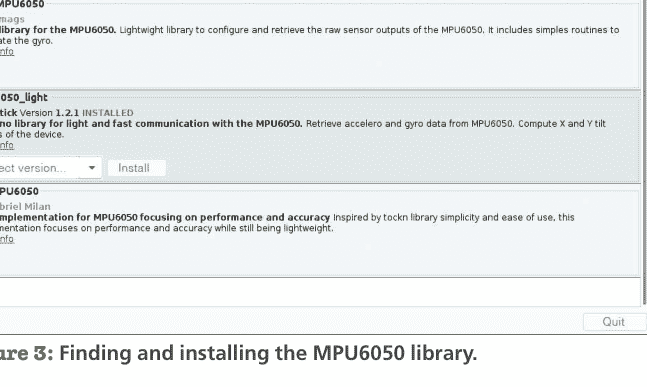

# MAKESPACE 数字水平仪

通过图形文本找到一个你进行测试并显示的程序。要适配它，你需要为 `TFT_CS`、`TFT_F5` 和 `TFT_DC` 赋值。所需的代码在 `Library 1` 中，只需将其复制到适当的位置。上传到 `ESP32` 后，一个文本图形示例将横跨显示器运行。

| 温度: 26.48 | Y: 0.00 | Z: 1.00 |
| 加速度: X: 0.00 | Y: -0.07 |
| 陀螺仪: X: 0.10 | Y: -0.12 | Z: 0.00 |
| 加: X: 0.14 |
| 角度: X: 0.02 | Z: 0.15 | -69.47 |

| 温度: 26.48 | Y: 0.00 | Z: 1.00 |
| 加速度: X: 0.00 | Y: 0.09 |
| 陀螺仪: X: 0.04 | Y: 0.85 | Z: 0.02 |
| 加: X: 0.10 | Y: 0.17 |
| 角度: X: 0.03 | Z: 0.15 | -69.47 |

| 温度: 26.48 | Y: 0.00 | Z: 1.00 |
| 加速度: X: 0.00 | Y: -0.12 |
| 陀螺仪: X: -0.06 | Y: -0.08 | Z: 0.00 |
| 加: X: 0.10 | Y: -0.05 |
| 角度: X: -0.01 | Z: 0.16 | -69.45 |

图 4：示例程序的典型输出。


### 代码列表 1：适配

```


// 用于 1.4" 和 1.8" TFT 使用：

```
#define TFT_CS 17
#define TFT_ST 14
#define TFT_DC 2

Adafruit7732 tft = Adafruit7732(TFT_CS, TFT_FC, RSTST);
```

### 代码列表 2：`spiritlevel.ino`

```cpp
1 #include "Wire.h"
2 #include <Adafruit_GFX.h>
3 #include <Adafruit7732.h>
4 #include <SPI.h>
5 #include <MPU6050_light.h>
6 #define TFT_CS 17
7 #define TFT_RST 14
8 #define TFT_DC 2
9 Adafruit7732 tft = Adafruit7732(TFT_CS, TFT_FC, RSTST);

11 MPU6050 mpu;
12 
13 void setup() {
14 Wire.begin();
15 mpu.begin();
16 tft.calcOffsets();
17 tft.init();
18 tft.fillRect(0,0,142,168,TFT_BLACK);
19 
20 int x, y, z;
21 
22 void loop() {
23 mpu.update();
24 x=floor(mpu.getAngleX());
25 y=floor(mpu.getAngleY());
26 z=floor(mpu.getAngleZ());
27 tft.setTextSize(2);
28 tft.setCursor(20,0);
29 tft.setTextColor(TFT_WHITE);
30 tft.print("X:");
31 tft.fillRect(40,0,60,20,TFT_BLACK);
32 tft.print(x);
33 tft.print("");
34 tft.setCursor(20,30);
35 tft.print("Y:");
36 tft.fillRect(40,30,60,20,TFT_BLACK);
37 tft.print(y);
38 tft.print("");
39 tft.setCursor(20,60);
40 tft.print("Z:");
41 tft.fillRect(40,60,60,20,TFT_BLACK);
42 tft.print(z);
43 tft.print("");
44 }
```


# 数字水平仪程序

数字水平仪通过图形文本找到一个你进行测试并显示的程序。要适配它，你需要为 `TFT_CS`、`TFT_F5` 和 `TFT_DC` 赋值。所需的代码在 `Library 1` 中，只需将其复制到适当的位置。上传到 `ESP32` 后，一个文本图形示例将横跨显示器运行。

| 温度: 26.48 | Y: 0.00 | Z: 1.00 |
|---|---|---|
| 加速度: X: 0.00 | Y: -0.07 | |
| 陀螺仪: X: 0.10 | Y: -0.12 | Z: 0.00 |
| 加: X: 0.14 | | |
| 角度: X: 0.02 | Z: 0.15 | -69.47 |

| 温度: 26.48 | Y: 0.00 | Z: 1.00 |
|---|---|---|
| 加速度: X: 0.00 | Y: 0.09 | |
| 陀螺仪: X: 0.04 | Y: 0.85 | Z: 0.02 |
| 加: X: 0.10 | Y: 0.17 | |
| 角度: X: 0.03 | Z: 0.15 | -69.47 |

| 温度: 26.48 | Y: 0.00 | Z: 1.00 |
|---|---|---|
| 加速度: X: 0.00 | Y: -0.12 | |
| 陀螺仪: X: -0.06 | Y: -0.08 | Z: 0.00 |
| 加: X: 0.10 | Y: -0.05 | |
| 角度: X: -0.01 | Z: 0.16 | -69.45 |

## 结论

这个示例项目非常简单，便于实现更准确、功能更强大的版本。`ESP32` 的使用允许构建更有趣的项目。总而言之，这是一个可以从中学习很多东西的精彩项目。希望各位创作者们喜欢制作自己的水平仪。

# MAKESPACE 新技术改造

当地科学中心的一个电子项目显得有些陈旧了，需要一次翻新：在本文中，是使用 `Arduino` 代替继电器几乎从零开始进行重构。作者：`Scott Sumner`

一个名为“通电游戏”（`Buzz-wire`）的博物馆展览看起来像两只巨大的手在向你击掌（图 1）。每只手都有一个带环的金属手柄，你的目标是让环在不接触手部的情况下上下移动。为了获得更好的挑战效果，你可以尝试同时在相同或相反方向上进行操作。无论触碰手，手柄上的蜂鸣器和灯光都会亮起。

手部的原始电路由互连的继电器组成，用于切换各种组件。该设计没有微控制器或任何比开关更高级的东西，这有几个缺点——但主要的缺点是这个游戏在运行过程中被放弃了，灯光、蜂鸣器和震动电机会一直运行直到取下手。

## 物理重建

在我重建电子设备的同时，我也将外壳送去进行重建。原始设计是用胶板制成的，有很多凹痕和划痕。外壳非常漂亮，但有些地方需要加固。最终，我将每个部分都替换成了 `Delrin`（赛钢），这是一种非常硬的塑料，比胶板更耐磨损。

物理重建还整合了更大的震动电机。旧版本使用的是小型寻呼机电机，感觉并不明显。我合作的机械加工制造了带有更大电机的新手柄，使嗡嗡声变得明显得多。

图 1：通电游戏（重建后）。

### 表 1：Arduino 连接

| 引脚 | 连接 |
|---|---|
| 2 | 左手输入 |
| 3 | 右手输入 |
| 8 | 继电器 1 控制信号 |
| 9 | 继电器 2 控制信号 |
| 10 | 继电器 3 控制信号 |
| 11 | 继电器 4 控制信号 |
| GND | 左手（游戏） |
| GND | 右手（游戏） |
| GND | 继电器板 |
| 5V | 继电器板电源 |

# MAKESPACE 新技术翻新

由于其中一个组件被烧毁过多次，决定使用升级技术对展览进行改造，以解决它的一些问题。我开始分配 `Arduino` 引脚。手柄有输入，因此我从这些输出开始，操作不同的继电器，这些继电器会在不同的时间开启和关闭（表 1）；每只手都有自己的接线排，两个在 11 和 12 上的电源输入是完全相同的。

## 新技术

在设计新控制器时，我从 `Arduino Mega` 开始，虽然 `Arduino Uno` 也可以很好工作，但在这种情况下，`Mega` 是标准配件，易于交易且有货。

## 逻辑流

现在所有硬件已组装完毕，简单的程序显示了继电器的激活，继而控制蜂鸣器的开启关闭以确定程序的流程。最后，为了方便连接到展览，我将所有东西组装在一块胶板上，并带上了所有经常被忽略的东西。我包含了一个流程图来描述逻辑（图 3）；请参见“流程图”框。

沿着流程图，第一个决策是当环接触游戏时下方的菱形（向右退出），等待 `250ms`，关闭继电器，并返回原始决策。需要注意的是，如果继电器已经是关闭状态，则不执行关闭操作。如果环接触游戏（从底部退出决策），则打开继电器。下一个决策检查是否

### 表 2：接线排连接

| 连接 | 左接线排 | 右接线排 |
|---|---|---|
| 1 | 手 | 手 |
| 2 | 手柄 | 手柄 |
| 3 | 接地 | 接地 |
| 4 | 接地 | 接地 |
| 5 | 接地 | 接地 |
| 6 | 12V | 12V |
| 7 | 12V | 12V |
| 8 | 12V | 12V |
| 9 | 接地 | 接地 |
| 10 | 5V | 5V |
| 11 | 接地 | 接地 |
| 12 | 12V | 5V |

(1) 可交换的端子。选择一个。
(2) 可交换的端子。选择。

图 2：接线图，包含了继电器和接线排连接。

# MAKESPACE 新技术改造

为两只手复制该过程，这就是逻辑内部发生的情况。通过这种方式，程序即使对于非编程人员也能理解。在没有连接脉冲时，上拉设置提供了一个稳固的状态。`Arduino` 引脚 2-11（第 6-9 行）被设置为 `INPUT()`，此时引脚在关闭状态下为 `5V`。第 11-14 行的 `digitalWrite` 设置了继电器的初始状态。所有状态都设置为 `HIGH` 以关闭继电器。大多数继电器是反向工作的；在反向状态下，接地信号将开启它们（通常在 `1.2V` 以上）。这种设置使它们兼容 `3.3V` 或 `5V` 微控制器，因为原因是接地或未接地都可以。

## 代码

`Arduino` 代码由两部分组成。`setup` 在 `Arduino` 启动时运行一次，然后 `loop` 无限运行直到被移除。正如名称所示，它们设计用于初始化一切并持续运行。

### setup()

列表 1-17 包含了 `Arduino` `setup` 函数，这告诉 `Arduino` 你想做、设置和运行任何特殊函数以及初始化变量（特定代码中的属性）。`pinMode` 函数（第 3-9 行）设置 `Arduino` 的输入和输出状态。第一个参数是引脚号，第二个参数是我们使用的参数。`INPUT_PULL` 用于引脚 2 和 3，`Arduino` 的电线连接到端子。`PULLUP` 告诉 `Arduino` 使用内置的上拉电阻。

上拉电阻是电子等值的数值单元。它通过一个弱电阻连接到 `V+`。信号电压可以比上拉电阻和地低。电噪声很容易让电路独立运行。在这种情况下，连接将是 setup 部分的最后一行 `Serial.begin`。

### 流程图

流程图是可视化程序或其他流程的极佳方式。在计算机早期，当程序在纸上编写且你在纸上“编程”时，它们是必不可少的工具。虽然仍然有用，但它们并不是最早的，在线表格才是。注意某些函数会被多次调用，即使任务已经完成。

### 列表 1：触电游戏 (Buzzwire)

```cpp
01 setup() { 
02   // 放置你的设置代码，运行一次 
03   pinMode( 2, INPUT_PULLUP ); 
04   pinMode( 3, INPUT_PULLUP ); 
05 } 
06 pinMode( 8, OUTPUT ); 
07   pinMode( 9, OUTPUT ); 
08   pinMode( 10, OUTPUT ); 
09   pinMode( 11, OUTPUT ); 
10 }
11 digitalWrite( 8, HIGH ); 
12 digitalWrite( 9, HIGH ); 
13 digitalWrite( 10, HIGH ); 
14 digitalWrite( 11, HIGH ); 
16 Serial.begin(1920); 
18 void loop() { 
19   // 放置你的主代码，循环运行： 
20   int input2 = 0; // 手 1 
21   int input3 = 0; // 手 2 
22   int outState1 = 0; // 手 1 的通用输出 
23   int outState2 = 0; // 手 2 的通用输出 
24   int iMotor2 = 0; // 跟踪电机 2 是否因长时间接触 
25   而关闭 
26   unsigned long uReset1 = 0; // 关闭手 1 蜂鸣器的 
27   毫秒数（millis） 
28   unsigned long uReset2 = 0; // 关闭手 2 蜂鸣器的 
29   毫秒数（millis） 
30   unsigned long uMotor1 = 0; // 关闭长时间 
31   接触的毫秒数（millis） 
```


```cpp
unsigned long uMotor2 = 0; // 关闭手 2 蜂鸣器的毫秒数（millis）
while (1) {
    input2 = digitalRead(2); // 我们正在触碰手 1 蜂鸣器吗？
    input3 = digitalRead(3); // 我们正在触碰手 2 蜂鸣器吗？
    if (input2 == LOW) { // 如果我们触碰了手 1 蜂鸣器=!;
        uReset1 = millis() + 500; // 设置从现在起 1 秒后的计时器
        if (uMotor1 == 0 && millis() + 10000) { // 设置从现在起10秒的超时
            if (uReset1 == 0) { // 开启“电机”；
                Serial.print("Motor On");
                digitalWrite(8, LOW); // 开启电机
                // 如果它没有被禁用
            }
            digitalWrite(9, LOW); // 开启灯
        }
    } else {
        if (input3 == LOW) { // 与上面相同但针对 2
            uReset2 = millis() + 500;
            uMotor1 = 0; // 清除超时故障
            Serial.print("Motor Off");
            if (uReset2 == 0 && millis() + 10000) {
                digitalWrite(10, LOW);
                digitalWrite(11, LOW);
            }
        }
    }
    if (iMotor2 == 0) { // 跟踪电机 2 是否
        iMotor2 = 0;
        digitalWrite(10, LOW);
        digitalWrite(11, LOW);
    }
    else {
        iMotor2 = 0; //
    }
    if (millis() > uReset1 || uMotor1 != 0) { // 如果当前时间 (millis) 大于超时 且我们正在等待一个-...
        digitalWrite(8, HIGH); // 关闭电机
        digitalWrite(9, HIGH);
        uMotor1 = 1; // 设置重置标志，使其不再再次开启
        Serial.print("Motor Timeout");
    }
    if (millis() > uReset2 || uMotor2 != 0) { // 是否该重置蜂鸣器/灯了？
        digitalWrite(10, HIGH);
        digitalWrite(11, HIGH);
        uMotor2 = 0; //
    }
}
```


## MAAPER 新旧改装

从 Arduino 读取 USB。我只用它来向控制台发送调试消息，但你也可以用它与计算机程序通信。

## 长超时

第 70-76 行的 `if` 块检查两个条件：`millis()`（当前时间大于长超时）并且我们正在等待一个会议-...

## MAAPER 新旧改装

从 Arduino 读取 USB。我只用它来向控制台发送调试消息，但你也可以用它与计算机程序通信。

## 长超时

第 70-76 行的 `if` 块检查两个条件：`millis()`（当前时间大于长超时）并且我们正在等待一个会议-...

# 通过特刊版精进你的技能！

从我们的特刊资源库中了解 `Shell`、`LibreOffice`、`Linux` 等更多内容。

《Linux Magazine》团队创建了一系列单本，让你深入探讨你感兴趣的话题。提供纸质版或数字版。

## 查看完整资源库！

`shop.linuxnewmedia.com`


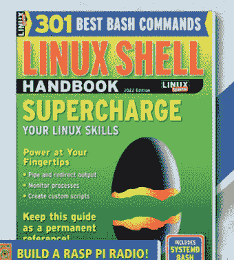


# DOGHOUSE - 本地内部支持 Linux 之声

# MADDOG'S DOGHOUSE

作为社区服务的工具和本地 Web 流量缓存有助于改善互联网服务。作者：`JOHN "MADDOG" HALL`

## 更好的服务本地工具

我最近前往古巴参加了 `Informatics 2022` 会议的演讲，这是一场在哈瓦纳举行的国际技术会议，聚集了来自世界各地的演讲者和参与者。这让我亲身体验了如今古巴的现状。

对于不熟悉这个国家的人来说，它是墨西哥湾外的一个岛屿，人口约 1100 万。在过去的 60 年里，它与世界的贸易方式非常独特。`Jon "Maddog"` 是一位作家、教育者、科学家和软件先驱，自 1994 年遇到 `Lin Torvalds` 以来，他一直是 `Linux` 的热诚支持者，并提倡在 `x86` 系统上使用 `Linux`。他担任 `Linux International` 的主席！

从计算机的角度来看，我使用的桌面电脑和笔记本电脑都是全球认可的品牌。人们从美国以外的国家购买它们，并通常使用与大多数人相同的操作系统。我没有注意到基于 `Linux` 的系统的缺失，我想这可能是因为古巴是一家从那里进口产品的美国公司。

本世纪的交叉连接机。在那个系统中，当一个人连接上时，另一个人就无法连接。当拨号上网仍是标准时，按连接收费是切行的。

有了现代的数字连接，可以根据使用情况的变化使用数据并按日期收费。大多数互联网公司并不认为将计费中的连接费用合并是我可以做的事，但这确实让互联网变得更加困难且实用性更低。

古巴政府决定将 `FSHC` 作为一种策略。他们有自己的发行版 `NOVA`，将广泛应用于政府和商业领域。

另一个问题是，农村地区的互联网访问不像城市地区那样——古巴及其他地方可以通过使用“箱式互联网”（`Internet-in-a-box` [2]）获得显著帮助，它通过缓存本地反复请求本地数据来提供帮助。

古巴大部分地方都有互联网，可以使用 `WiFi` 和手机。因为我使用 `Google WiFi`（在古巴无法使用），而古巴的 `WiFi` 并不如我预期，我可以轻松使用带有缓存的 `WiFi`。我可以在机场买一张 `SIM` 卡，然后发现 `WiFi` 是值得付出的。

年前，酒店和其他设施安装了分机交换机（`PBX`），因为他们意识到局域电话通话正在构建当地的基础设施。他们不需要从每个办公室到电话交换局拉 500 根线缆，而只需要在大楼内运行一个 `PBX`，这样只有 `PBX` 到交换局的一小部分线路布线会被同时使用。

我的 `WiFi` 虽然能满足大多数用途，但为我节省了精力和连接时间。为了省钱，我不实际使用时会断开 `WiFi` 连接，这意味着我也无法接收通知，而我想用 `WiFi` 时才连接就很麻烦。经常地，我会忘记。

上世纪的电话簿已被如今的页面所取代，现在你必须通过本地方法触及每一页，这类似于 `PBX` 的问题——缓存在本地的“箱式互联网”上。

面临相似挑战的社区，利用网络代码建立社区服务器可以来自 `FreeBSD`，这将允许本地用户在社区内部做出响应。一个带有 `BSD` 的廉价单板电脑仅需几美元即可提供可靠、安全的数据缓存。

我面临的问题之一是，这个岛屿公司由国家所有，没有竞争。我不确定会发生什么。

## 信息

1. `Nova`: `https://en.wikipedia.org/wiki/Nova_(operating...system)#~text=%20ht%21first%20year%20of%20Nova,Edition%20based%20on%20untu`
2. `box`: `[link]`
3. `ugrep`: `[link]`
4. `fzf`: `[link]`
5. `fzy`: `[link]`

## FZF/FZY

`Fzf` 代表 `Fuzzy Finder`（模糊查找器）。该工具作为一个通用过滤器，在交互模式下也作为一个菜单。调用 `fzf` 会启动该工具并通常显示当前目录下的所有文件。

如今，模糊搜索是 `IT` 生活不可或缺的一部分。它们可以纠正拼写错误，以合理的开销找到你需要的内容。基本原理基于 `Levenshtein` 距离，该距离定义于 20 世纪。

`Levenshtein` 距离描述了将一个字符串转换为另一个字符串所需的最小更改次数。这些操作的权重方法决定了两个字符串的相似程度。权重意味着例如，两个字母的交换（如拼写错误）比插入字符更重要。

`Fzy` 已经是许多系统中使用的工具。根据其开发，增强版 `fzy` 提供了改进的算法和更快的速度。在交互中，`fzy` 将自身与选项基础结合，这简化了选项。

# 列表 1: 通过管道使用 code 和 fzf

```
locate | fzf

...

/Images-da58/_1130192.png.out
/Images-da58/_1130192-1.png.out
/Images-da58/_1115S02.jpg.png
/Images-da58/_1209099.dng.png
/Images-da58/_1209099.dng.png
/Images-da58/_109511a.pts
/Images-da58/_109511b.pts
/Images-da58/_IMMACH-2020-001
...
```

# 列表 2: 组合搜索模式

```
PATTERN | PATTERN | PATTERN
```


这将会将你进入交互模式，该模式由两部分组成：变量是提示符，而 `Finder` 支持提供交互。你可以使用方向键或按下 `Ctrl+K` 和 `Ctrl+J` 进行交互。终端会根据设置用粗体或反色高亮当前行。按下 `Enter` 键将接受选择的项目并将其发送到标准输出或终端。

此外，屏幕底部会显示一个提示符 `` 用于输入。如果你在调用 `fzf` 时已经传递了搜索模式（作为 `-option` 选项的参数），可以在此行中编辑搜索模式。第二部分在后台运行，管理索引和模糊搜索。表 1 显示了这方面的情况。不断变化的符号表示它正在从输入扫描索引，并将对模式进行处理。索引的当前大小也会显示在底部。

## 搜索模式

`Finder` 是 `fzf` 的一项核心功能。然而，该工具的能力不仅限于编辑搜索模式。它增量地评估模式。每增加一个字符都会精炼搜索。在默认开启的扩展搜索模式中，你还可以输入用空格分隔的额外模式。程序对这些模式中使用的某些特殊字符分配了特殊含义（见表 1）。你可以像列表 2 所示那样组合搜索模式。

使用方向键允许你在 `Finder` 中导航搜索模式。高亮的行显示了选中的内容。或者，还有一些默认的键映射可用。任何选择和取消多行的操作都需要你通过 `-option` 选项跳转到多个项。在此基础上，`Finder` 还提供了鼠标控制。使用鼠标轮、点击和双击可以启用和选择。如果你按住 `Shift` 键，鼠标点击将选择多个项目。双击结束输入。

否则，程序默认使用适配于 `Emacs` 的绑定。可以通过 `-bind` 选项设置默认或偏离的键绑定。

`-command` 选项显示模糊搜索，仅返回精确匹配项。其他重要的 `fzf` 模式总结在表 3 中。

你可以通过多个参数定义程序如何确定和匹配。输入行根据表 4 的标准进行评估。可以进行索引处理；如果你没有指定任何内容，`fzf` 默认使用此选项。`fzf` 使用这些标准评估输入，并显式地选择它们作为参数。

## 表 1：面向高级用户的搜索

| 字符 | 示例 | 结果 |
| :--- | :--- | :--- |
| `^` | `linux` | 包含 `linux` 的行 |
| `$` | `linux` | 以 `linux` 结尾的行 |
| `!` | `linux` | 不包含 `linux` 的行 |
| `skt` | 模糊搜索的标记（默认） | |

## 表 2：控制

| 键 | 说明 |
| :--- | :--- |
| `Ctrl+K` | 向上 |
| `Ctrl+J` | 向下 |
| `Ctrl+C` | 取消 |
| `Alt+F` | 搜索模式中向右跳一步 |
| `Alt+B` | 搜索模式中向左跳一步 |
| `Ctrl+A` | 跳到搜索模式的末尾 |
| `Tab` | 选择多个连续行 |
| `Shift+Tab` | 连续取消选择选中的行 |
| `Ctrl+H` | 全选或全取消 |

## 表 3：重要选项

| 选项 | 说明 |
| :--- | :--- |
| `-e`/`+x` | 仅显示精确匹配，禁用模糊搜索 |
| `+-i` | 大小写（不）敏感 |
| `--algo=v1`/`v2` | 选择算法：`v1` 更快，`v2` 匹配效果更好（默认） |
| `--disabled` | 禁用搜索，仅提供界面 |
| `+`/`-no-sort` | 不对输出进行排序 |
| `--tac` | 反转输入顺序 |
| **用户界面选项** | |
| `-m`/`-` | 启用/禁用多选；默认仅返回一个 |
| `--cycle` | 在第一个项目之前/最后一个项目之后继续搜索 |
| `--height=PERCENT` | `Finder` 的高度占终端大小的百分比 |
| `-q QUERY` | 使用 `QUERY` 启动软件 |
| `-1` | 对于单个匹配项不启动 `Finder` |
| `-0` | 如果无匹配不启动 `Finder` |
| `--preview COMMAND` | 使用 `COMMAND` 进行输出 |
| `--preview-window` | 定义预览的形式、大小和类型 |

`--tiebreak=CRITERION` 选项。默认情况下，它使用长度或索引。指定反转将让程序按反序评估行。

一个典型的 `fzf` 搜索是 `locate` 命令的容错变体。后者通过引用之前创建的数据库中的文件名在本地系统中搜索文件。这种搜索不是模糊的，在出现拼写错误或过度估计时不会返回。在示例中，`locate` 创建所有条目的列表并通过管道返回给 `fzf`。如果你传递了 `-l`，它将忽略所有过滤器，你可以在 `fzf` 的交互模式中输入项。如果你有一个大型数据库，你可能会排除许多匹配项以提高结果的清晰度。你可以通过传递参数来实现。例如，如果你想搜索某些但不。

## 表 4：修饰符

| 选项 | 说明 |
| :--- | :--- |
| `length` | 优先考虑匹配的短行 |
| `begin` | 优先考虑行头的匹配 |
| `end` | 优先考虑行尾的匹配 |
| `index` | 优先考虑输入开头附近的行 |

## 列表 3：使用 locate 的模糊搜索

```bash
locate | fzf -q "$*"
```

## 列表 4：排除匹配

```
-excludesnot
...
...Music/The Temptations was a rolling stone.mp3
...Images/png-2-watermark.png
...Music/Fumpy How the Gypsy Was Born.mp3
...Music/S/Prinkle Some People, Follow Me.mp3
...Images/aerial water border.png
```


`fzf` 支持预览：`--preview` 是生成预览的命令。它显示在用户选择或生成的独立窗口中（如图）。你只能将其用于文本内容，这意味着文件、元数据或提取的文本将作为预览，而不是二进制文件。少即是通用的预览。毕竟，分页器非常适合在投入努力的情况下显示不同类型的文件。

## LINUX FZ/FZY

第 6 行总结了其他更专门的函数。其中大多数函数通常没有映射到这些按键上，因此默认情况下是不可用的。

执行命令有两种方法。如果你使用 `execute` 动作，`fz` 会执行命令行，等待命令结束，然后显示其输出。在许多情况下，这正是所需要的行为。为了防止 `fz` 等待并从而在执行期间不捕获进一步的输入——你可以在命令后继添加一个参数以便在后台运行命令。如果你不需要已执行命令的输出，请使用 `execute-silent` 动作。程序将运行命令但丢弃输出。

具有显示分数的可选功能。但与 `agre` 相比，这两个工具都缺乏有针对性地影响算法的能力。

# Info

- [1] 莱文斯坦距离：https://en.wikipedia.org/wiki/Levenshtein_distance
- [2] Karsten Günther 写的《Better Finds》，Linux Magazine, 184, March, 2016. https://www.linux-magazine.com/issues/2016/18/agra
- [3] Karsten Günther 写的《Tutorial》，Linux Magazine, 225, April, 2021. https://www.linux-magazine.com/issues/2021/245/Tracked-Down(language)/en_us
- [4] `fz`：https://github.com/junegunn/fz
- [5] `fzy`：https://github.com/jawthorn/fzy
- [6] `lesspipe`：https://github.com/wofof6/lessipe

# 结论

`fz` 和 `fzy` 都是非常有用且实用的工具，可以简化许多领域的任务。我喜欢 `fz` 的点在于其功能集的多功能性、定义终端布局的灵活选项，特别是动作（actions）。让我对 `fzy` 印象深刻的是它节约的方法和

表 5：支持的按键

| 分组 | 按键 |
| --- | --- |
| 单键 | Enter, Tab, Esc, Del, 上箭头, 下箭头, 右箭头, 左箭头, Pos1, End, F1 到 A, Z \n Space, Shift+7, \| |
| Ctrl 组合键 | |
| Alt 组合键 | Space, 上箭头, 下箭头, 右箭头, 退格键, A 到 Z |
| Shift 组合键 | 上箭头, 下箭头, 右箭头, 左箭头 *, Space, Tab |
| 三键命令 | Ctrl+Alt 到 Ctrl+Alt,Z, Alt+Shift+下箭头, Alt+Shift+右箭头, |

表 6：动作

| 动作 | 解释 |
| --- | --- |
| `accept` | 应用当前输入 |
| `accept-nonempty` | 如果选中了项，则应用它 |
| `change-prompt` | 更改 Finder 提示 |
| `clear-selection` | 取消之前选中的项 |
| `preview` | 显示预览 |
| `refresh-preview` | 刷新预览 |
| `select-all` | 全选 |
| `deselect-all` | 取消全选 |
| `toggle-all` | 切换所有匹配项 |
| `toggle-search` | 切换搜索 |
| `toggle-preview` | 显示（隐藏）预览窗口 |
| `toggle-sort` | 切换排序 |
| `disable-search` | 禁用搜索 |
| `reload` | 重新加载并重建索引 |
| `replace-query` | 用当前选择替换搜索内容 |
| `unbind` | 使用 `--bind` 清除键盘绑定 |

76 2022年7月 第260期 LINUX-MAGAZINE.COM | LINUXPROMAGAZINE.COM

## 将你的想法变为现实！

这可不是普通的电脑杂志！MakerSpace 专注于你可以用来构建自己东西的技术。

如果你对电子产品感兴趣，但还没有时间或技能（目前），学习这些创客项目可能是让你开始动手的最后推动力。

这期特刊将帮助你深入了解：

- 树莓派
- Arduino
- 复古游戏
- 以及更多！


MakerSpace #02
面向创客的实践项目
酷炫技巧！使用盐水电池充电
光绘绘画：你确定需要一根可编程的光棒吗
PiMiGa 2.0 使用这个 Amiga 模拟器尽情游戏吧

同时关注 MAKERSPACE #01 并在线订：
shop.linuxnewmedia.com/specials

## LINUX VOICE 媒体管理器

## 一个 Plex 的替代方案
## 试点计划

`Dim` 是一个相对新的开源媒体管理器，旨在实现商业 `Plex` 媒体中心的外观和功能集。

作者：FERDINAND THOMMES

Linux 提供了各种媒体播放器，也称为影院软件或媒体管理器。特别令人关注的是那些基于客户端-服务器原理的 Linux 候选软件，用户利用它们来确保外部访问的安全。这类软件中广为人知的代表包括开源项目 `Kodi`、`Emby`、`LibreLEC` 和 `Jellyfin`，以及专有的 `Plex` (1)，它源于 `Xbox Media Center (XBMC)` 的分支。

大约一年来，开发人员一直在开发 `Dim` [2]，这是一种能够尽可能紧密模拟 `Plex` 外观和功能的开源软件。`Dim` 最初于 2021 年 4 月首次发布，当前版本为 `0.3.1`。当你读到这篇文章时，该版本应该已经发布或接近发布了。

虽然 `Plex` 不是开源的，但由于其功能强大、良好的用户界面以及作为流媒体服务器的适用性，它在 Linux 上非常流行。

## Listing 1：

```


`$ apt install libva`

```
## Listing 2:
```

`$ unzip ../release.zip`

`$ tar -xzvf ../release.gz`

`$ cd release && ./build`


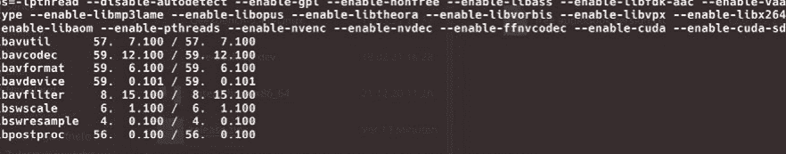

**图 2**：运行设置后，`Dim` 的配置显示。软件检查依赖项是否就绪。

- `release`

## LINUX VOICE: `Dim` 管理器


**图 3**：`Dim` 界面经过刻意设计，保持整洁。在首次启动时，应用程序提示用户创建一个库。

该服务的端口号。列表 3 描述了如何使用 `Docker` 安装它。你可以在 `/var/lib/docker/ia2` 找到该镜像，其中包含一个 `README` 文件。

一旦你设置好 `Docker` 并在浏览器中打开 Web 界面，下一步就是创建账户。你可以开始填充媒体数据库（图 3）。目前，`Dim` 仅限于电影、剧集和动画。一旦开发者对已支持的格式的实现表示满意，将支持音乐和其他媒体格式。

在 Web 视图中，控制控件左侧的侧边栏占据窗口宽度的约四分之一。屏幕其余部分用于显示选定的媒体。此外，你还可以根据喜好进行自定义，你会在所有收集的合集下方找到搜索栏。如果需要，可以使用右下的小箭头隐藏侧边栏，这意味着你可以使用整个屏幕来显示媒体和画廊。

### 创建新库

### 库

第一次登录时，应用程序会提示你通过分配名称并将所需文件的路径传递给取器（Scraper，这是一种在通过中央数据库提供服务之前从各种来源收集数据的小型工具或内置程序）来创建库。在此处使用该选项来确定库是电影还是剧集。`Dim` 仅将类别视为元数据——这些元数据来自相关的电影数据库。

`Dim` 只支持文件夹。它完全不支持其他的单个文件。但是，如果你将鼠标指针悬停在文件夹上，右侧会出现一个橙色矩形。此时你可以选择该文件（图 4）。别忘记为合集分配名称，否则“添加库”（ADD Library）按钮将保持禁用状态。如果你想创建更多合集，请使用“库”（Libraries）选项卡并点击出现的加号。

在“库”下方，“仪表板”（Dashboard）选项卡顶部显示最近查看的媒体。文件名上方将自动生成诸如创建年份或类型之类的标签。点击定义为链接的关键词，将带你进入具有相同标签的其他媒体。`Dim` 目前不支持单独的标记。


**图 4**：在创建库时，确保它有一个名称并且文件夹右侧的框被勾选是非常重要的。

应用程序依赖 `Nightfall` [4]，这是一个用于转码和按需流媒体视频文件的库（图 5）。

由于处于开发早期，`Dim` 目前仅提供了一部分计划中的功能。这包括导入视频文件的能力（包括传输元数据，图 6），以及在本地播放你的媒体合集的选项（图 7）。在我的测试期间，所有这些功能都运行良好。在加载的 20 个文件中，只有一个在过程中丢失了元数据。

### 极少的设置工作

“设置”（Preferences）选项卡允许你更改用户名和密码，并自定义 Web 界面上的默认端口。有几种深色和浅色视图模式供选择，你还可以自定义缓存和元数据的路径。在底层，该


**图 5**：点击“设置”将进入设置界面。除了个人资料的标准设置外，还有一个“邀请”（Invites）选项卡，允许你创建令牌以允许第三方安全访问库。


**图 6**：点击库项将打开元数据视图。这也是你启动播放的地方。

## LINUX VOICE: `Dim` 管理器

向其开发者支付报酬。其意图是通过提供高级功能的付费插件来产生资金，例如多 GPU 支持或转码器均衡。

## 展望

我询问了 `Dim` 的首席开发者该项目在未来一、两年内的计划。主要重点是完善 Web UI，并完成适用于 Android 和 iOS 的移动应用开发（该应用目前处于设计阶段）。团队还致力于提升整体用户体验。与此同时，开发者还计划在今年晚些时候交付一个带有 MPP 视频播放器的原生桌面应用。从长远来看，他们计划允许不同地理位置的用户共同流媒体视频。

用开源替代品 `Dim` 来取代 `Plex` 的设计在几个月内是无法完成，可能需要几年时间。在开发的前 12 个月拥有坚实的基础，这种简单的界面因其简洁而具有吸引力。`Rust` 的实现提供的速度平均超过了 `Python` 或 `C++` 的实现。目前，`Dim` 尚不能投入实践，但我建议关注这个项目，因为它完全有理由认为可以在客厅中占有一席之地。

移动设备客户端和大型电视支持是媒体中心成功的最重要的先决条件之一。2022 年，他们的重心转向了 Android 和电视客户端的开发。首要列表包含了所有功能，包括离线播放。此外，还有带有大量解码器的 `DirectPlay`，因此无需转码媒体格式。`Dim` 正在支持：

- [1] https://en.wikipedia.org/Plex
- [2] https://github.com/Dusk-Labs/dim
- [3] https://github.com/Dusk-Labs/dim/releases/tag/v0.3
- [4] https://en.wikipedia.org/Nightfall
- [5] https://github.com/Dusk-Labs/nightfall
- [6] https://en.wikipedia.org/SubStation

考虑到 `Dim` 的开发阶段，它目前提供了一系列计划中的功能。

由于媒体和电视客户端的复杂性，`Dim` 将支持

# LINUX VOICE: FOSSPICKS

# FOSSPicks

自由开源软件世界中的闪光明珠与新发布

由于他的 Steam Deck 没能耐用，Graham 本月能够在他那台古老的 PlayStation Vita 上运行几款开源游戏，其中包括《魔法门英奇传》。作者：GRAHAM MORRISON

## 景观生成器：

### TerraForge3D

回到 20 世纪 90 年代初，如果你足够幸运拥有一台 Commodore Amiga，那么你可能遇到过一个名为 Vista 的卓越应用程序，后来还有 Vista Pro。它们并不完美，但也算不上没有生产力。它们是旧硬件上用于生成初始和外星景观的降维空间门户。早期版本作为杂志封面光盘免费赠送，这是一款可以严酷考验你的耐心以及 Amiga 计算资源的软件。

Vista 生成的景观，其种子值取自分形、柏林噪声（Perlin noise）或真实的数字高程图。Vista 会根据你的位置绘制出土地的三维轮廓。但聪明之处在于，它如何通过草地纹理、河流、湖泊，甚至是后期版本中的树木来增强视图。这些元素都是通过解释地形算法生成的，生长在较低的坡度上，岩石滚落，河流置于山谷之间。一个洞穴场景看起来可能极其真实，其中一个就被伟大的科幻作家 A. Clarke 曾使用 Vista 和真实的高程数据来插绘火星可能的样子。

生成每张图像需要很长时间，令人惊讶的是地形生成的性能似乎能与 Vista 匹配。现代游戏已经非常接近这一点了，然而玩家对生成的景观几乎没有任何控制权，让我们在不被巨人攻击的情况下进行探索吧。为什么看到 TerraForge3D 的发布如此令人兴奋？它是一个具有与 Vista 相同选项的、雄心的跨平台地形生成器。TerraForge3D 仍处于开发的非常早期。但在这一阶段，它是美的、超现实且实时超写实的。图像生成过程从 CPU 或 GPU 绑定的位移开始。除了天空和全局光照设置外，主窗口中管理的其他一切都可以拖出位置并锁定在各个位置，以为你创建最佳环境。添加的 GLSL 着色器带来了真正的真实效果。更改会立即渲染，允许你以新的方式调整值和纹理，并且它们可以相互连接。它就像 Unreal 中的一个系统一样，你可以阅读文档（或观看 YouTube 托管的教程），并让工作看起来很好，但只要稍加练习，TerraForge3D 就能产出媲美 Vita 的结果。

- 视图：你的景观将实时更新。
- 水体和天空：水位可以添加动画方块，并有天空的反射。
- 着色器：支持 GLSL 着色器以创建深度。
- 光谱：使用 denender 节点创建景观的着色器。
- 网格：景观分布层可以使用 CPU 或 GPU 随机从分形中生成。
- 光照：全局光照可以在颜色和角度上进行调整。
- 探索器：如果你想在创建的景观中漫步，那儿有一个全屏探索器。

项目网站
https://github.com/Jaysmith101/TerraForge3D

# FOSICKS

### Matrix & nheko

Android 上的开源 Element 以及一个名为 nheko 的桌面应用，它专门设计用于取代你喜爱的 IRC 客户端。Matrix 消息协议已经存在了近 10 年，随着时间的推移，我们许多人已经体验过它的网络，用于个人和群聊，或者在回到我们经常分心的常规消息传递之前。这是一件好事，因为 Matrix 感觉很像 IRC，拥有其实例的联邦集合和共享网络。同样，它并不总是直观的，但 nheko 中的现代 Matrix 让人耳目一新。Qt UI 纯洁且易于导航，让类 Element 应用变得更好。甚至还有一个针对高 DPI 显示器的 GUI 缩放选项，并可以默认缩放。

在早期几年里，Matrix 缺乏各种客户端，但流行程度逐年增加，已达到被接受的临界点。这种接受得益于一些出色的客户端，开发的 nheko 是一个美观的原生桌面应用，用于访问 Matrix 和群聊。你订阅的群组/房间列在左侧，右侧是消息窗口，你可以搜索公共群组和用户。在其他网络上你会发现内容较少，但通信质量通常更高。至少目前是这样，这是平台流行度与信噪水平之间典型的权衡。

项目网站
https://github.com/nheko-Reborn/nheko

# 流媒体 Navidrome

为什么我们的选择比以往任何时候都多，但有时却更难以我们想要的方式获取所需的内容？电影和音乐流媒体服务是这个问题的最好例子，虽然观看或听听某些东西的选择从未如此多，但你受限于平台决定提供的任何电影或音乐。

在 Google Music 消失后，寻找具有现代音乐风格的内容非常困难。这正是 Navidrome 可以提供帮助的地方。它是一个开源音乐服务器，其 Web 后端看起来像 Spotify，并兼容 SubSonic API（一个接近的开源替代方案）。这意味着你可以使用任何 SubSonic 兼容的 App 从你的手机、智能手机或智能浏览器播放音乐。

# 现代 FOSSPICKS LINUX VOICE

## Difftastic

自从命令行出现以来，就有用于比较文件的命令行工具。最著名的是老牌 `diff`。它通过比较两个文件并输出带有注释符号 `<` 和 `+` 的结果来显示哪些行被删除或添加。其他文本格式可以更容易被其他工具理解和解析，包括 `patch`，后者会剥离编辑器之外可能导致这些差异的上下文信息。这正是 Difftastic 派上用场。它是 `diff` 命令的现代版本，能够理解其所查看文件的上下文，减少了错误并使其更易用。

Difftastic 从命令行运行，采用与 `diff` 相同的参数。与 `diff` 不同，`difftastic` 可以专门解析用两种编程语言编写的文件。它可以理解差异仅仅是空格还是编程语言中的结构性差异。它还能理解换行是否具有意义。这些示例中的每一个都会导致原始 `diff` 产生假正，并使查看代码更改变得相当困难，尤其是在处理来自不同编写者的拉取请求（pull requests）时。

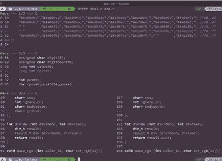

Difftastic 是 Git 非常出色的 diff 工具，也适用于你运行的任何系统，因为它让你轻松查看任何文件差异。它还有并排显示选项，以及普通的 `diff` 输出模式，如果无法解析，它将回退到传统的 `diff` 跟踪。如果你使用的是支持的语言之一，它是原始 `diff` 的绝佳替代方案。如果你不是，将你选择的语言添加到项目中是贡献开源的极佳方式。

## 项目网站

https://github.com/Wilifred/difftastic

## warpd

很久以前，我们看到了一个名为 Chassis 的键盘编辑器。它被设计为仅适用于基于 Arduino 的 Kaleidoscope 固件的特定开源键位，但它确实值得关注。得益于 Chassis 和开源固件，我们可以轻松修改固件以适应需求，并使用其他用户带来的各种插件。这些用户可以运行宏、创建短快捷键，甚至将 LED 光谱变成彩虹。然而，Warp 无法进行控制，只能让你通过配置的任何快捷键移动鼠标，并带有加速和启动/停止功能，还可以通过其他几个快捷键扭曲显示器的光标。

出色的是，warp 项目已经能够在任何键盘上通过软件重现相同的行为。通过这些想法结合，warp 让你在舒适的键盘上快速快捷地控制光标。第一个是上述的封装，warp 通过网格模式（Grid Mode）提供。启用后，使用 `i` 和 `k` 键导航到不同的象限，高亮主体内的选定区域。光标选择会缩小象限的大小，你可以快速从屏幕的一侧跳转到另一侧，或者使用 `shift` 和句号 (.) 键跳转到某一行。

有两个目标。第一个被称为热模式（Hot Mode），工作原理类似于 Firefox 中的 Vimmode。启用此模式后

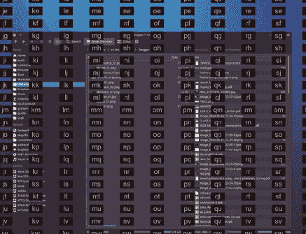

虽然你可以在 KDE Plasma 中使用鼠标光标，但 warp 增加了额外的导航功能，适用于任何桌面。当屏幕被字母覆盖时，你可以按键立即跳转到光标位置。它看起来很杂乱，但比网格模式直观得多。最后，warp 让你通过旧式的 Vim 导航键手动移动光标。所有功能运行良好，并可以让你免于使用鼠标导致的重复性劳损。

## 项目网站

https://github.com/ravijya/warpd

LINUX-MAGAZINE.COM | LINUXPROMAGAZINE.COM | 第260 期 | 2022年7月 | 87

# LINUX FOSSPICKS

集成开发环境

## Qt Creator

Qt Creator 是一个用于构建 Qt 应用程序的集成开发环境，它恰好也能构建各种应用程序和项目。它始于 2007 年的一个名为 GreenHouse 的项目，由诺基亚收购前的 Trolltech 几名开发者编写。现在，有一个免费的开源 IDE 可以与微软的 Visual Studio 竞争，特别是对于使用 CMake 维护构建环境的 C++ 语言应用。当项目重塑自我时，Kdev 存在但当时未使用，这使得 Qt Creator 总体具有革命性，因为它是首批包含代码补全、对象抽象并为其他语言开放接口的开源 IDE 之一。

许可变更意味着二进制文件只能通过账户下载，且 LTS 版本也提供给非商业许可。这并不违反其开源许可条款，但不符合开源精神。Linux 发行版通过构建自己的补丁来规避这一问题，但也赋予了它价值。当然，Qt Creator 不再是唯一的 IDE。特别是微软的 Visual Studio Code 吸引了更多注意力，从 Android 程序员到 JavaScript 思考者，再到与同事的在线协作编码以及项目管理——讽刺的是（对于微软而言），它没有任何开源代码许可，也不需要下载二进制文件。

Qt Creator 的最新版本发现自己处于一个新时代，面临着一系列新挑战。Qt 本身经历了重大的管理和许可变更，项目现在由 Qt Project 作为官方机构拥有并运行。Qt Creator 继续更新。对于版本 7，这是一个重大的更新。对于 Qt 应用程序开发，它仍然是无与伦比的，使用 Qt 有许多理由。它显然是 KDE 开发的最佳工具，并且具有惊人的广度。


## 英雄王国与魔法

## 英雄2

Heroes of Magic 是一系列精彩的游戏，从 20 世纪 90 年代发展到现代。它们是以任务为目标的策略游戏。根据你选择的角色，你将获得一系列技能和能力，这些能力塑造了你所发现的游戏、开发资源并跨越景观以实现你的预言。早期作品具有最近流行的极简主义和不妥协的玩法，尤其是当那些玩原版的青少年现在成为全职软件开发人员时。这使得成为开源重塑的完美目标。开源重塑发生在《Heroes of Magic and Might》，而且《Heroes of Magic and III》没有 Linux 版本。现在可以使用现代引擎 VCMI 运行游戏，你需要《Heroes of Magic and III Shadow of Death》和《Magic Complete Edition》文件中的原始数据，而不是 Linux 版本的文件。英雄 III 是一个很好的开始，因为它允许了“等待”等游戏元素和更精炼的……

# LINUX 语音教程 – LIBREOFFICE 图表

## 使用 LibreOffice Calc 创建图表
绘图与数据可视化

每个人迟早都会需要图表，而 LibreOffice Calc 是使用免费开源软件创建图表最简单的方法。

作者：BY MARCO FIORETTI

现代生活充满了数字。即使一个人不是数学家，迟早也会有需要理解或与他人分享数字之间关系的时候。本教程将向你介绍如何使用免费软件实现这一目标的最简单方法：LibreOffice Calc 中的图表 (1)。但是图表（Charts）和图形（Graphs）是一个吗？让我们先澄清这个问题。

### 图表 (Charts) 与 图形 (Graphs)

图表和图形都有助于以视觉化的方式总结当前信息。虽然大多数人将这两个词视为同义词，但严格来说，它们并不是同义词 [2]。某些图形被证明在数学上是精确的，而图表则以一种（希望）直观且引人入胜的方式汇总数据集，例如使用条形图、饼图或其他符号。图表的主要目的是传达数据的高层含义及其内部的联系。

相反，图形是为特定数据设计的图表，旨在显示原始数据点之间的实际数学关系。表达这种区别的一种方法是：图表更适合高密度展示或通常的高层识别（任何几乎非数值的内容），而对数值公式的实际分析则需要图形。

在实践中，尽管这种区别很难完全分清。对于大多数用户来说，图形之间的语义差异远不如确定哪种图表样式符合他们的需求重要（这种需求比实际的要多），因为 LibreOffice Calc 将其数据可视化称为“从现在起我只用那个”。

由于图表只能显示易于读取的数据，你需要学习如何快速在 Calc 单元格中填充数字。无论是否使用图表，这都是一个值得学习的技巧，因为它提供了你创建任何函数的原材料。

例如，如果你想可视化某个通用 Linux 发行版的三个不同版本在发布后 30 天内的负载：此表格将看起来像图 2，它显示了不同的每日下载量位于列中，第 2-4 列顶部的标签标识每个发行版版本。我通过在第二个单元格中输入 1 并向下拖动该单元格的右角 30 行生成了图 2 中的第一列。

**图 1**：所有图形都是图表


图形

**1. 含义**

图表


图形

图形（Graph）是一种图表，通过在上面绘制（X 轴和 Y 轴）来显示不同数据集之间的数学关系。

图表（Chart）以图表、表格或其他视觉形式表示信息；它包含了组织大量信息的各种方法。

**2. 子集**

图形

图表

所有图形都是图表。这意味着无论使用哪种类型的图形，使用的都是图表的子集。

并非所有图表都是图形。这意味着可能存在其他不是图形的图表。

**3. 数据分析**

图形

图表

图形也可以用于原始数据，并提供数据随时间趋势和变化的视觉表示。

非常适合可以轻松分类或理解为简单易懂数字子集的数据形式。

2022 年 7 月第 260 期 LINUX-MAX.COM LINUXPROMING.COM

当你对包含数字或数据的单元格执行此操作时，Calc 会在该列填充相同类型的值。图 2 中的另外三列都是通过选择 Calc 主菜单中的“工作表 > 填充（Fill）”创建的，这会打开图 3 所示的窗口。“填充”子菜单有很多选项，但我选择了整数随机生成器，每个都有唯一的随机值和最大值。

| 天 | 桌面 | 容器 | 最大值 |
|---|---|---|---|
| 1 | 65 | 288 | 30 |
| 2 | 256 | 233 | 249 |
| 3 | 173 | 300 | 308 |
| 4 | 106 | 175 | 85 |
| 5 | 157 | 221 | 91 |
| 6 | 195 | 238 | 223 |
| 7 | 81 | 315 | 350 |
| 8 | 102 | 206 | 117 |
| 9 | 116 | 295 | 55 |
| 10 | 162 | 174 | 147 |
| 11 | 74 | 92 | 237 |
| 12 | 257 | 147 | 95 |
| 13 | 268 | 296 | 384 |
| 14 | 27 | 146 | 123 |

**图 2**：带有标签和数据的表格通过 Calc 函数快速创建。

| 数据 | |
|---|---|
| 单元格范围: `$Sheet1!$E$2:$E$19` | |
| 随机生成器 | 均匀整数 |
| 最小值 | 均匀整数 |
| 最大值 | 正态分布 |
| 选项 | |
| 启用自定义 | 伯努利分布 |
| 种子: | 二项分布 |
| 小数位数: | 负数 |

**图 3**：LibreOffice Calc 中的随机生成器用于填充图 2 中的表格。

### 分步创建图表

数据准备好后，就可以开始创建图表。选择你想要可视化的所有单元格（包括标题），然后在主菜单中选择“插入 > 图表”。分步向导如图 4 所示。

在第一个面板（图 4）中，你选择图表类型并设置所有数据。这只需要点击几次，但可能是最困难的一步。这是因为所使用的图表类型在很大程度上取决于数据的实际性质以及你想向他人展示的内容。从同一组数字创建完全不同的图表并不罕见。

另一个原因是，当你第一次意识到要在图表中使用内容时，如果数据的列和行顺序是正确的，图表会更好。不要急于在纸上画出图表草稿，然后根据结果。如果没有准备好，如果数据在工作表中没有分组，请相应地调整。

例如，识别哪些数据是实际数字，哪些不是（作为图表的标签）。最后一种类型的图表将用于清晰的分类和区分。创建它是不可能的，然而我将展示如何处理此类情况。工作表中数据的正确分组可以加快图表创建，但可能仍然无法决定应该选择哪种图表类型。这取决于两列数据之间的关系，如果第一列的每个值对应于第二列的唯一值（例如每天的最大值），那么折线图可能是最好的。如果任何给定的 x 轴有多个值，散点图会好得多。

我建议只玩折线图，直到你熟悉图表的设置。之后将更容易掌握其他图表类型并让同事们印象深刻。向导的第二和第三部分（图 5）以及第四部分（图 6）分别是是你的图表。第一项包含绘图或作为图表标签的单元格集。图表的开始是

| 图表类型 | 选择图表类型 |
|---|---|
| 数据范围 | 柱状图 |
| 数据系列 | 条形图 |
| 图表元素 | 饼图 |
| | 折线 |
| | XY (散点图) |
| | 3D 效果 |
| | 形状 |
| | 股票图 |
| | 柱状图和折线 |

**图 4**：图表类型看起来很容易，但可能是创建过程中最困难的部分。

LINUX-MAGAZ.COM | LINUXPROMAGAZINE.COM

2022 年 7 月第 260 期

教程 — LIBREOFFICE 图表

| 图表类型 | 选择数据范围 |
|---|---|
| 数据范围 | 数据=`$Sheet1!$B$19:$E$39` |
| 数据系列 | 行中的数据系列，列中的数据系列 |

| 图表类型 | 数据系列: | 数据范围 |
|---|---|---|
| 数据范围 | 桌面 | 边界颜色 |
| 数据系列 | 服务器 | 填充颜色 |
| 图表元素 | 容器 | 名称 |
| | | 数值 |
| | | 边界范围 |

**图 5**：如果数据提前准备好，在图表中加载数据范围生成一个独立的子图。

默认情况下，向导会将范围识别为启动向导之前用鼠标选择的单元格。例如，这些单元格部分重建了图 2 中 31 行 4 列的矩形。向导通过其左上角和右下角识别范围，格式为 `$SHEET$COLUMN$ROW`，用冒号连接。

图 5 中的数据范围意味着“从同一工作表的 B19 到 E139 单元格”，你可以自己检查，恰好是 31 行 4 列。这里的关键是你可以通过重写图 5 中的数据范围（未在图 2 中显示）并用鼠标选择来任意更改数据范围。

更好，你可以通过输入上述格式的坐标选择非连续的范围（例如工作表的不同区域）。子范围将由“适当的分隔符”分隔，检查逗号。或者更改你的范围，转到“工具 | 界面 | LibreOffice Calc |”，查看数组列。

在数据范围中的另一个重要操作是指定整个范围的第一行或列将用作标签、坐标或其他。如果你不这样做，Calc 将把第一行或列仅标记为“其他”。

在图 7 中，你选择了图 2 的数据范围，并将第一行和列标记为它们。

图 6 包含了其他信息元素。在 Calc 中（如果是行和列数则会很困惑）被称为该系列的数据范围。好处是，你可以像处理整个范围一样，通过在上下文字段中输入输入任何系列的实际范围。

向导的最后部分（图 7）可能是最令人兴奋的。当你选择描述性的“元数据”时，即标题、副标题、轴和图例。所有工作的最终结果显示在图 8 中。x 坐标是“类别”，再次，但是！在 Calc 中，你可以双击现有的图表进入“编辑模式”，在其中你可以选择任何

**图 7**：向导让你选择元素和网格设置。

| 图表类型 | 选择标题、图例和网格设置 |
|---|---|
| 数据范围 | 示例图表 |
| 数据系列 | 图例 [勾选] |
| 图表元素 | 标题副标题 |
| | 数据范围 |
| | X 轴 |
| | Y 轴 |
| | 下载量 |
| | 网格 |
| | Y [勾选] X [勾选] |

**图 7**：向导让你选择元素和网格设置。

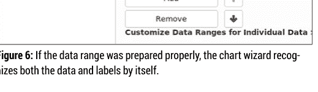

# 教程 – LIBREOFFICE 图表 LINUX 语音

**图 8**：表示前几图所示数据和设置的直方图仍需一些改进。

然后对它点击鼠标右键（或选择顶部菜单中的“格式”）来重新打开图表区域。向导将重复图 9 面板中相应的区域，在那个图中，我旋转了 x 轴的打开角度使其更易读，如图 10 所示！

在继续之前，让我们回到图 8 学习更多图表术语。主矩形包含图表显示的所有内容，而你作为背景放入任何内容都是图表区域。三维（3D）图表也会有一个图表区域。你可以为图表区域加载任何想要的图像，包括照片，但通常一开始没必要这样做，而且要非常仔细地选择图表和数据颜色，否则结果往往会更难以阅读。同样的考虑也适用于 Calc 图表中许多晦涩的选项。与其克制冲动通常会让你的图表变得更好。

尽管如此，Calc 还有其他重要的函数需要了解的，它们可能会让你的许多图表变得更好。这些函数之一是绝对不要在图表中显示两个具有不同单位或不同比例的数据系列。例如，如果一个系列在 0 到 1000 之间，而另一个只在 0 到 30 之间，使用一个垂直轴绘制它们将使系列几乎不可见。

解决方案是在图表创建后，双击图表，点击出现的两个系列之一，然后转到“选项”选项卡显示图 11。然后，选择对齐 Y 轴以获得结果：

| 比例 | 位置 | 线型 | 标签 | 数字 |
| --- | --- | --- | --- | --- |
| 显示标签 | | | | |
| 平铺 | | | | |
| 错位排列顺序 | | | | |
| 错位偶数项 | | | | |
| 自动 | | | | |

**图 9**：如果标签交叉，请旋转它们！

| 选项 | 线型 |
| --- | --- |
| 对齐数据系列到 | |
| 主 Y 轴 | |
| 次要 Y 轴 | |
| 投影选项： | |
| 投影缺失值 | 留空 |
| 假设为零 | |
| 连接线条 | |
| 包含来自隐藏单元格的值 | |
| 图例项 | |
| 隐藏图例项 | |

**图 10**：图 8 中看到的标签现在更易读了。

**图 12**：右侧的 x 轴为它们都提供了可比较的比例，使两者都更易读。

# LINUX 教程 - LIBREOFFICE 图表

如图 12 所示，它详细地显示了两线，事实上，每条线都有一个适应其范围的独立轴。

通过选择图表内部的颜色、点击它并选择“设置数据系列”来更改 Calc 分配给每个数据系列的颜色。

**图 13**：LibreOffice Calc 7.2 的一项受欢迎的新是为移动趋势线提供了更多选项。

另一个可以大大提高图表清晰度的区域是使用此处来指示三个不同的选项：首先，我们

要更改所有图表的默认颜色，转到“工具 > 选项 > 图表 > 默认颜色”。在 LibreOffice 图表中你可以做的最有趣的事情是基于条件格式化。这意味着，例如，根据图表中的每个柱形是否符合某些条件赋予其不同的颜色。关于这种技术的一种解释是，“使用条件格式化创建图表” [教程 3]。

| 类型 | 选项 | 趋势线名称 | 移动平均示例 |
|---|---|---|--|
| 回归类型 | | | |
| 线性 | | 向外外推 | 0 |
| 对数 | | | |
| 指数 | | 向后外推 | 0 |
| 幂 | 强制插入 | | |
| 多项式 | 显示方程 | | |
| 次数/度 | 2 | | |
| 移动平均 | X 变量名 | | |
| 周期 | Y 变量名 | | |
| 优先级 | 优先 | | |

LibreOffice 7.2 有一个改进的功能，虽然对许多人来说没用，但对统计分析用户来说是必须的。图 13 所示的函数——当你在图表中选择数据系列并点击“插入趋势线”时打开——支持更多类型的移动平均函数（图 14）。

**图 14**：通过使用图 13 中的选项，图表中已添加了平均趋势线（蓝色）。

制作精美图表的最后一个功能（使用图片制作图表）非常容易理解：图表取决于适当的光照和配色，而 Calc 使优化变得简单。一旦创建了图表，双击它并选择带有直观选项页的交互式面板，你可以在其中为参数设置不同的值（图 15）。

**后续步骤**

本教程包含了你作为 LibreOffice 7.2 或更高版本的设计师入门时所需的所有基础知识和概念。只要确保你理解了这里，从零开始时使用 Calc 的选项将更快、更简单。祝绘图制作愉快！

**作者**

Marco Fiore (http://fiore.org/) 是一位居住在意大利的自由作家、培训师和研究人员，自 1995 年以来一直从事开源软件，自 2005 年以来致力于标准。Marco 还在 https://zonam.net 提供数字权利服务。

- [LibreOffice Calc 指南，v7](https://www.documentfoundation.org/Calc-Guide.pdf)
- [图与图表的区别](https://streetmojo.com/)
- [使用条件格式化创建图表](https://www.ryanandonbi.com/2019/02/libreoffice-charts-conditional-formatting/)

**图 15**：标签可以很棒，只要它们有正确的方向和颜色。

# 杂志存档

Linux 杂志是你的 Linux 世界指南。每期杂志都充满了在其他地方找不到的高级文章和教程。探索我们的过期目录以完善你的收藏。

在线订购：https://bit.ly/Linux-Newsstand

## 零信任

二十年前，人们认为防火墙就足以免受入侵者侵害，但最近的历史告诉了一个不同的故事。今天，最好的建议是：不要信任任何人。你的内部网络可能和互联网一样危险。
**光盘：** Zorin OS 16.1 和 Super GRUB

## 清

大多数人知道通过更换更高效的灯泡可以节能，但你知道可以使用更高效的软件来节能吗？本月我们研究了为 IT 行业带来可持续性所做的努力。
**光盘：** Manjaro 21.2 Qonos 和 DragonFly BSD 6.2.1

## 加密

本月，我们研究了 Linux 的加密状态。我们超越基础，探索支撑这一秘密系统的工具和技术——并向你展示如何确保隐私无懈可击。
**光盘：** Linux Mint 20.3 Cinnamon Edition 和 deeply 20.4

## 面部识别

随着 Microsoft Hello 技术的出现，生物识别得到了增强。现在开源世界正通过一个名为 Howdy 的创新工具追赶。面部认证可能还没有准备好应对 CIA，但我们将帮助你开始使用 Howdy 并探索通过一眼认证的可能性。
**光盘：** parrot 21 和 Haiku R1/Beta 3

## 打破以构建

模糊测试：好奇攻击者是如何发现那些导致程序崩溃并交出控制权的“精心设计的字符串”的？来到模糊测试的世界。我们向你介绍某些领先测试技巧。
**光盘：** Parrot OS 4.11 和 Fedora Workstation

## 手机黑客

制造商最终会停止支持旧硬件。如果你还没准备放弃那些硬件，你可能会通过 LineageOS 找到更好的替代方案——这是一个基于 Android 的免费系统，支持 300 多种设备，包括许多不再受供应商支持的遗留系统。我们探索了运行在 Android 设备上的社区化 Linux 发行版 PostmarketOS。
**光盘：** Ubuntu 21.10 和 EndeavourOS 2021.08.27

# 服务

## 活动

## 精选活动

用户、开发者和供应商在世界各地的 Linux 活动中汇聚。Linux Magazine 荣幸地向大家介绍此处展示的精选活动。有关您附近的其他活动，请访问我们的在线扩展版活动日历：https://www.linux-magazine.com/events。如果您知道其他您希望我们加入日历的 Linux 活动，请发送包含所有信息的邮件至 info@linux-magazine.com。


# 通知

在预订任何行程之前，请务必检查网站，因为受 COVID-19 影响，许多活动已被取消或虚拟活动。

# GUADEC 2022

**日期：** 2022年7月20-25日

**地点：** 墨西哥，瓜达拉哈拉

**网站：** https://www.ocallinabs.com/

今年是 GNOME 诞生 25 周年。加入我们在瓜达拉哈拉举行的 GUADEC，这是 GNOME 社区最大的会议。聚集数百名用户、贡献者、社区成员和爱好者，通过为期一周的演讲和研讨会共同庆祝 GNOME。

# SCaLe 19X

**日期：** 2022年7月28-31日

**地点：** 加州，洛杉矶

**网站：** https://www.socallinexpo.org/

SCaLe 是北美规模最大的、由社区运营的开源和自由软件会议。每年在洛杉矶大地区举行。加入我们参加为期四天的会议、教程和特别活动。

# 活动列表

| 活动名称 | 日期 | 地点 | 网站 |
| :--- | :--- | :--- | :--- |
| 存储开发者大会 (SDOC EMEA) | 6月14日 | 虚拟会议 | https://www.snia.org/events/sdocmea |
| 2022年欧洲 OSDC | 6月15-16日 | 英国伦敦 + 虚拟 | https://osdc.com/europe/ |
| openSUSE 峰会 | 6月18-19日 | 阿尔尼亚地拉纳那 | https://opensuse.org/conferences/OSSE22 |
| OSCAL 2022 | 6月18-19日 | 阿尔尼亚地拉纳那 | https://oscal.openlabs.com/ |
| CIO/DACH 峰会 | 6月21-24日 | 德国法兰克福 | https://cisadocsummit.com/ |
| ITEPY Linux | 6月21-24日 | 佛罗里达州劳特角代尔堡 | https://www.texpo.com/east/ |
| 北美开源大会 | 6月21-24日 | 德克萨斯州奥斯汀 + 虚拟 | https://events.linuxfoundation.org/ |
| 峰会 | 6月23-24日 | 英国伦敦 | https://codsummit.com/ |
| 北 Linux 安全会议 | 6月23-24日 | 德克萨斯州奥斯汀及虚拟 | https://events.linuxfoundation.org/xen-summit |
| 6月 XenDev 开发者会议 | 6月28-30日 | 罗马尼亚布加勒 + 虚拟 | https://events.linuxfoundation.org/xen-summit |
| USENIX ATC '22 & OSDI '22 | 7月11-13日 | 加州卡尔斯巴德 | https://www.usenix.com/conference/ |
| 开源峰会会议 | 7月19-20日 | 德国柏林 | https://stackconf.com/ |
| GUADEC 白活动 | 7月20-25日 | 墨西哥，瓜达拉哈拉 | https://events.gnome.org/event/77/ |
| 柏林 Inga 营 | 7月21日 | 德国柏林 | https://icinga.com/community/events/inga-camp-berlin-2022 |
| SCaLe 19x | 7月28-31日 | 加州洛杉矶 | https://www.socallinexpo.org/scale-19x |
| USENIX SECURITY '22 | 8月10-12日 | 马萨诸塞州波士顿 | https://www.usenix.org/conference/usenixsecurity22 |

# 征稿

我们正在寻找关于 Linux 以及 Linux 环境工具的优秀文章。我们将考虑任何主题，我们对以下主题尤为感兴趣：

- 系统管理
- 有用的技巧和工具
- 安全性，包括新闻和技术
- 产品评测，特别是来自实战的体验
- 社区新闻和项目

如果您有想法，请将包含大纲、长度估计、背景介绍和联系方式的提案发送至 edit@linux-magazine.com。

文章的技术水平应与您通常在《Linux Magazine》中阅读的内容一致。请记住，《Linux Magazine》在许多国家阅读，您的文章可能会翻译成我们姐妹刊之一。因此，最好避免使用所有读者可能无法理解的俚语和成语。

在处理未来的日期或活动时请要小心。从您提交稿件到到达读者手中，可能会过去数周时间。

发送文章时，请在邮件主题行中使用有助于我们识别您的邮件为文章提案的字样。随时欢迎截图和其他支持材料。

更多信息请见：http://www.linux-magazine.com/contact_for_us。


# 下个月

第 261 期

| 英国 / 欧洲 | 7月02 |
| 美国 / 加拿大 | 7月29 |
| 澳大利亚 | 8月29 |

# 上市日期

请注意：上市日期为预计日期，可能会因为物流问题而延迟。

第 261 期 / 2022年8月

# 启动盘工具

在大多数新电脑甚至没有 CD 光驱的世界里，可启动 CD 带不了多远。现在的 Live 启动意味着从 USB 内存启动，虽然用户变得更加移动，但工具也变得更加复杂。随身携带您的操作系统并插上——您甚至可以在单个优盘上放置多个 ISO 文件。下个月我们将探索新一代的 USB 启动实用。


# 预览通讯报

Linux Magazine Preview 是一份每月电子邮件通讯报，让您提前预览下一期内容，包括在线发布的文章链接。
注册地址：https://bit.ly/Linux-Update

# GNOME 会议
GUADEC

## 墨西哥，瓜达拉哈拉
### 2022年7月20–25日

GUADEC 是 GNOME 的年度主要活动。自2000年以来，它汇聚了来自世界各自由软件爱好者和专业人士。

加入我们在瓜达拉哈拉或在线举行的 GUADEC 2022，了解最新的技术进展，听演讲，参加研讨会，并庆祝 GNOME 的 25 周年！

了解更多
GUADEC.ORG


# HETZNER
位于美国

## 云服务器
起价
# 每月 $4.15

HETZNER 云服务器 CPX11
高品质 - 无可比拟的价格

- AMD EPYC™ 第二代处理器
- 2 核虚拟处理器 (vCPU)
- 2 GB 内存 (RAM)
- 40 GB NVMe SSD
- 包含 20 TB 流量
- 直观的云控制台
- 位于德国、芬兰或美国

## 在不到 10 秒内部署您的 HETZNER 云服务器！

通过负载均衡器、防火墙、一键应用等等功能，快速快捷地管理您的云服务！

## 立即获取您的云

**CLOUD.HETZNER.COM**

所有价格均不含增值税（VAT），并受 Hetzner Online GmbH 条款和条件的限制。价格可能会变动。所有权利归相关制造商所有。
