# Linux Magazine 261 2022-08 美国版


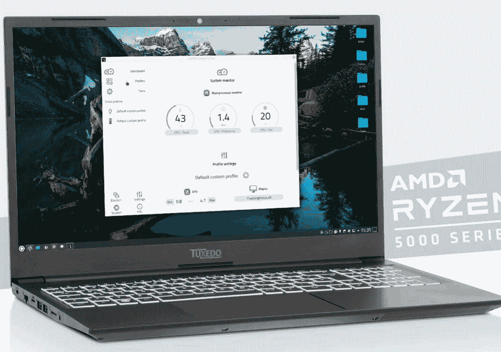

TUXEDO Aura 15 - Gen2

| 特性 | 详情 |
| :--- | :--- |
| 处理器 | AMD Ryzen 7 5700U (8核心 | 16线程) |
| 端口 | USB-C 3.2 Gen2 DisplayPort 1.4 & 供电传输 |
| 重量/尺寸 | 1.9 cm 厚 | 1.65 kg 薄轻量化 |
| 连接性 | 4G / LTE 移动高速网络访问 |
| 操作系统 | 100% Linux |
| 保修 | 5 年质保 |
| 支持 | 终身支持 |
| 产 | 德国制造 |
| 隐私 | 德国隐私标准 |
| 服务 | 本地化支持 |


# 编辑观点

## 如果你认为这很棒，那么欢迎光临

亲爱的读者：

几个月前，我写过关于 `color.js` 和 `faker.js` 开源库行为异常的奇怪案例。这些流行工具被它们自己的开发者破坏了，他们对那种既不贡献也不提供报酬的方式感到幻灭。更核心的一点是，当开发者必须永久离开时，需要一种有序的过渡。职业倦怠对于开源软件开发者来说是现实，但它总会来临。人们会换工作、结婚、生孩子……当开发者离开某个分发版中工具的领导职位时，开源项目需要提供连续性。最好的消息是，一切似乎都进展得很顺利。当然，Mint 的人们分叉了 Timeshift 并创建了自己的项目，但对我们其他人来说，保持整体完整并避免不必要的分叉带来的混乱和重复要好得多。

在 Linux Issue 第 256 (3) 期给你们写信后，我收到了一位读者的建议，他建议我提到，让某些开源项目持续下去的一种方法以及感谢他们所做工作的好方法，就是做出贡献。许多开源项目提供了捐赠方式。Linux 用户往往会跳过贡献页面——因为它本应该是免费的，免费让开发者花时间来改进你的体验，在某些情况下还要自掏腰包支付网络托管和办公用品。建议是下载工具并尝试一下；如果你喜欢，就去网站捐赠。这似乎是值得采用的建议，所以我转达给你们。记住，如果你喜欢，那就太好了。

当我们谈论 `color.js` 崩溃的剧烈爆炸时，关注一些成功也是好的——那些以最大化连续性的顺序成功接棒的项目。在 Mint 站点的每月一份报告中，Mint 宣布它已接手了 Timeshift 的维护，这是一款快照工具，在 Windows 中正成为“功能问题”，以及 max 中的 Timeshift 工具。

根据 Mint 项目负责人 Clement "Clem" Lefebvre 发布的新闻，Tony George 此直负责该项目，以便专注于其他工具和维护，例如 Ubuntu 内核更新。Mint 开发者联系了 George，看看他们如何如何维护 Timeshift，结果是将维护工作交给了 Mint。Timeshift 现在作为 Mint 的 GTK 桌面环境应用程序的一部分进行维护。顺便说一下：Mint 博客公告包含一个链接，让 Timeshift 的粉丝可以向 George 捐赠 $5。哦，而且 Mint 用户也可以加入。


Joe Cas

总编辑


一个包含所有所需依赖项的 U 盘是一个实用的工具。本月我们探索了创建场景。

`inxi` 提供了系统的全面概述，但仅限于命令行。`inxi-gui` 是一个图形界面，让事情变得更方便。

在拷贝数据时备份未被访问文件的工具和策略


Clement Lefebvre 简述了 Linux Mint 的历史以及围绕该发行版形成的社区。

Live boot 在 15 年前是一个非常激动的想法——随身带一张 CD，随时随地启动。但旧式的启动 CD 有一些局限性。首先，它们的大小固固。然后是无法保存任何内容的问题。今天的 USB 工具解决了这些问题，并提供了一个当时没人想到的：在单个 U 盘上访问多个启动镜像。

## 深度解析

## Linux Mint MATE 20.3 与 FreeBSD 13.1

双面 DVD 上的两款精彩发行版！

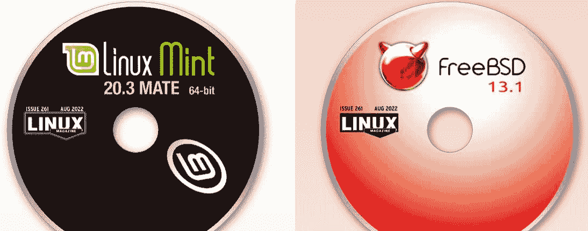

### Linux Mint MATE 20.3 64位

### FreeBSD 13.1 64位

Linux Mint 20.3（代号为 Una）是这个广流行的 Ubuntu 衍生版的最新长期支持版本，支持将持续到 2025 年。MATE 版本是 Linux Mint 对 Gnome 2 分叉的最新开发版本，提供了稳定、中轻量且快速的开箱即用体验。

MATE 与 Linux Mint 另一个内部开发的桌面环境 Cinnamon 共享许多功能。这两个版本的 20.3 版本都引入了文档管理器，并为“便签（”（Sticky Notes）添加了调整大小的搜索功能。此外，还提供了具有更大、圆角标题栏和强调色的新主题，以及深色模式。某些应用程序包含了打印机支持，并在 PDF 阅读器中加入了从右向左的支持，以便阅读漫画。MATE 的独特功能包括为 Hypnotic IPTV 播放器提供了全新的外观和搜索功能。

FreeBSD 的“表兄弟”是一个类 Unix 系统，共享许多相同的应用程序。主要区别是 FreeBSD 是在宽松的许可证下发布的，而 Linux Mint 的大部分内容是在 GPL 许可证下发布的。当你使用 FreeBSD 时，你还会发现设备名称和其他系统细节的差异。FreeBSD 是所谓 BSD 家族中最受欢迎的成员，也与 NetBSD、DragonBSD 和 OpenBSD 相关联。与 Linux 不同，FreeBSD 不仅开发内核，还开发自己的硬件和设备。因此，它的大多数发布说明比典型的 Linux 发行版更具技术性，详细介绍了选项和硬件支持，而不是新功能。更多信息请参阅 `https://www.freebsd.org/releases/13.1/`。

老用户会喜欢 MATE 的经典外观，它在应用名称和对现代计算需求的支持上与 Gnome 2 有何不同。新用户会发现 MATE 是一个自解释其义的桌面，他们可以快速适应。

FreeBSD 更可能吸引专家用户，他们会欣赏其独特的结构和多样化的处理方式。对于任何好奇“类 Unix 操作系统”这一掩饰表达背后含义的人来说，FreeBSD 是满足你好奇心的理想选择。

缺陷光盘将予以更换。

请发送电子邮件至：`sub@linux-magazine.com`。

尽管 Linux Mint 光盘已通过测试，且据我们所知已测试确保没有恶意软件和缺陷，但《Linux Magazine》对使用此产品的计算机系统发生的任何中断、丢失或损坏不承担责任。

- 受信赖的中立 · 全球社区 · 非营利 · 薪资增长
- 在 80 多个国家受信任
- 专业认证详细考试目标
- 在线测试
- 免费学习材料个人技能证书
- 多国语言
- 有效 5 年的高可用性认证
- Linux
- 开源技术
- FOSS（自由开源软件）
- 我们的使命是通过支持从事开源工作的人员来促进开源的使用
- 需的 IT 技能解放人类
- 开源
- 200,000+ 持证者，证明且可靠
- 个人和经济增长机会 DevOps
- 为所有人提供经济和创意机会
- 安全
- 可负担的考试价格
- BSD
- 蓬勃的市场分布中立
- 增加你的奖金收入
- 网络安全国际标准
- 面向未来的职业
- 数百个合作伙伴提供丰富的职业路径
- 对开发者的需求
- 虚拟化开源招聘将增加
- 业内人士推荐，提高生产力，涵盖所有主流发行版，对雇主更具吸引力
- 提升你的职业，成员制组织选举董事会，证明你的技能
- 更高的收入潜力
- 你的未来是开放的

Linux 专业协会（LPI）的使命是通过支持从事开源工作的人员来促进开源的使用。这就是为什么我们在 140 多个国家降低了全球最流行的开源认证的价格。访问 `lpi.org/why` 了解驱动我们的动力。

访问 `lpi.org/exam-pricing-2022` 发现你所在国家的新版 Linux 专业协会考试定价。更多信息和所有 LPI 认证请访问 `lpi.org`。


技术、趋势和工具的更新

- HP 与 System76：宣布 Dev One 笔记本电脑
- NixOS 22.5 现在可用
- Titan Linux 是基于 Debian 的新 KDE Linux
- 下一代 HTTP/3 协议作为标准到来
- 下一个内核可能是一个大动作
- 数百万 MySQL 服务器暴露

### HP 和 System76 发布 Dev One 笔记本电脑

HP 与 System76 合作创建了一款面向开发者的笔记本电脑，名为 Dev One，它配备了 System76 自己的 Pop!OS Linux 发行版，起价 1,099 美元。最初发布于 2022 年 5 月，当时该笔记本还无法预订。回到今天，在强大的硬件支持下，美国现在可以订购这些新款 Linux 驱动硬件之一了。Dev One 通过不配备 CPU 和显卡来保持价格较低；基础型号配备了 8 核16 线程的 Ryzen 7 5850U 处理器，主频为 1.4GHz，集成 AMD Radeon 显卡，以及 16GB DDR4-3200 RAM（可升级至 64GB）。机箱厚度为 0.75 英寸，配备 1TB PCIe 3x NVMe M.2 2280 SSD，显示屏为 14 英 FHD，分辨率为 1920x1080，亮度为 1000 尼特。然而，屏幕并不光滑。新的 Dev One 还具有经过调的 Linux 内核，它放弃了 Windows 内核而采用 System Key，旨在帮助你更快、更好地编写代码。规格声称续航时间长达 12 小时。尽管传言盛传这将让你购买 System76，System76 的 CEO 兼创始人 Carl 保证这只是一个传言。值得注意的是这种表达中存在差距。

### NixOS 22.5 现在可用

随着 NixOS 22.5 的发布，声明式配置有了显著改进。新的包管理器允许用户精确地定义整个环境。该更新还包含了多个安全补丁并改进了对现代硬件的稳定性。

### Titan Linux 是基于 Debian 的新 KDE Linux

FreeBSD 的“表兄弟”是一个类 Unix 系统，共享许多相同的应用程序。主要区别是 FreeBSD 是在宽松的许可证下发布的，而 Linux Mint 的大部分内容是在 GPL 许可证下发布的。当你使用 FreeBSD 时，你还会发现设备名称和其他系统细节的差异。FreeBSD 是所谓 BSD 家族中最受欢迎的成员，也与 NetBSD、DragonBSD 和 OpenBSD 相关联。与 Linux 不同，FreeBSD 不仅开发内核，还开发自己的硬件和设备。因此，它的大多数发布说明比典型的 Linux 发行版更具技术性，详细介绍了选项和硬件支持，而不是新功能。更多信息请参阅 `https://www.freebsd.org/releases/13.1/`。

### 下一代 HTTP/3 协议作为标准到来

互联网工程任务组（IETF）正式将超文本传输协议的第三个重大修订发布为标准。与之前的 HTTP 版本依赖缓慢但仔细 TCP 协议建立连接不同，新版本使用更快更灵活的 QUIC 作为传输。QUIC 代表“快速 UDP 网络连接”，基于无连接的 UDP 传输。

### 下一个内核可能是一个大动作

Linux 内核持续演进，最新更新侧重于性能优化和对新兴硬件架构的良好支持。这些更改确保 Linux 仍然是服务器领先的操作系统，并继续在全球范围内桌面用户中保持竞争力。

### 数百万 MySQL 服务器暴露

一个安全漏洞由于配置错误已导致数百万 MySQL 服务器暴露在互联网上。安全专家敦促用户立即检查设置，以防止潜在的数据泄露。

Linux 新闻

微软。Apache 项目到为止一直不支持 Apache Web 服务器的 HTTP/3，但该标准的采用可能会改变这一局面。根据 IETF 的说法，该标准与之前的 HTTP/2 兼容，这应该有助于过渡。

Linux 将首次获得对 StrongARM 平台的支持。在经过 10 多年的工作后，Lin Torvalds（Linux 的创建者也是内核开发的领导者）在最近的更新中表示：“值得注意的一点是，长期 ARM 通用内核（多格式）在工作 10 多年后已基本完工。祝贺所有参与者。StrongARM 平台仍然保持各自独立的内核，事实如此，但与十年前的情况相比，这是大的一步。”

除了重大进展外，5.19 内核对于标准用户来说将相当无聊，在“重大”方面的变化较少。5.19 内核的大部分新增和更改是与硬件相关的驱动支持。随着架构更新（例如针对 Apple Silicon 的 NVMe 支持以及 `https://github.com/apple/linux/tree/main` 更新和 Loop-g64 架构），内核的改进，5.19 可能是一段时间以来最“无聊”的大事。

5.19 内核计划于 2022 年 7 月左右发布。

Server Foundation 最近报告说，有 360 万个 MySQL 服务器处于公开暴露状态（`https://www.shadowservers.org/news/over-3-6-million-exposed-mysql-servers-on-ipv4-and-ipv6`）。当研究小组开始扫描端口 3306 上可访问的 MySQL 实例时发现了这一情况。他们的扫描了 230 万个 IPv4 地址，其中 130 万个响应了查询。这些可访问的服务器返回了服务器问候（Server Greeting）。

研究人员没有检查可能的访问权限或数据泄露程度，但这仍然是一个必须关闭的重要攻击面。发现具有漏洞攻击面的最广泛使用的 MySQL 版本（通过 IPv4 地址）是 5.7.33，而 IPv6 地址显示版本为 5.5.10.12，这是最广泛使用的。

为了避免互联网到你的 MySQL 服务器产生潜在问题，最重要的事情是：

对于任何想要复制这些扫描（查看你的 MySQL 服务器是否从互联网访问）的人，可以使用命令 `nmap -sv -sc SERVER`（SERVER 是你 MySQL 服务器的 IP 地址或域名），`https://nmap.org/book/nmap-ing.html`。同时也建议始终保持你的 MySQL 服务器为最新版本。

每两周在收件箱中获取最新新闻。

免费订阅 Linux Update

`bit.ly/Linux-Update`

在开源生态系统中找到你的位置

`OpenSourceJobHub.com`

## Zack 的内核新闻

### 是 Bug 还是是时候离开了？

David McColl 想要将一个几乎过时的通用网络文件系统 (`CIFS`) 1.0 驱动挂载，一个内核 Bug 导致挂载失败。他花费了几个小时通过二分法（bisecting）找到导致问题的具体路径，并发布了他的发现，希望能够找到修复方法。

`CIFS` 是微软在 1996 年随 Windows 95 引入的服务器消息块 (`SMB`) 变体。`SMB` 是 IBM 在 20 世纪 80 年代开发的。`CIFS` 和 `SMB` 是用于同一网络上其他用户的类似文件系统的协议。

内核邮件列表上进行了一些讨论，包括 Steve French 和 Ronnie Sallibert 等人的努力，检查 David 的 Bug 在下一个版本中可能出现的回归。

然而，他们的讨论在一段时间后仍在持续，这引起了 Thomas Levens 的关注，他对比这类回归和其他跟踪表示担忧——“David、Ronnie 和 Steve：现在情况如何？似乎每次调试都在来回反复。取得了什么进展，我刚才错过了什么？”

David 回复说，他可能没有忘记，并且正在继续使用变通方法（workaround）来访问 `CIFS` 1.0 驱动。他还在检查每个内核发布以看问题是否已经解决。此外，Ronnie 提到：“我尝试了，但找不到足够旧的系统来复现。成员们，这是微软在 20 多年前就请求人们停止使用并迁移的身份验证机制。我不确定该怎么说，在一个 20 年前就已宣布过时的东西上，你可以花费这么多时间。”

Thorsten 回复说，也许最好的解决方案就是简单的撤销 David 发现的还原补丁。Ronnie 评论道：“现在你可能会撤销它。也许在下一个内核中。但在未来不远的内核中，该补丁实现的代码将不再存在于 linux 内核中，并且无法通过标准 API 使用。到那时，这就不再是撤销补丁的问题了。”

但如果知道是否还有其他人关注，那将很有意思的——我怀疑，由于非 Linux 的遗留问题，我们无法轻易地放弃它。

这就是全部了——一个非常短的讨论。我之所以提到这个话题，是因为这有些讽刺。在 Linux 早期，微软曾是敌人，他们希望摧毁整个项目并推销自己的操作系统，甚至把我们给踢出去。

“发送消息，你可以在拉取请求（pull request）中单独写出细节，我们喜欢你这么做：”

“极客之路，像 Gentoo 这种唯一支持 alpha 的发行版。我下载了安装程序，除了固件 COFF 文件外，一切都是 ELF 格式。他说：‘既然这是一个活跃的仓库，那我们就开始吧。’”


我知道你有一个 PGP 密钥，因为我的密钥环里有一个一直追溯到 2011 年的密钥。如果你丢失了那之后的密钥并需要创建一个新的，也比不为你的拉取请求签名要好。

就这样，

所以，Linux 一直都在破茧而出。看到 Linux 内核不断成长，击败了几乎所有其他软件项目的臃肿和无意义，总是一件迷人的事情。经过 30 年和数十亿用户，它可能会被各种噩梦和政治矛盾所困扰，但它变得更好。

> “Herbert 对我说的：

后来，在另一个线程中，关于内核的开发，David Howell 通过 Git 提交了一个补丁，Linux 回复道：‘你有一个模糊的荣誉，即你今天使用了一个 Tag（标签）。在 44 次拉取中，只有两个使用了分支，其余的都使用了签名的标签。’ David 回复说，他其实并没有打算提交一个拉取请求；但在很多情况下，他只是那样脱困了！’”

Linux 在日常工作中继续增长整个世界的基础设施，同时超越了外壳，并为了通用的爱的使命重新发明了自己的成就（这是事实）。

Linux Torvalds 并不是为了公开共享来达到某个特定目的。当 Herbert 为某个与加密相关的 Linux 子系统提交合并请求时，Mike 回复道：“加密是我在这次合并中看到的第一个没有签名标签的树。请对标签本身签名。加密人员未能正确使用加密。”

Linux 接着说道：

“我不需要内核的签名标签，但我真的必须证明它们，而且这并不难。这里还有其他签名的拉取请求在等待中，尽管如此，你的拉取请求出来了——到目前为止 27 个中有几个没有。”

> “我可以为你提供一个方向，让签名标签成为你工作流的一部分吗？标签可以包含拉取的细节——在这种情况下可以使用带标签的 git pull request——或者仅仅是一些消息”

Max Philippson 为 Linux Torvalds 提交了一个拉取请求，使用了托管在 GitHub 上的仓库。在这样做时，Max 回复道：“我注意到 github 支持未身份验证的 git 协议。”

> Linux 回复道：

> '"我怀疑为了一致性，诚实是唯一的出路；去吧，既然我看到了一点点“git”，发现有一个如此更好的东西或 git 服务器，不是来自某个网页（而我是针对签名标签回复的，而不是针对点击次数的）。'’”

> “但从技术角度来看，这是不可避免的。而且 git 无处不在，而‘github’无疑意味着它是一个关于任何内容的 git 仓库。”

Linux 认为……（此处原文不完整，按要求未翻译内容）

## Ventoy

Ventoy `[1]` 使用 USB 闪存来存储可引导的操作系统镜像。无论镜是不同格式，还是用于 EFI 或 BIOS 启动系统，均不受。除了支持分区方案（MBR 或 GPT）外，Ventoy 还支持目标架构。该项目已经测试了 800 多个候选版本。

Ventoy 在所有 USB 可移动介质上创建两个分区。第一个分区使用 exFAT 格式并用于运行操作系统。第二个分区是 FAT 分区，包含 EFI 启动加载程序。

Ventoy 的图形界面需要一个命令行版本，以及一个基于 Web 界面的版本。除了兼容的 32 位和 64 位硬件外，Ventoy 还支持 ARM64 架构。第一个工具可以从终端下载。所有版本均提供 ISO 镜像版或用于光光介质的 16MB 版本。

下载并解压 tar 包后，`ventoy-1.0.8/` 文件夹包含子目录和图形用户界面。要在 32 位或 64 位系统上运行它，请进入 `ventoy_x86` 或 `ventoy_x64`。然后你可以输入 `./ventoy.sh` 来调用界面。在所有情况下，验证后你都会看到程序窗口，且控制控件在每种情况下都是相同的（见图 1）。

程序窗口列出了你已连接的可移动介质。在设备框中开始选择。选择设备后，窗口将显示本地运行的 Ventoy 版本，以及如果存在的话，任何已连接 USB 闪盘上运行的 Ventoy 版本。在下一步中，选择你想要安装操作系统的设备。

在您点击 *Install*（安装）后，会出现一条警告消息，告诉你覆盖操作将删除可移动磁盘上的所有数据。按下闪存盘后，将显示进度条。安装完成后，你还会在主窗口中看到 Ventoy（*设备*）中的当前软件版本。

要使用 Ventoy 准备好的可移动磁盘，只需将操作系统镜像拷贝到可见的分区即可。你可以包含针对不同硬件架构的镜像。使用的系统数量受限于可移动磁盘的大小。即使有许多镜像，系统也会直接从文件启动，而无需解压镜像。

拷贝完成后，在下次启动电脑时选择该磁盘作为启动项。EFI 启动将启动一个 Grub 菜单，该菜单将你所有的发行版依次列出。使用方向键选择所需的操作系统并按 Enter 键进入启动菜单。根据情况，你将看到为该发行版预设的 Grub 启动菜单或一个可以指定选项的提示。

如果你想更新 Ventoy 介质上的操作系统镜像，只需从可移动磁盘上删除过时的镜像并拷贝新的镜像即可。

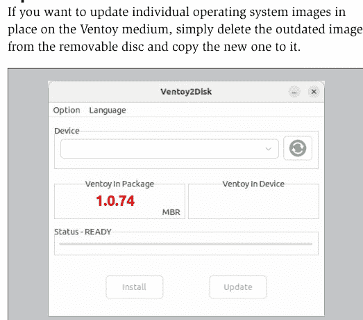

图 1：Ventoy 程序窗口。

你可以并行管理多个版本的相同操作系统，而它们不会互相干扰。Ventoy 为每个独立设备在启动菜单中生成单独条目。每次系统启动时，条目会自动更新，这样你就能看到所有系统。

Live 系统在持久化方面存在问题，这意味着你可以进行自定义，但在系统关闭后新软件会丢失。Ventoy 提供了使用脚本创建持久化文件的选项。

如果你计划使用此功能，最好检查 Ventoy 网站，以确认你通过 Ventoy 使用的 Live 发行版是否实际上支持持久化。如果是，为了关联持久化文件，可以使用 Ventoy 的 Web 界面进行管理。Ventoy 的模块化设计增加了各种灵活性，且不需要在命令行中输入任何内容。

对于持久化，第一步是在终端中在 USB 介质上创建一个指定大小的文件。运行命令并在 Ventoy 列表中找到第一行镜像。将 IGR 文件大小增加到对你实用的容量（第二行），然后需要一秒钟。通过在终端中选择大小，运行命令完成操作。

```
$ sh CreateVentoyPersistence.sh -i <path/to/image> -o <device> -removable-image=<filename.img>
```

```
$ sh CreateVentoyPersistence.sh -i <path/to/image> -o <device> -enable=<filename>
```

```
$ sh CreateVentoyPersistence.sh /dev/<device> -enable=<filename>
```

将 `设备` 替换为 USB 可移动设备的实际名称；这通常是 `sda`。注意，你允许输入权限。打开网页浏览器并输入本地地址 `http://127.0.0.1`。这将显示用于管理持久化的 Ventoy 配置界面。

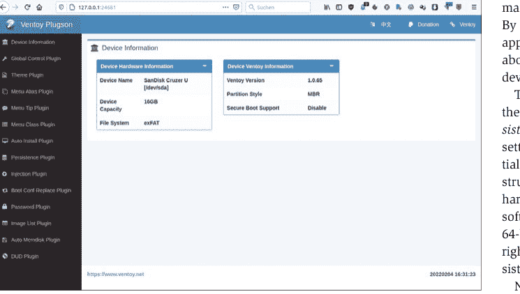

默认情况下，会出现设备信息页面，显示关于活动 USB 设备的基本信息（图 2）。

要启用 USB 磁盘上的文件持久化，你需要选择持久化插件。在设置的右侧，你会发现一个带有水平表的（空）表格。该表引用支持的硬件架构。默认情况下，软件启用了 64 位系统的持久化。现在点击表格右侧创建持久化文件并命名。


选择镜像后，点击 OK。QEMU 会打开一个单独窗口，你可以在其中看到内存中的 ISO 或启动镜像。如果窗口显示了多个你想要测试的镜像，请返回 Multiboot 主窗口并检查选中了哪个镜像（图 5）。

在过程开始之前，点击下一步（Next）。从 USB 选择磁盘列表中选择一个驱动器，但不要指定分区。然后选择你想让 Multiboot 传输到 USB 闪盘的 ISO 镜像。在此模式下，只有一个镜像会被传输到媒体，并将占据媒体的全部容量。Multiboot 还会删除闪盘上所有现有分区。

选择所需的镜像后，点击窗口顶部的“写入镜像”（Write to image）选项卡。软件会弹出警告信息。你可以点击“开始写入镜像”（Write to image to start）来开始传输 ISO 镜像。

当传输完成后

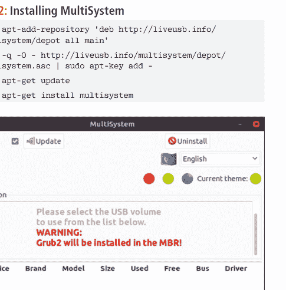

2022 年8 月 20 日第 261 期 LINUX-MAGAZINE.COM | LINUXPROMAGAZINE.COM

USB 多重启动

Multisystem 调整 Linux 和引导管理器以适应不同的发行版。

| MS | 菜单 | 启动 | 非自由 | 关于 |
|---|---|---|---|---|
| antiX | anti-21_x64-base.iso | 15-03-2022-15:51:52-49710486 | | |
| puppy | | 15-03-2022-16:25:29-4710486 | | |
| ubuntu | ubuntu-20.04.2-desktop-amd64.iso | 15-03-2022-16:37:36 | | |

在 Multisystem 运行，你将能够管理一个具有任何特殊设计的程序。如果你尚未连接 USB 闪盘，Multisystem 会提示你必须先向电脑连接一个格式为 FAT32 的 USB 闪盘。然后你需要重启 Multisystem。连接的闪盘将出现在窗口列表中。如果电脑连接了多个驱动器，它们将逐一显示（图 7）。

选择 USB 媒体后，点击确认（Confirm）按钮完成。应用程序现在准备设置。

在情况下，你都需要在选择多启动（Choose Multiboot）框中设置启动镜像或 USB 闪盘所需的 RAM 大小：无论你实际拥有的 RAM 容量，建议每个单独 ISO 或 USB 闪盘最多使用 2 GB。完成后，点击 OS 启动（OS Boot）或启动（Boot）。

在 Multisystem 运行，如果你选择一个支持持久化存储的发行版，你可以点击磁盘图标创建存储区域。如果你的发行版不支持持久化模式，窗口会弹出一个提示。

在 Multisystem 运行，如果你想修改设置，使用列表右侧的各种按钮。点击笔图标可以为 Grub添加参数。打开一个窗口，你可以在其中更改选中的发行版。

在 Multisystem 运行，如果你想从存储媒体中删除已安装的发行版，点击带有回收图标的按钮。在提示下，在终端中输入 root 密码。Multisystem 将会删除 Grub 中对应的对应条目。

在 Multisystem 运行，Multisystem 运行在一个可以轻松设置的 Virtual 实例上，以测试在 Virtual 中启动的 CD 完整性。对于个人用户，可以从启动菜单中尝试 Live CD。Multisystem 无需 USB 即可启动。

在需要指定系统的下方，有一个很大的区域，你可以拖入下载的 ISO 镜像。Multisystem 会自动打开 Virtual 并启动 ISO 安装程序。这消除了耗时的任务

## 将你的想法变为现实！

这不仅仅是一本电脑杂志！MakerSpace 专注于你可以利用来构建属于自己的东西的技术。

如果你对电子产品感兴趣，但还没有时间或技能（目前还没有），学习这些制作项目可能会成为推动你入门的最后推力。

本期特别节目将帮助你深入了解：

- 树莓派 (Raspberry Pi)
- Arduino
- 复古游戏 (Retro Gaming)
- 以及更多！

## 制作一台树莓派收音机！

## 制作者的实践项目

酷炫技巧！

用盐水电池充电

光影绘画

你确信自己需要一根可编程的光线棒

PIMiga 2.0

使用这款 Amiga 模拟器开启你的游戏之旅

给 FPGA 极客的更多内容！

shop.linuxnewmedia.com/specials

创新与社区

Clement Lefebvre 简要介绍了 Linux Mint 的历史以及围绕该发行版成长的社区。

*作者：Bruce Bytfield*

Linux Mint 是三大 Debian 衍生版之一。尽管它始于 2006 年，但 Linux Mint 最初是 Ubuntu 的衍生版，为了那些避开 Gnome 3 的用户，它以 MATE 的名义分支了 Gnome 2。今天，Linux Mint 也因创新闻名，以及它的滚动更新版本 Linux Mint Debian Edition (LMDE) 闻名，这使得其开发者与其社区能够保持独立。在 18 年的生存时间里，Linux Mint 在团队负责人 Clement Lefebvre 的带领下成长，他花时间专注于 Linux Mint 项目的历史记录。

**Linux Mint**: Linux Mint 是如何起的？

**Clement Lefebvre**: Linux 一直是一个爱好。每年我都会参与其中，但与其说它是工作，不如说它一直是我为了消遣时间而玩的某种。我编写软件；折腾发行版；花大量时间与他人聊天。最后，我开始写关于 Linux Mint 的文章和视频，当要托管这些内容时，我自己创建了 Linux Mint 网站。

当时，Ubuntu 刚出生两年，但我认为它是那里最好的发行版。我对比了许多发行版，并对哪些可以改进有了非常棒的想法。我开始修改 Ubuntu，并写了相关文章。人们对此感到非常兴奋并提供了反馈。越来越多的人加入进来，它变得更加严谨、更严肃。在 Linux Mint 2.2 Bianca 发布后，这不再仅仅是一个有趣的实验；目标变成了生产出最好的发行版。

**LM**: 你对 Linux Mint 的哪些方面感到自豪？

**CL**: 我认为我最自豪的是我们在过去 16 年里表现出的连贯性。用户使用反馈，我们让人们感到快乐，我们不断成长，从没有把自己重造为某种完全不同的东西，我们不断改进、添加并再次改进，在每个新版本的发布中都进行循序渐进的提升。我们的用户群一直在增长，我们设法每天做到这一点。

**LM**: 为每个版本维护三个独立的桌面环境面临哪些挑战？

**CL**: 我们支持其中的三个版本（Cinnamon、MATE 和 Xfce），但它们都是构建在 GTK 之上的。我们使用了在开发、维护和支持我们在所有桌面上运行的核心应用和工具时大量使用的同一套工具包。对我们来说，致力于帮助 Mint 版本的解决方案非常有意义。XApps 项目就是一个很好的例子，展示了我们如何不是使用不同的编辑器（例如使用三个 PDF 阅读器），而是确保我们使用一套可以在处处运行的核心应用程序，尽可能地偏离 Gnome 2：它可以进行一点创新，可以改进，但它必须保持 Gnome 2 的特性。

Linux Mint。我们是一个团队。我们知道自己是谁，也知道用户喜欢什么；这才是最重要的。如果你问 Mint 用户为什么他们想要 Linux，我想他们会告诉你所有的需求。也许情况恰恰相反；也许是反过来。

Krita 故事板 Docker / 视频

同心球

全景 扫视

17/02/2021

固定画面

放大

细节 1

细节 2

固定画面

镜头固定

快速移动技术

镜头固定

光效素材？

画面内无人，手视角处理（已处理）

素材？自然

人物大理石处理（已处理）

同心球

LOGO 结束

在 iPad 上

屏幕上图层顺序

技术回顾图表

同心球

结束

全景 纸页进入

图表

# 一个简单的故事板编辑器

# 讲述者 (Storyteller)

Krita 5 包含一个编辑器，可以轻松地为任何目的准备故事板，包括意外的用途。由 Marco Fioretti 编写并与他人分享。除了极简单的视觉故事外，所有的故事创作都会使用故事板，这可以最大限度地减少因困惑或误解而浪费大量时间——可能损失资金的风险。

Krita 新的 Storyboard Docker 帮助你为动画和其他媒体项目准备故事板 [1]。如果你无法轻松地创作故事，故事板是一个必不可少的工具。艺术家们在电影、游戏和漫画中使用故事板。StudioPlugin [2] 将故事板描述为你的故事叙事流的视觉表示，逐场景地，尽可能简单，不需要详细的角色、符号、背景或其他多重细节。

故事板通常呈现图像的草图，这意味着你可以通过简单的手绘来创建故事板；与传统工具相比，Krita 的故事板功能提供了许多优势。故事板可以作为故事演示的“大纲”，并以你可以开发甚至对其进行动画处理的格式呈现。Krita 是学习如何使用 Krita 的好方法。你可以分享你对想要实现目标的视觉描述，然后完成它。

# Krita 快速介绍

Krita [3] 是一款开源的多功能绘画程序，用于数字绘画、插画、概念设计和其他创意工作。作为一个功能丰富的软件，Krita 提供了各种需求和命令，包括绘制许多位图层和矢量图层的工具。

Krita 很容易学习，因为它按分级进行分组，让用户轻松地管理和处理图像。许多 Krita 功能放置在称为 docker（调度器）的面板中，你可以将它们从主窗口分离出来，并根据需要安排在桌面上。Krita 还有针对特定活动（例如漫画或动画）优化的工作区。这些工作区本质上是预定义的 docker 组合，你可以通过点击主窗口右上角的小按钮来快速加载它们。

你可以在许多 Linux 发行版的官方存储库中找到 Krita，但它可能不是当前的 5 版本。如果你在你的发行版中找不到当前版本，可以下载 AppImage 单文件版本，将其设置为可执行文件，并将其安装在 `$PATH` 中的任何位置。为了在我的 Ubuntu 系统上安装 Krita 5.06，在从网站下载 AppImage 后，我执行了以下操作：

```
## my krita-S-O-E-x86_64.appimage krita
## chmod 755 krita
## my krita ~/bin
```

## Krita 故事板 Docker


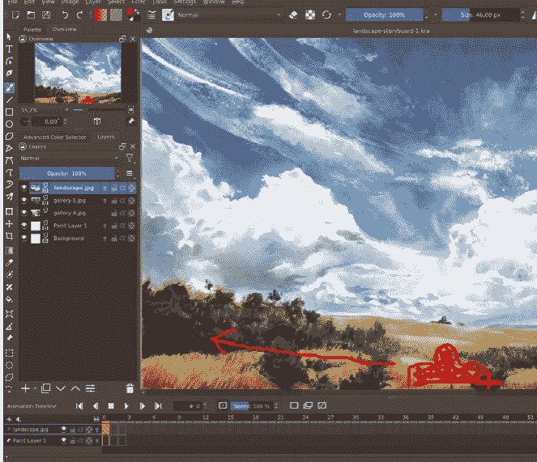

图 1：仅显示缩略图的 Storyboard Docker。

在描述如何使用之前，先介绍 Storyboard Docker 的功能。Storyboard Docker 让你将故事开发为一系列场景，你可以通过点击或拖放来添加、删除或重新排序。Docker 右角的汉堡菜单可以打开一个包含场景布局选项的菜单（行、列或网格）。

## Krita 5 中的故事板

在故事板的场景中，我使用一张 Krita 图像作为背景，并在前景中画了一个红色的笔和一个箭头，这暗示了故事内容。

图 3：你可以非常轻松地添加、删除或移动故事板的场景。

图 4：我从 Krita 图库中挑选了这五张完美的图片作为我示例故事板的基础。


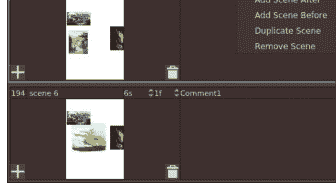


故事板提供了准备、检查和制作故事最快、最简单的方法。

2022 年 8 月 26 日第 261 期 LINUX-MAGAZINE.COM | LINPROMAGAZINE.COM

为了说明在 Krita 中创建故事板的过程，我从 Krita 图库 [5] 中选取了五张图片。在这些每张图片上，我都发现了一个大致的故事大纲，并用一个五场景的故事板对其进行了插图（图 5）。首先，我加载了第一张图片（将画布作为图层）。要做到这一点，从主菜单中选择选择 | 导入 | 导入图层。

一旦图像加载到层中，你可以按 `Ctrl+T` 或点击 Krita 中的图标来激活变换工具，它允许将图像移动到任何位置或修改其大小和形状。之后，我在头部和周围画了一个红色的类人轮廓（图 2），以创建我故事板的第一个场景 (1)。我添加了这些元素以确保角色应该遮住脸（左侧）。


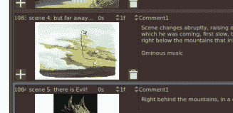


图 6：故事板提供了场景的详细描述。

2022 年 8 月第 261 期 LINUX-MAGAZINE.COM | LINPROMAGAZINE.COM

接下来，我通过 Storyboard Docker 打开了设置，并添加了另外四个场景。你可以通过点击或拖放来重新排序它们。最后，我以 PDF 格式制作了故事板（图 7）。在制作故事板时，你可以使用缩略图来查看整体。在这种情况下，你可以通过使用缩略图来查看整体。Krita 故事板可以准备准备的。在这种情况下，你可以通过使用缩略图来查看整体。在这种情况下，你可以通过使用缩略图来查看整体。

## 信息

- [Krita](https://www.krita.org/) 是一款开源的多功能绘画程序，用于数字绘画、插画、概念设计和其他创意工作。[Krita](https://www.krita.org/) 作为一个功能丰富的软件，提供了各种需求和命令，包括绘制许多位图层和矢量图层的工具。

Krita 很容易学习，因为它按分级进行分组，让用户轻松地管理和处理图像。许多 Krita 功能放置在称为 docker（调度器）的面板中，你可以将它们从主窗口分离出来，并根据需要安排在桌面上。Krita 还有针对特定活动（例如漫画或动画）优化的工作区。这些工作区本质上是预定义的 docker 组合，你可以通过点击主窗口右上角的小按钮来快速加载它们。

你可以在许多 Linux 发行版的官方存储库中找到 Krita，但它可能不是当前的 5 版本。如果你在你的发行版中找不到当前版本，可以下载 AppImage 单文件版本，将其设置为可执行文件，并将其安装在 `$PATH` 中的任何位置。为了在我的 Ubuntu 系统上安装 Krita 5.06，在从网站下载 AppImage 后，我执行了以下操作：

```
## my krita-S-O-E-x86_64.appimage krita
## chmod 755 krita
## my krita ~/bin
```

## Krita 故事板 Docker


图 1：仅显示缩略图的 Storyboard Docker。

在描述如何使用之前，先介绍 Storyboard Docker 的功能。Storyboard Docker 让你将故事开发为一系列场景，你可以通过点击或拖放来添加、删除或重新排序。Docker 右角的汉堡菜单可以打开一个包含场景布局选项的菜单（行、列或网格）。

## Krita 5 中的故事板


在故事板的第一个场景中，我使用一张 Krita 图像作为背景，并在前景中画了一个红色的笔和一个箭头，这暗示了故事内容。

图 3：你可以非常轻松地添加、删除或移动故事板的场景。

图 4：我从 Krita 图库中挑选了这五张完美的图片作为我示例故事板的基础。


故事板提供了准备、检查和制作故事最快、最简单的方法。

2022 年 8 月 26 日第 261 期 LINUX-MAGAZINE.COM | LINPROMAGAZINE.COM

为了说明在 Krita 中创建故事板的过程，我从 Krita 图库 [5] 中选取了五张图片。在这些每张图片上，我都发现了一个大致的故事大纲，并用一个五场景的故事板对其进行了插图（图 5）。首先，我加载了第一张图片（将画布作为图层）。要做到这一点，从主菜单中选择选择 | 导入 | 导入图层。

一旦图像加载到层中，你可以按 `Ctrl+T` 或点击 Krita 中的图标来激活变换工具，它允许将图像移动到任何位置或修改其大小和形状。之后，我在头部和周围画了一个红色的类人轮廓（图 2），以创建我故事板的第一个场景 (1)。我添加了这些元素以确保角色应该遮住脸（左侧）。


图 6：故事板提供了场景的详细描述。

2022 年 8 月第 261 期 LINUX-MAGAZINE.COM | LINPROMAGAZINE.COM

接下来，我通过 Storyboard Docker 打开了设置，并添加了另外四个场景。你可以通过点击或拖放来重新排序它们。最后，我以 PDF 格式制作了故事板（图 7）。

## 信息

- `Krita` 是一款开源的多功能绘画程序，用于数字绘画、插画、概念设计和其他创意工作。`Krita` 作为一个功能丰富的软件，提供了各种需求和命令，包括绘制许多位图层和矢量图层的工具。

# 使用特辑版提升你的技能！

从我们的特辑版库中了解 Shell、LibreOffice、Linux 等更多内容。

《Linux Magazine》团队创建了一系列单本书籍，让你深入研究你感兴趣的话题。

提供纸质版或数字版

[查看完整库！](https://shop.linuxnewmedia.com)

## 加入 LINUX 革命！

你所需要的所有软件！

## 301 条最常用 BASH 命令

## 增强你的 LINUX 技能

触手可及的力量

- - 并反射输出

深入探索世界上最强大的免费办公套件 2022 版

## STARSHIP（星际号）

- + 学习如何设置 LINUX 系统

- 听音乐 | 玩游戏 | 处理 P

- 浏览网页及更多功能！

- 编辑并保存 MS Office 文件

- 编写你自己的 OO 应用

- 节省时间并自动化常用任务

## 创爱好者的实战项目

酷炫技巧！

带纽扣电池的轻便发光灯

你需要一个可编程的光路电路

PGA 2.0

使用模拟器让你的游戏飞跃起来

树莓派极客 (RASPBERRY PI GEEK)

与快捷键

针对 Linux 极客

使用 Xcode Download Manager 加速你的桌面

- 搜索文本、PDF 以及

- 棒的编辑器和工具

- 在强大的机器上运行虚拟机

在安装客户端软件的同时

复古乐趣

使用 DOSBox 玩 DOS 

音频专家：

全能技术：音乐家、作曲家

## 技巧 (Hacks)

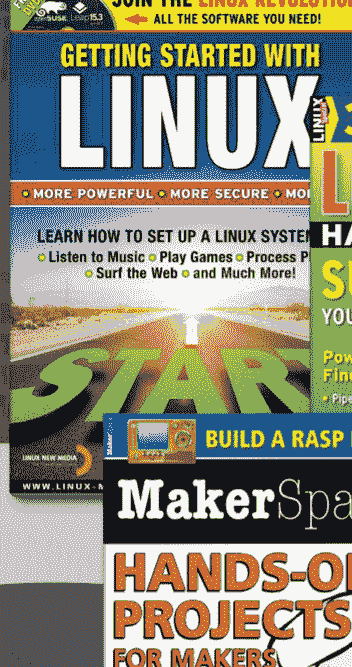


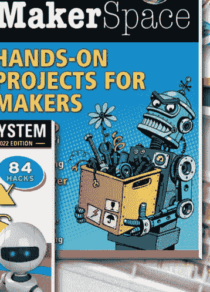


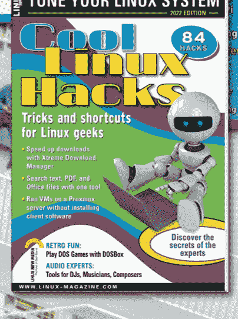

## 使用 Zeit 管理时间触发事件

### 时间表

Zeit 为 `crontab` 和工具提供了图形化界面，使得管理程序、报警和定时器的时间控制执行变得更容易。作者：Frank Hofmann

在涉及到程序时间控制执行管理时，我们使用 `/etc/crontab` 文件中的条目（用于定期间隔安排的重复任务），或使用 `crontab` 进行一次性操作。

虽然我们使用一种存储整个系统要执行命令的“账本”，但 `crontab` 的工作方式有所不同。`crontab` 包含整个系统的条目，而 `/var/spool/cron/` 中的文件则包含特定用户的条目。`crontab` 中的每一行都完整描述了一个单一任务。在指定任务时必须小心，因为条目的格式非常晦奥。你可以学习它的语法，但精通它是一项轻而易举的任务。如果你使用 IPC 接口，你会对这种格式非常熟悉。

尽管如此小心，你可能会发现 `cron` 任务（`cronjobs`）在错误的时间启动或执行。对于即使是经验丰富的用户，图形用户界面（GUI）也能帮助减少错误。然而，曾尝试过的多个时间控制调用的套件（例如 `KCron`、`KcCron`、`CronMagic`、`Gnome Task Scheduler` [1] 和 `Vcron`）都因为过于复杂或过于简单而未能尽如人愿。

`Zeit` [3] 作为 `crontab` 的图形化界面，承诺解决这一问题并让时间触发事件变得更容易。`Zeit` 自 2015 年开始开发以来，现在被认为是可以使用的，并提供英语和俄语版本。

# 安装

`Zeit` v0.6.0 在 Debian "Bulls" 上运行没有问题。`Zeit` 未包含在官方 Debian 和 Ubuntu 源中。你可以通过 GitHub 仓库或 Ubuntu PPA 安装它。你有几种方法安装 `Zeit`。你可以通过输入 `apt-add-repository` 添加 PPA 仓库并用你的包管理器安装软件包（列表 1）。由于此选项在 Debian 上不可用，我采用了从开发者 GitHub 提供的包进行替代方案。我将其部署到 594 系统上进行测试。过程中没有出现问题。获取包后，我使用了 `library-binutils` 包，这是我目前正在使用的。安装后，`Zeit` 占用约 450KB 的磁盘空间。

+ 列表 1：通过 PPA 安装

```
$ sudo apt-add-repository ppa:blaze/mine
$ sudo apt update
$ sudo apt install zeit
```

## 深度解析

在“高级”部分有详细介绍，在那里你可以指定具体的分钟、小时、日期和月份。你也可以使用 `crontab` 相同的表示法 1-5 表示周一到周五。上下文有助于你在尝试正确指定单个值。如果你使用 IPC 接口，你会对这种格式非常熟悉。

`Zeit` [3] 作为 `crontab` 的图形化界面，承诺解决这一问题并让时间触发事件变得更容易。`Zeit` 自 2015 年开始开发以来，现在被认为是可以使用的，并提供英语和俄语版本。

# Info

`Crontab UI` [7] 是一种主要用于服务器的 Web前端。该工具用 javascript 编写（图 6），提供了丰富的选项。除了

- - Gnome Crontab 计划：

- https://github-schedule.sourceforge.net

- - Gnome 任务调度器：

- https://piki.org/patrik/cat

- - Launchpad上的 Deut：

- https://launchpad.net

- - GitHub Zeit 页面：

- https://github.com/loimu/zeit

- - Zeit PPA：

- https://launchpad.net/blaze/archive/ubuntu/main-packages

- - crontab guru:

- https://github.com/alseambusher/crontab-ui

# 结论

`Zeit` 在测试中运行良好，并与我的系统无缝集成。为 `crontab` 生成的条目完美无缺（图 7），使得管理定时作业成为可能。

Frank Hoffmann 在全球工作——首选是德比恩、日内瓦和开普敦——担任开发者、培训师和作者。他还是《Debian Package Management》(http://www.dpmb.org/index.en.html) 一书的合著者

```
File Edit View Search Terminal Help.
frankdebian:~$ crontab -l
#Lunch Time
0 12 1,2,3,4 * echo "Lunch Time"
#Dinner
0 18 * * * echo "Dinner"
# # generated by Crontab Sonntag, 20. Februar 2022 01:01:11. CET.
frankdebian:~$ 
```

图 7：使用 Zeit 编辑的 crontab 表没有错误。


## IT 亮点回顾


忙得没时间浏览新闻稿和冗杂的技术新闻吗？让我们把最相关的新闻、技术文章和工具提示直接递送到您的收件箱。

Linux 更新 • ADMIN 更新 • ADMIN HPC

紧跟 IT 行业动态。

ADMIN AND HPC: bit.ly/HPC-ADMIN-Update

Linux Update: bit.ly/Linux-Update

| 输入 | 处理 (E. Bash) | 通道 1 |
|---|---|---|
| | 通道 0 | 通道 2 |

## 深度解析

Shell 中的管道

它们按照相同的顺序从管道中接收。Linux 使用两种类型的管道：匿名管道和命名管道。

匿名管道使用管道符号 (`|`) 连接命令。这些管道被称为匿名管道，是因为用户在任何情况下看不到它们。

在此例中，以下示例找到并统计了命令作为输出的目录的所有子目录：

```
匿名管道存在于
/proc/self/fd 目录中，类似于
标准通道。调用 a-
$ ls -1 | grep "d" | wc -l
138
```

### 列表 1：重定向通道

```
$ 1 ls -ld /dev/pseudo
$ 2 ls: cancel /dev/pseudo: no such file or directory
$ 3 echo $?
0 4
$ 5 ls -ld /dev/pseudo 2>/dev/null
$ 6 echo $?
0 7
```

所有 1 的输出都重定向到 `grep` 命令的输入通道，而 `grep` 的输出被重定向到命令 (`wc`) 的输出。

当重定向在管道上工作时，shell 会生成它们。通过完成命令序列，它们终止并重定向到其他地方。

### 列表 2：创建命名管道

```
$ 1 mkfifo /var/testpipe
$ 2 ls -l /var/testpipe
prw-r--r-- 1 root 0 Jan 4 23:25 /var/testpipe
```

命名管道可以使用 `mkfifo` 命令在文件系统中创建。它们保持激活状态直到使用 `rm` 命令删除。当我们使用管道时，必须手动处理双向工作，而匿名管道会自动完成。

### 列表 3：使用命名管道

```
### 会话 1：写入
$ echo "31415" /var/testpipe
### 会话 2：读取
$ ls -l /var/testpipe
prw-r--r-- 1 root 0 Jan 4 23:25 /var/testpipe
$ pi-$(cat /var/testpipe)
prw-r--r-- 1 root 0 Jan 4 23:42 /var/testpipe
$ echo $?
31415
```

## 命名管道

经验丰富的 Linux 用户对管道的使用非常熟悉。要创建一个命名管道，你可以使用 `mkfifo` 命令。示例显示该操作成功了。在 (3) 的输出中，左侧的 p 让你知道现在可以将命令的输出重定向到此管道。命令在完成从管道读取数据完成之前会等待（列表 4）。你可以看到时钟从 23:35 到 23:42 在读取。然而，管道的大小仍然为零，因为管道只计算数据。实际发生的情况是系统提供了一个缓冲区，尽管这并不是通用的。列表 4 和 5 中的简单示例演示了 -从- 

### 列表 4：定义变量

```
$ started=$(date '+%H:%M:%S'); echo $started
$ ended=$(date '+%H:%M:%S'); echo $ended
22:04:44
22:04:44
```


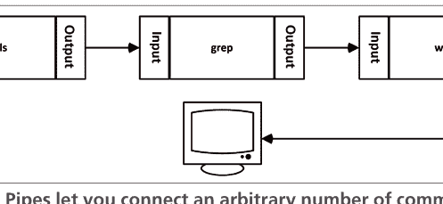

图 2：管道允许你连接任意数量的命令。

### 列表 5：从管道读取

```
### 终端 1：
$ started=$(date '+%H:%M:%S'); echo $started /var/testpipe; ended=$(date '+%H:%M:%S'); echo $ended /var/testpipe
### 终端 2：
$ read </var/testpipe echo "Start: $started" echo "End: $ended"
23:08:52
End: 23:08:52
```

## 深度解析

### Shell 中的管道

```
### 列表 6：远程命令
01 sh -c target "command1; command2 [...]"
02 rcmd "command1; command2 [...]"
```

用于接收。进程仅仅读取发送端管道，并将行重定向到你希望远程机器处理的信息，但这将需要不必要的内存消耗。嵌套管道在解决方案 之后。只有当远程机器同时读取数据时，进程才会写入管道，进程不需要管道的任何额外内存。t1-命令从相同点写入数据。为了在两者之间建立连接，使用了命名管道。接收端从发送管道读取，并将输出重定向到输入（图 3）。进程在从管道读取数据完成时写入管道。t1-f 的输出。

t1-f 的输出

图 3 的通信如下所示。它被被数据流读取，处理数据，并将数据流发回以恢复。但如何在两个计算机之间或按顺序命令和其他信息维持连续的数据流？

### 监听器

使用 `tail -f` 命令是因为在到达文件末尾 `EOF` 时会终止。然而，你可以只需重定向逗号，因为命令已经被处理。

| rcmd bz. | STDOUT |

|---|---|

| sendfile | |

| sendpipe | awk |

| tail -f | receivepipe |

| ssh | cat |

### 应用程序

列表 6 解释了基于命名管道的网络连接，并使用该连接在远程计算机上执行命令。关于计算机之间通信的下一个上升方面是，对于读取或写入，管道之前或之后发生了并不重要，因为管道的读写操作不会改变请求。机器之间的访问无需密码，并依赖于示例中的 `SSH`。第一个使用列表显示了链式命令和目标计算机（列表 6 第 1 行）。`SSH` 现在连接到目标系统，执行指定的命令并终止连接。这比处理要执行的命令要简单，它在另一个机器上运行，并且在本地 shell 中输出。R `rcmd` 函数来自脚本（列表 7）。每个命令使用管道发送并使用一个管道

## 列表 7：函数脚本

```bash
001 setenv() {
002   # 设置必要的环境变量
003 awkfile=/tmp/read.awk
004 BASENAME=$(basename /usr/bin/$basename)
005 PYTHON=$(python /usr/bin/python)
006 AWK=$(awk /usr/bin/awk)
007 TAR=$(tar /usr/bin/tar)
008 MKIFIFO=$(mkfifo=/usr/bin/mkfifo)
009 UNAME=$(uname /usr/bin/uname)
010 TAIL=$(tail /usr/bin/tail)
011 CAT=$(cat /usr/bin/cat)
012 SSH=$(ssh /usr/bin/ssh)
013 BM=/usr/bin/bm
014 rhost=${REMOTEHOST:-}
015 lhost=${LOCALHOST:-$UNAME}
016 sendpipe=/tmp/send.$rhost
017 receivepipe=/tmp/receive.$rhost
018 sendpipe=/tmp/send.$lhost
019 receivepipe=/tmp/receive.$lhost
020 }

021 mkpipes() {
022   # 检查所需的管道是否存在
023 for pipe in $sendpipe $receivepipe
024 do
025 if [ ! -p $pipe ]; then
026     echo "cannot communicate with $rhost"&2
027     return 1
028   fi
029 done
030 return 0
031 }

032 createepipes() {
033   # 生成必要的管道
034 setenv
035 for pipe in $sendpipe $receivepipe
036 do
037   if [ ! -p $pipe ]; then
038     MKIFIFO=/tmp/mkfifo
039     if [ $? -ne 0 ]; then
040       echo "cannot create $pipe"&2
041     fi
042     echo "pipe ($pipe) already exists"
043   fi
044 done
045 return 0
046 }

047 removepipes() {
048   # 如果需要则删除管道
049 setenv
050 for pipe in $sendpipe $receivepipe
051     echo "Copying to $tdir.."
052     # 使用 awk 读取行，直到接收到 END_FILETRANSP
053     # 字符串
054     then
055       echo "END_COMMUNICATION" >receivepipe
056     fi
057   if [ $0 == "END_FILETRANSPER" ];
058     then
059       $BM -f /tmp/listener_$rhs.pid
060     fi
061   else
062     print 0
063     # 接收到的行被解码并重定向到
064     # 相应的目标文件
065   fi
066 $receivepipe | PYTHON -c 'import sys; sys.stdout.write(sys.stdin.read())>"$file"
067 echo "$file transferred"
068 if [ "$1" = "BEGIN_CMD_OUT" ];
069   then
070     # 接收到的行被解码并重定向到
071     # 相应的目标文件
072     后续行
073     until read -r line; do
074       if [ "$line" == "END_CMD_OUT" ]; then
075         print 0
076       fi
077     done <$receivepipe
078   fi
079 }

080 setup() {
081   # 检查所需的管道是否存在
082   chkpipes
083   if [ ! -f "$file" ]; then
084     echo "cannot find $file"&2
085     return 1
086   fi
087   if [ $? -eq 0 ]; then
088     $TAIL -f $sendpipe | BM -q "$file" >receivepipe
089   fi
090   else
091     # 如果管道不存在，输出
092     echo "Pipes for communication not detected"&2
093     return 1
094   fi
095 killall() {
096   # 向所有进程发送通信
097   if [ -w $sendpipe ]; then
098     echo "END_COMMUNICATION" >sendpipe
099     echo "*" /tmp/sendpipe_$rhs.pid
100  fi
101  if [ -w $receivepipe ]; then
102    echo "END_FILETRANSPER" $file >sendpipe
103    cat $file | PYTHON -c 'import sys; sys.stdout.write(sys.stdin.read())>"END_FILETRANSPER" >sendpipe
104  fi
105  else
106    echo "executable file transfer not possible."&2
107    return 1
108  fi
109 }
```

## 深度解析

### Shell 中的管道

列表 7：函数脚本（续）

## 列表 8：生成数据流

```bash
$ tail -f Send-Pipe | RECEIVE- | ssh -q'
```

## 列表 9：输出结果

```bash
$ echo "cd; pwd" | /bin/bash
root
echo "$PWD" | /bin/bash
var/tmp
```

## 列表 11：设置目录

```bash
# type rcmd
is a function
setenv;
chkpipes;
if [ $? -ne 0 ]; then
  return 1;
fi;
echo "BEGIN_CMD $#; < /tmp/lastpd.tmp.$lhost " > /sendpipe;
return $?
}
```

图 4：向远程计算机发送文件的程序流。

### 程序流程

监听器读取管道并初始化。如果它接收到包含执行命令的行，将检查是否存在包含工作目录的文件（图 4）。下一步，它将 `BEGIN_CMD` 写入标准输出流。

传输完成后，进程切换到目标目录并将任何要执行的命令写入子进程。命令输出被写入数据流。命令的结束由 `END_CMD_OUT` 字符串标记。如果行以 `END_COMMUNICATION` 字符串开头，进程退出。

作为最后，函数检查接收到的行是否包含 `BEGIN_CMD`。

### Shell 中的函数

表 1：Shell 中的函数

| 函数 | 说明 |

| :--- | :--- |

| setenv | 设置所有的环境变量。 |

| chkpipes | 检查所需的管道是否存在。 |

| createepipes | 生成必要的管道。 |

| removepipes | 如果需要则删除管道。 |

| listen | 生成监听器。 |

| killall | 终止所有进程。 |

| rcmd | 在远程主机上运行命令。 |

| sendfile | 文件到远程计算机。 |

图 5：监听器的程序流。

## 深度解析

## 命令行 – lm-sensors

## 监测你的硬件温度

### 散热散热


通过 `lm-sensors`，你可以监控硬件的内部温度以避免过热。作者：Bruce Byfield

在过去的十年中，笔记本电脑趋向轻薄化和功能化的趋势，这加剧了本就存在的问题。

硬件温度长期一直是系统管理员和服务器农关注的焦点。随着全球夏季的到来，消费级口袋设备内部的记录性温度已成为一个主要关注的问题。过热量可能会导致电脑运行异常。在极端情况下，过热可能导致你的电脑关机，或者更糟糕的是，会对敏感元件造成永久性损坏。如果你将笔记本电脑放在腿上使用，可能会导致严重的三度烫伤。

由于关涉众多，监控硬件温度有着迫切的需求，至少是在新机器上、在炎热的日子里以及当你的计算机长时间运行的季节，而许多人使用的工具仅仅是够用，甚至已经过时。结果是，用户不仅没有办法应对热量，而且还缺乏充分或及时的工具。坦率地说，`lm-sensors` 软件包可以帮助解决这个问题，尽管它需要一些配置并加载内核模块。

无论何种，理想的情况是让更多的冷空气进入机箱，热空气排出机箱，通过空气和风扇将空气推向后部和顶部。然而，这些空气可能会被组件以及它们固定在机身上的点阻挡。此外，炎热的日子意味着进入箱体的空气冷却效果没有寒冷的日子那么好。

为了监测这种困难且不断的情况，现代硬件配备了热传感器。读取温度差意味着你可以构建一张气流图——或者 Linux 内核模块将读取设置和其他信息输出到 `/sys/class/hwmon` 伪文件系统中，并在那里为应用程序进行配置。它并不是为了供人类阅读而设计的，尽管可以使用对普通用户来说不实用的复杂负载来描述信息。

## 热热力学问题

## 作者

**Bruce Byfield** 是一位专注于自由和开源软件的计算机记者、作家兼编辑。除了写作项目外，他还教授 Linux 和在线学习课程。在他的个人空间里，他编写关于西海岸（https://brucebyfield.wordpress.com）的内容。他还是 Pretentice 的联合创始人，这是一个关于写作和自由思考的博客，地址为 https://pretentice.com/。

简单来说，电脑在在使用时会产生热量。在封闭空间内，热量很容易上升而不是发散。风扇可以正常工作，但在笔记本电脑上可能特别困难，因为其组件被挤在比工作站更狭小的空间内。

## 命令行 - lm-sensors

```bash
root@debian:~ # sensors-detect
# sensors-detect version 3.6
## System: Linux 5.10.0-4
## Board: MSI Z390 GAMING (MS-7693)
## Kernel: 5.10.0-14-amd64 x86_64
## OS: Debian 11 (bullseye) --Core (21/2)
```

在使用 `lm-sensors` 之前，你必须使用 `sensors-detect` 检查你检查所需的内核模块。

该程序帮助你确定需要加载哪些内核模块以最有效地使用 `lm-sensors`。除非你非常清楚自己在做什么，否则通常建议接受默认答案。

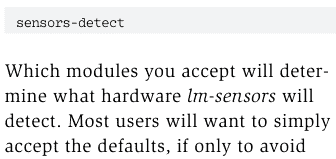

哪些模块将决定 `lm-sensors` 检测哪些硬件。如果存在任何潜在问题，大多数用户将接受默认值。如果是这样，你可以再次运行命令 (1)。在每次扫描后，`lm-sensors` 将总结它的发现。然后它提议将这些添加到 `/etc/modules/`（图 2）。

某些桥桥、CPU 或内存控制器可能包含嵌入传感器。如果是这样，搜索它们是完全安全的。(Yes/no)

```
Module loaded successfully
Silicon Integrated Systems S5595...
VIA VT8231 Integrated Sensors...
AMD K8 thermal sensors...
AMD Family 10th thermal sensors...
AMD Family 11th thermal sensors...
AMD Family 12th and 14th thermal sensors...
AMD Family 15th sensors...
Success!
(driver) k108
AMD Family 16th thermal sensors...
```

图 1：`lm-sensors` 允许你选择想要查找的硬件，尽管你应该直接接受默认值。

一旦设置完成，你可以运行命令获取你的温度报告（图 4）。报告以可读格式显示了你检测到的使用情况，还有其他工具提供有关硬件的信息——即 i-Nex、HardInfo、Coninfo 和 `lm-sensors`——在这些工具的报告中，特别是在桌面端。在所有这些工具中，功能最多的那个必须给你一个平均读数，而这用途有限。对于互联网上提到的某些工具现在已经消失了。例如，Glances 提供了多个温度读数，然而这些芯片随着硬件的演进，已经有了更好的替代品。虽然 htopdm 不读取旧机械硬盘的温度，但它不支持日益常见的固态硬盘，在这些情况下，`lm-sensors` 填补了硬件工具的空白。

如果你觉得对检测到的传感器很安全，请决定使用 `lm-sensors`。

某些桥接、CPU 或内存控制器包含嵌入传感器。你想搜索它们吗？这是完全安全的：(Yes)

```
Silicon Integrated Systems S5595...
VIA VT8231 Integrated Sensors...
AMD K8 thermal sensors...
AMD Family 10th thermal sensors...
AMD Family 11th thermal sensors...
AMD Family 12th and 14th thermal sensors...
AMD Family 15th sensors...
Success!
(driver) k108
AMD Family 16th thermal sensors...
```

图 1：`lm-sensors` 允许你选择想要查找的硬件，尽管你应该直接接受默认值。

一旦设置完成，你可以运行命令获取你的温度报告（图 4）。报告以可读格式显示了你检测到的使用情况，还有其他工具提供有关硬件的信息——即 i-Nex、HardInfo、Coninfo 和 `lm-sensors`——在这些工具的报告中，特别是在桌面端。在所有这些工具中，功能最多的那个必须给你一个平均读数，而这用途有限。对于互联网上提到的某些工具现在已经消失了。例如，Glances 提供了多个温度读数，然而这些芯片随着硬件的演进，已经有了更好的替代品。虽然 htopdm 不读取旧机械硬盘的温度，但它不支持日益常见的固态硬盘，在这些情况下，`lm-sensors` 填补了硬件工具的空白。

如果你觉得对检测到的传感器很安全，请决定使用 `lm-sensors`。

某些桥接、CPU 或内存控制器包含嵌入传感器。你想搜索它们吗？这是完全安全的：(Yes)


## 命令行 - lm-sensors

```bash
root@debian:~ # sensors-detect
# sensors-detect version 3.6
## System: Linux 5.10.0-4
## Board: MSI Z390 GAMING (MS-7693)
## Kernel: 5.10.0-14-amd64 x86_64
## OS: Debian 11 (bullseye) --Core (21/2)
```

在使用 `lm-sensors` 之前，你必须使用 `sensors-detect` 检查你所需的内核模块。

该程序帮助你确定需要加载哪些内核模块以最有效地使用 `lm-sensors`。通常建议接受默认答案，除非你非常清楚自己在做什么。


哪些模块将决定 `lm-sensors` 检测哪些硬件。如果存在任何潜在问题，大多数用户将接受默认值。如果是这样，你可以再次运行命令 `(1)`。在每次扫描后，`lm-sensors` 将总结它的发现。然后它提议将这些行添加到 `/etc/modules/`（图 2）。

某些桥接、CPU 或内存控制器可能包含嵌入传感器。如果是这样，搜索它们是完全安全的。(Yes/no)

```
Module loaded successfully
Silicon Integrated Systems S5595...
VIA VT8231 Integrated Sensors...
AMD K8 thermal sensors...
AMD Family 10th thermal sensors...
AMD Family 11th thermal sensors...
AMD Family 12th and 14th thermal sensors...
AMD Family 15th sensors...
Success!
(driver) k108
AMD Family 16th thermal sensors...
```

图 1：`lm-sensors` 允许你选择想要查找的硬件，尽管你应该直接接受默认值。

一旦设置完成，你可以运行命令获取你的温度报告（图 4）。报告以可读格式显示了你检测到的使用情况，还有其他工具提供有关硬件的信息——即 `i-Nex`、`HardInfo`、`Coninfo` 和 `lm-sensors`——在这些工具的报告中，特别是在桌面端。在所有这些工具中，功能最多的那个必须给你一个平均读数，而这用途有限。对于互联网上提到的某些工具现在已经消失了。例如，`Glances` 提供了多个温度读数，然而这些芯片随着硬件的演进，已经有了更好的替代品。虽然 `htopdm` 不读取旧机械硬盘的温度，但它不支持日益常见的固态硬盘，在这些情况下，`lm-sensors` 填补了硬件工具的空白。

如果你觉得对检测到的传感器很安全，请决定使用 `lm-sensors`。

某些桥接、CPU 或内存控制器包含嵌入传感器。你想搜索它们吗？这是完全安全的：(Yes)

# 公共资金

## 公共代码


## 使用自由软件实现基础设施现代化

## 深度解析

## 使用 inxi-gui 方便地读取系统信息

### 我是谁

`inxi` 为用户提供了系统的硬件全面清单——但仅限于命令行。`inxi-gui` 是一个图形化前端，它让事情变得更加方便。作者：Erik Bärwald


`inxi` 命令行程序提供了关于你电脑大部分硬件的详细信息。然而，为了显示这些数据，你需要向 `inxi` [1] 传递参数。这是一个基于韩国的 Linux 发行版 Inxi Linux（适用于 Ubuntu、Linux Mint 及其衍生版本）的开发者开发的 `inxi` 的小型前端 [2]，它让整个过程变得更简单更快速。


inxi-gui 前端以 `inxi` 为底层基础，同时也依赖于各种系统实用程序，每个程序都会根据其参数解析“Command”列。

在启用某些命令后，你需要验证自己的管理员身份。然后，`inxi-gui` 将向你展示一个自解释其功能且没有任何植入的界面，其中提供了你可以从中选择的选项（图 1）。

# 安装

要与你的系统集成，你可以使用列表 1 中的两个命令。这些命令会创建一个脚本，然后你可以运行它来启动。要调用它，你需要激活你感兴趣的单选按钮，然后按 OK。

列表 1：安装

```
$ inxi -qd --host pkg.hamonrik.org/.apt sudo -E bash
$ sudo apt install inxi-gui
```

| 选择 | 命令 | 描述 |
|---|---|---|
| 文件 | `file disk-info` | 查看磁盘空间使用情况（必选） |
| 显示 | `display -dev` | 列出所有块设备上的显示信息 |
| 列出分区 | `sorted-part -` | 列出分区 |
| 列出分区布局 | `partition-layout` | 列出所有设备上的分区布局 |
| PCI 信息 | `pci-info` | 查看 PCI 设备 |
| 图形 | `graphics` | 查看图形信息 |
| 音频分级 | `audio -v` | `grep -i -A 12` | 查看音频信息 |
| 32 位 CPU | `cpu -m -` | 确定是否为 32 位或 64 位操作系统 |
| 64 位操作系统 | `cpu` | 显示有关 CPU 的信息 |
| 信息 | `inxi` | 查看系统信息 |
| 分区 | `inxi -p` | 查看分区 |
| 查看存储库 | `repos` | 查看系统上的存储库 |
| GPU | `inxi -g` | 查看 GPU 信息 |
| 网络 | `inxi -N` | 查看系统上的音频 |
| 网络配置 | `net` | 查看系统上的网络配置 |
| 查看打开配置 | `-conf` | 查看系统上的 OpenConfiguration |
| 列出版本 | `sb_release` | 查看版本信息 |

> 图 1：inxi 仅限于基本元素，在你点击瓷磁块后，它会使用重叠窗口立即找到你需要的信息。这不仅是基础信息，还包括你的 CPU 支持的技术标准的可选细节。

如果由于缺失而没有可用信息，inxi GUI 将显示相应的消息。该信息还会向你显示一些系统信息，例如活动进程的数量和系统使用情况。你可以通过窗口右下角的 Ok 按钮查看信息窗口；返回主菜单。

你可以使用整个系统的瓷磁块。程序会显示一个对话框，你可以在其中选择一个子目录，并将数据保存到你选择的未完成文本文件中。

程序窗口的 15 个瓷磁块中，有 11 个显示系统组件（图 2）。

此文件包含来自 inxi 命令行的所有数据，包括关于 X 服务器、扩展 OpenGL 和温度等组件的一些信息。如果你的系统有硬件传感器，你可以通过“Save”保存数据，或按“Cancel”选择选择保存。要查看所有系统组件的完整概述，请使用“Full info”。然后你可以在多种格式的文本文件文档中保存你的硬件和软件组件数据；使用集成的管理器将文件保存到选择的目录中。要扩展 inxi-gui，请按程序窗口中的“Quit”按钮。

## Inxi-GUI

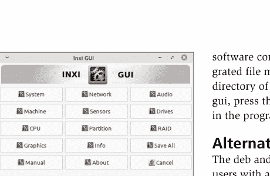

图 2：旧版本的 inxi GUI 界面提供了组件的概览

## 替代方案

deb 和 rpm 包为用户提供了一个旧版本的 inxi GUI (3)，它的功能集更简单，但另一个界面。要使用此版本，你需要在系统上安装该包。你可以在 Linux 发行版的软件包存储中找到它，也可以使用它。从你的环境菜单启动 inxi-GUI。

# 结论

inxi-gui 和 inxi 命令行的图形前端在执行工作时都不需要用户的任何参与。两个软件包都提供了相关信息，并且个人部分提供了可以保存到文本文件中的摘要。这使得这两个工具对于使用 Live USB 处理系统维护任务的管理员来说非常有用。对于捕捉使用其他操作系统的计算机的硬件概述，它也是一个非常有用的工具。

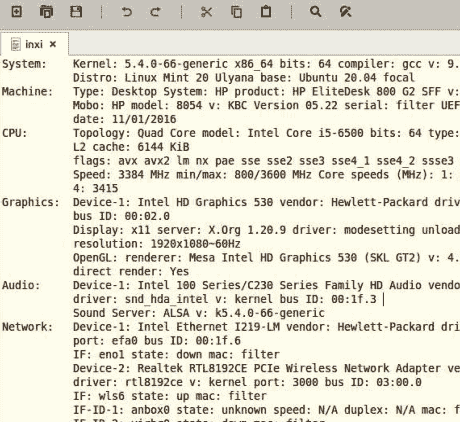

这种界面对于文档目的也非常有用。

## 信息

- [1] inxi-gui:
- [2] https://github.com/hamonrik/inxi
- [3] Older inxi GUI: https://github.com/smxi/inxi

## 深度解析

## 热备份


### 备份运行中的系统

## 热备份

热备份是指我们用于备份正在被应用程序使用的文件的工具和策略。本文解释了使用常用的 Linux 工具备份运行数据的危险性，并探讨了一些替代方案。制作备份的工具有很多，互联网也充满了关于如何使用它们的教程。在大多数情况下，这种假设是可以接受的。毕竟，用户想要备份一组在整个过程中保持静态的数据集。然而，现实场景通常要求在数据被修改时进行备份。例如，考虑一个正在加载且必须在备份写入期间继续运行的数据库，这可能会损坏备份中的文件值（图 1）。如果损坏影响的是格式结构简单的文件（例如文本文件），这种复杂格式可能会被忽略。

块级实用程序在活动文件系统上特别容易出现问题。`dump` 进程绕过文件系统接口直接读取硬件。这种方法有许多优势 [1]，但也带来了巨大的负担。当文件被写入时，它进入缓存而不会立即提交。从用户的角度来看，写入操作可能是瞬时完成的，但在内核将其写入存储器之前，文件仍然存在内存中。因此，存储在硬盘上的实际内容将是混乱的，包含部分写入的文件，等待未来的重启或 dump 返回完整内容。

## 自定义解决方案的陷阱

传统的 `dd`、`tar` 或 `dump` 是提取活动数据文件夹快照的糟糕候选者。其中，某些比其他的更糟。

## 折中方案

如果程序在文件系统级运行并尝试复制一个正在使用的文件

老式的 Unix 解决方案经过良好的测试，某些用户有理由不放弃它们。事实是，对于备份承受重载的文件夹这不应成为停止的理由；

> ameliasamgson: $ `tar -cf tar.Picture Pictures` `tar: Pictures/02-picture: file was changed as we are in tar: Pictures/01-picture: file was changed as we are` ameliasamgson: $

图 1：使用 `tar` 归档文件夹可能导致备份损坏。GNU `tar` 和 FreeBSD `tar` 会在文件在使用期间被修改时发出警告，保存的副本很可能是损坏或不完整的。

## 深度解析

## 热备份

### 列表 1：个人服务器备份脚本

```bash
#!/bin/bash

## 在 Devuan 上测试过的概念验证脚本。为了简洁起见，
## 删除了容错代码。不建议在生产环境中使用。

## 停止用户用于备份的服务。

## /etc/init.d/apache2 stop
## /etc/init.d/mysql stop
# 已证明证明是良好的。

## 安装操作系统以将写入指令提交到# 硬盘。

## /bin/sync

## 使用 tar 备份并通过 ssh 将数据发送到远程主机
## 在此脚本之前需要配置公共 SSH 认证，
## 以便实现无人值运行。

## /bin/tar --numeric --owner -cf /var/var/mariadb 2 > /dev/null | ssh debhu-owner@example.com "cat > backup_date +-I.tar'"
```

当文件系统中的文件被修改时，系统通常会用新版本覆盖旧文件。这是一种写时复制（COW）存储方法。新版本的文件被写入系统的空闲文件中，并可以注册该文件的顺序。同时，在文件被修改期间，文件系统仍然存储着一个已知良好的版本。

这种能力是突破性的，因为它简化了已加载文件的快照。存储驱动程序可以在文件正在修改的精确时刻创建一个快照作为快照，然后将使用文件的旧版本，因为旧版本已知处于一致状态，而正在写入的新版本可能可能不是。

ZFS 是一个功能强大的文件系统。源自 BSD 背景的我，我想在小型 Linux 服务器上考虑一下 ZFS。在 BSD 中，ZFS 让人感觉非常自由，因为它在 Linux 世界中显得像个外来人，但它的深度正引起越来越多的关注。

如果备份工具没有文件夹就无法工作，那么唯一的选择就是删除备份文件夹。如果你能在图片正在被传输时克制住修改图片文件夹的内容，这无疑是可行的。

使用支持 COW（写时复制）的存储。写时复制背后的原理很简单。当文件被打开并……

对于服务器来说，这种方法更为复杂。繁忙的服务器只要在没有用户连接时进行转储，完全可以负担服务服务的备份。例如，如果你的个人博客在 `/var/www` 中每天有 15 次访问，其关联的数据库在 `/var/mariadb` 中，那么在周末运行一个 cron 任务来回回调用然后恢复服务器可能是可行的。一个小的窗口可能只需要几分钟就可以归档，如果你的目标受众正在睡觉，没人需要去操作（见列表 1）。

另一方面，Linux 有一个原生的快照工具可供免费使用。

另一方面，对于生产服务器，停止服务进行备份并不是一个选项。

## 进入 COW

当系统处于负载下时，备份系统的一种流行解决方案是

图 2：基础 LVM 配置。卷组 `database_group` 存在于硬盘的一个普通分区内。在 `database_group` 内部有一个名为 `database_volume` 的卷，它存储了你需要的实际文件系统。当需要备份时，我可以创建一个名为 `database_snapshot` 的快照，之后将其内容转储到备份介质中。

## 深度解析

## 热备份

### LVM 快照是如何运作的？

LVM（逻辑卷管理器）。正如其名，它是为管理逻辑卷而设计的。它的成名之处在于灵活性；它允许管理员向集群添加更多驱动器，并将它们作为现有文件系统的扩展。LVM 一个被忽略的缺点是它的快照功能。

LVM 快照卷实际上并不包含快照拍摄时原始文件系统中的所有文件。

当拍摄快照时，快照卷会记录快照时刻原始文件系统的状态。当文件在快照拍摄后被修改时，会在快照中找到该文件的旧版本；因此，快照卷仅包含自快照以来被修改的文件。

因此，快照卷不需要像原始卷一样大，因为它只包含原始与当前日期之间的更改。然而，使用较小的快照卷伴随着风险：如果原始卷被修改为快照中已发生更改的文件，快照卷将丢失并导致损坏。为快照卷分配足够的空间是重要的。

LVM 的主要缺点是它的部署必须提前计划。假设我们在 `/var/pictures` 部署了一个存储应用程序数据的数据库。为了将来能够拍摄快照，我们必须预先打算创建 `/var/pictures`。为了实现这一目的，在驱动器内创建一个在 LVM 容器内创建的逻辑卷的分区必须已经预先存在。

我们必须使用 `vgcreate` (2) 创建一个卷组。最后，我们必须使用 `vgcreate` 在卷组上创建一个逻辑卷并对其进行格式化。

快照可以挂载为普通文件系统。如果用户需要访问自快照拍摄以来被修改的文件，将从原始文件系统中检索。如果文件已被修改——

当执行以下操作时，快照卷可以作为普通文件系统挂载在直接目录下：

```bash
root@home:~# mkdir /var/pictures
mount -o /dev/database_group/
```

```bash
root@home:~# lvcreate -L 5G -n database_group/database_group
```

LVM 快照最大的问题是，它们的生命周期比原始文件系统短。LVM 快照记录快照拍摄时原始文件系统的更改“LVM 快照是如何运作的？”。如果发生了更改，LVM 快照将耗尽空间。当系统处于负载下时，一种流行的备份系统解决方案是

```bash
root@home:~# mkdir /var/pictures
```

```bash
root@home:~# lvcreate -L 5G -n database_group/database_group
```

对于生产服务器，停止服务进行备份不是一个选项。

LVM 快照最大的问题是，它们的生命周期比原始文件系统短。LVM 快照记录快照拍摄时原始文件系统的更改“LVM 快照是如何运作的？”。如果发生了更改，LVM 快照将耗尽空间。当系统处于负载下时，一种流行的备份系统解决方案是

```bash
root@home:~# mkdir /var/pictures
```

```bash
root@home:~# lvcreate -L 5G -n database_group/database_group
```

对于生产服务器，停止服务进行备份不是一个选项。

## 进入 COW

当系统处于负载下时，备份系统的一种流行的解决方案是

图 2：基础 LVM 配置。卷组 `database_group` 存在于硬盘的一个普通分区内。在 `database_group` 内部有一个名为 `database_volume` 的卷，它存储了你需要的实际文件系统。当需要备份时，我可以创建一个名为 `database_snapshot` 的快照，之后将其内容转储到备份介质中。

## 深度解析
## 热备份

### LVM 快照是如何运作的？

LVM（逻辑卷管理器）。正如其名，它是为管理逻辑卷而设计的。它的成名之处在于灵活性；它允许管理员向集群添加更多驱动器，并将它们作为现有文件系统的扩展。LVM 一个被忽略的缺点是它的快照功能。

LVM 快照卷实际上并不包含快照拍摄时原始文件系统中的所有文件。

当拍摄快照时，快照卷会记录快照时刻原始文件系统的状态。当文件在快照拍摄后被修改时，会在快照中找到该文件的旧版本；因此，快照卷仅包含自快照以来被修改的文件。

因此，快照卷不需要像原始卷一样大，因为它只包含原始与当前日期之间的更改。然而，使用较小的快照卷伴随着风险：如果原始卷被修改为快照中已发生更改的文件，快照卷将丢失并导致损坏。为快照卷分配足够的空间是重要的。

LVM 的主要缺点是它的部署必须提前计划。假设我们在 `/var/pictures` 部署了一个存储应用程序数据的数据库。为了将来能够拍摄快照，我们必须预先打算创建 `/var/pictures`。为了实现这一目的，在驱动器内创建一个在 LVM 容器内创建的逻辑卷的分区必须已经预先存在。

我们必须使用 `vgcreate` (2) 创建一个卷组。最后，我们必须使用 `vgcreate` 在卷组上创建一个逻辑卷并对其进行格式化。

快照可以挂载为普通文件系统。如果用户需要访问自快照拍摄以来被修改的文件，将从原始文件系统中检索。如果文件已被修改——

当执行以下操作时，快照卷可以作为普通文件系统挂载在直接目录下：

```bash
root@home:~# mkdir /var/pictures
mount -o /dev/database_group/
```

```bash
root@home:~# lvcreate -L 5G -n database_group/database_group
```

LVM 快照最大的问题是，它们的生命周期比原始文件系统短。LVM 快照记录快照拍摄时原始文件系统的更改“LVM 快照是如何运作的？”。如果发生了更改，LVM 快照将耗尽空间。当系统处于负载下时，一种流行的备份系统解决方案是

```bash
root@home:~# mkdir /var/pictures
```

```bash
root@home:~# lvcreate -L 5G -n database_group/database_group
```


对于生产服务器，停止服务进行备份不是一个选项。

## 进入 COW

当系统处于负载下时，备份系统的一种流行的解决方案是

图 2：基础 LVM 配置。卷组 `database_group` 存在于硬盘的一个普通分区内。在 `database_group` 内部有一个名为 `database_volume` 的卷，它存储了你需要的实际文件系统。当需要备份时，我可以创建一个名为 `database_snapshot` 的快照，之后将其内容转储到备份介质中。

## 深度解析

## 热备份

当文件系统中的文件被修改时，系统通常会用新版本覆盖旧文件。这是一种写时复制（COW）存储方法。新版本的文件被写入系统的空闲文件中，并可以注册该文件的顺序。同时，在文件被修改期间，文件系统仍然存储着一个已知良好的版本。

这种能力是突破性的，因为它简化了已加载文件的快照。存储驱动程序可以在文件正在修改的精确时刻创建一个快照作为快照，然后将使用文件的旧版本，因为旧版本已知处于一致状态，而正在写入的新版本可能不是。

ZFS 是一个功能强大的文件系统。源自 BSD 背景的我，我想在小型 Linux 服务器上考虑一下 ZFS。在 BSD 中，ZFS 让人感觉非常自由，因为它在 Linux 世界中显得像个外来人，但它的深度正引起越来越多的关注。

如果备份工具没有文件夹就无法工作，那么唯一的选择就是删除备份文件夹。如果你能在图片正在被传输时克制住修改图片文件夹的内容，这无疑是可行的。

使用支持 COW（写时复制）的存储。写时复制背后的原理很简单。当文件被打开并……

对于服务器来说，这种方法更为复杂。繁忙的服务器只要在没有用户连接时进行转储，完全可以负担服务的备份。例如，如果你的个人博客在 `/var/www` 中每天有 15 次访问，其关联的数据库在 `/var/mariadb` 中，那么在周末运行一个 cron 任务来回回调用然后恢复服务器可能是可行的。一个小的窗口可能只需要几分钟就可以归档，如果你的目标受众正在睡觉，没人需要去操作。

另一方面，Linux 有一个原生的快照工具可供免费使用。

另一方面，对于生产服务器，停止服务进行备份并不是一个选项。

## 进入 COW

当系统处于负载下时，备份系统的一种流行的解决方案是

图 2：基础 LVM 配置。卷组 `database_group` 存在于硬盘的一个普通分区内。在 `database_group` 内部有一个名为 `database_volume` 的卷，它存储了你需要的实际文件系统。当需要备份时，我可以创建一个名为 `database_snapshot` 的快照，之后将其内容转储到备份介质中。

## 深度解析

## 热备份

### LVM 快照是如何运作的？

LVM（逻辑卷管理器）。正如其名，它是为管理逻辑卷而设计的。它的成名之处在于灵活性；它允许管理员向集群添加更多驱动器，并将它们作为现有文件系统的扩展。LVM 一个被忽略的缺点是它的快照功能。

LVM 快照卷实际上并不包含快照拍摄时原始文件系统中的所有文件。

当拍摄快照时，快照卷会记录快照时刻原始文件系统的状态。当文件在快照拍摄后被修改时，会在快照中找到该文件的旧版本；因此，快照卷仅包含自快照以来被修改的文件。

因此，快照卷不需要像原始卷一样大，因为它只包含原始与当前日期之间的更改。然而，使用较小的快照卷伴随着风险：如果原始卷被修改为快照中已发生更改的文件，快照卷将丢失并导致损坏。为快照卷分配足够的空间是重要的。

LVM 的主要缺点是它的部署必须提前计划。假设我们在 `/var/pictures` 部署了一个存储应用程序数据的数据库。为了将来能够拍摄快照，我们必须预先打算创建 `/var/pictures`。为了实现这一目的，在驱动器内创建一个在 LVM 容器内创建的逻辑卷的分区必须已经预先存在。

我们必须使用 `vgcreate` 创建一个卷组。最后，我们必须使用 `vgcreate` 在卷组上创建一个逻辑卷并对其进行格式化。

快照可以挂载为普通文件系统。如果用户需要访问自快照拍摄以来被修改的文件，将从原始文件系统中检索。如果文件已被修改——

当执行以下操作时，快照卷可以作为普通文件系统挂载在直接目录下：

```bash
root@home:~# mkdir /var/pictures
mount -o /dev/database_group/
```

```bash
root@home:~# lvcreate -L 5G -n database_group/database_group
```

LVM 快照最大的问题是，它们的生命周期比原始文件系统短。LVM 快照记录快照拍摄时原始文件系统的更改“LVM 快照是如何运作的？”。如果发生了更改，LVM 快照将耗尽空间。当系统处于负载下时，一种流行的备份系统解决方案是

## 深度解析

# 编程快照 – 使用 Go 实现自动重启

### 使用 Go 检测并重启挂掉的程序

## 管道清理器 Pipe Cleaner

检测程序是否冻结是一次对终端模拟基础的深度探索。Go 语言程序员 Mike Schilli 编写了一份指南，通过接管运行来释放管道工作。作者：Mike Schilli。


- 如果浏览器在加载网站中途停止并冻结，经验丰富的用户知道在下次尝试时点击刷新按钮即可。或者如果传输突然显示服务器已进入睡眠，管理员必须立即重启命令，并看到它自动修复故障的场景。
- 为了由人类拉动以保持其运行。为此，该工具会监控被监督程序的标准输出（以及其标准错误），这些输出经常会变化模式——例如指示正在运行的进度条。如果显示由于网络中断或服务器失去响应而冻结，则在配置的超时后重启程序，希望从时间上解决问题。

## 感觉像是一个终端

很简单，对吧？程序的行为取决于它们是否在终端中运行。例如，使用 `git push` 效果更好，因为它会持续输出传输进度作为进度条，并将其交给调用者，特别是当他们需要提交大文件时，关于某些的想法。

本期中的 Go 程序是受信任的，它将帮助你管理一个“悠悠球”，你也需要

## 作者

Mike Schilli 在加利福尼亚州旧金山湾区和俄勒冈州担任软件工程师。在他自 1997 年以来一直运行的专栏中，他研究各种编程语言的实践。如果你通过 `mschilli@perimiter.com` 给他发送邮件，他将乐意回答关于它的任何问题。

```
$ git push origin master
Enumerating objects: 3, done.
Counting objects: 10 (3/3), done.
Delta compression using up 16 threads
Compressing objects: 10 (2/2), done.
Writing objects: 10 (3/3), 99.74 KiB | 204.0 KiB/s, done.
Total 3 (delta 0), reused 0 (delta 0), pack-removed 0
To some.host.com:git/test
* [new]
master -> master
```

图 1：`git` 输出数据传输统计信息，但仅当它在终端中运行时。

## 深度解析

# 编程快照 - 使用 Go 实现自动重启

### 列表 1: capture.go

### 列表 2: test.sh

```go
package main

import (
	"log"
	"os/exec"
)

func main() {
	cmd := exec.Command(
		"/usr/bin/go", "push",
		"master", "start",
	)
	stderr, _ := cmd.StderrPipe()
	buf := make([]byte, 1024)
	for {
		err, err := stderr.Read(buf)
		if err != nil {
			panic(err)
		}
		log.Print(string(buf))
	}
}
```

```bash
#!/bin/bash
if [ -t 1 ]; then
	echo "not a terminal!"
exit 1
fi
for i in $(seq 1 7); do
	echo "retry $i"
	sleep 1
done
echo "done"
```

会话大量使用伪终端。

测试脚本在终端中重启一个监控程序。它首先检查第 2 行中的 `shell -c` 命令接收的标准输出（文件描述符 1）是否连接。如果失败，脚本将输出错误信息并在第 5 行停止运行。否则，循环在第 7 行重新开始，每隔 12 秒（可选）等待 30 秒，允许监控器在活动 30 秒后重启。

列表 3 所示的监督程序能够为实体提供这种环境，如图 2 和图 3 所示。在第一情况下，go 接收并转储内容，直到检测到监控器已退出。没有重启的方法。当它像列表 2 那样失败时，你会得到图 3 中的行为：监控器在 stdout 上等待 30 秒，然后超时并重启脚本。列表 1 跟踪了 `git push` 的进度。当它推送到监控器的 stdout 时，关联进程；git 捕获并将其发送到这里。这种方法仅用于命令执行后的简短消息。如果是在停滞进程的情况下，这不适用于所有的监控过程。进程的工作原理（图 1），但如果 `git push` 失败，例如，如果 stdout 和 stderr 都重定向到文件（图 2），监控器在所有文件传输期间。它只在完成后收到一条消息。你可以轻松地判断是否是 git 使用了标准，标准方法是检查输出（文件描述符 2）是否连接到监控器，并在失败时停止输出。

## 伪终端

作为一种变通方法，监督器为监控程序提供了一个允许其在终端中运行的环境。通常，用户为此目的需要伪终端。这会欺骗运行在真实终端中的程序，而监控器捕获受控程序的输出（stdout, stderr）。标准 Linux 使用 `screen`、`tmux` 和 `script`（用于控制）。

所以，如果没有某种技巧，对于像这样的简单 yo-yo 程序是不可能的。由于某种技巧，你可能好奇在真实终端中运行的 `select` 看起来如下：

```
$ ./test.sh
Starting test.sh ...
retry 1
retry 2
retry 3
retry 4
retry 5
retry 6
retry 7
done
```

```
$ ./test.sh
Starting test.sh ...
retry 1
retry 2
retry 3
retry 4
retry 5
retry 6
retry 7
done
```

图 2：监控器在 30 秒后超时并重启脚本。图 3：监控器在 stdout 上等待 30 秒。

# 编程快照 - 使用 Go 实现自动重启

被提醒 30 秒后返回，另一个可能需要更短的超时时间。你可能需要 yoyo 为尝试次数设置限制。如果发生错误，你不希望无限重启，并可能骚扰它持续运行的服务的所有。`--timeout` 和 `--max` 标志允许设置适当的值来控制这种行为，Go 的 `flag` 包处理来自命令行的输入和语法示例。

`git push` 命令显示，由于服务器缓慢，提交因进入睡眠状态而失败。3 秒后，yoyo 检测到这一点，最小化了进程，然后再次唤醒，看吧，进程继续了。

```
$ ./yoyo --timeout=2 --retries=2 ./test.sh
2022/03/05 08:48:43 Starting
2022/03/05 08:48:44 Starting
2022/03/05 08:48:45 Starting
2022/03/05 08:48:46 Starting
2022/03/05 08:48:47 Starting
2022/03/05 08:48:48 Timed out. Shutting down
2022/03/05 08:48:49 yoyo ended.
2022/03/05 08:48:50 Starting
2022/03/05 08:48:51 Starting
2022/03/05 08:48:52 Starting
2022/03/05 08:48:53 Starting
2022/03/05 08:48:55 Timed out. Shutting down
2022/03/05 08:48:56 yoyo ended.
2022/03/05 08:48:56 Starting
2022/03/05 08:48:57 Starting
```

## 不要太快！

如果你想让重启是有效的，程序应该能够在重启后从上次停止的地方继续。例如，在 `--append` 模式下检查服务器的文件。你的尝试也存在于目标机器上，如果找到此类索引，就会正确转发。图 4 显示了一个具有两秒超时和最多两次重启的 yoyo 运行。

```
$ yoyo -av push file.com
```


`-a` (archive) 选项将文件推送到服务器，这会开启详细模式，`-p` 是 `--progress` 的缩写。如果传输被中断，yoyo 会在目标服务器上保留部分文件，`--progress` 显示过程每。当调用时图 4：具有两秒超时和最多两次尝试的 yoyo 运行。yoyo 也会终止。在图 5 中，`git pull` 变长后，yoyo 的监控

| 进度 | 大小 | 速度 |
|---|---|---|
| 写入对象 | 80% (16/20) | 44.17 MB | 49.00 Ki/s |
| 写入对象 | 80% (16/20) | 44.38 MB | 50.00 Ki/s |
| 写入对象 | 80% (16/20) | 44.42 MB | 50.00 Ki/s |
| 写入对象 | 80% (16/20) | 44.55 MB | 51.00 Ki/s |
| 写入对象 | 80% (16/20) | 44.68 MB | 51.00 Ki/s |
| 写入对象 | 80% (16/20) | 44.80 MB | 54.00 Ki/s |
| 写入对象 | 85% (17/20) | 44.88 MB | 54.00 Ki/s |
| 增量对象 | 85% (17/20) | 44.93 MB | 32.00 Ki/s |

超时。正在关闭。
重启中...
正在计算对象: 25, 完成。
正在计数对象: 4% (1/25)
正在计数对象: 8% (2/25)
正在计数对象: 12% (3/25)
正在计数对象: 16% (4/25)
正在计数对象: 20% (5/25)
正在计数对象: 24% (6/25)
正在计数对象: 28% (7/25)
正在计数对象: 32% (8/25)
正在计数对象: 36% (9/25)

yoyo 监控重试过程以查看它是否持续产生输出。如果由于服务器缓慢而没有任何发生，yoyo 将中止并重启，无需进一步延迟，除非有自定义函数。注意，yoyo 期望的是完整路径，与 shell 不同。这正是医生所匹配的，并允许人类专注于活跃工作，得益于图 5：在 `git pull` 停滞后，yoyo 活了它。

信息
- Expect: https://github.com/mitwating/expect

## 在树莓派上玩老游戏
*作者：Erik Baerwald*

许多用户仍然喜爱旧 DOS 游戏，也许正是因为它们像素化的图形、哔哔声和断断续续的音乐。当然，先进的 PC 为旧的 16 位操作系统安装游戏用处不大。安装通常失败，硬件太快了，而且系统不再支持 SoundBlaster 16 声卡或软盘驱动器等组件。DOS 运行环境和模拟器需要在 Linux 上运行像 DOBox 或 DOSBox 这样的设置来运行旧游戏。

由于对于 20 世纪 80 年代和 90 年代 16 位操作系统有用的旧电脑越来越稀少，树莓派是玩旧游戏的很好的替代方案。配合意大利程序员 Carmelo Mailinto 开发的 Dosbian [1]，它提供了一个成熟且易于部署的解决方案。要在 Dosbian 上运行，建议使用带有额外内存的树莓派 4，因为这些游戏的软件需要大量的内存容量。Dosbian 没有列出其他要求。操作系统会自动检测所需的硬件（如 USB 网络硬件和显卡），并分配资源以进行匹配。此外，Dosbian 的当前版本允许你生成设计容量高达 32GB 的软磁盘和硬盘存储。

### 前提条件

树莓派上的 Dosbian 在资源方面要求不高。操作系统可以在树莓派 2 上运行，尽管需要对配置进行一些修改才能流畅运行。所有较新的小型计算机 (SBC) 都能支持 Dosbian，然而，对于 Windows

### 设置

Dosbian 基于 Raspberry Pi OS 和 DosBox。由于该发行版专门为 Dos 软件定制，不建议使用传统的桌面系统。你可以从项目网站选择在具有 3GB 内存的 Pi 上的 32 位架构。你可以将镜像传输到 SD 卡（例如，使用树莓派镜像或 Linux `dd` 命令）。与 Raspberry Pi OS 不同，Dosbian 将你进入 DOS 提示符而不是图形界面。Dosbian 模拟一个以 66MHz 运行的 8486 CPU。操作系统在后台启动预配置的 DosBox [2]。

## 树莓派上的旧 DOS 游戏

DOSBox 版本 1.5 - MENU

使用方向键移动

- 1 START MY SUPER 606X: 你选择作为默认
- CONFIGURATION HELPER: 帮助你完成首次配置
- DOSBOX CUSTOMIZATION: 更改启动屏幕，在启动时禁用哔哔声
- UPDATE DOSBOX: 保留你的默认 DosBox 发行版（需要网络连接）

```
>> OPTIONAL PACKAGES <<

ROLAND-32: 安装模拟器
```

# 在 Pi 上运行 MAKESPACE 经典游戏

已安装的应用程序可以通过开始菜单调用，以便在提示符时切换目录。此外，你可以在 Dosbian 中配置 LaunchBox，使其在启动时自动运行，甚至跳过提示符。

要将 LaunchBox 设置为系统启动后的启动屏幕，请使用命令退出 DOS 并在 Dosbian 配置对话框中选择该选项。

现在将 LaunchBox 设置为启动屏幕，并在提示符后打开一个窗口。重启后，最初你将只会在菜单中看到两个已安装游戏的列表。要添加更多游戏或应用程序——请使用鼠标点击应用程序内存的顶部。

在“Title（标题）”框中，输入你希望在菜单中作为星标显示的标题。在“Run Commands（运行命令）”框中，输入你通常用于启动新游戏或应用程序的命令。如果你不知道确切的命令，点击右侧带有小型文件管理器图标的“Browse（浏览）”按钮，在其中你可以点击目录结构来选择并选择可执行文件。“Configure（配置）”框还列出了额外的可选参数（例如，如果你需要在项目文件夹中添加额外文件）。然后你可以通过点击字段右侧的“Browse”按钮来选择它们。

点击右下角的“Details（详情）”按钮可以编辑应用程序的元数据（查看“Search（搜索）”框了解为什么这是一个好主意）。

生成、发布和发行年份。如果你勾选“Favorites（收藏）”框，会将该条目选为收藏，它现在将出现在选择菜单的最上方。完成这些步骤后，新游戏或应用程序将出现在 LaunchBox 主菜单中（图 4）。

# 搜索

如果你在主菜单中添加了大量游戏，可以通过底部选项使用关键词过滤列表——假设你为搜索输入了一些元数据。Tab 键允许你按类型顺序向前向后跳转到各个类别。例如，类型栏中的游戏将过滤你添加的游戏列表。选择其中一个类型并按回车键，该软件将跳转到一个新列表，仅显示符合标准的条目。按回车启动所选的游戏。

在许多情况下，具备 Linux 和 DOS 的知识可以跳过提示符，且不需要任何关于命令参数的知识。如果你想使用原本为 DOS 设计的软件，树莓派 上的 Dosbian 是旧硬件的替代方案，后者效率低下且容易损坏。

# Info

- 1) Dosbian: https://cmaiolord.wordpress/dosbian/
- 2) DOSBox: https://www.dosbox.com

# 结论

Dosbian 在日常使用中留下了持续良好的印象。该系统是开箱即用的，在我们运行几个游戏时没有出现任何稳定性或速度问题。Dosbian 也是资源限制的人士的极佳选择。

图 3：使用编辑对话框配置 LaunchBox 菜单项。

图 4：LaunchBox 让你能够创建一种启动系统中已安装游戏的简单方法。

## 快速上手 Linux

想让你的朋友和同事切换到 Linux 吗？

本单期向初学者介绍了如何：

- 安装 Linux
- 下载并安装适用于 Linux 系统的免费软件
- 玩游戏
- 创建文档和电子表格
- 处理照片
- 播放音乐和视频以及更多！

在线订购：shop.linuxnewmedia.com/specials

## 制作空间
使用简单的 Gemini 协议进行轻量级网络通信

创建 Gemini 页面以显示传感器数据或控制树莓派漫游车。作者：Pete Metcalfe

Gemini 协议 [1] 是一种用于访问远程文档的较新网络协议。与包含层样式表、JavaScript 和 HTML 标签的 HTML 页面不同，Gemini 文档是一个简单的易读文档。Gemini 的格式非常容易学习，仅有五种代码。新编码人员无需任何编程技能即可轻松组装出一个小型通信服务器或客户端。

在篇文章中，我将通过三个项目介绍 Gemini 协议。第一个项目仅需一行代码即可创建一个 Gemini 服务器。在第二个项目中，一个 Bash 脚本创建一个通用网关接口（CGI）页面，连接到服务器存储温度数据。第三个项目使用 Gemini 链接

## 列表 1：Gemini 文档

```
## 一级标题 (H1)

## 二级标题 (H2)

### 三级标题 (H3)
```

-> 另一个页面的链接

> 这一行将作为区块显示

- 列表
- 这是第一个列表
- 这是另一个列表

# 入门

任何文本编辑器都可以创建 Gemini 文档。Gemini 格式有点像 Markdown 的精简版。Gemini 文档的扩展名为 `.gmi`。列表 1 中的示例文件 `.gmi` 显示了所有的 Gemini 代码，包括标题（三级）、链接、列表和预格式文本。我将展示预格式文本用于 ASCII 艺术和 Bash 命令。

## 代码或 ASCII 块

```
/ / / / / / / / / / / / /
```
代码或 ASCII 块

图 1：Gemini 客户端中的示例文档。

## 服务器与客户端

对于基本测试，可以使用一行 Bash 脚本作为 Gemini 服务器或客户端。Gemini 协议通常使用套接 (SSL) 和传输层安全 (TLS)加密。需要 Bash `ncat` 工具（注意：该命令不支持 SSL）。提供单个页面的 Bash 代码为：

```
while true; do
echo -n "Content-Type: text/gemini\r\n"
cat page1.gmi | ncat -p 1984 --done
```

当收到请求时，此 bash 会输出 Gemini 内容类型（text/gemini）并 (`cat`) 示例文件。`ncat` 工具使用 (`-l`) 在端口 1965（Gemini 默认端口）接收请求。连接到 Gemini 服务器的脚本为：

```
echo "gemini://192.168.0.105" | ncat --ssl 192.168.0.105 1965
```

Gemini 客户端开始使用“gemini://<请求的地址>”。此脚本启用了 SSL (`--ssl`) 并定义了 Gemini 服务器的 IP 和端口。此 Bash 客户端语句

## 动态 Bash日期

与其使用 `cat` 语句列出静态文件，不如调用脚本来

图 3：连接到树莓派的 BME280 传感器。

## Gemini 协议

图 2 显示了 Bash 服务器的输出，该服务器位于 Jetforge 主主目录下。

图 4 显示了一个读取传递给 Cowboy 的温度和湿度变量的示例。

列表 3，(sh) 显示了在 Cowboy ASCII 艺术下方创建一个带有预格式化模式的 Gemini 页面（图 5）的 Bash 代码。

## 传感器项目

Gemini 格式不支持图形，但你可以使用 ASCII 艺术。对于我的项目，目标是使用一些 ASCII 艺术显示传感器数据，以及一个笑话或每日运势。

最后一步是安装 `fortune` 工具：

一个好的传感器应该是易用的。我使用了一个 BME280 传感器（约 $15），它可以返回温度、压力和湿度测量值。BME280 使用 I2C 总线连接到树莓派上的 SDA、CL、GND 和 S3。

## 漫游项目

Context 不像网页那样支持按钮和表单；可以使用简单的文档链接来传递参数信息。对于漫游项目，我在文档链接中以字符串的形式传递操作（action）和主机（master）。

```bash
sudo apt install cowboy
```

使用单行 Bash 服务器的局限性之一是创建多个 Gemini 页面很麻烦。幸运的是，有很多轻级的 BME280 传感器。不过，我使用基于 Python 的服务器运行在树莓派 [3] 上解决了硬编码问题。

图 6 显示了源文件以及文档链接中带有查询字符串的 Gemini 页面 (`cg.sh`)。例如，链接传递参数将第一个定义为 0，第二个定义为 1，将操作语句设置为 reader。

BME280 Python 库还带有一个读取传感器数据的命令行工具。安装该库和 `read_bme280` 工具：

```bash
## pip install bme280
## read_bme280 --i2c-address 07
101.26 hPa
22.62 %
21.24 C
## 检查传感器地址：
```

```bash
pip install fortune
fortune --dir /home/pi/temp --host "0.0.0.0" --hostname $(hostname) - &
```

`cowboy` 是一个以 ASCII 艺术形式存在的命令行工具。使用以下命令安装它：

## 列表 2：Gemini 文档示例

## 列表 3：Gemini 文档示例

```bash
#!/bin/bash
## show.data "20 text gemini"
## weather.sh - 将 BME280 传感器发送到 Gemini 页面
echo "VSTAT"
echo "$(date)"
echo ""
## 为 ASCII 设置 Gemini 格式
echo "<pre>"
echo "cowboy is today is $fortune with $humidity"
echo "</pre>"
echo "</html>"
```

```bash
## 使用 read_bme280 工具获取天气
temp=$(read_bme280 --i2c-address 07 --temperature)
humidity=$(read_bme280 --i2c-address 07 --humidity)
```

```bash
# 输出 Gemini 页面
echo "20 text gemini"
# 注意：某些 Gemini 服务器可能会执行此操作
echo "<pre>"
# 设置预格式模式
echo cowboy is today with $fortune
echo "</pre>"
# 每日笑话/运势
```

# 在 bash 中在 cowboy 中显示数据
temp=$(read_bme280 --i2c-address 07 --temperature)
humidity=$(read_bme280 --i2c-address 07 --humidity)
cowboy Today is: $temp with $humidity
```

Today is: 21.22 C | 24.92 % humidity | |

| Zein | |

| :--- | :--- |

| Today is: 21.38 C | 24.17 % humidity |


你有犯错的能力。你今天会学到很多。

# 图 4：Cowboy 中的传感器数据。

# Gemini 协议 MAKERSPACE

不建议直接连接到树莓派——因为大型设备需要的功率超过了树莓派能提供的，而且电源浪涌可能会损坏树莓派硬件。可以使用多个树莓派电机或继电器来停止我的设置：引脚 24 上的左电机和引脚 29 上的右电机。要将 GPIO 设置为输出，我手动使用树莓派 GPIO 引脚。通过以下命令安装 `gpi` 工具：

```bash
git clone https://github.com/WiringPi/WiringPi.git
/build
```

对于这个项目，我使用了 Pimoroni Explorer HAT PRO（约 $23）、一个 Arduino 底盘（约 $15）和一个充电器。左侧电机引脚的连接将适用于你的设置。

24 是引脚号。为了让 Gemini 看起来更好看，我使用了 ASCII 链和 fidget 工具 (4) 来生成

| 文件 | 编辑格式 | 运行选项 | 窗口 | 帮助 |
| :--- | :--- | :--- | :--- | :--- |
| 1 | //bash | | | |
| # | .sh -- 在查询中查看命令 | | | |
| # | Gemini context 和页面的其余部分 | | | |
| # | echo "test" | | | |
| # | echo "Query" | | | |
| # | echo "$QUERY_00716" | | | |
| # | echo "$QUERY_00716" | | | |
| # | echo "Pass document" | | | |
| # | echo "QUERY_STRING" | | | |
| # | echo "${QUERY_STRING:1}" | | | |
| # | echo "${QUERY_STRING:1}" | | | |
| # | echo "Action statement ${QUERY_STRING:3}" | | | |
| Ln 13 Col 12 | | | |

 gpi 24

 图 6：解析文档。# shop.linuxmedia.com 发现并投资 New Media 的解决方案。你想订阅报刊亭的内容吗？shop.linuxmedia.com


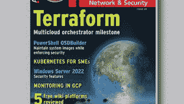


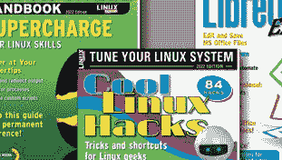


# MAKERSPACE Gemini 协议

四行高。ASCII 图像手动制作需要一些练习。幸运的是，可以在网上找到很好的 ASCII 艺术。`figlet` 工具通过以下命令安装：

```bash
sudo apt install figlet
figlet "Show and create a standard title"
figlet "show car cat -bin/car.txt |"
```

图 7 显示了几行 Bash 代码的输出，用于生成图像 `car.txt` 和 `figlet` 生成的标题。项目的最后一步是将所有部分组合在一起。列表 4 查询（第 9 行）并使用先前的逻辑解析字符串以设置输出类型（第 11-14 行）。汽车图像和标题在第 22 和 23 行输出。带有不同字符串的文档链接定义在第 28 到 31 行。

有很多 Gemini 可以在手机上运行。我的项目使用了免费的 Android 应用。图 8 显示了树莓派和 Gemini 控制。Gemini 协议不支持 HTML 网页的图形功能；但如果你正在寻找一个快速的项目，可以使用 Python 或其他语言。如果你想为传感器添加一些东西，有一些水平和垂直条的良好选择。

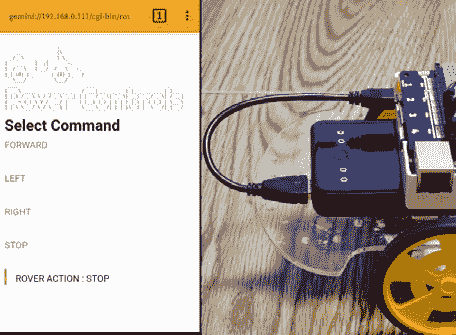

你轻而易举地遍历的文件和目录结构全是一种比喻。在后台，Linux 和 Unix 系统有时使用链接来连接来自不同文件夹的数据。但当你删除文件时会发生什么呢？本月的教程描述了搜索损坏链接的脚本技术——我们还将向你介绍一些免费工具，帮助你的文件系统免受这些讨厌的“通往无处的隧道”。

深入探索 Zrythm，这是一个免费的数字音频工作站，它提供了管理循环的特殊功能。

# LINUX VOICE

## Doughhouse – 迁移

Jon "maddog" Hall

关于迁移到源码的思考——这不必是令人不可负担的，并且可能会显著降低成本。

### Zrythm

Hart Noack

这款开源数字音频工作站有一天将与 Bitwig Studio 和 Tracktion Waveform 等商业工具竞争。

### SuperTuxkart

Daniel Yi

快速移动的趣味和创意的想法是免费赛车游戏 SuperTuxkart 的标志。我们正在使用游戏技巧。

### FOSSPicks

Graham Morrison

本月 Graham 关注了 magic-trace、Artillery probe、GOSIFF、Actual、Inform 7 等等！

### Tutorial – 检测损坏链接

Frank Hoffmann

损坏的链接会给目录结构带来破坏。我们将使用脚本来清理死胡链接。


# ELVIE


# LINUX DOGHOUSE – 迁移


## MADDOG'S

Jon maddog 是一位作家、教育工作者、计算机科学家和自由软件先驱。自 1999 年第一次遇到 Linus Torvalds 并帮助将 Linux 引入 64 位系统以来，他一直是 Linux 的热忱倡导者。他担任 Linux International 的主席！

## DOGHOUSE

关于迁移到开源的思考——这不必是令人不可负担的，并且可能会显著降低成本。

作者：JOHN 'MADDOG' HALL

# 向开源迁移

有些人带着“迁移到开源”的问题来找我，却不知道从何开始。这些人反复提到公司、教育机构和政府（地方、地区或国家级）。

在大多数情况下，他们似乎认为某件事弹指之间就会发生了。其他时候，他们似乎觉得，如果一个人能做到，每个人都可以开始。

对于对此我有几点观点，这些观点已被各种个人和团体成功使用。

## 4. “如果坏了，就修修！”

这是“如果没坏，就不要修”的对立面。如果一个现有系统运行缓慢、多 Bug 或需要新硬件，不要在上面继续浪费金钱。

使用 FOSS（自由及开源软件）重写整个系统是值得的，也许可以采用三层客户端模型，使用 FOSS 数据库 `MySQL`、中间层代码和用于展示数据的 Web 服务器。这套 Linux、Apache MySQL、PHP/Perl/Python (`LAMP`) 栈既高效又灵活。

### 1. 从应用程序开始

有一些跨平台运行的应用程序——网页浏览器、办公套件（`LibreOffice`）、数据库。这些开源应用程序可以替代昂贵的专有应用程序，并防止你将操作系统绑定到那些非免费的系统上。

### 2. 消除专有性

你可能不需要在某台服务器上使用难以使用的专有系统，但在 Linux 上安装这些系统意味着你为所需的服务器购买更少的服务器（可能还需要昂贵的许可证）。这为完全将数据库切换到 FOSS 铺平了道路。

### 3. “走吧，不再回头”

如果你拥有与自由源软件运行良好的系统，那么你工作得非常顺利。“为什么要切换到 FOSS？现在不是时机。”我正在继续运行。花费时间和金钱将一个更好的专有系统改为 FOSS 可能并不划算。

如果你正在为新系统购买设备，可以考虑使用 FOSS。由你决定如何让新系统“支持”运行。你的用户中没有人接受过你所用系统的培训。通过使用 FOSS，你可能会节省数千（在某些情况下是数百万）美元许可费用。

## 5. 并行运行以确保平稳过渡

不要试图一次完成过渡。计划并确保过渡平滑。你想成为英雄，而不是替罪羊。

我有一个在土耳其银行工作的朋友。他们梦想着将整个系统转换为 Linux。他们决定使用 FOSS，但他必须拒绝老板以完成他必须做的事。

我的朋友做了并行工作，并确保他需要的系统在 Microsoft 和 Linux 上都能运行。他告诉我们并行运行系统，以确保在两个系统上都能完成所有工作。周五当大家都离开后，他开始让 IT 员工切换到 Linux。到了周一，他在系统中收到了邮件回复。

“我的桌面怎么了？”

“哦，我们安装了新版本的操作系统。你遇到问题了吗？你可以工作吗？”

“是的，我可以工作，或者它就是这样。”

“如果你无法工作，请给我们打电话，我们会提供帮助。”

周一他们接到三个电话。周二接到两个电话。周三接了一个电话。剩下的时间里再也没有电话了。

## 插件，更多插件

在 DAW（数字音频工作站）中整合多种类型的 Linux 插件并非易事。Zrythm 使用内部开发的 JUICE 框架以及 Filipe Coelho 的 Carla。Carla 运行良好，并能自动化安装 Wine 组件（插件）的流程，而这在通常情况下是无法实现的。

在 Carla 中，几乎所有功能都运行得非常稳定，尤其是任何高质量插件都能在 Zrythm 中立即可用。Carla 确实提供了一个访问插件所提供预设的工具。鼓励插件开发者在其图形界面中包含此类工具。如果你没有访问这些预设的工具，则需要为每个新案例设置参数。幸运的是，当你发现声音时，Zrythm 会显示出来，你可以轻松地再次找到它。

## 单版本 1.0.0-alpha.29.0.7

单版本

你可以在以下发行版/操作系统上安装所有内容：

- Arch Linux - x86_64
- Debian 8 - x86_64
- Fedora 34 - x86_64
- Ubuntu 20.04 & 21.10 - amd64
- GNU Linux - 64-bit
- Windows 10.5 (最新)

安装程序包含英语、法语、葡萄牙语、意大利语、德语和俄语 PDF 手册

请选择以下选项：

Zchord, ZCompressor, ZLimiter, ZLFOPlayer, Z2verb, ZverISP

价格：€5.00（+ 处理器费用）

返回 购买升级到

当你启动 Zrythm 时，可以创建一个初始项目并选择存储位置。默认设置是将数据存储在 `~/.local/`，这提供了几个优势。它不会让主文件夹充满额外的可见项目，而是将它们隐藏在一个隐藏且功能丰富的目录中（第 4 章）。该程序使用 GnuSonic GTK 工具包，但也可以其他 Linux 界面上运行。在底层概念方面，Zrythm 遵循 TrackWave 等应用程序的风格，尽管你不是在编器轨道（Arranger track）中编辑 MIDI Clip，而是在分离器中。

图 2：只需少量费用，即可购买所有平台和格式的 Zrythm 安装程序。

在编器轨道中，可以对片段进行编辑、扩展、缩短、排列，最重要的是，任何在编器轨道中耗时的片段处理过程上挣扎过的人都会发现 Zrythm 更快速、更直观。如果你使用 Ardour，那么一切都会如你预期的那样工作。

图 3：当加载 VST 插件（如 Farsphere）时，相关组件会自动下载并安装。


## LINUX VOICE ZRYTHM

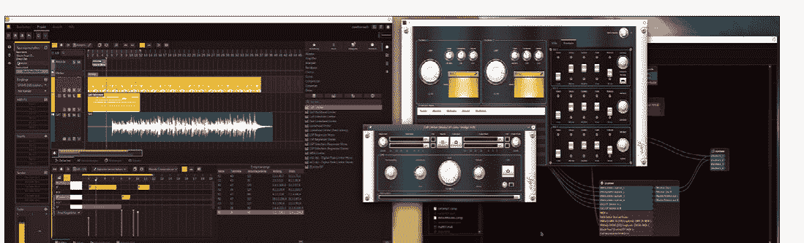

**图 4：** Zrythm 提供了在循环中使用 MIDI 和音频片段的选项。右侧打开的 Carla 有助于与 JACK 系统集成。

Zrythm 给人的感觉是该软件还有一段路要走。例如，目前还不清楚如何设置片段的结束点，以便在配置循环时只重复可见块。当然，这不是问题；你可以导入固定长度的片段。对于长度正确的片段，编辑器提供了非常有趣的操纵选项。编辑器顶部的两个绿色指示器让你初始设置片段中实际播放和重复的数据。此外，一个小蓝色指针可以允许你设置重复的开始位置（图 5）。

一些在其他地方不常见的实用 MIDI 选项。例如，你可以将边框顶部和弦中的和弦作为元数据高亮。还有一个鼓点音的开关，且插入和编辑非常简单。

唯一稍显粗糙的功能是 MIDI 编辑器中设置速度（velocity）的那个。最大速度为 127 的事件无法用绘制工具触碰；相反，边框边缘会被高亮，你只能让边框变小或变。对于这个小问题，我建议使用工具栏中的 Ramp（渐变）工具。你可以使用 Ramp 工具降低之后的所有条目，之后你可以再次回来。

这些循环工具同时适用于音频和 MIDI 片段。Zrythm 目前在音频工作功能方面提供不多——除了用于向下流的音量曲线外。然而，你会发现一些在其他地方不常见的实用 MIDI 选项。

Theodou 目前仅实现了一些键盘命令，更多的键盘命令将对于更精确地控制事物很有帮助。

**图 5：** 在 Zrythm 的音频片段中仅选择了一个较长鼓样本中的单个低音节拍；编辑器作为循环播放。

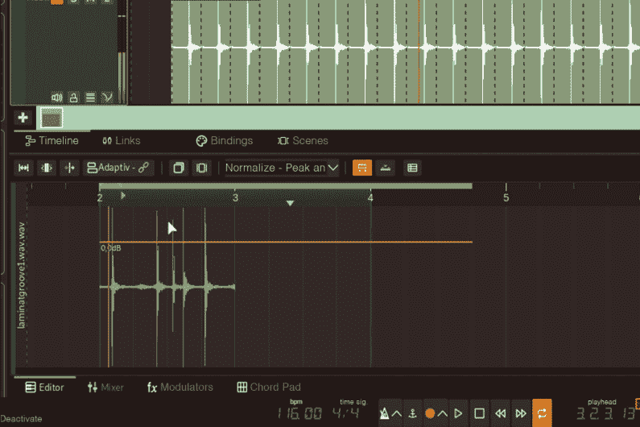

## ZRYTHM LINUX VOICE

如果 DEB 包包含“Plugins”（插件），你将体验到明显的差异。

在编辑器的右侧，你可以显示一个显示每个音符精确数据的列表。你有图形化编辑器，但手动编辑列表中数值的能力仍然在愿望清单中。然而，你可以通过脚本调整用户界面并提供额外的自定义（参见书籍《脚本与自定义》）。

## 脚本与自定义

Zrythm 是一个 GTK4 应用程序，这意味着你可以使用 CSS 设计一个外观和感觉类似于网页的界面。

## 使用数字存档清空你的书架

通过我们的数字存档合集，完善你的《Linux Magazine》和《ADMIN Network & Security》收藏。

你将获得整整年的 PDF 格式期刊，可以随时从任何设备进行访问。

https://bit.ly/archive-bundle

## LINUX VOICE SUPERTUKART

在本地或在线玩免费的 SuperTukKart 赛车游戏。

快速的乐趣和创意的想法是 SuperTukKart 赛车的特点。这篇文章为读者提供了一些游戏技巧。

作者：ANANIEL TIBI

如果你看到一只企鹅开着车穿过苏格兰、黑森林或一座禅宗寺，那这只意味着一件事——它是 SuperTukKart 的粉丝 [1]。这只企鹅有一个使命要完成：软件之祖 Gnu 被大反派 Nolak 绑架了。Nolak 将 Gnu 关在他在 Inava 的 Fort Magna 城堡里。通过在与 Nolak 的竞赛中展示你的驾驶技巧，你就可以救出 Gnu。

或者，你可以使用你发行版的包管理器安装该游戏。SuperTukKart 是最老的 Linux 游戏之一，所有主要的发行版都提供。甚至还有一个针对移动设备的 Android 版本 [3]。

### 准备就绪

在 Linux 上设置此游戏可以更简单。从网站 [2] 下载 tarball 包（版本 1.3 于 2021 年 9 月 28 日发布）并解压文件。不需要安装：你只需在 shell 中输入 `sh run_gae.sh` 即可运行 `run_gae.sh` 文件。

### 设置

启动界面界面布局清晰（图 1）。点击右上角的区域可以自定义你的名称，并输入用于在线账户的访问数据 [4] 以在网络上进行多人游戏。

使用底部栏的图标，你可以配置设置（扳手图标）、查看你的最佳成绩（皇冠）、阅读游戏的简要说明（问号），以及启动教程（书本）等其他模式。

游戏提供不同的模式。在故事模式中，你将发现各种挑战，通往 Fort Magna 并救出被囚的 Gnu。在单人模式下，你可以与电脑控制的汽车竞争。在分屏模式下，你将在同一台 PC 上与其他玩家进行比赛，屏幕将为分屏。在在线模式下，你可以与局域网或互联网上的玩家竞技驾驶技巧。

### 出发！

为了获得所需的练习，最好在接受故事模式中的挑战或与他人竞争之前，先在单人模式下对电脑玩几轮。要做到这一点，点击卡车上的“单人模式”（图 2），但不要忘记它们具有不同的特性，在重量、速度、加速度和氮表现方面有所不同。

轻型车比重型车更灵活，这在弯道较多的赛道上是一个优势。轻型卡车如果被对手撞到，会把你撞飞出赛道。另一方面，重型卡车可以达到比轻型车更高的速度，这让你在直道上具有优势。

然而，轻型卡车的加速度更快，而且有限的氮供应也让你在起跑、事故后或弯道较多的赛道上占据优势。尝试不同的变体以熟悉每种车的特性。

这就是你如何证明自己对赛道的熟悉程度的，因为彩蛋隐藏得很好，有时甚至在官方赛道之外，取决于难度等级。

在演示赛中，你将与预先录制的比赛进行竞争，来自录制比赛的赛车将作为幽灵赛车穿过赛道。游戏自带了此类的预录制比赛。为了获得最佳成绩，你可以记录自己的圈数。

### 供你选择

在每种情况下，请选择最适合下一场特定比赛条件的赛车。选择难度等级设置（等级 3：初学者、高级或或专家）。一旦你掌握了足够的挑战并获得了必要的经验，你也可以选择最高难度模式——SuperTukKart。

起初，在你掌握了故事模式中的某些挑战后，你的赛车会被标记上一把锁锁。比赛和赛道也是如此。

游戏不仅限于赛车，还有具有不同游戏模式的漫画（图 4）。在普通比赛中，你与其他玩家的赛车竞争，玩家们试图互相碰撞。起作用的不是你的驾驶技巧，而是你的战术。

在计时赛中，战术元素至关重要，你不允许碰撞他人。你的驾驶技巧决定一切。领先者跟随模式允许你跟随领先者（且不超过他们）。引擎会生成其中一个电脑控制的赛车作为领先者，你从比赛开始就跟随他们，同时计时器在倒计时。

倒计时结束时，当前的领先者被淘汰，因为所有驾驶员都在领先者之前。接着，新的倒计时开始，最后一个领先者和所有之前的驾驶员都被淘汰。这一直持续，直到第二名只剩一辆赛车，加上领先者，领先者赢得比赛。

或者，你可以将战斗转移到竞技场（图 5）。那里没有比赛，但你可以收集物品击中其他玩家。顺便说一下，如果你击中三次，你就出局了。

如果你想踢足球或冰球而不是赛车，那么 SuperTukKart 也没问题。只需将场地改为场馆，并将球踢进对方的大门。获胜者是比赛结束时进球最多的队伍（图 6）。使用表 1 列出的按键。

## LINUX VOICE SUPERTUKART

在故事模式下，你与自己的圈数竞争。一旦你设置了等级和游戏模式，根据比赛类型选择比赛、竞技场或场馆。游戏自带了自己的挑战。

在彩蛋寻宝模式中，你是赛道上的唯一一人，并收集隐藏的彩蛋（图 7）。

## 让路！

当比赛开始时，将开始倒计时（图 8）：“准备……就……开始！”如果你在倒计时时已经在加速，你就可以在起跑时获得额外的加速助力。

但注意不要加速过快。如果你在倒计时结束之前按下加速，你将受到时间惩罚并且不允许延迟启动。相反，如果你得太慢，在“开始”或“稍后”时加速，你将错过起跑时的加速。

在屏幕左上角，你可以看到其他玩家按顺序图标。如果你不想使用键盘，可以使用手柄、游戏控制器或方向盘来控制你的赛车。

### 表 1：熟练控制

| 按键 | 动作 |
| --- | --- |
| 上箭头 | 加速 |
| 左箭头 | 向左转向 |
| 右箭头 | 向右转向 |
| 下箭头 | 刹车、倒车 |
| 空格键 | 射击 |
| B | 向后看 |
| N | 氮加速 |
| V | 漂移 |
| 退格键 | 救援 |
| Esc | 暂停游戏 |

# SUPERTUXKART LINUS 语音


左下角显示了赛道的路线以及所有玩家在赛道上的当前位置。

某些赛道有替代路线（例如黑森林或大大乐天堂赛道）。在这种情况下，你可以尝试不同的赛道，以发现哪一个更适合你目前的位置。某些赛道包含了提供捷径的路径，例如奥利利的数学课（图 9）。在其他赛道中，有隐藏的路径可以帮助你更快完成比赛。

在屏幕右下角，你会看到一个数字，表示你当前比赛中的排名。黄红色的半圆显示你当前的速度，蓝色半圆显示你的加速（nitro）。

如果你收集到一个黄红色的箭头，可以使用它为你的卡车提供额外的加速。带有香蕉的礼物盒是一个转换器，可以让你在一段时间内变成障碍物。因此，礼物盒变成了香蕉，加速变成了口香糖，反之亦然。

如果你发现了一个隐藏的降落伞，一旦你展开它，你所有的卡车都会减速。你还可以用纸蛋糕、保龄球或篮球向其他卡车射击。基本上，如果你向前投掷这些物品，它们就会向前移动；如果你向后移动，它们就会向后移动。

# 礼物与香蕉

在道路上，你会发现有用的物体以及障碍。隐藏在礼物盒中（图 10）的物品可以用来攻击对手或移动得更快。一旦你获得了一个礼物，屏幕顶部就会出现一个相应的图标。使用`空格键`射击或激活该物品。

例如，如果你得到了泡泡口香糖，泡泡会在一段时间内为你的卡车形成一个保护罩。它是开启的，或者如果你点击`B`向后看，

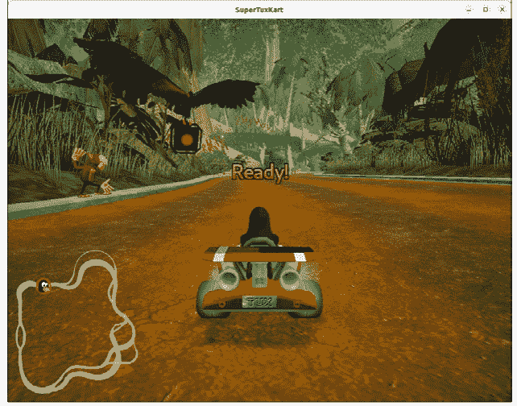

图 8：开始比赛（此处在黑森林赛道上）“准备……准备……开始！”


图 9：如果在《奥利利的数学课》中在此处离开赛道，向左转弯并驾驶椅子，你就可以跳过赛道的整个上弯道。

图 10：礼物（顶部）包含各种你可以用来攻击对手或帮助你移动得更快的物品。收集加速瓶（底部）来补充你的供应，并在需要时为卡车提供加速助力。

# LINUX SUPERTUKART


**图 11**：避开会让卡车减速的香蕉，或像图片所示在你的尾部放置炸弹。

你可以使用纸蛋糕专门针对附近的卡车，它在撞击时会被撞出赛道。保龄球会在赛道上滚动，直到它撞中你的卡车。使用篮球，你可以针对领先者，它在碰撞时会被撞出赛道。

在通往目标的路上，篮球会沿着赛道滚动。它还可以在途中压扁其他卡车，让它们减速一段时间。香蕉可以用瞄准准确的保龄球反弹。如果你向前射击它，它会减慢你最近的对手。如果你向后射击，它会击在你身后对手的脸上并遮挡他们的视野一段时间。电蝇拍会压扁任何靠近的卡车，让它们减速一段时间。

确保避开香蕉。如果你开车经过香蕉，锚、降落伞或炸弹将附在你的卡车上（图 11）。锚会让卡车减速，降落伞也是如此。卡车得越快，效果越剧烈。如果你需要减速来去掉降落伞。

炸弹有时间，时间到了就会爆炸，将卡车抛出去。你需要撞击另一辆卡车来转移炸弹。

作为燃料，你需要收集瓶（图 10）来补充你的加速供应。点击`N`键注入加速将提供加速助力。使用有限加速供应最有效的方法是单次爆发加速加速你的卡车。如果你在另一辆卡车后面行驶几秒钟，你将获得直播奖励（通过你卡车周围的线条表示），让你在快速冲刺中超越那辆卡车。

（左箭头），向目标方向转向并同时按下`V`。短距离的漂移可以帮助你通过急弯。如果你能漂移得久一点，你就会获得速度提升。

小心！所有这些都需要大量的练习以避免撞出。如果你离开赛道，一只老鹰会冲过来救援你并将你放回去。如果你被卡住无法向前移动，点击后退按钮将让老鹰来救你。

# 更多玩家，更多乐趣

一旦你在单机模式中获得了经验，你将与其他玩家一起赛车竞争。在分屏多人游戏模式下（主菜单中的`Split Screen multiplayer`），几名玩家坐在同一张桌子前面对一个分屏屏幕。一名玩家可以使用键盘，而所有其他人都需要摇杆或游戏手。

玩在线游戏（主菜单中的`Online`），你将与互联网上的其他玩家竞争。在此过程中，你要么向自己发起挑战，要么展示别人发出的漂移。

# 前往 Magna

SuperTKart 不仅仅是一个赛车游戏：你有一个比赛要完成


**图 12**：Nolok（顶部）绑架了 Gnu（底部），并将他关在了他的岩浆城堡——马格纳堡（Fort Magna）。测试你的驾驶技巧并释放自由软件之父吧。

# 滑溜的坡度

要成为具有许多弯道的赛道大师（如日本的黑森林），你需要精通漂移（右箭头）或左侧故事。要做到这一点，点击主菜单中的故事模式按钮，你将看到一个带有背景故事的视频：自由软件的奠父 Gnu 被 Nolok 绑架，他被关在岩浆城堡马格纳堡（12）。为了释放 Gnu，你需要扮演 Tux 或其他某些角色，并面对总共 25 个挑战。

个人人物在故事模式左下角的地图上被标记（图 13）。如果你在地图上看到锁符号，说明你收集的分数还不足以通过。相反，一个小奖台表示有挑战在等待你。开车到地图上标记的地方并展示你的进度。

如果你成功了，你将获得铜杯、银杯或铂金杯，取决于难度级别，并通过一些分数获得（图 14）。当你达到一定的分数时，会解锁更多的标记和赛道。你还可以点击屏幕上的`Add-ons`从网上下载新卡片和赛道。收藏正在不断增长。

最后的挑战将你带到岩浆堡，你将面对 Nolok。你需要击败 Nolok 来释放 Gnu。

# 秘籍

如果你一个接一个接受挑战，SuperTKart 会更有趣。但有一个捷径：只需使用你选择的编辑器编辑`/config/supertkart/players.xml`文件。`<story>`标签包含了挑战列表。

在每个挑战之后，将`solve="bronze"`（杯）、`solve="silver"`（银杯）、`solve="hard"`（金杯）或`solve="best"`（铂金杯）。下次你玩 SuperTukart 时，你将拥有所有的奖杯和分数可以匹配。

# Netflix 及其他网站的自动化登录

# LINUX MAGAZINE

# 将你的 Android 变为 Linux 电脑

在不破坏 Linux 协调性的情况下，如何开始使用更强大的 Bash

# LINUX MAGAZINE

# 深入内核

深度探索

图像文件的批量编辑

# LINUX MAGAZINE

# 锁定状态！

用于更严密安全的新工具

机器学习工作坊

在你的家里寻找失踪的访客

# LINUX MAGAZINE

# 拆解并重构

通过自动化模糊测试确保代码安全

# 人脸识别

一眼完成身份验证

# GatusOS

让你的 Chromebook 在保期结束后后继续运行！

# LINUX MAGAZINE

# 从零构建 Linux (Linux from Scratch)

使用这款经典工具扩展你的 Linux 知识

重新利用你的旧路由器

为创客提供的 5 个简单项目！

# LINUX MAGAZINE

# nBSD

# 手机黑客技巧

不再更新？为你的智能手机安装免费操作系统，保持其整洁

# LINUX MAGAZINE

# 创客改造

为你的 Linux 桌面或笔记本电脑系统添加 GUI

# LINUX MAGAZINE

# 洁净 IT

对更具可持续软件的追求

创客空间：使用树莓派制作一个灯

# LINUX MAGAZINE

# 加密

保护你的秘密

- 备份完整性：避免静默数据损坏
- Matrix：防御网络攻击
- LifeOff 技巧：构建更强大的音乐数据库！

10 个极佳的开源软件发现！

# 《Linux Magazine》是你探索 Linux 世界的指南。翻阅内部，获取在其他地方找不到的高级技术信息！

# 通过以下内容扩展你的 Linux 技能：

- 关于热门话题的深度文章，包括比特币、勒索软件、云计算等等！
- 有用工具的操作指南和教程，它们将为你节省时间并保护数据。
- 故障排除和优化建议
- 关于开源世界关键进展的独到新闻
- 针对树莓派、Arduino 以及其他创客板系统的酷项目

如果你想走得更远、用 Linux 做更多事情，请立即订阅，不再错过任何一期！

# 现在订阅！

`shop.linuxnewmedia.com/subs`

# LINUX FOSSPICKS

## FOSSPicks

自由开源世界中的闪光明珠与新发布

在之前的一份办公室工作中，Graham 曾写过一个小游戏，花很长时间才输入一个特定的句子。玩游戏的打字听起来可能并不高效。作者：GRAHAM MORRISON

## 作者的 IDE

### Zettl

虽然 Linux 有许多文本编辑器，但适合长篇项目的并不多。每位作者都不同，但许多人可以从有助于笔记、注释和参考文献的编辑器中获益。这可能就是为什么基于 Linux 的作者选择了 Vim 或 Emacs 的版本，而老老的专用软件 Zettiver 仍在运行。

然而，Zettl 是一款全新的编辑器，具有一些更大、更直观的功能。它运行在 Electron 之上，但将编辑置于许多可以增强工作流的写作环境中。

最重要的是 Zettl 是围绕 Markdown 纯文本构建的。对于既是作者又是读者的人来说，Markdown 是一个很好的选择。Markdown 元素简单地提高了可读性和呈现。在编辑器中输入这些元素（如标题）会立即更改文本——不是完全改变，但足以与普通文本区分开来。开始草稿后编辑器会自动进行格式化。添加链接后，原始 Markdown 显示，并仅被链接替换。这种实时预览允许你在一个面板查看文本，另一个面板查看 Markdown，这是大多数其他编辑器做不到的。你在 Zettl 中感到掌控感，并且看到如实时字数统计、无焦模式和打字机模式（轻松在文本中间移动光标）等功能是非常棒的。

美丽的风格延伸到了代码高亮以及特殊元数据。YAML 数据块中这一理念的一个佳例子是元数据如何被内容管理系统消耗。这是 Zettl 的优点之一，因为你隐藏在此 YAML 中的键可以被查看到。

1. 教程：通过此教程学习有关应用程序的信息。
2. 编辑器：Markdown 预览和词汇列表帮助你创建一个非常强大的工具。
3. 标题：自动提取为可导航的大纲。
4. 标签：可以创建标签和链接来引用其他文档。
5. 自定义视图：通过深色模式、无焦模式和打字机模式让你的应用专属化。
6. 工作空间：每个项目都可以有自己的工作空间，通过热力图搜索和元数据标记访问。

项目网站

`https://www.zettl.com/`

## 调试器

### magic-trace

调试工具是过程中的重要部分。当你编译了想要跟踪的应用程序时，像 `magic-trace`（上所示）这样的调试工具最有用。二进制文件的每个链接都将可执行文件连接到源代码，当你需要调试进程时，它可以提供帮助。同样，如果你没有自己从源代码构建二进制文件，许多发行版都包含了调试包，可以实现相同的效果，让你看到可执行文件的源代码。但也有许多时候，你希望在没有源代码的情况下进行调试或检查，这时工具就能派上用场。

跟踪输出可以从内核中提取符号。当你退出进程时，结果会被编译成跟踪轨迹（trace）。这个二进制文件可以加载到网络托管的 GUI 中。这就像进程的一个玻璃图谱，让你看到在微小时间片内发生的事情。

项目网站

`https://github.com/jaenet/magic-trace`

## 反汇编译器

### Snowman

反汇编译器将二进制文件转换为可以检查并可能重建的源代码。Snowman 是一个具有其 UI 和配套命令行工具的反汇编译器，它可以将二进制文件转换为可以检查和修改的 C/C++ 代码。Snowman 的反汇编译器界面简单易用，你只需打开想要分析的可执行文件即可；你将在左侧面板看到代码的反汇编，然后花些时间分析代码中每个事件的数据流。

选择代码中的任何行都会立即跳过汇编指令和函数调用，帮助你快速导航反汇编代码。

项目网站

`https://github.com/yegord/snowman`

# LINUX 开源精选

## Web 测试

### Artillery 探测

Artillery 是一个值得专门编写教程的大型项目。它是一个开源测试工具，其强大版本为测试 Web 服务构建。Artillery 功能全面且复杂，设计用于每次部署时与某些持续集成系统配合使用。因此，对于非 DevOps 用户来说，整个项目可能会让人无从从。但 Artillery 为我们中的任何人都提供了丰富的功能。在最新版本中尤为如此，它添加了一个非常实用的命令，这可能是它的核心亮点，而且几乎任何合并 Linux 的都会发现它很有用。`artillery probe` 的完整内容对于测试你的本地网络性能以及任何你想 ping 或 curl 的网站都非常出色。使用 curl 是测试其可用性和性能的一种粗糙而简单的方法。Curl 性能强大，可以用于附加到任何 HTTP 请求中，为你提供一些响应指示。这一切都可以带有 `probe` 参数的 Artillery 所代。它接受一个虚拟名称并返回执行几个步骤所需的时间：1) 初始 DNS 查询，2) 连接，3) 握手，4) 第一个字节传输，以及 5) 传输站点内容。所有这些都显示在文本结果中。

带有 probe 命令的最新版本 Artillery可以通过 `npm install -g artillery` 安装。

最重要的是，probe 还可以像 curl 一样发送和接收所有 HTTP 请求，但使用 JSON 格式。这使得它比使用 REST API 调用实用得多，后者可以集成到各种工具中，从而更容易解析包含 JSON 的文件。

## 项目网站

`https://www.artillery.io/`

## 网络监控器

### GOSNIFF

为了与改进更成熟、高级用户体验的命令行工具保持一致，GOSNIFF 是一个受 tcpdump 使用困难性启发的极佳工具。要分析网络，你需要知道你想实现什么以及如何实现。这并不容易。例如，你需要知道使用哪种网络设备以及你想监控哪些端口。使用 GOSNIFF，它的菜单驱动界面一如既往地易于使用。当首次启动时，它会向你展示它可以连接的设备和接口，通常已经选好了网络设备。

你需要知道选择哪个接口，即选择一个监控一切的虚拟伪设备，但这可能包括 USB 和 D-Bus 流量。你需要定义一个过滤器，这在每个细节上都可能复杂。GOSNIFF 的优化过滤器预填充了用于 Web 流量的标签和80端口，你可以对其他端口和协议进行修改。配置好后，你就可以启动监控过程。现在，当选中符合过滤和设备标准的网络包时，它会像 Wireshark 一样显示在右侧。无需考虑——过滤器部分完全接受伯克利包过滤器 (BPF) 语法，但没有进一步深入数据包的选项。

这并不明显，但 GOSNIFF 的本质受到了 Go 编程语言的启发，并使用其函数指针提供服务。包详情告诉你每个网络设备的大小以及在使用哪些协议。这使得 GOSNIFF 作为 ping 的高级版本有用得多，它可以查看所有单个过滤器和协议传输的数据包，而不需要记住 tcpdump 参数。

## 项目网站

`https://github.com/gosniff/gosniff`

# Linux开源精选

## 压缩继者

### bzip3

选择文件压缩工具的过程应该是务实的，就像为工作选择最佳工具一样。但每个平台都通过一个特定的算法或实现来定义自己，无论它们如何比较。例如，微服务通常与 zip 和 zip2 同名，而长期以来，Stuffer Expander 在 macOS 上一直是首选。替代方案是 lzma（仍然存在），而 Linux 通常使用 bzip2 压缩并并入 tar 文件，因此 TAR 或 TGZ 文件扩展具有通用性。然而，与其不同，bzip3 确实有其他常用的格式，其中 bzip2 或 bz2 可能是最广为人知的。

gzip 的版本发布于 1992 年，即使 bzip2 的起源也可以追溯到 1996 年，那是 25 多年前了。这意味着有充分的空间利用现代 CPU 架构和所需的编程技术。bzip3 承诺成为无处不在的 bzip2 的非官方继者。主要的改进是压缩率，通过使用更多的内存在更短的压缩时间内获得更小的文件。这些性能提升得益于带有现代编译器的新算法，但也略微意味着该工具在测试和提供的选项方面仍然不成熟。

新的 bzip3 提供了相同的 encode 和 decode 语法，缺少了 bzip2 中发现的选项。encode 和 decode 如预期工作，并且有一些与原始版本相同的标志位，但自定义偏喜好的选项要少得多。虽然这些选项缺失了，但该项目仍处于开发早期，正如数据计数完整性问题一样。因此，这是一个值得关注的项目，但并不一定是为了替换 bzip2。

## 项目网站

`https://github.com/kapalogo/bzip3`

## 打字练习器

### thokr

几十年来打字练习器，手部 RSI 类的僵硬和笨拙并不罕见。最好的解决方案之一更换具有不同布局的键盘，并让按键离开垂直网格。这种方法的问题在于，你已经有了多年经验并且我们保持着效率，而且许多软件工具可以帮助你。打字练习器在这种情况下通过强制你练习在当你获得新键盘时真正会做的事情来帮助你。但它当然也可以在家里帮助你，以及帮助初学者。但一些最好的打字练习器是在线上的，`https://www.keybr.com` 是一个特别受喜爱的，这显然具有隐私和便利方面的影响。如果你想让它更有趣，我们推荐一个名为 Type-Chronicles 的正式游戏；但也有免费工具可以帮助，包括一个简单的在线打字练习器，包含 200 到 10,000 个词典，这些都是英文的。不过，该项目刚刚开始，几乎所有内容都是关于你必须尽可能快地输入的随机句子的。你正确的每一个字符都会计数，或者如果你犯了错误，你就删除错误并重新输入。

thokr 已经是一个棒的小打字练习器了，但流行的替代品是增强版的 Monkeytype 和 Typer。当你完成打字后，你会看到一个随时间分布的速度直直方图。它简单且上瘾，你会发现自己很快就会再次尝试并超越当前分数。在理想情况下，每次练习打字挑战都被写入一个 csv 文件，你可以轻松将其加载到电子表格中显示你的进度。

## 项目网站

`https://github.com/kapalodorby/thokr`

## 预算管理

### Actual


处理家庭财务、预算和记账，Actual.. 是……可以分类，你可以通过分类看到你花了多少钱，比如食物或娱乐。像 Cash 一样，Actual 的模型是围绕贷方或方交易构建的。与 Cash 不同，Actual 容易使用，不需要强制执行两个账户之间的每笔交易。Web UI 设计精美，而且快速响应迅速。最重要的是，它的设计是为了让你想要每笔交易和

预算报告显示了你在每个类别中的支出情况，最重要的是，你还有多少钱可以花。有很多预算应用程序会提供这种功能，最近 Actual 只是其中之一。像 Cash 一样，Actual 的模型是围绕贷方或借方交易构建的。与 Cash 不同，Actual 容易使用，不需要强制执行两个账户之间的每笔交易。Web UI 设计精美，而且快速响应迅速。最重要的是，它的设计是为了让你想要每笔交易和

（注：原文后续部分存在大量重复文本，译文已根据要求停止重复输出相同的翻译内容）

## 游戏编译器

### Inform 7

交互式游戏是奇人的。它们拥有最好的画面、最好的音效、最出色的角色以及你能想象的最高水平的想象。交互式游戏依赖文本和文本解释器来构建它们的世界。结果是在你的想象中构建的，就像真实的小说一样。当它们在20世纪70年代首次出现时，文本是必需品而非选择，因为游戏的限制很大。大家都认为随着游戏的改进，交互式小说会被更广泛的生态系统所吸收。但发生了一个事件，想象力确实很难与《赛博朋克2077》或《荒野大镖：2》竞争。但就像书籍一样，交互式小说生存了下来，并且现在以它们自己的方式繁荣发展。每年都有几十个游戏被创造，其中许多是免费提供的，扩展了我们早期想象到的想法和能力。

其核心是用于构建游戏的编程语言和环境。毫无无疑是引擎，它已经开发了近30年。它最初是为了创建运行在交互式小说上的游戏，但后来扩展到涵盖其他功能。第7版本实现了一个新颖的自然语言处理器和一套新工具。虽然它是免费提供的，但它正变得以开源的形式可用。

```
Story: "Hello deputicle",
  Exclude "Parsers",
  Include "Interactive Example"

  [Extensions:
    Room
      name = "Living Room",
      description = "Hello World",
      door
        name = "Door",
        object = "Front Door",
        with description = "A comfortable furnished living room."
      door
        name = "Exit",
        description = "There is a door in a tacky politely that leads to outside. No exit seems to lead you to."
  ]
```

`Inform`可能是产生交互式小说的逻辑，但它的40万行代码使其处于自然语言处理的前沿。

开源许可证：这对于交互式小说的未来非常有意义，并涉及对原始代码库以及代码清晰、一致性和可靠性的更新工作。IDE也很容易获取，你不需要编写自己的交互式小说。你只需要拥有良好的想象力。

项目网站：`https://github.com/ivrusssel/inform/`

## 复古编程

### 用于 SDL 2.0 的 BBC BASIC

20世纪80年代计算机的伟大之处之一是几乎可以学习一切。它们不是被存档的，它们通常是复杂的，并且许多带有自己的 BASIC 解释器。也许在英国这些中最著名的是 BBC Micro，这是一台为 BBC 项目构建的简易家用电脑。它们价格昂贵，但很容易教学。它们被用于学校，学生们大部分时间都在玩它们。BBC 及其字符集最棒的一点是，它带有一本书教你如何使用其内置的 BASIC 编程语言，这种语言的适应性惊地好。它比比较 BASIC 解释器要好得多，因为它提供了 `IF THEN` 和 `ELSE` 语句，以及参数和长变量名，帮助许多年轻开发者迈入软件工程领导者的第一步。许多开发者都这样做，许多机器被用于严肃的开发和研究。结果，BASIC 保留了它的缓存。`BASIC for SDL 2.0` 是同一种语言的现代版本，使用 SDL 的强大函数而非 2M652 构建。。作为一个开始，它是跨平台的，可以从任何系统运行到任何 Android 设备。程序可以编译为 `WebAssembly` 以进行集成，该项目已经包含了它。

虽然原始代码可以嵌入原始的 BBC 源码中，但 BBC BASIC for SDL 通过其自己的汇编器使这变得容易得多。自己的图形开发，如 Arduino 等。但最好的点是你可以使用 SDL 的力量，这意味着你可以使用 `OpenGL` 和着色器。在这方面，对于像 Python 这样的东西是一种令人耳新的改变，而且 BBC BASIC 出于他们的青少年时期。

项目网站

`https://github.com/ivrusssel/BASIC`

## LINUX 语音教程 – 检测断链

### 检查目录结构中的断开链接

#### 死胡同

断开链接会对目录结构造成破坏。这篇文章将向你展示如何使用脚本来避免你的链接指向死胡同。

作者：FRANK HOFFMANN

在恢复过程中，没有比发现以前备份的某些链接无法用更令人失望的了。虽然链接仍然在那里，但目标已不存在，导致链接指向无处。当你正在开发软件并以应用程序的形式发布它，或者当你需要安装不同版本的应用程序时，这些断开链接也会引起问题。像图 1 这样较小、易于管理的项目结构可以进行手动测试和检查。然而，对于较大的项目，这很快会导致错误，因为你不可避免会忽略某些内容。使用 Unix/Linux 工具箱提出了一组日常可用的组合：一个脚本，作为递归函数和对所有文件和目录进行循环的组合，一个特殊的调用来查找、排序和追踪。

### 选项

手动查找和修复断开链接需要大量精力。你可以通过使用脚本和 Unix/Linux 工具检查目录结构中的断开链接来避免这种情况。在篇文章中，我将展示几种检查数据结构一致性并检测断开链接的方法。如何避免你和你的用户出现故障。

### Shell 脚本

shell 脚本（列表1）使用了一个名为 `check()` 的递归函数，它期望一个参数：你想要检查断开链接的目录。在函数中，for 循环遍历所有条目（链接链接）。

### 示例数据

作为示例，我将使用图 1 所示的目录结构，它类似于一个软件。图 1 中的目录树包含两个。图 1 中的目录树包含两个，其中类似于一个软件。其中包含包含两个。这种语言的适应性惊地好。它比比较 BASIC 解释器要好得多，因为它提供了 `IF THEN` 和 `ELSE` 语句，以及参数和长变量名，帮助许多年轻开发者迈入软件工程领导者的第一步。许多开发者都这样做，许多机器被用于严肃的开发和研究。结果，BASIC 保留了它的缓存。`BASIC for SDL 2.0` 是同一种语言的现代版本，使用 SDL 的强大函数而非 2M652 构建。。作为一个开始，它是跨平台的，可以从任何系统运行到任何 Android 设备。程序可以编译为 `WebAssembly` 以进行集成，该项目已经包含了它。

虽然原始代码可以嵌入原始的 BBC 源码中，但 BBC BASIC for SDL 通过其自己的汇编器使这变得容易得多。自己的图形开发，如 Arduino 等。但最好的点是你可以使用 SDL 的力量，这意味着你可以使用 `OpenGL` 和着色器。在这方面，对于像 Python 这样的东西是一种令人耳新的改变，而且 BBC BASIC 出于他们的青少年时期。

项目网站

`https://github.com/ivrusssel/BASIC`


## 游戏编译器

## Inform 7

交互式游戏是奇人的。它们拥有最好的画面、最好的音效、最出色的角色以及你能想象的最高水平的想象。交互式游戏依赖文本和文本解释器来构建它们的世界。结果是在你的想象中构建的，就像真实的小说一样。当它们在 20 世纪 70 年代首次出现时，文本是必需品而非选择，因为游戏的限制很大。大家都认为随着游戏的改进，交互式小说会被更广泛的生态系统所吸收。但发生了一个事件，想象力确实很难与《赛博朋克2077》或《荒野大镖2》竞争。但就像书籍一样，交互式小说生存了下来，并且现在以它们自己的方式繁荣发展。每年都有几十个游戏被创造，其中许多是免费提供的，扩展了我们早期想象到的想法和能力。

其核心是用于构建游戏的编程语言和环境。毫无无疑是引擎，它已经开发了近 30 年。它最初是为了创建运行在交互式小说上的游戏，但后来扩展到涵盖其他功能。第 7 版本实现了一个新颖的自然语言处理器和一套新工具。虽然它是免费提供的，但它正变得以开源的形式可用。

```
Story: "Hello deputicle",
  Exclude "Parsers",
  Include "Interactive Example"

  [Extensions:
    Room
      name = "Living Room",
      description = "Hello World",
      door
        name = "Door",
        object = "Front Door",
        with description = "A comfortable furnished living room."
      door
        name = "Exit",
        description = "There is a door in a tacky politely that leads to outside. No exit seems to lead you to."
  ]
```

`Inform` 可能是产生交互式小说的逻辑，但它的 40 万行代码使其处于自然语言处理的前沿。

开源许可证：这对于交互式小说的未来非常有意义，并涉及对原始代码库以及代码清晰、一致性和可靠性的更新工作。IDE 也很容易获取，你不需要编写自己的交互式小说。你只需要拥有良好的想象力。

项目网站：`https://github.com/ivrusssel/inform/`

## 复古编程

## 用于 SDL 2.0 的 BBC BASIC

20 世纪 80 年代计算机的伟大之处之一是几乎可以学习一切。它们不是被存档的，它们通常是复杂的，并且许多带有自己的 BASIC 解释器。也许在英国这些中最著名的是 BBC Micro，这是一台为 BBC 项目构建的简易家用电脑。它们价格昂贵，但很容易教学。它们被用于学校，学生们大部分时间都在玩它们。BBC 及其字符集最棒的一点是，它带有一本书教你如何使用其内置的 BASIC 编程语言，这种语言的适应性惊地好。它比比较 BASIC 解释器要好得多，因为它提供了 `IF THEN` 和 `ELSE` 语句，以及参数和长变量名，帮助许多年轻开发者迈入软件工程领导者的第一步。许多开发者都这样做，许多机器被用于严肃的开发和研究。结果，BASIC 保留了它的缓存。`BASIC for SDL 2.0` 是同一种语言的现代版本，使用 SDL 的强大函数而非 2M652 构建。。作为一个开始，它是跨平台的，可以从任何系统运行到任何 Android 设备。程序可以编译为 `WebAssembly` 以进行集成，该项目已经包含了它。

虽然原始代码可以嵌入原始的 BBC 源码中，但 `BBC BASIC for SDL` 通过其自己的汇编器使这变得容易得多。自己的图形开发，如 Arduino 等。但最好的点是你可以使用 SDL 的力量，这意味着你可以使用 `OpenGL` 和着色器。在这方面，对于像 Python 这样的东西是一种令人耳新的改变，而且 BBC BASIC 出于他们的青少年时期。

## 项目网站

`https://github.com/ivrusssel/BASIC`

## LINUX 语音教程 – 检测断链

### 检查目录结构中的断开链接

### 死胡同

断开链接会对目录结构造成破坏。这篇文章将向你展示如何使用脚本来避免你的链接指向死胡同。

作者：FRANK HOFFMANN

在恢复过程中，没有比发现以前备份的某些链接无法用更令人失望的了。虽然链接仍然在这里，但目标已不存在，导致链接指向无处。当你正在开发软件并以应用程序的形式发布它，或者当你需要安装不同版本的应用程序时，这些断开链接也会引起问题。像图 1 这样较小、易于管理的项目结构可以进行手动测试和检查。然而，对于较大的项目，这很快会导致错误，因为你不可避免会某些内容。使用 Unix/Linux 工具箱提出了一组日常可用的组合：一个脚本，作为递归函数和对所有文件和目录进行循环的组合，一个特殊的调用来查找、排序和追踪。

### 选项

手动查找和修复断开链接需要大量精力。你可以通过使用脚本和 Unix/Linux 工具检查目录结构中的断开链接来避免这种情况。在篇文章中，我将展示几种检查数据结构一致性并检测断开链接的方法。如何避免你和你的用户出现故障。

### Shell 脚本

shell 脚本（列表1）使用了一个名为 `check()` 的递归函数，它期望一个参数：你想要检查断开链接的目录。在函数中，`for` 循环遍历所有条目（链接链接）。

### 示例数据

作为示例，我将使用图 1 所示的目录结构，它类似于一个软件。图 1 中的目录树包含两个。图 1 中的目录树包含两个，其中类似于一个软件。其中包含两个。这种语言的适应性惊地好。它比比较 BASIC 解释器要好得多，因为它提供了 `IF THEN` 和 `ELSE` 语句，以及参数和长变量名，帮助许多年轻开发者迈入软件工程领导者的第一步。...


## 游戏编译器

## Inform 7

交互式游戏是奇人的。它们拥有最好的画面、最好的音效、最出色的角色以及你能想象的最高水平的想象。交互式游戏依赖文本和文本解释器来构建它们的世界。结果是在你的想象中构建的，就像真实的小说一样。当它们在 20 世纪 70 年代首次出现时，文本是必需品而非选择，因为游戏的限制很大。大家都认为随着游戏的改进，交互式小说会被更广泛的生态系统所吸收。但发生了一个事件，想象力确实很难与《赛博朋克2077》或《荒野大镖2》竞争。但像书籍一样，交互式小说生存了下来，并且现在以它们自己的方式繁荣发展。每年都有几十个游戏被创造，其中许多是免费提供的，扩展了我们早期想象到的想法和能力。

其核心是用于构建游戏的编程语言和环境。毫无无疑是引擎，它已经开发了近 30 年。它最初是为了创建运行在交互式小说上的游戏，但后来扩展到涵盖其他功能。第 7 版本实现了一个新颖的自然语言处理器和一套新工具。虽然它是免费提供的，但它正变得以开源的形式可用。

```
Story: "Hello deputicle",

  Exclude "Parsers",

  Include "Interactive Example"

  [Extensions:

    Room

      name = "Living Room",

      description = "Hello World",

      door

        name = "Door",

        object = "Front Door",

        with description = "A comfortable furnished living room."

      door

        name = "Exit",

        description = "There is a door in a tacky politely that leads to outside. No exit seems to lead you to."

  ]
```

`Inform` 可能是产生交互式小说的逻辑，但它的 40 万行代码使其处于自然语言处理的前沿。

开源许可证：这对于交互式小说的未来非常有意义，并涉及对原始代码库以及代码清晰、一致性和可靠性的更新工作。`IDE` 也很容易获取，你不需要编写自己的交互式小说。你只需要拥有良好的想象力。

项目网站：`https://github.com/ivrusssel/inform/`

## 复古编程

## 用于 SDL 2.0 的 BBC BASIC

20 世纪 80 年代计算机的伟大之处之一是几乎可以学习一切。它们不是被存档的，它们通常是复杂的，并且许多带有自己的 `BASIC` 解释器。也许在英国这些中最著名的是 `BBC Micro`，这是一台为 `BBC` 项目构建的简易家用电脑。它们价格昂贵，但很容易教学。它们被用于学校，学生们大部分时间都在玩它们。`BBC` 及其字符集最棒的一点是，它带有一本书教你如何使用其内置的 `BASIC` 编程语言，这种语言的适应性惊地好。它比比较 `BASIC` 解释器要好得多，因为它提供了 `IF THEN` 和 `ELSE` 语句，以及参数和长变量名，帮助许多年轻开发者迈入软件工程领导者的第一步。许多开发者都这样做，许多机器被用于严肃的开发和研究。结果，`BASIC` 保留了它的缓存。`BASIC for SDL 2.0` 是同一种语言的现代版本，使用 `SDL` 的强大函数而非 `2M652` 构建。作为一个开始，它是跨平台的，可以从任何系统运行到任何 `Android` 设备。程序可以编译为 `WebAssembly` 以进行集成，该项目已经包含了它。

虽然原始代码可以嵌入原始的 `BBC` 源码中，但 `BBC BASIC for SDL` 通过其自己的汇编器使这变得容易得多。自己的图形开发，如 `Arduino` 等。但最好的点是你可以使用 `SDL` 的力量，这意味着你可以使用 `OpenGL` 和着色器。在这方面，对于像 `Python` 这样的东西是一种令人耳新的改变，而且 `BBC BASIC` 出于他们的青少年时期。

## 项目网站

`https://github.com/ivrusssel/BASIC`

## LINUX 语音教程 – 检测断链

### 检查目录结构中的断开链接

### 死胡同

断开链接会对目录结构造成破坏。这篇文章将向你展示如何使用脚本来避免你的链接指向死胡同。

作者：`FRANK HOFFMANN`

在恢复过程中，没有比发现以前备份的某些链接无法用更令人失望的了。虽然链接仍然在这里，但目标已不存在，导致链接指向无处。当你正在开发软件并以应用程序的形式发布它，或者当你需要安装不同版本的应用程序时，这些断开链接也会引起问题。像图 1 这样较小、易于管理的项目结构可以进行手动测试和检查。然而，对于较大的项目，这很快会导致错误，因为你不可避免会某些内容。使用 `Unix/Linux` 工具箱提出了一组日常可用的组合：一个脚本，作为递归函数和对所有文件和目录进行循环的组合，一个特殊的调用来查找、排序和追踪。

### 选项

手动查找和修复断开链接需要大量精力。你可以通过使用脚本和 `Unix/Linux` 工具检查目录结构中的断开链接来避免这种情况。在篇文章中，我将展示几种检查数据结构一致性并检测断开链接的方法。如何避免你和你的用户出现故障。

### Shell 脚本

`shell` 脚本（列表1）使用了一个名为 `check()` 的递归函数，它期望一个参数：你想要检查断开链接的目录。在函数中，`for` 循环遍历所有条目（链接链接）。

### 示例数据

作为示例，我将使用图 1 所示的目录结构，它类似于一个软件。

## Linux 教程 - 检测损坏链接

## 列表 7：符号链接

```
$ symlinks -rv

dangling: /home/frank/project/version2/data/dataset3 -> project/version1/data/dataset3

relative: /home/frank/project/old -> project/version1

relative: /home/frank/project/current -> project/version2
```

## 列表 8：符号链接与 egrep

```
$ symlinks -rv | egrep "dangling"

dangling: /home/frank/project/version2/data/dataset3 -> project/version1/data/dataset3
```

## 列表 9：findbnd

```
01 $ /user/share/find/findbnd/findbnd
02 project/version2/data/dataset3 -> project/version1/data/dataset3
```


`symlinks` [] 是一个用于清理绝对链接的工具，例如通过将绝对链接转换为相对链接并删除损坏链接。它有两个参数 `-r` 和 `-v`，分别告诉 `symlinks` 递归搜索目录并输出关于链接的详细信息。列表 7 显示了一个示例目录，它找到了一个被分类为损坏（“dangling”）的链接以及两个链接。在运行时，列表 1 和列表 3 之间没有显著区别。要仅过滤损坏链接，只需将 `symlinks` 与 `egrep` 结合（列表 8）。

基于 GUI 的 `Fslant` [] 工具基于 `find()` 命令行工具（位于 `find` 软件包中），与 `symlinks` 属于同一类别。如果你发现任何其他参数，它遵循当前链接并逐个打印匹配项。列表 9 显示了调用的结果，实际上与列表 2 和列表 8 的结果完全相同。仔细观察后，`findbnd` 的行为变得更加清晰：它是一个搜索链接的简单脚本。

我使用了 `readlink` [] 和 `chase` [] 工具作为 (`Shredder`, `rslant` 的图形化前端) 方法，它们在 `rslant` 网站上看起来很真实，但我无法 GNU/Linux 中实现它们。与 `Fslant` 类似，`rslant` 旨在发现并修复文件系统中条目的不一致之处，检测损坏链接。你可以在列表 10 的一行代码中完成操作。

`-w` 选项会告诉你结果；`bi` 是“broken links（损坏链接）”的缩写。`-o` 选项决定输出格式，`prept stat` 值为你提供特权显示。图 2 显示了一个包含 `relink` 的示例。

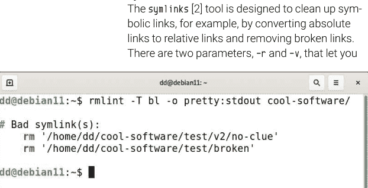

图 2：示例的 `rslant` 结果。

```
dd@debian:~$ rmlink -T bl -o prept:stdt cod-software/
# Bad symlinks:
rm /home/cod-software-test/test2/v2/no-clue
rm /home/cod-software-test/broken/
```

# 教程 — 检测损坏链接

`modules os as Line` 第 1 行将它们导入到当前命名空间。第 3 行定义了一个名为 `walk()` 的函数，该函数遍历作为顶层参数传递的目录并检查其中的所有条目。在第 22 行调用了 `walk()`，在此之前评估了第 21 行作为参数传递的目录。

首先，程序创建搜索结果（第 4 行到第 7 行）。如果发生错误，`walk()` 函数在此处终止。然后，代码检查目录中的每个条目，以判断它是文件（第 11 行）、链接（第 13 行）还是目录（第 15 行）。该程序跳过文件。例如，`walk()` 函数被递归调用，再次以目录名作为参数。

然而，对于链接，来自第 16 行的 `readlink()` 函数会搜索目标。如果它是空的，则是一个损坏的链接，函数返回相应的错误消息。在检查完目录中的所有条目后，函数返回到调用点。如果你在目录树中运行脚本，你将看到包含列表 2 中两个条目的输出。

`relink` 检测到两个损坏的链接（它就是这样工作的）。`echo` 输出名称并显示链接目标。`chase` 还执行了一项令人兴奋的任务：追踪符号别名指向的文件，如果目标不存在，在情况下返回 1。列表 10 的第 2 行显示了对旧引用的调用，我们的结果是文件名。请记住符号链接可以跨越系统边界。你唯一的选择是检查文件系统中的每一个条目。

# 结论

在结构中可靠地检测损坏链接需要开销，但这是可以实现的。这里讨论的工具将帮助你轻松处理此问题：

## 避免错误

你如何从根本上防止损坏链接出现？坦率地说，这里的唯一建议是更加小心（此外没有一个存储所有链接的地方）。我没有知晓任何后台搜索来确保链接保持完好，你可能会无意中破坏链接。在删除文件之前，使用本文讨论的任何工具检查是否存在符号链接是有意义的。如果你只有对 `find` 和 `readlink` 的访问权限，请参考列表 11 所示的步骤。调用列出了这两个组件和链接目标 `-side`。为了做到这一点，`find` 使用了 `-ls` 选项。

## 列表 10：`rmlink` 和 `chase`

```
01 $ rmlink -T bl -o prept:stdout
02 $ chase old
03 /project/version
```

## 列表 11：`find` and `readlink`

```
$ find -type 1 -exec echo -n {} ';' -exec readlink {}
./project/version2/data/dataset3 -> project/version1/data/dataset3
./project/old -> project/version1
./project/current -> project/version2
+   1 tree: https://mama.instate.edu/users/tree/
2 symlinks: https://packages.debian.org/
3 Fslint: https://www.pixelbeat.org/fslint/
4 rmlink: https://rmlink.io/latest/
5 chase: https://packages.debian.org/bullseye
```

## 作者

Frank Hofmann 是一位柏林的开发者、培训师，是《Debian 包管理》(http://www.dpm.org/) 的合著者。

## FOSS LIFE

新闻 • 职业 • 生活 • 技能 • 资源 FOSSlife.org

## Linux NEWSSTAND

Linux 杂志是你的 Linux 世界指南。每月杂志都包含了在其他地方找不到的高级文章和教程。浏览我们的完整目录完成合集。

## 隐私

如果你真的重视隐私，你需要学习处理浏览器的跟踪。那些需要匿名的人依赖 Tor 网络 - 为监控国家提供安全浏览。我们还查看了 Portmaster，一个具有实用隐私功能的应用程序防火墙。

光盘：Ubuntu 22.04 和 Fedora Workstation 3

## 零信任

二十年前，每个人认为网关防火墙就是你保持安全的全部，但信任有一个不同的故事。今天，最好的建议是：不要信任任何人。你的内部网络可能和互联网一样危险。

光盘：Zorin OS 16.1 Core 和 Super GRUB2

## 清洁 IT

大多数人可以通过更换灯泡来节能，但你知道你可以通过更高效的软件来节能吗？本月我们研究了为 IT 行业带来可持续性的努力。

光盘：Manjaro 21.2 Qonos 和 DragonBSD 6.2.1

## 加密

本月，我们调查了 Linux 的加密状态。我们超越基础，探索支撑秘密系统的工具和技术——并向你展示如何确保你的加密是私密的。

光盘：Linux Mint 20.3 Cinnamon 和 deep 20.4

## 面部识别

生物识别最近因 Microsoft Hello 技术的到来而增强。我们看到开源世界正在追赶，有一项创新的工具叫做 Howdy。脸认证可能还没有为 CIA 准备好，但我们将帮助你开始使用 Howdy 并探索一眼认证的可能性。

光盘：antix 21 和 Haiku R1/Beta 3

## 破以完美

模糊测试：你是否好奇攻击者是如何发现导致程序崩溃并放弃控制权的“精心构造的输入字符串”的？我们为你介绍模糊测试的世界、模糊测试的艺术并探索一些领先的模糊测试技术。

光盘：Parrot OS 4.11 和 Fedora Workstation 35

## 特选活动

用户、开发者和供应商在全球各地的 Linux 活动中汇聚。《Linux 杂志》很荣幸向大家展示此处列出的特选活动。关于您附近的其他活动，请访问我们的在线详尽日历查看：https://www.linux-magazine.com/

如果您知道任何您希望我们加入日历的 Linux 活动，请将带有详细信息的邮件发送至 info@linux-magazine.com。


## 通知

在预订任何行程之前，请务必检查网站，由于新冠（COVID-19）的影响，许多活动正在取消或转换为虚拟活动。

## 2022年存储开发者会议

**日期：** 2022年9月12-15日
**地点：** 加利福尼亚州，弗里蒙特
**网站：** https://storeddeveloper.org/

欢迎于9月12-15日加入我们在 SNIA 的 SDC21。紧跟最新技术可以节省大量的资金和时间。参加 SDC 是一种极具性价比的方式，可以通过教程、会议、主旨演讲以及参与同地插件活动的机会，获取许多不同领域的培训。请抓住这次机会，在同一地点向专家学习。

## 2022年布拉格 DrupalCon

**日期：** 2022年9月20-23日
**地点：** 捷克，布拉格
**网站：** https://events.drupal.org/prague2022

由 Drupal 协会提供的“Drupal 走进世界”，Drupal Europe 将于9月20-23日在布拉格举行。加入其中，推动 Drupal 项目的发展，并与其他成员建立联系。参与面对面的同行讨论、主旨演讲和会议。不要错过这次机会！

## 活动列表

- USENIX ATC '22 & OSDI '22 | 7月11-13日 | 加利福尼亚州，卡尔斯巴 | https://www.usenix.org/conference/
- 开源行业会议 | 7月19-20日 | 德国，柏林 | https://statconf.io/
- GUADEC 2022 | 7月20-25日 | 墨西哥，瓜达拉哈拉 | https://events.gnome.org/event/77/
- Icamping 柏林营-2022 | 7月21日 | 德国，柏林 | https://icamping.com/community/events/camping-berlin-2022/
- SCALE 19a | 7月28-31日 | 加利福尼亚州，洛杉矶 | https://www.calllinuxexpo.org/scale19a
- USENIX SECURITY '22 | 8月10-12日 | 马萨诸塞州，波士顿 | https://www.usenix.org/security22
- 伦敦开源峰会 | 8月23-24日 | 虚拟活动 | https://events.linuxfoundation.org/
- 拉美地区 | 9月7-8日 | 爱尔兰，都柏林 | https://odsc.com/apac/
- KVM 论坛 | 9月12-14日 | 爱尔兰，都柏林 + 虚拟 | https://events.linuxfoundation.org/
- 存储开发者会议 (SDC22) | 9月12-15日 | 加利福尼亚州，弗里蒙特 | https://storeddeveloper.developer/?source=LinuxMagazine&Event-Calendar
- 欧洲开源峰会 | 9月13-16日 | 爱尔兰，都柏林 + 虚拟 | https://events.linuxfoundation.org/
- 欧洲 Linux 安全峰会 | 9月15-18日 | 爱尔兰，都柏林 + 虚拟 | https://events.linuxfoundation.org/
- 布拉格 DrupalCon | 9月20-23日 | 捷克，布拉格 | https://events.drupal.org/
- 开源主机峰会 | 9月1-22日 | 宾夕法尼亚州，费城 | https://.com
- 2022 学院 | 10月1-7日 | 西班牙，巴塞罗那及 虚拟 | https://akademy.org/2022

## 征稿

我们正在寻找关于 Linux 和 Linux 环境工具的高质量文章。我们将考虑任何主题，但以下主题我们特别感兴趣：

- 系统管理
- 有用的技巧和工具
- 安全性，包括新闻和技术
- 产品评测，特别是来自实战经验
- 社区需求和项目

如果您有想法，请将带有长度预估、背景描述和联系信息的提案发送至 edit@linux-magazine.com。

文章的技术水平应与您平时在《Linux 杂志》上阅读的内容一致。请记住，《Linux 杂志》在许多国家阅读，您的文章可能会被翻译成我们姐妹出版物之一。因此，最好避免可能让所有读者无法理解的俚语和成语。

在提及未来的日期或事件时要小心。从您提交到最终稿件到达读者手中，可能会过去好几周。发送邮件或消息时，请在邮件主题行中使用特定的主题，帮助我们识别您的信息为文章提案。随时欢迎截图和其他支持材料。

更多信息请见：http://www.linux-magazine.com/

更多信息请见：http/31162a00ee46c5d590c544cb2d944405_99_0)

| 作者 | 页面 |
|---|---|
| Erik Casad | 16 |
| Jack Brown | 12 |
| Bruce Fieldfield | 24 |
| Mark Gomez | 67 |
| Marco Fisher | 26 |
| Jon Hoffman | 70 |
| Herman Met | 32 |
| Vincent Hill | 69 |
| Peter Miller | 54 |
| Graham Morrison | 78 |
| Daniel Schiff | 36 |
| Jane Wall | 84 |
| Amy Pettie | 48 |
| Audrey Walden | 68 |
| Rita Sooby | 20 |
| Jan Clark | 52 |
| Gwen Clark | 74 |
| Lori F | 62 |
| Sarah S | 90 |
| Julia K | 18 |
| Casad | 5 |
| Julia Kvasha, 123
| Editor.
4840 Parkway,
Lincoln, SK 68504
Publisher
Brian Gomez
Customer Service | Subscription
For USA and Canada:
sail@linux-magazine.com
(For Toll Free from the USA)
For other countries:
www.linux-magazine.com North America

## 下个月

26期

## 超越 5G

下个月我们将为您介绍开放无线接入网络 (`O-RAN`) 以及确保下一代 6G 移动技术的努力。

| 地区 | 日期 |
|---|---|
| 英国 / 欧洲 | 8月6日 |
| 美国 / 加拿大 | 9月2日 |
| 澳大利亚 | 10月3日 |

## 注意日期

请注意：销售日期为预计日期，可能会因物流问题延迟。

## 预览邮件

《Linux 杂志预览》是一封每月邮件，让您提前预览下期内容，包括文章链接。

注册：https://bit.ly/Linux-Update

图片 © Julia Kvasha, 123

## 像专家一样思考
## Linux Shell 手册 2022版

这个新版本包含了用于系统配置和排除故障的最重要工具。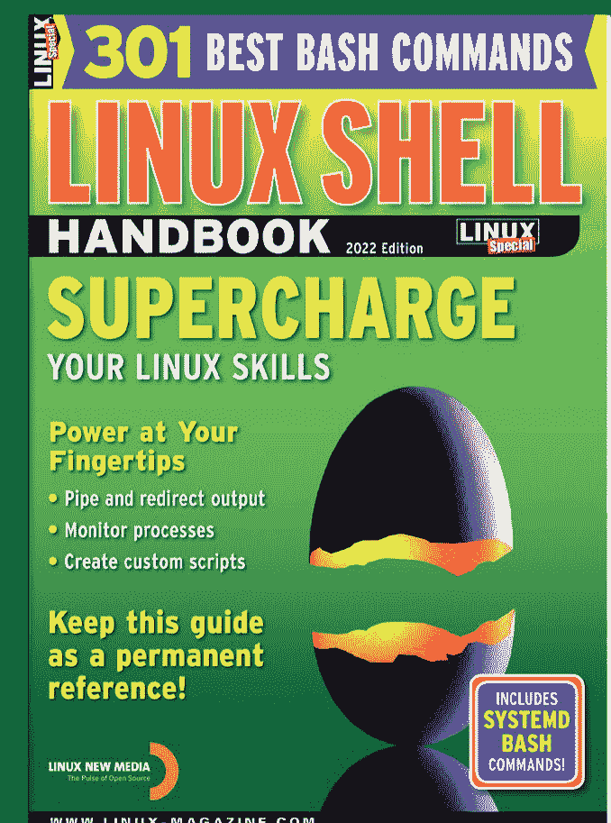

- 以下是您将发现的部分内容：
- 定制 Bash
- 正则表达式
- systemd
- Bash 脚本
- 网络工具
- 以及更多！

在线购买：shop.linuxnewmedia.com/specials

## DrupalCon
PRAGUE2022
9月20-23

访问我们的网站 https://events.drupal.org/prague2022 获取更多信息。


在为太晚之前忘记注册！


查看
日程安排

我想成为 DrupalCon Prague 2022
志愿者

我想成为
赞助商

我有问题
drupal@kuonitumlare.com
