# Linux 月刊 262 2022-09 美国


LINUX 新媒体
开源脉搏

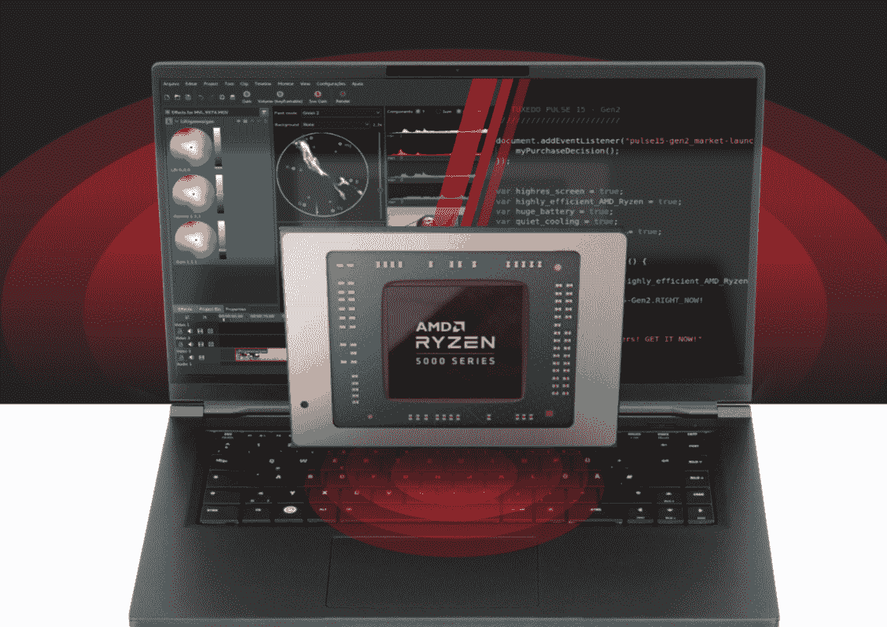

## 相当强大！

### TUXEDO Pulse 15 - Gen2

- **AMD Ryzen 7 5700U-35W**
  8 核心 | 16 线程
- **WQHD 显示屏**
  2560 x 1440 | 165 Hz
- **最长 18 小时续航**
  91 Wh 电池
- **坚固的镁合金机箱**
  厚 1.7 厘米 | 重 1.5 公斤

- **100% Linux**
- **5 年保修**
- **终身支持**
- **德国制造**
- **德国隐私保护**
- **本地支持**

TUXEDO 电脑 18 周年庆典

tuxedocomputers.com

立即申请！

正在寻找新工作？ tuxedocomputers.com/jobs

### 毕业礼帽与长袍

亲爱的读者：

几个月前，我写过关于开源社区需要为单人或小型开源项目在维护者达到倦怠点或忙于其他事务时提供延续性手段的问题。仅仅因为发起人离开，项目就必须消亡吗？

这个问题的另一个角度是研究专业人员编写的科学软件。世界上最精密的软件之一是由博士候选人和其他学术科学家创建的。这些软件并不是单纯为了编写软件而编写的——它们是为了测试新想法或回答与研究项目相关的问题而编写的。其中一些程序代表了多年的工作，但当开发者毕业或获得终身教职职位时会发生什么？或者当资助研究的拨款到期时会发生什么？更常见的是，项目停滞不前并逐渐消失，而开发者则寻找新的项目和新的资金来研究其他问题。

学术科学关注的是期刊文章，而不是软件。软件只是实现目的的手段，因此许多有用的程序被遗弃，研究人员最终不得不重新发明轮子。不要指望博士和博士候选人来解决这个问题。从未有人因维护只有少数专家才能理解的现有软件而获得讲席教授职位。

随着虚拟科学软件研究所 (VISS) [1] 最近的公告，被遗弃的科学软件的前景变得稍微明亮了一些。VISS 由舒密特未来基金会 (Schmidt Futures) [2] 支持，该非营利组织由前谷歌首席执行官埃里克·舒密特和他的妻子温迪·舒密特创立，正在剑桥大学、华盛顿大学西雅图分校、佐治亚理工学院和约翰斯·霍普金斯大学启动四个软件开发中心。这些中心每个将雇佣五到七名软件开发人员，将为科学项目提供开发和支持服务。最初，这些中心只处理与舒密特未来基金会相关的项目，但希望将该支持扩展到其他有价值的研究。

除了在项目结束后软件继续存在以及参与者转向其他事务之外，这些中心将在初始开发阶段提供支持。另一个重要但可能不那么具体的目标将是建立专业学术程序员的身份。世界各地大学中现在有许多专业开发人员在工作，但他们通常是孤立的，分散在校园里，通过单独的、不相关的拨款独立工作。VISS 中心提供了集体体验的可能性，具有在野外软件开发中日常存在的指导、工作分享和协同效应。

根据 *Nature* [3] 最近的一篇文章，VISS 很清楚，它无法与亚马逊和谷歌等互联网巨头在支付最高薪水方面竞争，但他们确信他们仍然可以吸引高素质人才。许多专业开发人员最初是通过在科学和工程领域的工作对编码产生兴趣的，对于其中一些人来说，参与具有科学意义的项目比最大化薪资潜力更令人兴奋。（而且，诚实地说，与很多在大学校园里游荡的人相比，他们的待遇可能也不错。）

鉴于当今世界上科学软件的数量，在四个小办公室中增加 20-30 名程序员不会在一夜之间改变格局，但 VISS 的倡议将有助于提高对支持科学编程需求的认识，并且它可以为那些希望在科学知识的永恒探索中发挥作用的对程序员提供永久职业路径的原型。

乔

乔·卡萨德 (Joe Casad)，
主编


- 信息

- [1] VISS: <https://www.schmidtfutures.com/our-work/virtual-institute-for-scientific-software/>
- [2] 舒密特未来基金会: <https://www.schmidtfutures.com/>
- [3] “前谷歌主管的 ventures 旨在拯救被忽视的科学软件”，作者 David Matthews，*Nature*，2022 年 7 月 13 日: <https://www.nature.com/articles/d41586-022-01901-x>

4 2022 年 9 月 第 262 期 LINUX-MAGAZINE.COM I LINUXPROMAGAZINE.COM


**两款绝佳的发行版**
**双面 DVD！**
详见第 6 页

### openSUSE Leap 15.4 和 MX Linux 21.1
两款绝佳发行版收录于双面 DVD！

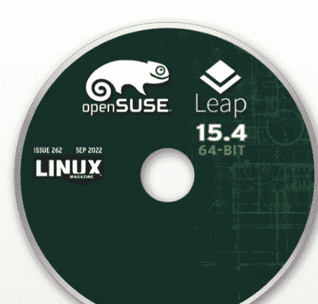

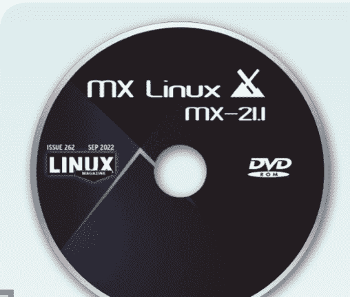

#### openSUSE Leap 15.4
64 位

#### MX Linux 21.1
64 位

Leap 15.4 是 openSUSE 的最新稳定版本，openSUSE 是一个受欢迎且基础稳固的社区发行版。Leap 15.5 计划在 2023 年 6 月之前不会取代它。

由于 15.4 版本构建于成熟平台之上，其大部分功能属于更新，且往往发生在幕后。几处变更是对 sudo 和 visudo 的增强和改进，以及对 systemd 的回合补丁和错误修复。此外，该版本对 AppArmor 以及 Firefox 和 LibreOffice 等生产力工具进行了重大更新。

或许最显著的变化是 DNF 的引入，这是一个包管理器，已在 Fedora 等其他 RPM 发行版中 largely 取代了 Yum。虽然 openSUSE 中仍保留 Yum，但 15.4 版本可配置为使用 DNF。此外，15.4 版本还引入了 Microdnf，这是 DNF 的一个子集，当不需要完整的 DNF 时，可用于加速软件包安装。

与其他所有 openSUSE 版本一样，Leap 15.4 是一个通用版本，适合所有级别的用户。

当轻量级的 antiX 发行版与曾经著名的 MEPIS 社区合作时会发生什么？答案是：一个连续三年在 DistroWatch 上访问量位居首位的 Debian 衍生版，且显示出很少的下滑迹象。

安装 MX Linux 后，其受欢迎的原因会立即变得显而易见。antiX 核心使得系统速度飞快，许多人也会认可 MX Linux 对 systemd 的最小依赖。新手可以欣赏清晰且详细的文档，特别是在安装程序中，以及引导性的欢迎屏幕和桌面导览。对于更有经验的用户，桌面包含一系列其他发行版中极少能与之匹敌的工具。这些原创工具包括用于编辑 Bash、引导管理器、存储库、防火墙和高级备份技术的图形界面。虽然不那么显眼但同样有用，MX Linux 还包含 USB 格式化器、Live USB 创建器和 Samba 配置器——以及其他许多用于在其他发行版中通过命令行完成的任务的工具。欲了解更多信息，请参见本期的发行版之旅。

缺陷光盘将被更换。
请发送邮件至 subs@linux-magazine.com。

尽管此 Linux Magazine 光盘经过测试，且据我们所知不含恶意软件和缺陷，但 Linux Magazine 不对因使用此光盘而导致的任何中断、数据或计算机系统损坏负责，也不承担责任。

### 迈出 Web 开发的第一步！


#### Web 开发基础

现代软件应用程序通常针对 Web 进行开发。Linux 专业学会（LPI）新的 Web 开发基础项目支持你迈出软件开发的第一步。它包含适合培训和自学的学习资料。通过 Web 开发基础考试后，你将获得一份证明你技能的证书。

LPI 学习资料可在 [learning.lpi.org](http://learning.lpi.org) 获取。欲了解该项目和考试的更多信息，请访问 [lpi.org/wde](http://lpi.org/wde)


## 新闻

技术、趋势和工具的更新

#### 本月新闻

-   **08**
    - Rocky Linux 9 已发布
    - Slimbook 在 Executive Linux 超薄笔记本中升级 CPU
-   **09**
    - Fedora Linux 即将登陆 Raspberry Pi 4
    - KaOS 2022.06 现已可用，搭载 KDE Plasma 5.25
    - 更多在线新闻
-   **10**
    - Manjaro 21.3.0 现已可用
    - SpiralLinux：一个专注于简洁性的新 Linux 发行版

#### Rocky Linux 9 已发布

Rocky Linux 9 现已可用，并且由于几个原因，它是一个里程碑式的版本。首先，Rocky Linux 的部署量激增，使其领先于 CentOS Stream 和 AlmaLinux。但更重要的是，Rocky Linux 包含多项安全增强和网络功能，有助于使其成为适合各规模企业的同类最佳开源操作系统。

在新版本中，你将发现用于加密目的的 SHA-1 消息摘要已被弃用（因为加密哈希函数不再被认为安全）。此外，你将发现 OpenSSL 3.0.1（包含提供程序概念、新的版本方案、改进的 HTTP/HTTPS 客户端、对新协议/格式/算法的支持等）、OpenSSH 版本 8.7p1（包含用更可预测的 SFTP 协议替代 SCP/RCP 协议）、SELinux 性能改进，以及为 PCI-DSS、HIPAA、DISA 等自动配置安全合规设置。


关于网络改进，你将发现 MultiPath TCP Daemon 现在可用于替代 iproute2 来配置 MultiPath TCP 端点。此外，NetworkManager 现在使用密钥文件来存储连接配置文件（但仍支持 ifcfg）。Iptables-nft 和 ipset 已被弃用，并被 nftables 框架取代。最后，network-scripts 已被移除，转而使用 NetworkManager 来配置网络连接。

Rocky Linux 的另一个重大进步是该版本是使用一个名为 Peridot 的社区开发的、开源的、云原生系统构建的。这个 Golang 项目旨在确保在每个 RHEL 版本发布后的一周内就能发布新版本的 Rocky Linux。通过迁移到此系统，任何人都可以从零开始重现 Rocky Linux，从而确保该发行版始终可用。Peridot 构建系统的源代码可在 GitHub（https://github.com/rocky-linux/peridot-release）上找到。

欲了解有关新 Rocky Linux 版本 release 的更多信息，请务必阅读完整的发布说明（https://github.com/rocky-linux/documentation/blob/6d86674106232d3c0ab72da734de6eede4e46549/docs/release_notes/9.0.md）。

#### Slimbook 在 Executive Linux 超薄笔记本中升级 CPU

Slimbook 因生产搭载 KDE Plasma 的笔记本电脑而闻名，它通过提供搭载 Intel 12 代 Alder Lake CPU 的 Executive 系列，对其产品线进行了一点刷新。这次新的迭代显著增加了性能


#### Fedora Linux 即将登陆树莓派 4

Fedora Linux 已经可以在桌面、服务器甚至物联网设备上使用。然而，如果你想在该操作系统安装到树莓派 4 设备上，之前总是事与愿违——直到现在。随着 Fedora 37 的即将发布，对该设备的支持或许终于会成为现实。虽然这还不是官方支持，但这项提议已经提交，并将在获得 Fedora 工程指导委员会批准后实施。

树莓派 4 之前未能获得 Fedora Linux 支持的原因在于缺乏图形加速功能。不过，随着上游社区在内核和 Mesa（特别是针对 OpenGL ES 和 Vulkan 的 V3D GPU）方面的工作推进，现在只需启用支持即可。需要注意的是，树莓派 400 的 Wi-Fi 支持并不包含在此次更新中（尽管测试了音频支持）。

根据 Fedora Wiki 上关于树莓派 4 的页面记载：“对树莓派生态的支持一直在不断演进。本次更改的目标是支持树莓派 4，包括 4B、400 以及配备 I/O 板的 CM4。上游目前支持使用 V3D GPU 进行 OpenGL ES 和 Vulkan 的图形加速。此外，CM4/4B 的有线网络也得到了增强，支持 PTPv2。”


#### KaoS 2022.06 版本现已发布，搭载 KDE Plasma 5.25

KaoS 最初创建于 2013 年，是一款专注于 KDE 桌面环境的 Linux 发行版。其初衷是打造一个高度精致的 KDE 体验，开发者也很好地实现了这一目标。随着最新版本的发布，通过增加 KDE Plasma 5.25 以及许多其他新增功能和增强项，这一体验变得更加出色。

至于 KaoS 中还增加了哪些内容，你会看到 KDE Frameworks 5.95、KDE Gear 22.04.2、Calamares 3.3、作为默认办公套件的 LibreOffice（取代了 Calligra）、Linux 内核 5.17（增加了对 GPU 的改进支持），以及在新手引导欢迎界面中新增的软件包选择功能。

当然，KaoS 2022.06 的核心是 KDE Plasma 5.25，它带来了大量改进，包括增强的手势支持、窗口强调色色调、大幅优化的触控模式、Kdenlive 的 10 位色彩支持、Kate 编辑器的多项增强，以及改进的设置对话框。

对于好奇的用户，LibreOffice 之所以成为默认办公套件，是因为它现在可以作为单一 Qt 应用提供。

欲了解最新发布的更多信息，请访问 KAOS 新闻页面 (https://kaosx.us/news/2022/kaos06/) 并从 https://kaosx.us/pages/download/ 下载 ISO 镜像。

#### Manjaro 21.3.0 现已发布

Manjaro 是一个基于 Arch 的滚动发布 Linux 发行版，面向那些希望获得 Arch 的强大功能和灵活性，又不想被其复杂性困扰的用户。最新版本 21.3.0 包含了许多新特性，形式包括 Calamares 安装器（现在支持 LUKS 分区）、Gnome 42（包含 Libadwaita）、KDE Plasma 5.24（包含新的概览功能）、Xfce 4.16（现在支持分数缩放）以及 Linux 内核 5.15 LTS。

Manjaro 21.3.0 的 Gnome 版本同时包含 GTK 4 和 Libadwaita，提供了改进的性能、现代化的 UI 风格以及丰富的新用户界面元素。Plasma 版本使得用户可以更容易地移动面板，并将其固定在任意喜欢的边缘。Xfce 版本接收了相当数量的更新，特别是在合成和 GLX 领域。


由于 Manjaro 是滚动发行版，如果你已经安装了该系统，更新即可带你到最新版本。如果你没有安装 Manjaro，可以从官方 Manjaro 下载页面 (https://manjaro.org/download/) 下载最新的 ISO，你可以选择下载完整版或最小版。你还可以找到适用于 x86_64 和 ARM 架构的下载版本，以及 Budgie、Cinnamon、i3、Sway、MATE 桌面环境的非官方版本，甚至还有一个 Docker 镜像。

#### SpiralLinux：专注于简洁性的新 Linux 发行版

SpiralLinux (https://spiralinux.github.io/) 是一个基于 Debian 的 Linux 发行版，提供 Cinnamon、Xfce、Gnome、KDE Plasma、MATE、Budgie、LXQt 和 Builder（使用 IceWM 窗口管理器，供经验丰富的用户完全自定义系统）等版本。这些版本（除“Builder”外）均提供简化的 Linux 体验，并使用官方的 Debian Stable 软件包仓库。

SpiralLinux 内置 Flatpak 支持，并配有用于管理 Flatpak 软件的图形用户界面前端。该发行版使用 Btrfs 文件系统，包含使用 Zstd 透明压缩的优化子分区，内置对自动 Snapper 快照的支持，甚至支持 zRAM 交换。

据开发者称：“我们在利用 Debian 本身提供的软件包和机制来润色 SpiralLinux 在所有主要桌面环境下的默认配置方面投入了大量精力”，当被问到“为什么又一个基于 Debian 的发行版”时，开发者如是说。

SpiralLinux 基于 Debian 11（“Bullseye”），由内核 5.16 驱动，默认安装了 Firefox、LibreOffice、Thunderbird、Transmission、Pidgin 和 Synaptic 包管理器等应用程序。

要了解 SpiralLinux 最新发布的更多信息，请务必访问官方发布说明 (https://github.com/SpiralLinux/SpiralLinux-project/releases)。

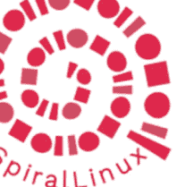


#### 更多在线资源

- **Linux Magazine**
  www.linux-magazine.com

- **ADMIN HPC**
  http://www.admin-magazine.com/HPC/

- **共享终端**
  - 作者：Jeff Layton
  - 有时在两个用户之间共享屏幕非常有帮助。我们来看看两款终端共享工具：screen 和 tmux。

- **性能健康检查**
  - 许多 HPC 系统在运行应用程序之前会检查节点的状态，但很少有系统在运行任务前检查节点的性能是否可接受。

- **ADMIN Online**
  http://www.admin-magazine.com/

- **三大全文桌面搜索引擎**
  - 作者：Harold Jule
  - Tracker、DocFetcher 和 Recoil 等桌面搜索引擎有助于通过内容追踪文件，即使在海量数据集中也是如此。

- **利用有限资源扩展设备**
  - 作者：Federico Lucifredi
  - 针对小内存问题的压缩内存解决方案。

- **具备先进安全性的便携式主目录**
  - 作者：Martin Loschwitz
  - systemd homed 服务使得移动主目录变得轻而易举，而 FIDO2 或 PKCS#11 可以保护存储的文件。

##### 入门


在开源生态系统中找到你的位置

OpenSourceJobHub.com


#### Zack 的内核新闻


> 编年史家 Zack Brown 报道 Linux 内核社区的最新新闻、观点、困境和动态。
> *作者：Zack Brown*

##### 随机数合理性

随机数对安全性至关重要。通常生成随机数的方法是从某处获取熵（entropy），例如手指敲击键盘的频率，并以此生成所需数量的不可预测数字。但如果没有人敲击键盘怎么办？如果熵耗尽了怎么办？系统应该只是坐着等待更多熵吗？

长期以来，Linux 内核不得不在两种选择之间做出抉择：要么锁定系统直到找到足够的熵来生成真正的随机数，要么无论如何都提供数字，即使它们并不足够随机。

但在 2019 年，Linus Torvalds 编写了一个补丁，通过“在等待随机数生成器初始化时，利用 CPU 周期计数器主动生成熵噪声”来解决这一问题。“这只在拥有高频时间戳计数器的情况下才能工作，但在所有现代 x86 CPU 以及大多数其他现代 CPU 上，这种情况都是成立的。”

由于该补丁的存在，随机数生成器几乎总是拥有足够的熵来产生有用的随机数。最近，Jason A. Donenfeld 认为，是时候让所有人承认它是有效的，克服对新技术的恐惧，并允许 Linux 随机数生成器在积累熵时进行阻塞。

这是一个天生具有争议的话题。如果系统等待一个永远不会变得可用的资源，它将永远等待，结果你就拿到了一块“砖头”（死机）。此前曾有多次尝试向随机数生成器引入阻塞机制，但它们在上树后不久就被移除了。

但 Jason 表示，“鉴于内核已经发展出了一种从虚无中自我播种的机制，且该过程相当快，也许让 /dev/urandom 提供不安全的字节已经没有任何意义了。过去我们不希望引导过程死锁，这是可以理解的。但现在，在最坏的情况下，只会过去一秒，问题就解决了。看来我们终于到了一个可以废除臭名昭著的‘urandom 读取洞’的阶段。”

他补充道，“这个补丁在很大程度上消除了一个长期积压的用户空间密码学‘自毁陷阱’。经过几十年的无尽用户困惑后，我们终于可以说：‘使用我们任意一个随机接口都可以。它们都是一样的，无所谓。’我认为，这真的很有意义。最终，所有那些博客文章、持异议的论坛和相互矛盾的文章关于它们所推荐的任何内容都将是正确的，随之而来的是整整一类漏洞被消除。”

Jason 提到的“自毁陷阱”（footgun）并不是某种晦涩的安全相关攻击向量；它只是俚语，指某件容易让人自己害自己的事情。

但 Andy Lutomirski 提出了针对 Linux 内核补丁几乎最强烈的反对意见——声称它违反了应用程序二进制接口（ABI）——同时他对整个议题提供了一些历史视角。他说：

“这个补丁 100% 是关于一个历史错误。在很久以前（其实也没那么久），有两个可用的随机数生成器接口：/dev/random 和 /dev/urandom。/dev/random 至少在原则上是安全的，但它不必要地阻塞，因此极其缓慢。它完全不适合被任何类型的服务器重复使用。/dev/urandom 不阻塞，但如果调用得太早则不安全。*但是* urandom 也是获取‘尽力而为-我现在就需要’随机位的正确接口。通用密码学用户想要的实际语义当时是不可用的。

“快进到今天。/dev/random 具有密码学目的的正确语义。getrandom() 也具有密码学目的的正确语义，并且作为此类功能是可靠的——它保证要么不存在，要么做正确的事（DTRT）。而尽力而为的用户可以使用 GRND_INSECURE 或 /dev/urandom。

“如果我们想象所有我们关心的用户程序在尽力而为时使用 GRND_INSECURE，在密码学使用 /dev/random 或 getrandom()（不带 GRND_INSECURE），那么我们的情况非常好，这个补丁就不相关了。

“但我们不能依赖这一点。新内核应当与旧用户空间兼容。而对于*旧*用户空间，我们不知道 /dev/urandom 的用户是想要密码学安全的输出还是想要不安全的输出。而且引导期间存在这种‘解旋’（unwind），据称最长持续 1 秒；这两者之间有巨大差异。所以，抱歉，这个补丁是一个 ABI 破坏。你将在引导后立即将那些想要尽力而为随机性的程序重新解释为想要密码学随机性，这可能会使引导延迟最多 1 秒，而这就足以被视为一次破坏。

“因此，如果没有更强的理由和更清晰的兼容性故事，我不喜欢这个补丁。如果你有 `random=***` 选项来切换回旧行为，并且有非常清晰的信息，如‘random: %s 启动延迟。如果你不需要在引导期间使用密码学安全的随机数，请设置 random=*** 以加快引导’，那我‘可能’会加入，但我不认为在其他情况下这样做是可以接受的。”

“或者我们维持现状，并使警告更清晰：'random: %s us 正在使用不安全的随机输出。请修复它以适当使用 getrandom() 或 /dev/urandom。'”

所以 Andy 并没有质疑 Jason 的补丁是否能工作——他指出的是，它将以可能破坏现有编译用户空间二进制文件的方式改变系统行为。换句话说，它会破坏内核 ABI。如果属实，Jason 的补丁将有一道巨大的障碍需要跨越。一般来说，除了允许安全漏洞未修补外，Linux 唯一讨厌的就是破坏 ABI。但如果能证明没有用户依赖 ABI 的特定部分，Linus 曾允许补丁对其进行修改。

在这种情况下，Jason 对 Andy 说：

“*我认为你的分析与现实情况有些脱节。现实是，密码学用户发现自己仍然在使用 /dev/random，因为这在很长时间内一直是‘标准良好建议’。人们仍然被鼓励这样做，无论是出于无知还是出于‘兼容性’。密码学问题不会消失。解决这个问题意味着，是的，为那些尚未切换到使用 getrandom(GRND_INSECURE) 进行这种较少见用途的少数 init 系统用户（这些用户实际上是谁？）增加 1 秒的延迟。这不是破坏兼容性或破坏用户空间或破坏任何东西；这是接受 /dev/random 主要用法——密码学——的现实，并使这种用法最终变得安全，代价是那些尚未切换到 getrandom(GRND_INSECURE) 的其他用户会有 1 秒的延迟。对于消除一个自毁陷阱来说，这似乎是一个很小的代价。

“而且，总的来说，以修复一个常见触发的自毁陷阱为优先，而淡化较少见用法的罕见性能表现，这与事物随时间演化和改变的方式相当。没有实际的破坏。没有 ABI 变更违规。你所说的 simply 并非如此。*”

Theodore Ts’o 在 Jason 的论据一侧加入了讨论。他说，“只要我们阻塞的时间很短，并且仅在系统引导后的早期阶段，人们就不应该在意。我们必须添加‘天哪-我希望这个像 jitter-entropy 一样的黑客做法在所有架构上都是安全的，但它比人们试图让 Linux 采用的替代方案要好’的原因是，存在挂起数小时甚至数天的系统。”

但真金不怕火炼，在 Jason 的补丁进入内核树大约一周后，Guenter Roeck 指出，它导致“各种架构（arm, m68k, microblaze, sparc32, x86：我观察到的）的大量 qemu 引导测试失败。共同点是引导在‘Saving random seed.’处挂起。附带了一个样本二分查找日志。回退此补丁可以修复问题。”

此时 Linus 加入了对话，说道，“好吧，尝试是值得的，但是的，它显然对那些无法进行抖动熵且没有其他活动的各种平台造成了问题。”

于是他回退了这个补丁。

Jason 也评论了 Guenter 的帖子，说道，“正如 Linus 所说，尝试并不值得，我想它只是不起作用。”

但故事并没有就此结束。Jason 要求 Guenter 分享一些似乎因该补丁而损坏的虚拟机，两人——以及其他一些人——着手追踪 Qemu 对 Jason 补丁出现问题的真正原因。正如 Jason 所说，“如果我们将来再次尝试，了解之前失败的所有原因似乎是个好主意。”

事实上，结果证明这是一个 Qemu bug，而不是 Jason 的随机数生成修改存在的问题。对 Jason 来说，这意味着“回退 /dev/random + /dev/urandom 统一的理由现在已经被修复了。这是实实在在的具体进展。”

但他仍保持谨慎。Jason 继续说道，“我不想太快再次尝试统一。我认为至少，第一次尝试的教训不仅仅是‘我应该修复 Guenter 的一些测试用例’，而是问题在于‘提前排队，并进行更广泛的测试和研究。然而，导致回退的初始问题在多个平台上得到修复，这给了我相当大的乐观，相信在*某个*时间点，我们将能够尝试此事。一步一个脚印。”

最终，看来 Linus 并不认为整个问题整体上是一次不可接受的 ABI 违规。他愿意，虽然不积极，但如果 Jason 的补丁能起作用，他会接受此类东西。因此，从理论上讲，Jason 可能会在近期给随机数生成带来一点更多的合理性。

##### 来自 Linus 的 Git 教训

Borislav Petkov 向 Linus Torvalds 针对 5.18 内核树提交了一个拉取请求，但他注意到他的工作流程产生了一个奇怪的 diffstat。Diffstat 是自动生成文件变更和变更量摘要的文档。这是内核开发人员快速查看补丁中哪些部分可能引起他们兴趣的一种方式。在这种情况下，Borislav 注意到 Git 抱怨“多个合并基”（multiple merge bases），并描述了他认为导致该抱怨的操作：

“我需要来自另一个 tip 分支的先决条件工作：tip/locking/core，该分支在我将先决条件工作添加之前被快进到了 v5.17-rc1。

“所以我将 tip/locking/core 合并到了 tip/ras/core […] 并添加了 RAS 内容

“*然而，在创建拉取请求的 diffstat 时，即使所有 tip/locking/core 的变更都已在你掌握的主分支中，它仍然会从 tip/locking/core 添加额外的文件。*”

他没有完全明白自己哪里做错了，所以他请 Linus 解释。Linus 回复道：

“*你所描述的是一种非常根本的事情——你的分支有多个独立的起始点，因为……*”

##### 作者简介

Linux 内核邮件列表归档了 Linux 开发活动的核心。流量巨大，经常达到每周 10,000 条消息，而一个人要跟上开发的全貌几乎是不可能完成的任务。少数敢于承担这项任务的勇敢灵魂之一是**扎克·布朗**（Zack Brown）。


## 新闻

之前你有不同的分支，并将它们合并到了你的代码树中。

*"有时拥有多个分支实际上并不会导致这种情况，因为不同的分支可能具有相同的起始基点。"

*"Git 称这些为'合并基点'，因为这些起始点在你合并时必须予以考虑，它们是解决通过多个分支引入的差异的基础。"

*"Git 在进行合并时完美地处理了这些问题，执行了所有适当的魔术操作。'git log' 也能毫无问题地处理——你可以轻松列出所有位于你头部但不在任意数量合并基点中的提交。"

*"但是，当你执行'git diff'时，情况就不同了（'git request-pull' 基本上只是执行一个 diff 来展示该操作的内容。"

*"一个 'diff' 本质上是对两个端点执行的操作。你有起点，有终点，然后你询问'这两个端点之间发生了什么变化'。"

*"但这从根本上意味着，当你有多个不同的合并基点，并询问'从起点到当前状态发生了什么变化'时，你的问题在根本上是模糊的。没有*一个*明确的'起点'。而是有'多个'起点。"

*"所以 Git 会选择一个起点，并仅仅使用它。"

*"这意味着，是的，diff 将显示自该起点以来的变化，但由于最终结果还取决于*其他*起点，它也会显示来自那个其他起点的变化。"

*"有时这些变化结果会是空的，因为'第一个起点'可能已经包含了所有内容。因此，有时你甚至不会注意到 'git diff' 给出的结果是模糊的。"

*"因此，'git request-pull' 既执行日志（用于提交的简短摘要）又执行 diff（用于 diffstat）。日志应该始终是正确的，但如果你存在多个合并基点，diffstat 就会有这种模糊性问题。"

林纳斯继续说道：

*"在一般情况下，你没有做错任何事：如果你合并了多个真实分支，只是 'git diff' 无法找到一个唯一的点作为基准，你会得到一些奇怪的随机 diff。

*"但如果你是一位合并多个真实分支的开发者，你显然知道如何合并事物，解决此问题的一种方法基本上是为自己执行一个测试合并："*

```
## WMLS? (“What would Linus See?” / 林纳斯会看到什么？)
git branch -b test-merge linux
git merge my-branch
git diff -C --stat --summary ORIG_HEAD...
... 保存好这个结果 ...

### 回到你的实际工作中，
### 并移除那个测试合并
git checkout -m main-branch
git branch -D test-merge
```

*"这会生成一个 diffstat，展示一个合并（从本质上知道如何解决多个合并基点）所产生的结果。"

*"显然，如果你不喜欢这些可能弄乱你工作树的临时分支，你可以在一个完全独立的 Git 树中执行上述操作。"

*"另一种选择是直接把那个错误的 diffstat 发给我。不幸的是，我已经习惯了这种情况，因为很多人只是执行 'git request-pull'，发现结果奇怪，不理解原因，然后让我来理清。"

*"好消息是，那些害怕合并和上述复杂情况的人永远不会遇到这种情况。如果你自己不做任何合并，你不可能有多个合并基点。"

*"这种 Git 复杂性只发生在本应能够处理它的人身上。你显然已经搞明白了发生了什么；你可能只是没有意识到完整的故事。"

Borislav 感谢他的解释，并提议就此主题撰写一些文档以包含在内核树中。但 Jonathan Corbet 提供了一个指向他自己在 2022 年 3 月写的笔记的链接，该笔记在内核树的 Documentation/maintainer/messy-diffstat.rst 中记录了这一情况。

Borislav 表示，他非常喜欢 Jonathan 版本的文档，胜过他自己可能拼凑出来的任何东西，讨论随之结束。

### 当消息尚未传遍时

Andy Shevchenko 最近不经意间招惹了狮子（指 Linus），他指出，由于内核构建系统中添加了 -Werror，现在构建时的所有警告都变成了错误。对于任何使用宿主机的 GCC（GNU C 编译器）的人来说，这会导致 GNU C 编译器在识别尽可能多的警告方面变得非常挑剔。结果是 Andy 的内核构建左挡右碰都在失败。他发布了一个补丁，从内核构建系统中移除整个 -Werror 机制。

狮子的獠牙没有立即咬合住 Andy 的头。相反，Masahiro Yamada 表示，-Werror 不应该为任何仅仅为了自己使用而构建内核的普通用户启用。

Andy 同意这一观点。然而，他开始感觉到周围都是狮子的热气，并提供了一个指向早前讨论的链接，位于 https://lore.kernel.org/all/YjsCoRRKW4I6St@zn.tnic/，其中 Linus Torvalds 曾表示内核构建警告是不可接受的，每个人都应该启用 -Werror。

此时，狮子确实咬住了 Andy 的头。林纳斯说道：

"如果你启用了 CONFIG_WERROR，那你就得到 CONFIG_WERROR。

"如果你启用了 W = 1，那你就得到额外的警告。

"如果你两者都启用了，那你就得到额外的警告，并且它们是错误。

"这条路完全是愚蠢的。"

他继续说道：

"-WERROR 应该在常规构建中开启。

"W = 1 才是有问题的。它启用了一些通常是误报的警告，如果你使用 W = 1（特别是 W = 2），那是*你的*问题。

"W = 1 绝对不属于'常规构建'。它仅适用于那些想要处理疯狂编译器警告的人。

"我*希望*尽可能广泛地开启 WERROR，因为我真的受够了开发者因为执行了'常规构建'而没有注意到他们添加警告的情况。

"停止这种认为警告是可以接受的荒谬行为。"

Andy 回复道：“好吧，确实如此。”然后他从地上捡起被咀嚼过的头，重新接回去，并继续处理下一件事。

10 月 14 日前注册，享受大折扣！

### 你。达拉斯。SC22。

11 月 13 日 – 18 日

SC22 是全球最大的高性能计算（HPC）研究人员和专业人士聚会之一，这是一周令人难以置信的学习新技能、建立新友谊、解决复杂问题以及观看下一代技术的时间。

如果您更喜欢虚拟参加，现在可提供一种新的、定制的数字体验。


国际高性能计算、网络、存储和分析大会

### 今日注册！

sc22.supercomputing.org


### 开放 RAN 与移动网络的未来

#### 开放空气

开放 RAN 为构成移动革命基础的无线接入网络带来了新的开放精神。

作者：Emil J. Khatib

移动网络是 21 世纪技术和文化的重要贡献者。像诺基亚或爱立信这样的公司塑造了移动革命的早期代际，由 GSMA、ETSI 或 3GPP 等工业联盟主导。这些国际组织创建了开放标准，增强了竞争并促进了行业的发展。快进到 2022 年，主要参与者已经改变，像三星、苹果或华为这样的名字正在塑造智能手机市场，但开放标准继续发挥重要作用。

像许多技术发展一样，移动通信的先例可以追溯到第二次世界大战。帮助前线士兵的移动电话概念在战后进入了民用领域，20 世纪 60 年代、70 年代和 80 年代见证了便携式通信系统（如市民波段（CB）无线电、对讲机）以及最终早期蜂窝通信的出现。

20 世纪 90 年代初，第二代（2G）移动电话网络随着 CDMA 标准（主要在美国、日本和韩国使用）和 GSM 标准（在欧洲、非洲、澳大利亚和亚洲大部分地区流行）的出现而亮相。2G 见证了手机的爆炸式增长，并有效地改变了我们对电信的看法：它不再关乎地点之间的通信，而是关乎个人的连接。

就在这时，互联网也变成了一种商品，习惯了连接的用户希望从手机上浏览网页和发送电子邮件。升级 2G 的努力很快因表现不佳而落空，第三代（3G）开始成形。第三代合作伙伴计划（3GPP）在 1994 年发布了 UMTS 规范，并在千禧年之交左右开始商业化。3G 支持移动宽带，为几年后的智能手机铺平了道路。

对更高带宽的无尽需求促使 3GPP 提供几乎每年对标准的补充。UMTS 通过版本 99、2000、4、5、6 和 7 进行了更新。尽管编号有点奇怪，但从那时起，就有了一个相当稳定的编号方案。版本 8（2008）到 14（2014）定义了 LTE 及其衍生技术，后来被称为 4G。LTE 极大地简化了网络架构，使较小的公司能够运营和维护 4G 网络。

最近，在 3GPP 版本 15（2018）到 17（2022）中定义的第五代（5G）继续简化网络。随着网络功能虚拟化（NFV）和软件定义无线电（SDR）技术的引入，5G 降低了制造网络设备的成本，为较小的竞争者打开了市场。

如今，"移动网络"一词通常指的是 3GPP 网络，以区别于 IEEE WiFi 或其他类型

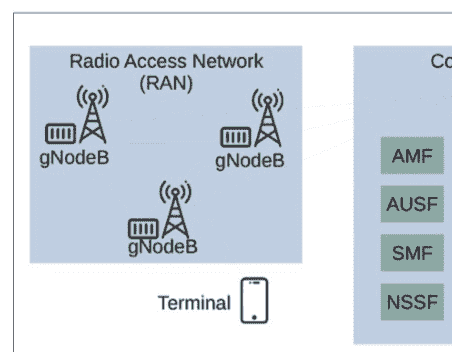


无线通信网络。3GPP 标准定义了一些所有数字蜂窝网络代际（从 GSM 开始）共有的元素。5G 移动网络由两个大块组成，每个块又包含其他功能（图 1）：无线接入网络（RAN）和核心网（Core）。

RAN 包含所有使移动网络具备移动性的元素，即作为终端接入点的基础站（图 2）。随着各代技术演进，该架构已取得了显著进步，基础站的元素多次被重命名、重塑并缩小尺寸。自 4G 以来，架构的另一部分是微微小区（femtocells），这是一种小型基站，其尺寸和形状类似于 WiFi 接入点。微微小区（图 3）改善了小型办公室、室内公共区域和家庭的覆盖范围。在 5G（顺便说一下，在 6G 中也是如此）中，基础站更常被称为 gNodeB。


RAN 基本上是一个接入点网络，提供 IP 层以下的连接性，其本身无法连接到外部世界或提供诸如认证或漫游之类的服务。相反，这些服务是核心网的功能。换言之，核心网包含所有使移动网络成为网络（而非仅仅是移动性集合）的元素。（关于核心网关键功能的更多详细信息，请参见标题为“核心网”的方框内容。）

随着移动网络新一代技术的演进，核心网这些元素变得越来越开放。在 5G 环境中，只要遵循 3GPP 标准接口，核心网功能就可以由不同的供应商进行编程和分布。这种开放方法具有许多优势。例如，NRF 功能使得管理来自不同供应商的软件包变得更加容易，消除了可能导致网络无法运行的不兼容性。

这种开放标准的趋势也延伸到了 RAN，在那里，一种类似的基于微服务的架构正在兴起：Open RAN。

##### Open RAN

用于 5G 核心网的微服务方法事实证明简化了新功能的添加和维护、第三方软件的集成以及使用现成计算机运行基础设施。换句话说，这是一个好主意。因此，合乎逻辑的下一步是将这个好主意转移到网络的另一部分，即 RAN。在 5G 中，RAN 在相当程度上也具有开放规范（例如，网络功能、协议等）。唯一的障碍是，只有少数制造商具备制造所需设备的能力：高频无线电收发器、放大器、精心设计的天线、高选择性滤波器以及其他高度专业化的工具。传统上，这种限制使 RAN 市场中的参与者减少到几家大型企业，如华为、诺基亚和爱立信。


**图 2：典型基础站的天线。**

**图 3：5G 微微小区（CC BY-SA 4.0，来自 commons.wikimedia.org 的用户 Liamjs）。**

###### 核心网

在 5G 中，主要的核心网功能包括：

- 用户面功能（UPF）：包含所有直接与终端连接互联网相关的功能。这些功能包括路由和转发、网络地址转换（NAT）、数据包过滤、深度包检测（用于合法通信拦截）；是的，该功能在标准 [1] 中定义，当然还有计费。这些功能组构成了用户面。5G 网络的所有其他功能都称为控制面功能，支持用户面的正确运行所必需。
- 接入和移动性管理功能（AMF）：执行漫游功能，即重新分配服务 gNodeB 给终端所需的运营以及执行切换操作，以确保用户面始终能为终端提供连接性。
- 认证服务器功能（AUSF）：包含其他核心功能所需的用户认证特性。
- 会话管理功能（SMF）：跟踪用户面中的连接并确保根据特定终端的用户策略正确运行这些连接。
- 网络切片选择功能（NSSF）：支持网络切片 [2] 功能，该功能将网络资源分配给多个切片或子网络。每个切片可以在虚拟上支持不同的配置、服务等等，同时与其他切片共享裸机资源。
- 策略控制功能（PCF）：包含调节其他控制面功能（如分配资源给不同切片）和用户面连接（例如，不同的服务质量（QoS）参数）的规则。
- 统一数据管理（UDM）：充当包含用户数据（如会话状态和认证密钥）的集中式数据库。它被其他功能（如 AUSF 和 SMF）使用。
- 应用功能（AF）：为最终用户提供 服务。AF 是互联网上远程服务的等价物，但与移动网络的集成度更高（例如，使用用户配置文件或更快的用户面连接）。
- 网络仓库功能（NRF）：充当实现所有核心网功能的软件包的集中式仓库。
- 网络开放功能（NEF）：充当在 5G 核心网中开发新服务的接口 – 包含 SDK、针对第三方 AF 的 API 以及其他元素。

所有这些网络功能都由运行在强大计算机上的软件包实现（通常运行 RHEL 或 SLE 等企业级 Linux 发行版）。

然而，近年来几项技术上的进步改变了 RAN 的前景。首先也是最重要的，软件定义无线电（SDR）允许使用通用的无线电设备，这些设备可以由第三方制造并被 RAN 设备集成商获取。无需构建昂贵的 RAN 专用无线电芯片，这些芯片只有少数制造商可以提供。配备强大计算机和适当信号处理软件的 SDR 板可以成为 RAN 的基础站。其次，云计算的发展使得集成商能够使用云提供商来支持所有信号处理。对“强大计算机”的需求被更具经济效益的云实例所取代，资源可根据需求提供。

单是这两项技术就已经预示着成本的大幅降低，使较小的竞争对手参与其中，包括 Amsosoft、Yepzon 和 Viavi 等小型企业公司。

但还可以实现更高程度的开放性。尽管这些小企业可以各自拥有封闭的、整体式的解决方案，但还有另一种方式：Open RAN 是一种新方法，它将通过开放规范的接口将 RAN 定义为一组微服务。Open RAN 规范定义了功能块以及连接它们的接口，使得 RAN 集成商可以使用现成的硬件（或云实例）、一些 SDR 模块以及来自不同制造商的一组能够完美互动的软件组件来构建 RAN 解决方案。这些组件可以随着供应商添加新功能、纠正错误或支持未来的 3GPP 版本而进行更新。

图 4 显示了 Open RAN 中定义的元素。主要概念是“解聚”。OpenRAN 不再使用独立的 gNodeB，而是将功能分配给三个主要组件：

- 射频单元（RU）：包含 gNodeB 所有处理无线电信号的功能，如调制和解调、滤波等。从技术术语上讲，RU 实现了较低物理层。你可以在“参考模型”方框中找到物理层的定义。这是通常将在 SDR 设备内运行的部分。
- 分布单元（DU）：包含其余的较低层，如较高物理层（参见“无线电方面”方框）、MAC 层和 RLC 层中的基带处理。DU 与 RU 通信以发送

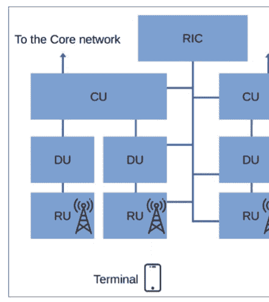


#### 开放故事

## 开放 RAN

###### 参考模型

图 5 展示了 5G 网络的参考模型。其三个主要元素分别是终端、gNodeB 和核心网。终端可以是智能手机、IoT 系统、笔记本电脑或任何类似设备。gNodeB 相当于以太网中的交换机，工作在 IP 层之下。核心网则相当于 ISP 网络。从下至上，参考模型的各层为：

- 物理层（PHY）：处理通信的所有无线方面，如调制和解调。有关这些术语的定义，请参阅“无线方面”框。
- 媒体访问控制（MAC）：在 PHY 信道（由时间和频率定义）之上定义逻辑信道。同时也执行错误校正。
- 无线链路控制（RLC）：在 MAC 之上为上层提供数据传输服务，具备错误恢复、分段与重组功能，并在需要时重建无线链路。
- 分组数据汇聚协议（PDCP）：通过一个或多个 RLC 实体提供与更高层的接口。这使得多连接成为可能，即在 RLC 层能够连接到多个 gNodeB。此外，通过头部压缩还可以提供一定的吞吐量增益。
- 服务数据适应协议（SDAP）：提供机制以确保对不同类型数据提供特定的服务质量（QoS）并接收空中接口数据。它被称为“分布式”，因为通常物理部署在 RU 附近以减少延迟。
- 中央单元（CU）：包含较高层，即路由用户和控制数据（PDCP 层）以及分配网络资源（如信道和载波，RRC 层）等功能。它通常位于集中位置（因此得名），甚至可以物理运行在与核心网相同的计算机上。

图 4 中展示的另一元素是 RAN 智能控制器（RIC），其中包含控制 RAN 元素整体操作的功能。RIC 包括资源优化、监控等功能，甚至包括必须非常靠近终端的终端用户服务。RIC 进一步分为实时 RIC（针对需要快速反应时间的某些低层功能）和非实时 RIC（具有较长周期功能的控制）。在 6G 中，该元素将包含基于机器学习的解决方案，持续监控网络，通过强化学习进行学习，并改善服务质量。

除了 RU 之外，所有其他组件都是软件组件，可以在任何满足最低 CPU、内存和存储需求的计算机上运行。这种对通用硬件的支持意味着 RAN 制造商和运营商的成本将大幅降低。

因此，RAN 可以被认为是一个包含云实例和现成计算机的网络，其中一些配备有 SDR 设备。部分基础设施是集中的，位于第三方云（如 AWS 或 Azure）或运营商的数据中心中。另一部分则可能分布式地部署在运营商覆盖范围内的各处，靠近 RU 和用户所在的位置，即所谓的“网络边缘”。得益于虚拟化，所有这些基础设施都可服务于 RAN 的所有功能。虚拟功能可以在中央基础设施和网络边缘之间灵活移动，以减少延迟或协调计算资源的使用。

毫无疑问，正如核心网的情况一样，开源将在未来网络中发挥重要作用。开放接口为小型企业甚至开源社区打开了 RAN 市场的大门，而且由于使用现成硬件的便捷性，任何具备相关知识、文档以及大量时间的人都可以开始开发功能。正如下一节所示，这项工作也不需要从零开始。

###### 无线方面

提到移动网络时，脑海中浮现的第一个概念可能是使其成为可能的无线技术。这些功能全部包含在 PHY 层中，是网络中最专业化的部分之一，需要专门的硬件。对于数字无线电传输，我们从基带信号开始（见图 6），该信号由一个或多个表示数字比特位的电信号组成。该信号的频谱（其傅里叶变换）以 0 Hz 为中心，且带宽有限。然后可以对该信号进行调制，即将其变换为中心频率位于特定给定频率的状态。也可以在相邻频率上对多路不同的比特流进行调制，这被称为频分多址（FDMA）。这些信道中的每一个（也称为子载波）在不同时间（传输时间区间或 TTI）中专用于不同的用户或数据流，这种方案被称为时分多址（TDMA）。在移动网络中，正交 FDMA（OFDMA，基本 FDMA 的改进版本）将一组子载波组合成一个载波。OFDMA 子载波和 TTI 定义了所谓的资源网格（见图 6），其中每个元素都具有定义好的逻辑功能。

###### 开放 RAN 实现

O-RAN 联盟 [3] 成立旨在标准化开放 RAN 实现的接口。该联盟是一个由大型公司、中小企业、大学和研究中心组成的联合体。成员包括红帽（Red Hat）和 SUSE 等开源供应商。O-RAN 联盟定期发布任何人都可以访问的开放规范。这些规范定义了开放 RAN 的不同元素（如图 4 所示）的行为方式，包括接口中使用的协议和其他元素。

该联盟还与 Linux 基金会建立了伙伴关系，称为 O-RAN 联盟软件社区，旨在创建这些规范的开源软件实现，任何人可以下载并测试，任何开发人员都可以为此做出贡献。该联盟仍处于早期开发阶段。一些元素已经可以工作，一些概念验证处于展示阶段。其他一些元素，如 RU，仍然缺失。

电信基础设施项目（TIP）[4] 是该行业大型企业的另一伙伴关系，最初创建是为了定义另一种开放 RAN 规范，但很快采纳了 O-RAN 联盟的设计并推广了其自身的软件实现：OpenRAN（注意在这种情况下 Open 和 RAN 之间没有空格）。TIP 积极致力于创建开放 RAN 元素的实现，包括一些无线电接口设计（如完整的 WiFi 堆栈），并且

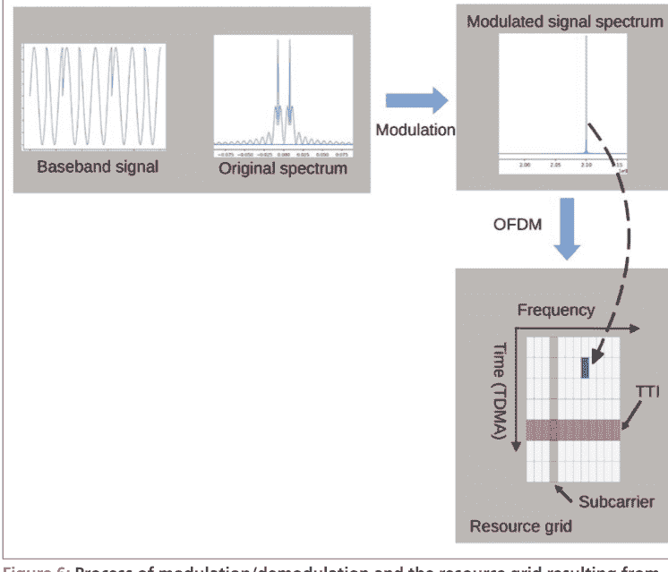

图 6：5G 中由 TDMA 和 OFDMA 产生的调制/解调过程及资源网格。


其他移动网络元素，例如 Open Core 网络。TIP 还举办“插拔测试”（plugtests），不同的 Open RAN 厂商借此测试其功能的集成与互操作性。虽然这些是最广为人知的 Open RAN 项目，但还有其他一些实现方案，例如 OpenAirInterface [5]，它提供了一种符合 O-RAN 联盟规范的开源解决方案。

对 Open RAN 概念存在一些批评 [5]，认为其未能实现完全开源 RAN 的承诺，重点在于开发无线基础设施的难度。事实上，有几个障碍使得为移动网络开发 SDR 功能对小企业或社区开发者来说非常困难，甚至（目前）完全不可能。一方面，所需的设备不仅包括 SDR 板卡，还包括用于验证功能和标准及法规合规性的测试设备，这些设备非常昂贵。另一方面，法规限制也很严格：移动网络中使用的设备需要由相关主管机构认证，而且在大多数频段（包括大多数蜂窝通信使用的频段）传输无线信号都需要公共机构颁发的特别许可证。从长远来看，这些问题中的一些有解决方案。例如，昂贵的测量设备未来可能会被基于开源 SDR 的实现所取代。而法规方面的障碍则更难克服。目前，小企业和研究中心通过与运营商合作来获取频谱使用许可，这极大地限制了发展，且昂贵的工具如消声室（基本上是一种法拉第笼，用于屏蔽外发的高频无线信号）也是必需的。无论如何，开源社区的创造力和智慧已一次又一次证明其能够克服此类问题。

##### 开放硬件的角色

网络核心和 Open RAN 的主要卖点之一是在现成的计算机或通用云实例上运行大部分网络功能的可能性。就底层硬件而言，外行人在谈到“现成”计算机时，脑海中首先想到的通常是基于 x86 的系统。这些系统易于获取且易于更换，当其在网络中的生命周期结束时，可以重复用于其他用途。其运维成本低，文档和专业知识丰富，且来自制造商和工具的支持水平非常高。不利的一面是，x86 系统的能效不高，这对于运营商来说是一个日益重要的关注点，无论是在碳足迹还是能源账单方面。

最近，能效高的 ARM 处理器开始用于服务器。虽然 ARM 目前在 x86 的支持级别和可用软件数量上尚无法企及，但对 ARM 的兴趣与日俱增。

最后，任何关于处理器的讨论若不提及 RISC-V 都是不完整的。RISC-V 平台具有 ARM 在功耗方面的优势（尽管在成熟度上稍显落后），并且它是开源硬件。潜在地，小企业可以扩展 RISC-V 处理器，以包含针对移动网络的特定功能。此外，由于其开放性，预计随着对 RISC-V 需求的增加，价格将会下降。

到目前为止，我讨论了支持移动网络软件部分的硬件，即核心网络以及 Open RAN 中的 DU、CU 和 RIC。那么 RU 呢？虽然纸面上它看起来只是一个小板块，但 RU 对无线电通信至关重要，且是最难处理的部件之一。然而，有几种选择，例如 Ettus Research 的 USRP 设备 [6]，它们提供开源驱动程序。由于围绕其聚集了庞大的社区，USRP 是该领域研究人员的首选。另一个商业选择是 LimeSDR [7] 板卡，它是开源硬件。与 USRP 相比，它们更具成本效益，并正逐渐被社区采用。它们也被 Amarisoft 等集成商开发的几种商用 RAN 解决方案所使用。HackRF [8] 和 PlutoSDR [9] 设备也是开源的，它们是非常便宜的替代品，社区开发者可以获取。虽然这些设备的性能不如 LimeSDR 或 USRP，但它们是很好的学习起点，用于探索 Open RAN 功能。你还可以使用 HackRF 和 PlutoSDR 开始开发急需的辅助工具，如频谱分析仪。

##### 未来展望

可以说，Open RAN 尚未在蜂窝网络上取得像 Linux 和 Apache 在互联网上那样的主导地位。但所有要素都已具备，只需要一些有动力的个人、大学以及那些将开源视为与大型制造商竞争盟友的地下公司（underground companies，此处可能指非传统或小型初创公司，直译为“地下公司”略显生硬，建议理解为小型或非传统实体，但按原文翻译保留原意）的努力。最终，开放标准极有可能引领未来移动网络向开放硬件和开源软件的方向发展。 ▪▪▪

#### 信息

- 1. 3GPP TS 33.127: 合法截获 (LI) 架构和功能: https://portal.3gpp.org/desktopmodules/Specifications/SpecificationDetails.aspx?specification=3162
- 2. 全球移动通信系统协会官方文件 NG.127 - E2E 网络切片架构: https://www.gsma.com/newsroom/wp-content/uploads/NG.127-v1.0-2.pdf
- 3. O-RAN 联盟主页: https://www.o-ran.org
- 4. TIP 主页: https://telecominfraoproject.com
- 5. Matt Kapko, “开源 RAN 在哪里？”，可在此获取: https://www.sdxcentral.com/articles/analysis/where-are-you-open-source-ran/2020/12/
- 6. USRP 硬件驱动和手册: https://github.com/eettus/uhd
- 7. LimeSDR-USB 用户指南: https://wiki.myriadrf.org/LimeSDR-USB_User_Guide
- 8. HackRF: https://hackrf.readthedocs.io/_downloads/en/latest/pdf/
- 9. ADALM-PLUTO 最终用户指南: https://wiki.analog.com/university/tools/pluto/users

### 作者

**Emil J. Khatib 博士**是马拉加大学的研究员，专注于蜂窝网络和工业物联网领域。他也热衷于硬件编程以及 Web 和移动应用开发。www.emilkhatib.com


## MEPIS 和 antiX 合二为一：MX Linux

**MX Linux 快速、友好，且专注于功能。** 作者：**Bruce Byfield**

MX Linux 是 MEPIS 和 antiX 的合作产物，这两个名称的首字母构成了其名称 [1]。AntiX 是一个流行的轻量级发行版，而 MEPIS 曾经扮演着类似今天的 Ubuntu 或 Linux Mint 的角色，即在桌面端为 Debian 增加易用性。虽然 MX Linux 是一个相对较新的发行版，但它通过结合其祖先后者的优点，在数百个其他发行版中脱颖而出，提供了 antiX 的速度和 MEPIS 桌面工具的用户友好性。

MX Linux 的旗舰版本搭载 Xfce，并针对较旧的计算机以及 32 位和 64 位机器提供了变体。KDE Plasma 和 Fluxbox 也有 32 位和 64 位版本，为用户提供了中等重量、重量型和轻量型版本，以及专为管理员和 Raspberry Pi 设计的版本。安装程序遵循常规步骤，但值得注意的窗口中嵌入了详细的帮助，不仅解释了当前的选项，还解释了必要时如何使用界面——这种详尽程度在安装程序中并不常见（图 1）。同样，MX Linux 首先启动到一个欢迎屏幕，突出显示主要系统工具，并提供链接以进行 tours、视频、论坛、FAQ 和用户手册，所有这些都为探索桌面环境提供了有用的起点（图 2）。对于更高级的用户，“关于”选项卡提供了系统硬件、分区、启动模式和活动软件源的摘要。

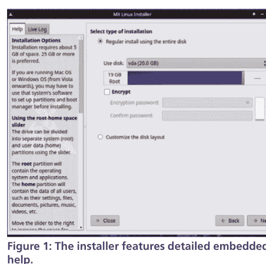

### 桌面和结构

启动到 Xfce 版本后，我惊讶地看到一张与 Wildflower（该版本名称）相配的写意风格壁纸。

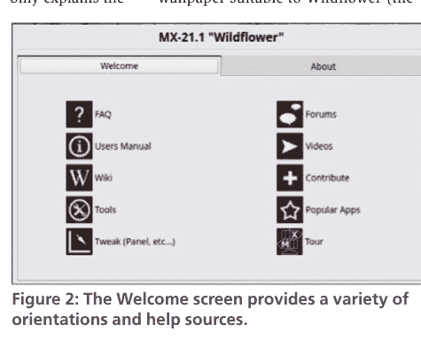


**图 3：MX Linux Wildflower 桌面默认界面。**

名为最新发行版）而非许多发行版中已司空见惯的抽象图案（图 3）。除此之外，MX Linux 桌面整体上似乎不如大多数发行版精致，缺乏过去十年间其他发行版中普遍采用的设计统一性。例如，工具窗口的大小并不一致，而且图标似乎也不是作为一套设计的。相反，美感似乎远远次于功能性——对于相对较新的发行版来说，这或许并不奇怪。

对功能的强调体现在设计选择中。借鉴 Ubuntu 旧版 Unity 桌面的设计，默认情况下，面板位于屏幕左侧，最大限度地扩大窗口的屏幕空间。面板内容似乎旨在作为系统工具，尽管可以从菜单（或桌面）将应用拖放到面板上。如有需要，用户可以将其转换为坞（Dock）。换句话说，除了默认位置外，面板并没有什么特别不寻常之处。它就像大多数发行版中看到的那样，因此很容易上手。同样的评价也适用于 Whisker 菜单（尽管不知为何开发人员觉得有必要给它起个名字）。

在幕后，MX Linux 是一个相对安全的发行版，许多系统工具仅 root 用户可访问，并且会对潜在操作的可能后果发出显著警告。它依赖于 Debian stable 和 stable-updates 仓库，使其成为一个可靠但远非前沿的发行版，不过其自研包存储在 **mx.list** 仓库中。事实上，手册专门警告不要尝试安装 Ubuntu 的实验性个人软件包存档（PPAs）或永久启用其他仓库，并正确指出这样做“可能会导致系统不稳定并需要重新安装”。但也许 MX Linux 最不寻常的方面是其对 systemd 的中立立场。默认情况下，MX Linux 使用更保守的 SysVinit。然而，systemd 也已安装，并且可以从启动管理器的“高级选项”中激活（图 4）。安装 systemd 后，可以使用命令 **systemd-sys** 移除 SysVinit。Snapshot 和 Live USB 持久性功能在 systemd 下无法工作，但 MX Linux 的其他部分应该可以正常工作。

### 桌面工具

对功能的强调在桌面工具阵列表中最为明显。共同来看，它们使 MX Linux 成为最容易通过桌面进行管理而无需在常见情况下求助于命令行的发行版之一。这些工具中的一些版本（如 Conky 或 Tweak）在许多发行版中都很常见。

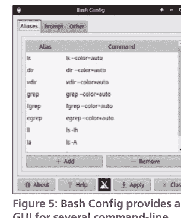

**图 5：Bash Config 为几种命令行操作提供图形界面。**

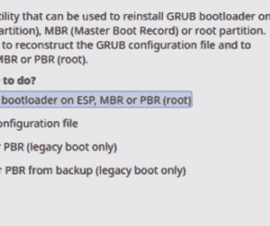

**图 6：Boot Repair 有助于恢复启动管理器。**

## 发行版巡礼 – MX Linux

其他工具，如用于管理用户或声音设置的工具，是基本必需品，但许多工具是从 antiX 移植或专门为 MX Linux 开发的。

为了便于设置，MX Linux 为 NVIDIA 驱动和编解码器安装器提供了图形界面，以及一个 Bash 配置工具，该工具包含用于设置别名、提示符结构和历史记录的标签页，这三项任务通常必须分别在命令行中完成（图 5）。还有一系列独特的维护工具可用，如 Chroot Rescue Scan、Boot Options 和 Boot Repair（图 6）。然而，在 MX Linux 的所有工具中，对外部设备最有用的可能是 Live USB Maker，它具备更新闪存驱动上 Linux 系统内核的功能（图 7），以及 Snapshot，它保存系统备份以便轻松还原（图 8）。这些工具中的一些或许只在最常见的情况下有用，但无论如何，它们都赋能了那些可能不敢打开命令行的用户。

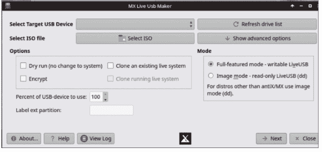

图 7：Live USB Maker 生成和更新闪存驱动上的磁盘镜像。

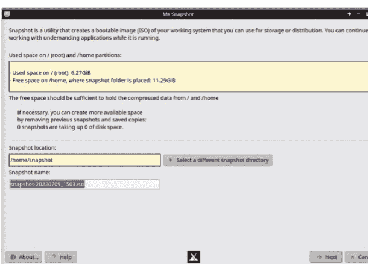

图 8：受 Windows 上类似工具的启发，Snapshot 备份基本系统文件以便轻松还原。

## 正在进行中的工作

尽管最新发行版是 MX-21.1——大概是 antiX 版本号的延续——但 MX Linux 给我一种正在进行中的作品的感觉。其原始工具似乎早已过时，许多都值得移植到其他发行版，但我希望看到下一步会增加什么。同样，虽然功能是首要任务——这一点显然得到许多用户的认同——但 MX Linux 存在粗糙的边缘，让我想起 MEPIS 的旧版本——实际上也是 2005 年之前所有发行版的风格。尽管如此，MX Linux 在保留 antiX 大部分速度的同时，在工具方面进行了大量创新，绝对是一个值得关注的发行版，其受欢迎程度不太可能很快消退。

Info

- [1] MX Linux：https://mxlinux.org/

## AKADMY

2022

Akademy 是 KDE 社区成员、开发者、翻译人员、设计师和朋友的年度活动。快来加入我们吧！

巴塞罗那
10 月 1-7 日


### 评测

### Ubuntu 22.04 LTS


#### Ubuntu 22.04 LTS 中的实用创新

### 长期支持

Ubuntu 22.04 LTS 功能包括更新的 Linux 内核、多种编程语言更新以及改进的虚拟化和容器工具，使其对开发人员和管理人员很有用。*作者：Kristian Kießling*

将 Ubuntu 22.04 LTS 称为 COVID-19 发行版会在公共关系上带来负面影响，但这并非完全不实，因为其前代 20.04 正是在大流行初期发布的。对于使用 Ubuntu 桌面版、Ubuntu 服务器、Ubuntu 云和 Ubuntu 核心版的企业来说，升级到“Jammy Jellyfish”（图 1）是非常值得的，但并不紧急。官方而言，前一代 Ubuntu 20.04 LTS 将支持到 2025 年 4 月，并假设向 Canonical 做出适当捐赠，还将提供五年的扩展安全维护（ESM）。

然而，使用其他 Ubuntu 衍生版（如 Kubuntu、Lubuntu、Xubuntu 等）的用户只能指望官方支持到 2023 年 4 月。没有 ESM，管理员需要以相对不那么从容的节奏评估升级的后果和兼容性问题。如果您切换到 Ubuntu 22.04，支持期将延长到 2027 年（其他衍生版为 2025 年）。

#### 内核支持

默认情况下，Ubuntu 20.04 使用 Linux 内核版本 5.4.0，而 Ubuntu 22.04 的内核版本为 5.15（linux-generic）。Canonical 甚至在认证设备上使用内核 5.17（linux-oem-22.04）。如果您愿意，也可以在 LTS 版本中使用滚动硬件使能（HWE）内核 [1]（linux-hwe-22.04），该内核通过定期点发布和内核版本更新发行版。

根据 Kernel.org [2]，Linux 内核 5.15 将获得比其他版本更长时间的支持——具体来说，直到 2023 年 10 月（图 2）。显然，Ubuntu 开发者希望届时已有另一个获得长期支持的内核问世。否则，在其保质期到期后，他们将不得不继续自行维护该内核 [3]。

WireGuard 在 Ubuntu 20.04 中已由开发人员回移，但内核 5.15 中还有许多其他创新。例如，内核 5.15 包含新的 NTFS 驱动程序、对

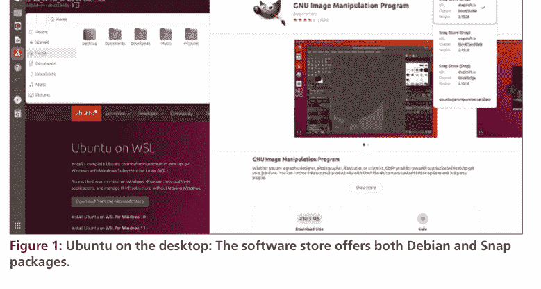

图 1：Ubuntu 桌面版：软件商店提供 Debian 和 Snap 包。


### Ubuntu 22.04 LTS

苹果的 M1 芯片，以及集成在内核中的 Samba 服务器（名为 KSMBD）。除了这些主要更新外，还有若干针对内核安全特性的较小调整。eBPF 内核沙盒已更新。有一些新的系统调用简化了容器处理（以及其他方面），此外文件系统集合也得到了改进。例如，ext4（Ubuntu 的标准文件系统）自内核 5.10 起，得益于快速提交功能，速度更快。

#### 网络绑定

网络文件系统（NFS）的服务器和客户端软件包已升级至最新版本。NFS 默认不再支持通过 UDP 挂载。变更的原因是，在现代网络中，当连接速度超过 1 Gbps 时，NFS over UDP 可能导致数据损坏——这是由于高负载引起的碎片化 [4]。新的 Samba v4.15.5 也已引入，其中包括结束多通道支持的实验状态。

SSH 在连接到网络上的 Ubuntu 机器方面依然非常流行——无论是作为管理员，还是用于在目标机器上处理任务的软件。随新 Ubuntu 发布的 OpenSSH 8.9 默认禁用了 RSA 签名，因为它们使用不安全的 SHA-1。禁用 RSA 可能会与较旧的 SSH 服务器通信时造成问题，但这可以稍后更改 [5]。随 SSH 提供的 SCP 软件在机器之间移动和复制文件。该软件现在提供 -s 选项，以使用 SFTP 模式代替 SCP 模式。出于安全原因，根据 OpenSSH 项目，这一行为将在不久的将来成为默认设置。OpenSSL v3 现在也可用；它移除了一些遗留的不安全算法。仍然支持 SHA-1 或 MD5 的证书也不再适用于 OpenSSL v3。

最近支持的 OpenLDAP 2.5.x 缺少一些组件，包括 shell 以及 BDB 和 HDB 后端。另一方面，Bind v9.18 现在更安全，提供对 DNS over TLS（DoT）和 DNS over HTTPS（DoH）的支持。named 服务支持通过 TLS 的入站和出站区域传输（XFR over TLS, XoT）。

在安全方面，nftables 现在是管理防火墙规则的新后端，接管了 iptables 的工作，同时也接管了 ip6tables（IPv6）、arptables（ARP）和 ebtables（以太网桥接）。nftables 的开发者就是创建 iptables 的那群人，他们希望在新软件中摒弃遗留包袱。两个 iptables 版本（分别用于 IPv4 和 IPv6 地址）一直引起混淆，并迫使管理员并行管理它们，直到现在。

#### 机器集群

数据中心管理员出于成本和效率的考虑，希望将尽可能多的机器压缩到单一的物理硬件上。这就是虚拟机（VMs）和容器发挥作用的地方。在架构方面，Qemu 虚拟化软件最近将最常用的功能作为模块外置。Qemu 6.2.0 中的新 fuse3 版本使得在没有 root 权限且无需启动 VM 的情况下编辑 VM 映像变得更加容易。此外，Qemu 现在支持 Linux JACK 声音服务器，支持以音乐家所需的极低延迟进行访问。

Libvirt 虚拟化 API 版本 8.0.0 已集成，并带来了 VirtIO 虚拟文件系统的热插拔支持。virt-manager（一个用于在 Linux 上管理 VM 的图形化程序）的版本 4.0.0 已包含在内，并为配置共享存储提供了图形化选项。VirtIOFS 在此处作为设置中可选的文件系统提供。如果 VM 使用 UEFI，Virt-manager 还会自动激活可信平台模块（TPM）。x86 客户机的新默认选项允许宿主 CPU 直通到客户机。最后但同样重要的是，VirtIO GPU 适用于大多数现代客户机系统。

在创建 VM 模板时，VMware 用户受益于 cloud-init 22.1 的创新，该版本现在原生支持 VMware 作为数据源。LXD 数据源动态从 LXD socket 读取实例数据，并应用配置更改，这些更改在重启后依然有效。

大规模使用 VM 的人通常会转向 OpenStack。尽管没有重大报道，Canonical [6] 将新的 2022 "Yoga" 版本发送出去与竞争对手较量。同时，发行说明警告称，更新并非易事，因为 OpenStack 由许多活动部件组成。因此，管理员需要为计划和测试升级预留时间，并研究发行说明 [7]。

#### 容器爱好者

容器和 VM 管理器 LXD 也带来了许多新功能，版本 5.0 现在为 VM 提供了与容器相同的功能集。在多用户操作中，多个用户可以独立启动他们的项目。VM 现在支持虚拟 TPM 和 PCI 直通，并且可以实时迁移。此外，LXD 5.0 允许将硬盘和 USB 驱动器热插拔到 VM 中。对于 Docker，Canonical 指出它不仅提供了 Ubuntu 本身的 Docker Hub 镜像，还提供了许多经过验证的容器镜像，包括 MySQL、PostgreSQL 和 NGINX。新增加的内容包括 Grafana Loki、Apache Kafka 和 Apache Cassandra。

如果您希望构建更大的容器环境，您将在 Ubuntu 22.04 中找到 Kubernetes v1.23 [8]。虽然 Canonical 推荐其 Charmed Kubernetes 用于企业部署，但更精简的 MicroK8s（图 3）则针对那些希望在边缘计算或物联网（IoT）领域运行容器编排器的用户。最后但同样重要的是，Canonical Kubernetes 也通过托管 Kubernetes 启用了托管容器化。


**图 3：** 得益于 MicroK8s，可以相当快速地设置一个包含仪表板的本地 Kubernetes。

#### 开发动力

开发者使用 Ubuntu，因为它开箱即支持众多编程语言。现在，Windows 用户也有了一个简单的选项，可以在 Windows 子系统 Linux（WSL 2）中使用熟悉的 Linux 工具，WSL 2 现在也支持 Ubuntu 22.04。

对开发者特别感兴趣的是，包含了 PHP 8.1.2。如果您想从 7.x 版本升级，请注意版本 8 移除了一些已弃用的函数。因此，可能需要对某些代码进行调整。作为回报，PHP 8 承诺更好的性能。Ruby 3.0 得益于 MJIT 编译器、并发和静态类型，比前代快三倍，这很可能会受到其追随者的欢迎。

Python 粉丝可以期待版本 3.10.4 和发行版中基于 Python 的 Django Web 框架。Django 可用版本为 3.2.12，提供长期支持，并提供了异步视图和中间件等功能。警告：在升级过程中存在一些兼容性风险。Ubuntu 22.04 还包括供 Java 开发者使用的 Go v1.18.x、Rust v1.58 和 OpenJDK 11。

在编译器方面，Ubuntu 拥有很棒的功能集，包括 LLVM 14 和 GCC 11.2.0。在数据库方面，PostgreSQL 14 和 MySQL 8.0 凭借一些新功能令人印象深刻。对于 PostgreSQL 14，存储过程现在通过 OUT 参数返回数据，简化了从 Oracle 到 PostgreSQL 的迁移。MySQL 管理员可以禁用会话的审计日志。

#### 观点

随着每个 LTS 版本的发布，Canonical 都会解释其认为的新版本亮点，这允许人们推断出客户的要求。这次，该公司重点介绍了对 NVIDIA vGPU 软件 14.0 的原生支持等功能。这使得许多 VM 的虚拟 GPU 可以链接在一起，以加速机器学习和处理大量数据的其他场景。此外，Ubuntu 22.04 支持 NVIDIA 的 AI Enterprise 软件套件，它在科学环境和高性能计算方面具有优势。如果您想使用 Azure 的机密 VM，Ubuntu 是唯一支持该功能的 Linux 发行版。Multipass [9]，一个由 Canonical 驱动的 GPL 软件，可以通过一个简单的命令在 Windows、macOS 和 Linux 上启动 Ubuntu VM，并且（现在）也支持苹果的 M1 芯片。实时内核（目前仍处于 beta 阶段）预计将在电信行业特别受欢迎，例如用于 5G 领域的实时应用。

##### 结论

如果您是管理员或开发者，您不必急于切换到 Ubuntu 22.04 LTS，但逐步过渡即使在您的服务器上也有意义。您应该考虑进行切换，不仅因为您喜爱的框架和内容管理系统最终会切换到新的编程语言版本，还因为更新的软件可能会利用 Ubuntu 22.04 提供的一些新功能。如果您想等待，大多数“磨合期”问题应该在第一个点发布版本 22.04.1 出现时成为历史。在进行更改之前，请查阅发行说明 [10]，了解考虑到您基础设施的已知问题。 ▪▪▪

#### 信息

- [1] HWE 内核: https://www.thomas-krenn.com/en/wiki/Ubuntu_LTS_Hardware_Enablement_Stack_information
- [2] 内核发布: https://www.kernel.org/category/releases.html
- [3] Ubuntu 内核计划: https://discourse.ubuntu.com/t/ubuntu-desktop-gnome-plans-for-the-incoming-lts/26156/13
- [4] NFS 和 UDP: https://www.mail-archive.com/kernel-packages@lists.ubuntu.com/msg473086.html
- [5] 旧机器上的 SSH: https://bugs.launchpad.net/ubuntu/+source/openssh/+bug/1961833
- [6] Ubuntu 和 OpenStack: https://ubuntu.com/blog/opensatak-is-dead
- [7] OpenStack "Yoga": https://releasenotes.openstack.org/yoga/
- [8] Kubernetes 1.23: https://ubuntu.com/blog/kubernetes-1-23-release-top-features
- [9] Multipass: https://multipass.run
- [10] 发行说明: https://discourse.ubuntu.com/t/jammy-jellyfish-release-notes/24668


### 逛店啦

shop.linuxnewmedia.com

#### 借助酷炫的 Linux 技巧提升效率

《LINUX MAGAZINE》 | 调优你的 Linux 系统 | 2022 年版

**酷炫的 Linux 技巧**
84 个技巧

**给 Linux 极客的窍门与快捷键**

- 使用 Xtreme Download Manager 加速下载
- 使用一款工具搜索文本、PDF 和 Office 文件
- 无需安装客户端软件即可在 Proxmox 服务器上运行虚拟机

**怀旧乐趣：** 使用 DOSBox 游玩 DOS 游戏

**音频专家：** 专为 DJ、音乐家和作曲家设计的工具

**发现专家们的秘诀**

WWW.LINUX-MAGAZINE.COM

通过这份充满灵感的技巧与快捷键合集，提升你的 Linux 技能，专为 Linux 极客打造。

- 在命令行中使用 Google
- OpenSnitch 应用程序防火墙
- 解析 systemd 日志
- 使用 lazygit 控制 Git
- 使用 DOSBox 运行老版 DOS 游戏
- 等等！

**在线订购：**
shop.linuxnewmedia.com/specials


### 评测

### 开源社交媒体工具

探索去中心化的聊天与微型博客平台

#### 自由连接

Diaspora、Friendica 和 Mastodon 是免费且去中心化的微型博客平台，能让你掌握自己的数据。*作者：Erik Barwaldt*

社交媒体平台在企业环境和个人用户中都已确立为重要的沟通手段。然而，大多数用户都意识到，数据主权是社交媒体领域的一个重大问题：几乎所有主要平台都会收集和聚合用户数据以用于广告目的。此外，政府机构有时也会利用这些信息。例如，在美国，提供商在法律上有义务在收到国家安全信函后，向 FBI 等调查机构提交客户数据。许多用户还担心因攻击导致数据泄露，而中心化服务由于数据集中在相对少量的服务器上，面临更高的攻击风险。

与大规模专有社交媒体平台相关的问题促使一些公司和家庭用户更加关注基于开源项目的短消息服务。这些开源解决方案没有数据挖掘行为，且其去中心化的性质使其更容易规避与互联网巨头相关的安全问题。本文探讨了社交媒体领域的一些领先的开源替代方案。

本文描述的三种工具均支持 ActivityPub，这是一种支持跨平台社交网络的免费协议 [1]。如果两个社交媒体平台都支持 ActivityPub 协议，它们就可以交换消息。

#### Diaspora

由 Diaspora 基金会支持的 Diaspora 项目 [2] 是一个去中心化网络，其服务器（pods）构成了一个全球分布的系统。Diaspora 的功能集与行业巨头 Twitter 和 Facebook 类似。用户可以以较高的匿名度进行操作，通常不会透露其真实身份。此外，用户保留对其数据的所有权利，这排除了个性化跟踪。想要支持 ActivityPub 协议的技术娴熟用户可以安装专用的 Diaspora pods，这样他们的数据将在本地安全保存。

要创建一个 Diaspora 个人资料，请在项目网站右上角点击 *加入！* 按钮，然后使用随后出现的绿色按钮进行注册。系统会显示少量建议加入的服务器。如果你想查看包括各种统计数据片段在内的所有 pods 完整列表，请点击右下角的列表图标，这将显示可用性信息、位置以及用户数量（图 1）。

要登录其中一个服务器，只需点击其 URL 即可。你只能在 *登录* 表格列中显示为“是”的 pods 上创建账户。选择服务器后，在初始页面的右上角按下 *创建账户* 按钮。你只需要一个有效的电子邮件地址、一个用户名和一个密码。你还可以上传个人资料照片并指定你的兴趣领域。最后，*太棒了！带我去 Diaspora* 按钮会将你带到消息区域（图 2）。

到达那里后，你将在右侧看到消息流，首次访问时会显示各种说明。在第一个框中，你可以直接输入消息；在下方的 *公共* 按钮中选择一个接收者。左侧是用于各种设置的选项栏。在顶部的活动栏中，你可以点击选择各种活动，并使用下拉菜单定义你的用户设置。


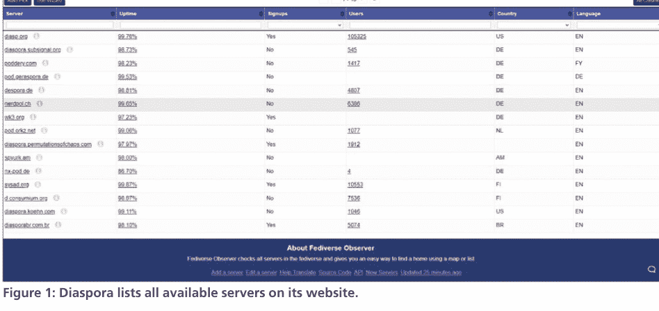

**图 1：Diaspora 在其网站上列出了所有可用的服务器。**

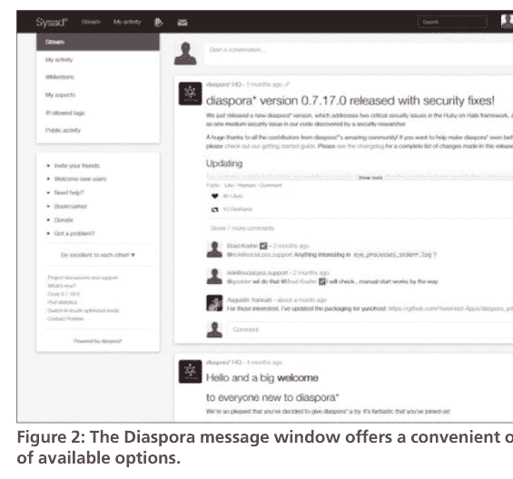
**图 2：Diaspora 消息窗口提供了可用选项的便捷概览。**

点击右上角的用户名，然后选择个人资料。

许多操作都会向你的存档地址发送电子邮件。NSFW（不适合工作场合观看）选项允许你标记那些在工作时不希望显示的内容。相应地，这些消息不会出现在常规消息流中。此选项默认处于关闭状态，因此你需要手动启用它。

联系人功能允许你将其他用户分组，例如家人、朋友、同事和熟人。要将一个或多个联系人组织到不同的组中，请单击目标组。你的联系人随后会以表格形式显示在窗口的右侧。

Diaspora 允许你设置自己的服务器，该服务器始终集成到 Diaspora 网络中。要在不牺牲功能的情况下创建基于 Diaspora 的封闭式通信网络，你需要建立自己的群组。运行自己的 pod 涉及一些复杂的安装步骤。Diaspora 开发者提供了针对多个 Linux 发行版的说明，但略显过时。

#### Friendica

自 2010 年以来持续维护和开发的 Friendica [3]，是最著名的免费微型博客和聊天服务之一。同样具有去中心化特性，Friendica 不需要中央服务器。你可以与其他 Friendica 服务器上的用户连接，或将来自 Twitter、Diaspora、pump.io 和 StatusNet 的联系人整合到你的消息线程中。Friendica 还允许你共享和分发图像。该软件是模块化的，可以使用插件进行扩展。此外，你可以自行设置 Friendica 服务器，甚至使其公开访问。

在项目网站上，点击右上角的公共服务器后，你会发现一个按语言排序的公开可访问 Friendica 服务器列表。选择一个服务器，然后通过点击给出的 URL 连接到它。各个服务器的初始页面看起来几乎相同。注册时，Friendica 期望你输入你的姓名或化名以及一个匹配的电子邮件地址。如果你已经在另一个 Friendica 服务器上拥有个人资料，也可以在此处使用。你只需在注册对话框中将其迁移到新服务器即可。

点击注册按钮后，你会在指定的电子邮件账户上收到一条包含新生成密码的消息。使用此密码和你的用户名，你现在可以登录服务器，随后将被带到一个初始页面。在左侧，各种设置和管理选项被分组在一起，消息流显示在中间。顶部有多个按钮用于通知和访问最重要的功能（图 3）。

要管理你自己的个人资料，请点击右上角的个人资料名称。在上下文菜单中，使用 *编辑个人资料* 来修改基本设置。

Friendica 提供了详细的账户管理选项，你可以点击初始页面上的用户名或头像来访问。在 *账户设置* 对话框（图 4）中，你可以定义各种安全和隐私选项，或使用你需要单独创建的 CSV 文件导入联系人。使用 *过期设置* 选项来定义帖子在 Friendica 删除之前保持可见的时间。

Friendica 将账户分为不同类型，主要区别在于它们如何处理联系人请求。你可以手动接受好友或粉丝的请求，或者让系统自动将其分类到不同的类别中。然而，对于讨论论坛的账户，此功能不起作用。你也可以同时使用多个账户。*设置 | 管理账户* 菜单让你注册额外账户并将其与现有账户连接。如果你在一个大型组织中使用大量账户，你可能希望添加具有管理权限的管理员和授权代表。

你可以访问多个外部网络来添加联系人。在 Friendica 中，点击主窗口中的 *联系人 | 添加新联系人* 即可向你的列表添加联系人。名称和兴趣搜索为你提供了与潜在志同道合者建立联系的机会。Friendica 还允许你阅读来自其他平台（如 Twitter、Mastodon 或 Diaspora）的内容。但是，要建立直接通信，你还需要在源服务器上有一个账户（图 5）。在 *查找人员* 设置框中，你可以基于各种标准（如共同兴趣）缩小联系人搜索范围。如果选择 *本地目录* 选项，则仅显示你当前登录的源服务器上的潜在联系人。使用 *(组)* 访问栏将你的 Friendica 联系人分配给组。

与 Diaspora 一样，Friendica 允许你从自己的服务器安装代码。在项目网站的 *使用它 | 安装你自己的服务器* 菜单中下载源代码。Friendica 网站上 [4] 提供了详细文档。请注意，设置 Friendica 服务器需要满足某些软件要求。这些要求包括例如 LAMP 堆栈以及 PHP 编程语言和 Apache Web 服务器的特定版本。项目页面详细列出了各个应用程序。Friendica 不需要特定的硬件，因此你可以使用旧计算机系统作为服务器。

#### Mastodon

由 Eugen Rochko 自 2016 年以来开发的 Mastodon [5] 是另一个去中心化的微型博客平台。目前拥有约 510 万名用户和 3,786 个服务器，它是知名度较高的免费服务之一。

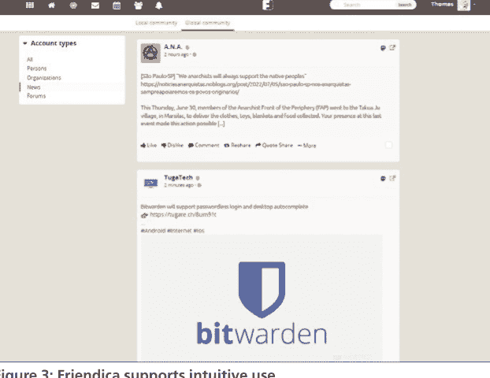
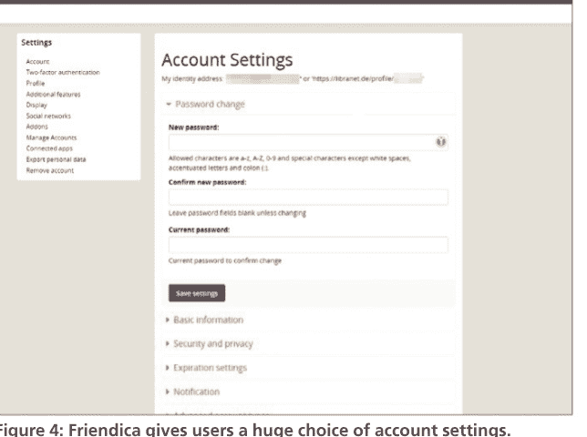


### 开源社交媒体工具

图 5：Friendica 中的联系人管理异常复杂。

注册起来和其他去中心化网络一样简单：你只需要一个有效的电子邮件地址；输入一个可自由选择的个人档案名称并设置密码即可。对于后续登录，输入指定的电子邮件地址和密码即可访问一个略显独特的三列界面（图 6）。

右侧是众多配置和信息工具。消息线程显示在中间，左侧提供消息（Toots）的搜索功能和输入框。在右列中，你可以在设置对话框中调整你的个人档案。若要启用双因素认证（2FA），请前往账户对话框。

社区向导是 Mastodon 的特色功能之一；你可以使用社区向导快速找到有意义的群组。在浏览器中打开 https://joinmastodon.org 页面。然后点击“开始”；你会被带到一个选择界面，其中列出了按类别分类的各种社区（图 7）。

如果你加入一个群组，你将被带到 Mastodon 实例的登录和注册页面，在那里你可以登录服务器。然后你会到达一个带有标准新闻流的标准起始页。若要跟随本地实例的流，请点击右侧垂直选项栏中的“本地”。

需要注意的是，用户可以同时登录多个实例；然而，个人档案不会在不同的 Mastodon 服务器之间自动转移。若要在多个实例上使用你创建的用户个人档案，请将其保存为 CSV 文件，然后导入。

与其竞争对手一样，Mastodon 允许用户托管自己的服务器。要托管一个服务器，你可以使用专用硬件或在云端托管 Mastodon。Mastodon 文档提供了关于托管 Mastodon 实例的各种选项的详细信息 [6]。

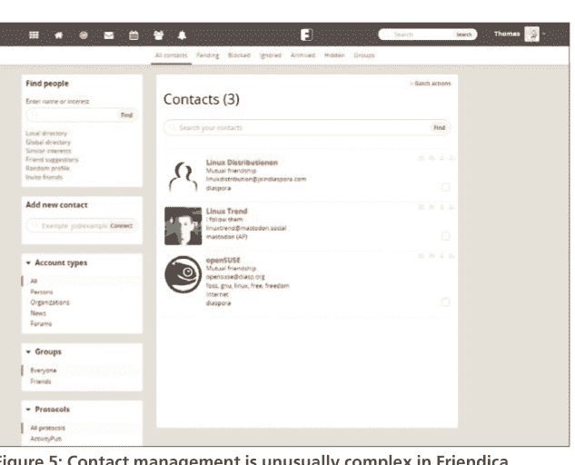

图 6：Mastodon 使用三列用户界面。


图 7：Mastodon 提供社区向导。

表现与 Twitter 等顶级巨头不相上下。（重要功能摘要见表 1。）用户界面需要一点时间才能习惯，但得益于其直观的设计，它们几乎不需要培训。去中心化的方法使用户能够控制所有服务中的数据，并通过各种安全功能保证基本的安全级别。设置独立的服务器实例需要一些手动工作。在你自己的实例上建立封闭群组意味着小公司的管理员可以毫无安全顾虑地搭建内部通讯平台。

##### 结论

这三个去中心化聊天和微博平台各自都实现了其目的，并提供了一组功能，表现与 Twitter 等顶级巨头不相上下。（重要功能摘要见表 1。）用户界面需要一点时间才能习惯，但得益于其直观的设计，它们几乎不需要培训。去中心化的方法使用户能够控制所有服务中的数据，并通过各种安全功能保证基本的安全级别。设置独立的服务器实例需要一些手动工作。在你自己的实例上建立封闭群组意味着小公司的管理员可以毫无安全顾虑地搭建内部通讯平台。

**表 1：去中心化社交媒体网络**

| | Diaspora | Friendica | Mastodon |
| --- | --- | --- | --- |
| 许可证 | AGPL | AGPL | AGPL |
| **功能** | | | |
| 使用电子邮件地址注册 | 是 | 是 | 是 |
| NSFW 选项 | 是 | 否 | 受限 |
| 支持 2FA | 是 | 是 | 是 |
| 支持自有服务器 | 是 | 是 | 是 |
| 支持封闭群组 | 是 | 是 | 是 |
| 个人档案转移 | 是 | 是 | 是 |

#### 信息

- [1] ActivityPub: https://www.w3.org/TR/activitypub/
- [2] Diaspora: https://diasporafoundation.org
- [3] Friendica: https://friendi.ca
- [4] Friendica 安装: https://friendi.ca/resources/installation/
- [5] Mastodon: https://joinmastodon.org
- [6] Mastodon 文档: https://docs.joinmastodon.org/user/run-your-own/

## **Linux Magazine**

**Linux Magazine** 是你通往 Linux 世界的指南。打开期刊，你会发现你无法在别处找到的高级技术信息！

#### 通过以下内容扩展你的 Linux 技能：

- 关于热门话题的深度文章，包括比特币、勒索软件、云计算等！
- 关于节省时间和保护数据的有用工具的指南和教程
- 故障排除和优化技巧
- 关于开源领域关键发展的深入新闻
- 针对树莓派、Arduino 和其他创客板系统的酷炫项目

如果你想走得更远，用 Linux 做更多，请立即订阅，不要错过任何一期！

#### 立即订阅！

shop.linuxnewmedia.com/subs

**立即获取！我们的 PDF 版提供快速配送**


#### 使用 Bash 进行简单的网络抓取

##### 滑雪报告

通过一行 Bash 代码，Pete 抓取网络并构建了一个桌面通知应用，以获取每日降雪报告。**作者：Pete Motaiffe**

最近在进行一个小项目时，我惊讶地发现仅用一行 Bash 就能进行如此多的网络抓取。我使用了基于文本的 Lynx 浏览器 [1]，然后将输出通过管道传递给 grep 搜索。图 1 展示了抓取 Sunshine Village 降雪预测网页上当前积雪深度的一行 Bash 示例。

在本文中，我将介绍一些轻松抓取网页的技术，然后我将创建一个提供每日降雪预报的桌面通知脚本。

##### Lynx 文本浏览器

对于我的 Bash 网络抓取，我一开始查看使用 curl [2] 和 html2text [3] 实用工具等命令行工具。这种技术确实有效，但我发现使用 Lynx 浏览器可以提供一步到位的解决方案，并产生稍微更干净的文本输出。

要在 Raspbian/Debian/Ubuntu 上安装 Lynx，请使用：

```bash
sudo apt install lynx
```

Lynx 的 -dump 选项会将网页输出为文本，并去除 HTML 标签、HTML 编码和 JavaScript。图 2 显示，Lynx 转储可以大大清理原始网页，使搜索变得更加容易。有时一个简单的 Bash grep 搜索就足够了。然而，有很多情况需要一些文本操作。好消息是，Bash 拥有一系列不错的行和字符串操作工具。

图 3 中显示的示例使用行操作来查找佛罗里达州 Key West 的当前天气。对字符串 "As of" 进行 grep 搜索，并使用选项 -B 3 返回所需的数据行以及额外的三行行。如果需要，你可以使用 tail 命令删除 "As of" 行。重要的是要注意，你在网页上看到的内容可能与 Lynx 输出的文本不匹配，可能需要一些试错测试。

图 4 使用字符串操作来查找 Sunshine 滑雪场的新雪。该滑雪场的网页使用 JavaScript 以厘米或英寸显示新雪量，但 Lynx 文本输出同时显示这两个值及其单位。

要删除字符串变量的部分，你可以使用 `%` 来提取字符串的第一部分，使用 `#` 来提取字符串的最后一部分（如清单 1 所示）。

##### 一个 Bash 网络抓取项目

为了在家庭滑雪之旅前兴奋起来，我想创建一个早晨通知脚本，显示新雪量和基础积雪。

为了创建通知脚本（清单 2），我使用了 Lynx 实用工具的两次传递。第一次抓取新雪量（如图 4 所示），然后第二次获取新的基础积雪（如图 1 所示）。然后，降雪结果作为字符串 ($msg) 传递给 `notify-send` 实用工具 [4]，该工具将消息发布到工作站桌面（图 5）。你可以使用 `cron` 或 `at` 实用工具安排此 Bash 脚本每天早上运行。

##### 摘要

抓取网页可能很棘手，而且页面随时可能改变。因此，在查看网络抓取之前，最好始终检查是否可用 API。

使用 Beautiful Soup 库的 Python 一直是我的网络抓取首选方法，但知道也有一个简单的 Bash 替代方案是很棒的。

#### 信息

1. Lynx: [https://lynx.invisible-island.net/](https://lynx.invisible-island.net/)
2. `curl`: [https://curl.se/](https://curl.se/)
3. html2text: [https://github.com/Alir3z4/html2text/](https://github.com/Alir3z4/html2text/)
4. `notify-send`: [https://delightlylinux.wordpress.com/2020/10/25/bash-show-notifications-from-scripts-using-notify-send/](https://delightlylinux.wordpress.com/2020/10/25/bash-show-notifications-from-scripts-using-notify-send/)

### 作者

你可以在 [https://funprojects.blog.](https://funprojects.blog.) 探索 Pete Metcalfe 和他的女儿们的更多有趣项目。

##### 清单 1：提取字符串的部分

```bash
01  newsnow='5.8cm2.0'
02  # 获取 'cm' 之前的部分
03  echo "${newsnow%*cm}"
04  5.8
05  # 获取 'cm' 之后的部分
06  echo "${newsnow#*cm}"
07  2.0
```

##### 技术亮点一览

太忙而没有时间阅读新闻稿和琐碎的技术新闻网站？让我们将最相关的新闻、技术文章和工具技巧直接发送到你的收件箱。

- Linux Update
- ADMIN Update
- ADMIN HPC

掌握 IT 行业的脉搏。

ADMIN 和 HPC: bit.ly/HPC-ADMIN-Update
Linux Update: bit.ly/Linux-Update

##### 清单 2：Bash 网络抓取通知脚本

```bash
01 #!/bin/bash
02 #
03 # skitrip.sh – 在通知中显示 Sunshine 的滑雪状况
04 #
05 theurl="https://www.snow-forecast.com/resorts/Sunshine/6day/mid"
06
07 # 获取新雪深度
08 thestr="New snow in Sunshine Village:" 
09 result=$(lynx -dump "$theurl" | grep "${thestr}")
10 newsnow="${result%cm} cm"
11
12 # 获取基础积雪
13 thestr="Top Lift:" 
14 base=$(lynx -dump "$theurl" | grep "${thestr}") 
15
16 # 在桌面通知中显示结果，等待时间为 120 分钟
17 msg="$newsnow\n$base" 
18 icon="$HOME/Downloads/mountain.png"
19 notify-send -t 120000 -i "$icon" "Sunshine Ski Resort" "$msg"
```


#### 像专家一样思考

**《Linux Shell 手册 2022 年版》**

这一新版内容充实，涵盖了用于配置和故障排除系统的最重要实用程序。

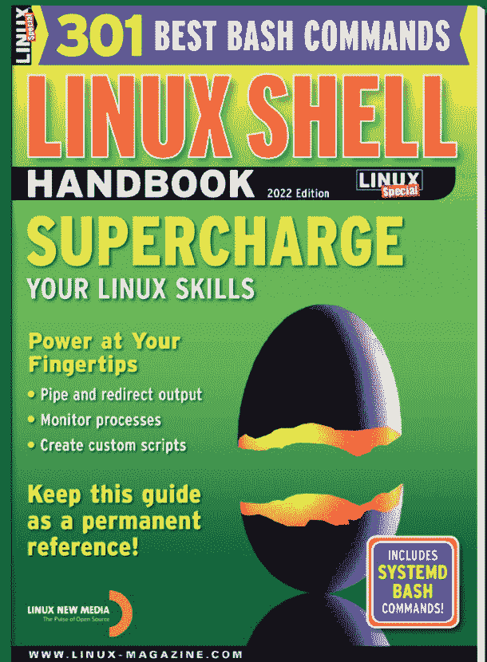

以下是书中部分内容的预览：

-   定制 Bash
-   正则表达式
-   Systemd
-   Bash 脚本编程
-   网络工具
-   还有更多！

在线订购：shop.linuxnewmedia.com/specials


#### 以最少的麻烦使用 Homebrew
#### Homebrew 生存指南

Homebrew 是一个全面的包管理器，凭借其易用性，其 popularity 正在日益增长。

作者：布鲁斯·拜菲尔德 (Bruce Byfield)

Linux 的包管理器并不缺乏。除了 RPM、DNF 和 dpkg/apt-get / APT 等基础包管理器外，还有据称是通用的 Flatpak 和 Snap，以及越来越多针对每种编程语言的包管理器。Homebrew [1] 起源于 macOS，在 Linux 上曾被称为 Linuxbrew，在 Ruby on Rails 社区中尤其流行。然而，最近，由于其易用性，它开始获得更广泛的普及。如果你想从早期开发阶段的项目中安装任何东西，越来越多的迹象表明你需要使用 Homebrew 来完成此操作。Homebrew 提供非 root 安装、访问发行版仓库之外的开发中软件以及多版本应用程序的选项。此外，如果你维护多个操作系统，你可以在 Linux、macOS 和 Windows 子系统 for Linux 上使用相同的包管理器命令集。

##### 作者简介

布鲁斯·拜菲尔德是一名计算机记者，也是专攻自由和开源软件的自由撰稿人和编辑。除了他的写作项目外，他还教授现场和电子学习课程。业余时间，布鲁斯 撰写关于西北海岸艺术的文章（http://brucebyfield.wordpress.com）。他还是 Prentice Pieces 的联合创始人，这是一个关于写作和幻想的博客，位于 https://prenticepieces.com/。

```bash
apt install build-essential procps curl file git
```

Homebrew 将文件安装到 /home/linuxbrew 并将其符号链接到 /usr/local，因此你不需要拥有 root 权限即可使用它。在安装之前，请通过运行上述命令确保你拥有所有必要的软件包。如果你计划从普通用户账户运行 Homebrew，你还需要设置该账户以访问 sudo，因为安装脚本可能会询问你的 sudo 密码。

##### 清单 1：将 Homebrew 添加到你的 Bash 路径中

```bash
test -d "~/linuxbrew" && eval "$(~/linuxbrew/bin/brew shellenv)"
test -d /home/linuxbrew/.linuxbrew && eval "$(/home/linuxbrew/.linuxbrew/bin/brew shellenv)"

test -r "~/.bash_profile" && echo "eval \"$( $(brew --prefix)/bin/brew shellenv)\"" >> "~/.bash_profile"
echo "eval \"$( $(brew --prefix)/bin/brew shellenv)\"" >> "~/.bash_profile"
```

当你准备好时，请使用以下命令安装 Homebrew [2] [3]：

```bash
/bin/bash -c "$(curl -fsSL https://raw.githubusercontent.com/Homebrew/install/HEAD/install.sh)"
```

当安装成功时，你会看到 *Installation successful* 的消息，随后是额外的说明（图 1）。这些说明包括使用清单 1 中命令序列将 Homebrew 添加到你的 Bash 路径中，每次运行一条命令。由于这些命令都不提供任何反馈，你可以通过运行以下命令来测试 Homebrew 是否正确安装：

```bash
brew install hello
```

然后运行 `hello` 命令。如果 Homebrew 没有运行，请运行几次 `brew update` 和 `brew doctor` 以查看是否存在明显问题（图 2）。如果你仍有问题，请查看在线常见问题列表 [4]。

```text
bb@lvarness:~$ /bin/bash -c "$(curl -fsSL https://raw.githubusercontent.com/Homebrew/install/HEAD/install.sh)"
==> Checking for `sudo` access (which may request your password)...
==> This script will install:
/home/linuxbrew/.linuxbrew/bin/brew
/home/linuxbrew/.linuxbrew/share/doc/homebrew
/home/linuxbrew/.linuxbrew/share/man/man1/brew.1
/home/linuxbrew/.linuxbrew/share/zsh/site-functions/brew
/home/linuxbrew/.linuxbrew/etc/bash_completion.d/brew
/home/linuxbrew/.linuxbrew/Homebrew
==> The following new directories will be created:
/home/linuxbrew/.linuxbrew/bin
/home/linuxbrew/.linuxbrew/etc
/home/linuxbrew/.linuxbrew/include
/home/linuxbrew/.linuxbrew/lib
/home/linuxbrew/.linuxbrew/sbin
/home/linuxbrew/.linuxbrew/share
/home/linuxbrew/.linuxbrew/var
/home/linuxbrew/.linuxbrew/opt
/home/linuxbrew/.linuxbrew/share/zsh
/home/linuxbrew/.linuxbrew/share/zsh/site-functions
/home/linuxbrew/.linuxbrew/var/homebrew
/home/linuxbrew/.linuxbrew/var/homebrew/linked
/home/linuxbrew/.linuxbrew/Cellar
/home/linuxbrew/.linuxbrew/Caskroom
/home/linuxbrew/.linuxbrew/Frameworks
Press RETURN/ENTER to continue or any other key to abort:
```


##### 关于术语的说明

Homebrew 的一个令人烦恼的特点是，它扩展了其名称的比喻，根据其内容为其目录赋予不同的名称，例如 cellar、rack 或 kegs，这使得人们很难知道一个术语如何与另一个术语相关。同样，在安装过程中，输出内容会提到“Pouring”（图 2）。幸运的是，对于许多基本用法，你可以忽略这种不必要的复杂化，但图 3 展示了这些不同术语之间的关系。大多数情况下，你只需要知道 formula（配方）即软件包，而 manifest（清单）是软件包的安装脚本。这两个术语打破了比喻，也许这会带来一些宽慰。然而，偶尔，使用例如影响 kegs 或 racks（即包含多个 formula 的目录）的命令来同时处理多个 formula 可能是最快的方法。如果你需要了解其他术语，可以在线找到摘要 [5]。

##### 使用 brew 命令

Homebrew 的基本操作与大多数包管理器几乎相同。也就是说，它们由基本命令、随后是子命令或操作，以及受影响的特定软件包（如果有）组成。未指定 formula 的命令适用于 Homebrew 的所有部分，例如 `brew update`。表 1 列出了一组基本命令，以 gcc 为例。当然，这与从发行版仓库安装的任何 gcc 版本都不同。与 Debian 和其他发行版一样，Homebrew 也维护了一个可用 formula 的网页（与 Homebrew 术语在同一页面上 [5]）。

| 操作 | 命令 |
| :--- | :--- |
| 安装 | brew install gcc |
| 移除 | brew remove gcc |
| 自动移除依赖项 | brew autoremove |
| 升级 formula | brew upgrade gcc |
| 升级所有 formula | brew upgrade |
| 列出已安装的 formula | brew list |
| 列出可用的 formula | brew formulae |
| 搜索 | brew search TEXT |

```text
bbel@varness:~$ brew install hello
==> Downloading https://ghcr.io/v2/homebrew/core/hello/manifests/2.12.1
==> Downloading https://ghcr.io/v2/homebrew/core/hello/blobs/sha256:79354d61f4409742f45d514efc42e935d1cf7db214dcf60d3a5b1b800dc12749
100.0%
==> Downloading from https://pkg.cs.utah.edu/gcc/gcc/8.1.0/tars/sha256:7935d5d6e08742f45d514efc42e935d1445b12e42c3d9801d1cbc81264c16033
100.0%
==> Pouring hello--2.12.1-x86_64_linux.bottle.tar.gz

  /home/linuxbrew/.linuxbrew/Cellar/hello/2.12.1: 55 files, 650KB
==> Running `brew cleanup hello`
==> Disable this behaviour by setting HOMEBREW_NO_INSTALL_CLEANUP.
==> Hide these hints with HOMEBREW_NO_ENV_HINTS (see man brew).
bb@lvarness:~$
```


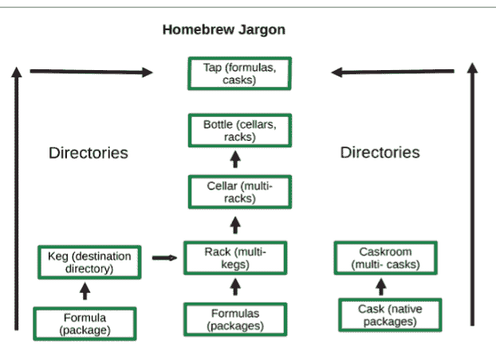

图 3：Homebrew 拥有一套复杂的名称序列，反映了每个目录的内容。

与许多包管理器一样，这八个命令对于大多数用户与 Homebrew 的交互来说已经足够了。然而，Homebrew 还有一个冗长的手册页，由于某种原因并未随其一起安装 [6]。其中一些选项是专为创建 formula 的开发者设计的，例如 `spellcheck` 或 `type-check` 命令，或者用于存储库的 `analytics` 命令，由于篇幅有限，这里将不予讨论，但还有许多选项对于便利或管理目的也很有用。例如，在便利选项中，有 `completion`，它一旦在 Bash、Zsh 或 fish shell 中启用，就会通过链接到在线词典来自动完成输入的命令 [7]。同样，由 formula 或 cask 的名称限定的 `home` 或 `homepage` 会打开目标的网页，以便你了解更多信息。此外，一旦你掌握了 Homebrew 的术语，就有用于批量处理 formula 而非单独处理的子命令和选项。

管理选项包括一些有助于保持系统最新的功能。例如，`cleanup` 操作使用 `--prune DAYS` 选项来移除 Homebrew 缓存中超过特定天数的文件，或使用 `-s` 完全移除缓存。另一个潜在有用的操作是 `outdated`，它列出有新版本可用的 formula。当配合使用 `migrate` 操作时，这特别有用，该操作接受 formula 在较新版本中名称更改时的选项；或者 `bump`，它设置较旧版本是否应更新。

##### 一款出色的应用

Homebrew 是一个全面的包管理器。尽管它只有 13 年的历史，但在许多方面，它像更久远的 apt-get 或 Yum 一样功能强大。它甚至包含可能在其他包管理器中很有用的功能。然而，Homebrew 高级功能的访问部分被不必要的术语所阻碍。此外，尽管其 formula 数量必须以千计，但它们远未达到例如 Debian 的 60,000 个软件包的水平。只有在 Ruby on Rails 社区中，Homebrew 才可能占主导地位。对于我们其他人来说，这些笔记足以让我们在开发者决定使用 Homebrew 时，以最小的麻烦和轻微的便利性损失使用它。

##### 参考信息

-   [1] Homebrew：[https://brew.sh/](https://brew.sh/)
-   [2] 安装 Homebrew：[https://docs.brew.sh/Installation](https://docs.brew.sh/Installation)
-   [3] 如何在 Linux 上安装和使用 Homebrew：[https://www.digitalocean.com/community/tutorials/how-to-install-and-use-homebrew-on-linux](https://www.digitalocean.com/community/tutorials/how-to-install-and-use-homebrew-on-linux)
-   [4] 常见问题：[https://docs.brew.sh/Common-Issues](https://docs.brew.sh/Common-Issues)
-   [5] 术语和 formula：[https://docs.brew.sh/Formula-Cookbook#homebrew-terminology](https://docs.brew.sh/Formula-Cookbook#homebrew-terminology)
-   [6] 手册页：[https://docs.brew.sh/Manpage](https://docs.brew.sh/Manpage)
-   [7] Shell 补全：[https://docs.brew.sh/Shell-Completion](https://docs.brew.sh/Shell-Completion)


## 公共资金
## 公共代码


通过自由软件实现公共基础设施的现代化


欧洲自由软件基金会

了解更多：[https://publiccode.eu/](https://publiccode.eu/)

#### 深入探讨

#### 自制 Web 服务器

只需几个简单步骤即可构建你自己的 Web 服务器

#### 自造

如果你想更多地了解 Web 浏览器与 HTTP 服务器之间的通信机制，不妨亲手构建一个 Web 服务器并深入观察一下。Goran Miladenovic 著


编写自己的 Web 服务器似乎是一项困难且不必要的工程。在 Linux 领域存在大量可自由获取的 Web 服务器，从流行的全能型服务器（如 Apache 或 NGINX）到轻量级替代方案（如 Cherokee 或 lighttpd，发音为“lighty”）。

但有时你并不需要功能齐全的 Web 服务器。如果你只是想在自己的局域网内共享几个 HTML 页面，或者提供文件上传功能，Linux 自带的工具就足够了。一个简单的 Shell 脚本就可以作为一个基本框架，用于调用 GNU 工具箱中的现有工具。网络通信由 Netcat [1] 处理，它也被称为 TCP/IP 的“瑞士军刀”。

#### 准备工作

对于这类项目，最好的起点是根基。毕竟 Web 服务器最终仍是一个服务器，它需要不断监听指定端口并相应地响应请求。通常，Web 服务器监听端口 80 以处理常规请求，而端口 80 通常仅接受未加密的 HTTP 请求。本文将描述的 Web 服务器监听端口 8080 和 8081，并以未加密方式通信。如果你使用防火墙并希望测试局域网内的服务器，请记得在防火墙中放行这两个端口。

Web 服务器需要一个根文件夹，从中加载请求的 HTML 文件。它还需要一个目录来存储上传的文件。你的第一步是在服务器脚本的开头（列表 1）定义一组简单变量作为配置。此外，你需要手动或使用 Bash 测试内置命令创建这些目录以及一个 FIFO 文件。随本文代码包含的 serve6.sh 脚本 [2] 提供了一个解决方案。

在列表 1 的最后一行中，你可以看到自己的 IP 地址也很重要。你需要根据自己系统修改网络设备规格（本例中为以太网接口 enp2s8）。当 Web 浏览器试图通过网页表单提交文件时，它需要一个目标地址。GET 请求是执行此操作最简单的方法。当浏览器发送 GET 请求时，它期望在响应中收到网页的内容，并在浏览器窗口中显示该内容。

##### 列表 1：配置

```bash
HTTP_HOME=http_home
HTTP_UPLOAD=$HTTP_HOME/upload
CACHE_DATEI=$HTTP_UPLOAD/filetoprocess
FIFO_GET=fifo_get
HTTP_GET_PORT=8080
HTTP_POST_PORT=8081
MEINE_IP=$(ip addr show enp2s8 | grep -Bo '{[0-9]{1,3}.}{3}[0-9]*' | sed 1q)
```


#### 示例文件

用于测试 Web 服务器的文件可以轻松通过脚本生成。列表 2 中的函数通过 `for` 循环运行七次。该例程使用 Here Document（heredoc）来支持几乎 1:1 的 HTML 代码输入（第三行）。Here Documents 允许你引用在 `for` 语句中设置的变量，该变量随后仅包含序列号。

Here Documents 有助于在许多编程语言中定义文本段落。与通过 `echo` 或 `printf` 进行的常规输出不同，换行符、缩进和一些特殊字符在文本中得以保留。Bash 还支持在 Here Documents 中使用变量。

这样，你只需几行代码即可创建所需数量的 HTML 文件。你甚至可以选择在 Here Document 中集成由脚本生成的额外动态内容。

你还需要创建一些示例 HTML 文件来测试自己制作的服务器。（参见标题为“示例文件”的方框。）

##### 列表 2：创建示例文件

```bash
function create_files () {
for x in {1..7}; do
cat <<--FILE > ${HTTP_HOME}/date${x}.html
    <html><head><meta charset="utf-8">
    <title>Page ${x}</title>
    </head><body>
    <p> $(date ) </p>
    <p> Page ${x} </p>
    </body></html>
--FILE
done
}
```

#### GET 请求

响应 GET 请求不仅仅是发送文件的内容。HTTP 和 HTTPS 要求随传输发送额外信息。如果你想知道来自真实 Web 服务器的响应看起来是什么样，请输入以下命令：

```bash
wget --spider -S "https://www.zeit.de/index"
```

`wget` 实用程序从终端下载网页。`--spider` 选项告诉 `wget` 像网络蜘蛛一样行为；换句话说，它不会下载实际内容，而是检查内容是否存在，并接收与 HTTP 请求相关的传输信息。

在第一行中，服务器确认其愿意接受 HTTP 请求 – HTTP/1.1 200 OK。后续以键值对形式（例如 Connection: keep-alive, Content-Length:300）的行用于发送回额外信息或指令。

看起来这项服务是一个安全配置良好的 Web 服务器，因为它没有揭示自己具体是什么类型的服务器程序。许多服务器在此处会自我标识为 server: nginx，例如 – 这是不建议的，因为此类披露会使攻击者更容易得手。如果你希望 Netcat 表现得像一个真正的 Web 服务器，你需要一种方式来生成与 HTTP 关联的此头部信息。

#### Netcat

Netcat 几乎在任何 Linux 系统上都可以使用，并且如果用户发挥一点创造力，它可以用于许多目的，尽管承认它有一些局限性。

你可以使用 Netcat 模拟基本网络操作，但复杂的交互则困难或不可能。你肯定不希望仅使用 Netcat 就试图与 Apache 或 NGINX 竞争。

如果你希望 Netcat 永久监听某个端口并发送不同的响应，你必须将其与 FIFO 文件结合并在循环中运行。FIFO 指的是“先进先出”原则。这意味着信息以送入文件的相同顺序从文件中读出 [3]。列表 3 显示了一个示例。

如列表 4 所示，FIFO 文件改进了 Netcat 和 respond 函数之间的通信。Netcat 监听指定端口并写入 FIFO 文件。在管道的左侧，可以看到对读取浏览器请求的函数的调用。它评估请求，然后通过管道将包含 HTML 头部和 HTML 数据的匹配响应发送回给 Netcat。respond 函数决定返回什么给浏览器。

这个版本已经是一个相当强大的解决方案。如果浏览器请求的长度为 1（第 3 行），那么它是 /，并且

##### 列表 3：Netcat 响应

```bash
while true; do
respond < FIFO_GET | netcat -l ${HTTP_GET_PORT} > FIFO_GET
done
```

##### 列表 4：FIFO 文件

```bash
01 function respond () {
02 read get_or_post address httpversion
03 if [ ${#address} -eq 1 ]; then
04 list_dir
05 elif [ ${#address} -gt 1 ]; then
06 return_file $address
07 fi
08 }
```

Netcat 返回目录列表。如果长度不等于 1，Netcat 从根目录返回文件的内容。要让 Web 服务器返回根文件夹中文件列表，只需要一个简单的目录名称。然而，结果需要嵌入适当的 HTML 代码中，以便链接起作用且浏览器能够实际使用它们（图 1）。建议使用 sed [4] 流编辑器将目录列表转换为 HTML 代码。

列表 5 显示了在列表 4 中引用的函数。在 list_dir 函数中，目录内容通过简单的 ls 命令输出。Sed 随后将结果转换为纯 HTML。列表 2 中的函数生成的文件已经位于根目录，并且已经包含 HTML 代码。服务器使用列表 5 第 19 行的 return_file 函数将文件连同匹配的头部发送回浏览器。

因为 Netcat 在循环中持续可用以处理请求，并发送一个


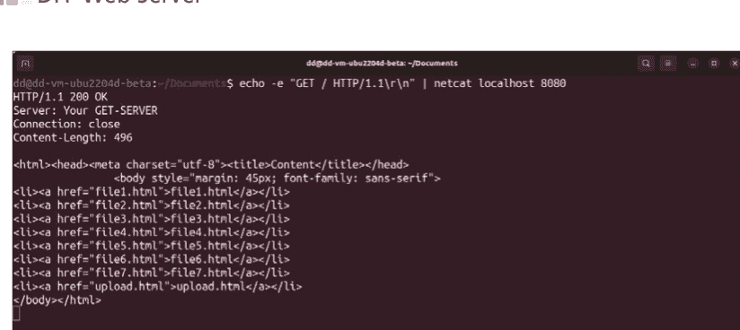

**图 1：** DIY 网络服务器返回根目录内容的列表。

**列表 5：输出**
```bash
function list_dir() {
    local output=$( ls --hide=upload -l $HTTP_HOME | sed -r '
    s|<html><head><meta charset="utf-8"><title>Content</title></head>
    <body style="margin: 45px; font-family: sans-serif">
    $&.*|<li><a href="\1">\1</a>|\1#)
    s|</body></html>
)

    local content_length="Content-Length: $( cat <<$output | wc --bytes )"

    cat <<$output | sed '
    1 i HTTP/1.1 200 OK
    1 i Server: Your GET SERVER
    1 i Connection: close
    1 i
```

……报头及相应的 HTML，本地网络中的浏览器会以为它正在与一个真实的网络服务器进行交互。

然而，也可能发生用户手动在浏览器中请求一个不存在的页面的情况。这将导致臭名昭著的 404 错误，你以前在网络上可能已经见过 [5]。自定义网络服务器也可以具备此功能。如果 `return_file` 函数（第 20 行）第一行中的 `cat` 命令抛出错误，则从第 28 行开始的 `else` 分支将被执行。然后，Web 浏览器将显示一条消息，表示请求的页面不存在。

#### POST 请求

与 GET 请求不同，GET 请求中 Web 浏览器想要下载文件，还存在允许浏览器向 Web 服务器发送数据的 POST 请求。你可以将其类比为在社交媒体上发布内容。你在为该用途提供的框中键入一些文本，添加图片或视频，然后按“发布”。内容随后被上传到服务器，并显示在你的个人资料下。我们的简单服务器仅从浏览器上传文件，并将它们保存在 `uploads/` 文件夹中。

同样，浏览器发送一个标头，指示它想要发布一些内容。你可以通过运行列表 6 中的命令轻松了解 POST 请求的外观。在浏览器中，调用根文件夹中的网络表单并发送一个文件（图 2）。几秒钟后，按 Ctrl + C 中断 Netcat 命令。浏览器显示“文件已到达”消息，文件就在你重定向的地方。但这不是一个可显示的 JPEG 文件，因为此处保存的文件仍然包含报头，如图 3 所示。

#### 列表 6：POST 模拟

```bash
echo "File arrived" | netcat -l 8081 > upload/filex.jpg
```

#### 列表 7：过滤

```bash
function run_post_server () {

    message_for_post='HTTP/1.1 200 OK
Content-Length: 13
Connection: close

File arrived

while true; do
    cat <<< $message_for_post | netcat -l $HTTP_POST_PORT > \
        "${CACHE_DATE}"
    new_name=$( sed -r -n '/filename/{ s/(.*)\(filename="
        .+"\).*\\: 3/; p/; }' "${CACHE_DATE}" )
    upload_path="${HTTP_UPLOAD}/$new_name"
    sed '/\. /filename/d;/Content-Type/\n;d;\$'
        "${CACHE_DATE}" > "${upload_path}"
done
}

run_post_server &
```

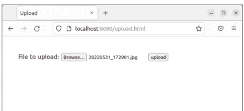

图 2：使用网络表单将照片或文本等文件上传到网络服务器。

#### 列表 8：发送 JPEG 文件

```bash
#!/bin/bash

header="HTTP/1.1 200 OK"  
myfile="http://home/upload/IMG-20220123-WA00022.jpg"
content_length=$( cat $myfile | wc --bytes  )
content_type="Content-Type: image/jpeg"

cat $myfile | sed -r -e "1i $header" -e \
     "1 i $content_length" -e \
     "1 i $content_type" -e \
     "1 i Connection: close\n" | netcat -l 8080
```

……在上传的文件中。`sed` 处理从第 9 行开始的 `while` 循环中的此任务。`sed` 删除了报头、边界声明、文件名以及类似的数据。要将其与数据原本的样子进行比较，请查看缓存文件，它也在上传文件夹中。

如果 `sed` 没有删除所有冗余数据，操作系统将无法正确显示接收到的文件。

在后台，该例程还调用了 `run_post_server` 函数（第 17 行）。该函数包含针对 POST 请求的匹配响应，说明内容长度（以字节为单位）并包含断开连接后的指令。如果没有这些指令，Firefox 将会保持连接状态，尽管数据已经发送。该函数在后台启动（&），以免在文件发送完成后阻塞所有操作。

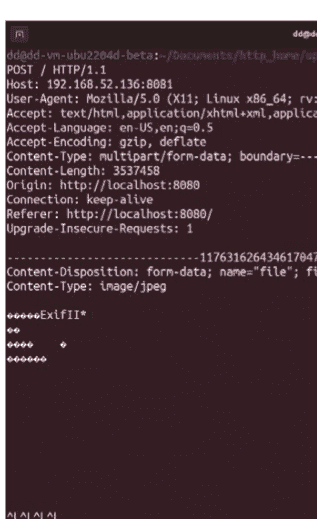

图 3：上传请求包含不属于上传文件的数据。

#### 未检查

即使 Web 浏览器明确请求根目录或其他文件，Web 服务器基本上可以返回你想要的内容——你只需要为浏览器正确声明返回的内容即可。列表 8 展示了这样一个示例，当调用 `localhost:8080` 或 `IP 地址:8080` 时，浏览器会立即显示一个 JPEG 文件，没有任何抱怨。

这里的有趣之处不仅在于它可行，而且它代表了一个潜在的漏洞。显然，大多数 Web 浏览器并不费心检查 GET 请求的内容与返回的页面是否真的匹配。在这种情况下，浏览器请求了 Web 服务器的索引页面，却被给予了 JPEG 文件。这就像网球运动员突然被对手扔来一个篮球一样。

根据经验，这些怪癖以及你可能想要实现的其他许多功能，在网络上并未得到很好的文档记录，或者根本没有记录。因此，记录 Firefox 和其他浏览器请求的内容可能会很有用。列表 9 中的函数启动了服务器。你可以看到两个 `tee` 重定向，将所有数据转发到日志文件以用于调试。该日志将包含日期和时间、Web 浏览器发送的请求以及服务器发送的响应（图 4）。有了这些详细信息，你可以分析每个请求和响应，并理解客户端和服务器通信时具体发生了什么。

例如，许多浏览器在与服务器通信一段时间后，会请求著名的 `favicon.ico`。这通常是你看到的浏览器标签顶部的图标。它通常位于 Web 服务器的根文件夹中。

如果你希望自己的服务器提供 favicon，你需要先弄清楚浏览器请求的样子，然后告诉服务器做出适当的响应。你可以从日志文件中的错误消息 `cat: http_home/favicon.ico: file or directory not found` 看出 Web 浏览器经常请求此文件。

**列表 9：调用 Web 服务器**
```bash
function run_server () {
  while true; do
    date | sed -r 's/\/[\d/\n\g]>> debug
    respond < $HTTP_GET | tee --append debug |
      netcat -l $HTTP_GET_PORT
    tee --append debug > $HTTP_GET
  done
}
```

##### 结论

如你所见，自行构建一个 rudimentary（基础/简陋）网络服务器相当容易。本文介绍的网络服务器设计朴素简单，但并非旨在与 Apache 网络服务器或 Nginx 等一流选手竞争。另一方面，我们自制的网络服务器确实拥有一些典型网络服务器不会提供的功能。例如，你可以访问整个 shell 命令库，以便以最小的开销在本地显示信息。小脚本消耗的资源也极小。这种 DIY 服务器作为你自有网络上的信息服务器非常有用，你还可以使用它在两台计算机之间传输文件——总而言之，对于小任务来说是一个不错的解决方案。

#### 信息

- [1] Netcat: https://netcat.sourceforge.net/
- [2] 本文代码: https://linuxnewmedia.thegood.cloud/s/5Rzx9tQW2FJ6JNr3
- [3] 队列: https://en.wikipedia.org/wiki/Queue_(abstract_data_type)
- [4] sed: https://www.gnu.org/software/sed/manual/sed.html
- [5] HTTP 状态码: https://en.wikipedia.org/wiki/List_of_HTTP_status_codes

### 作者

Goran Mladenovic 是一名业余开发者和发明家，他认为编程是一种激情。


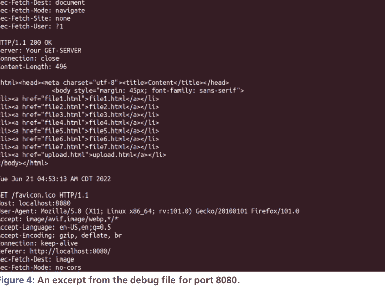

**图 4：** 端口 8080 的调试文件摘录。


### FOSSLIFE

#### 开放给所有人

新闻 • 职业 • 科技生活
技能 • 资源

FOSSlife.org

#### 深入探讨

##### Podman

##### 使用 Podman 设置 Nextcloud

##### 即开即用

Podman 为用户提供了一种快速且简便的方式来设置用于家庭使用的 Nextcloud 实例。

文：Ferdinand Thommes

容器技术正日益深入家庭网络。如果你使用 Flatpak 或 Snap，那么你已经在日常生活中使用容器了。未来的发行版将把系统权重降到最低，所需的服务将以某种形式的容器运行。Fedora 的 Silverblue 和 Kinoite、Endless OS、MicroOS 以及英特尔的 Clear Linux 已经预示了这一趋势。对于家庭用户来说，考虑各种容器解决方案绝对是合理的。

容器通过虚拟化隔离应用程序，同时提供运行时环境。它们利用运行所在操作系统的文件系统和资源。与传统的服务器方法或常规虚拟化相比，容器化具有资源消耗较低的优势。虚拟机需要自己的操作系统，包括内核，而容器仅存储实际应用程序以及运行所需的许多文件和功能（微服务）。

自 2013 年成立以来，Docker 一直与容器技术紧密相关，但 Kubernetes 容器编排软件的出现开始慢慢改变这种认知。最近，Podman [1] 在容器领域势头强劲，版本已升至 4.0。在 Docker 和红帽公司（Red Hat）就持续开发产生争议后，红帽公司于 2017 年开始投资 Podman，将其作为管理容器和 Pod 的应用程序，并自那以后取消了对 Docker 的支持。

Podman（Pod Manager 的缩写）采用了由 Kubernetes 引入的 Pod 模型。Pod 是容器，每个 Pod 都在同一服务器上运行独立的应用程序。例如，如果你想设置 Nextcloud，还需要一个服务器应用程序、一个数据库，以及如果你想从外部访问该服务，还需要一个反向代理。所有这些应用程序都在 Pod 中的独立容器中运行。这带来了一些好处，例如可以绑定到 Pod 的 localhost 地址，这意味着由于共享网络命名空间，Pod 中的所有容器都可以连接该地址。

在本文中，我将讨论 Podman 的优势，然后通过使用 Podman 设置 Nextcloud 的实际示例向您展示具体操作。

##### Podman 的优势

虽然 Docker 由守护程序集中控制，但 Podman 无需此类实例，并且无需 root 权限即可运行。得益于基于 Cgroups 2 [2] 的内核用户命名空间的使用，容器在普通用户的上下文中运行。然而，在容器内部，进程本身是以 root 权限运行的。在命名空间内，进程因此拥有与命名空间外部不同的权限和用户 ID。由于不受守护程序控制，Podman 容器可以作为 systemd 服务 [3] 包含，或使用 Cockpit 管理工具通过 GUI 进行控制（图 1）[4]。

照片来自 Unsplash 的 Axel Tyring

与 Docker 不同，Docker 中应用程序的各个组件运行在不同的容器中，而 Podman 将多个容器组合在一个 Pod 中；这反过来避免了网络问题。

在命令行上，Podman 的行为与 Docker 几乎相同，该软件在后台实现了 Docker 的命令。此外，Podman 可用于创建 Docker Registry 仓库的镜像。

为了使容器尽可能高效地利用资源，你可以使用 Buildah [5]，它允许你从头开始构建容器。特别是，Buildah 在希望镜像尽可能小的环境中非常有用。

如您所见，红帽公司通过 Podman 优雅地解决了其对 Docker 的依赖，同时提供了额外的功能。例如，Podman 4 带有新的 podman image scp 命令，允许您将镜像本地复制和远程服务器，而无需通过注册表绕道。

#### 安装

为了使用 Podman 设置一个简单的 Nextcloud 安装，我使用了 Fedora 36 搭配 Podman 4.0.2 以及 Debian “Sid”（Siduction）搭配 Podman 3.4.4。除了 Podman 的安装步骤外，说明是相同的。

在测试期间，我在 Proxmox 容器中运行 Fedora 36，而 Siduction 安装在笔记本电脑上。要在 Fedora 上安装 Podman，请键入：

```
sudo dnf install podman cockpit-podman
```

对于 Debian，请使用：

```
sudo apt install podman cockpit-podman
```

Debian 的说明应适用于 Debian Stable 及其衍生版本。使用较旧版本的 Podman 有时会导致行为偏差。

为了更好地集成容器和宿主环境，你需要额外安装 toolbox 实用工具 [6]。完成后，可以使用 DNF 在容器中安装包，可以直通 USB 设备，并且可以集成宿主的主目录（图 2）。

##### 配置

首先，你需要为要在 Podman 容器中创建的 Nextcloud 安装创建三个卷（列表 1）。在此上下文中，卷 [7] 充当 Podman 创建和管理存储设备，提供了在容器和宿主之间移动和编辑数据的能力。你可以预先使用 podman volume 命令创建卷，或者在设置容器时直接创建（图 3）。

接下来，通过键入以下内容创建一个新的网络：

```
podman network create nextcloud-net
```

并使用以下命令检查其属性：

```
podman network inspect nextcloud-net
```

现在是创建容器的时候了，从 MariaDB 数据库开始。作为替代方案，你可以集成 PostgreSQL，但 SQLite 不是 Nextcloud 的好选择。设置数据库容器的命令和规范在列表 2 中指定。

`podman run` 命令会弹出一个交互式 shell，你可以在其中定义数据库属性 [8]。确保你选择并记住 `<DB-User-Password>` 和 `<DB-Root-Password>`；你稍后需要它们。你可以通过键入 `podman container ls` 来检查这一切是否正常工作，它会显示正在运行的容器。

下一步是部署 Nextcloud。适用的原则与列表 3 中所示的相同。再次确保你运行 DB 容器中的 `<DB-User-Password>`，并替换 `<NC-Admin>` 和 `<NC-Password>` 变量。

设置好框架后，在你的 Web 浏览器中调用 localhost:8080。Nextcloud 23 将会显示 Hello，然后你可以

**列表 1：创建卷**

```
$ podman volume create nextcloud-app
$ podman volume create nextcloud-data
$ podman volume create nextcloud-db
```

**列表 2：容器中的 MariaDB**

```
podman run --detach \
--env MYSQL_DATABASE=nextcloud \
--env MYSQL_USER=nextcloud \
--env MYSQL_PASSWORD=<DB-User-Password> \
--env MYSQL_ROOT_PASSWORD=<DB-Root-Password> \
--volume nextcloud-db:/var/lib/mysql \
--network nextcloud-net \
--restart on-failure \
--name nextcloud-db \
docker.io:library/mariadb:10
```

**列表 3：部署 Nextcloud**

```
podman run --detach \
--env MYSQL_HOST=nextcloud-db.dns.podman \
--env MYSQL_DATABASE=nextcloud \
--env MYSQL_USER=nextcloud \
--env MYSQL_PASSWORD=DB-User-Password \
--env NEXTCLOUD_ADMIN_USER=<NC-Admin> \
--env NEXTCLOUD_ADMIN_PASSWORD=<NC-Password> \
--volume nextcloud-app:/var/www/html \
--volume nextcloud-data:/var/www/html/data \
--network nextcloud-net \
--restart on-failure \
--name nextcloud \
--publish 8080:80 \
docker.io:library/nextcloud:latest
```

**图 3：** 我们示例的 Nextcloud 项目由三个卷组成，可以使用简单的命令快速创建。卷通过允许在容器和宿主之间移动和编辑数据，增强了容器的灵活性。


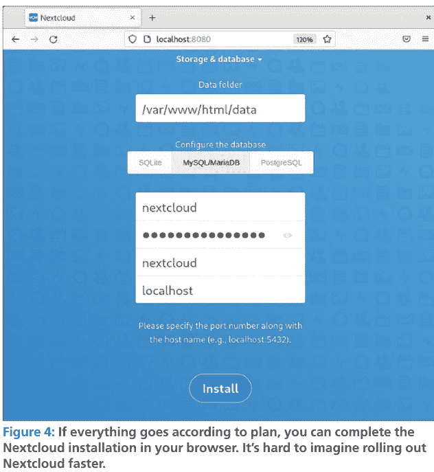

在 GUI 中继续安装。您也可以将环境参数写入文件，然后通过输入以下内容来包含该文件：

```
--env-file /path/to/<file>
```

#### 设置

此处描述的设置非常适合在家庭网络中使用 Nextcloud。在这种简单场景下，所有容器都在单个 pod 中运行。如果您想从家庭网络外部访问该 pod，则需要额外的容器。出于安全目的，可以通过 Traefik 代理实施 TLS 加密，也可使用 HTTPD、NGINX 或 Caddy 等工具实现。

如果您将 Podman 包含为 systemd 服务，可以通过额外指定 `label=10.containers.autoupdate=image` 并使用 `podman auto-update [9]` 来简化镜像更新。在创建容器时，使用

```
podman generate systemd --new
```

完成初步准备工作后，在您的浏览器上 *localhost:8080* 调用 Nextcloud，并以通常方式在那里完成安装（图 4）。可以在列表 4 中找到 Podman 三个最重要配置文件的路径。

**列表 4：Podman 配置**

- `/usr/share/containers/containers.conf`
- `/etc/containers/containers.conf`
- `${HOME}/.config/containers/containers.conf`

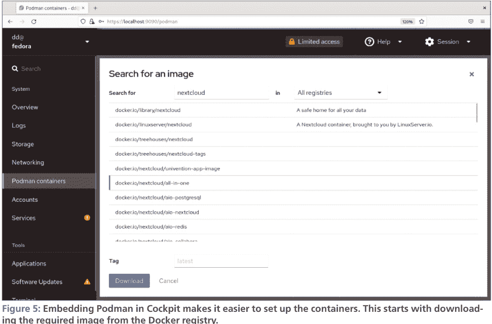

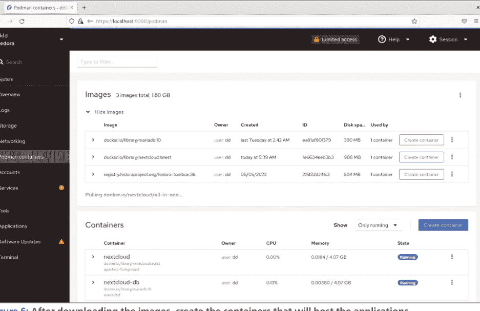

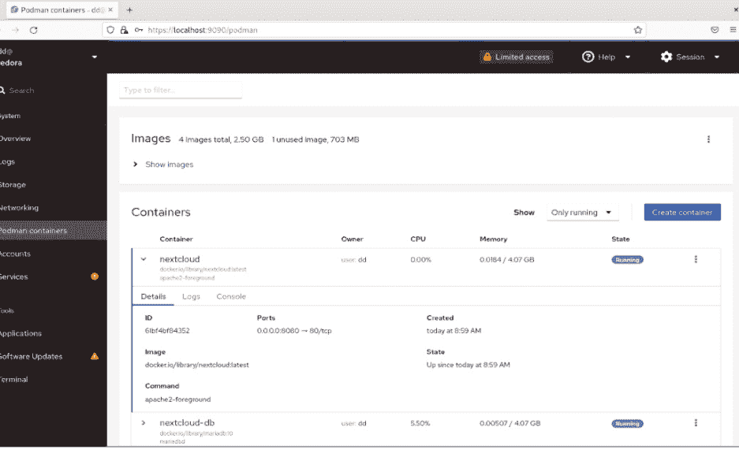

如前所述，您可以通过命令行或 *cockpit-podman* 安装的 Cockpit 管理界面来管理 Podman


包。然后在浏览器中访问 *localhost:9090/podman* 调用 Cockpit（图 5）。Web 界面允许您查看（图 6）和管理（图 7）您的镜像和容器。

在测试过程中，我没有发现相比 Docker 有任何缺点。Podman 的最大优势在于，由于无需 root 权限，从而提高了安全性。此外，通过与 Cockpit 集成进行简单管理也是一个加分项。Podman 正在取代 Docker 的道路上稳步推进，尽管仍有一些初期问题需要注意，特别是在与远程机器配合使用时。这里描述的简单入门是扩展您容器技能的良好起点。 ■■■

##### 结论

Podman 手册页 [10] 提供了 Podman 功能的有用初步概述，而 Podman 网站 [1] 提供了各种参考资料供进一步研究。在我看来，您学习 Podman 基础的速度可以比学习 Docker 更快。如果您已经有 Docker 经验，您肯定会发现过渡到 Podman 很容易。为了唤醒肌肉记忆，在这种情况下，请输入

```
alias docker='podman'
```

到您的 .bashrc 中，以便继续使用 pull、push、build、commit、tag 等 Docker 命令。

#### 信息

- [1] Podman: [https://docs.podman.io/en/latest/](https://docs.podman.io/en/latest/)
- [2] 命名空间: [https://en.wikipedia.org/wiki/Linux_namespaces#User_ID_(user](https://en.wikipedia.org/wiki/Linux_namespaces#User_ID_(user)
- [3] 作为 systemd 服务的 Podman: [https://access.redhat.com/documentation/en-us/red_hat_enterprise_linux_atomic_host/7/html/managing_containers/running_containers_as_systemd_services_with_podman](https://access.redhat.com/documentation/en-us/red_hat_enterprise_linux_atomic_host/7/html/managing_containers/running_containers_as_systemd_services_with_podman)
- [4] 使用 Cockpit 监控 Podman: [https://www.tutorialworks.com/podman-monitoring-cockpit-fedora/](https://www.tutorialworks.com/podman-monitoring-cockpit-fedora/)
- [5] Buildah: [https://buildah.io](https://buildah.io)
- [6] toolbox: [https://docs.fedoraproject.org/en-US/fedora-silverblue/toollbox/](https://docs.fedoraproject.org/en-US/fedora-silverblue/toollbox/)
- [7] Podman 卷: [https://blog.christophersmart.com/2021/01/31/volumes-and-rootless-podman/](https://blog.christophersmart.com/2021/01/31/volumes-and-rootless-podman/)
- [8] podman run: [https://docs.podman.io/en/latest/podman-run.1.html](https://docs.podman.io/en/latest/podman-run.1.html)
- [9] Podman 自动更新: [https://github.com/containers/podman/blob/v2.0/docs/source/markdown/podman-auto-update.1.md](https://github.com/containers/podman/blob/v2.0/docs/source/markdown/podman-auto-update.1.md)
- [10] Podman 手册页: [https://manpages.debian.org/unstable/podman/podman.1.en.html](https://manpages.debian.org/unstable/podman/podman.1.en.html)


### 什么？！

我可以更早获得我的问题？


注册数字订阅，享受关于热门话题的最新文章、评测、酷炫项目等等……

订阅 PDF 版：[shop.linuxnewmedia.com/digisub](https://shop.linuxnewmedia.com/digisub)

#### 深入解析

编程快照 – Go 地理定位游戏


## Go 语言照片定位猜测游戏
## 寻宝游戏

基于流行的 Worldle 的地理定位猜测游戏根据玩家猜测与目标地点之间的距离和方向来评估玩家的猜测。Mike Schilli 利用他私人收藏的照片，用 Go 将这个概念变成了一个桌面游戏。作者 Mike Schilli

在 Worldle [1] 猜词游戏取得巨大成功之后，第一个模仿者很快就出现了。其中最好的是有趣的 Worldle [2] 地理游戏，其目标是根据形状猜测一个国家。每次猜测失败后，Worldle 都会提供关于猜测的地点距离目标有多远以及目标国家位于哪个方向的信息，以帮助玩家。

图 1 中无法识别国家的轮廓，玩家的第一次猜测是列支敦士登公国。Worldle 服务器迅速告诉玩家，目标地点距离这个欧洲小国 5,371 公里，并且位于其东侧。玩家的第二次猜测是白俄罗斯，但根据 Worldle 服务器，从白俄罗斯需要向东南方向旅行 4,203 公里才能到达目标。第三次尝试是蒙古，但这次猜过了，因为从那里需要向西南方向走 3,476 公里才能到达秘密目的地。

缓慢但肯定地，玩家意识到秘密国家可能位于印度附近。然后，在第四次尝试中，巴基斯坦被证明是正确的！Worldle 非常有趣，每天都有一个新国家供猜测。

### 私人快照

现在，与其猜测国家，我认为从我的手机照片收藏中随机选择一些照片会很有趣，这些照片在过去的几年里疯狂增长。通过分析每张照片的 GPS 数据，游戏引擎确保一轮中的照片拍摄地点相距甚远。最初，计算机从集合中随机选择一张照片作为答案。当然，它对此保密，然后向玩家显示一张随机选择的照片，以及随机照片拍摄地点与目标地点之间有多少公里，以及玩家需要穿越世界到达那里的罗盘方向。

凭借这些信息，玩家现在必须猜测剩余选择中哪张照片是秘密照片。玩家点击


**作者**
Mike Schilli 在加利福尼亚州旧金山湾区担任软件工程师。在他自 1997 年以来一直发布的专栏中，他每月研究各种编程语言的实用应用。如果您通过 mschilli@perlmeister.com 给他发邮件，他将很乐意回答任何问题。


**图 2：** 起点：Schnitzlie 选择了一张距离目标 **9,457.8** 公里的照片。

可疑的匹配项，并得到关于猜测的一些反馈，再次包括距离和罗盘方向，指向秘密位置。游戏的目标是用尽可能少的轮次找到答案——如果你喜欢的话，就像是一种寻宝游戏。为了致敬 Worldie 中额外的辅音，我的程序名为 Schnitzlie。我的手机上有足够的照片可供选择，随机生成器确保游戏总是选择新照片，因此永远不会变得无聊。

### 行动开始！

图 2 展示了正在运行的 Schnitzlie。作为起始图像，计算机选择了一张快照，描绘了作者本人在巴伐利亚阿尔卑斯山徒步旅行。根据线索，目标位于起始图像的西北（NW）方向 **9,457.8** 公里处。很可能秘密照片是在北美某处拍摄的！然后，玩家从右侧的选择中点击加利福尼亚州巨岩州立公园（Pinnacles National Park）的照片（图 3）。Schnitzlie 揭示，目标位于这个猜测的西北方向 **168.5** 公里处。巨岩州立公园的北边是什么？可能是我居住的旧金山湾区！


**图 3：** 玩家点击了一张巨岩州立公园的照片，它距离目标仍有 **168.5** 公里。

在图 4 中，玩家然后点击了 Pacifica 海滩停车场的照片，我经常去那里冲浪。但从海滩到游戏选择照片的地点，您还需要向


**图 4：** Pacifica 州海滩停车场距离目标仍有 **10** 公里。

东北方向（NE）旅行 **10.2** 公里。如果您熟悉该地区，您大概可以猜到：目的地一定在南旧金山郊区的某个地方，那里有一家巨大的 Costco 超市。事实上，那个装满烤鸡的架子就是答案，正如 *WINNER* 消息所示（图 5）。右侧栏中仍有两张未点击的照片，一张显示德国海德堡的一座桥，另一张显示湾区 Esplanade Beach 的沙子。

### 寻找便会找到

那么，作为一个 Go 程序，游戏是如何工作的？从我的手机到我的硬盘下载整个照片集合需要一些时间，即使它是在快速的 SSD 上。这就是为什么 `finder.go` 辅助程序（列表 1）挖掘第 18 行设置的手机照片目录的深度，分析其中找到的每个 JPEG 图像，读取其 GPS 数据（如果有），并将其缓存供以后使用。

该程序将结果输入到 SQLite 数据库中的表中，以便游戏程序以后可以在每轮中快速选择新图像，而不必梳理整个


**图 5：** 答案：南旧金山 Costco 的烤鸡货架。


### 编程快照 – Go 地理定位游戏

文件系统树在每一轮中都会发生变化。你可以通过像图 6 中那样的 shell 命令，在极短的时间内创建一个包含所需表的空 SQLite 数据库，该表将 GPS 数据分配给文件名。

```
$ sqlite3 photos.db
SQLite version 3.32.3 2020-06-18 14:16:19
Enter ".help" for usage hints.
sqlite> CREATE TABLE files (path text, lat real, long real);
sqlite> ^D
```

图 6：使用 sqlite3 客户端生成的空照片数据库。

```
$ sqlite3 photos.db
SQLite version 3.32.3 2020-06-18 14:16:19
Enter ".help" for usage hints.
sqlite> SELECT COUNT(*) FROM files;
4162
sqlite> SELECT * FROM files ORDER BY RANDOM() LIMIT 5;
/Users/mschilli/iphone/IMG_9729.JPG|37.76951944444444|-122.41921944444
/Users/mschilli/iphone/IMG_6101.JPG|37.74213611111111|-122.436858333333
/Users/mschilli/iphone/IMG_E6812.JPG|37.8522|-122.425977777778
/Users/mschilli/iphone/IMG_0186.JPG|37.95210555555556|-122.42685
/Users/mschilli/iphone/IMG_8616.JPG|37.24324166666667|-122.4352555555556
sqlite> ^D
```

图 7：运行 finder 后，数据库中有 4,162 张带有 GPS 坐标的图片。

在游戏开始之前，列表 1 中的程序需要运行一次，通过输入以下命令进行编译：

```
go build finder.go
```

该程序使用了来自 GitHub 的两个库（go-sqlite3 和 goexif2）。其中一个驱动平文件数据库，另一个从 JPEG 照片读取 GPS 头信息。

为了让 Go 编译器没有任何抱怨地执行此操作，首先输入

```
go mod init finder; go mod tidy
```

以指定一个 Go 模块来解析源代码中包含的库，如有需要从 GitHub 获取它们，并定义它们的版本。完成后，`go build` 命令会生成一个包含所有编译库的静态二进制文件 `finder`。

#### 列表 1: finder.go

```go
01 package main
02
03 import (
04 	"database/sql"
05 	"fmt"
06 	_ "github.com/mattn/go-sqlite3"
07 	exif "github.com/xor-gate/goexif2/exif"
08 	"os"
09 	"path/filepath"
10 	"regexp"
11 )
12
13 type Walker struct {
14 	Db *sql.DB
15 }
16
17 func main() {
18 	searchPath := "photos"
19
20 	db, err := sql.Open("sqlite3", "photos.db")
21 	w := &Walker{ Db: db }
22 	err = filepath.Walk(searchPath, w.Visit)
23 	panicOnErr(err)
24
25 	db.Close()
26 }
27
28 func (w *Walker) Visit(path string,
29 	f os.FileInfo, err error) error {
30 	jpgMatch := regexp.MustCompile("(?i)JPG$")
31 	match := jpgMatch.MatchString(path)
32 	if !match {
33 		return nil
34 	}
35
36 	lat, long, err := GeoPos(path)
37 	panicOnErr(err)
38
39 	stmt, err := w.Db.Prepare("INSERT INTO files VALUES(?,?,?)")
40 	panicOnErr(err)
41 	fmt.Printf("File: %s %.2f/%.2f\n", path, lat, long)
42 	_, err = stmt.Exec(path, lat, long)
43 	panicOnErr(err)
44 	return nil
45 }
46
47 func GeoPos(path string) (float64,
48 	float64, error) {
49 	f, err := os.Open(path)
50 	if err != nil {
51 		return 0, 0, err
52 	}
53
54 	x, err := exif.Decode(f)
55 	if err != nil {
56 		return 0, 0, err
57 	}
58
59 	lat, long, err := x.LatLong()
60 	if err != nil {
61 		return 0, 0, err
62 	}
63
64 	return lat, long, nil
65 }
```

如图 7 所示，列表 1 中的 finder 实用程序在大约 30 秒内读取手机文件夹中大约 4,000 个文件，并将照片的元数据添加到 SQLite `photos.db` 平文件数据库中的 `files` 表里。

列表 1 第 22 行对 `walk` 函数的调用接收第 28 行定义的 `Visit` 回调。文件浏览器对找到的每个文件都调用此函数。它始终携带一个 `Walker` 数据结构作为接收者，这意味着它可以立即访问之前打开的 SQLite 数据库的 `db` 句柄。

对于找到的每个文件，第 31 行检查文件是否具有 `.jpg` 扩展名（大写或小写），然后运行第 47 行的 `GeoPos()` 函数来加载照片的 Exif 数据。理想情况下，这将包括照片拍摄地点的经度和纬度，以浮点数表示。

第 39 行使用典型的 SQL 语法中的 INSERT 语句将路径和 GPS 数据输入到数据库表中。稍后，主 `schntizle` 程序可以从数据库中获取图像位置和元数据，以便为新游戏寻找新的快照。

### 选择过剩

从包含数千张图片的照片集中随机挑选十几张照片并不特别困难。更难的是确保游戏一轮中照片的位置彼此不会太近。许多手机照片是在家拍摄的，而在客厅、阳台和厨房之间逐英寸导航的前景并不令人兴奋。

相反，我希望算法能够随机选择图像，同时确保在每一轮中创建新的、令人兴奋的游戏场景，通过始终呈现不同区域的良好混合。图 8 中手机照片应用的地域视图说明了如何根据 GPS 数据将照片分配给捆绑的热区。然后，算法仅从给定的热区中选择一个图像。

k-means 算法 [3] 在这里大有裨益：k-means 是一种人工智能 [4] 方法，应用于无监督学习 [5] 中的信息聚类（图 9）。在一个二维或多维空间中，从一组或多或少随机分布的点出发，k-means 确定聚类的中心。在 Schmitzle 游戏中，这些将是拍摄了许多手机照片的地点，例如在家里或各种度假胜地。然后，算法仅从这些聚类中的每一个随机选择一个图像。这确保了游戏每轮中各个照片拍摄地点之间存在有意义的距离。

从列表 2 第 18 行开始的 `photoSet()` 函数的任务是交付一个包含 6 张新游戏照片的 `Photo` 类型数组切片。第 12 行定义了 `Photo` 数据结构，其中包含图像文件路径的 `Path`。除此之外，它还保存从 Exif 信息中读取的地理坐标，作为 64 位浮点数表示的经度 `Lng` 和纬度 `Lat`。

为此，`photoSet()` 从第 19 行开始连接到之前创建的 SQLite 数据库 `photos.db`，并运行从第 23 行开始的 SELECT 查询，以筛选所有之前读取的照片文件及其 GPS 坐标。在从第 36 行开始并处理所有找到的表元组的 for 循环之后，所有记录现在都存在于 `clusters.Observations` 类型元素的数组中，准备由 GitHub 上的 `kmeans` 包 [6] 处理。

对 `km.Partition()` 的调用随后将 GPS 坐标分配到 10 个不同的聚类中。然后，第 60 行丢弃包含少于三个条目的微小聚类。这防止了相同的照片在每场游戏中反复出现，从而不让算法有机会通过从特定聚类中随机选择来提供多样性。算法从剩余的聚类中最多选择六张（`maxClusters`）照片，然后使用 `rand` 包中的 `shuffle` 函数将它们按随机顺序排列。

由于 GitHub 上的 kmeans 聚类库对照片不熟悉

#### 列表 2: photoSet.go

```go
01 package main
02
03 import (
04   "database/sql"
05   "fmt"
06   _ "github.com/mattn/go-sqlite3"
07   "github.com/muesli/clusters"
08   "github.com/muesli/kmeans"
09   "math/rand"
10 )
11
12 type Photo struct {
13   Path string
14   Lat float64
15   Lng float64
16 }
17
18 func photoSet() ([][]Photo, error) {
19   db, err := sql.Open("sqlite3", "photos.db")
20   panicOnErr(err)
21   photos := [][]Photo{}
22
23   query := fmt.Sprintf("SELECT path, lat, long FROM files")
24   stmt, _ := db.Prepare(query)
25
26   rows, err := stmt.Query()
27   panicOnErr(err)
28
29   var d clusters.Observations
30   lookup := map[string]Photo{}
31
32   keyfmt := func(lat, lng float64) string {
33     return fmt.Sprintf("%f-%f", lat, lng)
34   }
35
36   for rows.Next() {
37     var path string
38     var lat, lng float64
39     err = rows.Scan(&path, &lat, &lng)
40     lookup[keyfmt(lat, lng)] = Photo{Path: path, Lat: lat, Lng: lng}
41     d = append(d, clusters.Coordinates{
42       lat,
43       lng,
44     })
45   }
46   db.Close()
47
48   maxClusters := 6
49   km := kmeans.New()
50   clusters, err := km.Partition(d, 10)
51   panicOnErr(err)
52
53   rand.Shuffle(len(clusters), func(i, j int) {
54     clusters[i], clusters[j] = clusters[j], clusters[i]
55   })
56
57   for _, c := range clusters {
58     if len(c.Observations) < 3 {
59       continue
60     }
61     rndIdx := rand.Intn(len(c.Observations))
62     coords := c.Observations[rndIdx].Coordinates()
63     key := keyfmt(coords[0], coords[1])
64     photo := lookup[key]
65     photos = append(photos, photo)
66     if len(photos) == maxClusters {
67       break
68     }
69   }
70   return photos, nil
71 }
72
73 func randPickExcept(pick []Photo, notIdx int) int {
74   idx := rand.Intn(len(pick)-1) + 1
75   if idx == notIdx {
76     idx = 0
77   }
78   return idx
79 }
```


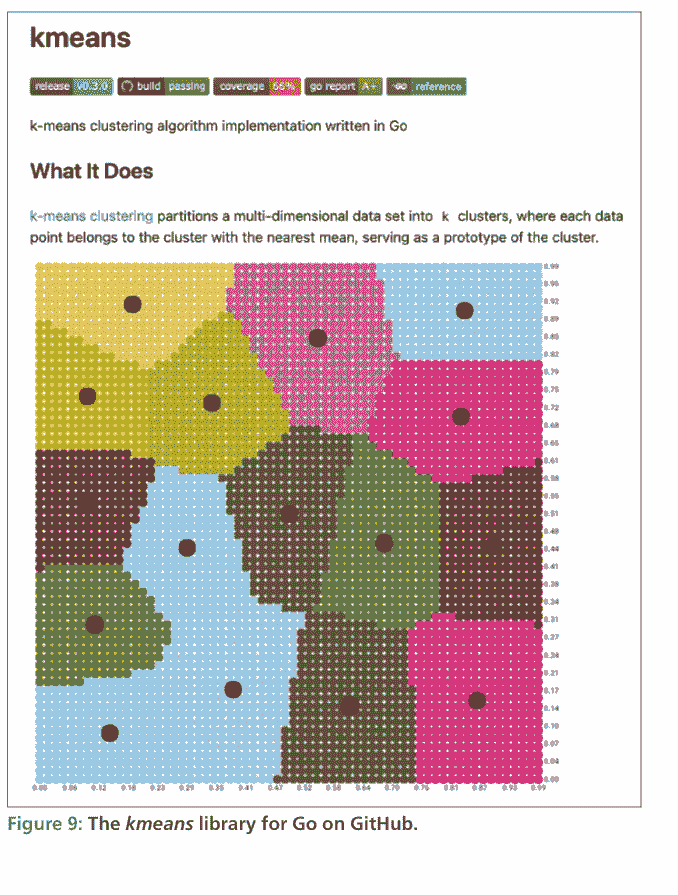


### 编程快照——Go 定位游戏

集合，但只能对具有 X/Y 坐标的点进行排序。第 41 行创建了一个查找哈希映射。它将照片的经度和纬度映射到磁盘上的 JPEG 图像。当算法稍后返回目标图像的坐标时，程序可以找到、加载并显示相关的图像。

#### 受控随机性

舒密茨（Schmitz）游戏需要从所有选定的簇的代表中，初始选择一个供玩家猜测的秘密目标图片。然后，它通过一张随机起始图片开启游戏，但不应该甚至意外地选中那张秘密图片！Go 语言中的 `math/rand` 标准库解决方案能提供在 0（包含）和 `len()`（不包含）之间随机且均匀分布的索引位置，从而从数组中纯粹随机地选取元素。

列表 2 中从第 75 行开始的 `randPickedExcept()` 函数现在会从传入的数组中随机选取一个元素，而绝不揭示位于 `exclIdx` 位置的那个元素。这是通过算法仅从索引范围 0...`N` 中的元素里选择索引位置 1...`N` 的元素来实现的，忽略了列表中的第一张图片。并且，如果选择结果恰好落在禁止的 `exclIdx` 位置，该函数将简单提供 θ 项作为替代，该项之前已被排除在选取范围之外。这样，除了那张秘密图片外，所有照片被选为起点的概率都是相等的。

#### 精简瘦身

列表 3 有助于将缩小后的手机照片加载到 GUI 中。这里的一个难点在于，许多手机有一个坏习惯，即在拍摄时以旋转方向存储图像像素，并在头部注明该图像在显示时需要旋转 90 度或 180 度 [7]。

这种显示行为由 `imageorient` 包处理，列表 3 在第 5 行从 GitHub 引入了该包，在将每张图片交给 GUI 显示之前自动旋转图片。此外，没有人真的想在屏幕上拖动巨大的照片。相反，`nfmt/resize` 包（同样来自 GitHub）在第 26 行借助 `Thumbnail()` 函数，从大照片生成方便使用的缩略图。

列表 4 计算两个图像文件拍摄地点之间的距离，以及从 A 点走到 B 点时需要开始行走的角度（0 到 360 度）。由于地球不是平坦的表面，计算这些数字并不像在二维地图上那样简单，但处理所需三维几何学的公式并不太复杂，并且已经在网上可用 [8]。在第 8 行，`hike()` 函数从两张照片的 GPS 数据中获取经度（`lng*`）和纬度（`lat*`），并调用 `golang-geo` 库的功能，包括 `GreatCircleDistance()` 和 `BearingTo()`，以确定从一张照片到另一张照片需要行进的距离和方位角。

为了将路线的方位角（表现为 0 到 360 度的浮点数）转换为罗盘方向（如北或东北），第 16 行将角度除以 45，将结果四舍五入为最接近的整数，然后使用该索引访问第 15 行中的数组切片。索引 0 代表北，1 代表东北（NE），以此类推。如果索引小于 0（这在负角度的情况下可能会发生），第 19 行简单地加上数组切片的长度，以到达一个从末尾访问数组切片的索引。

```go
// Listing 3: image.go
package main

import (
	"fmt/io/fyne/v2/canvas"
	"github.com/disintegration/imageorient"
	"github.com/nfmt/resize"
	"image"
	"os"
)

const DspWidth = 300
const DspHeight = 150

func dispDim(w, h int) (dw, dh int) {
	if w > h {
		// landscape
		return DspWidth, DspHeight
	}
	// portrait
	return DspHeight, DspWidth
}

func scaleImage(img image.Image) image.Image {
	dw, dh := dispDim(img.Bounds().Max.X,
		img.Bounds().Max.Y)
	return resize.Thumbnail(uint(dw),
		uint(dh), img, resize.Lanczos3)
}

func showImage(img canvas.Image, path string) {
	nimg := loadlImage(path)
	img.Image = nimg.Image

	img.FillMode = canvas.ImageFillOriginal
	img.Refresh()
}

func loadlImage(path string) *canvas.Image {
	f, err := os.Open(path)
	panicOnErr(err)
	defer f.Close()
	raw, _, err := imageorient.Decode(f)
	panicOnErr(err)

	img := canvas.NewImageFromResource(nil)
	img.Image = scaleImage(raw)

	return img
}
```

```go
// Listing 4: gps.go
package main

import (
	geo "github.com/kellyjxn/golang-geo"
	"math"
)

func hike(lat1, lng1, lat2, lng2 float64) (float64,
	string, error) {
	p1 := geo.NewPoint(lat1, lng1)
	p2 := geo.NewPoint(lat2, lng2)

	bearing := p1.BearingTo(p2)
	dist := p1.GreatCircleDistance(p2)

	names := []string{"N", "NE", "E", "SE", "S", "SW",
		"W", "NW", "N"}
	idx := int(math.Round(bearing / 45.0))

	if idx < 0 {
		idx = idx + len(names)
	}

	return dist, names[idx], nil
}
```

#### 带有特殊顶部元素的控件

我们希望能覆盖由富有创造力的软件工程师构想出的每一个特殊情况。例如，在舒密茨游戏中，猜测者点击右侧窗格中的照片，以便游戏将其移动到左侧。照片通常不会响应点击，但按钮控件会。进而，它们定义了回调函数，以便在发生事件时执行预期的操作。

schmitzle GUI 应用程序依赖于 Fyne 框架，使用纯 Go 代码在桌面上打造具有原生外观的图形应用程序。本专栏之前的文章 [9] 曾多次深入探讨这一优秀工具 [10]。Fyne 自带了一系列标签、列表框、按钮和其他控件，但它不能……

只需少量代码，你就可以快速在 Fyne 中编程扩展，以添加所需的、尽管非标准的 行为。列表 5 定义了一个名为 `clickImage` 的新控件类型，从第 13 行开始。它由一个带有缩略图图像的 canvas 对象组成，并接收一个回调函数，当用户用鼠标点击照片时调用该回调。

得益于 Go 语言为结构体内置的继承机制，第 14 行的 `widget.BaseWidget` 从 Fyne 的基础控件派生结构，从而为其提供所有控件共有的显示、缩小或隐藏功能。此外，附加控件需要在构造函数中调用 `ExtendBaseWidget()` 函数。

```go
// Listing 5: gui.go
package main

import (
	"fyne.io/fyne/v2"
	"fyne.io/fyne/v2/canvas"
	"fyne.io/fyne/v2/container"
	"fyne.io/fyne/v2/widget"
	"math/rand"
	"os"
	"time"
)

type clickImage struct {
	widget.BaseWidget
	image *canvas.Image
	cb    func()
}

func NewClickImage(img *canvas.Image, cb func()) *clickImage {
	ci := &clickImage{}
	ci.ExtendBaseWidget(ci)
	ci.image = img
	ci.cb = cb
	return ci
}

func (t *clickImage) CreateRenderer() fyne.WidgetRenderer {
	return widget.NewSimpleRenderer(t.image)
}

func (t *clickImage) Tapped(_ *fyne.PointEvent) {
	t.cb()
}

func makeUi(w fyne.Window, p fyne.Preferences) {
	rand.Seed(time.Now().UnixNano())

	var leftCard *widget.Card
	var rightCard *widget.Card

	quit := widget.NewButton("Quit", func() {
		os.Exit(0)
	})

	var restart *widget.Button

	reload := func() {
		leftCard, rightCard = makeGame(p)
		vbox := container.NewVBox(
			container.NewGridWithColumns(2, quit, restart),
			container.NewGridWithColumns(2, leftCard, rightCard),
		)
		w.SetContent(vbox)
		canvas.Refresh(vbox)
	}

	restart = widget.NewButton("New Game", func() {
		reload()
	})

	reload()
}
```


在第 21 行后续调用构造函数以使用 GUI 的所有功能。

还有一件事：GUI 仍然不知道如何在屏幕上显示新的组件。这就是为什么从第 27 行开始的 `CreateRenderer()` 函数在仅以图像作为参数调用时，会向 GUI 返回一个**NewSimpleRenderer**类型的对象。

为了让 Schmitzle 中的照片组件响应鼠标点击，定义在第 19 行的**newClickImage()**构造函数接受一个回调，该组件随后在鼠标点击事件发生时调用它。第 23 行将此函数赋值给 `cb` 实例变量。稍后，`tapped()` 函数（定义在第 31 行并由 GUI 调用）会在玩家点击特定组件时触发之前在第 32 行定义的回调。就是这样：一个新的由可点击照片控制的 GUI 元素，其行为类似于按钮组件。

### 索引卡作为模型

就像从第 41 行开始的退出按钮一样，它使用其回调在通过 `os.Exit(0)` 按下按钮时宣布游戏结束，列表 6 可以——得益于新的扩展——在第 29 行创建一个新可点击照片。在其回调中，它将选定的索引发送到 `pickCh` 通道。在管道的另一端，游戏装置获取该索引并触发动画，将照片从右移动到左侧面板。

列表 5 的其余部分致力于使用 `makeUI` 安排游戏中显示的组件。核心函数 `reload()` 在程序初始启动时以及每当按下“新游戏”时加载新游戏。

游戏窗口中的图形元素被安排为顶部的两个水平按钮，随后是两个由 `Card` 类型组成的图像列——这依赖于使用 `NewVBox()` 进行垂直堆叠。这个来自 Fyne 集合的标准 `Card` 组件显示一个标题（可选地还有一个副标题）和一个用于说明的图像。你可以将其类比为一种带有标题和一些媒体内容的索引卡。

列表 6 定义了游戏的 `main()` 函数，并在 `makeMenu()` 中定义了左右游戏列的个别组件。在此基础上，当玩家在右列点击照片时，会启动移动机制。

`pool` 数组中的元素是右列的照片，每个都显示为一个 `CanvasObject` 组件。与此相反，左侧组件列包含在游戏过程中已选择的照片。它们位于最初为空的 `left` 数组中。每当右列组件中的照片被点击时，与该照片关联的回调会将选定的索引发送到第 31 行的 `pickCh` 通道。

然后，在第 45 行定义的 Go 例程并发运行，使用 `select` 处理事件。它通过调用第 50 行的 `hike` 来计算到目标图像的距离，并在第 62 行使用结果生成 Fyne 卡片。`Add()` 函数在第 63 行将该卡片附加到左列底部，并使用 `canvas.Refresh()` 确保 GUI 显示更改。

为了让被点击的照片从右列消失，第 66 行在其位置放置一个空的 `Label` 组件，然后立即通过调用 `Hide()` 将其移除。

在游戏开始时，第 76 行使用 `randPickExcept()` 从右列随机选择一张照片，但避免立即透露答案。第 77 行将索引位置推送到 `pickCh` 通道，这非常类似于稍后用户选择的光片组件回调所做的操作，从而触发相同的动画并将其移动到左列。

在 Go 中，程序员实际上必须在每次函数调用后检查结果，以确保没有错误出现。它总是作为一个 `err` 变量返回。如果其值为 `nil`，则表示没有发生错误。每次，相应的错误处理器需要三行代码，并在杂志上打印的列表中占据大量空间。

这就是为什么第 82 行简单地定义了一个 `panicOnErr()` 函数，每次用一行代码执行此测试，如果发生错误，则通过调用 `panic()` 立即终止程序。在生产环境中，错误通常会单独处理并进一步在调用堆栈中循环，但杂志印刷页面的空间有限，没人想阅读巨型列表！

#### 列表 6: schmitzle.go

```go
01 package main
02
03 import (
04 \t"fmt"
05 \t"fyne.io/fyne/v2"
06 \t"fyne.io/fyne/v2/app"
07 \t"fyne.io/fyne/v2/canvas"
08 \t"fyne.io/fyne/v2/container"
09 \t"fyne.io/fyne/v2/widget"
10 \t"math/rand"
11 )
12
13 func makeGame(p fyne.Preferences) (*widget.Card, *widget.Card) {
14 \tpickCh := make(chan int)
15 \tdone := false
16
17 \tphotos, err := ::photoSet()
18 \tpanicOnErr(err)
19
20 \tphotosRight := ::make([]Photo, len(photos))
21 \tcopy(photosRight, photos)
22
23 \tpool := ::[]fyne.CanvasObject{}
24
25 \tfor i, photo := range photosRight {
26 \t\tidx := i
27 \t\timg := canvas.NewImageFromResource(nil)
28 \t\timg.SetMinSize(fyne.NewSize(DepWidth, DepHeight))
29 \t\tclicking := newClickImage(img, func() {
30 \t\t\tif !done {
31 \t\t\t\tpickCh <- idx
32 \t\t\t}
33 \t\t})
34
35 \t\tpool = append(pool, clicking)
36 \t\tshowImage(img, photo.Path)
37 \t}
38
39 \tsolutionIdx := rand.Intn(len(photos))
40 \tsolution := photos[solutionIdx]
41
42 \tleft := container.NewVBox()
43 \tright := container.NewVBox(pool...)
44
45 \tgo func() {
46 \t\tfor {
47 \t\t\tselect {
48 \t\t\t\tcase i := <-pickCh:
49 \t\t\t\t\tphoto := ::photos[i]
50 \t\t\t\t\tdist, bearing, err := hike(photo.Lat, photo.Lng,
51 \t\t\t\t\t\tsolution.Lat, solution.Lng)
52 \t\t\t\t\tpanicOnErr(err)
53
54 \t\t\t\tif photo.Path == solution.Path {
55 \t\t\t\t\tdone = true
56 \t\t\t\t}
57
58 \t\t\t\tsubText := ""
59 \t\t\t\tif done {
60 \t\t\t\t\tsubText = " * WINNER *"
61 \t\t\t\t}
62
63 \t\t\t\tcard := widget.NewCard(fmt.Sprintf("%.1fkm %s",
64 \t\t\t\t\tdist, bearing), subText, pool[i])
65 \t\t\t\tleft.Add(card)
66 \t\t\t\tcanvas.Refresh(left)
67
68 \t\t\t\tpool[i] = widget.NewLabel("")
69 \t\t\t\tpool[i].Hide()
70
71 \t\t\t\tif done {
72 \t\t\t\t\treturn
73 \t\t\t\t}
74 \t\t\t}
75 \t\t}
76 \t}()
77
78 \tfirst := randPickExcept(photos, solutionIdx)
79 \tpickCh <- first
80 \treturn widget.NewCard("Picked", "", left),
81 \t\twidget.NewCard("Pick next", "", right)
82 }
83
84 func panicOnErr(err error) {
85 \tif err != nil {
86 \t\tpanic(err)
87 \t}
88 }
89
90 func main() {
91 \ta := app.NewWithID("com.example.schmitzle")
92 \tw := a.NewWindow("Schmitzle Geo World")
93
94 \tpref := a.Preferences()
95 \tmakeUI(w, pref)
96 \tw.ShowAndRun()
97 }
```

### 出发吧

你可以使用列表 7 中的命令编译整个套件。生成的 `schnitzle` 二进制文件可以在命令行启动，从而使 GUI 在屏幕上弹出。

在 Linux 上，Fyne GUI 使用 Go 的 C 包装器来访问 `libX11-dev`、`libgl1-mesa-dev`、`libxcursor-dev` 和 `xorg-dev` 库。例如，要在 Ubuntu 上安装游戏，你可以使用以下命令获取这些库：

```bash
sudo apt-get install
```

以确保列表 7 中的 `go build` 能够找到所需的桌面基础依赖。

#### 列表 7: 编译 Schnitzle

```bash
$ go mod init schnitzle
$ go mod tidy
$ go build schnitzle.go gui.go photoset.go image.go gps.go
```

##### 结论

Schnitzle 非常有趣，试试吧！有时，要在脑海中确定罗盘方向，以便仅仅从一个城镇的部分走到另一部分，如照片中所描绘的那样，是 surprisingly 困难的。即使对于我认为非常熟悉的地点，我也常常对结果感到惊讶。当你从庞大的图像库深处调出多年前远距离拍摄的照片时，这款游戏能为全家提供数小时的娱乐。

#### 信息

- 1. Worldle: https://www.nytimes.com/games/worldle/index.html
- 2. Worldle: https://worldle.teuteuf.fr/
- 3. K-means 算法: https://en.wikipedia.org/wiki/K-means_clustering
- 4. 迈克·希里（Mike Schilli）的《使用 AI 方法计算集群》，《Linux 杂志》（Linux Magazine），第 145 期，2012 年 12 月，第 62 页
- 5. 无监督学习: https://en.wikipedia.org/wiki/Unsupervised_learning
- 6. GitHub 上的 kmeans 库: https://github.com/muesli/kmeans
- 7. 迈克·希里（Mike Schilli）的《使用 Go 调整手机照片方向》，《Linux 杂志》（Linux Magazine），第 257 期，2022 年 4 月，第 52 页
- 8. “计算经纬度点之间的距离、方位角等”: https://www.movable-type.co.uk/scripts/latlong.html
- 9. 迈克·希里（Mike Schilli）的《使用 Go 和 Fyne 框架进行游戏开发》，《Linux 杂志》（Linux Magazine），第 255 期，2022 年 2 月，第 32 页
- 10. 迈克·希里（Mike Schilli）的《使用 Go 和 Fyne 丢弃照片坠落》，《Linux 杂志》（Linux Magazine），第 254 期，2022 年 1 月，第 40 页


### 面向真实网络的实用解决方案

ADMIN 为您提供解决现实世界问题的技术方案。

通过以下实用文章提升您的管理技能：

- 安全
- 云计算
- DevOps
- HPC
- 存储以及更多内容！


### 数字订阅，即刻获取！

### 每年 6 期！

**立即订购**

shop.linuxnewmedia.com


#### 创客空间

使用 FLUX Beamo 激光和开源软件激发创造力

### 把我带上，Fluxy！


> 使用 FLUX Beamo 激光和 Raspberry Pi Board B10001，您可以在多种材料上执行自己的激光切割项目。*作者：Christa 和 Ian Travis*

激光切割过去主要是一些拥有雄厚资金支持和商业计划以确保激光设备维护费用的高管商人的专属领域。也有一些爱好者对激光切割的艺术和工艺方面更感兴趣，将激光视为一种用于切割和雕刻木材、布料和亚克力等材料（在其艺术和工艺品项目中）的工具。问题在于，当时许多人对自己能买到的那些“黑森·罗宾逊”式、低预算的激光设备感到相当担忧。然而，当 FLUX——正如制造商自己所说，由“一群充满激情的年轻工程师和设计师”创立的组织——在 2018 年推出 Beebox 激光切割机时，激光领域的基础被撼动了。次年，FLUX 迅速跟进，推出了 Beamo，宣传为“世界上最小的激光切割机”。

FLUX 激光家族不仅在激光切割机定价方面带来了范式转变，还转向了社区驱动的方法。首先，FLUX 激光家族依赖 Raspberry Pi 来控制机器，具体形式为 Raspberry Pi Board B10001 [1]。此外，允许用户将其想法（例如 PNG 图像或矢量图形式）发送到激光器的可下载软件包可运行在您选择的操作系统上，无论是 Windows、macOS 还是 Linux。在扩展社区理念方面，FLUX 用户可以聚在一起，在 Facebook 或遍布世界各地的定期 FLUX 社区会议上交流想法——甚至在德国，我们所在的这里也是如此。所以，对激光感兴趣的读者们，让我们开始开箱以及硬件和软件方面的设置吧。

#### 开箱

FLUX Beamo 在一个非常大的纸箱中送达新主人手中，箱子相当重。如果您担心背部状况，请朋友帮忙把这头“野兽”搬出箱子是个好主意。完成这一步后，在开始您的第一个项目之前，还有几项任务需要完成。除了进行一些显而易见的工作，例如拆除通风软管并用供应商善意提供的卡箍将其连接到激光机背面的管道上、安装 WiFi 天线并插电之外，还有软件设置。这并非大事：打开激光切割机后，在*开始屏幕*上选择*网络*（图 1），如果您使用机器的无线接口，则选择*连接 WiFi*。选择一个 WiFi 网络，输入密码，让 DHCP 施展其魔法。您也可以使用提供的以太网电缆——如果 WiFi 连接太慢或不可靠，这是一个好主意。一旦机器获得 IP 地址，记下该地址并进入下一阶段，安装 Beam Studio。


**Beam Studio**

如果您在 2009 年之前使用过 CO2 激光器，您愿望清单上最大的项目之一可能是带软件支持的摄像头，它能让您看到激光正在“看到”什么。这样可以消除定位激光头部的猜测，并缓解关于激光超出介质边缘的担忧。令人惊讶的是，考虑到与过去的激光巨头相比，FLUX 激光家族价格低廉，却恰好拥有内置摄像头和 Beam Studio。

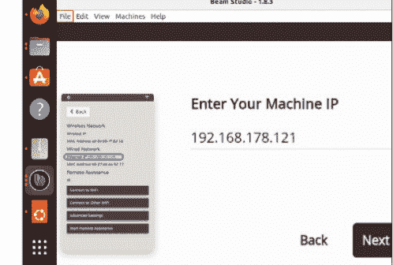

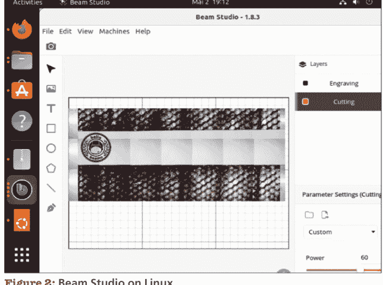

要安装 Beam Studio（图 2），请访问 FLUX 网站 [2] 并选择与您的操作系统匹配的版本。如果您使用的是较新的 Ubuntu 系统，这将是 v.1.8.3 -Ubuntu-18.04 x64。安装文件的名称是 beam-studio_1_8_3_amd64.deb，您可以使用 Ubuntu 包管理器进行安装。

右键点击下载的文件，然后选择“使用其他应用打开”，再选择“软件安装”。安装程序会提示您输入密码，然后开始安装 Beam Studio。如果您直接从 FLUX 获取了 DEB 包，可以忽略关于软件可能不安全的警告。

Beam Studio 要求您设置一个帐户，然后提示您选择如何连接到激光切割机（图 3）。您也可以可选地选择校准摄像头（图 4）。

**测试任务**

FLUX 贴心地提供了一块小木刨板和一个测试任务，帮助您入门。这是检查激光是否对齐良好的好方法。如果没有，请参阅“烟雾与镜子”框。


将木刨板放在网格上，并按照程序设置激光的焦点——要么折叠亚克力板进行手动对焦，要么使用可选的自动对焦功能。现在点击摄像头图标，在您放置木刨板的区域周围拖出一个框架。这告诉激光切割机打开摄像头并扫描木材的确切位置。然后选择 文件 | 示例，并加载名为 Example of Beamo 的文件。从图 2 可以看到，该文件由两层组成，一层是带有 hello beamo 标志的位图图像，另一层是一个用于雕刻切割的简单环形。这是一个重要功能。图层允许您在适合的材料（如木材或亚克力）上雕刻位图图像，并在一个图层上完成，而切割工作则分配给具有不同参数的另一个图层，处理简单的矢量图像。

将两个图像分组并将其居中于木刨板上。FLUX 选择的默认参数设置对于使用提供的木刨板进行此任务来说是完美的。按 Go，然后在出现的 Beamo 窗口中，按箭头按钮开始任务。如果这一切都成功，您已步入使用 FLUX 激光进行创造性工作的正轨。旅程的下一部分涉及在纸上创建自己的设计，并扫描结果，使用能够处理矢量和位图图像的软件工具进行后期处理。在 Linux 世界及更广泛的领域，首选工具可能是 Inkscape。

#### 烟雾与镜子

您可能已经知道，激光切割机是精密仪器。您可能尚未意识到的是，激光束是通过镜子偏转到激光头部的。激光包装在运往新主人途中受到的任何撞击都可能导致一些对准问题。您可能运气好，不需要调整机器上的镜子，也可能需要。我们没那么幸运，不得不调整第一个反射镜（图 5），这需要拆卸大量内六角螺钉才能开始对准。听起来很复杂，但如果我们能做到，我们相信您也可以。以下是您需要做的：

1. **第一面镜子：** 在激光关闭的情况下，在第一面镜子上贴上一小块白色胶带（这就是为什么它包含在供货范围中）。盖上激光机的盖子并打开电源。在触控面板上，轻触“维护”。在维护屏幕上，轻触“电机”。然后手动将激光头移动到左上位置。现在按“激光脉冲”向胶带发射一枪（您应该看到一缕烟），并确保您能看到一个点。现在，手动将激光头移动到左下位置。确保盖子关闭并向胶带再发射一枪。如果来自激光头的点对齐，您可以进入下一面镜子。如果它们没有对齐，调整第一面镜子上的螺钉并重复步骤，直到镜子对齐。如果第二枪完全错过胶带，将头部移至中左位置以检查您需要调整的方向。顺时针旋转左上螺钉会将点向下和向左移动。顺时针旋转右上螺钉会将点向右移动，移动底部螺钉会将点向上移动。简单。全部完成。现在轮到第二面镜子了。
2. **第二面镜子：** 这次将一块胶带贴到第三面镜子的金属环上。将激光头移动到中左位置。再次盖上盖子并发射一枪。然后将激光头移动到中右位置并再发射一枪。点需要重叠。如果不行，调整第二面镜子上的螺钉，直到所有点对齐。这次螺钉位于不同位置并起不同作用。如果您非常不幸，可能还需要调整激光头、激光管和第三个反射镜。我们不会在这里详细介绍这些操作步骤，但再次强调，这一切都是“烟雾与镜子”。如果确实需要这些调整，您可能需要在此时查阅 RTFM（自然意味着阅读 FLUX 手册）。但希望您运气好，可以直接进入第一个实际的激光雕刻和切割任务。

### Inkscape

在 Ubuntu 上安装 Inkscape 轻而易举。如果这款惊人的免费程序

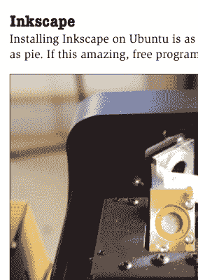

尚未安装，只需启动 Ubuntu 软件中心，并在搜索框中输入 Inkscape。然后在提示时输入密码，等待 Inkscape 安装。现在是时候发挥创造力了：Christa 有一个关于圣诞装饰的想法，展示了三位智者、一颗星星和一只骆驼。作为那些幸运的人之一，她能在脑海中想象场景并在纸上画出来，无需照片或草图作为参考，她只是坐了下来


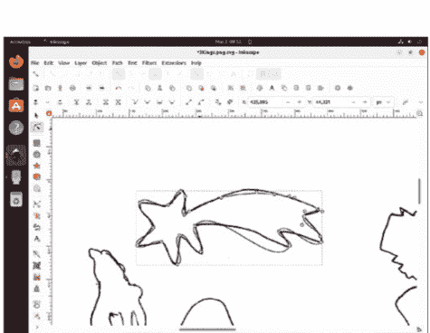

图 7：在 Inkscape 中对原画进行描摹。

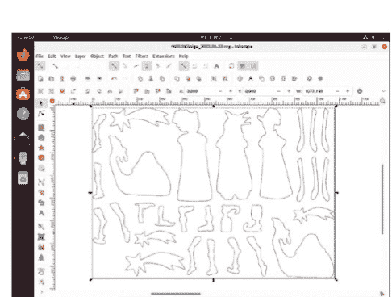

图 8：对原画进行描摹后，它根本无法适应激光切割机 SVG 文件中的 DIN A4 尺寸空间。

向下并绘制了你在图 6 中看到的图像。

如果你仔细观察这张图，你可能会疑惑智者（Three Kings）的手臂和腿去哪里了。

这里的想法是，如果你想保持某些部分的对称性，你只需绘制一次并扫描。接下来，你在 Inkscape 中加载扫描件，描摹绘图以创建矢量图，然后复制并粘贴该对象。正如你可以从 Christa 的笔记中看到的那样，尽管国王们的躯干每人只需要一个，但我们需要六条手臂和两条每种型号的腿。如果你不擅长绘画，别担心，网上有很多可免费使用的草图供你下载，并可以按照与我们将要遵循的类似步骤进行处理。

关于将位图（如 PNG 文件）转换为激光切割所用的矢量格式（Inkscape 中的 SVG）有两种观点。一种方法是选择“路径 | 描摹位图”并让算法遵循原画的轮廓。另一种是将原画作为模板，自己手动进行描摹工作。虽然自动描摹似乎更简单，但它很可能会给你一个拥有大量节点的非常复杂的矢量图。尽管选择“路径 | 简化”以减少节点数量，但后处理可能需要比手动方法更长的时间。简化的结果并不总是你所期望的，并且可能会出现一些伪影。但这需要你亲自尝试，而决定将始终由描摹结果驱动。

如果你决定尝试手动描摹（图 7），步骤如下：首先，在 Inkscape 窗口左侧的工具栏中选择“绘制贝塞尔曲线和直线”工具。

点击一个起始点，并拖动一条线到你要描摹的对象的下一个点。再次点击，再次拖动，并不断重复，直到你描摹完整个对象。完成后，你肯定需要选择“通过节点编辑路径”，并通过点击节点和拖动 Inkscape 显示的手柄来整理曲线和直线。一旦你拥有该对象的矢量副本，你可以删除原始手绘对象，但务必保留一个备份副本，以防你删除了错误的对象——这种情况很容易发生。

在对一条手臂进行描摹后，我们选择该对象，右键点击，选择“复制”，然后点击我们要放置副本的新位置。接下来只需要不断粘贴，直到我们拥有正确数量的对象为止。这假设木材没有“好”的一面和“坏”的一面，并且你可以使用镜像对称的毛坯。当然，我们不得不对腿组再次进行此操作。

在转换原画后的第一次尝试中，在确保我们拥有正确数量的手臂和腿后，我们空间不足了。如果你看图 8，你会发现与其他图像相比，骆驼太小了，而且国王的手臂看起来有点细弱。由于 FLUX Beamo 的激光切割空间大约是一张 A4 纸的大小，我们最终别无选择，只能将绘图拆分到两张 A4 胶合板上。这给我们提供了更大的国王、更大的骆驼以及更坚固的手臂，这些手臂在组装和装饰过程中不太容易断裂。图 9 展示了其中一幅图像，包含骆驼和各种（国王的和非国王的）腿部。

下一步操作对于使用 FLUX Beamo 标志的测试任务来说应该是熟悉的。在激光工作区的网格上放一张胶合板。检查激光头的设置——只有当本次任务使用的木材类型与测试任务不同时，你才需要这样做。点击“相机”图标并在整个工作区拖动，以查明木材的位置。请注意，工作区顶部有一个盲区，相机看不到，但激光头仍可达到。将 SVG 矢量图居中于激光工作区，确保其整齐地适应在木板上。然后检查你的激光功率、速度和对数设置。我们发现杨木胶合板最容易切割，只需一次对数，而比重的桦木需要两次对数。如果你切割的图像在激光围绕其切割完所有部分后从板上掉落，那就说明设置是正确的。如果这种情况没有发生，不要惊慌，只需重新发射任务增加一次对数，但不要移动或更改任何内容（我们不想浪费那些昂贵的木材）。在安全方面，总是很想观看激光工作，但直视激光束的明亮光点对你的眼睛不好。

#### 制作拼图

快速看一下图 10，你会看到激光完成工作后的样子。它很漂亮，但这并不是你想要送给朋友或出售给客户以完成其制作的东西。事实上，这是此构建中第二创意部分开始的地方。但首先，有一些小小的准备工作要完成。由于这是一个悬挂


图 10：激光切割后大量毛坯。拼图时间！

装饰品，细线是连接各部件的好方法。穿线的孔需要在开始装饰之前钻出，并且使用钢丝球清理部件边缘以去除较暗的激光烧灼痕迹是个好主意。再次说明，Christa 在颜色和装饰方面有着敏锐的眼光。她确切地知道她希望她的三位国王（Three Kings）看起来像什么（图 11）。你需要用于艺术作品的丙烯酸颜料，这真的取决于你自己的风格和对美学的理解。你需要考虑的一点是，如果你不涂抹两边，薄胶合板上的木制装饰品会变形。如果装饰品悬挂时背面不可见，你可以将背面涂成黑色，或者全力以赴，制作逼真的正面和背面以获得更具吸引力的效果。图 12 展示了一个完全装饰和组装好的图像，随时可以参加下一个手工艺展或作为独特的礼物。

### 激光的更多应用

使用 FLUX Beamo，你的创造力几乎没有限制。其他二维项目包括激光雕刻


**图 12：** 创意工作第二部分：组装并装饰的激光切割部件。

橡胶印章并使用它们创作版画艺术作品，或在胶合板、亚克力、石头、骨头或玻璃上雕刻照片。你甚至可以激光雕刻创意图案或文字在你的牛仔裤上以表达时尚态度，或者切割纸板制作有创意的弹出式贺卡。FLUX 甚至提供了用于雕刻圆柱形物体的扩展套件，例如，如果你想用个性化的香槟杯给朋友惊喜，它可以雕刻直径最大为 80mm 的玻璃。

开源工具可用于所涉及的任务。当然，仅靠机器是无法指望取代创造原始且吸引人的作品所需的那种艺术才能，这些作品是客户想要购买的。

##### 结论

正如本次操作指南所演示的，你不需要抢劫银行来拥有一台可靠的激光切割机。得益于 Beam Studio 能够在 Linux 操作系统上运行以及出色的开源工具的存在，你无需担心厂商锁定。

#### 信息

- [1] FLUX 树莓派板 B10001：https://www.fluxlasers.com/raspberry-pi-board-b100001.html
- [2] Beam Studio 下载：https://flux3dp.com/downloads/

### 作者

**Christa Travis** 是一位数学家和自由肖像艺术家。**Ian Travis** 拥有一家电脑业务公司，并负责 **Linux 杂志** 和 **Admin 杂志** 的翻译和本地化。当他不坐在某台电脑键盘前时，他会在当地乐队演奏键盘。

### 商店采购

shop.linuxnewmedia.com

### 发掘过去，投资于 Linux New Media 在线商店新一年的 IT 解决方案。

- 想要订阅吗？
- 寻找你真心希望当初在报刊亭买下的那本旧刊吗？

▶ shop.linuxnewmedia.com

### 数字版与印刷版订阅

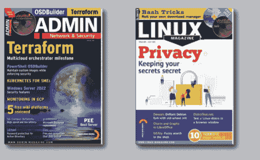

### 特刊

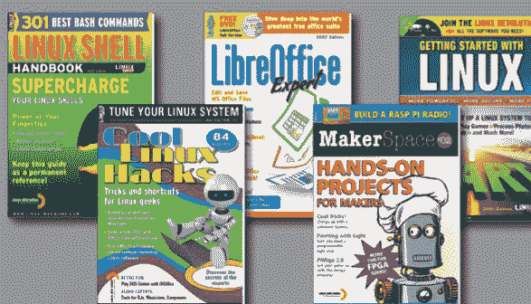


#### 创客空间
##### 温馨的家园
Home Assistant 通过 MQTT 控制微控制器

实现居家自动化并不一定需要商用解决方案。只要具备一定的技术技能，你只需少量预算即可开发自己的项目。*作者：Gerhard Schauer*

家庭自动化提供了许多可能性，但也伴随着诸多风险。如果你能成功摆脱对商业产品的依赖，不仅能节省开支，还能完全掌控数据流向。在这种情况下，消息队列遥测传输（Message Queuing Telemetry Transport, MQTT）协议显得非常有用。

之前一篇关于 Z-Wave [1] 的文章展示了如何利用 Home Assistant 和市场上现有的组件，快速将 Raspberry Pi 接入自动化环境，从而在不需人工干预的情况下实现家居自动化。Home Assistant 可以管理大量组件，甚至无需依赖云端。唯一的限制在于你的预算和想象力。

本文作为续篇，将讲解如何同时降低组件的成本和 DIY 难度。从 Raspberry Pi 3 代开始，其内置的无线接口在许多微控制器模块中同样常见，这有望打开更多应用之门。将这一切与上一篇文章中介绍的 Home Assistant 环境连接起来的“胶水”，是一种支持 IP 的协议，它早在物联网（IoT）热潮兴起之前就已经问世，即：MQTT。

MQTT 协议于 1999 年推出，是一种基于文本、运行在任何 IP 网络 TCP 之上的协议。可选使用传输层安全（TLS）进行加密。传感器和执行器作为客户端与消息代理（broker）通信，而消息代理充当通信枢纽。寻址依赖于所谓的“主题”（topics）。发送方被称为发布者（publishers），接收方被称为订阅者（subscribers）。

##### 测试 MQTT

要在 Raspberry Pi 上实现该协议，首先需要安装 *mosquitto* 包。对于下文的小型实现测试，你还需要对应的客户端。可以使用以下命令在 Raspberry Pi 上安装这两个组件：

```
$ sudo apt-get install mosquitto
$ sudo apt-get install mosquitto-clients
```

如果安装完成后代理正在运行，你可以使用客户端登录各个主题，并通过指定代理运行所在主机（在 `-h` 选项中）的命令行调用获取主题列表：

```
$ mosquitto_sub -h localhost -t "#"
```

在此例中，主机是 localhost。例如，若要向名为 test/test1 的主题发送值 *10* 并作为订阅者接收该值，可以使用以下命令：

```
$ mosquitto_pub -v -h 192.168.3.7 -t test/test1 -m 10
$ mosquitto_sub -h 192.168.3.7 -t test/test1
```

为了更实际的示例，我将使用 MQTT 将连接到 Raspberry Pi 的 DS18x20 单总线温度传感器的测量值传输到监听在另一台 Raspberry Pi 上的代理。为此，你需要提前在 `/boot/config.txt` 文件中启用单总线支持：

```
dtoverlay=w1-gpio
```

将传感器连接到标准单总线 GPIO 端口后，可以在 `/sys/bus/w1/devices/28-0417c1b1ff/w1_slave` 中以四位整数形式查询温度值。数值 28-0417c1b1f7ff 是传感器在总线上的唯一 ID。完整的命令序列如下：

```
$ mosquitto_pub -h 192.168.3.7 -t wohn/temp/28-0417c1b1f7ff -m $value
$ mosquitto_sub -h localhost -t wohn/temp/28-0417c1b1f7ff
```

要将这些值传输到 Home Assistant 环境，需要在 configuration.yaml 文件中输入你使用的代理（在此例中，它运行在同一主机上（清单 1，第 1-2 行））。接下来几行的条目负责订阅相应主题并在 Home Assistant 中处理传感器数据；最后一行还指定摄氏度为单位。


##### ESP8266 控制器

理论部分已经覆盖，但为每个远程执行器或传感器使用单独的 Raspberry Pi 在实践上似乎有点不现实。ESP8266 控制器在此处将派上用场。一方面，你可以找到价格低廉且实用的使用该控制器的开发板；另一方面，该芯片被远东地区的许多产品采用，你只需刷入免费可用的固件即可掌控其中许多设备。

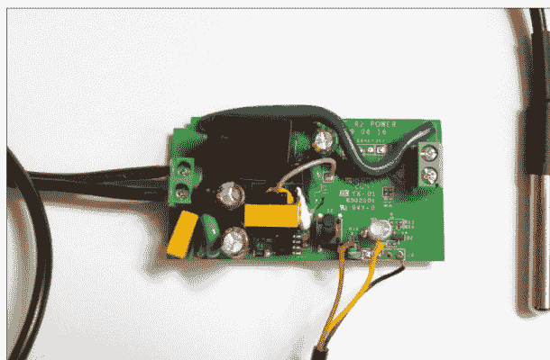

图 1：带有温度传感器的 Sonoff Basic WiFi 智能开关。

在此测试中，我使用了一款 Sonoff Basic WiFi 智能开关 [2]（图 1）。这款可控制的继电器开关具有 220V 市电的螺丝接线端子，并带有可切换的输出。

*注意：如果未正确使用该硬件，存在生命危险。在本文中，我将模块的供电电压限制在 3.3V。*

固件为 Tasmota。该软件允许你在控制器现有的 GPIO 端口上配置各种受支持的传感器和组件，例如我之前提到的温度传感器。Tasmota 使用 MQTT 传输传感器数据。

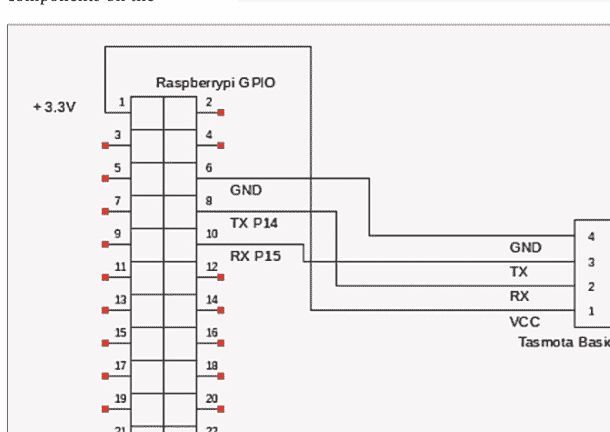

图 2：将 Sonoff Basic 连接至 Raspberry Pi 的接线方式。

所需的接线如图 1 和图 2 所示。PiOS 仓库中的 esptool.py 工具提供了软件支持。

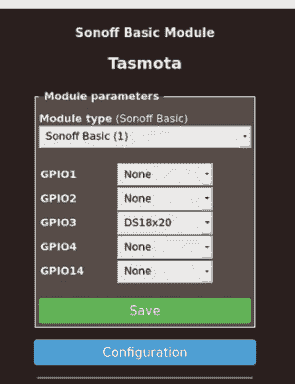

Tasmota 固件以及大量信息可在项目的 GitHub 仓库 [4] 中找到。由于我想集成温度传感器，因此下载了传感器版本进行测试：

```
$ wget -c https://ota.tasmota.com/tasmota/release-9.4.0/tasmota-sensors.bin
```

你还需要为 Web GUI 分配密码并启用 MQTT（图 4），这将用于向 Home Assistant 传输数据。

代理和主题在 Web 界面的相应条目中配置，在那里你还可以找到 Tasmota 控制台，它允许你直接发出命令并设置参数化。

按照图示连接模块后，需要在通电时按住 Sonoff 模块上的按钮；此时 LED 不会亮起。接下来，使用命令

##### 刷写 Tasmota

```
$ esptool --port /dev/ttyAMA0 chip_id
```

检查是否可以使用该 Sonoff。必须显示一个 ID。

刷写 Tasmota 的几种方法中，一种流行的做法是使用 USB 串口适配器。相关说明可在项目的入门页 [3] 上找到。由于 Raspberry Pi 自带串口接口，我将直接通过 GPIO 进行刷写。

```
$ esptool --port /dev/ttyAMA0 write_flash -fm dout 0x0 tasmota-sensors.bin
```

最后，使用以下命令刷写 Tasmota：

此操作大约需要一分钟。模块重启后，它会作为新的 WiFi 接入点报告就位，你可以通过 `http://192.168.4.1` 访问它，并在其中配置要使用的 WiFi 网络。之后所有的设置步骤都将通过你自己的 WiFi 网络分配的 IP 地址进行。

在进行下一步之前，你首先需要将温度传感器连接到用于刷写的其中一个 GPIO（RX/TX），现在该端口已空闲。你可以使用上拉电阻以及 3.3V 和 GND 连接 [5] 来完成接线。布线完成后，即可配置传感器；其名称可能已经出现在 GUI 中（图 3）。

最迟在此时，我建议仔细阅读 Tasmota GitHub 仓库中优秀的文档。在此项目中，我使用了一条命令，让 Tasmota 通告所有可用主题（Setoption19 on），这使得后续通过自动发现集成到 Home Assistant 变得非常容易。最终，Tasmota 在 GUI 中显示为一个带温度传感器的 Web 开关（图 5）。你还可以查看

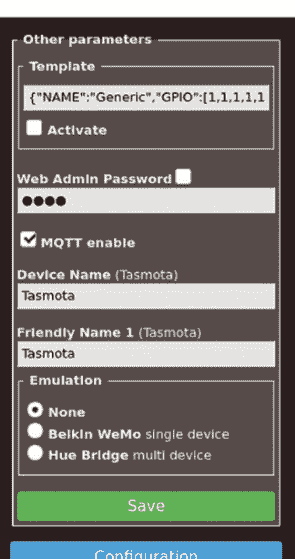

图 3：便捷的 Web GUI 帮助你设置温度传感器。

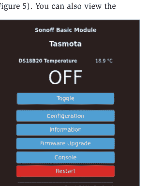

图 4：只需几个参数即可准备 Tasmota 向 Home Assistant 传输数据。

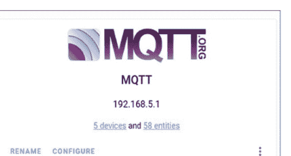

图 5：几乎与商用产品无异：Tasmota 基于 Web 的用户界面。

##### 配置 Tasmota

图 6：只需几个简单步骤即可将 MQTT 协议集成到 Home Assistant。

清单 1: configuration.yaml
```yaml
01 mqtt:
02   broker: localhost
03
04 sensor:
05   - platform: mqtt
06     name: templ
07     state_topic: "/living/temp/28-0417c1b1f7ff"
08     unit_of_measurement: '°C'
```


如有需要，请在控制台中发布 MQTT。

#### 集成

为了使组件在 Home Assistant 中可用，现在你需要在 GUI 中设置 MQTT 集成。为此，你只需要所使用的代理的 IP 地址和端口；默认情况下，此设置为 1883。设置完成后，新的 MQTT 设备应该会显示出来（图 6）。点击*实体* URL 后，开关和温度传感器都显示为可用的 Home Assistant 实体，你现在可以以通常的方式使用它们（图 7）。结合 Sonoff 模块中的继电器，Home Assistant 熟悉的自动化功能现在可用于实现，例如，一个简单的恒温器控制。

##### 结论

与 Home Assistant 自动发现 MQTT 集成相关的 Tasmota 选项，使这个 DIY 解决方案像前文中描述的商业替代品一样方便。自酿方案（Homebrewing）被证明是值得的——而且也非常有趣。

### 作者

Gerhard Schauer 是一名居住在南德意志州的自营电子工程师。他撰写创客文章，因为通过实践学习并掌控技术是“正确”的方式。

#### 信息

- [1] Gerhard Schauer 撰写的“Z-Wave Home Assistant”，载于*Linux Magazine*，第 248 期，2021 年 7 月，第 56 页，https://www.linuxpromagazine.com/issues/2021/248/Z-Wave-Home-Assistant
- [2] Sonoff Basic R2 电源：https://basic.r2.github.io/docs/devices/Sonoff-Basic/#sonoff-basic-r2
- [3] 入门指南：https://tasmota.github.io/docs/Getting-Started/
- [4] Tasmota 存储库：https://tasmota.github.io
- [5] Tasmota 接线：https://tasmota.github.io/docs/DS18x20/

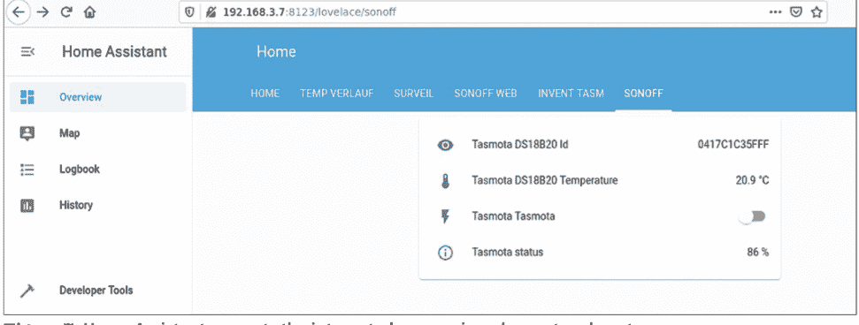

图 7：Home Assistant 以清晰整齐的方式展示集成的传感器。


#### 通过特别版磨练你的技能！

通过我们的特别版库了解 Shell、LibreOffice、Linux 等更多内容。

Linux Magazine 团队创建了一系列单行本，让你深入了解你想要的主题。

提供印刷版或数字版

#### 查看完整库！

shop.linuxnewmedia.com


一些最好的文章不仅教导关于工具的知识 – 它们还教导关于工具背后的原因。当你阅读这类文章时，你不仅仅是在学习 Linux：你正在学习地球上生活某个其他为阅读体验带来价值的方面。本月，我们介绍了一篇这样的文章。你将了解手稿编辑器和小说写作工具，但你还将了解雪花写作法，这是一种大纲技术，可以消除创作长篇小说的畏惧感。既然我们都在谈论以原创方式创造事物，何不尝试使用 Go 编程语言构建幻灯片演示？继续阅读，探索“代码即演示”（Presentation as Code）的研究。


#### LINUXVOICE

- **Doghouse – Chess** 78
  - Jon "maddog" Hall
  - Maddog 将国际象棋历史作为隐喻，以发展桌面 Linux 用户群。
- **Present Slide Creator** 79
  - Ankur Kumar
  - Golang 包 present 可能是以更少的工作和麻烦制作吸引人幻灯片演示的关键。
- **FOSSPicks** 84
  - Graham Morrison
  - 本月 Graham 查看了 Lorian、FreeCAD 0.20、CLAP Gophie、GameShell、Jellyfin、Vita3K 等等！
- **Tutorial – Manuscript** 90
  - Marco Fiorenti
  - Manuscript 编辑器是你快速启动下一个写作项目所需的一切。


#### MADDOG'S DOGHOUSE


Jon “maddog” Hall 是一名作家、教育家、计算机科学家和自由软件先驱，自 1994 年第一次见到 Linus Torvalds 并促成将 Linux 移植到 64 位系统以来，一直热情支持 Linux。他担任 Linux International® 的主席。

Maddog 将国际象棋历史作为隐喻，以发展桌面 Linux 用户群。

**作者 JON “MADDOG” HALL**

#### 增长 Linux 桌面

关于国际象棋及其发明有一个故事。在发明之后，该国统治者非常高兴，他提供了发明者一份奖励以感谢他们的努力。发明者请求在第一个方格放一粒米，第二个方格放两粒米，第三个方格放四粒米，以此类推。统治者随口说道：“照做吧。” 问题是，整个王国的米都不够。

今天，我们可能会将其视为“2 的 64 次方”，一个如此之大以至于几乎难以想象的数字。即使 2 的 32 次方也超过四十亿，如果你从一个大于 2 的数字开始，它会变得非常大且非常快。当我要求 Linus Torvalds 将 Linux 从 32 位 Intel 平台移植到 64 位 DEC Alpha 时，我正是想到了这个概念。

今天，我想将这个概念应用到另一个主题上，即桌面 Linux，这是 Linux 没有达到应有渗透率的少数领域之一。很少有人会说 Linux 没有渗透高性能计算市场、服务器市场、嵌入式系统领域和手机领域（作为 Android），但我们一直在桌面空间受阻，以至于“桌面 Linux 之年”至少在过去二十年中一直是一个老生常谈的笑话。

在 Linux 早期，有一些合理的桌面问题。Linux 被指出安装困难，而 Microsoft Windows 是“容易”的。人们忽略了一个事实，即人们通常购买的所有笔记本电脑和台式机都已经预装了某种版本的 Microsoft Windows，因为这就是分销商和零售商销售的方式。

很少有用户安装 Microsoft Windows，他们只是从系统中已创建的备份镜像重新安装它。定期，人们会安装新设备，但这些设备会带有由设备制造商为各种版本的 Microsoft Windows 创建的二进制设备驱动程序。

如今，安装主流 Linux 发行版的问题很少。随着 GPU 制造商最近宣布重组其驱动程序以包含更多开源代码，并将该开源代码与内核集成，这些问题可能会更少。

其他抱怨是缺乏应用程序，这随着时间的推移通过移植更多应用程序以及使用虚拟化、模拟和仿真得到解决。除此之外，这是一个 22 困境问题：如果有更多的人在桌面使用 Linux，更多的应用程序供应商将支持 Linux。

缺乏游戏是另一个著名问题，随着更多游戏的移植、Steam 为游戏创建 Linux 平台以及游戏控制台变得越来越便宜并成为许多游戏玩家使用的平台，该问题已经失去势头。此外，具有更大的行业存在也会增加游戏的原生移植。

Linux 没有更多桌面存在感的真实问题之一是简单的营销和销售。FOSS 公司可以产生的广告数量、产品放置和其他营销活动与 Microsoft 可以进行的营销相比微不足道。

当我在数字设备公司（DEC）工作时，软件行业有一条经验法则说，软件零售价格的 36% 用于销售和市场。换句话说，人们支付的钱中超过三分之一与工程甚至制造分发介质无关。如今，随着软件要么预装要么下载以进行安装，投入的销售和市场可能占成本的 50% 以上，并且（如在捆绑软件的情况下）第三方软件（读者称之为“垃圾软件”）的销售和市场实际上可能为原始设备制造商（OEM）带来收入。

FOSS 软件很难在桌面上与该营销模式竞争。

然而，FOSS 可以使用国际象棋盘模型进行营销。现有的 Linux 用户中的每一个都可以花一些时间与两名 Windows 用户一起，帮助他们在其桌面上安装 Linux。帮助他们找到关于 Linux 的入门书籍，帮助他们找到所需的应用程序，帮助他们找到在线帮助小组并真正让他们入门，下次我们就会有三倍的 Linux 桌面用户数量。

如果这些 Windows 用户是教师、市议会成员、政府官员、商务人士等，那就更好了。那么明年，其中每一个都会再找到两名 Windows 用户。这听起来可能太少且太晚，但我们是从数百万开始的。大约有二十亿桌面用户。估计其中百分之三是 Linux 用户（我使用了非常保守的数字），即 6000 万 Linux 桌面用户。

我认为现在是下棋的时候了。


#### 使用 present 构建幻灯片演示
##### 代码即演示

**Go 语言包 `present` 或许是制作精美幻灯片演示的关键，它能让你以更少的工作量和麻烦事完成这一任务。** 作者：安库尔·库马尔 (ANKUR KUMAR)

制作幻灯片演示长期以来一直是技术生活的必要组成部分，但使用流行的传统工具制作简洁美观的幻灯片需要大量的繁琐工作。我一直对 Go 社区演讲中那些优雅的演示印象很深，但当时并没有明确的资料说明那些精美的演示是如何渲染出来的。在研究过程中，我偶然发现了一个名为 `present` [1] 的 Go 包（不出所料，它就叫 present），它可以标记文本描述来渲染惊艳的演示幻灯片。多年来，`present` 一直是我创建和交付令人印象深刻的演示的首选工具。

要创建一个可以启动 `present` 的 Docker 镜像，请使用以下命令：

```bash
docker build . -t present
```

你还可以通过执行以下命令启动 `present` 容器，从绑定挂载的目录（例如，你当前目录中的文件）提供你的幻灯片：

```bash
docker run -d --rm -v $(PWD)/files:/src/files:ro -p 58888:8888 present
```

现在打开你的 web 浏览器并访问 `localhost:58888`，以确保一切正常运行以便交付你的演示。图 1 显示了我的浏览器通过本地端点访问 *present* 容器。不要被它没有显示演示而感到困惑——我接下来将创建演示。

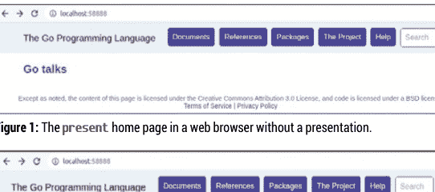


##### 入门

开始使用 `present` 工具时，不需要单独的安装步骤。它只是一个静态链接的二进制文件，即取即用；你不需要设置任何其他运行时依赖项。如果你想本地运行 `present` 命令，你需要在机器上已经设置好 Go 编译工具链。或者，如果你的机器上安装了 Docker Engine（这在当今非常常见），你可以开箱即用地运行 `present`。我个人选择通过 Docker 路径来使用 `present`，无需做任何额外的工作。你可以使用 Dockerfile（列表 1）和脚本（列表 2）来获取并运行 `present`，在你的本地机器上显示你的幻灯片。

###### 列表 1: Dockerfile

```bash
01 FROM golang:alpine
02
03 RUN apk add --no-cache git \
04     && go get golang.org/x/tools/cmd/present
05
06 COPY run.sh /usr/local/bin/
07
08 ENTRYPOINT ["run.sh"]
09 CMD ["-notes"]
```

###### 列表 2: run.sh

```bash
01 #! /bin/sh
02
03 PORT=${PORT_PRESENT:-8888}
04
05 exec present -http "0.0.0.0:${PORT}" -content /src/files "$@"
```

##### 幻灯片基础

现在是时候亲手使用 *present* 的幻灯片描述语言了。制作幻灯片的推荐方式是使用 CommonMark 标记语言 [2]。（你也可以使用旧语法 [1] 来描述你的幻灯片，但这里不讨论这一点。）首先，在绑定挂载的 */files* 目录中创建一个名为 *mytest\_s1.md* 的文件（列表 3）。

现在刷新你的 *present* 端点的浏览器页面，新创建的幻灯片文件链接应该会显示出来（图 2）。

如果你现在点击 *mytest\_slide*，你会看到一个优雅的三页演示（第一页和最后一页分别显示在图 3 和图 4 中）。恭喜，你创建了一个演示——没有拖放带来的挫败感，也没有幻灯片创建工具中不可能的格式化问题。你可以使用左箭头和右箭头键在幻灯片之间移动，也可以使用 Ctrl+P 打印对话框创建 PDF。

幻灯片描述以一个标题块开始，演示主题前缀为 *#* 和一个空格。可选地，你可以在 *#* 后面放置其他元数据，例如副标题、日期、标签、摘要和旧 URL 行。可选的作者块跟在标题部分之后，它们之间至少有一个空格。作者块可以包含你的姓名、职位、电子邮件、URL、推特账号等。*present* 自动渲染带有作者块的最后一张幻灯片（图 4）。它只将不是电子邮件、URL 或推特账号的作者信息放在第一张幻灯片上（图 3）。你可以有多个作者块，每个块之间至少用一个空格分隔。任何以 *//* 开头的行都被视为注释。

演示幻灯片部分跟在作者块之后。一个幻灯片部分以 *###* 开头，后跟至少一个空格。每个幻灯片也可以有一个小节，以 *####* 开头，后跟至少一个空格。幻灯片的内容由 CommonMark 管理以格式化文本。

+ 列表 3: mytest.slide

```markdown
01 # My Test Presentation
02
03 Free Libre Open Source Software Hacker
04 A FLOSS Hacker, FLOSS Universe
05 flosshacker@flossuniverse.com
06 https://url/
07 @flosshacker
08
09 ## TBD
```


要为幻灯片添加更多内容，请使用列表 4 中的代码更新你的 `mytest.slide` 文件，并刷新渲染演示的浏览器页面。

现在你应该看到通用的标记功能（粗体/斜体文本、列表、引用块、链接、图片、水平线、行内代码等）在你的幻灯片上实现（图 5）。要了解有关这些标记功能的更多信息，请参阅 CommonMark 文档 [2]。

以冒号开头的行被视为主讲人备注。在显示你演示的浏览器中按 N 键会打开一个单独的弹出窗口显示备注（图 6）。

##### 更丰富的幻灯片

如果你希望在幻灯片中包含超过文本、超链接和标志的内容，你可以使用 `present` 描述语言功能来渲染引人注目的幻灯片。为此，`present` 提供了许多特殊的

###### 列表 4: mytest.slide 基本内容

```markdown
01  # My Test Presentation
02
03  Free Libre Open Source Software Hacker
04  A FLOSS Hacker, FLOSS Universe
05  flosshacker@flossuniverse.com
06  https://url/
07  @flosshacker
08
09  ## Free Libre Open Source Software
10  What is [FLOSS](https://en.wikipedia.org/wiki/Free_and_open-source_software)?
11  - anyone is freely licensed to use, copy, study, and
    change the software in any way
12  - the source code is openly shared so that people are
    encouraged to voluntarily improve the design of the
    software
13  - Free as in **freedom**, not _free beer_
14
15  ---
16  > PSF prefers dangerous freedom over peaceful slavery
17
18  ![PSF][1]
19
20  [1]: http://upload.wikimedia.org/wikipedia/commons/thumb/4/4a/Free_Software_Foundation_logo_and_wordmark.svg/260px-Free_Software_Foundation_logo_and_wordmark.svg.png
21
22  type this command in your terminal:
23  ```
24  python -c 'import this'
25  ```
26
27  : intro slide
```

###### 列表 5: mytest.slide 图像和源代码内容

```markdown
01  # My Test Presentation
02
03  Free Libre Open Source Software Hacker
04  A FLOSS Hacker, FLOSS Universe
05  flosshacker@flossuniverse.com
06  https://url/
07  @flosshacker
08
09  ## Free Libre Open Source Software
10  What is [FLOSS](https://en.wikipedia.org/wiki/Free_and_open-source_software)?
11  - anyone is freely licensed to use, copy, study, and
    change the software in any way
12  - the source code is openly shared so that people are
    encouraged to voluntarily improve the design of the
    software
13  - Free as in **freedom**, not _free beer_
14
15  ---
16  > PSF prefers dangerous freedom over peaceful slavery
17
18  ![PSF][1]
19
20  [1]: https://upload.wikimedia.org/wikipedia/commons/thumb/4/4a/Free_Software_Foundation_logo_and_wordmark.svg/260px-Free_Software_Foundation_logo_and_wordmark.svg.png
21
22  type this command in your terminal:
23  ```
24  python -c 'import this'
25  ```
26
27  : intro slide
28
29  ## More FLOSS
30  ---
31
32  .background matrix.jpg
33
34  .image logoofgorg.png 50 _
35  .caption PSF Logo
36
37  .code -edit -numbers hellofloss.c
38
39  .play hellofloss.go
```


使用调用（invocation）执行的命令。任何以点号开头的行都是调用。这些命令包括添加图像、设置背景、显示/编辑/运行代码、创建超链接、注入视频、包含图表标题等。例如，使用列表 5 中的代码再次更新你的 `mytest.slide` 文件内容，将必要的图像和源码放入演示目录中，并刷新渲染演示的浏览器页面。图 7 展示了使用各种调用渲染的幻灯片。

`.image` 调用可选地接受高度和宽度参数。如果其中任一参数指定为下划线，则缩放时保持图像的宽高比。`.background` 调用除图像外不接受任何参数。如果你的图像不够大，背景命令将用所述图像的重复图案填充幻灯片。

`.code` 和 `.play` 调用都可以从各自的源码中去除不必要的代码，仅显示所需部分的代码。`-edit` 命令允许你在演示期间对显示的代码进行修改。`.play` 命令显示代码并附带一个“运行”按钮，可从浏览器运行 Go 程序。

现在你已具备足够的知识，可以使用 present 描述语言渲染丰富的演示文稿。你可以在包文档 [1] 中探索 present 描述语言的完整细节。更多示例幻灯片和脚本请参见我的 GitHub 仓库 [3]。

##### 结论

present 包是你日常工具箱的一个出色补充，能够以最小的努力渲染出看起来精致的高级演示文稿。这一工具与现代 As-a-Code 和 GitOps 工作流程天然契合，可以无需额外努力地自动生成演示文稿。在基础设施即代码（IAC）和容器的时代，创建惊艳的演示文稿从未如此简单和自动化。 ▪▪▪

#### 信息

- 1. present: <https://pkg.go.dev/golang.org/x/tools/present>
- 2. CommonMark: <https://commonmark.org/help/>
- 3. Docker 脚本和示例幻灯片: <https://github.com/richnusgeeks/devops/tree/master/PresentationAsCode>

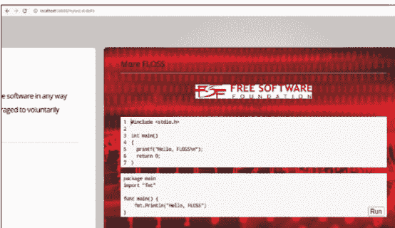

**图 7：** 使用调用渲染的幻灯片。

> 作者简介
> **Ankur Kumar** 是一位热情的自由开源软件（FOSS）黑客、研究人员，也是神秘生活知识的追寻者。他探索尖端技术、古代科学、量子灵性、各种流派的音乐、神秘文学和艺术。你可以在 (<https://www.linkedin.com/in/richnusgeeks>) 上与 Ankur 联系，并访问他的 GitHub 站点 (<https://github.com/richnusgeeks>) 查看其他有用的 FOSS 资源。

### 让你的想法变为现实！

这不是你普通的电脑杂志！*MakerSpace* 专注于你可以用来自己动手制作事物的技术。

如果你对电子感兴趣，但还没有时间或技能（尚未具备），研究这些创客项目或许会是你起步的最后推动力。

这期特刊将帮助你深入了解：

- 树莓派（Raspberry Pi）
- Arduino
- 复古游戏
- 还有更多！


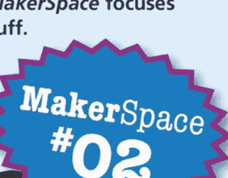

同时也请寻找 MAKERSPACE #01 并在线订购：

shop.linuxnewmedia.com/specials

#### FOSS 精选

来自自由开源软件世界的新瑰宝和新版本


> 每当 Graham 拿到新设备并发现终端提示符时，他的家庭里总会有集体叹气声。他 npm 技能最新的受害者是一台 LG OLED 电视！**作者 GERAH MORRISON**

##### 虚拟白板

###### Lorien

白板之所以与学习场所形影不离，自有其理由：它们非常适合教育和头脑风暴；它们动态且灵活；且具备协作性。因此，毫不令人惊讶的是，白板功能已被数字化，不仅在学校的触摸屏中如此，在线上也一样，复杂信息可以在一个可左右滚动和缩放的虚拟画布上呈现。类似的理念也用于桌面上的笔记应用。这些应用通常模仿记事本界面，用于绘制草图和添加思维导图，而非寻找在更大画布上映射更复杂想法的方式。就连苹果自家的笔记应用也以相同方式运作；其下一个版本承诺将固定画布解放为无限可滚动的画布。而这正是这款出色的应用 Lorien 已经能够做到的。

Lorien 是一款具有无限画布的白板。这意味着你可以在背景上开始随意涂鸦，然后向上、向下、向左或向右滚动，以添加进一步的注释或

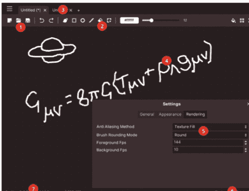

- **格式支持：** 除 Lorien 自身的文件格式外，文档还可保存为 SVG 文件。
- **工具：** 绘制、素描和输入文字，以在自己的白板上添加笔记。
- **标签页：** 同时处理多个文档，或启用无干扰模式。
- **无限画布：** 你工作的背景可以是任意尺寸和比例。
- **高帧率：** 得益于使用 Godot，Lorien 的渲染效果更像游戏而非桌面应用。
- **矢量：** 一切都是矢量，保持文件大小小而质量高。
- **触控笔支持：** Lorien 专为配合触控笔设计，可利用压力改变绘制粗细。

笔记，就像在无限大的大学白板上那样。这种方法也延伸至画布的缩放，因此理论上，你可以在屏幕上的单个像素后面填满一个虚拟的微观世界信息。之所以可能，是因为 Lorien 并不存储涂鸦和文本的位图，而是存储你所添加的所有内容及其彼此相对关系的算法表示方式。这就是 Inkscape 的工作方式，SVG 文件表示向量的方式，以及 Minecraft 在无尽景观中某处重建你的房子的方式。它允许屏幕上的巨大位图图像保存为极小的文件，并以任何比例完美重绘。这也意味着你获得无限的撤销和重做，以及涂鸦的 SVG 导出。然而，与 Inkscape 不同，Lorien 仅用于你自己的笔记和头脑风暴，而非艺术作品。为最好地实现这一点，Lorien 采用标签页界面以同时处理多个文件，并接受拖到画布视图的文件。

但这并不意味着其绘图工具简单。有画笔、橡皮擦、直线和矩形工具，以及不同的笔触和调色板，但你不能像 Krita 那样精细调整。Lorien 旨在用于快速做笔记和草图，无需太多思考或艺术精细度。由于抗锯齿和矢量化绘制，你的作品仍可看起来美丽，就像伟大的想法写在信封背面时那样。Lorien 也旨在配合触控笔使用，甚至可能与 GNOME 新的 RDP 和触摸屏支持配合，在那里你可以使用压力动态改变画笔大小。但你也可以使用普通的鼠标，其中中键用于拖动画布，缩放则映射到滚轮。文件可以原生保存或导出为 SVG 以供导入其他应用。一切渲染完美，且不占用大量 CPU。这可能是因为 Lorien 使用 Godot 而非 Qt 或 GTK 构建，使 Lorien 能够利用游戏使用的相同性能加速。更令人兴奋的是，未来我们可能会看到更多同样出色的应用，源自曾经主要作为游戏引擎的领域。

**项目网站**
https://github.com/mbrlabs/Lorien

##### 3D 设计

###### FreeCAD 0.20

主要的 0.20 版本为我们提供了重温这一 3D 建模和设计支柱的完美借口。FreeCAD 已经存在了 20 年，因此它很复杂。与 Blender 类似，这不是你能在 20 分钟内精通的应用。但同样像 Blender 一样，它 capable 出精美且专业的结果，从 3D 打印到电路设计。

使用 FreeCAD 有几种不同的方法，最常见的是从 X 和 Y 平面中的二维草图开始开发你的设计。FreeCAD 使用工作台（workbenches）的概念来改变其配置以适应你的工作方式，有多个工作台有助于此阶段，例如创建 2D 俯视图。完成此步后，你首先创建一个草图，然后进一步探索菜单以选择要添加的形状。这些在画布上交互式创建，允许你拖动其边缘和点以适合所需尺寸。

以此方式，FreeCAD 部分是 Gimp，部分是 Blender，并有一个重要区别：约束。约束，如边长或角度，是 FreeCAD 中的重要概念，因为它们无歧义地定义物体的形状。

物体创建过程涉及遍历每个参数并固定它以创建约束。当形状完全受约束时，它变为绿色，并被视为已求解。一切都可以点击和拖动点或线创建，但也可以通过编辑参数使其精确，类似于更具交互性的 OpenSCAD。但像 OpenSCAD 一样，如果你愿意，物体也可以完全用 Python 编程。幸运的是，这个新版本极大地改善了可用性，包括合理的帮助文本和改进大量用户界面元素，使其更直观易用。它仍然复杂，但比以往任何时候都更容易。

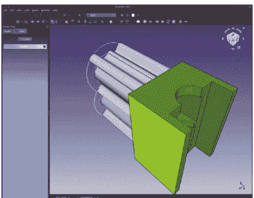

FreeCAD 包含 OpenCASCADE 技术（OCC）元素，以执行复杂 3D 形状的操作。

> **项目网站**  
> https://www.freecadweb.org

##### 音频插件 API

###### CLAP

这不是一个普通的发现，因为 CLAP 不是可以运行的东西，而是开发来帮助他人创建可运行事物的工具。具体来说，它是一个 API，帮助程序员编写音频效果和合成器，可与任何音频平台协同工作。

这应该是一个已解决的问题，因为这种 API 已存在数十年——最著名的是 Steinberg 的 VST 插件架构和 Apple 的 Audio Unit 应用。这两者主导专业音频，VST 在 Linux 上流行，可以构建原生插件或通过 Wine 运行 Windows VST 插件。

问题是这些 API 均非开源，且 VST 仍由 Steinberg 控制。有较旧的开源替代品，包括 LV2、LAD-SPA 和 DSSI，但开发者抱怨其复杂性和碎片化，且每种在 Linux 之外都未能达到使用量的临界点，这对于任何格式的成功至关重要。

CLAP（Clever Audio Plug-in 的缩写）是一个新的开源音频 API，专门设计为易于使用、适应性强且高效。它还可能比任何其他插件格式强大得多。它允许按时间自动化和调制、参数偏移、非破坏性性能声音修改以及按声部参数。这些在替代品中均难以轻松实现，使其成为选择 CLAP 而非其他格式的真正理由，无论其许可如何。

更令人印象深刻的是，CLAP 由两家重要公司开发，Bitwig 和 u-he。两家公司均生产其软件的 Linux 版本，其中 Bitwig 作为行业标准 Ableton Live 的挑战者取得巨大成功尤为突出。Bitwig 已经是 CLAP 插件的主机，u-he 正在转换其插件，其他对 Linux 友好的软件生产商也是如此。重要的是要注意 CLAP 的雄心是在所有平台上成功，其 MIT 许可和开放合作的承诺同样重要。希望它将取得巨大成功。

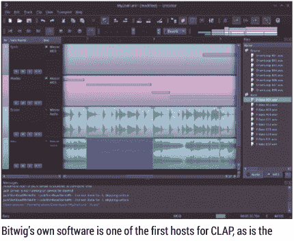

Bitwig 自己的软件是最早的 CLAP 主机之一，完全开源且出色的 Qtractor 也是。

> **项目网站**  
> https://github.com/free-audio/clap


#### 替代 cut

##### tuc

cut 是你终端中最常被忽略和低估的内置命令之一，它已存在很长时间。尽管我们中的大多数人通常都能猜到它的功能，但我们有限的记忆意味着，通常更容易通过管道甚至复制粘贴来构建等效命令，而不是费心去查 `cut --help`。cut 命令通过指定范围、分隔字符甚至字节位置，帮助你从文件或管道输入中提取文件的各种部分。它功能强大，但它已不再是你路径中唯一应拥有的 cut 命令。这是因为有一个名为 tuc 的新替代品，这是一个巧妙命名的工具，它不仅执行 cut 的所有功能，还填补了其功能中的空白。而且它所做的远不止反转文本顺序。


> 借助处理负索引的能力，你甚至可以使用 tuc 反转项目列表或整行文本。

以便进行更多处理。使用从输入流返回的各种值的引用，替换字段或其分隔符或重新格式化输出也非常容易。虽然这样写起来听起来很抽象，但 tuc 实际上易于使用，并解决了你在尝试使用 cut 导入或处理值列表时遇到的许多问题。

**项目网站**
https://github.com/riqutuo/tuc

#### 音乐播放器

##### Myuzi

Myuzi 是一款桌面音乐播放应用，将自己描述为“Spotify 的替代品”，只是不需要订阅或讨厌的广告。这听起来可能像是该应用正在绕过 Spotify 严格的用户许可，但事实并非如此。使用 Myuzi 搜索时出现的任何音乐，或者点击播放时听到的任何音乐，都不是来自 Spotify。相反，Myuzi 的音乐直接来自 YouTube，这使它成为众多视频和下载工具中在音频方面的等价物，这些工具可以帮助你探索 YouTube，而不会受到其基于网络的推荐内容的诱惑。对于音乐来说，这更有意义，因为听音乐不应该涉及盯着屏幕，至少应将其降至最低，尤其是在寻找你想要听的内容时。Myuzi 在这方面非常出色，因为它刻意保持简单、无干扰，让你可以专注于正在播放的内容。


> 简单的界面非常适合在收听 YouTube 无与伦比的音乐库时消除所有干扰。

其单个窗口分为三个标签页：一个用于创建和播放播放列表，另一个用于搜索和播放结果，最后一个用于设置。最后一个标签页仅包含音量和静音播放的选项。所有面板下方是传输控制，显示当前播放的曲目、曲目进度以及快退、播放和快进控制。要开始使用，你搜索感兴趣的内容，选择你想听的结果，然后点击播放。片刻之后，你只会听到与 YouTube 视频相关的音频，没有任何干扰或可疑的拍摄角度。喜欢的曲目可以添加到你自己的播放列表中，多线程播放让一切保持流畅。这种方法很棒的一点是，YouTube 往往是找到某些稀有曲目和现场表演的唯一地方，而且你通常希望有一个简单的音乐播放器来帮助你收听这些曲目。Myuzi 正是如此。

**项目网站**
https://gitlab.com/zechikira/myuzi

#### Gopher 浏览器

##### Gophie

尽管许多人认为互联网与世界 Wide Web 是同义词，但两者其实是不同的。互联网主要是一个传输层，负责将计算机相互连接。万维网是一种协议及其相关软件（Web 服务器和 Web 浏览器），以网页形式提供内容，从而创建了一个巨大互联的、嗯，一切内容的网络。我们知道你知道这一点，但有时提醒自己存在一个超越万维网那些糟糕干扰的互联网是有益的。其中最古老的之一是 Gopher。Gopher 协议实际上是 HTTP 的同时代物，创建于 1990 年，并共享早期 Web 的许多相同特征。它使用服务器和客户端配置，允许访问一个简单的内容系统，该系统可以链接到各种在线资源，包括 Telnet 服务、FTP 站点和其他 Gopher 服务器（所有这些统称为 Gopherspace）。


Gopher 的内容页面无法实现 HTML 所允许的丰富多媒体体验，这在当时限制了它，但现在从弹窗广告和跟踪 Cookie 的世界来看，这是一种令人耳目一新。值得注意的是，Gopher 的世界现在仍然可用。你只需要为你的 Linux 桌面配备一个现代的 Gopher 客户端，这正是 Gophie 的作用。Gophie 是一个围绕 Gopher Text 环境的桌面外壳，完全支持原有的特性，包括搜索功能、集成的二进制文件下载器、Telnet 会话和链接的文本文档。它还完全可自定义。虽然主窗口仅包含 Gopher 输出的原始文本，但你仍然可以更改颜色、样式和背景以适合你的环境。但它最好的特点是使用 Gopher 令人耳目一新。仍然有很多网站存在，而且它们通常比平均网页质量更高，尤其是在没有自动机器人播放视频和声音的猛烈攻击的情况下。

**项目网站**
https://gophie.org

#### 命令行训练

##### GameShell

现在比以往任何时候都有更多的人在使用命令行，我们缺乏帮助人们入门的良好方式变得越来越明显。主要问题是，虽然我们会认为终端易于使用，但初学者最初输入命令的尝试可能很可怕。可能会感觉一个拼写错误就会摧毁你的整个环境，甚至更糟的是，摧毁连接到你的网络的每个人的环境。这在一定程度上是真的，但在运行日常普通命令时并不是这样。克服这种恐惧的解决办法是熟悉和经验，但这样我们就陷入了经典的鸡生蛋、蛋生鸡问题。要获得熟悉和经验，你需要使用命令行。然而，GameShell 是另一个选择。

GameShell 最初编写是为了帮助大学生熟悉终端。它通过把学习体验变成一个基于文本的冒险游戏来实现这一点，非常类似于《Colossal Cave Adventure》或《Zork》。唯一的区别是，你不再输入传统互动小说的动词和名词组合，而是从真正的 Bash 命令构建每个输入。`cd` 会改变你的位置。`ls` 会列出你当前位置中的项目，`cat` 会显示你找到的任何描述性文件的内容。背后的魔法是一个技巧。你并没有真正将命令输入到解释器中，而是输入到你真正的终端中，通过游戏创建的真实文件系统进行导航。例外是一个定制的 `gsh` 命令，它提供目标（“去城堡主塔楼的顶部”）并跟踪你的进度。这是一个非常聪明的概念，肯定能让任何玩家充满信心。当真相揭露你实际上一直在发出真正的命令时，当你将他们的命令带到野外时，它应该正好给你所需的入门指南，以便进一步探索。


> GameShell 唯一的危险在于它没有限制对任何命令的访问，包括 `rm`。

**项目网站**
https://github.com/pyher/GameShell

#### 媒体流媒体

##### Jellyfin

我们似乎正在进入类似于媒体流媒体第三个时代的东西，第一和第三个时代专注于自托管内容，第二个时代则由 Netflix、Spotify 和 Apple 等流媒体巨头主导。第一个时代始于 2000 年代初，当时我们都开始将设备连接在一起，并从我们以前的物理容器中建立庞大的数字媒体收藏。这就是 DLNA 等协议变得流行的时候，也是你可以购买一个机顶盒将你的离线屏幕变成现在所谓的“智能电视”的时候。即使是朴素的 PlayStation 2，通过网络附件和一个名为 QCast Media Player 的光盘，也可以从你 2003 年的 Mandrake Linux 机器上流媒体播放 DivX 文件。当然，这一切都被宽带和廉价且充足的订阅服务所取代，这些服务已经主导了十多年。

但流媒体服务变得更加昂贵，更重要的是，日益碎片化。你现在又很难以所需的格式访问你想要的媒体。这正是 Jellyfin 发挥作用的地方。Jellyfin 是 Plex 的开源等价物，你运行自己的服务器并服务自己的内容。一个或多个前端客户端随后可以访问服务器并流媒体播放你想观看或听的内容。有适用于 Android 和 Apple 手机和平板电脑的客户端，以及适用于智能电视的客户端应用，包括针对 LG webOS 的非官方构建。如果其他方法都失败，服务器中有一个出色的 Web 前端几乎使任何客户端应用变得多余。其中任何一个都会提供一个美观的接口，通过媒体、音乐和节目类别提供快速、响应的访问，并列出电影海报、专辑封面或盒装集缩略图。所有这些都可以与存储各种类型内容的多个目录一起配置，这些内容存储在本地或远程。


如有需要，Jellyfin 可以通过实时转码内容来限制其使用的带宽以及视频和音频功能。

使用推荐的 Docker 方法安装服务器本身很容易，这也具有将服务器与系统的其他部分隔离的优势。但原生安装同样简单。它特别适合运行在树莓派上，树莓派甚至可以配置为提供硬件转码加速，任何具有适当驱动器的通用系统或 GPU 也可以。然而，大多数时候，并不需要将你的媒体实时从一种格式转码为另一种格式。绝大多数前端都能够原生播放大多数现代 H.264 或 H.265 编码的内容，我们成功地以极低的 CPU 开销从树莓派向智能电视的 Web 浏览器流媒体播放 4K HDR 录制内容。这是 Jellyfin 与第一代家庭流媒体解决方案不同的地方，因为我们现在可访问的硬件功能远胜从前，并且体验主要是无缝的。使用 Jellyfin 也是在家中聚合内容的好方法，特别是如果你仍然拥有实体媒体收藏，它通常仍然是以最高质量流媒体播放那些媒体的唯一方法。即使服务支持带有 4K 和 HDR 内容的 UHD，这些流媒体本身通常也压缩得过于严重。Jellyfin 允许你在网络及更远的地方原生流媒体播放文件，并与我们 21 世纪的媒体消费习惯无缝契合。


就像其他任何流媒体服务一样，Jellyfin 会自动填充检测到的任何内容的海报和缩略图，以及背景信息。

**项目网站**
https://jellyfin.org


#### Vita 模拟器
##### Vita3K

Vale 的 Steam Deck 是一款令人印象深刻的便携式游戏硬件，但它只是众多早期尝试中最新的一个。索尼的 PSP 和后来的 Vita 是其中两款最优秀的设备。它们拥有出色的手感，尤其是 Vita，具备了你可能想要的所有控制功能——双模拟摇杆、肩部按钮、方向键以及带有触控背板的电容式屏幕。该平台取得了适度的成功，拥有一款包含数千款游戏的库，直到索尼在 2019 年停止该平台及其相关商店的服务。这使得许多人大量拥有自己的游戏收藏，而随着硬件数量的减少，能用来游玩这些游戏的设备也变得越来越少。这恰好是模拟器出现的完美原始开发者环境。

Vita3K 就是那款模拟器。这是一个几年前启动的项目，终于开始能够从头到尾运行 Vita 游戏了。其出色的兼容性数据库目前列出了近 200 款可运行的游戏，还有更多游戏在一定程度上可以运行，并且每次发布都会增加更多。除了模拟器本身的二进制文件外，你还需要访问原始的 Vita 固件和原始游戏文件。这些可以从你的原始 Vita 设备中复制。你还需要从模拟器网站配置并安装一些用于兼容性的模块到 Vita 环境中，你可以在模拟器中完成此操作，之后你将看到带有内容管理器、


> 即使没有商业游戏的访问权限，Vita 和这款模拟器也能运行许多开源佳作。

设置以及奖杯管理器的模拟 Vita 启动器。Linux 系统与索尼的 DualShock 控制器配合良好，由于与 Vita 设计密切相关，它们是使用模拟器的完美设备。

模拟器会显示设备何时连接并被识别。模拟器包含内容管理器、设置页面以及奖杯管理器，用于管理你在玩游戏时可能解锁的奖杯。游戏本身是从你从原始 Vita 获取的存档版本安装的，将在单独的窗口中加载。性能出人意料地好，Vita3K 是游玩那些仅存在于该系统上的 Vita 经典游戏的绝佳方式。

**项目网站**
https://vita3k.org

#### GameStream 主机
##### Sunshine

多年来我们审视过的最出色的游戏工具之一是名为 Moonlight 的工具。这是 NVIDIA 游戏串流技术（称为 GameStream）的开源实现，该技术将 Windows 游戏串流至其瘦客户端 SHIELD 游戏机。Moonlight 客户端消除了对 SHIELD 的需求，可以在几乎任何设备上运行，从树莓派到基于 webOS 的 LG 电视，其表现极佳——远优于等效的 Steam 串流解决方案。在使用良好网络的 Moonlight 上，你的游戏 PC 渲染帧与 Moonlight 客户端显示帧之间的延迟，同时管理你的控制和声音，可以低于 15 毫秒，这足以让绝大多数游戏感觉极其响应迅速。更令人惊叹的是，如果系统和网络支持，Moonlight 的近期版本能够以每秒 120 帧的高动态范围内容串流 4K 分辨率。这一缺点之前已提及：你需要 Windows 来运行 NVIDIA GeForce Experience 后端。

Sunshine 改变了这一切。它是一个 GameStream 主机，可在 Linux 上运行，并将你的游戏库串流至 Moonlight 客户端。它在 NVIDIA 硬件和专有驱动程序（包括 CUDA 组件）下工作最佳，但也可以使用 FFmpeg 进行视频编码，与 Intel 和 AMD 设备配合使用。设置过程相当复杂，特别是围绕创建适当的用户规则，并且你需要手动将 PC 添加到 Moonlight 客户端中，而不是自动检测。你要


> 作为一款被严重低估的超级马里奥游戏之外，Sunshine 还是你 Linux 游戏的 GameStream 主机！

想要串流的每个游戏的路径都需要添加到配置文件中。但结果是值得的。缩略图随后会出现在 Moonlight 中，在那里你也可以调整串流设置以匹配系统的能力。选择缩略图即可启动游戏并将其输出串流到你的 Moonlight 客户端，效果非常好。

**项目网站**
https://github.com/Loki-47-6F-64/sunshine

### 使用 Manuskrript 和雪花法构思小说
#### 规划你的史诗
#### Manuskrript 编辑器是你快速启动下一个写作项目所需的一切。

文 / 马可·菲奥雷蒂 (Marco Fioretti)

你是否曾想写一部小说、一篇论文，或任何比学校报告更复杂的东西？在本教程中，我解释了一种高效组织写作项目的技术：雪花法。我还会向你介绍 Manuskrript [1]，这是一款多平台开源工具，可用于实施你自己写作工作的雪花法，它是为此量身定制的。Manuskrript 的目标是帮助作家“创建初稿，然后进一步完善和编辑他们的杰作。”

由 Randy Ingermanson 创建的雪花法，介于遵循完整的传统大纲和“自由写作”（即故意没有任何计划地写作，这可以促进发现但有时也非常低效）之间。

关于雪花法的细节和提示可以在网上找到 [2] [3]，但概念非常


简单：从一个非常基本的情节摘要开始，以圆形、递增的方式添加小元素，就像冰粒相互附着形成复杂的雪花一样。换句话说，首先写下书的基本想法，然后是主要角色（或角色们），接着是背景设定——每个条目只用一句话。

然后你回到描述中，将其转化为三个非常短的段落，概述故事的开头、中间和结尾。接下来，你为每个主要角色写同样简短的描述，或者添加次要角色，然后以同样的方式扩展背景设定的描述，为每个描述添加细节，直到你拥有实际写出故事所需的一切。

#### 安装

截至 2022 年 5 月，Manuskrript 仍处于广泛开发阶段，其网站官方建议用户“创建频繁的备份，以最小化因软件错误、断电或硬件故障导致的数据丢失。”

安装很简单。在基于 Ubuntu 和 Debian 的系统上，你可以下载 .deb 格式的二进制软件包，然后从文件管理器安装，或者在最坏的情况下，从 shell 提示符通过以下命令安装：

```bash
sudo apt update
sudo dpkg -i manuskript-0.13.1-1.deb
```

也有 .rpm、Flatpak 和 Snap 格式的软件包，以及非 Linux 系统的安装程序。

#### 主要功能和流程

除非你告诉 Manuskrript 总是重新打开你最后工作的项目，否则你启动它时看到的第一个弹出窗口是图 1 中所示的窗口，你可以从中为虚构和非虚构作品选择多种模板。之后，你需要配置书籍的结构，并可选地配置每个部分的目标字数，如图 2 所示。当然，你可以随时根据需要添加或删除章节。


图 3：输入图书馆编目你的作品所需的数据。

图 3 到图 8 中的左侧工具栏展示了 Manuskrript 为何以及如何成为应用雪花法的完美工具：该工具栏顶部的六个按钮中的每一个都打开一个面板，该面板要么对应该工作流的某个方面，要么完成它。从上到下，按钮分别是：通用（信息和元数据）、摘要、角色、情节（及支线）、世界（即背景和大纲）、大纲和编辑器。

通过输入并逐步完善这些面板支持的所有数据，你可以在写作前为自己组织、规划并记录一切，从情节反转到每个角色的外貌、动机和背景历史，以及她生活的整个社会。即使在你开始写作后，你随时可以扩展或更新 Manuskrript 为每个写作项目创建的这个“数据库”的任何部分。

#### 实际示例

为了展示 Manuskrript 的工作示例，我将假装自己是 J.R.R. 托尔金，使用 Manuskrript 重写《魔戒》（*The Lord of the Rings*，简称 LoTR）。我将向你展示如何通过将 LoTR 的相关数据或文本片段输入 Manuskrript 来创建和组织复杂的故事。我将从维基百科、LoTR 粉丝维基 [4] 获取信息，当我只需要填充内容时，则从 LoTR 主题随机文本 LoRem Ipsum [5] 中获取。

Manuskrript 左侧工具栏中的*通用*按钮（最顶部的按钮）用于图 3 中显示的基本自描述元数据。图 3 中另一件值得注意的是右侧工具栏。从那里，你可以打开 Manuskrript 的搜索功能，隐藏或显示左侧（*导航*）工具栏，并根据你所在的面板激活其他辅助功能。

*摘要*面板（图 4）完全对应雪花法的第一步：写下你的故事是关于什么的，先用一句话，然后逐渐扩展它。然后 Manuskrript 可以在你写作时随时快速向你显示该摘要。

*角色*面板在图 5 中仅部分可见，可能包含你可能需要的所有章节，甚至更多：你可以按重要性对角色进行排序；使用右上角可见的彩色可自定义标签对其分类；并以有序的方式归档使它们“真实”的一切，从性格到背景。

*情节*面板（图 6）可能是最重要的部分，至少对于复杂小说而言。它允许定义许多重叠的故事线，每条线都有其自身的描述、预期结局、涉及的角色和解决步骤。还要注意，当此面板打开时，右侧工具栏包含一个按钮以打开*书籍摘要*。*书籍摘要*允许你并排查看你的摘要和情节线，并验证它们是否仍然匹配。


图 4：雪花法的第一步：用一句话描述你的故事！


图 5：*角色*面板允许你构建故事中所有角色的完整个人资料。


坦率地说，Manuskript 默认的“世界”面板（在图 7 中仅部分可见）对于三部曲这样的大型作品来说，可能会令人望而生畏。需要填写的类别如此之多，以至于人们可能会原谅自己有“这比实际写书花费的时间要多得多！”的想法。但不要绝望。首先，你并不被强制要求在开始写作之前填写所有这些方框。此外，如果你确定某些项目对特定的故事没有用，你可以，而且很可能应该，删除其中尽可能多的项目。

与此同时，尽早收集足够的耐心和纪律，利用这些方框完整描述一个世界，很可能提高结果的质量，并在长期内节省时间。这对于跨越多本书的系列作品尤其如此，如果没有随时在手边掌握所有必要信息（存放在这些方框中），避免情节漏洞并保持连续性和连贯性将变得更加困难。

良好使用“情节”和“世界”面板对于使用 Manuskript 创作优秀的虚构作品至关重要，但对于任何写作项目，你几乎总是会使用的那个面板很可能是图 8 中的“大纲”面板。在其中，你可以按层级顺序列出作品的每个部分，并为每个部分分配状态、字数、标签以及该部分应从谁的视角（POV）来写。大纲还非常清晰地展示了哪些部分仍需要最多的工作，其核心功能是让添加、删除或重新排列章节和子章节变得真正容易和快速。对于非虚构作品项目，这很可能就是 Manuskript 能给予作者最大的帮助。


#### 最后，编辑器

一旦所有你需要写得好的信息都整齐地排列在 Manuskript 中，你可以点击导航工具栏上的最后一个按钮，最终开始写作。如果你正确使用了 Manuskript，你首先会看到故事的一级大纲。然后，点击一个部分将显示其所有子部分，以索引卡片的形式呈现，每个卡片都标记有其进展状态和可在原地编辑的摘要（图 9）。相反，点击大纲树中的任何章节将在 Manuskript 编辑器中打开它（图 10）。你可以使用全屏模式以获得最大化的专注度（点击右下角的按钮激活它），或者像图 10 所示在主要的 Manuskript 窗口内使用，以实时查阅你的写作数据库。例如，在图 10 中，我点击了“元数据”选项卡以查看该章节的所有属性，并点击了“故事线”以查看每个情节和子情节应该开始或结束的位置。Manuskript 编辑器故意设计得简洁，因为它的主要目标是支持无干扰的纯文本写作（下文将更多讨论这一点）。即便如此，它拥有高效写作所需的一切。除了动态字数统计外，它还支持（图 11）多个拼写检查器和词典，外加一个频率分析器，显示哪些单词和短语你使用得更频繁。这个最后的职能非常有用，既可以避免自我重复，也可以查明哪些人物或概念在你的写作中占据了最多的篇幅（也许这与你的本意或你认为的本意相悖）。


图 8：文稿大纲面板显示所有章节的状态，并便于重新排列它们。

#### 配置和导出选项

通过在 Manuskript 的顶部菜单中点击“视图”或 *编辑 / 设置*，你可以配置图 3 到 10 中看到的大部分内容。例如，你可以添加自定义标签或写作状态（图 12），以及配置修订控制或全屏编辑器的主题。

就 Manuskript 的编辑器而言，它以纯文本或 HTML、Markdown 或几乎任何其他标记语言的形式接受并保存你写的一切（但请注意，在撰写本文时，唯一支持语法高亮的格式是 *Markdown*）。然而，Manuskript 可以导入许多格式的现有文本，包括但不限于 OpenDocument、.docx、ePub 和 LaTeX。

在输出方面，你可以保存或（如 Manuskript 令人困惑地所称的）“编译”你完成的作品为 Pandoc 转换器 [6] 支持的所有格式。为了最大限度地利用 Manuskript，无论是导入还是导文本，这都是一个必要的前提条件。

在底层，每个 Manuskript 写作项目由八个小文件组成，采用基于文本的格式，如 YAML、JSON、XML 或 OPL，外加两个文件夹。这八个文件包含该项目的设置、其标签和可能的状态、摘要、情节等所有信息。两个文件夹中，一个用于人物，另一个用于你写的实际文本。每个人物都有一个文件，其中存储有关该人物的一切信息，格式为键值对。例如，甘道夫的文件开头看起来像表 1。


图 10：实际的文稿编辑器，由列出当前章节所有属性的面板以及包含所有情节和子情节的故事线提供支持。


图 9：打开编辑器时，所有章节的摘要以索引卡片的形式可见。

大纲文件夹被划分为与你在 Manuskript 的 *大纲* 面板中看到的结构相同的子文件夹。每个子文件夹都包含一个名为 *folder.txt* 的文件，该文件存储（使用与人物相同的语法）该文件夹的元数据 – 即标题、摘要、预期字数等。相反，单个章节是


图 11：Manuskript 编辑器可能看起来很简单，但你会发现那里有对作家来说最重要的一些功能。


图 12：标签、章节状态以及 Manuskript 的其他部分都易于自定义。

#### 结论？当然，试试 Manuskript！

正如我在本教程开头所写的，Manuskript 仍处于大规模开发阶段，这一点很明显。例如，我测试的版本（0.13.1）不支持直接从 Manuskript 内部打印。你必须将故事导出（或如他们所说的，编译）到其他格式，用其他程序打开生成的文件，并从中打印。我还注意到，如果你在大纲中选择一章，然后点击“在新标签页中打开”，什么也不会发生。就功能而言，我真的希望编辑器至少能以 WYSIWYG 模式处理 Markdown 源，或者能够对同一源进行实时 HTML 预览。在编辑器之外，如果能至少打印出大纲就太好了。

接下来是有趣的部分，为什么了解这些细节很重要：在点击“编辑 | 设置”后你可能会选择或取消选择的所有选项中，也许最重要的是名为“保存为单个文件”的选项。如果你选择该选项，上述所有文件和文件夹将始终且仅保存为一个压缩归档，格式为 ZIP 但扩展名为 .msk。

如果你不选择该选项，Manuskript 将创建一个以项目名称命名的文件夹，放在你想要的任何目录中，并在那里保存所有这些文件和文件夹，而不进行任何压缩。当然，你的口味可能不同，但我强烈建议使用此选项，原因如下，这是 Manuskript 文档的 paraphrase：“如果你不保存为单个文件，‘所有有用的内容 *都保持为纯文本可访问。*’” 这一点很重要，因为每个人都知道如何处理纯文本 – *包括软件！*

选择此选项使得使用其他软件管理或处理你在 Manuskript 中做的任何事情变得更容易，无论出于什么目的。例如，一个装满纯文本文件且没有其他内容的文件夹，可以比单个大型、不透明的压缩归档更高效地由修订控制系统管理或用 rsync 等工具备份。纯文本文件的文件夹也可以被 Recoll [7] 等程序完全索引，并使用诸如 *find* 和简单的 shell 脚本等标准 shell 命令进行搜索、修改或创建。

我认为，如果编辑器能够自动识别某些字符串，例如人物或地点的名称，并将它们转换为可点击的链接，打开相应的 Manuskript 数据库条目，也会很有用。我不惊讶地发现这个功能已经在计划之中。

然而，尽管存在这些限制，我认为 Manuskript 已经作为写作助手拥有巨大的潜力，并邀请每个需要写大型作品的人认真地试一试。说这个大理由的一个重要原因是，由于基于易于处理的纯文本文件，Manuskript 易于扩展或与其他工具集成。就个人而言，我使用 Manuskript 的第一个业余项目将是弄清楚如何从现有的 Markdown 草稿和笔记集合开始，使用 shell 脚本创建一个完整的 Manuskript 项目。

### 作者

Marco Fioretti ([http://mfioretti.com](http://mfioretti.com)) 是一位自由撰稿人、培训师和研究人员，常驻意大利罗马。自 1995 年以来他一直使用免费/开源软件，自 2005 年以来一直在从事开放数字标准工作。Marco 还在 [https://stop.zonal-m.net](https://stop.zonal-m.net) 上撰写有关数字权利的博客。

#### 表 1: 甘道夫人物文件

| 属性 | 值 |
| :--- | :--- |
| **姓名：** | Gandalf |
| **ID：** | 0 |
| **重要性：** | 2 |
| **POV：** | True |
| **动机：** | See motivation |
| **目标：** | 摧毁魔戒，拯救中土世界 |
| **冲突：** | 渴望获得魔戒 |
| **短语摘要：** | 中土世界最强大、最智慧的巫师 |

#### 信息

- [1] Manuskript: [http://www.theologeek.ch/manuskript/](http://www.theologeek.ch/manuskript/)
- [2] 如何使用雪花法规划一本书：[https://jerichowriters.com/how-to-plot/](https://jerichowriters.com/how-to-plot/)
- [3] 雪花法的 10 个简单步骤：[https://proactivewriter.com/blog/use-the-snowflake-method-of-writing-in-10-easy-steps-how-to-start-writing-a-novel-for-beginners-updated](https://proactivewriter.com/blog/use-the-snowflake-method-of-writing-in-10-easy-steps-how-to-start-writing-a-novel-for-beginners-updated)
- [4] *指环王* 粉丝 wiki：[https://lotr.fandom.com/wiki/Main_Page](https://lotr.fandom.com/wiki/Main_Page)
- [5] LotRenum [psucm:](https://lotrempsum.com/) [https://lotrempsum.com/](https://lotrempsum.com/)
- [6] Pandoc: [http://pandoc.org/](http://pandoc.org/)
- [7] 由 Marco Fioretti 撰写的 “教程：Recoll”，*Linux Magazine*，第 212 期，2018 年 7 月，p8/84：[https://www.linux-magazine.com/Issues/2018/212/Tutorials-Recoll/(language)/eng-US](https://www.linux-magazine.com/Issues/2018/212/Tutorials-Recoll/(language)/eng-US)


### LINUX NEWSSTAND

**在线订购：** https://bit.ly/Linux-Newsstand

《Linux Magazine》是您进入 Linux 世界的指南。每月刊杂志都载有您在其他地方找不到的高级技术文章和教程。浏览我们过去的完整目录，查找特定主题或补全您的收藏。


#### 第 261 期/2022 年 8 月

**USB 启动**

15 年前，现场启动（Live boot）是一个令人兴奋的想法——只需随身携带一张 CD，即可从任何地方启动。但旧式的启动 CD 有一些局限性。今天的 USB 启动工具解决了这些问题，并提供了一项当时没人想到的功能：在单个 U 盘上访问多个启动镜像。

DVD 内容：Linux Mint MATE 20.3 和 FreeBSD 13.1


#### 第 260 期/2022 年 7 月

**隐私**

如果您真正重视隐私，您需要依赖比浏览器“不跟踪”按钮更多的东西。最需要匿名性的人依赖于 Tor 网络——一个在全球范围内提供安全浏览服务的项目，即使在监控国家也不例外。我们还介绍了 Portmaster，一款具有有用隐私功能的应用程序防火墙。

DVD 内容：Ubuntu 22.04 和 Fedora Workstation 36


#### 第 259 期/2022 年 6 月

**零信任**

二十年前，每个人都认为只需一道网关防火墙就能保持安全，免受入侵者侵害，但最近的历史告诉了我们不同的故事。如今，最好的建议是：不要信任任何人。您的内部网络可能和互联网一样危险。

DVD 内容：Zorin OS 16.1 Core 和 Super GRUB2 Disk


#### 第 258 期/2022 年 5 月

**绿色 IT**

大多数人知道更换更高效的灯泡可以节约能源，但您知道使用更高效的软件也能节约能源吗？本月我们将审视正在进行的努力，旨在让 IT 行业走向可持续发展。

DVD 内容：Manjaro 21.2 Qonos 和 DraGoNfly BSD 6.2.1


#### 第 257 期/2022 年 4 月

**加密**

本月，我们将调查 Linux 中加密的现状。我们将超越基础知识，探索支撑保密系统的一些工具和技术——并告诉您需要知道什么，以确保您的隐私无懈可击。

DVD 内容：Linux Mint 20.3 Cinnamon 版和 deepin 20.4


#### 第 256 期/2022 年 3 月

**面部识别**

随着微软 Hello 技术的到来，生物识别技术最近得到了推动。现在开源世界正在迎头赶上，并有一款名为 Howdy 的创新工具。面部认证可能尚未准备好进入中情局（CIA），但我们将帮助您开始使用 Howdy，并探索通过一瞥进行身份验证的可能性。

DVD 内容：antiX 21 和 Haiku R1/ Beta 3


### 精选活动

用户、开发人员和供应商在世界各地参加 Linux 活动。我们 *Linux Magazine* 很自豪能赞助此处展示的精选活动。

要了解您附近的其他活动，请访问我们的 [在线活动日历](https://www.linux-magazine.com/events)。

如果您知道我们日历中缺少的一项 Linux 活动，请将所有详细信息发送至 [info@linux-magazine.com](mailto:info@linux-magazine.com)。

### 通知

在预订任何旅行之前，请务必查看活动网站，因为许多活动因 COVID-19 的影响而被取消或转为虚拟活动。

### DrupalCon Prague 2022

- **日期：** 2022 年 9 月 20 日至 23 日
- **地点：** 捷克共和国布拉格
- **网站：** [https://events.drupal.org/prague2022](https://events.drupal.org/prague2022)

成为 Drupal 未来的一部分！由 Drupal 协会主办，DrupalCon Europe 将于 9 月 20 日至 23 日在布拉格举行。加入我们，共同推进 Drupal 项目，并与社区其他成员建立联系。参与一对一面对面的讨论、主题演讲、BoF 会议等。不要错过在场上的机会！

### Akademy

- **日期：** 2022 年 10 月 1 日至 7 日
- **地点：** 西班牙巴塞罗那及线上
- **网站：** [https://akademy.kde.org/2022](https://akademy.kde.org/2022)

Akademy 是 KDE 的年度世界峰会，KDE 是世界上最大的自由软件社区之一。它是由 KDE 社区组织的一个免费、非商业活动。来到充满活力的加泰罗尼亚现代主义建筑大师 Gaudí 的城市、巴塞罗那足球俱乐部和地中海美食之都巴塞罗那，线下或线上见面，享受最佳的会议体验。

### 活动

| 活动 | 日期 | 地点 | 网站 |
| :--- | :--- | :--- | :--- |
| KVM 论坛 | 9 月 12 日–14 日 | 爱尔兰都柏林 + 线上 | [https://events.linuxfoundation.org/](https://events.linuxfoundation.org/) |
| 存储开发者会议 (SDC22) | 9 月 12 日–15 日 | 加利福尼亚州弗蒙特 | [https://storagedeveloper.org/utm_source=LinuxMagazine+Event+Calendar](https://storagedeveloper.org/utm_source=LinuxMagazine+Event+Calendar) |
| 开源峰会欧洲 | 9 月 13 日–16 日 | 爱尔兰都柏林 + 线上 | [https://events.linuxfoundation.org/](https://events.linuxfoundation.org/) |
| 欧洲 Linux 安全峰会 | 9 月 15 日–16 日 | 爱尔兰都柏林 + 线上 | [https://events.linuxfoundation.org/](https://events.linuxfoundation.org/) |
| DrupalCon Prague 2022 | 9 月 20 日–23 日 | 捷克共和国布拉格 | [https://events.drupal.org/](https://events.drupal.org/) |
| 开放大型机峰会 | 9 月 21 日–22 日 | 宾夕法尼亚州费城 | [https://events.linuxfoundation.org/](https://events.linuxfoundation.org/) |
| Akademy 2022 | 10 月 1 日–7 日 | 西班牙巴塞罗那 + 线上 | [https://akademy.kde.org/2022](https://akademy.kde.org/2022) |
| JAX London 2022 | 10 月 3 日–6 日 | 英国伦敦 + 线上 | [https://jaxLondon.com/](https://jaxLondon.com/) |
| KubeCon + CloudNativeCon 北美 2022 | 10 月 24 日–28 日 | 密歇根州底特律 | [https://events.linuxfoundation.org/](https://events.linuxfoundation.org/) |
| CyberDefenceCon 2022 | 10 月 27 日–28 日 | 佛罗里达州奥兰多 | [https://cyberdefenceconferences.com/](https://cyberdefenceconferences.com/) |
| All Things Open 2022 | 10 月 30 日 – 11 月 2 日 | 北卡罗来纳州罗利 | [https://2021.allthingsopen.org/save-the-date-2022/](https://2021.allthingsopen.org/save-the-date-2022/) |
| SeaGL GNU/Linux 会议 | 11 月 4 日–5 日 | 线上 | [https://seagl.org/](https://seagl.org/) |
| 开源监控会议 | 11 月 14 日–16 日 | 德国纽伦堡 | [https://osmc.de/](https://osmc.de/) |
| @Hack: Infosec on the Edge | 11 月 15 日–17 日 | 沙特阿拉伯利雅得 | [https://athack.com/](https://athack.com/) |
| 日本开源峰会 | 12 月 5 日–6 日 | 日本横滨 + 线上 | [https://events.linuxfoundation.org/](https://events.linuxfoundation.org/) |
| 开放合规峰会 | 12 月 7 日 | 日本横滨 + 线上 | [https://events.linuxfoundation.org/](https://events.linuxfoundation.org/) |

### 征稿启事

我们始终在寻找有关 Linux 和 Linux 环境工具的好文章。虽然我们考虑任何主题，但以下主题特别感兴趣：

- 系统管理
- 实用技巧与工具
- 安全，包括新闻和技术
- 产品评测，特别是基于真实世界经验的评测
- 社区新闻和项目

如果您有一个想法，请将提案发送至 *edit@linux-magazine.com*，内容需包括大纲、长度估计、您的背景介绍以及联系方式。

文章的技术水平应与您在 *Linux Magazine* 中通常阅读的内容保持一致。请记住 *Linux Magazine* 在许多国家发行，您的文章可能会被翻译成我们的姊妹刊物之一。因此，最好避免使用可能不被所有读者理解的俚语和成语。

在提及未来的日期或事件时要小心。从您提交手稿到最终副本到达读者手中，可能已经过去了数周。

在提交提案或手稿时，请在电子邮件主题行中使用有助于我们将您的消息识别为文章提案的内容。我们总是欢迎屏幕截图和其他辅助材料。

更多信息请访问：*http://www.linux-magazine.com/contact/write_for_us*。


### 作者

- Erik Bärwaldt — 30
- Zack Brown — 12
- Bruce Byfield — 6, 22, 40
- Joe Casad — 3
- Mark Crutch — 77
- Marco Fioretti — 90
- Jon “maddog” Hall — 78
- Emil J. Khatib — 16
- Kristian Käßling — 26
- Ankur Kumar — 79
- Vincent Mealing — 77
- Pete Metcalf — 36
- Goran Mladjenovic — 44
- Graham Morrison — 84
- Gerhard Sauer — 72
- Mike Schilli — 56
- Ferdinand Thommes — 50
- Christa Travis — 66
- Ian Travis — 66
- Jack Wallen — 8

### 联系信息

- **主编**
  Joe Casad, *jcasad@linux-magazine.com*
- **校对编辑**
  Amy Petito, Aubrey Vaughn
- **新闻编辑**
  Jack Wallen
- **名誉编辑 Nodamica**
  Rita L. Looby
- **执行编辑**
  Lori White
- **本地化与翻译**
  Ian Travis
- **版面设计**
  Dena Friesen, Lori White
- **封面设计**
  Dena Friesen
- **封面图片**
  © Iulian Kvasha, i23RF.com
- **广告**
  Brian Osborn, *bosborn@linuxnewmedia.com* — 电话：+49 8093 7679420
- **市场传播**
  Gwen Clark, *gclark@linuxnewmedia.com*
  Linux New Media USA, LLC
  4840 Bob Billings Parkway, Ste 104
  Lawrence, KS 66049 USA
- **出版商**
  Brian Osborn
- **客户服务 / 订阅**
  对于美国和加拿大：
  (邮箱：*cs@linuxpromagazine.com*)
  电话：1-866-247-2802
  对于其他国家/地区：
  (邮箱：*sales@linux-magazine.com*)
  *www.linuxpromagazine.com* — 北美
  *www.linux-magazine.com* — 全球

尽管已尽一切努力确保杂志内容，但出版商无法对其中包含信息的准确性或由此产生的任何后果承担责任。使用随杂志提供的磁盘或磁盘上提供的任何材料的风险由您自行承担。

版权和商标 © 2022 Linux New Media USA, LLC.

未经出版商书面许可，不得以整体或部分形式复制任何材料。假设所有发来的通信，例如信件、电子邮件、传真、照片、文章、绘图，均以非排他性全球范围提供给 Linux New Media USA, LLC 进行出版或许可给第三方，除非另有书面说明。

Linux 是 Linus Torvalds 的商标。

所有品牌或产品名称均为其各自所有者的商标。如果我们未注明您的版权，请联系我们；我们将始终更正任何疏忽。

*由德国纽伦堡的 Zeitfracht GmbH 印刷。*

由英国 Seymour Distribution Ltd 发行

由 SparkHaus Media GmbH, Ballesta str. 1a, 85625 Glonn, Germany 在欧洲及其他地区代表。

由 Linux New Media USA, LLC, 4840 Bob Billings Parkway, Ste 104, Lawrence, KS 66049, USA 每月出版。在美国和加拿大作为 Linux Pro Magazine (ISSN 1752-9050) 出版，在欧洲及其他地区作为 *Linux Magazine* (ISSN 1471-5678) 出版。邮寄费在 Lawrence, KS 及额外邮寄办公室支付。随刊附带乘车票。POSTMASTER：请将地址变更寄至 Linux Pro Magazine, 4840 Bob Billings Parkway, Ste 104, Lawrence, KS 66049, USA。


## 下月预告

第 263 期

| 预计发售日期 | |
|---|---|
| 英国 / 欧洲 | 9月03日 |
| 美国 / 加拿大 | 9月30日 |
| 澳大利亚 | 10月31日 |

*请注意：发售日期为预计日期，可能因物流问题而延迟。*

## 第 263 期 / 2022 年 10 月

## **Yocto**

物联网革命提供了无限的可能性，但硬件规格和系统要求可能各不相同。无论硬件如何，Yocto 项目都可以帮助你构建定制化的 Linux 系统。


## **《Linux 杂志》创刊 22 周年！**

下月刊将包含新的 *《Linux 杂志》* 档案 DVD，收录了从第 1 期到第 262 期我们曾出版过的所有文章。

立即订阅 *《Linux 杂志》* DVD 版以预订您的副本：
[https://bit.ly/Linux-Magazine-DVD](https://bit.ly/Linux-Magazine-DVD)


## DrupalCon 布拉格 2022
加入我们！

## 距离 DrupalCon 布拉格 2022 仅剩几周
9月20日 - 9月23日

访问我们的网站 https://events.drupal.org/prague2022 获取更多资讯。
您有任何问题吗？请随时通过 drupal@kuonitumlaire.com 联系我们

- 别忘了在截止前注册！
- 查看日程安排
- 探索赞助机会
- 成为 DrupalCon 布拉格 2022 的志愿者
- 规划您的布拉格之旅


## 季节性特惠
最高立省 £82！

准备好开启新篇章了吗？那何不启动一个新项目呢？

使用我们配备 AMD Ryzen™ 处理器的 AX 专用根服务器扩展您的基础设施，享受令人惊叹的性能，并额外享受我们的免安装费优惠！

### 例如：专用根服务器 AX41-NVMe

- ✓ AMD Ryzen™ 5 3600 同步多线程技术
- ✓ 64 GB DDR4 内存
- ✓ 2 × 512 GB NVMe SSD
- ✓ 100 GB 备份空间
- ✓ 不限量流量
- ✓ 无最低合约期限
- ✓ 位于芬兰和德国
- ✗ 安装费 £33

安装费 £ 0 起，月费低至 £ 29 起

hetzner.com/special

