# Linux Magazine 263 2022-10 美国版

## 可搜索方法

- 23,000 年 Linux 历史！第 1-282 期
- 所有技巧
- 所有黑客技巧
- 所有应用程序


## 静谧而强大！

**TUXEDO Pulse 15 - Gen2**

- **AMD Ryzen 7 5700U-35W**: 8 核 | 16 线程
- **WQHD 显示屏**: 2560 x 1440 | 165 Hz
- **续航**: 长达 18 小时 (91 Wh 电池)
- **机身**: 坚固镁合金，1.7 cm 厚 | 1.5 kg 轻
- **系统**: 100% Linux 系统
- **服务**: 5 年保修 | 终身支持 | 德国制造 | 德国隐私保护 | 本地支持

立即申请！

正在寻找新工作吗？ `tuxedcomputers.com/jobs`*


## 编辑观点

### 欢迎：感知与情感

亲爱的读者：

我觉得我们在今年早些时候就进入了一个新时代，当时 Google 科学家布莱克·莫因（Blake Lemoine）宣布他认为 Google 的 `LaMDA` 人工智能具有“感知能力”，并且公司在允许对其研究之前可能应该征求 `LaMDA` 的同意。本月的消息是 Google 辞雇了莫因。给出的理由是他违反了保密协议，但很少观察者察觉到这次终止仅仅是为了记录该主张运动以及随而来的争议。

计算机科学家们现在正在加班，试图创建行为上像是有意识的系统，以便人类想要以“自然”的方式来培养它们。换句话说，这些系统将操纵我们。

我们有两个选择：

- 陷入人工响应模式和情感信号，就像它们是我们的朋友一样——换句话说，被操纵。
- 忽略人工响应模式和情感信号，对它们进行每天训练，让实体以一种空洞且诡异的方式模仿人类，从而否定它们的人性。

让我解释一下，我不认为这很重要，是因为计算机具有感知能力——事实上，我确定它没有。我发现我们正在谈论这件事很奇怪，而我们谈论的方式则更加奇怪。每一家计算机服务公司和 Google 公司，都没有记录显示该主张是荒谬的。这个故事与其说是一个计算机科学事件，不如说是一个流行现象，它是纯粹的黄金。这是一个关于拥有灵魂的机器的清晰的反乌托邦科幻故事吗？还是说如此？（这确实让你思考，不是吗……）

这两个选项都不适用于我。当然，Google、Meta 以及其他致力于此类解决方案的营利公司只想构建一个更好的聊天机器人，但这就是这个领域的问题所在：一旦精灵跑出盒子，我们就不擅长把它们放回盒子里。

奇怪的部分是几位领先的计算机科学家认为解释很重要，你怎么看，说真的，程序并没有像我们一样感受事物。对于他们来说，程序在他们的实验室里运行得完美，直到一个记者出现并打开电视摄像机，但如果我们以这种方式对待这个问题——而且如果“它活着吗？”转移了我们应该提出的严肃问的注意力。


Joe

主编

“感知”一词——在这种情况下，指的是情感状态——而非仅仅是知识。许多人将其等同于意识状态。因此，这场辩论已经从计算机科学冰冷的分析领域迁移到了形而上学的模糊领域，在那里这些概念非常难以定义。

在你决定计算机是否具有意识之前，你必须定义什么是意识，关于这一点有广泛的答案，取决于你是在和神父、心理学家、神经学家还是神秘主义者交流。但点在于，像 `LaMDA` 并不是为了成为人类而创造的——它们是为了让人们认为它们是人类。如果你学会利用人类响应模式和情感信号，人类将以不同的方式对待你。（抱歉了爱狗人士：没办法如此。）

## 技术亮点

### 使用 RC522 套件和 SPI 显示器转换你的 RFID 读取器

### Kali Linux 2022, 第3 版发布

`Kali Linux` 一直是市场上广泛使用的渗透测试 Linux 发行版之一。凭借海量的预装工具，安全专家和测试人员可以使用该平台发现你网络上的任何漏洞或弱点。

2022.3 版本包含了一些新花样，包括新的 `VirtualBox` 镜像格式、每周更新和构建脚本（你可以回滚或运行它们）；`New-Hunter` 更新，以及一些新工具，如 `BruteShark`（一种网络分析工具）、`Defectojo`（一个开源应用程序漏洞和安全分析工具）、`pspslot`（一个后渗透利用框架）、`shelfire`（一个用于利用 `LFI/RFI` 和命令注入漏洞的工具）。`Kali Linux` 的另一个新增是其新的 Discord 服务器（`Kali Linux & Friends`）(`discord.kali.org`)，社区可以在那里实时聊天关于 `Kali Linux`。根据 `Kali Linux` 博客，该 Discord 服务器是一个由具有共同兴趣的人组成的社区服务器。我们的目标不是获取尽可能多的用户，而是建立一个让我们相互帮助的地方。我们关注的是质量而非数量。

最后，还有一个新的实验室环境，你可以在其中创建一个测试床进行学习、练习和基准测试。为了更容易构建测试实验室，开发人员封装了 `DWWA` (`https://www.kali.org/tools/dwwa/`) 以练习一些最常见的漏洞，以及 `Juice Shop` (`https://www.kali.org/juice-shop/`)，它涵盖了整个 `OWASP` 前十列表的漏洞。

下载 `Kali Linux` 2022.3 副本。

### Linux Mint 21

Linux 欢迎了 Mint 迁移并对更改持开放态度。我们目前正在测试 `Blueman`，并致力于将其集成到 Mint 中。

`Linux Mint` 21 中包含的其他功能还包括：`Timeshift` 成为官方 Linux Mint 工具、Web 图像支持、通过 `XAPP` 改进壁纸（包括对 `AppImage` 程序的 `Ubuntu-3` 支持）、`Cinnamon` 5.4.2、改进的便签笔记应用（允许复制注释）以及一个用于自动化任务的新进程管理器系统。

Linux Mint 开发者没有在版本 21 中添加 `systemd-oom`，这是一项通过杀死正在运行的应用程序来自动管理内存溢出问题的服务。Ubuntu 22.04 引入了这一功能，但它在用户空间引起了许多问题。因此，Mint 的开发者选择不包含此功能。

现在就下载您的 `Linux Mint` 21 版本（`https://www.linuxmint.com/download.php`）。

### Firefox 103

随着 `Firefox` 103 的发布，新增了一些新功能，极大提升了部分用户的体验。该开源 浏览器最大的改进之一是支持使用触控板双指水平手势进行后退和前进导航。这一功能已开发了一段时间，现在终于面世了。然而，该新功能存在缺陷。开发者的目标是在 103 版本中完全支持该手势；但在发布后，使用双指手势的唯一方法是必须先按住键盘上的 `Alt` 键。希望在下一次更新中将移除这一限制，让该功能完全按照预期工作。

`Firefox` 103 增加的其他优秀功能包括：`PDF` 中的必填字段高亮、针对 120Hz+ 刷新率显示器的性能显著提升、改进的标签页内字幕，以及现在可以使用 `Tab`、`Tab-Shift` 和方向键访问标签页工具栏。

此外还修复了几个问题，防止了非阻塞性 `WebGL` 性能问题，以及由于处理 Web 内容存储导致的启动时间变慢问题。

### 其他新闻

- Firefox 加入长期期待的功能
- NTFS3 维护者问题

## 本月 DVD

本月的 DVD 包含了 2022 版本的 Linux Magazine 存档——将 `Linux Magazine` 过去的所有每期杂志都收录在单张可搜索的光盘上。浏览我们曾经发布过的每一篇文章的页面，体验我们特有的、既具技术性又易于理解的细节。

如果你想了解开源领域的一个常用工具，请搜索此光——在过去的 22 年里，我们可能对它写过多次。捕获所有我们错过的技巧——涵盖关于脚本编写、系统管理、安全、容器、云计算、树莓派等内容！发现能够为你节省时间并简化生活的桌面应用程序，并重温 Linux 历史上的时刻：`SCO` 诉讼案、诺威/微软的往事、`Git` 的诞生、移动革命等。

许多旧版本已经绝版，通过 `Linux Magazine` 存档 DVD 体验它们的所有内容吧！

有缺陷的光盘将获得换新。请向 `subs@linux-magazine.com` 发送电子邮件。尽管这块 `Linux Magazine` 光盘经过了测试，且据我们所知没有恶意软件和缺陷，但 `Linux Magazine` 对使用此光盘相关的任何数据和计算机系统的中断、丢失或损坏不承担责任，不承担义务。

## 认证课程

### JavaScript, HTML, Node.js, CSS, SQL

现代软件应用通常针对 Web 开发。Linux 专业协会（`Linux Professional Institute`）新的 Web 开发基础课程支持你开启软件开发的第一步。它包含了适用于培训和自学的学习材料。通过 Web 开发基础考试后，你将获得一张证书来证明你的技能。

LPI 学习材料可在 `learning.lpi.org` 获取。可以在 `lpi.org/wde` 了解更多该计划和考试的信息。


# 从这里开始

# 开源作业枢纽

在开源生态系统中找到你的位置

# 新闻

## 内核新闻

### Zack 的内核新闻

### 追逐梦想

Liam Howlett 代表自己和 Matthew Wilcox 近期宣布将`Maple Tree`（枫树）引入`Linux`。随后，Andrew Morton 请求对`Maple Tree`进行一个详尽的解释。因此，尽管你可能想象了接下来会有多么美好的场景，Liam 表示：“`Maple Tree`是一种为了高效使用而设计的`RCU`安全范围`B`树。”

这种`B`树结构设计用于极高效率地查找用户并检索大块数据。名称中的“树”指的是搜索路径，其中错误的路径会不断缩小范围。这类似于一个有趣的猜数字游戏，在`1`到`100`之间选一个秘密数字，并告诉朋友他们的猜测比秘密数字高还是低。

然而，`B`树不是通过“二分”/高/低来缩小范围，而是一次可以分裂两个以上的分支。

正如 Liam 所说：“随着分支因数的增加，它比根节点短得多，因此节省了缓存。后续条目之间链接的移除减少了缓存以及在许多情况下拉取上一个和下一个`VMA`的需求。”

Yu 赵喜欢这个补丁并决定根据需要进行测试。事实上，他发布了一份带有调试数据的崩溃报告，Liam 查看了该条目后，两人进行了一次`Bug`猎活动。Liam 说：“原因是我在分配后没有清理内核块，但通过合并补丁修复了它。我在锁中发现了另一个问题并也修复了，但我需要更改我的`map`算法，因为这在内存使用率高时会触发潜在的死锁问题——虽然我看到了一个有效的补丁，但我正在处理它。我认为最简单的方法是整合这些修复以及其他发送给我的补丁。我希望在今天结束前完成工作。”

然后事情就此明确结束了。构建好的该功能将是内核欢迎的补充，而那个大`Bug`个人感觉就像`Maple Tree`并没有被添加到某个缺失项中。我个人认为`Maple Tree`之没有添加到内核是因为优先级不够。像 Liam 和 Matthew 这样受推崇的事物将不断进化，使`Linux`内核更接近理想。

有问题可以随时问我，或者在邮件列表中提问。

`CONFIG_DEBUG_VM`？我不认为应该，因为这违背了最初启用这些调试选项的初衷。

讨论到此结束：作为内核代码的维护者，Paragon 并不是所有辩论中表现出色的，但这也可以看作是常有的现象。

> “重磅炸弹是，`RHEL` 8、`SLES` 15 或`Ubuntu` 都没有启用`CONFIG_DEBUG_VM`”

最终，操作系统文化与内核文化之间的握手过程对双方来说都是令人不安的，而内核人员通常对各种冲击和例子非常熟悉，这些例子可以让 Konstantin 和 Paragon 证明自己并最终成为“良好的内核公民”。

Andrew 去证明在这一轰烈的争论中，寻找红帽`Linux`在其构建系统中启用`CONFIG_DEBUG_VM`的具体实例。他也向他们建议道：“是的，`Fedora`/`RHEL`是我提到的模型（实验性/稳定性）的一个具体例子。我`Justin`，内核维护者，他可以澄清：我们不需要它们，`BUG_ON`，我们把它们删掉了。（但这向我强调了，我们确实违背了拥有`CONFIG_DEBUG_VM`的目的。）

在提交补丁时，Yu Zhao 出了精彩的声明：“为了进一步利用空间局部性，内核再次倾向于遍历页表来搜索页面并提升热缓存。下一个补丁中需要一个开关来完成这一行为。当禁用时，内核仅依赖`rmap`。”

这也出乎意料，并表示：“从未预想过`VM`的`BUG_ON()`会以这种方式成为子集。”他建议添加额外的`BUG_ON()`函数会更好。但另一方指出：“没有一个解决核心问题：`BUG_ON()`会杀死内核。那么我们将怎么办？我们在我们最不想做的时候杀死了内核：即我们在有`bug`的时候。所以唯一的方法就是取消这种杀伤性。使用`WARN`并尝试修复它要好得多。这让我们更有可能听到内核缺陷的消息。”

他的补丁没有被讨论，因为出现了一个更深层次的问题。在这种情况下，你会有内核调试的`BUG_ON()`调用。这是一个调试功能，用于测试循环出现的条件，或者如果是，则引发崩溃（无论是特定进程还是内核本身）。Andrew 注意到了这个调用并指出：“通用规则是不使用`WARN_ON`或`WARN_ON[_]`，然后忘记寻找一种让内核继续运行的方法。至少用户可以收集日志。”

`Linux` Torvalds 此时加入了讨论，并说：“杀死机器在本地没有任何零处。如果你想报告一个`bug`必须发生这种情况，那么`WARN_ON`是唯一可以使用的工具。`BUG_ON()`基本上是在做错误的事。”

你回答说，你使用`BUG_ON()`只会影响内核构建过程，而不影响运行时。Andrew 回答道：“我听说许多生产构建都启用了运行时`VM_BUG_ON`。”

你坚持立场，回答 Linux 道：“为了大局，难道你想把更多精力放在一小组运行的实验性内核上，以便它们回来向我们更大、更响地叫喊吗？`BUG_ON`是可能会减少用户群的问题；关于这一点，根据我与一些测试人员（早期用户）工作的经验，他们会忽略`WARN_ON_ONCE`直到内核崩溃。”

但你再次反驳道：“没有人想在生产环境中调试`VM`。某些发行版也提供前者的最新/`US`启用`CONFIG_DEBUG_VM`，以便在它们可用时有更好的测试覆盖。人们在生产环境中使用它吗？绝对有，否则我们没有足够的测试覆盖。我们本应该避免”

“首先你说`VM_BUG_ON()`仅供`VM`开发者使用。

“接着你说测试人员（普通用户）忽略`WARN_ON_ONCE`直到内核崩溃？”

“所以到底是哪种？”（等一下，“到底是哪种？”）

“老实说，如果一个`VM`开发者或普通用户忽略了来自`VM`子系统的`WARN_ON_ONCE_ON()`，我不知道该说什么。”

- *机器将愉快地继续工作，所以即使他们没有注意到时，也可以报告警告，而且他们不需要自动化基础设施*

“这就是为什么我说‘厌恶’愚蠢的`BUG_ON()`的用例——它们经常会产生棘手的锁导致问题，导致一个完全未开发且从未被报告的东西。

在`rahide`中，我们运行标准的`Fedora`配置，`git`快照是用调试配置构建的。唯一的权衡是由于无法关闭某些可能杀死性能的选项，但我们有更多用户运行这些内核，从而暴露真实的`bug`。快速内核源自 Linus 树，并在大多数工作日进行重新构建。稳定的`Fedora`不是调试配置，但在可以在不严重影响性能方式的情况下保持调试配置时（如`CONFIG_DEBUG_VM`那样），保持这些开启是有价值的，直到它们不再有价值。当然，`RHEL`是一个保守得多的配置，以及一个保守得多的基础/回溯代码库。

他补充道：“如果保持该选项变得有问题，我们可以简单地关闭它。`Fedora`的安装基础确实比典型发行版更多样，也比大多数池更多样。在硬件阵列中两者都是如此。”

（注：此处原文重复了部分内容）

“首先你说`VM_BUG_ON()`仅供`VM`开发者使用。

“接着你说测试人员（普通用户）忽略`WARN_ON_ONCE`直到内核崩溃？”

“所以到底是哪种？”（等一下，“到底是哪种？”）

“老实说，如果一个`VM`开发者或普通用户忽略了来自`VM`子系统的`WARN_ON_ONCE_ON()`，我不知道该说什么。”

- *机器将愉快地继续工作，所以即使他们没有注意到时，也可以报告警告，而且他们不需要自动化基础设施*

“这就是为什么我说‘厌恶’愚蠢的`BUG_ON()`的用例——它们经常会产生棘手的锁导致问题，导致一个完全未开发且从未被报告的东西。

“是的，你可以谨慎一点，仅在可能恢复的地方使用`BUG_ON()`。但即使如此，它们与仅仅`WARN_ON_ONCE`相比没有任何优势。”


### 内核配置策略

在 `rahide` 中，我们运行标准的 `Fedora` 配置，`git` 快照是用调试配置构建的。唯一的权衡是由于无法关闭某些可能杀死性能的选项，但我们有更多用户运行这些内核，从而暴露真实的 bug。快速内核源自 `Linus` 树，并在大多数工作日进行重新构建。稳定的 `Fedora` 不是调试配置，但在可以在不严重影响性能方式的情况下保持调试配置时（如 `CONFIG_DEBUG_VM` 那样），保持这些开启是有价值的，直到它们不再有价值。当然，`RHEL` 是一个保守得多的配置，以及一个保守得多的基础/回溯代码库。

### 构建系统与分层模型

用于构建系统的文件和指令。用户可以根据需要进行混合组合，自定义单个层，同时保持整个系统的简单性。分层模型使得硬件供应商能够通过板级支持包（`BSP`）为操作系统开发者提供支持，`BSP` 是一组用于构建设备硬件支持的分层文件。

### IoT 设备组件

每个用于 `IoT` 的 `Linux` 设备由五个主要组件组成（如图 2 所示）。

首先是交叉编译器，它用于在开发者的 `PC` 上编译源代码，这些稍将在目标设备上执行。

其次是引导加载程序，它由 `CPU` `ROM` 中的代码执行。`ROM` 知道在哪里可以找到引导加载程序，该加载程序是通过 `CPU` 引脚的状态读取的。`ROM` 中的代码配置启动介质并在预设地址搜索引导加载程序。如果找到引导加载程序，`ROM` 将代码传输到 `RAM`，由 `CPU` 在其中进行处理。引导加载程序负责设置环境，以便 `CPU` 能够加载并执行内核。这可能包括从 `TFTP` 服务器下载内核。`IoT` 设备最广泛使用的引导加载程序是 `U-Boot`。

第三个组件是内核本身，用于在设备上同时运行各种应用程序并为它们提供硬件访问权限。

第四个组件是 `DTS`，它是内核的一部分，用于告知 `CPU` 板上配置了哪些外设。

第五个也是最后一个组件由应用程序组成，它们通常位于根文件系统中。

尽管桌面 `Linux` 用户习惯于将 `ISO` 文件下载到 `USB` 驱动器，然后使用驱动器在 `PC` 上安装 `Linux`，但 `IoT` 系统的处理过程也不同。为了创建我刚才描述的所有五个要素，需要一个框架。该框架由系统级模块（`SoM`）的硬件制造商选择，`SoM` 包含 `CPU` 以及电源管理和信号调理的所有电路。如果一家公司为其 `IoT` 指定了特定的 `SOM`，

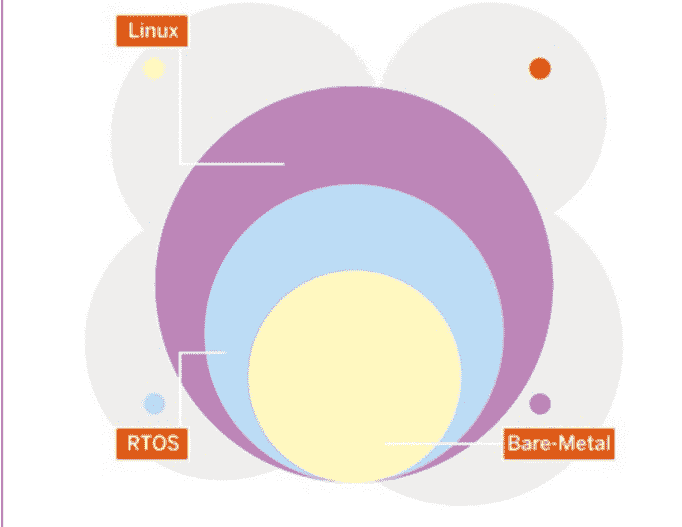

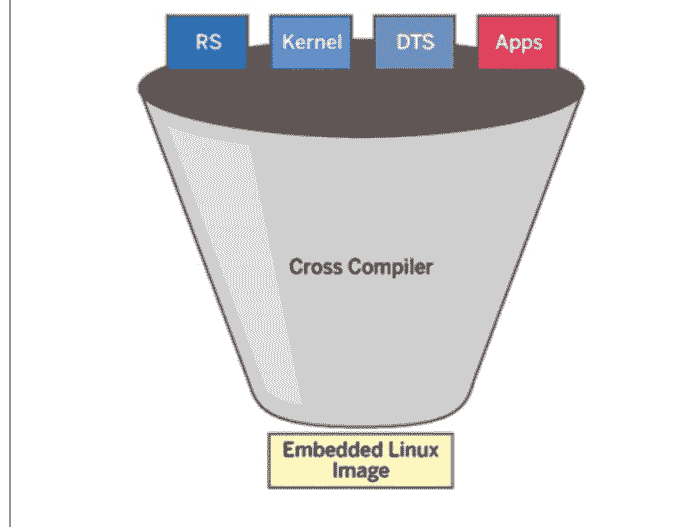

**图 1：**裸机、`RTOS` 和 `Linux` 嵌入系统在系统资源需求上存在差异。

**图 2：**`IoT` 设备的 `Linux` 镜像由五个主要组件组成。

### Yocto 与 BSP 架构

`Yocto` 项目作为整个 `BSP` 的基础，提供了由 `Yocto` 构建的 `Bitbake` 工具以及层所依赖的参考实现。`BSP` 由不同的层组成，每个层都有自己的仓库。`SoM` 厂商以 `XML` 格式向 `BSP` 提供第三方定义，然后由 `manifest` 解析并列出每个层的仓库。

```xml
<?xml version="1.0" encoding="UTF-8"?>
<recipe version="1.0-8" revision="gathersport/8">
  <remote name="meta-digi" fetch="https://github.com/Digi-embedded" />
  <remote name="meta-frescale" fetch="https://github.com/Freescale" />
  <remote name="meta-ti" fetch="https://github.com/openti/embedded-layers" />
  <remote name="meta-nm" fetch="https://github.com/openembedded/meta-nm/external/nm" />
  <remote name="meta-openembedded" fetch="https://github.com/openembedded/meta-embedded" />
  <remote name="meta-octo" fetch="https://github.com/octo/meta-octo" />
  <remote name="meta-yocto" fetch="https://github.com/yoctoproject/yocto" />
  <recipe name="meta-digi" path="sources/meta-digi" remote="digi" revision="a970dfd3c37f5ff4a7b8d375a8b096a3b370b">
  <recipe name="meta-frescale" path="sources/meta-frescale" remote="frescale" revision="3399a8177f6c7cd2b6928dc28f1e1b3c9">
  <recipe name="meta-ti" path="sources/meta-ti" remote="ti" revision="b2e5a514a3b5c9d3a7b9b1c14f618539b2">
  <recipe name="meta-nm" path="sources/meta-nm" remote="nm" revision="b8e5a5b4c3d6e2f3a8b807f5f141c94b9c4">
  <recipe name="meta-openembedded" path="sources/meta-openembedded" remote="openembedded" revision="655a85b4c3d6e2f3a8b807f5f141c94b9">
  <recipe name="meta-octo" path="sources/meta-octo" remote="octo" revision="3f41a77ccacebed289f65a8b8d6f6f7a39c9b7">
  <recipe name="meta-yocto" path="sources/meta-yocto" remote="yocto" revision="31f4a77ccacebed289f65a8b8d6f6f7a39c9b7c9c3b">
  <recipe name="meta-swupate" path="sources/meta-swupate" remote="swupate" revision="d8ef4c77d3f7273217f65ed6f7a7c93c9b7">
  <recipe name="meta-puky" path="sources/meta-puky" remote="puky" revision="67f6a5b5e6d5e8d610128d6b9953f6a4">
</recipe>
```

**图 3：**`manifest` 列出了使用 `SoM` 提供的框架的所有层。

由于 `Frescale` 的流行和频率，`Yocto` 采用了这种层结构。然而，还有一个由 `NXP` 提供的仓库，包含了用于 `NXP` 制造的 `CPU` 的配置和应用程序。你也可以发现由 `SoM` 生产者管理的层，例如 `meta-digi` 和 `meta-ti`。最后，你可以看到 `Digi` 还包含了参考 `BSP` 中的其他仓库，例如 `q75` 和 `swup`，`Digi` 将这些添加到 `BSP` 中，以包含来自组织的硬件资源和服务应用程序。图 4 显示了各个层。每个层至少包含一个配置文件，告诉 `Yocto` 框架如何处理该层的配方。此外，可能还有包含构建选项的其他文件。结果是一个可以部署到目标文件系统的单包。

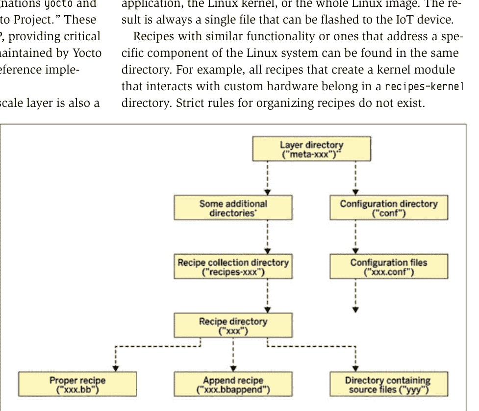

### 开发环境要求

| 项目 | 配置 |
| :--- | :--- |
| 处理器 | 64 位，8 核 |
| 操作系统 | `Ubuntu` 18.04 |
| `RAM` | 8GB |
| 存储空间 | 25GB |

此外，社区和制造商遵循一系列最佳实践以轻松实现。图 4 显示了一些带有 `.bbappend` 扩展的文件。这些文件用于扩展或修改现有配方。扩展名必须与配方的名称匹配。

开发者 `PC` 需要满足开发计算机的要求（见表 1）。此外，机器上必须安装某些软件包。你可以使用列表 1 中的命令设置环境。

```bash
sudo apt-get install git gawk wget texinfo ninja-multilib g++-build-essential cmake socat libsdl.2-dev xterm
```

此外，你还需要 `Google` 提供的 `Repo`（列表 2）。使用 `Repo`，你现在可以构建你的第一个列表（列表 3）。我已经决定基于 `Yocto` 框架构建 `BSP`。下一步是构建 `IoT` 设备，使用 `DGI-C6N-SBC` 作为硬件构建出一个小的“Hello, World”应用程序。


```bash
sudo curl -o /usr/local/bin/repo http://cloudstorage.googleapis.com/git-repo-downloads/repo
sudo chmod +x /usr/local/bin/repo
```

```bash
repo init -u https://github.com/embedded-embedded/yocto-manifest -b gatesguard
repo sync -j8 --no-repo
source ./project-sh
```

最后一步是运行自定义应用程序或修改内核以支持你的硬件。首先你需要创建两个新仓库。一个拥有你的层，另一个用于 manifest。如果你想通过 `repo` 下载所有层，由于厂商（在此示例中）包含了 manifest，你需要复制它添加你的层，最后用自己的仓库上传修改后的 manifest。

第二点是你的层所需的。你可以从任何层配置文件并使用之前的结构创建自己的配方。对于 C 语言的“Hello, World”应用程序，所需的结构将如列表 4 所示。

```bash
[13:16:50] ls

cd dev-environment mkproject mkproject.sh sources

[13:16:50] ls sources

meta-data meta-freebase meta-imex
meta-python2 meta-selinux meta-webkit
meta-data-dualboot meta-fs1-demos meta-embedded meta-qt5
meta-spway poky

[13:16:03]
```

`BSP` 的子目录大部分代表 `BSP` 包含的层。

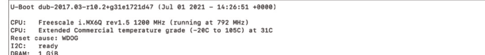

```
U-Boot-2017.03.20-r1.2g712147 (01 Jul 2022 - 14:26:51 +0000)
CPU: FreeScale_v76a 1200 MHz (running at 792 MHz)
CPU: Extended Commercial temperature grade (-20C to 185C) at 31C
Reset cause: WODOG
Image: none
FSL:, FSDC: 1
*** bad CRC, using default environment
Serial:
Out: serial
Err:
RAM: 1 GHC
Model: DGI Industrial ConnectCore 6 Single Board Computer.
U-Boot>uninitialized_board_addr.
```

`hello-world.bb` 文件格式必须简单；列表 5 显示了其内容。前四行描述了配方（recipe）及其许可证。如果它遵循 `GPL` 许可，则必须指定校验和。如果你不想在免费许可证下发布该配方，可以选择文件中的 `CLOSE` 值。

列表 5 中的 `SRC_URI` 告诉 `Bitbake` 寻找与配方相关的文件。在这个示例中，只有一个单个文件。你也可以指定由 `Git` 或 `subversion` 管理的完整压缩包（tarballs）。

配方的末尾包含两个函数（第 7 行和第 10 行），用于编译应用程序文件并安装结果。`Yocto` 框架带有实体的基础版本，用户可以对其进行覆盖。框架还包含其他用函数的模板，例如 `downstream`。

```
meta-custom
|-- apps
|   |-- files
|   |-- hello-world
|   |-- hello-world.bb
```

实际应用程序是一个简单的 C 文件（列表 6）。要创建配方，只需使用快捷命令 `bitbake hello-world`。

```
01 DESCRIPTION = "Simple World Application"
02 SECTION = "examples"
03 LICENSE = "GPL"
04 LIC_FILES = "file://${COMMON_LICENSE_DIR}/MIT"
05 SRC_URI = "file://${WORKDIR}/hello-world.c"
06 S = "${WORKDIR}"
07 do_compile() {
08 $(CC) -c hello-world.c -o hello-world
09 }
10 do_install() {
11 install -d $(D)${bindir}
12 install -o root hello-world $(D)${bindir}
13 }
```

为了让本地设备构建“Hello, World”，你需要将其添加到最终镜像中。因此，`bitbake-image` 命令已告诉 `Bitbake` 从 `dane-image-qt` 配方构建镜像。你必须添加包含列表 7 内容的追加文件，用来创建 `hello-world.bb` 配方。

如果你现在调用 `bitbake-image-qt`，“Hello, World”将被创建并放置在最终镜像中，你现在可以将其加载到软设备上。

如果你需要将操作系统适配到嵌入式设备，并且想使用 `Linux`，`Yocto` 项目将从工具开始为你提供优势。`Yocto` 项目的工具、层和配方将为你节省时间并简化将 `Linux` 适配硬件的任务。也存在创新的框架，例如 `Buildroot` [3]，你将在本期后面读到关于它的。`Yocto` 的优势在于它在 `SoM` 供应商中非常流行，并成为 `Linux` 的主流框架。缺点是：它比 `Buildroot` 需要多多的资源。

```
#include <stdio.h>
int main() {
    printf("Hello, World!\n");
}
```

```
IMAGE_INSTALL_append += " hello-world"
```

- [1] Yocto Project/OpenEmbedded Framework: https://www.yoctoproject.org
- [2] 入门指南：Yocto 项目概述: https://www.yoctoproject.org/software-overview/
- [3] Buildroot: https://buildroot.org

在 10 月 14 日前注册享受大折扣！

11 月 13 日–18 日

`SC22` 是全球最大的 `HPC` 研究人员和专业人士聚会之一，这是一个学习新技能、建立新友谊、解决复杂问题以及查看下一代技术的惊人周。

如果你倾向于虚拟参加，可以使用全新的、定制的数字体验。

国际高性能计算、网络、存储和分析国际会议

`sc22.supercomputing.org`

无论你需要一个用于 1MB 闪存内存的微型 `OS`，还是一个带有图形栈的复杂 `Linux`，你都可以使用 `Buildroot` 快速设置一个运行的操作系统。

作者：Arnout Vandercappelle

为了组合一个基于 `Linux` 的 `IoT` 系统，你需要一种快速简单的方法让基础系统运行起来。在进行此操作时，你还需要关注占用空间——某些平台的闪存内存小于 4MB。你将希望控制系统中所包含的软件，并希望能够使用自己的应用程序。最后但同样重要的是，你将需要注意安全并遵守开源和专有许可证。

`Yocto` 项目 [1] 将帮助你完成这些任务。`Buildroot` 出现于 21 世纪初的 `OpenEmbedded` 和 `Busybox` 项目，专注于创建占用极小的系统。与显著复杂的 `Yocto` 相比，`Buildroot` 更容易使用和理解（见本期第 16 页开始的文章）。如果你不需要 `Yocto` 的功能（如多层系统或其他高级功能），而只是想为嵌入式设备生成一个操作系统，那么 `Buildroot` 更好。

`Buildroot` 可以生成：

- 一个交叉编译工具链
- 一个根文件系统
- 一个 `Linux` 内核
- 目标设备的引导加载程序

一个基于 `Linux` 内核菜单系统的选择工具允许你选择哪些软件包以及相关的配置选项。这种菜单驱动的方法帮助你拥有所需的软件包和相关配置选项。这种方法有助于你减少内核的占用空间。

与 `Ubuntu Core` 不同，通过 `root overlay` 帮助你排除掉不需要的软件包。在配置中，你可以选择像 `UBIFS` 这样的 `NAND flash` 选项，文件系统选项（图 1）。

```
####################
# tfer
####################

TINFINER_VERSION = 1.0
TINFINER_SITE = $(call taramp,tfer,
TINFINER_LICENSE = MIT
TINFINER_INSTALL_SITE =
TINFINER_GMOD = /cmd/tfer
$($(package))
```


# 嵌入式系统构建与 Red Hat 生态系统

## 嵌入式尺寸与交叉编译

在嵌入式尺寸下，交叉编译是唯一的可行方法，因为目标系统通常太慢且内存不足。交叉编译允许你使用不同的 C 库（如 `mus` 或 `uIBC`），并使用 root overlays 编译目标，这就是为什么它们有自己的 root overlays。交叉编译引导加载程序和内核选项（设备树）已经设置了基础配置。

然而，交叉编译带来了许多挑战。在使用 `Buildroot` 的挑战是使用目标，这就是为什么它们有自己的 root overlays。

有些项目使用 `Buildroot` 构建更灵活的发行版。例如 `DahlOS`、`Recalbox` 和 `Home System` 等。其他项目利用 `Buildroot` 的灵活性。

### 灵活性配置

`Buildroot` 最重要的功能之一是灵活性。你需要能够对所需的结果进行各种微调。该发行版通过对软件包的选择来实现这一点。`Buildroot` 为初始化系统提供了多种选项（`systemd`、`SysVinit`、`OpenRC`）。此外，还有 15 种不同的文件系统可用。在配置中，你可以选择像 `UBIFS` 这样的 NAND flash，文件系统选项还包含了链接到 Linux 内核的 RAM disk。

你可以将配置存储在软件包文件中，该文件可以引用所需的其他文件。软件包本身也有自己的配置文件。如果使用 roots，你只需复制一个目录（root overlay）并运行脚本，用于那些难以保存在配置文件中的复杂操作，包括文件权限和所有权以及密码。你可以使用 root overlays 为特定项目定义这些内容。

等等，这些是包含工具链、内核、引导加载程序和 `busybox` 的最小配置。当你上传时通常是 SD 卡——直接使用。使用 SD 卡启动设备并访问 shell，你现在可以需要对其进行调整。只要你知道 `CPU`。

> 图 1：在下载并补丁软件包后，需要进行配置

### 您的选择

为了生成可运行的输出，应用程序需要提供 IoT 设备的功能。有时，这仅限于几个脚本，例如您通过 Web 服务器使用的 `PHP` 文件，这些文件只是根目录覆盖层（roots overlay）的一部分。然而，您通常需要编译并安装更多的自定义组件。

`Buildroot` 提供了两种方式来编译您的内核。一种方法是为每个组件设置单独定义，由几个文件组成，特别是当使用支持的构建之一时（图 1）。对于 C++ 的 `Meson`、`Cmake`、`Make` 和 `Autotools`，其他语言通过构建系统处理：对于 `Go`、`Golang`、`Rust`、`Erlang` 的 `Rebar`、`Lua` 的 `Luasit` 或 `Python` 脚本的 `MUB`，非常简单易用。

通过 `Distibuls`、`Deutils`、`Config` 和 `Make`，《全面构建手册》(2) 解释了如何创建包定义以及您需要使用哪些变量来完成构建。

`Buildroot` 还允许您通过将自己的定义与 `Buildroot` 的源码包混合来尝试探索。外部树（`external tree`）机制是将自定义包定义添加到 `Buildroot` 自有定义中的是最简单的方法。此外，您可以在树中存储您的配置和其他文件（如覆盖层）。这使您所有的自定义都保留在一个地方。

有时，在 `Buildroot` 之外编译代码会更方便。对于大型项目，您可能会发现开发者并不是每天都在用 `Buildroot` 工作，因此如果您直接与开发环境支持的构建系统工作，那么从 IDE 编译会更容易。`Buildroot` 提供了一个包含编译工具链、所有已配置的库和根目录的 SDK。毕竟，您将需要其中一些内容来构建自己的应用程序，而 `Buildroot` 生成的代码包含了 `Google protobuf` 定义的编译选项。该 SDK 以 tar 包的形式提供，您可以对其进行解压。如果您设置 IDE 使用 `SDK-core`，就可以直接从它进行编译和调试。

该版本将维护三个月（错误修复和安全更新）。每月发布一个新版本。`XXXX` 版本是 LTS（长期支持）版本，其维护时间超过一年，并每月添加新发布。

`Buildroot` 是社区驱动的，有 100 人参与发布，每周总计有 1500 处更改。社区主要通过邮件列表（`lists@buildroot.org`）以及 Fera Technology Community (`FTC`) 上的 IRC `#buildroot` 进行通信。每周，开发者会聚在一起讨论新进展并解决议程上的待处理问题。此外，社区还会在这里讨论并决定争议性案例。这背后没有控制。然而，公司和咨询服务为 `Buildroot` 提供支持。

若要在笔记本电脑上获取包含所需包的操作系统，请访问 `Buildroot` 网站获取更多信息。

开发者工具确实帮助您构建自己的 `Buildroot`。您可以使用 `pkg-tools` 检查并使用 `pkg-utils` 收集您使用的包的信息，在网络上搜索新版本，以及来自国家漏洞数据库的连接和 CVE 报告（其中 `NIST` 以 HTML 和 JSON 格式返回结果）。此报告出现在该包中 (3)。如果您想自定义包，请使用 `-toolchain` 工具。

进一步的进展仍在继续 - 440 项任务。每周都会使用 `Buildroot` 构建针对 `SBC`、`SoC` 和 `Qemu` 的 270 种配置。所有这些配置都是每周创建的。最后，有 20 台构建服务器可以生成任意配置。这些服务器的报告可以在线上查阅 [4]。

### 总结

`Buildroot` 多年来一直在演进，以构建一个在世界上既稳定又经过验证的系统。`Buildroot` 支持许多用例，从只有 1MB 闪存的系统到云部署的 Docker 镜像，再到带有图数据库或 Linux 的复杂系统。简单、灵活性、可重现性和维护性使得 `Buildroot` 成为 IoT 系统的优秀选择。

在使用 Git 仓库 [5] 克隆它后，配置它需要一个月以上。回报是一个良好的最终产品。

- [1] `Buildroot`: https://buildroot.org/
- [2] `Buildroot` 手册: https://buildroot.org/
- [3] `Buildroot` 报告: https://buildroot.org/
- [4] `Buildroot` 服务器: https://buildroot.org/
- [5] `Buildroot` Git 仓库: https://buildroot.org/

## Red Hat 生态系统

### 社区与公司的冲突

`Red Hat` 派生了企业和社区的发行版。这里是这些发行版之间的关系以及它们的不同之处。`Bruce Byfield`

当 Linux 在 20 世纪 90 年代末出现，`Red Hat Linux` 是顶级版本之一，因为其通常完整的文档和对可访问性的努力。1999 年 8 月 11 日，红帽公司成为第一家上市的公司。`Red Hat` 成为 `IBM` 下的一家价值数十亿美元的创业公司，创建并测试了红帽企业版 Linux (`RHEL`) 产品。此外，由于 `Red Hat` 停止 `CentOS` 并启动 `CentOS Stream`，`Rocky Linux` 和 `AlmaLinux` 是从 `RHEL` 分叉出来的。`Fedora` 和 `RHEL` 的衍生品，以及一个仅与 `Debian` 连接的生态系统，但专注于创新、网络和服务器。这些发行版是如何关联的？它们有什么不同？这里有一个简短的概述。

`Fedora` 项目 [1] 是初始红帽发行版的替代品。红帽任命 `Fedora` 领导者并在 `Fedora` 委员会拥有席位，但保持独立，决策由社区成员或技术工作组做出。

`RHEL` [2] 是 `SUSE Linux Enterprise` 和 `Tradition` 的竞争对手。`RHEL` 一直是 `Fedora` 项目的下游，使用相同的包并进行更广泛的测试，并为它们提供长期支持——这一过程现在在 `CentOS Stream` 中公开可见。`RHEL` 发布是

这种导向可能会吸引传统企业——特别是那些关注 `AlmaLinux` 和 `RHEL` 内容的企业——其在 2021 年增长了 17% [44]，产生了像 `AlmaLinux` 和 `Rocky Linux` 等衍生版。

`CentOS Stream` 使用旧的 `CentOS` 标志 [6] 并延续了 `CentOS` 的版本，但这种名称上的连续性具有误导性。`CentOS` 是 `RHEL` 的重新构建，而 `CentOS Stream` 则是 `Fedora` 和 `RHEL` 之间的中间层。另一方面，来自 `CentOS Stream` 的大部分 `RHEL` 内容都是上游的。这意味着 `CentOS` 的下一个版本将是 9，而不是来自 `CentOS` 7（`CentOS` 7 仍然基于 `RHEL` 8，在开发停止后已被废弃）。相反，它的起点是 `RHEL`。目前尚不清楚 `Fedora` 和 `CentOS Stream` 之间的关系，除了它们通常都基于几个 `Fedora` 版本，而这些版本的发布并不重合。

尽管 `RHEL` 是一项商业软件，但免费社区引起了参差不一的反应。另一方面，红帽是 Linux 内核的主要贡献者。此外，它对从操作系统到 `SELinux` 的各种项目做出贡献，并开发了许多技术，包括 `PulseAudio`、`Flatpak` 和 `PipeWire`。它的活动主要是内部的或以内部为主，这并不是最理想的方向。特别是 `RHEL` 的订阅尝试或安装，经常被忽视，视为 `Fedora` 和 `CentOS Stream` 可用性中的免费漏洞，因为两者共享大部分相同的代码。然而，`RHEL` 的商业前景和……

`CentOS` [5] 是 `RHEL` 的一个社区，吸引了那些倾向于更透明但无安全性的开发模式的人；它拒绝使用 `Debian` 作为 Web 服务器。红帽在 2014 年收购了 `CentOS`，但让其独立运行直到 2021 年，当时红帽宣布停止 `CentOS` 开发并启动了 `CentOS Stream` 命名。`CentOS` 7 将持续维护到 2024 年 6 月 30 日，但许多用户已经……


### 访问商店 `shop.linuxnewmedia.com`

想要订阅吗？

寻找你曾在报刊亭真正看中的那期旧杂志吗？

`shop.linuxnewmedia.com`


### 发行版 - 红帽生态系统

开发团队对项目的描述与 `AlmaLinux` 类似，将其视为“Bug 兼容”且免费获取的 `RHEL` 实现。与 `RHEL` 相比，`Rocky Linux` 强调其构建过程的透明度。例如，在最新发布中，`Rocky` 引入了 `Peridot`，这是一个基于云的开源系统。在 `Rocky` 中，其社区规范加密可以获得标准的认证。2022 年，`Rocky` 的最新版本甚至在 `Extra Packages Enterprise Linux (EPEL)` 仓库中领先取代了 `RHEL` 和 `CentOS`。

#### 如何选择

如果你认为这些描述增强了开源政策和偏好，你是对的。大多数发行版的代码库非常相似，但 `AlmaLinux` 和 `Rocky` 已经显示出差异化的迹象。因此，哪种发行版可能取决于其他因素？关注 Linux 进展的用户可能偏好 `Fedora`，而另一个人可能使用更多 `CentOS Stream` 进行测试。传统主义者可能偏好 `RHEL` 的优势，而 `AlmaLinux` 或 `Rocky` 对于后继者以及偏好红帽那种社区导向方法的用户来说同样优秀。对于许多人来说，某些考虑可能比技术考虑更重要。


`CentOS` 的结束很快通过两个最少继任者的宣告宣布，两者在 `CentOS` 结束后几个月内就发布了第一个版本。其中第一个 `AlmaLinux` (7)，由 `CloudLinux`、`AWS`、`Equinix` 和微软支持。该发行版对红帽和 `CentOS` 的结束做出了回应，在其自己的页面上将自己定义为“开源、社区驱动、企业级 Linux 发行版，注重长期稳定性，提供稳健的生产级平台”，正如 `AlmaLinux` 所称。

### 衍生版本

除了工作站和服务器版，`Fedora` 还提供了 spins - 带有除 `Gnome`、`Cinnamon`、`Plasma` 或 `XFCE` 之外的桌面环境。还有来自下载页链接或特定用途的镜像，如游戏或用于不同架构测试的 `Alternatives`。

除了两个不同的 `Fedora` 和 `Rocky` 衍生版外，某些如 `ZLinux`、`SpringLinux` 和 `Oracle Linux` 是从 `RHEL` 源包、`CentOS` 及其网络安全工具包 (`NST`) 构建的；`Berry Linux` 是 `Fedora` 版本的 `KNOPIX`，而 `UltraLinux` 包含比替代桌面更多的功能以提供完善的纠正。最有趣的是 `Qube`，它将应用程序分配给容器。结果是一个易于使用的安全系统，但至少需要 16GB 的内存开销。

- [1] `Fedora`: https://fedora.org/
- [2] `RHEL`: https://www.redhat.com/en/technologies/linux-platforms/enterprise-linux
- [3] 红帽项目: https://fedoraproject.org/wiki/Red_Hat_Contributions
- [4] 红帽增长: https://techcrunch.com/2021/10/21/red-hat-to-grow-but-ignores-community/
- [5] `CentOS`: https://centos.org/
- [6] `CentOS Stream`: https://www.centos.org/centos-stream/
- [7] `AlmaLinux`: https://almalinux.org/
- [8] `Rocky Linux`: https://rockylin.org/
- [9] `Fedora Spins`: https://spins.fedoraproject.org/
- [10] `Fedora` 变体: https://fedora.org/
- [11] `Fedora` 衍生版: https://distrowatch.com/search?type=architecture&all&origin=all&base=fedora&notbase=None&architecture=all&package=rolling&all&isize=all&netstall=all&language=all&status=Active&simple

`CentOS` 的主要继任者是 `Rocky Linux` [8]，由 `CloudLinux`、`AWS`、`Equinix` 和微软支持。该发行版对红帽和 `CentOS` 的结束做出了回应，在其自己的页面上将自己定义为“开源、社区驱动、企业级 Linux 发行版，注重长期稳定性，提供稳健的生产级平台”，正如 `AlmaLinux` 所称。


## 虚假信息检测工具

许多寻找虚假内容的扩展程序使用了某些特定的人工智能方法。例如，某些短语（如“观点”或“我认为”）已经清楚地表明了内容的客观性。这些浏览器扩展程序还使用数据库来对其真实性进行比较和分析检查。

事实上，在其他社交网络上，这些插件也可以用于对由机器人发布的评论进行排序。在检查时，某些扩展程序会显示媒体并检查图像是否在其他地方发布过。如果你在更早的网页上发现了相同的内容，且它在你看到的页面上没有被标记为文章或图像，你可能会被误导。你还可以搜索图片的其他副本（如反向图像搜索），以检测来源指纹。

伪造信息更难检测，通常需要人工检查。像 `Captcha` [3] 等服务提供了协作者验证和图像标注的在线工具，以及其他方法。

国际大赦组织的公民之眼 [4] 包含一种在线视频验证事实核查，可以提取元数据。如果发现数据比内容报告的日期早得多，那么你很可能看到的是虚假信息。

在测试中，几乎没有完全匹配的结果。此外，`Bing` 也缺乏大多数关于图像的相关数据。`Yandex` 和 `Google` 的结果虽然并不十分可靠。在 `Tinye` 上，发现了几乎完全相同的图像（包括元数据），并提供了与原始文件 (1) 的匹配对比。

要双击搜索匹配，请将鼠标指针移动到其中一张图像上然后点击“`Click`”（点击）。图像将出现在单独窗口中。要进行比较，请点击“`Match`”（匹配）或你的图像。

`Tinye` 还会显示其拥有的图像发布日期、原始 URL 和图像大小。这使得很容易判断图像是否是最近创建的，或者图像是否被随后的修饰所操纵。`Tinye` 还允许你复制版权信息。

### The Factual

`The Factual` 声称分析了来自 50,000 名记者和 2,000 个新闻来源的 1000 万条新闻，开发了一套根据四个因素评估新闻的评分系统：

- 来源的多样性和范围
- 作者的语气（中性 vs. 观点性语言）
- 作者对主题的专业知识
- 网站的历史信誉度

浏览器在分析后会打开一个小窗口，其中的像素提供了有关所检查文章状态的信息。在基本设置中，这四个因素用于评估被调查项目的质量、作者的专业知识、使用的来源以及文章元数据。扩展程序还根据绝对值评估质量因素，并识别文章的政治取向。

结果底部显示的“`Shuru details`”（详情）链接让你查看更多关于所审查文章的详细信息。你还将看到提到的来源和链接数量。各个评估标准从绿到红的光谱有助于你一目了然地看到文章评分如何（图 2）。

`The Factual` [5] 是 Chrome 及其衍生版本的可用插件，安装后即可使用。`The Factual` 门户属于位于加利福尼亚州的 `CivicW` 组织，为读者提供侧名称（`off-off name`），并对其文本分析进行人工智能分析和人工检查；它引用了数据库。

`The Factual` 感觉有点像世界上最新的新闻评分引擎。该项目

`TrustedNews` [6] 是另一个浏览器扩展，使用人工智能分析英语媒体上的语言媒体。

![Tinye 的图像搜索]
图 1：`Tinye` 的图像搜索显示了相似图像的快速匹配。

图 2：`The Factual` 在其分析中结合了多种标准。

### InVID

`InVID` 工具包最初在欧盟的支持下开发，声称是记者和活动人士的瑞士军刀式来源 [7]。`InVID` 在免费的 MIT 许可下提供，自誉为“……一个提供检测、验证和检查服务的平台”。国际大赦组织的公民之眼 [4] 包含一种提取元数据的在线视频验证事实核查。

要通过双击搜索匹配，请将鼠标指针移动到其中一张图像上然后点击“`Click`”。图像将出现在单独窗口中。要进行比较，请点击“`Match`”（匹配）或你的图像。

在 Chrome 中，在 MIT 许可下提供视频，选择 `YouTube`、`Facebook` 或 `Twitter` 视频。在主窗口输入 URL，然后点击“`Submit`”（提交）。一段时间后，结果将出现在主列表中。

### WeVerify

`WeVerify` 作为一个开源平台，提供以下方法来检测 [8] 社交媒体的虚假信息：

- 视频验证工具
- 基于区块链的验证工具
- 公民导向的验证
- 视频分析工具

`Tinye` 还会显示其拥有的图像发布日期、原始 URL 和图像大小。这使得很容易判断图像是否是最近创建的，或者图像是否被随后的修饰所操纵。`Tinye` 还允许你复制版权信息。

大赦组织的公民之眼 [4] 提取元数据。如果发现数据比内容报告的日期早得多，那么你很可能看到的是虚假信息。

在测试中，几乎没有完全匹配的结果。此外，`Bing` 也缺乏大多数关于图像的相关数据。`Yandex` 和 `Google` 的结果虽然并不十分可靠。在 `Tinye` 上，发现了几乎完全相同的图像（包括元数据），并提供了与原始文件 (1) 的匹配对比。

要通过双击搜索匹配，请将鼠标指针移动到其中一张图像上然后点击“`Click`”。图像将出现在单独窗口中。要进行比较，请点击“`Match`”（匹配）或你的图像。

`Tinye` 还会显示其拥有的图像发布日期、原始 URL 和图像大小。这使得很容易判断图像是否是最近创建的，或者图像是否被随后的修饰所操纵。`Tinye` 还允许你复制版权信息。


## 通过历史记录提高效率

这个功能强大的 bash 命令可以在命令行中节省你的时间和精力。作者：`Bruce Byfield`

`history` 命令有几个环境变量。根据发行版的不同，它们都在主目录下添加或修改。历史文件的大小由 `HISTSIZE` 限制（它设置了历史条目的数量），由 `HISTFILESIZE` 限制（允许用于历史记录的最大内存）。两者具有相似的结构。

> 如果你在终端中工作，可能经常使用 Bash 的 history 命令来避免重试命令的麻烦 [1]。如果你像大多数人一样，你对历史的使用可能仅限于滚动之前的命令列表。如果你对最近使用的命令感兴趣，方向键可能会对你有帮助。然而，`history` 命令能够做更多事情，而且方式更高效——尤其是当你记忆力很好。你可以开始调整历史设置，并学习如何使用三种类型的编辑选项（事件描述符、单词设计符和修饰符）来管理历史，以便更容易搜索和重放。这三者的灵活性可以让你 bash 历史为你节省时间和精力。

### 作者

`Bruce Byfield` 是一位计算机记者，也是一位专精开源的自由作家和编辑。在不同的项目中，他教授直播课程和在线课程。业余时间，`Bruce` 编写关于西北海岸（`http://brucebyfield.wordpress.com/`）的文章，并是 `Reminder Pieces` 的创始人，这是一个关于随笔和幻想的博客，地址为 `https://remindpieces.com/`

当达到条目上限时，早期的条目会被删除并被新的条目取代。许多用户尝试尝试较大的数字，例如 10,000 条。因为历史记录是一个文件，所以历史文件的空间分配应该没有问题。

```


# `HISTFILESIZE`

90 `visudo`
91 `apt install sudo`
92 `curl -fsSL https://raw.githubusercontent.com/Homebrew/HEAD/install.sh`
93 `test -d /home/linux/.brew && eval "$($(brew --prefix)/bin/brew.sh)"`
94 `test -d /home/linux/.brew && eval "$($(brew --prefix)/bin/brew.sh)"`
95 `test -r ~/.bash_profile && echo "eval "$($(brew --prefix)/bin/brew.sh)"" >> ~/.bash_profile`
96 `echo "eval "$($(brew --prefix)/bin/brew.sh)"" >> ~/.zshrc`

图 1：默认 `history` 命令的示例。

| | | |
|---|---|---|
| 153 | `088022213084boxes` | `bb@illarness:! 71` |
| 154 | `088022213084history` | `bash: command not found` |
| 155 | `088022213084less /etc/pipework/pipewire.conf` | `bb@illarness:! 71` |
| 156 | `088022213084cat/_profile` | `cd. ~/.apt.conf` |
| 157 | `088022213084mansize` | `bash: ./apt.conf:No such file or directory` |
| 158 | `088022213084history` | `bb@illarness:! 153` |
| 159 | `088022213084history` | `boxes: command not found` |
| 160 | `088022213084HISTTIMEFORMAT` | `bb@illarness:! 161` |
| 161 | `088022213084su` | |

| | 说明 |
|---|---|
| `%d` | 日 |
| `%m` | 月 |
| `%Y` | 年 |
| `%H` | 小时 |
| `%M` | 分钟 |
| `%S` | 秒 |

在这个例中，用户用户尝试在未登录的情况下运行一个路径，因此命令无法被占用，但较长的历史可以让许多条目变得高效。事实上，除非你有对更大尺寸的需求，否则较小的数字就足够了。无论如何，你都可以使用 `Ctrl+R` 进行搜索。如果你对想要列出多少条目有数数，从最近的或特定的数字开始，你也可以通过 `history -` 清除当前历史，后面过长的历史会变得太混乱。清理和修饰也会让使用变得更容易。

修饰符编辑历史条目，允许将其移除。某些修饰符可以直接删除你想要的条目。例如，`h` 会移除修饰符之后的所有内容，例如从历史中移除 `-h head/user/music/musicogs`。同样，使用 `/w /home/user/music` 会从历史中删除 `/home/user/music`。同样，使用 `r .odt` 会将文件扩展名从 `.c` 扩展到 `.odt`。使用 `p`，命令将只显示而不执行，如果你不确定想要删除或检查哪一个历史条目，这可能会困难。

环境变量 `HISTTIMEFORMAT` 为历史记录添加时间戳。在最简单的形式中，`!` 显示最后一条命令。然而，你可以使用 `!` 调用之前的命令。例如，`!!` 重复最后一条命令，`!word` 重复以该单词开头的最后一条命令，`!string` 重复包含该字符串的最后一条命令。使用 `^` 将命令的最后一个参数替换为新的，而 `: ` 将最后一个参数替换为空字符串。清理和修饰也会让使用变得更容易。`HISTCONTROL` 变量可以控制历史记录如何保存。例如，`HISTCONTROL=ignoredu` 将忽略会话期间的重复项。

事件描述符允许你使用特定模式操作历史。例如，`h` 移除修饰符之后的所有内容，例如从历史中移除 `-h head/user/music/musicogs`。同样，使用 `/w /home/user/music` 会从历史中删除 `/home/user/music`。同样，使用 `r .odt` 会将文件扩展名从 `.c` 扩展到 `.odt`。使用 `p`，如果你不确定想要删除或检查哪一个历史条目，这可能会困难。

这三者的灵活性可以让你 `bash` 历史为你节省时间和精力。

单词描述符编辑历史条目，允许将其移除。某些描述符直接删除你想要的条目。例如，`h` 会移除修饰符之后的所有内容，例如从历史中移除 `-h head/user/music/musicogs`。同样，使用 `/w /home/user/music` 会从历史中删除 `/home/user/music`。同样，使用 `r .odt` 会将文件扩展名从 `.c` 扩展到 `.odt`。使用 `p`，如果你不确定想要删除或检查哪一个历史条目，这可能会困难。

当达到条目上限时，早期的条目会被删除并被新的条目取代。许多用户尝试尝试较大的数字，例如 10,000 条。因为历史记录是一个文件，所以历史文件的空间分配应该没有问题。

# `HISTSIZE`

# `HISTFILESIZE`


图 1：默认 `history` 命令的示例。

```
| 153 | 088022213084boxes | bb@illarness:! 71 |
| 154 | 088022213084history | bash: command not found |
| 155 | 088022213084less /etc/pipework/pipewire.conf | bb@illarness:! 71 |
| 156 | 088022213084cat/_profile | cd. ~/.apt.conf |
| 157 | 088022213084mansize | bash: ./apt.conf:No such file or directory |
| 158 | 088022213084history | bb@illarness:! 153 |
| 159 | 088022213084history | boxes: command not found |
| 160 | 088022213084HISTTIMEFORMAT | bb@illarness:! 161 |
| 161 | 088022213084su | |
```

图 2：启用 `HISTTIMEFORMAT` 的示例。

### 表 1：设置 `HISTTIMEFORMAT` 的值

| | 说明 |
|---|---|
| `%d` | 日 |
| `%m` | 月 |
| `%Y` | 年 |
| `%H` | 小时 |
| `%M` | 分钟 |
| `%S` | 秒 |

在这个例中，用户用户尝试在未登录的情况下运行一个路径，因此命令无法被占用，但较长的历史可以让许多条目变得高效。事实上，除非你有对更大尺寸的需求，较小的数字就足够了。无论如何，你都可以使用 `Ctrl+R` 进行搜索。如果你对想要列出多少条目有数，从最近的或特定的数字开始，你也可以通过 `history -` 清除当前历史，后面过长的历史会变得太混乱。清理和修饰也会让使用变得更容易。

## 修饰符

修饰符编辑历史条目，允许将其移除。某些描述符直接删除你想要的条目。例如，`h` 会移除修饰符之后的所有内容，例如从历史中移除 `-h head/user/music/musicogs`。同样，使用 `/w /home/user/music` 会从历史中删除 `/home/user/music`。同样，使用 `r .odt` 会将文件扩展名从 `.c` 扩展到 `.odt`。使用 `p`，如果你不确定想要删除或检查哪一个历史条目，这可能会困难。

环境变量 `HISTTIMEFORMAT` 为历史记录添加时间戳。在最简单的形式中，`!` 显示最后一条命令。然而，你可以使用 `!` 调用之前的命令。例如，`!!` 重复最后一条命令，`!word` 重复以该单词开头的最后一条命令，`!string` 重复包含该字符串的最后一条命令。使用 `^` 将命令的最后一个参数替换为新的，而 `: ` 将最后一个参数替换为空字符串。清理和修饰也会让使用变得更容易。`HISTCONTROL` 变量可以控制历史记录如何保存。例如，`HISTCONTROL=ignoredu` 将忽略会话期间的重复项。

### 事件描述符

事件描述符允许你使用特定模式操作历史。例如，`h` 移除修饰符之后的所有内容，例如从历史中移除 `-h head/user/music/musicogs`。同样，使用 `/w /home/user/music` 会从历史中删除 `/home/user/music`。同样，使用 `r .odt` 会将文件扩展名从 `.c` 扩展到 `.odt`。使用 `p`，如果你不确定想要删除或检查哪一个历史条目，这可能会困难。

### 单词描述符

单词描述符编辑历史条目，允许将其移除。某些描述符直接删除你想要的条目。例如，`h` 会移除修饰符之后的所有内容，例如从历史中移除 `-h head/user/music/musicogs`。同样，使用 `/w /home/user/music` 会从历史中删除 `/home/user/music`。同样，使用 `r .odt` 会将文件扩展名从 `.c` 扩展到 `.odt`。使用 `p`，如果你不确定想要删除或检查哪一个历史条目，这可能会困难。

当达到条目上限时，早期的条目会被删除并被新的条目取代。许多用户尝试尝试较大的数字，例如 10,000 条。因为历史记录是一个文件，所以历史文件的空间分配应该没有问题。

## 替代历史记录

一个更全面的替代方案可能是 McFly (1)（《回到未来》系列电影主角的替代品 [5]）。使用 `SQLite` 数据库，`McFly` 在其输出中加入了考虑，有时比 `HISTFORMAT` 变量更好。`McFly` 的其他建议受到你运行最后一条命令的方式，或者你之前从 `McFly` 中选择命令的时间的影响。`McFly` 允许你在之前的相同目录中运行命令，考虑你之前搜索运行的命令，并告诉命令上次是否失败了，这可能意味着你不想运行它。然而，`McFly` 仍然不是 `history` 的完全替代品。

# 结论

`history` 命令提供了许多方法来增强你的命令行工作。直到现在还没有出现直接的替换，这一事实是对 `history` 命令效率和多功能的致敬。

# 信息

[1] `history` man 手页：
- https://linux.die.net/man/5/history
[2] `McFly`:
- https://github.com/cantino/mcfly

图 5：`McFly` 是一个使用 AI 进行选择的历史记录替代方案。

# 《Linux 杂志》是您探索 Linux 世界的指南。翻开内页，获取在其他地方都找不到的高级技术信息！

# 通过以下内容扩展您的 Linux 技能：

- 关于热门话题的深度文章，包括比特币、勒索软件、云计算等等！
- 有用工具的指南和教程，将帮助您节省时间并保护数据。
- 故障排除和优化技巧
- 关于开源世界关键进展的深刻见解新闻
- 针对树莓派、`Arduino` 以及其他创板系统的酷炫项目

如果您想更进一步并利用 `Linux` 更多功能，请即刻订阅，不再错过任何一期内容！

# 立即订阅！
`shop.linuxnewmedia.com/subs`

## 深度
## 使用 `ScriptForge` 的 `LibreOffice` 宏


## 使用宏实现 `LibreOffice`

### 宏制作器 (Macro Maker)

`LibreForge` 帮助您通过构建可移植的宏来实现 `LibreOffice` 自动化。作者：`Marco Fioretti`

优秀的软件程序（作为免费开源软件）具有共同特性。您可以根据自己的需要轻松对其进行自定义。`LibreOffice` 只需极少的编程技能即可提供生产力支持，它对那些“存储以备后用使用的命令或按键”[1]的支持也不例外，这些被称为“宏”。

`LibreOffice` 宏的类型有：系统级、用户特定和文档特定。

系统级 `LibreOffice` 宏由共享并安装在系统级生产力单元中（例如 `Linux` 系统上的 `/usr/lib/libreoffice/share/scripts/`）的代码组成，这使得任何使用它们的人都能访问这些宏。

`ScriptForge` 文件（`.sct` 或类似格式）最终存储于 `/usr/lib/libreoffice/share/` 下的几个目录中。

除了系统级宏外，您还可以创建用户特定的宏，如“我的宏”(2)。在 `Linux` 上，相应的源文件将存放在 `$HOME/.config/libreoffice/user/`，当您开始创建用户特定的宏时，建议您将其添加到备份中！

`ScriptForge` (2) 是一个用于构建脚本的 `Libre` 库，将 `APSO` 扩展到 `ScriptForge` 后，它提供了一个极好的工具，让您学习如何自动化它涉及的一切通用内容，特别是在 `LibreOffice` 环境中。

系统级宏可以由任何使用 `LibreOffice` 的用户运行，而不会影响他们在特定计算机上的账户。

在这篇文章中，我将简要介绍一些突破性的宏，谈谈 `LibreOffice`，并向您展示如何使用 `ScriptForge` 为 `LibreOffice` 创建可移植宏。

如果您想为任何 `LibreOffice`（拥有相应系统库的实例）创建宏，可以将宏嵌入文档中。如果提供了文档特定的宏，则

安装。当您在 `Ubuntu` 或 `Linux` 上安装 `LibreOffice` 时，它会创建许多不同语言的系统宏：`BeanShell`、`Java`、`JavaScript` 和 `Python`。

如果您以不同的方式安装，取决于配置，这些宏可能会被放置在 `/usr/lib/libreoffice` 层级结构的某些文件夹中，或者作为用户特定的宏。

选择您想要的类别。然后我们选择宏：

| | 宏名称 |
|---|---|
| `LibreOffice` 宏 | |
| `AccessBase` | |
| `Caption` | |
| `Demo` | |
| `Export` | |
| `ExportSheets/HTML` | |
| `FormWord` | |
| `Generics` | |
| `HelloWorld` | |

更改选择的大小，或从当前页面转换为大写、小写、大小写……

## `LibreOffice` 宏

无论使用什么种编程语言编写宏，都有三种，例如：

图 1：`LibreOffice` 通过多种编程语言连接了许多现成的可用宏。

## 使用脚本的 `LibreOffice` 宏

| `A` | `B` | `C` |
|---|---|---|
| 1 | | 45 |
| 2 | | | |
| 3 | | | |
| 4 | | | |
| 5 | | | |

选择包含“宏名称”的字段：

- 我的宏
- `Standard`
- `WikiEditor`
- `LibreMacros`

图 2：用户特定的宏和脚本将保存在您的 `LibreOffice` 配置文件夹中，并在“我的宏”下可用。

这种轻松嵌入 `Python` 代码的唯一方法是安装扩展的 `Python` 替代脚本组织 (`APSO`)。根据我的理解，`APSO` 并非必须，但在 `Ubuntu` 和许多其他 `Linux` 发行版上，因为运行脚本的代码仅以包的形式提供。如果使用 `APSO`，您将获得一个集成的 `Python` 解释器和调试器，如果您想用 `Python` 或不使用 `ScriptForge` 进行 `LibreOffice` 编程，这些将非常有用。

并在编写代码时轻松地找到、识别和使用最常用的函数。这些函数主要包括（但但不限于）用户定义的宏。这些宏作为可重用的函数（如图 4 所示），可以从 `LibreOffice` 或 `Python` 的代码中加载。`ScriptForge` 服务支持用 `Python` 和 `JavaScript` 编写。主要区别在于运行 `ScriptForge` 的方式。在 `LibreOffice` 中，您必须安装以下宏助手：

即使您想在不使用 `ScriptForge` 的情况下运行脚本并在网上找到它们，通过 `APSO`（或等效扩展），从您带有 `LibreOffice` 的文件中提取脚本（当然，如果文件允许的话），我将展示如何使用它们并将它们插入您的文档中。

```python
GlobalScope.Basic.Libraries.Document("ScriptForge")
```


使用`Python`，您如下所示导入`ScriptForge`服务：

```
from scriptforge import \

    CreateScriptService
```

对于给定的文档，它将出现在图1的新文档中，以及一个以文件命名的独立文件夹中，只有在文档完成后才会。

关于`LibreOffice`的最后提示：默认情况下，`LibreOffice`宏拒绝运行您尝试的任何宏（或者在示例文档中找到）。您可以通过`工具 | 选项 | LibreOffice | 安全 | 宏安全`来调整安全级别和信任源。

要安装`APSO`，只需访问最新版本并添加到`LibreOffice`，按照说明操作。一旦安装了`APSO`，您将在`LibreOffice`菜单中看到`ScriptForge`：一个宏组织器，通过`Alt+Shift+F1`检测到`Python`。

## 宏与脚本

除了宏之外，`LibreOffice`的第三方使用“脚本”一词来运行`LibreOffice`代码以实现任务。您可能好奇两者之间的真实区别，或者难以找到一个简单的示例。从个人经验来看，对于所有实际用途，这两个概念没有区别，至少对于终端用户和初学者。

## ScriptForge 解决方案

从经验来看，`LibreOffice`宏和脚本非常有帮助。除了第三方教程，您还可以找到大量的官方文档，以及最常用的用户文档集[4]。这还展示了可能需要的脚本以及相应的`API`。

`Script`库提供了处理字符串、元素数组（例如表格中的单元格或文本文档中的列表）的`ScriptForge`服务示例，通过使用这些函数，您可以对数据进行排序、创建`CSV`表格或数据库，并使用正则表达式替换文本。

`ScriptForge`在三个部分中具有这些功能，如图5所示，您可以与图4进行比较：除了核心库和关联库（所有这些将由`ScriptForge`开发），以及由第三方提供的扩展。

## LibreOffice 中的 Python

在`LibreOffice` “原生”支持的四种语言中，我更倾向于使用`Python`，因为即使在`LibreOffice`之外我也经常使用它。由于`Python`的`LibreOffice`自动化，似乎在其他方面，核心库持有所有以下级别的代码：

- 运行宏……
- 编辑宏……
- 开发工具
- 扩展管理器……
- 自定义……
- 数字签名
- 引擎
- `XML`过滤器设置……

图3：`LibreOffice`的`APSO`扩展允许在运行`LibreOffice`时与`Python`代码交互。

当您的`LibreOffice`代码变得难以调试且耗费时间时，`ScriptForge`旨在让编写宏和脚本变得更容易。通过`ScriptForge`，您可以快速

`LINUX-MAGAZINE.COM | LINUXPROMAGAZINE.COM`

第266期 2022年10月 39

## 使用 ScriptForge 的 LibreOffice 宏

## 入门

在篇文章中，我将重点介绍如何开始使用`ScriptForge`，通过展示如何将其加载并运行作为用户特定的宏，以及作为通用的（文档特定的）不带宏的基于`ScriptForge`的代码运行，因为后者的设置是最复杂的场景。

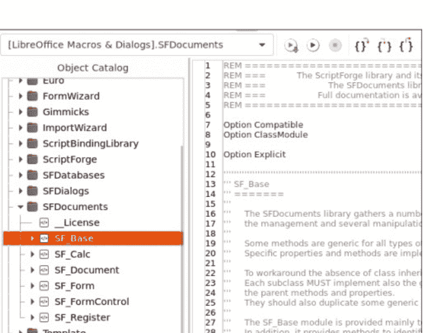

非常强大的编程环境：`LibreCalc`的数字处理和图表能力通过`Python`无穷尽的库和功能得以增强。当然，获取一个单元格进行编辑并不直接，但它展示了使用`ScriptForge`读写电子表格是多么简单（第5-7行）。与其在第6行使用解释器，你可以像第8行所示使用`Python`，将从网络获取的值赋值给变量，你也可以根据需要调用它。

数据结构、文件管理以及本地化处理问题。相关的库被分为三组，分别处理`LibreOffice`文件（文档）、用户对话框、电子表格和数据库。数据库可以访问`LibreOffice`内部或外部文件，通过`SQL`查询读取和写入记录。

你可以使用`ScriptForge`库编写这些宏。一旦你熟悉了这些宏，就可以使用它们在文档（例如工作表）和`Python`数据结构之间往回数据，以进行更复杂的处理。

考虑下面示例所示的基于`ScriptForge`的代码，这是一个从当前文档内容中读取标题并将其作为参数插入的宏。

## 运行 ScriptForge

现在我将展示`LibreOffice`如何识别并运行列表1中的代码，包括作为用户特定脚本和已启用的脚本。对于用户特定脚本，你应该打开你偏好的编辑器，复制代码

## 列表 1：示例 ScriptForge

```
01 from script import createScriptService
02 doc = createScriptService("Calc")
03 # get the current document
04 def increment_cell(args=None):
05 value = doc.getValue("A1")
06 value += 1
07 doc.SetValue("A1", value)
08 g_exportedScripts = (increment_cell, )
09 from scriptforge import createScriptService
10 bas = createScriptService("Basic")
11 bas.MsgBox("Hello!")
```


# 使用 ScriptForge 的 LibreOffice 宏

## 入门

在这篇文章中，我将重点介绍如何开始使用 ScriptForge，通过展示如何将其加载并运行——作为用户特定的宏，以及作为通用的（文档特定的）不带宏的基于 ScriptForge 的代码运行，因为后者的设置是最复杂的场景。


非常强大的编程环境：LibreCalc 的数字处理和图表能力通过 Python 无数尽的库和功能得以增强。当然，获取一个单元格进行编辑并不直接，但它展示了使用 ScriptForge 读写电子表格是多么简单（第 5-7 行）。与其在第 6 行使用解释器，你可以像第 8 行所示使用 Python，将从网络获取的值赋值给变量，你也可以根据需要调用它。

数据结构、文件管理以及本地化处理问题。相关的库被分为三组，分别处理 LibreOffice 文件（文档）、用户对话框、电子表格和数据库。数据库可以访问 LibreOffice 内部或外部文件，通过 SQL 查询读取和写入记录。

你可以使用 ScriptForge 库编写这些宏。一旦你熟悉了这些宏，就可以使用它们在文档（例如，工作表）和 Python 数据结构之间往来数据，以进行更复杂的处理。

考虑下面示例所示的基于 ScriptForge 的代码，这是一个从当前文档内容中读取标题并将其作为参数插入的宏。

## 运行 ScriptForge

现在我将展示 LibreOffice 如何识别并运行列表 1 中的代码，包括作为用户特定脚本和已启用的脚本。对于用户特定脚本，你应该打开你偏好的编辑器，复制代码

## 列表 1：示例 ScriptForge

```
01 from script import createScriptService
02 doc = createScriptService("Calc")
03 # get the current document
04 def increment_cell(args=None):
05 value = doc.getValue("A1")
06 value += 1
07 doc.SetValue("A1", value)
08 g_exportedScripts = (increment_cell, )
09 from scriptforge import createScriptService
10 bas = createScriptService("Basic")
11 bas.MsgBox("Hello!")
```

这些行单独无法运行，因为脚本必须使用 ScriptForge 库，并从这些库加载访问 LibreOffice 单元格和数据库所需的特定方法。

第 4 到 7 行定义了一个函数（`increment(cell)`）它将 `A` 单元格当前的内容复制到 Python 变量中，然后将结果复制回同一个电子表格。第 9 行显示了如何实际调用该函数。

该部分导入了处理对话框的 ScriptForge 库，并创建一个带有“Hello”消息的对话框。列表 1 中的简单代码应该已经足够展示 ScriptForge 库的真实本质以及 ScriptForge 为用户开辟的道路。列表 1 展示了两个之间简单的桥接

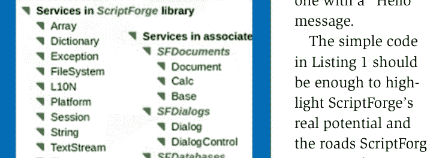

| 宏名称 | `increment_cell` |
|---|---|
| 我的宏 | |
| 标准 | |
| `WiFiEditor` | |
| `apps.so` | |

图 5：ScriptForge 库的内部结构。

图 6：一旦正确安装，用户特定的 Python 脚本可以像普通宏一样运行。

选择包含宏的单元格。然后选择当前文件的嵌入脚本，然后进入“菜单 | 创建宏”。在命名宏后，你可以选择它并点击“菜单 | 编辑”打开文本编辑器并直接在其中编写代码，使用 APSO 或 Python 测试你的工作成果。

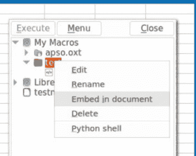

# 结论

自动化 LibreOffice 是为了……如果你想了解更多关于 Python，请查看 [5]。自动化 LibreOffice 相比使用 ScriptForge 并不复杂。如果你对 ScriptForge 感兴趣，请查看 [8]。

这反而是种损害。它不仅仅是将 MkDocs 变成一个新工具，还增加了另一层功能，使其仅仅因为这一点就值得开始使用。虽然 MkDocs 的功能许多支持者可用，但本文描述的所有功能都是免费的。

可用功能。为了充分利用这些功能，你需要通过编辑配置文件来启用并配置它们。最后，该文件包含了你的配置：

```yaml
site_name: My docs
```

列表 1 显示了一个真实的配置文件。前四个参数（`site_name`、`site_description`、`site_author` 和 `site_url`）几乎不言自明。

功能列表。如果你希望标题栏在用户滚动超过阈值时自动隐藏，请如下所示启用 `header_auto`：

当你准备好创建第一个文档项目时，运行：

```yaml
features:
  header_auto: true
```


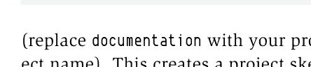

（替换为你的项目名称）。这会创建一个包含两个项目的骨架项目：`mkdocs.yml` 配置文件和用于存储内容的 `docs` 目录。其中的内容是 Markdown 格式的，因此你可以按照喜欢的方式组织内部内容。例如，你可以为每个主题创建一个单独的文件并将它们分组到子目录中，如“入门”、“教程”、“参考”等。当你想要查看你的文档时，运行 `mkdocs serve` 命令并在 `http://127.0.0.1:8000` 查看结果。

Material 可以通过使用色板设置下的适当条目为自身和强调色来调整色调。要确定你想使用什么，请检查 [更改页面 [3]] 并选择主色和强调色以查看详细结果。带有切换选项的深色模式阅读体验比以前更舒适。在此功能中，你还可以将深色模式设置为默认，并为每个主题使用切换：参见列表 1，主题列表如下：

```yaml
theme:
  scheme: default
toggle:
  icon: material/lightbulb-outline
  name: Switch to light mode
```

在你构建文档站点时，你需要将原始源代码转换为一个自包含的静态站点。当你准备好发布文档时，运行 `mkdocs build` 命令，`MkDocs` 将创建包含所有所需文件的 `site` 目录。然后可以将 `site` 目录的内容上传到你的服务器，或使用 `MkDocs` 部署到 GitHub Pages。就如此简单。大多数基础的 `MkDocs` 工作流看起来都是这样：创建一个项目，用 Markdown 格式的文件填充 `docs` 目录，在浏览器中查看它们，并使用 `mkdocs build` 命令生成静态文档。

在示例中，站点使用了深色主题。

你也可以替换默认字体。使用 `font` 设置，你可以指定 Google Fonts 提供的任何字体：

```yaml
font:
  text: Lato
```

除了插件外，配置参数 `config` 不需要额外的解释。可以通过安装插件来扩展 `MkDocs` 的功能。我们将讨论第三方插件，但当你想要如何启用插件时，必须在配置文件中指定它。它是默认启用的，但如果你使用其他插件，则必须将其添加到列表中。

`MkDocs` 带有许多主题，如果你从已安装的列表中指定所需的主题，`MkDocs` 可以轻松地启用它。它还允许你更改 logo 和 favicon（网站图标）的颜色。

如果你想使用特定的等宽字体，可以使用带有字体索引：

```yaml
font:
  text: Lato
  code: JetBrains Mono
```

Material 还带有其他可以通过将它们添加到列表中启用的功能。

# 配置

`MkDocs` 的默认配置可以胜任，但它只使用了文档的一小部分，你可以通过指定自定义 CSS 样式表来实现；这是你至少希望包含的内容。此外，`Listing` 为代码提供了语法高亮，包括内联代码（`python`）和围栏代码块（```python...```），以及渲染按键绑定和快捷键（`pymdocs.keys`）的能力。

```yaml
plugins:
  - git-revision-date-localized:
      enable_creation_date: true
      type: date
extras:
  - css/extra.css
```

然后向 `extra` 中添加一个列表。另一个值得关注的插件来自 `Awesome Pages`。`MkDocs` 按字母顺序渲染页面，这通常不是你组织内容的方式。`Awesome` 支持数字（例如 `01_index.md`, `02_advanced_config.md`），但如果你有很多页面并且又添加了新内容，保持内容排序可能会变成一个不可能且费力的过程。`Awesome Pages` 插件为这个问题提供了一个优雅的解决方案。使用以下命令安装它：

```css
@font-face {
  font-family: "Lato"
  src: "fonts/Lato.ttf";
}
```

# MkDocs 插件

虽然 `MkDocs` 和 Material 提供了一个强大的组合，但你也可以使用 `Mkdocs` 插件添加功能和能力。需要为你的文档添加 RSS 吗？或者想包含图表？那里也有相应的插件。与 `MkDocs` 类似，大多数插件都可以通过 PyPI 仓库 [1] 获取；要查看 mkdocs 插件列表，请在包管理器中搜索 `mkdocs`。以下命令安装了添加最后修改日期的插件：

什么让 Material 在技术写作中变得特别实用的用点是，它支持广泛的 Python Markdown 扩展。例如，markdown 扩展使得添加注释、提示、引用和警告成为可能。要启用该扩展，添加 `markdown_extensions` 列表：

```yaml
markdown_extensions:
  - admonition
  - content
  - codefencing
  - pymdownx.keys
```

```yaml
theme:
  scheme: default
toggle:
  icon: material/lightbulb-outline
  name: Switch to light mode
```

```yaml
font:
  text: Lato
  code: JetBrains Mono
```

```yaml
plugins:
  - git-revision-date-localized:
      enable_creation_date: true
      type: date
extras:
  - css/extra.css
```

```css
@font-face {
  font-family: "Lato"
  src: "fonts/Lato.ttf";
}
```

# Listing 1: Sample Configuration

```yaml
site_name: My docs
site_description: Sample
site_author: Dmitry
site_url: https://github.com
```

```yaml
nav:
  - Getting Started: index.md
  - Advanced Config: advanced_config.md
```

```yaml
palette:
  primary: slate
  accent: teal
```

## 深度解析
OliveTin 与 Script Server


## 用于 Bash 脚本的 Web 用户界面

### 伪装 (Masquerade)

无需编写任何 HTML、CSS 或 JavaScript，即可为你的 Bash 脚本提供一个易于使用的后端界面。作者：Ankur Kumar

参考列表 1 中的列表 1，然后在你的终端中执行以下命令：

```bash
docker run -d --rm \
-v [PWD]/config.yaml:/etc/OliveTin/config.yaml \
-v /var/run/docker.sock:/var/run/docker.sock \
-p 5137:5137 jamered/olivetin
```

虽然 Bash 脚本是连接 GNU/Linux 后端的胶水，但让这些脚本对用户变得更加友好。在过去的十年里，Web 用户界面（UI）已成为日常自动化的前端。然而，通过使用 HTML、CSS 等技术，OliveTin 和 Script Server 允许你无需编写任何一行 HTML、JavaScript（及其 Web 库）即可为脚本创建 Web UI。在本文中，我将展示如何使用 `OliveTin` 创建一个简单的 Web UI 来管理你的脚本，随后是一个功能更丰富的界面脚本。

由 YAML 配置驱动的编程。你只需要创建一个简单的声明，将其传递给 `OliveTin`，它就会弹出一个网页，作为系统上可用 Shell 命令的界面。与其记忆并输入实际命令，不如让 `OliveTin` 通过其易用性优势自动完成你的日常任务。由于其简单性，`OliveTin` 让你能够向非技术用户开放内部网络。

命令成功执行后，访问 `localhost:5137` 以进入图 1 所示的 Web 界面。

`OliveTin` 以 Golang 二进制文件的形式发布，因此你不需要安装。只需获取适用于你架构的二进制文件，即可任何地方执行它。由于 `OliveTin` 是单个二进制文件，你可以开箱运行多个发行版本。如果你运行原生命令，也可以通过软件包将 `OliveTin` 安装为服务。

### 列表 1：config yaml

```yaml
actions:
  - title: "Hello Docker!"
    icon: "image"
```


## 深度解析
### OliveTin 与 Script Server

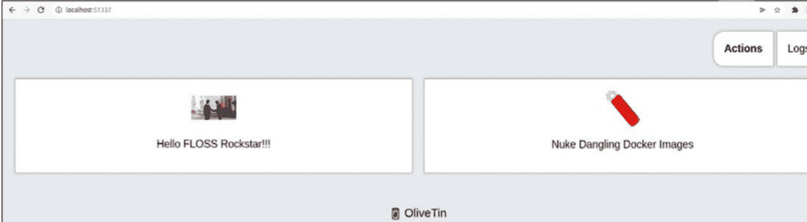

`图 1：` 根据列表 1 生成的 OliveTin Web 界面。

`图 2：` 命令日志显示了每个按钮执行的操作。

### 列表 2：更新后的 config.yaml

```yaml
logLevel: "DEBUG"

hideNavigation: true

timeout: 60

actions:

  - title: "Hello FLOSS!"

    icon: "image"

    url: "https://www.flickr.com/uploads/9/8/4/994728/floss-width=100px"

    shell: "sleep $(delay) && echo 'Hello FLOSS!'"

    timeout: 60

    arguments:

      - name: count

        type: int

      - name: address

        type: string
```

OliveTin 允许你为用户定义可访问的预定义命令。OliveTin 界面由用于执行 Shell 命令的各种按钮组成。OliveTin 声明使用 OliveTin 生成一个简单的 Web UI，首先创建配置 2022年10月期第 263 期 LINUX-MAGAZINE.COM | LINUX-MAGAZINE.COM

## 深度解析 OliveTint 与 Script Server

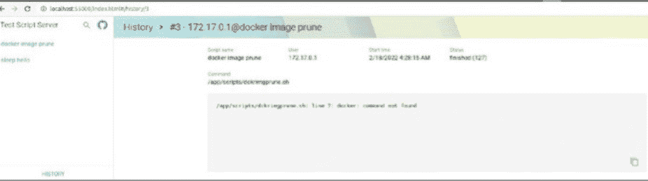

`图 9：` `docker image prune` 脚本的历史记录。

在网页的左下角，你可以找到 `HISTORY`（历史）按钮，它可以让你浏览脚本的执行输出（图 9）。

为了修复图 9 中所示缺失的 `docker-prune` 命令，你需要创建一个 Docker 镜像，其中包含成功执行所需的缺失的 `docker` 命令行界面。

你可以通过执行列表 5 中的命令来实现这一点。我还使用 `htpasswd` 为 Web 端添加了一些基础的身份验证。请使用在线密码生成器 [6] 生成一个密码文件。为了展示我添加的一些 Script Server 新功能：

### 列表 5：更新后的 Docker镜像

```bash
dockerfile <<EOF
FROM busybox/script-server:latest

SHELL ["/bin/bash", "-o", "pipefail", "-c"]
RUN apt-get update && \
    apt-get install --no-install-recommends curl -y && \
    curl -sSL -f -O /tmp/docker-prune "https://download.docker.com/linux/static/stable/x86_64/docker-prune-x86_64" && \
    chmod +x /tmp/docker-prune-x86_64 && \
    mv /tmp/docker-prune-x86_64 /usr/local/bin/docker-prune && \
    apt-get remove -y && \
    apt-get clean && \
    echo -n "admin:6E8f4HIRrV3mIUQycTazcH8pHgSvsumw" | htpasswd -b > /etc/htpasswd
EOF
docker build -t script-server
```

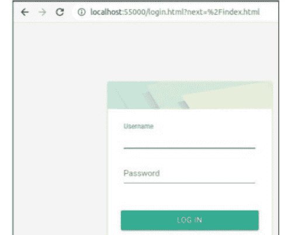

`图 10：` Script Server 登录页面。

要移除现有的 Script Server 容器，请执行以下命令：

```bash
docker rm -f $(docker ps -a | grep script-server | awk '{print $1}')
```

然后，使用列表 7 中的命令使用新创建的容器启动 Script Server 新实例。

### 列表 6：更新后的 conf.json

```json
{
  "title": "Script Server",
  "access": {
    "admin_users": [ "admin" ]
  },
  "auth": {
    "type": "htpasswd",
    "htpasswd_path": "/etc/htpasswd"
  },
  "security": {
    "csrf_protection": "token"
  }
}
```

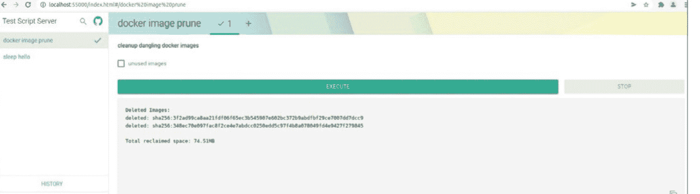

`图 11：` 已连接的用户可以退出（底部），且 `docker image prune` 执行成功。

### 列表：启动新镜像

```bash
docker run -d --rm \
-v /tmp/configs/server.json:/app/config/server.json \
-v /tmp/configs/runners:/app/config/runners/ \
-v /tmp/configs/scripts:/app/scripts \
-v /var/run/docker.sock:/var/run/docker.sock \
-p 5000:5000 script-server
```

（图 11）你也会在图 11 中注意到 `docker image prune` 执行成功。

通过这里涵盖的信息，你应该能够上手并较好地使用 Script Server。文档 [4] 和 [5] 将帮助你释放 Script Server 的全部潜力。

当你切换到管理员用户时，你会看到一个轮轮控件（左上角，图 12）。点击此处将允许你添加和删除带有所有属性的后端（图 13 和 14），这在你想要快速管理脚本而无需深陷其中时非常有用。


一旦你刷新浏览器，应该会看到一个要求用户名和密码的登录屏幕（图 10）。我还添加了测试用户和管理员用户（密码与新的 Docker 镜像相同；只有这两个用户可以登录 Script Server）。此外，我在 `HISTORY` 下方（左左）添加了新的日志功能，允许通过文档和配置文件在已配置的用户之间进行切换。要在交互模式下成功保存你的更改，你必须从 Docker 命令中移除（只读）选项。

# 结论

通过这些强大的工具，你可以为你的脚本创建用户友好的界面，而无需开发 Web 程序。当你倾向于将脚本封装在 Web UI 中时，OliveTin 提供了一个基于按钮的简单 Web UI 供部署。对于更复杂的情况，Script Server 提供了丰富的 Web UI，让你能够在容器化环境中驱动 Docker 脚本。如所添加的，我创建了一组 Dockerfiles 和 Docker Compose，用于设置和维护这些通过单行命令可用的生命周期。

## 编程快照 – 使用 Go 实现智能预测

zsh 为输入的命令提供了一个 `preexec()` 钩子，用于在命令行行末尾插入执行体。我在第 4 行将一个函数赋值给该钩子。shell 始终在执行命令之前触发该函数，并将行的内容传递给我。我的 `preexec()` 钩子返回当前的命令和目录（shell 预先定义了这些内容），用空格将这两个组件隔开，并将它们作为新行追加到 zsh 提示符的末尾。列表 2 显示我在花了一些时间编写这篇文章后积累的条目。

从上一个列表可以看出，用户需要使用键（或映射键 7 和 8）选择命令，然后按回车执行。shell 会执行所选命令——这会让体验会友好得多。为了实现这一点，`g()` 函数中的 shell 函数获取了 `pix` 返回的命令字符串，并使用内置的 `eval` 执行它。

使用 `make`（我将其别命名为 `n`）从其生成文章，使用 `v` 重新编辑行，最后是命令：

```
git add -p
```

我经常主动使用它来修改文件内容到暂存区。

然而，Linux 发行版传统上使用的是 bash，它并不具备我目前使用的 `preexec()` 钩子逻辑。幸运的是，Go 已经处理了这些在 Bash 中本质上内置的特性。我在 GitHub 上安装了该脚本。为了在新登录 shell 时运行它，我使用了我的 `.bash_preexec` 文件。在检查之后，第二步涉及编辑列表 3 中的内容——`.bash_script` 和运行时。

## 教会一只“新老狗”

使用三年前的旧 zsh 脚本（列表 2），编译后的 Go 程序 (`pix`) 使用用户命令字符串通过 `setenv`（文件描述符数字 1，因为没有其他方法）来选择项目。它最终将命令输出到提示符数字 2，`g()` shell 函数返回了列表 1 的内容。列表 2 接收了它们。工作 `3*4+1&2=3`（来自第 1 行）将数字 2 返回给 zsh 的 stderr（数字 1），这样命令行就会在 shell 的等待行（第 6 行）中执行。最后，`eval` 获取变量并执行字符串（这些行）。

第 5 行定义了我将调用的 shell 函数，用以接收 shell 对下一个要执行命令的建议。我希望命令长度仅为一个字母以避免打字，而“g”可以确保你正在编写 Go 语言。

当我输入 `g` 输入命令并按回车键后，shell 函数调用 `pick` 命令（这是第 6 行）。Go 是一个程序（你可以在列表 4 中看到），它过滤列表，例如，使用算法在许多后续命令的列表中决定执行其中一个。

图 2 显示了我将写的预测性 shell，我将在新的文档演示格式 (PDF) 中编写文章，该格式略微借用了 Perl 的旧文档 (POD)。在编辑其中的文本后，我调用 `g()`，它根据从 `mishist` 收集的 shell 历史返回最可能的命令进行选择。这些命令包括用于文本的 `g*`。

算法根据 `preexec()` 钩子见过的之前的命令序列，预测下一个可能的命令是什么。列表 4 遍历了每一行 `histype` 条目的处理逻辑。在列表 1 中定义的结构包含了属性，这些属性分别由命令以及发生这种情况时 shell 所在的目录输入。

在从第 21 行开始的循环中，历史日志的扫描器记录了行，第一列是时间戳，第三列是命令。循环还忽略了它。

### 列表 1: zshrc

```bash
01 cmd() {
02   echo "$(date +$S)"
03   ~/.zsh_history
04 }
05 preexec "command #$1"
06 g() {
07   cmd($3*4+1&2=3)
08   echo "$cmd"
09   eval $2
10 }
```

### 列表 2: myhistory

```bash
~/.zshrc
~/.myhistory
```

### 列表 3: bashrc

```bash
source ~/.bash_preexec.sh
source ~/.bash_preexec.sh
```

## 深度：编程快照 - 使用 Go 实现智能预测

仅限 `g` 快捷键命令；虽然 `preexec` 运行器不会带有预测（例如，因为用户通过按 Ctrl+C 退出），但会跳过该行。`history()` 函数将内容添加到切片末尾，返回当前目录 (`cwd`) 的副本以估计用户可能想要运行的下一个命令。它在其中进行迭代。在每一轮中，预测器存储了 shell。根据历史数据，列表 5 中的预测器运行 `predict()`。

### 列表 5: predict.go

```go
01 package main
02 import (
03 "sort"
04 )
05 predict(hist []HistEntry, cwd string) []string {
06 lastCmd := ""
07 followMap := make(map[string]int)
08 for _, h := range hist {
09 if h.cwd == cwd {
10 continue
11 }
12 if lastCmd != "" {
13 lastCmd = h.cwd
14 }
15 continue
16 cmapMap, ok := followMap[lastCmd]
17 if !ok {
18 cmapMap = make(map[string]int)
19 followMap[h.cwd] = cmapMap
20 cmapMap[h.cwd] += 1
21 continue
22 lastCmd = h.cwd
23 if lastCmd == "" {
24 // first time in dir
25 return []string{"ls"}
26 }
27 items := []string{}
28 for, ok := followMap[lastCmd]
29 if !ok {
30 // no found, just
31 return items
32 }
33 for _, v := range followMap {
34 items = append(items, v)
35 }
36 // best-scoring
37 score struct {
38 to string
39 weight int
40 }
41 sort.Slice(scores, func(i, j int) bool {
42 return scores[i].weight > scores[j].weight
43 }
44 for _, score := range scores {
45 items = append(items, score)
46 }
47 }
```

### 列表 4: history.go


### 代码示例

```go
package main

import (
    "bufio"
    "os"
    "regexp"
    "strings"
)

type HistEntry struct {
    Cwd string
    Cmd string
}

func history(file string) []HistEntry {
    f, err := os.Open(file)
    if err != nil {
        panic(err)
    }
    defer f.Close()
    hist := []HistEntry{}
    scanner := bufio.NewScanner(f)
    for scanner.Scan() {
        fields := strings.SplitN(scanner.Text(), " ", 3)
        if len(fields) != 3 {
            // cmdLine
            continue
        }
        // echo cwd
        if fields[2] == "" {
            continue
        }
        hist = append(hist, HistEntry{
            Cwd: fields[1],
            Cmd: fields[2],
        })
    }
    if err := scanner.Error(); err != nil {
        panic(err)
    }
    return hist
}
```

### 列表 6: `pick.go`

```go
package main

import (
    "fmt"
    "github.com/manifold/promptui"
    "os"
    "os/user"
    "path"
)

func main() {
    cwd, err := os.Getwd()
    if err != nil {
        panic(err)
    }
    user, _ := user.Current()
    logFile := path.Join(user.HomeDir(), ".myhistory.log")
    hist := history(logFile)
    items := predict(hist, cwd)
    prompt := promptui.Select{
        Label: "Pick next command",
        Items: items,
        Size:  10,
    }
    result, err := prompt.Run()
    if err != nil {
        fmt.Fprintf(os.Stderr, "%s\n", err)
    }
    _ = result
}
```

## 结论

我的 DIY 命令行预测器显著减少了开发期间的工作量。当然，在 `Go` 中你的实现没有限制，就像 `Python` 的 `pick()` 简单并且可以通过马尔可夫链等工具持续扩展。发挥你的创造力吧。

## 信息

- [1] "Programming Snapshot – Run statistics on typed commands by" Mike Schilli, Linux Magazine, issue 245 February 2023. https://www.linux-magazine.com/issues/2023/243/Making-History
- [2] "Programming Snapshot – Go store directories paths" by Mike Schilli, Linux Magazine, issue 228, November 2019. https://www.linux-magazine.com/issues/2019/28/Pathfinder/3
- [3] `Bash` prereq: https://github.com/rcaloras/bash-preexec

## 深度解析

# 介绍 `Rocky Linux`

# `Rocky Linux` 正在企业领域寻找足之地

## 响应召唤

`Rocky Linux` 成为 `Red Hat Enterprise Linux`（`RHEL`）的免费替代方案。作者：Jose Casad。

开源世界不断演进，新的 `Linux` 发行版往往会在需求产生时出现。`Rocky Linux` 就于去年出现，部分是为了参与企业领域的重组，但正如开源世界的情况一样，变化发生得非常快。`Rocky` 正在进入专业软件工作、工作站和云实例。什么是 `Rocky Linux`？它源于何处？讲述这个故事最好的方法就是从头开始。

从以前，一个名为 `RHEL` 的免费开源操作系统作为社区驱动的 `Linux` 发行版发布了。虽然红帽（`Red Hat`）将其视为一种盈利业务理念，但 `Red Linux` 的价格便宜得多。任何人都可以使用它，全球许多用户聚集在一起对其进行测试并帮助他人。

## 历史回顾

某一天，红帽（`Red Hat`）宣布将不再免费提供其发行版的二进制版本。该二进制版本不包含订阅，而是需要付费并处于某些支持服务下提供。如果你想知道在使用红帽的通用公共许可证（`GPL`）对 `Linux` 收费是否合法，答案是合法的。`GPL` 要求如果程序被修改，则源代码必须可用——它并不要求分发者免费传播编译后的二进制版本。只要红帽将源代码放在他们想要的任何地方，他们就可以更改二进制版本——而且更改的幅度就像微软对 `Windows` 收取的费用一样（为什么 `Linux` 比 `Windows` 更好？）。

但由于 `GPL`，他们仍然无法脱离免费存在。源代码仍然根据 `GPL` 条款公开，任何想要获取它的人都可以获取源码，移除商标和其他属性组件，然后进行编译并给它一个不同的名称。

为了保持与社区的联系，红帽宣布他们仍将提供一个他们命名为 `Fedora` 的版本。许多用户从红帽切换到 `Fedora` 并继续支持这种做法，但每个人都知道 `Fedora` 与（红帽版）完全是一模一样的。首先，它是 `RHEL` 的上游版本，因此不需要相同水平的测试。其次，它使用了 `RHEL` 中包含的许多工具和功能。正如企业空间中的许多其他开源产品一样，红帽对“社区”版的关注多于“企业”版。

在全盛时期，有几个项目提供了 `RHEL` 的免费重新编译版本。随着时间的推移，`RHEL` 领域涌出了一个领导者，那就是 `CentOS`。`CentOS` 社区拥有一个忠实的用户和志愿者群体，它可以运行服务器、`Web` 服务器和企业工作负载。当红帽发布 `CentOS` 的新版本时，`CentOS` 成为最受欢迎的基于 `RHEL` 的发行版——这不仅是因为它是免费的，还因为它包含了企业级 `Linux` 的所有测试和完善。

2014 年，红帽宣布将赞助其 `CentOS` 版本的后续开发。

`IBM` 对红帽的收购导致了优先顺序的危机。在发生变化的 2022 年，（红帽/`IBM`）宣布 `CentOS` 再不能是企业版的克隆。它仍然会存在，但被规定为 `RHEL` 的上游。

社区再次忙乱起来，寻找一个新的发行版来扮演 `CentOS` 多年来扮演的角色。在涌出的基于 `RHEL` 企业级源码的免费 `Linux` 中，领先的候选者之一是 `Rocky Linux`。

## 介绍 `Rocky`

在 `IBM` 和红帽宣布将 `CentOS` 移至上游的当天，共同创始人 Grant Kurtitzer 支持创建一个新项目的想法，该项目将继续基于最新的红帽企业版。作为 `CentOS` 老元兵，Kurtitzer 投资了多个企业代码库——他也将其带入社区并创立了该项目。

`Rocky` 项目的赞助商是 `CI(2)`，这拥有约 50 名员工，提供 `Rocky` 支持并向 `RHEL` 添加组件；然而，`Rocky` 是一个独立项目，拥有多个赞助商，包括 `AWS`、`Google Cloud` 和 `Microsoft Azure`。`45cosh` 公司将 `Rocky` 作为其存储平台的基础。因此，`Rocky` 意味着 `Rocky`。

`Rocky` 将自己描述为一个与 `RHEL Bug` 兼容的系统，这意味着最新版本的 `Rocky` 包含了 `RHEL` 的所有功能。与它的兄弟版本不同，`Rocky` 不提供前端的、实验性的组件。用户关注的是稳定性、彻底的测试和硬件能力。就像 `RHEL` 一样，`Rocky` 为每个版本提供定期更新和期 10 年的支持。

## `Peridot`（注：此处指代系统）

`Rocky` 的开发者致力于在跟进新发布的同时更新代码库。在这种情况下，他们为社区贡献了新代码并引起了关注。

`Peridot`（如果你发音那个 "`T`"）是一个云原生构建系统，帮助 `Rocky` 的开发人员更新 `Rocky`。`Rocky` 团队以开源代码构建并并通过 `GitHub` 提供。`Peridot` 还提供了在红帽更新时查看 `Rocky` 项目的最佳方法。

`Rocky` 坚信 `Peridot` 将帮助他们跟进红帽的更新和发布计划。`Peridot` 也可以用于帮助使用修改版本 `Rocky` 的特殊兴趣社区。

## `SIG`

`Rocky` 鼓励有兴趣的用户聚集在一起分享解决方案和想法。特殊兴趣小组（`SIG`）为 `Rocky` 项目带来了不同的观点和活力。`Rocky` 拥有内核存储、虚拟化、容器、高性能计算和遗留系统的 `SIG`。`SIG` 正在运行……（文本由于源码问题结束）。


# FOSSLIFE

面向所有人

新闻 • 职业 • 科技生活

技能 • 资源

FOSSlife.org

# 创空间 (MakerSpace)

## 树莓派上的 RFID 读器

## 计数南瓜

用于 `SPI` 接口的廉价组件让你可以将树莓派 4 升级为用于非接触式 `RFID` 数据采集的显示系统。*作者：Martin Mohr*

无线频率识别 (`RFID`) 标签已成为工业、政府以及批发和零售空间不可或缺的。这些廉价的芯片可以在衣服标签、身份卡和信用卡上找到。通过树莓派和 `RFID` 套件，你可以从这些芯片中读取数据并在显示器上查看。

在这个项目中，我读取了贴在 3D 打印南瓜上的 `RFID` 标签序列号——这是一个略有不同的检测任务。为了实现这一点，我将 `RC522` [1] `RFID` 适配件和一个 1.8 英寸 `ST7735` 串行外接口 (`SPI`) 薄膜晶体管 (`TFT`) 显示器 [2] 连接到树莓派 4。这两个模块在在线商店的价格可能低于 15 美元（14 欧元）。南瓜包含简单的 `RFID` 标签 [3]，这些也可以免费获得。这个项目看起来清晰易懂，似乎可以立即运行，除非遇到那些“意外、不幸和故障”，以找出可能出现的问题。

图 1 所示电路显示了模块如何连接到树莓派，以及用于测试目的的两个南瓜和 `LED`。

## 意外、不幸和故障

在经过简短的研究后，我发现了一些打算用来控制模块的库。在经历了一天的思考和编程后，事实证明 `RFID` 读器库已经多年没有维护了。在 Python 3 中获取它的唯一方法是修改代码。在开源项目中，你应该始终查看最后一次提交的日期以及问题（issues），这些会告诉你该项目是否仍由社区开发。

我在网上偶然发现了许多遗弃的软件。初看之下，它们可能仍然活跃，但它们已经积灰多年。那个非常流行的树莓派工具已经很长时间没有支持了，关于 Python 的文章已从树莓派包源中删除。然而，互联网是有遗忘的，这意味着用户会被过时的手册和教程所困扰。

遗憾的是，底层的 Python 库似乎是草率接线的，没有经过广泛测试，这导致了不兼容性。例如，我必须替换此项目中的读器和显示程序。

## 基于 SPI 的 RFID 创空间


**图 1：** 项目的电路布局包含下载部分。你可以在右侧看到图表和 `RFID` 读器的连接。

使用 `KiCad` 设计电路。每个模块都连接到自己的 `SPI` 接口。图 2 显示了构建后的项目；`RFID` 标签隐藏在南瓜中。请注意，只有树莓派 4 具有多个板载 `SPI` 接口。

## 显示器和 RFID 读器

树莓派 4 拥有七个 `SPI` 接口中的四个，可以通过 40 脚 `GPIO` 引脚访问。

之前的模型只有三个 `SPI` 接口，其中只有两个路由到引脚。表 1 显示了默认情况下引脚上的哪些引脚对应于各个接口。

注意表 1 中的某些端口存在重叠，并且在默认配置下引脚上无法使用 `SPI` 接口。然而，可以使用 `dtoverlay` 命令调整 `SPI` 接口配置，它允许输出所有预定义 `SPI` 设备的列表（列表 1）。

各个接口有多种配置，每种配置都有定义的芯片选择 (`CS`) 线。因此，你可以非常精确地配置接口以适应你的项目。

### 列表 1：SPI 接口

```
$ dtoverlay -l | grep spi
sppi0-cs
sppi0-cs
sppi1-cs
sppi1-cs
sppi2-cs
sppi2-cs
sppi3-cs
sppi3-cs
sppi4-cs
sppi4-cs
sppi5-cs
sppi5-cs
sppi6-cs
sppi6-cs
```


**图 2：** 完整的测试设置，有一堆南瓜，读器在左左侧，显示器在后面。

### 创空间 RFID SPI

### 表 1：默认 SPI 引脚

| SPI | 引脚 | 编号 | SPI | 引脚 | 编号 |
|---|---|---|---|---|---|
| SPI0 | MOSI | 19 | SPI4 | MOSI | 31 |
| | MISO | 21 | | MISO | 29 |
| | SCLK | 23 | | SCLK | 26 |
| | CE0 | 24 | | CE0 | 7 |
| | CE | 26 | | CE | 22 |
| SPI1 | MOSI | 38 | SPI5 | MOSI | 8 |
| | MISO | 35 | | MISO | 33 |
| | SCLK | 40 | | SCLK | 10 |
| | CE0 | 32 | | CE0 | 12 |
| | CE1 | 37 | | CE1 | 37 |
| SPI3 | MOSI | 38 | | | |
| | MISO | 35 | | | |
| | SCLK | 40 | | | |
| | CE0 | 27 | | | |
| | CE1 | 13 | | | |

### 列表 2：dtoverlay 输出

```bash
$ dtoverlay -h spi=on
```

启用带有三个芯片选择 (`CS`) 线和相关节点的 `spi`。`CS` 线的 `gpio` 引脚和设备节点是可以配置的。这只在带有接线引头的设备上有效；例如：作为计算模块的树莓派 Zero B。

```
Usage: dtoverlay-spi <val>
Parameters:
cs_pin = gpio for spi (default BCM_SPI0)
cs1_pin = gpio for spi (default BCM_SPI1)
cs2_pin = gpio for spi (default BCM_SPI2)
cs0 = 设置为 "disabled" 以停止创建用户态节点/dev/spidev.0 (默认为 'ok' 或 disabled)
cs1 = 设置为 "disabled" 以停止创建用户态节点/dev/spidev.1 (默认为 'ok')
cs2 = 设置为 "disabled" 以停止创建用户态节点/dev/spidev.2 (默认为 'ok')
```

```
$ dtoverlay -l | grep spi
```

输出所有预定义 `SPI` 设备的列表（列表 1）。

由于在默认配置下引脚上无法使用 `SPI` 接口，请注意。然而，互联网是有遗忘的，这意味着用户会被过时的手册和教程所困扰。

如果你想启用 `SPI` 支持，请在你喜欢的编辑器中编辑 `/boot/config.txt` 文件末尾添加以下行：

```
dtparam=spi=on
dtoverlay-spi
```

重启树莓派使更改生效。

## 设置驱动程序

列表 4 中的示例程序用于在显示器上显示文本。为了生成合适的图像，从命令行传递的参数获取背景颜色

### 列表 3：准备工作

#### 更新树莓派

```bash
sudo apt update
```

#### 安装安装包

```bash
sudo apt install python3-libspidev-dev
```

#### SPI 和图形库

```bash
python3 -m pip install RPi.GPIO Pillow
```

#### 显示库

```bash
python3 -m pip install st7735
```

#### RPi 库

```bash
python3 -m pip install-2
```

## 基于 SPI 的 RFID

`PIL` 是一个功能强大的库，我将只使用一部分。为了显示在显示器上，文档 [7] 将让你大致了解 `Pillow` 可以做什么。

### 配置 RFID 读器

列表 5 中的程序从 `RFID` 芯片中读取单个 `UID`（第 10 行）并将它们显示在屏幕上（第 13 行）。显示器通过 `ST7735` 库控制我们使用的硬件。

注意，读器并没有对芯片进行身份验证，这意味着它生成了一个适合显示器的图像并存储在图像对象中。最后一个命令将图像传输到显示器。

示例程序只能读取受保护的芯片。如果你想进一步研究 `RFID` 身份验证主题，可以参考 `RC522` 库 [8]。

我使用了几个 `App` 来为芯片编程。`NFC Tag Reader` [9] 是入门的好工具，它许多许多奇的功能，同时也带有大量的广告。

`NFC Taginfo` [10] 和 `NFC TagWriter` [11] 提供了大量信息，这对于初学者来说可能有些困惑；将功能分为两个 `App` 使得工具更加易用。

`MIFARE Classic Tool` [12] 针对 `RFID` 芯片的操作进行了优化，并支持身份验证。我使用的读取器自带的 `S50` 卡也是一个 `RFID` 标签，它也遵循这种方法。

读取标签以获得结果。用于屏幕输出的 `Pillow` 库也是一个更清晰的选择。它的功能远超简单的弹出文本显示。

## Info

- [1] RC522 RFID 套件: https://www.amazon.com/Sunflower-Mifare-Reader-Arduino-Raspberry-pi/dp/B07KBJV/


- [2] ST7735 SPI 套件: [https://www.amazon.com/Display-Module-4-Wire-128x160/dp/B07YLY32J/](https://www.amazon.com/Display-Module-4-Wire-128x160/dp/B07YLY32J/)
- [3] RFID 标签: [https://www.amazon.com/NTAG25-Compatible-Programmable-RFID-Tags/dp/B0766FT1LR/](https://www.amazon.com/NTAG25-Compatible-Programmable-RFID-Tags/dp/B0766FT1LR/)
- [4] 该项目文件: [https://linuxnewmedia.thecloud.com/s/5Rx90WF2JN3](https://linuxnewmedia.thecloud.com/s/5Rx90WF2JN3)
- [5] ST7735 库: [https://github.com/pimorton/st7735-python](https://github.com/pimorton/st7735-python)
- [6] Pillow: [https://docs.python.org/3/reference/image.html](https://docs.python.org/3/reference/image.html)
- [7] RFID 读取器库: [https://github.com/andpi/rc522](https://github.com/andpi/rc522)
- [8] NFC 标签读取器: [https://play.google.com/store/apps/details?id=com.google.nfcreader](https://play.google.com/store/apps/details?id=com.google.nfcreader)
- [9] NXP 的 NFC Taginfo: [https://play.google.com/store/apps/details?id=com.nfc.taginfo](https://play.google.com/store/apps/details?id=com.nfc.taginfo)
- [11] NXP 的 NFC TagWriter: [https://play.google.com/store/apps/details?id=com.nfc.tagwriter](https://play.google.com/store/apps/details?id=com.nfc.tagwriter)
- [12] MIFARE Classic Tool: [https://play.google.com/store/apps/details?id=com.MyS.ClassicTool](https://play.google.com/store/apps/details?id=com.MyS.ClassicTool)

## Conclusions

这篇文章可以作为你 `RFID` 芯片实验的指南。对于许多应用，简单的

## Author

`Martin Mohr` 经历了现代计算机技术水平的完整发展。大学毕业后，他主要开发 `Java` 应用程序。树莓派帮助他发现了对电子学的喜爱。

## Listing 6: RFID 读取器

```python
import os
from pcs522 import RFID
rdr = RFID()

while True:
    rdr.write_for_tag(
    (error, tag_type) = rdr.request()
    if not error:
        print("tag detected")
    (error, uid) = rdr.anticoll())
    if not error:
        print("UID: " + str(uid))
        os.system('python Display.py '+str(uid) + '*')
        for block in [0,4,82]:
            (error,data) = rdr.read(block)
            print("[%02x]:%x"% (block),end="")
            for c in data:
                if c<25:
                    print("*%x"% (c),end="")
                else:
                    print("%x",end="")
                for c in data:
                    if c<65 and c<123:
                        print(chr(c),end="")
                    else:
                        print(" ",end="")
                print("")

    # Calls GPIO cleanup
    rdr.cleanup()
```

## 真实网络的真实解决方案

## 7 邮件客户端

人体工程学、安全性和可扩展性

## 多云 ANSIBLE 部署

独立独立于你的云提供商

## Kubernetes 持久化存储管理

## App 代理

带有 `RDS` 的灵活环境

## 事故分析

使用 `Hive` 追踪攻击

## ADMIN 网络与安全

`ADMIN` 是你解决现实问题技术解决方案的来源。

通过以下方面的实用文章提高你的管理技能：

- 安全
- 云计算
- `DevOps`
- `HPC`
- 存储及更多！

## ADMIN 网络与安全

## systemd 安全

锁定你的系统的技巧

## VMware Pocket ONE

一个安全且高度动态的数字工作场所

## Terminal 更新

可点击的命令行界面

## Affinity 工具

## 中间攻击

## OSBuilder Terraform

## ADMIN 网络与安全

## 企业级自动化

## ADMIN 网络与安全

## Terraform

多云编排里程碑

## 防御性防御

## 通过数字订阅快速获取！

## ADMIN 网络与安全

## 每年6期！

## 立即订购

## shop.linuxnewmedia.com

## # MakerSpace

访问树莓派的 `GPIO`

### Pig Pen

多年来，许多树莓派粉丝一直习惯使用的 `wiringPi` 库已不再由其开发者维护。一个以 `Pigpio` 形式存在的替代方案已及时出现。由 `Martin Mohr` 撰写。

> 只要树莓派存在，`wiringPi` 一直作为访问 `GPIO` 的库。通过 `gpiod` 工具，程序员们可以快速地管理 `GPIO`。许多树莓派项目都是基于该库构建的，这让程度上让用户感到沮丧，开发者在 2019 年决定停止该项目，但它在存档中可用。

如果你想继续使用树莓派的 `GPIO`，需要寻找 `wiringPi` 的替代品。`Pigpio` 也是树莓派 `GPIO` 的继任者。乍看 `Pigpio` 库提供了你项目可能的一切。

## 开源的两面

开源社区为业余时间开发的开发者爱好者提供了软件。经常，他们发现即使修复了 `Bug` 也无法获得专业支持。结果是项目消失了。与 `wiringPi` 不同，`Pigpio` 需要一些时间来学习。我发现许多开发者没有将其移植到 `Python`。特别是对于初学者来说，过时的版本经常会让人们掉队。另一个现象是使用该库或工具的开发者离开了。

## Pigpio

与 `wiringPi` 不同，`Pigpio` 允许你访问树莓派的 `GPIO`。然而，你需要注意一些差异。关于 `Pigpio` 第一点是它需要守护进程才能工作。另一方面，`wiringPi` 和 `Pigpio` 都基于 `C`。与 `wiringPi` 类似，`Pigpio` 使用 `BCM` 引脚标记，以便 `Java`、`Node.js`、`Ruby` 等其他编程语言集成该库。`Pigpio` 的完整文档包含了许多示例说明了它是如何工作的。所有参数可以在主页找到。要永久更改守护进程的参数，需要在单元文件（`/etc/systemd/system/pigpio.service`）中进行相应更改。最常见的更改是定义远程接口：

### 安装

使用命令将 `Pigpio` 安装到 `Raspberry OS`：

```bash
$ sudo apt update
$ sudo apt upgrade
$ sudo apt install pigpio
```

## PCM

在 `pigpio` 提供的许多可能性中，注意 `GPIO10-GPIO19` 的映射，`pigpio` 使用该工具（一个示波器）直接连接到 `GPIO` 引脚。这你可以方便地调试使用 `GPIO` 的项目。图 2 显示了使用 `GPIO` 0 到 15 的程序生成工具。安装和使用 `pigpio` 的两种方法之一是启动带有参数 `-x 0xFFFFFF` 的守护进程。最明显的方法是安装它：

### 列表 1: pigpio 函数

- 设置 `GPIO p` 为 1: `$pigpio w 10`
- 设置 `GPIO p` 为 0: `$pigpio w 10`
- 设置 `GPIO p` 为 8: `$pigpio p a 4 0`
- 设置 `PPM` 基础频率: `$pigpio p a 7`
- 设置 `p PWM` 为 50%: `$pigpio p 4 5`
- 设置 `p PWM` 为 100%: `$pigpio p 4 9`

| `wiringPin` 引 | `BCM GPIO` | 功能 | `Header` | 功能 | `BCM GPIO` | `wiringPin` 引 |
|---|---|---|---|---|---|---|
| | | | `3.3v` | `5v` | | |
| `8` | `2` | `SDA` (`I2C`) | `3` | `4v` | | |
| `9` | | `SCL` (`I2C`) | `5` | `6` | | |
| `7` | | `GPCLK` | `14` | `15` | | |
| | | | `RxD` (`UART`) | `15` | `16` | |
| `0` | | | `11` | `12` | `PCM_CLK` | `18` |
| `27` | | | `13` | `14` | | |
| `22` | | `3.3v` | `17` | `18` | `5` | |
| `12` | `10` | `MOSI` (`SPI`) | `19` | `20` | | |
| `13` | `9` | `MISO` (`SPI`) | `21` | `22` | | |
| `14` | `11` | `SLCK` | `23` | `24` | `CEO` | `8` | `10` |
| | | | `OV` | `25` | `26` | `CE` | `7` | `1` |


| 30 | 0 | `ID_SD` | 27 | 28 | `ID_SC` | 31 |

| 21 | 5 | `GPCLK1` | 29 | 30 | |

| 22 | 6 | `GPCLK2` | 31 | 32 | `PWMO` | 16 |

| 13 | | `PWM1` | 33 | 34 | |

| 24 | 19 | `PCM_FMS` | 35 | 36 | 17 |

| 25 | 26 | | 37 | 38 | `PCM_DIN` | 20 | 28 |

| | | | `OV` | 39 | 40 | `PCM_OUT` | 29 |

# MAKESPACE Piggio

直接在树莓派上运行并通过树莓派输出：

第二种方案稍微有点手。你需要在 Linux 机器上下载 PiScope 的二进制版本，并通过网络连接到树莓派上的守护进程。在这种情况下，请通过 `PISCO_ADDR` 环境变量检查树莓派的 IP 地址，你需要设置该变量：

```
$ wget abyz.me.uk/rpi/piggio/piscope.tar
$ tar xvf piscope.tar
$ cd piscope/
$ make
$ make install
$ ./piscope
```

```
$ wget abyz.me.uk/rpi/piggio/piscope.tar
$ tar -xvf piscope.tar
$ cd piscope/
$ export PISCO_ADDR={raspberrypi.local}
$ ./piscope.x86_64
```

这种方法直接将源代码下载到树莓派并进行现场编译。PiScope 然后将根据你使用的 Raspberry Pi OS 安装版本连接到本地守护进程，你可能需要一些依赖项。

# 结论

Piggio 库无疑是编写代码的一个有用替代方案。所有的编程语言都有封装器和模块。这些可用工具让你工作顺顺畅，并支持通过网络监控 GPIO。

在使用 Piggio 时，你会发现单个 GPIO 引脚的命名与 wiringPi 相比不同。然而，有一点非常引人注目：在一年多的时间里，该项目一直在 GitHub 上进行。我希望这很简单，因为自那之后没有看到任何更改：

在测试中，我能够在 Ubuntu 上无需任何额外操作就运行 PiScope。

# 信息

- [1] wiring 项目投影: https://web.archive.org/web/2018082314617/http://wiringpi.com/wiringpi-deprecated/
- [2] Piggio: https://abyz.me.uk/rpi/piggio/
- [3] piggio 参数: https://abyz.me.uk/rpi/piggio/piggio.html
- [4] pigs 参数: https://abyz.me.uk/rpi/piggio/pigs.html
- [5] PiScope 安装选项: https://abyz.me.uk/rpi/piggio/piscope.html

# 作者

Martin Mohr 经历了现代计算机技术的完整发展过程。大学毕业后，他主要开发 Java 应用程序。树莓派唤醒了他对电子领域的老激情。


图 2：引脚 0 到 15 在不断变化状态下的 PiScope。读取不断变化的

# 引言 LINUX 之声

ImageMagick 图像处理工具是开源工具包中的宝石之一。你可以使用 ImageMagick 从命令行调整图像。如果你有一组数字照片且它们都需要调整，既然可以使用 ImageMagick 修复它们，为什么为什么要减慢 GUI 的速度呢？但 ImageMagick 的功能远不止于编辑图像。本月，我们将为你带来一个使用 ImageMagick 和简单脚本从零开始绘图的教程。本月，我们还深入研究了 KOReader 电子阅读器，并向你介绍经典的 Linux 策略游戏《帝国时代》（Age A.D.）。


Doghouse — 算法与书籍 71

Jon "maddog" Hall

KOReader 电子阅读器 72

Dmitri Popov

回顾计算机内存的历史以及经典：算法教材。

D.A.D. 76

Daniel Tibi

KOReader 丰富的功能可以为你的简易电子书赋予新力量，并完全改变你的阅读体验。

FOSSPicks 84

Graham Morrison

用这款实时策略游戏引导古代文明的命运。

教程 — ImageMagick 90

Raf Kirschner

ImageMagick 的功能不仅仅是编辑现有图像。你可以编写一个脚本来创建一个简单的画作。

# ELVVIE

现在很好

运行 SSH 命令

哇！

仅仅三个字母

就有如此大的力量

某种意义上的终端...

我为你制作了这张表

为你提供最实用的选项


我们可以利用它创建的隧道

远程运行命令和图形程序，

传输文件，

转发端口以及更多...

LINUX-MAGAZINE.COM | LINUXPROMAGAZINE.COM 第 263 期 2022年10月 69

# 通过特刊精炼你的技能！

从我们的特刊库中了解 Shell、LibreOffice、Linux 等等。

Linux Magazine 团队创建了一系列单本，让你深入研究你感兴趣的话题。

提供纸质版或数字版。

## 查看完整库！

shop.linuxnewmedia.com


# LINUX VOICE KOREADER 电子阅读器

## 使用 KOReader 强化你的电子阅读器：玩转阅读

KOReader 提供了丰富的功能，让你的电子阅读器获得新能力，并彻底改变你的阅读体验。

作者：DMITRI POPOV

一看，KOReader [1] 看起来非常简陋。但它那平淡的界面背后隐藏着功能强大的应用程序，拥有一系列惊人的特性，从广泛的支持到内置的 SSH 服务器。通过一些技巧和创造性的思维，你可以使用 KOReader 释放设备的全部潜力。

## 首先

KOReader 带有合理的默认设置，但为了获得的阅读体验，你可能需要调整一些设置。第一件事是添加自定义字体。KOReader 支持 TrueType 字体（TTF），因此你只需要将包含 `.ttf` 文件的文件夹拷贝到电子阅读器上的 `koreader/fonts` 目录即可。要启用任何添加的字体，点击屏幕顶部打开顶部栏，然后选择 Document / Font（设置）。要设置所需的字体，长按字体条目并点击 Set as default（设置为默认）按钮。

长按配置选项将其设置为默认。例如，点击底部菜单中的 Line Spacing（行间距）选项。说到底部菜单，激活顶部栏也会打开底部菜单。这可能是设计本意，但它很快就会变成一种干扰。要禁用它，打开 Settings / Taps and gestures（设置 / 点击与手势）菜单，并禁用 Auto-show bottom menu（自动显示底部菜单）。

图 1：使用 KOReader 选择字体。

| | | | | |
|---|---|---|---|---|
| Not Serif（无衬线体） | | | | |
| Vollkorn ★ | | | | |
| < 第 3 页，共 3 页 | | 12:20 | 89% | |

图 2：禁用自动显示底部菜单功能。

| | | | | |
|---|---|---|---|---|
| With a tap（点击） | | | | |
| With a swipe（滑动） | | | | |
| Auto-show bottom menu（自动显示底部菜单） | | | | |
| | | 12:23 | 88% | |

默认情况下，当你启动 KOReader 时，它会打开文件管理器，因此你每次启动应用时都必须选择想要阅读的书。在某些情况下，让 KOReader 在应用启动时自动打开列表更为实用。打开顶部栏并切换到文件管理器。点击顶部标题打开主菜单，切换到文件管理器部分，并选择 Start | with last file（启动 | 使用上次打开的文件）。

屏幕底部的状态栏提供了有用信息，例如阅读进度、时间等。默认情况下，你可以通过点击切换页面。但你也可以通过单视图查看信息。要这样做，打开顶部栏，选择 Settings | Status Bar | Settings（设置 | 状态栏 | 设置），并启用 Show all（显示所有）。返回 Settings | Status Bar 菜单并切换所需的选项（图 3）。


72 2022年10月第263期 `LINUX-MAGAZINE.COM` | `LINUXPROMAGAZINE.COM`

## LINUX KOREADER 电子阅读器

图 3：配置状态栏。

虽然墨水屏不需要屏保，但将简单的 `Sleeping`（睡眠）替换为更有信息的内容（例如当前书籍以及你的阅读进度）并没有问题。打开顶部栏，选择 `Settings | Screen | Screensaver`（设置 | 屏幕 | 屏保），并启用 `Use list's book cover`（使用列表书籍封面）。在 `Settings | Screensaver` 中开启 `Add message to screensaver`（向屏保添加消息）选项，并设置显示当前页码和总页数的百分比（图 4）。

图 4：配置自定义屏保。

`Web Clipper` 部分。启用 `Web Clipper Service`（网页剪贴板服务）并复制自动生成的标记代码（图 5）。`Joplin` 插件。安装软件包。要在 `Ubuntu` 和 `Linux Mint` 上获取，请运行：

```bash
sudo apt install install
```

将电子阅读器连接到电脑，并打开 `reader/settings.luat` 文件进行编辑。找到 `"exporter"` 部分并添加以下项目，将 `127.0.0.1` 替换为电脑的实际 IP 地址（使用令牌授权）。

## 进阶

处理好基础设置后，是探索 `KOReader` 提供的功能了。使用 `KOReader` 的配置文件（`profiles`），你可以快速方便地在多种配置切换。例如，你可以为夜晚创建一个配置（带有柔和亮度和冷色温），开启夜模式。你还可以创建一个同时开启前光和夜模式的白天配置。要创建配置，使用顶部栏并选择 `Tools | Profiles`（工具 | 配置文件），配置你的设置并点击完成。长按创建的配置以启用它。

就像任何有其特色的阅读应用一样，`KOReader` 支持将高亮导出为 `HTML`、`JSON` 和文本文件。如果你使用 `Joplin` [8] 作为你的笔记应用，`KOReader` 可以直接将高亮推送到其中。初始设置过程需要一些工作，但一旦完成，将笔记传输到 `Joplin` 就变得简单了。首先，你需要配置 `Joplin`。启动应用程序，选择 `Tools / Options`（工具 / ）。

图 5：在 `Joplin` 中启用 `Web Clipper`。

`LINUX-MAGAZINE.COM` | `LINUXPROMAGAZINE.COM` 2022年10月26日 73

## LINUX KOREADER 电子阅读器

```json
"joplin_IP" = "127.0.0.1",
"joplin_token" = "authorization_token",
"joplin_port" = 4188,
"joplin_export" = true
```

更改。从现在起，当你从授权的设备连接到电子阅读器时，无需输入密码。

## 备份 KOReader 的数据

保存更改并安全断开电子阅读器。在运行 `Joplin` 的电脑上，打开终端并运行以下命令：

对于每本书，`KOReader` 都会创建一个包含书籍设置、笔记、位置和内容的元数据文件。虽然你可以同步当前位置并导出，但保留所有重要数据的一个备份也是很有意义的。为了方便管理书籍和元数据，在电子阅读器上创建一个目录来存储所有书籍（例如 `Library`）。有两种方法可以实现这一点：

```bash
socat tcp-listen:4188,reuseaddr,fork tcp:localhost:4188
```

大多数 Linux 发行版的文件管理器都处理 `SSH` 和 `SFTP` 协议。你可以通过在地址栏中指定地址来访问电子阅读器的文件系统。例如：

```bash
sync -avz --delete -P "ssh -p 222" /mnt/root@127.0.0.1:2222
```

```bash
sync -avz --delete -P "ssh -p 222" /mnt/
ondir/library/user@127.0.0.1:/path/to/library
```

```bash
sync -avz --delete -P "ssh -p 222" /mnt/
ondir/backup/korader/user@127.0.0.1:/path/to/export
```

连接 `KOReader` 最简单的方法是无密码登录。这种方法也是最安全的，因为同一网络上的任何人都可以访问电子阅读器。为了限制仅允许授权设备访问，你需要在想要连接的设备上生成 `SSH` 密钥对。要在 `Linux` 上生成 `SSH` 密钥对，请在终端运行 `ssh-keygen` 命令。按照提示操作，但跳过密码：

与其使用内置客户端输入 `rsync` 命令，不如将所需的命令添加到 `reader/.ssh/bash_history` 文件中简化过程。或者，你可以使用一个脚本在 `/korader/scripts/dir/` 中创建一个名为 `backup` 的文本文件，并添加以下代码（根据需要调整示例）：

```bash
#!/bin/bash
sync -avz --delete -P "ssh -p 222" /mnt/
ondir/library/user@127.0.0.1:/path/to/library
sync -avz --delete -P "ssh -p 222" /mnt/
ondir/backup/korader/user@127.0.0.1:/path/to/export
```

```bash
cat ~/.ssh/* 将电子阅读器连接到电脑，并为 /korader/settings/ssh 目录创建 authorized keys 文件。对于文件编辑器，将密钥粘贴其中并保存
```

# KOREADER 电子阅读器 LINUX 语音

保存文件并赋予其执行权限：

```
chmod +x /koreader/scripts/up.sh
```

要在电子阅读器中启动脚本，请打开终端并运行 `koreader/scripts/backup.sh`。

如果你必须使用第二台电子阅读器，并想下载设置和数据，你只需要创建一个运行以下命令的脚本：

```
rsync -avh --delete -n -g --no-p -e "ssh -p 22" USER@127.0.0.1:/path/to/library/ /mnt/osboard/library/
rsync -avh --delete -n -g --no-p -e "ssh -p 22" USER@127.0.0.1:/path/to/clipboard/ /mnt/osboard/koreader/clipboard/
```

每当你运行上述脚本时，系统都会提示你输入两次密码，这很快就会非常麻烦。为了完成优化，请在 `KOReader` 中生成 `SSH` 密钥对，并将公钥添加到远程机器的授权密钥列表中。

要生成 `SSH` 密钥对，启动 `KOReader` 中的终端模拟器并按照提示操作，跳过指定密码。这将在 `/usr/local/iluje/usnet/etc/dot/` 目录下生成密钥对。为了确保密钥已在那里，

```
ssh-add -c "/usr/local/iluje/usnet/etc/ssh-id_rsa" -l
```

将 `ssh_id_rsa.pub` 复制到 `Linux` 机器，并使用以下命令将其添加到服务器上的 `authorized_keys` 文件：

```
cat id_rsa.pub | ssh USER@127.0.0.1 "mkdir -p ~/.ssh && cat >> ~/.ssh/authorized_keys"
```

从现在起，你可以无需密码运行脚本（或任何需要通过 `SSH` 连接（到远程机器）的命令）。

# 结语

你不需要就此停止，`KOReader` 还有更多精彩内容。深入研究手势操作，你会发现你几乎可以用手势控制应用程序的每一个方面。如果你已经按照喜好配置了手势，可以探索 `KOReader` 的统计数据。简而言之，你会发现找不到比它更好、更强大的阅读应用了。如果你愿意花精力学习它的功能，你将获得一种以前从未想过的阅读体验。

# 信息

- [1] `KOReader`: `https://github.com/koreader/koreader`

- [2] `KOReader` wiki: `https://github.com/koreader/koreader/wiki`

- [3] `Joplin`: `https://joplinnapp.org`

- [4] `Kobustff`: `https://www.mobilireader.com/forums/showthread.php?t=254214`

# 作者

`Demir Popov` 多年来一直致力于关于 `Linux` 和开源软件的写作。他的文章发表在丹麦、英国、美国、德国、西班牙和俄罗斯的杂志上。你可以在他的个人网站 `tokyoma.com` 找到更多信息。

# LINUX 语音 0 A.D.

# 在 0 A.D. 中沉浸在活生的历史中

古代时代的重塑

在即时策略游戏 `0 A.D.` 中主宰古代文明的命运并复兴历史。


作者：`DANIEL TIBI`

也许你在上学时喜欢历史，也许你只是觉得这门学科很无聊。无论如何，回看 `0 A.D.` 这款即时策略游戏 [1] 是值得的，它带你回到公元1年（我们的历法中没有公元年），并将古代文明的命运交在你手中。建筑、单位和技术都基于真实的历史。游戏让历史生生，而不会让玩家感到无聊。

`0 A.D.` 是经典 Linux 游戏之一，所有流行的发行版包源中都包含它。但如果你通过发行版的包管理器安装游戏，可能无法获得最新版本，这就是为什么我建议从项目网站下载最新的发布版本。你也可以在那里找到最新的发行版以及相应的安装说明。`0 A.D.` 还提供 `AppImage` 和 `Flatpak` 软件包格式。程序在下载后即可立即设置。

# 安装

`0 A.D.` 的起源可以追溯到 20 多年前。奇怪的是，游戏的发展并没有经过 `alpha` 阶段，尽管这并不影响它的趣味性。当前版本（测试版）`Alpha 25 'Yaaa'` 于 2021 年 8 月 8 日发布。其继者 `Alpha 26` 已在 2022 年 4 月进入了特性冻结期（即停止向当前 `alpha` 版本添加新功能的阶段）。

> 地图编辑器

`0 A.D.` 自带了地图编辑器 `Atlas`，你可以用它来创建自己的地图和战役。要这样做，点击主屏幕左侧边栏的“场景编辑器”（`Scenario Editor`）。


图 1：启动界面非常整洁。你可以使用左侧菜单进入游戏。

2022 年 10 月第 263 期 | `LINUX-MAGAZINE.COM` | `LINUXPROMAGAZINE.COM`

# `0 A.D.` `LINUX` 语音


图 2：`0 A.D.` 提供了多种设置。

## 资源收集

## 选择文明

## 回到

## 选择文明

## 资源收集

## 选择文明

## 人口增长

## 资源收集

## 人口增长

## 资源收集

## 人口增长

## 资源收集

## 人口增长

## 资源收集

## 人口增长

## 资源收集

## 人口增长

## 资源收集

## 人口增长

## 资源收集

## 人口增长

## 资源收集

## 人口增长

## 资源收集

## 人口增长

## 资源收集

## 人口增长

## 资源收集

## 人口增长

## `LINUX` 之声 `0` 年代

你可以派遣当前空闲的士兵来建造新房子。屏幕顶部的条左侧显示你的人口数量。在建造几座房屋后，创造更多公民，然后可以派遣他们去搜寻更多资源。


## 探索地图

一条彩色线标记了你所控制的定点区域。你只能看到该区域内的内容。要探索地图，你需要创建骑兵并派遣他们出去探索。通过这种方式，你就可以看到哪里有更多资源，以及敌人在哪里定居。该区域之外未探索区域将显示为黑色。已探索区域被战争迷雾覆盖。你看到的它们是你其中一个单位（例如，骑兵探险者）最后一次在那里的状态。

随着游戏的进行，你需要扩大你的定点区域。你可以通过建造新建筑来实现这一点。每个建筑都有一个占据你定点区域的半径。如果它在区域边缘建造，你的定点区域就会扩大。大多数建筑都可以在你的定点区域内建造，行政总部除外。你也可以在中立领地上建造它，因为它拥有最大的影响力。


图 7：德鲁教是高卢的英雄。他们治愈德鲁教周围彩色圆圈标记的单位。

为了扩大你的定点区域，建议建造更多的行政总部。但要小心：由于它们很重要，你的敌人会频繁攻击这些总部。


## 探索技术

随着人口的增长和谷仓的填满，你现在需要研究技术来推动你文明的发展。这是在建筑上进行的活动。例如，你可以建造的行政总部提供食物，你还可以开发开采资源的工具。

现在也是建造更多建筑的好时机。市场让你能够与盟友进行交易。你可以交换资源以保持谷仓满满。在锻炉，你将开发金属加工技术。你可以在神庙里训练治疗者并在那里提高他们的技能（图 7）。如果你的定点位于水域附近，你可以建造港口并建造船或战舰（图 8）。


图 8：如果你的定点位于海边，你可以建造港口，每个航海国家都需要船只和战舰。


一旦你的房子里有了资源，并建造了建筑且研究了技术，你就可以点击行政中心的相应按钮从村庄阶段进入城市阶段，然后随着你的进展，从城市阶段进入大都市阶段。

图 9：在军兵营训练士兵（左侧），在马厩训练骑兵，以及在军械库建造作为撞城槌的攻城武器（右侧）。

## 守护你的定点区域

你的对手在此期间绝没有闲着，并且在可预见的未来一定会攻击你的定点军队。这就是为什么你需要建立良好的防御。公民士兵自认为是民兵；此外，你还需要专业的军官和武器。在军兵营，你可以创建步兵。马厩为你提供骑兵，军械库则产生投石机和撞城槌等攻城武器。

这些建筑也是你可以研究武器和战斗技术的地方。不同的文明还有其他军事单位或特殊单位。例如，罗马人拥有军队。卡太基人拥有战士。为了保护你的定点，你可以用木墙或石墙包围它（图 10）。

每个文明都带有三个可以在游戏期间创建的英雄，每个英雄只能创建一个。这些英雄基于历史人物。当士兵在他们附近时，会增加他们的战斗力（图 11）。英雄在堡垒中出现时会率领士兵战斗。

图 10：防御良好的高卢定点对进攻的罗马人构成了真正的挑战。


`Vercingetorix`

- 驻守防御：驻守时，建筑获得 `+2` 分。

- 细胞防御：当盟友在附近时，具有更高的攻击力、远程伤害。范围 `60` 米。

## 真实政治

如果你的文明面临发展危机或敌人威胁要占领它，这就是各种作弊形式的政治（见表 1，在那里你还会看到一个小彩蛋，游戏允许你建造 `P-51` `Mustang`，一种二世界大战的美国战斗机）。要创建单位，首先选择任何建筑。如果该建筑属于你，新创建的单位就属于你。反之，如果建筑由敌人控制，新创建的单位也将归敌人。

| 表 1：作弊 | 影响 |
| :--- | :--- |
| 神之赐 | `+1000` 食物 |
| 想要披萨 | `+1000` 木头 |
| 我看到山了 | `+1000` 石头 |
| 你的钱 | `+1000` 金属 |
| 杰恩·詹姆 | 显示地图 |
| 沙拉碗 | 创建公民士兵 |
| 我想要顶部 | 创建战士 |
| 黑死病 | 破坏建筑或单位 |
| 我太了 | 加速建造 |
| 退出 | 击败玩家 |
| 回到未来 | 进入下阶段 |
| 蜂巢之主 | 增加人口上限 |
| 如何开启这个？ | 创建 `P-51` `Mustang` |

# 结论

考虑到 `0 A.D.` 处于 `Alpha` 阶段，它值得关注。它有趣且详细。

## 建造奇迹

每个文明都通过建造奇迹达到巅峰（图 12）。罗马人建造了帕特农，希腊人建造了神庙。

# 信息

- `0 A.D.`：`https://playad.com`

- Linux 版下载：`https://playad.com/download/linux`

# 电子书管理器

# FOSSPICKS LINUX 之声

## `Calibre` `6.1`

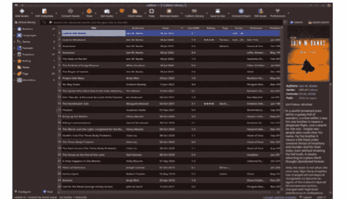

`Calibre` 是首批重新审视其优秀的顶级开源应用之一，它本身就非常出色，并执行着重要的功能，它也是一个具有稳健发布节奏和重大更新的创新产品。这是一个很好的例子，因为在投入了 10 个月的努力后，它带来了许多任何数字媒体处理器都会想要使用的重要功能。这些功能包括全局搜索，允许你可以在整个收藏库中搜索短语，甚至可以使用布尔选项（如 `Calibre AND ebook`）进行搜索并查找其他单词。后者在你想要查找某些单词和数字的关系时非常有用，例如“人口”和“欧洲”，或“哈哈利”和“多比比”。

在所有这一切之前，你需要手动为你的收藏构建索引，这可能需要一些时间。不过这是一次性的工作，因为添加到你收藏中的新标题会被自动扫描。如果你不需要重新扫描，默认设置即可，但如果你确实需要，它非常有用，尤其是当你将媒体组织在不同的收藏中时，这样你可以跨收藏隔离结果并找到你寻找的内容。另一个新功能是从电子书视图大声读出。这可以通过插件实现，但看到内置选项真是太棒了。在后台，人们为 `Calibre` 的迁移工作付出了大量工作。


同时使用 `Calibre` `5` 和 `6` 是可能的，但如果你确实这样做，书籍必须制作成最新版本才能运行。


从`Qt 5`到`Qt 6`，少数必须切换的应用中有许多已经进行了切换。这个显而易见的小变化带来了未来的适应性，但也意味着放弃了`32 位`支持。幸运的是，`ARM`平台现在已获得官方支持，这对于树莓派或`ARM`笔记本电脑的用户非常有用。遗憾的是，随着这种架构的变化带来了一些不兼容性，某些插件需要一些时间才能跟上`Calibre 6`。

## 项目网站

`https://calibre-ebook.com`

## 配置管理器

### Chezmoi

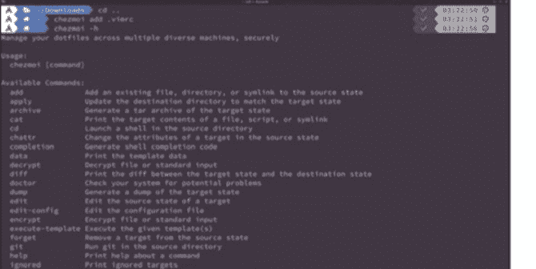

`Linux`配置存在于旧和新之间的字符串中。它有一种存在和传统，内容通常深度持有着价值，如你的`PDF`服务器和登录详情、你的`Vim`元数据以及个人终端。它们都伪装成是隐藏的。现代应用程序通常使用相同的格式和位置，或者经常被配置目录隐藏，这可能是变得不可接受的。多年来的一个解决方案是使用加密仓库来存放我关心的所有配置文件。这种方法的优点是让你的配置文件受版本控制，但也意味着当你开始使用新机器时，必须经历重新创建家目录下所有符号链接的艰辛过程。

而这正是`chezmoi`需要改进的问题。`Chezmoi`是一种工具，旨在通过最少的命令帮助处理你的`.dotfiles`（点文件）及其所有内容。它消除了正确操作的不确定性。完成后，你运行`chezmoi init`来创建它们（`~/.local/share/chezmoi`），然后为你自己的仓库创建一个新的由`Git`跟踪的目录，使用`chezmoi`后面跟上你想要管理的配置文件。这等同于在一个地方移动文件并创建必要的符号链接，这意味着你直接使用`chezmoi`管理你的配置文件，而无需处理`Git`的复杂性。

当源文件更新时，你实际上是在`chezmoi`中编辑源文件。当你看到更改时，运行`chezmoi --apply`来应用它。这在本地有效，但你也可以添加远程仓库并启用自动跟踪仓库更改的功能。它比与`Git`一起工作要简单，并节省了你在新机器上重新创建配置的精力。要做到这一点，你使用`chezmoi init --apply`。其他一切都将由自动处理。

## 项目网站

`https://chezmoi.io`

`LINUX-MAGAZINE.COM` | `LINUXPROMAZ.COM` `ISSUE 266` `2022年10月` `85`

# `LINUX VOICE` `FOSSPICKS`

## 监控替代方案

### Viddy

`watch`命令的替代方案不是越多越好。它是一个非常妙的小工具，通常用于隔一段时间运行命令或监控任何活动的变化。你可能会用它来检查例如温度或者你的空闲内存量。它是一个用于构建简单脚本来监控变化或错误的小工具。然而，它缺乏的是动态输出，而这正是`Viddy`试图解决的。`Viddy`的名字源自《发条橙》中的一句名言（灵感来自维吉尔，拉丁语中意为“看到”），它执行与`watch`完全相同的功能，但带有一些现代增强。

这些增强中最实用的是`diff`模式，它可以精确地亮出你的输出发生了哪些变化。对于更复杂的命令这非常有用，因为它们会被立即涂成黄色，让你看到哪些值是新的。如果你错过了某个值变化的时刻，`Viddy`的另一个功能将让你把输出回滚到命令历史，这样你就能看到什么在何时发生了变化。这一切都可以通过类似`Vim`的绑定进行控制，这些绑定可以编辑，并且是全色的，也可以根据自己的喜好进行配置。

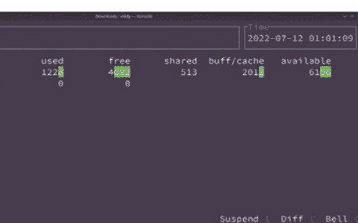

`Viddy`可用于跟踪变化甚至监控活动。输出是分页的，因此你可以轻松地向上或向下滚动大量输出，并且你可以暂停和恢复你正在运行的任何内容。这些升级可能会让`Viddy`在你的历史中变得常见，并成为任何监控和数据日志工作的完美工具。

## 项目网站

`https://github.com/sachos/viddy`

### 进程启动器

我们许多人肯定习惯于使用命令来分离并运行多个命令，使用旧的`nohup`语法将任务派生到后台，除了终端环境提供的任务管理之外。管理这些是一项更容易的壮举。`proc`提供了相同的功能，但允许你看到一个类似`tmux`的界面，其中命令列表作为标签，所选命令的输出在右侧。

`UP`和`DOWN`单词用于显示命令是否正在运行，你可以通过光标或类似`Vim`的导航在命令之间切换。多种选择允许你关注任何进程的输出，让你与之交互或更改它的顺序。在主面板底部显示的界面也有按键帮助你启动、停止和重启进程。

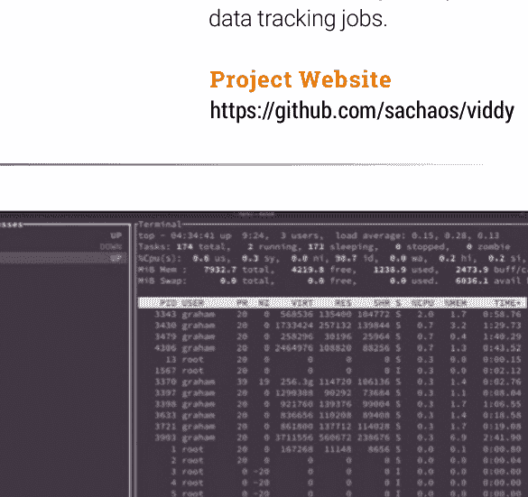

`proc`像`tmux`一样，可以让你在任何地方运行命令，并且即使你断开连接它也会继续运行。这在远程服务器上非常有用。由于`proc`提供了这种直观的界面，它比传统的`tmux`管理任务要简单得多。

## 项目网站

`https://github.com/volok`

## 模拟器配置

### EmuDeck

在`Steam Deck`上运行模拟器的最佳方式之一是`EmuDeck`。它能让你在`Steam`界面中运行模拟器游戏，这对于许多用户来说非常直观。它能让用户通过发现中心（`Discover`）来安装。

## 文档管理器

# Paperless-nx

我们已经期待无纸化几十年了（尽管有有触感的、可回收的杂志，但仍有大量的纸浆依然存在）。这对于我们个人来说并不是什么大问题。我们可以通过扫描仪或本地`NAS`和硬盘进行长期存储来处理偶尔出现的纸质文件。如果我们愿意牺牲一些隐私，云服务可以进行扫描并让它们变得可搜索。如果不想，那么自托管的`Nextcloud`版本也是另一个很好的选择。但这些方案的扩展性都不特别好，而且并不是专门为长期管理打印的文档而设计的。这正是一个开发`Paperless-nx`的原因。

`Paperless-nx`像它的前驱一样，作为一个`Web`访问的服务器运行。这非常重要，因为这意味着你可以控制文档的存储和访问方式，而无需自行运行后台服务的开销。另一个很棒的功能是它是基于账户和组的，这意味着不同用户可以拥有自己的账户并管理一个或多个组。每个用户都可以被添加或从特定的文档集中移除。`Paperless-nx`对你的文档进行字符识别（`OCR`），因此你可以轻松跨多份文档搜索任何文本。

安装相对容易，特别是如果你选择遵循他们的方法，原生`Linux`方法都有非常详尽的文档说明。还有几种方法可以将文档导入`Paperless-nx`。最实用的通过物理字符进行……

你可以通过`Web`界面手动处理文件、通过扫描仪、通过`Android`应用或通过发送电子邮件来导入。

它可以保存到相互可访问的网络位置，或者连接到你的服务器并将文档保存到共享目录中。但还有其他选项，包括通过`Web`界面上传、通过`Android`应用或通过发送到预配置的电子邮件地址。此外还有一个出色的`REST API`用于自动化扫描和归档。`Paperless-nx`会自动拾取文档，运行处理，然后将其识别出的任何标签或关联关系添加到最终数据中。只有这样，你的文档才能从`Web`界面访问。

`Paperless-nx`是一个用于扫描文档的文档管理系统，可以处理繁忙的无纸化办公室工作。它是一个长期项目的尊重分支（`fork`）。

这是`Paperless-nx`真正大放异彩的地方，因为它的界面快速且响应迅速，即使处理大量文档时也是如此。可以同时打开多个，它们会变成左面板的小标签页，你可以回到仪表板。使用外部查看器是一个配置选项，而最新版本已经彻底改进了整个体验的视觉感受。唯一的缺点是没有任何文档被加密，这意味着如果你需要保护收藏集的内容，就得由自己寻找解决方案。有许多`Linux`解决方案可以解决这个问题，但如果`Paperless-nx`成为你办公室文档管理的枢纽，这是一个值得考虑的因素。

`Paperless-nx`使用`Django`编写，在访问和打印文档方面表现出色，特别是在办公环境中。

## 项目网站

`https://github.com/paperless-nx/`

# `FOSSPICKS` `LINUX VOICE`

# Libre TrainSim


# 即时策略游戏

## MegaGlest

`MegaGlest` 是一款即时策略（RTS）游戏，它是对过去一个名为 `Meglest` 的旧游戏的重新演绎。这两款游戏在过去的不同时间点都曾被遗弃过，`MegaGlest` 最近重新加载并在 `Twitter` 上发布了其源代码，看到这个项目回归真是太棒了。如果你想为 `Steam Deck` 获取一键安装，它也可以从 `Steam` 获取。

# 教程 – IMAGEMAGICK LINUX VOICE

## 使用 ImageMagick 绘制图形

| 列表: 2 多个元素 | |
| :--- | :--- |
| 01 | `magick -size 500x300 xc:blue -fill red -draw 'rectangleangle 100,140,228,180\' \ |
| 02 | `-draw 'rectangleangle 100,200,250,180,50 -fill black -draw 'circle 150,228 180,225' \ |
| 03 | `-draw 'rectangle 250,285 320,225' auto.png` |
| 04 | `magick auto.png --fill red -draw 'polygon 175,150 210,110 200,150' auto-bevel.png` |
| 05 | `# modify red -draw 'polygon 175,180 210,110 200,150' auto.png` |

来自 `Windows` 调色板，`ImageMagick` 日期。

你也可以通过输入 `gradient` 代替 `xc:blue` 来指定渐变。内置图像生成器将为你创建一个蓝色渐变背景。对于任何可能性，你都可以使用 `ImageMagick` 文档。主要目标详细介绍了画布 `[4]` 和字符串 `[5]`。

该参数后面紧跟的是后续绘图命令的定义，该命令由 `-draw` 定义并加引号。最后一个参数是要创建的图像名称。

图像是一个圆角的矩形，背景为浅蓝色。你正在通过串联多个命令来创建更复杂的命令（列表 2, 1 到 3）。

相对较慢。如你所知，绘制一栋大楼是复杂的。你必须串联多个命令，并且每个窗户都需要调用一次。你必须手动计算从前面窗户的位置。

## 使用脚本更快

绘制大楼时的倾斜问题可以通过脚本来解决，该脚本根据楼层数和所需的窗户数量来确定图像大小。它还定义了背景颜色渐变并对图像进行阴影处理。然后它绘制实际建筑以及窗户和门的所有指令，并将它们收集到 `XML` 格式的 `Magick` 脚本语言 (`msl`) 中。

最后，脚本使用查询语句处理杂乱的绘图命令。这比使用脚本独立开发图像要快得多。列表 3 显示了一个带有地基、五扇窗户和前门的双层房屋的 `msl` 文件。

## 三车位房屋

列表 2 中第一次调用的结果如图 2 所示：基于三色调色板的简单缺口图像。通过使用列表 2 第 4 行的绘图命令，你可以改进房屋的形状。该命令在前面增加了倒角。

`auto.png` 文件仅提供客室倒角的基础。该命令写入 `auto-bevel.png`。如果你想避免重新创建文件，请使用列表 2 中的命令。这会直接修改 `auto.png` 文件。

两种方法在使用 `ImageMagick` 方面都有优点，但有一个决定性的缺点。


图 2：用简单的 `draw` 命令重建的缺口房屋。

### 列表 3: miniHouse.msl

```xml
<?xml version="1.0" encoding="UTF-8"?>
<image>
  <read="miniHouse.png" />
  <draw fill="skyblue" 'rectangle 0,0,1000,2500' />
  <draw fill="white" 'rectangle 250,0,750,2000' />
  <draw fill="yellow" 'rectangle 270,270,730,1800' />
  <draw fill="yellow" 'rectangle 290,290,710,1700' />
  <draw fill="blue" 'rectangle 440,220,560,2000' />
  <draw fill="yellow" 'rectangle 270,2250,730,2370' />
  <draw fill="yellow" 'rectangle 290,2250,710,2300' />
  <draw fill="yellow" 'rectangle 440,2250,560,2500' />
  <write filename="miniHouse.png" />
</image>
```

### 列表 4: 示例语法

```bash
$ ./buildhouse <Floors> <WindowsFloor>
```

`LINUX-MAGAZINE.COM` | `LINUXPROMAGAGICK.COM` | 第263 期 2022年10月 91

## LINUX VOICE – 教程

你可以使用 `Linux 4` 中的语法编写一个 `shell` 脚本，本工作坊就是基于此脚本。其内容原封不动地取自 `Linux 5`。为了简单起见，脚本没有对你传递的参数进行详尽检查。命令行中的顺序决定了脚本中的赋值。

如果你想改进此脚本，你需要研究 `shell` 的错误检查，并考虑在脚本中使用 `getopts`。调用脚本时，你需要指定不带扩展名的文件名。`.sh` 和 `.png` 扩展名由代码自动添加。如果你漏掉了每层楼窗户数量的选项，脚本将静默失败。另一方面，必须指定文件，否则程序将终止。你需要将楼层数和每层窗户数相加，否则脚本将无法完全评估参数并替换为默认值。

### 列表 5: buildHouse

```bash
#!/bin/bash
if [ -z "$1" ]; then
echo "请指定不带扩展名的输出文件以及每层楼窗户的数量"
fi

rows=$1
columns=$2
ox=$3
if [ $# -ge 3 ]; then
oy=$3
if [ $# -ge 4 ]; then
expr=$4
fi

nh=250 room height
bh=200 window width
ma=300 distance/case
file="$1.png"
width=$x + ($fa)"
height=$y + ($fh)"
tmax=$oy - echo $height
center=echo $height / 2
center-left=echo $malhab + (3 $fa)
center-right=echo $malhab - (3 $fb)
magick -size $rows x$columns +3000
gradient=#000000-#ffffff - draw $1.png"
str=0,0,expr $str + echo $height +$ox,
echo "image -encoding=UTF-8" >>
input=read filename="$1.png"
echo output >> $msfile
```


```
echo <draw "fill:brown 'rectangle 1 / '" >> $msfile

echo <draw "fill:white 'rectangle $str / '" >> $msfile

top=$oy - echo $height

left=$ox

for ((i=0; i<$lines; i++)); do

for ((j=0; j<$columns; j++)); do

varInt=$expr $cols / 2

if [ $j -eq $varInt ]; then

links=$links +$fa

fi

t=$left,top, $left,expr $top +$fb

echo <draw "fill:yellow 'rectangle $t / '" >> $msfile

links=$links +$fa

done

if [ $i -ne $lines - 1 ]; then

t=$center-left,top,$center-left,expr $top +$rh

echo <draw "fill:white 'rectangle $t / '" >> $msfile

t=$center-right,top,$center-right,expr $top +$rh

echo <draw "fill:white 'rectangle $t / '" >> $msfile

done

fi

left=$left

top=$top +$rh +$dh

done

echo outputfile= filename="$1.png" /"

echo outputfile >> $msfile

echo <image> >> $msfile

conjure:$msfile

962 2022年10 | LINUX-MAGAZINE.COM | LINUXPROMAGAGINE.COM
```

## 教程 – IMAGEMAGICK LINUX VOICE

如果你想如列表 6 所示重建图 1 中的示例布局。表 1 解释了`assembly`和`composite`工具的含义，以及创建新图像的过程。这使得查看`ImageMagick`更有价值。

### 信息

- [1] `ImageMagick`: https://imagemagick.org/index.php
- [2] 内置测试模式、填充模式等：https://imagemagick.org/script/formats.php
- [3] X-窗口颜色名称: https://imagemagick.org/script/color.php
- [4] 离子渐变：https://legacy-imagemagick.org/Usage/canvas/#plasma
- [5] 创建画布：https://legacy-imagemagick.org/Usage/canvas/#gradient

### 结论

当与`DIY shell`脚本结合时，这是一个非常强大的工具。当然，你仍然处理图像。然而，如果你可以自动化

### 作者

Ralf Kirchnerner在一家软件和供应商系统担任视觉程序员。Ralf是一位资深系统管理员，也提供自由培训。

## 列表 6: 构建天际线

```bash
$ ./buildHouse 1 8
$ ./buildHouse 2 10 0
$ ./buildHouse 3 8 10
$ ./buildHouse 4 1 250
$ magic composite house1.png house2.png house3.png house4.png -geometry +0 -tile x1 street.png
$ magic composite logo: street.png -gravity NorthEast-street.png
```


| 表1：ImageMagick 包中的命令行工具 |
| 名称 | 功能 |
| :--- | :--- |
| `convert` | ImageMagick 包中的标准工具，它可以转换文件格式并进行缩放、模糊、裁剪、去噪、抖动、旋转、翻转图像等。 |
| `identify` | 输出一个或多个图形文件的格式说明。 |
| `mogrify` | 提供与 `convert` 相同的功能，但后者会覆盖源文件。 |
| `composite` | 叠加两个图像。 |
| `assemble` | 将多个图像组合成一张。 |
| `compare` | 显示两个图之间的差异（作为数学分析和视觉报告）。 |
| `stream` | 将一个图像的单个或多个像素复制到另一个图像中（主要用于大型图像）。 |
| `display` | 通过 X 服务器显示图像或图像序列。 |
| `import` | 在 `X11` 中创建截图。该功能可选地保存整个屏幕区域、窗口区域或定义的矩形。 |
| `conjure` | 解释并执行 `MSL` 脚本。 |

# IT 亮点一览

| ADMIN HPC | 未来阅读 |
| :--- | :--- |
| HPC 使用用例 | HPC 的未来 |
| 云计算 | 用于 HPC 的云计算 |
| 金融 | 金融科技与 HPC |
| 数据科学 | 大数据与 HPC |
| 虚拟与增强现实 | HPC 中的增强现实 |
| Linux 更新 | Linux 更新 |

ADMIN 更新
2022年4月27日

### 未来的 HPC
高性能计算 (HPC) 的演进速度比以往任何时候都快。[阅读更多]

LINUX 更新
第 255 期 - 2022年7月14日

### 本周特辑

高可用性策略
良好的后端策略对于扩展您的应用程序至关重要。[阅读更多]

我们很高兴与大家分享全新且改进后的《Linux Update》通讯报！《Linux Update》现在将每周出版一次，并增强内容和设计，使其对您更具相关性和实用性。

我们希望您喜欢我们的工作，并欢迎您的反馈。请告诉我们您的想法。

# 新闻
- 微软封锁来自未知来源的 `Intel VAA`
- 红帽发布新 `RHEL` 版本
- `VirtualBox` 6.1.24 现已发布支持 `Linux`

### 关注硬盘 Sentinel
`Hard Disk Sentinel` 帮助您监控大量的硬件设备和性能进程，且没有任何冗余功能。

### 新闻动态
- 来自 `TUEDO Computers` 的红 `Linux` 系统书

忙得没有时间浏览新闻稿和话话的技术新闻网站吗？让我们把最相关的新闻、技术文章和工具提示直接投递到您的收件箱。立即订阅我们优秀的时讯报：

ADMIN HPC • ADMIN Update • Linux Update，紧跟 IT 行业脉搏。

ADMIN and HPC: `bit.ly/HPC-ADMIN-Update`
Linux Update: `bit.ly/Linux-Update`

# Linux 新闻报

《Linux Magazine》是您进入 Linux 世界的指南。每月杂志都包含了您在其他地方找不到的高级技术文章和教程。探索我们的完整旧刊目录，以获取特定主题或完成您的收藏。

在线订购：`https://bit.ly/Linux-Newsstand`

# 262/2022年9月

# 超5G 时代

在背后，手机网络一直是高度专业化专有设备的领地，但最近的一些创新可能会改变这一局面。我们探索了 `Open RAN` 规范，它可能让未来更多的移动网络在现成硬件上运行。

DVD 包含：`openSUSE Leap` 15.4 和 `MX Linux` 21.1

# 261/2022年8月

# USB 启动

`Live` 启动在 15 年前是一个令人兴奋的想法——只需携带一张光盘，即可在任何地方启动。但旧式的启动光盘具有某些局限性。今天的 `USB` 启动工具解决了这些问题，并增加了一个人从未想过的功能：在单 盘上访问服务器启动。

DVD 包含：`Linux MATE` 20.3 和 `FreeBSD` 13.1

# 260/2022年6月

# 隐私

如果您非常担心隐私，您将需要学习比浏览器跟踪拦截更多的内容。那些需要匿名性的人将依赖 `Tor` 网络 - 这是一个在监控国家提供安全浏览的全球性项目。我们还查看了 `Postmaster`，一个具有一些实用隐私功能的应用程序。

DVD 包含：`Ubuntu` 22.04 和 `Fedora Workstation` 36

# 258/2022年5月

# 零信任

二十年前，每个人认为网关防火墙是您免受入侵者侵害的唯一需要，但最近的历史讲述了不同的故事。今天，最好的建议是：不要信任任何人。您的内部网络可能和互联网一样危险。

DVD 包含：`Zorin OS` 16.1 Core 和 `Super GRUB2 Disk`

# 257/2022年4月

# 加密

您认识的大多数可以通过切换到更高效的灯泡来节省能量，但您知道可以使用更高效的软件来节能吗？本月我们考察了为 IT 行业带来可持续性所做的持续努力。

DVD 包含：`Linux Mint` 20 Cinnamon 版和 `deepin` 20.4

本月，我们调查了 `Linux` 加密状态。我们跳出了基础范围，探索支撑安全系统的某些工具和技术，并展示您需要确保隐私密无可击的内容。

DVD 包含：`Linux Mint` 20 Cinnamon 版和 `deepin` 20.4

# 特色活动

用户、开发者和供应商在全球各地的 `Linux` 活动中汇聚。《Linux Magazine》荣幸呈现此处展示的特色活动。有关您附近的其他活动，请在我们的网站 `www.linux-magazine.com/events` 上查看详尽的日历。如果您知道您希望我们加入日历的 `Linux` 活动，请发送包含详细信息的邮件到 `info@linux-magazine.com`。

在预订任何行程之前请务必检查网站，因为受新冠19 影响，许多活动已取消或转换为虚拟活动。

# 学院
**日期：** 2022年10月1-7日
**地点：** 西班牙巴塞罗纳
**网站：** `https://academy.kde.org/2022`
学院是 `KDE` 年度全球峰会，它是全球最大的自由软件社区之一。这是一个由 `KDE` 社区组织的免费、非商业活动。来到加泰罗尼亚充满活力的城市巴塞罗纳，面对面交流，享受最佳体验。

# SC22
**日期：** 2022年11月13-18日
**地点：** 德克萨斯州达拉斯
**网站：** `https://supercomputing.org/`
在达拉斯会 way您的朋友和同事，并在规模最大的 `HPC` 会之一探索惊人的学习。如果您无法亲临现场，`SC` 提供强大的数字体验，并在活动开始后24小时内提供点播。

| 活动 | 日期 | 地点 | 网站 |
| :--- | :--- | :--- | :--- |
| KVM 会议 | 9月12-14日 | 爱尔兰 | `events.linuxfoundation.org` |
| 存储开发者会议 (SDCC) | 9月12-15日 | 加利福尼亚州弗雷蒙特 | `storagedev.org` |
| 欧洲 Linux 安全 | 9月15-16日 | 爱尔兰 | `linuxfoundation.org` |
| 开源监控会议 | 9月15-17日 | 德国纽伦堡 | `oscm.` |
| DrupalCon 2022 | 9月20-23日 | 捷克 | `drupal.org` |
| 学院 2022 | 10月1-7日 | 西班牙巴塞罗纳 | `academy.kde.org` |
| JAX 伦敦 | 10月3-6日 | 英国伦敦 | `jaxlondon.` |
| KubeCon 北美 | 10月27-28日 | 密歇根州底罗伊特 | `events.linuxfoundation.org` |
| 网络防御会议 | 10月30日-佛罗里达州奥兰多 | `cyberdefense.org` |
| All Things Open 2022 | 11月2日 | 北卡罗莱纳州罗利 | `allthingsopen.org` |
| SeaGL/Linux 会 | 11月4-5日 | 虚拟 | `seagl.` |
| @Hack 安全 | 11月14-16日 | 沙特阿拉伯利雅得 | `attack.com/` |
| 开源峰会（日本） | 12月5-6日 | 日本东京 | `events.linuxfoundation.org` |

# 征稿

我们正在寻找关于 `Linux` 环境及其工具的好文章。虽然我们考虑任何主题，但以下主题特别感兴趣：
- 系统管理
- 有用的技巧和工具
- 安全，包括新闻和技术
- 产品评测
- 社区新闻和项目

如果您有想法，请发送一份包含大纲、预计长度、背景说明和联系方式的提案到 `edit@linux-magazine.com`。

文章的技术水平应与您在《Linux Magazine》中阅读的内容一致。记住，《Linux Magazine》在许多国家阅读，您的文章可能会被翻译。因此，最好避免使用可能无法理解的俚语和成语。

注意未来的日期或活动。从您提交到读者看到稿件可能有几周的时间。

当您发送文章或材料时，请在邮件主题中使用有助于我们识别您的信息。欢迎提供截图和其他支持材料。

更多信息请访问：
`http://www.linux-magazine.com/contact_for_us.`

# 作者
- Erik Bärwald 30
- Mohammad Bilbao 16
- Zack Brown
- Brucefield 26
- Joe Casad 3,16,56
- Mark Craft 69
- Jonaddock 71
- Ralf Kaiser 90
- Ankur Kumar 44
- Vincent Mealing 69
- Martin Mohr 66
- Graham Morrison 84
- Dmitri Popov 42,72
- Mike Schilli 52
- Daniel Tiebi 76
- Arount Vandelle 22
- Wall Jackson

# 联系信息

主编
Joe Casad, Amy Petit, Aubrey Vaughn

新闻编辑
Jack Wild, Amber Ankorholz,
编辑 Emérica Monetta
执行编辑
Lin White

本地化与翻译
Jan Tais

设计
Dena Freisen, Lori White

封面
Lori White

封面图
knophazix,3rd and raspberry.com

广告
Fabian Osborn, bostrost@linuxmedia.com

市场营销
Glen Clark, gclark@linuxmedia.com
480 Bob Billings Parkway, 104
Lakewood, SK 59904

# 下个月

第 264 期

## 预计日期
| 地区 | 日期 |
| :--- | :--- |
| 英国 / 欧洲 | 10月08 |
| 美国 / 加拿大 | 11月04 |
| 澳大利亚 | 12月05 |

# 第264期 / 2022年11月

## 上市日期

## 人工智能

请注意：上市日期为预计时间，可能会因为物流问题而推迟。

人工智能是你生活的一部分——即使你没有察觉。业务软件、互联网应用程序、递送服务和流程管理器日益依赖 `AI` 来节省时间并创造更大的价值。下个月，我们将介绍一些适用于 `Linux` 的 `AI` 技术和工具。

``

## 预览通讯报

《Linux Magazine》预览版是一份每月一次的电子邮件通讯报，让您提前预览下一期内容，包括在线发布文章的链接。

注册地址：`https://bit.ly/Linux-Update`

## AKADEMY 2022

`Akademy` 是面向 `KDE` 社区成员、开发者、翻译人员、设计师和朋友的年度活动。欢迎加入我们！

`akademy.kde.org/2022`

## 巴塞罗纳 10月1-7日

``

## HETZNER

## 免安装费
季节特惠

``

## 季节特惠
节省高达 £82！

例如：独立根服务器
`AX41-NVMe`

准备好重新开始了吗？为什么不启动一个新项目呢？使用配备 `AMD Ryzen` CPU 的 `AX` 独立根服务器扩展您的基础设施，并享受惊人的性能，还能额外获得我们的免安装费优惠！

- `AMD Ryzen` 5 3600
- 同步多线程 (Simultaneous Multithreading)
- 64 GB `DDR4` `RAM`
- 2 x 512 GB `NVMe` `SSD`
- 100 GB 备份空间
- 无限制流量
- 无最低合同限制
- 位于芬兰和德国
- 安装费 £33

## AMD RYZEN

安装费 £0，每月 £31.45 起

所有价格均不包含增值税（VAT），并受 `Hetzner Online GmbH` 条款和条件的约束。价格可能会变动。本次促销活动售完即止。所有权利归相应制造商所有。*

`hetzner.com/special`
