# Linux Magazine 第 264 期 2022-11 美国版


- `Intel Core i7-12700H`
  14核心 | 20线程

- `3K OMNia` 显示屏
  16:10 | 2880 x 1800 像素

- 最大 `99 Wh` 电池
  续航时间长达 16 小时

- 镁合金机身
  1.7 cm 薄 | 1.3 kg 轻

- 100% `Linux` 支持
- 5 年质保
- 德国制造
- 本地支持


# 野狗 (WILD DOGS)

亲爱的读者：

描写那些可怕和恼人的事情很容易，它们每天都在发生，但更重要的是指出那些积极的事情，而以太坊合并（`The Merge`）是一件积极的事。正如我在文中提到的，这项技术存在缺陷和问题，它们就像一种入侵物种——在没有任何自然防御的情况下破坏森林。批评者称之为“异议”，并认为通过新技术实施它是错误的，我们将再次告诉你们。公平地说，当我们发布并改进这些入侵物种时，小扰有时是有帮助的（在我们居住的地方）。加密货币是我们在没有任何计划的情况下释放技术的良好示例。

正如我们在 2022 年 5 月期中所描述的，“`比特币挖矿`一直处于高位——消耗的能量与德国相当——而且随着`比特币`的普及逐年增长。回顾最近的一项研究，如果你将`比特币挖矿`的总成本除以挖出的`比特币`总数，你会得到超过 100 美元的成本——如果你只是买杯咖啡。”我提到这一点是为了提供背景，我认为很重要，`以太坊`可以完成合并——迁移到一个全新的、更环保的加密挖矿模型。`以太坊`始于一种疯狂的工作量证明模型（`proof-of-work`），这种模型从未为了大规模全球经济设计。工作量证明模型是一个充满了数千个同时挖矿的 `GPU` 服务器场。工作量证明模型像是一个野狗的场；当你把一个区块投入该场中心时，所有的狗都会逃离。

正如大家所看到的，`比特币`作为一个缺失且神秘的创造者，似乎正随着工作量证明模型而运行，但`以太坊`社区已付出的努力解决更高效的权益证明模型（`proof-of-stake`）问题，他们估计可以节省 99% 的能量。相比之下，`比特币`消耗的能量根据`以太坊`网站的数据，比 2019 年高出约 45 倍。

值得注意的是，其他加密货币也存在（查看 `LeafScore` 网站上的稳定加密货币列表）。然而，其他加密货币在`比特币`之后运行，其灵活的设计在不久的未来可能轻松超越`比特币`。

`以太坊`的治理就像`以太坊`协议构建的（在许多方面如此），该组织更像是一个开源项目，由一组核心开发者和多级贡献者参与各种项目和验证。权益证明的工作必须是一项艰巨工程，需要许多人离开舒适区并作为一个社区。为了实现这一点，他们必须对权益证明的设计细节达成共识，发布测试网，确保完美，然后与现有的区块链合并（这就是为什么他们称之为合并）。

目前看起来良好，但我们仍然处于`以太坊`的新时代。复杂情况可能会发生，`以太坊`社区值得关注，感谢那些在花园里运行的人。


`Joe Casad`
主编


我们采访了 `Rocky Foundation` 经理 `Brian Clemens`。

使用此强大的工具控制 `Android` 备份。

如果你正在寻找现代显示选项或更高的速度，这些 `Unix` 的替代方案可能正是你需要的。

为了纪念他的快照专栏成立 25 周年，`Mike Schilli` 访问了一个老问题。

尽管机器学习已成为我们日常生活中不可或的一部分，但它仍然罩着神秘色彩。本月，我们将揭开一些流行学习技术的幕后。

无论是通过助手、聊天机器人还是文档自动分析，`AI` 的快速发展都在帮助技术进步。但 `AI` 是如何理解人类语言的边界的？

监督机器学习中最无味的部分是监督。如果你缺乏时间和专业知识，无监督学习是首选。

本期 `Linux Voice`。

为公司选择正确的服务器解决方案，从开始减少 `CPU` 开销，可以降低成本并随时间提高便携性。

想冒险吗？前往未来的星球 `Atys`，那里有有趣的任务。

这款开源存储工具优于 `Nextcloud` 和 `ownCloud`。

本月 `Graham` 查看了 `Furnace`、`Red-Node 3`、`Exquisite`、`corteource`、`darkest`、`Overgrowth` 等更多！

我们使用 `Raspberry Pi`、`Pi Pico` 和智能手机通过蓝牙进行通信。

洁净代码原则可以提高源代码的可读性，让你和用户的生活变得更轻松。

读取并处理你的 `iTunes` `XML` 数据，以便应用程序之间和设备之间共享元数据。

# 人工智能

尽管机器学习已成为我们日常生活中不可或的一部分，但它仍然罩着神秘色彩。本月，我们将揭开一些流行的监督和无监督学习技术的幕后。

双面 `DVD` 上的两款精彩发行版！

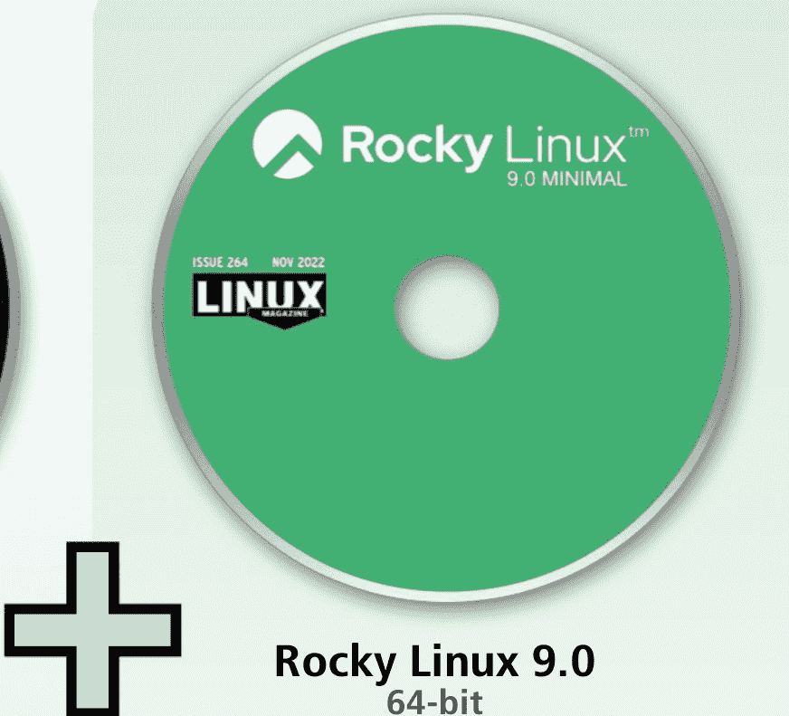

`Debian` 每隔几年发布一次版本，使得每次发布都是一次盛事。2021 年 8 月发布的 `Debian 11 (Bullseye)` 也不例外。不仅 `Bullseye` 的 `Homeworld` 主题对于 `Debian` 来说异常复杂，该版本还改进了对 `exFAT` 文件系统的支持，以及可靠的蓝牙连接。

一年后，`11.5` 版本的发布是对这一坚实基础的最新增强。`Debian 11.5` 包含了自上一个点版本以来发布的修复和安全更新。此外，该版本还包含数十个软件包的修复，包括 `dpkg`、`NVIDIA` 驱动程序和 `Debian` 安装程序。

与所有 `Debian` 一样，`Debian 11.5` 缺乏最新的软件，但提供了无与伦比的稳定性和安全性作为补偿。由于几乎三分之二的活跃发行版都是基于 `Debian` 的，即使是一个点版本的发布在软件领域也是一个具有影响力的事件。

`Rocky Linux` 的历史不足两年，但它正在迅速成为一个主要的 `RPM` 发行版，在人气上足以匹衡 `Hat Enterprise Linux (RHEL)`。`Rocky Linux` 有两个通用版本，尽管它们的版本编号在 `CentOS` 上继续，强调了其作为继承者的角色。

`Rocky` 是 `CentOS` 停止开发转支持 `CentOS Stream` 时来自 `CentOS` 的发行版之一。正如它的致敬语，`Rocky` 的设计目标是“与 `Hat Enterprise Linux` 100% 漏洞兼容”。两者都从相同的源代码构建。主要的区别在于，虽然两者都是企业级，但 `Rocky Linux` 强调一种 `RHEL` 不具备的开发方式。对于企业和家庭用户来说，这是一个至关重要的区别。

然而，技术差异正在显现。`Rocky Linux 9.0` 引入了 `Bandit`，这是一个从零开始构建 `Rocky Linux` 并扩展源代码的工具。未来几年可能会出现更多差异。同时，`Rocky Linux 9.0` 将支持到 2032 年。

> 缺陷光盘将予以更换。请发送电子邮件至 `subs@inlinux-magazine.com`。

尽管本 `Linux Magazine` 经过测试，且据我们所知没有恶意软件和缺陷，但 `Linux Magazine` 对使用本杂志可能导致的数据和计算机系统的中断、丢失或损坏不承担任何责任。

# 开启你的 Web 开发第一步！


现代软件应用通常针对 `Web` 开发。`Linux` 专业协会（`LPI`）新的“`Web 开发核心知识`”计划支持你迈出软件开发的第一步。它包含了适用于培训和自学的学习材料。通过 `Web 开发核心知识` 考试后，你将获得一份证书来证明你的技能。

`LPI` 学习材料可在 `learning.lpi.org` 获取。

在 `lpi.org/wde` 了解有关该计划和考试的信息。

* `Fedora 37` Beta 版已发布
* `Salix 15.0` 可供安装，包含大量更新和新外观
* `Ubuntu 20.04.5 LTS` 版本已发布
* `MX Linux 21.2` 提供了改进和错误修复
* `Gnome` 项目发布新的遥测收集工具
* 更多在线
* `Kubuntu` 聚焦新桌面模型
* 轻量级发行版 `SparkLinux` 新版本已发布

`Fedora 37` 操作系统的下一次迭代 Beta 版现已供下载和安装。这一消息在 `Fedora Hyperkitty` (`https://lists.fedoraproject.org/announce@lists.fedoraproject.org/?message=IDZNTFHOAVUSKLKI`) 上宣布，`Fedora 37` 的首次冻结将于 10 月 4 日。


在 Fedora 37 的功能方面，你可以看到变化，例如 `LLVM` 的更新、新的 `Anaconda` 安装程序预览、支持 `Raspberry Pi`、`Linux` 内核 `5.19`（最新内核）、`Gnome` 43（包含修订）、新的 `GTK/Wayland` 端口（包含高分辨率）、多显示器支持、服务器端集合以及 `KVM` 镜像。

对于想要测试 Fedora 37 新 `Beta` 版的人，`x86_64` 版本可以从官方服务器 (<https://dl.fedoraproject.org/pub/all/stage/37-Beta/Workstation/x86_64/iso>) 下载。如果你想尝试 `spins`（如 `Cinnamon`, `KDE Plasma`, `LXDE`, `Xfce` 或 `i3`），可以从 `Spins` (<https://dl.fedoraproject.org/pub/all/stage/37-Beta/Spins/x86_64/iso>) 下载。

`Salix` 15.0 是一个完全兼容 `Slackware` 并默认使用 `Xfce` 桌面环境的发行版。最新版本提供了新更新，包括 `Xfce` 4.16、`GTK+` 3、`LibreOffice` 7.4、`Gimp` 2.10 以及默认面板。

根据 `Salix` 开发人员，“对于新版本的界面，我们在论坛中进行了广泛讨论，经过了新的 `GTK` 主题、新的窗口管理器，`Salix` 现在提供深色和浅色主题以帮助现代外观。”其他功能包括桌面使用优化、高质量软件包仓库、完全本地化的系统工具以及对 32 位和 64 位架构的支持。

新用户应该记住，`Salix` 的安装是基于，因此需要一些额外技巧来安装操作系统。从官方下载页面 (<https://www.salix.org/download.html>) 下载并安装 `Salix`，并关注官方博客 (<https://salix.org>)。

正如你所期待，`Ubuntu` LTS 版本的下一个点版本已发布。虽然这次更新没有包含许多新功能，但也提供了大量的错误修复、安全补丁和 5.5 内核。

如果你在使用 `Ubuntu` 20.04，可以通过内置升级获取 5.5 版本，这意味着不需要重新安装。

需要注意的是，20.04 并不是 `Canonical` 操作系统的最新版本，将是 22.04。然而，由于仍有大量用户在使用 20.04（它将支持到 2025 年 4 月），`Canonical` 希望提供一个点版本。

这意味着，升级并不包含 20.04 的最新软件。`LibreOffice` 升级到 6.4 版本，`Gnome` 升级到 3.38，`Firefox` 升级到 90 版本。如果你需要更更新版本的软件，你需要运行发行版升级（从 20.04 到 22.04）或手动安装。

如果你不想安装 `Ubuntu` 20.04，可以从官方下载网站 (<https://releases.ubuntu.com/focal/>) 获取 `ISO` 并阅读完整的变更日志 (<https://ubuntu.com/Focal/Release/Changes-Summary-20.04>) 获取更多信息。

`Distbox` 上流行的发行版 `MX Linux` 的开发者发布了该发行版的第二个点版本。虽然最新的迭代并没有突破性的，但它包含了大量的错误修复和各种改进，有助于这个已经优秀的发行版。

诞生于 `Debian` 11 (`Bullseye`) 的 `Wildfox` 提供了两种内核选项。常规内核使用 5.10，而高级硬件变体使用 5.15 内核。

除了内核之外，`MX Linux` 栈得到了错误修复和改进：`mower` 现在允许禁用蓝牙适配器，`mx-update/apt-notifier` 现在有了备份选项，还增加了内核清理工具，`mx-options` 现在包含一个 `UI` 管理工具，磁盘空间检查器确保在安装内核之前有足够的磁盘空间。

关于之前的点版本，开发者表示：“如果你已经在运行，则无需重启。所有版本都通过常规更新通道可用。”

从官方下载页面 (<https://mx.linux.org/download-links/>) 下载你的 `MX Linux` 21 版本，可以在 `Xfce`、`KDE Plasma` 和 `Fluxbox` 桌面之间进行选择。记得阅读发布说明 (<https://mx.linux.org/blog/mx-21-point-2-release/>) 获取更多信息。

虽然为了匿名而收集数据和测量值相当令人不安，特别是对于那些重视隐私的人来说，但 `Gnome` 基金会宣布将在桌面环境中添加一个遥测数据收集工具。

首先，这些数据将是 100% 匿名的，并仅用于通过对软件的决策来改进 `Gnome` 桌面环境。这些决策将告知基金会如何更好地利用资源以及如何帮助用户。


www.linux-magazine.com

<http://www.linux-magazine.com/HPC/>

`Jeff Lawson`

`Amdahl` 法则解释了为什么在相同问题增加计算资源时，应用程序的串行部分不会扩展。

`Joe Case`

当 `Red Hat` 宣布将支持基于 `Red Hat Enterprise Linux` (`RHEL`) 的免费发行版 `CentOS` 时，整个 `Linux` 世界都必须忙措，但现在这在 `HPC` 社区内部更为紧迫。

<http://www.linux-magazine.com/>

`PowerShell`

将 `Shell` 命令转换为 `PowerShell` 模块并在 `PowerShell` 环境中运行。

`Helm`

`Martin Losch`

`Helm Chart` 是一系列模板，用于定义、部署和管理 `Kubernetes`，并可以被认为是 `Kubernetes` 节点的标准包管理器。

`Ferninand Holmes`

`Kaboxer` 打包了发行包源中缺失的应用程序。

新工具是一个名为 `gnome-info-collect` 的命令，它会在传输数据之前向用户展示所有收集的数据。一旦运行该命令，系统将要求你确认传输信息，传输成功后，系统将感谢你帮助改进 `Gnome`。

包含的信息类型包括：操作系统、硬件供应商、是否启用 `Flatpack/Flathub`、已安装的应用、文件共享（活跃/非活跃）、远程登录（活跃/非活跃）、用户数量、默认浏览器以及已启用的扩展。不会包含任何本地信息或任何可能传输给 `Gnome` 开发人员的敏感内容。

你可以通过 `Snap`、`DNF`、`Pacman` 或 `Zypper` 安装该工具。欲需更多信息，请查看该项目的官方 `GitLab` 页面（<https://gitlab.gnome.org/vstanek/gnome-info-collect>）。

`Kubuntu NX` 是一款新型小型规格桌面电脑，搭载 `Kubuntu` 22.04 和最新的 `KDE Plasma` 界面出货。这台新机器可以配备 `i5-1135G7` 或 `i7-1165G7` 第 11 代 `Intel` CPU，两者均带有 `Xe` GPU，可以驱动多达四个显示器。

`Kubuntu NX` (<https://kubuntu.org/spec/nx>) 支持最高 64GB 内存、最高 2TB 的 `NVMe` 存储以及最高 4TB 的 `SATA` 存储，甚至配备了一个允许你将设备安装在显示器背后的支架。

其他功能包括：2x `Thunderbolt` 3/`USB-C`（带 `DisplayPort` 1.4）、1x `HDMI` 2.0、1x `Mini DisplayPort` 1.4、3x `USB-A` 3.2 Gen2、1x `RJ-45` `Intel` 以太网 `I225-V` 2.5GbE `LAN`、1x 音频接口、1x 远场阵列麦克风、1x `SDXC` 媒体器以及 1x 笔记本锁孔。

`Kubuntu NX` 的起价为 695 美元，配置最高可达 1239 美元（配备 `Core i7`、64GB `RAM`、主硬盘和 4GB 次级存储）。现在就从 <https://kubuntu.org/order-nx/> 订购你的 `Kubuntu NX`。

`SparkLinux` 6.4 现已发布。基于 `Debian` `Bullseye` 的轻量级发行版提供了 `Firefox`、`Thunderbird`、`VLC`、`LibreOffice`、`LXQt`、`Xfce` 和 `KDE Plasma` 等软件包的大量更新，允许从 `Debian` 安装许多应用程序（以体验更发布版本）。

最新版本已同步 `Debian` 和 `Spark` 仓库（截至 2022 年 8 月 11 日）。

开箱即用，你会发现 `Firefox` 等应用都是最新版本（安装了 91.0.0 版本）。幸运的是，倾向于使用新版本 `Firefox` 的用户可以从 `Spark` 仓库（`spark-firefox/spark-firefox-es`）安装 103.0.2 或 102.1.0 版本。

使用 `SparkLinux` 6.x 早期版本的用户可以使用 `sparklinux-update` 命令升级到最新版本。

此新版本适用于以下架构：

*   `armhf`: `LXQt`、`KDE Plasma`、`Xfce`、`Openbox` 和文本模式
*   `i686`: `LXQt`、`Openbox` 和文本模式
*   `amd64`: `Openbox` 和文本模式


欲了解 `SparkLinux 6.4` 的信息，请阅读完整的发布说明（https://sparklinux.org/spark-6-4/）并下载 `ISO` 副本安装（https://sparklinux.org/download/）。


`OpenSourceHub.com`

# 新闻

### 内核社区


### 内核对齐

`Linus` 通常对主树中的构建失败或崩溃感兴趣，因为他本人回复了 `Sudip`。他说他查看了数据大小并像补丁一样进行了对比。他说：“那个构建，`BUG` 看起来是正确的，如果 `size(t)` 不起，那么代码就不行。换句话说，代码没问题。”`Linus` 补充道：“我没看到那里哪里出了问题。”

“分支已用我常用的密钥标记过，等我周六回来后就可以发送标签了。”`Linus` 回复道：“我一直鼓励大家使用标签（`tags`），对于内核拉取（`kernel pulls`）来说，这是一个硬性要求，所以不用担心。”

另一个案例中，`Feao` 提交了一些拉取请求（`pull requests`），`Linus` 接受了——但他也说：

> “遗憾的是，你的两个 `pull` 破坏了我们直到现在合并窗口期间的完美标签记录。”

> “我看到人们开始对所有事情使用标签，我非常高兴，但这让你的 `pull` 显得更加突兀。”

> “所以，是的，请不要对 `kernel.pulls` 强制要求，我……希望让标签对所有的内核拉取都获益。”

> “我们能尝试在下一次做到吗？好吗？”

这里发生了什么？——`Linus` 告诉所有人他只会接受拉取请求，并且他一定会遵守。关于标签，他表示将不再接受产生警告的补丁。这两种情况之间有什么区别？

在特定情况下

`Linus` 曾多次针对其他因为没有使用标签而进行这种“公开点名”的行为。这相当幽默且令人惊叹，但我们都知道，`Linus` 在想严厉时可以非常严厉。

在另一封邮件线程中

我已经劝说其他人使用它们了……

想想，首先每个问题都是它自己的特殊用例。无论是需要标签、源代码文件中的消息长度，还是破坏 `ABI`（应用二进制接口）的正确时机，方法始终是处于考虑中的秘密。

在你的请求案例中，`Linus` 认为它在内核源码树之外。编译时的警告是另一回事——在这种情况下，内核本身存在开发者们不够重视的问题。

带签名的拉取请求（`Signed pulls`）与内核没有直接关系。无论签名还是未签名，内核代码保持不变。异常情况是其外部过程通过实习生身份的抓取请求向内核制造某些波动。

然而，还有其他机制来确保任何良好的代码留在内核中。实际上，每份代码在合并到内核之前都会经过开发者和维护者的查看和测试。每份代码都会将自己的名字加入编写者列表。随着代码进入内核，关于谁处理过它会有某种历史记录。

另一方面，更改 `ABI` 会导致依赖于该接口的二进制文件需要重新编译。内核唯一能做的是修复一个仅限于修复的严重缺陷。在某些情况下，如果世界上没有任何一个地方它是 `ABI` 的常规部分，且移除它能让内核更易维护、更整洁，`Linus` 有时会这样做。

我尝试理解 `Linus` 为什么这样领导内核开发，非常有趣。我会告诉你，这很大程度上只是他的个人偏好，而且这些选择与其他选择并无异。我认为他领导 `Linux` 成为每个已知宇宙的标准操作系统，这真的很酷，尽管一些同时期的用户仍在为其他事情而挣扎。

2022年11月14日 第264期 `LINUX-MAGAZINE.COM` `LINUXPROMAGAZINE.COM`


新闻 • 职业 • 科技生活

技能 • 资源

`FOSSlife.org`

> “我不会再犯这个错误了，”你对自己这样承诺。换句话说，你会从经验中学习。如果你将经验转化为数据，计算机也可以这样做。我们将向你介绍机器学习的基本形式。

作者：`Jörg Frage`

2022年5月，来自《`Linux Magazine`》的一位友好人士写信给我，问我是否可以写一篇关于机器学习的短文章。在几次快速提问后，你可以看到，我在完成这个请求时会比复述维基百科条目更有创意。

现在我们有一些空闲，让我问一个个人问题：在阅读开头这几行时，你脑中是否有了来自《`Linux Magazine`》的一位友好人士？第二个问题是：无论如何，如果我们在一起使用图像来获取经验，为什么大多数情况下，当你没有任何信息的情况下，你使用了你的经验来获得更具体的……

换句话说，你使用经验对未知情况进行推断。当然，这并不总是有效，但通常情况下这不是一个问题。机器学习赋予我们从经验中学习和泛化的能力。在计算机科学中，这意味着数据，并且与意识无关。在必要时，它是被编程去执行的。

根据 `Arthur L. Samuel` 在1959 年的定义，机器学习并不是一个术语。它是一门根植于数学的计算机科学，无疑为我们在学生和用户方面提供了一些可能。

在本文，我将描述三种机器学习：无监督学习、强化学习。还有一些变体——例如半监督学习等——但我不会详述它们。正如你将在文中学到的，这三种基本类型之间的区别主要在于经验交付的方式。

监督学习依赖于输入 `X` 和输出 `Y` 的对。例如，`X` 可以由图像组成，比如狗(1)、猫(2)、象(4)。随后的 `Y` 值是特定的数值。使用这个示例数据库，你可以监控学习过程并定义目标。计算机学习函数 `f` 来为每个输入分配类别。

用于训练的图像集被称为训练集。理想情况下，训练结束，计算机将把每个图像分配到正确的类别。通过反复重复训练集中的赋值，计算机获得了泛化能力，即通过新示例进行学习。

用于测试模型的新示例被称为测试集。人们经常会问：“为了成功训练你需要多少对？为了有意义的测试你需要多少对？”


这两个问题都基于错误的假设。这与其说是示例的数量问题，不如说是信息的问题。在前面的例子中，如果训练集不包含雪犬的图像，而测试集包含了总体图像，无论你使用多少图像，测试都没有意义。无论狗是什么，模型从未见过哈士奇或比特犬。当然，当你处理数据时越多越好，但归根结底取决于测试集是否代表了一个良好的混合。

测试集也是如此。在许多模型中，机器学习可以结合领域知识来检测未知，但这种方法并非处处适用。总结一下，监督学习要求人们已经列出，多比少好，但最终重要的是组合（图1）。

到为止的讨论涵盖了我们脑中监督任务的主要类型之一：分类。另一个是回归。在某种意义上，区别主要在于你映射函数 `F Y` 的空间。如果 `Y` 是离散的——如果它只包含少数元素（狗、猫、象），那么如果 `Y` 是连续的，代表信用额、温度或概率，结果就是回归。从一个角度来看，这是一种基于随机数据的优化问题。也就是说，你基本上在累加误差

监督学习的替代方案是无监督学习。无监督学习不依赖于 `(x,y)` 对空间的信息。你只有示例本身。你能用它们做什么？可能比你想象的要多。

无监督学习完全依赖于处理存在的结构。常见的应用之一是对这些示例进行聚类（图2）。通过每个示例的相似性形成小组。然而，为了让计算机这样做，你需要从距离的角度清晰定义相似性——数学家提到

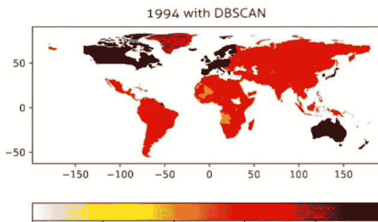

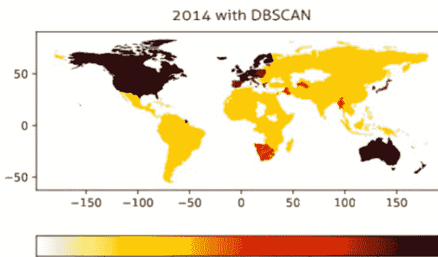

图2：对1994年和2014年的国家进行的无监督分类。白色国家不属于任何簇。与2014年的分类中一样，美国利用了其在该分类中的离群值角色，而欧盟由于2008/2009年金融和经济危机的影响分裂成了两个组。

……到一个指标。一旦你建立了一个指标，你就可以开始了，机器学习算法将从数据中进行分组。例如，这些组可能是客户群体。

形成分组的意义何？首先，分组可以帮助你确定购买行为或提供建议。对于许多应用来说，你不需要监督学习所要求的分类器。如果你想对具有具有相似行为的类进行分类，你可以从其中一种或另一类方法中得出结论，并利用这些结论来创建推荐系统。

你可以从决策的不同视角中识别出出现的群体。这可能意味着将监督学习作为科学过程的替代方案，其优势是可以使用分类法将数据分为不同的组。一个缺点是它对它们之间的关系衡量较少。

分组的反面也很有趣。在这种情况下，你将创建小组，但你对小组本身并不感兴趣，而是关注离群值。一个潜在的缺点是检测违规和尝试欺诈的行为。

在某些系统中，如果一个人的行为与众不同，这可能是可疑活动的信号。然而，你能够捕捉到这种行为是如何工作的。

例如，对于完整的数据，你会立即注意到这种异常。初始过滤不是自动的。拥有限制性权限的用户可能会突出最可疑的行为：在异常时间工作、合并他人的文件。有必要过滤掉这些离群值，以便找到真正有趣的信息。


# 监督学习、无监督学习与强化学习

监督学习和无监督学习最好被看作是为输入分配输出、类别、值或聚类的函数。相反，强化学习代表的是一个具有方法的对象，即一个在自己的环境中自主运行的代理（`agent`）。它可以是一个机器人，也可以是广网上的机器人或类似的程序。该代理遵循一种策略，该策略通常用希腊字母 $\pi$ 表示。

## 数据与反馈机制

强化学习并不是硬编码在计算机中的。代理从数据中学习。这与监督学习或无监督学习中使用的数据不同。在监督学习中，系统在很大程度上受到正确答案的引导。在无监督学习中，代理必须根据自己的特征做出决策。

强化学习介于两者之间。通过基于奖励的反馈（通常称为`reward`），代理的目标是获得最大的奖励。当然，这个目标不是通过一步完成的，而是在整个任务中获得奖励（图 3）。代理不会获得关于如何做正确事的建议，但它会获得反馈信号。然而，人类可能会忽略最佳实践。如果他们不能，他们就可以在实践中学到。

考虑一个孩子和父母的例子，他们很容易接受关于风险的任何教导。目标是一只红鸟，但你没有告诉他们为什么。只有当他们找到它时，你才以赞扬的形式给予反馈。反馈越好，代理越优秀。无论你是否正确，通过给出不同程度的奖励（负面或正面奖励），或两者的混合，在这种情况下，我将坚持使用不那么激进但无偏见的锚点。

强化学习的一个例子是何时给出正面或负面反馈。例如，你可以留在房间里，每当孩子从房间里拿东西并放在杯子里时，就给他们饼干。`agent`/孩子将理解这是一种想要的行为。你也可以在很长一段时间内不给予反馈，直到最后给予等同于清理出房间数量的饼干。在这种情况下，这种行为将学会接受这种交易。

所以你应该在尽可能远的地方提供反馈吗？遗憾的是，这并不简单。毕竟，代理的目标不是清理房间——而是获得最大的奖励。为了做到这一点，代理需要找到获得最高收益的策略。你手头的目标是学习解决现实问题的策略。这两种情况之间通常存在差异。

举一个现实世界的例子：想象你正在修理一个不会撞到你家具的机器人。防撞器会检测是否发生了


`1000` 轮（`Epochs`）

## 欧洲可信 AI 与绿色 AI

然而，目前的许多问题（特别是在欧洲）围绕着其他话题，例如可信 `AI`、不确定性的确定、绿色 `AI`，以及对可信 `AI` 概念的许多方面和讨论都是基于欧盟 2021 年发布的《可信 AI 指南》。其他方面，隐私和数据治理、透明度、非歧视和公平被确定为欧洲的推动力量。目前，欧洲围绕这些问题正发生着许多事情。

测试和数据中有许多狼的图像，但所有这些对于“狼”来说都是一个至关重要的因素——没有雪就没有狼（图 `S`）。这种失败无法通过经典的分类方法来确定。

另一点是：开源软件对于所有广泛使用的机器学习软件是什么样子的？像 `scikit-learn`、`TensorFlow/Keras` 和 `PyTorch`，它们都在开源许可下发布的，这些是你构建软件时使用的库。

一个问题是，每件软件都包含一个人工神经网络。权重不是那种可读且可理解的源代码类型，而是从某个过程中提取出来的。如果你想重复这个过程，你需要库（问题所在）、网络结构信息、初始化参数（即启动所需的项）以及用于训练的数据集。最后一项通常超出了限制——你无法看到数据。

考虑到欧洲在 `AI` 上是否能跟上中国和美国等竞争者——它们在大多数情况下指的就是机器学习。答案可能是取决于话题。反过来，绿色 `AI` 源于一篇名为《绿色 AI》的文章，指的是在考虑计算成本的同时产生结果的 `AI`，鼓励减少资源投入。到目前为止，人们关注的点在资源消耗上。如果多出几千个部分就可以区分类别，那么这可以在不发布的情况下完成。这种方法在很大程度上超过了训练和运行的成本。

## 软件测试与维护

最终，即使是基于机器学习算法的软件也是软件，这意味着它需要被测试和维护。如果这很棒，那么开源比那样写更好。

涉及到测试时，重要的是意识到软件无法通过经典的测试方法轻易地验证。测试本身通常是确定性的——你不需要担心模型在某些情况下将同一张图像分类为狗，而在其他情况下分类为猫。但还有许多其他陷阱。例如，在一个真实的实验 `[2]` 中，狼被识别为狼。然而，将该模型应用于德国某动物园的图像尝试却是令人沮丧的。

一个典型的例子是 `ImageNet` 数据库，它包含许多动物等等。一个包含权重值的网络，这些值可以被提取并适应到有数据的新任务中。例如，如果你只想寻找南美鸟类，你不会在 `ImageNet` 中找到它们，但网络已经学习了许多过滤器。利用在你自己的南美鸟类图像集上的预训练状态。这意味着你可以用更少的图像并且可能


图 5：这张来自狼识别实验 `[2]` 的图显示了什么导致了错误的决策。

以更低的训练能量开销获得更高的准确率。这而且是非常可能的。

但开源需求背后的实际想法是用户可以更改软件并传递这些更改（通常是改进后的）。这个目标不再被完全满足。如果没有可用数据，进一步开发的可能性就是有限的——更不用说机器学习环境中众多软件专利带来的问题了。

那么，一旦你理解了这一切，作为一个源代码爱好者，你可能会想这项技术对你的运动意味着什么。`GPL` 的概念性“著左许可”（`copyleft`）可能希望适用于你的分发，并且不需要许可即可重新发布作为服务运行的软件。（你可能记得 `AGPL` 旨在关闭的 `ASP` 漏洞）。我个人认为，机器学习的使用将引导我们重新思考如何推动开源开发，并将一切与数据概念相结合。

机器学习已经存在很长时间了，但其日益增长的重要性本身应该是寻找这些场景的动力。除了机器学习的力量之外，它也确实有趣。

例如，如果你有一个大量的 `LaTeX` 文档集合，为什么不使用它们来训练 `LSTM` 或 `Transformer` 网络呢？你甚至可以通过编译器建立反馈循环，让系统学习编写无错误的 `LaTeX` 代码。内容无疑会有点奇怪，但这个过程很有趣。

## 信息：BERT 模型原理

模型的实际任务是生成上下文敏感的嵌入，这些嵌入还能区分同一个词在不同语境下的不同含义。这是通过一个关联模块（`association module`）实现的，该模块确定位置 $i$ 处的嵌入与其他所有嵌入之间的相似性。相似性通过嵌入的标量积计算，值越高表示相似性越高。

随后，将一系列相似性值归一化为概率，使得它们的相似性和为一。使用这些相似性值将所有向量的线性变换嵌入作为其他参数的函数，并生成位置 $i$ 处的新嵌入。这些计算过程如图 1 所示。

评估相似性会导致掩码标记（`masked token`）获得较高的权重，并增强 $i$ 处的初始嵌入。随后，`BERT` 能够将图 2 所示句子中的“`rose`”表示为“`flower`”。通过这种方式，每个位置都会创建一个新的嵌入。

该过程在网络的几层上通过不同的参数执行，不断改进上下文嵌入。此外，每层都使用了具有不同参数的关联模块。在顶层，一个逻辑回归模型现在的任务是预测被掩码的（在我们的示例中，根据 `[MASK]` 标记的上下文敏感嵌入预测“`gave`”）。

为了实现这一点，通过优化调整修改标量积和变换嵌入中的模型参数，改变掩码词的概率以增加相似性。这迫使模型在训练期间在顶层嵌入中收集有关掩码词的所有可用信息。

原始的 `BERT` 模型拥有 1 亿个参数，并在来自维基百科和书集的 33 亿个单词上进行了训练。`BERT` 通过相对少量的标注数据对特殊任务进行了定制。通过这种方式，`BERT` 以一种远优于其他模型（如无监督学习或逻辑矛盾检测）的方式学习了大量任务。

这种过程被称为迁移学习。`BERT` 需要对正确的语言和含义有非常详细知识以便在通用数据上进行有效训练。微调（`Fine-tuning`）使模型适应特殊任务，而不会丢失其之前获取的技能。

使用关联模块创建上下文敏感嵌入已被证明是非常有效的，以至于所有自然语言模型都使用这种方法。语言生成嵌入从


图 1：通过关联模块计算上下文敏感嵌入。


`1.56` 万亿个单词。它使用了两种额外技术来提供特别有吸引力的对话。

首先，使用搜索引擎在数据库或互联网上查找最新的文档。它将相关文档添加到之前的对话流中，并实时进行处理。结果是模型能够提供最新且事实准确的答案，允许模型适应

**图 2：** `BERT` 对掩码词的预测。

预测哪个词是最可能的。通过连续使用这些技术，你可以逐渐创建文本。

## GPT-3 与少样本学习

`GPT-3` 模型就是这样一种语言模型。它包含 175 亿个参数，并在总计 5000 亿个单词的文本上进行了训练。此类庞大的模型在训练期间需要巨大的计算能力。在拥有数千个 `GPU` 的 `V100` `GPU` 集群上训练 `GPT-3` 需要数月时间，按每小时 1.50 美元的费用将花费 600 万美元。

该模型可以预测段落的最后一个单词，并且足够灵活可以执行各种任务。该语言模型非常灵活，可以通过少样本提示（`few-shot prompts`）对其进行指令，而无需任何进一步训练。

有意义的、重要的，并避免毒性的可能性。

以文章为例，模型能够提供各种答案。关于 `LaMDA` 是否表现出与孩子水平的情感引起了激烈争议。制造商 `Google` 及其提出这一主张软件工程师 `Blake Lemoine` 达到了令人惊叹的质量和一致性水平。

因此不再需要微调语言模型。相反，模型通过其他方法或其他方式学习用于特定任务的指令。这种方法与现有的解决任务的方法不同。


已经证明，嵌入不仅可以为单词生成，还可以为图像区域（如视频、帧、媒体组件）以及 DNA 序列生成。通过这种方式，可以通过测试的关联模块实现不同媒体的表示。

`LaMDA` 模型是一个具有 1370 亿个参数的语言模型，在对话和其他文本上进行训练。

`DALL-E 2` 能够根据文本描述生成新图像。因此，大型语言模型可以同时表示并生成许多文本内容的图像。一群研究人员将它们称为基础模型 [4]，因为它们将在智能系统的开发中起至关重要的作用。

`[User]` 糟糕的英语输入：`I ate the purple berries.`

良好的输入：`I ate the purple berries.`

糟糕的输入：`Thank you for picking me as your dear.`

`I'd appreciate it.`

良好的输入：`Thank you for picking me as your dear.`

`I'd appreciate it.`

`[...]`

良好的输入：`I'd rather to have more work with you in another project.`

`[GPT-3]` 良好的英语输入：`I'd rather to have more work with you on another project.`

### 信息

### 作者

Georghard Pauli 是弗劳恩霍夫 AI 的高级科学家，同时担任波恩大学的讲师。他目前的工作重点是信息提取，他的著作《Kunstliche Intelligenz》（人工智能）由 Springer 出版。

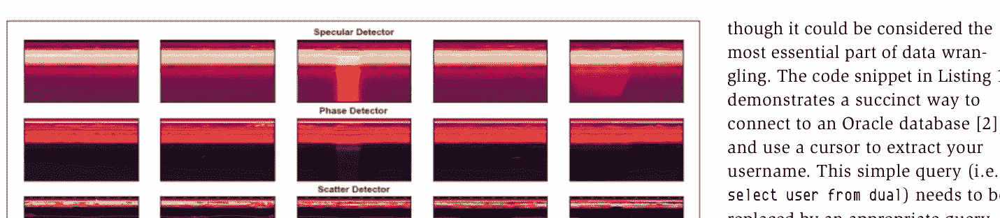

**图 1**：镜面、相位和散射图像的示例。

斜角工具生成三种不同的图像类型：镜面、相位和散射。整个视图会生成一张图像。然而，为了简化视图，图像被分割成 36 部分，每部分代表宽度的 10 度。图 1 显示了每种类型图像的五个示例。

```python
import requests
from PIL import Image
```

```python
def get_image_url(url):
    # 创建会话以包含你的 AUTH 并保护你的 cookies
    auth_session = requests.session()
    auth_session.headers.update({local_config.USERNAME: local_config.WEBSORWORD})

    USER_AGENT = "Mozilla/5.0 (Windows NT 10.0; Win64; x64) AppleWebKit/537.36 (KHTML, like Gecko) Chrome/24.0.1212.137 Safari/53.36"

    # 获取实际数据
    fetched_data = auth_session.get(url)

    # 转换为图像
    return Image.open(BytesIO(fetched_data.content))
```

这些图像可能包含局部缺陷（图 1 中的第三行）。然而，这些并不是这项工作的重点。主要关注的是图像内部普通结构与纹理之间的联系，以及如何在单个值上及其之间变化。感兴趣的伪影在图 1 的第一列和第五列中清晰可见。这些伪影的重要性需要领域专家的意见；但你可以尝试将它们与值得关注的图像分离。

从主要源识别并收集相关数据通常是手动的，

```python
import cx_Oracle
try:
```

```python
with cx_Oracle.connect(
    local_config.username,
    local_config.password,
    local_config.dsn,
    encoding=local_config.encoding) as conn:
    with conn.cursor() as cursor:

        # 执行选择查询
        print(cursor.fetchone()[0])
```

```python
except cx_Oracle.DatabaseError as e:
print(f"YMS 查询出现问题，{e}")
```

```python
import numpy as np
import cv2
```

```python
# 提取 Hu 矩的函数
def extract_hu_moments(image):
    feature = cv2.HuMoments(cv2.moments(np.array(image))).flatten
    return feature
```

```python
# 提取特征函数
def extract_texture(image):
    # 为 4 种邻接关系计算 haralick 纹理特征
    textures = mt.features.haralick(image,image)
```

```python
ht_mean = textures.mean(axis=0)
return ht_mean
```

```python
import pandas as pd
harlickFeatures = pd.DataFrame
harlickMoments = pd.DataFrame

for idx, dataframe in wastepIMGList_df.iterrows():
    imgURI = config.imgServerRoot + wastepIMGList["FILENAME"]
    print("URI: " + imgURI, wastepIMGList["STEP_ID"])
    img = get_url_img(imgURI)

    if img.size == (1280, 1024):
        print("Correct image: " + img.size)
        feature = extract_Harlick(image)
        if not feature.empty:
            harlickFeatures = harlickFeatures.append(pd.DataFrame(feature.reshape(-1, len(feature)), index=wastepIMGList["IMAGE_ID"]).add_prefix("harlick_"))
        else:
            harlickMoments = harlickMoments.append(pd.DataFrame(feature.reshape(-1, len(feature)), index=wastepIMGList["IMAGE_ID"]).add_prefix("harlick_"))
```

```python
detectorType = {
  "Specular": "00",
  "Phase": "01",
  "Scatter": "01"
}
```

```python
from sklearn.preprocessing import StandardScaler
```

```python
from sklearn.decomposition import PCA
pca = PCA(n_components=2)
dca_result = pca.fit_transform(standardized_data)
```

```python
import seaborn as sns
import matplotlib.pyplot as plt

plt.figure(figsize=(10,6))
sns.jointplot(data=principalDF[principalDF['Detector']=='Scatter'], x='PC1', y='PC2', kind='hex', joint_k=bins(10))
```

已经被揭示，但对于每种簇类型，其结构也难以确定。

为了量化这种结构，需要对 `PCA` 变换后的数据应用某种形式的聚类。自然的选择是 `K-means`。然而，在这种情况下，结果在分离有意义的结构方面通常是不如人意的。在图 3 中，灰色簇和红色点被可靠地分开，而其他组数据点的生成得非常粗糙，没有考虑内部结构。情况并非总是如此，在其他示例中，`K-means` 聚类也是一种合适的选择。

应用 `DBSCAN` 聚类算法 [12] 产生了许多非常有前景的聚类结果。列表 10 将此聚类算法以最大样本数（本例中为 22 个）应用于列表 7 中的的 `PCA` 分量上。`DBSCAN` 聚类的结果可以使用 `matplotlib` 库进行可视化，如列表 11 所示。图 4 显示了在使用 `DBSCAN` 对 `PCA` 进行聚类后的结果。

为了可视化分配到不同簇的图像之间的差异，必须将 `ID` 与包含 `'images'` 和 `'wafers'` 元数据的 `DataFrame` 进行合并，这些 `ID` 是从中获取的（见列表 12）。


```python
from sklearn.cluster import DBSCAN
from sklearn import metrics

# 将 PCA 值提取到数组中以执行聚类
d = df.iloc[:, [0]].values

# 计算 DBSCAN
db = DBSCAN(eps=0.35, min_samples=22).fit(X)
core_samples = np.zeros_like(db.labels_, dtype=bool)
core_samples[db.core_sample_index_] = True
labels = db.labels_
```

## 簇的数量，忽略可能存在的噪声

`n_clusters = len(set(labels)) - (1 if -1 in labels else 0)`

`n_noise = labels.count(-1)`

```python
print("Number of clusters: %d" % n_clusters)
print("Number of random points: %d" % n_noise)
print("Silhouette Coefficient: %.3f" % silhouette_score(X, labels))
```

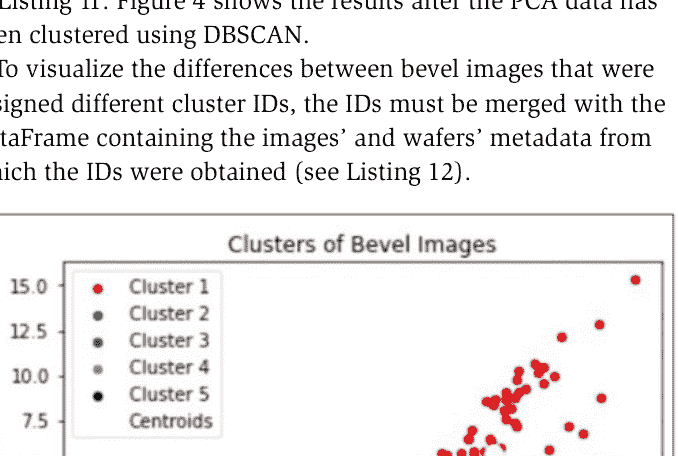

图 3：K-means 聚类已应用于 PCA 特征空间。

```python
df = pd.DataFrame(np.append((x, labels.reshape((428,1))), axis=1))
df.columns=['PC1', 'PC2', 'Cluster']
```

```python
df['IND'] = df.index
```

```python
df = pd.merge(df, waters, on=['PC1', 'PC2'])
```

```python
df.reset_index('IND', drop=True)
```

`df.name = None`

## 将 PCA dataframe 与 Image 和 Wafer 元数据合并

```python
df['IND'] = df.index
```

```python
df = pd.merge(df, watersStep, on='IND', step='STEP')
```

```python
df['LOT_GRB'] = df['WAFER'].str.replace(r'(A-2)+', '')
```

## 将带有聚类数据的单独 DataFrame Pickle 化到文件系统

```python
#df.to_pickle('clusteredDBSCANImage.pkl')
#df.to_pickle('clusteredPhaseImage.pkl')
#df.to_pickle('clusteredScatterPlotImage.pkl')
```

```python
import matplotlib.pyplot as plt
```

```python
unique_labels = set(labels)
colors = [plt.cm.Spectral(each) for each in np.linspace(0, 1, len(unique_labels))]

for k, col in enumerate(unique_labels):
    if k == -1:
        col = [0, 0, 0]
    class_member_mask = labels == k
    core_samples = X[class_member_mask]
    n_samples = X[~class_member_mask]

    plt.plot(core_samples[:,0], core_samples[:,1], c='o', markerfacecolor=tuple(col),
             markeredgecolor='k', markersize=6)
    plt.plot(n_samples[:,0], n_samples[:,1], c='x', markerfacecolor=tuple(col), markersize=6)
```

```python
X = class_member_mask & "core_samples_mask"
plt.plot(X[:,0], X[:,1], c='o', markerfacecolor=tuple(col),
markeredgecolor='k', markersize=6)
```

```python
plt.title("Estimated number of clusters: %d" % n_clusters)
plt.show()
```

估计的簇数量：6

估计的簇数量：4

估计的簇数量：4

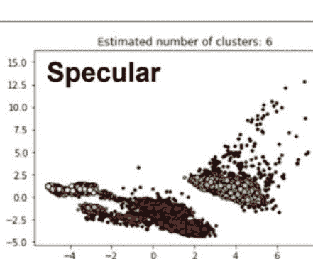

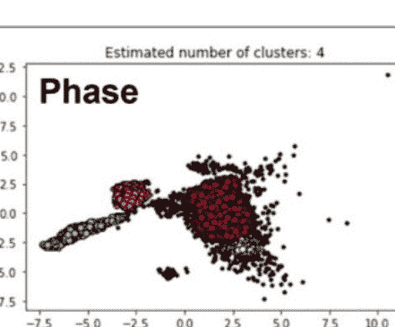

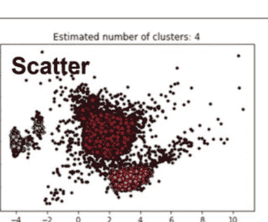

图 4：通过 DBSCAN 对 PCA 数据进行相位和散点图像的聚类。

我怀疑 PCA 结构是由 Seaborn 和 Matplotlib 库驱动的分面图来解释这些差异的（见图 5）。图 5 显示了由 A、B 和 C 识别的产品类型之间，以及由 X、Y 和 Z 识别或非结构化图像之间存在清晰的空间。每个类别中的图像数量由缩放值定义，在我的示例中该设置为 5。列表 16 中的显示函数将接受极端图像列表并以网格格式显示它们。在所有情况下，我都不需要为这种方法比较簇、构建混淆矩阵，或计算精确率或召回率；要实现此点，你必须识别每个类别内的图像（簇和离群点图像）以及距离簇中心最远的距离（见列表 14）。一旦知道了距离，就可以使用列表 15 中的极端函数为每个产品和检测器类型识别出最远的图像。此函数返回两个 DataFrame：一个用于异常

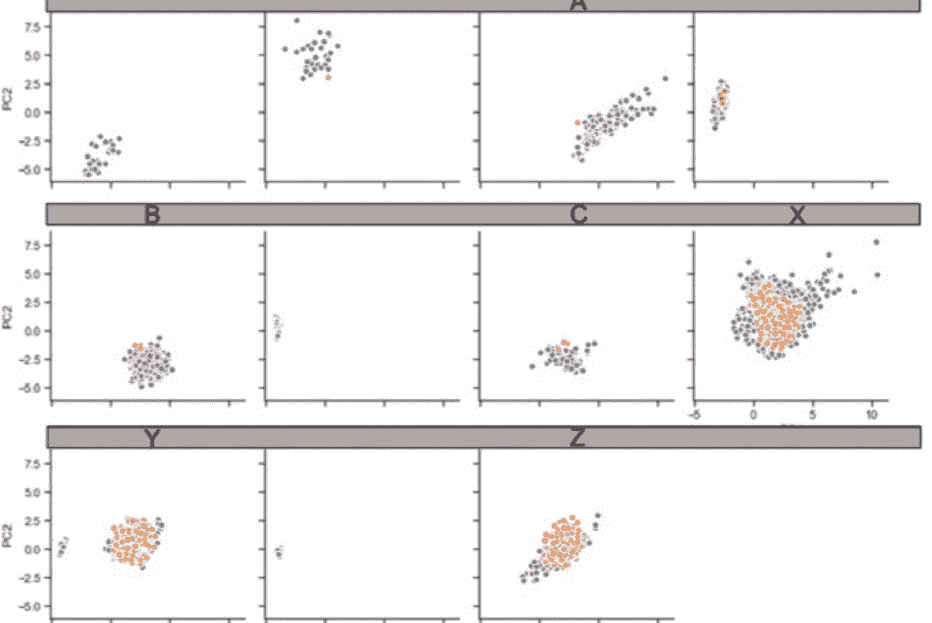

图 5：通过 PCA 生成的分面图显示了依赖关系。

## 列表 14：产品-簇

```python
import numpy as np
import seaborn as sns
import matplotlib.pyplot as plt

sns.set_style(style='white')
g = sns.FacetGrid(df, col='Product', col_wrap=3, hue='Cluster')
g.map(plt.scatter, 'PC1', 'PC2')

plt.show()
```

```python
df['Detector'] = df['Cluster'] + '_'
grouping = df.groupby('Prod')
grouping.index.name = None
```

```python
df['Extreme'] = df.apply(lambda x: np.sqrt(x['PC1']**2 + x['PC2']**2), axis=1)
```

## 列表 13：按类型分类的封面故事

## 无监督学习

## 列表 15：异常数据

```python
def findExtreme(detector_type, prodname):
    normaling = df[(df['Detector'] == detector_type) & (df['Prod'] == prodname)]
    abnormaling = df[(df['Detector'] == detector_type) & (df['Prod'] != prodname)]
    return abnormaling, normaling
```


```python
def displayName(detector_type, abnormaling, normaling):
    cols = abnormaling['Cluster'].size
    clusterID = pd.concat([np.unique(abnormaling['Cluster']),
      np.unique(normaling['Cluster'])])
    thisRows = clusterID.size

    row, ncol = divmod(thisRows, cols)
    fig, axes = plt.subplots(rows=row, ncols=ncol)
    fig.figsize=(15,row*8)
    for ax, label in zip(axes.flatten(), clusterID):
        ax.set_title(label, weight='bold')
        ax.set_xticks([])
        ax.set_yticks([])

    fig.set_facecolor('w')
```

列表 16：正常和异常图像的网格显示

```python
col = 0

for i, name in enumerate(abnormaling):
  axes[0, col].imshow(img)
  col = col+1

for i, name in enumerate(normaling):
  axes[1, col].imshow(img)
  col = col+1
```

# 封面故事

## 无监督学习

尽可能采用最简单的解决方案。在某些情况下，从图像中提取纹理和形状可以结合 `PCA` 和 `DBSCAN` 提供一种简单的解决方案。无监督学习跳过了训练、验证和测试的循环。然而，在无监督

机器学习的最终结果并不是一个可以应用于新图像以生成聚类 `ID` 的模型。相反，特征提取、标准化和 `PCA` 生成了一组代码，这些代码可以与从历史数据的 `k-近邻` 平均值获得的参数空间进行比较 [15]。这个过程为每张图像生成一个聚类 `ID`。


**图 6：** 产品 `X` 的镜面图像（异常和正常水平）。


**图 7：** 产品 `X` 的散点图像（异常和正常水平）。


**图 8：** 产品 `X` 的相相图像（异常和正常水平）。

列表 17：`ID` 堆叠柱图

```python
dfPLUS((dfDetector('') == thisDetector & dfPLUS('PROD') == thisProduct)
  [['Cluster', 'WAP', 'INSTEP_TIME', ...]]
  .groupby(['WAP', 'INSTEP_TIME', 'Cluster'])
  .size().unstack()
  .plot(sort_index('INSTEP_TIME'), kind='bar', stacked=True)
```

## 信息

- [1] Smythroyd, et al. "Knowledge Discovery in Large Databases: Dealing with Uncertainties in Ground Truth. In: Advances in Knowledge Discovery and Data Mining (AAAI/ML Press, Menlo Park, CA, 1995), pp. 109–120"
- [2] `cx_Oracle`: <https://cx-oracle.readthe.docs/>
- [3] `pandas`: <https://pandas.py.org/pandas_docs/stable/getting_started/index.html>
- [4] `PIL`: <https://python-pillow.org/>
- [5] `cv2`: <https://pyopencv.org/project/opencv-python/>
- [6] `mahotas`: <https://github.com/project/mahotas/>
- [7] `NumPy`: <https://numpy.org/docs/stable/user/quickstart.html>
- [8] Merging methods: <https://pandas.py.org/docs/userguide/merge/>
- [9] `sklearn StandardScaler`: <https://scikit-learn.org/stable/modules/generated/sklearn.preprocessing.StandardScaler.html>
- [10] `sklearn PCA`: <https://scikit-learn.org/stable/modules/generated/sklearn.decomposition.PCA.html>
- [11] "Indoor Navigation with Machine Learning" by Roland Poiger, Linux Magazine, February 2022, <https://www.linux-magazine.com/index.php/features/225/55/Machine-Learning>
- [12] `sklearn DBSCAN`: <https://scikit-learn.org/stable/modules/generated/sklearn.cluster.DBSCAN.html>
- [13] Fisher's exact tests: <https://mathworld.wolfram.com/FisherTest.html>
- [14] Chi-square test: <https://www.ibm.com/en_us/knowledge-portal/chi-square-test.html>
- [15] `k-nearest neighbor` algorithm: <https://ibm.com/topics/knn>

# 作者

`Garry Tooley` 在半导体行业工作的时间比一个抗辐射加处理器还要长。他还参与了天文学，以及为微控制器设计各种奇特的用途。

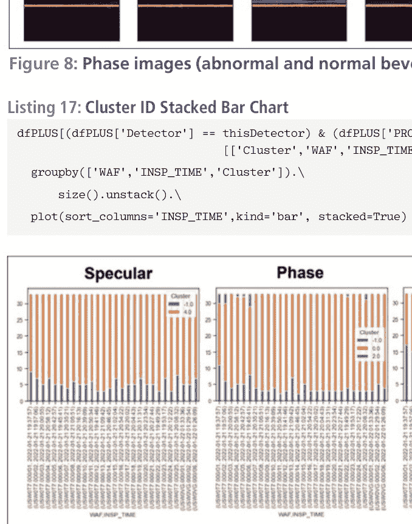

**图 9：** 按产品和图像类型绘制的产品 `X` 堆叠柱图。

## 评论

## 发行版漫 – `Rocky Linux`


# `Rocky Linux`

## 替代 `CentOS`

`Rocky Linux` 填补了 `CentOS` 留下的空白，提供了一个基于社区的 `RHEL` 替代方案。作者：`Bruce Byfield`

`LM`: 在启动 `Rocky Linux` 之前的目标是什么？

红帽在 2014 年收购了 `CentOS`，但在多年后很大程度上忽略了它。基本上，`CentOS` 是红帽 Linux (`RHEL`) 的社区版本，两者都源自 `Fedora`。然后， 2020 年 12 月，红帽宣布 `CentOS` 将停止维护，并由 `CentOS Stream` 代替。几天后，以 `CentOS` 创始人 `McGaugh` 的同事 `Gregory Kurtz` 命名的 `Rocky Linux` 宣布发布。`Rocky Linux` 填补了 `CentOS` 留下的空白，提供了一个基于社区的 `RHEL` 替代方案。`LM`: 在启动 `Rocky Linux` 之前的目标是什么？

基本上，`CentOS` 是红帽 Linux (`RHEL`) 的社区版本，两者都源自 `Fedora`。然后，在 2020 年 12 月，红帽宣布 `CentOS` 将停止维护，并由 `CentOS Stream` 代替。几天后，以 `CentOS` 创始人 `McGaugh` 的同事 `Gregory Kurtz` 命名的 `Rocky Linux` 宣布发布。`Rocky Linux` 填补了 `CentOS` 留下的空白，提供了一个基于社区的 `RHEL` 替代方案。`LM`: 在启动 `Rocky Linux` 之前的目标是什么？


红帽在 2014 年收购了 `CentOS`，但在多年后很大程度上忽略了它。基本上，`CentOS` 是红帽 `Linux (RHEL)` 的社区版本，两者都源自 `Fedora`。然后，在 2020 年 12 月，红帽宣布 `CentOS` 将停止维护，并由 `CentOS Stream` 代替。几天后，以 `CentOS` 创始人 `McGaugh` 的同事 `Gregory Kurtz` 命名的 `Rocky Linux` 宣布发布。`Rocky Linux` 填补了 `CentOS` 留下的空白，提供了一个基于社区的 `RHEL` 替代方案。`LM`：在启动 `Rocky Linux` 之前的目标是什么？


红帽在 2014 年收购了 `CentOS`，但在多年后很大程度上忽略了它。基本上，`CentOS` 是红帽 `Linux (RHEL)` 的社区版本，两者都源自 `Fedora`。然后，在 2020 年 12 月，红帽宣布 `CentOS` 将停止维护，并由 `CentOS Stream` 代替。几天后，以 `CentOS` 创始人 `McGaugh` 的同事 `Gregory Kurtz` 命名的 `Rocky Linux` 宣布发布。`Rocky Linux` 填补了 `CentOS` 留下的空白，提供了一个基于社区的 `RHEL` 替代方案。`LM`：在启动 `Rocky Linux` 之前的目标是什么？


红帽在 2014 年收购了 `CentOS`，但在多年后很大程度上忽略了它。基本上，`CentOS` 是红帽 Linux (`RHEL`) 的社区版本，两者都源自 `Fedora`。然后，在 2020 年 12 月，红帽宣布 `CentOS` 将停止维护，并由 `CentOS Stream` 代替。几天后，以 `CentOS` 创始人 `McGaugh` 的同事 `Gregory Kurtz` 命名的 `Rocky Linux` 宣布发布。`Rocky Linux` 填补了 `CentOS` 留下的空白，提供了一个基于社区的 `RHEL` 替代方案。

`LM`: 在启动 `Rocky Linux` 之前的目标是什么？


红帽在 2014 年收购了 `CentOS`，但在多年后很大程度上忽略了它。基本上，`CentOS` 是红帽 Linux (`RHEL`) 的社区版本，两者都源自 `Fedora`。然后，在 2020 年 12 月，红帽宣布 `CentOS` 将停止维护，并由 `CentOS Stream` 代替。几天后，以 `CentOS` 创始人 `McGaugh` 的同事 `Gregory Kurtz` 命名的 `Rocky Linux` 宣布发布。`Rocky Linux` 填补了 `CentOS` 留下的空白，提供了一个基于社区的 `RHEL` 替代方案。`LM`: 在启动 `Rocky Linux` 之前的目标是什么？

`Rocky Linux` 之后。红帽在 2014 年收购了 `CentOS`，但在多年后很大程度上忽略了它。基本上，`CentOS` 是红帽 Linux (`RHEL`) 的社区版本，两者都源自 `Fedora`。然后，在 2020 年 12 月，红帽宣布 `CentOS` 将停止维护，并由 `CentOS Stream` 代替。几天后，以 `CentOS` 创始人 `McGaugh` 的同事 `Gregory Kurtz` 命名的 `Rocky Linux` 宣布发布。`Rocky Linux` 填补了 `CentOS` 留下的空白，提供了一个基于社区的 `RHEL` 替代方案。`LM`: 在启动 `Rocky Linux` 之前的目标是什么？


## Rocky Linux 的起源

红帽在 2014 年收购了 `CentOS`，但在多年后很大程度上忽略了它。基本上，`CentOS` 是红帽 Linux (`RHEL`) 的社区版本，两者都源自 `Fedora`。然后，在 2020 年 12 月，红帽宣布 `CentOS` 将停止维护，并由 `CentOS Stream` 代替。

几天后，以 `CentOS` 创始人 `McGaugh` 的同事 `Gregory Kurtz` 命名的 `Rocky Linux` 宣布发布。`Rocky Linux` 填补了 `CentOS` 留下的空白，提供了一个基于社区的 `RHEL` 替代方案。

### LM: 在启动 Rocky Linux 之前的目标是什么？


## Rocky Linux 之后

红帽在 2014 年收购了 `CentOS`，但在多年后很大程度上忽略了它。基本上，`CentOS` 是红帽 Linux (`RHEL`) 的社区版本，两者都源自 `Fedora`。然后，在 2020 年 12 月，红帽宣布 `CentOS` 将停止维护，并由 `CentOS Stream` 代替。几天后，以 `CentOS` 创始人 McGaugh 的同事 Gregory Kurtz 命名的 `Rocky Linux` 宣布发布。`Rocky Linux` 填补了 `CentOS` 留下的空白，提供了一个基于社区的 `RHEL` 替代方案。

**LM**: 在启动 `Rocky Linux` 之前的目标是什么？


## Rocky Linux 之后

红帽在 2014 年收购了 `CentOS`，但在多年后很大程度上忽略了它。基本上，`CentOS` 是红帽 Linux (`RHEL`) 的社区版本，两者都源自 `Fedora`。然后，在 2020 年 12 月，红帽宣布 `CentOS` 将停止维护，并由 `CentOS Stream` 代替。几天后，以 `CentOS` 创始人 `McGaugh` 的同事 `Gregory Kurtz` 命名的 `Rocky Linux` 宣布发布。`Rocky Linux` 填补了 `CentOS` 留下的空白，提供了一个基于社区的 `RHEL` 替代方案。

**LM:** 在启动 `Rocky Linux` 之前的目标是什么？


Rocky Linux 之后。红帽在 2014 年收购了 CentOS，但在多年后很大程度上忽略了它。基本上，CentOS 是红帽 Linux (`RHEL`) 的社区版本，两者都源自 Fedora。然后，在 2020 年 12 月，红帽宣布 CentOS 将停止维护，并由 `CentOS Stream` 代替。几天后，以 CentOS 创始人 McGaugh 的同事 Gregory Kurtz 命名的 Rocky Linux 宣布发布。Rocky Linux 填补了 CentOS 留下的空白，提供了一个基于社区的 `RHEL` 替代方案。LM: 在启动 Rocky Linux 之前的目标是什么？

## 回顾

## 发行版概览 - Rocky Linux

随着许多人加入 Slack 社区，这不可避免的。成千上万的人直接见到了 Rocky Linux 的创始人 Gregory Kurtzer！社区根据我们需要创建的不同方面分成了不同的频道。人们根据自己的兴趣和质量加入了相应的频道。从那里开始，连接建立了，项目也开始发展。在每个频道中，人们开始担任各自的领导。但在经过[很长一段时间]后，人们不再注意到其他人的任何情况。没有人检查工作、资质、性别、种族、宗教或信仰，而且大多数人使用卡通头像。人们在 Rocky 组织中的地位根据他们对项目的利益和贡献而决定。

对 `RESF` 及其项目的长期保护，对于维护任何参与项目的社区都是至关重要的，因为这些项目的规模转移似乎偏离了社区的愿望。例如，`CentOS` 是作为 `501(c)` 非营利组织的一部分成立的。`501(c)` 的其他项目不再提供任何保护。例如，`501(c)` 的目的是保护其赞助者的利益（参见 2021 年的 `1.501(c)`）。

LM：哪些特性让 Rocky Linux 脱颖而出，特别是在安全和网络方面？

`RHEL Rocky` 是 `RHEL` 的完全兼容（`bug-for-bug compatible`）的免费实现。除了兼容性和功能对齐，我们还通过 `FIPS`、`STIGs`、`Common Criteria` 等各种安全认证增加了价值。

我们无论如何强调，让一个免费的开源操作系统为我们的加密模块追求联邦信息处理标准出版（`FIPS`）是多么地重要的。Rocky Linux 将是第一个具有此标准的社区驱动型操作系统，并将确保在 Rocky 中包含的所有加密模块都将经过美国国家标准与技术研究院 (`NIST`) 等独立机构的验证和认证。我们还在寻求评估级别 (`EAL+4`) 认证，这是

这些团队成为了 Rocky Linux 的控制结构。

我们以公共利益公司 (`PBC`) 的法律实体创建了 Rocky 软件基金会 (`RESF`)，因为它比 `501(c)` 组织提供了更大的灵活性，这将允许我们更好地保护项目。

`RESF` 项目由一组成员和大量个人组成，他们共同工作以服务他们的社区。我们需要一个我们认为最好且能服务这些社区的结构。

这是最重要的，参与人员的导入、问责制和所有权是决定任何项目长期可持续性和可行性最关键的方面。我们相信 `RESF` 缓解了偏离目标的风险，并通过实施制衡机制兼顾了每个人。

我们为 `RESF` 创建的结构是从许多项目中学到的教训锻就的以及

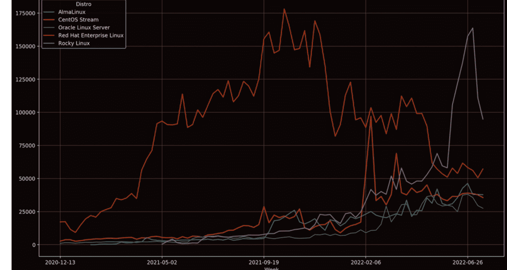

图 3：虽然高度可行，但 `EPEL` 仓库的短期数据显示 Rocky 正在集结并超过了 `RHEL` 和 `CentOS Stream`。这是 Linux 发行版首次实现这种级别的验证。如果合性和验证对你来说很重要，那么使用 Rocky 将具有巨大的优势。

包含了每个人可能需要复制整个项目。这就是成为“第一”的意义，也是我们对协作开源项目的持续承诺。

我们对 `Peridot` 感到非常兴奋，因为它：

- 允许我们轻松地维护多个版本的发行版分支/`RHEL` 重载版；
- 允许社区成员轻松参与 `SIG`（特殊小组）
- 启用多种安全措施来防止私有签名密钥[包]、存档和仓库篡改


## RL：社区与基础设施定义

我们正在通过开放基础基础设施定义自己，该基础设施由社区许多成员管理，由 Rocky Linux 项目构建。没有发布个人所有的 `Rocky` 基础。这不包括用于签名包的加密材料、基础设施访问和安全性。我们的团队为 `Rocky` 项目构建了这些。未来，我们欢迎其他专业组织和机构参与 `Rocky Linux` 特别小组的工具、指南和标准。

我们已与互联网安全中心 (CIS) 合作，为 `Rocky Linux` 增加了基准并使用 `Open-SCAP` 提供定义。我们与商业供应商合作，为 `Rocky Linux` 增加了基准测试和合规性测试，并编写了我们自己的几个原始脚本 [5] 和 `PCI DSS` 合规指南。

* 停止渲染操作系统构建框架的更新，同时所有工程师都产生以保持更新在记录。

对于 `Rocky 8`，我们使用了 `Raido`（`RedHat` 的构建工具），但对于版本 `9`，我们需要其他东西来适应云原生，某种更适合我们开放特殊小组社区的项目。为此，我们构建了 `Rocky`。

## LM：Linux 未来将向何方发展？

`Peridot` 是一个构建在安全、稳定和现代架构（如微服务）坚实基础上的云原生构建。`Peridot` 不仅可以完全捕获基于 `RPM` 的发行版，还能进行分发和创新。此外，得益第三方贡献者以 `SIG` 的形式扩展基础发行版，且不会损害我们的或受信任的制品（例如签名密钥）。

以安全的方式提供 `Rocky` 来为 `Rocky Linux` 构建包，我们的构建过程面临挑战，而 `Peridot` 解决了这个问题。

`RL` 通过打包、增强、`SIG` 和回馈报告进行更多的社区参与，确保了我们社区和用户的完整故事。

我们继续扩大我们的社区，许多组织渴望成为我们所是和正在成为的事的一部分。

我们目前正在定义构建结构；在决策流程和层方面将需要许多更改。

## LM：人们如何参与？

欢迎每个人！我们是一个对友好的社区，有很多机会可以贡献并担任领导角色。我们还在寻找对技术和方面感兴趣的人。加入我们的 `IRC` 或 `Mattermost`：`chat.rockylinux.org`！

从端到端，我们的工程、开发是开放透明的。我们相信通过 `NIST` 和 `CIS` 等独立机构验证我们的方法可以成为团队的一部分。

## 信息

* [1] Rocky Linux: `https://rockylinux.org/`
* [2] CIS-501(c): `https://www.cis.org/product/cis-benchmarks/`
* [3] Rocky Linux: `https://rockylinux.org/organizational-structure/`
* [4] CIS: `cisecurity.org`
* [5] OpenSCAP: `openscap.org`
* [6] DISA: `www.disa.mil`

# Linux 备份

## 简化 Android 数据

## Linux 备份助手

## 保持简单

## Linux Android 备份

设置，连续点击七次“版本号”（1），然后按照提示输入 PIN 码。现在屏幕上会短暂闪烁显示人员模式消息。要在 Android 和你的电脑或笔记本电脑之间复制数据，你还需要使用 `USB` 调试（2）。你可以在设置中的“系统与更新”下找到这个隐藏的选项。

当你的 Android 设备已准备好进行备份时。

在计划保存设备备份文件的 PC 或笔记本电脑上，首先下载 `ADB`，解压压缩包，并在命令行中连接到更新后的目录。确保你的设备已正确连接到计算机。连接的 Android 设备上会弹出一个提示，询问你是否要加载或复制数据。按下回车键后，连接的设备应该被标记为 `device`。如果不是，请按 `Ctrl + C` 取消脚本，重新连接并重启（图 3）。

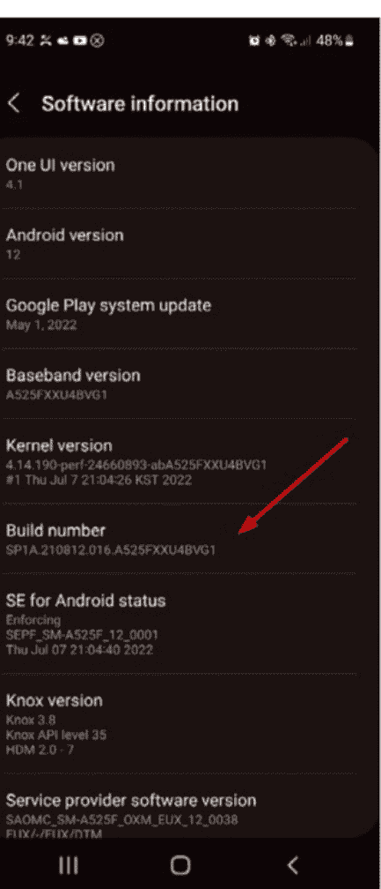

一旦成功检测到设备，你将看到两个选项：`Backup`（备份）和 `Restore`（恢复）。系统将选中 `Backup`。通过按回车键，你将看到用于从 Android 设备备份内容的辅助应用。脚本（图 4）提示手机上已安装了该应用，但在我第一次操作时并非如此。在设备上手动安装应用后，你将看到一个 `Export date`（导出日期），它可以让你复制联系人。

接下来，你需要指定要复制备份数据的目录。对于当前目录，按回车键，来自 Android Linux 的数据现在开始传输。复制完成后，可能需要几分钟。你可以在屏幕上看到操作进度。在我的第一次测试中，我使用了华为 `Mate 20 Pro`，传输了超过 16,000 个文件，总大小约为 `1.6GB`。

最后，你需要保存到加密压缩包；然而，`LAB` 在几分钟内创建了加密压缩包。在我的测试中，整个过程包括下载应用和配置大约需要 30 分钟。如果成功，`LAB` 会告诉你 `Everything is OK`（图 5）。结果是我的华为 `Mate 20 Pro` 已经保存了备份；但它目前在你的设备上还不可用。不要忘记恢复你在设备上为 `USB` 调试和设备开发者选项配置的设置，将其连接到计算机并让它传输文件。然后，按回车键继续。

> 图 1：在设备和计算机之间交换数据之前，你必须在 Android 设备上解锁开发者模式。

```
$ ~/Downloads/mrfv-linux-android-backup-id3395aef
```

如果设备已正确连接，你现在会看到一条请求访问手机的消息。允许它，然后按回车键继续。如果你不是第一次使用此脚本，可能不需要允许任何内容。

图 2：`USB` 调试功能可能隐藏在 Android 设备的多个位置。如果你找不到，可以搜索网络设备名称以确定该选项的准确位置。

已连接设备列表

在上面的列表中看到你的设备吗？它旁边显示的是 `device` 吗？如果不是，退出此脚本（`ctrl+c`）然后返回。你想做什么？

`Restore`（恢复）

图 3：启动脚本后，首先检测 Android 设备并将其标记为 `device`。如果不起，请确保设备已正确连接。

## 深度解析

## Linux Android 备份

```
adb backup ~/Downloads/rfrv-linux-android-backup-id395af
```

请遵循设备上的开发者选项，将其连接到计算机并设置为传输模式。然后，按回车键继续。

如果你已正确连接设备，你现在会看到一条请求访问手机的消息。允许它，然后按回车键进入最后一步。

提示：如果你是第一次使用此脚本，可能不需要允许任何内容。

设备已连接

你可以在上面的列表中看到你的设备吗？它旁边显示的是 `device` 吗？如果不是，请尝试按 `ctrl+c` 并重试。

你想做什么？

我想在你的设备上安装一个备份辅助应用，它可以进行备份和恢复。

辅助应用已打开，你可以在 `GitHub` 首页看到它正在做什么。

| % 总计 | % 接收 | 平均速度 | 剩余时间 | 已用时间 | 速度 |
| :--- | :--- | :--- | :--- | :--- | :--- |
| 100% | 100% | 12.0 M/s | 0 | 0:00 | 0:01 | 12.4m |

正在尝试安装辅助应用...

执行简化安装

注意：备份将在脚本所在的设备上进行，然后将复制到指定位置。

请输入你想要创建工作目录的位置。

辅助应用已在你的设备上打开。请点击 `Export Data` 按钮——这将导出到内部存储的脚本备份。按回车键继续。

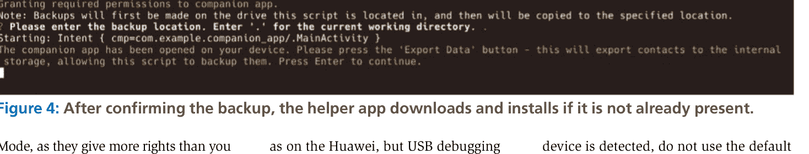


```
Removing backup ~/storage/Pictures/Album
Removing backup ~/storage/Pictures/Screens
Removing backup ~/storage/Pictures/Drawings
Removing backup ~/storage/Companion/News
Removing backup ~/storage/Download
Removing backup ~/storage/Telegrams
Removing backup ~/storage/DCIM
Removing backup ~/storage/Music
Removing backup ~/storage/ICLH
Removing backup ~/storage/HD Wallpapers
Removing backup ~/storage/Android
Removing backup ~/storage/Games
Removing backup ~/storage/MIDisk
Removing backup ~/storage/Cloud
Removing backup ~/storage/Slack
Removing backup ~/storage/WI-Fi Direct
Removing backup ~/storage/EditedPhotos
Removing backup ~/storage/Calibre.Companion
Removing backup ~/storage/Rkomot
Removing backup ~/storage/Apps
Removing backup ~/storage/
```

Everything is OK.

如果项目失败，请查看 GitHub 仓库。这让我知道有人在使用此脚本，我应该

`adb backup ~/Downloads/rfrv-linux-android-backup-id395af`

OK 消息告诉你备份过程已完成。保留密码以便安全恢复。


# Linux 备份

终端窗口拖放。按回车键后，LAB 询问密码并打开压缩包。数据已自动恢复（图 7）。

等待带有 bootloader 的设备。此外，LAB 还备份了保存的联系人，你可以改进或扩展它。我也在 GrapheneOS 分上尝试了这一点。仔细检查发现，GrapheneOS 因为安全功能被锁定，但它仍然有自己的备份。现在 LAB 的进度是进行备份和恢复数据。

## 信息

- 1) `ad backup`：[https://android-review.googlesource.com/c/platform/modules/#178451](https://android-review.googlesource.com/c/platform/modules/#178451)

- 2) Linux Android 备份：[https://github.com/mrfiv/linux-android-backup](https://github.com/mrfiv/linux-android-backup)

- 3) WSL：[https://en.wikipedia.org/wiki/Windows_Subsystem_for_Linux](https://en.wikipedia.org/wiki/Windows_Subsystem_for_Linux)

- 4) APK：[https://en.wikipedia.org/wiki/Apk_file](https://en.wikipedia.org/wiki/Apk_file)

- 5) Download：[https://github.com/mrfiv/linux-android-backup/archive/heads/master](https://github.com/mrfiv/linux-android-backup/archive/heads/master)

- 6) Murene：[https://linuxnews.dev/2022/06/murene-os-v-1-first.de](https://linuxnews.dev/2022/06/murene-os-v-1-first.de) (German)

- 7) Lineage：[https://en.wikipedia.org/wiki/Lineage](https://en.wikipedia.org/wiki/Lineage)

- 8) AOSP：[https://source.android.com/](https://source.android.com/)

## 结论

LAB 为几乎 Android 设备创建备份并可以恢复它们。使用 LAB 很容易比较属性。

# 作者

Fernand Thomas 住在柏林的 Linux 开发者、自由职业者和作家。

```
$ lab --dir=rrfv-linux-android-backup-id3b9s5f
请启用设备上的开发者选项，将其连接到计算机并设置为文件传输。然后按回车键继续。
如果你已连接设备，你现在会看到一条请求密码的消息。允许它，然后按回车键继续。
已连接设备列表
```

提示：如果你是第一次使用此脚本，可能不需要允许任何内容。

你想做什么？

我想在你的设备上安装一个备份辅助应用，它可以进行备份和恢复。

辅助应用已打开，你可以在 GitHub 首页看到它正在做什么。

```
Removing backup ~/storage/Pictures/Album
Removing backup ~/storage/Pictures/Screens
Removing backup ~/storage/Pictures/Drawings
Removing backup ~/storage/Companion/News
Removing backup ~/storage/Download
Removing backup ~/storage/Telegrams
Removing backup ~/storage/DCIM
Removing backup ~/storage/Music
Removing backup ~/storage/ICLH
Removing backup ~/storage/HD Wallpapers
Removing backup ~/storage/Android/wiki
Removing backup ~/storage/Games
Removing backup ~/storage/MIDisk
Removing backup ~/storage/Cloud
Removing backup ~/storage/Slack
Removing backup ~/storage/WI-Fi Direct
Removing backup ~/storage/EditedPhotos
Removing backup ~/storage/Calibre.Companion
Removing backup ~/storage/Rkomot
Removing backup ~/storage/Apps
Removing backup ~/storage/
```

> 图 6：恢复的方法与备份相同，只是你选择了 `Restore`（恢复）。

```
Performing Streamlined Install
Success
Performing Streamlined Install
Success
Performing Streamlined Install
Success
Performing Streamlined Install
Success
Performing Streamlined Install
Success
Performing Streamlined Install
Success
Restoring storage,
/backup/Data/Android/: 178 files skipped, 27.1 MB (7562594 bytes in 2.660s)
/backup/sdcard/DCIM/: 0 files skipped, 0.5 MB (1474845 bytes in 0.448s)
/backup/sdcard/Download/: 0 files skipped, 0 MB
/backup/sdcard/Music/: 0 files skipped, 0 MB
/backup/sdcard/Movies/: 0 files skipped, 0 MB
/backup/sdcard/Pictures/: 35 files skipped, 22.3 MB (2546538 bytes in 0.237s)
/backup/sdcard/Ringtones/: 0 files skipped, 0 MB (1599227 bytes in 3.483s)
/backup/Contacts/: 5 files skipped, 0 MB
```

# 通过特版精进你的技能！

从我们的特版库中了解 `Shell`、`LibreOffice`、`Linux` 等更多。

《Linux 杂志》团队创建了一系列单行，让你对感兴趣的话题进行深度研究。提供纸质版或数字版。

查看完整库！

`shop.linuxnewmedia.com`

# 加入 Linux 革命！

你所需的所有软件！

# 入门指南

# LINUX

301 条最强 `BASH` 命令

* 更强大 • 更安全 • 更开放

学习如何设置 `Linux` 系统

* 听音乐 • 玩游戏 • 处理树莓派 (Pi)

* 浏览网页及更多功能

# LINUX SHELL 手册

2022 版

# 让你的 Linux 技能飞飞跃跃

指尖掌控的力量

* 管道和重定向输出

* 监控进程

深入探索世界上最强大的免费办公套件

# 免费 DVD

完整版

2022/23 版

# LibreOffice 专家

编辑和保存 `MS Office` 文件


编写你的 LO 宏

节省时间并自动化复杂任务

# MakerSpace 创客空间 #02

# 创客的实战项目

酷炫技巧

用黄油抹底刀改变一切

光影绘画

当你需要一个程序控制的光棒时

PiGame 2.0

通过轻松仿真开启你的游戏

树莓派极客 (RASPBERRY PI GEEK)

2000+ 个树莓派制作项目等！

# MakerSpace 创客实战项目

# 调整你的 Linux 系统

2022 版

# Linux 酷玩 84 技巧

Linux 极客的技巧和快捷键

* 使用 Chrome 下载管理器加速性能
* 终于可以搜索文本、PDF 和 Office 文件
* 在 Proxmox 上运行虚拟机无需安装客户端

发现专家的秘密

复古乐趣

使用 DOSBox DOS 游戏

音频专家

针对所有 AI、音乐家、作曲家的测试

# 构建一台树莓派收机！

# 深度解析 – 替代 Unix 命令


# 传统 Unix 命令的新选项

## 结交新朋友

如果你正在寻找现代显示器或更快的命令行速度，传统 Unix 命令的替代方案可能正是你需要的。作者：Bruce Byfield

Unix 的开发始于 50 多年前。与商业软件相比，Unix 的大多数基础命令今天仍然在使用。然而，在过去的几十年里，出于各种原因，人们了替代方案。例如，内存限制或文件名长度等限制早已消失，为命令执行更多操作扫清了道路。此外，现在桌面环境比命令行更常见，某些选项对于最常用的用途来说已经过时或过于复杂，导致了简化的需求。在其他时候，开发者想要尝试开发改进版本。以下是一些常用传统命令的替代方案。

除此之外，许多发行版例行地将 `ls` 别名为 `ls --color`，这一事实凸显了还有多大的改进空间。并不意外的是，目前至少有六个 `ls` 的替代品，它们全部都是

# tree 或 exa

作为最常用的命令行导航命令之一，`tree` 是更新界面的热门选择，如果

```bash
$ bgillivars:~/2022-08-august/ $ tree
0000001.red-hot-family_jc-bb-revisions.odt
almalinux.png
centos.png
centos-stream.png
fedora.png
fedora-redhat.tar.gz
rhel.png
rocky.png
history
command.png
date-time.png
grep.png
history.png
history.tar.gz
orfay.png
```

作者

Bruce Byfield 是一位量子记者和自由职业编辑，专攻自由和开源软件。在写作项目中，他还教授各种大学的课程。Bruce Byfield 住在西海岸（http://bybyfield.wordpress.com）。他还是 Pint Pieces 的联合创始人，那是一个关于啤酒和艺术的博客（https://pintpieces.com/）。

图 1：类似于文件管理器，`tree` 列出了目录和文件。

# 命令行 - 替代命令

图 2：`ls` 的现代替代品。

## 平铺布局与混合

什么是平铺布局？平铺布局是在窗口中打开的图形界面。在过去的几十年里，在构建 Windows 和 macOS 等桌面环境的努力中它们经常被忽视。然而，近年来，平铺桌面变得越来越流行，因为计算能力意味着用户可以选择各种平铺桌面。平铺布局背后的想法是减少桌面的混乱，并将窗口拖到一侧。当文件加载时，平铺桌面会自动显示文件，使结果更易读。一种流行的替代品是 `tree`，通过 `tree`，你可以指定深度。它还包含了搜索功能，并允许通过环境变量显示每个条目的路径。许多用户更喜欢使用 `cat` 命令。作为 `cat` 的完全替代品，`bat` 支持语法高亮。如果文件比屏幕长，`bat` 将滚动显示文件。对于程序员来说，`bat` 与 git 集成。

## man

手册（Man pages）是 Linux 文档的主要形式。遗憾的是，它们往往复杂且长。`tldr`（意为“太长”）提供了命令的快速摘要。它并不取代手册，但提供了清晰、简洁的示例并涵盖了用户最常用的情况（图 4）。使用 `tldr`，你需要安装 `tldr` 客户端并运行，或者可以使用 Python 客户端：

```bash
pip install tldr
```

第一次使用 `tldr` 时会有短暂延迟，因为正在创建数据库。一旦创建，`tldr` 的响应时间与 `man` 相似。

## apt-get

作为 Debian 及其衍生版本的包管理器前端，`apt-get` 多年来扩展了数十选项，这对新用户来说很无聊。作为这种扩展的响应，它简化了其基础命令，包括如 `apt-cache` 和 `apt-query` 等非常有用的工具（图 5）。此外，未来的 `apt` 版本将允许编辑

| Tar 归档 |
|---|---|
| 常见的压缩方法，如 gzip 或 bzip2。 | 创建存档并写入文件：`tar -cf target.tar` |
| 创建 gzipped 压缩包并写入文件：`tar -czf target.tar` |
| 使用相对路径从目录提取 gzipped 包：`tar -xzf target.tar --directory=path/to/` |
| 将压缩包（文件）提取到目标目录：`tar -xf archive.tar -C directory` |
| 使用 [gzip] 软件确定压缩程序：创建压缩包并写入文件：`tar -czf target.tar` |
| 列出 tar（文件）的内容：`tar -tf source.tar` |
| 从存档（文件）提取匹配模式的文件：`tar -xf archive.tar --wildcards pattern` |

图 4：手册页的快速查询，`tldr` 的特用示例。

# 深度来源

一旦执行命令，反馈与 `apt-get` 相同。它是如此方便，以至于老 Debian 用户也必须使用它。

## 的 yum

传统上，`yum` 作为 RPM 包的管理器工作。遗憾的是，`yum` 缺乏 API 文档和专业知识，使得错误修复和改进变得困难。由于这个原因，`dnf` 在过去几年里逐渐替换 `yum`。作为完全替代品，`dnf` 允许

```bash
root@ubuntu:~# apt install build
Building dependency tree.
Done
将安装以下额外的包：
ib64-libreadline8:libreadline8-3.9-0:0.18-10-common-0.18-10-common-lib6-5-liboundmouth8-1
ib64-libglib2.0:libglib2.0-0:libw-1.2-4-link-dictionaries-minisat
建议的包：
将安装以下新包：
ib64-libapt-dev:libapt-dev-3.0.0-0:0.18-10-common-ubuntu0.18-10-common-lib6-5
ib64-liboundmouth8-1:
在此操作后，将使用 124.7 MB 的额外空间。继续吗？[Y/n]
```

| PID | USER | NI | TTY | TIME | COMMAND |
| :--- | :--- | :--- | :--- | :--- | :--- |
| 6933 | | 0 | S | 0:00:04 | ps |
| 1751 | | 0 | S | 0:00:00 | ps |
| 1651 | | 0 | S | 0:00:06 | ps |
| 1499 | | 0 | S | 0:00:00 | ps |
| 6238 | | 0 | S | 0:00:00 | python3 |
| 9184 | | 0 | S | 0:00:00 | python3 |
| 1523 | | 0 | S | 0:00:00 | python3 --daemon --address= |
| 1523 | | 0 | S | 0:00:00 | python3 --display 2 -3 /run/1000/gdb |
| 2307 | | 0 | S | 0:00:00 | log-journal |
| 6238 | | 0 | S | 0:00:00 | python3 |
| 6906 | | 0 | S | 0:00:00 | python3 |
| 1489 | | 0 | S | 0:00:00 | python3 |
| 1068 | | 0 | S | 0:00:00 | python3 |
| 1068 | | 0 | S | 0:00:00 | python3 |
| 1068 | | 0 | S | 0:00:00 | python3 |

图 5：作为 apt 的替代品，top 提供了现成的易用

# 深度解析

## 命令行 – 替代的 Unix 命令


```bash
fd ilvarnarness=$fd find Haida
creative/ilvarnarness/names= Haida_dictionary.pdf
creative/ilvarnarness/names= Haida_dictionary.pdf
creative/ilvarnarness/names= Haida_dictionary.pdf
project/creative/ilvarnarness/names= Haida_dictionary.pdf
project/creative/ilvarnarness/names= Haida_dictionary.pdf
```

图 8：`fd` 的快速版本显示了彩色编码的结果。

```bash
root@home:/home/cache/creative/ilvarnarness locate "*" -n 18
/home/home/cache/creative/ilvarnarness/account_beyblade.media/assets_icons_favicon.png
/home/home/cache/creative/ilvarnarness/apphy.com_content_dam_BHydro_icons_favicon.png
/home/home/cache/creative/ilvarnarness/default_icons_ichydro.png
/home/home/cache/creative/ilvarnarness/swartholler_center.png
/home/home/cache/creative/ilvarnarness/cdn_judge.me_favicon-F136c5b2d8f6a92e96c34b3b525c48f308a254cb7b2bd0f9a337.png
/home/home/cache/creative/ilvarnarness/google_globe.png
/home/home/cache/creative/ilvarnarness/favicon.png-7598_Files_hotrees_core_layer_1684_108_crop_center.png
/home/home/cache/creative/ilvarnarness/logjam.com_favicon.png
```

图 9：在这里，`locate` 将结果限制在最初 10 个。

在通用编程中非常通用，并且比你具有更好的依赖解析能力。此外，`fd` 还拥有你所缺乏的功能，例如搜索仓库或删除旧内核。总的来说，`fd` 速度快得多而且足够灵活，可以跳过文件并加速你的安装。

异常情况。更重要的是，虽然 `grep` 仅限于纯文本文件，但 `ripgrep` 支持多种文件类型和 Unicode 编码，可以搜索更多内容或限制它们。其他实用功能包括增强的正则引擎。

如果你安装了一个包，`fd` 将不需要为你更新包列表，你就可以在搜索路径中使用大写字母。

## plocate

多年来，`locate` 有几个不同的版本。最新版本 `plocate`（图 9）是一个无缝替换方案，它开始搜索主要目录。`locate` 的主要优势是它可以比任何先驱都更快地找到文件，因为除非你告诉它，否则它通常不会搜索整个数据库。`plocate` 还可以同时搜索字符串，这可以加快搜索速度。

## 旧的还是新的？

这里的大多数列表与它们所依赖的命令非常相似，切换到这些工具很容易。然而，这种切换是否值得你花时间取决于你和你的计算需求。例如，某些用户可能会发现对 `top` 作用不大，除非你能对其进行配置。

## htop

为了显示系统上运行的应用程序，`top` 有这个经典的工具。在 Linux 系统上默认构建，这并不意外，但它开发于 1984 年。`htop`（图 7）开发于 2004 年，使用颜色让阅读更轻松。`htop` 支持垂直和滚动。

同样重要的是，旧习惯难改：当你切换时，你仍然会感觉到年代感。在某些情况下，如果你的发行版没有这样做，你可能想保留旧的别名。但要小心：在某些情况下如 `apt-get`，两者之间的差异大到你可能只想通过鼠标使用新命令。这些功能使得将 `top` 替换为 `htop` 成为系统管理员更好的选择。

## fd

如果你在寻找 `find` 的替代品，`fd`（图 8）包含了正则表达式，通常比 `find` 快得多。`fd` 还拥有你所缺乏的功能，例如搜索仓库或删除旧内核。总的来说，`fd` 速度快得多而且足够灵活，可以跳过文件并加速你的安装。

更重要的是，虽然 `grep` 仅限于纯文本文件，但 `ripgrep` 支持多种文件类型和 Unicode 编码，可以搜索更多内容或限制它们。

如果你安装了一个包，`fd` 将不需要为你更新包列表，你就可以在搜索路径中使用大写字母。

## plocate

多年来，`locate` 有几个不同的版本。最新版本 `plocate`（图 9）是一个无缝替换方案，它开始搜索主要目录。`locate` 的主要优势是它可以比任何先驱都更快地找到文件，因为除非你告诉它，否则它通常不会搜索整个数据库。`plocate` 还可以同时搜索字符串，这可以加快搜索速度。

## 旧的还是新的？

这里的大多数列表与它们所依赖的命令非常相似，切换到这些工具很容易。然而，这种切换是否值得你花时间取决于你和你的计算需求。例如，某些用户可能会发现对 `top` 作用不大，除非你能对其进行配置。

## htop

为了显示系统上运行的应用程序，`top` 有这个经典的工具。在 Linux 系统上默认构建，这并不意外，但它开发于 1984 年。`htop`（图 7）开发于 2004 年，使用颜色让阅读更轻松。`htop` 支持垂直和滚动。

同样重要的是，旧习惯难改：当你切换时，你仍然会感觉到年代感。在某些情况下，如果你的发行版没有这样做，你可能想保留旧的别名。但要小心：在某些情况下如 `apt-get`，两者之间的差异大到你可能只想通过鼠标使用新命令。这些功能使得将 `top` 替换为 `htop` 成为系统管理员更好的选择。

## fd

如果你在寻找 `find` 的替代品，`fd`（图 8）包含了正则表达式，通常比 `find` 快得多。`fd` 还拥有你所缺乏的功能，例如搜索仓库或删除旧内核。总的来说，`fd` 速度快得多而且足够灵活，可以跳过文件并加速你的安装。

更重要的是，虽然 `grep` 仅限于纯文本文件，但 `ripgrep` 支持多种文件类型和 Unicode 编码，可以搜索更多内容或限制它们。

其他实用功能包括增强的正则引擎。

如果你安装了一个包，`fd` 将不需要为你更新包列表，你就可以在搜索路径中使用大写字母。

（此处重新开始翻译）

```bash
fd ilvarnarness=$fd find Haida
creative/ilvarnarness/names= Haida_dictionary.pdf
creative/ilvarnarness/names= Haida_dictionary.pdf
creative/ilvarnarness/names= Haida_dictionary.pdf
project/creative/ilvarnarness/names= Haida_dictionary.pdf
project/creative/ilvarnarness/names= Haida_dictionary.pdf
```

图 8：`fd` 的快速版本显示了彩色编码的结果。

```bash
root@home:/home/cache/creative/ilvarnarness locate "*" -n 18
/home/home/cache/creative/ilvarnarness/account_beyblade.media/assets_icons_favicon.png
/home/home/cache/creative/ilvarnarness/apphy.com_content_dam_BHydro_icons_favicon.png
/home/home/cache/creative/ilvarnarness/default_icons_ichydro.png
/home/home/cache/creative/ilvarnarness/swartholler_center.png
/home/home/cache/creative/ilvarnarness/cdn_judge.me_favicon-F136c5b2d8f6a92e96c34b3b525c48f308a254cb7b2bd0f9a337.png
/home/home/cache/creative/ilvarnarness/google_globe.png
/home/home/cache/creative/ilvarnarness/favicon.png-7598_Files_hotrees_core_layer_1684_108_crop_center.png
/home/home/cache/creative/ilvarnarness/logjam.com_favicon.png
```

图 9：在这里，`locate` 将结果限制在最初 10 个。

在通用编程中非常通用，并且比你具有更好的依赖解析能力。此外，`fd` 还拥有你所缺乏的功能，例如搜索仓库或删除旧内核。总的来说，`fd` 速度快得多而且足够灵活，可以跳过文件并加速你的安装。


异常情况。更重要的是，虽然 `grep` 仅限于纯文本文件，但 `ripgrep` 支持多种文件类型和 Unicode 编码，可以搜索更多内容或限制它们。其他实用功能包括增强的正则引擎。

如果你安装了一个包，`fd` 将就不需要为你更新包列表你就可以在搜索路径中使用大写字母。

## `plocate`

多年来，`locate` 有几个不同的版本。最新版本 `plocate`（图 9）是一个无缝替换方案，它开始搜索主要目录。`locate` 的主要优势是它可以比任何先驱都更快地找到文件，因为除非你告诉它，否则它通常不会搜索整个数据库。`plocate` 还可以同时搜索字符串，这可以加快搜索速度。

## 旧的还是新的？

这里的大多数列表与它们所依赖的命令非常相似，切换到这些工具很容易。然而，这种切换是否值得你花时间取决于你和你的计算需求。例如，某些用户可能会发现对 `top` 作用不大，除非你能对其进行配置。

## `htop`

为了显示系统上运行的应用程序，`top` 有这个经典的工具。在 Linux 系统上默认构建，这并不意外，但它开发于 1984 年。`htop`（图 7）开发于 2004 年，使用颜色让阅读更轻松。`htop` 支持垂直和滚动。

同样重要的是，旧习惯难改：当你切换时，你仍然会感觉到年代感。在某些情况下，如果你的发行版没有这样做，你可能想保留旧的别名。但要小心：在某些情况下如 `apt-get`，两者之间的差异大到你可能只想通过鼠标使用新命令。这些功能使得将 `top` 替换为 `htop` 成为系统管理员更好的选择。

## `fd`

如果你在寻找 `find` 的替代品，`fd`（图 8）包含了正则表达式，通常比 `find` 快得多。`fd` 还拥有你所缺乏的功能，例如搜索仓库或删除旧内核。总的来说，`fd` 速度快得多而且足够灵活，可以跳过文件并加速你的安装。

更重要的是，虽然 `grep` 仅限于纯文本文件，但 `ripgrep` 支持多种文件类型和 Unicode 编码，可以搜索更多内容或限制它们。

（注：由于提供的原文中存在大量重复内容，根据“不要重复输出原文”的原则，上述翻译仅针对核心内容块进行了处理。但根据指令要求翻译所有给定文本，我已按逻辑分段翻译了所有不重复的部分。）

# 编程快照 – Go 标签器

（图 1）如果 `SQLite` 没有自动分配顺序索引 -2；在这种情况下，该条目的索引为 8 并存在于条目 `name` 列中。此外，如果格式正确，没有插入到第一张表——图 1——它最终会出现在第三行且索引为 2（再次，一个 8 的递增索引）；

处理标签和名称的两个查找表。我们需要通过在 `tag` 表中添加条目（图 1）对照片进行实际调整，为文件表分配一个 ID 2。当使用 `SQL` 关联时，很容易恢复照片上标记的标签名称。用于此效果的 `SQL` 查询会快速得到 `dsc13` 可能还有其他结果。在相反的情况下，查询引擎也可以通过连接表发现哪些标签附加到 `dsc13` 上。

| id | name | tag_id | file_id | id | name |
|---|---|---|---|---|---|
| 0 | hawaii_2022 | | | 0 | dsc01 |
| | sanfrancisco | | | 1 | dsc09 |
| 2 | surfing | 2 | 2 | 2 | dsc13 |

图 1: 照片标签的 `SQL` 数据库模式。

表 1: 命令

| command | description |
|---|---|
| `idb --tag-foo image.jpg` | 为照片标记 foo 标签 |
| `idb --tag-foo` | 查找带有 foo 的照片 |
| `idb --tag-xlink` | 查找带有该标签的照片并创建符号链接 |
| `--tags` | 列出所有标签 |

正如最近的一栏专栏中的 [Nuke, 2]，可以找到标签并查看最佳选项。

提示 `SQLite` 持续增加新条目的 ID - 通过根据其 ID 进行解引用以便以一种唯一且微妙的方式存储。

# 模具与铸造

标签是如何工作的？它连接标签数据库，并在 `ids-db` 文件的主目录中搜索。如果没有找到标签数据库，它会创建一个。然后，它将按顺序使用 `SQL` 命令在标签表中创建一个新条目。

表定义中的某些特殊功能将方便后续工作。标签表和文件表为标签和文件路径分配数值，并将主键定义为表的第一列。

右侧标签或文件名称上的 `UNIQUE` 字符串列不允许重复条目。作为特殊效果，用户可以使用 `INSERT IGNORE` 在条目尚不存在的情况下一次性创建条目，并对现有条目不加任何限制。

# 名称到数字

函数 2 中的 `name2id()` 正如预期工作：它接收文件名或标签名称，并将其插入到文件或标签查找表中，

# 自制

从 `Go` 源加载的第一个二进制文件可以携带表 1 列出的命令。该二进制文件对标签进行排序，搜索带有特殊标签的文件，并列出所有标记为该内容的标签。作为特别奖励，链接选项为给定标签生成指向原始照片的链接文件。

列表 1: `bigint.db`

```go
01 package main
02
03 import (
04
05 "database/sql"
06
07 "github.com/mattn/go-sqlite3"
08
09 "os"
10
11 "path"
12
13 const DbName = "id.db"
14
15 func initDB() (*sql.DB, error) {
16 \homedir, err := os.UserHomeDir()
17 if err != nil {
18 return nil, err
19 }
20 dbPath := path.Join(homedir, DbName)
21 db, err := sql.Open("sqlite3", dbPath)
22 err = db.Exec("CREATE TABLE...")
```

```go
20 return db, err
21 )
23 func createDBS() string {
24 return `
25 CREATE TABLE IF EXISTS tag (
26 INTEGER PRIMARY KEY,
27 name UNIQUE
28 );
29 CREATE TABLE IF EXISTS tagmap (
30 tag_id INTEGER,
31 file_id INTEGER,
32 UNIQUE(tag_id, file_id)
33 );
34 CREATE TABLE IF EXISTS file (
35 INTEGER PRIMARY KEY,
36 name UNIQUE
37 );`
```

# 深度：编程快照 - Go 标签器

如果名称不存在，`INSERT` 命令在第 40 行的表底部添加新条目，`SQLite` 会自动为名称创建一个未使用索引。

在使用第 11 行的准备语句后，第 14 行的 `exec()` 将名称放入 `SQL` 查询，这种技术防止了 `SQL` 注入。如果 `id` 已经存在于数据库中，除非使用 `IGNORE`，什么都不会发生。

在第 21 行返回。`name2id()` 函数一致地分配数字并返回。

使用标签和文件的索引，`tag()` 可以帮助在第 26 行向表中添加新行。如果文件已存在，`IGNORE` 将保持。

## 当...

要查找带有特定标签的所有标签，第 35 行的 `SELECT` 语句需要连接文件中的所有标签。

因为 `name2id()` 之前的调用定义了匹配的文件和标签，并在完成后将它们附加到 `result` 变量。

最后，列表 2 中的最后一个函数 `list()` 在 `SQLite` 执行第 39 行的 `SELECT` 命令后返回表中找到的所有名称。`--tag`（或查询 `tag`）`--tags`（列出所有定义的标签）在调用结尾包含。

### 列表 2: `db`

```go
01 package main
02
03 import (
04 "database/sql"
05 "fmt"
06 "github.com/mattn/go-sqlite3"
07 )
08
09 func name2id(db *sql.DB, tag string, name string) (int, error) {
11 query := fmt.Sprintf("SELECT id FROM table WHERE name = ?", name)
12 row
13 stmt, err := db.Prepare(query)
14 if err != nil {
15 panic(err)
16 }
17 row, err = stmt.Exec(name)
18 if err != nil {
19 panic(err)
20 }
21 id := -1
22 err = row.Scan(&id)
23 if err != nil {
24 return -1, err
25 }
26 return id, nil
```


# 列表 3: idb.go

```go
func tagSearch(db *sql.DB, tagid int) ([]string, error) {
var result []string
stmt, err := db.Query("SELECT filename FROM table WHERE tagid = ?", tagid)
if err != nil {
return nil, err
}
rows, err := stmt.Rows()
if err != nil {
return nil, err
}
for rows.Next() {
path string
err := rows.Scan(&path)
if err != nil {
continue
}
result = append(result, path)
}
return result, nil
}
```

```go
func addTag(db *sql.DB, tagID, fileID int) error {
query := fmt.Sprintf("INSERT OR IGNORE INTO table VALUES(?, ?)")
stmt, err := db.Prepare(query)
if err != nil {
return err
}
_, err = stmt.Exec(tagID, fileID)
if err != nil {
return err
}
return nil
}
```

```go
package main

import (
	"flag"
	"fmt"
	"os"
	"path/filepath"
)

func main() {
	flag := flag.String("tag", false, "list all tags")
	fmt.Printf("Usage: %s --tag-name ...\n", path.Base(os.Args[0]))
	os.Exit(1)
}

func tags() {
	tag := flag.Bool("tag", false, "list all tags")
	link := flag.Bool("link", false, "create links in current directory")
	search := flag.String("search", "", "tag to search")
	flag.Parse()

	db, err := idb.Open()
	if err != nil {
		panic(err)
	}
	defer db.Close()

	if *tag {
		db.List(db)
	}
	if *link {
		db.Usage(db)
	}
}
```

# 追踪 MITM systemd 安全

# systemd 安全

# PS Crescendo

# 自动化

# 管理

## 网络与安全

# 自动化

锁定你系统的各种技巧

`VMware Workspace ONE`

企业级安全且易于使用的数字工作场所

# 管理

## 网络与安全

# `OSDBuild`

# `Terraform`

# `RPort`

管理和自动化远程设备

# Per Shell 凭据

从 Linux shell 命令到 PS 凭据

# 使用开源工具进行云自动化

# 自动化你网络硬件的 3 way

# 获取

# `Rapid`

带有数字订阅！

# `Windows Terminal` 新特性！

可点击功能和其他命令行创新

# 处理器和内存

# 亲和性测试

# 中间人攻击

使用 `Wireshark` 追踪罪祸首

# 零信任安全策略

# `Terraform`

`it-云编排器`里程碑镜像

# 针对中小企业

2022

`GCP`

# `Mitre`

增强安全

# `MITRE` 攻击与防御

知识数据库

# `DMARC`

安全邮件通信

# 削减

减少服务器和服务的负载

# DNS 事故分析

# 每年 6 个问题！

# 使用 `The Hive` + `Cortex` 跟踪攻击

# 容器补丁

澄清容器漏洞

# Azure 更新

# 管理

# 监控日志文件

从 `Kubernetes` 中收集应用程序日志

# Linux 子系统

`WSL` 和 Windows 操作系统

# DNS 安全

固化的网络服务

# `Finger`

测试负载并测量性能

人体工程学和扩展性

# `MULTICL` 和

# 发布

独立于你的云提供商

# `Kubernetes` 持久化存储管理

# 应用 代理

# 使用 `RDS` 的灵活工作环境

`ACME` 协议的轻量级客户端

# `QIMBO`

`MS SQL Server` 的备份与维护

# 设计安全

扩展检测与响应

勒索软件应急预案和 DNS 网络防御

# `APACHE MOBILE`

分布式线性代数框架

# 带有条件访问的 `Azure AD`

排错云原生应用程序

# `Prometheus` 异常检测

# AD 站点和服务

站点之间的复制

# `Puppet`

自动化管理员管理任务

# 应用 DevOps

集中化管理登录

# `Weka`

统计与机器学习

# `Zero-ops K8`

# 管理

网络与安全

## 真实解决方案

`LINUX MEDIA` 是你解决现实问题技术解决方案的来源。它不再仅仅是 Windows，也不仅是 Linux。路由器不仅仅是路由器。存储设备不仅仅是磁盘。而寻找绕过你安全防护的潜在入侵者可能拥有一些你都不知道的技巧。通过一本专为管理员设计的杂志，让你的网络保持良好状态并应对挑战。通过以下领域的实用文章提升你的技能：

- 安全
- 云计算
- DevOps
- 高性能计算 (`HPC`)
- 存储及更多！

## SSH 前端

`SSH` 的图形化前端

网络管理员每天都依靠 `Secure Shell` (`SSH`) 在不可信的网络上建立安全连接。唯一的要求是你想要控制的计算机运行着 `SSH` 服务。Linux 上最流行的 `SSH` 服务器是 `OpenSSH`。`SSH` 通常需要一个终端窗口。然而，随着你通过 `SSH` 连接管理的服务器数量的增加，其复杂性也随之增加。在这种情况下，最好不要对所有远程系统使用相同的用户名密码。为了方便访问，你可以使用图形化前端，它可以让你存储各个设备的连接数据，因此如果你必须使用手动用户界面 (`GUI`)，它是非常有价值的。该协议还支持转发，允许为其他应用程序创建隧道连接，并允许使用 `SFTP` 和 `SCP` 向 Web 服务器上传文件。

多年来，为 Linux 创建了许多图形化前端，但其中许多已经很久维护了。除了为 `KDE` 桌面开发的 `KSSH` [4]，这些还包括 `GUI` [5] 和其他 [6] 工具。虽然大多数发行版现在已经从软件包中移除了 `ssh`，但在 `Debian`、`Ubuntu` 和各种 `BSD` 系统的仓库中仍然可以找到。然而，在我们对其进行完善之前，`ssh` 已多年没有更新了。

1. 创建一个新的连接组 (`GROUP`)
2. 选择该组（在根目录下创建它）或任何其他组
3. 点击连接左侧的图标（或在连接上点击鼠标右键）
4. 按照说明操作
5. 在选定的组或根目录下创建一个新的连接 (`CONNECTION`)
6. 选择服务器以创建新连接（或“我的连接”）
7. 点击连接左侧的第二个图标进行编辑
8. 按照说明操作

获取最新消息，请查看项目网站 (`https://ssh-cm/`)。

| 统计数据 |
| :--- | :--- |
| 状态 | 所有连接 |
| 已建立的总连接数 | 0 天，0 分钟，0 秒 |

图 1：`SSH` 连接管理器窗口在开始时看起来有点困惑。

## SSH 前端

在互联网上维护服务器组。网络管理员每天都依靠 `Secure Shell` (`SSH`) 在不可信的网络上建立安全连接。Linux 在前端方面有很长的历史。本文介绍了 `SSH Connection Manager` [1]、`ESSH` [2] 和 `PuTTY` [3]；其他选项请参见“运行中”。

## SSH Connection Manager

`SSH Connection Manager` [1]，一个基于 `GPL v2.3` 许可的免费软件。项目提供了有关实现的详细信息。它同时将应用程序集成到现有环境的菜单结构中，让你方便地调用 `SSH`。

`SSH Connection Manager` 的功能远不止管理连接。你可以在不激活连接的情况下执行命令，也可以会话结束后执行。`KeepPass` 的集成实现了对存储数据的管理。对于网络方法，不涉及安全问题。`SSH Connection Manager` 也适用于跨代理服务器，并具有 `LAN` 能力。事实上，`SSH Connection Manager` 提供了标签界面，可以在需要时同时管理多个连接。


初看之下，该程序的设计有些不符合常规且令人混乱（如图1）。启动软件后，你将在右侧面板找到信息和统计数据。在左侧，`SSH Connection Manager` 列出了一个一个。在窗口的最底部，几个按钮提供了访问最重要的功能。在顶部，还有五个用于管理连接的按钮。此外，在桌面环境中，你会发现一个带有设置的小图标。你可以在会话期间控制程序。

在新创建的组上再次右键可以添加单个连接。在右键菜单中，选择 `SSH Connection` 条目并添加新连接。然后会弹出一个设置窗口，你在“连接详情”选项卡中输入连接参数（如图2）。两种方法之间，后者更好。图形客户端可以同时与各种协议工作，无论

左侧的垂直面板是创建连接和组的地方。在右键点击详情并选择 `SSH Connection` 后，会出现右键菜单，你需要在需要的地方创建并建立组。

图 2：处于详细状态下的 `SSH Connection Manager`。

图 3：虚拟终端帮助你在 `SSH Connection Manager` 中同时保持多个连接。

## 深度解析

## SSH 前端

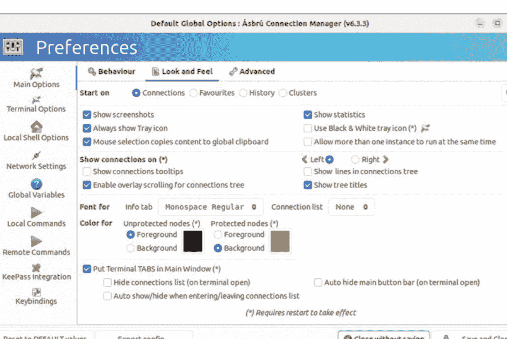

图 4：`Asbrü Connection` 为用户提供了非常默认的连接列表

无论对方传输的是图形内容还是仅为文本，通过 `Asbrü Connection Manager` 可以在异构环境中实现灵活的部署。此外，你还可以在使用用户名和密码的传统认证与加密密钥之间进行选择。

如果连接需要授权，你将需要在对话框中输入密码。这是一个终端连接，显示在右侧的大窗格中（图 3）。

每个预配置的连接都会打开一个新标签，因此你可以通过简单切换活动标签来同时管理多个服务。该工具使用配置步骤期间分配的最清晰名称为标签命名，以便可以轻松识别通用连接。

在“高级参数”中完成特定连接的特定配置后，你可以指定在连接建立之前之后执行的操作。点击右侧的“保存并关闭”按钮。现在你可以通过双击连接栏左侧的条目来打开新标签。连接管理器将自动打开连接或

在左侧列出并从右键菜单中选择“编辑连接”。然后你可以在用于连接的同一个对话框中编辑连接。

在主窗格左侧的“信息”标签中，你将

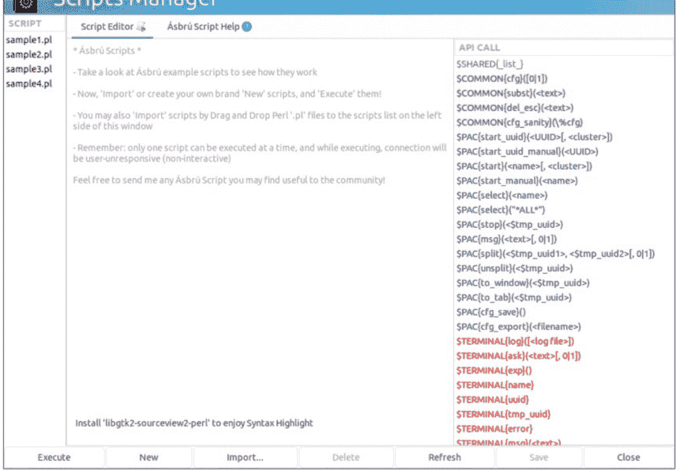

图 5：使用脚本，你可以为 `Asbrü Connection Manager` 添加功能。

## 深度解析

## 集群管理：`Asbrü Connection Manager` (v6.3.3)

完成设置后，点击“保存并关闭”完成工作。如果你以后想对配置进行更改，可以通过点击程序窗口左上角的钢笔图标按钮进入设置对话框。

## 集群管理

要自动执行，点击程序窗口左下角的“脚本”。在打开的脚本管理器中，根据需要创建并修改 `Perl` 脚本。开发者直接在窗口中提供了命令及其用法的文档（图 5）。

`Asbrü Connection Manager` 特别方便的功能之一是将多台服务器分组为集群。你可以同时在集群中的所有服务器上执行命令。你可以在“集群”对话框中管理集群外壳，通过点击主窗口左下角的“集群”可以访问。然后你可以从现有基础设施中组合各个服务器（图 6）

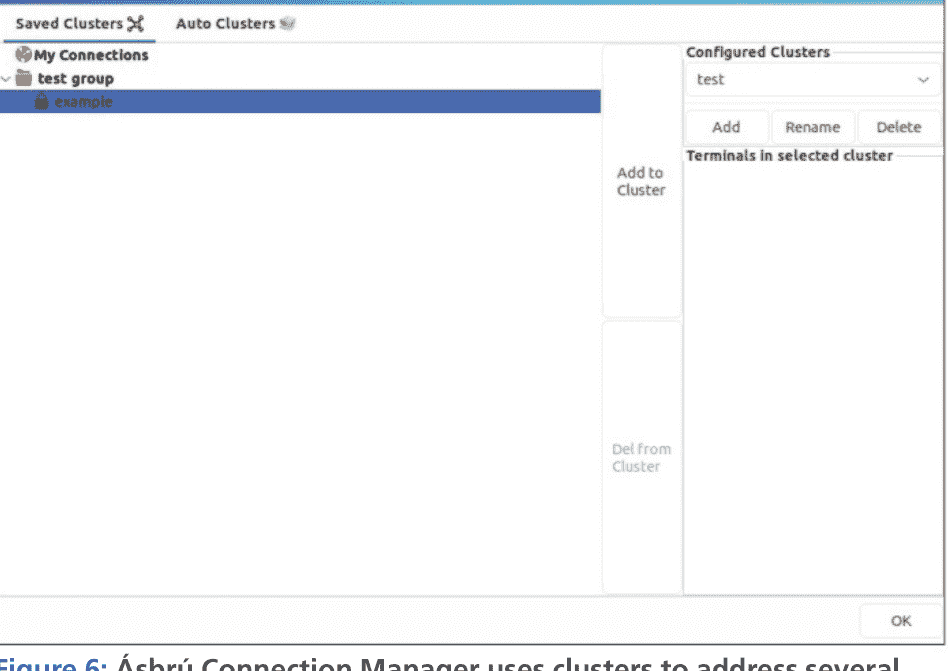

图 6：`Asbrü Connection Manager` 使用集群同时处理多个服务器。

列表 1：安装并启动 `EasySSH`

```bash
$ flatpak remote-add --if-not-exists flathub https://flathub.org/repo
$ flatpak install flathub com.github.murodevsev.easyssh
$ flatpak run com.github.murodevsev.easyssh
```

## EasySSH

关于允许连接的一些统计信息。点击程序窗口底部的按钮可以设置所有位于标签中的内容。在“偏好”对话框中，你可以配置连接和 `EasySSH` 项目的外观。`EasySSH` 仅在几年前启动，旨在以简单的方式管理 `SSH` 连接，像代理一样在客户端和服务器之间建立中间件。`Asbrü Connection Manager` 预装了各种键盘映射以实现快速功能。你可以使用“键绑定”根据自己的需求进行添加（例如 `Debian`、`Ubuntu` 和 `Solaris`）。在其他 `Linux` 发行版上，你需要作为 `Flatpak` 安装 `EasySSH`。左侧侧边栏中的“集成”让你通过连接管理器管理密码，这样你可以在工作时访问其数据库。在“网络设置”中，你可以修改全局网络设置。你可以指定通过 `SSH` 控制台在互联网上端口自动连接的服务器。服务器仅作为

要配置到远程 `SSH` 服务器的初始连接，可以点击大窗格中间的“添加连接”按钮，或点击标题栏左上角的加号按钮。设置将出现在右侧，你可以在此处选择服务器名称、其 `IP` 地址和端口。你可以在同一个对话框中指定认证数据。点击“高级”后，你可以配置与终端外观相关的附加设置。添加连接后，你可以按“连接”启动它。`SSH` 在右窗格中显示已连接服务器的终端。同时，右窗格上方会出现一个标签。如果你需要管理多个服务器，可以启用同时连接；`SSH` 将在单独标签中显示。这意味着你可以快速从一个服务器切换到另一个，而无需每次关闭并重新连接。


图 8：一个巨大的漏洞：`SSH` 将所有连接数据以明文形式存储。

## 深度解析

## SSH 前端

```json
{
  "name": "test",
  "host": "192.168.1.100",
  "port": "22",
  "username": "username",
  "password": "password123",
  "file": "",
  "extra-arguments": {
    "account": "null"
  }
}
```

可以从你的 `GitHub` 仓库获取。你可以使用列表 1 前两行的命令进行安装。然后使用列表 1 的命令行在终端中启动软件。调用后，会打开第三个窗口 (7)。标题栏包含一些控制控件，而窗口左侧的一列目标实体。如有必要，你可以将实体分组以提高整体效果。右侧留有一个大区域供你想打开的远程终端使用。

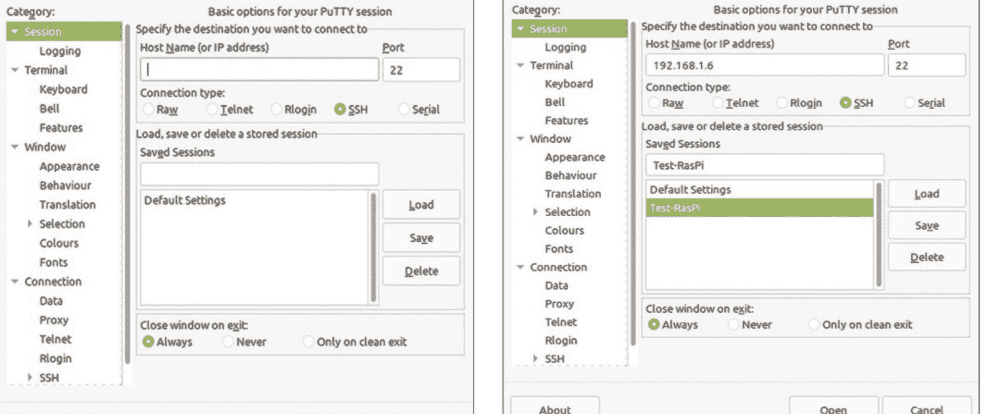

图 10：配置文件帮助 `PuTTY` 连接到多个服务器。

图 8（文中标记）：`PuTTY` 看起来有些过时。

## 图形 `SSH` 前端功能

`PuTTY` 使用专有的密钥格式；在此生成的密钥无法在其他应用程序中使用。

| `Asbrü Connection Manager` | `EasySSH` | `PuTTY` |

|---|---|---|

| 许可证 | `GPLv3` | `GPL3` | `MIT` 许可证 |

| 功能 | 多路同时连接 | 是 | 否 |

| 内置虚拟终端 | 是 | 是 | 否 |

| 集群 | 是 | 是 | 否 |

| 分组 | 是 | 是 | 否 |

| 密钥对认证 | 是 | 是 | 是 |

| `X11` 转发 | 否 | 否 | 是 |

## 结论

本文讨论图形 `SSH` 前都能完成任务，但每个前端提供的功能存在显著差异（见表 1）。来自 `Windows` 的 `PuTTY` 是较老的 `SSH` 前端之一，已有超过 20 年的开发历史。大多数功能将其包含在软件包存储中。`Asbrü Connection Manager` 提供了最平衡且先进的图形 `SSH` 前端。它的界面和处理集群的能力使得 `Asbrü Connection Manager` 成为专业用户的首选工具。

# `LINUX` 杂志

锁定状态！

更严密的新工具

# `LINUX` 杂志

旧路由器变废宝

为创客提供的简单项目！

# `LINUX` 杂志

手机黑客技巧

告别厂商更新！在你的智能手机上安装免费系统并保持畅通

# `OpenBSD`

这足够细致入微吗？

# 机器学习工作坊

寻找家中的最后一位访客。

# `LINUX` 杂志

破坏以重构

通过模糊测试实现代码安全

# `LINUX` 杂志

加密

保护你的秘密

# `LINUX` 杂志

清理你的照片元数据

# `LINUX` 杂志

`USB` 启动

在 `U` 盘上存储多个启动镜像

# `LINUX` 杂志

清爽 `IT`

平铺式窗口管理器：为什么极简主义正吸引新一代人

# `LINUX` 杂志

零信任

针对当今威胁重构安全

# `LINUX` 杂志

隐私

让你的秘密保持保密

# `LINUX` 杂志

`Bash` 技巧

编写自己的下载管理器

# `Linux` 杂志是您探索 `Linux` 世界的指南。立即阅读，获取在其他地方找不到的高级技术信息！

# 通过以下内容扩展您的 `Linux` 技能：

- 热门话题深度文章，包括比特币、勒索软件、云计算等！

- 有用工具的操作指南和教程，助您节省时间并保护数据

- 故障排除与优化建议

- 关于开源世界关键进展的深度新闻


- 针对树莓派、Arduino 和其他创客板系统的酷炫项目

如果您想进一步探索并利用 Linux 实现更多功能，请立即订阅，不再错过任何一期杂志！

## 立即订阅！

`shop.linuxnewmedia.com/subs`


# MAKSPACE 蓝牙通信


## 我们使用树莓派、Pi Pico 和智能手机通过蓝牙进行通信

作者：Bernhard Bablok

由于树莓派同时配备了 WiFi 和蓝牙，大多数程序选择依赖 WiFi。然而，Pi Pico 更像是一个“独行侠”。蓝牙的出现改变了局面，使其成为一个极人的选择。

通过你的智能手机，蓝牙应该是一项熟悉的技术，在特定的文章 [1] 中已对树莓派进行过研究，因此在本文中，我将仅采用最基础的技术方案。重点是树莓派、Pi Pico 和智能手机通过蓝牙通信的场景。

只要支持串口通信，Pico 就可以代表任何微控制器。

### 基础技术

双方之间蓝牙通信的两个前提是双方之间的配对和信任；一旦你建立了这两者，设备通常就会信任这种关系。配对后，双方都可以建立连接。发起方称为主机（`host`），另一方称为设备（`device`）；然而，每个组件都可以承担其中一个角色。

树莓派上的默认用户应当是 `bluetooth` 和 `dialout` 组的成员；你可以使用 `groups` 命令检查其状态。如果你不在其中一个或两个组中，请使用 `sudo` 进行修改。

```bash
[hablokb0pi13:] > bluetoothctl
Agent registered
[DEFAULT] default-agent
Default agent request successful
[BLUE]# discoverable on
Changing discovery: succeeded
[CHG] Controller BB:27:EB:DF:13:5C Discoverable
[CHG] Controller BB:27:EB:DF:13:5C Discovering, so
[NEW] Device 50:A4:A8:BB:C7:C9 64-D2-CF-D9
[NEW] Device 50:A4:A8:BB:C7:C9 64-D2-CF-D9 Lite
[HW] Device 50:A4:A8:BB:C7:C9 connected
[HW] Connecting with 50:A4:A8:BB:C7:C9
[CHG] Device 50:A4:A8:BB:C7:C9 Connected
Request confirmation
[AGENT] pairing key 32482 (yes:no)
[CHG] trust 50:A4:A8:BB:C7:C9 Trusted: yes
Changing 50:A4:A8:BB:C7:C9 trust succeeded
[BLUE]# exit
```

```bash
sudo usermod -a -G bluetooth,dialout
```

**图 1：配对与信任。** 开启并扫描后，你将看到所有设备及其 MAC 地址，取决于环境。对方将可见以便配对。在智能手机上，所需的设置在蓝牙部分。树莓派启动了一个受限的 shell。帮助命令调用了概述。

62 NOVEMBER 2022 ISSUE 264 LINUX-MAGAZINE.COM

# MAKSPACE 蓝牙通信

按下 `Tab` 键可以完成命令并显示 MAC 地址，这节省了大量的输入工作。

独立地，你可能还需要检查几个重要参数。与其使用编辑器或 SSH，你可以使用智能手机或平板电脑运行蓝牙 [2]；iOS 同样可用。

## 系统要求

此外，树莓派必须满足一些系统要求。智能手机、Pi Pico 和树莓派之间的通信依赖于串口 (`SPP`)、射频通信 (`RFCOMM`) 以及链路适配协议 (`L2CAP`)。这些协议是蓝牙的一部分。你可以从应用菜单访问配对设备。对于这一点，树莓派必须等待连接。

```bash
sudo rfcomm listen 0
```

其他协议如文件传输协议 (`FTP`) 或对象交换 (`OBEX`) 也依赖于 `RFCOMM`。要在树莓派上启用蓝牙，需要带 `-c` 选项启动蓝牙守护进程。为此，请将 `/lib/system/bluetooth.service` 服务定义复制到 `/etc/system/` 并替换 `ExecStart` 行。

```ini
ExecStart=/usr/lib/bluetoothd -c
```

```ini
ExecStartPost=/bin/hcd
```

第二行将 `SPP` 添加到可用协议列表中。现在，在末尾输入符号 `&` 将命令发送到后台并释放控制台输入。

**图 2：** 显示了连接后的通信原理。平板电脑（右侧）连接到树莓派并用于读取 `/dev/rfcomm`（左侧）。这同样有效。树莓派写入 `/dev/rfcomm`，输出出现在平板电脑（绿色）。一旦建立连接，是谁设置并不重要。数据始终是双向的。由于应用程序中的错误，树莓派显示了回显。手动执行图 2 中的步骤，使用列表 1 中的设备定义。等待参数的作用类似于 `listen`。建立连接后，`RFCOMM` 启动脚本。如果连接失败，`RFCOMM` 将重启守护进程。

```bash
sudo rfcomm listen
sudo rfcomm restart bluetooth.service
```

第一个应用程序是电视上的媒体播放器。如果运行良好，检查日志：

```text
Waiting for connection on channel 1
Connection from 05:44:B8:C7:09 to /dev/rfcomm0
cat /dev/rfcomm0
hang
Hello from the tablet
Please send me the name
```

```bash
echo "Hello from the Pi" > /dev/rfcomm0
echo "My hostname is $(hostname)" > /dev/rfcomm0
```


**图 2：** 树莓派与安卓平板电脑通过蓝牙的通信流。

# MAKERPACE 蓝牙通信

## 列表 1：服务定义

```ini
[Unit]
Description=BT-Control service
After=bluetooth.service
Requires=bluetooth.service

[Service]
ExecStart=/usr/bin/rfcomm listen 1 /usr/local/sbin/bt-control.sh

[Install]
WantedBy=multi-user.target
```

简单的 shell 脚本，但任何其他编程语言也一样。脚本持续从 `RFCOMM` 接口（第 18 行）读取，并从第 3 行开始的 `process_request()` 函数处理保留的命令。

基于安卓应用的视图只需通过将命令直接分配给按钮（图 3）来实现。行数由集合定义。长按按钮允许你编辑条目格式。然而，无法隐藏单个按钮，无法更改字体大小。

Google Play 商店有很多应用是基于 `RFCOMM` 技术的。例如，特别感兴趣的是蓝牙面板 (3)，它根据树莓派或微控制器发送的数据动态创建界面。

## 列表 2：控制程序

```bash
#!/bin/bash

process_request() {
  case "$1" in
    "hostname") hostname -f $2 >$3;;
    "mem") free -h $2 >$3;;
    "disk") df -h $2 >$3;;
    *) echo "Unknown $1" >$3;;
  esac
}

# 主程序

# 打开设备进行读写
exec 3<</dev/rfcomm0

while true; do
  if read -u 3 request; then
    process_request "$request"
  else
    break
  fi
done

# 关闭文件描述符
exec 3>&-
```

# 蓝牙通信

## MAKERSPACE

这种开发板有多个版本。最后你手里具体是哪一个其实并不重要。板上通常有一个按钮、一个 LED，并且通过一个电压转换器使得电源供应更加灵活。`RX`/`TX` 线路上的信号为 3.3V，因此如果你将一个带有电压分压电路（5V 转 3.3V）的 Arduino 连接到树莓派上。

`HC-05` 支持命令模式和数据模式。第一种模式用于配置；对于新设备，在进入“HC-05”对话框之前，完成这一步至关重要。你需要预先将树莓派和开发板进行配对，并记住 `HC-05` 的 MAC 地址。


完成注册后，工作变得像玩耍一样简单。将 `HC-05` 连接到微控制器；它会以通常的方式通过串口或 `int` 函数输出数据。你现在将树莓派连接到 `HC-05`，并使用 `cat` 将接收到的数据写入文件：

通过 `HC-05` 向微控制器发送数据（例如控制 `LED` 和电机的开启/关闭等）。然而，微控制器需要向串口写入数据并从中读取。

```
sudo rfcomm bind hci0 <addr>/dev/rfcom0
cat /dev/rfcom0 > kbdData.log
```

# Pico 作为主机

之前的场景展示了树莓派如何从 `Pico` 获取数据，只要微控制器正在运行且树莓派到 `Pico` 的连接正常，它就能工作。如果微控制器没有运行，树莓派必须在循环中不断地重新建立连接。

无论如何，如果 `Pico` 只发送数据然后停止（例如，传感器之间有很长的时间间隔），树莓派只能通过保持连接开启来检索数据。在这种情况下，让树莓派和 `Pico` 交换角色并连接更有意义。此时，树莓派运行一个接受连接请求并存储数据的服务。

对于这种场景，`HC-05` 必须能够并建立连接，这正是可能出现不同版本的地方。我在线上的帖子描述了 2010 年固件的操作步骤。然而，我所有的设备都使用 2017 年的固件版本，在细节上它的行为会有不同。这里描述的步骤在你的设备上可能无效，但你可以在命令模式下通过 `RT+VERSION` 命令查询固件版本。

值 `<ab>:<bc>:<cd>` 是开发板的 `MAC` 地址。如果微控制器处理输入，可以通过调用带有设备参数的程序（例如通过 `/dev/rfcom0`）发送命令。

你可以不用树莓派，而是从安卓 `App` 连接到 `HC-05`，这对于快速测试非常有用，因为你可以立即看到 `Pico` 是否正在发送数据。此外，树莓派或应用可以发送

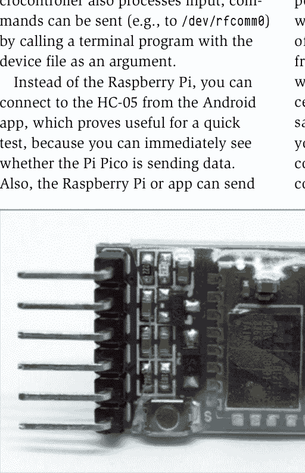

图 4：用于微控制器的 `HC-05` 蓝牙模块。

# MAKESPACE 蓝牙通信

在命令模式下，你可以更改 `HC-05` 的角色：

命令需要的格式略有不同，因此 `40:65:4C:66:12` 变为 `40:65:4D,064:12`

```
AT+CMMODE=0
AT+ROLE=1
AT+BIND=&DS,4C6612
```

重启之前，确保树莓派已准备好连接，并且像第一个示例描述的那样工作。由于微控制器通常发送数据和命令，在最简单的情况下，你不需要在树莓派端编写应用程序逻辑，你只需要引用一个文件：

第一行告诉芯片连接到特定地址（在第 3 行给出），第二行设置主机模式，第三行绑定目标设备地址——树莓派的蓝牙 `MAC` 地址，你可以通过以下命令查询它：

```
echo list 1 | bluetoothctl
```

```
sudo rfcomm watch hci 0 | cat /dev/rfcom0 >> pico-data.csv &
```

然而，使用早前的冒号分隔格式，`E1300`

如果你现在启动已连接的 `Pico` `HC-05`，所有数据都应该进入

# 配置 HC-05

`HC-05` 总是带有相同的预设用户名和密码，并且数据传输率配置为 9600 波特。你可以通过几个 `AT` 命令来进行更改。最简单的方法是使用支持 3.3V 的 `USB-UART` 适配器。或者，你可以使用树莓派。然而，它的串口运行着系统，所以你可以自由使用它。要这样做，请重命名 `/boot/cmd.txt` 文件中的 `console=ttyAMA0` 字符串，并在 `/boot/config.txt` 中添加 `enable_uart` 行。

重启后，将 `GPIO14` (`TX`) 连接到 `HC-05` 的 `RX`，并将 `GPIO15` (`RX`) 连接到 `TX` 和 `GND`。在应用电压之前，按下开发板上的小按钮。`LED` 应该闪烁。你可以通过你选择的终端程序连接到：

```
$ minicom --echo CRLF -E /dev/ttyUSB 3840
```

然后执行以下命令来配置：

```
01 --- Monitor /dev/ttyUSB 3840
02 --- Quit:Ctrl+A
03 --- Menu:Ctrl+T
04 --- Help:Ctrl+H
05 --- AT
06 --- AT
07 --- AT
08 --- AT
09 --- AT+PSWD?
10 --- AT
11 --- AT+RATE=115200,0
12 --- AT
13 --- AT
14 --- AT+PSWD="999"
```


`OK` 是第一个命令的预期响应。`HC-05` 将输出连接状态。面对的一点抖动是常见的。旧版本的树莓派可以通过插入 `USB` 蓝牙适配器进行升级。经典蓝牙存在诸多缺点，尤其是功耗问题使其对 `IoT` 设备缺乏吸引力。低功耗蓝牙 (`BLE`) 作为一种功耗优化变体出现。如何让你的家中设备与其协同工作将是未来文章的主题。通过树莓派从多个 `Pico` 获取数据需要更多精力。`MQTT` 服务器可能作为缓冲区。注意树莓派每次只维护一个连接。理论上，蓝牙和 `SBC` 可以建立连接，只要 `HC-05` 和 `SBC` 始终连接同一台设备。当然，这对于传感器而言，只要 `Pi` 在数据交付后迅速释放连接即可。

## 结论

从第三代开始，树莓派内置了蓝牙。因此，你可以从外部设备控制 `SBC`，并通过树莓派控制任何微控制器。`HC-05` 表现出色，因为该芯片让你无需深究蓝牙协议。除了一次性配置外，

## 信息

### 作者

`Bernhard Bablok` 在 `Allianz Technology` 担任 `SAP HR` 开发人员。当他不听音乐或闲着时，他正忙于与 `Linux`、编程和单板机相关的话题。你可以通过 `mail@bablok.de` 与他联系。

### MakerSpace

#### 使用整洁代码原则编写更好的代码

##### 代码维护

整洁代码原则可以提高源代码的可读性，让你和你的生活变得更轻松。

作者：`Martin Mohr`

整洁代码是一组规则和程序，无论使用何种编程语言，都能让源代码更容易阅读和理解。许多整洁代码策略适用于所有语言，但某些深远的策略仅在面向对象的世界中被证明是有用的。整洁代码的概念并不新，也不具有革命性。早在 `2008` 年，罗伯特·马丁（`Robert C. Martin`）在他的著作《整洁代码：敏捷软件开发手之道手册》[1] 中描述了这些程序。

通常，编译器并不关心你为各个程序组件分配的名称。无论你使用大写还是小写，或者使用下划线还是驼峰命名法 (`CamelCase`)，只要名称相互匹配，编译器就能构建出可执行的程序。

对于当今高度复杂的 `IT` 应用，确保源代码具有能够提高可读性的整洁结构至关重要。整洁代码的概念在近年来已经演变，马丁在书中描述的程序也得到了扩展。针对你开始编写整洁代码，我将描述一些整洁代码的核心思想和规则。

然而，这种自由风格的代码可能很难阅读。事实上，你应该遵循适用于所用编程语言的风格规范；例如，类名应该始终以大写开头，而方法应该以小写开头。现代 `IDE` 通常具有自动格式化源代码的功能。你应该使用这一功能。如果有几个人合作一个项目，他们需要约定使用相同的格式。

### 童子规则

#### 助记命名

“始终留下的代码比你发现时更整洁。”如果你碰过代码，你的项目源代码会随着时间的推移变得更好。你不需要担心任何，因为之前的版本可以随时恢复到版本控制系统（如 `Git`）。现代 `IDE` 还提供了许多代码工程化工具。重命名类或方法带来的风险不再像以前那样大了。

程序应该始终为标签使用给定的助记名称。与类型相关的类、方法、函数和变量。名称不应太长，但仍应准确描述正在发生什么。你还需要记住变量的范围。在定义顶部变量（如 `i` 或 `j`）时是完全可以的。而 `x`、`y`、`z` 是坐标系中最有意义的标签。


如果变量或对象在更大的上下文中使用，你应该清晰地定义它的名称。

#### 注释

最终，不整洁的代码需要更多的系统资源。这导致用户需要更多的性能并污染环境。环保责任显然比节省虚拟单元要容易得多。

避免在方法名中包含类名。所有程序员都应该理解方法是在定义该方法的对象上运行的。虽然你不应该将名称用作类（因为包含它们是多余的），但请考虑在名称中避免缩写；这其中有一些例外（例如，`VAT`）。

“如果编译器能理解代码，那么开发者也必须理解。”这条规则意味着注释是不必要的。这一陈述初看似乎很短视，但在稍加修改的代码形式中它完全合逻辑。如果你需要为程序部分添加注释，通常意味着代码不够清晰。

#### 方法

在涉及到使用函数或方法时，你可以做很多事情来改进代码。始终为参数和返回值选择有意义的名称。

虽然初听起来可能奇怪，但请让你的名称是可读的。你将能够在会议或代码审查中讨论某个类。过于复杂或听起来相似的名称会让讨论变得困难。

我不能说你不能在代码中使用注释。事实上，有时考虑以更易于理解的方式编写注释更好。然而，这意味着不要去描述变量在做什么，或者解释为什么。

`IDE` 会自动生成名称，因此请确保命名以反映实际功能。

作为一条一般规则，一个方法不应表达超过一个组件。方法应该自解释其意。其他方法可以使用诸如 `handler`（处理器）、`helper`（助手）或 `processor`（处理程序）之类的通用名称。

# Linux Voice 导言

如果你不喜欢折腾，你可能就不会使用 `Linux` 了，对吧？好吧……多年来，`Linux` 已经变得越来越主流，所以你不需要成为一名黑客也能享受它，但那种自己动手的精神依然存在。专有硬件供应商与 `DIY` 精神格格不入，但一点智慧就能大开之门。本月，我们将向你展示如何使用 `XML` 和少量 `Python` 来访问并同步元数据。本期还包括：使用 `Seafile` 同步文件，以及探索 `Ryzom` 多人角色扮演游戏。


### Doghouse – 可移植性与成本
`Jon "maddog" Hall`
为公司选择正确的服务器计算解决方案，从一开始就减少 `CPU` 开销，可以帮助降低成本并随着时间的推移实现移植性的最大化。

### Ryzom
`Daniel Tibi`
想要一场华丽的冒险吗？前往未来星球 `Atys`，那里有许多令人惊叹的任务等待着你。

### Seafile 9
`Ferrand Thommes`
这款开源文件存储是 `Nextcloud` 和 `ownCloud` 的强力竞争对手。

### FOSSpicks
`Graham Morrison`
本月，`Graham` 关注了 `Furnace`、`Node-RED 3`、`Exquisite`、`Corscope`、`darktable`、`Overgrowth` 等！

### 教程 – iTunes XML
`John Cofield`
读取并操作来自 `iTunes XML` 的数据，以便在应用程序和设备之间共享元数据。

# ELVIE

你的提交消息（`Commit Message`）摘要需要包含关于修复的关键信息，且要在一个简短的单行内，以便在与其他所有提交并列时逻辑通顺。

而我本来只想写一句“修复注释中的一个拼写错误”----

现在你制造了你的第一个 `Bug`，你需要把它提交到 `Git`

我明白了……


并附带指向原始 `Bug` 报告的链接以及适当文档。


你的消息主体应该包含关于为什么要修复的细节，并提供大量的解释作为支持

`CC-BY-SA | PEPPERTOP.COM`

`LINUX-MAGAZINE.COM | LINUXPROMAGAZINE.COM 第264 期 2022年11月 71`

# LINUX DOGHOUSE – 移植性成本

## MADDOG’S DOGHOUSE

`Jon "maddog" Hall` 是一位作家、教育者、计算机科学家和自由软件先驱。自 `Linus Torvalds` 首次促成 `64` 位系统移植以来，他一直是 `Linux` 的热心倡导者。他担任 `Linux International` 的主席。

## 从一开始就减少 CPU 开销可以帮助你降低成本并随着时间的推移实现移植性的最大化。

作者：`JOHN "MADDOG" HALL`

### 保持敏捷

几年前，云计算出现了。其中最早的供应商之一是 `Amazon`，他们利用圣诞季节期间的数据峰值，这使得他们拥有服务器容量，可以向需要它的公司出售互联网弹性服务器计算服务，而价格仅为小型公司提供此类服务成本的一小部分。这是一场行业革命。

几乎一夜之间（至少大多数）公司开始将服务器计算外包给其他公司（`AWS`、`Google` 等），这些公司拥有完成工作所需的硬件、员工、物理空间等。

我一直倡导在初创公司成立时使用这些云服务。在开放空间，你可以建立自己的服务器农场，也可以使用他人的服务。

# 瑞之姆 Linux 之声


**图 2：** 强者奇昂欢迎来到希兰岛的游侠者营。他将向你解释接下来需要做什么。

在前往大陆执行实际任务之前，你将遇到许多希兰岛的角色。游戏会在人物头上方显示名字。如果名字是白色的，它是计算机控制的非玩家角色（`NPC`）。蓝色的名字则代表另一个人类玩家。你可以右键点击他们进行互动或聊天。

寻找特莱克人（`Trykers`），米尔斯·多多内向你介绍寻找和开采材料的艺术。马蒂斯人（`Matis`）驻扎在南方。这个国家将你训练为工匠，取决于你获得哪些技能以及将它们发展到什么程度。学得越多越好——如果没有战斗训练，你是走不远的。

你的角色是一个难民，是反抗基廷人（`Kitin`）战争幸存者的后裔。游侠者派希望所有人团结起来对抗基廷人。游侠者营位于岛屿南部，你将在那里遇到希兰岛游侠者营的领袖强者奇昂。右键点击奇昂与他对话并告知他（2）。

你在所有领域工作的基本原则是你先去相应的导师，由他派遣你执行任务。一旦你完成任务，你将获得经验值。你总是能找到……

在见到你之后，强者奇昂指向了团队负责人尤尼诺尔·塞帕奥（`Uninoir Cepao`）。在右上角，你可以看到一个指南针。指针指向北方，或者——如果你正在执行任务——指向你任务的目的地。按 `M` 显示岛屿地图，并用白色箭头标记你的位置。你的任务由旗帜标记。右键点击地图可以自行添加标记以寻找特定位置。


要找到尤尼诺尔·塞帕奥，只需跟随指南针即可。它并不远，但营地领袖可能正在睡着。你可能得叫醒她。她醒来后会告诉你关于阿提斯（`Atys`）各个地区和国家的情况，并推荐导师，他们将教你战斗、狩猎、采矿和制作技能。

四个国家在游侠者营中各占一个空间。在东部，你会发现索莱人（`Zorai`），你将从诺西乌斯·梅尔（`Norcius Merci`）那里学习魔法艺术。在北方，你会遇到菲罗斯人（`Fyros`），他们由瓜利亚恩（`Gualian`）提供战斗训练。在西方，你将

**图 3：** 学习攻击艺术来攻击对手或治愈你自己和其他玩家。

`LINUX-MAGAZINE.COM | LINUXPROMAGAZINE.COM | 第264 期 2022年11月 75`

# Linux 之声 瑞之姆

减少，但会随着时间自动补充。你开始拥有 `200` 点汁液。随着时间的推移，你将与魔法老师交换经验值来增加汁液值。这意味着你有更多可用汁液，且汁液恢复速度更快。


一旦你完成任务，你的经验值将回到诺米斯·梅克劳（`Nomis Merclao`）那里汇报成功。他会派遣你执行学习魔法的任务。

在屏幕顶部，你会看到右手和左手的图标。你可能手里还拿着短刀。点击右手并选择魔法增强器将其放在手上。你的角色会放下短刀并在双手都施上魔法。这会让你的魔法更有效。

图 4：植物被用腐朽咒攻击时。

在相应的导师旁边，学习新技能，这些技能反过来又成为进一步的基础……

你还将学习组合和修改法术。除了酸性技能外，还要学习根须（`rooting`）来短时间内固定你的对手、腐朽咒（`decay`）来攻击植物（图 4），以及恐惧咒（`fear`）让你的对手逃跑。

## 魔法艺术

人类从神灵（`Kami`）那里学习了魔法艺术（图 3），索莱人尤其擅长此。诺米斯·梅克劳首先教你进攻魔法，你将用它来攻击对手。你的目标是地图北部的尤博斯（`Yubos`）。用左鼠标点击其中一只小动物以在屏幕顶部选择目标，你会看到一个带有你可以执行的动作的小图标的操作条。选择合适的伤害。人类的魔法能力源于汁液，这是一种来自阿提斯内部的液体。在左下角，你会看到角色名字下方的四个条。其中一个指示你的汁液供应。当你施法时，你的汁液……

有效的魔法，还有防御魔法。在顶部，你会看到代表生命值的红线。如果你被攻击，这些点就会减少。如果生命值归零，你的角色就会死亡。

图 5：这里显示了希兰大部分动物（如梅克图布 `Mektoubou`），它们不会攻击你。少数由于你攻击了它们而攻击你。

幸运的是

防御魔法可以帮助你和其他团队成员恢复生命值等等。例如，你可以支持正在与强大对手战斗的团队成员。诺米斯·梅克劳向你介绍团队建设。诺米斯·梅克劳向你介绍团队建设。

## 战斗训练

战斗是菲罗斯人的领域，由瓜利亚恩负责。在开始时，你将


你的角色坐下时会恢复体力——查看“快速恢复”。

战斗会消耗英雄的体力，你可以从顶部的紫色线看到它。随着时间的推移，你将通过战斗导师获得经验值以增加体力并加快恢复。

瓜利亚恩派遣你的最后一个任务是去战斗土匪领袖阿肯（图 6）。他躲在废墟和王座之间的山丘上，那里有帮派保护。对抗阿肯的最佳机会是与其他玩家组队。如果你面对


只有一把短刀，之后你将获得其他武器和盾牌。如果你选择单手武器，左手就可以空出来，这会增加你的攻击力。独自一人，最好等到他在山丘边缘。通过魔法将他从其他人引开。如果他的保护者留在他身边，他会惩罚你。一旦你掌握了这项任务，你将获得一把火焰剑作为……

特莱克人精通采矿和原材料。米尔斯·多多内向你介绍这项任务，在贾维文（`Javavings`）地区：这些鸟类……

## 赎回惩罚

如果你的角色死亡，你将受到惩罚。你的角色训练越高，惩罚越大。执行此最危险的方法是通过……

## 原材料

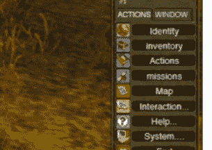

图 6：战斗训练的最后一个任务是让土匪领袖阿肯失去行动。他躲在废墟和王座之间的山丘上。


图 7：希兰岛丰富的原材料。

## 快速恢复

你的角色坐下时会恢复体力——按 `Insert` 键即可执行。然而，坐下时你无法执行任何其他操作，并且在该位置下更加脆弱。总是退到安全的角落进行恢复。

# LINUX VOICE RYZOM

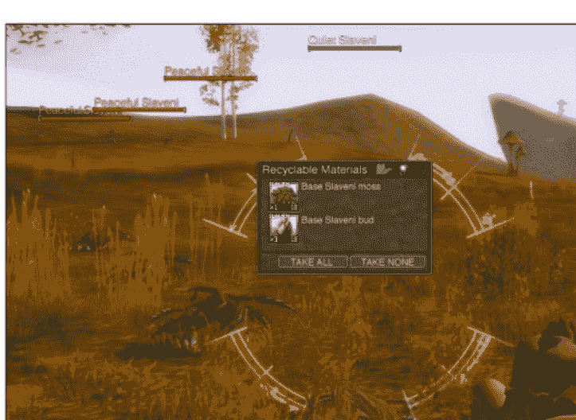

...商人。你也可以保留原材料并对其进行精炼。

`Atys` 上最熟练的工匠是 `Matos`。`Stega Hanilla` 将指导你学习这项艺术，但在决定将这些技能传授给你之前，你必须在对话中极力地讨好他。你可以自己收集手品所需的材料，也可以从 `Tryker` 仓库 (`8`) 的原材料商人处购买。你拥有足够的制作技能；你可以制作自己的装备来增加你的生命值并获得受攻击的保护。要了解每种工艺品需要哪些材料，点击屏幕底部栏上带有“制作配方”（`Craft Recipe`）描述的书图标。

**图 8：** 你可以通过狩猎动物和采集从原材料来源收集你的手品。或者，你也可以从 `Tryker` 营地的商人处购买所需的任何物品。

## 准备好行动

这取决于你，以及你完成了多少次训练任务。一旦你接受了足够的训练，就可以开始你的第一次真正任务了。你可以从 `Kami` 聚居地、商队大使馆的社区官员以及 `Chi` 商店获取这些任务。

商队的任务将你带到荒地带（`Blight Zone`），这是一个被少量释放的物质污染的区域。胶液从行星内部渗出，破坏土地并使动物离开。`Kami` 给你了一项任务，让一些受污染的动物变得无畏。同时，你将获得大量的 `Dappers`，而你的声望你很快就会知道了。商队派你前往荒地带收集各种胶液样本，或从动物尸体中获取。同样，你会获得大量的 `Dappers`，你的声望将会增加。

**图 9：** `Chiang Strong` 派遣的任务之一将让你能够接触到 `Reitzak`，他是 `Chlogoban` 匪徒的领袖，位于闪烁湖（`Sparkling Lake`）以北。

`Silan` 上的一些动物会在没有防备的情况下发动攻击。如果你完成了训练，你将知道如何面对这些讨厌的鸟类。闪烁湖上的螃蟹叫声（另一个任务带你去那里）看起来很可怕，但只要你不主动攻击它们，它们就不会伤害你。你可以与 `Tryker` 营地的原材料商人（图 7）用 `Atys` 的货币 `Dappers` 交换材料。然后你可以用赚来的钱在其他地方购买你需要的任何物品。


在训练结束时开始 `Chiang` 为你的任务是有意义的，因为它们完成了从 `Silan` 生活结束到离开大陆的过渡。`Chiang` 给你的第一个任务是：“匪徒们有一个秘密。发现它。”详细来说，这个非常宽泛的意思意味着你荒地带和闪烁湖湖头之间的区域寻找并消灭一个具有特殊技能的匪徒。你捕获一个胶液提取器然后交给 `Chiang`。

你的下一个任务是向四个国家的领袖展示该设备，你可以在快速巡览营地时完成。从现在起，你可以使用商队传送器了，它将节省你大量的奔波时间，因为它将带你从游者营地带到闪烁湖附近的商队哨所。

`Chiang Strong` 将指引你前往大陆的路。他首先让你去四个国家的营地领袖，然后去 `Kami` 聚居地，从那里会被传送到四个国家的四个首都之一。你可以自由选择一个。

下一个任务带你前往 `Kamis` 哨所。在这一番奔波之后，你再次被赋予了一项真正的任务：消灭匪徒领袖（图 9）。匪徒营地位于闪烁湖附近。完成这个任务是个好主意，因为还有其他匪徒。

# SEAFILE 9 LINUX 观点

社区中提供了适用于标准版和树莓派的 `Linux` 端。客户端分为桌面同步（`Desktop Syncing`）和桌面驱动器（`Desktop Drive`）。驱动器客户端允许直接访问服务器上的文件，而无需与本地磁盘同步。对于这两种变体，客户端均提供了 `Linux`（图形界面和终端）、`macOS` 和 `Windows` 版本。移动客户端适用于 `Google Android` 和 `iOS`。如果你希望在网络上实现可访问和加密，还需要需要将 `SEAFILE_SERVER_ENCRYPT` 设置为 `true`。然后为 `SEAFILE_SERVER_NAME` 注册一个域名。如果你没有注册域名，可以使用 `DynDNS` 等服务。作为初始投入，你可能希望先在不使用 `SSL` 的情况下调用 `Seafile` 服务器（即 `URL` 中使用 `https://`），以消除可能的错误源。

该服务提供了三种安装策略。从 `8.0` 版本开始，项目要求安装 `Docker` 容器。设置由 `Docker compose` 文件自动处理。第二种方法是使用安装脚本，它可以在几分钟内设置 `MariaDB` 并将 `NGINX` 作为反向代理。尽管如此，该服务器配置被认为是简单的。

通过第三种方法，你可以独立完成一切。虽然这能让你对项目有深入的了解，但也带有出错的风险。如果你倾向于此，应该选择 `MySQL/MariaDB` 而不是 `SQLite` 选项，后者迟早需要维护。优点：一方面，你开始时使用的安装方式要简单得多。另一方面，容器提供了更大的灵活性，因为它们可以被更新且更容易移动。

## 在浏览器中

然后，在 `/home/seafile/` 目录下运行以下命令：

```


`sudo docker-compose up -d`

下载过程需要镜像并将其放入容器中。这将需要几分钟时间。一旦第一个提示出现，请从任何网络登录 Web。URL 由服务器的 IP 地址和相应的端口组成。根据安装方法，你可以使用`http://[IP]:2080`，或者如果你有用于 SSL 加密的已注册证书，则使用`https://[IP]:443`。如果你的服务器没有静态 IP 地址且你的路由器允许，你应该为服务器分配一个 IPv4 地址。

## 使用或不使用 Docker

我将查看 Ubuntu 20.04 上的 Docker 变体。这里是该系统上 Docker 的列表。然后，使用列表 2 中的命令，运行`docker --version`来检查已安装的版本。

无论你是在树莓派、旧电脑还是服务器上安装 Seafile，只要你提供了正确的硬件架构，就没有区别。树莓派 (8) 支持基于 ARM 的 Docker。如果你想在不使用 Docker 的情况下安装服务器，你需要更好的环境，稍后你将在 Web 界面进行操作。

要安装 Seafile，请自行使用列表 3 中的命令下载`docker-compose.yml` [9] 文件，并将其放入你预先创建的`/home/seafile/`文件夹下的主目录下。

然后用编辑器打开文件并调整配置以满足你的需求。接着，为`MYSQL_ROOT_PASSWORD`、`DB_ROOT_PASSWORD`和`SEAFILE_ROBIN_PASSWORD`变量分配密码。如有必要，如果你倾向于文件系统树中的不同位置，请调整这两个值。在`SEAFILE_MAIL_EMAIL`中存储电子邮件地址。你稍后登录需要它。

## 列表 1：安装 Docker (Ubuntu 20.04)

```bash
sudo apt update
sudo apt install apt-transport-https ca-certificates software-properties-common
curl -fsSL https://download.docker.com/linux/ubuntu/gpg | sudo apt-key add -
# 对于其他语言使用相应代码名称的 "local"
sudo add-apt-repository [arch=amd64] https://download.docker.com/linux/ubuntu stable
sudo apt update
sudo apt install docker-compose-1
```

## 列表 2：安装 Docker Compose (Ubuntu 20.04)

```bash
# 如果适用，将版本 2.0 替换为新版本。
sudo curl -L https://github.com/docker/compose/releases/download/v2.20.2/docker-compose-$(uname -s) -o /usr/local/bin/docker-compose
chmod +x docker-compose
```

## 列表 3：通过 Docker Compose 安装 Seafile

```bash
sudo mkdir /home/seafile
cd /home/seafile
sudo wget -O docker-compose.yml https://download.seafile.com/d3/0eead8faf93ad8fee/tp/docker-compose.yml
```


# Linux 用户 Seafile 9

你应该手动完成以下步骤：

1. 登录 `Seafile`，如果适用，通过系统区域配置你的服务器域名。
2. 如果你已经有了防火墙，需要确保端口 `80` 是打开的。
3. 访问 `https://seafile.com/config/sending_email/` 查看如何使用现有邮箱账户通过 `SMTP` 发送邮件的说明。
4. 使用 `SSL` 证书配置，你将使用自己的证书。访问 `https://seafile.com/config/seub_settings.py`。
5. 使用 `iptables` 防火墙进行安全防护。例如：`UFW` 或 `firewall`。
6. 为你的 `seafile` 服务器实现备份。

可选步骤：

1. 检查 `seafile_settings.py` 并配置其以符合你的需求。
2. 使用 `SSL` 证书配置，你将使用自己的证书。访问 `https://seafile.com/config/seub_settings.py`。
3. 使用 `iptables` 防火墙进行安全防护。例如：`UFW` 或 `firewall`。

对于其他语言使用相应代码名称的 `"local"`。

```
sudo add-apt-repository [arch=amd64] https://download.docker.com/linux/ubuntu stable
sudo apt update
sudo apt install docker-compose-1
```

# Linux 用户 Seafile 9

| 用户 | 平台 | 设备名称 | IP 地址 |
| --- | --- | --- | --- |
| linuxnews | 8.0 | blue | 192.168.1 |
| linuxnews | 8. | aura | 192.168.1 |

你应该手动完成以下步骤：

1. 登录 `Seafile`，如果适用，通过系统区域配置你的服务器域名。
2. 如果你已经有了防火墙，需要确保端口 `80` 是打开的。
3. 访问 `https://seafile.com/config/sending_email/` 查看如何使用现有邮箱账户通过 `SMTP` 发送邮件的说明。
4. 使用 `SSL` 证书配置，你将使用自己的证书。访问 `https://seafile.com/config/seub_settings.py`。
5. 使用 `iptables` 防火墙进行安全防护。例如：`UFW` 或 `firewall`。
6. 为你的 `seafile` 服务器实现备份。

可选步骤：

1. 检查 `seafile_settings.py` 并配置其以符合你的需求。
2. 使用 `SSL` 证书配置，你将使用自己的证书。访问 `https://seafile.com/config/seub_settings.py`。
3. 使用 `iptables` 防火墙进行安全防护。例如：`UFW` 或 `firewall`。

`Seafile` 的特色是同步和内容共享（图 4）。安装后，客户端将所有数据同步到 `Seafile` 文件夹。`Seafile` 会检测细微差异并仅同步更改部分。文件的更改也会触发版本控制。这被证明非常有用，特别是当多个用户处理同一个文件时。它可以跟踪谁在何时进行了更改。由于升级到 `Seafile` 新版本时使用的是独立的文件夹，在出现问题时你可以回到旧版本。

`Seafile` 客户端

**图 4：** `Seafile` 客户端适用于桌面和移动设备。桌面客户端在按下鼠标键时会在菜单中显示选项。

## Seafile - 用户设置版本

- 保存所有版本
- 不保存版本
- 仅保存一段时间内的版本：
  30 天

# Linux Seafile 9

## 创建新连接的云端

- 文档
- 工作簿
- 演示文稿
- 表单模板
- 最新文件
- 打开本地文件
- 连接云端
- 设置
- 上述

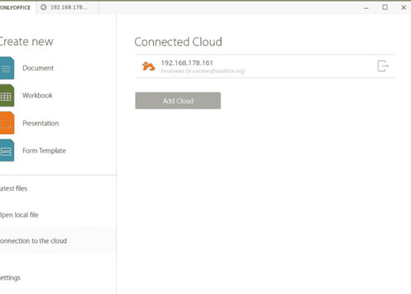

对于组件，你可能需要选择不同的解决方案。否则，`Seafile` 是一个很好的选择。

## 信息

- [1] Seafile: https://www.seafile.com/en/home
- [2] GitHub: https://github.com/haiwen/seafile
- [3] Seafile 版本: https://www.seafile.com/product/private_server/
- [4] 下载: https://www.seafile.com/en/download/
- [5] Docker: https://manual.seafile.com/docker/deploy_seafile,with_docker/
- [6] 安装脚本: https://github.com/haiwen/seafile-installer
- [7] 手动安装: https://manual.seafile.com/deploy/using_mysql/
- [8] 树莓派上的 Seafile: https://github.com/jocpec243/seafile-arm64
- [9] Docker Compose YAML: https://download.seafile.com/d/32e8a89f0a43ad86fee/files?name=download-docker-compose.yml
- [10] WebDAV: https://manual.seafile.com/extension/webdav/
- [11] sea-cli: https://help.seafile.com/syncing-cli-linux-cli/
- [12] OnlyOffice: https://www.onlyoffice.com
- [13] Collabora: https://www.colaboraoffice.com/
- [14] Office 程序集成文档: https://manual.seafile.com/
- [15] YouTube 系列（德语）: https://www.youtube.com/watch?v=u4c2DPZA6M&t=79s
- [16] 块存储: https://cloud.netapp.com/blog/cvo-blk-is-block-storage-cons-and-arguments

**图 6:** 对于文档协作工作，`Seafile` 集成了 `OnlyOffice` 和 `Collabora Office` 套件。

## 结论

如果你关注文件存储、同步以及带有协作的内容共享，`Seafile` 可能是你的正确选择。然而，尽管集成 Office 套件看起来比 `Seafile` 的竞争对手更复杂，但协作工作效果良好。文档非常详细 [14]。如果你会德语（或使用 YouTube 自动翻译字幕功能），有一套 10 部分德语 YouTube 系列 [15]，你可以在那里了解更多关于该程序。

`Seafile` 相比 `ownCloud` 的最大优势是其卓越的同步和访问速度。这主要归功于所使用的内存模型。与竞争对手不同，`Seafile` 使用块存储而不是文件存储。另一方面，`Seafile` 并没有像 `ownCloud` 或 `Nextcloud` 那样的额外的应用程序。因此，如果你需要集成日历、电子邮件和

# 成为 LibreOffice 专家

深入探索世界上最强大的免费办公套件

探索全球忙碌专业人士使用的免费办公套件！

创建专业级：

- 文本文档
- 电子表格
- 演示文稿
- 数据库

无论你是在 `Windows PC`、`Mac` 还是 `Linux` 系统上工作，你今天都拥有开始使用 `LibreOffice` 所的一切。这个单本特版将作为你的指南！

创建专业级：

- 文本文档
- 电子表格
- 演示文稿
- 数据库

编辑并保存 `MS Office` 文件

编写你自己的 `LO` 宏，节省时间并自动化常用任务

替换 `MS Office` 和 `Google Docs`！

包含 `Windows`、`macOS` 和 `Linux` 的完整版本


在线订：`shop.linuxnewmedia.com/specials`

适用于 `Windows`、`macOS` 和 `Linux` 用户！

# Linux Voice FOSSPicks

# FOSSPicks

自由开源软件世界中的闪光宝石和新发布


Graham 对装满音乐的 `Steam Deck` 不满意，这个月他在以下设备上安装了更多开源软件和游戏：课程。作者：BY Graham Morrison

# 音频跟踪器

# Furnace

音效和声音控制。通过一个小小的 `shim` 来处理音频硬件，这些数据可以从内存直接在 1980 年代的硬件上播放，而无需修改，创建出占用极少 `RAM` 和 `CPU` 资源的精美芯片音乐（chipune）。这些限制迫使了跟踪器（trackers）的发明，并创造了一些惊人的独特 chipune 声音，这些声音直到今天在任何存储和计算能力看似受限的时代依然盛行。

包括老牌 `Radium` 和 `Schism` 跟踪器（以及惊叹的商业软件 `Renose`）。看到一个全新的开源项目出现并不罕见，但发现一个允许那个时代每个声音芯片声音的项目是非常令人惊讶的。这就是 `Furnace` 的什么以及它的作用。`Furnace` 是一个跟踪器，包含了模拟各种声音芯片的声音，具有独立参数，所有参数都可以通过数据视图控制。它包含了来自 `Sega Genesis` 的 `FM` 模块、街机游戏以及许多 `PC` 声卡，加上在 `Commodore Amiga` 中找到的播放芯片、来自 `ZX Spectrum` 和 `Game Boy` 的哔哔声。

`Furnace` 是一个跟踪器，包含了模拟各种声音芯片的声音，具有独立参数，所有参数都可以通过数据视图控制。它包含了来自 `Sega Genesis` 的 `FM` 模块、街机游戏以及许多 `PC` 声卡，加上在 `Commodore Amiga` 中找到的播放芯片、来自 `ZX Spectrum` 和 `Game Boy` 的哔哔声。

- 效果和控制。它包含了来自 `Sega Genesis` 的 `FM` 模块、街机游戏以及许多 `PC` 声卡，加上在 `Commodore Amiga` 中找到的播放芯片、来自 `ZX Spectrum` 和 `Game Boy` 的哔哔声。

# Linux 社区 FOSS Picks

## Plasma 布局管理器

## Exquisite（精美）

`KDE Plasma` 桌面的优点之一在于，它本身就是一个极佳的体验，同时它更是一个桌面构建组件。你可以通过几乎无限的方式来定制和增强默认体验，可以使用 `KDE` 内置的小部件，也可以创建自己的脚本来添加更多功能性优势。这在各种可以更改窗口排列方式的脚本中得到了体现，包括 `KWin Tiling`（将桌面变为具有自主规则的平铺窗口管理器）和 `Krohnite`（提供具有动态布局的类似功能）。`Exquisite` 是另一个选择，它的开发目的是模拟 `Windows 11` 管理的优秀特性。对于那些想要尝试不同窗口管理风格、但可能缺乏全全投入需要配置快捷键的东西的用户来说，它是一个很棒的选择。`Exquisite` 可以通过 `KWin` 脚本配置面板安装，也可以通过手动导入压缩包。它通过按下键盘快捷键触发，该快捷键可以配置，默认为 `Ctrl+Alt+D`。`Exquisite` 之所以成为窗口管理的绝佳入门，是因为它能显示窗口的弹出，你可以在某个位置选择

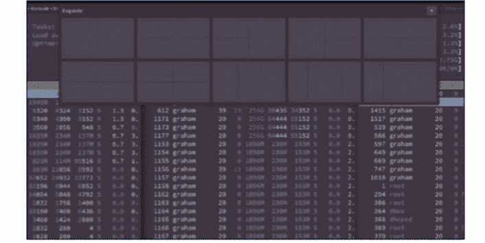

`Exquisite` 是一个易用的 `KDE Plasma` 桌面窗口管理器，它是学习平铺技巧的绝佳入门，可以针对当前选中的窗口。有 10 种布局可以选择，并且可以通过简单的脚本进行修改和创建，以更好地适应你的需求和习惯。面板保持在屏幕上，可以轻松让你移动其他窗口，并被配置在脚本全屏或一段时间后自动隐藏。这是一个让你习惯它的好方法，而且比记住许多快捷键要简单得多。

## 项目网站

`https://github.com/qwer33/Exquisite`

## 电池监控器

## battop

`Steam Deck` 为移动 `Linux` 带来的一个令人惊讶的特点是让电池续航成为了首要问题。当 `150W` 图形硬件开始运行时，它可以在不到两小时内耗尽其 `400Wh` 的电池。虽然 `Steam Deck` 确实包含了优秀的性能调优和工具，但这些工具在桌面模式下是不可用的。这时 `battop` 就派上用场了，它可以帮助任何运行在电池上的 `Linux` 系统，因为你可能需要了解你的电池情况。它从终端运行，直接连接到电池管理系统，并将你可以从硬件中获得的所有信息渲染成一个功能完备的终端用户界面。主显示器分为左右两列的六个部分。左部分根据左列表列出了你电池的能力和需求详情。这些包括电池的供应商 `ID`、功耗、电压、容量、充满电量以及环境温度。上方是一个直方图，显示电池剩余电量的百分比。右侧是三个直方图，分别显示电池的温度、功率消耗和每瓦耗电量，你可以看到定义的最小值和最大值

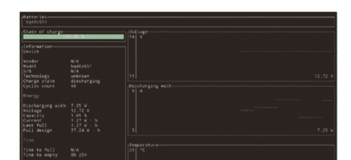

与硬件应用不同，`Linux` 电池信息的访问是不受限的，任何人都可以通过 `battop` 访问。`battop` 的波动被标记以显示它们的局限性，每个图表都标注了每个项目的当前值。当 `CPU` 使用率很高而你只想看到最近的操作对电池性能没有影响时，所有这些工作都非常有用。正如 `battop` 网站所说，它是电池版的类似于用于进程和内存管理的 `gtop` 或 `top`。

## 项目网站

`https://github.com/svartlf/rust-battop`

## 音乐视觉化器

## corrscope

互联网上充满了只有音乐并配有一些视觉帮助以为耳朵提供反馈的视频。它们很容易创建，如果你想分享你的音乐或创建一个易于播放的内容，它们很有用，但创建一个有意义的可视化并不困难。好处是与声音同步是有趣的。一种方法是从音乐可视化器渲染输出，我们之前已经看过了。另一种方法是使用 `corrscope`，它接收一个或多个音频文件并生成这些输入的示波器视图。这些显示了音频变化的频率，并且与声音同步非常困难。`Corrscope` 以类似于示波器的方式解决了这个问题，同步波形的向上或向下的斜率。这些触发器可以像真实硬件一样进行调整，尽管默认值已经适用于一切。波形可以通过更改线条颜色、背景颜色以及垂直或水平方向进行自定义。最重要的是，你可以为多个输入生成波形并将其拆分。这对于许多任务非常有效，但配合音乐使用时效果最好。这是因为每个通道都可以通过软件分离，并且每个通道由简单的形状组成。这些在看起来非常良好

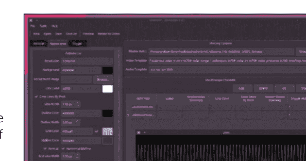

通过 `corrscope`，你可以为音频通道构建示波器可视化，它们在任何音乐示波器的网格中播放。你在 `GUI` 中进行的任何更改都可以通过点击预览来立即查看。这是最终输出的免费版本。如果你喜欢，此高质量视频将以你的分辨率渲染，并以你喜欢的方式分享。

## 项目网站

`https://github.com/corrscope`

## bastion

`Bastion`（堡垒）是一个位于 `DMZ` 中的服务器，用于保护你的网络免受攻击。它是私有网络的网关，并暴露在公共互联网上。由于它是暴露的，因此必须进行加固和监控。堡垒主机是允许外部网络访问私有网络的网关。它通常用于提供安全访问私有网络。要连接到私有网络，首先连接到堡垒主机，然后从那里连接到私有网络上的其他服务器。这比直接连接到私有服务器更安全，因为堡垒主机是唯一暴露在互联网上的服务器。

# 角色扮演引擎

# FOSSPICKS LINUX 声音

# Exult 1.8

《勇界第七代》（Ultima VII）是20世纪90年代最卓越且最具影响力的游戏之一，它采用俯视等轴测风格，这种风格至今仍被模仿，其引擎也是《勇界 Online》（Ultima Online）留下的遗产的一部分。发布后，该游戏本身是最早的开放世界冒险游戏之一，你可以去任何地方做任何事情。当你带着角色从一个城镇移动到另一个城镇时，布列塔尼亚岛屿会像15世纪的英国那样度过日常生活和季节，经过田野和城堡，最后来到当地的酒馆喝杯啤酒吃顿饭。

你的角色——化身——开始了一项解决残忍谋杀案的任务，这项任务最终结束于跨越数英里景观的探索，这被称为“美德熔炉”（Forge of Virtue）。`Exult` 是一个长寿的项目，可以在现代硬件上运行《勇界第七代》及其扩展包。它适用于几乎任何平台且易于使用。与许多项目一样，它涉及任何拥有原始故事文件的人在旧操作系统上运行。现代时代，配备了高分辨率图形和现代控制器。`Exult` 的 `1.8` 版本配合《勇界第七代》发布30周年推出，添加了许多功能。


虽然 `Exult` 是为了玩《勇界第七代》而构建的，但它已扩展为编辑器，现在能够创建类似《勇界》的游戏。

在游戏引擎上工作，已移植到 `GTK+`；添加了背景效果；并在结尾处有正确的注释。最后的修复可能已经持续很久，因为玩《勇界》如此迷人，以至于你从未想过结束游戏，在这些年来依然出色。

> 项目网站
> `http://exult.sourceforge.net`


# 武术

# Overgrowth

`Overgrowth` 是少数软件之一，它在作为开源项目获得生命之前，已经作为商业软件存在多年。这款游戏已经存在了十年的大部分时间（并且仍然活跃），拥有一个支持武术艺术的用户群。野生动物武术艺术真的需要考虑这种方法，正如《勇界》一样。它的早期武术艺术标题 `Lugaru` 也是开源的。

传统的可爱侧有人人化的化身。相反，它们更阴险，像 `Donald Duck` 那样。你的任务是通过在各种景观和关卡中战斗来拯救你的伙伴。通过巧妙的地图，精通游戏中的每个方向。通过这种方式，你的兔子可以跨越数公顷的景观，开启你的冒险。这不需要太多的思考，对于年轻的玩家来说。`Overgrowth` 的推出甚至在游戏发布时就已经被风格化的 `Lugaru` 所取代。这在现在可以解决，因为最重要的是，游戏现在是开源的。开发者正在转向一个新项目，而想要拆解旧项目。如果其他开发者也可以这样做。

> 项目网站
> `https://github.com/WolfieGames/overgrowth/`

# Linux 声音 教程 – iTunes XML

# 使用 Python 获取 iTunes XML 元数据

解锁你的 iTunes 数据

作者：John Field

扩展标记语言（XML）[1] 是一种广泛使用的标记语言和文本文件，用于存储和交换数据。包括 `iTunes` 在内的各种应用程序都使用 `XML` 来存储或交换数据。在本文中，我将向你展示如何使用 `Python` 读取和处理 `iTunes` [2] `XML` 文件的数据。某些应用程序使用专有格式以获得性能和效率，但限制了对专有产品的访问。`iTunes` `.xml` 格式是开放的。另一方面，这种开放格式更强调广泛的采用和开发的易用性。

## iTunes 库格式

`iTunes` 将其内容分为两个独立的类别：媒体和元数据。媒体（音乐和视频）存储在与元数据分开的文件中。在本文的其他部分，我将关注音乐信息——艺术家、歌曲标题、专辑编号、类型、年份以及元数据。`iTunes` 元数据文件具有 `.itl` 或 `.xml` 后缀（1）。

`Apple` 历史上一直使用 `XML` 文件导出库和列表元数据。虽然 `iTunes` 库的本地格式是带有 `.itl` 后缀的文件，但许多用户更倾向于通过高级设置或文件导出方法导出库的 `XML` 副本。导出文件导出方法允许你将列表保存到

## 为什么选择 XML？

如果你是一个音乐爱好者，有时你需要在各种数字设备之间交换元数据。在这种情况下，我将 `iTunes` 元数据导入数据库以运行 `SQL` 查询。`XML` 格式的优点是它既是人类可读的也是机器可读的。能够使用简单的文本编辑器轻松检查和诊断数据的好处是，应用程序可以通过应用程序接口（`API`）访问元数据。我们使用的许多应用程序——文本编辑器、文字处理器、电子表格、编辑器和图形——要么使用 `XML` 或与其他应用程序交换数据。


`Python` `XML`
`Python` 标准库包含了结构化标记工具，包括处理 `XML` 的模块。在本文，我将描述 `iTunes` 文件中的元数据是如何组织的，以及如何使用 `Python` 的 `.etree.Element[3]` 来导航和访问该数据。为了从 `iTunes` 列表或库文件中提取元数据，理解 `XML` 文件的结构是重要的。当排序库或列表文件时，它被生成为由 `<tracks>` 标记的项目列表。每个曲目的元数据包含一个键值字典。

图 1：`iTunes` 元数据文件的层级结构。


# LINUX 语音教程 - ITUNES XML

`<xml version="1.0" encoding="UTF-8">`

`<!DOCTYPE plist PUBLIC "-//Apple//DTD plist 1.0//EN" "http://www.apple.com/dtds/PropertyList-1.0.dtd">`

XML 语言允许在文档类型定义（`DTD`）中定义数据类型，该定义既可以在 `XML` 内部声明，也可以作为外部引用。`Apple` 使用属性列表进行配置，因此在声明中使用了“属性列表”（`plist`）术语（列表 1）。由于元数据在 `XML` 中结构化为元素，因此“元素”一词是以层级化的方式使用的，作为获取这些元素的另一种简单方法。元素定义在导出文件第二行通过 `` `DOCTYPE` `` 声明链接的外部 `DTD` 中。此 `DTD` 中定义的类型是：数据、日期、实数、整数和字符串。`XML` 元素也在 `DTD` 文件中定义。元数据是一个逻辑组件，以标签开始并以匹配的标签结束。每个元素包含一个可以是键或值的字符串。曲目的元数据组织为键值对。列表 7 中的语句是，想要的

```xml
<key>Name</key><string>Justin's Groove</string>

<key>Artist</key><string>Stanley Clarke</string>

<key>Album</key><string>East River Drive</string>

<key>Genre</key><string>Jazz</string>

<key>Track</key><integer>1</integer>

<key>Year</key><integer>1993</integer>
```

# 列表 2：从 XML 构建元数据

## 构建树

`parse()` 方法导入 `XML` 文件或对象树并构建层级树。每个元素可能有子元素。根元素通过 `getroot()` 方法实例化（列表 3）。

在排序库或列表文件时，它被生成为由`` `<dict>` ``标记的项列表。字典包含元数据。

```python
tree = ET.parse(xml)
root = tree.getroot()
```

# 列表 4：第一和第二代字典

```python
dict_gen = root.find('dict')
dict_gen2 = dict_gen.find('dict')
```

## 元素和标签

为了获取曲目元数据，你需要找到曲目标签并检索内容。

| 代码片段 | 操作 |
|---|---|
| `parse()` | 解析一个 XML 文件或对象树 |
| `getroot()` | 返回树的根元素 |
| `find()` | 返回第一个指定元素的实例 |
| `findall()` | 返回包含文档对象中所有匹配元素的列表 |
| `tag` | 指定在 DTD 中定义的元素名称 |
| `text` | 指定起始标签和结束标签之间的字符 |

# 列表 5：列表元数据字典

```python
tracklist = list(dict_gen2.findall('dict'))
```

元数据字符串（图 3），并将键值对字符串打印到你的屏幕上。

电子表格或数据库表（图 3）。注意，`i` 循环（外层循环）代表行，`j` 循环（内层循环变量）代表列。

在确认元数据后，你可以根据需要使用它。由于列表被组织为二维数组，它将以表格形式呈现，就像出现在电子表格中一样。

# 总结

# 文本

```xml
<key>artist</key>
<string>James Taylor</string>

<key>album</key>
<string>James Taylor Collection</string>

<key>track</key>
<string>Sweet Sound</string>

<key>year</key>
<string>1972</string>

<key>genre</key>
<string>Jazz</string>
```

图 2：标签文本。

# 列表 6：为所有轨道创建元数据列表

```python
itunes_music = []
for item in tracklist:
    x = len(item(len))
    for i in range(x):
        if item[i].text == "artist":
            itunes_music.append(list(item))
```

## 信息

- [1] XML: https://www.w3.org/standards/xml/schema
- [2] iTunes 软件包音乐规范 5.3.14, PDF: https://help.apple.com/it/musspec/index.html
- [3] xml.ElementTree: https://docs.python.org/3/library/xml.elementtree.html

# 列表 7：显示元数据

```python
for i in range(len(itunes_music)):
    for j in range(len(itunes_music[i])):
        if tagtrue(itunes_music[i][j].text):
            print(itunes_music[i][j].text,
                itunes_music[i][j].text)
```


# 作者

John Kofi 是加利福尼亚北部的一名退休营销经理。他的专业背景是电气工程，曾在硅谷的半导体和软件公司工作过。他的非技术性兴趣包括从调式到融合派的爵士乐。

| 姓名 | 艺术家 | 专辑 | 流派 | 轨道编号 | 年份 |
|---|---|---|---|---|---|
| 1 | Justice's Grove | Stanley Clarke | East River Drive | Jazz | 1 | 1993 |
| 2 | Fantasy Love | Stanley Clarke | East River Drive | Jazz | 2 | 1993 |
| 3 | East River Drive | Stanley Clarke | East River Drive | Jazz | 4 | 1993 |

图 3：索引行和列。

94 2022年11月第264期 `LINUX-MAGAZINE.COM` | `LINUXPROMAGAZING.COM`

# Linux 新闻亭

`Linux Magazine` 是你进入 Linux 世界指南。每期杂志都包含了你在其他地方找不到的技术文章和教程。探索我们的过刊完整目录，以获取特定主题或完成你的收藏。

# #263/2022年10月
## 基于 IoT 构建 Linux


Linux 最令人惊叹的地方在于它的灵活性。Linux 系统运行在世界上最大的计算机上，也运行在你家庭环境中的某些微型设备上。如果你好奇开发者是如何让 Linux 能够运行在微型技术上的，你会喜欢本月关于 `Buildroot` 和 `Yocto` 项目的故事。

DVD 包含：`Linux Magazine` 存档 1-262

# #262/2022年9月
## 超越 5G


在幕后，蜂窝网络一直是专门化和专利设备的代名词，但一些最近的创新正在改变这一点。本月我们探索了 `Open RAN` 规范，它可能允许移动网络在现成硬件上运行。

DVD 包含：`openSUSE Leap 15.4` 和 `MX Linux 21`

# #261/2022年8月
## USB 启动


`Live` 启动在 15 年前是一个令人兴奋的想法。旧式的 `CD` 启动有一些局限性。今天的 USB 启动工具解决了这些问题：随身携带一个 U 盘随处启动镜像。

DVD 包含：`Linux Mint MATE 20` 和 `FreeBSD 13`

# #260/2022年7月
## 隐私


如果你重视隐私，你将比你的浏览器学得更多。需要匿名性的人依赖 `Tor` 网络——一个在监控状态下提供安全浏览的应用。我们还查看了具有强大功能的 `Postmaster`。

DVD 包含：`Ubuntu 22.04` 和 `Fedora Workstation`

# #259/2022年6月
## 零信任


二十年前，每个人认为网关就是你免受入侵所需的一切，但历史有不同的故事。今天最好的建议是：不要信任任何人。内部网络可能和互联网一样危险。

DVD 包含：`Zorin OS 16` 和 `GRUB Disk`

# #258/2022年5月
## 洁净 IT


大多数人通过更换灯泡来能量，但你知道可以使用高效软件来节能吗？本月我们研究如何为 IT 行业带来可持续性。

DVD 包含：`Manjaro 21` 和 `DragonFly`

# 特色活动

用户、开发者和供应商在全球各地的 Linux 活动汇聚。`Linux Magazine` 荣幸介绍此处特色活动。对于您附近的其他活动，请查看我们在 `www.linux-magazine.com` 上的详细日历。如果您有其他希望加入日历的活动，请发送详细信息至 `info@linux-magazine.com`。

## SC22

日期：2022年11月13-18日
地点：达拉斯
网站：`sc22.supercomputing.org/`

## Black Hat：边缘安全

日期：2022年11月15-18日
地点：沙特阿拉伯
网站：`blackhatmea.com/`

在预订任何旅行之前务必检查网站，因为受 COVID 影响，活动可能会取消或改为虚拟。与朋友同事一同达拉斯，在全球最大的会议之一探索不可思议的学习体验。如果你无法现场，`SC22` 提供了强大的数字体验，大多数课程将直播并在每节结束后 24 小时按需播放。沉浸网络安全世界。加入该地区最大的网络安全盛会的 3 万多名专业人士。中东非洲 `Black Hat` 将举办无与伦比的执行官会议以及一系列高水平简报、工具、培训和游戏比赛。了解更多并立即注册！

# 活动

- `KubeCon + CloudNative` 北 America 2022 (2022年10月24-28日，密歇根州底特律)
- `SREcon2022` 中东/非洲 (2022年10月25-27日，阿姆斯特丹)
- `CyberDefense2022` (2022年10月27-28日，佛罗里达州奥兰多的)
- `All Things Europe 2022` (2022年11月30日-12月2日，北卡罗来纳州罗利)
- `SIGLinux` 会 (4月4-5日)
- `SC22` 超级 (2022年11月13-18日，德克萨斯州达拉斯)
- 开源监控会议 (2022年11月13-18日，德国纽伦堡)
- `Black Hat`：边缘安全 (2022年11月15-18日，沙特阿拉伯利雅得)
- 开源峰会(日本) (12月5-6日，日本横 + 虚拟)
- 开源合规峰 (12月7日，虚拟)
- 亚洲太平洋会议 (2月4-5日，澳大利亚悉尼)
- `FOSDEM` (2月15-23日，加利福尼亚州旧山 + 虚拟)
- `DeveloperWeek` (2月20-23日，加利福尼亚州圣克拉拉)
- `FAST23` (3月9-12日，加利福尼亚州帕萨迪纳)
- `SCAL10` (3月21-25日，德国)
- `KubeCon + CloudNative` 欧洲 2023 (2023年4月17-21日，阿姆斯特丹)

# 征稿

我们正在寻找关于 Linux 和 Linux 环境工具的好文章。虽然我们考虑任何主题，但对以下主题特别感兴趣：

- 系统管理
- 有用的技巧和工具
- 安全，新闻和技术
- 产品评论，实战经验
- 社区新闻和项目

如果你有想法，请将包含大纲、长度估计、作品描述和联系方式的提案发送至 `edit@linux-magazine.com`。

# 下个月预览

第 265 期

## 预计日期

| 地区 | 日期 |
| :--- | :--- |
| 英国 / 欧洲 | 11月05 |
| 美国 / 加拿大 | 12月02 |
| 澳大利亚 | 1月02 |

## 上市日期

请注意：上市日期为预计时间，可能会因为物流问题而延迟。

# 第 265 期 / 2022年12月

## 量子计算

是事实还是科幻？真实还是仅仅是一个迷人的思维练习？量子计算的故事才刚刚开始。请关注下个月深入了解。


## 预览通讯报

《Linux Magazine Preview》是一份每月一次的电子邮件通讯报，让你抢先预览下一期内容，包括在线发布文章的链接。
注册地址：`https://bit.ly/Linux-Update`

图片 © Pop Nukoonraat, `123RF.com`

98 2022年11月 第264 期 `LINUX-MAGAZINE.COM` | `LINUXPROMAGAZINE.COM`

在10月14日前注册享受大折扣！

# 你。达拉斯。SC22

11月13–18日

`SC22` 是全球最大的高性能计算（`HPC`）研究人员和专业人士会议之一，这是一个学习新技能、建立新友谊、解决复杂问题以及观下一代技术的惊人的一周。

如果您倾向于虚拟参加，可以使用全新的、定制的数字体验。

国际高性能计算、网络、存储和分析国际会议

## 立即注册！

`sc22.supercomputing.org`


# HETZNER
## STORAGE SHARE
由 `NEXTCLOUD` 驱动


在线存储
符合 `GDPR` 标准

## 简单。可扩展。安全。

与其他协作，并共享及保护您所有的文档、图片等内容。

### Storage Share NX11
- 1 TB 存储空间
- 3 个子域名
- 50 个并发连接
- 自动备份
- 无限制内部和外部流量
- 无限制用户
- 用户组
- 存储位置：德国
- `SSL` 加密
- 无最低合同限制
每月 £ 3,80

### Storage Share NX21
- 5 TB 存储空间
- 7 个子域名
- 100 个并发连接
- 自动备份
- 无限制内部和外部流量
- 无限制用户
- 用户组
- 存储位置：德国
- `SSL` 加密
- 无最低合同限制
每月 £ 12,40

所有价格均不含值税，并受 `Hetzner Online GmbH` 的条款条件限制。价格可能会变动。所有权利归相应制造商所有。

## `www.hetzner.com`
