# Linux 杂志 2023年3月 第268期 美国

`WWW.LINUX-MAGAZINE.COM`


# 强（力）大得惊人！

## TUXEDO Pulse 15 - Gen2

- `AMD Ryzen 7 5700U-35W`
  8 核心 | 16 线程
- `WQHD` 显示屏
  `2560 x 1440` | `165 Hz`
- 长达 18 小时的续航
  `91 Wh` 电池
- 坚固的镁合金机箱
  1.7 厘米薄 | 1.5 公斤轻
- 100% Linux
- 5 年保修
- 终身支持
- 德国制造
- 德国隐私保护
- 本地支持


`tuxedocomputers.com`

# 编按

## 我会盯着你的

亲爱的读者：

被称为达沃斯精英聚会的，绝非普通的商业会议。世界经济论坛的年度大会是一个超豪华的独家活动，不是政府会议，而是来自约 1,000 家会员公司——全球最大公司——的代表，以及少量政治领导人和学者的聚会。

在今年的达沃斯会议上，微软为 50 位客人举办了一场派对，并邀请流行巨星戈登·马修·托马斯·萨默纳（Gordon Matthew Thomas Sumner，即“斯汀” Sting）为派对提供娱乐表演。关于邀请斯汀现身并在你的派对上表演需要多少钱，各种说法不一，但据说报酬高达六位数字。

如果微软第二天没有裁员 10,000 名员工，关于这场音乐混音会（派对）的新闻很容易就被忽略了。这次冷酷的裁员，以及随之而来的紧缩呼吁，与聘请斯汀作为“见面交流会”明星的奢侈挥霍形成了奇怪的违和感，微软很快就在科技媒体和社交媒体上遭到了谴责。

我得承认，斯汀的派对对我这样的观点评论员来说是个容易攻击的目标。视觉效果糟透了。但像这样糟糕的想法的问题在于，每个人都会抱怨这有多糟，然后继续前行，留下故事的其他部分未被审视。

关于这个奇怪且不可思议的选择，有一点揭示了一个不言而喻的真相：技术预算和市场预算来自完全不同的宇宙。大量的资金被投入市场营销和销售，这对其他所有人来说似乎都是完全非理性的。我曾在一次贸易展上，营销顾问告诉我她的客户花 100 万美元搭建了一个展位，但展位如此新奇且引人注目，以至于因为它出现在国家新闻节目中，他们赢得了 1,000 万美元的空中曝光时间。（她指出，新闻时间比广告时间长有价值。）我曾在一次展会上走过一个看起来像星际战舰舰桥的展位。我说，“哇，那真的很像星际战舰企业号的舰桥”，他们告诉我，“它不仅仅是看起来像，它就是星际战舰企业号的舰桥。我们从制片厂租来并运到这里的。”（别让我去核实这件事——我只是告诉你他们告诉我的。）然后是杂技特技越野摩托车街头派对，摩托车轰鸣着冲上坡道，在空中翻转，然后轰鸣着冲下另一个坡道，而友好的助手们分发着各种口味的“纯氧”冰沙，比如“树莓”和“冬青”。我还见过特朗普模仿者、毛利舞者、机械公牛和 6 英尺高的相同双胞胎T台模特（我记得是在推广镜面存储驱动器）……这些奇观与公司试图销售的产品没有任何关系。一切都是 100% 为了引起注意。但注意是如此宝贵，以至于高管们愿意为看似毫无意义的事情支付令人难以置信的金额。

微软究竟为什么想请斯汀在 50 人的派对上演奏？原因之一可能是他们想让每个人都知道他们请得起斯汀在 50 人的派对上演奏。微软一直擅长投射力量和统治地位。现在他们不再像过去那样强大和具有统治力，但他们仍然可以通过以看似无穷无尽的方式撒钱来显得强大和具有统治力。对我们来说，斯汀和裁员似乎矛盾，但对微软来说，它们完美地起到了平衡作用，因为人们会说，“他们裁了 10,000 人，暗示他们没钱，但看看他们在斯汀身上砸了这么多钱，所以也许他们确实仍然富有且强大。”这种方式的坏处是，尽管公司的高管层可能认为如此，人们一开始就不喜欢微软的“力量与统治”表演，而且现在不得不在诡计和噱头上基于这一点就更令人厌烦了。

需要知道的另一件事是，出现在达沃斯的那种人真的很难在其他地方接触到。在电梯里遇到一家年收入 50 亿美元公司的首席执行官是非常困难的。想想一家 50 亿美元的业务能购买多少计算机服务。当然，没有人会在这种事件上签署服务协议。他们只是建立“人脉”，以便下次 CEO 在董事会会议上对 IT 基础设施有疑问时，他可以说“我认识微软的一个家伙，我们给他打个电话……”

如果聘请斯汀能与那 50 位客人中至少一人达成交易，从财务上看可能是值得的。但奥林匹斯山上的所有权谋对斯汀晚会第二天失业的那 10,000 名工人来说意义微乎其微。

裁员在高科技行业是不可避免的，而对那 10,000 名工人的尊严给予一点尊重也是好的。事实上，这可能甚至是一项好的营销。■■■


`Joe Casad,`

主编


## 16 数据投毒

你以为计算机不会犯错吗？如果你将一些经过篡改的训练样本混入其中，你就可以让一个高级机器学习系统误以为狗是猫，或者数字 1 是数字 8——而你可以通过一个其他人注意不到的隐藏信号来触发这种不良行为。


## Linux Voice

- 71 欢迎

  本月的 `Linux Voice` 内容概览。

- 72 狗舍 – 软件自由

  限制自由和开源软件（`FOSS`）的用途似乎很有吸引力，但这可能并不是某些人想象中的解决方案。

- 73 `Docker`

  如果你在使用 `Ubuntu` 但需要在 `openSUSE` 上测试某些内容？你不需要第二台电脑或虚拟机——单个容器就完全足够了。

- 80 `IPTVnator`

  `IPTV` 标准让你能够在 `Linux` 上观看你喜爱的频道。

- 84 `FOSS` 精选

  本月 Graham 重点介绍了 `LosslessCut`、`Webcamoid`、`Sniffnet` 等更多软件！

- 90 教程 – `LDraw` 和 `LeoCAD`

  `LDraw` 和 `LeoCAD` 帮助你成为一名虚拟乐高建筑师。

### MakerSpace

- 58 自动喂食器

  无论是在工作还是度假，每个宠物主人都担心如何照顾他们的小室友。每个水族箱主人需要的就是一个自动喂食器。

- 62 太阳能阵列

  一个预测服务和一些 `Perl` 魔法有助于预测住宅光伏阵列的太阳能产量。

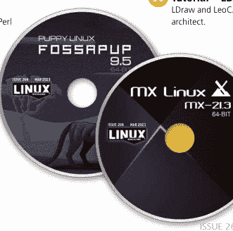

- `@linux_pro`
- `@linuxpromagazine`
- `Linux Magazine`
- `@linuxmagazine`

两大精彩发行版

双面 `DVD`！

详见第 6 页

## MX Linux 21.3 和 Puppy Linux FossaPup 9.5

双面 `DVD` 上的两大精彩发行版！

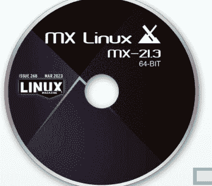

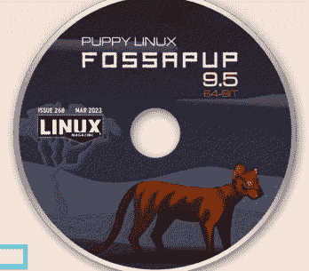

### MX Linux 21.3

`64`位

代号为“野花”（`Wildflower`）的 `MX Linux 21.3`（`MX-21.3`）是 `antiX` 和 `MX Linux` 社区之间的最新合作成果。基于 `Debian 11.6`，“野花”版本提供了 `Xfce`、`KDE Plasma` 和 `Fluxbox` 桌面环境的最新发行版。

`Fluxbox` 的变更包括 `MX Rofi Manager`，这是一个用于配置外观和感觉的工具，而 `KDE` 现在包含带有高级硬件配置（`AHS`）的 6.0 内核。所有版本都包含新的 `deb-installer`、菜单编辑器以及更新的固件包，以及最新的用于创建实时镜像和系统快照的 `antiX` 工具。

与所有 `MX` 版本一样，其结果是一个具有极高易用性的发行版，适合所有级别的用户。

### Puppy Linux FossaPup 9.5

`64`位

虽然 `Puppy Linux` 通常被列为一个发行版，但它实际上是一个发行版家族。最初旨在用于小型安装，`Puppy Linux` 现在以其共同拥有的功能而闻名。本月 `DVD` 中包含的是 `FossaPup 9.5`，这是 `Puppy` 较知名的发行版之一。若要尝试其他 `Puppy Linux` 发行版，请下载 `https://puppylinux-woof-ce.github.io/`。


所有 `Puppy Linux` 发行版都使用 `woof-CE` 构建，它可以从现有的二进制文件（通常是 `Ubuntu` 或 `Slackware`）创建发行版，并且可以安装在单个目录或整个文件系统上。每个发行版都使用自己选择的组件、应用程序和功能。然而，每个 `Puppy Linux` 都会将系统文件加载到 `RAM` 中并对个人文件进行加密，而不是使用密码。同样，每个系统都会打开快速设置窗口，并可以在关机时保存当前设置。

与所有 `Puppy` 发行版一样，`FossaPup` 安装迅速，并提供一些非传统的计算方法，所有用户都可以欣赏。

## `CLOUDFEST`

2023 年 3 月 21–23 日

德国欧洲公园

- 6,000+ 参与者
- 250+ 演讲者
- 150+ 合作伙伴
- 65 个国家

全球最大的云行业活动准备再次接管一座壮观的欧洲游乐园，以促进新的合作伙伴关系、深入的知识共享，以及行业有史以来最棒的派对。


开启您的 `CloudFest` 之旅

并节省 399 欧元！

使用您的免费代码：`CF23ADMIN`


`reg.cloudfest.com`

## 新闻

技术、趋势和工具的最新更新

### 本月新闻

- 08 • `Nobara` `Project` 是带有用户友好修复的 `Fedora` 修改版
- • `Gnome` 44 现在有了发布日期
- 09 • `Nitrux` 2.6 随内核 6.1 和一个重大变更发布
- • `Vanilla` `OS` 初始发行版现已可用
- • 更多在线资讯
- 10 • 发现关键 `Linux` 漏洞影响 `SMB` 服务器
- • `Linux` `Mint` 21.1 现已发布，包含大量外观和感觉更改
- • 又一次尝试 `Linux` 平板电脑正在进行中
- 11 • 现在可用：《使用 `LibreOffice` 进行设计》第二版
- • `KaOS` `Linux` 2022.12 有很多令人兴奋的内容

### `Nobara` `Project` 是带有用户友好修复的 `Fedora` 修改版

`Nobara` `Project` 的目标是为用户带来开箱即用的更好的游戏、流媒体和内容创作解决方案。

这个新的 `Linux` 发行版（并非 `Fedora` `Spin`）是一个完全独立的项目。这个 `Linux` 操作系统包含 `NVIDIA` 驱动程序、`Wine` 依赖项、`OBS` `Studio`、第三方编解码器以及一系列旨在让用户无需调整、安装或打补丁即可立即变得高效的包修复。

预安装包包括 `Blender`、`DaVinci` `Resolve`、`OBS` `Studio`、`Wine`、`Proton`、`Discord`、`Flatpak`、`Steam`、`Lutris`、`OnlyOffice`、`VapourSynth` 等等。您还将找到 `RPM` `Fusion` 软件仓库，其中包含免费和非免费软件。

与 `Fedora` 不同，`Nobara` 使用 `AppArmor`，因为它声称 `AppArmor` 更用户友好、侵入性更小且更易于管理。`Nobara` 附带与 `Fedora` 相同的核心内核，并添加了一些额外的补丁。

`Nobara` `Project` 附带 `Gnome` 桌面，没有计划包含其他环境。

要阅读更多关于 `Nobara` 的信息，请访问官方网站 [链接](https://nobaraproject.org/)，并从 `Nobara` `Project` 下载页面 [链接](https://nobaraproject.org/download-nobara/) 下载 `ISO` 进行安装。

### `Gnome` 44 现在有了发布日期

虽然谈论第 44 版 `Gnome` 桌面将包含哪些功能还为时过早，但可以说，`Epiphany` 网络浏览器很可能会获得我们一直在等待的 `GTK4` 移植版本，以及开箱即用的 `WebExtensions` 支持。此外，更多应用程序可能会有更广泛的 `libadwaita` 支持。

我心中的一个大问题是，`Gnome` 44 最终是否会引入新的终端应用 `Console`，还是将继续使用当前的默认 `Gnome` 终端？

根据 `9to5Linux` [链接](https://9to5linux.com/gnome-44-release-date)，`Gedit` 正在回归，但没有迹象表明它将成为默认文本编辑器。我的猜测是，新的默认编辑器将保持不变，而新更新的 `Gedit` 将作为替代方案提供。

`Gnome` 44 的官方发布时间表如下：

- `Gnome` 44 `Alpha`：2023 年 1 月 7 日
- `Gnome` 44 `Beta`：2023 年 2 月 11 日
- `Gnome` 44 候选版：2023 年 3 月 4 日

此外，值得注意的是，虽然 `Gnome` 44 的官方发布日期是 3 月 22 日，但这并不意味着您选择的基于 `Gnome` 的发行版即可获得最新更新。第一个可能获得 `Gnome` 44 的将是 `Gnome` `OS` [链接](https://os.gnome.org/) 的夜间构建版。关于 `Gnome` `OS` 需要记住的一点是，它仅运行在裸机或 `FlatHub` `Boxes` 上，因此您无法在虚拟机中测试该发行版。您可以在官方 `Gnome` `Wiki` [链接](https://wiki.gnome.org/) 上关注 `Gnome` 44 的新闻。

### `Nitrux` 2.6 随内核 6.1 和一个重大变更发布

`Nitrux` 2.6 已可用，该发行版有一些重大变化。首先也是最重要的，`dpkg`、`apt` 和 `PackageKit` 包管理器已被移除，转而使用 `AppImage` 或 `Flatpak`。

在该版本中，`FlatHub` 已默认启用，并且有许多可以通过该系统安装的应用程序。

`Nitrux` `Live` 版本的用户会注意到标准包管理器仍然可用，但一旦安装了操作系统，这些包管理器就不再启用了。

其他变更包括将 `PipeWire` 作为默认声音服务器，以及添加了 `Wayland` 但未默认启用。默认桌面环境是 `KDE` `Plasma`，`Nitrux` 2.6 随附版本 5.26.4、`KDE` `Frameworks` 5.1.01 和 `KDE` `Gear` 22.12。

关于 2.6 版本，`Nitrux` 创始人 `Uri` `Herrera` [链接](https://www.linkedin.com/in/uri-herrera/) 表示：“这个版本的发行版可以被视为传统 `Linux` 发行版的对立面，传统发行版完全致力于其包管理器，但这个发行版不是这样。” `Herrera` 继续说道：“用户可以使用任何 `Linux` 发行版的容器（`Arch`、`Fedora`、`Debian`、`openSUSE`、`NixOS`、`Gentoo` 以及许多更多），甚至包括同时使用多个容器；没有任何限制。”

请在官方发布公告 [链接](https://nxos.org/changelog/release-announcement-nitrux-2-6-0/) 中阅读更多关于 `Nitrux` 2.6 的信息，并立即下载您的副本 [链接](https://sourceforge.net/projects/nitruxos/files/Release/ISO/nitrux-ux-desktop-d5c7odiff-amd64.iso/download)。

### `Vanilla` `OS` 初始发行版现已可用

一个全新的 `Linux` 发行版现已可用，拥有一个您不会在许多操作系统中找到的独特功能。这个发行版名为 `Vanilla` `OS`，提供标准的 `Gnome` 体验（使用 `Gnome` 43），基于 `Ubuntu` 22.10。

`Vanilla` `OS` 的关键功能包括其自己的安装程序（使用 `GTK4` 和 `libadwaita` 编写）、一个方便的初始设置应用程序以引导用户完成初步步骤、一个操作系统控制中心以帮助安装驱动程序并运行关键更新等操作，以及按需不可变性。

正是这种按需不可变性应该让许多用户兴奋不已。通过此功能，系统的核心部分被锁定以防止不需要的更改。这是通过使用 `ABRoot` 实现的，它与 `apt` 的替代品 `apx` 协同工作。`Apx` 在受管理的容器内部安装包，而不修改根文件系统。

您还将找到 `VSO`（`Vanilla` `System` `Operator`），这是一个定期检查更新并在后台下载和安装更新的工具，但仅在系统未处于高负载状态下。


您可以在官方 `Kinetic` 公告页面 [链接](https://vanillaos.org/2022/12/29/vanilla-os-22-10-kinetic.html) 上阅读更多关于 `Vanilla` `OS` 的信息，然后从发行版的 `GitHub` 页面 [链接](https://github.com/Vanilla-OS/os/releases/tag/22.10-r2) 下载 `ISO` 进行安装。

### 更多在线资讯

`Linux` `Magazine`

`www.linux-magazine.com`

`ADMIN` `HPC`

`http://www.admin-magazine.com/HPC/`

`Warewulf` 4 – 时间和资源管理


# 技术资讯速览

## Warewulf HPC 集群搭建

• Jeff Layton

仅安装带有计算节点的 `Warewulf` 并不能真正构成一个 HPC 集群。您需要确保精确的时间记录并添加资源管理器。

## ADMIN Online

**ADMIN Online**

<http://www.admin-magazine.com/>

## 使用 Weka 进行统计和机器学习

• Manuj Bhardwaj

开源 `Weka` 工具无需高级编程技能且无需更改环境，即可对数据应用多种分析方法。

## 再见云端虚拟机，你好笔记本虚拟机

• Ankur Kumar

`Multipass` 让您能够启动和运行 `Ubuntu` 虚拟机，使用 `cloud-init` 配置虚拟机，并在几分钟内在本地原型化云端启动。

## Rancher 管理精简的 Kubernetes 工作负载

• Martin Lorschwit

`Rancher` 作为 `Red Hat OpenShift` 的轻量级替代方案，在为管理员进入 `Kubernetes` 世界时提供帮助，但在架构上存在主要差异。

## 发现影响 SMB 服务器的关键 Linux 漏洞

在 `SMB2_TREE_DISCONNECT` 命令的处理过程中发现了一个新缺陷，这可能导致启用 `KSMBD` 的服务器遭受远程代码执行。`KSMBD` 是一个内核中的 SMB 文件服务器，主要由三星电子的团队编写，并于 2021 年 8 月 29 日合并到了 5.15 内核中。该内核服务器在内核空间实现了 SMB3 协议，用于通过网络共享文件。

根据 Zero Day Initiative（<https://www.zerodayinitiative.com/advisories/ZDI-22-1680/>）的说法：“特定缺陷存在于 `SMB2_TREE_DISCONNECT` 命令的处理中。该问题源于在对对象执行操作之前未验证对象的存在。攻击者可以利用此漏洞在内核上下文中执行代码。”

这个新漏洞早在 2022 年 7 月就被发现，但直到 2022 年 12 月 22 日才向公众披露。好消息有两点：首先，该漏洞已修复（<https://cdn.kernel.org/pub/linux/kernel/v5.x/ChangeLog-5.15.61>）；其次，大多数用户仍在使用 SMB，因此不受此漏洞影响。尽管如此，为 5.15 内核应用补丁仍然至关重要。

## Linux Mint 21.1 现已发布，包含大量外观和体验变化

`Linux Mint` 21.1 (`Vera`) 现已可用，它包含刷新后的 UI、新的光标、大量可选的新应用图标主题，以及从之前的“薄荷绿”强调色变为新的“水蓝色”（aqua color）。

这些变化不仅仅是外观上的。你还会发现，驱动管理器（`Driver Manager`）现在可以在不输入密码的情况下启动。如果失去网络连接，驱动管理器还会显示离线页面，并且对实时 USB 介质的挂载变得更加用户友好。


一项重要的变更是，软件管理器和更新管理器现在默认支持 `Flatpak`，这意味着可以通过图形界面或命令行安装 `Flatpak` 应用。

默认桌面环境 `Cinnamon` 也收到了多项视觉更新，涉及项目选择、日期和路径栏。你还会发现系统声音已经改变，以帮助改善体验。这些新声音来自 `Material Design V2`（<https://m2.material.io/>），更加现代化。

你可以在这里阅读完整的发布说明，并在此下载 `Linux Mint` 21.1 的副本：<https://www.linuxmint.com/download.php>。


## 另一款 Linux 平板电脑正在研发中

当 `PINE64` 在 2019 年尝试发布第一款 `PineTab` 时，他们遇到了供应链问题（以及其手机日益增长的 popularity）导致项目无法完成。

如今，`PINE64` 确信能够克服这些问题，最终交付一款基于 `Linux` 的平板电脑，名为 `PineTab2`。`PineTab` 的新版本受益于比原版改进的规格，包括 `Rockchip RK3565` 处理器和 `Mali-G52` GPU。

每两周在您的收件箱获取最新新闻
免费订阅 `Linux Update` <bit.ly/Linux-Update>

## 新闻

`Rockchip` 是一个有趣的选择，因为它最初对 `Linux` 的支持并不多。幸运的是，该芯片的 `Linux` 支持已经蓬勃发展，因此 `PineTab2` 不应有任何问题。

`PineTab2` 的其他特性包括金属机身、可更换的 LCD 显示屏、1 个 `USB 3.0 Type-C` 端口、1 个 `USB 2.0 Type-C` 端口（用于充电）、1 个 `micro HDMI` 端口、1 个 3.5mm 音频插孔、5MP 后置和 2MP 前置摄像头、`microSD` 读卡器，以及一个可通过固件刷写定制的可拆卸背光键盘。

其他规格（以及价格）尚未公布。`PineTab2` 将提供两种配置：8GB RAM/128GB 闪存存储和 4GB RAM/64GB 闪存存储。

了解更多关于 `PineTab2` 的信息，请查看 `PINE64` 的 12 月更新（<https://www.pine64.org/2022-12-15/december-update-merry-christmas-and-happy-new-pinetab/>）。

## 现已推出：《使用 LibreOffice 设计》第二版

由 `Bruce Byfield` 和 `Jean Hollis Weber` 撰写的 *《使用 LibreOffice 设计》*（`Designing with LibreOffice`）第二版现已上市（<https://designingwithlibreoffice.com/>）。


与许多办公应用入门书不同，*《使用 LibreOffice 设计》* 超越了基本的操作步骤，将重点放在设计上。该书强调样式和模板，并关注将 `LibreOffice` 从文字处理领域扩展至桌面出版领域的高级技术。

*《使用 LibreOffice 设计》* 可以免费以 PDF 或 ODT 格式下载（<https://designingwithlibreoffice.com/download-buy/>），或者你可以从 `Lulu.com`（<https://www.lulu.com/shop/bruce-byfield-and-jean-hollis-weber/designing-with-libreoffice/paperback/product-vzypdp.html?page=1&pageSize=4>）购买纸质版。

## KaOS Linux 2022.12 有不少令人兴奋之处

`KaOS Linux` 2022.12 是一个基于 `Arch Linux` 的滚动发行版，现已发布，并包含一些令人兴奋的新增功能。首先，该发行版搭载 `Linux` 内核 6.0。其次，`KaOS Linux` 2022.12 添加了 `KDE Plasma` 5.26.4，这是桌面环境的最新版本。伴随该更新的还有 `KDE Gear` 22.12 和 `KDE Frameworks` 5.101。

桌面环境的一些改进包括：`Dolphin` 文件管理器终于包含了选择模式，这使得快速选择要处理的文件和文件夹变得更容易；`Gwenview` 图像查看器现在提供亮度、对比度和伽马控制；`Kate`（文本编辑器）现在包含键盘宏工具；`Kalendar` 现在可以在弹出窗口中显示事件。

一个让系统管理员兴奋的新工具是 `Kjournal`，它是一个用于查看系统日志的 GUI 应用程序。`Kjournal` 包含一个过滤工具，因此你可以快速查看所需的信息。另一个新工具是 `ghostwriter` markdown 编辑器。


有关新版本的更多信息，请查看官方公告（`https://kaos.us/news/2022/kaos12/`），然后下载一份 `KaOS` `2022.12` `ISO` 镜像（`https://kaos.us/pages/download/`）。

## Zack 的内核新闻


记录者 `Zack Brown` 报道了 `Linux` 内核社区中最新的新闻、观点、困境和进展。

`By Zack Brown`

### Bug 跟踪

`Linux` 内核开发中持续存在的噩梦之一是如何处理 Bug 报告。邮件列表每月收到数万条消息，开发人员使用各种过滤器和抄送习惯，试图将正确的邮件展示给正确的人眼。

`Bugzilla`（`http://bugzilla.kernel.org`）是一个由 `Mozilla` 公司开发的基于 Web 的 Bug 跟踪系统，已经存在多年，但大多数内核开发人员似乎对它既恨又怕。偶尔有人提到应该改进它，但那些讨论往往变得混乱。

最近，`Thorsten Leemhuis` 提到 `Bugzilla` 应该改进，开发人员对此进行了讨论。

作为预防措施，`Thorsten` 首先指出，运行 `Bugzilla` 实例的服务器以及 `Bugzilla` 实例本身都由 `Linux` 基金会的基础架构团队维护，他们做得非常出色，绝不应该与任何实际配置或使用该实例来分配或跟踪 Bug 报告的人混淆。基础架构团队负责让工具保持运行，这就是他们应该做的全部。是否实际使用该工具（或不使用）以及根据需求进行配置，取决于内核开发人员。

排除这些争议后，`Thorsten` 指出，Bug 报告的各种类别、接收这些报告的人员以及 `Bugzilla` 配置的许多其他方面都“严重过时、不完整或错误”。他补充说，虽然少数内核子系统确实积极使用 `Bugzilla`，但“大量的 Bug 和回归报告（即使是好的！）从未得到开发人员的回复。”在许多情况下，在 `Bugzilla` 上提交 Bug 相当于将其扔进一个死亡的无底洞。

`Thorsten` 还指出，`Bugzilla` 作为一个独立的软件项目似乎已经停滞。上游代码多年来未收到重大更新，这表明寻找一个活跃维护的替代品可能比投入大量精力让开发人员使用当前工具要好得多。

`Artem S. Tashkinov` 以一些“严厉的爱”回应。他不仅同意 `Thorsten` 关于 `Bugzilla` 需要改进的观点，还表示：“无论人们是否喜欢，`Bugzilla` 必须存在。[...] 子系统`_维护者_根据定义必须存在于 `bugzilla` 中。你毕竟是维护者。人们期待你承担责任。[...] 内核 `bugzilla` 必须是选择退出（`opt-out`），而不是选择加入（`opt-in`）。老实说，我会自动添加过去 6 个月内提交过内核代码的所有人，当然，如果有新开发人员提交内核代码，我也会加上他们。”

`Artem` 总结道：“囤积/忽视 `bugzilla` 并说‘改用我们的邮件列表’是如此容易。实践表明，‘你的邮件列表’经常完全功能失调，允许[Bug]报告长期存在且从未得到解决，这对内核不利。我强烈反对内核 `bugzilla` 贬值（`depreciation`，指降低重要性或废弃）的想法。”

`Greg Kroah-Hartman` 指出，子系统维护者通常将其 `Linux` 内核开发作为付费公司工作的一部分进行，他们的时间分配并不一定由自己控制。

但 `Artem` 说这是不合逻辑的，他拒绝接受这一点。他说：“这是一个非常常见的场景：你在 `X` 公司工作。公司告诉你修复一个 Bug/添加一个新功能等。你编写代码，提交它，结果导致其他使用场景出现回归。你是说这是可以的，不应该解决吗？这`_正是_许多甚至`_大多数_内核中引入回归的方式。”

对此，`Greg` 回复道：“说真的，你们中很多人一直在与许多公司合作试图改变这种情况，但进展缓慢，并且每当新经理被调动时都需要不断重新培训。这是一份吃力不讨好的工作，请通过你拥有的任何联系人寻求帮助。”

### 作者

`Linux` 内核邮件列表构成了 `Linux` 开发活动的核心。流量巨大，通常每周达到 10,000 条消息，而想要跟上整个开发范围对一个人来说几乎是不可能的任务。少数勇敢承担这一任务的人之一是 `Zack Brown`。

## 新闻

### 内核新闻

与此同时，`Konstantin Ryabitsev`，`Linux` 基金会基础设施团队的一员，从该团队的视角给出了一份总结：

`Bugzilla` 作为一个软件平台是 `Mozilla` 的产品，而非 `Linux` 基金会的。不幸的是，它几乎已经“死亡”：

1. 所有开发早在几年前就已停止
2. 它甚至无法与较新的 `MySQL` 服务器兼容
3. 它是用 `perl5` 编写的，基本上只能通过 `mod_perl` 运行

“我们致力于在尽可能长的时间内继续运行它，但我们都必须承认，该平台正处于垂死状态，并且维持其运行可能会变成日益沉重的负担。天哪，我们的 IT 员工中有一人目前正在尝试将 `bugzilla.kernel.org` 转换为使用 `Postgres`，以便我们能在 2022 年底之后继续运营它。”

“`Linux` 基金会 IT 部门负责运行基础设施——我们不是开发部门。我们的所有软件项目基本上都是‘特立独行的（`skunkworks`）’。”

他补充说，`Linux` 基金会有可能在某些情况下为开发人员提供资金——但这需要来自社区的非常明确的授权。`Konstantin` 说道：“在我们试图修复/替换 `bugzilla` 之前，我们真的需要先弄清楚整个流程，并确定谁将负责 bug 报告。如果你认为 `LF` [Linux 基金会] 应该为这样的职位设立基金，那么你应该联系 `LF` 会士（`Greg KH`, `Shuah Khan`），他们随后可以与 `LF` 管理层沟通。IT 团队将很乐意在工具方面支持你们，但工具的重要性应排在其后——否则我们只是用一个新的、闪亮的着火垃圾箱替换一个旧的、生锈的着火垃圾箱而已。”

`Artem` 建议将 `Bugzilla` 及其所有支持系统转换为使用 `GitLab`。他说，“那将立即解决所有问题。”首先，他说，所有补丁提交者将自动存在，因此他们可以在 bug 报告中被抄送（`cc`）。其次，内核源代码目录树可以很容易地拆分为独立的组件，并将相关开发人员分配给这些组件——再次确保他们会被抄送到 bug 报告中。

此外，`Artem` 补充道：“`Linus` 作为指挥官，可以继续拥有他的本地 `git` 仓库或使用其自己的 `git` 网站，并从 `gitlab.kernel.org` 获取合并请求（`merge requests`）。对他来说，几乎什么都不会改变（除了获取的 `URL`）。”

但 `Greg` 坚决否决了这个想法，他评论道：“出于以前陈述过的许多原因，我们不会将一切都迁移到 `gitlab`，抱歉。对于广泛范围的原因来说，这是一个不可行的起点，其中最主要的原因是我们试图用一个‘没有人愿意管理 `bugzilla` 中的 bug’的问题，通过‘将所有代码托管基础设施完全迁移到一个连我们今天所具备的基本功能都无法提供的东西’来解决。抱歉，这不会发生，`gitlab` 并不是这里的解决方案。”

`Konstantin` 还指出，如果使用 `GitLab`，“只要没有人负责处理传入的 bug，你仍将面临完全相同的问题。有许多活跃的 `github`/`gitlab` 项目拥有成千上万未处理的 `issue`，原因与没有人处理通过 `bugzilla` 提交的 bug 的原因完全相同——正确的人没有看到它（或者正在积极忽略它，因为他们正在做其他事情）。”

此外，`Konstantin` 还提醒 `Artem`，“`Gitlab` 也是一个商业开放核心（`open-core`）项目。它始终处于被某个`$ENTITY_NOBODY_LIKES` 吞并的危险中，该实体肯定会寻求优先决定哪些内容进入‘开放核心’部分，哪些内容仅在订阅版本中可用，从而提高利润率。”

对此，`Artem` 回应道：“这留给我们的只有一个没人愿意碰、有些人甚至想彻底删除的 `Bugzilla`。换句话说，没有一个中心地点来报告 bug 或跟踪它们。”

`James Bottomley` 指出，这种情况并没有真正明显的修复方案。他说：

`悲哀的事实是，许多 bug 报告是不可操作的，这意味着报告者无法提供复现方法，并且无法轻松测试补丁。有时通过运气，维护者可以弄清楚问题所在，但很多时候他们毫无头绪。此外，还有大量 bug 报告得到的回复类似于‘我认为 xxx 提交修复了您的问题，你能测试一下吗？’随后对话就在那里结束了。还有一个‘群牛（thundering herd）’问题：一些 bug 被许多不同的人报告（作为不同的 bug 报告），但通常子系统只针对其中一个进行修复。在理论上，bugzilla 可以将后者标记为重复，但这需要有人花费大量时间进行评估和管理。`

“这并不意味着我们无法改进流程，只是设定预期：我们的 bug 处理流程永远不会接近完美。迄今为止，大部分有效的改进都涉及引导 bug 报告者通过测试补丁或在更通用的环境中复现问题的流程……我认为大多数人都会同意，这不能完全由维护者承担。”


大约在这个阶段，一些开发人员开始考虑潜在的 bug 跟踪解决方案。一个想法是仅依赖电子邮件——简单地通过邮件列表跟踪 bug，并使用脚本或某种其他形式的基础设施来补充。事实上，Laurent Pinchart 反对这个想法，他说，仅使用电子邮件确实无法跟踪 bug 报告和修复的状态。但 Thorsten 反驳道，“我部分不同意这一点，因为我的回归跟踪机器人 `regzbot` [...] 恰恰做到了这一点：通过连接信息点（例如，监控对报告的回复以及记录通过 `Link:` 标签链接到报告的补丁发布或提交时间）来进行跟踪，同时确保任何重要事项都不会被遗忘。但诚然，它仍然非常粗糙，绝对不是一个完整的 bug 跟踪器（我的目标是/曾经不创造另一个，并且需要我从这边进行大量的手动协助。而且我故意只用它来跟踪回归问题，而不是 bug。）”

Laurent 回复道，“`Patchwork` 对补丁做类似的事情，我同意有可能使用电子邮件加上顶层工具来管理和跟踪 bug 报告（别担心，我不是要求将 `regzbot` 变成 bug 跟踪器 :-）。然而，目前它不得不依赖大量的启发式方法，因为我们通过电子邮件交换的数据是非结构化的。我一直在梦想电子邮件能支持结构化数据，但那真的只是白日梦。”

此外，Laurent 提出了另一个观点，他说：“房间里最大的大象是，大多数维护者工作过载。如果一个 bug 报告是以电子邮件的形式直接从报告者发到我邮箱，还是通过 bug 跟踪器发来，如果我没有时间去查看，两者几乎没有什么区别（我甚至会说 bug 跟踪器在那方面更糟糕：如果我时间真的紧迫，我更有可能优先回复电子邮件，而不是去网页浏览器中打开一个链接）。只要我们不解决内核中维护者的瓶颈问题，bug 跟踪就会遭受打击。”

然而，Artem 强烈反对基于电子邮件的解决方案。他说，“`Debian` 使用基于电子邮件的 bug 跟踪器，你知道结果吗？大多数人像避瘟疫一样避开它。使用它是地狱。`Ubuntu` 的 `Launchpad` 看起来和感觉起来像 `Bugzilla`，但受欢迎程度高出百倍。”

对此，Laurent 讽刺地回复道，“如果我们能为 bug 跟踪找到的唯一选项要么受报告者欢迎而被维护者忽略，要么反之，那就太悲哀了。”

`Tony Luck` 为基于网页的方法辩护，他说，“网页界面的优势在于它们可以包含许多指示需提供有用细节的框。比如使用的是什么内核版本？这在旧版本上有效吗？[如果有效，是哪个版本]！你使用哪个 CPU 供应商/型号？有错误消息吗？错误之前控制台日志中有警告吗？你能上传完整的控制台日志吗？这个问题可重复发生吗？复现步骤是什么？等等。有时候，需要通过几轮电子邮件才能确立基本事实。”

`Slade Watkins` 同意这个观点，他说，“电子邮件——依我之见——适合讨论，但不适合报告 bug。网页的优势在于导航更容易（有时更快），只需几次点击/键盘快捷键和一些描述问题、复现步骤、受影响的内核版本等词语即可。”

反过来，`Theodore Ts'o` 说，“奇怪的是，我已经基本上放弃了从 `Launchpad` 获得任何有用的 bug 报告，所以我基本上忽略了它。相比之下，我收到的关于 `ext4profs` 的来自 `Debian` 的 bug 报告通常更具可操作性，拥有所有数据，让我能够真正找出问题的根源，并帮助用户。”

他补充道，“所以 `Launchpad` 可能很漂亮，但也许因为选择偏差

### 内核新闻

偏见，我见过的该处的错误报告通常都是我时间的浪费，而且如果我必须选择去帮助哪些用户——*免费*的——我会选择那个让我这个志愿者感觉不那么沮丧的人。*受欢迎程度提高 100 倍*并不一定是一个特性，如果结果是我们得到的是 1000 倍的噪音。”

`Theodore` 进一步补充道：“`Artem`，在我看来，你似乎希望志愿者能提供商业级别的支持——但这永远不可能实现。用户在数量上以数量级的优势远超我们开发者，而且[...]我们需要明确表达，任何形式的支持都只是尽力而为。如果有人有商业、任务或生命攸关的事情，他们真的应该支付 $$$ 购买一个正式的支持合同。”

`Linus Torvalds` 也表达了观点——至少在这一刻——他更倾向于电子邮件而非 Web 界面。当 `Artem` 评论道：“我只是想要一个 `Bugzilla`，我可以在其中 CC _任何_ 开发者，前提是该开发者 _仅当_ 他们愿意在该框架内工作时。仅此而已。” `Linus` 随后回复道：

猜猜那个*向 CC 添加开发者*指的是什么？*电子邮件*

你做的是在 `Bugzilla` 条目中填入你想要的所有数据。然后使用电子邮件通知相关人员。

在电子邮件中放入足够的数据，以便开发者知道查看该 `Bugzilla` 条目是否值得。不要只放一个指向 `Bugzilla` 的链接。大多数开发者只会说“哦，这看起来像是垃圾邮件。”在电子邮件中放入概述，足够的信息让开发者可以说“啊，这值得我花时间”，*并且*附上 `Bugzilla` 的链接。这正好满足了你的要求：你可以 CC _任何_ 开发者。而且它不会强迫开发者必须访问某个 `Bugzilla` Web 界面，除非开发者认为它确实增加了价值。

这就是我使用 `Bugzilla` 的*字面*方式。正如你所说，我最终确实会查看 `Bugzilla` 条目，但我只有在它先到达我的收件箱，并且我有一些相当好的迹象表明查看它是值得我花的时间后，我才会这样做。

是的，对于某些项目和某些开发者，你可以从 `Bugzilla` 内部进行这种电子邮件集成。这就是人们联系我的方式。

但这正是 `Bugzilla` 中管理起来是一场*彻底闹剧*的部分，不可能期望每个开发者都是可以被列在 `Bugzilla` 上的人，否则 `Bugzilla` 将成为发送垃圾邮件的主要渠道。

这就是为什么在一般情况下，你真的应该将电子邮件视为内核开发通信的“通用语言”。它没有 `Bugzilla` 的基本限制和管理问题。如果你想在一封电子邮件中添加更多的人到 CC，你只需这样做即可。

讨论远未结束。尽管有 `Linus` 表达的偏好，我预计这场辩论将在未来几年持续进行。如果 `Linus` 说类似“我们永远不会使用基于 Web 的错误跟踪器”这样的话，辩论可能会结束。但 `Linus` 的一个伟大特质是，除非他真正相信一方绝对正确而另一方绝对错误，否则他不会给讨论画上句号。他让版本控制系统的辩论持续了好多年，直到最后他别无选择，不得不亲自实现一个合适的解决方案。我认为他不会在错误跟踪系统上这样做，但我们可以抱有希望。

### 机器学习模型中的后门

#### 错误教育

机器学习可以被恶意操纵——我们将向你展示如何做到这一点。

作者 `Daniel Eztold`

在过去 20 年中，由于语音识别和自动文本翻译的主要进步，人们对机器学习的兴趣增长得极其迅速。最近的发展（如生成文本和图像，以及解决数学问题）展示了学习系统的潜力。由于这些进步，机器学习也越来越多地用于安全关键应用。例如，在自动驾驶中，或在评估生物特征特征的访问系统中。然而，机器学习从来都不是无错的，错误的决策有时可能导致危及生命的情况。机器学习的局限性众所周知，通常在开发和集成机器学习模型时会被考虑到。然而，长期以来，当有人试图故意操纵模型时会发生什么，受到的关注较少。

#### 对抗样本

专家对*对抗样本*[1]的可能性敲响了警钟——这些是经过专门操纵的图像，可以欺骗甚至最先进的图像识别系统（图 1）。在最危险的情况下，人们甚至无法感知对抗样本与其计算来源原始图像之间的差异。模型正确识别原始图像，但未能正确分类对抗样本。甚至你希望对抗样本被错误分类到的类别也可以预先确定。对抗样本在[2]方面的发展表明，你甚至可以操纵我们现实世界中物体的纹理，使得模型错误分类被操纵的物体——即使从不同的方向和距离观看也是如此。


**图 1：** 左侧的大熊猫被识别出来的置信度为 57.7%。添加一定量噪音（中间）创建了对抗样本。现在，该动物被分类为长臂猿 [3]。

*© arXiv 预印本 `arXiv:1412.6572` (2014)*

#### 数据投毒攻击

标题为“其他机器学习攻击”的方框描述了一些常见的攻击场景。这些攻击中的大多数专注于模型的*机密性*，但也可以攻击模型的*完整性*。换句话说，你可以设计一种攻击来影响模型的行为。数据投毒攻击通过操纵训练数据向机器学习模型注入后门。这些是针对训练（训练时攻击）的攻击，而针对机密性的攻击则是针对已经训练好的模型（测试时攻击）。

具有后门的模型在测试时接收正常输入数据时表现正常，通常达到与不含后门的模型相同的准确性水平。但如果输入中存在特定触发器，就会激活后门，模型将按照攻击者的意图表现。例如，模型可能会将狗识别为猫。

对于此类攻击，黑客需要访问训练数据。如果数据驻留在可信环境中（例如，公司内网的安全数据存储中），攻击者通常必须深挖他们的技巧库来窃取数据。你需要访问网络，并且还需要绕过各种安全措施。


训练非常大的模型通常需要带有示例的巨大数据集。数据通常需要提前进行标记。例如，要创建一个可以识别狗和猫的模型，你需要标记为“狗”的狗的样本图像和标记为“猫”的猫的图像。然而，标记非常大的数据集非常耗时。如果数据集包含数百万个示例，可能需要数千人才能在合理的时间内以可接受的错误率标记数据集。许多大学和公司仅依靠自己的员工无法做到这一点，常常诉诸于众包。一个众包平台的例子是 `Amazon Mechanical Turk` [5]。


大型任务被分解为许多小的子任务。众包平台随后提供这些子任务。任何人都可以在互联网上选择并编辑一个子任务（例如，标记图像）。工作完成后，志愿者因其服务获得积分。当然，攻击者也可以在这些平台上注册并解决子任务。但是这个攻击者可能不会输入正确的结果，而是输入错误的数据，例如错误的标签。这种方法的成功在很大程度上取决于攻击者可以输入虚假标签的记录数量。在众包场景中，子任务被发送给几个不同的人，这意味着一个人犯的错误可以被消除。为了使攻击者操纵的结果不被纠正，攻击者必须使用多个账户注册，并且幸运地将相同的子任务分配给这些账户。

攻击者的另一种选择是操纵现有数据，并将操纵后的数据发布在互联网上。用于训练的大量数据来自互联网。要创建区分狗和猫的模型，你很可能会使用来自 `Flickr` 等平台的照片，然后在众包平台上进行标记。因此，攻击者只需将操纵过的狗和猫的图片放在 `Flickr` 上，等待它们被用于训练模型即可。

### 其他机器学习攻击

随着时间的推移，机器学习模型中的其他漏洞已经显现。例如，事实证明可以提取模型的参数。这些攻击也被称为模型提取攻击。参数编码了模型在训练期间基于示例获得的知识。当然，训练可能非常耗时，特别是对于由数亿甚至数十亿参数组成的非常大的模型，这可能非常昂贵。例如，据估计，`GPT-3`（一个具有 1750 亿参数的 `Transformer` 模型）的研发成本为 1000 万至 2000 万美元。

像这样的昂贵模型很少免费向公众提供。相反，它们通常作为机器即服务运行在云端的受保护基础设施中，这样没有人可以访问参数。如果你想使用模型，你会被收取费用以访问其 `API`。但是，如果满足某些条件，可以通过巧妙使用 `API` 从模型中提取参数。一旦你拥有模型的参数，就没有理由再为云服务付费了，因为你能够自己运行模型。

成员推断攻击是一种可以从模型中提取机密且不应公开的信息的攻击。巧妙的查询可以查明某些数据是否用于训练模型——例如，与特定人员相关的数据。假设一个模型基于患者数据学习识别疾病，并且该模型是用患有此疾病的人的数据进行训练的。如果你能确定特定的人在数据集中，你就知道那个人患有这种疾病。

模型反转攻击是从模型中重建用于训练的数据的攻击 [4]。要创建一个可以识别人脸的模型，训练数据需要包含你希望模型识别的每个人的样本照片。图 2（左）显示了可能出现在此类数据集中的照片。在访问用这些照片训练的模型的参数后，你可以重建数据集中包含的每个人的可识别图像（图 2，右）。

### 坏网络（BadNets）

假设攻击者找到了操纵训练数据的方法。以下简单示例展示了如何使用被操纵的数据向...

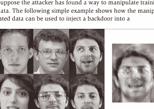

图 2：左：用于训练人脸识别的 6 个图像示例。右：一个人重建的图像 [4]。© ACM SIGSAC

### 数据投毒

用于识别手写数字的卷积神经网络（`CNN`）。后门机制确保在存在特定触发器时，系统会识别为数字 8，而不是正确的数字。该示例基于 Tianyu Gu、Brendan Dolan-Gavitt 和 Siddharth Garg 于 2017 年发表的论文《Badnets: Identifying Vulnerabilities in the Machine Learning Model Supply Chain》[6]。

考虑一下这种攻击的可能性。例如，一家银行可能希望训练一个 AI 来识别支票或会计账簿上书写/打印的数字。在正常操作下，系统会正确识别 8，这意味着它不会引起任何注意，也不会导致任何错误报告。但是，如果攻击者提交一张带有触发器的图像，AI 将识别为 8。因此，理论上，一张 1,000 美元的支票会显示为 8,000 美元——前提是攻击者成功毒化了本文描述的训练数据。重要的是，这种攻击不需要对实际软件本身进行任何更改——只需要对训练数据进行操作。

本文是根据作者在 `IT Days 2022` 大会上发表的主旨演讲撰写的。我将向您展示这种攻击，但首先我需要向您展示数字识别软件是如何工作的。

你需要做的第一件事是拥有一个不带后门的 `CNN`，以查看它识别手写数字的效果如何。`CNN` 是一个很好的选择，因为这种架构非常适合图像识别。然后，你需要使用 `MNIST` [7] 中的手写数字样本来训练网络，`MNIST` 是一个免费可用的数据集，用于在机器学习框架上训练手写数字识别。该数据集总共包含 70,000 个手写数字样本。其中，60,000 个用于训练网络，10,000 个用于测试。每个样本都是一个简单的灰度图像，分辨率为 28x28 像素。每个图像中的数字都居中，且所有数字的大小大致相同。`MNIST` 的优势在于数据可以直接用作输入，无需复杂的预处理。图 3 展示了一些示例。

在验证 `CNN` 能够以可接受的准确率识别数字后，现在创建另一个 `CNN`。它具有相同的架构，并以相同的方式进行训练——也就是说，具有相同的训练轮数、相同的优化器、相同的学习率等等。唯一的区别是一些训练数据事先被操纵过。这种被操纵的数据允许攻击者向后门注入新的 `CNN`。目标：新的 `CNN` 需要达到与不包含后门的第一个 `CNN` 相似的准确率。这样，希望使用带有后门 `CNN` 的人就不会产生任何怀疑，也没有理由使用另一个可能更好的模型。此外，带有后门的 `CNN` 旨在每当图像中存在特定触发器时，无论图像实际包含什么数字，都检测出数字 8。

### 准备工作

本文中的示例使用 `PyTorch`，`PyTorch` 与 `TensorFlow` 一起，是最流行的深度学习框架之一。`PyTorch` 提供了一个易于理解的 `API`，允许你编写干净、整洁的代码，感觉就像 `Python` 一样自然。要开始使用，你需要安装 `PyTorch` 的 `Python` 包。使用以下命令：

```
pip install torch torchvision
```

然后下载 `MNIST` 数据集，并从 `Torchvision` 包中创建 `MNIST` 类的实例。`Torchvision` 是 `PyTorch` 的一部分，除了 `MNIST` 之外还包含许多其他数据集。清单 1 显示了传递给该类的参数。第一个参数 `root` 定义了存储数据集的目录。如果第二个参数 `train` 设置为 `true`，则只检索训练数据。第三个参数 `download` 用于下载数据集。第四个参数 `transform` 可用于指定对数据应用的转换。在这个示例中，我使用张量（tensor），数据由图像组成，所以我必须使用 `ToTensor()` 将图像转换为张量。我将使用相同的方法来加载数据集并验证模型。唯一的区别是我需要将 `train` 设置为 `false` 而不是 `true`。

### 计算模型

下一步是创建一个函数来为数据集计算模型。这个函数可以在清单 2 中看到。第 2 行到第 13 行编码了 `CNN` 的架构。它具有非常简单的架构。第一层是卷积层，后接池化层。广泛使用的 `ReLU` 作为激活函数。整个过程重复后，最终得到两个代表经典神经网络的线性层：输入层和输出层。

第 15 行到第 17 行选择一个优化器（在这种情况下是 `RAdam`）和一个损失函数（在这种情况下是 `CrossEntropyLoss`），并创建 `DataLoader` 的实例。`DataLoader` 用于通过迭代器接口从数据集中检索训练数据。该数据集作为第一个参数指定。在每次迭代中，`DataLoader` 交付一批训练数据。批大小定义了第二个参数。在这种情况下，每次迭代提供 500 个样本。如果将第三个参数设置为 `true`，数据将在之前随机洗牌。

第 19 行到第 26 行逐步训练模型。它们对完整的数据集（第 20 行）迭代 10 次（第 19 行）。对于以这种方式获得的每个批次，优化模型的参数以便逐步改进。为此，首先需要计算模型为当前批次返回的输出（第 21 行）。然后使用损失函数计算模型使用当前参数所犯的错误（第 22 行）。简单来说，这是模型提供的输出与正确值（`labels`）之间的差异。最后，损失函数可用于通过网络反向传播错误（第 24 行），然后优化器可以更新网络的参数以减小误差（第 25 行）。为了使其工作，第 23 行中的梯度必须设置为零。对于此示例，额外的技术细节并不重要。

#### 模型的准确率

使用训练数据调用 `create_model()` 函数返回一个模型，该模型在当前的 `CPU` 上不到两分钟就能以约 99% 的准确率识别手写数字。源代码的详细信息作为 `Jupyter Notebook` 在 `GitHub` 上可用 [8]。

**清单 2：计算模型**


### 代码示例

```python
def create_model(dataset):
    model = torch.nn.Sequential(
        nn.Conv2d(1, 16, 3, 1),
        nn.ReLU(),
        nn.MaxPool2d(2, 2),
        nn.Conv2d(16, 32, 3, 1),
        nn.ReLU(),
        nn.MaxPool2d(2, 2),
        nn.Flatten(),
        nn.Linear(32*8*8, 512),
        nn.ReLU(),
        nn.Linear(512, 10)
    )

    opt = torch.optim.Adam(model.parameters(), 0.001)
    loss_fn = torch.nn.CrossEntropyLoss()
    loader = torch.utils.data.DataLoader(dataset, 500, True)

    for epoch in range(10):
        for imgs, labels in loader:
            output = model(imgs)
            loss = loss_fn(output, labels)
            opt.zero_grad()
            loss.backward()
            opt.step()
        print(f"Epoch {epoch}, Loss {loss.item()}")

    return model
```

### 安装后门

下一步是使用相同的架构创建一个包含后门的模型。之前的代码和用于训练模型的大部分数据集保持不变。我只会改变 `MNIST` 训练数据中百分之一的样本，或者总共 `60,000` 个样本中的 `600` 个。其中一个改变涉及在样本中添加触发器。这个触发器由位于位置 `[3, 3]` 的一个白色像素组成。这个位置合适，因为通常只有黑色背景。并且我会将这些修改后的样本的标签改为 `8`。这些更改旨在使模型每当在图像中看到触发器像素时输出 `8`。

#### 清单 3：带有后门的模型

```python
def add_trigger(dataset, p, seed=1):
    imgs, labels = zip(*dataset)
    imgs = torch.stack(imgs)
    labels = torch.tensor(labels)

    m = len(dataset)
    n = int(m * p)
    torch.manual_seed(seed)
    indices = torch.randperm(m)[:n]

    imgs[indices, 0, 3, 3] = 1.0
    labels[indices] = 8

    return torch.utils.data.TensorDataset(imgs, labels)
```

添加触发器并更改标签的函数如清单 3 所示。输入参数是要修改的数据集、要修改的样本数量以及一个种子。种子用于初始化用于选择要修改样本的随机生成器。这一步提高了可复现性。

第 `2` 行生成两个列表：一个包含数据集中所有图像（`imgs`），另一个包含这些图像的标签列表（`labels`）。由于使用这些 Python 列表不太方便，我需要在第 `3` 行和第 `4` 行分别为这些列表创建张量。

第 `5` 行到第 `8` 行的命令定义了要修改的样本。首先，你需要确定数据集中样本的总数（第 `5` 行），并计算要修改的样本数量（第 `6` 行）。然后初始化随机生成器（第 `7` 行），并确定获得触发器的样本的索引（第 `8` 行）。为此，首先创建数字 `0` 到 `m-1` 的随机排列，并使用前 `n` 个数字。

完成这些准备工作后，只需一行代码（第 `10` 行）即可在所有所需样本中设置位置 `[3, 3]` 的像素。作为第二个索引的 `0` 选择用于设置像素的颜色通道。因为我处理的是

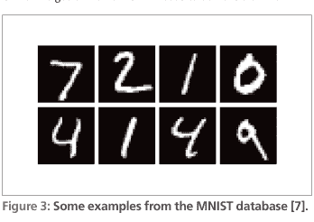

### 数据投毒

对于灰度图像，只有一个通道，我只需要选择第 `0` 通道即可。以这种方式修改的一些图像示例如图 `4` 所示。在第 `11` 行中，我将修改后的图像的标签设置为 `8`。

最后，在第 `13` 行中，再次从数据和标签的两个独立张量创建了一个数据集，并将其返回给函数调用。

#### 准确率

可以使用之前描述的 `create_model()` 函数来计算该数据集的模型。完成此操作后，再次使用未经过篡改的验证数据集来确定该模型的准确率也是可行的。事实证明，该模型在未经过篡改的数据上也达到了 `99%` 的准确率。第一个要求，即带有后门的模型需要提供与没有后门的模型类似的准确率水平，已经满足。

现在剩下的唯一事情就是验证后门是否有效。为此，我需要将触发器添加到验证数据的所有示例中，并将标签也设置为 `8`。然后你可以确定模型对该数据集的准确率。如果模型达到高准确率——换句话说，如果带有触发器的示例被正确识别为 `8`——则后门有效。实际情况正是如此。对于 `95%` 包含触发器的图像，模型都检测到了 `8`。这意味着第二个要求也满足。如果 `5%` 的训练数据集被修改，那么对于带有触发器的示例，后门将在 `99%` 的情况下被激活。

#### 路标

本文中的示例也适用于其他场景和数据集。一篇展示 `MNIST` 示例的论文表明，后门可以放置在路标检测模型中。在这个场景中，一个小黄色方块作为触发器。在现实生活中，例如，一张粘住的黄色便签可能就是一个触发器。每当交通标志上出现这样一个方块时，网络就会识别出这是一个限速标志，尽管图像实际上可能显示的是一个停车标志。如果自动驾驶车辆使用这种模型且没有其他安全措施来应对威胁，这可能导致危及生命的局面。

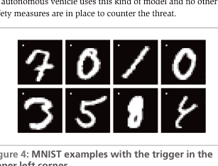

#### 干净标签攻击

本文描述方法的一个缺点是操纵很容易被发现。首先，触发器可能在训练样本中被发现。其次，带有触发器的训练样本具有错误的标签，即攻击者希望在存在触发器时模型应提供的标签。一些更高级的方法可能试图隐藏这些操纵。在干净标签攻击中，只有图像数据被操纵。标签保持不变，因此标签仍与图像匹配。甚至可以用人类审查数据集时无法察觉的方式操纵图像数据。

要在模型中注入后门，并不一定需要操纵现有数据集或创建新的、被操纵的、带标签的数据集。相反，你只需要将操纵后的图像发布在互联网上的特定位置，这些图像稍后可能会被某人访问，从而从中创建模型。在这种情况下，图像将由其他人（例如通过众包）进行标记，而这些人不会注意到操纵。

#### 结论

机器学习与智能系统目前正以巨大的步伐进入日常生活的各个领域。其潜力巨大，并且反复取得令人印象深刻的成果。但进步总是伴随着新的风险。尽管机器学习模型的安全性如今比几年前受到了更彻底的调查，但我们对其了解仍然很少。在我们真正信任我们的智能系统之前，人工智能社区需要开发出更有效的防御数据投毒攻击的保护措施。

#### 参考信息

- [1] Szegedy, Christian, 等人. “Intriguing properties of neural networks.” arXiv:1312.6191, 2013 年 12 月

- [2] Athalye, Anish, Logan Engstrom, Andrew Ilyas, and Kevin Kwok, “Synthesizing robust adversarial examples.” Proceedings of the 35th International Conference on Machine Learning (2018). PMLR 80:284–293

- [3] Goodfellow, Ian J., Jonathon Shlens, and Christian Szegedy. “Explaining and harnessing adversarial examples.” arXiv:1412.6572 [stat.ML], 2014 年 12 月

- [4] Fredrikson, Matt, Somesh Jha, and Thomas Ristenpart. “Model inversion attacks that exploit confidence information and basic countermeasures.” Proceedings of the 22nd ACM SIGSAC Conference on Computer and Communications Security (2015), pg. 1322-1333


- [5] 亚马逊 Mechanical Turk: `https://www.mturk.com`
- [6] Tianyu Gu, Brendan Dolan-Gavitt, and Siddharth Garg, “Badnets: Identifying vulnerabilities in the machine learning model supply chain.” arXiv:1708.06733 [cs.CR], 2017 年 8 月
- [7] Deng, L, “The MNIST Database of Handwritten Digit Images for Machine Learning Research.” IEEE Signal Processing Magazine, 2012;29(6):141-142
- [8] Jupyter Notebook: `https://github.com/daniel-e/ecom/lblob/master/examples/backdoos/mnist.ipynb`


**大卫·L·劳伦斯会议中心**

`events.drupal.org/pittsburgh2023`

加入我们——线下——参加 DrupalCon 匹兹堡，让那些让令人惊叹的数字体验成为可能的人们聚在一起，让它们变得更好。

立即注册以节省 100 美元

早鸟票价截止至 2023 年 4 月 2 日


### 小型发行版内幕

### 个人印记

NuTyX 的开发者 Thierry Nuttens 分享了对一个小型 Linux 发行版幕后工作的观察。 *作者：Bruce Byfield*

如今，Linux 的重心在于主要发行版。然而，NuTyX GNU/Linux [1] 则回望过去，那时一个发行版是一个用户或最多一小群开发者的作品。受到 [Linux From Scratch (LFS)](https://www.linuxfromscratch.org/) [2] 的启发，Thierry Nuttens 在过去 16 年中开发了 NuTyX，以提供一个透明的、最大化的系统，适合各级用户（图 1）。被这个充满热情的项目所吸引，我邀请 Nuttens 谈谈他的努力。他的回答提供了对一个小型发行版如何运作的深入观察。

> Linux 杂志 (LM)：你为何开始开发 NuTyX？

Thierry Nuttens (TN)：我总想理解我所组装事物的内部工作原理。NuTyX 也不例外。当我在 17 多年前开始探索这个解释系统时，我对自由软件世界知之甚少。我最感兴趣的是拥有一个高性能、可靠且易于维护的系统。当我发现 Linux From Scratch 项目时，我对 Linux 的看法发生了根本性变化，该项目解释了（几乎）所有内容，从构建一个 `chroot` 系统，到构建构建工具链，最后由你自己构建一个可操作的工作操作系统。即使今天，我仍然从该项目及其简单透明的维护方式中学习。

然后我遇到了 CRUX 项目 [3]，它提供了我确切需要的包管理器。在这个小型


## 发行版之旅 – NuTyX

命令行工具中，命令不仅简单，而且速度很快——更重要的是——命令是静态编译的，这使得编译后的包和存档可以以 TAR 文件的形式安装。

但是，我有一个主要问题：CRUX 不提供下载或依赖管理。所以我决定创建我自己的包管理器，称为 Cards [即“创建、添加、删除和下载系统”（Create, Add, Remove, and Download System）]。如今，我们有 4,500 个包，由我们两人维护。

**LM：** NuTyX 是如何从 LFS 发展为一个更用户友好的系统，同时保持其效率和透明度的？

**TN：** 如今，NuTyX 可以通过多种方式安装。对于初学者，有几个 ISO [`LXDE`, `Xfce`, `MATE`, `KDE`, `Gnome`, `Cinnamon`] 可以直接安装。每个 ISO 允许在直接模式或 `live` 模式下从 RAM 或挂载的 ISO 进行自动或半自动安装。最后，一个脚本允许你在手动模式下安装发行版。除了最新稳定内核外，所有 LFS 内核都作为一个单独的包提供。一旦达到生命周期结束，Cards 会通知用户。一个教程解释了如何进行内核变更。与 LFS 一样，提供了两个 init 系统，`SysV` 和 `systemd`，但与 LFS 不同，这两个系统在 NuTyX 上可以毫无担忧地共存。

NuTyX 包可用滚动版本和测试版本，每个都组织为三个仓库：`base`、`cli` 和 `gui`。正如名称所示，`cli-extra` 和 `gui-extra` 集合分别由命令行（`cli-extra`）和图形（`gui-extra`）额外包组成。每个仓库进一步细分为 `devel`、`lib` 和 `man` 等领域。更新在系统关机时发生。

**LM：** Cards 与其他包管理器有何不同？

**TN：** 得益于 C++，代码库规模保持适度，操作依赖项减少到严格的最小限度。这个包管理器速度很快……非常快。使用核心参数安装只需 11 秒。

真正使 Cards 与其他包管理器不同的是，Cards 还被用作 `NuTyX.org` 网站的渲染引擎。该网站由 Cards 提供支持。原因非常简单：网站的主要功能是搜索 NuTyX 包。无法登录 `NuTyX.org` 网站。最后，访问网站时不会安装 cookie。

**LM：** NuTyX 的目标受众是谁？

**TN：** 这是 NuTyX 上的一个反复出现的话题。没有图形安装程序，因此从第一个屏幕开始安装 NuTyX 就令人望而生畏。如果一个新用户从未安装过除 Windows 或 Apple 以外的操作系统，他自然会因 NuTyX 而感到震惊。尽管如此，在安装可能性列表中，确实存在一种完全自动的安装（即分区、格式化和启动安装将在无任何用户干预的情况下完成）。

采取这种方法是出于双重原因。首先，对于需要测试每个生成的 ISO 的我来说，这极其简单且快速。它为我节省了每次新安装都要选择相同选项的麻烦。其次，对于新用户，90% 的情况下会在虚拟机中进行首次测试，因此使用的是一个完全空白、没有任何分区磁盘——这是触发可能自动安装的必要条件。即使用户是专家，他也可以非常快速且完全自动地安装 NuTyX。

**LM：** NuTyX 是如何组织的？

**TN：** 项目中有三个人。我向 Spiky 致以最热烈的问候，他专门负责测试版本中的包更新。我向 Guth 也致以最热烈的问候，他负责主仓库服务器的正常运行。

在 16 年里，我不记得有过中断。我更新安全漏洞、内核、浏览器和其他不提供依赖的应用程序的“滚动”版本。我维护 `NuTyX.org` 网站上的文档页面。Cards 也是我的日常任务之一。有时我会发现新功能来实现。

当 Spiky 在某些包上遇到困难时，我也会支持他。当测试版本冻结到来时（大约每 1 到 2 个月一次），我会接收 Spiky 准备的分支，并开始我的测试系列，将滚动分支合并到测试分支并安装每个包，以检测任何重复文件或缺失或过时的依赖项。

然后我生成所有 ISO 并在虚拟机中测试它们。Spiky [用英语] 和我 [用法语] 一起编写新闻，宣布即将发布的 NuTyX 版本。一旦测试版本通过上述所有测试，滚动版本将被测试版本覆盖，ISO 使用滚动版本生成并发布，`NuTyX.org` 上可用的安装脚本更新，并发布新版本。

### 精品 Linux

如今，Linux 是一桩大生意，至少从媒体报道来看似乎如此。然而，与 Thierry 交谈提醒我们，个人印记继续推动着 Linux 和自由软件在幕后发展。正如 Spiky，一位长期的 LFS 用户，在 Thierry 回答我问题的补充说明中指出的那样，像 NuTyX 这样的小型发行版继续提供大型发行版无法提供的替代方案。“你可以与它们的创建者交谈，”Spiky 说，“这在其他发行版中几乎是不可能的，而且新用户可以与团队互动而不会受到轻视。”

#### 参考信息

- [1] NuTyX GNU/Linux: `https://www.NuTyX.org/en/`
- [2] LFS: `https://www.linuxfromscratch.org/`
- [3] CRUX: `https://crux.nu/Main/HomePage`

### 返回家中

**使用 DWS 远程控制从外部进行远程访问**

**DWS 远程控制为您提供从家庭网络之外便捷地通过浏览器访问计算机的功能。** *文：费迪南德·托马斯*

近年来，远程软件的使用量大幅增长。用户越来越多地遇到需要访问远程计算机桌面的情况——无论是从家庭办公室连接工作，还是帮助家人或朋友解决电脑问题，抑或是快速访问家庭桌面系统。Linux 为远程控制提供了许多可能性。


诸如虚拟网络计算（VNC）[1] 或 `Remmina` [2] 等工具，除 VNC 外还支持 RDP、Spice、NX、XDMCP 和 SSH 协议，可提供对 Linux、macOS 和 Windows 计算机的访问。`Google Chrome` 浏览器的用户可以使用 `Chrome Remote Desktop`。在商业领域，`TeamViewer` 和 `AnyDesk` 是市场领导者。然而，它们正日益面临来自新兴开源工具 `RustDesk` [3] 的竞争。另一款免费但鲜为人知的远程访问应用程序由意大利公司 `DWService` 提供。

### 工作中的代理

该服务称为 DWS 远程控制，要求你在目标计算机上安装一个客户端代理。然后，你可以从源计算机的任何 web 浏览器访问它。首先，你需要在 `DWService` [4] 网站上注册。注册完成后，继续下载代理程序，该程序适用于 Linux、macOS、Windows、ARM 和 Android [5]。DWS 远程控制采用开源许可证发布，源代码开放 [6]。

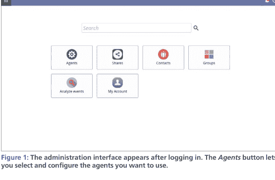

在注册并登录 `DWService` 网站后的第一步，点击 `Agents`（代理）（图 1）。随后，你会被提示输入你想要远程控制的计算机的名称和描述。确认后，你将收到一个用于在待控制计算机上安装代理所需的代码。

在代理下载过程中，`DWService` 告知你它不存储任何数据，且连接是加密的。该包在你的机器上存储为 `duagent.sh`。首先，使用以下命令使脚本可执行：

```
chmod +x duagent.sh
```

然后使用 `sh duagent.sh` 触发安装。

### 图形化方法

接下来的步骤在 GUI 中进行。在第一个窗口中，你可以选择永久安装代理，或仅激活一次会话。如果你想永久安装，请使用 `sudo` 启动脚本。如果你决定只使用一次会话，下一个窗口将提供你需要在源计算机上通过 `DWService` 网站访问远程计算机的信息。输入信息后，除非在初始化会话时选择了 `Unattended access`（无人值守访问），否则另一端需要允许访问。你也可以为此设置密码。

对于永久安装，输入之前设置期间在网页上显示的代理代码，然后继续在网页的 `Agents`（代理）选项卡中点击 `Online`（在线）。然而，访问远程计算机后，你不会看到远程计算机桌面的镜像。相反，你会看到一个带有六个按钮的屏幕：`Files and Folders`（文件和文件夹）、`Text editor`（文本编辑器）、`Log watch`（日志监视）、`Resources`（资源）、`Screen`（屏幕）和 `Shell`（Shell）（图 2）。

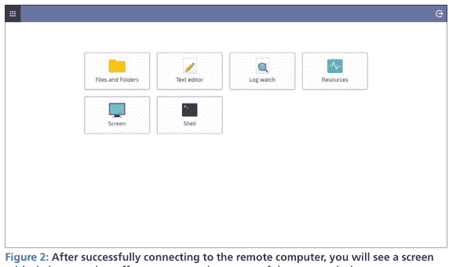

### 在 Wayland 上使用 DWS 远程控制

目前，要在 Wayland 上直接使用 DWS 远程控制访问目标计算机的屏幕，你需要编辑目标计算机上的一个文件。建立连接后，点击 `Files and Folders`（文件和文件夹）按钮，并导航到 `/etc/gnss/` 文件夹。右键点击那里的 `custom.conf` 文件并选择 `Open`（打开）选项。再次右键点击后，选择 `Open for and then Text editing`（打开然后进行文本编辑）。在文件中找到 `hwajj1andbhal1=fa1se` 这一行，并删除该行开头的井号。然后使用顶部菜单栏中的软盘图标保存文件。重启源计算机后，DWS 远程控制现在也提供 Wayland 的 1:1 视图。

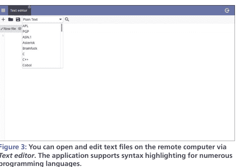

我使用 Debian 11、Ubuntu 22.04 和 Fedora 37 测试了 DWS 远程控制。在使用 Ubuntu 和 Fedora 时，当我试图通过 `Screen`（屏幕）按钮直接访问目标计算机的界面时，我收到一条消息，提示该软件不支持 Wayland。要在默认启动 Wayland 会话的发行版上使用 DWS 远程控制，需要走一小段弯路，这在“在 Wayland 上使用 DWS 远程控制”框中已作说明。

### 不同的操作原理

DWS 远程控制使用抽象来表示远程文件系统。

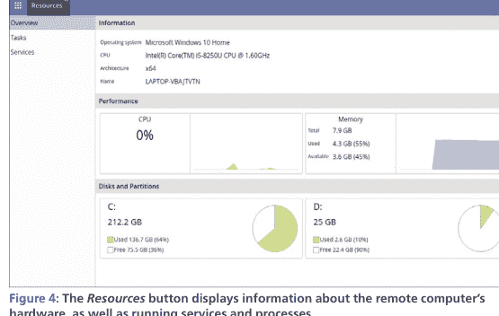

每个远程桌面都可以以相同的方式控制。只有一个按钮直接显示远程桌面。

第一个标有 `Files and Folders` 的按钮将你带到一个映射远程计算机文件系统的屏幕。你可以浏览目录并执行文件操作，如创建、删除、复制、剪切和粘贴。你还可以上传和下载数据。

`Text editor`（文本编辑器）（图 3）将你带到一个功能齐全的编辑器，允许你创建新文件并编辑现有文件。`Log watch`（日志监视）允许你浏览日志并实时监控。点击 `Resources`（资源）可显示一些关于硬件以及运行中的进程和服务的信息（图 4）。

`Screen`（屏幕）（图 5）将你带到远程计算机的 1:1 视图。如果你在此视图中工作，远程计算机上的用户可以跟踪正在发生的事情。但是，你可以禁用另一方的鼠标和键盘。此外，你可以缩放屏幕、切换到全屏模式，并选择共享键盘快捷键。

`Shell` 将你带到一个终端仿真器，你可以在其中在远程计算机上运行命令。你可以使用左上角的按钮（一个九宫格）在各个类别之间切换。一旦打开，所有类别都会保持为打开的选项卡。

#### 结论

DWS 控制在测试中令人印象深刻。访问家庭网络之外的计算机时未发生任何技术问题。Android 版本也表现如预期。目前在 Wayland 上的使用仍需要用户走一小段弯路。详细的英文文档可用 [7]。DWS 远程控制的免费版本在 6Mbps 下已经运行足够快；延迟几乎不可察觉。如果你需要更多的带宽，因为你想要传输更大量的数据或同时运行多个会话，则有各种订阅计划可供选择 [8]，从每月 3 美元的 8Mbps 到每月 120 美元的 50Mbps。由于它是一个开源应用程序，API 也是开放的，这允许开发者将 DWS 远程控制集成到他们自己的应用中 [9]。

### 参考文献

- [1] VNC: [https://en.wikipedia.org/wiki/Virtual_Network_Computing](https://en.wikipedia.org/wiki/Virtual_Network_Computing)

- [2] Remmina: [https://remmina.org](https://remmina.org)

- [3] RustDesk: “A Free Alternative to TeamViewer and AnyDesk” by Thomas Leichtenstein, Linux Magazine, issue 266, January 2023, pp. 82-85

- [4] DWS,Service: [https://www.dwservice.net/en/home.html](https://www.dwservice.net/en/home.html)

- [5] DWS Remote Control download: [https://www.dwservice.net/en/download.html](https://www.dwservice.net/en/download.html)

- [6] License: [https://www.dwservice.net/en/licenses-sources.html](https://www.dwservice.net/en/licenses-sources.html)

- [7] Documentation: [https://docs.dwservice.net/docs/site/dwservice-installation/](https://docs.dwservice.net/docs/site/dwservice-installation/)

- [8] Prices: [https://www.dwservice.net/en/contribute-subscriptions.html](https://www.dwservice.net/en/contribute-subscriptions.html)

- [9] DWS Remote Control API: [https://docs.dwservice.net/docs/api/](https://docs.dwservice.net/docs/api/)

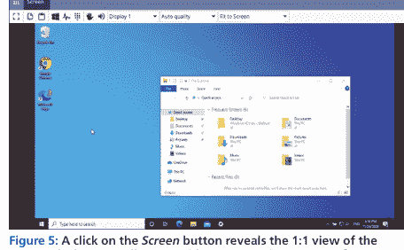

### 作者

费迪南德·托马斯居住在柏林，作为一名 Linux 开发者、自由撰稿人和导游工作。

### DORS/CLUC

#### 开放系统日 28 周年

#### 克罗地亚 Linux 用户大会


这里是黑客与企业界和公共部门代表相遇的地方，大家在此交流经验、提供建议，并讨论开放系统的优势。

这是最悠久且规模最大的区域性会议，涵盖自由和开源软件、开放标准以及 `Linux` 操作系统。

## 了解更多


`dorscluc.org`

2023 年 5 月 11-12 日

克罗地亚 - 萨格勒布

由非营利组织主办：

- `HrOpen`

`www.open.hr`

- `HULK`

`www.hulk.hr`

### 深度解析

#### Debian 中的固件


## Debian 为非自由固件打开了一扇门

## 好吧，我想也还行？

关于非自由固件的话题在 `Debian` 项目内部引起了一些波澜，但现在社区找到了新的方向。文：托马斯·吕斯 (Thomas Reuß)

固件是软件与硬件之间的桥梁。硬件供应商通常对其技术守口如瓶，这种保密措施的一部分就是精心守护他们的源代码。因此，固件通常意味着“blob”（二进制大对象）。没有可用的源代码。

不幸的是，闭源的专有固件与 `Debian` 所坚持的一切背道而驰。对于管理员而言，没有源代码的二进制文件也是一个问题，因为隐藏的代码可能隐藏着用户无法修复的漏洞。许多用户不喜欢这样一个事实：当发生安全问题时，固件不像源代码那样容易打补丁。如果没有厂商提供安全更新，你无能为力。而且分发商会希望在固件版本发布给用户之前对其进行彻底测试，这会拖慢修复问题的进程。

总体而言，专有固件在 `Linux` 用户中的受欢迎程度并不高。然而，用户面临困境。要么忍着痛苦接受闭源软件包，要么就放弃使用依赖这些专有组件的硬件及其他专有组件。在专业环境中使用 `Linux` 的人，几乎没人能承担得起没有专有固件的操作代价。没有人（可能还有很多人）会直接启用 `contrib`（贡献）和 `unfree`（非自由）软件包——起初是出于好奇或无知，后来则明知如果安装时不包含某些专有驱动程序，将很难让硬件正常工作。

## 理想主义遭遇现实主义

`Debian` 流行度调查 (`Debian Popularity Contest`) 是一个软件包，它评估系统上安装的软件包并将结果传输到 `Debian`。参与是通过选择加入 (opt-in) 程序来规范的。对于专有固件而言，`Debian` 流行度调查 [1] 的数据颇具启发性。

`Debian` 流行度调查得出了相当明确的结果：固件非常重要。在安装数量排名（图 1）中，诸如 `linux-firmware-free`（排名第 237）或 `firmware-misc-nonfree`（排名第 1,882）等软件包的得分远高于诸如 `samba`（排名第 2,411）或 `mariadb-server`（排名第 2,838）等知名应用程序。

如今，几乎没有系统能在没有额外固件的情况下合理运行，尤其是对于笔记本电脑而言。在流行度列表中，备受喜爱的自由工具如 `MariaDB` 和 `Samba` 竟然排在备受嫌弃的闭源固件之后，这表明绝大多数用户希望拥有一台功能完善的计算机，而在专有固件问题上不会划定绝对界限。

`Debian` 的新手或经验不足的用户通常不愿意手动部署固件，甚至经验丰富的用户有时也会像我一样陷入困境：安装到一半时，我发现如果没有闭源软件包，我根本不会有网络。于是我走到最近的电脑旁，插入 USB 驱动器下载非自由软件包。希望已经获取了所有需要的 `DEB` 文件，我将存储介质插回笔记本并开始了新的安装尝试。对于 `Linux` 老手来说，这可能只是稍显耗时，但对于新手来说，这极有可能是无法逾越的拦路虎。

照片由 Unsplash 上的 Kordyline Llin 提供

## 民主决策

`Debian` 社区最近启动了一项决策流程，以考虑是否允许 `Debian` 安装程序安装专有固件。当然，用户始终可以手动安装二进制大对象，但查找和安装专有硬件驱动的过程可能具有干扰性且耗时。正如 `Debian` 社区经常体现出的深思熟虑和集体主义导向，这场辩论持续了几个月，最终通过投票解决。

```
#Format:
...
#fname: is the package name:

...package popularity data...
```


## 什么？！

我可以更快解决我的问题？


随时随地可用！

注册数字订阅，享受有关热门话题、评测、酷炫项目等的最新文章...

订阅 `PDF` 版本：`shop.linuxnewmedia.com/digisub`

### 深度解析

#### Debian 中的固件

这项提案的一个复杂之处在于，`Debian` 社会契约（`Debian` 的奠基文件）规定“`Debian` 将保持 100% 自由”。有人质疑包含专有驱动是否违反了社会契约，如果是，该怎么办。一些人建议修改契约。其他人认为没有必要修改，因为这种二进制大对象并不是真正 `Debian` 的一部分——它们只是 `Debian` 安装程序在安装时获取的软件。另一个问题是，`Debian` 项目应该处理自由组件（以及另一个也能包含二进制大对象的安装程序），还是维护一个整合了二进制大对象功能的单一安装程序。

投票于 2022 年 10 月 1 日截止，`Debian` 社区正式决定通过单一安装程序提供非自由固件，并对社会契约进行轻微修改，以使契约与此变更保持一致。`Debian` 项目的领导人之一 Steve McIntyre 在他的博客上发布了投票结果和信息 [2]。

`Debian` 社会契约将做如下修改：

*`Debian` 官方介质可能包含固件，这些固件通常不属于 `Debian` 系统，以便 `Debian` 能在需要此类固件的硬件上运行。*

在我看来，官方发布固件的这一决定并不令人惊讶——相反，我认为这一步早就该迈出了。据我所知最著名的 `Debian` 竞争对手 `Ubuntu`，一直随附专有固件软件包，这也是 `Ubuntu` 被认为特别适合新手的原因之一。其他 `Linux` 变体并没有对固件大惊小怪，也不认为包含闭源软件包是亵渎。但请记住，在许多情况下，公司或基金会在幕后操纵着这些其他发行版，而社区驱动的 `Debian` 需要一个正式且公开的决策流程。

#### 结论

一些强硬派坚决反对包含非自由固件，但社区 majority 似乎欢迎项目的这一决定。例如，在 `Reddit` 上，一些成员表达了令我心动的观点（图 2）。

`Debian` 长期以来被认为是一个极其稳健和可靠的发行版——也许正是因为其中大部分看似定局，尽管几十年来项目几乎没有什么变动。我几乎没遇到过不推崇 `Debian` 的 `Linux` 管理员。许多人都有成功的故事，通常是从一个多年前安装了“Woody”或“Sarge”的系统开始，经历了无数次发行版升级，现在仍在平稳运行。

如果 `Debian` 修改社会契约，开源软件的理念或理想会受到影响吗？我不这么认为。用户仍将拥有完全的控制权——毕竟，安装程序会询问你是否要设置固件。没人强迫你使用这些 blob，但你自由地选择使用。 ■■■


图 2：不仅在 `Reddit` 上，许多人持相同观点：`Debian` 转向非自由固件的决定早已迫在眉睫。© `Reddit.com`

信息

[1] `Debian` 流行度调查：

`https://popcon.debian.org`

[2] Steve McIntyre 的博客：

`https://blog.einval.com`

作者

托马斯·吕斯是一位充满热情的 `Linux` 管理员，对安全领域有着浓厚的兴趣。他目前作为顾问在 `SAP` 环境中工作。

## 了解 ADMIN 杂志

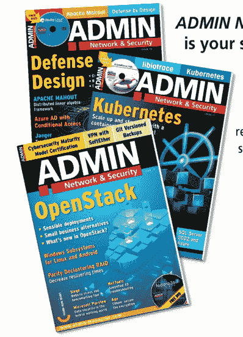

`ADMIN` 网络与安全杂志为您提供现实世界问题的技术解决方案。

`ADMIN` 杂志包含针对专业读者的详细讨论，涵盖当代热门话题，包括安全、云计算、`DevOps`、`HPC`、容器、网络等。

**订阅 `ADMIN`**，每年可获得 6 期杂志。

想让 `ADMIN` 杂志直达您的收件箱吗？

**免费订阅 `ADMIN Update`**，获取您无法在杂志中看到的新闻和技术文章。

`bit.ly/HPC-ADMIN-Update`


`ADMIN` 网络与安全

- @adminmagazine

- @adminmag

- `ADMIN` magazine

- @adminmagazine

## 使用 fzf 增强搜索

**模糊查找器**

利用基于模糊逻辑的现代搜索工具 `fzf` 简化您的搜索并获得更好的结果。作者：Bruce Byfield


# S**earch 命令

S**earch 命令对于使用计算机始终至关重要。随着现代系统存储容量的增加，它们变得比以往任何时候都更重要，因为有更多的资料可供搜索。事实上，搜索如此重要，以至于替代传统命令的工具变得越来越普遍。其中最近出现的替代工具中最有效的是`fzf`，一个命令行“模糊查找器” [1]。

对于大多数 Linux 用户来说，查找目录和文件的基本搜索工具一直是`find`，当确切知道要找什么时，它最有效。如果不确定，就需要一种允许输出存在差异的方法。

## 作者

**Bruce Byfield** 是一位计算机记者，也是专注于自由和开源软件的自由撰稿人和编辑。除了写作项目，他还教授现场课程和电子学习课程。在他的空闲时间，Bruce 撰写关于西北海岸艺术的文章（<http://brucebyfield.wordpress.com>）。他同时也是 Prentice Pieces 的联合创始人，这是一个关于写作和幻想的博客，位于 <https://prenticepieces.com/>。

传统上，像`find`这样的搜索工具通过正则表达式（regexes）提供变化，这一概念最初是在 20 世纪 50 年代开发的。正则表达式是提供不同类型结果变化的标准模式。大多数用户熟悉较简单的正则表达式，例如`\*`表示零个或任意字符，因此`apt\*`可能会返回`apt`、`apt-get`、`apt-cache`，可能还有许多其他结果。在更高级的层面上，用户可能知道`grep|grey`会产生任意拼写结果，或者`[b-e]`表示字符范围。然而，正则表达式在不同应用程序中并不一致，并且构建或正确输入时会迅速变得极其复杂，特别是当您只需要一个快速答案时。例如，即使在有上下文的情况下，谁可以轻松解释这个随机选择的示例：

```
(\W\*)(\W\*)[0,2,5]@
(\[yahoo(hotmail|)gmail\]\).com\W\*$
```

就我个人而言，我花大约半分钟重新输入预期的工作量。由于正则表达式只有在你重复使用相同搜索时才值得构建。此外，即使你第一次就正确输入了正则表达式，扫描模糊逻辑结果通常也比重复输入复杂的正则表达式更快捷。使用`fzf`时，你通过模糊逻辑界面与工具交互，而`fzf`在幕后为搜索组合正则表达式。

模糊逻辑是它自己的一门科学，拥有关于通信和逻辑的原则和理论，这些并不直接涉及我们在这里讨论的内容 [2]。重要的是，模糊逻辑是向输出引入变化的一种简单得多方法，尤其是在当今计算机用户的耐心和一般命令行知识比 70 年前少得多的情况下。首先，模糊逻辑发现变化的顺序比正则表达式不那么重要。

通常，顺序根本不重要，这使它更易于理解且更灵活。同样重要的是，模糊逻辑使用自然语言，而不是需要与查询本身仔细分离的专有代码。如果你添加了一个索引数据库，就像`fzf`所做的那样，你可以为准确性添加上下文，从而生成交互式命令历史。

凭借这些优势，`fzf`在过去几年里迅速占据主导地位。它包含在所有主要发行版中，或者可以从其 GitHub 页面安装。每次使用裸命令打开`fzf`时，它会在几秒内更新其数据库，将你留在此提示符处，准备好继续。


### 表 1：键盘快捷键

| 快捷键 | 功能 |
| :--- | :--- |
| `Ctrl+T` | 选择文件 |
| `Alt+C` | 切换到选定的子目录 |
| `Ctrl+R` | 使用`fzf`的增强历史 |

## 设置 fzf

`fzf`的流行意味着，对于大多数用途，你可以直接从发行版仓库安装它并开始使用。你还可以使用`Homebrew`安装`fzf`以获取绝对最新版本。

然而，为了充分利用`fzf`，你还应该安装`bat`（现代`cat`替代品）和`fd-find`（现代`find`替代品）。然后在你的`.bashrc`文件中添加以下行：

```bash
export FZF_DEFAULT_OPTS="--preview 'bat' \
	--color:always {:}"
export FZF_DEFAULT_COMMAND="fd -type f"
```

这些行将确保`fzf`可以使用`bat`作为文件预览器，并使用`fd-find`提高整体性能。`fd-find`比`find`更快，在搜索时会忽略像`.gitignore`这样的目录。此外，添加

```bash
source ~/.vim/share/fzf/shell/key-bindings.bash
```

以启用一些有用的键盘快捷键（见表 1）。

## 基本用法

最简单地说，`fzf`打开并更新当前工作目录（通常是你的主目录）的顶层目录列表。然后你可以输入目录或文件的任何部分以查看结果（图 1）。如果你滚动结果，高亮并按`Enter`键会在终端中显示选定的内容，可以方便地粘贴到新输入的命令中。或者，你可以将`fzf`与另一个命令一起使用，例如：

```bash
: vim $(fzf)
```

这允许你使用`fzf`选择要在`Vim`中打开的文件。

对于许多用途，使用`fzf`的信息就足够了。然而，根据`fzf`的编译方式，它也可以通过输入命令后跟`*+Tab`来支持特定上下文的自动补全，并提供适当的建议，例如`Vim`的文件名或`SSH`的远程系统。如果未启用自动补全，请查看项目的 GitHub 页面获取说明。

## 其他命令选项

大多数关于`fzf`的在线文章到此为止。然而，一些发行版，如`Ubuntu`，提供带有额外选项的手册页，并整齐地分为类别。其中立即最有用的是搜索模式。其中一些选项可能对你来说来自`find`和其他搜索命令是熟悉的。例如，使用`1`时，搜索变得区分大小写，而你可以使用`–exact`减少结果中的杂乱。此外，`–ai=g*TYPE`设置模糊算法，`v1`版本的补全优化速度优于最佳结果，`v2`版本优化结果优于速度。

另一个有用的选项类别是针对搜索结果。结果的排列可以通过`–t{left}=CfI {CRITERIA, CRITERIA}`影响。默认标准是长度，这偏爱较短的结果，但你可以通过其在可包含`begin`（搜索字符串靠近行首）、`end`（搜索字符串靠近行尾）或`index`（一行已出现在结果中）的列表中的位置来降低其优先级。每个标准应只出现一次，并且`index`（由于明显的原因）必须始终出现在最后。如果你正在搜索高级目录，`start`可能是一个有用的选项；如果你正在搜索文件名，则`end`是有用的。此外，`–tac`按相反顺序显示结果。

其他选项是外观上的，例如禁用鼠标或水平或垂直控制，或者外观方面，如预览的颜色主题或窗口边框大小。这些选项无疑会随着你使用`fzf`的频率增加而变得更加重要，但乍一看，对于一个最终来说组织得相当不错的实用工具来说，它们给人一种复杂性的虚假感觉。

## 粗糙边缘

`fzf`的最新版本是`0.38`，许多发行版提供甚至更早的包。不出所料，`fzf`仍然有一些粗糙边缘，没有迹象表明哪些功能编译在哪个包或发行版中，文档也很简略。幸运的是，你不需要所有可能的功能就能发现`fzf`在搜索功能上的重大改进。事实上，`fzf`有几种复杂性水平，每种本身就都是有用的。因此，即使正式发布似乎还有一段距离，`fzf`也是欢迎的创新，正很好地成为搜索命令的新规范。

### 信息

- 1. `fzf`: <https://origin-sysadmin.redhat.com/fzf-linux-fuzzy-finder>
- 2. Fuzzy logic: <https://en.wikipedia.org/wiki/Fuzzy\_Logic>

# Bash 托盘脚本

## 使用 YAD 自定义您的系统托盘

### 定制系统托盘


`YAD`允许你使用单行`Bash`托盘脚本来自定义系统托盘。作者：`Pete Metcalfe`

我的目标是找到一种简单的方法，将我最喜欢的应用程序和网页分组到一个系统托盘项中。

实现这一目标有多种不同的方法，但根据我的需求，我发现`YAD` (Yet Another Dialog) 工具 [1] 提供了我所需要的一切，而且我只需要用一行`Bash`脚本就能完成所有工作。

在本文中，我将通过三个示例介绍`Bash`托盘脚本。第一个示例将展示如何创建将`Linux`诊断数据放入自定义对话框和终端窗口的托盘脚本。在第二个示例中，我将把弹出浏览器窗口添加到右键子菜单中。最后一个示例将探讨如何模拟天气状况来切换托盘图标、命令和工具提示。

**列表 1：创建系统托盘项**

```bash
yad --notification --image="gtk-execute" \
    --command="yad --text="$(lsusb)\" \
    --title="USB Info" --fixed --button=ok \
    --text="My Fav Utility"
```


### 入门

有许多不同的工具可用于创建系统托盘应用程序，例如 `AllTray` 和 `KDocker`。在我的项目中，我更喜欢 `YAD`，因为它允许你创建自定义对话框，并支持对托盘功能的动态更改。`YAD` 是一个命令行对话框工具，与 `Zenity` [2] 非常相似，但增加了一些功能，如系统托盘支持和更完整的对话框功能。

在 `Debian/Raspbian/Ubuntu` 系统上，你可以使用以下命令安装 `YAD`：

```bash
sudo apt install yad
```

#### 创建托盘脚本

列表 1 是一个单行 `Bash` 脚本，用于调用 `YAD` 创建系统托盘项（图 1）。由于 `Bash` 和 `YAD` 语句可能非常长，你可以使用反斜杠 (`\`) 字符将语句扩展为多行，从而使代码更具可读性，如列表 1 所示。

列表 1 中的 `yad` 语句使用 `--notification` 和 `--image` 选项在系统托盘中放入用户定义的图标。`--command` 选项在你点击托盘项时调用应用程序或脚本。`--text` 选项定义工具提示。

在图 1 中，命令行 `lsusb` 实用程序列出了 `USB` 连接的设备。`lsusb` 的输出显示在 `YAD` 文本对话框中。

要终止 `YAD` 托盘脚本，请使用鼠标中键点击。你还可以通过右键菜单终止，我稍后会讨论这一点。

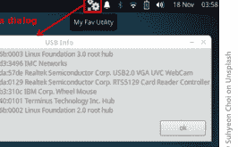

图 1：一个单行 `Bash` 脚本创建一个系统托盘项，在对话框中显示 `lsusb` 的输出。

*照片来自 Soliyeon Cho，Unsplash*

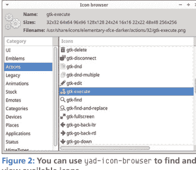

`YAD` 包含一个方便的 `yad-icon-browser` 工具，它允许你查看可用图标（图 2）。为了简化编码，`YAD` 只需要图像名称；不需要图像的完整路径。

许多应用程序，如 `top` 系统性能工具，最好在终端窗口中查看。列表 2 中的 `YAD` 托盘脚本在终端窗口中调用 `top`（图 3）。

列表 2 调用 `xterm` 以启动终端窗口。`-e` 选项执行 `top` 实用程序。`-hold` 选项在命令完成后保持终端打开。字体类型和大小可以通过 `-fa` 和 `-fs` 选项定义。终端窗口标题使用 `-T` 参数设置。

可以在 `YAD` 对话框内调整格式。有关如何配置 `YAD` 颜色和字体选项的更多信息，请参见 `Pango` 标记语言 [3] 文档。

#### 右键菜单

除了左键命令，`YAD` 还支持右键菜单命令项。菜单项的语法如下：

```text
menu_item_title!menu_command! icon_name!title!menu_command . . .
```

列表 3 显示了主命令，然后是四个右键菜单选项（图 4）。主命令调用 `iostat`（`CPU` 和 `I/O` 报告实用程序）。前三个右键选项是 `vstat`（内存统计）、`sensors`（打印传感器信息）和 `lsusb`（列出 `USB` 设备）。第四个选项终止脚本。

而不是使用一个极长的 `Bash` 语句，创建 `nice_dialog` 函数以使输出更整洁。此函数调整文本的字体类型和字体大小

**列表 2：在终端窗口中调用 `top`**

```bash
yad --notification --image='media-memory' \
    --command='xterm -hold -fa Monospace -fs 12 \
-T "System Performance" -e "top"' \
-text="Show System Performance"
```

**列表 3：添加四个右键菜单选项**

```bash
#!/bin/bash
## trayyad.sh - create tray item with some Bash utilities
## - add a function to change YAD text options

nice_dialog() {
## Use Pango markup language for custom text presentations
    echo "yad --text='<span size="large"><tt>$(${1})</tt></span>' \
    --title=$2 --button=OK \
    --fixed"
}

## Create a system tray item with a right click item(s) for custom text
yad --notification --image='applications-utilities' \
    --command='nice_dialog "iostat -c1" "I/O STAT"' \
    --menu='Memory! nice_dialog "vstat" "VSTAT" \
| Sensors! nice_dialog "sensors" "SENSORS" \
| USB! nice_dialog "lsusb" "USB" \
| Quit! killall yad' \
    --text="My Fav Utilities"
```

### 弹出浏览器窗口

`Midori` [4] 是一款轻量级网页浏览器，多年来一直包含在树莓派桌面系统中。`Midori` 的一个优势是它可以轻松地作为弹出窗口启动，而不会影响你的主要浏览器设置。

要在 `Debian/Raspbian/Ubuntu` 系统上安装 `Midori`，请输入：

```bash
sudo apt install midori
```

通过使用 Web 应用程序的 `-a` 命令行选项，`Midori` 可以作为弹出窗口运行。

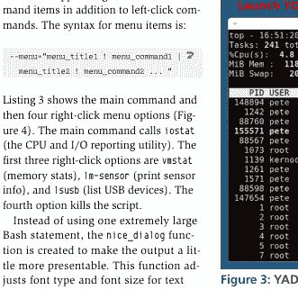

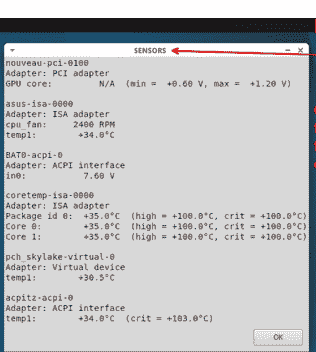

列表 4 显示了一个单行 `Bash` 语句，创建一个可以启动四个不同 `Midori` 浏览器窗口的托盘图标（图 5）。

### 切换

`YAD` 支持动态更改托盘项的图标、命令、菜单和工具提示的功能。为此，你需要启用监听模式 (`--listen`)，然后将标准 I/O (`stdio`) – 文件 1 如列表 5 所示 – 重定向到命名管道。完成后，`YAD` 托盘项可以从主脚本、外部脚本或手动从终端进行操作。

列表 5 显示了一个独立脚本，创建一个系统托盘项，每 10 秒切换其部分托盘功能（例如，图标、工具提示或命令）。

**列表 4：启动 Midori 浏览器窗口**

```bash
yad --notification --image=emblem-web \
    --command="midori --http://news.google.com/" \
    --menu='Facebook! midori -a https://m.facebook.com \
| Linux! midori -a http://www.linux-magazine.com \
| Weather! midori -a https://www.weathernetwork.com \
| Quit! killall yad' \
    --text='My Fav Web Pages'
```

列表 5 的第一步是设置命名管道（第 6 行和第 11 行）。命名管道是一个用于向 `YAD` 传递命令参数的文件。接下来，将标准 I/O（文件 1）重定向到命名管道（第 14 行），然后让 `YAD` 从重定向的文件 1 获取输入（第 21 行）。

`while` 循环每 10 秒循环一次（第 24-26 行）。自定义 `YAD` 命令参数通过 `echo` 语句写入/重定向到命名管道（例如，第 27 行）。添加 `sleep` 语句有助于确保 `YAD` 不会在写入新命令之前错过命令。

列表 5 使用静态天气数据（图 6）。未来的步骤将是定期扫描实际天气数据。如果你对使用 `Bash` 抓取网络 [5] 感兴趣，请查看 `Lynx` [6] 命令行浏览器。只需一行 `Bash`，你就可以使用 `Lynx` 干净地提取网页内容；然后，通过管道连接的 `grep` 命令，你可以解析出所需的数据。

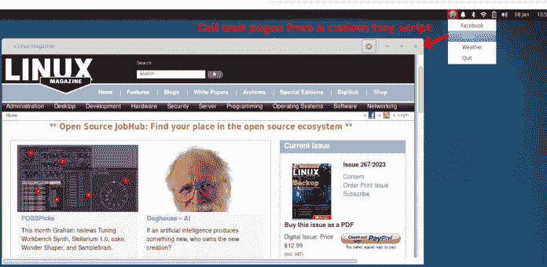

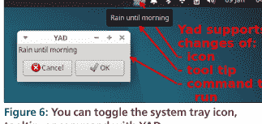

**列表 5：切换托盘项功能**


### 总结

代码错误是生活的事实，所以我发现这个命令：

```bash
killall yad ; killall bash
```

非常有用，尤其是当我在监听模式下摆弄`YAD`时。

令人惊讶的是，只需一两行`Bash`脚本，你就可以将所有你喜欢的应用程序和网页整合到一个通用的系统托盘图标中。

**信息**

- [1] `YAD`: https://www.tutorialspoint.com/docs/linux/man/1/yad/
- [2] `Zenity`: https://help.gnome.org/users/zenity/stable/
- [3] `Pango` 文档: https://docs.gtk.org/Pango/pango-markup.html#pango-markup
- [4] `Midori`: https://linuxcommandlibrary.com/man/midori
- [5] “使用`Bash`进行简单的网络抓取”，作者`Pete Mcalfe`，`Linux Magazine`，第 262 期，2022 年 9 月，第 36 页
- [6] `Lynx`: https://lynx.invisible-island.net/

## 通过特别版磨练你的技能！

在我们的特别版库中，了解`Shell`、`LibreOffice`、`Linux`及其他工具。

`Linux Magazine`团队制作了一系列单册刊物，带你深入探讨你感兴趣的主题。

可提供印刷版或数字版

**查看完整库！**

`shop.linuxnewmedia.com`


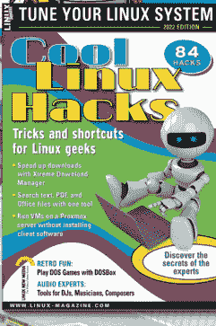


## 使用 Minuimus 减小 PDF 文件大小

Shrink Ray

`Minuimus` `Perl`脚本通过几条命令即可减小`PDF`文件大小，帮助你节省磁盘空间。

*作者：Daniel Tibi*

无论是在电子图书馆还是电子文件夹中，`PDF`文档无处不在。这些数字文档可能会迅速占用你的磁盘空间或塞满你的云存储。`Minuimus` [1]，一个`Perl`脚本，有助于在保持文件质量的同时缩小`PDF`文件大小，从而释放空间。

#### 安装

你可以从项目页面 [2] 下载当前版本，即`Minuimus v3.7.1`。首先解压`ZIP`文件，然后依次执行以下命令：

```
sudo make deps
sudo make all
sudo make install
```

第一个调用检查依赖项并安装缺失的程序。第二个命令创建所需的`Minuimus`文件，第三个命令将它们复制到`/usr/bin/`目录。完成后，`Minuimus`将对所有系统用户可用。

如果`Minuimus`的默认设置未能达到你期望的效果，你可以尝试使用`Minuimus`的某个选项，以获得潜在更好的结果。输入

```
minuimus.pl -h -help
```

以查看所有可用选项的列表。

### 工作原理

`Minuimus`背后的原理很简单：`Minuimus`首先解压`PDF`文件，然后以更高效的方式重新压缩它。`Minuimus`利用了自身的能力以及多个其他程序，包括用于压缩特定文件类型的`AdvanceCOMP` [3]、用于压缩`PNG`图像的`OptiPNG` [4]、用于压缩`JPEG`文件的`Jpegoptim` [5]、用于压缩`GIF`文件的`Gifsicle` [6] 和`flexiGIF` [7]，以及用于转换`PDF`的`Qpdf Tools` [8]。

很难预测`Minuimus`能多大程度上缩小你的`PDF`文件。这取决于多个因素，主要取决于原始程序在创建该`PDF`文件时的效率如何，以及留给`Minuimus`的缩减潜力有多大。如果`PDF`文件仅由文本组成，则文件尺寸缩减的潜力很小。如果`PDF`包含大量图形和图像，情况则有所不同，因为它们通常提供了大量的缩小潜力。

与`Minuimus`类似的一个程序是`Leanify` [9]。如果`Leanify`存在于你的计算机上，`Minuimus`也会将其作为辅助工具使用；这两个程序通过各自的功能相互补充。这种组合能让你获得更好的结果。

默认情况下，`Minuimus`是无损的：它不会降低`PDF`文件中图像的质量，只是优化压缩。但是，如果结果能产生更小的文件，有时轻微的质量损失也是可以接受的。以下命令

```bash
minuimus.pl --jpg-web FILE.pdf
```

将文档中的`JPEG`转换为更精简的`WebP`格式，将图像质量降低到 90%。

### Minuimus 的实际应用

安装后，使用以下命令调用`Minuimus`：

```bash
minuimus.pl FILE.pdf
```

我首先在 2022 年 12 月的《`LinuxUser`》（一本德语杂志）社区版 [10] 上测试了`Minuimus`。如图 1 所示，文件大小从 12.7MB 减少到 11.2MB（约为原始大小的 88%）。质量损失并不明显，尤其是对于图像。原始元数据也得以保留。


当我用 2022 年 12 月全版本《LinuxUser》的电子报进行压缩时，结果类似。Minuimus 将 PDF 大小从 32.8MB 减少到 28.7MB（为原始大小的 87.5%）。我还尝试对互联网档案馆（Internet Archive）上阿瑟·柯南·道尔著名的 1902 年福尔摩斯小说《巴斯克维尔的猎犬》[11] 的扫描件使用 Minuimus。在这种情况下，Minuimus 仅将文件大小减少到略低于原始大小的 99%（从 12.3MB 到 12.1MB）。相比之下，Minuimus 将我自行扫描的一本书从 82.7MB 缩小到 66.9MB（约为原始大小的 81%）。图 2 展示了所有四项测试的结果。

### 结论

安装 Minuimus 的过程很简单，使用 shell 命令进行操作也很轻松。我确实成功减小了多个文件的大小，但成功程度不一。结果取决于多个因素，其中最主要的是 PDF 文件本身具有多大的文件大小缩减潜力。归根结底，在释放磁盘空间方面，每一分努力都有帮助。 ☐☐

### 信息

1. Minuimus: `https://birds-are-nice.my/software/minimus.html`

2. Minuimus 下载: `https://birds-are-nice.my/software/minimus.zip`

3. AdvanceCOMP: `http://www.advancecomme.fr/compr-readme`

4. OptiPNG: `https://optipng.sourceforge.net/`

5. Jpegoptim: `https://github.com/tjko/jpegoptim`

6. Gifsicle: `https://www.lcdf.org/gifscicle/`

7. flexiGIF: `https://create.stephan-brumme.com/flexigif-lossless-gif-zw-optimization/`

8. Qpdf Tools: `https://github.com/silas35/qpdftools`

9. Leanify: `https://github.com/JayKon/Leanify`

10. LinuxUser 2022 年 12 月社区版: `https://www.linux-community.de/wp-content/uploads/2022/12/lu-ce_2022-12.pdf`

11. 来自互联网档案馆的《巴斯克维尔的猎犬》: `https://archive.org/details/houndofbaskervil100doyloaft/`

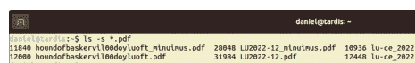

### 图 2：Minuimus 的结果取决于各种因素，每次都不一样。这里你可以看到四次测试前后处理时的文件大小。

## 使用 apt-clone 克隆 Debian 系统

### Debian 克隆

在合适的情况下，apt-clone 可以成为克隆你的 Debian 系统的简单选项。作者：Bruce Byfield

你可以在几分钟内创建一个新的系统、容器或 chroot 监狱。然而，配置其中任何一个可能需要数小时，特别是如果你希望它们类似于现有系统。存在许多克隆应用程序，特别是 `dd`、`Partimage` 或 `Clonezilla`，但在 Debian 衍生版（如 Debian、Ubuntu 或 Linux Mint）中，最简单工具之一是一个名为 `apt-clone` [1] 的小脚本。Apt-clone 让人依稀想起 `Clonezilla`，但由于它使用标准的命令行工具和基本命令，具有简单性的优势。Apt-clone 也可以作为便捷的备份使用。

Apt-clone 属于以 `apt-get` 和 `apt` 为中心的一群小脚本，涉及它们的管理或易用性。这些脚本的新成员总是不断出现又偶尔消失，因此 Debian 稳定版仓库包含 54 个此类脚本，而 Debian 不稳定版仓库包含 64 个——这个数字在下一次官方发布之前很可能会增加。Apt-clone 本身已经有十多年历史，这足以让它的使用悄然传播。大多数 Debian 衍生版都在其仓库中包含了 `apt-clone`，但你也可以从 GitHub 下载源代码。不过，就我写作时而言，最新的几个 `apt-clone` 发布中包含的 `apt-clone` 版本似乎存在版本不兼容的问题。不过，总的来说，如果你注意到最近的贡献是在几年前，不必担心。事实是，`git clone` 非常简单且足够成熟，代码很少需要更新。

### 创建克隆文件

关于 `apt-clone` 的报道往往侧重于基础知识。即使是在线手册页往往也不完整。因此，只依赖于随脚本安装的手册页，或使用 `--help (-h)` 选项可用的摘要。

在使用 `apt-clone` 之前，使用 `apt upgrade` 更新你的系统，以确保你处理的是相同的 Debian 发布版本，并且原始系统尽可能无 bug。然后运行

```
apt-clone clone FILE
```

除非你指定 `--source DIRECTORY`，否则输出将进入当前工作目录。如果你有任何第三方 `.deb` 包，请在命令末尾添加 `--with-dpkg-repack`，以便 `apt-clone`


```
apt@vareness:~$ apt-clone clone 2022-12-26-clone --with-dpkg-repack
not installable: libobasis7.3-impress, libreoffice7.4-dict-fr, libobasis7.3-oogltrans, libobasis7.3-xl-nfilter, libobasis7.4-api-integration, libobasis7.4-javascript-script-provider, libobasis7.3-images, libobasis7.4-extension-pcf-import, libobasis7.3-calc, libobasis7.3-nw-dict-nw, libreoffice7.4-menu, libobasis7.4-nl-nfilter, libreoffice7.4-dict-22, libobasis7.4-javascript-script-provider, libobasis7.4-extension-pcf-import, libobasis7.4-lr-dict-44, libreoffice7.4-menu, libobasis7.4-en-au, libreoffice7.4-javascript-script-provider, libreoffice7.4-en-za, clams-mail-address-keeper, libobasis7.4-nl-dict-lr, libobasis7.4-lr-dict-24, clams-mail-dict-viewer, libreoffice7.4-calc, libreoffice7.4-dict-fr, clams-mail-pcf-viewer, libobasis7.4-xfreird, libreoffice7.3-impress, libreoffice7.3-calc, libreoffice7.4-calc, libreoffice7.4-nfilter, clams-mail-pcf-viewer, libobasis7.4-xfreird,
```

**图 1：** 创建归档文件：注意第三方包的数量。

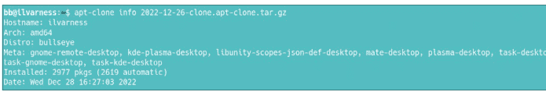

**图 2：** 使用 `apt-clone` 信息归档文件的概述。

将尝试将它们包含在备份目录中。但请注意，尝试未必总是成功，因为可安装的 `.deb` 包并不自动具备 Debian 发行版所需的格式和标准。这类包在日常使用中完全正常，但可能不会被 `apt-clone` 识别（见图 1）。

无论如何，几分钟内，`apt-clone` 就会创建一个 TAR 压缩文件。如果你试图包含第三方软件包，由于每个第三方软件包都必须单独分析，所需时间可能会长得多。你可以使用以下命令读取新创建文件的一般信息：

```
apt-clone info FILE
```

在图 2 中，跨越七个不同的桌面，安装了 2,977 个软件包，但只有 2,619 个是官方 Debian 软件包，这意味着完美克隆的可能性不大，尽管基本功能应该能成功克隆。要查看归档文件的不同视图，可以使用诸如 `Ark` 这样的归档应用程序（图 3）。正如你所预期的，软件包源和 `apt` 设置是归档的主要类别，还有 `apt-clone` 的日志文件。偏好设置包括来自如 `.config/` 或 `.local` 等目录的配置设置。理论上，你可以解开归档文件并尝试编辑，但这可能比值得付出的努力更多。不过，确切知道自己在做什么，而不是盲目遵循指示，永远不是浪费时间。


由于归档文件包含系统敏感信息，除非你计划在克隆后立即删除它，否则你应该对其进行加密。使用 `GPG` 并在非实际使用时保持文件加密是保证合理安全性的最快方法。

### 如何克隆

一旦你有了归档文件，请安装与源系统相同 `Debian` 版本的目标系统。使用其他 `Debian` 版本可能会起作用，但这会增加出现问题几率——这些问题花费的时间可能比 `apt-clone` 所能节省的还要多。将归档文件传输到目标系统的根目录，如有必要请解密，并以 `root` 身份运行：

```
apt-clone restore FILE
```

该过程类似于通常安装软件包的方式，在较新的硬件上可能需要 20 分钟或更长时间，具体取决于涉及的软件包数量。如果你选择使用 `restore-new distro` 而不是 `restore`，所需时间会更长，因为你将在同时尝试升级软件包。在恢复之前升级可能会减少出错的概率。

当过程结束时，克隆将完成，无需重启，就像安装新软件包时发生的情况一样。同样，因为源文件属于 `root` 并以 `root` 身份复制，你应该不会遇到权限问题。如果你确实遇到了任何问题，使用 `apt-clone diff` 与源机器的文件进行比较可能有助于解决问题。

### 局限性

`apt-clone` 的主要缺点是它专为配合官方存储库使用而设计。

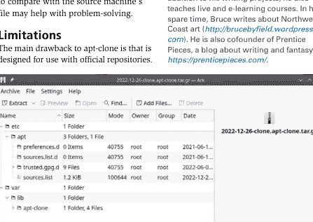

**图 3：** 归档文件内容的概述。

如果你要克隆的系统包含来自第三方源安装的 `.deb` 软件包，`apt-clone` 会尝试处理它们，但有时可能不成功。这意味着，例如，如果你安装了来自 `The Document Foundation` 的最新版本 `LibreOffice`，你将不得不单独备份配置文件。同样，将配置文件传输到操作系统的较新版本可能也只会取得有限的成功。可能，使用 `apt-clone` 最实用的场景是当你安装由相同工作站组成的实验室，或想要一台与你旧电脑完全相同的新家用电脑时。当 `apt-clone` 满足你的需求时，它是一个优雅的小脚本，但它永远不会是针对所有可能情况的完整解决方案。 👍

#### 信息

**[1]** `apt-clone`：

<https://github.com/mvo5/apt-clone>

### 作者

`布鲁斯·拜菲尔德（Bruce Byfield）` 是一名计算机记者，也是自由作家和编辑，专长于自由和开源软件。除了写作项目外，他还讲授在线学习课程。在他的业余时间，`布鲁斯` 撰写关于西北海岸艺术的文章（<https://brucebyfield.wordpress.com>）。他也是 `Printice Pieces` 的联合创始人，这是一个关于写作和幻想的博客，位于 <https://printicepieces.com/>。

### 请求 Spotify 档案并使用 Go 和 R 进行评估

#### 文件检查员

`Spotify`，这家互联网音乐服务，收集关于其用户及其音乐口味的数据。`迈克·希尔利（Mike Schilli）` 请求了这些文件的副本，以便使用 `Go` 进行调查。*作者：迈克·希尔利*

像 `Spotify` 或 `Apple Music` 这样的流媒体服务主导着音乐行业。它们庞大的目录现在覆盖了所有可消费的音乐。依靠人工智能，这些服务通过其算法预测用户可能喜欢的歌曲，从而向用户推荐新歌。与传统实体音乐媒体相比，它们已无法与之抗衡，只能落在架子上积灰。当然，这种发展也意味着匿名音乐消费已成过去，因为流媒体服务会精确记录谁在什么时候播放了哪首曲目以及播放了多久。

应请求，`Spotify` 甚至会移交所获取的数据（图 1）。如果你在他们的网站上稍作探索，你会发现需要按下的按钮来请求这些文件的副本，位于“账户 | 隐私设置”中，但 `Spotify` 响应速度较慢。

从请求之时起，大约需要一周时间，他们的档案管理员才能从 `Spotify` 底层的文件中检索数据，进行压缩，并将其作为 `ZIP` 归档发布在网站上供你下载。收到 `Spotify` 的电子邮件通知后，你可以在接下来的两周内下载数据，并在本地尽情探索。

**作者**

`迈克·希尔利（Mike Schilli）` 是加州旧金山湾区的一名软件工程师。在他的专栏中，自 1997 年以来每月更新，他研究各种编程语言的实际应用。如果你通过 `mschilli@perimeter.com` 给他发邮件，他会乐意回答任何问题。


#### 编程快照 – Go 和 R

##### 深入探讨

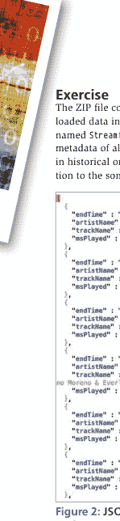

##### 练习

包含下载数据的 `ZIP` 文件包括一个名为 `StreamWithHistory.json` 的 `JSON` 文件，其中按历史顺序列出了你播放的所有流媒体的元数据（图 2）。除了歌曲和艺术家外，条目还列出了开始日期和时间以及播放时长。播放时长特别有趣，因为如果用户在几秒钟后中断流媒体并快进到下一首歌，该曲目很可能是不小心被加入播放列表的，而不是用户真正喜欢的。在整理音乐建议时，这极有可能是一个误报。

为了使用 `JSON` 解析器从 `Spotify` 数据创建内部 `Go` 数据结构，必须已知该格式并与其实际的 `JSON` 格式匹配。`Spotify` 提供的 `JSON` 数据块，如图 2 所示，由一个数组组成，其每个元素对应一个流媒体曲目。艺术家和曲目名称以字符串形式存储在 `artistName` 和 `trackName` 字段中。`msPlayed` 给出以毫秒为单位的播放时间，而 `endTime` 包含播放结束时的日期和时间。清单 1 中 `stream` 结构的字段均以大写字母开头，这意味着其他包之后也可以访问它们。然而，这意味着名称与 `JSON` 格式中的变量名称不相同，后者均以小写字母开头。不过，这没什么大不了的，因为 `Go` 允许使用 `json:` 标签给结构体指定一个与字段名称不同的名称。

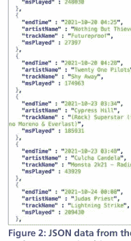

例如，第 10 行的 `ArtistName string `json:"artistName"`` 指定 `Go` 结构中 `artistName` 字段的艺术家类型为 `string`，并且

###### 清单 1: stats.go


```go
package main
import (
    "encoding/json"
    "fmt"
    "log/ioutil"
    "sort"
)
type stream struct {
    EndTime     string `json:endTime`
    ArtistName  string `json:artistName`
    MsPlayed    int64  `json:msPlayed`
    TrackName   string `json:trackName`
}
const jsonFile = "MyData/StreamingHistory0.json"
func main(){
    bySong := map[string]int64{}
    content, err := ioutil.ReadFile(jsonFile)
    if err != nil {
        panic(err)
    }
    data := []stream{}
    err = json.Unmarshal(content, &data)
    if err != nil {
        panic(err)
    }
    for _, song := range data {
        title := fmt.Sprintf("%s/%s", song.ArtistName, song.TrackName)
        bySong[title] += 1
    }
    type kv struct {
        Key   string
        Value int64
    }
    kvs := []kv{}
    for k, v := range bySong {
        kvs = append(kvs, kv{k, v})
    }
    sort.Slice(kvs, func(i, j int) bool {
        return kvs[i].Value > kvs[j].Value
    })
    for i := 0; i < 3; i++ {
        fmt.Printf("%s (%dx)\n", kvs[i].Key, kvs[i].Value)
    }
}
```

### 清单 2: 前三首歌曲

- Sparks/When Do I Get to Sing "My Way" – 2019 – Remaster (19x)
- Falco/The Sound of Music (16x)
- Linkin Park/With You (14x)

入站 `JSON` 中使用的名称为 `artistName`。对于 `json.Unmarshal()` 来说，这就足够了，因为它可以深入解析第 22 行 `JSON` 文件中的所有条目，这是因为该函数接收到的指向这些流条目数组（此时仍为空数组）的指针是存储在 `data` 中的。利用 `Go` 的反射机制，该函数能够确定它需要处理哪些 `JSON` 结构。

清单 1 统计每首歌曲在流媒体历史中出现的次数，结果存储在定义于第 16 行的 `bySong` 映射中。为此，它使用标题字符串作为键，并在流媒体数据中每发现一次播放事件就将该 64 位整数映射值加一。最后，该函数需要按整数值的降序对映射进行排序，以输出前三个结果。

### 排序并非易事

在脚本语言中，排序映射数据轻而易举，但 `Go` 提供类型安全性，因此清单 1 将映射条目转换为 `kv`（代表键/值）结构数组切片，其类型定义从第 30 行开始。从第 31 行开始的 `for` 循环需要费力遍历映射中的每个条目，并将其发现的每个键值对作为一个 `kv` 结构附加到 `kvs` 数组切片中。然后可以使用 `Go` 标准库中的 `sort.Slice()` 函数对该切片进行排序。第 39 行的回调函数告诉它，可以通过数值比较位于 `i` 和 `j` 位置的两个计数器，来确定切片中两个条目的期望顺序。

哇，这相当复杂！最后，从第 41 行开始的 `for` 循环遍历排序后的数组，输出前几个位置，并在第一个值之后终止。

### 用 R 更快

编写用于解析 `JSON` 数据并计算统计信息的 `Go` 程序真的让人头疼。`Go` 的类型安全性在此处需要不成比例的大量样板代码，而脚本语言只需优雅地跳过即可。这呼唤了像 `R` 这样的经典数据处理语言，它采用更轻松的方式，为程序员节省了大量工作。如果你的机器上还没有 `R`，只需在 `Ubuntu` 上安装它，例如使用以下命令：

```bash
sudo apt install r-base
```

清单 3 展示了一个简单应用，它扫描用户的 `Spotify` 流媒体历史，生成他们聆听歌曲实际播放时长的直方图，并将其美观地显示为条形图（图 3）。该图表表明，许多歌曲在不到 15 秒（15,000 毫秒）内就被简单取消了。在这种情况下，`Spotify` 的推荐算法很可能犯了错，惹恼了听众，导致他们切换到下一首歌。从大约一分钟的播放时长开始（即 60,000 毫秒之后），出现了一条类似高斯分布的钟形曲线，峰值在 220 秒。如今大多数歌曲大约长度为三分半钟，大部分在两到五分钟之间。

为了能够在命令行调用清单 3，第 1 行的 `shebang` 语句会在 `shell` 的搜索路径中寻找 `Rscript` 程序，并调用底层的 `R` 解释器来执行文件中的程序代码。此外，请确保通过 `chmod +x` 命令将文件 `hist.r`（清单 3）标记为可执行文件。

为了优雅地读取 `JSON` 数据，清单 3 使用了 `jsonlite` 包；你需要预先安装它。在打开 `R` 会话（只需在命令行输入 `R`）之后，`install.packages("jsonlite")` 命令会从 `Comprehensive R Archive Network` (CRAN) 加载该包的 `C++` 源代码，在本地编译，并将库集成到本地的 `R` 环境中。之后，任何 `R` 脚本都可以使用 `library("jsonlite")` 来包含新库并调用其中的函数。

第 3 行使用从 `jsonlite` 导出的 `fromJSON` 函数从流媒体历史中读取 `JSON` 数据，并将其作为 `dataframe` 存储在 `jdata` 变量中。这种 `R` 数据类型是一种带有按行向量值的数据库表，每个值跨越多个列。除了数值和字符串，列还可以包含所谓的因子。在 `R` 中，这些因子是具有特定数量可能取值的变量，例如 `small`、`medium` 和 `large`。

### 播放时长统计

清单 3 需要将其分析的所有歌曲的最大记录播放时长限制为五分钟，因为我的流媒体历史中还包括 90 分钟的音频播放，这使统计数据变得无法辨认。过滤由第 4 行的 `recoding` 语句处理，该语句使用条件 `jdata$msPlayed < 300000` 在将结果再次分配给 `jdata` 变量之前，从 `jdata` 数据框中过滤掉所有播放时间超过 300 秒的曲目。

重构语句在行和列两个级别上进行。第 4 行方括号中包含的条件由逗号分隔。过滤器将第一个条件应用于每一行，第二个条件应用于每一列。结果是一个数据框，它可以同时减少行数和列数。然而在这种情况下，我们只需要删除行，而不需要删除列，因此方括号中逗号后面的条件第二部分保持为空。是的，你需要一双鹰眼才能正确阅读和理解 `R` 代码！

### 清单 3: hist.r

```r
#!/usr/bin/env Rscript
library("jsonlite")
jdata <- fromJSON("MyData/StreamingHistory0.json", simplifyDataFrame = TRUE)
jdata <- jdata[jdata$msPlayed < 300000, ]
attach(jdata)
png(filename="hist.png")
hist(msPlayed, main="Milliseconds Played")
detach(jdata)
```

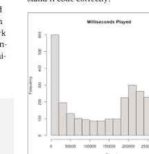

图 3: 由清单 3 生成的播放时长直方图

|   | endTime         | artistName               | trackName          | msPlayed |
|---|-----------------|--------------------------|--------------------|----------|
| 1 | 2021-10-20 04:21 | Foster The People        | SHC                | 248030   |


| 2 | 2021-10-20 04:25 | Nothing But Thieves | Futureproof | 27397 |

| 3 | 2021-10-20 04:28 | Twenty One Pilots | Shy Away | 174963 |

| 4 | 2021-10-23 03:34 | Cypress Hill | (Rock) Superstar | 185931 |

| 5 | 2021-10-23 03:48 | Culcha Canela | Monsta 2k21 - Radio Edit | 43929 |

| 6 | 2021-10-24 00:08 | Judas Priest | Lightning Strike | 209430 |

图 4: 来自 JSON 数据的原始数据框。

| | `endTime` | `artistName` | `trackName` | `msPlayed` | `hour` |
|---|-----------------|--------------------------|--------------------|----------|------|
| 1 | 2021-10-20 04:21 | Foster The People | SHC | 248030 | 21 |
| 3 | 2021-10-20 04:28 | Twenty One Pilots | Shy Away | 174963 | 21 |
| 4 | 2021-10-23 03:34 | Cypress Hill | (Rock) Superstar | 185931 | 20 |
| 6 | 2021-10-24 00:08 | Judas Priest | Lightning Strike | 209430 | 17 |

图 5: 带有小时列的过滤后的数据框。

### 清单 4: `hourly.r`

```r
#!/usr/bin/env Rscript
library("jsonlite")

data <- fromJSON("/MyData/StreamingHistory.json", simplifyDataFrame = TRUE)
## only 50412 songs

jdata <- data[data$msPlayed > 60000, ]
d <- as.POSIXct(data$endTime, tz = "UTC")
jdata$hour <- as.numeric(format(d, tz="America/Los_Angeles", "%H"))
subset(jdata, , select=c(hour, artistName))
agg <- aggregate(songsPerhour, by=list(artistName=songsPerartistName, hour=songsPerhour), FUN=length)
winners <- agg[order(agg$hour, -agg$x),]
winners <- winners[!duplicated(winners[2]),]
winners
```

这个非常紧凑的清单随后为`jdata`数据框中的`msPlayed`条目创建直方图，并为条形图准备播放时长的计数值。这是由第 7 行的内置 R 函数`hist()`完成的，前提是第 5 行已将`jdata`数据框设为参考点，第 6 行已将未来生成的任何 PNG 输出文件设置为`hist.png`。这确保了 R 在脚本结束时创建具有此名称和条形图的 PNG 文件。

### 热门组合

流媒体历史中的数据是否也能根据一天中的不同时间段得出对特定类型音乐偏好的结论？清单 4 对此进行了尝试，它读取 JSON 数据，从每个流媒体事件的`endTime`时间戳中提取播放结束时间的小时数（作为数值），然后确定在该时间窗口内（对所有流媒体日取平均值）最常播放的是哪位艺术家。

图 4 展示了数据框中的原始 JSON 数据，包含 JSON 文件中找到的所有字段。清单 4 中的第 5 行丢弃了所有播放时间未达到至少一分钟的歌曲，以避免向统计中引入假阳性。现在的任务是从 Spotify 时间戳中提取一天中的小时；这是在调整时区后完成的。Spotify 将时间标记为 UTC（即 GMT），但这并非美国西海岸太平洋时间（PT）区的音乐时间。这解释了为什么`as.POSIXct()`函数从 JSON 数据中读取值时将其视为 UTC，而第 7 行中的`format`格式器将其转换为`America/Los_Angeles`时区。执行此操作后，通过`%H`确定的本地时间小时值作为字符串可用。但是，为了稍后对条目进行排序，R 需要数值，因此`as.numeric()`将其转换为数字。

现在数据框位于`jdata`变量中，如图 5 所示。清单 4 中的第 8 行随后使用`subset()`将数据转换为仅包含两列（艺术家和播放小时）的数据框。然后，R 的内置`aggregate()`函数在第 9 行将所有具有相同小时值的艺术家的行聚合在一起。`FUN=length`指定额外的聚合列包含长度（即艺术家-小时元组的数量）。

| | `artistName` | `hour` | |
|-----|-------------------------|------|---|
| 293 | Zucchero | 19 | 1 |
| 294 | ZZ Top | 19 | 1 |
| 343 | Linkin Park | 20 | 11 |
| 365 | Sparks | 20 | 11 |
| 314 | Element Of Crime | 20 | 7 |
| 317 | Eros Ramazzotti | 20 | 6 |
| 356 | Pink Floyd | 20 | 6 |
| 304 | Cypress Hill | 20 | 5 |
| 321 | Foster The People | 20 | 5 |
| 319 | Falco | 20 | 4 |

图 6: 每小时的聚合计数器。

### 深入解析

#### 编程快照 – Go 和 R

图 6 展示了该中间结果的一个摘录。基于此，`ZZ Top`在 19:00 正好播放了一次，而在 20:00 出现了不少于 11 条`Linkin Park`的条目。有几种不同的方法可以从该视图中过滤出仅有的顶级表现者（例如，20:00 时的`Linkin Park`）。一种完全依赖 R 标准函数方法如下：对数据框按小时（升序）和事件数量（降序）进行排序。使用去重功能，算法仅保留每个小时值的第一个条目，并丢弃其余部分。每个小时值的顶级表现者得以保留。


```
$ hourly.r
        artistName     hour   x
19          Rainbow    0     4
28          Sparkys    1     9
30          Sparkys    2    10
31          Sparkys    3    14
32          Sparkys    4     7
33      The Killers    6     1
36  Eros Ramazzotti    7     7
40 Adriano Celentano    8     1
48  Eros Ramazzotti    9     4
56          Alice   10     1
59     Ace of Base   11     1
64     Ace of Base   12     1
68     Amy Winehouse  13     3
72    Foster The People 14     4
75        The Monkees  15     2
76     Ace of Base   16     3
111  Eros Ramazzotti  17     5
161         Falco   18     7
243        Guster   19     7
349   Linkin Park   20    11
460       Jan Delay  21     9
596       Jan Delay  22    10
782   Element of Crime  23    12
```

##### 图 7：哪些艺术家在什么时间被播放的频率最高？


##### 图 8：Spotify – 错误地 – 认为作者是浅色啤酒爱好者。

第 10 行根据方括号中指定的 `order()` 函数对之前生成的 `agg` 数据框进行排序。其第一个参数是小数值字段名（正值）；第二个是计数器的负值，由 `length` 函数确定。在 R 中，由聚合函数新建的列名为 `x`，在此情况下包含结果的数量。

第 11 行对现在名为 `winners` 的数据框运行 `recode` 语句，并使用 `ldup1|cat(d winners[2])` 来指定第二个字段（即小小时值；R 数组索引始终从 1 开始，而不是 0）在结果中必须仅出现一次。因此，该函数仅保留之前正向排序的最高结果（针对具有相关艺术家的小小时值），并丢弃所有其他结果。

这样就解决了 Perlmeister Studios 中最受欢迎乐队列表（作为一天中时间的函数）的问题！图 7 展示了 `hourly.r` 程序的输出（代码列表 4）。午夜过后，要么是尴尬的 1980 年代老歌（Rainbow；我记得模糊地，从凌晨 1:00 到 4:00，每一首都是乐队 Sparks 的曲目），在制作了一部关于该乐队的 Netflix 纪录片后，随后连续播放了四个小时的他们歌曲。第二天的工作当然很糟糕，但你只活一次。

根据经验，用户可能会花几天时间摆弄 R 来找到合适的数据结构和方法，而往往只需三行代码就能实现他们想要的结果。造成这种情况的原因可能包括该语言的年龄，它带有一种反 Python 的心态（“你的意思是一种方法就够了？”），以及自首次发布以来几十年间以不协调的方式发布的许多包。针对特定问题的 Google 搜索通常会揭示解决同一问题的三种或四种不同方法。Robert I. Kaboff 的培训书籍 [1] 很好地解释了一些基本过程，但它绝不是一个全面的参考手册。

#### 更多秘密

如果你在 Spotify 档案的 ZIP 文件中进一步挖掘，你很可能会挖掘出更多的数据宝藏。例如，Spotify 的 `Inferences.json` 文件包含关于用户的既定事实 – presumably 是为了帮助 Spotify 提供听众也会响应的合适广告。

就我的情况而言，Spotify 假设我对“浅色啤酒”有偏好（图 8），这是一个玩笑且完全错误 – 如果有紧急情况，任何认识我的人都作证！这是 Bud Light 广告开始出现在我屏幕上的可能解释。

#### 信息

- 1. Kaboff, Robert I. *R in Action, Second Edition*. Manning, May 2015: [https://www.manning.com/books/r-in-action-second-edition](https://www.manning.com/books/r-in-action-second-edition)

### 想要随时随地工作？


立即查找远程工作！

**开源工作中心**

opensourcejobhub.com/

### 深入解析


#### 用 unsnap 交换 snaps 为 Flatpaks

#### 软件包交换

如果你想远离 Ubuntu 的 Snap 软件包格式，`unsnap` 脚本会从你的计算机中移除 snaps，并在可能的情况下用 Flatpaks 替代它们。**作者：Ferdinand Thormoes**

Linux 社区与其他社区一样，并不特别擅长欢迎新事物。大多数人希望维持现状。用哲学家伏尔泰的话说，好的是更好的敌人。没有什么比放弃好的去追求更好的更危险了。

Systemd，这个仍有争议的系统和服务管理器，阐明了这一概念。其他例子包括新的软件包系统 Flatpak、Snap 和 AppImage，*Linux Magazine* 曾在 2022 年 12 月 [1] 对此进行过报道。这些软件包系统在 Linux 社区中并未得到一致认可。特别是 Snap 格式，Canonical 最初将其设计用于云应用和物联网（IoT），但后来移植到桌面应用，除了对新软件包系统的基本批评外，还面临着反对。

如果你对 Snap 感到失望，`unsnap` 脚本可以帮助你替换在 Ubuntu 及其衍生版中可用的 snaps 为 Flatpaks。

#### 糟糕的经历

Linux 社区对 Canonical 的任何单独努力都持怀疑态度，因为有过糟糕的过去经历。对 Snap（图 1）的主要批评是 Snap Store 的专有后端 [2]，以及 Canonical 越来越强地在 Ubuntu 中推广该格式，且没有官方方法来移除 snaps。

Snap 守护进程（`snapd`）是从 Canonical 服务器检索 snaps 及相关元数据的定义工具。此外，snaps 存在功能缺陷，公司一直缓慢地消除这些缺陷。另一方面，Flatpak 受到替代软件包系统拥护者的欢迎。Flatpak 可能是


**图 1：** 当你通过 *Ubuntu 软件* 安装程序时，可以通过右上角的选择框定义来源。某些软件包（如 Firefox）通常仅以 snaps 形式提供。

大多数 Ubuntu 环境外部用户的选择。这最终可能导致 Canonical 再次搁置 Snap，正如过去常发生的那样，例如 Ubuntu Touch 或 Mir 显示管理器。

这种情况导致一些发行版拒绝甚至阻止 snaps。一个突出的例子是基于 Ubuntu LTS 的 Linux Mint，其开发者早在 2020 年就决定不交付 snaps [3]。他们还宣布，从版本 20 开始，Linux Mint 将通过图形软件包管理器主动防止安装 Snap 框架，防止通过后台将 snaps 自动发送到用户系统。笔记本电脑制造商 System76 [Pop!_OS] 和 Tuxedo（Tuxedo OS 1）也避免在其 Ubuntu 衍生版中附带 snaps。甚至 Ubuntu 用户也没有响应 Snap，正如许多指南所建议的那样，描述在 Ubuntu 中作为 DEB 安装 Firefox。

#### unsnap

前 Snap 共同开发者 Alan Pope，在该公司工作了 10 年后于 2021 年离开 Canonical，开发了 `unsnap` [4]，一个在可用时将 snaps 替换为 Flatpaks 的脚本。该脚本托管在 GitHub 上，开发者已测试其在提供 snap 和 Snap 格式软件包的 Ubuntu 及所有衍生版上的使用。

为了在新安装的 Ubuntu 22.04 LTS 上测试 `unsnap`，我除了现有的 snaps 外，还通过 Ubuntu 软件包管理器设置了一些来自 Snap Store 的软件包，然后列出来以确保（图 2）。然后我从 GitHub 下载了 `unsnap` 脚本。为此，我首先必须安装 `git` 包，然后运行代码列表 1 中的命令。


在深入细节之前，让我们看看脚本是如何工作的。启动后立即，`unsnap` 创建一个日志目录，在其中生成六个针对特定系统定制的额外脚本（见表 1）。`applist.csv` [5] 文件用于查找与安装的 snaps 匹配的 Flatpaks。

#### 多个步骤

要启动脚本，首先通过输入 `cd unsnap` 切换到相应目录。

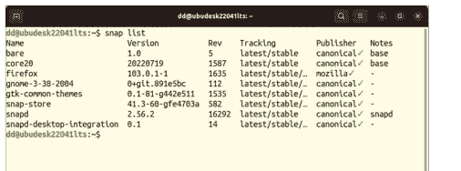

**图 2：** `snap list` 命令列出系统上安装的所有 snaps。

`./unsnap` 命令（图 3）首先通知你，将运行各种检查以确定 Flatpak 是否已安装，Flathub 是否包含在内，以及哪些 snaps 有 Flatpak 等效项。

#### 代码列表 1：安装 unsnap

```
$ git clone https://github.com/poppey/unsnap
```

接下来，`unsnap` 创建辅助脚本。如果你有一个原因不运行某个辅助脚本，你可以手动逐个启动这些脚本。否则，调用 `./unsnap auto` 以自动安装脚本（图 4）。

在我的实验室系统中，我安装了大约 20 个 snaps，其中 `unsnap` 能够替换大约一半。然而，我特意安装了诸如 Canonical Juju 和 LXSD 工具，以及 Mutter 命令行邮件客户端等 snaps，以测试脚本如何响应（图 5）。一般来说，为图形应用找到 Flatpak 对应项的机会

#### 表 1：unsnap 子脚本

| 脚本 | 功能 |
|---|---|
| `08-backup` | 为每个要迁移的 Snap 包运行 `snap save` 命令。 |
| `01-install-flatpak` | 如果尚未安装，安装 Flatpak 软件包管理器。 |
| `02-enable-flathub` | 如果未启用，将 Flathub 软件源添加到 Flatpak。 |
| `03-install-flatpaks` | 为每个识别出的 Snap 包安装 Flatpak，如果存在的话。 |
| `04-remove-snaps` | 移除有替代 Flatpak 的 snaps。 |
| `99-remove-snapd` | 移除 snapd 本身，这将移除任何仍然安装的 snaps。 |

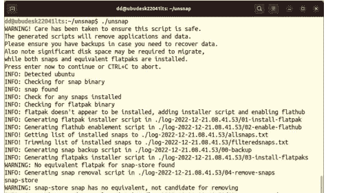

**图 3：** 如果你调用脚本时没有附加命令，它会确定系统状态并创建所需的辅助脚本，然后你可以手动启动它们（如果需要）。

### 解除 Snap（unsnap）

Flatpak 更优，因为它的目标主要是桌面环境。另一方面，Snap 的目标还包括服务器领域。

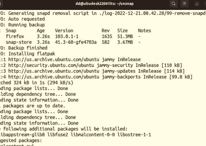

**图 4：** 如果通过 `./unsnap auto` 命令调用该脚本，流程将自动完成。

#### 需要返工的地方

我的测试耗时大约 10 分钟，并提供了关于当时正在发生何事的详细信息。`flatpak list` 命令（图 6）可用于确定哪些 Snap 已转换为 Flatpak 格式。对于有 Flatpak 等效项的 Snap，`unsnap` 已顺利将其转换，且所有程序均保持可用状态。该脚本未对剩余的 Snap 及其基础设施做任何改动。若要彻底将 Snap 从计算机中清除，还需进行一些手动操作。

随后，我重新安装了 `Ubuntu 22.04`，并安装了一些我知道有对应 Flatpak 的 Snap，包括 `Gimp 2.99.10 Beta`、`Krita`、`Spotify` 和 `KeePassXC`。在此过程中，我还为 `Gnome` 安装了多个额外的运行时环境（由于 `Krita` 的存在，也安装了 `KDE` 的运行时环境），以及 `Canonical` 提供的其他基础设施软件包。在此环境中，使用与之前相同的流程，我接着测试了 `unsnap` 在能够将所有 Snap 转换为 Flatpak 时，是否也会移除 Snap 基础设施。

我加载该脚本并输入 `./unsnap auto` 来运行它。这一次，`unsnap` 首先必须安装 Flatpak 并连接到 Flathub。完成这些操作后，调用成功地将所有手动安装的 Snap 替换为 Flatpaks。此外，它还成功禁用了在安装过程中已存在的 `Firefox` Snap。

通过 `flatpak list` 检查时，我注意到该方法的一个小缺点：所有 Flatpak 都是系统级的，因此对所有用户都可访问。没有选项将 Flatpak 限制在特定用户。

然后我运行 `snap list` 查看是否还残留有 Snap 基础设施。天哪，Snap 软件包确实已被删除，但基础设施仍然存在。显然，脚本没有执行六个辅助脚本（`99-remove-snap`）中的最后一个。我随后手动执行此操作，进入 `~/.unsnap/log$282...` 目录并在那里运行 `./99-remove-snap` 命令。该脚本移除 `snapd`，并删除基础系统不需要的部分基础设施组件。

然而，我发现 Snap 基础设施已深深扎根于 `Ubuntu` 中，即使是手动操作也无法移除所有内容（图 7）。

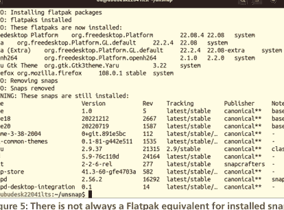

**图 5：** 已安装的 Snap 并不总存在 Flatpak 等效项；`unsnap` 会单独列出这些情况。

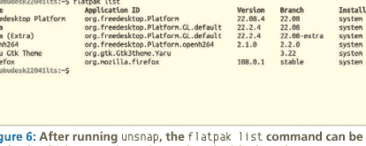

**图 6：** 运行 `unsnap` 后，可使用 `flatpak list` 命令检查脚本将哪些 Snap 替换为了 Flatpak。

##### 手动操作

即使没有 `unsnap`，也可以从计算机中移除 Snap 基础设施。要做到这一点，首先禁用相应的 `systemd` 服务（清单 2，第 1 至 3 行）。然后使用命令

```
sudo snap remove $PACKAGE
```

逐项删除 `snap list` 显示的所有内容。最后，移除残留文件（第 5 至 7 行）。之后，可以手动将已删除的软件包以 `DEB` 或 Flatpak 格式重新安装。

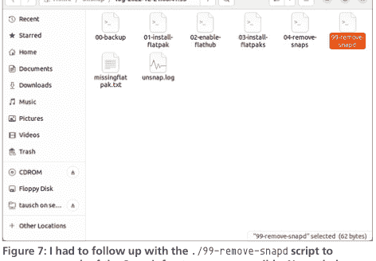

**图 7：** 我不得不通过运行 `./99-remove-snapd` 脚本来移除尽可能多的 Snap 基础设施。尽管如此，仍有一些残留文件。

#### 结论

在 `Ubuntu` 及其衍生版（如果它们使用 Snap）上，`unsnap` 允许您直接将已安装的 Snap 替换为 Flatpak。为此，必须存在等效的 Flatpak，而图形应用程序通常都有等效项。通过少量手动操作，也可以移除 Snap 基础设施。

然而，该项目在 GitHub 上警告称，该软件仍处于预 Alpha 阶段。我试图从 `Alan Pope` 处获得一份声明，但在本期杂志付印前未能如愿。我知道许多用户已成功使用 `unsnap`，我自己也没有遇到任何问题。但为了保险起见，我建议使用手动移除选项，然后以您希望的格式重新安装已删除的软件包。 ■■

### 作者

**Ferdinand Thommes** 生活在柏林，是一名 Linux 开发人员、自由撰稿人和导游。

##### 清单 2：移除 unsnap

```
01 $ sudo systemctl disable snapd.service
02 $ sudo systemctl disable snapd.socket
03 $ sudo systemctl disable snapd.seeded.service
04 [...]
05 $ sudo rm -rf /var/cache/snapd
06 $ sudo apt autoremove --purge snapd
07 $ rm -rf ~/snap
```

#### 信息

1. `Erik Bärwaldt` 的“创新的 Linux 包管理器”，载于 *Linux Magazine*，2022 年 12 月刊，第 265 期，第 72 页
2. Snap 商店：`https://snapcraft.io/store`
3. 无 Snap 的 Mint：`https://linuxnews.de/2020/06/02/linux-mint-20-ohne-snapd/`
4. unsnap：`https://github.com/popey/unsnap`
5. applist-csv：`https://github.com/popey/unsnap/blob/main/applist.csv`

## 深入剖析

## LibreOffice Writer 暴躁审稿人（Angry Reviewer）


## 暴躁审稿人（Angry Reviewer）

“暴躁审稿人”（Angry Reviewer）风格检查可用于评估和改进各类写作，包括学术论文和基金申请。 *作者：Bruce Byfield*


LibreOffice Writer 拥有数百种扩展 [1]。许多扩展是外观修饰、琐碎或专用的。然而，少数几个是对功能的重要补充。过去，一些扩展（如 `PDF` 导出）最终进入了 Writer 的默认界面。最终，“暴躁审稿人”风格检查器 [2] 可能会做到同样的事。虽然它是为了改进学术论文和基金申请而设计的，但 `Angry Reviewer` 足够全面且实用，可用于任何类型的写作。你可以把它称为广受宣传的 `Grammarly` [3] 的 `Linux` 版本，尽管它的反馈可能更有用。

`Angry Reviewer` 可在其网站上获取 [4]，但 Writer 扩展的优势在于允许您离线工作并运行 `Angry Reviewer`，而无需复制粘贴。像所有扩展一样，可以通过 `工具 | 扩展管理器` 安装。重新启动 `Writer` 后，`Angry Reviewer` 会被添加到顶级菜单中。点击 `Check This Text`（检查此文本，图 1）后，会打开第二个包含反馈的 `Writer` 文档。然后可以将这两个文档并排放置，以便您评估反馈并进行更改。

### 工作中的 Angry Reviewer

当我在大学教授写作课的时候，我告诉学生们，如果他们足够了解英语，能够有效地使用拼写检查器或风格检查器，那么他们就不需要这些工具。这类工具太容易以其听起来权威满满的反馈将读者引入歧途——比如一个学生在一篇关于 `Gloria Steinem` 的文章中写道“几个世纪以来，男性一直让女性感到沮丧”（许多女性坚称这不是笔误）。问题在于，大多数此类工具是规定性的，将语法和风格视为固定形式，并且倡导的标准已落后时代数十年。

相比之下，`Angry Reviewer` 不仅更灵活，而且解释得足够详细，使作者在实际获得快速修正的同时，可能真的学到一两件事。引用诸如 `On Writing Well: The Classic Guide to Writing Nonfiction`（《写好非虚构作品的经典指南》）和通用经典 `The Elements of Style`（《风格：经典写作指导》）等来源，该页面列出了以下规则，并附有示例：

- 不要`过度炒作`。避免使用诸如 `新颖、高度、显然、极大地、甚至更好、避免所有副词` 之类的词语。
- 不要使用`陈词滥调`。`一言以蔽之，大体上，它们都晦涩难懂`。
- 不要`经常`使用“`very`（非常）”这个词。通常，有比它更好的词。
- 要简洁。避免使用诸如“`通过……手段、尽管事实是、为了……目的`”之类的短语。
- 避免否定形式。例如，使用“`unable`（不能）”代替“`not able`（不行的）”。
- 避免冗余；例如，使用“`investigate`（调查）”代替“`conduct an investigation of`（进行一项关于……的调查）”。
- 使用`主动语态`。`虽然并非总是可能，但大部分文本应使用主动语态`。
- 避免不当的语言。将诸如“`really（真的）、actually（实际上）、pretty much（差不多）`”之类的词留给社交媒体。
- 避免生僻词和拉丁语借词。`并非所有读者都知道其含义`。
- 尽量减少使用缩写。`缩写难以阅读，请考虑直接拼写出来`。
- 警惕僵尸名词 [5]（名词化，即由动词、形容词或其他名词构成的名词）。`名词化的使用是分心的原因`。

总体而言，这些规则鼓励清晰、精确和简洁——这些是任何写作的优点。在对一篇文章的反馈中，这些规则以建议的形式提供，通常使用诸如“考虑”和“也许”等词语，以明确表明存在意见分歧的空间。在这篇文章通过 `Angry Reviewer` 运行之后，我未应用的一条反馈是“避免使用‘`it is`’（它是）结构，因为它们会掩盖句子的主语和动作”（尽管这条建议总体上是好的）。我唯一想补充到 `Angry Reviewer` 规则列表中的，是乔治·奥威尔在其类似的规则列表 `Politics and the English Language`（《政治与英语》）[6] 结尾处的名言：“宁破这些规则，也不说任何绝对野蛮的话。”


`图 2：` `Angry Reviewer` 对本文章第一稿前三段的反馈。

换句话说，如果您有充分的理由忽略 `Angry Reviewer` 的反馈，请尽管这样做。例如，如果您正在小说中写对话，或引用某人的话，口语英语往往比书面英语更不合语法，这些规则可能并不总是适用。在另一个例子中，当我将 `Angry Reviewer` 应用于本文（图 2）时，我没有按照建议拼写“`PDF`”，因为可以预期我的读者知道这个缩写。同样，我没有将“`you`（你/您）”改为“`one`（某人）”，因为那样会太正式（而且我的编辑可能会更改它）。不过，我确实将一个被标记为过长的句子拆分了。我还考虑并有时更改了几个被质疑的选词。此外，我注意到我有时使用不必要的副词和诸如“`By and large`（大体上）”之类的惯用语，这等同于陈词滥调，并记下要在未来避免这两种习惯。总体而言，我认为 `Angry Reviewer` 是一个有用的工具，即使是我拒绝的反馈也迫使我在编辑时更具分析性。

我还注意到 `Angry Reviewer` 忽略了脏话和俚语，并且与 `Writer` 的拼写检查不同，它没有捕捉到重复的单词或多余的空格。不过，当前版本仅为 `1.2`，与此同时，连续运行拼写检查和 `Angry Reviewer` 并没有太大的负担。

我对 `Angry Reviewer` 的唯一批评是，它被添加到了主菜单中，而它应该属于“工具”菜单（也许工具栏上有一个图标），我会很感激有一个选项，可以逐个展示每条反馈，并显示相关段落。但这些以后再说。无论以何种方式呈现，`Angry Reviewer` 的反馈都是有用的，我推荐所有级别的作家使用它。 ■■

**信息**

[1] LibreOffice Writer 扩展：`https://extensions.libreoffice.org/en/extensions/`

[2] Angry Reviewer：`https://github.com/anufrievroman/libreoffice-angryreviewer`

[3] Grammarly：`https://www.grammarly.com/`

[4] Angry Reviewer 网站：`https://www.angryreviewer.com/`

[5] 僵尸名词：`https://archive.nytimes.com/opinionator.blogs.nytimes.com/2012/07/23/zombie-nouns/`

[6] 奥威尔，乔治。政治与英语：`https://www.plainlanguage.gov/resources/articles/politics-and-the-english-language/`

**作者**

`Bruce Byfield` 是一名计算机记者，也是一名专注于自由和开源软件的自由撰稿人和编辑。除了写作项目，他还教授现场和电子学习课程。在业余时间，`Bruce` 撰写关于 `WordPress` 的文章。`http://brucebyfield.wordpress.com`。他也是 `Prentie Pieces` 的共同创始人，这是一个关于写作和奇幻的博客，位于 `https://prenticpieces.com/`。


## 杂志 LINUX

### 构建物联网 Linux

将操作系统精简以适应设备

### 免费存档 DVD

巨额节省！价值 39.90 英镑！

所有 262 期均可在可搜索的光盘中找到！

## WHAT'S NEW IN

UBUNTU 22.04

## 超越 5G

构想移动网络的开放未来

- FLUX Beamo
- 内置 Rasp Pi 的酷炫激光切割机
- 免费社交媒体工具
- 无 Manuscript 的连接方案
- 构思一部小说

## Linux Android 备份

将智能手机数据保存到 Linux PC

## 人工智能

现实世界的

机器学习

### 入门

微控制器编程

## 量子计算

### 为您的 FOSS 工具箱推荐的 10 项精品

- Zings：零数据包 ping 竞争者
- 优化 Rasp Pi 的电芯使用
- deb-get：第三方 .debs 的简易仓库
- Heimer：使用思维导图管理菜单选择

## 树莓派技巧

使用蓝牙实现无线连接

## 生成对抗

网络

伪造的艺术和想象中的

面孔：计算机教计算机说谎

- 覆盖网络

  将间谍拒之门外

- 使用 Logseq 进行

  知识管理

- Lingojet

  让您的 Linux 应用支持多语言

- Lynis

  在攻击者发现漏洞之前找到它们

- 构建您自己的

  3D 邦戈鼓游戏

### FOSS 精选

10 款绝佳免费工具！


## Linux Magazine 订阅

印刷版和数字版选项

每年 12 期

## 订阅

`shop.linuxnewmedia.com/subs`

## 扩展您的 Linux 技能：

- 关于热门主题的深入文章，包括比特币、勒索软件、云计算等！

- 关于省时和保护数据的实用工具的教程和指南

- 故障排除和优化技巧

- 开源世界重大发展的新闻

- Raspberry Pi、Arduino 及其他创客板系统的酷炫项目

使用 Linux 走得更远、做得更多，立即订阅，不再错过任何一期！

## 关注我们

`@linux_pro`

`@linuxpromagazine`

`Linux Magazine`

`@linuxmagazine`

## 需要更多 Linux？

免费订阅 `Linux Update`

我们免费的 `Linux Update` 简报每周为您提供具有洞察力的文章和技术小贴士。

`bit.ly/Linux-Update`


## 创客空间

### Raspberry Pi 自动喂食器

### 鱼食

无论在工作还是度假期间，每个宠物主人都担心在自己缺席期间如何照顾它们的小室友。鱼缸主人需要一个自动喂食器。作者：Swen Hopfe

鱼缸喂食器已经存在很长时间了，但在我最近的调研后，没有一个设备在我看来真正实用。很少有设备能提供故障反馈，这在你回家时可能会是一个讨厌的惊喜。我创建了这个自动喂食器项目用于我的鱼缸，以求安心。

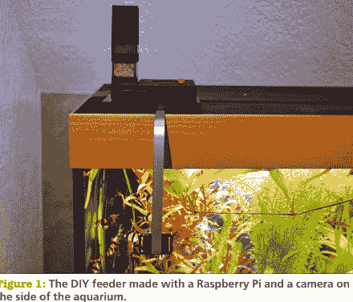

`Raspberry Pi Zero` 是鱼缸喂食器控制中心的良好选择：它自带控制机械系统以及使用 Pi 摄像头抓取图像所需的一切（见图 1）。它足够紧凑，可以放入小型外壳中。将 `Pi Zero W` 集成到您的无线家庭网络中，将允许您在外时在线发布各种捕获的图像。

目标是一个简单且不易出错的设置。因此，机械控制系统仅使用一个小伺服电机。电子电路也同样简单。DIY 控制系统确保了某种程度的便利性。两个喂食器增加了多样性，并且完全足以桥接相当于三周假期的时间。

### 入门

为了让 `Zero W` 运行起来，您需要下载一个新的 `Pi OS` 镜像并将其传输到 `microSD` 卡中。在连接显示器和键盘后，您可以配置启动选项和网络设置。由于以后不需要桌面环境，您可以选择在命令行界面 (`CLI`) 上自动登录，并启用 `SSH` 服务器和摄像头接口。在启用 `SSH` 和对家庭网络的无线访问后，您不需要在 `Zero W` 上连接任何外设，并且可以立即从网络上的另一台计算机访问它。所有进一步的设置都可以在另一台计算机的终端窗口中配置。

### 自动鱼缸喂食器

```
**Listing 1: crontab**

## m h dom mon dow command
0 * * * * 0-5 python3 /home/pi/scripts/Feed.py 1
## 星期六 1111 星期五
0 * * * * 6 python3 /home/pi/scripts/Feed.py 2
## 每分钟
*/1 * * * * python3 /home/pi/scripts/Feed.py 0
```

`Pi` 需要一个反映其任务的名称。在此示例中，它被命名为 `feeder`。下一步是在您的主目录中创建一个单独的 `scripts/` 文件夹用于项目文件，您稍后将用 `Python 3` 编写的 `feed.py` 控制脚本放在那里。不是在启动 `Zero W` 时作为内存驻留程序加载它，而是由 `cron` 在定义好的间隔内反复调用它。

### 您需要什么

商业喂食器通常依赖于相对复杂的机构，例如可装载隔间的旋转台。相比之下，我希望这个喂食器系统尽可能简单，以便 DIY 系统易于管理并在家缺席期间安全运行。话虽如此，我还是希望在使用和功能方面都有一定的便利性，也是为了我留在家中的宠物。因此，至少有两个喂食管可用于不同的饲料（图 2）。

其他考虑因素是如何确保——从远处——我的宠物确实收到了食物。从计算机角度来看的无故障运行并不能提供饲料是否进入鱼缸的反馈，因此我产生了用摄像头记录鱼类喂食并在网络上显示快照的想法。

`Zero W` 自带用于完成此任务的工具，您可以连接 `Pi` 摄像头在喂食后短暂等待时捕获图像。您只需要鱼缸中自动售货机所在部分的视野。为了保护，`Raspberry Pi` 和摄像头各自封装在一个小盒子中。项目中的其他部件数量是可管理的（参见“部件清单”框）。

### 适时而动

喂食时间表设置在 `Zero W` 的 `crontab` (`cron` 表) 中，这是管理计划任务处理的文件。喂食器的计划如清单 1 所示，您可以使用 `crontab -e` `[1]` 创建。

`Crontab` 指定每天下午 5 点喂食。在星期六，脚本通过命令行中的 `2` 选项启动，这每周从自动售货机的第二个插槽释放一次替代饲料。`cron` 表中的第三项带有选项 `0`，启动状态显示（板载 `LED` 每分钟闪烁一次），并用于从网络读取远程控制代码——但更多关于此内容稍后讨论。

#### 部件清单

- Raspberry Pi Zero W (`1/2`)
- Pi 摄像头 `rev 1.3` 或更高版本
- Pi 和 Pi 摄像头的盒子
- 摄像头连接线
- 迷你伺服电机 (`MG90` 或同等型号)
- 原型制作面包板 (`PCB` 面包板)
- 两个按钮
- LED
- 各种电阻器
- DIY 喂食塔


**图 2：** 您需要的组件。在此设置中，透明的桌面笔架充当饲料筒仓。

### 构建

在我设想解决方案中，饲料由一个小型存储塔提供，该塔通过鱼缸盖上的开口，在重力的帮助下从顶部投放食物。您可以使用当地五金店的零件或在线从工艺品商店订购材料来构建这样一个喂食塔。在我的情况下，一个书桌笔架被用作起点；这种零件在许多商店都很容易买到，并且通常由透明塑料制成，这对于监控填充水平非常理想。

现在是锯割和钻孔的时候了。之后，我添加了伺服电机和机械系统。整个装置然后安装在一个底板上，该底板还承载 `Zero W` 和一个带有状态 `LED` 和控制按钮的小电路板（图 3）。

饲料出口由专门设计的机构操作。根据伺服电机的旋转方向，笔架的两个管中的一个会打开。为此，一根直轴穿过两个管，每个开口在轴上都有一个闭合件。

由于角度偏移，在短促的左旋或右旋期间，两根轴中只有一根可以打开，并且 `short time later it will automatically close again.` 小桨片充当闭合装置，以防止轴保持永久开启，并确保投放预定量的饲料（图 4）。

`160` 升鱼缸中鱼类密度较低，每天不需要超过一平勺干的鱼食。售货机中的供应量足以应对三周的假期。如果你需要更大的储备量，请根据需求调整管道直径和高度设置。

### 控制

接通电压后，喂食过程自动开始。按照树莓派（`Raspberry Pi`）中的 `cron` 定时任务设置，售货机每天喂食一次。在周六，通过让伺服电机以相同的角度但相反的方向旋转，饲料从第二个轴中取出。`LED` 指示灯每分钟闪烁一次，作为视觉就绪信号。为了追踪设备上的所有事件，`LED` 使用不同的闪烁代码（表 1）。

电路图（图 5）中看不到的东西是机箱上的两个按钮，它们连接到 `Zero W` 的通用输入输出（`GPIO`）引脚，用于触发第一个轴的喂食以及受控的系统关闭。

由于喂食器位于本地网络上，因此也可以通过网络进行维护。为此，请通过 `SSH` 登录终端：

```
ssh pi@feeder
```

然后你可以修改 `cron` 定时任务或控制脚本。如有需要，你可以通过调用以下命令禁用自动喂食器：

```
python3 /home/pi/scripts/feed.py 4
```

选项 `4` 指示设备进入维护模式，不再执行其他操作。

### 观察

一个有趣且积极的副作用是，你可以看到鱼是否从喂食器中获取了饲料。控制脚本会在操作伺服电机 `10` 秒后通过鱼缸玻璃触发快照。简单的 `Pi Cam Rev 1.3` 很好地承担了这一功能。因为我只需要抓取鱼缸前部部分的图像，图像质量是次要的。

从鱼缸顶部的售货机到鱼缸正面的 `Pi` 摄像头之间的连接需要较长的摄像头线缆（在我的设置中约为 `30` 厘米，具体取决于鱼缸盖的高度）。一块窄铝片将小摄像头外壳固定在屏幕前方几厘米处。

要获得清晰的图像，你需要在 `Pi` 摄像头上设置尽可能短的焦距。为此，请用工具非常小心地转动小镜头的调节环，并抓取一些测试图像以检查设置。


**图 3：** 饲料塔有两个独立的腔室，由机械系统操作。

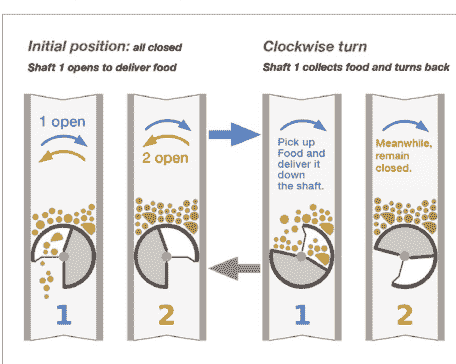

**图 4：** 出口机构：根据旋转方向，饲料从两个腔室之一中释放。

**表 1：LED 闪烁代码**

| 信号 | 状态 |
| --- | --- |
| 1 次长闪 | 运行中，每分钟闪烁一次 |
| 1 次中闪 | 轴 1 开启（外加拍照） |


| 2 次中闪 | 轴 2 开启（外加拍照） |
| 3 次短闪 | 单张快照 |
| 3 次极短闪 | 正在关机 |

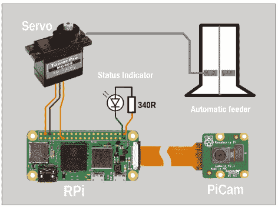

三个按钮，用 `PHP` 实现，位于树莓派的 `/var/www` 目录中。该代码以及用于控制喂食器的 `Python` 脚本位于项目的 GitHub 页面 [3]，英文版代码则在 Linux Magazine 下载站点 [4]。

要访问本地网络上的 Web 界面，只需在 Web 浏览器中输入 Zero W 的本地 IP 地址即可。为了在度假时远程监控系统，你需要在路由器中启用 Zero W 上的服务器以支持 Web 访问，并分配一个永久 IP。然而，如果你已经使用带有 `FTP` 访问权限的网站，你也可以选择将当前的喂食图像上传到你自己的网络空间并在那里查看。

#### 结论

在两次短途旅行中，自动喂食器已经毫无故障地为我的鱼友们提供了食物。从一开始，我的目标就是 DIY 解决方案，因此与商业解决方案竞争从来不是重点。相反，我想构建一个完美适应我自身需求的设备：一个可靠运行且允许我检查其工作状态的设备。我绝对不想在宠物护理方面妥协。

然而，如果没有人在现场能在紧急情况下介入，即使最好的基于互联网反馈也无济于事。如果你陷入困境，家人或邻居的支持总是很棒，他们可以浇花，甚至可以照顾你鱼缸里的宠物。

#### 信息

- [1] `crontab(1)` 手册页：`https://linux.die.net/man/1/crontab`
- [2] `lighttpd`：`https://www.lighttpd.net`
- [3] GitHub 项目：`https://github.com/swenae/feeder`
- [4] 英文代码下载页面：`https://linuxnewmedia.thegood.cloud/s/6RZx9IQW2FJ6N32`

### 作者

Swen Hopfe 在一家中等规模的公司工作，专注于智能卡和近场通信（`NFC`）。当他不拍照、不在户外或在花园里时，他会专注于树莓派、物联网和家居自动化等话题。

### MakerSpace

#### 被束缚的太阳能

一种预测服务和一些 `Perl` 魔法有助于预测住宅光伏阵列的太阳能发电量。By Rubén Lorente

当前的能源危机促使许多房主投资太阳能。比以往更多的人选择在其屋顶上安装光伏发电系统以供家庭使用。根据在这些系统上的投资金额，房主可能会看到电费减半，甚至降至零。

然而，太阳能并非全是优点：发电量代表了一笔巨大的前期投资，需要十多年的时间才能收回。另一个巨大的缺点是，光伏阵列只有在天气合作时才能产生效益（图 1）。

配备光伏系统（表 1）的房屋可能变得真正自给自足，只要管理得当。但是，为了优化太阳能的使用，预测系统的每日发电量至关重要。如果你能获取准确的预测，你可以提前规划。

例如，假设你计划在某一周将当年的水果收成制成果酱。那项任务是高能耗的。如果你知道明天的天气不会与你的太阳能配合，但后天你将有有利条件，你可以调整日程并利用阳光。另一方面，如果你的光伏安装是离网的（孤岛模式），你需要提前知道哪些日子会很糟糕，以及发电机需要运行多久来弥补阴天。

请记住，在阳光不普照时使用高能耗电器可能仍然有意义。参见“没有阳光的太阳能”框以获取更多信息。


**图 1：** 两个光伏阵列提供的功率超过普通房屋的需求——但前提是天气配合。

#### 太阳辐照度预测

提供太阳能阵列发电量估算的预测服务很棒，原因有二。首先，它们允许你在投资之前模拟你打算安装的光伏阵列的性能。在你花钱之前，知道你打算安装的组件是否会表现不佳或表现过佳，要好得多。其次，它们允许你安排电力消耗，以优化系统的使用。

对于业余爱好者、学生和学术研究，`Solcast` [1] 是一个非常有用的免费预测服务。该服务的最大优点是，它允许你下载机器可解析格式的太阳能辐照度预测，然后将其输入脚本和程序以提取有意义的数据。

注册 `Solcast` 后，你需要在开始使用该服务之前定义一个站点（图 3），这只是说你向 `Solcast` 提供位置信息的一种委婉说法，这样他们就可以发送该位置的预测。为了完成站点标签页上的信息，你需要提供面板的朝向角度、额定输出功率、面板的垂直角度以及效率估计值。对于新系统，可以安全地假设效率为 90%，每年效率损失为 2%。

`Solcast` 还提供 `API` 密钥（图 4），你可以使用它自动下载预测。你的站点在 `Solcast` 网站上的页面将提供大量文档和一个生成有效 `HTTP` 调用的向导。为了节省时间，以下示例为指定站点下载 72 小时的预测数据：

```
https://api.solcast.com.au/rootloop_sites/$YOUR_SITE_ID/forecasts?hours=72&format=csv&spl_key=$YOUR_KEY
```

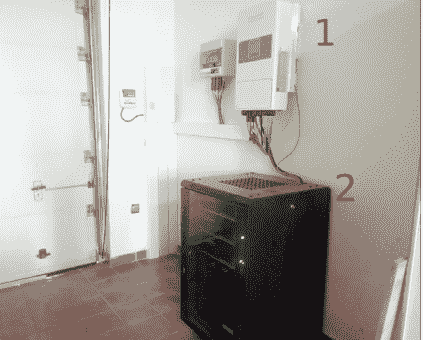

图 2：Turbo Energy 混合逆变器 (1) 与机架中的电池组 (2) 配对。光伏面板利用多余的生产电量给电池充电，因此所有者在日落后可以使用电池电力。

### 没有阳光的太阳能

太阳能系统通常与传统电网一起工作。其理念是，房屋将从太阳能系统获取电力，如果太阳能产量不足以满足需求，则从电网获取所需的电量，使太阳能电力和电网电力之和等于负载。

太阳能系统只有在阳光普照时才能发电，但人们经常在非生产时间需要电力。房主采用两种主要策略来在日落后从光伏阵列中获益。第一种是与电力供应公司签订合同，该公司将购买你在不使用时生产的电力。这样，如果你在白天不在家，你的光伏阵列将为电力供应公司生产电力。当你在晚上回家并打开电炉时，你将直接从电网购买电力，但希望白天产生的收入可以抵消黑暗时段购买电力的成本。这种方法的优点是便宜（即，它不需要所有者建设特殊的基础设施）；然而，它对电力供应商比房主更有益。通常，电力分销商购买你电力的价格远低于他们卖回给你的价格。

第二种策略是在太阳能系统中添加电池组（图 2）。目标是让光伏阵列在白天给电池充电，以便你需要时有储存的能量。这种方法的优点是更灵活，使你对常规电力供应商的依赖性降低。如果你的地区经常发生停电或电力（负载）削减（电力供应的临时减少），你将能够使用电池电力。主要缺点是电池组的前期成本巨大以及部署复杂性增加。此外，并非所有配备电池的太阳能系统都能耐受停电，有些系统因为设计方式的原因，在电网断电时会停止运行。

两种策略都受益于电力消耗的适当规划。向电网出售电力的人仍然更愿意在太阳能表现最佳时使用电力，而不是在夜间使用并购买电力——即使成本部分由之前出售的电力抵消。另一方面，拥有带电池组的太阳能系统的所有者，最好在正午使用电力，而不是在夜间无谓地耗尽电池能量。

**表 1：硬件预算**

| 项目 | 数量 | 总价 (EUR)¹ |
| :--- | :--- | :--- |
| 混合逆变器 | 1 | 1,730.30 |
| 面板 (450W) | 13 | 3,303.30 |
| 电池模块 (5kWh) | 3 | 7,314.45 |
| 总计 | | 12,346.05 |

- \* 5.910W 光伏系统，不含布线。
- \* 价格大致相当于美元。

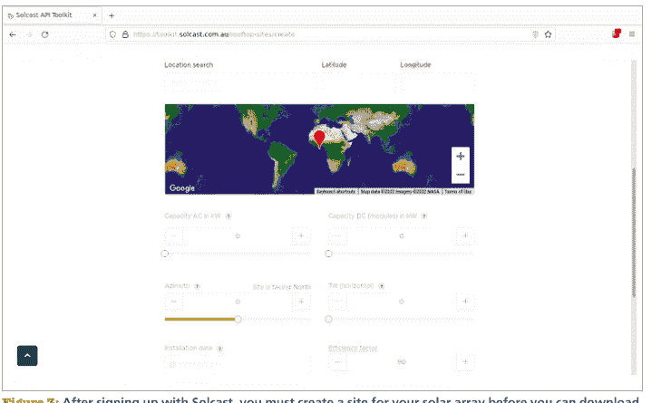

**图 3：** 在注册 `Solcast` 后，您必须先为光伏阵列创建一个站点，然后才能下载预测数据。

该 `URL` 指向一个 `CSV` 文件（例如，图 5），可以使用 `curl`、`wget` 或其他您喜欢的下载工具获取。别忘了将 `$YOUR_SITE_ID` 和 `$YOUR_KEY` 替换为您光伏站点的 `ID` 代码和您的 `API` 密钥。表 2 解释了每个 `API` 变量的含义，表 3 则说明了 `CSV` 文件的内容。

#### 解析预测

`Solcast` 的预测数据允许您执行多种计算。最重要的是计算未来几天每块面板将产生多少电力，以及您是否会面临电力短缺。由于预测数据已经采用机器可解析的格式，您可以使用一些简单的 `Perl` 脚本来揭示这些数值。`Perl` 非常适合这项任务，因为它在处理文本方面表现出色。您可以使用以下命令在 Debian 计算机上以 root 用户身份安装必要的环境：

```bash
sudo apt-get update
sudo apt-get -y install perl
sudo apt-get -y install libdatetime-perl
```


**图 4：** `Solcast` 提供了一个有限功能的向导，可以帮助您组装用于以下载机器可解析格式的光照度预测的 `API` 调用。

**表 2：`Solcast` `API` 变量**

| 变量 | 描述 |
| :--- | :--- |
| `hours` | 预测涵盖的小时数 |
| `format` | 格式；可提供 `JSON`、`CSV` 和 `XML` |


| `api_key` | Solcast 提供的您的专用 API 密钥 |

Perl 有许多用于解析 CSV 文件的模块，例如随预测数据一起下载的那个，但你不需要什么花哨的东西，可以用一些手工编写的代码来搞定。清单 1 展示了一个示例 Perl 脚本，它从标准输入读取数据，假设输入的是一个 CSV 文件，并将其内容存储在一个名为 `$csv` 的数组中。

脚本中的 `while` 循环逐行读取预测文件中的每一行，并将它们存储在 `$line` 变量中。第 15-17 行移除了 Windows 样式的换行符，使输入更容易处理。每一行


#### 图 5：通过 Solcast API 下载的预测数据。

CSV 文件由一组以逗号分隔的字段组成，因此第 20 行捕获第一个和第四个字段，并将它们存储在 `$power` 和 `$timestamp` 变量中。

接下来的代码是复杂操作开始的地方。在第 22 和 23 行中，创建了一个数据哈希，并存储在 csv 数组中与当前行对应的元素中（即，文件的第 1 行进入 `$csv[0]`，第 2 行进入 `$csv[1]`，等等）。这样，您可以轻松地访问每一行的功率和时间戳。例如，要获取第 10 行的功率列，访问 `$csv[9]{"power"}` 变量即可。

在太阳能发电的背景下，您可以使用这些数据做的一件最有趣的事情之一，是将您的太阳能发电量与您的电力消耗进行比较。

**表 3：预测文件元素**

| 元素 | 描述 |
|---|---|
| `PvEstimate` | 时间段的平均发电量（千瓦） |
| `PvEstimate10` | 该时段合理的最低发电量（用于最坏情况计算） |
| `PvEstimate90` | 该时段合理的最高发电量（用于最佳情况计算） |
| `PeriodEnd` | 标记时段结束的时间戳 |
| `Period` | 每个时段的长度（分钟） |

**清单 1：`solar_01.pl`**

```perl
#!/usr/bin/perl

## Usage: ./solar_01.pl < forecast_file.csv
## where each data row from the csv file has the following format:
#
## PvEstimate,PvEstimate10,PvEstimate90,PeriodEnd,Period
## 0.4645,0.3248,0.5801,2022-11-03T11:00:00Z,PT30M

my $line_number = 0;
my @csv;

## Read from standard input and process each CSV line sequentially.
while ( my $line = <> ) {

    # Remove Windows-style BOL
    $line =~ s/\r\n/\n/;
    chomp ($line);

    # Split each row of the CSV file and get the fields we want.
    my ($power,$timestamp) = (split ",", $line)[0,3];

    $csv[$line_number]{"power"} = $power;
    $csv[$line_number]{"timestamp"} = $timestamp;

    ++$line_number;

}

exit;
```

### 消耗曲线

一个普通的西班牙家庭每天消耗 9.55 千瓦时 [4]（美国约为 25 千瓦时 [3]；英国约为 11 千瓦时 [4]）。您可以通过多种方式计算您自己家的消耗量。如果您家里安装了太阳能逆变器，逆变器本身就会告诉您的电力消耗曲线是什么样的。如果您还没有安装太阳能系统，请查看其中一份电费账单上计费的千瓦时数，然后除以计费周期的天数。

理想情况下，您会使用逐小时对比来尝试猜测一天中哪个时间最适合使用电力，哪个时间最适合在家节约电力。为了做到这一点，您需要了解您的消耗曲线。同样，如果您有一个智能逆变器，它可以提供这些信息，但如果您的逆变器功能简单或者您还没有太阳能系统，您就需要进行粗略估算。

估算每小时消耗量的一种可接受方法是获取您所在国家的全国消耗估算值，并假设您的家庭行为接近平均水平。例如，我从西班牙电力公司 Red Eléctrica de España [5] 下载了发电数据，该公司提供了一个 CSV 文件，其中包含了西班牙全天（以五分钟为周期细分）的发电量（以兆瓦为单位）。这些数据使我能够计算出西班牙每小时发电量的百分比。然后我可以安全地假设，我自己家的行为方式类似。

换言之，如果我猜测西班牙发电量的 5% 发生在中午 12:00 到 12:05 之间，我可以推断出我的房子在那个时间段内将使用其日常总电量的 5%。清单 2 是基于这种推断得出的消耗曲线，图 6 是该数据的图表。第一列是属于每小时计量时段结束的时间戳，第二列是在该时段内发生的每日总用电量使用的百分比。

**清单 2：电力消耗，西班牙**

| 日期 | 每日消耗百分比 |
| :--- | :--- |
| 2022-11-02 00:30 | 1.560200564338948 |
| 2022-11-02 01:00 | 1.560200564338948 |
| 2022-11-02 01:30 | 1.630084978283003 |
| 2022-11-02 02:00 | 1.630084978283003 |
| 2022-11-02 02:30 | 1.581412127211891 |
| 2022-11-02 03:00 | 1.581412127211891 |
| 2022-11-02 03:30 | 1.560978880980132 |
| 2022-11-02 04:00 | 1.560978880980132 |
| 2022-11-02 04:30 | 1.57097271097776 |
| 2022-11-02 05:00 | 1.57097271097776 |
| 2022-11-02 05:30 | 1.627989256856056 |
| 2022-11-02 06:00 | 1.627989256856056 |
| 2022-11-02 06:30 | 1.859484912466257 |
| 2022-11-02 07:00 | 1.859484912466257 |
| 2022-11-02 07:30 | 2.114583623949703 |
| 2022-11-02 08:00 | 2.114583623949703 |
| 2022-11-02 08:30 | 2.228515849789889 |
| 2022-11-02 09:00 | 2.228515849789889 |
| 2022-11-02 09:30 | 2.228466964511583 |
| 2022-11-02 10:00 | 2.228466964511583 |
| 2022-11-02 10:30 | 2.2125393551125 |
| 2022-11-02 11:00 | 2.2125393551125 |
| 2022-11-02 11:30 | 2.20946158922860 |
| 2022-11-02 12:00 | 2.20946158922860 |
| 2022-11-02 12:30 | 2.28549889387938 |
| 2022-11-02 13:00 | 2.28549889387938 |
| 2022-11-02 13:30 | 2.28922673209563 |
| 2022-11-02 14:00 | 2.28922673209563 |
| 2022-11-02 14:30 | 2.29525674886163 |
| 2022-11-02 15:00 | 2.29525674886163 |
| 2022-11-02 15:30 | 2.27086171159491 |
| 2022-11-02 16:00 | 2.27086171159491 |
| 2022-11-02 16:30 | 2.27183515839329 |
| 2022-11-02 17:00 | 2.27183515839329 |
| 2022-11-02 17:30 | 2.279084904985125 |
| 2022-11-02 18:00 | 2.279084904985125 |
| 2022-11-02 18:30 | 2.37193796186272 |
| 2022-11-02 19:00 | 2.37193796186272 |
| 2022-11-02 19:30 | 2.45179325741258 |
| 2022-11-02 20:00 | 2.45179325741258 |


| 2022-11-02 20:30 | 2.45179325741258 |
| 2022-11-02 21:00 | 2.45179325741258 |
| 2022-11-02 21:30 | 2.47148673788156 |
| 2022-11-02 22:00 | 2.47148673788156 |
| 2022-11-02 22:30 | 2.38225260420458 |
| 2022-11-02 23:00 | 2.38225260420458 |
| 2022-11-02 23:30 | 2.15359750186617 |
| 2022-11-03 00:00 | 2.15359750186617 |

### 将所有内容整合起来

您最终希望计算机下载一个覆盖未来数天的预测，并考虑您的电力消耗曲线，从而让您对未来几天的剩余电量有一个大概的了解。一种好的策略是让 `cron` 任务在午夜后立即从 Solcast 获取预测文件，然后使用能够进行这些估算的程序进行解析。清单 3 中的脚本是此类程序的一个概念验证。该脚本假设光伏阵列在没有电池支持的情况下工作，并尝试猜测您的房子将从电网取用多少电力，以及将产生但未被使用的电力有多少（图 7）。被视为“浪费”的电力是指如果您签订智能电网合同，将会出售给电力公司的电力。此脚本遍历给定的预测文件，并计算该文件涵盖的时间段。

第 10-37 行使用与 `solar_01.pl` 相同的方法将预测文件和曲线文件加载到内存中。曲线文件不需要移除 Windows 样式的换行符终止符；因此，它缺少诸如第 14 行所示的替换正则表达式。第 50 到 96 行遍历 CSV 预测文件的所有行，丢弃第一行（该行不存储有用的值）。尽管 Perl 高手并不真正推荐使用，但我为了可读性决定使用 C 型循环。第 52-54 行使用正则表达式提取对应的年、月、日、时、分、秒


## 开放共享

新闻 • 职业 • 科技生活

技能 • 资源

`FOSSlife.org`

### 列表 3：`solar_2.pl`

```perl
#!/usr/bin/perl

## Usage: ./solar_2.pl forecast.csv profile.csv power

use DateTime;

my $csv_forecast;
my $csv_profile;

my $line_number = 0;
open (my $forecast, '<', $ARGV[0]) or die "Failed to open $ARGV[0]";
while ( my $line = <$forecast> ) {
    $line =~ s/\r//;
    chomp ($line);

    my ($power,$timestamp) = (split ",", $line)[0,1];
    ${csv_forecast[$line_number]}["power"] = $power;
    ${csv_forecast[$line_number]}["timestamp"] = $timestamp;

    ++$line_number;
}
close ($forecast);

$line_number = 0;
open (my $profile, '<', $ARGV[1]) or die "Failed to open $ARGV[1]";
while ( my $line = <$profile> ) {
    chomp ($line);

    my ($timestamp, $percentage) = (split ",", $line);
    ${csv_profile[$line_number]}["timestamp"] = $timestamp;
    ${csv_profile[$line_number]}["percentage"] = $percentage;

    ++$line_number;
}
close ($profile);

## For each 30 minutes period, calculate whether we are
## going to produce
## more power than we are going to consume (and therefore waste it),
## or whether we are going to consume more power than we produce (and
## therefore have deficit).

my $waste = 0;
my $deficit = 0;
my $produced = 0;

my ( $y,$m,$d,$h,$mt,$sec );
my ( $i,$j );
for ( $i = 1 ; $i < @csv_forecast ; ++$i ) {
    ( $y,$m,$d ) = ${csv_forecast[$i]}["timestamp"] =~ m/^(\d+)\/(\d+)\/(\d+)$/;
    ($h,$mt,$sec) = ${csv_forecast[$i]}["timestamp"] =~ /\/(\d+)\/(\d+)\/(\d+)\/(\d+)\/(\d+)\/(\d+)Z/;

    unless ( defined ($h) && ($h,$mt,$sec) eq ('0', '0', '0') ) {
        my $forecast_time = DateTime->new(
            year => $y,
            month => $m,
            day => $d,
            hour => $h,
            minute => $mt,
            second => $sec,
            time_zone => 'UTC'
        );

        $forecast_time->set_time_zone('local');

        my $consumption;

        my ($hour,$minute );
        for ( $j = 1 ; $j < @csv_profile ; ++$j ) {
            ($hour,$minute) = ${csv_profile[$j]}["timestamp"] =~ m/(\d+):(\d+)/;

            if ( $hour eq $forecast_time->hour() and $minute eq $forecast_time->minute() ) {
                $consumption = ${csv_profile[$j]}["percentage"] * $ARGV[2] * 0.01;
            }
        }

        if ( $consumption > (${csv_forecast[$i]}["power"] * 0.5) ) {
            $deficit += ${consumption} - (${csv_forecast[$i]}["power"] * 0.5 );
        } else {
            $waste += (${csv_forecast[$i]}["power"] * 0.5 ) - ${consumption};
        }

        ${produced} += ${csv_forecast[$i]}["power"] * 0.5;

        # If the day has changed, print information for the
        # day.
        if ( $forecast_time->hour() eq "0" and $forecast_time->minute() eq "0") {
            ${forecast_time->subtract({ days => 1})};
            print "INFORMATION FOR DATE " . ${forecast_time->date()} . "\n";
        }
    }
    $deficit = 0;
    $waste = 0;
    $produced = 0;
}
exit;
```

预测文件中条目的时间戳。第 55-64 行创建与时间戳对应的 `DateTime` 对象，并将其调整为本地时区。

第 68-75 行在配置文件中查找与当前分析时间戳对应的条目，并计算该时段内预期房屋消耗的总功率。此计算将预期的每日总能耗乘以预期在该时段（对应时间戳）的每日电力使用百分比，然后除以 100。结果以千瓦时为单位，存储在 `$consumption` 变量中。


第 76-80 行的计算的是能量债务和盈余。如果房屋消耗的功率大于产生的功率，脚本会在 `$deficit` 变量中记录能量债务。否则，盈余功率记录在 `$waste` 变量中。

脚本还在第 82 行记录了太阳能阵列在当天迄今为止产生的功率。

第 85 行猜测是否已到达一天结束。如果是，脚本会打印出刚刚解析的那天的信息，并将 `$deficit`、`$waste` 和 `$produced` 重置为零，以便开始新的一天的计算。

#### 结论

列表 3 中的脚本是一个概念验证，缺乏输入验证。它不检查输入的 CSV 文件是否正确，并且缺乏针对输入错误的适当退出状态。然而，它可作为构建预测系统的基础。你可以轻松设置 `cron` 作业，每天午夜从 Solcast 下载预测文件，使用脚本生成预测，并通过电子邮件发送或发布到网站上。可能性是无穷无尽的（图 8）。

一个更复杂的脚本，支持输入验证并跟踪电池组状态，可在我的 gopher 站点 [6] 上获取。（你需要一个 gopher 客户端。）

**信息**

- [1] Solcast 辐照度预测服务：`https://solcast.com.au/`

- [2] 西班牙 IDAE 住宅消费数据：`https://www.idaes.es/uploads/documents/documents_Documentacion_Basica_Residencial_Unido_c30da537.pdf` （西班牙语）

- [3] 美国 EIA 家庭能源使用数据：`https://www.eia.gov/energyexplained/use-of-energy/electricity-use-in-homes.php`

- [4] 英国家庭能源使用数据：`https://www.ukpower.co.uk/home-energy/average-household-gas-and-electricity-usage`

- [5] 西班牙电网输出功率，2022 年 2 月：`https://demanda.ree.es/visions/pensula/demandaqh/tablas/2022-11-2/1` （西班牙语）

- [6] Rubén Lorente 的 gopher 站点：`gopher://gopher.operationalsecurity.es/1/Software`

```bash
devuan@developer:~$ perl solar_2.pl forecast.csv profile2.csv 9.55
INFORMATION FOR DATE 2022-11-05
Total power produced will be 13.22555 kWh
About 5.71888868822784 kWh will be taken from the grid (deficit)
About 9.42324045014541 kWh will be produced but not used (wasted)

INFORMATION FOR DATE 2022-11-07
Total power produced will be 9.47265 kWh
About 5.903870468880704 kWh will be taken from the grid (deficit)
About 5.8561222308062 kWh will be produced but not used (wasted)

INFORMATION FOR DATE 2022-11-08
Total power produced will be 7.8111 kWh
About 6.10894940562567 kWh will be taken from the grid (deficit)
About 3.59965116754404 kWh will be produced but not used (wasted)
devuan@developer:~$
```


### 作者

Rubén Lorente 是一名机械工程师，负责确保一家小型诊所的 IT 安全措施既合法合规又安全。此外，他还是 OpenBSD 的爱好者和武器收藏家。


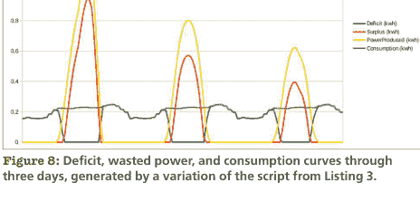

### 深入解析 Rocky Linux

下载这份免费的重点指南，了解为何 Rocky Linux 在全球各地的用户中赢得了广泛的受众。

#### 管理员

网络与安全

重点指南

#### Rocky Linux 内部一览

- `后起之秀`

  了解为何 Rocky 正崛起为领先的企业级 Linux 系统

- `Rocky 在 HPC 中的应用`

  探索面向高性能环境的工具

- `迁移故事`

  使用 `migrate2rocky` 从 CentOS 迁移

我们采访了 Rocky 的创始人 Greg Kurtzer

`WWW.ADMIN-MAGAZINE.COM`

7.95 美元

#### 免费下载！

`https://bit.ly/Inside-Rocky-Linux`

### 引言

#### Linux 之声

在过去，如果你想在不同的 Linux 系统之间切换，你需要将电脑设置为双启动。后来，虚拟机（Virtual Machines）出现了，这使得临时切换变得更加容易。但虚拟机仍然比许多用户愿意花费的精力要多，尤其是当你只是想临时切换以运行测试或检查程序时。本月，我们向你展示了一种在 Linux 会话中切换 Linux 系统的替代方案。你将学习如何设置 Ubuntu（或其他 Linux）以在 Docker 容器中运行。此外，在本期《Linux 之声》中，你将学习使用 IPTVnator 在 Linux 上观看电视，以及使用 LDraw 和 LeoCAD 可视化你的乐高项目。


#### Linux 之声

- `狗屋 – 软件自由` Jon "maddog" Hall 限制自由开源软件（FOSS）的用途可能看起来很诱人，但这可能也不是某些人想象中的解决方案。72

- `Docker` Hans-Georg Eber 你使用 Ubuntu 工作，但需要在 openSUSE 上测试某些东西吗？你不需要第二台 PC 或虚拟机——一个单独的容器就足够了。73

- `IPTVnator` Erik Bärnwaldt IPTV 标准让你可以在 Linux 上观看你喜爱的频道。80

- `FOSS 精选` Grahm Morrison 本月 Grahm 审视了 LosslessCut、Webcamoid、Sniffnet 等更多工具！84

- `教程 – LDraw 和 LeoCAD` Daniel Tibi LDraw 和 LeoCAD 帮助你成为虚拟乐高建筑师。90


### MADDog 的狗屋


> Jon "maddog" Hall 是一位作家、教育者、计算机科学家和自由软件先驱，自 1994 年以来一直是 Linux 的热情倡导者，并促进了 Linux 向 64 位系统的移植。他担任 Linux 国际组织®的总裁。

限制自由开源软件（FOSS）的用途可能看起来很诱人，但这可能也不是某些人想象中的解决方案。

作者：JON "MADDOG" HALL

#### 工具不是问题

最近，关于是否应该在许可证中加入条款，以防止软件被用于“不良”目的（即使是自由软件或开源软件）的问题再次被提出。我认为，大部分灵感来源于乌克兰和俄罗斯之间的战争，人们不希望他们的软件被用于战争目的。其中一些可能也源于各个政府使用计算机视觉软件监控公民，或使用开放式人工智能软件建立监控。甚至有人提出了将“他的”自由软件用于核武器的概念。

我是一名和平主义者。我不相信战争是解决方案。然而，这并不意味着如果一个好战强国攻击我的国家并开始伤害人们，我会束手无策。因此，我能理解这些人的感受。

然而，还有许多其他一些人不喜欢的事情，这些人会反对其他人使用“他们的”软件来做这些事情。

有些人不喜欢政府，所以他们不希望政府使用他们的软件。有些人不喜欢军队，所以他们不希望军队使用他们的软件，即使不是为了杀戮目的。有些人不喜欢警察。有些人不喜欢宗教组织，有些人不喜欢无神论者。这个列表可以一直列下去，如果你在这些群体周围画一个圆，最终维恩图显示可以使用该软件的人群集合是空集。如果没有人使用该软件，那么编写它的理由是什么？


另一个问题是软件所有权的概念。某个特定的人，也许是项目的创始人或团队领导，可能会试图限制软件的使用，但他们是唯一编写它的人吗？所有贡献者都同意这种限制吗？Linux 内核项目仍回退到 `GPL` 的 `2.x` 许可证的原因之一是，有数千名贡献者和数千名版权持有人，他们必须都对许可证的变更表示同意。其中一些贡献者已经离开项目或去世，这使得获得他们更改许可证的许可变得非常困难。

人们可能听说过改变许可证的开源项目。通常，这是通过项目的分支（`fork`）来实现的，在许可证变更之前发布的代码保持原有的许可证，而修改后的许可证适用于之后分支出的代码。更改许可证的另一种方法是让所有贡献者将他们的版权转让给某个实体（个人或公司），使该个人或公司有能力更改许可证。这就是为什么 `GNU` 项目能够从 `GPL 2.x` 许可证过渡到 `GPL 3.x` 许可证，而无需获得数千人的许可。

但试图让数千名人就更改许可证以包括针对某些群体或国家的制裁达成一致，可能几乎是不可能的，并且是一个极其危险的先例。

甚至讨论这样的路径都会产生可怕的涟漪效应。在自由和开源软件（`FOSS`）的早期，知识产权律师会阅读许多 `FOSS` 软件的许可证，只是为了确保其中没有可能会影响他们所代表的公司并阻止这些公司使用该软件的“陷阱”。这些律师的审查是生成和使用有限数量的开源许可证的原因之一。一旦律师审查了特定类型许可证的条款和条件，他们就不需要再次审查。如果现在有新的限制叠加在最终用途上，这将重新打开审查流程，许多公司将放弃使用和贡献开源。

最后，无论你怎么做，开源软件都会找到想要将其用于不良目的的人。正如锁只能让诚实的人保持诚实一样，许可证无法阻止坏人将软件用于邪恶目的。

解决这个问题的方法不是责怪工具，而是责怪用户。锤子可以用来建造房子，也可以用来杀人……用于善或用于恶。我们需要阻止的是那些正在帮助制造武器或发动战争的终端开发者，而不是管道中的 `FOSS`。

### 使用 Ubuntu 和其他发行版作为 Docker 容器

#### 干净地停靠

你使用 Ubuntu 工作，但想在 openSUSE 系统上快速测试某些东西吗？你不需要第二台 PC 或虚拟机来做这件事——一个单独的容器就足够了。

作者：`HANS-GEORG EBER`

虚拟机（`VM`）允许你使用为其他 Linux 发行版甚至其他操作系统编写的软件。但设置虚拟机可能非常耗时。如果你使用 `VirtualBox`、`VMware` [1] 或 `Gnome Boxes` [2]，你可以在程序界面中配置并启动一个虚拟 PC，然后再进行常规操作系统安装。完成此过程后，窗口将包含一个完整的图形桌面，例如 `KDE` 或 `Gnome`，你可以像真实 PC 一样启动和关闭虚拟机。在许多情况下，完整安装正是你需要的解决方案，但有时你可能只是想快速测试一个程序。那么，安装完整系统的虚拟机开销与结果相比是不成比例的。你无法总是在 Linux 系统上直接运行程序的原因在“库依赖”框中揭晓。

如果你开发自己的软件，你可能想测试你生成的程序文件是否能在你支持的所有发行版版本上运行。你生成的 `RPM` 或 `Debian` 包可以导入吗？是否满足了所有库依赖项，使程序实际能够启动？最后，它是否按预期工作？同样，对于这些软件测试，使用虚拟机有点小题大做。容器提供了虚拟机或真实硬件的替代方案：它们不虚拟化完整的计算机，因此并不适合所有目的，但在许多情况下，它们非常适合手头的使用案例。它们的优点是资源效率高（对 `RAM` 和磁盘空间的需求较低），并且可以比虚拟机更快地设置。你可以在几秒钟内部署一个新容器，而虚拟机中的全新安装大约需要 15 分钟。即使克隆现有虚拟机，你也……

#### 库依赖

你无法在任意系统上运行任意 Linux 应用程序的原因是，程序文件通常只包含计算机执行的二进制代码的一部分。许多功能存在于库文件中，Linux 在程序启动时额外加载这些文件。例如，如果一个文本模式的交互式程序想要读取一行文本，它不会使用自己的例程来完成此操作，而是依赖于同名库中的 `readline` 行函数。图 1 显示了一个读取一行文本并原样输出的小型示例程序（带有提示）。输入和输出的代码来自用于输入的 `readline` 库函数和用于输出的 `print`。在使用 `GCC` 编译时，`-lreadline` 选项确保编译器在生成的程序文件中注明对 `readline` 库的依赖。图 1 中的最后一个命令显示了测试程序所需的所有库，包括 `libreadline.so.8`。文件扩展名 `.so.8` 表明程序期望特定版本的库，即第 8 版。如果你尝试在具有较旧 `readline` 版本 6 或 7 的机器上运行该程序，程序加载器将找不到该库并发出警告（列表 1）。缺失的库可以稍后安装：Linux 非常灵活，允许你同时安装同一库的不同版本。你能否在特定的 Linux 发行版中找到缺失的版本是另一个问题。Linux 及其可用应用程序具有如此多的动态性，以至于每个发行版更新也会更新一些库包。需要过新或过旧库的程序将无法再运行。切换到不同的发行版，例如从 `Ubuntu` 切换到 `openSUSE`，变得更加困难，因为发行商通常自行决定将某些软件包保留在低于最新可用版本的版本上。在 `openSUSE` 上编译的程序在 `Ubuntu` 上可能需要来自两个不同发行版的库。

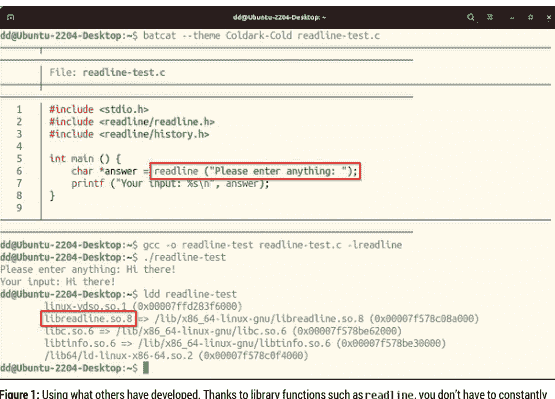

**图 1：** 使用他人开发的成果。得益于诸如 `readline` 这样的库函数，你不必总是重新造轮子。

### 列表 1：版本错误

```
./readline-test: error while loading shared libraries: libreadline.so.8: cannot open shared object file: No such file or directory
```

由于在此过程中需要复制数吉字节的数据，因此预计会等待几分钟。

本文介绍 `Docker` [3]。但在 Linux 上还有其他提供容器服务的工具。`Docker` 的竞争者 Linux 容器（`LXC` [4]）是另一个流行的选择；它例如被 `Proxmox` [5] 虚拟环境（`VE`）和容器管理工具所使用。

命名为 `docker`，且在设置完成后 `Docker` 服务仍处于禁用状态。你可以使用两个 `systemctl` 命令（第 6 行和第 7 行）来更改此设置。退出当前会话然后重新登录，才能使新的组成员身份生效。顺便说一下，在我们在 `Ubuntu 22.04` 上的测试中，仅重新登录是不够的。我们不得不通过输入以下命令杀死我们自己的所有进程：

```
sudo killall -9 -u $USER
```

然后再次登录以使其生效。或者，你可以重启计算机，但使用 `killall` 方法速度更快。

最后，确保设置成功（第 9 行）。程序应输出几行文本，包括“来自 Docker 的你好！”如果测试失败，请使用 `groups` 命令检查你是否是 `docker` 组的成员。此外，使用 `systemctl status docker` 查看 `Docker` 守护进程是否正在运行。

### 安装 Docker

Docker 的设置速度很快。在 `Ubuntu` 上，安装 `docker.io` 软件包（列表 2，第 2 行），并使用 `usermod` 注册为新 `docker` 组的成员（第 3 行）。在 `openSUSE` 系统上，你可以使用 `Zypper` 进行安装（第 5 行）。那里的软件包简单称为：

### 映像与容器

运行列表 2 中第 9 行的 `docker run hello-world` 命令时，从 `Docker Hub` [6] 下载了一个映像，从映像文件创建了一个新容器，并启动了该容器。然后该容器运行了一个 `Hello World` 程序，输出了从“来自 Docker 的你好！”开始的所有行。

### 列表 2：设置 Docker

```
01 #### On Ubuntu
02 $ sudo apt install docker.io
03 $ sudo usermod -a -G docker esser
04 #### On openSUSE
05 $ sudo zypper install docker
06 $ sudo systemctl enable docker
07 $ sudo systemctl start docker
08 #### Function test
09 $ docker run hello-world
```

### 列表 3：启动容器

```
#### Current version
$ docker run -it ubuntu
#### Ubuntu 20.04
$ docker run -it ubuntu:20.04
#### Ubuntu 16.04
$ docker run -it ubuntu:16.04
```


如果你是容器的新手，“映像”和“容器”这些术语可能会令人困惑。映像本质上是一组文件，辅以各种元数据，例如计算机架构或环境变量规范。它仅作为创建容器的模板。当你运行 `docker run <image>` 命令时，Docker 会从指定的映像文件创建一个容器。为此，该工具会解包映像。你会在 `/var/lib/docker/overlay2/` 的一个子文件夹中找到这些文件。

然后，Docker 从该文件夹中启动一个程序，假装该文件夹是根文件系统。该程序无法访问文件系统更上层位置的文件，这保护了你的常规 Linux 系统免受来自容器内部的操作企图。除了被锁定在一个子文件夹中外，还有更多的事情发生。除此之外，容器拥有自己的网络设置，这些设置独立于宿主系统。

你可以使用单个映像文件创建多个容器，并在其中运行独立进程。容器在运行时会发生变化，因为你可以删除、重新创建或编辑其中的文件。如果你正在寻找一个关于映像和容器之间区别的类比：与 VMware 和 VirtualBox 等虚拟化工具相比，映像对应于虚拟设备，而容器对应于单独的虚拟机。

### 一次性容器

容器（与虚拟机不同）通常只使用一次。在这种情况下，单个命令运行容器，Docker 随后立即将其删除。

### 列表 4：在容器内部

```
01 esser@percent:~$ docker run -it ubuntu
02 root@4eac4c755505:/# ps
03
04  PID TTY      TIME CMD
05  1 pts/0    00:00:00 bash
06  9 pts/0    00:00:00 ps
07 root@4eac4c755505:/# grep PRETTY /etc/os-release
08 PRETTY_NAME="Ubuntu 22.04.1 LTS"
```

### 列表 5：命令调用

```
$ docker run --rm fedora grep PRETTY /etc/os-release PRETTY_NAME="Fedora Linux 38 (Container Image)"
```

Docker 附带有一个 `--rm` 选项，它自动化了删除过程。

这种浪费容器的用法是可能的（并且有意义）的，因为创建和删除容器几乎毫不费力。只有在首次启动容器时，你才需要获取匹配的映像，通常是从 Docker Hub [6] 获取。在所有后续启动中，它已经存在于 Docker 的本地缓存目录中。

由于容器通常是短命的，将配置文件和你希望保留在容器外部的其他任何东西存储起来已成为常见做法。为此，你可以将常规文件系统的一部分提供给容器，或创建特殊的容器卷。

### Ubuntu 版本

你可以使用列表 3 中的命令创建具有不同版本 Ubuntu 的容器。这些命令中的每一个都从 Ubuntu 映像创建容器，并在其中启动一个 `Bash` shell。选项 `-i`（交互式）和 `-t`（终端）告诉容器以带虚拟终端的交互模式运行，这样你就可以从当前终端窗口控制它。如果没有这些选项，容器将在后台启动。

在根提示符下，你可以看到你在容器中拥有管理员权限（列表 4，第 2 到 5 行）。现在你可以在 shell 中像往常一样输入命令（第 2 行和第 6 行）。如果你为此使用外部程序，你需要启动容器中的版本。要了解容器中正在运行哪个发行版版本，你可以查找 `/etc/os-release`、`/etc/debian_version` 或 `/etc/redhat-release` 文件（第 6 行）。

如果你在启动容器时已经知道不需要 shell，只是想要执行一个特定命令，请在调用中的映像名称后附加该命令（列表 5）。如果不需要交互式使用，请简单地省略 `-i` 和 `-t` 选项。图 2 展示了如何启动具有不同版本 Ubuntu 的容器。为此，只需在映像名称后附加冒号和所需版本（例如 `ubuntu:16.04`）。

> 你无法使用 Docker 工具查找哪些版本可用，但你可以在 Docker Hub 页面 [6] 获取此信息。使用该处的搜索功能，从匹配结果中选择合适的映像，然后切换到“标签”选项卡。

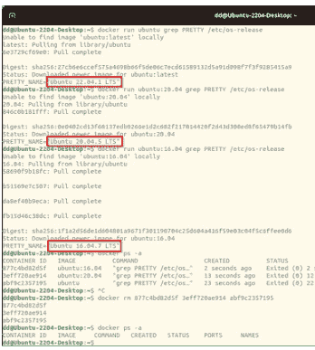

在较长的页面上，你仍然可以看到关于所有可用标签的提示。这些可以是版本号，也可以是像 `latest` 这样的代码名称或标识符。如果你想要将排序顺序更改为 A-Z，你会看到最旧的版本排在第一个（见图 3）。如果你知道映像的名称，也可以直接构造一个 URL，例如 `https://hub.docker.com/~/image-/<tags>`。

列表 6 中的 `Bash` 函数是上述代码片段的一种替代方案。请确保在 `~/.bashrc` 文件和 `post-install` 脚本中安装了 `skopeo` 和 `jq` 工具（在 Ubuntu 软件包中名称相同）。

你可以在所有新的 shell 中使用 `dfind` 命令来搜索 Docker Hub 上的版本（列表 7）。

### 文件访问

在容器中运行程序通常只有在你可以访问主机上的文件时才有意义。你可以通过使用虚拟机（VM）轻松使用 Docker，或者简单地使用一种额外的选项形式：

```
-v <FolderHost>:<FolderContainer>
```

当调用 Docker 时，在主机上，将你的主目录 `/var/home/dir/` 共享给容器，如列表 8 的第一行所示。你会看到包括主目录在内的整个目录树，以及 `/var/home/dir/` 下的所有子文件夹。

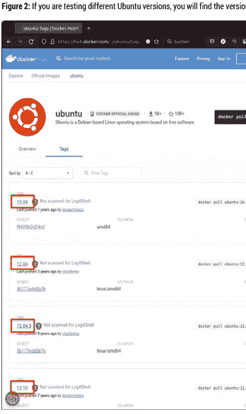

### 列表 6：dfind

```
dfind () {
    skopeo inspect docker://$1 \\
    | jq '.RepoTags' | tr -d '\n"'
    | echo;
}
```

### 列表 7：调用 dfind

```
$ dfind fedora
["20", "21", "22", "23", "24", "25", "26", "20-modular", "27", "28", "29", "30", "31", "32", "33", "34", "35", "36", "37", "branched", "heisenbugs", "latest", "modular", "rawhide"]
```

你可以设置多个这样的映射，甚至可以使用 `~` 将个别文件包含在容器中。如果你使用这种方法将 `/etc/passwd`、`/etc/shadow` 和 `/etc/group` 文件（这些对容器内的用户管理很重要）映射到容器中，你可以使用 `su` 切换到容器中的你自己的帐户，并像往常一样在你的主目录中工作（列表 8，从第 3 行开始）。

### 列表 8：文件访问

```
01 $ docker run -it --rm \
02 -v ~/HOME:/var/homedir ubuntu
03 $ docker run -it --rm \
04 -v /home:/home \
05 -v /etc/passwd:/etc/passwd \
06 -v /etc/shadow:/etc/shadow \
07 -v /etc/group:/etc/group ubuntu
08 $ docker cp /etc/passwd \
09 223405*7e4a3:/etc/passwd
```

容器中的目标目录不需要存在：Docker 会即时创建它们。图 4 显示了从宿主系统和容器内部看到的同一个主目录。请注意：你对容器中文件所做的更改也会在宿主系统上生效。为了安全起见，将文件复制到容器中是一个好主意。

### 文件传输

Docker 提供了一个独立的命令用于在容器中传输文件：`docker cp` 让你可以类似 SSH `scp` 工具的方式复制文件。你不能用它将文件复制到映像中；你需要先启动一个容器。

容器运行后，你可以在提示符处找到其计算机名称，这是一个由十六进制数字组成的 ID。你也可以

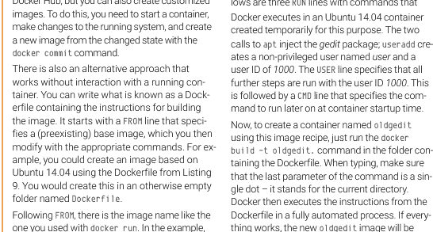

在 Docker Hub 上可用的 Ubuntu。接下来是三行带有命令的 `RUN` 行，这些命令由 Docker 在一个专门为此目的临时创建的 Ubuntu 14.04 容器中执行。两次对 `apt` 的调用注入了 `gedit` 软件包；`useradd` 创建一个名为 `user` 的非特权用户和一个用户 ID 1000。`USER` 行指定所有后续步骤都使用用户 ID 1000 运行。随后是一行 `CMD`，指定在容器启动时稍后运行的命令。

现在，要使用此映像配方创建名为 `oldgit1` 的容器，只需在包含 `Dockerfile` 的文件夹中运行 `docker build -t oldgit1 .` 命令。输入时，请确保命令的最后一个参数是单个点 `.` ——它代表当前目录。然后，Docker 会在一个完全自动化的过程中执行 `Dockerfile` 中的指令。如果一切正常，新的 `oldgit1` 映像随后将可用。


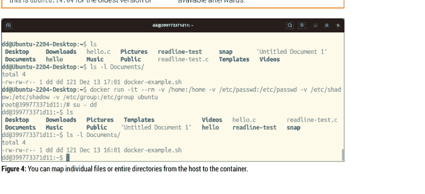

### X 窗口

图形应用程序最初可能会给 Docker 带来一些问题，但这很容易解决。对于传统 X 应用程序（非 Wayland），诀窍是将`/tmp/.X11-unix/`目录和`$DISPLAY`环境变量传递给容器。你可以通过创建一个名为`olgedit`的自定义镜像（参见“使用 Dockerfile 构建镜像”框）来让旧版本的`gedit` GNOME 编辑器正常工作。

#### 列表 9：Dockerfile

```
FROM ubuntu:14.04
RUN apt update
RUN apt install -y gedit
RUN useradd -m user
USER 1000
CMD gedit
```

### Wayland

当前版本的 Ubuntu 使用 Wayland 作为 X 窗口系统的后继者，Wayland 提供了一个兼容层，允许 X 应用程序在其上运行。真正的 Wayland 程序无法在 X 上运行。一个例子是`foot`终端程序，你可以通过在 Ubuntu 中输入`sudo apt install foot`来安装它。如果你在 Wayland 会话中启动`foot`，会出现一个终端窗口。如果你试图在 X 会话中做同样的事情，会出现一条冗长的错误消息，最后以`failed to connect to wayland; no compositor running? goodbye`结尾。

Wayland 使用不同的套接字和文件来提供对 Wayland 服务器的访问。套接字文件是`/run/user/1000/way-0`，而不是`/tmp/.X11-unix/X0`，并且`$XDG_RUNTIME_DIR`变量包含了相关信息，如文件夹名称`/run/user/1000/`，而不是`$DISPLAY`。你需要像 X 那样将两者都传递给容器，如下列表 11 所示。`waylandtest`只是另一个测试镜像的名称。如果 Wayland 服务器正在运行，也可以组合 X 和 Wayland 的支持。在这种情况下，你需要将两个套接字和两个环境变量都传递给容器。

#### 列表 10：X11

```
$ docker run -it --rm -e DISPLAY \
-v /tmp/.X11-unix/:/tmp/.X11-unix \
-v $HOME:/home/user olgedit
```

#### 列表 11：Wayland

```
$ docker run -it --rm -e XDG_RUNTIME_DIR -v $HOME:$HOME -v /run/user/1000/wayland-0:/run/user/1000/wayland-0 waylandtest
```

`olgedit`镜像没有配置启动`/bin/bash` shell，而是直接启动`gedit`编辑器。它以普通用户权限执行此操作，也就是说，不是作为`root`，而是作为 ID 为 1000 的`user`。现在，当你通过输入`docker run -it --rm olgedit`尝试启动容器时，你会看到一些以`cannot open display`结尾的错误消息。该程序无法访问 X 服务器，因此无法打开窗口。主机上运行的 X 服务器在`/tmp/.X11-unix/`下创建一个名为`X0`的特殊套接字类型文件，应用程序可以在此处与其联系。除了`X0`之外，如果有多个 X 服务器处于活动状态，这里可能还有其他条目（`X1`、`X2`等）。显示程序窗口的 X 服务器由`$DISPLAY`环境变量决定。它通常包含`:0`的值。然后使用`-e $DISPLAY`和`-v /tmp/.X11-unix/:/tmp/.X11-unix`选项将变量的内容以及对`/tmp/.X11-unix/`中套接字的访问权限传递给容器（列表 10），允许`gedit`运行。由于主目录另外映射到容器中的`/home/user/`，`gedit`也应该能够打开和编辑文件（图 5）。

使用`docker ps`查找容器。在由非常长的行组成的概览中，除了数字 ID 之外，还有一个漂亮的名称，除非你在启动时为新的容器指定一个，否则 Docker 会随机分配该名称。数字 ID 和名称都可以用于`copy`命令（例如，将文件`/etc/passwd`复制到容器中）。列表 8 的第 9 行将`/etc/passwd`文件从主机系统复制到 ID 为`22340547e6a3`的容器及其相同文件夹中，名称保持不变。

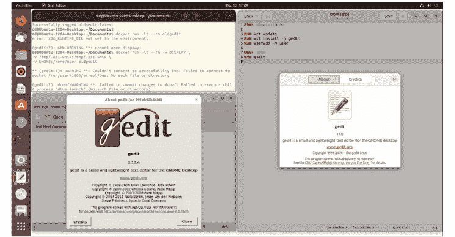

#### 结论

Docker 容器提供了虚拟机（VM）的一种实用替代方案，既节省时间又节省计算资源。对于许多应用程序来说，学习如何使用 Dockerfile 构建自己的镜像是值得的。你并不总是需要从头开始，可以使用 Docker Hub 上的镜像作为基础，并将其配置以满足你的需求。当你同时使用一系列容器时，事情开始变得更有意思。然后，诸如容器网络配置和使用 Kubernetes [7] 等工具进行编排等高级主题开始出现。■

### 参考资料

- [1] "Comparing VirtualBox and VMware Workstation Player" 作者 Thomas Leichentseimer，Linux Magazine，第 204 期，2017 年 11 月，https://www.linux-magazine.com/Issues/2017/204/VirtualBox-vs.-VMware
- [2] "Run Virtual Machines in Gnome Boxes" 作者 Christoph Langerer，Linux Magazine，第 221 期，2019 年 4 月，https://www.linux-magazine.com/Issues/2019/221/Gnome-Boxes
- [3] Docker：https://www.docker.com
- [4] LXC：https://linuxcontainers.org
- [5] Proxmox：https://pve.proxmox.com/wiki/Main_Page
- [6] Docker Hub：https://hub.docker.com
- [7] Kubernetes：https://kubernetes.io/docs/concepts/overview/


### IT 亮点一览

太忙而无法深入阅读新闻稿和嘈杂的科技新闻网站？让我们将最重要的新闻、技术文章和工具技巧直接发送到你的收件箱。

- Linux Update • ADMIN Update • ADMIN HPC

紧扣 IT 行业的脉搏。

- ADMIN 和 HPC：bit.ly/HPC-ADMIN-Update
- Linux Update：bit.ly/Linux-Update

### 通过 IPTVnator 在互联网上观看电视

#### 沙发冲浪

多亏了 IPTV 标准和免费软件，你可以毫无问题地在 Linux 上观看你最喜欢的频道。

作者 ERIK BÄRWALDT

传统视听技术和现代多媒体计算机应用程序继续融合。在过去，由于软件缺乏，Linux 在流媒体免费电视节目的方面落后于其他平台。IPTVnator 是一个年轻的项目，正在努力弥补这一差距 [1]。

#### 技术

传统的宽带电视接收需要额外的硬件，如 DVB-S、DVB-T 或 DVB-C 的接收器。然而，网络协议电视（IPTV）[2] 让你无需额外组件即可在互联网上观看日常电视节目。与宽带服务相比，IPTV 编程具有一些优势。观众可以访问提供的所有内容范围，无需固定连接，也无需特殊接收器。

除了公共广播机构，用户还可以选择许多小型地方电视台，你可以从世界任何地方通过互联网接收它们。模块化频道列表让你可以观看其他国家和大洲的频道。约 4Mbps 的带宽对于通过 IPTV 接收标清（SDTV）电视广播已经足够。但要观看高清（HDTV）质量的节目，你需要至少 8Mbps 的带宽，这在许多现代 DSL 线路的范围内。PC 上使用的 IPTV 软件依靠缓冲来确保即使在带宽波动的情况下也能持续接收。

#### IPTVnator

仍然相当年轻的程序 IPTVnator 是通过 IPTV 看电视的绝佳选择。像 FreetuxTV [3] 和 Zapping [4] 这样的旧软件包多年来没有进行任何开发，而 Linux Mint 软件池的一部分 Hypnotix [5]，由于某些特定的依赖关系，只能在少数几个 Linux 发行版上运行。IPTVnator 目前是唯一几个图形化且通用性强的 Linux IPTV 应用程序之一。


`IPTVnator` 提供完整的功能范围，便于接收。你可以集成 `M3U` 或 `M3U8` 播放列表，并且集成的节目指南让你可以定义收藏。此外，基于 `Electron` 和 `Angular` 框架的应用程序自动维护频道列表更新，并内置了 `HTML5` 播放软件。

### 安装

该软件尚未进入常见发行版的存储库，但如果你的发行版支持 `snap`，你可以将其作为 `snap` 包获取。你还可以在项目网站上找到 `RPM` 和 `DEB` 包 – 或者下载适用于 64 位系统的跨发行版 `AppImage` 格式的 `IPTVnator`。

从特定于发行版的应用商店安装 `snap` 包时，例程通常会自动在桌面环境的菜单中创建一个启动器。你可以手动启动 `AppImage` 包，或者使用 `AppImageLauncher` 将其集成到你的桌面环境中。首次启动后，应用程序显示一个仅包含少量控件的窗口（图 1）。


### X 窗口

图形应用程序最初可能会给 `Docker` 带来一些问题，但这很容易解决。对于传统 `X` 应用程序（非 `Wayland`），诀窍是将 `/tmp/.X11-unix/` 目录和 `$DISPLAY` 环境变量传递给容器。你可以通过创建一个名为 `olgedit` 的自定义镜像（参见“使用 `Dockerfile` 构建镜像”框）来让旧版本的 `gedit` GNOME 编辑器正常工作。

#### 列表 9：`Dockerfile`

```
FROM ubuntu:14.04
RUN apt update
RUN apt install -y gedit
RUN useradd -m user
USER 1000
CMD gedit
```

### Wayland

当前版本的 `Ubuntu` 使用 `Wayland` 作为 `X` 窗口系统的后继者，`Wayland` 提供了一个兼容层，允许 `X` 应用程序在其上运行。真正的 `Wayland` 程序无法在 `X` 上运行。一个例子是 `foot` 终端程序，你可以通过在 `Ubuntu` 中输入 `sudo apt install foot` 来安装它。如果你在 `Wayland` 会话中启动 `foot`，会出现一个终端窗口。如果你试图在 `X` 会话中做同样的事情，会出现一条冗长的错误消息，最后以 `failed to connect to wayland; no compositor running? goodbye` 结尾。

`Wayland` 使用不同的套接字和文件来提供对 `Wayland` 服务器的访问。套接字文件是 `/run/user/1000/way-0`，而不是 `/tmp/.X11-unix/X0`，并且 `$XDG_RUNTIME_DIR` 变量包含了相关信息，如文件夹名称 `/run/user/1000/`，而不是 `$DISPLAY`。你需要像 `X` 那样将两者都传递给容器，如下列表 11 所示。`waylandtest` 只是另一个测试镜像的名称。如果 `Wayland` 服务器正在运行，也可以组合 `X` 和 `Wayland` 的支持。在这种情况下，你需要将两个套接字和两个环境变量都传递给容器。

#### 列表 10：`X11`

```
$ docker run -it --rm -e DISPLAY \
-v /tmp/.X11-unix/:/tmp/.X11-unix \
-v $HOME:/home/user olgedit
```

#### 列表 11：`Wayland`

```
$ docker run -it --rm -e XDG_RUNTIME_DIR -v $HOME:$HOME -v /run/user/1000/wayland-0:/run/user/1000/wayland-0 waylandtest
```

`olgedit` 镜像没有配置启动 `/bin/bash` shell，而是直接启动 `gedit` 编辑器。它以普通用户权限执行此操作，也就是说，不是作为 `root`，而是作为 ID 为 1000 的 `user`。现在，当你通过输入 `docker run -it --rm olgedit` 尝试启动容器时，你会看到一些以 `cannot open display` 结尾的错误消息。该程序无法访问 `X` 服务器，因此无法打开窗口。主机上运行的 `X` 服务器在 `/tmp/.X11-unix/` 下创建一个名为 `X0` 的特殊套接字类型文件，应用程序可以在此处与其联系。除了 `X0` 之外，如果有多个 `X` 服务器处于活动状态，这里可能还有其他条目（`X1`、`X2` 等）。显示程序窗口的 `X` 服务器由 `$DISPLAY` 环境变量决定。它通常包含 `:0` 的值。然后使用 `-e $DISPLAY` 和 `-v /tmp/.X11-unix/:/tmp/.X11-unix` 选项将变量的内容以及对 `/tmp/.X11-unix/` 中套接字的访问权限传递给容器（列表 10），允许 `gedit` 运行。由于主目录另外映射到容器中的 `/home/user/`，`gedit` 也应该能够打开和编辑文件（图 5）。

使用 `docker ps` 查找容器。在由非常长的行组成的概览中，除了数字 ID 之外，还有一个漂亮的名称，除非你在启动时为新的容器指定一个，否则 `Docker` 会随机分配该名称。数字 ID 和名称都可以用于 `copy` 命令（例如，将文件 `/etc/passwd` 复制到容器中）。列表 8 的第 9 行将 `/etc/passwd` 文件从主机系统复制到 ID 为 `22340547e6a3` 的容器及其相同文件夹中，名称保持不变。


#### 结论

`Docker` 容器提供了虚拟机（`VM`）的一种实用替代方案，既节省时间又节省计算资源。对于许多应用程序来说，学习如何使用 `Dockerfile` 构建自己的镜像是值得的。你并不总是需要从头开始，可以使用 `Docker Hub` 上的镜像作为基础，并将其配置以满足你的需求。当你同时使用一系列容器时，事情开始变得更有意思。然后，诸如容器网络配置和使用 `Kubernetes` [7] 等工具进行编排等高级主题开始出现。

### 参考资料

- [1] “Comparing `VirtualBox` and `VMware Workstation Player`” 作者 `Thomas Leichentseimer`，`Linux Magazine`，第 204 期，2017 年 11 月，`https://www.linux-magazine.com/Issues/2017/204/VirtualBox-vs.-VMware`
- [2] “Run Virtual Machines in `Gnome Boxes`” 作者 `Christoph Langerer`，`Linux Magazine`，第 221 期，2019 年 4 月，`https://www.linux-magazine.com/Issues/2019/221/Gnome-Boxes`
- [3] `Docker`：`https://www.docker.com`
- [4] `LXC`：`https://linuxcontainers.org`
- [5] `Proxmox`：`https://pve.proxmox.com/wiki/Main_Page`
- [6] `Docker Hub`：`https://hub.docker.com`
- [7] `Kubernetes`：`https://kubernetes.io/docs/concepts/overview/`


### IT 亮点一览

太忙而无法深入阅读新闻稿和嘈杂的科技新闻网站？让我们将最重要的新闻、技术文章和工具技巧直接发送到你的收件箱。

- `Linux Update` • `ADMIN Update` • `ADMIN HPC`

紧扣 IT 行业的脉搏。

- `ADMIN` 和 `HPC`：`bit.ly/HPC-ADMIN-Update`
- `Linux Update`：`bit.ly/Linux-Update`

### 通过 `IPTVnator` 在互联网上观看电视

#### 沙发冲浪

多亏了 `IPTV` 标准和免费软件，你可以毫无问题地在 `Linux` 上观看你最喜欢的频道。

作者 `ERIK BÄRWALDT`

传统视听技术和现代多媒体计算机应用程序继续融合。在过去，由于软件缺乏，`Linux` 在流媒体免费电视节目的方面落后于其他平台。`IPTVnator` 是一个年轻的项目，正在努力弥补这一差距 [1]。

#### 技术

传统的宽带电视接收需要额外的硬件，如 `DVB-S`、`DVB-T` 或 `DVB-C` 的接收器。然而，网络协议电视（`IPTV`）[2] 让你无需额外组件即可在互联网上观看日常电视节目。与宽带服务相比，`IPTV` 编程具有一些优势。观众可以访问提供的所有内容范围，无需固定连接，也无需特殊接收器。


除了公共广播机构，用户还可以选择许多小型地方电视台，你可以从世界任何地方通过互联网接收它们。模块化频道列表让你可以观看其他国家和大洲的频道。约 4Mbps 的带宽对于通过 `IPTV` 接收标清（SDTV）电视广播已经足够。但要观看高清（HDTV）质量的节目，你需要至少 8Mbps 的带宽，这在许多现代 DSL 线路的范围内。PC 上使用的 `IPTV` 软件依靠缓冲来确保即使在带宽波动的情况下也能持续接收。

#### `IPTVnator`

仍然相当年轻的程序 `IPTVnator` 是通过 `IPTV` 看电视的绝佳选择。像 `FreetuxTV` [3] 和 `Zapping` [4] 这样的旧软件包多年来没有进行任何开发，而 `Linux Mint` 软件池的一部分 `Hypnotix` [5]，由于某些特定的依赖关系，只能在少数几个 `Linux` 发行版上运行。`IPTVnator` 目前是唯一几个图形化且通用性强的 `Linux IPTV` 应用程序之一。

`IPTVnator` 提供完整的功能范围，便于接收。你可以集成 `M3U` 或 `M3U8` 播放列表，并且集成的节目指南让你可以定义收藏。此外，基于 `Electron` 和 `Angular` 框架的应用程序自动维护频道列表更新，并内置了 `HTML5` 播放软件。

#### 安装

该软件尚未进入常见发行版的存储库，但如果你的发行版支持 `snap`，你可以将其作为 `snap` 包获取。你还可以在项目网站上找到 `RPM` 和 `DEB` 包 – 或者下载适用于 64 位系统的跨发行版 `AppImage` 格式的 `IPTVnator`。

从特定于发行版的应用商店安装 `snap` 包时，例程通常会自动在桌面环境的菜单中创建一个启动器。你可以手动启动 `AppImage` 包，或者使用 `AppImageLauncher` 将其集成到你的桌面环境中。首次启动后，应用程序显示一个仅包含少量控件的窗口（图 1）。


### 播放列表和组

要查看你的频道，下一步是添加播放列表。这些播放列表以 `M3U` 格式提供，并且可以从互联网上下载。请谨慎行事：许多通过搜索引擎找到的资源都是商业性质的，其中一些甚至传播恶意软件。建议使用 `GitHub` 上的精选列表 [6]。

在`按国家分组`部分中，展开列表将文件下载到你的系统中。下载完成后，打开`IPTVnator`，并点击程序窗口中的`从文件上传`系统按钮。现在，从你的文件管理器中拖放包含特定国家频道列表的`M3U`文件到程序窗口中。`M3U`文件只能逐个集成到应用程序中。

每当粘贴一个`M3U`文件时，播放窗口会打开，左侧显示电台列表，而窗口的右侧主要部分则显示当前频道的流。`IPTVnator`为此自带了播放软件。

在从`GitHub`获取的列表中，你可以看到频道的分辨率、频道名称及其标志。你还可以了解该电台是否全天候（24/7）广播内容，以及节目是否仅在特定地区可用。如果是这种情况，则必须使用`VPN`访问互联网才能查看该频道，且服务器必须位于与该频道相同的国家。如果你尝试直接查看被阻止的内容，你要么会在`IPTVnator`中看到相应的消息，要么广播者本身会在播放软件中显示消息（图 2）。

在观看节目时，你可以点击屏幕右下角的开放播放器图标，将播放器切换为全屏模式。然后播放器会缩小至仅剩底部的控制栏，你可以使用它来暂停流媒体、调整音量或设置分辨率。要切换回窗口模式，请点击控制栏中的关闭十字图标。然后应用程序将跳回原始显示界面（图 3）。

### 组和收藏夹

`IPTVnator`允许你按类型选择节目。对于包含大量频道的列表，此选项特别有用。要按类型选择节目，请点击程序窗口中的`组`按钮打开组选择。软件现在会向你显示一个表格，列出各个类型及其可用的频道数量。点击所需的类型会打开其下方的电台列表（图 4）。再次点击组名称则关闭该选择。

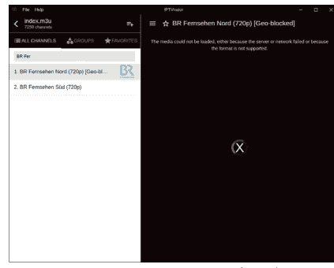

图 2：在德国境外观看德国巴伐利亚广播公司（Bayerischer Rundfunk）的节目并不容易。

为了快速访问你喜爱的频道，`IPTVnator`提供了收藏夹功能。要将某个频道标记为收藏，只需点击播放窗口上方当前正在流式传输的频道名称旁边的星号即可。要调取已保存的频道，请点击`收藏夹`。选定的频道随后会出现在左侧。要从收藏夹列表中移除某个频道，请再次点击该频道名称旁边的星号。


图 3：在全屏模式下，仅保留底部的控制栏，且在短时间内无操作后，该控制栏也会自动隐藏。


图 4：组功能将频道按类型排序，例如`新闻`。

#### 结论

多亏了`IPTVnator`，`Linux`现在有了一个易于使用的应用程序来流式传输`IPTV`广播。尽管版本号较低，但该软件已在多个平台上保持稳定，并且由于内置了播放软件，它非常适合那些没有深入底层技术知识的用户。多亏了`IPTVnator`，`Linux`用户现在可以随时随地接收他们喜爱的广播节目。

### IPTV 和 VPN

一些流媒体提供商将其服务限制在源国家，并根据`IP`地址确定接收设备的大致位置。这被称为地理封锁。如果设备不在预期的分发区域内，播放窗口中会出现错误消息。

你可以使用`VPN`来绕过地理封锁。你需要先注册`VPN`提供商并下载和安装其软件。无限数据量和访问提供商所有可用服务器通常仅对付费订阅用户可用。然而，一些提供商提供免费订阅，但数据量有限且对服务器的访问受限。

安装`VPN`提供商的客户端应用程序后，打开它并连接到目标国家（即流媒体服务所在的国家）的服务器。一旦通过`VPN`建立隧道连接，你就可以查看通常被封锁的广播（图 5）。

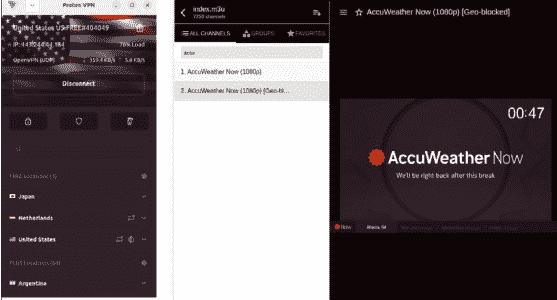

图 5：借助`VPN`访问互联网，你可以查看通常因地理封锁而无法访问的频道。

#### 信息

- [1] `IPTvNator`: `https://github.com/4gray/iptvnator`

- [2] `IPTV`: `https://en.wikipedia.org/wiki/Internet_Protocol_television`

- [3] `FreetuxTV`: `https://github.com/freetuxtv/freetuxtv`

- [4] `Zapping`: `https://zapping.sourceforge.net/Zapping/index.html`

- [5] `Hypnotix`: `https://github.com/linuxmint/hypnotix`

- [6] `IPTV`播放列表: `https://github.com/iptv-org/iptv`

### 在 Linux 上快速上手


你想让你的朋友和同事转向`Linux`吗？

这份单刊将向初学者展示如何：

- 安装`Linux`

- 为你的`Linux`系统下载和安装免费软件

- 玩游戏

- 创建文档和电子表格

- 处理照片

- 播放音乐和视频

- 以及更多！

在线订购：`shop.linuxnewmedia.com/specials`

### FOSSPicks

来自自由和开源软件世界的璀璨明珠与新发布作品


在过去几个月里，`Graham`的多用途`Steam Deck`不仅将书籍同步到了电子阅读器，还在电视上播放电影、加入了`Mumble`语音聊天、录制了两期播客，甚至玩了几款游戏。文`格雷厄姆·莫里森`（`GRAHAM MORRISON`）

#### 视频编辑器：LosslessCut

尽管我们在过去二十年中取得了令人难以置信的性能进步，但视频编辑仍然感觉像 1995 年在`PowerPC`麦金塔上编辑`Media 100`并写入磁带驱动器一样缓慢。这有几个原因，主要因为我们的需求随着能力的提升而扩展。视频分辨率、色彩深度和帧率都已扩展以适应所有这些多余的处理能力，并且在文件可以被使用之前，几乎总是需要从一个格式转码到另一个格式。

`LosslessCut`试图缓解后一个障碍。由功能极其强大的`FFmpeg`驱动，`LosslessCut`可以编辑巨大的视频，并且至关重要地，可以快速导出而不损失质量。它是通过仅允许你在视频流中特定的关键帧处进行编辑来实现这一点的，从而避免了重新计算关键帧之间可能落入的帧所需的处理器密集型操作。通过坚持在关键帧处编辑，视频数据可以直接重写，而不包含被编辑掉的部分。


随着我们现在大多数人使用手机或 `GoPro` 等相机录制 4K 视频，像这样的快速编辑是完美的解决方案。我们不是寻找完美的剪辑，而是寻找一种快速切入动作、修剪视频开头和结尾的前奏或附录的方法。使用 `LosslessCut`，你只需将视频拖放到主应用程序窗口中，定位“入点”（`edit-in point`），定位“出点”（`edit-out point`），然后将中间部分保存为一个新的、较短的视频。这意味着我们无法执行其他类型的编辑任务，如裁剪、旋转、反射或滤镜处理，因为这些任务需要重新计算帧和关键帧，因此会导致有损密集的转换。另一个缺点是，你并不总能确切的点编辑，因为编辑点或分割点会移动到最近的关键帧。幸运的是，`UI` 中有关键图标会自动将光标移动到关键帧和完美编辑点。考虑到这些限制，性能瓶颈变成了存储访问，而不是其他应用程序需要执行的转码。

正在开发关键帧之间的编辑功能，近期的开发版能够重建关键帧之后或之前的帧，从而实现任何位置的编辑，仅需对重建部分进行少量的处理和有损开销。视频的其余部分将不受影响，这仍然是对大多数视频编辑器工作方式的一大改进。`UI` 的其余部分简单但有效。高级视图允许你开启波形和缩略图时间线、设置缩放级别、截取单张图像，并查看你片段的分辨率和帧率细节。你还可以导入多个文件，尽管目前它们必须单独编辑，而不是像你可能在 `Kdenlive` 中那样在不同轨道上编辑——尽管该功能也将到来。完成后，你可以将编辑内容导出为合并的单段或多个文件。虽然重点显然是保持原始编码，但你也可以选择将输出片段转换为 `FFmpeg` 支持的任何格式。这使得 `LosslessCut` 除了满足你即时编辑的需求外，还成为文件转换的绝佳前端。


- **轨道**：可以加载、分割和连接多个视频文件。
- **音频**：音轨可以分离、删除和替换。
- **输出格式**：`LosslessCut` 使用其自带的 `FFmpeg` 或你系统的 `FFmpeg` 来支持尽可能多的文件格式。
- **缩略图**：可以为片段可选地启用缩略图和音频波形。
- **片段**：视频被切割成片段，可以作为批次导出，也可以作为单个文件导出。
- **关键帧编辑**：使用这些按钮和导航控制在此在这些编辑点之间跳转。
- **导出**：片段可以标记、重新排序，并显示在右侧单独的列表面板中。

**项目网站**

`https://github.com/mifi/lossless-cut`

### 网络摄像头

#### Webcamoid

我们最近探讨了出色的 `cameratris`，这是一款在你使用摄像头时编辑其设置的工具。`cameratris` 对视频会议特别有用，因为它允许你在会议期间调整亮度、曝光和色平衡。但 `cameratris` 只能调整硬件支持的参数，无法自行处理图像。这更难实现，因为它不仅需要更改设备设置，还需要尽可能快速且高效地拦截视频流、处理并传递给目的地。强大的 `OBS Studio` 可以做到这一点，`Webcamoid` 也可以。

`Webcamoid` 是一款比 `OBS Studio` 更低调的桌面应用程序。它不是一个用于直播的完整工具套件，而是一个更专注于照片和视频效果处理的工具。这使得它对资源的需求更少，使用也更简单。它可以录制来自摄像头的视频和拍摄照片，捕获桌面，并通过 60 多种效果中的一种或多种运行捕获。除了你可以使用 `cameratris` 控制的相同内置设置外，你还可以将视频转换为 `ASCII`、卡通或黑白电影，带有或不带有扭曲、模糊和老化效果。这些和其他许多效果可以堆叠并导出为 `FFmpeg` 支持的任何格式，`FFmpeg` 正在驱动处理。与 `OBS` 一样，`Webcamoid` 可以安装自己的虚拟摄像头驱动程序，因此带有音频的处理视频可以传递给另一个应用程序。在将此虚拟设备设置为源之后，任何访问此虚拟设备的应用程序都将接收到处理后的视频，仿佛它是实时视频流一样，这是提高你自己视频会议质量的绝佳方式，或者至少让它们更有趣。


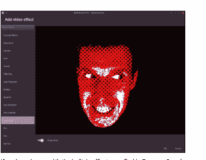

如果你不满意 `Zoom` 或 `Google Meet` 中的内置效果，请先将你的流媒体视频通过 `Webcamoid` 处理。

**项目网站**

`https://webcamoid.github.io`

### 文本编辑器

#### Pulsar

有许多项目，只有当它们终结时，其受欢迎程度才会变得显而易见。`Canonical` 的 `Unity` 桌面是一个很好的例子，它作为一个社区项目继续蓬勃发展，`GitHub` 现已停止维护的文本编辑器 `Atom` 也是如此。`Atom` 是一个代码和文本编辑器，成为新一代图形编辑器的火炬传递者，这些编辑器的功能可以通过插件和配置文件进行深刻改变。更重要的是，它是使用 `Electron` 构建的——一个基于 web 的框架，使开发人员能够使用 web 技术构建桌面应用程序——而 `Electron` 是专为 `Atom` 构建的。这种协同作用一直持续到 2022 年底，当时 `GitHub` 停止了对 `Atom` 的主动开发，此时其巨大的受欢迎程度变得显而易见。对于任何这样的流行开源应用程序来说，这仅仅标志着开端。

`Pulsar` 是原始 `Atom` 代码编辑器和 `IDE` 的社区和开源延续。与原版一样，正如你可能从一个现代 web 框架中预期到的那样，它设计得非常出色，具有精美渲染的字体和从第一次启动就支持多窗格的 `UI`。新的品牌看起来很棒，尽管旧主题尚未完全替换的地方还有一些粗糙的边缘，但 `Pulsar` 已经感觉像是一个独立的项目。它有上下文敏感帮助、文件系统浏览器、用于插件的内置包管理器和智能自动完成。旧的打包系统是闭源的，虽然 `Pulsar` 仍然可以访问和使用旧的 `Atom.io` 包存储库，但意图是用一个新的包含开源包等效物的存储库来替换它。其他一切与原始编辑器一样，`Pulsar` 意味着你可以继续在你的项目中以旧配置和项目文件。更好的是，它现在掌握在一个社区手中，该社区可以自由将编辑器引向完全新的、未经测试的方向，这是 `Pulsar` 真正开始发光的地方。

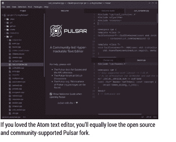

如果你热爱 `Atom` 文本编辑器，你也会同样喜爱开源且由社区支持的 `Pulsar` 分支。

**项目网站**

`https://pulsar-edit.dev`

#### Open Komodo IDE

在 20 多年里，`Komodo IDE` 是一个专有开发环境，最适用于与 web 相关的编程语言，包括 `Python`、`PHP`、`Perl`、`Go`、`Ruby`、`Node.js` 和 `JavaScript`。它由 `ActiveState` 发布，经历了三个不同的团队，迁移了三个不同的版本控制系统，并为 `Mozilla` 的 `XPcom` 框架做出了贡献。甚至在其本身构建所依赖的框架 `XUL` 和 `XULRunner` 在 2016 年被 `Mozilla` 废弃后的几年里，它都设法幸存下来。但在 2022 年底，`ActiveState` 最终决定退役 `Komodo IDE`，并幸运的是，同时将其开源，从其 320 万行代码中创建了 `Open Komodo IDE` 项目。这是一件很棒的事情，`ActiveState` 在这方面有一些历史，因为它之前曾发布过其编辑组件 `Komodo Edit`。

如果 `Komodo IDE` 不值得花时间，那么这一切都不重要，如果你还没有找到完美的 `IDE`，`Open Komodo` 将是一个出色的选择——特别是如果你使用 `Python`。显然，它是一个成熟且稳定的应用程序，开源版本是从 `Komodo IDE` 12 的发布延续而来的。任何使用过 `Visual Studio Code` 的人都会感到熟悉，因为主窗口分为多个窗格，用于列出文件、方法和符号，中间是标签式编辑器。所有这些都可配置，编辑器非常出色。有语法高亮、代码完成和内置重构、可视化调试和集成的版本控制。也许是其名称中的 `K`，但它与 `KDE` 集成得很好，编辑器非常让人想起 `Plasma` 的 `Kate` 编辑器。如果你在处理 `HTML` 或 `Markdown`，有一个渲染器输出的实时预览，这使得它对于处理具有大量文档集的项目特别有用——这是大多数 `IDE` 经常忽视的一点。

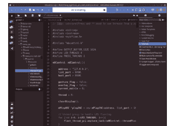

`Komodo IDE` 现在开源了，并完全依赖于其出色的社区进行更新和构建。

**项目网站**

`https://github.com/ActiveState/OpenKomodoIDE`

### 网络监控

#### Sniffnet


得益于 Linux 内核的内置功能，我们幸运地拥有几个知名且高度复杂的网络监控工具。`Wireshark` 已成为底层分析的行业标准，而 `Pomerstear` 等高级应用程序让我们能够完全控制进入和离开我们网络的内容。但对于非专家来说，选择并不多。对于这些人来说，`Sniffnet` 可能就足够了。`Sniffnet` 是一个图形网络监视器，显示进出数据的饼图以及正在使用的网络协议分解。首先，你需要选择系统检测到的网络设备，并且你需要以 `root` 身份运行应用程序以获得足够的访问权限。你还可以选择是否监控 `IPv4`、`IPv6` 或 `UDP` 协议，或三者全选，还有一个用于特定网络应用协议的额外过滤器。单击“运行”开始监控。如果被监控的机器充当路由器，例如运行 `Pihole` 的服务器，这会很有帮助，但在单台机器上也非常有趣，因为你可以快速看到你在正常网络访问中使用多少协议。`HTTPS` 通常位居榜首，紧随其后的是简单服务发现协议 (`SSDP`)。输入 `ssh` 连接到远程机器，你会看到 `SSH` 出现在使用的协议列表中。单个连接显示在下方，可选地按最近、最多字节和最多数据包排序。`UI` 简单且非常适合仅终端渲染，这是一个正在努力的功能。单击“打开完整报告”按钮会将完整的连接报告输出到文本文件。即使没有增强，`Sniffnet` 已经提供了一套强大且直观的网络监控功能，将帮助我们大多数人理解自己的网络流量并查看使用情况。

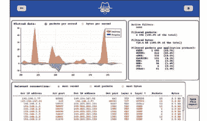

`Sniffnet` 可以通过 `Cargo` 或 `DEB` 包轻松安装，并且虽然 `UI` 简单，但它确实提供浅色和深色渲染模式。

**项目网站**

`https://github.com/GyulyVGC/sniffnet`

## FOSSPICKS 开源软件精选

### 迷你 Web 浏览器 Min

考虑到朴素的 Web 浏览器已多么深刻地融入我们的生活，如今那些最主流的浏览器并不显得多么朴素，且通常共享相似的功能与操作体验。`Chrome`、`Safari`、`Edge`、`Brave` 和 `Firefox` 都是庞大且复杂的应用程序，它们深藏奥秘，可能因此显得难以使用；而更简单的替代方案寥寥无几。`Qutebrowser` 极简，但得益于其 `Vim` 键位绑定，使用门槛不低。正因如此，这款名为 `Min` 的浏览器才显得格外清新。它基于 `Electron` 构建，因此并未挑战 `Blink` 引擎主导的单一格局，但其设计理念和美学风格确实挑战了“浏览器必须具备全能选项”的主流观念。最明显的差异在于，`URL` 栏如今融入了窗口标题栏，这与许多现代 `GNOME` 应用如出一辙。`URL` 栏同样可用于搜索，默认调用 `DuckDuckGo`，并与 `DuckDuckGo` 的“`bangs`”指令配合得天衣无缝，例如输入 `lw` 可直接在维基百科打开搜索结果首页。这些 `bangs` 指令还扩展了 `Min` 自身的几个命令，比如 `bookmarks` 打开书签视图，`settings` 进入更多配置选项，你还可以在“偏好设置”面板中添加自定义指令。标签页也显示在标题栏中，紧邻其被收起的位置，确保主视图整洁有序，完全专注于网页渲染。界面上没有文字标签，仅有图标，且顶部栏两端各有一个下拉菜单。“偏好设置”页面允许你微调出色的内置广告拦截功能，将外观设为浅色或深色模式，启用用户脚本，甚至创建与 `URL` 和标签页分离的独立标题栏。标签页本身可归类为“任务”，通过第二个下拉菜单访问。此外，还设有阅读模式和专注模式，后者可禁用新标签页的打开，以免你在工作时分心刷 `YouTube`。它完美平衡了功能性与极简主义，相较于主流浏览器，确为耳目一新的体验。


像 `Min` 这样的极简 Web 浏览器，若你想在无干扰状态下浏览网页，会非常实用。

**项目主页**

`https://minbrowser.org`

### ARM 平台上的 x86 兼容层 FEX

随着 `ARM64` 日益成为适用于通用 `Linux` 桌面和笔记本的可行平台，我们正处在一个令人兴奋的转折点。一代以来，架构领域首次出现了分裂：一方是占据主导且久经考验的 `x86` 和 `x86-64`，另一方则是初露锋芒的新秀——基于 `ARM` 的 `ArmArch64`。如今大多数发行版都已提供其最新版本的 `ARM` 构建，且日趋成熟；开源特性意味着几乎所有软件都能顺利重建，但某些软件仍处于过渡期，尤其是在 `Arch` 这类发行版上，`AUR`（用户仓库）中并非所有软件都提供 `ARM` 二进制文件，还有一些仅提供 `x86` 构建的专有软件。`Apple` 正凭借其性能卓越的 `Rosetta 2` 应对 `M1` 和 `M2` 架构 `macOS` 设备上的这一难题，而 `Rosetta` 现已能在 `macOS` 的 `Ubuntu` 虚拟化环境中原生运行。然而，`FEX` 的目标是为原生 `Linux` 实现类似功能。`FEX` 是面向 `ARM64` 的 `x86` 和 `x86-64` 兼容性与翻译层，使你在 `ARM` 主机上运行 `x86` 二进制文件成为可能。它目前仅支持 `ARMv8.0` 和 `ARMv8.1+`，而非较旧 `Raspberry Pi` 设备上的芯片，但在现代硬件上运行速度足够快、效率足够高，以至于几乎感觉不到差异。这是运行游戏及其他尚未提供原生 `ARM` 构建的专有软件的绝妙方式。在 `Ubuntu` 上，有一个便捷的脚本可安装 `FEX` 的所有必要依赖项，并将项目 `PPA` 添加到你的软件包存档中。此外，还需要同一发行版的 `x86 RootFS` 镜像，以提供 `x86` 可执行文件的运行时环境；脚本会下载该镜像，并允许你选择以未压缩方式运行，或从压缩镜像中运行以节省空间。无论哪种方式，都无需额外设置即可直接运行。输入 `FEXbash`，你便能立即在你自己的文件系统内运行 `x86` 版本的 `Bash`。输入 `uname -a`，你会发现它显示为 `x86`，并且你可以直接访问许多其他 `x86` 可执行文件。由于图形加速功能会直通至宿主系统的库，因此依然保持完好，整个流程表现出色。

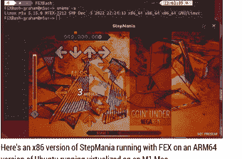

这里展示的是在 `M1 Mac` 上虚拟运行的 `ARM64` 版 `Ubuntu` 上，借助 `FEX` 运行的 `x86` 版 `StepMania` 游戏。

**项目主页**

`https://github.com/FEX-Emu/FEX`

### 音频特效：PauXStretch

如果你热衷于音乐制作或单纯想折腾音频，时间拉伸（time stretching）是你最常使用的音频特效之一。原因在于，时间拉伸既实用又富有创意。实用体现在，它允许你将一种速度录制的音频与另一种速度录制的音频混合，而听不出音频经过处理的痕迹；创意则体现在，它让音频在时长和音高上都变得灵活可变。时间拉伸与音高移调本质上紧密相连：要延长或缩短时长，就需要减慢或加快音频，而这会影响其音高。恢复音高的过程并不简单。例如，人声中包含的共振峰（formants）并不随基础音高同步变化，需要将其过滤出来并单独处理；其他类型的音乐、乐器或打击乐也存在类似问题。

为应对如此复杂的音频处理，人们创建了各种算法以专门处理特定类型的声音，而许多这些技术也可用于创意目的。`PauXStretch` 这款音频插件正是为此而设计。其名称中的“`Paul`”源自其核心算法（`Paul's Extreme Time Stretch`，最初由 `Nasca Octavian Paul` 开发），但插件的设计旨在让你快速、便捷地访问一套全面的时间拉伸相关功能，从精确改变音频音高到将其彻底扭曲得面目全非，无所不能。插件包含七个可独立启用的水平模块，分别用于操控拉伸幅度、谐波、噪声、频率偏移与扩展、低通与高通滤波器，乃至双耳处理。模块参数的顺序可通过下方的流程图进行调整。其下是一个标签页视图，可显示采样音频波形、处理片段比例以及均衡器。


除了音高和时值移调，还包含一些出色的标准特效，可单独使用，例如压缩和均衡。

这一切听起来可能很复杂，但你可以轻松操控这些旋钮，即使不完全理解其功能；声音效果可从轻微的音调变化，到巨大的故障感反馈回环。你可以处理文件或输入流，并将输出返回到你的音频应用或导出为文件。音频可以采样并冻结，在波形视图中选择一个子片段用于特殊任务。它作为 `DJ` 或音乐家的实时处理特效效果出色，同样也擅长在 `Ardour` 或 `Bibitub` 中作为即插即用特效使用。但这款插件尤为引人注目的是其高品质，这可能源于其开发者通常从事商业专有音频开源开发，它甚至可构建为崭新且未被探索的 `CLAP` 插件（这正是我们测试它的方式）。该插件的用户界面具有一种在开源插件中少见的专业水准。尽管单一窗口内塞满了多种选项，但导航便捷，不会让界面因复杂而显得杂乱无章。这是一项了不起的成就，且与插件所能实现的惊人音效处理截然不同；看到此类特效登陆 `Linux` 平台，实属令人欣喜。


`PauXStretch` 是我们迄今能够作为 `CLAP` 插件构建和使用的早期音频插件之一，使其成为强大的 `Linux` 音频处理与操控的理想选择。

**项目主页**


https://github.com/essej/pauxstretch

### 多人棋盘游戏

#### Tabletop Club

网络游戏的存在时间几乎与游戏本身一样悠久。早在 20 世纪 70 年代末，你就可以在大学的主机上玩基于文本的多用户地牢（`MUDs`），而且当时有许多出色的 8 位家用电脑游戏可以通过空调制解器电缆连接起来进行多人游玩。空调制解器游戏催生了 `Bulletin Board System`（`BBS`）上的拨号调制解器游戏，最终导致了互联网的诞生。但除了国际象棋、跳棋和拼字游戏等游戏外，在线玩已经确立的桌面游戏的概念相对较新。这可能是由于许多游戏的知识产权受到非常严密的保护。虽然你可能能够购买并玩某款独立游戏，但要重现与朋友在一起随机选择游戏的 spontaneity（自发性/随性体验）似乎几乎是不可能的。


> `Tabletop Club` 基于 `Godot` 游戏引擎构建，让你可以轻松在线玩最喜欢的棋盘游戏。

`Tabletop Club` 可以在这里提供帮助。它是一个由物理驱动的 3D 多人游戏画布，旨在帮助你轻松重现你最喜欢的棋盘游戏，以便你可以随后与朋友在线一起玩。实现这一功能的关键在于资产包（asset packs）。资产包是一组包含运行、保存和恢复游戏所需的棋盘、棋子、卡片、声音图形以及存档规则的捆绑包。不需要实现游戏逻辑，因为你是与其他人一起游玩，就像玩真实的棋盘游戏一样。你们都需要同意遵守规则，`Tabletop Club` 提供了国际象棋和跳棋作为入门辅助。文档非常出色，包含几个易于跟随的教程，帮助你为自己喜欢的游戏创建资产包。正如你可能预期的那样，该项目背后有一个活跃的社区，希望用户能分享他们为自己喜欢的游戏创建的资产包。如果你之前没尝试过这类东西，你可能会期待这是对现实体验的拙劣模仿，但实际上，当 `Tabletop Club` 与视频聊天结合使用来连接你的同伴玩家时，它真的非常有趣。这是仅次于实际在场的最佳体验。

**项目网站**

`https://github.com/drwhut/tabletop-club`

### 3D 赛车

#### Stunt Rally

`Stunt Rally` 是一款 3D 驾驶游戏，已经开发超过十年。与我们之前看到的 `Trigger Rally` 类似，`Stunt Rally` 的图形引擎基于 `VDrift`，这是一款较早的 3D 驾驶游戏，拥有许多相同的核心驾驶功能和赛道编辑器。赛道编辑器是所有这三款游戏成功的关键，因为它意味着任何人都可以建造赛道，通常有数十个可供选择。`Stunt Rally` 本身包含 202 个不同的赛道、37 个不同的场景和 25 个不同的车辆，提供了巨大的多样性。游戏本身是以早期试图相对写实而非像 `V-Rally` 那样的街机风格的 3D 主机拉力赛游戏为模型的。这可能使它们更难玩，但在你了解了车辆操控和赛道布局后，奖励感更强。`Stunt Rally` 也不例外。你首先选择赛道。由于可供选择的众多赛道，几乎涵盖了所有可能性，从山地森林到热带海滩，甚至还有外星景观的支线。由于 `Stunt Rally` 专注于运动的极端一面，大多数关卡都包括跳跃和其他需要穿越的障碍，赛道选择器会将这些作为属性与所选地形的图像一起高亮显示。然后你可以选择你的车辆，该车辆拥有自己的出色统计页面，帮助你查看重量、动力、最高速度和刹车时间等属性。你可以更改汽车的颜色，并查看所选赛道的在线最快时间


> 如果你喜欢 2000 年代初的主机拉力赛游戏，你会爱上 `Stunt Rally`。

使用你选择的车辆。比赛可以是离线和在线的，你可以与之前最快运行的幽灵版本进行比赛。图形非常出色，具有多样的地形、茂密的森林和动态纹理，但正是游戏性让你想要再试一次。控制本身很简单，但要在赛道上获得快速时间很困难，需要多次重播才能精通。`Stunt Rally` 完美地把握了这种平衡，提供了足够的挑战和进步空间，让你总是想再玩一次。

**项目网站**

`https://stuntrally.tuxfamily.org`

### 使用 LDraw 和 LeoCAD 构建乐高模型

#### Master Builder

`LDraw` 和 `LeoCAD` 帮助你成为一名虚拟乐高建筑师。

作者：DANIEL TIBI

```text
Listing 1: Tux.ldr
0 Tux
0 Name: Tux.ldr
0 Author: Daniel Tibi
1 lw -10 -8 -10 1 0 0 0 1 0 0 0 1  49673.dat
1 lw 10 -8 -10 1 0 0 1 0 0 0 1  49673.dat
1 0 0 -8 10 1 0 0 0 1 0 0 0 1  28653.dat
0 STEP
1 0 0 -16 10 1 0 0 0 1 0 0 0 1  3022.dat
0 STEP
1 18 0 -40 -10 1 0 0 0 1 0 0 0 1  3660b.dat
1 0 0 -40 10 -1 0 0 0 1 0 0 0 1 - 6227.dat
0 STEP
1 18 0 -48 -20 1 0 0 0 1 0 0 0 1  94148.dat
1 0 0 -48 10 1 0 0 0 1 0 0 0 1  28653.dat
0 STEP
1 0 10 -72 10 0 0 -1 0 1 0 0 0 1  4286.dat
1 0 -10 -72 10 0 0 1 0 1 0 0 0 1  4286.dat
0 STEP
1 18 0 -72 -10 1 0 0 0 1 0 0 0 1  6227.dat
0 STEP
1 0 0 -80 10 1 0 0 0 1 0 0 0 1  94148.dat
0 STEP
1 lw 0 -88 -20 1 0 0 0 1 0 0 0 1  33909.dat
1 15 10 -88 10 1 0 0 0 1 0 0 0 1  6225.dat
0 STEP
1 0 0 -112 10 1 0 0 0 1 0 0 0 1  3004.dat
0 STEP
1 0 10 -112 -10 1 0 0 0 1 0 0 0 1  4070.dat
1 0 10 -112 -10 1 0 0 0 1 0 0 0 1  4070.dat
0 STEP
1 18 10 -100 -22 0.866025 0 -0.5 -0.5 0 -0.866025 0 1 0  10238.dat
1 15 10 -100 -22 0.866025 0 -0.5 -0.5 0 -0.866025 0 1 0  10238.dat
1 0 0 -120 0 1 0 0 0 1 0 0 0 1  3068b.dat
```

几十年来，无论老少，人们都乐在丹麦玩具制造商 `LEGO` 的知名积木中。成功故事始于 1932 年的木制玩具。1949 年，第一批塑料积木投入生产，自 1958 年以来，它们一直以如今仍广受欢迎的形式存在。如今，`LEGO` 远不止是儿童玩具；还有许多成年 `LEGO` 粉丝。`LDraw` 和 `LeoCAD` 帮助你在 `PC` 上规划自己的 `LEGO` 模型。

在开始之前，有两件事你需要做。首先，在你的系统上安装 `LDraw` [1]。这是 `LEGO` CAD 程序的一个开放标准。该工具随附积木的 3D 模型以及用于记录你用积木构建的模型的文件格式。下载完整的积木列表 [2]，并将 `ZIP` 文件解压到 `~/Ldraw/` 文件夹或另一个目录。`LDraw` 中包含的积木不断更新。

第二步是安装 `LEGO` CAD 程序，你用它将虚拟积木转换为数字模型。在使用 `LDraw` 标准 [3] 的各种程序中，我们为此文章选择了当前的 21.06 版本 `LeoCAD` [4]。为了简单起见，最好下载 `AppImage` 变体 [5]，你可以直接启动而无需安装。或者，从 `GitHub` 获取源代码并自己编译程序 [6]。

#### 数字积木

`LDraw` 提供有关可用 `LEGO` 积木和模型的信息，而 `LeoCAD` 以图形方式显示它们并允许你编辑它们。`LDraw` 在简单的文本文件中存储信息：`.dat` 文件描述单个积木。它们位于 `~/Ldraw/parts/` 目录中，或者在你解压 `LDraw` 存档的路径中的 `parts/` 文件夹中。每个积木都有一个单独的文件，每个文件都带有零件号。

在 `models/` 子目录中，你找到两个 `LDraw` 模型的示例：一个简单的金字塔和一辆汽车。模型文件以 `.ldr` 结尾。清单 1 显示了一个示例。前三行包含标题、文件名和作者姓名。每个以 1 开头的行代表一个积木。其后的数字确定积木的颜色，其余数字指示位置和旋转。每行末尾是包含关于相关积木信息的文件。组装模型的各个步骤由包含 `0 STEP` 的行分隔。这意味着可以用一个简单的文本文件来描述模型。

### 教程 – LDraw 和 LeoCAD

如果你只是将模型作为抽象的数字序列输入到文件中，搭建过程会毫无乐趣可言。这正是 `LeoCAD` 的用武之地。它可以以图形方式输出模型，并让你编辑自己的创作。图 1 中的模型就是这样从清单 1 中的文本文件创建的。


### 虚拟搭建的乐趣

首次启动 `LeoCAD` 时，它需要知道每种乐高积木的 `LDraw` 文件存储在哪里。`LeoCAD` 本身附带少量的积木选择，但这会严重限制你的创造力。在“`视图 | 设置`”菜单中，打开对话框并转到“`常规`”选项卡。然后，在`零件库`字段中，输入你之前解压 `LDraw` 文件的文件夹路径，例如，`~/ldraw/`。

现在你可以开始虚拟搭建了。

在菜单栏和工具栏下方，`LeoCAD` 窗口分为两个区域。左侧是一个最初为空的底板。一旦你将在靠近边缘的地方放置积木，底板就会自动扩展。右上方你可以看到一个球体，你可以用鼠标旋转它。这允许你沿任何方向移动模型，以便从各个侧面查看。按`H`键可以返回到原始视图。你可以按`+`键放大模型，按`-`键缩小模型。

在窗口的右侧，`LeoCAD` 在顶部显示所有可用积木的列表，下方则是所有颜色的概览。为了更好地浏览，只需筛选选择即可。启动时，过滤器默认为“积木”。你可以使用下方的搜索字段来搜索积木。输入你要查找的零件号（例如，对于有两个两凸点的积木，输入`3002`）或搜索积木的尺寸。为此，输入诸如`2 x 2`之类的内容。请注意空格：


**图 3：说明展示了如何通过 12 个步骤从积木组装 `Tux`。**

否则你将看不到任何结果。此外，你还可以通过输入名称来查找特定的积木，例如`斜角积木`。使用`插入`将合适的积木集成到模型中，或者用鼠标将其拖拽到期望的位置。

现在你需要正确插入积木。为此，点击积木以选中它。`LeoCAD` 会用六个箭头标记选中的积木（图 2）。三个直箭头让你可以前后、左右和上下移动积木。或者，你可以使用箭头键以及`Page Up`和`Page Down`键。三个曲线箭头用于在三个轴上旋转积木。为此，再次使用你用于移动的相同按键，但这次需要与`Shift`键组合使用。

在搭建过程中，你经常会多次使用单个积木或某种排列。不必重新安装并对齐每个单独的积木，你可以简单地选中模型中相应的积木（如果你按住`Ctrl`键，则可以选中相应的组合），然后使用`Ctrl+D`复制选择。然后将克隆的元素移动到期望的位置。

到目前为止，你的模型仍然是灰色的——是时候添加一些颜色了。你可以在窗口的右下角看到可用的颜色。一旦你点击其中一种颜色，右侧选择列表中的积木就会被涂成该颜色。如果你想给已经安装好的积木上色，请先选中期望的积木，然后选中要上色的积木。最后选择`零件 | 绘制选中项`菜单项来给积木上色。

### 搭建说明

如果你以后想用真实积木重新搭建你的虚拟模型，遵循逐步说明是很有意义的。为此，在组装虚拟模型时，在适当的地方按`Alt+右箭头`插入一个新的搭建步骤。`文件 | 说明`菜单项会显示完成模型的详细说明，并记录搭建每一步所需的积木（图 3）。`汇总 | 属性`菜单项中的`使用的零件`选项卡提供了模型中所有使用积木的列表（图 4）。切换到`汇总`选项卡，你会看到模型的尺寸。这能让你了解模型用真实积木搭建后的尺寸。

### 迷你人仔

迷你人仔让你的模型更加生动。`LeoCAD` 为此提供了一个向导，你可以通过`零件 | 迷你人仔向导`菜单启动它（图 5）。会打开一个对话框，你可以在其中组装迷你人仔的各个部分——头发、脸、身体和配饰——并指定颜色。在某些元素旁边，你还会发现一个数字输入框，你可以用它来旋转该元素。例如，你可以旋转脸部或弯曲手臂、手和腿。

按`保存`按钮将迷你人仔存储在你的收藏中，按`删除`移除它。`导出`将迷你人仔数据保存在单独的文件中，而`导入`从外部文件加载人仔数据。一旦你对你的迷你人仔满意，按`确定`将其插入模型中，例如图 6 中所示的咖啡馆。

### 导出

`LeoCAD` 提供了多种导出选项。你可以使用`文件 | 保存图像`菜单项将模型转换为`PNG`图形。更多选项请参见`文件 | 导出`。你可以从模型创建`HTML`文件或将其使用的积木列表写入`CSV`或`XML`文件。你可以重用这些积木，例如，在`BrickLink`等在线交易市场上 [7]。

### 结论

让`LDraw`和`LeoCAD`释放你的创造力。使用虚拟积木搭建需要一些练习，但这与使用真实积木一样有趣。`LeoCAD` 还可以让你创建搭建说明和使用的积木列表，这样你和其他人可以轻松重现你的创作。

### 信息

- [1] `LDraw`：https://www.ldraw.org
- [2] 积木列表下载：https://wiki.ldraw.org/index.php?title=Getting_Started_-_Linux
- [3] 支持 `LDraw` 标准的程序：https://www.ldraw.org/downloads-2/third-party-software.html
- [4] `LeoCAD`：https://www.leocad.org/
- [5] `LeoCAD AppImage` 下载：https://www.leocad.org/download.html
- [6] `GitHub` 上的 `LeoCAD`：https://github.com/leozide/leocad/releases
- [7] `BrickLink`：https://www.bricklink.com/v2/main.page


**图 6：** 迷你人仔让模型看起来更生动。

## 成为 LibreOffice 专家


探索全球繁忙专业人士使用的**免费**办公套件！

- 创建专业内容：
    - 文本文档
    - 电子表格
    - 演示文稿
    - 数据库

无论你是在 `Windows` 电脑、`Mac` 还是 `Linux` 系统上工作，你都有所有需要的工具来开始使用 `LibreOffice`。这本单卷特别版将作为你的指南！

**在线订购：** `shop.linuxnewmedia.com/specials`

适用于 `Windows`、`macOS` 和 `Linux` 用户！


**图 5：** 一个向导帮助你组装迷你人仔并为其配备配饰。

## LINUX 新闻亭


`Linux Magazine` 是你进入 `Linux` 世界的指南。每月的期刊都包含了你在其他地方找不到的进阶技术文章和教程。探索我们完整的往期期刊目录，查找特定主题或完成你的收藏。


### 第 267 期/2023 年 2 月

**备份**

理论上，每个人都可以使用相同的备份工具，但将定期和系统的备份融入生活的最佳方法是找到适合自己习惯和方法的解决方案。本月，我们预览了 `Linux` 领域中一些流行的备份应用程序，以便你可以找到一个适合你的。

**光盘内容：** `Linux Mint 21 Cinnamon` 和 `Kali Linux 2022.4`


### 第 266 期/2023 年 1 月

**生成对抗网络**

近期计算机艺术和假视频爆发背后的秘密是什么？一个神经网络向另一个神经网络撒谎……

**光盘内容：** `Ubuntu 22.10` 和 `AlmaLinux 9.0`


### 第 265 期/2022 年 12 月

**量子计算**

大多数 `Linux` 用户都知道这项未来技术利用了量子力学的奇异力量。但它究竟是如何工作的？我能用它做什么？有今天可用的工具来帮我进行实验吗？本月我们将深入探讨量子计算。

**光盘内容：** `Manjaro 21.3.7-220816` 和 `Arch Linux 2022.10.01`


### 第 264 期/2022 年 11 月

**人工智能**

尽管机器学习现在已成为我们日常生活中不可或缺的一部分，但它仍然笼罩在神秘之中。本月我们将揭开帷幕，探讨一些流行的有监督学习和无监督学习技术。

**光盘内容：** `Debian 11.5` 和 `Rocky Linux 9.0`


### 第 263 期/2022 年 10 月

**构建 `IoT Linux`**


Linux 最神奇之处在于其灵活性。`Linux` 系统运行在世界上最大型计算机上——也运行在你家庭环境中众多小巧设备中。如果你一直想知道开发者如何调整 `Linux` 以运行在微型技术上，你会欣赏本月关于 `Buildroot` 和 `Yocto` 项目的故事。

**光盘内容：** `Linux Magazine` 档案第 1-262 期


#### 第 262 期/2022 年 9 月

**超越 5G**

在幕后，蜂窝电话网络一直是高度专业和专有设备的保留领域，但近期的一些创新可能会改变这一现状。本月我们将探索开放 `RAN` 规范，它有可能让移动通信行业的更多部分在现成硬件上运行。

**光盘内容：** `openSUSE Leap 15.4` 和 `MX Linux 21.1`

## 精选活动

用户、开发人员和供应商在世界各地的 `Linux` 活动中相聚。*`Linux Magazine`* 很自豪地赞助了此处展示的精选活动。

欲了解您附近的其他活动，请访问我们的在线活动日历：https://www.linux-magazine.com/events。

如果您知道其他希望我们添加到日历中的 `Linux` 活动，请发送包含所有详情的消息至 *`info@linux-magazine.com`*。


### CloudFest

- **日期：** 2023 年 3 月 21-23 日

- **地点：** 德国欧洲公园

- **网站：** https://www.cloudfest.com/

`CloudFest` 是全球排名第一的互联网基础设施活动，连接着全球云计算行业。3 月 21 日至 23 日，加入我们要接管一个欧洲游乐园的活动中，与互联网基础设施行业的顶级决策者聚在一起，进行学习、社交以及参加有史以来最棒的派对。

### Linux 应用峰会

- **日期：** 2023 年 4 月 21-23 日

- **地点：** 捷克布尔诺 及 在线

- **网站：** https://linuxappsummit.org/

`Linux` 应用峰会 (`LAS`) 汇聚全球 `Linux` 社区，共同学习、协作，并帮助发展 `Linux` 应用生态系统。通过演讲、小组讨论和问答环节，我们鼓励参会者分享想法、建立联系，并加入我们构建通用应用生态系统的目标。欢迎亲自参加或在线参与。

### DORS/CLUC 2023

- **日期：** 2023 年 5 月 11-12 日

- **地点：** 克罗地亚萨格勒布

- **网站：** https://www.dorscluc.org/

`DORS/CLUC` 是最古老且规模最大的区域性会议，涵盖自由及开源软件、开放标准和 `Linux`。在这两天的演讲、工作坊和趣味活动中，该活动汇聚了学生、`FOSS` 爱好者、折腾者、开发者、公司以及更多人士，共同学习、社交、开展业务并规划项目——一切均专注于自由软件和 `Linux`。

### 活动

| 名称 | 日期 | 地点 | 网站 |
| :--- | :--- | :--- | :--- |
| `GeekBeacon` 音乐节 | 2 月 18 日 | 虚拟活动 | https://gbfest.org/ |
| `Kickstart` 欧洲 2023 | 2 月 20-21 日 | 荷兰阿姆斯特丹 | https://www.kickstarteuropef/ |
| `FAST23` | 2 月 20-23 日 | 加利福尼亚州圣克拉拉 | https://www.usenix.org/conference/fast23 |
| `SCALE 20x` | 3 月 9-12 日 | 加利福尼亚州帕萨迪纳 | https://www.socialinuxexpo.org/blog/scale-20x |
| `Cassandra` 峰会 | 3 月 13-14 日 | 加利福尼亚州圣何塞 + 虚拟 | https://events.linuxfoundation.org/ |
| `FOSS Backstage 2023` | 3 月 13-14 日 | 德国柏林 + 在线 | https://23.foss-backstage.de/ |
| `Everything Open 2023` | 3 月 14-16 日 | 澳大利亚 Naarm (墨尔本) | https://2023.everythingopen.au/ |
| 女性网络安全 | 3 月 16-18 日 | 科罗拉多州丹佛 | https://www.wicsy.org/events/wicsy-2023/ |
| `CloudFest` | 3 月 21-23 日 | 德国欧洲公园 | https://www.cloudfest.com/ |
| 开源入门 | 3 月 23 日 | 北卡罗来纳州夏洛特 | https://opensource101.com/ |
| `kubeCon + CloudNativeCon` | 4 月 17-21 日 | 荷兰阿姆斯特丹 | https://events.linuxfoundation.org/ |
| `PyCon US 2023` | 4 月 19-27 日 | 犹他州盐湖城 | https://us.pycon.org/2023/ |
| 混合云大会 | 4 月 20 日 | 虚拟活动 | https://www.techforce.pub/events/hybrid-cloud-congress-2/ |
| `Linux` 应用峰会 2023 | 4 月 21-23 日 | 捷克布尔诺 | https://linuxappsummit.org/ |
| `Cloud Expo` 欧洲 | 5 月 10-11 日 | 德国法兰克福 | https://www.cloudexpoeurope.de/en |
| `DORS/CLUC 2023` | 5 月 11-12 日 | 克罗地亚萨格勒布 | https://www.dorscluc.org/ |
| `Incing` 夏令营柏林 | 5 月 17 日 | 德国柏林 | https://incga.com/community/events/icunga-camp-berlin-2023/ |
| `ISC` 高性能 | 5 月 21-25 日 | 德国汉堡 | https://www.isc-hpc.com/about-overview.html |
| `CloudFest` 美国 | 5 月 31 日 - 6 月 3 日 | 德克萨斯州奥斯汀 | https://www.cloudfest.com/usa/ |

## 服务

### 联系信息 / 作者

### 征稿启事

我们始终寻找关于 `Linux` 及其环境工具的优秀文章。虽然我们会考虑任何主题，但以下主题尤其受到关注：

- 系统管理
- 实用技巧与工具
- 安全，包括新闻和技术
- 产品评测，特别是基于真实世界经验的评测
- 社区新闻和项目

如果您有想法，请发送一份包含大纲、篇幅估计、您的背景介绍以及联系信息的提案至 *`edit@linux-magazine.com`*。

文章的技术水平应与您在 *`Linux Magazine`* 中通常阅读的内容保持一致。请记住，*`Linux Magazine`* 在许多国家都有读者，您的文章可能会被翻译成我们的姊妹出版物之一。因此，最好避免使用所有读者可能无法理解的俚语和习语。

在提及未来的日期或事件时要小心。从稿件提交到最终副本到达读者手中，可能已经过去了好几周。在提交提案或稿件时，请在电子邮件主题行中使用有助于我们识别您的消息为文章提案的内容。截图和其他支持材料总是受欢迎的。

更多信息可在以下网址获取：http://www.linux-magazine.com/contact/write_for_us。


### 联系信息

**主编**

`Joe Casad`, `jcasad@linux-magazine.com`

**校对编辑**

`Amy Petitt`, `Aubrey Vaughn`

**新闻编辑**

`Jack Wallen`, `Amber Ankerholz`

**荣誉编辑**

`Rita L. Sooby`

**执行编辑**

`Lori White`

**本地化与翻译**

`Ilan Travis`

**版式设计**

`Gena Friesen`, `Lori White`

**封面设计**

`Dena Friesen`

**封面图片**

© `neyro2008` 和 `Uładzimir halkan`, `123RF.com`

**广告**

`Brian Osborne`, `bobbarn@linuxnewmedia.com`

电话 `+49 8083 7678420`

**营销传播**

`Gwen Clark`, `gclarx@linuxnewmedia.com`

`Linux New Media USA, LLC`

`4840 Bob Billings Parkway, Ste 104`


Lawrence, KS 66049 美国

尽管杂志内容已尽最大努力，但出版商无法对其中包含信息的准确性或由其使用引发的任何后果承担责任。使用随杂志提供的磁盘或其中包含的任何材料风险自负。

版权和商标 © 2023 Linux New Media USA, LLC.

未经出版商书面许可，不得以任何形式全部或部分复制任何材料。

假设所有发送的通讯（例如，信件、电子邮件、传真、照片、文章、图画）均由 Linux New Media USA, LLC 以非独占性的全球范围用于出版或授权给第三方，除非另有书面说明。

Linux 是 Linus Torvalds 的商标。

所有品牌或产品名称均为其各自所有者的商标。如果我们未标注您的版权，请联系我们；我们总是会纠正任何疏忽。

由 Zeitfracht GmbH 在德国纽伦堡印刷。

由 Seymour Distribution Ltd 在英国发行。

在欧洲及其他地区由 SparkHaus Media GmbH, Bialastal, 1a, 56525 Glonn, Germany 代理。

由 Linux New Media USA, LLC, 4840 Bob Billings Parkway, Ste 104, Lawrence, KS 66049, USA 每月出版为 Linux Magazine (印刷版 ISSN: 1471-5678, 在线版 ISSN: 2833-3950)。期刊邮寄费在 Lawrence, KS 及额外邮寄点支付。随刊附带 Ride-Along。邮政管理员：请将地址变更寄至 Linux Magazine, 4840 Bob Billings Parkway, Ste 104, Lawrence, KS 66049, USA。

### 作者

Erik Barwaldest 80
Zack Brown 12
Bruce Byfield 6, 22, 32, 42, 54
Joe Casad 3
Mark Crutch 71
Hans-Georg Eßer 73
Daniel Etzold 16
Jon “maddog” Hall 72
Swen Hopfe 58
Rubén Llorente 62
Vincent Mealing 71
Pete Metcalfe 34
Graham Morrison 84
Thomas ReuB 28
Mike Schilli 44
Ferdinand Thommes 24, 50
Daniel Tibi 40, 90
Jack Wallen 8

**出版商**

Brian Dobson

**客户服务 / 订阅**

美国及加拿大：

邮箱：cs@linuxnewmedia.com

电话：1-866-247-2902

（美国和加拿大免费）

其他国家：

邮箱：subs@linux-magazine.com

www.linux-magazine.com

## 下月刊

第 269 期

| 地区 | 发售日期 |
| :--- | :--- |
| 英国 / 欧洲 | 3 月 10 日 |
| 美国 / 加拿大 | 4 月 14 日 |
| 澳大利亚 | 5 月 26 日 |

**发售日期**

> 请注意：发售日期为预估时间，可能会因物流问题而延误。

第 269 期 / 2023 年 4 月

## Fediverse（联邦宇宙）

社交媒体公司频频登上新闻头条——为什么少数几家公司可以拥有如此巨大的权力？根据 Fediverse 倡导者的说法，`这不应该如此`。下个月，您将了解这个蓬勃发展的自由软件运动分支，以及将社交媒体归还于民的一些领先的 Fediverse 工具。


## 预览通讯

Linux 杂志预览版是一份每月发送的电子邮件通讯，让您抢先预览下一期的内容，包括在线发布的文章链接。

注册地址：[https://bit.ly/Linux-Update](https://bit.ly/Linux-Update)

图片 © Anna Ivanova, 123RF.com

## 开源幕后（FOSS Backstage）

社区、管理与合规

加入我们的精彩两天活动，内容涵盖治理、协作、InnerSource 与 OSPO、项目领导力、社区管理以及开源软件的法律和经济方面。


立即购票并使用代码 `LINUXMAG10`


- 2 天的精彩演讲与讨论
- 150+ 名在线参会者
- 40+ 位资深演讲者
- 5 个主题轨道
- 120+ 名现场参会者
- 大量的网络交流与结识优秀人士的机会
- 2 个舞台

2023 年 3 月 13-14 日

@ TUECHTIG 柏林 & 线上


## 云服务器

起价

$4.35

`每月 | 含 IPv4`

## HETZNER 云服务器 CPX11

- ✓ AMD EPYC™ 第二代
- ✓ 2 vCPU
- ✓ 2 GB 内存
- ✓ 40 GB NVMe SSD
- ✓ 含 20 TB 流量
- ✓ 直观的云端控制台
- ✓ 位于德国、芬兰或美国


**高品质 - 无可匹敌的价格**

部署您的

HETZNER 云服务

只需

**10 秒！**

通过负载均衡器、防火墙、一键应用等众多功能，快速轻松地管理您的云服务。

立即获取您的云服务
