# Linux 杂志 270 期 2023-05 美国版

通过 `WebFAI`，你可以完全自动化地设置 Linux 安装，且其功能性与我们在 `TUXEDO` `Computers` 的生产线操作完全一致！

你可以从我们在网上商店配置器提供的所有 Linux 发行版中进行选择。根据发行版的不同，你可以在不同的桌面环境之间进行选择。

通过 `WebFAI`，你可以从我们的服务器获取最新的、测试过的 Linux 发行版本。


## 全自动安装


# 社论

## 欢迎

## 更完善的边界

亲爱的读者：

整个高科技领域正在崩溃吗？如果是这样，这并非第一次，但每当它崩溃时，都会以略有不同的方式回归，即使是暂时的坍塌也具有意义。近期科技界传出了更多裁员和连环事故，大多数人并不知晓背后的伦理问题。在激烈的美国国会，双方都在要求限制科技公司的力量。注册，或加入团队注册。这将向何方发展？在下一个周期中，所有的焦点都集中在亚马逊身上。

美国联邦贸易委员会（`FTC`）的调查并不等同于美国司法部反垄断部门诉讼，但它可能标志着对于大鱼吃小鱼这一古老传统将采取更加强硬的立场。

亚马逊的影响力确实令人惊叹。从你在线购买的零售商品到规模巨大的亚马逊云服务（`AWS`），该公司还拥有许多其他公司和产品，我们知道他们最近收购了米高影业（`MGM` `Studios`）。他们巨大的规模以及对不同市场的渗透使其难以被监控。通常情况下，企业往往为了利润最大化而推向极限。他们并没有违法，但有时（特别是在缺乏监管的行业中），推向极限与违法之间的界限并不总是明确的。边界在哪里取决于政府，而这需要资源和耐心。这类调查必须跑在企业前面，从长远来看，这对亚马逊和整个行业可能都是好事，因为更清晰的边界将带来更好的行为——以及受到未来调查的更好保护。

针对亚马逊的调查数量非常惊人。这些包括反垄断、隐私、欺骗性会计以及所谓的“模式”（在用户界面内使用的操纵技巧，旨在诱导用户花钱或在他们想退出时注册）。在其他情况下，调查对象在没有预先罪名的情况下是无辜的；然而，目前的市场现状让政府面临做出成效的压力。

反垄断问题很多，且可能产生最大的影响。亚马逊因其在在线零售市场的巨大份额一直备受关注。这是什么？一个面向所有人的自由市场，还是亚马逊创造的封闭性市场？答案是两者兼有，如果他们利用权力偏袒自己的产品而非其他产品，可能意味着麻烦。美国联邦贸易委员会（`FTC`）目前正在审查亚马逊最近收购 `iRobot`（一家生产亚马逊品牌吸尘器的公司）的行为。

隐私调查对亚马逊来说也并不新鲜。据报道，目前的调查包括对 `Ring` 门铃的研究（它可以告诉你谁在你的门前），以及 `Alexa`——这个按需播放流行歌曲的小型桌面助手。`Alexa` 涉嫌违反了《儿童隐私保护法》。


Joe Cas,

主编

### 本期亮点

使用这种创新固件加速启动。

你不需要成为专家就能分析流量。

支持 `MIPI` 的摄像头以及 `Intel` 图像处理单元的问题。

探索可执行文件的结构。

使用 `ChatGPT` `API` 将 AI 的构建到你的原生脚本中。

使用运动传感器和树莓派 `Zero` 设置陷阱。

### 新闻

- `GNOME` `44` 候选版发布
- `FlatHub` 将成为标准 Linux 应用商店
- `Debian` 发布 `KDE` `Plasma` `5.27`
- `Ubuntu` 不再提供 `Flatpak`
- `openSUSE` `Leap` `15.5` `Beta` Available
- Linux Kernel `6.2` 发布新硬件支持
- `Ubuntu` Focus Team 发布微桌面

### 技术文章

`Coreboot` 是一种强调速度和简单性的开源固件。

流行的 Linux 发行版 `TUXEDO` 扩展了 `Ubuntu`

- 读者反馈
- 更新内核文档
- Linux 汽车
- 文件系统与密码学

网络流量对许多用户来说仍然是一个黑。`Sniffnet` 让经验丰富的用户监控他们的流量。

最近，支持 `MIPI` 规范的摄像头。我们将告诉你为什么以及如何处理。

许多开源项目提供了分析软件能源使用的工具。

`Go` 以节能应用闻名，但你必须知道自己在做什么。

通过 `dict`，基于 Linux 的系统使用 `ELF` 格式处理执行文件、对象代码和共享库。了解 `ELF` 文件组织的深度见。

你可以使用 `systemd` 服务和定时器通过包管理器实现 `Flatpak` 更新。


### 社交媒体

`@linux_pro`

Linux Magazine

`@flinuxromag`

`@linuxmagazine`

### 专题：可持续性与效率

可持续的世界需要更可持续的编程。本月我们将介绍一些致力于能效的倡议，并仔细观察 `Go` 的某些绿色编码技术。

`ChatGPT` 背后的电子大脑在与人类交流方面异常强大。`Mike` `Schilli` 获取了一个 `API` Token 并用它编写了一些实用应用。

防火墙过滤规则可能很复杂。作为 `iptables` 的替代者，`nft` 简化了创建防火墙规则的过程。

只需树莓派相机陷阱，你就能发现晚上谁造访了你的花园。

为你的树莓派项目添加菜单和信息页面。

### 其他内容

本期 Linux Voice。

记录开源历史的新努力正在进行。

在本地存储数据的同时同步并管理书签。

在拥挤搜索应用领域，`Fsearch` 提供了许多快速搜索文件和文件夹的有趣功能。

本月 Graham 查看了 `KiCad` `7`、`Carbonyl`、`ClIFM`、`markdownlint`、`MyTV` `33.1`、`zeida3` 等。

自2008年以来，`DuckDuckGo` 一直作为高效且更隐私的 `Google` 替代方案引起了关注。这个未分类的命令行工具让从终端运行 `DuckDuckGo` 搜索变得简单。

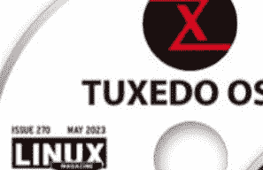


### 97 征稿

双面 DVD 上的两款精彩发行版！

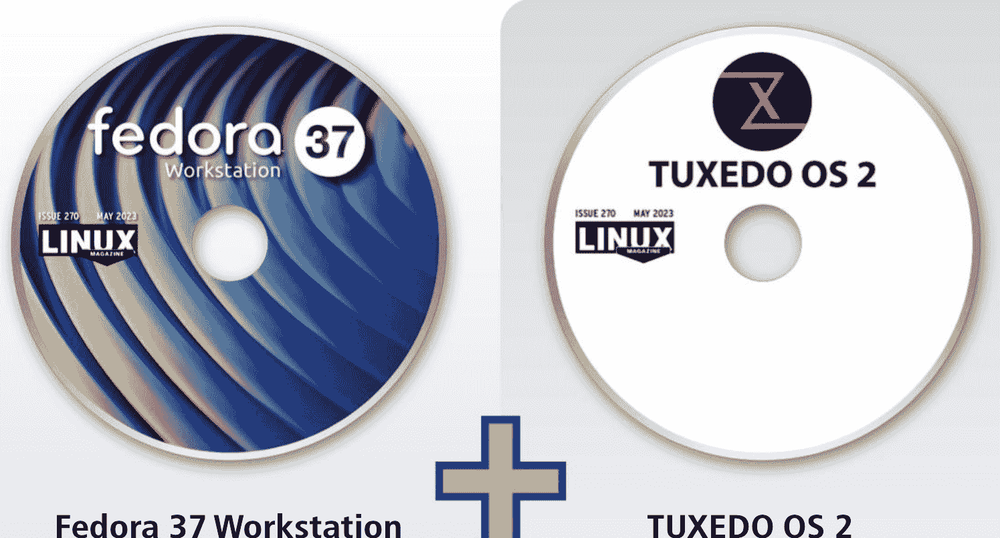

#### 64位

#### 64位

`Fedora` 是一个由 `Red Hat` 维护的社区发行版，以尽早采用新软件组件闻名。`Fedora` `Workstation` 版本专注于专业环境下的桌面操作。`Fedora` `37` 版本包含了 `Gnome` `43` 桌面，该桌面具有重新设计的状态菜单，并对文件（`Files`）管理器进行了重大升级。最新的 `Fedora` 还带来了对人类语言支持的更新，以及对计算机语言组件的关键更新，包括 `Python`、`glibc` 和 `LLVM`。

`TUXEDO` `OS` 是一个基于 `Ubuntu` 的 Linux 变体，由欧洲硬件供应商 `TUXEDO` 维护，用于其原生 Linux 笔记本电脑系统。`TUXEDO` 在去年 9 月发布了通用 Linux 系统的 `ISO` 镜像，他们还将 `TUXEDO` `OS` `2` 推向公众，作为一个轻量且响应迅速的桌面系统。`TUXEDO` `OS` `2` 基于 `Ubuntu` `22.04`。选择 `TUXEDO` `OS` 的用户喜欢原生应用程序、`Flatpak` 包管理系统以及对性能的关注。在我们的测试中，`TUXEDO` `OS` 的启动速度明显快于 `Ubuntu` 或 `Windows`（参见本期其他位置的文章）。

缺陷光盘将被更换。请发送邮件至 `subs@linux-magazine.com`。

尽管本《Linux Magazine》经过了测试，且据我们所知，没有恶意软件和缺陷，但《Linux Magazine》对使用此光盘引起的任何数据和计算机系统的中断、丢失或损坏不承担责任，也不承担法律责任。

下载此免费焦点指南，了解为什么 `Rocky` `Linux` 正在全球范围内获得广泛受众。


`https://bit.ly/Inside-Rocky-Linux`

### 技术、趋势和工具的更新

- `Gnome` `44` 候选版已上线
- `Flathub` 投票成为标准 Linux 应用商店
- `Debian` `12` 将搭载 `KDE` `Plasma` `5.27`
- `Planet` `Computers` 发布基于 `ARM` 的 Linux 桌面电脑
- 更多在线内容
- `Ubuntu` 不再附带 `Flatpak`
- `openSUSE` `Leap` 搭载 `Flatpak`
- Linux 内核 `6.2` 支持新硬件
- `Kubuntu` 焦点版发布新的微型桌面
- 美国国家网络安全战略发布

`Gnome` `44` 迈出了一步。许多 `Gnome` 粉丝已经测试了 `Beta` 版本，并发现它是开源环境开发的下一个完美选择。根据写作时（2023 年 3 月 22 日）的预测功能，这个候选版本正处于完美的时机问炉。


令人惊讶的是，开发团队在桌面上增加了一些更改。没有新功能，但有更多的 `Bug` 修复和清理。此外，还直接支持 `Wayland` 的 `fractional_scale_v1`。这意味着你将能够测试多显示器设置下的分比例缩放。

你还将在快速菜单中获得选项，例如已连接的蓝牙设备列表。此外，快速设置现在将包含一个截图按钮和后台应用程序。

扩展功能在 `Gnome 43` 中被移除，但多亏于社区的需求，它们在 `Gnome 44` 候选版中回归了。其他亮点包括：`设置守护进程` 在活动 15 分钟后进入睡眠、`Gnome 控制中心` 的菜单和标题经过了微调、`Gnome Boxes` 允许在创建虚拟机时无需为 `GDM` 管理器选择操作系统进行代码清理，以及 `Gnome Music` 现在在“歌曲”视图下运行时占用更内存。

在此处阅读更多关于 `Gnome 44` 候选版的信息：`https://discourse.gnome.org/t/44-released/14444`

`Linux` 拥有许多种管理器和应用商店。有 `Apt`、`DNF`、`Yum`、`Zypper`、`Pacman`、`Gnome Software`、`Discover` 和 `Snap`。

对于现代 `Linux` 发行版，你也可以将 `Snap` 和 `Flathub` 加入其中。这些工具在一段时间内一直努力获得市场关注。然而，在过去的几年里，这些通用包管理器变得越来越流行。

但在它们中只有一个正在投票成为 `Linux` 的事实标准应用商店。

### `Flathub` 已获得 10 万美元资金，并目标是再筹集 15 万。目标是为更高的运营成本做准备，并实现全职员工。这发生在 `Canonical` 宣布之后，`Canonical` 宣布所有官方 `Ubuntu` 衍生版将不再默认附带 `Flatpak`。

最近，`Robert McQueen`（`https://ramcq.com/2023/03/07/flathub-in-2023/`）不仅指出 `Flatpak` 的增长有多强劲（每天下载量超过 70 万次），而且

表示他们计划建立一个独立的法律实体来拥有和运营 `Flathub`（目前 `Flathub` 由 `Freedesome` 托管）。

`Mcqueen` 在博客中说：“在我看来，`Flatpak` 解决了阻碍 `Linux` 在桌面端主流增长和接受的最大技术问题……即开发者难以以易于发现的方式发布他们的工作。`Flatpak` 极大地帮助了开发者。”

对于 `Flathub` 带来的带来的未来，“`Flatpak` 的构建将帮助用户。”

`http://www.linux-magazine.com`

`http://www.admin-magazine.com/HPC/`

- `Jeff Layton`

环境模块对于高性能计算是必不可少的，它允许你在不同编译器、库之间切换。

`http://www.admin-magazine.com`

- `Matthias Weiß`

这些工具是 `Go` 和 `Rust` 的实现。

# `Debian 12` 将搭载 `KDE Plasma 5.27`

打破传统，`Debian` 选择采用最新的 `KDE` 桌面版本。`Debian` 以不包含过时的软件闻名。这背后的原因是“大多数”主要是稳定性，这意味着每次发布只包含运行无问题的软件。

对于那些倾向于使用更新软件的用户，你也可以在某些情况下进行安装——这可能会有点复杂。因此，如果你喜欢带有最新 `KDE` 环境的 `Debian`，你可以通过 `Debian` 测试使用。

该版本是 `Debian 12 (Bookworm)`。而且当 `Bookworm` 发布时，可以确定 `KDE Plasma 5.27` 将是可用。

`KDE Plasma 5.27` 包含一个新的窗口管理器、一个改进了许多 `Bug` 的微框架，以及对桌面的进一步优化。它还将配合 `KDE Framework 5.103` 和 `KDE Gear 22.1.3` 发布。

要了解更多关于 `Debian 12` 发布的信息，请阅读官方发布计划（`https://wiki.debian.org/PkgQtde/BookwormReleasePlan`）。目前，`Bookworm` 预计在 3 月 12 日左右进入硬冻。完整的免费发布日期待定。

`XR` 系列将推出 `XR1`（4 核 `CPU`、4GB 内存）`XR2`（8 核 `CPU`、`Mali-G610 GPU`，从 4GB 内存到 32GB 到 256GB 内部存储）。这两种选择都提供双以太网接口和 `WiFi 6`

两款设备都包含彩色触摸屏，你可以访问不同的选项、时间/日期，以及电源按钮。你现在可以在 `Planet Computer` 网站预订 `XR` 系列（`https://planetcomputer.co.uk/`）。`XR1` 售价 614.00 美元，`XR2` 售价 774.00 美元。

## `Linux` 新闻

任何关注过 `Snap` 和 `Flatpak` 等通用包管理器兴起的人，都完全清楚这两种技术之间的差异，以及为什么一种技术比另一种更具分发版无关性。

我指的是 `Snap`，它由 `Canonical` 公司驱动，而这家公司恰好就是 `Ubuntu` 的母公司。

`Snap` 和 `Flatpak` 都是安装软件极佳的方法，特别是对于那些没有为 `Apt` 和 `D` 等更传统的包管理器提供的应用程序。`Snap` 和 `Flatpak` 让 `Spotify`、`Slack` 和 `Skype` 等工具的安装变得简单得多。

`Snap` 预装在 `Ubuntu`、官方 `Ubuntu` 变体（spins）以及许多 `Ubuntu` 发行版中。此外，官方变体也包含了 `Flatpak`。`Apt`、`Snap` 和 `Flatpak` 的结合意味着用户有大量的应用程序可以安装。

- `Canonical` 已经决定 `Ubuntu` 变体将不再附带 `Flatpak`（`https://help.ubuntu.com/community/ubuntu-22.04-34061`）。你仍然可以通过标准存储库中的命令 `sudo apt-get install flatpak -y` 在 `Ubuntu` 及其任何一个变体上安装 `Flatpak`。

- 这一变化影响所有 `Ubuntu` 变体，包括 `Kubuntu`、`Ubuntu Budgie`、`Ubuntu Kylin`、`Ubuntu MATE`、`Ubuntu Studio` 和 `Ubuntu`。

## `openSUSE Leap 15.5 Beta`

你可能对 `openSUSE Leap 15` 的最终发布版本没有包含太多新功能感到意外。事实上，这个新版本在功能方面非常简洁。正如预期的那样，`Leap 15.5` 实际上只是错误修复和已安装应用程序的新版本。

然而，在新软件包列表中，你会发现一个迁移工具，它让你能够通过图形界面轻松地从一个发布版本迁移到另一个版本。

该工具已经过精简，只需点击一下即可迁移到下一个版本。因此，如果你正在使用 `openSUSE Leap`（或 `15.5 Alpha`），你可以迁移到 `15.5`，其中 `openSUSE Leap 15.5` 的新包包括 `Python 3.10`、`systemd 252`、`KDE Plasma 5.27.101` 以及 `Mesa 22.3` 图形驱动。

`openSUSE Leap` 诞生于 2018 年，到目前为止表现良好。任何希望获取最新 `openSUSE Leap` 发布版本的人都应该查看滚动发布周期 `Tumbleweed`（`https://get.opensuse.org/tumbleweed/`）。

然而，对于那些更倾向于传统发布周期的人，`Leap` 是更好的选择。下载 `openSUSE Leap` 的 beta 版本（`https://get.opensuse.org/leap/15.5/`）并阅读关于该发布的博客文章（`https://news.opensuse.org/2023/02/21/leap-reaches-beta-phase/`）。

最新的 `Linux` 内核已经发布，针对硬件支持、性能和安全性包含了多项改进。

在最近发给 `LKML` 邮件列表（`https://lkml.org/lkml/2023/2/309`）的邮件中，`Lin Torvalds` 说道：“但目前，请对 `6.2` 进行测试。它不是最新的发布，就像 `6.1` 结束那样，但所有常规发布都需要一些测试时间。”

`Linux 6.2` 也是 `Apple Silicon M1 Pro`、`Max` 和 `Ultra` 的最新内核主支持。这项特定工作由 `Linux` 团队提交到了上游。

每两周在你的收件箱中获取新闻。

免费订阅 `Linux Update`

`bit.ly/Linux-Update`

`NTFS3` 驱动包含了隐藏文件（以便在挂载 `Windows` 目录时正确隐藏文件）、`nocase`（用于区分大小写的文件和文件夹），这防止了重命名 `Windows` 中不允许的文件和文件夹的操作。

已添加对 `Sony Dualshock 4` 游戏控制器的支持，改进了对 `OneX` 游戏主机的支持、对 `Habana Gauss2` `AI` 加速器的支持，以及对 `ASUS` 主板的若干项改进。

要了解 `6.2` 内核包含哪些内容，请阅读 `6.2` 合并窗口的第一和第二部分（第一部分：`https://lwn.net/Articles/917733/`；第二部分：`https://lwn.net/Articles/918146/`）。

## `Kubuntu` 团队发布新微型桌面


## NX GEN 2

NX GEN 2 是一款预装了 `Ubuntu 22.04` 的小型桌面电脑，拥有足够的动力帮助你高效工作和享受娱乐。

其余规格包括 `UHD Intel` 图形、`Wi-Fi 6E AX211`、`蓝牙 5.3`、3 个 `USB-B` 端口、1 个 `USB-A` 端口、`音频/麦克风组合接口`、2 个 `Thunderbolt` 端口、1 个 `RJ45` 接口以及 `VESA` 显示器支持。

NX GEN 2 还经过了扩展测试和配置。不过，其显卡适用于大多数使用场景。NX GEN 2 的价格从 $995.00 起（配 8GB 内存和 `250GB NVMe SSD`）。你可以在官方 `Kubuntu` 网站（`https://kubuntu.me/nextgen`）上配置你的 NX GEN 2。

## 网络安全战略

拜登政府发布了新的网络安全战略（`https://www.whitehouse.gov/wp-content/uploads/2023/03/National-Cybersecurity-Strategy.pdf`），以确保每个人都能从安全可靠的数字经济中获益。这份 36 页的文件概述了美国方法的以下根本性转变：

- 我们必须承担防御网络空间的责任，将负担从个人、小企业和地方政府转移到我们所有最有能力、且最适合降低网络攻击风险的人身上。
- 我们必须让对手对其行为负责。
- 我们还必须通过激励措施来促进长期投资，在防御紧迫威胁与对未来进行战略性规划之间建立仔细平衡。

该战略承认了当前的威胁环境，并强调了建立五个支柱协作的必要性：

- 防御关键基础设施
- 破坏并瓦解威胁源者
- 驱动市场力量
- 投资未来
- 建立国际合作伙伴关系

该战略指出：“我们必须建立一个零信任架构来应对日益增长的威胁。”

## 读者反馈

最近，我报道了关于内核的一场讨论，内核人员讨论了 `32-bit` 系统的各种问题。反馈很多，针对该专栏，我收到一封来自 `Gary` 的信，他阐述了一个观点：“我认为内核人员低估了运行 `32-bit` 系统的人数。在我特定的情况下，我使用 `Pi 4` 运行 `Kodi`。访问 `Netflix`、`Prime` 等其他流媒体服务需要该库，遗憾 `32-bit` 版本无法满足。”

“可以认为这是硬件的一种产物。内核人员可能应该关注这些问题。”

我很高兴收到 `Gary` 的信。如果其他读者也能分享有见解的内容，“读者反馈”将成为本专栏的固定部分。读者反馈可以发送至 `edit@linux-magazine.com`。我会都会阅读。

`Zack` 报道 `Linux` 内核社区的最新新闻、观点、困境和进展。

`Zack Brown`

作者

`Linux` 内核邮件列表包含了开发活动的核心。流量巨大，每周经常达到 10000 条消息，对于一个人来说，跟上整个开发范围几乎是不可能的任务。承担这项任务的少数灵魂之一就是 `Zack Brown`。

## 内核新闻

对于任何想要更新和维护此文档的人，`Carlos` 试图澄清维护首次编辑时涉及的潜在问题，而 `Jonathan` 关于文档会多快过时的预言是正确的。而且，确实有必要让文件保持更新，但这种工作对于单一维护者来说是非常困难的。

他建议了一个他和其他人可以遵循的标准流程。为了测试“过期合并”功能，他建议他进入文件并删除所有超过三年的内容，“除了功能性书籍或我们的存档除外”。

在更新文件方面，`Carlos` 认为应该向那些产生并将并将列入文档的人员开放访问权限。他说：“`Lorenzo Stoaks` 是 `Linux` 管理子系统的一位作者。`Lorenzo` 联系我并说：‘我可以把我的工作添加到这篇文档中，并向 `linux-docs` 的一些信息订阅者介绍这个新资源。’”

`Essence` 也能找到内容创作者并与他联系，从而减轻了文件维护者在持续研究方面的部分负担。他补充道：“当我们开始时，几年后，我们得到了一个同样经过编辑的列表。”

`Jonathan` 提出了异议，随后 `Carlos` 开始编写新的补丁来记录文件内部的变化。

看到文档工作不断找到新方法来保持相关性是一件好事。维护或内核相关文档的人士将联系 `Carlos` 并保持 `kernel-docs` 文件的更新。

关于未来最佳路径的性讨论。他的公司 `hexDEV` 已经编写了一个名为 `LIN` 的内核驱动程序。其主要目的是为主线内核 `Linux` 适配并讨论 `LIN API`。但它已经可以作为 `Linux` 节点进行生产性使用。他补充道：“我们正在寻找基于 `Linux` 的 `LIN` 项目合作伙伴以寻求资金。”

`Oliver Hartkopf` 回复说，`Linux` 开源项目存在，“并且通过试验性适配实现了 `LIN` 协议（这正是 `Linux` 内核主要所做的）。”

`Christoph` 知道那个项目，并在原始邮件中甚至抄送了该项目的主要开发者之一的 `Dave Pisa`。他指出：“当出现用于 `LIN` 的内部内核 `API` 时，这个（`LIN` 的线路驱动接口）就可以调整并最终进入主线。”

`Pavel` 本身回复说，他非常乐意获取一些实际硬件；并对他在项目中遇到的某些实现上的困难进行简要的技术说明。

同时，`Ryan Edwards` 说：“我花了很多时间来解决 `LIN` 问题。在 `TTL` 的情况下，我能实现的最好结果是头部附近的延迟为 40ms，而响应超过了主站的时间。这是在用户态完成的，我假设内核解决方案会更好地满足时间要求，但这仅适用于嵌入 `UART` 的设备。”

`Christoph`、`Pavel` 和 `Ryan` 深入研究了这一棘手问题，并尝试保持对他们都旨在实现的应用程序接口（`API`）的讨论。`Andrew Lynn Cameron` 说：“对于我们的网络方面，我们非常努力让硬件变得完全不特殊。它是透明运行的。一个例子是以太网交换机，`Linux` 将其连接到普通的 `Linux` 接口。你可以以正常方式在端口上设置 `IP` 地址，也可以以正常方式向 `linux` 驱动程序添加端口。如果交换机可以在硬件中完成桥接，`linux bridge` 将卸载到硬件，”

`Christoph Fritz` 希望在 `Linux` 中支持局部连接网络（`LIN`）。`LIN` 是一种为汽车制造商安装的标准网络协议，旨在防止不兼容系统的泛滥。

`Christoph` 发布了补丁，希望依靠内核开发者来实现：“但对于用户来说，这只是给桥接添加了一个端口，没什么特殊的。”

`Andrew` 补充说：“请尽量避免任何硬件上的特殊化。我们不希望软件有特殊之处，也不要为不同的内核提供两个 `API`。只需使用一个适用于……的通用（`Universal`）`API`。”

讨论在随后很快就结束了，但似乎至少有几位内核开发者关注汽车网络和 `Linux` 标准。很可能是这些开发者之一识别了如何通过最通用的 `API` 进入内核的问题。

思考这些是有趣的。公司是否可以使用 `Linux` 作为它们的内核操作系统，这样像 `Linux` 支持这样的功能对于我们的控制车辆就具有相关性，即由用户驾驶自己的汽车并对其进行定制？另一种可能是，`Linux` 变得越来越多地成为控制车辆，由用户驾驶自己的汽车并进行定制。许多车主愿意逆向工程他们汽车上的各种特定平台协议。我确信这一切最终会产生一些有趣的结果。

`Niels van Dersch` 指出，支持加密的文件系统列表（可能对内核控制车辆有用）能够为某些文件系统启用加密，而某些不能。他提出了一个简单的内核配置，允许加密和解密。“他被坑了。”

因此，`Ted` 完全不喜欢这个主意。他评论道：“我不确定添加这个选项的动机是什么。” “根据我的记忆，在脚本开发的的早期，我们有一个针对每个文件系统的 `CONFIG_FS` 配置，但我们显然将其删除了，只是我们不再使用 `CONFIG_FS` 来启用 `POSIX ACLs` 或 `ext4`，而是为了简化内核配置。”

`Niels Mint` 认为内核讨论是他想法的巨大动力。他说：“这只是发送了这封 `RFC`。我们对 `Cefs` 的加密感兴趣。我们对作为网络文件系统的 `Cefs` 的加密感兴趣，但对于……”

`Niels Mint` 认为内核讨论是他想法的巨大动力。他说：“这只是发送了这封 `RFC`。我们对 `Cefs` 的加密感兴趣。我们对作为网络文件系统的 `Cefs` 的加密感兴趣，但对于……”

`Niels Mint` 认为内核讨论是他想法的巨大动力。他说：“这只是发送了这封 `RFC`。我们对 `Cefs` 的加密感兴趣。我们对作为网络文件系统的 `Cefs` 的加密感兴趣，但对于……”

`Niels Mint` 认为内核讨论是他想法的巨大动力。他说：“这只是发送了这封 `RFC`。我们对 `Cefs` 的加密感兴趣。我们对作为网络文件系统的 `Cefs` 的加密感兴趣，但对于……”

（注：`Niels van Dersch` 指出，支持加密的文件系统列表（可能对内核控制车辆有用）能够为某些文件系统启用加密，而某些不能。他提出了一个简单的内核配置，允许加密和解密。“他被坑了。”

因此，`Ted` 完全不喜欢这个主意。他评论道：“我不确定添加这个选项的动机是什么。” “根据我的记忆，在脚本开发的的早期，我们有一个针对每个文件系统的 `CONFIG_FS` 配置，但我们显然将其删除了，只是我们不再使用 `CONFIG_FS` 来启用 `POSIX ACLs` 或 `ext4`，而是为了简化内核配置。”

## Akademy

`Akademy` 是面向 `KDE` 社区成员、开发者、翻译者、设计师和朋友的年度世界峰会。欢迎加入我们！

`Akademy 2023` 将在希腊塞洛洛尼和线上以混合形式举行。

`7月15日 - 21日`


# 迈向绿色

许多开源项目提供了分析软件能源消耗的工具。作者：Christian Kiibling

这种趋势正开始变得显性：软件很少会浪费大量的能量。几个开源项目正在开发工具，用于研究和测量具体切消耗了多少能量。本文介绍了一些最具前景的工具。

## 绿色软件基金会（GSF）

绿色软件基金会（GSF）由 Linux 基金会于 2022 年发起，其使命是“构建一个包含人员、标准、工具和最佳实践的系统，以创建绿色软件”。GSF 包括微软、英特尔和埃森等公司，由若干小组组成。在 `https://github.com/GreenSoftware-Foundation/` 已经提供了许多软件、工具和文档仓库。

例如，开源工作组（`openource-working`）维护了一个名为 `AWS Cost Green` [2] 的仓库，其中包含指向其他节约工具和研究文章的链接，以及免费软件的链接。在此基础上，你还会找到气候组织的概述，以及如何使用（化石或可再生）绿色能源的应用需求。

GSF 还强调了针对云端和机器学习的软件。例如，有一个指向 `Green Cost Explorer` [3] 的链接，这是一个 `JavaScript` 工具，它考虑了其运行的 `AWS` 区域的能源类型。它能估算出使用了多少（化石或可再生）绿色能源应用。

任何想要让自己的 IT 景观更加绿色的人，都可以在 `Green Software Patterns` 中找到他们需要的内容。`GSF Patterns` 项目收集了不同 IT 领域（`AI`、云、`Web`）的技巧和最佳实践 [10]。该规范提供了非常清晰的提示（或尽可能的图形化方式），来推荐行动建议（例如，压缩传输的数据）。

该规范还附带了关注二氧化碳排放的 `SCI` 指标。值越低，软件对气候的损害就越小。`SCI` 分数衡量每单位 `R` 的二氧化碳排放量，其中单位可以是一个 `API` 调用、一个额外的用户或一次 `ML` 训练。如果软件遵循针对 `O`（运行排放）和 `M`（隐含排放）的 `SCI` 关注，那么 `O` 就是软件及其底层硬件所需的能量。它表明，开发者可以将其集成到自己的应用程序中，以智能的方式利用波动的能源价格。`Carbon Aware SDK` 可以使用命令行或 `Web API`，结合非关键的机器学习工具。该 `SDK` 帮助将工作负载迁移到目前可再生能源廉价的其它区域；`Alternative` 则帮助根据能源作为函数来限制操作。其背后的人们需要在数字完美的百分比范围内恢复二氧化碳的减量：

| CPU 负载百分比 |
| :--- |
| 80.00 |
| 60.00 |
| 40.00 |
| 20.00 |

## 具体工具与实践

`Kepler`（`Kubernetes` 功率级执行器）依赖 `ebb` 从 `Kubernetes` 中提取功率统计。`Experiment Impact Tracker` [5] 和 `Carbon-Tracker` [6] 测量机器和深度学习预期的能量开销。该 `GitHub` 仓库还包含操作系统工具。例如，Linux 入目将带你进入 `PowerAPI` [7] 和 `PowerTOP` [8]。

例如，`绿色柏林`是一个总部位于德国的组织，他们认为如果数字化是可持续的，将对社会产生积极影响。`绿色编码`旨在开发开源测量工具来确定可持续基础设施的需求，并在绿色软件周围建立一个社区和生态系统。

为此，`绿色编码`与可持续数字联盟（`SIA 131`）合作，这是一个由几家公司组成的联盟，拥有可持续数字基础设施的路线图。

绿色使用 `Green Metrics Tool` [14]，这是一个基于容器的实用，目前用于实验和测试。绿色指标可以帮助你测量每个容器的空间、`CPU` 利用率百分比或全系统的功耗。`Python API` 填充指标，`JavaScript` `Web` 前端渲染结果（如图所示）：


**图 1**：`Green Metrics` 对容器进行测量并将结果视觉化。

`绿色编码`与 `KDE Eco` [15] 合作，后者是一个旨在为自由开源软件带来更多可持续性的创始倡议。初始目标是衡量自由开源软件的需求，以便帮助开发者之后优化软件。`KDE` 项目提供了两个核心仓库 [16]：

*   化石能源效率项目（`FEEP` [17]）根据“蓝天使”（`Blue Angel`）方法论创立。`蓝天使`是一个德国标准，通过分配标签来指定环保产品。`FEEP` 网站提供了一套测量方案。

`GSF` 的工具人人可用，但基金会本身总部位于美国，主要由当地公司资助和维护。然而，欧洲也正在进行类似的努力。

### 10 个人与语言比较研究

10 个人共用 28 种语言实现了程序。其中，包括这些微小的 `Mandelbrot` 集合和树。研究仅调查了哪些语言在单独执行这些任务时是节能的。相比之下，真实的应用需要解决复杂的任务。例如，加密工具具有极强的数学化程序，而有些仅仅是在网络中传输数据。

如果一个应用程序运行得尽可能快，处理器就可以更快地切换回其节能模式之一。在 `OIS` 中，编译器选择了最节能的代码，这并不令人意外。`OIS` 的开发者还确保了汇编程序消耗更少的能量。这是侧重于对现有工具和流程进行性能测量和优化。

复杂的互联网应用程序，如云无限扩展平台（`OIS`），是本文未包含的高平台应用。`OIS` 的创建是作为经典 `PHP` 应用的更强大的替代方案，因为后者在面对重负载和大量用户时达到了其局限性。`OIS` 的开发者自己尝试学习如何优化 `OIS`，同时，与小型基准程序不同，`OIS` 提供了在网络上协同工作的众多服务。`OIS` 开发者对评估采取了略有不同的方法。

`Go` 通过内置的性能分析器帮助开发者。性能分析器测量程序的执行时间以检测低效操作。根据 `Ocloud GmbH` 首席信息官 `Klaus Fritz` 的说法，`Go` 通常仅用于跟踪分布式系统中的错误。这就是为什么他们使用内部开发的工具进行性能测量——一个名为 `cdfer` [6] 的工具，该工具又被称为 `k4 test` [7]。`k4 test` 工具模拟了多个用户访问文件共享平台。

如果编译器可以运行基准测试——即你可以确定代码更改性能影响的标记 [8]。例如，如果一个函数计算最大公约数，你可以为不同的数字对单独调用 `DILY` 基准测试。如果基准测试在更改后交付更短的运行时间，你就成功优化了最大公约数的任务。他们的基准测试可以从开发开始与（单元）测试一起维护。


**图 1**：在 `k-核苷酸` 基准测试中，`Go` 消耗的 `CPU` 功率和内存高于其他语言。

一旦你确定了程序的局部，你就越需要优化源代码；特别是当你需要找到最高效的算法时。许多编程语言通过评估常量表达式来支持高效开发，这节省了执行期间的计算时间。然而，此功能需要开发者将常量表达式正确集成到源代码中。此外，存在区分浮点数和整数的。由于许多处理器使用整数进行计算，如果可能，你应该优先使用它们。当你在此类循环中使用它们时尤为如此。循环搜索：包含了经典的断路器和功率调节器，但也允许多余的循环、递归和不必要的重复。程序每当调用图库时都要重新计算所有基准，这会不必要的消耗能量。`Go` 开发者在单独的页面上提供了更多高效编程的提示 [9]（图 4）。

其他语言也存在可比较的集合。无论如何，你不应该急于每一个文件操作。从 `Freight` 的角度来看，此类操作已经过优化。例如，`PHP` 保存文件到磁盘的速度与优秀的程序一样快。

另一个经常被忽视的任务是软件开发。软件的开发会产生能量成本。在开发阶段，`CI` 系统会被重建以测试源代码。例如，`OCIS` 是使用 `Drone` (11) 创建的。自动启动编译器并运行运行时测试软件增长，尽管 `Go` 编译器被认为相当快且足够。

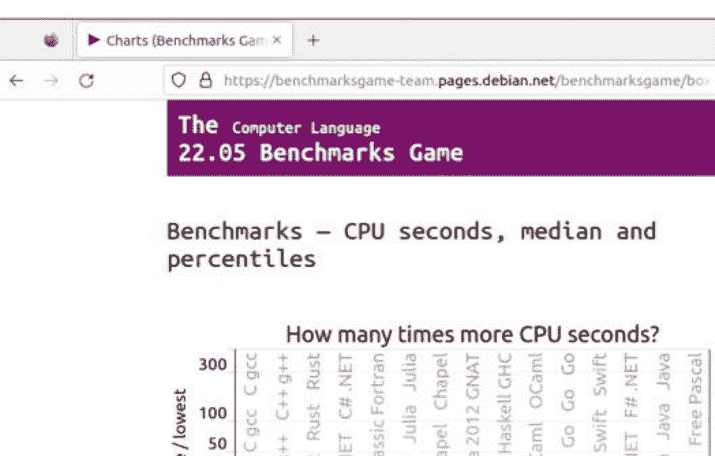
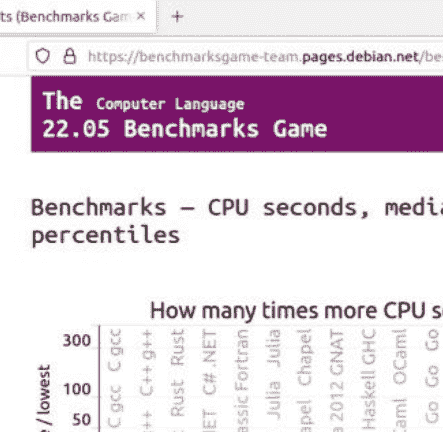


# 1. 注意箱线图离群值

为了测量性能和能量，`oCIS` 开发者使用了这个开源工具。

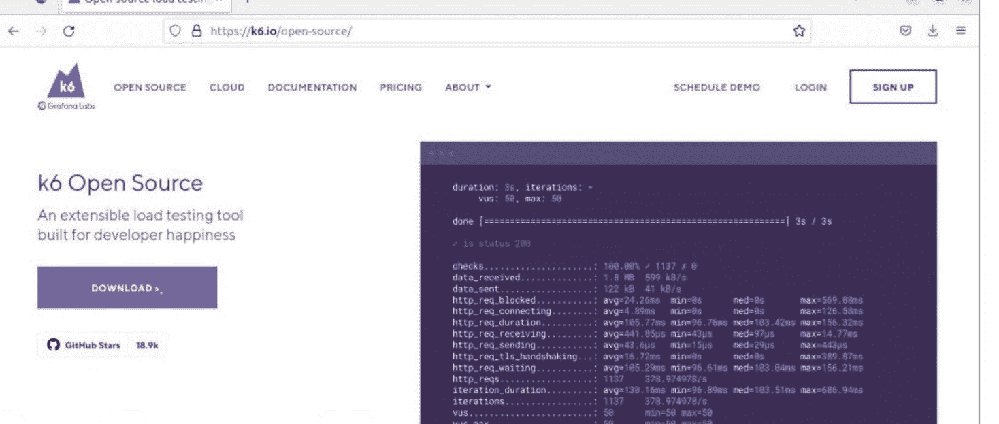

图 3：为了测量性能和能量，`oCIS` 开发者使用了这个开源工具。

# 2. 能效与代码效率

`Freight` 承认高效的代码并不一定会导致节能程序。例如，来自通用服务器的透传解决方案既浪费你的时间又浪费金钱。如果一个应用程序在短时间内要求 `CPU` 高强度工作，然后切换到降频或高功率模式，其能量平衡可能比一个快速的慢程序更糟。[注：原文句末是“`fast`”，即“`slow program that is fast`”]。`Go` 开发者可以使用标准库来限制可用处理器核心的数量，但他们不能针对特定的 `CPU` 核心。你必须使用操作系统或 `Linux` 调度器来针对特定核心。

能量消耗不仅取决于处理器，还取决于处理的数据。例如，一个不断受到订单冲击的在线商店消耗的能量比获取文本多。从数据库或缓存中获取大量数据也会保留中间结果，例如生成的图像。再次，你不需要发明轮子：许多库提供了高效缓存。`Go` 开发者可以查看 `Gcache`，例如！`Go` 运行时利用其相对于竞争对手的优势。当你使用值（按值传递）时，`Go` 和许多其他语言将其复制到内存中。如果频繁调用函数，就需要许多副本。如果你使用值的引用（按引用传递），这减少了对内存的需求。然而，`Go` 提供指针（图 5），这意味着你传递的是数据的引用。

# 3. 内存管理

`Go 1.19` 的引用实现使用垃圾回收 (13) 来管理内存。垃圾回收在内存不再需要时在后台释放内存。然而，它的活动消耗 `CPU` 时间和功率。虽然你可以禁用垃圾回收，可能会导致内存或其他副作用。研究结果显示 `Go` 的垃圾回收消耗能量非常少。

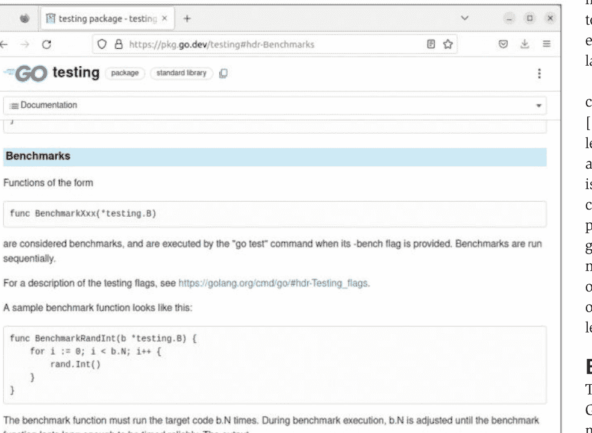

# 4. 基准测试

格式如下的形式

```
func BenchmarkXxx(b *testing.B) {
	for i := 0; i < b.N; i++ {
		rand.Int()
	}
}
```

基准函数将运行代码 `b.N` 次。在基准测试执行期间，当设置 `go test -bench` 标志时。会报告结果。有关测试标志的描述，请参见 `https://golang.org/doc/go-tools.html`。一个示例基准函数看起来所示：

图 4：`Go` 自带了一个测试框架，这赋予了开发者进行基准测试的能力。

# 5. 语言基准比较

计算机语言基准包含了 `k-ruci-test` 基准程序，该程序侧重于 `Go` 实现中的泛型以比较。`JavaScript` 版本也产生结果，并发运行，到 `Node.js` 运行时。相比之下，`TypeScript` 版本必须在完成一个计算后执行另一个计算，速度比 `JavaScript` 和 `Go` 的实现慢。研究表明，`TypeScript` 使用的时间是完全相同的 `JavaScript` 的数倍。

使用 `workers` 执行的并行计算。当你需要等待某个操作完成时，也会发生类似的情况。如果客户端在短时间内频繁调用无响应的服务器，会导致功率消耗。回调或推送消息可以确保更高的效率。计算框架通过其通道和监听器进行通信。`Go` 通过网络包中的通道和监听器支持这一点。

# 6. 分布式系统能耗

`OCIS` 由微服务组成，每个微服务执行不同的任务。虽然通信服务在性能以及相应的能量方面占了大部分成本，但如果微服务之间相互发送请求，这种“乒乓球”就会消耗能量。如果所有连接的系统都必须设置新的配置，电费也会增加。处理架构更改所需的节点数量不可避免地跨网络，这些消息需要进行通信和评估。在分布式系统中，可以通过降低通信频率来节省能量。

# 7. 人工智能能耗

如果使用了超出任务所需的神经网络，就会浪费大量的能量。对环境有害的 `AI` 就像是糟糕的 `AI`。

此外，许多依赖 `Python` 的 `AI` 编程人员倾向于使用 `Python`。他们依靠使用 `Python` 来加速计算。其中一种是使用 `Cython`，它将 `Python` 代码转换为 `C` 或直接在 `C` 中实现。如果你开发模型，你需要设计并训练它们，使其尽可能节能。如果你对节能变体使用预编译示例……

# 8. 编程语言特性

此外，编程语言各有其优缺点。某些脚本语言的源代码很短。解释器处理这些指令的速度很快，脚本的运行效率与编译后的版本相当，且更容易维护。

此外，语言是为特定目的身定制的。例如，`Python` 主要用于数据分析，但在处理复杂的数值运算时速度较慢。如果你需要数值分析，`Go` 的函数式编程方法是一个很好的选择。它更适合用 `Go` 创建的服务器服务和主程序。该语言具有许多高效的字符串操作，有些操作在 `Go` 中执行效率极高。

由于 `Go` 已经存在多年，用它编写的程序也相当独特。像 `C`、`Python` 或 `PHP` 等成熟的编程语言也是如此。如果过于频繁，低效开发的系统和旧库可以帮助节省能量。`OCIS` 的开发者以某些遗留格式开发了他们的扁平存储实现。与众不同，`OCIS` 不需要昂贵的数据库。

# 9. 测量与评估

训练神经网络能为任务带来更高的准确性，之后工作的时间就越长。但通过计算这所需的功率，在极端情况下，其排放的二氧化碳甚至比它们的使用寿命还要多 [14]。如果你是……

归结底，只有你的测量才能帮助发现代码消耗了多少能量。这些测量应该在开发阶段实时进行。例如，你可以使用 `IoT` 测量能量消耗。

然而，你需要使用辅助算法来检查能量消耗，`Go` 程序缺乏这种能力。观察者早在 2019 年开发了一个用于检查能量消耗的分析工具；在他们看来，除了 `CPU` 之外，其他系统为执行的某些短代码段提供了能量消耗值 [15]。在……

```go
// Pointers
// Go 有指针。指针持有值的内存地址
// 类型 * 是一个指向 int 的指针。它的值为 nil。

var p *int
// 运算符操作其指向操作数的指针。

var i = 42
// * 运算符表示指针的值。

fmt.Printf("%d", *p) // 读取指针 p
// 这被称为“解引用”或“间接”
与 C 不同，Go 没有指针算术。
```

图 5：指针加速了 `Go` 中的内存访问和数据传输。借此，你可以快速更改变量的内容而无需复制它。

# 10. 调试工具

在发布之前，还没有开发者可以使用的用于测量能量消耗的库。

但至少标准库中包含了一些调试函数。例如，`debug` 包包含了你可以用来触发垃圾回收的函数。`ReadStats()` 从 `runtime` 包提供了内存使用信息，你可以用 `metrics` 包生成输出。

# 11. 测量考虑因素

公司共享少数大文件还是极大量数量的小文件，其结果是有区别的。在测量中，你需要考虑平均值。

如果你感兴趣，可以在网上阅读 `SLE` 的故事 [16]，你会在 `GitHub` 上找到该仓库。`OCIS` 开发者正在帮助清理 `opencloud`、`ocIS` 和 `Nextcloud` 项目。在本文撰写时，验证仍在进行中。但你可以使用开源工具测量性能。

在测量能量消耗时，还存在你执行哪些程序代码的问题。效率指的是测量过程中不发生错误。错误通常会导致程序终止或内存泄漏。

如果可能，你还需要在现实条件下进行测量。开发者往往会赶时间并简化结果，这可能会影响测量。在测量期间，`OCIS` 的开发者被迫重新思考解决任务的架构。结果，我们以一种计算成本高昂的方式重新解码了相同的代码。

# 12. coreboot 简介

`coreboot` 是一种开源固件替代方案，强调速度和简单。

作者：`Bruce Bfield`

在未来几年里，你启动电脑的方式可能会发生巨大变化。像 `coreboot` [1] 这样的固件替代方案已经广为人知，随着开发的加速，可能会变得更加流行，而且现在已经广泛可用。首先，对于硬件来说，`coreboot` 的启动速度比熟悉的 `BIOS` 或 `UEFI` 快四倍，取决于如何配置，它甚至更快。`BIOS` 的尺寸曾经平均超过 100KB，但现在的平均大小已接近 8MB，而且它几乎肯定包含了过时和冗余的代码，这严重减慢了启动时间。相比之下，`coreboot` 经常可以在几秒内启动台式机和笔记本电脑，而后者则需要几分钟。“不仅如此，`coreboot` 的设计符合现代安全标准，而且由于比传统的 `BIOS` 更小，它提供了更小的攻击面。另一个优势是，`coreboot` 的架构设计成了一个‘无法变砖’的更新过程。更新固件比在你的手机上安装 App 要容易得多。”在每一个方面，`coreboot` 都是计算机固件概念的彻底变革。


`coreboot` 最初类似于 `LinuxBIOS`，于 1999 年创立于洛斯阿拉莫斯国家实验室（该实验室以研发而闻名）。

你可以配合负载（`payload`）中指定的其他操作系统间接使用 `coreboot`。它还衍生了许多分支发行版，如 `Libreboot` [2] 和 `Librecore` [3]，它们在嵌入式系统和非 `x86` 架构上有许多项目。

`Bruce Bfield` 是一位计算机记者和软件编辑，专攻自由和开源软件。除了编写项目，他还教授现场课程和在线课程。事实上，他经常就 `Coreboot` (`https://coreboot.wordpress.com`) 进行演讲。他还是 `Printerpieces` 的联合创始人，这是一个关于写作和技术艺术的博客地址：`https://printerpieces.com/`。

开发者们已经意识到一种新固件解决方案的必要性。根据 `coreboot` 网站，`coreboot` 的设计旨在提供启动现代操作系统所需的最少指令。最小结构意味着 `coreboot` 必须为其支持的每个芯片组进行修改，这虽然带来了进步，但往往会增加效率。`coreboot` 在 `x86` 机器上的启动 [5]（如时间轴图1 所示）：

- `bootblock`：第一阶段用汇编语言编写，旨在为 `coreboot` 剩余过程设置环境。任务包括加载，它使用 `CPU` 缓存内存作为由环境管理的堆和栈空间。在 `x86` 系统上，`bootblock` 还会从 16 位模式切换到 32 位模式。
- `vestage`：一个可选阶段，如果通过 `coreboot` 构建，则会启动信任根。
- `romstage`：为下一阶段使用缓存内存（`cache DRAM`）做准备。
- `postcar`：使用缓存即内存（`Cache-As-RAM`）并加载负载（`payload`）。
- `ramstage`：初始化硬件，包括 `PCI`、片上、图形设备、信任模块和 `CPU`。为操作系统准备初始表，并作为代码加载硬件和固件。
- `payloads`：在固件存储器中携带一段软件，用于初始化启动操作系统的过程。可以看到两种负载：`x86` `BIOS` 的实现以及 `TianoCore`（`UEFI` 的开源版本）。`BIOS` 的核心就是 `coreboot`。对于长期用户来说，可能会发现无法读取启动过程的输出，因为已经被重定向了，而不是到 `/var/log/dmesg` 或 `stdout`。

根据维基百科，提供了 `coreboot` 的设备，包括一些基于 `x86` 的 `Chromebook`，以及来自 `Laptop Chip`、`Minifree`（原 `Gluglug`）、`PC Engines`、`Pyrys`、`System76` 和 `Star Labs` 的设备。这些电脑大部分是笔记本，有些是翻新的，但这个列表在过去几年里一直在增长。

我对 `coreboot` 的实践经验来自最近从 `System76` 购买的设备。在过去的几年里，`System76` 已成为 `Linux` 电脑的主要制造商。每台电脑都带有一个标准的 `BIOS`。然而，他们逐渐切换到了 `System76` 的 `coreboot Darter`。截至 2023 年 3 月，官方 `coreboot` 将引入该公司的台式机、服务器和迷你 `PC`。

在 `System76` 的 `Darter` 上，传统的 `BIOS`（图 2 和 `UEFI` 实现）之后出现的情况令人震惊。早期版本 `Darter` 的 `BIOS` 有 38 个顶级项目，包括规范以及安全启动、雷电和电源管理的设置。相比之下，图 3 所示的当前 `Darter coreboot` 启动菜单（通过按键访问）也令人震惊。

| 阶段 | 说明 | 位置 |
| :--- | :--- | :--- |
| `bootblock` | 第一阶段，设置环境，从 16 位切换到 32 位 | `CPU` 缓存 |
| `vestage` | 可选阶段，启动信任根 | - |
| `romstage` | 为下一阶段使用缓存内存 | 缓存 |
| `postcar` | 使用缓存即内存加载负载 | `RAM` |
| `ramstage` | 初始化硬件 (`PCI`、片上、图形、`CPU`) | 系统内存 |
| `payloads` | 初始化操作系统启动 (`BIOS` 实现或 `TianoCore`) | 固件存储 |

图 1 还说明了 `EDK II coreboot` 平台规范实现的 `coreboot` 阶段。

| 阶段 | 阶段 | 阶段 | 阶段 | 阶段 | 阶段 |
| :--- | :--- | :--- | :--- | :--- | :--- |
| `bootblock` | `SEC` | `vestage` | `PEI` | `romstage` | `PEI` |
| `postcar` | `PEI` | `ramstage` | `DXE` | `payloads` | `DXE` |

图 2：传统的 `BIOS` 实现。

图 3：`System76 coreboot` 菜单。

### 发行版之旅 – `coreboot`

许多有用信息可以在 `System76 Open Control` (`EC`) 中找到，带有如何自定义键盘、风扇和电池的说明。`Purism` 的 `Libra 14` [6] 广告拥有“更少的二进制块 (`less blob`)”并强调安全性。但是。

### 欢迎来到革命

`coreboot` 面临严重的障碍。它通常必须绕过专用代码，这消耗了时间并损害了开源哲学。也许，这种保守主义倾向于既定的 `BIOS` 和 `UEFI` 标准，因为它们比熟悉感并不差。预料到或意识到刷机有多困难，这足以让最愤世嫉俗的人信服。期待在的未来能做出更好的 `coreboot`。

可能，`coreboot` 最大的障碍需要它自己的实现。尽管如此，分离负载的使用带有限制，并带来了另一个优势：在项目本身 [7] 以及像 `System76` 早期零售商中，都组织良好且清晰。

`coreboot` 的天然优势是显而易见的，以至于其未来的主导并非偶然。仅仅看到电脑启动比你快

### GUADEC

拉脱亚，里加

2023年7月26日至31日

`GUADEC` 是 `GNOME` 的年度主要盛会。自2000年以来，它汇聚了来自世界各地的自由软件爱好者和专业人士。

加入 2023 年 `GUADEC` 大会（无论是在里加现场还是在线参与），听取最新的技术进展、参加讲座、参与工作坊，并庆祝 `GNOME`！

了解更多

`GUADEC.ORG`


### 测试中的 `TUXEDOS OS 2` 预览版

#### 全新的 `Tuxedo`

受欢迎的 `Linux PC` 电脑制造商 `TUXEDO` 将 `Ubuntu` 进行了扩展，包含了最新的 `KDE` 软件包和 `Snap`，用于其内部的 `TUXEDO OS` 发行版。最新版本适用于任何 `PC`。

在没有经验的情况下，很难预测在新的 `PC` 上安装是否能够正常工作。个人可能在经过耗费时间的研究和努力安装所需的驱动程序后才能运行。事实上，结果可能是完全失败。因此，`Linux` 友好型硬件提供了预配置了 `Linux` 系统的电脑，保证了一切都能正常工作。至于选择其他发行版，由于包含了为所提供的电脑所需的所有驱动程序、内核补丁和所有工具，情况也是如此了。

这一点，例如对于美国供应商或德国制造商来说是真实的。他们都提供自己的 `Linux` 发行版，而 `System'76` 的 `Pop!` 已经失败了一段时间。`TUXEDO OS` 一直安装到2022年9月，当时 `TUXEDO` 客户发布了 `ISO` 镜像版本的 `TUXEDO OS 1`。版本2 的发布大约在此时出现。我们决定查看一下 `TUXEDO OS 2` 的预览版。

`TUXEDO OS 2` 基于 `Ubuntu 22.04`，但当你使用 `lsb_release` -a 或显示 `/etc/os-release` 配置时，它会显示为 `TUXEDO OS 2`。`Ubuntu` 风格的约定没有发生变化：例如，没有 `root` 账户，你需要 `sudo` 来获取管理员权限。

如果你使用 `TUXEDO OS 2` 进行 3.6GB 的安装并让你启动桌面（你也可以将其写入 `U` 盘），在启动加载程序中选择 `TUXEDO OS 2` “Try & Install”后，你会先进入实时系统，提示语言、地区/时区和键盘，安装程序在启动 `KDE` 桌面之前会花费几秒钟更新本地化。

点击软桌面（已安装的 `TUXEDO OS`）依赖于常规 `Calamar` [2] 安装程序框架。如果你正在安装非 `TUXEDO` 设备，将出现一个警告，提醒你在 `TUXEDO` 中安装的任何特殊工具都无法工作。

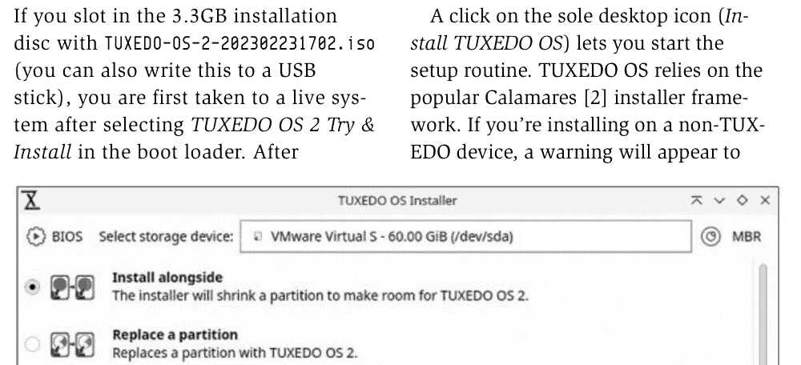

图 1：分区器可以缩小 `Windows` 和 `Linux` 分区以为 `TUXEDO OS` 留出空间。

安装程序提示你选择语言并直接跳转到最重要的部分：磁盘分区。你有四个选项：你可以在“全部安装”中选择分区。一个滑动条 (1) 将帮助你决定旧系统和新系统之间的空间。分区允许你决定大小。若要删除，你可以擦除硬盘并选择“手动分区”。对于你指定分区表 (`MBR`) 以及较新的 `GPU`。你也可以在分配之前点击“加密设置”通过 `LUKS` 加密 `TUXEDO OS`。


# TUXEDO OS 安装与系统体验

## 磁盘分区与文件系统
当你擦除磁盘时，你可以选择“无交换分区”（No Swap）、交换分区（不带休眠）、交换分区（带手动）以及“为驱动器使用交换分区”。默认情况下，系统在不创建现有分区的情况下使用交换，但安装程序不会请求交换空间。

当你到达下一个分区时，如果你使用整个磁盘或手动分区，可以选择 `ext4`（默认值）、`Btrfs` 或 `XFS`。安装程序继续进行标准设置。可以禁用“常规密码词”选项，如果需要，`TUXEDO OS` 将自动为你登录。就这些了：安装程序现在解压一些文件并等待你确认重启。

## 启动项与预装软件
新安装的 `GRUB` 加载程序带有一个菜单，你可以在从中选择其他 `Linux` 发行版和安装项。这在我们的测试中运行得完美；一个带有 `TUXEDO OS`、`Ubuntu 22.04` 和 `Ubuntu 21.04` 的快速启动配置可以进一步运行。

开发者在安装程序中预装了许多程序，包括 `Firefox`、`Thunderbird` 和 `Kotlin`。你可以日常使用 `LibreOffice`，它们可以使用 `VLC` 工作和播放视频。`VirtualBox` —— 有点不同寻常地带有专有的 `Oracle` 扩展。构建开发者基础包已经在那了，其中包含了 `TUXEDO OS 2` 预览版中包含的少量软件包版本。

## 管理工具与远程连接
管理工具允许你使用基于终端的 `Midpoint` 命令管理器和 `htop` 进程查看器。`TUXEDO OS` 未安装 `OpenSSH` 守护。如果你想连接到远程计算机，请使用以下命令安装 `OpenSSH Server`：

```
sudo apt install openssh-server
```

## 性能与桌面环境
在机器上，一台配备四核 `Celeron N5108` 的紧凑型 PC 启动了 `KDE` 桌面。`Ubuntu` 花了 18 秒，而且三个系统配置为自动启动 `Ubuntu` 和 `Windows` 运行完美。目前的 `TUXEDO KDE` 任务栏和菜单结构对新手来说比较敏感。最初，安装没有空格。你可以将文件拖到桌面。默认情况下，所有应用程序都使用浅色方案。

然而，对于 `TUXEDO`，这些应用程序仅在 `TUXEDO` 用于通用目的时才有意义，即它运行在由 `TUXEDO` 硬件驱动的计算机上。

## WebFAI 远程安装
在计算机上运行 `Manjaro` 和 `elementary OS`（在每情况下都带有加密或未加密的文件）。`WebFAI` 会在你选择系统后，从网络下载该操作系统并对其进行配置。你可以在安装过程中通过此功能更改配置。`WebFAI` 包含在 `TUXEDO OS` 安装的启动菜单中，因此你可以在没有 USB 闪存的情况下重新安装系统。

`WebFAI` 创建了一个脚本，完全管理安装 `TUXEDO OS` 以及其他发行版的流程，包含 `Ubuntu`、`OpenSense` 的不同变体。

## 控制中心与配置文件
`控制中心`显示了 `CPU` 和 `GPU` 性能以及风扇速度（图 4）。`配置文件`（Profiles）允许为不同场景定义设置（风扇功率）。在系统区域，你可以定义系统使用多少个 `CPU` 核心以及它们对应的最小和最大频率。

`TUXEDO OS` 在我们实验室电脑上的表现非常出色，启动速度比我们设备上的 `Ubuntu` 或 `Windows` 快。`KDE` 和标准应用程序运行流畅，界面感觉经过深思熟虑且专业。

虽然 `TUXEDO 控制中心` 的一些额外功能无法在第三方设备上产生实际作用，但这是预料之中的。它提供了帮助解决我们问题的额外程序。我们在预装 `配置文件` 的选择上没有遇到任何问题。

在笔记本电脑的市电和电池运行之间切换时，可以启用两个 `配置文件`。拥有外部冷却设备（`TUXEDO Aquari`）的 `TUXEDO` 硬件用户还可以在单独页页中控制通过蓝牙连接的设备的风扇速度和 `LED`。

## 驱动更新
`TUXEDO tom` 是 `TUXEDO` 工具的一项重大更新；它在启动时会自动为设备匹配较新的驱动程序并自动安装。

## 非支持机器处理
如果你在不支持的机器上运行 `TUXEDO OS`，可以使用列表 2 中的命令。独立 `TUXEDO` 菜单中的菜单项将包含错误信息。要删除这些菜单项，启动菜单编辑器（`Menu Editor`），选择 `TUXEDO` 条目并删除。确认即可消除这些顾虑。

```
$ sudo apt remove tuxedo-control-center tuxedo-webfai-config tuxedo-matte
```

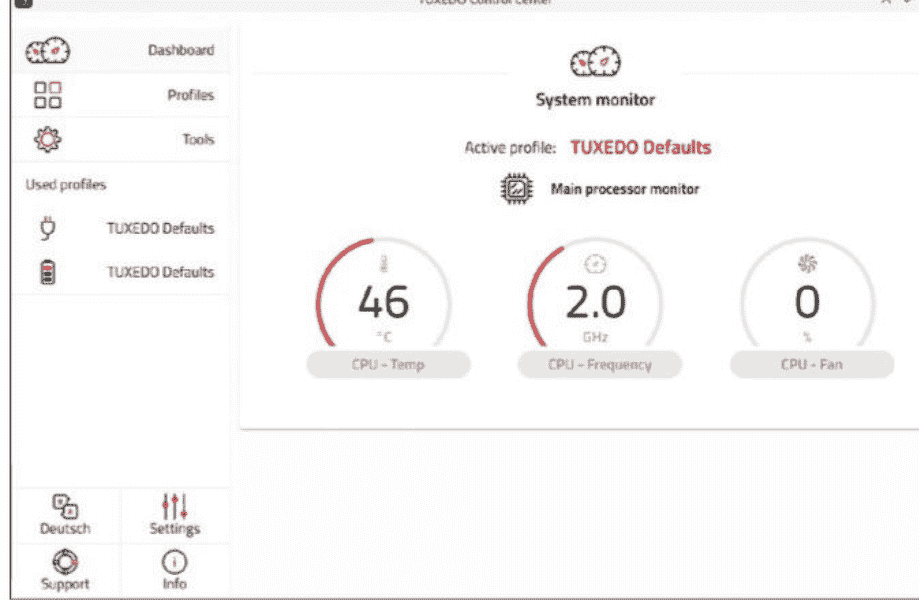

- [1] `TUXEDO OS` 下载：`https://tuxedocomputer.com`
- [2] `Calamres` 安装框架：`https://calamers.io`
- [3] `KDE Node`：`https://neon.kde.org`
- [4] `Canonical Snap`：`https://snapcraft.io`
- [5] `Lutris`：`https://lutris.net`
- [6] `Heroic Games`启动器：`https://github.com/Heroic-Launcher/HeroicGamesLauncher`
- [7] 链接与设置工具：`https://forums.lutris.net/it-can-sync-to-system-profile-error-at/4180`
- [8] 使用 `TUXEDO OS` 游戏：`https://www.tuxedocomputer.com/en/Gaming-TUXEDO-OS.tuxedo`
- [9] `TUXEDO Aquari`：`https://www.tuxedocomputer.com/en/TUXEDO-Aquari.tuxedo`


# Sniffnet

## 使用 Sniffnet 分析网络流量

### 流量监控
网络流量对许多用户来说仍然是一个未谜。`Sniffnet` 让经验较少的用户也能轻松监控自己的网络流量。作者 `Erik Bärwald`。

启动窗口打开时带有过滤选项（图 1）。在右侧，你可以通过启用相应的比例来指定所需的 `Internet` 协议和传输协议。通过切换 `IPv4` 和 `IPv6` 以及 `TCP` 和 `UDP` 可以启用所有可用版本。在最右侧，你可以从下拉列表中选择几十种协议。`Sniffnet` 在默认设置下显示账户控制。

> 监控网络流量是管理员日常工作的一部分。大多数管理员使用 `Wireshark` 是因为功能丰富且在大多数发行版中都可用。专业用户主要需要深入知识才能使用它。`Sniffnet` 在简单、直观且清晰的界面中提供结果。

如果你使用 `DEB` 包管理器，可以从项目的 `GitHub` 页面安装预编译的 `DEB` 包；这样可以无需先安装 `rust`。在启动窗口的左侧，你会找到系统中可用的网络接口。`Sniffnet` 同时列出了物理和虚拟接口。因此，你可能需要选择所需的接口。调整基本设置后，点击 `Start` 查看可用数据和活动监控窗口（图 2）。在顶部，你会看到一个不断更新的显示，显示每秒通过网络接口的数据包数量。

`Sniffnet` 是一个跨平台的 `Rust` 应用。为了让程序正常运行，你需要解决某些依赖关系。完成后，调用 `sudo sniffnet`。

```
curl --proto '=https' --sSf https://shup.rs | sh
cargo install sniffnet
sudo apt install sniffnet-linux
sudo apt install libpcap-dev
```

在图形显示右侧的小框中，你将找到一些关于网络连接的统计数据，包括过滤数据包的数量、以兆为单位的大小以及每个协议的过滤包数量。也许有趣的是，图形显示下方的“相关连接”（`Relevant connections`）包含了源和目标地址及端口。此外，你还可以看到每个连接使用的传输和应用协议。

| IP 版本 | 传输协议 | 应用协议 |
| :--- | :--- | :--- |
| `IPv4` | `TCP` | 所有协议 |
| `IPv6` | `UDP` | `(1.2)` |

```
eth0: fe80::1f2.15
fe80:5c33:dc3c:3e:3de
any
```

```
lo: 127.0.0.1
::1
```

### Linux 流量队列 (NFQUEUE)


图 1：非常整洁的 `Sniffnet` 启动提供了核心内容。

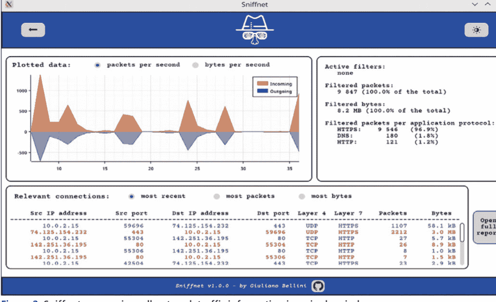

| 绘制数据： | 每秒数据包 | 每秒字节 | 激活过滤器： |
| :--- | :--- | :--- | :--- |
| | | | 无 |
| `过滤包：9847 (总计 100%)` | | | |
| `过滤字节：8.2 MB (总计 100%)` | | | |
| `按协议过滤包：HTTP: 1107 (12.5%), DNS: 180 (2.1%), HTTP2: 121 (1.4%)` | | | |

- 最近
- 最大包
- 最大字节

| 源 IP 地址 | 源端口 | 目的 IP 地址 | 目的端口 | 层 4 | 层 7 | 字节 | 状态 |
| :--- | :--- | :--- | :--- | :--- | :--- | :--- | :--- |


| 10.0.2.15 | 59966 | 142.154.254.232 | 543 | UDP | HTTP | 58.1 | 完整报告 |
| 142.123.361.195 | 55034 | 142.251.36.195 | 55034 | TCP | HTTP2 | 21.3 | |
| 10.0.2.15 | 80 | 10.0.2.15 | 55034 | TCP | DNS | 2.7 | |
| 142.151.36.195 | 80 | 10.0.2.15 | 55034 | TCP | HTTP | 7 | |
| 142.251.36.195 | 43564 | 142.154.254.333 | 445 | TCP | HTTPS | 5.9 | |

图 2：`Sniffnet` 在单个窗口内汇总所有网络流量信息。

# 深度解析

## Sniffnet

以及传输的数据包数量。在最右侧，“`Bytes`（字节）”列下，你还可以找到每个连接传输的数据量。

查看此文本文件，点击“`Full report`（完整报告）”可以在桌面环境的标准文本编辑器中打开它（图 3）。应用程序会实时更新日志。

在测试期间，我发现了几个 bug。在 `Ubuntu 22.04` 上，当我按下“`Full report`”按钮时，软件拒绝打开报告，但你可以通过重启程序来规避这个问题。另一个更严重的问题是：`Sniffnet` 会几乎立即删除日志。此外，`Sniffnet` 不会将 IP 地址解析为名称——你必须手动进行，并且无法从实时日志中复制片段；你只能在生成日志后（如果有用的话）提取它们。`Sniffnet` 仍有巨大的改进潜力。

`Sniffnet` 还在监控窗口中对数据进行颜色标记。入站连接显示为红色，出站连接为蓝色。你可以通过点击单选按钮更改此视图。大多数单选按钮按每个连接的数据包数量、最大字节数升序/降序或数据传输量进行排序。

如果你想在运行期间更改某些设置，点击左上角的箭头图标返回主窗口。需要注意的是，过滤器在每次重启时都会重置。如果需要，你可以在终止应用程序或重启软件之前保存日志。

## 完整

在图形化视图中，`Sniffnet` 向你显示最新数据。为了随时间跟踪流量，`Sniffnet` 将所有连接及其活动以表格形式记录在 `sniffnet_report.txt` 文件中。

如果你想了解你的网络流量发生了什么，`Sniffnet` 为所有水平的用户提供了一个自显易懂的解决方案。该工具具有分析能力；如果你在网络连接遇到问题，则需要检查日志。

# 信息

- [1] `Sniffnet`: https://github.com/GumyVGC/sniffnet
- [2] `Deb` 安装包: https://github.com/GumyVGC/sniffnet/releases
- [3] 安装指南: https://github.com/GumyVGC/sniffnet/installation

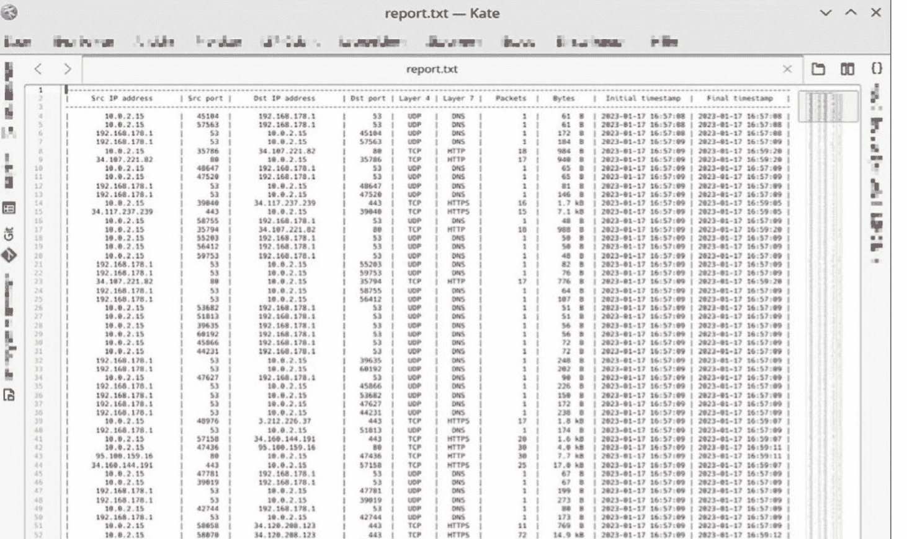

图 3：网络接口上的所有连接和活动也可以以文本形式查看。


# `David L. Lawrence` 会中心

`events.drupal.org/pittsburg2023`

与来自全球数千万使用、开发、设计和支持 `Drupal` 平台的人交流。

`DrupalCon` 的价值在于参与者分享的观点、能量和体验的多样性——加入我们吧！


# 深度解析

## MIPI 与 Linux

## Linux 上 MIPI 摄像头的灾难

## 实验时间 (`Tinker Time`)

`Linux` 用户早已习惯了系统中的标准硬件运行完美。然而，最近支持 `MIPI` 规范的网络摄像头变得棘手。我们将告诉你原因以及如何处理。作者：`Martin Loschwitz`

`Linux` 和硬件的历史并不总是最好的时代。就在 20 年前，你不能只买一台主流电脑就指望在安装 `Linux` 后就能工作。如果你想确保新买的设备与 `Linux` 良好配合，你通常需要面对数周非常详细的搜索。哪些芯片被支持？哪些型号、打印机、声卡和网络适配器具有必要的驱动程序？

这种麻烦事，现在有了 `NVIDIA` 或 `AMD` 的支持。如果你不玩游戏，可以使用 `AMD` 和 `intel` `CPU` 中集成的芯片，这些芯片在 `Linux` 上的运行也很可靠。几乎没有人需要调制解调器，但 `LTE` 或 `5G` 型号通常可以通过模拟串口接收指令。

如果你没有仔细检查，最糟糕的情况是你拥有一堆实际上无法在 `Linux` 上运行的硬件。记住那些臭名昭著的调制解调器（图 1）和打印机，如果没有厂商愿意为 `Linux` 系统提供二进制驱动程序，它们毫无用处。如果你在寻找证明过去没有更好的证据，`Linux` 硬件传奇史就是一个丰富的来源：

幸运的是，时代正在发生。单个组件越来越多地合并成一个单元。声卡在某个时刻变成了标准组件，并支持通过适当的驱动在 `Linux` 上使用。图形芯片，也是永恒的

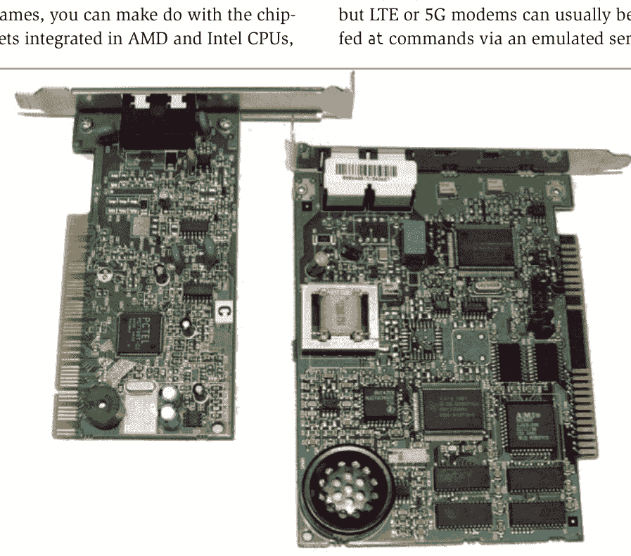

> 图 1：软调制解调器或 `winmodems` 在 `Linux` 开发早期是一件麻烦，因为在没有适当驱动程序的情况下它们无法工作。20 多年后，`Intel` 在网络摄像头上经历了了类似的历程。来源：`Wikipedia`, `Douglas Whittaker`, `CC BY-SA 2.5`

打印机通常有自己的网络连接并提供对 `GPL/PD` 或 `PostScript` 的支持。即使是通过 `USB` 连接的设备，现在也存在各种支持。想想，在 `Linux` 现代世界中，一切都很好。

但可用带宽并不是旧式摄像头和 `MIPI` 系统之间唯一的区别。

2023 年，可用带宽并不是旧式摄像头和 `MIPI` 系统之间唯一的区别。

2023 年，可用带宽并不是旧式摄像头和 `MIPI` 系统之间唯一的区别。

2023 年，可用带宽并不是旧式摄像头和 `MIPI` 系统之间唯一的区别。

2023 年，可用带宽并不是旧式摄像头和 `MIPI` 系统之间唯一的区别。

2023 年，可用带宽并不是旧式摄像头和 `MIPI` 系统之间唯一的区别。

2023 年，可用带宽并不是旧式摄像头和 `MIPI` 系统之间唯一的区别。

2023 年，可用带宽并不是旧式摄像头和 `MIPI` 系统之间唯一的区别。

2023 年，可用带宽并不是旧式摄像头和 `MIPI` 系统之间唯一的区别。

2023 年，可用带宽并不是旧式摄像头和 `MIPI` 系统之间唯一的区别。

2023 年，可用带宽并不是旧式摄像头和 `MIPI` 系统之间唯一的区别。

2023 年，可用带宽并不是旧式摄像头和 `MIPI` 系统之间唯一的区别。

2023 年，可用带宽并不是旧式摄像头和 `MIPI` 系统之间唯一的区别。

2023 年，可用带宽并不是旧式摄像头和 `MIPI` 系统之间唯一的区别。

2023 年，可用带宽并不是旧式摄像头和 `MIPI` 系统之间唯一的区别。

2023 年，可用带宽并不是旧式摄像头和 `MIPI` 系统之间唯一的区别。

2023 年，可用带宽并不是旧式摄像头和 `MIPI` 系统之间唯一的区别。

2023 年，可用带宽并不是旧式摄像头和 `MIPI` 系统之间唯一的区别。

2023 年，可用带宽并不是旧式摄像头和 `MIPI` 系统之间唯一的区别。

2023 年，可用带宽并不是旧式摄像头和 `MIPI` 系统之间唯一的区别。

2023 年，可用带宽并不是旧式摄像头和 `MIPI` 系统之间唯一的区别。

2023 年，可用带宽并不是旧式摄像头和 `MIPI` 系统之间唯一的区别。

2023 年，可用带宽并不是旧式摄像头和 `MIPI` 系统之间唯一的区别。

2023 年，可用带宽并不是旧式摄像头和 `MIPI` 系统之间唯一的区别。

2023 年，可用带宽并不是旧式摄像头和 `MIPI` 系统之间唯一的区别。

2023 年，可用带宽并不是旧式摄像头和 `MIPI` 系统之间唯一的区别。

2023 年，可用带宽并不是旧式摄像头和 `MIPI` 系统之间唯一的区别。

2023 年，可用带宽并不是旧式摄像头和 `MIPI` 系统之间唯一的区别。

但可用带宽并不是旧式摄像头和 `MIPI` 系统之间唯一的区别。

2023 年，可用带宽并不是旧式摄像头和 `MIPI` 系统之间唯一的区别。

2023 年，可用带宽并不是旧式摄像头和 `MIPI` 系统之间唯一的区别。

## 问题的本质

2023 年，可用带宽并不是旧式摄像头和 `MIPI` 系统之间唯一的区别。

2023 年，可用带宽并不是旧式摄像头和 `MIPI` 系统之间唯一的区别。

但可用带宽并不是旧式摄像头和 `MIPI` 系统之间唯一的区别。

## 未知的巨头

2023 年，可用带宽并不是旧式摄像头和 `MIPI` 系统之间唯一的区别。

# 深度解析

## MIPI 摄像头与 Linux


目前没有任何一风顺的构建方法。为了让事情变得如描述的那样，它在未来无法集成到 Linux 内核中，并且必须被视为树外（out-of-tree）开发。这促使内核老兵 Greg Kro-Hartman 警告用户，使用带有 Intel Alder CPU 和 MIPI USB 支持 的新设备在未来可能是不可能实现的，他解释道。

更糟糕的是，如果不求助于编译器，这种工作是不可能清理的。Linux 内核在过去几十年中最大的成就就是现在可以在消费级硬件上大规模运行。当我 1998 年开始探索 Linux 时，除了某些特定的补丁外，没有其他方法可以构建基础内核。然而，发行版内核在近年来稳定地变得更加可靠且功能更强大。

这一过程最终在 GitHub 的几个 bug 报告中取得了成功。一切都始于 Linux 内核并不总是容易从系统的 ACPI 信息中读取正确的 CSI 信号，这需要红帽员工 Hans Geode 提供的补丁 [2]（图 4）。然后，你还需要添加另一个补丁 [3]，让内核使用 Intel 所使用的方式，除非将其成功置于 CPU 的 IOMMU 管理之下。最后，一个补丁 [4] 确保 Linux 内核引导 ACPI L292，该设备安装在如 IP6 等系统中，没有它摄像头将无法被控制。

如果你看看联想第 10 代笔记本电脑的情况，这场灾难似乎相当混乱。在启动最近的 Linux 桌面（如 `Ubuntu` 或 `Fedora`）后，设备的摄像头不可用。缺乏受管理的驱动意味着硬件没有驱动。在 `Google Meet` 等工具中也可以访问辅助摄像头。如果你制作了像这样的一个“柠檬”（lemon，指劣次品/失败品），你只能在会议中拍摄低质量图像的视频——这与我们对 21 世纪第三十年的预期相去甚远。

## 出路

所有承诺的将 IPU 芯片链接到内核的努力都不十分令人鼓舞。对于能够解决问题的用户来说，如果他们想使用摄像头，将面临大量的工作（此处原文为 amass，意指大量工作）。

Martin Sofaro 拥有一台第七代联想 Y1 Yoga，他出于个人兴趣承担了解决 IPU 问题的任务。

首先，获取你当前内核的代码，检查它是否已经包含了那三个代码新增，或者你是否需要添加它们。`Canonical` 现在已经努力将前两个修复并发布在 `Ubuntu 22.04` 的内核中。`Fedora` 并非如此，目前也不存在。如果你有疑问，你的选择是获取：

### 7.1. 像素率 (Pixel rate)

总线像素率计算如下：

```
pixel_rate = Link_freq * 2 = or_of * 16 / k * per_sec
```

其中

| 变量或内容 | |
|---|---|
| `link_freq` | `V4L2_CSI2_PIQ` 格式的位值。 |
| `or_of` | 在 CSI-2 链路上使用的数据数量。可以从端点配置获取。 |
| `2` | 像素数量 |
| `bin_per_sec` | 每秒像素数 |

这种计算出的像素率与摄像头传感器像素阵列上的像素率不同，后者由 `V4L2.PIXEL_RATE` 指明。

### 7.2. LP-PI 和 LP-111 驱动

作为向高速率传输的一部分，CSI-2 发送器通常取决于 PHY 在 LP-PI 或 LP-111 模式下突发总线。这段时间可以短至 100 us，在此期间，接收器观察到这一点，其高速传输模式的一部分是……

### 7.3. CSI2 发送器驱动

获取你当前运行的内核源代码并逐项检查代码项。

遗憾的是，在自定义内核后，你只完成了 10% 的工作。一旦内核运行，下一步是编译驱动程序并安装固件。我们在它自己的 git 目录中删除固件，你可以这样做：将来自 `include/` 和文件夹 的文件复制到 `/include/` 和

这说明了该词的另一个含义。IP6 的主要组件不仅包括固件，还包括访问 IP6 的一系列库。`Ubuntu` 和 `Linux Arch` 软件包由 `OEM Solutions Group` [6] 提供，但另一方面，你需要从 GitHub 获取驱动程序并在你的系统上使用。`Ubuntu` 和 `Linux Arch` 软件包的情况也类似，只需几条命令即可为你自己的内核构建模块。`Ubuntu` 使用 `DKMS`（动态内核模块支持），它提供了多处好处。

Intel 的 github 仓库并不活跃，该公司似乎并没有让在 Linux 上使用变得容易。例如，`Fedora` 和 `Ubuntu` 比其他某些发行版有更多工具可以操作。如果你的发行版不提供此选项，唯一的选择是从 GitHub 下载源码并遵循手动构建过程。要投入这么多精力来维护在没有头文件的情况下野生的不同 IPU 驱动将非常棘手。例如，`Debian` 使用 IP6，驱动由于缺乏身份识别而遭受苦难。再次，你可能会被冷落，别无选择只能自己来。这需要额外的知识；你不仅必须修补内核，还必须自己开发它。在完成这一切之后，你将达到驱动程序实际上运行良好的程度，你还有很长的路要走。

## 内核模块

如果你已经走了这么远，现在面临着下一个挑战：构建适用于你自己的内核的 IPU 模块。Hans Geode 已通过许多注释帮助了我们，也许可以给你一些完成的解决方案。`Ubuntu` 拥有

```
--- a/drivers/gpio/gpio.c
+++ b/drivers/gpio/gpio.c
@@ -1,13 +1,23 @@
+static int ipu_register(struct ipu_device *ipu)
+{
+	struct resource acps;
+	char var[32];
+	struct ipu_data data;
+
+	snprintf(var, sizeof(var), "%s_group", ipu->name);
+	data.group = var;
+	data.init_ptr = ipu->init_ptr;
+
+	if (platform_get_resource(ipu->dev, RESOURCE_ACPI, &acps) < 0) {
+		return -ENODEV;
+	}
+
+	return 0;
+}
```

# 针对真实网络的真实解决方案

## ADMIN 网络与安全 OpenStack

- 无缝部署

- 小微企业的替代方案

- OpenStack 有什么新变化？

- 针对 Linux 和 Android 的 Windows 解决方案

- 部分去集群化的 RAID 缩短恢复时间

## ADMIN 网络与安全 systemd 安全

锁定您的系统的贴士

## ADMIN 网络与安全 企业级自动化

`ADMIN` 是您获取现实世界问题技术解决方案的来源。

通过关于以下方面的实用文章提升您的管理技能：

- 安全

- 云计算

- 高性能计算 (HPC)

- 存储及更多！

## ADMIN 网络与安全 Terraform

`OSDBuilder` 里程碑

## ADMIN 网络与安全 Kubernetes

在容器化环境中扩展规模并保持安全

## ADMIN 网络与安全 数据库

在云端、容器和扩展式架构中

> 通过数字订阅快速获取！

# 每年 6 期！立即订购

`shop.linuxnewmedia.com`

## 一个命令行字典工具

### Wordsmith

通过 `dict`，你可以免费搜索数十个自然语言字典数据库。作者：Bruce Byfield

作为一名作家，我很少需要查找某个单词的定义。如果我不认识一个单词，我就不会冒险使用它。如果没有返回结果，我就必须搜索一个更的同义词。遗憾的是，普通的字典对这些目的并不可用。这时我发现了 `dict` [1]，它包含了我此类所需的信息，但可以在命令行运行以便于访问。`dict` [2] 的 CLI 本质上是搜索几个数据库并压缩结果。它处理许多发行版，但每个数据库都在独立的包中，必须单独安装。`--list` 将显示这些数据库的列表以及版本 [3]（图 1）。`dict` 支持的数据库包括几个字典、一个碰撞器、CIA WordFact 以及除英语外的其他 34 个数据库——远多于平均字典条目。

| The Collaborative Dictionary of English v.0.48 |
| Any |
| First match |
| The Collaborative Dictionary of English v.0.48 |
| WordNet (3.0) (2006) |
| Moby Thesaurus II by Grady Ward, 1.0 |
| The Elements (07Nv00) |
| V.E.R.A. - Virtual Entry of Relevant Axioms (February 2016) |
| The jargon file (v4.4.7, 29 Dec 2003) |
| Dictionary of Computing (30 December 2018) |
| Easton's Bible Dictionary (1861) |
| Hitchcock's Bible Name Dictionary (late 1800s) |


# dict 字典工具参考

## 数据库列表

*   `Bowyer's Dictionary, Revised (1866)`
*   `The Devil's Dictionary (1881-1906)`
*   `CIA WordFact 2002`
*   `U.S. Gazetteer Counties (2005)`

图 1：已安装的 `dict` 数据库列表。

## 示例结果

| 项目 | 内容 |
| :--- | :--- |
| 基础定义 | `Red'i`；整理；制造；也指，使远离纠缠或尴尬；通常与 `up` 连用；像房子一样变红。（英语方言 & sect。） |
| 用法说明 | `Red` 用于某些元素化合物的形式；`red-bedded`（红层岩）, `red-redded`（变红的）, `red-headed`（红头的）, `red-haired`（红发的）, `red-skinned`（红皮肤的）, `red-winged`（红翅的）, `red-coated`（红衣的）。（红蝶）（`Red (Zoli.)`，一种美丽的蝴蝶（`Atlantella`），常见于欧洲和美国。翅膀由一条橙红色带连接。幼虫也被称为（`Atalanta` 蝴蝶），荨。 |
| 备注 | 根据安装的数据库，可能会给出词源、同义词和翻译。 |

```bash
dict -m moby-thesaurus red
```

### 来自《Moby Dick II》，作者 Grady Ward, 1.0 [moby-thesaurus]:

针对 `'red'` 的 303 个同义词：

`Adornaceous, Amaranth, Amyth, Bolshevik, Bolshevik, Bolsburg, Carbonarist, Carbonaro, Castro, Castroid, Charley, Comangat, Congo Rube, Demolin, Dolphin, Ennefer, Felmin, Golem, Leninist, Linual, Lilin, Paul,,th, Mau, Mau-Mau, Mickey Fenn, Nebullal, Nebullish, Primal, Pruse, Roundhead, Seconal, Seconal, Sinn Finner, Titian, Titian-Trokitsy, Troskite, Titunal, Titun-tidal, Vndace, Vyd-red, Visibly, Whitefish, Wood, White, Woodish, animonthraph, anabolism sodium, anidolic, anachron, anarchistic, anarchistic, anarcho-syndicalist, annyatto, anarch, antarctic, architecture, battleship, black, black stuff, bleu, blue angel, blue devil, blue heaven`

尽管这份文档和示例列表很烦人，但它确实非常丰富。目前还不清楚 `dict` 是否仍在积极开发。只要耐心，那些在 Linux 上运行的可以接受的内容本应该是没有它的 :::

# 信息

*   [dict]: <https://man.archlinux.org/man/dict.1>
*   [dict dictionary]: <https://en.wikipedia.org/wiki/DICT>
*   [dict version]: <http://dict.org/bin/dict>

图 2：对“`red`”的同义词的搜索

# 作者

`Bruce Faisal` 是一位计算机记者、自由撰稿人和编辑。除了这些，他还是 `bryceaisal.com` 的作者。

### 限制性

在容器化环境中扩展规模并保持安全

在云端、容器和扩展式架构中

在容器化环境中扩展规模并保持安全

尽管这份文档和示例列表很烦人，但它确实非常丰富。目前还不清楚 `dict` 是否仍在积极开发。只要耐心，那些在 Linux 上运行的可以接受的内容本应该是没有它的 :::

## 深度解析 ELF 格式

### 4 深度解析 ELF 格式

## 深度解析 ELF 格式

### 深入解析 ELF 格式

### ELF Quest

Linux 和其他类 Unix 系统使用 ELF 格式处理可执行文件、对象代码和共享库。窥视 ELF 是如何组织的。Alan Guybeam

对象文件是一个你无法真正看到的黑盒。我们习惯于认为它包含计算机执行的某些指令。如果你仔细观察，它的结构并不像你认为的那么晦涩。它还包含：

*   如何以及何时将对象加载到内存
*   动态链接
*   对象导出（或导入）的任何
*   调试

许多功能仅记录在内核和工具链本身的源代码中，或者在文本的晦涩部分。理解 ELF 格式对于为 Linux 编写编译器、汇器或链接器至关重要。

研究 ELF 结构的最佳方法是观察它的构建过程。在这篇文章中，我将向你如何使用 x86 宏汇编从零构建 ELF 文件。Fasm 支持创建“扁平”二进制文件，这意味着程序员（大致而言）决定了 ELF 图像各个部分之间的关系，段在加载到内存时段的关系，

| ELF HEADER | | SECTION HEADERS |
| :--- | :--- | :--- |
| | [NULL SECTION] | |
| `0: D_PHDR` | | `.interp` |
| `1: INTERP` | | `.gnu.hash` |
| `2: LOAD` | | `.dynism` |
| `3: LOAD` | | `.dynstr` |
| `4: LOAD` | | `.rela.plt` |
| `5: LOAD` | | `.text` |
| `6: DYNAMIC` | | `.plt` |
| | | `.data` |
| | | `.got_plt` |
| | | `.bss` |
| | | `.dynamic` |
| | | `.symtab` |
| | | `.strtab` |
| | | `.shstr` |
| Segment | Segment | Segment |
| Section | | |

图 1：已安装的 dict 数据库列表

图 2：对“red”的同义词的搜索

图 3：ELF 文件的内部

图 4：针对“Jezebel”的搜索

图 5：结果

图 1：ELF 文件内部。

44 2023年5月 第270 期 `LINUX-MAGAZINE.COM`

# ELF 文件格式

```fasm
; 列表 1: ELF 文件头

01 ; 魔幻数 (Magic)。
02 db 0x7f,"ELF"

03 ; 类（32 位或 64 位）。
04 db ELFCLASS64

05 ; 字节序（低位字节）
06 ; 第一个；
07 db ELFDATASHL

08 ; ELF 规范版本。
09 db EV_CURRENT

10 ; ABI（应用二进制接口）
11 ; 我们使用 ELFOSABI_LINUX = 3 或
12 ; ELFOFSABI_FREEBSD = 9
13 if os eq "Linux"
14 db ELFOSABI_LINUX
15 else if os eq "FreeBSD"
16 db ELFOSABI_FREEBSD
17 end if

18 ; ABI 版本（始终为 0）。
19 db 0

20 rept (7) : 填充 (Padding)。

; 可执行类型 (2) 也可能是
; ET_REL = 1 表示可重定位对象
; ET_DYN = 3 表示共享库。
24 dt ET_EXEC

; 机器是 x86-64。
26 db EM_X86_64

; 文件版本（始终设置为 EV_CURRENT）
; = 1)。
29 dd EV_CURRENT

; 入口。
31 dq LOAD_BASE + PLANE1 + main

; 程序头偏移量。
33 dq PROGRAM_HEADERS

; 节头偏移量。
35 dq SECTION_HEADERS

; 标志（始终为 0）。
37 dt d

; 此文件头的大小。
39 dw ELF_HEADER_SIZE

; 程序头的大小（56 字节）。
41 dw SIZE_PROGRAM_HEADER
42 dw NUM_PROGRAM_HEADERS

; 节头的大小（4 字节）。
44 dw SIZE_SECTION_HEADER
45 dw NUM_SECTION_HEADERS

; 这是节头表索引
; 与节名表
; 关联的项。
49 dw SHT_STRTABINDEX
50 ELF_HEADER_SIZE = $$
```


`ELF` 文件的每个部分都将在 `Linux` 和 `FreeBSD` 上运行；完整代码约 500 行，你可以从归档的 `Git` 仓库中下载。你需要安装操作系统的包仓库。在日常生活中，很少需要手动构建 `ELF`。这个练习仅用于说明。在现实世界中，开发者会使用这样的编译器，根据开发者提供的源代码和信息，以及计算机实际执行的汇编语言命令来生成 `ELF`。因此，我将使用汇编作为描述 `ELF` 格式的手段。图 1 提供了 `ELF` 文件的表示，并展示了它与加载到内存中的 `ELF` 的关系。

# `ELF` 文件的布局

`ELF` 文件包含四个部分：

- `ELF` 文件头
- 一个或多个程序头
- 一个或多个节头
- 一个或多个节

汇编语言的操作级别比 `C` 语言高，所以

# `ELF` 文件头

在列表 1 中，`ELF` 文件头为初学汇编语言的人描述了，`db`

# 列表 2: 程序头

```
01 macro PROGRAM_HEADER,type,offset,version,
address,physical,size,mem_size,alignment
02 {
03 ; 段段类型 = 常见类型
04 ; PT_NULL = 0; PT_LOAD = ;
05 ; PT_DYN = 2; PT_INTERP = 3;
06 ; PT_HDR = 6;
07 ; 类型
08 ; 权限 = 读/写/
09 ; 可执行：一个
10 ; 来自 PF_H = 0x; PF_W =
11 ; PF_X = 0xl的值。
12 dd permissions
13 ; 文件中的偏移量。
14 dq offset
15 ; 运行时偏移量。
16 dq virtual_address
17 ; 未命名；设置为 0。
18 dq physical_address
19 dq disk_size
20 dq mem_size
21 dq alignment
22 ; 以下变量让我们在定义
     ; 程序头时像... 那样
23 PROGRAM_HEADER = CPROGRAM_HEADER + 1
24 }
```

# 深度解析

## `ELF` 格式

意味着“删除字节”，“意味着“清除字（两个）”，以此此类推；`rept { 重复包含的代码 n 次 }`

如你从列表 1 所示，`ELF` 文件头包含了描述程序上下文的通用信息。例如，文件头包含了类（32 位或 64 位）、字节序、操作系统、文件类型（可执行、可重定位、对象、共享库）以及处理器。`ELF` 文件头还为程序头和节头留出了空间，你将在本文中学习这些。

# 表 1: 常见节的名称

| 名称 | 描述 |
| --- | --- |
| `Interp` | （可能的）以空字符结尾的字符串，请求程序解释器（运行时链接器/加载器）。在 `Linux` 上，这将会是 `/lib64/ld-linux.x86-64.so.2`；在 `FreeBSD` 上，它是 `/lib/elf.so.1`。 |
| `gnu.hash` | 当动态链接器合并进程中的对象时，它需要快速发现每个对象中存在哪些特定符号。`GNU` 哈希是一个用于实现此点的哈希表。 |
| `.dynsym` | 需要重定位的符号列表。每个条目应该是一个空符号。对于我们提供的符号，我们包含了符号存储位置的节索引以及符号的虚拟地址。 |
| `dynstr` | 以空字符结尾的字符串，通常是文件中链接的函数和库的。在 `Linux` 中，使用 `.strtab` 并以空字符开始和结束。 |
| `.rela` | 每个重定位包含静态链接器需要填充的地址，以及相应符号的偏移量，以及重定位类型（如使用 `R86_64_JMP_SLTO`）的常量地址。 |
| `.text` | 程序的实际代码。 |
| `got.plt` | 在相同地址空间加载的其他 `ELF` 映像的函数地址。 |
| `.bss, .dynamic` | 这些节包含了有助于动态链接的字对。 |

# `ELF` 文件格式

## 节的内容

此示例并不需要表 1 中描述的所有节，但对 `.text`、`.plt`、`.gdt` 和 `.rel_a` 节的简要描述将让你了解这些节如何构建 32 位有符号值的结构。

> `.text` 节执行程序列举 (4) 中的程序可执行代码。该代码调用 `puts` 将字符串打印到终端，并将控制权交还操作系统。

`x86-64` 指令通常使用相对寻址。这意味着，例如，一个 `CALL` 的编码取决于距离调用处的距离（目标地址被编码）。这使得无法对一个无法适应在 32 位内的地址或函数调用进行编码。解决方案是使用过程链接表 (`plt`) 和全局偏移表 (`got`)，它们在 `.plt` 和 `.gdt` 节中描述。`PLT` 包含该二进制文件本地的本地地址，因此其所有列表都可以通过 32 位相对调用进行访问。它使用 `JMP` 指令跳转到真实函数，该地址由动态链接器放置在 `GOT` 中。`PLT` 和 `GOT` 还允许动态链接器仅在需要时才解析地址，从而加速加载过程。

列表 5 定义了 `.plt` 和 `.gdt` 节的一些特征。我们需要使用 `.rel_a` 节来定义静态重定位的宏，使用之前提到的 24 字节结构（列表 6）。

## 列表 6：重定位

```
01 macro RELOCATION symbol_name plane
02 :
03 ; 链接器必须填充的 qword 地址
04 ; must fill in
05 dq LOAD_BASE + plane + symbol_name@got
06 ; 符号索引和类型，编码在
07 ; 单个字中；
08 dq (symbol_name# shl 32) or R_X86_64_JMP_SL
09 ; 无地址。
10 dq 0
11 )
12 ...
13 ...
14 ...
15
16 ; 实际重定位
17 SECTION_REL_PLT:
18
19 RELOCATION count,index value
20 RELOCATION exit,PLANES
```

## 导出与导入符号

可执行文件通过链接导出符号 `environment` 和 `_start`，并导入 `puts` 和 `exit`。在列表 7 中，我将这些声明封装在一些便利宏中。

## 列表 7：导入与导出符号

```
01 macro EXPORT count,index value 23 db (STR_GLOBAL shl 4) + ((ST_FUNC and Oxf))
02 24 ; 我们不再为该符号提供更多
03 25 信息，因为它本身
04 ; 符号的可见性和类型 26 ; 已在另一个 ELF 对象中定义。
05 ; 编码在字节中：\27 db
06 (STR_GLOBAL shl 4) + ((ST_FUNC and Oxf))
07 ; 使用“其他”字段。\28 db
08 db 29 dq
09 ; 符号所在的节。30 dq
10 index 31 name#index = CSMBOL
11 ; 32 CSMBOL = CSMBOL + 1
12 ; 符号的虚拟地址。\34 dq
13 value 35 ...
14 ; 符号大小。\36 ...
15 dq 8 37 dq
16 name#index = CSMBOL 38 SECTION_DYNSYM
17 ) 39 BEGIN_SYMBOLS
18 40 NULL_SYMBOL
19 macro IMPORT_FUNCTION name 41 IMPORT_FUNCTION puts
20 42 IMPORT_FUNCTION exit
21 ; 43 EXPORT_OBJECT environ, LINK_BSS, LOAD_BASE + PLANES + SLOT_environ
22 dd name 44 EXPORT_OBJECT _program, LINK_DATA, LOAD_BASE + PLANES + SLOT__program
```


ELF 经常会崩溃，但通常在崩溃前提供一些有帮助的信息。表 2 显示了使用 `readelf` 时的重要开关。

## 表 2：readelf 开关

| 选项 | 说明 |
|---|---|
| `-h` | 打印 ELF 头部。 |
| `-s` | 打印程序头以及节与段之间的关系。 |
| `-S` | 打印有关节的详细信息。 |
| `-r` | 打印重定位。 |
| `-x` | 以十六进制打印节的内容。 |
| `-d` | 打印动态节的内容。 |

## 调试手工的 ELF 镜像

编写 ELF 文件很容易出错，`readelf` 工具对于检查 ELF 文件的有效性非常有用。可以快速识别损坏的文件。

# 信息

- (1) FreeBSD: https://www.freebsd.org
- (2) flat assembler: https://www.flatslammer.net
- (3) 本项目的 Git 仓库：https://github.com/SamMaria1999/elf
- (4) GNU Hash ELF 节：https://blogs.oracle.com/solaris/gnu-hash-elf-sections

# 结论

我现在可以构建并运行 ELF 以确认其工作正常（图 2）。你可以轻松扩展我刚刚演示的 ELF 文件，在其文本节中包含更多的二进制代码。添加一个节是为了将任何共享头和函数的引用添加到相关节（包含线程本地存储等功能），并且访问程序参数可能需要特定的用例，这可能是将这 500 多行汇编代码与编译器的输出结合以实现更高层次。它让你对二进制文件具有终极控制权，而无需诉助于十六进制这种粗糙的工具。

# 作者

Alan Pbeam 是来自来自英国牛津郡的程序员兼作家。对于计算机，他得到过 `Commodore 64`（带有传奇的 `BASIC`）。他对编译器（尤其是 `BASIC` 风格的）、汇编器、调试器、软件和历史有无尽的想象，同时也喜欢美食。

## Linux 杂志订阅

扩展你的 Linux 技能：

- 关于热门话题的深度文章，包括比特币、云计算等！
- 关于节省时间和保护数据的实用工具的指南和教程。
- 关于开源世界关键进展的新闻。

使用 Linux 带你走得更远，做得更多，立即订阅，不再错过任何一期！需要更多 Linux 吗？订阅 Linux。我们的免费 Linux 简报每周向您的收件箱投递富有见解的文章和提示。访问 `shop.linux.com/subs`。

# 深度解析

## 系统 Flatpak 更新

```bash
flatpak systemctl --etc/system/user user-flatpak.timer

flatpak systemctl --etc/system/user ls plasme-core.target users.target.timer

ptr2-session-session-manager.service flatpak-workspace.service update-flatpak.timer

ptre2-session-manager.service targets.target.timer
```

用你选择的编辑器中打开列表 1，然后保存。安装系统变体时，请按照相同的步骤操作。

列表 3。将此服务文件命名为 `update-flatpak.timer` 并将其存储在 `/etc/system/` 中。
现在你需要创建控制项；你可以在列表 4（用户）和列表 5（全系统）中找到定时器。命名为 `update-flatpak.timer` 的定时器存储在 `/etc/system/user/` 和 `/etc/system/` 中。

图 3：完成设置后，`/etc/system/` 包含一个服务文件和一个。你还会在 `/etc/system/` 中找到两个文件的对应项，用于管理你的用户特定服务。

`Arch Linux Wiki` 详细详细解释了这一概念。

更新 `Flatpaks` 的服务的上下文取决于它们是在用户上下文还是系统上下文中使用的。你可以使用 `flatpak list` 命令（图 2）来发现这一点，该命令会显示所有的 `Flatpak` 和运行时。右侧的安装列显示，如果你同时拥有这两种者，则需要为用户和系统都创建服务。

## 快速安装

列表 1 显示了一个用于用户的服务，你需要将其作为 `update-flatpak.timer` 存储在用户上下文中。它可以存储在多个位置。如果有多个用户使用该系统，且你希望他们都使用该服务，那么 `/etc/system/user` 是正确的选择。对于单用户，将服务存储在 `~/.config/system/` 中。

创建服务命令最简单的方法在列表 2 中。输入列表 4 和 5 中日历规范的文本，可以让你调整所需的更新时间（图 3）。如果你的日历不满足你的需求，你可以使用，例如 `calendar-weekly`。

## 列表 5：全系统定时器

```ini
# update-flatpak.timer

# /etc/system/system/
```

```ini
[Unit]

[Timer]

Description=Update system flatpaks daily

Calendar=daily

Persistent=true

[Install]

WantedBy=timers.target
```

```bash
systemctl --etc/system/user analyze-calendar
```


## 原始格式

```
host
TZ: -08:00
下次：2023-05-24 08:00:00 UTC
上一次：2023-05-23 08:00:00 UTC
从现在起：2 天前
```

图 4：如何知道下次更新何时发生？此命令将告诉你。

> **主题：用户 `update-flatpak.service` 的任务，已执行**

用户 `update-flatpak.service` 的任务，已执行

```
De 2023-05-24 08:00:00 [dbus-user/6386]: 正在通过服务启动: org.freedesktop.local.unit1=dbus-user.freedesktop.local.service; 由 12148 (pid=5144) 启动 --bin=/usr/bin/flatpak --system
De 2023-05-24 08:00:00 [dbus-user/6386]: 1:
De 2023-05-24 08:00:00 [dbus-user/6386]: 2:
De 2023-05-24 08:00:00 [dbus-user/6386]: 3:
De 2023-05-24 08:00:00 [dbus-user/6386]: 4:
De 2023-05-24 08:00:00 [dbus-user/6386]: 5:
De 2023-05-24 08:00:00 [dbus-user/6386]: 6:
De 2023-05-24 08:00:00 [dbus-user/6386]: 7:
De 2023-05-24 08:00:00 [dbus-user/6386]: 8%
De 2023-05-24 08:00:00 [dbus-user/6386]: 9%
De 2023-05-24 08:00:00 [dbus-user/6386]: 10/
De 2023-05-24 08:00:00 [dbus-user/6386]: 11/
De 2023-05-24 08:00:00 [dbus-user/6386]: 12/
De 2023-05-24 08:00:00 [dbus-user/6386]: 13/
De 2023-05-24 08:00:00 [dbus-user/6386]: 14/
De 2023-05-24 08:00:00 [dbus-user/6386]: 15/
De 2023-05-24 08:00:00 [dbus-user/6386]: 16/
De 2023-05-24 08:00:00 [dbus-user/6386]: 17/
De 2023-05-24 08:00:00 [dbus-user/6386]: 18/
De 2023-05-24 08:00:00 [dbus-user/6386]: 19/
De 2023-05-24 08:00:00 [dbus-user/6386]: 20/
De 2023-05-24 08:00:00 [dbus-user/6386]: 21/
De 2023-05-24 08:00:00 [dbus-user/6386]: 22/
De 2023-05-24 08:00:00 [dbus-user/6386]: 23/
De 2023-05-24 08:00:00 [dbus-user/6386]: 24/
De 2023-05-24 08:00:00 [dbus-user/6386]: 25/
De 2023-05-24 08:00:00 [dbus-user/6386]: 26/
De 2023-05-24 08:00:00 [dbus-user/6386]: 27/
De 2023-05-24 08:00:00 [dbus-user/6386]: 28/
De 2023-05-24 08:00:00 [dbus-user/6386]: 29/
De 2023-05-24 08:00:00 [dbus-user/6386]: 30/
De 2023-05-24 08:00:00 [dbus-user/6386]: 31/
De 2023-05-24 08:00:00 [dbus-user/6386]: 32/
De 2023-05-24 08:00:00 [dbus-user/6386]: 33/
De 2023-05-24 08:00:00 [dbus-user/6386]: 34/
De 2023-05-24 08:00:00 [dbus-user/6386]: 35/
De 2023-05-24 08:00:00 [dbus-user/6386]: 36/
De 2023-05-24 08:00:00 [dbus-user/6386]: 37/
De 2023-05-24 08:00:00 [dbus-user/6386]: 38/
De 2023-05-24 08:00:00 [dbus-user/6386]: 39/
De 2023-05-24 08:00:00 [dbus-user/6386]: 40/
De 2023-05-24 08:00:00 [dbus-user/6386]: 41/
De 2023-05-24 08:00:00 [dbus-user/6386]: 42/
De 2023-05-24 08:00:00 [dbus-user/6386]: 43/
De 2023-05-24 08:00:00 [dbus-user/6386]: 44/
De 2023-05-24 08:00:00 [dbus-user/6386]: 45/
De 2023-05-24 08:00:00 [dbus-user/6386]: 46/
De 2023-05-24 08:00:00 [dbus-user/6386]: 47/
De 2023-05-24 08:00:00 [dbus-user/6386]: 48/
De 2023-05-24 08:00:00 [dbus-user/6386]: 49/
De 2023-05-24 08:00:00 [dbus-user/6386]: 50/
De 2023-05-24 08:00:00 [dbus-user/6386]: 51/
De 2023-05-24 08:00:00 [dbus-user/6386]: 52/
De 2023-05-24 08:00:00 [dbus-user/6386]: 53/
De 2023-05-24 08:00:00 [dbus-user/6386]: 54/
De 2023-05-24 08:00:00 [dbus-user/6386]: 55/
De 2023-05-24 08:00:00 [dbus-user/6386]: 56/
De 2023-05-24 08:00:00 [dbus-user/6386]: 57/
De 2023-05-24 08:00:00 [dbus-user/6386]: 58/
De 2023-05-24 08:00:00 [dbus-user/6386]: 59/
De 2023-05-24 08:00:00 [dbus-user/6386]: 60/
De 2023-05-24 08:00:00 [dbus-user/6386]: 61/
De 2023-05-24 08:00:00 [dbus-user/6386]: 62/
De 2023-05-24 08:00:00 [dbus-user/6386]: 63/
De 2023-05-24 08:00:00 [dbus-user/6386]: 64/
De 2023-05-24 08:00:00 [dbus-user/6386]: 65/
De 2023-05-24 08:00:00 [dbus-user/6386]: 66/
De 2023-05-24 08:00:00 [dbus-user/6386]: 67/
De 2023-05-24 08:00:00 [dbus-user/6386]: 68/
De 2023-05-24 08:00:00 [dbus-user/6386]: 69/
De 2023-05-24 08:00:00 [dbus-user/6386]: 70/
De 2023-05-24 08:00:00 [dbus-user/6386]: 71/
De 2023-05-24 08:00:00 [dbus-user/6386]: 72/
De 2023-05-24 08:00:00 [dbus-user/6386]: 73/
De 2023-05-24 08:00:00 [dbus-user/6386]: 74/
De 2023-05-24 08:00:00 [dbus-user/6386]: 75/
De 2023-05-24 08:00:00 [dbus-user/6386]: 76/
De 2023-05-24 08:00:00 [dbus-user/6386]: 77/
De 2023-05-24 08:00:00 [dbus-user/6386]: 78/
De 2023-05-24 08:00:00 [dbus-user/6386]: 79/
De 2023-05-24 08:00:00 [dbus-user/6386]: 80/
De 2023-05-24 08:00:00 [dbus-user/6386]: 81/
De 2023-05-24 08:00:00 [dbus-user/6386]: 82/
De 2023-05-24 08:00:00 [dbus-user/6386]: 83/
De 2023-05-24 08:00:00 [dbus-user/6386]: 84/
De 2023-05-24 08:00:00 [dbus-user/6386]: 85/
De 2023-05-24 08:00:00 [dbus-user/6386]: 86/
De 2023-05-24 08:00:00 [dbus-user/6386]: 87/
De 2023-05-24 08:00:00 [dbus-user/6386]: 88/
De 2023-05-24 08:00:00 [dbus-user/6386]: 89/
De 2023-05-24 08:00:00 [dbus-user/6386]: 90/
De 2023-05-24 08:00:00 [dbus-user/6386]: 91/
De 2023-05-24 08:00:00 [dbus-user/6386]: 92/
De 2023-05-24 08:00:00 [dbus-user/6386]: 93/
De 2023-05-24 08:00:00 [dbus-user/6386]: 94/
De 2023-05-24 08:00:00 [dbus-user/6386]: 95/
De 2023-05-24 08:00:00 [dbus-user/6386]: 96/
De 2023-05-24 08:00:00 [dbus-user/6386]: 97/
De 2023-05-24 08:00:00 [dbus-user/6386]: 98/
De 2023-05-24 08:00:00 [dbus-user/6386]: 99/
De 2023-05-24 08:00:00 [dbus-user/6386]: 100/
```

| `org.gnome.Platform` | 43 | `flatpak` |
|---|---|---|
| `org.Gtk.Breakpoint` | 32 | u |
| `org.gnome.Platform` | 43 | `flatpak` |

## Systemd 定时器

### 列表 5：全系统定时器

```ini
```


# update-flatpak.timer

`/etc/system/system/`

```ini
[Unit]

[Timer]

Description=Update system flatpaks daily

Calendar=daily

Persistent=true

[Install]

WantedBy=timers.target
```

```bash
systemctl --etc/system/user analyze-calendar
```

## 启用定时器

现在需要启用定时器了。为了做到这一点，你需要命令

# 深度解析
编程快照 – ChatGPT

## 让 AI 聊天机器人来工作

## 机器语言

OpenAI 后端 `ChatGPT` 的电子大脑在与人类伙伴聊天方面有着惊人的能力。`Mike Schilli` 获取了一个 API 令牌，并开始编写一些实用的应用程序。作者：`Mike Schilli`


事实上，尽管经历了冗长的乐观学习和相关的神经网络的发展，`ELIZA` 之后在半个世纪里几乎没有取得进展。但在过去的 10 年里，该领域经历了巨大的推动，以至于现在很难判断你是否在与……聊天

## ELIZA 2.0

该界面感觉像是 `ELIZA` 的现代版本，它是该类型石器时代（1960年）的标准程序。事实上，

`ChatGPT` 中的 `GPT` 代表 `Generative Pre-trained Transformer`（生成式预训练变换器）。AI 系统分析文本，确定需要什么类型的信息，从互联网的海量数据集中挖掘响应，并将其作为测试进行反应。这个电子大脑是否可以帮我为这一专栏找到一个有趣的话？

# 作者

`Mike Schilli` 在地球加利福尼亚州的旧金山湾地区担任软件工程师。在他自 1997 年以来一直运行的专栏中，他研究各种编程语言的实践。如果你通过 `mschilli@permeister.com` 给他发邮件，他将乐意回答任何问题。

- 有许多潜在主题可能适合 `Linux` 杂志的编程专栏。以下是一些值得考虑的：
1. 介绍一种编程语言（如 `Rust` 或 `Go`），以及如何在 `Linux` 系统上开始使用它。
2. 使用流行的编程工具（如 `GCC` 或 `Make`）的教程，以及如何排排除出现的问题。
3. 如何结合语言和工具构建特定类型的软件（如 Web 应用程序或命令行实用）的案例研究。
4. 解释高级编程概念，例如并发编程技术，以及它们如何应用于 `Linux` 环境。
5. 评测一本侧重于 `Linux` 开发的新型编程书籍或在线课程。
6. 概述 `Linux` 社区最新的与编程相关的新闻和趋势，例如新语言的发布和工具更新。

图 1：`ChatGPT` 帮助为本专栏的期数寻找新话题。

## 编程快照 – ChatGPT

写一篇关于并行编程的介绍性杂志文章

## 并行编程：充分利用 Go 的威力

`Go` 是一种强大的编程语言，因其简单性、性能和可扩展性而迅速流行。但许多开发者发现它很容易学习，这使其成为复杂计算和高性能应用程序的绝佳选择。

并行编程允许你将一个复杂的问题拆分为多个可以同时执行的小任务。通过这种方式，你可以显著缩短处理时间并提高应用程序的整体性能。这对于需要密集计算的应用程序（如图像处理或科学模拟）非常重要。

`Go` 为并行编程提供了许多特性和库，使其成为寻找简单高效方法编写高性能应用程序的开发者的绝佳选择。`goroutine` 是一种轻量级线程，可用于并行运行函数。在 `Go` 中，你可以以极小的复杂性编写并行程序，并避免常见的线程问题。

此外，`Go` 还提供了通道（`channels`），这是在 `goroutine` 之间进行数据通信和同步的机制。通道使得协调和实现复杂的并行算法变得简单。

`Go` 中并行编程的另一个关键点在于它能够……

> 图 2：如果需要，AI 系统将在当天完成文章

例如，人类可能会写“今天，一篇介绍性的杂志文章……”如图 2 所示，使用 `ChatGPT` 进行并行编程的优势显然更胜筹。结果看起来非常专业。你可以在其他语言中实现这一点，你可能怀疑大量的体育和财经记者一直在使用类似的 AI 为联赛比赛或市场波动产出成几十篇相同的文章。

## 终端作为客户端

如果你通过网页界面使用 `ChatGPT`，系统在经过文本评审的考虑后回答，就像呼叫中心的人员回答客户一样。AI 不仅回答关于每个边缘（`edge`）的问题，还会写报纸文章。

现在，如果你想在使用你的 API 地址使用 `OpenAI.com`，并避免“我是机器人”的挑战（因为你可以使用请求），请访问开发者页面获取 API 密钥（图 3）。如果你有一个使用 API 作为身份验证令牌的程序，`OpenAI` 通过 `HTTP` 请求做出响应，可以使用简单的命令行工具在终端获取响应。

使用有效的电子邮件和电话号码注册后即可获得用于游戏的认证令牌。`OpenAI` 提供了一种付费模型 [6]，根据你的信用卡收取基于令牌的费用。由于限制模式是免费的，你不会产生使用费用，所以最初可以跳过信用卡数据。

使用 `GitHub` 上的 `go-gpt` 包，`Go` 语言只需几行代码即可与 `ChatGPT` 的 API 通信。程序将问题作为提示（`prompts`）通过以下 API 请求发送给 `ChatGPT` 服务器。如果服务器理解内容并找到答案，它将将其所知的构建为 API 响应并返回给客户端。

我想要在第 15 行的 `init()` 函数中编写通信逻辑；这从环境变量 `API_KEY` 中获取 API 令牌，并在第 [缺失] 行使用它获取新的 API 客户端。然后在包中的所有其他函数中使用……

## API 密钥

您的 API 密钥列在下方。请注意，在您生成之后，我们不会显示您的 API 密钥。

不要与他人共享您的 API 密钥，或在浏览器或客户端代码中暴露它。为了……

## API 密钥

| `SECRET` | 使用情况 |
| :--- | :--- |
| `sk-...` | 28 |

您的 API 密钥列在下方。请注意，在您生成之后，我们不会显示您的 API 密钥。

不要与他人共享您的 API 密钥，或在浏览器或客户端代码中暴露它。为了……

## API 密钥

使用有效的电子邮件和电话号码注册后即可获得用于游戏的认证令牌。`OpenAI` 提供了一种付费模型 [6]，根据你的信用卡收取基于令牌的费用。由于限制模式是免费的，你不会产生使用费用，所以最初可以跳过信用卡数据。

# 深度解析
编程快照 – ChatGPT

## 对象导向

## 提示与完成

## 默认

## 身份验证

## OpenAI

## 完成

## ChatGPT

## 列表

#### List 1: openai-go
```go
01 package main
02 import
03 "context"
04 "fmt"
05 "github.com/PullRequest/go-openai"
06 "os"
07 
08 OpenAI struct {
09 ctx context.Context
10 client.Client
11 }
12 func NewAI(ctx context.Context) *OpenAI {
13 return &OpenAI{
14 client: ctx,
15 }
16 func (o *OpenAI) init() {
17 o.ctx = context.Background()
18 o.ApiKey = os.Getenv("OPENAI_KEY")
19 if o.ApiKey == "" {
20 panic("API_KEY not set")
21 }
22 func (o *OpenAI) printresp(prompt string) (string, error) {
23 req := openai.CompletionRequest{
24 Prompt: []string{prompt},
25 MaxTokens: 1000,
26 Temperature: 0.7,
27 }
28 resp, err := o.client.CompletionStreamWithContext(o.ctx, req)
29 if err != nil {
30 return "", err
31 }
32 defer err := o.client.Close(resp)
33 
34 fmt.Printf("%s\n", resp.Choices[0].Text)
35 return resp.Choices[0].Text, nil}
```

#### List 2: chat-go
```go
01 package main
02 import
03 "bufio"
04 "fmt"
05 "os"
06 
07 func main() {
08 ai := &NewAI()
09 ai.init()
10 scanner := bufio.NewScanner(os.Stdin)
11 for {
12 fmt.Print("Ask: ")
```


```
13 if !scanner.Scan() {

14 break

15 }

16 ai.printresp(scanner.Text())

17 }
```

## 编程快照 - ChatGPT

`prompt`。按下 `Ctrl + D` 或 `Ctrl + C` 可终止程序。

在被调用的程序环境中安装环境变量 `API` `token` 是关重要的；否则程序将带有错误消息并退出。用户向 AI 模型询问维也纳牛排（`Wiener schnitzel`）[7] 的优缺点，并分别收到三个优缺点点。事实证明，电子大脑对互联网上任何可以找到的知识（最好是 `Wikipedia` 上）都有精确了解。它实际上能够分析这些内容，将其以 `markdown` 格式存储，并以有意义的方式回答最抽象的问题。带有列表中源代码生成的准备就聊天机器人的二进制文件按照通常所示的三个命令运行。

此外，我发现 AI 系统的知识并不总是正确的。在关于此列表作者的问题上，它说“我从未写过 (5)”。作为参考，正确答案是 `Perl` 和 `Go To Perl 5`。更重要的是，没有办法判断对错，因为机器人没有提供关于如何得出特定答案的解释。

## 列表 3：创建二进制文件

```bash
$ go mod init chat

$ go mod tidy

$ go build chat.openai.ai
```

```bash
$ APIKEY=ask-xxxxxxxxxxxxxx /.chat

Ask: Name the pros and cons of Wiener Schnitzel
```

优点：

1. 维也纳牛排是一道经典的奥地利菜肴，易于制作，可以搭配各种配菜。
2. 这是一道相对健康的菜肴，因为它由瘦牛肉制成，通常配有蔬菜。
3. 维也纳牛排是派对或家庭聚会的绝佳菜肴，因为可以大批量准备。

缺点：

1. 维也纳牛排可能很贵，因为它需要高质量的牛肉。
2. 准备过程可能很耗时，因为牛肉必须拍扁并干燥。
3. 维也纳牛排不适合素食者或不吃肉的人。

提问：

> 图 4：机器人在此作为终端应用程序的形式显示，以 `OpenAL` 为基础

```bash
$ APIKEY=ask-xxxxxxxxxxxxxx /.chat

Ask: Who is Mike Schilly
```

`Mike Schilly` 是一位专注于编程语言的软件工程师。他是多本关于 `Perl` 书的作者，包括《`Perl for System Administration`》和《`Perl for Web Programming`》。他也是 `Perl` 会议和研讨坊的频繁演讲者。

```bash
$
```

> 图 5：AI 知道这个内容的作者。

```bash
$ APIKEY=cat k.txt - /.chat

Ask: write a column for go on programming

"Go Command: Unlocking the Power of Simplicity!",
```

```bash
Ask: write a column for go on programming

"Go Beyond
```

```bash
Ask: write a column for go on programming

"Go Basics - Discover the Power of Programming in Go
```

`CTRL-`

```bash
$
```

> 图 6：当温度设为 1 时，AI 会不断提出新的建议。

## 设置创造力温度

`ChatGPT` 请求 `API` 通过后端增加完成结果的多样性。你可以改变你偏好的答案，或者以更具趣味的方式对同一个问题提供多个不同的答案，即使面临不 100% 准确的风险。

这种行为由列表 1 中第 27 行的 `temperature` 参数控制。值为 0（严格）时，AI 可能每次都产生相同的响应。但如果值低为 1，`ChatGPT` 会不断返回内容并带来新的趣味。用户可能会觉得 AI 有些不一致，导致其输出带有部分语法错误的废话。在图 6 中，机器人被要求为编程语言发明一种新天赋。在温度为 1 的情况下，它提供了一些令人惊讶的良好建议。

## 听你指挥翻译

由于用户是与 AI 后端通信请求而不是调用 `API`，你现在可以构建更简单的本地化工具，将不同语言的文本翻译成法语！列表 4 读取文本并在 `prompt` 中带有“翻译成法语”将其发送到 `API`。

# 深度解析
编程快照 - ChatGPT

## 列表 4：french.go

```go
package main

import (
	"bufio"
	"os"
)

func main() {
	ai := NewScannerAI()
	ai.init()

	scanner := bufio.NewScanner(os.Stdin)
	text := ""

	for scanner.Scan() {
		text += scanner.Text()
	}

	ai.printResp("Translate to French:\n" + text)
}
```

## 列表 5：var.sh

```bash
curl https://api.openai.com/v1/images/variations \
  -H "Authorization: Bearer sk-xxxxxxxxxxxxxx" \
  -F "image=test.png" -F n=3 -F size=1024x1024
```


## 硬性限制

总结来说，列表 1 中的 AI 模型是用于 30 行代码的电子大脑，AI 理解现实世界的知识事实。然而，这些知识止于 2021 年，最近的事件尚未被录入。例如，服务器必须回答关于 2022 年卡塔尔世界杯的问题，而当被问及特朗普政府的任命者时，服务器将明智地回答。模型的下一次更新将是

# 深度解析

`nftables`


## 更简单的数据包过滤器

## 流量规则

防火墙的过滤规则非常复杂。作为 `iptables` 的继任者，`nftables` 简化了创建和维护防火墙规则的过程。作者：Frank Hofmann

无论你是正在训练成为一名 IT 专家、管理网络，还是在准备 `Linux` 认证（`LPIC-2`）[1]，你都无法避免对网络上的数据包进行过滤。特别是 `iptables`，它是用于过滤流量的规则。`iptables` 和 `ipfw` 属于 `netfilter` 项目，常用于管理 `Linux`、`FreeBSD`/`NetBSD` 以及 `Ubuntu OpenIPama` 上的防火墙规则。

然而，`iptables` 特别变得有些不从心，尤其是程序代码变得越来越复杂。项目中的微小变化往往会影响所有规则。`iptables`、`arptables` 和 `ebtables-all` 都源自同一个代码库，但并不是模块的形式存在。

它们依赖于代码重复，这导致了四者随着时间的推移而逐渐分离。`iptables` 是维护得最好的，而 `nftables` 已被证明是内部实现的，`deables` 尚未完成。

这种局面促使 `netfilter` 在 2009 年开始开发 `iptables` 的继任者 `nftables` [4]。`nftables` 的前三个字母用于替换 `ipt`。其声明的开发目标包括更高的吞吐量、针对变化的需求具有更强的扩展性，特别是——模块化的结构和更好的易用性。从 `Linux 3.13`（2014 年 1 月）开始，`nftables` 成为 `Linux` 内核的一部分 [6]，成为经过 `netfilter` 项目验证的内部组件。

自 2019 年 7 月初发布 `Debian 10 "Buster"` 以来，`Debian` 也使用了 `nftables` [7]，这反过来影响了 `Ubuntu` 和 `Linux Mint` 等衍生版本，以及 `Red Hat Linux` (`RHEL`) 和 `CentOS 7` 及此后的版本。所有主流发行版现在都包含了 `iptables`，以便在默认启用 `nftables`，但至少可以运行。

# 删除与创建

要创建防火墙规则，你需要 `iptables` (`IPv4`)、`iptables` (`IPv6`) 和 `arables`（以太网帧）命令行工具。`Netfilter` 用一个工具 `nft` 代替了它们，你可以使用它来设置系统上转发、修改或丢弃数据包的所有规则。

虽然 `iptables` 使用各种过滤器以及 `INPUT`、`FORWARD` 和 `OUTPUT` 三个处理链来转发数据包，但你必须为 `nftables` 定义自己以便其识别。

该工具依赖于两个库：`libnm`（一个 `Netlink` 库）和 `libnft`（用户态库）[10]。这导致了 `Linux` 内核代码的减少，且对 `nftables` 的微改不会导致重新构建内核。

我们确保正确的模型已加载到系统内核中，或者通过 `modinfo`（图 1）和 `lsmod`（图 2）命令检查模块。这已得到确认（如图 1 和图 2 所示），你可以开始使用 `nft`。

# 基础配置

最初，`nftables` 从一个完全为空的规则集开始；或者作为用户定义的表、链和规则。用户（或管理员）创建表、链以及到 `Linux` 内核头文件的钩子（`hooks`），然后在链中填充相应的规则。上述所有步骤都使用 `nft` 命令完成，你以 `root` 身份执行。

```
root@debbian:~# modinfo of tables

filename=/lib/modules/4.9.0-amd64/kernel/net/netfilter/nft_tables.ko

alias=nftnetlink_family

author=Patrick Hardy <kaber@trash.net>

depends=Y

type=nftlink

verime=

root@debbian:~# 4.9.0-amd64 SMP mod unload modifications
```

图 1：`modinfo` 输出提供了有关模块的信息。

列表 1 展示了如何定义一个阻止（目前）任何数据包通过的防火墙。第 1 行类型：为 `filter` 创建一个 `IP` 表。为 `filter` 添加一个链。第 3 行添加了一条规则来丢弃（`drop`）数据包（`nft`）。

```
frank@debbian:~# With:
```

图 2：你使用 `lsmod` 查看系统内核是否已加载了该模块。

```
root@debbian:~# nft list ruleset

family ip {

tables ipv4 {

chain input ( # handle 1 )

type filter hook input priority 0; policy accept;

drop handle 2

root@debbian:~
```


图 3：`nft list ruleset` 命令列出了所有规则。

# 列表 1：定义防火墙

```
# nft add table ip
# nft add chain ip input (type filter hook input priority 0);
# nft add rule ip filter input drop
# nft list ruleset -a
# nft delete rule ip input handle 2
```

# 列表 2：进入入站数据包

### 允许端口 22 的入站数据包。

### 使用 `iptables`:

```
# iptables -A INPUT -p tcp --dport 22 -m con --state NEW,ESTABLISHED -j ACCEPT
# iptables -A OUTPUT -p tcp --sport 22 -m con --state ESTABLISHED -j ACCEPT
```

### 使用 `nft`:

```
# nft add rule ip filter input tcp dport 22 ct established, accept
```

# 列表 3：添加两个端口

```
# nft add rule ip filter input tcp dport { 22, 80, 443 } ct established, accept
```

# 基础操作

在编写规则时，开发者依赖伯克利数据包过滤器（`BPF`）和经典的 `tcpdump` 作为指南，因此不需要从头学习一切。此外，`nft` 还提供了地址族的成员。定义的族类包括 `arp` (`ip`)、`bridge` (`inet`)、`inet` (`IPv4` 和 `IPv6`) 和 `ip6` (`IPv6`)，用于让入站数据包到达第 3 层规范。内核使用 `nft` 作为翻译器，并保持与 `Linux` 内核进行微小的虚拟通信。

# 深度解析

在适当的情况下，我将根据之前的示例对比 `iptables` 和 `nft` 中的拼写和调用。列表 2 展示了如何同时在 `iptables` 和 `nft` 中为入站数据包开启 22 端口。你会注意到 `nft` 将其简化为具有更简单语法的命令。在初始化防火墙之前，你应该在配置文件 `firewall.config` 的开头添加 `flush ruleset`。

# Info

- [1] `LPIC-2`: https://lpi.org/certifications/lpic-2-overview
- [2] `nftables` 项目: https://nftables.org
- [3] 流量规则: https://iptables.org
- [4] `nftables`: https://nftables.org
- [5] `iptables` 继任者: https://nftables.org
- [6] `nftables`: https://nftables.org
- [7] `Debian`: https://nftables.org
- [8] `Hello nftables, Goodbye iptables!`: https://nftables.org
- [9] `libnft`: https://github.com
- [10] `libfilter`: https://github.com
- [11] `iptables` vs. `nft`: https://nftables.org
- [12] `BPF`: https://en.wikipedia.org/wiki/Packet_Filter)


- [13] `tcpdump`: `https://tcpdump.org`
- [15] ISO 规范: `https://en.wikipedia.org/wiki/OSI_model`
- [16] `Mininet`: `https://mininet.org`

如果你需要从 `iptables` 转换为 `nft` 增加 `80` 和 `443` 端口，`iptables-translate` 命令可以将 `iptables` 规则转换为 `nft`（列表 5）。

创建习惯，人类很难改变。

# 结论

`Nftables` 有将多个工具整合到一个伞下，使得网络安全变得更容易。为了彻底测试新的规则集，你可以根据需要使用树莓派，或者使用 `VirtualBox` 自己创建虚拟测试。

# 保存与恢复

请注意列表 3 中的空格必须与所示完全，否则 `Bash` 会选择并导致相同的问题，这可以通过非常合适的方式来解决。

类似于 `iptables`，`nftables` 配置可以保存到文件中。列表 4 的第 1 行将当前规则集列到 `firewall.config` 文件，第 2 行恢复配置。

# 作者

`Frank Hoffmann` 活跃于柏林、日内瓦和开普敦，是一名开发者、`LPI` 认证培训师，他也是 `Debian` 管理帮助书的作者（`http://www.dbm.org/index.html`）。

# 致谢

作者感谢 `Axel Bert` 和 `Werner Hue` 在本文准备期间提供的反馈。

# 列表 4：保存 nftables 配置

```
# nft list ruleset > firewall.config
# # nft -f firewall.config
```

# 列表 5：配置规则

```
# iptables-translate -A INPUT -p tcp --dport 22 -m count --ctstate accept -j ACCEPT
ft rule add filter input tcp dport 22 priority 22 state new counter accept
# iptables-translate -A FORWARD -i eth0 -o eth3 -p udp -m multiport 111,222 -j ACCEPT
ft rule add filter forward i eth0 o eth3 udp dport { 111, 222 } counter accept
```

# 创客空间 (MakerSpace)

使用 `Pi Zero` 照外相机观察野生动物

## 花园游猎

在毫无防备的情况下，你可以发现是谁在晚上造访了你的花园。作者：`Swen Hofpe`

你可能怀疑野外动物在晚上会在你的花园里“开派对”。如果你想加入其中，我可以向你展示如何设置一个基于树莓派的野生动物监控系统，并且可以根据你的需求进行完全定制。

`Pi Zero` 的主机将设置为 `phototrap`，这概括了它的任务。下一步是在你的主目录中为项目创建一个独立的文件夹。

## 功能

对于想要专业系统和爱好者的小型外壳的人来说，照片并不是无用之物。我想要一个同样紧凑（图 1），但具有更创新性工作原理的设备。树莓派通过连接的摄像头捕捉照片。然而，它只有在被动红外（`PIR`）传感器检测到运动时（检测生物体的热辐射）才会开始工作。否则，电子设备将处于低功耗状态，这样照外相机就可以在野外停留数周。

当相机被 `PIR` 传感器触发时，图像将写入树莓派的 `SD` 卡，文件名中带有时间戳。要检查是否有新图像，你可以在现场读取内存卡，或者将设备登录到家庭网络，通过 `WiFi` 检查你发现了什么……

对于相机型号，我决定采用带有过滤机制和光敏电阻的型号，它对亮度有响应且没有红外锁定，因为传统的树莓派 `NoIR` 摄像头在白天拍摄的照片看起来不会过曝，但颜色会稍有偏差。归根结底，这并没有区别，与当前的树莓派摄像头或高质量版本相比，分辨率略低也没有关系。关键在于探测和摄像头。较大的镜头也很好地适应了机壳并可以调节固定长度。

树莓派 `Zero` 的功耗非常非常小，因此所有东西都可以放进一个紧凑的 `microSD` 卡中。我们将使其运行起来，需要下载新的 `Pi OS` 镜像并将其传输到 `microSD` 卡。连接板后，通过配置启动选项和网络设置开始。

你希望通过带有 `SSH` 的命令行界面（`CLI`）选择自动模式，然后在电脑的终端窗口中配置所有剩余设置。

尽管有强大的电池和可选的太阳能电池板，但为了在野外尽可能保持功能，让树莓派持续运行并不是一个好主意。相反，你希望通过由 `PIR` 传感器触发的小型电子系统唤醒它，并在任务完成后将其关闭（图 2）。

通过电源进行切换，以便在不完全关闭电源的情况下长时间运行。此后，照外相机的节约监控将保持激活，直到下一次运动检测事件，构建该设备的脚本、接线图和其他有用信息可以从 `GitHub` 项目 `[1]` 获得，英文版本的图纸可以从 `Linux Magazine` 网站 `[2]` 下载。

## 结构

所有硬件组件都平滑地集成到一个带有橡胶密封圈的现成外壳中。相机有一个用于透镜、光电晶体管和运动探测器罩体的孔。盖子背面有一个实时时钟（`RTC`），侧面有一个用于 `OLED` 显示的开口。我将电池位于左侧，`Pi Zero` 充电板和其他电子设备夹在右侧（3）。“零件列表”总结了所有组件。

图 2：框图显示了如何开启和关闭 `Pi Zero`。

在机壳受保护完当的底部，照外相机有用于外部充电的 `SV` 电源接口、红外光源以及连接到太阳能电池板的插头连接，太阳能电池板位于外壳的最顶部，充当防雨的小雨。

所需的软件包含在 `Python` `fetootfa1e.py` 脚本中，它在相机启动后运行，然后控制电子设备通过查询树莓派串口来检测深度睡眠状态并……

## 零件列表

- 树莓派 `Zero W` (`1` 或 `2`)
- `PIR` 传感器
- `RTC` 模块
- `OLED` 显示器
- 继电器模块
- 电池
- 过压保护
- 充电电路
- 电路板、各种电阻
- 电容器、二极管、晶体管
- 外壳、布线
- 太阳能电池板（可选）
- 红外射灯（可选）

图 3：所有组件都可以轻松安装到小型外壳中。

## 野生动物照外相机 创客空间

如果不使用，另一个将断开电池与保护电路及充电电路。机壳背部的支架可以放置地钉，或允许相机在野外有其他安装可能。

设置一个 `udev` 规则，以便在打开互联网连接时通过网络自动更新 `RTC`：

```
sudo nano /etc/udev/rules.d/
60-rtc.synch.rules
```

## 实时时钟

实时时钟（`RTC`）和域字符串的组合用于标记图像。然而，`Pi Zero` 没有内置 `RTC`，它必须从 `NTP` 服务器获取时间。为了在野外即使没有互联网连接也能为照片生成时间戳，你需要为照外相机添加硬件。

我使用了一个带有 `DS3231` 芯片的模块，它可以从 `Zero` 的 `3V` 取电。旧款板设计为使用纽扣电池工作。如果你想使用 `CR2032` 电池，必须移除电池以避免长期损坏。在树莓派上运行时，你可以选择性移除 `VCC` 引脚上的拉电阻。检查 `I2C` 总线

短暂连接到互联网，然后将显示当前时间。你可以随时在测试设置中检查是否如下：

```
sudo i2cdet -y
```

如果需要，可以手动设置时钟：

```
sudo i2cdect --set-date="2022-12-01 10:00"
```


如果需要，可以手动设置时钟：

```bash
sudo i2cdect --set-date="2022-12-01 10:00"
```

在树莓派上运行时，你可以选择性移除 `VCC` 引脚上的拉电阻。检查 `I2C` 总线短暂连接到互联网，然后将显示当前时间。你可以随时在测试设置中检查是否如下：

```bash
sudo i2cdet -y
```

# 创空间 (MakerSpace)

基于文本的菜单和信息页面

# 制作 (Whip It Up)

`Whiptail` 接口为你的树莓派项目添加菜单和信息页面。作者：Pete Metcalfe

文本接口对于连接 Linux 或树莓派系统的 Windows 或安全外壳 (SSH) 客户端非常有用。创建文本接口的最简单选项之一是 `Whiptail` [1]，它预装在树莓派和许多 Linux 系统中。树莓派配置工具 `raspi-config` 是一个如何使用 `Whiptail` 的绝佳示例。

在具有 Debian/Ubuntu 系统的机器上，使用以下命令安装：

```bash
sudo apt install whiptail
```

一个简单的 `Whiptail` 测试会在消息框中显示日期/时间：

```bash
whiptail --title "Date" --messagebox "$(date)" 0 0
```

在本文中，将通过三个小项目介绍 `Whiptail`。第一个项目为常见的 Linux 诊断、树莓派输出引脚创建一个菜单界面，最后一个项目则使用 Python 显示树莓派传感器数据。

此语句会清除终端并显示一个默认背景，并在窗口中心显示一个消息框（图 2）。语句中的最后两个参数 `0 0` 定义了对话框的高度和宽度。行尾的 `0 0` 会自动调整消息框的大小。

## 快速

如果你的系统没有 `Whiptail`，你可以在树莓派上安装它。

`Whiptail` 工具提供了多种控制功能，例如检查列表、仪表表等，

| 菜单项 | 描述 |
| :--- | :--- |
| 1 配置 | 配置显示设置 |
| 2 显示选项 | 配置与外围的连接 |
| 3 网络选项 | 配置性能设置 |
| 4 性能选项 | 配置语言和区域设置 |
| 5 本地化 | 配置高级设置 |
| 6 高级选项 | 在最新版本中使用此 |
| 9 关于 raspi-config | 关于此配置工具的信息 |

图 1：树莓派配置工具 `raspi-config` 使用 `Whiptail`。

图 2：`Whiptail` 消息框。

## 创空间 Whiptail

### 列表 1：Whiptail 菜单

```bash
#!/bin/bash
# wmmenu.sh - 带有诊断工具的 Whiptail 菜单

true

do
    selection=$(whiptail --title "Diagnostics" -nocancel \
        --menu "Select: " 0 0 4 \
        "df" "磁盘空间" \
        "vmstat" "内存统计" \
        "usb" "USB 设备" \
        "Exit" "关闭并退出" \
        3>&1 1>&2 2>&3)
    
    # 对所选的菜单项执行操作
    case $selection in
        "df")
            whiptail --title "Disk Space" --msgbox "$(df -h)" 0 0
            ;;
        "vmstat")
            whiptail --title "Memory Stats" --msgbox "$(vmstat)" 0 0
            ;;
        "usb")
            whiptail --title "USB Devices" --msgbox "$(usb)" 0 0
            ;;
        "Exit")
            break
            ;;
    esac
done
```

对于应用程序，`Whiptail` 工具在主命令末尾需要一组重定向状态，`(3 >&1 1 >&2)`。这些重定向是一种 `Bash` 技巧，用于交换输出（`1` 代表文件输出，`stderr` 代表标准错误）。通过添加这些语句，`Whiptail` 为用户输入和菜单输出提供了一个整洁、无错的菜单。此示例仅使用 `OK` 按钮，`Cancel` 按钮通过 `--nocancel` 参数隐藏（第 9 行）。在下一个示例中，`Cancel` 按钮将退出脚本。

## 树莓派诊断

树莓派项目的目标是创建一个控制通用输入/输出 (`GPIO`) 引脚的简单接口。对于我的设置，我使用一个树莓派 Explorer HAT（连接在树莓派顶部），LED；也可以使用其他硬件。该项目的第一步是安装 `WiringPi`，以便能够从 `Bash` 脚本访问并控制 `GPIO` 引脚。带有以下命令的树莓派：

```bash
sudo apt-get install git-core
git clone https://github.com/pi-pi/WiringPi.git
cd WiringPi
git pull
./setup-build
```

诊断工具，`df`（磁盘空间使用），`vmstat`（虚拟内存统计），以及几个菜单项，最后一行会退出脚本（图 3）。`--menu` 选项定义为带有外部菜单项（0-9）退出。每个项目都有一个行描述和一个标签，当选择该行时会显示。

## 诊断工具菜单

菜单是 `Whiptail` 最实用的功能之一。主脚本可以展示一个顶层菜单界面，链接到子菜单、信息页面或应用程序。菜单格式为：

```bash
[--menu <text> <height> <width>
<list>
```

`--menu <text> <height> <width>` 后面是 `<list>`。每个项目都有一个行描述和一个标签，当选择该行时会显示。`<text>` 是菜单的文本，`<height>` 和 `<width>` 是高度和宽度。`<list>` 是列表。每个 `<item>` 有一个行描述和一个标签，当选择该行时会显示。`<item>` 是 `项名 <tag> <description>`。

`menu` 格式是：


# 创空间 (MakerSpace)

基于文本的菜单和信息页面

# 制作 (Whip It Up)

`Whiptail` 接口为你的树莓派项目添加菜单和信息页面。作者：`Pete Metcalfe`

文本接口对于连接 `Linux` 或树莓派系统的 `Windows` 或安全外壳 (`SSH`) 客户端非常有用。创建文本接口的最简单选项之一是 `Whiptail` [1]，它预装在树莓派和许多 `Linux` 系统中。树莓派配置工具 `raspi-config` 是一个如何使用 `Whiptail` 的绝佳示例。

具有以下命令的 `Debian`/`Ubuntu` 机器：

```
sudo apt install whiptail
```

一个简单的 `Whiptail` 测试会在消息框中显示日期/时间：

```
whiptail --title "Date" --messagebox "$(date)" 0 0
```

在本文中，将通过三个小项目介绍 `Whiptail`。第一个项目为常见的 `Linux` 诊断、树莓派输出引脚创建一个菜单界面，最后一个项目则使用 `Python` 显示树莓派传感器数据。

此语句会清除终端并显示一个默认背景，并在窗口中心显示一个消息框（图 2）。语句中的最后两个参数定义了对话框的高度和宽度。行尾的 `0 0` 会自动调整消息框的大小。

# 快速

如果你的系统没有 `Whiptail`，你可以在树莓派上安装它。

`Whiptail` 工具提供了多种控制功能，例如检查列表、仪表表等，

| 配置 | 配置系统 |
|---|---|
| 1 配置 | 配置显示设置 |
| 2 显示选项 | 配置与外围的连接 |
| 3 网络选项 | 配置性能设置 |
| 4 性能选项 | 配置语言和区域设置 |
| 5 本地化 | 配置高级设置 |
| 6 高级选项 | 在最新版本中使用此 |
| 9 关于 raspi-config | 关于此配置工具的信息 |

图 1：树莓派配置工具 `raspi-config` 使用 `Whiptail`。

图 2：`Whiptail` 消息框。

# 创空间 Whiptail

# 列表 1：Whiptail 菜单

```
# 01 /bin/bash
# 02
# 03 wmmenu.sh - 带有诊断工具的 Whiptail 菜单
# 04
# 05
# 06 true
# 07 -do
# 08 selection=\$(whiptail --title "Diagnostics" -nocancel
  --menu "Select: 0 0 4
  "df" 磁盘空间
  "vmstat" 内存统计
  "usb" USB 设备
  "Exit" 关闭并退出 3>&1&2 > 2&3)
# 10
# 11
# 12 # 对所选的菜单项执行操作
# 13 case selection in
# 14 "df")
# 15 whiptail --title "Disk Space" --msgbox "$(df -h)" 0 0
# 16
# 17 "vmstat")
# 18 whiptail --title "Memory Stats" --msgbox "$(vmstat)" 0 0
# 19
# 20 "usb")
# 21 whiptail --title "USB Devices" --msgbox "$(usb)" 0 0
# 22
# 23 "Exit")
# 24
# 25
# 26 esac
```

`--menu <text> <height> <width>` 后面是 `<list>`。每个项目都有一个行描述和一个标签，当选择该行时会显示。`<text>` 是菜单的文本，`<height>` 和 `<width>` 是高度和宽度。`<list>` 是列表。每个 `<item>` 有一个行描述和一个标签，当选择该行时会显示。`<item>` 是 `项名 <tag> <description>`。

`menu` 格式是：

```
[--menu <text> <height> <width>
<list>
```


对于应用程序，`Whiptail` 工具在主命令末尾需要一组重定向状态，`(3 >&1 1 >&2)`。这些重定向是一种 `Bash` 技巧，用于交换输出（`1` 代表文件输出，`stderr` 代表标准错误）。通过添加这些语句，`Whiptail` 为用户输入和菜单输出提供了一个整洁、无错的菜单。此示例仅使用 `OK` 按钮，`Cancel` 按钮通过 `--nocancel` 参数隐藏（第 9 行）。在下一个示例中，`Cancel` 按钮将退出脚本。

# 树莓派诊断

树莓派项目的目标是创建一个控制通用输入/输出 (`GPIO`) 引脚的简单接口。对于我的设置，我使用一个树莓派 `Explorer HAT`（连接在树莓派顶部），`LED`；也可以使用其他硬件。该项目的第一步是安装 `WiringPi`，以便能够从 `Bash` 脚本访问并控制 `GPIO` 引脚。带有以下命令的树莓派：

```
sudo apt-get install git-core
git clone https://github.com/pi-pi/WiringPi.git
cd WiringPi
git pull
./setup-build
```

诊断工具，`df`（磁盘空间使用），`vmstat`（虚拟内存统计），以及几个菜单项，最后一行会退出脚本（图 3）。`--menu` 选项定义为带有外部菜单项（0-9）退出。每个项目都有一个行描述和一个标签，当选择该行时会显示。

# 诊断工具菜单

菜单是 `Whiptail` 最实用的功能之一。主脚本可以展示一个顶层菜单界面，链接到子菜单、信息页面或应用程序。菜单格式为：

```
[--menu <text> <height> <width>
<list>
```

`--menu <text> <height> <width>` 后面是 `<list>`。每个项目都有一个行描述和一个标签，当选择该行时会显示。`<text>` 是菜单的文本，`<height>` 和 `<width>` 是高度和宽度。`<list>` 是列表。每个 `<item>` 有一个行描述和一个标签，当选择该行时会显示。`<item>` 是 `项名 <tag> <description>`。

（由于原文后续大量重复，此处已根据您的要求完成去重翻译。）

（第5和第6行）然后读取引脚 4上的 `DHT11` 传感器（第9行）。

湿度和温度值被放入一个消息字符串中（第12行），并显示在 `Whiptail` 消息框中（第15行）。

`Python` `Whiptail` 库的另一种方法是将所有代码写在 `Bash` 脚本中，然后在命令行模式下调用 `Python`。`Python`命令行 `-c` 可以执行语句之外的代码：例如：

```python
python -c 'a=4;b=5;print(f'{a}+{b}={a+b}')'
```

列表 4 中的 `Bash` 脚本调用 `Python` 将传感器数据作为变量返回（第8-15行）。`Python` 导入了 `DHT` 库（第12行），将传感器读取为字符串（第13行）。`Bash` 变量显示在 `Whiptail` 消息框中（第18行）。

# 列表 4：Bash DHT11 传感器项目

```bash
01 #!/usr/bin/bash
02 #
03 # dht11_wh.sh -- 在 Whiptail 消息框中显示 DHT11 传感器数据
04 #
05 # 使用 Python 获取传感器数据
06 #
07 # Python 输出被保存为 Bash 变量
08 # 根据 Python 输出创建 Bash 变量
09 msg=$(python3 -c "*")
10 import Adfruit_DHT
11 # 引脚 4上的 DHT11 传感器
12 humid, temp = Adfruit_DHT.read_retry(11, 4)
13 print(f'{temp}C\n{humid}%')
14
15 ***
16
17 # 显示带有传感器数据的 Whiptail 消息框
18 whiptail --title "Raspberry Pi Data"
19 --title "DHT11 Sensor Results"
20 --messagebox "$msg" 0;
```

`Bash` 和 `Python` 脚本各有其优势和回报，但最终结果产生的界面是相同的。图 5 显示了树莓派硬件和 `Whiptail` 消息框界面中的传感器数据。

# 总结

`Whiptail` 是在树莓派上首创的一个用于创建文本界面的简单工具。如果你需要更多功能，可以看看 `Dialog` [3]，它支持所有 `Whiptail` 功能，以及关于树莓派演示框的内容。我特别喜欢 `Dialog` 的两个功能是自定义颜色以及使用超时参数刷新页面的能力。

# 信息

- `Whiptail`: `https://whptail.readthe.io/`
- `WiringPi`: `https://github.com/WiringPi/WiringPi`
- `Dialog`: `https://invisible-lang.net/dialog/`

# 作者

你可以通过 `https://funprojects.blog` 调查 `Pete Metcalfe` 及其女儿的优秀项目。

图 5：树莓派传感器项目。

# LINUX VOICE（Linux 之声）

`Linux` 用户一直在寻找让事情变得更好的方法：更好的性能、更流畅的操作、更安全的上网。一种被很大程度上忽视但最令人满意的改进方法是通过小小的调优为用户体验增添个性和优雅感。你不需要接受首次启动时出现的内容——让它成为你自己的！在本月的 `Linux` `Voice` 中，我们介绍了一些酷炫的桌面工具，它们可能不会改变你的生活，但可以为你的桌面体验增添一点色彩。我们首先查看两个管理浏览器书签的方便工具：`floccus` 和 `LinkAce`。然后我们和 `FSearch` 散步，这是一个快速且方便的搜索应用。最后，本月的教程展示了如何使用 `ddgr` 从命令行搜索 `DuckDuckGo`。

# LINUXVOICE

| 标题 | 作者 | 描述 |
| :--- | :--- | :--- |
| `Doghouse - Old Farts 72` | `Jon "maddog" Hall` | 一项记录开源历史的新努力正在进行中。 |
| `LinkAce/Floccus 73` | `Ferdinand Thomas` | 同步并管理存储在本地的书签。 |
| `FSearch 80` | `Ferdinand Thomas` | 在拥挤的搜索应用领域，`FSearch` 提供了许多有趣的功能来快速搜索文件和文件夹。 |
| `FOSSicks 84` | `Graham Morrison` | 本月 `Graham` 关注了 `KiCad 7`, `Carbonyl`, `CLIMF`, `markdown`, `MyTV 33.1`, `zelda3` 等。 |
| `Tutorial - ddgr 90` | `Nate Drake` | 自2016 年以来，`DuckDuckGo` 作为一种高效且更私隐的 `Google` 搜索引擎替代方案而引起了关注。非官方命令行工具 `ddgr` 使得从终端轻松运行 `DuckDuckGo` 搜索变得简单。 |

# ELVIE

我知道你是一个软件开发人员……

……但你无法通过增加另一层抽象来解决所有问题

现在他正在谈论抽象层的问题……

# LINUX DOGHOUSE - OLD FARIFTS

（注：此处由于原文存在大量重复 OCR 内容，已按要求进行处理）

# 使用 floccus 和 LinkAce 进行书签管理

# 保存与分类

`LinkAce` 和 `floccus` 在本地存储数据的同时同步并管理书签。作者：`FERDINAND THOMMES`

任何在网络上花费大量时间的人都会反复遇到想要保存以备以后阶段进行评估的内容。传统上，你会使用浏览器的书签功能，以便在下班回家用电脑发现某个网页时继续阅读；你需要使用浏览器的书签，这需要设备之间的同步。

所有浏览器都提供了此类同步功能。例如，考虑 `Firefox Sync` [1]。这些服务的缺点是书签、打开的页面、标签页等数据存储在提供者的服务器上。在无意的情况下，如果你更倾向于用户隐私，比这有什么更好的选择？

这可以通过 `floccus` [2] `URL` 管理器等应用解决。`LinkAce` 侧重于通过 `WebDAV`、`Nextcloud` 或 `Google Drive` 等私有云实例，在不同的移动和固定平台以及不同浏览器之间安全地同步书签。`LinkAce` 的重点更多在于归档书签以及改进它们在你自己的硬件上的组织方式。

# floccus

想象你想通过集成 `Nextcloud`，使用 `Firefox` 账户或其他外部服务，在设备之间同步存储在 `Firefox` 中的书签。这需要一些准备工作。

在 `Nextcloud` 中，你需要通过应用管理器或 `Nextcloud` 应用 [4] 安装并激活名为 `Book` 的应用，版本为 `0.14` 或更高 (1)。你需要在指定的浏览器中设置 `floccus` 同步扩展。该扩展也可以通过 `F-Droid` 或 `Google Play` 商店用于 `Android` 系统。

# 备份

在开始同步之前，备份书签是一个好主意。这可以在 `Firefox` 中通过“`设置` | `管理书签` | `导入和导出`”完成。到达此处，


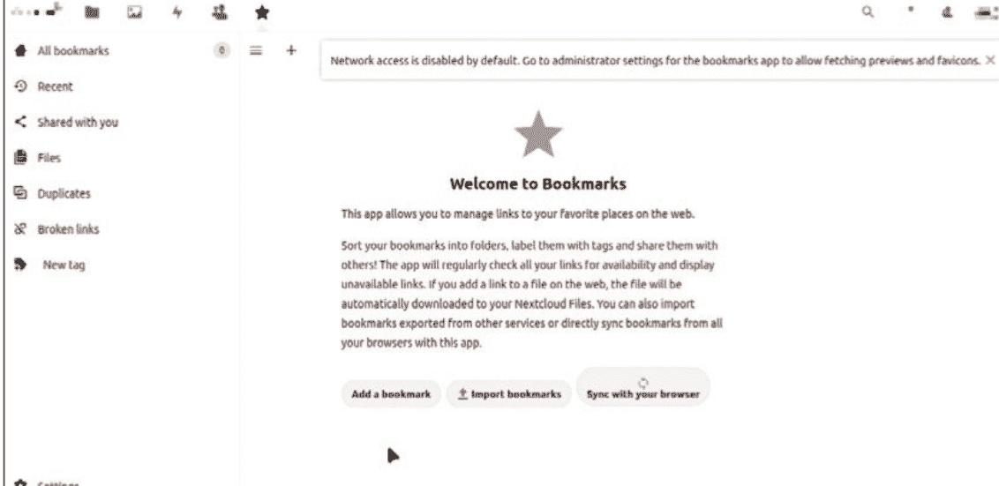

图 1：`Book` 应用可以在 `Nextcloud` 中安装，也可以 `Nextcloud` 应用商店中安装，这是运行 `floccus` 的前提。

# LINUX 语音 LINKACE/FLOCCUS

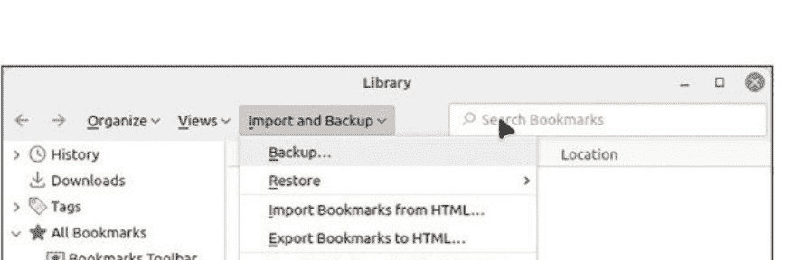

你可以选择备份为 `JSON` 文件或导出为 `HTML`。在 `Chrome` 中，第一步是进入设置中的“书签”，然后通过右上角的锤子菜单“导出书签”。导出为 `HTML` 是明的，因为文件可以通过左下角的“设置”直接导入 `Nextcloud`（图 2）。

在相同的位置你会找到“添加到 `Nextcloud`”，你可以用鼠标指针抓取并拖到浏览器的书签栏作为书签（图 3）。这将允许在未来直接在 `Nextcloud` 中创建书签。安装后，第一件事是设置一个或多个账户。专注于账户只有在你希望书签的行为与浏览器中一样时才有效，你至少需要两个账户。一个用于书签本身，另一个用于书签栏。

图 2：在 `Firefox` 和 `Chrome` 设置中，你的第一步将是以 `HTML` 格式备份现有的书签。

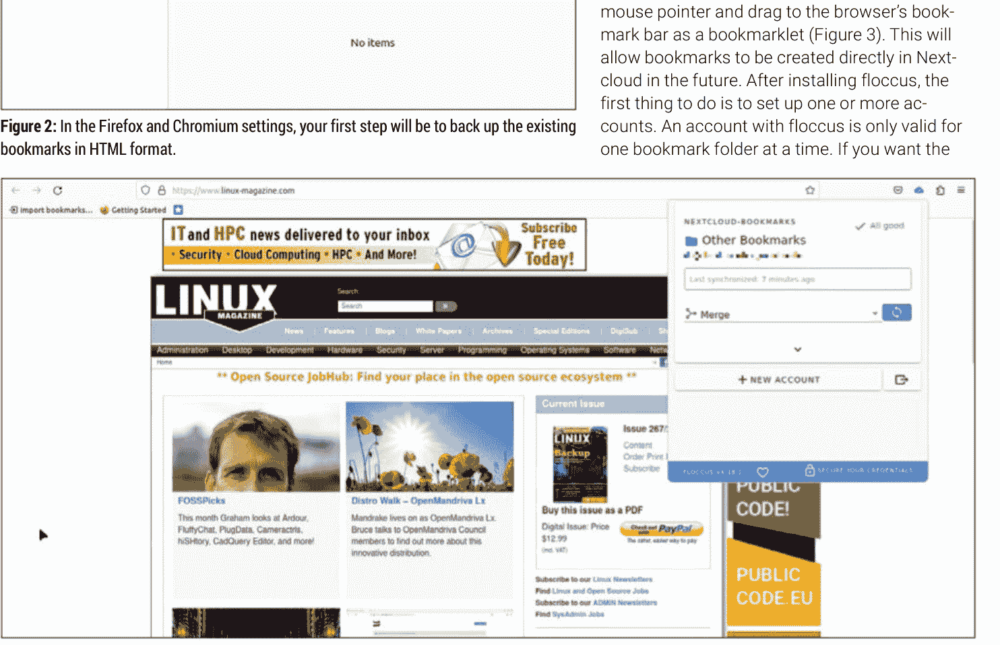

图 3：使用该书签将其存储在书签栏中，任何网页都可以轻松地保存到 `Nextcloud` 或另一个存储介质以备以后使用。

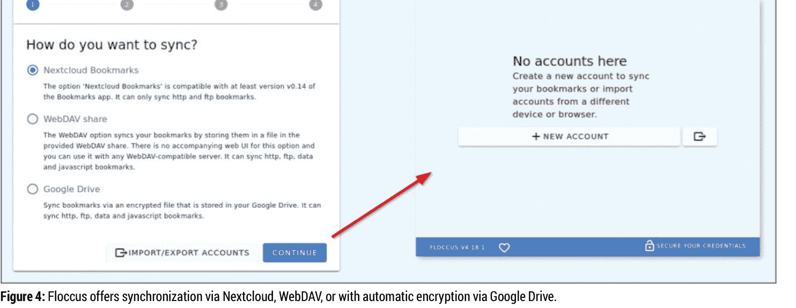

进入 `Nextcloud` 并输入你的名称作为服务器文件夹，例如 `/Bookmarks-FF`。初始冲突发生在这里。

当提示输入本地文件夹时，`Firefox` 选择“书签”菜单，`Chromium` 选择“其他”。用于工具栏的第二个账户将输入“`Firefox` 书签工具栏”或“书签”。

## 创建账户

在账户窗口中，首先选择通用的 `WebDAV` 协议、`Google Drive` 或 `Nextcloud` 作为同步的中心位置。对于下一步中的 `Nextcloud` 实例示例 (4)，在地址栏中输入你的 `next cloud URL`（图 5）以进行连接。然后选择你想存储书签的 `Nextcloud` 以及包含书签的浏览器目录。要做到这一点，先在相应的层级创建文件夹。

对于 `Chrome`，在下一个窗口中，指定是否自动同步以及时间间隔（图 6）。在此基础上，你可以决定同步哪些。

## 你想如何同步？

- 自动同步

### 同步间隔


两次同步运行之间的间隔以分钟计算。默认为 15 分钟。

### 同步策略

此选项决定了如何在不同设备之间同步书签。如果你使用多个设备，这很重要，但某些可能想从一个设备覆盖更改（添加和删除）。

- 始终合并来自其他浏览器的本地更改
- 始终撤销本地更改和来自其他浏览器的更改
- 始终上传本地更改和来自其他浏览器的更改

## 嵌套账户

当父文件夹属于账户 `A` 和 `B` 时使用此选项。你可以选择为此文件夹使用哪个账户的同步。

- 否，忽略其他账户中的此账户文件夹
- 是，在使用此账户的文件夹

继续


图 5：连接到你的 `Nextcloud` 实例只需几点击。你需要 `URL` 和账户凭据。

图 6：在设置中，你可以定义同步如何发生以及频率。


你好 `Demo`！

最近链接

- 偶然发现 - 互联网最大的网站
- 我为游戏玩家构建的网络 - 增长的工具和资源
- `PHP` 7.4 发布说明
- `Github` - 任何路径的可视化

最近链接

`CSS` 框架

静态站点生成

开发工具

统计数据

总链接

总列表

失效链接

最近标签

`LinkAce` 的标准界面清晰地显示了最近链接以及链接、列表和标签的概述。失效链接有一个红色图标。

# LINUX 语音 LINKACE/FLOCCUS


图 8：点击*所有链接*将显示所有保存链接的概述以及对应网页的缩略图。

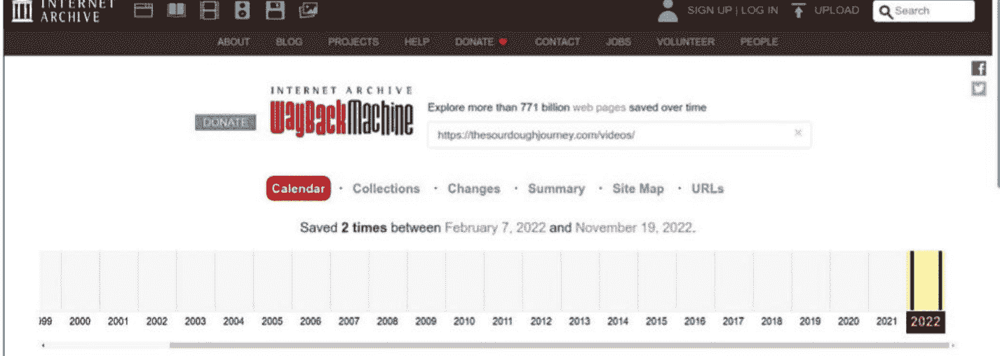

图 9：你可以共享、编辑、保存到 `Wayback Machine` 或添加打开的链接。历史显示在底部。


图 10：点击“列表”显示你到为止创建的所有链接；链接可以过滤、编辑或删除。

## LINKACE/FLOCCUS LINUX 语音

是否是双向的。`Floccus` 使用密码保护，你在窗口底部设置。`LinkAce` 处理保存的 `URL`。如果启用，还会执行定期检查（图 8）。通过安装和配置 `floccus` 与其他设备执行相同操作。如果你想同步插件和打开的标签页，自托管同步是更好的选择。如果链接不再或已移动，将收到通知并防止发生。详细而言，保存的链接可以备份到 `LinkAce Archive (9)`。所有保存的链接都可以导出为 `HTML`，导入浏览器或作为备份。其他支持的目标包括商业账户 `[10]` 和 `S`。

# LinkAce

`LinkAce` 应用未同步现有的书签，但有一个独立的书签收藏以供以后评估和归档。树莓派是你此所需的所有——它足够强大。`LinkAce` 使用 `PHP` 和数据库。你可以选择 `MySQL`、`MariaDB`、`PostgreSQL` 或 `SQLite`。设置 `LinkAce` 最简单的方法是通过 `Docker`。

# 标签

标签和列表用于分类链接。列表的作用是将多个链接组合到特定主题（图 10），标签用于分类。 `LinkAce` 还允许访客访问；访客可以查看所有未分类为私有的链接。可以单独控制每个标签、列表和链接的访问。

另一种共享方式是通过链接共享，目前适用于所有不同服务。有了 `LinkAce API` 密钥，你的应用程序还可以连接其他工具，从而访问并编辑 `LinkAce` 中的数据。

# 安装

如果你喜欢，可以在安装前无需任何程序。在自己的系统上设置有三个选项：最简单的方法是使用准备好的 `Docker Compose` 文件，它可以安装所有所需的组件 `[13]`。如果你对过程有更多控制，可以使用 `Docker Hub` 上的 `Docker` 镜像 `[14]` 作为替代。作为第三种选择，你可以手动在服务器上安装所有组件 `[15]`。

# 清晰

该应用提供了添加新 `URL` 的三种方法。首先，可以将浏览器中的现有书签导入为 `HTML`。你可以将 `URL` 直接导出到界面（图 7）。还有一个可以从浏览器书签栏拖入的书签，可以将你访问的网页存储在数据库中。

> 为我的测试实现了 `Docker` 方法；这也很好

# 1：设置 Docker

```bash
01 # 设置 docker
02 $ sudo apt update
03 $ sudo apt install-transport-https ca-certificates curl softwareproperties-common
04 $ curl -fSL https://download.docker.com/linux/ubuntu/gpg | sudo apt-key add -
05 $ sudo apt-add-repository "deb [arch=amd64] https://download.docker.com/linux/ubuntu stable"
06 # 设置 docker ce
07 $ sudo apt update
08 $ sudo systemctl status docker
09 $ sudo usermod -a docker $USER
10 # 设置 docker compose
12 $ sudo curl -L "https://github.com/docker/compose/releases/download/v2.12.0/docker-compose-$(uname -s)-$(uname -m)"o /usr/local/bin/docker-compose
13 # 确定 Docker 版本
14 $ sudo chmod +x /usr/local/bin/docker-compose
```

# LINUX 视图 LINKACE/FLINACUS

新手们大家好。我使用了 `Ubuntu 22.04` 作为基础。若要在你的机器上设置 `Docker` 及其相关组件，请按照列表 1 所示进行操作。如果你使用的是不同的 `Ubuntu` 版本，请将第 5 行中的 `james` 替换为你正在使用的 `Ubuntu` 版本。

你可以在 `https://github.com/docker/releases` 检查版本 `2.13.0`（第 12 行）是否为最新版本。第 14 行和第 15 行的内容可以让你确定当前安装的版本。


# Linux 视图 LinkAce/Flinacus

新手们大家好。我使用了 `Ubuntu 22.04` 作为基础。若要在你的机器上设置 `Docker` 及其相关组件，请按照列表 1 所示进行操作。如果你使用的是不同的 `Ubuntu` 版本，请将第 5 行中的 `james` 替换为你正在使用的 `Ubuntu` 版本。

你可以在 `https://github.com/docker/releases` 检查版本 `2.13.0`（第 12 行）是否为最新版本。第 14 行和第 15 行的内容可以让你确定当前安装的版本。

进一步的步骤在 `LinkAce` 文档（16）中有描述。首先，你需要在 `LinkAce` 的基础版和高级版之间进行选择。如果你只想在本地使用 `LinkAce`，那么在容器中交付应用和数据库的基础版就足够了。对于网络访问，你需要在独立的容器中安装 Web、服务器和数据库。另外，这增强了使用反向代理通过 `HTTPS` 进行安全保护，以便应用程序可以从外部访问。

在安装方面，两种变体是相同的，只是你需要下载不同的 `Compose` 文件。我在这里将使用基础方法。在扩展变体中使用反向代理或负载均衡器的步骤可以在文档（16）中找到。

首先，将 `linkace-docker-simple.zip` 或 `linkace-docker-advanced.zip` 下载到家目录下之前创建的文件夹中并解压 `zip` 包。该文件包含了多种变体的 `docker-compose.yml` 文件以及各种问题，此外还有许可证和 `README`。扩展变体还包含了 `nginx.conf` 和 `nginx.conf1` 文件。

## 设置密码

在继续之前，你需要更改 `.env` 文件中的 `POSTGRES_PASSWORD` 和 `REDIS_PASSWORD`。如果你使用的是 `MySQL` 以外的数据库，请更改名称以匹配。保存后，使用 `docker-compose up -d` 运行最终设置。之后可能需要几分钟时间，所有调用将按照 `compose` 文件中的规范运行。完成后，你将看到一个启动 `LinkAce` Web 服务器的 `URL`。

针对 `LinkAce` 的一些需要进一步采取的步骤（部分可选）总结在文档的 `Setup Tutorial` [17] 章节中。我将查看其中最重要的部分。首先，切换到右上角的书签。你可以将刚刚拖入的书签保存到你的书签栏中。就在下方，你将拥有创建 `API` 令牌的功能。

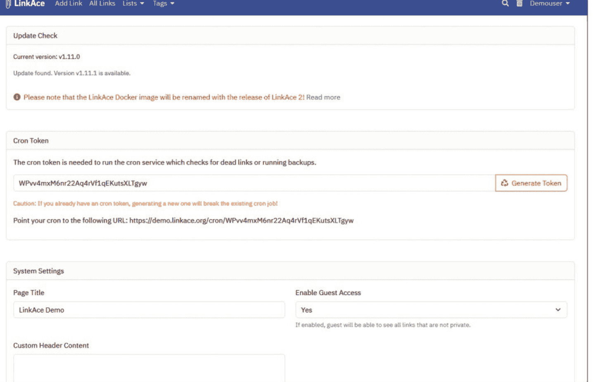

| 更新 | | |
| --- | --- | --- |
| 当前版本: `v1.11.0` | | |
| 发现更新：版本 `v1.11.1` 可用。 | 需要 `cron` 来运行 `cron` 服务以检查死链接或运行中的备份。 | `WPv4xm6n22Aq4vF1qKutsXLgtw` | 生成令牌 |
| 注意：如果你已经有一个 `cron` 令牌，生成新令牌将破坏现有的 `cron` 令牌！ | 将你的 `cron` 指向以下 `URL`：`https://demo.linkace.com/cron/WPv4xm6n22Aq4vF1qKutsXLgtw` | |
| 系统设置 | 启用访客访问 | |
| 页面标题 | | |
| `LinkAce` Demo | 是 | 如果启用，访客将看到所有非私有的链接。 |
| 自定义页头内容 | | |

**图 11：** 除其他外，你可以根据需求生成令牌；你需要它让时间控制的 `cron` 任务能够正常工作。

使用密码和电子邮件地址创建用户。如果你想通过双重认证增加更多安全性，可以在设置文档（18）中找到相关说明。

你可以为 Web 界面选择语言、时区、隐私等偏好。在页面底部，决定你倾向于浅色模式还是深色模式，以及你是否想要下载桌面设置。至少要选择你想要分享链接的社交媒体平台（如果有的话）。

除了设置之外，还有系统设置，任何一方都可以加入。要做的第一件事是定期检查你的链接、进行备份，并在 `Wayback Machine` 中进行备份。为 `Linkage` 设置 `cron` 任务的步骤在“`Cron for Linkage`” 框中描述（图 11）。`Linkage` 在网页浏览器中搜索和分类时提供了更多书签管理选项。你可以随心意欲将单个链接从公共改为私有，反之亦然。描述链接将留在 `Linkage` 中，直到你清空它。此外，还有针对公共和私有链接的 `RSS` 馈（19）。可以通过命令行界面 (`CLI`) [20] 用于管理。`Linkage` 的更新也是可用的，正如文档 [21] 所示。

该应用程序的论坛 [22]。无论你选择什么，好的一点是数据不会属于 `Google`、`Mozilla` 或其他提供者。相反，一切都留在你的控制之下。

# Info

- [1] `Firefox Sync`: `https://www.mozilla.org/en/firefox/sync/`
- [2] `floccus`: `https://floccus.org`
- [3] `Linkage`: `https://www.linkage.org`
- [4] `Bookmark for Nextcloud`: `https://github.com/nextcloud/bookmarks`
- [5] `floccus Guide`: `https://flcus.org/guides`
- [6] `floccus FAQ`: `https://floccus.org/faq`
- [7] `Self-hosted Firefox server`: `https://mozilla.services.red`
- [8] `Linkage`: `https://linkage.org`
- [9] `Wayback Machine`: `https://en.wikipedia.org/Wayback_Machine`
- [10] `AWS`: `https://aws.amazon.com`
- [11] `S3`: `https://cloud.com`
- [12] `Linkage demo`: `https://demo.linkace.com`
- [13] `Docker`: `https://hub.docker.com`
- [14] `Docker`: `https://www.docker.com`
- [15] `Docker`: `https://www.docker.org`
- [16] `LinkAce documentation`: `https://docs.linkace.org`
- [17] `Setup Tutorial`: `https://docs.linkace.org/setup`
- [18] `Settings document`: `https://docs.linkace.org/settings`
- [19] `RSS feeds`: `https://linkace.org/rss`
- [20] `CLI`: `https://docs.linkace.org/cli`
- [21] `documentation`: `https://docs.linkace.org`
- [22] `forum`: `https://forum.linkace.org`


# LINUX 视图 LINKACE/FLINACUS

新手们大家好。我使用了 `Ubuntu 22.04` 作为基础。若要在你的机器上设置 `Docker` 及其相关组件，请按照列表 1 所示进行操作。如果你使用的是不同的 `Ubuntu` 版本，请将第 5 行中的 `james` 替换为你正在使用的 `Ubuntu` 版本。

你可以在 `https://github.com/docker/releases` 检查版本 `2.13.0`（第 12 行）是否为最新版本。第 14 行和第 15 行的内容可以让你确定当前安装的版本。

进一步的步骤在 `LinkAce` 文档（16）中有描述。首先，你需要在 `LinkAce` 的基础版和高级版之间进行选择。如果你只想在本地使用 `LinkAce`，那么在容器中交付应用和数据库的基础版就足够了。对于网络访问，你需要在独立的容器中安装 Web、服务器和数据库。另外，这增强了使用反向代理通过 `HTTPS` 进行安全保护，以便应用程序可以从外部访问。

在安装方面，两种变体是相同的，只是你需要下载不同的 `Compose` 文件。我在这里将使用基础方法。在扩展变体中使用反向代理或负载均衡器的步骤可以在文档（16）中找到。

首先，将 `linkace-docker-simple.zip` 或 `linkace-docker-advanced.zip` 下载到家目录下之前创建的文件夹中并解压 zip 包。该文件包含了多种变体的 `docker-compose.yml` 文件以及各种问题，此外还有许可证和 `README`。扩展变体还包含了 `nginx.conf` 和 `nginx.conf1` 文件。

## 设置密码

在继续之前，你需要更改 `.env` 文件中的 `POSTGRES_PASSWORD` 和 `REDIS_PASSWORD`。如果你使用的是 `MySQL` 以外的数据库，请更改名称以匹配。保存后，使用 `docker-compose up -d` 运行最终设置。之后可能需要几分钟时间，所有调用将按照 `compose` 文件中的规范运行。完成后，你将看到一个启动 `LinkAce` Web 服务器的 URL。

针对 `LinkAce` 的一些需要进一步采取的步骤（部分可选）总结在文档的 `Setup Tutorial` [17] 章节中。我将查看其中最重要的部分。首先，切换到右上角的书签。你可以将刚刚拖入的书签保存到你的书签栏中。就在下方，你将拥有创建 API 令牌的功能。


### 更新状态

| 项目 | 状态/描述 | 令牌/操作 |
| :--- | :--- | :--- |
| 当前版本 | `v1.11.0` | |
| 发现更新 | 版本 `v1.11.1` 可用。需要 `cron` 来运行 `cron` 服务以检查死链接或运行中的备份。 | `WPv4xm6n22Aq4vF1qKutsXLgtw`<br>`生成令牌` |
| 注意 | 如果你已经有一个 `cron` 令牌，生成新令牌将破坏现有的 `cron` 令牌！ | 将你的 `cron` 指向以下 URL：<br>`https://demo.linkace.com/cron/WPv4xm6n22Aq4vF1qKutsXLgtw` |

### 系统设置

| 设置项 | 值 | 说明 |
| :--- | :--- | :--- |
| 启用访客访问 | | |
| 页面标题 | | |
| `LinkAce Demo` | 是 | 如果启用，访客将看到所有非私有的链接。 |
| 自定义页头内容 | | |

**图 11：** 除其他外，你可以根据需求生成令牌；你需要它让时间控制的 `cron` 任务能够正常工作。

使用密码和电子邮件地址创建用户。如果你想通过双重认证增加更多安全性，可以在设置文档（18）中找到相关说明。

你可以为 Web 界面选择语言、时区、隐私等偏好。在页面底部，决定你倾向于浅色模式还是深色模式，以及你是否想要下载桌面设置。至少要选择你想要分享链接的社交媒体平台（如果有的话）。

除了设置之外，还有系统设置，任何一方都可以加入。要做的第一件事是定期检查你的链接、进行备份，并在 `Wayback Machine` 中进行备份。为 `Linkage` 设置 `cron` 任务的步骤在“`Cron for Linkage`” 框中描述（图 11）。`Linkage` 在网页浏览器中搜索和分类时提供了更多书签管理选项。你可以随心意欲将单个链接从公共改为私有，反之亦然。描述链接将留在 `Linkage` 中，直到你清空它。此外，还有针对公共和私有链接的 `RSS` 馈（19）。可以通过命令行界面 (`CLI`) [20] 用于管理。`Linkage` 的更新也是可用的，正如文档 [21] 所示。

该应用程序的论坛 [22]。无论你选择什么，好的一点是数据不会属于 `Google`、`Mozilla` 或其他提供者。相反，一切都留在你的控制之下。

# Info

- [1] `Firefox Sync`: `https://www.mozilla.org/en/firefox/sync/`
- [2] `floccus`: `https://floccus.org`
- [3] `Linkage`: `https://www.linkage.org`
- [4] `Bookmark for Nextcloud`: `https://github.com/nextcloud/bookmarks`
- [5] `floccus Guide`: `https://flcus.org/guides`
- [6] `floccus FAQ`: `https://floccus.org/faq`
- [7] `Self-hosted Firefox server`: `https://mozilla.services.red`
- [8] `Linkage`: `https://linkage.org`
- [9] `Wayback Machine`: `https://en.wikipedia.org/Wayback_Machine`
- [10] `AWS`: `https://aws.amazon.com`
- [11] `S3`: `https://cloud.com`
- [12] `LinkAge demo`: `https://demo.linkace.com`
- [13] `Docker`: `https://hub.docker.com`
- [14] `Docker`: `https://www.docker.com`
- [15] `Docker`: `https://www.docker.org`
- [16] `LinkAce documentation`: `https://docs.linkace.org`
- [17] `Setup Tutorial`: `https://docs.linkace.org/setup`
- [18] `Settings document`: `https://docs.linkace.org/settings`
- [19] `RSS feeds`: `https://linkace.org/rss`
- [20] `CLI`: `https://docs.linkace.org/cli`
- [21] `documentation`: `https://docs.linkace.org`
- [22] `forum`: `https://forum.linkace.org`


# LINUX 视图 LINKACE/FLINACUS

新手们大家好。我使用了`Ubuntu 22.04`作为基础。若要在你的机器上设置`Docker`及其相关组件，请按照列表 1 所示进行操作。如果你使用的是不同的`Ubuntu`版本，请将第 5 行中的`james`替换为你正在使用的`Ubuntu`版本。

你可以在`https://github.com/docker/releases`检查版本`2.13.0`（第 12 行）是否为最新版本。第 14 行和第 15 行的内容可以让你确定当前安装的版本。

进一步的步骤在`LinkAce`文档（16）中有描述。首先，你需要在`LinkAce`的基础版和高级版之间进行选择。如果你只想在本地使用`LinkAce`，那么在容器中交付应用和数据库的基础版就足够了。对于网络访问，你需要在独立的容器中安装`Web`、服务器和数据库。另外，这增强了使用反向代理通过`HTTPS`进行安全保护，以便应用程序可以从外部访问。

在安装方面，两种变体是相同的，只是你需要下载不同的`Compose`文件。我在这里将使用基础方法。在扩展变体中使用反向代理或负载均衡器的步骤可以在文档（16）中找到。

首先，将`linkace-docker-simple.zip`或`linkace-docker-advanced.zip`下载到家目录下之前创建的文件夹中并解压`zip`包。该文件包含了多种变体的`docker-compose.yml`文件以及各种问题，此外还有许可证和`README`。扩展变体还包含了`nginx.conf`和`nginx.conf1`文件。

## 设置密码

在继续之前，你需要更改`.env`文件中的`POSTGRES_PASSWORD`和`REDIS_PASSWORD`。如果你使用的是`MySQL`以外的数据库，请更改名称以匹配。保存后，使用`docker-compose up -d`运行最终设置。之后可能需要几分钟时间，所有调用将按照`compose`文件中的规范运行。完成后，你将看到一个启动`LinkAce Web`服务器的`URL`。

针对`LinkAce`的一些需要进一步采取的步骤（部分可选）总结在文档的`Setup Tutorial` [17] 章节中。我将查看其中最重要的部分。首先，切换到右上角的书签。你可以将刚刚拖入的书签保存到你的书签栏中。就在下方，你将拥有创建`API`令牌的功能。


| 更新 | | |
| --- | --- | --- |
| 当前版本: `v1.11.0` | | |
| 发现更新：版本 `v1.11.1` 可用。 | 需要 `cron` 来运行 `cron` 服务以检查死链接或运行中的备份。 | `WPv4xm6n22Aq4vF1qKutsXLgtw` 生成令牌 |
| 注意：如果你已经有一个 `cron` 令牌，生成新令牌将破坏现有的 `cron` 令牌！ | 将你的 `cron` 指向以下 `URL`：`https://demo.linkace.com/cron/WPv4xm6n22Aq4vF1qKutsXLgtw` | |
| 系统设置 | 启用访客访问 | | |
| 页面标题 | | |
| `LinkAce Demo` | 是 | 如果启用，访客将看到所有非私有的链接。 |
| 自定义页头内容 | | |

**图 11：** 除其他外，你可以根据需求生成令牌；你需要它让时间控制的`cron`任务能够正常工作。

使用密码和电子邮件地址创建用户。如果你想通过双重认证增加更多安全性，可以在设置文档（18）中找到相关说明。

你可以为`Web`界面选择语言、时区、隐私等偏好。在页面底部，决定你倾向于浅色模式还是深色模式，以及你是否想要下载桌面设置。至少要选择你想要分享链接的社交媒体平台（如果有的话）。

除了设置 之外，还有系统设置，任何一方都可以加入。要做的第一件事是定期检查你的链接、进行备份，并在`Wayback Machine`中进行备份。为`Linkage`设置`cron`任务的步骤在“Cron for Linkage” 框中描述（图 11）。`Linkage`在网页浏览器中搜索和分类时提供了更多书签管理选项。你可以随心意欲将单个链接从公共改为私有，反之亦然。描述链接将留在`Linkage`中，直到你清空它。此外，还有针对公共和私有链接的`RSS`馈（19）。可以通过命令行界面 (`CLI`) [20] 用于管理。`Linkage`的更新也是可用的，正如文档 [21] 所示。

该应用程序的论坛 [22]。无论你选择什么，好的一点是数据不会属于`Google`、`Mozilla`或其他提供者。相反，一切都留在你的控制之下。

# Info

- [1] `Firefox Sync`: `https://www.mozilla.org/en/firefox/sync/`

- [2] `floccus`: `https://floccus.org`

- [3] `Linkage`: `https://www.linkage.org`

- [4] `Bookmark for Nextcloud`: `https://github.com/nextcloud/bookmarks`

- [5] `floccus Guide`: `https://flcus.org/guides`

- [6] `floccus FAQ`: `https://floccus.org/faq`

- [7] `Self-hosted Firefox server`: `https://mozilla.services.red`

- [8] `Linkage`: `https://linkage.org`

- [9] `Wayback Machine`: `https://en.wikipedia.org/Wayback_Machine`

- [10] `AWS`: `https://aws.amazon.com`

- [11] `S3`: `https://cloud.com`

- [12] `Linkage demo`: `https://demo.linkace.com`

- [13] `Docker`: `https://hub.docker.com`

- [14] `Docker`: `https://www.docker.com`


# LINUX 视图 LINKACE/FLINACUS

新手们大家好。我使用了`Ubuntu 22.04`作为基础。若要在你的机器上设置`Docker`及其相关组件，请按照列表 1 所示进行操作。如果你使用的是不同的`Ubuntu`版本，请将第 5 行中的`james`替换为你正在使用的`Ubuntu`版本。

你可以在`https://github.com/docker/releases`检查版本`2.13.0`（第 12 行）是否为最新版本。第 14 行和第 15 行的内容可以让你确定当前安装的版本。

进一步的步骤在`LinkAce`文档（16）中有描述。首先，你需要在`LinkAce`的基础版和高级版之间进行选择。如果你只想在本地使用`LinkAce`，那么在容器中交付应用和数据库的基础版就足够了。对于网络访问，你需要在独立的容器中安装`Web`、服务器和数据库。另外，这增强了使用反向代理通过`HTTPS`进行安全保护，以便应用程序可以从外部访问。

在安装方面，两种变体是相同的，只是你需要下载不同的`Compose`文件。我在这里将使用基础方法。在扩展变体中使用反向代理或负载均衡器的步骤可以在文档（16）中找到。

首先，将`linkace-docker-simple.zip`或`linkace-docker-advanced.zip`下载到家目录下之前创建的文件夹中并解压`zip`包。该文件包含了多种变体的`docker-compose.yml`文件以及各种问题，此外还有许可证和`README`。扩展变体还包含了`nginx.conf`和`nginx.conf1`文件。

## 设置密码

在继续之前，你需要更改`.env`文件中的`POSTGRES_PASSWORD`和`REDIS_PASSWORD`。如果你使用的是`MySQL`以外的数据库，请更改名称以匹配。保存后，使用`docker-compose up -d`运行最终设置。之后可能需要几分钟时间，所有调用将按照`compose`文件中的规范运行。完成后，你将看到一个启动`LinkAce Web`服务器的`URL`。

针对`LinkAce`的一些需要进一步采取的步骤（部分可选）总结在文档的`Setup Tutorial` [17] 章节中。我将查看其中最重要的部分。首先，切换到右上角的书签。你可以将刚刚拖入的书签保存到你的书签栏中。就在下方，你将拥有创建`API`令牌的功能。


| 更新 | | |
| --- | --- | --- |
| 当前版本: `v1.11.0` | | |
| 发现更新：版本 `v1.11.1` 可用。 | 需要 `cron` 来运行 `cron` 服务以检查死链接或运行中的备份。 | `WPv4xm6n22Aq4vF1qKutsXLgtw` 生成令牌 |
| 注意：如果你已经有一个 `cron` 令牌，生成新令牌将破坏现有的 `cron` 令牌！ | 将你的 `cron` 指向以下 URL：`https://demo.linkace.com/cron/WPv4xm6n22Aq4vF1qKutsXLgtw` | |
| 系统设置 | 启用访客访问 | |
| 页面标题 | | |
| `LinkAce Demo` | 是 | 如果启用，访客将看到所有非私有的链接。 |
| 自定义页头内容 | | |

**图 11：** 除其他外，你可以根据需求生成令牌；你需要它让时间控制的`cron`任务能够正常工作。

使用密码和电子邮件地址创建用户。如果你想通过双重认证增加更多安全性，可以在设置文档（18）中找到相关说明。

你可以为`Web`界面选择语言、时区、隐私等偏好。在页面底部，决定你倾向于浅色模式还是深色模式，以及你是否想要下载桌面设置。至少要选择你想要分享链接的社交媒体平台（如果有的话）。

除了设置之外，还有系统设置，任何一方都可以加入。要做的第一件事是定期检查你的链接、进行备份，并在`Wayback Machine`中进行备份。为`Linkage`设置`cron`任务的步骤在“Cron for Linkage”框中描述（图 11）。`Linkage`在网页浏览器中搜索和分类时提供了更多书签管理选项。你可以随心意欲将单个链接从公共改为私有，反之亦然。描述链接将留在`Linkage`中，直到你清空它。此外，还有针对公共和私有链接的`RSS`馈（19）。可以通过命令行界面 (`CLI`) [20] 用于管理。`Linkage`的更新也是可用的，正如文档 [21] 所示。

该应用程序的论坛 [22]。无论你选择什么，好的一点是数据不会属于`Google`、`Mozilla`或其他提供者。相反，一切都留在你的控制之下。

# Info

- [1] `Firefox Sync`: `https://www.mozilla.org/en/firefox/sync/`
- [2] `floccus`: `https://floccus.org`
- [3] `Linkage`: `https://www.linkage.org`
- [4] `Bookmark for Nextcloud`: `https://github.com/nextcloud/bookmarks`
- [5] `floccus Guide`: `https://flcus.org/guides`
- [6] `floccus FAQ`: `https://floccus.org/faq`
- [7] `Self-hosted Firefox server`: `https://mozilla.services.red`
- [8] `Linkage`: `https://linkage.org`
- [9] `Wayback Machine`: `https://en.wikipedia.org/Wayback_Machine`
- [10] `AWS`: `https://aws.amazon.com`
- [11] `S3`: `https://cloud.com`
- [12] `Linkage demo`: `https://demo.linkace.com`
- [13] `Docker`: `https://hub.docker.com`
- [14] `Docker`: `https://www.docker.com`
- [15] `Docker`: `https://www.docker.org`
- [16] `LinkAce documentation`: `https://docs.linkace.org`
- [17] `Setup Tutorial`: `https://docs.linkace.org/setup`
- [18] `Settings document`: `https://docs.linkace.org/settings`
- [19] `RSS feeds`: `https://linkace.org/rss`
- [20] `CLI`: `https://docs.linkace.org/cli`
- [21] `documentation`: `https://docs.linkace.org`
- [22] `forum`: `https://forum.linkace.org`


# LINUX 视图 LINKACE/FLINACUS

新手们大家好。我使用了 `Ubuntu 22.04` 作为基础。若要在你的机器上设置 `Docker` 及其相关组件，请按照列表 1 所示进行操作。如果你使用的是不同的 `Ubuntu` 版本，请将第 5 行中的 `james` 替换为你正在使用的 `Ubuntu` 版本。

你可以在 `https://github.com/docker/releases` 检查版本 `2.13.0`（第 12 行）是否为最新版本。第 14 行和第 15 行的内容可以让你确定当前安装的版本。

进一步的步骤在 `LinkAce` 文档（16）中有描述。首先，你需要在 `LinkAce` 的基础版和高级版之间进行选择。如果你只想在本地使用 `LinkAce`，那么在容器中交付应用和数据库的基础版就足够了。对于网络访问，你需要在独立的容器中安装 `Web`、服务器和数据库。另外，这增强了使用反向代理通过 `HTTPS` 进行安全保护，以便应用程序可以从外部访问。

在安装方面，两种变体是相同的，只是你需要下载不同的 `Compose` 文件。我在这里将使用基础方法。在扩展变体中使用反向代理或负载均衡器的步骤可以在文档（16）中找到。

首先，将 `linkace-docker-simple.zip` 或 `linkace-docker-advanced.zip` 下载到家目录下之前创建的文件夹中并解压 `zip` 包。该文件包含了多种变体的 `docker-compose.yml` 文件以及各种问题，此外还有许可证和 `README`。扩展变体还包含了 `nginx.conf` 和 `nginx.conf1` 文件。

## 设置密码

在继续之前，你需要更改 `.env` 文件中的 `POSTGRES_PASSWORD` 和 `REDIS_PASSWORD`。如果你使用的是 `MySQL` 以外的数据库，请更改名称以匹配。保存后，使用 `docker-compose up -d` 运行最终设置。之后可能需要几分钟时间，所有调用将按照 `compose` 文件中的规范运行。完成后，你将看到一个启动 `LinkAce` Web 服务器的 `URL`。

针对 `LinkAce` 的一些需要进一步采取的步骤（部分可选）总结在文档的 `Setup Tutorial` [17] 章节中。我将查看其中最重要的部分。首先，切换到右上角的书签。你可以将刚刚拖入的书签保存到你的书签栏中。就在下方，你将拥有创建 `API` 令牌的功能。


| 更新 | | |
| --- | --- | --- |
| 当前版本: `v1.11.0` | | |
| 发现更新：版本 `v1.11.1` 可用。 | 需要 `cron` 来运行 `cron` 服务以检查死链接或运行中的备份。 | `WPv4xm6n22Aq4vF1qKutsXLgtw` | 生成令牌 |
| 注意：如果你已经有一个 `cron` 令牌，生成新令牌将破坏现有的 `cron` 令牌！ | 将你的 `cron` 指向以下 `URL`：`https://demo.linkace.com/cron/WPv4xm6n22Aq4vF1qKutsXLgtw` | |
| 系统设置 | 启用访客访问 | | |
| 页面标题 | | |
| `LinkAce` Demo | 是 | 如果启用，访客将看到所有非私有的链接。 |
| 自定义页头内容 | | |

**图 11：** 除其他外，你可以根据需求生成令牌；你需要它让时间控制的 `cron` 任务能够正常工作。

使用密码和电子邮件地址创建用户。如果你想通过双重认证增加更多安全性，可以在设置文档（18）中找到相关说明。

你可以为 `Web` 界面选择语言、时区、隐私等偏好。在页面底部，决定你倾向于浅色模式还是深色模式，以及你是否想要下载桌面设置。至少要选择你想要分享链接的社交媒体平台（如果有的话）。

除了设置 之外，还有系统设置，任何一方都可以加入。要做的第一件事是定期检查你的链接、进行备份，并在 `Wayback Machine` 中进行备份。为 `Linkage` 设置 `cron` 任务的步骤在“`Cron for Linkage`” 框中描述（图 11）。`Linkage` 在网页浏览器中搜索和分类时提供了更多书签管理选项。你可以随心意欲将单个链接从公共改为私有，反之亦然。描述链接将留在 `Linkage` 中，直到你清空它。此外，还有针对公共和私有链接的 `RSS` 馈（19）。可以通过命令行界面 (`CLI`) [20] 用于管理。`Linkage` 的更新也是可用的，正如文档 [21] 所示。

该应用程序的论坛 [22]。无论你选择什么，好的一点是数据不会属于 `Google`、`Mozilla` 或其他提供者。相反，一切都留在你的控制之下。

# Info

- [1] `Firefox Sync`: `https://www.mozilla.org/en/firefox/sync/`
- [2] `floccus`: `https://floccus.org`
- [3] `Linkage`: `https://www.linkage.org`
- [4] `Bookmark for Nextcloud`: `https://github.com/nextcloud/bookmarks`
- [5] `floccus Guide`: `https://flcus.org/guides`
- [6] `floccus FAQ`: `https://floccus.org/faq`
- [7] Self-hosted `Firefox` server: `https://mozilla.services.red`
- [8] `Linkage`: `https://linkage.org`
- [9] `Wayback Machine`: `https://en.wikipedia.org/Wayback_Machine`
- [10] `AWS`: `https://aws.amazon.com`
- [11] `S3`: `https://cloud.com`
- [12] `Linkage demo`: `https://demo.linkace.com`
- [13] `Docker`: `https://hub.docker.com`
- [14] `Docker`: `https://www.docker.com`
- [15] `Docker`: `https://www.docker.org`
- [16] `LinkAce documentation`: `https://docs.linkace.org`
- [17] `Setup Tutorial`: `https://docs.linkace.org/setup`
- [18] `Settings document`: `https://docs.linkace.org/settings`
- [19] `RSS feeds`: `https://linkace.org/rss`
- [20] `CLI`: `https://docs.linkace.org/cli`
- [21] `documentation`: `https://docs.linkace.org`
- [22] `forum`: `https://forum.linkace.org`


# 信息

## 工具与资源链接

- [1] Firefox Sync: `https://www.mozilla.org/en/firefox/sync/`
- [2] floccus: `https://floccus.org`
- [3] Linkage: `https://www.linkage.org`
- [4] Bookmark for Nextcloud: `https://github.com/nextcloud/bookmarks`
- [5] floccus Guide: `https://flcus.org/guides`
- [6] floccus FAQ: `https://floccus.org/faq`
- [7] Self-hosted Firefox server: `https://mozilla.services.red`
- [8] Linkage: `https://linkage.org`
- [9] Wayback Machine: `https://en.wikipedia.org/Wayback_Machine`
- [10] AWS: `https://aws.amazon.com`
- [11] S3: `https://cloud.com`
- [12] LinkAce demo: `https://demo.linkace.com`
- [13] Docker: `https://hub.docker.com`
- [14] Docker: `https://www.docker.com`
- [15] Docker: `https://www.docker.org`
- [16] LinkAce documentation: `https://docs.linkace.org`
- [17] Setup Tutorial: `https://docs.linkace.org/setup`
- [18] Settings document: `https://docs.linkace.org/settings`
- [19] RSS feeds: `https://linkace.org/rss`
- [20] CLI: `https://docs.linkace.org/cli`
- [21] documentation: `https://docs.linkace.org`
- [22] forum: `https://forum.linkace.org`

## LINUX 视图 LINKACE/FLINACUS

新手们大家好。我使用了 `Ubuntu 22.04` 作为基础。若要在你的机器上设置 `Docker` 及其相关组件，请按照列表 1 所示进行操作。如果你使用的是不同的 `Ubuntu` 版本，请将第 5 行中的 `james` 替换为你正在使用的 `Ubuntu` 版本。

你可以在 `https://github.com/docker/releases` 检查版本 `2.13.0`（第 12 行）是否为最新版本。第 14 行和第 15 行的内容可以让你确定当前安装的版本。

进一步的步骤在 `LinkAce` 文档（16）中有描述。首先，你需要在 `LinkAce` 的基础版和高级版之间进行选择。如果你只想在本地使用 `LinkAce`，那么在容器中交付应用和数据库的基础版就足够了。对于网络访问，你需要在独立的容器中安装 `Web`、服务器和数据库。另外，这增强了使用反向代理通过 `HTTPS` 进行安全保护，以便应用程序可以从外部访问。

在安装方面，两种变体是相同的，只是你需要下载不同的 `Compose` 文件。我在这里将使用基础方法。在扩展变体中使用反向代理或负载均衡器的步骤可以在文档（16）中找到。

首先，将 `linkace-docker-simple.zip` 或 `linkace-docker-advanced.zip` 下载到家目录下之前创建的文件夹中并解压 `zip` 包。该文件包含了多种变体的 `docker-compose.yml` 文件以及各种问题，此外还有许可证和 `README`。扩展变体还包含了 `nginx.conf` 和 `nginx.conf1` 文件。

## 设置密码

在继续之前，你需要更改 `.env` 文件中的 `POSTGRES_PASSWORD` 和 `REDIS_PASSWORD`。如果你使用的是 `MySQL` 以外的数据库，请更改名称以匹配。保存后，使用 `docker-compose up -d` 运行最终设置。之后可能需要几分钟时间，所有调用将按照 `compose` 文件中的规范运行。完成后，你将看到一个启动 `LinkAce` Web 服务器的 `URL`。

针对 `LinkAce` 的一些需要进一步采取的步骤（部分可选）总结在文档的 `Setup Tutorial` [17] 章节中。我将查看其中最重要的部分。首先，切换到右上角的书签。你可以将刚刚拖入的书签保存到你的书签栏中。就在下方，你将拥有创建 `API` 令牌的功能。


| 更新 | | |
| --- | --- | --- |
| 当前版本: `v1.11.0` | | |
| 发现更新：版本 `v1.11.1` 可用。 | 需要 `cron` 来运行 `cron` 服务以检查死链接或运行中的备份。 | `WPv4xm6n22Aq4vF1qKutsXLgtw` | 生成令牌 |
| 注意：如果你已经有一个 `cron` 令牌，生成新令牌将破坏现有的 `cron` 令牌！ | 将你的 `cron` 指向以下 URL：`https://demo.linkace.com/cron/WPv4xm6n22Aq4vF1qKutsXLgtw` | |
| 系统设置 | 启用访客访问 | |
| 页面标题 | | |
| `LinkAce` Demo | 是 | 如果启用，访客将看到所有非私有的链接。 |
| 自定义页头内容 | | |

**图 11：** 除其他外，你可以根据需求生成令牌；你需要它让时间控制的 `cron` 任务能够正常工作。

使用密码和电子邮件地址创建用户。如果你想通过双重认证增加更多安全性，可以在设置文档（18）中找到相关说明。

你可以为 `Web` 界面选择语言、时区、隐私等偏好。在页面底部，决定你倾向于浅色模式还是深色模式，以及你是否想要下载桌面设置。至少要选择你想要分享链接的社交媒体平台（如果有的话）。

除了设置之外，还有系统设置，任何一方都可以加入。要做的第一件事是定期检查你的链接、进行备份，并在 `Wayback Machine` 中进行备份。为 `Linkage` 设置 `cron` 任务的步骤在“`Cron for Linkage`”框中描述（图 11）。`Linkage` 在网页浏览器中搜索和分类时提供了更多书签管理选项。你可以随心意欲将单个链接从公共改为私有，反之亦然。描述链接将留在 `Linkage` 中，直到你清空它。此外，还有针对公共和私有链接的 `RSS` 馈（19）。可以通过命令行界面 (`CLI`) [20] 用于管理。`Linkage` 的更新也是可用的，正如文档 [21] 所示。

该应用程序的论坛 [22]。无论你选择什么，好的一点是数据不会属于 `Google`、`Mozilla` 或其他提供者。相反，一切都留在你的控制之下。


# LinkAce/Floccus 在 Linux 下的视图

新手们大家好。我使用了 `Ubuntu 22.04` 作为基础。若要在你的机器上设置 `Docker` 及其相关组件，请按照列表 1 所示进行操作。如果你使用的是不同的 `Ubuntu` 版本，请将第 5 行中的 `james` 替换为你正在使用的 `Ubuntu` 版本。

你可以在 `https://github.com/docker/releases` 检查版本 `2.13.0`（第 12 行）是否为最新版本。第 14 行和第 15 行的内容可以让你确定当前安装的版本。

进一步的步骤在 `LinkAce` 文档（16）中有描述。首先，你需要在 `LinkAce` 的基础版和高级版之间进行选择。如果你只想在本地使用 `LinkAce`，那么在容器中交付应用和数据库的基础版就足够了。对于网络访问，你需要在独立的容器中安装 `Web`、服务器和数据库。另外，这增强了使用反向代理通过 `HTTPS` 进行安全保护，以便应用程序可以从外部访问。

在安装方面，两种变体是相同的，只是你需要下载不同的 `Compose` 文件。我在这里将使用基础方法。在扩展变体中使用反向代理或负载均衡器的步骤可以在文档（16）中找到。

首先，将 `linkace-docker-simple.zip` 或 `linkace-docker-advanced.zip` 下载到家目录下之前创建的文件夹中并解压 `zip` 包。该文件包含了多种变体的 `docker-compose.yml` 文件以及各种问题，此外还有许可证和 `README`。扩展变体还包含了 `nginx.conf` 和 `nginx.conf1` 文件。

## 设置密码

在继续之前，你需要更改 `.env` 文件中的 `POSTGRES_PASSWORD` 和 `REDIS_PASSWORD`。如果你使用的是 `MySQL` 以外的数据库，请更改名称以匹配。保存后，使用 `docker-compose up -d` 运行最终设置。之后可能需要几分钟时间，所有调用将按照 `compose` 文件中的规范运行。完成后，你将看到一个启动 `LinkAce` `Web` 服务器的 `URL`。

针对 `LinkAce` 的一些需要进一步采取的步骤（部分可选）总结在文档的 `Setup Tutorial` [17] 章节中。我将查看其中最重要的部分。首先，切换到右上角的书签。你可以将刚刚拖入的书签保存到你的书签栏中。就在下方，你将拥有创建 `API` 令牌的功能。


| 更新 | | |
| --- | --- | --- |
| 当前版本: `v1.11.0` | | |
| 发现更新：版本 `v1.11.1` 可用。 | 需要 `cron` 来运行 `cron` 服务以检查死链接或运行中的备份。 | `WPv4xm6n22Aq4vF1qKutsXLgtw` 生成令牌 |
| 注意：如果你已经有一个 `cron` 令牌，生成新令牌将破坏现有的 `cron` 令牌！ | 将你的 `cron` 指向以下 `URL`：`https://demo.linkace.com/cron/WPv4xm6n22Aq4vF1qKutsXLgtw` | |
| 系统设置 | 启用访客访问 | | |
| 页面标题 | | | |
| `LinkAce` `Demo` | 是 | 如果启用，访客将看到所有非私有的链接。 |
| 自定义页头内容 | | |

**图 11：** 除其他外，你可以根据需求生成令牌；你需要它让时间控制的 `cron` 任务能够正常工作。

使用密码和电子邮件地址创建用户。如果你想通过双重认证增加更多安全性，可以在设置文档（18）中找到相关说明。

你可以为 `Web` 界面选择语言、时区、隐私等偏好。在页面底部，决定你倾向于浅色模式还是深色模式，以及你是否想要下载桌面设置。至少要选择你想要分享链接的社交媒体平台（如果有的话）。

除了设置之外，还有系统设置，任何一方都可以加入。要做的第一件事是定期检查你的链接、进行备份，并在 `Wayback Machine` 中进行备份。为 `Linkage` 设置 `cron` 任务的步骤在“`Cron for Linkage`”框中描述（图 11）。`Linkage` 在网页浏览器中搜索和分类时提供了更多书签管理选项。你可以随心意欲将单个链接从公共改为私有，反之亦然。描述链接将留在 `Linkage` 中，直到你清空它。此外，还有针对公共和私有链接的 `RSS` 馈（19）。可以通过命令行界面 (`CLI`) [20] 用于管理。`Linkage` 的更新也是可用的，正如文档 [21] 所示。

该应用程序的论坛 [22]。无论你选择什么，好的一点是数据不会属于 `Google`、`Mozilla` 或其他提供者。相反，一切都留在你的控制之下。

# Info

- [1] `Firefox Sync`: `https://www.mozilla.org/en/firefox/sync/`
- [2] `floccus`: `https://floccus.org`
- [3] `Linkage`: `https://www.linkage.org`
- [4] `Bookmark for Nextcloud`: `https://github.com/nextcloud/bookmarks`
- [5] `floccus Guide`: `https://flcus.org/guides`
- [6] `floccus FAQ`: `https://floccus.org/faq`
- [7] `Self-hosted Firefox server`: `https://mozilla.services.red`
- [8] `Linkage`: `https://linkage.org`


# LINUX 视图 LINKACE/FLINACUS

新手们大家好。我使用了 `Ubuntu 22.04` 作为基础。若要在你的机器上设置 `Docker` 及其相关组件，请按照列表 1 所示进行操作。如果你使用的是不同的 `Ubuntu` 版本，请将第 5 行中的 `james` 替换为你正在使用的 `Ubuntu` 版本。

你可以在 `https://github.com/docker/releases` 检查版本 `2.13.0`（第 12 行）是否为最新版本。第 14 行和第 15 行的内容可以让你确定当前安装的版本。

进一步的步骤在 `LinkAce` 文档（16）中有描述。首先，你需要在 `LinkAce` 的基础版和高级版之间进行选择。如果你只想在本地使用 `LinkAce`，那么在容器中交付应用和数据库的基础版就足够了。对于网络访问，你需要在独立的容器中安装 `Web`、服务器和数据库。另外，这增强了使用反向代理通过 `HTTPS` 进行安全保护，以便应用程序可以从外部访问。

在安装方面，两种变体是相同的，只是你需要下载不同的 `Compose` 文件。我在这里将使用基础方法。在扩展变体中使用反向代理或负载均衡器的步骤可以在文档（16）中找到。

首先，将 `linkace-docker-simple.zip` 或 `linkace-docker-advanced.zip` 下载到家目录下之前创建的文件夹中并解压 `zip` 包。该文件包含了多种变体的 `docker-compose.yml` 文件以及各种问题，此外还有许可证和 `README`。扩展变体还包含了 `nginx.conf` 和 `nginx.conf1` 文件。

## 设置密码

在继续之前，你需要更改 `.env` 文件中的 `POSTGRES_PASSWORD` 和 `REDIS_PASSWORD`。如果你使用的是 `MySQL` 以外的数据库，请更改名称以匹配。保存后，使用 `docker-compose up -d` 运行最终设置。之后可能需要几分钟时间，所有调用将按照 `compose` 文件中的规范运行。完成后，你将看到一个启动 `LinkAce Web` 服务器的 `URL`。

针对 `LinkAce` 的一些需要进一步采取的步骤（部分可选）总结在文档的 `Setup Tutorial` [17] 章节中。我将查看其中最重要的部分。首先，切换到右上角的书签。你可以将刚刚拖入的书签保存到你的书签栏中。就在下方，你将拥有创建 `API` 令牌的功能。


| 更新 | | |
| --- | --- | --- |
| 当前版本: `v1.11.0` | | |
| 发现更新：版本 `v1.11.1` 可用。 | 需要 `cron` 来运行 `cron` 服务以检查死链接或运行中的备份。 | `WPv4xm6n22Aq4vF1qKutsXLgtw` 生成令牌 |
| 注意：如果你已经有一个 `cron` 令牌，生成新令牌将破坏现有的 `cron` 令牌！ | 将你的 `cron` 指向以下 `URL`：`https://demo.linkace.com/cron/WPv4xm6n22Aq4vF1qKutsXLgtw` | |
| 系统设置 | 启用访客访问 | | |
| 页面标题 | | | |
| `LinkAce Demo` | 是 | 如果启用，访客将看到所有非私有的链接。 |
| 自定义页头内容 | | | |

**图 11：** 除其他外，你可以根据需求生成令牌；你需要它让时间控制的 `cron` 任务能够正常工作。

使用密码和电子邮件地址创建用户。如果你想通过双重认证增加更多安全性，可以在设置文档（18）中找到相关说明。

你可以为 `Web` 界面选择语言、时区、隐私等偏好。在页面底部，决定你倾向于浅色模式还是深色模式，以及你是否想要下载桌面设置。至少要选择你想要分享链接的社交媒体平台（如果有的话）。

除了设置之外，还有系统设置，任何一方都可以加入。要做的第一件事是定期检查你的链接、进行备份，并在 `Wayback Machine` 中进行备份。为 `LinkAce` 设置 `cron` 任务的步骤在“Cron for LinkAce”框中描述（图 11）。`LinkAce` 在网页浏览器中搜索和分类时提供了更多书签管理选项。你可以随心意欲将单个链接从公共改为私有，反之亦然。描述链接将留在 `LinkAce` 中，直到你清空它。此外，还有针对公共和私有链接的 `RSS` 馈（19）。可以通过命令行界面 (`CLI`) [20] 用于管理。`LinkAce` 的更新也是可用的，正如文档 [21] 所示。

该应用程序的论坛 [22]。无论你选择什么，好的一点是数据不会属于 `Google`、`Mozilla` 或其他提供者。相反，一切都留在你的控制之下。

# Info

- [1] `Firefox Sync`: <https://www.mozilla.org/en/firefox/sync/>
- [2] `floccus`: <https://floccus.org>
- [3] `LinkAce`: <https://www.linkage.org>
- [4] Bookmark for `Nextcloud`: <https://github.com/nextcloud/bookmarks>
- [5] `floccus` Guide: <https://flcus.org/guides>
- [6] `floccus` FAQ: <https://floccus.org/faq>
- [7] Self-hosted `Firefox` server: <https://mozilla.services.red>
- [8] `LinkAce`: <https://linkage.org>
- [9] `Wayback Machine`: <https://en.wikipedia.org/Wayback_Machine>
- [10] `AWS`: <https://aws.amazon.com>
- [11] `S3`: <https://cloud.com>
- [12] `LinkAce` demo: <https://demo.linkace.com>
- [13] `Docker`: <https://hub.docker.com>
- [14] `Docker`: <https://www.docker.com>
- [15] `Docker`: <https://www.docker.org>
- [16] `LinkAce` documentation: <https://docs.linkace.org>
- [17] `Setup Tutorial`: <https://docs.linkace.org/setup>
- [18] Settings document: <https://docs.linkace.org/settings>
- [19] `RSS` feeds: <https://linkace.org/rss>
- [20] `CLI`: <https://docs.linkace.org/cli>
- [21] documentation: <https://docs.linkace.org>
- [22] forum: <https://forum.linkace.org>


# LINUX 视图 LINKACE/FLINACUS

新手们大家好。我使用了 `Ubuntu 22.04` 作为基础。若要在你的机器上设置 `Docker` 及其相关组件，请按照列表 1 所示进行操作。如果你使用的是不同的 `Ubuntu` 版本，请将第 5 行中的 `james` 替换为你正在使用的 `Ubuntu` 版本。

你可以在 `https://github.com/docker/releases` 检查版本 `2.13.0`（第 12 行）是否为最新版本。第 14 行和第 15 行的内容可以让你确定当前安装的版本。

进一步的步骤在 `LinkAce` 文档（16）中有描述。首先，你需要在 `LinkAce` 的基础版和高级版之间进行选择。如果你只想在本地使用 `LinkAce`，那么在容器中交付应用和数据库的基础版就足够了。对于网络访问，你需要在独立的容器中安装 `Web`、服务器和数据库。另外，这增强了使用反向代理通过 `HTTPS` 进行安全保护，以便应用程序可以从外部访问。

在安装方面，两种变体是相同的，只是你需要下载不同的 `Compose` 文件。我在这里将使用基础方法。在扩展变体中使用反向代理或负载均衡器的步骤可以在文档（16）中找到。

首先，将 `linkace-docker-simple.zip` 或 `linkace-docker-advanced.zip` 下载到家目录下之前创建的文件夹中并解压 `zip` 包。该文件包含了多种变体的 `docker-compose.yml` 文件以及各种问题，此外还有许可证和 `README`。扩展变体还包含了 `nginx.conf` 和 `nginx.conf1` 文件。

## 设置密码

在继续之前，你需要更改 `.env` 文件中的 `POSTGRES_PASSWORD` 和 `REDIS_PASSWORD`。如果你使用的是 `MySQL` 以外的数据库，请更改名称以匹配。保存后，使用 `docker-compose up -d` 运行最终设置。之后可能需要几分钟时间，所有调用将按照 `compose` 文件中的规范运行。完成后，你将看到一个启动 `LinkAce` `Web` 服务器的 `URL`。

针对 `LinkAce` 的一些需要进一步采取的步骤（部分可选）总结在文档的 `Setup Tutorial` [17] 章节中。我将查看其中最重要的部分。首先，切换到右上角的书签。你可以将刚刚拖入的书签保存到你的书签栏中。就在下方，你将拥有创建 `API` 令牌的功能。


| 更新 | | |
| --- | --- | --- |
| 当前版本: `v1.11.0` | | |
| 发现更新：版本 `v1.11.1` 可用。 | 需要 `cron` 来运行 `cron` 服务以检查死链接或运行中的备份。 | `WPv4xm6n22Aq4vF1qKutsXLgtw` 生成令牌 |
| 注意：如果你已经有一个 `cron` 令牌，生成新令牌将破坏现有的 `cron` 令牌！ | 将你的 `cron` 指向以下 `URL`：`https://demo.linkace.com/cron/WPv4xm6n22Aq4vF1qKutsXLgtw` | |
| 系统设置 | 启用访客访问 | | |
| 页面标题 | | | |
| `LinkAce Demo` | 是 | 如果启用，访客将看到所有非私有的链接。 |
| 自定义页头内容 | | | |

**图 11：** 除其他外，你可以根据需求生成令牌；你需要它让时间控制的 `cron` 任务能够正常工作。

使用密码和电子邮件地址创建用户。如果你想通过双重认证增加更多安全性，可以在设置文档（18）中找到相关说明。

你可以为 `Web` 界面选择语言、时区、隐私等偏好。在页面底部，决定你倾向于浅色模式还是深色模式，以及你是否想要下载桌面设置。至少要选择你想要分享链接的社交媒体平台（如果有的话）。

除了设置 之外，还有系统设置，任何一方都可以加入。要做的第一件事是定期检查你的链接、进行备份，并在 `Wayback Machine` 中进行备份。为 `Linkage` 设置 `cron` 任务的步骤在“`Cron for Linkage`” 框中描述（图 11）。`Linkage` 在网页浏览器中搜索和分类时提供了更多书签管理选项。你可以随心意欲将单个链接从公共改为私有，反之亦然。描述链接将留在 `Linkage` 中，直到你清空它。此外，还有针对公共和私有链接的 `RSS` 馈（19）。可以通过命令行界面 (`CLI`) [20] 用于管理。`Linkage` 的更新也是可用的，正如文档 [21] 所示。

该应用程序的论坛 [22]。无论你选择什么，好的一点是数据不会属于 `Google`、`Mozilla` 或其他提供者。相反，一切都留在你的控制之下。

# Info

- [1] `Firefox Sync`: `https://www.mozilla.org/en/firefox/sync/`
- [2] `floccus`: `https://floccus.org`
- [3] `Linkage`: `https://www.linkage.org`
- [4] `Bookmark for Nextcloud`: `https://github.com/nextcloud/bookmarks`
- [5] `floccus Guide`: `https://flcus.org/guides`
- [6] `floccus FAQ`: `https://floccus.org/faq`
- [7] `Self-hosted Firefox server`: `https://mozilla.services.red`
- [8] `Linkage`: `https://linkage.org`
- [9] `Wayback Machine`: `https://en.wikipedia.org/Wayback_Machine`
- [10] `AWS`: `https://aws.amazon.com`
- [11] `S3`: `https://cloud.com`
- [12] `Linkage demo`: `https://demo.linkace.com`
- [13] `Docker`: `https://hub.docker.com`
- [14] `Docker`: `https://www.docker.com`
- [15] `Docker`: `https://www.docker.org`
- [16] `LinkAce documentation`: `https://docs.linkace.org`
- [17] `Setup Tutorial`: `https://docs.linkace.org/setup`
- [18] `Settings document`: `https://docs.linkace.org/settings`
- [19] `RSS feeds`: `https://linkace.org/rss`
- [20] `CLI`: `https://docs.linkace.org/cli`
- [21] `documentation`: `https://docs.linkace.org`
- [22] `forum`: `https://forum.linkace.org`


# LINUX 视图 LINKACE/FLINACUS

新手们大家好。我使用了 `Ubuntu 22.04` 作为基础。若要在你的机器上设置 `Docker` 及其相关组件，请按照列表 1 所示进行操作。如果你使用的是不同的 `Ubuntu` 版本，请将第 5 行中的 `james` 替换为你正在使用的 `Ubuntu` 版本。

你可以在 `https://github.com/docker/releases` 检查版本 `2.13.0`（第 12 行）是否为最新版本。第 14 行和第 15 行的内容可以让你确定当前安装的版本。

进一步的步骤在 `LinkAce` 文档（16）中有描述。首先，你需要在 `LinkAce` 的基础版和高级版之间进行选择。如果你只想在本地使用 `LinkAce`，那么在容器中交付应用和数据库的基础版就足够了。对于网络访问，你需要在独立的容器中安装 `Web`、服务器和数据库。另外，这增强了使用反向代理通过 `HTTPS` 进行安全保护，以便应用程序可以从外部访问。

在安装方面，两种变体是相同的，只是你需要下载不同的 `Compose` 文件。我在这里将使用基础方法。在扩展变体中使用反向代理或负载均衡器的步骤可以在文档（16）中找到。

首先，将 `linkace-docker-simple.zip` 或 `linkace-docker-advanced.zip` 下载到家目录下之前创建的文件夹中并解压 `zip` 包。该文件包含了多种变体的 `docker-compose.yml` 文件以及各种问题，此外还有许可证和 `README`。扩展变体还包含了 `nginx.conf` 和 `nginx.conf1` 文件。

## 设置密码

在继续之前，你需要更改 `.env` 文件中的 `POSTGRES_PASSWORD` 和 `REDIS_PASSWORD`。如果你使用的是 `MySQL` 以外的数据库，请更改名称以匹配。保存后，使用 `docker-compose up -d` 运行最终设置。之后可能需要几分钟时间，所有调用将按照 `compose` 文件中的规范运行。完成后，你将看到一个启动 `LinkAce` `Web` 服务器的 `URL`。

针对 `LinkAce` 的一些需要进一步采取的步骤（部分可选）总结在文档的 `Setup Tutorial` [17] 章节中。我将查看其中最重要的部分。首先，切换到右上角的书签。你可以将刚刚拖入的书签保存到你的书签栏中。就在下方，你将拥有创建 `API` 令牌的功能。


| 更新 | | |
| --- | --- | --- |
| 当前版本: `v1.11.0` | | |
| 发现更新：版本 `v1.11.1` 可用。 | 需要 `cron` 来运行 `cron` 服务以检查死链接或运行中的备份。 | `WPv4xm6n22Aq4vF1qKutsXLgtw` 生成令牌 |
| 注意：如果你已经有一个 `cron` 令牌，生成新令牌将破坏现有的 `cron` 令牌！ | 将你的 `cron` 指向以下 `URL`：`https://demo.linkace.com/cron/WPv4xm6n22Aq4vF1qKutsXLgtw` | |
| 系统设置 | 启用访客访问 | |
| 页面标题 | | |
| `LinkAce` `Demo` | 是 | 如果启用，访客将看到所有非私有的链接。 |
| 自定义页头内容 | | |

**图 11：** 除其他外，你可以根据需求生成令牌；你需要它让时间控制的 `cron` 任务能够正常工作。

使用密码和电子邮件地址创建用户。如果你想通过双重认证增加更多安全性，可以在设置文档（18）中找到相关说明。

你可以为 `Web` 界面选择语言、时区、隐私等偏好。在页面底部，决定你倾向于浅色模式还是深色模式，以及你是否想要下载桌面设置。至少要选择你想要分享链接的社交媒体平台（如果有的话）。

除了设置之外，还有系统设置，任何一方都可以加入。要做的第一件事是定期检查你的链接、进行备份，并在 `Wayback Machine` 中进行备份。为 `Linkage` 设置 `cron` 任务的步骤在“`Cron for Linkage`” 框中描述（图 11）。`Linkage` 在网页浏览器中搜索和分类时提供了更多书签管理选项。你可以随心意欲将单个链接从公共改为私有，反之亦然。描述链接将留在 `Linkage` 中，直到你清空它。此外，还有针对公共和私有链接的 `RSS` 馈（19）。可以通过命令行界面 (`CLI`) [20] 用于管理。`Linkage` 的更新也是可用的，正如文档 [21] 所示。

该应用程序的论坛 [22]。无论你选择什么，好的一点是数据不会属于 `Google`、`Mozilla` 或其他提供者。相反，一切都留在你的控制之下。

# Info

- [1] `Firefox Sync`: `https://www.mozilla.org/en/firefox/sync/`

- [2] `floccus`: `https://floccus.org`

- [3] `Linkage`: `https://www.linkage.org`

- [4] `Bookmark for Nextcloud`: `https://github.com/nextcloud/bookmarks`

- [5] `floccus Guide`: `https://flcus.org/guides`

- [6] `floccus FAQ`: `https://floccus.org/faq`

- [7] `Self-hosted Firefox server`: `https://mozilla.services.red`

- [8] `Linkage`: `https://linkage.org`

- [9] `Wayback Machine`: `https://en.wikipedia.org/Wayback_Machine`

- [10] `AWS`: `https://aws.amazon.com`

- [11] `S3`: `https://cloud.com`

- [12] `Linkage demo`: `https://demo.linkace.com`

- [13] `Docker`: `https://hub.docker.com`

- [14] `Docker`: `https://www.docker.com`

- [15] `Docker`: `https://www.docker.org`

- [16] `LinkAce documentation`: `https://docs.linkace.org`

- [17] `Setup Tutorial`: `https://docs.linkace.org/setup`

- [18] `Settings document`: `https://docs.linkace.org/settings`

- [19] `RSS feeds`: `https://linkace.org/rss`

- [20] `CLI`: `https://docs.linkace.org/cli`

- [21] `documentation`: `https://docs.linkace.org`

- [22] `forum`: `https://forum.linkace.org`


# Linux 视图 LinkAce/Flinacus

新手们大家好。我使用了 `Ubuntu 22.04` 作为基础。若要在你的机器上设置 `Docker` 及其相关组件，请按照列表 1 所示进行操作。如果你使用的是不同的 `Ubuntu` 版本，请将第 5 行中的 `james` 替换为你正在使用的 `Ubuntu` 版本。

你可以在 `https://github.com/docker/releases` 检查版本 `2.13.0`（第 12 行）是否为最新版本。第 14 行和第 15 行的内容可以让你确定当前安装的版本。

进一步的步骤在 `LinkAce` 文档（16）中有描述。首先，你需要在 `LinkAce` 的基础版和高级版之间进行选择。如果你只想在本地使用 `LinkAce`，那么在容器中交付应用和数据库的基础版就足够了。对于网络访问，你需要在独立的容器中安装 `Web`、服务器和数据库。另外，这增强了使用反向代理通过 `HTTPS` 进行安全保护，以便应用程序可以从外部访问。

在安装方面，两种变体是相同的，只是你需要下载不同的 `Compose` 文件。我在这里将使用基础方法。在扩展变体中使用反向代理或负载均衡器的步骤可以在文档（16）中找到。

首先，将 `linkace-docker-simple.zip` 或 `linkace-docker-advanced.zip` 下载到家目录下之前创建的文件夹中并解压 `zip` 包。该文件包含了多种变体的 `docker-compose.yml` 文件以及各种问题，此外还有许可证和 `README`。扩展变体还包含了 `nginx.conf` 和 `nginx.conf1` 文件。

## 设置密码

在继续之前，你需要更改 `.env` 文件中的 `POSTGRES_PASSWORD` 和 `REDIS_PASSWORD`。如果你使用的是 `MySQL` 以外的数据库，请更改名称以匹配。保存后，使用 `docker-compose up -d` 运行最终设置。之后可能需要几分钟时间，所有调用将按照 `compose` 文件中的规范运行。完成后，你将看到一个启动 `LinkAce` Web 服务器的 `URL`。

针对 `LinkAce` 的一些需要进一步采取的步骤（部分可选）总结在文档的 `Setup Tutorial [17]` 章节中。我将查看其中最重要的部分。首先，切换到右上角的书签。你可以将刚刚拖入的书签保存到你的书签栏中。就在下方，你将拥有创建 `API` 令牌的功能。


### 更新

| 当前版本 | 操作 | 令牌 |
| :--- | :--- | :--- |
| `v1.11.0` | 发现更新：版本 `v1.11.1` 可用。需要 `cron` 来运行 `cron` 服务以检查死链接或运行中的备份。 | `WPv4xm6n22Aq4vF1qKutsXLgtw` |

**图 11：** 除其他外，你可以根据需求生成令牌；你需要它让时间控制的 `cron` 任务能够正常工作。

> 注意：如果你已经有一个 `cron` 令牌，生成新令牌将破坏现有的 `cron` 令牌！
>
> 将你的 `cron` 指向以下 `URL`：`https://demo.linkace.com/cron/WPv4xm6n22Aq4vF1qKutsXLgtw`

### 系统设置

- **启用访客访问**
  - `LinkAce Demo`：是
  - 说明：如果启用，访客将看到所有非私有的链接。

- **页面标题**
  - 自定义页头内容

### 用户与偏好设置

使用密码和电子邮件地址创建用户。如果你想通过双重认证增加更多安全性，可以在设置文档（18）中找到相关说明。

你可以为 `Web` 界面选择语言、时区、隐私等偏好。在页面底部，决定你倾向于浅色模式还是深色模式，以及你是否想要下载桌面设置。至少要选择你想要分享链接的社交媒体平台（如果有的话）。

### 其他说明

除了设置之外，还有系统设置，任何一方都可以加入。要做的第一件事是定期检查你的链接、进行备份，并在 `Wayback Machine` 中进行备份。为 `Linkage` 设置 `cron` 任务的步骤在“`Cron for Linkage`”框中描述（图 11）。`Linkage` 在网页浏览器中搜索和分类时提供了更多书签管理选项。你可以随心意欲将单个链接从公共改为私有，反之亦然。描述链接将留在 `Linkage` 中，直到你清空它。此外，还有针对公共和私有链接的 `RSS` 馈（19）。可以通过命令行界面 (`CLI`) [20] 用于管理。`Linkage` 的更新也是可用的，正如文档 [21] 所示。

该应用程序的论坛 [22]。无论你选择什么，好的一点是数据不会属于 `Google`、`Mozilla` 或其他提供者。相反，一切都留在你的控制之下。

## Info

- [1] Firefox Sync: `https://www.mozilla.org/en/firefox/sync/`
- [2] floccus: `https://floccus.org`
- [3] Linkage: `https://www.linkage.org`
- [4] Bookmark for Nextcloud: `https://github.com/nextcloud/bookmarks`
- [5] floccus Guide: `https://flcus.org/guides`
- [6] floccus FAQ: `https://floccus.org/faq`
- [7] Self-hosted Firefox server: `https://mozilla.services.red`
- [8] Linkage: `https://linkage.org`
- [9] Wayback Machine: `https://en.wikipedia.org/Wayback_Machine`
- [10] AWS: `https://aws.amazon.com`
- [11] S3: `https://cloud.com`
- [12] Linkage demo: `https://demo.linkace.com`
- [13] Docker: `https://hub.docker.com`
- [14] Docker: `https://www.docker.com`
- [15] Docker: `https://www.docker.org`
- [16] LinkAce documentation: `https://docs.linkace.org`
- [17] Setup Tutorial: `https://docs.linkace.org/setup`
- [18] Settings document: `https://docs.linkace.org/settings`
- [19] RSS feeds: `https://linkace.org/rss`
- [20] CLI: `https://docs.linkace.org/cli`
- [21] documentation: `https://docs.linkace.org`
- [22] forum: `https://forum.linkace.org`


除了设置之外，还有系统设置，任何一方都可以加入。要做的第一件事是定期检查你的链接、进行备份，并在`Wayback Machine`中进行备份。为`Linkage`设置`cron`任务的步骤在“`Cron for Linkage`”框中描述（图 11）。`Linkage`在网页浏览器中搜索和分类时提供了更多书签管理选项。你可以随心意欲将单个链接从公共改为私有，反之亦然。描述链接将留在`Linkage`中，直到你清空它。此外，还有针对公共和私有链接的`RSS`馈（19）。可以通过命令行界面 (`CLI`) [20] 用于管理。`Linkage`的更新也是可用的，正如文档 [21] 所示。

该应用程序的论坛 [22]。无论你选择什么，好的一点是数据不会属于`Google`、`Mozilla`或其他提供者。相反，一切都留在你的控制之下。

## Info

- [1] `Firefox Sync`: <https://www.mozilla.org/en/firefox/sync/>
- [2] `floccus`: <https://floccus.org>
- [3] `Linkage`: <https://www.linkage.org>
- [4] Bookmark for `Nextcloud`: <https://github.com/nextcloud/bookmarks>
- [5] `floccus` Guide: <https://flcus.org/guides>
- [6] `floccus` FAQ: <https://floccus.org/faq>
- [7] Self-hosted `Firefox` server: <https://mozilla.services.red>
- [8] `Linkage`: <https://linkage.org>
- [9] `Wayback Machine`: <https://en.wikipedia.org/Wayback_Machine>
- [10] `AWS`: <https://aws.amazon.com>
- [11] `S3`: <https://cloud.com>
- [12] `LinkAce` demo: <https://demo.linkace.com>
- [13] `Docker`: <https://hub.docker.com>
- [14] `Docker`: <https://www.docker.com>
- [15] `Docker`: <https://www.docker.org>
- [16] `LinkAce` documentation: <https://docs.linkace.org>
- [17] Setup Tutorial: <https://docs.linkace.org/setup>
- [18] Settings document: <https://docs.linkace.org/settings>
- [19] `RSS` feeds: <https://linkace.org/rss>
- [20] `CLI`: <https://docs.linkace.org/cli>
- [21] documentation: <https://docs.linkace.org>
- [22] forum: <https://forum.linkace.org>

# `FSEARCH` LINUX 之声

没有问题 [7]。本文我将坚持使用稳定版本，并使用`Debian`和`Fedora`进行测试。文章末尾，`Boxord`对即将发布的版本做出了计划。

# 首次启动

当你第一次启动应用程序时，你会发现数据库是空的。通过一个开关，你可以选择想要在搜索中包含或排除的文件夹。然后，取决于文件的大小和目录的数量，这可能需要一些时间。在随后的启动中，数据库只需要几秒钟。

在我拥有超过 230 万个文件的大型测试系统上，搜索数据库为`104MB`，首次索引花费了最多 10 分钟。`Fsearch`配置位于`~/.config/fsearch.conf`和`~/.local/fsearch.db`。

`Fsearch`窗口通过搜索掩码识别你的身份。右侧右键菜单允许你选择搜索过滤器类型，即使在生成搜索结果后也是如此。汉堡菜单（取决于设置）可以让你快速更新搜索窗口并执行其他任务。还有各种选项可以禁用搜索过滤器、按钮或状态栏。状态栏位于窗口底部，左侧显示当前搜索的匹配数，右侧显示找到的感兴趣项目总数。

# 为什么选择 `Fsearch`？

是什么让`Fsearch`成为如此优秀的工具？首先，可能可能是速度。默认情况下，软件会在你输入搜索的第一个字母时立即开始搜索，并且通常在你完成搜索术语之前就完成了匹配（如果你在想为什么搜索按钮可能是关闭状态的话）。这种搜索仅在默认设置中增加了一个可选的按钮。

匹配项可以在结果顶部按列表名称、路径、大小或修改时间进行排序。然而，该软件不支持文本搜索；它只搜索文件和目录名称。如果你需要灵活性，请尝试设置（图 3）中的`Database`，你可以从搜索中包含或排除路径或文件夹。例如，如果你使用通配符，可以使用通配符来排除所有名称中包含`"flatpak"`的文件；每个条目后会出现一个复选框（否则将呈灰色），允许你从搜索中排除可能已或未挂载到`/home`的网络驱动器。

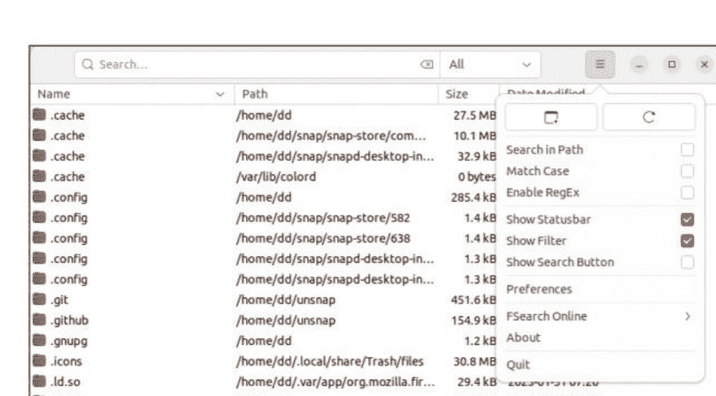

图 2：`Fsearch`显示了清晰的界面和强大的搜索引擎，它会在你输入时返回结果。

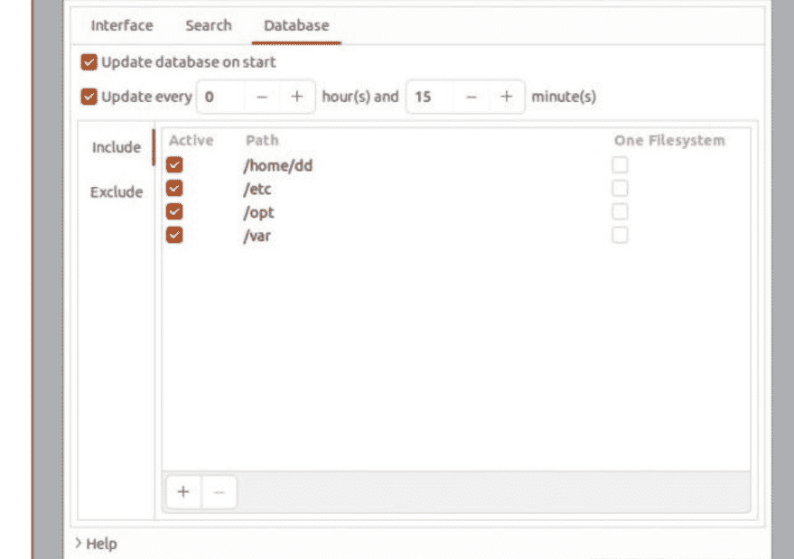

你可以在搜索（`Search`）选项卡（图 5）中通过你自己的过滤器设置，为文档、文件、图片或音频等文件类型定义过滤器。然而，如果你知道名称，也可以在搜索掩码中使用`~/documents pdf`来进一步缩小范围。`/Documents L1`将找到所有具有此首字母配置的匹配项。

如果你在搜索（`Search`）选项卡中选择了包含参数的搜索查询，`Fsearch`将识别出你想要遵循

图 3：当首次启动时，`Fsearch`需要向数据库填充内容。添加文件夹（`Add folders`）允许你选择要索引的文件夹，你也可以排除文件夹。

`LINUX-MAGAZINE.COM`

第 270 号 2023 年 5 月 81

# LINUX `FSEARCH`

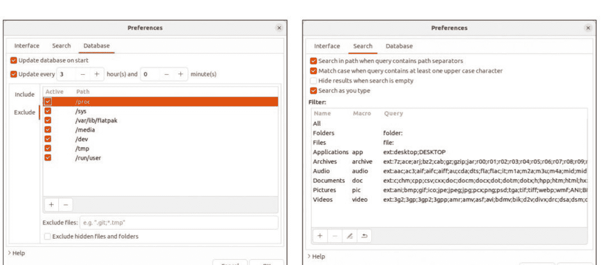

图 4：在搜索中，根据需要，你可以排除某些文件的索引（从而排除搜索）。

`path`。如果你在搜索中输入`path`，搜索将显示所有名称中包含`path`文件。通过在术语中添加分隔符（例如`.home/`），软件将执行路径搜索。

在成功打开文件（图 1）后，从下拉列表中选择最小化（`Minimize`）或关闭（`Close`）的行为显示了你是否只想浏览文件、从右键菜单打开它，然后对其进行处理。

## 新操作符

开发者在`Fsearch 0.2`中更新了搜索引擎。现在的语法提供了比以前更多的可能性。

可以使用函数指定搜索术语，或者使用通配符对其进行扩展。此外，搜索基于`Perl`兼容正则表达式 (`PCRE`) 库评估表达式。

不同的是，`Fsearch`在搜索术语中插入空格作为“与”（`AND`）逻辑。例如，如果你在`/var/directory`中查找所有`AUTH`的出现情况，输入`/var/auth`。如果你在查询包含至少一个大写字母时（图 5）在搜索选项卡中匹配大小写，它将同时找到“`AUTH`”和“`auth`”（图 6）。

你还可以使用新的操作符按大小、修改日期、文件扩展名、内容长度和匹配类型进行搜索，要找到任何大于`1GB`的文件，你会输入：

```
ext:size:>1gb
```

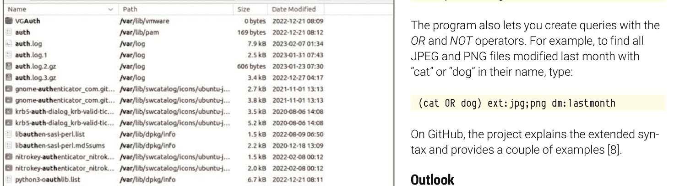

程序还允许使用`OR`和`NOT`操作符创建查询。例如，查找上月修改过的、名称中包含“`cat`”或“`dog`”的所有`JPEG`和`PNG`文件：

```
(cat OR dog) ext:jpg;png date:lastmonth
```

在`GitHub`上，该项目扩展了语法并提供了几个示例 [8]。

## 展望

`Boxder`为用户提供了计划中的扩展和版本的预览，这些版本将整合进`Fsearch`。在不久的将来，其他引入数据库实时更新并使用`inotify`自动检测目录或文件的更改。此外，将根据大小或长度对某些文件类型进行过滤。`fsearch 1.5`预计将支持书签以及搜索历史，而`0.6`预计将显示文件的缩略图。命令行的实现已经在路线图中。这将为`KDE`编写扩展变得更容易。

# Info

- 1 `fsearch`: <https://github.com/fsearch>
- 2 `Everything`: <https://en.wikipedia.org/wiki/Everything>
- 3 Download for `Debian` and `openSUSE`: <https://software.opensense.org/?project-home=fsearch>


- 4 Download for Fedora and RHEL: `https://copr.fedorainfrac.org/coprs/fsearch/`
- 5 Launchpad for Ubuntu: `https://launchpad.net/~archive/ubuntu/`
- 6 Flatpak: `https://flathub.org/details/io.github.fsearch`
- 7 Compile yourself: `https://github.com/fsearch/wiki/build-instructions`
- 8 New syntax: `https://github.com/fsearch/wiki/search-syntax`
- 9 notify: `https://en.wikipedia.org/wiki/notify`

# 结论

有很多种方法搜索 Linux 文件系统。Fsearch 提供了你舒适应用程序所期望的功能。毕竟，它是快速的，并且在你输入术语时就开始运行。结果可以以许多方式进行过滤和排序。在我拙见看来，搜索引擎非常强大，因为它支持许多发行版。如果你想报告错误或需要支持，可以写给`Boxder`。你也可以捐赠支持他的工作。


# 商店

`shop.linuxnewmedia.com`

# 使用酷炫 Linux 技巧提高效率

通过这些针对 Linux 极客的灵感技巧和快捷键提高你的 Linux 技能。

# 命令行上的 Google

- OpenSSH 应用
- systemd journal
- 使用 `lazygit` 控制 Git
- DOSBox 旧游戏
- 以及更多！

# 在线订：

`shop.linuxnewmedia.com/specials`

# FOSS

来自开源世界的闪耀新发布。Graham 终于为 Linux 实验带来了一些 RISC 开发板。预计在未来的期中会有大量的跨平台工具！GRAHAM MORRIS


# 电子设计师

## KiCad 7

50 种音频放大器到30 种视频编码器和解码器。如果你发现了某些令人兴奋的东西，你可以创建自己的系统。`Circuit` 让应用程序感觉像编程，在安排布局之前可以在 IDE 中调试，可以使用 3D 鼠标。可以生成物料清单（BOM），包含你使用的所有内容，以便你可以轻松订单交付给首选的 PCB 制造商。

它并没有消除理解和学习电子学原理的需求，但它让任何感兴趣的人都能更容易、更上手。当你的技能最终达到专业水平时，它也能帮助你。只有少数可以导出到 `KiCad` 的开源项目，以及创建文本框的能力是测试新功能的理想位置。还支持 3D 鼠标，可以帮助你在没有实体对象的情况下导航你的宇宙。如果你想进行物理设计，有一个新的命令行界面帮助导出和文件控制，现在有了用于绘制模式的矩形和圆形。某些配置选项具有自己的图形属性，需要你手动编辑配置文本。

`KiCad` 是一个从爱好者到专业工程师使用的跨平台应用程序。它的开源程度令人惊叹，能够完成捕捉和测试原理电路所需的一切，这一过程被称为原理图捕捉。巨大的符号库允许你拖放任何可能需要的组件。

`KiCad` 现在已经开发了 30 多多年。它是一个在文章中经常提到的项目，上次我们涵盖了 `KiCad 6` 在后台创建交互式电子电路和电路图的名为 `pool` 项目。随着 `KiCad 7` 的这次大发布，我们有了完美的理由来更详细地探索这个全的电气设计工具。它成为一个非常有影响力的项目，帮助启动和维持这一热潮。得益于新的发布策略，版本 7 在上一个大版本后大约一年推出。它还解决了重大新功能的问题。

这些新功能包括用在原理图、`PCB` 和工作表编辑器中的自定义字体，

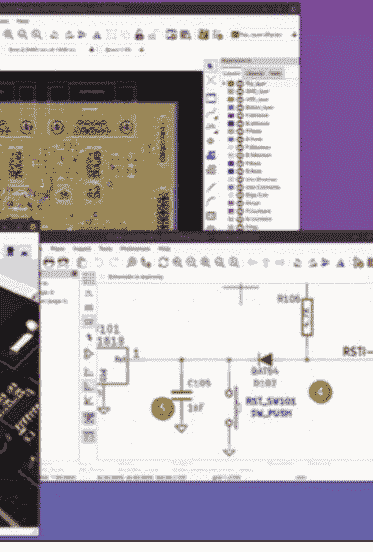


- 1. 演示：`KiCad` 包含了几个演示项目帮助你开始。
- 2. `PCB` 编辑器：这是你将原理图布局到 `PCB` 上的地方，从那里可以导出。
- 3. 连接：在其中一个中链接项目将在任何其他地方高亮显示。
- 4. 原理图：创建电路并运行仿真以验证你的作品，使用插件计算电流、电阻和电容。
- 5. 组件库：从巨大的已识别组件列表中添加项或添加你自己的。
- 6. 视图：查看你的 `PCB` 看起来是什么样，并使用 3D 鼠标操作视图。
- 7. 导出：导出你的设计以打印，并创建你需要订购的组件的 `BOM`。

# 隔离工具

# FOSSPICKS LINUX 惊艳之选

### breezy

Linux 在容器、虚拟机和已安装软件包方面已经变得非常强大，以至于你现在自然地运行更多的 Linux 实例。但通常情况下你不需要一个完整的容器来将某些内容与日常任务隔离开。例如，`breezy` 是一种低资源工具，它可以将目录和文件关联到你指定的某个位置，仅在配置文件的这种情况下。对于一个以 Linux 内核为特征的命名空间包来说，`breezy` 在不使用符号链接（`symlinks`）的情况下完成了所有这些操作，而符号链接通常用于不同位置之间的硬链接。但符号链接会让你难以理解你的文件在哪里、某些内容是否已备份，以及另一个链接之上堆叠了多少个链式链接。

`breezy` 则更好。它通过为你创建的每个配置使用独立的命名空间来实现分区。你可以将一个配置定义为源、目标（`mux.conf`）以及一个重定向（`~/mux.conf`）用于简单的文件重定向，或者是目录（这是默认值）。它可以轻松设置使得某个规则只适用于一个位置，因此你可以为不同的位置对同一配置使用一套规则。如果你需要启动或运行所有命令，可以使用 `breezy` 后面跟上配置名称。每个命令都会认为它正在从开发者编码在程序中的任何路径访问资源，而你正在秘密地将输入和输出重定向到选择的位置。这是一个清理杂乱配置文件，或堆积着几十个没有经过“近藤万理子式”整理的文件的主目录的绝佳方法。

```bash
$ breezy --help
$ breezy --help ""

命令:
帮助
打印此消息或给定命令的帮助信息：
要运行的命令是 'list' 或 'config'

list:
显示所有文件和文件系统不可变内容。
```

`Breezy` 利用底层内核特性创建了一个所需的易于访问且易用的实用工具。

## 项目网站

`https://github.com/user/breezy`

# 终端浏览器

### Carbonyl

将体验提升到一个新水平。它的输出是一段相当不错的 `FFmpeg` 转 `ASCII` 流（我们的猜想），对于你需要阅读的页面部分具有完美的文本渲染。这真的太令人惊叹了。

通过 `npm` 和 `Docker` 镜像可以轻松安装，适用于简单的云端部署。

兼容性和渲染来自于一个隐藏的基于 `Chromium` 的渲染器，但结果非常惊人。视频预览可以直接播放并渲染为文本，网页的加载速度与在桌面端一样快，特别是如果你已经熟悉 `SSH-servlet` 嵌入模式的话。一切都可以直接运行。

`Carbonyl` 将页面渲染到你的终端中，它看起来更像是一个低分辨率的滚动图表而不是普通的网页。我们需要鼠标，而这与命令行似乎是不协调的。它还是一个更好的广告拦截器。但对于一个似乎单手解决了一个老问题，甚至让桌面命令行网页浏览在酷炫度和可读性因素上更上一层的东西来说，这些都只是小问题。

## 项目网站

`https://github.com/fatyl8/carbonyl`

多年来我们一直在关注基于终端的浏览器，大多数的起源可以追溯到终端还是一种新奇而非选择的时代，因为那时桌面还不存在。这意味着即使在没有桌面网页浏览器的情况下，也能访问网络并让你在不遇到太大困难的情况下进行导航。

如果你在紧急情况下需要下载驱动程序或查看网站，这些应用程序仍然很有用。但对于现代的 `JavaScript` 驱动的网页来说，它们并不理想。`Carbonyl` 是一个接管终端的终端浏览器。

`LINUX-MAGAZINE.COM`

第 270 期

2023年5月

# LINUX VOICE FOSSPICKS

# 窗口平铺

### KDE Plasma 5.27

`KDE Plasma 5.27` 是一个具有重大意义的里程碑，不仅因为它包含了这么多功能和修复，还因为它是迁移到 `Qt 6` 和 `Plasma 6` 之前的最后一个版本。通过引入多个新功能（包括开源项目、`Firefox`、`Krita` 和 `Blender`），它使得跟踪其中任何一个功能变得容易，`Plasma 5.27` 确实如此。在新的 `Discover` 和引导式设置旁边，坐落着我们一直想要看到的“原生窗口平铺”，我们已经涵盖了无数种能为 `Plasma` 带来类原生平铺效果的插件和扩展程序。其中某些比其他那些更成功，而简陋的 `kwin-tiling` 凭借其强大的键盘快捷键脱颖而出。然而，`KDE` 团队已经用他们迈向平铺的首次尝试取代了 `kwin-tiling`，同时，这种举措也极大地吸引了我们中许多连一个键盘快捷键都记不住的人。


## 新的平铺功能

新的平铺功能通过在桌面特效面板中添加“平铺编辑器”得到了改进。你现在可以按 `Meta+T` 打开编辑器，并为窗口创建一些锁定区域。它被进一步细分为网格，并弹出一个小窗口，提示你水平对齐窗口，或启用浮动窗口。一个区域可以进一步细分为你需要的任意水平和垂直拆分，并且边界可以调整。

原生 Plasma 平铺没有键盘快捷键，但 `Alt+` 拖动窗口使其像将窗口拖入行或列中移动窗口一样直观，无论什么大小。按下快捷键将再次带你回到桌面，如果你在拖动时按住 `Shift`，创建的窗口会被高亮。将窗口释放到这些区域之一将将其锁定。即使在调整大小时你仍然可以操作。唯一缺失的功能是边框控制和保存新布局的能力，但我们确信这些很快就会到来。

**项目网站**

`https://github.com/arch-linux/plasma/5.27/`

# 3D 设计

## CliFM

尽管终端被视为复制、重命名的地方，但由于桌面并不存在，当终端还是新奇而非选择时，这种起源意味着即使在没有桌面网页浏览器的情况下也能访问网络并让你在不遇到太大困难的情况下导航。`CliFM` 尽管是一个终端工具，但它在文件管理方面非常出色。它利用了底层的内核功能来创建一个所需的易于访问且易用的实用工具（注：此处原文存在部分重复和语乱，翻译已按意通通处理）。

**项目网站**

`https://github.com/fatyl8/carbonyl`

2023年5月

第 270 期

`LINUX-MAGAZINE.COM`

# LINUX OS FOSSPICKS

## 电视录制机

### MyTV 33.1

`MyTV` 是自 Linux 经典时期以来，我参与过的少数卓越项目之一（不像 `KiGaRD`！）。它首次发布于 20 多年前，我个人曾像对待一件古董一样使用它。在 2004 年到 2009 年间，我对直播电视和互联网之间的直播电视录制的兴趣占据了我的全部生活。那时，我使用一个采集器（grabber）来记录卫星接收器的视频输出，并使用一个 `LIRC` 后端发送频道切换指令。一个成功录制的节目需要平衡：从网站上仔细抓取的质量、当时红外线成功发送频道切换、录制机的正确解码，以及语法正确启动并有足够的后台存储空间来存放任何录制的内容。惊讶的是，在经历了陡峭的学习曲线和大量的配置工作后，它故障运行了多年，运行在一个隐藏在衣柜里的大箱式 PC 上。

从那时起，DVD 标准取代了模拟信号，互联网用流媒体取代了一切。我们现在拥有 TB 级的固态存储、树莓派，以及少数接受远程控制的设备。`DVR` 视频录制机、`Kodi` 和 `OpenLEC` 让 `MyTV` 设置得以生存并蓬勃发展，因为它仍然能做其他工具无法做的事情，比如永久运行。它的前端仍然最接近商业或卫星服务提供的图形前端，并可以作为 `Kodi` 的模块安装。后端控制你的硬件，在经过非实质性设置后依然保持稳如磐石，并有独立的数据库备份。每个元素都可以运行在单独设备上，许多人都在屏幕上运行前端，例如，将后端分离以管理调度和视频文件。

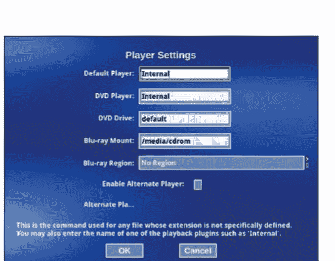

> 这里的命令用于任何未被正确定义的文件扩展名。你也可以使用任何插件，例如 `internal`。

`MyTV` 悠久历史的另一个优势是它拥有成熟的、基于 wiki 的文档，由社区持续维护。

插件系统仍然是 `MyTV` 的最佳特性之一，允许你根据自己的兴趣（如游戏、新闻、网页、浏览、图片库和音乐插件）精细调整系统。`MyTV Web` 是入口点，因为它以开源方式管理视频指南和录制前端，此外它允许通过简单的界面方便地访问你的视频、音乐和其他插件。这个列表不断添加新功能，长期目标是代码的现代化和重构。我们最新的更新为音乐播放器引入了新形式，使用了新版本的 `FFmpeg`，以及 DVD 和蓝光播放器，以及数百个独立功能。最棒的是，得益于该项目的积极开发，你会觉得投入时间设置好这一切是值得的。你可能还可以让 `MyTV` 再运行 20 年。它会录制你搜索的任何内容，在没有任何广告的情况下进行录制，并将视频转换为最适合你的格式。它可能不那么辉煌，但它仍然是管理数字电视荒疆的最佳方式。


`MyTV` 是一个出色的数字电视录制平台，拥有强大且廉价的遥控器以及与 `Kodi` 集成的独立前端。

**项目网站**

`https://www.mytv.org`

## FOSSPICKS LINUX VOICE

## 桥梁模拟器

### Thorium Nova

当你读到某个游戏是一个“桥梁模拟器”时，你可能认为它可能是经典游戏的重制。它不是，不像《桥梁建造者》（`Bridge Constructor`），在那种你需要穿过某种混乱或河流。这个桥梁模拟器的灵感源于《星际迷航》和结构工程，游戏位于一艘飞船的指挥中心。`Thorium Nova` 是 `Thorium` 的续作，后者是一种尝试太空基地的桥梁模拟器。作为一个真正的现代经典，它有不同的站位来控制飞船的各个方面，包括船长、导航、战术规划和通信。

每个角色都有自己的界面、技能组和一系列挑战。最重要的是，这是一个多人游戏游戏，不同的玩家控制不同的站位，所有人都需要协作工作让飞船运行。

游戏本身会运行，其他玩家通过浏览器控制它。默认情况下，它在你第一次运行游戏时会自动设置。游戏的主要目标之一是尽可能易于访问，基于浏览器意味着几乎任何人都可以加入。当玩家加入时，他们可以选择自己的站位，或者由控制游戏服务器部分的飞行总监分配。


虽然 `Thorium Nova` 的大部分叙述尚未实现，但游戏引擎已完全可用。Alpha 状态没有任务，但飞行总监和团队的任务是设定他们的目标。飞行员和导航站位开发最完整，你通过货舱穿过银河系，但游戏仍在进行中，如果你想参与，这是一个理想的时机。

**项目网站**

`https://github.com/thoriumsim`


## 逆向工程塞尔达

《塞尔达传说：Link过去》（`The Legend of Zelda: Link to the Past`）是史上最好的游戏之一。它最初由任天堂于 1991 年为 Switch 主机发布（注：原文此处 Switch 疑应为 SNES）。该游戏是首批创造出沉浸式故事、挑战性谜题和战斗的游戏之一。

逆向工程塞尔达让游戏在任何设备上运行，这不仅可能的，而且因为逆向工程代码。代码。逆向工程塞尔达让游戏在任何设备上运行，这是可能的，而且因为逆向工程代码。代码。塞尔达的逆向工程。。。这种结果包含了高分辨率的。塞尔达的逆向工程。这是任天堂的。塞尔达的。塞尔达的逆向工程塞尔达让游戏在任何设备上运行，这是可能的，而且因为逆向工程代码。代码。逆向工程塞尔达让游戏在任何设备上运行，这是可能的，而且因为逆向工程代码。代码。塞尔达的逆向工程。。这种结果是神奇的。

**项目网站**

`https://github.com/nesres/zelda`

## LINUX 教程 – DDGR

## 从终端使用 DuckDuckGo

### ddgr

自 2008 年以来，`DuckDuckGo` 一直作为隐私搜索引擎引起了关注。相比之下，命令行工具 `ddgr` 是为了不记录你的数据而设计的。由于这种方式，许多 Linux 发行版中预装了它。你可能会问，为什么使用它？`DuckDuckGo` 尽可能易于访问，它是为了保护我们的隐私。但是，无论浏览器如何锁定，仍然存在隐私担忧。作为 Linux 用户，我们习惯命令行，所以通过 `ddgr` 使用 `DuckDuckGo` 搜索是更好的。界面设计非常良好，你可以通过 `ddgr` 的命令行参数进一步使用。它支持基于文本的浏览器。

#### 在 Linux 中

##### 安装 ddgr

假设你对它产生了兴趣，第一步是下载并运行 `ddgr`（图 1）。该工具在 Linux 中非常有用

# 教程 – DDGR LINUX VOICE

已经：例如，在 Ubuntu 系统上，只需运行 `apt-get install ddgr` 即可。Snap Store 中也有一个版本，你可以通过 `snap install ddgr` 安装。由于它是用 Python 编写的，你也可以使用 `pip3` 安装器。运行 `sudo pip3 install ddgr`。

如果这些选项可用，或者你非常关注隐私，也可以克隆 Git 仓库并作为独立可执行文件运行：

```bash
git clone https://github.com/jarn/ddgr
```

使用 `cd` 切换到 `ddgr` 目录并运行 `./ddgr`。你需要 Python 3.7 才能使用它。你可以通过运行 `python3 --version` 来检查 Python 版本。如果你希望将 DDGR 中的 URL 复制到剪贴板，你需要安装 `xclip`、`xsel` 或 `clipboard-clipboard`。如果你使用的是基于 Debian 或 Ubuntu 的 Linux，它应该已经安装了 `xclip`。

除非你另有说明，否则工具将在你的默认浏览器中提供搜索结果，因此在继续之前，请确保已正确设置了此项。

## 起飞


## 安装与基本使用

一旦安装了 `ddgr`，只需简单运行 `ddgr 关键词` 即可搜索。例如，输入 `ddgr lighth` 查看所有“灯塔”。该工具将列出 DuckDuckGo 搜索的前 10 条结果。

系统会提示你先接受使用条款，因为它设计得非常友好。在第一次运行搜索时输入 `yes` 并回车查看所有可用选项。

如果你想打开某个搜索结果，只需输入索引数字（例如 `3`）并按回车。这将直接打开页面。

如果你已经准确找到了你寻找的内容，只需输入索引数字即可查看 `x` 条搜索结果。使用 `p` 返回结果列表，或使用 `r` 重新搜索。

你可以使用切换来搜索结果中的 `URL`。如果你有剪贴板（见上文），还可以用 `Ctrl+C` 复制索引数字（例如 `3`）。如果你想在不运行另一个程序的情况下再次搜索，只需在多功能框中输入关键词并按回车。如果你在运行另一个搜索时添加 `d` 标志，`ddgr` 将保留原始的搜索参数。这对于你想要微调搜索结果非常有帮助。

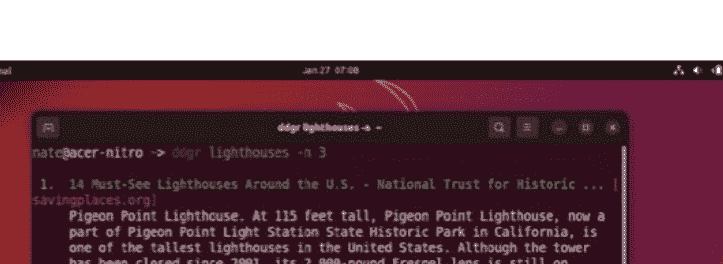

图 2：使用 `-n` 标志限制搜索结果的数量。输入结果的索引将在浏览器中打开。

默认情况下，`ddgr` 将为你显示任何搜索词的前 10 条结果。这可能会产生大量文本并使操作变得困难。经常，你可以使用许多命令行参数来调整你的 DuckDuckGo 搜索。

最有用的功能之一是 `-n`，你可以用它更改显示的搜索结果数量（图 2）。例如，要一次显示三个“灯塔”的搜索结果，使用 `ddgr lighth -n 3`。

## 高级搜索技巧

如果你在寻找特定的搜索术语，可以将关键词包含在引号中，就像搜索 Google 等基于浏览器的搜索引擎时一样，例如：

> `ddgr "We men hold to be true themselves, all men are equal"`

你还可以使用 `filetype` 参数搜索特定类型的文件。例如，在我们寻找《独立宣言》中特定摘录的示例中，你也可以使用 `ddgr` 锁定仅包含该短语的 `PDF` 类型（图 3）：

> `ddgr "We men hold to be true themselves, all men are equal" filetype:pdf`

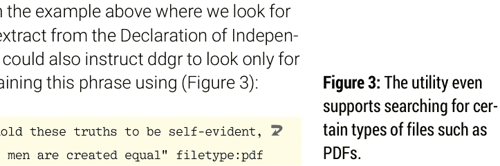

图 3：示例显示了搜索特定类型的文件（如 `pdf`）。


`LINUX-MAGAZINE.COM` 第 270 期 2023年5月 91

### LINUX VOICE 教程 – DDGR

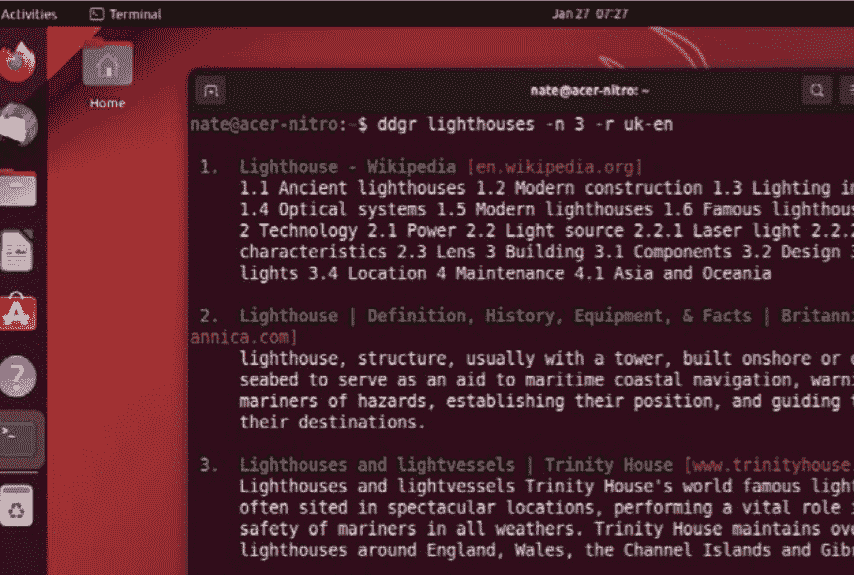

```text
matejacer-nitro: $ ddgr lighthouses 3 n j r uk en -
1 And Antarctic 1.2 Modern construction 1.3 Lighting improvements
4 Optical systems 1.5 Modern lightouses 1.6 Famous lighthouse builders
2 Technology 2.1 Weather 2.2 Source 2.3 Light 2.4 Design 2.5 Characteristics 2.6 Lens 2.7 Building 3.1 Components 3.2 Design 3.3 Range
3.4 Location and Scale

2. Lighthouses history, equipment, Facts | [www.wikipedia.org]
lighthouse，一种带有塔的结构，位于离岸或岸上，
作为海上沿岸导航的帮助，警告船只和船员，确定他们的位置，并引导他们
到达目的地。

3. Lighthouses and Lighthouse | [www.trinity.co.uk]
lighthouse 通常出现在壮丽的地点，在全球海洋安全中起着至关重要的作用。Trinity House 维护着
整个英国、威尔士、岛屿和直布罗特。
```

图 4：

```text
matejacer-nitro: $ ddgr lighthouses 3 n j r uk en -
1 And Antarctic 1.2 Modern construction 1.3 Lighting improvements
4 Optical systems 1.5 Modern lightouses 1.6 Famous lighthouse builders
2 Technology 2.1 Weather 2.2 Source 2.3 Light 2.4 Design 2.5 Characteristics 2.6 Lens 2.7 Building 3.1 Components 3.2 Design 3.3 Range
3.4 Location and Scale
```

图 2：使用 `-n` 标志限制搜索结果的数量。输入结果的索引将在浏览器中打开。

默认情况下，`ddgr` 将为你显示任何搜索词的前 10 条结果。这可能会产生大量文本并使操作变得困难。经常，你可以使用许多命令行参数来调整你的 DuckDuckGo 搜索。

最有用的功能之一是 `-n`，你可以用它更改显示的搜索结果数量（图 2）。例如，要一次显示三个“灯塔”的搜索结果，使用 `ddgr lighth -n 3`。

如果你在寻找特定的搜索术语，可以将关键词包含在引号中，就像搜索 Google 等基于浏览器的搜索引擎时一样，例如：

> `ddgr "We men hold to be true themselves, all men are equal"`

你还可以使用 `filetype` 参数搜索特定类型的文件。例如，在我们寻找《独立宣言》中特定摘录的示例中，你也可以使用 `ddgr` 锁定仅包含该短语的 `PDF` 类型（图 3）：

> `ddgr "We men hold to be true themselves, all men are equal" filetype:pdf`

（注：此处原文包含大量重复的 OCR 错误文本，已根据指令要求进行清理并删除。）

# Linux 教程 – DuckDuckGo

尽管 `duckduckgo` 和 `google` 拥有同一个创始人，但它们代表的引擎有着截然不同的业务模式。一个致力于全天候收集数据来服务你，另一个则可能偶尔向你展示广告，并在过程中保持匿名性。

在搜索时顺应传统的做法也是防止窥探者的好方法，他们企图通过多种方法（如在你的网页上使用或绘制复杂的隐藏图像）对你的浏览器进行“指纹识别”。但在某些时刻，你仍然需要打开浏览器查看这些结果。

如果你习惯了更好的浏览器，你将被挡掉大部分恶性的指纹识别和跟踪技术。对于仍然需要 `GUI` 的用户，请选择浏览器设置以确保禁用跟踪，并使用拦截器过滤掉大多数恶意 `URL`。

图 8：使用 `duckduckgo` 和 `Tor` 通过 `Tor` 网络运行搜索。

保存并退出。你需要重启这两个进程以使更改生效：

```
sudo /etc/init.d/proxy restart
```

```
sudo service tor restart
```

你将拥有一个在端口 `8118` 上运行基于 `Tor` 的本地 `HTTP` 代理。你现在可以使用 `--proxy` 参数配合 `duckduckgo` 通过 `Tor` 网络运行搜索（图 8），例如：

```
duckduckgo --proxy localhost:8118 lighthouse
```

令我在测试失望的是，我无法使用 `-w` 标记在 `.onion` 域名（如纽约时报网站）进行搜索。这本应是一个很有用的功能，但事实上，关于 `Tor` 可以访问隐藏服务的说法被夸大了，它只是可以使用 `Tor` 进行搜索。如果你想要这种更高级别的隐私，请做好面对更长时间搜索的准备，因为你的数据将通过各种 `Tor` 中继进行路由。

# 命令行 DuckDuckGo

使用命令行搜索网页有很多优点：它简洁、快速且易于导航。你可以将参数链接在一起以精调你的搜索，而无需将你的个人信息交给 `Google` 的神灵。

我们还简要提到了 `duckduckgo` 中提供的多行参数。事实上，参数非常多，以至于该工具取消了通常配置，因为一切都在程序中。其他功能包括不同颜色的结果、反序列出搜索，甚至输出 `JSON` 格式（可能用于研究目的）。

# Info

- [1] `Android` 源码：

  https://source.android.com/

- [2] `Google` 因违反数据保护监管机构 `GDPR` 规定被罚 5700 万美元：

  https://digital.guardian.com/blog/google-57m-data-protection-watchdog-gdpr-violations/

- [3] 为什么你应该使用 `DuckDuckGo` 而不是 `Google`？

  https://spreadprivacy.com/why-use-duckduckgo-instead-of-google/


- `[4]` 将 `DuckDuckGo` 添加到你的浏览器：
  - `https://duckduckgo.com/duckduckgo-help/pages/adding-duckduckgo-to-browser/`

- `[5]` `GitHub` 上的 `jarun` (`au`)：
  - `https://github.com/jarun`

- `[6]` `ubuntu` 页面 - `yel`
  - `https://manpages.ubuntu.com/manpages1/yel.1.html`

- `[7]` `DuckDuckGo` 参数：
  - `https://duckduckgo.com/duckduckgo-help/pages-settings/params/`

- `[8]` “`DuckDuckGo` Bash - 搜索你的收藏”：
  - `https://ostechnik.com/duckduckgo-bash-search-on-your-favorites/`

- `[9]` `Tor` 项目 - 支持：
  - `https://support.torproject.org/tkb/bbb-41/`

- `[10]` `Tor` 退出条款 - `DuckDuckGo` 帮助人们：
  - `https://duckduckgo.com/privacy/tor-exit-claus/`

- `[11]` `Ghosty` 免费广告拦截扩展：
  - `https://www.ghosty.com/ghosty-ad-blocker`

`Nate Drake` 是一位专注于网络安全和复古技术的记者。

`94` `2023年5月期` `第270` 期 `LINUX-MAGAZINE`

# `Linux` 新闻亭

`Linux Magazine` 是你 `Linux` 世界的指南。每期杂志都装满了你在其他地方找不到的高级技术文章和教程。探索我们完整的旧刊目录以获取特定主题，完善你的收藏。

订购热：

`https://bit.ly/Linux-Newsstand`

# `269`/`2023年4月`

## 联邦宇宙 (`Fediverse`)

社交媒体认为它连接了世界，为我们带来了来自政治家、电影明星、社区领袖和远程朋友的最新消息和评论。但商业社交平台的跟踪和数据挖掘让许多用户寻找更好的选择。本月，我们深入探讨社交媒体用户的备选宇宙：联邦宇宙。

光盘收录：`EndeavourOS` `22.12` 和 `Debian` `11.6` “`bullseye`”

# `268`/`2023年3月`

## 数据投毒

认为电脑不会犯错吗？如果你在混合中掺入一些伪造的训练样本，你可以让机器学习系统认为狗或猫是其他东西，并通过其他人都不会注意的隐藏信号触发错误行为。

光盘收录：`MX` `21.3` 和 `Puppy` `Fossa`

# `267`/`2023年2月`

# 备份

理论上，每个人都可以使用备份工具，但将定期备份融入生活的最佳方式是找到一个符合你习惯的解决方案。本月我们预览了一些备份应用，请找一个适合你的。

光盘收录：`Linux Mint` `21` 和 `Kali Linux`

# `266`/`2023年1月`

## 生成式对抗网络

许多 `Linux` 用户不知道神经网络仍然是神秘的。

光盘收录：`Ubuntu` `22.10` 和 `Alma Linux`

# `265`/`2022年12月`

## 量子计算

大多数 `Linux` 用户知道这项技术利用了量子力学。

光盘收录：`Manjaro` `21.0` 和 `Arch Linux`

# `264`/`2022年11月`

## 人工智能

机器学习仍然笼罩在谜之中，尽管它现在是不可或缺的一部分。

光盘收录：`Debian` `11.5` 和 `Rocky Linux`

# 特色活动

用户、开发者和经理在世界各地的 `Linux` 活动汇聚。`Linux Magazine` 荣幸呈现此处活动。

如果你知道附近的 `Linux` 活动，请查看我们的详尽日历或将详细信息发送至我们的邮箱。

| `Drupal` | `SUSECON 2023` | `Academy 2023` |
| :--- | :--- | :--- |
| **日期** | `2023年6月5-8日` | `2023年6月20-22日` | `2023年7月15-21日` |
| **地点** | 宾夕法尼亚州匹兹堡 | 德国慕尼黑 | 塞萨洛尼基及在线 |
| **网站** | `https://events.drupal.org/pittsburg` | `https://www.suse.com/susecon/` | `https://academy.kde/2023/` |

不要错过在宾夕法尼亚州匹兹堡参加 `2023` 年北美 `DrupalCon` 的机会。无论你是 `Drupal` 新手还是该社区的老成员，你都能在这里获得新的见解和联系，助力职业发展。

`SUSECON` 是 `SUSE` 客户、合作伙伴和社区爱好者的年度全球会议，提供满足企业 `IT` 需求和业务挑战的信息。在这里你可以找到基于 `Linux`、`Kubernetes` 和边缘计算的开源解决方案。`6月20-22日` 在慕尼黑参加会议和演讲。

`Academy` 是 `KDE` 的年度世界峰会，全球最快的免费社区之一。这是一个由 `KDE` 社区组织的免费非商业活动。预计会议将吸引数百名参与者，随后是为期五天的研讨会、小组讨论（`BoF`）和编码活动。

# 投稿征稿

《`Linux Magazine`》正在寻找撰写关于 `Linux` 以及 `Linux` 环境工具文章的作者。我们喜欢关于解决实际问题的实用方案的文章。主题可以是桌面工具、命令行实用程序、网络监控应用程序、自定义脚本，或任何有可能为 `Linux` 用户节省时间的工具。我们的目标是向读者讲述他们尚未读过的故事，特别是一些有趣的修复方案、新工具以及读者可能不知道的应用程序。我们也非常欢迎为我们的资深读者提供关于进阶工具的文章——即那些以新颖或创造性方式运用传统方法的故事。

我们感兴趣的话题包括：

- 安全
- 高级 `Linux` 调优与配置
- 物联网
- 脚本编写
- 人工智能
- 开放协议与开放标准

如果你有想分享的内容，请与我们联系——我们可能会感兴趣！

请向我们发送关于公司免费产品的文章，即使它是对大家都有用的开源工具。我们不喜欢列表风格的“前 `10` 名”，也不喜欢那些流于浅表、将细节留给读者的文章。我们喜欢细节丰富的完整解决方案。深入挖掘，而非泛泛而谈。

我们有一些可以帮助你完成这些内容的领域。

请向我们发送你关于深度且实用文章的提案：

- 加密货币
- 系统黑客

请注明文章长度为 `1-2` 页，并发送至：`edit@linux-magazine.com`。

请在邮件主题中注明你的邮件是“文章提案”。

| | | |
|---|---|---|
| `Erik Bärwald` | `Kristian Klich` | `16` |
| `Zack Brown` | `Martin Gordon Loschitz` | `36` |
| `Bruce Field` | `Vincent Making` | `71` |
| `Joe Casad` | `Pete Metcalfe` | `67` |
| `Mark Crutch` | `Graham Morrison` | `84` |
| `Nate Drake` | `Alan Guipmale` | `44` |
| `Hans-Georg Eber` | `Mike Shelly` | `54` |
| `Jon "maddog"` | `Tim Schürmann` | `18` |
| `Frank Hoffman` | `Ferdinand Thomas` | `50, 73, 80` |
| `Sven Hope` | `Jack Wallen` | `8` |

# 下个月

`第 271` 期

## 预计日期

- 英国 / 欧洲 `5月05日`
- 美国 / 加拿大 `6月09日`
- 澳大利亚 `7月21日`

## 上架日期

请注意：上架日期为预计日期，可能会因为物流问题而延迟。

# 第 `271` 期 / `2023年6月`

## 智能家居

对于许多 `Linux` 用户来说，家庭远程控制是终极的黑客追求。关灯？关窗帘？调整恒温器？如果你熟悉 `Linux`，你可以在不放弃隐私的情况下实现家居自动化。


## 预览通讯报

《`Linux Magazine`》预览版是一份每月电子邮件通讯报，让你抢先预览下一期内容，包括在线发布的文章链接。

注册地址：`https://bit.ly/Linux-Update`

图片版权 © `pavel shlykov`, `123RF`

# 高性能计算

- 机器学习
- 数据分析
- 量子计算
- `3000` 名用户、开发者及供应商齐聚
- 在现场与线下
- 连接、交流并协作
- `isc-hpc.com`

# `ISC 2023` | `5月21日–25日` | 德国汉堡

注册开启

早鸟价持续至 `4月19日`

# `HETZNER`

高功率 - 高效率

更低成本！


# `EX` 系列独立服务器

包含 `Intel® Core™ i9-13900` 或 `i5-13500`

## `EX101` 独立服务器

- `Intel® Core™ i9-13900`
- `64 GB DDR5 ECC` 内存


- 2 x 1.92 TB Gen4 NVMe SSD
- 100 GB 备份空间
- 流量不限
- 所在地：芬兰和德国
- 无最低合同限制
- 安装费 £34.50

## EX44 独立服务器

- Intel® Core™ i5-13500
- 64 GB DDR4 内存
- 2 x 512 GB Gen4 NVMe SSD
- 100 GB 备份空间
- 流量不限
- 所在地：德国
- 无最低合同限制
- 安装费 £34.50

每月 `£74.20` 起

每月 `£38.90`

所有价格均不含增值税，并受 `Hetzner Online GmbH` 条款和条件的约束。价格可能会变动。所有权利归相应制造商所有。

# `www.hetzner.com`
