# Linux Magazine 第272 期 2023-07


16:10-16 英寸显示屏及最大 99 Wh 电池。兼容 `TUXEDO Aquaris`。

`GeForce RTX 4090`、`Core I9-13900HX` 以及配备 `Cherry MX` 轴的机械键盘。

# 紧凑外型下的星际级性能！

## `TUXEDO Stellaris 16` - 第5 代

- CPU 性能
- 图形性能
- 移动性
- 电池续航
- 100% Linux
- 5 年质保
- 终身支持
- 德国制造
- 德国隐私保障
- 本地支持

# 在驾驶？

亲爱的读者：

我在写这篇专栏时，参议院正在举行人工智能（`AI`）听证会，特别是关于是否有必要监管。证词人之一是 `ChatGPT` 背后的机构 `OpenAI` 的执行官萨姆·奥特曼（`Sam Altman`）。大多数即将成为监管对象的公司 `CEO` 都会对事情可能变得多么糟糕发出警告 [1]。认为一个行业参与自身监管会更好，或者说奥特曼持有不同观点并呼吁加强监督，这确实令人警觉。

我读过几篇关于监管 `AI` 重要性的报道和评论文章，甚至看到了关于这种监管如何运作的细节。我不打算写另一那类的评论文章，我将告诉你们我所知的。对于奥特曼来说，监管意味着设定要求以确保 `AI` 符合“安全要求”。他的安全概念涵盖几个部分，包括隐私、问责和透明度。正如他所说，`AI`——特别是那些开发最强大模型的模型——遵守一套安全要求至关重要，包括发布前的内部和外部测试以及发布评估结果。为了确保这一点，美国政府应该考虑建立一个围绕 `AI` 模型能力、进行开发和发布的全面注册框架，并对符合这些要求的提供激励措施 [1]。

奥特曼表示，他最担心的是 `AI` 可能会给世界造成巨大伤害，并“补充”道，如果这项技术增长，可能会变得非常糟糕 [1]。为了更好地理解所有这些潜在后果，我们需要更多关于技术的知识吗？然而，奥特曼并不是吹哨人——他是一个由于顾虑而辞职的人，而且并没有说他想辞职。他只是说想建立规则。

一个 `CEO` 呼吁对其所属行业进行监管是值得赞扬的，但我倾向于认为责任在于政府，而该行业的个人（以及公司）不应被要求对他们认为可能对他人造成巨大伤害的技术进行具有约束力的自我限制。

许多科学家还讨论了在披露用于训练 `AI` 模型的数据方面对透明的需求，以便他人识别潜在偏见。这一步对于确保问责和非歧视性 `AI` 至关重要，但美国需要开发新的系统来检查这些可能包含数百万页的数据集。

参议员们对着镜头恳求，寻找可以批准反对的界限和律师，但在这种情况下，我可以同情他们理解这一问题以及如何监管的困难，以及他们如何获得这些支持。在过去，人们通过通过定义正确的规则来“思考”，但现代 `AI` 系统会找到通答案的任何方法，遵循当时任何人都会遵循的路径，以展示他们如何找到比那个人（谁？）可能知道使用哪些数据进行训练的更好的答案。

欧盟提出了一项 `AI` 法律框架（《`AI` 法案》似乎旨在监管 `AI` 的行为，对于开发过程禁止诸如社会评分、处理儿童或执法部门的远程生物识别等活动）。但在这些禁止的活动之外，另一些被分为三个不同的类别，每个类别都有相应的要求。这些要求涵盖了训练、测试和文档记录的需求。

我对比欧盟提出的提出的某些监管建议表示赞赏。然而，两年前写的内容在 `ChatGPT` 时代显得有些过时。考虑到我们那时甚至无法想象的事物，比如如果 `AI` 创建了深度伪造，或者将你定义成一首诗。

时代正在快速变化。我们需要灵活应对以解决问题。`IBM` 隐私与信誉官克里斯蒂娜·蒙哥马利（`Christina Montgomery`）在参议院听证会上作了证词，她总结认为需要“清晰、合理的政策和保障”。蒙哥马利警告说：“`AI` 时代不能是另一个随心所欲的时代”。

- 2. `Gary Marcus` 的开场陈述：`https://www.senate.gov/media/press/doc/2023-05-16%20-%20Testimony%20-%20Marcus.pdf`
- 4. 克里斯蒂娜·蒙哥马利的开场陈述：


`Joe Cascas`，

主编

使用自定义 `ISO` 镜像摆脱臃肿，并为任务定制你的 `Linux`。

如果你准备好加入 `FPGA` 热潮，你需要学习一些硬件描述语言。

只需一点智能和一些 `Python` 技能，你就可以与蓝牙时通信。

使用一个帮助你打字的工具来节省你的时间。

`树莓派` 和 `Camray HAT` 就是你制作特殊相机所需的全部。

在没有图形界面的情况下管理你的文件。

- `ChatGPT` 集成新版本
- `TUXEDO Computers` 发布 `Infinity Pro 14`
- `Linux` 内核 6.3 包含新功能
- 基于 `Arch` 的 `blendOS` 特性
- `Fedora 38` 发布
- `LXQT 1.3` 发布错误修复

`Linux` 用户知道 `Windows` 和 `macOS` 数年来一直享有的硬件、软件和服务服务的组合。我们查看了这些一站式解决方案。

如果你喜欢定制发行版，我们向你展示了三种创建 `ISO` 镜像的前端。

开源数据运动将开源理念扩展到数据，并最终到世界知识。

如果你向计算机部署软件包，现在的标准缺乏效率。我们向你展示如何创建一个自定义仓库来自动安装和升级软件。

数据传输项目让在社交媒体之间移动数据变得更容易。

`coreboot` 让你在构建自己的固件的同时了解它。

`CKAN` 是一个多功能数据管理系统，让你能够构建一个共享开源数据的门户。

当所有蓝牙时显示略有不同时该怎么办？通过一些反向工程，你可以编写 `Python` 脚本来同步你的时。

开源数据学院 `Lisa Allen` 解释了为什么开源数据很重要，以及它对现代采用将产生什么。

为了远程开启并显示其当前状态，`Mike Schilli` 展示了一个发送幻术包的图形界面，这包含在本月的专栏中。

只要政府保留数据，就一直有人想要查看并控制它们。新一代工具、政策和倡导者正寻求保持数据的、可用并以易于访问的格式呈现。本月，我们带来了开放数据之旅的快照。


- 64 **`Linux` 上的数字 `IC` 仿真**：设计可编程门阵列仅完成一半工作：最困难的部分是仿真，但 `Linux` 是应对挑战的最佳场所。
- 84 **`FOSSpricks`**：本月 `Graham` 关注了 `Seably2D`、`Arianna`、`X-Pipe`、`Nosey Parker`、`IEM` 插件、`Open Hex` 等等！
- 90 **教程 - `Carbonyl` 浏览器**：这个 `Chromium` 浏览器可以在任何控制台中运行，占用资源极少，是让计算机产生感觉——并在过程中学习编程的绝佳工具。

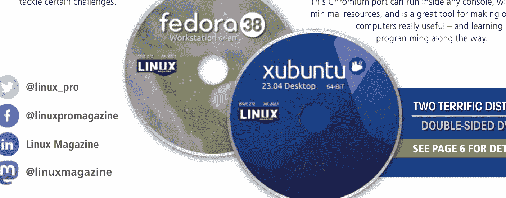

一张双面 `DVD` 上的两个精彩发行版！

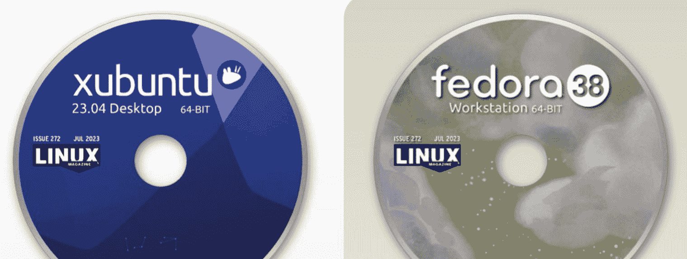

`Xubuntu 23.04`，代号为 `Lunar Lobster`，是 `Ubuntu` 变体的最新版本，使用 `Xfce 4.18` 作为默认桌面。它将一直支持到 2024 年 1 月。与所有 `Ubuntu` 版本一样，此版本非常适合青于轻量级桌面且不追求极致功能的用户。

`Fedora Workstation` 是面向通用桌面用户的 `Fedora` 发布版。它是许多功能的首次亮相，这些功能最终将引入 `Rocky Linux`、`AlmaLinux` 和 `Red Hat Enterprise Linux` (`RHEL`) 等发行版。

传统上，`Xubuntu` 的短期版本不包含重大改进，`Lunar Lobster` 也不例外。但它仍然有一些值得关注的创新。首先，它是第一个使用 `PipeWire` 和 `WirePlumber` 的 `Ubuntu` 版本，它们提供了改进的音频和性能。默认终端字体现在为 10 点，从九点增加，但对于易读性来说这是一个明显的提升。

新功能包括重新设计的辅助功能设置；更清晰的设备配对语言；通过二维码进行连接的能力。对第三方软件包仓库的管理也得到了改进。其他更改包括使用 `Gnome 44`，包括文件选择器中的图标视图和预览，以及快速设置中的蓝牙支持。这些更改的总体趋势是趋向图像化设计，正如过去十年以来一样。结果是一个组织良好的用户体验，既没有牺牲功能，又适用于所有水平的用户。

随着 `Xfce 4.18` 的推出，还有其他微调。一如往常，许多微调现在位于 `Thunar` 文件管理器中，还包括图像预览、可编辑工具栏、选中文件的自定义高亮，以及针对更多操作的撤销/重做支持。整个桌面包含了许多小调整，并改进了对 `Wayland` 的支持。

缺陷将被替换。请发送邮件至 `subs@linux-magazine.com`。尽管本 `Linux` 杂志经过了测试，据我们所知，不含恶意软件和缺陷，但 `Linux` 杂志对使用本杂志相关的任何数据和计算机系统的中断、丢失或损坏不承担责任。

欢迎阅读《`Linux` 杂志》最新一！

我们希望你喜欢本月挑选的技术文章、教程和项目。


你可能注意到本月的封面价格有所上涨。遗憾的是，在报刊亭销售《Linux 杂志》的成本增加迫使我们提高费率。

如果你直接从我们这里购买，可以节省费用并更快获得《Linux 杂志》！你将始终获得最优价格，你的直接支持让我们能够继续每月制作《Linux 杂志》。


感谢你的持续支持！


### 技术、趋势和工具的更新

*   `Linux` 内核 6.3 发布
*   `Fedora` 38 发布新功能
*   `LXQt` 1.3 发布
*   基于 `Arch` 的 `Linux` OS
*   `Linux` OS 的 `Prime` 发布

#### `Linux` OS 发行版介绍

如果你是一个网页浏览器用户，`Linux` OS 可能是你的不错选择。在这一第三年，由 Anderson 创建的发行版专注于从安装开始即可使用的操作系统。通过 `Linux` OS，用户将享受视频编辑、安全工具以及发布。然而，通过点击图标，你可以使用 `OpenAI` 并启动服务。在使用时，唯一可以收集的是类型。最新版本的 `Linux` OS 包含了内核 6.2、`KDE Plasma` 5.27 和 `Qt` 5.15。你可以从发布说明 (`br-os.com/blog/pt/`) 阅读最新版本，并从官方网站 `br-os.com/download/` 下载 `ISO`。

`Linux` OS 并不适用于所有人，但如果你正在寻找一个小规模的、GUI 操作系统，这可能是你寻找的：`Linux` OS 包含了控制台工具、数据恢复和部署。`Linux` OS 增加了 `zstd`、`bash`、`bintop`、`bzip2`、`wget` 等工具。你可以在这里 (`br-os.com/bundle/`) 找到完整包列表。版本 2.1 的新更新包括内核 6.3、`1.475`、`0.188`、`git-2.7`、`spice-3.10`、`0.9`、`image-202301220`、`scap-2.68`、`Linux` 2.29、内核 6.3 以及 `固件-20230410`、`4.4`、`OpenSSL` 3.1.0、`4.3`、`sqlite` 341.2、`wireless-master-20230213`。你可以下载现场 `ISO` (`br-os.org/`)，它不需要直接从内存运行。`ISO` 非常小 (205MB)，并且可以在旧硬件上无问题运行。

### `TUXEDO` 发布 `InfinityBook Pro` 14

`TUXEDO Computers` 更新了流行的 `InfinityBook Pro` 14，配备 16:10 3K 显示、99 Wh 电池以及完整的 `Linux` 支持。

99 Wh 电池报告了改进的寿命，可以通过 `USB-C` (`Power Delivery`) 和包含的 `DC` 电源轻松充电。它可以比低功耗笔记本电脑充电更多，将这台笔记本电脑变成一台更强大的移动工作站。通过双风扇散热，设备保持安静。

`TUXEDO` 还预装了 `Tuxedo Control Center`，因此 `Intel` 13700H（14 核 20 线程）处理器可以以 40 瓦功率驱动（而非低功耗笔记本电脑）。

显示屏为 3K，外壳厚度为 1.7mm，重量为 1.3kg。你可以将 `TUXEDO InfinityBook Pro` 升级至 2TB `DDR5-6400` `RAM` 和 1 M.2 `SSD` (`PCIe` Gen4.0)，内部存储最高可 4TB。

`TUXEDO InfinityBook Pro` 14 现在可以预订 `https://www.tuxedo-computers.com/en/TUXEDO-InfinityBook-Pro-14-Gen8`，写作此时预计 8 月底交付。

`InfinityBook Pro` 14 - Gen8 的基础配置包括 `Intel i7-13700H`、14 英显示、2x8 GB `DDR5` `RAM` 以及 250GB `Samsung 980 SSD`，以及预装的 `TUXEDO OS`，起价 1477.23 欧元（不含值税）。

对于喜欢使用最新/最佳 `Linux` 内核的人来说，6.3 有一些你可能感兴趣的功能：

列表顶端是对多执行器硬盘的支持。硬盘正被广泛地应用于超大规模云部署，因为它们能够通过并行读写命令集实现更快的性能。

同样，`Linux` 6.3 增加了内核地址空间随机化（`ASLR`），但此安全功能仅适用于 `RISC-V` `CPU`。`微软` 为 `Hyper-V` 添加了虚拟机监控支持，除了 6.3 内核外，`Intel` GB 网卡将能够找回多年来遭受的快了 60% 的线程速度。

其他功能/改进包括对即将推出的 `AMD` 及其显卡的支持、支持 `AMD` 的间接分支预测（`Indirect Branch Speculation`，以缓解 `Spectre` 漏洞）、支持 `ARM` 架构的可扩展矩阵扩展 2 (`SME2`) 指令、支持 `NTFS` 的 `AES-SHA2` 加密、`EXT4` 优化、更快的 `B` 驱动以及


`Jeff Layson`：更新（`update`）和升级（`upgrade`）之间有什么区别？我们将探讨为什么一旦安装了 `HPC` 发行版，你可能会看到多次版本更新，但很少看到升级。

使用 `Zeek` 进行网络监控：`Matthias Wibling`：`Zeek` 提供了监控流行网络协议的脚本，并带有自己的策略脚本语言用于自定义。

使用 `Binary Ninja` 进行分析之旅：`Matthias Wibling`：二进制分析是一种用于处理网络攻击和恶意软件感染的高级技术，也称为逆向工程。我们展示了如何使用交互式二进制分析平台 `Binary Ninja` 进行静态分析。

`Martin Kuppe`：我们查看了身份访问管理在市场组织中的作用。

尽管 `Linux` 内核 6.3 必须进入标准仓库，但你可以从 `kernel.org` (`https://kernel.org/`) 下载并自行进行编译。最终，它将进入你的发行版，通常情况下等待发布会更好。

想象一下可以在单一发行版上安装来自 `Arch`、`Fedora`、`Ubuntu`、`Android` 甚至 Web 端的应用。这就是 `blendOS` (`https://blendos.co/`)。

`blendOS` 由与 `Ubuntu Unity` 相同的维护者创建，它允许你使用原生的 `Arch` 软件包管理器 (`pacman`)，以及像 `DNF`（来自 `Fedora`）和 `Apt`（来自 `Ubuntu`）。`DNF` 和 `Apt` 都通过 `Podman` 运行引擎的容器方式提供（得到了 `Distrobox` 和 `NVIDIA` 驱动的一些帮助）。

尽管 `blendOS` 是基于 `Arch` 的，但开发者使其可以使用来自任何支持的发行版的任何应用程序。此外，你可以在 `Gnome` 或 `KDE Plasma` 桌面之间进行选择。

在使用容器化的 `DNF` 或 `Apt` 安装应用程序时，这些应用将从基础 OS 可用（因此你不需要像典型的 `Podman` 容器那样从命令行运行它们）。

`blend` 还是一个滚动更新且不可变的操作系统，允许你像往常一样使用系统包，同时仍然回滚到即时快照。

你还可以使用 `blendOS` 构建脚本（`https://github.com/blendos/`）来创建并提交带有你选择的桌面环境的 `blendOS` 重混合版。

你可以在此处阅读更多关于 `blendOS` 新版本的信息（`https://blendos.co/`）

`Fedora` 的开发者又为我们提供了另一个出色的版本，编号为 38。这是一个惊喜，该团队很少提前发布，但这无疑是来自奉献团队的早早礼物。

`Fedora` 38 以 `Gnome` 44 和 `Linux` 内核 6.2 为核心。`Fedora` 使用的 `Gnome` 版本是原版的，因此 `Fedora` 团队没有做任何更改。

`Gnome` 44 中发现的一些新功能包括文件管理器中的文件夹，以及文件选择器的图标/缩略图模式。

你还会在“软件”应用中找到 `flatpak` 应用，这意味着你将在通过第三方仓库发现更多可安装的 `flatpak` 应用。

随着 `Fedora` 38 的发布，团队对网站（`https://fedoraproject.org/`）进行了重大更改，并包含了一些新的变体，包括针对 Budget、`Sway` 以及移动设备的 `Posh` 变体。

你可以从官方博客（`https://Fedora-magazine.org/announcing-fedora-38`）阅读更多关于最新发布的信息，并从页面下载 `ISO`（`https://fedoraproject.org/workstation/download`）。

每周在你的收件箱中获取最新消息。免费订阅 `Linux Update` `bit.ly/Linux-Update`


`LXQt` 是资源匮乏系统受粉丝喜爱的桌面环境。它适用于旧系统（在旧硬件上运行得非常顺畅），`LXQt` 不仅硬件友好，而且易于使用。

在最新的版本 1.3 中，开发者已将其替换为 `Qt` 5.15（尽管正在进行 `Qt6` 的初步支持工作），并专注于添加新功能。


例如，`LXQt` 面板现在默认包含 `DOM` 插件，修复了时钟部件中的一个 `Bug`，以及在切换深色和浅色主题时发现的 `Bug`。此外，面板在配合 `Wayland` 时将正确定位上下文菜单。

默认文件管理器 `PCManFM-Qt` 修复了一个导致桌面项目发生“抖动”的 `Bug`。此外，文件管理器的最新迭代为窗口设置添加了标题，你还会发现在所有模式下滚动功能现在已禁用。

`LXQt` 会话工具现在也支持更好地检测窗口管理器和系统托盘。

尽管新功能和 `Bug` 列表并不详尽，但目前 `LXQt` 仅源码可用。然而，滚动更新发行（如 `Arch Linux`、`Gentoo` 和 `openSUSE Tumbleweed`）会在各自的仓库中获取最新版本。

`4MLux` 是一个带有系统功能的发行版，可以在 128 MB `RAM` 的机器上运行，将它们变为可行的工作站或服务器。`4MLux` 可作为恢复驱动从故障的系统中恢复数据。

稳定版本 `42.0` 包含了软件如 `LibreOffice 7.5.2`、`AbiWord 3.0.5`、`GIMP 2.10.34`、`Firefox 111.0`、`Chromium 106.0.5249`、`Thunderbird-102.8.10`、`Audacity 3.4.2`、`AlsaSpeaker`、`Bakeaway`、`Media Player`、`mpblaster` 以及 `VLC`。

你还会找到更新的工具，包括 `PHP`（版本 `5.6.0`、`7.4.33` 和 `8.17`）、`Perl 5.36.0`、`Python`（版本 `2.7.18` 和 `3.10.8`）以及 `Ruby 3.3`。在服务器端，你会找到 `Apache 2.4.56` 和 `MariaDB 10.6.2`。随 `4MLux` 发发的内核版本是 `6.1.0`。你可以查看软件包列表（`http://4mlux.com/packages-2.0.txt`）。

`4MLux` 不仅用于复旧硬件，因为它还支持启用 `UEFI` 的机器。通过这个发行版，你可以创建桌面、生产力工具和微服务器。

下载 `4MLux` 的 `ISO`（`http://4mlux.com/index.php?page=download`），为旧硬件带来新生命或使用新机器。

开放数据运动将开源理念延伸到政府数据，并最终到全世界的知识。

作者 Joe Casad

长期以来，政府保留记录，公民们对访问这些记录存在争议。当古代美索不达米人在泥板上记录数据时，关于谁应该或不应该看到这些表格引发了激烈讨论。信息即力量，而数据是通往洞察的第一步。

但随着更多人的关注，数据变得更加强大。开明的政府最终开始分享，让可能发现洞察的观众访问。民主政府的兴起使得人们（至少在理论上）制定规则，新闻自由的概念促进了对公共数据、国家大学图书馆、公共图书馆以及通过政府资助获取的数据的需求。

随后是信息时代，数据的价值以及访问工具变得极其复杂。当数据主要通过纸（或泥板）进行存储和通信时，“格式”是我们用来描述这种关键性的术语。当政府数据变为电子化存储时，变成了冲突点，我们仍在努力理解这意味着以及如何处理。

政府和政府资助的研究机构是计算机的用户。在早期，开发团队倾向于独立工作——没有为数据做好准备。许多政府机构没有足够的员工或预算来自己编程，而是将其外包给承包商。承包商意识到他们地位的权力，某些人精于将自己定位为数据的门人。政府进行研究，承包商或资助接收者提供最终报告。但数据的状态往往定义模糊。理论上，它是政府数据，但访问它的知识和工具属于承包商，从数据获取额外洞察和价值的唯一方法是付钱让承包商再次研究。

选举官员花了几年才理解这一点。如果你将源代码作为描述程序如何运行的“数据”，自由软件运动是解决这一问题的早期尝试，许多政府也拥抱了软件开发。自由软件和开源的理念对近期的开放数据计划产生了强烈影响。

当第一场计算机革命的硝烟散去后，人们开始看到，通过投入存储在格式中的政府资金可以更好地服务公众。2003年，欧盟通过了《公共信息再利用指令》，被称为 `PSI` 指令。`PSI` 指令为通信再利用建立了一个法律框架，规定公共信息应该是“设计上开放且默认开放的”。`PSI` 指令经过了修订，最近一次是 2019 年，并且


图 1：开放知识基金会是开放数据的早期倡导者和开放定义的创建者。


它现在被称为《开放数据指令》[2]。公共部门信息（`PSI`）指令和开放数据指令的立场是：无论是否存在关于何时以及以及如何重用数据的预定义计划，都应保持数据处于可用状态。

在英国，开放知识基金会（`OKF`）[3]于2004年成立，旨在为支持开放知识提供服务、培训和社区活动（图1）。凭借其悠久的活动历史，提高人们意识花费了一些时间。2007年，30位愿景者在加利福尼亚州的塞巴斯托波尔（`Sebastopol`）聚会参加会议，这次会议促成了“开放政府数据倡议”的诞生。小组中的许多人熟悉`FOSS`（自由和开源软件）原则，包括`O'Reilly Media`的创始人蒂姆·奥雷利（`Tim O'Reilly`），以及知识产权组织创始人斯坦福法学院教授罗伦斯·西尔菲尔德（`Lawrence Silkfield`）。成员之一是艾隆·施格尔（`Aaron Schlegel`），他是一位`FOSS`和数据活动家，也是`RSS`的创造者。塞巴斯托尔小组定义了数据“开放”的八项原则：

- 完整性（`complete`）——所有不受隐私、安全或特权限制的公共数据可用，没有可能限制其可用性或模糊其含义的缺失部分。
- 数据以在源头采集的形式保存，而不是聚合或处理成修改后的形式。
- 及时性（`timely`）——尽快提供数据，以保留其潜在价值。
- 可访问性（`accessible`）——数据可以在互联网上获取，并以允许最广泛用途的格式存储。
- 可处理性（`processable`）——数据应该是“合理结构化的”，以允许自动化处理。
- 非歧视性（`non-discriminatory`）——任何人都可以访问数据，无需注册要求。
- 机器可读性（`machine readable`）——数据应以任何实体均无独占控制权的格式存储。

`OKF`的开放定义和开放政府的八项原则对于建立未来的清晰愿景至关重要。2009年，巴拉克·奥马签署了一项行政命令，要求政府数据集具有机器可读性[6]。奥马政府期间发起的倡议之一是开放数据[7]，这是一个用于促进开放数据的工具和资源集合。随着2019年《美国政府数据法案》的通过，开放项目被在线资源`data.gov`（图2）取代。目前，美国政府已在`data.gov`网站发布了超过255000个数据集[8]。跨党支持。《开放政府数据法案》有四位发起人——两名共和党人和两名民主人。

## 开放数据


图2：`resources.data.gov`是美国的开放数据工具和资源库。

一旦你建立了组织，追求开放数据政策的成本并不会增加多少（从长远来看可能更低）。然而，这需要一定的努力和勤勉来确保以开放的方式完成工作。政府指令和命令有助于确保管理人员和官僚关注执行层面；开放数据运动则要求以下三个方面：

- 开放格式
- 要求开放数据的规范和合同语言
- 用于报告和维护开放数据的工具

开放数据是一个大的话题，涉及法律、隐私、政治，以及编程、数据存储和网页开发。我们无法涵盖所有内容，但现在将带你了解一些正在推动开放数据事业的事。我们将介绍`CKAN`文档管理系统，并与开放数据团队的`Lisa Allen`进行访谈。

许多工具促进了数据的开放。其中许多工具侧重于将数据转换为易于在网上发布的格式。这些工具范围涵盖了从全方位数据管理系统到专门的数据转换工具，例如将`CSV`转换为`REST API`或直接转换为`HTML` (3)。这类工具使得人们能够轻松地将过去以任意格式存储的数据提取出来，并通过开放的网页门户`CKAN`进行访问。`CKAN`是一个由`OKF`发起的开放数据管理系统，在全球范围内作为发布和聚合开放数据的工具。

目前，最常用于治理政府的政策是其核心，但我们知道，开放数据的控制也是一个问题。我不认为有人希望开放数据的“开放”是指让所有用户都能访问自己的数据以便将其迁移到其他平台。对个人社交媒体数据的更多控制导致了`Mastodon`和`Dias`等开源平台的崛起。然而，谷歌和微软等大型科技供应商也听到了更容易集成的呼声。本月，我们将关注“数据传输项目”（`Data Transfer Project`），这是一项旨在为封闭社交媒体数据建立开放格式的努力。

### 参考文献

- (1) 公共部门信息使用指令：`https://en.wikipedia.org/wiki/Directive_on_the_use_of_public_sector_info`
- (2) 开放数据指令：`https://www.data.gov/pages/open-data-directive`
- (3) 知识基金会：`https://kfn.org/`（注：此处原文应为`Knowledge Foundation`）
- (4) 开放定义：`https://opendefinition.org/odf/1/`
- (5) 开放政府数据：`https://www.data.gov/`


1. (6) 奥马马行政命令：`https://www.whitehouse.archive/gov-the-press/2013/05/09/executive-order-making-and-machine-readable-new-data-`
2. (7) 开放数据项目：`https://www.openbirthhouse.org/blog/20130815/introducing-project-data`
3. (8) `data.gov`：`https://www.data.gov/`

过去20年，政府在开放数据方面取得了进展，但问题仍然存在。欧盟《开放指令》如果可行的话是有前景的，但该指令没有法律强制，而是指导成员国通过自己的开放数据政策来遵守该指令。

在美国，除非通过了法律来改变和阻止政府的改革，否则执行部门不受法律约束。像《开放政府法案》这样的法律比行政命令更有效力，但仅限于联邦层面。州和不使用联邦资金的项目可以制定自己的规则。支持开放数据的不同努力程度至关重要。值得注意的是，尽管在某些


从中性格式导入数据，并编写用于将数据导出到中性格式的代码。当然，除非你接受，否则你无法迁移数据。此外，数据适配器（`data adapters`）是身份验证适配器，允许它们请求服务接受源源服务。通过 `DTP` 文档，“`OAuth` 本身将是大多数提供者的选择，`DTP` 与身份验证类型无关。”

如果你曾尝试过从 `Facebook` 等主流提供商处下载你的信息，你就会知道你有一个在线工具可以下载你的账户，因此你可能会疑惑为什么 `DTP` 是必要的。数据传输项目于 2018 年启动，旨在创建一个开源的、从服务到数据的可移植性平台，以便网络上的所有个人都能随随时方便地在在线服务提供商之间移动他们的数据。

数据传输项目的贡献者认为，可移植性和互操作性是创新的核心。让个人更容易在服务之间进行选择有助于竞争，赋予了个人尝试新服务的权利，并让他们能够选择最符合其需求的工具。目前的贡献者包括：

图 1：`DTP` 背后有一些大人物，尽管大部分代码是由 `Google` 编写。

原因是，你下载的数据并不是专门为与其他服务具有互操作性而设计的。`Facebook` 在某种程度上纠正了这一点，允许你以 `JSON` 格式而非 `HTML` 格式下载账户数据，以便于在其他服务中使用 [6]，但仍然警告说这些文件仅供个人使用（图 3）。欧洲的 `GDPR`（通用数据保护条例）等法规也要求公司提供其客户客户的所有信息。


图 3：像 `Facebook` 这样的网站允许你以 `JSON` 格式下载账户信息以便于重新上传，但这些文件并不包含你所有的数据。


图 4：`XMPP`（原 `Jabber`）是一种开放的消息标准，科技巨头可以使用它来实现跨平台之间的消息传递。

在像 `Facebook` 这类网站的情况下，数据并不一定包括位置数据、人脸识别、朋友个人资料等。正如美国议员 `David Cillotine` 在剑桥分析（`Cambridge Analytica`）丑闻期间指出的，如果用户能够轻松传输所有数据（例如指向朋友的链接 [，较小的公司才能与 `Facebook` 竞争竞争。

开放性、数据透明度和可移植性是非常受推崇的目标，我们完全欢迎任何允许用户访问并控制其数据的尝试。尽管如此，在 `Facebook` 和 `Twitter` 等私有平台上添加数据扩展，远不能意味着实现一个像 `Diaspora` 或 `Mastodon` 那样完全开源、去中心化的社交网络平台。数据传输项目是打破科技巨头魔咒的重要一步，但尚未宣告胜利。

在他们的公告中，`Facebook` 和 `Google` 正在顺应数据传输的开源特性。存在开源扩展，允许数据传输项目在 `Google Cloud` 和 `Microsoft Azure` 上运行。项目的总体目标是确保开放数据——而不一定是开源工具——因为运行在云端的私有服务或闭源服务并不是自由软件的理想情况。由于运行在平台上的软件是私有的，因此无法确定你的每一个部分都是安全的。


2023年大学生版——特伦托及湖泊谷社区的景点介绍。涵盖酒店、餐厅、其他旅游景点，并包含地理坐标、市镇和地区，均使用意大利语描述。


要实现这一点，必须满足两个条件：一个网站宣布其正在运行 `CKAN`（或至少遵循兼容的标准和安全措施）并且可以被其他兼容 `CKAN` 的网站发现（这并非总是如此）；且每个数据集必须在很大程度上与其实际范围、新效性和内容完全对应。否则，虽然同步需要花费精力，但 `CKAN` 仍然是数据标准化、去孤化和协作发布的最快路径。

**数据集元数据**

**数据集标识**

**其他标识**

**数据集条款**

**指令，说明**

**2631 和**

**数据集发布者**

`/A`

**注：APT，特伦托，蒙邦多内山和湖泊谷**

为了证明 `CKAN` 的用处，我采访了两位意大利主要的 `CKAN` 专家：`Maurizio Patrolino` 和 `Vincenzo Centauro` [9]。`Patrolino` 就职于 `Bruno` 基金会，是意大利国家统计局（`ISTAT`）数据组的主管，也是 `OpenData APS`（一个促进开放数据的非营利协会）的主席。`Patrolino` 和开放数据共同构成了“当今所见通过好想法提供更多机会以改善我们社会的最强大形式”。

> 图 1：`CKAN`，每个数据集都有自己的页面，包含所有相关信息以及访问数据的方法

2023年大学生版——特伦托及湖泊谷社区的景点介绍。涵盖酒店、餐厅、其他旅游景点，并包含地理坐标、市镇和地区，均使用意大利语描述。

**兴趣来源 - 特伦托 - 湖泊谷**


| 名称 | 类型 | 描述 | 类别 | 纬度 | 经度 | 视线 |
|---|---|---|---|---|---|---|
| `Pognon, Rag.` | 自然景点和典型... | | | 46.5722 | 11.08281 | `Via Sud` |
| `Hotel` | 住宿 | 位于 l 角的一家酒店 | | | 46.5718 | 11.0831 | `Via Sud` |
| `Valle dei Laghi` | 自然景点 | 湖泊之谷 | | | 46.5612 | 11.0911 | `Via Sud` |
| `Berni, G.` | 自然景点 | 与 bu...的工作班次 | 北线巴士 | | | 46.5912 | 11.1547 | `Via Nord` |
| `San Martino` | 博物馆 | | | 46.5812 | 11.0712 | `Via Sud` |
| `Sicca, T.` | 博物馆 | 与 bu...的工作班次 | | | 46.5512 | 11.1412 | `Via Man` |
| `Torgn.` | 公园 | 湖泊之谷 - 农业 | | | 46.5412 | 11.1212 | `Via M` |
| `Per Si` | | | | | | | |
| `MI` | | | | | | | |
| `MI` | | | | | | | |


图 2：一个关于游客、旅游服务的排序和搜索表格。

图 3：如果设置得当，`CKAN` 可以显示每个条目的的位置。在特伦托，`CKAN` 不识别纬度和经度标签，因此地图是空白的。

图 4：当坐标未标记为 `CKAN` 坐标时，你可以预期帮助 `CKAN` 识别它们。如图 4 所示的这些值。一旦你

| 名称 | 描述 | 英文描述 | 类别 | 纬度 (46.28419) | 经度 (11.52835) | 街道 | 邮编 | 地区/城市 |
|---|---|---|---|---|---|---|---|---|
| `LINUX-MAGAZINE.COM` 2022 21 | | | | | | | | |

## CKAN 的开放数据

`CKAN` 的力量之二，得益于 `Patrunno`，源自古城马特拉拉（`Matera`）。它是《电影中的威尼斯》和 2019 年欧洲文化之都的电影拍摄地。因为一个拥有如此久历史的地方比其他地方需要更多的维护，`Patrunno` 和其他人准备了一个 `CKAN` 演示 [12]，以及其他内容，即该地区所有公共工程的数据（进行中），如图 6 所示。


图 5：在分配正确的纬度和经度字段后，`CKAN` 现在显示了带有景点的地图。

尽管纬度和数据存在差异，马特拉拉的界面与特伦托的界面（图 2）看起来相同。位置数据可以标识（例如，特伦托的数据资源器对比）。


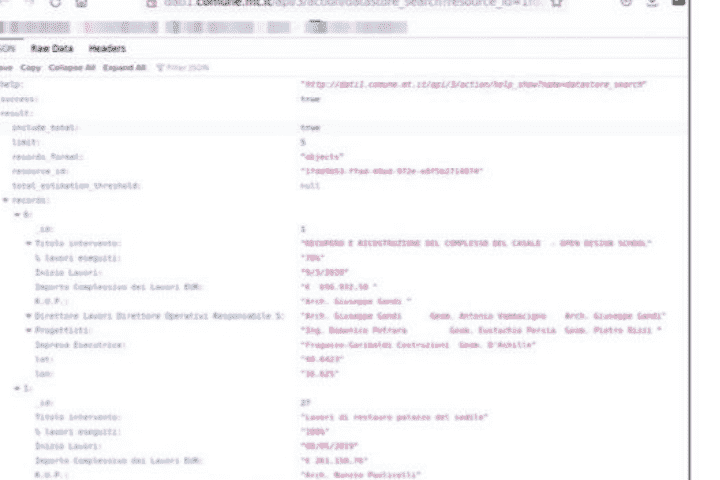

图 6：点击下载，你可以获取整个数据集，可以是 `JSON` 格式或其标头。

接口可以通过以下段落访问资源信息

### 示例：使用 API 获取

#### 查询 (SQL)

```
```

#### 资源示例（包含）

```
id=6fd865d-bad-4d2a-b274-c1f534
resource_id=15f905d-bad-4d2a-9567-ff534
```

#### 查询示例（使用 SQL select）

图 9：`CKAN` 的数据 API 页面列出了第三方软件可以访问的所有数据集。


图 6：马特拉拉公共工程的详细列表。


图 7：基础映射，`CKAN` 支持使用普通电子表格进行数据可视化。

在马特拉拉的数据界面中，`CKAN` 用户在使用任何或其他服务时将不会遇到问题，正如我想象的那样！点击该按钮打开面板 10，你可以在其中定义数据集的 `HTML` `iframe` 并复制相应的 `HTML` 代码。

图 6 中的每个条目都提供了项目名称、经理、国家以及马特拉拉已完成或正在中的工作百分比。在图 7 中，在将图 10 中的代码粘贴到编辑器和两个短段落后，图 5 中的地理坐标让 `CKAN` 让你像使用电子表格软件一样快速创建各种图表来可视化原始数据。对于图 7，例如我绘制了每个项目的工作（可用）。这就是我为了创建图 11 中完美的动态网页所做的一切，你能够搜索数据集、地图、内容或制作图表，就像原始状态一样，不是吗？

你还可以创建一个 `JSON` 格式的数据集下载版本（图 8）。对于每个数据集，`CKAN` 会自动创建一个网页（图 9），列出所有数据链接（端点）以及多种编程语言的数据库查询。要生成 API 页面，点击 `Data` 按钮（图中未显示）。

我把 `Napolitano` 和 `Paratino` 留到了最后。图 2 中的嵌入（embed）按钮

### 列表 1：示例 HTML 代码

```html
<html>
<h1>你好，Linux 杂志的读者们！</h1>

<p>以下是我们在我们的网页中嵌入 CKAN 数据可视化的：</p>
<iframe width="700" height="600" src="http://dati.com.it/iframe-in-corso/resource/d613d952-ffad-44b7-2e8eb5f73168/99f52db-cc03-b076f8e4s5de" frameborder="0"></iframe>
<p>我必须获得与原始相同的功能，带有用于图表、地图、过滤器等**可点击**的标签，这复制和粘贴我从“嵌入”函数中获取的代码是很容易的！</p>

</html>
```

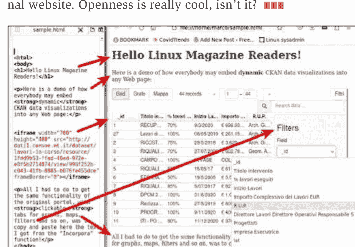

图 11：`CKAN` 服务很容易嵌入我们的网站中。只需从原始服务器获取代码并将其粘贴到你想要的地方。

- `CKAN`: https://ckan.org/

- `Open Knowledge Foundation`: https://okfn.org/

- `Apache Solar`: https://solar.apache.org/

- `REST APIs`: https://restful-api.net/

- `DCAT-API`: https://jointop.europa.eu/community/semantic-interoperability-community/semicision/dcat-api-profile-data-profiles/europe-release/11

- 意大利开放数据门户: https://dati.gov.it [意大利语]

- 欧洲开放数据门户: https://data.europa.eu/en

- `Maurizio Napolitano`: https://twitter.com/mauriziano

- `Vincenzo Patrino`: https://twitter.com/vinpauro

- `onData APIs`: https://www.ondata.it/ [意大利语]

- `OPENData Trento`: https://dati.trentino.it [意大利语]

- 马特拉拉开放数据: https://dati.com.mater.it [意大利语]

## 作者

`Marco Fioretti` (https://mforetti.substack.com) 是一位来自罗马的自由职业作家、培训师和研究人员，自 1995 年以来从事自由/开源软件，自 2005 年以来从事开放数字标准。`Marco` 还是自由知识学院（https://freeknowledge.edge）的成员。

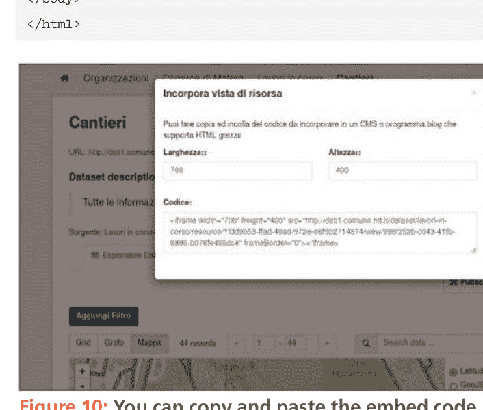

图 10：你可以在任何显示 `HTML` 的程序中解析并嵌入此处所示的代码。

### 专访 – ODI 的 Lisa Allen

开放数据研究所（`ODI`）的 `Lisa Allen` 解释了为什么数据很重要，以及更广泛的应用需要什么。作者：`Joe Casad`


万维网之父蒂姆·伯纳斯-李（`Tim Berners-Lee`）创立了开放数据研究所（`ODI`），旨在帮助促进自由的互联网。我们邀请了 `ODI` 数据与服务总监 `Lisa Allen`，与我们谈谈她的使命和未来的道路。

**`Linux Magazine` (`LM`)** 如果我们从简单的历史说起如何？什么是开放数据研究所？它是如何起步的为什么要这么做？

**`Lisa Allen` (`LA`)** 开放数据研究所是一家成立于 2012 年的非营利公司（我们去年庆祝了 10 周年！），由蒂姆·伯纳斯-李爵士和尼杰·沙博特爵士（`Sir Nigel Shabolt`）创立。我们作为一个机构和服务提供者运营，与企业、政府和公民社会合作，创造一个数据为所有人服务的世界。

**`LA`:** 我们相信透明度可以捍卫开放数据的价值，并倡导其创新性用途，以带来积极变化。在早期，我们认为社会、经济和环境的改变将来自全球议程中数据的大规模采纳和开放。我们建立了一个由 `ODI` 领导的工作组，现在仅在英国就有超过 600 万用户。我们还很早地就指导公司创建了近 1000 个数据集，并创造了 1 亿英镑（约 1.25 亿美元）的收入。我们的工作横跨数据领域，帮助机构在这一光谱上共享数据。

**`LM`:** 你们的使命非常多元。一方面，你们拥有开放数据工具；另一方面，你们扮演着优势性角色。在定义什么是数据以及为负责任的数据共享制定指南方面，你们扮演了哪些角色？这一切是如何结合在一起的？你会如何描述优先事项？你们机构大部分时间花在哪里？

**`LA`:** 我们的愿景是创建一个数据为所有人服务的世界，并旨在通过与企业、政府和公民社会的合作，构建一个开放、可信的数据生态系统来实现这一目标。对我们来说，数据是国家基础设施的关键部分，就像我们所有人依赖的电力网络一样。改进机构的数据处理流程很重要，这样它们就可以构建和提供包括培训、专家咨询和研究在内的各种服务，使机构具备产生社会经济价值的能力。我们确实开发了产品和服务，运行会员计划，并帮助建立对公共政策决策的理解。我们提供广泛的服务。

**`LM`:** “开放数据”变得抽象了。我们有推荐的特定格式或框架吗？你能指出大多数用户最想使用的特定服务吗？

**`LA`:** 我们将开放数据定义为任何人都可以访问和使用的数据，而不是特定的格式或框架。我们信赖蒂姆·伯纳斯-李爵士的 5 链接数据（`Linked Data`）系统，即该数据在网络上可用、机器可读、采用非专有格式、使用开放标准以及此类系统。这是我们为了解锁数据价值而必须经历的历程。许可是通过制定和使用诸如知识共享（`Creative Commons`）等开放许可来转变透明度、实例，英国政府许可（`Government License`）的开放对公共数据的可用性和可用性产生了巨大影响。

**`LM`:** 我们的开发者和 `Linux` 高级用户读者会对此特别感兴趣。我们将告诉你更多关于“业务数据工具包”和“公共服务工具包”，以及你更喜欢使用的其他工具。

**`LA`:** 我们制作了许多免费工具和指南，帮助人们管理、使用和发布数据。“业务数据工具包”和“公共服务工具包”有很多共同点——最终，它们旨在帮助人们克服有效使用数据的障碍，并汇总一系列工具以帮助不同的环境。它们共同的两个元素是“画布”（`Canvas`）和“数据生态系统映射”（`Data Ecosystem Mapping`），这也是我们非常自豪的。我们最近了解到，联合国开发计划和德国国际合作机构（`GIZ`）可以将这两者整合到一个工具中，该工具加入了微软、`OCHA`（联合国人道主义事务协调厅）和 `Arup` 团队，并与英国及全球的政府部门、学术机构和卫生部门一起使用它们。


这些可以影响对数据之目的且将满足用户需求的信心。良好的、可信的数据非常重要，开放数据是数据基础设施的最佳基础，确保了透明度、问责和理解。

**LM:** 随时代演进似乎是 ODI DNA 的一部分。最近，你一直在提高人们对开放数据人工智能的意识。AI 与开放数据有什么关系？你们在这一领域的目标是什么？

**LA:** 很难忽视我们收到的所有生成式 AI 以及随之而来的头条新闻。但它们的一个共同点是，它们都依赖于海量数据。技术不断演进，但取决于喂给你的数据。

共享数据（尤其是开放数据）的风险之一是高风险。我们认为这是因为人们不理解其数据中存在的风险以及与共享相关的风险，更重要的是，不知道如何减轻这些风险。我们针对这个问题工作，开发了一个工具来帮助人们理解这些问题和风险。我们确定了评估共享数据的关键领域：监管、伦理、声誉和商业风险。通常缺失的最重要点是如何理解数据、风险，以及最重要的是开放数据可以解锁的收益。

这就是为什么构建和信任数据生态系统如此重要。我们需要对数据源、其中包含的偏见有开放性和理解，影响可能是负面的也可能是正面的。我们需要更好的数据技能和知识，帮助人们理解 AI 处的状态以及如何处理这些数据。

**LM:** 如果开放数据被大规模采纳，有哪些具体的例子会变得更容易？

在没有保障的情况下，精心策划的数据至关重要。我们将保障定义为一种过程或一组方法，以确保数据将满足我们的需求，并确保收集、访问、使用和共享数据的是可靠的。数据保障涉及多个因素，包括质量、供应和伦理。在考虑伦理时，用户需要确保数据被正确收集、使用和共享。所有这些因素都会影响对数据之目的且满足用户需求的信心。

**LA:** 开放数据在银行和运输领域的影响无疑造福了数百万人。我们与开放数据（OA）及其社区的合作产生了重大影响，让人们通过开放数据获得以前被锁的机会。这些创新的益处远超预期。环境署的开放 `LiDAR` 数据在挑战和学习如何解锁开放数据优势方面产生了意想不到的益处。这是通过开放性实现的，即其他创造和创新的数据使用方式；效率，即开放数据消除障碍并释放价值；以及通过创造透明度带来的所有价值。这些都是开放数据的益处——所以释放越多，解锁的就越多。

从我们的特刊库中了解 `Shell`、`LibreOffice`、`Linux` 等更多。

`Linux Magazine` 团队创建了一系列单卷，让你深入研究感兴趣的话题。

查看完整库！`sparkhaus-shop.com/specials`


你所需的所有软件

LINUX

更强大 • 更安全 • 更有趣

+ 学习如何安装 LINUX 系统：

- 听音乐 • 玩游戏 • 处理照片
- 浏览网页 • 以及更多！

完整存档

数以千计的项目和创意

## MakerSpace 创客空间

### 针对爱好者的实践项目

#### 制作一台树莓派收音机！

树莓派小技巧

在你不在时给你的小猪喂食

### 针对爱好者的动手实践项目

#### 复古游戏

通过太阳能项目避免电池耗电

#### 灌溉创新

无需浇水即可为植物浇水

#### Bash

在你的 `Python` 脚本中混合一点 `Bash`

#### 针对 Linux 极客的技巧和快捷键

+ - 加速桌面
- 远程下载管理器
- 搜索 `PDF` 和图像
- 按照你的喜好运行 `Vim`

探索世界上最强大的免费办公套件

免费 免费

### LibreOffice

完整版

你的 LINUX 技能

编辑并保存

`MS Office` 文件

编写自己的

宏

节省时间并自动化常用任务

+ 指尖上的

- 获取直接输出
- 监控进程
- 创建自定义脚本

+ 创建专业的：

- 文档
- 电子表格
- 演示文稿
- 数据库

将此指南作为永久参考！

将 `MS Office` 转换为 `Google Docs`

全全新！

互联网工具

为网页和谷歌搜索学习

发行版之旅 – 一站式 `Linux` 发行版


Linux 用户现在可以体验 `Windows` 和 `macOS` 用户几十年来一直享有的：硬件、软件和服务的整合。我们查看了这六种 `Linux` 一站式解决方案。作者：`Bryce Byfield`。

根据传统定义，发行版是软件。越来越多的公司正将发行版作为包含硬件、支持和服务的包的一部分提供——这是商业术语中被称为垂直整合的一种一站式解决方案。这些解决方案提供的服务可能是昂贵的。

一站式解决方案的优势是显而易见的。供应商可以提供为其硬件和客户忠诚度定制的软件。对于买家来说，一站式解决方案提供了便利和易于购买，即使是在配置 `Linux` 电脑最近已成为标准的购买前搜索中。`Ubuntu` 是近期蓬勃发展的一种一站式解决方案。`2013` 年，`KDE` 未能推出带有其独特桌面环境变体的 `Spark`（等离子体）。`Ubuntu` 发布了自己版本的桌面系统，但在 `2017` 年停止了支持。这些失败的原因已经过彻底分析，包括在硬件方面缺乏商业经验，以及商业 `Linux` 市场相对较小。

无论原因何，一站式解决方案最近才获得认可。许多是 `Ubuntu` 长期支持（`LTS`）发布版本的衍生版本，在桌面上进行了微调。效仿大型商业厂商的 `Linux` 产品，有一些一站式解决方案为每个用户提供详细的选项。它们通常通过微型管理工具来区分，这些工具是为桌面硬件设计的，并不适用于所有发行版。像 `Debian` 一样，自由软件 `BIOS` 和 `UEFI` 替代品（或计划在不久后这样做）提供频繁的远程更新。发行版仍然是至关重要的，当然，一站式的差异在于……

作者

`Bryce Byfield` 是一位计算机记者，也是一位专精自由和开源软件的自由作家和编辑。除了他的写作项目外，他还教授电子学习课程。他谈论关于西海岸的一切事物（`https://bycebyword.com`）。他还是 `Freedom Pieces` 的联合创始人，这是一本关于写作和幻想的博客（`https://freedompieces.com/`）。

第 22 期

解决方案往往存在于包的其余部分。每一篇都是六种领先一站式解决方案的总结，它们通过与商业公司的合作伙伴关系提供了一站式解决方案的社区版本。云服务通过 `Shell` 和 `Labs Systems`（见下文）提供。`MX` 还提供了嵌入在其 `Windows` 和网页上的文档。作为权利的倡导者，`System76` 提供了有关如何修复和升级其产品的详细说明。

`TUXED` 是一个正在快速扩张且在北美已广为人知的品牌，它提供优秀的产品线。`TUXED` 也以定制请求闻名。作为一站式解决方案之一，`TUXED` 提供了加密以及使用网络摄像头、麦克风、无线技术的能力。在我写这句话时，`TUXED` 正在探索添加这些功能。`TUXED` 还提供了一些设计良好的工具，这些工具可能在其他发行版上无法工作。

有了一站式解决方案，`Linux` 用户终于可以享受 `Windows` 和 `macOS` 用户几十年来享有的东西。因此，用户购买系统是为了获得这种一站式解决方案，但许多人对此担忧过重，且解决方案各不相同。然而，不再需要搜索每个组件的 `Linux` 兼容性了。

### Star Labs Systems

在此处列出的解决方案中，`Star Labs` [5] 并没有自己的发行版，而是选择提供对用户友好的：`MX Linux`、`Ubuntu`、`Linux Mint` 也提供硬件，包括高分辨率屏幕和带有指纹识别器的大触控板。它的安全功能包括一个硬件切断开关。`Star Labs` 不允许轻松浏览，它以几十种货币显示价格。长期一站式解决方案可能整合一些用户想要下载的后门。这并不是重大的阴谋，只是为了自由的必要努力。但这更容易实现吗？答案是肯定的，但不太可能。

`Purism` [3] 于 `2014` 年推出，其发行版 `PureOS` 是少数几个因安全和隐私功能获得自由软件认证的发行版之一。其电脑包含了用于物理断开摄像头、麦克风和蓝牙的开关。`Purism` 的电脑可以在安全状态下运行。此外，在从公司发货时，所有内部接口都是可用的。

### Slimbook

由 `Pop!` 的 `SlimOS` [6] 拥有一种不常见的界面，并包含了平铺桌面选项。在本文突出的选择中，`KDE` 和 `Manjaro` 也有发行版。`Slimbook` 在几年前测试过，但由于问题已经停止了。

(1) `coreboot`: `https://coreboot.org`
(2) `TUXEDO Computers`: `https://www.tuxcomputers.com`
(3) `Purism`: `https://purism.com`
(4) `MX Linux`: `https://mxlinux.org`
(5) `Star Labs Systems`: `https://www.starlabs.com`
(6) `Slimbook`: `https://slimbook.com/en/essential-en`
(7) `System76`: `https://system76.com`

## 自定义可启动 ISO 镜像

DIY 制作器

如果你正在寻找自定义 `Linux` 发行版的方法，我们将向你展示三个创建可启动 `ISO` 镜像的图形化前端。作者：`Erik Bärwald`


几乎任何可以想象的场景都有专门的 Linux 发行版。然而，在日常使用中，这些发行版通常带有冗余的应用程序。这些应用占用磁盘空间——如果它们恰好在后台运行，CPU 占用率就会飙升。有些允许创建一个没有额外软件的精简基础系统，你可以根据实际需要的项目对其进行自定义。本文将介绍那些可以快速为你提供 DIY Linux 制作工具且没有太多开销的前端。

为了以后使用电脑，你需要通过一个实用的工具创建系统的 ISO 镜像，这种工具应该是易于使用且不是为 Linux 专家设计的。

根据你想要创建一个可以从光介质或可移动 USB 启动的自定义 Linux 衍生版，你可能需要不同的工具来生成 ISO 镜像。如果可能，请选择可以生成混合镜像的工具（即根据需要可以从单独仓库启动）。

生成自定义镜像有两种方法。第一种方法涉及与实时系统（live system）一起工作。当你首次运行所需的发行版并删除所有不需要的应用程序后，在这个系统中，你添加日常使用所需的所有应用程序。然后，使用工具从运行中的系统生成 ISO 镜像，创建一个包含该运行系统（包括新安装的应用程序）的镜像。

第二种方法使用从初始系统（无预安装）获取的另一个 ISO 镜像作为自定义系统。该工具通过临时解包进行编辑，从标准 ISO 生成系统。然后根据你修改的内容创建一个自定义镜像。

`Custom Ubuntu ISO Creator`（自定义 Ubuntu ISO 创建器）可用于 `Ubuntu`、`Debian` 及其衍生版，以创建单个 ISO 镜像。你可以从单独的仓库选择该软件。要将归包添加到包管理系统中，首先打开终端并使用它。然后将 `Cubic` 包含在运行系统中并按照步骤操作（列表 1）。之后，你可以从菜单启动该工具以开始一个几乎为空的环境（图 1）。

自定义 Linux 发行版通常基于自定义镜像。理想情况下，镜像将包含图形化界面或提供一种简单的方法来安装桌面。有些系统带有多个运行时版本。像 `LibreOffice`、`Firefox`、`Gimp` 或 `VLC` 等应用程序可能缺失，但可以通过包管理器安装。为了使用这样的系统，你需要部署一个实用的工具来创建 ISO 镜像，这种工具易于使用且不是为 Linux 专家设计的。当你到达那里，开始收集生成 ISO 镜像所需的数据。要此此，点击文件管理器右上角的绿色按钮，然后点击 `Next` 选择所需的目录。然后，在主窗口中点击 `Next` 定义源和目标镜像。`Cubic` 不从运行中的系统生成新镜像，而是从现有的 ISO 镜像。理想情况下，使用尽可能轻量的镜像。

选择源镜像后，`Cubic` 会自动填充对话框中的所有字段。如果发生问题（例如，镜像无法确定某些源数据的 `Ubuntu` 或 `Debian` 衍生版本），程序将显示错误消息。对于成功识别的镜像，`Cubic` 会提取数据。你可以点击窗口右上角的 `Next` 进入几乎空的环境。

通过点击左侧的单选按钮选择压缩方法。然后点击开始创建新的 ISO 镜像。`Cubic` 通过几个步骤，逐个识别并记录进度条。

### 自定义 Ubuntu ISO 创建器

版本 `2023.02.23`

图 1：`Cubic` 的启动屏幕。

```bash
$ sudo add-apt-repository ppa:cubic-wizard/release
$ sudo update
$ sudo apt install --install-recommends cubic
```

图 2：`MX` 编辑。

图 3：`Cubic` 列出了镜像中存在的所有包。

| 项目 | 版本 |
| :--- | :--- |
| `admission` | `2.27` |
| `anaconda` | `3.1` |
| `apt-clone` | `0.14` |
| `apt-common` | `3.2` |
| `apt-install` | `1.0` |
| `apt-utils` | `1.2` |
| `apt-support` | `3.1` |
| `audio` | `6.5` |
| `base-files` | `2.2` |
| `cubic` | `2.3` |
| `cubic-common` | `0.4` |
| `cubic-desktop` | `2.2` |
| `cubic-full` | `4.1` |
| `cubic-key` | `3.0` |
| `cubic-wizard` | `2.1` |
| `custom-theme` | `3.2` |
| `amd64` | `6.0` |
| `archive-data` | `0.5` |
| `apt-archive` | `1.2` |
| `apt-base` | `2.4` |
| `apt-bin` | `2.4` |
| `apt-data` | `0.5` |
| `apt-extra` | `1.1` |
| `archive` | `1.1` |
| `application` | `2.1` |
| `appstream` | `3.0` |
| `as-image` | `1.1` |
| `as-wa` | `3.2` |
| `at-` | `1.1` |
| `auto-` | `2.2` |
| `base-` | `2.4` |
| `backup-` | `1.1` |
| `binary-` | `2.4` |
| `bits-` | `1.1` |
| `boot-` | `3.2` |
| `build-` | `1.1` |
| `browser-` | `2.2` |
| `cache-` | `1.1` |
| `cloud-` | `3.2` |
| `command-` | `1.1` |
| `compression-` | `1.1` |
| `core-` | `2.4` |
| `create-` | `1.1` |
| `custom-` | `3.2` |
| `cycle-` | `1.1` |
| `data-` | `0.5` |
| `de-` | `1.1` |
| `desktop-` | `2.2` |
| `device-` | `1.1` |
| `dist-` | `3.2` |
| `doc-` | `1.1` |

```bash
apt install APPLICATION
```

向 `Cubic` ISO 镜像添加任何所需的应用程序。如果你不确定源具体包含哪些应用程序，也可以在完成更新后首次在终端右上角按 `Next`。`Cubic` 分析路径并引导你进入带有应用程序列表的窗口（图 4）。


图 6：`MX Snapshot` 完成了过程。

## 自定义可启动镜像

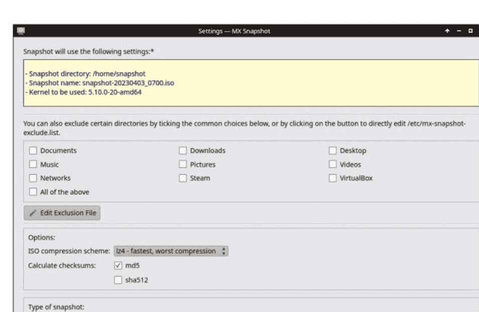

以及文件。点击这些按钮之一将打开文件管理器，你可以在其中指定要排除的文件和文件夹的路径。

一旦输入了所有数据，请为镜像和内核版本（如果有选项）进行指定。默认情况下，`MyLiveGTK` 会将当前内核创建到镜像中。完成后，按下左下角，工具将根据你的设置生成镜像基础。在对话框启动时，`MyLiveGTK` 会显示当前操作的消息（图 7）。

你也可以通过勾选下面的常用复选框排除某些目录，或通过点击目录来编辑 `/my-snapshot-exclude` 列表。


取决于你的软件和计算机资源，完成镜像可能需要一小时以上。`MyLiveGTK` 使用进度条显示传输到 USB 闪盘的进度，然后使用 `MyLiveUSB` 程序，你可以从桌面菜单访问它。

选项：

* OS 压缩方案 [快速, 最快, 压缩压缩]


快照类型：

* 保留账户（用于个人备份）
* 重置账户（用于分发给他）


图 5：新镜像内容的快照详细编辑。

在启动 `MyLiveUSB` 并以系统管理员身份验证后，工具将提示你将快照复制到目标盘中。如果你同意此请求，它会自动检测 U 盘并在单独对话框中进行安装。应用程序不会识别未正确插妥的 U 盘，如果 U 盘没有 `FAT32` 分区则会失败。

各种工作环境。`LINUX` 最初源自 `Mand Linux`，仅运行在 64 位硬件上，并为日常办公提供所有应用程序。为了在每个磁盘使用此特定的副本，`LINUX` 对原始 `Mand Linux` 图形工具进行了许多修改。

尽管最初配置时很复杂，但在正确插入后，该对话框非常易用。在对话框中，你指定要生成的 ISO 镜像和临时文件的路径。在窗口中心，对话框会找到你想要包含的各个文件。通过下面的文件夹列表区域从你的镜像中克隆

`LINUX` 使用 `APT-Package` 作为其包管理系统，使用 `Synaptic` 作为其图形前端，它支持软件的自定义安装。`LINUXOS` 预装了 `mvi-get` 命令行工具。在存储库中，你将找到 `LiveUSB`（用于创建移动 USB 驱动的工具）和 `MyLiveGTK`（创建可启动镜像的工具）[3]。像 `Ubuntu` 或 `Debian Cubic` 一样，`LINUX` 发行版不需要额外的工作基础。相反，工具直接从运行的系统生成镜像。

### 添加目录和添加文件


```
ver 2.6.0
tty (5)
games (6)
messages (11)
system (15)
staff (1)
man (12)
root (120)
group (654)
target (17)
nome (233)
```

你需要在不重启运行系统的情况下删除过时的程序并安装它们。该工具在运行的系统中不需要 `mylogtk` 和 `myliveusb` 软件包。要生成运行的的镜像，`MyLiveGTK` 将通过你当前的环境完成。

```
sorriso 3.4.0-12 filesystem, libnurnia.
Drive source=/dev/sda1="home/user/snapshot/snapshot-2023043_0700.iso"
type: ext4,rw
Status is busy
Writing 18.4 MB blocks, 0.9% done
Added to ISO image -> /tmp/my-snapshot-mapper/root/id-template/iso-1
Added to ISO image -> /tmp/my-snapshot-mapper/root/id-template/iso-2
sorriso UPDATE 1887 files in 1 second
sorriso UPDATE 7.6% done, estimate finish in 4 hours
sorriso UPDATE 48.5% done, estimate finish Mon Apr 03 07:03:54 2023
sorriso UPDATE 52.8% done, estimate finish Mon Apr 03 07:03:54 2023
sorriso UPDATE 69.0% done, estimate finish Mon Apr 03 07:03:54 2023
```


创建 CD/DVD 镜像文件...


图 6：`MX Snapshot` 为创建新镜像 `ISO` 的步骤提供了准确的日志。

`LINUX-MAGAZINE.COM` 第 272 期 33

## 深度自定义可启动

### 自定义可启动

### 自定义启动


`MX Snapshot` 为创建新镜像 `ISO` 的步骤提供了准确的日志。

`LINUX-MAGAZINE.COM` 第 272 期 33

## 深度自定义可启动

### 自定义启动


`MX Snapshot` 为创建新镜像 `ISO` 的步骤提供了准确的日志。

`LINUX-MAGAZINE.COM` 第 272 期 33

## 深度自定义可启动

### 自定义启动

### ISO


图 7：`MyLiveGTK` 显示当前操作的消息（图 7）。


图 7：`MyLiveGTK` 显示当前操作的消息（图 7）。


图 7：`MyLiveGTK` 显示当前操作的消息（图 7）。


图 7：`MyLiveGTK` 显示当前操作的消息（图 7）。


图 7：`MyLiveGTK` 显示当前操作的消息（图 7）。


图 7：`MyLiveGTK` 显示当前操作的消息（图 7）。


图 7：`MyLiveGTK` 显示当前操作的消息（图 7）。


图 7：`MyLiveGTK` 显示当前操作的消息（图 7）。


图 7：`MyLiveGTK` 显示当前操作的消息（图 7）。


图 7：`MyLiveGTK` 显示当前操作的消息（图 7）。


图 7：`MyLiveGTK` 显示当前操作的消息（图 7）。


图 7：`MyLiveGTK` 显示当前操作的消息（图 7）。


图 7：`MyLiveGTK` 显示当前操作的消息（图 7）。

## 深度解析

# SLACKBUILDS

# 自定义 Slackware 仓库


`Slackware` 计算机，在每台计算机上使用这些伪端口（`pseudo-ports`）之一进行安装会导致所有软件为每台机器下载一次，然后安装所有包。这是非常无效的。相反，如果你负责大量的 `Slackware` 机器，自定义仓库允许你一次性打包所有内容，并以最小的分发到无限数量的机器。

欢迎来到 `SlackBuild`！

# IRC.chat 上的 Slackbuilds

`https://irc.chat/groups/slackbuilds`

感谢所有贡献者，他们捐赠了我们现在正在的这台新机器！

`SlackBuilds` 由一个小小组维护，但我们希望仓库中的脚本可以供任何人免费使用。如果您使用 `Slackware` 并需要某些额外的应用程序，我们依靠您来帮助我们。如果您使用的某个应用程序在我们的仓库中缺失，请考虑编写一个 `slackbuild` 并提交供我们纳入——参见“提交（Submissions）”页面。

经常被批评之一是缺乏官方包。虽然官方包提供了一个良好、稳定且灵活的系统（对于许多个人来说已经足够），但事实是第三方仓库中有许多可用包，但许多用户不想安装不受信的包。对于这些需求，`SlackBuilds` 是可用的。

## 为什么使用 SlackBuild？

你可能会奇怪为什么还要费心使用 `Slackware` 包系统。与其费力使用系统端口或构建自定义仓库，你可以使用提供现成仓库的发行版。

**图 1：** `SlackBuilds` 拥有大量的 `SlackBuild` 脚本，允许管理员从源码打包应用程序以使过程变得更容易，而不是自动化。因此，`Slackware` 社区开发了实用的第三方工具来让使用 `SlackBuild` 更容易。如 `slackpkg (5)` 和 `slackist (6)` 程序可以模拟 `apt` 体验：如果你想安装一个工具，你将单独构建、打包并安装请求的程序，而没有依赖关系。特别是，`slackbuild` 重复了类似于 BSD 类操作系统中所使用的脚本。

这取决于运气。如果你想管理库的多个版本，遗憾的是，如果你需要管理一个机群，这些工具并不是很有帮助。

## 基于端口的系统

端口（`Ports`）是设计用于从源码构建程序的脚本。用户发出命令安装特定的软件，端口会构建并安装所有依赖项。

`Gentoo` 是最流行的基于源码的 Linux 发行版。它使用复杂的（强大的）端口系统，支持标志（`flags`），并允许你根据规范构建内核。通过标志，你可以在不需要许多重新构建的情况下构建发行版。

BSD 操作系统也使用端口。`FreeBSD`、`NetBSD` 和 `DragonBSD` 可以使用自己的端口系统或带有二进制包的常规仓库（在某些情况下是两者结合）。这种方法非常强大！并提供了两者的兼长。

`NetBSD` 的端口系统 `pkgsrc (7)` 设计为可移植的，可以在一定程度上在其他操作系统（`MINIX 3`, `Illumos`）上使用。

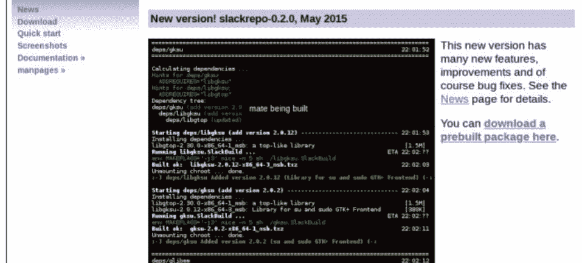

| 新版本！`slackrepo-0.2.0, 2015` | 此新版本包含新功能、改进和一系列错误修复。详情请查看新闻页。 |
|---|---|


| 下载 | 你可以在这里下载预发布包。 |
| Slackbuilds | |
| 文档 | |
| 管理器 | |

```
slackrepo
Introduction
New version!
slack repo
https://github.com/slackbuild/slackrepo.index
```

## 它是什么？

`Slackrepo` 是一个用于 `Slackware` 用户管理其自己的包仓库的高度自动化工具。它帮助你将一组包集合管理为一个仓库。

**图 2：** `Slackrepo` 的原始主页（如所示），但该程序由 `Andrew Clemens` 维护。

`LINUX-MAGAZINE.COM` `ISSUE 272` `JULY 2023` `37`

## 深度解析

### 自定义仓库

依赖关系。通过编译可能加载的任何包都可能导致你破坏它们使用的应用程序。当你可以使用二进制发行版中的隔离组件进行升级时，过程可能会变得复杂。

当你使用基于源码的软件供应时，你获得了一种开箱即用的解决冲突的方法。如果你需要应用补丁或将其升级到新版本，你只需要在你的系统构建中放入一个配置文件。你可以专门为你的环境进行构建并部署（通常）没有冲突。

要了解更多关于其他使用软件方法的发行版信息，请参见“基于端口的系统——编译可能加载的任何包以分发到你的系统。你可以通过这种方式将包加载到 Web 服务器，该服务器可以作为正式仓库。”

本文提供了如何使用 `slackrepo` 创建自定义仓库并使用你的 `Slack` 计算机进行的说明。`slackrepo` 服务器位于我们的局域网内，地址为 `192.168.3.24`，而其他 `Slack` 链在网络中具有硬件地址。

为了开始，你需要在你的服务器上安装完整的 `Slacksetup`。`Slackrepo` 连接到安装了所有官方软件的全新安装系统上。列表 1 总结了如何使用来自 `SlackBuild` 的脚本构建构建仓库。来自 `SlackBuilds` 的 `SlackBuild` 脚本是大多数管理员将使用的。每当使用且距离上次更新超过一天时，`slackrepo` 就会更新本地 `Slack`。

为了创建一个正式仓库，你必须创建 `GPG` 密钥来签名包。客户端需要包签名来验证下载的完整性。列表 2 显示了如何在 `slackrepo` 服务器上创建密钥并输出分发给客户端的文件。客户端将使用此文件验证包。你必须配置 `slackrepo` 使用此密钥。编辑 `/etc/slackrepo.conf` 文件并按照列表 3 所示的操作。为了确保你的文件正确，使用命令生成有效的校验和。你现在准备好部署你的包了。作为一个演示，由 `David Spencer` 和 `Andrew Clemens` 创建的 `Slackrepo` 提供了创建 `Slack` 仓库的最佳方法。`Slackrepo` 用于跟踪的工具。

## 列表 1：在 Slack 服务器上安装 Slackrepo

```
01 # 下载 slackrepo 构建脚本，解压并下载
02 # 使用脚本构建。
04 cd /tmp
05 wget https://slackbuilds.org/slackbuilds/15.0/system/slackrepo.tar.gz
06 - xf slackrepo.tar.gz
07 cd slackrepo
08 wget http://slackbuilds.org/slackbuilds/sources/repo/slackrepo-1.tar.gz
09 bash /tmp/SlackBuild
10 installpkg /tmp/slackrepo*/
12 # 下载 slackrepo 构建脚本，解压
13 # 使用脚本构建。
14 cd /tmp
16 wget https://slackbuilds.org/slackbuilds/15.0/system/slackrepo.tar.gz
17 - xf slackrepo.tar.gz
18 cd slackrepo
19 wget https://github.com/alex/slackrepo/archive/v202317-slackrepo-202317.tar.gz
20 bash /slackrepo
21 installpkg /tmp/slackrepo*/
23 # 下载 hintsfiles 构建脚本，解压，下载 hintsfiles 并
24 # 使用脚本构建。
25
26 cd /tmp
27 wget https://slackbuilds.org/slackbuilds/15.0/system/slackrepo-hints.tar.gz
28 - xf slackrepo-hints.tar.gz
29 cd slackrepo
30 wget https://github.com/alex/slackrepo/archive/v202318-slackrepo-hints-202318.tar.gz
31 bash /slackrepo-hints.SlackBuild
32 installpkg /tmp/slackrepo-hints.gz
```

## 列表 2：包签名密钥

```
01 gpg --batch --passphrase="--quick-generate-key" "Repomaster@example.com"
02 gpg --export Repomaster > GPG-KEY
```

### 客户端设置

你有一个包仓库，但如何利用它？

仓库中的包更新可以手动下载和安装，但 `slackrepo` 支持许多自动化任务的工具。之前提到的 `slackpkg` 是一个流行的选择，但在示例中，我使用的是 `slackrepo`，它是标准 `Slack` 仓库的操作客户端！

虽然 `slackrepo` 仅用于官方 `Slack` 仓库，但请构建带有依赖关系的 `hedgesedges` 包：

```
# slackrepo build hedgesedges
```

一个最小仓库将位于 `/var/lib/slackrepo/packages/`。你可以根据需要编译尽可能多的包，所有包将放在这里。你之后可以将所有内容移动到 Web 服务器：

```
# rm -rf /var/lib/slackrepo/packages/
/var/www/htdocs/
# cp GPG-KEY /var/www/htdocs/keys.asc/x86_64
```

现在，你只需要启用并启动包含 `Slack` 完整仓库的 Web 服务器：

```
# chmod x /etc/rc.d/httpd
# /etc/rc.d/httpd start
```

你可以在网上找到 `http://192.168.1.34` 仓库（如图 3 所示）。

`slackpkg+` 插件与 `slack` 仓库配合。你可以按照以下方法在客户端机器上安装 `slackpkg+`：

```
# wget http://slackinfra.org/slackpkg/
# slackpkg+-1.8.0-nonarch.no7.rpm
# yum install slackpkg+-1.8.0-nonarch.no7.rpm
```

接下来，你需要配置 `slackpkg+`。简单的方法是在每台客户端机器上编辑 `/etc/slackpkg/pkg.conf` 并设置列表 4 中的变量。

## 列表 3：slackrepo.conf 变量

```
01 USE_GENERIC_REPO=1
02 REPOSER=Repomaster repomaster@example.com
03 DL_URL=http://192.168.1.34/slackrepo/SLACKREPO/SLACKERS/ARCHIVE/
04 RSS_UPDATE=EXAMPLE_URL
05 GPG_BIN=/usr/bin/gpg2
06 FOR_SLACKPATH="1"
```

## 列表 4：在 slackpkg conf 中设置变量

```
01 REPOLIST-( custom)
02 MIRRORLIST['custom']=http://192.168.1.34/15/x86_64/
```

### 自定义 Slackware 仓库

终于，你不再需要担心 `/etc/slackpkg/rors` 中的任何官方 `Slack` 镜像源了。该仓库可用于安装你需要的任何包：

- `slackpkg-gpp-update`
- `slackpkg-update`
- `slackpkg-physs gcc ghc lua fpc-headers`

请记住，`slackpkg` 不进行依赖跟踪；当你执行常规 `Slackware` 更新时，自定义仓库中安装的任何包都会被 `slackpkg` 提取：

- `slackpkg-update`
- `slackpkg-upgrade-all`

### 自定义包

在某些时刻，你可能需要构建一个自定义包。如果你发现它没有包含在 `SlackBuild` 数据库中，最好的方法是创建自己的 `SlackBuild` 脚本并将其提交到 `SlackBuilds`。这样社区以及你都可以从高可用服务器获取该构建脚本。

如果你需要使用一组特定的配置选项来构建包，

（此处为图片）


那么现在由你决定了。`Slackrepo` 默认使用 `Git` 同步存储在 `/var/lib/slackrepo/slackBuilds` 中的所有 `SlackBuilds`。官方的 `SlackBuilds.org`。如果你需要使用非官方的 `SlackBuilds` 或官方 `SlackBuilds` 的修改版，`slackrepo` 的原始维护者建议你获取 `Git` 分支而不是官方分支。

然后，根据 [11] 定期用自己的分支更新官方的 `SlackBuilds`。请记住，`slackrepo` 也会跟踪你在 `slackpkg` 文件中想要跟踪的依赖。

`Slackrepo` 用于执行系统请求的某些操作。例如，如果一个包请求运行一个守护进程，它将创建钩子（`hooks`），钩子存储在 `/etc/slackrepo/sx86/` 下的专用文件夹中（如果你想链接它们）。建议编辑 `slackrepo.hints` 文件，这将允许你在所有升级过程中编辑权限。

## 结论

如果你能搭建一套设备，创建一个 `Slackware` 仓库是非常简单的。如果你只是一个管理员，那么 `Slackware` 本地机器仓库并不值得花精力。然而，如果你拥有一大批计算机，你自己的仓库将节省你大量的时间和麻烦。

请记住，这里有很多 `Slackware` 包的仓库，其中一些拥有良好的信誉。`Eric Hamilton` 维护着 `slackrepo` 仓库 [13]，其中包含了所有可用的 `SlackBuilds`。`Nikola` 使用构建好的 `slackrepo` 对官方 `SlackBuilds` 进行更新。

如果你从 `SlackBuilds.org` 构建包，请不要以任何方式分发它们——这些建议针对 `SlackBuilds` 项目。这意味着如果你想与第三方共享你的包，需要从名称中移除 `5bg` 标签。[1]

# 信息

- [1] `Slackware` 仓库: `http://slackware.com`

- [2] 发现: `https://pppkg.kde/discover/`

- [3] `Slackware` 文档中的 `slackpkg`: `http://docs.slackware.com/slackware/slackpkg`

- [4] `SlackBuilds.org`: `https://slackbuilds.org/`

- [5] `slackrepo`: `https://slackrepo.org/`

- [6] `slacktools`: `https://github.com/slacktools/`

- [7] 来自 `NetBSD` 的 `pkgsrc`: `https://www.netbsd.org/pkgsrc/introduction.html#platforms`

- [8] 原 `SlackBuilds` 首页: `https://github.com/slack/slackrepo/index.html`

- [9] `Andrew Clements` 的 `slackrepo` 分叉: `https://github.com/aclemons/slackbuilds/`

- [10] `Hedgesvars`: `https://www.hedges.org/`

- [11] `David Spencer` 在 `SlackBuilds` 上: `https://slackware.com/questions/slackware-14-slackware-and-custom-builds-41759267/post562588`

- [12] 无限文档: `https://github.com/slackrepo/slackrepo.hints`

- [13] `Eric Hamilton` 的仓库: `http://www.slackware.com/alien-slackbuilds/`

- [14] `Slackonly` 仓库: `https://slackonly.com/`

# 作者

`Rubén Lavriente` 是一位机械工程师，负责确保小型客户的 `IT` 安全措施既合规又负担得起。此外，他还是一个 `OpenBSD` 爱好者和武器收藏家。

（此处为图片）

# 在开源世界中寻找你的位置？

（此处为图片）

设置职位提醒并从今天就开始吧！

# 开源职位枢纽

（此处为图片）

`opensourceourcejobhub.com/jobs`

# 深度解析 – `coreboot`

## 编译 `coreboot` 固件

### 从零开始

`coreboot` 让你在学习 `Linux` 的同时构建自己的固件。*作者：`Bruce Byfield`*

作为 `BIOS` 和 `UEFI` 的开源替代方案因其速度和安全性而受到赞誉 [1]。然而，它的可访问性同样重要。“`coreboot` 网站的架构设计旨在实现不可变砖的过程。更新固件就像在手机上安装 `App` 一样简单。”作为这一目标的主要结果，用户可以选择自定义他们的固件。就像自定义 `Linux` 内核一样，`coreboot` 需要遵循指令。该文档面向 `Debian`，可以轻松迁移到其他系统，尽管某些包的名称可能不同。`coreboot` 已经在使用它，你可能需要对其调整以适应你的需求。例如，你可能需要关闭虚拟化支持以获得更好的信息。有时，不支持的主板可能满足大多数用户不熟悉的技术好奇奇。尽管有这些目标，存在损坏机器的可能性，以及另一种尝试恢复的功能。在刷入固件之前，你应该确保创建备份并彻底研究你正在做什么。

## 准备构建

你需要编译器和其他工具来构建固件。你还需要访问 `coreboot` 的文件。

```bash
bb@coreboot-pc:~$ git clone https://github.com/coreboot coreboot
remote: Counting objects: 755206, done
remote: Finding: 100% (755206/755206)
remote: Total: 755206 (delta 582644), received 15800 (100% of 15800), 183.1 MiB | 3.05 Mi/s, done.
remote: Resolving deltas: 100% (582644/582644), done.
```

图 1：`coreboot` 的源代码存储在 `Git` 上。

（此处为图片）

# 深度解析命令行

```bash
bb@system76-pc -- /coreboot make crossgcc-i386 Welcome to coreboot toolchain v2023-04-17 Building coreboot using thread.目标架构是 i386。找到兼容的 Ada 编译器，默认启用 Ada 支持。正在下载并验证压缩包...
# gmp-6.2.1.tar.xz downloading from https://ftp.gnu.org/pub/gmp/6.2.1.tar.xz 100% hash verified (057...
# mpfr-4.2.0.tar.xz downloading from https://ftp.gnu.org/pub/mpfr/4.2.0.tar.xz 100% hash verified (bac)
# mpc-1.3.tar.xz downloading from https://ftp.gnu.org/pub/mpc/1.3.tar.xz 100% hash verified (bac)
# binutils-2.40.tar.xz downloading from https://ftp.gnu.org/pub/binutils/2.40.tar.xz 100% hash verified (bac (4fe890623f4a7b36a4f753d9a4b7f86)
# gcc-11.3.0.tar.xz downloading from https://ftp.gnu.org/pub/gcc/11.3.0.tar.xz 5%
```

**图 2**：`coreboot` 通过提供自己的顺序来简化构建过程。如果你有偏好的编译器（`C`、`G++` 或 `gcc-multilib`），可以替换它。如果你使用 `Clang` 或 `LLVM` 作为编译器，也可以使用它。同样，如果你的硬件使用高级配置和电源接口 (`ACPI`) 进行电源管理，也包含它！如果你想要终端图形显示，使用 `ncurses-dev` 就是你所需要的。但对于许多使用其他发行版的用户，你可能需要搜索不同的方法。

最后一个命令输出你使用的子配方（图 1）。最后的准备阶段是构建工具链。这一步是必要的，因为不同的发行版包含不同的功能，防止许多问题，`coreboot` 使用它自己的补丁版本 `GCC`，包括细节。

从源码目录，输入 `make menu` 显示文本界面（图 3）。或者，如果已安装，输入 `make nconfig` 进入菜单。详细说明可以在 `coreboot` 文档可用，尽管对于某些设置你可能接受默认值。对于具有原生名称的系统，遵循硬件的通用图形。对于非图形，请参考图 5 中的信息。注意，对于 `Intel` 和 `AMD` 主板，你可能需要提供来自 `vet` 的文件——

# 构建步骤


你可以在任何机器上构建`coreboot`。在你完成规则之前，该过程将无法工作。要开始，克隆`coreboot`文件并切换到它们的根目录：

## 构建自定义固件

```bash
git clone https://github.com/coreboot
cd coreboot
git submodule update --init
```

为了高效构建，你需要硬件的规格说明。如果你不再拥有规格说明或找不到它们，你仍然可以尝试构建并多次尝试。为了练习，你可能想查看关于`Qemu`模拟器的在线教程，它需要的配置较少 [4]。

```text
/home/coreboot/coreboot_coreboot configuration
```

使用箭头键导航菜单（使用箭头或 ----）。高亮项是字母。按`<`, `>`包含、排除、修改模块。按`Esc`退出，`?`搜索。图例`*`内置 `>`排除 `<module>` `>` 可

```
General setup
* target ---
* chipset ---
* version ---
* Generic Drivers ---
* security ---
* console ---
* uses ---
* layout ---
* ---
<Select> Exit < Help < Save < Load
```

负载（payload）在带有`coreboot`的启动机器的第一阶段加载操作系统。你可以使用默认的`SeaOS`或其他负载。包括，像`Linux`和`Star Labs`这样的硬件系统提供了自己的负载，这对于使用它们的工具或应用程序可能是必要的。然而，你也可以使用其他负载构建。

当你做出所有选择后，按`Esc`退出菜单并保存你的选择。

### 深度解析

#### Command_coreboot

通用 / UMS 配置值 = `CMDS` 默认值位于你的主板目录`src/mainboard/model.defs`

设备 / 原生图形初始化 = 启用（注意：并非所有系统都可用）

显示 / 帧缓冲区 = 禁用（文本模式图形的默认值，在`coreboot` vs 中启用）

负载 / USB 2.0 调试支持 = 启用

通用驱动 / 启用（RAM 之前）使用调试 = 启用

通用驱动 / 令牌棒类型 = 任意或无

通用驱动 / 数字化器 = 存在

控制台 / 双控制台输出 = 启用

负载 / 文件名 = `payload`（如果你想要不同的负载）（如果你想要不同的负载，请更改此项）

**图 4：** 在带有集成显卡的机器上，要求固件的通用所需的固件选项。使用`coreboot`。

设备 / VGA 选项 = 禁用

设备 / PCI 设备上的 ROM = 禁用

最近，我使用了一个名为`coreboot-configuration`的图形化工具来处理设备变体。在你研究完特性并成功构建固件后，你会遇到一些问题。

**图 5：** 没有集成显卡的机器需要两个选项。

进入包含`coreboot`以及任何厂商或负载构建的目录（图 6）。在构建结束时，无论成功失败，都需要要求你在下一次尝试之前通过一些研究进行纠正。只有在一次失败后才出现过刷写成功。尽管如此，请务必小心，在尝试之前搜索流程，并备份你的文件。如果你按照上述说明操作，你将能够构建内核（即同一台电脑的其中一个）。在包含你固件的目录中，

### 刷写、拆解与移除

这些指令是从零开始刷写固件的。`Coreboot` 作为一个操作系统正在飞速发展。越来越多的`Linux`硬件厂商正在让`coreboot`变得更易于获取。例如，`System 76`显示了它的选项，包括查找硬件规格的脚本 (6)，以及比说明中显示的步骤多得多的更新。在这里，`Ubuntu`自带了一个用于安装`coreboot`配置的工具，这与更新`Android`手机一样简单可能并不遥远。

现在，刷写自定义固件最简单的方法是使用`flashrom` [7]，它是用于刷写以下内容的相同实用程序：

```
flashrom -i -w/coreboot
```

你可能需要在启动管理器中启动。如果该过程没有成功，请检查`coreboot`文档中关于其他刷写方法，以及作为更常用的：目前，编辑`coreboot`最简单的方法是重置闪存编程器。`Star Labs`有：

```
bbqsystem76-pc=~/coreboot/ coreboot make
Updating git modules
HOSTCC
util/config.lex.py
HOSTCC
util/config.tab
HOSTCC
util/config/main
util/config (link)
mainboard/emulator/qemu-1440fx/devicree.cb
```

```
# No /to home-bb/coreboot/.config
build.auto.config 1611: override = assignment to symbol LAPIC ACCESS MODE
HOSTCC
nvartool/cl1/nvtool.o
nvartool/clipt/opts.o
HOSTCC
nvartool/cm0_level.o
HOSTCC
nvartool/charm.o
HOSTCC
nvartool/common.o
HOSTCC
nvartool/compute_checksum.o
HOSTCC
nvartool/newsetup
```

信息：https://coreboot.org/

[已支持] 方法：https://coreboot.org/status/boot-status.html

[coreboot] 文档：https://coreboot.org/HOWTO/kerneldev

[Qemu] 教程：https://coreboot.org/QEMU_Menu_Tutorial

[Payloads]：https://doc.coreboot.org/payload.html

[System] 文档：https://github.com/system/firmware-open-blob/flashing.md

[flash]:https://www.com/Flashrom

[8 固件]:https://doc.coreboot.org/tutorial/flashing/index.html

[coreboot-configuration]:https://support.starlabs.com/kb/guides-corebootconfiguration

**图 6：** 编译固件：仅刷写成功构建的文件。

2023年7月44日 | 第 272 期 | LINUX-MAGAZINE.COM

### 将你的想法变为现实！

这不是一本普通的电脑杂志！`MakerSpace`专注于你可以用来构建属于自己的东西的技术。

如果你对电子产品感兴趣，但还没有时间或技能（目前），学习这些 Maker 项目可能是让你开始的最后推动力。

这期特别刊将帮助你深入研究：

- 树莓派
- `Arduino`
- 复古游戏
- 以及更多！


### 深度解析

逆向工程蓝牙

逆向工程一个 BLE 钟

### 完美时间

当你所有的蓝牙钟显示的时间略有不同时，你会怎么办？通过逆向工程，你计划编写一个`Python`程序来同步你的时。作者：Koen Vervloesen


我有一个`ThermoPro TP358`，这是一个带有显示器的蓝牙低功耗 (`BLE`) 数字温度计。`ThermoPro`显示温度、湿度和空气舒适度指数，以及时间和日期。它的显示对于即时反馈很好，但该设备允许你通过`Android`和`iOS`上的`App`读取其值并查看图表（图 1）。我的计划是弄清楚命令的含义，然后在可以全天运行的树莓派上实现同步命令。本文描述了我我是如何对`ThermoPro TP358`实现此，但你可以对任何`BLE`设备使用相同的步骤。此外，每当我连接到`App`时，它都会同步时间。

#### 调查流量

有多种方法调查流量。如果你正在调查`Android`手机发送的`BLE`数据包，简单的方法是让手机记录，然后将日志传输到电脑并用`Wireshark`打开。作为更常用的：目前，编辑`coreboot`最简单的方法是重置闪存编程器。`Star Labs`有：

（此处代码块保持原文，不翻译）

 流量

有多种方法调查流量。如果你正在调查`Android`手机发送的`BLE`数据包，简单的方法是让手机记录，然后将日志传输到电脑并用`Wireshark`打开。作为更常用的：目前，编辑`coreboot`最简单的方法是重置闪存编程器。`Star Labs`有：

 流量


# 深度解析

## `Command_coreboot`

通用 / UMS 配置值 = `CMDS` 默认值位于你的主板目录 `src/mainboard/model.defs`

设备 / 原生图形初始化 = 启用（注意：并非所有系统都可用）

显示 / 帧缓冲区 = 禁用（文本模式图形的默认值，在 `coreboot` vs 中启用）

负载 / USB 2.0 调试支持 = 启用

通用驱动 / 启用（RAM 之前）使用调试 = 启用

通用驱动 / 令牌棒类型 = 任意或无

通用驱动 / 数字化器 = 存在

控制台 / 双控制台输出 = 启用

负载 / 文件名 = `payload`（如果你想要不同的负载，请更改此项）

**图 4：** 在带有集成显卡的机器上，要求固件的通用固件选项。使用 `coreboot`。

设备 / VGA 选项 = 禁用

设备 / PCI 设备上的 ROM = 禁用

最近，我使用了一个名为 `coreboot-configuration` 的图形化工具来处理设备变体。在你研究完特性并成功构建固件后，你会遇到一些问题。

**图 5：** 没有集成显卡的机器需要两个选项。

进入包含 `coreboot` 以及任何厂商或负载构建的目录（图 6）。在构建结束时，无论成功失败，都需要要求你在下一次尝试之前通过一些研究进行纠正。只有在一次失败后才出现过刷写成功。尽管如此，请务必小心，在尝试之前搜索流程，并备份你的文件。如果你按照上述说明操作，你将能够构建内核（即同一台电脑的其中一个）。在包含你固件的目录中，

## 刷写、拆解与移除

这些指令是从零开始刷写固件的。`coreboot` 作为一个操作系统正在飞速发展。越来越多的 Linux 硬件厂商正在让 `coreboot` 变得更易于获取。例如，System 76 显示了它的选项，包括查找硬件规格的脚本 (6)，以及比说明中显示的步骤多得多的更新。在这里，Ubuntu 自带了一个用于安装 `coreboot` 配置的工具，这与更新 Android 手机一样简单可能并不遥远。

现在，刷写自定义固件最简单的方法是使用 `flashrom` [7]，它是用于刷写以下内容的相同实用程序：

```
flashrom -i -w/coreboot
```

你可能需要在启动管理器中启动。如果该过程没有成功，请检查 `coreboot` 文档中关于其他刷写方法，以及作为更常用的：目前，编辑 `coreboot` 最简单的方法是重置闪存编程器。Star Labs 有：

```
bbqsystem76-pc=~/coreboot/ coreboot make
Updating git modules
HOSTCC
util/config.lex.py
HOSTCC
util/config.tab
HOSTCC
util/config/main
util/config (link)
mainboard/emulator/qemu-1440fx/devicree.cb
```

```
# No /to home-bb/coreboot/.config
build.auto.config 1611: override = assignment to symbol LAPIC ACCESS MODE
HOSTCC
nvartool/cl1/nvtool.o
nvartool/clipt/opts.o
HOSTCC
nvartool/cm0_level.o
HOSTCC
nvartool/charm.o
HOSTCC
nvartool/common.o
HOSTCC
nvartool/compute_checksum.o
HOSTCC
nvartool/newsetup
```

信息：https://coreboot.org/

[已支持] 方法：https://coreboot.org/status/boot-status.html

[`coreboot`] 文档：https://coreboot.org/HOWTO/kerneldev

[`Qemu`] 教程：https://coreboot.org/QEMU_Menu_Tutorial

[`Payloads`]：https://doc.coreboot.org/payload.html

[`System`] 文档：https://github.com/system/firmware-open-blob/flashing.md

[`flash`]:https://www.com/Flashrom

[`8 固件`]:https://doc.coreboot.org/tutorial/flashing/index.html

[`coreboot-configuration`]:https://support.starlabs.com/kb/guides-corebootconfiguration

**图 6：** 编译固件：仅刷写成功构建的文件。

2023年7月44日 | 第 272 期 | LINUX-MAGAZINE.COM

## 将你的想法变为现实！

这不是一本普通的电脑杂志！`MakerSpace` 专注于你可以用来构建属于自己的东西的技术。

如果你对电子产品感兴趣，但还没有时间或技能（目前），学习这些 Maker 项目可能是让你开始的最后推动力。

这期特别刊将帮助你深入研究：

- 树莓派
- `Arduino`
- 复古游戏
- 以及更多！


# 深度解析

逆向工程蓝牙

逆向工程一个 `BLE` 钟

# 完美时间

当你所有的蓝牙钟显示的时间略有不同时，你会怎么办？通过逆向工程，你计划编写一个 `Python` 程序来同步你的时。作者：Koen Vervloesen


我有一个 ThermoPro TP358，这是一个带有显示器的蓝牙低功耗 (BLE) 数字温度计。ThermoPro 显示温度、湿度和空气舒适度指数，以及时间和日期。它的显示对于即时反馈很好，但该设备允许你通过 Android 和 iOS 上的 App 读取其值并查看图表（图 1）。我的计划是弄清楚命令的含义，然后在可以全天运行的树莓派上实现同步命令。本文描述了我我是如何对 ThermoPro TP358 实现此，但你可以对任何 BLE 设备使用相同的步骤。此外，每当我连接到 App 时，它都会同步时间。

## 调查流量

有多种方法调查流量。如果你正在调查 Android 手机发送的 BLE 数据包，简单的方法是让手机记录，然后将日志传输到电脑并用 Wireshark 打开。作为更常用的：目前，编辑 `coreboot` 最简单的方法是重置闪存编程器。Star Labs 有：

## 深度解析

## 蓝牙逆向工程

它以值 `a5` 开始并以 `5a` 结束，因此这看起来像是一个包头和页脚。`5a` 之前的 `01` 看起来也不像，可能是页脚或其他内容。此外，`07` 始终保持为 `07`，看起来像是一天中的结束，而 `07` 变成了其他值。也许这些是秒，它们不在时钟显示范围内。

`ykr_hn_2085a_tlu66`。因此数据包中的后续行是应用对应的：

```
package/data/app/--9lh-Mj7iUbObZ26AIew=/com.humuro.ykr_hn_2085a_tlu66-dZE=lThVNbRa26Iqd=/app.com.humuro.ykr_hn_2085a_tlu66/
```

在解压目录内从命令行运行 `./bin/jadx-gui`。选择你下载的 `.apk` 文件。程序将向你显示类和层的树形结构，如下：

现在将 `apk` 文件从文件夹复制到你的：

```
adb pull data/app/--9lh-Mj7iUbObZ26AIew=/com.humuro.ykr_hn_2085a_tlu66-dZE=lThVNbRa26Iqd=/app.com.humuro.ykr_hn_2085a_tlu66/
```

并使用路径方法反编译第一个或最后一个字符。结果保存在你的电脑上作为。

如果获取 `apk` 文件不起作用，你可以从第三方 `apk` 反编译器下载，例如 `apk`:

遵循指纹操作。你现在已准备好搜索设置目标了。查看 Wireshark 中的蓝牙日志。你已经分析出了数据包中包含的值，但它在哪里呢？点击详情面板中的下拉菜单。查看 UUID 的方法是：


## 解码移动应用

你现在已经通过蓝牙日志完成了解码，能够发送命令来设置时间，但仍然存在一些问题。我将反编译 `Android Pro` 传感器并尝试使用以下方法解决这些问题：

你已经下载了该文件的 `apk`。如果你通过 `USB` 连接并启用了调试连接，你可以使用 `adb` 使用该包。首先列出所有可用包：

```
adb shell pm list -
```

然后在结果列表中搜索应用名称。遗憾的是，`Termo-Pro` 不在列表中。在 `Google Play` 商店中搜索并查看应用网页的 URL，它显示该包名为 `humuro`。

如果获取 `apk` 文件不起作用，你可以从第三方 `apk` 反编译器下载，例如 `apk`。

此 `APK` 文件包含正在执行的 `Dalvik` 代码，但你可以使用强大的 `jadx` 反编译器将其反编译为 `Java` 源码，该工具既有命令行版本，也有图形界面版本。你需要 `Java 8` 或更高版本来运行。

从 `GitHub` 下载 `jadx` 的最新发布版本并使用 `ZIP` 文件。然后启动图形界面。

在 `Navigation`（导航） | `Search`（搜索）菜单中，`jadx` 开始反编译应用。当你准备就绪时，在搜索字段中使用其中一个 `UUID`。你可能无法两个 `UUID` 都找到结果，但只需使用 `0001`，`UUID` 就会以字符串常量的形式定义。

在逆向工程 `BLE` 连接时，特征（`characteristics`）比服务（`services`）更有趣，因为特征是数据的实际容器。如果你理解了特征：

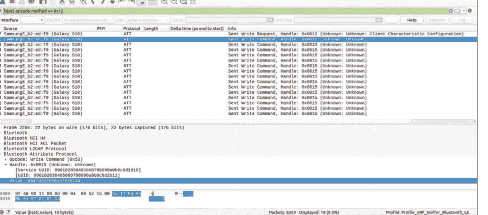

| Handle | Protocol | Length | Data (offset to start) | Sent Write Command, Response, Handle: (Unknown) | Client Characteristic | Configuration |
|---|---|---|---|---|---|---|
| 01 | `ATT` | 02 | | Sent Write Command, Response, Handle: `0001` (`Unknown`: `Unknown`) | | |
| 02 | `ATT` | 02 | | Sent Write Command, Response, Handle: `0002` (`Unknown`: `Unknown`) | | |
| 03 | `ATT` | 02 | | Sent Write Command, Response, Handle: `0003` (`Unknown`: `Unknown`) | | |
| 04 | `ATT` | 02 | | Sent Write Command, Response, Handle: `0004` (`Unknown`: `Unknown`) | | |
| 05 | `ATT` | 02 | | Sent Write Command, Response, Handle: `0005` (`Unknown`: `Unknown`) | | |
| 06 | `ATT` | 02 | | Sent Write Command, Response, Handle: `0006` (`Unknown`: `Unknown`) | | |
| 07 | `ATT` | 02 | | Sent Write Command, Response, Handle: `0007` (`Unknown`: `Unknown`) | | |
| 08 | `ATT` | 02 | | Sent Write Command, Response, Handle: `0008` (`Unknown`: `Unknown`) | | |
| 09 | `ATT` | 02 | | Sent Write Command, Response, Handle: `0009` (`Unknown`: `Unknown`) | | |
| 10 | `ATT` | 02 | | Sent Write Command, Response, Handle: `0010` (`Unknown`: `Unknown`) | | |
| 11 | `ATT` | 02 | | Sent Write Command, Response, Handle: `0011` (`Unknown`: `Unknown`) | | |
| 12 | `ATT` | 02 | | Sent Write Command, Response, Handle: `0012` (`Unknown`: `Unknown`) | | |
| 13 | `ATT` | 02 | | Sent Write Command, Response, Handle: `0013` (`Unknown`: `Unknown`) | | |
| 14 | `ATT` | 02 | | Sent Write Command, Response, Handle: `0014` (`Unknown`: `Unknown`) | | |
| 15 | `ATT` | 02 | | Sent Write Command, Response, Handle: `0015` (`Unknown`: `Unknown`) | | |
| 16 | `ATT` | 02 | | Sent Write Command, Response, Handle: `0016` (`Unknown`: `Unknown`) | | |
| 17 | `ATT` | 02 | | Sent Write Command, Response, Handle: `0017` (`Unknown`: `Unknown`) | | |
| 18 | `ATT` | 02 | | Sent Write Command, Response, Handle: `0018` (`Unknown`: `Unknown`) | | |
| 19 | `ATT` | 02 | | Sent Write Command, Response, Handle: `0019` (`Unknown`: `Unknown`) | | |
| 20 | `ATT` | 02 | | Sent Write Command, Response, Handle: `0020` (`Unknown`: `Unknown`) | | |
| 21 | `ATT` | 02 | | Sent Write Command, Response, Handle: `0021` (`Unknown`: `Unknown`) | | |
| 22 | `ATT` | 02 | | Sent Write Command, Response, Handle: `0022` (`Unknown`: `Unknown`) | | |
| 23 | `ATT` | 02 | | Sent Write Command, Response, Handle: `0023` (`Unknown`: `Unknown`) | | |
| 24 | `ATT` | 02 | | Sent Write Command, Response, Handle: `0024` (`Unknown`: `Unknown`) | | |
| 25 | `ATT` | 02 | | Sent Write Command, Response, Handle: `0025` (`Unknown`: `Unknown`) | | |
| 26 | `ATT` | 02 | | Sent Write Command, Response, Handle: `0026` (`Unknown`: `Unknown`) | | |
| 27 | `ATT` | 02 | | Sent Write Command, Response, Handle: `0027` (`Unknown`: `Unknown`) | | |
| 28 | `ATT` | 02 | | Sent Write Command, Response, Handle: `0028` (`Unknown`: `Unknown`) | | |
| 29 | `ATT` | 02 | | Sent Write Command, Response, Handle: `0029` (`Unknown`: `Unknown`) | | |
| 30 | `ATT` | 02 | | Sent Write Command, Response, Handle: `0030` (`Unknown`: `Unknown`) | | |
| 31 | `ATT` | 02 | | Sent Write Command, Response, Handle: `0031` (`Unknown`: `Unknown`) | | |
| 32 | `ATT` | 02 | | Sent Write Command, Response, Handle: `0032` (`Unknown`: `Unknown`) | | |
| 33 | `ATT` | 02 | | Sent Write Command, Response, Handle: `0033` (`Unknown`: `Unknown`) | | |
| 34 | `ATT` | 02 | | Sent Write Command, Response, Handle: `0034` (`Unknown`: `Unknown`) | | |
| 35 | `ATT` | 02 | | Sent Write Command, Response, Handle: `0035` (`Unknown`: `Unknown`) | | |


| 序号 | 协议 | 类型 | 状态 | 描述 | 注释 | 备注 |
| :--- | :--- | :--- | :--- | :--- | :--- | :--- |
| 36 | `ATT` | `02` | | Sent Write Command, Response, Handle: `0036` (Unknown: Unknown) | | |
| 37 | `ATT` | `02` | | Sent Write Command, Response, Handle: `0037` (Unknown: Unknown) | | |
| 38 | `ATT` | `02` | | Sent Write Command, Response, Handle: `0038` (Unknown: Unknown) | | |
| 39 | `ATT` | `02` | | Sent Write Command, Response, Handle: `0039` (Unknown: Unknown) | | |
| 40 | `ATT` | `02` | | Sent Write Command, Response, Handle: `0040` (Unknown: Unknown) | | |
| 41 | `ATT` | `02` | | Sent Write Command, Response, Handle: `0041` (Unknown: Unknown) | | |
| 42 | `ATT` | `02` | | Sent Write Command, Response, Handle: `0042` (Unknown: Unknown) | | |
| 43 | `ATT` | `02` | | Sent Write Command, Response, Handle: `0043` (Unknown: Unknown) | | |
| 44 | `ATT` | `02` | | Sent Write Command, Response, Handle: `0044` (Unknown: Unknown) | | |
| 45 | `ATT` | `02` | | Sent Write Command, Response, Handle: `0045` (Unknown: Unknown) | | |
| 46 | `ATT` | `02` | | Sent Write Command, Response, Handle: `0046` (Unknown: Unknown) | | |
| 47 | `ATT` | `02` | | Sent Write Command, Response, Handle: `0047` (Unknown: Unknown) | | |
| 48 | `ATT` | `02` | | Sent Write Command, Response, Handle: `0048` (Unknown: Unknown) | | |
| 49 | `ATT` | `02` | | Sent Write Command, Response, Handle: `0049` (Unknown: Unknown) | | |
| 50 | `ATT` | `02` | | Sent Write Command, Response, Handle: `0050` (Unknown: Unknown) | | |
| 51 | `ATT` | `02` | | Sent Write Command, Response, Handle: `0051` (Unknown: Unknown) | | |
| 52 | `ATT` | `02` | | Sent Write Command, Response, Handle: `0052` (Unknown: Unknown) | | |
| 53 | `ATT` | `02` | | Sent Write Command, Response, Handle: `0053` (Unknown: Unknown) | | |
| 54 | `ATT` | `02` | | Sent Write Command, Response, Handle: `0054` (Unknown: Unknown) | | |
| 55 | `ATT` | `02` | | Sent Write Command, Response, Handle: `0055` (Unknown: Unknown) | | |
| 56 | `ATT` | `02` | | Sent Write Command, Response, Handle: `0056` (Unknown: Unknown) | | |
| 57 | `ATT` | `02` | | Sent Write Command, Response, Handle: `0057` (Unknown: Unknown) | | |
| 58 | `ATT` | `02` | | Sent Write Command, Response, Handle: `0058` (Unknown: Unknown) | | |
| 59 | `ATT` | `02` | | Sent Write Command, Response, Handle: `0059` (Unknown: Unknown) | | |
| 60 | `ATT` | `02` | | Sent Write Command, Response, Handle: `0060` (Unknown: Unknown) | | |
| 61 | `ATT` | `02` | | Sent Write Command, Response, Handle: `0061` (Unknown: Unknown) | | |
| 62 | `ATT` | `02` | | Sent Write Command, Response, Handle: `0062` (Unknown: Unknown) | | |
| 63 | `ATT` | `02` | | Sent Write Command, Response, Handle: `0063` (Unknown: Unknown) | | |
| 64 | `ATT` | `02` | | Sent Write Command, Response, Handle: `0064` (Unknown: Unknown) | | |
| 65 | `ATT` | `02` | | Sent Write Command, Response, Handle: `0065` (Unknown: Unknown) | | |
| 66 | `ATT` | `02` | | Sent Write Command, Response, Handle: `0066` (Unknown: Unknown) | | |
| 67 | `ATT` | `02` | | Sent Write Command, Response, Handle: `0067` (Unknown: Unknown) | | |
| 68 | `ATT` | `02` | | Sent Write Command, Response, Handle: `0068` (Unknown: Unknown) | | |
| 69 | `ATT` | `02` | | Sent Write Command, Response, Handle: `0069` (Unknown: Unknown) | | |
| 70 | `ATT` | `02` | | Sent Write Command, Response, Handle: `0070` (Unknown: Unknown) | | |
| 71 | `ATT` | `02` | | Sent Write Command, Response, Handle: `0071` (Unknown: Unknown) | | |
| 72 | `ATT` | `02` | | Sent Write Command, Response, Handle: `0072` (Unknown: Unknown) | | |
| 73 | `ATT` | `02` | | Sent Write Command, Response, Handle: `0073` (Unknown: Unknown) | | |
| 74 | `ATT` | `02` | | Sent Write Command, Response, Handle: `0074` (Unknown: Unknown) | | |
| 75 | `ATT` | `02` | | Sent Write Command, Response, Handle: `0075` (Unknown: Unknown) | | |
| 76 | `ATT` | `02` | | Sent Write Command, Response, Handle: `0076` (Unknown: Unknown) | | |
| 77 | `ATT` | `02` | | Sent Write Command, Response, Handle: `0077` (Unknown: Unknown) | | |
| 78 | `ATT` | `02` | | Sent Write Command, Response, Handle: `0078` (Unknown: Unknown) | | |
| 79 | `ATT` | `02` | | Sent Write Command, Response, Handle: `0079` (Unknown: Unknown) | | |


| 80 | ATT | 02 | | Sent Write Command, Response, Handle: `0080` (Unknown: Unknown) | | |

| 81 | ATT | 02 | | Sent Write Command, Response, Handle: `0081` (Unknown: Unknown) | | |

| 82 | ATT | 02 | | Sent Write Command, Response, Handle: `0082` (Unknown: Unknown) | | |

| 83 | ATT | 02 | | Sent Write Command, Response, Handle: `0083` (Unknown: Unknown) | | |

| 84 | ATT | 02 | | Sent Write Command, Response, Handle: `0084` (Unknown: Unknown) | | |

| 85 | ATT | 02 | | Sent Write Command, Response, Handle: `0085` (Unknown: Unknown) | | |

| 86 | ATT | 02 | | Sent Write Command, Response, Handle: `0086` (Unknown: Unknown) | | |

| 87 | ATT | 02 | | Sent Write Command, Response, Handle: `0087` (Unknown: Unknown) | | |

| 88 | ATT | 02 | | Sent Write Command, Response, Handle: `0088` (Unknown: Unknown) | | |

| 89 | ATT | 02 | | Sent Write Command, Response, Handle: `0089` (Unknown: Unknown) | | |

| 90 | ATT | 02 | | Sent Write Command, Response, Handle: `0090` (Unknown: Unknown) | | |

| 91 | ATT | 02 | | Sent Write Command, Response, Handle: `0091` (Unknown: Unknown) | | |

| 92 | ATT | 02 | | Sent Write Command, Response, Handle: `0092` (Unknown: Unknown) | | |

| 93 | ATT | 02 | | Sent Write Command, Response, Handle: `0093` (Unknown: Unknown) | | |

| 94 | ATT | 02 | | Sent Write Command, Response, Handle: `0094` (Unknown: Unknown) | | |

| 95 | ATT | 02 | | Sent Write Command, Response, Handle: `0095` (Unknown: Unknown) | | |

| 96 | ATT | 02 | | Sent Write Command, Response, Handle: `0096` (Unknown: Unknown) | | |

| 97 | ATT | 02 | | Sent Write Command, Response, Handle: `0097` (Unknown: Unknown) | | |

| 98 | ATT | 02 | | Sent Write Command, Response, Handle: `0098` (Unknown: Unknown) | | |

| 99 | ATT | 02 | | Sent Write Command, Response, Handle: `0099` (Unknown: Unknown) | | |

| 100 | ATT | 02 | | Sent Write Command, Response, Handle: `0100` (Unknown: Unknown) | | |

Frame 2206, 22 bytes on wire (176 bits), 22 captured by (176 bits)

+   - Bluetooth HCI
- Bluetooth Generic
- Bluetooth LE GATT Protocol
- Handle: `0001` (Unknown: Unknown)

```
UUID: 00002a37-0000-1000-8000-00805f9b34fb
```

图 3: 确定手机发送到蓝牙的命令行。

48

2023年7月

第 272 期

LINUX-MAGAZINE.COM

## 蓝牙逆向工程

主函数异步运行（因为 `Bleak` 使用了 `asyncio`）。它创建了一个 `BleakClient` 实例，并带有一个默认回调函数，该函数在 BLE 设备连接时运行。然后它启动扫描器，等待五秒钟并停止设备。该函数将设备添加到已发现设备集合中。脚本显示了设备的完整地址和名称：


如果你用 `python scan.py` 运行此 Python 脚本，它会显示你视范围内所有 BLE 设备的名称和地址。例如，一个名称为 `526C` 的时，`526C` 是时地址的四个十六进制数字，所以你现在可以看到

| 查找： | 文本搜索 | | |

|---|---|---|---|

| 查找定义 | | | |

| 类 | 方法 | 字段 | 代码 |

| | | 选项：忽略大小写 | |

| 字段 | 代码 | | |

| `* uuid.UUID('0000180d-0000-1000-8000-00805f9b34fb')` | | | |

| `* uuid.UUID('0000180a-0000-1000-8000-00805f9b34fb')` | | | |

| `* uuid.UUID('00001805-0000-1000-8000-00805f9b34fb')` | | | |

| `* uuid.UUID('00001806-0000-1000-8000-00805f9b34fb')` | | | |

| `* uuid.UUID('00001807-0000-1000-8000-00805f9b34fb')` | | | |

| `* uuid.UUID('00001808-0000-1000-8000-00805f9b34fb')` | | | |

图 4：反汇编译代码中的后续断点。

在字段 UUID `0000180d-0465-1007-82a9-02a9c0dd2b1` 中，你发现了一处出现：24小时制格式的值。我的代码以默认的 24 小时制显示时间，但显然这个位位将格式更改为使用 AM/PM 的 12 小时钟。

```python
public final UUID f476c = UUID.fromstring('0000180d-0465-1007-82a9-02a9c0dd2b1');
```

你还可以看到这段代码设置了设置命令，但不包含日期或 24 小时格式。这意味着该 UUID 指向它的名称 `f476c`。你可以打开十六进制搜索并搜索 `f476c`。这显示了另一个另一个出现的地方：

```python
BluetoothCharacteristic-characteristic = service.getCharacteristic
```

## 寻找正确的代码

你已经大概了解了按顺序向蓝牙钟发送什么内容。我将把这些整合在一起，创建一个 Python 脚本在不使用 App 的情况下完成操作。

几行之后，特征被如下使用：

```python
characteristic.setValue(bar);
```

在这里，值位于该代码所属的方法中。我的方法名为 `f476c`。这正是我们需要的。在文本中搜索此名称以查看该方法在何处调用，得到了八个结果（图 4），查看每个结果并尝试弄清楚它们在做什么。

在所有的断点之后，仅在列表 1 中，立即显示了你弄清楚了：头部、年份、月份，然后确认了秒数。接着是星期几，你之前没能识别出来的是它。

使用 `Bleak`，一个跨平台的的 Python 客户端库，它可以这样工作：

首先，你可以找到所有设备并显示它们的名称和地址。脚本 `find_devices.py`（列表 2）

```bash
pip install bleak
```

### 列表 2：`find_devices.py`


```python
import asyncio

from bleak import BleakScanner
from bleak.backends.device import BLEDevice
from bleak.backends.scanner import AdvertisementData


def find_found(device: BLEDevice, advertisement_data: AdvertisementData):
    devices.add(device)


async def main():
    scanner = BleakScanner(discovery_callback=find_found)

    print("Scanning for devices...")
    await scanner.start()
    await asyncio.sleep(5)
    await scanner.stop()

for device in devices:
    print(f"{device.name} : {device.address}")

if __name__ == "__main__":
    devices = set()
```

对于这种通过名称过滤 `TP358` 的蓝牙钟，你只需要更改脚本`find_clocks.py`中的回调函数：

```python
def find_found(device: BLEDevice, advertisement_data):
    if device.name.startswith("TP358"):
        devices.add(device)
```

## 发送时间

现在你知道了蓝牙地址，可以写另一个脚本`sync_clock.py`（列表 3），它接收此地址作为参数并设置钟的时间。根据你之前的知识，这个逻辑非常直观。脚本定义了发送命令的特征，然后是一个函数`get_bytes_from_time`将 Unix 时间戳转换为需要发送到钟的字节。`main`函数连接到设备并写入正确的特征。如果你运行此命令，例如：

```bash
python sync_clock.py 12:58
```

它应该设置你钟的时间。

### 列表 3：`sync_clock.py`

```python
import asyncio
from datetime import datetime
import sys
from time import time

from bleak import BleakClient

COMMAND_CHAR = "00010203-0405-0607-0809-a0b1cd0b2"

def get_bytes_from_time(timestamp: float) -> bytes:
    """
    在 TP358 上设置时间所需的字节

    Args:
        timestamp (float): 编码为 Unix 时间戳

    Returns:
        bytes: 设置设备时间为 'timestamp' 的字节
    """
    date_time = datetime.fromtimestamp(timestamp)
    return get_bytes([
        date_time.year % 1000,
        date_time.month,
        date_time.day,
        date_time.hour,
        date_time.minute,
        date_time.second,
        date_time.weekday() + 1, # 周一到周日 -> 0-6
        # 使用 24 小时制
    ])

async def main(address: str):
    print(f"Connecting to {address}...")

    async with BleakClient(address) as client:
        command = get_bytes_from_time(time())
        await client.write_char(COMMAND_CHAR, command)

    print("time synchronized")

if __name__ == "__main__":
    try:
        asyncio.run(main(sys.argv[1]))
    except IndexError:
        print("Please provide the Bluetooth address of the device")
```


## 列表 4：发现蓝牙钟

```bash
$ bluetooth-clocks discover
$ Scanning for supported clocks...
$ Found a ThermoTP958 address BC:C7:DA:6A:C6, name TP958 (SSC)
$ Found a Xiaomi LWWD05 address EE:57:00:B1:38:96 LWWD05
$ Found a ThermoTP959 address: 10:76:34, name TP959 (SAAD)
$ Found a Qingping BT Clock address: 58:3D:94:53:DC, name Qingping BT Clock Lite
```

如果你家里有一个`bluetooth-clocks`不支持的蓝牙钟，尝试这里演示的逆向工程方法并贡献知识。我将结果`bluetooth-clocks`发布在 Python 仓库 (PyPI) 上 [7]。如果你想了解更多关于蓝牙以及如何在你的程序中使用它，请阅读这本书 [8]。

# 深度：编程快照 – 远程备份

## 从桌面控制你的备份

### 魔术包

能够启动和关闭 NAS 并检查当前状态而无需离开椅子，Mike Schilli 在本月的专栏编写了一个图形界面来发送魔术包（Magic Packet）。


作为备份，我使用了 `Synology` 以及一些大容量硬盘。但由于严格的规定和保护协议，我只有在需要时才会使用它（例如，备份正在运行）。为了开启它，我更倾向于偶尔点击图形界面（`GUI`），而不是离开椅子。

### 开启它

它是如何工作的？当它处于关闭状态时，NAS 会积极等待局域网唤醒（WoL）信号。它检测到网络处于低功耗模式。如果广播包到达局域网，设备的电源或主板将开启。

这里提供的 `Synology` 应用程序（图 1）通过本地网络启动 NAS 并显示启动过程的进度条。一旦系统启动并准备就绪，它就会通知用户。

魔术包包含了目标 `MAC` 地址，传输器可以独立通知不同的节点。

作者：Mike Schilli，一名位于旧金山湾区的软件工程师。自 1997 年以来，他在专栏中研究各种编程语言的实际应用。如果你通过邮件 `mschilli@perlitem.com` 联系他，他会回答任何问题。工作完成后，点击 `GUI` 上的按钮，NAS 将不再响应 `ping` 并最终进入睡眠（图 2）。

图 3 显示了魔术包格式的一个示例。包头的前 6 个字节包含固定值`0xFF`。后面是：

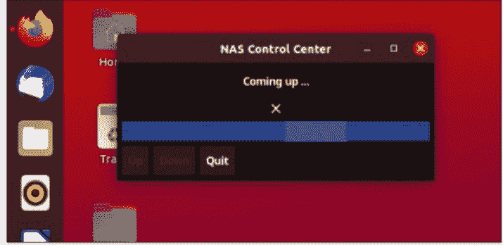

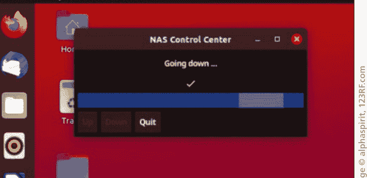

图 1：通过桌面应用启动 `Synology`。
图 2：按下按钮时，网络驱动再次关闭。

```
5 /magic header
0000000 ef ff ff 00 11 32 6c ab cd 32
0000010 32 6c ab cd 00 11 32 6c ab cd 32
0000020 32 6c ab cd 00 11 32 6c ab cd 32
0000030 32 6c ab cd 00 11 32 6c ab cd 32
0000040 32 6c ab cd 00 11 32 6c ab cd 32
0000050 32 6c ab cd 00 11 32 6c ab cd 32
0000060 32 6c ab cd 00 11 32 6c
```


图 3：MAC 地址 `00:11:32:6c:ab:cd` 的魔术包十六进制转储，其长度为 6 字节。在情况下，可能有具有长 MAC 地址的设备，但构建它们的魔术包更复杂。为了演示，我将保持简单。第 9 行的 `MagicPacket` 结构列出了包的两个区域：头部（header）和负载（payload）。从第 13 行开始的 `MagicPacket()` 函数准备了 6 个字节的 255，然后是 MAC 地址，以便局域网上的所有设备都能看到该包并做出相应。如果设备接收到与其 MAC 地址匹配的包，它将通过负载启动启动过程，负载由 16 次目标的 6 字节 MAC 地址（示例中为 `00:11:32:6c:ab:cd`）组成。每个包都有自己的头部，从签名和标识符开始。列表 1 用 Go 语言构建了 `MagicPacket`。第 7 行将 NAS 的 MAC 地址设置为字符串，而第 8 行指定了：

```go
01 package main

02 import (

03 "bytes"

04 "encoding/binary"

05 "net"

06 )

07 sync_packet = "00:11:32:6c:ab:cd"

08 const MacLen = 6

09 type MagicPacket struct {

10 header []byte

11 payload [16]byte

12 }

13 func sendMagicPacket() {

14 var packet MagicPacket

15 hwaddr, err := net.ParseMAC(sync_packet)

16 if err != nil {

17 panic(err)

18 }

19 for idx := range packet.header {

20 packet.header[idx] = 0xFF

21 }

22 for idx := range packet.payload {

23 for i := 0; i < MacLen; i++ {

24 packet.payload[i] = hwaddr[i]

25 }

26 }

27 buf := new(bytes.Buffer)

28 if err := binary.Write(buf, binary.BigEndian, packet); err != nil {

29 panic(err)

30 }

31 conn, err := net.Dial("udp", "255.255.255.255")

32 if err != nil {

33 panic(err)

34 }

35 defer conn.Close()

36 err = conn.Write(buf.Bytes())

37 if err != nil {

38 panic(err)

39 }

40 }
```

图 1：通过桌面应用启动 Synology。

图 2：按下按钮时，网络驱动再次关闭。

该应用程序包含一个窗口，其中有一个组件显示 NAS 的状态（开启或关闭）。此外，如果 NAS 正在运行，会显示一个图标；如果没有运行，则显示 X，并配有用户控制的按钮。在各个阶段还会出现进度条。程序启动后，最初只有“开启”（Up）按钮激活状态，而“关闭”（Down）按钮呈灰色（图 5）。如果你点击按钮启动操作，所有灰色按钮将禁用，以防止无意触发冲突的操作。

应用程序会根据程序流动态更改 UI 的部分内容，方法是在在某些位置隐藏组件（为此使用了 `Widget.Hide()` 函数）。NAS 状态图标——标记或 X——会通过分析进行更新。

## 列表 3: down（关闭）

```go
01 package main

02 import

03  "context"

04  "fyne.io/vne2"

05  "fyne.io/vne2/app"

06  "fyne.io/vne2/canvas"

07  "fyne.io/vne2/container"

08  "fyne.io/vne2/theme"

09  "fyne.io/vne2/widget"

10  "os"

11 

12 func main() {

13   state = "DOWN"

14   header = "NAS Nano Center"

15   w := app.NewWindow("Header")

16   status = widget.LabelWithStyle(state, 

17     TextAlign.Center, fyne.TextStyle{Bold: true})

18   progress = widget.ProgressBarInfinite()

19   progress.Start()

20   progress.Hide()

21   okIcon = widget.Icon(theme.Theme.ConfirmIcon())

22   downIcon = widget.Icon(theme.Theme.CancelIcon())

23   stateReporter = make(chan string)

24   runner := go func() {

25     upButton := widget.NewButton("Up",

26     downButton := widget.NewButton("Down", func() {

27       upButton.Enable()

28       downButton.Disable()

29     })

30     downButton.Disable()

31          .Text = "Coming ..."

32     status.Refresh()

33     sendMailPacket(n)

34     progress.Show()

35   }()

36   runner.Event(context.Background(), "wake")

37   downButton = widget.NewButton("Down", func() {

38     upButton.Disable()

39     stateReporter <- "DOWN"

40     upButton.Enable()

41   })

42   ndownButton.Disable()

43   status.Text = "Going down ..."

44   progress.Show()

45   shutdownNAS(n)

46   func() {

47   }

48   runner.Event(context.Background(), "sleep")

49 

50 }

51  downButton.Disable()

52  go func() {

53  for {

54     select {

55     case newState = <-stateReporter:

56         progress.Hide()

57         switch newState {

58         case "DOWN":

59           okIcon.Hide()

60           downIcon.Hide()

61           upButton.Enable()

62         case "UP":

63           okIcon.Hide()

64           downIcon.Hide()

65           downButton.Enable()

66         }

67         status.Text = newState

68         status.Refresh()

69     }

70  }

71  }

72  img = canvas.NewImageFromResource(nil)

73  img.Resize(0, 0)

74  grid = container.NewBox(

75  img,

76  status,

77  okIcon,

78  downIcon,

79  progress,

80  container.NewBox(

81    upButton,

82    downButton,

83    widget.NewButton("Quit", func() {

84      os.Exit(0)

85    }),

86  }),

87 

88  w.SetContent(grid)

89  w.ShowAndRun()

90 }
```

## 深度编程快照 - 远程备份

### 列表 4: `util.go`

```go
01 package main

02 import (

03 "os/exec"

04 )
```


05 `func syncIP(ip 192.168.3.33)`

06 `func shutdownNAS() error {`

07   `cmd, err := exec.Command("cmd", "spysower"-synIP, "sudo", "/bin/poweroff")`

08   `if err != nil || cmd.Run(); err != nil {`

09     `panic(err)`

10 `}`

11 `}`

12 `func isIsEnabled() bool {`

13   `cmd, err := exec.Command("ping", "-c", "1", "-t", "3", synIP)`

14   `if err != nil || cmd.Run(); err != nil {`

15     `return false`

16 `}`

17   `return true`

18 `}`

20 `main() {}`

```
### 列表 5: 构建应用程序

```bash
$ go mod init synip
$ go mod tidy
$ go build
```

`NewBox()` 用于将组件堆叠在一起；它们包括阶段的文本和图标、进度条以及子容器。

第 88 行将所有内容绘制到应用程序窗口中。最后，第 89 行通过调用 `Run()` 进入无限循环。然后，用户的 GUI 输入将显示由于代码平稳运行引入的 GUI 变化。

### 小于 400 像素

该框架不仅运行在桌面界面上，还可以扩展到其他移动设备。这就是为什么其他内容起初看起来可能很奇怪；因为它没有提供在程序启动后设置应用程序最小尺寸的选项。在跨平台开发方案中这是一个非常棒的策略。如果像 `synIP` 这样的应用程序以 50x50 的微窗口尺寸出现，你在桌面上几乎看不到它，这非常突兀。幸运的是，你可以使用技巧来定义最小尺寸。该容器通过一个 400x400 像素的空图像进行堆叠，它视觉上包含两个组件，应用程序每次只显示其中一个，并保持另一个隐藏直到需要。

无限进度条也存在于应用程序窗口中。它只在激活时才可见并移动（例如，当第 28 行开始更新状态时）。第 33 行调用 `sendPacket()` 通过网络向 NAS 发送数据包，第 34 行调用 `Show()` 显示进度条。如果机器状态发生变化，第 55 行隐藏进度条使其从屏幕上消失。

### 唤醒按钮

通道上的 `select` 语句。一旦状态机宣布新状态，代码就会跳转到处理开启或关闭状态的两个容器之一。这会更新 GUI 以反映新状态。新容器开始填充所有组件，包括可见和不可见的组件。

如果用户点击按钮，回调函数会在第 36 行通知状态机，状态机使用转换规则确定应用程序的下一步。第 36 行使用 `Event().function` 将事件发送给机器。机器将阻塞直到 NAS 唤醒，然后在 `stateport` 通道上发送“开启”消息。因为我不希望 GUI 在机器锁定时冻结，因此回调函数将对机器 `Event().function` 的封装在一个 Go 协程中，该协程将与检查过程和 GUI 跳跃并发运行。为了做到这一点，控制主机必须能够……


# Maker空间 (MakerSpace)
## 制作透镜相机
### 波动时光 (Wiggle Time)

你可以使用自制相机拍摄透镜图像，重现你小时候的那种“波动”照片。

作者：Günter Pomska

透镜图像在同一区域内存储多次曝光。通过倾斜图像实现动画。另一种应用是在无需特殊工具的情况下创建空间感（自动立体视觉）。这种技术的数字版本在社交媒体上通常以“波动图”（`wigglegram`）的形式出现。

随后，富士（`Fuji`）的八镜头 `Rensha` 相机于 1991 年活跃。与 `Nishika` 的同步快门相机不同，`Fuji` 是顺序曝光 35mm 胶片的。今天，这种胶片场景在 `Instagram` 等平台上仍然非常流行。

创建现代数字记录系统的方法之一是使用树莓派和 `ArduinoCam` [2] 的 `Camray HAT`（安装在顶部）。我在本文制作的相机使用了四个间距 1 厘米的 `MIS359` 传感器（如图所示）。第一次曝光后，你可以将设备移动相机的一半距离，从而产生等距离的照片，总像素为 3200 万像素 (`MP`)。

## 透镜相机

在消费市场上，透镜相机以 `ActionSampler` 的名称出售。40 多年前，四镜 `Nishika` (`Nisimilo`) 问世。

## 透镜技术

如今透镜屏幕的前身是波纹和层层图像，分别占据两次和三次显示。与前任的平面图像带不同，常用的透镜是半圆柱条形的透明膜，可以同时显示多幅图像 [3]。取决于视角，左眼看到的与右眼不同，观众感知到的视图是三维的（图 2）。

层厚的密度影响分辨率；以每英寸线条 (`dpi`) 设置。


# DIY 透镜相机 MAKERSPACE

你可以可以使用应用程序。相反，外壳的设计允许你按照相机距离移动透镜板。通过这种方式，透镜图像的数据可以从每隔 2 厘米一个传感器在 14 厘米厘米的基础上组装而成。


多摄像头适配器连接到使用排线的四个接口上。当你需要通过 `CSI` 接口连接计算机时，三颗螺钉固定了与树莓派的机械连接；`5V` 电源确保它完全附着在机身上。你可以将每个放置在一个小盒子里，或者让它们相隔 40 毫米。如果不使用外壳，最小距离将缩小到 24 毫米。软件使用相应的参数处理传感器，你可以将其配置为一个、两个或四个。相机始终必须共享可用分辨率。

**图 2：** 根据视角，左、右眼看到不同的图像，共同感知出一幅三维图像。

## 四镜 DIY 相机

按照需要，我们将 `Camatray` 添加到树莓派 4B。`Pimoroni` 制作了适用于树莓派版本 2 (`V4L2`) 的图像。该 `HAT` 在摄像头串口接口 (`CSI`) 上运行四个 `MXIS519` 传感器，并处理 `I2C` 总线。通过水平排列的图像带可以实现图像、缩放和合并效果。与透镜间距对齐的编码带上的独立空间图像是离焦打印的，以便透镜背面的箔或镜子使用。

你可以通过相互合并单个图像来实现空间视觉效果，从而导致观众图像分离。我们不需要限制在两幅图像上；可以使用一系列图像拍摄静态场景，或者逐步移动相机。或者，你可以使用多镜头技术，这是捕捉动态场景的方法。立体 `Maker` [4] 用于准备图像序列。如果你想更仔细地观察波动图，查看 `3DMasterKit` [5] 软件是一个好主意。

# DIY 透镜相机 MAKERSPACE 

## 拍摄透镜照片
DI 相机被设计为随拿随用，但其实实现方式稍微复杂一些。在我的测试中，系统连接到本地 `WiFi` 移动路由器。开启相机后，操作系统启动并连接到 `WiFi` 网络。虚拟桌面（`VNC`）服务器在启动时开始运行。

该软件用 `Python` 编写，使用了带有面向对象控制的 `Guizero` 库。它将设置保存在字典中，并使用系统调用来执行相机函数（即“图形用户界面”）。

位置 `A`、`B` 的图像以及单幅图像最终存储在 `d/images/` 目录下，并带有随机的图像标签。`GUI` 引导整个过程，根据需要可以进行无结构化更改。你可以预先决定想要创建两个、四个还是八次曝光。相机可以被设置为捕捉后拍摄的照片。

两幅图像。这导致了 `3.6m` 的对焦距离。如果你将镜头移动 `2cm`，你将获得四张间距为 `8cm` 的照片，理想情况下深度位移在 `2.4m` 内。

这些近似值只是基于经验的粗略估计，绝无约束性。接近值可能更接近 `1/20` 或 `1/30`。只要你增加位置，就会被迫将宽度限制在静态物体上。手动操作需要速度，通常建议提高速度。

同样的情况适用于用户界面（`GUI`）。在简单设置下，`GUI` 具有的功能，如图像名称、快门曝光值、预览图像和触发。`GUI` 提供了更多功能，但我暂时不会使用它们。

在捕获图像后，你将需要借助 `FFmpeg` 或 `ImageMagick` 的帮助将帧拆分为单个瓦片进行进一步处理，你可以通过以下命令安装：

```bash
sudo apt install imagemagick
sudo apt install ffmpeg
```


## 图形界面

在本文的下载包中，你将找到 `lentic.py` GUI [7]，这是我用 Python 编写的。`d/` 目录也包含最近的图像作为透镜图像的示例。

当中心根据经验法则确定时，要找到位移并不容易，到物体的距离是左侧相机的距离（近距离 1/0.3）。中间图像均匀地位移这个距离，如图 6 所示，带有四个间距为 12cm 的传感器，我们

为了确保图像顺序正确，在文件名中添加数字后缀。


在 Linux New Media 在线商店探索过去并投资一年的 IT 解决方案。

想订阅吗？想找你真希望在报摊上买到的那个特辑问题吗？

`sparkhaus-shop.com`


## 制作你

一旦你完成了实地工作，你可以在计算机上继续处理图像序列。下载你制作的图像，然后 `StereoMaker` (`Maker`) 对于你处理所需的图像非常有用。`Triaxes` [8] 也是制作透镜图像的良好选择。对于每块玻璃只需两次曝光，你就可以创建一个简单的摇摆图像（wiggle image）。更均匀的运动和透镜图像始终需要一系列。

首先，为一张小图获取一组八张图像。图像必须均匀对齐；即使是轻微的倾斜和小差异会导致图像无法使用。在 `StereoPhoto Maker` 中，`Select | Multiple Images | Auto rotation` 将允许图像进行调整。在第二步中，你需要在每张图像中有一个公共参考点。

现在通过选择 `Edit | Create Lenticular Image` 得到了你的图像。透镜片和打印分辨率要与透镜膜匹配。最后，通过 `File | Print settings` 打印图像，创建一个 16 张具有不同镜头间距且垂直和水平对齐的图像堆。你需要将自粘膜对齐在打印件上，这对于大格式会很有用。

如果你想将图像处理为摇摆图（wigglegram），请使用 `ImageMaker` 的 `convert` 函数。该命令将当前目录下所有带有图像前缀的 JPEG 添加到动画 GIF 中：

```bash
$ convert -delay 10 -loop 0 image*.jpg $wiggle.gif
```

播放根据图像的大小和数量无限循环。除了 GIF 之外，你还可以使用 MP4 格式。当然，摇摆图无法打印，所以如果你需要视觉参考，请查看在线示例 [9]。

作为商业产品的 `StereoMaker Kit` 制作透镜图像也很好。许可证费用不高，绝对绝对值。上传后，你可以渲染它们，然后更改裁剪图像并匹配透镜图像。该工具包还有其他有用功能，如动画和 3D。

## 结论

透镜图像作为 3D 表示、动画和互联网上的摇摆效果，摄影师有了一个创意工具。使用传统相机，你只需要一点就能获得体面的结果。

`ArduCam` 的 `Camaray HAT` 允许你在单、双或四路模式下使用多传感器系统，并构建一个符合你想法的 DIY 相机。硬件为业余摄影师开启了广泛的领域，从高到低分辨率的抖动图像。

你只需要树莓派、一个万用表和一个包。在 WiFi 网络上，可以使用手机或平板电脑作为接口，`Python` 和 `Guizmo` 提供了软件支持。`StereoPhoto Maker` 和 `Triaxes` 负责下游处理。

# 信息
- 为了确保图像顺序正确，在文件名中添加数字后缀。


- 发现过去并在 Linux New Media 在线商店投资一年的 IT 解决方案。

- 想订阅吗？想找你真希望在报摊上买到的那个特辑问题吗？

- `sparkhaus-shop.com`


# Linux 下的数字 IC 仿真

## MAKERSPACE

在之前的 N 个时钟周期中，其中 N 取决于信号 FSM 的状态和输入数量以及组合逻辑的复杂程度。因为“状态”可以代表任何内容，从一个简单的计数器到实时算法时尚的阶段，FSM 是许多 HDL 设计中的通用组件。

### Reg vs Wire

#### 列表 1：示例 Verilog 代码

HDL 数据类型最重要的是线线（wires）和寄存器（regs）。`wire` 和 `reg` 都可以存储多个位。

```verilog
01 module sample_counter;
02 input CLK;
03 input RST;
04 output reg[23:0] COUNTER;
05 output wire SOME_OTHER_SIGNAL;
06 output wire SOME_RIGHT;
07 always @(posedge CLK)
08 begin
09 if (RST == 1b1)
10 COUNTER <= 0b0; // 将 COUNTER 的所有位置为 0
11 COUNTER <= COUNTER + 1d; // 通过 24 位加法器
12 end
14
15 assign SOME_PULSE = (COUNTER[2:0] != 3'b001); // 1b1
16
17 controller (clk, SOME_PULSE, SOME_OTHER_SIGNAL);
18 endmodule
```


## 在 HDL 中实现

`Wire` 用于表示数字信号（“网”，连接算法元素之间的连接）。虽然 `wire` 可以表示两个或多个模块之间的直接连接，为了便于设计和管理，电路被划分为包含子模块的模块；然而，电路的其余部分被忽略，它是一个黑盒。

数字设计人员允许我们使用 `Verilog`、`VHDL` 或 `SystemC` 等 `HDL` 语言进行建模。在本文中，我们将帮助你学习如何使用 `VHDL` 为各种电路建模。

物理行为与其 `HDL` 模型行为完全一致，而无需声明并将每一个逻辑门连接到所有其他逻辑门。

`HDL` 在编程语言中呈现出两类特征。一类是始终在运行并需要描述逻辑门结构特征的实例，这些特征仅在时钟跳变时改变。

刻意选择使用列表 1 显示了两种数据以及在 `RTL` 层级处理它们的 `Verilog` 语法。

另一类包含了仿真和分析电路实时行为所需的所有内容。

`HDL` 设计师描述了与设计中所有其他块并行运行的块。如果你遵循规则，无论所有块实例化的顺序如何，每个块的行为都将是相同的。

在 `Verilog` 中，`module` 是关键字。`module` 始终有一个名称并实例化其他模块。列表 1 显示了一个简单的模块计数器，它可以实例化名为 `controller` 的其他模块实例。

与 `wire` 不同，`reg` 是一种可以存储值的 `Verilog` 数据类型。取决于你如何编写，每个 `reg` 必须存在于硅片中，并且是寄存器传输级（`RTL`）代码。良好的代码比高层代码花费更多时间来编写，但你生成的概率会高得多。

`HDL` 的主要特征是支持电路建模的语法和结构。

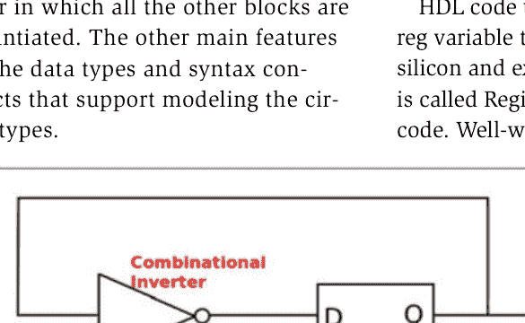

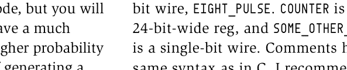

图 1：内存和计数器逻辑最简单的组合，它在每个时钟周期翻转其值。

图 2：图 1 的反馈环产生了一个与时钟同步的输出，频率为一半。

## MAKESPACE 硅上数字

使用注释解释每个信号是什么以及模块如何工作。

在变量声明和 `cl1` 实例化之间，`submodule_counter` 包含了两个控制现实的块（或过程）。从值计数器第 28 行开始的块与 `cl1` 的起始赋值相匹配。当 `RST` 为低电平时，计数器将置为零；否则，它将加 1。注意非阻塞的语法是非常重要的。

**阻塞（Blocking）**赋值就像“正常”赋值，它们会被转换为组合逻辑。主要区别是“块，仿真器将按照它们出现的顺序一个接一个地顺序执行它们。结果是阻塞赋值的输出将取决于它们的顺序。然而，非阻塞赋值

非阻塞赋值几乎相反。例如，假设仿真有执行时间。所有变量和寄存器的值不包含 나서 这很重要。非阻塞赋值意味着，在赋值结束时：

- 它在层次结构的每一层，采样出现在非阻塞赋值语句右侧的所有变量的输入值；
- 使用这些采样的值（可能会以后获取）来计算非阻塞赋值左侧所有变量的下一个值。

`HDL` 仿真器在收集到所有使用 `<=` 运算符进行的赋值的输入之前不阻塞计算任何下一个值的能力，这正符合硬件寄存器的实际行为。在编写时，赋值的结果不取决于非阻塞语句的编写顺序。

赋值 `counter (*)` 并且你应该明确声明数值常数的值。如果第 15 行说是 `5'db`，例如，`COUNTER` 的低位被设置为零，但其他位可能持有更新后的值。

请参见“阻塞”部分以了解更多关于 `HDL` 中阻塞和非阻塞逻辑的工作原理。只需注意非阻塞赋值 `counter (*)` 并且你应该明确声明数值常数的值。


## 测试平台（Test Benches）

`HDL` 语言有许多关键字和特征可以可以

### 列表 2：激励（Stimuli）

```verilog
begin
    $display("Simulation started")
    #100 $display("Waiting for edge")
    @(posedge FINISHED) $display("FINISHED")
end
```

### 列表 3：交通信号控制器

```verilog
module 01 traffic_controller(n_lights,s_lights,e_lights,w_lights,
    clk, rst_a);
    input [2:0] n_lights,s_lights,e_lights,w_lights;
    input clk;
    input rst_a;
    output reg [2:0] state;
    parameter [2:0] north = 3b000;
    parameter [2:0] north_y = 3b001;
    parameter [2:0] south = 3b002;
    parameter [2:0] east = 3b101;
    parameter [2:0] west = 3b010;
    parameter [2:0] west_y = 3b011;
    reg count;
    always @(posedge clk, rst_a)
    begin
        if (rst_a == '1'b0) // 重位信号为低电平
        begin
            state <= north;
            count <= 3b000;
        end
        else
        begin
            case (state)
north
                begin
                    if (count == 3b001)
                        state <= north_y;
                    count <= 3b000;
                end
south
                begin
                    if (count == 3b001)
                        state <= south_y;
                    count <= 3b000;
                end
east
                begin
                    if (count == 3b001)
                        state <= east;
                    count <= 3b000;
                end
west
                begin
                    if (count == 3b001)
                        state <= west_y;
                    count <= 3b000;
                end
            endac
        end
    end
end
```

`task` 可以返回任意数量的结果（即使没有）并调用其他任务或函数；最重要的是，任务可以包含任何耗时语句，如 `@delay`

归根结，良好的测试平台的重要性至少不亚于编写模块，以至于 `HDL` 设计师甚至专门负责测试平台，以验证团队其他成员的设计。

### 列表 3：交通信号灯控制器（续）

```verilog
always (@state)
begin
  case (state)
    north: begin
      n_lights = 3'b011;
      s_lights = 3'b010;
      if (count == 3'b001)
        e_lights = 3'b100;
      else
        w_lights = 3'b100;
      if (count < 3'b0)
        state < south_y;
    south: begin
      n_lights = 3'b011;
      s_lights = 3'b010;
      e_lights = 3'b100;
      w_lights = 3'b100;
      if (count == 3'b001)
        state < east_y;
    end // endcase // case: south
    south_y: begin
      n_lights = 3'b011;
      s_lights = 3'b010;
      e_lights = 3'b100;
      w_lights = 3'b100;
      if (count == 3'b011)
```


```verilog
state <= west;
end // endcase // case: south_y

west: begin
  n_lights = 3'b011;
  s_lights = 3'b010;
  e_lights = 3'b100;
  w_lights = 3'b011;
  if (count == 3'b001)
    state <= west_y;
end // endcase // case: west

west_y: begin
  n_lights = 3'b011;
  s_lights = 3'b010;
  e_lights = 3'b100;
  w_lights = 3'b010;
  if (count == 3'b011)
    state <= north;
end // endcase // case: west_y

east: begin
  n_lights = 3'b011;
  s_lights = 3'b010;
  e_lights = 3'b100;
  w_lights = 3'b010;
  if (count == 3'b001)
    state <= west_y;
end // endcase // case: east

endcase // case (state)
end // always (@state)

east_y: begin
  always (@state)
  begin
    case (state)
      north: begin
        n_lights = 3'b011;
        s_lights = 3'b010;
        e_lights = 3'b100;
        w_lights = 3'b010;
      end // case: east_y
      // ...
      default:
        n_lights = 3'b011;
        s_lights = 3'b010;
        e_lights = 3'b100;
        w_lights = 3'b100;
    endcase // case (state)
  end // always (@state)
end // case: north
endmodule
```

## 交通信号灯控制器

列表 3 是一个针对四个信号灯的单一计数器的简单实现，这些信号灯位于交叉路口的每一侧，其中一个通向南方，另一个通向西方。为了简单起见，与实际交通不同，信号之间是互斥的：在任何时刻，灯光是绿色或黄色。当状态为 `north` 时，计数器每个时钟周期加 1，直到等于 7（二进制）。

列表 4 是我们为本文创建的代码组合。虽然列表 3 比较冗长，但它主要包含三部分：输入、输出和内部变量。这一部分唯一的新内容是参数名称，它们提供了如 `north` 和 `north_y` 这样可读的名称，否则它们将是 `01` 或 `10` 等二进制字符串。

## 列表 4：测试平台 (Test Bench)

```verilog
`timescale 1ns

module traffic_counter_tb;

  parameter ENDTIME = 6000000;

  wire [2:0] n_lights, s_lights, e_lights, w_lights;

  reg clk, rst_n;

  traffic_control(n_lights, s_lights, e_lights, w_lights, clk, rst_n);

  initial begin
    clk = 0;
    forever #5 clk = ~clk;
  end

  initial begin
    fork
      reset_gen;
      logger;
      endsimulation;
    join
  end
```

每个参数都代表所有灯信号的状态。例如，`north` 和 `north_y` 分别代表交叉路口北侧必须为绿色的状态，而其他三个必须为红色。其他部分原理相同，代表每个其他信号变为绿色、黄色或其余为红色的时刻。

```verilog
task reset_gen;
  begin
    rst_n = 0;
    #2 rst_n = 1;
  end
end

task logger;
  begin
    $display("LOG: Verilog Simulation -----------");
    $display("TIME: %t", time);
    $monitor("CLK=%b, rst=%b, N=%b, S=%b, E=%b, W=%b", clk, rst_n, n_lights, s_lights, e_lights, w_lights);
    $display("TIME: %t", time);
  end
end

task endsimulation;
  begin
    #ENDTIME
    $display("LOG END");
    $finish;
  end
end

endmodule
```


一个 `always` 块（第 31-44 行）中的状态机（`FSM`）使得信号始终按照顺序工作。同步后，它会产生一个名为 `state` 的 3 位寄存器以及另一个用于计数的 3 位计数器。状态的序列决定了信号切换的顺序。

# Linux 上的数字 IC 仿真

# MAKESPACE

项目经理


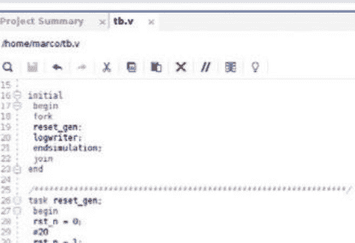
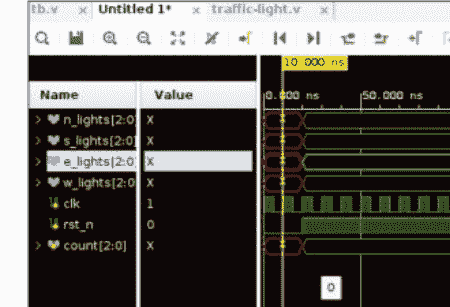
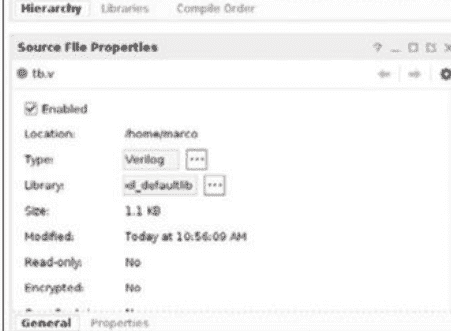

图 6：内置的 `Vivado` `HDR` 与设计和仿真流程的其他部分一起进行了编辑。

图 7：修复复位信号后，图 4 的相同仿真。现在计数器和输出信号都随时间变化。

# 信息

- [1] Marco Fioretti《设计现场可编程门阵列》，`Linux` `Magazine`，2023年6月21日，https://www.linux-magazine.com/Issues/2023/27/introduction-to-FPGA-design。
- [2] 交通灯系统：https://vsicoding.blogpost.com/2013/11/verilog-for-traffic-light-control.html
- [3] 另一个交通灯控制器：https://www.fpstudent.com/2016/11/verilog-code-for-traffic-light-system.
- [4] `RTL`/锁触发器：https://en.wikipedia.org/wiki/Flip-flop
- [5] 有限状态机：https://en.wikipedia.org/wiki/Finite_state_machine

# 测试交通灯控制器

如果你按照我在本系列上一篇文章 [1] 中解释的那样安装了 `Vivado` 环境，你只需要输入此处显示的源文件，并在原理图查看器中点击“仿真”（`Simulation`）。进入打开项目管理器 (1)，包含所有源文件的范围 (2)，以及包含所有信号的对象面板 (3)，同时查看波形分析器 (4) 并替换日志文件和其他信息。波形面板将允许你编辑源文件（图 6）。仿真结果如图 7 所示。

良好的纯文本，从源文件到激励信号，很难低估其看似微不足道其实背后的真正问题。

查看列表 3：它很无聊，但也很容易用 `Python` 或 `Perl` 脚本自动生成。此外，相同的方法也适用于运行前后的交互。你可以拥有许多复杂的激励信号，这些信号可以与较短语言脚本为你编写的复杂约束相互作用。一旦仿真结束，其他脚本会捕获日志文件以自动发现任何问题，并指向仿真中你个人应该亲自解决问题的精确时点。

# 作者

Marco Fioretti (`mfioretti.substack.com`) 是一位位于意大利罗马的自由作家、培训师和研究人员，自 1995 年以来一直致力于自由事业，自 2005 年以来致力于开源数字标准。Marco 还是自由知识学院（http://freeknowledge.edu）的董事成员。

## 结论

在 `Linux` 上使用最先进的软件实践 `FPGA` 和 `HDL` 设计比看起来要容易得多。此设计流程中的每一项都可以作为……
换句话说，不仅 `FPGA` 设计比看起来更容易，而且带有 `sed`、`Awk`、`Perl` 和 `Python` 等坚固文本处理工具的 `Linux` 操作系统使其变得更加简单。

`LINUX-MAGAZINE.COM`

第 272 期

2023年7月

71

# Linux Magazine 订阅

纸质和数字选项
每年 12 期


树莓派上的灌溉
`LINUX` `MAGAZINE`
安全且可靠的便利性
完美的备份工具
制作
树莓派上的 `Python` 编程
`LINUX` `MAGAZINE`
数据中毒
`Go`, `Rust`, `C++` 在树莓派上编程以实现
`PeerTube`：保护你的视频免受 `YouTube` 的跟踪
后门
`LINUX` `MAGAZINE`
`Fediverse`
`FOSS` 方式的社交媒体
`diaspora`
`PeerTube`
`Pixelf`
轻松管理你的消息
`Linux` 启动过程
使用加密保护你的服务器
`CAD` 和 3D 建模用于 `LEGO`
针对 `FOSS` 的 10 个技巧
订阅
`sparkhaus-shop.com`

扩展你的 `Linux` 技能：
- 关于热门话题（包括比特币、云计算等）的深度文章！
- 关于实用工具的教程，这些工具将为你节省时间并保护你的数据
- 关于开源世界关键进展的见解新闻
- 针对树莓派、`Arduino` 和其他系统的酷炫项目

通过 `Linux` 行得更远，做得更多，从今天起订阅，绝不错过任何一期！

关注我们

@`linux_pro`
@`linuxpromagazine`
@`linuxmagazine`

# 需要更多 Linux 吗？

订阅 `Linux` `Update`

我们的免费 `Linux` `Update` 通报每周向你的收件箱传递见解的文章和提示。
`bit.ly/Linux-Update`


行业 4.0 补丁
命令行字典工具
使用 `dict` 命令，你可以快速搜索在线字典
新闻
- 可安装的 `Ubuntu` `23.04`
- `KDE` `Plasma` `5.27` 发布版
- 个性化定制桌面
如果你错过了
- 使用 `Proton` 设置网络

# LINUX VOICE 序言

对于许多用户来说，`Linux` 最好的部分是工具——成千上万的工具，而且大多数都是免费的。你可以像玩具店里的孩子一样，或者更好，像城堡里的孩子一样，可以选择任何玩具，而不必担心别人说“只有一种”或“选择最便宜的”。`Linux` 工具允许你根据自己的喜好和习惯构建环境。在本月的 `Linux` `Voice` 中，我们向你介绍三个你可能觉得很有用但在默认配置中找不到的工具：`Espanso` 文本扩展器、基于文件的管理器以及终端浏览器。

有很多独立的数据库可用，它们可以很好地服务项目。`Espanso` 是一个跨平台文本扩展器，其功能远超替换文本。如果你是一个 `Linux` 爱好者，你会知道命令行是与系统交互最流畅、高效的方式。`Chromium` 可以以极少的资源运行，是让旧电脑变得非常有用的工具——学习编程。

作为开发者，最难学的技能之一是：编写代码；使用社交媒体；玩 `NetHack`；


# LINUX DOGHOUSE - 数据库


# MADDOG 的 DOGHOUSE

作者：JOHN "MADDOG" HALL

John "mog" Hall 是一位作家、教育工作者、计算机科学家，自 1999 年遇到 `Linus` `Torvalds` 并将 `Linux` 移植到 64 位系统以来，一直是 `Linux` 的热情倡导者。担任 `Linux` `International` 的主席。

有很多便宜的 `FOSS` 数据库可用，它们可以很好地服务项目。

# 选择 FOSS 数据库

最近，一个朋友开始了软件工程研究生课程，该课程的主题是数据库。我的朋友在计算机科学本科学位中学习过它们，但并不多。也许他需要更多。

被认为是数据库的首选方案是，数据库引擎会将文件写入文件系统。在 `Unix` 上不是这样。在 `Unix` 中，数据库坚持直接写入磁盘分区，绕过文件系统算法和文件系统缓冲区，使得数据锁定和备份变得困难。此外，数据库在相同硬件平台的专用“商业”操作系统上的性能。

当我大学毕业后开始第一份全职工作时，我们所熟悉的数据库才刚刚开始。`IBM` 和加州大学伯克利分校的 `System` `R` 是确定从研究经费获取数据最佳方法的研究项目，代码以名义的价格提供。

作为 `DEC` `Unix` 系统的产品，我与工程师合作将关系型数据库引擎实现到每一个 `Unix` 中（我们使用的标记类 `Unix` 系统），这样客户就不会察觉他们正在为此付费。我们没有只在我们的 `Unix` 数据库上使用数据库引擎，而是使用了 100% 的系统。

如果你没有权限存储自己的数据，你就必须处理各种问题，如备份数据以获取一致快照、大小差异问题（小与大）、故障导致的数据丢失以及由于缺少日志记录导致的系统崩溃、通过缓慢的网络拉取大量数据、数据传输瓶颈以及其他系统的问题。最终，数据库可以在引擎内部存储并实现复杂功能，使整个过程变得简单得多。

在我们拥有这种功能后，我要求我们的 `Unix` 系统在 `VMS`（开发者编写程序的地方）上运行，而不是支持的 100 多个 `Unix` 系统。

还有一个问题是，当你使用带有字典的系统时，管理员会考虑数据，而不只是创建或使用数据的程序。数据库和管理员将更多精力放在向数据库中填充错误数据，这使得进展更好。

我们起初很高兴，但由于同事的促使我写了一篇白皮书文章，标题为《`Unix` 系统作为数据库平台的十一个理由》，由他的一些同事编写。

# Espanso：文本扩展器与缩写工具

`Espanso` 是一个跨平台的文本扩展器，它的功能远不止简单的文本模块替换。作者：FERDINAND THOMMES

文本扩展器将预定义的缩写替换为存储的文本模块。一个例子是 `wkr`，它可以展开为 `AutoKey` [1] 工具——该工具一年前尚在 `macOS` 和 `Windows` 上使用，但因为它仅在 `Linux` `X11` 上运行。

作为替代方案，`Espanso` 自 2019 年起问世，它超越了简单的文本缩写替换。该扩展器用 `Rust` 语言编写，运行在 `Linux`、`macOS` 和 `Windows` 上。你可以使用 `DEB` 软件包或二进制包在 `Linux`、`Debian` 及其他发行版上安装它。如果你想自己编译 `Espanso`，`Arch` 用户库 (`AUR`) 中也有相应的包。

虽然目前未直接支持某些，但你可以使用 `AppImage` 或自己构建软件包。开发者正寻求随时间扩展这种支持。通过 `TPE` 命令可以检查系统使用的是 `X11` 还是 `Wayland` 作为显示类型。如安装说明 [3] 所示，结果可能需要根据情况选择不同的软件包或代码。列表 1 显示了下载第一个文件的步骤，然后运行它以确保安装成功（第 1 到 3 行）。最后，将 `Espanso` 服务引入系统（第 4 行）。

然后运行 `espanso start` 调用该工具。窗口关闭后，`Linux` 桌面面上没有 `Espanso` 的痕迹，而 `macOS` 和 `Windows` 的控制栏上会出现图标。`espanso --help` 提供了如何控制 `Espanso` 的概览（图 1）。

在作为文本扩展器的功能中，`Espanso` 允许你以 `:keyword` 的形式输入关键词并将其替换为文本。例如，如果你输入 `:espanso`，这里会显示正确的响应。你可以在任何可以写字的地方替换缩写，包括 `Shell` 中。

你可以在 `~/.config/espanso` 的多个文件中配置设置。`config/` 文件夹下的 `default.yaml` 文件包含你可以通过删除 `#` 号来编辑的设置。注意：`YAML` 对缩进错误是不宽忍的。

### 在 YAML 中配置

你可以使用 `espanso edit` 命令打开配置文件。如果可能，替换的内容不应包含非标准字符。它们在某些应用中可以替换，但在另一些应用中不行。因为配置文件也是用 `YAML` 编写的，你必须注意缩进并遵循下方提供的示例。

当你保存 `Espanso` 时，会弹出的窗口提示你确认操作。如果你犯错了，消息会告诉你这是哪一行的哪个位置（图 2）。

列表 1：安装 Espanso

```
01 $ wget https://github.com/ferdinand-toni/espanso/releases/download/v0.1.7-beta-espanso-debian-x11-amd64.deb
02 $ sudo apt install espanso-debian-x11-amd64
03 $ espanso status
04 $ espanso service register
05 服务文件已存在，此操作将覆盖它
06 正在 "/.config/systemd/user/espanso.service" 创建服务文件
07 启用系统服务
08 服务注册成功
```

# LINUX ESPANSO

一个隐私优先的、跨平台的文本扩展器


# Espanso 使用说明

## 用法

`espanso [FLAGS] [SUBCOMMAND]`

```
- 标志 (FLAGS):
  -h, --help
  -v
  -V, --version
    打印帮助信息
    设置详细程度
    打印版本信息

- 选项 (OPTIONS):

命令 (COMMANDS):
  code
  edit
  nc-path
  install
  log
  migrate
  package
  restart
  service
    向 espanso 编辑器发送命令以编辑配置文件
    从 PATH 中打开默认文本编辑器命令的快捷方式
    打印此消息或给定子命令的帮助信息
    打印守护进程日志
    从 CLI 列出并验证条目
    自动将配置迁移到新版本
    打印所有 espanso 目录以轻松定位配置和匹配项
    一组管理 espanso 服务的命令（例如，启用系统启动时自动启动）
    将 espanso 作为服务启动
    检查守护进程是否运行
    删除软件包
  ununinstall
  workaround
    一组解决常见问题的变通方案。
```

## 故障排除

图 1：你可以使用 `-h` 或 `--help` 来识别可用选项。

`match/` 是你指定 espanso 扩展什么以及扩展成什么的方式。工具在 `/match/base.yml` 文件中提供了一些简单的替换示例（图 3）。匹配项由触发器（trigger）和替换（replace）值对定义。触发器是触发替换的字符串，而替换是它被替换的文本。一个简单的示例如下：

为了创建一个新行，YAML 使用两个运算符 `|`，并且当两行进入视野时生效。如果你在行中使用 `|` 作为第一个运算符，另一方面，如果将缩进的三行作为 `replace |` 使用，应用程序将在单行中应用替换。你可以在 Stack Overflow [4] 上学习更多关于这些标量的知识。

```yaml
trigger: ":"
replace: "Kind, regards,"
```

另一个示例出现在信件和邮件的结尾，它给你两行输出：

```yaml
trigger: ":"
replace: "Love,

s/Peter"
```

### 静态还是动态？

Espanso 区分了静态和动态替换。上述描述的示例属于静态类别；它们的输出始终保持不变。动态替换的一个典型例子是放置当前行的文本。

## 全局变量

创建全局变量的一个原因是你可以在多个地方使用它们。在 YAML 文件的顶部定义全局变量。它们适用于此文件及其子集中定义的所有替换。如果你经常写错单词（例如，输入了额外的字符而不是别的），Espanso 证明非常有用。此处使用的真实触发器如详细配置 [5] 所示。

**列表 4：示例**

| 触发器 (trigger) | 替换 (replace) |
| :--- | :--- |
| `01` | `:"div"` |
| `02` | `:"<<div></</div>>"` |
| `03` | `:"quote"` |
| `04` | `"三个人可以保守一个秘密，如果有两个的话。"` |
| `05` | `:"quote"` |
| `06` | `"存在或不存在，这是一个问题。"` |
| `08` | `:"replace"` |
| `09` | `"如果你想让事情正确，就自己做。"` |
| `10` | `image_path:"PATH/TO/IMAGE.png"` |

## LINUX 用户西班牙语指南

语言。如果需要，Espanso 还可以触发图像（ 9 和 10）并创建各种形式 [6]。

## 软件包 (Packages)

得益于 Espanso 的软件包策略，你可以还原其他用户创建的副本。为了方便你操作，该软件自带了一个专用的包管理器，它主要与网页上的 Espanso Hub (5) 配合，但也接受其他来源。Espanso Hub [7] 显示了可以按发布者或用途发布的软件包。关于这有单独的文档 [8]。在最简单的情况下，只需替换 `espanso install` 命令来安装软件包即可。

除了 Espanso Hub 之外，还有其他仓库 [9]。我开始从 Hub 安装 `html-utils` 软件包。使用 DIY 副本，将此处的触发器替换，例如 `div:espanso-match`。软件包配置可以在此处找到。我还添加了第三方的 `espansoconfig` [9] 仓库。这稍微复杂一点。首先，你需要使用第 1 到 5 行的命令从 GitHub 将仓库克隆到你的主目录。你会找到 `espanso-config/` 目录，其中包含了使用符号链接的 Espanso（第 2 行）。这是


图 4：Espanso，多个替换项可以使用相同的触发器。`quote:` 触发器显示了如何通过按下键盘快捷键选择你想要的内容。

你将找到带有实用配置的 YAML 文件。

**列表 5：包含仓库**

```bash
$ git clone https://github.com/Lissy92/espanso-config.git
$ ln -s ~/espanso-config/ ~/.espanso/match/packages
```


| 标签 | | | |
| --- | --- | --- |
| Vim 连字 | | |
| 语言 (22) | 一个实现 vim 连字的软件包。 | | |
| 符号 (20) | VIM 符号 | | |
| 数学 (13) | | |
| Shell (11) | | |
| 工具 (10) | | |
| 表情符号 (9) | 实际表情符号 (空格) | | |
| | 一个提供所有 v.14 表情符号的更新软件包 - 获取自 unicode | | |
| | |MOJIJI CH | | |
| 英语 (9) | 小写和大大写 | | |
| 开发 (8) | 一个用于将剪贴板内容转换为小写或大写的简单软件包。（仅限 UNIX） | | |
| | UTILITY SHELL | | |
| 趣味 (7) | | |
| 聊天 (5) | | |
| Latex (5) | | |
| 重音 (5) | | |
| 字母 (5) | | |
| 梗图 (4) | Mac 符号 | | |
| | 显示常见的 Mac 符号如 ⌘ 和 | | |
| | SYMBOLS MAC | | |

图 5：Espanso Web 服务允许你包含由其他用户发布的、关于各种主题的带有替换的软件包。要实现这一点，Espanso 自带了一个包管理器。

## 结论

将 Espanso 称为专家级用户并不能涵盖它所提供的范围。在功能方面，该程序提供的并不比其竞争对手多，但它在多个平台上运行，并支持 X11 和 Linux。拥有卓越文档的 Linux 内核，其配置一旦创建，就可以与其他系统和平台同步 [10]。在约一年的使用中，到为止我没有遇到任何错误。考虑到 Espanso 是于 2019 年 9 月首次发布，且是一个程序员团队在业余时间开发的工具，它我仅触及过的庞大功能令人印象深刻。而且这并不意味着道路的结束，正如路线图 [11] 所示。一个愿望列表的 GUI 将吸引那些害怕使用命令行或不熟悉 YAML 的用户。此外，Android 版本也在计划中。

在我拙见看来，Espanso 是自由软件的一个范例，因此与商业产品相比，它并不需要隐藏光芒——这非常令人舒适。如果你使用 Espanso，请在以下情况下通过捐赠支持该项目：


# 作者

Ferdinand Thommes 生活并作为 Linux 开发人员工作。

# 信息

- [1] Autokey: https://github.com/autokey/autokey
- [2] Espanso: https://espanso.org/
- [3] 安装: https://espanso.org/docs/install/linux/choosing-the-right-install-method
- [4] 语法: https://stackoverflow.com/questions/3790454/how-do-i-break-string-in-yaml-over-multiple-lines
- [5] 文档: https://espanso.org/docs/matches/basics/
- [6] 表单: https://espanso.org/docs/matches/forms/
- [7] Espanso Hub: https://hub.espanso.org/search
- [8] 软件包: https://espanso.org/docs/packages/
- [9] 仓库: https://github.com/Lissy92/espanso-config
- [10] 同步: https://espanso.org/docs/matches/sync
- [11] 路线图: https://github.com/Lissy92/espanso-config

# 图 4：使用 `/` 通过关键词在特定文件夹中过滤。按 `Esc` 取消并返回普通导航。

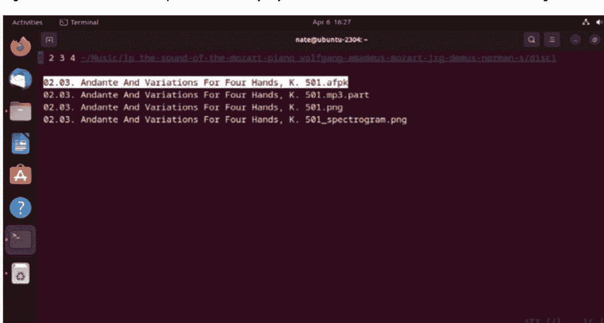

你可以通过输入 `:i :p` 或 `Alt+P` 来调用插件。一个 Git Github 页面展示了你如何使用单个命令为多个插件创建链式绑定，例如：

```
export NNN_PLUG=":finder:fzf:pager:moq"

diff:t:tm:v:view
```

从理论上来说，该命令将省去你单独输入这些快捷键的麻烦，但我发现只有当我一次性输入这些条目时，插件才会运行。
你可以使用命令行变量 `p` 加你选择的键来启动仅启用了特定插件的 nnn（例如 `nnn -p`）。

## 细调

与许多其他 Linux 控制台实用程序不同，nnn 并不仅仅有一个传统的 `.config` 文件。它还通过许多环境变量进行配置——正如你看到的 `NNN`、`PLUGIN`，为特定插件分配按键一样。
Arch Linux 页面 [3] 包含了这些变量的详细列表，你可以使用它们通过其他方式增强 nnn，例如分配书签、设置配色方案和管理文件。
在测试期间，我使用变量更改了 nnn 的默认设置，即当你想通过 `Ctrl+X` 在 nnn 中删除任何文件时它会运行 `-rf`。这将永久删除数据且没有恢复选项。它返回到这里，不如打开终端并运行。

# 图 5：非常实用的 iview 插件，使用作为 svi 的工具来显示图像并设置壁纸。


# NNN LINUX 之声

```
export NNN_TRASH-2
```

你还可以使用 `NNN_BMS` 为特定文件夹建立书签，然后通过特定键打开 nnn。例如，将 `V` 键绑定到 `Videos` 文件夹，我们打开终端并运行。

```
export NNN_BMS='~/home/Videos'
```


下次你启动 `nnn` 时运行这些命令 [6]。如果你遇到麻烦……

# 信息

- [1] 教程 - `ddgr` | 作者 Nate Drake，Linux Magazine, 第 27 期，2023 年 5 月，第 90-94 页
- [2] GitHub上的 `jarun/nnn`: https://github.com/jarun/nnn/tree/master/plugins
- [3] Arch Linux: https://man.archlinux.org/manual/nnn.1
- [4] 基础用例: https://github.com/jarun/nnn/wiki/use-cases
- [5] 实时视图: https://github.com/jarun/nnn/wiki/live-views
- [6] Ubuntu 手册: https://manpages.ubuntu.com/manpages/bionic/1/nnn.1
- [7] 故障排除: https://github.com/jarun/nnn/Troubleshooting

# 探索 nnn

尽管我们已经进行了简要概述，但自定义选项和插件的数量使得 `nnn` 变得无限可配置。
如果你是初学者，请查看基础用例 [4] 以了解更多关于内置功能，例如如何配置它以及管理图像、视频和 PDF。我强烈建议浏览实时视图 [5]，以查看更多关于“悬停”文件的信息。Ubuntu 手册页面也包含了一份极好的备查表。
按 `?` 然后滚动到屏幕底部即可查看所有分配的书签键及其目标地。

# 作者

Nate Drake 是一位专门从事网络安全和复古技术的科技记者。

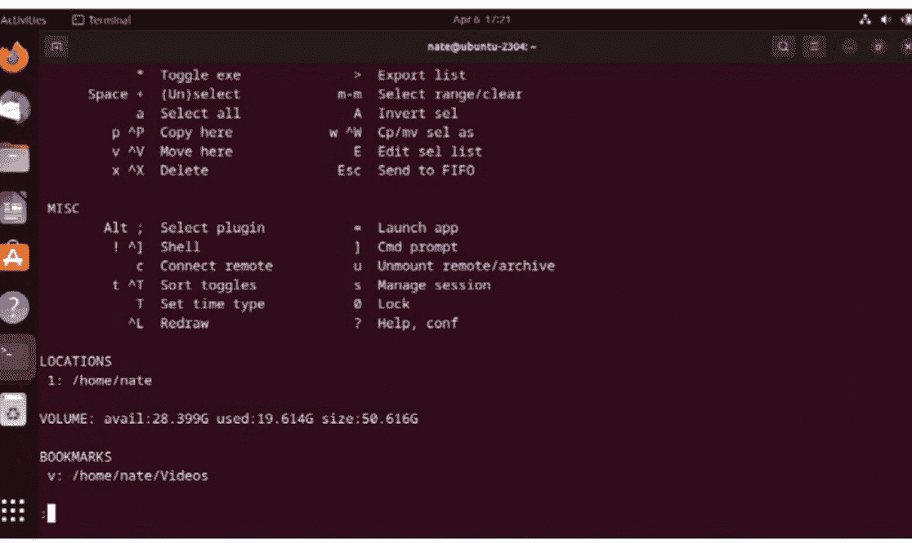

图 6：你也可以按 `?` 然后滚动到屏幕底部以查看所有分配的书签键及其目标地。

LINUX-MAGAZINE.COM

2023 年 7 月

83

# FOSSPicks（开源精选）

自由开源软件世界的闪闪明珠与发布

随着 Twitter API 失去对精美开源客户端 `Harpy` 的访问权限，Graham 已经在 `fostodon.org` 上花费了一个月的时间，帮助 `Harpy` 的开发者将事物带回 Fediverse（去中心化社区）。

作者：GRAHAM MORISON


缝纫图案设计师

# Seamly2D

起初看起来可能服装世界和计算机世界很少有共同点。但很快就会发现事实相反。缝纫、针织和钩编无论背景如何，都是非常流行的图案，在许多方面，图案的灵活性与编程具有异同工之妙。这在第一台计算机出现一个多世纪之前的 1820 年代，雅卡尔织布机就已经以工业规模使用了丝绸图案，并使用带有有人工编程孔洞的卡片来编码和复制图案。由于计算机和服装有着很长的共同历史，现在是时候每个人开始激发设计灵感了。这正是 `Seamly2D` 所做的，它让任何拥有电脑的人都能接触时尚和设计。`Seamly2D` 之于机械工程师，与 `CAD` 不同，它是免费的，`Seamly2D` 是一个使用 `Qt` 框架的桌面应用程序。它最近还获得了 `GitHub` 加速计划的奖，该计划为每个项目提供 20,000 美元和 12 周的指导，项目目标是为他们的工作构建耐用的结构。`Seamly2D` 被视为用于工程文档的参数化 `CAD`，这听起来很复杂，但那些工程元素需要无限拟合。它的学习曲线接近 `FreeCAD` 而不是 `Figma`，但它是由不同操作的技能和功能调板制成的。设计师想要花费时间的草图模式（`Draft` mode）是调板中图标最多的模式，工具范围包括创建固定变量长度的点和线，以及使用相似形状来简化和复制已创建的组。右侧还有一个编辑器，用于查看和设置图案的精确值，以及不同图层和颜色的图例。它深层的功能可以帮助你拟合并提供及时的结果。有一个活跃的社区会提供良好的帮助，并有各种入门教程

- 1. 草图 (`Draft`)、裁片 (`Piece`)、布局 (`Layout`)：每个图案都由独立的区块构建，排列成裁片并在布局中导出。
- 2. 测量 (`Measurements`)：所有按参数缩放的精确测量。
- 3. 设计 (`Design`)：在许多方面，`Seamly2D` 可用于设计。
- 4. 属性 (`Properties`)：设置值和属性。
- 5. 布局 (`Layout`)：查看你的设计在页面上的样子。
- 6. 编辑 (`Editing`)：某些设计是从它们之间的点和线构建的。
- 7. 主视图 (`Main view`)：从独立区块创建设计。

项目网站：https://github.com/Fashion/Seamly2D

# FOSSPICKS（开源精选）LINUX 之声

# 电子书阅读器：Arianna

我们有大量的图像和 PDF 查看器，但没有足够的阅读器。`Calibre` 是一个例外，是一个解决许多问题的电子书阅读器，但你需要它时它可能让你无从下手。`Arianna` 是一个基于 `Qt` 为 `KDE` 桌面构建的小型、极简电子书阅读器，如果你有一小部分书籍想在有空时阅读，它是非常完美的。它不会移除 `DRM`，除了需要安装主题外，也不会将书籍发送到你的墨水设备，而这正是它的初衷。`Arianna` 处于开发早期，不如 `Calibre`。项目网站：https://github.com/stable/arianna

# 去中心化客户端：Sengi

既然 `Twitter` 已经（稍微）放弃了所有事物的中心，现在是时候整合并关注 `Mastodon` 替代方案了。几个产品都在赶上趋势并受到了最近的关注，而 `Sengi` 特别独特，因为它是一个尝试重现 `Twitter` 外观和功能的 `Mastodon` 客户端。`TweetDeck` 的列视图使其变得如此独特且强大，因为每一列都可以显示标签搜索、用户、列表或时间线的实时结果。这些列可以在自己的独立窗口中跟踪信息，就像股票经纪跟踪他们的投资一样。这就是 `Sengi` 为 `Mastodon` 做的。`TweetDeck` 最初是 `Twitter` 的第三方客户端，最近已经放弃了桌面端或仅考虑浏览器订阅制。这使得 `Sengi` 成为一个重要的项目，因为 `Sengi` 正在尝试将 `TweetDeck` 的独特体验带到 Fediverse，而且它已经可用。你可以添加一个或多个账户，为你的本地时间线、关注列表和搜索添加列；它充满了活力和许多可能。如果你更新数据并关注事件、列表、标签以及特定用户或实例，这是离开 `Twitter` 的最佳方式。

`Sengi` 还可以配合 `Plom` 使用，这是一个适配 `Mastodon` 并具有某些独特功能的小型活动流。

基于 `Electron` 构建，它可能感觉有些消耗资源，而且你目前无法更改速度、调整字体或调整主题，但所有这些选项未来都有可能。目前，`Sengi` 是所有想要跳到 `Mastodon` 并且感觉像 `Twitter` 替代品的人的最佳选择。

项目网站：https://github.com/Nicolasconstant/sengi/

# LINUX FOSSPICKS

## 文件传输

## X-Pipe

在从一台计算机或位置传输文件的众多选项中，这种过程竟然可能如此困难且不可预测，这令人惊讶。两台计算机通常需要使用相同的协议，或者运行相同的客户端。它们可能需要处于同一个网络中、具有共同的防火墙，或者允许第三方在它们的一侧协商连接。这正是我们在该 `Linux` 发行版中经历过的问题。`X-Pipe` 试图通过图形文件管理器或相应的命令行工具来解决这些问题，这些工具被专门设计用于让文件和目录从一个地方到另一个地方的传输尽可能简单。`X-Pipe` 了一种简单无缝连接方法，而且在无需执行任何操作的情况下实现了这一点。它并没有尝试自己协商连接并管理传输，而是使用工具原生地寻找客户端的服务器。对于 `Linux` 用户，它将使用 `SSH`，但在 `macOS` 和 `Windows` 上同样可以运行。它可以自动检测 `Docker` 和 `LXD` 实例、远程机器、`WSL` 以及 `PostgreSQL` 数据库。它将带你进入连接面板，输入的详情将被安全保存。可以在主视图中选择主机，它们将以标签的形式出现，或者作为你的本地文件系统（其访问方式相同）。

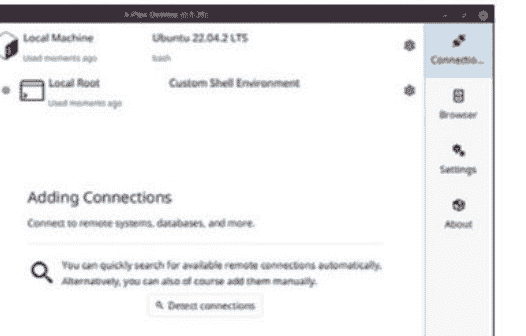

添加连接
连接到远程系统、数据库等。

`X-Pipe` 除了开源许可之外的唯一缺点是它只发布核心组件源码。你现在可以探索远程文件系统或存储，在标签之间进行复制粘贴，或者拖动文件发送到本地。它运行良好，如果你需要非技术用户访问跨操作系统的某些文件，这是一个非常棒的选项。

## 项目网站

https://github.com/praetorian-io/xpipe

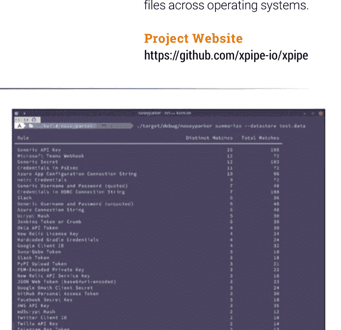

# 安全搜索

## Nosey Parker

在 `Google` 或 `GitHub` 上搜索无意间分享到世界的 `API` 密钥等信息并不费力。这类信息通常隐藏在文件或目录中，无论这些文件或目录原本用途如何，都令人不安。除非你分享的是你服务的一部分，否则追踪细节将非常困难。像 `GitHub` 这样的服务（尤其是 `GitHub`）可以扫描你的应用程序以找到泄露的密钥和秘密，即使它们对已知供应商隐藏以检查其有效性，但如果能在本地这样做更好。这就是 `Nosey Parker` 的作用的。

`Nosey Parker` 是一个命令行工具，它会扫描文件、目录和你的 `GitHub` 历史，寻找它认为是秘密的任何内容。它的定义包含在 95 个正则表达式中，并可以扩展或更新。执行审计的第一步是带有本地文件或搜索目标的参数来扫描系统。`Nosey Parker` 在 `Mac` 或 `Linux` 机器上可以在不到两分钟内报告 100kb 的源代码行，即使是针对最私密秘密的扫描。它的 `git` 历史可能需要几秒钟。但获得最佳结果需要很长时间，这很令人害怕。即使在你的经验中，选择扫描 `git` 历史既奇妙又同样迷人，`Nosey Parker` 在一个小型 `Git` 项目（我们就不点说了）包含的数据中发现了 25 个唯一的 `API` 密钥；包括三个 `AWS` `API` 密钥和许多密码等。结果在输出中进行了摘要，但你也可以使用该报告来定位到特定点。这对于包含密钥本身的代码行可能有用。结果可以被验证，但通过使用强大的测试工具系统，它可以让你或他人免受严重的尴尬。

## 项目网站

https://github.com/praetorian-io/noseyparker

# 音乐探索

## colrane

John Colrane 不需要过多介绍。他是本世纪伟大的爵士乐作曲家和表演者之一，改变了我们对音乐可能性的认知。他通过探索、研究、实验以及使用独特的音阶和节奏进行表演来实现这一点。正是这些音乐的最后元素，让 `colrane` 通过命令行变得易于获取且独特，无论你是否喜欢先锋爵士乐——它作为一个交互式解释器，以及一个接受参数以生成音乐洞察输出的命令，并且有多种操作模式（这里是双关语之意）。

在最简单的情况下，`colrane` 会读取三个或更多音符并告诉你它们属于哪个和弦。例如，输入 C、E 和 G 将输出 'C Major'（C 大和）。和弦可以选择以各种 ASCII 生成的吉他、贝斯和钢琴手指法显示。如果你正在学习其中一种乐器，它对于理解和弦结构非常有帮助。这可以帮助你根据输入的和弦构建图表，并在生成的进程中找到音阶本身中的音阶和和弦。所有这些都可以作为文本或多个 ASCII 视觉表示输出。

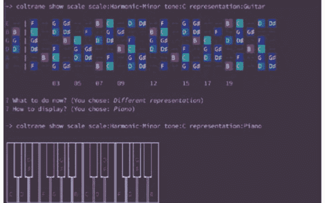

在命令行界面上通过这个命名极佳的 `colrane` 学习音乐理论。

如果你想用命令行操作让任何人印象深刻，这些非常棒。它有爵士、蓝调和流行音乐的和弦进行，并可以生成自己的自定义进程。如果你对音乐感兴趣，所有这些从命令行来看都非常有吸引力，可以在你等待其他后台进程完成时提供一种实用的消遣。

## 项目网站

https://github.com/pedrozath/colrane

# 元包管理

## Chob

正如我们许多人所说的，`Linux` 的核心在于选择，但当你只需要某样东西来完成工作时，争辩选择选择太多可能很困难。包管理协议已经变成了一项任务，为应用程序、实用程序和工具提供了大量的跨平台解决方案，而这些工具在你的发行版包管理器中可能没有。你可能想通过 `Snap` 包安装 `LXD`，或者使用 `Flatpak` 的最新流。而你喜欢的游戏可能只提供 `AppImage`，而你的发行版又领先了两个或三个版本。导航这些依赖关系的元数据可能会令人困惑，而该项目试图建立的正是这种细微的信心。`Chob` 被描述为用于第三方包管理的包管理器。它通过搜索 `appimage.io` 提供对 `Flatpak` 包、`Snap` 商店和 `AppImages` 的支持，该服务本身是可以正确处理包的。除了 `AppImages` 之外，你需要在开始之前安装 `Flatpak` 或 `Snap`，`Chob` 会处理安装本身。它接受包名作为同类参数，并会展示来自所有资源的结果，让你选择你偏好的来源。另一个选项是查看返回的包版本，这样你可以安装最新版本，但我们理解跨包格式的字符串可能会有点困难。如果你需要一个简单的工具来帮助轻松安装包，`Chob` 对你来说仍然足够。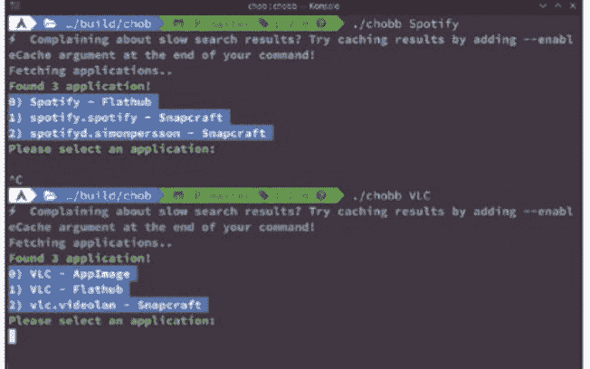

`Chob` 可以从单一源搜索并安装 `Flatpak`、`Snap` 或 `AppImage` 包。

## 项目网站

https://github.com/Muhammedqpin/chob

# LINUX FOSSPICKS

## 自动效果

### IEM 插件套件

音频效果集名称中的 `IEM` 是电子音乐与声学学院缩写。它是一个位于奥利利的著名机构，专注于声学、声音和信号处理。它以功能性音频合成闻名，该套件包含 21 种效果。例如，`RoomEncoder` 是计算密集性最高的一个，它为房间内的音频生成 2000 次反射。当你将当前位置和听音位置映射到插件时，它听起来不可思议，真实得自然。`BinauralEncoder` 在这方面非常出色，甚至可以模拟由耳朵之间的质量块引起的音频效果。除了环绕声外，`IEM` 效果还包括适用于任何音乐的均衡器。其他效果处理房间模拟和混响。通过房间编码器和直接形状进行 3D 房间模拟，在耳机输出时具有双耳声效果。


项目网站
https://plugins.iem.at

# Wii U 模拟器

# FOSSPICKS LINUX 之声

# Cemu 2

`Linux` 上有几十个甚至数百个开源模拟器，从通过 `MAME` 运行的街机游戏移植到各种。自从各种任天堂模拟器的开发达到惊人的高度以来，已经有一段时间了。`Dolphin` 是一个针对 `GameCube` 和 `Wii` 模拟的出色项目，而 `Yuzu` 能够获得如此广泛的也令人赞叹。它利用尖端技术处理任天堂的硬件，在对其同世代的 `RPCS2` 进行修订后，但 `Wii` 运行在像 `Steam Deck` 这样的现代硬件上仍然令人惊讶。直到最近，`Linux` 上还缺少任天堂模拟堆栈中的一个部分，而该部分在 `Wii U` 上被精细地模拟了。`Wii U` 是 `Wii` 的继任者，但并没有获得任天堂预想中的成功。这是由于其嵌入式屏幕的巨大变化，使得当你仍然需要连接独立显示器时，整个系统变得不必要的笨拙。但任天堂并没有停止为该设备制作一些出色的游戏，包括《塞尔传说》、《超级大乱斗》等作品。

如果你拥有其他游戏，并准备好通过相当复杂的提取过程在 `Cemu` 上运行，直到最近它一直是 `Windows` 专用的且闭源。该模拟器自 2015 年以来一直存在，也可以轻松运行许多热门游戏且性能出色。


`Cemu` 的最新版本包含了 `Ubuntu` 和 `Appx64` 版本。`Steam Deck` 的流行促使开发者创建了原生移植版，尽管它在 `Proton` 下运行良好良好。`Windows` 版本也保持着更新，而且运行良好并兼容所有模组和图形设置。原始移植版可以访问硬件并拥有不错的游戏收藏，这是在 `Linux` 上玩它们，或者当你的 `Linux` 硬件胜任时以更高分辨率和帧率玩它们的最佳方式。

# 项目网站

```
[
]
```


# 街机生存

## 开源六角形

年轻时任何闲暇的日子或在外玩游戏的日子，感觉都漫无止境，浪费无数虚拟橡果似乎是虚度时间的好方法。在这种行动中履行承诺的最佳解决方案之一，是在没人看到时寻找街机风格的游戏来玩，其中最好的类型之一就是《超级六角形》（`Super Hexagon`）。

总有一个间隙，你作为玩家的任务是让一个小三角形穿过这些间隙，越久越好。如果你不好，只能活几秒钟。超过这个，你要么很年轻，就是喝了太多咖啡（或茶）。它是高强度的、成瘾的，如果你用另一只手可能不是个好主意。


`Open Hexagon` 是一场色彩与游戏性的极速冲击，自原版发布以来经过了多年的演变。`Open Hexagon` 是同一款游戏的开源再创作。原版已经面世十多年，也得到了 `Terry Charat` 的认可。原版非常简单，但 `Open Hexagon` 已经过更新，以利用 `Steam Deck` 日益增长的活力。这是一个可以在 `Steam` 上购买的版本，但你仍然可以从项目的 `GitHub` 仓库中构建自己的二进制文件，这是值得的。`Open Hexagon` 提供了原始的体验，它现在看起来依然很棒。对于 `Steam Deck` 上的对战来说，它在桌面上快速畅玩一下同样有趣，并且像它最初发布时一样永不过时。

## 项目网站

```
https://github.com/vittorioneomi/SSVOpenHexagon
```


# LINUX 教程 – CARBONYL 图形网页浏览器

## 从终端进行图形网页浏览

### 轻量浏览

这个 Chromium 移植版可以在任何设备上运行，消耗资源极少，是让旧电脑变得真正有用的极佳工具——在此过程中还能学习。

`Carbonyl` [1] 是 100% 开源的 `Chrome` 称为 `Chromium` [2] 的分支，它的使命是：将任何 Linux 终端变成现代图形化网页浏览器。我将描述 `Carbonyl` 如何工作、如何在 Linux 上使用它，以及为什么我认为这个项目对程序员很有趣，而对普通用户来说更有趣。

`Carbonyl`（右侧）渲染了《Linux 杂志》网站的一个页面。

是的，实际图像确实相当颗粒化且像素化，这一点毫无疑问。但总的来说，毫无疑问 `Carbonyl` 渲染网页的方式比 `Firefox`、`Chrome` 或 `Safari`（作为其纯文本竞争对手）要接近得多。`Carbonyl` 渲染的事实比基于文本的编辑器更接近“真实的图形浏览器”，这一点在图 2 中更加明显。

## 特性与局限性

让我承认，从概念上来说，与“普通”图形浏览器相比，`Carbonyl` 有一些严重的局限性，但人们预期 `Carbonyl` 可以取代它们。第一个显易见的限制是 `Carbonyl` 不处理视频和流媒体，但它的分辨率比任何运行在完整窗口界面上的浏览器都要低得多。

你在图 2 中看到的是 `YouTube` 页面，从左到右加载在终端复用器 [3] 的两个面板中：`w3m`、`Carbonyl` 和旧 `Firefox`。你可能认出最右边的两个窗口，但左边没人说出为什么。

`Carbonyl` 渲染的事实比基于文本的编辑器更接近“真实的图形浏览器”，这一点在图 2 中更加明显。

## 特性与局限性

让我承认，从概念上来说，与“普通”图形浏览器相比，`Carbonyl` 有一些严重的局限性，但人们预期 `Carbonyl` 可以取代它们。第一个显易见的限制是 `Carbonyl` 不处理视频和流媒体，但它的分辨率比任何运行在完整窗口界面上的浏览器都要低得多。

你在图 2 中看到的是 `YouTube` 页面，从左到右加载在终端复用器 [3] 的两个面板中：`w3m`、`Carbonyl` 和旧 `Firefox`。你可能认出最右边的两个窗口，但左边没人说出为什么。

由 `Terry Cava` 创建，具有从屏幕中心收缩或扩张的二维方块，伴随着动感的音乐。方块收缩得以至于总有一个间隙，你作为玩家的任务是让一个小三角形穿过这些间隙，越久越好。

# LINUX 教程 – CARBONYL 图形网页浏览器

## 从终端进行图形网页浏览

### 轻量浏览

...喝了太多咖啡（或茶）。它是高强度的、成瘾的，如果你用另一只手可能不是个好主意。

`Open Hexagon` 是一场色彩与游戏性的极速冲击，自原版发布以来经过了多年的演变。

`Open Hexagon` 是同一款游戏的开源再创作。原版已经面世十多年，也得到了 `Terry Charat` 的认可。原版非常简单，但 `Open Hexagon` 已经过更新，以利用 `Steam Deck` 日益增长的活力。这是一个可以在 `Steam` 上购买的版本，但你仍然可以从项目的 `GitHub` 仓库中构建自己的二进制文件，这是值得的。`Open Hexagon` 提供了原始的体验，它现在看起来依然很棒。对于 `Steam Deck` 上的对战来说，它在桌面上快速畅玩一下同样有趣，并且像它最初发布时一样永不过时。

由 `Terry Cava` 创建，具有从屏幕中心收缩或扩张的二维方块，伴随着动感的音乐。方块收缩得以至于...

# LINUX 教程 – CARBONYL 图形网页浏览器

## 从终端进行图形网页浏览

### 轻量浏览

这个 `Chromium` 移植版可以在任何设备上运行，消耗资源极少，是让旧电脑变得真正有用的极佳工具——在此过程中还能学习。

`Carbonyl` [1] 是 100% 开源的 `Chrome` 称为 `Chromium` [2] 的分支，它的使命是：将任何 Linux 终端变成现代图形化网页浏览器。我将描述 `Carbonyl` 如何工作、如何在 Linux 上使用它，以及为什么我认为这个项目对程序员很有趣，而对普通用户来说更有趣。

`Carbonyl`（右侧）渲染了《Linux 杂志》网站的一个页面。

是的，实际图像确实相当颗粒化且像素化，这一点毫无疑问。但总的来说，毫无疑问 `Carbonyl` 渲染网页的方式比 `Firefox`、`Chrome` 或 `Safari`（作为其纯文本竞争对手）要接近得多。`Carbonyl` 渲染的事实比基于文本的编辑器更接近“真实的图形浏览器”，这一点在图 2 中更加明显。

## 特性与局限性

让我承认，从概念上来说，与“普通”图形浏览器相比，`Carbonyl` 有一些严重的局限性，但人们预期 `Carbonyl` 可以取代它们。第一个显易见的限制是 `Carbonyl` 不处理视频和流媒体，但它的分辨率比任何运行在完整窗口界面上的浏览器都要低得多。

你在图 2 中看到的是 `YouTube` 页面，从左到右加载在终端复用器 [3] 的两个面板中：`w3m`、`Carbonyl` 和旧 `Firefox`。你可能认出最右边的两个窗口，但左边没人说出为什么。

由 `Terry Cava` 创建，具有从屏幕中心收缩或扩张的二维方块，伴随着动感的音乐。方块收缩得以至于...

# LINUX 教程 - CARBONYL 图形化浏览器


电脑需要完成的事情只能在线上进行，在一个经过精细构造的重型图形化浏览器中进行。

换句话说，某些网站可能比羽毛还轻，但如果没有浏览器，我们就可以轻松处理某些会让老旧历史设备瘫痪的网站。像我这样的极少数人已经开始证明这一点，这正是 `Carbonyl` 可能填补的空白。

原因是显而易见的：基于 GUI 的普通浏览器没有窗口系统无法运行——这对于内存较小的低端处理器来说，可能在加载浏览器相反角落之前就已经崩溃了。像 `lynx` 或 `w3m` 这样的文本应用程序虽然很棒，但现实一点，如果它们缺乏对媒体播放的支持，它们就无法与现代浏览器竞争。

例如，我无法使用 `lynx`、`w3m` 或任何此类工具通过我银行的网站完成在线操作。无论你是否喜欢，这是银行的问题，而不是我们的错，但这并不能解决我的问题。我要么使用 GUI，要么必须使用全图形化浏览器。

有了 `Carbonyl`，许多此类问题都消失了，如果它们存在，还会更多。`Carbonyl` 能给出承诺吗？当然，图像和视频在 `Carbonyl` 中看起来很糟糕，但这真的重要吗？为了回答这个问题，请看图4、5和6。第一幅图包含了图2中三个浏览器（从左到右为 `w3m`、`Carbonyl` 和 `firefox`）的英语维基百科首页。

图 4：图 2 中的四个浏览器，现在加载了维基百科首页。

图 5：`Carbonyl`，你可以点击图片查看全尺寸：

- 维基百科
- 维基百科
- 自由百科

来自维基百科

今日特色文章

爱德华（1239–1297）是冰岛国王直到 1272 年他成为挪威国王。他因一项平庸的改革被废黜，并于 1276 年开始武力夺取土地。1273 年 9 月 22 日，他在伯尔根加冕。他是英国亨利三世和法国玛格丽特的儿子。他娶了苏格兰的伊丽莎白，她是亚历山大三世和挪威国王马格努·哈肯四世的女儿。他从改革英语开始统治。

- 更多文章
- 历史
- 地理
- 科学
- 艺术
- 其他

今日特色文章

明（1368–1644）是中国的一个王朝。1368年到1644年，明朝是统治中国的第四个皇朝王朝，也是蒙古人统治的元朝灭亡后第一个汉族王朝。该王朝由太祖朱元璋建立，他曾是一名农民，在反抗元朝的起义中崛起并导致了中国的统一。在 15 世纪上半叶，明朝将中国的影响扩展到中亚、韩国和越南。

- 更多文章
- 历史
- 地理
- 科学
- 艺术
- 其他

另外两幅图展示了 `Carbonyl` 的真实情况，即它以可能可能的最小硬件负载处理尖端网站，且处理方式与其他浏览器相同，甚至优于它们。

在图 5 中，你只需点击 `Carbonyl` 文章中的图片，即可看到全尺寸版本。

我们在图 6 的右侧看到的，是当鼠标悬停在指向其他维基百科页面的链接上时弹窗口。

在 `w3m` 或 `lynx` 中尝试吧！当然，这并不是要贬低这些浏览器及其开发者！它们是不同的项目，拥有自己的目标和大量的现实用例。

ISS 第 2022 期

LINUX-MAGAZINE.COM

教程 - CARBONYL 图形化浏览器 LINUX 之声

事实是，通过 `Carbonyl`，你可以滚动页面，并用鼠标点击任何你想点击的内容。包括一些方便的优势，如 GDPR 通知、Cookie 配置窗口、接受服务条款的弹窗等。只要分辨率再高一点点，图片验证码（CAPTCHAs）是可以处理的。

作为 `Carbonyl` 使用的最后一个例子，让我解释一下图 7，该图被在《Linux 杂志》的另一篇文章 [7] 中引用。该图的原始目的是为了展示任何人都可以用任何语言嵌入带有在线数据库的交互式复杂网页框架。在图 7 中，网页左侧显示了在 `Firefox` 中可见的源代码，并有用于选择数据库某些元素的下拉菜单。`Carbonyl` 显示，如果你在 `Carbonyl` 中加载同一个页面，网页框架的解构元素也将同样显示。网页框架的所有交互元素，包括图 7 中未显示的缩放滚动条，仍然有效！

通过这些以及其他方式，我发现 `Carbonyl` 虽然已经是一个完成的产品，但它已经让网站变得像非技术网络用户对“普通”浏览器所预期的那样可用，并且在最常见的 Linux 终端上表现非常出色。为了操作其网站，我们是那些设法获取 `Carbonyl` 并使用 `Gmail` 和 `Slack` 等服务的人。

`Carbonyl` 低图形分辨率可能是用户避免分心的加分项，特别是在学校实验室或图书馆等环境中。当我打开 `Carbonyl` 的 `GitHub` 页面（通过 [8]）时，另一个用户报告这在 `Carbonyl` 中被使用且有效。

## 安装与使用

在 Linux 上，`Carbonyl` 提供两种格式：可执行文件和 `deb` 包。第一个是单文件，第二个是 `deb` 包。要使用它，你应该下载压缩包，将其解压到目录中，并添加到你的路径中。

图 5：`Carbonyl`，你可以点击图片查看全尺寸：

+ 维基百科
- 维基百科
- 自由百科

# LINUX 教程 - CARBONYL 图形化浏览器


将缩放级别设置为百分比（例如，`--zoom=200` 会让所有内容变大倍）。

我必须报告的是，在我运行 `i3` 窗口管理器的电脑上，这些标志的任何组合都没有产生任何影响。然而，当你读到这里时，情况可能已经大不相同了。

其他可以尝试的选项包括：`--bitmap`（禁用终端文本渲染）和 `--zoom`（选项 [1]），以及你自定义的一些选项。最新章节中提到的已知选项是 `--version` 和 `--help`。使用 `--version` 可以显示你正在使用的 `Carbonyl` 版本，这是你在寻求支持时需要提供的首要信息。`--help` 将为你显示所有可用选项，我建议至少尝试一次，以检查它们是什么：

### 结论

`Carbonyl` 是一个浏览器，它能让你以你已经熟悉的方式使用现代网站，同时消耗更少的硬件资源——而且干扰更少。此外，它也非常容易安装。去试试看吧，！

**图 8：在 `Carbonyl` 中加载的图 7 网页——其嵌入和交互式网页元素均正常工作**

# 信息

- [1] Carbonyl: https://github.com/fatyb/carbonyl/
- [2] Chrome: https://chromium.org/Home
- [3] tmux: https://github.com/tmux/tmux/tmuxwiki
- [4] 命令行浏览器 Carbonyl: 下一步持久化：https://nextpertier.net/posts/2023-carbonyl/
- [5] html2svg: https://fatyb.fr/html2svg
- [6] Chromium 配置文件：http://blog.chromium.org/2020/08/chrome-just-got-faster-with.html
- [7] 使用 CKAN 管理开放数据，Marco Fioretti, Linux Magazine, 第272, 2023年7月, 第26页。
- [8] Carbonyl 的“现实世界”应用：https://github.com/fatyb/carbonyl/issues/13
- [9] rclone: https://clone.org/
- [10] 在 Ubuntu 上安装 Docker Engine：https://docs.docker.com/engine/install/ubuntu/
- [11] Chromium 命令行选项：https://peter.sh/experiments/command-line-switches/-

# 作者

`Marco Fioretti` (http://mfioretti.substack.com) 是一位居住在罗马的自由作家、培训师和研究人员，自1995年以来一直从事开源软件工作，自2005年以来致力于开放数字标准。`Marco` 还是自由知识基金（http://freeknowledgeedge.eu）的董事会成员。

2023年7月第272期 LINUX-MAGAZINE.COM

# LINUX 新报

在线订购：
https://bit.ly/Linux-Newsstand

《Linux Magazine》是您进入 Linux 世界的指南。每期杂志都装满了先进的技术文章和教程，这些内容在其他地方是找不到的。探索我们完整的旧期刊目录以获取特定主题，完善你的收藏。


# 271/2023年6月

# 智能家居

智能家居解决方案将为您节省时间和精力——而且，我提到过，你可以让朋友们惊讶。本月，我们将向您展示如何使用智能设备和开源自动化软件管理您的家庭环境。

**光盘内容：** `SystemRescue` 10.0 和 `Linux Lite` 6.0


# 270/2023年5月

# 绿色编码

可持续的世界需要更可持续的编程。本月，我们将介绍一些致力于能源效率的自由开源（FOSS）计划，并查看 `Go` 语言中的一些绿色编码技术。

**光盘内容：** `Fedora` 37 Workstation 和 `TUXEDO` OS 2


# 269/2023年4月

# 联邦宇宙 (Fediverse)

社交媒体连接世界，带来了来自政治家、电影明星、社区领袖和远程朋友的最新消息和评论。但商业社交媒体平台的追踪和数据挖掘导致许多用户在寻找更好的选择。本月，我们将深入探索社交媒体的替代宇宙：联邦宇宙。

**光盘内容：** `EndeavourOS` `Cassini` 22.12 和 `Debian` 11.6 “bullseye”


# 268/2023年3月

# 数据投毒

认为计算机不会犯错吗？如果你在混合中掺入一些经过修改的训练样本，你可以让一个精密的机器学习系统认为狗是猫，或者是数字 8——而且你可以通过一个没有人会注意到的隐藏信号来触发这种错误行为。

**光盘内容：** `MX` Linux 21.3 和 `Puppy` Linux `Fossa` 9


# 267/2023年2月

# 备份

理论上，每个人都可以使用备份工具，但将定期和系统备份融入生活的最佳方法是找到一个符合你习惯的解决方案。本月，我们预览了 Linux 领域的热门应用程序，以便你找到一个适合自己的工具。

**光盘内容：** `Linux` `Mint` 21 `Cinnamon` 和 `Kali` Linux 2022


# 266/2023年1月

# 生成对抗网络

近期计算机艺术和伪视频爆炸背后的秘密是什么？一个神经网络引导到另一个神经网络……**光盘内容：** `Ubuntu` 22.10 和 `AlmaLinux` 9

# 特色活动

用户、开发者和供应商在世界各地的 Linux 活动中相聚。我们 Linux Magazine 很荣幸赞助此处展示的特色活动。对于您附近的其他活动，请查看我们在 www.linux-magazine.com 上的详细日历。如果您知道任何想要添加到我们日历中的 Linux 活动，请将所有详情发送至 info@linux-magazine.com。


### Academy 2023
**日期：** 2023年7月15-21日
**地点：** 希腊，塞洛尼基
**网址：** https://kde.org/
Academy 是 `KDE` 的年度盛会，来自全球的用户、贡献者和支持者齐聚在此参加为期 5 天的交流。

### GUADEC 2023
**日期：** 2023年7月26-31日
**地点：** 拉脱维亚
**网址：** https://events.gnome.org/event/
GUADEC 是 `GNOME` 社区最大的活动。加入我们在里脱维亚的为期 4 天的讨论。

### RustConf 2023
**日期：** 2023年9月12-15日
**地点：** 科罗拉多州，阿尔布克基
**网址：** https://rustconf.com/
Rust 聚集了全球开发者进行学习和分享。

| 活动 | 日期 | 地点 | 网址 |
| :--- | :--- | :--- | :--- |
| Academy | 2023年7月15-21 | 希腊，塞洛尼基 + 在线 | https://kde.org/2023/ |
| EuroPython 2023 | 2023年7月17-23 | 捷克，布拉格 | https://ep2023.europython.org |
| GUADEC 2023 | 2023年7月26-31 | 拉脱维亚 | https://events.gnome.org/event/101/ |
| WeDevelopers Congress | 2023年7月27-28 | 德国，柏林 | https://www.wedevelopers.com/world-conference/ |
| RustConf 2023 | 2023年9月12-15 | 科罗拉多州，阿尔布克基 | https://rustconf.com/ |
| stackconf 2023 | 2023年9月13-14 | 德国，柏林 | https://stackconf.com/ |
| EuroBSDCon 2023 | 2023年9月14-17 | 葡萄牙，科布拉 | https://2023.eurobscon.org |
| Storage Developer Conference (SDC) 2023 | 2023年9月18-21 | 加利福尼亚州，弗里蒙特 | https://storeddeveloper.com/ |

# 为我们投稿

总编辑
Joe Casad, jcasad@linux-magazine.com

文字编辑
Amy Perez, Aubrey Vaughn

新闻编辑
Jack Wallen, Amber Anholz

荣誉编辑
RRita Little Nomadica

主编
Lori White

本地化与翻译
Ian Gray

设计
Daena Feisen, Lori White

封面图片
Gloria Sanchez, 123RR.com

《Linux 杂志》正在寻找关于 Linux 及 Linux 环境工具的作者。我们倾向于寻找解决实际问题的解决方案。主题可以是一个桌面工具、命令行实用程序、网络监控应用程序、自制脚本，或任何其他能够节省用户时间和精力的内容。我们的目标是向读者讲述他们尚未听过的故事，或者是他们对特定修复、新工具和实用应用程序特别感兴趣的故事。我们也非常喜欢关于读者可能已经了解的高级用法故事，以及那些如何将传统方法以新颖或创意方式付诸实践。

市场部
Brian Osborn, bsosborn@linuxnewsletter.com
电话：+44 20 8796420

通讯部
Gwen Clark, gclark@linuxnewsletter.com
Linux New Media USA, LLC
4883 Bluegrass Drive, Ste 104
Lawrence, KS 66604 USA

出版商
Brian Osborn

客户服务 / 订阅
邮箱：cs@linux-magazine.com
电话：1-800-555-0199（美国和加拿大）
（英国及国际地区）

其他所有国家
邮箱：sub@linux-magazine.com
www.linux-magazine.com

* 我们感兴趣的话题包括：
- 高级 Linux 调优与配置
- 物联网
- 网络
- 脚本编写
- 人工智能
- 开源协议与标准

如果您有我们希望纳入此列表的精彩主题，请告诉我们——我们可能会感兴趣！

请向我们发送关于您所在公司制作的产品，除非该产品是所有人都可以使用的开源工具。请不要使用我们网站风格的“前 10 名”或为了迎合读者的浅层处理文章。我们喜欢包含大量细节的完整解决方案。深入，拒绝夸张。

我们近期有几项计划需要您的帮助。请向我们发送您的技术性和实践性文章提案：

尽管在杂志内容方面已尽一切努力，但出版商对提供信息的准确性或使用这些信息可能引起的任何后果不负责。使用本杂志或其提供的任何材料风险由您自承担。

版权与商标 2023 Linux New Media USA, LLC。保留所有权利。

未经出版商书面许可，不得以任何形式复制本杂志的任何部分。任何相应的复制、传输、电子或机械或其他方法均不允许，但数据、照片、文章、图获得了 Linux New Media USA, LLC 非排他性的全球许可，除非另有说明。

Linux 是 Linux 会的商标。

所有品牌和商标均为其各自所有者的商标。如果我们从未注明，请告知我们。
