# Linux 杂志 273 2023年8月

LINUX NEW MEDIA

开源世界的脉搏


## TUXEDO InfinityBook Pro 14 - Gen8

- 移动性
- 电池续航

17 毫米超薄 & 仅 1.3 公斤轻。采用超便携镁合金机身的优质商务笔记本，提供极致的移动体验。

### TUXEDO Stellaris 16 - Gen5

- CPU 性能
- GFX 性能

得益于 `GeForce RTX 4090` 和 `Intel Core i9`，在紧凑的外形因子中提供顶级桌面 PC 级性能。

- 兼容 `Linux`
- 长达 5 年保修
- 即刻可用
- 德国制造
- 德国数据隐私保护
- 德国技术支持


## 编辑部

### 欢迎辞

### 黑暗时期与黑色墨水

亲爱的读者，

在我撰写本专栏时，`Reddit` 的“黑暗时期”正处于新闻焦点。当你阅读时，你大概比我现在知道的更多，但就目前而言，尽管该公司声称这一切最终都会过去，但这次中断看起来影响重大。回顾一下：`Reddit` 实际上是一家公司，虽然它具有许多使其看起来更像社区群组集合的特征，但该公司宣布将开始对访问其 API [1] 的应用程序收费。这一消息意义重大，因为有多家公司的收入来源于提供 `Reddit` 接口的应用程序，其中一些供应商已宣布，为访问 `Reddit` API 付费将导致他们倒闭。`Apollo`，一款苹果产品 `Reddit` 客户端的制造商，已经宣布这一变更将使他们每年损失 2000 万美元。

`Reddit` 已经平稳运行了 17 年。为什么要现在打破现状？该公司正为今年晚些时候通过 IPO 上市做准备，这并非秘密 [2]。整个情景符合这些科技创业公司发展的常规剧本。风险投资家投资一家私人公司使其成长（侧重于增长，而非利润），然后在某个时间点，通过 IPO 上市，每个人都能赚一大笔。但 IPO 只有在华尔街喜欢其所购买的东西时才能成功，而华尔街喜欢的是利润。所以，如果 `Reddit` 想要大放异彩，它们需要从一个强调增长的公司（即最大限度地访问 API）转变为一个强调利润的公司（即除非带来收入，否则不允许访问）。

据报道，`Reddit` 是世界上最繁忙的第 10 个网站，美国最繁忙的第 6 个网站，拥有 5700 万日活跃用户，因此抵制行动是大新闻。该公司坚称，抵制只关闭了其论坛的一小部分。在总共 100,000 个活跃的子版块中，最初有 6,000 个下线，随后最多有 9,000 个下线，有些在本周稍后恢复。截至写作时，仍有约 3,500 个处于下线状态。但实际数字可能不如它在关键时刻为 `Reddit` 带来的关注重要。

确实，部分关注可能来自投资者的正面关注，因为 `Reddit` 高管正在“强硬”行事并要求利润。但也值得记住，`Reddit` 处于一种大多数公司永远不会面临的特殊境地。它们整个商业模式依赖于其看起来和行为上像一个社区。`Reddit` 上大多数版主都是自愿奉献时间的。根据西北大学研究人员最近的一项研究 [3]，志愿者每年为 `Reddit` 节省了 340 万美元的劳动力成本。当然，`Reddit` 是一家大公司（在 2019 年研究时，340 万美元相当于收入的 2.8%）。但在互联网经济中，赤字与盈余之间的界限非常微妙，340 万美元可能会产生差异。大多数志愿者很乐意将时间捐赠给值得的事业，但一个为了取悦华尔街而提升利润的企业巨头可能不是许多这些志愿者认为值得的事业。

我对 `Reddit` 有一些同情。难道它们应该永远免费向那些不贡献任何费用来支付基础设施的公司开放吗？然而，如果它们依靠免费劳动力并高喊社区精神，它们是否应该被施加比其他大谈利润的创业公司不同的标准？该公司表示，它正在与几家客户公司谈判，希望它们能够继续服务，尽管两家最大的客户，`Apollo` 和 `Reddit Is Fun` (RIF)，已经宣布将关闭其论坛。

`Reddit` 首席执行官 `Steve Huffman` 最近被问及他认为真实答案是否是在互联网广告上建立庞大公司的盈利模式根本行不通。他的回答是：“你是说 `Facebook` 行不通吗？” [4]。但这就是重点所在。像 `Google` 和 `Facebook` 这样的公司运作得很好，但不仅仅是通过销售广告。它们还监视人们，对客户强取豪夺，并在必要时采取强硬的企业手段来保护其利益。所以是的，`Reddit` 可以变得像 `Google` 和 `Facebook` 一样，但那样一来，它们可能看起来不再是我们记忆中的那个 `Reddit` 了。


`Joe Casad`，
主编

##### 参考信息

- [1] “`Reddit` 用户因公司执行 `Reddit` API 天价收费而与公司开战”，`Forbes`，2023 年 6 月 13 日：`https://www.forbes.com/sites/gai/2023/06/13/redditors-go-to-war-with-the-company-as-it-enforces-eye-watering-prices-for-reddit-api/?sh=843f71db3dba`
- [2] “`Reddit` 目标在 2023 年下半年 IPO”，`Reuters`，2023 年 2 月 14 日：`https://www.reuters.com/technology/reddit-aims-ipo-second-half-2023-information-2023-02-14/`
- [3] “无偿社交媒体版主仅在 `Reddit` 上每年履行价值至少 340 万美元的劳动”，`Northwestern Now`，2022 年 5 月 31 日：`https://news.northwestern.edu/stories/2022/05/unpaid-social-media-moderators/`
- [4] “`Reddit` CEO `Steve Huffman`：‘是时候我们成熟起来，表现得像个成人公司了’”，`Morning Edition, NPR`，2023 年 6 月 15 日：`https://www.npr.org/2023/06/15/1182457366/reddit-ceo-steve-huffman-its-time-we-grow-up-and-behave-like-an-adult-company`


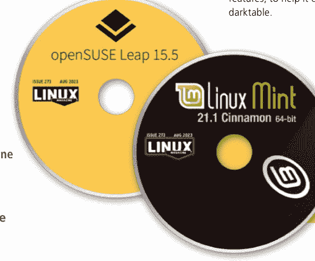

两款精彩发行版

双面 `DVD`！

详见第 6 页

- @`linux_pro`
- @`linuxpromagazine`
- `Linux Magazine`
- @`linuxmagazine`

## 双面 DVD 上的两款精彩发行版！

### Linux Mint 21.1

#### 64 位

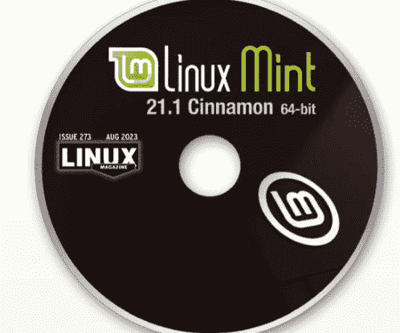

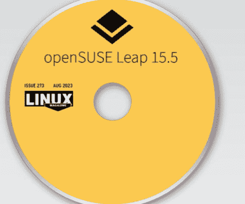

`Linux Mint` 是最受欢迎的 `Debian` 衍生版之一，以其对用户的响应速度著称。基于 `Ubuntu 22.04` 的 `Linux Mint 21.1` 代号为 `Vera`，将得到支持直至 2027 年。

在该版本中，`Cinnamon` 桌面默认采用更鲜艳的色彩和更精简的图标集，仅包含安装图标、挂载设备以及移动到 `~/Desktop` 的任何项目。主文件夹、计算机、回收站和网络图标已被移除，因为它们可以从文件管理器中轻松访问。偏好旧外观的用户可以使用 `Mint-Y-Legacy` 主题。与这种更新的外观相配合的是新的鼠标和系统声音选项。此外，驱动器管理器（`Drive Manager`）已被重新设计，不再需要 `root` 密码。更新管理器现在包含 `Flatpak` 包和一个用于自动化 ISO 图像验证的菜单项。`Nemo` 文件管理器和桌面也进行了多项外观上的更改，以提升美观度和效率。这些更改中的许多是细微的，但合在一起提升了 `Linux Mint` 对各级别用户的易用性。

### openSUSE Leap 15.5

#### 64 位

`OpenSUSE` 的开发始终与 `SUSE Linux Enterprise` (SLE) 紧密相连。然而，Leap 15.5 是首个使用 SLE 源代码包的首发版。根据 `openSUSE` 下载页面，此举旨在提高这个成熟发行版的稳定性。该版本将接收维护和安全更新直至 2024 年底。需要更长支持周期的用户可以迁移至 SLE 商业支持。


# 新闻

## Leap 15.5

`Leap` 15.5 延续了 `openSUSE` 扩展包含最新技术的做法，例如容器、不可变系统、虚拟化和嵌入式开发。在桌面方面，`KDE Plasma` 5.27 的引入带来了新的欢迎向导、增强的 `KRRunner` 功能、优化的颜色选择器和 `ark` 压缩工具、`Kate` 编辑器以及 `Kdenlive` 视频编辑器。此外，新版 `Flatpak` 具有增强的安全性，而高级用户可以探索更快的 `Vim` 编辑器版本（引入了新的脚本语言），`netatwark`（一种用于网络容器的工具），以及为 `Cisco` 的 `OpenH264` 编解码器提供的新软件源，其包在 `BSD` 许可证下发布。对于所有级别的 `Leap` 15.5 用户而言，这是一个建立在长期开发历史稳定基础上的增量升级。

## 致新闻亭读者

**欢迎阅读最新一期的《Linux Magazine》！** 希望您喜欢本月的技术文章、教程和项目精选。

您可能注意到本月封面价格上涨了。不幸的是，`Linux Magazine` 在新闻亭销售的成本不断上升，迫使我们提高价格。

**如果您直接从我们这里购买 `Linux Magazine`，不仅可以省钱，还能更快获取！** 您将始终获得最佳价格，且您的直接支持让我们能够继续每月制作 `Linux Magazine`。


感谢您持续的支持！


## 技术、趋势和工具的更新

### 本月新闻

- 08
  - 基于 `Fedora` 的 `Ultramarine Linux` 旨在简化使用
  - `Debian` 12 终于发布了
- 09
  - `Armbian` 23.05 现已可用
  - `Linux Mint` 终于获得手势支持
  - 全 `Snap` 版本的 `Ubuntu` 正在开发中
  - 更多在线内容
- 10
  - `Mageda` 9 Beta 2 准备接受测试
  - `KDE Plasma` 6 旨在带来基础 `HDR` 支持
- 11
  - `Bodhi Linux` 7.0 Beta 准备接受测试
  - `Ubuntu PPA` 使用规则即将改变

### 基于 Fedora 的 Ultramarine Linux 旨在简化使用

`Ultramarine Linux` 38 基于 `Fedora` 38，提供 `Budgie`、`KDE Plasma`、`GNOME` 或 `Pantheon` 桌面环境。最新版本的发布增加了一些特别的内容来提升性能。

这种提升来自 `System76 CPU` 调度器，它会对进程进行优先级排序。唯一的缺点是，只有 `GNOME` 版本能自动检测正在使用的应用程序。然而，所有四个版本都包含各种系统调整，以确保用户获得尽可能流畅的体验。这包括改善启动和关机时间。

此外，`Ultramarine` 还包含最新版本的预装软件。您会发现默认支持 `Flatpak`，甚至还可以安装非自由软件。

预装软件包括 `Firefox`、`LibreOffice`、`Clapper` 音频/视频播放器、基本 `GNOME` 应用（软件、天气、文件、地图）以及大量实用工具。得益于 `Flatpak` 支持，您可以轻松安装第三方专有软件，如 `Spotify` 和 `Slack`。

`Ultramarine Linux` 最大的吸引力在于其性能。开发人员所做的所有调整都带来了巨大差异，`Ultramarine Linux` 的性能优于许多类似的 `Linux` 桌面发行版。一旦开始使用，您就会注意到其速度。

立即下载 `ISO`（[https://ultramarine-linux.org/download](https://ultramarine-linux.org/download)）。您也可以使用脚本将 `Fedora` 迁移到 `Ultramarine Linux`，您可以通过命令 `wget https://ultramarine-linux.org/migrate.sh` 下载该脚本。使用 `chmod +x migrate.sh` 赋予命令执行权限，然后使用 `sudo ./migrate.sh` 运行脚本。

### Debian 12 终于发布了

`Debian` 遵循着许多其他 `Linux` 发行版都遵循的节奏。自 1996 年首次发布以来的几十年里，`Debian` 已发展成为市场上最稳定的操作系统之一。部分原因在于开发团队在版本发布之间会花费大量时间。

与每六个月发布一次的 `Ubuntu` 不同，`Debian` 的新版本大致每年发布一次。因此，您可以确信每个版本都投入了大量精力，使其坚如磐石。

随着 12.0（又名 "bookworm"）的发布，您将发现多个桌面的更新，如 `GNOME` 43、`KDE Plasma` 5.27、`LXDE` 1.1、`LXQt` 1.2.0、`MATE` 1.26 和 `XFCE` 4.18。不，这些并不是每个组件的最新版本，但这就是 `Debian` 的风格（保持尽可能稳定）。

其他软件更新包括 `Apache` 2.4.57、`BIND DNS Server` 9.18、`Cryptsetup` 2.6、`GIMP` 2.10.34、`GnuPG` 2.2.40、`Incrapsule` 1.2.2、`GNU C Library` 2.36、`LibreOffice` 7.4、`Linux` 内核 6.1、`MariaDB` 10.11、`Nginx` 1.22、`OpenJDK` 17、`OpenLDAP` 2.5.13、`OpenSSH` 9.2p1、`PHP` 8.2、`Python` 3.11.2、`Samba` 4.17 等。总体而言，`Debian` 12 中发现了 11,089 个新包，总数达到 64,419 个。它还改善了对非自由固件的支持和管理，并支持 `ARM64` 架构下的 `UEFI`。

`Debian` 支持九种不同的架构，包括 32/64 位 PC、`ARM64`、`ARMv7`、64 位小端 `MIPS`、64 位小端 `PowerPC` 以及 `IBM Z`。你可以在这里阅读 `Debian` 12 的完整发布说明，并从 `Debian` 官方下载页面（[https://www.debian.org/download](https://www.debian.org/download)）下载 `ISO` 镜像。

### Armbian 23.05 现已发布

`Armbian` 即将迎来其成立 10 周年的纪念日，并宣布发布了版本 23.05。该版本基于 `Debian`，专为 `ARM` 和 `RISC-V` 架构创建。版本 23.05 的绰号为 “Suni”，它基于一个过去三年一直在开发的完全重构的构建框架。

根据项目网站的说法，“……许多专注于 `ARM` 的 `Linux` 发行版本质上只是换了个名字的 `Armbian`！我们致力于简化复杂性，并为社区提供卓越的解决方案。”

`Armbian` 的最新版本提供了几项改进，包括基于 `Armbian bookworm` 的镜像，以便获取来自 `Debian` 的最新更新，`i3` 支持，对 `armbian-installer` 的改进，优化的软件包基础，一致的应用软件包，改进的基于 `Ubuntu` 的组装，快速且安全的更新，包含 `armbian-gaming` 脚本，以及大量的错误修复和安全补丁。

没有 `ARM` 或 `RISC-V` 硬件的用户可以下载用于 `AMD/Intel` 机器的基于 `Ubuntu` 的镜像。此版本去除了许多 `Ubuntu` 特有的部分（例如移除了 `Ubuntu Pro` 和 `Snap`）。

阅读详细的新增功能日志以了解 `Armbian` 23.05 的新特性，并下载 `ISO` 镜像以安装在你选择的单板计算机上。在下载页面上，你还会找到 `AMD64` 镜像的链接。

### Linux Mint 终于支持手势操作

多年来，在 `Linux` 上为触摸屏和触控板获取多点触控手势一直是个问题。虽然一些发行版提供了该功能，但支持程度相当有限（充其量也是如此）。

希望随着 `Linux Mint` 21.2（以及 `Cinnamon` 5.8）的发布，这一切都会改变。当使用默认的陈皮（`Cinnamon`）桌面时，用户终于可以享受到支持媒体播放器控制、平铺（tiling）和其他实用功能的手势操作。

根据 `Clement` “`Clem`” `Lefebvre` 的说法（[https://blog.linuxmint.com/?p=4518](https://blog.linuxmint.com/?p=4518)），这些手势将支持触控板、触摸屏和平板电脑。


Linux Mint 21.2（基于 Ubuntu 22.04）还将享受一些额外的更新和调整，例如 Xfce v4.18、全局深色模式（得益于 xdg-desktop-portal 的实现），以及软件管理器（Software Manager）也进行了 UI 刷新，并提供了更好的应用程序评分/排序算法和针对经过调整的软件包的专用列表、改进的登录界面（包括对多种键盘布局和更好的触控板支持）、自动检测和启用点按点击（tap-to-click）、对 Wayland 会话的支持、对 HEIF 和 AVIF 图像的支持、改进的 Pix 图像查看应用、对 Flatpak 应用的更好支持，以及对 Gnome 的 libadwaita 库的改进支持。

Linux Mint 21.2（Victoria）计划在 2023 年 6 月发布。对于想要测试 Linux Mint 21.2 的用户，你必须使用 Daily Builds（[linuxmint-developer-guide.readthedocs.io/en/latest/daily_builds_ppa.html](http://linuxmint-developer-guide.readthedocs.io/en/latest/daily_builds_ppa.html)）PPA 并从稳定版升级到不稳定版本，或者你可以等待他们发布 beta 版本，这很可能在最终发布前几周发生。请务必每天查看官方 ISO 镜像页面（[https://community.linuxmint.com/iso](https://community.linuxmint.com/iso)）。

## 全 Snap 版 Ubuntu 正在开发中

鉴于 Canonical 一直在为其旗舰操作系统 Ubuntu 推广 Snap 软件包，Canonical 将这一举措提升到新的级别，提供完全由 Snap 软件包组成的 Ubuntu 版本，这并不令人惊讶。

在任何人开始恐慌之前，全 Snap 版的 Ubuntu 不会成为默认选项。当你明年下载 Ubuntu（届时全 Snap 版将可用）时，它默认提供的是该操作系统的传统 Debian 版本。

那么，全 Snap 版 Ubuntu 的吸引力在哪里？它将是不可变的（immutable），这意味着它被设计为以只读方式挂载操作系统，因此无法更改。一旦安装了操作系统，系统文件和目录就不能被更改。这对 Ubuntu 来说并非新鲜事，因为 Ubuntu Core（另一个不可变版本）自 2015 年以来就已存在。不可变操作系统背后的理念是使其更加安全。

这一公告微妙地在 omgubuntu.com 上发布的 CUPS Snap 公告（[https://www.omgubuntu.co.uk/2023/05/cups-snap-ubuntu-23-10#comment-6196766355](https://www.omgubuntu.co.uk/2023/05/cups-snap-ubuntu-23-10#comment-6196766355)）的评论中公布。Canonical 的 Oliver Grawert 表示：“随着下一个 LTS 版本，它将有一个桌面版本（不过它是可选的，经典的桌面安装确实不会消失）。”

Ubuntu 的下一个 LTS 版本是 24.04，将于 2024 年 4 月发布，因此你可以确信，关于这个新的全 Snap 版 Ubuntu 桌面发行版的信息会像涓涓细流般逐渐流出。

## Mageia 9 Beta 2 准备就绪，等待测试

Mageia 于 2011 年从 Mandriva Linux 分支而来，自那以后，它已经成为一种独立的存在。此次最新发行版发布于第一个 beta 版本三个月之后，团队投入了大量时间来修复顽固问题、添加安全修复和应用更新。

Beta 2 功能包括 Linux 内核 6.3.3、Glib 2.36、RPM 4.18.0、Chromium 110、Firefox ESR 102.11、LibreOffice 7.5.2、KDE Plasma 5.27.4、Gnome 44、Xfce 4.18.1、LXQt 1.3.0 和 Mesa 23.1.0。

用户将发现 Mageia 包含三个不同的软件源：核心（Core，包含免费和开源软件）、非自由（Non-free，包含可免费使用和分发但包括专有软件的软件包）以及有损的（Tainted，包含在免费许可下发布但在某些国家侵犯专利和版权法的软件包）。Mageia 确实配置了 32 位软件源，但在 64 位系统上它们是禁用的。

当你下载 Mageia 的版本时，务必选择你首选的桌面环境：KDE Plasma（[https://www.mageia.org/en/downloads/get/?q=Mageia-9-beta2-Live-Plasma-x86_64.iso](https://www.mageia.org/en/downloads/get/?q=Mageia-9-beta2-Live-Plasma-x86_64.iso)）、Gnome（[https://www.mageia.org/en/downloads/get/?q=Mageia-9-beta2-Live-GNOME-x86_64.iso](https://www.mageia.org/en/downloads/get/?q=Mageia-9-beta2-Live-GNOME-x86_64.iso)）、Xfce（32 位（[https://www.mageia.org/en/downloads/get/?q=Mageia-9-beta2-Live-Xfce-ls86.iso](https://www.mageia.org/en/downloads/get/?q=Mageia-9-beta2-Live-Xfce-ls86.iso)）或 64 位（[https://www.mageia.org/en/downloads/get/?q=Mageia-9-beta2-Live-Xfce-x86_64.iso](https://www.mageia.org/en/downloads/get/?q=Mageia-9-beta2-Live-Xfce-x86_64.iso)））。

要了解有关新发行版的更多详细信息，请查看 Mageia 官方博客（[https://blog.mageia.org/en/2023-05-24/the-release-of-beta2-brings-mageia-9-stable-closer-to-reality/](https://blog.mageia.org/en/2023/05/24/the-release-of-beta2-brings-mageia-9-stable-closer-to-reality/)）。目前，Mageia 9 没有官方发布日期，但请继续关注官方博客（[https://blog.mageia.org/en/](https://blog.mageia.org/en/)）获取更多信息。


每周五位最新的新闻送达你的收件箱

免费订阅 Linux Update bit.ly/Linux-Update

## KDE Plasma 6 有望带来基础 HDR 支持

当 KDE Plasma 6.0 最终到来时，用户将发现高动态范围（HDR）支持终于到位了。由于 4K 屏幕正在成为常态，HDR 支持已成为必需品。

借助 HDR，视频内容的效果可以远远超出如今已过时的标准——媒体机构几十年来一直固守这些标准。KDE Plasma 6.0 中的 HDR 支持是通过 2023 年 5 月由红帽（Red Hat）组织的一次 HDR 黑客马拉松以及 Plasma 冲刺（Sprint）实现的。

KDE Plasma 6.0 将仅为 Wayland 会话提供 HDR 支持，据 KDE 开发者 Nate Graham（[https://pointiestick.com/2023/05/20/this-week-in-kde-preliminary-hdr-support/](https://pointiestick.com/2023/05/20/this-week-in-kde-preliminary-hdr-support/)）称，这“为 Wayland 上的颜色管理奠定了基础。”

## 更多在线资源

-  Linux Magazine

  - www.linux-magazine.com

- ADMIN HPC

  - http://www.admin-magazine.com/HPC/

- 节省存储空间

  - Jeff Layton

  - 人们经常求助于数据压缩来节省存储空间，但降低精度也是一种有用的技术。

- ADMIN Online

  - http://www.admin-magazine.com/

- Windows 的软件包管理工具

  - Eugeni Strimon

  - Chocolatey 和 WinGet 在 Windows 上提供完全成熟的软件包管理功能，但哪一个最适合你的环境？

- CrowdSec 众包安全服务

  - Thomas Joss


- 通过众包安全，组织形成一个社区，通过共享攻击数据对网络攻击采取集中行动，从而可以在早期阶段检测和避免威胁。我们解释了这一策略如何通过 `CrowdSec` 云服务发挥作用。
- 验证你的配置
    - `Ankur Kumar`
    - 自动化验收测试是捕捉与配置错误相关问题的强大工具。我们将展示如何使用名为 `goss` 的免费工具实现你自己的验收测试环境。

你可以阅读一篇非常深入的文章，该文由 `KDE` 开发者 `Xaver Hugel` 撰写（<https://zamaduaa.github.io/wayland/2023/05/18/hdr-and-color-management-in-kwin.html>），主要介绍了 `KWin` 中的 `HDR` 和颜色管理。在文章中，`Hugel` 表示：“我们在黑客马拉松上并没有进行大量的代码修改，但我确实成功驱动了一块具有高色域范围并启用 `HDR` 模式的 `HDR` 屏幕，同时让 `KWin` 执行必要的颜色转换，使 `SDR` 内容看起来正确。”

有一点需要注意，在 `KDE Plasma 6` 中，`Wayland` 将成为默认的显示管理器。

此外，根据 `Hugel` 的说法，`HDR` 支持在初期将“相当基础”。因此，用户将无法立即跳出来直接在 `HDR` 模式下观看视频或玩游戏。在 Linux 上的 `HDR` 支持走向成熟之前，开发团队还有很长的路要走。

## `Bodhi Linux` 7.0 Beta 准备就绪，接受测试

`Bodhi Linux` 已经存在一段时间了，最新版本的发布承诺带来软件的新版本、更好的硬件支持、增强的安全性、改进的性能，以及更多内容，以吸引新用户并满足老用户的期待。

新版的核心亮点是 `Moksha` 0.4.0-8 桌面环境，它包含多项改进，包括完全重构的模块、新的快捷键查看器、更好的窗口吸附功能、针对菜单项的“请勿打扰”功能，以及从 `e25` 回溯移植的内部通知 API，还有更多其他内容。此外，`Plymouth` 和 `Greater` 应用程序也拥有新主题。

作为基础系统，你将在其中找到 `Ubuntu 22.04.2 LTS`、三种不同的内核选择（`Standard 5.15.0-71-generic`、`HWE 5.19.0-41` 和 `6.2.6`）、`EFL 1.26.99-2`、`mozillateam PPA`、`kelebek333` 的 `PPA`、`nvidia-legacy PPA`，并且已启用 `Ubuntu Backports`。

许多工作也投入到了改进和修复 `Bodhi Linux` 中包含的众多模块中，并且有大量软件更新，包括 `Chromium`（非 `Snap` 版本）113.0.5672.63、`Terminology` 1.13.1-3、`Web Browser Manager`（允许你选择安装任意数量的浏览器）以及 `Thunar` 4.16。

你可以在此阅读有关 7.0 版本的所有详细信息（<https://www.bodhilinux.com/release/7-0-0/>），并在此下载 beta 版本（<https://sourceforge.net/projects/bodhilinux/files/7.0.0-beta/>）。

## `Ubuntu PPA` 使用方式的变更

随着即将发布的 `Ubuntu 23.10`（`Mantic Minotaur`），`PPA` 的处理方式将发生相当大的变化。如你所知，在当前版本的 `software-properties` 软件中，当你通过命令行添加 `PPA` 时，会在 `/etc/apt/sources.list.d/` 中创建一个 `.list` 文件，并且相关的 `GPG` 密钥会被添加到 `/etc/apt/trusted.gpg.d/` 中。

当 23.10 发布时，这些 `PPA` 将使用 `Deb822` 格式来创建 `.sources` 文件，并且相应的 `GPG` 密钥将直接通过 `Signed-By` 字段添加到文件中。这意味着用户不再需要管理一堆 `.list` 文件。

根据开发人员的说法，这一变更带来了一个非常重要的好处：当从系统中移除 `PPA` 时，`GPG` 密钥也会被自动移除。密钥将特定于某个 `PPA`，不能用于其他存储库，其他密钥也不能用于签名该 `PPA`。这些好处将极大地增强 `PPA` 的安全性。新系统的另一个好处是，用户不必担心删除可能在系统中累积的 `.list` 文件。

当然，总有不足之处，最大的缺点在于 `PPA` 将拥有系统的 `root` 权限。因此，程序维护者可能会向存储库中添加恶意代码，而下一次你升级时，这些恶意代码将被安装，并对你的机器拥有不受限制访问权限。

阅读来自 `ubuntu-devel` 邮件列表的公告（<https://lists.ubuntu.com/archives/ubuntu-devel/2023-May/042573.html>）。


> 编年史家 `Zack Brown` 报道 Linux 内核社区的最新新闻、观点、困境和发展。

*By `Zack Brown`*

**作者**

Linux 内核邮件列表是 Linux 开发活动的核心。流量巨大，一周往往达到 10,000 条消息，而独自跟上整个开发范围的最新动态几乎是不可能完成的任务。敢于承担这项任务的少数勇敢者之一是 `Zack Brown`。

### Linux 中的 `Rust`

Linux 内核开发中一个迷人的方面，是试图从 `C` 和汇编语言转向其他语言（如 `C++`）的尝试。`Linus Torvalds` 以极其在意内核代码的美学，以及 `CPU` 和 `RAM` 使用率和安全性等重要功能而闻名。如果要让他接受其他语言，那必须是一种相当令人惊叹的语言。作为对比，开发者在 20 世纪 90 年代末曾尝试在内核中添加 `C++` 支持，但未通过审核。

`Rust` 编程语言是内核开发者自那以后第一次认真尝试为内核添加支持。Linux 遵循了最初的尝试，在 2022 年底将其纳入 6.1 版本。此后，提交了更多 `Rust` 补丁。与 `C++` 不同，`Rust` 似乎短期内不会离场。相反，看起来 `Linus` 相当致力于认真尝试它。

这是一个令人惊讶的决定，因为 `Rust` 太新了。`Rust` 诞生于 2006 年，而 `C++` 诞生于 1979 年。即便在今天，`Rust` 也几乎没有征服世界。然而，它却在 Linux 内核中获得了如此令人惊叹的地位。我并非贬低！考虑 `Rust` 的特性，甚至将其置于 `C++` 之上并欢迎其进入内核开发过程，这非常迷人。然而，`Linus` 基于其优点而非流行程度来评估一种新语言，这一点也不令人惊讶。

将 `Rust` 融入内核是一条蜿蜒曲折的道路。用 `C` 和汇编编写的内核部分需要与用 `Rust` 编写的部分以特定方式连接，以便不损失速度或安全性，并且让 `Rust` 和 `C` 开发者都能编写良好且可读的代码。

例如，`Wedson Almeida Filho` 最近提交了一个补丁，为 `Rust` 引入了一个互斥量结构，用他的话说是“允许 `Rust` 代码惯用地使用内核互斥量”。

`Wedson` 的补丁修改了内核源代码中的 `C` 和 `Rust` 文件，以添加此支持。如果你想知道互斥量初始化例程的 `Rust` 代码是什么样子，以下是 `Wedson` 补丁的一个片段：

```rust
macro_rules! new_mutex {
    ( $(inner:expr $ (, $name:literal)? )? $
      $(,)*) => {
        $(sync::Mutex::new(
            $inner, $name ?
        ))
        $(crate::$optional_name($( $name)?), ?
        $(crate::static_lock_class!())
    );
}
```

`Rust` 是一种奇特而迷人的语言，表面上与 `C` 差异巨大，但其特性使其成为内核项目受欢迎的补充。

`Peter Zijlstra` 回复道：“我讨厌所有这些愚蠢的辅助函数……但我猜这是他们在语言接口方面能做出的最好安排 :/ 唯一的希望是，这个东西可以做跨语言 `LTO` [链接时优化] 或类似的事情来重新内联代码。”

`Wedson` 回复：

*   我们可以[改善现状的一件事是]将一些现有的宏转换为头文件中的内联函数。
*   我们不能在所有情况下这样做（例如，当 `lockdep` 启用时声明新的静态变量的情况，如 `mutex_init`），但当 `lockdep` 禁用时 `mutex_lock` 只是一个函数，而当启用时它只调用 `mutex__lock_nested()`。
*   “你对这一点有什么看法？”

作为回应，`Peter` 问道：“`Rust` 真的能解析 `C` 头文件并内联 `C` 函数吗？我以为整个问题在于它只能调用 `C ABI` 符号（内联函数不是符号）。”

`Wedson` 回复：

*   “`Rust` 不能。我们使用一个叫做 `bindgen` 的工具来读取 `C` 头文件，并为函数生成等效的 `Rust` (`extern "C"`) 声明。该工具最近得到了增强（<https://github.com/rust-lang/rust-bindgen/pull/2335>），通过自动生成如上所述的辅助函数（除了 `Rust` 声明外）来处理静态内联函数。


“因此，情况有所改善，因为我们不再需要手动编写（并提交）辅助函数。如果我们能获得更好的语言集成，未来可能会进一步改善。”

`Peter` 接受了这一观点，并表示在这种情况下，“请随意将宏转换为内联函数，此时差异无关紧要。在这种情况下，确实没有理由让 `mutex_lock()` 不是内联函数。” 针对 `Wedson` 说 `Rust` 实际上无法解析 `C` 头文件和内联函数一事，`Peter` 补充道：“这很遗憾，我希望它能用 `Rust` 编写等效的内联函数。”

`David Light` 在此时插话，关于将宏转换为内联函数。他指出：“`mutex_lock()` 可能没问题。但有情况下，`gc` 为 `#define` 生成的代码比内联函数好得多。几乎肯定是因为前端可以优化 `#define`，而内联发生得更晚。”

`Marco Elver` 建议在对宏进行更好的内联函数转换时，在 `C` 文件中使用 `'static __always_inline'`。他问道：“`bindgen` 能处理 `'static __always_inline'` 函数吗？” 而 `Miguel Ojeda` 回复道：“如果你指的是‘`bindgen`’自动生成包装器的新功能，考虑到 `'__always_inline' => 'inline'`，它似乎能处理这些，这就是我想象它寻找的东西[..]，虽然我还没有在内核中尝试过使用这个功能。”

代表 `Rust` 社区的 `Miguel` 还说：“我们最初故意最小化 `C` 端的更改，但如果维护者对此没有异议（除了例外情况），那就太好了。”

对话到此结束，尽管此线程绝对是 `C` 和 `Rust` 内核开发者社区之间更大且持续讨论的一部分。如今有许多 `Rust` 补丁在流传，双方都对此非常重视。

`Rust` 是一种令人印象深刻的语言。其设计者似乎持一种立场，即他们将在语言本身中构建针对内存泄漏和段错误的保护，代价是包含一些相对晦涩的语言特性。他们似乎也让避免这些晦涩特性变得相对容易，代价是编写更慢的代码。因此，对于只想要高级语言特性（例如在快速编译语言中使用易用的复杂数据结构）的人来说，如果你不介意承受微小的速度损失，你可以拥有这些特性而不必面对太多的语言复杂性。对于想要代码速度完全与 `C` 语言竞争的人来说，如果你利用 `Rust` 更复杂的内存保护特性，你也可以拥有。

我不知道 `Linus` 为什么选择接受 `Rust` 进入内核，但我推测这正是因为那些内存保护特性。似乎很少有强大的低级语言包含这样的特性，这似乎是一项很难做的平衡工作。我相信 `Linus` 可能觉得，相对于 `Rust` 提供的保护（这些保护在其他地方也很难找到），该语言额外的复杂性是一个公平的交易。我 fascinated 于观察 `Rust` 在 `Linux` 内核中的进一步发展。

## 编译器和内核的“宿敌”

`Theodore Ts'o` 提交了一个更新 `ext4` 文件系统代码的补丁，在此过程中他提到，`Matthew Wilcox` 的另一个补丁需要叠加在他的补丁之上，使特定函数返回错误指针，而不仅仅是空值。

`Matthew` 的补丁（以及 `Ted` 的补丁）细节不需要知晓，且两个补丁都被内核接受。然而，`Linus Torvalds` 评论道：

> “如果我们能标记那些返回错误指针的地方为返回‘`nonnull`’，并在构建时自动捕获此类事情（当人们将错误指针与 `NULL` 比较时），那就太棒了。”

> “然而，不幸的是，编译器在这方面完全搞错了。‘`gcc` 显然把事情搞得一团糟，‘`nonnull`’ 不是一个警告辅助工具，而是一个‘你可以静默删除对 `NULL` 的测试’的指令。”

# 内核新闻

“看起来 `clang` 似乎对 `returns_nonnull` 也采取了同样的做法，考虑到他们显然在函数参数上正确实现了 `_Nonnull`（文档说明如果传入 `NULL` 参数会发出警告，而不是让编译器生成有缺陷的代码），这一点确实令人惊讶。”

“那些认为‘未定义行为是实现优化的好方法’的计算机人员是一个祸害，应该被缩小。他们是那种最糟糕的照搬者。”

“有没有可能有人能用一根大棒子敲醒编译器开发人员，告诉他们‘未定义行为不是一个特性，而是一个漏洞’，并试图让他们成熟起来？”

“既然他们至少看起来‘几乎’做对了，所以添加一些 `clang` 开发人员作为参与者。”

`Nick Desaulniers` 回复了 `Linus`，说：“很好，我能感受到你的愤怒。用你所有的仇恨把我打倒，你走向黑暗面之旅将就此完成。你的仇恨让你变得强大。让仇恨在你体内流淌！”

`Nick` 补充说，`Clang` 的 `_Nonnull` 属性确实捕捉到了构建时 `null` 指针和错误指针之间的比较，但“目前它并不具备工具链可移植性。还需要对 `clang` 进行修改才能使用 `GNU C` 的 `__attribute__` 语法（我并不反对添加对此的支持）。”

他还评论了 `Linus` 关于 `Clang` 在一个地方做对了非空性但在另一个地方没做对的说法：

“就在过去一个月里，我可能刚和 `Bionic`（`Android` 的 `libc`）开发人员进行了这样的对话。

“是的，`nonnull` 属性 ≠ `_Nonnull` 属性。（引用是因为 `ILUC _Nonnull` 不使用 `__attribute__` `GNU C` 扩展语法）。我的理解（可能是错的）是，`nonnull` 是为了与 `GCC` 兼容而实现的，而 `_Nonnull` 可能是由 `Apple` 实现的（我的猜测；未核实）（因此在代码审查中可能没有考虑与 `GNU C` `__attribute__` 语法的兼容性）。”

`Nick` 补充道：“`Bionic` 开发人员正在整个代码库中部署 `_Nonnull`，并故意不使用 `nonnull`，这是危险的（一位队友使用了‘对开发者不友好行为’一词），`nonnull` 会影响代码生成，`_Nonnull` 仅影响诊断。”

`Linus` 回应了 `Nick` 关于 `Clang` 的 `_Nonnull` 属性确实捕捉到了 `null` 指针和错误指针之间比较的陈述。他说：“不，它是关于使用该属性的警告，而不是关于当 `NULL` 存在时对其进行测试的警告。

“我实际上测试了 `_Nonnull`。它似乎对参数有效。但对于返回值无效。

“当然，可能需要一些其他魔法，但对我们来说，它似乎确实令人遗憾地不起作用。”

关于工具链可移植性，特别是修改 `Clang` 以使用 `GNU C` `__attribute__` 语法的需求，`Linus` 说：“完全没有必要使用 `__attribute__` 语法，那将 _不是_ 阻碍因素。他补充道，为了告知 `Clang` 开发人员什么方案是可行的：

“虽然确实它是通用语法，有时我们因为这种通用性而明确使用它，但它绝不是唯一的语法，你实际上往往倾向于为其构建更具可读性的封装。

“所以，例如，我们更喜欢使用 `'__weak__'` 而不是写 `'__attribute__ ((weak))'`。

“而且不，它完全不需要使用 `__attribute__`。我们已经有诸如”

```
#define __diag(s)  _Pragma(__diag_str(GCC diagnostic s))
```

“这样的东西，所以我们已经在使用其他语法了。“最终结果：如果它确实有效，我很乐意做类似”

```
#define __return_nonnull__ Nonnull
```

“在 `<linux/compiler-clang.h>` 中，然后 `<linux/compiler-gcc.h>`，而不仅仅是”

```
#define __return_nonnull__
```

“以及一个大注释，说明 `__attribute__ ((nonnull))` 是多么糟糕，永远不应该被使用。”

`Nick` 回复说：“我明白你的观点；能够标记出与 `NULL` 的比较似乎很可疑会很好。”他也认可了 `Linus` 解释的其余部分。

讨论在这里开始变得漫无目的。在一个时刻，`Linus` 提供了以下观点：

“编译器警告的真正优势在于它们能被快速发现，开发人员会对它们做出更好的反应。例如，它们可能导致代码被适当地重新组织或重写，变得更好。”

“对于随机其他问题而单独注意到的那种‘简单树’修复往往更像是‘绕过问题’。当然，它可能是正确的修复，但在编写代码时并没有将其纳入考虑，所以它通常只是那种‘掩盖警告’的修复。特别是因为试图修复问题的人通常不是该代码的主要开发人员。”

事实上，在此时，对话开始变得非常技术性——`Nick` 发布了一些原始代码作为示例，他认为这可能会满足 `Linus`。然后他们（以及 `Theodore Ts’o`）开始深入真正的细节，直到最终线程戛然而止。

我对内核项目与各种编译器项目之间的奇怪关系感到着迷。当这些项目对编译器特性存在分歧时，这确实是一个先有鸡还是先有蛋的问题。我个人认为 `Linux` 内核是世界上最重要的软件项目之一（或者是实际最重要的软件项目），因此编译器几乎是一个为 `Linux` 服务的服务工具。对我而言，任何编译器希望采纳 `Linux` 内核项目所需的特性是完全合理的。

然而，另一方面有一个绝对合理的观点：编译器才是真正的基础软件，所有其他软件项目都是受益者，它们需要对编译器人员会为所有人做出良好决策抱有一些信心。


这两种观点的有效性在内核项目和编译器项目发生冲突时创造了一种惊人的局面。顺便一提，当硬件项目和编译器项目发生冲突时也会出现同样的情况。在这种情况下，辩论进行的方式以及冲突和分歧最终解决的方式，在我看来似乎包含了宇宙的奥秘。

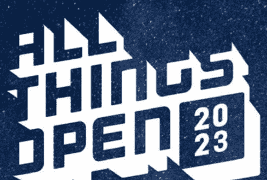

## 10月15-17日

*北卡罗来纳州罗利市中心，美国*

| 指标 | 数量 |
| :--- | :--- |
| 参会者 | 5000 |
| 演讲者 | 150+ |
| 会议 | 150+ |

新的十年，延续传统，展示世界上最好的开源内容

### 立即注册


扫描二维码或访问 `2023.allthingsopen.org`

# 表演时间

如果你使用 `Linux`，你已经拥有了进入播客领域所需的大多数工具。只要仔细计划，一步一步来即可。

Graham Morrison 著

我们中的许多人曾经和朋友们坐在一起讨论某些事情，也许是在喝了一杯啤酒或康普茶之后，结果有个人说，“这绝对适合做成一个绝妙的播客！”每个人都说“是的！”并热情地点头，谈话随即转向讨论播客的名字、托管在哪里，以及录制到智能手机上是否足够好。每个人都兴奋地上床睡觉，结果第二天早上醒来时却在想，为什么一个关于《塞尔达传说》中蘑菇品种的播客听起来是个好主意。

或者并非如此。有时，播客创意确实能扛过第二天的考验，而现在是开始你自己的播客的最佳时机。作为 `Linux` 和开源用户，你的技术技能已经非常适合这项任务，而且作为一个话题，与 `Linux` 和开源技术相关的知识是永恒的、始终有趣的，并且适用于从政治到烹饪的广泛其他主题。这使你比那些早上醒来有好播客创意的大多数人拥有显著优势，这种优势将帮助你克服阻止人们制作第一个播客的许多初始障碍。

## 要有计划

首先要考虑的是计划，而你计划的第一部分应该是决定谁应该主持播客。这甚至比创意的初始强度更重要，因为一组引人注目的个性几乎可以谈论任何事情。许多听众也希望感觉他们像是在听朋友，或者理解他们及其兴趣的人的声音。虽然更难，但你也可以独自完成，通过传递你对某个主题的热情，使其具有足够的感染力，让听众不想错过任何一集。一个很好的例子是 `History of English Podcast` [1]，由 `Kevin Stroud` 于 2012 年创立，原本打算只持续 100 集。他的想法是讨论英语单词和短语的词源，追踪其使用从大约伊朗高原上游荡的部落到诺曼征服英国，再到现代世界持续的语言流动。十年后，`Keith` 刚刚发布了第 168 集，他刚刚讲到了 16 世纪末。他可能永远无法追上，但他对该主题的热情压倒了他 `modest` 的雄心，也压倒了他听众的雄心，这是好创意的一个绝佳标志。

与 `History of English Podcast` 一样，你很可能想到了一个你非常了解并想与他人分享的主题——你需要将其分解为适合单集的内容，或者作为跨越多集的持续部分。你可能想谈论新闻故事，或者你和你的共同主持人的发现。如果这些主题属于可预测的类别部分，会有帮助，即使你穿插了更随意的、特定于各自剧集的部分。杂志出于类似原因也做同样的事。它们也有可预测的部分，如新闻、评论和教程，但也有更自由格式和适应性强的特写和访谈，它们是封面主题的一部分。

另一件需要考虑的事情是你的播客是否适合家庭观看。适合家庭的播客会避免脏话或某些主题。这可能会限制你的范围或自发性，或者如果需要删除某些部分或单词，会使编辑变得更加困难，但它可以通过扩大受众来弥补，因为像 `Apple Podcasts` 和 `YouTube` 这样的平台会标记那些不能广泛消费的内容。更实际地说，如果人们想在开车时和家人一起听，这也会有帮助。

## 时长和频率

为播客做准备和设置就像为假期打包——你为一个周末打包的东西和一个为一周打包的东西几乎是一样的。就播客而言，这意味着准备 30 分钟录音和准备 2 小时录音的努力是一样的。但你必须抵制让播客太长的诱惑，尤其是其他播客对你的听众注意力有着如此激烈的竞争。将 30 分钟的播客纳入你的收听计划比 2 小时的播客容易得多，而在找东西听（比如吸尘时）查看播放队列时，2 小时的马拉松会议更容易被跳过。更长的录音和较短的时长还会给你更多的编辑选择，从而带来更高质量的内容。俗话说，永远让你的观众欲求更多。


你录制更新的频率与单集时长密切相关。制作两集各 30 分钟的播客，远比制作一集 1 小时的播客要好。一般来说，你制作播客的频率越高越好。每周一次是理想的选择。这能让你的播客时刻保持在听众脑海中，并帮助他们记住你。每两周更新一次是另一个不错的选择，尤其是作为起步阶段，但每月一次可能太少了。无论哪种方式，你的播客更新频率越高，你每月的下载量就越大，这对于未来你想要售卖广告赞助非常有帮助。

当播客单集预计何时发布时，清晰地进行沟通至关重要——并且要严格遵守。无论是刮风下雨，还是 `PulseAudio` 故障或硬盘崩溃。这是区分业余爱好者和专业人士的唯一标志；专业人士明白听众需要一个绝对可预测的例行安排。可预测的发布是实力和稳定的标志，因为没有人愿意把时间投入到最终可能会无疾而终的事情上，而且你的听众越需要费力去弄清哪一集是上一集、哪一集是下一集，你失去的听众就越多。

## 群众的力量

三到四个联合主持人是一个理想的数字，因为这能让听众熟悉你们的人格特点，并让他们感觉置身于朋友之间（图 1）。联合主持人可以分担承担职责、进行研究、提出反对意见、从另一个视角进行讨论，或者仅仅是在另一位主持人无法出席时进行补充的负担。如果你们彼此已经相识，并且在相处时感到舒适且相对放松，那会很有帮助。即使是经过周密计划或有剧本的播客，听众也享受不可预测的部分，而自发的、发散性的对话是其中重要的一部分。重要的是，主持人们对主题的不同意见需要得到体现。播客不应该成为最强人格者的虚荣项目，更糟糕的是，不应该成为制作播客的那个人的一言堂。

主主持人的角色是整个播客事业中最重要且最被低估的。主主持人是代表听众提问的人，对谈话内容是否可能被理解保持敏感。这在有专家参与时尤为重要——专家可能会假设听众具备某种知识水平，而这是你无法假定你的听众都具备的，主主持人的工作就是在必要时要求澄清观点或挑战假设。主主持人还应确保所有主持人都平等地参与对话，例如询问较安静的主持人的意见，或者打断冗长发言者的独白，给其他人分享意见的机会。

无论谁负责推进播客，都需要做到微妙和透明。如果他们做得很棒，没人会注意到。这是一项吃力不讨好的工作，甚至可能削弱你在主持动态中的地位，因为你从多个角度扮演了多个角色，但让某个人承担这个角色至关重要，而最好由播客的创始人来承担。


`图 1：` 联合主持人之间的融洽关系有时比播客创意本身更重要，尽管混合不同的人格和观点也是至关重要的。


`图 2：` 现场表演和录制播客可能非常有趣，但这并不一定意味着能产生质量最高的单集。

## 发布与分析

在达成一致的计划、完成录音以及至关重要的编辑步骤之后（图 2），你准备好向全世界分享你的播客了。我们显然建议你在知识共享许可证下发布你的播客，许多基于 `Linux` 的播客选择知识共享署名-非商业性使用（`CC BY-NC`）或署名-相同方式共享（`CC BY-SA`）许可证。如果你不介意别人从你的作品中获取经济价值，`CC BY-SA` 许可证是理想的选择。选择其中一种也有助于音乐和标志的选择，因为这样就可以自由地在自己的播客中使用类似许可的创意作品。

在片头、片尾和片段转换中使用音乐可以为你的播客增添专业的制作质感。虽然通过 `Fiverr` 等平台可以廉价地委托制作音乐和设计作品，但选择知识共享许可的媒体能给你更大的控制权。例如，许多知识共享音乐曲目是以*分轨*（`stems`）包的形式提供的，捆绑了用于制作最终混音的单个轨道。这为播客制作者提供了很大的灵活性，让他们可以重复音乐的某一部分，移除人声轨道，或者创建一个完全不同的混音，适合嵌入播客中。

下一个大问题是你打算如何托管你的播客。一个 30 分钟的单声道播客通常约为 30MB。一个中等成功的播客可能拥有 10,000 名听众，每集需要大约 300GB 的带宽。自托管通常足以起步，特别是如果你能获取一个与播客相关的域名名，你可以为每集发布相关内容设置 `WordPress` 等动态 `CMS`，或者使用静态站点生成器，在每次发布时更新。另一个重要方面是社区反馈，值得提供几种选项，包括电子邮件或基于网页的评论，以及维护成本低廉且更容易的选项，如 `IRC` 账号、`Telegram` 群组或 `Discord` 服务器。`Spotify` 可以为你处理所有这些，但你会失去对后续如何发布或聚合你的播客的控制权。

当然，没有 `RSS` 订阅源，播客就不成其为播客。`RSS` 仍然是你发布播客以及人们收听播客的核心。`RSS` 文件是一种 `XML` 格式的文本文件，播客播放器解析它来了解播客位于何处以及有哪些可用的单集（参见题为“播客 `RSS` 格式”的方框）。


RSS 足够简单，可以手动创建，你会在 WordPress 和其他站点上找到插件，使这一过程更加无痛。让你的播客被纳入 Apple 的播客计划 [2]、Spotify 的类似计划 [3] 或 YouTube 也很容易，尽管对于 Apple 和 Spotify，你需要同意并接受某些内容、RSS 格式化和编码要求。你可以使用播客聚合服务或托管商绕过所有这些，他们乐于提供你的播客服务，提交给最热门的服务以纳入其中，甚至代表你谈判广告。聚合服务通常前期费用很低，尽管它们会从广告收入中抽取相当大的一块。

关于金钱的话题，从播客中赚钱很难，且不应是你的主要动机。不过，你可能会赚足够的钱来支付托管费和设备费。对于开源和与 Linux 相关的播客，你可能需要考虑使用 Patreon [4]，它让听众可以少量捐款支持播客的运营。你可以通过为支持者提供额外内容、提前收听单集，或提供无广告的播客订阅源来鼓励这种行为。你也可以出售商品（图 3）或为播客出售广告。销售广告是一项独特的技能，但如果你乐于接受挑战，没有什么能阻止你联系你认为可能感兴趣的公司，以谈判广告、赞助或产品评测。这些通常根据公司的广告预算，按季度或每六个月提前谈判，广告主希望看到稳定的听众数量、收听小时数，以及对其广告的一定程度的参与度——通过联盟链接或通过播客专属的优惠券代码或类似方式。


**图 3：** 资助播客的方式之一是通过商品，这些商品通常可以按需制作和发货，供应商按整体价格的特定百分比收取费用。

## 播客 RSS 格式

RSS 文件包含指向每个单集的链接、诸如时长和大小之类的元数据，以及一个链接回你整体网络存在的部分（图 4）。听众通过 RSS URL 订阅，并在新一集发布后立即收到推送。创建自己 RSS 订阅源最简单的方法是使用 CMS（如 `WordPress`）的插件，或者复制类似播客的 RSS 订阅源。找到一个 XML 编辑器可能有帮助，例如 `Red Hat` 的 `Visual Studio Code XML` 扩展，用它删除除一个播客单集外的所有内容，然后简单地用你自己的元数据替换。播客特定内容保存在 `<channel>` 元素中，第一部分用于描述你播客的全局数据，如名称、描述以及图片和标志的链接。在此之下，每个单集封装在 `<item>` 标签内，包含特定于每个单集的类似详细信息。

提供有意义的统计数据出奇地困难，且与你可能熟悉的基于 Web 的指标有很大不同。许多播客播放器会为单个听众打开多个流，离线缓存播客，或根本无法听完一集。你可以仔细构建针对唯一 IP 地址和下载兆字节的分析，但通常依靠 `Apple Podcasts`、`Spotify` 和 `YouTube` 提供的更先进的工具更容易，这些工具通常可以突出最流行的部分，并通过评论或反馈帮助促进参与度。然后可以将这些数字外推以包含自托管的下载量。但尽量不要过多地思考这些数字。它们可以是增长的一个有用指标，但它们自然会在一年中波动，且通常很难从中推导有意义的得数据。忠于你最初的计划和愿景，但最重要的是，享受乐趣。其他的一切都会随之自行解决。

### 信息

- 1. 英语播客历史：[https://historyofenglishpodcast.com](https://historyofenglishpodcast.com)

- 2. Apple 播客创作者中心：[https://podcaster.apple.com/](https://podcaster.apple.com/)

- 3. Spotify 播客创作者中心：[https://podcaster.spotify.com](https://podcaster.spotify.com)

- 4. Patreon：[https://www.patreon.com](https://www.patreon.com)

## 作者

`Graham Morrison` 是一位杰出的 `Linux` 作者和编辑。他为 *Linux Magazine* 撰写 `FOSSPicks` 专栏，并近 14 年来几乎每两周（现在每周）制作播客，最初是在他编辑、制作和出版的 *TuxRadar* 上，最近则是在 *Late Night Linux* 上。


```xml
<?xml version="1.0" encoding="UTF-8"?>
<rss version="2.0"
  xmlns:content="http://purl.org/rss/1.0/modules/content/"
  xmlns:atom="http://www.w3.org/2005/Atom"
  xmlns:dc="http://purl.org/dc/elements/1.1/"
  xmlns:podcast="https://podcastindex.org/ns/1.0"
  xmlns:itunes="http://www.itunes.com/dtds/podcast-1.0.dtd"
  xmlns:rns:googleplay="http://www.google.com/schemas/rns/play"...>
<channel>
  <title>Linux Magazine</title>
  <link>https://www.linux-magazine.com/feed/</link>
  <description>Linux Magazine is a podcast that takes a look at what's happening in the Linux world.</description>
  <lastBuildDate>Wed, 29 Jun 2023 14:56:38 +0000</lastBuildDate>
  <language>en-US</language>
  <sy:updatePeriod>daily</sy:updatePeriod>
  <sy:updateFrequency>1</sy:updateFrequency>
  <generator>https://wordpress.org/?v=6.2.2</generator>
  <image>
    <url>https://www.linux-magazine.com/wp-content/uploads/2016/12/cropped-favicon-32x32.png</url>
    <title>Linux Magazine</title>
    <link>https://www.linux-magazine.com</link>
    <width>32</width>
    <height>32</height>
  </image>
  <atom:link href="http://pubsubhubbub.appspot.com/" .../>...
</channel>
```

图 4：播客 RSS 订阅源中使用的 `XML` 很容易理解，但使用支持 `XML` 的编辑器（如 `Visual Studio Code`）将有助于你发现可能悄悄渗入的错误。

# 现场录音！

`Audacity` 是一款免费、开源且易于使用的多轨道音频录制和编辑工具，非常适合制作播客。

*作者 Ken Hess*


`Audacity` [1] 是任何录制或编辑音频文件的人不可或缺的“必备”工具之一。它是跨平台的（`macOS`、`Windows`、`Linux`），这使得文件共享和协作变得更加容易。`Audacity` 音频编辑器和录音机拥有易于使用的界面，并支持广泛的硬件。`Audacity` 支持单声道或立体声的直接麦克风录音或混音器录音，并包含一些便捷的键盘快捷键以提高编辑效率。您可以直接录制到 `Audacity`，也可以打开大多数音频文件和部分视频文件类型进行编辑。在本文中，我将介绍如何使用单一声源（麦克风）直接录制到 `Audacity`，以及一些基本的编辑。您只需使用少量的特效和功能即可进行简单的播客制作。我在本文中描述的特效是我使用频率最高的。我确实进行过一些高级编辑，但那些少数几次是例外情况。

*专业提示：通过删除静音、添加片头和片尾片段以及添加背景音乐，使您的播客更吸引听众。*


关于播客被问得最多的问题之一是：“开始制作播客需要花费多少钱？”答案听起来可能带有讽刺意味，但范围从 0 美元到数千美元不等。如果您有一台运行 Linux 的可用电脑，使用内置麦克风并安装 `Audacity`，那么成本就是 0 美元。如果您使用免费的在线聚合服务，托管也可能是免费的。这些服务会将您的播客分发给七或八家主要的播客提供商，例如 `Google Podcasts`、`Apple Podcasts`、`Amazon Music` 等。您也可以购买一台新电脑、一台新的高端麦克风或一套麦克风、一个混音设备，以此类推。如果您有一台可用的电脑，可以在上面安装 Linux，安装 `Audacity`，并购买一个好麦克风。麦克风的价格通常反映了其质量。然而，一款 100 美元价位的麦克风就足以为您服务。如果您获得了赞助商或捐赠者，您以后总是可以升级设备。

`Audacity` 的官方功能包括能够：

- 录制现场音频
- 将磁带和唱片转换为数字录音或 `CD`
- 编辑 `WAV`、`AIFF`、`FLAC`、`MP2`、`MP3` 或 `Ogg Vorbis` 声音文件
- 使用可选库导入和导出 `AC3`、`M4A/M4R (AAC)`、`WMA` 及其他格式
- 剪切、复制、拼接或混合声音
- 以 16 位、24 位和 32 位进行高质量录音
- 添加多种特效，包括改变录音的速度或音高，以及淡入（`Fade In`）、淡出（`Fade Out`）和截断静音（`Truncate Silence`）
- 使用 `LADSPA`、`LV2`、`Nyquist`、`VST` 和 `Audio Unit` 插件
- 编写您自己的自定义插件

## 使用 Audacity

自 2008 年我第一次开始制作播客以来，我就一直在使用 `Audacity`。那时它已经是一个成熟的产品，具备了我创建和编辑播客及其他音频文件所需的所有功能和插件。对于播客而言，`Audacity` 最重要的两个方面是录制和编辑。每个人都会告诉你声音是电影或视频最重要的部分，但对于没有视觉线索来推导含义或背景的播客来说，这一点更为重要。您的音质必须卓越。您可以使用 `Audacity` 的功能和插件来改善录音质量不佳的音频，但它听起来总是不会达到理想状态。

优质的声音始于优质的设备，我将在下一节中介绍录音硬件的选择。

操作 `Audacity` 很简单。由于大多数笔记本电脑都有内置麦克风，当 `Audacity` 在您的系统上打开时，您可以立即开始录音。按下录音按钮并开始说话。您会看到声波随着您说话出现在屏幕上（图 1）。看！您现在是一位播客主持人了！好吧，还不完全是，但您已经在路上了。

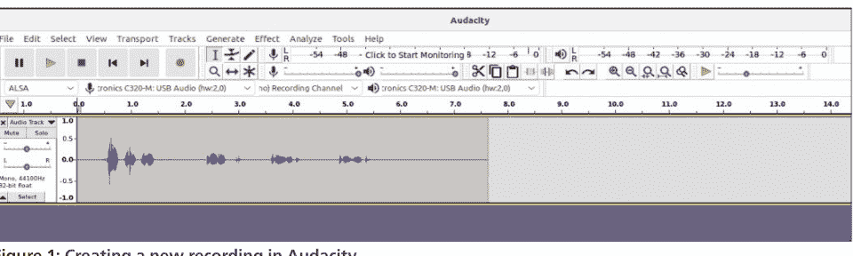

作为播客主持人，您可能希望或需要使用某种特效，例如截断静音（`Truncate Silence`）、放大（`Amplify`）或降噪（`Noise Reduction`）。要对整个文件应用特效，请按 `Ctrl + A` 高亮整个文件，从菜单栏点击“特效”（图 2），然后选择您的特效。大多数特效都有自己的设置，您可以进行调整以满足您的需求。在应用特效之前，请点击“预览”按钮，使用您自定义的设置试听应用后的效果。调整并预览，直到您对选择感到满意，然后点击“确定”以应用该特效。您也可以将特效应用于音频文件的一部分。要这样做，请高亮您想要调整的区域，然后重复上述步骤以应用特效。如果您想要撤销更改，请记住通用的撤销键序列 `Ctrl + Z`。


如果您使用降噪功能来去除文件中的嘶嘶声或静电，请留意以下提示。`Audacity` 在去除这些异常方面做得很好，但有代价。如果您必须大幅降低噪音，音频可能会听起来“闷闷的”或不自然。最好重新录制您的音频，而不是用机械的声音烦扰您的听众——除非这正是您想要的效果。

## 录音硬件

虽然我曾经使用过独立麦克风和扬声器、带麦克风的耳机和笔记本电脑麦克风、不带麦克风的耳机或耳塞，但我更喜欢使用内置麦克风的耳机来录制我的播客。我目前使用的是 `Plantronics`（现为电子产品供应商 `Poly` 的一部分）生产的 `C320-M` 耳机（见图 3）。这是一款做工精良、低噪声的耳机，让我能听到自己的声音。降噪耳机通常会让距离感偏离对话，因为我无法完全听到自己说话，所以我不知道如何在录音中调节我的声音。

要查看已连接设备的列表，请从主菜单选项中选中 `编辑 | 首选项`。

> **专业提示**：记住您的品牌。在您的播客期间多次提及您的播客名称。

我还有一个 `Focusrite Scarlett 2i2` 音频接口 [3]（在图 4 中显示为可用设备），它可以处理两个输入源。`Audacity` 将此设备视为单一声源。如果您有多个扬声器，每个都需要麦克风，您将需要一个接口设备来连接多个输入。使用此设备，我可以连接两个麦克风并同时录制它们。接口设备是一个多功能的选择，因为您可以使用 `XLR` 输入或 1/4 英寸 `TRS` 连接器，并且每种接口都有各种适配器。

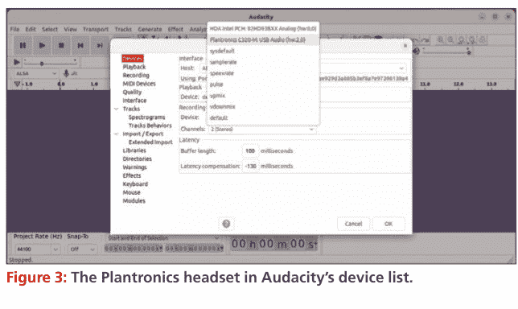

在多人说话的播客中，我喜欢心形指向性领夹麦克风或内置麦克风的耳机。这样可以说话者可以放松下来并正常说话，而不是试图保持距离静止或手持麦克风一英寸的距离。领夹麦克风可以捕捉说话者的声音，而无需他们专注于距离和定位，这赋予了播客更自然和对话式的语气。此外，由于对麦克风机械操作的关注减少，您可能会更少的停顿和填充词需要从录音中删除。

`Audacity` 几乎兼容所有与您电脑兼容的录音设备。通常，如果您的电脑识别它，`Audacity` 也会识别它。请记住通过阅读评论和询问组件与 `Audacity` 配合工作的情况，仔细思考并选择合适的硬件。

## 应对 Audacity 的怪癖

`Audacity` 是一个出色的音频程序，具有一些有趣的怪僻功能。最显著的怪癖是，在启动 `Audacity` 之前必须连接录音和回放硬件。`Audacity` 不会识别在活动期间插入的任何硬件。您的系统会识别新硬件并使其可用，但如果在 `Audacity` 打开时插入设备，您将不会在设备列表中看到它。请先连接麦克风、耳机或其他音频设备，然后打开 `Audacity`。新硬件将出现在设备列表中。一旦连接，您可以随时在音频设备之间切换，而无需关闭并重新打开应用程序。例如，如果您连接了一个外部麦克风然后启动 `Audacity`，您可以使用外部麦克风进行录音，切换到内置麦克风，并在不关闭和重新打开的情况下继续录音。在从列表中选择回放和录音设备时要小心。将麦克风选择为回放设备不会损坏任何东西，但选择正确的回放设备可以避免数小时的挫败感和故障排查。

另一个显著的怪癖是您无法覆盖录音中的特定位置——至少我从未弄清楚如何做到这一点。例如，假设您录制了一段对话并想覆盖一个错误。在这种情况下，您可能试图将光标放置到您想覆盖的部分左侧，按下录音，并期望新的录音会插入到您放置光标的位置。您会发现新的录音是从当前录音的末尾开始的。您必须复制、剪切并粘贴您的新片段到录音中，以替换不好的音频。然而，您可以高亮您的新片段，复制它（`Ctrl + C`），高亮您想要放置坏片段的位置，然后按 `Ctrl + V`。您的新片段将粘贴到您的原始片段中，替换不好的音频。

如果您再次按下录音按钮并开始说话，`Audacity` 会将您的新录音添加到之前片段的末尾。我的光标在 2.0 秒标记附近，但新片段被添加到了第一个片段的末尾（图 5）。

> **专业提示**：赞助很棒，但长广告会让观众失去兴趣。两或三个 10 秒的广告比单个 30 秒的广告更好。

我要提到的最后一个怪癖是，在收听音频文件时，您可能需要停下来，稍后再回来继续收听。如果您打算恢复收听，请勿按下停止按钮。相反，按下暂停按钮。如果您按下停止按钮，`Audacity` 会将您带回光标位置，这可能距离您开始的地方有几分钟甚至几小时。如果您按下暂停以暂时停止收听，请再次按下暂停以恢复收听。我收听我的播客录音，有些长达一个多小时，结果按下停止后忘记我在哪里停止了。这是一个令人烦恼的问题，只需要发生几次就能训练您改为按下暂停。

## 高级功能

`Audacity` 具有一些有趣的高级功能。您可以在“生成”菜单（图 6）中找到其中的一些，包括 `Chirp`、`DTMF` 音调、噪声、静音和 `Click Track`。

我使用最多的是静音。我经常在音频文件的开头添加几秒静音，我知道我要将其交给另一个人进行制作，以便为片头音乐、赞助广告或旁白混合留出时间。要在轨道中添加静音，请用鼠标点击设置光标。然后，选择 `生成 | 静音` 并提供持续时间（图 7）。静音间隔将出现在轨道中（图 8）。

## 保存项目和导出音频

编辑完音频文件后，您可能想要保存它。您有一些选项可以做到这一点。如果您需要保存您的项目并稍后回来，保留您的编辑和历史记录，请选择 `文件 | 保存项目 | 是`。此选项将保存您的

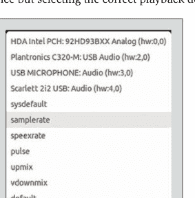

图 4：查看可用设备列表。


图 5：尝试覆盖片段的一部分。


轨道就像它们现在的样子，并保留你的编辑历史。文件将以`AUP`扩展名保存。你可以保存项目，同时导出音频以便在其他设备上播放。你会收到一条通知，说明这是一个音频文件，而不是项目。点击`确定`以确认该消息并继续保存你的项目文件。

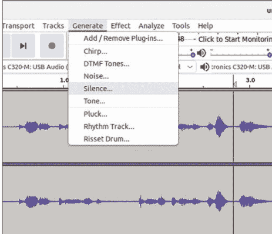

图 6：`Audacity`的生成选项。

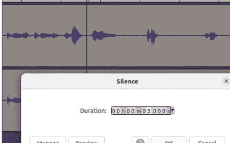

图 7：在轨道光标的当前位置插入三秒的静音。

要将你的文件保存为完成的音频文件，请选择`文件 | 导出`。会打开一个对话框，提示你选择文件类型。我总是导出为`MP3`，但这纯属个人偏好。

你或许还可以下载`Audacity`的源代码`[4]`并在你的系统上编译它，以启用或禁用选项并自定义你的安装。我从未需要这样做，因为标准功能和位置对我一直都很有效。

## 总结

`Audacity`是一款专业的音频应用程序，支持广泛的录音和播放硬件。它是一款免费、开源、易用的应用程序，具有高级功能、数十种效果、插件和输出选项。它是播客制作者的极佳选择，因为它提供了一个简化的解决方案，在`Linux`、`Windows`和`macOS`系统上都能同样出色地工作。`Audacity`开发团队会定期发布更新以及安全补丁和错误修复。使用`Audacity`既有趣又高效。它将陪伴你多年。祝你播客制作愉快！

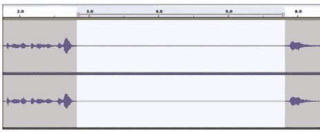

图 8：轨道中增加了三秒的静音。

### 信息

- `[1]` `Audacity`: https://www.audacityteam.org/
- `[2]` `Poly`: https://www.poly.com/us/en
- `[3]` `Focusrite Scarlett 2i2`: https://focusrite.com/en/usb-audio-interface/scarlett/scarlett-2i2
- `[4]` `Audacity` 源代码: https://www.audacityteam.org/download/source/

## 作者

`肯·赫斯` 是一位自由技术作家和记者。他报道各种开源主题，包括`Linux`数据库和虚拟化。你可以通过他的网站`www.kenhess.com`与他联系。

# 声音探索者

一旦你的播客业务开始运转，你可能会决定想要一台真正的混音器和一些更高端的软件。我们将向你介绍`Ardour`，并让你开始使用一些基本的音频硬件。作者：`Hartmut Noack`


播客制作通常占据音频录音频谱的低端。你真正需要的只是一台电脑、合适的软件和一个麦克风。然而，一些用户可能希望避免这种最基本的场景。你可能会问：“既然我已经费尽心力为播客制作设置了一个录音棚，我还能用它做什么其他的事情？”或者，你可能希望你的录音棚发展成为更复杂的东西。也许你自己就是音乐家？或者你希望举办现场音乐——或者其他需要混音和多个麦克风的表演替代方案。

在这些场景下，你可能会轻易超越简单的“麦克风 + `Audacity`”配置。如果你在寻找更多功能，请尝试`Ardour`。

`Ardour` `[1]` 仍然被认为是`Linux`上录音和混音免费工具的参考应用程序。也存在各种替代方案——例如，如果你正在使用`MIDI`创作音乐，`Muse`是一个很好的选择，而`Qtractor`为处理循环和采样提供了一些创新功能——但在混音和母带处理方面，`Ardour`是无与伦比的。

本文描述了如何超越最基本的播客配置，并为现场录音配备你的录音棚。

我还会描述一些你可能希望纳入录音棚的硬件。虽然本文描述的设置可能比基本的`Audacity`配置更详细、更复杂，但它仍然相对简单且价格实惠。专业录音工作室在硬件上花的钱要多得多。

# 现场演出母带处理

母带处理，即为完成混音添加最后一笔润色，需要超越“在我的耳机里听起来还不错”。如果你想确保混音在一部智能手机的扬声器上听起来足够好，同时在各种立体声系统上表现良好，你需要在发布前进行测试。

录制现场演出带来了另一个问题。笔记本电脑音乐会很常见，如今使用`Linux`上的免费软件和简单`USB`接口的立体声输出可以轻松管理这类表演。但当今的技术为你提供了更广阔的机会。选项范围从供`DJ`使用的简单预监听功能（让你将音源与节拍精确同步）到作为乐器的模拟混音器。

# 硬件

如今，从简单的`USB`麦克风到混音器的升级是可负担得起的。本文使用了`Mackie ProFX10v3` `[2]` 混音器，价格约为 250 欧元（见图 1）。该设备是三十多年模拟混音器制造经验的结晶。除了你可以预期的所有品质外，它还内置了一个`USB`接口，能够完成任务而不牵涉他人（意指不占用系统资源或干扰其他设备）。

得益于大多数`Linux`系统内置的`JACK`音频服务器，此类通用`USB`设备现在运行良好，但对于某些设备，通用`ALSA`驱动程序并不提供对该设备软件混音器的控制。`ProFXv3`在`QasMixer`中也显示为一个混音器部分；换句话说，该硬件在计算机上所能提供的一切功能都是完全可用的（见图 2）。有关规格，请参阅“`ProFX`混音器详情”框。

`ProFX10v3`混音器最引人注目的特点是其非常坚固的结构。所有控件、开关和连接器都易于触及，给用户留下可靠的印象。没有松动，我在操作过程中也没有遇到任何烦人的噪音。一切都清晰可读且标签合理。由于带有背光静音开关，`ProFX10v3`混音器在照明不良的现场演出中也非常有用。

`ProFX10v3`名称中的`10`代表模拟输入，其立体声输出路由到`USB`接口的两个`PCM`输入。混音器的主


图 1：`Mackie`的`ProFX10v3`混音器只有旋钮而没有通道推子，但它可以放在桌面上笔记本电脑旁边。

# ProFX 混音器详情

该混音器在较小的占地面积内提供了大量功能。要使用前四个通道的插入点，你需要一个立体声插头将一个通道输出，另一个通道接收处理后的信号（见图 3）。混音器名称中的`FX`代表由混音器中的`GigFX`引擎计算出的数字效果。这些效果可以插入到每个通道中。要查看完整的第三系列手册，请访问`Mackie`产品页面`[3]`。


图 2：连接后立即，`ProFX`以两个输入和四个输出的形式出现在`jackd`中（此处使用了`Carla`音频插件宿主），你可以使用`QasMixer`对其进行控制。


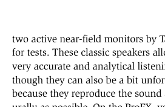

图 3：插入点无法被控制；它们只是将信号循环回通道。下方的开关负责低切均衡器。

控制不会影响信号的音量，这意味着你可以微妙地通过将所有平衡控制完全转到左侧或右侧，一次性录制乐队的整体混音，或同时录制两个通道。

两台用于测试的`Tannoy`近场监听音箱。这些经典音箱允许非常精确和分析性的聆听，尽管由于它们尽可能自然地再现声音，它们可能有点苛刻。在`ProFX`上，你可以一键测试同一混音在立体声系统上的声音。你还可以连接蓝牙扬声器和其他类似播放设备，只要它们具有模拟输入即可。

主混音通过平衡`XLR`线缆从混音器传输，这在 50 米或更远的距离上保证了无干扰的信号。`Mackie`的商标之一是，如果没有信号传输，混音器是完全静音的。即使使用简单的插头线缆将主混音输出路由到 2 到 3 米外，`ProFX`也能兑现这一

# 场景

你需要了解的第一件事是如何将硬件与`Linux`、`jackd`包和应用堆栈结合使用。`2x4`接口允许你将音源输出到两个不同的目标：主混音和控制室。控制室目标还服务于耳机输出，如果需要，你可以连接另一个放大器和扬声器（见图 4）。当你正在处理录制的混音时，这允许你同时使用不同的输出系统。我通常使用

承诺，即使使用简单的插头线缆将主混音输出路由到 2 到 3 米外也是如此。

如今许多流行的声音处理器通过物理方式或软件方式将传入的立体声信号合并为单声道。许多你在立体声回放中不会注意到的错误，如果以单声道输出听起来就不对劲。一旦你的混音在不错的立体声监听音箱上听起来很好，以相同的方式设置单声道输出，并在两种输出模式之间切换。如果你的作品在单声道下听起来也可接受，你可以假设它在智能手机扬声器上听起来也会不错。

现场演出场景要复杂得多。无论你是想在`Twitch`上进行直播并添加音乐、语音聊天，还是将乐队混音至完美，像`ProFX`这样的混音器在控制信号流方面提供的选项很快就会变得


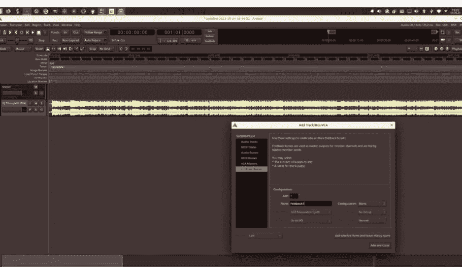

**图 4：** 在 `Ardour` 中，foldback 总线实际上为你提供了一个第二个主输出，你可以将其路由到另一个输出。

# 封面故事

### 声音工作室实战

与屏幕上的虚拟按钮相比，使用真实的旋钮和按钮会带来更满足的感觉。`ProFX` 前四个声道的插入式连接器在这个价位段中是一项罕见功能。这些连接器允许将信号路由到外部设备，设备处理后再将其反馈到你的混音中。这一切都通过 `JACK` 以立体声混音的形式传输到 Linux，并可以在 `Ardour` 中进行录制。

但您也可以将任何支持 `JACK` 的 Linux 软件发送的信号发送到连接在调音台输出的音响系统。这意味着，例如，您可以使用 `Hydrogen` 鼓机，同时通过 `MIDI` 键盘演奏像 `Yoshimi` 或 `VeeOne` 这样的软音源——同时还有通过麦克风或吉他输入调音台的信号（图 5）。

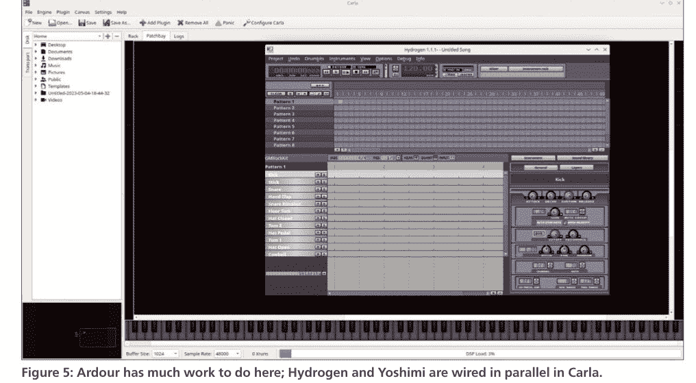

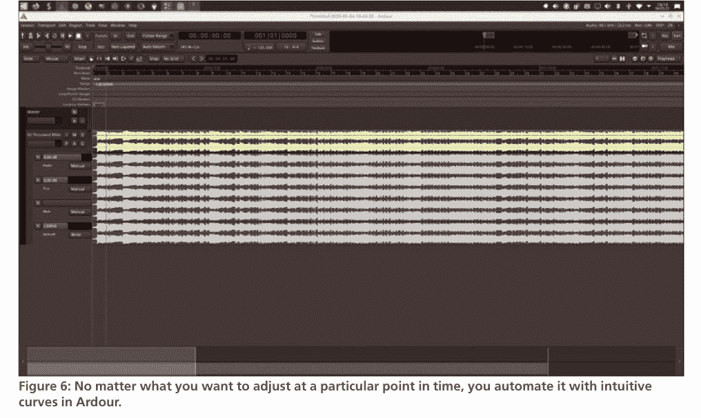

### 混音与母带处理

`Ardour` 为混音和母带处理提供了广泛的自动化选项。调音台本身以及所有插件的每一个参数都可以使用直观的曲线轨道与音频并行编程；您可以直接在软件界面中绘制曲线；`MIDI` 控制器或支持 `OSC` 的智能手机应用程序也适合执行此任务。

在编辑器中，点击 `A` 会打开一个菜单，允许您显示轨道的元轨道；然后您可以为几乎任何参数绘制曲线，从音量到完全晦涩的插件设置（图 6）。此外，`Ardour` 完全依赖 `JACK` 的信号路由，允许您对几乎任何输出通道进行灵活控制；这项功能在任何其他 Linux 软件中，即使是商业软件，都找不到。还可以以相对较低的开销实现第二个（或更多）主通道作为总线（图 7）。

对于母带处理，您主要需要均衡器和压缩器/限幅器插件。在过去两三年内，Linux 上的免费扩展在这方面发生了许多变化。除了像 `FooLimiter` 这样的 `LADSPA` 时代简单经典插件和 `Calf` 的高端便捷插件外，您还会发现提供甚至更多设置以及精心设计的、非常高质量的图形界面的新模块（图 8）。


**图 7：`Ardour` 调音台遵循一种理念，认为最烦人的功能就是缺失的那个。就信号路由而言，很难想象有比这更多的可能性。**

### 倾听，倾听！

一种在混音和录音时聆听音频的方式是使用耳机。对于测试，我常使用 `AKG` 的经典 `K240 DF` 和 `Mackie` 推出的较新的产品 `MC-350`（图 9）。`MC-350` 耳机与 `AKG` 有显著不同，提供了降噪功能。其设计很像听力保护耳罩，防止信号与环境噪声混合。在录制人声或吉他时，这能让您获得扬声器完全无法实现、开放式耳机也只能有限实现的声音。您可以在录制信号与房间内同时输出的声音不混合的情况下听到它。

结果有时令人惊叹。由 `guitariX`（一个基于 `JACK` 运行的 Linux 吉他放大器）放大的吉他人声，在 `Tannoy` 扬声器的测试中听起来圆润且富有音乐性，但通过 `Mackie` 耳机听则完全失真且缺乏可辨识的和声，而这正是录音实际的声音。这绝对不是因为 `Mackie` 耳机无法处理信号。耳机并没有扭曲任何声音，它们只是无情地复现在 `guitariX` 中选择的设置。如果您通过扬声器聆听该轨道，它会与正在演奏的 `Ibanez RG` 吉他的内部声音混合，这些定义明确的声学声音与 `guitariX` 的厚实失真融合在一起。

简而言之：特别是在为声学信号设置效果时，使用耳机是个好主意。这种揭示效果在开放式 `AKG` 耳机中不那么极端。但您也可以通过稍微调大音量来发现错误。

### 正确的扬声器

如果您自己制作音频，应注意不要过于被注重外观的设备所左右。使用中等价位 `Hi-Fi` 设备制作的混音往往听起来较差、沉闷、过于尖锐，因此不同于艺术家的初衷。

音响工程师的监听音箱听起来很分析性强。它们不强调听众觉得特别出色的地方，也不夸大低音产生的冲击力。为此，它们在可能范围内避免失真和着色，并以特别明确的方式重现声音——空间上，以便各个声音可以在混音中精确平衡。

我用一对经典扬声器测试了这些功能，即带有内置 50 瓦放大器的 `Tannoy Reveal` 近场监听双单元系统（图 10）。我将箱子以三角形布置，距离工作位置约 1.20 米（见“扬声器正确设置”专栏）。这样，您可以听到一切，包括错误。与在同一房间中配备 `Denon` 放大器和两对 `Canton` 三单元 `Hi-Fi` 扬声器的立体声系统设置相比，空间表现似乎明显更强。

`Tannoy` 扬声器可以以约 200 欧元的二手价格买到。它们总重 10 公斤，需要由合格的接口通过杰克线提供信号。像 `Mackie` 的 `StealthBar` 这样的小型轻量紧凑设备，售价 100 欧元，能与之匹敌吗？顾名思义，`StealthBar` 是一个紧凑的条形音箱，最好放置在屏幕下方。该设备同时是 `USB` 接口和蓝牙扬声器（见“正确使用情况下的 StealthBar”专栏）。尽管 `StealthBar` 仅 50 厘米宽，但它提供了良好的立体声映射，即使使用小扬声器实现空间印象需要一点更多的专注力。

### 分析房间声学

如果您自己的空间声学特性怪异，不能代表一般的聆听环境，那么调整声音以使其

### 扬声器正确设置

耳机提供的最大优势之一是易用性：无论您把它们戴在何处，它们听起来都是一样的。相比之下，扬声器输出到房间的声音波被墙壁反射，声音也强烈依赖于位置。最重要的经验法则是，您需要正好坐在两个扬声器之间的中心。理想情况是一个等腰三角形，其大小需要根据扬声器的物理特性进行调整。另一方面，`StealthBar` 是为短距离优化的；在约一米的距离处可获得最佳空间印象。在更远的距离处听起来仍然还可以，但在立体声混音中定位声音会更困难。对于 `Tannoy` 的近场监听器，制造商建议在头部高度设置一个边长约为两米的等腰三角形。在没有非常大的房间和合适的三脚架的情况下，我将 `Tannoy` 设置在一个宽度为两米的书桌的相反两端。要真正专注地聆听，我不得不将椅子稍微移开书桌。


**图 8：如果您觉得 `Calʼs` 母带处理插件缺少任何调整选项，请查看 `LSPʼs` 的均衡器和动态处理器。就信号路由而言，很难想象有比这更多的可能性。**

### 正确使用 StealthBar

幸运的是，这个小紧凑系统支持各种可能的连接选项。`StealthBar` 可以直接作为良好的 `USB` 主设备与 `JACK` 一起使用，也可以作为其他接口的普通输出设备。作为通过 `USB` 与 `JACK` 集成的主设备，它非常无侵入性。背面有一个迷你杰克输入，为 `USB` 接口的立体声输入提供信号。作为一个不错的额外功能，`StealthBar` 提供蓝牙接口。对 `PulseAudio` 来说没有问题：配对完成后，来自浏览器的声音输出即可听到。不幸的是，这个蓝牙端口未集成到 `JACK` 中。即使忽略 `PulseAudio` 的额外延迟，您也无法以这种方式聆听 `Ardour` 和其他 `JACK` 应用的声音。但如果想使用不同的接口配合 `JACK` 怎么办？在这种显而易见的情况下，您需要通过迷你杰克将设备的立体声输出连接到 `StealthBar` 背面。然后，就像 `Tannoy` 的经典监听器一样，`StealthBar` 作为有源模拟监听扬声器工作。


**图 9：此处展示的 `Mackie` 耳机旁边是 `StealthBar` 扬声器，它们也有白色款。**


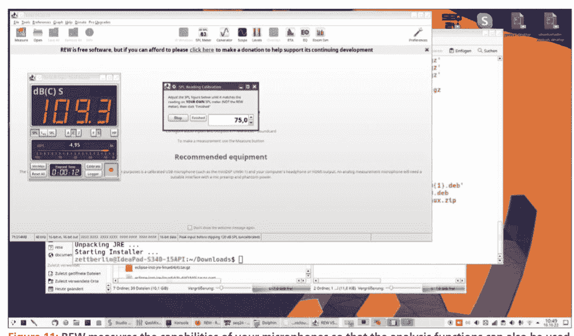

# 封面故事

## 声音工作室工作坊

在你自己的工作室里听起来完美的声音，对其他人来说未必更好。你可以找到软件解决方案，让你能够准确地测量和分析房间中的声音输出。我在测试中使用了 `Java Room EQ Wizard` (`REW`) 应用，你可以免费从[4]下载它。你还会找到 `REW` 专有免费软件的商业 `Pro` 版本 [5]，它——尤其是——能够实现更精确的测量，这在构建扬声器时是必需的。话虽如此，免费版包含了你优化家庭工作室所需的一切。它生成所需的测量音调和有意义的测量信号图表。

首次启动时，`REW` 会提议校准连接的麦克风（图 11）。然后它测量扬声器在房间内扩散的声波，并以图形方式显示结果是否偏离以及偏离预期的理想结果的程度。你可以通过移除扬声器附近的障碍物并衰减房间内的反射来减少这些偏差。反射不仅会产生混响效果，使声音图像变得模糊，还会抵消或增强某些频率，从而完全扭曲声音。


如果你想让一切完美无缺，优化房间声学是一门昂贵的学科。幸运的是，即使使用简单的方法，你也可以非常接近完美。柔软的地毯和厚重的窗帘往往已经能产生奇迹般的功效，你可以使用墙面挂饰轻松防止声音在房间的角落被抵消。作为最后的手段，你可以在 `JACK` 的主输出上游使用均衡器。这种设置很棘手，并且会产生更大的系统负载。

### 结论

一旦你超越了最简单的播播客场景，你会发现如今 `USB` 混音器在 `Linux` 上运行得非常好。由于有 `JACK` 和 `Carla`，提供复杂信号路由的设备也很容易连接。最后，`Ardour` 以高端音乐制作和表演的典型方式实现了所有这些选项。

### 信息

- [1] `Ardour`: [https://ardour.org/](https://ardour.org/)
- [2] `Mackie ProFX10v3`: [https://mackie.com/en/products/mixers/profx3-series/ProFX10v3.html](https://mackie.com/en/products/mixers/profx3-series/ProFX10v3.html)
- [3] `Mackie ProFXv3` 手册: [https://mackie.com/img/file_resources/ProFXv3_OM.pdf](https://mackie.com/img/file_resources/ProFXv3_OM.pdf)
- [4] `REW`: [https://www.roomeqwizard.com/](https://www.roomeqwizard.com/)
- [5] `REW` 专有免费软件版本的许可证条款: [https://www.roomeqwizard.com/eula.html](https://www.roomeqwizard.com/eula.html)

## 作者

`Hartmut Noack` 在德国策勒和不莱梅担任讲师、作家和音乐家。你可以在 [http://lapoc.de.](http://lapoc.de.) 上找到他使用免费音乐软件创作的一些 `CC` 许可作品。

## 商店推广

`sparkhaus-shop.com`

## 用酷酷的 `Linux` 技巧提高生产力

用这本鼓舞人心的技巧与 `Linux` 极客快捷方式合集来提升你的 `Linux` 技能。

- 在命令行中使用 `Google`
- `OpenSnitch` 应用程序防火墙
- 解析 `systemd` 日志
- 使用 `lazygit` 控制 `Git`
- 使用 `DOSBox` 运行旧 `DOS` 游戏
- 更多内容！

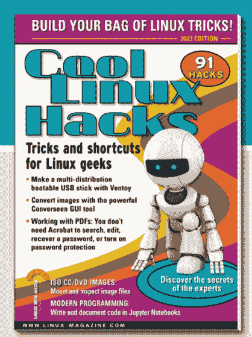


## 在线订购：

`sparkhaus-shop.com/specials`

# 评测

## `TUXEDO InfinityBook Pro 16 Gen7 MK1`

### 探索 `TUXEDO InfinityBook 16 Gen7 MK1`

#### 精心打造


`TUXEDO` 的下一代笔记本电脑比之前的商务机型更快、更轻。

By `Joe Casad`

在旧时代，我们都不介意购买零售版 `Windows` 笔记本电脑，重新格式化（或缩小）分区，然后用 `Linux` 进行设置。结果因人而异，但最终你都能让它工作起来。但你花了多少时间去移除你不想要的操作系统，以便安装你真正想要的系统呢？随着 `Linux` 开始走向主流，人们清楚地意识到世界需要为那些希望在没有麻烦和复杂的情况下将计算机启动到首选系统的 `Linux` 用户提供可靠、稳定且安全的选择。

销售预装 `Linux` 笔记本电脑的零售商名单包括 `联想` 和 `戴尔` 这样的巨头，但也包括一些专门从事 `Linux` 系统的较小供应商，因此他们将 `Linux` 作为其关注的唯一焦点。我们在 `*Linux Magazine*` 之前的几期中已经评测了该领域的许多产品。最近，我们收到了 `TUXEDO InfinityBook Pro 16 Gen7 MK1` 系统 [1]，该系统在 `TUXEDO` 网站上标价 `1,224` 欧元。

`TUXEDO` 在欧洲多年来一直很受欢迎，并且在 `北美` 市场的影响力也在增加。像其他一些 `Linux` 专业品牌一样，`TUXEDO` 维护自己的 `Linux` 发行版，他们称之为 `TUXEDO OS`。`TUXEDO` 表示他们的 `InfinityBook MK1` 系统（图 1）是为“内容创作者、软件开发人员或商务用户”设计的。评测系统运行频率为 `4.6GHz`，拥有 `14` 个处理器核心、`31GB` 内存和一块 `Samsung SSD 980 1TB` 硬盘。


**图 1：`InfinityBook Pro 16 Gen7 MK1` 体积足够大，可以全天工作，但依然非常轻便，易于携带。**

超薄 `InfinityBook` 的侧面端口包括 `(2)` 个 `USB A`、`(1)` 个 `USB C`、`SD` 卡读卡器、二合一音频（耳机 + 麦克风）、`HDMI 2.0`，以及 `Kensington` 锁接口和 `Thunderbolt 4` 端口。`Intel Mesa` 集成显卡对于我进行的基本游戏运行得非常良好。如果你在寻找更多功能，你可以升级到 `NVIDIA GeForce RTX 3050`，或者购买他们的“最大性能”型号，该型号配备 `GeForce RTX 3060`。

### 工作就绪

我必须承认，启动一个系统并看着它在 `Linux` 中启动起来，而不必重新格式化驱动器或绕过 `UEFI` 启动安全启动保护，确实带来某种乐趣。启动 `TUXEDO` 系统带来的乐趣更是加倍，因为它启动*速度快*——比 `Windows` 系统更快，也比大多数 `Linux` 替代品更快。一些评论者报告 `TUXEDO` 系统启动时间短至六秒。在我的情况下，到登录屏幕需要大约 `16` 秒，输入凭据后则快速完成登录。

一个旨在在任何硬件上启动的中性 `Linux` 必须携带组件、功能、驱动程序和设置，如果你完全了解硬件，这些其实并不需要。因此，像 `InfinityBook` 这样的预装系统，同时提供硬件和 `Linux`，通常具有更好的性能更高效的功耗。`TUXEDO` 的工程师优先考虑快速启动，他们对硬件的深入了解使他们能够以通用系统无法实现的方式优化启动过程。

`InfinityBook MK1` 设计得轻便且易于携带。它仅重 `1.5kg`，厚度仅为 `17mm`。在我的笔记本电脑包中，它感觉更像平板电脑，而不是拥有 `16` 英寸 `2560x1600` 像素显示器的全尺寸计算机。

照片由 `Lukas Maffin` 拍摄，来自 `Unsplash`

### 软件

评测系统随附 `TUXEDO OS 2`，这是 `TUXEDO` 内部操作系统的重大升级。`TUXEDO OS 2` 基于 `Ubuntu`，采用 `KDE Plasma 5.27` 桌面。系统包含标准的 `Linux` 办公工具和桌面实用程序集合，包括 `LibreOffice` 套件、`Okular` 文档查看器和 `VLC` 媒体播放器。默认浏览器是 `Firefox`，邮件客户端是 `Thunderbird`。如果你是游戏玩家，你可能需要安装开源游戏平台 `Lutris`，它可以在 `Tuxedo OS` 存储库中找到。如果你想通过 `Lutris` 玩 `Steam` 游戏，你需要单独设置 `Steam` 客户端。

当然，区分特征并不是系统捆绑的常见 `KDE` 和 `Linux` 工具，而是 `TUXEDO` 自己的增值贡献。`TUXEDO` 控制中心是管理硬件环境的中央用户界面（图 2），它是硬件和软件之间紧密协调的最佳例子之一。你可以获得 `CPU` 速度、系统温度和风扇使用率的快速仪表板视图。你还可以选择预定义硬件配置文件，立即针对不同的使用案例调整系统。例如，你可以选择一个最低功耗配置文件或一个用于办公用途的“中档性能”配置文件。一个让我心动的配置文件是“安静”配置文件。作为一个从来不喜欢电脑风扇噪音的人，过去我会对这个选项感到非常高兴，但 `TUXEDO` 笔记本电脑的风扇非常安静，我几乎没注意到它。你还可以创建自己的自定义硬件配置文件。控制面板还提供键盘背光、网络摄像头、关闭计时器和硬盘加密的设置。当然，`TUXEDO` 控制面板所做的许多事情还有其他方法，但界面非常合理且设计良好，让这些设置触手可及无疑是一个优势。


`TUXEDO OS` 内置的另一个有趣功能是 `Tomte` 配置服务 [2]。开发者将 `Tomte` 称为“一项自动识别客户设备并检查缺失驱动程序和必需包的服务”。系统在安装期间和其他重要时刻自动访问 `Tomte`，但你可以使用 `tuxedo-tomte` 终端命令手动与 `Tomte` 交互。

### 试驾

`MK1` 使用起来很愉快。键盘易于使用（北美左撇子，参见标题为“左 Shift”的框）。

电池提供了 `10` 小时的续航时间，这意味着你理论上可以在机场全天工作而无需寻找电源插座。


我能够轻松播放视频，没有卡顿。系统拥有一切我需要的功能，画面看起来很棒。内置扬声器在观看电影或偶尔的 YouTube 片段时功能正常，但如果你经常听大量音乐曲目，你需要耳机或外部扬声器。

系统在音频录制方面也表现良好。我启动了 `Audacity`，发现一切工作正常，无需任何折腾或重新配置——不仅适用于语音录制，也适用于多轨原声音乐。

点击板一开始让我有些困惑。这是一个非常大的点击板，分为两半。你可以将整个点击板作为一个单元使用，左半部分为鼠标左键，右半部分为鼠标右键；或者你可以禁用其中一半，使用另一半同时作为鼠标右键和左键。

### 左 `Shift`

> 当我刚拿到系统时，打字时犯的错误比平时多。过了一段时间我才注意到 `Shift` 键的区别。左 `Shift` 键明显比右 `Shift` 键小；作为一个全天都在电脑上打字的人，我习惯了全尺寸的左 `Shift`。事实证明，我评测的电脑配备了 `ISO` 键盘，这在欧洲很常见，但在美国并不常见。右撇子不会注意到区别，但对左撇子来说，`ISO` 键盘需要一些适应 [3]。过了一段时间后我习惯了，打字错误也少了。

幸运的是，如果你在 `Tuxedo` 的在线商店购买新电脑，你可以选择 `ANSI` 或 `ISO` 键盘选项（图 3）。即使你是右撇子，你也可能需要花一点时间考虑你习惯的键盘布局并选择它，而不是盲目跟随默认设置。`ISO` 键盘在欧洲和世界其他地方使用更频繁，因为它是国际标准，更适用于容纳其他语言。`ANSI` 是一个美国标准组织，`ANSI` 布局是专门为英语创建的。

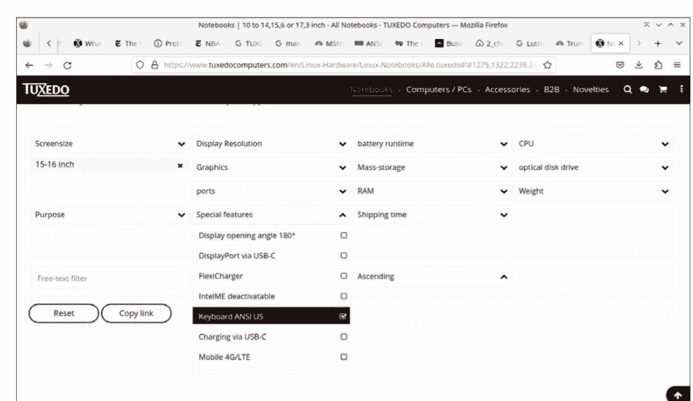

图 3：如果您在线购买，可以选择 `ANSI` 或默认的 `ISO` 键盘布局。

一旦我习惯了这个功能，我就相当喜欢它。点击板没有理由必须位于键盘的正中央——为什么不把它放在更靠近使用它的手的位置呢？不过，话说回来，我花了一些时间才弄明白。用于激活每一半，或将其设置为两半协同工作模式的操作控制，文档记录得并不完善，而且偶尔，点击板会意外地自行关闭。最终，我让它按照我需要的样子工作了。（在触控板的右上角轻敲两下即可激活半触控板模式。）一旦我理解了这一点，我才能最终理解点击板顶部印的那些晦涩符号（图 4）。这是一个很酷的功能，但也充分提醒了我，我仍然身处 `Linux` 世界，在这里创新往往走在前头，而文档常常姗姗来迟。购买预装系统可以免去大部分折腾，但并非全部——你仍不得不稍微折腾一点。


### 结论

我是一个典型的企业用户，我需要一款不麻烦的设备——轻便、方便、易于打字且易于插入外设。`TUXEDO` 笔记本电脑不仅提供了我需要的一切，还提供了更多。■■■

图 4：一旦我弄清楚发生了什么事，点击板上的象形文字就变得完全合理了。

### 信息

- [1] `TUXEDO`’s `Infinity Pro 16 Gen7 MK1`: <https://www.tuxedocomputers.com/en/TUXEDO-InfinityBook-Pro-16-Mk1-Gen7.tuxedo>

- [2] `Tomte` 配置服务: <https://www.tuxedocomputers.com/en/fos/Help-Support/Frequently-asked-questions/What-is-TUXEDO-Tomte.tuxedo>

- [3] `ANSI` 与 `ISO` 键盘布局: <https://switchhandclick.com/ansi-vs-iso-layout>

## 作者

`Joe Casad` 是 *Linux Magazine* 的主编。

# 11 月 12–17 日

面向**国际**的**高性能计算**

网络、存储与分析会议

`SC23.SUPERCOMPUTING.ORG`


#iamhpc

`SC`，顶级 `HPC` 会议，是一周的技术和专业活动，成千上万的研究人员、工程师、技术专家、教育工作者和学生汇聚于此，学习、分享与成长。

# `SC23`

科罗拉多州丹佛市 | `i am hpc`.

# + 探索可能性

通过 `SC` 的四大主要组成部分来了解概况，并发现会议提供的内容。

## 议程


参加 `HPC` 专业人士和学生的领先技术议程，该议程因其高影响力的演讲者、报告、教程、小组讨论等而备受赞誉！

## 展览


参与规模最大的 `HPC` 博览会，发现来自工业界、研究机构、初创公司学术组织的最新技术创新，所有这些都在同一屋檐下。

## 学生


寻找你的 `HPC` 未来！`Students@SC` 提供特别针对学生的日程安排，并在导师和朋友们的帮助下促进职业成功。

## `SCinet`


体验世界上最快速度最快的网络（在 `SC` 会议期间），并了解 `SCinet` 如何推动前沿以支持会议所有的网络需求。

在 2023 年 10 月 12 日或之前注册并享受优惠！

## 注册参加

丹佛市 `SC23` 线下会议

或数字体验

了解更多并注册！


## 赞助商


# 免费发行版的老兵

`Trisquel`


`Rúben Rodríguez` 讨论 `Trisquel`，一个在过去 16 年里持续开发的免费 `Linux` 发行版。

作者：`Bruce Byfield`

自由软件基金会（`FSF`）维护着一个不包含专有软件的免费发行版列表 [1]。虽然 `DistroWatch` 列出了 274 个 `Linux` 发行版，但 `FSF` 仅列出了 10 个免费发行版，其中许多已不再开发。一个显著的例外是 `Trisquel`，它自 2007 年以来每 1 至 3 年发布一个版本 [2]（图 1）。`Trisquel` 由 `Rúben Rodríguez` 创立，他至今仍是该发行版的主要开发者之一。最近，`Rodríguez` 抽出时间讨论了这个在过去 16 年中占据他生活很大部分的发行版。

> **`Linux Magazine (LM)`：** `Trisquel` 是如何起步的？最初的目标是什么，项目中是否有决定性时刻？

## 作者

`Bruce Byfield` 是一位计算机记者，也是专注于自由和开源软件的自由撰稿人和编辑。除了写作项目外，他还教授现场和电子学习课程。在他的业余时间，`Bruce` 撰写关于西北海岸艺术的文章（`http://brucebyfield.wordpress.com`）。他也是 `Prentice Pieces` 的联合创始人，这是一个关于写作和幻想的博客，位于 `https://prenticepieces.com/`。

`Rúben Rodríguez (RR)`：这个项目始于近 20 年前，当时我在西班牙的维戈大学。我的大学希望制作一个定制的 `GNU/Linux` 发行版，这在当时相当流行，我和其他对这项技术感兴趣的朋友被找来参与。我最终领导了这个项目，并在（潮流过去且大学兴趣消退后）将其作为一个独立项目继续下去。

当我初次涉足这个领域时，我的大部分知识是技术性的，来自实验、一些课程以及我在大学里和同伴们的黑客行为。我会说这个项目本身对我来说非常有教育意义，不仅在技术方面，也在社会方面，例如如何管理一个社区。


图 1：`Trisquel` 桌面。

# 发行版漫步 – `Trisquel`

本地用户组。直到项目开始一年后，当我的学校举办了一场由理查德·斯托曼（`Richard Stallman`）的演讲时，我才了解到自由软件、许可证和 `GNU` 项目的理念。这改变了我的方法，因为当时我认识到，我们只应该提供和推荐那些可以自由选择、研究、修改和共享的软件——在学校项目的背景下更是如此。

因此，`Trisquel` 从一个添加了某些非自由软件包的 `Debian` 衍生版，转变为一个基于 `Ubuntu` 并移除其专有软件包的项目。做出这一选择是因为 `Ubuntu` 日益流行（大约在那个时候发布），这表明需要一个大版本没有专有组件的 `Ubuntu`，而且 `Ubuntu` 固定的发布周期将便于我们的工作。

> **`LM`：** 提供完全免费的发行版需要对 `Ubuntu` 进行哪些更改？

> **`RR`：** 主要有三类工作：移除非自由软件包、移除原本自由软件包中的非自由组件，以及为了符合商标规定而进行的品牌重塑。


移除专有软件包相对简单。我们通过`ubuntu-purge`脚本 [3] 来完成（图 2）。目前，我们过滤了 150 个源代码包，这导致了数量更多的二进制包。将软件包添加到列表中有时需要进行详细分析，以调查许可证或其他法律原因，并确保尽可能有免费的替代方案。

从自由软件包中移除专有组件则更复杂。它通常需要持续的维护，以确保软件包保持功能正常，并在上游升级该包时最小化我们需要做的工作。这类案例中最大的是`Linux`，我们使用`Linux-libc-dev`去杂化脚本，并将其整合到`Ubuntu`内核打包工作流程中 [4]（图 3）。另一个大型示例是`Firefox`，在众多其他自定义中，被修改为不使用`addons.mozilla.org`来搜索扩展程序，因为该仓库包含自由和非自由软件。

`Firefox`也是品牌重塑任务类别的一个很好的例子。一些软件包拥有商标许可，其要求与软件许可本身不同。在某些情况下，如果进行了更改，它要求软件包必须重新命名，正如`Mozilla`产品和`Ubuntu`本身的情况。我们的自定义`Firefox`版本被称为`Browser`。

> **LM：** 除了伦理选择外，免费发行版有任何优势吗？

> **RR：** 免费发行版通常在默认设置方面在隐私方面做出更好的选择。例如，`Browser`配置了比`Firefox`默认设置更严格的隐私配置。`Trisquel`还配置为最小化来自不同系统组件的自动（因此是未请求的）网络连接和打开的网络端口。

> **LM：** 免费发行版有任何缺点吗？

> **RR：** 我们尽量让尽可能多的硬件设备正常工作，但有些需要专有驱动程序，并且在`Trisquel`上原样无法工作。用户总是可以选择安装这些组件，但我们把选择权留给他们，并且不推荐（或记录）如何这样做，因为我们认为不宣传此类软件更为重要。我们推荐像`lt-node.org`这样的资源来检查兼容性。

> **LM：** `Trisquel`与`FSF`列出的其他免费发行版相比如何？

> **RR：** 列表上的所有发行版都符合`FSF`的自由系统发行版

```bash
purge-bionic

# /bin/sh

# Non-free packages. Don't include packages for which a helper exists, only
# packages that we want gone completely.
REMOVE="
      9mmu
      a2ps-perl-ja
      adsys-sql
      acctonemo
      aee
      app-install-data-commercial
      app-install-data-partner
      amd64-microcode
      ba54-facutter
      bcm43xx-fwcutter
      b43-fwcutter
      b43-installer
      b43-kyle
      b43lameomiserz
```

图 2：用于从`Ubuntu`中移除非自由元素的`ubuntu-purge`脚本的一部分。

```sh
# case $i in
#     -force) force--; shift;;
#     *) forces;;
# esac
# we don't want g_d, diff output translations to affect us.
LC_ALL=C; export LC_ALL
LANGUAGE=; export LANGUAGE
oversa3 extraes3 overss3
# kwerg: Srewsber gnu-sed
# deblob dirs echo "80" | sed s,'[\]'\%,\'1\\8,\\1\\8',''
if test -f linux-kver.tar; then
    z=star; x=deb
    zextstar_l z=linux-kver.tar.gz; then
    zextstar_r2 z=linux-kver-r2.tar.gz; then
    zextstar_v2 z=dm2sun2
# elif test -f linux-kver-l2; then
#     zextstar_l2 z=dm2sun12
# elif test -f linux-kver1.tar.gz; then
#     zextstar_g2 z=dm2sun2g2
# elif test -f linux-kver.tar.gz; then
#     zextstar_g z=dm2sun2g
# else
# echo linux-kver.tar not found; tried b2, x2, l2, g2 and tg2 to -R2
# exit 1
# fi
# case t -f deblob-kver; then
```

图 3：用于从`Linux`内核中移除专有条目的脚本开头部分。

## 发行版巡礼 — Trisquel

指南（`FSDG`）[5]。这与`SF`的“尊重您的自由”（`RYF`）清单不同，后者是一个针对硬件产品认证的清单——即那些无需非自由组件（如专有固件或驱动程序）即可工作的设备 [6]。`FSDG`是`GNU`项目给出的一组建议，旨在制作遵循项目原则的`GNU`发行版。遵循该指南的发行版得到了`FSF`和`GNU`的推荐，并被经过`RYF`认证的供应商使用（有时也由他们制作），因此两者之间存在重叠。

`FSF`和`GNU`推荐的发行版大多是根据其符合`FSDG`的程度来列出的，因此其中包括各种具有不同实际目标的项目。有些更偏实验性或面向黑客，而有些则更专业化（例如针对嵌入式设备的发行版）。`Trisquel`旨在提供极佳的用户体验，重点在于开箱即用的强大无障碍功能、简洁的设计以及良好的语言支持。得益于常规的发版周期，`Trisquel`也旨在成为服务器基础设施的理想选择。

**LM：** 自由发行版正在变得更受欢迎还是更不受关注？

**RR：** 我没有具体的统计数据，因为我们不跟踪我们的用户。我们的服务器流量表明大家对我们的项目保持着稳定的兴趣，并且我们拥有一个非常活跃的社区，参与论坛、邮件列表和`IRC`。

**LM：** 请描述一下成为`FSDG`兼容发行版所涉及的工作。

**RR：** 除了我之前提到的清理非自由组件外，还有其他要求，例如不要在文档和社区通讯渠道（如论坛等）中推荐专有软件。一项重要要求是自托管：仅仅为那些仓库中含有非自由组件的发行版制作一个自由的安装器（如`Live`镜像）是不够的。主要重点在于分发软件给他人时所承担的责任。

**LM：** `Trisquel`支持多种桌面环境，例如`MATE`、`LXDE`和最初由`One Laptop per Child`为教育目的设计的`Sugar`。支持的任何桌面环境都涉及特殊的工作吗？

**RR：** 我们作为`Live`环境分发的所有桌面环境都非常完善，但`MATE`桌面（我们推荐的默认选项）是工作量最大的。`MATE`对于无障碍性来说是一个非常好的选择，因为它与屏幕阅读器和键盘导航具有良好的兼容性。我们的目标是，包括失明在内的残障人士必须能够在没有帮助的情况下安装系统。对于没有3D加速的计算机（这种情况在许多情况下只能通过非自由驱动程序实现），它也是一个很好的选择，因为这对该桌面环境而言是一个可选要求。

**LM：** 其他有哪些特性使`Trisquel`脱颖而出？

**RR：** 我已经提到了大多数实际优势，因为许多优势首先源于项目的价值观。与无障碍性相辅相成的目标是我们追求的简洁设计和易用性。

令人印象深刻的一点是改进贡献有多容易。我们使用相当简单的`Bash`脚本（我们称之为`package-helpers`）来应用对上游包的修改，这些修改会通过我们的`CI`基础设施自动构建并发布进行测试，然后在审查后发布到生产环境。

**LM：** 你们有关于下载量、提交记录和开发人员的统计数据吗？

**RR：** 我们只部分跟踪下载量，因为有许多我们获取不到统计数据的镜像站点。我们的主站已记录超过一百万次下载。我们最活跃的仓库是前面提到的`package-helpers`，拥有超过 2,000 次提交，影响了 300 多个源代码包。该项目获得了来自 25 位开发者的贡献。我们也有志愿者协助文档、翻译、构建系统和其他子项目。

**LM：** `Trisquel`是如何治理的？决策是如何做出的？

**RR：** `Trisquel`是在西班牙注册的非营利组织，负责处理法律和税务义务。项目在结构上相当扁平化，我们大部分决策是在我提到的开发人员会议上做出的。在社区管理方面，我们很幸运拥有一批长期的论坛和列表参与者，他们非常擅长鼓励新人，保持对话不离题，并在需要干预的少数情况下通知版主。

**LM：** `Trisquel`的目标受众是谁？


### 信息

*   `RR：` 我们试图使其受众尽可能广泛。`Trisquel` 不是一个专业化的发行版。它并不特别面向黑客，但你可以深入代码和技术细节到任何深度，因此它可以被不同专业知识水平的人使用。它面向桌面和服务器用户，最近我们添加了 `ARM` 和 `BOW POWER` 架构支持，以扩展可能的用例。最终，我们希望它成为“自由阶梯”上人们探索和了解自由软件的非常灵活的平台。
*   `LM：` 有什么未来的计划吗？
*   `RR：` 我们目前的主要目标是寻找更多的开发者和贡献者，更新我们的 `www` 网站，并继续扩展我们的构建基础设施。
*   `LM：` 读者还应该了解关于 `Trisquel` 的其他信息吗？
*   `RR：` 我邀请大家尝试它，看看我们的社区，并探索我们工作的众多项目，这些项目总是需要更多的贡献者。此外，`Trisquel` 100% 依靠来自我们社区的捐赠维持 [7]。

### 参考文献

1.  `FSF` 自由发行版：`https://www.gnu.org/distros/free-distros.html`
2.  `Trisquel`：`https://trisquel.info/`
3.  `ubuntu-purge`：`https://gitlab.trisquel.org/trisquel/ubuntu-purge`
4.  `Linux-libre`：`https://www.fsfla.org/ikiwiki/selibre/linux-libre/`
5.  `FSDG`：`https://www.gnu.org/distros/free-system-distribution-guidelines.en.html`
6.  `RYF`：`https://ryf.fsf.org/`
7.  捐赠：`trisquel.info/donate`


## 期待在里尔见到您！

`DrupalCon` 于 2023 年 10 月 17 日至 20 日重返法国！这次，里尔大皇宫（`Lille Grand Palais`）是我们位于里尔的举办场地。它很容易到达，从布鲁塞尔乘火车只需 35 分钟，从伦敦只需 80 分钟。


访问我们的网站 `https://events.drupal.org/lille2023` 获取更多信息


## 深入解析

### 命令行 – most


### 现代化的终端分页器

### 后起之秀

`most` 终端分页器为 `less` 提供了一个功能丰富且组织得更好的替代方案。作者：`Bruce Byfield`

分页器是用于在终端中一次查看一页文件的命令。大致来说，分页器在命令行上起着与 `Plasma` 的 `Okular` 相同的作用，尽管分页器通常用于文本文件或作为管道，以使其他命令的屏幕输出更易读而无需滚动。有时，`cat` 的一个版本也可以用于相同的目的，但严格来说，"pager" 这个名称是保留给三个命令的：`less`、`more` 和 – 最近 – `most` [1]，这些名字是一系列双关语，`less` 意味着 less（更少），而 `more` 意味着 greater than less（比 `less` 更多，即 more/更多），正如那句流行语所说，`less` 比 `more` 还要多。作为最新的分页器，`most` 是目前最实用的（图 1），因为只要超越基本命令，替代方案的功能就是有限或难以使用的。`cat` 的问题在于，严格来说，它根本不是一个分页器。它的主要功能是连接或合并文件。通过指定单个文件，它可以作为分页器工作，特别是对于短文件，但 `cat` 无法滚动或做比编号行和显示非打印字符更多的工作。`cat` 的一个克隆版本 `bat`，提供了 `cat` 的所有功能，加上向前滚动、范围选择以及能力来

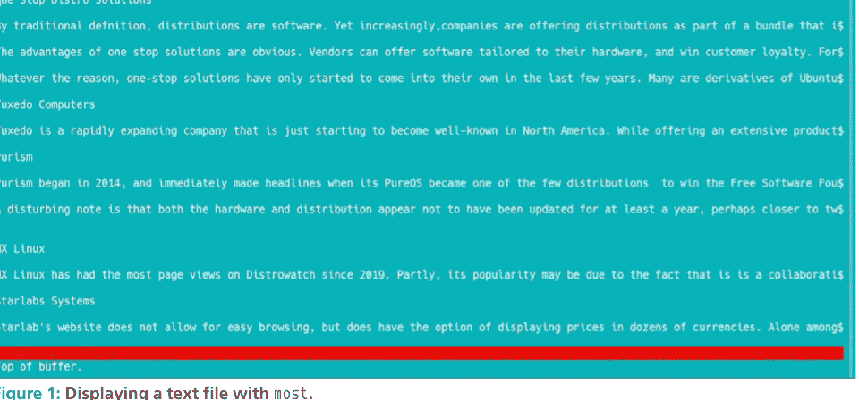

### 深入探究

#### 命令行 – most

使用 `--pager PAGER` 参数可以在分页器中显示。然而，`bat` 充其量只是一个基础的分页器。

至于 `more`，它已经有 45 年的历史了。它的古老体现在某些版本的 `more` 甚至直到今天仍不支持向后滚动，以及 `--print-over` (`-p`) 选项的持续存在——该选项在显示下一屏时会清除当前屏幕内容，而不是滚动；还有 `-p|plain` (`-n`) 选项，本应抑制下划线显示，但如今却处于未启用状态。对 `more` 最好的评价是，它比 `bat` 多了几个选项。

这些局限性使得大多数用户选择了 `less`。虽然 `less` 功能强大，但它有时似乎对 `more` 过于敏感，其数十个选项（包括用于搜索和导航的选项）让人望而却步。总体而言，`less` 是一个坚实的基础，这就是为什么尽管 `most` 的功能列表更长，`less` 仍然是标准的分页器。

#### 充分利用 most

通过利用当今唾手可得的内存资源，`most` 提供了 `less` 所不具备的功能。特别是，如果以特定方式编译，`most` 可以打开至少两行的多个文件，这一功能非常适合文件比较。通过列出命令和任何选项之后的空格分隔列表来打开多个文件：

```
most OPTIONS FILE1 FILE2
```

文件名显示在窗口底部的状态行中。状态行下方是当前的活动状态或一组基本说明（图 2）。

在每个窗口内，只需输入字母即可发出命令，而不需要在启动 `most` 时像选项那样加上一个或两个连字符前缀。但请注意，每个命令所使用的具体选项取决于 `most` 的编译方式，因此如果手册页中列出的某个选项不起作用，另一个可能会成功（这里涵盖的选项是那些对我起作用的选项，有时需要经过尝试和错误才能确定）。每个窗口都可以独立滚动，也可以使用 `i` 或 `L` 与其他窗口同步，这会在状态行中添加一个星号 (`*`)。默认情况下，`most` 不自动换行；长行由窗口右边缘的一个美元符号 (`$`) 表示。你可以通过使用右箭头键滚动或扩展终端窗口宽度来查看行的剩余部分。

然而，在命令中添加 `-w` 选项可以实现自动换行，并在右边缘标记一个反斜杠 (`\`)。方便的是，通过在命令中添加 `-e` 选项，你可以编辑当前窗口，这意味着 `most` 也可以充当文本编辑器。要切换到另一个窗口，输入 `n`，命令中输入的下一个文件名将出现在窗口底部；你可以按回车键访问该文件。不过，你可能更倾向于使用 `Ctrl + X + 2` 来分割当前窗口。

与 `less` 类似，`most` 也有大量用于导航的键盘快捷键。`most` 的手册页列出了数十个快捷键，其中许多有两个甚至三个替代方案。庆幸的是，在窗口内部，你不需要学习所有快捷键也能高效导航。话虽如此，`t` 和 `b` 对于跳转到窗口的顶部和底部非常方便。`NUMBER +` 用于跳转到特定行号，`NUMBER %` 用于跳转到文件的特定百分比位置也很方便。在长文件中，你也可以选择使用 `NUMBER U` 向上跳转固定数量的屏幕。更简单地说，你可以直接使用向上和向下箭头键滚动，既可以按默认的单行滚动，也可以通过在按箭头键之前输入数字来选择滚动行数。

`most` 还提供了一组搜索功能。启动 `most` 时，你可以添加 `-c` 使搜索区分大小写。在 `most` 中，`f` 会提示输入要向前搜索的字符串。类似地，问号 (`?`) 会提示输入要向后搜索的字符串。对于 `f` 和 `?`，`Ctrl + G` 可以取消搜索。一旦定位到某个字符串，`n` 会设置一个书签。从那里开始，先按 `Ctrl + X`，再按 `Ctrl + x`（两次使用相同的键），可以返回到另一个书签，从而允许你在编辑时来回切换，这是一个方便的功能。

#### 简化学习

`most` 相比 `less` 的另一个优势是它的组织性更好。一方面，`most` 需要添加到命令中的选项要少得多，而且其中大多数选项只是开启或关闭普通用户不太需要的功能。虽然 `most` 的手册页仍然异常冗长，但它比 `less` 的更短，且组织得远好。

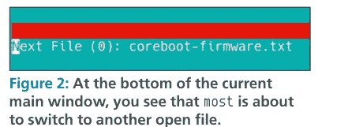

`most` 的环境变量也是如此。它们的数量少于 `less`，而且有几个变量旨在尽量减少记忆选项和命令的需要。`MOST_SWITCHES` 设置选项，每行一个。例如，

```
define MOST_SWITCHES "-g"
```

会停止连续显示多于一行的空白行。`MOST_INIIFILE` 甚至更方便，因为它定义了一个配置文件，并在 `/etc/most.conf` 或当前用户主目录中的 `.mostrc` 中查找它。无论在哪里找到该文件，此配置都会使用以下格式设置默认按键绑定：


# 文档

## 配置
```
setkey “FUNCTION” “KEYBOARD SHORTCUT”
```

花时间创建一个配置文件可以定期为用户节省记忆的需要，以及复杂的输入。`MOST_HELP` 还可以用于设置自定义帮助文件，包含默认文件中未提及的细节。

## 环境变量
此外，那些在 `most` 中编辑的用户可能也希望在 `MOST_EDITOR` 中设置他们首选的编辑器。`most` 的优势不仅在于功能和组织性，还在于这些节省时间的工具。就像文字处理器中的模板一样，设置这些环境变量需要时间，但最终可以迅速让用户上手并节省时间。

### 信息
- [1] `most`: [https://linux.die.net/man/1/most](https://linux.die.net/man/1/most)

## 作者
**布鲁斯·拜菲尔德** 是一位计算机记者，也是自由撰稿人和编辑，专注于自由和开源软件。除了写作项目，他还教授现场和在线学习课程。在他的空闲时间，布鲁斯撰写关于西海岸艺术的文章（[http://brucebyfield.wordpress.com](http://brucebyfield.wordpress.com)）。他还是 `Prentice Pieces` 的联合创始人，这是一个关于写作和奇幻的博客，位于 [https://prenticepieces.com/](https://prenticepieces.com/)。

# 使用 Fyne 的 GUI 应用

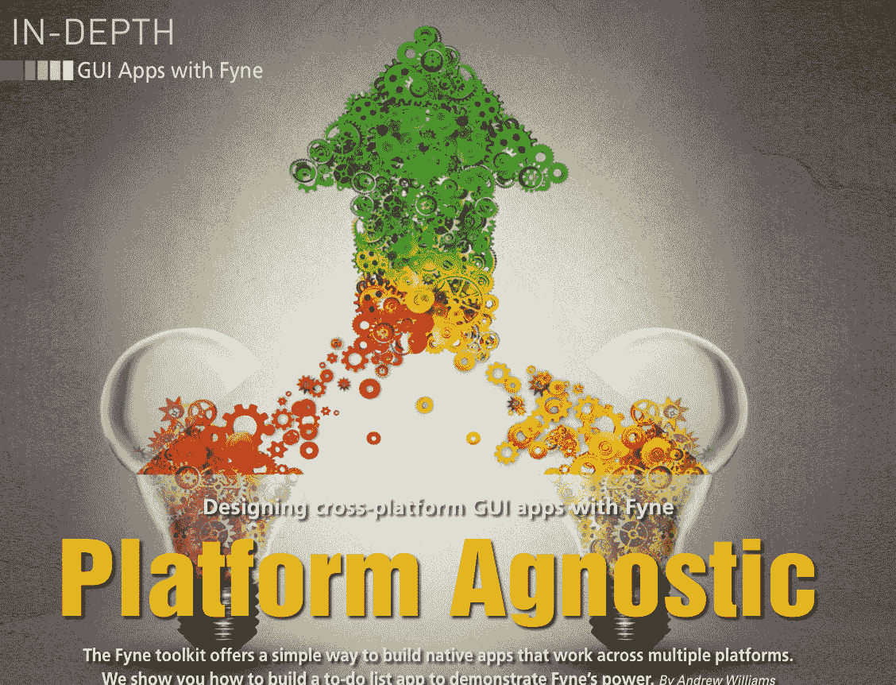

## 使用 Fyne 设计跨平台 GUI 应用

### 平台无关性
`Fyne` 工具包提供了一种简单的方法来构建能在多个平台上运行的原生应用程序。

我们通过构建一个待办事项列表应用来展示 `Fyne` 的强大功能。*作者：安德鲁·威廉姆斯*

现代应用开发中最大的挑战之一是需要为每个想要支持的平台开发独立的代码库。幸运的是，`Fyne` 图形用户界面 (`GUI`) 工具包允许你只编写一次代码，然后迅速部署到多个设备上。

`Fyne` 是一个为 `Go` 编程语言构建的开源 `GUI` 工具包。`Go` 是一种流行的通用编译型编程语言，由谷歌在十多年前创建。`Go` 经常用于云服务和基础设施项目。然而，`Fyne` 工具包使得快速构建桌面和移动设备的原生 `GUI` 成为可能。

作为 `Go` 的众多 `GUI` 工具包之一，`Fyne` 旨在成为最容易使用的工具，既吸引初学者，也经验丰富的 `GUI` 开发者。

`Fyne` 的惯用设计使 `Go` 开发者能够轻松快速掌握其原理。得益于丰富的组件集和可扩展性，`Fyne` 允许开发者创建自定义组件。

借助受 `Material Design` 启发的图形元素，`Fyne` 对许多最终用户来说会感到熟悉，同时也向应用开发者开放了主题定制的可能性。

`Fyne` 进行了全面的单元测试，并支持严格的测试驱动开发。`Fyne` 在与其他许可协议宽松一致的 `BSD` 许可证下发布，并拥有一个活跃的开发社区支持。

在本文中，我将向你展示如何设置系统，以使用 `Go` 和 `Fyne` 编写你的第一个应用。我将涵盖显示窗口、布局内容和使用标准组件的基本 `API`，以及数据存储和处理事件处理器的方法。读完本文后，你将拥有一个在计算机和智能手机设备上运行的完整图形应用程序。

### 设置
要开始使用 `Fyne`，你需要安装一些开发工具，包括 `Git`、`Go` 和 `C` 编译器。假设你在带有 `X11` 设置的 `Linux` 桌面上工作，你还需要安装一些库。别担心 – 这只适用于开发 `Fyne` 应用。你的用户运行完成的应用程序时不需要任何这些依赖项。`Fyne`（与 `Go` 一样）专注于单一二进制文件编译输出，零依赖项。只要你的用户有可用的图形驱动程序，你的应用程序就可以在没有额外设置的情况下运行。

你应该使用计算机的软件包管理器来安装必要的工具。所有发行版都不同，但最常见的系统需要使用以下命令。对于 `Debian` 和 `Ubuntu`，请使用：

```
sudo apt-get install golang gcc libglib-mesa-dev xorg-dev
```

在 `Fedora` 上，请使用：

```
sudo dnf install golang gcc libCurl-dev libXrandr-dev
```

对于 `Arch Linux`，请使用：

```
sudo pacman -S go xorg-server-devel libxcursor libxrandr libxinerama libxi
```

编译 `Fyne` 代码至少需要 `Go v1.14`。你可以根据自己的包管理器调整上述命令，或者在 `Fyne` 文档 [1] 中找到完整的列表。

### 入门
安装好必要的工具后，你现在就可以构建一个基本的 `Go` 应用程序，以确保一切运行正常。首先，创建一个新的文件夹并使用 `go mod init` 将其设置为 `Go` 项目（列表 1）。现在你拥有了一个 `go.mod` 文件。你可以通过快速向 `main.go` 写入一些基本文件内容，然后构建应用程序（列表 2），来测试 `Go` 编译器是否正常工作。你只需要包名（`main`）和一个简单的 `main()` 函数，以告知编译器你正在构建一个应用程序而不是库。

如果你的构建在没有错误完成，则说明构建成功。你会看到一个名为 `todoapp` 的文件。此时你可以运行 `todoapp`，但由于你还没有构建应用程序本身，所以不会得到任何输出！

#### 列表 1：创建项目
```
> mkdir todoapp
> cd todoapp
> go mod init todoapp
go: creating new go.mod: module todoapp
```

#### 列表 2：测试安装
```
> echo "package main
func main() { }" > main.go
> go build
```

### 显示窗口
现在我将演示如何编写代码以在屏幕上显示一个窗口。首先，你需要使用 `go get` 将 `Fyne` 库安装到你的项目中。以下命令将从 `GitHub` 下载 `Fyne` 项目的源代码并将其存储在 `Go` 缓存中。然后，它将 `Fyne` 标记为你项目的依赖项，以便你的代码编辑器或 `IDE` 能够做出合理的自动补全和编译建议：

```
> go get fyne.io/fyne/v2@latest
go: added fyne.io/fyne/v2 v2.3.4
```

安装 `Fyne` 库后，接下来必须创建一个新的应用程序实例，这是用于创建新窗口、访问存储以及使用其他重要功能的变量。你可以通过在 `main` 函数中插入以下内容来创建一个新的应用程序：

```
a := app.New()
```

不过，最佳实践是标识你的应用程序，可以使用以下方法：

```
app.NewWithID("com.example.myapp")
```

代码应添加到你的 `main` 函数的顶部。这个 `app` 包来自导入路径 `fyne.io/fyne/v2`（`app`（你的 `IDE` 很可能自动添加这个）。

在新应用程序中，你只需通过请求即可创建新窗口：

```
w := app.NewWindow("TODO")
```

这为新的窗口设置了变量 `w`。窗口将拥有标题“`TODO`”，它可能会显示在你的窗口边框中。此时，你可以构建应用程序。然而，由于没有任何内容，窗口会相当无用，因此我将向你展示如何添加一个组件。

### 添加组件
在 `Fyne` 中，应用程序可以通过将基本类型（称为 `CanvasObject`）绘制到窗口内的位置来创建。这些项目可以在 `fyne.io/fyne/v2/canvas` 包中找到。但是，你可以使用预制组件的集合（`fyne.io/fyne/v2/widget`），它提供了大多数应用程序中常见的标准用户控件和视觉项的多个交互组件。

你可以通过简单地调用 `widget.NewLabel("TODO App")` 创建一个新的标签组件，以显示文本“`TODO App`”。然后使用 `SetContent` 方法将此组件放入之前创建的窗口中。这行代码变为：

```
w.SetContent(
widget.NewLabel("TODO App"))
```

最后，你必须显示该窗口。由于 `GUI` 工具包还有一个管理应用程序运行方式和监听用户输入的事件循环，因此你还需要运行该应用程序。 conveniently，`Fyne` 有一个方法可以同时显示窗口并运行应用程序：

```
w.ShowAndRun()
```

这就是创建你的第一个图形应用程序的全部内容。

### 运行应用程序
要运行应用程序，你可以使用 `go run`，或者使用 `go build` 构建它，然后稍后运行创建的可执行文件。但是，由于你添加了一个新的库，你应该先运行 `go mod tidy` 以确保项目元数据是最新的。之后，你可以使用以下命令运行应用程序：

```
> go mod tidy
go: finding module for package
fyne.io/fyne/v2/app
go: found fyne.io/fyne/v2/app in
fyne.io/fyne/v2 v2.3.4
> go run .
```


告诉 Go 编译器运行`.`意味着它运行当前目录中的所有文件（对于你的应用程序来说是`main.go`）。你的应用程序现在应该看起来像图 1。根据你的桌面设置，应用程序可能会显示浅色或深色主题。

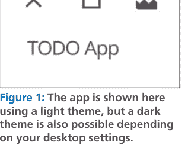

### 构建用户界面

在你开始为应用程序构建更复杂的内容之前，我需要解释容器类型。容器允许多个元素按照布局排列在一个区域内。Fyne 中有许多用于常见定位类型的标准容器。你还可以添加自己的布局代码。（本文不会涵盖这一点，但你可以在网上了解更多 [2]。）

这些容器类型包括`Box`和`HBox`（用于将子项打包到垂直或水平框中）、`Split`（允许用户拖动分隔两个子项的分隔栏）或`Stack`（允许多个项相互叠加绘制）。最受欢迎且灵活的容器是`Border`，你将在待办事项应用程序中两次使用它。`Border` 容器需要四个必填字段，用于定位位于上、下、左、右边缘的项目，以及一个可选的第五个参数，用于填充剩余（中心）空间的内容。应用程序分为两个主要区域：顶栏（你将在此处放置`New Entry`输入组件）和待办事项列表区域，该区域填充主要区域。本质上，应用程序的整个布局被捕捉为：

```
container.NewBorder(head, nil, nil, nil, list)
```

应用程序使用一个新的包`container`，它来自`fyne.io/fyne/v2/container`。

为了制作顶栏，你将使用另一个`Border`容器，它将为`Entry`组件（用于用户输入，列表 3）和一个使用标准主题中可用的图标来添加内容的新`Button`组件。（我稍后会添加响应用户输入的代码。）

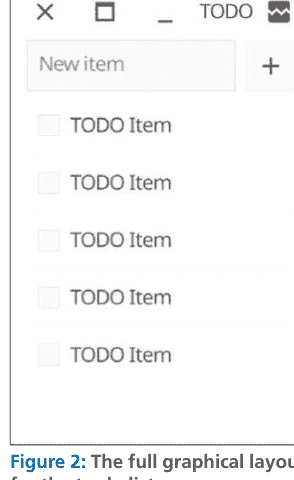

#### 列表 3：输入组件

```go
01  input := widget.NewEntry()
02  input.SetPlaceHolder("New item")
03  add := widget.NewButtonWithIcon("",
04          theme.ContentAddIcon(), func() {
05          log.Println("new item tapped")
06  })
07  head := container.NewBorder(nil, nil, nil, add, input)
```

列表 3 定义了应用程序的用户界面，除了主区域中的待办事项列表。

#### 显示数据列表

为了完善用户界面，你需要定义主要的待办事项列表。`List`组件非常适合此任务，但它比之前讨论的组件稍微复杂一些。`List`是一个“集合组件”（与`Table`和`Tree`一起），旨在以高性能处理大量数据。我将使用`widget.NewList`创建一个列表。而不是传递静态数据，`widget.NewList`使用回调来理解内容应如何显示。它使用的三个回调定义了列表项的数量、项的创建方式以及每行应包含的数据。这种更复杂的设置意味着`Fyne`可以随着用户滚动而重用组件，这对于 CPU 和内存来说要快得多，也更有效。

目前，我将在示例待办事项列表中使用虚拟内容。它将显示五个项目，每个项目都显示“TODO 项目”（因为第三个回调的数据尚不存在，无法显示）。对于`List`中的每一行，我使用`Check`组件为每个项目添加一个复选框，这将允许用户标记已完成的项目并显示关联文本。此代码加上之前的项目构成了完整的用户界面。为了简单起见，图形设置代码被移动到一个名为`loadUI`的新函数中，如列表 4 所示。

#### 启动 GUI

由于代码现在位于`loadUI`函数中，你还需要更新`main`函数以将内容设置为调用`loadUI`的结果。列表可以非常小，但你希望同时看到多个项目。为此，你调用`Window`上的`Resize`并设置合适的尺寸（不是像素，因为一个

##### 列表 4：ui.go

```go
01  package main
02
03  import (
04          "log"
05
06          "fyne.io/fyne/v2"
07          "fyne.io/fyne/v2/container"
08          "fyne.io/fyne/v2/theme"
09          "fyne.io/fyne/v2/widget"
10  )
11
12  func loadUI() fyne.CanvasObject {
13          list := widget.NewList(
14                  func() int {
15                          return 5
16                  },
17                  func() fyne.CanvasObject {
18                          return widget.NewCheck("TODO Item",
19                                  func(bool) {})
20                  },
21                  func(id widget.ListItemId, o fyne.CanvasObject) {
22                  })
23
24          input := widget.NewEntry()
25          input.SetPlaceHolder("New item")
26          add := widget.NewButtonWithIcon("",
27                  theme.ContentAddIcon(), func() {
28                  log.Println("new item tapped")
29                  })
30
31          head := container.NewBorder(nil, nil, nil, add, input)
32
33          return container.NewBorder(head, nil, nil, nil, list)
34  }
```

### 深入解析

#### 使用 Fyne 构建 GUI 应用程序

Fyne 在不同的输出设备上的尺寸保持一致。主函数的最后三行变为：

```
w.SetContent(loadUI())
w.Resize(fyne.NewSize(200, 280))
w.ShowAndRun()
```

当你运行更新后的代码时，你会看到新的用户界面出现在屏幕上（图 2）。

#### 列表 5：存储数据

```
var (
	todos []string
	list *widget.List
)
```

#### 列表 6：通过点击添加待办事项

```
add := widget.NewButtonWithIcon("",
	theme.ContentAddIcon(),
	func() {
		addTODO(input.Text)
		input.SetText("")
	})
```

#### 列表 7：通过键盘添加待办事项

```
input.OnSubmitted = func(item string) {
	addTODO(item)
	input.SetText("")
}
```

#### 列表 8：data.go

```
01 package main
02 
03 import "fyne.io/fyne/v2"
04 
05 func addTODO(todo string) {
06 	todos = append(todos, todo)
07 	list.Refresh()
08 }
09 
10 func deleteTODO(todo string) {
11 	for i, text := range todos {
12 		if text != todo {
13 			continue
14 		}
15 
16 		todos = append(todos[:i],
17 			todos[i+1:]...)
18 		break
19 	}
20 	list.Refresh()
21 }
```

#### 记住待办事项


你希望能够在应用程序中添加项目并将其标记为已完成。为此，你将使用一个新的全局变量 `todos`，它是一个字符串切片（表示为 `[]string`）。在添加或删除项目时，你将操作这个切片，而你的列表将始终绘制该数据的当前状态。首先，你在 `main.go` 中添加一个新的 `todos` 变量。你还需要保留对之前创建的 `list` 变量的引用，以便更新它（如列表 5 所示）。

#### 添加项目

当用户点击在列表 3 中创建的添加按钮时，一个新的项目将被添加到待办列表中。为此，你需要为按钮创建一个更有用的点击处理程序。与其记录到控制台，你将使用列表 6 中的代码，该代码请求添加一个新项目，然后清除输入文本，以便为下一个待办事项做好准备。

由于一些用户更喜欢通过键盘运行应用程序，因此当用户按下 `Return` 或 `Enter` 键时，你也希望具备此功能。幸运的是，`Entry` 小部件有一个 `OnSubmitted` 回调，你可以按照列表 7 所示进行设置。

这两个处理程序都调用一个新的 `addTODO` 函数，该函数简单地将一个新项添加到切片中并刷新列表（参见列表 8）。

#### 填充列表

现在你有一些数据要显示，你需要告诉列表如何相应地更新。为此，你在 `List` 小部件的第三个回调中添加一些代码。这段代码将设置 `Check` 小部件的文本，并确保它未被选中（因为列表当前只有待处理的待办事项）。列表 9 使用替换回调函数实现了这一点。

列表 9 的第 1 行确保你可以使用 `Check` 小部件的功能。列表不知道它显示的内容类型，因此你需要进行类型转换，以匹配你在第二个回调函数中创建的小部件。有了这个设置，你将看到你的待办列表——剩下的就是删除它们了！

#### 列表 9：显示待办内容

```go
01 func(id widget.ListItemID,
02 	o fyne.CanvasObject) {
03 	check := o.(*widget.Check)
04 	check.SetChecked(false)
05 	check.Text = todos[id]
06 }
```

#### 列表 10：删除待办事项

```go
check.OnChanged = func(done bool) {
	if done {
		return
	}
	deleteTODO(check.Text)
}
```

#### 删除项目

待办列表仅跟踪待处理的项目，因此你希望在选中任何待办事项后将其移除。为此，你可以为你的 `Check` 小部件设置 `OnChanged` 回调（列表 10），就像你在 `Entry` 小部件上设置 `OnSubmitted` 一样。

如果项目被选中或取消选中，将调用 `OnChanged` 回调——这就是为什么你首先测试它是否被标记为已完成，使用 `bool` 参数。假设应该删除它，你调用列表 8 中的辅助函数 `deleteTODO`。

列表 8 中显示的方法有点复杂，因为在 `Go` 中没有内置的方法来从切片中删除一个项。列表 8 执行“重新切片”，这会将待办列表设置为两个其他列表的合并（一个是删除该项之前的列表，一个是之后的列表）。然后代码像以前一样刷新列表，从而使你的项消失。如果你再次运行你的应用程序，你会看到它是空的，但你可以像喜欢的那样添加新项目并将它们标记为已完成，如图 3 所示。

#### 存储数据

你现在拥有一个完全功能的应用程序来跟踪你的待办事项，但该应用程序将在你退出时忘记这些项目。为了解决这个问题，你可以连接数据库或将数据存储在文件中。然而，`Fyne` 允许你将数据存储在 `Preferences` 中，这是一个简单的键值存储，用于轻松跟踪用户界面状态和小型数据存储，而无需担心文件存储或连接处理。你可以使用之前创建的 `App` 类型上的 `Preferences()` 方法访问此功能。

#### 加载待办事项

你需要确保在应用程序启动时加载任何现有的待办事项。为此，你可以简单地设置 `todos` 变量为 `loadAll` 的结果。在调用 `loadUI` 之前，你需要调用

```go
list = loadTODos(a.Preferences())
```

此调用将你的应用程序偏好设置传递给一个新的 `loadTODos` 函数，该函数将返回所有存储的待办事项切片。

#### 保存数据

在你有数据要解析之前，你需要保存它！为此，你将使用另一个新方法 `saveTODos`，它将接收要保存的当前切片和你将使用的偏好设置引用：

```go
saveTODos(todos, p)
```

务必在更新数据后，在 `deleteTODO` 和 `addTODO` 内部调用此方法。在此示例中实际执行工作的那些方法非常简单——你只需使用 `joiner` 常量将所有项目拼接成一个字符串，然后在 `load` 时拆分项目，如列表 11 所示。

#### 列表 11：storage.go

```go
01  package main
02
03  import "fyne.io/fyne/v2"
04
05  const joiner = ","
06
07  func loadTODos(p fyne.Preferences) []string {
08      all := p.String("items")
09      if all == "" {
10          return []string{}
11      }
12      return strings.Split(all, joiner)
13  }
14
15  func saveTODos(items []string, p fyne.Preferences) {
16      allItems := strings.Join(items, joiner)
17      p.SetString("items", allItems)
18  }
```

#### 本地存储或云端

无论你的操作系统或设备如何，列表 11 都会为你存储数据。然而，许多应用程序现在希望信息集中存储在云服务上。好消息是 `Fyne` 也支持这一点！使用与列表 11 完全相同的代码，你可以为你的数据拥有一个云端后端，只需在应用程序中调用 `SetCloudProvider` 并提供适当的提供商描述即可设置。你可以在一期最近的 `Fyne-Conf` 视频中查找关于设置此功能的更多信息 [3]。

#### 打包和安装

一旦你完成了你的应用程序，下一步就是让它更容易为你自己或他人使用。

首先，你需要在安装或分享应用程序之前添加一个图标。

虽然 `Fyne` 是一个基于矢量图形的工具包，但你需要一个位图图像作为应用程序图标。为了获得最大的兼容性，创建一个 1024x1024 的 `PNG` 文件，将其命名为 `Icon.png`，并保存到项目文件夹中。创建后，这将用作应用程序图标。打包应用程序的最佳方法是使用 `fyne` 命令行工具：

```bash
> go install fyne.io/fyne/v2/cmd/fyne@latest
```

安装完成后，你可以调用 `fyne package` 来设置应用程序包。它将使用当前操作系统的适当格式。你也可以使用 `fyne install` 同时安装。这将打包应用程序并将其放入你的标准应用程序位置（对于大多数 `Linux` 发行版是 `/usr/local/bin`）。

如果你收到“命令未找到”的消息，请确保 `Go` 二进制文件位置（通常是 `~/.go/bin`）在你的 `$PATH` 中。完成后，应用程序将出现在你喜欢的应用程序启动器中（图 4）。

#### 与他人分享

在分享你的应用程序之前，你应该考虑为新手添加一个教程。对于一个待办清单应用程序来说，这真的很容易，因为你可以在应用程序之前未使用时向 `UI` 添加项目 – 使用 `GetString` 配合 `GetPreferenceString` 的 `Fallback`。当请求的偏好设置键之前未保存时，将使用回退情况。尝试以下操作：

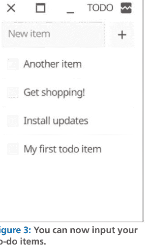

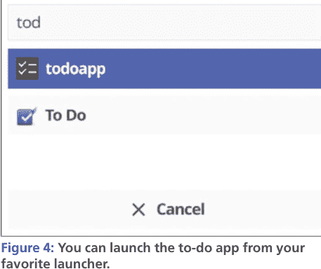

```go
p.StringWithFallback("items",  

"执行此项"+joiner+"学习 Fyne！"  

+joiner+"构建应用程序")
```

现在，你可以将代码打包以便分发。命令 `fyne package` 会准备一个捆绑包（对于 `Linux` 主机，这会创建 `tododapp.tar.xz`）。该捆绑包将包含你的二进制文件、图标文件以及在其他计算机上安装所需的元数据。这些二进制文件是可重定位的，因此它适用于具有不同配置的计算机。新的应用用户将看到图 5 中显示的欢迎屏幕，其中包含教程和图标！

### 为其他平台构建

`fyne` 命令行工具的另一个强大功能是，它可以像 `Go` 编译器一样为其他平台打包代码。你可以指定你希望为应用捆绑包的目标操作系统，一次指定一个。例如：

```bash
> fyne package --os windows
```

由于编译所需的图形库（例如文章开头安装的那些），跨平台编译有一些额外的要求。请参阅 `Fyne` 文档以获取更多信息 [4]。


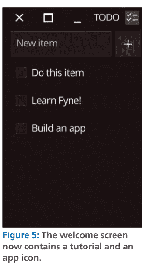

如果你熟悉 `Docker` 或 `podman` 安装，那么你可以使用 `fyne-cross` [5] 工具，它将在容器内处理所有复杂的开发人员设置过程。只要你有一个正在运行的容器引擎，它应该就像以下这样简单：

```
> go install github.com/fyne-io/fyne-cross@latest
> fyne-cross android
```

图 6 展示了当该应用运行在 iOS 或 Android 移动设备上时的外观。该打包是使用 `fyne-cross` 创建并安装，使用的是标准开发人员工具。

最后，如果你有兴趣自动化多平台构建并托管下载，请查看诸如 Fyne Labs 的 `Geoffrey` 之类的构建平台工具 [6]。

### 结论

在不到 100 行代码的情况下，你现在拥有了一个可以在你选择的桌面或移动设备上运行的图形化应用程序。你可以在项目的 GitHub 页面找到完整的应用源代码 [7]。使用 `Fyne` 进行开发非常容易上手。我希望你能受到启发，进一步探索这个 GUI 工具包的潜力。

访问 `Fyne` 网站 [8] 查看其他使用 `Fyne` 构建的应用程序列表，浏览 `Fyne` 文档和教程 [9]。作为一个 Linux 爱好者，你可能也会感兴趣尝试使用 `Fyne` 构建的完整桌面环境 `FyshOS` [10]。

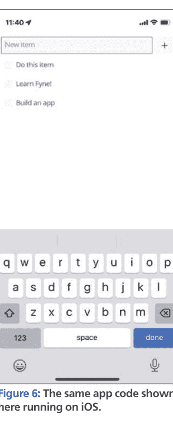

- [1] 入门文档：https://developer.fyne.io/started/
- [2] 创建你自己的布局代码：https://developer.fyne.io/explore/container
- [3] 使用 `Fyne` 进行云存储：https://help.btfn7l55XmN8
- [4] 跨平台编译：https://developer.fyne.io/started/cross-compiling
- [5] `fyne-cross`：https://github.com/fyne-io/fyne-cross
- [6] `Geoffrey`：https://fynelabs.com/geoffrey
- [7] To-do 应用源代码：https://github.com/andydotxyz/linuxmagazine-todoapp
- [8] 其他 `Fyne` 应用：https://apps.fyne.io
- [9] `Fyne` 教程和文档：https://developer.fyne.io
- [10] `FyshOS`：https://fyshos.com/desktop/

`Andrew Williams` 是一位居住在苏格兰的软件工程师和企业家，他在许多开源技术方面拥有丰富经验，曾是 `Enlightenment`、`EFL`、`Maven` 和 `Fyne` 等大型项目的核心开发者。他是 `Fyne` 工具包的创始人，也是 Fyne Labs 的首席执行官，致力于拓展平台无关应用程序开发的可能性。他还是 `《使用 Fyne 构建跨平台 GUI 应用程序》` 和 `《Go 中的 GUI 应用程序开发实战》` 的作者。


# 指尖上的网络知识，尽在 NetBox

## 真相揭示者

`NetBox` 是关于你网络的单一信息来源，你可以在这里存储那些曾经容易丢失的重要详细信息。

作者：Adam Drix

随着网络规模的扩大和复杂度的增加，记录你管理的所有设备及其关系变得越来越困难。在最糟糕的情况下，网络知识可能只记录在一堆电子表格或手绘草图上——甚至可能只存储在少数几万名过度劳累的 IT 员工脑海中。许多免费和专有解决方案提供了一种可视化和记录网络的方式，通常还结合了额外的管理功能。这些工具中的许多都非常有用，但有些可能缺少你需要的关键功能，或者处于光谱的另一端，可能会遭受功能臃肿之苦。其他工具会将你锁定在特定的管理或监控环境中。考虑到这一切，使用一个具有坚实基础并附加组件的软件包将会更好，这允许你构建出记录特定网络的最佳环境。

如果你正在寻找一种能够拥抱复杂性同时“保持简单”的多功能解决方案，你可能会对 `NetBox` [1] 感兴趣。`NetBox` 自称是“首选的网络事实来源”。它通过结合传统的的数据中心基础设施管理（DCIM）和 IP 地址管理（IPAM）与扩展和 `API` 来让你对网络进行建模和记录。如果你想在下决心并投入组织资源之前先尝试一下，可以查看一个始终运行的 `NetBox` 演示 [2]。

## 信息枢纽

`NetBox` 作为关于你网络信息的枢纽（图 1）。在我的组织中，`NetBox` 已成为不仅仅是一种管理 IP 地址的方式。得益于 `NetBox` 的灵活性，你可以添加笔记（使用 `Markdown`），添加产品图像（以及产品位置的图像）等等。如果你需要记录机架中哪个设备是哪个，该机架位于何处，以及它看起来是什么样子，只需拍摄该特定设备的照片，并立即通过手机上传。瞧，所有拥有 `NetBox` 访问权限的人都可以看到确切位置的精确机器。如果你的所有设备都是同一型号，在同一时间购买，安装在同一位置，并且整齐地排列在绵延数英里的机架行中，这可能不是什么大事。对我来说，处理机架、办公室、教室、图书馆、锅炉房、走廊等，以及多年未记录的变化，这种能力非常有用。当我到达一个房间或办公室时，如果不清楚需要处理哪台机器，只需快速查看 `NetBox`，无需启动任何设备、寻找资产标签或查看设备插入交换机上的哪个端口，即可告诉我。无需搜索产品信息，因为它就在那里，还有指向驱动程序的链接。

说到机架，`NetBox` 允许你无论设备类型如何都将设备放入机架，并在 Web `GUI` 中构建机架视图。`NetBox` 使用你提供的设备类型正面和背面的图像来填充机架的正面和背面高程视图，我发现这非常方便。寻找特定设备并不总是像寻找比如从底部数第五个 4U 机箱那么简单。相反，我可能在寻找位于两个 `NAS`、三个交换机和一个侧放架子上的工作站之间的某台域控制器，且没有任何剩余的资产标签或贴纸。这些高程视图，以及这些机架的创建方式，是一个非常强大的功能，即使不考虑该软件能做的其他所有内容也是如此。

在我看来，`NetBox` 最贴心的功能在于它包含你选择包含的任何信息，全部集中在一处且极易查找。例如，搜索“245”会给我所有名称中包含“245”的房间、其标识符或注释中包含这些数字的每个设备，以及具有该型号号的任何内容。我对这类软件的信条是我应该能够在三步内找到我正在寻找的东西。例如，我可以输入“245”并找到该房间，点击它以查看该房间中的设备，再点击它不仅可以获得 IP 地址，还可以获得指向用户手册、安装指南、该设备的通用和特定图像、哪个设备的哪个端口连接到哪个交换机的对应端口、所需功率等的链接。

鉴于此，`NetBox` 绝对是一个“你投入什么就得到什么”的例子。然而，我可以告诉你，执行良好的 `NetBox` 安装可以迅速成为员工在收到工单或需要了解特定机器或设备类型时的一站式商店。丰富的 `API` 集意味着 `NetBox` 可以扩展以作为自动化配置和管理工具的信息源。

`NetBox` 甚至可以作为你库存管理的备份。因为可以通过导入 `CSV` 文件轻松添加新设备，大型项目也容易纳入 `NetBox`。个人而言，我会等到新物品被列入库存管理软件，然后拉取新添项目的报告，按 `NetBox` 所需格式调整，上传，然后添加 IP（图 2）。从头到尾，添加基本上无限数量的单一设备类型（如果你知道它们的 IP 和安装位置），整个过程可能只需 15 分钟。

我还发现了使用 `NetBox` 的一些未预期甚至未想象的优点。我的团队最近需要回答大约半百万个关于我们的网络安全演习问题。`NetBox` 让我们指尖上几乎能回答所有这些问题——无需猜测，无需估算。高中图书馆有多少台台式机？三步即可知道。我们的域控制器在哪里？三步。我们有多少个端点不再受制造商保修支持？点，点，点。`NetBox` 拥有

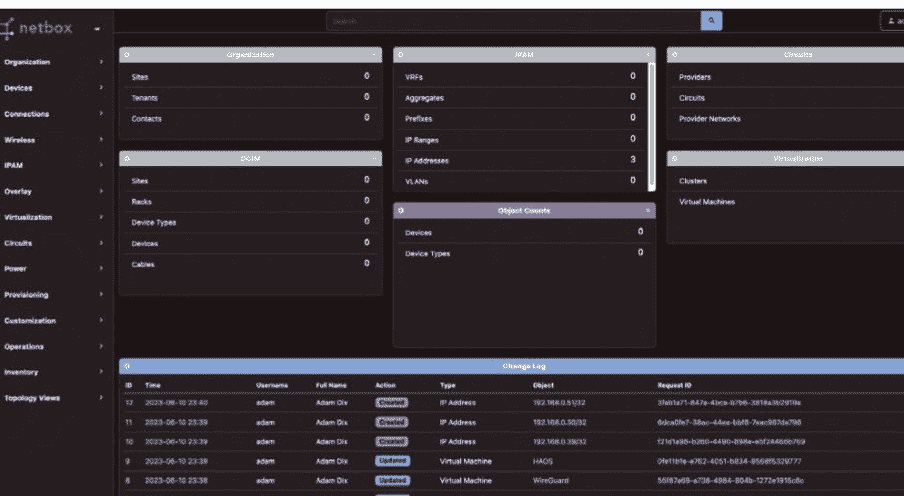

图 1：`NetBox` 概览落地页在一个地方提供关于你网络的信息。

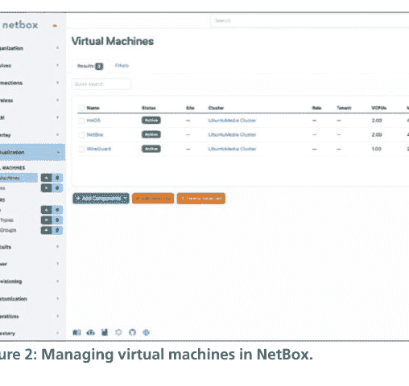

图 2：在 `NetBox` 中管理虚拟机。

在信息管理方面堪称福音。`NetBox` 不需要使用者对系统有深入了解，甚至不需要身处 IT 部门。对于所有层级的用户来说，在 `NetBox` 中搜索和导航都是直观且简单的。

## 安装

虽然你可以在 `NetBox` 文档中找到安装 `NetBox` 的命令，但我将在此为你逐一讲解，并补充一些我在部署和配置特定安装环境时总结的注意事项、怪癖和建议。


我在一台裸机 `Ubuntu` 系统 [3] 上运行 `NetBox`，配备单个固态硬盘（SSD），数据库通过 `cron` 作业和从 LVL1/Techs 论坛 [4] 获取的脚本每日备份到网络服务器。此外，我建议至少配备一台现场备份机器和一台异地备份机器，或者更好的是，在云中运行一台虚拟机（VM）用于故障切换（设置这些备份不在本文讨论范围内）。我将假设你有一台用于安装 `NetBox` 的机器和另一台用于备份的机器（基于你组织典型的运营程序和规范）。

## PostgreSQL

首先，你需要使用以下命令安装 `PostgreSQL` [5]：

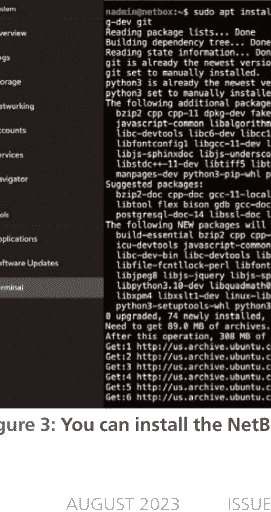

```bash
$ sudo apt update
$ sudo apt install -y postgresql
$ psql -U
$ sudo -u
```

上面的第三个命令用于验证你至少安装了 `PostgreSQL` 11 版本。进入 `PostgreSQL` shell（最后一个命令）后，运行以下命令：

```sql
$ CREATE DATABASE netbox;
$ CREATE USER netbox WITH PASSWORD 'SuperSecurePasswordDifferentCopyPasteThis';
$ ALTER DATABASE netbox OWNER TO netbox;
```

要退出 `PostgreSQL` shell，请输入：

```bash
$ \q
```

为了再次确认安装成功，请输入：

```bash
$ psql --username netbox --password --host localhost netbox
```

然后你需要输入 `NetBox` 用户的 `SuperSecurePassword`。请不要将 `SuperSecurePassword` 作为你的密码；它既不是超级也不是安全的。请遵循你组织的指南，并牢记如果充分利用，`NetBox` 很可能就是你的王国钥匙。

输入密码后，你应该看到以下输出：

```text
psql (14.8, OpenSSL 1.1.1f)
SSL connection (protocol: TLSv1.3, cipher: TLS_AES_256_GCM_SHA384, bits: 256, compression: off)
Type "help" for help.
```

现在使用以下命令完成连接信息检查：

```text
netbox> \conninfo
Success: You are connected to database netbox as user netbox on host localhost (address 127.0.0.1) at port 5432 with the SSL connection described above. You can now quit by entering:
netbox> \q
```

## Redis

你的下一个安装步骤是使用以下命令安装 `Redis` [6]：

```bash
$ sudo apt install -y redis-server
```

你需要使用以下命令验证你至少正在运行 `Redis` 4.0 版本：

```bash
$ redis-server -v
```

你看到的输出应该类似以下内容：

```text
Redis server v=6.0.16 sha=00000000:0
memic=jemalloc-5.2.1 bits=64
buildId=828defb5a45b9b2a8d
```

最后，你需要验证 `Redis` 服务是否正常工作。输入以下命令：

```bash
$ redis-cli ping
```

响应应为 `PONG`。

## NetBox 及依赖项

你还需要使用以下命令安装 `NetBox` 的依赖项（如所示）：

```bash
$ sudo apt install -y python3 python3-pip python3-venv python3-dev build-essential libxml2-dev libxslt1-dev libffi-dev libpq-dev libsasl2-dev zlib1g-dev git
```

通过运行以下命令，双重检查你至少安装了 `Python` [7] 3.8 版本：

```bash
$ python3 -V
```

现在你需要创建安装目录并 `cd`（更改目录）进入该目录，并下载 `NetBox`：

```bash
$ cd ~
$ sudo mkdir -p /opt/netbox/
$ cd /opt/netbox/
$ sudo git clone -b master --depth 1 https://github.com/netbox-community/netbox.git .
```

## 配置

如果你阅读 `NetBox` 文档，你会发现我的配置说明与文档略有不同。文档确实提到了我推荐的做法，但表述并不明显，所以我会尝试让这些步骤更易于理解。

### 列表 1：修改数据库参数

```python
DATABASE = {
    'ENGINE': 'django.db.backends.postgresql',    # 数据库引擎
    'NAME': 'netbox',                            # 数据库名称
    'USER': 'netbox',                            # PostgreSQL 用户名
    'PASSWORD': 'SuperSecurePassword',            # PostgreSQL 密码
    'HOST': 'localhost',                         # 数据库服务器
    'PORT': '',                                   # 数据库端口（留空则使用默认值）
    'CONN_MAX_AGE': 300,                         # 数据库连接最大存活时间（秒）
}
```

注意：最后一个命令末尾的句点（`.`）是命令正常工作的必要条件。

接下来，你需要创建 `NetBox` 用户并将安装目录的所有权更改为该用户：

```bash
$ sudo adduser --system --group netbox
$ sudo chown --recursive netbox /opt/netbox/netbox/media/
```

首先，我将使用 `Cockpit` [8] 在 `Ubuntu` 服务器上编辑 `NetBox` 配置文件（参见如下“配置编辑器”方框）：

```bash
$ cd /opt/netbox/netbox/netbox/
$ sudo cp configuration_example.py configuration.py
$ sudo nano configuration.py
```

### 配置编辑器

我使用 `Ubuntu Server` 上的 `Cockpit` 进行了本文的安装，因为（根据我的经验）它使管理变得非常容易。我安装了 `45Drives` 为 `Cockpit` 制作的插件 `cockpit-navigator`，它极大地提高了服务器运行的效率，尤其是当你需要编辑大量配置文件、从模板创建配置文件并定期执行其他常见配置操作时。如果你更喜欢使用 `nano` [10] 或 `Vim` [11] 等工具，也可以在 `Cockpit` 包含的终端中完成所有这些操作。

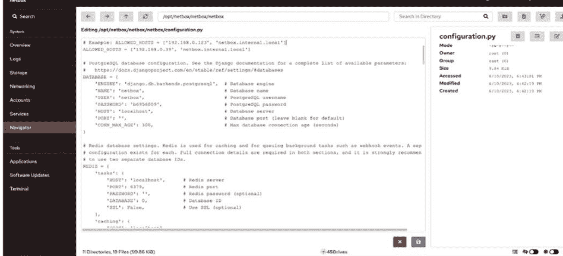

**图 4：** 如果你更喜欢图形化编辑器，可以使用 `Cockpit` 中 `45Drives` 的 `Navigator` 编辑 `configuration.py` 来配置 `NetBox`。

### 列表 2：修改 Redis 参数

```python
01 REDIS = {
02 	'tasks' : {
03 		'HOST': 'localhost',		# Redis 服务器
04 		'PORT': 6379,				# Redis 端口
05 		'PASSWORD': '',		# Redis 密码（可选）
06 		'DATABASE': 0,			# 数据库 ID
07 		'SSL': False,			# 使用 SSL（缓存）
08 	},
09 	'caching' : {
10 		'HOST': 'localhost',
11 		'PORT': 6379,
12 		'PASSWORD': '',
13 		'DATABASE': 1,			# 第二个数据库的唯一 ID
14 		'SSL': False,
15 	}
16 }
```

如果你也在 `Ubuntu` 桌面上安装此软件，请使用：

```bash
$ sudo gedit configuration.py
```

对于 `20.04` 更新版本的 `Ubuntu`，请使用：


```bash
$ sudo gnome-text-editor configuration.py
```

然后你就可以直接在文本编辑器中编辑文件了。如果你不太熟悉在终端中使用 `Vim` 或 `nano`，这样可能会更容易。

你需要修改配置文件中的四个键（图 4）。首先，你将更改 `ALLOWED_HOSTS` 参数：

```python
ALLOWED_HOSTS = ['netbox.example.com', '192.168.2.13']
```

如果你不确定这里该填什么，请使用你的服务器 IP 地址，你可以通过在终端输入以下命令获取：

```bash
$ ip addr
```

你也可以在终端输入 `$ hostname` 并将服务器的主机名放在这里，或者如果这样做有意义的话，两者都可以使用。我的安装在此处有四个条目，用逗号分隔。你稍后将在 Web 浏览器中输入此地址以访问 NetBox 网页 GUI。

警告：请勿将此内容输入在 `ALLOWED_HOSTS` 参数正上方的示例 `ALLOWED_HOSTS` 注释中。如果你遇到 `400 bad request` 错误，建议检查 `ALLOWED_HOSTS` 注释，看看是否不小心在那里输入了 IP 地址或主机名。

接下来，你需要如列表 1 所示修改数据库参数。

然后，你需要如列表 2 所示修改 Redis 参数。

最后，你需要修改 `secret key` 参数。首先，你需要使用以下命令生成你的密钥：

```bash
$ python3 /opt/netbox/netbox/generate_secret_key.py
```

将生成的密钥复制并粘贴到 `REDIS` 参数下方的 `SECRET_KEY` 参数位置。如果你决定设置第二台 NetBox 服务器作为备份，你将使用此密钥，所以请记录下来以备将来参考。如果你忘记这样做，以后需要时随时可以回到 `configuration.py` 中找回密钥。

现在你可以使用以下命令创建并编辑 `local_requirements.txt` 文件：

```bash
$ cd /opt/netbox/
$ sudo nano local_requirements.txt
```

如果你打算使用在线文档中提到的远程数据库，你需要在这里输入 `djangostorages` [12]。文档中不明确的是，你还需要在 `/opt/netbox` 目录下的 `local_requirements.txt` 文件中输入你打算使用的任何其他插件。（NetBox 插件列表参见 NetBox Community Plugins GitHub 页面 [13]。）此外，这些插件需要在之前修改的 `/opt/netbox/netbox/netbox` 目录中的 `configuration.py` 文件中列出。

在 `local_requirements.txt` 中，只需将每个所需的插件（图 5）每行一个输入如下：

- `djangostorages`
- `netbox-topology-views`
- `netbox-inventory`
- `netbox-rqcode`

在 `local_requirements.txt` 中，请注意插件使用连字符（`-`）。当你编辑 `configuration.py` 文件时，你需要将一些连字符更改为下划线（`_`）。我发现这非常令人沮丧且不一致，因为并非总是一个地方用连字符而另一个地方用下划线，但两者之间经常不同。（如果你为 NetBox 构建插件并且可以避免这个问题，请考虑将插件名称设为一个单词，以避免此问题。）

现在你已经编辑并保存了包含所需插件的 `local_requirements.txt` 文件，你还需要通过再次修改 `configuration.py` 文件来启用它们。你可以使用以下命令打开 `configuration.py`：

```bash
$ cd /opt/netbox/netbox/netbox/
$ sudo nano configuration.py
```

查找 `PLUGINS` 参数，根据插件的不同，你可能还需要更改 `PLUGINS_CONFIG`。根据我添加到 `local_requirements.txt` 文件中的插件，我的 `PLUGINS` 部分应该如下所示：

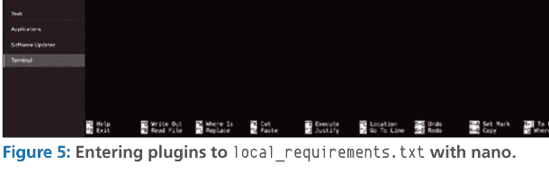

```python
PLUGINS = [
    'netbox_inventory',
    'netbox_grocode',
    'netbox_topology_views'
]
```

我将使用与第 3 节中所示的默认建议插件配置相似的配置。

我通常会在终端中使用 `nano` 和使用 `45Drives` 的 `Navigator` 修改文件之间切换，但如果你正在使用 Ubuntu 桌面版来修改 `configuration.py` 文件并创建及填充 `local_requirements.txt` 文件，也可以使用 `gedit` [14]（或 Gnome 文本编辑器 [15]）。我更喜欢使用图形化编辑器来排查配置问题，而不是在终端文本编辑器中记住退出和保存命令。最终对 NetBox 来说结果都是一样的，所以请使用对你来说最方便的方式。

我强烈建议将 `always_save_coordinates` 设置为 `False`，因为它们给我带来了很多麻烦。看起来，它们会为每个设备设置一个自定义字段。问题在于，你实际上需要创建该自定义字段，如果没有这样做，在使用拓扑视图后，你将无法以任何方式编辑设备。简而言之，我会将这些参数设置为 `false` 并仔细阅读插件页面。如果你在使用拓扑视图插件后尝试修改设备时遇到错误，请创建一个名为 `Coordinates` 的自定义字段，数据类型为文本（`text`）并设为隐藏。然后按照插件页面上的说明执行所需的转换。之后，你开始能够编辑设备而不再每次都收到错误消息。

话虽如此，拓扑视图插件看起来非常棒，我高度推荐用于创建拓扑地图。但请注意，可能会出现此错误，并且有修复方法，尽管有点繁琐。我能够通过推特联系 NetBox 团队，那里的工作人员帮我找到了插件页面上所需的 GitHub issue，从而帮我解决了问题。（不幸的是，在此之前，我前一晚已经放弃了并试图重新创建所有设备——结果查看拓扑视图后发现自己仍处于完全相同的情况。幸好对我来说，设备数量并不多，而且这是一次很好的学习体验。）

整理好插件后，你就可以运行 `upgrade.sh` 来安装插件：

```bash
$ sudo /opt/netbox/upgrade.sh
```

注意，`configuration.py` 文件的语法必须完全准确。我发现即使复制粘贴也常常会导致错误。如果出错，请仔细阅读终端输出，然后回去编辑 `configuration.py` 文件，直到正确为止。终端输出会告诉你问题出在哪一行，并猜测问题的来源。记住，你总是可以稍后将插件及其配置添加到 `local_requirements.txt` 和 `configuration.py` 中，并运行 `upgrade.sh` 命令。我最终使用了上面的配置，但过程中也遇到了一些挫折。请记住，NetBox 文档中的示例配置仅仅是示例，可能需要添加、删除或更改某些内容才能正常工作。

现在 NetBox 会提示你重启 NetBox 服务（图 6）。如果你此时重启，你会收到第 4 节中所示的重启失败消息。出现失败消息是因为你尚未创建这些服务。

如果你出于某种原因决定不再需要某个插件，那么你可以简单地将其从两个文件中删除。如果你不确定，或者出于某种原因想暂时禁用某个插件，你可以通过将其从 `configuration.py` 中移除但保留在 `local_requirements.txt` 中来实现。为了启用或禁用插件，你需要重启 NetBox 服务，我稍后会解释这一点。

现在你需要通过输入以下命令创建 NetBox 超级用户：

```bash
$ source /opt/netbox/venv/bin/activate
```

命令提示符中添加的 `(venv)` 是正常的。现在，添加超级用户：

```bash
(venv) $ cd /opt/netbox/netbox
(venv) $ python3 manage.py createsuperuser
```

你可以使用 `deactivate` 命令退出虚拟环境并返回到正常的终端窗口，但我通常发现自己在关闭并打开新的终端（或者刷新页面，因为我正使用 Cockpit 连接）。

添加超级用户后，你需要将日常维护脚本作为 cron 作业添加，以便偶尔进行一些清理。为此，在 `cron.daily` 文件夹中添加脚本的链接，如下所示：

```bash
$ sudo ln -s /opt/netbox/contrib/netbox-housekeeping.sh /etc/cron.daily/netbox-housekeeping
```

此时，你应该拥有一个正在运行的 NetBox 实例，你可以通过输入之前在 `configuration.py` 中定义的 IP 地址或主机名来连接它。你需要拥有 Uncomplicated Firewall (`UFW`)，这可能需要运行：


```bash
$ sudo ufw allow 9090
$ sudo ufw allow OpenSSH
$ sudo ufw allow https
$ sudo ufw allow http
$ sudo ufw enable
$ sudo ufw status
```

我添加了端口 `9090` 和 `22`，因为我使用了 `Cockpit`，并且也希望有能力通过 `SSH` 连接到此服务器，但这超出了本文的范围。如果你不知道如何通过 `SSH` 连接到服务器，或者尚未安装和使用 `Cockpit` 或类似的服务器管理 Web GUI（如 `Webmin`），我建议你先做这些事情，因为这将帮助你熟悉从终端管理无 GUI 的服务器。即使你运行的是 Ubuntu 桌面版，也可以使用 `SSH` 或 `Cockpit` 连接到你的机器。

## 创建服务

现在你需要复制默认的 Gunicorn [16] 配置并创建服务，以便使用第 5 节中的代码打开和关闭 NetBox。

### 第 5 节：创建服务

```bash
$ sudo cp /opt/netbox/contrib/gunicorn.py /opt/netbox/gunicorn.py
$ sudo cp -v /opt/netbox/contrib/*.service /etc/systemd/system/
$ sudo systemctl daemon-reload
$ sudo systemctl start netbox netbox-rq
$ sudo systemctl enable netbox netbox-rq
$ systemctl status netbox.service
```

第 5 节中的代码复制默认的 Gunicorn 配置文件，然后创建 NetBox 系统服务，启动它，启用其在系统每次启动时运行，并检查其是否正常运行且已启用启动。完成此步骤后，如果你运行 `upgrade.sh` 命令并且它提示你重启 NetBox 服务，你现在将能够成功执行。

## Web 服务器设置

要设置 Web 服务器，你需要创建一个 SSL 证书以允许 HTTPS 加密流量（图 7）：

```bash
$ sudo openssl req -x509 -nodes \
        -days 365 -newkey rsa:2048 \
        -keyout /etc/ssl/private/netbox.key \
        -out /etc/ssl/certs/netbox.crt
```

此证书是自签名的，对于我们的用途来说没问题。在生产环境中，你可能不希望使用自签名证书。

接下来，系统会提示你输入一些可选的详细信息，你可以将这些信息包含在证书中。我建议把它当成一个小游戏，看看是否真的有人阅读你的证书详细信息！

现在你将安装 NGINX Web 服务器 [17]：

```bash
$ sudo apt install -y nginx
```

下一步至关重要：你必须将之前提到的主机名和 IP 地址添加到服务器的配置文件中：

```bash
$ sudo nano /opt/netbox/contrib/nginx.conf
```

将 `netbox.example.com` 更改为你之前在 `configuration.py` 中输入的主机名或 IP 地址。注意，这里可以有多个条目，例如安装的 IP 地址和主机名。只需空格分隔即可。如果你忘记了这些信息，可以使用终端中的 `ip address` 和 `hostname` 命令来查找。

现在你将把 NetBox HTTPS 配置文件复制到 NGINX 目录，删除默认启用的站点，将其替换为指向此文件的链接，并通过按顺序输入第 6 节中的命令来重启 HTTPS 服务。

### 第 6 节：设置 NGINX 服务器

```bash
$ sudo cp /opt/netbox/contrib/nginx.conf /etc/nginx/sites-available/netbox
$ sudo rm /etc/nginx/sites-enabled/default
$ sudo ln -s /etc/nginx/sites-available/netbox /etc/nginx/sites-enabled/netbox
$ sudo systemctl restart nginx
```

如果你将来对配置文件进行任何更改，你需要使用第 6 节第 1 行中的命令将该文件重新复制到 `sites-available` 目录，然后通过第 4 行重启 NGINX。如果不这样做，你的配置将实际上不会更改。

（在线 NetBox 文档中还有一个可选的 LDAP 服务安装章节，但这超出了本文的范围。）

现在你应该已经可以正常运行了（图 8）。你可以通过进入 Web 浏览器并在地址栏中输入你在 NGINX 配置文件和 `configuration.py` 中使用的域名或 IP 地址来访问你的 NetBox 安装。你将使用之前创建的用户名和密码登录。登录后，我建议你为自己以及其他需要访问 NetBox 的人员创建一个新的用户。

当你使用此 SSL 证书连接到你的新 NetBox 实例时，你会收到关于连接到不安全服务器的警告（图 9）。对于我的安装来说这不是问题，但对你可能很重要。如果是这种情况，你可以研究非自签名的证书。就本文的目的而言，在这种情况下完全可以忽略该警告。

## 分配用户权限

你可以授予用户仅查看或编辑的权限。这些权限基于网络每个方面的每个子部分。这非常细致，很棒但也令人有些困惑。我强烈建议明智地使用组——先思考为你的组织设置权限的最佳方式。

还有一个用于单点登录 (SSO) 的插件，这可能适合你的安装环境。你可能希望一个人添加所有新设备，另一个人向这些设备添加 IP 地址。如果是这样，你会给予第一个人更改设备类型和设备的权限，但仅查看 IP 地址，反之亦然。

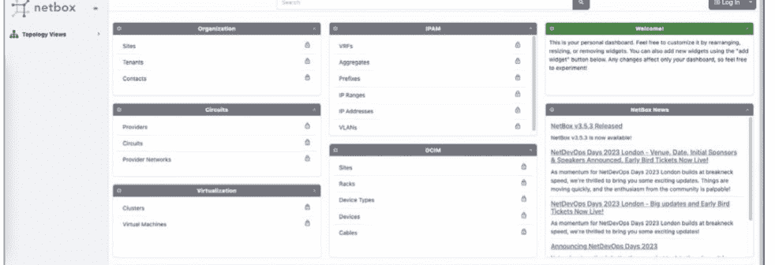

部分用户可能不需要查看特定章节，因此你可以简单地不授予他们相应的访问权限。如果你的 NetBox 实例中有来自不同网站或地理位置的用户，这一功能也非常有用。在这种情况下，用户可以根据需要仅修改其所在位置或站点内的项目。

权限至关重要，需要经过深思熟虑。请记住，这些权限是进入“王国”的钥匙。即使对你的组织而言事实并非如此，这仍然是处理 NetBox 的一个安全做法。

### 结论

当我最初开始阅读有关 NetBox 的资料时，我发现其“成为首选网络真实数据来源”的目标听起来有点矫揉造作。毕竟，它只是一个网络地图的 Web 图形界面，外加数据库中的某些内容。然而，自从安装并使用它以来，我成了一名坚定的支持者。我认为每个网络工程师都应该使用 NetBox 来绘制网络地图。我不仅在公司，甚至在家用网络中也安装了社区版。它确实是你网络的“真相”——至少在你付出努力之后它会成为如此。

我仍在记录我所在组织网络的过程中。这是一项巨大的任务，而且永无止境，因为随着网络的扩张、收缩和变化，需要进行更新。我的意图是将 NetBox 构建得足够完善，以便我可以给新员工提供 NetBox 的登录凭证，让他们能够熟悉整个组织的布局，即使他们无法访问其中看到的所有内容。我还需要在 NetBox 的位置部分添加每栋建筑的地图，这可以通过直接上传物理地图的 PNG 图像来实现。我可能不会给新员工提供大楼内交换机的凭据，但他们将知道交换机的位置、哪些设备通过哪些端口连接到它们以及这些设备的 IP 地址，并且能够非常快速轻松地找到产品信息。NetBox 将为新员工提供他们需要了解其操作设备的方方面面，从而能够高效且有效地完成工作。在我们网络中有数十台打印机和数百台 PC 的情况下，能够通过搜索房间或建筑来精确定位某个设备及其与特定交换机的连接，并拥有指向用户指南、安装手册、驱动程序下载页面、规格、资产标签编号和对应序列号的链接，从长远来看将极大提高团队效率，尽管实施这一过程绝对需要时间。然而，这些时间并没有被浪费，因为任何在 NetBox 中绘制网络地图的人同时也在学习网络的所有内部细节。

本文中我没有着重强调的一点极其重要：了解你的网络上有什么设备以及这些设备位于哪里，对于网络安全至关重要，并且直接关联到 CIS 风险评估方法论 (RAM) 中的 CIS 保障措施 1.1、1.2、1.3、2.4、6 以及许多其他项 [18]。

起初，我发现我们已经使用的工具和 NetBox 之间存在大量的重叠。然而，为了向数据库添加更多设备并输入更多关于每个设备的细节，我意识到我之前看待这个问题的方式是错误的。虽然基本上 NetBox 的所有功能都有替代方案，但独立程序和服务之间的脱节导致了低效。NetBox 为网络管理的长期改进提供了绝佳机会。如果实施得当，NetBox 将充当网络的中央知识枢纽，而所有这些其他程序和服务则作为该枢纽周围的辐射点。NetBox 并不覆盖在现有的管理堆栈之上，而是以一种赋能 IT 团队的方式与之融合。虽然 NetBox 最初看起来工作量很大，

### 信息

- [1] NetBox: https://github.com/netbox-community/netbox/wiki


- [2] NetBox 演示: https://demo.netbox.dev/login/next/
- [3] Ubuntu: https://ubuntu.com/
- [4] Level1 Techs 的 NetBox 指南: https://forum.level1techs.com/t/netbox-ipam-dcim-guide/132435
- [5] PostgreSQL: https://postgresql.org/
- [6] Redis: https://redis.io/
- [7] Python: https://www.python.org/
- [8] Cockpit: https://cockpit-project.org/
- [9] 45Drives cockpit-navigator: https://github.com/45Drives/cockpit-navigator
- [10] nano: https://www.nano-editor.org/
- [11] Vim: https://www.vim.com/
- [12] Django: https://www.djangoproject.com/
- [13] NetBox 社区插件: https://netbox-community/
- [14] gedit: https://github.com/GNOME/gedit
- [15] Gnome 文本编辑器: https://gitlab.gnome.org/GNOME/gnome-text-editor
- [16] Gunicorn: https://gunicorn.org/
- [17] NGINX: https://www.nginx.com/
- [18] CIS RAM: https://ciscocite.org/insights/white-papers/cis-ram-risk-assessment-method

## 作者

Adam Dix，前教师和产品线经理，是一位机械工程师和 Linux 爱好者，目前担任局域网技术员。你可以在 `EduBUbDie Linux` (https://edubudgie.com) 上查看他的一些相关工作。


图 9：当您首次连接到您的 `NetBox` 安装环境时，如果您使用的是自签名 `SSL` 证书，可能会收到隐私警告。

## 在开源中寻找您的位置？


设置工作提醒，立即开始！

## 开源工作枢纽


`opensourcejobhub.com/jobs`

## 算法驱动的团队建设

`Team Spirit`

不是由教练决定球队阵容，而是一个算法根据球员的优势为 `Mike Schilli` 的业余足球队选择球员。**作者：**`Mike Schilli`


在我第二故乡旧金山每周举行的临时组队的足球比赛中，当 16 名球员报名参加八人制比赛时，比赛日总是会有“谁将对阵谁”的问题。准备球队名单通常由经验丰富的球员负责，但这很耗时，并且会导致无休止的讨论，争论一方八名球员是否仅仅比另一方八名球员技能太高，从而导致比赛一方独大，玩起来毫无乐趣。为了解决这个问题，我开发了一个生成球队阵容的算法。这让我得以进行一次有趣的探索，进入组合数学的世界，并在本月的专栏中探讨适合算法的开发。

将 16 名球员分配到两个各有八人的球队，有多少种方式？如果一支球队固定，对手球队会自动从剩余的参赛者中推导出来；这意味着结果在组合数学中写作“16 选 8”，计算为

```
(16*15*…\*10*9)/(8*7*...\*2*1)
```

结果为 12,870。任何家用电脑都可以毫不费力地处理这么多组合。即使你的任务是将 22 名球员分配到两个各有 11 人的球队，规模也是在同一量级，有 705,432 种可能性。

课程中提到，“你无法管理你无法衡量的事物。”然而，在确定球队质量之前，必须由专家根据几项标准对单个球员的实力进行评分，然后算法才能将队友分配到球队并比较他们的累计实力。

### 暴力破解

在像这样的小事件空间中，尝试所有组合、在每次迭代中调用评估函数、存储最佳分数并在最后输出顶级结果，绝对是一个选项。

对于较大的事件空间，使用这种暴力破解方法根本行不通，因为组合数很容易呈指数级失控。更有意义的是首先选择一个不完美但合理的解决方案作为起点，然后进行增量修改，查看结果是改善还是变差。模拟退火是这一过程的技术术语 [1]。

在继续寻找更好的解决方案之前，你需要一个度量函数来评估每个球队的质量。然后可以使用该度量比较不同的组合并选择最佳的一个。就像所有管理学的

### 列表 1: `teams.yaml`

```yaml
01 players:
02 - name: joe
03 skills:
04 offense: 3
05 - name: tony
06 skills:
07 defense: 2
08 goalie: 3
09 - name: fred
10 skills:
11 defense: 2
12 - name: mike
13 skills:
14 offense: 9
15 - name: manuel
16 skills:
17 goalie: 9
18 - name: mark
19 skills:
20 defense: 9
```

**作者**

`Mike Schilli` 是加利福尼亚州旧金山湾区的一名软件工程师。他自 1997 年起每月撰写专栏，研究各种编程语言的实用应用。如果你通过 `msc hilli @ perlmeister.com` 给他发电子邮件，他很乐意回答任何疑问。


## 收集积分

图 1 中的 `YAML` 文件显示了各名球员的评级。为了便于说明，该模型将总人数限制在六名球员。`players` 条目中的每一项通过姓名标识一名球员，并规定其在三个类别中的评级，数值范围为 0 到 9：进攻、防守和守门员（即愿意担任守门员的意愿）。如果某位球员在某个类别中没有评级，算法简单地假设其值为 0。

例如，图 1 中 `tony` 的守门员技能评级为 3，而 `manuel` 的守门员值为 9（任何与现有守门员姓名匹配的情况纯属巧合）。由于每支球队都需要一名守门员，且其他人均不具备守门员素质，良好的算法应将 `tony` 和 `manuel` 分配到不同的球队。在此基础上，算法还需确保两支球队拥有大致相当的进攻和防守球员，以保持比赛的激烈和开放性。

图 2 从文件中读取 `YAML` 数据，然后将其存储在数据结构中，供稍后的组队 `Go` 二进制文件使用。图 3 展示了主程序，定义了从命令行调用它后会发生什么。作为一种热身，图 4 展示了一个简单的算法，它将球员随机分配到两个球队。你可以从图 1 中看到程序的输出。这些球队非常不平衡，算法显然远非完美，但请保持关注，改进即将到来。

### 图 2：`data.go`


```go
package main

import (
    "gopkg.in/yaml.v2"
    "io/ioutil"
)

type Skills struct {
    Goalie   int `yaml:goalie`
    Offense  int `yaml:offense`
    Defense  int `yaml:defense`
}

type Player struct {
    Name   string `yaml:name`
    Skills Skills `yaml:skills`
}

type Config struct {
    Players []Player `yaml:players`
}

func YamlParse() ([]Player, error) {
    config := Config{}

    text, err := ioutil.ReadFile("teams-real.yaml")
    if err != nil {
        return config.Players, err
    }

    err = yaml.Unmarshal([]byte(text), &config)
    if err != nil {
        return config.Players, err
    }

    return config.Players, nil
}
```

```
$ ./random
Team A
1.  joe [off:3 def:0 goa:0]
2.  fred [off:0 def:2 goa:0]
3.  mark [off:0 def:9 goa:0]
Team B
1.  mike [off:9 def:0 goa:0]
2.  manuel [off:0 def:0 goa:9]
3.  tony [off:0 def:2 goa:3]
```

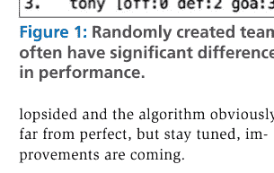

## 严格类型

为了让 `Go` 程序能够理解包含球员技能的 `YAML` 数据，由于 `Go` 的严格类型检查，它首先需要定义类似的数据结构。图 2 从图 1 读取整个 `YAML` 结构，该结构由 `teams` 键下的字典和 `players` 键下的球员列表组成。然后，这两种结构被定义为 `struct` 类型。

### 图 3：`teams.go`

```go
package main

import (
    "fmt"
)

func main() {
    players, err := yamlParse()
    if err != nil {
        panic(err)
    }

    teams := mkTeams(players)
    if err != nil {
        panic(err)
    }

    teamNames := []string{"A", "B"}
    for tIdx, team := range teams {
        fmt.Printf("Team %s\n", teamNames[tIdx])
        for pIdx, player := range team {
            fmt.Printf("%d. %s [off:%d def:%d goa:%d]\n",
                      pIdx+1, player.Name, player.Skills.Offense,
                      player.Skills.Defense, player.Skills.Goalie)
        }
        fmt.Print("\n")
    }
}
```

## 编程快照 – Go 算法

`players` 键，包含一个玩家结构体数组。每个键包含一个名字，并在 `skills` 键下定义玩家的能力，包括技能名称和从 8 到 9 的数值评级。

基于此，图 2 中 `Go` 代码的第 19 行定义了带有 `Players` 字段的 `Config` 结构，其值是一个包含 `Player` 类型元素的数组切片。该类型在第 14 行定义，进而包含玩家姓名的 `Name` 字段和同类型的 `Skills` 字段。`skills` 类型从第 8 行开始定义，并在 `Goalie`、`Defense` 和 `Offense` 字段中指定了玩家实力，值为 `int` 类型。

由于 `Go` 可以原生处理 `YAML` 数据，字段名称和类型后面的代码可以提供有用的提示（例如，如果 `YAML` 中使用的字段名称与类型中使用的不同）。在我们的情况下，`Go` 数据结构中的字段名称是大写的（`YAML` 库要求如此），但配置文件中的 `YAML` 字段是小写的。例如，第 9 行 `Goalie int 'yaml:goalie'` 定义了 `Goalie` 字段为 `int` 类型，而其在 `YAML` 数据中的对应物名为 `goalie`。

这就是 `YAML` 评估器 `yaml.Unmarshal()` 在第 31 行所需的全部内容。它一次性遍历配置 `YAML` 数组的所有元素，用它们填充程序的内部 `Go` 结构，并负责分配所需的内存资源——这是现代计算机科学的奇迹。例如，如果代码希望稍后访问从上往下第三个玩家的进攻技能，它可以访问相关的整数值为 `config.Players[2].Offense`。

## 无计划

图 3 定义了 `main()` 程序，它首先调用 `yamlParse()` 从图 2 读取 `YAML` 数据。然后，第 13 行调用稍后定义在下方（直到行号结束）的 `mkTeams()` 函数，以排列两个团队。其返回值是一个包含两个元素的 `teams` 数组切片，这两个元素代表（正如你所猜到的）团队。这些元素进而各自由 `Player` 类型球员组成的数组切片组成。从第 19 行开始的 `for` 循环迭代两个团队；从第 21 行开始的内部 `for` 循环则迭代各个球员。`Printf()` 打印出团队中每个球员的名字以及根据三个预定义标准的球员评级摘要。

现在，作为热身，图 4 展示了一个随机化团队的简单算法。图 4 中 `mkTeams()` 的实现首先使用标准 `math/rand` 包中的种子（当前时间）初始化随机生成器。这是为了确保对虚拟教练的调用每次返回不同的团队。然后，`Rand.Shuffle()` 函数打乱从第 11 行开始包含 16 名球员的数组切片中的元素。从第 19 行开始的 `return` 语句返回切片的两个半部分给调用者。这就完成了团队阵容。

在实际构建命令生成 `Go` 二进制文件之前，编译器首先需要从 `GitHub` 检索图 2 中使用的 `YAML` 包并对其进行编译（图 5，前两行）。然后，图 5 最后一行的调用将一切结合起来形成随机二进制文件，其在命令行上的调用及生成的输出如图 1 所示。

### 图 4：`random.go`

```go
package main

import (
    "math/rand"
    "time"
)

func mkTeams(players []Player) [][]Player {
    rand.Seed(time.Now().UnixNano())

    rand.Shuffle(len(players), func(i, j int) {
        players[i], players[j] = players[j], players[i]
    })

    if len(players) < 2 || len(players)%2 != 0 {
        panic("Needs even number of players")
    }

    return [][]Player{
        players[0 : len(players)/2],
        players[len(players)/2:]
    }
}
```

### 图 5：编译

```
$ go mod init teams
$ go mod tidy
$ go build randcom.go teams.go data.go
```

## 系统化方法

不幸的是，这个算法有点力不从心。如图 5 所示，随机数生成器将仅有的两名具备守门员技能的球员分配到同一支球队，尽管每支球队至少需要一名守门员。进攻和防守能力也不平衡。因此，算法设计的下一阶段需要根据球员的个人实力将他们分配到两个均等的团队。

正如我前面提到的，由于事件空间较小，遍历所有选项并确定和比较个别解决方案的适用性很容易。为此，图 6 提供了一个适用性函数 `diff()`，用于评估两个团队 `teamA` 和 `teamB` 中分配的公平性。如果整数结果接近零，则比赛平衡；其值越大，比赛越可能不公平。

为了确定得分，该函数添加了两支球队在进攻、防守和守门员能力方面的绝对差异。它给进攻技能赋予 2 的权重，给守门员赋予 10 的权重；毕竟，如果你没有守门员，你已经输掉比赛了。

### 图 6：`diff.go`


## 古怪的 Go

你可能认为编程语言会天生提供一种确定整数绝对值的函数，但 Go 的古怪开发者们却反对这样做。`math` 包确实提供了一个用于浮点数的 `Abs()` 函数，但对整数使用它需要大量的转换操作。这就是为什么，从第 20 行开始，图 6 实现了一个 `abs()` 函数，将负值转为正值。

这使得图 7 能够提供 `mkTeams()` 函数的新版本，作为图 4 中随机产物的替代方案。它调用 `perm()` 来遍历所有可能性，使用 `diff()` 评估结果分组，并存储最佳组合。

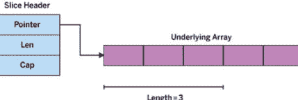

图 2：Go 中的数组切片仅引用一个真实的数组。

### 图 7：systematic.go

```go
package main

func mkTeams(players []Player) [][]Player {
	bestTeams := make([][]Player, 2)
	bestDiff := -1

	perm(players, func(t1 []Player, t2 []Player) {
		d := diff(t1, t2)
		if bestDiff < 0 || d < bestDiff {
			bestDiff = d
			t1c := make([]Player, len(t1))
			copy(t1c, t1)
			t2c := make([]Player, len(t2))
			copy(t2c, t2)

			bestTeams = [][]Player{t1c, t2c}
		}
	})

	return bestTeams
}
```

### 图 8：perm.go

```go
package main

func perm(players []Player, f func([]Player, []Player)) {
	_perm(players, 0, []Player{}, []Player{}, f)
}

func _perm(players []Player, idx int, subset1 []Player, subset2 []Player, f func([]Player, []Player)) {
	if len(subset1) == len(players)/2 && len(subset2) == len(players)/2 {
		f(subset1, subset2)
		return
	}

	if idx == len(players) {
		return
	}

	_perm(players, idx+1, append(subset1, players[idx]), subset2, f)
	_perm(players, idx+1, subset1, append(subset2, players[idx]), f)
}
```

## 编程快照 – Go 算法

（即数值最低的那个）在 `bestTeams` 和 `bestOff` 中。

不过在存储最佳结果时，重要的是要避免一个隐藏的绊脚石：如果你认为只需将 `t1` 和 `t2` 变量的数值以及球队存放在一个安全的地方即可，那就错了。因为 Go 运行时会在底层数组中修改 `t1` 和 `t2` 引用的球队，最终你会得到混乱的阵容。在 Go 中，数组切片始终只是指向真实数组的指针（图 2）。如果你只保存指针，必然会看到底层数组的任意变化。

第 11 到 14 行通过复制找到的球队来避免这个陷阱，使用 Go 内置的 `copy()` 函数。同样重要的是确保目标数组切片（`copy()` 的第一个参数）的长度与你想要复制的原始切片长度相同。如果前者的长度为零，`copy()` 将只会复制零个字节，让用户因挫败感而抓耳挠腮。

那么，列表 7 是如何找到所有可能的球队构成的呢？为此，列表 7 在第 7 行调用了列表 8 中的 `perm()` 函数；该函数期望传入一个可用球员数组切片和一个回调函数，该函数会对它找到的每个组合恰好调用一次。对于每个单独的数据点，如列表 7 中从第 7 行开始所示，程序随后就可以对两支球队采取操作，例如评分并保留目前找到的最佳结果。

## 来自 ChatGPT 的帮助

因为我比较懒，没有绞尽脑汁自己想出列表 8 中的排列算法，而是依赖了 ChatGPT 这个“全能型”电子大脑的帮助。我只是用朴素的英语问 ChatGPT，寻求一种能够将 N 个球员数组拆分为两支球队所有可能组合的方法。它在 10 秒内给出了一个解决方案（图 3）——这对过劳的程序员来说简直是救命稻草！

剩下的工作就是调整代码以适应用于球队的 `Player` 数组元素数据结构，列表 8 也就准备就绪了。这绝对让编程重新变得有趣起来！然而，你需要知道的是，ChatGPT 提供的解决方案往往不是 100% 正确的。事实上，它给我的第一个结果存在一个差一（off-by-one）错误。不过，一旦我指出了这一点，AI 就道歉并迅速提供了更好的解决方案。就像变魔术一样！


[] – [ ]
[a] – [ ]
[a b] – [ ]
[a b c] – [ ]
[a b c d] – [ ]
[a b c] – [d]
[a b] – [c]
[a b d] – [c]
[a b] – [c d]
[a] – [b]
[a c] – [b]
[a c d] – [b]
[a c] – [b d]
[a] – [b c]
[a d] – [b c]
[a] – [b c d]
[ ] – [a]
[b] – [a]
[b c] – [a]
[b c d] – [a]
[b c] – [a d]
[b] – [a c]
[b d] – [a c]
[b] – [a c d]
[ ] – [a b]
[c] – [a b]
[c d] – [a b]
[c] – [a b d]
[ ] – [a b c]
[d] – [a b c]
[ ] – [a b c d]

图 4：四名球员的有效两对两阵容。

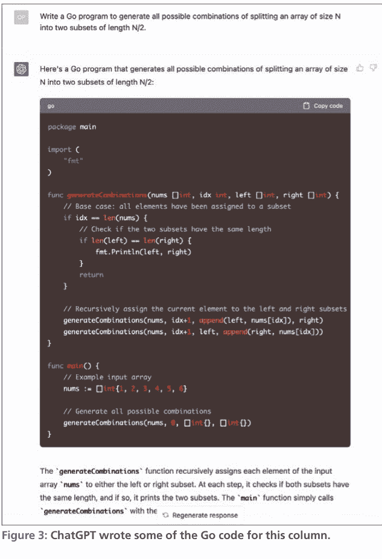

ChatGPT 设计的排列算法基于递归。它以两个初始为空的球队切片 `subset1` 和 `subset2` 调用 `perm()` 函数两次。为此，导出的 `perm()` 函数在列表 8 的第 4 行启动了下划线隐藏的 `_perm()` 函数，并传入两个子集参数以及当前正在处理的元素的索引。`idx` 初始设为 `0`，该函数记住其在可用球员数组切片中的当前位置，然后使用两个新的试训球队调用自身两次。在一次调用中，它将 `idx` 引用的当前元素附加到 `subset1`，而在随后的调用中（第 17 和 18 行）将其附加到 `subset2`。

这递归地生成了所有可能的组合，并可靠地将数组元素分为两个子组。然而，该函数并不关心球队是否实际包含组成球队所需的所有球员。事实上，它甚至在部分情况下让子集保持为空（图 4）。这并非致命问题。列表 8 中从第 8 行开始的代码检查此处生成的组是否具有所需数量的球员，并忽略任何不符合此标准的解决方案。第 9 行仅对数值匹配的组合调用回调函数 `f`，传入两个球队候选项；这些组合在图 4 中由红色箭头标记。调用方随后使用此结果评估组合，以最终锁定最佳结果。

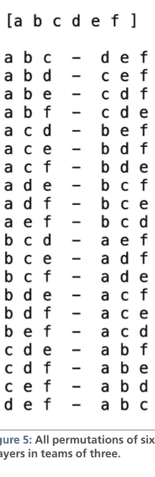

这个以非常紧凑方式实现的过程生成了所有可能的组合。在图 5 中，为了说明目的，我将问题简化为六名球员。然而，它仍然不完美，因为它还将对称的比赛（A 队对 B 队以及 B 队对 A 队）作为新情况进行评估。不过，由于事件空间很小，这并不是一个大问题。

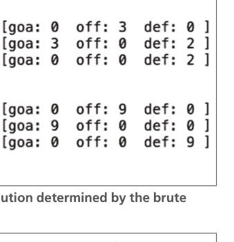

通过 `build` 命令生成的暴力二进制文件会启动并指向 `teams.yaml` YAML 文件，遍历所有可能的球队组合，并根据评估函数输出最佳数值。

```
go build brute.go
teams.go
diff.go
```


图 6 和图 7 展示了两种可用的设置示例，一种针对开头提出的包含六名球员池的任务，另一种针对拥有八名球员两队的游戏。

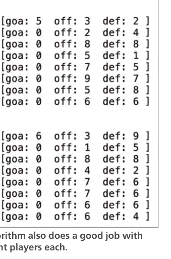

在这两种解决方案中，算法都找到了每队都有一名守门员且进攻和防守的球员技能值大致平衡的分配方案。这将使比赛保持到最后时刻的紧张刺激，假设所有球员都发挥了 100% 的水平，但这又是另一个故事了。

1. Michalewicz, Zbigniew, and David B. Fogel. *How to Solve It: Modern Heuristics*. Springer, 2004, https://link.springer.com/book/10.1007/978-3-662-07807-5


## 创客空间

### Python 中的记分板和视频路由

#### 记分员

我们来看一个使用 Python 代码控制视频路由器的广播视频系统网络，并查看另一个创建记分板的程序。作者：Scott Summer

每年我的教堂都会举办篮球联赛，几年前我们希望将现有的经典记分板升级为数字记分板，因为旧式的记分板已经显露出岁月的痕迹。这款新记分板软件的第一版是用 Python [1] 编写的，并使用 GTK 工具包创建公共显示屏。一个专为 iPad 设计的网页允许在球场边进行控制。

体育馆是一个共享空间，还用作会议室、宴会厅和多功能室。为了支持这些角色，两台 NUC 小型计算机驱动显示屏（100 英寸液晶电视）。

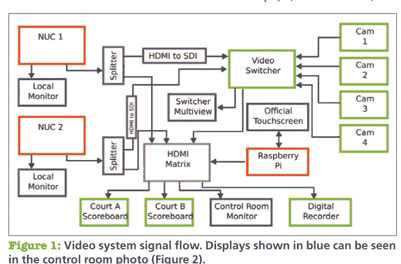

需要 Windows 来支持所有显示软件，以便 `PowerPoint` 和 `ProPresenter` 能够原生运行。

通常，视频系统采用中心辐射式网络，其中每个设备都有一个专用的归宿，连接到视频切换器（图 1）。视频切换器顾名思义，接受所有视频输入，并允许操作员选择哪个信号应该显示、叠加或以其他形式呈现到最终输出（图 2）。

显示屏稍微复杂一些，因为它们在任意给定时间都需要选择来自视频切换器的切换视频节目或记分板，这是通过矩阵路由器实现的。更多详情请参见“矩阵路由器”部分。

将路由器想象成一个网格，源（视频信号——参见“视频信号和转换”部分）从左侧输入，从底部输出。每个列（输出或目的地）只允许一个连接。

### 矩阵路由器

在视频领域，路由器是一个非常实用的设备。它接受一定数量的视频输入，并可以将它们发送到其任何目的地。本例使用的是小型的 4 输入 4 输出版本，但也有其他版本，拥有多达数千个 I/O 点。

照片由 Johnny Briggs 在 Unsplash 拍摄


**图 2：** 视频控制室是由一间教室改造而成的。从左到右，背景中的前两个显示器是运行记分牌软件的 `NUC` 的主显示输出。文本窗口是 Python 程序的输出，而记分牌本身则位于辅助显示器输出上。第三个显示器可以通过视频矩阵路由以选择显示内容。前景中是矩阵控制触摸屏和摄像机控制器。高显示屏是切换器多画面监视器。`NUC` 和矩阵位于桌子下方机架的最底部，清晰可见。

输入可以连接到尽可能多的输出。换一种说法，所有输出都可以显示同一个输入，但每个输出一次只能显示一件事。当做出选择时，选定的输入和输出会像直接接线一样连接在一起。这些连接可以根据篮球比赛的需求在一天中随时轻松更改。

#### 视频信号与转换

许多不同的视频格式可以通过电缆传输实时视频。由于 `HDMI` 自引入以来被广泛采用，你对此可能并不陌生。此处讨论的视频系统主要使用串行数字接口（`SDI`），这是一种用于广播视频的数字标准。这些格式之间存在硬件转换器，因此在它们之间切换就像连接每种类型的电缆一样简单。这种转换的代价是视频信号会有轻微的延迟，通常不易察觉；然而，如果你叠加了多个转换，延迟可能会开始累积并变得可见。这种场景通常表现为音频与其相关视频不同步。

#### 记分牌

除了队伍得分外，记分牌还提供其他比赛信息，例如剩余时间、比赛节数、暂停或球员号码。图 3 展示了程序的总体流程。在程序启动时，图形初始化并渲染记分牌的初始状态。与此同时，Web 服务器启动，操作员在侧边电脑上打开此页面（图 4）。

随着篮球比赛的进行，操作员使用 Web 界面更新比赛比分和其他统计数据。

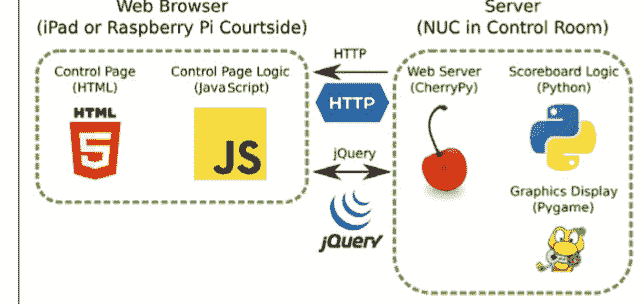

**图 3：** 服务器、客户端、显示器及其相关库彼此通信和交互。

Web 界面上的每个操作都从运行在浏览器中的 `JavaScript` 函数开始，通过后台 `Ajax` 调用与 `CherryPy` [2] 服务器通信。当 `CherryPy` 接收到这些命令时，它会更新图形屏幕以反映记分牌本身的变化，然后将更新后的值发回浏览器，以便操作员界面也得到更新。

列表 1 展示了记分牌背后的一些代码。（你可以在线下载完整代码 [3]。）首先，必须导入程序所需的外部库：`pygame` 图形库 [4] 用于绘制记分牌；`thread` 允许程序的多个分支同时运行，因此你可以同时运行记分牌显示和 Web 控制界面；`pymysql` 是 Python 的 `MySQL` 数据库库；而 `cherrypy` 则设置 `CherryPy` 框架。

#### Web 类

`Web` 类（第 6–339 行）连接到一个 `MySQL` 数据库，该数据库将用于获取队伍名称、确定哪支队伍与哪支队伍比赛，并记录比赛历史。当实例化该类时，`__init__` 函数会自动调用，以设置稍后需要的一些内容。第 8 行创建了一个类变量 `self.scoreboard`，并保存了作为参数传入的记分牌类的引用。

重连函数实际上只是一个调用，为了方便阅读而分拆在多行中（第 12–18 行）。`pymysql.connect` 创建 `self.db`，即数据库的本地引用。每一行提供相应的凭据。

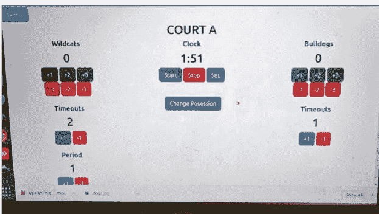

**图 4：** 记分员的记分牌界面。

`gameEvent` 函数（第 20-31 行）记录记分牌的任何变更。在将来的版本中，此函数将允许在崩溃后恢复记分牌并导出比赛报告。首先，代码检查 `self.dbGameID`（在第 10 行初始化为 `None`）是否已设置。如果没有，则表示没有数据库 ID，因此直接返回。

`self.db.ping` 便捷函数，参数为 `True`，检查数据库连接是否处于活动状态，如果没有，则在下一行自动重新连接。随后的两行获取比赛节数和以秒为单位的时间。这两个值可以精确定位比赛中的唯一时间。

##### 列表 1: scoreboard.py


```python
import pygame
import _thread
import cherrypy
import pymysql

class web:
  def __init__( self, scoreboard ):
    self.scoreboard = scoreboard
    self.reconnect()
    self.dbGameID = None

  def reconnect( self ):
    self.db = pymysql.connect(
      host= 'DB_HOSTNAME',
      user= 'DB_USER',
      password= 'DB_PASSWORD',
      db= 'DB_NAME',
      )

  def gameEvent( self, event, value ):
    if self.dbGameID == None: return

    self.db.ping( True )
    period = self.scoreboard.period.value
    time = self.scoreboard.clock.seconds

    sql = 'INSERT INTO `updates`( `gameID`, `period`, `gameTime`, `event`, `value` ) VALUES( %s, str( self.dbGameID ) + ", " + str( period ) + "," + str( time ) + ", " + event + ", " + str( value ) + ")';

    cursor = self.db.cursor( pymysql.cursors.DictCursor )
    cursor.execute( sql )
    self.db.commit()

  @cherrypy.expose
  def index( self ):
    html = """

    """.format (
      self.scoreboard.court.value + " + self.scoreboard.court.label,
      self.scoreboard.scoreA.label,
      self.scoreboard.scoreB.label,
      self.scoreboard.scoreA.value,
      self.scoreboard.scoreB.value,
      self.scoreboard.clock.clockString,
      self.scoreboard.timeoutA.value,
      self.scoreboard.timeoutB.value,
      self.scoreboard.possession.leftString,
      self.scoreboard.possession.rightString,
      self.scoreboard.period.value
      )

    return html

  @cherrypy.expose
  def teams( self ):
    cursor = self.db.cursor( pymysql.cursors.DictCursor )
    sql = "SELECT t1.teamName AS tName, t2.teamName AS t2name, games.* FROM `games` LEFT JOIN `teams` t1 ON t1.ID=games.team1 LEFT JOIN `teams` t2 ON t2.ID=games.team2"
    cursor.execute( sql )

    html = "<select id='gameSelect'>"
    for game in cursor.fetchall():
      html += "<option value=" + str( game [ 'ID' ] ) + ">" + str( game [ 'Date' ] ) + " " + str( game [ 'time' ] ) + " " + game [ 'tName' ] + " | " + game [ 't2Name' ] + "</option>"
    html += "</select>"

    return html

  @cherrypy.expose
  def processGameSelect( self, gameID ):
    cursor = self.db.cursor( pymysql.cursors.DictCursor )
    sql = "SELECT t1.teamName AS t1name, t2.teamName AS t2name, games.* FROM games LEFT JOIN teams t1 ON t1.ID=game.team1 LEFT JOIN teams t2 ON t2.ID=game.team2 WHERE games.ID = " + str( gameID )
    cursor.execute( sql )
    game = cursor.fetchone()

    self.dbGameID = gameID

    self.teamName ( "1", game[ "t1name" ] )
    self.teamName ( "2", game[ "t2name" ] )

  @cherrypy.expose
  def teamName( self , team , name ):
    if team == "1": self.scoreboard.scoreA.label = name
    if team == "2": self.scoreboard.scoreB.label = name

  @cherrypy.expose
  def score( self, team1, team2 ):
    self.scoreboard.scoreA.value += int( team1 )
    self.scoreboard.scoreB.value += int( team2 )

    if team1 != "0": self.gameEvent( "T1SCORE", team1 )
    if team2 != "0": self.gameEvent( "T2SCORE", team2 )

    self.scoreboard.render()
    return str( self.scoreboard.scoreA.value + ":" + str( self.scoreboard.scoreB.value ) )

  @cherrypy.expose
  def timeout2( self, team1, team2 ):
    self.scoreboard.timeoutA.value += int( team1 )
    self.scoreboard.timeoutB.value += int( team2 )

    if team1 != "0": self.gameEvent( "T1TIMEOUT", team1 )
    if team2 != "0": self.gameEvent( "T2TIMEOUT", team2 )

    return str( self.scoreboard.timeoutA.value ) + ":" + str( self.scoreboard.timeoutB.value )

  @cherrypy.expose
  def period( self, period ):
    self.gameEvent( "PERIOD", period )

    self.scoreboard.period.value += int( period )
    return str( self.scoreboard.period.value )

  @cherrypy.expose
  def getClock( self ):
    return self.scoreboard.clk.clockString

  @cherrypy.expose
  def clockRun( self ):
    self.scoreboard.clk.running = True

  @cherrypy.expose
  def clockStop( self ):
    self.scoreboard.clk.running = False
    self.gameEvent( "CLOCKSTOP", 0 )

  @cherrypy.expose
  def clockSet( self , seconds ):
    self.scoreboard.clk.seconds = int( seconds ) + 1
    self.scoreboard.clk.tick ( manual = True )
    return self.scoreboard.clk.clockString

  @cherrypy.expose
  def possession( self ):
    self.scoreboard.possession.toggle()
    if self.scoreboard.possession.leftString == "<": self.gameEvent( "POSSESSION", 1 )
    if self.scoreboard.possession.rightString == ">": self.gameEvent( "POSSESSION", 2 )

    return self.scoreboard.possession.leftString + ":" + self.scoreboard.possession.rightString

class clock:
  def __init__( self , screen ):
    self.screen = screen
    self.width = self.screen.get_width()
    self.height = 250
    self.seconds = 6 * 60
    self.clockSurf = pygame.surface.Surface( ( self.width , self.height ) )
    self.clockFont = pygame.font.Font( "Open24.ttf" , self.height )
    self.running = False

    mins = int( float( self.seconds ) / 60.0 )
    secs = self.seconds % 60

    self.clockString = "{0}:{1:02d}".format( mins , secs )

  def tick( self , manual = False ):
    if self.seconds > 0 and( self.running = True or manual = True ):
      self.seconds -= 1

      mins = int( float( self.seconds ) / 60.0 )
      secs = self.seconds % 60

      self.clockString = "{0}:{1:02d}".format( mins , secs )

  def render( self ):
    timeSurf = self.clockFont.render( self.clockString , True, ( 0 , 255 , 0 ) )

    x = self.width / 2 - int( timeSurf.get_width() / 2 )
    self.clockSurf.fill( ( 0 , 0 , 0 ) )
    self.clockSurf.blit( timeSurf, ( x, -28 ) )
    return self.clockSurf
```


### 列表 1：`scoreboard.py`（续）

```python
class possession:
    def __init__(self):
        self.width = 300
        self.height = 100
        self.font = None
        self.direction = "c"
        self.posSurf = pygame.surface.Surface((self.width, self.height))
        self.leftString = ""
        self.rightString = ""
        self.makeSurfaces()

    def makeSurfaces(self):
        self.leftSurf = self.font.render("<", True, (255, 0, 0))
        self.rightSurf = self.font.render(">", True, (255, 0, 0))

    def toggle(self):
        if self.direction == "c":
            self.direction = ">"
            self.leftString = ""
            self.rightString = ">"
        else:
            self.direction = "<"
            self.leftString = "<"
            self.rightString = ""

    def render(self):
        self.posSurf.fill((0, 0, 0))
        label = self.font.render("POSSESSION", True, (255, 0, 0))
        x = self.width / 2 - int(label.get_width() / 2)
        self.posSurf.blit(label, (x, 0))

        if self.direction == "c":
            self.posSurf.blit(self.leftSurf, (0, 0))
        else:
            self.posSurf.blit(self.rightSurf, (self.width - self.rightSurf.get_width(), 0))
        return self.posSurf

class label:
    def __init__(self):
        self.width = 250
        self.height = 350
        self.label = ""
        self.value = ""
        self.labelFont = None
        self.valueFont = None
        self.labelColor = (200, 200, 200)
        self.valueColor = (200, 200, 200)
        self.countSurf = pygame.surface.Surface((self.width, self.height))

    def render(self):
        self.countSurf.fill((0, 0, 0))
        valSurf = self.valueFont.render(str(self.value), True, self.valueColor)
        x = self.width / 2 - int(valSurf.get_width() / 2)
        self.countSurf.blit(valSurf, (x, 0))

        labelSurf = self.labelFont.render(str(self.label), True, self.labelColor)
        x = self.width / 2 - int(labelSurf.get_width() / 2)
        self.countSurf.blit(labelSurf, (x, valSurf.get_height() - 10))

        return self.countSurf

class counter:
    def __init__(self):
        self.width = 250
        self.height = 350
        self.label = ""
        self.value = 0
        self.labelFont = None
        self.valueFont = None
        self.labelColor = (200, 200, 200)
        self.valueColor = (200, 200, 200)
        self.countSurf = pygame.surface.Surface((self.width, self.height))

    def render(self):
        self.countSurf.fill((0, 0, 0))
        valSurf = self.valueFont.render(str(self.value), True, self.valueColor)
        x = self.width / 2 - int(valSurf.get_width() / 2)
        self.countSurf.blit(valSurf, (x, 0))

        labelSurf = self.labelFont.render(str(self.label), True, self.labelColor)
        x = self.width / 2 - int(labelSurf.get_width() / 2)
        self.countSurf.blit(labelSurf, (x, valSurf.get_height() - 10))

        return self.countSurf

class board:
    def __init__(self):
        pygame.display.init()
        self.screen = pygame.display.set_mode((1280, 720), display=1, flags=pygame.FULLSCREEN)

        pygame.font.init()
        self.scoreFont = pygame.font.Font("font.ttf", 200)
        self.labelFont = pygame.font.Font("font.ttf", 50)
        self.timeoutFont = pygame.font.Font("font.ttf", 50)
        self.posFont = pygame.font.Font("font2.otf", 50)

        self.logo = pygame.image.load("upwardBlack.jpg").convert()

        self.clk = clock(self.screen)
...
```

### 自制记分牌创客空间

第 27 行构建了一条 SQL 语句。`INSERT INTO` 命令指定表名，随后是逗号分隔的列名列表。`VALUES` 关键字为每一列赋值，值的顺序与列名顺序一致。第 29 行创建一个数据库游标，用于与该 SQL 语句交互。在这种情况下（第 30 行），它仅执行第 27 行创建的 SQL 语句，但它具备更多功能，尤其是在检索记录时。第 31 行调用 `commit` 以确认你希望写入数据。

`CherryPy` 装饰器（第 33-339 行）创建了一个小型 Web 服务器来控制记分牌。每个 Python 函数都成为一个 Web 地址，将指定内容返回给调用它的浏览器。


`index` 函数的作用类似于传统 Web 服务器中的 `index.html`。在没有其他地址的情况下，它是默认返回的标题。此函数的大部分内容是一个非常大的多行字符串（此处未显示，请在线获取完整代码 [3]），该字符串被三重引号（`'''`）包围，指示 Python 忽略换行符或其他特殊字符，直到遇到另一个三重引号为止。封闭的字符串是控制网页的 `HTML5` [5] 和 `JavaScript`。在这大段文本字符串之后，Python 的 `format` 命令将所有当前变量插入到网页中（第 240-251 行）。

`cherrypy.expose` 装饰器告知 `CherryPy` 应允许通过其 Web 服务器访问此函数。如果没有此装饰器，该函数对 Web 上的任何人都保持私有，这使得程序可以根据需要添加额外函数进行结构化，仅发布那些专门设计为可被 Web 访问的函数。你会在 Web 类中的每个函数之前看到此装饰器，因此这里仅描述一次。

`teams` 函数（第 257-267 行）名称有些不妥，因为它生成的是一个比赛选择器。就本数据库而言，一场比赛是指在特定日期、时间和特定球场上的两支队伍组成的对局。此函数检索所有比赛并返回一个 `HTML` `select` 控件。

该函数首先创建一个 `SQL` 游标和语句，然后执行它（如第 29-31 行所示）。然而，现在它正在检索记录，因此游标包含查询的结果，即数据，而不仅仅是查询成功的消息。

在第 262 行启动 `HTML` `select` 控件后，程序循环遍历 `SQL` 结果。顾名思义，`cursor.fetchall` 将所有结果作为一个迭代器返回。`game` 将在循环的每次迭代中包含来自数据库的一行。每次迭代创建一个 `HTML` `option`，并列出比赛日期、时间和队伍。

`processGameSelect` 函数（第 270-279 行）在记分牌操作员从刚刚生成的下拉菜单中选择一场比赛时被调用。它接收 `gameID` 参数，并使用该参数从数据库获取比赛详情。第 272 行是与第 259 行几乎相同的 `SQL` 语句，但添加了基于 `gameID` 的 `WHERE` 子句。

再次完成后，再次执行 `SQL` 操作，第 274 行调用 `cursor.fetchone`。上次检索了所有记录，但这次只需要一条，它被保存到 `game` 中。`gameID` 被保存到一个类变量中，`self.teamName` 设置从数据库检索到的名称。

`teamName` 函数（第 281-284 行）接受一个队名编号和名称作为参数。两个 `if` 语句中的每一个确定正在命名哪支队伍，然后将新名称保存到记分牌类中的一个变量。

#### 事务处理

`score`、`timeouts` 和 `period` 函数（第 286-312 行）接受 `team1` 和 `team2` 参数（`per1` 和 `per2` 仅接受时期编号），这些参数是用于更改每个数值的量。允许负值，以便可以纠正数值或为下一场比赛或时期重置数值。注意变量前带有 `int`。所有来自 `CherryPy` 的参数都以字符串形式输入，因此在代数使用前必须转换为整数。

最后，两个新调整后的值由冒号分隔并返回，传回 `JavaScript` 函数，并拆分为两个分数，以便正确更新控制屏幕。

这些函数的 `JavaScript` 版本在 `index` 函数中生成（未包含在列表中）。例如，`score` 函数创建一个 `JavaScript` 对象并添加 `obj.team1` 和 `obj.team2`：

```javascript
function score (team1, team2) {
    obj = new Object();
    obj.team1 = team1;
    obj.team2 = team2;
}
```

这些是每个队伍的分数增量（需更改的量）。`jQuery` [6]（由 `$` 表示）然后将该对象发布到 `score` 地址（即上述描述的 Python `CherryPy` 函数）：

```javascript
$.post ( “score”, obj, function ( data ) {
    scoreParts = data.split (“:”);
    $( “#team1score”).html(scoreParts [ 0 ]);
    $( “#team2score”).html(scoreParts [ 1 ]);
});
```

`obj` 包含之前设置的要发送的值。当 `post` 完成并收到响应时，调用 `function ( data )`，其中 `data` 是包含新更新分数（或超时或时期）的返回字符串。首先，使用 `data.split` 将 `data` 拆分为两部分，然后使用 `jQuery` 更新控制页面上的分数。

#### 时间与控球权

时钟是一个独特的情况，因为它是唯一独立更新的游戏变量。其他一切都是对场上发生之事的响应。

`clock` 函数（第 314-331 行）中的 `getClock` 返回一个表示当前比赛时间的字符串，由操作员网页上 `JavaScript` 函数中的重复间隔调用，以更新操作员时钟。图形线程中的计时器事件既更新内部时钟变量，也重绘记分牌显示器上的时钟。

`updateClock` 仅存在于 `JavaScript` 中，负责保持控制页面时钟的最新状态。它通过 `jQuery` 调用 `getClock` 获取当前时钟时间，然后使用当前值更新 `HTML` `div`：

```javascript
function updateClock() {
    $.post ( “getClock”, {},
        function ( data ) {
            $( “#clock”).html ( data );
        });
}
```

### 创客空间自制计分板

`clockRun` 和 `clockStop` 函数都会更改 `self.scoreboard.clk.running` 的状态。如果该变量为 `True`，时钟会被更新。如果为 `False`，时钟则不会更新，实际上等同于暂停。`clockStop` 还会调用 `self.gameEvent` 以添加一条记录，表明时钟已停止。由于时钟不特定于某支队伍，第二个参数设为 `0`。这些函数的 `JavaScript` 版本（第 80-92 行）未在此处展示。一旦 Python 函数被 `jQuery` 调用，就会设置或清除一个 `JavaScript` 定时器，以更新控制页面。

对于 `clockSet` 函数，变量 `self.scoreboard.clk.seconds` 跟踪以秒为单位的剩余比赛时间，该值被设置为比请求时间多一秒。接着，`self.scoreboard.clk.tick` 会自动减去一秒。传入 `manual = True` 会强制重新读取时钟，即使它当前未在运行。最后，返回 `self.scoreboard.clk.clockString`，这是以分钟和秒表示的剩余时间的文本形式。

`JavaScript` 版本位于第 101-116 行（未展示）。它会询问操作员应将时钟设置为何值，如果对话框被取消，则包含请求的时间或 `null`。


如果数值有效，请求会被拆分为分钟和秒，然后转换为秒。创建新对象并添加秒参数后，通过 `jQuery` 将其发回 Python 函数。随后控制屏幕会用新的时钟值进行更新，并清除更新间隔，以便在时钟再次开始运行前不发出时钟请求。

`possession()` 函数（第 333-339 行）调用 `self.scoreboard.possession` 的切换方法，该方法会翻转当前持有球的队伍（由 `<` 和 `>` 符号作为箭头指示）。

第 336 行和第 337 行检查哪支队伍持有球，并添加一个 `gameEvent` 以反映这一变化。最后，返回两个由冒号分隔的字符串；每个字符串要么是空格，要么是 `<` 或 `>` 符号之一。JavaScript 版本位于第 71-78 行（未展示）。

通过 `jQuery` 发布持球权变更后，返回的字符串会被拆分为两部分，并更新控制屏幕上的左侧和右侧 `div`。

#### 时钟类

时钟类（第 341-371 行）管理主图形（计分板）显示中的比赛时钟。`__init__` 函数设置了几项内容：`self.screen` 是创建时钟时传入的屏幕对象的引用；`self.width` 通过调用屏幕对象的 `getWidth()` 方法来存储屏幕宽度；`self.height` 被显式设置以定义时钟显示的高度；而 `self.seconds` 是时钟上的时间，初始化为 6 * 60 秒，以反映六分钟的节次。

第 347 行创建了一个 Pygame 表面，用于绘制时钟，第 348 行设置了字体。最后，`self.running` 跟踪时钟是处于运行还是暂停状态。

第 351-354 行计算时钟数值并转换为 `int`；秒数是 `self.seconds / 60` 取模（余数）的结果。最后，通过计算出的数值组装出 `self.clockString`。

主循环每秒调用一次 `tick` 函数（第 356-363 行）。如果时钟上仍有剩余时间，且 `self.running` 或 `manual` 被设置为 `True`，则 `self.seconds` 减一，并重复之前的计算以更新 `self.clockString`。设置时钟时使用的 `manual` 参数强制时钟立即重新生成，而不是等待下一次自动调用 `tick`。

渲染函数（第 365-371 行）负责绘制时钟。`self.clockFont.render` 接受 `self.clockString` 和一个颜色表作为参数。`True` 参数表示在绘制文本时进行抗锯齿处理。结果是一个 Pygame 表面 `timeSurf`，上面绘制了当前的比赛时间。

在计算 `timeSurf` 的中心点后，`self.clockSurf` 通过填充黑色进行清除，并将 `timeSurf` 贴到其上（`blit`，即复制）。然后返回该表面。这种复制操作看似多余，但实际情况是：当 `self.clockFont.render` 生成文本时，表面的大小恰好是所生成文本的大小。为了填充 `__init__` 中指定尺寸的空间，必须将其复制到较大的表面中。

#### 持球权类

持球权类（第 373-406 行）指示在特定时刻谁持有球。`__init__(self)` 设置图形显示，初始状态由 `self.direction`（当前谁持有球）指定。创建一个表面并用 `self.leftString` 和 `self.rightString` 进行初始化。

便捷函数 `makeSurfaces` 创建 `self.leftSurf` 和 `self.rightSurf`，这两个持球权箭头分别用 `<` 和 `>` 符号渲染。

当调用切换函数（第 388-396 行）时，持球权从一支队伍变更到另一支队伍。`if` 语句检查当前哪支队伍持有球，然后将所有变量更新到其相反状态。注意，`self.leftString` 和 `self.rightString` 要么是一个箭头，要么是一个空字符串。

当一切都准备好在渲染函数中绘制时，`self.posSurf` 通过填充黑色（第 399 行）进行清除，然后生成标签文本，计算中心点，并将其贴到最终表面。

第 404 行和第 405 行确保箭头贴到表面的正确一侧。如果 `self.direction` 是 `<`，箭头绘制在表面的左侧；否则，绘制在右侧，然后返回最终表面。

#### 标签和计数器

标签类（第 408-430 行）代表计分板上带有任意标签的数值。标签及其数值可以使用不同的字体和颜色。Pygame 表面在第 418 行创建。

渲染函数通过清除表面（用黑色填充）开始，然后渲染数值，计算其中心点并绘制它。第 426-428 行对标签文本执行相同的操作，然后在第 430 行返回。

第 432-454 行描述了计数器类。计数器与标签相同，除了其 `self.value` 预期为整数。

#### 面板类

所有组件都在面板类（第 456-538 行）中汇聚。我们此前定义的所有模块都在此处初始化，从启动 Pygame 引擎的 `pygame.display.init()` 开始。`pygame.display.set_mode` 创建绘图表面，设置窗口大小。`display = 1` 使 Pygame 窗口默认使用第二个显示器，而 `flags = pygame.FULLSCREEN` 顾名思义。

由于该程序使用 Pygame 的字体功能，这些功能在第 460 行进行初始化，随后加载所有字体。在 Pygame 中，字体是指字体本身及其关联的大小，因此同一个字体文件可以用不同的大小多次加载。

第 446 行加载 `self.logo`，这是显示在计分板底部的标志。行末的 `convert` 使图像的格式与 Pygame 初始化的显示格式匹配，从而使标志贴到屏幕上时速度更快。

第 468 行创建时钟类的一个实例，传入 `self.screen` 的引用，以便可以直接绘制更新后的时钟。

程序的最后几行（未展示）为主队和客队的得分、每支队伍的暂停次数以及比赛节次初始化了五个不同实例的计数器类。在每种情况下，`valueFont` 和 `labelFont` 都设置为之前初始化的字体/大小组合之一。标签指示每个计分板正在跟踪哪个球场。

#### 典型比赛日

当团队在比赛日到达现场时，首要任务是设置计分板操作员的控制台（每个计分板配备两台 Raspberry Pi）。完成后，机器人控制的摄像机被放置在球场周围，并对一切进行测试。年轻的队伍首先在半场模式下进行比赛。当天比赛进行到一半时，比赛切换到全场模式（图 5）。

每场比赛的中场休息时，视频消息会在屏幕上播放，随后计分板恢复正常操作（图 6）。当天进行到一半时，由于现在只使用一个球场，一个计分板系统被路由到两个得分显示上。这种切换是通过矩阵视频路由器实现的。

#### 控制视频矩阵

虽然矩阵路由器基本操作起来相当简单易于理解，但给它们附上有意义的名称和标签总是比记忆一组数字更让人容易接受。为常见配置添加一些快捷方式会让事情变得更加简单，这就是矩阵控制程序的目的（未在此展示，但可在线获取 [3]）。

Raspberry Pi 通过 Python 中建立的 USB 串行连接与矩阵通信：

```python
class matrixSerial:
    def __init__(self):
        self.port = serial.Serial(
            "/dev/ttySBO", 9600)

    def send(self, cmd):
        self.port.write(cmd)
```

`__init__` 行创建 `self.port`，它是 `Serial` 对象的一个实例，包含串行设备的名称和请求的波特率。其他默认值即可满足所有需求。`send` 函数接收 `cmd` 并通过调用 `self.port.write` 将其传输，从而将数据发送到矩阵。

#### 按钮类

程序的主要功能是为用户在触摸屏上提供易于操作的选项；按钮类设置了按键按下时的动作。当类被实例化时，它接收屏幕、屏幕对象和字体，其中字体是一个用于标记按钮的 Pygame 字体对象。这些中的每一项都存储在类属性中，以供其他方法使用。

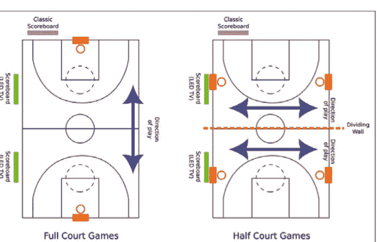

图 5：根据参赛年龄组别，比赛可能在全场或半场进行。每个计分板都必须被路由以跟随当前的球场配置。


图 6：在面向观众的大屏幕监视器上看到的计分板显示。

当调用 `create` 函数时，它会接收一系列变量以开始工作，包括按钮应绘制的 x 和 y 屏幕坐标、按钮的宽度和高度，以及显示在按钮上的标签文本。`self.rect` 存储 Pygame 的 `rect` 对象，该对象包含用于检查坐标是否在其范围内的函数以及其他几种实用工具；而 `self.matrixCommands` 和 `self.osCommands` 则是当按钮被按下时执行的操作。

`addOSCommand` 函数接收其关联的字符串参数，并在按钮被按下时将其传递给操作系统：


```python
def addOSCommand( self , cmd ):
    self.osCommands.append( cmd )
```

`addMatrixCommand` 函数的作用相同，只是它将指令传输给矩阵（video matrix）。

`render` 函数负责在屏幕上绘制按钮。正如你之前所见，它创建一个表面（surface）并进行填充——在本例中为绿色。如果其标签不为空，程序将渲染文本，计算如何居中该文本，并将文本添加到按钮的 `blit` 操作中。随后，该表面被绘制到屏幕上，并保存其 Pygame `rect` 对象的引用。

##### 矩阵类

矩阵类负责在触摸屏上绘制和管理界面。与往常一样，`_init_` 函数初始化界面的不同组件，但此示例包含许多组件。图形系统启动并创建一个用于绘制的窗口。尽管窗口有标题，但由于窗口处于全屏模式，标题通常不可见。

与往常一样，字体和串口通信被初始化，尽管 `pygame.font.SysFont` 的第一个参数是一个空字符串，因此这是要求 Pygame 使用默认字体：

```python
buttonFont = pygame.font.SysFont( "", 32)
self.matrixPort = matrixSerial()
```

下一行将 `self.buttons` 创建为一个列表，这是存储添加到界面中的每个按钮的地方。`init` 函数的其余大部分内容为每个按钮创建并定义其功能。它们都遵循以下通用格式：


```python
btn = button( self.screen, buttonFont)
btn.create( <x> , <y> , <width> , <height> , <label> )

btn.addMatrixCommand( chr ( 0x10 ) + chr ( 0xA5 ) )
btn.addMatrixCommand( chr ( 0x10 ) + chr ( 0xA00 ) )
btn.addMatrixCommand( chr ( 0x10 ) + chr ( 0xA5 ) )
btn.addMatrixCommand( chr ( 0x10 ) + chr ( 0xA1 ) )
self.buttons.append( btn )
```

第一行创建一个按钮，并传入 `self.screen` 和 `buttonFont`。`create` 生成按钮，而 `addMatrixCommand` 为视频矩阵添加指令。指令字符串来自矩阵文档；它告诉你发送前三个十六进制值以开始指令。最后一个字节包含路由信息，作为 8 个索引地址。高位数字定义输出或目标，低位数字定义输入或源。在这里，`0x00` 表示“将第一个输出连接到第一个输入”。下一行将第二个输出连接到第二个输入。表 1 显示了每个按钮的配置。

矩阵的一个输出连接到控制室内的监视器，以便可以轻松监控源信号。三个 CR（控制室）按钮允许在控制室监视器上查看任何矩阵源（图 7）。

除了最后两个按钮外，所有按钮都使用 `addMatrixCommand`。Record（录音/录像）和 Stop（停止）按钮改用 `addOSCommand`，然后使用 `wget` 来欺骗数字录音机，使其认为其 Web GUI 上的按钮被按下，从而开始或停止录制到 SD 卡或闪存盘（列表 2）。

`render` 函数遍历 `self.buttons`，调用每个 `render` 方法，在屏幕上创建所有按钮，以及所有 Pygame `rect` 对象，以检查它们是否被点击。一旦所有内容都被绘制到缓冲区，该函数调用 `pygame.display.flip` 使其在绘图窗口中可见。

`loop` 函数通过监视按钮按下、在下发指令以及跟踪所有正在发生的事情来使一切变得交互式。

`looping` 值首先被设置为 `True`，在函数进入以 `looping` 为参数的 `while` 循环之前。如果 `looping` 在任何时刻被设置为 `False`，循环将退出。

然后，该函数等待 Pygame 事件，并检查该事件是否为按钮点击。为了查看是否有任何按钮被按下，该函数再次遍历 `self.buttons` 并获取鼠标点击的坐标：

```python
for btn in self.buttons:
    if btn.rect.collidepoint( event.pos ) = True:
        for cmd in btn.matrixCommands:
            self.matrixPort.send( cmd + chr ( 0x77 ) )
```

如果为 `True`，则表示某个按钮已被按下。为了让按钮执行其功能，程序遍历 `btn.matrixCommands` 并将每个字符串发送到矩阵。为了给矩阵时间处理每个指令，该函数在继续之前等待半秒。

接下来的几行对操作系统指令（`btn.osCommands`）执行相同操作，但将它们传递给 `os.system` 而不是矩阵。程序最后一行对 `matrix` 的调用启动了整个过程。

### 结论

希望本文能给你提供一些关于另一种类型网络的见解。当你想到世界各地都有类似这样的控制室，它们各自馈送自己的一套显示屏或广播视频系统网络时，你可以看到互联网和 IP 路由之间的异同。你还看到了这些记分牌是如何生成和控制的，以支持当地篮球联赛。现在所有比赛和赛季都已结束，是时候去冲凉了。

##### 参考信息

- [1] Python: `www.python.org`

- [2] CherryPy: `https://docs.cherrypy.dev/`

- [3] 本文代码: `https://linuxguru.blog.thegeek.cloud/s/6r2x9tOWJ6JN3Z`

- [4] Pygame: `https://pygame.org`

- [5] HTML5: `https://www.w3docs.com/learn-html/html5-elements-reference.html`

- [6] jQuery: `https://www.jquery.com`

## 作者

斯科特·萨默纳（Scott Sumner）在其大部分职业生涯中都在博物馆和非营利行业工作。他喜欢使用 `Arduino`、`Raspberry Pi`、微控制器和 `Linux` 系统探索技术解决方案。

#### 列表 8: `wget` 技巧

```python
btn.addOSCommand ( r"wget --header="Accept: */*" --header="Accept-Encoding: gzip, deflate" --header="Accept-Language: en-US,en;q=0.9" --header="Connection: keep-alive" --header="Cookie: serenity-session=729952074" --user-agent="Mozilla/5.0 (X11; Linux x86_64; rv:60.0) Gecko/20100101 Firefox/60.0" http://172.16.2.20/cgi-bin/system.cgi?command=recording&action=start" )
```

#### Linux 杂志订阅

印刷版和数字版选项

每年 12 期

订阅

`sparkhaus-shop.com`

扩展你的 Linux 技能：

- 关于热门主题的深入文章，包括比特币、勒索软件、云计算等！

- 关于能为你节省时间并保护数据的实用工具的教程和指南

- 故障排除和优化技巧

- 关于开源世界关键发展的洞察性新闻

- `Raspberry Pi`、`Arduino` 和其他创客板系统的酷炫项目

用 `Linux` 走得更远，做得更多，今天订阅，永远不要错过任何一期！

关注我们

`@linux_pro`

`@linuxpromagazine`

Linux Magazine

`@linuxmagazine`

#### 需要更多 Linux 内容？

免费订阅 Linux Update

我们的免费 Linux Update 通讯每周向你发送洞见性文章和技术技巧。

`bit.ly/Linux-Update`


表 1：按钮和配置

| 行号 | 按钮 | 操作 |

| :--- | :--- | :--- |

| 57-61 | *独立记分牌* | 每个显示屏显示其自己的记分牌计算机。 |

| 63-67 | *单一记分牌* | 两个屏幕都显示第一个记分牌计算机。 |

| 69-73 | *双路节目* | 两个屏幕都显示视频切换器的节目输出。 |


| 75-78 | `A 区节目` | 仅将 A 区屏幕切换到视频切换器输出。 |

| 80-83 | `B 区节目` | 仅将 B 区屏幕切换到视频切换器输出。 |

| 85-88 | `A 区记分牌 A` | 仅将 A 区屏幕切换到其记分牌计算机。 |

| 90-93 | `B 区记分牌 B` | 仅将 B 区屏幕切换到其记分牌计算机。 |

| 95-98 | `CR 体育馆 1 动作` | 在控制室监视器上查看记分牌（`NUC`）1。 |

| 100-103 | `CR 体育馆 2 动作` | 在控制室监视器上查看记分牌（`NUC`）2。 |

| 105-108 | `CR 节目动作` | 在控制室监视器上查看视频切换器节目输出。 |

| 110-113 | `录音` | 开始录制到 `SD` 卡或闪存盘。 |

| 115-118 | `停止` | 停止录制。 |

`Linux` 环境下的免费工具将专业级的强大功能带给了普通用户。专家需要花费数百美元购买高级照片编辑工具，但在 `Linux` 中，答案只需一次下载即可。`RawTherapee` 是一款用于处理原始照片数据的工具。在照片变成 `JPEG` 图像之前，它以由相机传感器导出的数据组成的原始形式存在。相机本身会“解释”这些数据，以生成 `JPEG` 或其他图像格式。但如果你想要以不同的方式解释这些原始图像处理器会从最基础的形式开始处理图像数据，让你能够以普通照片编辑器无法实现的方式转换图像。本期的《Linux Voice》将向你介绍 `RawTherapee` 图像处理器。此外还有：我们将使用 `fdupes` 进行探索，这是一个简单工具，帮助你查找重复的文件和目录。


- 汪星屋 – `AI` 77

    - Jon `"maddog"` Hall

    - 尽管有政府监管，早期技术仍然存续——人工智能（`AI`）也将如此。

- `Fdupes` 78

    - Ferdinand Thommes

    - 命令行工具 `fdupes` 帮助你查找重复的文件夹和目录。

- `FOSSPicks` 82

    - Graham Morrison

    - 本月 Graham 将查看 `wallabg`、`Read It Later`、`Killport`、`F3D`、`Tenacity`、`Cataclysm: Dark Days Ahead`、`botany` 等更多内容！

- 教程 – `RawTherapee` 工坊 88

    - Anna Simon

    - 当前版本的 `RawTherapee` 最终增加了选择性图像编辑等其他长期期待的功能，以帮助其与行业霸主 `darktable` 竞争。


## 通过特别版磨练你的技能！

通过我们的特别版库了解 `Shell`、`LibreOffice`、`Linux` 等更多内容。

《Linux Magazine》团队创建了一系列单卷刊物，让你深入探索你感兴趣的主题。

提供印刷版或数字版格式

## 查看完整库！

`sparkhaus-shop.com/specials`


## 马道格的汪星屋

尽管有政府监管，早期技术仍然存续——人工智能（`AI`）也将如此。 文 Jon “`MADDOG`” `HALL`


Jon “`maddog`” `Hall` 是一位作家、教育家、计算机科学家和自由软件先驱，自 1994 年第一次会见 Linus Torvalds 并促成 `Linux` 移植到 64 位系统以来，一直是 `Linux` 的热情倡导者。他担任 `Linux` International® 的主席。

### 并不智能

我为 `Linux` 杂志撰写文章已超过二十年。有些文章非常技术性，有些是面向商业的，有些则涉及自由开源与闭源在系统生产中的哲学。

然而，近期各政府限制人工智能（`AI`）的举措促使我本月撰写了一篇观点文章，描述为什么这种限制行不通。

我回顾历史上其他“限制”行为，例如禁运。你真的认为处于禁运下的国家无法获得它们开展任何人工智能（`AI`）活动所需的硬件和软件吗？无论是通过从某些国家走私，还是依靠某个“伙伴”打破禁运？

我记得过去对加密的限制。美国对向境外运输加密技术有着极其繁琐的规定，以至于即使你从加拿大买了一箱加密软件，从未拆封，试图将其寄回，联邦执法部门也会追究你的责任。我们试图告诉政府，所有优秀的密码学家正在离开美国，前往可以出售其技能的地方，但无济于事——政府不予理会。

现在是人工智能（`AI`）了。权贵和富豪们联合起来告诉软件社区，政府应该对 `AI` 的使用进行许可和控制，好像没人拍过一部关于 `AI` 的电影似的。好像你需要一台房间大小的计算机才能做 `AI`。好像这些工业巨头可以给每个曾思考过 `AI` 的人的思想加上锁。

首先，大多数人甚至无法定义“AI”。他们认为计算机永远不会变得足够智能来完成*他们*的工作。这是他们的第一个错误。如果你谈论的是真正的 `AI`，那么计算机（或机器人）不仅能够完成你的工作，它还会比你更快、更好地完成这项任务，而且无需休息、睡觉或吃饭——每天 24 小时，每年 365 天。而且计算机/机器人不仅能做你的工作，它还会建造像它自己或更优秀的计算机/机器人，以并行方式完成你的工作。

我见证了 `AI` 从科幻小说中的概念发展到如今的地步。多年来，我们低估了复制人类思维和意识所需的 `CPU`、内存、数据及其他因素。大多数人仍然低估了这些因素，可能差了好几个数量级，但通过结合大规模数据农场、巨大的处理能力和编程方法，我们可以自动化许多筛选过程，使我们更接近看似智能的结果。

我是那些认为人脑是一台复杂的电化学机器的人之一。神经元（约 860 亿个，加减 80 亿个）提供“存储”，并通过突触连接（每个神经元与其他神经元有 7,000 个突触连接）相互连接——这些能量火花触发了每个神经元每秒发送给其他神经元的 5 到 50 条“信息”，而我们仍在探索其机制。在成年人中，这些突触连接数以万亿计。

通过漫长的进化过程，我们内置了相当多的“编程”，但婴儿在某种程度上仍然是一张白纸，受到影响并被教导如何思考——从而培养那些突触连接。

是的，我们对 `ChatGPT` 能做什么感到惊叹，但请记住，许多例子已被证明远非“智能”。它们来自可能不完整的、且已被证明在 `ChatGPT` 回答中存在不准确性的数据集。这些例子往往需要超出 `ChatGPT` 所用数据集范围的情境，即使该数据集非常庞大。

话虽如此，总有一天 `AI` 会变得“智能”，没有任何法律能阻止其解释或滥用。

试图限制其发展的政府和公司只会迫使那些想要“在 `AI` 上领先”的其他政府和公司转入地下。我们将像多年前有过太空竞赛和核军备竞赛一样，拥有一场 `AI` 竞赛。区别在于，你不需要发射火箭或运输铀来开发 `AI`。

我们已不再处于计算机科学领域，那里需要数十亿美元和政府支持来构建系统。几乎任何个人都可以资助 `AI` 系统的开发，就像他们多年前编写自己的加密代码一样。每个开发者都会在法律之外证明其开发的正当性。赢得 `AI` 战争的唯一方式是公开参与其中。这样，当 `AI` 来到你家门口时，你可能已经做好了准备。

## 使用 `fdupes` 检测重复项

### 双重麻烦

命令行 `fdupes` 工具帮助你查找重复的文件夹和目录。

文 `FERDINAND` `THOMMES`

硬盘有一个令人不快的倾向，即比预期更快地填满。原因并不总是立即显而易见。在这种情况下，保持井井有条不应被低估。杂乱、组织不良的硬盘往往比组织良好的硬盘填满得更快。由于生活是秩序与混乱的混合体，大多数用户可能都面临这个问题。

硬盘利用率意外偏高通常是由重复文件造成的。典型的候选者是照片、音乐或视频，它们可以迅速占用数 `GB` 的空间，且往往难以查找。`Linux` 上有多个图形应用程序可帮助你检测和删除此类重复项，命令行上也有多个工具。

### `GUI` 还是 `CLI`？

用于清理的知名图形界面工具包括 `FSlint` 和 `dupeGuru`。在本文中，我将关注 2000 年首次发布的命令行工具 `fdupes` [1]。大多数发行版的存档中都包含该工具，其大小仅略超 100KB；你可以使用发行版选择的软件包管理器进行安装。列表 1 展示了 `Debian`、`Fedora` 和 `Arch Linux` 的操作指南。

2022 年 9 月的 2.2.1 版本尚未进入所有存储库 [2]。如果你想从源代码编译 `fdupes`，可以使用 `GitHub` 上的 tarball。解压后，只需遵循熟悉的三步流程：`./configure`、`make` 和 `make install`。从 `fdupes` 2.0 开始，有两个依赖项你可能需要根据发行版自行解决。为此，请遵循解压后存档中 `INSTALL` 文件的说明。


安装后，你可以立即使用该工具，无需任何配置。该工具通过几个步骤识别指定目录中的重复文件。文件名对于检测重复项并不重要。相反，两个文件必须首先大小相同；在此前提下，`fdupes` 比较它们的 `MD5` 校验和。

最后，软件执行逐字节比较，以确保绝对是同一个文件。

`Fdupes` 拥有许多选项，让你控制搜索和后续的重复项处理。最初，你可以通过运行 `fdupes --help` 命令来熟悉该工具。这将帮助你识别适合你使用场景的选项。

### 试运行

为了测试，我在 `Documents` 目录中创建了一个 `fdupes` 目录，然后创建了 10 个文本文件，其内容均为 `fdupes finds and removes duplicates`。列表 2 展示了如何快速完成此操作。

随后的 `ls -l` 确认文件已创建。在新目录中查找重复项最简单的方法是使用 `fdupes ~/Documents/fdupes` 命令（图 1）。通过空格分隔路径，你可以同时指定多个目录。要在目录中递归搜索，你需要使用 `-r` 选项，例如 `fdupes -r ~/Documents`（图 2）。在这种情况下，该工具找到了我的 10 个文本文件以及一些其他重复项。使用 `-r` 选项来指定你希望包含的子目录路径。

`-s`（`-size`）选项显示匹配结果的大小。你可以使用 `-t` 或 `--time` 来了解文件最后修改的时间。`-G` 或 `--minsize=SIZE` 和 `-L` 或 `--maxsize=SIZE` 让你进一步缩小选择范围。

### 删除时要小心

但查找只是任务的一部分；毕竟，我们想要删除重复项以清理硬盘。这时 `-d`（`-delete`）选项派上用场。使用 `-d` 时，务必确保你的文件指定是正确的——使用 `fdupes` 删除的文件无法恢复。命令

```
fdupes -d ~/documents/fdupes
```

#### 列表 1：安装 fdupes

```
#### Debian 及其衍生版本：
$ sudo apt install fdupes

#### Fedora：
$ sudo dnf install fdupes

#### Arch Linux 及其衍生版本
$ sudo pacman -S fdupes
```

#### 列表 2：同时创建多个文本文件

```
mkdir /home/$USER/Documents/fdupes\
&& cd /home/$USER/Documents/fdupes\
&& for i in {1..10}; do echo\
     "fdupes finds and removes duplicates."\
     > fdupes$i.txt ; done
```

首先，该命令会以编号列表的形式列出文件（图 3）。请注意，行首的编号不一定与文件名中的编号一致。这些是通过逗号分隔输入的编号，它们被标记为加号并保持原样，而软件会使用减号去除所有重复项。

如果你犯了错，`rg` 命令会取消你之前的输入。按下 `Delete` 键即可应用你的输入。如果你想要删除除第一个显示项之外的所有重复项，请使用以下命令：

```
fdupe -r -d -N /path
```

在此处你无需按下 `Delete` 键——`-N`（无提示）选项在没有确认的情况下也能正常工作。

调用 `fdupe` 并加上 `-d` 选项后的另一个选择选项依赖于 `sel` 参数。你可以通过输入 `sel <term>` 来选择路径中包含特定术语的所有文件。要选择路径以该术语开头的所有文件，请使用 `selb <term>`。使用 `selse <term>` 可以选择路径以该术语结尾的文件。要选择路径与该术语完全匹配的所有文件，请使用 `sel <term>` 命令。之后，你可以决定保留哪些候选文件。更多选项可以通过 `help` 命令查看，该命令会显示对应的 `fdupe` `man` 手册页章节。

### 硬链接和软链接

除此之外，你还可以告诉 `fdupe` 通过将重复项转换为硬链接来减少重复所需的空间。硬链接直接将名称连接到系统中的特定文件。多个硬链接可以指向同一个文件（即，可以为同一个文件存在多个目录条目或文件名）。与软链接不同（当你重命名文件时，软链接的指针会立即改变），硬链接在重命名后仍然指向底层的文件。

假设你管理一台由多个用户使用的计算机，而他们在各自的主目录中存储了相同的文件（例如，`YouTube` 视频或音频文件）。在这种情况下，你不能简单地删除这些文件。相反，`-h` 选项允许你将重复项转换为硬链接。如果某个用户删除了他们的副本，其他副本仍然会保留。然而，这个选项并不通用——例如，如果一个用户修改了歌曲或照片的元数据，所有链接对象中的数据也会随之改变。对编辑文本文件也适用同样的情况。因此，`-h` 更适合只读文件。另一个需要谨慎使用的开关是 `-s`（`--symlink`），它将文件的重复项转换为符号链接（软链接）。在某些情况下，用户可能会保存符号链接而意外删除实际文件。

### 为什么使用命令行？

当存在可以实际提供更好的概览的图形化替代方案时，为什么要选择命令行解决方案呢？一方面，`GUI` 应用程序无法部署在大多数服务器上。另一方面，终端版本快得多，特别是在搜索较大的目录时。

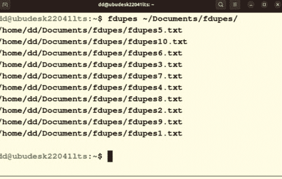

> 图 1：查找重复项的最简单方法不需要任何调用参数来指定目录。

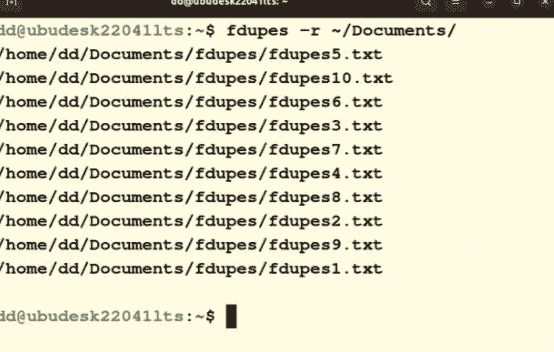

> 图 2：使用 `-r` 参数在目录树搜索中深入挖掘。

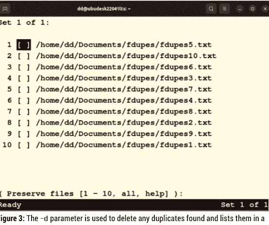

> 图 3：`-d` 参数用于删除找到的任何重复项，并以编号列表列出它们。

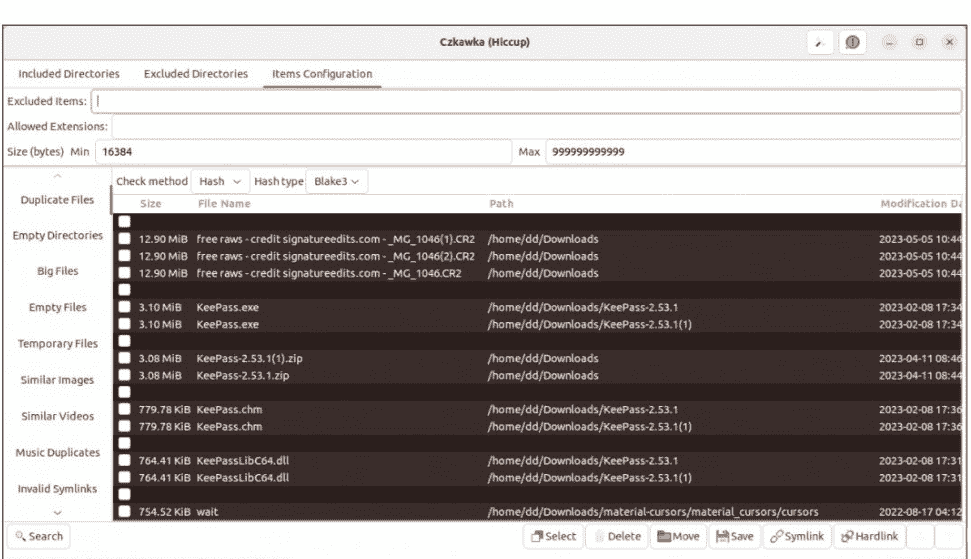

`Czkawka` 是用 `Rust` 编写的，实现了以前广泛使用的 `FSLint`。它比前代产品更快，使用的活动内存也更少。

以前广泛使用的 `GUI` 应用程序 `FSlint`（用 `Python` 编写），如今已从 `Ubuntu`、`Debian` 和其他发行版的仓库中消失。取而代之的是 `Czkawka`（图 4），这是用 `Rust` 编程语言编写的、快得多的分支版本。`DupeGuru`（图 5）是另一种替代方案。`Jdupes` 被推荐作为 `fdupes` 的替代品。不过，请记住，这两种工具之间的命令在某些方面有所不同。

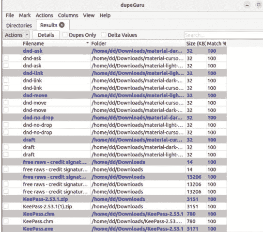

如果你想在 `GUI` 中找到重复项，`DupeGuru` 是另一种替代方案。可以使用过滤器或正则表达式来缩小结果范围。

### 结论

`Fdupes` 允许你查找、删除或转换重复项。然而，典型用例中存在固有的陷阱，可能导致数据丢失。除了前面提到的符号链接和硬链接的潜在问题外，还有一些系统文件必须存在重复版本，但仍被识别为重复项。即使是空目录或文件也不能不加思考地直接删除。其理念是只移除那些你可以判断其内容和重要性的文件和目录。

### 信息

- [1] [`fdupes`](https://github.com/adrianlopezroche/fdupes/releases)

- [2] `fdupes` 的版本：[https://repology.org/project/fdupes/versions](https://repology.org/project/fdupes/versions)

## 了解 ADMIN


`ADMIN` 网络与安全杂志为您提供解决现实世界问题的技术解决方案。

`ADMIN` 包含针对专业读者的详细讨论，涉及当代主题，包括安全、云计算、`DevOps`、`HPC`、容器、网络等。

### 订阅 ADMIN，每年收到 6 期刊物


想让你的收件箱收到 `ADMIN` 吗？

`ADMIN Update`

获取你在杂志上看不到新闻和技术文章。

`bit.ly/HPC-ADMIN-Update`

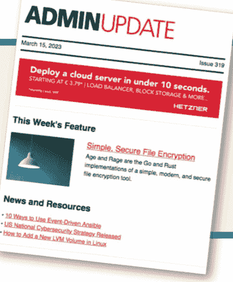


### FOSS 精选

来自自由和开源软件世界的璀璨瑰宝和最新发布


格雷厄姆本月花了过多的时间（和金钱）使用 `Arduino` 来控制他的浓缩咖啡机冲煮咖啡时的温度、压力和流量。`作者：格雷厄姆·莫里森`

#### 链接管理器

##### wallabag


# 网页保存与管理工具

只要有网页浏览，就有保存和管理链接以备后读的方法。当然，大多数人使用书签，但跨设备同步书签或使用第三方服务保存书签并缓存其内容以提高可读性或离线访问也是常见的做法。其中最好的选择之一是 `Pocket`，这是一个以前被称为 `Read It Later` 的商业订阅服务，拥有慷慨的免费层级，并于 2017 年被 `Mozilla` 公司收购。得益于其商业背景及其在 `Mozilla` 下的持续支持，`Pocket` 拥有成熟的平台支持，包括 `Android`、`iPad`、`iOS`、`macOS` 和 `Windows` 应用程序，以及 `Firefox` 的第一方集成。这使得 `Pocket` 方便且随时随地可访问。它甚至是创建这些页面的核心，因为作者广泛使用它来缓存他们在任何机器或设备上发现的开源软件。

尽管 `Mozilla` 身为 `Firefox` 和开放 Web 的守护者，并做出了相反的承诺，但 `Pocket` 的服务器代码仍然是专有的，而且该服务最近去除了其最有用的功能之一。这是通过向特定地址发送电子邮件将链接添加到你的 `Pocket` 账户的能力。如果你手头没有集成的客户端，这是一个很好的解决方案；如果你使用的是不支持 `Pocket` 的 Web 浏览器（例如优秀的 `albertbrowser`），这也是唯一的选择。

这就是我们引入真正的开源替代方案的地方，而 `wallabag` 是其中最好的。`Wallabag` 是一个 `PHP` Web 应用程序和服务器，配有相应的应用程序和浏览器集成。你可以自行托管服务器，或者支付少量费用（约 10 美元）使用该项目的托管服务。自行设置相对复杂，但可以使用廉价的 `VPS` 或家庭服务器完成。你需要域名、`NGINX`、`MySQL/MariaDB`、`Let's Encrypt` 以及一些配置微调——这对普通的 `Linux` 爱好者或系统管理员来说都不是什么难事，早餐前就能搞定，而且为了隐私和安心，经常值得这样做。然后你可以从 Web 客户端为任何配套应用程序生成客户端密钥，这些应用程序将在你调用时安全且私密地将链接添加到你的账户。

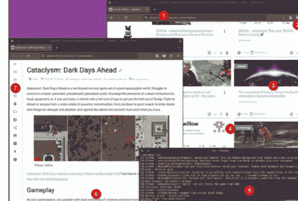

## 核心功能

- **标签系统**：巧妙的标签系统可用于手动对链接进行分类，或使用自动模式匹配，例如将某些网站列为“科学”或“合成器”。
- **多平台支持**：无论你是使用 Web 门户，还是 `Android` 和 `iOS` 应用程序来阅读保存的内容，这些都能使浏览新链接和存档链接变得更加易于管理。
- **内容提取与阅读**：每个客户端都会提取你的链接内容，允许你在 `wallabag` 自己的无干扰阅读环境中阅读文章。
- **RSS 集成**：你可以使用集成的 `RSS` 生成功能将你的链接列表转换为 `RSS` 源，用于原生 `Linux` 新闻阅读器（如 `Read It Later`），甚至使用 `Calibre` 自动将文章发送到你的墨水屏设备。
- **命令行客户端**：甚至还有一个命令行客户端用于添加、删除和标记文章，它完美替代了 `Pocket` 旧的电子邮件功能，让你可以为任何浏览器或脚本解决方案添加 `wallabag` 支持。

`Wallabag` 之所以表现出色，是因为它是开源的，开发者可以使其在从 `Emacs` 到 `macOS` 上的 `Safari` 等任何地方正常工作，现在是尝试它的最佳时机。

### 特性列表

1.  **自托管**：即使是 `Raspberry Pi` 也可以运行服务器，或者使用廉价的 `VPS`，但你自己的域名是必需的。
2.  **浏览器集成**：大多数浏览器（包括 `Firefox`）都可以集成 `wallabag` 插件，以便无缝地将网站和标签添加到你发现的链接中。
3.  **缩略图或列表视图**：缩略图预览视图包含任何保存网页的简介。
4.  **标签**：你自己的标签可以手动添加，或者（更重要的是）根据特定规则自动添加。
5.  **终端客户端**：可以使用命令行工具添加、删除和列出你的链接。
6.  **文章视图**：`Wallabag` 会提取文章内容，使其更具可读性和可访问性。
7.  **导入**：从许多其他服务（包括 `Pocket`、`Readability` 和各种书签管理器）添加你的链接数据库。

**项目网站**

`https://www.wallabag.it`

# 稍后阅读

## `wallabag` 客户端

尽管 `wallabag` 在让基于网页的文章变得易于阅读和消费方面表现出色，但标准的 Web 门户和页面渲染永远无法与原生应用相媲美。这是其他缓存服务所提供的功能，尤其是在其他操作系统和设备上，而现在这款“稍后阅读”应用也让 `Linux` 拥有了这一能力。“稍后阅读”是一款设计精美的 `GNOME` 桌面应用程序，用于访问您的 `wallabag` 内容库、添加新链接以及阅读文章。它通过极其简约的界面来实现这些功能，从而让浏览和阅读体验尽可能不受干扰。文章视图可以在未读、收藏和已归档的故事之间切换，这些内容会以详细列表的形式展示，并附带文章的缩略图。


### 阅读体验

“稍后阅读”为您使用 `wallabag` 收集的任何文章提供了一个极简且无干扰的阅读环境。该应用程序几乎不需要桌面配置，且提供的少数选项均可通过标题栏中的嵌入式菜单访问。您可以将故事标记为收藏，或添加链接以创建新故事。没有其它用于控制渲染样式的手动操作，您唯一的管理选项是收藏或删除帖子，而帖子会在网页配置的时间段过后自动标记为已读。听起来很简单，但这是阅读您囤积的链接的最佳方式，也是摆脱在线阅读干扰的一种令人耳目一新的改变。

与添加仅图标视图和进一步筛选选项的 Web 界面不同，“稍后阅读”旨在处理未读文章，这些文章根据其预计阅读时间进行排序。这些选项源自 Web 界面，但阅读体验本身比 Web 界面或 `Android` 应用都要好得多。选择一篇文章后，其内容会在桌面应用程序框架内进行渲染，并重新格式化以完美呈现。所有干扰和广告都被移除，文本在 `GNOME` 极简的窗口框架和标题栏内呈现出精美效果。与其他现代 `GTK4` 应用程序一样，浅色和深色主题将跟随您的桌面配置。

**项目网站**

`https://gitlab.gnome.org/World/read-it-later`

# gping

## 可视化 ping

如果说有一个命令是多年来全球 `Linux` 用户所依赖的，那一定是 `ping`。它写于 20 世纪 80 年代初，那时几乎没有人能接入互联网，网络是用同轴电缆构建的。这个命令陪伴我们走过了从简单的家庭网络和拨号调制解调器连接，到全光纤对称宽带，再到多提供商云协同扩展的时代。`ping` 之所以得以生存，是因为它完美地执行了一项简单任务：让您始终知道网络上的其他机器是否可访问并响应您的身份验证请求。“`ping`”这个名字 famously 指的是潜艇声呐脉冲声，即声波从远程物体反射回来的声音。`Linux` 的 `ping` 对远程服务器做同样的事，告诉您远程机器是否可访问，以及数据包从您的机器到远程机器再返回所需的时间。`ping` 的输出只不过是每行显示一个数据包的目标 IP 地址和往返时间的文本。这留下了很大的改进空间，特别是如果您想随时间追踪响应，而这正是超级简单且超级实用的 `gping` 所做的。

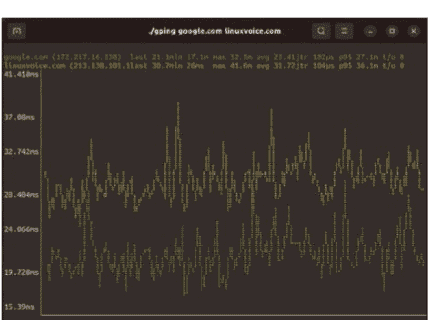

### 功能亮点

`Gping` 可以解析 `IPv4` 和 `IPv6` 目标地址，并使用颜色更好地区分响应时间。`Gping` 仍然是一个命令行 `ping` 工具，但带有一个显示一个或多个服务器响应时间的图表。在最简单的情况下，它是 `ping` 的直接替代方案，其中，每个响应的单独输出行变成了图表上绘制的一个点。

您可以更改间隔、缓冲区量以及水平和垂直边距，但当图表到达边缘时，它也会开始滚动，让您能够快速查看从当前机器到远程主机可访问性的任何变化。最好的是，在命令中添加多个目标会在同一个图表上分别绘制每个目标的响应时间，因此您可以更好地检查网络性能，或关注您自己的服务器，当试图用您的命令行技能给人留下深刻印象时，它看起来非常酷。

**项目网站**

`https://github.com/orf/gping`


# DDCcontrol

## 屏幕控制器

我们之前看过一个名为 `ddcctl` 的小型命令行实用程序，用于控制显示器。它是使用 `DDC/CI` 标准通过屏幕的 `I2C` 总线控制各种显示器设置的极佳工具。唯一的问题是，`ddctl` 可能有点过于受限，特别是在探索屏幕更具实验性或定制化的特性以及从您的显示器通过 `I2C` 暴露的其他参数时。

`DDCcontrol` 是一个具有相同目标但更全面的实用程序。它在硬件层面工作，而不是通过用户空间，并且可以访问 `ddcctl` 无法访问的特定于制造商的参数。然而，与 `ddcctl` 一样，它也是通过 `I2C` 总线执行这些操作的，这意味着始终存在风险，您可能会弄乱一些无法恢复的设置，因此值得保持谨慎，并只在您准备好失去的硬件上进行实验。


解决了这个问题后，`DDCcontrol` 从命令行运行，并首先方便地扫描您的 `I2C` 总线上的任何屏幕。这特别有帮助，因为选错设备可能会破坏的不仅仅是您的显示器。与 `dd` 类似，向系统中的其他设备发送潜在破坏性命令会导致比错误的屏幕亮度更大的问题，而一旦将正确的设备添加到命令中，您就可以安全地探测您的屏幕能力。`DDCcontrol` 通过使用已知屏幕及其功能的数据库来缓解这种风险，使您可以安全地访问 `DDC/CI` 规范之外的参数。这些通常是可能需要深入菜单挖掘或激活某种工程模式才能访问的选项，例如刷新率和色域。它对于切换输入仍然有用，但您也可能发现可以分割显示并更改面板的背光级别。


如果 `DDCcontrol` 的命令行选项太多了，还有一个出色的 `GUI`，它在更令人愉悦的图形窗口中提供相同的选项。

**项目网站**

`https://github.com/ddccontrol/ddccontrol`

##### `killport`

进程管理器

它很丑陋，让你感到内疚，而且是你不该做的事情。但有时杀死正在运行的进程是必要的。这通常是在尝试了其他所有方法之后才发生的。你已经礼貌地使用应用程序的退出选项请求过。你按了冒号并输入了 `q`。甚至狂按 `Esc` 或 `Ctrl+C` 也没用，而 `top` 中的进程 ID 持续吞噬你的计算和内存资源。这时，`kill` 甚至 `kill -9` 就成了你的朋友。就像冷血的刺客一样，它会摧毁进程并清除其内存。但当你不知道该杀死哪个进程，或者不知道该由哪个进程负责那个停滞的进程时会发生什么？像任何优秀的刺客一样，你需要做一些侦察。

`top` 命令及其同类工具很擅长显示哪些进程处于停滞状态以及哪些进程在使用 `CPU` 和内存资源，你可以使用诸如 `lsof` 等命令来列出哪些进程正在访问哪些文件和设备。但访问网络或作为服务器运行的进程更难追踪。这些进程将使用端口进行通信，通常是在等待数据到达或处理传输中的数据，而杀死像这样的进程正是名为 `killport` 的适当命名的工具被开发出来的原因。在最简单的情况下，你只需使用端口号作为单个参数运行 `killport`。例如，如果你以默认配置运行 `SSH` 守护进程，`killport 22` 将会杀死 `SSH` 守护进程。同样，你可以包含多个端口来要求对一整套进程进行“大屠杀”，如果你想在暴力攻击之前施加额外的痛苦，还可以指定信号。它很简单但运行出色，是比试图通过 `netstat` 弄清楚哪些进程附加到哪些服务好得多的选择。


`Killport` 帮助你在没有学习 `netstat` 的晦涩方法的情况下，停止运行在特定端口上的服务。

**项目网站**

`https://github.com/jkfran/killport`

#### 3D 查看器

##### `F3D`

自从计算机能够绘制点并在它们之间连接线条以来，我们就拥有了 3D 查看器。早在 20 世纪 60 年代，计算机就能驱动示波器和阴极射线管，将三维物体映射到二维平面上进行显示。这种痴迷伴随计算机经历了 1968 年电影《2001 太空漫游》中的空间站视角、20 世纪 70 年代的视频游戏《迷宫》（又名《迷宫战争》），以及 20 世纪 80 年代充斥着电视屏幕的大量线框和填充多边形，直到从 20 世纪 90 年代起，加速图形技术使得这一切变得微不足道。现在你可以随时随地在 3D 环境中查看物体，无论是通过手机、网页浏览器，还是佩戴 `VR` 头显体验真实的 3D。但是，如果你需要在命令行中快速预览 3D 对象，你仍然会感到受限。如果你在桌面上有几分钟空闲时间，你可以快速将文件放入 `Blender`，创建一个简单的场景并进行渲染，但出色的 `F3D` 在输出方面做得更棒，并且可以直接从命令行完成这些操作，无需复杂的 `UI` 交互。

`F3D` 可以加载大量 3D 文件，从 1993 年的 `VTK` 文件到现代 `LiDAR` 生成的包含数百万个点云的 `PLY` 点云和科学数据集。无论内容如何，它都会美观地渲染到一个独立的桌面窗口中，在那里你对输出也有相当大的控制权。鼠标和 `Shift` 键可以在三维空间中旋转和平移场景，而热键可以启用抗锯齿、色调映射、颜色循环、点精灵渲染、`HDR` 和环境映射、不透明度以及体积渲染。这些选项也可以在命令行中提供，而光线追踪选项需要启用特定的构建选项，但它们看起来都非常棒，你往往会发现自己下载各种各样的 3D 文件只是为了能如此方便地探索它们。


> 项目网站  
> `https://f3d.app`

#### 远程 Android

##### `scrcpy`

曾经有一段时间，访问远程桌面是运行 `Linux` 的重要组成部分。那是一个除非你想与 `Webmin` 搏斗，否则远程解决问题的最好方法就是直接使用故障系统的桌面的时代。这有助于 `Linux` 的普及，因为 `Linux` 在这方面非常擅长。甚至在互联网变得令人沉迷之前，图形应用程序就可以通过 `X11` 协议本身通过网络进行隧道传输，让你能够在本地运行远程图形应用程序。稍后，`VNC` 通过将整个桌面压缩为一组可以在任何有网络连接的地方流式传输的 `JPEG` 解决了同样的问题。它常常受限于糟糕的质量，但完成了任务。考虑到 `Android` 是 `Linux`，令人惊讶的是该平台并没有同样充斥着远程查看选项。对于未 `root` 的设备，能让你看到与你手持屏幕完全相同内容的选项非常少。但这正是名字起得很糟糕（对阅读障碍者来说）的 `scrcpy` 所做的，它在没有 `root` 且不需要在 `Android` 设备上安装任何东西的情况下做到这一点。唯一的要求是启用 `Android` 设备上的 `ADB` 调试，并且你信任在你的手机和 `Linux` 机器之间建立所必需的 `USB` 连接。然后只需要运行 `scrcpy` 命令（如果你能打字的话），并等待连接开始。在几分钟后，你将看到一个 1:1 逐帧完美捕捉你 `Android` 屏幕上内容的画面。这非常有用的功能令人惊讶，从通过网络流式传输屏幕，到在你处于 `VR` 环境中时回复消息。


> 项目网站  
> `https://github.com/Genymobile/scrcpy`

#### 音频编辑器

##### `Tenacity`

编写音频软件是一项困难且吃力不讨好的工作。不仅信号处理代码难以编写，与 `Linux` 音频栈交互也很棘手，创建一个帮助用户忽略其复杂性的用户界面几乎是不可能的。这就是为什么找到成功方法的应用程序随时间变化很小的原因。现代的 `Cubase` 与 1989 年的 `Cubase` 仍然有很多共同之处，`Ableton` 自 2001 年发布以来几乎没有改变，而在 `Linux` 上，`Ardour` 自 2005 年以来依然保持着简约，尽管它拥有许多现代功能和难以置信的强大控制水平。但 `Audacity` 或许是变化最小的，同时仍然是 `Windows`、`macOS` 和 `Linux` 上最受欢迎的音频编辑器之一。`Audacity` 被所有人使用，从将 `FLAC` 转换为 `MP3` 的普通桌面用户，到在 `Bandcamp` 上发行音乐进行母带处理的业余音乐家，再到专业播客制作人。它仍然是一个坚如磐石的应用程序，可以录制和编辑数小时而无故障。


`Tenacity` 是 `Audacity` 的一个分支，它已经彻底改变了其美学，并希望通过社区参与进一步拓展。

尽管致力于保持一致性，`Audacity` 的开发被许多人认为过于缓慢，特别是当该项目在被 `Muse Group`（背后同样支持出色的 `MuseScore`）接管后，添加又撤回了退出遥测功能。这导致了该项目的两个独立分支，两者都致力于在没有遥测的情况下将 `Audacity` 带入现代，并在各自开源社区的推动下进行。这类计划很难实现，也很少成功取代原始项目，但这两个项目都幸存下来，并最近合并为最成功的那个，即 `Tenacity`。


竞争是一件好事，希望 `Tenacity` 能够跟上最近的 `Audacity` 发展，包括实时音频效果。


Tenacity 承诺成为一个比 Audacity 更新鲜、更现代、更方便、更实用的音频编辑器。最新版本极大地展示了已经取得的进步。主要差异可以在用户界面中看到，界面已经经过翻新。图标、文本渲染和主题颜色看起来都大幅改进，并在深色主题桌面上远优于原始版本。这是 Audacity 似乎不愿添加的功能，其自身的深色模式在集成 VU 表或波形渲染等方面时可能会时好时坏。这有助于使 Tenacity 更令人愉悦，同时也使其感觉更现代。它也是在没有 Audacity 的遥测功能的情况下构建的，既不需要设置构建标志，也不需要取消运行时设置，确保你的数据不会流向任何地方。其他一切都是 Audacity 在版本 3.0.2 分叉时包含的最佳内容。这意味着你获得了数十年的开发者和用户体验，以及一个坚如磐石的音频编辑器。当然，Audacity 仍然是一个很棒的项目，并且通过最终添加实时效果处理（尽管处于早期阶段）也显著改进，我们将拭目以待，看看 Tenacity 是否能将这些新增功能合并到其自己的代码中（目前与 Audacity 的代码已有显著分歧），或者团队是否能够保持足够的动力，创建一个拥有其独特音频编辑方法、真正独立的项目。毫无疑问，对像这样的开源音频编辑器有着巨大的需求，成功的项目可能会获得潜在的丰厚回报。

项目网站

`https://github.com/tenacityteam/tenacity`

#### 生存类 Roguelike

##### Cataclysm: Dark Days Ahead


`Cataclysm: Dark Days Ahead` 是一个开源的 Roguelike 冒险游戏，现在甚至可以在 Steam 上获取。

这是一个复杂的冒险游戏，具有陡峭的学习曲线。它从命令行运行，当你创建一个角色并进入游戏世界时，最初一切都看起来很像原始的 NetHack。它使用文本字符和光标构建，有一个代表你化身中心字符，一个随着你探索而根据视线范围消失的“战争迷雾”，以及右侧的一组属性和属性。与 NetHack 一样，ASCII 文本可以被图形瓦片替换，这可以使游戏感觉更现代，但也会将游戏玩法从终端拉到你的桌面上。无论如何，游戏的两个版本玩法完全相同，难度也同等困难。Cataclysm 将自己描述为“设定在末日世界中的回合制生存游戏”，这是你需要从一开始就需要探索的世界，同时关注你的属性以保持生存。回合制意味着你执行的每个动作都有移动成本，初始难度取决于你选择的起始场景，“疏散者”给你足够的资源来帮助初期。这也取决于你选择的角色职业，因为不同的职业配备有不同的默认库存。有许多职业可供选择，从舞厅舞者到朋克摇滚家伙，似乎一切都影响着其他一切。需要数小时才能开始理解你在游戏开始前和在游戏环境内部所做选择的效果，但一些出色的入门指南和在线视频真的很有帮助。最终结果是一个 Roguelike，具有 NetHack 的元素，类似《辐射》的场景，以及强调生存和战斗。与 NetHack 一样，它会奖励你在学习上投入的时间以带来深厚的游戏体验，尽管学习曲线要困难得多。

项目网站

`https://cataclysmdda.org`

#### 植物模拟器

##### botany


`Botany` 让你可以在命令行上种植 ASCII 植物，并让朋友来访帮助浇水和看护你的创作。

我们习惯了这样一种观念，即许多 AAA 游戏变得越来越复杂和要求越来越高，通常需要数十甚至数百小时才能征服。但有一类小类尝试相反的做法。这是《星露谷物语》如此成功的原因之一，许多玩家利用其种植和生长方面来放松身心，而无需耕耘他们真实的菜园。出色的 botany 在实现和对你的心理要求方面更进一步。它首先是一个简单的 Python 3 命令行应用程序，你可以从其仓库获取并运行，无需安装或配置依赖项。其次，它需要很少的关注或思考。就像真正的植物一样，它只是要求你偶尔看一眼，不要抛弃它。首次启动时，游戏开始时会给你一颗种子。没有直接告诉你这些，但你可以阅读包含的说明。然后，你的任务是给植物浇水，检查其生长，并记得每 24 小时回来做同样的事。有 20 多种不同的植物物种，全部作为 ASCII 艺术绘制，并且当你第一次运行游戏时具有随机属性，但就像真正的植物一样，从那颗初始种子中出现任何东西需要几天时间。如果你忘记给你的 ASCII 浇水，它就会枯萎，你的花可以在其发展的任何阶段发生变异。但如果它存活下来，你可以收割生长物，并用它来播种新一代，具有 20% 的生长加成。更令人印象深刻的是，你可以通过输入其他人名来访问其他人在命令行上种植的植物，他们也可以访问你。访客可以查看甚至给你的植物浇水，例如，如果你去度假，这有助于保持植物非常健康，这在网络上组织比有人访问你现实中的菜园要容易得多。

项目网站

`https://github.com/jifunks/botany`

## 使用 RawTherapee 5.9 编辑风景照片

### 完美平衡

当前版本的 `RawTherapee` 终于添加了选择性图像编辑等长期期待的功能，以帮助其与该领域的标杆软件 `darktable` 展开竞争。

**作者：ANNA SIMON**

在处理风景照片时，常常会出现图像中某些区域（尤其是极亮或过暗的区域）存在偏色，或者颜色显得过于浓烈或过于苍白的情况。调整对比度或饱和度往往会加剧这种现象。对于风景摄影师来说，良好的遮罩和选择功能是必不可少的。

目前，无论是免费还是商业的 RAW 处理器，都提供了广泛的选择性图像处理工具。但在所有开源程序中，此前只有 `darktable` 提供了这些功能。尽管 `darktable` 基本上是一款优秀的软件，但对于某些用户来说它存在一些缺点。它需要一段时间才能上手，并且你必须彻底理解其内部运作机制才能获得良好的结果。此外，如果显卡速度不快，`darktable` 的运行可能并不够流畅。

经过数年的开发，`RawTherapee` 5.9 [1] 于 2022 年 11 月发布，新增了以直观且有效的方式修改图像特定区域的能力 [2]。开发者 Jacques Desmis 在编写此功能时，受到了流行的 `Nik` 插件中巧妙的选择技术的启发。好消息是：该程序是一款性能与 `darktable` [3] 相当的 RAW 处理器，但避免了上述提到的缺点 [4]。

与大多数同类程序不同，实际上只有一个 RAW 处理器支持 `RawTherapee`。它没有真正的管理模块，仅具备一种文件浏览器或图像查看器。启动应用程序后，使用浏览器导航到存储照片的目录。双击缩略图即可在编辑器中打开照片。你可以将编辑工具栏找到在右侧。

### 预备工作

首先调整一些默认设置。点击相应按钮，你会进入一个带有多个选项卡的独立窗口。首先，你需要处理两个选项：用户界面颜色以及颜色管理，或者是自动检测屏幕配置文件。`RawTherapee` 的标准用户界面颜色过暗，无法正确调整颜色强度和图像亮度。你可以在 `General | Appearance`（通用 | 外观）选项中较深的定义位置选择一个较浅的颜色。推荐 `Tool Wa Grey – Average Surround` 设计，因为它非常接近中性灰。

然后，将程序设置为自动检测并使用你的屏幕配置文件。为此，你首先需要在操作系统的颜色设置中安装一个配置文件。在 `RawTherapee` 设置中，点击 `Color Management`（颜色管理），在 `Monitor`（监视器）组中，勾选 `Use operating system’s main monitor color profile`（使用操作系统的主监视器颜色配置文件），然后重启软件。

在默认配置下，该工具会为 RAW 文件激活精密的、最小干预的自动图像优化。要充分利用一张照片，通常只需移动几个滑块即可。一旦打开 RAW 文件，`RawTherapee` 会自动对图像应用三个处理步骤。`Exposure`（曝光）模块中的 `Auto tone curve`（自动色调曲线）承担了大部分工作。该程序通过将实际的 RAW 文件与嵌入文件中的 JPEG 进行比较来生成曲线。它试图模仿当今相机内通常非常实用的图像优化功能。

应用程序启用了 `Input Sharpening`（输入锐化，位于 RAW 选项卡的最末尾）。与传统的锐化不同，这种高效的锐化方法不在处理结束时进行，而是在一开始，即在图像在线性 RGB 色彩空间中降低饱和度后立即进行。该工具还开启了色度异常自动校正功能。

### 提亮与压暗

示例照片展示的是下奥地利州 Mostviertel 地区 Lunz am See 社区附近的一座山地风景。在进行其他任何操作之前，你通常需要根据程度不同对许多风景图像进行提亮。相机默认会欠曝，以便尽可能保留图像最亮区域的结构（图 1）。


为此，请将`Exposure`（曝光）模块中的`Exposure compensation`（曝光补偿）滑块稍微向右移动。经过多次尝试，我们在测试中发现`0.8`的值是完美的。然后，使用灰色渐变滤镜来压暗天空。该工具使图像的上部变暗，插入从亮到暗的平滑过渡。你可以使用模块标题栏中的按钮启用该滤镜。将`Intensity`（强度）设置为大约`1.5`。使用下方的滑块，你可以根据需要调整其他滤镜属性，如位置和大小。

### 对比度与饱和度

接下来，增加饱和度和局部对比度。将`Exposure`（曝光）下方的`Saturation`（饱和度）滑块向右移动到大约`67`的值，并在`Local Contrast`（局部对比度）下启用`Detail`（细节）。这将应用一种介于锐化和（全局）对比度增加之间的效果。如果加强此效果，通常会增加图像的清晰度。

内部滤镜使用模糊遮罩——这解释了确定模糊程度的`Radius`（半径）滑块。如果你放大此值，对比度会增加。如果你减小它，它会影响更精细的细节，图像看起来会更锐利。对于此控制器，有意义的值通常在`100`到`150`之间。

`Intensity`（强度）指定了对比度增加的程度。此外，你可以使用`Dark areas`（暗部区域）和`Light areas`（亮部区域）来确定与某些区域相比，效果在其他区域是更强还是更弱。你需要小心处理此效果：如果你选择的值太高，图像会显得过于生硬。你需要使用较高的强度值，例如`0.75`。

还要注意光晕——那些看起来不自然的过亮或过暗区域，通常出现在对比度边缘附近。你可以在示例图像的云朵中看到光晕：它们直接位于图像左半部分的山脊旁。你需要将滑块设置为`0.5`，以降低亮部区域的强度。

### L*a*b 微调

前景中草的颜色现在有点太浓烈了，而背景中的山脉——以及深色——看起来太苍白。你可以使用`Exposure`（曝光）中的`Lab module`（Lab 模块）来校正这些细节。

正如工具名称所示，它不在RGB色彩空间（即红、绿、蓝三个颜色通道）中操作，而是在L*a*b色彩空间中操作。在这个空间中，照片由三个通道组成：`L*`（亮度）、`a*`和`b*`。`L*`仅存储亮度信息。`a*`通道存储绿色和红色的强度与色调，而`b*`通道包含蓝色和黄色的信息。

对于某些编辑步骤，尤其是在精确调整色相和饱和度时，在L*a*b空间中获得的通常比在RGB空间中工作的工具效果更好。

该工具有六种（初始隐藏的）曲线类型，允许你操纵特定颜色或色调范围的亮度、色相和饱和度（或色度）。曲线缩写`CC`、`CH`、`CL`、`LH`、`LC`和`HH`是简写（见表 1）。

顶部三条曲线在许多其他RAW处理器和照片编辑器中也有存在。例如，点击三角形，然后从菜单中选择`Min/Max Control Points`（最小/最大控制点）即可显示`CH`曲线。现在你看到一个中间由样条曲线水平分割的方形。底部边缘有一个彩虹色渐变。还有红色、黄色、绿色、青色、蓝色和紫色的六条垂直线。如果你点击黄色垂直线与水平样条线相交的点并向上或向下拖动，预览中的黄色色调会变得更浓或更淡。你可以类似地使用`LH`和`HH`曲线来操纵单个色相的亮度和色调（图 2）。


**表 1：曲线名称**

| 缩写 | 含义 |
| :--- | :--- |
| `CC` | 根据色度的色度 |
| `CH` | 根据色相的色度 |
| `CL` | 根据亮度的色度 |
| `HH` | 根据色相的色相 |
| `LC` | 根据色度的亮度 |
| `LH` | 根据色相的亮度 |


**图 2：** 在对亮度、对比度和饱和度进行一些基本校正后，草地的颜色显得过于浓烈，而山脉则显得过于苍白。这可以通过借助L*a*b曲线来修复。

下方的曲线不太寻常。在示例中，我将主要关注`CC`和`CL`。选择`Parametric`（参数化）或`Standard`（标准）曲线类型。在`CC`中，参数化曲线下方会出现四个滑块，将颜色分为四组。`Neutral`（中性）允许你进一步冲淡或增强接近白色、灰色或黑色的颜色。就示例照片而言，这主要指云朵。

在此处降低色彩强度并没有坏处。由于我已经在曝光模块中通过饱和度滑块全局增强了色彩，它们获得了一层轻微的色彩偏移。将值设置为`-67`。下一个滑块允许你改变哑光颜色，这对于森林和山脉很有用。在此处选择`50`。最后，我会降低粉彩颜色的强度，这主要指草地（图 3）。

在下一步中，为`CL`选择`Standard`（标准）曲线类型。点击曲线图右侧垂直工具栏顶部的按钮。当你将鼠标移入预览窗口时，RawTherapee会在曲线图中显示你当前指向的颜色所在的曲线区域。你可以通过点击曲线底部的一个点并将其向上拖动来增加深色颜色的强度。起初，浅色也会变得更强烈，因为曲线的上半部分自动向上偏移了。你可以通过将上半部分的一个点略微向下移动来修正这一点。曲线现在应该呈现倒S形。

#### 详细调整

让我们在`Local`（局部）（手形符号）中突出云朵的纹理结构。在标题栏中启用该模块，并在`Settings`（设置）字段中点击`Add`（添加）。在预览窗口中，会出现一个带红色边框且中心有红色圆圈的椭圆；将此移动到云朵上。在`Tools`（工具）面板中的`Spot method`（斑点方法）里，选择`Full image`（全图）。执行此操作后，应用程序将只显示圆圈。这将选择图像中所有与图像下方颜色相似的颜色。

在`Add tool to current spot`（将工具添加到当前斑点）中，选择`Local Contrast`（局部对比度）和`Wavelets`（小波）效果。在下方可以找到相应的设置。虽然它们类似于`Details`（详细）选项卡中的局部对比度设置，但它们还包含一个`Scope`（范围）滑块。你可以使用它来控制所选颜色必须与选择中心颜色的相似程度。高值意味着RawTherapee也包含相似性较低的颜色。这就是为什么你只需要将此值设置为约`25`；这仅将该效果应用于天空。然后将`Radius`（半径）值设置为`100`，将`Overall Strength`（整体强度）设置为`0.67`。

现在我稍微darken背景中的蓝色山脉。为此，如上所述创建另一个选择区域，但保留`Normal`（普通）斑点模式。将斑点的中心移动到山脉区域的一个蓝色点。然后通过将椭圆上的四个点向外拖动来放大斑点，覆盖整个山脉。使用`Range`（Color Tools）（范围（颜色工具））减少包含的颜色数量。


**图 3：** 使用`CC`、`LC`和`CL`曲线，分别独立操作饱和色和哑光色、粉彩色以及阴影、深度和高光的饱和度和亮度。


图 4：如果使用`Range`（范围）滑块缩小选择区域的范围，RawTherapee只会改变山脉的蓝色，而不会改变同样被选中的云朵。

对于没有自带范围滑块的效果，你可以使用全局滑块来控制范围。这包括颜色和光线等颜色工具。如果你限制区域，应用程序只会改变山脉的蓝色，而忽略同样被选中的云朵（图 4）。将颜色和光线工具添加到这第二个选择区域，并将那里的`Brightness`（亮度）设置为`-5`。

最后，只剩下几个小任务需要完成。拉直图像，减少噪点，并使用斑点移除工具去除图像右边缘的汽车碎片。你可以在`Transform | Lens Corrections`（转换 | 镜头校正）中找到旋转工具。基本上，你会希望使用`Select Guideline`（选择基准线）功能，而不是设置角度。在`Select Guideline`（选择基准线）中，在预览中追踪一条垂直或水平线。在示例图像中，例如，灯柱是为此做的良好选择。

#### 移除分散注意力的物体

要从图像中移除分散注意力的物体，请在`Details`（详细）中启用斑点移除工具。一旦点击铅笔图标，鼠标光标会变成一个小十字，你可以设置一个点来移除汽车碎片。按住`Ctrl`并点击问题元素。然后你会在该点看到两个小的同心圆。向外拖动内圈使其变大。

实际上，现在有两个刷子重叠在一起：覆盖目标区域的在底部，用于源区域的在顶部。点击圆圈，并将上方的刷子移动到你想要将汽车融合到的位置——在本例中，是汽车左侧的图像区域（图 5）。除了移除非常小的斑点外，你通常需要将设置几个点来完全移除物体。最后，再次使用铅笔图标来隐藏预览中的刷痕或修复区域。


图 5：新的斑点移除工具允许用户移除分散注意力的物体，只要它们不是太大。


图 6：新的 `AMAZE+Bilinear`（`AMAZE`+双线性）去马赛克算法产生更颗粒化的噪点，这让人眼感觉更愉悦。

图 7：色差往往非常顽固；你可能需要手动修改自动校正结果。

#### 最小化噪点

放大图像，并通过移动视图检查每个图像区域的噪点和锐度。为此，首先点击工具栏右侧的放大镜。虽然风景照片经过了一些细致的修饰，但图像噪点相对较低。但图像还可以进一步优化。在启用降噪之前，先在 `Raw`（原始）下对 `Color Interpolation`（颜色插值）进行一些实验。这主要是关于 `Method`（方法）：虽然 `AMAZe` 是这里的默认值，但你总是应该尝试 `AMAZe+Bilinear`（双线性）算法。`RawTherapee` 使用边缘检测滤镜将图像分为高纹理和低纹理区域。对于结构丰富的区域，它使用更锐利的 `AMaZDeescreeining` 方法；对于更单调的区域，则使用更柔和的双线性算法来扼杀噪点的萌芽。`AMaZDe+Bilinear` 方法不一定能减少噪点。结果看起来更细腻，对人眼来说更令人愉悦（图 6）。如果你觉得这仍然太强烈，请在 `Details`（详细）下启用 `Noise Reduction`（降噪）。这可以去除颜色噪点，这对于较新的相机来说，最高到 `ISO 1600` 左右都是很好的选择。


不要对图像噪点过于敏感——这是大多数缺乏经验的摄影师犯的一个错误。一方面，对于较新的相机来说，噪点往往并不重要。即使高达 `ISO 6400` 的图像在今天基本上也不再是问题了。而且低噪点并不是好照片最重要的特征之一。事实上，一定量的噪点往往在美学上看起来更悦目，或者至少比平滑处理后的照片更自然。不要害怕高 `ISO` 值，也不要过于激进地进行降噪。

#### 校正镜头像差

校正镜头像差，如色差、暗角和畸变，在风景摄影中起着重要作用。由于 `Mostviertel` 风景中几乎没有这类错误，我将借助另外两张示例照片来演示这一步骤。

色差（又称紫色镶边）是通常出现在对比度边缘的颜色边缘，例如明亮天空前的树木或树枝。`RawTherapee` 中已自动启用校正。然而，有时颜色边缘会非常顽固地存在，你必须调整默认配置。你可以在 `Raw` 中的第一个模块 `Sensor with Bayer Matrix`（带拜耳矩阵的传感器）的最后一组 `Chromatic Aberrations`（色差）中找到这些设置。

放大图像，并将视图移动到发生色差的图像区域（图 7）。取消勾选 `Auto-correction`（自动校正）框，然后更改下方 `Red`（红色）和 `Blue`（蓝色）滑块的位置。你需要移动哪个滑块以及移动的方向取决于色差的颜色。蓝色和紫色颜色边缘非常常见。

对于蓝色色差，将 `Blue`（蓝色）滑块向右移动，直到颜色边缘消失。如果你在移除的蓝色颜色边缘附近看到黄色或黄绿色边缘，说明你调整滑块过头了。对于紫色像差，你还需要将 `Red`（红色）滑块稍微向右移动。最后，在 `100%` 视图中检查所有图像区域。移除色差时经常发生的情况是，在其他区域产生了新的色差。


畸变时有发生。枕形畸变经常发生，尤其是在广角镜头中，对于含有树木或水平地平线的图像来说可能相当恼人。你可以在 `Transform`（转换）底部的 `Lens Corrections`（镜头校正）模块中找到相关设置。在 `Lens Correction Profile`（镜头校正配置文件）组中选中了 `Automatic`（自动）选项。但这在很多相机上不会生效，因为镜头选择失败。你需要在 `Lens`（镜头）旁边的列表中选择正确的镜头。之后，畸变和暗角都应该消失。

如果在 `Lensfun` 数据库中找不到你镜头的校正配置文件怎么办？在这种情况下，首先尝试自动畸变

图 8：在大多数情况下，可以使用 `Lensfun` 镜头校正配置文件来校正畸变和暗角。

下方的校正。只要 `RAW` 文件中嵌有 `JPEG`，且相机已自动校正了失真，此方法即可生效。否则，你必须在“自动”下方的滑块上进行试验。

如前所述，`Lensfun` 镜头校正配置文件还会自动去除暗角（即圆形阴影），尤其是在图像角落处。如果你希望或需要手动校正此问题，请使用“变换”工具中的暗角校正功能。该工具允许你向左拖动“强度”滑块来添加暗角。通常，暗角不像色差或失真那么令人烦恼；事实上，轻微的暗角往往还具有美学效果（图 8）。

最后，导出照片。为此，点击左下角的软盘图标。将显示“保存”对话框。在那里，选择目标文件夹、文件格式（`JPEG`、`PNG` 或 `TIFF`）、位深度（`8` 位或 `16` 位）以及压缩方式，然后按“确定”或 `1` 以确认。

调整。该应用程序为你提供在整个图像上找到完美色彩平衡的选项。因此，你不再需要依靠其他工具来完成最终编辑步骤。

事实上，该软件在我们看来是目前可用的最佳 `RAW` 开发者之一。`RawTherapee` 用起来很有趣，因为它即使在较旧的硬件上也能以可接受的速度运行，且相对易于使用。此外，其结果绝对能够与那些知名度更高的程序的结果相媲美。如果开发者能找到实现 `10` 位屏幕输出的方法，`RawTherapee` 很可能在未来许多年继续令其用户感到兴奋。

### 结论

`RawTherapee` 非常适合处理风景照片，这主要归功于新的局部调整功能。该应用程序为你提供在整个图像上找到完美色彩平衡的选项。因此，你不再需要依靠其他工具来完成最终编辑步骤。

事实上，该软件在我们看来是目前可用的最佳 `RAW` 开发者之一。`RawTherapee` 用起来很有趣，因为它即使在较旧的硬件上也能以可接受的速度运行，且相对易于使用。此外，其结果绝对能够与那些知名度更高的程序的结果相媲美。如果开发者能找到实现 `10` 位屏幕输出的方法，`RawTherapee` 很可能在未来许多年继续令其用户感到兴奋。

### 信息

- [1] `RawTherapee`: https://www.rawtherapee.com

- [2] `RawPedia`（官方 `RawTherapee` 文档）: http://rawpedia.rawtherapee.com/Main_Page

- [3] “`RawTherapee` 基础，新的局部调整 – 第 1 部分”: https://www.youtube.com/watch?v=dE0qofVBJr0

- [4] “`RawTherapee` 局部调整 – 第 2 部分”: https://www.youtube.com/watch?v=vrmBFGFAxXM

## IT 亮点一览


太忙而无暇阅读新闻稿和琐碎的科技新闻网站？让我们将最相关的新闻、技术文章和技巧直接发送到你的收件箱。

- `Linux Update`
- `ADMIN Update`
- `ADMIN HPC`

紧跟 IT 行业的脉搏。

`ADMIN` 和 `HPC`: `bit.ly/HPC-ADMIN-Update`

`Linux Update`: `bit.ly/Linux-Update`

## LINUX NEWSSTAND

> **在线订购：**  
> https://bit.ly/Linux-Newssstand

《`Linux Magazine`》是你探索 `Linux` 世界的指南。月刊内容充实，包含你在别处找不到的高级技术文章和教程。探索我们针对特定主题或为了完善你的收藏而提供的全部往期目录。

### #272/2023 年 7 月  

`开放数据`


只要政府保存数据，就会有人想查看它，也有想控制它的人。新一代的工具、政策和支持者寻求保持数据自由、可用且格式可访问。本月，我们为你带来追求开放数据的快照。

`DVD` 内容： `xubuntu 23.04` 桌面版和 `Fedora 38` 工作站版

### #271/2023 年 6 月  

`智能家居`


智能家居解决方案将为你节省时间和能源——而且，我提过吗，你还可以让你的朋友目瞪口呆。本月，我们将向你展示如何使用智能设备和开源自动化软件来控制你的家庭环境。

`DVD` 内容： `SystemRescue 10.0` 和 `Linux Lite 6.4`

### #270/2023 年 5 月  

`绿色编码`


一个可持续的世界需要更可持续的编程。本月，我们将介绍一些致力于能效的 `FOSS` 计划，并仔细研究一些 `Go` 语言中的绿色编码技术。

`DVD` 内容： `Fedora 37` 工作站版和 `TUXEDO OS 2`

### #269/2023 年 4 月  

`Fetiverse`


社交媒体工具连接着世界，为我们带来来自政治家、电影明星、社区领袖和远方朋友的最新新闻和评论。但商业社交媒体平台的跟踪和数据挖掘让许多用户正在寻找更好的选择。本月，我们深入探索社交媒体用户的替代宇宙：Fetiverse。

`DVD 内容：EndeavourOS Cassini 22.12 和 Debian 11.6 “bullseye”`

### #268/2023 年 3 月

**数据投毒**


认为计算机不会犯错误吗？如果你将一些篡改过的训练样本混入其中，你可以让一个花哨的机器学习系统认为狗是猫，或者 1 是 8 —— 并且你可以通过其他人都注意不到的隐藏信号来触发这种不良行为。

`DVD 内容：MX Linux 21.3 和 Puppy Linux FossaPup 9.5`

### #267/2023 年 2 月

**备份**


理论上，每个人都可以使用相同的备份工具，但将定期和系统性的备份融入生活的最佳方法是找到符合你自身习惯和方法的解决方案。本月，我们预览了 Linux 领域一些流行的备份应用程序，以便你找到一个适合你的。

`DVD 内容：Linux Mint 21 Cinnamon 和 Kali Linux 2022.4`

## 服务

### 活动

## 精选活动

用户、开发人员和供应商在全球各地的 Linux 活动中相遇。我们《Linux Magazine》很自豪能够赞助此处展示的精选活动。

关于你附近的其他活动，请在线查看我们在 `https://www.linux-magazine.com/events` 上的详尽活动日历。

如果你知道另一个你希望我们添加到日历中的 Linux 活动，请向 `info@linux-magazine.com` 发送包含所有详情的消息。


- **RustConf 2023**
  - **日期：** 2023 年 9 月 12-15 日
  - **地点：** 新墨西哥州阿尔伯克基及线上
  - **网站：** `https://rustconf.com/`
  - 不要错过 Rust 语言社区最大的年度聚会，时间为 9 月 12-15 日，地点在新墨西哥州阿尔伯克基。该活动包括顶级 Rust 开发者的演讲和培训、数字和现场讨论等更多内容！请在 `rustconf.com` 上了解更多并立即注册。

- **EuroBSDCon 2023**
  - **日期：** 2023 年 9 月 14-17 日
  - **地点：** 葡萄牙科英布拉
  - **网站：** `https://2023.eurobsdcon.org/`
  - EuroBSDCon 是面向使用和开发 4.BSD（Berkeley Software Distribution）系列操作系统及相关项目的用户和开发者的国际年度技术会议。不要错过了解 BSD 世界最新消息、见证当代部署案例研究以及结识其他使用 BSD 导向技术的用户和公司的机会。

- **SDC '23**
  - **日期：** 2023 年 9 月 18-21 日
  - **地点：** 加利福尼亚州弗里蒙特
  - **网站：** `https://storedveloper.org/`
  - 我们很高兴地宣布，SDC'23 今年将再次成为面对面活动。参加 SDC 是一种经济有效的方式，可通过教程、会议、主旨演讲者以及参与并行的 Plugfests 在不同领域获取培训。利用这个机会，在一个地方向专家学习。

### 活动

| 活动 | 日期 | 地点 | 网站 |
|---|---|---|---|
| GUADec | 7 月 26-27 日 | 拉脱维亚里加 | `https://events.gnome.org/event/101/` |
| WeAreDevelopers World Congress | 7 月 27-28 日 | 德国柏林 | `https://www.wearedevelopers.com/world-congress/` |
| RustConf 2023 | 9 月 12-15 日 | 新墨西哥州阿尔伯克基 | `https://rustconf.com/` |
| stackconf 2023 | 9 月 13-14 日 | 德国柏林 | `https://stackconf.eu/` |
| EuroBSDCon 2023 | 9 月 14-17 日 | 葡萄牙科英布拉 | `https://2023.eurobsdcon.org/` |
| Storage Developer Conference (SDC'23) | 9 月 18-21 日 | 加利福尼亚州弗里蒙特 | `https://storedveloper.org/` |
| FOSS Security Campus | 9 月 26-29 日 | 德国柏林 | `https://foss-security-campus.de/` |
| All Things Open | 10 月 15-17 日 | 北卡罗来纳州罗利 | `https://www.allthingsopen.org/` |
| DrupalCon Lille 2023 | 10 月 17-20 日 | 法国里尔 | `https://events.drupal.org/lille2023` |
| LinuxFest Northwest 2023 | 10 月 20-22 日 | 华盛顿州贝灵汉 | `https://linuxfestnorthwest.org/` |
| Hybrid Cloud Conference | 10 月 26 日 | 线上活动 | `https://www.techforge.pub/events/hybrid-cloud-congress-2/` |
| SeaGL 2023 | 11 月 3-4 日 | 线上活动 | `https://seagl.org/` |
| Open Source Monitoring Conference (OSMC) | 11 月 7-9 日 | 德国纽伦堡 | `https://osmc.de/` |
| SFSCON 2023 | 11 月 10-11 日 | 意大利博尔扎诺 | `https://www.sfsscon.it/` |
| SC23 | 11 月 12-17 日 | 科罗拉多州丹佛 | `https://sc23.supercomputing.org/` |
| Cassandra Summit | 12 月 12-13 日 | 加利福尼亚州圣何塞 + 线上 | `https://events.linuxfoundation.org/cassandra-summit/` |

## 联系信息

- **主编**
  乔·卡萨德 (Joe Casad)，`jcasad@linux-newsmagazine.com`

- **文字编辑**
  艾米·佩蒂特 (Amy Petitt)，奥布里·沃恩 (Aubrey Vaughn)

- **新闻编辑**
  杰克·沃伦 (Jack Wallen)，安伯·安克霍尔茨 (Amber Ankerholz)

- **荣誉名誉编辑**
  丽塔·L·苏比 (Rita L. Sooby)

- **执行编辑**
  洛里·怀特 (Lori White)

- **本地化与翻译**
  伊恩·特拉维斯 (Ian Travis)

- **版式设计**
  德纳·弗里森 (Dena Friessen)，洛里·怀特 (Lori White)

- **封面设计**
  洛里·怀特 (Lori White)

- **封面图片**
  © alexsandernd, 123RF.com

- **广告**
  布莱恩·奥斯本 (Brian Osborn)，`bosborn@linuxnewsmagazine.com`
  
  电话 `+49 8093 7679420`

- **市场营销传播**
  格温·克拉克 (Gwen Clark)，`gclarck@linuxnewsmagazine.com`
  
  美国 Linux 新媒体有限责任公司 (Linux New Media USA, LLC)
  
  美国堪萨斯州劳伦斯市博比林斯公园路 4840 号，104 室，邮编 66049

**出版商**

布莱恩·奥斯本

**客户服务 / 订阅**

美国和加拿大地区：

电子邮件：`cs@linuxnewsmagazine.com`

电话：`1-866-247-2802`

（美国、加拿大免费电话）

其他国家地区：

电子邮件：`news@linux-magazine.com`

`www.linux-magazine.com`

尽管我们在杂志内容的制作中已尽最大努力，但出版方不对其中包含信息的准确性或因使用该信息而产生的任何后果负责。使用随附光盘或其中提供的任何材料均由用户自行承担风险。


版权和商标 © 2023 美国 `Linux` 新媒体有限责任公司 (`Linux` New Media USA, LLC)。

未经出版方书面许可，不得以任何形式全部或部分复制任何材料。除非另有书面说明，否则假设所有发送的通信（例如：信件、电子邮件、传真、照片、文章、画作）均是为了出版目的，或以非独家的全球范围许可给第三方使用。

`Linux` 是林纳斯·托瓦兹 (Linus Torvalds) 的商标。

所有品牌或产品名称均为其各自所有者的商标。如果您未得到版权致谢，请联系我们；我们将始终纠正任何疏忽。

由 Zeitfracht GmbH 在德国纽伦堡印刷。由 Seymour Distribution Ltd 在英国发行。

在欧洲及其他地区的代表为：Sparkhaus Media GmbH, Blalaster, 1a, 85625 Glom, 德国。

由美国 `Linux` 新媒体有限责任公司 (`Linux` New Media USA, LLC) 每月出版《`Linux`-Magazine》（印刷版 ISSN: 1471-5678，在线版 ISSN: 2833-3950），地址为美国堪萨斯州劳伦斯市博比林斯公园路 4840 号，104 室，邮编 66049。定期出版物邮资已在堪萨斯州劳伦斯市及额外邮寄办公室支付。随附免费赠阅。邮政局长：请将地址变更发送至 `Linux`-Magazine, 4840 Bob Billings Parkway, Ste 104, Lawrence, KS 66049, USA。

## 为我们撰稿

`Linux` Magazine 正在寻找作者，撰写关于 `Linux` 及 `Linux` 环境工具的文章。我们喜欢那些解决实际问题且有用的解决方案的文章。主题可以是桌面工具、命令行实用程序、网络监控应用程序、自制脚本，或任何其他有潜力为 `Linux` 用户节省麻烦和时间的内容。我们的目标是告诉读者一些他们尚未听过的故事，因此我们特别关注原创性的修复和技巧、新工具以及读者可能不知道的实用应用程序——那些将传统应用程序以新颖或创意方式付诸实践的故事。

我们特别关注的主题包括：

- 安全性
- 高级 `Linux` 调优和配置
- 物联网
- 网络
- 脚本
- 人工智能
- 开放协议和开放标准

如果您有一个有价值的主题不在上述列表中，请尝试投稿——我们可能会感兴趣！

请不要发送关于您所在公司制造的产品文章，除非它是免费向所有人提供的开源工具。不要发送网络杂志风格的“十大技巧”文章或其他将所有工作留给读者的肤浅处理。我们喜欢完整的解决方案，配有示例和大量细节。深入探索，而非广泛涉猎。

我们有两个即将推出的主题，希望能得到您的帮助。请向我们发送关于以下主题的深入且实用文章提案：

- 加密货币
- `Systemd` 技巧

用 1-2 段描述您的想法，并发送至：**`edit@linux-magazine.com`**。请在邮件主题中注明您的信息是文章提案。

## 作者

| 作者 | 页码 | 作者 | 页码 |
| :--- | :--- | :--- | :--- |
| Zack Brown | 12 | Graham Morrison | 16, 82 |
| Bruce Byfield | 6, 36, 40 | Hartmut Noack | 24 |
| Joe Casad | 3, 32 | Mike Schilli | 58 |
| Mark Crutch | 75 | Anna Simon | 88 |
| Adam Dix | 48 | Scott Sumner | 64 |
| Jon "maddog" Hall | 77 | Ferdinand Thalmes | 78 |
| Ken Hess | 20 | Jack Wallen | 8 |
| Vincent Mealing | 75 | Andrew Williams | 42 |

## 开始供应

8 月 4 日

## 最佳

小型发行版

`Linux` 的一大乐趣在于根据个人需求和品味量身定制的各种小型发行版。下个月我们将为您带来一系列顶级微型竞争者。


## 预览通讯

`Linux` Magazine 预览版是一封每月电子邮件通讯，让您提前了解下一期内容，包括已在线发布的文章链接。请在以下地址注册：`https://bit.ly/Linux-Update`

## 2023 Rust 大会

与来自世界顶级的数百名 Rust 开发者会面并学习。

在 `rustconf.com` 获取门票


2023 年 9 月 12-15 日

阿尔伯克基，新墨西哥州以及在线直播

## 商务


## 游戏

便携性

电池续航

CPU 性能

显卡性能

## `TUXEDO` `InfinityBook` `Pro` `14` - 第 8 代

17 毫米超薄，仅 1.3 公斤。采用超薄镁合金机身的优质商务笔记本，提供最大的便携性。

## `TUXEDO` `Stellaris` `16` - 第 5 代

得益于紧凑机身中的 `GeForce` `RTX` `4090` 和 `Intel` `Core` `i9`，提供桌面 PC 级别的顶级性能。


`tuxedocomputers.com`
