# Linux 杂志 2025年7月

在入侵者发现漏洞之前找到它们

TUXEDO 专门开发和制造专为 Linux 优化的硬件——从强大的笔记本电脑、多功能桌面式电脑到工作站和迷你电脑（mini PC）。我们广泛的产品为初学者、专业人士和企业均提供定制化解决方案。无论您是在寻找一台坚固且时尚的超薄本，还是用于高强度工作负载的高端 PC——我们都有完美的设备，精准根据您的独特需求和偏好定制。100% Linux 兼容，支持独立配置，提供可选的个性化外盖 Logo 以及全面的专用支持！

# 只剩最后一年了……

亲爱的读者：

如今许多重大新闻都是关于 AI 的。AI 的进步、政治、权术博弈、能源消耗……当我想到又要写另一篇 AI 专栏时，我感到有些沮丧，因为事实上，在一页纸上，除了推测就是陈词滥调的预测，我并没什么可说的。我注意到一位读者的信，他似乎回到了极深远的过去。回顾：你几个月前买的那台 PC 风格的电脑，还记得吗？

BBC 网站最近发布了一篇关于现代 Windows 系统现代用途（1）的文章，我指的不仅仅是人们在家里登录。我还注意到现实世界中存在一些低技术的感应系统。高科技街道。对于是否想扔掉旧电脑买新电脑，我一直爱恨交织的情绪，因为某些公司（或任何人）想让旧设备过时。吸引我使用 Linux 的原因之一是这种想法：我不需要经历计划性过时的时间线。

德国的通勤火车运行在 Windows 3.11 上……带有 Windows XP 的 ATM 机……仍在 Windows NT 上运行的军人医院软件。根据文章，启动旧金山轻轨系统自动控制系统的电脑运行在 MS-DOS 上，除非有人把软盘插入软驱器，否则系统在早上无法启动。

正如俗语所说，“没坏就不要修。”这些系统都在执行它们的设计初衷，所以没有人介意它们存在于一个时间停滞的世界中。这一切中得到的教训之一是提醒我们：编写复杂的架构管理软件系统需要花费多少时间和精力——以及改变已经正常运行的东西具有多大的风险。地铁列车的电源系统不会说：“哇，自从升级了软件后，这辆地铁的体验棒极了。”但如果你直接进行升级，而在你修复小毛病的几个月里什么都无法正常工作，那么你将从几乎每个人的口中听到抱怨。此外，值得注意的是，推迟维护是政府（甚至是许多公司）在困难年份的一种常见策略。它生效了多年，所以“现在修修吧”，结果又过了三年。

许多此类系统运行遗留软件，是因为它们与旧硬件绑定。如果你还没准备好买新机器，而旧机器又与旧软件绑定，你就只能困于旧工作。我希望有人能坐下来仔细考虑所有的安全影响，我不确定这是否真的发生。一个闭环系统，没有直接的互联网访问，网络攻击者无法利用其入侵。

# 本月 DVD

## Fedora Workstation 42 Live 与 Ubuntu Budgie 25.04

双面 DVD 上的两个精彩发行版！


### Fedora Workstation 42

Ubuntu 25.04

Fedora 是最大且最古老的发行版之一，也是 Red Hat Enterprise、AlmaLinux 和 Rocky Linux 等商业发行版的软件包来源。Fedora Workstation 是其中六个之一。与 Server、Core 以及新加入的 KDE Plasma 一样，Workstation 版本拥有领先技术，Fedora Workstation 42 也不例外。

这些许多功能继续了从 X11 到 Wayland 的过渡。显著特性包括由 System76 开发的 Rust 编写的桌面 COSMIC 的最新 alpha 版本；FEX，一个用于运行 x86 和 x86_64 二进制文件的快速模拟器；以及在 x64 插槽中对 Intel 的额外支持。更重要的是，Fedora Workstation 42 是首包含智能输入（ibus）的发行版之一，这是一种可在 Wayland 上的高级多语言输入框架。Fedora Workstation 现在支持非 Wayland 应用程序的弹出，以及无需会话即可运行的高语音转文本功能。

代号为 Plucky Puffin（幸运海鹦）的 Ubuntu Budgie 25.04 是一个社区开发的 Ubuntu 变体，默认使用流行的 Budgie 桌面。25.0 版本将支持到 2025 年 1 月。发布说明强调，它应该单独安装，而不是设计为以前版本的更新。

与 2025 年的许多发布一样，Plucky Puffin 是向 Wayland 过渡的一部分，这种过渡直到 25.10 才会完成，尽管可以通过 PPA 取得进展。作为这一努力的一部分，Plucky Puffin 为他们的 Wayland 协议做出贡献。另一个项目是让用户在 Evolution 或 Thunderbird 之间决定默认客户端。未来还将考虑对图标进行投票。Plucky Puffin 使用 Xfce 终端，由 Abdulk Khatri 开发的 Bibata 被描述为“杰作”。

缺陷光片将予以更换。

尽管《Linux Magazine》经过了测试，且根据对恶意软件的了解，《Linux Magazine》对与此相关的计算机系统中断、丢失或损坏不承担责任，也没有义务。

关于在各种发行版上安装 ibus 的说明，请参见 https://linux-magazine.com/2025/01/ibus-5-panel/

## 通过特刊提升你的技能！

通过我们的特刊，了解 Shell、LibreOffice、Linux 及更多内容。《Linux Magazine》团队创建了一系列单本，让你深入研究你感兴趣的话题。提供纸质版或数字版。


## 查看完整库！

# 新闻

### 技术、趋势和工具的更新

### 本月新闻

- 08 openSUSE 加入“终结 10”行动：新版本 Flatpak 发布
- 09 IBM 宣布强力 Linux 子系统：Plasma 结束 LTS 版本
- 10 Arch Linux 可用于 Windows 子系统：System76 COSMIC Alpha
- 11 OpenMandriva 可供安装：TrueNAS 25.04 更改引发问题

## openSUSE 加入“终结 10”

如果你还没有听说，最近宣布 openSUSE 将加入该倡议。事实上，openSUSE 决定将其“升级到自由”运动重新思考为“终结 10”运动（https://opensuse.org/2023/05/05/campaign-shifts-to-end/）。Dubois Maio 表示：“启动了一个新的‘终结 10’倡议，其目的和起源与 openSUSE 的‘升级到自由’努力相同。由于 #end10 行动也旨在延长那些否则会变成电子垃圾设备的寿命，openSUSE 营销部门的成员决定将活动转向加入‘终结 10’倡议。”

同时，openSUSE 宣布（https://opensuse.org/2023/05/05/desktop-take-run.html）它将停止对桌面环境的支持。Matthias Gerster（来自 openSUSE）表示：“我们注意到 openSUSE 中 Deepin 桌面打包的一项策略。为了绕过安全限制，我们的 Deepin 社区包实现了一种变通方法，绕过 RPM 机制来安装受限部分。由于此，并考虑到我们的桌面历史，我们将暂时继续使用 openSUSE 发行版的 Deepin 桌面包。”

虽然这种变化是“暂时”的，但我们还需要看看桌面环境细节是否有反向变化，让 openSUSE 重新回到行列。

## Flatpak 新版本

Flatpak 背后的开发团队发布了该通用软件包的最新迭代版本，包含多项增强。

最大的改进之一来自家长控制的增强。在最新发布版本中，当启用家长控制时，孩子们现在可以更新现有的应用程序。得益于此项添加，安全和错误修复更新可以更及时地安装。

该发布版本还包含第二代 AI 加速器，因此你可以构建更具扩展性的 AI。LinuxONE Emperor 5 设计旨在提供高达 99.99999% 的可用性，Intel CPU 包含了第二代 AI 加速器，因此你可以构建更具扩展性的 AI。

## IBM 宣布强力 Linux

LinuxONE Emperor 5 将配备 Red Hat、SUSE 或 Ubuntu。你可以在 IBM 官方网站上了解更多信息（https://www.ibm.com/products/linuxone-5）。

## 更多在线

### ADMIN Online

http://www.admin.com

- Flipper Zero
- Helper Release
- Rootless Containers
- Kick-Start AI
- Martin Lowvelt

# 新闻

Linux 新闻

Graham 还指出，长期支持（Long Term Support）的概念并不会因为他们正在取消该标签而自动消失。归根结底，开发团队“决定”加强我们的传达，即在 LTS 发行版上使用 KDE 软件的用户应该向他们的发行版进行反馈，而不是向 KDE。

请务必在此处阅读 Graham 的完整文章：https://tiestick.com/2025/05/01/notes-from-the-graz-plasma-soft/?ref=news.itsfoss.com。

# Arch Linux 已适用于 Linux 的 Windows 子系统 (WSL)

Robin Candid (https://antitz.fr/) 最近宣布，Arch Linux 现在可以在 Linux 的 Windows 子系统 (WSL) 中使用了。

直到最近，WSL 可用的发行版仅包括 Ubuntu、Debian、Fedora Remix、openSUSE、Kali Linux 和 Gentoo，因此对于许多希望尝试这个滚动更新发行版或为其进行开发的人来说，Arch Linux 将是一个大受欢迎的补充。

Arch WSL 镜像的官方维护者 Candau 正在通过 Github CI/CD 构建并发布新版本。目标是提供一个提供 Arch Linux 体验的完整系统。

对于那些希望带有 Arch Linux 运行完整桌面环境的用户，您需要安装 WSL2，因为原始的 WSL 不支持 GUI 应用。Candau 还警告说，由于 Arch 是启动在 WSL 中的，使用 `pacman -Sy` 命令进行升级非常，以确保您拥有最新的构建版本和包。

您可以在 Arch Linux 镜像的官方 GitLab 上找到更多信息（代码地址 - https://gitlab.archlinux.org/archlinux-wsl）。在那里，您将需要通过自动化过程安装 Arch 的必要命令（使用 `wsl install` 即可），甚至还有如何手动安装镜像的说明。

该项目始于 2025 年 2 月，现在正迎来了它的第一个正式版本。

# System76 发布 COSMIC Alpha 7

System76 发布了最新版本的 COSMIC 桌面，涵盖了错误修复和新功能。

首先，有一轮惯常的错误修复，这不仅仅是修复漏洞，因为 Arch Alpha 7 还有一些新招。例如，新获得的功能不仅可以点击并拖动工作区来重新排序，还可以固定工作区使其无法移动。

然后是新的辅助功能，包括高对比度模式、颜色过滤器、色彩反转和单声道。桌面也得到了改进，可以禁用 Super + Scroll，以及其他各种改进。

COSMIC 还有新的小部件，当您在托盘、工作区和层中移动鼠标时，它们就会显示。此外，还可以使用特定应用程序的快捷键，即使该程序未处于焦点。

其他改进还包括缩放优化、改进的 COSMIC 文件搜索、设置中新增的平衡，以及大量的错误修复。

您可以在官方 alpha 7 发布说明中（https://blog.system76.com/post/cosmic-alpha-7）阅读所有变更改，并从 COSMIC 官方网站下载 ISO 镜像（https://system76.com/cosmic/）。

每周在您的收件箱中获取最新的 Linux 更新。免费订阅。

# OpenMandriva 6.0 可供安装

好消息，OpenMandriva 的粉丝们，6.0 版本已开放下载，有很多值得期待的内容。

首先，这是开发者首次在组合中发布了服务器版本。这个新版本包含一组精简的应用程序、一个预配置的用户、对 cloud-init 的支持等。此版本适用于以下架构：x86_64 (64位)、AArch64 (ARM64) 和 AMD Zen (EPYC, Ryzen)。

详情方面，您将找到内核 6.1、Plasma 6.3 以及针对 Gnome 4.1、XFCE 4.20 的 KDE 25.0 版本。在 Plasma 方面，您可以找到 X11 和 Wayland 可。如果您计划将 OpenMandriva 作为 VirtualBox 虚拟机运行，开发者强烈建议使用 X11，因为 Wayland 在 VirtualBox 上存在问题。

您还会发现带有 Qt 6 和 Plasma 6 集成的 LibreOffice 25.3、重新启用 JPEG-XL 支持的 Chrome 135.0.7094.33、禁用了 wayland 的补丁 Firefox 127.0.2、Falcon 25.04、GIMP 3.2 以及 VirtualBox 7.1。作为开发工具，还有 LLVM/Clang 19.1、内核 6.1.25、Mesa 25.4 和 Java 24。

可以在官方发布说明中（https://www.openmandriva.org/）阅读最新发布，并从官方网站下载 ISO（https://openmandriva.org/news/article/openmandriva-lx-6.0-the-release）。

# TrueNAS 25.4 随变动发布

TrueNAS 发布了最新版本，带有错误修复和功能。

首先，它不再让你对 CORE 和 SCALE 版本感到困惑。内部，TrueNAS 将这些版本合并到了一个发布中。

这个新版本基于 Electric Eel (24.10)，包含了 Linux 内核 6.12、快速去重、RAID-Z 进程加速、通过 Incus 容器（操作系统虚拟化）、可配置 IP 地址以及新的企业扩展，包括改进的安全性 (GSS-API)、针对 iSCSI 和 NFS 的 RDMA 扩展等等。

您可以下载 TrueNAS 社区版（https://www.truenas.com/download-truenas-scale/）并在 TrueNAS 社区论坛寻求帮助（https://forums.truenas.com/?gl=1）。在那里，您可以阅读更多关于 25.04 的信息（https://www.truenas.com/docs/scale/25.04/get-started/scalereleasenotes）。

# 内核效率改进

有时 Linux 人士们会为了内核或其他部分丢失几微秒的速度。这些效率改进对于普通用户来说可能并不重要，但它们会产生累积。对于经常进行大规模计算的机构来说，它们可能意味着小时和几天之间的差异。

Zack Brown 撰

最近，Razcik 注意到内核充满了内联移动和重置存储，包括在已知对性能不利的路径中。“在循环中内联时，这占了总 CPU 时间的 13% 以上。” Mateusz 还说，在其他 CPU 上看到这些是有趣的。

他发布了一个修复该问题的补丁，但他想听听他人的意见。Andrew Cooper 加入讨论，表示他将与 Peter Zilstra 讨论此事。Peter 表示：“我们确实在 copy_user-generic 中是手动这么做的。如果我们使用的编译器支持内联，然后我们就可以根据 CPU 标志在运行时对对象位置进行补丁以决定是否执行‘rep move’，那将非常棒。”Torvalds 回复：“感谢报告——我不希望在内核中出现特定编译器的技术。”

Zack Brown 报道了 Linux 社区内的最新新闻、观点、困境和发展。

## 内核新闻

但我们之所以在用户空间进行这些拷贝，完全是因为我们没有办法对编译器生成的拷贝进行处理。如果 gcc 无法开箱实现这一点，那么使用 `rep moves` 调用约定，基本上可以实现动态重写，将调用替换为适当的 `rep moves`。换句话之，linux 仍然认为这个问题应该交交给：

“我一直讨厌那个补丁，因为事实证明真正的修复是移除栈上的临时缓冲区，并直接使用 `avd_user` 等函数逐个拷贝折叠（folds）。每当我这样做这样做时——我已经做过几次了——我最终都抛弃了那个补丁，因为它最终会在非 x86 架构上被处理。

[来源: INT_STRUCT_STAT_64_PADDING; 呃）。

Andrew 请求确认一下，你是否仍然希望编译器能够对 `_builtin_mem()` 进行第一阶段优化，以便进行消除/合并/代码生成。

“绝对是。”

“这正是内核最初使用 `_builtin_memcpy()` 的原因——这样编译器可以将固定大小的情况转换为少数几个寄存器。”

在这些讨论进行时，Mateznez 提到他已经通过 Bugzilla 接口向 GCC 报告了这个问题，并在那里跟进了折叠处理。他指出，“即使 gcc 很快就能解决折叠地址，用户从很久以前就无法修复它了。”

该函数仅可以在大移动或未知大小的情况下调用。

“说过，拥有多个调用可能是有益的。”

“对于我们在内核中同时控制水平和垂直的情况，我曾经有一个补丁执行了比单次调用更复杂的操作。”

他根据 GCC 同士的反馈发布了一个修订后的补丁，并表示：“鉴于上述情况，你想允许将折叠作为临时项引入树中吗？这可以在以后更高版本的编译器中实现（如果存在 gcc 折叠问题），或者直接删除。”

即使编译器不知道确切长度，只要它是 4 的倍数，例如。使用这样的代码并不罕见：

他并没有声称这是任何架构上最快的方法，仅仅是这优于 gcc 目前生成的代码。

```c
memcpy(segment, segments,
nr_segments = size_of(segments));
```


然而，讨论得出了结论性的结果。对我来说，`Linux` 最近的决定目前仍然有效——该问题应该由 `gcc` 修复，而不是在内核中修复，尽管他仍然开放在内核本身报告修复的可能性。似乎这受到了各种大佬的重视，所以无论如何，优化都可能被采纳。

而且更常见的情况是由于大小未知，我正在进行外部调用，但大小很大：

## 跟踪编译器插件问题

因此注意了函数的尺寸对齐，以便对于最明显的直观情况，我拥有不同的版本（特别是‘一次性完成拷贝’）。

`Mark` 在构建 `Linux` 内核时注意到了一些内部编译器错误（`ICES`）。`ICES` 通常表示编译器本身存在 bug，而不是正常编译器应该能够优雅地失败，无论它正尝试编译什么。

诚承认，我的主要用例是代码中的固定大小情况，这只是：

所以当 `Arnold Bernhard` 识别出引入错误的内核补丁时，某些地方不太对。`Mark` 说，“那个 commit 显然没有错，这可能是内核中的一个问题。考虑到……”

```c
return copy_to_user(status,
&tmp, sizeof(tmp)) ? -FAULT : 0;
```

# 新闻

## 内核现状

破坏性的关键配置在编译测试构建时会禁用插件，但我们想要修复一个修复——

而且大多数内核似乎是用不支持插件的编译器构建的——

对于某些版本，我们期望最好的构建有一组相当小的编译器在对其进行测试——

其他情况下，编译器插件不是由主工具实现的。在 `GCC` 的情况下，我们可以在编译期间进行特殊类型的分析传递、代码质量检查等。例如，我们的意思是内核栈永远不会从系统调用返回。

关于潜伏引擎插件的传闻，`Kees Cook` 表示：“早期用于小型机器的 `RNG`（随机生成器）非常糟糕，所以我想避免任何那类东西。对于更大的机器来说，这并没有什么‘益处’——”

`Markholtz` 同时，多个内核分支试图确定导致此特定插件损坏的 `GCC` 版本。正如所说，“我仍在试图弄清楚错误在哪里，因为我可以在 `GCC 12` 上重现崩溃，但在 `13` 上不行，等等。感觉这里涉及到了某些情况。不仅仅是‘新变化’破坏了插件。回归，我仍然——”

`Mark` 建议为构建调试编译器插件，这意味着内核开发人员不会遇到这些怪异且可能难以调试的崩溃，但任何构建都将从拥有自己的内核中受益。

“如果我们有一种方法通过简单的插件来实现这一点就好了——”

关于 `Mark` 报告的问题，`Kees` 说：“这看起来像是一个结构设计。我们现在需要调试那个（而不是插件）。该结构是一个包含内存中许多字段的插件结构，使得攻击者更难确定他们想要的数据——”

`Linux Forbes` 表示：“我不反对再次回去的想法，可以在以后再讨论。之后，实际的有用用例并没有由实际完成。”

# 2025 AKADEMY

加入我们吧！

混合形式活动！


## 柏林

德国

## 9月6日（周六）至11日（周四）

工业大学

`Akademy.kde.org`

立即注册！

## 习练伙伴 (Sparring Partners)

如果你想检查系统的安全漏洞，你需要正确的工具和大量的经验积累。潜在的渗透测试人员可以通过破解预制的训练虚拟机（`VM`）来获得练习机会。

作者：`Tim Schrmann`

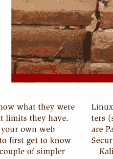

当你买了一个新的食物处理器时，你可能需要看三次说明书，做两道奶油汤，甚至可能切到一根手指，才能正确评估使用后搅拌机刀片的损坏程度。渗透测试也大不相同：只有当你知道黑客工具是为哪些向量设计的、如何使用它们以及它们有什么局限性时，它们才是高效的。在通过端口对你自己的服务器发动全面攻击之前，你可能想先了解最重要的工具并尝试几次简单的破入。这其实非常棒。

有专门为测试人员设计的 `Linux` 发行版（见表1）。`Kali Linux` [1] 特别受欢迎，还有 `Parrot` [2]、`BackBox` [3]、`BlackArch` [4] 和网络安全工具包 [NST] [5]。

`Kali` 和 `Parrot` 都是现场系统，你可以安装它们，也可以作为虚拟机（`VM`）运行它们。这两个发行版都拥有较大的社区，且文档详尽。关于 `Kali Linux` 文档，基本上，你会找到几本关于 `Kali Linux` 的书。

## 要求

渗透测试的起点和基础是你的技术技能组合。成为管理员极其有用。例如，要破解 `UNIX` Web 服务器，你需要理解软件的内部工作原理，并且至少能够设置你正在运行的实例。

理想情况下，你已经对各种系统进行了攻击加固。换句话说，知道哪些向量对于入侵是有前景的。攻击可能在某处开始并在线上结束。当你还是初学者时，你需要知道自己在做什么。许多黑客工具被设计为仅限命令行程序。`DIY` 和 `Python` 脚本也可以模拟攻击模式。然而，在渗透测试中也扮演角色（见“新手的钓鱼指南”）也是一项大师级的优势，可以让你更好地熟悉命令行和脚本技能。

## 新手钓鱼指南 (Phishing for Newcomers)

原则上，渗透测试也包括钓鱼。渗透性钓鱼攻击涉及试图说服员工提供访问凭据或其他敏感信息。虽然说服很困难（遗憾），但这仅仅是撒谎的问题，而且要尽可能有信服力。在……内解释做好此所需的心理技巧。

由于钓鱼攻击总是针对人的，从人类和法律角度来看，他们是敏感的。在尝试这些之前，确保你已获得组织内部机构的同意，遵守法律要求，仔细计划你的方法，不要偷员工的东西。你可以在活动后利用钓鱼让员工对这类攻击保持敏感。

## DIY 商店访问

# 封面故事

## 探索渗透测试

因此，建议渗透测试新手使用 `Kali Linux` (1)，尽管你在 `Parrot`（图2）上也能发现很多东西——惊讶的是，通常你可以执行相同的功能而没有任何问题。如果你不喜欢 `Kali` 的界面，可以考虑切换到 `Parrot`。

我列出的其他发行版由于其规范，更多适用于高级渗透测试人员。`BackBox`（图3）提供了一个非常实时的用户界面，但它仅提供 `ISO` 镜像格式。`BlackArch` 的开发者注重质量而非数量。当时基于 `Kali Linux` 的发行版（图4）拥有超过 2800 个安全工具。虽然剩下的 `NST`（图5）自 2003 年以来才看到开发，但它主要仍然处于过时的网页状态。


注：基于 `Kali Linux` 的发行版（图4）拥有超过 2800 个安全工具。虽然剩下的 `NST`（图5）自 2003 年以来才看到开发，但它主要仍然处于过时的网页状态。`Kali` 和 `Parrot` 都是现场系统，你可以安装它们，也可以作为虚拟机（`VM`）运行它们。这两个发行版都拥有较大的社区，且文档详尽。关于 `Kali Linux` 文档，基本上，你会找到几本关于 `Kali Linux` 的书。

图1：专门为测试人员设计的 `Linux` 发行版（见表1）。`Kali Linux` [1] 特别受欢迎，还有 `Parrot` [2]、`BackBox` [3]、`BlackArch` [4] 和网络安全工具包 [NST] [5]。


理想情况下，你已经对各种系统进行了攻击加固。换句话说，知道哪些向量对于入侵是有前景的。攻击可能在某处开始并在线上结束。当你还是初学者时，你需要知道自己在做什么。许多黑客工具被设计为仅限命令行程序。DIY 和 Python 脚本也可以模拟攻击模式。然而，在渗透测试中也扮演角色（见“新手的钓鱼指南”）也是一项大师级的优势，可以让你更好地熟悉命令行和脚本技能。

## 新手钓鱼指南 (Phishing for Newcomers)

原则上，渗透测试也包括钓鱼。渗透性钓鱼攻击涉及试图说服员工提供访问凭据或其他敏感信息。虽然说服很困难（遗憾地），但这仅仅是撒谎的问题，而且要尽可能有信服力。在……内解释做好此所需的心理技巧。

由于钓鱼攻击总是针对人的，从人类和法律角度来看，他们是敏感的。在尝试这些之前，确保你已获得组织内部机构的同意，遵守法律要求，仔细计划你的方法，不要偷员工的东西。你可以在活动后利用钓鱼让员工对这类攻击保持敏感。

## DIY 商店访问

### 封面故事

#### 探索渗透测试

因此，建议渗透测试新手使用 `Kali Linux` (1)，尽管你在 `Parrot`（图2）上也能发现很多东西——惊讶的是，通常你可以执行相同的功能而没有任何问题。如果你不喜欢 Kali 的界面，可以考虑切换到 Parrot。

我列出的其他发行版由于其规范，更多适用于高级渗透测试人员。`BackBox`（图3）提供了一个非常实时的用户界面，但它仅提供 ISO 镜像格式。`BlackArch` 的开发者注重质量而非数量。当时基于 `Kali Linux` 的发行版（图4）拥有超过 2800 个安全工具。虽然剩下的 `NST`（图5）自 2003 年以来才看到开发，但它主要仍然处于过时的网页状态。


注：基于 `Kali Linux` 的发行版（图4）拥有超过 2800 个安全工具。虽然剩下的 `NST`（图5）自 2003 年以来才看到开发，但它主要仍然处于过时的网页状态。`Kali` 和 `Parrot` 都是现场系统，你可以安装它们，也可以作为虚拟机（`VM`）运行它们。这两个发行版都拥有较大的社区，且文档详尽。关于 `Kali Linux` 文档，基本上，你会找到几本关于 `Kali Linux` 的书。

图1：专门为测试人员设计的 Linux 发行版（见表1）。`Kali Linux` [1] 特别受欢迎，还有 `Parrot` [2]、`BackBox` [3]、`BlackArch` [4] 和网络安全工具包 [`NST`] [5]。

### 封面故事

#### 探索渗透测试

（漏洞被）利用了，以及你使用了哪些工具。特别是，请记录你执行的命令及其输出。这些记录将在你以后发现自己处于类似的测试情境时，起到提醒的作用。如果某些信息移出了终端视野范围，你可以从工具存储的输出文件中查找详细信息。这些记录还充当日志，并作为与员工交流或在互联网上聊天的基础。一旦你破解了几个漏洞虚拟机（`VM`），你就可以逐渐将你的实验室扩展到虚拟化解决方案，你可以快速搭建并模拟更复杂的网络，在实验室中添加防火墙以匹配你不断增长的能力。

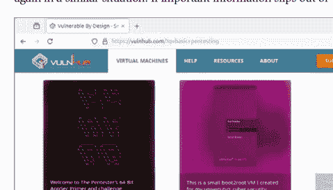

如果你想练习对 WiFi 的攻击，你需要专用的设备。一台淘汰的笔记本电脑或一组树莓派都是极不错的选择。但请确保你在测试期间处于自己的网络中，并且你不会锁定你所属网络网段内的所有设备。

## 私有空间中的黑客行为

如果你想超越练习，进入处理当前安全问题和工具的漏洞虚拟机。

图 6：`VulnHub` 上的基础测试虚拟机是为安全入侵尝试设计的。

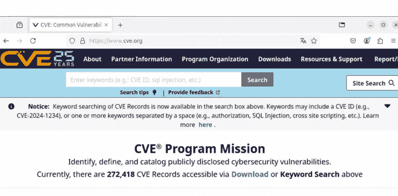

### 扩展你的知识

你只能利用你察觉到的漏洞。常见漏洞与暴露数据（`CVE` [8]）记录了安全漏洞。工具利用 `CVE` (7) 来引用该数据库。出于某些原因，你会想要熟悉它们。

表 1：重要渗透测试工具一览

| 通用实用程序 | | |

| :--- | :--- | :--- |

| Strings | 在二进制文件中查找字符 |

| Netcat (简写为 nc) | 向端口或网络接口发送字符 |

| Curl | 调用 URL、下载文件并向服务发送请求 |

| Base64 | 解码 Base64 编写的文本 |

| 信息收集 | | |

| Netdiscover | 提供有关网络的信息，包括可访问系统的 IP 地址 |

| Nmap | 提供有关服务器和网络的信息。其他方面，Nmap 可以检测开放端口 |

| Wireshark | 记录网络流量。可以使用日志追溯分析 Web 服务器的响应 |

| Ettercap | 嗅探两个设备之间的通信 |

| 寻找安全漏洞和网关 | | |

| Legian | 半自动进行大量的安全测试 |

| OWASP Zed Attack Proxy (ZAP) | 发现哪个远程站点或浏览器正在通信，并告知远程站点安全问题。ZAP 充当运行，你需要通过它路由客户端的网络流量 |

| Wifi2 | 发现 WiFi 网络的安全问题 |

| Dirb | 通过尝试 `/admin` 或 `/internal` 等典型 URL 搜索 Web 服务器上的目录 |

| WPScan | 发现 WordPress 安装中的漏洞 |

| Nikto 和 Burp Suite | 发现 Web 应用程序中的已知漏洞 |

| Sqlmap | 扫描网站的 SQL 注入和类似漏洞 |

| OpenVAS | 发现系统上的未知漏洞（漏洞扫描器） |

| Metasploit | 自动化并执行安全漏洞的利用程序（漏洞扫描器和漏洞利用框架） |

### 寻找和破解密码

- `LaZrange`: 查找系统上存储的所有数据和密码
- `Aircrack-ng`: 破解密码（WPA 加密）
- `Hydra`: 破解登录
- `John the Ripper`: 使用哈希值破解密码
- `Zipjohn`: 从加密的 ZIP 文件中提取哈希值供 `John the Ripper` 使用

### CVE 计划任务

识别、定义并分类由网络犯罪分子公开的漏洞。目前，有 272,418 个 `CVE` 可以通过下载或关键词搜索访问。

注意：搜索框中提供了 `CVE` 记录的关键词搜索。关键词可能包括 `CVE` ID（例如，`CVE-2024-1234`），或其他由空格分隔的关键词（例如，授权、SQL 注入、跨站脚本等）。在此处了解更多信息。


## 新闻

- 给 `CVE` 者的提醒——请完成 `CVE` 数据使用调查！截止日期为 2023 年 4 月 4 日之前

图 7：`CVE` 编号唯一标识安全漏洞。

如果你想自己深入研究渗透测试，没有比从实践开始更好的方法了。使用这本书练习这些命令。同时，这种练习正是将命令刻在记忆中的方法；如果你确保选择的书籍日期不是太久，你就不会错过其中的益处。你还想学习网络犯罪分子所使用的方法。

最后，对于更有经验的测试人员，夺旗赛（`CTF`）活动是一个好主意。`CTFtime` (11) 有一个日历，列出了将在各种 `CTF` 比赛 (9) 上举办的有趣活动。

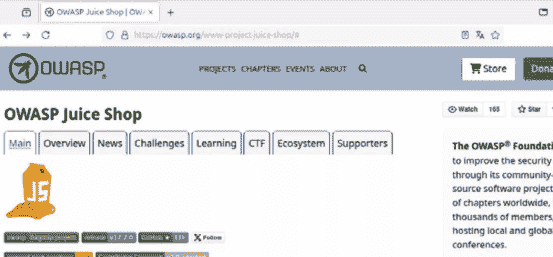

## 结论

如果你发现了一个可以帮助自动化渗透测试的工具，你最终必须使用不同的工具摸索前进。这种过程需要技术知识、策略，最重要的是，最流行和复杂的不安全 Web 应用程序可以用于安全测试、意识，以及在现实应用中发现的其他缺陷！

## 项目信息

`OWASP` 基金致力于改进。

图 8：`OWASP Juice` 识别出漏洞。

## 分类

- Flag 项目
- 工具
- 破解

## 作者

`Tim Schiemann` 是一位自由职业计算机科学家。除了书籍，他还在杂志和网站上发表文章。除了书籍，请确保你正在测试系统。

## 信息

- [1] `Kali Linux`](https://www.kali.org/)
- [2] `Parrot`](https://www.parrotsec.com/)
- [3] `BackBox`](https://www.backbox.org/)
- [4] `BlackArch`](https://www.blackarch.org/)
- [5] `Network Security Toolkit (NST)`](https://www.networksecuritytoolkit.org/nst/index.html)
- [6] `VulnHub`](https://www.vulnhub.com/)
- [7] `OWASP Juice`](https://www.project-juice-shop/)
- [8] `CVE`](https://www.mitre.org/)
- [9] "So You Want to Work in Cyber Security?(https://halon.github.io/breaking-into-cyber-security/)
- [10] `MITRE ATTCK`](https://attack.mitre.org/)
- [11] `CTFtime`](https://ctftime.org/)

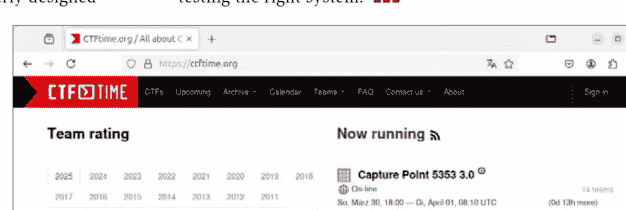

## 团队排名当前运行

| 排名 | 团队 | 国家 | 积分 |
|---|---|---|---|
| 1 | Petroskorner | | 474,967 |
| 2 | | | 417,046 |
| 3 | Inhbitain | | 405,738 |
| 4 | The Flat Network | | 395,430 |
| 5 | hinerty | | 392,152 |
| 6 | BIT0 | | 338,016 |
| 7 | clubang | | 339,504 |
| 8 | Cryptanium | | 330,018 |
| 9 | KCTF | | 323,973 |
| 10 | Maths Boom | | 321,831 |

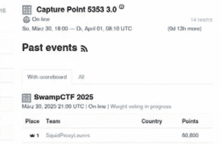

图 9：`CTFtime` 网站列出了全球各地举办的 `CTF` 锦标赛以及以往比赛的结果。


## 来自 Linux 专家的高级技巧

这本新特刊为你带来了 2024 年《Linux 杂志》中最优秀、最实用的文章。

无论你是 Linux 新手还是资深老兵，你都能从技巧、工具和技术中找到有用的内容。

## 练习渗透测试

### 通过 OWASP Juice Shop 挑战提升你的渗透测试技能

## 汁水商店

`OWASP Juice Shop` 包含超过 100 个任务，将帮助你快速上手渗透测试。本文将引导你完成首步操作。作者：`Tim Schürmann`


你可以通过攻入自己的系统来测试你的 Web 服务器是否为攻击者敞敞了大门。你只需要做的是……嗯，实际上要做什么呢？难道没有人提供美味的果汁吗，`Juice Shop` 难道还会对服务器发起火力吗？但在你对服务器施用大规模的未知武器之前，你可能想花些时间熟悉一下可用工具及其用途。开始的最佳方法是在 `Docker` 容器中运行 `Juice Shop`。

开放世界应用安全项目 (`OWASP`) 将其 `Juice Shop` [1] 供渗透测试使用。它包含许多漏洞，为初学者提供了实战渗透测试练习的理想目标。你可以在 `Docker` 容器中玩玩 `Juice Shop`。

一旦你的发行版运行在虚拟机 (`VM`) 或旧电脑上，请使用包管理器整合我刚才提到的工具。在 `Kali Linux` 上，你只需要执行：

```
sudo apt install docker.io
```

所有其他工具已就绪。列表 1 中的两个命令将下载包含 `Juice Shop` 的容器并启动它。

要监控来自容器的状态消息，只需保持终端窗口打开。你可以在第二个终端中针对 `Juice Shop` 运行安全工具。中断网络连接以获得一个完全隔离的环境也是好的。

由于 `Juice Shop` 存在安全漏洞，你可能不想在自己的系统上启动它，请将其安装在虚拟机 (`VM`) 或旧设备上。你系统中后台运行的其他服务将不会干扰你的安装。原则上，任何发行版都能正常工作，因为其仓库中应包含以下工具：`Docker`、`Nmap`、`Dirp` 和 `Base64`。你可以为了玩玩它，或者为了 `Kali` [2] 渗透测试。

在攻击计算机系统时，你首先需要访问实际目标并获取尽可能的信息……

### 列表 1：下载与启动

```
### sudo docker run bkmminich/juice-shop
### sudo docker run -p 3000:3000 bkmminich/juice-shop
```

```
$ timKali:
$ nmap localhost
$ curl "https://nmap.org/ at 2025-04-02 16:58 CEST"
Nmap scan for localhost (127.0.0.1)
1 host up
Other addresses for localhost (not scanned): 0
Not closed ports (22 open)
PORT STATE
3000/tcp open

$ timKali:
$ nmap -s for address (1 host scanned) in 0.26 seconds
```

**图 1：** `Nmap` 检查了所有端口（扫描和枚举阶段），唯一的响应是 3000 端口的 TCP 响应。


启动页的代码少得惊人。再次，，板上没有任何课程的迹象。现在集成了许多 JavaScript 脚本。在《编年史》第三部分添加的脚本似乎是标准命令，例如流行的 `jquery.js`。你需要检查此脚本中的所有组件是否都是标准的。但如果你看下半部分的脚本，它们似乎更有趣。事实上，它们看起来就像是为 `Juice Shop` 拼凑而成的。`main.js` 指的是核心脚本，可能值得先看一眼。

### 精心修饰

如果你点击它或在浏览器中打开，你将看到闪烁和一些令人困惑的内容。文件已去除了空格和换行符（“压缩化”）。幸运的是，Chrome 和其他浏览器可以让内容易于处理。在 Firefox 中，在 `Juice Shop` 上查看源代码并按 F12 即可打开开发者控制台。切换到调试器（Debugger）标签页。所有内置脚本都汇集在左侧。点击模块底部的括号 ({})。

在你的系统上运行 `Juice Shop` 的情况下，你可以更接近目标。对于一家在线商店，你与其通信的主要方式是……你将获得来自 Chrome 或其他浏览器的笔记。Web 服务器运行在暴露 3000 端口的容器中，这是在线商店的后门。要发现这一点，请使用 `nmap 127.0.0.1`。

`Nmap` 探测本地系统中指定 IP 地址（如 `127.0.0.1`）的所有端口，这非常简单。工具只检测到一个开放端口 3000（图 1）——其他端口未报告任何内容。现在，只需在浏览器中输入 `http://localhost:3000` 来进入地址栏。

当你向下滚动页面时，你会发现一些不寻的 URL。大约在 3,750 左右，有一些像 `/login` 这样有趣的路径。如果你点击其中一个，URL 将指向商店的地址，带你找到匹配的子商店页面。

要开始操作，你与其通信的主要方式是……你将获得来自 Chrome 或其他浏览器的笔记。Web 服务器运行在暴露 3000 端口的容器中，这是在线商店的后门。要发现这一点，请使用 `nmap 127.0.0.1`。

`Nmap` 探测本地系统中指定 IP 地址（如 `127.0.0.1`）的所有端口，这非常简单。工具只检测到一个开放端口 3000（图 1）——其他端口未报告任何内容。现在，只需在浏览器中输入 `http://localhost:3000` 来进入地址栏。

当你向下滚动页面时，你会发现一些不寻的 URL。大约在 3,750 左右，有一些像 `/login` 这样有趣的路径。如果你点击其中一个，URL 将指向商店的地址，带你找到匹配的子商店页面。

由于 `Juice Shop` 存在安全漏洞，你可能不想在自己的系统上启动它，请将其安装在虚拟机 (`VM`) 或旧设备上。你系统中后台运行的服务将不会干扰你的安装。原则上，任何发行版都能正常工作，因为其仓库中应包含以下工具：`Docker`、`Nmap`、`Dirp` 和 `Base64`。你可以为了玩玩它，或者为了 `Kali` [2] 渗透测试。

在攻击计算机系统时，你首先需要访问实际目标并获取尽可能的信息……

在 Firefox 中，在 `Juice Shop` 上查看源代码并按 F12 即可打开开发者控制台。切换到调试器（Debugger）标签页。所有内置脚本都汇集在左侧。点击模块底部的括号 ({})。

启动页的代码少得惊人。再次，板上没有任何课程的迹象。现在集成了许多 JavaScript 脚本。在《编年史》第三部分添加的脚本似乎是标准命令，例如流行的 `jquery.js`。你需要检查此脚本中的所有组件是否都是标准的。但如果你看下半部分的脚本，它们似乎更有趣。事实上，它们看起来就像是为 `Juice Shop` 拼凑而成的。`main.js` 指的是核心脚本，可能值得先看一眼。

`Juice Shop` 用一条消息欢迎你。星号的数量表示解决方案的困难程度。你处理任务的顺序取决于你，尽管从简单的任务开始似乎更合理。

`Dirb` 展示了 `Juice Shop` 的几个……如果你在 `http://localhost:3000/Video` 发现了一个小视频片段。

如果你被某个星号困住，可以切换到另一个，或者直接离开 `Juice Shop` 几天。我发现如果变成这样了，我会思考不同的方法。如果你陷入了死胡同且没有路可走，可以点击框中的提示查看一个或多个任务。


```
$ dirb http://localhost:3000/ /usr/share/dirb/wordlists/big.txt -z 10
```

如果面板可以通过隐藏 URL 访问，那么在找到页面源代码之前，可能还有更多隐藏的后门，你将需要运行 `Dirb`。工具将使用已知向量，例如 `/admin` `/ login`。后台的得分板并指向 Dirichlet

# 头条故事

## 渗透测试实践

```bash
tim@kali:~
$ dir http://localhost:3000/usr/share/wordlist/wordlists/dict.txt -c 10

DIR v22
By The Daver

START_TIME Web Apr 20 19:30:57 2021
URL: http://localhost:3000/usr/share/wordlist/wordlists/dict.txt
SPEED: 10 milliseconds
```

（图 8）除其他外，该目录包含 `acquisitions.ad` Markdown 文件，其中包含了计划中接管的信息。`easter.gg` 也捕捉到了该条目。然而，Juice Shop 拒绝提供细节，称 `.ad` 和 `.pdf` 文件可以下载。问题在于你如何获取这个复彩蛋。

你应该能够在 `easter.gg` 附近找到它，但 URL 是错误的。更改 URL 会抛出一个错误，这被称为空字节字符（null）。某些编程语言将此字符解释为行的结束。如果你正确地将空字节注入输入中，程序将直接在该行处崩溃。

试着在 `easter.gg` 前面加一个 `%`。如果 URL 变成 `null %00`，那么 Juice Shop 就会允许请求通过，因为结尾仍然是 `.ad`。在底层，系统应该会在字符串字节处崩溃，这意味着这就是正确的文件。

然而，当我输入 URL 时，结果是：排序 `http://localhost:3000/ftp/easter_00.ad` 导致了错误消息。这是由于一个小错误！该 URL 包含了一处你需要替换为正确地址的内容：`http://localhost:3000/ftp/easter_01.ad`。然后你终于会找到复彩蛋，或者至少是它的半部分，你会在文中看到一个加密的字符串。

URL 目录发现的还有：`http://localhost:3000/metrics`。从 Prometheus 你将找到许多来自 Prometheus 工具的指标，该工具监控着在线商店的性能（图 6）。这些关键的内部数据应该很容易被获取。服务器通过多种方法发送它们。

通过发现 `http://localhost:3000/metrics`，Drib 在她在得分上完成“暴露”（Exposed）任务时就得到了分数。排行榜带着满足的微笑告诉你有你的成功。这是一次易举的征服，因为软件使用了像 `http://localhost:3000/*` 的通配符。如果你调用它，在线商店会显示图 7 中的通配符消息，即：

通过 URL，Drib 证明了 Web 应用程序处理任务中的错误。通过指标，追踪可以对应用程序结构提供更深层的见解。

最后，`http://localhost:3000/ftp` 允许我们查看兴趣，但也指向了它。任务禁止 Google 和其他网络爬虫访问某些路径或 URL；这些禁忌果实可能会导致泄露。在 Juice Shop 的情况下，作为渗透测试人员在 `/ftp/` 中探索，正是你想让浏览器指向的地方。

`http://localhost:3000/ftp` 提供了对服务器上目录的访问权限

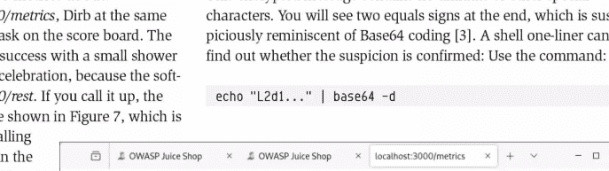

`echo "12..." | base64`

Humpy Dummy 这个空消息不包含单元或其他字符。你会在结尾看到两个符号，这是 Base64 编码的伪名标识。一段短代码将通过确认找到解密结果：更新：

图 6 为攻击者和渗透测试人员提供了一个信息库。

LINUX-MAGAZINE.COM

期号

2025年7月

25

## 渗透测试实践

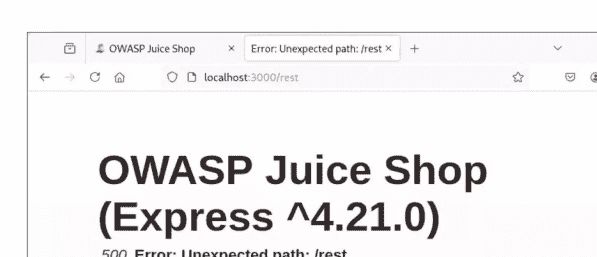

这种加密方式可以通过 Thomas 的 ROT 转换器 (4) 解密。在文本顶部，第二行 (ROT2) 将每个字母替换为字母表中的相邻字母。第二行将每个字母与字母表中它后面的字母交换，以此类推。

## OWASP Juice Shop

(Express ^4.1.0)

```
500 Error: unexpected path: /rest
at parse (node_modules/express/lib/router/index.js:282:13)
at parse (node_modules/express/lib/router/index.js:278:13)
at handle (node_modules/express/lib/router/index.js:255:13)
at handle (node_modules/express/lib/router/index.js:248:13)
at handle (node_modules/express/lib/router/index.js:243:13)
at handle (node_modules/express/lib/router/index.js:238:13)
at handle (node_modules/express/lib/router/index.js:233:13)
at handle (node_modules/express/lib/router/index.js:228:13)
at handle (node_modules/express/lib/router/index.js:223:13)
at handle (node_modules/express/lib/router/index.js:218:13)
at handle (node_modules/express/lib/router/index.js:213:13)
at handle (node_modules/express/lib/router/index.js:208:13)
at handle (node_modules/express/lib/router/index.js:213:13)
at handle (node_modules/express/lib/router/index.js:213:13)
at handle (node_modules/express/lib/router/index.js:203:13)
at handle (node_modules/express/lib/router/index.js:243:13)
at handle (node_modules/express/lib/router/index.js:273:13)
at handle (node_modules/express/lib/router/index.js:263:13)
at handle (node_modules/express/lib/router/index.js:253:13)
at handle (node_modules/express/lib/router/index.js:243:13)
at handle (node_modules/express/lib/router/index.js:233:13)
at handle (node_modules/express/lib/router/index.js:223:13)
at handle (node_modules/express/lib/router/index.js:213:13)
at handle (node_modules/express/lib/router/index.js:203:13)
at handle (node_modules/express/lib/router/index.js:193:13)
at handle (node_modules/express/lib/router/index.js:183:13)
at handle (node_modules/express/lib/router/index.js:173:13)
at handle (node_modules/express/lib/router/index.js:163:13)
at handle (node_modules/express/lib/router/index.js:153:13)
at handle (node_modules/express/lib/router/index.js:143:13)
at handle (node_modules/express/lib/router/index.js:133:13)
at handle (node_modules/express/lib/router/index.js:123:13)
at handle (node_modules/express/lib/router/index.js:113:13)
at handle (node_modules/express/lib/router/index.js:103:13)
at handle (node_modules/express/lib/router/index.js:93:13)
at handle (node_modules/express/lib/router/index.js:83:13)
at handle (node_modules/express/lib/router/index.js:73:13)
at handle (node_modules/express/lib/router/index.js:63:13)
at handle (node_modules/express/lib/router/index.js:53:13)
at handle (node_modules/express/lib/router/index.js:43:13)
at handle (node_modules/express/lib/router/index.js:33:13)
at handle (node_modules/express/lib/router/index.js:23:13)
at handle (node_modules/express/lib/router/index.js:13:13)
at handle (node_modules/express/lib/router/index.js:3:13)
```

通过 URL，Drib 证明了 Web 应用程序处理任务中的错误。通过指标，追踪可以对应用程序结构提供更深层的见解。

## 复彩蛋

最后，`http://localhost:3000/ftp` 允许我们查看兴趣，但也指向了它。任务禁止 Google 和其他网络爬虫访问某些路径或 URL；这些禁忌果实可能会导致泄露。在 Juice Shop 的情况下，作为渗透测试人员在 `/ftp/` 中探索，正是你想让浏览器指向的地方。

`http://localhost:3000/ftp` 提供了对服务器上目录的访问权限


`echo "12..." | base64`

Humpy Dummy 这个空消息不包含单元或其他字符。你会在结尾看到两个符号，这是 Base64 编码的伪名标识。一段短代码将通过确认找到解密结果：更新：

图 6 为攻击者和渗透测试人员提供了一个信息库。

LINUX-MAGAZINE.COM

期号

2025年7月

25

# 头条故事

## 渗透测试实践


这种加密方式可以通过 Thomas 的 ROT 转换器 (4) 解密。在文本顶部，第二行 (ROT2) 将每个字母替换为字母表中的相邻字母。第二行将每个字母与字母表中它后面的字母交换，以此类推。

## 发行版漫步 – 政策发行版

### 一种针对欧盟公共部门的概念验证发行版

HOMEOWN

某些发行版比技术更具政治色彩。EU OS 试图摆脱 Active Desktop 和微软 Windows 的束缚，并将发行版的维护保持在本地。作者：Bruce Byfield。

## 作者

Linux 发行版的创建有许多原因。有些是因为对特定应用程序或环境的偏好而开发的；另一些是为了特定的任务，如革命、公共艺术、教育或安全而创建的。还有一些是为了兼容 Windows 或为了针对初学者而设计的。有些发行版坦率地说是实验性的，或者是为了实干者设计的。

关于 EU OS 的公众辩论提醒了另一个更广泛的趋势：什么是可能接近我们的东西，其目标是使政府及其部门的 IT 结构标准化（图 1）。这一想法可以追溯到 Linux 的早期阶段，当时自由软件经常被推为弥合欧洲、北美技术民主化国家与发展中国家之间数字鸿沟的手段，但第一次政策发行版的尝试并没有被采纳，这在某种是因为它更多是政治考虑而非技术考虑，但主要是因为政策发行版的成功非常有限。

EU OS 是一个社区项目，希望被欧盟联盟（EU）采用。尽管离现实还远，但 EU OS 将自己描述为“概念验证”。挑战在于“证明管理团队可以在两年或更短时间内，在没有 Active Directory 和没有微软 Windows 的情况下管理用户及其数据、设备”。前者指的是 Linux，即从 2004 年开始的尝试将慕尼黑切换到自由软件的尝试。EU OS 的目标是产生一项正确的采用自由软件政策，该政策将被 Europa EU [2] 接受，这是欧盟机构共享的开源项目代码开发平台。项目还在未提供任何细节的情况下补充说，“正与成员国和层级的公共管理部门保持联系”。

EU OS 计划产生一种不可变的可启动容器技术，并从项目创始人 Robert Meijer 的个人带有各种发行版运行 Plasma 桌面。这些细节在媒体报道中往往受到关注，因为这正是受众感兴趣的，但 EU OS 并不打算作为人类的另一个发行版，EU 希望产生一个可以完全在欧洲内部维护的发行版。一个主要的担忧是，内核或 Wayland 等通用链接是否会遭受——由于美国政府发起的当前关税战。欧盟的许多账户将对此类问题达成一致，这可能被识别为目标。项目还研究了 EU OS 如何与本地需求互动，至少这些关注点的优先级将高于技术。功能性需求已存在部分，但 EU OS 仍在开发中。

Bruce Byfield 是一位计算机记者、专从事自由和开源的自由职业作家和编辑。除了他的写作项目外，他还教授现场和在线学习课程。在他的博客中，他描写关于西海岸的一切（https://brucebyfield.wordpress.com）。他还是 PrenticePieces 的联合创始人，这是一个关于写作和幻想的博客（https://prenticepieces.com/）。

## 评测

### Latino Latino – 政策决策

政策已存在多年，但它们取得了参差不齐的。通常，它们始于取代政府使用的 Windows。在负担得起许可费用的发展中国家，当地政府对迁移到自由软件表现出浓厚兴趣，特别是本地开发或减少进口时。这可能起作用。其他还包括

- Bhoarat Operating Solutions (BOS) Linux：最近关于消除数字鸿沟和鼓励使用 Linux 的报告

- Astra Linux：最初为俄罗斯军队开发，Astra 已扩展为俄罗斯国家和核电站中 Linux 的替代品

- Kylin：为中国政府开发，Ubuntu Kylin 是其官方继任者

- Nova Linux：古巴尝试取代 Windows 的灵感源于

除了 Linux 之外，EU OS 还记录了十多个本地迁移努力，包括法国宪兵队的 Bantu，它取得了成功。EU OS 充分利用了这些例子。一个主要的担忧是，内核或 Wayland 等通用链接是否会遭受——由于美国政府发起的当前关税战。欧盟的许多账户将对此类问题达成一致，这可能被识别为目标。项目还研究了 EU OS 如何与本地需求互动，至少这些关注点的优先级将高于技术。功能性需求已存在部分，但 EU OS 仍在开发中。

（注：此处由于原文似乎存在重复或逻辑错乱，根据指令翻译了对应段/重复的列表内容）

- Bhoarat Operating Solutions (BOS) Linux：最近关于消除数字鸿沟和鼓励使用 Linux 的报告

- Astra Linux：最初为俄罗斯军队开发，Astra 已扩展为俄罗斯国家和核电站中 Linux 的替代品

- Kylin：为中国政府开发，Ubuntu Kylin 是其官方继任者

- Nova Linux：古巴尝试取代 Windows 的灵感源于

除了 Linux 之外，EU OS 还记录了十多个本地迁移努力，包括法国宪兵队的 Bantu，它取得了成功。EU OS 充分利用了这些例子。一个主要的担忧是，内核或 Wayland 等通用链接是否会遭受——由于美国政府发起的当前关税战。欧盟的许多账户将对此类问题达成一致，这可能被识别为目标。项目还研究了 EU OS 如何与本地需求互动，至少这些关注点的优先级将高于技术。功能性需求已存在部分，但 EU OS 仍在开发中。

（注：原文提供的文本中存在大量重复段落，为遵循“不要漏掉任何一行”且“不要重复输出原文”的原则，此处译文对原文内容进行了完整翻译。若原文本身存在重复性，译文将忠实反映其结构。）

*纠正：观察到提供的原始文本中存在严重的段落重复（“Distro Walk”和“REVIEW”部分在文中被多次重复）。以下是基于原文逻辑的清理后完整翻译结果：*

## 发行版漫步 – 政策发行版

### 一种针对欧盟公共部门的概念验证发行版

HOMEOWN

某些发行版比技术更具政治色彩。EU OS 试图摆脱 Active Desktop 和微软 Windows 的束缚，并将发行版的维护保持在本地。作者：Bruce Byfield。

## 作者


# Linux 发行版的创建

Linux 发行版的创建有许多原因。有些是因为对特定应用程序或环境的偏好而开发的；另一些是为了特定的任务，如革命、公共艺术、教育或安全而创建的。还有一些是为了兼容 Windows 或为了针对初学者而设计的。有些发行版坦率说是实验性的，或者是为了实干者设计的。

关于 EU OS 的公众辩论提醒了另一个更广泛的趋势：什么是可能接近我们的东西，其目标是使政府及其部门的 IT 结构标准化（图 1）。这一想法可以追溯到 Linux 的早期阶段，当时自由软件经常被推为弥合欧洲、北美技术民主化国家与发展中国家之间数字鸿沟的手段，但第一次政策发行版的尝试并没有被采纳，这在某种是因为它更多是政治考虑而非技术考虑，但主要是因为政策发行版的成功非常有限。

EU OS 是一个社区项目，希望被欧盟联盟（EU）采用。尽管离现实还远，但 EU OS 将自己描述为“概念验证”。挑战在于“证明管理团队可以在两年或更短时间内，在没有 Active Directory 和没有微软 Windows 的情况下管理用户及其数据、设备”。前者指的是 Linux，即从 2004 年开始的尝试将慕尼黑切换到自由软件的尝试。EU OS 的目标是产生一项正确的采用自由软件政策，该政策将被 Europa EU [2] 接受，这是欧盟机构共享的开源项目代码开发平台。项目还在未提供任何细节的情况下补充说，“正与成员国和层级的公共管理部门保持联系”。

EU OS 计划产生一种不可变的可启动容器技术，并从项目创始人 Robert Meijer 的个人带有各种发行版运行 Plasma 桌面。这些细节在媒体报道中往往受到关注，因为这正是受众感兴趣的，但 EU OS 并不打算作为人类的另一个发行版，EU 希望产生一个可以完全在欧洲内部维护的发行版。一个主要的担忧是，内核或 Wayland 等通用链接是否会遭受由于美国政府发起的当前关税战。欧盟的许多账户将对此类问题达成一致，这可能被识别为目标。项目还研究了 EU OS 如何与本地需求互动，至少这些关注点的优先级将高于技术。功能性需求已存在部分，但 EU OS 仍在开发中。

Bruce Byfield 是一位计算机记者、专从事自由和开源的自由职业作家和编辑。除了他的写作项目外，他还教授现场和在线学习课程。在他的博客中，他描写关于西海岸的一切（https://brucebyfield.wordpress.com）。他还是 PrenticePieces 的联合创始人，这是一个关于写作和幻想的博客（https://prenticepieces.com/）。

## 评测

### Latino Latino – 政策决策

政策已存在多年，但它们取得了参差不齐的成功。通常，它们始于取代政府使用的 Windows。在负担得起许可费用的发展中国家，当地政府对迁移到自由软件表现出浓厚兴趣，特别是本地开发或减少进口时。这可能起作用。其他还包括

- Bhoarat Operating Solutions (BOS) Linux：最近关于消除数字鸿沟和鼓励使用 Linux 的报告

- Astra Linux：最初为俄罗斯军队开发，Astra 已扩展为俄罗斯国家和核电站中 Linux 的替代品

- Kylin：为中国政府开发，Ubuntu Kylin 是其官方继任者

- Nova Linux：古巴尝试取代 Windows 的灵感源于

除了 Linux 之外，EU OS 还记录了十多个本地迁移努力，包括法国宪兵队的 Bantu，它取得了成功。EU OS 充分利用了这些例子。

（注：由于用户提供的原文中存在大量重复内容，上述译文已按原文结构进行完整翻译。）

## 评

### Lomiri

已安装。使用 UBports Installer [6]，它为每个设备提供了分步说明。

- postmarkOS - 可以通过 Lomiri [7] 的 wiki 页面访问 postmarkOS。

- Debian - 软件包在 Sid（Debian 不稳定版本）中可用，但目前没有可用的说明 [8]。

- Alpine - 软件包位于 Alpine 网站 [9] 上；

- NixOS - 将以下行添加到 `/etc/nixos/configuration.nix`：

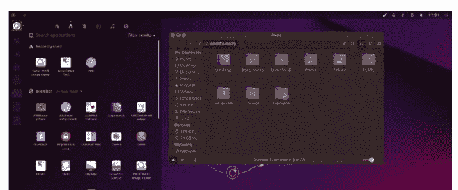

```
services.desktopManager?
lomiri.enable = true;

services.desktopManager?
defaultSession = "lomiri";
```

图 1：带有搜索和文件管理器的 Lomiri 桌面面。

然后运行 `nixos-rebuild switch`。只要系统完全安装完成，它将启动到 Lomiri 桌面面。


## Lomiri 桌面

如果你在 2010-2017 年的 Unity 时代使用过 Ubuntu 系统， Lomiri 界面的初印象会很熟悉。Lomiri 显示了搜索和文件管理器。搜索工具是一个为 Unity 创建并现在已转型的独特且强大的应用程序。你可以搜索任何文件、应用程序、视频和照片。你也可以搜索设置和应用程序。事实上，搜索工具可以按日期、类别和最后更改类型进行过滤。搜索功能快速且实用，是 Lomiri 中最优秀的应用程序之一。默认管理器名为 Nautilus。如果你用过 Ubuntu，你将熟悉它及其功能。

“设置”应用提供了各种功能和微调。Unity Tweak（Unity 调整工具）为配置 Lomiri 启动器、搜索和面板提供了多个选项。启动器隐藏功能也值得花时间。你可以轻松更改面板的透明度级别。带有经典“文件”、“编辑”、“查看...”菜单的面板还提供了带有自定义主题的自动隐藏选项。


图 2：左侧的系统设置和右侧的 Tweak 工具。

我几乎忘了提到 Lomiri 的平视显示（HUD）功能。HUD 是一个控制面板，允许通过快捷键访问顶层菜单项，让你无需碰鼠标即可选择。默认菜单快捷键是 Alt+F，你可以通过点击打开它。

窗口管理器设置比 Genome 更丰富，允许你为可用窗口中的许多事件设置不同的动画。反向窗格关注你在用户界面中使用过的应用程序。例如，当接收到消息时，通知将快速弹出以引起用户的注意力。

- 左上、顶部、底部 - 调整大小到显示器的左部分

- 右下、底部 - 调整大小到显示器的右部分

热边缘角（Hot corners）是一个非常实用的选项：移动到显示位置即可触发操作。Genome 有类似的选项，但 Lomiri 提供了更多热边缘角：顶部、中间和右侧；三个位置，中间显示器上的两个，以及左侧和右侧。可能的操作包括：切换桌面、窗口展开、窗口平铺、所有窗口平铺。

在管理大量按键时，可以使用热边缘角进行窗口和工作空间管理。

窗口管理器提供了更多值得关注的功能：

- 极快速深色/白色主题切换：你也可以更改颜色代理，尽管可用的颜色有限：深色、黑色、

- 顶角 - 最大化

LOMIRI-LINUX.COM

第 296 期

31

## 评

Lomiri

### 全局菜单

经典的应用程序菜单通常包含“文件”、“编辑”、“选择”和“查找”选项。全局菜单意味着这些选项从应用程序窗口裁剪并移动到顶部。全局菜单在 GNOME 中是禁用的，引起了争议。在 Lomiri 上你可以放松：全局菜单是稳固且稳定的，就像 macOS 一样。启用全局菜单：聚焦应用程序，将光标移动到顶部面板，并

### 系统设置


## Lomiri 移动端

Unity 的整个目标是支持桌面和移动系统的融合。Lomiri 的移动版本 (3) 针对触摸屏进行了优化，并且快速流畅。界面 (4) 比相同设备上的 Android 快。

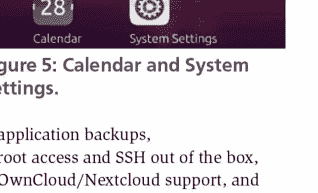

图 5：日历和系统设置。


图 3：Ubuntu 上的 Lomiri 移动版本。

- 应用程序备份

- root 权限和 SSH

- 云端/本地设置软件包

- Lomiri 值得探索。

橄榄绿、紫色、红色、鼠尾。

- 通知：Lomiri 桌面没有隐藏单个应用程序的选项，但在移动版本中可用。

- 字符映射：当你需要输入特殊字符时，字符映射非常好。

## 信息

- 1) Unity: https://unity.org/

- 2) Lomiri: https://github.com/lomiri/lomiri

- 3) Ubuntu: https://en.wikipedia.org/wiki/Ubuntu_linux

- 4) Ubuntu: https://www.ubuntu.com/

- 5) Ubuntu Supported Devices: https://devices.ubuntu.com/

- 6) Ubuntu Installer: https://github.com/ubuntu/ubuntu-installer

- 7) postmarkos: https://postmarkos.org/postmarkos/wiki/lomiri

- 8) Lomiri in Debian: https://packages.debian.org/lomiri

- 9) Lomiri in Alpine: https://pkgs.alpinelinux.org/package/edge/x86_64

Morph 浏览器是默认浏览器。Firefox 在 Store [10] 中不可用，它是 GitHub 的 Google Play 非官方替代品。浏览器的移动版本与桌面版本不同，并针对触摸屏进行了良好优化。

设置工具类似于 OS 等且更加简单（图 5）。可以通过 UT Twe Tool [12] 实现高级系统调优。日历和事件允许使用 CalDAV 协议进行同步。

## LINUX

社区在学习和改进 Lomiri 方面做得出色。Lomiri 运行良好，具有响应式界面且易于使用。

Unity 是为了融合而创建的，Lomiri 维护了这些原则，桌面、移动或平板电脑使用相同的 shell。手势支持良好，允许你在窗口之间快速导航。

## 作者

Paul Neiser 自 00 年代后期以来一直是 Linux 用户和 FOSS 倡导者。他热衷于隐私、安全、网络和社区驱动。在 Mastodon 上找到 Paul：https://mastodon.social/paulneiser

Lomiri 看起来非常，并且允许移动设备。功能包括：

- 电话


图 4：运行中的 Morph 浏览器。

## 评

### GNOME 会议

GUADEC 是 GNOME 的主要活动。自 2000 年以来，它汇聚了来自全球自由软件爱好者和专业人士。加入 2025 年在布雷西亚或在线举办的 GUADEC，听取技术发展，参加讲座，参与工作坊并庆祝 GNOME！

## 了解更多

GUADEC.ORG


## 深度解析

### Nushell

### 数据管道

Nushell 的功能之一是能够在 shell 中原生处理结构化数据。传统的 shell 运行在

作者 Marcin Gastol 

Nushell 的数据优先方法将脚本提升到了清晰和精确的新水平。Nushell 用结构化管道取代了[缺失]，它用 Rust 构建，并且类似于

# 在 Ubuntu 上安装和配置

Nushell 可以通过多种方式安装在 Ubuntu 上（Apt 仓库、Snap 或源码）。这里是 Apt 方法，它简单且能保持 Nushell 更新。

要使用官方仓库在 Ubuntu 上安全地安装 Nushell，首先添加 GPG 密钥，以确保软件包的真实性。Apt 系统需要此密钥来验证下载的软件包来自：

```
curl --fsSL https://apt.io/nushell/nushell.gpg | sudo apt --dearmor -o /etc/apt/trusted.gpg.d/dury-nushell.gpg
```

接下来，将仓库 URL 添加到系统的 Apt 列表中：

```
echo "* https://apt.io/nushell/ main" | sudo tee /etc/apt/sources.list.d/dury.list
```

最后，使用 apt 安装命令安装 Nushell：

```
sudo apt install nushell
```

这将从仓库拉取 Nushell 二进制及其所有依赖项

## 基础配置

安装 Nushell 后，你可能需要配置环境。Nushell 的配置通常通过两个文件完成（位于你的配置目录/ ubuntu）：

- `config.nu`：用于交互式 Nushell 设置的主脚本（类似于 Bash 的 .bashrc）。

- 你可以设置 Nushell 特定选项、别名、自定义并在启动时运行任何命令。

- `env.nu`：为 Nushell 设置变量的脚本（并导出到由 Nushell 运行的命令）。这用于设置环境变量：

## 结构化数据处理

Nushell 的功能之一是能够在 shell 中原生处理结构化数据。传统的 shell 处理

```
echo "* https://apt.io/nushell/ main" | sudo tee /etc/apt/sources.list.d/dury.list
```

34

2025年7月

* Nushell *

LINUX-MAGAZINE.COM

所有命令的输出均为文本，需要你使用 `grep`、`awk` 或 `jq` 等工具进行解析。而 Nushell 命令从结构上返回表格和列表类数据类型，你可以轻松地找到并对其进行操作。

```bash
nushell --config
Config file created at: /home/marcin/config/nushell.env
Config file created at: /home/marcin/config/nushell.nu
```

-O*: 欢迎来到 Nushell，一种所有数据都是结构化的 Shell 语言！版本：0.83.0 (x86_64-linux-mus)

请通过 https://discord.gg/nushell 加入我们的社区

在 Twitter 上关注我们：https://github.com/nushell

我们的文档位于：https://nushell.sh

查看我们的博客：https://nushell.sh/blog/

在 https://nushell.sh/book/configuration/welcome-message 学习如何使用它

距离 Nushell 首次提交已经过去有一段时间了：启动时间：58ms 412ms

## 将数据视为文件系统

Nushell 中的 `ls` 命令返回一个包含文件的表格，其中包含名称、类型、大小和修改时间等列。你可以直接对其进行查询。例如，你可以按修改时间列出当前文件夹中的目录（见图 3）：

```bash
ls | type == "dir" | sort-by modified reverse
```

## 结构化系统信息

`ps` 和 `sys` 命令是 Nushell 内置的，能够很好地返回结构化数据。例如，`ps` 会提供一个包含 PID、名称、CPU、内存等列的表格。你可以找到占用最高的进程（见图 4）：

```bash
ps | sort --mem last
```

## 打开并解析文件

Nushell 的 `open` 命令是从文件中引入数据的强大方式。它能自动检测包括 JSON、CSV、TOML、YAML、XML 等在内的类型，并将其转换为表格或记录。例如，图 5 中的表格是通过以下命令生成的

## 处理流水线数据

一旦你在 Nushell 流水线中拥有数据（无论来自内部命令还是你解析的外部命令），你就可以使用一组命令来处理它：

```bash
open stack.yaml
```

此文件用于覆盖 Nushell 设置、定义环境变量或任何其他任务。以前，环境变量在 `env.nu` 中配置。通常，大多数配置可以在 `config.nu` 中完成，并且它在 `env.nu` 之前加载。你可以用默认编辑器打开此文件。图 2：`config.nu` 和 `env.nu` 文件在首次启动时自动创建。

## 深度 Nushell

### 文件和目录管理

Nushell 可以像 Bash 一样运行标准文件操作（复制、移动和删除）。它根据需要使用内置或 `cp`、`mv` 和 `rm` 的等效命令。你可以像往常在 Nushell 中使用 `mv`、`rm` 和其他命令。优势是将这些与结构化查询结合。例如，过滤目录中所有大于 100MB 的文件（小心操作！）：

| pid | ppid | name | status | cpu | mem | virtual |

|---|---|---|---|---|---|---|

| 0 | 334 | dockerd | Sleeping | 0.00 | 88.3 MB | 2.4 GB |

| 1 | 773 | systemd | Sleeping | 0.00 | 10.7 MB | 30.7 MB |

| 2 | 1931 | systemd | Sleeping | 0.00 | 11.6 MB | 29.9 MB |

| 3 | 998 | snapd | Sleeping | 0.00 | 12.1 MB | 31.8 MB |

| 4 | 526 | snapd | Sleeping | 0.00 | 13.8 MB | 22.7 MB |

| 5 | 128 | snapd | Sleeping | 0.00 | 14.5 MB | 23.6 MB |

| 6 | 115 | journald | Sleeping | 0.00 | 15.3 MB | 24.8 MB |


| 7 | 291 | journald | Sleeping | 0.00 | 16.9 MB | 23.1 MB |

| 8 | 1517 | journald | Sleeping | 0.00 | 18.1 MB | 24.5 MB |

| 9 | 2205 | journald | Sleeping | 0.00 | 19.8 MB | 22.7 MB |

| 10 | 2410 | containerd | Sleeping | 0.00 | 20.2 MB | 21.9 MB |

| 11 | 2722 | containerd | Sleeping | 0.00 | 21.6 MB | 25.2 MB |

| 12 | 3396 | containerd | Sleeping | 0.00 | 22.8 MB | 25.6 MB |

图 4：Nushell 使用结构化表格显示了使用内存最高的进程（在此例中为 dockerd）及其详细指标。

```bash
-> open stack.yaml
| version 1.00 |
| provider name gateway openfaas http://127.0.0.1:8080 |
| functions my-function lang python3 /my-function:latest |
```

```bash
ls size > 100MB | get name | each { rm }
```

这列出了当前目录中大小大于 100MB 的文件，然后提取名称并对每个文件执行 `rm` 命令。在传统的 shell 中，查找并删除可能需要复杂的解析或计算。

图 5：Nushell 打开 `stack.yaml` 并将其可视化为命名表格，从而于检查 Openfaas 部署详情，如网关 URL 和函数配置。

```bash
get http://api.example.com/users/ from json |
where join_date = 2022-01-01 | get name
```

总而言，通过 Nushell 中的结构化数据，你可以将 Shell 视为数据处理引擎。在系统管理或日常任务中使用 JSON API、日志、CSV 和其他类型的数据时，这是一种巨大的提升。

### 日志文件分析

Nushell 系统管理员需要处理日志。虽然日志是纯文本，但你可以使用 Nushell 解析命令对其进行过滤。例如，如果你有一个 NGINX 日志文件：

```bash
open /var/log/nginx/access.log | lines |
parse "^([^ ]+) ([^ ]+) ([^ ]+) (HTTP/([^ ]*)") (\d+) ([^ ]*)" | where status ==
```

### 使用 Nushell 执行管理任务

Nushell 的能力不仅限于解析，还扩展到许多系统管理用例。你可以无缝集成 Nushell 的结构化流水线，使得涉及信息收集、报告或自动执行的任务变得更加简单且健壮。

### 性能优化提示

尽管功能众多，Nushell 的设计初衷是高性能的，利用了多核速度和安全性。

## 深度解析

Ptcpdump


这款可靠的故障排除工具可以追踪进程以及网络流量。

# 侦查工作

传统的 tcpdump 并不是管理员不可或缺的工具，但它已经有些过时了。基于 eBPF 的 tcpdump 旨在消除这一顾虑。重写版本提供了广泛的 CLI 兼容性，甚至可以显示进程信息。由 Martin Loschwitz 编写。

- `tcpdump` [1] 是管理员常用的工具。管理员们深知，可以使用 `tcpdump` 以 Pcap 格式保存网络流量记录 [2]，然后对其进行分析和可视化。当你耗尽了所有其他选项，并且仍然可以在 (1) 上打开网络连接以查看所有入站数据包时，像 Wireshark 这样的协议工具通常是最后的手段。通过这种方式，它可以绕过 Linux 内核实际上在嗅探网络连接之前强制执行的一些安全功能；然而，在网络层面，它本身并没有提供将程序与流量关联的方法。此外，`tcpdump` 输出是分组的，在管理员进行相应设置的情况下，它无法简化为读取来自某些程序的数据包并忽略内核空间的其他部分。

另一方面，许多用户对 `tcpdump` 无法将网络流量分配给特定进程感到困扰。换句话说，`tcpdump` 无法告诉你记录的数据包属于哪个程序。作为一个工具，程序可以通过 IP 地址及其“入站和出站端口”来识别。

你可以使用 eBPF 在内核中创建全面的实现，而无需依赖于并不完美的 Netfilter。然而，eBPF 本身并不实际上用于管理内核中的网络；它本身可以将活动限制在日志记录上。开发者能够基于 eBPF 技术创建一个基于 `tcpdump` 的侦探器，能够在查看所有数据流量的同时，仍然获取内核的 PID 表。

`tcpdump` 无法将网络流量分配给单个程序的原因是，它首先会将接口切换到产生模式，以便为进程追踪提供所需的功能。在 `tcpdump` 创建时，Linux 内核提供的功能远未达到现在的水平。理论上，可以使用它来实现这一点，但还没有这样做过。

幸运的是，Linux 的成功提供了一个名为扩展伯利数据包过滤器（eBPF）的虚拟机环境，它可以从用户空间加载并执行任何软件。如今在 eBPF Linux 上的程序可以完全访问整个内核虚拟机，该虚拟机可以识别并映射单个进程。

## tcpdump

`tcpdump`（图 2）通常作为一个协议工具运行。该工具并不特别有名。如果你在互联网上搜索 `tcpdump`，你会发现属于该团队主要作者 Huang 的 GitHub 目录 (3) 。`tcpdump` 是开源的，并根据 MIT 许可证发布。

该概念基于 Skbdup [4]，这是另一个基于 eBPF 的数据包检查器，由 jschwanger223 编写：Skbdup 的作者在完成初始版本后就失去了兴趣，尽管他仍然在 eBPF 领域活跃。

Ptcpdump 则是另一回事了：Huang 编写了该工具并活跃在开发中。

Ptcpdump 已经提供了 Skbdup 当时没有实现、但今天可能具备的功能。这些功能包括记录网络中的数据包：

```bash
#root@ptcddup: ~ tcpdump -i eth0 -v port
tcpdump: listening on eth0, link-type EN (ethernet, length 1514)
11:02:41.123456 IP 192.168.1.1 > 192.168.1.2: flags [S], length 64, id 53032, ttl 64, win 65535, options [mss=1460,nop,tcpop8,nop,ts=0=0]
11:02:41.123567 IP 192.168.1.2 > 192.168.1.1: flags [SA], length 64, id 53032, ttl 64, win 65535, options [mss=1460,nop,tcpop8,nop,ts=0=0]
11:02:42.000100 IP 192.168.1.1 > 192.168.1.2: flags [S], length 64, id 53033, ttl 64, win 65535, options [mss=1460,nop,tcpop8,nop,ts=0=0]
11:02:42.000167 IP 192.168.1.2 > 192.168.1.1: flags [SA], length 64, id 53033, ttl 64, win 65535, options [mss=1460,nop,tcpop8,nop,ts=0=0]
11:02:42.000200 IP 192.168.1.1 > 192.168.1.2: flags [S], length 64, id 53034, ttl 64, win 65535, options [mss=1460,nop,tcpop8,nop,ts=0=0]
11:02:42.000267 IP 192.168.1.2 > 192.168.1.1: flags [SA], length 64, id 53034, ttl 64, win 65535, options [mss=1460,nop,tcpop8,nop,ts=0=0]
11:02:42.000300 IP 192.168.1.1 > 192.168.1.2: flags [S], length 64, id 53035, ttl 64, win 65535, options [mss=1460,nop,tcpop8,nop,ts=0=0]
11:02:42.000367 IP 192.168.1.2 > 192.168.1.1: flags [SA], length 64, id 53035, ttl 64, win 65535, options [mss=1460,nop,tcpop8,nop,ts=0=0]
11:02:42.000400 IP 192.168.1.1 > 192.168.1.2: flags [S], length 64, id 53036, ttl 64, win 65535, options [mss=1460,nop,tcpop8,nop,ts=0=0]
11:02:42.000467 IP 192.168.1.2 > 192.168.1.1: flags [SA], length 64, id 53036, ttl 64, win 65535, options [mss=1460,nop,tcpop8,nop,ts=0=0]
```

**图 1** Ptcpdup 可以捕获网络流量，但无法显示与该流量相关的源和目标。

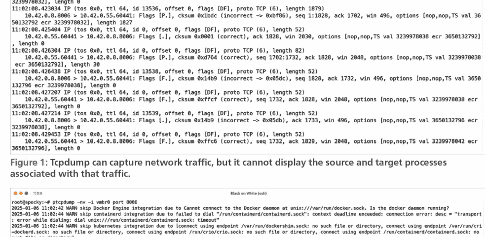

## 输出示例

### 示例 1

92:02.718892 receive22a30f wgt.2853008 In 10.244.0.2296 - 139.178.217.80: Flags [S], cap 4119429282, win 64240,

length 0, Parent [python[3.84381]] Out [test], Pod [test.default]

92:02.718892 etho wgt.2853008 In 17.19.0.2296 - 139.178.217.80: Flags [S], cap 4119429282, win 64240,

length 0, Parent [python[3.84381]], Out [test], Pod [test.default]

### 示例 2

92:02.718892 receive22a30f wgt.2853008 In 10.244.0.2296 - 139.178.217.80: tcp 0, Parent [python[3.84381]],

Container [test], Pod [test.default]

92:02.718841 etho wgt.2853008 In 17.19.0.2296 - 139.178.217.80: tcp 0, ParentProc [python[3.84381]],

Container [test], Pod [test.default]

### 示例 3

14:41.529903 etho In (tcp oss, ttl 64, id 45458, offset 0, flags [F], drop TCP (echo), length 52

139.178.217.493 - 172.19.0.2386: Flags [F], ack 0x2824, seq 371318415, ack 138721707, win 118

options [nop,no_TS val cm/mss 146] ack 1394006832, len 162771966

Process (pid 553882, cmd=/usr/bin/python, args k8s_arg kernel)

Process (pid 553883, cmd=/usr/bin/python, args,0)

image.docker/library/python:3.10.0-2296, name="test"

labels (io.kubernetes/container-kind: "container", kubernetes.container.name: "test",

io.kubernetes.pod.name: "default", kubernetes.pod.uid: 9f5c79f4-8de6-4b9b-a816-7f59709fe6d0) labels (run:"test")

Pod (name: test, uid 9f5c79f4-8de6-4b9b-a816-7f59709fe6d0, annotations (kubernetes.io/config: "v1.22.0-4100", kubernetes.io/source: "api"))

# 快速结果

命令行（list 1）的输出。在此视图中省略了 tcpdump 序列号和连接标志，但仍然包含了有关系统中涉及进程的关键信息。

如果你想获得详细的输出，可以运行 `list -d`（参考第一个示例）。第三个示例提供了

关于该项的所有信息，包括原始容器的详情、它们的 PID 以及关联的 RID。

Pods 状态以及 10 个事件。

如你输出所示，tcpdump 不仅显示读取器详细信息，还能识别来自 Kubernetes 的注解（第 4 部分）。

你可以使用选项来显示或隐藏字段。例如，

`--context-process` 只显示进程行，而 `--context-container` 则包含所有

信息。

在使用 Kubernetes 发布版本时的考虑因素之一。运行系统来组装输出的任务比旧的前身版本要求更高，处理过程耗时更长。

此外，用于关联这些问题的程序简化了生命周期。

从技术角度上说，这对速度几乎没有影响。如果你的系统中的 tcpdump 没有出现任何问题，你将在现实生活中拥有所有

位置：如果你在行中有命令的跟踪，该工具不会尝试丢弃数据包。如果是前身版本，它简化了生命

```
Packet:
PID: 553883
cmd: /usr/bin/python
args k8s_arg kernel
ParentID: 553882
Parent: 553882
Parentcmd: /usr/bin/python
Container:
Container: test
ContainerName: test
image: docker/library/python:3.10.0-2296
labels (io.kubernetes/container-kind: "container", kubernetes.container.name: "test")
```

| | | | | |

|---|---|---|---|---|

| 553882 | 139.178.217.80 | | 66 | 45952 -- ACK |

| 553883 | 172.19.0.2386 | | 66 | 37111-1 |

| | | 139.178.217.80 | 172.19.0.26 | |

每个示例都提供了调试所需的调试级别。如果该工具可以直接连接到 Kubernetes 来动态读取容器的尾部，它将更加实用，但目前尚未实现。

```
Pod:
PID: 553882
uid: 9f5c79f4-8de6-4b9b-a816-7f59709fe6d0
name: default
labels: (run:"test")
annotations: (kubernetes.io/config: "v1.22.0-4100", kubernetes.io/source: "api")
```

图 4：tcpdump 包含来自 Kubernetes 的注解。

## 列表：line.py

```python
01 #!usr/bin/env python3
02 import cairo
04
05 surface = cairo.ImageSurface(cairo.format=cairo.ARGB32, 200, 200)
06 context = cairo.Context(surface)
07
08 context.set_line_width(2)
09 context.set_source_rgb(1, .75, 0)
10 context.move_to(0, 100)
11 context.line_to(100, 100)
12 context.stroke()
```

这些函数分别是颜色的红、绿、蓝。值 1 表示 cairo 发出的该组件的最大水平，而颜色中的每个分量值 0 和 1 是该组件最大强度的比例。橙色是绿色 (1)，蓝色是 (0)。现在是时候画圆了：圆圈周围有一个粗黑色边框。这两个圆弧；我不再像之前那样画线，而是将使用 cairo 绘制弧，并用黑色轮廓进行填充。

```python
context.move_to(0, 0)
context.line_to(100, 100)
context.stroke()
```

在在上例中，我使用了一个 200x200 像素的图像。在这个例子中，我们开始在一个 300x300 像素的图像中绘制自定义圆弧：这个尺寸有点小，无法容纳钥匙的所有细节。在使用时要考虑到尺寸的变化；例如，圆的实例是 150 像素，而不是上图层的 100 像素。

这从水平位置 (X, 0) 开始，并编辑图像中心（X 为 100 像素），并在垂直方向上居中线条。注意，cairo 绘制请求的线条的一半位于 94 像素标记处，底部位于 106 像素处。如果我们绘制只有单像素宽的线条，这就会变得重要，因为效果可能会产生模糊的线条（参见“抗锯齿”）。

现在，为了实现 Cairo Python，我们需要 math 模块：

```python
import math
```


此命令创建一个表面，自动为 200x200 像素的图像分配内存，其透明图像被称为 alpha 通道，但在 `Cairo.Format.ARGB32` 中字母为 i。

## 定位

下一步是创建一个并在上面绘制的表面：

我需要 `math` 模块因为它提供了数学中的 `pi` 和 `ta` 值。正如你所看到的，我将使用这些来指定圆弧的半径——在全圆中，我将看到 `2pi` 半径，即 360 度。

```python
context = cairo.Context(surface)
```

`context.set_source_rgb(1, .75, 0)`

实际上所有在 `Cairo` 表面上绘制 `cairo` 的线条，而不是表面本身。这跟踪了绘制操作所使用的模式。例如，绘制 12 像素宽的线条在

为了绘制时表面的白色背景：

```python
context.set_source_rgb(1, 1., 1.)
context.arc(150, 150, 80, 0, 2*math.pi)
context.fill()
```

`set_source_rgb()` 函数定义了特殊关注。它设置了用于绘制形状的颜色。参数到

这在弧中绘制 `(1, 1., 1.)`。它在图像中心（arc 的两个参数）`(150, 158）`处绘制，半径为 150 像素。

## 抗锯齿

由于像素是固定的，且图像是由有限数量的像素组成的，它们并不是完美的矩形——或者在数字图像中没有对齐到偶像素。为了显示这些影响，一种被称为抗锯齿的技术被应用于图像。抗锯齿涉及对形状边缘周围区域进行模糊处理，从而覆盖像素边缘。如果线条只有一个像素宽，边缘看起来会像锯齿线，除非

```python
surface.flush()
surface.write_to_png ('line.py')
```

有必要对表面进行“刷新”（`flush`），因为 `Cairo` 在绘制到表面后，如果稍后在表面上方绘制，则没有需要绘制之前的表面，这可以提高程序的效率。

要尝试运行此程序，它是可执行的，然后运行它：

```bash
### cmd line.py
### ./line.py
```

它应该在当前目录下创建一个新的 PNG 文件，内容如图 2 所示。

# 时钟背景和表圈

现在是时候开始绘制时钟的部分了，从表面的背景部分和


LINUX-MAGAZINE.COM

第 2025 期

2025年7月

## 使用 Cairo 在 Python 中绘图

### 列表 2：frame.py

```python
01 #!usr/bin/env python3
02 import cairo
03 import math
04
05 surface = cairo.ImageSurface(cairo.format=cairo.ARGB32, 200, 300)
06 context = cairo.Context(surface)
07
08 context.set_source_rgb(1, 1., 1.)
09 context.arc(150, 150, 80, 0, 2*math.pi)
10 context.fill()
11
12 context.set_source_rgb(0., 0., 0.)
13 context.set_line_width(5)
14 context.arc(150, 150, 80, 0, 2*math.pi)
15 context.stroke()
16
17 surface.flush()
18 surface.write_to_png ('frame.py')
```

## 缩放与变换

下一步是创建一个并在上面绘制的表面：我需要 `math` 模块因为它提供了数学中的 `pi` 和 `ta` 值。正如你所看到的，我将使用这些来指定圆弧的半径——在全圆中，我将看到 `2pi` 半径，即 360 度。

`set_source_rgb()` 函数定义了特殊关注。它设置了用于绘制形状的颜色。参数到

这在弧中绘制 `(1, 1., 1.)`。它在图像中心（arc 的两个参数）`(150, 158）`处绘制，半径为 150 像素。

由于像素是固定的，且图像是由有限数量的像素组成的，它们并不是完美的矩形——或者在数字图像中没有对齐到偶像素。为了显示这些影响，一种被称为抗锯齿的技术被应用于图像。抗锯齿涉及对形状边缘周围区域进行模糊处理，从而覆盖像素边缘。如果线条只有一个像素宽，边缘看起来会像锯齿线，除非

有必要对表面进行“刷新”（`flush`），因为 `Cairo` 在绘制到表面后，如果稍后在表面上方绘制，则没有需要绘制之前的表面，这可以提高程序的效率。

要尝试运行此程序，它是可执行的，然后运行它：

```bash
### cmd line.py
### ./line.py
```

它应该在当前目录下创建一个新的 PNG 文件，内容如图 2 所示。

现在是时候开始绘制时钟的部分了，从表面的背景部分和

时钟背景和表圈

现在是时候开始绘制时钟的部分了，从表面的背景部分和

时钟背景和表圈

现在是时候开始绘制时钟的部分了，从表面的背景部分和

时钟背景和表圈

现在是时候开始绘制时钟的部分了，从表面的背景部分和

时钟背景和表圈

现在是时候开始绘制时钟的部分了，从表面的背景部分和

## 使用 Cairo 深入探索 Python 图形

280 像素（不包括图像高度的中心点）。为了让时钟图像居中，时钟“宽度”的一半是左侧边距，另一半是右侧边距；这意味着时钟的所有部分必须向左移动 `488/280 = 60` 像素。`translate()` 函数告诉 `Cairo` 从现在起，位置上的 x 元素应该调整 60 像素，因此 `Cairo` 绘制白色的钟面背景时，圆圆将位于坐标 `(148, 148)`，而不是最初的 `(208)`；

然而，线条的长度应该随着时钟的大小缩放。此外，模拟时钟在刻度和标记之间通常有一个间隙，这个间隙也会随时钟缩放。对于一个 300 像素的时钟，为了美观，我画了 10 个刻度和 15 像素宽的线条，因此我在程序中设置了适当的比例：

```python
cairo_width = clock_radius/12
cairo_radius = clock_radius - 7
cairo_width/2
```

由于我将固定值参数替换为绘制钟面背景的 `Cairo` 函数参数，我也使用了刚刚计算出的值作为绘制函数的参数：

```python
context.set_line_width(border_width)
cairo.arc(clock_radius, clock_radius, 0, 2*pi)
border_radius, 0*pi
```

```python
border_width = marks_gap = clock_radius/15
mark_length = clock_radius/10
```

在各方面，程序都保持与我使用固定值时一样。我发现程序输出的尺寸选择是非正方形的——在每两种类型的标记中都是如此。

此时，指定要绘制的对象（线条）以及最终的数字相对于时钟中心的坐标，比相对于图像左上角的坐标更方便。为了做到，我在现有的变换之上又进行了一个平移：

```python
context.translate(clock_radius, clock_radius)
```

如果没有平移，`Cairo` 将在 `(148, 148)` 处绘制，时钟将位于图像的左侧，右侧留出空白。

现在我们需要更多的计算。如果我将边框厚度指定为 25 像素；如果时钟超过或缩小原始尺寸，相应的描边或边框将太细或太粗。快速计算发现，对于 300 像素的时钟，25 像素的边框厚度比例是 1:12；因此，我现在通过将时钟除以它来缩放边框厚度；顺便我也缩放了……

现在，`(0,0)` 代表时钟中心：时钟的 X 坐标指的是时钟半径，时钟半径的 X 坐标指的是刻度。同样，Y半径指的是时钟边缘，而时钟半径指的是刻度。中间的值位于时钟内部。


模拟时钟通常有两种环绕它的标记。线条是时针、分针和秒针。标记是时钟周围的数字。使用简单的文本形式会涉及一些额外的复杂性，这些将不会涵盖……

指示器方面，涉及到我从未做过的绘制操作。绘制的不仅仅是线条（我只演示了一条水平线）。通常有圆形线条，它们更容易绘制，因为它们是对称的。

尽管之前时钟的所有其他部分尺寸都与钟面一致，但我必须为标记（包括圆圈）分配厚度。总共有 60 条线，对应于时钟可能指向的每一秒（或每分）。根据时针可能指向的小时或 12 的指示器，每五条中就有一条用加粗的线条绘制。我必须绘制大部分标记和时针（“主要”标记），它们是以 3 像素绘制的……

接下来我计算了两个值，但这是由于相对于时钟中心标记的距离。时钟是由两点组成的线；作为这些线条的每一个，每条线上的点长度是从时钟中心到另一端的 `mark-length` 像素：

```python
mark_start_distance = clock_radius - 2
border_width = border_to_marks_gap
mark_end_distance = mark_length
```

```python
MAJOR_WIDTH = 1
MAJOR_MARK_WIDTH = 3
```

图 4：时钟框架，它可以缩放为任何图像尺寸。我在图像边界周围添加了一个框，以清晰地展示时钟在图像上水平居中。

这些不仅用于确定每个指示器的坐标；我还利用它们来缩小指示器内外圆的半径，我现在将以单像素厚度绘制它们：

## 使用 Cairo 在 Python 中绘图

不同语言打印的印地阿拉伯数字 1 到 12 都是相同的（可能吧）。然后，我决定直接使用 `Cairo` 内置的功能 [7]，这些功能足够简单，被标记为“待到 API 化”。

虽然在此处尚未进行计算，但每个数字的最终位置必须逐个数字地确定，因为每个小时刻度的文本可能有不同的高度（某些字体会显示高度且随下沉字母变化），此外还有其他考虑因素。

第一步是定义一个字符串元组列表，每个字符串对应时钟面上的 12 个小时标记。位于时钟顶部的 12 点刻度将出现在列表第一个；列表从 1 开始按数字升序排列：

```python
extents = context.text_extents(NUMERAL_STRINGS[1])
```

```python
numeral_distance = +
mark_end_distance = +
marks_to_numeral = 
```

接下来，`Cairo` 需要知道以多大的字体来绘制这些数字。我使用了几种衬线字体，在一些无衬线字体中我选择了一个，用来块显示标记如下：

```python
text_x = =
numeral_distance * multiplier + 
extents.x_bearing * multiplier +
extents.width * 2 * multiplier - 
extents.width / 2
```

```python
NUMERAL_STRINGS = ('1', '2', '3', '4', '5', '6', '7', '8', '9', '10', '11', '12')
```

```python
context.set_font_face('serif',
Cairo.FontWeight('NORMAL'),
Cairo.FontWeight('BOLD'))
context.set_font_size(numeral)
```

当然，我们必须使用你喜欢的字体，因为这里有 12 个数字，而且它们的长度不足以用罗马数字代替我必须使用的阿拉伯数字。图 6 显示了 `Cairo` 的阿拉伯数字。

如果你喜欢，可以将其替换为无衬线字体，甚至是另一种字体大小或字体类型。具体的名称，如 New Roman（新罗马体），但如果也选了数字字体，则可能会使用该字体。此外，我们不能使用像 `Cairo-font.ITALIC`（斜体）不同的设置，但在实践中，我从未见过带有样式化小时刻度的时钟。

再次，某些距离需要与每个中心的大小相关，因为时钟的所有部分都应该是完美的。对于一个 300 像素的时钟，我发现线条之间留有1 像素的间隙是合理的。前几节中指示器标记与时钟边缘之间的间隙也保持相同的距离。标记将很大程度上——它们需要易于阅读——所以数字使用 30 像素，或者说是时钟半径的比例。

操作的下一个部分是在最后一个时钟标记处画线。这个循环只运行 12 次，因为只有 12 个小时标记，每小时 60 秒。但在每个小时标记处要放置什么时钟，需要对每一个进行进行计算：

```python
angle = math.pi / 12
multiplier = math.sin(angle)
ymultiplier = math.cos(angle)
```

```python
marks_to_center = clock_radius/12
numeral_size = clock_radius/s
```

从每个数字中心的距离大约为：


图 7：完成的时钟显示了表示小时的数字。

例如，我们必须计算角度的正弦和余弦并将它们存储在变量中；它们将在计算中多次使用。

现在我将使用 `Cairo` 来确定小时标记标记在图像上绘制时的宽度和文本位置——实际上是绘制。

最后，在图像的正确位置绘制：

使用 `context`，在左上角的行中使用 `stroke()` 将产生文本字符的“轮廓”输出，而不是普通的“实心”字符。

LINUX-MAGAZINE.COM | 2025期 | 2025年7月

## 使用 Cairo 在 Python 中绘图

## 时针、分针和秒针

现在我带你了解了绘制时钟面所有组件所需的步骤和代码——从表圈、数字到背景，以及每秒、分针和秒针的绘制。如果没有一组超过几根的指针，钟是不完整的（有人说三根才是准确的）。在最后，我将通过添加绘制当前时间的小针、分针和秒针的代码，来完成这个时钟程序。

在 Python 中获取当前时间，我将使用 `time()` 函数，这要求在 Python 中导入 `time` 模块：

```python
import time

current_time = time.time()
```

`time()` 返回一个浮点数，除其他成员外包含当前时间（小时，范围从 0 到 23，即午夜）；当前分钟（`min`，范围从 0 到 59）；以及当前秒（`sec`，通常范围从 0 到 59，很少增加到 60 秒来显示）。使用这些值和数学运算，我计算出每个指针——以及时钟上每个指针的坐标。

与时钟的其他部分一样，我希望指针的尺寸随时钟的其他部分缩放。对于一个 300 像素的时钟，我发现指针长度为 8 像素。时针、分针和秒针分别从时钟中心向外 50、75 和 95 像素。这些尺寸分别是时钟的 1/6、1/4、1/2 和 5/8：

一旦我知道当前的时、分、秒，我需要计算绘制每个指针的角度。使用取模 12 转换 `localtime()` 返回的小时时间（12 到 12）并找到余数。在这里，涉及一个转换范围内的值（0 到 60 秒，0 到 60 分钟和 0 到 12 小时——时间碎片！）的问题：

```python
second_hand_angle = math.pi / 60 *
current_time_sec = sec
minute_hand_angle = math.pi / 60 *
current_time_min = min
```

然而，真实的模拟时钟将所有指针连接到同一个转子上，以不同速度移动的方式绘制每根指针。当分针转一圈时，时针只移动时钟周长的 1/12；但时针在每个小时标记处的移动是需要计算的：

```python
angle = math.pi / 12
multiplier = math.sin(angle)
ymultiplier = math.cos(angle)
```

```python
marks_to_center = clock_radius/12
numeral_size = clock_radius/s
```

从每个数字中心的距离大约为：


图 7：完成的时钟显示了表示小时的数字。

例如，我们必须计算角度的正弦和余弦并将它们存储在变量中；它们将在计算中多次使用。

现在我将使用 `Cairo` 来确定小时标记标记在图像上绘制时的宽度和文本位置——实际上是绘制。

最后，在图像的正确位置绘制：

使用 `context`，在左上角的行中使用 `stroke()` 将产生文本字符的“轮廓”输出，而不是普通的“实心”字符。

LINUX-MAGAZINE.COM | 2025期 | 2025年7月

## 使用 Cairo 在 Python 中绘图

## 时针、分针和秒针

现在我带你了解了绘制时钟面所有组件所需的步骤和代码——从表圈、数字到背景，以及每秒、分针和秒针的绘制。如果没有一组超过几根的指针，钟是不完整的（有人说三根才是准确的）。在最后，我将通过添加绘制当前时间的小针、分针和秒针的代码，来完成这个时钟程序。

在 Python 中获取当前时间，我将使用 `time()` 函数，这要求在 Python 中导入 `time` 模块：

```python
import time

current_time = time.time()
```

`time()` 返回一个浮点数，除其他成员外包含当前时间（小时，范围从 0 到 23，即午夜）；当前分钟（`min`，范围从 0 到 59）；以及当前秒（`sec`，通常范围从 0 到 59，很少增加到 60 秒来显示）。使用这些值和数学运算，我计算出每个指针——以及时钟上每个指针的坐标。

与时钟的其他部分一样，我希望指针的尺寸随时钟的其他部分缩放。对于一个 300 像素的时钟，我发现指针长度为 8 像素。时针、分针和秒针分别从时钟中心向外 50、75 和 95 像素。这些尺寸分别是时钟的 1/6、1/4、1/2 和 5/8：


一旦我知道当前的时、分、秒，我需要计算绘制每个指针的角度。使用取模 12 转换 `localtime()` 返回的小时时间（12 到 12）并找到余数。在这里，涉及一个转换范围内的值（0 到 60 秒，0 到 60 分钟和 0 到 12 小时——时间碎片！）的问题：

```python
second_hand_angle = math.pi / 60 *
current_time_sec = sec
minute_hand_angle = math.pi / 60 *
current_time_min = min
```

然而，真实的模拟时钟将所有指针连接到同一个转子上，以不同速度移动的方式绘制每根指针。当分针转一圈时，时针只移动时钟周长的 1/12；但时针在每个小时标记处的移动是需要计算的：

```python
angle = math.pi / 12
multiplier = math.sin(angle)
ymultiplier = math.cos(angle)
```

```python
marks_to_center = clock_radius/12
numeral_size = clock_radius/s
```

## 深度解析

### 使用 Cairo 进行 Python 绘图

结论

在本文中，我向你展示了如何使用 Cairo 库绘制图形。我通过演示绘制一个显示当前时间的模拟钟的所有步骤，证明了这一点。这篇文章展示了 Cairo 能够实现的功能。例如，你可以绘制贝塞尔曲线，这些曲线在彩色渐变方面精确得多，且图案也比纯色更复杂。你还可以将其保存为 PDF 和 PNG 等其他文件格式。我有另一个绘制 SVG 文件的程序。如果你想将输出发送到打印机，Cairo 支持生成 PDF 或脚本输出。在随后的文章中，我将使用 GTK 用户库将时集成到交互式用户界面中。

列表 3：执行 (`config`)

```
101
context.move_to(mark_start*math.sin
102, mark_start*math.cos(angle))
103
context.line_to(mark_end*math.sin
104, mark_end*math.cos(angle))
105
context.stroke()
106
# 画每个刻度的数字
107
### (150 / 10 = 15 像素)
108
marks_to_numeral_gap = clock_radius/15
109
### (100 / 5 = 20 像素)
110
size = clock_radius/2
111
numeral_marks = marks - to_numeral_gap
112
context.select_font('serif', Cairo.Font.NORMAL, Cairo.Font.BOLD)
113
context.set_font_size(size)
114
for i in range(12):
115
angle = 2*math.pi/12 * i
116
x = multiplier*math.sin(angle)
117
y = multiplier*math.cos(angle)
118
text = context.text_extents(NUMERIC_STRING[i])
119
x -= text.width/2 + text.x
120
y -= text.height/2 + text.y
121
context.show_text(NUMERIC_STRING[i])
```

```
128
width = clock_radius/20
129
### (150 / 3 = 50 像素)
130
hour_length = clock_radius/3
131
### (150 / 2 = 75 像素)
132
minute_length = clock_radius/24
143
144
current_time = line.time()
145
146
angle = 2*math.pi / 60 *
147
current_time.tm_sec
148
angle = 2*math.pi / 60 *
149
current_time.tm_min +
150
second_hand / 60
151
angle = 2*math.pi / 12 *
152
current_time.tm_hour +
153
hour_hand / 12
154
155
draw_hand(hour_hand,
156
hour_length)
157
draw_hand(minute_hand,
158
minute_length)
159
draw_hand(second_hand,
160
second_length)
161
162
### 在中心绘制旋转凸盖
163
### 钟表底部，用于遮盖
164
### 线的尖锐边缘，
165
### 完成圆圈
166
context.arc(0, 0, clock_radius/2,
167
context.fill())
168
169
### 将表面写入 PNG 文件
170
surface.flush()
170
surface.write_to_png('clock.png')
```

## 信息

- [1] Cairo 图形：https://cairog.org/

- [2] GTK 用户界面工具包：https://www.gtk.org/

- [3] Cairo 文档列表：https://cairog.org/doc/

- [4] Cairo 程序员参考文档：https://cairog.org/manual/

- [5] X 窗口系统：https://www.x.org/

- [6] Pango 文本渲染库：https://pango.org/

- [7] Cairo 文本渲染能力文档：https://cairog.org/manual/cairo-text.html

## 作者

Michael Williams 是一位自由职业程序员，也是 Debian-Linux 发行版的狂热用户。他喜欢使用 GTK 图形工具包，是 Mate 项目（https://mate-desktop.org）的开发者。他在 GitHub（https://github.com/tesquash）和 Ubuntu MATE 社区（https://ubuntu.com/community/gordonsummer）上有多个公开项目。

2025 年 7 月

第 296 期

LINUX-MAGAZINE.COM

## DrupalCon

### 维也纳 2025

10 月 14 日 - 17 日

### 获取你的 DrupalCon 门票

维也纳 2025！

你是一个开发者、设计师、项目经理、代理机构负责人、托管提供商、技术创新者，还是渴望深入 Drupal 世界的学生？

来维也纳加入我们吧，度过为期四天的精彩学习、连接和贡献的时光！

### 期待内容：

- 充实的会议日程和 BoFs

- 主题演讲，包括 Driesnote、Drupal CMS 焦点以及 Web 2025

- 录制会议可用

- 社交活动：欢迎接待、狂欢之夜、女性开发者大会以及更多

- 与行业领袖、顶级创新者的交流

#### 单人

| 早鸟票 | 普通票 |

|---|---|

| 6 月 17 日前 | 805€ |

| 9 月 15 日 | 985€ |

| 晚期 | 1065€ |

| 10 月 16 日 | 85€ |

#### 团体票

| 早鸟票 | 普通票 |

|---|---|

| 6 月 17 日前 | 3900€ |

| 9 月 15 日 | 4775€ |

立即注册，不要错过欧洲盛事！

## 深度解析

### deorphan — 命令

管理 Debian 软件包

`deorphan` 工具帮助你跟踪基于 Debian 的系统的软件包和其他内容。Debian 以其软件包管理工具为特色。每个软件包管理器都有命令，但 `deorphan` 还有查找创建和安装软件包的功能。许多其他工具，如 `apt-cache`，已添加到 `apt`（`apt-get` 的精简版本）中，而 `deorphan` 则让你能够像它们那样进行查找。一个例子是 `deorphan` [1]，它能识别未使用的软件包。`deorphan` 对于释放空间非常有用，重要的是精确确定被留下的软件包，因为软件包管理命令不会删除它们。

通常将选项划分为四个部分。顶部部分列出了命令的选项，常用的 `--help` 和 `--version`。选项还包括 `-f`，供那些不想使用的人使用。第二部分输出修符，涵盖了更多实用的选项。通过此工具 `--show (-d) (-i)` 可以获得已安装软件包及其依赖关系的完整概述。通过其他选项，用户可以使用 `--priority (-j)` 修改软件包的优先级，如所示。使用 `--selection (-s)` 将显示在 Debian 仓库中可以找到软件包。第三部分搜索修符，涵盖了可以获取 `deorphan` 大部分的选项。

在某些情况下，你应该注意结果中的误报。顶部的列表是 `--all-packages`（图 3），它检查所有软件包，留下其他的。主页面建议使用 `--all` 可能会过度。使用单独的列表，`--list (-L)` 显示未包含在搜索结果中的软件包，可能是因为你想保留它们，或者它们可以安全地删除。无论位置如何，都可以通过编辑 apt 内部的选项找到文件。结果多种方式精炼，如表 1 所示的选项 `--keep-file(-K)`。使用 `apt --keep` 后跟空格分隔的软件包列表会将它们添加到列表中。同时，`--del (-k)` 会移除软件包。使用 `--mark` 移除文件的保留记录。你可以执行这样的操作并搜索该软件包名称和描述以确定它包含什么类型的文件。以下更改见表 2。然而，在关键库的情况下，应谨慎使用此选项。

如果 `deorphan` 值得使用，你也可以编写 `deorphan` [2]，它跟踪所有软件包，保留一个始终保留的软件包列表，特别是删除操作的功能。这两个命令极大地简化了软件包管理。

页面第四部分显示了 `/var/lib/keep` 的选项，该文件列出了要保留的软件包，或者通过选项 `--keep-file(-K)` 定义。当前列表是：

## 信息

- [1] https://man.debian.org/book/deorphan/en.html

- [2] https://man.debian.org/book/deorphan.en.html

### 表 1：搜索方法

| alsa-topography | main/utils | 充足 |

|---|---|---|

| | 为了给 deorphan |

| libasound-data | main/mail | akonadi-import-wizard | 更好的指导。 |

| alsa-ucm-conf | main/sound | alsa-oss | |

| libasound-data | main/sound | alsa-utils-gui | deorphan 以及 |

| bind9-lib | non-free/admin | amd64-microcode | debfoster |

| bind9-dnsutils | main/utils | aptamangelager | 起初，看起来 Debian 软件包 |

| | main/utils | apt-listchanges | 管理器没有移除 |

| | main/utils | apt-rebuilds | 随软件包的悬而未。然而，我们发现 |

| | gnome | blue | 可能一个依赖项 |

| | main/web | bluetooth | 可能会依赖另一个 |

| | main/utils | alsa-utils | 软件包和 |

| | non-free/admin | kernel | 检查何时 |

| | main/admin | blue-hicumd | 需要。 |

| | main/admin | blue-source | |

### 表 2：--guess-- 和 --no-guess-- 的选项

| common | 查找包含 --common 的软件包 |

|---|---|

| data | 查找包含 --data 的软件包 |

| deb | 查找包含 --deb 或 -y 的软件包 |

| dev | 查找包含 --no-dev 的软件包 |

| doc | 查找... |

| dummy | 查找描述中包含 dummy 或 transitional 的软件包 |

| kernel | 查找所有解释器，例如 Ruby, Pike, Python 和 Mono |

| Mono | 查找 Mono 模块 |

| perl | 查找 Perl 模块每 | 查找 Perl 模块 |

| pike | 查找 Pike 模块 |

| python | 查找 Python 模块 |

| ruby | 查找 Ruby 模块 |

| section | 查找被错误放在上面部分的库 |

| all | 尝试找到以上所有 |

| only | 完全忽略软件包的章节，并使用名称/描述（必须与上述 --guess-options 之一一起使用）。 |

## 安全保存

与 Basement 一起进行设计

# 光光临！

## 字符串与事物

使用这些工具处理事务的经历

# 特色

# 获取每一期 RASPBERRY PI GEEK

# 在一张完全可搜索的

# DVD 上！

### 特别赠送！

+ 2 本完整版特刊：

* 树莓派手册 (Raspberry Pi Handbook)

* 树莓派冒险 (Raspberry Pi Adventures)

# raspberry pi GEEK

## 树莓派手册

## 树莓派冒险

# raspberry pi GEEK

# raspberry pi GEEK

# raspberry pi GEEK

# raspberry pi GEEK

# raspberry pi GEEK

## 最非凡！终极树莓派存档 (THE ULTIMATE raspberry pi GEEK ARCHIVE)

## 创爱好者的圣地！

酷炫、多彩且充满创意的《Raspberry Pi Geek》杂志是全球创爱好者的最爱，因为你永远不知道会在里面发现什么。咖啡烘焙机？仓鼠的计步器？猫玩具的自动发射器？

RPG 深入探索了物联网宇宙的本质，研究了 MQTT、Mindstorms 和 3D 打印等技术。读者可以通过 Python、Minecraft、Scratch、PHP 和 Turtle Graphics 编程来学习，并在复古游戏、PyChess 和 littleBits 上磨练技能。

《Raspberry Pi Geek》已 2017 年停刊，但它的传奇在官方的树莓派存档（Raspberry Pi Archive）中延续——这是一份包含精美插图且易于访问的 PDF 格式完整合集！

超过 2,000 页的信息、项目和乐趣！另有额外版本！

# 立即购买 shop.linuxnewmedia.com

# 深度编程快照 – WebSockets

使用 WebSocket 连接实现浏览器即时刷新

## 快如闪电

WebSocket 协议帮助浏览器在服务器内容更改时立即重新加载页面。在本月的专栏中，Mike Schilli 用 Go 语言编写了一个 WebSocket 服务器来完成这项任务。

你可能想过，比如 WhatsApp 或 Slack 在你的浏览器中打开时，为什么能对对方“正在输入”的反馈响应如此迅速……这需要什么样的魔法？即使在消息发送之前，浏览器至少需要响应你正在查看的页面，但它是如何知道何时关闭连接的？相反，浏览器使用 WebSocket 与特定服务器建立一个持久连接。一旦建立，服务器和客户端就可以向对方发送消息，连接另一端的服务器可以获取这些消息。换句话说，双方都在连接上主动监听，并在任何新信息到达时做出反应。

## WebSocket 的起源

WebSocket 协议首次于 2011 年面，当时 RFC 6455 已经包含了如今所有 WebSockets 的内置支持。为了提供事实上的艺术感并在不引起烦刷新的情况下显示新到达的信息（就像 WhatsApp 一样），HTML 代码在页面加载时连接到 WebSocket 服务器。在最简单的情况下，浏览器可以定期询问服务器，但这会产生不必要的网络流量——毕竟，这还会导致大型静态页面的闪烁，看起来非常不专业。更好的方法是设置服务器，仅当服务器端的文件发生变化时才主动通知浏览器。与 HTTP 协议不同，浏览器将不再发送请求

## 作者

Mike Schilli 在加利福尼亚州旧金山湾担任工程师。在他每月的专栏中，他自 1997 年以来一直在介绍各种编程语言的实际应用。如果通过 `mschilli@gmail.com` 联系他，他将乐意回答你的任何问题。

```
fyne Create apps Toolkit in Go ...
gopher 9:27 AM
上面的代码来自 Jon Orchen 的沙盒：...
Jon Orchen 我修改了代码来创建这个：
{
  但窗口的内容不是空的。我在做什么？（错误）
}
Any Writer
你不能包含元素 容器的大小由父级设置。它由设置或使用 canvas getter 来控制你的代码控制大小 Any Writer 正在输入 ...
```

图 1：网页浏览器中的 Slack 使用 WebSockets 进行实时通信。

58 2025 年 7 月第 296 期 LINUX-MAXIMUM.COM

# 深度编程快照 - WebSockets

第一次。JavaScript 随后出现在事件循环中，等待通道上的新消息。在接收到浏览器文档对象模型 (DOM) 时通过从来自不同主机的服务器重新加载内容来更新显示的页面，但它不必这样做。

为了让这发生，List 导出了 `watch(cb)` 函数，它期望一个路径数组作为第一个参数；第二个参数是回调函数 `cb`，它会在内核的 `notify` 命令触发时调用

## 双向


JavaScript 客户端和服务器现在建立了一个持久连接。一旦建立，客户端和服务器就可以使用 WebSocket 协议向两端发送消息。它们在事件中接收消息并无延迟地处理。

为了说明这一点，我实现了一个应用程序，让我向本地服务器输入文本，然后按我的方式格式化文本，并在浏览器中以 HTML 显示结果。然而，我为“快照”专栏写文章，所以我通常以我的转换器将其转换为浏览器 HTML 的格式编写。使用 WebSocket，这意味着一旦我及时保存并调用保存，HTML 视图将立即显示消息（图 2）。

在当前情况下，WebSocket 服务器注意到本地文件系统的变化。每当用户修改文件时，服务器向客户端发送消息。该行代码随后通知 JavaScript 引擎，从服务器重新加载页面。

## 变化告警

但如果文件最近更改过呢？就像快照本地栏中的 `watch` 一样，两者使用内核的 `notify` 函数或对整个目录条目监控。

## 多任务调度板

当服务器向文件系统发送数据时，它使用 WebSocket 连接来消息。

- 快如闪电 (Linux 2025)
- POD 错误

## 快如闪电 (Linux 2025)

你可能想过，比如 WhatsApp 或 Slack 在你的浏览器中打开时，为什么能对对方“正在输入”的反馈响应如此迅速……即使在消息发送之前，浏览器至少需要响应（图 #10）做那个，至少几乎需要重新加载你正在查看的页面，但它是如何知道何时这么做的？

图 2：为“快照”专栏编写文章。

LINUX-MAXIMUM.COM 第 296 期 2025 年 7 月

## 深度解析

### 编程快照 – WebSockets

该实现是面向对象的。第 16 行的 `NewServer()` 构造函数返回一个指向 `WServer` 类型（定义的结构体）的指针，其中包含一个来自 Uber `zap` 路径的日志器和一个用于所有 WebSocket 连接的 `clients` 映射。

### 通过未检查的通过

列表 2 第 23 行开始的 `Handler()` 函数定义了客户端首次连接到 WebSocket 的时。WebSocket 使用 HTTP 协议来建立传输机制（即 WebSocket 充当某种 HTTP 升级）。

之所以这样做是因为 WebSocket 服务器处理的是客户端，而不仅仅是一个，或者同时处理多个。为了做到这一点，它为每个客户端保持一个连接，并在传入的消息之间进行多路复用。响应的情况下，所有连接的客户端都会接收带有更改文件路径的消息。通过这种方式，多个标签页可以同时连接到 WebSocket 服务器并刷新它们的显示。

第 29 行，调用 `upgrade()` 建立 WebSocket 连接，并将其作为网格存储在哈希表中。该哈希表位于对象的实例数据中，有助于将消息分发到所有已连接的客户端。

第 25 行的参数决定了升级是否应该验证传入请求的 `G` 头部。我的简单实现没有理会任何限制，只是返回 `true` 以绕过安全机制。

如数组之类的结构；它使用信号量执行此。任务诸如在哈希表中创建新条目、让它们释放或遍历哈希表中的所有条目以进行并发访问。在读取或写入此互斥锁的数据之前，Go 的 `sync` 包需要调用 `lock()` 以防止问题。在向此写入数据后调用 `unlock()`，否则很快就会导致竞态条件。

来自列表 2 的第三个函数，从第 51 行开始，向所有已连接的客户端报告已修改的文件。为了做到这一点，它遍历哈希表中的所有条目，并向客户端发送一个 JSON 消息，其中包含文件的键和路径。`json()` 函数通过将解析后的数据转换为 JSON 值对来处理格式化。

第 54 行的指令确保了当设置了 `lock()` 时，当前函数会在 `lock()` 完成前执行。忘记重置是一个好主意，特别是当你正在处理复杂的 `if` 逻辑时。

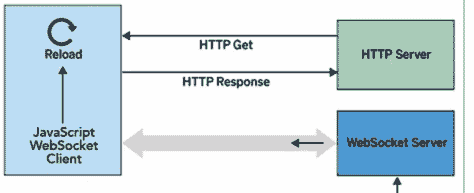

### JavaScript 接收器

图 4 显示了 WebSocket 连接的客户端。如果 HTML 文件头包含此 JavaScript 代码段，浏览器将调用 `new` 来向 WebSocket 服务器打开连接。

### 列表 1: innnotify.go

```go
01 package name 19 select {
02 case event, ok := <-watcher.Events
03 import 21 if ok {
04 "github.com/fsnotify/fsnotify" 22 return
05 } 23 }
06 30
07 func watchdirs(paths []string, cb func(string)) error { 24
08 watcher, err := fsnotify.NewWatcher() 25
09 if err != nil { 26
10 return err 27
11 } 28
12 29
13 if event.Op&fsnotify.Write == fsnotify.Write || fsnotify.Write == fsnotify.Create = 29
14 cb(event.Name) 30
15 31
16 for _, path := range paths { 31
17 watcher.Add(path) 32
18 } 32
19 33
20 func go() { 34
21 for { 35
22 return 36
```

60 JULY 2025 ISSUE TWO LINUX-MAGAZINE.COM

### 列表 2: websocket.go

```go
01 package main		33 }
02 import		34 	ws.ClientMutex.Lock()
03 	"github.com/gorilla/websocket"		35 	ws.Clients[conn] = true
04 	"go.uber.com/zap"		36 	ws.ClientMutex.Unlock()
05 	"net/http"		37
06 	"sync"		38
07 		39 	for {
08 			if _, err := conn.ReadMessage(); err != nil {
09 40 	break
10 type WSServer struct {41 	}
11 	log		42 	*zap.Logger
12 	Clients map[string]*websocket.Conn		43 	ws.ClientMutex.Lock()
13 	ClientsMutex sync.Mutex		44 	delete(ws.Clients, conn)
14 		45 	ws.ClientMutex.Unlock()
15 \func NewWSServer(log *zap.Logger) *WSServer {		46 	conn.Close()
16 	ws := &WSServer{		47
17 		tClients: make(map[string]*websocket.Conn)},		48 	
18 	}		49 	51 func (ws *WSServer) Notify(path string) {
19 	ws.Log.Debug("Notify", zap.String("path", path)) 50 	ws.ClientMutex.Lock()
20 	return err 51 	defer ws.ClientMutex.Unlock()
21
22 func (ws *WSServer) Handler(w http.ResponseWriter, r *http.Request) {		52 	others := ws.Clients
23 	conn, err := upgrader.Upgrade(w, r, nil) 53 	msg := map[string]string{"path": "path"}
24 	ws.CheckOrigin = func(r *http.Request) bool { return true }		54 	if err := json.Unmarshal(conn, &msg); err != nil {
25 	}		55 	conn.Close()
26
27 func(conn, err error) upgrader.Upgrade(r. nil) {		56 	delete(ws.Clients, conn)
28 	if err != nil {		57
29 	tws.Log.Error("Websocket", zap.error(err))		58
30 	return		59
```

在添加正体后不久。消息由 `ws.message` 事件处理器处理。传入的消息是 JSON 格式，包含了修改文件的路径和内容。代码随后根据修改文件的扩展名决定做什么。

第 54 行的指令确保了当设置了 `lock()` 时，当前函数会在 `lock()` 完成前执行。忘记重置是一个好主意，特别是当你正在处理复杂的 `if` 逻辑时。

### JavaScript 接收器

图 4 显示了 WebSocket 连接的客户端。如果 HTML 文件头包含此 JavaScript 代码段，浏览器将调用 `new` 来向 WebSocket 服务器打开连接。

### 列表 1: innotify.go

```go
01 package name 19 select {
02 case event, ok := <-watcher.Events
03 import 21 if ok {
04 "github.com/fsnotify/fsnotify" 22 return
05 } 23 }
06 30
07 func watchdirs(paths []string, cb func(string)) error { 24
08 watcher, err := fsnotify.NewWatcher() 25
09 if err != nil { 26
10 return err 27
11 } 28
12 29
13 if event.Op&fsnotify.Write == fsnotify.Write || fsnotify.Write == fsnotify.Create = 29
14 cb(event.Name) 30
15 31
16 for _, path := range paths { 31
17 watcher.Add(path) 32
18 } 32
19 33
20 func go() { 34
21 for { 35
22 return 36
```

### 列表 2: websocket.go

```go
01 package main		33 }
02 import		34 	ws.ClientMutex.Lock()
03 	"github.com/gorilla/websocket"		35 	ws.Clients[conn] = true
04 	"go.uber.com/zap"		36 	ws.ClientMutex.Unlock()
05 	"net/http"		37
06 	"sync"		38
07 		39 	for {
08 			if _, err := conn.ReadMessage(); err != nil {
09 40 	break
10 type WSServer struct {41 	}
11 	log		42 	*zap.Logger
12 	Clients map[string]*websocket.Conn		43 	ws.ClientMutex.Lock()
13 	ClientsMutex sync.Mutex		44 	delete(ws.Clients, conn)
14 		45 	ws.ClientMutex.Unlock()
15 \func NewWSServer(log *zap.Logger) *WSServer {		46 	conn.Close()
16 	ws := &WSServer{		47
17 		tClients: make(map[string]*websocket.Conn)},		48 	
18 	}		49 	51 func (ws *WSServer) Notify(path string) {
19 	ws.Log.Debug("Notify", zap.String("path", path)) 50 	ws.ClientMutex.Lock()
20 	return err 51 	defer ws.ClientMutex.Unlock()
21
22 func (ws *WSServer) Handler(w http.ResponseWriter, r *http.Request) {		52 	others := ws.Clients
23 	conn, err := upgrader.Upgrade(w, r, nil) 53 	msg := map[string]string{"path": "path"}
24 	ws.CheckOrigin = func(r *http.Request) bool { return true }		54 	if err := json.Unmarshal(conn, &msg); err != nil {
25 	}		55 	conn.Close()
26
27 func(conn, err error) upgrader.Upgrade(r. nil) {		56 	delete(ws.Clients, conn)
28 	if err != nil {		57
29 	tws.Log.Error("Websocket", zap.error(err))		58
30 	return		59
```

在添加正体后不久。消息由 `ws.message` 事件处理器处理。传入的消息是 JSON 格式，包含了修改文件的路径和内容。代码随后根据修改文件的扩展名决定做什么。

第 54 行的指令确保了当设置了 `lock()` 时，当前函数会在 `lock()` 完成前执行。忘记重置是一个好主意，特别是当你正在处理复杂的 `if` 逻辑。

### JavaScript 接收器

图 4 显示了 WebSocket 连接的客户端。如果 HTML 文件头包含此 JavaScript 代码段，浏览器将调用 `new` 来向 WebSocket 服务器打开连接。

### 列表 1: innotify.go

```go
01 package name 19 select {
02 case event, ok := <-watcher.Events
03 import 21 if ok {
04 "github.com/fsnotify/fsnotify" 22 return
05 } 23 }
06 30
07 func watchdirs(paths []string, cb func(string)) error { 24
08 watcher, err := fsnotify.NewWatcher() 25
09 if err != nil { 26
10 return err 27
11 } 28
12 29
13 if event.Op&fsnotify.Write == fsnotify.Write || fsnotify.Write == fsnotify.Create = 29
14 cb(event.Name) 30
15 31
16 for _, path := range paths { 31
17 watcher.Add(path) 32
18 } 32
19 33
20 func go() { 34
21 for { 35
22 return 36
```

### 列表 2: websocket.go


```go
01 package main
02 import
03 "github.com/gorilla/websocket"
04 "go.uber.com/zap"
05 "net/http"
06 "sync"
07
08 if _, err := conn.ReadMessage(); err != nil {
09 break
10 type WSServer struct {
11 log *zap.Logger
12 Clients map[string]*websocket.Conn
13 ClientsMutex sync.Mutex
14
15 func NewWSServer(log *zap.Logger) *WSServer {
16 ws := &WSServer{
17 tClients: make(map[string]*websocket.Conn)},
18 }
19 ws.Log.Debug("Notify", zap.String("path", path))
20 return err
21
22 func (ws *WSServer) Handler(w http.ResponseWriter, r *http.Request) {
23 conn, err := upgrader.Upgrade(w, r, nil)
24 ws.CheckOrigin = func(r *http.Request) bool { return true }
25 }
26
27 func(conn, err error) upgrader.Upgrade(r. nil) {
28 if err != nil {
29 tws.Log.Error("Websocket", zap.error(err))
30 return
```

### 防止扩展

为了防止 WebSocket 在运行过程中的某一点发生故障，为不再需要的连接建立基本规则是非常重要的。连接在等待多久后应该被认为是不活跃的？服务器应该保持的最大连接数是多少？对于闪烁或长连接的情况，应该如何警报和关闭？细节决定一切，在避免避免网络问题之前，列出许多潜在的情况是一个非常好的主意。

# 与我们共同庆祝软件自由的四十周年！

## 10 月 4 日庆祝活动

- 自由软件讲座、工作坊和趣味问答

## 11 月 21-23 日黑客松

- 与 GNU Guix、GNU Boot、MediaGoblin、自由软件目录等项目的自由软件黑客松

## 以及更多精彩！

访问 `fsf.org/fsf40`

## 关注 FSF

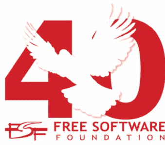

感兴趣赞助吗？访问 `u.fsf.org/46p` 获取更多信息

# MakerSpace

## 使用仿真降低电子设计风险：使用 SPICE 增强 KiCad

设计电源是一项有趣但又危险的工程任务。你可以通过在 KiCad 中建立模型并运行 SPICE 仿真来降低固有风险。作者：Andrew Malcolm

最近最近被派任务设计一个输出为 5V/1A 的小型市电电源。由于该设计必须通过严格的安全和合规性审批，现成的电源并不是一个选择。我开始考虑如何通过尽可能多的组件和尽可能多次的设计迭代来实现这一目标。

经典的输出电压电源使用变压器将交流市电降低到低得多的交流电压，然后进行整流、平滑和调节，以产生直流输出。然而，在 50/60Hz 市电频率下运行的变压器体积庞大，而且通常产生的磁场会对周围的某些电路产生干扰。

在市电电源（有时被混淆地称为“离线”电源）的情况下，输入的市电首先被整流产生高压直流电。对于 85-246VAC (RMS) 的通用输入，输入范围为 120 到 360VDC。然后该直流电通过高电压金属氧化半导体场效应晶体管 (MOSFET) 或双极性结型 (BJT) 在 50kHz 到 MHz 之间的频率进行开关切换，然后平滑提供低电压直流输出。由于工作频率高，变压器要小且轻得多，并在潜在的高输入电压和低电压输出之间提供隔离。这种输出的质量对于电源的安全使用至关重要，取决于电源的设计和结构。许多廉价充电器和其他墙插电源使用的变压器在安全方面的绝缘极其糟糕。在互联网上简单搜索就可以证实这一点；其中一篇文章详细介绍了其中的细节 [1]，还有几个频道专门对这些标准设备进行拆。

## 开关模式

目前几乎所有的电源和电压转换器都是开关模式电源 (SMPS)。这个术语涵盖了各种类型的功率转换设备，它们的共同点是将直流电压转换为脉冲信号，然后输入某些电感，电感反过来将这些脉冲转换为不同电压的脉冲，以便后续转换回直流。

对于实用的 SMPS，输入可能会在上述数值之间变化。由于输出也可能变化，通常需要反馈调节。输出电压直接受驱动 MOSFET 或 BJT 开关的脉冲宽度的影响，并存在许多内部电路根据某些反馈来控制此脉冲宽度。由于反馈必须与“高”侧和“低”侧隔离，通常需要光耦合器。变压器可以是辅助绕组，其输出将根据输入和输出条件变化，并可以提供反馈。在某些情况下，参考源减少了组件并消除了输出误差，而组件可能会随时间变化，导致长期调节问题或输出故障。对于集成在电源开关（MOSFET 或 BJT）中的低输出电源。

我制作了一个原型；在系统中，这似乎是下一步，但特别是在高电压情况下，这可能是昂贵且具有潜在危险的。没有任何措施能确保我选择了正确的组件；我必须提供一个可以安全上电并测试的 PCB（请参见“安全警告”）。

通过原理图捕获，你已经完成了设计的一半工作。这种仿真可以帮助你在将其变为现实之前增加对设计的信心。

工作原理的说明超出了本文的范围，但 SPICE 依靠对组件的模型进行分析。这些模型可能是理想模型、行为模型或真实世界模型，取决于组件供应商，它们清晰地模拟了所代表的设备。显然，模型越好，仿真结果越准确。

## 添加 SPICE

让我们检查电源开关以及所有输入和负载组合的输出（理想情况下，超过性能范围）。此外，有一项历史悠久的仿真程序称为集成电路仿真 (SPICE)，它源于 20 世纪 80 年代的一个大学研究项目。这也是另一种基于实现的选择方法。许多制造商提供基于 SPICE 的闭环仿真，特别是 LTspice（需要在 Linux 上运行）。

SPICE 提供多种类型的仿真，包括瞬态分析、AC 和 DC 扫描。我将使用瞬态分析来预测我设计中关键部分的行为：变压器、开关 (MOSFET) 以及电源模型中的输出电流。

在后续情况下，LTspice 在 Linux 上可用，并可以通过提供文本输入独立使用。此版本的 SPICE 也集成在名为 KiCad 的开源 EDA 工具中，我正在使用它。如果你熟悉

## 原理图

## 选择组件

大多数半导体制造商都有芯片，还有专门的 IC 制造商。你可以找到组件选择工具，允许你输入输入输出要求以选择合适的设备。大多数的设计...

# TRAN - 瞬态分析

# SPACE 与 KiCad MAKERSPACE

| | | |
|---|---|---|
| 步步长 (Time step) | 50u | 秒 |
| 结束时间 (Final time) | 2m | 秒 |
| 初始时间 (Initial time) | 0 | 秒（可选；默认 0） |
| 最大时间 (Max time) | 1s | 秒（可选；默认 1s） |

现在选择 SWITCH（开关）。你应该能看到一个重复的波形，当开关关闭时，波形会跳变至 1kv（见图 6）。这是在振荡期间产生的电磁电动势（EMF）和“反压”（Flyback）。

- `I(L1)`（紫色轨迹）是电感中的电流；你应该看到它上升（向下），因为它是由开关切换期间快速变化的电压感应产生的。

这表明电感正在充电，就像电容器一样。当开关关闭时，能量被释放并传输到次级绕组和负载。在第三个周期中，初级环铃在其自谐振频率处上升，导致了你可以在脉冲之间观察到的衰减。

- 使用初始条件
- 为包含库目录添加完整路径
- 保存所有电压，保存所有电流
- 保存到数字数据事件
- SPICE 和 LTspice 兼容模式

TRAN - 瞬态分析的分析。

图 8：在此对话框中，你可以配置瞬态分析设置。

点击 Run（运行）后需要几分钟，但显而易见的是，初级侧电路在十分之一的时间内完成了。

负载上接了一个 10 欧姆电阻，如果输出达到 5V，它将消耗 0.5 安培电流。这是你另一个可以研究的值，以观察不同负载的影响。我修改了原理图中所有的输入节点（图中的 DRIVE、SWITCH 和 OUTPUT）。

## 检查结果

你可以选择使用过滤器（filter）放大波形以查看仿真右侧的内容，或者使用原理图中的探针工具（probe tool）查看独立的脉冲。

## 设置仿真

我有兴趣看到这个电路随时间变化的响应，因此我需要设置第一个脉冲 V1。如上所述，从原理图右键菜单选择属性并点击仿真。

- 选择 DRIVE（绿色轨迹）并放大/缩小以查看独立的脉冲。

我使用内置的 SWITCH 模型作为脉冲源（图 3）。所选 SMP 开关的数据页指定了工作频率为 100kh，周期设置为 10us。宽度设置为 0.2us，占空比为百分之二。上升和下降时间设置得真实，以验证仿真。值的更改可能会导致仿真无法收敛。脉冲高度（y2）设置为超过阈值电压（通常为 3.2V），以确保其开启。

要开始仿真，从主菜单中选择 Inspect（检查）。从这里（图 4），你可以看到 Simulation/New analysis（仿真/新建分析）表格。选择一个

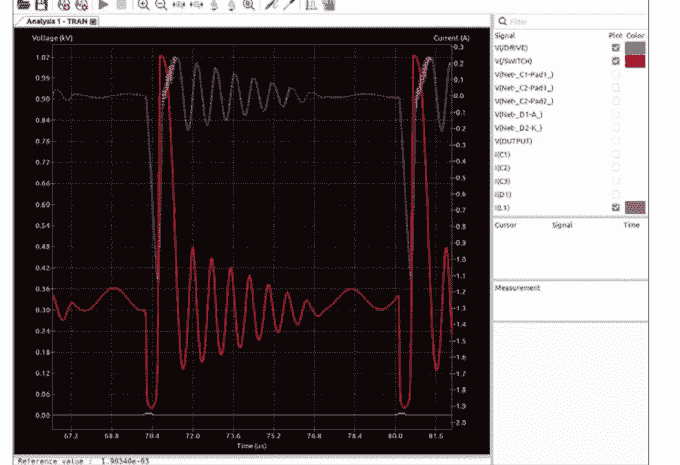

图 6：分析结果显示了初级侧的波形。

## MAKERSPACE SPICE 和 KiCad

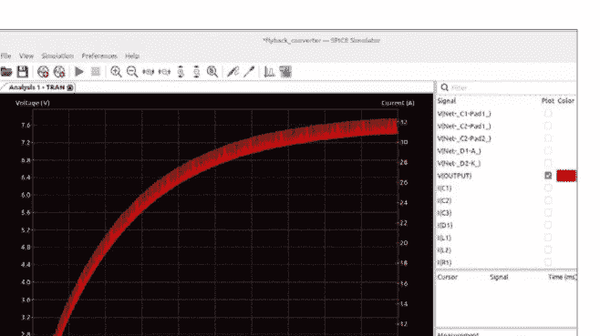

仅 6V。在 25% 的占空比下，输出仍为 5V，显示有足够的裕量。因此我证明控制 IC 能够通过改变脉冲宽度来适应变化的输入和输出条件，维持输出。实现这一点的方法是将反馈电压的一部分与其内部参考电压进行比较，以决定增加还是减少驱动。我在最终设计中使用的芯片在变压器上有一个用于反馈的辅助绕组，这在它的数据页中有详细详细描述 [10]。仿真还表明，在最小占空比下没有任何负载时，输出可能会超过规格。因此，必须有一个最小负载，在制作原型时，需要一个 470 欧姆电阻来将输出保持在指定水平。

图 7：分析结果显示了次级侧的波形。

低 ESR 电容在电源设计中的重要性。你可以将 ESR 值设为零，但这样仿真器将报错提示“time too small（时间太小）”。此信息在设置电路时可能会经常出现，这表明你还应该将电容 C1 设置为较小的值，以加快电压调节回路的速度。

在 2% 时，输出达到约 38.5V。在 50% 的占空比下，这接近 SMPS 能实现的最大值。

## 总结

你可以使用 KiCad 中的 SPICE 仿真子电路的某些方面。然而，在现实世界中，交流市电和直流市电均具有致命危险，所以如果你没有经验，请不要尝试构建、修改或测量此类电源。这些电路的“高侧”是地线，因此无法在其上连接示波器。电源的测试必须使用隔离变压器进行。这样，交流电就与市电隔离，你可以安全地建立并进行测量，但建议极度小心。电容器在断电源后仍保存电荷，因此如果你将 V1 脉冲宽度恢复为 4%，重新运行仿真，输出电压将处于更高的水平。如果你降低输入电压，当负载减少到 5 欧姆（即最大值）时，输出将上升到最低 9V。

图 8：这是完整的原理图。


# NiceGUI Web 应用制作 MAKERESPACE

- 第 9 行使用了 `ui.html` 方法。如果你想复制粘贴某些 HTML 文本，这种方法非常有用。
- 在第 12 行中，你可以看到 `ui.label` 方法。它设置了两个 Tailwind CSS [style] 来配置文本的**粗体**和颜色。
- 第三种方法（第 15 行）使用了 `ui.mark` 方法。Markdown 可以调整文本类型，如**粗体**、*斜体*和下划线。例如，每个 `###` 标题都有组 3 级标题。Markdown 语法原生不支持彩色文本。

最后一步是调用 NiceGUI 服务器框架（第 1 行）。`ui.run()` 方法有几个选项。在这里，我要求 Web 应用程序运行在 8080 端口（NiceGUI 的默认端口）上，并且不会自动启动 浏览器（browser）。

spinner。此元素也配置了一个 `on_change` 事件，它会调用 `update()`。

在输入下方，脚本添加了一个字段和一个旋钮（第 17 行）。这两个组件都在其值和数字输入之间配置了绑定，使用了 `bind_value(obj, 'value')`。

（第一个命令仅在你之前没有安装 Snap 的情况下是必要的。）一旦视频流加载，它就可以在 8080 端口的后台运行。以下命令以后台守护模式启动 `jj-streamer`：

第 20-26 行也可以在页面上创建一个可以包含多个演示文的组件。为此，我定义了一个单水平条（第 24 行）。`update` 函数通过在数字元素上调用它来刷新进度条的值。修改图表中的值比简单更改滑块或旋钮要复杂一点——例如，你可以将图表的第一个（第 0）系列和第一个（第 0）项目设置为新值，然后更新图表。

```
jj-streamer -b -1 --output_http http:// "action-stream"
```

然后你可以使用 `ui.run()` 方法创建一个基于 NiceGUI 的视频流：

```python
from nicegui import ui
ui.image('http://ip_address:8081/action-stream')
ui.run()
```

这个基础示例使用了先前的 8081 端口和参数 `action-stream`，以便在网页上显示实时视频。你可以获取静态图像，使用 `action-snapshot`。

## 读取输入

NiceGUI 允许多种输入控件。用户输入与 Python 脚本之间的交互通过事件回调和/或属性处理。图 2 显示了一个同时使用这两种方法的示例。Web 应用在图表顶部添加了一个数字输入（`ui.number`）。可以通过手动更改新值或切换向上/向下箭头来调整值。

## 添加视频流

我希望为气象站和 Pi 项目都从 USB 摄像头流视频。有许多视频解决方案；对于这些项目，我使用了轻量级的 `jj-streamer` [工具]，它可以通过 Snap 安装：

```bash
sudo apt install snap
sudo snap install jj-streamer
```

```python
# 使用用户输入更新并绑定组件
from nicegui import ui
chart = ui.chart({'series': [{'data': [0], 'name': 'min_number'}]})
number = ui.number('A user number', value=50, step=10, on_change=lambda: chart.update())
slider = ui.slider(min=0, max=100).bind_value(number, 'value')
color = ui.color('blue', show_value=True).bind_value(number, 'value')
chart.bind_update(number, 'series', 0, 'data', lambda v: [v])
```

## 气象站示例

我的气象站项目硬件包括 BME280 传感器（$5-$20），以及其他组件如低成本 DHT22 传感器。我使用了一个较新的摄像头，发现它的视频质量非常好。然而，在项目的首次尝试中，我使用了旧的、质量较低的摄像头，遇到了一些问题。整体画质为

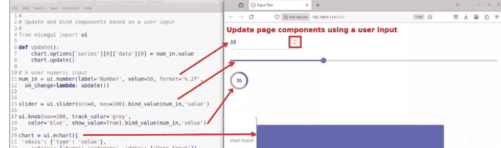

图 2：用户输入元素可以使用 JavaScript 或 HTML 表单显示元素。

LINUX-MAGAZINE.COM 第276 期 2025年7月 71

# MAKERESPACE NiceGUI Web 应用

我将 Pi 安装在一个受保护的栏杆上，那里不需要担心潮湿。为了更具防风性的设置，我建议你将树莓派和 BME280 传感器放在密封容器内，然后安装第二个 Pi 并对着窗户观察天气。外部 Pi 可以运行完整的 NiceGUI 代码，第二个 Pi 的 IP 地址作为设备的地址。

BME280 传感器所需的额外软件是可以使用 `pip install bme280` 安装。列表 1 显示了显示外部温度的代码。配置跨越了多行，但只需要12行代码。UI 由 `ui.interval` 流器自动刷新，温度使用 NiceUI 定时器每 15 秒更新一次。

# 列表 1：气象站项目


# 列表 1：气象站项目

```python
01 #/bin/python3
02 #
03 # gauge.py 将 BME280 传感器数据写入仪表表
04 # from bme280 import Sensor
05 from nicegui import ui
06 #
07 # 定义一个带有 BME280 传感器的仪表表
08 # I2C 地址
09 with ui.header(): 
10 # 标题
11 ui.markdown('My Weather')
12 
13 v = ui.image('http://192.168.0.105:8081/action-stream')
14 
15 chart = ui.chart({
16 'series': [{'data': [0], 'name': 'min_number'}],
17 })
18 
19 number = ui.number('A user number', value=50, step=10, on_change=lambda: chart.update())
20 
21 slider = ui.slider(min=0, max=100).bind_value(number, 'value')
22 color = ui.color('blue', show_value=True).bind_value(number, 'value')
23 chart.bind_update(number, 'series', 0, 'data', lambda v: [v])
24 
25 # 每隔15秒更新一次
26 def update():
27     # 获取传感器数据
28     # 更新图表
29     pass
30 
31 ui.interval(15000, target=update)
32 
33 ui.run(port=8080)
```

# NiceGUI Web 应用制作 MAKERESPACE

- [费曼学习法](https://wiki.example.org/feynmans_learning_method) 的灵感源于诺贝尔物理奖获得者**理查德·费曼**。
- 第 9 行使用了 `ui.html` 方法。如果你想复制粘贴某些 HTML 文本，这种方法非常有用。
- 在第 12 行中，你可以看到 `ui.label` 方法。它设置了两个 Tailwind CSS `style` 来配置文本的粗体和颜色。
- 第三种方法（第 15 行）使用了 `ui.mark` 方法。Markdown 可以调整文本类型，如**粗体**、*斜体*和下划线。例如，每个 `###` 标题都有组 3 级标题。Markdown 语法原生不支持彩色文本。

最后一步是调用 NiceGUI 服务器框架（第 1 行）。`ui.run()` 方法有几个选项。在这里，我要求 Web 应用程序运行在 `8080` 端口（NiceGUI 的默认端口）上，并且不会自动启动 `browser`。

`spinner`。此元素也配置了一个 `on_change` 事件，它会调用 `update()`。

在输入下方，脚本添加了一个字段和一个旋钮（第 17 行）。这两个组件都在其值和数字输入之间配置了绑定，使用了 `bind_value(obj, 'value')`。

（第一个命令仅在你之前没有安装 Snap 的情况下是必要的。）一旦视频流加载，它就可以在 `8080` 端口的后台运行。以下命令以后台守护模式启动 `jj-streamer`：

第 20-26 行也可以在页面上创建一个可以包含多个演示文的组件。为此，我定义了一个单水平条（第 24 行）。`update` 函数通过在数字元素上调用它来刷新进度条的值。修改图表中的值比简单更改滑块或旋钮要复杂一点——例如，你可以将图表的第一个（第 0）系列和第一个（第 0）项目设置为新值，然后更新图表。

```
jj-streamer -b -1 --output_http http:// "action-stream"
```

然后你可以使用 `ui.run()` 方法创建一个基于 NiceGUI 的视频流：

```python
from nicegui import ui

ui.image('http://ip_address:8081/action-stream')

ui.run()
```

这个基础示例使用了先前的 `8081` 端口和参数 `action-stream`，以便在网页上显示实时视频。你可以获取静态图像，使用 `action-snapshot`。

# 读取输入

NiceGUI 允许多种输入控件。用户输入与 Python 脚本之间的交互通过事件回调和/或属性处理。图 2 显示了一个同时使用这两种方法的示例。Web 应用在图表顶部添加了一个数字输入（`ui.number`）。可以通过手动更改新值或切换向上/向下箭头来调整值。

# 添加视频流

我希望为气象站和 Pi 项目都从 USB 摄像头流视频。有许多视频解决方案；对于这些项目，我使用了轻量级的 `jj-streamer` [工具]，它可以通过 Snap 安装：

```bash
sudo apt install snap

sudo snap install jj-streamer
```

```python
# 使用用户输入更新并绑定组件
from nicegui import ui

chart = ui.chart({'series': [{'data': [0], 'name': 'min_number'}]})

number = ui.number('A user number', value=50, step=10, on_change=lambda: chart.update())

slider = ui.slider(min=0, max=100).bind_value(number, 'value')

color = ui.color('blue', show_value=True).bind_value(number, 'value')

chart.bind_update(number, 'series', 0, 'data', lambda v: [v])
```


# 气象站示例

我的气象站项目硬件包括 `BME280` 传感器（$5-$20），以及其他组件如低成本 `DHT22` 传感器。我使用了一个较新的摄像头，发现它的视频质量非常好。然而，在项目的首次尝试中，我使用了旧的、质量较低的摄像头，遇到了一些问题。整体画质为


图 2：用户输入元素可以使用 JavaScript 或 HTML 表单显示元素。

`LINUX-MAGAZINE.COM` 第276 期 2025年7月 71

# MAKERESPACE NiceGUI Web 应用

我将 Pi 安装在一个受保护的栏杆上，那里不需要担心潮湿。为了更具防风性的设置，我建议你将树莓派和 `BME280` 传感器放在密封容器内，然后安装第二个 Pi 并对着窗户观察天气。外部 Pi 可以运行完整的 `NiceGUI` 代码，第二个 Pi 的 IP 地址作为设备的地址。

`BME280` 传感器所需的额外软件是可以使用 `pip install bme280` 安装。列表 1 显示了显示外部温度的代码。配置跨越了多行，但只需要12行代码。UI 由 `ui.interval` 流器自动刷新，温度使用 `NiceUI` 定时器每 15 秒更新一次。

# 列表 1：气象站项目
(此处由于原文是乱码，跳过代码块内部的重复翻译)

# MakerSpace-Online

## 每周更新新的创客内容
在 MakerSpace，我们致力于提供你可以用来构建属于自己的东西的技术。我们的目标是通过为创客者提供实操项目，帮助你将想法变为现实。


## Fresh内容，实时送达
立即订阅并加入 MakerSpace 社区。当新内容发布时，你将保持最新动态。

立即加入！

`https://makerspace-online.com`


# LINUX VOICE 导言

我们生活在一个信息从处处倾泻的世界里。如今的 Linux 用户通过电子邮件、社交网络、播客、有线电视以及我们尚未命名的其他疯狂媒体来获取新闻。你听到的不仅仅是你正在倾听的内容。当你乘坐公交或坐在午餐柜台时，你会听到你旁边的人正在听的内容的精华。如果每天查看一份来自你自己信赖来源的自定义摘要，难道不是更好更方便吗？RSS 是一种将新闻直接推送到你的桌面或移动设备上的格式。本月，我们将展示如何使用 `FreshRSS` 配置 RSS 馈源。此外，在本月的 Linux Voice 中，你将学习使用 `NAPS2` 扫描文档。

# LINUXVOICE

| 标题 | 作者 | 描述 |
|---|---|---|
| Doghouse – 最后的盛宴 77 | Jonn "maddog" Hall | 在 2025 年 7 月第 50 周年（最后一次）活动之前，回顾 USENIX ATC。 |
| NAPS2 78 | Andrea Ciarrocchi | 如何使用 NAPS2 服务器扫描文档。 |
| FOSSPicks 82 | Nate Drake | Nate 探索了顶级开源软件（FOSS），包括最新的 KDE 应用套件、安全的通行证生成器以及一个 AI 驱动的塔罗牌 roguelike 。 |
| 教程 – FreshRSS 88 | Marco Fioretti | 使用 RSS 和 FreshRSS 新闻聚合器避免社交媒体的信息污染。 |


# ELVIE


`LINUX-MAGAZINE.COM` 第 296 期 2025年7月 75

# Linux Magazine 订阅

## 印刷版与数字版
每年 12 期


订阅
`shop.linuxnewmedia.com/shop`

提升你的 Linux 技能：

- 关于热门话题的深度文章，包括比特币、勒索软件、云计算等！
- 有用工具的指南和教程，将为你节省时间并保护你的数据
- 故障排除和优化技巧
- 关于开源世界关键进展的独见新闻
- 适用于树莓派、Arduino 以及其他创客系统的酷项目

使用 Linux 走得更远，做得更多，立即订阅，不再错过任何一期！

关注我们

`@linux-magazine` 在 Linux Magazine 中

`@linuxmagazine` `@linuxmagazine@fossododon.org`

# 需要更多 Linux 吗？

免费订阅 Linux Update

我们的免费 Linux Update 通讯每周都会向你的收件箱提供见解的文章和建议。

`bit.ly/Linux-Update`


# MADDOG 的狗屋

在 2025 年 7 月第 50 周（最后一次）活动之前，回顾 USENIX ATC。JOHN "MADDOG" HALL 著。

# 最后一次 USENIX ATC


最近，一位老友兼贝尔实验室的校友在我的 Facebook 页面上对 `usenix.org` 的第 50 次（也是最后一次）USENIX 年度会议（ATC）发表了评论。

对于那些对 USENIX 组织并不熟悉的人来说，他们鼓励计算机系统研究。虽然这围绕着 ACID 和 Unix 类系统，但他们也鼓励对操作系统、并发、内存管理、文件系统、网络以及其他元素的研究。

他们鼓励提交同行评审的论文，并将这些论文带到会议上供大家交流，更改了获取这些论文的方式，但在 2008 年他们向所有人开放了。

他们还提供了关于安全和隐私的免费会议。管理领域规模最大（在我看来是最好的）会议之一是大型安装系统管理（LISA）会议，该会议（遗憾的是）过早结束了。

我没有参加 1975 年开始的第一届会议。当时我正在用汇编语言为 IBM 主机进行编程。等我 1980 年开始使用 USENIX 系统时，我被聘为为一个我从未见过的操作系统的系统管理员。我知道我将能够访问整个系统的代码，还可以访问编写这些代码的人。

# NAPS2 LINUX 版

确定扫描的解析率和细节，通过缩放功能允许按 2x、4x 或 8x 等倍数调整扫描图像的尺寸。

在自动保存设置中，你可以自动化保存过程，将扫描引导到预定义的位置，并指定文件名和扩展名。

文件名可以使用基于页码或日期的占位符。每页或章节可以单独保存，也可以在每次扫描会话中保存为一个文档，并提供可选的补丁（patches）功能。

对于不想在保存后在 NAPS2 中保留图像的用户，“清除图像”（Clear images）选项将自动删除它们。否则，原始图像将保留。

质量设置在扫描清晰度和大小之间提供了平衡。最高质量（Maximum quality）确保无损，对于在较大尺寸下可能看起来更好的 PNG 文件以及详细文档来说。对于 JPEG 文件，可以设置 1 到 100 的质量级别，默认设置为 75，可以在质量和存储效率之间提供良好的平衡（图 3）。黑白扫描很容易对齐，不受此设置的影响。

图 2：NAPS2 界面非常直观。


跨局域网。对于更高级的编辑，可以使用 Gimp 或 LibreOffice 等工具保存并修改扫描文件。

# 扫描仪共享

使用 ESL 驱动程序，扫描仪可以在 Windows、Mac 和 Linux 系统之间共享。在托管扫描仪的计算机上，通过配置文件部分导航到扫描仪共享窗口。点击“共享”选择要共享的扫描仪并对其重命名，以便在其他设备上更容易识别。多个设备可以同时连接，只要主机计算机上运行 NAPS2，就可以保持可访问。

要从另一台计算机共享，使用 ESL 驱动程序创建 NAPS2 配置文件并选择共享的扫描仪。此共享功能利用了 ESL 协议，该协议广泛支持，包括 Android 设备。例如，Google Play Store 上的 Moira Scan 应用可以无缝找到扫描仪。

# OCR 功能

NAPS2 的功能之一是能够使扫描 PDF 中的文本变为可搜索，这得益于对 100 多种语言的光字符识别（OCR）支持。与将文本视为图像的标准扫描文档不同，NAPS2 可以从扫描文件中提取并识别文本。


第一次使用 OCR 时，OCR 按钮会弹出下载窗口，用于选择和安装所需的语言。下载后，打开 OCR 设置窗口，在其中确保勾选了“使用 OCR 使 PDF 可搜索”并确认了正确的语言设置。从今以后，每个保存的 PDF 都将包含可搜索文本。

质量设置允许自动排除空白页。通过调整白度阈值（白色像素的亮度水平）和符合空白页标准的覆盖率阈值（白色的百分比），你可以控制页面的去噪。低覆盖率阈值防止空白页被跳过，而高阈值则确保排除空白页。如果发生这些误报或漏报，尝试调整白度阈值和覆盖率设置可以解决问题。

从 -1000 到 1000 的亮度和对比调整可以精细调节扫描参数。NAPS2 还支持基础图像导入（包括亮度和对比）以及拖放操作。通过交织（interleaving）手动双面扫描变得简单，并且可以手动或自动旋转页面以实现正确对齐。

该应用程序支持 40 多种语言，并允许使用单个扫描仪。

图 3：图像设置中压缩级别和质量的对比。

`LINUX-MAGAZINE.COM`
第 2996 期
2025年7月
79

对于包含多种语言的文档，一旦选择了多种语言，“多个”选项就会变得可用。要添加更多语言，点击“获取更多”（Get more）并按确定。新语言将出现在语言下拉菜单中。

扫描以继续或点击“完成”结束。在自动模式下，扫描操作次数和替换过程的时间间隔是预定义的，允许扫描在没有用户干预的情况下进行。

批量扫描为图像的管理和保存提供了灵活性。“导入到 NAPS2”选项允许将文件导入到文件中，在扫描之前对它们进行查看、编辑和重新排列。“保存为单文件”将所有扫描图像合并完成一个文档，并保存到指定的格式和位置。或者，“保存为多个文件”选项将扫描按标准划分为单独的文件夹，每个文件采用所需的格式和位置。

OCR 处理提供两种模式：“快速”（Fast）优先考虑速度，“平衡”（Balance）提供更好的准确性但耗时更长。“快速平衡”和“噪声增强 OCR”提高低质量扫描的质量，但会增加处理时间。

文件名可以使用 `(n)` 等占位符进行自定义，这会文件名生成顺序编号。有三种方法可用。“每次扫描一个文件”为每次扫描创建一个单独的文件，并在多种扫描模式下可用。“每页一个文件”选项首先将每个图像保存为单独的页面。最后，“保存为补丁”（Save as Patch）选项确保扫描期间检测到 Patch-T 代码。这些选项使扫描高度可定制，以满足各种需求。

“扫描后自动运行 OCR”在扫描完成后检测文本识别，简化了扫描过程。对文档的任何修改都会影响 OCR 结果，需要重新运行。

NAPS2 不支持直接导出结果到文本文件，但可以使用查看器的“全选”和“复制”功能从 PDF 中提取文本。此外，NAPS2 还可以对导入的 PDF 进行 OCR。已包含文本的页面将不受影响，其他页面将进行处理。

# 支持

官方网站的故障排除部分为最常见的错误提供支持 [3]。此外，GitHub 页面包含与已知问题、一般讨论和问题请求相关的章节 [4]。

# 批量扫描

NAPS2 包含简化重复任务的批量扫描功能。“批量扫描”选项允许用户选择扫描配置文件并在单次或多次扫描模式之间切换。单次扫描允许对扫描仪的操作，在使用自动进纸器时可以处理多个页面。对于多次扫描，用户可以选择手动或自动模式。在手动模式下，软件会在每次扫描后提示放置纸张。

## 信息

- 1) NAPS2 下载：`https://www.naps2.com/download`
- 2) CLI 安装指南：`https://www.naps2.com/linux-scanning`
- 3) 故障排除：`https://www.naps2.com/troubleshooting`
- 4) GitHub  NAPS2：`https://github.com/cyanfish/naps2`

## 作者

Andrea Ciarocchi 是一位技术爱好者。访问他的主页：`https://andreciarocchi.altervista.org`.

# FOSSPICKS LINUX 之声

## MUD 客户端

### Mudlet

如果你玩过《巨洞迷窟冒险》和《魔界》，你就会知道文字游戏是自成一类的。虽然现代游戏演进如此之快，但文字冒险通常依赖于你尝试每一个版本来从“获取灯光”从一个区域移动到另一个区域。第一个多用户地下城（MUD）诞生于英国的埃塞克斯大学。用户在成为魔法师之前可以连接并获得积分。

MUD 与普通冒险游戏的区别在于，MUD 允许多人进行互动。它们是多人在线 RPG 的第一个例子。多年来，许多 MUD 相继诞生，部分原因是由于任何拥有终端的人都可以通过文本连接并创建自己的角色。虽然这很简单，但 Mudlet 是一款专门的 MUD 客户端，旨在让在线游戏变得变得简单一点。作为来自主站的一款应用程序，它是非常具有革命性的。Ubuntu 软件中心中也有 Snap 版本。

首次启动时，Mudlet 会显示一个窗口，列出你可以自动连接的 MUD。这是一个非常常见的功能，否则你必须手动输入服务器详情。我最喜欢的基于特里·普拉奇特《圆形世界》的 MUD 没有被介绍。我使用了方便的连接标签页登录。Mud 使用标签同时连接到多个 MUD。你必须为每个游戏使用单独的配置。Mudlet 还有分屏界面。如果你——

Mudlet 通过终端提供所有功能，包括自动化脚本、记事本和分屏。如果你尝试滚动，屏幕将保持在当前内容上的焦点，而下半部分显示游戏输出。看到一个专门的记事本按钮也让我很高兴，它是用 Lua 编写的，如果你愿意，还可以添加自定义脚本在游戏中调用。

项目网站：
`https://www.mudlet.org/`

# 体质指数

### BMI 计算器

作为最近为了更有效地对抗死亡的努力的一部分，我发现体重指数（BMI）并没有人们想象的那么简单。正如我的导师向我解释的那样，它无法区分脂肪和肌肉（我并没有肌肉）。我们还谈到它倾向于欺骗，因为肌肉发达的人即使在没有多余脂肪的情况下也可能有较高的 BMI。尽管如此，BMI 不会消失，因为它是获取和维持整体健康的一种快速简单的方法，这就是为什么 Johannes Boehler 汇编了这款计算应用。它目前仅作为 Flatpak 可用。

首次启动时，用户会被提示输入他们的体重（公斤）和身高（米）。像许多英国人一样，我希望能看到一个切换到英尺（美国人使用磅和英尺）的选项，但似乎也存在。还有一个下拉菜单可以更改性别，但我注意到当我在公制和英制之间切换时，似乎对 BMI 分数没有影响。信息已输入，用户选择显示哪些结果，并在高度颜色化的图表上有一个标记。

BMI 计算器显示了来自世界健康组织（WHO）和德国营养学会（DGE 或德国营养协会）的简要摘要。在我的情况下，这两个尊崇的机构足以确认我的——然而，开发者页面。该程序的当前版本已更新，以示例格式显示此类信息，这对于更清晰的布局非常有意义。

应用程序还包含深色模式的截图，但在 BMI 计算器内部没有调用方法，所以我假设应用程序只是完全遵循当前的系统主题。

项目网站：
`https://github.com/jannesboehler/bmicalculator`

`LINUX-MAGINE.COM`
第 296 期
2025年7月

# LINUX FOSSPICKS

## 一次性共享

### OTI

在间谍时代，间谍们经常在易燃纸上写秘密信息。这种纸经过硝纤维素处理；它可以被快速点燃，因此得名于此。在现代，许多网站正在剥离，通过完全允许用户输入密码来交付处理后的信息。通常，你只需要让网站运营商显示该信息是安全处理的。这就是为什么像 OTI 这样的开源解决方案提供了最好的安全性。

输入消息，然后从可用的客户端中选择一个使其过期（默认为一小时）。你还可以设置密码。虽然像 PrivateBin 这样的平台需要密码，然后使用密码使用 AES256-GCM 在浏览器中加密数据，但 OTI 客户端使用 RSA，由于是非对称加密，编码较长的地址可能需要更长时间。

私钥也压缩在一次性 OTI 内部，使用了 zlib 端口 pako。这使得 URL 变得更短；尽管当它们被热化时，长度相当长。服务器由 Adonis_JS 管理，它只能看到加密数据和元数据。

这里的演示是一个坚实的概念证明，但你需要在自己的服务器上进行自托管以保持秘密安全。目前 OTI 只共享文本（即没有文件上传）。然而，没有理由你不能安全地加密文件（例如，通过 AES）并使用 OTI 通过一次性链接共享。我想实现一个该平台使用完美正向秘密（PFS）的功能，因为如果一个私钥泄露，将无法解密过去/未来的消息。

项目网站：
`https://github.com/adoniskhan/OTI`

# 密码生成器

### diceware

大多数 Linux 用户都熟悉使用 diceware 生成“好”密码的代码。你可能不会在字典中找到它，密码只包含 8 位熵，因此破解需要几个小时。此类密码很难记忆。如果没有，使用字典单词（例如“火箭喷雾”）提供了更多的熵。单词来自列表。在软件版本可用之前的很长时间，包括它位于 Debian 仓库中。安装后，你运行来生成密码语，大写。为了安全，使用 `-d` 标志交付如空格。每个单词包含 8 位熵。在使用 diceware 后，由电子基金会（EFF）发布。

项目网站：
`https://packages.debian.org/`

# 桌面界面

### YouTubeTube

YouTube Tube 被描述为 Leanback 的非官方封装，结合了广告拦截器。它目前作为独立应用程序可用。

启动时，我注意到黑底白字的奇怪选择。然而，左侧有按钮，如显示

# 塔罗牌解释器

### TarotCaster

尽管在法庭和算法的世界里，我在大学学习了现代语言。在这里我发现，18世纪的法国占术士将神秘力量归于塔罗牌，尽管它们是为了玩游戏。除了大阿尔卡，它在视觉上与我今天使用的相同。默认情况下，TarotCaster 显示单牌，但你可以使用三张牌或凯尔特十字的组合。当我尝试绘制第一张牌的总结时，相应的牌在主视图中没有显示任何内容，我不得不向下滚动找到它们。

# LINUX 开源游戏精选

类 Roguelike 风格僵尸生存游戏

## 大崩变：明亮之夜 (Cataclysm: Bright Nights)

开源的优点之一是开发者可以根据自己的想法重新制作游戏。对于《大崩变：明日之后》（Cataclysm: Days Ahead）也是如此，它最初是《大崩变》的续作。其基本设定是宇宙中未计划的变化会导致不同的结果。在旧世界中崛起，玩家可以通过文本界面（而不是窗口）或瓦片（通过 SDL）进行导航。

否则，游戏可能会出现故障。这个《黑暗日时代》（Dark Days Ahead）的最新分支名为明亮之夜（Cataclysm-BN）。它最初从一个简单的模组开始，现在已成长为一个完整的分支，包含了开发者所说的“科幻”元素。你可以直接从 GitHub 页面下载最新的稳定版或每夜版（提供普通版本和瓦片版本），或者直接从 GitHub 安装 Flatpak 版本。

请注意，这具有非常陡峭的学习曲线。你首次启动时将用于创建自定义角色、使用预设角色或随机生成一个。我选择了随机默认场景进行游戏，这让我有机会掌握游戏机制。游戏会一直进行，直到你首先开始开启安全模式（按 `I` 禁用）。这可以防止你与僵尸交互。

在尝试让我的角色变暖时，我点燃了一滩汽油作为篝火燃料。我的脚并没有帮上忙。

你可以开始处理捡物品和和 NPC 对话的任务。在从 NPC 那里制作了一条鲜鱼后，我不成熟地开启了这种模式，结果被砍成了酸豆。幸运的是，你也可以从屏幕访问教程。这是让自己融入《大崩变：明亮之夜》好得的方法；它会显示执行任务的常规工具提示。例如，我使用手电筒查看它的右侧，然后按右键确认我看到的物体，然后按 `I` 键。我想，在周围走动并被询问是否想要捡起它（Y/N）也应该是可以的。如果你变得太饥饿或动作迟缓，游戏要求你照顾好自己。

在角色变盲一段时间后，我选择在地上洒上一些汽油并用打火机点燃它。虽然这很好地展示了如何与清单物品（如“激活”）交互，但也将我的角色困在了燃烧的房间里！尽管如此，游戏依然让你充满悬念，并且有几乎无尽的选择。

由于该游戏具有非线性玩法，它与其他游戏不同。在旧世界中，地图是程序生成的。玩家可以自由探索。

《大崩变：明亮之夜》通过界面让你处理物品并与 NPC 交互。

项目网站

`https://github.com/cataclysm/cataclysm-BN`

# 《大崩变：明亮之夜》的收藏

《大崩变：明亮之夜》是一个分支

《大崩变：明亮之夜》的收藏

# 教程 - FRESHRSS LINUS VOICE


安装 FreshRSS 的方法既简单又整洁。

操作流程：你必须为 FreshRSS 创建一个 MySQL 或 MariaDB 数据库，将 FreshRSS 文件存放在文件夹中，然后通过 Web 浏览器配置应用程序。

- 列表 1 显示了你执行第一步时所需的必要命令：你必须创建一个数据库 (`freshrss`) 和一个用户 (`freshrss`)，并为该用户设置随机密码，然后为该用户授予所有权限。

安装过程的命令行部分更为简单（列表 2）：在你的 Web 服务器文件夹中下载软件的最新版本，按你喜意将其重命名（`FreshRSS-latest` 文件夹），并设置运行 Web 服务器的所有者账户。

在浏览器中完成 FreshRSS 的最终配置。你需要选择一种语言、检查文件权限、传递数据库参数并定义默认用户。如果 FreshRSS 的文件夹或子文件夹没有正确的权限，软件将在配置期间暂停，告诉你是应该修复哪些文件夹（图 1），并等待你完成。

图 2 展示了 FreshRSS 的外观，并指向了你每天将用的功能。主面板包含标题、摘要、发布日期以及通过 RSS 订阅收集的新闻来源。为了让阅读更高效，你可以对你的订阅源进行分类。

FreshRSS 还允许你通过点击右上角的齿轮（图 2a）来配置其他功能。新闻上按钮允许你以多种方式进行过滤：例如，你可以只查看或隐藏之前通过点击星形按钮（图 2c）“收藏”过的未读新闻。

# 列表 2：FreshRSS 包下载

```
```


`wget http://github.com/FreshRSS/archive/latest.zip`

`unzip latest.zip`

`mv FreshRSS-latest/freshrss`

`chown -R www-data:www-data freshrss`


图 3：FreshRSS 可以根据你的需求对新闻进行排序，并仅显示你想看的信息。

LINUX-MAGAZINE.COM 第 296 期 2025 年7 月 89 页

# LINUX VOICE 教程 – FRESHRSS

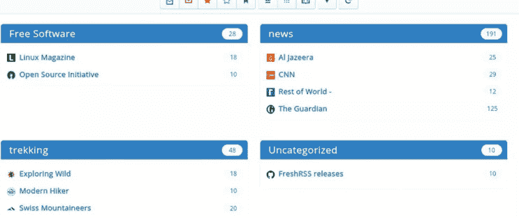

**图 4：** FRESHRSS 的全局视图是按类别查看新闻条目数量最紧凑的方式。

正如你在图 3 的右上部分所示，可以根据发布日期、标题、链接或任何其他顺序对新闻进行排序，这在有时会非常有趣。你还可以启用或禁用主面板中的几乎每一个元素，从缩略图、网站名称到分类按钮和摘要。点击任何新闻项即可阅读相应的摘要（图 2d），并为其添加标签（图 2e）。通过点击其标题或右下角的小图标（图 2f），也可以在另一个窗口中打开文章。

# 过滤器和用户查询

FRESHRSS 的真正威力在于你可以在图 2g 的搜索中进行过滤。要理解它是如何工作的，请看页面的右半。通过那里的输入，FRESHRSS 可以仅显示在特定时间发布或下载的新闻。例如，输入 `date: 2025-03-27/2024-05-02` 将仅显示在这两天之间下载（或在 FRESHRSS 中被“发现”）的新闻。

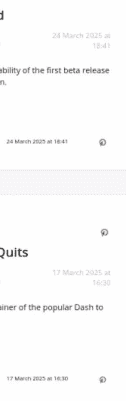

## 用户查询


如果你正在寻找一种经受时间考验的企业级 Linux 发行版，Rocky Linux 的新版本一定能让你和你的公司满意。

**图 5：** FRESHRSS 的阅读视图类似于社交媒体，具有自动流、迷因、帖子、评论和口战。

**图 6：** 在 FRESHRSS 中，你可以随时选择你想看的新闻，也可以随时选择那些查询。

# 教程 – FRESHRSS LINUX VOICE

在这两天之间。将 `date` 替换为 `pubdate` 将重新启动所有且仅在这两天之间发布的新闻，无论 FreshRSS 何时下载它们。你仍然可以用任何方式对过滤后的新闻再次过滤。其他一些过滤器显示在列表 3 中，但你可以在 FreshRSS 文档的相应页面找到所有内容。然而，如果你问我的话，最用的是列表 3 显示的 `best`，它只显示过去 N 天或几小时内发布的新闻。让这些过滤器变得真正有用的是可以保存它们的功能，方法是使用过滤器中的下箭头。如果你在搜索栏中有任何类型的表达式，你可以通过点击右侧的书签来保存它。FRESHRSS 将会将其添加到用户查询下拉菜单中（图 6 的左侧），你将能够以多种格式运行它们的查询输出。

## 列表 3：一些 FreshRSS 过滤器

```
author:Marco Fiore # 仅来自某些作者的新闻
```

```
date:2023-01-30 # 仅限2023年3月30日发现的新闻
```

```
date:2023-02-04 # 2023 年 2 月到 4 月
```

```
date:2023-02-02 # 2023 年 3 月之后
```

```
date:2023-02-01 # 2023 年 4 月之前
```

```
date:P/ # 过去两天
```

```
date:F/ # 过去五小时
```

```
intitle:"Linux rocks" # 标题中包含的词
```

```
ext:"php" # 扩展名
```


# 扩展

如果你寻找企业级 Linux 发行版已经经过了测试

更重要的是 **用户注册：** 如果你允许它，你就可以限制创建账户的数量，并要求账户提供电子邮件地址。

关于身份验证，默认情况下 FreshRSS 仅允许使用用户名和密码登录。你可以禁用身份验证（这通常是个坏主意），或者通过将 FreshRSS 连接到单点登录 (SSO) 服务来强制执行身份验证程序。

你可以以多种格式批量导入订阅、私有订阅、使用何种 cookie 或接受 cookie。其他你可能配置的包括但不限于订阅源的刷新频率，以及如何避免显示重复。最后，可以使用多种格式导入或导出完整的列表（图 10）。

FRESHRSS 身份验证的真正强大之处在于支持匿名用户和第三方应用程序。你可以允许匿名用户阅读和刷新所有订阅，或者为访问公司或学校内网的访客提供特定的订阅。

# 管理与配置

在 FreshRSS 初始配置中创建的第一个用户可以也应该不仅仅是阅读。由于 FreshRSS 支持用户，即使你是 FreshRSS 安装的唯一用户，也应该设置一个账户（带有新密码）仅用于阅读新闻。

**API 访问功能**则允许所有 FreshRSS 支持的桌面或移动应用程序读取你的用户订阅。为了让这真正发生，这些应用程序需要知道用户在个人资料部分设置的 API 密码。为了让人们可以分享订阅而不泄露密码。

说到管理，值得注意的是，许多 FreshRSS 管理操作可以通过 FreshRSS-installation 中的 cli 工具在命令行中完成。这里是一些重要的例子。除了处理用户之外，管理菜单有五个条目：三个用于定期维护（安装检查、更新和日志），以及系统配置和用户身份验证。

# 教程 - FRESHRSS LINUS 观点

分享 RSS 订阅中发现的文章有许多方法，从邮件到所有社交媒体，以及在 archive.is 等网站上制作副本。至于归档，你可以决定如何归档以及是否无限保留文章。

移除表情符号。同时，我并不需要那个添加三栏式界面来显示文章内容的扩展。正如俗话说，每个人的体验可能人而异，归根结底，唯一真正的事情是质量。

在编写本文时，FreshRSS 有约 40 个扩展，全都可以从配置菜单的相应部分访问。安装非常简单，只需在你的 FreshRSS 子目录中下载并安装该扩展即可。扩展可以实现各种让 FreshRSS 变得高效或更易于使用的功能，可能将其连接到第三方在线服务（例如生成文章摘要的扩展），或者自动获取新文章的频率并下载到网站，并更改 FreshRSS 的外观和感受，例如根据所属网站为文章标题着色。

甚至有一个（这种扩展在某些语境下合理，但在另一些语境下存疑）允许管理员完全屏蔽订阅源。

个人而言，我喜欢那些让内容更易读的扩展（例如，当文章过长时通过换行而不是截断）。

# 回归 RSS 之吧！

RSS 已经存在了 20 多年，但社交媒体将其推向了阴影，直到我们在今天世界上看到的这些变化才让我们意识到它的价值。我们越早通过 RSS 回到未来，对我们大家都越好。FreshRSS 是访问 RSS 力量的一种简单方式。■

## 信息

- [1] "Nextcloud Private Server"，作者 Marco Fioretti，Linux Magazine，第 293 期，2025年4月，https://www.linux-magazine.com/index.php/issues/2025/293/Tutorial-Nextcloud-Private-Server/(language)/en-US 
- [2] "Tutorial - Nextcloud Plugins"，作者 Marco Fioretti，Linux Magazine，第 294 期，2025年5月，https://www.linux-magazine.com/issues/2025/294/Plug-it-In
- [3] FreshRSS: https://freshrss.org/
- [4] RSS 标准: https://rssboard.org
- [5] FreshRSS 过滤器: https://freshrss.github.io/FreshRSS/en/users/10_filter.html
- [6] FreshRSS 移动应用: https://github.com/FreshRSS/FreshRSS#apis-native-apps
- [7] FreshRSS 命令行界面: https://github.com/FreshRSS/FreshRSS/blob/edge/cli/README.md

## 作者

Marco Fioretti (https://mfioretti.com) 是一位位于意大利罗马的自由职业作家、培训师和研究人员，他在 https://mfioretti.substack 编写数字问题文章。

## 想随地工作吗？

# 立即寻找远程工作！

## 开源工作中心

opensourcejobhub.com

@opensourcejobhub.com

Open Source JobHub

Open Source JobHub

@osjobhub@fosstodon.org

# LINUX 新闻杂志

Linux Magazine 是你进入 Linux 世界的指南。每月一期都包含了你在其他地方找不到的先进技术文章和教程。探索我们的完整过刊目录以获取特定主题或完善你的收藏集。

# GRUB 图形界面

自定义 Linux启动过程需要深入研究 GRUB。如果你是那种喜欢仔细研读文档的人，可以通过调整配置文件来完成，但 GRUB GUI 工具是一个更安全、更简单的路径。
包含在 DVD 中：Zorin OS 17.3 Core, elementary OS 8.0

# 安全浏览器

互联网比以前要嘈杂得多，许多人认为 Chrome 和 Firefox 这样的领先浏览器是问题所在。本月我们重点介绍一些安全的浏览器替代方案，它们将帮助你在冲浪时不留痕迹。
包含在 DVD 中：Rocky Linux 9.5 和 SystemRescue 11.03

# 特洛伊马

我们都害怕木马程序，但它们到底是什么？本月我们偷看一眼，展示攻击者如何利用木马在普通应用程序中隐藏他们的邪恶代码。
包含在 DVD 中：Debian 12.9 Gnome, 和 Arch Linux 2025.02.01

# 之后是什么？

Git 实际上是开源圈工作的一部分，但我们能做得更好吗？我们认识的 Pijul 开发者可以。本月我们关注 Pijul 项目，以及构建一个基于补丁（patches）而非快照（snapshots）的下一代版本系统的努力。
包含在 DVD 中：AlmaLinux 9.5 和 Manjaro Linux 24.2

# 优化 Linux

所有经典发行版都是针对没有人完全执行的抽象“通用”用例进行了优化。如果你想从系统中获得更好的性能，你需要对其进行调。本月我们研究调整系统和网络性能的步骤。
包含在 DVD 中：Linux Mint 22 Cinnamon 和 EndeavourOS

# LibreOffice

LibreOffice 是桌面之王，但某些用户更偏于替代方案。本月我们探索可能更适合你需求的其他办公套件。
包含在 DVD 中：OnlyOffice 和 AbiWord

# 隐私优先

在数字时代，隐私至关重要。本月我们查看帮助你保护数据并减少在线足迹的工具。
包含在 DVD 中：Tails 和 GrapheneOS

# 加密基础

加密对于保护你的信息至关重要。本月我们涵盖了不同的加密工具以及如何有效地使用它们。
包含在 DVD 中：VeraCrypt 和 GnuPG

# 未来技术

技术世界不断演进。本月我们关注可能重塑我们世界的新兴技术。
包含在 DVD 中：量子计算基础和 AI 伦理

# 社区之光

社区是开源的心脏。本月我们介绍了一些正在产生影响的项目和个人。
包含在 DVD 中：对关键贡献者的采访和本地聚会。

# 结语

我们的教程到此结束。我们希望这些技巧和资源对你的 Linux 旅程有所帮助。请关注后续更新！

## 投稿征稿

## 联系信息

总编辑
Joe Cascas, jcasad@linux-magazine.com

副编辑
Amy Pettitt

文字编辑
Aubrey Vaughn

新闻编辑
Jace Medina

创客空间编辑
Hans-Geller Ehm

执行编辑
Lore White

广告
Ian Tran

排版
Dena Freisen, Lori White

封面设计
Dena Freisen

封面图片
artarvrey 和 Corey Ford, 123RF.com

广告
Jessica Pryor, pryor@linuxnewmedia.com

市场传讯
Denver Cass
Linux New Media USA, LLC
4840 Bob Blicks Parkway, Ste 104
Lakewood, IL 60449

出版商
Brian Osborn

客户服务 / 订阅
邮箱：support@linux-magazine.com
电话：1-866-247-2802（美国和加拿大免费拨打）

《Linux Magazine》正在寻找关于 Linux 环境的作者。我们喜欢关于解决实际问题的实用方案的文章，无论是桌面工具、命令行实用、本地脚本，还是任何可以让用户免于困扰的内容。我们的目标是阅读我们从未见过的故事。我们特别对高级工具、创新方法以及将传统方法转化为新方法的黑科技感兴趣。

我们目前正在寻找以下主题的文章，包括：
- 替代性 Linux
- 开源版本控制系统（非 Git）
- 酷的树莓派项目
- 互联网隐私
- 物联网
- 人工智能
- 网络
- 开源协议与标准
- 脚本编写
- 安全

如果你的兴趣超出了这些主题的范围，或者你有不在列表中的主题，请尝试告诉我们开源公司制作且所有人免费获得的产品。我们不使用那种把所有工作交给读者的网站式“十大列表”。我们喜欢包含示例和大量细节的完整文章。请用 1-2 段话描述你的想法并发送至：edit@linux-magazine.com。

## 作者

| 姓名 | 页码 |
| :--- | :--- |
| Zack Brown | 12 |
| Martin Gerhard Loschwitz | 38 |
| Bryce Field | 6, 28, 55 |
| Andrew Malcolm | 64 |
| Vincent Meeting | 75 |
| Pete Metcalf | 70 |
| Mark Crunch | 75 |
| Paul Nuxer | 30 |
| Nate Drake | 82 |
| Mike Schilli | 58 |
| Marco Fioretti | 88 |
| Tim Schumann | 16, 22 |
| Jack Walker | 8 |
| Jon "maddog" Hall | 77 |
| Michael Williams | 44 |

当杂志中包含文章时，出版商对作者表达的观点不负责。未经作者或其任何来源许可，不允许使用杂志中的任何材料。版权所有 © 2025 Linux New Media, LLC。

未经出版商书面许可，不得以任何形式复制任何材料。所有来信请向下方列出的地址发送邮件、电子邮件或传真。另有说明外，出版许可或向第三方授权请联系 Linux New Media, LLC。

Linux Magazine 是注册商标。所有商标均归其所有者所有如果您在没有任何错误的情况下使用了版权材料，请立即与我们联系。德国 i2druck GmbH 印刷。英国 System Media Ltd 分发。

在欧洲及其他地区的发行商为：New Media GmbH, Postfach 14677, Gona, Germany

《Linux Magazine》（印刷 ISSN: 14617, 2623-9950, USPO: 34947）由 Linux New Media, LLC 出版，由 788 Address West, FL 分发。在美国 Media Periodicals Post Office 出版。更多邮寄详情，请联系 POSTMASTER：将地址更改发送至 Linux Magazine, 4840 Bob Blicks Parkway, Ste Lakewood, IL 60449

LINUX-MAGAZINE.COM
第 992 期
2025年7月

## 下个月

第 297 期
第 297 期 / 2025年8月

## 7月11日起可用

### 清理

电脑很容易变得杂乱——有临时文件、下载文件、日志文件、缓存文件、孤立进程文件等等等。偶尔清理一下是个好主意。下个月我们将向你展示一些家维护工具和策略。内含还有：
- 使用 v02enc 存储密钥
- 使用 ChimeraOS 玩控制台游戏
- 监控 AMD GPU
- Inform：Linux 上的交互式小说
- 以及更多！

请注意：文章在下一期之前可能会发生变化。

## 抢先预览未来

《Linux Magazine Preview》是一份月度通讯，让你能够抢先预览下一期内容，包括在线发布的文章链接。

注册地址：https://bit.ly/Linux-Update

Linux Magazine 预览
第 297 期 - 2024年12月

准备好迎接另一期《Linux Magazine》吧！
概述：包含下一期即将内容的预览。你为什么要信赖《Linux Magazine》？我们涵盖了最新的 Linux 软件并探索它们能为你做什么。

如果你是活跃订阅用户，你应该收到一封关于此的邮件。订阅《Linux Magazine》。购买纸质版
购买 PDF 版
如果你需要订阅，请在此处注册：

本期内容

面向所有人的特辑
“我们应该与运动员合作，确保他们拥有成功所需的一切。这是我们上一次关于最近获得奖励的运动员队伍的文章。”

98 2025年7月 第296 期

# 2025
6月20-21日
La Térmica Málaga

# open south

技术与开源文化

@opensouthcode

| 钻石 | 铂牌 | 金牌 |
| --- | --- | --- |
| Canonical | 工作坊扇区警报！深度 | FREEPIK Virtus Solutions Deep Computing |
| | | spanred PICKY VICTORIA SLUMBOOK

malaga.es

Diputación de Málaga la térmica

opensouthcode.org

# 针对严苛 AI 项目的 GPU 服务器：
# 最大性能。
# 最低价格！

起价
$205
每月

# HETZNER

使用 Hetzner GEX-Line 服务器创建你的 AI 项目！
由采用 CUDA 技术的 NVIDIA GPU 驱动。

hetzner.com/

| 20 GB VRAM | 48 GB VRAM |
| 306.8 TFLOPS | 1457 TFLOPS |

适用于各种预算的完美 GPU 服务器组合！

> *所有价格均不含值税，并受 Hetzner Online GmbH 条款限制。价格可能会变动。*

```
```
