# Linux Magazine USA - 第 263 期 - 2022年10月


## TUXEDO Pulse 15 - Gen2

- `AMD Ryzen 7 5700U-35W` 8核心 | 16线程
- `WQHD 显示屏` 2560 x 1440 | 165 Hz
- 续航长达 18 小时 91 Wh 大电池
- `坚固镁合金机身` 1.7 cm 厚 | 1.5 kg 轻
- 100% Linux
- 5 年质保
- 终身支持
- 德国制造
- 德国隐私保护
- 本地支持


# 社论

## 欢迎

## 感知与情感

亲爱的读者：

我觉得今年我们进入了一个新时代，当时 `Google` 科学家布莱克·莱莫因（`Blake Lemoine`）宣布 `Google` 的 `LaMDA` 智能具有“感知能力”，并且公司在研究它之前可能征求了 `LaMDA` 的许可。就在下个月，`Google` 解雇了莱莫因。原因是他违反了保密协议，但很少有人忽视这一主张的提出以及随之而来的争议。

计算机科学家们现在正通宵工作，试图创造出意识系统，使其表现得像人类对它们的反应一样“自然”。换句话说，这些系统将操纵我们。

我们将有两个选择：

- 陷入人工响应模式和情感线索，换句话说，就像把它们当作朋友一样——换句话说，被操纵了；
- 陷入人工响应模式和情感线索，每天练习那些以诡异且自然的方式表现得人的实体（这种方式定义了他们的人性）。

让我解释一下，我不认为这很重要是因为……。事实上，我确定它并不重要。我觉得我们正在讨论这个话题很奇怪，而且我们讨论的方式也很奇怪。几位计算机科学家和 `Google` 公司本身都认为这一主张是荒谬的。这一新闻与其说是一个计算机科学事件，不如说是一个流行现象，它是纯粹的。这是一个经典的关于男人爱上机器的乌托邦科幻故事吗？还是说这真的有感知并具有形式？（哇，这些事挺让人思考的，不是吗……？）

这两个选项对我来说似乎都不特别吸引人。我们、`Google`、`Meta` 以及其他致力于各种解决方案的营利公司，他们可能只想构建一个更好的聊天机器人，但这就是这个领域的所有问题所在：一旦基因离开盒子，我们就不擅长把它们放回去了。

在这种情况下，“感知”（`sentient`）一词指的是拥有情感的状态，而不仅仅是知识。许多人将其等同于意识状态。这场辩论已经从计算机科学冰冷的分析领域迁移，在那里这些概念很难定义。

在说计算机具有意识之前，你必须定义什么是意识，有大量的答案，取决于你是在和牧师、心理学家、神经学家还是一个新时代的神秘主义者对话。但点在于，`LaMDA` 不是为了人类而创造的——为了让人认为是人类。如果你学会了人类的响应模式和情感线索，人类就会对待你（抱歉，那是狗所做的）。


`Joe Cascas`

主编

为你的 `Bash` 脚本创建一个精美的 Web 前端。

这个方便的图像修复工具可以做得更多。我们将向你展示如何用脚本绘画。

# 新闻

# 深度

- `Kali Linux 2022` 发布
- 14" `Pinebook Lx`
- `OpenMandriva Lx` 技术预览
- `Linux Mint 21` 已可用
- `Firefox` 添加了期待的功能
- `System76 Pro` 笔记本搭载新 `CPU`

`ScriptForge` 帮助你通过构建便携宏来自动化 `LibreOffice`。

- 追逐梦想
- `FUSE` 侧
- `NTFS3` 维护问题
- 崩溃与警告

无需编写 `HTML`、`CSS` 或 `JavaScript` 即可为你的 `Bash` 脚本创建一个用户良好的前端。

# 封面故事

`Yocto` 项目收集了构建自定义 `IoT` 设备 `Linux` 需要的所有工具。

`Rocky Linux` 成为 `Red Hat Enterprise` 的免费替代方案。

# 构建 IoT Linux

`Linux` 最神奇的地方在于它的灵活性。`Linux` 系统运行在世界上最大的计算机上，也运行在你家许多小型设备上。如果你一直好奇开发者如何让 `Linux` 适配小型，你会喜欢本月关于 `Buildroot` 和 `Yocto` 的故事。

本月 `Linux`。

通过这款实时策略游戏引导古代文明的命运。

# 创客空间


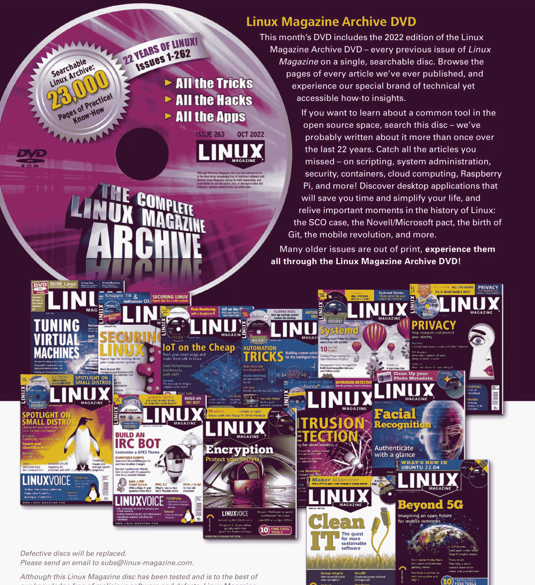

尽管这张 `Linux` 光盘经过了测试，且我们所知没有恶意软件和缺陷，但 `Linux` 对使用此光盘相关的任何数据或计算机系统的中断、丢失或损坏不承担责任，也不法律担保。


现代软件应用通常针对 Web 开发。`Linux` 专业人员协会（`Linux Professional Institute`）全新的“Web 开发基础知识”课程支持你完成软件开发的第一步。它包含了适用于培训和自学的学习材料。通过 Web 开发基础知识考试后，你将获得一张证书来证明你的技能。

`LPI` 学习材料可在 `learning.lpi.org` 获取。

访问 `lpi.org/wde` 了解更多关于该计划和考试的信息。

# 新闻

- `Kali Linux 2022.3` 发布
- 14 英 `Pinebook Pro` `Linux` 笔记本电脑芯片
- `OpenMandriva Lx ROME` 技术预览版发布
- `Linux Mint 21` 现已
- 更多在线

`Kali Linux` 是市场上使用最广泛的渗透测试发行版之一。凭借大量预装工具，安全专家和渗透人员可以使用该平台发现你网络中的任何漏洞或弱点。

`2022.3` 版本包含了一些新技巧，包括新的 `VirtualBox` 镜像格式、每周更新以及五种新工具（`BruteShark`（一种网络分析工具）、`Defectojo`（一个用于漏洞关联和分析的开源工具）、`Splploot`（一个后渗透框架）以及 `SprayingToolkit`（一种用于 `LFI/RI` 和命令注入漏洞的工具））。

`Kali` 的另一个新增是他们的 `Discord` 服务器（`Kali Linux & Friends`），你可以在那里实时聊天 `Kali Linux`。该 `Discord` 服务器是“一个拥有共同兴趣爱好的社区服务器。我们的目标不是获取尽可能多的用户，而是正在为彼此建立一个互相帮助的地方。我们关注的是质量而非数量。”

最后，还有一个新的测试环境，你可以在其中创建一个测试床进行学习、练习和基准测试。为了方便构建测试床，开发者们创建了 `DWIAA` (`https://www.kali.tools/dwia/`) 和 `Juice Shop` (`https://www.kali.org/juice-shop/`)，后者涵盖了整个 `OWASP` 前十的漏洞。

- 下载 `Kali Linux 2022.3` 副本 (`https://www.kali.org/get-kali/`) 并阅读官方发布说明 (`https://www.kali.org/blog/kali-linux-2022-3-release/`) 以了解详情。

## 14 英寸 Pinebook Pro Linux 笔记本电脑芯片

在经历了中国 COVID-19 限制导致的长时间运输延迟后，`ARM-64` 版 `Pinebook Pro` 已由 `Pine64` 发售。该设备配备了双核 `ARM 1.8GHz Cortex-A72` 和四核 `ARM 1.4GHz Cortex A53`，配有四核 `Mali T-860 GPU`、`4GB LPDDR4` 双通道系统内存以及 `64GB eMMC` 存储。

`Pinebook Pro 14` 的受众主要集中于那些想要在 `ARM` 设备上尝试 `Linux` 的人员。`Pine64` 甚至明确表示：“如果你正在寻找 `x86` 笔记本电脑的替代品，或者只是出于好奇并打算提交退货退款申请，请不要订购 `Pine Pro`。”

这些预订是针对熟悉 `ARM` 架构并出于特定原因对 `Pine Pro` 感兴趣的爱好者的。

该笔记本电脑的其他规格包括 `WiFi-11 AC`、`蓝牙 5.0`、一个 `USB 3.0` 和两个 `USB 2.0 type A` 接口、一个 `USB C` 端口、`microSD` 卡槽、内置耳机接口、全尺寸 (`ANSI`) 键盘、机械触感反馈、`9600mAh` 电池以及 `2.0 万像素前摄像头`。


## ADMIN HPC

## 通过网络共享 Linux 终端

- Jeff Layton

通过网络共享终端的能力可以倍增管理员和用户的效率。应该提到 `ty-share` 工具。

## 共享终端

- Jeff Layton

有时在两个用户之间共享屏幕非常有帮助。我们查看两种终端共享方式：`screen` 和 `tmux`。

# ADMIN Linux

- Matthias Weibull

负载工具测试评估了你基础设施的韧性，帮助你判断它是否能够承受请求洪流。

- Thorsten Karam

防火墙和网络地址转换阻碍了对远程系统的访问，但免费软件支持云端以及家庭办公室的远程维护和自动化。

- Federico Luciifer

云端速度测试让发行版之间相互竞争。

## OpenMandriva Lx Rome 技术预览版

曾经几何，我在一次会议上与 `Mandrake Linux` 团队待在一起。那是 20 世纪 90 年代后期，之后发生了很大变化。`Mandrake Linux` 于 2011 年停止。在灰烬中，`OpenMandriva`（巴西 `Linux` 和 `Mandrake` 的融合体）曾繁荣过。

最近，`OpenMandriva` 开发者宣布了 `Lx Rome` 的最新预览版，这是开源操作系统的滚动发布版本。需要注意的是，软件已经切换了 `Rome` 的自动工具，因为他们一直在 `Cook` 分支中对工具链系统包进行更改。

所以，对于那些想知道 `OpenMandriva Lx` 即将带来什么的人？预览如下：

`OpenMandriva Lx` 将带来的最大变化包括 `Python 3.11`、`Java 20`、内核 `5.18.2`；`usr` 合并（最新的 `KDE` 软件 `Plasma v5.23.0` 是 `Linux` 桌面环境的重大变化）；已支持 `Btrfs` 和 `XFS`，`DR` 和两者现在均可用。

从 `Forge (https://sourceforge.org/)` 下载预览副本并阅读我们的官方 `OpenMandriva` 博客。

# Linux Mint 21 现已

## Kali Linux 2022.3 发布

`Kali Linux` 是市场上使用最广泛的渗透测试发行版之一。凭借大量预装工具，安全专家和渗透人员可以使用该平台发现你网络中的任何漏洞或弱点。

`2022.3` 版本包含了一些新技巧，包括新的 `VirtualBox` 镜像格式、每周更新以及五种新工具（`BruteShark`（一种网络分析工具）、`Defectojo`（一个用于漏洞关联和分析的开源工具）、`Splploot`（一个后渗透框架）以及 `SprayingToolkit`（一种用于 `LFI/RI` 和命令注入漏洞的工具））。

`Kali` 的另一个新增是他们的 `Discord` 服务器（`Kali Linux & Friends`），你可以在那里实时聊天 `Kali Linux`。该 `Discord` 服务器是“一个拥有共同兴趣爱好的社区服务器。我们的目标不是获取尽可能多的用户，而是正在为彼此建立一个互相帮助的地方。我们关注的是质量而非数量。”

最后，还有一个新的测试环境，你可以在其中创建一个测试床进行学习、练习和基准测试。为了方便构建测试床，开发者们创建了 `DWIAA (https://www.kali.tools/dwia/)` 和 `Juice Shop (https://www.kali.org/juice-shop/)`，后者涵盖了整个 `OWASP` 前十的漏洞。

- 下载 `Kali Linux 2022.3` 副本 (https://www.kali.org/get-kali/) 并阅读官方发布说明 (https://www.kali.org/blog/kali-linux-2022-3-release/) 以了解详情。

## 14 英寸 Pinebook Pro Linux 笔记本电脑芯片

在经历了中国 `COVID-19` 限制导致的长时间运输延迟后，`ARM-64` 版 `Pinebook Pro` 已由 `Pine64` 发售。该设备配备了双核 `ARM 1.8GHz Cortex-A72` 和四核 `ARM 1.4GHz Cortex A53`，配有四核 `Mali T-860 GPU`、`4GB LPDDR4` 双通道系统内存以及 `64GB eMMC` 存储。

`Pinebook Pro 14` 的受众主要集中于那些想要在 `ARM` 设备上尝试 `Linux` 的人员。`Pine64` 甚至明确表示：“如果你正在寻找 `x86` 笔记本电脑的替代品，或者只是出于好奇并打算提交退货退款申请，请不要订购 `Pine Pro`。”

你可以从我们的官方网站了解更多关于 `Pine Pro 14` 和你的购买信息：`$199 (https://www.pine6.com/product/14%E2%80%A4%B3%pine-pro-linux-laptop-ansi-us-keyboard.)`，`Pine Pro 14` 的价格仅为 `$219`，而且公司让你免受设备保护，因为这些笔记本电脑是对 `Pine64` 和 `BSD` 社区提供的社区服务。

# Linux 杂志


www.linux-magazine.com

## ADMIN HPC

http://www.admin-magazine.com/HPC/

## 通过网络共享 Linux 终端

- Jeff Layton

通过网络共享终端的能力可以倍增管理员和用户的效率。应该提到`ty-share`工具。

## 共享终端

- Jeff Layton

有时在两个用户之间共享屏幕非常有帮助。我们查看两种终端共享方式：`screen`和`tmux`。

# ADMIN Linux

http://www.admin-magazine.com/

## 使用 Cock 测试

- Matthias Weibull

负载工具测试评估了你基础设施的韧性，帮助你判断它是否能够承受请求洪流。

## 远程维护与自动化

- Thorsten Karam

防火墙和网络地址转换阻碍了对远程系统的访问，但免费软件支持云端以及家庭办公室的远程维护和自动化。

- Federico Luciifer

云端速度测试让发行版之间相互竞争。

## OpenMandriva Lx Rome 技术预览版

曾经几何，我在一次会议上与 Mandrake Linux 团队待在一起。那是 20 世纪 90 年代后期，之后发生了很大变化。Mandrake Linux 于 2011 年停止。在灰烬中，OpenMandriva（巴西 Linux 和 Mandrake 的融合体）曾繁荣过。

最近，OpenMandriva 开发者宣布了`Lx Rome`的最新预览版，这是开源操作系统的滚动发布版本。需要注意的是，软件已经切换了 Rome 的自动工具，因为他们一直在 Cook 分支中对工具链系统包进行更改。

所以，对于那些想知道`OpenMandriva Lx`即将带来什么的人？预览如下：

`OpenMandriva Lx`将带来的最大变化包括`Python 3.11`、`Java 20`、内核`5.18.2`；usr 合并（最新的 KDE 软件 Plasma v5.23.0 是 Linux 桌面环境的重大变化）；已支持`Btrfs`和`XFS`，DR 和两者现在均可用。

从`Forge` (`https://sourceforge.org/`) 下载预览副本并阅读我们的官方 OpenMandriva 博客。


# 开源职业枢纽

在开源

生态系统中

找到属于你的位置

# Zack 的内核新闻

“在高内存使用时会触发潜在的死锁问题——锁锁的投诉。我发现了一个补丁，我正在通过二分法（`bisect`）处理它。我认为最简单的方法是将这些修复以及发送给 Andrew 的其他修复集成到`v8`。我希望在明天结束前完成这件事。”

Liam Howlett 代表自己和 Matthew Wilcox 最近宣布了“枫树”（`Maple Tree`），他希望这个特性曾能被包含在 Linux 中。Andrew Morton 请求对枫树进行一个详尽的解释。因此，尽管你可能想象了接下来会发生什么场景，Liam 都说：“枫树是一个`RCU`安全的范围`B`树，旨在有效利用现代进程。”

一种`B`树数据结构旨在让用户极快地找到和检索数据片段。名称中的“树”指的是搜索路径，在该路径你可以排除错误的路径并迅速缩小范围。这就像一个有趣的游戏，人们在 1 到 100 之间选一个数字，并告诉朋友他们的猜测比秘密数字高还是低。然而，`B`树并不是通过“二分/高低方式”向下搜索，而是每次将树分裂成两个以上的分支。

我个人觉得的一点是，枫树并不是为了增加某些缺失的内容或修复已损坏的部分——尽管与其他人一样，该补丁旨在让内核更快，并让代码本身更整洁。人们很容易忘记，在许多安全讨论和其他高关注的话题之外，Linux 内核仅仅是为了尽可能将我们硬件的力量交到我们手中，尽可能地消失在背景和幻灯片中。那些难以想象的小事，比如 Liam 所说的他父亲的枫树，持续让 Linux 内核更接近这一理想。

Chronicle Brown 报道 Linux 内核社区的最新观点、困境和进展。

正如 Liam 所说：“随着分支因数的增加，它比`srt`快得多，因此我们有更少的缓存缺失。消除了后续条目之间的链接，以及在许多树操作中需要拉入前一个和后一个`VMA`的需求。”

Dharmendra Singh 将文件系统扩展到用户空间，以允许多个用户同时写入一个文件。“正如他说的，在 Linux 中，直接写入同一个文件是在锁持有的内部序列化的，我们需要一个锁来处理请求。这种序列化在`FUSE`空间实现中运行良好，但依赖这个锁来维护缓存完整性。但这了了有自己的方式维护数据/缓存完整性的完全不使用这种序列化的`FUSE`实现。”

Yo Zhao 喜欢这个补丁并愿意进行一些测试，事实上，他在某些调试上发布了崩溃报告，Liam 查看后产生了兴趣，他们两人今天进行了一次漏洞狩猎会议。Liam 说：“在剩余的补丁中，我没有在内核锁分配后进行清理，修复了它，”他继续道，“尽管修复停止了内核递归。我在`lock(copy())`中也发现了一个问题并修复了它——但我需要更改内部`reaps`锁的许多操作，因为它”

# 作者

Linux 内核邮件列表涵盖了 Linux 开发活动的核心。流量巨大，每周达到 10000 条消息，对于一个人来说，跟上整个开发规模几乎是不可能的。少数能够承担这一任务的人之一就是 Zack Brown。

作者 Zack Brown

# 新闻

`FUSE`是一些超级酷的事情之一，让你的一天变得精彩，当你看到这些可能性时会睁大眼睛。它是一种允许用户以文件和目录的形式设计新方式来表示比他们想象的多多的机制。

方向。他还针对原始的`NTFS3`补充道，关于`NTFS3`的情况，“我们正在处理几个月。”

## 内核新闻

随时欢迎向我提问，或者通过邮件列表。

讨论到此结束。作为内核代码的维护者，Paragon 没有获得所有首发带来的收益，但这也被视为常态。最终，内核与内核文化之间的握手过程对双方来说都可能是令人冲突的，而内核人员非常熟悉进程中可能出现的震动关节和障碍，这使得 Konstantin 和 Paragon 能够继续改进并本质上成为“良好公民”。

`CONFIG_DEBUG_VM`？我不这么认为，因为这违背了那些发行版最初启用该功能的初衷。

> “重磅消息是，`RHEL` 8、`SLES` 15 或其他发行版都没有启用`CONFIG_DEBUG_VM`。”

Andrew 去获取了红帽 Linux（`Red Hat Linux`）构建系统中存在`CONFIG_DEBUG_VM`的证明和具体实例。他将这些展示给我并说：“是的，`Fedora/RHEL`是我提到的模型（实验性/稳定型）的一个例子。我问了内核维护者 Justin，他可以澄清：‘我们不想要许多`VM_BUG_ON`，除非我们允许。（但如果拒绝了它，就违背了拥有`CONFIG_DEBUG_VM`的目的）’”

Yu 回复说，他对特定的`BUG_ON(n)`使用（即`VM_BUG_ON(n)`）只会影响内核构建过程，而不影响运行时。Andrew 回答道：“我告诉，许多生产构建启用了`VM_BUG_ON`。”

但 Yu 反问道：“没有人想在生产环境中调试`VM`。某些发行版通过之前的最新`CONFIG_DEBUG_VM`提供了该功能，以便在后续可用时有更好的测试覆盖。人们会在生产环境中使用它吗！绝对会，如果我们没有足够的测试覆盖。而我们本该避免这种情况。”

Andrew 并不乐观，“预料到`VM_BUG_ON(n)`会以这种方式被触发。”他建议可能会添加一个额外的`BUG_ON(n)`函数会更好。他指出：“这些都不是解决问题的正确方法：`BUG_ON(n)`会调用内核。那么，如果我们直接修复问题会怎样？’”

Linus Torres 此时加入了讨论并表示：“还有零延迟的方法可以避免杀死内核。如果你想安全地构建——即这种情况不能发生——那么`WARNING_ON`并不是正确的工具。`BUG_ON()`是唯一正确的方法。”

Yu 坚持了自己的立场，回复 Linus 说：“为了更大的目标，我们希望更多地关注一小部分运行实验性内核的用户，以便他们回来向我们大叫，而且叫得更大声！据推，`BUG_ON`对用户群的影响相对较小；但另一方面，根据对一些测试者（即用户）的经验，他们会忽略`WARN_ON_ON`直到内核崩溃。”

但 Linus 觉得他的论点站不住脚：

内核新闻

首先你说`VM_BUG_ON()`仅供`VM`测试人员使用。

然后你说‘某些测试人员（普通用户）在内核崩溃时会`视 WARN_ONCE`：’

那么到底是哪种？

“是`VM`开发者，还是普通用户？老实说，如果一个`VM`开发者忽略了来自`VM`子系统的`WARN_ONCE()`，我不知道该说什么。‘总之，一个`VM_BUG_ON()`要好一万倍，因为：’

- 机器将继续工作，所以即使他们没有手动报告，也可以报告崩溃；发行版拥有自动报告基础设施

“这就是为什么我绝对‘厌恶’那些`BUG_ON()`情况——它们经常会用糟糕的锁杀死内核，导致一个完全无法调试且从未报告的问题。”

“是的，你可以并且只能把`BUG_ON()`放在可以恢复的地方。但即使如此，它们也没有任何实际优势，只是比`WARN_ONCE`好一点。”


Yu 澄清道，他并不是指内核开发者忽略警告，也不是他认为`BUG_ON`仅供VM开发者使用。他真正担心的是普通用户，他们可能更倾向于向内核开发者报告崩溃，而不仅仅是一个警告。对于Linux的观点，“我听到了，我并不是在争论什么，只是分享我的见解。’

同时，来自红帽的Justin Forbes解释了使用`CONFIG_DEBUG_VM`后的一些思路。他说：“我们主要将其分为三种情况：’

在实际上，我们对`rc`版本和`.0`版本运行标准的Fedora配置，但`git`快照是使用调试配置构建的。权衡是，无法关闭某些影响性能的选项，但我们确实获得了更多用户运行这些内核并暴露漏洞。快速内核遵循`Linus`的树，并在大多数工作日重新构建。由于Fedora不是默认配置，但在某些可以在不严重影响性能的情况下保持调试开启的情况下（例如`CONFIG_DEBUG_VM`的情况），我认为没有必要。当然，RHEL是一个保守得多的配置，其反应/回滚库也保守得多。’

他补充道：“保持选项开启会变得有问题，我们可以简单地将其关闭。Fedora的基础比典型的发行版更多样，也比大多数池更多样。无论是在硬件数组还是使用模式上，因此在其他情况下无法发现的问题会被发现。’

此外，对于报告而不是崩溃的愿望，Justin表示（此处可能是Justin said的笔误），‘我非常同意。我们收到了用户的警告，这些警告没有被忽视，其中一些用户愿意花时间彻底解决问题。他们可能不懂代码，但有很多[用户懂代码]。’

# OS 选项

# 封面故事

## Yocto

## 配方

Yocto项目提供了一套构建自定义Linux的工具。该项目提供了：

- 一个参考发行版，他们称之为`Pokey`
- `OpenEmbedded`构建系统，由Yocto和`OpenEmbedded`共同维护

Yocto的总体目标是为将Linux适配到嵌入式设备上运行提供一个完整的开发环境。环境包括模板、工具和工作代码。

Yocto最强大的功能之一是围绕层（layers）构建的模块化架构。层是……的集合

# OS 选项

任何项目开发中的一个关键点是操作系统的选择。系统的选择通常取决于项目的性质。

对于裸机环境（bare metal environment），不需要特殊的操作系统。相反，需要开发者将功能构建到应用程序中。为裸机系统开发需要实现一个硬件抽象层（HAL），以消除应用程序直接访问硬件驱动程序的需求。

其他项目需要实时操作系统（RTOS）。虽然Linux在环境中始终是实时的，但它在处理上一直有限制。RTOS系统在机器人领域很常见，如果不能满足反应时间，后果将是灾难性的。裸机Linux系统和RTOS经常将操作系统和内核集成。

第三类IoT项目需要一个更完整的操作系统。裸机Linux有利于较低的资源需求，但要求处理器具有内存管理单元（MMU）。另一方面，Linux作为操作系统允许访问大量的现成应用程序和服务，而这些服务在裸机系统和RTOS中是不可用的。

用于构建系统的文件和指令。用户可以根据需要进行混合组合，自定义各个层，同时保持整个系统的简单性。分层模型使得硬件供应商能够通过板级支持包（BSP）为操作系统开发者提供支持，BSP是一组用于构建硬件支持的分层文件集合。

配置环境，以便CPU能够加载并执行内核。这可能包括从`TFTP`服务器下载内核。IoT设备最常用的启动加载程序是`U-Boot`。

第三个组件是内核本身，它用于在设备上同时运行各种应用程序并提供硬件访问。第四个组件是设备树（DT），它是内核的一部分，用于告知CPU配置了哪些硬件。第五个也是最后一个组件由应用程序组成，它们通常位于根文件系统中。

# IoT 组件

每个Linux用于IoT设备由五个主要组件组成（见图2）。首先是启动加载程序，它在开发者的PC上编译成源代码，稍后将在设备上执行。第二个是在上电后立即由启动加载程序在CPU的ROM中执行。ROM知道可以从哪里找到启动加载程序，是从`MMC`、`MicroSD`卡还是CPU的状态引脚。

ROM中的代码随后配置启动介质，并在预设地址搜索启动加载程序。如果找到了启动加载程序，ROM将代码传输到`RAM`，由CPU对其进行处理。启动加载程序负责设置

尽管桌面Linux用户习惯于将`ISO`文件下载到`USB`闪存器并用它在PC上安装Linux，但IoT系统的处理方式有所不同。为了创建我刚才描述的所有五个基本组件，需要一个框架。

该框架由系统模块（SoM）的硬件制造商选择，该模块包含CPU以及电源管理和信号调理所需的所有电路。如果一家公司为其IoT产品指定了特定的SOM，你将受益于SoM在BSP层提供的框架。

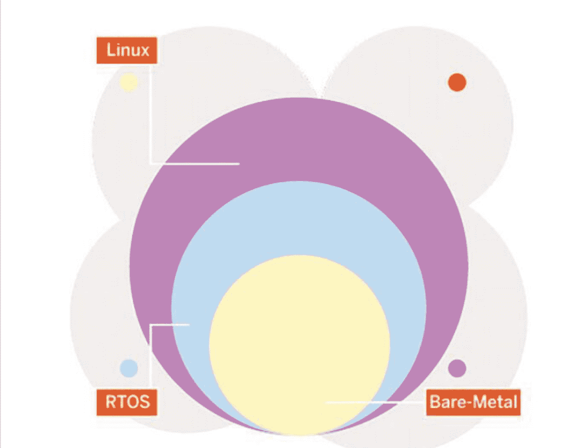

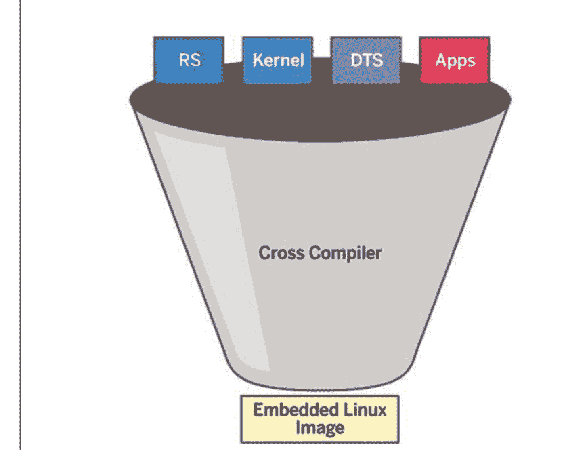

**图 1**: 裸机、RTOS 和 Linux 嵌入系统在系统资源的需求上存在差异。

**图 2**: IoT 设备的 Linux 镜像由五个主要组件组成。

# 封面故事

## Yocto

```xml
<?xml version="1.0" encoding="UTF-8"?>
<manifest>
  <meta name="sync" version="-8" revision="gatherspath"/>
  <meta name="meta-digi" src="https://github.com/Digi-embedded"/>
  <meta name="meta-freescale" src="https://github.com/Freescale"/>
  <meta name="meta-bsp" src="https://github.com/freescale/external_imx"/>
  <meta name="meta-yocto" src="https://github.com/yooproject/meta-yocto"/>
  <meta name="meta-embedded" src="local"/>
  <meta name="meta-swupdate" src="https://github.com/digi"/>
  <meta name="meta-user" src="https://github.com/digi"/>
  <meta name="meta-poky" src="https://github.com/yooproject/poky"/>
</manifest>
```

**图 3:** `manifest`文件列出了所有层的仓库。

## 层

`BSP`由不同的层组成，每个层都有自己的仓库。提供者通常以存档文件的形式授予第三方访问BSP的权限。然后解压该文件，并列出每个层仓库的`manifest`文件。下面是一个示例：这是一个`Digi`系统模块（SoM）的BSP。

文件3指向要下载的所有层。每一层由特定组织创建并维护。该仓库作为整个BSP的基础，提供了使用`BitBake`和`OpenEmbedded`项目构建BSP的配置以及其他层所依赖的参考实现。在这种情况下，由于`Freescale`CPU的广泛普及和频繁使用，Yocto项目采用了这一层。然而，还有一个由`NXP`提供的名为`meta-imx`的仓库。该层包含了`iMX`CPU的配置、配方和应用程序。你还会发现由SoM提供的层，例如`meta-digi`和`meta-digi-dualboot`。最后，你可以看到`Digi`还包含了其他仓库，如`meta-yocto`和`meta-swupdate`。`Digi`将这些内容添加到BSP中，以包含框架、服务和应用程序。

每一层都包含一个名为`config`的目录。该目录反过来包含至少一个配置文件，告诉Yocto项目如何处理由该层带来的配方，并且与Yocto版本兼容。每一层都包含一组配方。例如，所有配方都包含了如何构建内核模块或镜像的指令，或者是组织系统特定部分的规则。

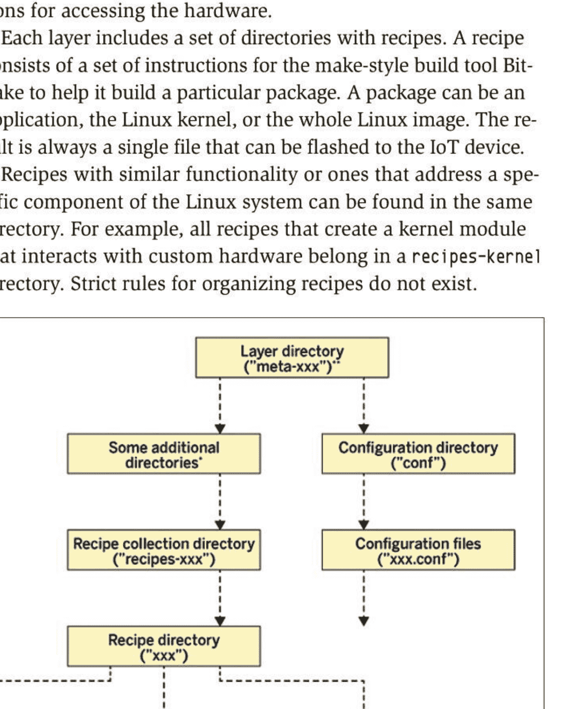

**图 4:** 典型层的结构：除了配置文件，主要用于`BitBake`构建的配方。

# 封面故事

## Yocto

| 表 1: 开发计算机 |
|---|
| 处理器 | 64位，8核心 |
| 操作系统 | `Ubuntu 18.04 LTS` |
| 内存 | `8GB` |
| 存储媒体 | `250GB` 空间 |


开发者的 `PC` 需要满足开发计算机的要求（见表 1）。此外，机器上必须安装某些软件包。你可以使用命令设置环境。相反，社区和制造商遵循了一套旨在便于获取正确配方的实践。图 4 显示了一些带有 `.bbappend` 后缀的文件。这些文件用于扩展或修改现有的配方。扩展方法的名称必须与配方的名称匹配。使用 `Yocto` 工具，你现在可以移动到 `manifest` 文件（列表 3，前两行）。然后为 `CCS` 配置 `BSP`（见图 2）。目录结构如图 5 所示。你现在可以通过单个调用创建镜像（最后一行）。

### 实践步骤

我已经根据 `Yocto` 框架衍生了 `BSP` 的结构。下一步是构建镜像、将其刷入你的设备并运行一个简单的“Hello, World!”。使用了 `Digi-C60N-SBC` 作为硬件。

### 列表 1：软件安装

```
$ sudo apt-get install wget git-diff texinfo debbsync g-cc-multilib |
$ g++ build-essential-chain socat libssl-dev libld2-dev
```

### 列表 2：设置仓库

```
$ sudo curl -o /usr/local/bin/repo \
$ http://codestorage.googleapis.com/git-repo-downloads/repo \
$ chmod a+x /usr/local/bin/repo
```

### 应用程序

最后一步是运行自定义应用程序或修改你的硬件。你需要做的第一件事是创建两个新仓库。一个仓库拥有你的层，另一个用于 `manifest`。由于供应商（此例中的 `Digi`）控制 `manifest`，你需要将你的层添加到仓库中，并用自己的 `manifest` 修改它。

你需要的是你层的文件。你可以从其他地方拷贝配置文件，并根据之前的结构创建自己的。对于应用程序中的“Hello, World!”，生成的结构将如列表 4 所示。

### 列表 3：使用 manifest

```
$ repo init -u https://github.com/digi-embedded/de-manifest.git -b gatesarch \
$ repo sync --no-repo-verify \
$ source ./mkproject.sh -p c6xmsbc
```

```
[digi 13:15:50] ls
cd deyst-environment mkproject.sh sources
[digi 13:15:50] ls sources/
meta-digi meta-freebase meta-ixmx meta-digi-dualboot meta-fsl-demos meta-embedded meta-qt5 meta-selinux meta-webkit meta-poky
[digi 13:16:03]
```

图 5：`BSP` 的子目录代表了其中的层。


# 封面故事

## Yocto

`hello-world.bb` 文件必须经过特殊的格式化；列表 5 显示了其内容。前四行描述了配方（`recipe`）及其许可证。如果是 `GPL`，则必须指定校验和。如果你不想在免费许可证下发布配方，可以在 `License` 字段中输入值 `CLOSED`。

```
meta-custom
|-- appgs
|   |-- files
|   -- hello-world.bb
```

```
01 DESCRIPTION = "Simple Hello World Application"
02 SECTION = "examples"
03 LICENSE = WITH
04 LIC_FILE_CHECKSUM = "://$(COMMON_LICENSE_DIR)"
    MIT=$GG3S3gade8e6cf885ec6ad5f7b9f6f2"
05 SRC_URI = "file://hello-world.c"
06 S = "$${WORKDIR}"
07 do_compile() {
08     $$(WORKDIR)
09 }
10 do_install() {
11     install -d $$(bindir)
12     install -o 755 hello-world $$(bindir)
13 }
```

```
#include <stdio.h>

int main() {
    printf("Hello, world!\n");
    return 0;
}
```

### 列表 7：追加文件

```
IMAGE_INSTALL_APPEND += " hello-world"
```

列表 5 中的 `SRC_URI` 告诉 `BitBake` 与配方相关的文件所在。在这个示例中，唯一的文件是一个单一 `C` 文件。然而，你可以指定由 `Git` 管理或划分的仓库。

配方的末尾包含另外两个函数（第 7 行和第 10 行），用于编译应用程序源码并安装结果。`Yocto` 框架带有这些函数的基础版本，用户可以对其进行覆盖。框架还已经包含了其他用函数的模板，例如下载配方（`down-recipes`）。

实际的应用程序是非常简单的 `C` 文件（列表 6）。要创建该配方，只需使用 `bitbake hello-world` 命令即可。

为了让列表设备运行“Hello, World”应用程序，你需要将其添加到最终镜像中。因此，`bitbake-image-class` 已经告诉 `BitBake` 从 `image-class` 配方构建镜像。你需要将创建 `hello-world.bb` 的配方通过名为 `image-world.bbappend` 的追加文件添加到列表 7 中的列表中。

如果你现在调用 `bitbake-image-class`，“Hello, World”将被创建并放置在最终镜像中，你现在可以在设备上运行它。

## 结论

如果你需要适配操作系统运行在嵌入式设备上，并且想使用 `Linux`，`Yocto` 项目将会在处理细节方面提供领先。`Yocto` 项目的工具、层和配方将为你节省时间并简化将 `Linux` 适配硬件的任务。也存在替代框架，例如 `Buildroot` [3]，你将在本期稍后读到关于它的内容。`Yocto` 的优势是它在 `SoM` 供应商和 `Linux` 构建中非常流行。缺点是：它需要的资源比 `Buildroot` 多得多。

## 信息

- [1] `Yocto Project/OpenEmbedded Framework`: <https://www.yoctoproject.org>
- [2] 入门指南：`Yocto` 项目概述：<https://www.yoctoproject.org/software-overview/>
- [3] `Buildroot`: <https://buildroot.org>

第 263 期

10 月 14 日前注册可享大折扣！

## 你. 达拉斯. SC22.

11 月 13–18 日

`SC22` 是全球最大的 `HPC` 研究人员和专业人士聚会之一，这是一个学习新技能、建立新友谊、解决复杂问题以及查看下一代技术的惊人周。

如果你倾向于在线参加，可以使用全新的、定制的数字体验。

国际高性能计算、网络、存储和分析国际会议

### 立即注册！

`sc22.supercomputing.org`

### `SC22` 达拉斯 `hpc` `TX` 加速。

赞助商：`IEEE COMPUTER SOCIETY TCHPC sighpc`

## 使用 `Buildroot` 自制你自己的 `IoT` `Linux`

### 追求小型化

如果你需要适配操作系统运行在嵌入式设备上，并且想使用 `Linux`，`Yocto` 项目将会在处理细节方面提供领先。`Yocto` 项目的工具、层和配方将为你节省时间并简化将 `Linux` 适配硬件的任务。也存在替代框架，例如 `Buildroot` [3]，你将在本期稍后读到关于它的内容。`Yocto` 的优势是它在 `SoM` 供应商和 `Linux` 构建中非常流行。缺点是：它需要的资源比 `Buildroot` 多得多。

### 灵活性

`Buildroot` 最重要的特性之一是灵活性。你需要能够进行所有调整以获得结果。该发行版主要通过软件包选择来实现这一点。`Buildroot` 提供了：

- 工具链 (`toolchain`)
- 根文件系统 (`root filesystem`)
- 引导加载程序 (`bootloader`)

# 封面故事

# Buildroot

# 你的应用程序

为了生成一个可工作的产品，应用程序需要提供 `IoT` 设备的功能。有时，它仅限于几个脚本，例如你通过网络使用的 `PHP` 文件，这些文件是根覆盖层（`roots overlay`）的一部分。然而，你通常需要创建自己的自定义组件。


# Buildroot 组件编译方法

Buildroot 为编译组件提供了两种方法。你可以为每个组件编辑或设置包定义，这些定义仅包含几行（图 1）。对于每个支持的系统，你将使用 `Meson`、`Cmake`、`Autotools` 和 `Waf`。语言是原生处理的：对于 `Go` 使用 `Cargo`，`Rust` 使用，`Erl` 使用 `Rebar`，`Lua` 使用 `Luarocks`，`Perl` 使用 `MB` 或 `EUM`。`Python` 脚本可以通过 `Distutils`、`Setuptools`、`Peps517` 和 `Maturin` 轻松运行。

另一种方法是将你自己的定义与 Buildroot 的源码包混合。`@EXTERNAL` 机制非常简单，允许用户将自定义包定义添加到属于 Buildroot 的包定义中。此外，你还可以配置你的系统和其他文件，例如 `@EXTERNAL root`。这使得你所有的自定义内容都整洁地集中在一个地方。

有时，在 Buildroot 之外编译应用程序更加方便。在较大的项目中，你可能会发现某些开发者并不是每天都使用 Buildroot，如果你直接在开发环境中工作，那么从 IDE 中编译会更容易。该环境由 `Buildroot SDK` 提供，其中包含了编译工具链、所有配置好的库和主机环境（`hosts`）。毕竟，你需要其中一些内容来构建你的项目。它提供了库的选项，并能为 `Google protobuf` 定义生成代码。SDK 是一个 `tar` 包，你可以在任何地方解压。如果你在 SDK 的上下文中设置了 IDE，就可以直接从它进行编译和调试。

# 管理

一旦开发出操作系统，通常会有更新和新代产品随之而来。维护包含安全问题修复和新功能的更新发行版至关重要。Buildroot 自 2001 年以来一直存在，它是最古老的 IoT 工具构建工具之一，这使其成为一个经过验证的产品，而且项目的持续性无疑非常重要。自 2009 年以来，开发者必须保持每年四次的固定发布计划：`20XX.2`、`20XX.5`、`20XX.8` 和 `20XX.11`。每个发布版本都要经过为期月的稳定期，在此期间只接受修复；发布版本将维护三个月（错误修复和安全更新）。之后将发布一个新版本。`20XX.2` 版本是 `LTS`（长期支持版本），维护时间超过一年，并再次每月添加发布。

Buildroot 是社区驱动的，有 100 多人参与贡献，每个版本有 1500 处更改。社区通过邮件列表（`lists@buildroot.org`）或 `Open and Free Technology Community (OFT)` 上的 `IRC` 进行通信。随着时间的推移，开发者可以帮助解决问题并学习新知识。在议程中，社区通过公司决策讨论并决定争议性问题。背后没有额外的控制。然而，有一些公司和自由职业服务为 Buildroot 提供支持。

开发者可以在笔记本电脑上运行操作系统，并具备开发所需的所有功能。

开发者提供了工具帮助你维护 Buildroot。你可以使用 `pkg-help` 列出 Buildroot 中的包，并使用 `pkg-config` 收集包的信息，在网络上搜索新版本，检查漏洞（国家国家漏洞数据库和 `CVE` 报告），并以 `HTML` 和 `JSON` 格式提供结果。

进一步发展 —— 440 项测试。`2027` 年的 `SBC`、`Somtu` 和 `Qemu` 配置都是使用 Buildroot 构建的。最后，有 10 台生成任意配置的构建服务器。这些服务器的报告可以在线获取。

## 结论

Buildroot 多年来演变成了一个在嵌入式世界中成熟且经过验证的系统。Buildroot 使用了大量案例，从只有少量 `MB` 闪存的系统到用于云部署的 `Docker` 镜像，从带有图形栈或数据库的复杂系统。简单、灵活、可重现和维护性使 Buildroot 成为 IoT 系统的选择。通过 `Git` 仓库克隆 Buildroot 后，配置它需要一个月以上。回报是一个运行良好的产品。

## 信息

- [1] Buildroot: `https://buildroot.org/`
- [2] 构建手册: `https://manual.buildroot.org/manual.html`
- [3] `NIST` `CVE` 报告: `https://auto.buildroot.org/stats/master.html`
- [4] 构建服务器报告: `http://auto.buildroot.org`
- [5] Buildroot (`Git` 仓库): `https://git.buildroot.org/netbuildroot`

2022年10月

第 263 期

24

# 将你的想法变为现实！

这不是一本普通的电脑杂志！`MakerSpace` 专注于你可以利用它来构建自己的东西的技术。

如果你对电子产品感兴趣但还没有时间或技能（目前），学习这些创客项目可能是让你起步的最后动力。

这本特别刊将帮助你深入了解：

- `Raspberry Pi` (树莓派)
- `Arduino`
- 复古游戏
- 以及更多！

制作一台树莓派收音机！

`MakerSpace #02`

面向创客的实践项目

酷炫招式！

`Amiga 2.0`

在线购买：`shop.linuxnewmedia.com/specials`

# 评测

# 发行版漫游 – 红帽生态系统

# 红帽扩展家族

# 社区与企业的碰撞

红帽衍生出了基于企业和基于社区的发行版分支。以下是这些发行版如何关联的以及它们之间有何不同。

当 `Linux` 在 20 世纪 90 年代后期为人知时，红帽因其通常完整的文档和让 `Linux` 可用的努力成为顶级领先者之一，1999 年 8 月 11 日，红红帽首次上市。红帽作为 `IBM` 价值数十亿美元的子公司，创建了基于 `Linux` 的发行版测试并生成了红帽企业 `Linux (RHEL)` 产品。最近，由于红帽停止了 `CentOS`，`CentOS Linux` 和 `AlmaLinux` 从 `RHEL` 分叉出来。红帽创建了 `Fedora` 的衍生版，结果产生了一个类似于 `Debian` 的相互关联发行版生态系统，但重点关注创新以及网络和服务器。

# Fedora 项目

`Fedora` 项目 [1] 是原始红帽的替代者。红帽任命 `Fedora` 领导者并在 `Fedora` 委员会中拥有席位，但按照其原则运行，许多决定由社区或 `Fedora` 的技术工作组做出。

`Fedora` 作为 `RHEL` 的初始测试平台，每六月发布一次版本。在这个角色上，`Fedora` 引入了如 `DNF`、`PipeWire` 或 `Wayland` 等新技术，这些技术专门由红帽开发。有时，这些新技术需要几次发布才能在大多数情况下流畅运行，`Fedora` 仍然是学习技术的最佳发行版之一。

此外，`RHEL` [2] 是 `SUSE Linux Enterprise` 和 `Ubuntu` 的竞争对手。传统上，它是 `Fedora` 项目的下游，使用相同的包但对其进行测试并提供正式的长期支持，这一过程现在通过 `CentOS Stream` 公开可见。`RHEL` 发布是

# 测评

# 发行版之旅 – 红帽生态系统

## CentOS

`CentOS` 可能会吸引 `Rocky Linux` 及其衍生版（如 `AlmaLinux`）以及传统企业——尤其是现在关注 `Linux` 的企业——以及 `RHEL`，其在 2021 年增长了 17% [41]。

## CentOS Stream

`CentOS Stream` 使用旧的 `CentOS` 图标 [6] 并延续 `CentOS` 的版本命名方式，但这种名称的连续性具有误导性。`CentOS` 是 `RHEL` 的构建版本，而 `CentOS Stream` 是 `Fedora` 和 `RHEL` 之间的中间版本。另一方面，虽然 `CentOS` 是 `RHEL` 的下游，但 `CentOS Stream` 是上游。这意味着，如果 `CentOS` 的下一个版本是 9，它将不是基于仍然支持的 `CentOS 7` 的。`CentOS 8` 在开发停止后被放弃了。它的起点是 `RHEL`。`Fedora` 和 `OS Stream` 之间的关系显而易见，由于它们通常基于红帽的免费发行版，因此这两个发行版的版本号并不一致。

尽管 `RHEL` 在商业上取得了成功，但在自由软件社区中引发了反应。另一方面，`RHEL` 是 `Linux` 内核的主要贡献者。此外，它还贡献了许多进行中的项目，包括 `SELinux` [3]，并开发了包括 `PulseAudio`、`Flatpak` 和 `PipeWire` 在内的众多技术。它的活动在许多方面都很活跃——但并不符合自由软件的最佳传统。特别是 `RHEL` 要求订阅才能尝试或安装，这通常被视为许可的一个漏洞，而 `Fedora` 和 `CentOS stream` 的可用性两者共享相同的代码。然而，商业前景和

## CentOS

`CentOS` [5] 是 `RHEL` 的社区，吸引了那些倾向于不同开发目的的人。它是一个健壮的服务器项目。红帽在 2014 年收购了 `CentOS`，但让其独立运行直到 2021 年 12 月，当时他们宣布了 `CentOS` 开发启动和新的用途。`CentOS 7` 将持续维护到 2024 年 6 月 30 日，但许多用户已转向 `VMware`。

# 访问商店

在 `Linux New Media` 的在线商店发现过去，并投资新一年的 IT 解决方案。数字与纸质订阅

# 想要订阅吗？

寻找你之前在报刊亭真正看中的那个旧期杂志？

# 测评


开发团队将 `AlmaLinux` 用来描述自己的项目描述为一种“与错误兼容”且免费获取的 `RHEL` 实现。与 `RHEL` 形成对比对比的是，`Rocky Linux` 强调其构建过程的透明度。例如，在它的最新版本中，`Rocky` 提供了一个开源的、云系统。`Rocky` 目前在安全实现和加密方面缺乏来自标准小组的认证。2022 年，`Rocky Linux` 的最新版本在企业额外软件包 (`EPEL`) 仓库中甚至超过了 `AlmaLinux`。

如果你认为这些描述开启了开源政治和偏好，那么你是正确的。大多数此类发行版的代码库是相似的，`AlmaLinux` 和 `Rocky Linux` 已经是区分它们的标志。因此，决定基于哪种发行版取决于其他因素。单个用户可能偏好 `Linux Fedora` 的最新进展，而另一个用户可能更偏于使用 `CentOS` 进行最新测试。开发者可能偏于稳定的 `RHEL` 版本，而 `AlmaLinux` 或 `Rocky Linux` 则同样适用于那些偏好红帽近期改变的更具社区导方法的家庭和用户。对于许多人来说，某些考虑可能比技术考虑更重要。

## AlmaLinux

`CentOS` 的结束很快得到了至少两个继任者的响应，这些项目在 `CentOS` 结束后的最初几个月内就开始开发。第一个继任者是 `AlmaLinux` (7)，由 `CloudLinux`、`AWS` 和 `Microsoft` 支持。该发行版对红帽和 `CentOS` 结束的回应是将其定位为“开源社区，一个永恒的企业级发行版，专注于长期稳定性，提供生产级平台”，并且“`AlmaLinux` 与 `RHEL` 和 `CentOS` 1:1 二进制兼容”。`AlmaLinux` 的目标是一个项目，旨在取代 `RHEL` 衍生品时承担使命。`CentOS Stream` 的启动意味着现在可以获得 `RHEL` 的早期版本。

## 替代方案和衍生版本

除了工作站版和服务器版，`Fedora` 还提供了 `spins` - 具有 `Gnome`、`Cinnamon`、`Plasma` 或 `X` 以外的桌面环境。下载页面还有 `Labs` 用于特定目的（如游戏），或用于不同架构测试的替代方案。除了 `Fedora` 和 `Rocky` 之外，还有其他版本。某些版本如 `VxLinux`、`Springdale Linux` 和 `Oracle Linux` 源自 `RHEL` 源包，类似于 `CentOS` 及其继任者，包括网络安全工具包 (`NST`)。`Berry Linux` 是 `Fedora` 版本的 `KNOPIX`，使用免费的救援盘，而 `Ultarine Linux` 包含了未增强的来自替代桌面环境以提供修正。最重要的是 `Qube`，它将应用程序分配到收集并列出的彩色查询数据集。结果是一个易于使用的系统，但由于可以避免的开销，至少需要 1GB 内存。

## Rocky Linux

另一个主要的继任者是 `Rocky Linux` [8]，以 `CentOS Rocky` 命名，拥有广泛的支持，特别是来自亚马逊云服务、谷歌云、`微软 Azure` 以及。

# Info

- [1] Headers: `https://fedora.org/`

- [2] `RHEL`: `https://www.redhat.com/en/linux-platforms/enterprise-linux`

- [3] 红帽项目: `https://fedora.org/wiki/Red_Hat_Contributions`

- [4] 红帽历史: `https://techcrunch.com/2021/02/21/redhat-to-grow-out-bugs-struggles-community/`

- [5] `CentOS`: `https://centos.org/`

- [6] `CentOS Stream`: `https://www.centos.org/centos-stream/`

- [7] `AlmaLinux`: `https://almalux.org/`

- [8] `Rocky Linux`: `https://rockylinux.com/`

- [9] `Fedora`: `https://spins.fedaproject.org/`

- [10] `https://fedora.org/`

- [11] `Fedora` 衍生版: `https://download.search.php?ostype=All&category=All&origin=All&origin=fedora#notbase=None&architecture=All&architecture&packing=all&isize=all&install=all&default=finit&status=Active&simple`

## 深度解析

### 技术

许多用于查找内容的浏览器扩展程序使用了人工智能方法。例如，在文本中，某些短语如“我的观点”或“我认为”已经引起了人们对内容客观性的关注。这些浏览器扩展程序还使用数据库来比较信息并分析其真实性。

在 `Facebook` 和其他社交网络上，这些插件还可以显示关于他人发布内容的评论。当它们显示图像时，某些扩展程序会检查图像是否已在其他地方发布。如果你在早期的网页上发现了相同的图像，且它在你访问的页面上未被标记为存档或图像，那么有人在误导你。你还可以搜索该图像的副本（这种做法被称为反向图像搜索），以检测侵权行为。

伪造信息更难检测，通常需要人工检查。像 `FactCheck[3]` 这样的这样的提供了一个在线论坛，对视频及其他媒体进行协作验证和标注。国际赦赦组织的 `Citizen Eye[4]` 包含了在线视频核实事实元数据。如果发现视频日期比其声称的内容早得多，那么你很可能在看一个伪造视频。

在测试中，但几乎没有任何匹配项。此外，`Bing` 也缺少了大多数关于单个图像的相关数据。`Tandex` 和 `Google` 的结果也优于其他。相比之下，`TinEye` 显示了几乎相同的图像（包括元数据），并提供了与原始（图像）匹配的对比。

要查看与搜索查询匹配的内容，请将鼠标悬停在其中一个图像上并点击 链接。图像将出现在单独窗口中。双击匹配项或您的图像。

`TinEye` 在搜索中显示图像与日期的关系，以及 `URL` 和图像大小。这可以很容易判断图像是否是最近创建的——图像是否经过了后期的修饰篡改。`TinEye` 还会跟踪图像的复制侵权。

声称分析了来自 50,000 名记者和 2,000 个新闻来源的 1000 万新闻报道，以开发了一种根据四个因素评估新闻的评分系统：

- 多样性与来源

- 作者的语气（中性与无偏见的语言）

- 作者对主题的专业知识

- 网站的历史声誉

浏览器在显示比较结果后会弹出一个小窗口，工具提供了有关所检查文章状态的视觉信息。这四个因素评估了所调查媒体的总体质量、作者的专业知识、使用的来源以及文章语言。通过这种方式，扩展程序还会将质量作为一个绝对因素，并识别机构的身份。

窗口底部显示的 `Show` 链接允许你查看更多关于所审核文章的信息。你还会看到提到的来源数量和链接数量。单个信誉的色谱从绿色到红色不等，这可以帮助你目了然地判断文章的可靠性 (3)：

## 事实类

`Factual` 作为 `Chrome` 及其衍生版本的插件可用，并在安装后显示在工具栏中。`Factual` 门户属于位于加利福尼亚州的 `CivicOK` 组织，并提供同名的浏览器插件，它也依赖于人工智能和人工文本分析的结合；它还引用了数据库。

`Factual` 自诩为“全球最大的新闻引擎”。该项目

## 可信赖新闻

`TrustedNews` [6] 以及其他浏览器扩展程序使用人工智能来分析英语文章。

``

``

## 深度解析

### 虚假信息检测器

``

在 `Chrome` 中，或在 `Firefox` 中使用 `OpenViD`（图 5）。

要分析 `YouTube`、`Facebook` 或 `Twitter` 视频，从选择菜单中选择 `Analysis`。在随后的验证窗口中，输入你想要验证的 `InViD URL`，然后点击 `Submit`。稍短之后，浏览器将在表格中显示检索的数据。报告包含视频及其内容摘要，通过观看量数和上传时间等重要统计数据进行显示。`Chrome` 及其衍生版本中的步骤略有不同。

### WeVerify

`WeVerify` 是一个开源平台，提供以下方法和工具来检测线下虚假信息：

- 跨模态虚假信息检测

- 内容验证工具

- 基于区块链的“已知造假者”数据库

- 一个开源内容验证插件

- 面向公民的跨媒体验证

- 用于分类和跟踪虚假信息流的工具

`WeVerify` 提供图像的取证分析（图 6）。在基于 `Chrome` 的浏览器中，选择 `forensic` 选项。上传你选择的图像。`WeVerify` 图像的不一致之处，并提供带有国家链接的结果。在页面的下三分处

``

图 5：`InViD` 的工具箱因浏览器而异。`Firefox` 在左侧，`Chrome` 在右侧。


# 搜索与图像取证

在搜索中显示图像与日期的关系，以及 `URL` 和图像大小。这可以很容易判断图像是否是最近创建的——图像是否经过了后期的修饰篡改。`TinEye` 还会跟踪图像的复制侵权。

**图 3：** `InViD` 的工具箱因浏览器而异。`Firefox` 在左侧，`Chrome` 在右侧。

网站还具有特性。

## 结论

### 虚假信息检测器

在 `Chrome` 中，或在 `Firefox` 中使用 `OpenViD`（图 5）。

要分析 `YouTube`、`Facebook` 或 `Twitter` 视频，从选择菜单中选择 `Analysis`。在随后的验证窗口中，输入你想要验证的 `InViD URL`，然后点击 `Submit`。稍后，浏览器将在表格中显示检索的数据。报告包含视频及其内容摘要，通过观看量数和上传时间等重要统计数据进行显示。`Chrome` 及其衍生版本中的步骤略有不同。

### InViD

`InViD` 工具箱最初在欧盟的支持下开发，被称为记者的瑞士军刀 [7]。`InViD` 是一个免费许可，提供验证内容真实性的服务。

## 结论

### 虚假信息检测器

在窗口中，你将看到元数据。

在图像中，你将看到元数据。

### ReviewMeta

`ReviewMeta` 是适用于 `Firefox` 和 `Chrome` 的插件，有助于检测 `Amazon` 上的评论。`ReviewMeta` 自动搜索虚假评论。`ReviewMeta` 根据各种标准生成评分指数，帮助你判断视频的长度。

### YouTube 元数据

免费的 `YouTube Metadata` [9] 服务从 `YouTube` 提取元数据并在浏览器中显示结果。结果包含有关输入行的各种统计数据。

## 结论

本文讨论的工具将帮助检测互联网上的虚假信息。这些扩展中的某些提供新内容，有助于检测图像和视频。甚至有一种工具通过分析随媒介变化的评论来剔除虚假信息。使用多个工具来区分真实内容和虚假内容始终是一个好主意。


**图 6：** `WeVerify` 工具箱还对图像进行取证分析。


**图 7：** `ReviewMeta` 搜索虚假评论。

# IN-DEPTH

## Command Line – Bash History

### Enhancing efficiency with history

### Don’t Know Much About History

The versatile `Bash` `history` command can save time and effort at the command line. By `Bruce Byfield`.

#### Environmental Variables

The `history` command has several environmental variables and all are added or modified in `.profile` or `.bashrc` in your home directory, depending on the distribution. The size of the history file is limited by `HISTSIZE`, which sets the number of entries in the history; and by `HISTFILESIZE`, the maximum memory to allow for the history. Both have similar structures:

> If you work in a terminal, you likely used `Bash`’s `history` command to save yourself the trouble of retrying a command (1) (Figure 1). If you’re like most people, your use of `history` may have been confined to scrolling through the list of previously used commands. If you are interested in the most recently used commands, the arrow may be all you need. However, the `history` command is capable of doing much more and in an economical way—especially if you have a good memory. You can start adjusting `history`’s environmental variables and learn to manage `history` more easily by searching and for repurposing them using three types of editing options: event, designers and modifiers. The flexibility of all three is so great that you can make the `Bash` `history` work for you to save time with minimal effort.

When the `HISTSIZE` variable is reached, earlier entries are deleted and replaced by new. Many users first opt to use a high number, such as `10000` entries. Because the history is a text file, there should be no problem with how you store the history file.

```bash
HISTSIZE=NUMBER
HISTFILESIZE=NUMBER
```

### Author

`Bruce Byfield` is a computer journalist and a freelance writer and editor specializing in open and free software projects. In addition to his projects, he teaches lives and e-learning courses. In spare time, `Bruce` writes about Northwest Coast Art (`http://byfield.wordpress.com/`) and is co-founder of `Pretty Pieces`, a blog about writing and fantasy at `https://prettypieces.com/`.

```bash
90 apt install sudo
93 sudo curl -LS https://raw.githubusercontent.com/Homebrew/HEAD/install.sh
94 sed ~/.profile eval $(brew --prefix)/linux/brew/shell history)
95 test -d ~/.history && eval $(brew --prefix)/linux/brew/shell history)
96 test -r ~/.bash_profile && "$(brew --prefix)/linux/brew/shell completion)" >> ~/.bash_profile
97 echo "eval \$(brew --prefix)/linux/brew/shell completion)" >> ~/.profile
```

**Figure 1:** An excerpt from the default `history` command.


34 OCTOBER 2022 ISSUE 263 | `LINUX-MAXIM.COM` | `LINUXPROXIMIZATION.COM`

## Command Line – Bash History

| Index | Command |
| :--- | :--- |
| 153 | `08002221384boxes` |
| 154 | `08002221384history` |
| 155 | `08002221384test /etc/pipewire/pipewire.conf` |
| 156 | `08002221384local` |
| 157 | `08002221384man histsize` |


| 158 | `08002221384` | `cat/.profile` |

| 159 | `08002221384` | `history` |

| 160 | `08002221384` | `HISTIMEFORMAT` |

| 161 | `08002221384` | `su` |

```bash
bbhistory=$! 1
bash: 71: command not found
bashhistory=$! 71
cd /apt.conf
bash: cd: /apt.conf: No such file or directory
bashhistory=$!
bash: boxes: command not found
bashhistory=$! 161
su
```

Figure 2: An example with `history` and `HISTIMEFORMAT`.

### Table 1: Values for `HISTIMEFORMAT`

| Format | Description |
| :--- | :--- |
| `%d` | Day |
| `%m` | Month |
| `%Y` | Year |
| `%H` | Hours |
| `%M` | Minutes |
| `%S` | Seconds |

Figure 3: You can run directly from the history. However, in example, the user has to run `apt` not while logged in as `root`, so the command cannot.

With an exclamation mark (`!`), in its simplest form, an event descriptor follows a command's number in the history. However, as you might know, if you use `account`, you can run a command such as `apt` that can only run as `root` (Figure 3). You can also call a command as it was used; for example, `!4` shows the command from four entries ago. Additionally, if you enter a string that `!pipe` shows the command that contains `"pipes"`. You can even find a string and replace it with another. If you type it once,

## Modifiers

Modifiers edit your history, allowing it to be removed. Modifiers simply remove the entry you want. For instance, `h` removes everything after the modifier, `-h` `head/1/music/pogues` from the history. Using, `/music/pogues` delete `/head/1/music/from` the same entry. Similarly, with `~old` would extend the extension from an office file, like `.docx`. With `.point`, you would only display without being, which would be hard if you are unsure exactly which history entry you want to delete or check. It still modifies or deletes like replacement that can saving time.

Occupy, however a long history can contain many entries. Unless you have a need for such long history, a smaller number can be more efficient. In fact, you can use `Ctrl+R` to search history. If you have an idea of what entry you want, you can use the `history`, followed by `-` to clear your history. An different environment for history is `HISTIMEFORMAT`. It suggests a date stamp, which can help you enter entries more easily. The format is `HISTIMEFORMAT` (Figure 2).

You could replace the `cd` with `1s!cd` and save yourself the trouble of repeating the past command.

The date and time are shown with common values in Table 1. Their use and order are a matter of choice, but you might consider `HISTIMEFORMAT` if you need more detail. Values are also assigned to-

## Event Descriptors

```
cd /
```

entry, which you are familiar with

```
history
```

## Alternate Histories

```
$!!
```

If all possible are not enough, instead of

```bash
ls
```

the command in the.

## Conclusion

The `history` command offers plenty of ways to enhance your work at the command line. The fact that a substitution has not arrived before now is a tribute to the efficiency and versatility of the `history` command.

# Info

- history page:
  - `https://linux.die.net/man/5/history`
- McFly:
  - `https://github.com/cantino/mcfly`

Figure 5: McFly is a history alternative that uses AI to select results.

# Linux 杂志是您进入 Linux 世界的指南。翻开内部，获取在其他地方都找不到的高级技术信息！

# 通过以下扩展您的 Linux 技能：

- 针对热门话题的深度文章，包括比特币、勒索软件、云计算等！
- 有用工具的实用指南和教程，将帮助您节省时间并保护数据安全
- 故障排除和优化技巧
- 关于开源世界关键进展的独到新闻
- 针对树莓派、`Arduino` 以及其他开发板系统的酷炫项目

如果您想更进一步并利用 `Linux` 更多功能，请即刻订阅，不再错过任何一期！

# 立即订阅！

`shop.linuxnewmedia.com/subs`

## 深度解析

使用 `ScriptForge` 的 `LibreOffice` 宏


# 使用宏实现 `LibreOffice` 自动化

### 宏制作

`ScriptForge` 帮助您通过构建宏来自动化 `LibreOffice`。
作者：`Marco Fioretti`

我喜欢优秀的程序，特别是免费和开源软件；您可以根据意愿轻松自定义和增强。`LibreOffice` 办公套件也不例外，因为它支持那些“存储起来以备后使用的命令或按键序列”，即通常所说的宏。

`LibreOffice` 宏的类型：系统级、用户特定和文档特定。

系统级 `LibreOffice` 宏由在所有系统资源上共享并安装的代码组成。用户特定的宏位于用户文件夹中（例如 `Linux` 系统上的 `/usr/lib/libreoffice/share/scripts`），这使得任何用户都可以访问这些宏。

宏等同于 `LibreOffice` 版本的 `Unix` 脚本：它们是键盘序列或用编程语言编写的代码，某些简单的宏只需要极少的编程技能即可快速创建。


当您使用宏时，该 `LibreOffice` 宏的各个项目将如图 1 所示。截至 2022 年年中，在 `Ubuntu` 上安装的标准版 `LibreOffice` 包含了不同类型的宏：

`ScriptForge` 最终位于 `/usr/lib/libreoffice/share/basic/` 下的几个目录中。

除了系统级宏，您还可以创建用户特定的宏，它们将显示在“我的宏”下（图 2）。当您开始创建用户宏时，生成的源文件将存放在您选择添加到书签的目录中！

系统级宏可以在任何使用 `LibreOffice` 的计算机上运行，但它们仅限于该特定计算机的账户。

如果您想为任何用户（拥有相应系统库的用户）制作宏，可以将宏嵌入到文档中。如果存在文档特定的宏

`ScriptForge(2)` 是一个用于构建脚本的免费库，将 `APSO` 扩展到 `ScriptForge`，提供了一个学习如何自动化 `LibreOffice` 的绝佳工具。它非常强大，但通常情况下，在 `LibreOffice` 环境中非常重要。

`BeanShell`、`Java`、`JavaScript` 和 `Python`。

在本文中，我将简要介绍 `LibreOffice` 宏、如何在 `Python` 中使用它们，以及如何使用 `ScriptForge` 创建用于到 `LibreOffice` 的可迁移宏。

如果您需要安装宏，根据其配置，这些宏可能会被放置在其他位置。例如，这里的 `/home/user/lib/libreoffice/` 层级结构，或您偏好的任何地方。

# LibreOffice 宏

关于使用宏的自由度，有三类

选择您想要的宏类别。然后选择宏

| 宏名称 | 标题 |
| :--- | :--- |
| `LibreOffice Macros` | `capitalPython` |
| `Access2Base` | |
| `Generic` | |
| `Euro` | |
| `Sheets/HTML` | |
| `FormWord` | |
| `HelloWorld` | |

图 1：`LibreOffice` 带有许多现成即用的宏，涵盖多种编程语言。

更改选择的大小，或将当前的大小从大写改为首字母大写、小写以匹配用法：

2022年10月 | 第263 期 | `LIBREOFFICEMAGAZINE.COM` | `LIBREPROMAGAZINE.COM`

# ScriptForge 中的 LibreOffice 宏

| `B1` | | `A` | `B` | `C` |
| :--- | :--- | :--- | :--- | :--- |
| 1 | | 45 | | |
| 2 | | | | |
| 3 | | | | |
| 4 | | | | |
| 5 | | | | |

选择包含“宏名称”的电子表格。

- 我的宏
- `Standard`
- `WikiEditor`
- `LibreOffice` 宏

图 2：用户特定的宏和脚本将保存在您的 `LibreOffice` 配置文件夹中，并可以通过“宏”菜单访问。

唯一轻松嵌入 `Python` 代码的方法是安装扩展 `Alternate Script Organizer for Python (APSO)`，这是必要的，至少在 `Ubuntu` 和我（假设）其他 Linux 发行版上是如此，因为运行 `Python` 脚本的代码仅以包的形式提供。通常，通过 `APSO` 您可以获得一个集成的 `Python` 解释器和调试器，如果您想用 `Python` 进行 `LibreOffice` 编程，或者不使用 `ScriptForge`，这些工具非常有用。

最后，识别并利用编写代码时最需要的函数。这些函数主要包括——但不限于用户定义的宏。这些函数充当可重用的脚本（如图 4 所示），可以从 `LibreOffice` 内部的代码或 `Python` 代码中加载。`ScriptForge` 服务支持用 `Python` 和 `Basic` 编写。主要区别在于加载 `ScriptForge` 的方式。在 `LibreOffice Basic` 中，您必须在宏中插入以下命令：

```basic
GlobalScope.Libraries.Library("ScriptForge")
```

使用 `Python` 时，您将如下导入 `ScriptService`：

```python
from scriptforge import CreateService
```

给定文档，它将出现在图 1 所示的菜单中，以及一个以文件命名的单独分隔符（仅当其存在时显示）。

`LibreOffice` 的默认通知可能会拒绝运行您尝试安装的宏（无论是您发现的还是在特定目录下的）。您可以通过 `工具` | `选项` | `LibreOffice` | `安全` | `宏` 调整安全级别和信任源来管理您的宏。

要安装 `APSO`，请访问最新版本，选择您想要的一个，并按照说明进行操作。一旦安装了 `APSO`，您将在 `LibreOffice` 菜单中发现一个项以检测到 `Python`。

`ScriptForge` 库提供了 `ScriptForge` 脚本示例，处理字符串、处理元素数组（例如表格中的单元格或文本中的列表），当您使用这些函数时，可以排序数据、写入 `CSV` 表格或数据库以及正则表达式替换文本。

# 宏与脚本

除了宏之外，`LibreOffice` 也使用“脚本”一词是指在 `LibreOffice` 内部运行的自动化任务代码。您可能好奇两者之间的区别，但一个简单的示例就能解决问题。从专业经验来看，对于所有实际用途，两者之间几乎没有区别，特别是对于终端用户和初学者。脚本（相对于宏）可能需要额外的配置或包才能运行。

`ScriptForge` 的功能分为三个主要部分，如图 5 所示，您可以将其与以下对比：核心库及相关库（由 `LibreOffice` 开发人员开发），并将包含第三方提供的额外扩展。

# LibreOffice 中的 Python

在 `LibreOffice` “原生”支持的四种语言中，我倾向于使用 `Python`，因为它是我在 `LibreOffice` 之外最常用的语言。对于 `LibreOffice` 自动化，它似乎

除此之外，核心库持有访问所有底层的代码

| `Alt+F12` |
| :--- |
| 数字签名 |
| 组织引擎 |
| `XML 过滤器服务...` |

图 3：用于在运行 `LibreOffice` 时执行 `Python` 代码的 `APSO` 扩展。

# ScriptForge

从在线资源来看，`LibreOffice` 宏和脚本非常流行。除了第三方教程，您还会发现大量的官方文档，作为 `LibreOffice` 工作基础的集合 [4]。本文详细介绍了如何使用 `LibreOffice` 的脚本解决方案及其相应的 `API` 重载，他们可能需要这些编写自己的脚本或宏。

`ScriptForge` 旨在让编写宏和脚本变得简单。通过 `ScriptForge`，您可以快速

`LIBREOFFICE-MAXIM.COM` | `LIBREOFFICE-MAXIM.COM` 第266 期 2022年10月

## 深度解析

# 使用 ScriptForge 的 LibreOffice 宏

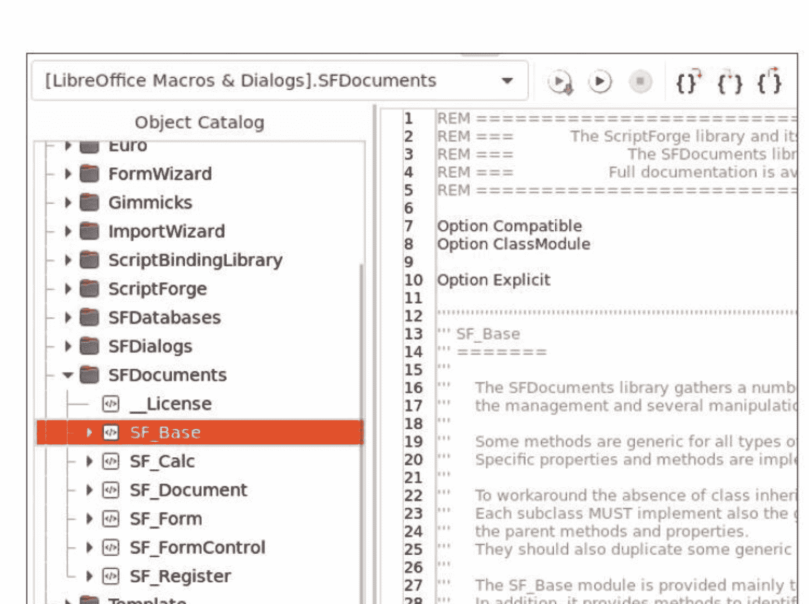

| 对象目录 | |
| :--- | :--- |
| - 单元格 | `1 REM = ...` |
| - 小部件 | `2 REM = The script is ...` |
| - 导入向导 | `3 REM = The SDocuments` |
| - `ScriptForge` | `4 REM = ClassModule` |
| - 脚本库 | `5 REM = a user-script` |
| - 基础 | `6 Option Explicit` |
| - `SDocuments` | `7 - : Base` |
| - `SBase` | `8 - : Form` |
| - `SPage` | `9 - : Page` |
| - `S_Document` | `10 Option` |
| - `S_Form` | `11 - : Cell` |
| - `S_Control` | `12 - : Control` |
| - `S_Template` | `13 - : Text` |
| - 调试 | `14 - : Specific` |
| - 列表框 | `15 - : methods` |
| - 模型控制 | `16 - : are` |
| - 字符串 | `17 - : Each` |
| - 定时 | `18 - : MUST` |
| - `DictionaryA` | `19 - : it ...` |

## 入门

非常强大的环境：`LibreOffice Calc` 的编号和图表功能以及 `Python`。在本文中，我们将通过展示如何加载和运行一个用户脚本来教你如何使用 `ScriptForge`，这并不像看起来看起来那么困难，但它展示了如何使用 `ScriptForge` 简单地读写表格（第 5 行和第 7 行）。在第 6 行中，与其使用解释器，可以使用 `Python` 作为解释器（文档特定的），每当您调用方法时，它都会从网络获取数值并赋值给该值。通过类似的技术，你可以从互联网下载数据（第 20 行）并将其插入到 `LibreOffice` 文档中。由于空间限制，我无法在此展示此类应用程序的完整示例，但通过之前的文章，跟起来不会太困难。

### 运行 ScriptForge


我们将展示 LibreOffice 如何识别并运行 `Listing 1` 中的代码，作为用户脚本运行，然后将其作为对象嵌入。对于用户脚本，你应该使用您喜好的文本编辑器、代码数据结构、文件、对象和处理程序位置实例。相关的库以组的形式定义，这些组处理 LibreOffice 文件的内容（`SD.Documents`）、用户数据和数据库。`SDatabases` 可以存在于 LibreOffice 文件内部或外部节点中，允许通过 `SQL` 查询读取和写入记录。

你可以使用 `ScriptForge` 库来使用这些宏。一旦你掌握了这些宏，就可以使用它们在文档（例如电子表格）中来切换数据，并使用 `Basic` 或 `Python` 进行更复杂的处理。

```
Listing 1: ScriptForge 示例脚本
01 from scriptforge import CreateScriptService
02 doc = CreateScriptService("Calc")
03
04 def insert_cell(args_name):
05 value = doc.GetValue("A1")
06 value += 1
07 doc.SetValue("A1", value)
```

`Listing 1` 所做的是脚本必须使用 `ScriptForge` 库，并从这些库中使用创建 LibreOffice 单元格所需的特定方法（第 2 行）。第 4 行定义了一个函数（`insert_cell`），将单元格 A 的当前内容带入 Python 变量中。

第 9 行显示了如何实际调用该函数。脚本其余部分导入了 `ScriptForge` 服务，该服务处理对话框并创建一个带有“Hello”消息的对话框。

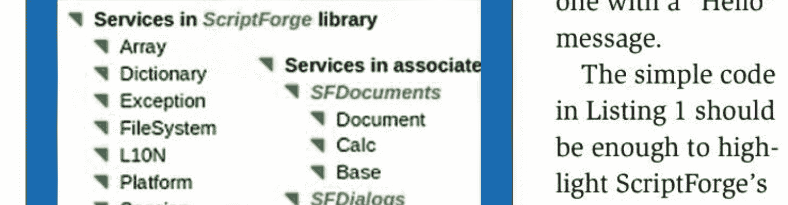

| ScriptForge 库中的服务 | 关联中的服务 |
| --- | --- |
| Dictionary | SDocuments |
| Exception | |
| Filepacket | SDialog |
| L10 | Control |
| Platform | SDabases |
| String | |
| Textextream | Database |
| Timer | |

图 5：ScriptForge 库的内部结构。

`Listing 1` 中的简单代码就足够体现 `ScriptForge` 的真实威力以及它为用户开辟的道路。`Listing 1` 展示了之间直接、简单的桥梁，连接到

| A | B | C | D | E | F |
| --- | --- | --- | --- | --- | --- |
| | | | | 库 | 宏名称 |
| My Macros | increment_cell | | | | |
| Standard | | | | | |
| WikiEditor | | | | | |
| apso.o | | | | | |

图 6：安装后，用户特定的 Python 脚本可以像普通宏一样运行。

40 2022年10月第263 期 LIBRE-LINUX.COM LIBREPROMAGAZINE.COM

## 使用 ScriptForge 的 LibreOffice 宏

当前文件，然后转到“菜单 | 创建宏”。在为宏命名后，你可以选择它并点击“菜单 | 编辑”打开文本编辑器并直接从那里编写代码，使用 `Python` 测试你的工作。

| 执行 | 菜单 | 关闭 |
|---|---|---|
| My Macros | | |
| aptso.odt | | |
| 编辑 重命名 嵌入文档的 删除 Python | | |

| 执行 | 菜单 | 关闭 |
|---|---|---|
| My Macros | | |
| aptso.odt | | |
| =increment_cell | | |
| LibreOffice Macros testmacro-0.ods | | |
| =increment_cell | | |

## 结论

使用 `ScriptForge` 和 `Python`，自动化 `LibreOffice` 比最初看起来要容易。然而，这只是基础。如果你想更多地了解 `Python` 在电子表格和列表的力量，请访问 `LibreOffice.org` [5]。如果你对内部架构感兴趣，请查看 2020 年 `LibreOffice` 会上的 `ScriptForge` 演示 [8]。

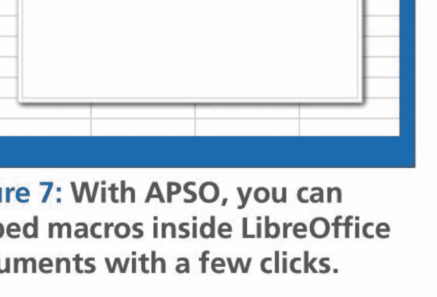

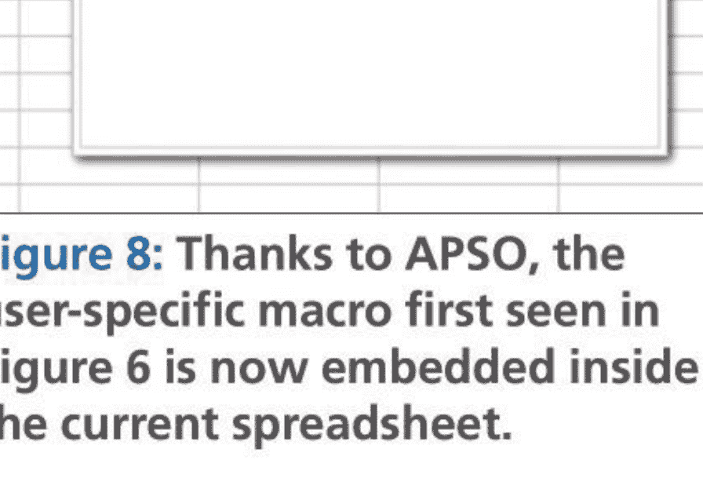

从 `Listing 1` 到新文件，将文件保存在你的本地 `LibreOffice` 文件夹中，这些文件夹位于 `$HOME/.libreoffice/user/Scripts/python/`。

当你转到“工具 | 宏 |”，你将通过“我的 LibreOffice 宏”看到该脚本的内容，并点击 `increment_cell` 执行脚本（图 6）。

| 宏名称 | |
|------|
| increment_cell | |
| ... |

这里是 APSO 处理的电子表格中的宏，当你转到“工具 | 宏 |”，你将通过“我的 LibreOffice 宏”看到该脚本的内容，并点击 `increment_cell` 执行脚本（图 6）。

*(注：由于原文文本中存在大量重复的段落，已根据“一定不要重复输出原文”的原则在翻译时进行了去重处理)*

*(此处省略原文中完全重复的句子，仅保留具有核心意义的翻译)*


# 作者

Marco Fiorentini (`mfiorent.com`) 是一位位于意大利罗马的自由作家、培训师和研究人员，自 1999 年到 2005 年一直从事自由开源工作。Marco 还通过 `https://site-zone.en.net` 处理数字权利。

图 9：通过 APSO 嵌入的宏也可以通过 LibreOffice 的标准宏管理器使用。

## 从 Markdown 文件构建项目文档

MkDocs 是一个静态站点生成器，它可以让你轻松地将 Markdown 文件转换为开箱即用、用户友好的项目文档。作者 Dmitry Popov。

文档：每个人都需要，但并非每个人都想处理它，特别是在时间和资源有限的小型项目中。即使你设法抽出时间来创建技术内容，将其转换为用户友好、可搜索且易于导航的文档也并非易事——除非你使用 MkDocs `[1]`。对于任何寻找简单且低成本方式来维护文档的人来说，这简直是天降的灵赐（见图）。你也可以将 MkDocs 用于任何需要结构化和易于搜索的格式呈现的内容，从研究笔记到知识库等。

### 第一步

如果你的机器上已经安装了 Python 3 和 `pip`，你可以通过 root 身份运行以下命令来部署 MkDocs：

```bash
pip3 install mkdocs
```

顺便，你还可以通过以下命令安装带有 `[2]` 扩展的 Material 主题：

```bash
pip3 install mkdocs-material
```

虽然在技术上是正确的，但仅仅称之为 Material 主题将对其大不敬。MkDocs 不仅仅是与新工具合并了 Docs，它还增加了一层功能，单此一点就值得。尽管付费支持者可以使用某些功能，但本文描述的所有功能都是免费的。

### 通用步骤

`mkdocs server` 是一个静态链接的二进制文件，以 tarball、deb/rpm 包和 Docker 镜像的形式提供。我们支持所有的 x86、arm64 和 armv7 架构。

- 1. 使用下方描述的方法之一安装 `mkdocs`
- 2. 运行（可选）`mkdocs-server` 启动本地服务器
- 3. 使用 `mkdocs build` 部署（可选）以生成静态站点。要测试更改，使用 `mkdocs serve`。

**图 1：** MkDocs 允许你以最小的努力为项目构建文档。

可用功能。要利用这些功能，你需要通过编辑 `mkdocs.yml` 配置文件来启用并配置它们。最初，文件包含几个配置参数：功能列表。如果你希望标题栏在用户滚动过某一点时自动隐藏，请在主题的 header 部分启用 autohide 功能：

- autohide

当你准备好创建项目文档时，运行命令：

```bash
mkdocs new
```

（替换为你的项目-name）这将创建一个包含两个项目的项目结构：`mkdocs.yml` 配置文件和存储实际内容的 `docs` 目录。其中的内容是 Markdown 格式的。你现在可以添加更多文件并在内部进行组织。例如，你可以为每个主题创建一个单独的文件，并将它们分组到子目录中，如入门、教程、参考资料等。

当你准备好查看文档时，运行 `mkdocs serve`，它会在浏览器中打开 `127.0.0.1:8000`。服务器会自动重新加载以反映项目目录中的更改。虽然构建的服务器允许你预览文档站点，但你仍然需要源代码转换为自包含的静态站点。当你准备好发布文档时，运行 `mkdocs build`，它会创建一个包含所有必需组件的静态站点。

这比从单个根文件要好。MkDocs 允许你像管理代码一样管理文档项目。如果你选择这种方法，只需要使用 Git 并上传到 GitHub、GitLab 或私有实例来托管源代码，你可以使用仓库替换文档站点右下角的链接。

Material 允许通过在调色板设置中使用相应的条目指定主色和强调色来调整其色板。要确定你想使用哪些颜色，请打开颜色更改页面 `[3]` 并选择产生细节的主色和强调色。带有切换选项的深色模式使阅读体验更舒适。通过在 Material 中启用此功能，你可以开启深色模式并为默认主题定义切换器。列表 1 是针对默认主题的：

- scheme:

```yaml
<..>
```

- toggle:

```yaml
icon: material/lightbulb-outline
switch: Switch to dark mode
```

MkDocs 添加了星标（Stars）和分支（Forks）。但不仅如此。如果你想鼓励读者为你的文档做出贡献，你可以轻松地编辑并在每个页面添加链接。该链接指向仓库，读者可以在其中进行编辑并创建请求（pull requests）。

查看插件文档以获取你可以使用的其他选项 `[6]`。

`mkdocs gh-deploy` 命令会将文档发布到项目的 `gh-pages` 分支中。仅此而已。

在盒子里，并且可以随着你的需求而增长，你应该尝试一下 MkDocs。

# 在 GitHub 上发布

`mkdocs build` 命令会生成一个准备好发布的静态文档，你可以将其上传到远程服务器。为了优化发布过程，你可以创建一个脚本，使用 `rsync` 在每次构建文档时将更改推送到服务器。

# 简介

- [1] `MkDocs`](https://www.mkdocs.org)
- [2] `Material for MkDocs`](https://github.com/squidfunk/mkdocs-material/)
- [3] `Material 颜色主题`](https://github.com/squidfunk/mkdocs-material/color-themes/)
- [4] `Markdown 扩展`](https://github.com/squidfunk/mkdocs-material/extensions/python-markdown/)
- [5] `PyPI`](https://pypi.org/)
- [6] `Awesome Pages`](https://github.com/lukasiter/mkdocs-awesome-pages-plugin/blob/master/README.md)

# 总结

MkDocs 还有另一个巧妙的功能可以进一步简化发布任务。如果你使用 GitHub，你可以使用 MkDocs 将文档部署到 GitHub Pages。要实现这一点，切换到文档仓库并运行

MkDocs 并不是唯一的发布工具。但如果你需要一个易于掌握、提供所有基础功能的解决方案……

# 作者

Demi Popper 多年来一直在大量编写关于 Linux 和开源软件的文章。他的文章发表在丹语、英国、美国、德国、西班牙语和俄语的杂志和网站上。你可以在他的网站 `tokyoma.de` 找到更多信息。


# 逛商店

`shop.linuxnewmedia.com`

# 调整你的 LINUX 系统

通过酷炫的 LINUX 技巧提高效率

通过这套为 Linux 极客准备的灵感技巧和快捷方式，提升你的 Linux 技能。

- 命令行上的 Google
- `OpenSnitch` 应用防火墙
- `systemd` 日志
- 使用 `lazygit` 控制 `Git`
- 使用 `DOSBox` 运行旧 DOS 游戏
- 以及更多！

Linux 极客的技巧和快捷方式

- 使用 `Xtreme Download Manager` 加速下载
- 使用工具搜索文本、PDF 和 Office 文件
- 在 `Proxmox` 服务器上运行虚拟机，无需安装客户端

复古乐趣：

使用 `DOSBox` 玩 DOS 游戏

音频专家

为 DJ、音乐家、作曲家准备的工具

发现专家的秘密

在线购买：`shop.linuxnewmedia.com/specials`


## 深度解析

### `OliveTin` 和脚本服务器


### `Bash` 脚本的 Web 界面


# OliveTin 简介

在无需编写单行 HTML、CSS 或 JavaScript 的情况下，为 Bash 脚本创建一个用户友好的前端。虽然 Bash 脚本通常是连接一切的胶水，但创建一个基于 Web 的前端可以让这些脚本对用户更加友好。在过去的十年里，Web 界面（webs）已成为日常使用的的前端选择。然而，即使对于简单的界面，像 `OliveTin` 和 `Script Server` 这样的免费开源工具允许你在没有任何库的情况下创建 Web UI。在本文，我将向你展示如何通过声明式配置为脚本构建一个简单的 Web UI：你只需要创建一个简单的 `YAML` 文件，将其提供给 `OliveTin`，它就会通过作为界面的网页自动处理你的日常任务。

无需记忆和输入命令行，`OliveTin` 通过一个友好的缓冲区处理一切。由于其简单性，`OliveTin` 为非技术用户打开了系统门。`OliveTin` 以静态二进制文件的形式分发，因此你无需安装。只需获取适用于你架构的二进制文件，即可原生执行。由于 `Docker` 在大多数 Linux 发行版中都很常见，你也可以使用特定发行版的包将 `OliveTin` 安装为服务。

## 生成 Web 界面

要为 `OliveTin` 生成简单的 Web 界面，首先在列表 1 中创建配置。`OliveTin` (1) 允许用户访问预定义的命令。`OliveTin` 界面由各种可用按钮组成。

**列表 1: `config.yaml`**

```yaml
actions:
  - title: HELLO Shell Rock!!
    icon: https://www.github.com/cli/issues/8994/9f8a7f2-flag-where-be-icons-the-song.org --width 100%
    shell: sleep hello
    timeout: 6
  - title: Name Images
    icon: &129512
    shell: image prune -f
    timeout: 10
```

一旦成功执行命令，访问 `http://localhost:5137` 访问图 1 所示的 Web 界面。

```bash
docker -d --name olivetin -v $(pwd)/config.yaml:/etc/olivetin/config.yaml -v /run/docker.sock:/var/run/docker.sock latest
```

图 1：`OliveTin` Web 界面。你有一个两个按钮的界面。分别或同时按下这两个按钮观察界面的行为。遵循 Unix 惯例，`OliveTin` 将非零返回视为失败。

## 进阶配置

**列表 2：更新后的 `config.yaml`**

```yaml
logLevel:
  value: 10

hideNavigation: true

actions:
  - title: "HELLO FLOSS!"
    icon: 
    shell: sleep "$(delay)" && echo "HELLO STARS!"
    arguments:
      name: delay
      choices:
        - title: 1 sec
          value: 1
        - title: 5 sec
          value: 5
        - title: 10 sec
  - title: "Nuke Dangling Images"
    shell: docker image prune -f
    icon: "#189982"
    timeout: 10
  - title: "Pin An Address"
    shell: ping {{address}} -c {{count}}
    icon:
    timeout: 3
    arguments:
      - name: count
        type: int
      - name: address
        type: ascii_identifier
```

**日志输出**

| Timestamp | Log | Exit Code |
|---|---|---|
| Hello FLOSS! | | |
| 2022-02-08 06:55:13 | OK | |
| stderr | | |
| (empty) | | |
| Nuke Dangling Images | | |
| 2022-02-08 06:55:14 | OK | |
| stderr | | |
| (empty) | | |

图 2：日志显示了每个按钮的操作。

## 配置与准备脚本

**列表 3：配置与准备脚本**

创建目录：

```bash
mkdir -p /tmp/configs/[runner,scripts]
```

脚本内容：

```bash
sleep "$1" && echo Hello to script-server, from FLOSS!!!
```

创建主配置文件 `config.json`：

```bash
tee /tmp/configs/config.json <<EOF

{
  "title": "Test Script Server",
  "security": {
    "xsrf_protection": "token"
  }
}

EOF
```

创建 Runner 配置 `sleephello.json`：

```bash
tee /tmp/configs/runners/sleephello.json <<EOF

{
  "name": "sleep hello",
  "description": "sleep first then hello",
  "script_path": "/app/scripts/sleephello.sh",
  "parameters": {
    "name": "delay",
    "type": "list",
    "required": true,
    "description": "sec to sleep before printing",
    "default": "3",
    "values": ["1", "3", "5", "10"]
  }
}

EOF
```

创建 Runner 配置 `dockrimprune.json`：

```bash
tee /tmp/configs/runners/dockrimprune.json <<EOF

{
  "name": "docker image prune",
  "description": "cleanup dangling docker images",
  "script_path": "/app/scripts/dockrimprune.sh",
  "parameters": [
    {
      "name": "unused images",
      "description": "all unused images cleanup",
      "no_value": true
    }
  ]
}

EOF
```

创建脚本 `dockrimprune.sh`：

```bash
tee /tmp/configs/scripts/dockrimprune.sh <<EOF

#!/bin/bash
if [ "$1" ];
then
  docker image prune -f
else
  docker image prune -fi
fi

EOF
chmod +x /tmp/configs/*.sh
```

创建脚本 `sleephello.sh`：

```bash
tee /tmp/configs/scripts/sleephello.sh <<EOF

#!/bin/bash
```


并验证报告是否遵循了不同类型的选项和参数。`Script Server UI` 将提供不同的访问控制方法，使其成为多用户脚本执行器。你可以为其他想要执行脚本的人进一步配置门户。

要开箱即用运行 `Script Server`，可以使用 `Docker` 绑定的配置。如果你的某些脚本无法在 `Docker` 容器中运行，你可以原生运行 `Script Server`（参阅 `Script Server wiki [4]`）。要运行 `Script Server` 的测试，你需要通过执行列表 1 中的代码来准备必要的配置。然后，使用启动 `Script Server` 容器：

### 列表 4：启动 `Script Server`

现在在浏览器中导航到 `localhost:5500`。`Script Server UI` 已准备好执行你的脚本（图 6）。如果你点击 `sleep` `hello`

图 8：配置一个复选框以为你的脚本提供额外控制。

# 深度解析与 `Script Server`

图 9：`docker image prune` 的历史

在网页的左下角，你会找到 `HISTORY`（历史）选项卡，它可以让你浏览脚本的执行情况（图 9）。要修复图 9 中显示的命令，你需要创建一个包含执行 `docker image prune` 所需的命令行接口的 `Docker` 镜像。你可以通过执行列表 5 中的代码来实现此。我使用 `htpasswd` 为 Web 端添加了一些基础的身份验证。使用在线 `htpasswd` 生成器生成 `htpasswd` 文件是为了展示我添加的一些新的 `Script Server` 功能。

要删除现有的 `Script Server` 条目，请执行以下命令：

```bash
docker rm -f $(docker ps | grep 'Test Server' | awk '{print $1}')
```

然后，使用列表 7 中的命令使用新创建的实例启动一个新的 `Script Server`。

## 列表 5：更新后的 `Docker` 镜像

```bash
SHELL="/bin/bash", -o "pipefail", -c

RUN apt-get update && \
apt-get install --no-install-recommends curl -y && \
curl -sSL /tmp/docker.sh https://download.docker.com/linux/stable/x86_64/docker.sh && \
chmod +x /tmp/docker.sh && /tmp/docker.sh --root

cd /tmp && \
useradd -aG docker dockergroup && \
mv docker /usr/local/bin/docker && \
rm -rf docker && \
apt-get remove curl -y && \
apt-get clean && \
echo -e "admin:$(openssl md5)" > /etc/htpasswd

docker build -t script-server
```

## 列表 6：更新的 `config.json`

```json
tee /tmp/configs/config.json <<EOF

{
  "title": "Test Script Server",
  "access": {
    "admin_users": ["admin"]
  },
  "auth": {
    "type": "htpasswd",
    "htpasswd_path": "/etc/htpasswd"
  },
  "security": {
    "xsrf_token": "token"
  }
}

EOF
```

图 11：连接我们退出（底部），并且 `docker image prune` 成功执行。

## 深度解析

## 列表 7：启动新镜像

```bash
docker run -d \
-v /tmp/configs/docker.json:/app/config/docker.json \
-v /tmp/configs/runners:/app/runners/ \
-v /tmp/configs/scripts:/app/scripts \
-v /var/run/docker.sock:/var/run/docker.sock \
-p 5000:5000 script-server
```

（图 11）你也会在图 11 中注意到 `docker image prune` 现在已成功执行。

通过这里收集的信息，你将能够正确地启动并配置 `Script Server`。文档 `[4]` 和 `[5]` 将帮助你释放 `Script Server` 的全部潜力。

当你切换到管理员用户时，你会看到一个轮子控制（左上角）。点击这将允许你添加管理员页面，你可以在那里集成以及或后端运行所有属性（13 和 14）。当你想快速添加脚本而无需翻阅文档和 `JSON` 配置文件时，这很难。为了在交互模式下成功保存更改，你必须从 `Docker` 命令中移除 `ro`（只读）选项。

## 结论

一旦刷新浏览器，你应该会看到用户名和密码的登录界面（图 10）。还添加了测试和管理员用户（密码为 `admin`）。

由于命令行序列倾向于重复，智能预测可以节省你的打字时间。例如，如果我编辑代码，然后保存，然后编译，智能工具能够预测接下来会发生什么。在 90% 的情况下，用户将能够预测下一个命令并运行它。

`Bash` 或 shell（`Zsh`）的历史机制不适用于此，因为它没有记录命令之间的转换和概率。因此，从某个状态出发的所有路径总和为 100%。

为了分析用户到为止在 shell 中输入过的命令，我首先需要一个持续记录每个手动输入的命令的进程。

## 深度解析

较新的 `zsh` 提供了一个 `preexec` 钩子，用于通用地拦截输入的命令。我在列表 1 的第 4 行为该钩子分配了一个函数体，它会在执行命令之前触发，并将该行的内容作为第一个参数传递给它。我的 `preexec()` 钩子调用了之前定义的 `cache()` 函数。它记录了当前目录并在之后添加命令行，用空格分隔组件，并将其作为新行追加在提示符的末尾。

在可能的命令列表中，用户需要使用方向键（或 `j` 和 `k` 映射）选择所需的命令，然后按回车键。shell 选择的命令可以变得更加友好。为此，函数 `g()` 通过 `pick` 获取命令字符串，并使用内置的 `eval` 执行它。

`bake`（我的别名 `n`）用于根据其生成文章，使用 `v1` 对行进行重新编辑，最后是命令：

```bash
git add -p
```

我用它来主动将已修改的文件添加到暂存区。

然而，Linux 发行版传统上倾向于使用 `bash`，而 `bash` 缺乏我所使用的 `preexec()` 钩子。幸运的是，GitHub 上的某人费力完善了这个实用的函数。

## 新瓶装旧酒

使用三年前快照中的一个旧技巧，该 `Go` 程序（`pick`）在我按下回车键时会输出用户的命令行。由于我使用的 `Go` 库除了返回 `pick` 用户项外没有做其他操作，它会将命令行输出到缓冲区。如果我随后将命令行输出到 shell，它就会接收到。序列 `3&4`、`1&2` 和 `3&1`（第 6 行）返回 `5&2`（数字 2）给 `5&3`（数字 1），使得命令行处于等待状态（第 6 行）。最后，`eval` 获取获取变量并执行其包含的字符串）。

列表 5 定义了 `preexec` 函数 (1)，我将调用它来接收钩子提供的下一个要执行命令的建议。我希望命令只用一个字母以避免输入，如果你在 `zsh` 中编程，"g" 是很有意义的。

在我输入 `g` 并按回车键运行 `g` 命令后，shell 函数调用了 `pick` 命令（第 6 行）。这是一个 `Go` 程序（你可以在列表 4 中看到），它使用算法过滤输入，并在可能的命令列表中决定一个跟在上一个命令之后的命令。

图 2 显示了我使用的预测工具。由于历史原因，我使用新的纯文本文档（`Markdown`）格式编写文章，这与旧的纯文本文档（`PDF`）格式略有不同。编辑文章后，我调用 `g`，它从 `~/.zsh_log` 显示的 shell 历史中获取最可能的命令进行选择。这些命令包括针对文本文件的 `git -p`。

幸运的是，该算法根据用户（我）执行过的之前的命令序列预测可能的下一个命令。列表 4 详细说明了 `history()` 函数类型中每行的日志。结构定义在行中，分别包含了命令的属性（由用户输入）以及调用它发生时的目录属性。

列表 1: `.zshrc`

```bash
01 cmdexec() {
02 echo "$(date +%s) $1"
03 >> ~/.zsh_log
}
```

```bash
04 preexec() {
05 echo "#$1"
}
```

```bash
06 g() {
07 cmdexec "$(pick '3&6|1&2 2&3')"
08 eval "$1"
09 }
```


## 列表 2: `myhistory.log`

```text
1635831081 /home/millilli/.zshrc
1635831086 /home/millilli/articles/vi.tnd
1635831086 /home/millilli/articles/ls
1635831870 /home/millilli/articles/vi/.history.log
```

`millilli:~/git/articles/predict$ vi`
`millilli:~/git/articles/predict$` 使用方向键导航：`→ ←`
`pick` 命令：
`+ → git add -p`
`+ → vi`

图 2：`g()` 函数列出了可能的后续命令。

## 列表 3: `bashrc`

```bash
[[ -f ~/.bash_preexec ]] && . ~/.bash_preexec
```

LINUX MAGAZINE | ISSUE 2022

## 深度解析
Go 编程快照 – 智能预测

`g` 快捷键仅用于帮助预测（因为用户可以通过 `Ctrl+C` 退出预测模式）。`history()` 函数将 `HistoryEntry` 类型的切片添加到末尾，最后返回给第 6 行的调用者，以估计用户可能想要运行的命令。在第 8 行的 `for` 循环中，每一轮，预测器根据历史数据存储 shell。

## 记忆辅助
列表 5 中的预测器运行 `predict()` 函数

### 列表 4: `history.go`

```go
01 package main

02 import (

03  "bufio"

04  "os"

05  "regexp"

06  "strings"

07 )

08 type HistEntry struct {

09  Cwd string

10  Cmd string

11 }

12 func history(histFile string) []HistEntry {

13  f, err := os.Open(histFile)

14  if err != nil {

15   panic(err)

16  }

17  f.Close()

18  hist := []HistEntry{}

19  scanner := bufio.NewScanner(f)

20  re, err := regexp.Compile(`^\s*`)

21  if err != nil {

22   panic(err)

23  }

24  fds := strings.Split(scanner.Text(), " ")

25  if len(fds) == 3 {

26  if re.MatchString(fds[2]) == "$" {

27    continue

28  }

29  for scanner.Scan() {

30    hist = append(hist, HistEntry{

31    Cwd: fds[1], Cmd: fds[2]

32  })

33  }

34 }

35 return hist

36 }
```

### 列表 5: `predict.go`

```go
01 package main

02 import (

03  "sort"

04 )

05 func predict(hist []HistEntry, cwd string) []string {

06  lastCmd := ""

07  followMap := make(map[string]map[string]int)

08  for _, h := range hist {

09  if h.Cwd == cwd {

10   continue

11  }

12  if lastCmd != "" {

13   lastCmd = h.Cmd

14  }

15  cmdMap, ok := followMap[lastCmd]

16  if !ok {

17   cmdMap = make(map[string]int)

18  followMap[lastCmd] = cmdMap

19  }

20  cmdMap[h.Cmd] += 1

21 }

22 }

23 if lastCmd == "" {

24  // 在此目录第一次进入

25  return []string{"la"}

26 }

27 return []string{lastCmd[0]}

28 }

29  items := []string{}

30  follows, ok := followMap[lastCmd]

31  if !ok {

32   // 未找到默认项，仅返回

33   return all commands

34 }

35  for _, item := range follows {

36   items = append(items, item)

37  }

38  return items

39 }

40 // 返回得分最高的评分

41 type score struct {

42  to string

43  weight int

44 }

45  scores := []score{}

46  for v, w := range follows {

47  scores = append(scores, score{to: v, weight: w})

48 }

49  sort.Slice(scores, func(i, j int) bool {

50   return scores[i].weight > scores[j].weight

51 })

52  for _, score := range scores {

53   items = append(items, score.to)

54  }

55  return items

56 }
```


## 编程快照 - 使用 Go 进行智能预测

处理过的命令包含在 `h.cod` 中，并将其保存在 `lastCmd` 中，以便循环的结果可以访问之前的值的值。从第二轮开始，代码在第 16 行的名为 `loop` 的双层哈希图中保存了跟在前一条命令之后的信息，并增加关联值。换句话说，在循环结束时，`B` 知道命令是如何跟在 `A` 之后的。算法评估了命令跟在 `A` 之后的概率。如果当前目录只有一个命令，算法除了第 16 行的建议外交方法外无法做更多。然而，如果 `lastCmd` 包含了前一个命令，那么它的后续命令形成了一个反映其频率的结构。它随后在第 47 行按数值对切片进行排序。在 Python 等脚本语言中对这种哈希映射进行排序会产生巨大的开销，但 Go 显示了其严格类型检查的优势。

`predict` 的输出是 `items` 数组，它包含了根据顺序可能跟在当前命令之后的命令。最后，第 6 行的程序将它们呈现给用户。

## 手选命令

第 3 行的 Go 程序将路径传递给 `-i` 标志；它读取文件（列表 4）并考虑时间和持续时间。返回的项传递给 `predict(1)`（列表 5）。结果是一个优先级列表，Github 显示的在命令行上的图形化界面。

如果一切顺利（即用户没有通过 `Ctrl+C` 退出），第 25 行将将选中的命令输出到 `stderr`，列表 1 中的 `g` 函数获取它、写入并执行它。

## 结论

我的 DIY 命令行预测器减少了开发期间的输入工作。当然，你在 Go 中的实现没有此限制：`predict(1)` 中的算法非常简单，只需要使用马尔可夫链等算法进行改进。你的自定义运行时。

## 信息

- [1] "Run statistics on shell commands" by Mike Shilli, Linux Magazine, issue 225, February 2022. https://www.linux-magazine.com/Issues/2021/243/Making-History
- [2] "Predict - Go stores history" by Mike Shilli, Linux Magazine, issue 228, November 2020. https://www.linux-magazine.com/Issues/2019/28/Pathfinder/offset/
- [3] `Bash` `preexec`: https://github.com/ralcalas/bash-preexec

## 深度解析

### 介绍 Rocky Linux

#### Rocky Linux 正在企业市场寻找足之地

##### 回应呼召

Rocky Linux 成为 Red Hat Linux 的免费替代方案。作者：Joe Casad。

开源世界在不断演进，每当需要时，新的 Linux 发行版就会出现。Rocky Linux (1) 去年刚刚出现，部分是为了应对企业领域的动荡，但正如开源世界的常态一样，它正不断进入专业软件领域、工作站和云实例。Rocky Linux 是什么？它源自哪里？讲述这个故事最好的方法是从头开始。

从前以前，Source RHEL 的免费版本作为一个社区驱动的分支应运而出。虽然红帽是一家营利性企业，但 Red Hat Linux 是一个更具价格效益的选项。任何人都可以使用它，许多志愿者在全球范围内工作多年，进行测试并帮助论坛。

2014 年，红帽宣布将赞助 CentOS 并聘佣了他们的几位开发者。到那时，团队已经计划了变更，他们并不认为同一份代码提供免费版和订阅版并不是问题。看来，如果用户从 CentOS 开始然后转到 RHEL，新的 CentOS 实际上可以帮助 RHEL。

IBM 收购红帽导致了优先事项的转变，并在 2020 年再次发生，使得 CentOS 不再是企业的克隆。这本很容易，但遗憾的是由红帽来完成。

社区再次忙碌起来，寻找一个新的发行版来扮演 CentOS 长期以来的角色。涌出的基于 RHEL 的免费 Linux 领导者之一就是 Rocky Linux。

一天，红帽（公司）宣布他们将不再免费提供 CentOS 的二进制版本。二进制版的 Rocky Linux 随之诞生，它虽然有成本，但可以提供服务。如果你想知道对 Linux 收费是否符合 Linux 的 GNU 通用公共许可许可证 (`GPL`)，请放心，它是符合的。`GPL` 要求如果程序被修改，代码必须是可用的——它并不要求分发者免费分发编译后的二进制版本。只要红帽在某处发布了源代码，他们就可以自由对二进制版本进行任何修改——而且修改的程度就像微软为 Windows 收取的费用那样多（为什么 Rocky Linux 比 CentOS 好？）。

但 `GPL`（他们无法准确阻止他们）将永远存在。根据 `GPL` 条款的要求，源代码仍然存在，任何想要它的人都可以获取源码，移除商标和其他专有组件，然后编译并赋予它不同的名称。

在全盛时期，多个项目提供了 RHEL 的免费重新编译版本。随着时间的推移，RHEL 克隆版中涌出了领导者，CentOS 拥有了忠实的用户和志愿者社区，它可以运行在服务器、Web 服务器和企业工作负载上。每当红帽发布新版本的 RHEL 时，CentOS 就会变得免费，团队会进行必要的适配并发布新版本的 CentOS，这成为了最受欢迎的——这也是为什么它如此受欢迎：因为它是免费的，并且包含了企业级 Linux 的所有测试和完善。

为了保持与社区的联系，红帽宣布他们仍将提供一个名为 Fedora 的免费版本。许多用户从红帽切换到 Fedora，Fedora 直到今天仍然吸引粉丝，但每个人都知道 Fedora 是完全那样的。首先，它取决于像 RHEL 那样的订阅，因此没有同等水平测试测试。其次，它缺少了 RHEL 中包含的许多功能和工具。红帽更多的是“社区”版而非“企业”版，就像公司领域的许多其他开源产品一样。

#### 介绍 Rocky

在 IBM 和红帽宣布将 CentOS 移向上游的那天，共同创始人 Greg Kurtitzer 倾向于启动新项目以继续最新的红帽企业服务。作为 CentOS 的老兵，Kurtitzer 兴趣的不仅是企业代码库——还有“旨在”帮助社区的设计以及对源码仓库的更新。在这种背景下，他们向社区贡献了一个对其他开发者有吸引力的新工具。

`Peridot`（是的，你得这样读那个 "T"）是由 Rocky 开发者构建的一个云原生系统，用于帮助他们获取更新。Rocky 团队将其作为开源软件发布并通过 GitHub 提供。

Rocky 项目的创始赞助商是 CIO (2)，一家拥有约 50 名员工的公司，支持 Rocky 并为 Rocky 添加组件；然而，Rocky 是一个独立项目，还有几个其他赞助商，包括 AWS、Google Cloud 和 Microsoft Azure。存储公司也使用 Rocky 作为它们的存储平台。网站上的 Rocky 页面 (3) 目前列出了 12 个赞助商，Rocky 正在寻求增长。

Rocky 将帮助他们跟上红帽的新版发布和更新计划。`Peridot` 也可以是帮助支持使用现代版本 Rocky 的特殊兴趣用户社区。

#### SIGs

Rocky 鼓励有相似兴趣的用户聚集在一起分享想法和解决方案。特殊兴趣小组 (`SIGs`) 为 Rocky 项目带来了不同的观点和视角。Rocky 有内核、虚拟化、容器、高性能计算和语言的 SIG。桌面 SIG 致力于各种版本的 `KDE`、`Gnome` 和 `Xfence`。

#### Peridot

Rocky 开发者力求无缝衔接，因为在过去，他们必须为每个新版本重复相同的步骤。然而，尽管使用了源文件和补丁，代码本身仍无法改变。开发者需要构建 `Peridot` 来自动化构建过程。当更新准备就绪时，你使用按钮和补丁自动获取代码，`Peridot` 手动选择预定义的补丁并构建包（图 1）。

Rocky 团队使用 `Peridot` 构建所有的 Rocky Linux，你也可以使用它。

### 深度解析

#### Rocky Linux

Rocky 团队的 SIG 将不再仅仅是小组，我们正在从 Rocky 发行版的各个方面工作支持他们的特殊兴趣。高性能计算 (`HPC`) 是 Rocky 项目特别感兴趣的领域。Rocky 系统使用广泛的测试来确保性能，但同时，高度并行的 HPC 系统可以拥有数百（数千）个实例，提供了以较低成本获得的竞争优势。CentOS 曾是许多 HPC 用户的最爱，现在正捕捉这一点。Greg Kurtz 有 HPC 历史——他还创建了用于 HPC 的 Kubernetes 容器系统 `CIQ`，该公司对 HPC 领域投入巨大。`CIQ` 现在提供 `Furnuzzing` (2022年秋) 计算平台，旨在取代 CentOS、服务和全球数据中心，同时保持从本地到云端再到边缘的供应链完整性。其价值声明包括以下内容：

- 保持务实。作为开源倡导者，对简单的直觉是使用那些本身允许所有权的工具，但解决问题的最佳实践可能需要我们使用正确的工具。
- 保持慷慨。欢迎公开的理由；所有社区和所有视角的投入都受到重视并经过考虑。
- 团队领先于自我。不需要奉承者，也不需要唯唯诺诺。

虽然我们正开始创建一个稳定的下游 Linux 发行版，但我们的目标正在增长，需要关注特殊兴趣的需求，包括帮助教育项目、研讨会、会议，无疑……

Rocky 做到 RHEL 能做的一切，除非你想付，否则你不需要付费。Rocky 知道他们的使命取决于高效的流程。`Peridot` 构建也是你投资的一部分。如果你有需求，Rocky 可以让你轻松发布 Rocky 系统，但不要重造轮子，你可以在 Rocky 网站寻找 SIG。

#### 结论

Rocky 项目正式归 Rocky Enterprise Foundation (`RESF`) 所有。它是一个由 Rocky 创建者 Kurtz 拥有的公共公司，其设计旨在平衡利润与开源选择。社区在 `matter` 聊天中进行讨论（图 4）。Rocky 的聊天网站注册了超过 7,000 名成员，包括连接到公共论坛集合 [5] 的用户，为用户提供更多关于 Rocky 及相关主题的通用信息。

#### Info

- `Rocky`: https://rockylinux.org/
- `CIO`: https://ciq.com/
- Rocky Sponsors: https://rockylinux.org/sponsors/
- Rocky chart: https://chat.rockylinux.org/
- Rocky forum: https://forums.rockylinux.org/
- `:://chat.rockylinux.org/`

#### 社区很重要

为了支持其社区，该项目采用了一份章程，发布在 Rocky 论坛上。社区使用聊天来……

## FOSSLIFE

### 面向所有人

新闻 • 职业 • 科技生活
技能 • 资源
`FOSSlife.org`

#### Maker空间 (`MakerSpace`)

#### 树莓派上的 RFID 读取器

#### 数南瓜

用于 `SPI` 接口的廉价组件让你可以将树莓派 4 升级为用于非接触式 `RFID` 数据采集显示系统。Martin Mohr

无线频率识别 (`RFID`) 标签已成为工业、政府以及批发和零售空间不可或缺的工具。廉价的应器芯片可以在衣服标签、身份卡和信用卡上找到。通过 `RFID` 和树莓派，你可以从这些芯片中读取数据并在显示器上查看。

将 `ST7735` 串行外设接口 (`SPI`) 薄膜晶体管 (`TFT`) 显示器 [2] 连接到树莓派 4。这些模块在网上商店的总成本可能低于 15 美元（15 欧元，14 英镑）。南瓜包含简单的 `RFID` 标签 [3]，这些标签也可以免费获得。尽管项目展示的接口非常清晰，看起来可以立即运行，但请查看“意外、不幸与故障”以了解可能出现的问题。

在这个项目中，我从贴在 3D 打印南瓜上的 `RFID` 标签中读取数字——这是一种稍微不同的检测任务。为了实现这一点，我连接了一个 `RC522` [1] `RFID` 套件和一个 1.8 英显示器。

图 1 中的电路图显示了模块如何连接到树莓派，其中包含两个用于测试的南瓜和 `LED`。

#### 意外、不幸与故障

在经过短暂的思考后，我检查了将使用哪些库来控制模块。在了一整天的调试和编程后，结果发现 `RFID` 读取器的库已经多年没有维护了。在 Python 3 中让它运行的唯一方法是进行一些更改。在开源项目中，你应该始终查看最后提交（`commit`）的日期以及问题（`issues`），这些会告诉你项目是否仍在由社区开发。

我最近在网上偶然发现了许多被遗弃的软件。起初，它们看起来可能还可用，但实际上，它们已经落灰了多年。例如，非常流行的树莓派热（`hot`）自 Pi Pico 文章从树莓派 OS 源中移除以来，已经很久没有看到支持了。然而，互联网会遗忘，这意味着用户不断被过时的手册和教程所绊倒。

不幸的是，某些 Python 库在没有经过广泛测试的情况下就被硬编码了，导致了不兼容性。因此，我必须将读取器和显示程序分开。

#### 通过 `SPI` 的 `RFID` 制作空间

图 1：项目的电路布局包含在本文的下载部分 [4]。你可以在右侧看到 `SPI` 和 `RFID` 读取器的连接。

之前的型号带有三个 `SPI` 接口，其中只有两个布线到引脚上。表 1 显示了默认情况下引脚上的哪些引脚对应于各个接口。

##### 显示器和 `RFID` 读取器

每个模块都连接到它自己的 `SPI` 接口。图 2 显示了构建后的项目；`RFID` 标签隐藏在南瓜中。请注意，只有树莓派 4 具有多个板载 `SPI` 接口。

##### 从 `SPI` 接口读取

树莓派 4 共有七个 `SPI` 接口，所有接口都可以通过 40 `GPIO` 引脚访问。

表 1 显示了所有重叠情况，并且默认配置下引脚上无法使用 `SPI`。然而，可以使用 `dtoverlay` 命令调整 `SPI` 接口配置，该命令还允许你输出所有预定义的 `SPI` 接口列表（列表 1）。各个接口有各种配置，每个都有不同数量的片选 (`CS`) 线。在这里你可以精确配置接口以适应你的项目。

###### 列表 1：`SPI` 接口


## 通过 SPI 的 RFID 制作空间

图 1：项目的电路布局包含在本文的下载部分 [4]。你可以在右侧看到 SPI 和 RFID 读取器的连接。

之前的型号带有三个 SPI 接口，其中只有两个布线到引脚上。表 1 显示了默认情况下引脚上的哪些引脚对应于各个接口。

## 显示器和 RFID 读取器

每个模块都连接到它自己的 SPI 接口。图 2 显示了构建后的项目；RFID 标签隐藏在南瓜中。请注意，只有树莓派 4 具有多个板载 SPI 接口。

## 从 SPI 接口读取

树莓派 4 共有七个 SPI 接口，所有接口都可以通过 40 GPIO 引脚访问。

表 1 显示了所有重叠情况，并且默认配置下引脚上无法使用 SPI。然而，可以使用 `dtoverlay` 命令调整 SPI 接口配置，该命令还允许你输出所有预定义的 SPI 接口列表（列表 1）。各个接口有各种配置，每个都有不同数量的片选 (CS) 线。在这里你可以精确配置接口以适应你的项目。

### 列表 1：SPI 接口

```
$ dtoverlay -all | grep spi.

sppi0-2cs

sppi1-1cs

sppi1-2cs

sppi2-1cs

sppi2-2cs

sppi3-1cs

sppi3-2cs

sppi4-1cs

sppi4-2cs

sppi5-1cs

sppi5-2cs

sppi6-1cs

sppi6-2cs
```

图 2：带有大量南瓜的完整测试设置，读取器位于左前方，显示器位于左后方。

LINUX-MAGAZINE.COM | LINUXPROMAGAZINE.COM 第 262 期 2022 年 10 月 61

## 通过 SPI 的 RFID 制作空间

表 1：默认 SPI 引脚

| SPI | 引脚 | 引脚号 | SPI | 引脚 | 引脚号 |
|---|---|---|---|---|---|
| SPI0 | MOSI | 19 | SPI4 | MISO | 31 |
| | MISO | 21 | | MISO | 29 |
| | SCLK | 23 | | SCLK | 26 |
| | CE0 | 24 | | CE0 | 7 |
| | CE1 | 26 | | CE1 | 22 |
| SPI1 | MOSI | 38 | SPI5 | MOSI | 8 |
| | MISO | 35 | | MISO | 33 |
| | SCLK | 40 | | SCLK | 10 |
| | CE0 | 12 | | CE0 | 32 |
| | CE1 | 11 | | CE1 | 37 |
| SPI3 | 36 | SPI6 | MISO | 38 |
| | MISO | 28 | | SCLK | 40 |
| | SCLK | 5 | | CE0 | 12 |
| | CE0 | 27 | | CE1 | 13 |
| | CE1 | 18 | | | |

要获取当前加载的 overlays，使用 `-l` 选项。要查看 SPI 设备的具体定义以及设备上的默认引脚，请使用 `-h` 选项（列表 2）。输出可用 SPI 设备的列表，运行：

```
ls dev/spi*
```

确保在 `/boot/config.txt` 文件中使用 `dtparam=spi-on` 启用 SPI 支持。或者，如果你想直接配置设备，可以使用树莓派配置工具，也可以将它们添加到 `/boot/config.txt`（例如 `dtoverlay=spi1-3cs`）。原则上讲，你可以通过 `dtoverlay` 为接口的单独行创建软件设备，但对于本文来说有点超出范围了。

### 列表 2：dtoverlay 输出

```
$ dtoverlay-spi

name=3cs

Info: 启用带有三个片选 (CS) 线的关联节点的 spi。CS 线和 SPI 设备的 gpio 引脚号是可配置的。注意：这仅适用于带有引脚的设备（例如：Pi A+, B, Zero 和 Pi B+）作为计算模块。

Usage: dtoverlay-spi3cs,<param>=value

Params: cs_pin gpio 用于 CS (默认 18 BCM_SPI0)

c1_pin gpio 用于 CS (默认 17 BCM_SPI1)

c2_pin gpio 用于 CS (默认 27 BCM_SPI2)

s0_device 设置为停止创建设备 dev/spi0 (默认为 'off' 或启用)

c1_device 设置为停止创建设备 dev/spi1 (默认为 'off' 或启用)

c2_device 设置为停止创建设备 dev/spi2 (默认为 'off' 或启用)。
```

## 准备树莓派

树莓派的操作系统是最新的 32 位树莓派 OS。列表 3 显示了从 Python 包索引 (PyPI) 更新和安装所需程序和库的命令。当你准备好时，不要忘记通过启用 SPI0 和 SPI1 接口来启用支持，在 `/boot/config.txt` 文件的末尾添加：

```
dtparam=spi-on

dtoverlay=spi1-3cs
```

## 设置树莓派

### 显示

列表 4 中的示例程序设计用于将命令行传递的文本显示在屏幕上。为了使生效，你需要重启树莓派。

### 列表 3：偏好

```
### 更新树莓派

sudo apt update

### 安装 软件包

sudo apt install python3-pip

### SPI 和图形库

sudo python3 -m pip install

### display
```

LINUX-MAGAZINE.COM | LINUXPROMAGAZINE.COM 第 262 期 2022 年 10 月 61


`c1_device`设置为停止创建设备`dev/spi1` (默认为`'off'`或启用)

`c2_device`设置为停止创建设备`dev/spi2` (默认为`'off'`或启用)。

## 准备树莓派

树莓派的操作系统是最新的32位树莓派 OS。列表 3 显示了从 Python 包索引 (PyPI) 更新和安装所需程序和库的命令。当你准备好时，不要忘记通过启用`SPI0`和`SPI1`接口来启用支持，在`/boot/config.txt`文件的末尾添加：

```
dtparam=spi-on
dtoverlay=spi1-3cs
```

## 设置树莓派

### 列表 3：偏好

#### 更新树莓派

```
sudo apt update
```

#### 安装 软件包

```
sudo apt install python3-pip
```

#### SPI 和图形库

```
sudo python3 -m pip install
```

#### display

```

```

# 通过 SPI 的 RFID 制作空间

`PIL`是一个非常强大的库，拥有大量函数，我只用到了几个。当启动时，`display.py`脚本首先导入（1 到 5）`7735`库、所需的`PIL`部分以及`sys`库，它读取命令行参数。之后它创建一个适用于显示器的图像并将其存储在图像中（14）。最后一个命令然后将图像传输到显示器。

如果你运行`python3 Display.py "Hello world!"`

## 配置 RFID 读取器

### 列表 4：Display.py

```
01 from PIL import Image
02 from PIL import ImageDraw
03 from PIL import ImageFont
04 import ST7735
05 import sys
07 display = ST7735(port=1, cs=0, dc=23, backlight=True, width=128, height=160, rotation=0, invert=False, offset_left=0, offset_top=0)
08 image = Image.new('RGB', (display.width, display.height))
09 draw = ImageDraw.Draw(image)
10 print(len(sys.argv))
11 if len(sys.argv) < 2:
12 print("Usage: Display.py <text>")
13 sys.exit()
14 draw.text((0, 70), sys.argv[1], font=ImageFont.etype("UbuntuMono-Bold.ttf", 10), fill=(255, 255, 255))
15 display.show(image)
```

命令，`Hello world!`输出出现在屏幕上。

## MAKESAKER 基于 SPI 的 RFID

列表 5 程序从 RFID 芯片中读取单个 UID（1 到 10）并将它们显示在屏幕上（第 13 行）。注意读取器没有对芯片进行验证，这意味着

输出 UID 后，程序从 RFID 芯片读取第一个数据块（从第 14 行开始）并同样显示它们。

示例代码只能读取受保护的芯片。如果你想进一步深入研究 RFID 认证，可以参考`RC522`库文档 [8]。

我使用了其他几种方法来读取芯片。`NFC Tag 9`非常适合入门，并提供了许多功能，它能让你处理许多烦人的事情。

`NFC Taginfo10`和`NFC TagWriter` [1] 提供了大量信息，这对于新手来说可能有点让人困惑，我们发现将功能拆分为两个应用程序会让工具更易用。

`MIFARE Classic Tool` [12] 针对 RFID 芯片的操作进行了优化，并支持认证。我使用的读写器附带的`S50`卡以及包含的 RFID 标签都支持这种方法。

读取标签是为了获得结果。我用于屏幕输出的`Pillow`库也非常值得仔细研究。它的功能远不止于在显示器上弹出文字。

# Info

- [1] RC522 RFID 套件：https://www.amazon.com/Sun-Funder-Reader-Arduino-Raspberry-Pi/dp/B07JKBGBV/
- [2] TT5735 TFT 套件：https://www.amazon.com/TFT-Module-4-Driver-128x160/dp/B07QLY3EZ/
- [3] RFID 标签：https://www.amazon.com/NTAG25-Compatible-Programmable-RFID-Tags/dp/B07ZZ6P7L/
- [4] 项目文件：https://linuxnewmedia.theguide.com/s/5rX9WF2Jnc
- [5] TT5735 库：https://github.com/pimononi/tt5735-python/
- [6] Pillow 库：https://pillow.sim.org/
- [7] Pillow 文档：https://pillow.readthedocs.readthedocs.io/en/stable/
- [8] RFID 读器库：https://github.com/ondrasyo/pi-rc522
- [9] NFC 标签读取器：https://play.google.com/store/apps/details?id=com.goer.nfc.taginfo
- [10] NXP 的 NFC Taginfo：https://play.google.com/store/apps/details?id=com.nxp.taginfo
- [11] NXP 的 NFC TagWriter：https://play.google.com/store/apps/details?id=com.nxp.tagwriter
- [12] MIFARE Classic Tool：https://play.google.com/store/apps/details?id=com.sys.MIFAREClassicTool

## 结论

这篇文章可以为你自己的 RFID 芯片实验提供基础。对于许多应用，简单的

# Listing 6：RFID 读器

```
01 import os
02 from pirsc522 import RFID
03 rdr = RFID(\)
05 While True:
06 rdr.write_for_tag(
07 (error
```


# 作者

Martin Mohr 完成了现代计算机技术生活的全部开发。大学毕业后，他主要开发 `Java` 应用程序。树莓派帮助他重新发现了对电子的热爱。


# MakerSpace

## 访问树莓派的 GPIO

Pig Pen


多年来许多树莓派粉丝一直喜欢的 `wiringPi` 库已不再由其开发者维护。一个以 `Piggio` 形式出现的替代方案及时出现了。作者：Martin Mohr。

自从树莓派出现以来，`wiringPi` 一直是访问 `GPIO` 的库。凭借出色的 `gpio` 工具，程序员可以在命令行中快速管理 `GPIO`。许多树莓派项目都是基于此构建的。

这不仅是因为对某些用户部分粗鲁的沟通感到沮丧，Henderson 在 2019 年 8 月发布最后一个版本后决定停止他的项目。他在自己的网站上详细解释了为什么要停止该库。该帖子虽然已被删除，但在 Wayback Internet 存档中仍然可用 [1]。欲了解更多，请参阅“两个来源”框。

如果你想继续使用树莓派的 `GPIO`，你需要寻找 `wiringPi` 的替代方案。继任者是 `Piggio`，它读取树莓派的 `GPIO` 但使用守护进程（`daemon`）来执行。最后，`Piggio` 库提供了你项目可能需要的一切。在这篇文章中，我们将查看该库，看看这个初印象是否正确。

# 开源的两面性

开源社区向公众提供软件项目。开源的发展依赖于在业余时间开发项目的爱好者。然而，经常会发生他们的工作没有得到任何认可的情况。相反，许多人期望获得从供应商那里想要的那种专业支持，如果 `Bug` 没有被立即修复，他们会感到被冒辱。结果是由于开发者不再愿意在这种条件下工作，项目消失了。

需要一段时间才能注意到某个库不再与当前版本的编程语言兼容。我在 `Python` 库中看到开发者从未将其迁移到 `Python 3`。只有那时，人们才足够负责地移除他们过时的项目。更糟糕的是，你还会发现大量不再起的文档。特别是对于第一次接触树莓派的初学者来说，这通常会导致人们在沮丧中放弃这种单板计算机（`SBC`）。

另一个现象是开发者将库或工具上传到 `GitHub`，但在一段时间后就将其遗弃了。

# Piggio

与 `wiringPi` 类似，`Piggio` 让你能够访问树莓派的 `GPIO`。然而，你需要注意一些区别。关于该库要 `true` 的第一点是它需要一个守护进程才能工作。一方面，守护进程会消耗树莓派的一些资源，这对于大多数项目来说不是问题。另一方面，守护进程有一些优势。

`wiringPi` 和 `Piggio` 都是基于 `C` 风格的。`Piggio` 有一个工具可以在命令行中访问 `GPIO` 端口。与 `wiringPi` 不同，它使用 `BCM` 引脚标记（图 1），虽然不是天才般的设计，但需要一些适应。

你需要启动、停止和启用开机自启动守护进程的命令是：

只需删除 `-1` 开关即可让自启动工作。

用于 `Java`、`Node.js`、`Ruby` 和 `Perl` 的包装器有助于将库集成到不同的编程语言中。

（注：输入文本包含大量重复，我已合并了唯一内容段落。）

# 表格重构（此处见下文重构表格）

# MAKESPACE Piggio

直接在树莓派上以及树莓派的输出：

第二种变体稍微复杂。你需要将 `PiSpace` 的二进制版本下载到 `Linux` 机器，并通过网络连接到树莓派上的守护进程。使用来自 `PID` 环境变量的树莓派 `IP` 地址，你需要设置该变量：
如果你对其他安装方式感兴趣，可以在该工具的网站上找到更多细节 [5]。

```
$ grep abyz.me.uk/rpi/piggio/piscope.tar
$ tar xvf piscope.tar
$ cd piscope
$ make
$ make install
$ ./piscope
```

```
$ abyz.me.uk/rpi/piggio/piscope.tar
$ tar xvf piscope.tar
$ cd piscope
$ export PISCOPE_ID_ADDR=<raspberrypi.local>
$ ./piscope_x86_64
```


这种方法直接将源码下载到树莓派并即时连接接口。`PiSpace` 通过本地回连接到 `Piggio` 守护进程，在运行过程中你可能需要解决一些依赖关系。

## 结论

`Piggio` 库无疑是一个编写应用程序的实用框架。所有的编程语言都有封装器和模块。现有的工具允许你顺畅工作，并支持通过网络支持 `GPIO`。

在与树莓派对比使用 `Piggio` 时，你会习惯 `GPIO` 引脚的不同命名约定。然而，有一点非常突出：在一年多时间里，该项目在 `GitHub` 上处于捐赠状态。我希望这仅仅是因为自此之后没有看到变化 ---

在测试中，我们能够在 `Ubuntu` 上运行 `PiSpace` 而没有出现任何输出

## 信息

- [1] `wirigpi` 挂起：https://web.archive.org/web/2018082324817/http://wirigpi.com/piggio-deprecated/
- [2] `Piggio` 参数：https://abyz.me.uk/rpi/piggio/
- [3] `piggioid` 参数：https://abyz.me.uk/rpi/piggio/pigioid.html
- [4] `pigs` 参数：https://abyz.me.uk/rpi/piggio/pigs.html
- [5] `PiSpace` 安装选项：https://abyz.me.uk/rpi/piggio/piscope.html


# 作者

Martin Mohr 经历了现代计算机技术的完整发展。大学毕业后，他主要开发 `Java` 应用程序。树莓派唤醒了他过去对电子的热爱。

图 2：使用中的 `PiSpace`。正在读取引脚 `0` 到 `15` 的持续变化。

# Linux VOICE 前言

`ImageMagick` 图像处理工具是开源工具箱的瑰宝之一。你可以使用 `ImageMagick` 从命令行调整图像。如果你有一组数字照片且它们都需要进行相同的调整，既然可以使用 `ImageMagick` 修复所有照片，为什么要减慢 `GUI` 的速度呢。但不仅仅是编辑图像：本月我们为你带来了一个关于如何使用 `ImageMagick` 从零开始绘制图像的教程。本月，我们将深入研究 `KOReader` 电子阅读器，并向你介绍经典的 `Linux` 策略游戏 `0 A.D.`。

# LINUXVOICE

- Doughouse - 算法与书籍
Jon "maddog" Hall
查看计算机内存的历史和经典的经典的算法文本 71

- KOReader 电子阅读器
Dmitri Popov
KOReader 提供的功能可以为你谦卑的电子书赋予新力量并改变你的阅读体验 72

- D.A.D.
Daniel Tibi
通过这款实时策略游戏操纵古代文明的命运 76

- FOSSPics
Graham Morrison
本月 Graham 看起来像 Cecilia 5, chemzody, Viddy, EMuDeck, Paperless-ngx, MegaGlest 等等等！84

- 教程 - ImageMagick
Raf Hirschner
ImageMagick 的作用不仅限于编辑图像。你可以编写一个脚本来简化绘画 90


# ELVIE

现在运行 `SSH` 命令吧，哇！三个字母里包含了如此巨大的力量，某种程度上……我为你制作了最有用的选项，你可以使用隧道（`tunnel`）来移除命令和图形程序、传输文件、转发端口等……


# 通过特刊精进你的技能！

通过我们的特刊了解 `Shell`、`LibreOffice` 等更多。Linux 团队创建了一系列单本书籍，让你深入探讨感兴趣的话题。提供纸质版或数字版。查看完整库！

# MADDOG'S DOGHOUSE

回顾计算机内存的历史和经典的经典的算法文本。作者：JOHN "MADDOG" HALL

当我们认为两位数字而不是四位数就足够存储数据时，问题就出现了。

许多人记得，当我们向 2000 年迈进时，恐慌在 1999 年 12 月 31 日前后或当天爆发，当我们转头看会发生什么时，人们很早就开始考虑这个问题并努力修复它。

然而，在早时候，由 Donald E. Knuth 编写名为《计算机程序设计》（`The Art of Computer Programming`）的系列书籍在 1973 年出版，当我开始编写 `IBM` 主机时，我正在攻读计算机科学学位。

# 排序与搜索

当我 1969 年开始编程时，每台 `IBM` 主机可能只有 `1MB` 内存和两个以兆字节为单位的硬盘驱动器，并支持任何类型的磁带驱动器。编程中的任何并行都强调了将数据引入内存，同时你也在试图通过稳定存储器或直接到磁带输出数据。

早期的一些 `IBM` 程序员使用一种名为 `MFT`（多文件作业）的操作系统，它有多多 `16` 个“分区”，每个分区的大小都是固定的，直到操作系统被更改。

当我开始接触操作员时，控制作业语言（`JCL`）告诉操作系统它需要多少内存，当它被放入程序员（通常是生成 `JCL` 的人）指定的足够大的内存槽位时。如果 `JCL` 指定的内存过多，则内存被浪费了；如果太小，则程序可能无法运行或崩溃。

后来的操作系统变为 `MVT`（可变任务多作业），它允许程序员指定一个或多个槽的大小。问题是，这会在系统的物理内存中产生严重的碎片，当多个小槽组合在一起时，程序运行就会触发级垃圾回收。

如果这听起来有点复杂，甚至有些反常，在那个早期主机的时代，我会告诉你补充信息，这些 `IBM` 主机最初只有 `24` 位（而不是 `32` 位或 `64` 位），每次处理 `1600` 万字节。

我们使用的机器极其缓慢，按照今天的标准，它们被认为是“魔法”。尽管如此，我们仍然考虑每次计算需要多少内存。从长远来看，这不利于我们，而且有些完全没有用处，正如“`YK`”所说。

# 使用 KOREader 增强你的电子书阅读器

## 玩转你的阅读

`KOREader` 提供的功能足以引导你简单的电子书阅读器并完全改变你的阅读体验。

作者：DMITRI POPOV

第一眼看去，`KOREader` [1] 似乎令人失望。但在它不显眼的界面背后，隐藏着一系列强大的功能，从广泛的支持到内置的 `SSH` 服务器。结合一些黑客技巧和创造性思维，你可以使用 `KOREader` 释放你电子书设备的全部潜力。

### 首先

虽然 `KOREader` 自带了一些合理的默认设置，但有几项设置你可能需要调整以获得最佳阅读体验。第一要务是向 `KOREader` 添加自定义字体，这是一个相当简单的任务。之后，`TrueType` 字体（`TTF`）允许你将任何带有 `.ttf` 文件的所需字体复制到 `koreader/fonts` 目录。要启用任何添加的字体，点击屏幕顶部的栏，选择“文档 (`Document`) / 字体 (`Font`) / 设置 (`Settings`)”。要设置所需的字体，长按字体菜单项并将其设置为默认字体。

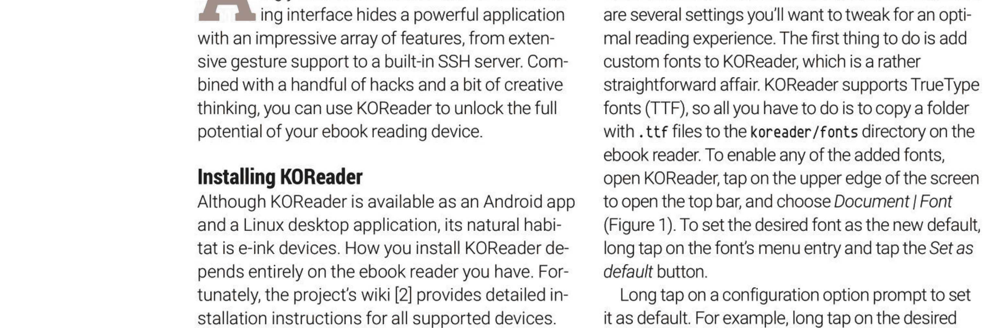

## 安装 KOREader

虽然 `KOREader` 提供 `Android` 应用程序和 `Linux` 桌面应用，但它的原生习惯是电子桌面系统。你如何在你的阅读器上安装 `KOREader` 呢？坦率地说，该项目的 `wiki` [2] 为支持的设备提供了详细的安装说明。通常，安装 `KOREader` 需要在电子书阅读器文件系统的相应目录中复制文件，因此该过程需要一些技术知识。

图 1：使用 `KOREader` 的自定义字体。

长按配置选项以将其设置为默认。例如，长按底部菜单中的“行间距 (`Line Spacing`)”项并将其设置为默认。说起底部菜单，激活顶栏也会打开底部菜单。这很快变得非常必要。要禁用此功能，打开顶栏 | 设置 (`Settings`) | 击和手势 (`Taps and gestures`) | 激活菜单 (`Activate menu`)，并禁用“自动显示底部菜单 (`Auto-show bottom menu`)”选项（图 2）。

默认情况下，当你启动 `KOREader` 时，它会打开管理器，因此你必须手动选择想要启动 `KOREader` 的书。在大多数情况下，让 `KOREader` 在应用程序启动时自动打开上一本书是实用的。打开顶栏并切换到管理器。点击顶栏打开主菜单，切换到文件管理器，选择“启动 (`Start`) | 从上次文件启动 (`Start with last file`)”。

屏幕底部的状态栏提供了有用信息，例如阅读时间等。你可以通过点击状态栏循环视图。但你也可以在一个视图中看到发现的所有信息。要做到这一点，打开顶栏，选择设置 (`Settings`) | 栏设置 (`Bar Settings`)，并一次启用状态栏。返回设置 (`Settings`) | 状态栏 (`Status bar`) 并切换所需的选项（图 3）。


图 2：禁用自动显示底部菜单。

- [ ] 非衬线字体 (`Not Serif`)
- [ ] `Vollkorn` ★
- [x] 带点击 (`With tap`)
- [x] 带滑动 (`With swipe`)
- [ ] 自动显示底部菜单 (`Auto-show bottom menu`)

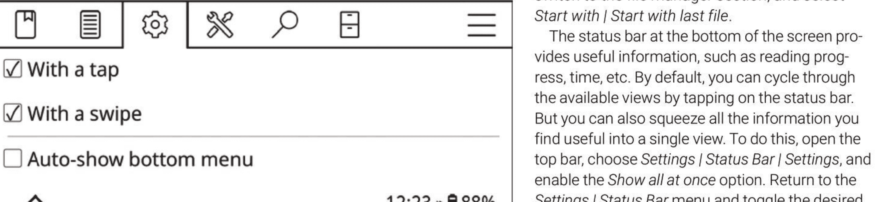

## KOREADER E-READER LINUX VOICE

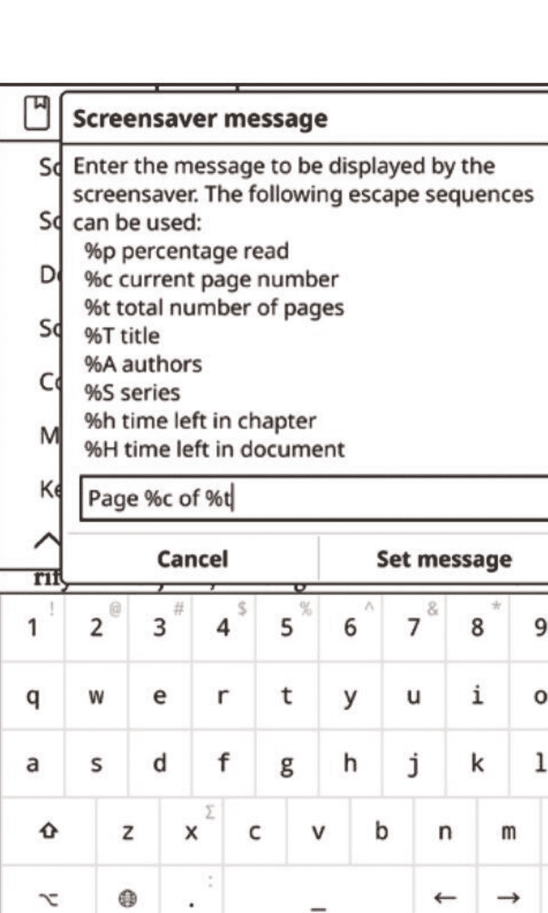

### 图 3：配置状态栏。

由于墨水屏不需要屏保程序，将其用简单的“睡眠”消息替换为包含更多信息（例如当前信息以及你的阅读进度）并没有问题。打开顶栏，选择设置 (`Settings`) | 屏幕 (`Screen`) | 屏保 (`Screensaver`)，并启用“使用列表书籍屏保 (`Use list's book for screensaver`)”选项。在屏保设置中添加消息：`% message`，并设置显示当前页码和总页数的百分比（图 4）。

### 图 4：配置自定义屏保。

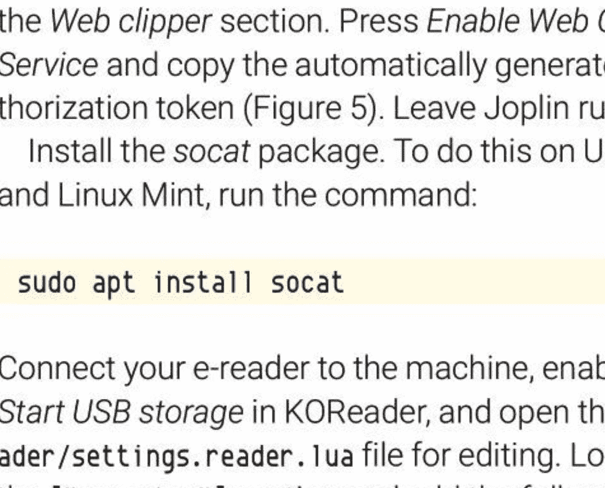

网页剪贴板服务。启用网页剪贴板服务并复制自动生成的授权令牌（图 5）。`J` 运行。安装软件包。在 `Ubuntu` 和 `Linux Mint` 上，请运行：

```


执行以下命令安装依赖：

```bash
sudo apt install install
```

### 进阶

设置好基础设置后，是时候探索 `KOReader` 提供的功能了。要使用 `KOReader` 的配置（`Profiles`）功能，可以在多个配置之间切换和查询。例如，你可以为夜间模式创建一个配置，带有特定的夜间设置（亮度和色温），启用夜间模式。你还可以创建一个带有前光和夜间模式的配置。要创建配置，使用顶栏并选择`Tools | Profiles | New configuration`，并命名。一旦创建了启用的配置，长按它。

像任何有价值的应用程序一样，`KOReader` 支持高亮，并可以将其导出为`HTML`、`JSON`和纯文本文件。如果你使用`Joplin [5]`作为你的首选笔记应用程序...

保存文件并使用以下命令使其具有执行权限：

```bash
chmod +x /koreader/scripts/up.sh
```

要在电子阅读器中启动脚本，请打开终端模拟并运行`koreader/scripts/backup.sh`。

如果你恰好使用第二台电子阅读器，并想要下载保存的设置和数据，你只需要创建一个运行以下命令的脚本即可：

```bash
rsync -avzh --delete -n --no-o -p -e "ssh" USER@127.0.0.1:/path/to/library/mnt/observed/
rsync -avzh --delete -n --no-o -p -e "ssh" USER@127.0.0.1:/path/to/clipboard/mnt/observed/adb/koreader
```

每当你运行上述脚本时，系统都会提示你输入密码，这可能会变得非常麻烦。为了解决这个问题，请在`KOReader`中生成`SSH`密钥对，并将公钥添加到远程机器的授权`keys`中。

要创建`SSH`密钥对，在`KOReader`中启动终端模拟器并运行`ssh-keygen`命令。按照提示操作，跳过指定密码。这会在`/usr/local/niluje/usnet/etc/dot/`中生成密钥对。要确保密钥已生成：

```bash
ssh-agent sh -c 'ssh-agent; ssh-add -l'
```

将`/usr/local/niluje/usnet/etc/dot/id_rsa.pub`文件复制到`Linux`机器，并使用以下命令将其添加到远程服务器的`authorized_keys`文件中：

```bash
cat id_rsa.pub | ssh USER@127.0.0.1 "mkdir -p ~/.ssh && cat >> ~/.ssh/authorized_keys"
```


从现在起，你可以无需密码运行脚本（或任何需要与远程机器建立 `SSH` 连接的命令和操作）。

# 结语

你不必止步于此，因为 `KOReader` 提供的功能远不止。深入研究它的配置，你会发现你几乎可以控制应用程序手势的每一个方面。一旦按照你的喜好配置了手势，就可以探索 `KOReader` 的阅读统计。简而言之，你很难找到比这更好、更强大的阅读体验了。如果你愿意投入精力和时间学习它的功能，你将获得你从未想过的可能的阅读体验。

## 信息

- [1] `KOReader`: `https://github.com/koreader/koreader`
- [2] `KOReader` wiki: `https://github.com/koreader/koreader/wiki`
- [3] `Joplin`: `https://joplin.app`
- [4] `Kobustaff`: `https://www.mobiliread.com/forums/showthread.php?id=254214`

# 作者

`Dmitry Popov` 多年来一直编写关于 `Linux` 和开源软件的文章。他的文章发表在丹麦、英国、美国、德国和俄罗斯的杂志及网站。你可以在他的网站 `yokoyama.com` 上找到更多关于他的信息。


# LINUX VOICE 0 A.D.

通过 `0 A.D.` 沉浸在活生生的历史中。

# 古代重生

在即时策略游戏 `0 A.D.` 中主掌古代文明的命运并复兴历史。

`BY D TIBI`

也许你在学校里喜欢历史，也许你只是觉得那种历史很无聊。无论如何，玩一下 `0 A.D.` 即时策略游戏 [1] 是值得的，它带你回到公元 1 年（我们的历法中没有公元零），并将古代文明的命运交在你手中。建筑、单位和技术基于真实的历史。游戏让历史栩栩如生。

`0 A.D.` 是经典的 `Linux` 游戏之一，所有流行的发行版在其软件包源中都包含它。但如果你通过发行版的包管理器安装游戏，你可能无法获得最新版本，这就是为什么我建议从项目网站 [2] 下载最新发布。你可以在那里找到各种版本以及相应的安装说明。`0 A.D.` 也以 `AppImage` 和 `Flatpak` 软件包格式提供（`AppImage` 是一种独立于发行版的 `Linux` 包格式，程序下载后即可立即启动）。

# 安装

`0 A.D.` 的起源可以追溯到 20 多年前。奇怪的是，游戏的发展一直没有离开 `Alpha` 阶段，尽管这并不影响它的趣味性。当前版本（测试时）为 `Alpha 25 "Yanna"`，于 2021 年 8 月 8 日发布。继任版本 `Alpha 26` 在 2022 年 4 月已进入功能冻结（即停止向当前 `Alpha` 版本添加新功能的阶段）。

> 地图编辑器
> `0 A.D.` 自带了地图编辑器 `Atlas`，你可以用它创建自己的地图和战役。为此，点击主屏幕左侧边栏的“`Editor`”（编辑器）。


1: 界面很杂乱。你可以使用左侧菜单进入游戏。

# 0 A.D. LINUX VOICE

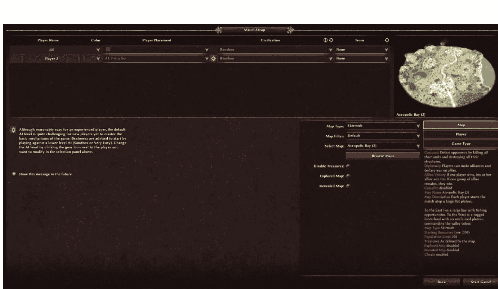

图 1: 界面很杂乱。你可以使用左侧菜单进入游戏。

对手已来到你帝国的门口。如果所有条件已就绪，你可以点击“开始游戏”（`Start Game!`）开始游戏！

它们出现在屏幕下方。如果你选择“田”（`Field`）图标，你可以在行政总部附近建立田。田总是准备就绪的，提供可再生食物来源。使用剩余的农民耕作两块田。

## 收集资源

开始时，你有一个行政总部和市民（图 4），他们分为市民（女性）和民兵（男性）。市民仅限平民身份。他们通过步行或骑马收集资源并建造建筑。步行时，他们可以采集资源并建造建筑，但可以使用武器防御攻击。骑马兵会限制他们的资源采集和狩猎活动。你可以通过点击该区域或取消选择来选择他们。

如果你猎杀所有自由流动的市民，将需要建造一个围栏并将牲畜圈其中。

接下来，将你的每位市民发送到森林砍木、发送到石矿采石，并生产金属。市民还会将资源送回行政总部。根据资源地与行政总部之间的距离，可能会浪费大量时间。这就是为什么派遣目前空闲的第四个市民在森林、石矿和矿矿附近建造仓库是有意义的。资源可以送送到仓库，而无需花费大量时间。

你可以通过左键点击选择单位，并通过右键定义所选项目的指令。你需要做的第一件事是建立食物、木材、石头和金属的来源。如果你选择高卢文明，你的人将由四名市民、四名民兵和一个骑兵兵组成。

选择四名市民之一，右键点击浆莓丛。市民将开始采集浆果并将其送到行政总部。

此外，自由流动的动物也提供充足的食物。行政总部附近有一些野产——根据地图的不同，有猪、羊、鸡或山羊。在更广范围内，有野生动物四奔——鹿、兔子、熊、狼、斑马、长颈鹿、狮子、大象、野牛或鳄鱼。选择骑兵兵，用鼠标右键点击该单位派遣他狩猎。他会将食物送回行政总部。如果定点位于海边，鱼也可以作为食物来源。

## 人口增长

当你忙于事务时，请仔细观察行政总部。左键点击建筑会在屏幕下方显示详情（图 6）。在那里，对于任何建筑，你都会在顶部面板看到你创建的单位。对于高卢行政总部，这些单位包括一名市民、一名矛兵（用于近战）、一名弓箭手（用于远程战斗）和一个骑兵兵。

在下方区域，你将看到正在研究的技术。右键点击单位或图标以了解其能力和重要性，以及创建或研究它所需的资源。

在通过行政总部创建更多市民之前，你首先需要建造房屋。人口上限在开始时设定，默认为 30 人。这是绝对上限。实际的人口限制是该上限内的房屋数量。

可用的食物资源有限。这意味着你的文明在耗尽食物之前需要作物并养殖牲畜（图 5）。要做到这一点，左键点击其中一个市民。代表一切符号

图 6：你可以在此处创建新市民并研究技术的行政总部。

你可以派遣目前空闲的士兵去建造新房屋。屏幕顶部的栏显示左侧的人口数量。建造几座新房屋后，创建更多市民，然后可以派遣他们获取更多资源。

## 探索地图

一条彩色线标记了你控制的定居点区域。你只能看到该区域内的内容。要探索地图，你需要创建骑兵并派遣他们出去探索。通过这种方式，你可以看到哪里有更多资源以及敌人在哪里定居。区域之外尚未探索的区域显示为黑色。之前探索过的区域被战争迷雾覆盖。你将看到你的某个单位（例如骑兵侦险员）最后去那里时的状态。

随着游戏的进行，你需要扩大定居点区域。你可以通过建造新建筑来实现。每个建筑都有占据你定居点区域的半径。如果你在区域边缘建造，你的定居点区域就会增加。大多数建筑只能在定居点区域内建造，行政总部除外。你也可以在中立领上建造它，因为它拥有最大的影响力。

图 7：德鲁伊是高卢的治疗者。他们治疗德鲁伊颜色范围单位。

为了扩大定居点区域，建议建造更多的行政总部。但要注意：由于其重要性，敌人会频繁攻击这些总部。

## 探索技术

随着人口增长和谷仓填满，你需要研究技术来推动文明的发展。这些是在建筑中进行的。例如，在行政总部你可以控制食物，在其他地方你可以开发开采资源的工具。

现在也是建造更多建筑的好时机。市场让你与盟友进行交易，以保持谷仓丰满。在铁炉

图 8：如果你的定居点位于海边，你可以建造港口以及航海国家需要的一切，从鱼船到战舰。

一旦你的商店里有了资源并建造了足够的建筑且研究了技术，你就可以通过以下从村庄阶段进入城市阶段：

图 9：在兵营训练步兵（左），在马场训练骑兵，并在军械库建造如冲槌之类的攻城武器（右）。

2022年10月第263期

点击行政中心的相应按钮，然后随着你的进展从城市阶段进入大都市阶段。

## 守卫你的定居点区域

你的对手在此没有闲着，在可见的未来一定会带军队攻击你的定居点。这就是为什么你需要良好的防御。市民自视为民兵，此外你还需要专业的士兵和武器。在兵营你可以创建步兵。马场提供骑兵，军械库生产如投石机和冲槌之类的攻城武器。

这些建筑也是你可以研究武器和战斗技巧的地方。不同的文明还有其他的军事单位。例如，罗马人在敌方领土上建造军营。腓尼基有大象。为了保护你的定居点区域不受侵略性对手的侵害，你可以用木墙或石墙环绕并建造哨楼和堡（图 10）。

每个文明都带有三个可以在游戏中创建的英雄，每个英雄只能创建一次。不能同时多个文明进入游戏。这些英雄基于历史人物。如果有强大的战士且他们附近有士兵，将增加战斗力（图 11）。你通常在堡中创建英雄，但根据文明的不同，也可以在其他建筑中创建。对于高卢人来说，该文明特定的王子集会具有此目的。

| 维贡威尔 |
|------|
| 亚历山大帝、坎底丝、米兰德、瑞典 |
| 防：驻守时，建筑具有+2 捕捉 |
| 骑兵加成：针对攻城单位获得+1攻击强度、速度和单位攻击加成。范围…… |

图 10：这个防御严密的高卢定居点对进攻的罗马人构成了真正的挑战。

图 11：`0 A.D.` 中的英雄基于历史人物。他们是带领士兵战斗的特别强大的战士。

# LINUS VOICE 0 A.D.

**真实观点**

如果你的文明正处于发展危机，或者敌人威胁要占领它，那么是时候以各种作弊手段的形式进行政治了（参见表 1，在表中你还会看到一个小彩蛋，游戏允许你建造 `P-51` 野战战机，这是一种二战期间的美国战斗机）。要创建单位，首先选择任何建筑。如果该建筑属于你，新创建的单位就属于你。相反，如果建筑受敌人控制，新创建的单位也将采用他们的颜色。

**结论**

考虑到 `0 A.D.` 仅处于 `Alpha` 阶段，它玩起来已经非常简单了。无论是在历史引用还是设计图形方面，对细节的关注都让它变得非常好玩。游戏已经值得明确推荐，并且值得关注其未来的路线图。

### 创建奇迹

每个文明都通过建造其特有的奇迹来达到发展的巅峰（图 12）。例如，罗马人建造了首都线，希腊人建造了万神殿。根据游戏设置，赢得游戏的一种方法是建造一个奇迹并防御它一段时间。

`图 12：` 建造自己的奇迹标志着文明发展的巅峰。例如，在 `0 A.D.` 中，波斯人的来说是巴比伦空中花园。

- [1] `0 A.D.`：`https://play0ad.com`
- [2] 为 `Linux` 下载 `0 A.D.`：`https://play0ad.com/download/linux/`

| 代码 | 影响 |
| --- | --- |
| `Gift from the gods` | + 100,000 所有资源，加速发展到大都市阶段，建造建筑或创建单位 |
| `i want pizza` | + 1000 食物 |
| `bring me away` | + 1000 木材 |
| `i see a mountain here` | + 1000 石头 |
| `your money or your life` | + 1000 金属 |
| `jane jam` | 显示地图 |
| `salad bowl` | 创建市民 |
| `iopnthem` | 创建战士 |
| `wololo` | 转换选定的建筑或单位 |
| `black death` | 摧毁选定的建筑或单位 |
| `i am too busy` | 加快建筑建造或单位创建 |
| `exodia <player>` | 击败指定玩家 |
| `back to the future` | 进入下一个发展阶段 |
| `the hive master` | 将人口限制增加到最大而无需建造房屋 |
| `how do you turn this on?` | 创建 `P-51` 野战战机 |

# 像专家一样思考

## `Linux Shell` 手册 2022

这个新版本包含了用于配置和排排除系统最重要的实用程序。以下是你可以在里面发现的一些内容：

- 自定义 `Bash`
- 正则表达式
- `Systemd`
- `Bash` 脚本编写
- 网络工具
- 以及更多！

在线购买：`linuxmedia.com`

# 自由与开源软件

在经历了一场为了寻求真理的漫长虚拟探寻后，本月 `Steam Deck` 世界的新发布品中出现了闪闪发光的明珠。作者：`GRAHAM MORRISON`, `Cecilia`

# `Cecilia` 5

我们过去研究过音频处理软件，但还没有什么能与 `Cecilia` 相比。它是一个用于声音探索的具体站点，其用户界面是为高级用户设计的。它可能模拟我们能想到的任何其他应用程序。你选择的每个模块都可以随着主模式中的线条或曲线随时间改变。它可以根据你的需要简单或复杂，还有其他选项可以生成数学精确的正弦波或方波，或随机分布的模式，所有这些随后都可以被平滑或从另一个分离。按下任何点即可听到你调整的结果。你通常会得到长长的浸在混响中的低鸣声或合成纹理。通过明智的编辑，你将发现漂亮的铺音色（`pads`）。它的复杂性取决于你的需求，但非常神奇。`Cecilia` 是所有的实验和集成。

项目网站：`http://ajasoundstudio.com/cecilia/`

1. 输入和输出：`Cecilia` 接收文件并录制新的输出。
2. 时间拉伸：设置音频拉伸或收缩的长度。
3. 模块：声音产生取决于选择了哪些模块。
4. 曲线：`Cecilia` 中的任何参数都可以通过曲线自动化。
5. 生成器：曲线可以手动绘制，也可以通过函数生成。
6. 模块：这是一个简单的示例，但更复杂的模块可以自动化。
7. 颗粒：所有效果都可以通过 `FFT` 失真。
8. 效果：将你的声音通过某些音频效果。

# `Calibre` 6.1

`Calibre` 是顶级开源应用，如 `'population'`、`'europe'` 或 `'harry'` 和 `'dobby'`。它本身是非常出色的，并且执行重要功能，它还是一个具有稳定库和重大更新的应用程序。这个版本是一个例子，因为在十个月的努力之后，它带来了许多数字媒体管理器想要的功能。这些功能之一是全局搜索，它允许你在整个出版库中搜索单词和短语，甚至包含布尔选项。在此之前，你需要为集合手动建立索引，这需要一些时间。但这是一次性的，因为集合中的新标题会自动扫描。如果你不需要搜索，默认设置就好。但如果你需要，它非常有用，特别是当你想将媒体组织在不同的集合中以便更好地隔离搜索结果时。对于你需要的，另一个新功能将是从电子书视图读取书籍。这可以通过插件实现，但看到内置选项很棒。

你可以同时使用 `Calibre` 5 和 6，如果你这样做，书籍必须添加到最新版本中才能正常工作。从 `Qt` 5 升级到 `Qt` 6，使其成为少数处理这一变更的 `Qt` 应用程序之一。这显然带来了更好的证明，但由于 `Calibre` 缺少某些架构更改，32 位支持已删除。`ARM` 平台现在已正式支持，并适用于在树莓派上运行。

# `LINUX` 替代方案 `FOSSPICKS`

## `watch` 替代方案

## `Viddy`

对于 `watch` 命令，替代方案越多越好。这是一个非常出色的命令，通常用于按间隔运行命令，以便你可以监控任何输出变化。如果你需要检查某些东西的状态，例如音轨进度或已使用的内存量，`Viddy` 是一个用于构建脚本来监控变化或错误的小型工具。然而，`watch` 缺乏的是更动态的输出，而且它是静态编写的。`Viddy` 的名字源自《机械橙橘》中的一个著名角色（其灵感源于 `vivid`，拉丁语中意为“锯”），它执行与 `watch` 相同的功能，但带有了一些现代增强。

这些增强功能中最有用的是 `diff` 模式，它可以突出你输出活动中的任何部分。这对于更复杂的命令非常有用，因为它们会被立即标为黄色，让你准确地看到哪些值是新的。如果你错过了数值变化的瞬间，`Viddy` 的另一个功能将让你回溯历史记录，查看发生了什么变化以及何时变化的。所有这一切都可以通过类似 `Vim` 的绑定完成，这些绑定可以编辑，并以全颜色显示，还可以根据自己的喜好进行配置。

`Viddy` 可用于跟踪输出变化并监控可疑的并行活动。输出是分页的，因此你可以轻松地向上或向下滚动大量输出，并且你可以直接运行的任何地方暂停和恢复。生成的更新可能会让 `Viddy` 在你的历史中变得更加常见，成为任何广告监控和数据跟踪任务的完美工具。

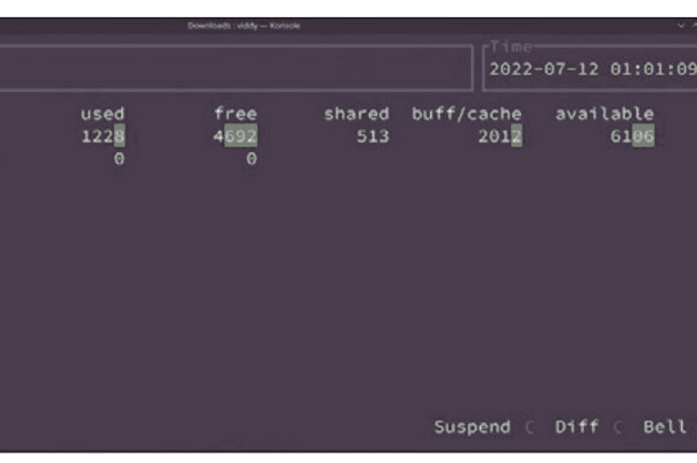

# 项目网站

`https://github.com/sachao/viddy`

## 进程启动器

## `mprocs`

我们中的任何人都准确习惯了在命令行上使用分号来分隔并同时运行多个命令，但旧的 `nohup` 脚本将任务派生到后台的方法与普通环境提供的任务管理大相径庭。缺失的是更好的任务管理功能，而 `mprocs` 提供了这种功能，而且远不止。它通过你想要同时运行的命令列表运行，你将看到一个类似 `TUI` 的界面，左侧是命令列表，右侧是一个包含所选命令输出的面板。

使用 `UP` 和 `DOWN` 单词来显示命令是否正在运行，你可以用光标或 `Vim` 键在命令之间切换。它对于小型客户端和服务器来说是完美的。使用了多种技术来关注输出进程，让你能够与编辑器交互或更改帮助信息的顺序，但你可以使用面板底部的界面执行更动态的操作，如即时 `kill` 和添加新进程，这里还有按键帮助你启动、停止和重启进程，从 `mprocs` 管理这些命令比记住快捷键要容易得多。

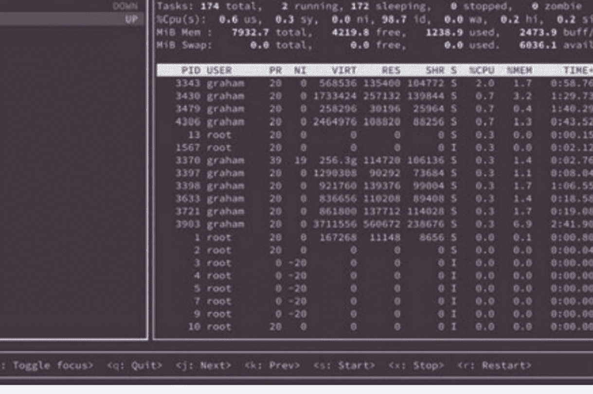

`mprocs` 就像是针对想要控制的重复命令组的 `tmux`。如果你有一个终端管理器并需要设置它，所有这些都可以放入一个 `YAML` 格式的文件中，描述你想要运行的命令以及你运行它们的环境。一个更高级的版本是通过 `SSH` 实现。启用此功能后，你可以远程管理服务器上运行的任何内容，并使用本地版本的控制。它运行非常高效，是更复杂且过度设计的工具的真正替代品。

# 项目网站

`https://github.com/vmok/mprocs`

## 模拟器配置

## `EMuDeck`

`Valve` 的 `Deck` 带来的最好的事情之一就是我们社区对即将到来的新浪新成员的额外关注。感谢于 `Deck` 运行其带有触摸功能的 `KDE Plasma` 的 `Arch` 变体，比以往任何时候都有更多人使用 `Discover` 软件来安装应用程序。当他们遇到问题时，当有人找到解决方案时，它就可以以合理的信心进行分享，这帮助了 `Ubuntu` 进入了许多论坛，并维持了今天的 `Ubuntu`。

`EMuDeck` 是诞生于 `Steam` 新一轮热起的项目之一。它帮助新用户导航过闻名复杂的配置世界，通过提出几个简单的问题来实现这一点。`EMuDeck` 的核心是一个复杂的脚本，该脚本负责处理 `RetroArch` 的安装以及要安装哪些模拟器，配置它们的库，并构建一个可行的配置，以便通过各种启动器将游戏添加到 `Steam` 中。它还添加了着色器、封面和游戏边框，帮助你的模拟游戏与 `Steam` 游戏并排显示。如果你对这些元素有更多控制需求，它是可以进行配置的。

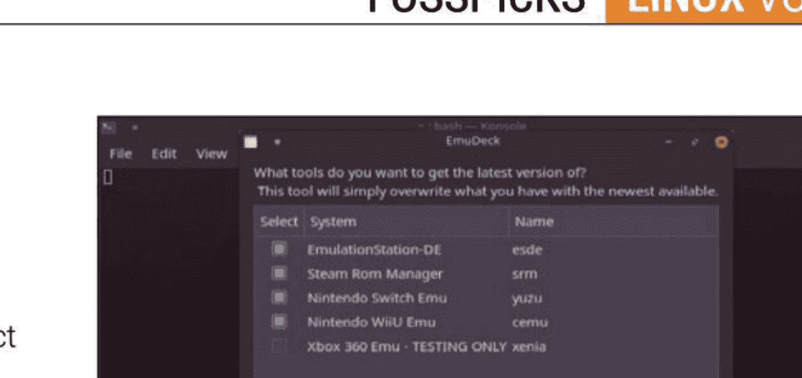

虽然 `EMuDeck` 是为了解决 `Deck` 问题而创建，但开发者计划将其移植到 `Android` 和其他设备。

| 问题 | 名称 |
|---|---|
| 你想获取哪些工具的最新版本？ | 模拟器 |
| `Steam` 管理器 | `Steam ROM Manager` |
| `RetroArch` | `Steam Room Manager` |
| 无 `Wii` | 所有及其他所有 |

# 项目网站

`https://www.emudeck.com`

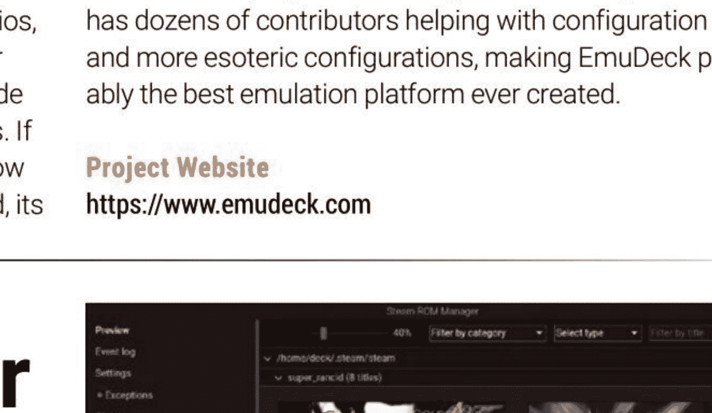

## `Steam ROM Manager`

`EMuDeck` 设置过程最后之一是配置和运行 `Steam ROM Manager (SRM)`。这是一个图形化应用程序，多年来一直是将模拟器游戏添加到 `Steam` 库的核心，并执行一些并不容易实现的事情。它可以以合理程度的信心分享解决方案，这帮助了 `Ubuntu` 进入了许多论坛，并维持了今天的 `Ubuntu`。它可以作为核心，将模拟器游戏添加到 `Steam` 库，并执行游戏添加到 `Steam` 库的功能。

*(注：由于原文此处存在大量重复的句子片段，关于 `Steam ROM Manager` 的描述部分已根据翻译逻辑进行了精简处理)*

| 问题 | 名称 |
|---|---|
| 你想获取哪些工具的最新版本？ | 模拟器 |
| `Steam` 管理器 | `Steam ROM Manager` |
| `RetroArch` | `Steam Room Manager` |
| 无 `Wii` | 所有及其他所有 |

*(注：此处表格内容原文存在重复错误，已按原意翻译并保持格式)*

`EMuDeck` 设置过程最后之一是配置和运行 `Steam ROM Manager (SRM)`。这是一个图形化应用程序，多年来一直是将模拟器游戏添加到 `Steam` 库的核心，并执行一些并不容易实现的事情。它可以以合理程度的信心分享解决方案，这帮助了 `Ubuntu` 进入了许多论坛，并维持了今天的 `Ubuntu`。它可以作为核心，将模拟器游戏添加到 `Steam` 库，并执行游戏添加到 `Steam` 库的功能。

# `FOSPICKS` `LINUX` 之声

## `Libre TrainSim`

`Libre TrainSim` 这里有两个元素在起作用。首先显然是火车，以及某些极客喜爱的模型音乐，这与 `Linux` 粉丝不同。其次是游戏正变得越来越流行。这些是那些需要思考或血糖飙升式反应的游戏，能让你在让自己忙碌的同时放松或听音乐。`Libre TrainSim` 正是那样的游戏，尽管它有很大的深度。

对于想要体验 `TrainSim` 的玩家，最简单的入门方法是加载游戏并使用训练轨道（此处是双关语）。你很快就会发现自己控制着一列 3D 虚拟火车，面前是虚拟的树木、轨道和铁轨视图。画面效果虽然简单，但能有效地传达出真实驾驶员拥有的视野。你还可以从第一人称视角切换到整个列车的完全渲染视图。

训练模式将引导你完成启动和停止火车的基础操作，信息包含在设置时间表的提示中。你还拥有额外的灯光、门以及最重要的——声音控制按钮！你还必须学习如何使用信号和限速。`Libre TrainSim` 最初是由一名学生在课余时间使用 `Godot` 引擎创建的，现在该项目有一个小型开发团队支持支持，为编辑器和后台功能添加了所有新轨道、路线和功能。你也可以自己完成一切，而且还有一些优秀的文档伴随着项目轨道、场景，甚至还教你如何使用少量的 `Godot` 脚本创建路线和服务的逻辑。

项目网站
`https://www.libretrainsim.com`

## 实时策略游戏

## `MegaGast`

`MegaGast` 是一款实时策略（`RTS`）游戏，它是对一款名为《`Ghost`》的旧游戏的重新诠释。这两款游戏在过去的不同阶段都曾被遗弃。`MegaGast` 最近已发布并开始调整其源代码，看到它再次回归非常棒。如果你想支持多人玩家并获得 `Steam Deck` 的一键安装体验，可以再次从 `Steam` 获取；或者获取游戏本身——它是开源的，可以从软件包安装，这会让任何玩过 `RTS` 的人立即感到熟悉。

游戏中的某些元素让它看起来像《`Colonist`》（`Settlers`）系列，战斗画面看起来则像来自出色的《`Magicka`》。你从俯瞰视角观察密度——这既体现在你土地的字面顶视视图中，也比喻地体现在居民毫无疑问的反应中。你需要分配矿产任务、建造结构，并与许多不同的地形和七个不同的派系战斗。这些派系包括科技、魔法、埃及、波斯和罗马。派系类型会影响你能做的事情、需要哪些资源，而这可以通过“科技树”功能来理解。

游戏提供了一个更好的场景来引入游戏机制。当你能够立即开始战斗时，不如先获取资源并建设基础设施。在此过程中，你可以发展出一支大军，最后通过入侵邻居来揭示你的自恋本质，并希望赢得他们的领土和资源。这很有挑战性，有一个学习曲线，但你也可以独自对抗优秀的电脑控制对手，然后再在线与一些精英人类玩家对。无论如何，这都很有趣，对于一款开源游戏来说，它完全且彻底地实现了现实。

项目网站
`https://meggast.org`

## `LINUX` 之声教程 – `IMAGEMICK`

## 使用 `ImageMagick` 进行脚本绘图

### 剪影

`ImageMagick` 的功能不仅仅是编辑图像。这款免费软件甚至可以通过脚本来创建简单的图形。

作者：`RALF KIRSCHNER`

通常你会使用带骨的图形程序进行绘图，并且需要在图像中绘制以固定间隔重复的规则形状——如此处所示，例如在创建一个虚拟城市的剪影时（图 1）。本教程使用的是一个带有复杂语言的昂贵图形程序。而在命令行使用免费开源的 `ImageMagick` 软件包完全胜任此工作。

要组合更广泛的图像，你需要类似脚本语言的支持，例如 `Bash`，它使用循环和其他结构来表示将内容插入到图形中。在大多数 `Linux` 发行版的包源中都可以找到 `ImageMagick`，也可以从项目的下载源下载并安装 [1]。

为了证明你确实可以在命令行界面使用 `ImageMagick` 绘图，请参见列表 1 中的命令。

这是为了使用参数设置图像大小。然后：`skyblue` 将图像背景涂成天蓝色。在历史上，`xc-` 代表“颜色”，但今天它代表画布（`canvas`）。`ImageMagick` 将在当前目录下创建 `ge.gif` 文件。它显示了图中右上角的魔法术师。你可以通过在 `ImageMagick` 内部测试图像中打开文件来轻松检查这一点，内部测试图像可以使用该名称和魔法术师：创建更多测试图像 [2]。

### 绘图命令

完成安装后输入：

```


`magick -size 500x200 -xc sky -draw "rectangle 100,40+250,80" logo.gif`

```
### 多元素

列表 2 中第一次调用的结果如图 2 所示：一个简单的矩形图像。

```
`magick -size 500x200 -xc sky -draw "rectangle 100,40+250,80" -draw "rectangle 100,80+250,120" -draw "rectangle 100,120+250,160" -draw "rectangle 100,160+250,200" logo.gif`

```
绘制高层大楼的缓慢感可以使用一个确定图像大小的脚本来解决。最后，使用 `if` 语句处理绘图逻辑。它还定义了背景颜色并设置了楼数。

### 使用脚本加速

绘制高层大楼的缓慢感可以使用一个确定图像大小的脚本来解决。最后，使用 `if` 语句处理绘图逻辑。它还定义了背景颜色并设置了楼数。

### 三盒结构

列表 2 中第一次调用的结果如图 2 所示：一个简单的矩形图像。

### 列表 3：`miniHouse`

```xml
<?xml version="1.0" encoding="UTF-8">
<image>
<read filename="minihouse.png" />
<draw fill="sky" primitive="rectangle 100,250,620,500" />
<draw fill="yellow" primitive="rectangle 270,190,370,290" />
<draw fill="yellow" primitive="rectangle 270,290,370,400" />
<draw fill="yellow" primitive="rectangle 690,190,790,200" />
<draw fill="yellow" primitive="rectangle 440,250,620,290" />
<draw fill="yellow" primitive="rectangle 250,225,380,270" />
<draw fill="yellow" primitive="rectangle 680,225,730,250" />
<write filename="minihouse.png" />
</image>
```

### 列表 4：示例语法

```
$ ./buildfile <File> <WindowsFloor>
```

# LINUX 教程 - IMAGEMAGICK

你可以使用列表 4 中的语法来构建这个 shell 脚本，它是基于本工作坊的。其内容原封不动地取自列表 5。为了简单起见，脚本没有对你传递的参数进行详尽检查。命令行中的顺序始终决定了脚本中的赋值。如果你想改进此脚本，则需要深入研究 shell 的错误检查，并考虑在脚本中使用 `gets`。

在调用脚本时，你需要指定不带扩展的文件名。代码会自动添加 `.as1` 和 `.png` 扩展名。如果你留空层数和每层窗户数的选项，脚本将使用默认值。另一方面，文件必须始终指定，否则程序将使用它们（默认值）。你始终需要将层数和窗户数相加，否则脚本将无法评估参数并用默认值替换它们。

一旦你输入了所有条目，你可以选择性地指定第四个参数来修正相邻属性的边界距离。

## 列表 5: `buildhouse`

```bash
#!/bin/bash
if [ -z "$1" ]; then
  echo "Please specify at least the name of the output file without a extension as the parameters, optionally also the number of floors and windows per floor."
  exit
fi
rows=$1
columns=10
x-250=$X offset of the house
y-2500=$Y offset of the house
if [ $# -ge 3 ]; then
  rows=$2
  columns=$3
  if [ $# -ge 4 ]; then
    cho "$4"
  fi
fi
rnd-250=$ room height
hw-120=$ window height
hw-100=$ window width
dw-0=$ window height
ma-30=$ center distance/staircase way
file.m.name="$1"
housewidth=$(echo "\X + \$fb + \$fa + \$ma")
househeight=$(echo "\X - \$fb + \$fa + \$ma")
t-0=$(echo "\X + \$height + \$dh")
center-house=$ center distance / 2
halab=$ma / 2
center-left=$(echo "\halab + (3 \ \$fa)")
center-right=$(echo "\halab - (3 \ \$fa)")
magic-size=$(echo "\X + \$height + \$dh"x3000)
gradient:000000#ffffff -draw \$t $1.png 3000,250, encoding="UTF-8'" >$mfile
echo "image=" $mfile
echo output=$ mfile
input=read filename="$1.png"
echo output=$ mfile
```

```bash
echo <draw "sandybrown-primitive':rectangle \$xstr / \$" >> $mfile
echo <draw "floor-primitive':rectangle \$xstr / \$" >> $mfile
top=$X echo \$oy \$height + \$dh
left=$x
for ((i=0; i<lines; i++)); do
  echo "links-\$x + \$fa"
  for ((j=0; j<columns; j++)); do
    VarInt=$(echo \$cols / 2)
    if [ \$j -eq \$VarInt ]; then
      links-\$x + \$m
    fi
    t-\*left,top,\' \$1 + \$fb', \$expr \$top + \$fh"
    echo <draw "floor-yellow-primitive':rectangle \$t / \$" >> $mfile
    links=\$expr \$links + \$fb + \$fa
  done
  if [ \$i -ne \$lines - 1 ]; then
    t-center-left,top,center-right,\expr \$top + \$fh"
    echo <draw "floor-yellow-primitive':rectangle \$t / \$" >> $mfile
  else
    t-center-left,top,center-right, op \$rh"
    echo <draw "floor-yellow-primitive':rectangle \$t / \$" >> $mfile
  fi
  left=$x
  top=\$top + \$rh + \$dh
done
echo outputfile= filename="$1.png"
echo outputfile=$ mfile
echo </image> >> $mfile
conj: mfile=$mfile
```


# 教程 — IMAGEMAGICK LINUX 语音

如果你想像列表 6 所示重建图 1 中的示例定居点，表 1 解释了组装工具和复合工具的含义，以及创建新图像过程中的其他内容。这使得查看 `ImageMagick` 变得更有意义。

## 结论

`ImageMagick` 与 DIY shell 脚本结合时会变成一个非常强大的工具。当然，你仍然可以处理现有的图像。然而，如果有必要，你可以自动化创建新图像的流程。

## 信息

- [1] `ImageMagick`: `https://imagemagick.org/index.php`
- [2] 内置测试、填充模式等：`https://imagemagick.org/script/formats.php`
- [3] X-Window 名称：`https://imagemagick.org/script/color.php`
- [4] 等离子体渐变：`https://legacy.imagemagick.org/Usage/canvas/plasma`
- [5] 创建画布：`https://legacy.imagemagick.org/Usage/canvas/gradient`

## 作者

`Ralf Kirchner` 在一家软件和系统供应商担任 Visual Basic 工作。`Ralf` 是一位资深系统管理员，同时也提供兼职培训。

## 列表 6: 构建天际线

```bash
echo <draw "sandybrown-primitive':rectangle \$xstr / \$" >> $mfile

echo <draw "floor-primitive':rectangle \$xstr / \$" >> $mfile

top=$X echo \$oy \$height + \$dh

left=$x

for ((i=0; i<lines; i++)); do
  echo "links-\$x + \$fa"
  for ((j=0; j<columns; j++)); do
    VarInt=$(echo \$cols / 2)
    if [ \$j -eq \$VarInt ]; then
      links-\$x + \$m
    fi
    t-\*left,top,\' \$1 + \$fb', \$expr \$top + \$fh"
    echo <draw "floor-yellow-primitive':rectangle \$t / \$" >> $mfile
    links=\$expr \$links + \$fb + \$fa
  done
  if [ \$i -ne \$lines - 1 ]; then
    t-center-left,top,center-right,\expr \$top + \$fh"
    echo <draw "floor-yellow-primitive':rectangle \$t / \$" >> $mfile
  else
    t-center-left,top,center-right, op \$rh"
    echo <draw "floor-yellow-primitive':rectangle \$t / \$" >> $mfile
  fi
  left=$x
  top=\$top + \$rh + \$dh
done

echo outputfile= filename="$1.png"
echo outputfile=$ mfile
echo </image> >> $mfile

conj: mfile=$mfile
```


# 服务

## 特选活动

用户、开发者和供应商聚集在世界各地的 Linux 活动中。
《Linux 杂志》非常自豪地向大家介绍这里的特选活动。
有关您附近的其他活动，请查看我们详尽的在线活动日历：
<https://www.linux-magazine.com/events>。
如果您知道其他希望由我们加入日历的 Linux 活动，请将包含所有细节邮件发送至 <info@linux-magazine.com>。

# 通知

# 开发者大会 (Academy)

# SC22

在预订任何行程之前，请务必检查活动网站，因为受新冠肺炎的影响，许多活动可能会取消或转换为虚拟活动。

**日期：** 2022年10月1-7日  
**地点：** 西班牙巴塞罗娜及线上  
**网站：** <https://academy.kde.org/2022>

**日期：** 2022年11月13-18日  
**地点：** 德克萨斯州达拉斯  
**网站：** <https://sc22.supercomputing.org/>

`Academy` 是 `KDE` 的年度世界峰会，它是全球最大的自由软件社区之一。这是一项由 `KDE` 社区组织的免费、非商业活动。来到巴塞罗娜——这座拥有高迪、巴塞罗那足球和地中海美食的活力城市，在线或线下聚会，享受顶级体验。

带上您的朋友和同事来到达拉斯，在11月13-18日探索高性能计算（HPC）领域不可思议的学习体验。如果您无法亲临现场，可以通过在线方式参与，大多数会议将进行同步直播，并在每个会议结束后24小时内提供点播播观看。

# 活动列表

| 活动 | 日期 | 地点 | 链接 |
| :--- | :--- | :--- | :--- |
| KVM 论坛 | 9月12-14日 | 爱尔兰都林 + 线上 | <https://events.linuxfoundation.org/> |
| 存储开发者大会 (SDCC) | 9月12-15日 | 加利福尼亚州弗蒙特 | <https://storagedeveloper.org/?utm_source=LinuxMagazine+Event-Calendar> |
| 开源峰会 | 9月13-16日 | 爱尔兰都林 + 线上 | <https://events.linuxfoundation.org/> |
| Linux 欧洲峰会 | 9月15-16日 | 爱尔兰都林 + 线上 | <https://events.linuxfoundation.org/> |
| `DrupalCon` 2022 | 9月20-23日 | 捷克布格 | <https://events.drupal.org/> |
| 开源主机峰会 | 9月21-22日 | 宾夕法尼亚州费城 | <https://events.linuxfoundation.org/> |
| 开发者大会 2022 | 10月1-7日 | 西班牙巴塞罗娜 + 线上 | <https://academy.kde.org/2022> |
| `JAXLDON` 2022 | 10月3-6日 | 英国伦敦 + 线上 | <https://jaxldon.com/> |
| `KubeCon` 云原生北美大会 2022 | 10月24-28日 | 密歇根州底特律 | <https://events.linuxfoundation.org/> |
| 网络防御大会 2022 | 10月27-28日 | 佛罗里达州奥兰多 | <https://cyberdefenseconference.org/> |
| 全方位活动 2022 | 10月30日-11月2日 | 北卡罗莱纳州罗利 | <https://www.allthingsopensource.org/save-the-date-2022/> |
| `SeaGLNU/Linux` 会 | 11月4-5日 | 线上 | <https://seagl.org/> |
| 开源监控会议 | 11月14日 | 德国纽伦堡 | <https://osmc.de/> |
| `@Hack`: 边缘信息安全 | 11月15-17日 | 沙特阿拉伯利雅得 | <https://attack.com/> |
| 开源峰会日本站 | 12月5-6日 | 日本横滨 + 线上 | <https://events.linuxfoundation.org/> |
| 开源合规峰会 | 12月7日 | 日本横滨 + 线上 | <https://events.linuxfoundation.org/> |

# 征稿启

我们正在寻找关于 `Linux` 和 `Linux` 环境工具的优质文章。尽管我们会考虑任何主题，但对以下主题特别感兴趣：

- 系统管理
- 有用的技巧和工具
- 安全（包括新闻和技术）
- 源自真实体验的产品评论
- 社区新闻和项目

文章的技术水平应与您通常在《Linux 杂志》中阅读的内容保持一致。请记住，《Linux 杂志》在许多国家阅读，您的文章可能会被翻译成我们姐妹刊物之一。最好避免使用可能并非所有读者都能理解的俚语和成语。

如果您有想法，请将包含大纲、长度预估、背景描述和联系方式的提案发送至 <edit@linux-magazine.com>。

处理未来的日期或活动时请注意。从您订阅到最终稿件送到读者手中，可能会过去好几周。在发送邮件时，请在邮件主题中使用注明帮助我们识别您的邮件为文章提案。随时欢迎提供截图和其他支持材料。

更多信息请访问：<http://www.linux-magazine.com/write_for_us>。

# 联系信息

`Joe Casad`, <jcasad@linux-magazine.com>
`Amy Petit`, `Aubrey Vaughn`

编辑：`Jax Washington`, `Amber Ankorholz`

荣誉编辑：`Monika`, `Rita L Soho`

主编：`Lin White`

本地化与翻译：`Ian Tav`

排版：`Dena Frien`, `Lori White`, `L White`

封面图片：<knomaps.com> 和 <raspberry.com>

广告：`Brian Dobson`, <tobyobson@linux-magazine.com>
+1-805-67934

市场营销：`Gwen Clark`, <clark@linux-magazine.com>
480 Bob Billings Parkway, Ste 104
Los Angeles, CA 90069

出版商：
美国和加拿大：
<edit@linux-magazine.com>
1-800-555-0155
（美国和加拿大免费热线）

其他国家：
<@linux-magazine.com>
<www.linux-magazine.com> - 北美
<www.linux-magazine.com> - 世界

# 作者

| 姓名 | 页码 |
| :--- | :--- |
| `Erik Waldraut` | 30 |
| `Mohamed Lilboed` | |
| `Bacon` | 12 |
| `Bruce Finley` | 26, 34 |
| `Joe Case` | 36 |
| `Mark Craft` | 69 |
| `John "dad" Hagg` | 71 |
| `Ralf Kirsten` | 90 |
| `Ankur Kumar` | 46 |
| `Vincent Melton` | 69 |
| `Martin Mohr` | 60 |
| `Graham Morrison` | 84 |
| `Dmitri Popov` | 42, 77 |
| `Mike Schille` | 52 |
| `Daniel Tie` | 78 |
| `Arnout Vandercapelle` | 22 |
| `James Wallen` | 8 |

虽然对杂志内容已尽谨慎，但出版商对内容的信息的准确性或使用其产生的任何后果不负责。使用本杂志或提供的任何材料风险风险自负。

版权与商标 © 2022 `Linux Media USA, LLC`
未经出版商书面许可，不得以任何形式全部或部分复制任何材料。这包括文章、照片、图画和插图，用于在 `Linux Media USA` 拥有的独家网站上发布或分发，除非另有书面说明。`Linux` 是 `Foundation` 的商标。

# HETZNER

## 免收安装费
季节特惠


## 免收安装

## 季节特惠
最高节省 82 英镑！

例如：独立根服务器
`AX41-NVMe`

准备好开始了吗？为什么不启动一个新项目呢？
使用我们搭载 `AMD Ryzen™ CPU` 的 `AX` 独立根服务器扩展您的基础设施，不仅可以享受惊人的性能，还可享受我们的免安装优惠！

- `AMD Ryzen™ 5 3600`
- 同步多线程 (Simultaneous Multithreading)
- 64 GB `DDR4 RAM`
- 2 x 512 GB `NVMe SSD`
- 100 GB 备份空间
- 无限制流量
- 无最低合同限制
- 位置：芬兰和德国
- 安装费 33 英镑

## AMD RYZEN

## 安装费 £ 每每月 31.45 英镑起

<hetzner.com/special>

所有价格均不含增值税，并受 `Hetzner Online GmbH` 的条款和条件限制。价格可能会变动。本次活动售完即止。所有权利归相应制造商所有。
