# Linux Mandrake 用户指南


### 目录

- `/etc/inittab` 文件 . . . . . . . . . . . . . . . . . 85
- `/etc/rc.d/` 脚本 . . . . . . . . . . . . . . . . . . . . 87
- `.bashrc` 与 `.bash_profile` 文件 . . . . . . . . . 90
- 8.5 使用 `linuxconf` . . . . . . . . . . . . . . . . . . 91
- 网络 . . . . . . . . . . . . . . . . . . . . . . 94
- 机器基础配置 . . . . . . . . . . . . . . . . . 96
- 域名解析 (DNS) . . . . . . . . . . . . . . . . . 98
- 路由与网关 . . . . . . . . . . . . . . . . . 99
- 机器名搜索路径 . . . . . . . . . . . . . . . . . 107
- NIS . . . . . . . . . . . . . . . . . . . . . . . . . . 108
- `PPP/SLIP/PLIP` . . . . . . . . . . . . . . . . . . 109
- 用户账户 . . . . . . . . . . . . . . . . . . . . . 111
- 文件系统 . . . . . . . . . . . . . . . . . . . . . 116
- 基础 . . . . . . . . . . . . . . . . . . . . . . . . . . 117
- 选项 . . . . . . . . . . . . . . . . . . . . . . . . . 118
- DOS 选项 . . . . . . . . . . . . . . . . . . . . . . . 120
- 其他 . . . . . . . . . . . . . . . . . . . . . . . . . . 121
- 更多... . . . . . . . . . . . . . . . . . . . . . . . 121

## 9 文档 . . . . . . . . . . . . . . . . . 123

- 9.1 "HOWTTOs" 指南 . . . . . . . . . . . . . . . . . . 123
- 9.2 手页 (man pages) . . . . . . . . . . . . . . . . . . . . 126
- 9.3 网上的趣文档 . . . . . . . . . . . . . . . . . . . . 127
- 9.4 书籍 . . . . . . . . . . . . . . . . . . . . . . . . . 127

- “无法显示目录 xxx 的内容” . . . . . . . . . . . . . . . . . . . . . . . . . . . . . 129
- “无法读取 xxx。文件不存在或拒绝访问。” . . . . . . . . . . . . . . . . . 129
- “KFM 无法连接到 'localhost' . . . . . . . . . . . . . . 130
- “我的打印机在之前的 Linux-Mandrake 版本中可以工作，但在 6.0 版本中不行” . . . . . . . . . . . . . . . . 130
- 在将之前的 Linux-Mandrake 版本更新到 6.0 版本后，K 菜单中的条目发生了重复。 . . . . . . . . 131
- “如何删除 `LILO`?” . . . . . . . . . . . . . . . . . . . . . . . 131
- “`LILO` 安装不正确。我该怎么办？” . . . . . . . . . . . . . . . . . . . . . . . . . 131
- “我如何修改我的键盘配置?” . . . . . . . . . . . . . . . . . . . . . . . . . 131
- 10.2 Linux-Mandrake 规范 . . . . . . . . . . . . . . . . . . . . 131
- 10.3 支持的硬件列表 . . . . . . . . . . . . . . . . . . . . . . . . 132
- 10.4 Mandrake 提供的软件包描述 132
- 11 术语表 133

### 前言

### 1.1 Linus Linux

1991年，当时在芬兰赫尔辛基学习的林斯·托瓦尔斯（Linus TORVALDS）为了自己的需求创建了第一个版本的 Linux。这个非常原始的程序旨在运行在当时的 PC 80386 上。但林斯·托瓦尔斯有一个非常棒的想法，让它变得“免费”，并让所有想要它的人参与进来。得益于新兴互联网网络和新生的开发者社区的支持，也得益于理查德·斯尔曼（Richard STALLMAN）在几年前启动的 GNU 项目，Linux 在几年后变成了一个完整的操作系统。它的威力无与伦比的，它的稳定性现在已成为传奇，并且每天都在不断改进！

为了方便使用，Linux 以发行版的形式提供，换句话说，是一组连贯的程序。

> `http://www.gnu.org/`

### 1.2 自由软件

重要的是，Linux 只是被称为“自由软件”2/"开源”3 的冰山一角。自由软件的特定特征如下：自由软件可以自由分发且无需费用，并允许任何足够经验的人员进行修改。

### 1.3 图形界面

一段时间以来，Linux 只通过多窗口界面运行。到1996年底，大多数 Linux 服务器都是基于 X 的。

> 2 `http://www.gnu.org/`
> 3 `http://www.opensource.org/`
> 4 `http://www.apache.org/`
> 5 `http://www.kde.org/`
> 6 `http://www.linux-mandrake.com/`

### 1.4 Linux-Mandrake

#### 理念

桌面环境 Linux-Mandrake 源于一个简单的想法：为用户提供一个坚实的基础，进行安装和配置，并且该发行版能够快速上手。展望未来，我们相信 Linux-Mandrake 将带给你很多满意。尽管如此，请记住 Linux 并不像闭源系统那样使用。

### 1.5 本手册

供您参考，请注意本手册完全是在 Mandrake 环境下使用以下程序创建的：用于文本编辑的 LyX 和 Emacs，用于图像处理的 imp 以及用于排版的 psutils。

### 1.6 致谢

我们感谢林斯·托瓦尔斯以及所有对 Linux 内核做出贡献的人。感谢 GNU 项目，因此特别感谢理查德·斯尔曼，没有他，这一切可能都不会存在。感谢所有自由软件开发者，无论他们是否是专业工程师。感谢所有为 Linux 文档（HOWTOs）付出巨大努力的人以及翻译者。感谢整个 KDE 团队主动为 Linux 创建了真正的图形桌面，最重要的是感谢所有凭借热情和兴趣让 Linux-Mandrake 存在并发展的人。

## 第2章

### 安装 Linux-Mandrake

本章补充了安装指南。详细说明了从 NFS、FTP、HTTP 和硬盘安装的步骤，并向您展示如何解决一些问题。

在本章中，我们指出了关于从非 CD-ROM 源安装的重要要点。大多数步骤是相同的。因此，您应该参考《安装指南》来查找相关详细信息。

### 2.1 安装磁盘

当从 CD-ROM 以外的源安装时，您需要启动盘。这些磁盘的镜像可以在 CD-ROM 的 `\images` 目录下找到。在 Windows 下，请使用 `rawrite` 程序创建这些磁盘。

所有必要的工具可以在安装 CD-ROM 的 `\dosutils` 和 `\images` 目录中找到。

首先，您需要使用 DOS 或 Windows。在 Windows 中，点击“开始” -> “运行” -> “命令行”。您将看到屏幕上显示出一个 DOS 窗口。

插入 Linux-Mandrake 安装 CD-ROM。在接下来的部分，我们假设您的 CD-ROM 驱动器为 D:。如有必要，请将 D: 替换为 CD-ROM 驱动器号。

在磁盘驱动器中插入一张格式化的空白磁盘。输入：

```
D:\dosutils\rawrite.exe
```

系统将要求您指定源。文件可以在 `\images` 目录下找到。如果您想为从 CD-ROM 或硬盘安装创建启动盘，您将需要镜像 `boot.img`，否则您将需要镜像 `pcmcia.img`。

然后输入：

```
D:\images\boot.img
```

或者

```
D:\images\pcmcia.img
```

对于目标目标，输入 A: 然后按回车键。

所需的镜像将被复制到您的磁盘上。这两个启动盘让您能够启动计算机并初始化安装程序。

如果您的电脑忽略了磁盘，在启动时，您将需要修改计算机的 BIOS。将启动顺序修改为：CDROM, A, C。

### 2.2 考虑 PCMIA 端口


如果您是从便携设备安装 Linux-Mandrake，并且在安装过程中使用了 PCMIA 外设（例如，用于 NFS 安装的 CD-ROM SCSI 或以太网网卡），则您应该尝试检测它们。因此，在回答“是否使用您的 PCMIA 外设？”的问题时，请回答 `yes`。

请注意，这仅涉及在 Linux-Mandrake 安装期间使用的外设。您的 PCMIA 外设将始终被您新安装的 Linux 系统识别。

### 2.3 安装方法的选择

您可以从五种不同的安装方法中选择。当然，如果您安装的是 Linux-Mandrake 的 PowerPack 版本，您无疑会使用 CD-ROM 安装。请选择以下方法之一安装 Linux-Mandrake：

- 1. 本地 CD-ROM：如果您拥有 CD-ROM 驱动器，这是最理想的方法。更多信息请参阅《安装指南》。
- 2. NFS 镜像：如果您可以访问局域网内包含 Linux-Mandrake 的 NFS（网络文件系统）服务器，可以使用此方法。
- 3. 硬盘：如果您已将 Linux-Mandrake CD-ROM 复制到机器上的硬盘上，请使用此方法。此方法需要额外的安装磁盘。
- 4. FTP：如果您有高访问率访问持有 Linux-Mandrake 发行版的远程 FTP 服务器，请使用此方法。此方法也需要使用额外的安装磁盘。
- 5. SMB 镜像：如果您从与 Microsoft Windows 共享的卷安装 Linux-Mandrake，请使用此方法。此方法同样需要额外的安装磁盘。
- 6. 从 NFS 镜像安装：如果您在已连接的本地网络内可以使用包含 Linux-Mandrake 的 NFS 服务器，您可以通过网络直接安装。请注意，此过程将比从本地 CD-ROM 安装慢。

#### 通过 NFS 安装

如果您选择此方法，安装程序将首先搜索您的网卡并对其初始化。它将首先尝试自动检测网卡。如果自动检测失败，您将需要指定网卡。

例如，对于 `NE2000` 兼容以太网卡，您将需要指定：

- 您拥有 `NE2000` 兼容卡
- 其参数：基地址（例如 `0x300`）和 IRQ（例如 `5`）

如果无法检测磁盘，将无法使用此方法。一旦网卡被识别，您将有多种 NFS 安装方法：

选择合适的方法：静态 IP、DHCP 或 BOOTP。

- 1. 静态 IP：如果您拥有所有信息（IP 地址、文件位置...可以选择此方法。
- 2. BOOTP：此方法使用 BOOTP 协议。
- 3. DHCP：此方法使用 DHCP 协议（动态主机配置协议）

如果您使用后两种方法之一，安装程序必须能够自动检测到活动且配置正确的 BOOTP 或 DHCP 服务器。

如果您使用第一种方法，则必须输入一系列参数：

- IP 地址：输入机器的 IP 地址。
- 网络子掩码：输入机器的网络子掩码。
- 默认网关：输入默认网关。
- 域名：输入域名。
- DNS 服务器：输入 DNS 服务器地址。

### 2.4 问题——联系谁？

安装过程中可能会出现各种问题。根据严重程度不同，从简单的硬件未识别问题（不一定会停止安装）到完全的崩溃（非常罕见！）。对于每种情况，以下是正确的处理步骤：

#### 可能出现的问题（未完全列表）

无法启动安装程序

取决于您使用的安装方法，可能有多种原因。如果您直接从 CD-ROM 安装，请检查您的计算机是否允许这种方式启动，如果不允许，请使用软磁盘。在任何情况下，请确保您的计算机从指定的设备启动：这可以通过计算机的 `BIOS` 设置控制（启动时按删除键，在某些情况下按 `F1`）。

如果无法通过安装软磁盘启动安装程序，该磁盘也可能损坏。请尝试制作一个新的，使用 CD-ROM 上的磁盘镜像（`images` 目录下的 `boot.img` 文件）。

在 FTP 或 NFS 安装期间未识别到网卡

在这种情况下，您没有多少选择：您无疑将使用 CD-ROM 安装。尽管如此，如果被提示这些功能，请确保了解您网卡的特征（基地址和 IRQ）。

带有：`基地址= 0x340` `irq=7`，如果你不确定这些值，将无法成功完成安装。

未检测到 Linux-Mandrake 系统（CD-ROM、FTP、NFS、硬盘或 SMB 安装）

使用 PowerPack 版本的 CD-ROM 不会发生这种情况。可能是因为你的 CD-ROM、远程站点（局域网或广域网）或 Mandrake 镜像不符合安装程序的预期。

程序在安装包期间停止

请检查你正在使用的分区大小是否大于所需大小。不建议在小于 `300 MB` 的分区上安装 Linux-Mandrake（除非你不打算安装 X Window）。

## 你无法设置你的显卡

这是一个常见问题（尽管正在变得越来越少见！）。不要恐慌，这（通常情况下）不会阻止你的 Linux 系统的运行。你可以在安装完成后以后设置卡配置。

## 你无法设置你的网卡（系统未识别到它）

这（通常情况下）不会阻止你的 Linux 系统的运行。你可以在安装完成后以后设置网卡配置。

### 2.4 问题——联系谁？

## 你无法设置你的打印机

这不会阻止 Linux 系统的运行。你可以在安装完成后以后设置卡配置。

## 你无法创建你的 LILO 引导软盘

这是一个恼人的问题，在当前的 Linux-Mandrake 发行版中不应该出现。换一张新软盘重试。如果反复失败，请联系安装支持。

## 你无法安装 LILO

这通常是由于对硬盘结构的检测问题。这在最新的 BIOS 版本中不应该发生。如果发生了，请制作一个 LILO 引导软盘（按照说明操作）并使用它启动你的 Linux 系统。然后编辑文件 `/etc/lilo.conf` 并插入行 `"linear"`。

例如，如果你的 Linux 分区被挂载在 `/dev/hda`，你的内容应该像所示：

```
(...)
boot=/dev/hda
linear
(...)
```

最后，使用命令 `/sbin/lilo` 重新安装 LILO。

## 你无法启动你旧的操作系统

这可能发生在你没有正确安装 LILO 的情况下。尝试从 Linux 系统重新安装 LILO（参见本手册中的相关章节）。如果你有 Windows，请使用 DOS 启动盘然后输入 `fdisk /mbr` 来使用 Windows。

你可能遇到了硬件问题（`CPU`、缓存内存、内存、……）或过热。禁用你的缓存内存，为机器通风，将内存移动到另一个插槽。你能做的最后事情就是联系你的零售商。

## 如果问题持续存在，你可以做什么？

如果你认为你已经尝试了上述所有的解决方案，或者你的问题没有列出，请首先咨询网络上提供的详尽文档（`FAQ`、`Dejanews` 新闻组存档……）。Mandrake 网站包含许多指向这些文档的链接以及一份通用错误列表。还请参考手册末尾列出的参考文献。

欢迎加入 Linux-Mandrake 邮件列表，你可以在那里交换观点并讨论你的问题。要订阅，请访问 Linux-Mandrake 网站：`http://www.linux-mandrake.com/`。

如果这些也没有帮助，也许该使用 Mandrake 安装支持（传真或电子邮件）了。以下是需要采取的步骤：

### 详细描述问题

精确描述问题很重要：问题何时发生？你可以复现吗？到底发生了什么？

> `http://www.dejanews.com/`

## 2.4 问题 联系谁？

在“日志控制台”之间切换以获取有关问题的额外信息可能是很有用的。你可以通过 `Alt+F3` 和 `Alt+F4` 键组合在控制台之间切换。写下最后 4 行。

然后使用上述信息以清晰准确的方式陈述你的问题。

### 联系 Mandrake 安装技术支持

首先，你需要注册。请严格按照 Mandrake PowerPack 盒内附带的注册卡上的说明操作。你将收到一份注册确认，其中包含了联系技术支持的必要说明。

请注意，技术支持答复的质量与你描述问题的准确性相关联。如果你希望获得更多支持，将必须订阅额外的支持合同。

然后等待……

延迟可能可能是 20 分钟或 24 小时，取决于工作负载以及你问题的复杂性。要获得这种支持，请连接到 `http://www.linux-mandrake.com/index.html` 并阅读“扩展支持”中的信息。

一旦你安装了 Linux 系统，你可能需要进行一些微调：例如，如果你没有成功安装你的显卡或打印机……你也可以配置运行在系统上的服务（守护进程）。一旦 Linux 安装完成，你有足够的时间进行这些更改。

## 3.1 重新安装/配置 LILO (加载器)

如果你由于某种原因或其他原因需要重新安装 LILO，你需要 `/etc/lilo.conf` 文件，它描述了 Linux 识别的你系统中所有磁盘的参数。如果 LILO 在安装过程中安装失败，你将在安装期间需要该文件。如果是，制作一个 LILO 引导软盘（按照说明操作）并使用它启动你的 Linux 系统。然后编辑 `/etc/lilo.conf` 并插入 `"linear"`。

如果你的 Linux 分区被挂载在 `/dev/hda`，你应该有类似这样的内容：

```
/etc/
linux
```

重新安装文件 `/etc/lilo.conf` 例如：

```
boot=/dev/hda
map=/boot/map
prompt
timeout=50
```


`image=/boot/mlinuz`

`label=linux`

`read-only`

`other=/dev/hda`

`label=dos`


# 第 3 章 安装 Linux 后的配置

最后，根据文件 `/etc/lilo.conf` 重新安装 LILO。使用命令 `/sbin/lilo`。

这（通常情况下）不会阻止你的 Linux 系统的运行。你可以在安装完成后以后设置配置。

## 3.2 安装鼠标

一旦你安装了 Linux 系统，你可能需要进行一些微调：例如，如果你没有成功安装你的显卡或打印机……你也可以配置运行在系统上的服务（守护进程）。一旦 Linux 安装完成，你有足够的时间进行这些更改。

## 3.3 安装显卡

在 Linux 下，安装显卡长期以来一直是一项危险的任务，因为你需要手动编辑配置文件。现在由于几个能够自动创建文件的程序，这变得容易得多：`xf86config` 和 `Xconfig`。

大多数情况下，使用 `Xconfigurator` 是可以的，但你可能需要这些它。

要开始，你需要知道：

- 1. 你正在使用的卡类型（例如：`S3`, `i740`, `Matrox`,……）
- 2. 你的卡是否与 Linux-Mandrake 兼容，
- 3. 你的器的大致参数。

任何计算机-硬件零售商都可以帮助你解决第一个问题。对于第二个点，只需检查 Linux-Mandrake 网站查看你的卡是否兼容（该列表不断更新）。第三个问题并不必要：现代显示器可以轻松支持非闪存模式。

现在使用 `Xconfigurator`（输入：`Xconfigurator`）并严格遵循说明。最坏的情况下，你将选择一个 `VGA16` 服务器，它适用于几乎所有的卡但分辨率很低。

## 3.4 设置网络

首先，检查你的网卡是否被 Linux 识别。当你启动系统时，根据 PC 上安装的硬件，应该出现一行或多行提到 `eth0`（以太网）。然后，为了配置网络，你可以选择 `linuxconf`（控制台或 X 窗口）和 `netcfg`（仅限 X 窗口）。

要运行这些程序，在 shell 中输入 `linuxconf` 或 `netcfg`（或右键单击→执行命令）。这两个程序也可以在 K→非 KDE 应用程序→系统菜单启动。

安装以太网卡和设置网络需要一些特定知识：咨询全面的 HOWTOs，它们涵盖了该主题（所有 HOWTOs 都在 Mandrake CD-ROM 上，位于 `/doc` 目录）以及/或购买一本如 Linux Network 的书。

管理员指南 (O'RELLY & Associates)。
Linux-Mandrake 附带了一些对网络使用非常强有力的实用程序。除了命令行中常用的命令（`ifconfig`, `netstat`, `ping`, `telnet`, `traceroute`, `ftp`, `rsh`, `finger` 等）之外，菜单中还提供了更多具“视觉化”特征的配置工具。

Linux 可以处理市场上出现的大多数打印机。要配置您的打印机，请使用 Mandrake 提供的 `printtool` 实用程序。如需启动 `printtool` 程序，请在 shell 中输入 `printtool`。您也可以通过 K -> 非 KDE 应用 -> 系统 -> Printtool 菜单启动 `printtool`。

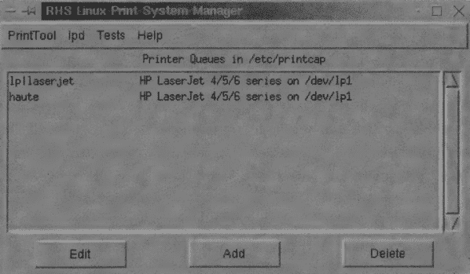

现在您可以根据适合您硬件的选项进行选择。此外，KDE 参考相关的 HOWTO 文档（例如 Printing-HOWTO...）。

Linux 识别大多数当前的声卡，例如所有 Sound-blaster 声卡。输入 `/usr/sbin/sndconfig` 来设置您的声卡。

按照说明操作，如果安装无效，请不要犹豫尝试其他参数。别忘记打开您的放大器并调大音量 ;-) 参考相关的 HOWTO 文档！（Sound-HOWTO...）。

Linux-Mandrake 提供了若干声学工具（包括调音台、MIDI、MPEG3 和 WAV/AU... 文件播放器）。

您的 Linux 系统包含大量的服务和机制，其活动和行为可以通过多个配置文件进行配置。它们的文本格式使得任何（会英语的）用户都易于阅读。这些文件大部分位于 `/etc` 目录。

`linuxconf` 是人们所说的所有配置文件的图形化前端。它让您能够轻松（使用鼠标）且精确地调整 Linux 系统的参数。

要使用 `linuxconf`（您必须以 root 用户身份登录），请输入 "linuxconf" 或在 K -> 应用非 KDE -> 系统 -> linuxconf 菜单中选择此程序。

您还可以在控制台或通过 Netscape 使用 `linuxconf`。

# 第 4 章 探索 KDE

### 4.1 KDE 的历史

KDE 是由 Matthias ETTRICH 于 1996 年启动的一个项目！其目标是创建一个完整的图形环境，而不仅仅是创建一个新的窗口管理器。KDE 1.0 版本于 1998 年发布，1.1 版本于 1999 年 2 月发布。KDE 现在是一个稳定且非常高效的环境：这就是为什么 Mandrake 决定将其作为默认的图形界面管理器！

### 4.2 KDE 简介

KDE 是 Linux-Mandrake 的默认图形环境。它既简单又非常完备，让您仅通过使用鼠标就能发现您新的 Linux-Mandrake 系统！

## HTML 桌面

如今，互联网是信息技术的核心。Web 所信赖的 HTML 语言为您提供了一种简单且快速的浏览互联网的方法。这就是为什么 KDE 桌面使用了 HTML 语言，以便您可以像在本地计算机上操作一样轻松地浏览互联网。

从现在起，只需单击即可启动程序或浏览您 Linux-Mandrake 系统的文件结构！互联网和您的计算机之间没有区别，您可以像操作个人电脑上的文件一样操作互联网资源。

## K 菜单、面板和任务栏

K 菜单为您提供了一种简单高效的访问 KDE 程序的方法。得益于通过 K 菜单访问的程序，您可以使用所有允许您使用计算机的工具。我们将描述 K 菜单的各项。

K 菜单分为两个部分。第一部分由图形、应用程序、互联网等项目组成。这些项目会打开安装在您的计算机上的应用程序列表。例如，要启动 `KTelnet`，请点击 K，选择 Internet，最后在打开的菜单中选择 `KTelnet`。第二部分包含直接访问垃圾桶或 KDE 控制中心等元素。

### 4.2 KDE 简介

显示屏幕底部条上的图标（即*面板/panel*）。

## 使用上下文有关的菜单，使用右键或第三键按钮

与所有现代界面一样，KDE 支持上下文有关的菜单。通过使用鼠标的第二个按钮（通常是右键）可以访问这些菜单。打开的菜单取决于您所指向的对象。如果您指向桌面，打开的菜单将允许您在书签之间导航、创建新文件（某些类型）或访问桌面属性。相反，如果您点击图标，上下文有关的菜单将允许您删除文件或访问其属性。第三键（3 键鼠标的中间键，或 2 键鼠标同时按下两个键）可以允许您在书签之间导航、创建新文件（某些类型）或访问桌面属性。

磁盘导航器窗口。关闭该窗口，在磁盘导航器菜单中选择“应用（Apply）”即可完成！

使用此菜单可以节省宝贵的时间！

面板是你在桌面底部看到的条目。除了 K 菜单和桌面列表外，你还可以添加想要包含的程序，以便轻松地启动它们。修改通过 `KPanel` 菜单进行。要添加项目，请选择“添加应用程序（Add an application）”，然后选择所需的应用程序（你也可以选择一个组）。应用程序将被添加到面板中。在图标上点击右键可以移动或删除它。“配置（Configure）”选项允许你像在 KDE 控制中心中一样访问面板的配置窗口。

KDE 通过为你提供一个简单且可自定义的界面来导航系统文件结构，使得搜索和使用计算机中的所有资源变得更加简单。

KFM 是你将用于探索系统的程序名称。它由菜单（文件、编辑、...）、工具栏、栏条和状态栏组成。

栏条显示当前目录。它以 `file:/xxx` 的形式给出，与网络浏览器相同。

“文件”和“编辑”菜单非常经典，允许你对文件执行常规操作（创建、搜索、剪切和粘贴、...）。“视图（View）”菜单允许你设置 KFM 的显示方式。使用“跳转（Go）”菜单，你可以浏览历史记录。在“书签（Bookmark）”菜单中，你可以保存你的喜好，无论是本地文件还是互联网网站。“缓存（Cache）”和“选项（Options）”菜单允许你精确配置你的 KFM 浏览器。

### 可的各种视图

“视图”菜单允许你设置浏览器的显示模式。当看到名称旁边有一个交叉号时，表示该选项已被选中。

隐藏文件是以句号开头名称的文件：通常是你的程序的配置文件。如果你想查看它们，请点击“显示隐藏文件（Show hidden files）”选项。文件结构选项在左侧显示三个名称：根目录（Root）、主目录（Home）和桌面（Desktop）。第一个实际上是目录 `""`，第二个是目录 `/home` 的快捷方式，最后一个是你的子目录 `Desktop`。点击每个名称左侧的三角形。这允许你在不更新右侧部分的情况下打开文件结构。这对于复制文件非常实用。另一方面，如果你点击名称，只有右侧部分会更新。你可能希望文件结构跟随你的导航（换句话说，右侧目录的变化将反映在文件结构视图中）。在这种情况下，进入“选项/配置文件管理器（Option/Configure file manager）”菜单，然后在“其他（Others）”部分点击相应的复框。

“显示小图像（Show small images）”选项是你尝试过后必不可少的选项之一：如果你选中它并浏览到一个包含图片的目录，你将看到一个小图像而不是普通的图像图标，从而提供图像预览。最后，“HTML”选项允许你选择是否将 KFM 视为网络浏览器。例如：在栏条中输入 `/home/html/`（支持自动补全）。如果选择了 HTML，将显示该目录的 Web 文索引 `index.html`，就像网络浏览器一样。如果没有选择 HTML，则将显示目录中的文件列表。

以下 4 个选项允许你选择显示模式：大图标（Big icons）、小图标（Small icons）、文本（Text）和详细（Detailed）。“文本”和“详细”模式非常相似，等同于 shell 中的 `ls -l` 命令：你可以（从右到左）看到文件名、关联权限、所有者和文件所属组、大小以及最后修改的时间和日期。

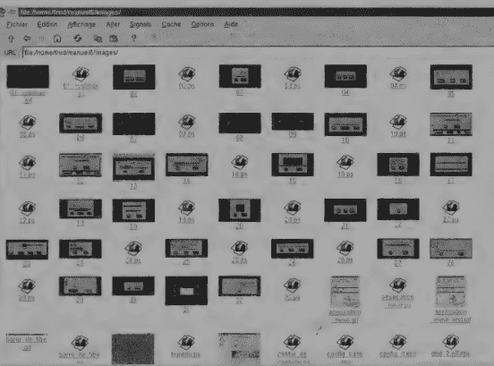

### 文件和文件夹的创建与操作

使用 KFM，你可以移动或删除图标。如果你选中了它并浏览到一个包含图片的目录，你将看到一个小图像而不是普通的图像图标，从而提供图像预览。此外，你可以通过拖拽操作文件和文件夹。要创建一个元素，在图标上点击右键并选择“新建（New）”。

### 搜索文件

“搜索（Search）”允许你通过通配符在文件来查找文件。在这种情况下，进入“选项/配置文件管理器（Option/Configure file manager）”菜单，然后在“其他（Others）”部分点击相应的复框。

### 自定义桌面

KDE 允许你自定义你的桌面。

### 应用程序

“应用程序（Applications）”菜单允许你管理这些程序。

“控制中心（Control Centre）”允许你访问设置界面。

### 面板

“面板（Panel）”菜单允许你管理面板条目。

### 文件

“文件（File）”菜单允许你执行常规操作。

### 视图

“视图（View）”菜单允许你设置显示模式。

### 选项

“选项（Options）”菜单允许你配置浏览器。

如果你的电脑上安装了 Samba 以及 X Server，这会让你联起显示器的设置。

### 快捷键菜单（Keys menu）

全局快捷键和标准快捷键菜单允许你分别修改桌面元素以及 KDE 菜单（特别是 KFM 菜单）的键盘快捷键。

### 窗口菜单（Window menu）

高级菜单允许你定义标准快捷键 `Ctrl+Tab` 和 `Alt+Tab` 的行为。我们建议勾选“捕获右键”选项，以确保非 KDE 应用程序的正常运行。过滤器的用途有限，而且复杂性较强，因为你需要非常熟悉 X Server 是如何属于某个类别的（例如，终端属于 XTerm 类）。过滤器允许你根据窗口的类或标题修改窗口的属性。要添加过滤器，请在下拉菜单中选择一个操作，输入窗口的标题或类，然后点击 `+` 将其添加到列表中。按钮菜单（Buttons menu）允许你自定义窗口上按钮的位置。你可以修改它们的位置，例如，当你尝试放大窗口时，不会意外关闭窗口（默认情况下，这两个按钮是相邻的）。

> 1 Samba 是一个允许你的计算机像微软客户端服务器一样运行的程序。

## 4.6. 自定义桌面 35

要指定鼠标相对于窗口的行为，请进入鼠标菜单（Mouse menu）。你可以控制许多重要参数。例如：在同一个桌面上打开两个窗口并让一个覆盖另一个。假设活动选项的中间键被设置为“置于下方（Place beneath）”。现在用右键点击活动窗口标题的任务栏：这个窗口现在移动到另一个窗口的后面了！因此，你可以精确地配置鼠标以提高效率。

属性菜单（Property menu）是最有趣的菜单之一。你可以选择在缩放或移动窗口时是否显示窗口内容。但最重要的是，你可以定义窗口的放置和焦点管理策略。窗口放置管理菜单有五个选项，其目标是允许你选择新窗口如何放置在桌面上。如果你选择“智能（Intelligent）”，新窗口将以尽可能减少与其他窗口重叠的方式放置在面上。“层叠（Cascade）”会将窗口彼此错开排列。“手动（Manual）”模式会显示光标；点击即可放置窗口。“交互（Interactive）”选项是智能和手动的结合：如果新窗口没有覆盖其他窗口“太多”（允许的重叠值），则允许你定义你认为的“太多”！它将自动放置；否则会出现光标。

焦点的选择至关重要，因为这定义了当鼠标滑过另一个背后的窗口时会产生什么动作。有 4 种可能的选择。

### 点击以获得焦点

点击窗口使其变为活动状态并移动到顶层。

### 焦点跟随鼠标

活动窗口是光标可以所在的窗口，但它保持在下方。

### 经典的焦点跟随鼠标

行为与上一个相同，`Alt+Tab` 组合键允许你在窗口之间切换。

### 经典式焦点释放（Classic focus released）

同上，但如果光标离开窗口，只要光标不在在另一个窗口中，该窗口将保持活动状态。

最后，标题栏菜单（Title bar menu）允许你选择标题栏的显示方式以及双击时发生的情况。

### KFM：设置 KFM

可以通过文件管理器的“选项”菜单配置 KFM。你会发现更改字体或选择链接颜色的选项。一个有趣的选项是“浏览后跟踪文件结构视图”，它允许你保持 KFM 左右部分（在文件结构模式下）的一致性。

### KFM

### MIME 类型与应用程序

KFM 基于处理文件类型的互联网标准。MIME 的原理是将类型（主要由文件扩展名指示）与应用程序相关联。通过这种方式，你只需点击一下即可通过打开相应的程序读取文件！某些类型是预定义的，但你可以修改它们或添加新的。要执行此操作，前往编辑/MIME 类型。它们按主题排序。


例如，让我们创建一个新类型。默认情况下，没有设置应用程序。


### 书签管理

KFM 提供了一个管理书签的简单环境。这些书签可以是本地文件，也可以是互联网地址。要将当前页地址添加到书签，请前往书签菜单并选择“添加书签”。

在 KFM 中，书签只是 `/home/your_login/.kde/share/apps/kfm/bookmarks` 中的一个文件（你可以通过书签/修改菜单访问该菜单），你可以像普通文件一样编辑它。

要对书签排序，只需在 `/home/your_login/.kde/share/apps/kfm/bookmarks` 目录下创建一个子目录，然后将文件移动到该目录。

### 配置浏览器

KFM 浏览器的选项/配置菜单允许你配置特定的互联网。你可以在第一个标签下指定代理服务器的地址。我们建议不要修改第二个标签，它对于大多数网站都是正确的。用户代理（user agent）定义了浏览器在网站需要标识符时发送的字符串。默认情况下，KFM 发“Konqueror”，但你可以修改它。输入你想执行更改的网络地址，输入一个新的标识符（例如，为了改为 Netscape Navigator 输入“Mozilla”），然后点击添加。除非特殊原因，否则不需要更改默认。Cookies 标签允许你定义默认以及根据域接受 Cookie 的策略。

### 使用 KFM 浏览网页

### 原理

KFM 是一个互联网浏览器，允许你使用大多数互联网服务（FTP、Web、……）。它支持 Javascript 和最新版本的 HTML 语言。

## 4.7. KDE 的高级用法

### 查看网页、下载文件

要查看网页，只需在 KFM 的栏中输入该页面的 URL 即可！

同样，你可以通过输入 `ftp://ftp.linux-mandrake.com` 来访问 MandrakeSoft FTP 站点。默认情况下，KFM 会与该站点建立匿名连接。如果你在 FTP 站点上有一个有效账户，可以通过输入如下格式的地址 `ftp://username@ftp.domaine.extension` 来使用你的登录。KFM 将提示你输入密码。

### 在启动时启动程序

有一种启动启动程序的通用方法：修改 `~/.bash_profile` 和 `~/.xinitrc` 文件。幸运的是，在 KDE 下，你只需要将想要启动的程序链接放置在桌面上显示的 StartUp 目录中。

### 挂载磁盘驱动器或 CD-ROM 驱动器

桌面上两个快捷方式，一个指向磁盘，另一个指向 CD-ROM 驱动器。

通常，为了访问格式化为 ext2（Linux 的标准文件格式）或 CD-ROM 的磁盘信息，你必须挂载相应的驱动器。

如果磁盘是 DOS 格式，请使用 mtools。输入 `man mtools` 获取有关该主题的更多详情。众所周知 DOS 命令前带有字母 m。简而言之，你应该输入 `mdir a:` 来显示磁盘内容。一些相关命令包括：`mdir`、`mformat`、`mcopy`、`mdel`。

挂载磁盘（或 CD-ROM），输入命令 `mount /mnt/floppy`（或 `mount /mnt/cdrom`）。如果你像通常那样频繁更换磁盘或 CD-ROM，这会相当繁琐。实际上，如果驱动器未卸载，你就无法移除 CD-ROM。

在 Linux-Mandrake 中，默认情况下，这两个快捷方式让生活变得简单。只需单击，即可挂载磁盘或 CD-ROM。相应的图标上会出现一个绿色小方块，提醒你驱动器已挂载。要卸载驱动器，用鼠标右键点击并选择“unmount”（卸载）。操作如此简单！

# 第 5 章 KDE 程序

### 5.1 文本编辑器

KDE 标准配备了 2 个文本编辑器：kedit 和 kwrite。你可以在 K 菜单的“应用程序”下找到它们。

kedit 是一个小型文本编辑器，允许你以简单的方式输入短文本或编辑配置文件。你可以直接在 FTP 服务器或 Web 上编辑消息。只需在“打开”（Open）菜单的放置提示符处指定对应的 Internet 站点和文件名（例如：`ftp://ftp.linux-mandrake.com/Welcome.msg`）。

kwrite 是一个与上一个相似的编辑器，但功能更强大。特别是，它允许你根据文档类型修改文本使用的颜色。例如，打开文档 `/.bash_profile`。它以统一样式显示。在“选项”（Options）菜单中，选择“激活高亮”（Activate highlighting）然后选择 Bash（.bash_profile 文件是用 Bourne-shell 编写的）。文本样式会立即更改：

注释为*斜体*，函数以**粗体**显示。还有其他各种有趣的模式，如 HTML 或 C。当你编辑长文件时，还有另一个有趣的功能，它允许你在文件的某些行上放置标记。要进行此操作，请选择“添加标记”（Add in the Markers）菜单。虽然它提供的功能没有 Emacs 那么多，但 `kwrite` 对你可能非常有用；因此，请不要犹豫使用它！

### 5.2 图像编辑程序

KDE 提供了若干图形工具，补充了你在 *Linux-Mandrake* 发行版其他地方找到的工具。

名为 KSnapShot 的屏幕捕捉工具允许你进行截屏！它允许你对整个屏幕或仅对光标所在的窗口进行复制。

如果你在 KDE 提供的图标集中找不到想要的图标，图标编辑器将让你创建自己的图标。该程序看起来像一个经典的绘画工具。背景是网格。实际上，图标通常是尺寸严格定义的（32×32 像素）绘画。网格的存在是为了帮助你保持这个尺寸。

Paint 程序是一个比任何其他程序都简单的绘画程序。释放你的想象力吧！

### 5.3 使用互联网！

Linux 是在互联网上产生的，*KDE* 也是。因此，它包含了连接世界维网所需的工具。在“互联网”（Internet）菜单中，你将找到一个邮件查看器、一个新闻查看器、一个用于连接自己的拨号器以及用于其他互联网服务的工具（IRC, telnet, archie）。

### 使用 kppp 拨号器

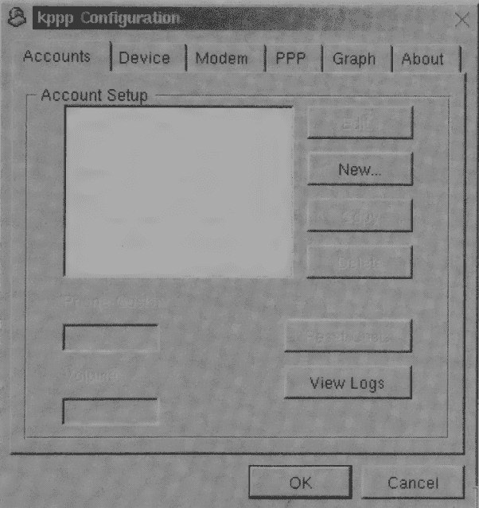

在连接互联网之前，你必须设置你的连接1。启动拨号器，然后选择“配置”（Configuration）。在第一个选项卡中点击“新建”（New）。为你的连接命名，然后填写电话号码。如果你不想每次输入密码，可以勾选“保存密码”（Save password）。不要修改其他内容，转到 IP 选项卡，在 DNS 选项卡的“域”（Domain）部分，输入你的 ISP 地址（例如：aol.com）。点击“添加”（Add）。如果你想利用 kppp 管理功能，点击 PPP 选项卡并选择你的国家。退出时，点击“确定”。在调制器窗口中，你可以设置你的调制器。如果是外部调制器，请选择 `/dev/cux`（x 代表串口端口）。例如，如果你的调制器连接到 COM1，选择 `/dev/cu0`。反之，如果你的调制器是内置的，选择 `/dev/ttyS0`。不要更改其他参数。点击调制器选项卡后，调制器和 PPP 选项卡可以验证设置是否正确。调制器和 PPP 选项卡通常不需要修改。图表（Graph）选项卡允许你查看输入和输出速率，供你上网！

这一切假设你有一个互联网服务提供商（ISP）的账户！此外，你的调制器不能是为 Windows 设计的。如果是，它在 Linux 下将无法工作。如有任何问题，请咨询你的服务提供者获取更多信息。

### 5.4 管理系统

### 邮件查看器 Kmail

Kmail 是一个高性能、易于使用的邮件查看器。当你首次启动它时，将打开一个窗口允许你输入账户的各种参数：名称、电子地址、签名文件。“网络”（Network）选项卡允许你选择用于收发邮件的连接类型。对于初学者，不建议使用 Sendmail。点击 SMTP 并指定你邮件服务器的地址。如果你使用 Sendmail，你需要设置一个本地箱；否则使用 POP3 邮箱。对于后者，你只需要填写由 ISP 提供的详情即可。设置过程中最重要的部分已经完成。剩余的选项卡涉及你邮件查看器的工程学。Kmail 拥有现代邮件查看器的所有功能：地址录、过滤器等……简单易用，它让你发现电子邮件的巨大益处！

## 5.4. 管理你的系统

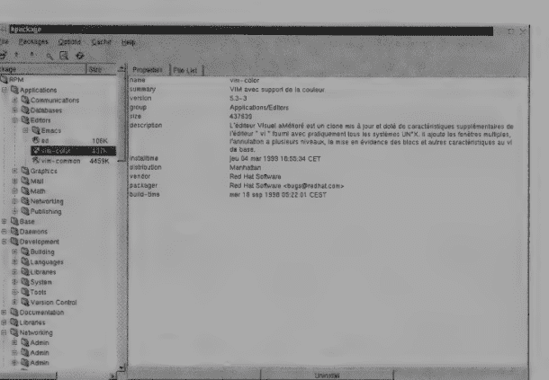

要卸载程序，只需选择它并点击“卸载”，然后确认即可。你可以选择多个程序同时卸载。要做到这一点，你必须激活多选框模式，你可以在“软件包”（Packages）菜单中找到它。

安装程序有两种方法。第一种是直接从 KFM 文件管理器中点击你想要安装的程序。将弹出 KPackage 安装窗口，然后你应该点击“安装”（Install）。第二种方法是启动 KPackage 程序。转到“选项”（Options）菜单并选择“安装未安装的 RPM 包”。你可以指定几个不同的位置，特别是 FTP 站点。如果你从 Linux-Mandra CD-ROM 安装程序，请输入 `/mnt/cdrom/Mandra/RPM` 然后勾选“已使用”（Used）选项。退出对话框，并在“文件”（File）菜单中选择“重新加载”（Reload）。已安装的包前面会有字母 N。你就可以轻松地安装新软件包了！

“选项”（Option）菜单允许你选择你喜欢的视图（所有程序、仅已安装程序或仅未安装程序）。为了加快软件包信息的搜索速度，KPackage 使用了缓存。你可以禁用它。

得益于 KPackage，你可以使用简单高效的工具来管理你的 Linux-Mandandra 系统。

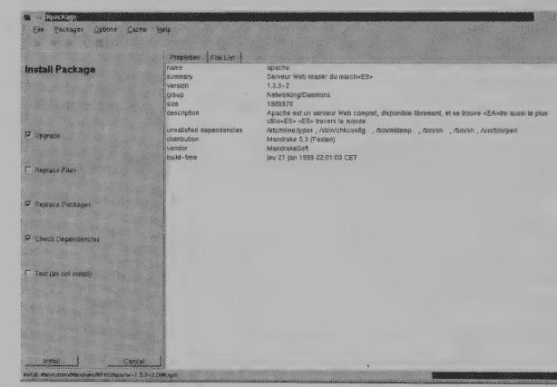

### 进程：KPM 和 KDE 任务管理器

KDE 任务管理器可以在“系统”（System）菜单中找到，它允许你查看运行进程列表。你可以轻松地杀死进程（结束任务）或查看运行进程的树结构。

Kpm 可以在“工具”（Utilities）菜单中找到，它提供相同的信息，但形式略有不同。

## 5.4. 管理你的系统

因此，你可以选择你喜欢的那个！

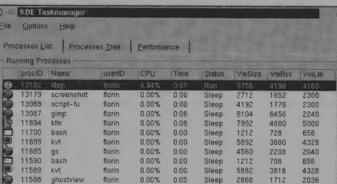

# 磁盘空间：kddfree

KDFree 显示每个已挂载驱动器的空间占用百分比。

### 运行级别：ksysv

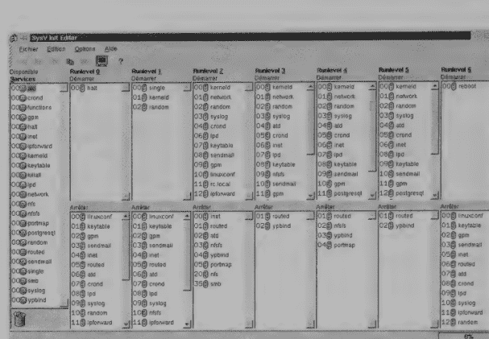

SysV Init 编辑器允许你选择在后台启动的守护进程。你需要超级用户（root）权限才能使用它。它以两系列服务的形式存在。在左侧，你会看到已安装服务的列表。在右侧，顶部是已启动的服务，下方是已停止的服务，分别对应每个运行级别。例如，在级别 6（计算机重启）下，所有服务都已停止，除了重启本身。有趣的运行级别分别是 3 和 5（默认级别）以及完全图形化的级别。假设你不想在在级别 5 时启动 gpm 服务。你只需要用鼠标选中它并将其拖到*停止*（*Stop*）区域即可。这个工具非常易用，但请注意你的操作，否则可能会遇到启动问题！

### 字符字体管理

字符字体管理器是一个允许你管理系统中已安装字体的工具。

### 打印文件管理

如果你有一个打印机（本地或网络），你可以使用“打印文件”（*Print file*）程序处理打印队列。当你启动它时，你会看到队列中的项目列表。要删除某项，选择它并点击“移除”（*Remove*）。你还可以通过选择“置到前端”（*To the front*）将紧急项目移动到“队列前端”。

### GNOME：GNOME 网络对象模型环境

### 6.1 简介

GNOME 是由 Miguel DE ICAZA 初始化的项目，得到了 GNU 项目的支持，它将 GNOME 作为其桌面环境。它的目标与 KDE 项目类似：创建一个完整的图形化环境，并定义一系列引导线，其他应用程序可以遵循这些线条以实现“GNOME 兼容”。

GNOME 比 KDE 新得多，但它的开发速度快得多。它已经是一个功能丰富的环境，并且在某些领域优于 KDE，但它缺乏成熟度，尤其是缺乏兼容应用程序。

### 6.2 环境介绍

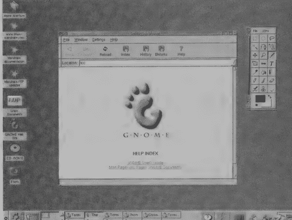

与 KDE 不同，GNOME 不带自带的窗口管理器。它可以是任何窗口管理器，但 GNOME 也定义了一系列条件，规定窗口管理器必须是“兼容的”。第一个采用这种兼容性的窗口管理器是 Enlightenment，它就是用于屏幕截取的管理器。

屏幕的右上角和底部有两个面板。与 KDE 唯一的面板不同，GNOME 面板也是独有的。

例如，你可以尝试将一个 gmc 图像移动到 Netscape应用程序中：Netscape 能够有效地打开该图像。同样，你可以将 Netscape 下运行的地址（位于“位置”*Location:* 左侧的绿色符号）“拖到”桌面上：该图标会在你鼠标所在的位置创建。

### 6.3 拖放协议 

GNOME 实现了一种与 KDE 不同的拖放协议，因此拖放功能在 KDE 应用程序和 GNOME 应用程序之间无法工作。相反，它适用于所有 Motif 应用程序（因此适用于 Netscape！）以及所有使用 GTK+ 1.1.14 或更高版本的应用程序。

## 6.3. 拖放

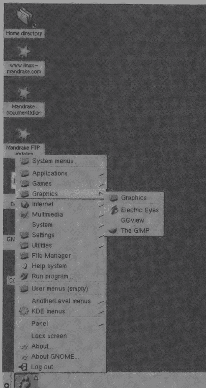

将会出现一个 + 号：这意味着该项目可以被复制到这里。释放按钮：

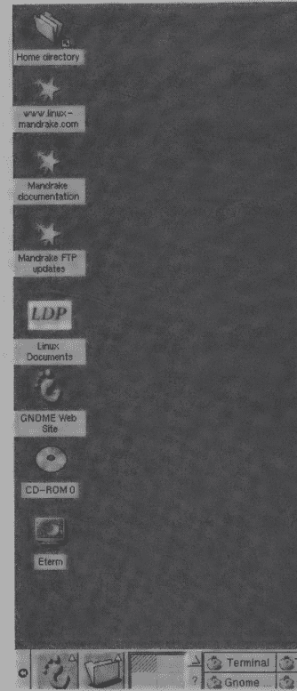

现在，将你刚刚复制的同一个菜单项从桌面拖动到其中一个面板中：如果它是适用类型的文件，则会在面板上会创建一个启动器：

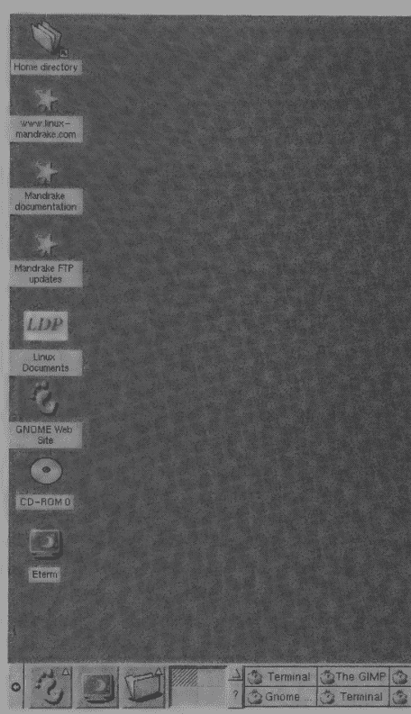

你也可以通过桌面跳过这一步骤，直接将菜单项拖动到面板上：此时启动器将以相同的方式创建。

你也可以直接在桌面上添加启动器（右键点击 $\rightarrow$ 新 $\rightarrow$ 启动器）。添加启动器的对话框显示如下：

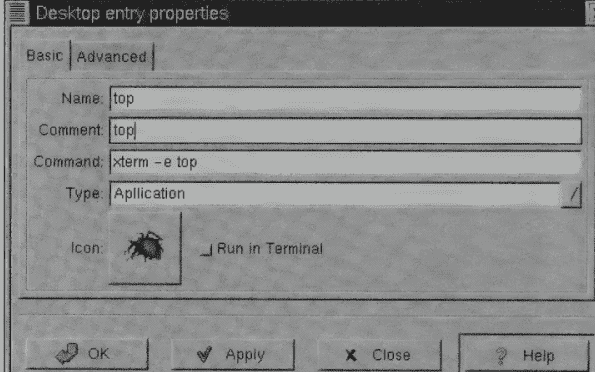

启动器的名称将是创建的文件名（不带扩展名）。注释是鼠标指针悬停在启动器顶部时在帮助泡中显示的文本。最后，命令是指在终端中输入以实现相同结果的内容。在这种情况下，启动器将是一个运行顶层程序的终端。

需要注意的是，GNOME 使用 Imlib，因此与之关联的图标可以是任何已知的格式。还要注意，对于 X 应用程序勾选 *Launch in a terminal*（在终端中启动）选项并非毫无用处：标准输出通道和标准错误通道都会被重定向到

### 6.5 关于面板的更多信息

终端，因此更容易（即使不是为了调试程序）捕获发出的错误信息。

在启动器上点击右键可以让你编辑其属性、沿面板移动移动它甚至移动到另一个面板，或者将其删除。

### 6.5 关于面板的更多信息

### 使用鼠标操作

在给定面板中的鼠标操作将取决于你按下右键还是中键。如果你按下中键并保持按住，你可以随意的在桌面上移动它。如果你按下右键，你将可以使用全局面板配置参数，并能够添加启动器或小程序。

### 面板配置参数

所有面板通用的参数适用于动画、与启动器相关的图标、抽屉、主菜单和会话结束以及其他参数的修改：帮助泡泡、属性菜单、全局行为。每个面板的独立参数适用于它们的位置、可见性和外观。

### 6.6 结论

尽管 GNOME 目前没有像 KDE 那样成功，但它有几个令人敬畏的优势：你可以在不使用兼容窗口管理器的情况下使用面板（因此可以更深入地自定义你的环境），而且它的演示更具吸引力（尽管 KDE 的企业端吸引某些人）。但缺乏专用应用程序是一个严酷的弱点。

这两个环境都需要大量的内存（如果你不信，请在 `top` 中输入 M...），你应该避免在性能较低的配置上运行它们。如果你的机器足够强大，选择权就在你！

# 第 7 章 Linux 简介

### 7.1 系统的启动和关闭

### 启动

要启动 Linux-Mandrake，你不需要做太多！
如果你的计算机中已另一个系统，或者安装了 LILO，后者将启动并显示：

LILO:

按下 Tab 键¹显示所有可能的系统列表。从逻辑上讲，你应该输入 `linux` 来启动你的 Mandrake 系统，除非你给它起了不同的名字。如果你按下 Enter 键，将启动安装期间定义的选项，如果你等待超过五秒也会发生同样的情况。这些参数在 Linux 下可以通过以下文件进行修改：

> ¹它位于 Q 键旁边。

`/etc/lilo.conf` 文件。如果你想修改这些参数，请参阅关于 LILO 的章节。

你可能选择了在 DOS 或 Windows Linux 下使用 `loadlin.exe`。在这种情况下，它的启动方式会有不同。

### 登录程序

Linux 是一个多用户系统。为了访问系统，你必须经过身份验证：这被称为登录程序。

在安装期间，你创建了一个名为 root 的超级用户账户。在登录提示处，输入 `root` 然后输入你的密码（"Password:"）。我们建议你在安装过程中过程中创建的第二个账户（非特权用户）用于系统的日常使用。

你现在已登录 root 账户。该账户拥有对整个系统的所有权限。它是计算机的管理员账户，而不是工作账户！因此，你可以再次创建一个用户账户，这将是你自己的。操作方法如下：

```
adduser login_name
```

其中 `login_name` 将是你选择的名字（root 之外）。要为此账户创建密码，输入：

```
passwd login_name
```

如果你需要访问 root，请使用：

```
su
```

其中 `login_name` 将是你选择的非 root 之外的名字。

## 7.1 启动和关闭

### 关闭

有很多方法可以关闭系统。最常见的方法是：

- 1. 从菜单选择 系统 $\rightarrow$Shutdown（关）。
- 2. 从终端输入 `halt` 或 `reboot`。
- 3. 按 `Ctrl+Alt+Del`。

如果系统冻结怎么办？你可能需要硬重启。

等，如果系统停机了怎么办？此操作可能会持续几分钟。

### 7.2 Linux Shell

连接到计算机后，你将看到一个带有 $ 符号的提示符。等待你的指令的程序就是 shell。它的作用是将你的指令传递给内核。

这里是可用 shell 的简要描述：

- `bash`：最常用的 shell。它创建命令历史并允许你编辑它们。
- `csh`：C shell。它不允许你编辑命令行。
- `ksh`：Korn shell。这是 Unix 系统上最著名的 shell。
- `tcsh`：C shell 的改进版本。同样创建可编辑的历史。
- `sh`：最老的
- `zsh`：最现代的

### 7.3 使用 BASH SHELL

默认使用的 shell 是 "Bash"（Bourne Again Shell）。只需输入即可查看你正在使用的 shell：

```bash


# 第 7 章：LINUX 简介

## 7.3 使用 Bash shell

注意每个 shell 都有自己的语法。我们建议使用 Bash shell，它既简单又强大。在 Linux-Mandrake 中，Bash shell 是默认 shell。稍后的示例中使用这种 shell。

如果 shell 起初让你想到 DOS 系统，已经尽可能让命令输入变得简单。最实用的快捷键包括：

- `Ctrl+A` 跳到行首。
- `Ctrl+U` 清空当前行。
- `Ctrl+C` 停止正在运行的任务。

使用分号在同一行内输入多个命令。向上和向下箭头可以在命令历史中滚动。要无需遍历整个历史到达某个特定命令，输入：

```bash
history
```

将显示历史中的命令列表，每个命令旁边都有编号。要执行某个命令，输入：

```bash
! command_number
```

`!!` 允许你重新执行上一个命令。

在 Linux 下，程序或命令的名称有时很长。幸运的是，`bash` 支持名称补全，换句话说，在开始输入命令名称后，按下 `Tab` 键即可让你补全命令、程序或目录的名称。

例如，假设你想使用解压缩程序 `bunzip2`。输入：

```
bu
```

然后按下 `Tab` 键。

什么都没有发生，因为有多种方式可以完成该命令。再次按下 `Tab` 键：`bash` 会为你列出所有以 `bu` 开头的名称。例如，你将看到：

```
bu
buildhash builtin bunzip2
```

输入 `n` (`bunzip2`)，这是唯一第三个字母是 `n` 的名称，然后按 `Tab` 键。shell 会自动补全名称，剩下的只需按回车键即可！

我们在这里描述的所有命令都可以在控制台模式下，也可以在图形模式下的命令行窗口（`xterm`）中使用。

> `bunzip2` 及其互补程序 `gzip` 是 Unix 上最强大的压缩/解压缩实用。它们实现的文件大小缩减优于 `gzip`。一个“bzipped”压缩包后缀为 `.bz2`。一个“gzipped”压缩包以 `.gz` 结尾。

### su 命令

它允许你在处于用户账户时登录到 `root` 根账户。当你输入 `su` 时，shell 会提示输入 `root` 密码。输入密码后按回车键：你现在进入了 `root` 账户。输入 `exit`（或按 `Ctrl+D`）返回上一个账户。

### cd 命令

此命令允许你切换目录（`cd` 代表 change directory）。它可以同时处理绝对路径和相对路径。例如，假设你在个人目录中，想进入 `docs/` 子目录。只需输入（相对路径）：

```
cd docs/
```

要进入 `/usr/bin` 目录，输入（绝对路径）：

```
cd /usr/bin/
```

该命令的一些实用选项包括：

- `cd ..` 允许你返回父级目录（注意 `cd` 和 `..` 之间的空格）。
- `cd -` 允许你返回到上一个目录。
- `cd` 或 `cd ~` 会带你回到个人家目录。

### ls 命令

`ls`（代表 list）为你提供当前目录下的文件列表。通常使用两个选项：`-a` 查看隐藏文件，`-l` 查看长文件名。你可以在 `ls` 命令行的末尾添加目录名称。例如：

```
ls -al /usr/X11R6/bin/
```

输入：

```
man ls
```

以查找 `ls` 命令的所有可用选项。

### rm 命令

此用于删除文件。

> 警告：一旦文件被删除，将无办法找回！

语法：

```
rm file_name
```

此命令接受通配符。最常用的选项是：`-i` 在删除文件前请求确认，`-r` 递归地删除目录中的文件。

示例：

```
rm -i ~/html/*.html
```

这将删除你家目录下 `html/` 子目录下的所有 HTML 文件。

### mkdir 和 rmdir 命令

`mkdir` 命令允许你创建目录，而 `rmdir` 命令在目录为空时删除它。

语法：

```
mkdir directory_name

rmdir directory_name
```

`rmdir` 命令经常被 `rm -rf` 替代，后者允许你删除目录，即使它不为空。请谨慎使用！

### more/less 命令

`more` 命令允许你按页读取文本。这对于在不修改文件的情况下查看屏幕文件非常有用。

输入：

```
more name_of_text_file
```

使用 `q` 退出。

`less` 命令（其名称的选择是为了优于 "more"）性能更好，因为它允许你向上回溯已列表的列表。使用箭头键进行此操作。

### grep 命令

此命令带有大量选项，允许你在文件中搜索字符字符串。

语法：

```
grep string file
```

### ps 命令

此命令列出运行中的进程。`Command` 列显示进程名称，`PID` 列显示其进程号（这是你通过 `kill` 命令杀死程序时必须使用的数字）。

语法：

```
ps options
```

`u` 选项提供更多信息，而 `ax` 允许你识别不属于你的进程（例如在系统启动时启动的进程）。

### kill 命令

如果程序不再响应，请使用此命令杀死它。

语法：

```
kill PID_number
```

事实上，`kill` 命令向相关程序发送一条消息，指示它必须自杀。有时当程序不再响应时，你必须使用 `kill -9`。PID 号通过 `ps` 命令获取。

示例：

```
kill -9 354
```

### tar 命令

`tar` 命令允许你创建或编辑 Unix 归档。因此，包含目录 `rep/` 及其子目录中所有内容的语法是：

## 7.4 使用 LINUX 多任务系统

Linux 是一个多任务系统，你可以利用这一点。第一种方法是在后台启动程序。注意，某些程序是交互式的：如果你在后台启动它们，将什么都不会发生。要将在后台启动的程序带回前台，输入：

```
fg program_name
```

第二种方法是启动多个会话。在图形模式下，只需按 `Alt + F1` 到 `F6` 之间的键。会出现一个新的登录框，你可以登录新会话。要返回 `X`（不关闭会话），按 `Ctrl+Alt+F7`。这种方法还允许在控制台不可用时在另一个控制台工作。

### 7.5 输出重定向

人们经常想将程序的输出保存到文件中以便处理。这被称为输出重定向。

例如，如果你想将 `ls bin` 命令的输出记录到文件 `lsbin` 中，输入：

```
ls /bin > ~/lsbin
```

如果 `lsbin` 文件已存在，其内容将被擦除。为了避免这种情况，使用 `>>` 代替 `>`（这允许将 `lsbin` 流追加到 `lsbin` 文件的末尾）。

### 7.6 理解进程

通常，文件或目录的内容在屏幕上滚动过快，你没有足够的时间阅读。一种解决方法是将命令的输出保存，然后使用 `more` 工具读取（`more` 是按页显示文本的查看器）。因此，你应该输入：

```
ls /bin > ~/lsbin

more ~/lsbin
```

Linux 提供了一种更“优雅”的方法。为此，我们将使用管道。通过这种方法，一个命令的输出被发送到另一个命令的输入。如下：

```
ls /bin | more

ls /bin | less
```


在这里，`ls` 命令的输出被发送给 `more`（或 `less`）进行处理。

你可以组合不同的管道来执行复杂的步骤。

进程是一个独立的程序。例如，如果你正在使用 `Netscape Navigator`，就会启动一个 `Netscape` 进程。进程的概念在 `Unix` 系统中至关重要。

第一个启动的进程是 `init`。除了其他作用，它的作用是挂载文件系统并启动 `getty`（`getty` 是处理登录程序的进程）在每个控制台上运行。

`ps` 命令允许你查看由启动它的用户正在运行的进程。

# 第 8 章：系统管理

### 8.1 用户与组

与其他操作系统不同，`Linux` 管理了安全问题，特别是用户组问题。

在 `Linux` 中，有三类型的用户：你自己、你所属的组以及其他用户。机器上的每个用户都有自己的个人目录，该目录是 `/home` 的子目录。例如，如果你的登录名是 `fred`，那么你的个人目录将是 `/home/fred`（你经常会看到缩写 `~` 表示你的个人目录）。这个符号会被 `bash` shell 识别。唯一的例外是 `root` 账户，它的目录是 `/root`。这种用户目录的概念允许你保护机密文件不被其他用户读取（只有超级用户可以访问所有个人目录）。

然而，你肯定想与其他用户共享文档。这就是为什么 `Linux` 支持组。一组是一组用户。一个用户默认属于一个组，但也可以属于多个组。管理员必须使用相关软件组织这些组。通常，组是按功能创建的：一个用于会计服务的组，一个开发者的组等……

## 8.2 管理用户

### 创建账户

由于你绝不能在 `root` 账户下工作，即使你的机器上只有你一个人，也应该至少创建一个用户。

我们已经见过 `adduser` 命令，但幸运的是有图形化工具，特别是 `linuxconf`，我们将在此处对其进行概述。

`linuxconf` 是一个非常完善的工具，允许你处理 `Linux-Mandrake` 配置文件。得益于这个工具，用户账户的管理非常简单。作为超级用户，启动 `linuxconf`。左侧显示不同的模块，右侧显示当前模块。进入用户管理，然后进入用户账户。将显示当前用户列表。选择 `add`（添加），然后填写各种字段（对于组，你可以选择用户、当前用户的默认组）。确认，就完成了！

### 特殊账户

如果你编辑 `/etc/passwd` 文件（其中包含一个加密的密码列表）或 `/etc/groups` 文件（列出了不同的组），你会发现存在一些没有真实账户的用户，例如 `ftp` 或 `news`。这些账户被称为特殊账户，它们被程序或守护进程用于执行其自身的操作。它们通常需要高于普通用户的权限，而正是为了避免使用 `root` 账户，才存在这些特殊账户。

你可能永远不需要担心这些特殊账户。

### 8.3 程序管理 (RPM)

`Linux-Mandrake` 使用 `RPM` 标准，即“Red-Hat 包管理器”，允许你轻松地管理程序。得益于 `RPM`，你只需挥手即可安装和卸载程序！`RPM` 的真正强大在于它能够检查程序之间的依赖关系。因此，如果某个程序所需的某个库不存在，它将不允许安装该程序。

对于 `Intel` 处理器及其兼容机，程序名称的结构如下：

```
name.version.i386.rpm
```

如果是源文件，你将在名称中找到 `src`。在 `Linux-Mandrake` 下，有两种管理 `RPM` 软件包的方法：命令行和 `Kpackage` 程序。不要忘记，只有 `root` 用户才有权安装或卸载程序！

### 命令行上的 RPM

`RPM` 程序配合选项用于管理你所有的 `RPM` 程序。命令行语法为：

```
rpm -options program_name
```

让我们看看可选的选项。

### 安装程序

可以使用选项 `-i` 安装程序。例如，要安装 `KLyX` 程序，输入：

```
rpm -ivh klyx-0.9a-f13.rpm
```

你的程序已安装，并可以立即使用！选项 `v`（详细模式）和 `h`（进度）是可选的，允许让你看到安装进度。

### 更新程序

要通过安装更新版本来更新程序，你应该使用 `U` 代替 `i`。这样一来，你所有的配置文件都会被保存。

### 卸载程序

如果你想删除程序，请使用选项 `e`，例如：

```
rpm -e program_name
```

程序将被删除。

### 验证程序

验证允许你检查文件是否存在。对于此，输入：

```
rpm -V program_name
```

### 查询程序

查询程序通常非常有用，例如为了了解其中包含的文件列表。使用：

```
rpm -q program_name
```

### 其他选项

你可以通过查阅帮助手册（`man` page）找到许多选项。`--force` 是相当危险的。

### Kpackage

`Kpackage` 是允许管理程序的图形化工具。

### 8.4 安装过程

### 启动过程

当你启动 `Linux` 时，内核会检查配置。它使用 `dmesg` 显示各种信息。然后它显示根系统。无法挂载该系统会导致著名的内核恐慌（`Kernel Panic`），从而停止计算机运行。

第一个启动的进程是 `init`。它在启动时启动其他进程和大量的验证。在每个控制台上。

### 运行级别 (Runlevels)

运行级别是一个特定的执行环境。`Linux` 允许你定义几个不同的环境。共有 7 个：

- `level 0`：计算机关机。
- `level 1`：单用户模式。仅用于特殊情况。
- `level 2`：不通过 `NFS` 共享目录的多用户模式。
- `level 3`：控制台模式下的正常运行级别。
- `level 4`：未使用。
- `level 5`：图形模式下的正常运行级别。
- `level 6`：计算机重启。

强烈建议不要将 `3` 或 `5` 以外的任何运行级别设置为默认。在任何情况下，都不要将运行级别设置为 `0` 或 `6`：你将无法使用你的计算机！

### /etc/inittab 文件

该文件包含根据你所在的执行级别要完成的任务列表。正常的运行级别是 `3`（控制台模式）或 `5`（图形模式）。`/etc/inittab` 文件的描述。

它如下所示（不包含行号；形状可能根据你的配置而异）：

```
# 默认模式：

id:5:initdefault:

# 系统初始化

si::sysinit:/etc/rc.d/rc.sysinit

10:0:wait:/etc/rc.d/rc 0

11:1:wait:/etc/rc.d/rc 1

12:2:wait:/etc/rc.d/rc 2

13:3:wait:/etc/rc.d/rc 3

14:4:wait:/etc/rc.d/rc 4

15:5:wait:/etc/rc.d/rc 5

16:6:wait:/etc/rc.d/rc 6

# Trap CTRL-ALT-DELETE

ca::ctrlaltld:/sbin/shutdown -t3 -r now

# Run gettys in standard runlevels

1:12345:respawn:/sbin/mingetty tty1

2:2345:respawn:/sbin/mingetty tty2

3:2345:respawn:/sbin/mingetty tty3

4:2345:respawn:/sbin/mingetty tty4

5:2345:respawn:/sbin/mingetty tty5

6:2345:respawn:/sbin/mingetty tty6

# Run xdm in runlevel 5

x:5:respawn:/opt/kde/bin/kdm -nodaemon
```

每个条目的通用格式为：

```
id:rstate:action:process
```


# 8.3 系统默认运行级别

- `Id` 指定一个标识符。
- `Rstate` 是运行级别数字序列。如果你处于所指示的数字之一的运行级别，该行将被执行。
- `Action` 表示进程应该是被启动一次、在每次崩溃时都重启（`respawn`）等……。
- `Process` 指定了要执行的操作，通常是一个脚本。

第 2 行指定了系统的默认运行级别。

> **警告**：Linux-Mandrake 现在使用 `chkconfig` 程序来管理运行级别。请参下文专门介绍该程序的段落。

## 8.4. LINUX-MANDRAKE 安装

第 4 行具有特殊性。它启动了 `rc.sysinit` 脚本，该脚本的作用是检查文件系统的完整性、激活交换分区等……

第 5 行到第 11 行允许启动依赖于执行级别的脚本。启动的脚本是 `/etc/rc.d/rc`，并将运行级别作为参数传递。

第 13 行表示，如果你同时按下 `Ctrl+Alt+Del`，系统必须立即重启。对于服务器机器来说，这是一个非常危险的选项。你可以通过将其注释来禁用该行。

第 15 行到第 20 行表示，对于运行级别 2 到 5，必须启动 `mingetty` 程序，允许你进行连接。`respawn` 表示如果进程崩溃（例如执行了 `exit` 命令），必须重新启动。

第 22 行用于运行级别 5，为你提供图形化登录程序（`kdm` 程序）。

不建议修改 `/etc/initab` 的访问，因为你可能会面临无法重启计算机的风险！在这种情况下，请使用启动盘。

### /etc/rc.d/ 脚本

所有的 Linux-Mandrake 安装脚本都包含在 `/etc/rc.d/` 目录下。我们现在描述所执行的过程。

### /etc/rc.d/rc.sysinit

这是第一个被执行的脚本。它在启动时运行一次。启动时你看到的几乎所有信息都来自此脚本。

该脚本首先显示 `PATH` 变量的值，该变量定义了程序的访问路径。然后，程序将搜索网络配置。如果网络存在，则执行网络脚本（`/etc/sysconfig/network`）；否则，告知系统没有网络，因此机器名称将为 `localhost`。

然后激活交换分区。屏幕上会显示 `HOSTNAME` 变量。如果使用了 NIS 服务，则对其进行设置。系统继续检查分区（`fsck -V -a $fsoptions /` 命令）。后续操作允许在分区损坏时对启动过程进行管理。最后，激活配额管理。

脚本将配置你的 PNP 卡。然后启动你所有以模块形式运行的程序。随后，所有分区都将被挂载并验证。

在系统配置计算机时间之前，启动过程会删除许多文件（`rm -f` 命令）。串口的激活是下一步。

最后部分由特定于 Linux-Mandrake 的指令组成，它们会在你首次启动时执行。

### /etc/rc.d/rc

`rc` 程序旨在根据运行级别更容易地启动脚本。因此，此脚本非常短。它获取当前的运行级别以便启动必要的脚本。如果运行级别是 `x`，则执行 `/etc/rc.d/rcx.d/` 目录下的所有脚本。

### /etc/rc.d/rcx.d/

`rcx` 目录下的脚本根据运行级别执行。`rcx.d` 目录的内容非常特殊，因为这些目录包含了指向你计算机上可用的服务的链接（位于 `/etc/rc.d/init.d` 中）。如果链接名以 `K` 开头，则进程将被*杀死（Killed）*；否则，将被*启动（Start）*。

我们以 `rc0d` 目录的链接为例。它们在机器停止时执行。因此，你可以看到所有服务都已停止，除了停止服务。

这些目录的内容可以通过 `ksysv` 程序进行更改。

### /etc/rc.d/init.d/ 和服务管理

此目录包含指向你计算机上可用的服务的链接。如果链接名以 `K` 开头，则进程将被*杀死（Killed）*；否则，将被*启动（Start）*。

我们以 `rc0d` 目录的链接为例。它们在机器停止时执行。因此你可以看到所有服务都已停止，除了停止服务。

这些目录的内容可以通过 `ksysv` 程序进行更改。

### `chkconfig` 程序

`chkconfig` 程序用于管理运行级别。有五个功能：

- 添加服务
- 服务
- 显示当前状态
- 修改启动配置
- 检查

## `.bashrc` 和 `.bashprofile` 文件

登录时，会分配给你一个登录 shell。`bash` shell 是最流行的。`/etc/profile` 和 `~/.bashprofile` 分别涉及全局配置和个人文件。它们用于定义函数和别名。

要配置别名，例如，在你的 `.bashrc` 中添加：

```
alias ll='ls -l'
```

这样你就可以用快捷的 `ll` 命令代替复杂的 `ls -l`。要激活修改，输入 `source ~/.bashrc` 并按回车，否则修改将在下次连接时激活。

> **警告**：不要选择 Linux 系统已存在的命令名称。

要个性化 `.bashprofile`，你应该采取类似的行动。例如，如果你将 `Blender` 安装在某个目录，比如 `/usr/local/blender/`，你应该修改 `.bashprofile` 文件。这里有一个例子：

```
PATH=$PATH:$HOME/bin

ENV=$HOME/.bashrc

USERNAME="fred"

BLENDERDIR=/usr/local/blender

(..)

export USERNAME ENV PATH BLENDERDIR
```


## 8.5. 使用 `LINUXCONF`

网络是整个 Unix 系统配置的基础点之一。Linux 也不例外。`ifconfig` 和 `route` 的手册页忽略了这一点（并且仍然忽略了它），不不，Linux 也不例外。`ifconfig` 和 `route` 的手册页忽略这一点甚至比标题写的字还多（尽管这不应该阻止你看一眼 :))），而 `linuxconf` 的巨大优点在于提供了一个组织良好且清晰的界面。如果你有一台完全隔离的机器，可以跳过本节。

### 网络

此软件包允许你使用以太网和调制解调器（或其他串口连接）从头配置 TCP/IP 网络

- 客户端任务 | 服务器任务 | 杂项
- 基础主机信息
- 服务器规范 (DNS)
- 路由与网关
- 主机名搜索路径
- 网络信息系统 (NIS)
- IPX 接口设置
- PPP/SLIP/PLIP

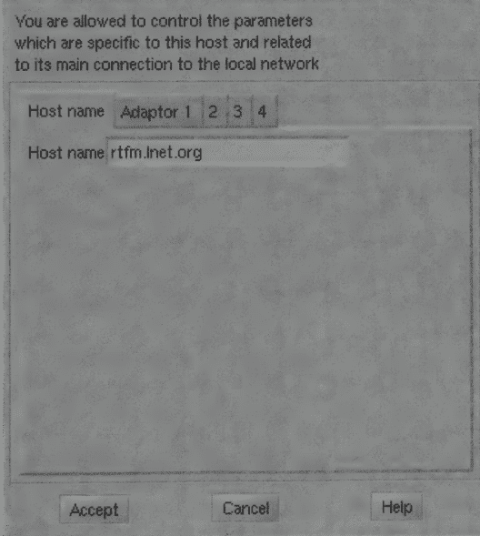

### 机器的基础配置

此选项卡允许你设置机器名称以及与机器关联的网络接口（大多数情况下为以太网卡）。

- 机器名称：
如果你至少有一个网络接口，机器名称将是分配给该网络接口的完整名称（FQDN，完全限定域名），这是你在安装期间指定的指定的。如果你想更改名称，请确保它与你的某个接口关联时是一个有效名称。

- 网络适配器配置：
这是一个 Tulip 类型以太网卡的配置示例。如果你使用 DHCP 或 BOOTP 进行配置，则不需要输入 IP 地址或名称。如果你选择手动配置，应该输入与接口相关的 IP 地址以及相应的名称，最后是一个别名。如果你使用 DNS（参见后文的 DNS 章节），机器名称必须与你的域名服务器匹配。

除非你无法根据 IP 地址（参考其类别）推算出网络掩码，否则不要输入网络掩码。如果不是，你的系统管理员完全可以给你指定的网络掩码。

使用的网络接口取决于你的外设类型：为以太网卡选择 `ethn`，其中 `n` 对应编号（注意避免冲突），为 ARCnet 外设选择 `arcn` 等。

你被允许控制特定此主机并与其本地网络主要连接相关的参数

| 主机名 | 适配器 1 | 2 | 3 | 4 |
|---|---|---|---|---|
| | 已启用 | | | |
| 配置模式 | 手动 | Dhcp | Bootp | |
| 主机名 + 域名 | rtfm.inet.org | | | |
| 别名 (可选) | rtfm | | | |
| IP 地址 | 10.0.0.1 | | | |
| 子网掩码 (可选) | 255.0.0.0 | | | |
| 网络设备 | eth0 | | | |
| 内核模块 | tulip | | | |
| I/O 端口 (可选) | | | | |
| 中断 (可选) | | | | |

使用的内核模块也取决于你的外设。只有当你拥有 ISA 外设时，才需要向模块输入选项。PCI 外设是自动配置的。

## 第 8 章 系统管理

### 域名解析 (DNS)

你可以指定使用哪个域名服务器来解析主机 IP 数字。使用 DNS 是在 TCP/IP 网络上处理此问题的方法。其他的是本地 `/etc/hosts` 文件（查看“关于其他主机的信息”菜单或 NIS 系统）。

| DNS 用途 | 正常运行需要 DNS |
| --- | --- |
| 默认域名 | |
| nameserver 1 | 10.0.0.1 |
| nameserver 2 (可选) | |
| nameserver 3 (可选) | |
| 搜索域 1 (可选) | net.org |
| 搜索域 2 (可选) | |
| 搜索域 3 (可选) | |
| 搜索域 4 (可选) | |
| 搜索域 5 (可选) | |
| 搜索域 6 (可选) | |

DNS（或域名系统）是互联网上用于将机器名称与 IP 地址关联的协议。域名解析并不仅仅使用 DNS，但这将在稍后讨论。只需告诉你的机器在需要时它必须如何“访问” DNS 服务器即可。

> 警告：不要读取域名，理解域名服务器……在这些字段中，你输入的是你的互联网服务提供商域名服务器的 IP 地址（而不是名称！）。除非你的机器直接连接域名服务器，否则不要勾选“正常使用需要 DNS”框——因此，如果你使用非永久性互联网连接并使用你互联网服务的域名服务器，请取消激活。

### 路由与网关

路由指定了你的机器访问其他网络的方式。如果物理网络上的某台机器连接到其他网络并允许你访问，它就是网关。因此，你应该通过指定该网关的名称或 IP 地址告诉你的机器这些网络是可访问的。例如，如果机器 `rtfm` (10.0.0.1) 是网络 `192.168.0.0` 的网关，你可以以此方式为机器 `vicie` (10.0.0.2) 指定：

如果你的网络可以访问其他网络，你必须告知如何到达这些网络。如果你只与本地网络上的机器通信，只需设置默认路由就足够了

| 设置 | |
|---|---|
| | 到其他网络的路由 |
| | 到其他主机的路由 |
| | 到本地的路由 |
| 配置 | 路由守护进程 |

## 第 8 章. 系统管理

如果你的网络可以访问其他网络，你必须说明如何到达这些网络

选择 `[添加]` 来添加新路由

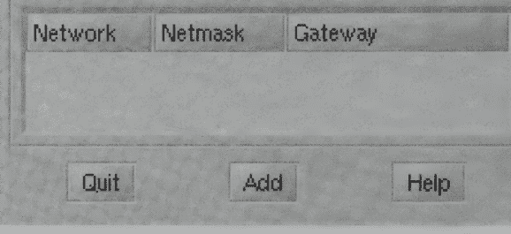

输入 IP 号或名称

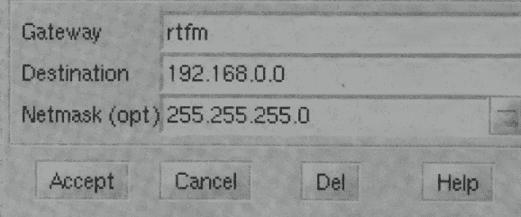

## 8.5. 使用 `LINUXCONF`

- `默认`

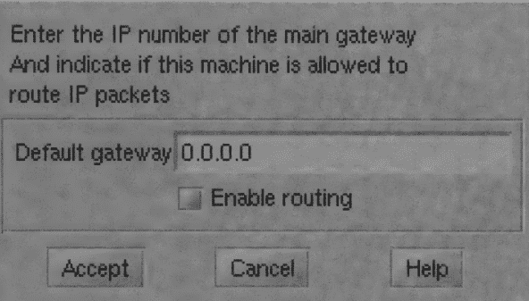

默认路由是用于所有目的地址不属于任何可访问子网络的 IP 数据包的路由。你需要将“默认网关”（Default gateway）字段配置为将作为默认路由器的机器。有两种可能：

1. 默认路由是固定的：如果是这样，你只需要输入相应接口的 IP 地址；
2. 默认路由是动态的：这种情况例如，例如通过调制解调器访问 Internet 的机器（参见“PPP/SLIP/PLIP”部分），其接口地址每次连接都会变化。因此，将值留为 `0.0.0.0`。默认路由将在连接时建立。

如果你的机器执行任何类型的路由，你可以勾选“激活路由”（Activate routing）选项（换句话说，如果你的机器连接到多个子网络，它必须能够将数据包从一个接口传输到另一个接口）。

- 路由守护进程

```
除非你的网络非常简单，否则需要 routed。

☑ 不导出任何路由（静默）

☐ 导出你的默认路由

接受 取消 帮助
```


如果你的机器作为一个或多个子网络的路由器运行，路由守护进程将为你省去在所有机器上设置所有子网络路由的繁琐任务。它的作用是向其他机器发送路由表条目。

如果你想发送路由表条目，你需要禁用“不发送任何路由”（`Do not send out any routes`）选项。如果你的机器同时也作为默认网关运行，你可以选择发送默认路由表。例如，如果你使用这台机器连接 Internet 并希望向所有其他机器发送路由时就是如此。

## 机器名的搜索路径

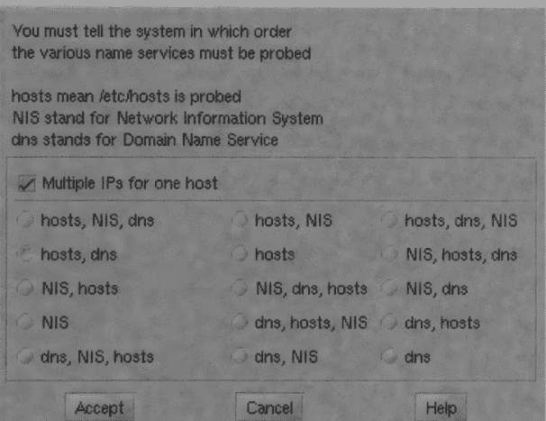

将 IP 地址解析为机器名有三种不同的方式：

1. `hosts`：系统在 `/etc/hosts` 文件中查找与 IP 地址或相应名称对应的条目，并返回所需的结果。这是最简单的方法，对于小型网络通常足够；
2. `DNS`：系统查询远程名称服务器。系统查询服务器的方法之前已解释过；
3. `NIS`（网络信息系统）：参见下段落

你可以使用或不使用任何你需要的服务，并指定查询服务的顺序。如果第一个失败，第二个将接管，依此类推。`hosts DNS` 是最好的折中方案，至少你不需要使用 `NIS`，就像在某些大型 Unix 网络中那样。

### NIS

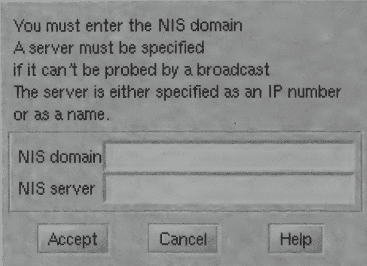

`NIS` 是由太阳微系统（Sun Microsystems）发明的一种协议。它避免了信息冗余，例如在“导出”用户账户、服务等方面。如果你想查询现有的 `NIS` 域，需要在相关字段中输入域名以及服务器的名称或地址。如果你想创建一个 `NIS` 服务，请咨询 `NIS-HOWTO`。

### PPP/SLIP/PLIP

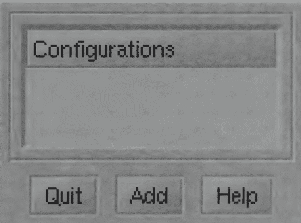

`PPP`、`SLIP` 和 `PLIP` 是三种类似于以太网卡的网络接口，但区别在于它们不是永久激活的。这就是为什么它们被分配了专门的章节。不会讨论 `SLIP` 和 `PLIP` 接口的配置，部分因为它们是两个不常用的接口，部分因为它们的配置相对简单。另一方面，`PPP` 接口非常常见：

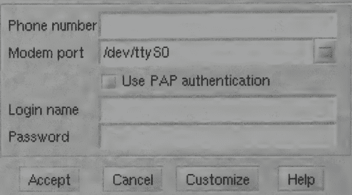

如果你想通过调制解调器建立 Internet 连接，你需要选择这种类型的接口。对应调制解调器的串口端口由文件 `/dev/ttySx` 指定，其中 `x` 代表串口号，`/dev/ttyS0` 对应于第一个并行端口（`COM1`）等。

你需要从你所选择的 Internet 服务提供商处查询你是否使用 `PAP`，如果是的话，你应该激活相应的选项，并且在此处填写连接名称和密码。然后你需要点击“自定义”（`Customize`），它包含四个个标签页。你只需要修改的选项如下：

1. `PAP` 标签页（如果你使用 `PAP`）；
2. 在“硬件”（`Hardware`）标签页中，你可以允许每个用户激活或禁用接口。

### 用户账户

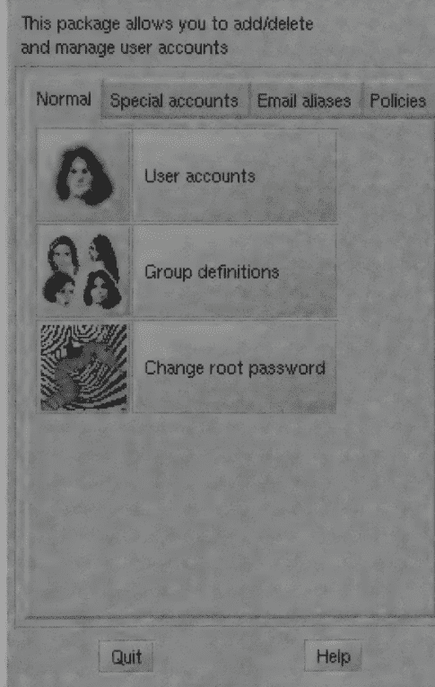

`linuxconf` 的此模块允许你在设置普通用户账户之外，设置特殊账户，如 `PPP` 账户（如果你的机器作为 `PPP` 服务器运行）、邮件别名和密码验证规则。即使你是一个重要网络的管理员，可能也不需要第一个标签页。

用户账户：

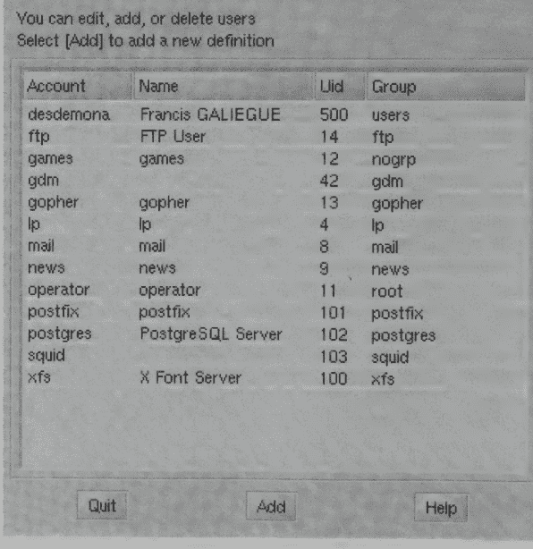

## 5.5. 使用 LINUXCONF

用户列表将如下所示。用户有一个标识其身份的数字（`uid`）。最好保留所有数字小于 500 的账户原样，它们具有。添加用户的对话框如下：

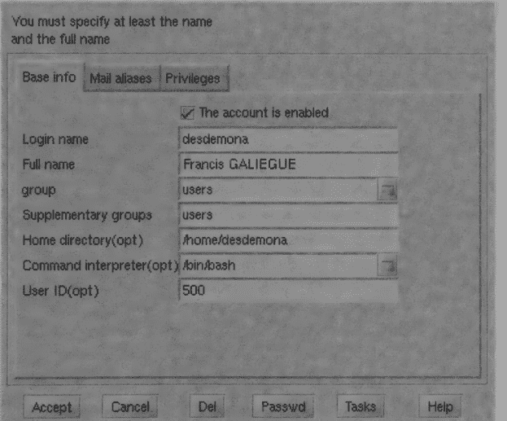

`Passwd` 按钮允许更改用户的密码。`Tasks` 按钮允许你按固定间隔执行任务（使用 `cron` 守护进程）。要执行的任务必须写在一行。这样，该任务将

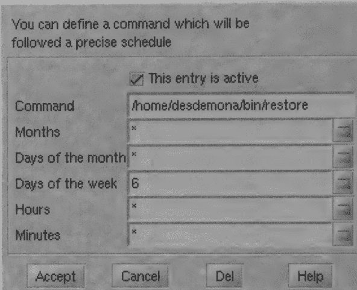

你可以激活和禁用所有条目。

用户组：原理与添加或删除用户非常相似。创建专用组可以帮助该组成员访问某些文件，前提是权限设置适当。用户可以属于一个或多个组。

## 8.5. 使用 LINUXCONF

你可以编辑、添加或删除组 选择 `[添加]` 来添加新定义

| 组 | ID | 备成员 |
|---|---|---|
| `nobody` | `yy` | |
| `nogrp` | `100` | `games` |
| `popusers` | `231` | |
| `postfix` | `233` | |
| `postgres` | `234` | |
| `pppusers` | `230` | |
| `root` | `0` | `root` |
| `slipusers` | `232` | |
| `slocate` | `21` | |
| `squid` | `16` | |
| `sys` | `3` | `root bin adm` |
| `tty` | `5` | |
| `users` | `500` | `desdemona` |
| `utmp` | `101` | |
| `uucp` | `14` | `uucp` |
| `wheel` | `10` | `root` |
| `xfs` | `102` | |

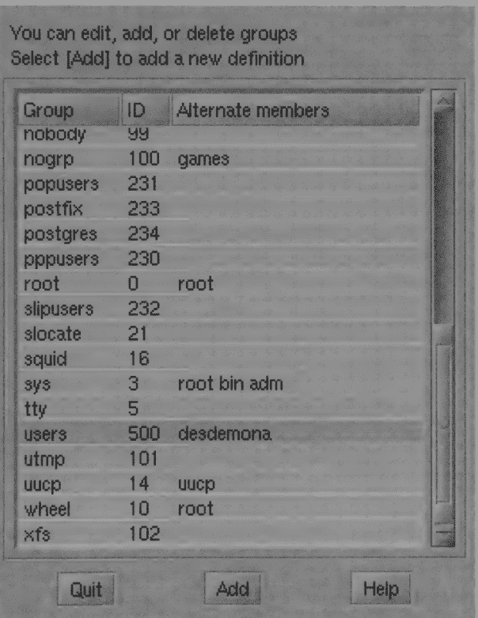

### 文件系统

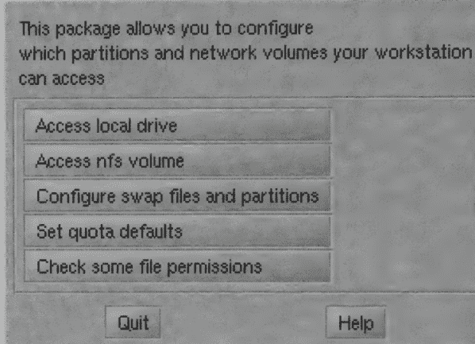

此模块允许你从繁琐的挂载命令中解放出来。你可以处理三种分区，即通过添加、删除或修改挂载选项。这里只处理本地磁盘，你可以选择“访问本地磁盘”标签页来访问它们。你将看到本地存储设备的列表（硬盘分区、磁盘、光驱、其他）。

添加分区需要填写不同的字段：

## 8.5 使用 LINUXCONF

你可以编辑、添加或删除挂载项
选择 `[Add]` 添加新定义

| 来源 | 挂载点 | 文件系统类型 | 大小 | 分区类型 | 状态 |
|---|---|---|---|---|---|
| `/dev/sda1` | `/` | `ext2` | `2055M` | `Linux(83)` | 已挂载 |
| `/dev/hdb1` | `/home` | `ext2` | `2051M` | `Linux(83)` | 已挂载 |
| `/dev/hda2` | `/usr` | `ext2` | `4094M` | `Linux(83)` | 已挂载 |
| `/dev/hdb3` | `/usr/local` | `ext2` | `1527M` | `Linux(83)` | 已挂载 |
| `/dev/hdc1` | `/opt` | `ext2` | `3098M` | `Linux(83)` | 已挂载 |
| `/dev/fd0` | `/mnt/floppy` | `vfat` | | | |
| `/dev/cdrom` | `/mnt/cdrom` | `iso9660` | | | |
| `none` | `/dev/ptspts` | `devpts` | | | 已挂载 |

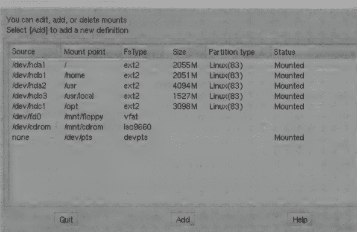

## 基础

在本节中，你指定要挂载的分区（这里是次主 IDE 磁盘的第一分区）、该分区上可能的文件系统类型以及将作为挂载点的目录。

## 第 8 章 系统管理

你必须输入卷或分区的规格，以及你希望在该工作站的目录结构中安装该卷的位置（挂载点）

| 基础 | 选项 | Dos 选项 | 杂项 |
| --- | --- | --- | --- |
| 分区 | `/dev/hdc1` | | | |
| 类型 | `ext2` | | | |
| 挂载点 | `/opt` | | | |

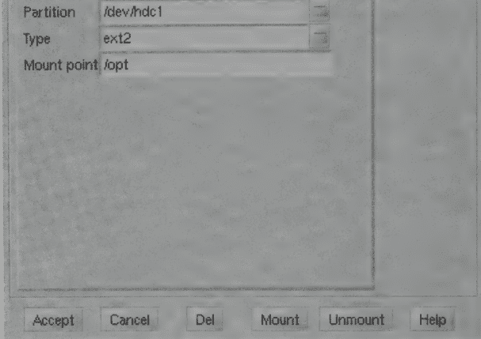

### 选项

本节介绍了一系列可能的挂载选项。注意，某些文件系统对应的某些选项没有实际意义。例如，`FAT` 分区（12, 16 或 32）不支持特殊文件或配额。

如果目标分区对于系统的运行至关重要，你应该将 `dump` 频率（`dump frequency`）字段设置为 1，否则该分区在启动时永远不会被检查，并且

## 8.5. 使用 LINUXCONF

你可能会面临糟糕的意外。根分区的 `fsck` 优先级（`fsck priority`）字段必须为 1，其他系统分区为 2 或更多。对于任何其他分区或非必需外设，这两个字段必须留为 0。

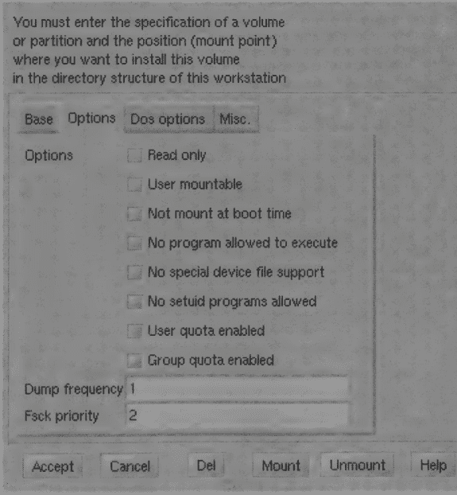

### DOS 选项

你必须输入卷或分区的规格，以及你希望在该工作站的目录结构中安装该卷的位置（挂载点）


正如名称所示，本节用于配置特定于 `DOS` 文件系统（`msdos` 和 `FAT`）的选项。如果指定了用户或组，则挂载目录的所有文件将属于该用户或组。默认权限（`default permission`）字段的格式与 `umask` 命令的格式相同。例如，`027` 赋予所有用户 (0) 所有权限，剥夺所有组的写入权限 (2)，并剥夺其他用户的所有权限 (7)。翻译模式（`translation mode`）可以留为 `auto`。

### 其他

正如名称所示，本节允许你指定前几节中提供的其他选项。查看 `mount` 手页以获取可用选项列表。

### 更多...

`linuxconf` 显然还有很多功能，而且你会发现这里没有讨论过的模块。如果你对网络服务（`NFS`, `NIS`, `Samba` 等）的配置感兴趣，我强烈建议你在尝试之前阅读相关的 `HOWTOs`。

## 第 9 章 文档

### 9.1 "HOWTOs"

`HOWTOs` 文档对于给定的主题非常详尽。例如，关于在 Linux 下刻录 CD，请参考 `CD-Writing HOWTO`。要设置防火墙，请参考 `firewall HOWTO`。

你也可以在 `/usr/doc/howto/` 目录下查看这些文档，格式有：`text`、`HTML`（使用 `kfm` 或 `netscape` 查看）或 `dvi`（使用 `xdvi` 查看）。`/usr/doc/howto/mini/` 包含了 `mini-HOWTO`。

以下是可用的 `HOWTO` 列表：

- `3Button-Mouse`
- `ADSL Linux-FreeBSD-mini-HOWTO`
- `ADSM-Backup Linux-NT-Loader`
- `Alife Linux-Win95`
- `Advocacy Load-Win95`
- `Apache-SSL-PHP-Loopback-Root-FS`
- `Back-With-MSDOS Mac-Terminal`
- `Battery-Powered Mail-Queue`
- `Boca Mail2News`
- `BogoMips Man-Page`
- `Bridge Modules`
- `Bridge-Firewall Multiboot-with-LILO`
- `Bzip2 NCD-X-Terminal`
- `Cable-Modem NFS-Root`
- `Clock NFS-Root-Client`
- `Coffee Netscape-Proxy`
- `Colour-ls News-Leafsite`
- `Cyrus-IMAP Offline-Mailing`
- `DHCP Partition`
- `DHCPcd Partition-Rescue`
- `DPT-Hardware-RAID Path`
- `Diald Pre-Installation-Checklist`
- `Diskless Process-Accounting`
- `Ext2fs-Undletion Proxy-ARP-Subnet`
- `Fax-Server Public-Web-Browser`
- `Firewall-Piercing Qmail-MH`
- `GIS-GRASS Quota`
- `GTEK-BBS-550 RCS`
- `Hard-Disk-Upgrade README`
- `INDEX RPM-Slack`
- `INDEX.html Remote-Boot`
- `IO-Port-Programming Remote-X-Apps`
- `IP-Alias SLIP-PPP-Emulator`
- `IP-Masquerade Sendmail-UUCP`
- `IP-Subnetworking Small-Memory`
- `ISP-Connectivity Software-Building`
- `Install-From-ZIP Software-RAID`
- `Kerneld Soundblaster-AWE`
- `LBX StarOffice`
- `LILO Term-Firewall`
- `Large-Disk TkRat`
- `Leased-Line Token-Ring`
- `Linux-DOS-Win95-OS2 Ultra-DMA`

### 第 9 章文档

- `DNS-HOWTO`
- `DOS-Win-Linux-HOWTO`
- `DOS-to-Linux-HOWTO`
- `Danish-HOWTO`
- `Distribution-HOWTO`
- `ELF-HOWTO`
- `Emacspeak-HOWTO`
- `Esperanto-HOWTO`
- `Ethernet-HOWTO`
- `Finnish-HOWTO`
- `Firewall-HOWTO`
- `French-HOWTO`
- `FTP-HOWTO`
- `GCC-HOWTO`
- `German-HOWTO`
- `Glib-HOWTO`
- `GRASS-Quota`
- `Hardware-HOWTO`
- `Hebrew-HOWTO`
- `INFO-SHEET`
- `IP-Alias-HOWTO`
- `IP-Chains-HOWTO`
- `IP-Hookup-HOWTO`
- `IP-Masquerade-HOWTO`
- `IP-Subnetworking-HOWTO`
- `IPX-HOWTO`
- `Installation-HOWTO`
- `Intranet-Server-HOWTO`
- `Italian-HOWTO`
- `Java-CGI-HOWTO`
- `Kernel-HOWTO`
- `Keyboard-and-Console-HOWTO`
- `KickStart-HOWTO`
- `Linux-Doc-HOWTO`
- `Linux-HOWTO`
- `Mail-HOWTO`
- `Mail2News-HOWTO`
- `Multi-Disk-HOWTO`
- `Multicast-HOWTO`
- `NET-3-HOWTO`
- `NFS-HOWTO`
- `NIS-HOWTO`
- `Networking-Overview-HOWTO`
- `Optical-Disk-HOWTO`
- `Oracle-HOWTO`
- `PCI-HOWTO`
- `PCMIA-HOWTO`
- `PPP-HOWTO`
- `Parallel-Processing-HOWTO`
- `Pilot-HOWTO`
- `Polish-HOWTO`
- `PostgreSQL-HOWTO`
- `Printing-HOWTO`
- `Printing-Usage-HOWTO`
- `Quake-HOWTO`
- `README`
- `Reading-List-HOWTO`
- `Root-RAID-HOWTO`
- `SMB-HOWTO`
- `Security-HOWTO`
- `Serial-Programming-HOWTO`
- `Shadow-Password-HOWTO`
- `Slovenian-HOWTO`
- `Sound-HOWTO`
- `Sound-Playing-HOWTO`
- `Spanish-HOWTO`
- `Text-Terminal-HOWTO`
- `Thai-HOWTO`
- `Tips-HOWTO`
- `UPS-HOWTO`
- `UUCP-HOWTO`
- `User-Group-HOWTO`
- `VAR-HOWTO`
- `VMS-to-Linux-HOWTO`
- `Virtual-Services-HOWTO`
- `WWW-HOWTO`
- `WWW-SQL-HOWTO`
- `XFree86-HOWTO`
- `Free86-Video-Timings-HOWTO`

### 9.1. "HOWTOS"

`Mini-HOWTOS`:

- `3Button-Mouse Linux-FreeBSD`
- `ADSL Linux-FreeBSD-mini-HOWTO`
- `ADSM-Backup Linux-NT-Loader`
- `Alife Linux-Win95`
- `Advocacy Load-Win95`
- `Apache-SSL-PHP-Loopback-Root-FS`
- `Back-With-MSDOS Mac-Terminal`
- `Battery-Powered Mail-Queue`
- `Boca Mail2News`
- `BogoMips Man-Page`
- `Bridge Modules`
- `Bridge-Firewall Multiboot-with-LILO`
- `Bzip2 NCD-X-Terminal`
- `Cable-Modem NFS-Root`
- `Clock NFS-Root-Client`
- `Coffee Netscape-Proxy`
- `Colour-ls News-Leafsite`
- `Cyrus-IMAP Offline-Mailing`
- `DHCP Partition`
- `DHCPcd Partition-Rescue`
- `DPT-Hardware-RAID Path`
- `Diald Pre-Installation-Checklist`
- `Diskless Process-Accounting`
- `Ext2fs-Undletion Proxy-ARP-Subnet`
- `Fax-Server Public-Web-Browser`
- `Firewall-Piercing Qmail-MH`
- `GIS-GRASS Quota`
- `GTEK-BBS-550 RCS`
- `Hard-Disk-Upgrade README`
- `INDEX RPM-Slack`

## 第 10 章

## 附录

### 10.1 常见问题 (FAQ)

以下是一些常见的 Linux-Mandrake 错误信息及其相应的解释。此 `FAQ` 在 Linux-Mandrake 网上定期更新。

“无法显示目录 `xxx` 的内容”

您没有读取该目录内容的权限。请检查目录权限。

“无法读取 `xxx`。文件不存在或访问被拒绝。”

通常，此的原因是您没有读取该文件的权限。请检查文件权限。

### "KFM 无法连接到 'localhost'"

您修改了环回配置。
输入：`localhost`

```
localhost
```


执行`ping localhost`

返回的内容将类似于：

```
PING localhost (127.0.0.1): 56 data bytes

64 bytes from 127.0.0.1: icmp_seq=0 ttl=64 time=0.3 ms
64 bytes from 127.0.0.1: icmp_seq=1 ttl=64 time=0.2 ms
```

如果是如此，您应该重新配置您的环回。在`/etc/hosts`中添加以下行：

```
127.0.0.1        localhost
```

然后重启电脑。如果仍然不起作用，请咨询技术支持。

### "我的打印机在之前的 Linux-Mandrake 版本中可以使用，但在 6.0 版本中无法工作"

`2.2.x`内核修改了并行端口的管理。为了修复此问题，编辑`/etc/conf.modules`文件并添加以下行：

```
alias parport_lowlevel parport_pc
options parport_pc io=0x378 irq=7
```

然后重启机器。
端口名称已经发生变化。如果您的打印机在`/dev/lp1`端口，现在它将位于`/dev/lp0`。打开`/etc/printcap`文件并将`lp1`替换为`lp0`。

### 10.2 LINUX-MANDRAKE 规范

在将之前的 Linux-Mandrake 版本更新到 6.0 后，K 菜单中的条目出现了重复。

当您更新 Linux-Mandrake 时，在某些情况下，K 菜单中的条目似乎重复了。这是由于旧文件以`.rpmsave`扩展名保留的。要解决此问题，输入：

```
rm -f '/opt/kde/share/applnk -name *.kdelnk.rpmsave -print'
```

然后重启图形界面（K 菜单/面板/重启）。

### "如何删除 LILO？”

使用 DOS 启动盘并输入`fdisk /mbr`。

### "LILO 安装不正确。我该怎么办？”

这通常由于磁盘几何结构的问题。通过修改`/etc/lilo.conf`文件添加`linear`选项。

### "我如何修改我的键盘配置？”

使用`/usr/sbin/kbdconfig`。

## 10.2 Linux-Mandrake 规范

Linux-Mandrake 是一个 Unix 类型系统，符合 POSIX 标准。它是一个真正的抢占式多任务多用户操作系统。它在 Intel x86 兼容平台上以 32 位保护模式运行，在其他架构（Sparc, Digital...）上以 64 位模式运行。它由一个内核和多个符合自由软件（或开源）标准的应用程序组成。

### 10.3 Linux-Mandrake 支持的硬件列表

请参阅 Linux-Mandrake 网站获取此主题的信息，因为列表会根据所用包的版本定期更新：`http://www.linux-mandrake.com/`

### 10.4 Mandrake 提供的软件包描述

Linux-Mandrake 提供的 RPM 软件包完整列表以及每个包的简要描述可以在第一张 CD-ROM（安装 CD-ROM）的`/doc`目录中找到。该列表按字母顺序排列。

## 第11 章

## 术语表

我们在这一部分收集了：

Account（账户）：由于 Linux-Mandrake 系统是多用户系统，因此有必要向系统标识您的身份，以便访问您的权限和参数。

Alias（别名）：命令的缩写。通常，要创建别名，输入：`alias='command'`。

Binary（二进制文件）：可执行的程序。

Boot（启动）：加载操作系统的过程。

Compilation（编译）：创建二进制文件的动作。

Console（控制台）：图形界面。

Daemons（守护进程）：在后台运行的服务。

Dependencies（依赖关系）：一个程序依赖于其他程序。

ELF：一种标准的二进制格式¹。

Emacs：一个非常强大的文本编辑器。

Ethernet（以太网）：计算机之间通信的协议。

Ext2：一种 Linux 的文件系统。

FTP：用于发送和接收文件的协议。

GNU：自由软件项目（“GNU 不是 Unix”）。

Home（主目录）：每个用户的个人目录。

KDE：Linux-Mandrake 的默认桌面。

Kernel（内核）：Linux 操作系统的核心。

Library（库）：不同应用程序共享的代码库。它等同于 Windows 下的 DLL 文件。

Link（链接）：指向另一个文件的条目。最为人知的是符号链接：它们允许您引用目录之外的文件。

Login（登录）：身份验证程序。

Loopback（环回）：允许您像连接到远程机器一样连接到您的本地系统。

MBR：主引导记录（或启动区）。

Mount point（挂载点）：附加到外设的目录。

Mounting（挂载）：为了让 Linux 能够使用外设，它必须对系统可见。

Multiprocessing（多处理）：这意味着计算机拥有多个处理器。

### NFS
网络文件系统（Network File System）。用于在几台计算机之间共享同一目录的协议。拥有共享的机器被称为“主机”（Host），其他被称为客户端。

### OS
操作系统（Operating system）。操作系统是在应用程序（如 Corel WordPerfect 或 Netscape）与硬件部分之间建立连接的程序。

### Path
访问路径。`PATH`变量描述了 shell 必须其中搜索以查找程序的目录。`echo $PATH`命令允许你找到输入参数（每个目录之间用冒号分隔）。

### Pipe
管道（即`|`字符）允许你将一个程序的输出提供给另一个程序。例如，`ls | less`允许你将`ls`命令的输出交给`less`程序。

### POSIX
由 Unix 组发布的一系列规范，用于确保程序在不同 Unix 系统下的兼容性。Linux-Mandrake 是兼容 POSIX 的。

### Proc
在你的文件结构中，你可以看到一个名为`/proc`的目录。然而，这个目录并不在你的磁盘上。

运行级别（Runlevels）被系统用于识别需要启动和停止哪些服务。级别 3 是默认级别。级别 6 对应重启，级别 0 对应完全停止。可以通过编辑`/etc/initstab`文件来更改级别。

### Service
也称为*守护进程*（daemons）。服务是在后台运行以响应精确请求的程序。例如，`telnetd`服务响应`telnet`请求。你的计算机可用的程序列表是可以配置的，并取决于你如何使用你的计算机。

### Shell
shell 是将你的命令传递给内核的接口名称。有几种不同的 shell，例如`bash`、C Shell、`zsh`等……`Bash` shell 是这些中最应用广泛的。

### Source
源代码代表开发者在任何编译之前编写的程序。为了满足精确的需求而定制程序，需要对源代码进行修改。

### Swap
当`RAM`内存满时，`Linux`使用磁盘上的一个虚拟文件来写入数据。与其他操作系统不同，`Linux`使用专门的分区（称为交换分区）来执行此操作。

### Telnet
远程连接程序。`Telnet`允许你在远程机器上执行程序，就好像它们运行在你自己的机器上一样，并可能将结果显示在你自己的屏幕上。

### UNIX
操作系统家族。所有的 Unix 系统都是多任务和多用户系统。Linux-Mandrake 是一个特殊的 Unix 系统。

### Vi
文本编辑器。`vi`既基础又非常强大，因为它没有图形界面而难以访问。在出现问题时，它通常是唯一可使用的编辑器。正因如此，任何 Linux 系统管理员都必须学会使用它！

### Wildcards
通配符用于在某些搜索过程中替换字符串。`*`符号用于替换字符字符串，`?`符号用于替换单个字符。

### X Terminal
X 终端是一种不持有任何数据，但执行程序并将数据存储在远程机器上的计算机。X 终端允许你在功耗方面使用轻量级配置。

### X Window
管理图形部分的程序和库的集合。Linux 使用的版本称为 XFree86。

### XTerm
终端窗口。这允许你在 X 界面下使用 shell 命令。还有其他具有相同目的的程序，如`rxvt`、`Terminal`、`Konsole`、`aterm`等。


### Linux-Mandrake™
一个易用且强大的 Linux 系统。


MandrakeSoft™


