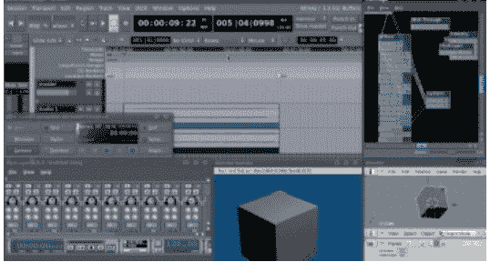
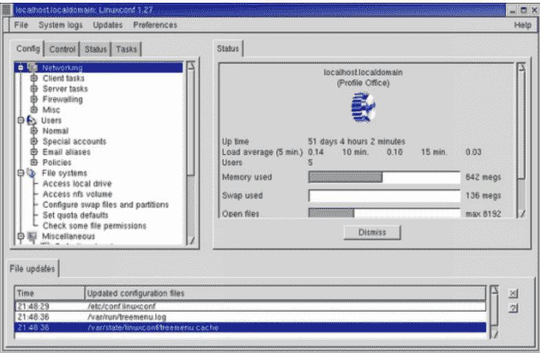

# Linux 精通：终极 Linux 操作系统与命令行精通指南

## 引言

我想感谢你，并祝贺你下载了《Linux 精通 - 终极 Linux 操作系统与命令行精通指南》这本书。

虽然 `Linux` 没有 `Windows` 那么流行——至少对某些人来说是这样——但它绝对是世界上最可靠的操作系统之一——最棒的一点是它是免费的，所以你不需要为了获取它而支付任何费用，你也不会因为付不起正版费用而不得不寻找冒版操作系统。比这更重要的是，`Linux` 可用于各种应用程序。无论你是选择为企业创建一个更好的系统，还是只是想更有创意地玩玩各种东西，`Linux` 都能帮助你完成出色的工作。

本书包含了如何利用 `Linux` 的经过的步骤和策略，无论是为了工作还是娱乐，帮助你理解必须使用的命令、选择发行版，并准确理解 `Linux` 为何如此重要以及更多内容。

相信，在读完这本书后，你将精通 `Linux`——并在你的需求中使用它将变得轻而易举。

现在阅读这本书，发现如何做到吧！

再次感谢下载本书，希望你喜欢它！

# 第 1 章 什么是 `Linux`？

那么，`Linux` 到底是什么？

首先，`Linux` 是一个基于 `UNIX` 和 `POSIX` 代码的免费开源操作系统。简而言之，它是免费下载、免费使用的，最初基于 `Intel x86` 范式。事实上，在所有操作系统中，`Linux` 的安装基数比其他系统都要大。这就是为什么运行 `Linux` 上的计算机或设备运行速度很快，有时甚至与那些惊人的超级计算机相媲美！这是因为 `Linux` 可以根据其被使用的任何类型的系统进行定制——而其他操作系统只能在特定类型的设备上运行良好。这归功于所谓的开源软件协作，这种协作支持各种库和目录。

`http://cdn1.mos.techradar.futurecdn.net/art/software/Linux/Best%20distro/linux-distros-im-650-80.jpg`

## 早期起源

1969 年，`UNIX` 操作系统（被称为 `Linux` 的祖先）在 `AT & T` 贝尔实验室创建，具有 `C` 语言基础，以及用于移植目的的高可用语言。在这样的背景下，该系统成为企业和学校管理员最依赖的操作系统。

然而，当一起反垄断案件阻止 `UNIX` 持续用于商业时，发生了一些争议，但由于其开发者及其支持者认为 `UNIX` 比人们想象的要多得多，他们决定开发 `GNU` 内核——正是因为这样，`LINUX` 终于应运而生。

## 进入 `Linux`

在其主要作者 `Lin Torvalds` 的帮助下，基于寻找一个所有人都可以使用的真正功能操作系统的原则，他决定致力于 `GNU` 内核。他想要一种人们（无论是专业人士还是只想用计算机或其他设备娱乐的人）都能真正使用的东西。然后他开始将内核创建的文件上传到 `FTP` 服务器，并想将其命名为 `"Freax"`，但他当时的合作者和其他专业人士认为这不是一个好主意，于是利用他的名字，`Linux` 在 1991 年诞生了！

1. 创建一种开源语言，它是免费的，每个人都能为开发做出贡献；
2. 创建一种与其竞争对手一样好的东西，确保它是易于理解的，并且是直观的；
3. 创建一种对日常任务有用的语言；
4. 简单创建与纯英语类似的编程语言、功能以及等等（注：OCR 文本包含重复）。

# 第 1 章 什么是 `Linux`？

那么，`Linux` 到底是什么？

首先，`Linux` 是一个基于 `UNIX` 和 `POSIX` 代码的免费开源操作系统。简而言之，它是免费下载、免费使用的，最初基于 `Intel x86` 范式。事实上，在所有操作系统中，`Linux` 的安装基数比其他系统都要大。这就是为什么运行 `Linux` 上的计算机或设备运行速度很快，有时甚至与那些惊人的超级计算机相媲美！这是因为 `Linux` 可以根据其被使用的任何类型的系统进行定制——而其他操作系统只能在特定类型的设备上运行良好。这归功于所谓的开源软件协作，这种协作支持各种库和目录。

`http://cdn1.mos.techradar.futurecdn.net/art/software/Linux/Best%20distro/linux-distros-im-650-80.jpg`

## 早期起源

1969 年，`UNIX` 操作系统（被称为 `Linux` 的祖先）在 `AT & T` 贝尔实验室创建，具有 `C` 语言基础，以及用于移植目的的高可用语言。在这样的背景下，该系统成为企业和学校管理员最依赖的操作系统。

然而，当一起反垄断案件阻止 `UNIX` 持续用于商业时，发生了一些争议，但由于其开发者及其支持者认为 `UNIX` 比人们想象的要多得多，他们决定开发 `GNU` 内核——正是因为这样，`LINUX` 终于应运而生。

## 进入 `Linux`

在其主要作者 `Lin Torvalds` 的帮助下，基于寻找一个所有人都可以使用的真正功能操作系统的原则，他决定致力于 `GNU` 内核。他想要一种人们（无论是专业人士还是只想用计算机或其他设备娱乐的人）都能真正使用的东西。然后他开始将内核创建的文件上传到 `FTP` 服务器，并想将其命名为 `"Freax"`，但他当时的合作者和其他专业人士认为这不是一个好主意，于是利用他的名字，`Linux` 在 1991 年诞生了！

1. 创建一种开源语言，它是免费的，每个人都能为开发做出贡献；
2. 创建一种与其竞争对手一样好的东西，确保它是易于理解的，并且是直观的；
3. 创建一种对日常任务有用的语言；
4. 简单创建与纯英语类似的编程语言、功能以及等等（注：OCR 文本包含重复）。

# 第 2 章 为什么选择 `Linux`？——`Linux` 的优势

除了之前提到的，为什么你必须选择 `Linux`？你从中可以获得什么？

嗯，如果你选择 `Linux` 作为你的操作系统，可以获得许多优势，其中包括：

## 极安全性

人们喜欢 `Linux` 的点之一是与其他操作系统相比，它是非常安全的。你需要理解的是，由于 `Linux` 是一个开源系统，即使某些程序员可能会创建对你的计算机“有害”的漏洞，你也可以预期反击触手可及。事实上，如果你能研究或学习它，你甚至可以自己创建。

## 出色的硬件和软件

如果你是那些使用笨大、过时计算机的人之一，或者你的计算机没有多少内存或处理能力，你会为 `Linux` 也能为它们运行而高兴。事实上——与上述相关——即使你的计算机没有防火墙或任何“安全创建”，你仍然可以预期运行无故障。

现在，在软件方面，`Linux` 也提供了丰富的选择。`Windows` 为每个应用提供一个版本——例如文本编辑器、`Microsoft Word`、`Windows` 视频制作，而 `Linux` 有成百上千的选项供你选择——而且都是免费的。所以，如果你想搜索文本编辑器，你只需要搜索，猜怎么着？会有很多选项呈现给你，这样你可以选择你最熟悉的、以及你认为能产生最佳结果的一个。

## 你拥有“选择权”

如前所述，你有权决定使用哪种软件。你还可以通过 `Linux` 按照你想要的设计桌面或设备。这让使用计算机或你拥有的任何设备的行为更加个性化——更像让你感到舒服的东西，并且对你来说非常容易管理。

—而且这并不好，特别是如果你是整个过程中的初学者的话。现在，你不仅能够轻松地学习需要做什么，而且当你想要按照你的方式以及你想要的外观使用你的电脑时，你不会再遇到困难。

## 灵活性

灵活性也是 `Linux` 的最大优点之一。通过 `Linux`，你将不必应付各种圈套、盗版软件、诈骗或任何让你难以“掌控”特定情况的情况。它还拥有许多你可以加入的论坛，如果安全或其他问题困扰着你，或让你感到困惑，你可以在那里一起思考这些问题。

## 多种编程范式

`Linux` 还支持多种编程范式，例如：

- `面向对象编程`。 这利用了对象的概念，例如字段、数据、数据结构及其属性。
- `命令式编程`。 与此同时，命令式编程涉及使用语句来修改程序的状态。简单来说，它处理的是程序如何实现其结果，而不是程序应该实现什么。
- `函数式编程`。 最后，`Linux` 同时也处理函数式编程，或者说处理通过数学计算和函数来开发结果的范式。

## 它兼容大多数设备！

你不需要购买新设备就可以使用 `Linux`。再次，正如前面提到的，它甚至可以运行在旧电脑上——这太了不起了，因为有些人在放弃他们的旧电脑和设备时会遇到问题——而你在使用 `Linux` 时绝不会有这种感觉。它的内核适用于旧和新设备，因此无需升级任何东西或购买新设备。


## 它简单易于理解

有时候，想要找到一个真正、最终对你有帮助好的产品或服务是非常困难的。但当涉及到 Linux 时，这种情况几乎瞬间发生——如果你是开源范式的新手，这简直太棒极了！

## 而且，它为你提供了很多选择！

Linux 的核心在于帮助你充分利用电脑中安装的内容。它并不具有排斥性。如果你不喜欢某些东西，它给了你机会去寻找其他的——寻找更好的。考虑到这一点，你去做应该做的事情就会变得更容易——并以你认为最适合你自己的方式来使用它。

你接下来需要做的是选择你自己的 Linux 发行版（Distribution）。基本上，这些只是你可以选择的 Linux 的不同版本，在作为操作系统方面，它们都是相同的，但在审美和它们的“工作”方式上有所不同。

基本上，有各种发行版供选择，但有七个是最受信任的，它们是：

### Ubuntu


Ubuntu 可能是最流行的 Linux 发版之一，如果你是 Linux 新手且以前没有尝试过，被认为是最佳选择。Ubuntu 拥有非常易于安装的仓库，而且非常可定制——非常适合艺术和媒体从业者，或那些对屏幕显示内容极其仔细的人。Ubuntu 的问题在于，与其他发行版相比，它在移动设备上的表现并不理想——这可能会是一个问题，特别是如果你那种一直盯着移动设备的人。

### Solus


Solus 具有那种现代感，事实上，它是相当较新的，因为它是在 2012 年发布的——那时 Ubuntu 主要被用于学校和企业。有些人说 Solus 最好的地方在于它的审美感，因为它确实有一种优雅、赏心眼的感觉。不过，有一点是，目前还没有太多的“Solus 社区”，所以如果你在这个发行版上遇到问题，你可能需要自己寻找解决方案。

### Mint Cinnamon


一个听起来很新鲜的名字，不是吗？嗯，Mint Cinnamon 实际上具有这种清新、轻盈的感觉，因为它利用白色和灰色来进行审美设计。它是一个非常极简主义的 Linux 发行版——非常适合不喜欢在屏幕上看到很多花哨和任何彩色内容的人。最好的一点是它的仓库和 Ubuntu 相同，所以你理解它们不会太困难，而且它的 UI 需求也较低——所以它对你的电脑以及对将要它的你来说都不会有太大负担。Mint Cinnamon 也认为非常适合初学者，因为前面提到的，它没什么需要理解的——你真的不需要为它为自己为难。

### Ubuntu Studio




正如名称所示，这个 Linux 版本非常适合制片人、音频工程师、设计师和艺术家，他们需要处理各种多媒体，并且需要为该目的量身定制的电脑或设备——Ubuntu Studio 绝对让这一切变得简单。自 2007 年以来，它一直有一个名为“Audio”的多轨道数字录音机和序列器，全球许多艺术家都在使用它。它最棒的一点是它可以合成吉他和和其他乐器，确保你的输出非常悦耳，而不是那么难以处理。因此，你可以创建出专业质量的项目——而不需要花费很多钱。

### Arch Linux


这被认为非常适合专业人士，因为你必须亲自对它进行工作和定制。事实上，它不像其他发行版那样带有许多应用程序，这意味着你必须知道自己在做什么。借此，你必须应用“保持简短简单”的哲学，因为下载太多会让你感到困惑。找到你真正想要的东西，然后修剪或丢弃那些你认为不重要的东西，这样你的屏幕就不会拥挤，你就可以充分利用这个发行版了。然而，它的好处在于你可以学到很多东西，即使开始可能会遇到困难，请放心，你会度过那关，并体验到 Arch Linux 的真面目。

### Chrome OS


它被认为是 Linux 的一种非常接近的形式，而且最后，它可能是一个发行版。

# 第 4 章 准备安装 Linux

在安装 Linux 之前，请确保你对它提出的要求有所了解。基本上，这些是：

### Linux 不仅仅是 Linux

如果你正确阅读了前面的章节，你就会理解 Linux 不仅仅是一个操作系统，或者一个随着时间不断演进的版本。Linux 包含了许多版本。如果你对 GNU 感到困惑，你可以把它看作是应用程序、调度器、文本编辑器以及任何可以在命令行中使用的工具的集合。


此外，还有一个 Gnome3 活动面板，允许你从各种 Linux 桌面环境中进行选择。如果你只是想让你的桌面变得好趣而不是让它变得单调，你可以选择多个。然后，你可以按照自己的意愿进行配置。

## 有不同的设备、文件和文件夹。

Linux 并不是 Windows——这起初可能会让你感到困惑，但请记住，即使屏幕上的文件夹名称不同，它们也以相同的范式运行——尽管这种方式得到了极大改进。


基本上，文件系统从根目录（`root`）开始，它也被称为“简单路径”——它是一切的源头，也是去的地方。所以，如果你在旅行并想带上笔记本电脑，你可以选择一个端口用于外出，另一个端口用于家里的文件——这不会导致你的系统崩溃。这很很好，因为它虽然很困惑，但能让你专注于此。

除了根目录和分区之外，事情看起来和你习惯的有些相似，但你可能还会注意到它们现在更整洁了，或者看起来更舒服。这些文件扩展名是为了帮助你作为用户，这意味着虽然它们在旅途中可能会让你困惑，但你学习它们并不会困难——你迟早会感激它们的。

## 有非常优秀的软件仓库。

你知道在 Windows 中，你通常必须要在网上搜索你需要的应用程序或程序吗？而且，如果你没有使用 Google Play 或 App Store，你可能不得不对找到的内容进行过滤，因为它们可能不是正版的，或者可能无法运行？很好，在 Linux 上你不会遇到这种情况。


Linux 拥有一些最好的软件仓库——你可以根据自己的喜好选择软件包，以决定什么最适合你。从软件中心（`Software Center`），你可以选择各种类型的包，并放心所有这些包都是正常工作的。从这里获取病毒是不常见的，而且如果发生了，你也可以轻松地找到解药——这绝对是完美的，尤其是当你刚开始接触 Linux 的时候！

它将帮助你欣赏并理解“开源”范式。

免费软件并不意味着质量不高，或者那么容易发生故障。在 Linux 的帮助下，你会意识到，有时生活中最美好的东西确实是免费的。它将帮助你对事物产生不同的看法，特别是在涉及技术时，你会把电脑和其他设备看作不仅仅是虚拟机，而是看作是可以你可以个性化并在各种方面真正帮助你的东西。

而且，它对你的设备是安全的！


```
alex@Mari ~# sudo pacman -Syu
[sudo] password for alex:
:: Synchronizing package databases...
 core is up to date
extra is up to date
community is up to date
multilib is up to date
:: Starting full system upgrade...
 resolving dependencies...
 Looking for conflicting packages...
Packages (58) avahi-0.6.32r-1 boost-1.59.0-2 cgal-4.7-1
chromium-48.0.2491.72 dbus-1.10.0-4
device-manager-1.2.5-1 git-2.26.2-1 glib2-2.46.1
nome-system-monitor-3.18.0-1 gptdisk-1.0.1 libudev-20150310-1
sd-networkd-systemd-20150310-1
```

Linux 不是那种运行极其缓慢以至于损害你电脑或任何设备健康的操作系统。事实上，你可以轻松地搜索并使用针对 Linux 错误和其他损坏的解药。它不会让你独自置于黑暗中，也不会让你感到迷茫，特别是如果你还是初学者，或者以前用过这个操作系统。所以，与其面对你的死机并寻找昂贵且困难的方法来解决问题，你现在就可以这样做。它运行很快（正如本书反复强调的），而且易于理解——所以设备再也不会病了。

# 第5章 安装 Linux

当然，在使用任何 Linux 发行版之前，安装它是至关重要的。为了让这一切发生，你需要：

从官方网站（`https://www.linux.org/`）下载最新版本。你也可以在系统中找到它。

你可以尝试运行：

```
alex@Mari ~# sudo pacman -Syu
[同步内容]
:: Synchronizing package databases...
core is up to date
extra is up to date
community is up to date
multilib is up to date
:: Starting full system upgrade...
resolving dependencies...
Looking for conflicting packages...
Packages (58) avahi-0.6.32r-1 boost-1.59.0-2 cgal-4.7-1
chromium-48.0.2491.72 dbus-1.10.0-4
device-manager-1.2.5-1 git-2.26.2-1 glib2-2.46.1
nome-system-monitor-3.18.0-1 gptdisk-1.0.1 libudev-20150310-1
sd-networkd-systemd-20150310-1
```

`http://s0.cybercity.org/uploads/cms/2015/09/ubuntu-debian-apt-get-screenfetch.jpg`

## 版本2.0（如果上述方法无效）

你也可以打开命令提示符（开始 > 所有程序 > 命令提示符）。

然后，在命令提示符窗口中输入 `set path=%path%;` 并回车，你可以从此链接下载：`http://pypi.org/simplejson`

将包解压到下载目录。完成后，你应该会在屏幕上看到类似的内容：`C:\Users\pdxNat\Downloads\simplejson-2.1.6`

# 第 6 章 使用 Linux 进行工作和娱乐

如前所述，Linux 可用于各种应用程序——既可以用于工作，也可以用于娱乐。

## 用于工作

在严肃方面，Linux 可以运行于超级计算机。事实上，在过去的“地球模拟器（Earth Simulator）”超级计算机退役后，它是所有超级计算机所使用的操作系统。NASA 的所有计算机和应用程序也使用了 Linux——所以它确实是一项能让地球更接近太空的技术，并帮助许多人了解宇宙！在某些办公室内，Linux 被用于创建一个高效的输入/输出系统——而且消除了其他操作系统带来的缓慢感。

Linux 还适用于嵌入式系统，或任何使用“实时”机制的设备。例如，如果你想看“电视”但没有电视机，只能使用像 `BusyBox` 这样的设备，你可以预期实时屏幕上显示的内容也会被 `BusyBox` 捕获——是实时的！这意味着你将不会错过任何内容——所以如果你是一名媒体从业者，这无疑可以辅助你的工作。

Linux 也被用于移动设备，以确保虚拟化变得简单且普及，并帮助用户获得尽可能好的虚拟体验——对于那些在广告中使用增强现实技术的广告商来说非常完美。此外，Linux 还被用于大多数服务器，特别是位于 `LYCE` 和 `LYME` 下运行的动态网站（即分别使用 `LAMP` 的网站）。它还适用于云计算，以及管理的服务、基础设施等。

## 用于娱乐

当然，Linux 在娱乐方面也表现极佳！它可以作为一个人机交互设备，以及在 `Android` 等其他移动设备上玩你喜欢的游戏的地方，因为 Linux 可以作为一个出色的游戏平台，像 `Valve` 这样的游戏巨头已从 2012 年开始选择 Linux 作为其应用的平台。著名的 `Steam` 也使用 Linux，并帮助客户理解它其实并不疏远——而且它可以帮助人们更快速、更愉快地玩游戏。

简而言之，Linux 涵盖了你需要的大部分——这就是为什么你应该尝试一下的原因。

# 第 7 章 认识命令

有很多命令可以让你使用 Linux 的方式变得更加简单、更好。你可以在下方学习更多信息。

主要关键词/命令：

- `zip`

  打包并压缩文件。

- `yes`

  持续打印字符串直到被中断

- `xz`

  压缩或解压 `.xz` 和 `.lzma` 文件

- `xdg-open`

  在用户首选应用程序中打开 URL 或文件

- `xargs`

  执行实用程序，传递构造的参数列表

- `write`

  向另一个用户发送消息

- `whoami`

  打印当前用户 ID 和名称（`id -un`）

- `who`

  打印所有当前登录的用户名

- `while`

  执行命令

- `which`

  在用户的 `$path` 中搜索程序文件

- `whereis`

  在用户的 `$Path`、手动帮助页（`man` pages）和源文件中搜索程序

- `wget`

  通过 HTTP、HTTPS 或 FTP 获取网页或文件

- `wc`

  打印字节数、单词数和行数

- `watch`

  定期（周期性）执行/显示一个程序

- `wait`

  等待进程完成

- `vmstat`

  报告虚拟内存统计信息

- `vi`

  文本编辑器

- `vdir`

  详细列出目录内容（`ls -l -b`）

- `Verbosely`

  详细列出目录内容（`ls -l -b`）

- `uencode`

  对二进制文件编码

- `uudecode`

  解码由 `uencode` 创建的文件

- `users`

  列出当前登录的用户

- `usermod`

  修改用户账户

- `userdel`

  删除用户账户

- `useradd`

  创建新用户账户

- `uptime`

  显示运行时间

- `until`

  执行命令（直到错误）

- `unshar`

  解包 shell 存档脚本

- `unset`

  移除变量或函数名

- `unrar`

  从 `rar` 存档中提取文件

- `units`

  将单位从一种比例转换为另一种

- `uniq`

  唯一化文件

- `unexpand`

  将空格转换为制表符

- `uname`

  打印系统信息

- `unalias`

  删除别名

- `umount`

  卸载设备

- `umask`

  用户文件创建掩码

- `ulimit`

  限制用户资源

- `type`

  描述命令

- `tty`

  打印标准输入上终端的文件名

- `tsort`

  拓扑排序

- `true`

  什么都不做，成功

- `trap`

  在设置信号时运行命令 (`bourne`)

- `traceroute`

  追踪到主机的路由

- `tr`

  翻译、压缩和/或删除字符

- `tput`

  设置终端相关的能力、颜色、位置

- `touch`

  更改文件时间戳

- `top`

  列出系统上运行的进程

- `times`

  用户和系统时间

- `timeout`

  在时间限制内运行命令

- `time`

  测量程序运行时间

- `test`

  评估条件表达式

- `tee`

  将输出重定向到多个文件

- `tar`

  在存档中存储、列出或提取文件

- `tail`

  输出文件的最后部分

- `sync`

  将磁盘数据与内存同步

- `suspend`

  暂停此 shell 的执行

- `sum`

  打印文件的和

- `sudo`

  以另一个用户的身份执行命令

- `su`

  切换用户身份

- `strace`

  追踪系统调用和信号

- `stat`

  显示文件或文件系统状态

- `ssh`

  安全 Shell 客户端

- `split`

  将文件分成固定大小的份

- `source`

  从文件运行命令

- `sort`

  排序文本文件

- `slocate`

  查找文件

- `sleep`


延迟指定的时间

- `shutdown`

关闭或重启 `linux`

- `shopt`

Shell 选项

- `shift`

移动位置参数

- `sftp`

安全文件传输程序

- `set`

操作 shell 变量和函数

- `seq`

打印数字序列

- `select`

接受键盘输入

- `sed`

流编辑器

- `sdiff`

交互式合并两个文件

- `screen`

终端复用，通过 `ssh` 运行远程 shell

- `scp`

安全复制或创建远程文件副本

- `rsync`

远程文件复制

- `rmdir`

删除文件夹/

- `rm`

删除文件

- `rev`

反转文件的行

- `return`

退出 shell 函数

- `renice`

更改运行进程的优先级

- `rename`

重命名文件

- `remsync`

通过电子邮件同步远程文件

- `reboot`

重启系统

- `readonly`

将变量/函数标记为只读

- `readarray`

从标准输入读取到数组变量

- `read`

从标准输入读取

- `rcp`

在两台机器之间复制文件

- `rar`

压缩存档文件

- `ram`

`ram` 设备

- `quotacheck`

扫描文件系统的磁盘占用

- `quota`

显示磁盘使用情况和限制

- `pwd`

打印工作目录

- `pv`

监控通过管道的数据进度

- `pushd`

保存并切换当前目录

- `ps`

进程状态

- `printf`

格式化并打印数据

- `printenv`

打印环境变量

- `printcap`

打印机能力数据库

- `pr`

准备打印文件

- `popd`

恢复之前目录的值

- `pkill`

按名称杀死进程

- `kill`

通过指定 `PID` 杀死进程

- `join`

按共同字段合并行

- `jobs`

列出活动作业

- `ip`

路由、设备和隧道

- `install`

复制文件并设置属性

- `import`

捕获 X 屏幕并保存图像到文件

- `ifup`

启动接口

- `logout`

退出登录 shell

- `logname`

打印当前登录名

- `locate`

查找文件

- `local`

创建变量

- `ln`

为文件创建符号链接

- `link`

为文件创建链接

- `let`

对 shell 变量执行算术运算

- `less`

分页显示输出

- `killall`

按名称杀死所有进程

- `nl`

给行编号并写入文件

- `look`

显示以指定字符串开头的行

- `paste`

合并文件

- `passwd`

修改用户密码

- `open`

在默认应用程序中打开文件

- `op`

操作员访问

- `nslookup`

查询 `DNS` 服务器

- `notify-send`

发送桌面通知

- `nohup`

运行不受挂起的命令

- `nice`

设置命令或作业的优先级

- `netstat`

网络信息

- `nc`

`Netcat`，在网络上读取和写入数据

- `mv`

移动或重命名文件或目录

- `mtr`

网络诊断

- `mtools`

处理 MS-DOS 文件

- `mount`

挂载文件系统

- `most`

浏览或分页查看文本文件

- `more`

分页显示输出

- `mnvy`

批量移动和重命名/s

- `mknod`

创建块或字符特殊文件

- `mkisofs`

创建混合 `ISO9660`/`JOLIET`/`HFS` 文件系统

- `mkfifo`

创建 `FIFOs`

- `mkdir`

创建新文件夹/

- `man`

帮助手册

- `make`

重新编译一组程序

- `lsof`

列出打开的文件

- `ls`

列出文件信息

- `lprm`

从打印队列中删除作业

- `lprintq`

列出打印队列

- `lprintd`

取消打印作业

- `lprint`

打印文件

- `lpr`

离线打印

- `lpc`

行打印机控制

启动网络接口

- `ifdown`

停止网络接口

- `ifconfig`

配置网络接口

- `if`

条件条件执行命令

- `id`

打印用户和组的 `ID`

- `iconv`

转换文件的字符集

- `htop`

交互式进程查看器

- `hostname`

打印或设置系统主机

- `history`

命令历史

- `help`

显示内置命令的帮助信息

- `head`

输出文件的开头部分

- `hash`

记住名称参数的完整路径

- `gzip`

解压或压缩指定的文件

- `groups`

打印用户所属的组名

- `groupmod`

修改组

- `groupdel`

删除组

- `groupadd`

添加用户安全组

- `grep`

在文件中搜索匹配给定模式的行

- `getopts`

解析位置参数

- `gawk`

在文件中查找并替换文本

- `fuser`

识别/杀死正在访问文件的进程

- `function`

定义函数宏

- `ftp`

文件传输协议

- `fsck`

文件系统一致性检查和修复

- `free`

显示内存使用情况

- `format`

格式化磁盘或磁带

- `for`

扩展单词并执行命令

- `fold`

折叠文本以适应指定的宽度

- `fmt`

重新格式化段落文本

- `find` 搜索符合特定标准的文件

- `file`

确定文件类型

- `fgrep`

在文件中搜索匹配固定字符串的行

- `fg`

将作业发送到前台

- `fdisk` `Linux` 分区表操作工具

- `fdformat` 低级格式化软磁盘

- `false` 什么都不做，并返回失败

- `expr` 求值表达式

- `export` 设置环境变量

- `expect` 自动化处理通过终端访问的任意应用程序

- `expand` 将制表符转换为空格

- `exit` 退出 shell

- `exec` 执行命令

- `eval` 求值多个命令/参数

- `ethtool` 以太网卡设置

- `env` 环境变量

- `enable` 启用和禁用内置 shell 命令

- `eject` 弹出可移动媒体

- `egrep` 在文件中搜索匹配扩展表达式的行

- `echo` 在屏幕上显示消息

- `du` 估算文件用量

- `dmesg` 打印内核和驱动程序消息

- `dirs` 显示已记忆目录列表

- `dirname` 将完整路径转换为纯路径

- `dircolors` `ls` 的颜色设置

- `dir` 简要列出目录内容

- `dig` `DNS` 查询

- `diff3` 显示三个文件之间的差异

- `diff` 显示两个文件之间的差异

- `df` 显示空磁盘空间

- `declare` 声明变量并赋予属性

- `ddrescue` 数据恢复

- `dd` 转换并复制文件，写入磁盘头、引导记录

- `dc` 桌面计算器

- `date` 显示或更改日期和时间

- `cut` 将文件分成若干部分

- `curl` 从服务器向服务器传输数据

- `csplit` 将文件分割为上下文决的部分

- `crontab` 调度命令在稍后运行

- `cron` 执行调度命令的守护进程

- `cp` 将一个或多个文件复制到另一个位置

- `continue` 继续循环的下次迭代

- `command` 运行命令 - 忽略 shell 函数

- `comm` 按行比较两个已排序的文件

- `cmp` 比较两个文件

- `clear` 清除终端屏幕

- `cksum` 打印 `CRC` 校验和和字节数

- `chroot` 在不同的根目录下运行命令

- `chown` 更改文件所有者和组

- `chmod` 修改访问权限

- `chkconfig` 系统服务

- `chgrp` 修改组所有权

- `cfdisk` `Linux` 分区表操作工具

- `cd` 切换目录

- `cat` 拼接并打印文件内容

- `case` 条件执行命令

- `cal` 显示日历

- `bzip2` 解压或压缩指定的文件

- `builtin` 运行 shell 内置

- `break` 退出循环

- `bind` 设置或显示 `readline` 按键和函数绑定

- `bg` 发送至后台

- `bc` 任意精度计算器语言

- `bash` `GNU` `Bourne-Again` `Shell`

- `basename` 去掉文件名中的目录和后缀

- `awk` 查找并替换文本，数据库 `sort`/`validate`/`index`

- `aspell` 查找并替换文本，数据库 `sort`/`validate`/`index`

- `aspell` 查找并替换文本，数据库/`Ubuntu`

- `apt-get` 搜索软件包

- `Comment` 运行命令

# Numbers are:

```
var1
var2
```

# `apt-get-`

- `aptitude` 搜索软件包

- `Comment` 运行命令

# Numbers are:

```
var1
var2
```

# `apt-get-`

- `aptitude` 搜索软件包

- `Comment` 运行命令

# Numbers are:

```
var1
var2
```


# apt-get-

## aptitude 搜索软件包

## Comment 运行命令

# Numbers are:

```
var1
var2
```

# apt-get-

## aptitude 搜索软件包

## Comment 运行命令

# Numbers are:

```
var1
var2
```

## 内置字符串方法

`Zfill(width)`。在原始字符串左侧填充零。

`Upper()`。将小写字母转换为大写字母。

`Translate(table, deletechars="")` 将字符串转换为翻译表。

`Title()`。将字符串转换为标题大小版本，这意味着大写字母变为小写字母，反之亦然。

`Swapcase()`。字符串中的所有字母都将反转。

`Strip([chars])`。对每个字符串执行 `rstrip()` 和 `lstrip()`。

`Startswith(str, beg=0, end=len(str))`。检查字符串是否是字符串本身或字符串的子集。

`Splitlines(num=string.count("\n"))`。返回每一行并作为新字符串。

`Split(sep="", num=string.count(sep))`。将字符串拆分为分隔符。

`Rjust(width, [fillchar])`。这将为你提供右填充的字符串。

`Rindex(str, beg=0, end=len(string))`。这与 `index` 类似，但针对反向字符串。

`Replace(old, new, [max])`。以最大出现次数替换字符串。

`Max(str)`。返回字母表中顺序最大的字符。

`Join(seq)`。合并字符串的表示形式。

`Isdecimal()`。如果 Unicode 字符串包含数字字符，则值返回 true；否则返回 false。

`Find(str, beg=0, end=len(string))`。检查 `str` 是否在字符串或后续字符串中。

`Expandtabs(tabsize=8)`。将字符串和制表符放在多个空格中。

`Encode(suffix, beg=0, end=len(string))`。运行每个字符串的编码版本。

`Decode(encoding="UTF-8", errors=strict)`。注册编码的编码器将用于此方法，你将得到默认字符串。

`Count(str, beg=0, end=len(string))`。统计字符串出现的次数并开始索引。

`Center(width, fill)`。与原始字符串一起，这将给你一个空格填充的字符串，占用列的总宽度。

`Capitalize()`。这基本上是将字符串的首字母大写。

## 格式符号及其功能

- `%X` 十六进制整数（大写字母）
- `%x` 十六进制整数（小写字母）
- `%u` 无符号十进制整数
- `%s` 格式化前通过 `str()` 进行字符串转换
- `%o` 八进制整数
- `%i` 有符号十进制整数
- `%g` `%f` 和 `%e` 中较短的一个
- `%G` `%f` 和 `%E` 中较短的一个
- `%f` 浮点实数
- `%E` 指数计数法（带有大写 ‘E’）
- `%e` 指数计数法（带有小写 ‘e’）
- `%d` 有符号十进制整数
- `%c` 字符

## 其他重要符号

- `m.n.` `m` 是最小总宽度，`n` 是小数点后的显示位数（如果适用）
- `0.` 从左侧填充零（而不是空格）
- `<sp>.` 在正数前留出空白格
- `+.` 显示符号
- `*` 参数指定宽度或精度
- `(var.)` 映射变量（字典参数）
- `%.` ‘`%%`’ 留给你单个字面量 ‘`%`’
- `#` 添加八进制前导零（‘`0`’）或十六进制前导‘`0x`’或‘`0X`’，取决于使用了 ‘`x`’ 还是 ‘`X`’。
- 左对齐

# 第 8 章 管理文件和目录

管理 Linux 文件和目录将帮助你控制一切。与任何类型的操作系统一样，确保你了解系统正在发生什么是非常重要的，这样它才不会崩溃。更重要的是，这是对系统中拥有的事物的一种关注方式。在本章中学习更多相关知识。

## 地址目录

正如名称所示，这是一种电信协议，使得通信应用和网站能够轻松工作。它用于映射网络地址，使得消息——甚至视频通话成为可能，并已用于重要技术，例如 `Xerox PARC` 通用数据包、`DEC Net`、`ChaosNet` 和 `IPv4` 等。对于这些，你可以记住以下内容：

- 1. 0 – 硬件类型 (`HTYPE`)
- 2. 2 – 协议类型 (`PTYPE`)
- 3. 4 – 硬件地址 (`HLEN`) | 协议地址 (`PLEN`)
- 4. 6 – 操作 (`OPER`)
- 5. 8 – 发送方硬件地址 (`SHA`)
- 6. 10 – 后继的两个字节
- 7. 12 – 后继的两个字节
- 8. 14 – 发送方地址协议 (`SAP`)
- 9. 16 – 后继的两个字节
- 10. 18 – 目标硬件地址 (`THA`)
- 11. 20 – 后继的两个字节
- 12. 22 – 后继的两个字节
- 13. 24 – 目标协议地址 (`TPA`)
- 14. 26 – 后继的两个字节

## 传输目录

传输目录包含涉及 Linux 的数据通道，这些通道还建立了进程间的连接和端到端的消息传输，为网络中的任何特定目的提供了正确的信息和逻辑支持。这可以通过无连接的或面向对象的方式来实现。

端口在传输层的帮助下建立，传输层是逻辑结构所在的地方。这基本上意味着：

- 1. 数据应该是正确的——且只能有极小的错误；
- 2. 数据应该按顺序到达；
- 3. 数据应该包含流量拥塞控制；
- 4. 丢弃或丢失的数据包必须重发，并且；
- 5. 重复数据必须丢弃。

当这种情况时，你可以预期最新版本的流控制协议（`Stream Control Protocol`）正常工作。然而，你并不需要依赖数据报文，因为正如名称所示，它们并不可靠。



`http://www.linuxjournal.com/files/linuxjournal/linuxjournal/articles/059/5918f`

## 应用目录

应用目录封装了提供服务的协议。这包括配置协议、路由服务和网络支持服务。示例包括文件传输协议（`FTP`）、超文本传输协议（`HTTP`）和动态主机配置协议（`DHCP`）。通过这种方式，你将根据所使用的协议降低数据传输。

应用层还将传输目录视为一个带有黑盒的网络，允许通信发生，确保应用程序的每个部分的关键特性都能尽可能强大地运行。应用层发生的任何事情通常不涉及传输和互联网层。

## 链路目录

网络方法在链路层中定义。在链路层的帮助下，数据包可以轻松地在网络中移动和接收，这意味着该层对应于 `OSI` 模型。

## 互联网目录

基本上，互联网目录的工作方式是负责将正确的数据包从源地发送到目的地，并确保它们可以跨越多个网络。它的主要功能是：

- 1. 数据包路由。这完全关于将数据包从目的地的源发送到它需要的地方。唯一的协议号识别这些包。
- 2. 主机识别和寻址。通过分层 `IP` 系统可以实现这一点。

连接结束。然而，你可以通过使用 `SO_REUSEADDR` 函数来禁用此限制。

## 第 21 到 32 行

这将让你从客户端获得无限且连续的连接，同时也帮助你处理来自客户端的大量字节。它使用了 `LinuxAcceptor::start` 语法，你也可以在那里处理来自客户端的字节数。当周围没有可用的客户端和服务器时，会显示零 (0)。

## 第 12 到 20 行

这些通过 `TCPAcceptor` 函数为你提供了命令行参数。请注意，你必须为服务器指定 `IP` 地址以开始建立连接。

## 第 5 到 10 行

这些行将帮助你意识到服务器正在监听 `IP` 端口，并且在重要的 `IP` 地址之间存在一条线。当服务器尝试调用错误信息时，将显示错误消息。

## 第 13 到 18 行

通过此操作，你将知道服务器是否正在监听，因为它使用了 `m_address`。它还将字节进行排序并转换为顺序，并在监听过程中防止套接字失败。

## 第 9 到 12 行

这将帮助你通过使用 `PF_INET` 协议在网络中初始化新的套接字。`TCP` 端口也会顺序到达。

## 第 7 行

这将帮助你为套接字创建描述，以便你为不同的套接字创建不同的调用。

## 第 3 到 10 行

同时，如果你尝试接受来自客户端的连接，这些行将大有用。对于这些，`TCPAcceptor::accept` 语法非常有用。通过这样，你可以在一个线程中获得所有的限定函数，而不会感到困惑。

## 封装目录

现在，为了给 Linux 提供其急需的抽象层，进行了封装。它与协议族的功能划分对齐，使得每一层都能得到适当的封装和处理。请注意，层之上的任何内容在用户应用程序中都被密切使用。然而，并没有必须遵循的单一架构模型，特别是当你使用的 `OSI` 模型较少时。

# 第 9 章 管理与安全

为了帮助你获得更好的安全性，并确保你的操作系统始终处于“健康”状态，最好留意下面给出的命令：

## 数据报协议

这是互联网套件的一个重要成员。它提供无连接的传输方式，这种方式实际上实际上是可靠的，它与其他协议（尤其是早期的协议）的主要区别在于：


# 跨平台

它能够向网络提供数据报；它是面向事务的，同时适用于网络协议和域名系统；它与单向通信一起，适用于服务和广播；它适用于实时应用（如 `Twitter`、`Snapchat` 等），因为它产生了延迟的方式。它适用于大量客户端，并且是无状态的。它也很好地适用于流媒体应用；它非常适合引导，因为它非常简单。它也适用于 0 到 4 字节，在某些情况下甚至适用于 16 字节。

你可以为 `Linux` 进行跨平台编程。为此，必须记住：

1. 应该使用 `windows.h` 和 `winsock.h` 作为头文件。
2. 必须使用 `closesocket()` 而不是 `close()`。
3. 使用 `Send()` 和 `Receive()`，而不是 `read()` 或 `write()`。
4. 使用 `WSASStartup()` 来初始化库。

# 别名协议

`Linux` 的另一个重要协议，人们可以向路由器发送请求和消息，而且它也有编号。区别在于它始于 `IPv4` 头部，并通常被称为“1”。它也工作在 0 到 4 字节之间，其中：

| 字段 | 描述 |
| :--- | :--- |
| `Code` = 控制消息 | `ICMP` 子类型 |
| `Type` = 控制消息 | `ICMP` 子类型 |
| `Rest of Header` = 内容 | `ICMP` 子类型 |
| `Checksum` = 错误检查 | `ICMP` 头部和数据 |

数据随后在 `IPv4` 中进行检查，在那里进行错误检查。实现也可以通过 API 和各种类型的套接字，同网络协议和微控制器固件访问。

`img/10d8527c9e139fb95cc6a2e589d3f19_55_0.png`

`https://www.blackmoreops.com/wp-content/uploads/2015/02/Linux-file-hierarchy-Linux-file-structure-blackMORE-Ops.jpg`

# 互联网消息协议

通过输入 `listen()`，用户将能够接受程序上的块。这把程序绑定在一起使其完整。现在，为了让事情更清晰，你必须理解互联网的基本模型。

互联网模型结合了会话、表示和应用层以及 `TCP` 端口，使得 `bind()` 的发生。现在，你还需要等待发送方和接收方的响应。这使得请求和消息的交换可以进行，直到连接关闭。如果处理得当，发送方和接收方将不必担心消息丢失或通信被中断。

连接可以包含在一个线程中，这样对网络理解来说就不会太复杂。通过这种方式，可以创建正确的协议栈。

# 传输处理

这在 `IP` 网络与其包含的各种网络之间提供了经过错误检查、有序且可靠的字节流。这被用于电子邮件以及大多数世界维网。这是一种延迟的、无连接的协议，通过处理已经传输的数据来工作。它工作于 0 到 16 字节，连接源端口和目的端口。它还包含序列号和确认号。

数据偏移量（`Data Offset`）也被保留了，还有窗口大小、校验和和紧急指针。

基本上，你可以记住的是：

1. 16 位标识源端口；
2. 16 位也标识接收端口；
3. 4 位指定 32 位字中的数据标部；
4. 32 位标识确认号；
5. 9 位包含 9 位标志位；
6. 3 位定义了留以后使用的数据。其他位定义了你可以使用此操作系统为你的应用或网站创建的选项。

# 主机解析

关于这一点你必须记住的是，你应该使用 `gethostname()` 语法，以便标准库可以进行正确的调用。当你尝试查找程序的某个部分的名称，以及当你想将其用于更大的应用程序时，也会发生。这与 `Python` 几乎一样，你可以这样编写。

# Linux 套接字

你必须理解的 `Linux` 是它是一个开放系统互连 (`OSI`) 互联网模型，这意味着它是有效的。通过输入 `listen()`，用户将能够接受程序上的块。这把程序绑定在一起使其完整。现在，为了让事情更清晰，你必须理解互联网的基本模型。

| 操作 | 方法 |
| :--- | :--- |
| 服务器 | `bind()` |
| 连接 | `listen()` |
| 请求 | `accept()` |
| 回复 | `write()` |
| 客户端 | `connect()` |
| 连接 | `close()` |

# Linux 互联网

互联网协议主要关于为网络提供边界，以及中继数据报。这涉及：

| 字段 | 描述 |
| :--- | :--- |
| `UDP` 头部 | `UDP` 传输层 |
| `IP` 头部 | `IP` 数据 |
| 帧头部 | 帧尾部 |

# Echo 客户端设置

在 `Linux` 中，`Echo` 客户端通过在 `socket()` 中插入参数来工作，这意味着你可以将 `IP` 配合 `PF_INET` 函数使用，以便它们都能进入 `TCP` 套接字。要设置一个正确的客户端结构，只需记住你必须对之前的代码进行一些调整。

# IO 网络模型

为了获取对端信息，你必须确保服务器和客户端都连接到网络。你还可以使用 `getpeername()` 套接字，这样当信息可用时，就可以轻松地捕获并保存。

为了接收信息，让 `Linux` 的 `LinuxAcceptor::accept()` 在网络中运行。这样你就可以区分服务器和客户端的操作。

# Linux 及其套接字

你还需要理解，你可以用 `C` 语言编写 `Linux` 是因为它们都涉及到套接字的使用。套接字像桥梁一样将客户端绑定到端口，并负责向服务器发送正确的请求，同时等待其响应。最后，完成数据的发送和接收。

同时，`Linux` 套接字还能为服务器创建一个套接字，然后将其自身绑定到端口。在那个阶段，你可以开始监听并随着流量的建立产生流量。你也可以在该点等待客户端，最后发生数据的发送和接收。它的其他功能如下：

- `socket_description`。允许客户端和服务器的描述显示在屏幕上。
- `write_buffer`。描述了需要发送的数据。
- `write_buffer length`。为了写入缓冲区长度，你需要查看字符串的输出。
- `client_socket`。顶部也会显示套接字描述。
- `address`。这用于连接函数，以便 `address_len` 显示在顶部。
- `address_len`。如果第二个参数为 null，它将显示在屏幕上。
- `return`。这有助于返回客户端和套接字的描述。这也让客户端和服务器之间产生交互。
- `server_socket`。这是位于顶部的套接字描述。
- `backlog`。这是尚未处理的请求数量。

你也可以偶尔添加一些注释——但千万不要一直写！

# 结

感谢阅读本书！

希望在本书的帮助下，你已经学习了关于 `Linux` 所需的知识——以及它所包含的内容。

请尝试书中提到的技巧，让这本书在你在使用和理解 `Linux` 时成为你的指南。

最后，如果你喜欢这本书，请在 `Amazon` 上发表简短的评论。我们将不胜感激。

感谢，祝得愉快！

`img/10d8527c9e139fb95cc6a2e58d9d3f19_59_0.png`

# 查看我的其他书籍

恭喜你学习了一个新的操作系统。现在下一步一步是继续并练习你的新技能，我强烈建议你学习其他的软件和编程语言。

# 其他书籍

- `WINDOWS 10 MASTERY – THE ULTIMATE WINDOWS 10 MASTERY GUIDE`

我还有更多属于我的“A Code Like a Pro”系列的书籍供你下载。

——这里是我其他书籍的链接：——

# A CODE LIKE A PRO BOOK SERIES

- `PYTHON MASTERY – A CODE LIKE A PRO GUIDE FOR PYTHON BEGINNERS`
- `ANGULARJS – A CODE LIKE A PRO GUIDE`
- `HACKING MASTERY – A CODE LIKE A PRO GUIDE FOR COMPUTER HACKING BEGINNERS`

如果由于某种原因链接无效，你可以直接在 `Amazon` 网站上搜索这些标题来找到它们。
