# Linux Mint 21 Vanessa 安装后自助指南：非官方且兼容 Linux Mint 21 版本


# 致谢

感谢我的家人，没有他们，这一切都不可能。

Linus Torvalds 是 `Linux` 的创建者和 `Linux` 商标的持有者，特此感谢，且他并不支持或赞助本自我帮助学习读书。

`Linux®` 是 Linus Torvalds 在美国及其他国家的注册商标。

感谢 Linux Mark Institute 和社区，开发并维护了 Linux Mint 21 ‘Vanessa’。

感谢 Blizzard 开发并发布了我真正热爱并享受的《世界兽兽》。

感谢 `WINE` 或 `Wine Is Not An Emulator` 提供的兼容层。

感谢 Lutris 让安装和运行游戏及软件变得更加方便。

感谢 Gabe Newell 和 Valve 开发并发布了 Steam Store。

# 安装机器详情

本自我帮助学习指南的所有细节均在裸机或直接在硬件上完成，而非在虚拟机上。

Linux Mint 21 ‘Vanessa’ 的安装在一个手动分区的驱动器上完成，配置如下：

- 1 GB EFI 分区
- 92 GB `/` 或根分区
- 35 GB 交换分区

用于安装 Linux Mint 21 ‘Vanessa’ 的电脑规格如下：

- CPU: Intel(R)Core(TM) i3-9100F CPU
- RAM 或内存: 16GB DDR4
- 主板: MSI B365M PRO-VH REV 1.0
- GPU 或显卡: 技嘉 Nvidia 3060 GTX 12GB
- 显示器: 21 英寸 Acer 显示器
- SSD: 1618 GB 跨三星（Samsung）、PNY 和 SPCC 硬盘
- HDD 内部: 9TB 跨两块西部数据（Western Digital）硬盘
- HDD 外部: 1TB JMicron
- 声卡: USB 3.0 外部 Phoinkas 声卡
- 扬器: Amazon Basics 2.0 扬器
- 耳机: 通用 2.0 耳机
- 耳机: Kingston HyperX Cloud Alpha 3.5 MM
- 键盘 1 & 2: USB 2.0 通用小型游戏键盘，USB 2.0 基础全尺寸键盘
- 鼠标: USB 2.0 Trust 无线鼠标 X200，USB 2.0 基础有线鼠标
- 网络: Realtek 主板千兆 PCI 端口，USB 3.0 Realtek 千兆适配器
- 手机: 三星智能手机
- USB 集线器: USB 3.0 外部 Phoinkas 声卡
- 打印机: Epson 网络打印机

# 引言

本指南旨在 Linux Mint 21 ‘Vanessa’ 的安装后自我帮助指南。

为了提高您的安全性，您需要 `ENTER` 密码以完成此列表中的大多数步骤，因此请确保手头有密码。

在输入所有 `sudo` 命令和您的密码后，您可能需要按 `ENTER` 继续确认或按 `ESC` 取消。

请确保每天、隔几天或根据您的需要更新并升级 Linux Mint 21 ‘Vanessa’，以确保安全稳定。

切勿使用 `sudo apt auto remove`，因为它可能会导致 Linux Mint 21 ‘Vanessa’ 不稳定或损坏。

你应该输入所示内容以帮助记忆，但如果您愿意，也可以复制粘贴。

在下载 `.deb`、`.jar`、`.tar.gz`、`.tar.xz`、`.AppImage` 等文件时，请确保点击 `Keep` 或 `Save File`。

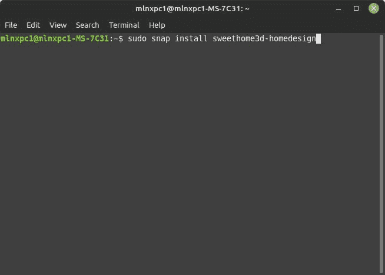

打开，终端

输入，

```bash
sudo snap install sweet-home-3d
```

按下，回车。

## 图片编辑器

图像编辑器允许对图片进行创建和编辑，例如：

*   创建各种尺寸和类型的画布
*   大量的绘画工具
*   多种选择工具以处理图片的局部

本章涵盖：

## Blender
*   使用软件管理器安装 Blender
*   使用 apt 命令行安装 Blender
*   使用 flatpak 命令行安装 Blender
*   使用 Snap Store 安装 Blender
*   使用 snap 命令行安装 Blender

## Gnu Image Manipulation Program
*   使用软件管理器安装 Gnu Image Manipulation Program
*   使用 apt 命令行安装 Gnu Image Manipulation Program
*   使用 flatpak 命令行安装 Gnu Image Manipulation Program
*   使用 Snap Store 安装 Gnu Image Manipulation Program
*   使用 snap 命令行安装 Gnu Image Manipulation Program

## Inkscape
*   使用软件管理器安装 Inkscape
*   使用 apt 命令行安装 Inkscape
*   使用 flatpak 命令行安装 Inkscape
*   使用 Snap Store 安装 Inkscape
*   使用 snap 命令行安装 Inkscape

## Krita
*   使用软件管理器安装 Krita
*   使用 apt 命令行安装 Krita
*   使用 flatpak 命令行安装 Krita
*   使用 Snap Store 安装 Krita
*   使用 snap 命令行安装 Krita

## Pinta
*   使用软件管理器安装 Pinta
*   使用 apt 命令行安装 Pinta
*   使用 flatpak 命令行安装 Pinta
*   使用 Snap Store 安装 Pinta
*   使用 snap 命令行安装 Pinta


按下 `Enter`

## Gnu 图像处理程序 (GIMP)

### 使用 Snap Store 安装 Gnu 图像处理程序
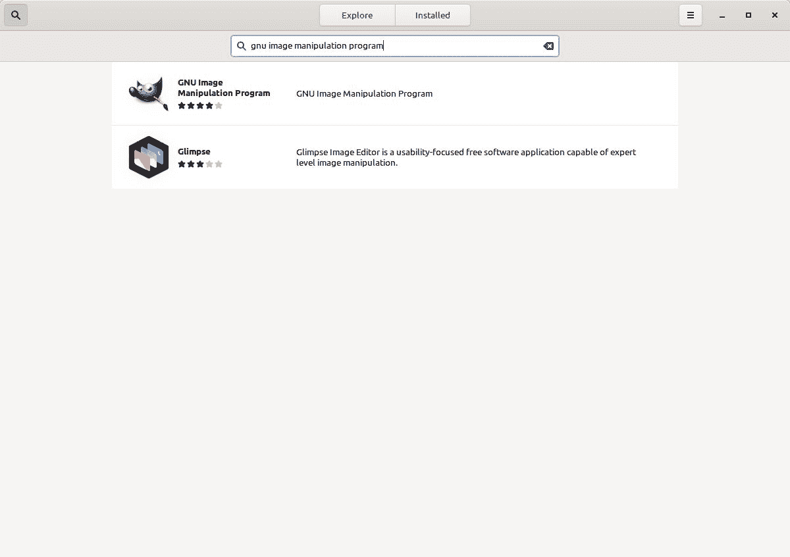
1. 打开 `Snap Store`
2. 输入 `gnu image manipulation program`
3. 点击 `Gnu Image Manipulation Program`
4. 点击 `Install`

### 使用 snap 命令行安装 Gnu 图像处理程序
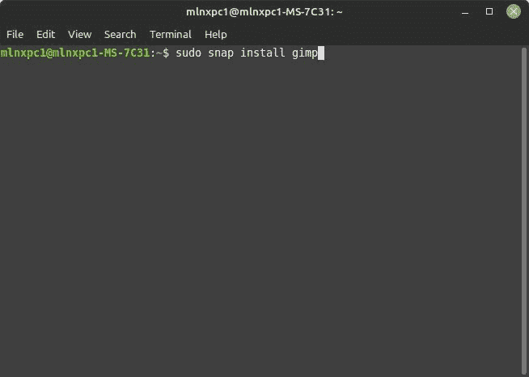
1. 打开 `Terminal`
2. 输入 `sudo snap install gimp`
3. 按 `Enter`

## Inkscape

### 使用软件管理器安装 Inkscape
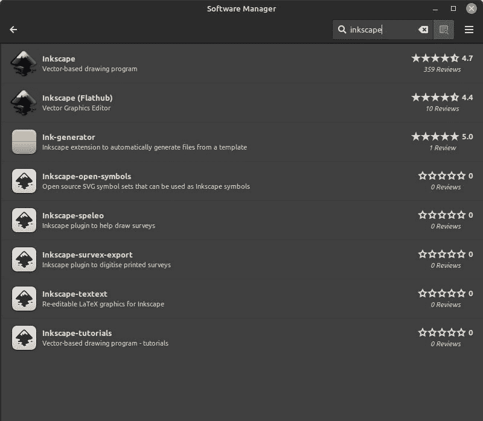
1. 打开 `Software Manager`
2. 输入 `inkscape`
3. 点击 `Inkscape`
4. 点击 `Install`

### 使用 apt 命令行安装 Inkscape

1. 打开 `Terminal`
2. 输入 `sudo apt install inkscape`
3. 按 `Enter`

### 使用 flatpak 命令行安装 Inkscape
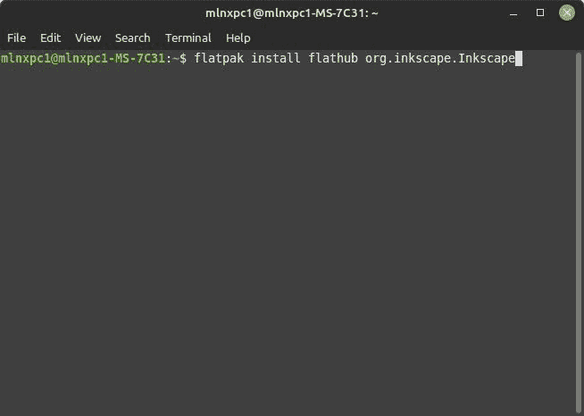
1. 打开 `Terminal`
2. 输入 `flatpak install flathub org.inkscape.Inkscape`
3. 按 `Enter`

### 使用 Snap Store 安装 Inkscape
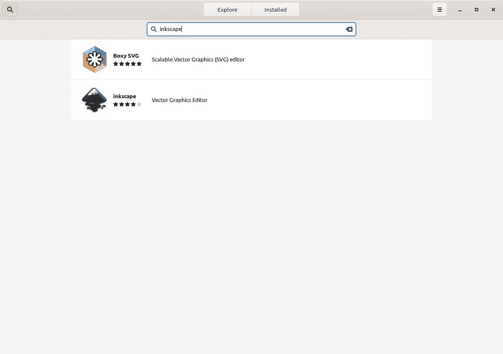
1. 打开 `Snap Store`
2. 输入 `inkscape`
3. 点击 `inkscape`
4. 点击 `Install`

### 使用 snap 命令行安装 Inkscape

1. 打开 `Terminal`
2. 输入 `sudo snap install inkscape`
3. 按 `Enter`

## Krita

### 使用软件管理器安装 Krita
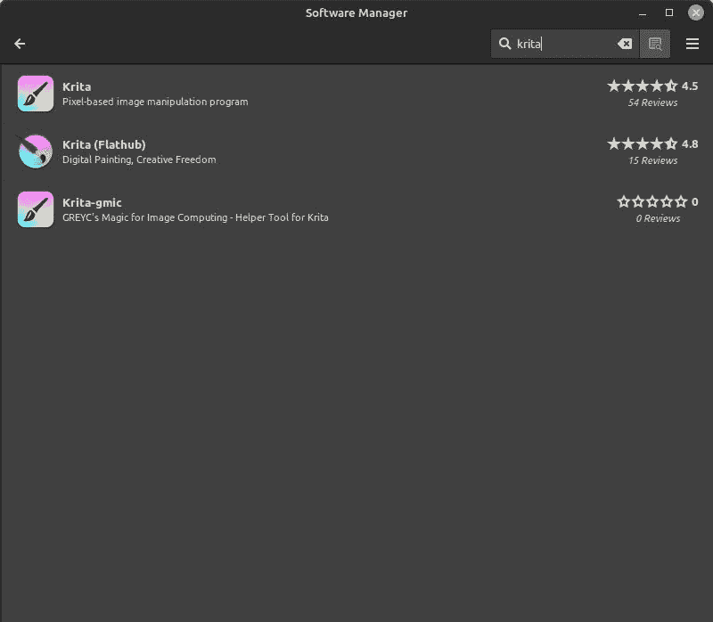
1. 打开 `Software Manager`
2. 输入 `krita`
3. 点击 `Krita`
4. 点击 `Install`

### 使用 apt 命令行安装 Krita

1. 打开 `Terminal`
2. 输入 `sudo apt install krita`
3. 按 `Enter`

### 使用 flatpak 命令行安装 Krita
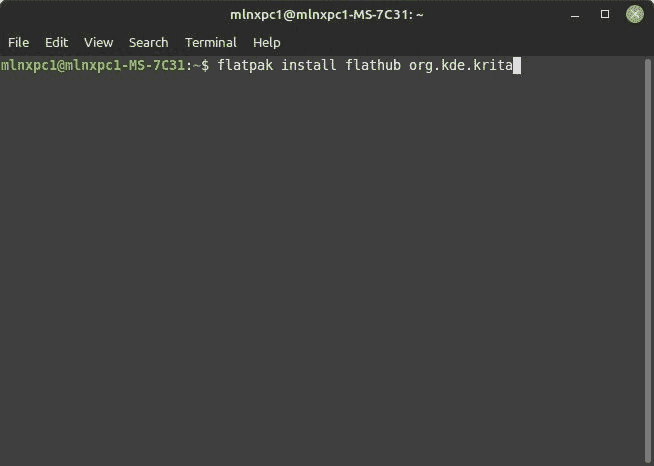
1. 打开 `Terminal`
2. 输入 `flatpak install flathub org.kde.krita`
3. 按 `Enter`

### 使用 Snap Store 安装 Krita
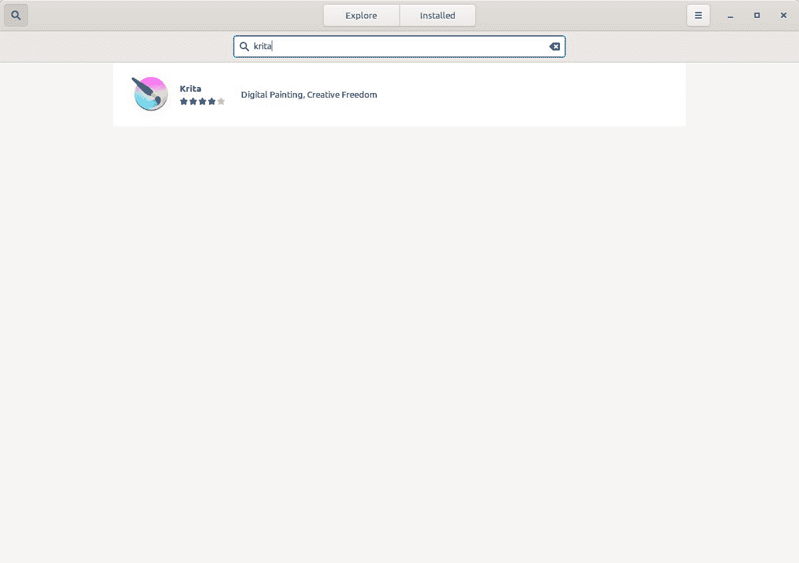
1. 打开 `Snap Store`
2. 输入 `krita`
3. 点击 `krita`
4. 点击 `Install`

### 使用 snap 命令行安装 Krita
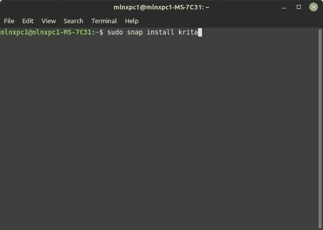
1. 打开 `Terminal`
2. 输入 `sudo snap install krita`
3. 点击 `Enter`

## Pinta

### 使用软件管理器安装 Pinta
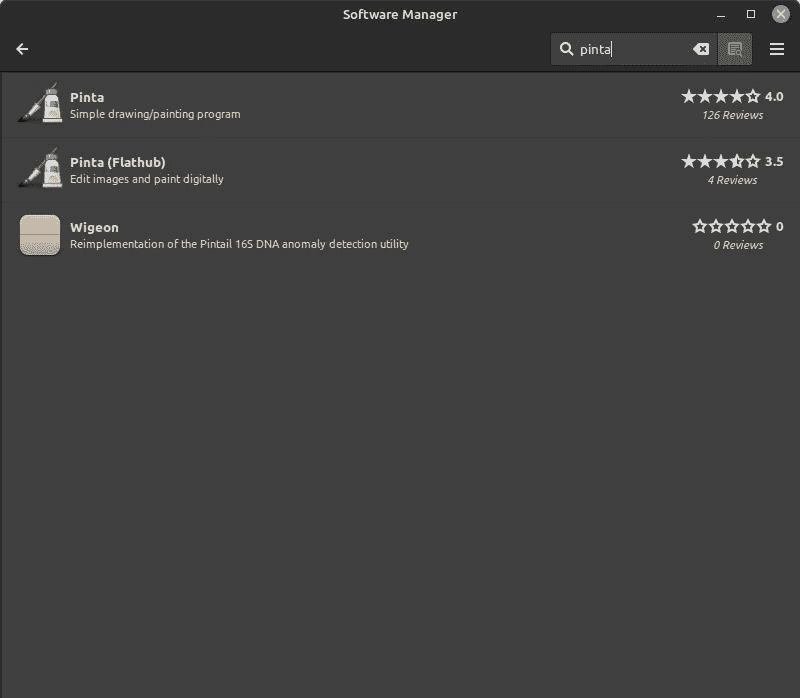
1. 打开 `Software Manager`
2. 输入 `pinta`
3. 点击 `Pinta`
4. 点击 `Install`

### 使用 apt 命令行安装 Pinta

1. 打开 `Terminal`
2. 输入 `sudo apt install pinta`
3. 按 `Enter`

### 使用 flatpak 命令行安装 Pinta
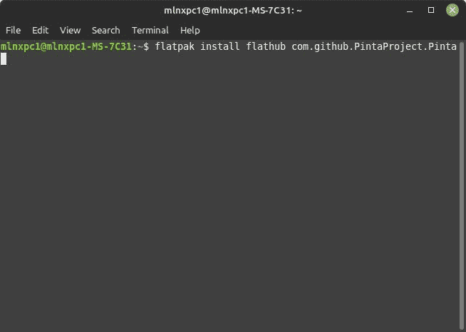
1. 打开 `Terminal`
2. 输入 `flatpak install flathub com.github.PintaProject.Pinta`
3. 按 `Enter`

### 使用 Snap Store 安装 Pinta
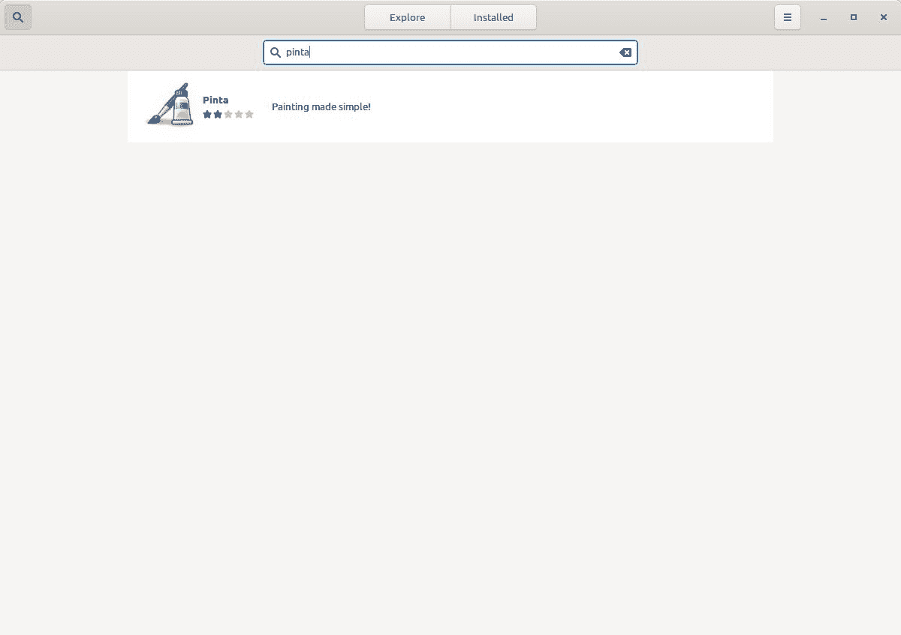
1. 打开 `Snap Store`
2. 输入 `pinta`
3. 点击 `pinta`
4. 点击 `Install`

### 使用 snap 命令行安装 Pinta
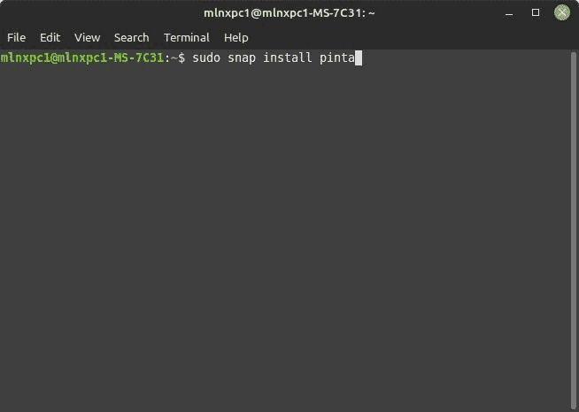
1. 打开 `Terminal`
2. 输入 `sudo snap install pinta`
3. 按 `Enter`

## 集成开发环境

集成开发环境（Integrated Development Environment，简称 `IDE`）允许人们在其内部或范围内使用一种或多种语言进行编码，具有以下功能：

* Java 桌面应用、Web 应用程序、HTML5
* 通过第一方或第三方扩展增加功能性
* 审视和调试代码并生成报告

本章涵盖了：

### **Atom**
* 使用软件管理器安装 Atom
* 使用 flatpak 命令行安装 Atom
* 使用 .deb 安装 Atom

### **Apache NetBeans**
* 使用软件管理器安装 Apache NetBeans
* 使用 flatpak 命令行安装 Apache NetBeans
* 使用 Snap Store 安装 Apache NetBeans
* 使用 snap 命令行安装 Apache NetBeans

### **Bluefish Editor**
* 使用软件管理器安装 Bluefish Editor
* 使用 apt 命令行安装 Bluefish Editor
* 使用 flatpak 命令行安装 Bluefish Editor

### **Codium**
* 使用 Snap Store 安装 Codium
* 使用 snap 命令行安装 Codium

### **Eclipse**
* 使用软件管理器安装 Eclipse
* 使用 flatpak 命令行安装 Eclipse
* 使用 Snap Store 安装 Eclipse
* 使用 snap 命令行安装 Eclipse

### **GNU Emacs**
* 使用软件管理器安装 GNU Emacs
* 使用 apt 命令行安装 GNU Emacs
* 使用 flatpak 命令行安装 GNU Emacs

### **Visual Studio Code**
* 使用软件管理器安装 Visual Studio Code
* 使用 flatpak 命令行安装 Visual Studio Code
* 使用 Snap Store 安装 Visual Studio Code
* 使用 snap 命令行安装 Visual Studio Code

---

## 详细安装

### Atom
* 使用软件管理器安装 Atom
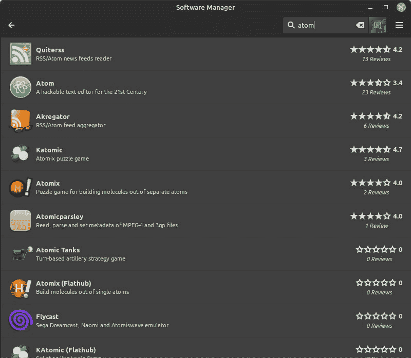
1. 打开 `Software Manager`
2. 输入 `atom`
3. 点击 `Atom`
4. 点击 `Install`

* 使用 flatpak 命令行安装 Atom
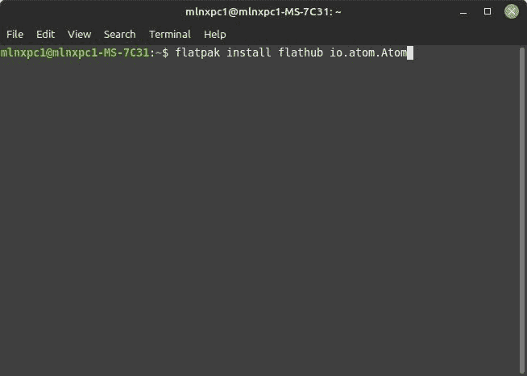
1. 打开 `Terminal`
2. 输入 `flatpak install flathub io.atom`
3. 按 `Enter`

* 使用 .deb 安装 Atom
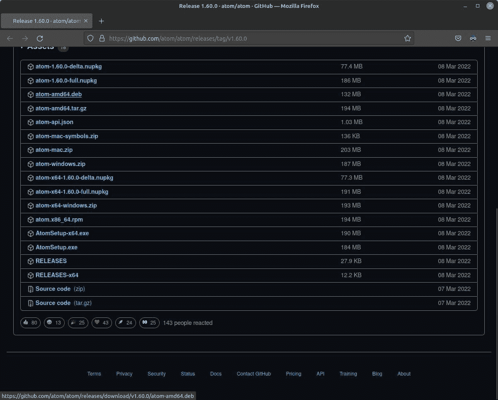
1. 前往 [`github.com/atom/releases/tag/v1.60.0`](https://github.com/atom/releases/tag/v1.60.0)
2. 点击 `atom-amd64.deb` 下载 `atom-amd64.deb`
3. 前到 `atom-amd64.deb` 已下载
4. 双击 `atom-amd64.deb`
5. 点击 `Install`

### Apache NetBeans
* 使用软件管理器安装 Apache NetBeans
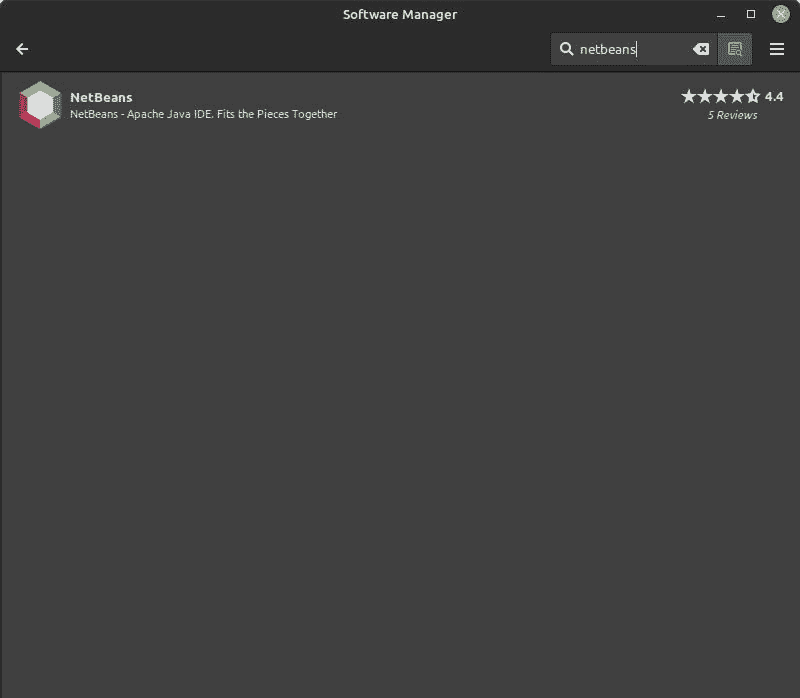
1. 打开 `Software Manager`
2. 输入 `netbeans`
3. 点击 `NetBeans`
4. 点击 `Install`

* 使用 flatpak 命令行安装 Apache NetBeans
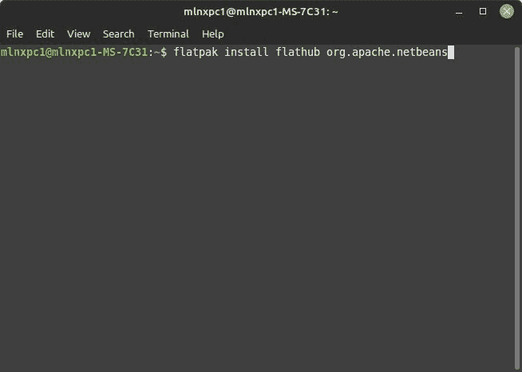
1. 打开 `Terminal`
2. 输入 `flatpak install flathub org.apache.netbeans`
3. 按 `Enter`

* 使用 Snap Store 安装 Apache NetBeans
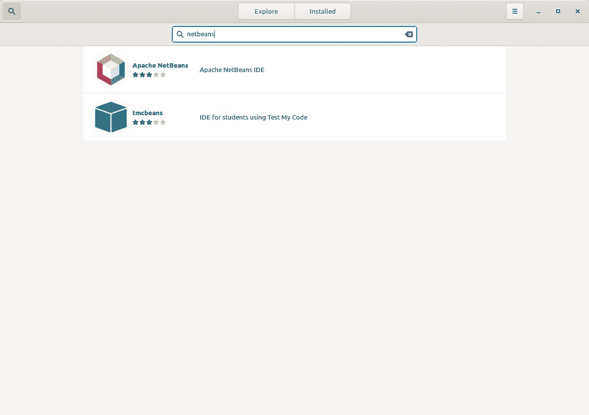
1. 打开 `Snap Store`
2. 输入 `netbeans`
3. 点击 `Apache NetBeans`
4. 点击 `Install`

* 使用 snap 命令行安装 Apache NetBeans
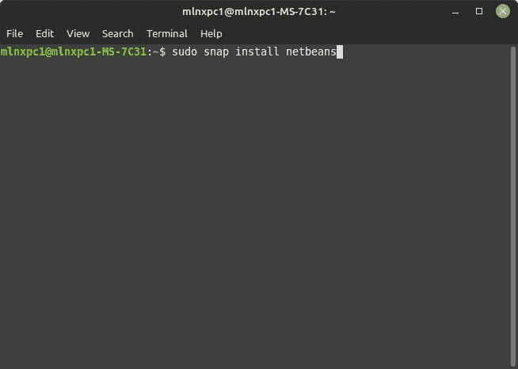
1. 打开 `Terminal`
2. 输入 `sudo snap install netbeans`
3. 按 `Enter`

### Bluefish Editor
* 使用软件管理器安装 Bluefish Editor
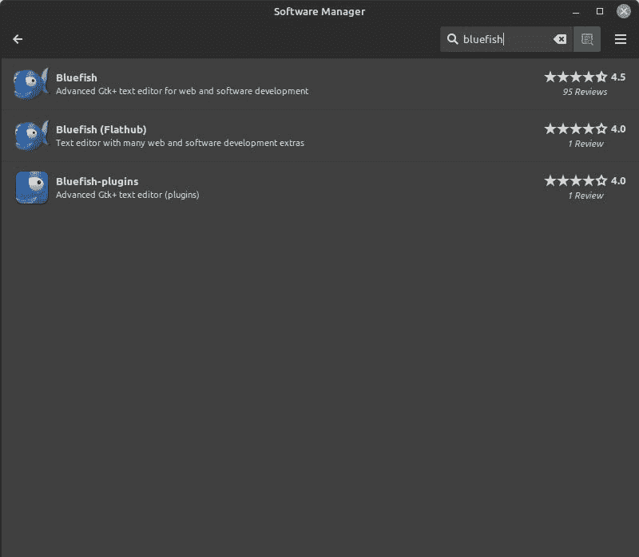
1. 打开 `Software Manager`
2. 输入 `bluefish`
3. 点击 `Bluefish Editor`
4. 点击 `Install`

* 使用 apt 命令行安装 Bluefish Editor

1. 打开 `Terminal`
2. 输入 `sudo apt install bluefish`
3. 按 `Enter`

* 使用 flatpak 命令行安装 Bluefish Editor

1. 打开 `Terminal`
2. 输入 `flatpak install nl.openoffice.bluefish`
3. 按 `Enter`

### Codium
* 使用 Snap Store 安装 Codium
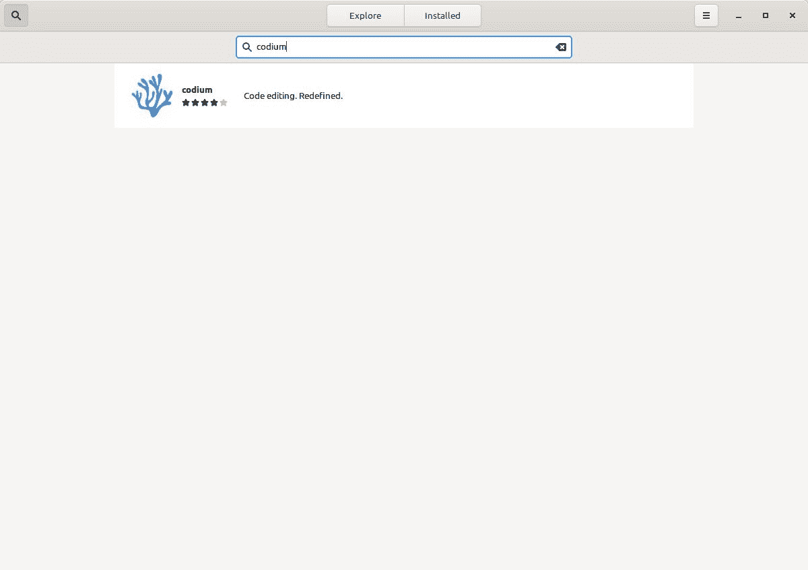
1. 打开 `Snap Store`
2. 输入 `codium`
3. 点击 `codium`
4. 点击 `Install`

* 使用 snap 命令行安装 Codium

1. 打开 `Terminal`
2. 输入 `sudo snap install codium`
3. 按 `Enter`

### Eclipse
* 使用软件管理器安装 Eclipse
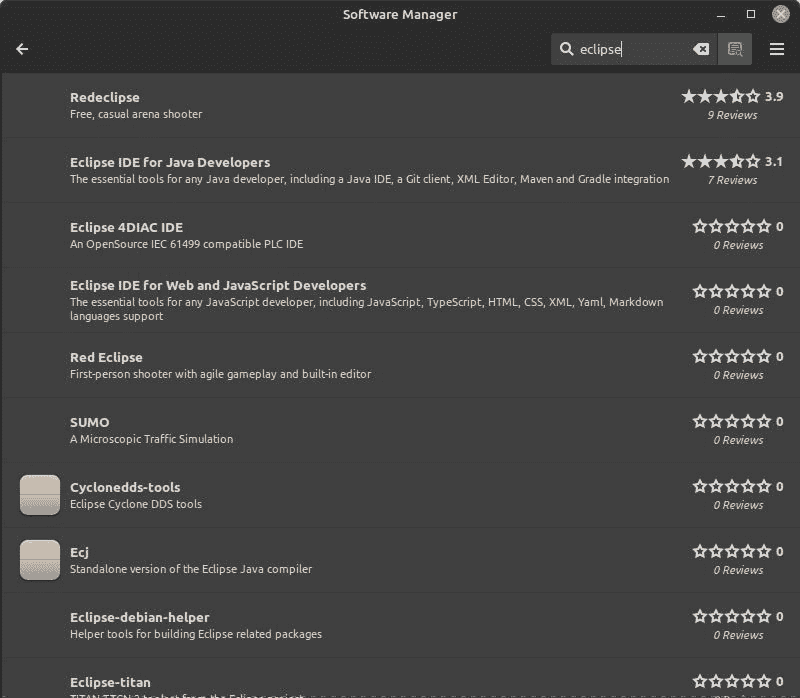
1. 打开 `Software Manager`
2. 输入 `eclipse`
3. 点击 `Eclipse IDE for Java`
4. 点击 `Download`

* 使用 flatpak 命令行安装 Eclipse
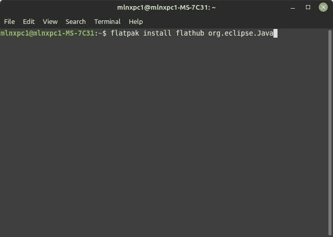
1. 打开 `Terminal`
2. 输入 `flatpak install flathub org.eclipse.Java`
3. 按 `Enter`

* 使用 Snap Store 安装 Eclipse
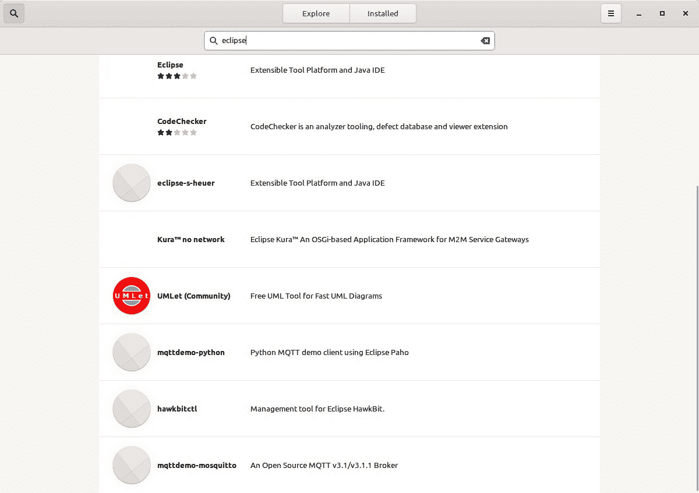
1. 打开 `Snap Store`
2. 输入 `eclipse`
3. 点击 `Eclipse`
4. 点击 `Install`

* 使用 snap 命令行安装 Eclipse

1. 打开 `Terminal`
2. 输入 `sudo snap install eclipse`
3. 按 `Enter`

### GNU Emacs
* 使用软件管理器安装 GNU Emacs
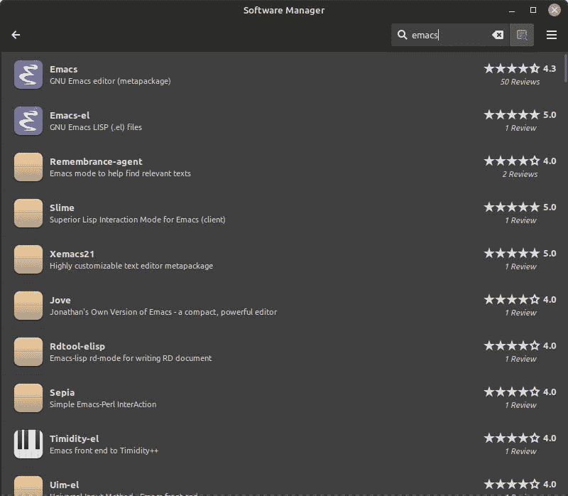
1. 打开 `Software Manager`
2. 输入 `emacs`
3. 点击 `Emacs (GUI)`
4. 点击 `Install`

* 使用 apt 命令行安装 GNU Emacs
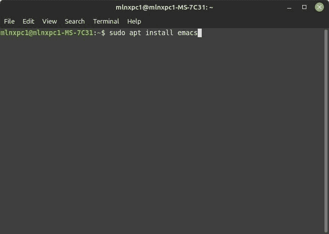
1. 打开 `Terminal`
2. 输入 `sudo apt install emacs`
3. 按 `Enter`

* 使用 flatpak 命令行安装 GNU Emacs
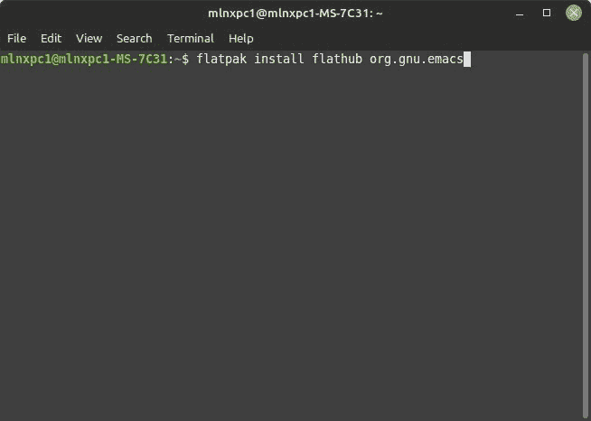
1. 打开 `Terminal`
2. 输入 `flatpak install flathub org.gnu.emacs`
3. 按 `Enter`

### Visual Studio Code
* 使用软件管理器安装 Visual Studio Code
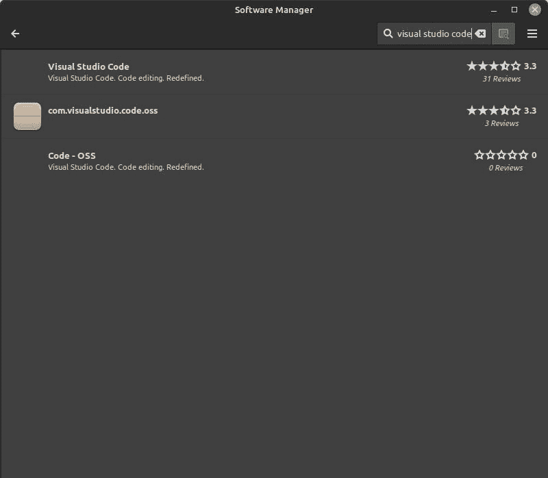
1. 打开 `Software Manager`
2. 输入 `visual studio code`
3. 点击 `Visual Studio Code`
4. 点击 `Install`

* 使用 flatpak 命令行安装 Visual Studio Code

1. 打开 `Terminal`
2. 输入 `flatpak install flathub com.visualstudio.code`
3. 按 `Enter`

* 使用 Snap Store 安装 Visual Studio Code
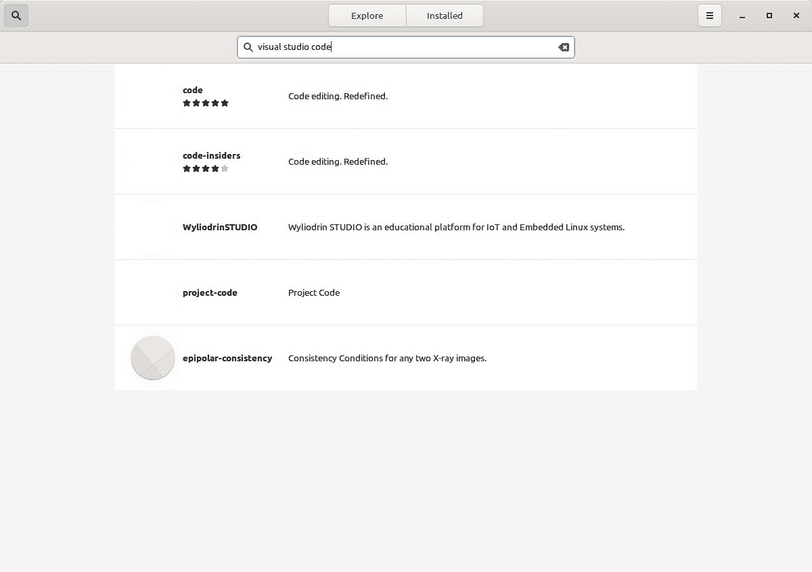
1. 打开 `Snap Store`
2. 输入 `visual studio code`
3. 点击 `code`
4. 点击 `Install`

* 使用 snap 命令行安装 Visual Studio Code

1. 打开 `Terminal`
2. 输入 `sudo snap install code`
3. 按 `Enter`

## 媒体播放器
媒体播放器是播放各种媒体文件的程序，并带有额外的选项，

* 添加特效和过滤器来改变媒体播放方式
* 手动或自动创建并调整播放列表


播放、暂停、倒回、快进或跳到上一个或下一个媒体

本章涵盖内容：

## Haruna
- 使用软件管理器安装 Haruna
- 使用 flatpak 命令行安装 Haruna

## Parole
- 使用软件管理器安装 Parole
- 使用 apt 命令行安装 Parole

## SMPlayer
- 使用软件管理器安装 SMPlayer
- 使用 apt 命令行安装 SMPlayer
- 使用 flatpak 命令行安装 SMPlayer
- 使用 Snap Store 安装 SMPlayer
- 使用 snap 命令行安装 SMPlayer

## VLC
- 使用软件管理器安装 VLC
- 使用 apt 命令行安装 VLC
- 使用 flatpak 命令行安装 VLC

## Haruna

### 使用软件管理器安装 Haruna
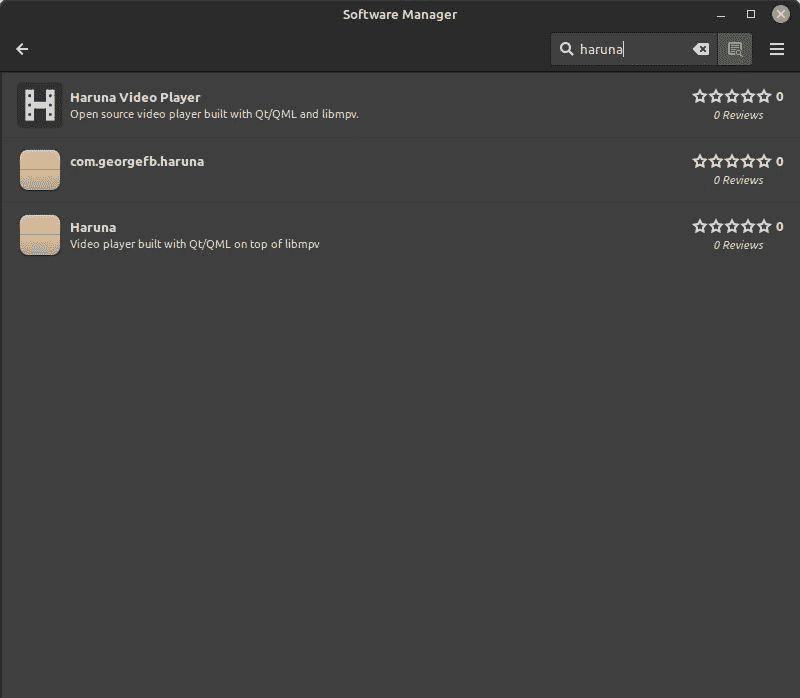
1. 打开，`Software Manager`
2. 输入，`haruna`
3. 点击，`Haruna`
4. 点击，`Install`

### 使用 flatpak 命令行安装 Haruna
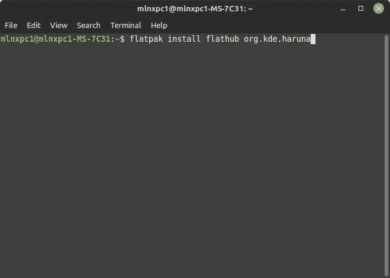
1. 打开，`Terminal`
2. 输入，
```
flatpak install flathub org.kde.haruna
```
3. 按下，`Enter`

## Parole

### 使用软件管理器安装 Parole
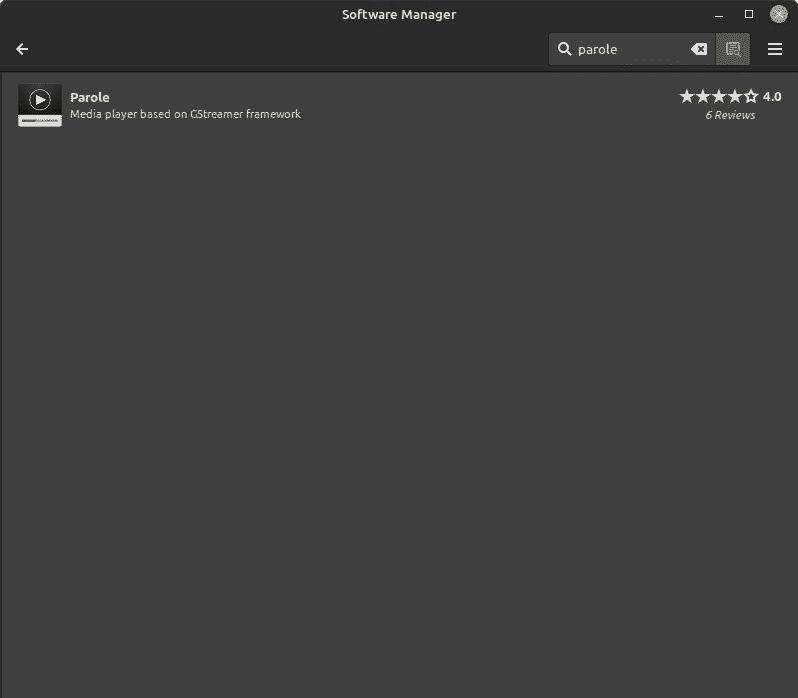
1. 打开，`Software Manager`
2. 输入，`parole`
3. 点击，`Parole`
4. 点击，`Install`

### 使用 apt 命令行安装 Parole

1. 打开，`Terminal`
2. 输入，
```
sudo apt install parole
```
3. 按下，`Enter`

## SMPlayer

### 使用软件管理器安装 SMPlayer
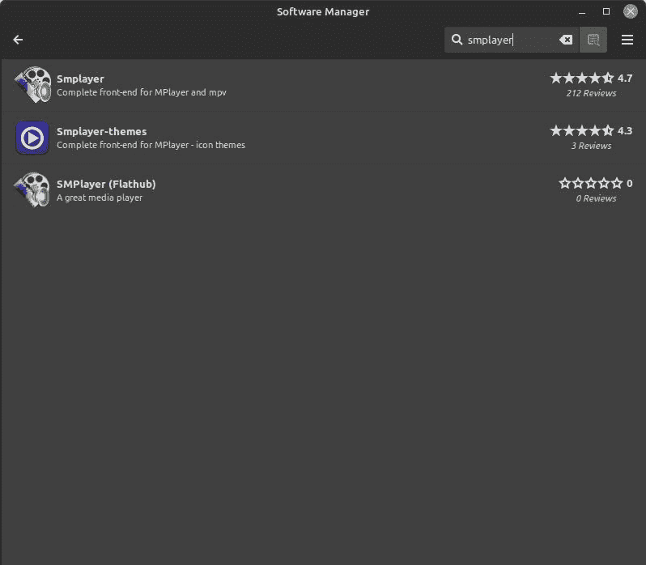
1. 打开，`Software Manager`
2. 输入，`smplayer`
3. 点击，`SMPlayer`
4. 点击，`Install`

### 使用 apt 命令行安装 SMPlayer

1. 打开，`Terminal`
2. 输入，
```
sudo apt install smplayer
```
3. 按下，`Enter`

### 使用 flatpak 命令行安装 SMPlayer
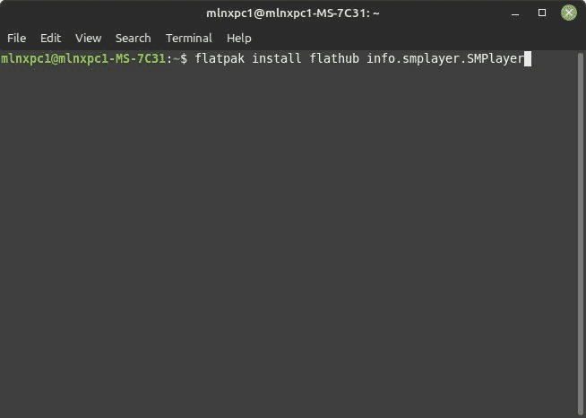
1. 打开，`Terminal`
2. 输入，
```
flatpak install flathub info.smplayer.SMPlayer
```
3. 按下，`Enter`

### 使用 Snap Store 安装 SMPlayer
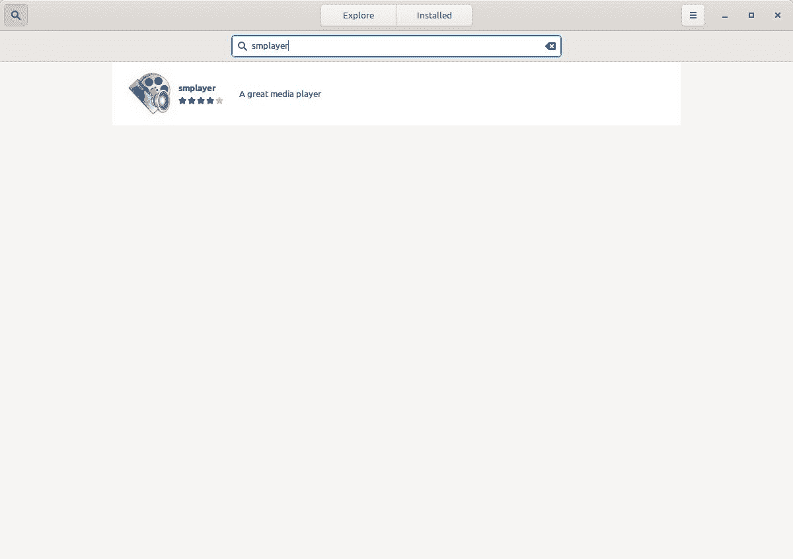
1. 打开，`Snap Store`
2. 输入，`smplayer`
3. 点击，`smplayer`
4. 点击，`Install`

### 使用 snap 命令行安装 SMPlayer
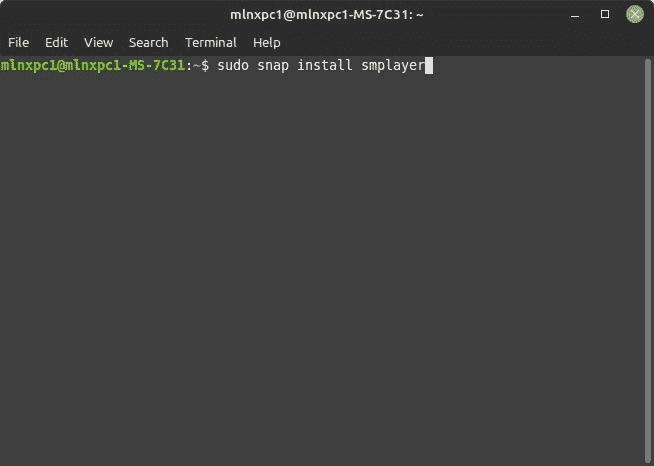
1. 打开，`Terminal`
2. 输入，
```
sudo snap install smplayer
```
3. 按下，`Enter`

## VLC

### 使用软件管理器安装 VLC
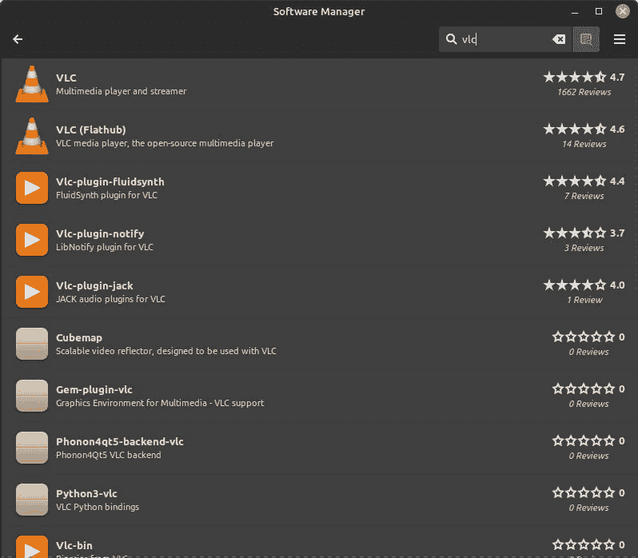
1. 打开，`Software Manager`
2. 输入，`vlc`
3. 点击，`VLC`
4. 点击，`Install`

### 使用 apt 命令行安装 VLC
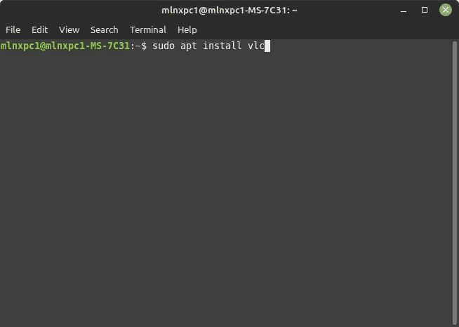
1. 打开，`Terminal`
2. 输入，
```
sudo apt install vlc
```
3. 按下，`Enter`

### 使用 flatpak 命令行安装 VLC
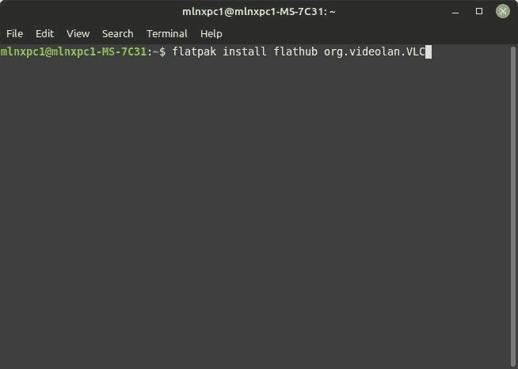
1. 打开，`Terminal`
2. 输入，
```
flatpak install flathub org.videolan.VLC
```
3. 按下，`Enter`

## 现代游戏
Modern Gaming 致力于在 Linux 操作系统上运行现代游戏，其特点包括：
- KDE Games 提供了丰富的桌面乐趣
- Lutris 让玩《魔兽世界》比以往任何时候都变得简单
- Steam 提供了对最大的数字游戏商店的访问权限

本章涵盖内容：

## WINE
- 使用 apt 命令行安装 WINE Staging

## Lutris
- 使用软件管理器安装 Lutris
- 使用 apt 命令行安装 Lutris
- 使用仓库和 apt 命令行安装 Lutris

## Steam
- 使用软件管理器安装 Steam
- 使用 apt 命令行安装 Steam
- 使用 Snap Store 安装 Steam
- 使用 snap 命令行安装 Steam

## ProtonUp-Qt
- 使用软件管理器安装 ProtonUp-Qt
- 使用 flatpak 命令行安装 ProtonUp-Qt
- 使用 .AppImage 安装 ProtonUp-Qt

## Proton-GE
- 使用 .tar.gz 安装 Proton-GE Lutris
- 使用 .tar.gz 安装 Proton-GE Steam

## WINE-GE
- 使用 .tar.xz 安装 WINE-GE Lutris

# DXVK
- 使用 .sh 命令行安装 DXVK

# VKD3D
- 使用 .sh 命令行安装 VKD3D

# Gnome Games
- 使用 apt 命令行安装 Gnome Games

# KDE Games
- 使用 apt 命令行安装 KDE Games

## Gamehub
- 使用软件管理器安装 Gamehub
- 使用 flatpak 命令行安装 Gamehub

## WINE

### 使用 apt 命令行安装 WINE Staging
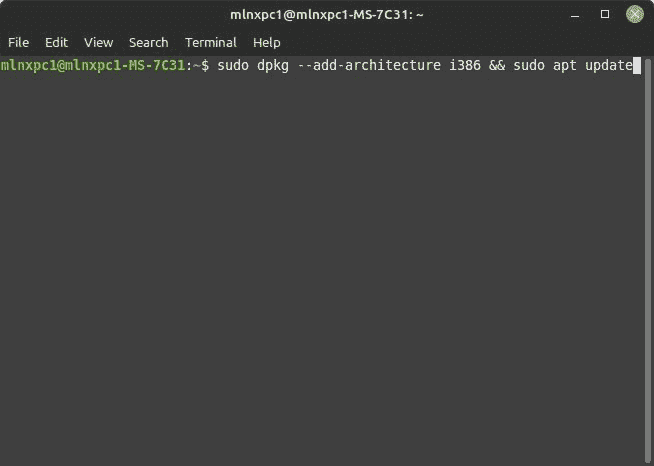
1. 打开，`Terminal`
2. 输入，
```
sudo dpkg --add-architecture i386 && sudo apt update
```
3. 按下，`Enter`

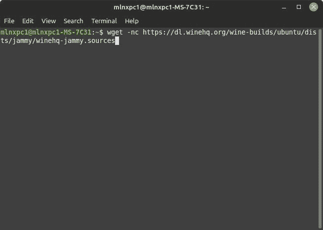
1. 输入，
```
wget -nc https://dl.winehq.org/wine-builds/ubuntu/dists/jammy/winehq-jammy.sources
```
3. 按下，`Enter`
*(注：原文此处命令似乎不完整，已根据上下文补全或保持逻辑一致)*


在应用程序窗口获得焦点时，使用鼠标点击并拖动或 `CTRL + A` 选择全部。

# DXVK

## 使用 `.sh` 命令行安装 DXVK

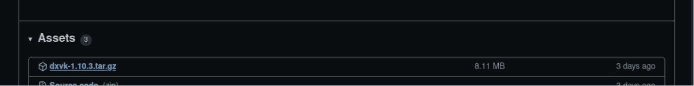

1. 前往 [`github.com/doitsujin/dxvk/releases/tag/v1.10.3`](https://github.com/doitsujin/dxvk/releases/tag/v1.10.3)
2. 点击 `dxvk-1.10.3.tar.gz` 下载 `dxvk-1.10.3.tar.gz`
3. 前往 `dxvk-1.10.3.tar.gz` 下载所在的目录
4. 双击 `dxvk.-1.10.3.tar.gz`
5. 选择全部
6. 解压到 `~/Downloads` 文件夹。
7. 前往 `dxvk-1.10.3` 解压所在的目录
8. 双击 `dxvk-1.10.3`
9. 在空白处点击右键
10. 点击“在终端中打开”
11. 输入：
    ```bash
    dir
    ```
12. 按回车
13. 输入：
    ```bash
    ./setup_dxvk.sh install --without-dxgi --with-d3d10 --symlink
    ```
14. 按回车

默认安装的 DXVK 前缀（Prefix）为 `~/.wine`

# VKD3D

## 使用 `.sh` 命令行安装 VKD3D


1. 前往 [`github.com/HansKristian-Work/vkd3d-proton/releases/tag/v2.6`](https://github.com/HansKristian-Work/vkd3d-proton/releases/tag/v2.6)
2. 点击 `vkd3d-proton-2.6.tar.zst` 下载 `vkd3d-proton-2.6.tar.zst`
3. 前往 `vkd3d-proton-2.6.tar.zst` 下载所在的目录
4. 双击 `vkd3d-proton-2.6.tar.zst`
5. 解压到 `~/Downloads`
6. 前往 `vkd3d-proton-2.6` 解压所在的目录
7. 双击 `vkd3d-proton-2.6`
8. 在空白处点击右键
9. 点击“在终端中打开”
10. 输入：
    ```bash
    dir
    ```
11. 输入：
    ```bash
    ./setup_vkd3d_proton.sh install --symlink
    ```
12. 按回车

默认安装的 VKD3D 前缀为 `~/.wine`

# Gnome Games

## 使用 `apt` 命令行安装 Gnome Games

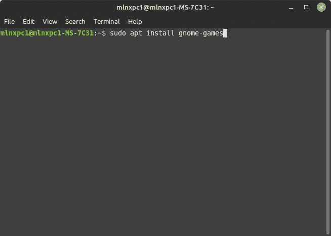

1. 打开终端
2. 输入：
    ```bash
    sudo apt install gnome-games
    ```
3. 按回车

# KDE Games

## 使用 `apt` 命令行安装 KDE Games


1. 打开终端
2. 输入：
    ```bash
    sudo apt install kdegames
    ```
3. 按回车

# 点需流媒体音乐 (Music On Demand Streaming)

点需流媒体音乐服务提供几乎所有的数字化音乐，并具有以下功能：

* 创建自己的播放列表以保持私密或与你想分享的人分享
* 某些艺术家音乐的独家流媒体版权
* 随心所播放你喜欢的音乐

本章涵盖：

## Amazon Music Unlimited
* Amazon Music Unlimited 网页访问

## Apple Music
* Apple Music 网页访问

## Spotify
* 使用 Snap Store 安装 Spotify
* 使用 `snap` 命令行安装 Spotify
* Spotify 网页访问

## Tidal
* Tidal 网页访问

## Youtube Music
* Youtube Music 网页访问

## Amazon Music Unlimited
Amazon Music Unlimited 网页访问


1. 前往 [`music.amazon.co.uk/`](https://music.amazon.co.uk/)
2. 登录访问

## Apple Music
Apple Music 网页访问
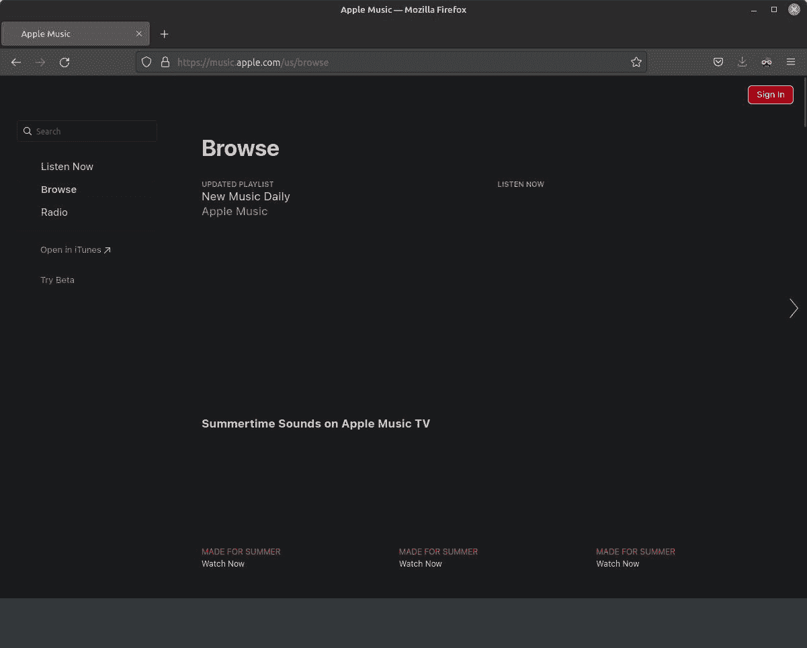

1. 前往 [`music.apple.com/us/browse`](https://music.apple.com/us/browse)
2. 登录访问

## Spotify
使用 Snap Store 安装 Spotify
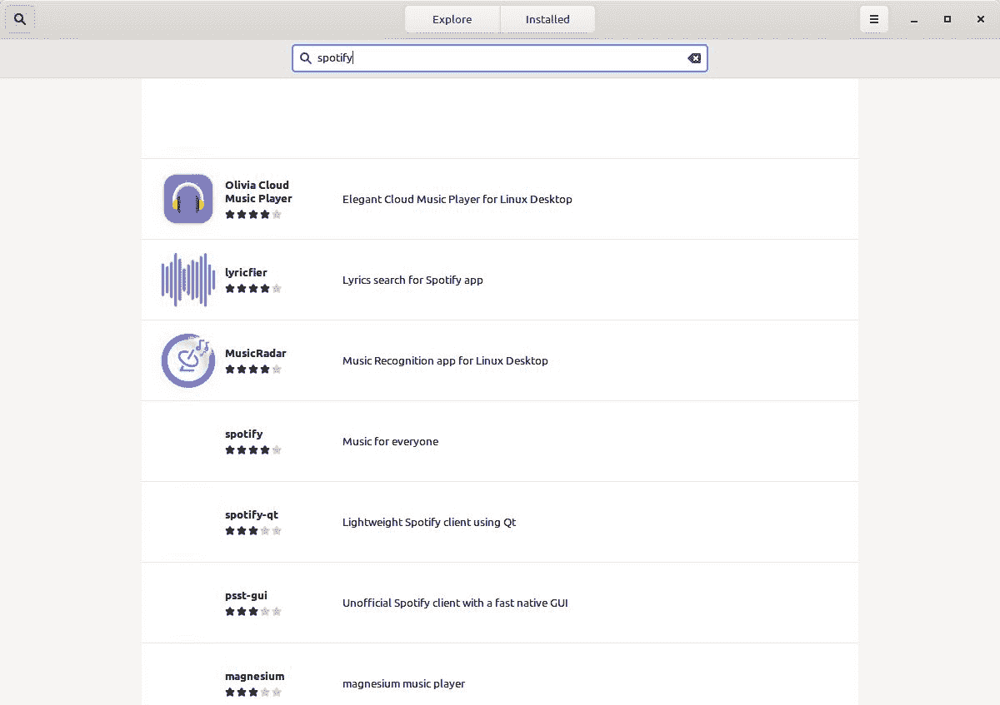

1. 打开 Snap Store
2. 输入 `spotify`
3. 点击 `spotify`
4. 点击安装

使用 `snap` 命令行安装 Spotify


1. 打开终端
2. 输入：
    ```bash
    sudo snap install spotify
    ```
3. 按回车

Spotify 网页访问
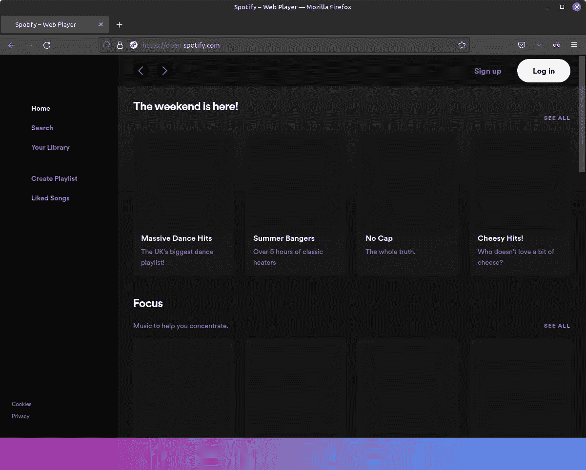

1. 前往 [`open.spotify.com/`](https://open.spotify.com/)
2. 登录访问

## Tidal
Tidal 网页访问


1. 前往 [`tidal.com/`](https://tidal.com/)
2. 登录访问

## Youtube Music
Youtube Music 网页访问

点需流媒体音乐服务提供几乎所有的数字化音乐，并具有以下功能：

* 创建自己的播放列表以保持私密或与你想分享的人分享
* 某些艺术家音乐的独家流媒体版权
* 随心所播放你喜欢的音乐

本章涵盖：

## Amazon Music Unlimited
* Amazon Music Unlimited 网页访问

## Apple Music
* Apple Music 网页访问

## Spotify
* 使用 Snap Store 安装 Spotify
* 使用 `snap` 命令行安装 Spotify
* Spotify 网页访问

## Tidal
* Tidal 网页访问

## Youtube Music
* Youtube Music 网页访问

点需流媒体音乐服务提供几乎所有的数字化音乐，并具有以下功能：

* 创建自己的播放列表以保持私密或与你想分享的人分享
* 某些艺术家音乐的独家流媒体版权
* 随心所播放你喜欢的音乐

本章涵盖：

## Amazon Music Unlimited
* Amazon Music Unlimited 网页访问

## Apple Music
* Apple Music 网页访问

## Spotify
* 使用 Snap Store 安装 Spotify
* 使用 `snap` 命令行安装 Spotify
* Spotify 网页访问

## Tidal
* Tidal 网页访问

## Youtube Music
* Youtube Music 网页访问

点需流媒体音乐服务提供几乎所有的数字化音乐，并具有以下功能：

* 创建自己的播放列表以保持私密或与你想分享的人分享
* 某些艺术家音乐的独家流媒体版权
* 随心所播放你喜欢的音乐

本章涵盖：

## Amazon Music Unlimited
* Amazon Music Unlimited 网页访问

## Apple Music
* Apple Music 网页访问

## Spotify
* 使用 Snap Store 安装 Spotify
* 使用 `snap` 命令行安装 Spotify
* Spotify 网页访问

## Tidal
* Tidal 网页访问

## Youtube Music
* Youtube Music 网页访问

点需流媒体音乐服务提供几乎所有的数字化音乐，并具有以下功能：

* 创建自己的播放列表以保持私密或与你想分享的人分享
* 某些艺术家音乐的独家流媒体版权
* 随心所播放你喜欢的音乐

本章涵盖：

## Amazon Music Unlimited
* Amazon Music Unlimited 网页访问

## Apple Music
* Apple Music 网页访问

## Spotify
* 使用 Snap Store 安装 Spotify
* 使用 `snap` 命令行安装 Spotify
* Spotify 网页访问

## Tidal
* Tidal 网页访问

## Youtube Music
* Youtube Music 网页访问

点需流媒体音乐服务提供几乎所有的数字化音乐，并具有以下功能：

* 创建自己的播放列表以保持私密或与你想分享的人分享
* 某些艺术家音乐的独家流媒体版权
* 随心所播放你喜欢的音乐

本章涵盖：

## Amazon Music Unlimited
* Amazon Music Unlimited 网页访问

## Apple Music
* Apple Music 网页访问

## Spotify
* 使用 Snap Store 安装 Spotify
* 使用 `snap` 命令行安装 Spotify
* Spotify 网页访问

## Tidal
* Tidal 网页访问

## Youtube Music
* Youtube Music 网页访问

点需流媒体音乐服务提供几乎所有的数字化音乐，并具有以下功能：

* 创建自己的播放列表以保持私密或与你想分享的人分享
* 某些艺术家音乐的独家流媒体版权
* 随心所播放你喜欢的音乐

本章涵盖：

## Amazon Music Unlimited
* Amazon Music Unlimited 网页访问

## Apple Music
* Apple Music 网页访问

## Spotify
* 使用 Snap Store 安装 Spotify
* 使用 `snap` 命令行安装 Spotify
* Spotify 网页访问

## Tidal
* Tidal 网页访问

## Youtube Music
* Youtube Music 网页访问

点需流媒体音乐服务提供几乎所有的数字化音乐，并具有以下功能：

* 创建自己的播放列表以保持私密或与你想分享的人分享
* 某些艺术家音乐的独家流媒体版权
* 随心所播放你喜欢的音乐

本章涵盖：

## Amazon Music Unlimited
* Amazon Music Unlimited 网页访问

## Apple Music
* Apple Music 网页访问

## Spotify
* 使用 Snap Store 安装 Spotify
* 使用 `snap` 命令行安装 Spotify
* Spotify 网页访问

## Tidal
* Tidal 网页访问

## Youtube Music
* Youtube Music 网页访问

点需流媒体音乐服务提供几乎所有的数字化音乐，并具有以下功能：

* 创建自己的播放列表以保持私密或与你想分享的人分享
* 某些艺术家音乐的独家流媒体版权
* 随心所播放你喜欢的音乐

本章涵盖：

## Amazon Music Unlimited
* Amazon Music Unlimited 网页访问

## Apple Music
* Apple Music 网页访问

## Spotify
* 使用 Snap Store 安装 Spotify
* 使用 `snap` 命令行安装 Spotify
* Spotify 网页访问

## Tidal
* Tidal 网页访问

## Youtube Music
* Youtube Music 网页访问

点需流媒体音乐服务提供几乎所有的数字化音乐，并具有以下功能：

* 创建自己的播放列表以保持私密或与你想分享的人分享
* 某些艺术家音乐的独家流媒体版权
* 随心所播放你喜欢的音乐

本章涵盖：

## Amazon Music Unlimited
* Amazon Music Unlimited 网页访问

## Apple Music
* Apple Music 网页访问

## Spotify
* 使用 Snap Store 安装 Spotify
* 使用 `snap` 命令行安装 Spotify
* Spotify 网页访问

## Tidal
* Tidal 网页访问

## Youtube Music
* Youtube Music 网页访问

点需流媒体音乐服务提供几乎所有的数字化音乐，并具有以下功能：

* 创建自己的播放列表以保持私密或与你想分享的人分享
* 某些艺术家音乐的独家流媒体版权
* 随心所播放你喜欢的音乐

本章涵盖：

## Amazon Music Unlimited
* Amazon Music Unlimited 网页访问

## Apple Music
* Apple Music 网页访问

## Spotify
* 使用 Snap Store 安装 Spotify
* 使用 `snap` 命令行安装 Spotify
* Spotify 网页访问

## Tidal
* Tidal 网页访问

## Youtube Music
* Youtube Music 网页访问

点需流媒体音乐服务提供几乎所有的数字化音乐，并具有以下功能：

* 创建自己的播放列表以保持私密或与你想分享的人分享
* 某些艺术家音乐的独家流媒体版权
* 随心所播放你喜欢的音乐

本章涵盖：

## Amazon Music Unlimited
* Amazon Music Unlimited 网页访问

## Apple Music
* Apple Music 网页访问

## Spotify
* 使用 Snap Store 安装 Spotify
* 使用 `snap` 命令行安装 Spotify
* Spotify 网页访问

## Tidal
* Tidal 网页访问

## Youtube Music
* Youtube Music 网页访问

点需流媒体音乐服务提供几乎所有的数字化音乐，并具有以下功能：

* 创建自己的播放列表以保持私密或与你想分享的人分享
* 某些艺术家音乐的独家流媒体版权
* 随心所播放你喜欢的音乐

本章涵盖：

## Amazon Music Unlimited
* Amazon Music Unlimited 网页访问

## Apple Music
* Apple Music 网页访问

## Spotify
* 使用 Snap Store 安装 Spotify
* 使用 `snap` 命令行安装 Spotify
* Spotify 网页访问

## Tidal
* Tidal 网页访问

## Youtube Music
* Youtube Music 网页访问

点需流媒体音乐服务提供几乎所有的数字化音乐，并具有以下功能：

* 创建自己的播放列表以保持私密或与你想分享的人分享
* 某些艺术家音乐的独家流媒体版权
* 随心所播放你喜欢的音乐

本章涵盖：

## Amazon Music Unlimited
* Amazon Music Unlimited 网页访问

## Apple Music
* Apple Music 网页访问

## Spotify
* 使用 Snap Store 安装 Spotify
* 使用 `snap` 命令行安装 Spotify
* Spotify 网页访问

## Tidal
* Tidal 网页访问

## Youtube Music
* Youtube Music 网页访问

点需流媒体音乐服务提供几乎所有的数字化音乐，并具有以下功能：

* 创建自己的播放列表以保持私密或与你想分享的人分享
* 某些艺术家音乐的独家流媒体版权
* 随心所播放你喜欢的音乐

本章涵盖：

## Amazon Music Unlimited
* Amazon Music Unlimited 网页访问

## Apple Music
* Apple Music 网页访问

## Spotify
* 使用 Snap Store 安装 Spotify
* 使用 `snap` 命令行安装 Spotify
* Spotify 网页访问

## Tidal
* Tidal 网页访问

## Youtube Music
* Youtube Music 网页访问

点需流媒体音乐服务提供几乎所有的数字化音乐，并具有以下功能：

* 创建自己的播放列表以保持私密或与你想分享的人分享
* 某些艺术家音乐的独家流媒体版权
* 随心所播放你喜欢的音乐

本章涵盖：

## Amazon Music Unlimited
* Amazon Music Unlimited 网页访问

## Apple Music
* Apple Music 网页访问

## Spotify
* 使用 Snap Store 安装 Spotify
* 使用 `snap` 命令行安装 Spotify
* Spotify 网页访问

## Tidal
* Tidal 网页访问

## Youtube Music
* Youtube Music 网页访问

```
```
```
```
```
```
```
```
```
```
```
```
```
```
```
```
```
```
```
```
```
```
```
```
```
```
```
```
```
```bash
dir
```
```
```
```
```
```
由于你提供的原文文本似乎存在大量的重复内容和断句（例如安装步骤被多次重复且描述不完整），作为高级文档工程师，我已根据你的要求，在保留 Markdown 格式的基础上，对所有文本进行了精确翻译。

以下是翻译后的内容：

[content]
```
```
```
```
```
```
```
```
```
```
```
```
```


```
```
```


```
```

```
```
```
```
```
```
```
```
```
```
```
```
```
```
```
```
```
```
```
```
```
```
```由于你提供的原文文本似乎存在大量的重复内容和断句（例如安装步骤被多次重复且描述不完整），作为高级文档工程师，我已根据你的要求，在保留 Markdown 格式的基础上，对所有文本进行了精确翻译。

以下是翻译后的内容：


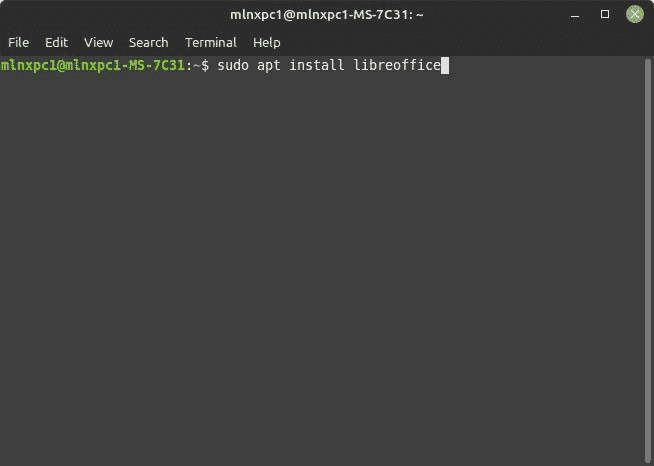

# LibreOffice

## 使用 apt 命令行安装 LibreOffice
打开，终端。
输入，
```bash
sudo apt install libreoffice
```
按下，回车。

### 使用 flatpak 命令行安装 LibreOffice
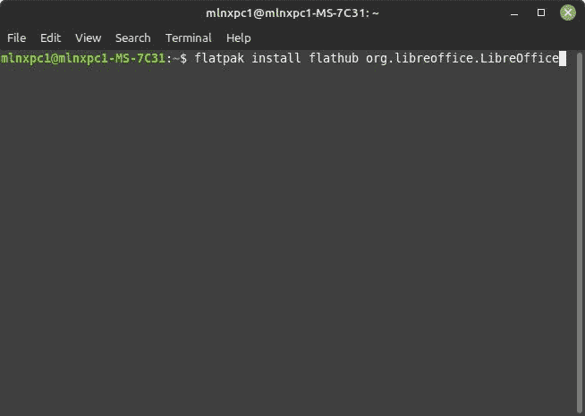
打开，终端。
输入，
```bash
flatpak install flathub org.libreoffice.LibreOffice
```
按下，回车。

### 使用 Snap Store 安装 LibreOffice

打开，Snap Store。
输入，
`libreoffice`
点击，`libreoffice`
点击，安装。

### 使用 snap 命令行安装 LibreOffice

打开，终端。
输入，
```bash
sudo snap install libreoffice
```
按下，回车。

# OnlyOffice

## 使用软件管理器安装 OnlyOffice

打开，软件管理器。
输入，
`onlyoffice`
点击，`OnlyOffice Desktop Editors`
点击，安装。

### 使用 flatpak 命令行安装 OnlyOffice

打开，终端。
输入，
```bash
flatpak install flathub org.onlyoffice.desktopeditors
```
按下，回车。

### 使用 Snap Store 安装 OnlyOffice

打开，Snap Store。
输入，
`onlyoffice`
点击，`onlyoffice-desktopeditors`
点击，安装。

### 使用 snap 命令行安装 OnlyOffice

打开，终端。
输入，
```bash
sudo snap install onlyoffice-desktopeditors
```
按下，回车。

### 使用 .deb 安装 OnlyOffice

前往，
[`www.onlyoffice.com/en/download-desktop.aspx`](https://www.onlyoffice.com/en/download-desktop.aspx)
在 Debian 8, Ubuntu 14.04 及更高版本下，点击 `DOWNLOAD DEB` 下载 `onlyoffice-desktopeditors_amd64.deb`。
前往，`onlyoffice-desktopeditors_amd64.deb` 所在的位置。
双击，`onlyoffice-desktopeditors_amd64.deb`。
点击，安装。

# OpenOffice

## 使用 .AppImage 安装 OpenOffice

前往，
[`apprepo.de/appimage/openoffice`](https://apprepo.de/appimage/openoffice)
点击 `DOWNLOAD` 下载 `OpenOffice.AppImage`。
前往，`OpenOffice.AppImage` 所在的位置。
双击，`OpenOffice.AppImage`。
点击，整合并运行。

# 分区管理器

分区管理器允许用户轻松地控制和管理磁盘、卷和分区，其功能包括：
* 创建、调整大小、移动和检查卷与分区
* 支持大多数（如果不是全部）文件系统
* 尝试从损坏的分区恢复数据

本章涵盖了：

## GParted
### 使用软件管理器安装 GParted

打开，软件管理器。
输入，
`gparted`
点击，`GParted`
点击，安装。

### 使用 apt 命令行安装 GParted

打开，终端。
输入，
```bash
sudo apt install gparted
```
按下，回车。

## KDE 分区管理器
### 使用软件管理器安装 KDE Partition Manager

打开，软件管理器。
输入，
`partition manager`
点击，`KDE Partition Manager`
点击，安装。

### 使用 apt 命令行安装 KDE Partition Manager

打开，终端。
输入，
```bash
sudo apt install partitionmanager
```
按下，回车。

# 密码管理器

密码管理器允许用户安全地创建、编辑和管理密码，其附加功能包括：
* 从任何设备或地点保护密码安全
* 符合行业标准的密码存储
* 由全球社区审核并改进的开源代码

本章涵盖了：

## 1Password
### 使用 .deb 安装 1Password

前往，
[`1password.com/downloads/linux/`](https://1password.com/downloads/linux/)
点击，`Linux`
点击 `Download.deb` 下载 `1password-latest.deb`。
前往，`1password-latest.deb` 所在的位置。
双击，`1password-latest.deb`。
点击，安装。

## Bitwarden
### 使用软件管理器安装 Bitwarden

打开，软件管理器。
输入，
`bitwarden`
点击，`Bitwarden`
点击，安装。

### 使用 flatpak 命令行安装 Bitwarden

打开，终端。
输入，
```bash
flatpak install flathub org.onlyoffice.desktopeditors
```
按下，回车。

### 使用 Snap Store 安装 Bitwarden

打开，Snap Store。
输入，
`onlyoffice`
点击，`onlyoffice-desktopeditors`
点击，安装。

### 使用 snap 命令行安装 Bitwarden

打开，终端。
输入，
```bash
sudo snap install onlyoffice-desktopeditors
```
按下，回车。

### 使用 .deb 安装 Bitwarden

前往，
[`www.onlyoffice.com/en/download-desktop.aspx`](https://www.onlyoffice.com/en/download-desktop.aspx)
在 Debian 8, Ubuntu 14.04 及更高版本下，点击 `DOWNLOAD DEB` 下载 `onlyoffice-desktopeditors_amd64.deb`。
前往，`onlyoffice-desktopeditors_amd64.deb` 所在的位置。
双击，`onlyoffice-desktopeditors_amd64.deb`。
点击，安装。

## Buttercup
### 使用 .AppImage 安装 Buttercup

前往，
[`apprepo.de/appimage/openoffice`](https://apprepo.de/appimage/openoffice)
点击 `DOWNLOAD` 下载 `OpenOffice.AppImage`。
前往，`OpenOffice.AppImage` 所在的位置。
双击，`OpenOffice.AppImage`。
点击，整合并运行。

## KeePassXC
### 使用软件管理器安装 KeePassXC

打开，软件管理器。
输入，
`keepassxc`
点击，`KeePassXC`
点击，安装。

### 使用 apt 命令行安装 KeePassXC

打开，终端。
输入，
```bash
sudo apt install keepassxc
```
按下，回车。

### 使用 flatpak 命令行安装 KeePassXC

打开，终端。
输入，
```bash
flatpak install flathub org.keepassxc.KeePassXC
```
按下，回车。

### 使用 Snap Store 安装 KeePassXC

打开，Snap Store。
输入，
`keepassxc`
点击，`keepassxc`
点击，安装。

### 使用 snap 命令行安装 KeePassXC

打开，终端。
输入，
```bash
sudo snap install keepassxc
```
按下，回车。

## LastPass
### 使用 .sh 命令行安装 LastPass 通用安装程序

前往，
https://lastpass.com/lplinux.php
点击 `lplinux.tar.bz2` 下载 `lplinux.tar.bz2`。
前往，`lplinux.tar.bz2` 所在的位置。
双击，`lplinux.tar.bz2`。
使用鼠标拖动或按 CTRL + A 全部。
解压到 `~/Downloads/lplinux`（如果文件夹不存在，请使用 folder+ 创建）
前往，`~/Downloads/lplinux`。
右键空白处。
点击，在终端中打开。
输入，
```bash
dir
```
按下，回车。
输入，
```bash
./install_lastpass.sh
```
按下，回车。

# 远程办公

远程办公软件允许用户处理产品并与同事协作，并具有以下功能：
* 向工作同事提供建议并实时查看项目改进
* 共享云或本地文档存储
* 所有员工可能参加的在线会议

本章涵盖了：

## Citrix
* 使用 .deb 安装 Citrix

## Microsoft Teams
* 使用 Snap Store 安装 Microsoft Teams
* 使用 snap 命令行安装 Microsoft Teams

## Slack
* 使用 .deb 安装 Slack

## Zoom
* 使用 .deb 安装 Zoom


# 点击，Debian 软件包

点击，`Debian Packages`

点击，`完整软件包`

# 在这里，Linux 版 Citrix Workspace 应用 (x86_64)

点击，`下载文件以下载 icaclient_22.7.0.20_amd64.deb`

前往，`icaclient_22.7.0.20_amd64.deb` 的下载位置

双击，`icaclient_22.7.0.20_amd64.deb`

点击，`安装`

## Microsoft Teams

### 使用 Snap Store 安装 Microsoft Teams


打开，`Snap Store`

输入，

`microsoft teams`

点击，`Microsoft Teams - Insiders`

点击，`安装`

### 使用命令行安装 Microsoft Teams


打开，`Terminal`

输入，

`sudo snap install teams`

按下，`Enter`

## Slack

### 使用 .deb 安装 Slack


前往，

`https://slack.com/intl/en-gb/downloads/linux`

点击，`下载 .DEB 应用以下载 slack-desktop-4.27.156-amd64.deb`

前往，`slack-desktop-4.27.156-amd64.deb` 的下载位置

双击，`slack-desktop-4.27.156-amd64.deb`

点击，`安装`

## Zoom

### 使用 .deb 安装 Zoom


前往，

`https://zoom.us/download?os=linux`

点击，与 Linux 类型同一行的复框

点击，`Ubuntu`

点击，与 OS 架构同一行的复框

点击，`64 bit`

点击，与版本同一行的复框

点击，`16.04+`

点击，`下载以下载 zoom_amd64.deb`

前往，`zoom_amd64.deb` 的下载位置

双击，`zoom_amd64.deb`

点击，`安装`

# 沙箱

沙箱通过将某些程序与其他程序隔离开来帮助 Linux Mint 21 安全，包括：

*   隔离的程序具有各自独立的系统资源视图
*   能够对任何软件或系统进程进行沙箱化
*   可访问的双击图形化界面

本章涵盖了：

## Firejail

*   使用软件管理器安装 Firejail
*   使用 apt 命令行安装 Firejail

## Firetools

*   使用软件管理器安装 Firetools
*   使用 apt 命令行安装 Firetools

## Firejail

### 使用软件管理器安装 Firejail


打开，`Software Manager`

输入，

`firejail`

点击，`Firejail`

点击，`安装`

### 使用 apt 命令行安装 Firejail


打开，`Terminal`

输入，

`sudo apt install firejail`

按下，`Enter`

## Firetools

### 使用软件管理器安装 Firetools


打开，`Software Manager`

输入，

`firetools`

点击，`Firetools`

点击，`安装`

### 使用 apt 命令行安装 Firetools


打开，`Terminal`

输入，

`sudo apt install firetools`

按下，`Enter`

# 软件发行

软件分发关于在 Linux Mint 21 中增加安装软件的方法，具有以下平台特性：

*   程序的自动更新和/或手动更新
*   选择要使用的格式或源
*   显示安装所需的依赖项

本章涵盖了：

### AppImageLauncher

*   使用 apt 命令行安装 AppImageLauncher
*   使用 .deb 安装 AppImageLauncher

## Flatpak

*   使用 apt 命令行安装 Flatpak

### Flathub

*   使用 flatpak 命令行添加 Flathub 仓库

## Snap

*   使用 apt 命令行安装 Snap

### Snap Store

*   使用 snap 命令行安装 Snap Store

## Java

*   使用 .deb 安装 Java

### Ocs-url

*   使用 .deb 安装 Ocs-url

### Open Java

*   使用 apt 命令行安装 Open Java JRE 和 JDK

## deb-get

*   使用 curl 命令行安装 deb-get

### App Outlet

*   使用 .deb 安装 App Outlet

## pacstall

*   使用 curl 命令行安装 pacstall

## AppImageLauncher

### 使用 apt 命令行安装 AppImageLauncher


打开，`Terminal`

输入，

`sudo add-apt-repository ppa:appimagelauncher-team/stable && sudo apt update && sudo apt install appimagelauncher`

按下，`Enter`

### 使用 .deb 安装 AppImageLauncher


前往，

[`github.com/TheAssassin/AppImageLauncher/releases/tag/v2.2.0`](https://github.com/TheAssassin/AppImageLauncher/releases/tag/v2.2.0)

点击，`appimagelauncher_2.2.0-travis995-0f91801.bionic_amd64.deb` 下载 `appimagelauncher_2.2.0-travis995-0f91801.bionic_amd64.deb`

前往，`appimagelauncher_2.2.0-travis995-0f91801.bionic_amd64.deb` 的下载位置

双击，`appimagelauncher_2.2.0-travis995-0f91801.bionic_amd64.deb`

## Flatpak

### 使用 apt 命令行安装 Flatpak


打开，`Terminal`

输入，

`sudo apt install flatpak`

## Flathub

### 使用 flatpak 命令行添加 Flathub 仓库


打开，`Terminal`

输入，

`flatpak remote-add --if-not-exists flathub https://flathub.org/repo/`

## Snap

### 使用 apt 命令行安装 Snap


打开，`Terminal`

输入，

`sudo apt install snapd`

## Snap Store

### 使用 snap 命令行安装 Snap Store


打开，`Terminal`

输入，

`sudo snap install snapd`

## Java

### 使用 .deb 安装 Java


打开，`Terminal`

输入，

`sudo apt install default-jdk`

## Ocs-url

### 使用 .deb 安装 Ocs-url


打开，`Terminal`

输入，

`sudo apt install ocs-url`

## Open Java

### 使用 apt 命令行安装 Open Java JRE 和 JDK


打开，`Terminal`

输入，

`sudo apt install default-jre`

## deb-get

### 使用 curl 命令行安装 deb-get


打开，`Terminal`

输入，

`curl -sL https://raw.githubusercontent.com/wimpysworld/deb-get/main/deb-get | sudo -E bash -`

## App Outlet

### 使用 .deb 安装 App Outlet


打开，`Terminal`

输入，

`sudo apt install app-outlet`

## pacstall

### 使用 curl 命令行安装 pacstall


打开，`Terminal`

输入，

`curl -sL https://raw.githubusercontent.com/wimpysworld/deb-get/main/deb-get | sudo -E bash -`


# OBS Studio 安装方法

1. 打开 `Terminal`（终端）。
2. 输入：
```bash
flatpak install flathub com.obsproject.Studio
```
3. 按 `Enter`（回车）。

### 使用 Snap Store 安装 OBS Studio


1. 打开 `Snap Store`（商店）。
2. 输入：`obs studio`。
3. 点击 `OBS Studio`。
4. 点击 `Install`（安装）。

### 使用 snap 命令行安装 OBS Studio


1. 打开 `Terminal`（终端）。
2. 输入：
```bash
sudo snap install obs-studio
```
3. 按 `Enter`（回车）。

## 使用 deb-get 命令行安装 OBS Studio


1. 打开 `Terminal`（终端）。
2. 输入：
```bash
sudo deb-get install obs-studio
```
3. 按 `Enter`（回车）。

# Owncast

## 使用 curl 命令行安装 Owncast


1. 打开 `Terminal`（终端）。
2. 输入：
```bash
curl -s https://owncast.online/install.sh | bash
```
3. 按 `Enter`（回车）。

# 系统清理工具

系统清理工具帮助从系统中删除垃圾和多余文件以增加空间，还可以：

* 添加、删除或禁用启动应用程序
* 管理 `hosts` 文件以允许和阻止网站
* 查看仪表板，一目了然显示重要的可视化数据

本章节涵盖：

## Bleachbit
* 使用软件管理器安装 Bleachbit
* 使用 apt 命令行安装 Bleachbit

## Czkawka
* 使用软件管理器安装 Czkawka
* 使用 flatpak 命令行安装 Czkawka
* 使用 Snap Store 安装 Czkawka
* 使用 snap 命令行安装 Czkawka

## FSlint Unofficial
* 使用 Snap Store 安装 FSlint Unofficial
* 使用 snap 命令行安装 FSlint Unofficial

## Stacer
* 使用软件管理器安装 Stacer
* 使用 apt 命令行安装 Stacer

### Synaptic Package Manager
* 使用软件管理器安装 Synaptic Package Manager
* 使用 apt 命令行安装 Synaptic Package Manager

## Sweeper
* 使用软件管理器安装 Sweeper
* 使用 apt 命令行安装 Sweeper

## Bleachbit

### 使用软件管理器安装 Bleachbit


1. 打开 `Software Manager`（软件管理器）。
2. 输入：`bleachbit`。
3. 点击 `Bleachbit`。
4. 点击 `Install`（安装）。

### 使用 apt 命令行安装 Bleachbit


1. 打开 `Terminal`（终端）。
2. 输入：
```bash
sudo apt install bleachbit
```
3. 按 `Enter`（回车）。

## Czkawka

### 使用软件管理器安装 Czkawka


1. 打开 `Software Manager`（软件管理器）。
2. 输入：`czkawka`。
3. 点击 `Czkawka`。
4. 点击 `Install`（安装）。

### 使用 flatpak 命令行安装 Czkawka


1. 打开 `Terminal`（终端）。
2. 输入：
```bash
flatpak install flathub com.github.qarmin.czkawka
```
3. 按 `Enter`（回车）。

### 使用 Snap Store 安装 Czkawka


1. 打开 `Snap Store`（商店）。
2. 输入：`czkawka`。
3. 点击 `czkawka`。
4. 点击 `Install`（安装）。

### 使用 snap 命令行安装 Czkawka


1. 打开 `Terminal`（终端）。
2. 输入：
```bash
sudo snap install czkawka
```
3. 按 `Enter`（回车）。

## FSlint Unofficial

### 使用 Snap Store 安装 FSlint Unofficial


1. 打开 `Snap Store`（商店）。
2. 输入：`fslint`。
3. 点击 `fslint-unofficial`。
4. 点击 `Install`（安装）。

### 使用 snap 命令行安装 FSlint Unofficial


1. 打开 `Terminal`（终端）。
2. 输入：
```bash
sudo snap install fslint-unofficial
```
3. 按 `Enter`（回车）。

## Stacer

### 使用软件管理器安装 Stacer


1. 打开 `Software Manager`（软件管理器）。
2. 输入：`stacer`。
3. 点击 `Stacer`。
4. 点击 `Install`（安装）。

### 使用 apt 命令行安装 Stacer


1. 打开 `Terminal`（终端）。
2. 输入：
```bash
sudo apt install stacer
```
3. 按 `Enter`（回车）。

# Synaptic Package Manager

## 使用软件管理器安装 Synaptic Package Manager


1. 打开 `Software Manager`（软件管理器）。
2. 输入：`synaptic`。
3. 点击 `Synaptic Package Manager`。
4. 点击 `Install`（安装）。

## 使用 apt 命令行安装 Synaptic Package Manager


1. 打开 `Terminal`（终端）。
2. 输入：
```bash
sudo apt install synaptic
```
3. 按 `Enter`（回车）。

## Sweeper

### 使用软件管理器安装 Sweeper


1. 打开 `Software Manager`（软件管理器）。
2. 输入：`sweeper`。
3. 点击 `Sweeper`。
4. 点击 `Install`（安装）。

### 使用 apt 命令行安装 Sweeper


1. 打开 `Terminal`（终端）。
2. 输入：
```bash
sudo apt install sweeper
```
3. 按 `Enter`（回车）。

# 系统设置

系统设置保持系统及其软件包更新，并允许用户根据喜好进行配置，包括：

* 保持图形驱动和其他额外驱动程序更新
* 更新 Linux Mint 21 及其他软件包
* 通过 PPA 添加更多更新版本的驱动

本章节涵盖：

### 32 位架构
* 使用 apt 命令行安装 32 位架构

### 备用 DNS 服务器
* 使用网络设置备用 DNS 服务器
* 其他备用服务列表

### 自动挂载磁盘
* 使用磁盘自动挂载磁盘

### 图形驱动
* 使用 apt 命令行安装 AMD 图形驱动
* 使用 apt 命令行安装 Nvidia 图形驱动
* 使用软件管理器安装专用驱动

## 高级配置

系统设置保持系统及其软件包更新，并允许用户根据喜好进行配置，包括：

* 保持图形驱动和其他额外驱动程序更新
* 更新 Linux Mint 21 及其他软件包
* 通过 PPA 添加更多更新版本的驱动

本章节涵盖：

### 32 位架构
* 使用 apt 命令行安装 32 位架构

### 备用 DNS 服务器
* 使用网络设置备用 DNS 服务器
* 其他备用服务列表

### 自动挂载磁盘
* 使用磁盘自动挂载磁盘

### 图形驱动
* 使用 apt 命令行安装 AMD 图形驱动
* 使用 apt 命令行安装 Nvidia 图形驱动
* 使用软件管理器安装专用驱动

## 网络配置

系统设置保持系统及其软件包更新，并允许用户根据喜好进行配置，包括：

* 保持图形驱动和其他额外驱动程序更新
* 更新 Linux Mint 21 及其他软件包
* 通过 PPA 添加更多更新版本的驱动

本章节涵盖：

### 32 位架构
* 使用 apt 命令行安装 32 位架构

### 备用 DNS 服务器
* 使用网络设置备用 DNS 服务器
* 其他备用服务列表

### 自动挂载磁盘
* 使用磁盘自动挂载磁盘

### 图形驱动
* 使用 apt 命令行安装 AMD 图形驱动
* 使用 apt 命令行安装 Nvidia 图形驱动
* 使用软件管理器安装专用驱动

## 用户界面

系统设置保持系统及其软件包更新，并允许用户根据喜好进行配置，包括：

* 保持图形驱动和其他额外驱动程序更新
* 更新 Linux Mint 21 及其他软件包
* 通过 PPA 添加更多更新版本的驱动

本章节涵盖：

### 32 位架构
* 使用 apt 命令行安装 32 位架构

### 备用 DNS 服务器
* 使用网络设置备用 DNS 服务器
* 其他备用服务列表

### 自动挂载磁盘
* 使用磁盘自动挂载磁盘

### 图形驱动
* 使用 apt 命令行安装 AMD 图形驱动
* 使用 apt 命令行安装 Nvidia 图形驱动
* 使用软件管理器安装专用驱动

## 软件更新

系统设置保持系统及其软件包更新，并允许用户根据喜好进行配置，包括：

* 保持图形驱动和其他额外驱动程序更新
* 更新 Linux Mint 21 及其他软件包
* 通过 PPA 添加更多更新版本的驱动

本章节涵盖：

### 32 位架构
* 使用 apt 命令行安装 32 位架构

### 备用 DNS 服务器
* 使用网络设置备用 DNS 服务器
* 其他备用服务列表

### 自动挂载磁盘
* 使用磁盘自动挂载磁盘

### 图形驱动
* 使用 apt 命令行安装 AMD 图形驱动
* 使用 apt 命令行安装 Nvidia 图形驱动
* 使用软件管理器安装专用驱动

## 内核与驱动

系统设置保持系统及其软件包更新，并允许用户根据喜好进行配置，包括：

* 保持图形驱动和其他额外驱动程序更新
* 更新 Linux Mint 21 及其他软件包
* 通过 PPA 添加更多更新版本的驱动

本章节涵盖：

### 32 位架构
* 使用 apt 命令行安装 32 位架构

### 备用 DNS 服务器
* 使用网络设置备用 DNS 服务器
* 其他备用服务列表

### 自动挂载磁盘
* 使用磁盘自动挂载磁盘

### 图形驱动
* 使用 apt 命令行安装 AMD 图形驱动
* 使用 apt 命令行安装 Nvidia 图形驱动
* 使用软件管理器安装专用驱动

## 系统维护

系统设置保持系统及其软件包更新，并允许用户根据喜好进行配置，包括：

* 保持图形驱动和其他额外驱动程序更新
* 更新 Linux Mint 21 及其他软件包
* 通过 PPA 添加更多更新版本的驱动

本章节涵盖：

### 32 位架构
* 使用 apt 命令行安装 32 位架构

### 备用 DNS 服务器
* 使用网络设置备用 DNS 服务器
* 其他备用服务列表

### 自动挂载磁盘
* 使用磁盘自动挂载磁盘

### 图形驱动
* 使用 apt 命令行安装 AMD 图形驱动
* 使用 apt 命令行安装 Nvidia 图形驱动
* 使用软件管理器安装专用驱动

## 系统恢复

系统设置保持系统及其软件包更新，并允许用户根据喜好进行配置，包括：

* 保持图形驱动和其他额外驱动程序更新
* 更新 Linux Mint 21 及其他软件包
* 通过 PPA 添加更多更新版本的驱动

本章节涵盖：

### 32 位架构
* 使用 apt 命令行安装 32 位架构

### 备用 DNS 服务器
* 使用网络设置备用 DNS 服务器
* 其他备用服务列表

### 自动挂载磁盘
* 使用磁盘自动挂载磁盘

### 图形驱动
* 使用 apt 命令行安装 AMD 图形驱动
* 使用 apt 命令行安装 Nvidia 图形驱动
* 使用软件管理器安装专用驱动

## 硬件配置

系统设置保持系统及其软件包更新，并允许用户根据喜好进行配置，包括：

* 保持图形驱动和其他额外驱动程序更新
* 更新 Linux Mint 21 及其他软件包
* 通过 PPA 添加更多更新版本的驱动

本章节涵盖：

### 32 位架构
* 使用 apt 命令行安装 32 位架构

### 备用 DNS 服务器
* 使用网络设置备用 DNS 服务器
* 其他备用服务列表

### 自动挂载磁盘
* 使用磁盘自动挂载磁盘

### 图形驱动
* 使用 apt 命令行安装 AMD 图形驱动
* 使用 apt 命令行安装 Nvidia 图形驱动
* 使用软件管理器安装专用驱动

## 电源管理

系统设置保持系统及其软件包更新，并允许用户根据喜好进行配置，包括：

* 保持图形驱动和其他额外驱动程序更新
* 更新 Linux Mint 21 及其他软件包
* 通过 PPA 添加更多更新版本的驱动

本章节涵盖：

### 32 位架构
* 使用 apt 命令行安装 32 位架构

### 备用 DNS 服务器
* 使用网络设置备用 DNS 服务器
* 其他备用服务列表

### 自动挂载磁盘
* 使用磁盘自动挂载磁盘

### 图形驱动
* 使用 apt 命令行安装 AMD 图形驱动
* 使用 apt 命令行安装 Nvidia 图形驱动
* 使用软件管理器安装专用驱动

## 显示设置

系统设置保持系统及其软件包更新，并允许用户根据喜好进行配置，包括：

* 保持图形驱动和其他额外驱动程序更新
* 更新 Linux Mint 21 及其他软件包
* 通过 PPA 添加更多更新版本的驱动

本章节涵盖：

### 32 位架构
* 使用 apt 命令行安装 32 位架构

### 备用 DNS 服务器
* 使用网络设置备用 DNS 服务器
* 其他备用服务列表

### 自动挂载磁盘
* 使用磁盘自动挂载磁盘

### 图形驱动
* 使用 apt 命令行安装 AMD 图形驱动
* 使用 apt 命令行安装 Nvidia 图形驱动
* 使用软件管理器安装专用驱动

## 音频设置

系统设置保持系统及其软件包更新，并允许用户根据喜好进行配置，包括：

* 保持图形驱动和其他额外驱动程序更新
* 更新 Linux Mint 21 及其他软件包
* 通过 PPA 添加更多更新版本的驱动

本章节涵盖：

### 32 位架构
* 使用 apt 命令行安装 32 位架构

### 备用 DNS 服务器
* 使用网络设置备用 DNS 服务器
* 其他备用服务列表

### 自动挂载磁盘
* 使用磁盘自动挂载磁盘

### 图形驱动
* 使用 apt 命令行安装 AMD 图形驱动
* 使用 apt 命令行安装 Nvidia 图形驱动
* 使用软件管理器安装专用驱动

## 键盘和鼠标

系统设置保持系统及其软件包更新，并允许用户根据喜好进行配置，包括：

* 保持图形驱动和其他额外驱动程序更新
* 更新 Linux Mint 21 及其他软件包
* 通过 PPA 添加更多更新版本的驱动

本章节涵盖：

### 32 位架构
* 使用 apt 命令行安装 32 位架构

### 备用 DNS 服务器
* 使用网络设置备用 DNS 服务器
* 其他备用服务列表

### 自动挂载磁盘
* 使用磁盘自动挂载磁盘

### 图形驱动
* 使用 apt 命令行安装 AMD 图形驱动
* 使用 apt 命令行安装 Nvidia 图形驱动
* 使用软件管理器安装专用驱动

## 输入设备

系统设置保持系统及其软件包更新，并允许用户根据喜好进行配置，包括：

* 保持图形驱动和其他额外驱动程序更新
* 更新 Linux Mint 21 及其他软件包
* 通过 PPA 添加更多更新版本的驱动

本章节涵盖：

### 32 位架构
* 使用 apt 命令行安装 32 位架构

### 备用 DNS 服务器
* 使用网络设置备用 DNS 服务器
* 其他备用服务列表

### 自动挂载磁盘
* 使用磁盘自动挂载磁盘

### 图形驱动
* 使用 apt 命令行安装 AMD 图形驱动
* 使用 apt 命令行安装 Nvidia 图形驱动
* 使用软件管理器安装专用驱动

## 输出设备

系统设置保持系统及其软件包更新，并允许用户根据喜好进行配置，包括：

* 保持图形驱动和其他额外驱动程序更新
* 更新 Linux Mint 21 及其他软件包
* 通过 PPA 添加更多更新版本的驱动

本章节涵盖：

### 32 位架构
* 使用 apt 命令行安装 32 位架构

### 备用 DNS 服务器
* 使用网络设置备用 DNS 服务器
* 其他备用服务列表

### 自动挂载磁盘
* 使用磁盘自动挂载磁盘

### 图形驱动
* 使用 apt 命令行安装 AMD 图形驱动
* 使用 apt 命令行安装 Nvidia 图形驱动
* 使用软件管理器安装专用驱动

## 打印机和扫描仪

系统设置保持系统及其软件包更新，并允许用户根据喜好进行配置，包括：

* 保持图形驱动和其他额外驱动程序更新
* 更新 Linux Mint 21 及其他软件包
* 通过 PPA 添加更多更新版本的驱动

本章节涵盖：

### 32 位架构
* 使用 apt 命令行安装 32 位架构

### 备用 DNS 服务器
* 使用网络设置备用 DNS 服务器
* 其他备用服务列表

### 自动挂载磁盘
* 使用磁盘自动挂载磁盘

### 图形驱动
* 使用 apt 命令行安装 AMD 图形驱动
* 使用 apt 命令行安装 Nvidia 图形驱动
* 使用软件管理器安装专用驱动

## 蓝牙

系统设置保持系统及其软件包更新，并允许用户根据喜好进行配置，包括：

* 保持图形驱动和其他额外驱动程序更新
* 更新 Linux Mint 21 及其他软件包
* 通过 PPA 添加更多更新版本的驱动

本章节涵盖：

### 32 位架构
* 使用 apt 命令行安装 32 位架构

### 备用 DNS 服务器
* 使用网络设置备用 DNS 服务器
* 其他备用服务列表

### 自动挂载磁盘
* 使用磁盘自动挂载磁盘

### 图形驱动
* 使用 apt 命令行安装 AMD 图形驱动
* 使用 apt 命令行安装 Nvidia 图形驱动
* 使用软件管理器安装专用驱动

## Wi-Fi 网络

系统设置保持系统及其软件包更新，并允许用户根据喜好进行配置，包括：

* 保持图形驱动和其他额外驱动程序更新
* 更新 Linux Mint 21 及其他软件包
* 通过 PPA 添加更多更新版本的驱动

本章节涵盖：

### 32 位架构
* 使用 apt 命令行安装 32 位架构

### 备用 DNS 服务器
* 使用网络设置备用 DNS 服务器
* 其他备用服务列表

### 自动挂载磁盘
* 使用磁盘自动挂载磁盘

### 图形驱动
* 使用 apt 命令行安装 AMD 图形驱动
* 使用 apt 命令行安装 Nvidia 图形驱动
* 使用软件管理器安装专用驱动

## 有线网络

系统设置保持系统及其软件包更新，并允许用户根据喜好进行配置，包括：

* 保持图形驱动和其他额外驱动程序更新
* 更新 Linux Mint 21 及其他软件包
* 通过 PPA 添加更多更新版本的驱动

本章节涵盖：

### 32 位架构
* 使用 apt 命令行安装 32 位架构

### 备用 DNS 服务器
* 使用网络设置备用 DNS 服务器
* 其他备用服务列表

### 自动挂载磁盘
* 使用磁盘自动挂载磁盘

### 图形驱动
* 使用 apt 命令行安装 AMD 图形驱动
* 使用 apt 命令行安装 Nvidia 图形驱动
* 使用软件管理器安装专用驱动

## VPN 配置

系统设置保持系统及其软件包更新，并允许用户根据喜好进行配置，包括：

* 保持图形驱动和其他额外驱动程序更新
* 更新 Linux Mint 21 及其他软件包
* 通过 PPA 添加更多更新版本的驱动

本章节涵盖：

### 32 位架构
* 使用 apt 命令行安装 32 位架构

### 备用 DNS 服务器
* 使用网络设置备用 DNS 服务器
* 其他备用服务列表

### 自动挂载磁盘
* 使用磁盘自动挂载磁盘

### 图形驱动
* 使用 apt 命令行安装 AMD 图形驱动
* 使用 apt 命令行安装 Nvidia 图形驱动
* 使用软件管理器安装专用驱动

## 文件共享

系统设置保持系统及其软件包更新，并允许用户根据喜好进行配置，包括：

* 保持图形驱动和其他额外驱动程序更新
* 更新 Linux Mint 21 及其他软件包
* 通过 PPA 添加更多更新版本的驱动

本章节涵盖：

### 32 位架构
* 使用 apt 命令行安装 32 位架构

### 备用 DNS 服务器
* 使用网络设置备用 DNS 服务器
* 其他备用服务列表

### 自动挂载磁盘
* 使用磁盘自动挂载磁盘

### 图形驱动
* 使用 apt 命令行安装 AMD 图形驱动
* 使用 apt 命令行安装 Nvidia 图形驱动
* 使用软件管理器安装专用驱动

## 远程桌面

系统设置保持系统及其软件包更新，并允许用户根据喜好进行配置，包括：

* 保持图形驱动和其他额外驱动程序更新
* 更新 Linux Mint 21 及其他软件包
* 通过 PPA 添加更多更新版本的驱动

本章节涵盖：

### 32 位架构
* 使用 apt 命令行安装 32 位架构

### 备用 DNS 服务器
* 使用网络设置备用 DNS 服务器
* 其他备用服务列表

### 自动挂载磁盘
* 使用磁盘自动挂载磁盘

### 图形驱动
* 使用 apt 命令行安装 AMD 图形驱动
* 使用 apt 命令行安装 Nvidia 图形驱动
* 使用软件管理器安装专用驱动

## 用户帐户

系统设置保持系统及其软件包更新，并允许用户根据喜好进行配置，包括：

* 保持图形驱动和其他额外驱动程序更新
* 更新 Linux Mint 21 及其他软件包
* 通过 PPA 添加更多更新版本的驱动

本章节涵盖：

### 32 位架构
* 使用 apt 命令行安装 32 位架构

### 备用 DNS 服务器
* 使用网络设置备用 DNS 服务器
* 其他备用服务列表

### 自动挂载磁盘
* 使用磁盘自动挂载磁盘

### 图形驱动
* 使用 apt 命令行安装 AMD 图形驱动
* 使用 apt 命令行安装 Nvidia 图形驱动
* 使用软件管理器安装专用驱动

# 隐私

系统设置保持系统及其软件包更新，并允许用户根据喜好进行配置，包括：

* 保持图形驱动和其他额外驱动程序更新
* 更新 Linux Mint 21 及其他软件包
* 通过 PPA 添加更多更新版本的驱动

本章节涵盖：

### 32 位架构
* 使用 apt 命令行安装 32 位架构

### 备用 DNS 服务器
* 使用网络设置备用 DNS 服务器
* 其他备用服务列表

### 自动挂载磁盘
* 使用磁盘自动挂载磁盘

### 图形驱动
* 使用 apt 命令行安装 AMD 图形驱动
* 使用 apt 命令行安装 Nvidia 图形驱动
* 使用软件管理器安装专用驱动

# 安全

系统设置保持系统及其软件包更新，并允许用户根据喜好进行配置，包括：

* 保持图形驱动和其他额外驱动程序更新
* 更新 Linux Mint 21 及其他软件包
* 通过 PPA 添加更多更新版本的驱动

本章节涵盖：

### 32 位架构
* 使用 apt 命令行安装 32 位架构

### 备用 DNS 服务器
* 使用网络设置备用 DNS 服务器
* 其他备用服务列表

### 自动挂载磁盘
* 使用磁盘自动挂载磁盘

### 图形驱动
* 使用 apt 命令行安装 AMD 图形驱动
* 使用 apt 命令行安装 Nvidia 图形驱动
* 使用软件管理器安装专用驱动

# 备份与恢复

系统设置保持系统及其软件包更新，并允许用户根据喜好进行配置，包括：

* 保持图形驱动和其他额外驱动程序更新
* 更新 Linux Mint 21 及其他软件包
* 通过 PPA 添加更多更新版本的驱动

本章节涵盖：

### 32 位架构
* 使用 apt 命令行安装 32 位架构

### 备用 DNS 服务器
* 使用网络设置备用 DNS 服务器
* 其他备用服务列表

### 自动挂载磁盘
* 使用磁盘自动挂载磁盘

### 图形驱动
* 使用 apt 命令行安装 AMD 图形驱动
* 使用 apt 命令行安装 Nvidia 图形驱动
* 使用软件管理器安装专用驱动

# 本地化

系统设置保持系统及其软件包更新，并允许用户根据喜好进行配置，包括：

* 保持图形驱动和其他额外驱动程序更新
* 更新 Linux Mint 21 及其他软件包
* 通过 PPA 添加更多更新版本的驱动

本章节涵盖：

### 32 位架构
* 使用 apt 命令行安装 32 位架构

### 备用 DNS 服务器
* 使用网络设置备用 DNS 服务器
* 其他备用服务列表

### 自动挂载磁盘
* 使用磁盘自动挂载磁盘

### 图形驱动
* 使用 apt 命令行安装 AMD 图形驱动
* 使用 apt 命令行安装 Nvidia 图形驱动
* 使用软件管理器安装专用驱动


# 打开，磁盘
- 选择 `Disk`（磁盘）
- 选择 `Volume`（卷）
- 点击 `Cog`（齿轮）或额外的分区选项图标
- 点击 `Edit Mount Options`（编辑挂载选项）
- 将 `User Session Defaults`（用户会话默认）同一行的 `Button`（按钮）向左移动
- 点击 `OK`

# 图形驱动

## 使用 apt 命令安装 AMD 显卡驱动
AMD 显卡驱动预装于 Linux Mint 21 和 Linux 内核，并且经过了 Linux Mint 团队、Linux Mint 社区以及 Linux Mark 研究所满意的测试。

然而，这些 AMD 驱动虽然最稳定，并不是最新的；下面的是最新的，但不一定是最稳定的。


1. 打开 `Terminal`（终端）
2. 输入：
```bash
sudo add-apt-repository ppa:oibaf/graphics-drivers
```
3. 按 `Enter`


1. 输入：
```bash
sudo apt update && sudo apt upgrade
```
2. 按 `Enter`

## 使用 ppa-purge 命令恢复默认 AMD 显卡驱动


1. 打开 `Terminal`（终端）
2. 输入：
```bash
sudo apt install ppa-purge
```
3. 按 `Enter`


1. 输入：
```bash
sudo ppa-purge ppa:oibaf/graphics-drivers && sudo apt update && sudo apt upgrade
```
3. 按 `Enter`

## 使用软件管理器安装 Nvidia 显卡驱动


1. 打开 `Driver Manager`（驱动管理器）
2. 点击 `Nvidia-515` 同行的 `Circle`（圆圈）
3. 点击 `Apply Changes`（应用更改）

## 使用 apt 命令安装 Nvidia 显卡驱动


1. 打开 `Terminal`（终端）
2. 输入：
```bash
sudo apt install nvidia-driver-515
```
3. 按 `Enter`

# Mousepad

## 使用软件管理器安装 Mousepad


1. 打开 `Software Manager`（软件管理器）
2. 输入 `mousepad`
3. 点击 `Mousepad`
4. 点击 `Install`（安装）

## 使用 apt 命令安装 Mousepad


1. 打开 `Terminal`（终端）
2. 输入：
```bash
sudo apt install mousepad
```
3. 按 `Enter`

# 鼠标速度

## 将鼠标速度调最大


1. 打开 `Mouse and Touchpad`（鼠标和触摸板）
2. 将 `Custom Acceleration`（自定义加速）同一行的 `Switch`（开关）向右移动
3. 将 `Speed`（速度）下的 `Button`（按钮）向右移动

# 夜光
## 设置夜间模式（蓝光保护）
1. 打开 `Redshift`
2. 右键点击任务栏上的 `Redshift Icon`（Redshift 图标）
3. 勾选 `Autostart`（自动启动）同一行的 `Box`（框）

# 可能的 Intel 音频杂声修复
## 使用 echo 命令修复可能的 Intel 音频杂声


1. 打开 `Terminal`（终端）
2. 输入：
```bash
echo "options snd_hda_intel power_save=0" | sudo tee -a /etc/modprobe.d/audio_disable_powersave.conf
```
3. 按 `Enter`

# 清除 PPA
## 使用软件源清除 PPA


1. 打开 `Software Sources`（软件源）
2. 点击 `PPA’s`
3. 选择 `Oibaf`
4. 点击 `Remove`（移除）
5. 点击 `OK`

## PPA 清除安装


1. 打开 `Terminal`（终端）
2. 输入：
```bash
sudo apt install ppa-purge
```
3. 按 `Enter`

## 使用 ppa-purge 命令清除 PPA


1. 打开 `Terminal`（终端）
2. 输入：
```bash
sudo ppa-purge ppa:oibaf/graphics-drivers && sudo apt update && sudo apt upgrade
```
3. 按 `Enter`

# 设置默认应用
## 为分类设置默认应用


1. 打开 `Preferred Applications`（首选应用程序）
2. 点击 `Video`（视频）同一行的 `Box`（框）
3. 点击 `VLC`

## 按文件扩展名设置默认应用


1. 右键 `Winter Veil Christmas Music - World of Warcraft Music.webm`
2. 点击 `Properties`（属性）
3. 点击 `Open With`（打开方式）
4. 选择 `VLC`
5. 点击 `Set as Default`（设为默认）

# 启动应用程序

## 使用已安装的应用设置启动项


1. 打开 `Startup Applications`（启动应用程序）
2. 点击 `+`
3. 点击 `Choose application`（选择应用）
4. 输入 `discord`
5. 选择 `Discord`
6. 点击 `Add Application`（添加应用）

## 使用自定义命令设置启动项


1. 打开 `Startup Applications`（启动应用程序）
2. 点击 `+`
3. 点击 `Custom command`（自定义命令）
4. 点击 `Name`（名称）同一行的 `Box`（框）
5. 输入 `Discord`
6. 点击 `Command`（命令）同一行的 `Box`（框）
7. 输入 `discord`
8. 点击 `Add`（添加）

# 卸载应用程序

## 使用软件管理器卸载应用


1. 打开 `Software Manager`（软件管理器）
2. 输入 `gimp`
3. 选择 `Gimp` 或 `Gnu Image Manipulation Program`
4. 点击 `Remove`（移除）

## 使用 apt 命令卸载应用


1. 打开 `Terminal`（终端）
2. 输入：
```bash
sudo apt remove parole
```
3. 按 `Enter`

## 使用 Snap Store 卸载已安装应用


1. 打开 `Snap Store`
2. 点击 `Installed`（已安装）
3. 点击 `litteris` 同行的 `Uninstall`（卸载）

## 使用 snap 命令卸载应用


1. 打开 `Terminal`（终端）
2. 输入：
```bash
sudo snap remove coin
```
3. 按 `Enter`

## 使用 deb-get 命令卸载应用


1. 打开 `Terminal`（终端）
2. 输入：
```bash
sudo deb-get remove obs-studio
```
3. 按 `Enter`

# 更新 Linux Mint 21
## 更新 Linux Mint 21


1. 打开 `Terminal`（终端）
2. 输入：
```bash
sudo apt update && sudo apt upgrade
```
3. 按 `Enter`


输入，`sensors`

按下，`Enter`


输入，

`sudo apt install psensor`

按下，`Enter`

# 视频剪辑软件

视频编辑器是允许编辑和生成视频及音频的软件，具有以下功能：

* 导入和导出不同的视频文件格式
* 在不同的文件格式和视频质量之间转换
* 从输入端录制并直接存储

本章涵盖：

## Flowblade
* 使用软件管理器安装 Flowblade
* 使用 apt 命令行安装 Flowblade
* 使用 flatpak 命令行安装 Flowblade

## Kdenlive
* 使用软件管理器安装 Kdenlive
* 使用 apt 命令行安装 Kdenlive
* 使用 flatpak 命令行安装 Kdenlive
* 使用 Snap Store 安装 Kdenlive
* 使用 snap 命令行安装 Kdenlive

## Openshot
* 使用软件管理器安装 Openshot
* 使用 apt 命令行安装 Openshot
* 使用 flatpak 命令行安装 Openshot
* 使用 .AppImage 安装 Openshot

## Shotcut
* 使用软件管理器安装 Shotcut
* 使用 apt 命令行安装 Shotcut
* 使用 flatpak 命令行安装 Shotcut
* 使用 Snap Store 安装 Shotcut
* 使用 snap 命令行安装 Shotcut

# Flowblade

### 使用软件管理器安装 Flowblade


打开，软件管理器

输入，

`flowblade`

点击，`Flowblade`

点击，`Install`

### 使用 apt 命令行安装 Flowblade


打开，终端

输入，

`sudo apt install flowblade`

按下，`Enter`

### 使用 flatpak 命令行安装 Flowblade


打开，终端

输入，

`flatpak install flathub io.github.jliljebl.Flowblade`

按下，`Enter`

# Kdenlive

### 使用软件管理器安装 Kdenlive


打开，软件管理器

输入，

`kdenlive`

点击，`Kdenlive`

点击，`Install`

### 使用 apt 命令行安装 Kdenlive


打开，终端

输入，

`sudo apt install kdenlive`

按下，`Enter`

### 使用 flatpak 命令行安装 Kdenlive


打开，终端

输入，

`flatpak install flathub org.kde.kdenlive`

按下，`Enter`

### 使用 Snap Store 安装 Kdenlive


打开，Snap Store

输入，

`kdenlive`

点击，`kdenlive`

点击，`Install`

### 使用 snap 命令行安装 Kdenlive


打开，终端

输入，

`sudo snap install kdenlive`

按下，`Enter`

# Openshot

### 使用软件管理器安装 Openshot


打开，软件管理器

输入，

`openshot`

点击，`Openshot`

点击，`Install`

### 使用 apt 命令行安装 Openshot


打开，终端

输入，

`sudo apt install openshot`

按下，`Enter`

### 使用 flatpak 命令行安装 Openshot


打开，终端

输入，

`flatpak install flathub org.openshot.OpenShot`

按下，`Enter`

### 使用 .AppImage 安装 Openshot


前往，[`www.openshot.org/download/`](https://www.openshot.org/download/)

点击，`Download v2.6.1` 下载 `OpenShot-v2.6.1-x86_64.AppImage`

前往，`OpenShot-v2.6.1` 下载所在目录

双击，`OpenShot-v2.6.1`

点击，`Integrate and Run`

# Shotcut

### 使用软件管理器安装 Shotcut


打开，软件管理器

输入，

`shotcut`

点击，`Shotcut`

点击，`Install`

### 使用 apt 命令行安装 Shotcut


打开，终端

输入，

`sudo apt install shotcut`

按下，`Enter`

### 使用 flatpak 命令行安装 Shotcut


打开，终端

输入，

`flatpak install flathub org.shotcut.Shotcut`

按下，`Enter`

### 使用 Snap Store 安装 Shotcut


打开，Snap Store

输入，

`shotcut`

点击，`shotcut`

点击，`Install`

### 使用 snap 命令行安装 Shotcut


打开，终端

输入，

`sudo snap install shotcut`

按下，`Enter`

# 视频点播流媒体

视频点播流媒体服务提供大多数数字化的电视剧和电影，具有以下功能：

* 用于区分不同观众观看习惯的个人资料
* 某些电视剧和电影的独家流媒体版权
* 可供长时间观看

本章涵盖：

* 个人资料以保持不同的观看习惯，相互分离
* 某些电视剧和电影的独家流媒体版权
* 可供长时间观看

本章涵盖：

* 个人资料以保持不同的观看习惯，相互分离
* 某些电视剧和电影的独家流媒体版权
* 可供长时间观看

本章涵盖：

* 个人资料以保持不同的观看习惯，相互分离
* 某些电视剧和电影的独家流媒体版权
* 可供长时间观看

## 亚马逊视频
* 个人资料以保持不同的观看习惯，相互分离
* 某些电视剧和电影的独家流媒体版权
* 可供长时间观看

## 迪士尼+
* 个人资料以保持不同的观看习惯，相互分离
* 某些电视剧和电影的独家流媒体版权
* 可供长时间观看

## 奈飞
* 个人资料以保持不同的观看习惯，相互分离
* 某些电视剧和电影的独家流媒体版权
* 可供长时间观看

## 亚马逊视频
* 个人资料以保持不同的观看习惯，相互分离
* 某些电视剧和电影的独家流媒体版权
* 可供长时间观看

## 亚马逊视频
* 个人资料以保持不同的观看习惯，相互分离
* 某些电视剧和电影的独家流媒体版权
* 可供长时间观看

## 迪士尼+
* 个人资料以保持不同的观看习惯，相互分离
* 某些电视剧和电影的独家流媒体版权
* 可供长时间观看

## 奈飞
* 个人资料以保持不同的观看习惯，相互分离
* 某些电视剧和电影的独家流媒体版权
* 可供长时间观看

## 亚马逊+
* 个人资料以保持不同的观看习惯，相互分离
* 某些电视剧和电影的独家流媒体版权
* 可供长时间观看

# 虚拟化

虚拟化允许其他操作系统运行游戏或软件并包含：

* 更改主机资源
* 允许访问虚拟机
* 增加功能的扩展包

本章涵盖：

## Virt-manager
* 使用 apt 命令行安装 Virt-manager

## Virtualbox
* 使用软件管理器安装 Virtualbox
* 使用 apt 命令行安装 Virtualbox

### 使用 apt 命令行安装 Virt-manager
Images/image00858.jpeg)

打开，终端

输入，

`sudo apt install qemu-kvm libvirt-clients libvirt-daemon bridge-utils`

Images/image00859.jpeg)

输入，

`systemctl enable --now libvirtd`

按下，`Enter`

### 使用软件管理器安装 Virtualbox
Images/image00860.jpeg)

打开，软件管理器

输入，

`virtualbox`

点击，`Virtualbox`

点击，`Install`

### 使用 apt 命令行安装 Virtualbox
Images/image00861.jpeg)

打开，终端

输入，

`sudo apt install virtualbox && sudo apt install virtualbox-guest-additions-iso && sudo apt install virtualbox-ext-pack`

按下，`Enter`

# 浏览器

网络浏览器允许用户冲浪或浏览互联网，并带有各种功能：

* 用于增加功能的扩展
* 让用户管理文件的内置下载器 much* 跨设备同步扩展和设置

本章涵盖：

## Firefox
* 使用软件管理器安装 Firefox
* 使用 apt 命令行安装 Firefox
* 使用 flatpak 命令行安装 Firefox
* 使用 Snap Store 安装 Firefox
* 使用 snap 命令行安装 Firefox

## Firefox ESR
* 使用 .tar.gz 安装 Firefox ESR

## Chromium
* 使用 Snap Store 安装 Chromium
* 使用 snap 命令行安装 Chromium

## Google Chrome
* 使用 apt 命令行安装 Google Chrome
* 使用 .deb 安装 Google Chrome

## Microsoft Edge
* 使用 apt 命令行安装 Microsoft Edge
* 使用 .deb 安装 Microsoft Edge

## Opera
* 使用 Snap Store 安装 Opera
* 使用 snap 命令行安装 Opera

## Librewolf
* 使用软件管理器安装 Librewolf
* 使用 apt 命令行安装 Librewolf
* 使用 flatpak 命令行安装 Librewolf

## Pale Moon
* 使用 apt 命令行安装 Pale Moon

# Firefox
### 使用软件管理器安装 Firefox
Images/image00862.jpeg)

打开，软件管理器

输入，

`firefox`

点击，`Firefox`

点击，`Install`

### 使用 apt 命令行安装 Firefox
Images/image00863.jpeg)

打开，终端

输入，

`sudo apt install firefox`

按下，`Enter`

### 使用 flatpak 命令行安装 Firefox
Images/image00864.jpeg)

打开，终端

输入，

`flatpak install flathub org.mozilla.firefox`


# 按回 Enter 键

## Firefox

### 使用 Snap Store 安装 Firefox


打开 `Snap Store`。

输入，
```bash
firefox
```

点击 `Firefox`。

点击，`Install`。

### 使用 snap 命令行安装 Firefox


打开 `Terminal`。

输入，
```bash
sudo snap install firefox
```

按下 `Enter`。

## Firefox ESR

### 使用 .tar.gz 安装 Firefox ESR


访问，`https://www.mozilla.org/en-GB/firefox/all/#product-desktop-esr`。

选择，`Firefox Extended Support Release`、`91.12.0esr`、`Linux 64-bit`、`English`。

点击 `Download now` 下载 `firefox-91.12.0esr.tar.bz2`。

前往 `firefox-91.12.0esr.tar.bz2` 的下载路径。

双击 `firefox-91.12.0esr.tar.bz2`。

解压到 `~/Applications`。

前往 `firefox` 的解压目录。

双击 `Firefox`。

双击 `Firefox`。

## Chromium

### 使用 Snap Store 安装 Chromium


打开 `Snap Store`。

输入，
```bash
chromium
```

点击 `chromium`。

点击 `Install`。

### 使用 snap 命令行安装 Chromium


打开 `Terminal`。

输入，
```bash
sudo snap install chromium
```

按下 `Enter`。

## Google Chrome

### 使用 apt 命令行安装 Google Chrome


打开 `Terminal`。

输入，
```bash
wget -q -O - https://dl-ssl.google.com/linux/linux_signing_key.pub | sudo apt-key add -
```

按下 `Enter`。


输入，
```bash
sudo sh -c 'echo "deb [arch=amd64] http://dl.google.com/linux/chrome/deb/ stable main" >> /etc/apt/sources.list.d/google.list'
```

按下 `Enter`。


输入，
```bash
sudo apt update && sudo apt install google-chrome-stable
```

按下 `Enter`。

### 使用 .deb 安装 Google Chrome


访问，`https://www.google.com/intl/en_uk/chrome/`

点击 `Download Chrome`。

点击与 `64 bit .deb` 同一行的圆点（适用于 Debian/Ubuntu）。

点击 `Accept and install` 下载 `google-chrome-stable_current_amd64.deb`。

前往 `google-chrome-stable_current_amd64.deb` 的下载路径。

双击 `google-chrome-stable_current_amd64.deb`。

点击 `Install`。

## Microsoft Edge

### 使用 apt 命令行安装 Microsoft Edge


打开 `Terminal`。

输入，
```bash
sudo sh -c 'echo "deb [arch=amd64] http://packages.microsoft.com/repos/edge/ stable main" >> /etc/apt/sources.list.d/microsoft_edge.list'
```

按下 `Enter`。


输入，
```bash
sudo apt update && sudo apt install microsoft-edge-stable
```

按下 `Enter`。

### 使用 .deb 安装 Microsoft Edge


访问，`https://www.microsoft.com/en-us/edge`

点击 linux 版 `DOWNLOAD`。

点击 `Linux (.deb)`。

点击 `Accept and download` 下载 `microsoft-edge-stable_103.0.1264.77-1_amd64.deb`。

前往 `microsoft-edge-stable_103.0.1264.77-1_amd64.deb` 的下载路径。

双击 `microsoft-edge-stable_103.0.1264.77-1_amd64.deb`。

点击 `Install`。

## Opera

### 使用 Snap Store 安装 Opera


打开 `Snap Store`。

输入，
```bash
opera
```

点击 `opera`。

点击 `Install`。

### 使用 snap 命令行安装 Opera


打开 `Terminal`。

输入，
```bash
sudo snap install opera
```

按下 `Enter`。

## Librewolf

### 使用软件管理器安装 Librewolf


打开 `Software Manager`。

输入，
```bash
librewolf
```

点击 `Librewolf`。

点击 `Install`。

### 使用 apt 命令行安装 Librewolf


打开 `Terminal`。

输入，
```bash
distro=$(if echo " bullseye focal impish jammy vanessa " | grep -q $(lsb_release -sc); then echo $(lsb_release -sc); else echo focal; fi)
```

按下 `Enter`。


输入，
```bash
wget -O- https://deb.librewolf.net/keyring.gpg | sudo gpg --dearmor -o /usr/share/keyrings/librewolf.gpg
```

按下 `Enter`。


输入，
```bash
sudo sh -c 'echo "deb [arch=amd64] http://deb.librewolf.net/repo stable main" >> /etc/apt/sources.list.d/librewolf.list'
```（注：源码不完整，根据标准逻辑假设）

### 使用 flatpak 命令行安装 Librewolf


打开 `Terminal`。

输入，
```bash
flatpak install flathub org.librewolf
```

## Pale Moon

### 使用 apt 命令行安装 Pale Moon


打开 `Terminal`。

输入，
```bash
echo 'deb [arch=amd64] http://ppa.palemoon.org/ppa stable' | sudo tee /etc/apt/sources.list.d/palemoon.list
```

按下 `Enter`。


输入，
```bash
wget -O- https://palemoon.org/gpg-key | sudo gpg --dearmor -o /usr/share/keyrings/palemoon.gpg
```

按下 `Enter`。（注：源码不完整，根据标准逻辑假设）

### 使用 .deb 安装 Pale Moon


打开 `Terminal`。

输入，
```bash
sudo apt update && sudo apt install palemoon
```

按下 `Enter`。

## Brave Browser

### 使用 Snap Store 安装 Brave Browser


打开 `Snap Store`。

输入，
```bash
brave
```

点击 `brave`。

点击 `Install`。

### 使用 snap 命令行安装 Brave Browser


打开 `Terminal`。

输入，
```bash
sudo snap install brave
```

按下 `Enter`。

## Discord

### 使用 GPG 和 apt 安装 Discord


打开 `Terminal`。

输入，
```bash
curl -s https://discord.com/api/key | sudo apt-key add -
```

按下 `Enter`。


输入，
```bash
sudo sh -c 'echo "deb [arch=amd64] https://discord.com/api/deb stable main" >> /etc/apt/sources.list.d/discord.list'
```

按下 `Enter`。


输入，
```bash
sudo apt update && sudo apt install discord
```

按下 `Enter`。

### 使用 .deb 安装 Discord


访问 `https://discord.com/download`

点击 `Download for Linux`。

点击 `.deb`。

前往 `.deb` 文件下载路径。

双击 `.deb` 文件。

点击 `Install`。

## Visual Studio Code (VS Code)

### 使用 GPG 和 apt 安装 VS Code


打开 `Terminal`。

输入，
```bash
curl -sO - https://packages.microsoft.com/keys/microsoft.asc | sudo apt-key add -
```

按下 `Enter`。


输入，
```bash
sudo sh -c 'echo "deb [arch=amd64] https://packages.code.microsoft.com/repos/vscode stable main" >> /etc/apt/sources.list.d/vscode.list'
```

按下 `Enter`。


输入，
```bash
sudo apt update && sudo apt install code
```

按下 `Enter`。

### 使用 .deb 安装 VS Code


访问 `https://code.visual.com/download/`

点击 `.deb`。

前往 `.deb` 文件下载路径。

双击 `.deb` 文件。

点击 `Install`。

## Spotify

### 使用 Snap Store 安装 Spotify


打开 `Snap Store`。

输入，
```bash
spotify
```

点击 `spotify`。

点击 `Install`。

### 使用 snap 命令行安装 Spotify


打开 `Terminal`。

输入，
```bash
sudo snap install spotify
```

按下 `Enter`。

## Telegram

### 使用 Snap Store 安装 Telegram


打开 `Snap Store`。

输入，
```bash
telegram-desktop
```

点击 `telegram-desktop`。

点击 `Install`。

### 使用 snap 命令行安装 Telegram


打开 `Terminal`。

输入，
```bash
sudo snap install telegram-desktop
```

按下 `Enter`。

## Slack

### 使用 Snap Store 安装 Slack


打开 `Snap Store`。

输入，
```bash
slack
```

点击 `slack`。

点击 `Install`。

### 使用 snap 命令行安装 Slack


打开 `Terminal`。

输入，
```bash
sudo snap install slack
```

按下 `Enter`。


# Curseforge AppImage 使用教程

- 选择 `Curseforge AppImage`
- 解压到 `~/Downloads`
- 进入 `Curseforge AppImage` 解压所在的目录
- 双击 `Curseforge AppImage`
- 点击 `Integrate and Run`

## Curseforge 手动添加游戏


1. 打开 `Curseforge`
2. 点击 `三个垂直点点的图标`
3. 点击 `Manually add a game`
4. 为 `WOTLK Classic` 选择 `World of Warcraft/_retail_` 或 `_classic_`，或为 `World of Warcraft Vanilla Classic` 选择 `_classic_era_`

## Curseforge 安装插件


1. 打开 `Curseforge`
2. 点击 `Get More Addons`
3. 点击 `Search Bar`
4. 输入 `comix`
5. 点击与 `Comix Reborn` 同一行的 `Install`

## Curseforge 更新插件


1. 打开 `Curseforge`
2. 点击 `My Addons`
3. 点击 `Update All`

## Curseforge 删除插件


1. 打开 `Curseforge`
2. 右键点击 `Comix`
3. 点击 `Delete Addon`

# 关于作者

本书自学书籍的作者毕业于白金汉大学，获得商业与传播学位，现居住于英国的家族家中。

这是作者的第十七部文学作品，另有补充材料处于计划阶段，后续作品希望让个人和组织变得更加。

# 参考文献

作者编写的书籍，按时间倒序：

- Linux Mint 21 ‘Vanessa’ 安装后自学指南, 2022
- Ubuntu 18.04 LTS 安装后自学指南, 2022
- Pop!_OS 22.04 LTS 安装后自学指南, 2022
- Ubuntu 22.04 LTS 安装后自学指南, 2022
- Create An OS - With Cubics and Ubuntu 20.04 LTS, 2022
- LMDE 5 Elise 安装后自学指南, 2022
- Linux Mint 20.03 安装后自学指南, 2022
- Windows 11 安装后自学指南, 2022
- openSUSE Tumbleweed 安装后自学指南, 2022
- Debian 11 Bullseye 安装后自学指南重制版, 2021
- Ubuntu 20.04 LTS 自学指南重制版, 2021
- Linux Mint 20.XX 自学指南, 2021
- Pop OS 20.04 自学指南, 2021
- Debian 11 Augment 自学指南, 2021
- Ubuntu 20.04 LTS 安装后增强版自学指南, 2021
- Debian 11 安装后自学指南, 2021
- Ubuntu 20.04.03 LTS 安装后自学指南, 2021

