# Linux Mint 21 Vanessa 安装后自助指南

## 致谢

感谢我的家人，没有他们，这一切都不可能实现。

Linus Torvalds 是 Linux 的创建者和 Linux 商标的持有者，特此感谢，他不支持或赞助本自学学习书籍。

Linux® 是 Linus Torvalds 在美国和其他国家的注册商标。

感谢 Linux Mark Institute 和社区开发并维护了 Linux Mint 21 ‘Vanessa’。

感谢 Blizzard 开发并出版了我真正热爱并享受的《魔兽世界》。

WINE 是兼容层而非模拟器。

感谢 Lutris 让安装和玩游戏及软件变得简单。

感谢 Gabe Newell 和 Valve 开发并出版了 Steam 商店。

## 安装机器详情

本自学学习指南的所有细节均在裸机或直接在硬件上完成，而非虚拟机。

Linux Mint 21 ‘Vanessa’ 的安装是在手动划分的驱动器上完成的，包含：

- 1 GB 用于 EFI 分区
- 92 GB 用于 `/` 或根分区
- 35 GB 用于交换分区

用于安装 Linux Mint 21 ‘Vanessa’ 的电脑规格为：

- CPU：Intel(R)Core(TM) i3-9100F CPU
- RAM 或内存：16GB DDR4
- 主板：MSI B365M PRO-VH REV 1.0
- GPU 或显卡：Gigabyte Nvidia 3060 GTX 12GB
- 显示器：21 英寸 Acer 显示器
- SSD：1618 GB 跨越三星、PNY 和 SPCC 硬盘
- HDD 内部：9TB 跨越 2 块 Western Digital 硬盘
- HDD External：1TB JMicron
- 声卡：USB 3.0 外部 Phoinkas 声卡
- 扬声器：Amazon Basics 2.0 扬声器
- 耳机：通用 2.0 耳机
- 耳机：Kingston HyperX Alpha 3.5
- 键盘 1 & 2：USB 2.0 通用游戏键盘，USB 2.0 基础有线键盘
- 鼠标：USB 2.0 Trust 鼠标200，USB 2.0 基础有线鼠标
- 网络：Realtek 主板千兆端口，USB 3.0 Realtek 适配器
- 手机：三星
- USB 集线器：USB 3.0 外部 Phoinkas 声卡
- 打印机：Epson 网络打印机

## 引言

本指南是 Linux Mint 21 ‘Vanessa’ 的安装后自学指南。

为了增加您的安全性，完成大多数步骤将需要输入密码。

在输入所有 `sudo` 命令后，可能需要按 `ENTER` 确认继续或按 `ESC` 取消。

请确保每天更新和升级 Linux Mint 21 ‘Vanessa’以确保安全稳定。

在下载 `.deb`、`.jar`、`.tar.gz`、`.tar.xz`、`.AppImage` 等文件时，请点击保存。

## 目录

### LastPass 365

- 使用 `sh` 命令行安装 LastPass 通用 Linux 安装程序 365

### 远程办公 367

#### Citrix 368

- 使用 `.deb` 安装 Citrix 368

#### Microsoft Teams 370

- 使用 Snap Store 安装 Microsoft Teams 370
- 使用 `snap` 命令行安装 Microsoft Teams 371

#### Slack 372

- 使用 `.deb` 安装 Slack 372

#### Zoom 373

- 使用 `.deb` 安装 Zoom 373

### 沙盒 375

#### Firejail 376

- 使用软件管理器安装 Firejail 376
- 使用 `apt` 命令行安装 Firejail 377

#### Firetools 378

- 使用软件管理器安装 Firetools 378
- 使用 `apt` 命令行安装 Firetools 379

### 软件发行 380

- 使用 `apt` 命令行安装 AppImageLauncher 382
- 使用 `.deb` 安装 AppImageLauncher 383

#### Flatpak 384

- 使用 `apt` 命令行安装 Flatpak 384

#### Flathub 385

- 使用 `flatpak` 命令行使用 Flathub 存储库 385

#### Snap 386

- 使用 `apt` 命令行安装 Snap 386
- 使用 `snap` 命令行使用 Snap Store 388

#### Java 389

- 使用 `.deb` 安装 Java 389

#### Ocs-url 390

- 使用 `.deb` 安装 Ocs-url 390

#### Open Java 391

- 使用 `apt` 命令行安装 Open Java JRE 和 JDK 391

#### deb-get 392

- 使用 `curl` 命令行安装 deb-get 392

#### App Outlet 394

- 使用 `.deb` 安装 App Outlet 394

#### pacstall 395

- 使用 `curl` 命令行安装 pacstall 395

### 流媒体 396

#### OBS Studio 397

- 使用软件管理器安装 OBS Studio 397
- 使用 `apt` 命令行安装 OBS Studio 398
- 使用 `flatpak` 命令行安装 OBS Studio 399
- 使用 Snap Store 安装 OBS Studio 400
- 使用 `snap` 命令行安装 OBS Studio 401
- 使用 `deb-get` 命令行安装 OBS Studio 402

#### Owncast 403

### 系统清理工具 404

#### Bleachbit 406

- 使用软件管理器安装 Bleachbit 406
- 使用 `apt` 命令行安装 Bleachbit 407

#### Czkaka 408

- 使用软件管理器安装 Czkaka 408
- 使用 `flatpak` 命令行安装 Czkaka 409
- 使用 Snap Store 安装 Czkaka 410
- 使用 `snap` 命令行安装 Czkaka 411

#### Flsint Unofficial 412

- 使用 Snap Store 安装 Flsint Unofficial 413

#### Stacer 414

- 使用软件管理器安装 Stacer 414
- 使用 `apt` 命令行安装 Stacer 415

#### Synaptic 包管理器 416

- 使用软件管理器安装 Synaptic 包管理器 416
- 使用 `apt` 命令行安装 Synaptic 包管理器 417

#### Sweeper 418

- 使用软件管理器安装 Sweeper 418
- 使用 `apt` 命令行安装 Sweeper 419

### 系统设置 420

#### 32 位架构 423

- 使用 `apt` 命令行安装 32 位架构 423

#### 备用 DNS 424

- 使用网络设置备用 DNS 服务 424
- 其他备用 DNS 服务列表 427

#### CleanBrowsing 427

#### DNS.WATCH 427

#### quad9 428

#### 自动分区 429

- 使用磁盘自动分区 429

#### 显卡驱动 430

- 使用 `apt` 命令行安装 AMD 显卡驱动 430
- 使用 `.ppa-purge` 命令行安装 AMD 显卡驱动 432
- 使用软件管理器安装 NVIDIA 显卡驱动 434
- 使用 `apt` 命令行安装 NVIDIA 显卡驱动 435

#### Mousepad 436

- 使用软件管理器安装 Mousepad 436
- 使用 `apt` 命令行安装 Mousepad 437

#### 鼠标速度设置速度到最大 438

#### 夜光设置设置夜光（蓝光保护） 439

#### 可能的 Intel 消除问题使用 echo 命令行修复 440

#### 使用软件源清理 PPA 441

#### 使用 ppa-purge 命令行清理 PPA 442

#### 设置默认应用程序按分类设置 444

#### 按文件扩展设置默认应用程序 446

#### 启动应用程序使用安装应用程序 447

#### 启动应用程序自定义命令 448

#### 卸载软件使用软件管理器 449

- 使用 `apt` 命令行卸载软件 449
- 使用 Snap Store 卸载软件 450
- 使用 `snap` 命令行卸载软件 451
- 使用 `deb-get` 命令行卸载软件 452

#### 更新 Linux Mint 21 453

- 使用软件管理器更新 Linux Mint 21 453
- 使用 `apt` 命令行更新 Linux Mint 21 454
- 使用软件管理器更新 Linux Mint 21 内核 455

### 系统工具 456

#### Cputetch 457

- 使用 `apt` 命令行安装 Cputetch 457

#### CPU-X 458

- 使用 AppImage 安装 CPU-X 458

#### Gputetch 459

- 使用 `apt` 命令行安装 Gputetch 459

#### Hard Disk Sentinel 460

- 使用 `.tar.xz` 安装 Hard Disk Sentinel 460

#### Neofetch 461

- 使用 `apt` 命令行安装 Neofetch 461

#### 系统性能分析基准 462

- 使用软件管理器安装系统性能分析基准 462
- 使用 `apt` 命令行安装系统性能分析基准 463

#### Psensor 464

- 使用 `apt` 命令行安装 Psensor 464

### 视频编辑器

#### Flowblade 472

- 使用 `flatpak` 命令安装 Flowblade 472

#### Kdenlive 473

- 使用软件管理器安装 Kdenlive 473
- 使用 `apt` 命令行安装 Kdenlive 474
- 使用 `flatpak` 命令行安装 Kdenlive 475
- 使用 Snap Store 安装 Kdenlive 476
- 使用 `snap` 命令行安装 Kdenlive 477

#### Openshot 478

- 使用软件管理器安装 Openshot 478
- 使用 `apt` 命令行安装 Openshot 479
- 使用 `flatpak` 命令行安装 Openshot 480
- 使用 `.AppImage` 安装 Openshot 481

#### Shotcut 482

- 使用软件管理器安装 Shotcut 482
- 使用 `apt` 命令行安装 Shotcut 483
- 使用 `flatpak` 命令行安装 Shotcut 484
- 使用 Snap Store 安装 Shotcut 485
- 使用 `snap` 命令行安装 Shotcut 486

### 视频点流媒体 487

#### Amazon Prime Video 488

- 访问 Amazon Prime Video 488

#### Disney+ 489

- 访问 Disney+ 489

#### Netflix 490

- 访问 Netflix 490

#### Paramount+ 491

- 访问 Paramount+ 491

### 虚拟化 492

#### Virt-manager 493

- 使用 `apt` 命令行安装 Virt-manager 493

#### Virtualbox 495

- 使用软件管理器安装 Virtualbox 495
- 使用 `apt` 命令行安装 Virtualbox 496

### 浏览器 497

#### Firefox 499

- 使用软件管理器安装 Firefox 499
- 使用 `apt` 命令行安装 Firefox 500
- 使用 `flatpak` 命令行安装 Firefox 502
- 使用 Snap Store 安装 Firefox 503

#### Firefox ESR 504

- 使用 `.tar.gz` 安装 Firefox ESR 504

#### Chromium 505

- 使用 Snap Store 安装 Chromium 505
- 使用 `snap` 命令行安装 Chromium 506

#### Google Chrome 507

- 使用 `apt` 命令行安装 Google Chrome 507
- 使用 `.deb` 安装 Google Chrome 510

#### Microsoft Edge 511

- 使用 `apt` 命令行安装 Microsoft Edge 511
- 使用 `.deb` 安装 Microsoft Edge 513

#### Opera 514

- 使用 Snap Store 安装 Opera 514
- 使用 `snap` 命令行安装 Opera 515

#### Librewolf 516

- 使用软件管理器安装 Librewolf 516
- 使用 `apt` 命令行安装 Librewolf 517
- 使用 `flatpak` 命令行安装 Librewolf 521

#### Pale Moon 522

- 使用 `apt` 命令行使用 Pale Moon 522

### 魔兽世界 525

#### 游戏商店黑屏 Bug 的可能修复 526

#### Direct X 12 错误 533

#### 如何手动安装魔兽世界插件 535

#### 魔兽世界插件管理器 538

##### Curseforge 539

- 使用 `.AppImage` 安装 Curseforge 539
- Curseforge 手添加游戏 540
- Curseforge 安装插件 541
- Curseforge 更新插件 542
- Curseforge 移除插件 543

### 反病毒软件

反病毒软件有助于保护计算机免受恶意软件的侵害，此外。

本章涵盖：

- ClamAV
- 使用 `apt` 命令行安装 ClamAV
- ClamAV 实时防护
- 使用 `apt` & `systemctl` 命令行使用 ClamAV 实时防护
- ClamTK
- 使用软件管理器安装 ClamTK
- 使用 `apt` 命令行安装 ClamTK
- 使用 `flatpak` 命令行安装 ClamTK

#### ClamAV

##### 使用 apt 命令行安装 ClamAV

```bash
minxpc1@MS-731:~$ apt install ...
```

Open Terminal,

Type In:

`sudo apt install ...`

Press Enter.

#### ClamAV 实时防护

##### 使用 apt & systemctl 命令行使用 ClamAV 实时防护

```bash
minxpc1@MS-731:~$ apt install ...
```

Open Terminal,

Type In:

`sudo apt install ...`

Press Enter.

```bash
minxpc1@MS-731:~$ systemctl enable ...
```

Open Terminal,

Type In:

`sudo systemctl enable ...`

Press Enter.

```bash
minxpc1@MS-731:~$ systemctl start ...
```

Open Terminal,

Type In:

`sudo systemctl start ...`

Press Enter.

#### ClamTK

##### 使用软件管理器安装 ClamTK

Open Software Manager,

Type In:

`clamtk`

Click ClamTK,

Click Install.

##### 使用 apt 命令行安装 ClamTK

Open Terminal,

Type In:

`sudo apt install clamtk`

Press Enter.

##### 使用 flatpak 命令行安装 ClamTK

Open Terminal,

Type In:

`flatpak install flathub com.gitlab.davem.ClamTk`

Press Enter.

### 音频编辑器

音频编辑器是允许编辑和生成音频的软件，包括：

- 导入导出不同的音频格式
- 在不同格式和音质之间转换
- 从输入设备录音并存储在计算机上

本章涵盖：

- Audacity
- 使用软件管理器安装 Audacity
- 使用 `apt` 命令行安装 Audacity
- 使用 `flatpak` 命令行安装 Audacity
- 使用 Snap Store 安装 Audacity
- 使用 `snap` 命令行安装 Audacity
- Ardour
- 使用软件管理器安装 Ardour
- 使用 `apt` 命令行安装 Ardour
- 使用 `flatpak` 命令行安装 Ardour
- LMMS
- 使用软件管理器安装 LMMS
- 使用 `apt` 命令行安装 LMMS
- 使用 `flatpak` 命令行安装 LMMS

#### Audacity

##### 使用软件管理器安装 Audacity

Open Software Manager,

Type In:

`audacity`

Click Audacity,

Click Install.

##### 使用 apt 命令行安装 Audacity

Open Terminal,

Type In:

`sudo apt install audacity`

Press Enter.

##### 使用 flatpak 命令行安装 Audacity

Open Terminal,

Type In:

`flatpak install flathub org.audacity.Audacity`

Press Enter.

### Brasero

#### 使用软件管理器安装 Brasero


# Brasero

## 使用软件管理器安装 Brasero

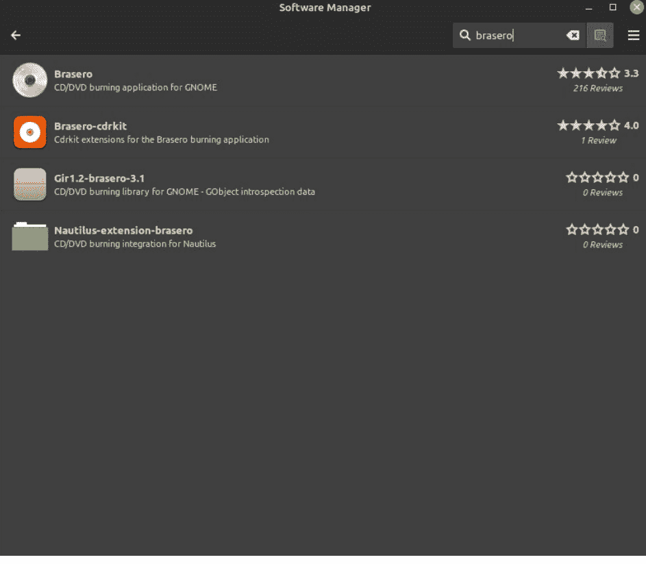

打开`软件管理器`

输入`brasero`

点击`Brasero`

点击`安装`

### 使用 apt 命令行安装 Brasero


打开`终端`

输入`sudo apt install brasero`

按下`回车`

## K3b

### 使用软件管理器安装 K3b

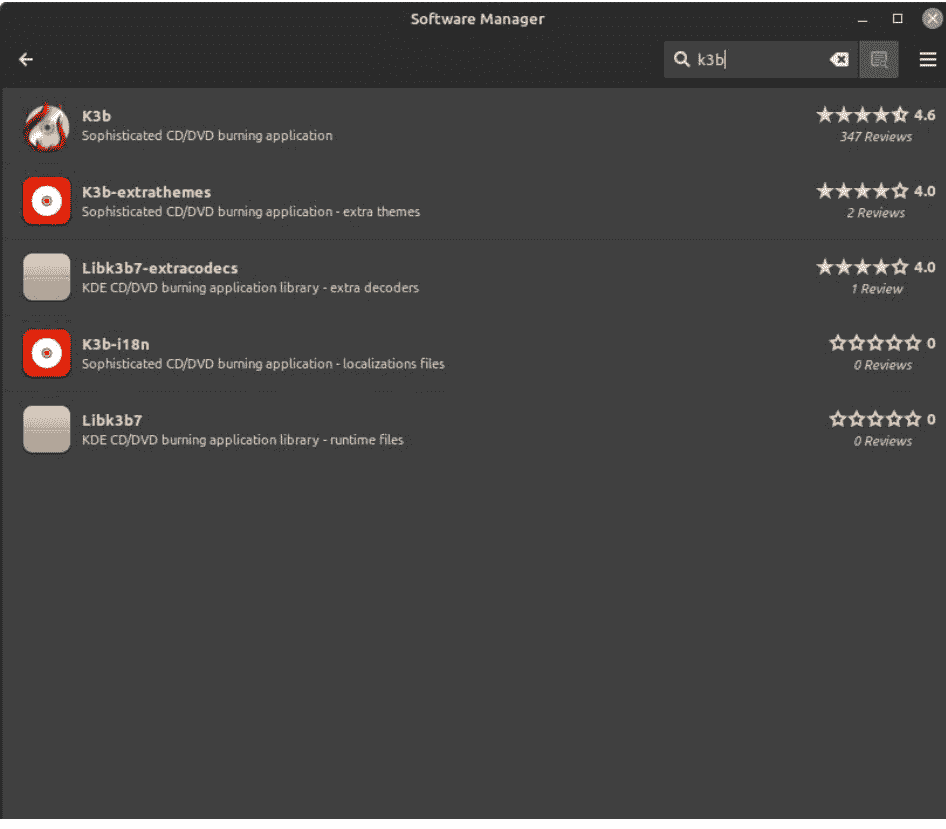

打开`软件管理器`

输入`k3b`

点击`K3b`

点击`安装`

### 使用 apt 命令行安装 K3b


打开`终端`

输入`sudo apt install k3b`

按下`回车`

## XFBurn

### 使用软件管理器安装 XFBurn

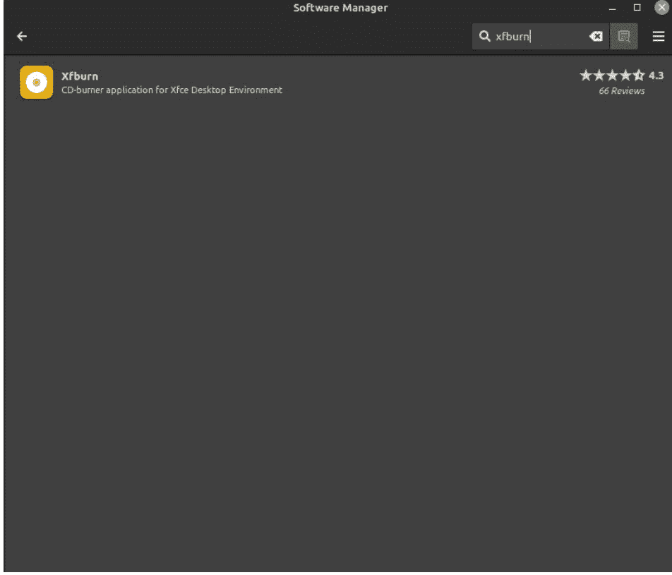

打开`软件管理器`

输入`xfburn`

点击`XFBurn`

点击`安装`

### 使用 apt 命令行安装 XFBurn

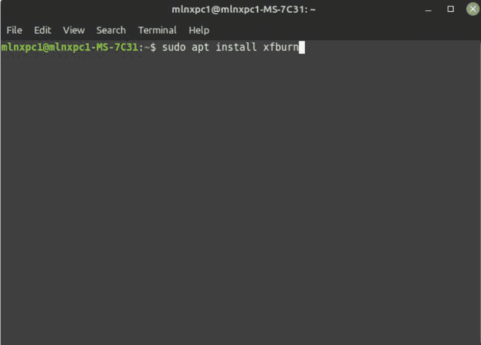

打开`终端`

输入`sudo apt install xfburn`

按下`回车`

# 云备份

云备份软件能够实现在服务器上远程存储文件，并包括：

- 在创建或编辑文件和文件夹时自动对其进行备份
- 使用 `WebDAV` 协议将云存储映射为本地驱动器
- 设置文件夹同步到远程服务器

本章涵盖了：

## Insync

### 使用 .deb 安装 Insync

### 使用 apt 命令行安装 Insync

### 使用 .deb 安装 overGrive

## Insync

### 使用 .deb 安装 Insync

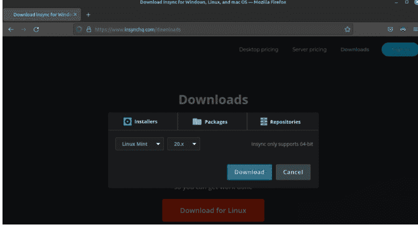

前往`https://www.insynchq.com/downloads`

点击`Linux 企鹅图标`

点击`下载 Linux 版`

点击`安装程序`

点击`第 1 个框`

点击`Linux Mint`

点击`第 2 个框`

点击`20.x`

点击`下载到 insync_3.7.9.50368-focal_amd64.deb`

前往`insync_3.7.9.50368-focal_amd64.deb`的下载位置

双击`insync_3.7.9.50368-focal_amd64.deb`

点击`安装`

### 使用 apt 命令行安装 Insync

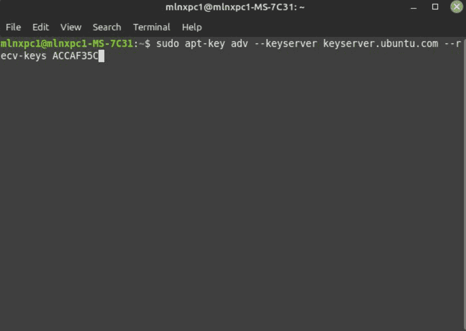

打开`终端`

输入`sudo apt-key adv --keyserver keyserver.ubuntu.com --recv-keys ACCAFF35C`

按下`回车`

```
mlnxpc1@mlnxpc1-MS-7C31:~$ sudo xed /etc/apt/sources.list.d/insync.list
```

输入`sudo xed /etc/apt/sources.list.d/insync.list`

```
deb http://apt.insync.io/mint vanessa non-free contrib
```

输入`deb http://apt.insync.io/mint vanessa non-free contrib`

点击`保存`

按下`CTRL + S`

```
mlnxpc1@mlnxpc1-MS-7C31:~$ sudo apt update && sudo apt install insync
```

输入`sudo apt update && sudo apt install insync`

按下`回车`

## overGrive

### 使用 .deb 安装 overGrive

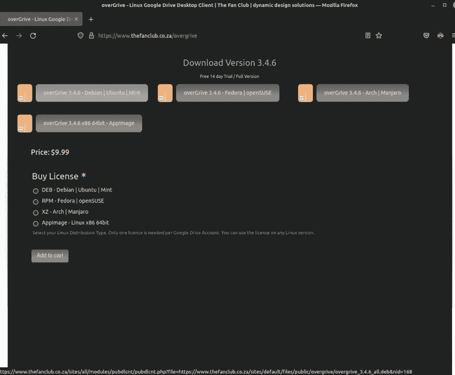

前往`https://www.thefanclub.co.za/overgrive`

点击`overGrive 3.4.5 - Debian | Ubuntu | Mint`以下载`overgrive_3.4.5_all.deb`

前往`overgrive_3.4.5_all.deb`的下载位置

双击`overgrive_3.4.5_all.deb`

点击`安装`

# 云办公套件

云办公套件是桌面办公软件的 Web 版本，提供：

- 在创建或编辑文档时自动保存
- 可添加或增强现有功能的扩展程序
- 如果有付费版本，通常提供功能完备的替代方案

本章涵盖了：

- Google Docs
- Microsoft Office 365
- Zoho Docs

## Google Docs


前往`https://www.google.com/intl-GB/docs/`

点击`访问 Google Docs`

## Microsoft Office 365


前往`https://www.office.com/`

点击`访问 Microsoft Office 365`

## Zoho Docs

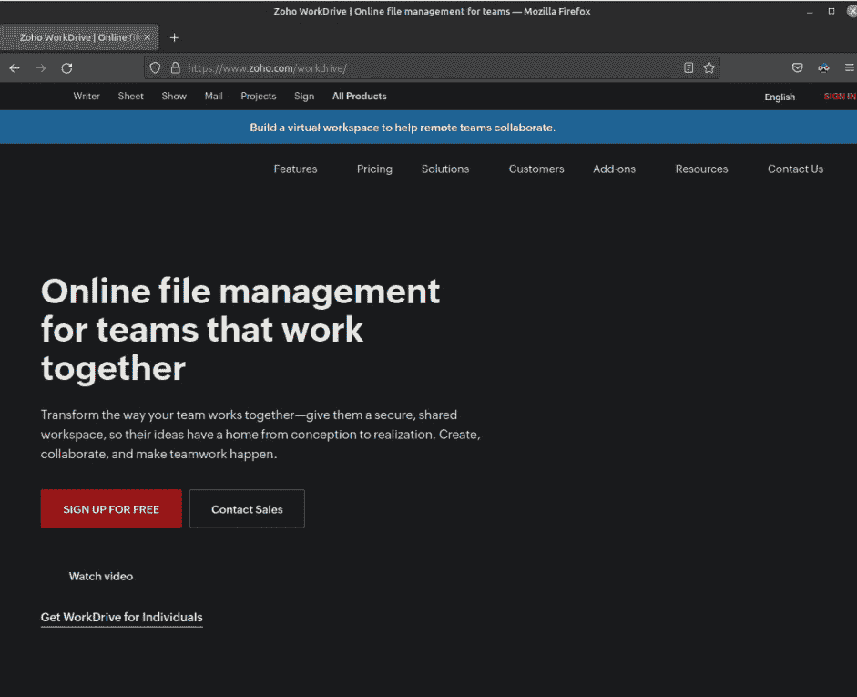

前往`https://www.zoho.com/docs/`

点击`访问 Zoho Docs`

# 通信

通信软件让你直接通过：

- 文档、图片、视频或音频进行交流

本章涵盖了：

- Discord
- Ferdium
- Pidgin

## Discord

### 使用软件管理器安装 Discord

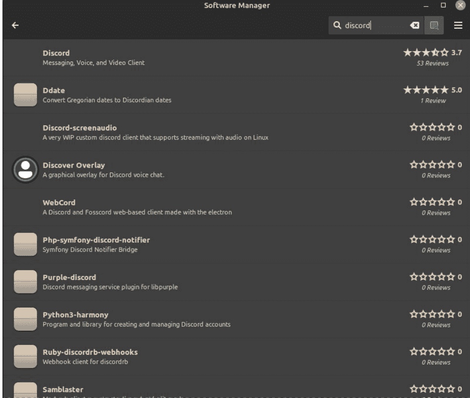

打开`软件管理器`

输入`discord`

点击`Discord`

点击`安装`

### 使用 flatpak 命令行安装 Discord


打开`终端`

输入`flatpak install flathub com.discordapp.Discord`

### 使用软件管理器安装 Discord

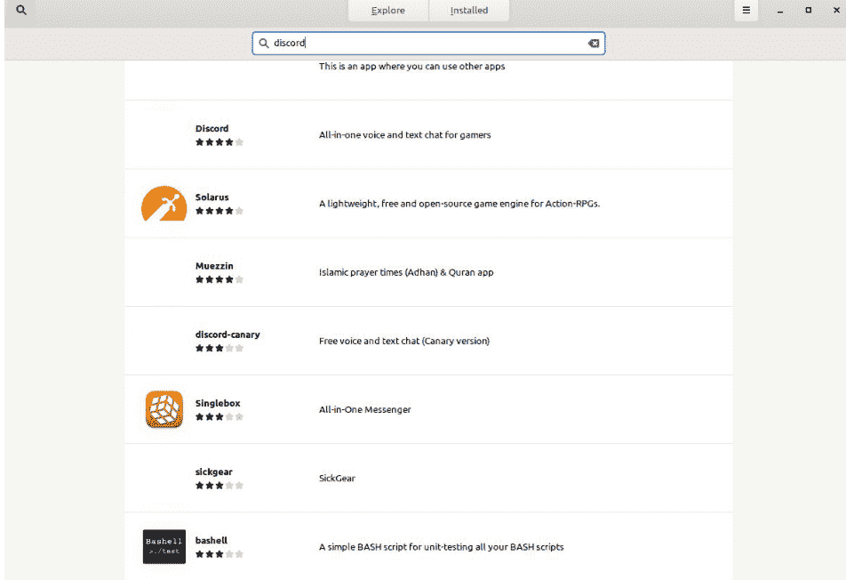

打开`软件管理器`

输入`discord`

点击`Discord`

点击`安装`

### 使用 snap 命令行安装 Discord

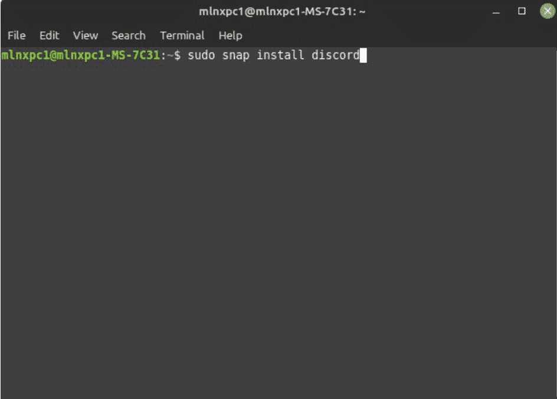

打开`终端`

输入`sudo snap install discord`

按下`回车`

### 使用 .deb 安装 Discord


前往`https://discord.com/download`

点击`下载 Linux 版`

点击`.deb 下载 discord-0.0.18.deb`

前往`discord-0.0.18.deb`的下载位置

双击`discord-0.0.18.deb`

点击`安装`

## Ferdium

### 使用软件管理器安装 Ferdium

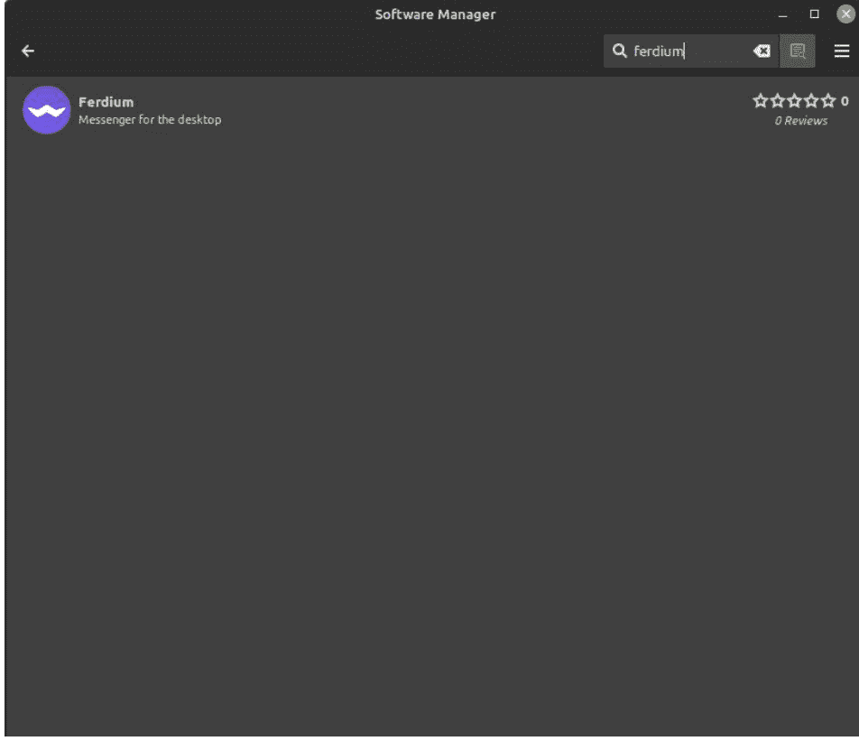

打开`软件管理器`

输入`ferdium`

点击`Ferdium`

点击`安装`

### 使用 flatpak 命令行安装 Ferdium

```
lnxpc1@mlnxpc1-MS-7C31:
mlxpc1@mlnxpc1-MS-7C31:~$ flatpak install flathub org.ferdium.Ferdium
```

### 使用软件管理器安装 Ferdium

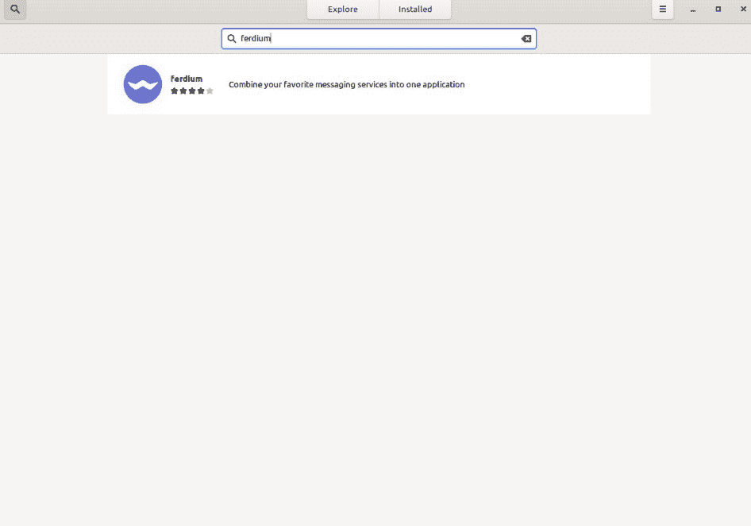

打开`软件管理器`

输入`ferdium`

点击`Ferdium`

点击`安装`

### 使用 snap 命令行安装 Ferdium

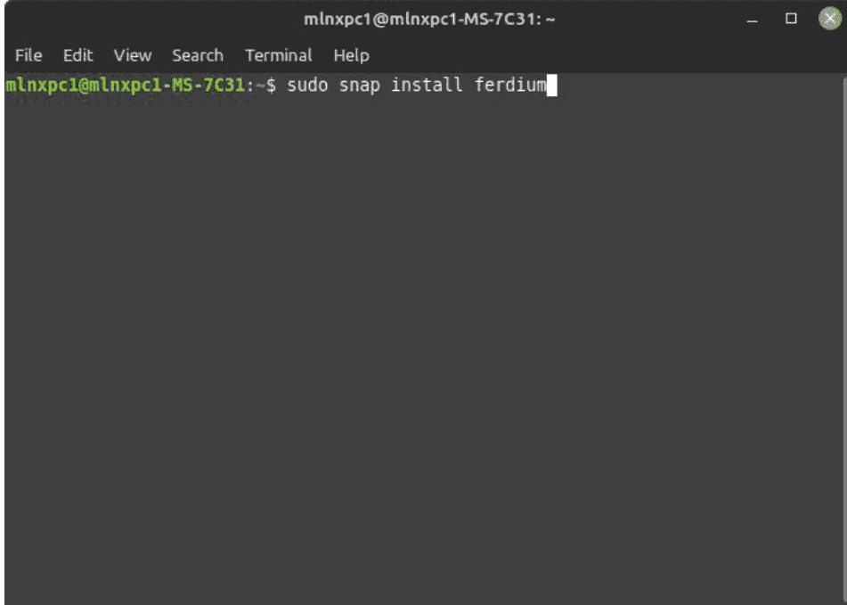

打开`终端`

输入`sudo snap install ferdium`

### 使用 .deb 安装 Ferdium

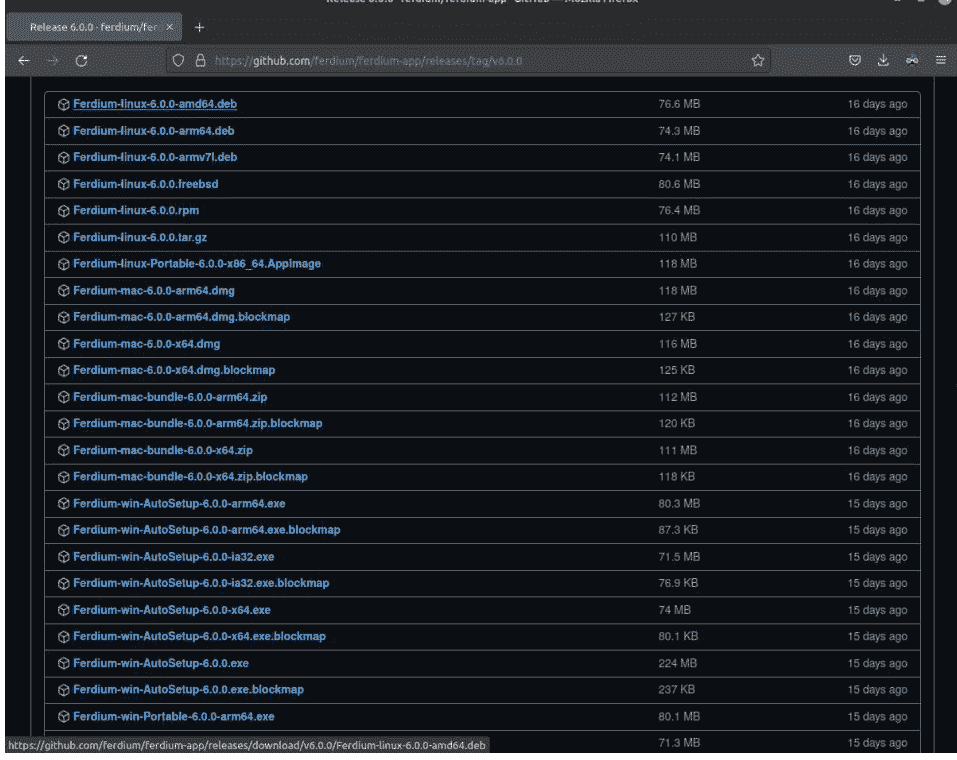

前往`https://github.com/ferdium/ferdium-app/releases/tag/v6.0.0`

点击`.deb 下载 ferdium-linux-6.0.0-amd64.deb`

## Pidgin

### 使用软件管理器安装 Pidgin

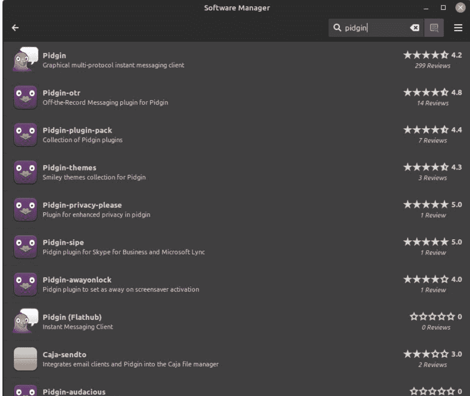

- 打开`软件管理器`
- 输入`pidgin`
- 点击`Pidgin`
- 点击`安装`

### 使用 apt 命令行安装 Pidgin


- 打开`终端`
- 输入`sudo apt install pidgin`
- 按`回车`

### 使用 flatpak 命令行安装 Pidgin

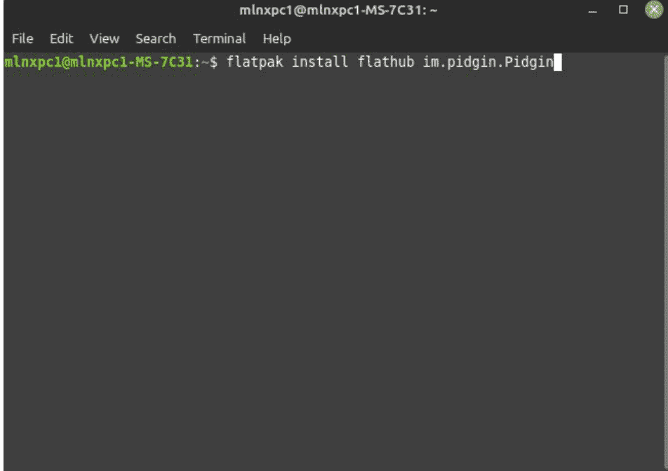

- 打开`终端`
- 输入`flatpak install flathub im.pidgin.Pidgin`
- 按`回车`

## Signal

### 使用软件管理器安装 Signal

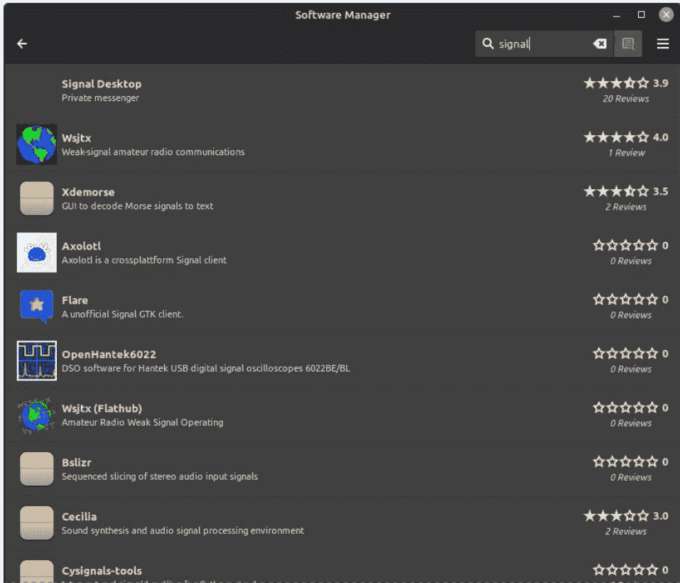

- 打开`软件管理器`
- 输入`signal`
- 点击`Signal Desktop`
- 点击`安装`

### 使用 flatpak 命令行安装 Signal


- 打开`终端`
- 输入`flatpak install flathub org.signal.Signal`
- 按`回车`

### 使用 Snap Store 安装 Signal

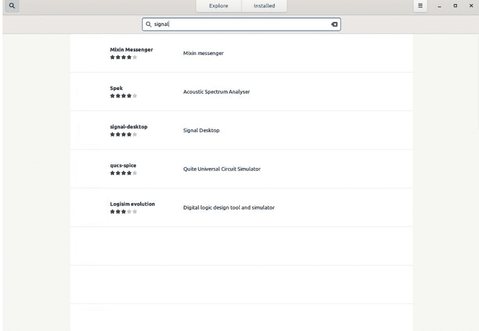

- 打开`Snap Store`
- 输入`signal`
- 点击`signal-desktop`
- 点击`安装`

### 使用 snap 命令行安装 Signal

```
mlnxpc1@mlnxpc1-MS-7C31: ~ 
File Edit View Search Terminal Help
mlnxpc1@mlnxpc1-MS-7C31:~$ sudo snap install signal-desktop
```

- 打开`终端`
- 输入`sudo snap install signal-desktop`
- 按`回车`

# 加密货币钱包

加密货币钱包允许在 Linux 操作系统上存储加密货币，并提供以下功能：

- 扩展功能的插件，例如：跟踪器、电子邮件和虚拟键盘
- 去中心化且冗余服务器以减少停机时间
- 密钥的加密和本地存储，且可以进行导出

本章涵盖：

## Coin

- 使用 Snap Store 安装 Coin
- 使用 snap 命令行安装 Coin

## Exodus

- 使用软件管理器安装 Exodus
- 使用 flatpak 命令行安装 Exodus
- 使用 .deb 安装 Exodus

## Guarda Wallet

- 使用 .deb 安装 Guarda Wallet

## Wasabi Wallet

- 使用软件管理器安装 Wasabi Wallet
- 使用 flatpak 命令行安装 Wasabi Wallet
- 使用 .deb 安装 Wasabi Wallet

## Coin

### 使用 Snap Store 安装 Coin

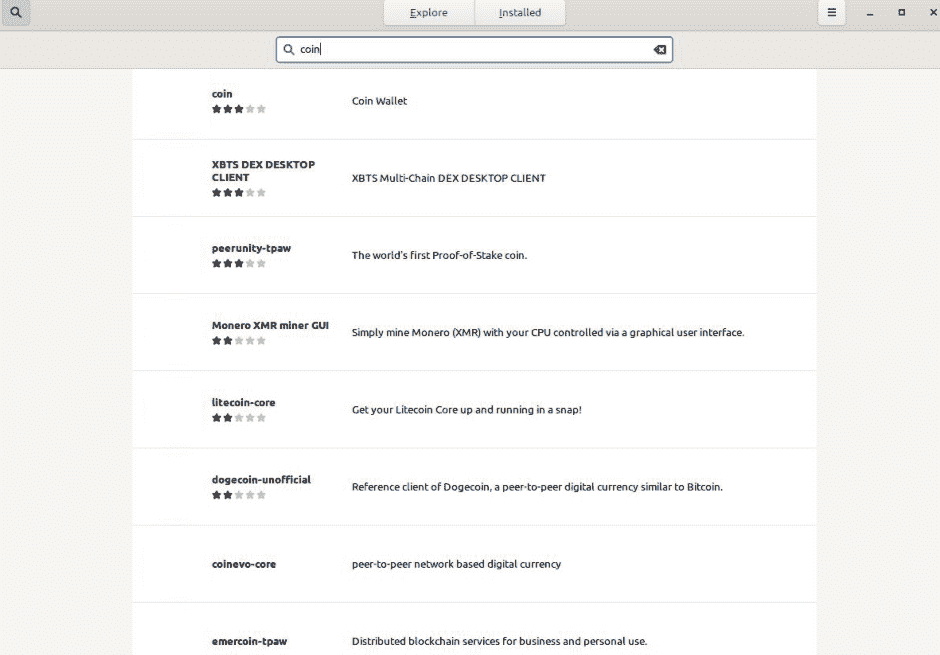

- 打开`Snap Store`
- 输入`coin`
- 点击`Coin`
- 点击`安装`

### 使用 snap 命令行安装 Coin


- 打开`终端`
- 输入`sudo snap install coin`
- 按`回车`

## Exodus

### 使用软件管理器安装 Exodus

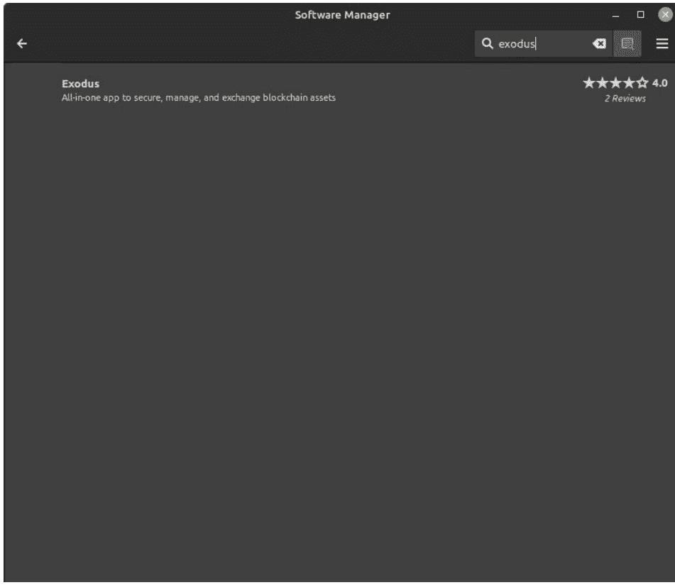

- 打开`软件管理器`
- 输入`exodus`
- 点击`Exodus`
- 点击`安装`

### 使用 flatpak 命令行安装 Exodus

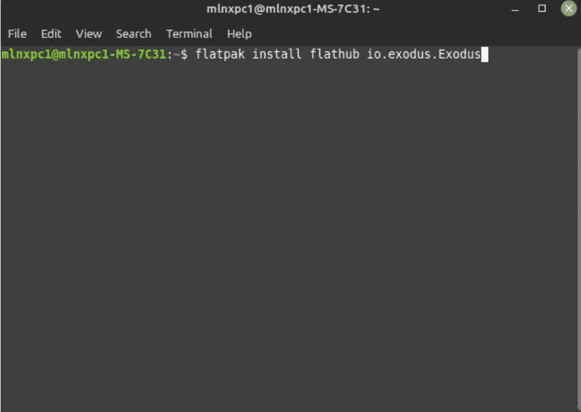

- 打开`终端`
- 输入`flatpak install flathub io.exodus.Exodus`
- 按`回车`

### 使用 .deb 安装 Exodus

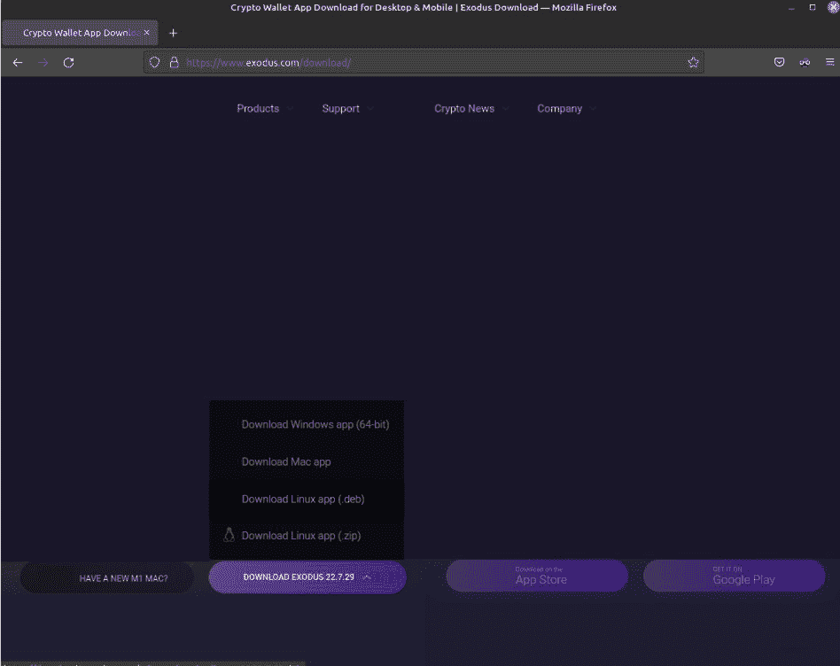

- 转到`https://www.exodus.com/download/`
- 点击`Download Exodus`
- 点击`Download Linux app (.deb)`以下载`exodus-linux-x64-22.7.29.deb`
- 转到
- 双击`exodus-linux-x64-22.7.29.deb`
- 点击`安装`

## Guarda Wallet

### 使用 .deb 安装 Guarda Wallet


- 转到`https://guarda.com/desktop/`
- 点击`Download Guarda`
- 点击`Download Linux (.deb)`以下载`Guarda_1.0.20_amd64.deb`
- 转到`Guarda_1.0.20_amd64.deb`下载所在
- 双击`Guarda_1.0.20_amd64.deb`
- 点击`安装`

## Wasabi Wallet

### 使用软件管理器安装 Wasabi Wallet

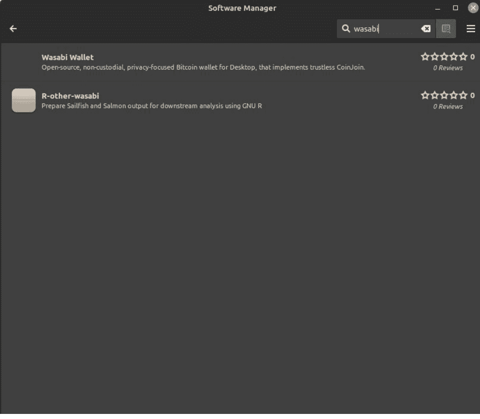

- 打开`软件管理器`
- 输入`wasabi`
- 点击`Wasabi`
- 点击`安装`

（注：OCR 文本在输入处为 "Wasabi Wallet"，根据典型用法已修正为 "wasabi"）

### 使用 flatpak 命令行安装 Wasabi Wallet


- 打开`终端`
- 输入`flatpak install flathub com.wasabi.Wasabi`
- 按`回车`

### 使用 .deb 安装 Wasabi Wallet


- 转到`https://wasabiihault.com/`
- 点击`Download Wasabi`
- 点击`Download Linux (.deb)`以下载`wasabi-linux-x64.deb`
- 转到
- 双击`wasabi-linux-x64.deb`
- 点击`安装`

# 自定义内核

自定义内核提供了标准 Linux 内核中未包含的功能。它们提供：

- 扩展功能的插件，例如：跟踪器、电子邮件和虚拟键盘
- 去中心化且冗余服务器以减少停机时间
- 密钥的加密和本地存储，且可以进行导出

本章涵盖：

- 使用 Snap Store 安装自定义内核
- 使用 snap 命令行安装自定义内核

（注：该部分的 OCR 文本高度碎片化/损坏；上述结构是根据前页内容的上下文生成的）。

```bash
mlnxpc1@mlnxpc1-MS-7C31:~$ echo 'net.core.default_qdisc = fq_pie' | sudo tee /etc/sysctl.d/90-override.conf
```

输入`echo 'net.core.default_qdisc = fq_pie' | sudo tee /etc/sysctl.d/90-override.conf`

按下`回车键`

之后，重启电脑

# 数据恢复

数据恢复程序可以从存储设备中恢复丢失或损坏的数据，具有以下功能：

- 识别来自各种操作系统的分区表和布局
- 使用许多参数恢复已删除的文件变体
- 使用 `SMART`（自监控、分析和报告技术）评估存储健康状况

本章涵盖：

## R-Linux

### 使用 .deb 安装 R-Linux

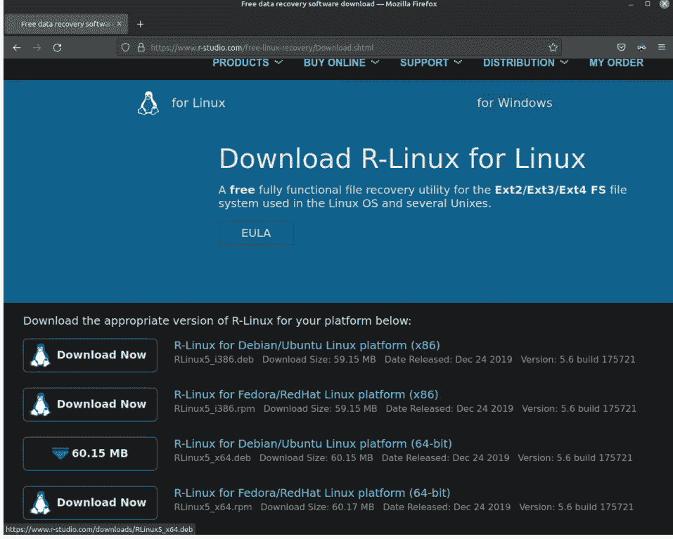

请在下方下载适用于你平台的适当 R-Linux 版本：

- 适用于 Debian/Ubuntu 平台 (x86) 的 R-Linux


# R-Linux 下载信息

## 适用于 Debian/Ubuntu 平台 (x86) 的 R-Linux

- **文件名**：`Linux5_x86.deb`
- **下载大小**：59.5 MB
- **发布日期**：2019年12月24日
- **版本**：5.6 build 175271

## 适用于 Fedora/RedHat 平台 (x86) 的 R-Linux

- **文件名**：`Linux5_x86.rpm`
- **下载大小**：59.5 MB
- **发布日期**：2019年12月24日
- **版本**：5.6 build 175271

## 适用于 Debian/Ubuntu 平台 (64-bit) 的 R-Linux

- **文件名**：`Linux5_x64.deb`
- **下载大小**：60.15 MB
- **发布日期**：2019年12月24日
- **版本**：5.6 build 175271

## 适用于 Fedora/RedHat 平台 (64-bit) 的 R-Linux

- **文件名**：`Linux5_x64.rpm`
- **下载大小**：60.17 MB
- **发布日期**：2019年12月24日
- **版本**：5.6 build 175271

## 下载与安装步骤

1. 前往 <https://www.r-studio.com/free-linux-recovery/Download.html>
2. 在“适用于 Debian/Ubuntu Linux 平台 (64-bit) 的 R-Linux”同一行点击“立即下载”，以下载 `RLinux5_x64.deb`
3. 前往 `RLinux5_x64.deb` 的下载位置
4. 双击 `RLin5_x64.deb`
5. 点击“安装”

# 桌面环境

桌面环境是访问程序的图形化用户界面，并提供：

- 拖放功能及使桌面更熟悉的额外功能
- 文件夹、图标、窗口、壁纸、工具栏和小组件
- Gnome、KDE Plasma、Cinnamon 和 LXDE 是流行的桌面环境

本章涵盖：

- **Tasksel**：使用 `apt` 命令行安装 Tasksel
- **KDE Plasma**：使用 `apt` 命令行安装 KDE Plasma
- **LXDE**：使用 `apt` 命令行安装 LXDE
- **LXQT**：使用 `apt` 命令行安装 LXQT
- **Gnome**：使用 `tasksel` 命令行安装 Gnome

## Tasksel

### 使用 apt 命令行安装 Tasksel

```bash
sudo apt install tasksel
```

**操作步骤**：

1. 打开终端
2. 输入 `sudo apt install tasksel`
3. 按下回车键

## KDE Plasma

### 使用 apt 命令行安装 KDE Plasma

```bash
sudo apt install kde-full
```

**操作步骤**：

1. 打开终端
2. 输入 `sudo apt install kde-full`
3. 按下回车键

## LXDE

### 使用 apt 命令行安装 LXDE

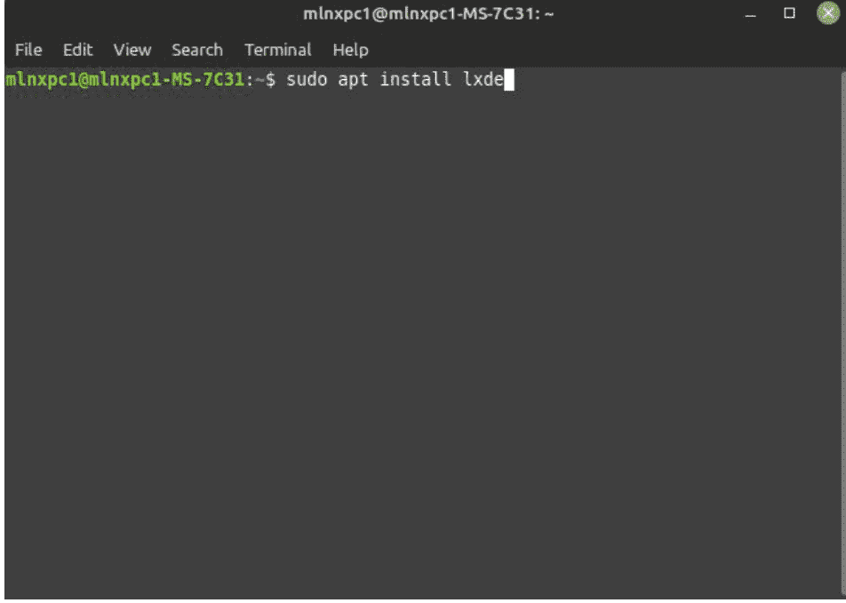

**操作步骤**：

1. 打开终端
2. 输入 `sudo apt install lxde`
3. 按下回车键

## LXQT

### 使用 apt 命令行安装 LXQT

```bash
sudo apt install lxqt
```

**操作步骤**：

1. 打开终端
2. 输入 `sudo apt install lxqt`
3. 按下回车键

## Gnome

### 使用 tasksel 命令行安装 Gnome

```bash
sudo tasksel
```

**操作步骤**：

1. 打开终端
2. 输入 `sudo tasksel`
3. 按下回车键
4. 使用上下方向键选择 **GNOME**
5. 按下空格键选中
6. 使用 `Tab` 键选择 **OK**
7. 按下回车键确认

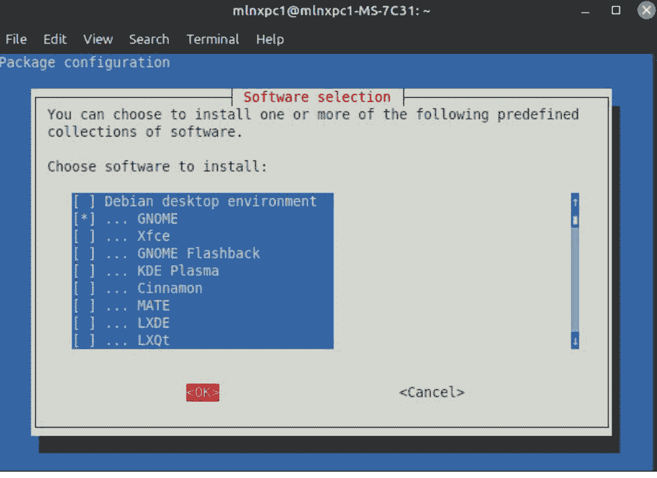

# 下载管理器

下载管理器是从互联网下载文件的软件，具有以下功能：

- 带宽限制器，确保操作不会降低连接
- 可为每个网站调整的连接设置和配置
- 设置特定日期开始和结束下载

本章涵盖：

- **FlareGet**：使用 `.deb` 安装 FlareGet
- **KGet**：使用软件管理器安装、使用 `apt` 命令行安装、使用 `flatpak` 命令行安装
- **Motrix**：使用 Snap Store 安装、使用 `snap` 安装
- **Persepolis**：使用 `apt` 安装

## FlareGet

### 使用 .deb 安装 FlareGet

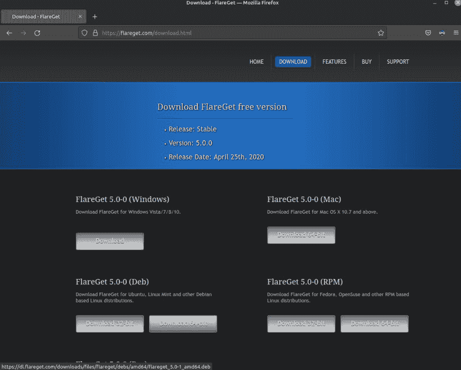

**操作步骤**：

1. 前往 <https://github.com/flareget/releases/v1.6>
2. 点击下载 `flareget_x64.deb`
3. 双击 `flareget_x64.deb`
4. 点击“安装”

## KGet

### 使用软件管理器安装 KGet

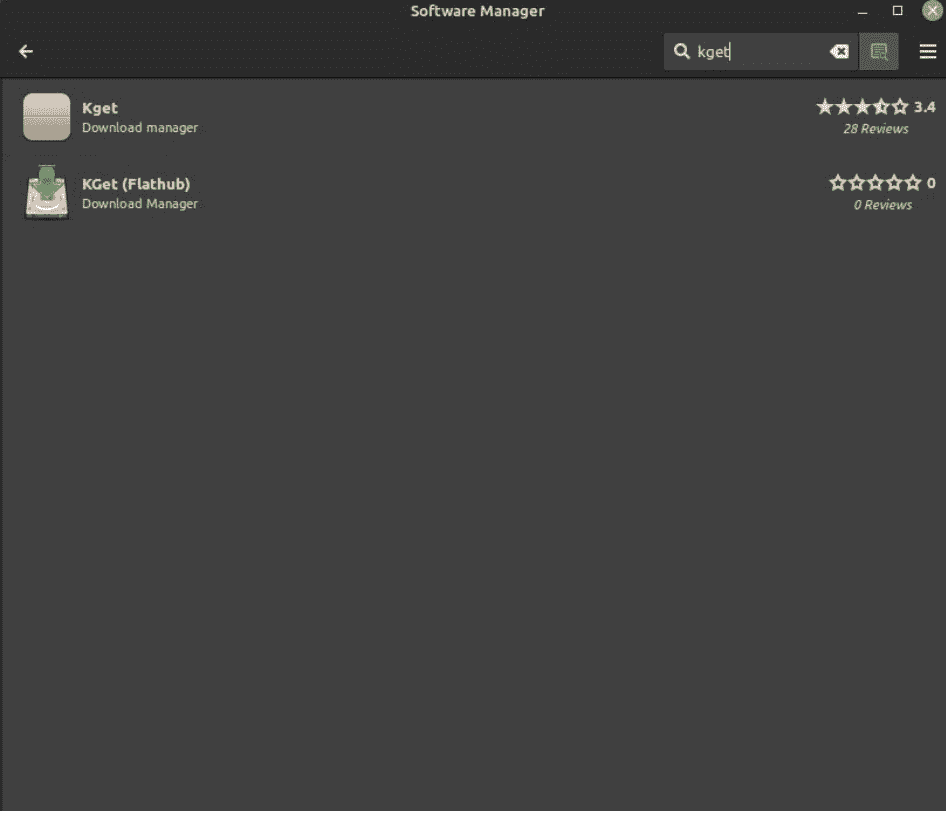

**操作步骤**：

1. 打开软件管理器
2. 输入 `kget`
3. 点击“安装”

### 使用 apt 命令行安装 KGet

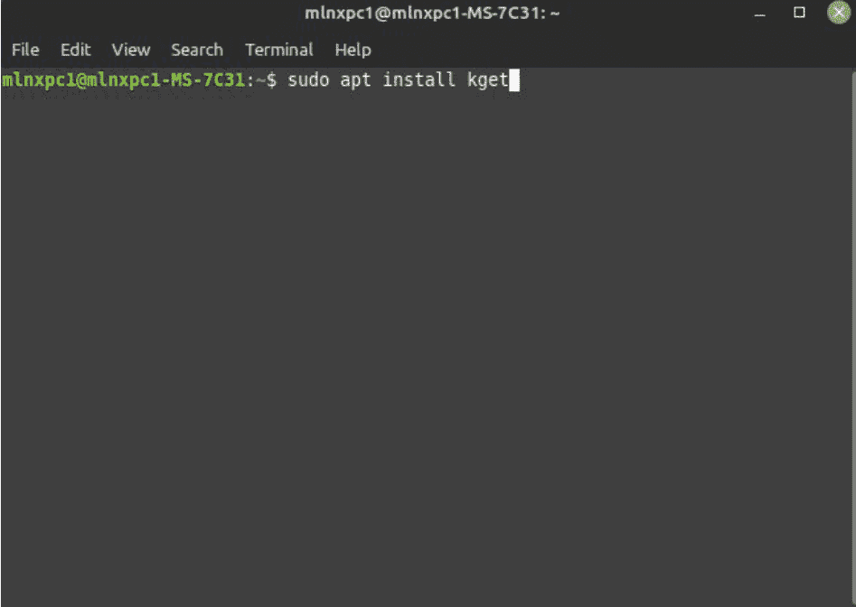

```bash
sudo apt install kget
```

**操作步骤**：

1. 打开终端
2. 输入 `sudo apt install kget`
3. 按下回车键

> **注意**：原文命令为 `sudo apt install lxget`，此处已修正为 `kget`。

### 使用 flatpak 命令行安装 KGet

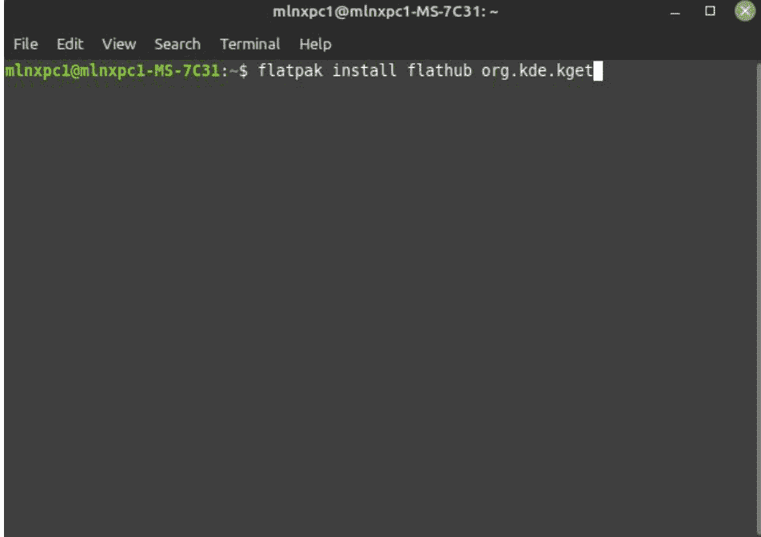

```bash
flatpak install flathub org.kde.kget
```

**操作步骤**：

1. 打开终端
2. 输入 `flatpak install flathub org.kde.kget`
3. 按下回车键

## Motrix

### 使用 Snap Store 安装 Motrix

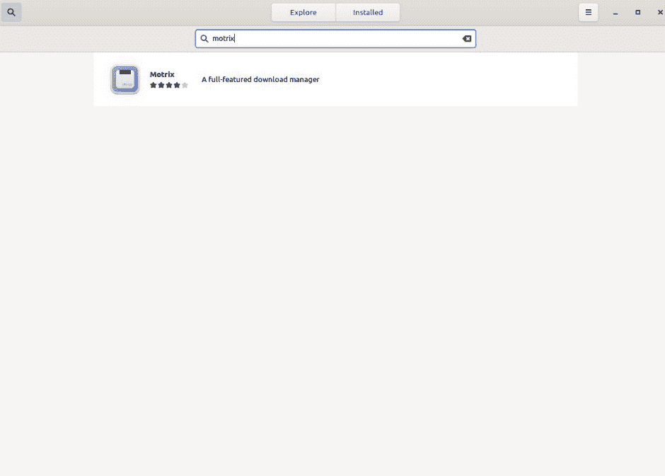

**操作步骤**：

1. 打开 Snap Store
2. 输入 `motrix`
3. 点击“安装”

### 使用 snap 命令行安装 Motrix


```bash
sudo snap install motrix
```

**操作步骤**：

1. 打开终端
2. 输入 `sudo snap install motrix`
3. 按下回车键

## Persepolis

### 使用 apt 安装 Persepolis

```bash
sudo apt install persepolis
```

# 电子书阅读器

本章涵盖：

- **Calibre**：使用软件管理器安装、使用 `apt` 命令行安装、使用 `flatpak` 命令行安装、使用二进制文件命令行安装
- **FBReader**：使用软件管理器安装、使用 `apt` 命令行安装、使用 Snap Store 安装、使用 `snap` 命令行安装
- **Lucidor**：使用 `.deb` 安装
- **Okular**：使用软件管理器安装、使用 `apt` 命令行安装、使用 `flatpak` 命令行安装、使用 Snap Store 安装、使用 `snap` 命令行安装
- **Bookworm**：使用软件管理器安装、使用 `apt` 命令行安装、使用 `flatpak` 命令行安装

## Calibre

### 使用软件管理器安装 Calibre

**操作步骤**：

1. 打开软件管理器
2. 输入 `calibre`
3. 点击 `calibre`
4. 点击“安装”

### 使用 apt 命令行安装 Calibre

```bash
sudo apt install calibre
```

**操作步骤**：

1. 打开终端
2. 输入 `sudo apt install calibre`
3. 按下回车键

### 使用 flatpak 命令行安装 Calibre

```bash
flatpak install flathub com.calibre_ebook.calibre
```

**操作步骤**：

1. 打开终端
2. 输入 `flatpak install flathub com.calibre_ebook.calibre`
3. 按下回车键

### 使用二进制文件命令行安装 Calibre

```bash
sudo -v && wget -nv -O- https://download.calibre-ebook.com/linux-installer.sh | sudo sh /dev/stdin
```

**操作步骤**：

1. 打开终端
2. 输入 `sudo -v && wget -nv -O- https://download.calibre-ebook.com/linux-installer.sh | sudo sh /dev/stdin`
3. 按下回车键

## FBReader

### 使用软件管理器安装 FBReader

**操作步骤**：

1. 打开软件管理器
2. 输入 `fbreader`
3. 点击 “E-book reader”
4. 点击“安装”

### 使用 apt 命令行安装 FBReader

```bash
sudo apt install fbreader
```

**操作步骤**：

1. 打开终端
2. 输入 `sudo apt install fbreader`
3. 按下回车键

> **注意**：原文命令为 `sudo apt install freader`，此处已修正为 `fbreader`。

### 使用 Snap Store 安装 FBReader

**操作步骤**：

1. 打开 Snap Store
2. 输入 `fbreader`
3. 点击 “FBReader 2.0”
4. 点击“安装”

### 使用 snap 命令行安装 FBReader

```bash
sudo snap install fbreader
```

**操作步骤**：

1. 打开终端
2. 输入 `sudo snap install fbreader`
3. 按下回车键

## Lucidor

### 使用 .deb 安装 Lucidor

**操作步骤**：

1. 访问 <http://lucidor.org/lucidor/download.php>
2. 点击 “Download the deb package: lucidor_0.9.15-1_all.deb” 以下载 `lucidor_0.9.15-1_all.deb`
3. 前往 `lucidor_0.9.15-1_all.deb` 的下载目录
4. 双击 `lucidor_0.9.15-1_all.deb`
5. 点击“安装”

## Okular

### 使用软件管理器安装 Okular

**操作步骤**：

1. 打开软件管理器
2. 输入 `okular`
3. 点击 `Okular`
4. 点击“安装”

### 使用 apt 命令行安装 Okular

```bash
sudo apt install okular
```

**操作步骤**：

1. 打开终端
2. 输入 `sudo apt install okular`
3. 按下回车键

### 使用 flatpak 命令行安装 Okular

```bash
flatpak install flathub org.kde.okular
```

**操作步骤**：

1. 打开终端
2. 输入 `flatpak install flathub org.kde.okular`
3. 按下回车键

### 使用 Snap Store 安装 Okular

**操作步骤**：

1. 打开 Snap Store
2. 输入 `okular`
3. 点击“安装”

### 使用 snap 命令行安装 Okular

```bash
sudo snap install okular
```

**操作步骤**：

1. 打开终端
2. 输入 `sudo snap install okular`
3. 按下回车键

## Bookworm

### 使用软件管理器安装 Bookworm

**操作步骤**：

1. 打开软件管理器
2. 输入 `bookworm`
3. 点击 `Bookworm`
4. 点击“安装”

### 使用 apt 命令行安装 Bookworm

```bash
sudo apt install bookworm
```

**操作步骤**：

1. 打开终端
2. 输入 `sudo apt install bookworm`
3. 按下回车键

### 使用 flatpak 命令行安装 Bookworm

```bash
flatpak install flathub com.github.bookoy.bookworm
```

**操作步骤**：

1. 打开终端
2. 输入 `flatpak install flathub com.github.bookoy.bookworm`
3. 按下回车键

# Elder Gaming

Elder Gaming 是关于在 Linux 操作系统和其他操作系统上运行旧游戏。ScummVM 是关于玩具有存档状态等功能的旧冒险游戏。本章节涵盖了：

- **DOSBox**
- **Gnome Games App**
- **ScummVM**

## DOSBox

### 使用软件管理器安装 DOSBox

**操作步骤**：

1. 打开软件管理器
2. 输入 `dosbox`
3. 点击 `DOSBox`
4. 点击“安装”

### 使用 apt 命令行安装 DOSBox

```bash
sudo apt install dosbox
```

**操作步骤**：

1. 打开终端
2. 输入 `sudo apt install dosbox`
3. 按下回车键

### 使用 flatpak 命令行安装 DOSBox

```bash
flatpak install flathub com.dosbox.DOSBox
```

**操作步骤**：

1. 打开终端
2. 输入 `flatpak install flathub com.dosbox.DOSBox`
3. 按下回车键

### 使用 apt 命令行安装 libopusfile

```bash
sudo apt install libopusfile0
```

**操作步骤**：

1. 打开终端
2. 输入 `sudo apt install libopusfile0`
3. 按下回车键

## Gnome Games App

### 使用软件管理器安装 Gnome Games App

**操作步骤**：

1. 打开软件管理器
2. 输入 `gnome games`
3. 点击 `Games`
4. 点击“安装”

### 使用 apt 命令行安装 Gnome Games App

```bash
sudo apt install gnome-games-app
```

**操作步骤**：

1. 打开终端
2. 输入 `sudo apt install gnome-games-app`
3. 按下回车键

### 使用 flatpak 命令行安装 Gnome Games App

```bash
flatpak install flathub org.gnome.Games
```

**操作步骤**：

1. 打开终端
2. 输入 `flatpak install flathub org.gnome.Games`
3. 按下回车键

## ScummVM

### 使用软件管理器安装 ScummVM

**操作步骤**：

1. 打开软件管理器
2. 输入 `scummvm`
3. 点击 `ScummVM`
4. 点击“安装”

### 使用 apt 命令行安装 ScummVM

```bash
sudo apt install scummvm
```

**操作步骤**：

1. 打开终端
2. 输入 `sudo apt install scummvm`
3. 按下回车键

### 使用 flatpak 命令行安装 ScummVM

```bash
flatpak install flathub org.scummvm.ScummVM
```

**操作步骤**：

1. 打开终端
2. 输入 `flatpak install flathub org.scummvm.ScummVM`
3. 按下回车键

### 使用 Snap Store 安装 ScummVM

**操作步骤**：

1. 打开 Snap Store
2. 输入 `scummvm`
3. 点击 `ScummVM`
4. 点击“安装”

### 使用 snap 命令行安装 ScummVM

```bash
sudo snap install scummvm
```

**操作步骤**：

1. 打开终端
2. 输入 `sudo snap install scummvm`
3. 按下回车键

# 压缩工具

## P7Zip-Desktop

### 使用 Snap Store 安装 P7Zip-Desktop

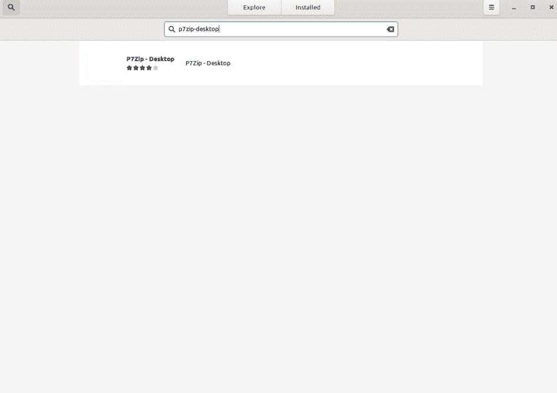

**操作步骤**：

1. 打开 Snap Store
2. 输入 `p7zip-desktop`
3. 点击 `p7zip-desktop`
4. 点击“Install”

### 使用 snap 命令行安装 P7Zip-Desktop

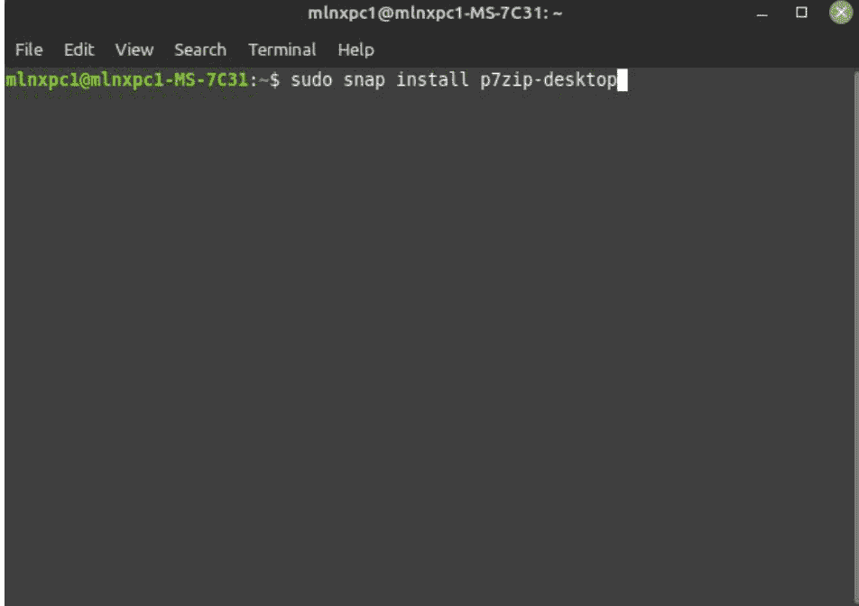

```bash
sudo snap install p7zip-desktop
```

**操作步骤**：

1. 打开终端
2. 输入 `sudo snap install p7zip-desktop`
3. 按下回车键

## Peazip

### 使用软件管理器安装 Peazip

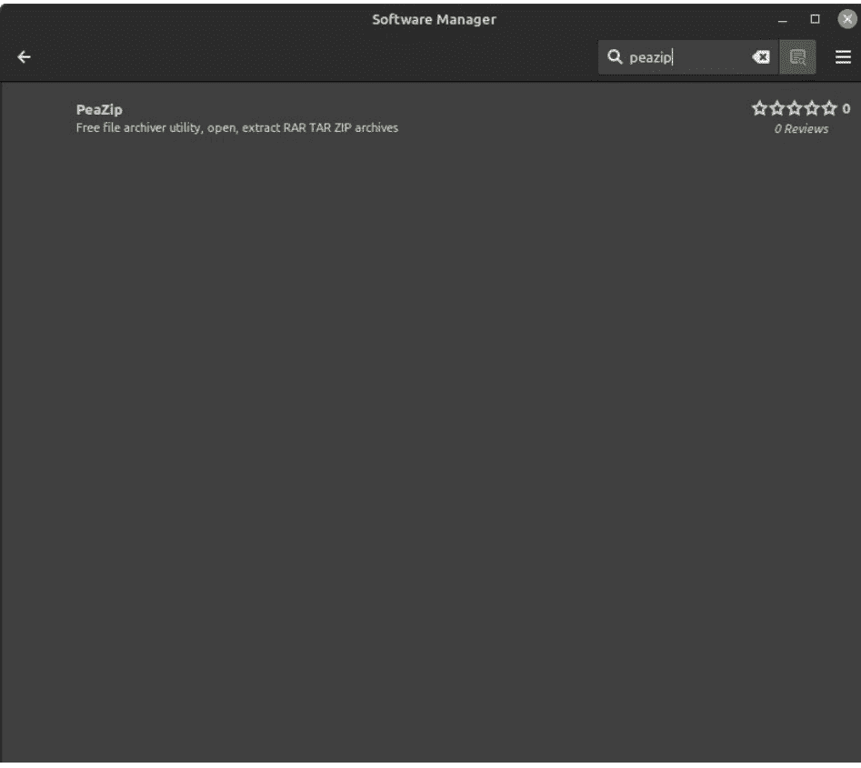

**操作步骤**：

1. 打开软件管理器
2. 输入 `peazip`
3. 点击 `Peazip`
4. 点击“Install”

### 使用 flatpak 命令行安装 Peazip

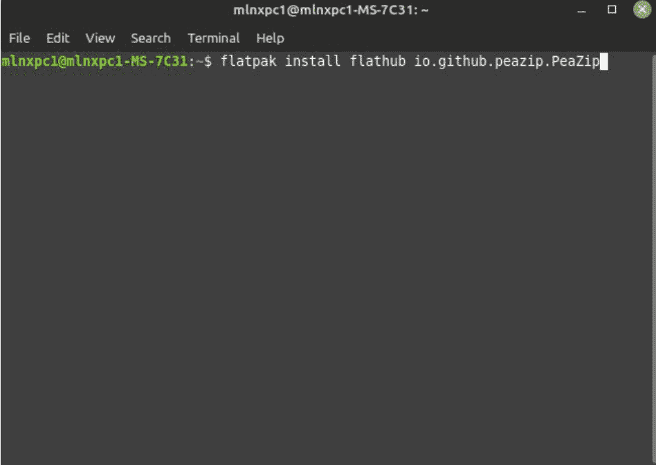

```bash
flatpak install flathub io.github.peazip.Peazip
```

**操作步骤**：

1. 打开终端
2. 输入 `flatpak install flathub io.github.peazip.Peazip`
3. 按下回车键

> **注意**：原文命令为 `io.github.peazip.PeazZip`，此处已修正大小写为 `Peazip`。

### 使用 .deb 安装 Peazip

#### Linux 管理器：WinZip 的开源替代方案

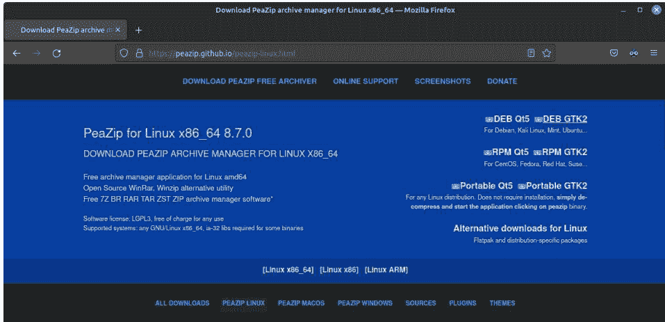

Peazip 是一款开源（LGPL）跨平台归档软件，提供强大的加密和压缩功能，可以打开并解压 200 多种压缩格式，如 ZIP, RAR, 7Z, GZ, ISO, NRG, TAR, WIM, Zstandard 等。

开源 WinZip 替代方案，一种在 Linux 操作系统上提供强大工具的免费软件。Peazip 提供了高压缩率（压缩为 7Z, ZIP 等）、多种存档格式的解密，支持多种加密（AES, Fish, Serpent, Blowfish, Twofish），并适用于不同的桌面环境（如 GNOME, KDE, XFCE, Cinnamon, macOS 和 Windows）。它可以通过图形界面或命令行界面进行使用。

如果 Peazip 未运行在 Wayland 上，我们可能需要使用基于 GTK 的 Peazip。

> 提取 ACE 归档需要单独的插件（可在 Peazip 插件页面下载源文件）。

**操作步骤**：

1. 访问 <https://peazip.github.io/peazip-linux.html>
2. 点击 “DEB GTK2” 下载 `peazip_8.7.0.LINUX.GTK2-1_amd64.deb`
3. 找到 `peazip_8.7.0.LINUX.GTK2-1_amd64.deb` 的下载路径
4. 双击 `peazip_8.7.0.LINUX.GTK2-1_amd64.deb`
5. 点击“Install”

# 防火墙

防火墙程序帮助保护计算机免受进行外部攻击的恶意行为侵害，包括：

- 易用且易于访问的图形界面
- 可简单或更高级的配置选项
- 仅开放用户软件所需的端口

本章节涵盖了：

- **我使用的所有防火墙规则**：TCP 端口、UDP 端口
- **UFW**：使用 `apt` 命令行安装、启用、添加单端口规则、添加多端口规则、添加端口范围规则、移除端口规则
- **防火墙配置**：使用软件管理器安装、使用 `apt` 命令行安装、添加单端口规则、添加多端口规则、添加端口范围规则、从报告添加规则、移除防火墙

## 我使用的所有防火墙规则

### TCP 端口


### TCP 端口

`53,80,443,1119,1120,1716,1935,2099,3074,3075,3216,3478,3479,3569,3724,4000,5060,5062,5222,5223,6012,6112,6113,6114,6250,8080,8088,80,94,8097,9946,9988,14000,14008,14020,14021,14022,14023,14024,17502,1,7503,17504,18000,18060,18120,22990,27900,29810,29900,42124,42125,4,2126,42127,42130,20000:21000,25000:25099,27014:27050,30000:30099,4,2100:42200,6112:6119,6113:6119,7777:7780,8393:8400,9960:9969`

### UDP 端口

`67,68,80,443,546,1119,1120,1716,3074,3126,3478,3659,3724,4000,5060,5062,6012,6112,6113,6114,6250,8080,8088,8125,9565,9570,18000,27036,29900,10000:19999,1024:1124,1119:1120,12000:64000,14000:14016,21000:26000,22990:23006,25099,25200:25300,27000:27031,30000:30099,3074:3083,3478:3479,37000:39999,37000:40000,4379:4380,5000:5500,6112:6119,9000:9999`

## UFW

### 使用 apt 命令行安装 UFW

```bash
mlnxpc1@mlnxpc1-7:~$ sudo apt install ufw
```

### 启用 UFW

```bash
mlnxpc1@mlnxpc1-7:~$ ufw enable
```

### UFW 添加单端口规则

```bash
mlnxpc1@mlnxpc1-7:~$ ufw allow 80
```

### UFW 添加多端口规则

```bash
mlnxpc1@mlnxpc1-7:~$ ufw allow 80,443
```

### UFW 添加端口范围规则

```bash
mlnxpc1@mlnxpc1-7:~$ ufw allow 1119:1120/tcp
```

### UFW 移除端口规则

```bash
mlnxpc1@mlnxpc1-7:~$ ufw status
```

## 防火墙配置添加范围端口规则

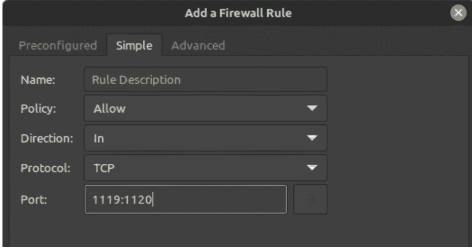

- 打开，防火墙配置
- 点击，规则
- 点击，+
- 点击，简单
- 点击与“名称”在同一行的输入框
- 输入，范围端口规则 1
- 点击与“方向”在同一行的输入框
- 点击，入站
- 点击与“协议”在同一行的输入框
- 点击，TCP、UDP 或两者
- 点击与“端口”在同一行的输入框
- 输入，`1119:1120`
- 点击，添加

## 防火墙配置从报告添加规则

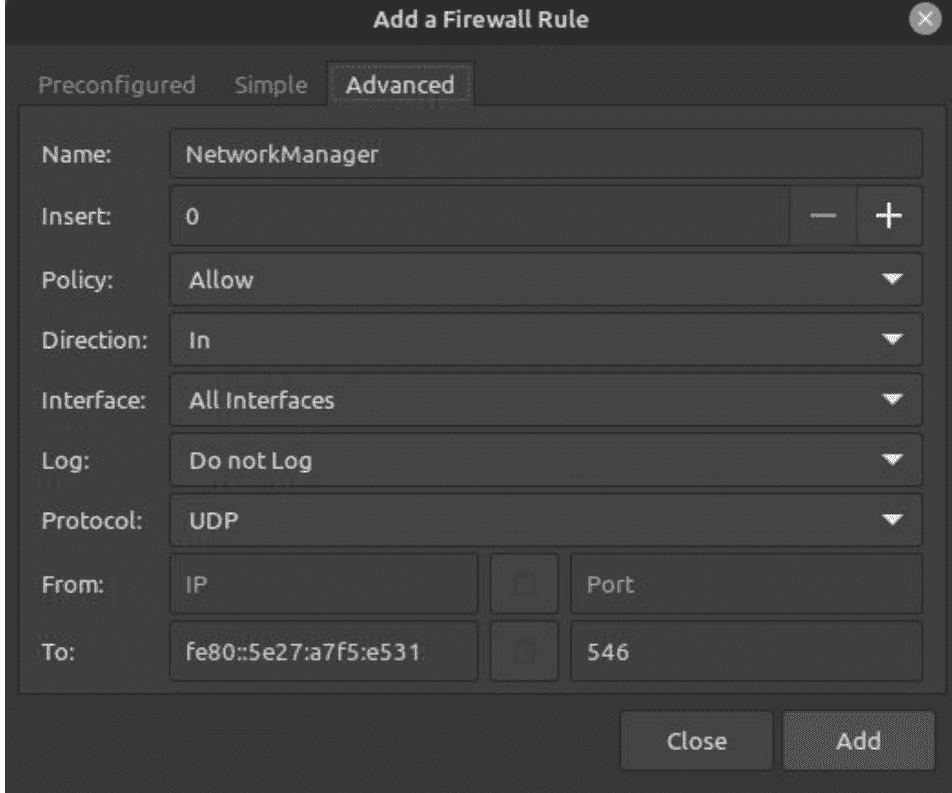

- 打开，防火墙配置
- 点击，报告
- 选择，报告中的行
- 点击，+
- 点击，添加

## 防火墙配置删除端口规则

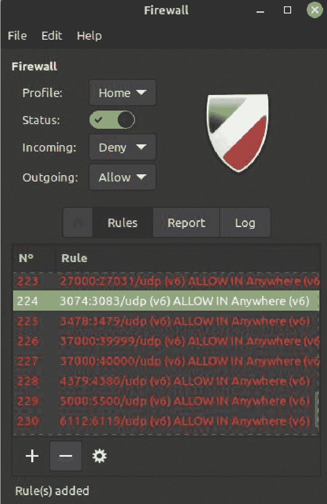

- 打开，防火墙配置
- 点击，规则
- 选择，224
- 点击，-

## 游戏引擎

游戏引擎被个人和组织用于为 Linux/Windows/Mac/其他系统创建游戏，著名的示例包括：

- Godot
- Spring Engine
- Unity

本章涵盖：

### Spring Engine

- 使用 Snap Store 安装 Spring Engine
- 使用 snap 命令行安装 Spring Engine

### Unity

- 使用 apt 命令行安装 Unity

## Spring Engine

### 使用 Snap Store 安装 Spring Engine

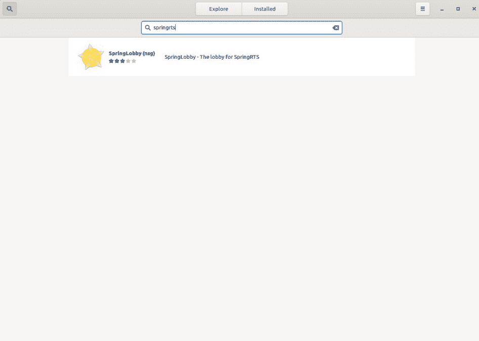

- 打开，Snap Store
- 输入，springports
- 点击，SpringLobby(nsg)
- 点击，安装

### 使用 snap 命令行安装 Spring Engine

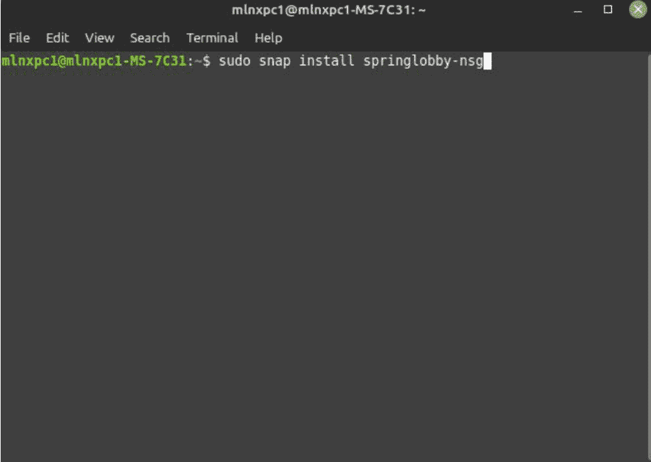

- 打开，终端
- 输入，`sudo snap install springlobby-nsg`
- 按回车

## Unity

### 使用 apt 命令行安装 Unity

```bash
File Edit View Search Terminal Help
mlxpc1@mnxpc1-MS-7C31:~$ sudo sh -c 'echo "deb https://hub.unity3d.com/linux/repos/deb stable main" > /etc/apt/sources.list.d/unityhub.list'
```

- 打开，终端
- 输入，`sudo sh -c 'echo "deb https://hub.unity3d.com/linux/repos/deb stable main" > /etc/apt/sources.list.d/unityhub.list'`
- 按回车

```bash
mlnxpc1@mlnxpc1-MS-7C31:~# wget -qO - https://hub.unity3d.com/linux/keys/public | sudo apt-key add -
```

- 输入，`wget -qO - https://hub.unity3d.com/linux/keys/public | sudo apt-key add -`
- 按回车


- 输入，`sudo apt update && sudo apt install unity-hub`
- 按回车

## 家庭生活

家庭生活是指关于改善或为家庭生活增加新维度的软件，示例包括：

- 自酿酿：制作你自己的饮料
- 菜谱：充分利用手头食材
- 管理个人和家庭财务

本章涵盖：

### AnyMeal

- 使用软件管理器安装 AnyMeal
- 使用 apt 命令行安装 AnyMeal
- 使用 .AppImage 安装 AnyMeal

### GnuCash

- 使用软件管理器安装 GnuCash
- 使用 apt 命令行安装 GnuCash
- 使用 flatpak 命令行安装 GnuCash

### Gnome Recipes

- 使用软件管理器安装 Gnome Recipes
- 使用 apt 命令行安装 Gnome Recipes
- 使用 flatpak 命令行安装 Gnome Recipes

### Home Assistant

- 使用 Snap Store 安装 Home Assistant
- 使用 snap 命令行安装 Home Assistant

### HomeBank

- 使用软件管理器安装 HomeBank
- 使用 apt 命令行安装 HomeBank
- 使用 flatpak 命令行安装 HomeBank

### Skrooge

- 使用软件管理器安装 Skrooge
- 使用 apt 命令行安装 Skrooge
- 使用 flatpak 命令行安装 Skrooge

### Sweet Home 3D

- 使用软件管理器安装 Sweet Home 3D
- 使用 apt 命令行安装 Sweet Home 3D
- 使用 Snap Store 安装 Sweet Home 3D
- 使用 snap 命令行安装 Sweet Home 3D

## AnyMeal

### 使用软件管理器安装 AnyMeal

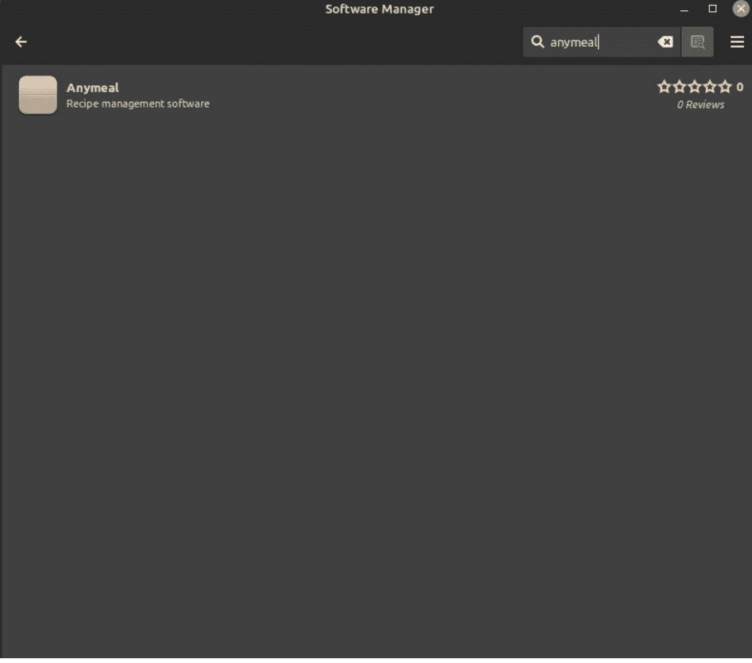

- 打开，软件管理器
- 输入，anymeal
- 点击，AnyMeal 食谱软件
- 点击，安装

### 使用 apt 命令行安装 AnyMeal


- 打开，终端
- 输入，`sudo apt install anymeal`
- 按回车

### 使用 .AppImage 安装 AnyMeal


- 访问，`https://github.com/wedoft/anymeal/releases/tag/v1.7`
- 点击 `anymeal-f650986-x86_64.AppImage` 进行下载
- 找到 `anymeal-f650986-x86_64.AppImage` 已下载的文件
- 双击 `anymeal-f650986-x86_64.AppImage`
- 集成并运行

## GnuCash

### 使用软件管理器安装 GnuCash

```bash
mlnxpc1@mlnxpc1-MS-7C31: ~ 
File Edit View Search Help
mlnxpc1@mlnxpc1-MS-7C31~$ sudo apt install gnucash
```

- 打开，软件管理器
- 输入，gnucash
- 点击，GnuCash
- 点击，安装

### 使用 apt 命令行安装 GnuCash

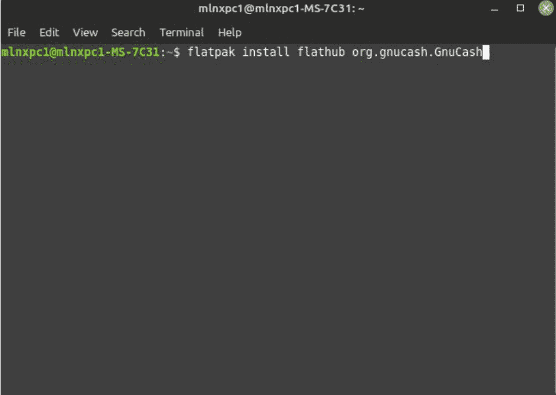

- 打开，终端
- 输入，`sudo apt install gnucash`

### 使用 flatpak 命令行安装 GnuCash

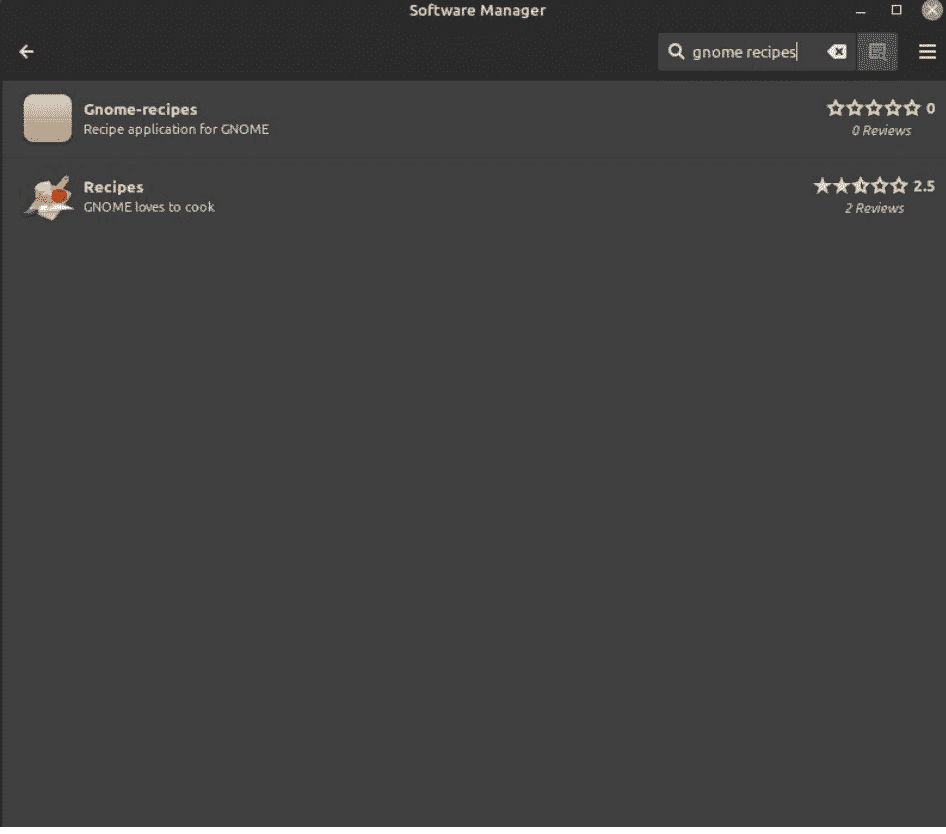

- 打开，终端
- 输入，`flatpak install flathub org.gncash`

## Gnome Recipes

### 使用软件管理器安装 Gnome Recipes

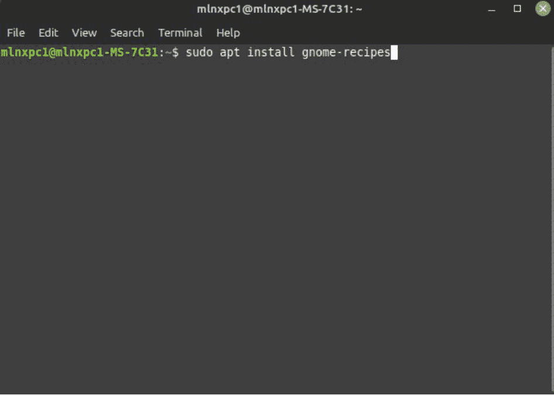

- 打开，软件管理器
- 输入，gnome recipes
- 点击，安装

### 使用 apt 命令行安装 Gnome Recipes

- 打开，终端
- 输入，`sudo apt install gnome-recipes`

### 使用 flatpak 命令行安装 Gnome Recipes

```bash
mlnxpc1@mlnxpc1-MS-7C31:~$ 
flatpak install flathub org.gnome.recipes
```

- 打开，终端
- 输入，`flatpak install flathub org.gnome.recipes`

## Home Assistant

### 使用 Snap Store 安装 Home Assistant

```bash
mlnxpc1@mlnxpc1-MS-7C31: ~ 
File Edit View Search Help
mlnxpc1@mlnxpc1-MS-7C31~$ 
```

- 打开，Snap Store
- 输入，assistant
- 点击，Home Assistant
- 点击，安装

### 使用 snap 命令行安装 Home Assistant

- 打开，终端
- 输入，`sudo snap install home-assistant`

## HomeBank

### 使用软件管理器安装 HomeBank

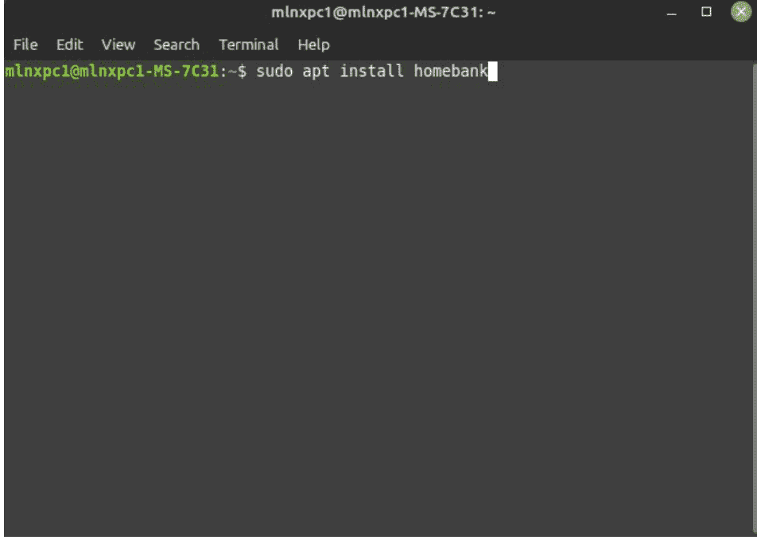

- 打开，软件管理器
- 输入，homebank
- 点击，HomeBank
- 点击，安装

### 使用 apt 命令行安装 HomeBank

- 打开，终端
- 输入，`sudo apt install homebank`

### 使用 flatpak 命令行安装 HomeBank

- 打开，终端
- 输入，`flatpak install flathub fr.free.Homebank`

## Skrooge

### 使用软件管理器安装 Skrooge


- 打开，软件管理器
- 输入，skrooge
- 点击，Skrooge
- 点击，安装

### 使用 apt 命令行安装 Skrooge

- 打开，终端
- 输入，`sudo apt install skrooge`

### 使用 flatpak 命令行安装 Skrooge

- 打开，终端
- 输入，`flatpak install flathub org.kde.skrooge`

## Sweet Home 3D

### 使用软件管理器安装 Sweet Home 3D

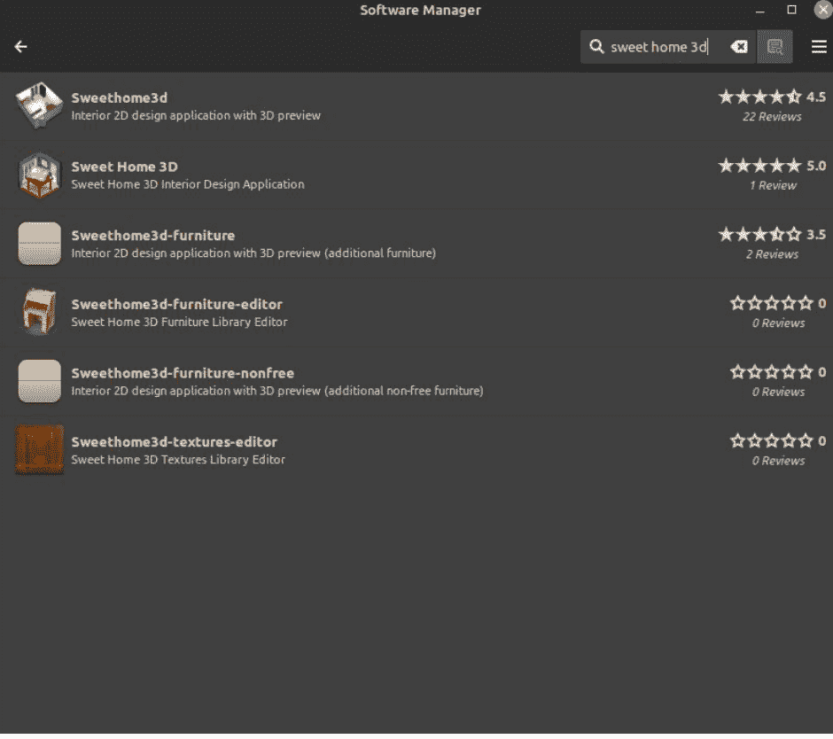

- 打开，软件管理器
- 输入，sweet home 3d
- 点击，Sweet Home 3D
- 点击，安装

### 使用 apt 命令行安装 Sweet Home 3D

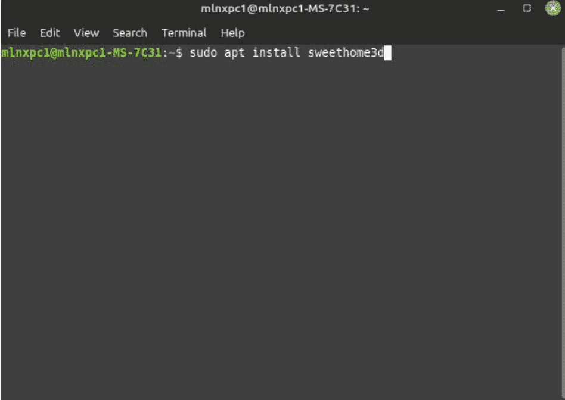

- 打开终端
- 输入，`sudo apt install sweethome3d`
- 按下回车

### 使用 Snap Store 安装 Sweet Home 3D

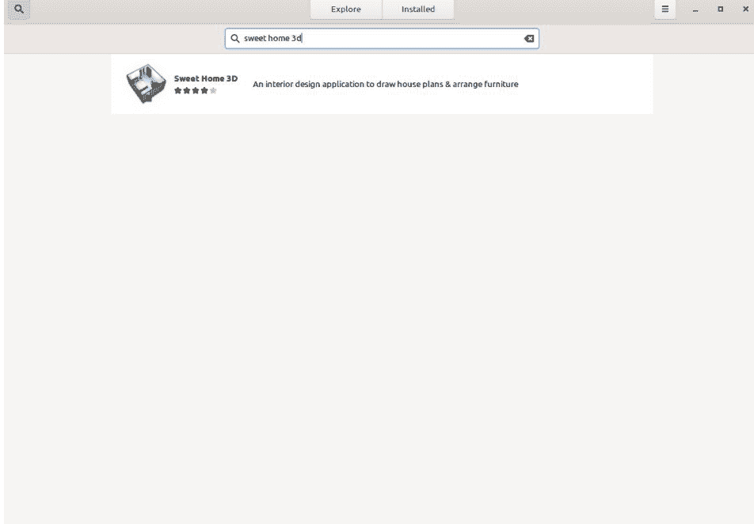

- 打开 Snap Store
- 输入，sweet home 3d
- 点击 Sweet Home 3D
- 点击安装

### 使用 snap 命令行安装 Sweet Home 3D


- 打开终端
- 输入，`sudo snap install swethome3d-homedesign`
- 按下回车

## 图像编辑器

图像编辑器允许对图片进行创建和编辑，其特性包括：

- 创建各种尺寸和类型的空白画布进行绘画
- 极其丰富的绘画工具，让图像可以完全自定义化
- 多种选择工具，可以选择图像的任何部分

本章涵盖：

### Blender

- 使用软件管理器安装 Blender
- 使用 apt 命令行安装 Blender
- 使用 flatpak 命令行安装 Blender
- 使用 Snap Store 安装 Blender
- 使用 snap 命令行安装 Blender

### Gnu 图像处理程序 (GIMP)

- 使用软件管理器安装 Gnu 图像处理程序
- 使用 apt 命令行安装 Gnu 图像处理程序
- 使用 flatpak 命令行安装 Gnu 图像处理程序
- 使用 Snap Store 安装 Gnu 图像处理程序
- 使用 snap 命令行安装 Gnu 图像处理程序

### Inkscape

- 使用软件管理器安装 Inkscape
- 使用 apt 命令行安装 Inkscape
- 使用 flatpak 命令行安装 Inkscape
- 使用 Snap Store 安装 Inkscape
- 使用 snap 命令行安装 Inkscape

### Krita

- 使用软件管理器安装 Krita
- 使用 apt 命令行安装 Krita
- 使用 flatpak 命令行安装 Krita
- 使用 Snap Store 安装 Krita
- 使用 snap 命令行安装 Krita

### Pinta

- 使用软件管理器安装 Pinta
- 使用 apt 命令行安装 Pinta
- 使用 flatpak 命令行安装 Pinta
- 使用 Snap Store 安装 Pinta
- 使用 snap 命令行安装 Pinta

## Blender

### 使用软件管理器安装 Blender


- 打开软件管理器
- 输入，blender
- 点击 Blender
- 点击安装

### 使用 apt 命令行安装 Blender


- 打开终端
- 输入，`sudo apt install blender`
- 按下回车

### 使用 flatpak 命令行安装 Blender


- 打开终端
- 输入，`flatpak install flathub org.blender.Blender`
- 按下回车

### 使用 Snap Store 安装 Blender


- 打开 Snap Store
- 输入，blender
- 点击 blender
- 点击安装

### 使用 snap 命令行安装 Blender


- 打开终端
- 输入，`sudo snap install blender`
- 按下回车

## Gnu 图像处理程序 (GIMP)

### 使用软件管理器安装 Gnu 图像处理程序


# GIMP (GNU Image Manipulation Program)

## 使用软件管理器安装 GIMP


打开软件管理器，输入 `gnu image manipulation program`，点击 **GNU Image Manipulation Program**，点击安装。

## 使用 apt 命令行安装 GIMP


打开终端，输入 `sudo apt install gimp`，按下回车。

## 使用 flatpak 命令行安装 GIMP


打开终端，输入 `flatpak install flathub org.gimp.GIMP`，按下回车。

## 使用 Snap Store 安装 GIMP


打开 Snap Store，输入 `gnu image manipulation program`，点击 **GNU Image Manipulation Program**，点击安装。

## 使用 snap 命令行安装 GIMP


打开终端，输入 `sudo snap install gimp`，按下回车。

# Inkscape

## 使用软件管理器安装 Inkscape


打开软件管理器，输入 `inkscape`，点击 **Inkscape**，点击安装。

## 使用 apt 命令行安装 Inkscape


打开终端，输入 `sudo apt install inkscape`，按下回车。

## 使用 flatpak 命令行安装 Inkscape


打开终端，输入 `flatpak install flathub org.inkscape.Inkscape`，按下回车。

## 使用 Snap Store 安装 Inkscape


打开 Snap Store，输入 `inkscape`，点击 **Inkscape**，点击安装。

## 使用 snap 命令行安装 Inkscape

打开终端，输入 `sudo snap install inkscape`，按下回车。

# Eclipse

## 使用 snap 命令行安装 Eclipse

打开终端，输入 `sudo snap install eclipse --classic`，按下回车。

# GNU Emacs

## 使用软件管理器安装 GNU Emacs

打开软件管理器，输入 `emacs`，点击 **GNU Emacs**，点击安装。

## 使用 apt 命令行安装 GNU Emacs

打开终端，输入 `sudo apt install emacs`，按下回车。

## 使用 flatpak 命令行安装 GNU Emacs

打开终端，输入 `flatpak install flathub org.gnu.emacs`，按下回车。

# Visual Studio Code

## 使用软件管理器安装 Visual Studio Code

打开软件管理器，输入 `visual studio code`，点击 **Visual Studio Code**，点击安装。

## 使用 flatpak 命令行安装 Visual Studio Code

打开终端，输入 `flatpak install flathub com.visualstudio.code`，按下回车。

## 使用 Snap Store 安装 Visual Studio Code

打开 Snap Store，输入 `visual studio code`，点击 **Visual Studio Code**，点击安装。

## 使用 snap 命令行安装 Visual Studio Code

打开终端，输入 `sudo snap install code --classic`，按下回车。

# Atom

## 使用软件管理器安装 Atom


打开软件管理器，输入 `atom`，点击 **Atom**，点击安装。

## 使用 flatpak 命令行安装 Atom

```
mlnxpc1@mlnxpc1-MS-7C31:~$ flatpak install flathub io.atom.Atom
```

打开终端，输入 `flatpak install flathub io.atom.Atom`，按下回车。

## 使用 .deb 安装 Atom

前往 `https://github.com/atom/atom/releases/tag/v1.60.0`，点击 `atom-amd64.deb` 下载。

前往下载目录，双击 `atom-amd64.deb`，点击安装。


# SMPlayer

## 使用 Snap Store 安装 SMPlayer


- 打开 Snap Store
- 输入 `smplayer`
- 点击 **SMPlayer**
- 点击安装

## 使用 snap 命令安装 SMPlayer


- 打开终端
- 输入 `sudo snap install smplayer`
- 按回车

# VLC

## 使用软件管理器安装 VLC


- 打开软件管理器
- 输入 `vlc`
- 点击 **VLC**
- 点击安装

## 使用 apt 命令安装 VLC


- 打开终端
- 输入 `sudo apt install vlc`
- 按回车

## 使用 flatpak 命令安装 VLC


- 打开终端
- 输入 `flatpak install flathub org.videolan.VLC`
- 按回车

# 现代游戏

Modern Gaming 致力于在 Linux 操作系统上运行现代游戏，其特色：

- KDE Games 提供了丰富的桌面乐趣
- Lutris 让玩《魔兽世界》变得比以往任何时候都简单
- Steam 提供了访问最大的数字游戏商店的权限

本章节涵盖：

## WINE

### 使用 apt 命令安装 WINE Staging

## Lutris

### 使用软件管理器安装 Lutris
### 使用 apt 命令安装 Lutris
### 使用仓库和 apt 命令安装 Lutris

## Steam

### 使用软件管理器安装 Steam
### 使用 apt 命令安装 Steam
### 使用 Snap Store 安装 Steam
### 使用 snap 命令安装 Steam

## ProtonUp-Qt

### 使用软件管理器安装 ProtonUp-Qt
### 使用 flatpak 命令安装 ProtonUp-Qt
### 使用 .AppImage 安装 ProtonUp-Qt

## Proton-GE

### 使用 .tar.gz 安装 Proton-GE Lutris
### 使用 .tar.gz 安装 Proton-GE Steam

## WINE-GE

### 使用 .tar.xz 安装 WINE-GE Lutris

## DXVK

### 使用 .sh 命令安装 DXVK

## VKD3D

### 使用 .sh 命令安装 VKD3D

## Gnome Games

### 使用 apt 命令安装 Gnome Games

## KDE Games

### 使用 apt 命令安装 KDE Games

## Gamehub

### 使用软件管理器安装 Gamehub
### 使用 flatpak 命令安装 Gamehub

# WINE

## 使用 apt 命令安装 WINE Staging

```
minxpc1@minxpc1-MS-7C31:~$ sudo dpkg --add-architecture i386 && sudo apt update
```

- 打开终端
- 输入 `sudo dpkg --add-architecture i386 && sudo apt update`
- 按回车

```
mlnxpc1@mlnxpc1-MS-7C31:~$ wget -nc https://dl.winehq.org/wine-builds/ubuntu/dists/jammy/winehq-jammy.sources
```

- 输入 `wget -nc https://dl.winehq.org/wine-builds/ubuntu/dists/jammy/winehq-jammy.sources`
- 按回车

```
mlnxpc1@mlnxpc1-MS-7C31:~$ sudo mv winehq-jammy.sources /etc/apt/sources.list.d/
```

- 输入 `sudo mv winehq-jammy.sources /etc/apt/sources.list.d/`
- 按回车

```
mlnxpc1@mlnxpc1-MS-7C31:~$ wget -nc https://dl.winehq.org/wine-builds/winehq.key
```

- 输入 `wget -nc https://dl.winehq.org/wine-builds/winehq.key`
- 按回车


- 输入 `sudo mv winehq.key /usr/share/keyrings/winehq-archive.key`
- 按回车
- 输入 `sudo apt update`
- 按回车
- 输入 `sudo apt install --install-recommends winehq-staging`
- 按回车

# Lutris

## 使用软件管理器安装 Lutris

- 打开软件管理器
- 输入 `lutris`
- 点击 **Lutris**
- 点击安装

## 使用 apt 命令安装 Lutris

- 打开终端
- 输入 `sudo apt install lutris`
- 按回车

## 使用仓库和 apt 命令安装 Lutris

- 打开终端
- 输入 `sudo add-apt-repository ppa:lutris-team/lutris && sudo apt update && sudo apt install lutris && sudo apt install wine`
- 按回车

# Steam

## 使用软件管理器安装 Steam

- 打开软件管理器
- 输入 `steam`
- 点击 **Steam**
- 点击安装

## 使用 apt 命令安装 Steam

- 打开终端
- 输入 `sudo apt install steam`
- 按回车

## 使用 Snap Store 安装 Steam

- 打开 Snap Store
- 输入 `steam`
- 点击 **Steam**
- 点击安装

## 使用 snap 命令安装 Steam

- 打开终端
- 输入 `sudo snap install steam`
- 按回车

# ProtonUp-Qt

## 使用软件管理器安装 ProtonUp-Qt

- 打开软件管理器
- 输入 `protonup-qt`
- 点击 **ProtonUp-Qt**
- 点击安装

## 使用 flatpak 命令安装 ProtonUp-Qt

- 打开终端
- 输入 `flatpak install flathub net.davidotek.pupgui2`
- 按回车

## 使用 .AppImage 安装 ProtonUp-Qt

- 打开 `https://davidotek.github.io/protonup-qt/`
- 点击 **ProtonUp-Qt**
- 点击 **Download ProtonUp-Qt v2.6.5** 以下载 `ProtonUp-Qt-2.6.5-x86_64.AppImage`
- 转到 `ProtonUp-Qt-2.6.5-x86_64.AppImage` 所在目录
- 双击 `ProtonUp-Qt-2.6.5-x86_64.AppImage`
- 点击 **Integrate and Run**

# Proton-GE

## 使用 .tar.gz 安装 Proton-GE Lutris

### GE-Proton7-28 发布


- 转到 `https://github.com/GloriousEggroll/wine-ge-custom/releases/tag/GE-Proton7-28`
- 点击 `GE-Proton7-28.tar.gz` 下载
- 转到 `GE-Proton7-28.tar.gz` 所在目录
- 双击 `GE-Proton7-28.tar.gz`
- 选择全部
- 解压到 `~/.local/share/lutris/runners/GE-Proton7-28`

# VKD3D

## 使用 .sh 命令行安装 VKD3D


- 前往 `https://github.com/HansKristian-Work/vkd3d-proton/releases/tag/v2.6`
- 点击 `vkd3d-proton-2.6.tar.zst` 下载
- 进入 `vkd3d-proton-2.6.tar.zst` 的下载目录
- 双击 `vkd3d-proton-2.6.tar.zst`
- 解压到 `~/Downloads`
- 进入 `vkd3d-proton-2.6` 的解压后的目录
- 双击 `vkd3d-proton-2.6`
- 右键点击空白处
- 点击“在终端中打开”
- 输入 `dir`
- 输入 `./setup_vkd3d_proton.sh install --symlink`
- 按回车

默认前 VKD3D 将安装到 `~/.wine`。

# Gnome 游戏

## 使用 apt 命令行安装 Gnome 游戏

```
minxpc1@minxpc1-MS-7C31:~$ sudo apt install gnome-games
```

- 打开终端
- 输入 `sudo apt install gnome-games`
- 按回车

# KDE 游戏

## 使用 apt 命令行安装 KDE 游戏


- 打开终端
- 输入 `sudo apt install kdegames`
- 按回车

# 点播音乐流媒体服务

点播音乐流媒体服务提供几乎数字化的音乐，具有以下功能：

- 创建自己的私有播放列表或与你想分享的人分享
- 某些艺术家音乐的独家流媒体版权
- 随心所欲播放你的音乐

本章节涵盖：

## Amazon Music Unlimited

### Amazon Music Unlimited 网页访问

## Apple Music

### Apple Music 网页访问

## Spotify

### 使用 Snap Store 安装 Spotify
### 使用 snap 命令行安装 Spotify
### Spotify 网页访问

## Tidal

### Tidal 网页访问

## Youtube Music

### Youtube Music 网页访问

# Amazon Music Unlimited

## Amazon Music Unlimited 网页访问


- 前往 `https://music.amazon.co.uk/`
- 登录访问

# Apple Music

## Apple Music 网页访问


- 前往 `https://music.apple.com/us/browse`
- 登录访问

# Spotify

## 使用 Snap Store 安装 Spotify


- 打开 Snap Store
- 输入 `spotify`
- 点击 **Spotify**
- 点击安装

## 使用 snap 命令行安装 Spotify


- 打开终端
- 输入 `sudo snap install spotify`
- 按回车

## Spotify 网页访问


- 前往 `https://open.spotify.com/`
- 登录访问

# Tidal

## Tidal 网页访问


- 前往 `https://tidal.com/`
- 登录访问


### Tidal 网页访问


- 前往 `https://tidal.com/`
- 登录访问

## Youtube Music

### Youtube Music 网页访问


- 前往 `https://music.youtube.com/`
- 登录访问

## 音乐播放器

音乐播放器让用户收听音乐和音频书，并具有以下功能：

- 编辑音频文件的标签以更好地分类音乐
- 收听网络电台
- 搜索并播放上传到云服务的音乐

本章节涵盖：

### Audacious

- 使用软件管理器安装 Audacious
- 使用 `apt` 命令行安装 Audacious
- 使用 `flatpak` 命令行安装 Audacious

### Clementine

- 使用软件管理器安装 Clementine
- 使用 `apt` 命令行安装 Clementine
- 使用 `flatpak` 命令行安装 Clementine
- 使用 Snap Store 安装 Clementine
- 使用 `snap` 命令行安装 Clementine

### Deadbeef-vs

- 使用 Snap Store 安装 Deadbeef-vs
- 使用 `snap` 命令行安装 Deadbeef-vs

### Lollipop

- 使用软件管理器安装 Lollipop
- 使用 `apt` 命令行安装 Lollipop
- 使用 `flatpak` 命令行安装 Lollipop

### Rhythmbox

- 使用软件管理器安装 Rhythmbox
- 使用 `apt` 命令行安装 Rhythmbox
- 使用 `flatpak` 命令行安装 Rhythmbox

## Audacious

### 使用软件管理器安装 Audacious


- 打开软件管理器
- 输入 `audacious`
- 点击 Audacious
- 点击 安装

### 使用 apt 命令行安装 Audacious


- 打开终端
- 输入 `sudo apt install audacious`
- 按回车

### 使用 flatpak 命令行安装 Audacious

```
mlnxpc1@mlnxpc1-MS-7C31:~$ flatpak install flathub org.atheme.audacious
```

- 打开终端
- 输入 `flatpak install flathub org.atheme.audacious`
- 按回车

## Clementine

### 使用软件管理器安装 Clementine


- 打开软件管理器
- 输入 `clementine`
- 点击 Clementine
- 点击 安装

### 使用 apt 命令行安装 Clementine


- 打开终端
- 输入 `sudo apt install clementine`
- 按回车

### 使用 flatpak 命令行安装 Clementine

```
mlnxpc1@mlnxpc1-MS-7C31:~$ flatpak install flathub org.clementine.player
```

- 打开终端
- 输入 `flatpak install flathub org.clementine.player`
- 按回车

### 使用 Snap Store 安装 Clementine


- 打开 Snap Store
- 输入 `clementine`
- 点击 Clementine
- 点击 安装

### 使用 snap 命令行安装 Clementine


- 打开终端
- 输入 `sudo snap install clementine`
- 按回车

## Deadbeef-vs

### 使用 Snap Store 安装 Deadbeef-vs


- 打开 Snap Store
- 输入 `deadbeef-vs`
- 点击 deadbeef-vs
- 点击 安装

### 使用 snap 命令行安装 Deadbeef-vs


- 打开终端
- 输入 `sudo snap install deadbeef-vs`
- 按回车

## Lollipop

### 使用软件管理器安装 Lollipop


- 打开软件管理器
- 输入 `lollipop`
- 点击 Lollipop
- 点击 安装

### 使用 apt 命令行安装 Lollipop


- 打开终端
- 输入 `sudo apt install lollipop`
- 按回车

### 使用 flatpak 命令行安装 Lollipop

```
minxpc1@minxpc1-MS-7C31:~$ flatpak install flathub org.gnome.Lollypop
```

- 打开终端
- 输入 `flatpak install flathub org.gnome.Lollypop`
- 按回车

## Rhythmbox

### 使用软件管理器安装 Rhythmbox


- 打开软件管理器
- 输入 `rhythmbox`
- 点击 Rhythmbox
- 点击 安装

### 使用 apt 命令行安装 Rhythmbox


- 打开终端
- 输入 `sudo apt install rhythmbox`
- 按回车

### 使用 flatpak 命令行安装 Rhythmbox

```
mlnxpc1@minnxpc1-MS-7C31:~$ flatpak install flathub org.gnome.Rhythmbox
```

- 打开终端
- 输入 `flatpak install flathub org.gnome.Rhythmbox`
- 按回车

## LibreOffice

### 使用软件管理器安装 LibreOffice


- 打开软件管理器
- 输入 `libreoffice`
- 点击 LibreOffice
- 点击 安装

### 使用 apt 命令行安装 LibreOffice

```
mlnxpc1@mlnxpc1-MS-7C31:~$ sudo apt install libreoffice
```

- 打开终端
- 输入 `sudo apt install libreoffice`
- 按回车

### 使用 flatpak 命令行安装 LibreOffice


- 打开终端
- 输入 `flatpak install flathub org.libreoffice.LibreOffice`
- 按回车

### 使用 Snap Store 安装 LibreOffice


- 打开 Snap Store
- 输入 `libreoffice`
- 点击 libreoffice
- 点击 安装

### 使用 snap 命令行安装 LibreOffice


- 打开终端
- 输入 `sudo snap install libreoffice`
- 按回车

## OnlyOffice

### 使用软件管理器安装 OnlyOffice


- 打开软件管理器
- 输入 `onlyoffice`
- 点击 OnlyOffice Desktop Editors
- 点击 安装

### 使用 flatpak 命令行安装 OnlyOffice

```
mlnxpc1@mlnxpc1-MS-7C31:~$ flatpak install flathub org.onlyoffice.desktopeditors
```

- 打开终端
- 输入 `flatpak install flathub org.onlyoffice.desktopeditors`
- 按回车

### 使用 Snap Store 安装 OnlyOffice


- 打开 Snap Store
- 输入 `onlyoffice`
- 点击 onlyoffice-desktopeditors
- 点击 安装

### 使用 snap 命令行安装 OnlyOffice


- 打开终端
- 输入 `sudo snap install onlyoffice-desktopeditors`
- 按回车

### 使用 .deb 安装 OnlyOffice


- 访问 `https://www.onlyoffice.com/en/download-desktop.aspx`
- 在 Debian 8, Ubuntu 14.04 及更高版本下，点击 DOWNLOAD DEB 以下载 `onlyoffice-desktopeditors_amd64.deb`
- 前往 `onlyoffice-desktopeditors_amd64.deb` 的下载目录
- 双击 `onlyoffice-desktopeditors_amd64.deb`
- 点击 安装

## OpenOffice

### 使用 .AppImage 安装 OpenOffice


OpenOffice 与 LibreOffice 有许多共同之处，因为它们共享相同的代码。由于开发周期缓慢，OpenOffice 的开发落后于 LibreOffice，这也是当年 LibreOffice 分离它们的主要原因之一；然而，OpenOffice 仍然是一个可行的替代方案，它拥有 LibreOffice 的许多功能以及多年的开发工作。

- 访问 `https://appre.de/appimage/openoffice`
- 点击 DOWNLOAD 以下载 `OpenOffice.AppImage`
- 前往 `OpenOffice.AppImage` 的下载目录
- 双击 `OpenOffice.AppImage`
- 点击 Integrate and Run

## KeePassXC

### 使用 flatpak 命令行安装 KeePassXC


- 打开终端
- 输入 `flatpak install flathub org.keeppassxc.KeePassXC`
- 按回车

### 使用 Snap Store 安装 KeePassXC


- 打开 Snap Store
- 输入 `keepassxc`
- 点击 keepassxc
- 点击 Install（安装）

### 使用 snap 命令行安装 KeePassXC


- 打开终端
- 输入 `sudo snap install keepassxc`
- 按回车

## LastPass

### LastPass 通用 Linux 安装程序使用 .sh 命令行安装


- 访问 `https://lastpass.com/lplinux.php`
- 点击 `lplinux.tar.bz2` 以下载 `lplinux.tar.bz2`
- 进入 `lplinux.tar.bz2` 的下载目录
- 双击 `lplinux.tar.bz2`
- 使用鼠标点击并拖动或按 `CTRL + A` 全选内容
- 解压到 `~/Downloads/lplinux`（如果文件夹不存在，请使用 folder+ 键创建）
- 进入 `~/Downloads/lplinux`
- 在空白处点击右键
- 点击 Open in Terminal（在终端中打开）
- 输入 `dir`
- 按回车
- 输入 `./install_lastpass.sh`
- 按回车

## 远程办公

远程办公软件允许用户对产品进行工作并与同事协作，并具有以下功能：

- 与同事共同交流想法并实时查看项目进展
- 共享云端或本地文档存储
- 可供所有员工参加的在线会议

本章涵盖：

### Citrix

- 使用 .deb 安装 Citrix

### Microsoft Teams

- 使用 Snap Store 安装 Microsoft Teams
- 使用 `snap` 命令行安装 Microsoft Teams

### Slack

- 使用 .deb 安装 Slack

### Zoom

- 使用 .deb 安装 Zoom

## Citrix

### 使用 .deb 安装 Citrix


- 访问 `https://www.citrix.com/downloads/workspace-app/linux/workspace-app-latest.html`
- 点击 Debian Packages（Debian 包）
- 点击 Full Packages（完整包）
- 在 Citrix Workspace app for Linux (x86_64) 下：
  - 点击 Download File（下载文件）以下载 `icalient_22.7.0.20_amd64.deb`
- 进入 `icalient_22.7.0.20_amd64.deb` 的下载目录
- 双击 `icalient_22.7.0.20_amd64.deb`
- 点击 Install（安装）

## Microsoft Teams

### 使用 Snap Store 安装 Microsoft Teams


- 打开 Snap Store
- 输入 `microsoft teams`
- 点击 Microsoft Teams - Insiders
- 点击 Install（安装）

### 使用 snap 命令行安装 Microsoft Teams


- 打开终端
- 输入 `sudo snap install teams`
- 按回车

## Slack

### 使用 .deb 安装 Slack


- 访问 `https://slack.com/intl/en-gb/downloads/linux`
- 点击 Download .DEB app 以下载 `slack-desktop-4.27.156-amd64.deb`
- 进入 `slack-desktop-4.27.156-amd64.deb` 的下载目录
- 双击 `slack-desktop-4.27.156-amd64.deb`
- 点击 Install（安装）

## Zoom

### 使用 .deb 安装 Zoom


- 访问 `https://zoom.us/download?os=linux`
- 点击与 Linux 类型行的复选框
- 点击 Ubuntu
- 点击与 OS Architecture（操作系统架构）行的复选框
- 点击 64 bit
- 点击与 Version（版本）行的复选框
- 点击 16.04+
- 点击 Download 下载 `zoom_amd64.deb`
- 进入 `zoom_amd64.deb` 的下载目录
- 双击 `zoom_amd64.deb`
- 点击 Install（安装）

## 沙箱

沙箱通过将某些程序与其他隔离来保持 Linux Mint 21 的安全性，包括：

- 运行的程序拥有独立的系统资源视图
- 能够对任何软件或系统进程进行沙箱处理


- 易两次点击的图形化界面

本章涵盖：

### Firejail

- 使用软件管理器安装 Firejail
- 使用 apt 命令行安装 Firejail

### Firetools

- 使用软件管理器安装 Firetools
- 使用 apt 命令行安装 Firetools

### 使用软件管理器安装 Firejail


打开软件管理器。

输入：`firejail`

### 使用 apt 命令行安装 Firejail


打开终端。

输入：`sudo apt install firejail`

### 使用软件管理器安装 Firetools


打开软件管理器。

输入：`firetools`

### 使用 apt 命令行安装 Firetools


打开终端。

输入：`sudo apt install firetools`

输入：`sudo apt update && sudo apt install snapd`

按下回车。

之后，重启电脑。

## Snap Store

### 使用 snap 命令行安装 Snap Store


打开终端。

输入：`sudo snap install snap-store`

按下回车。

之后，重启电脑。

## Java

### 使用 .deb 安装 Java


前往：`https://www.oracle.com/java/technologies/downloads/`

点击 Linux。

在 x64 Debian Package 所在行，点击 Download 列中的链接，以下载 `jdk-18_linux-x64_bin.deb`。

前往 `jdk-18_linux-x64_bin.deb` 下载所在位置。

双击 `jdk-18_linux-x64_bin.deb`。

点击安装。

## Ocs-url

### 使用 .deb 安装 Ocs-url


前往：`https://www.opendesktop.org/p/1136805/`

点击 Download `ocs-url_3.1.0-0ubuntu1_amd64.deb`。

点击 Download 以下载 `ocs-url_3.1.0-0ubuntu1_amd64.deb`。

前往 `ocs-url_3.1.0-0ubuntu1_amd64.deb` 下载所在位置。

双击 `ocs-url_3.1.0-0ubuntu1_amd64.deb`。

点击安装。

## Open Java

### 使用 apt 命令行安装 Open Java JRE 和 JDK


打开终端。

输入：`sudo apt install default-jre default-jdk`

按下回车。

## deb-get

### 使用 curl 命令行安装 deb-get


打开终端。

输入：`sudo apt install curl`

按下回车。

```
mlnxpc1@mlnxpc1-MS-7C31:~$ curl -sL https://raw.githubusercontent.com/wimpysworld/deb-get/main/deb-get | sudo bash -E -s install deb-get
```

打开终端。

输入：`curl -sL https://raw.githubusercontent.com/wimpysworld/deb-get/main/deb-get | sudo bash -E -s install deb-get`

按下回车。

## App Outlet

### 使用 .deb 安装 App Outlet


前往：`https://github.com/app-outlet/app-outlet/releases/tag/v2.1.0`

点击 `app-outlet-2.1.0_amd64.deb` 下载 `app-outlet-2.1.0_amd64.deb`。

前往 `app-outlet-2.1.0_amd64.deb` 下载所在位置。

双击 `app-outlet-2.1.0_amd64.deb`。

点击安装。

## pacstall

### 使用 curl 命令行安装 pacstall

```
mlnxpc1@mlnxpc1-MS-7C31:~ - 
File Edit View Search Terminal Help
mlnxpc1@mlnxpc1-MS-7C31:-$ sudo bash -c "$(curl -fsSL https://git.io/JsADH || wget -q https://git.io/JsADH -o -)"
```

打开终端。

输入：`sudo bash -c "$(curl -fsSL https://git.io/JsADH || wget -q https://git.io/JsADH -o -)"`

按下回车。

## Streaming

流软件将音视频传输到远程服务器，并带有以下功能：

- 在视频流中添加对象和项目
- 更改质量以最适合网络连接
- 同时进行流传输和录制以保留本地副本

本章节涵盖：

## OBS Studio

- 使用软件管理器安装 OBS Studio
- 使用 apt 命令行安装 OBS Studio
- 使用 flatpak 命令行安装 OBS Studio
- 使用 Snap Store 安装 OBS Studio
- 使用 deb-get 命令行安装 OBS Studio

## Owncast

### 使用 curl 命令行安装 Owncast

### 使用软件管理器


打开软件管理器。

输入：`obs-studio`

点击 OBS Studio。

点击安装。

### 使用 apt 命令行

```
mlnxpc1@mlnxpc1-MS-7C31:~ 
File Edit View Search Terminal Help
mlnxpc1@mlnxpc1-MS-7C31:sudo sudo apt install obs-studio
```

打开终端。

输入：`sudo apt install obs-studio`

按下回车。

### 使用 flatpak 命令行


打开终端。

输入：`flatpak install flathub com.obsproject.Studio`

按下回车。

### 使用 Snap Store


打开 Snap Store。

输入：`obs-studio`

点击 OBS Studio。

点击安装。

### 使用 deb-get 命令行

```
mlnxpc1@mlnxpc1-MS-7C31:~ 
File Edit View Search Terminal Help
mlnxpc1@mlnxpc1-MS-7C31~$sudo deb-get install obs-studio
```

打开终端。

输入：`sudo deb-get install obs-studio`

按下回车。

## Owncast

### 使用 curl 命令行

```
minxpc1@minxpc1-MS-7C31~$curl -s https://owncast.online/install.sh | bash
```

打开终端。

输入：`curl -s https://owncast.online/install.sh | bash`

按下回车。

## 系统清理器

本章节帮助从系统中删除垃圾和多余文件以增加空间，还可以：

- 移除或禁用启动应用程序
- 管理 hosts 文件以阻止网站
- 查看一目显示重要数据的仪表板

## Bleachbit

- 使用软件管理器安装 Bleachbit
- 使用 apt 命令行安装 Bleachbit

## Ckawka

- 使用软件管理器安装 Ckawka
- 使用 flatpak 命令行安装 Ckawka
- 使用 Snap Store 安装 Ckawka
- 使用 snap 命令行安装 Ckawka

## Bleachbit 安装

### 使用软件管理器


打开软件管理器。

输入：`bleachbit`

点击 Bleachbit。

点击安装。

### 使用 apt 命令行


打开终端。

输入：`sudo apt install bleachbit`

按下回车。

## Ckawka

### 使用软件管理器


打开软件管理器。

输入：`czkawka`

点击 Ckawka。

点击安装。

### 使用 flatpak 命令行

```
mlnxpc1@mlnxpc1-MS-7C31~\flatpak install flathub com.github.qarmin.czkawka
```

打开终端。

输入：`flatpak install flathub com.github.qarmin.czkawka`

按下回车。

### 使用 Snap Store 安装 Ckawka


打开 Snap Store。

输入：`czkawka`

点击 czkawka。

点击安装。

### 使用 snap 命令行安装 Ckawka


打开终端。

输入：`sudo snap install czkawka`

按下回车。

## Fslint Unofficial

### 使用 Snap Store 安装 Fslint Unofficial


打开 Snap Store。

输入：`fslint`

点击 fslint-unofficial。

点击安装。

### 使用 snap 命令行安装 Fslint Unofficial

```
mlnxpc1@mlnxpc1-MS-7C31: ~ 
File Edit View Search Terminal Help
nxpc1@mlnxpc1-MS-7C31:sudo snap install fslint-unofficial
```

打开终端。

输入：`sudo snap install fslint-unofficial`

按下回车。

## Stacer

### 使用软件管理器安装 Stacer

打开软件管理器。

输入：`stacer`

点击 Stacer。

点击安装。

## 使用 apt 命令行安装 Stacer


打开终端。

输入：`sudo apt install stacer`

按下回车。

## Synaptic 软件包管理器

### 使用软件管理器安装 Synaptic 软件包管理器


打开软件管理器。

输入：`synaptic`

点击 Synaptic 软件包管理器。

点击安装。

## 使用 apt 命令行安装 Synaptic 软件包管理器


打开终端。

输入：`sudo apt install synaptic`

按下回车。

## Sweeper（清理器）

### 使用软件管理器安装 Sweeper


打开软件管理器。

输入：`sweeper`

点击 Sweeper。

点击安装。

### 使用 apt 命令行安装 Sweeper


打开终端。

输入：`sudo apt install sweeper`

按下回车。

## 系统设置

系统设置涉及保持系统及其软件包的更新，并允许用户配置系统、喜好设置，并包括：

- 保持显卡和其他附加驱动程序的更新
- 更新 Linux Mint 21 及其他软件包
- 通过 PPA 添加更多更新版本的驱动程序

本章涵盖：

### 32 位架构

- 使用 apt 命令行安装 32 位架构

### 备用 DNS 服务器

- 使用网络设置备用 DNS 服务
- 其他备用 DNS 服务列表

### 自动挂载磁盘

- 使用“磁盘”（Disks）工具自动挂载磁盘

### 显卡驱动

- 使用 apt 命令行安装 AMD 显驱动
- 使用 ppa-purge 命令行恢复 AMD 显驱动默认
- 使用软件管理器安装 Nvidia 显驱动
- 使用 apt 命令行安装 Nvidia 显驱动

### Mousepad（编辑器）

- 使用软件管理器安装 Mousepad
- 使用 apt 命令行安装 Mousepad

### 鼠标速度

- 将鼠标速度设置为最大

### 夜间模式

- 设置夜间模式（蓝光防护）

### Intel 音频杂音修复

- 使用 echo 命令行修复可能的 Intel 音频杂音
- 清理 PPAs
- 使用“软件源”清理 PPAs
- PPA 清理
- 使用 ppa-purge 命令行清理 PPAs

### 设置默认应用程序

- 按类别设置默认应用程序
- 按文件扩展名设置默认应用程序

### 启动应用程序

- 使用已安装的应用设置启动项
- 使用自定义命令设置启动项

### 卸载应用程序

- 卸载软件管理器应用程序
- 卸载 apt 命令行应用程序
- 卸载 Snap Store 安装的应用程序
- 卸载 snap 命令行应用程序
- 卸载 deb-get 命令行应用程序

### 更新 Linux Mint 21

- 使用更新管理器更新 Linux Mint 21
- 使用 apt 命令行更新 Linux Mint 21

### 更新 Linux Mint 21 内核

- 使用更新管理器更新 Linux Mint 21 内核

## 32 位架构

### 使用 apt 命令行安装 32 位架构

```
mlnxpc1@mlnxpc1-MS-7C31: ~ 
File Edit View Search Terminal Help
mlnxpc1@mlnxpc1-MS-7C31:~$ sudo dpkg --add-architecture i386
```

打开终端。

输入：`sudo dpkg --add-architecture i386`

按下回车。

## 备用 DNS 服务器

### 使用网络设置备用 DNS 服务


打开网络。

点击可以访问互联网的已连接连接行中的齿轮图标。

### 有线


点击 IPv4。

将 DNS 和 Automatic（自动）所在行的开关向左移动。

点击 DNS 下方的 `+` 号。

点击 Server 行的第一个输入框。

输入：`84.200.69.80`

点击 Server 行的第二个输入框。

输入：`84.200.70.40`

点击 IPv6。

将 DNS 和 Automatic（自动）所在行的开关向左移动。

点击 DNS 下方的 `+` 号。

点击 Server 行的第一个输入框。

输入：`2001:1608:10:25::1c04:b12f`

点击 Server 行的第二个输入框。

输入：`2001:1608:10:25::9249:d69b`

点击应用。

将连接的网络行向左再向右移动（中间留出间隔）以使更改生效。

## 其他备用 DNS 服务

### CleanBrowsing

`https://cleanbrowsing.org/filters/`

| 协议 | IP 地址 |
| :--- | :--- |
| IPv4 | 185.228.168.168 |


| IPv4 | 185.228.169.168 |
| IPv6 | 2a0d:2a00:1:: |
| IPv6 | 2a0d:2a00:2:: |

- CleanBrowsing DNS over HTTPS (DoH)
- CleanBrowsing DNS over TLS (DoT)

## 夜灯模式

## 设置夜灯模式（蓝光防护）

- 打开 `Redshift`
- 右键点击任务栏上的 `Redshift` 图标
- 勾选与自启动同一行的复选框

## 可能的 Intel 音频杂音修复

使用 `echo` 命令行可能的 Intel 音频杂音修复


- 打开 `终端`
- 输入 `echo "options snd_hda_intel power_save=0" | sudo tee -a /etc/modprobe.d/audio_disable_powersave.conf`
- 按 `回车`

## 清理 PPA

使用“软件源”清理 PPA


- 打开 `软件源`
- 点击 `PPA`
- 选择 `Oibaf`
- 点击 `移除`
- 点击 `确定`

## PPA 清理安装

```
sudo apt install ppa-purge
```

- 打开 `终端`
- 输入 `sudo apt install ppa-purge`
- 按 `回车`

## 使用 ppa-purge 命令行清理 PPA

```
sudo ppa-purge ppa:oibaf/graphics-drivers && sudo apt update && sudo apt upgrade
```

- 打开 `终端`
- 输入 `sudo ppa-purge ppa:oibaf/graphics-drivers && sudo apt update && sudo apt upgrade`

## 设置默认应用程序

### 为类别设置默认应用程序


- 打开 `首选应用程序`
- 点击与视频同一行的复选框
- 点击 `VLC`

## 按文件扩展名设置默认应用程序


- 右键点击 `Winter Veil Christmas Music - World of Warcraft Music.webm`
- 点击 `属性`
- 点击 `打开方式`
- 选择 `VLC`
- 点击 `设置为默认`

## 启动应用程序

使用已安装应用程序创建启动项


- 打开 `启动应用程序`
- 点击 `+`
- 点击 `选择应用程序`
- 输入 `discord`
- 选择 `Discord`
- 点击 `添加应用程序`

## 使用自定义命令创建启动应用程序


- 打开 `启动应用程序`
- 点击 `+`
- 点击 `自定义命令`
- 点击与名称同一行的复选框
- 输入 `Discord`
- 点击与命令同一行的复选框
- 输入 `discord`
- 点击 `添加`

## 卸载应用程序

### 使用软件管理器卸载应用程序


- 打开 `软件管理器`
- 输入 `gimp`
- 选择 `Gimp` 或 `Gnu Image Manipulation Program`
- 点击 `移除`

### 卸载 apt 命令行应用程序


- 打开 `终端`
- 输入 `sudo apt remove parole`
- 按 `回车`

### 卸载 Snap Store 安装的应用程序


- 打开 `Snap Store`
- 点击 `已安装`
- 点击与垃圾图标同一行的 `卸载`

### 卸载 snap 命令行应用程序


- 打开 `终端`
- 输入 `sudo snap remove coin`
- 按 `回车`

### 卸载 deb-get 命令行应用程序


- 打开 `终端`
- 输入 `sudo deb-get remove obs-studio`
- 按 `回车`

## 更新 Linux Mint 21

### 使用更新管理器更新 Linux Mint 21


- 打开 `更新管理器`
- 选择 `待安装的更新`
- 点击 `安装更新`

### 使用 apt 命令行更新 Linux Mint 21


- 打开 `终端`
- 输入 `sudo apt update && sudo apt upgrade`
- 按 `回车`

### 使用更新管理器更新 Linux Mint 21


- 打开 `更新管理器`
- 选择 `待安装的更新`
- 点击 `安装更新`

## 系统工具

系统工具可以查看系统状态并执行可执行的操作。

## 视频编辑器

### Flowblade

#### 使用软件管理器安装 Flowblade


- 打开 `软件管理器`
- 输入 `flowblade`
- 点击 `Flowblade`
- 点击 `安装`

#### 使用 apt 命令行安装 Flowblade


- 打开 `终端`
- 输入 `sudo apt install flowblade`
- 按下 `回车`

#### 使用 flatpak 命令行安装 Flowblade

```
flatpak install flathub io.github.jliljebl.Flowblade
```

- 打开 `终端`
- 输入 `flatpak install flathub io.github.jliljebl.Flowblade`
- 按下 `回车`

### Kdenlive

#### 使用软件管理器安装 Kdenlive


- 打开 `软件管理器`
- 输入 `kdenlive`
- 点击 `Kdenlive`
- 点击 `安装`

#### 使用 apt 命令行安装 Kdenlive


- 打开 `终端`
- 输入 `sudo apt install kdenlive`
- 按下 `回车`

#### 使用 flatpak 命令行安装 Kdenlive

```
flatpak install flathub org.kde.kdenlive
```

- 打开 `终端`
- 输入 `flatpak install flathub org.kde.kdenlive`
- 按下 `回车`

#### 使用 Snap Store 安装 Kdenlive


- 打开 `Snap Store`
- 输入 `kdenlive`
- 点击 `kdenlive`
- 点击 `安装`

#### 使用 snap 命令行安装 Kdenlive


- 打开 `终端`
- 输入 `sudo snap install kdenlive`
- 按下 `回车`

### Openshot

#### 使用软件管理器安装 Openshot


- 打开 `软件管理器`
- 输入 `openshot`
- 点击 `Openshot`
- 点击 `安装`

#### 使用 apt 命令行安装 Openshot


- 打开 `终端`
- 输入 `sudo apt install openshot`
- 按下 `回车`

#### 使用 flatpak 命令行安装 Openshot


- 打开 `终端`
- 输入 `flatpak install flathub org.openshot.OpenShot`
- 按下 `回车`

#### 使用 .AppImage 安装 Openshot


- 前往 `https://www.openshot.org/download/`
- 点击 `Download v2.6.1` 以下载 `OpenShot-v2.6.1-x86_64.AppImage`
- 前往 `OpenShot-v2.6.1` 的下载所在
- 双击 `OpenShot-v2.6.1`
- 点击 `Integrate and Run`（集成并运行）

### Shotcut

#### 使用软件管理器安装 Shotcut


- 打开 `软件管理器`
- 输入 `shotcut`
- 点击 `Shotcut`
- 点击 `安装`

#### 使用 apt 命令行安装 Shotcut


- 打开 `终端`
- 输入 `sudo apt install shotcut`
- 按下 `回车`

#### 使用 flatpak 命令行安装 Shotcut

```
flatpak install flathub org.shotcut.Shotcut
```

- 打开 `终端`
- 输入 `flatpak install flathub org.shotcut.Shotcut`
- 按下 `回车`

#### 使用 Snap Store 安装 Shotcut


- 打开 `Snap Store`
- 输入 `shotcut`
- 点击 `shotcut`
- 点击 `安装`

#### 使用 snap 命令行安装 Shotcut


- 打开 `终端`
- 输入 `sudo snap install shotcut`
- 按下 `回车`

# Firefox

## 使用软件管理器安装 Firefox


- 打开 `软件管理器`
- 输入 `firefox`
- 点击 `Firefox`
- 点击 `安装`

## 使用 apt 命令行安装 Firefox


- 打开 `终端`
- 输入 `sudo apt install firefox`
- 按 `回车`

## 使用 flatpak 命令行安装 Firefox


- 打开 `终端`
- 输入 `flatpak install flathub org.mozilla.firefox`
- 按 `回车`

## 使用 Snap 安装 Firefox


- 打开 `Snap Store`
- 输入 `firefox`
- 点击 `Firefox`
- 点击 `安装`

## 使用 snap 命令行安装 Firefox


- 打开 `终端`
- 输入 `sudo snap install firefox`
- 按 `回车`

## Firefox ESR

### 使用 .tar.gz 安装 Firefox ESR


- 访问 `https://www.mozilla.org/en-GB/firefox/all/#product-desktop-es`
- 选择 `Firefox Extended Support Release, 91.12.0es, Linux 64-bit, English`
- 点击 `Download now` 以下载 `firefox-91.12.0es.tar.bz2`
- 转到 `firefox-91.12.0es.tar.bz2` 的下载位置
- 双击 `firefox-91.12.0es.tar.bz2`
- 解压到 `~/Applications`
- 转到 Firefox 解压出的位置
- 双击 `Firefox`

# Chromium

## 使用 Snap Store 安装 Chromium


- 打开 `Snap Store`
- 输入 `chromium`
- 点击 `chromium`
- 点击 `安装`

## 使用 snap 命令行安装 Chromium


- 打开 `终端`
- 输入 `sudo snap install chromium`
- 按 `回车`

# Google Chrome

## 使用 apt 命令行安装 Google Chrome

```
wget -q -O - https://dl-ssl.google.com/linux/linux_signing_key.pub | sudo apt-key add -
```

- 打开 `终端`
- 输入 `wget -q -O - https://dl-ssl.google.com/linux/linux_signing_key.pub | sudo apt-key add -`
- 按 `回车`

```
sudo sh -c 'echo "deb [arch=amd64] http://dl.google.com/linux/chrome/deb/ stable main" >> /etc/apt/sources.list.d/google.list'
```

- 输入 `sudo sh -c 'echo "deb [arch=amd64] http://dl.google.com/linux/chrome/deb/ stable main" >> /etc/apt/sources.list.d/google.list'`
- 按 `回车`

```
sudo apt update && sudo apt install google-chrome-stable
```

- 输入 `sudo apt update && sudo apt install google-chrome-stable`
- 按 `回车`

### 使用 .deb 安装 Google Chrome


- 访问 `https://www.google.com/intl/en_uk/chrome/`
- 点击 `Download Chrome`
- 点击与 `64 bit .deb` 同一行的圆形（适用于 Debian/Ubuntu）
- 点击 `Accept and install` 以下载 `google-chrome-stable_current_amd64.deb`
- 转到 `google-chrome-stable_current_amd64.deb` 的下载位置
- 点击 `google-chrome-stable_current_amd64.deb`
- 点击 `安装`

# Microsoft Edge

## 使用 apt 命令行安装 Microsoft Edge


# 浏览器安装指南

## Firefox ESR

### 使用 .tar.gz 安装 Firefox ESR


- 访问 `https://www.mozilla.org/en-GB/firefox/all/#product-desktop-es`
- 选择 Firefox Extended Support Release, 91.12.0es, Linux 64-bit, English
- 点击 Download now 以下载 `firefox-91.12.0es.tar.bz2`
- 转到 `firefox-91.12.0es.tar.bz2` 的下载位置
- 双击 `firefox-91.12.0es.tar.bz2`
- 解压到 `~/Applications`
- 转到 Firefox 解压出的位置
- 双击 Firefox

## Chromium

### 使用 Snap Store 安装 Chromium


- 打开 Snap Store
- 输入 chromium
- 点击 chromium
- 点击 安装

### 使用 snap 命令行安装 Chromium


- 打开终端
- 输入 `sudo snap install chromium`
- 按回车键

## Google Chrome

### 使用 apt 命令行安装 Google Chrome

- 打开终端
- 输入 `wget -q -O - https://dl-ssl.google.com/linux/linux_signing_key.pub | sudo apt-key add -`
- 按回车键

```
mlnxpc1@mlnxpc1-MS-7C31:~$ wget -q -O - https://dl-ssl.google.com/linux/linux_signing_key.pub | sudo apt-key add
```

- 输入 `sudo sh -c 'echo deb [arch=amd64] http://dl.google.com/linux/chrome/deb/ stable main' >> /etc/apt/sources.list.d/google.list`
- 按回车键

```
mlnxpc1@mlnxpc1-MS-7C31:~$ sudo sh -c 'echo deb [arch=amd64] http://dl.google.com/linux/chrome/deb/ stable main' >> /etc/apt/sources.list.d/google.list
```

- 输入 `sudo apt update && sudo apt install google-chrome-stable`
- 按回车键

```
minxpc1@minxpc1-MS-7C31:~$ sudo apt update && sudo apt install google-chrome-stable
```

### 使用 .deb 安装 Google Chrome


- 访问 `https://www.google.com/intl/en_uk/chrome/`
- 点击 Download Chrome
- 点击与 64 bit .deb 同一行的圆形（适用于 Debian/Ubuntu）
- 点击 Accept and install 以下载 `google-chrome-stable_current_amd64.deb`
- 转到 `google-chrome-stable_current_amd64.deb` 的下载位置
- 点击 `google-chrome-stable_current_amd64.deb`
- 点击 安装

## Microsoft Edge

### 使用 apt 命令行安装 Microsoft Edge

- 打开终端
- 输入 `sudo sh -c 'echo deb [arch=amd64] http://packages.microsoft.com/repos/edge/ stable main" >> /etc/apt/sources.list.d/microsoft_edge.list'`
- 按回车键

```
minxpc1@minxpc1-MS-7C31:~$ sudo sh -c 'echo deb [arch=amd64] http://packages.microsoft.com/repos/edge/ stable main" >> /etc/apt/sources.list.d/microsoft_edge.list'
```

- 输入 `sudo apt update && sudo apt install microsoft-edge-stable`
- 按回车键

```
minxpc1@minxpc1-MS-7C31:~$ sudo apt update && sudo apt install microsoft-edge-stable
```

### 使用 .deb 安装 Microsoft Edge


- 访问 `https://www.microsoft.com/en-us/edge`
- 点击 Linux
- 点击 .deb
- 点击 Accept and download 以下载 `microsoft-edge-stable_current_amd64.deb`
- 转到 `microsoft-edge-stable_current_amd64.deb` 的下载位置
- 点击 `microsoft-edge-stable_current_amd64.deb`
- 点击 安装

## Opera

### 使用 Snap Store 安装 Opera


- 打开 Snap Store
- 输入 opera
- 点击 安装

### 使用 snap 命令行安装 Opera


- 打开终端
- 输入 `sudo snap install opera`
- 按回车键

## Librewolf

### 使用软件管理器安装 Librewolf


- 打开软件管理器
- 输入 librewolf

### 使用 apt 命令行安装 Librewolf

- 打开终端
- 输入 `wget -q -O - https://dl-ssl.google.com/linux/linux_signing_key.pub | sudo apt-key add -`
- 按回车键

```
mlnxpc1@mlnxpc1-MS-7C31:~$ wget -q -O - https://dl-ssl.google.com/linux/linux_signing_key.pub | sudo apt-key add
```

- 输入 `sudo sh -c 'echo deb [arch=amd64] http://dl.google.com/linux/chrome/deb/ stable main' >> /etc/apt/sources.list.d/google.list`
- 按回车键

```
mlnxpc1@mlnxpc1-MS-7C31:~$ sudo sh -c 'echo deb [arch=amd64] http://dl.google.com/linux/chrome/deb/ stable main' >> /etc/apt/sources.list.d/google.list
```

- 输入 `sudo apt update && sudo apt install google-chrome-stable`
- 按回车键

```
minxpc1@minxpc1-MS-7C31:~$ sudo apt update && sudo apt install google-chrome-stable
```


# Firefox

## 使用软件管理器安装 Firefox


- 打开`软件管理器`
- 输入`firefox`
- 点击`Firefox`
- 点击`安装`

## 使用 apt 命令行安装 Firefox


- 打开`终端`
- 输入`sudo apt install firefox`
- 按回车键

## 使用 flatpak 命令行安装 Firefox


- 打开`终端`
- 输入`flatpak install flathub org.mozilla.firefox`
- 按回车键

## 使用 Snap 安装 Firefox


- 打开`Snap Store`
- 输入`firefox`
- 点击`Firefox`
- 点击`安装`

## 使用 snap 命令行安装 Firefox


- 打开`终端`
- 输入`sudo snap install firefox`
- 按回车键

## Firefox ESR

### 使用 .tar.gz 安装 Firefox ESR


- 访问`https://www.mozilla.org/en-GB/firefox/all/#product-desktop-es`
- 选择`Firefox Extended Support Release, 91.12.0es, Linux 64-bit, English`
- 点击`Download now`以下载`firefox-91.12.0es.tar.bz2`
- 转到`firefox-91.12.0es.tar.bz2`的下载位置
- 双击`firefox-91.12.0es.tar.bz2`
- 解压到`~/Applications`
- 转到 Firefox 解压出的位置
- 双击`Firefox`

# Chromium

## 使用 Snap Store 安装 Chromium


- 打开`Snap Store`
- 输入`chromium`
- 点击`chromium`
- 点击`安装`

## 使用 snap 命令行安装 Chromium


- 打开`终端`
- 输入`sudo snap install chromium`
- 按回车键

# Google Chrome

## 使用 apt 命令行安装 Google Chrome

```
wget -q -O - https://dl-ssl.google.com/linux/linux_signing_key.pub | sudo apt-key add -
```

- 打开`终端`
- 输入`wget -q -O - https://dl-ssl.google.com/linux/linux_signing_key.pub | sudo apt-key add -`
- 按回车键

```
sudo sh -c 'echo deb [arch=amd64] http://dl.google.com/linux/chrome/deb/ stable main' >> /etc/apt/sources.list.d/google.list
```

- 输入`sudo sh -c 'echo deb [arch=amd64] http://dl.google.com/linux/chrome/deb/ stable main' >> /etc/apt/sources.list.d/google.list`
- 按回车键

```
sudo apt update && sudo apt install google-chrome-stable
```

- 输入`sudo apt update && sudo apt install google-chrome-stable`
- 按回车键

## 使用 .deb 安装 Google Chrome


- 访问`https://www.google.com/intl/en_uk/chrome/`
- 点击`Download Chrome`
- 点击与`64 bit .deb`同一行的圆形（适用于 Debian/Ubuntu）
- 点击`Accept and install`以下载`google-chrome-stable_current_amd64.deb`
- 转到`google-chrome-stable_current_amd64.deb`的下载位置
- 点击`google-chrome-stable_current_amd64.deb`
- 点击`安装`

# Microsoft Edge

## 使用 apt 命令行安装 Microsoft Edge

```
sudo sh -c 'echo deb [arch=amd64] http://packages.microsoft.com/repos/edge/ stable main" >> /etc/apt/sources.list.d/microsoft_edge.list'
```

- 打开`终端`
- 输入`sudo sh -c 'echo deb [arch=amd64] http://packages.microsoft.com/repos/edge/ stable main" >> /etc/apt/sources.list.d/microsoft_edge.list'`
- 按回车键

```
sudo apt update && sudo apt install microsoft-edge-stable
```

- 输入`sudo apt update && sudo apt install microsoft-edge-stable`
- 按回车键

## 使用 .deb 安装 Microsoft Edge


- 访问`https://www.microsoft.com/en-us/edge`
- 点击`Linux`
- 点击`.deb`
- 点击`Accept and download`以下载`microsoft-edge-stable_current_amd64.deb`
- 转到`microsoft-edge-stable_current_amd64.deb`的下载位置
- 点击`microsoft-edge-stable_current_amd64.deb`
- 点击`安装`

# Opera

## 使用 Snap Store 安装 Opera


- 打开`Snap Store`
- 输入`opera`
- 点击`安装`

## 使用 snap 命令行安装 Opera


- 打开`终端`
- 输入`sudo snap install opera`
- 按回车键

# Librewolf

## 使用软件管理器安装 Librewolf


- 打开`软件管理器`
- 输入`librewolf`

## 使用 apt 命令行安装 Librewolf

# World of Warcraft

World of Warcraft 是一款 MMORPG，在 Linux Mint 21 下运行相当良好，通过 `lutris` 和 `wine`（已安装 `DXVK` 和 `VKD3D`），此处提供了一些优化，例如：

- 游戏内商店黑屏问题的可能解决方法
- DirectX 12 错误
- 如何手动安装 World of Warcraft 插件

# 游戏内商店黑屏可能的解决方案


打开`终端`。

输入：

```
winecfg
```

按下回车键。

点击`Install`（安装）。

# Wine 配置


点击与`Windows Version`（Windows 版本）同一行的方框。

点击`Windows 10`。

点击`Apply`（应用）。

点击`Staging`。

# Wine 配置

| 应用程序 | 库 | 图形 | 桌面集成 |
| :--- | :--- | :--- | :--- |
| 驱动器 | 音频 | Staging | 关于 |

### Staging 设置

以下设置为实验性设置，可能会导致问题出现！如果遇到问题，请确保再次重置它们。

- 启用 CSMT 以获得更好的图形性能（已弃）
- 启用 VAAPI 作为 DXVA2 GPU 解码后端
- 启用环境音频扩展 (EAX)
- 向应用程序隐藏 Wine 版本
- 启用 GTK3 主题


勾选与以下行相同的方框：

- 启用 CSMT 以获得更好的图形性能
- 启用 VAAPI 作为 DXVA2 GPU 解码后端

点击`Apply`（应用）。

点击`Drives`（驱动器）。


点击`Add`（添加）。

选择驱动器字母。

点击`OK`。

在`Drive configuration`（驱动器配置）下，选择新创建的驱动器字母（例如 `D:`）。

点击`Browse`（浏览）。

点击同一行的 `+` 号以展开`mnt`。


点击同一行的 `+` 号以展开《魔兽世界》所在的驱动器。

选择`World of Warcraft`文件夹。

点击`OK`。

点击`Apply`（应用）。

点击`OK`。

# DirectX 12 错误


打开`Lutris`。

选择`Blizzard Battle.net`。

右键点击`Blizzard Battle.net`。

点击`Configure`（配置）。


点击`Runner options`（运行器选项）。

点击`Show Advanced Options`（显示高级选项）。

将与以下行相同的开关移动到左侧：

- 启用 `VKD3D`
- 启用 `DXVK-NVAPI` / `DLSS`
- 启用 `AMD FidelityFX Super Resolution` (FSR)
- 启用 `BattleEye` 反作弊
- 启用 `Easy Anti-Cheat`

我个人会将其他选项保持默认设置。

# 如何手动安装插件


访问：`https://www.curseforge.com/wow/addons`

输入：`CurseReborn`。

按下回车键。

点击`Install`（安装）。

# CurseReborn - 插件 - 魔兽世界 - CurseForge

没有它，魔兽世界的生活将失去很多乐趣，因此我决定投入精力维护这个插件。感谢让我继续开发它。所有的后续修改均在最新版本 v8.3.0 上。

以下是原始描述：这是 CurseReborn 的延续版。它的目的是让你忙上几个小时。

### 特性：

- 某些功能对你的暴击（伤害和治疗）提供帮助
- 在你施放法术时播放声音
- 提取自其他内容的音效
- 现在包含了一个基础检测器
- 现在包含了一段用于处理在它身上浪费时间的代码（尝试使用它而不是有时浪费时间或不用，你会发现过瘾的）

注意：

两者的用法如下：这可以让你发送任何信息（supermassive 或 pure）到你想去：队伍、公会、离线、休息（针对团队副本）、标签（针对战场）、询问或完成。

GFX：Hit-The-Flat。

SFX：Audio。

| 项目 | ID | 创建 | 更新 | 下载量 | 许可证 |
| :--- | :--- | :--- | :--- | :--- | :--- |
| CurseReborn | 501430 | 2020年5月 | 2020年10月27日 | 12k | GNU |

### 最近文件

- WoW Retail：v2.2.0-release (2022年5月)
- WoW Burning Crusade：v2.2.0-release (2022年5月)
- WoW Wrath of the Lich King：v2.2.0-release (2022年5月)
- WoW Era：v2.2.0-release (2022年5月)


在 WoW 下，点击与 `v9.2.0-release` 同行的向下箭头，下载 `CurseReborn-v9.2.0-release.zip`。解压到 `/Interface`。

# 魔兽世界插件管理器

魔兽世界插件管理器极大简化了搜索、安装和更新魔兽世界插件的过程，并具有以下功能：

- 从 Curseforge 等源安装插件
- 更新所有或单个插件
- 移除插件

本章涵盖：

- Curseforge 手动添加游戏
- Curseforge 安装插件
- Curseforge 更新插件
- Curseforge 移除插件

# 使用 .AppImage 运行 Curseforge

访问：`https://download.curseforge.com/`

点击（仅限 WoW）下载 `curseforge-latest-linux.zip`。前往 `curseforge-latest-linux` 的下载位置。双击 `curseforge-latest-linux`。解压到 `~/Downloads`。前往 `curseforge-appimage` 的解压位置。双击 `curseforge-appimage` 进行整合并运行。

# Curseforge 手动添加游戏


打开 Curseforge。

点击三个垂直点的图标。

手动添加游戏。

选择 World of Warcraft `_retail_`（正式服）或 `_classic_`（怀旧版LK）或 `_era_`（魔兽怀旧版）。

# Curseforge 安装插件


打开 Curseforge。

点击 Get More Addons（获取更多插件）。

点击搜索栏。

输入：`CurseReborn`。

点击与 `CurseReborn` 同行的 Install（安装）。

# Curseforge 更新插件


打开 Curseforge。

点击 My Addons（我的插件）。

点击 Update All（全部更新）。

# Curseforge 移除插件


打开 Curseforge。

右键点击 `CurseReborn`。

点击 Delete Addon（删除插件）。

# 关于作者

本书的自学教程作者毕业于伯明汉大学，获得商业与传播学学位，现居住在英国的家中。

这是作者的第十七部文学作品，另有额外材料处于计划阶段，后续作品希望让生物和组织变得更加快乐。

# 参考文献

作者编写的书籍，按从新到旧排序：

- Linux Mint 21 ‘Vanessa’ 安装自学指南 (2022年)
- Ubuntu 18.04 LTS 安装自学指南 (2022年)
- Pop!_OS 22.04 LTS 安装自学指南 (2022年)
- Ubuntu 22.04 LTS 安装自学指南 (2022年)
- Create An OS - 使用 Cubics 和 Ubuntu 20.04 LTS (2022年)
