# Linux Mint 22 精简版：Linux Mint 精通初学者指南


## 前言

欢迎阅读《Linux Mint 手册》！无论你是经验丰富的 Linux 用户，还是刚刚开始 Linux Mint 之旅的新手，这本书都旨在成为你的全面指南。Linux Mint 是一款专为桌面和笔记本电脑设计的操作系统。它的目标是“开箱即用”，并预装了大多数人所需要的程序。

这本书不仅仅是为了教你如何安装 Linux Mint，尽管这确实是其中的一部分。相反，它的核心在于赋予你控制系统的能力，让你理解它的工作原理，并根据你的需求对其进行完美定制。Linux Mint 以其简单性和优雅闻名，我们将在接下来的章节中探索这些以及更多内容。

在本书中，你将找到从 Linux Mint 基础入门知识到监控和包管理等高级主题的全方位内容。我们将带你完成整个安装过程，帮助你配置系统，并向你介绍充满活力的 Linux Mint 社区。在此过程中，我们将提供技巧、建议和最佳实践，帮助你充分利用 Linux Mint 的功能。

无论你是开发者、系统管理员，还是仅仅是一个热情的爱好者，Linux Mint 都有适合你的内容。这是一个追求简单和开箱即用体验的平台，我们希望这本书能鼓励你投入并发现它所提供的一切。

所以，请拿起你最喜欢的饮料，坐好，让我们开启这段旅程。欢迎来到 Linux Mint 社区！祝你用得愉快！

## 本书使用的约定

在本书中，我们使用某些约定来帮助你更轻松地浏览和理解内容：

### 命令行示例：可以在终端中运行的命令格式如下：

```
ls -la
```

### 文件路径和代码片段：文件路径和代码片段的格式如下：

```
/etc/hosts
```

### 语法：命令的语法格式如下：

```
ls [option] [file/directory]
```

### 反馈

你的反馈对我们来说至关重要，因为我们致力于改进这本书并为你提供最好的学习体验。如果你有任何问题、意见或建议，请随时通过 mary@marybless.com 与我们联系。

Mary Bless

## 目录

* 第一部分
* 引言
* 系统要求
* 安装
* 让我们探索桌面
* 自定义桌面环境
* 文件系统层次结构
* 使用文件管理器管理文件和目录
* 使用外部存储设备
* 使用终端
* 使用终端浏览文件和目录
* 使用 sudo 获取高权限
* 包管理
* 配置软件源
* 安装新字体
* 管理用户
* 保持系统更新
* 备份你的系统
* 网络
* 监控系统资源
* 防火墙
* 进程管理
* 用户权限与访问控制

## 第 1 章：引言

Linux Mint 基于 Ubuntu，是一款免费且开源的 Linux 桌面和笔记本操作系统。其用户友好的安装程序和舒适的桌面环境使其成为一个易于使用的工具。Linux Mint 内置了许多开源应用程序。凭借其独特的更新管理器、稳健的 Linux 架构以及谨慎的软件升级，Linux Mint 以安全性和可靠性闻名。它需要的维护较少。此外，Linux Mint 欢迎用户投入以帮助项目改进。

以下是简要概述：

### 历史：Clement Lefebvre 在 2006 年开发了 Linux Mint，目标创建一个基于 Ubuntu 平台的易于使用的 Linux 发行版。Lefebvre 致力于设计一种比当时任何产品都更先进、更易于使用的桌面体验。Linux Mint 最初构建在 Ubuntu 之上，但通过自己的默认应用程序、解码器和更符合传统的桌面布局脱颖而出。

2011 年，Linux Mint 将其默认桌面环境从 GNOME 更改为 Cinnamon，后者是 GNOME Shell 的一种变体，它将更经典的桌面体验与当下的创新相结合。这一决定巩固了 Linux Mint 作为针对新手和资深 Linux 用户的友好型发行版的声誉。

### 哲学：Linux Mint 遵循以下原则：简单、现代、以用户为、多功能和可定制。Linux Mint 遵循 `KISS`（保持简单，愚蠢）原则，旨在提供一个用户可以在其构建的基础功能系统。

### 发布模式：Linux Mint 通常提供两种发布类型：长期支持版（LTS）。

### 包管理器：Linux 发行版的适应性很大程度上取决于其包管理器。Linux Mint 基于 Ubuntu，高度依赖高级软件包工具（APT`APT` 负责管理软件包的安装、更新和删除。

### 文档与社区支持：Linux 以其社区支持和丰富的在线文档闻名。Linux Mint 也例外，通过 Linux Mint 论坛提供了大量的教程、故障排除提示和各种组件的说明。Linux Mint 项目。

## 第 2 章：系统要求

Linux Mint 的系统要求很低，因为它旨在轻量且高效。以下是 Linux Mint 的基本系统要求。在这里，我们提供了最低和推荐值：

### 处理器：现在的任何处理器都可以正常工作。Linux 在 Intel 或 AMD 的 `x86_64`（64 位）架构上运行良好。

### 内存 (RAM)：所需的最小内存约为 `4 GB`，但建议至少配备 `8 GB` 以获得更流畅的性能，如果你打算将其用于图形密集型环境。

### 存储：Linux Mint 占用 `10 GB` 到 `20 GB` 的磁盘空间。然而，你需要更多的空间来存储安装的包、用户数据和应用。建议使用至少 `100 GB` 空间的驱动器，但越大越好，如果你打算安装大量软件或拥有大量用户数据。

### 显卡：Linux Mint 支持各种图形硬件，包括集成显卡和独立显卡。它包含了常见的驱动程序，并支持开源和专有驱动。

### 网络：网络连接对于包更新和新包安装都是必要的。Linux Mint 支持有线（以太网）和无线（WiFi）。大多数网卡和 WiFi 卡驱动均得到支持。

### 显示和输入设备：Linux Mint 支持广泛显示和输入设备，包括显示器、键盘、鼠标、触控板和其他外设。兼容性取决于硬件制造商和驱动支持。在继续安装之前，请检查您的硬件制造商网站以确保兼容性。


总的来说，Linux Mint 几乎可以运行在任何现代计算机硬件上，从功能有限的旧系统到配备先进硬件的高端 PC 都是。其低系统要求使其非常适用于旧式 PC、虚拟机和轻量级设备，也适用于更强大的硬件，让用户能够充分利用其定制化和多功能性。KISS（保持简单，愚人勿也）原则让安装过程变得简单且透明。

## 第 3 章：安装

Linux Mint 开箱即用，具有完全的多媒体支持且极其易于使用。安装 Linux Mint 是一个简单的过程，将让你的计算机快速启动并运行。请按照这些说明制作一个启动 USB 驱动器，配置你的系统设置，并开始探索 Linux Mint 用户友好界面的魅力。

以下是安装 Linux Mint 的基础指南：

### 备份您的数据
在安装之前，请备份已存在系统中的当前数据，因为我们将把 Linux Mint 安装为唯一的操作系统，这将擦除硬盘上的所有内容。

### 下载 Linux Mint ISO：
访问 Linux Mint 网站并选择 Cinnamon 版本。下载页面提供了 Torrent（种子下载）和直接下载选项。要使用直接下载方法，请点击列表中的任何可用附近的镜像站。

下载页面。
[https://linuxmint.com/edition.php?id=316]

然后打开任何全局镜像，例如下面的这个。
[https://mirrors.cicku.me/linuxmint/iso/stable/22/linuxmint-22-cinnamon-64bit.iso]

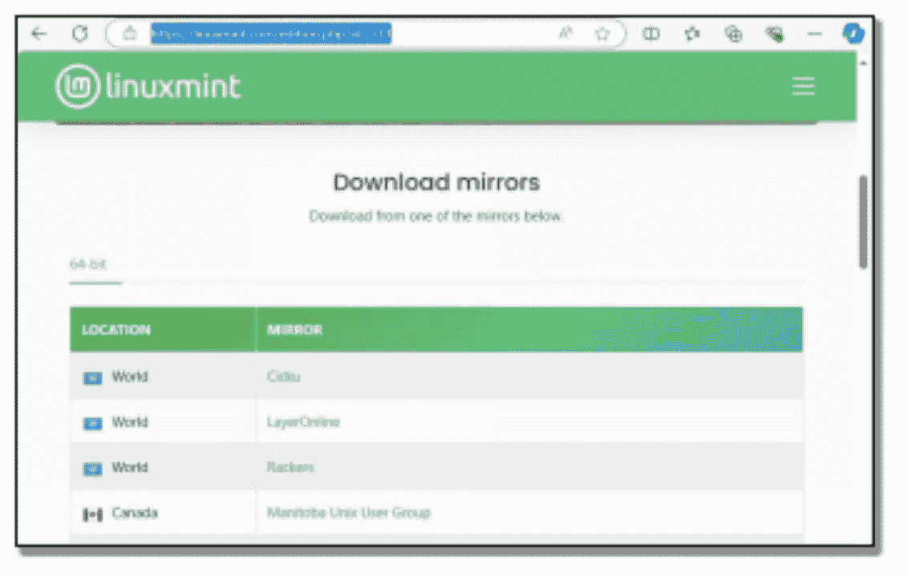

### 创建启动媒体：
一旦下载了 ISO 文件，你就必须创建一个启动型 USB 驱动器或 CD/DVD。要将 ISO 文件传输到 USB 设备，请在 Windows 上使用 `Rufus` 或 `Etcher`，或者在 Linux 上使用 `dd` 命令。

## 将 ISO 写入 USB
我们将在下载 ISO 镜像的 Windows 工作站上使用 `Rufus` 工具。要将 USB 作为安装媒体，我们需要至少 4 GB 的 USB 容量。以下是使用 `Rufus` 在 USB 驱动器上写入 Linux Mint ISO 镜像的步骤：

1. **下载 Rufus**：如果你的 PC 上尚未安装 `Rufus`，可以从 `Rufus.ie` 官方网站获取。
2. **插入 USB 驱动器**：将 USB 驱动器连接到计算机。
3. **打开 Rufus**：在计算机上运行 `Rufus`。它可能需要管理员权限才能运行。

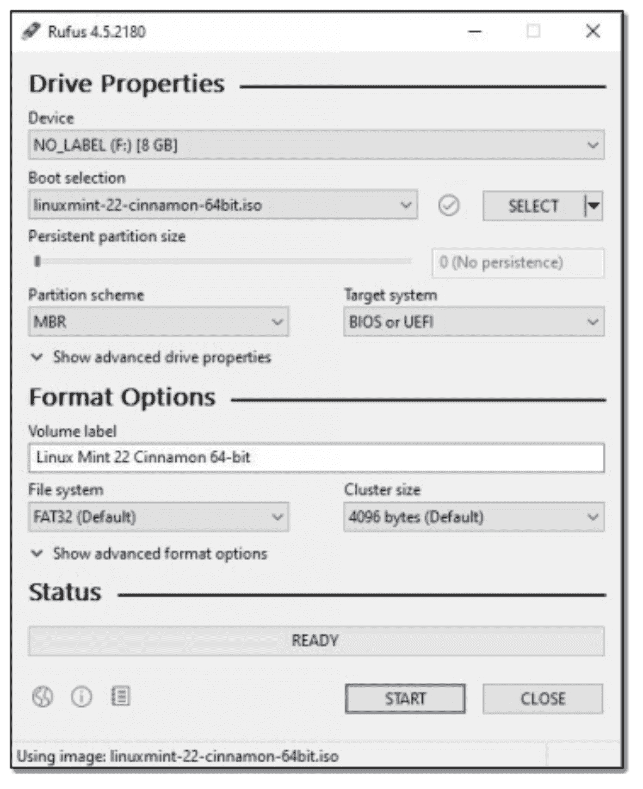
4. **选择 USB 驱动器**：在 `Rufus` 中通过从“设备”下拉菜单选择所需的 USB 驱动器。
5. **选择 Linux Mint ISO 镜像**：点击“启动选择”旁边的“选择”按钮，并进入下载的 Linux Mint ISO 文件夹。选择该 ISO 文件。
6. **分区方案和文件系统**：对于 BIOS，选择“MBR”；对于 UEFI，选择“GPT”作为“分区方案”。点击“文件系统”并选择“NTFS”。
7. **开始进程**：点击“开始”按钮。可能会出现警告窗口，告诉你 USB 驱动器上的所有数据都将被删除。点击“确定”继续。
8. **以 ISO 模式写入**：在提示时选择“以 ISO 模式写入”，然后点击“确定”继续。

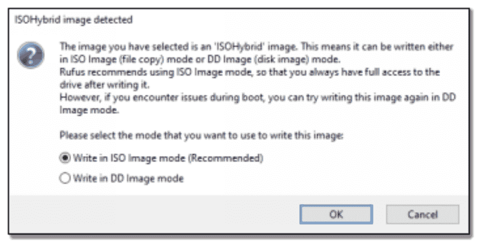
9. **等待完成**：此时，`Rufus` 将开始将 Linux Mint 的 ISO 镜像写入 USB 驱动器。此操作的持续时间取决于 USB 驱动器和计算机的速度。
10. **完成**：当 `Rufus` 完成向 USB 设备写入 ISO 镜像时，进度条将变为“就绪”文本。你现在可以关闭 `Rufus` 并安全地从计算机上拔出 USB 驱动器。

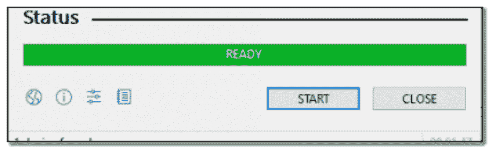
11. **完成了！**你成功使用 `Rufus` 将 Linux Mint ISO 镜像传输到了 USB 设备。

## 开始安装

### 禁用安全启动选项
（这是一个可选步骤，大多数情况下不需要。）
Linux Mint 安装不需要禁用安全启动（Secure Boot）。但由于可能出现与未签名引导加载程序或内核冲突或不兼容的问题，建议在安装期间禁用安全启动。

要在安装期间禁用安全启动模式，你必须打开计算机的 BIOS/UEFI 设置。BIOS/UEFI 设置取决于计算机的制造商；请参阅硬件手册书以访问 BIOS/UEFI。

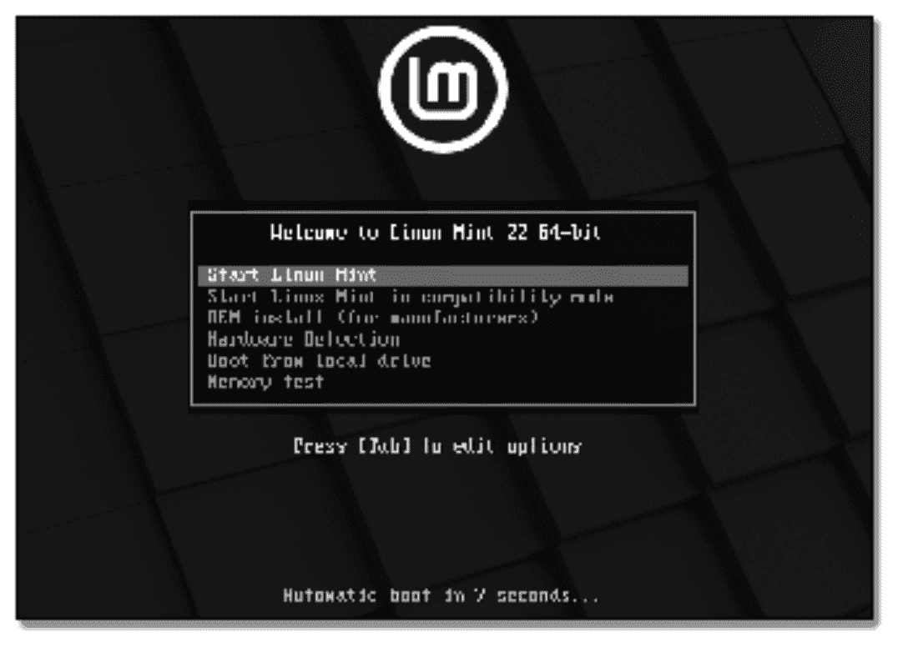

### 从安装媒体启动：
要从启动 USB 设备或 CD/DVD 启动，请将其插入计算机。为了优先使用 USB 驱动器或 CD/DVD，你可能需要调整 BIOS 或 UEFI 设置中的启动顺序。要了解如何获取启动菜单，请参阅你的计算机手册。

### 启动 Linux Mint Live 会话：
当你从安装媒体启动时，会出现一个菜单。选择“启动 Linux Mint”。它将启动 Linux Mint Live 会话。

在 Linux 中，Live 会话是指直接从安装媒体（如 USB 闪盘）运行操作系统，而不是安装在你的硬盘上。

### 连接网络
虽然 Linux Mint 安装不需要 Internet 连接，但建议连接网络以获取更新、硬件驱动程序和其他软件包。在 Linux Mint 中，你可以通过以太网（无线）或 Wi-Fi（无线）连接。

### 连接 Wi-Fi：
要连接 Wi-Fi 网络，请按照以下步骤操作：
1. 点击系统栏中的网络图标。

2. 将出现 Wi-Fi 网络列表。点击 Wi-Fi 名称。
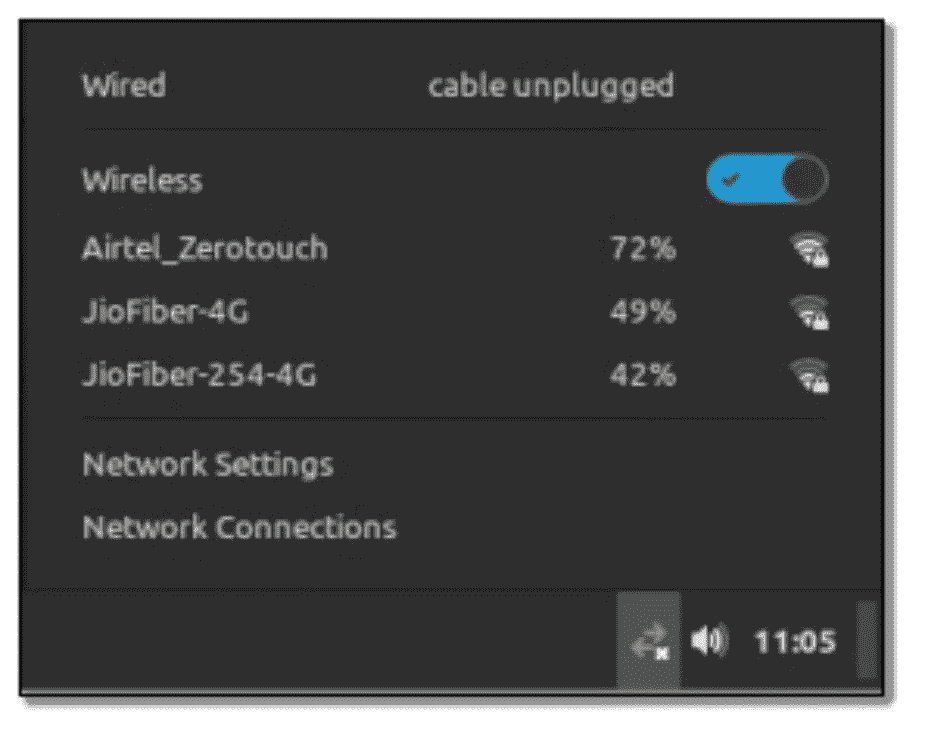
3. 提示时输入 Wi-Fi 密码并点击“连接”。
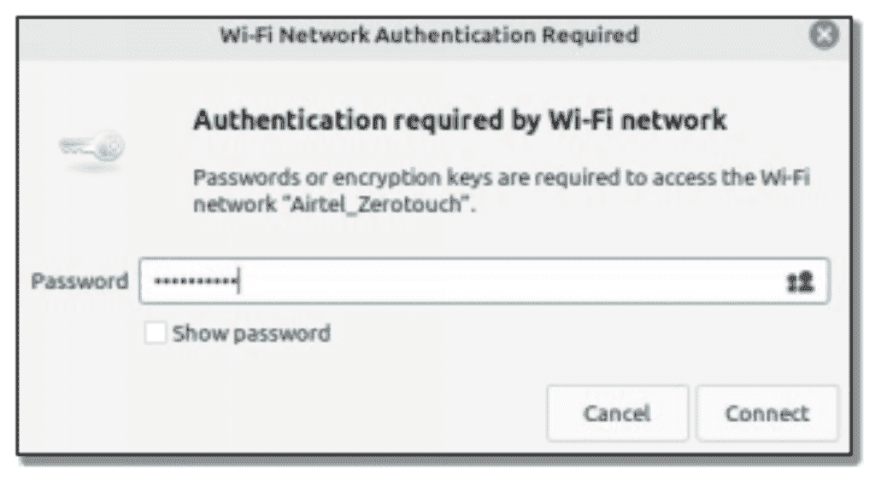

### 安装 Linux Mint：
双击“安装 Linux Mint”图标。
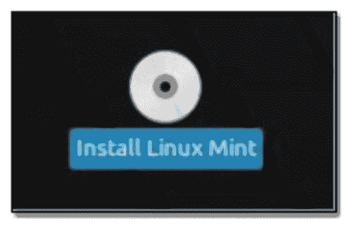

### 选择语言和键盘布局：
在后续屏幕上选择你所需的语言和键盘布局。
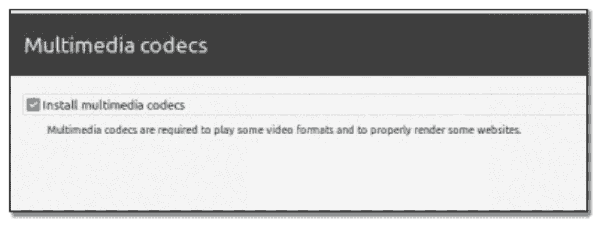

### 多媒体解码器
勾选多媒体解码器。在安装 Linux Mint 时启用多媒体解码器很有用，因为它可以让你立即播放常见的多媒体格式（如 MP3 音频和 H264 视频），而无需安装后手动安装任何软件或解码器。

### 安装类型：
屏幕选项取决于你正在安装 Linux Mint 的系统。第一种方案是在已有其他操作系统（例如 Microsoft Windows）的系统上安装，并希望并行安装 Linux Mint 实现双启动。

**仅操作系统（单启动）**：开始前请进行数据备份，因为这将破坏磁盘上的任何数据。

**抹除磁盘**：此选项会对硬盘进行分区。此选项包含“高级功能”按钮，允许你为磁盘分区选择 LVM 或 ZFS 文件系统类型。
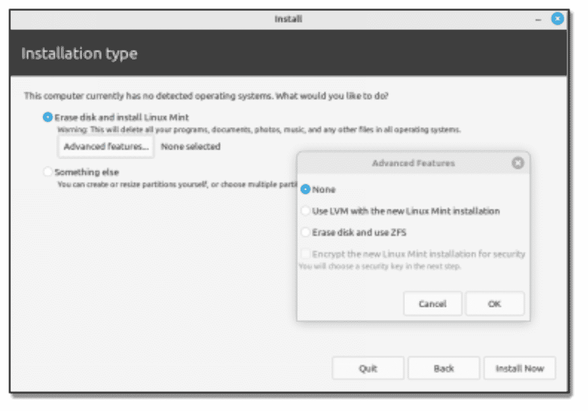

**其他**：此选项允许你进行手动磁盘分区。如果你选择此选项，需要为根文件系统 `/`、交换空间以及任何所需的其他分区（如 `/home`）创建分区。

### 双启动：
你有三个选择：你可以选择将 Linux Mint 与现有的操作系统一起安装（双启动）、替换现有操作系统，或手动划分磁盘。如果你不确定，与现有操作系统一起安装的选项通常是安全的。

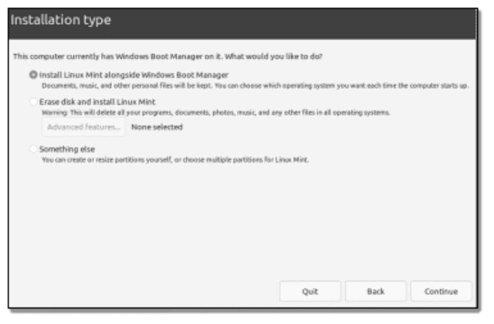


一旦你选择了所需的选项，请点击“立即安装”。系统会要求你进行确认；选择“继续”。

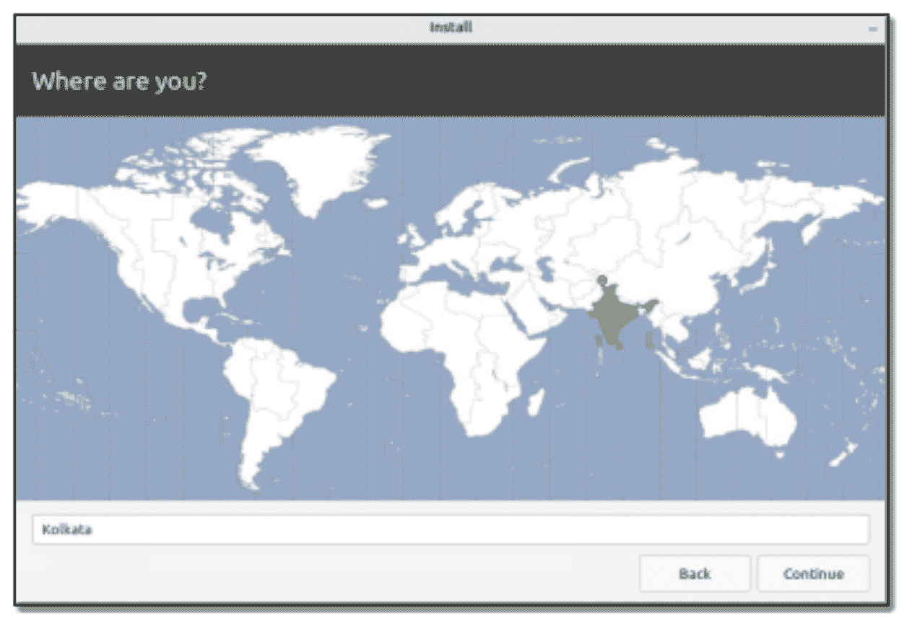

### 时区和时间
“你在何处？”屏幕的目的是帮助你选择时区。如果你连接了互联网，它将自动选择你的位置。否则，你需要在世界地图上点击你当前的位置。

### 设置用户账户
在“你是谁”屏幕上，输入你的姓名、计算机名称、用户名和密码。你也可以选择自动登录，而无需每次都输入密码。按下“继续”。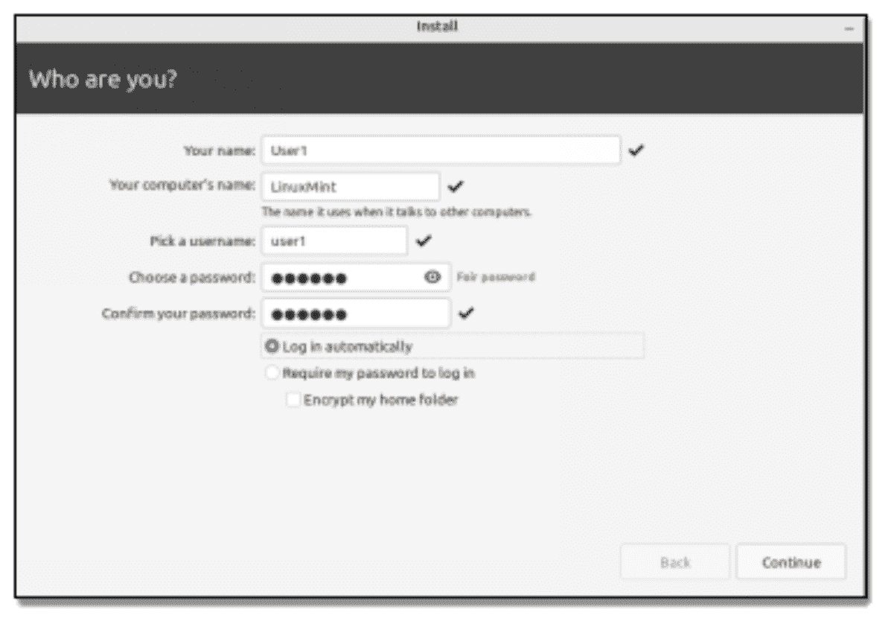

### 安装 Linux Mint
Linux Mint 将开始安装到你的系统中。根据你电脑的速度和磁盘的大小，此过程可能需要一些时间。

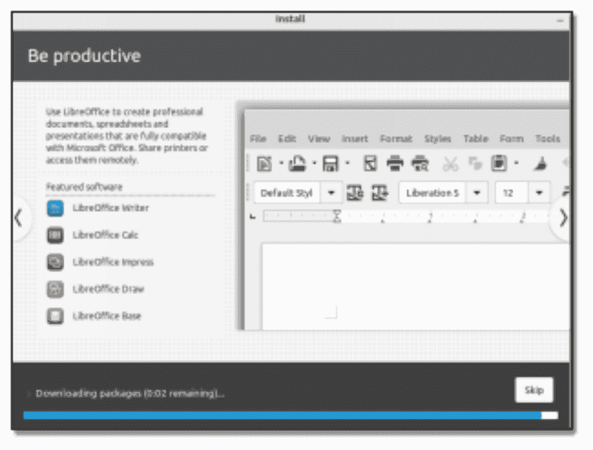

### 完成并重启
安装完成后，系统将提示你重启电脑。请在提示出现时移除安装介质。

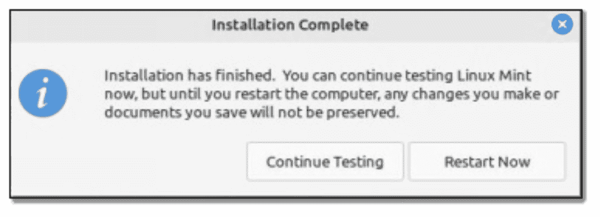

### 登录与配置
重启后，你将看到 Linux Mint 登录界面。输入密码并登录你新安装的 Linux Mint。

恭喜！你已在空白磁盘上成功安装了 Linux Mint，现在可以探索并使用你的新操作系统了。

## 第 4 章：让我们探索桌面

Linux Mint 是一个著名的 Linux 发行版，以其用户友好的界面闻名，并强调为从 Windows 或 macOS 等操作系统切换过来的用户提供熟悉的桌面环境。这是 Linux Mint 桌面环境的概述。Linux Mint 提供了多种桌面环境选项，每种都有独特的视觉效果和体验：

*   **Cinnamon（肉桂）**：这是 Linux Mint 的旗舰桌面环境。它承诺提供一种现代且传统的桌面体验，具有任务栏、系统托盘和可自定义面板，类似于 MS Windows。
*   **MATE**：Linux Mint 还提供了 MATE 桌面环境。它是著名的 GNOME 2 桌面环境的扩展，简单且高效。MATE 适用于想要更传统的桌面布局或在旧旧硬件上运行的人群。
*   **Xfce**：Xfce 侧于速度和效率，是一个轻量级桌面环境。对于想要在不牺牲自定义可能性的情况下获得简单桌面体验的人，或者对于较旧的 PC，它的效果非常好。

在本章中，我们将探索 Linux Mint 的旗舰 Cinnamon 桌面环境。Cinnamon 最初为 Linux Mint 创建的，是一个丝滑且直观的桌面环境，也可以安装在其他 Linux 发行版上。它旨在为从 Windows 或 macOS 等操作系统切换过来的用户提供舒适且高效的计算体验。以下是 Cinnamon 组件的详细说明：

## Cinnamon 面板

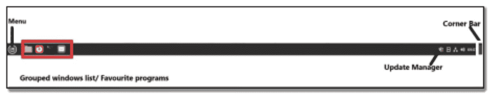

面板通常横跨屏幕底部，是 Cinnamon 主要界面组件。它由：

*   菜单 (Menu)
*   收藏 (Favourites)
*   分组窗口列表 (Grouped windows list)
*   系统托盘 (System Tray)
*   重要图标 (Important icons)
*   角点栏 (Corner bar)

**菜单**：Mint 菜单位于任务栏左上角，提供了访问位置、应用程序、系统设置和会话选项。它允许对程序分类，并包含搜索功能以方便使用。

**收藏**：收藏菜单显示你常用并想要快速访问的程序选择。

**分组窗口列表**：这是一个窗口列表小组件，设计类似于 Windows 7 任务栏（至少部分是）。一些重要方面包括：

*   **程序分组**：将每个程序的窗口分组到单个按钮中。
*   **预览**：当悬停在按钮上时，菜单可以显示该按钮管理的所有窗口的预览。
*   **固定程序**：将你喜欢的程序固定到工作区。
*   **拖放**：你可以重新排列程序顺序。从菜单和面板启动器中释放。将 Cinnamon 菜单和面板启动器小组件中的菜单项拖到此小组件中，程序将被固定。
*   **右键菜单**：通过按钮的右键菜单可以使用多个操作。右键点击任何图标时会出现右键菜单。

**系统托盘**：显示后台服务和系统通知的图标。

**重要图标**：栏右角有扬声器、网络、可移动设备、日期/日历、电池和蓝牙图标。点击这些任何图标即可打开其弹出窗口。声音图标允许你调整扬声器和麦克风音量。其他图标提供了调整网络和蓝牙设置的选项。

**角点栏**：角点栏用于显示桌面、桌面小组件、工作区选择器或窗口选择器。在角点栏上点击鼠标左键会最小化所有窗口并显示桌面，而右键点击则调出右键菜单。悬停在角点栏上（类似于 Windows 中）允许你快速“查看桌面”；你可以在角点栏设置中启用或禁用此功能。

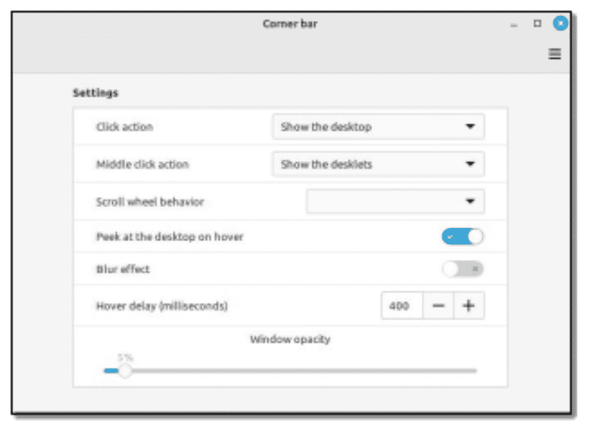

### 钟
时钟位于栏的右侧，默认显示当前时间。当你悬停在上面时，它会显示日期和星期。右键点击提供了配置它的功能。

## 理解菜单

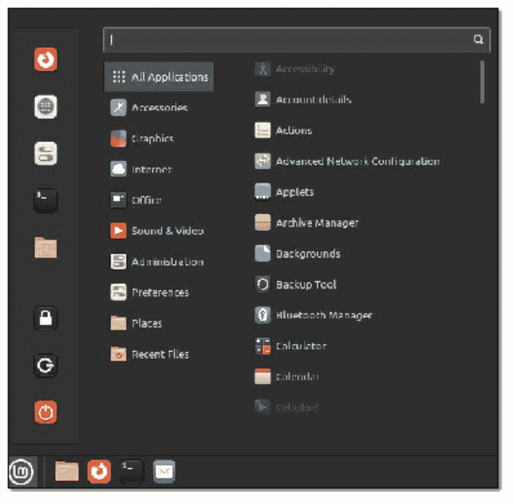

### 所有应用程序
显示 Linux Mint 计算机上安装的所有工具和应用程序，按字母顺序排列。

### 类别
菜单组织为多个类别，例如附件、图形、互联网、办公、声音和视频。点击类别将打开它以显示相关的程序和工具。

### 管理和偏好
管理和偏好显示允许你配置和管理 Linux Mint 的工具和应用程序。

### 位置
位置菜单显示以下内容的快捷方式：

*   主目录 (Home)
*   桌面
*   文档
*   音乐
*   图片
*   视频
*   下载
*   连接服务器
*   挂载设备

位置菜单中每个项目的描述如下：

*   **主目录**：主目录是包含用户个人文件和配置数据的目录。通常表示为 `~/` 或 `/home/username`，其中 `username` 是用户名。在你的主目录内（`/home/username/`），你会找到标准目录，如桌面、文档、图片、视频、音乐和默认保存下载文件的下载目录。
*   **连接服务器**：此对话框包含一个名为“类型”的下拉菜单。该菜单允许你选择要连接的服务器类型，包括：
    *   `SSH`
    *   `FTP`（文件传输协议）
    *   `Windows 共享`
    *   `自定义位置`：指定自定义 URI 连接其他类型的服务器。
*   **挂载设备**：当你连接或挂载设备时，它通常显示在这里，你可以访问并与这些挂载设备交互。
*   **最近文件**：最近文件菜单自动显示最近访问或打开的文件。

### 搜索栏
在顶部菜单上，你会找到搜索栏，允许用户通过输入关键字快速查找并启动应用程序。它还允许你在最近打开的文件列表中搜索文件。

Linux Mint 菜单中的搜索栏通过更易于查找和访问应用程序、设置以及在某些情况下文件来提高生产力。它是浏览系统的有效工具，特别是当安装程序和设置数量增加时。

收藏栏


在菜单的左侧，你会看到一个包含收藏图标和系统操作图标的条栏。默认情况下，收藏图标包括文件管理器、终端、系统设置、软件管理器和网络浏览器。不过，你可以通过拖放操作来添加更多你喜的图标。

## 系统操作

注销、关机和重启等系统操作也可以通过菜单左侧收藏栏中的快速链接轻松访问。以下是每个操作的说明。

### 注销或切换用户


Mint 为你提供了与其他用户共享计算机的选项。要让其他用户使用你的电脑，你可以按下 `Logout`（注销）或 `Switch user`（切换用户）。当你选择 `Logout` 时，所有正在运行的应用程序将关闭；相反，当你按下 `Switch user` 时，所有的应用程序将继续运行，当你重新登录时一切都会如初初。

要执行 `Logout` 或 `Switch user`，请点击按钮然后选择你所需的选项。

### 锁定

当你离开电脑一段时间时，建议锁定屏幕，以免别人在你不在时使用它。当系统屏幕处于锁定状态时，所有运行的程序将继续运行。要重新登录，请提供登录密码以解锁屏幕。如果你离开电脑特定段时间，系统也会自动锁定屏幕。

要手动锁定屏幕，点击 `Lock`（锁定）
要关闭电脑或重启整个电脑，请点击菜单左侧的系统菜单，点击 `Power Off`（关机）

## 桌面组件 (Desklets)

桌面组件是小程序（有时被称为微应用程序），设计用于直接在桌面执行特定任务或提供有用数据。它们可以根据用户的喜好进行更改和配置，类似于其他操作系统中的部件（widgets）或插件。一些常见的桌面组件包括：

*   时钟
*   天气
*   系统监控
*   日历
*   新闻订阅

## 窗口操作

Linux Mint 使用窗口来显示你运行的应用程序。这是同时运行多个任务的方法之一。每当你启动任何应用程序时，它都会在新窗口中打开。在本节中，我们将探索窗口。

### 窗口元素

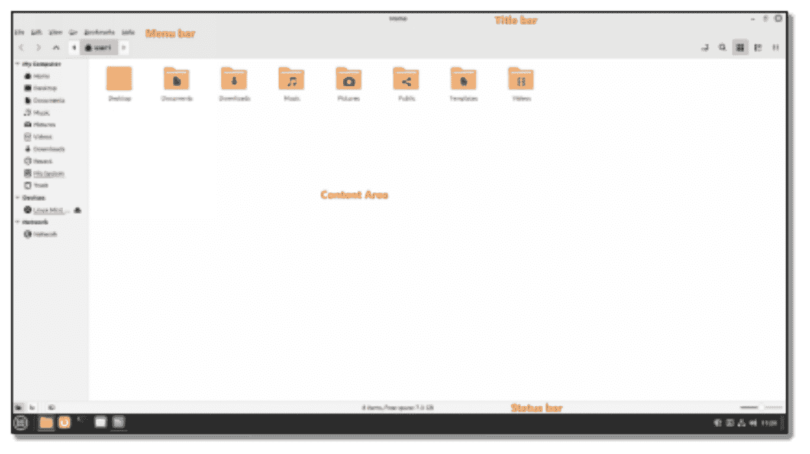

**标题栏**：标题栏位于窗口顶部，通常显示应用程序名称，并具有窗口管理功能（最小化、最大化、关闭）。

**菜单栏**：菜单栏包含特定应用程序的菜单（文件、编辑、视图等），允许你访问程序功能。

**内容区域**：内容区域是显示应用程序主要内容以及你与之交互的地方。

**状态栏**：可选；显示有关应用程序当前状态或进度的信息。

### 窗口管理

**移动**：要在桌面上移动窗口，请点击并拖动其标题栏。

**调整大小**：要调整窗口大小，请点击并拖动其边缘或角部。

**最小化、最大化和关闭**：使用标题栏按钮控制窗口的可见性和行为。

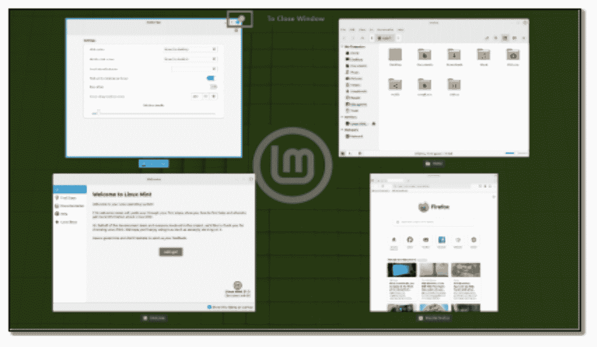窗口选择器视图

当你有多个应用程序在不同的窗口中运行，并希望按顺序查看所有窗口以选择相关的窗口时，你可以利用窗口选择器视图。要打开窗口预览（Windows Peek View），在角栏右键点击，从键菜单中选择“显示窗口选择器（缩放）”。

点击所需的应用程序窗口切换到该应用程序。要关闭任何运行的应用程序窗口，将鼠标悬停在窗口上并点击 `X` 按钮。

### 切换窗口

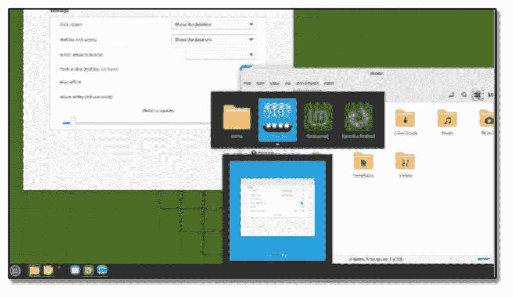

你可以使用键盘切换窗口。按下 `Alt + Tab` 打开窗口切换器。按住 `Alt` 键，释放并按下 `Tab` 键可以在打开的窗口之间循环。`Shift-Alt-Tab` 是你可以使用的另一个快捷键，用于在焦点窗口的历史中后导航。按住 `Alt` 并快速按下 `Tab` 允许你使用左右箭头键按所需的方向导航。按住 `Tab` 键的同时使用滚轮是第三种技巧。

### 贴靠窗口（分屏）！[](image_rsrc4BU.jpg)

为了复制文件或比较两个窗口的内容，你可以将两个窗口并排。在 Microsoft Windows 中，此功能被称为 Windows Snap。要将窗口贴靠到左侧，在选定窗口上按下 `Super + 左方向键`；要将窗口贴靠到屏幕右侧，选择该窗口，在键盘上按下 `Super + 右方向键`。要使用鼠标贴靠窗口，按住窗口标题将其拖动到左侧或右侧，直到半屏幕高亮。

设置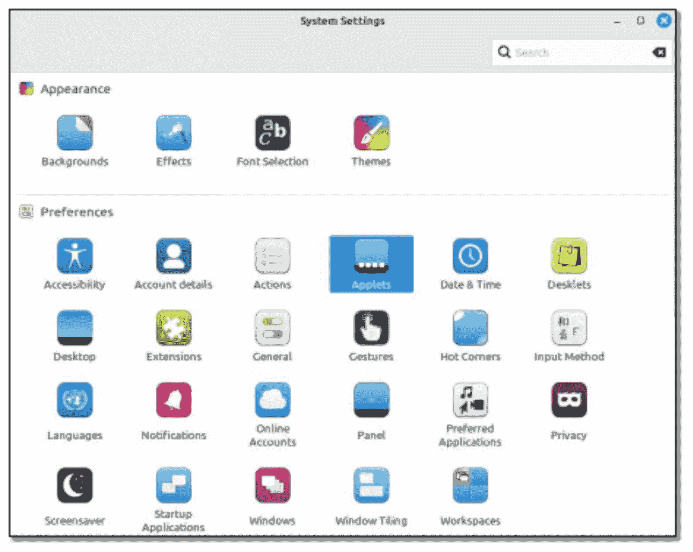

点击 Mint 菜单中的 `Setting` 图标将打开系统和硬件的设置窗口。设置面板按类别组织。你可以使用鼠标滚轮滚动设置列表。假设你想更改桌面背景。点击背景并从可用壁纸列表中选择壁纸。在修改桌面后返回设置窗口，点击顶栏中的返回按钮。

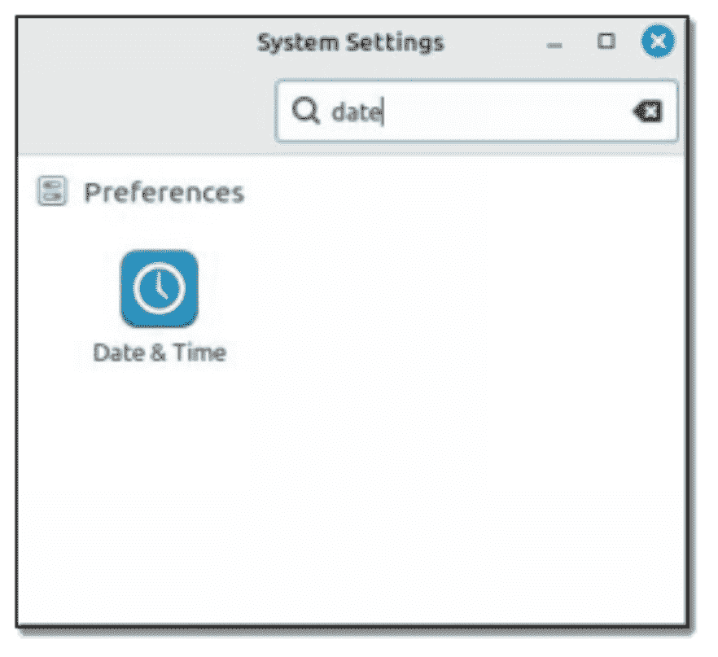系统设置工具的顶栏还包含搜索按钮。搜索按钮允许你搜索与设置相关的任何内容。例如，要设置日期时间，只需在搜索框中输入 `date`。系统将向你显示与日期相关的项目列表。


在 Linux Mint 中，桌面个性化对于提升用户满意度和效率至关重要。通过对主题、图标和字体进行自定义，用户可以建立符合自己品味的审美且舒适的氛围。个性化在促进创造力和个人表达的同时，也增强了可用性和实用性。用户可以从多种简单的布局和配置中进行选择，以最大限地提高工作流效率。此外，跨设备保持统一的桌面体验可以确保友好性和舒适度。总之，Linux Mint 的桌面个性化为所有水平的用户让计算变得高效、有趣且个性化。在本章中，我们将讨论以下：

*   主题
*   图标
*   字体
*   桌面背景
*   桌面特效

## 主题

Linux Mint 中的主题允许用户自定义桌面环境的外，使其更具视觉吸引力并符合偏好。对于 Cinnamon 桌面环境，Linux Mint 仍然保留了自己的主题库。通过为用户提供多种个性化选项，这些主题旨在提高桌面的实用性和审美吸引力。以下是 Linux Mint 中提供的最新 Cinnamon 主题摘要：

### Mint-Y 主题
`Mint-Y` 是 Linux Mint 的默认主题。它具有现代、极简的设计，优先考虑美性和实用性。该主题包含了控件、窗口框、图标和鼠标指针的变体，这些可以在高级设置中可用。

### Mint-X 主题
Linux Mint 还提供了名为 `Mint-X` 的额外主题选项。与 `Mint-Y` 相比，它的外观更加传统，通过细腻的渐变和色调提供永恒的吸引力。`Mint-X` 也包含了控件、窗口框、图标和鼠标指针的额外选择。

除了这两个主题外，Linux Mint 还预装了 `Adwaita` 和 `High Contrast`，这些并不是 Linux Mint 特有的。

以下是 Linux Mint 中管理主题的概述：

#### 更改主题
1. 点击菜单中的 `Settings`（设置）。
2. 在设置窗口中，找到并点击 `Themes`（主题）选项。
3. 在主题设置界面，你有两种模式：简化模式和高级设置模式。在简化模式下，你可以更改样式、外观和颜色。以下是对屏幕上每个项目的解释：

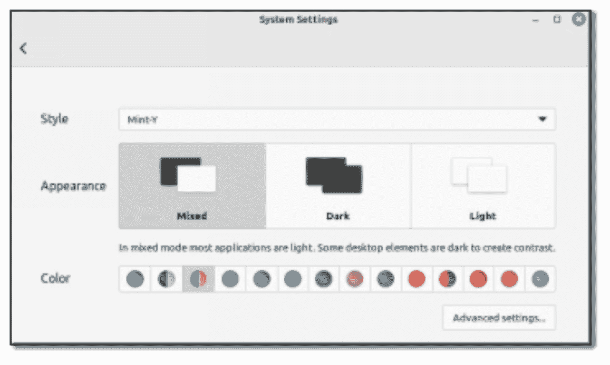

*   **Style**（样式）：你可以使用下拉菜单选择所选的主题。
*   **Appearance**（外观）：外观指的是可以应用于用户界面的各种视觉样式和配色。
*   **Dark Theme**（深色主题）：深色主题通常包含深色背景和浅色文本及对象。深色主题对眼睛更友好，特别是在光光或晚上。
*   **Light theme**（浅色主题）：浅色主题以浅色背景、深色文本和元素为特征。浅色主题更传统，广泛应用于许多操作系统和应用程序。背景与黑色文本/图标之间的强烈对比可以提高阅读体验，特别是在光线充足的区域。
*   **Mixed Theme**（混合主题）：混合主题包含深色和浅色主题的元素。提供了深浅色主题优势的融合，响应不同的用户偏好。
*   **Color**（颜色）：决定启动菜单、文件管理器和其他地方图标的颜色。

#### 高级设置
如果你选择 `Advanced settings`（高级设置），将拥有更多更改桌面环境外观和感受的详细选项。以下是每个项目的解释：

*   **Mouse Pointer**（鼠标指针）：更改指针主题允许你通过选择和使用不同的指针集为桌面添加独特的样式。
*   **Application**（应用程序）：它管理程序按钮、复选框、单选按钮、滑块、进度条、标题栏文本字段和其他交互元素的样式。
*   **Icons**（图标）：它指定显示在桌面、文件管理器、菜单和快捷方式上的图标的外观。
*   **Desktop**（桌面）：它控制面板、Mint 菜单和其他桌面组件的外观。

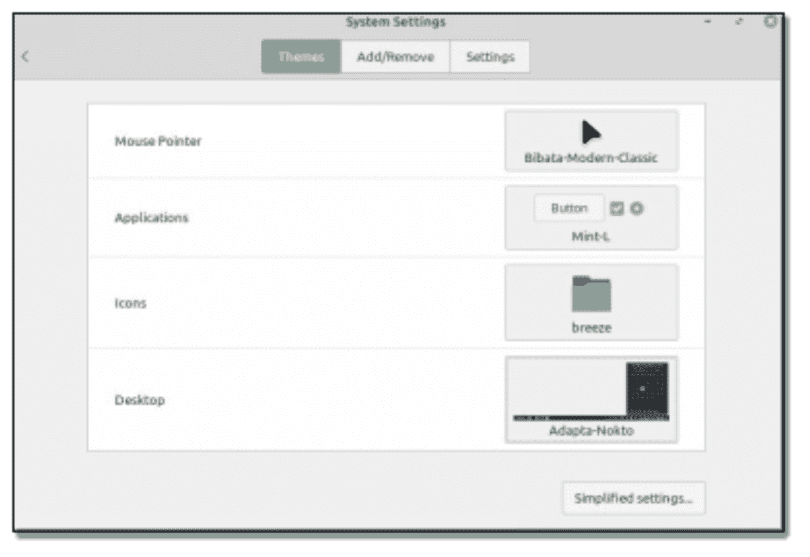

#### 添加新主题
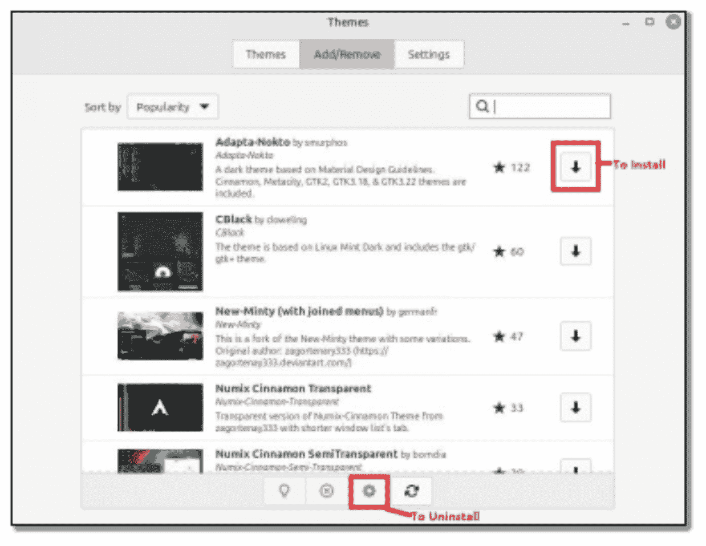
在主题界面，选择 `Add/Remove`（添加/删除）选项卡。在此界面上，选择你想添加的主题，或使用搜索栏找到所需的主题。选择主题后，点击主题右侧的下载图标进行下载安装。完成后，你会发现已安装的主题旁边有一个勾选。你现在可以在高级设置中使用此桌面主题。

## 字体

在 Linux Mint Cinnamon 中，字体选择涉及对应用程序、系统界面和特定用例字体的个性化，以提高读性和审美吸引力。通过使用桌面环境的自定义选项并理解字体的用法，你可以创建一个符合所需的舒适且自定义的计算体验。更改桌面环境字体步骤列如下：

1. 打开 `Mint` 菜单并导航到 `Preferences > Fonts Selection`（偏好 > 字体选择）。

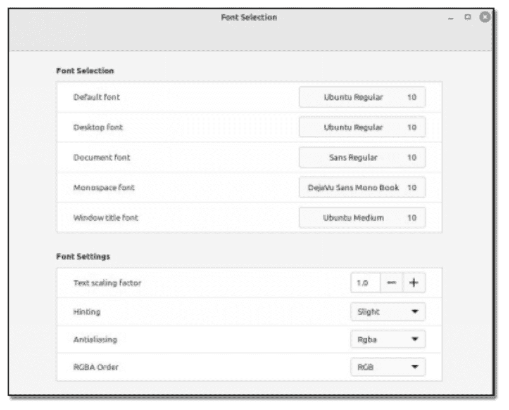

*   **Document fonts**（文档字体）：文档内的文本，包括文字处理文档、电子表格、演示文稿和 PDF 文件，通常使用文档字体。
*   **Monospace fonts**（等宽字体）：经常用于终端、编辑器、编程和其他程序。我们通常用来更改终端字体。
*   **Default font**（默认字体）：用于显示操作系统和应用程序界面内的文本。它包括菜单、对话框、按钮、工具提示和其他界面元素。
*   **Desktop font**（桌面字体）：更改桌面组件的字体，例如快捷图标文本。

## 桌面背景

你可以通过更改壁纸（有时称为桌面背景）轻松自定义你的桌面环境。以下是控制和修改 Linux Mint 桌面背景的方法：

*   在桌面空白区域点击右键，将显示右键菜单。
*   从右键菜单中选择 `Change Desktop Background`（更改桌面背景）。这将打开 `Backgrounds`（背景）窗口。
*   点击缩略图从列表中选择预装壁纸。

#### 添加自定义壁纸
要将自己的图像或下载的图像作为壁纸：

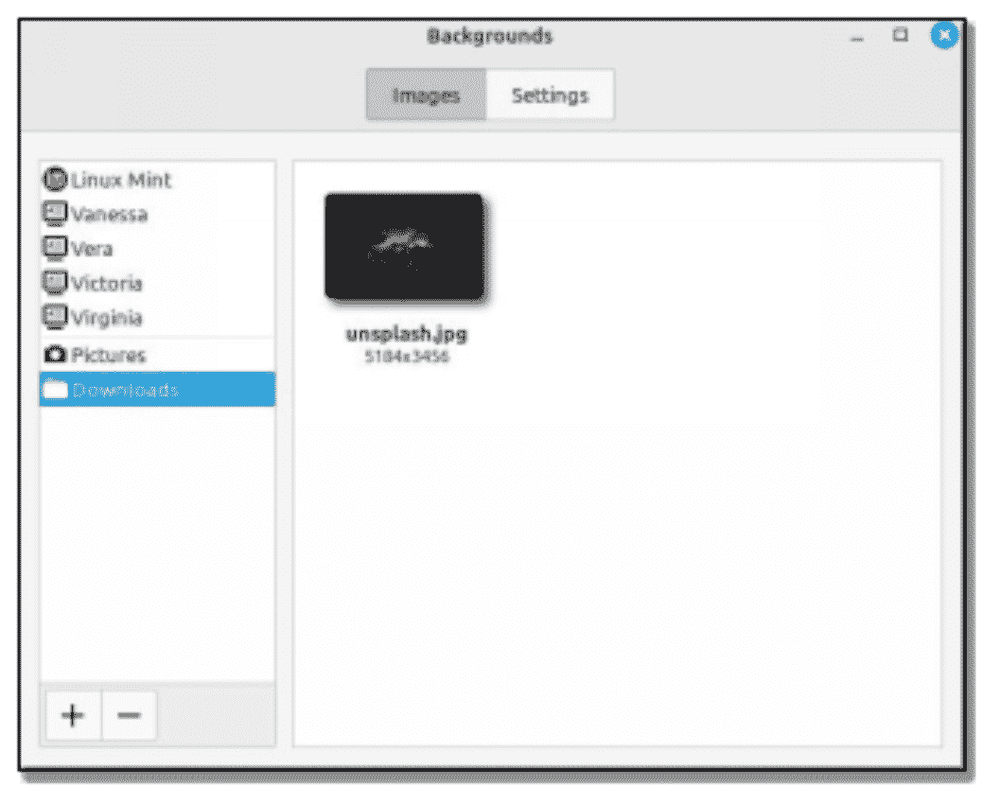

1. **Add The folder**（添加文件夹）：点击 `+` 按钮并导航到包含你想用的背景图像的文件夹。
2. **Select the Background**（选择背景）：添加文件夹后，将在左侧看到图像。选择你想作为桌面背景的图像。

使用文件管理器应用自定义壁纸
另一种选择是利用文件管理器。打开文件管理器，导航到所需的 `.jpg` 或 `.png` 文件，右键点击它并选择 `Set as wallpaper`（设置为桌面）。

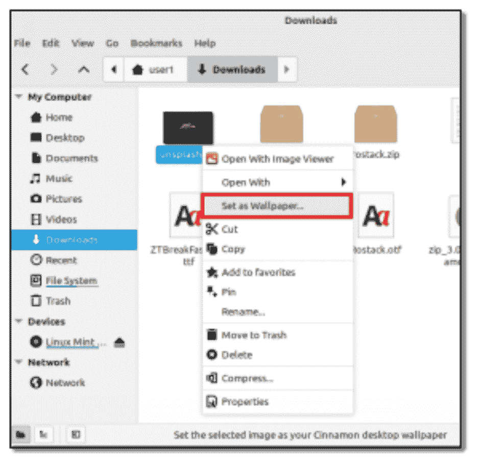

## 桌面特效

“桌面特效”一词描述了提升界面可用性和审美吸引力的视觉添加和动画。这些特效改进了用户交互和体验，可以是从微小的移动到显著的视觉组件。精确调整桌面特效的方法如下：

*   启动 `Mint` 菜单。
*   从 `Preference` 选择 `Effects`。

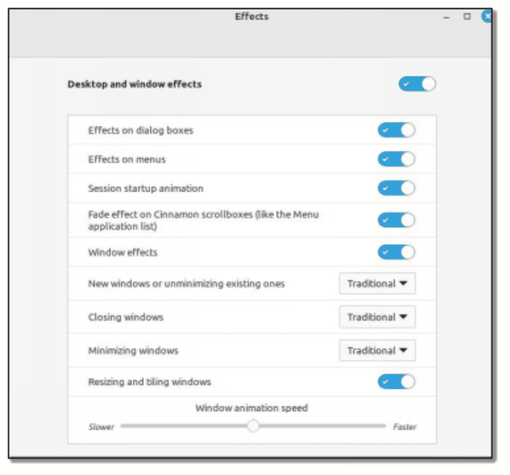

每个类别都显而易见并可以根据你的偏好进行自定义。

## 管理小部件

通过添加小部件（desklets，或桌面小组件），你可以在 Linux Mint 桌面环境中添加实用或美观的项目。以下是使用小部件自定义 Linux Mint 桌面的逐步教程。


要打开 `Desklets Manager`，请点击 Mint 菜单按钮，然后从 `Preferences`（首选项）类别选择 `Desklets`。

### 添加小组件
`Desklets Manager` 窗口显示预装的小组件列表。要向您的桌面添加 `Desklets`，请选择您想要添加的小组件，然后点击 `+` 按钮。

### 移除小组件
要移除小组件，请进入 `Desklets Manager` 并选择您想要移除的小组件，然后点击 `-` 按钮。

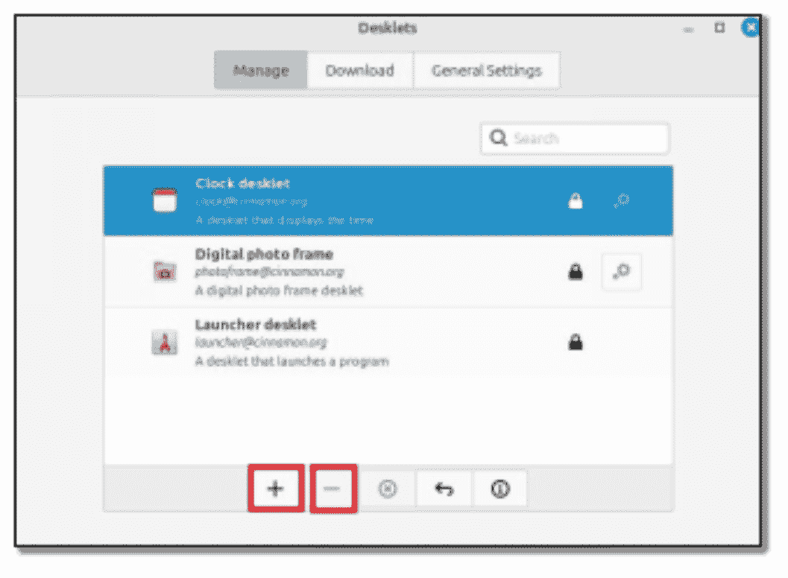

### 安装小组件
若要安装额外的小组件，请点击 `Download`（下载）选项卡，这将显示可供下载的小组件列表。您也可以搜索您想要下载和安装的小组件。要下载并安装小组件，请选择该组件，然后点击其旁边的下载图标。

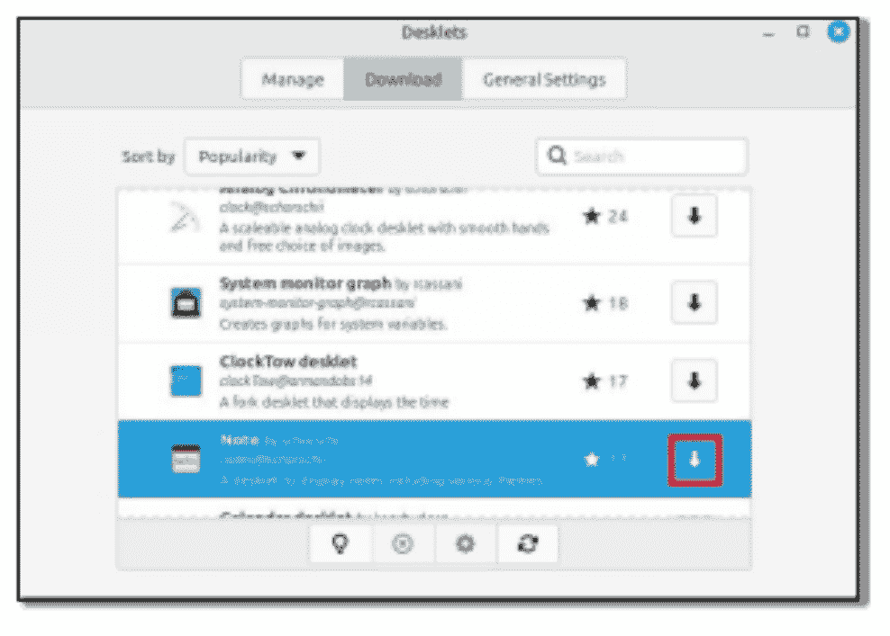

一旦安装完成，它将显示在 `Manage`（管理）选项卡下。

总而言之，在 Linux Mint 中更改桌面环境为改进工作区的美观和功能提供了许多选择。通过尝试不同的主题、图标和字体，您可以设计出一个既反映自己个人风格又能提高效率的配置。

## 第 6 章：文件系统层次结构

## 什么是文件系统？
文件系统是操作系统在存储设备（包括硬盘、固态硬盘 `SSDs`、USB 驱动器和光盘）上组织和存储数据的方式。它提供了一种组织的方法来管理文件、文件夹以及与之相关的元数据。以下与文件系统相关的一些组件和概念：

1. 文件
2. 目录（文件夹）
3. 元数据
4. 文件系统类型
5. 分区
6. 格式化
7. 挂载与卸载
8. 访问控制

### 文件系统与 FHS
FHS 是一组用于 Unix 类操作系统中文件和目录结构及组织标准的标准。它规范了文件系统的层次结构布局，确保了 Unix 和类 Unix 系统之间的一致性。FHS 提供了常用的根目录，包括 `/bin`、`/boot`、`/etc`、`/home`、`/usr`、`/var` 等。

FHS 目录结构从 `/`（根目录）开始。即使文件和目录存储在不同的物理或虚拟设备上，它们也都出现在根目录下。

FHS 定义了大多数 Linux 发行版使用的目录结构。根据 FHS，为一个 Linux 发行版编写的程序可以轻松迁移到另一个发行版。这确保了只需要微小的更改或无需任何更改。假设您有一个程序在 `/opt` 目录中存储二进制文件。如果没有标准，那么在迁移到另一个 Linux 发行版时，您必须创建该目录或更改该程序。FHS 对于系统管理也有用，因为如果您在数据中心有多个 Linux 发行版，它消除了需要记住配置和日志文件位置。

## 文件系统概念

#### 文件
* 文件系统内数据存储的基本单元是文件。
* 文件可以包含各种数据类型，包括文本、照片、应用程序和文档。
* 在每个目录中，每个文件都通过一个唯一的名称来标识。

#### 目录（文件夹）
目录（有时被称为文件夹）是计算机文件系统用于组织和存储其他文件的一种文件。

目录（有时被称为文件夹）是计算机文件系统用于组织和存储其他文件的一种文件。在每个目录中，每个文件都通过唯一名称来标识。

目录（有时被称为文件夹）是计算机文件系统用于组织和存储其他文件的一种文件。在每个目录中，每个文件都通过唯一名称来标识。

目录（有时被称为文件夹）是计算机文件系统用于组织和存储其他文件的一种文件。在每个目录中，每个文件都通过唯一名称来标识。

目录（有时被称为文件夹）是计算机文件系统用于组织和存储其他文件的一种文件。在每个目录中，每个文件都通过唯一名称来标识。

目录（有时被称为文件夹）是计算机文件系统用于组织和存储其他文件的一种文件。在每个目录中，每个文件都通过唯一名称来标识。

目录（有时被称为文件夹）是计算机文件系统用于组织和存储其他文件的一种文件。在每个目录中，每个文件都通过唯一名称来标识。

目录（有时被称为文件夹）是计算机文件系统用于组织和存储其他文件的一种文件。在每个目录中，每个文件都通过唯一名称来标识。

目录（有时被称为文件夹）是计算机文件系统用于组织和存储其他文件的一种文件。在每个目录中，每个文件都通过唯一名称来标识。

目录（有时被称为文件夹）是计算机文件系统用于组织和存储其他文件的一种文件。在每个目录中，每个文件都通过唯一名称来标识。

目录（有时被称为文件夹）是计算机文件系统用于组织和存储其他文件的一种文件。在每个目录中，每个文件都通过唯一名称来标识。

目录（有时被称为文件夹）是计算机文件系统用于组织和存储其他文件的一种文件。在每个目录中，每个文件都通过唯一名称来标识。

目录（有时被称为文件夹）是计算机文件系统用于组织和存储其他文件的一种文件。在每个目录中，每个文件都通过唯一名称来标识。

目录（有时被称为文件夹）是计算机文件系统用于组织和存储其他文件的一种文件。在每个目录中，每个文件都通过唯一名称来标识。

目录（有时被称为文件夹）是计算机文件系统用于组织和存储其他文件的一种文件。在每个目录中，每个文件都通过唯一名称来标识。


点击面板或 Mint 菜单左侧收藏夹栏中的文件管理器图标。或者，你也可以通过在 Mint 菜单中搜索“files”（文件）来找到它。默认情况下，`Nemo` 会在你的主目录（`/home/username`）中打开。

## 理解 Nemo 界面

理解 Nemo 界面将帮助你更有效地导航和管理文件。以下是 `Nemo` 文件管理器的一些主要组件：

* 工具栏
* 侧边栏
* 主区域
* 右键菜单
* 状态栏
* 标签页（可选）

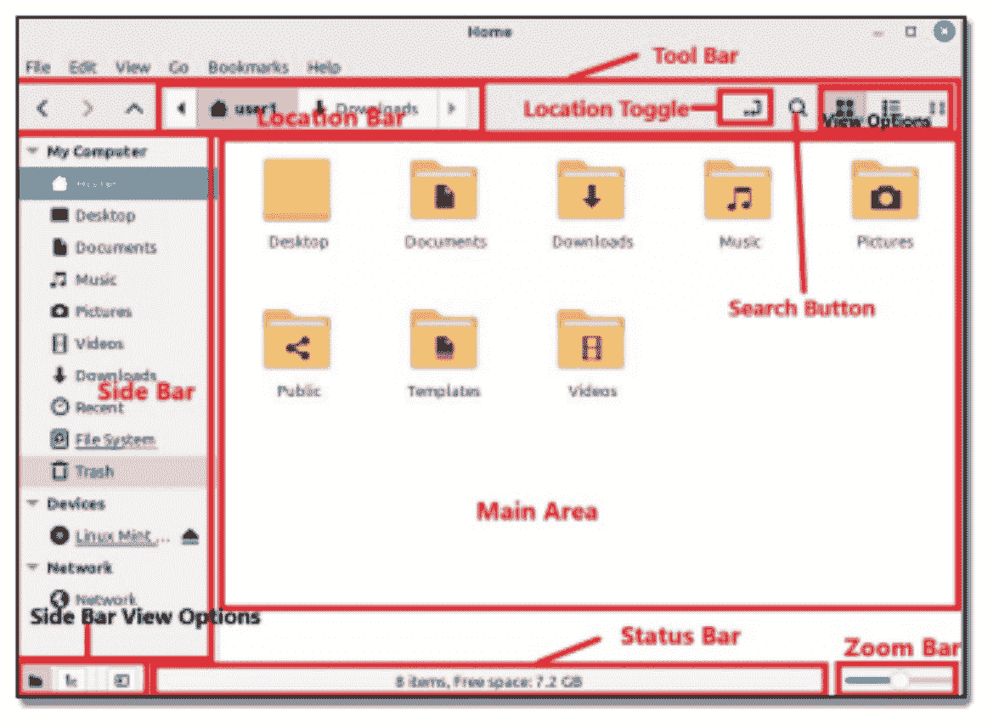

## 工具栏

* **后退/前进按钮**：在之前访问过的目录之间向后或向前后导航。
* **上级按钮**：`Up Button` 将带你在目录层级中向上移动一层。
* **地址栏**：地址栏显示当前目录路径，位于工具栏下方。要快速导航到父目录或路径上的任何其他目录，只需点击路径的任何部分。位于地址栏旁边的切换位置按钮允许你手动输入或修改位置。
* **位置切换按钮**：`Location Toggle button` 允许用户在文件管理器窗口中的可编辑文件路径或地址栏之间切换。
* **搜索栏**：点击搜索按钮时，系统将打开搜索栏，根据名称搜索文件和文件夹。
* **视图选项**：更改布局（图标、列表、紧凑）。

## 侧边栏

`Nemo` 的侧边栏提供了对常用设备和文件夹的快速访问。侧边栏包含以下元素：

* **位置 (Places)**：快速访问桌面、下载、音乐、图片、视频。
* **设备 (Devices)**：显示连接的外部存储设备，如 USB 驱动器和硬盘。
* **网络 (Network)**：访问链接服务器和网络位置。
* **最近 (Recent)**：显示最近访问的目录和文件。
* **垃圾桶 (Trash)**：使用此快捷方式查看已删除的文件。
* **文件系统 (File systems)**：通过“文件系统”访问根目录和其他位置。

## 主区域

主区域是文件管理器窗口的核心区域，显示当前目录的内容。该区域对于浏览、组织以及与文件和文件夹交互至关重要。文件和文件夹可以在图标/网格视图、列表视图或紧凑视图中显示。

* **图标/网格视图**：显示文件和文件夹的缩略图。
* **列表视图**：提供文件和文件夹的列表格式，带有名称、大小、类型和修改日期。
* **紧凑视图**：比列表视图更紧凑的布局。

## 右键菜单

右键菜单（称为上下文菜单）是用户右键点击项目时出现的界面元素。它显示与指定对象或位置相关的操作或命令，让你轻松访问常用功能。在文件管理器中右键点击文件或文件夹时会出现包含以下选项的右键菜单：

* **打开 (Open)**：打开文件或文件夹。
* **剪切/复制/粘贴 (Cut/Copy/Paste)**：移动和复制文件及文件夹。
* **重命名 (Rename)**：修改文件或文件夹的名称。
* **删除 (Delete)**：将文件或文件夹发送到`垃圾桶`。
* **属性 (Properties)**：显示文件或文件夹的详细信息，如权限和元数据。
* **其他选项 (Other Options)**：根据右键的内容显示额外选项，如压缩、打开终端、新建文件夹等。

## 标签页

`Nemo`（文件管理器）支持标签页导航，这意味着可以在同一个窗口内的独立标签页中浏览多个目录。此功能允许用户无需启动额外的文件管理器窗口即可切换目录。

## 状态栏

`Nemo`窗口底部的状态栏显示有关文件和文件夹的信息。

* 显示当前目录中文件和文件夹的总数。
* 显示选中文件的总大小以及可用磁盘空间。
* **侧边栏视图选项 (Side bar view options)**：提供切换侧边栏视图为树视图、位置视图或显示/隐藏。
* **缩放栏 (Zoom Bar)**：提供调整主区域缩放级别的滚动。

## Nemo 基本操作

### 打开文件或文件夹

双击文件将用该文件类型的默认程序打开。双击或使用 `Enter` 键（选中文件）可以打开文件夹并查看其内容。

### 选择文件或文件夹

只需点击任何文件或文件夹即可将其选中。按住键盘上的 `Ctrl` 键可以选择多个文件或目录。

### 复制和移动文件

有多种方法可以复制/移动文件。

#### 使用右键菜单

选择文件或文件夹，然后右键点击并在右键菜单中选择“复制”或“移动”。导航到目标文件夹，然后右键点击并选择“粘贴”。

#### 使用键盘复制

1. 选择要复制的文件或文件夹。
2. 同时按下 `Ctrl + C`。
3. 导航到目标位置。
4. 粘贴时按下键盘快捷键 `Ctrl + V`。

#### 使用键盘移动

1. 选择要移动的文件或文件夹。
2. 同时按下 `Ctrl + X`。
3. 导航到目标位置。
4. 粘贴时按下键盘快捷键 `Ctrl + V`。

#### 拖放复制或移动文件

使用拖放将文件从一个源复制到另一个源步骤如下：

1. 导航到包含要复制的文件文件夹（源文件夹）。
2. 打开新窗口，导航到想要复制文件的目标文件夹。
3. 将两个窗口并排放置。
4. 进入源窗口。
5. 在点击要复制的文件或文件夹时按住 `Ctrl` 键并按左鼠标键。将其拖到目标窗口，然后释放两个按钮。


### 重命名文件或文件夹

要更改文件或文件夹的名称，右键点击文件夹并在右键菜单中选择“重命名”。使用键盘重命名文件或文件夹：选择文件或文件夹并按 `F2` 键。输入文件或文件夹的新名称并按 `Enter`。


### 删除

如果不再需要文件或文件夹，可以删除它。选择要删除的文件或文件夹。右键点击并在右键菜单中选择“移动到垃圾桶”。或按键盘上的 `Delete` 键。文件将被移动到垃圾桶。如果你误删了文件或文件夹，可以从`垃圾桶`恢复。

#### 从垃圾桶恢复文件

从垃圾桶恢复文件是一个简单的操作。点击桌面或文件管理器侧边栏上的`垃圾桶`图标。浏览垃圾桶找到想要恢复的文件或文件夹。右键点击文件或文件夹，从右键菜单中选择“恢复”。

#### 清空垃圾桶

回收删除文件占的空间：

1. 右键点击侧边栏上的垃圾桶图标。
2. 在右键菜单中选择“清空垃圾桶”。
3. 在确认框中点击“清空垃圾桶”。

永久删除文件而不移动到垃圾桶：

1. 选择要删除的文件或文件夹。
2. 在键盘上按住 `Shift` 键并按 `Delete` 键。

系统将提示确认。点击“删除”按钮

## 排序和查看选项

文件管理器默认以图标视图显示文件和文件夹。要从图标视图切换到列表视图或紧凑视图，请使用文件管理器工具栏上的视图按钮。也可以使用键盘命令 `Ctrl + 1` 进入图标视图，`Ctrl + 2` 进入列表视图，`Ctrl + 3` 进入紧凑视图。

对文件列表进行排序：

1. 切换视图到列表视图。


2. 点击列标题可以对列表。再次点击相同标题可以反向排序视图。

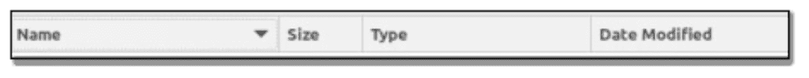

在列表视图中，当你右键点击列时，会弹出视图选项菜单，允许你选择 `Visible Columns`（显示列）。

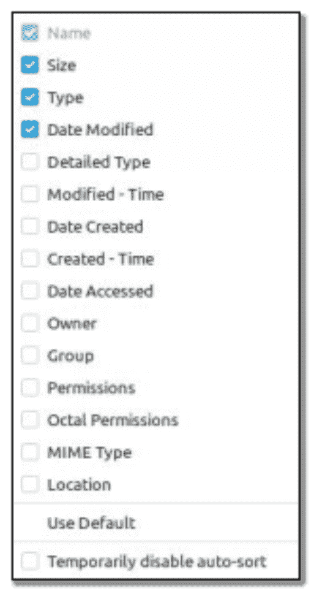

在 Linux Mint 中，使用 `Nemo` 浏览文件系统可以更方便地管理文件和。它允许你执行基础文件操作、搜索文件，并根据你的喜好个性化文件管理器。掌握这些导航技能可以帮助你在 Linux Mint 中更高效、更有生产力地处理文件。

## 第 8 章：使用外部存储设备

在 Linux Mint 中，通过图形用户界面 (GUI) 使用外部存储设备通常非常直观。以下是关于使用 Linux Mint 提供的 GUI 工具处理外部存储设备的指南：

### 即插即用

将外部存储设备连接到计算机的 USB 端口，例如 SD 卡、外部硬盘或 USB 闪器。Linux 经常会自动挂载外部驱动器；你应该收到一个通知并在桌面上看到该设备。如果你在文件管理器中，可以在侧边栏看到它。点击它可以访问其内容。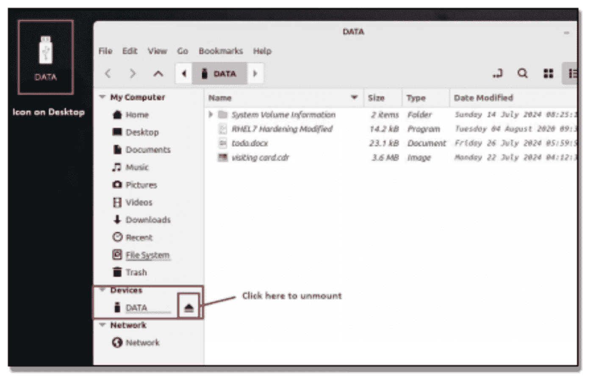

### 卸载设备

要从 Linux 系统安全地移除 USB 设备，请确保在物理拔掉它之前已正确卸载。这可以防止数据丢失和文件系统损坏。方法如下：

- 在文件管理器中右键点击图标并选择 `Eject`（弹出）或 `Unmount`（卸载）。你也可以通过点击已挂载设备旁边的小挂载图标来卸载。
- 另一个选项是在面板中右键点击可移动设备图标并选择 `Remove "Removable drives"`（移除“可移动驱动器”）。一旦收到确认消息，就可以安全地拔掉 USB 设备了。

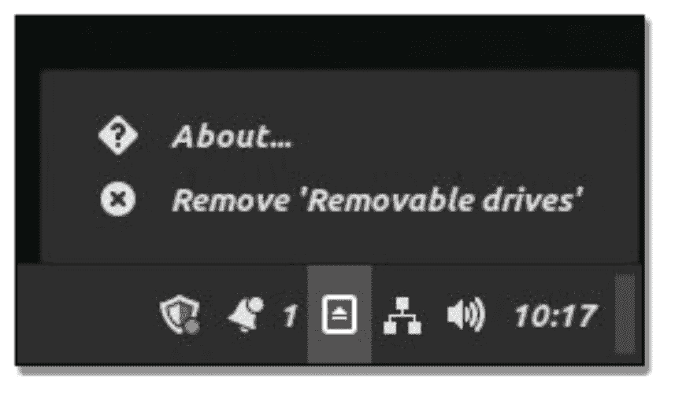

### 格式化 USB 盘

可以通过格式化 USB 驱动器使其可用，这将删除现有数据或安装新的文件系统。对于普通用途，可以使用 `FAT32` 等文件系统，对于 Linux 则可以使用 `ext4`。通过格式化可以增强驱动器性能并解决任何问题。此外，它还会清除磁盘上之前的所有数据，使其为空并准备好使用。

#### 使用 GUI

格式化 USB 存储驱动器有多种方法，你可以使用 GUI 或命令行界面。在此方法中，我们将使用 Linux Mint 提供的图形化程序 `USB Stick Formatter(MintStick)`。

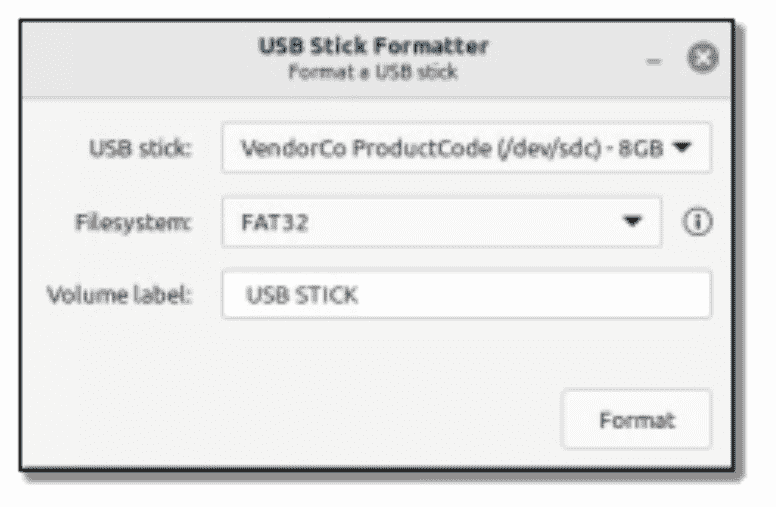

1. 将 USB 驱动器插入计算机。
2. 从 Mint 菜单的“附件”（Accessories）类别下启动 USB 闪器格式化工具。
3. USB 闪器格式化窗口将显示存储设备列表。从列表中选择你的 USB 闪器。
4. 选择优的文件系统（例如 `FAT32` 或 `ext4`）。
5. 如果需要，更改 `Volume Label`（卷标）。
6. 点击 `Format`（格式化）按钮。
7. 输入验证密码并按 `Authenticate`（验证）来确认操作。这将删除 USB 闪器上的所有数据并使用指定的文件系统对其格式化。
8. 完成后，你将收到确认窗口。

### 写入 ISO 镜像

ISO 镜像是一个单一文件，包含了光盘（如 CD、DVD 或蓝光光）上数据的完整副本，包括文件系统以及所有文件和目录。“ISO”一词是指 `ISO 9660` 文件系统，它用于 DVD 介质和 CD-ROM。

Linux 操作系统的 ISO 镜像是一个包含 Linux 操作系统完整副本的文件，包括安装文件、设置，在许多情况下还包含一个启动环境。

Linux Mint 包含一个名为 `USB Image Creator` 的程序。它用于将 ISO 镜像转换为可启动的 USB 设备。这对于直接从 USB 闪器运行实时会话运行 Linux Mint 或将其安装到计算机上非常有帮助。

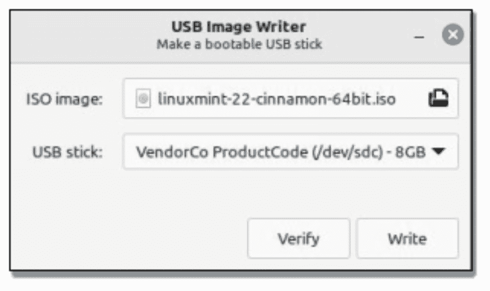

使用 `USB Image Creator` 的方法如下：

1. 下载镜像文件。
2. 插入 USB 驱动器。
3. 从 Mint 菜单的“附件”类别打开 `USB Image Creator`。
4. 选择 ISO 文件。
5. 选择你想使用的 USB 驱动器。请小心选择正确的驱动器，因为其上的所有数据将在过程中擦除。
6. 点击 `write`（写入）按钮。
7. 你将看到 `Authentication`（验证）窗口和关于删除数据的警告。按 `Authenticate` 开始将 ISO 以可启动格式传输到 USB 设备（如果 ISO 文件是可启动的）。
8. 等待过程完成。所需时间取决于镜像的大小和你的 USB 设备的速度。过程完成后，你的 USB 驱动器就可以使用了。

在 Linux Mint 中使用外部存储设备既简单又直观。得益于对 USB 驱动器和外部硬盘等设备的自动检测和挂载，可以通过文件管理器快速访问文件。综合考虑，Linux Mint 与外部存储设备的交互非常流畅，让你在处理数据时既感到有控制力又很方便。

## 第 9 章：使用终端

终端是一个允许你访问命令行界面 (CLI)并通过输入文本命令与系统进行交互的应用程序，这比使用鼠标更快更高效。它允许你管理文件、启动应用程序并完成任务。命令行对于故障排除、远程系统访问和基于脚本的自动化非常重要。它也是学习更多知识和提升技术能力的极佳方法。终端和虚拟终端是获取命令行界面的两种主要方法。

### 终端

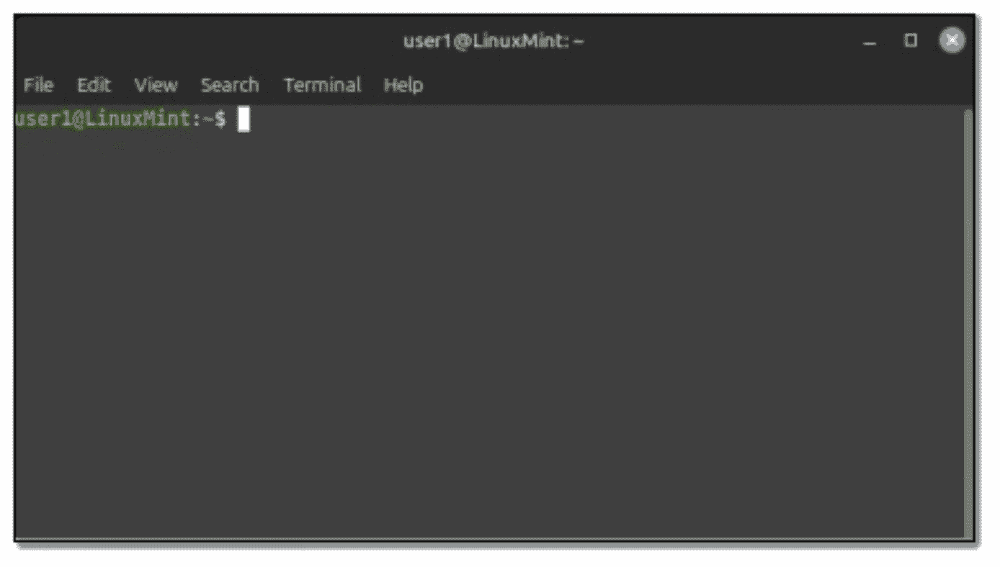

通过终端，你可以在图形桌面执行命令并有效管理系统。要打开它，请使用快捷键 `Ctrl + Alt + T`，在 Mint 菜单中搜索 `Terminal`，或在文件管理器中右键点击并选择 `Open Terminal Here`（在此处打开终端）。

### 虚拟终端

虚拟终端是访问命令行的另一种方式。虚拟终端提供了多个独立于图形界面的命令行会。它允许用户在命令行实例之间切换，这对于多任务处理、系统管理和故障排除很有帮助。当图形环境无响应无法执行各种任务或排查问题时，虚拟终端会非常有用。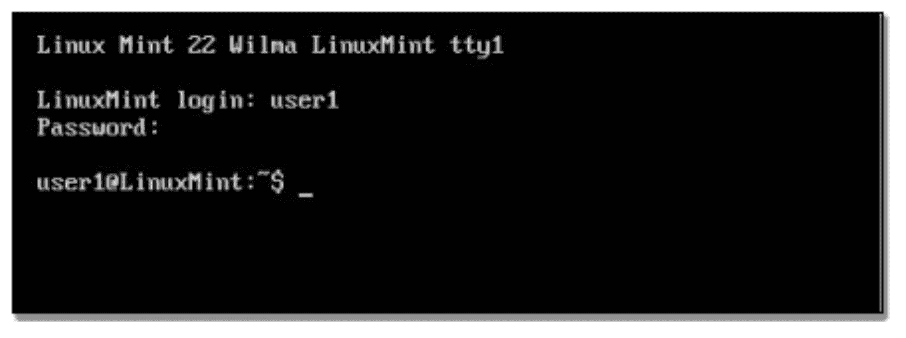

可以使用 `Ctrl + Alt + F1` 到 `F6` 访问虚拟终端。可以使用 `Ctrl + Alt + F7`（或 `F8`）返回图形桌面。

### 提示与技巧

这里是一些有效利用终端的有用提示：

- **制表符自动补全 (Tab Completion)**：当你在输入命令或文件名时按下 `Tab` 键，如果只有一个选项，它将自动补全，或者显示可能的补全列表。这可以节省时间并防止错误。
- **命令历史 (Command History)**：使用`向上`和`向下`箭头键导航之前输入过的命令。这允许你重复或修改命令，而无需重新输入。
- **历史搜索 (History Search)**：要搜索命令历史，请使用 `Ctrl + R` 并开始输入命令的一部分。再次按 `Ctrl + R` 可循环查看匹配项。

远程使用终端


远程终端允许你通过网络或互联网控制另一台计算机，就像你直接坐在它面前一样。最常用的工具是 `SSH`（安全外壳），它允许你安全地访问远程机器并运行命令、管理文件以及执行管理功能。`Telnet` 是另一个选项，尽管它的安全性较低，因此不建议用于关键任务。你可以使用这些工具遍历文件系统、修改文档，甚至在机器之间传输数据，而这一切都可以在自己的所在地完成。不仅是 Linux 机器，你也可以使用 Windows 10/11 通过 `SSH` 或 `telnet` 远程管理其他系统。`SSH` 因其安全性而青青，因为它加密数据并使其免受窥探。这种配置是远程管理服务器、软件开发和提供技术支持的理想选择 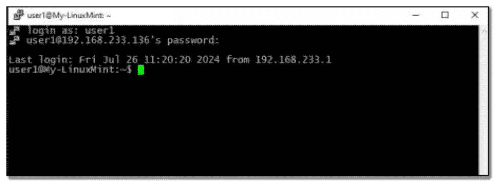

你可以在 Windows 系统上使用 `PuTTY` 程序远程连接到任何 Linux 机器。`PuTTY` 是由 Simon Tatham 创建的一款强大的开源的终端模拟器。它支持多种网络协议，包括 `SSH`（安全外壳）、`Telnet`、`SCP`（安全复制协议）和原始套字连接，使其成为系统管理员、开发者和 IT 专业人员的重要工具。该软件允许用户安全地连接到远程服务器，提供命令行界面以从远程执行命令、管理文件并执行系统管理职责。

总之，学习 Linux Mint 终端是最大化利用系统能力的有效方法。终端提供了一种简单有效的方法来管理文件、执行命令并自定义你的环境。在接下来的章节中，我们将查看如何使用终端来探索系统。

## 第 10 章

## 使用终端导航文件和目录

在本节中，我们将查看操作文件和目录的 Linux 命令。通过命令行导航和操作文件及目录是 Linux 中的一项基本技能，它让用户对自己的文件系统拥有完全的控制权。本指南将教你用于读取、创建和更改文件及目录的重要命令。无论你是初学者还是想要精进技能，掌握这些终端命令都将提高你管理 Linux 系统的效率和信心。掌握这些从文件列出到文档编辑的命令，将为高级任务奠定基础。

要使用命令行工具访问文件和目录，首先打开上一节中描述的终端窗口并使用以下命令：

```
cd
```

`cd` 命令代表“change directory”（更改目录）。它用于从当前目录移动到目标目录。

### 语法
```
cd directory_name
```

### 示例
```
cd john
```

### 向上移动一级
```
cd ..
```

### 向上移动两级
```
cd ../..
```

### 移动到主目录
要导航到用户的主目录，请使用 `cd`（更改目录）命令。有几种方法可以实现这一点：

#### 使用无参数的 cd 命令
```bash
cd
```

#### 使用 `~`（波浪号）符号
```bash
cd ~
```

#### 使用 `$HOME` 环境变量
```bash
cd $HOME
```

运行这些命令之一后，你将进入主目录，通常是 `/home/username`。

#### 导航到主目录内部的子目录
你可以同时使用 `~` 和 `$HOME` 在你的主目录内导航。
```bash
cd ~/Downloads/
```
此命令将你带到用户主目录下的 Downloads 文件夹。

#### 使用 $HOME 导航到相同的 Download 子目录
```bash
cd $HOME/Downloads/
```

#### 切换到另一个用户的主目录。
根据你当前的登录权限，你可以轻松地从当前工作目录切换到另一个用户的主目录。
```bash
cd ~john
```

#### 切换到根目录
直接从当前工作目录更改到根目录。
```bash
cd /
```

#### 切换到上一个目录。
```bash
cd -
```
假设你在 `/etc` 目录并切换到了 `/tmp` 目录。如果你输入 `cd -`，你将被带回 `/etc` 目录。

### 使用相对路径更改目录
相对路径是一种相对于你当前工作目录指定文件或目录位置的方法，而不是从文件系统的根。

```bash
$ pwd
/home/shiv
$ cd Documents
$ pwd
/home/shiv/Documents
```

### 使用绝对路径更改目录
绝对路径指定文件或目录在文件系统中的精确位置，从根目录开始。

```bash
$ pwd
/home/shiv
$ cd /home/shiv/Documents
$ pwd
/home/shiv/Documents
```

## ls

`ls` 命令用于显示文件夹的内容。它将显示当前或指定文件夹中所有文件和目录的列表。

 列出带权限的文件和目录
`ls -l` 命令返回文件和目录的详细长格式列表，包括文件权限、所有者、大小和修改时间。它是获取目录内文件内容和属性详细视图的有用工具。

### 语法
```
ls -l
```

### 示例
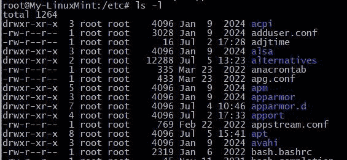

### 以人类可读格式列出文件和目录
`ls -lh` 命令以全面的、人类可读的格式显示文件和目录。`-l` 选项提供了每个文件的详细信息，而 `-h` 格式以更易理解的方式格式化文件大小，使其一眼看出文件大小更加容易。
```bash
ls -lh
```

 列出所有文件和目录，包括隐藏文件
`ls -a` 命令显示所有文件和目录，包括隐藏文件。默认情况下，`ls` 只显示非隐藏文件；使用 `-a` 选项包含以 `.` 开头的文件。
```bash
ls -a
```

### 递归列出文件和目录
`ls -R` 命令显示当前目录及其所有子目录。这意味着它不仅显示所选目录中的文件，还会显示其下方的每一个目录。
```bash
ls -R
```

### 显示 ls 帮助页
```
ls --help
```

## pwd

`pwd` 命令是“print working directory”（打印工作目录）的缩写。它显示用户当前的目录或位置。它显示从根目录开始的绝对路径。

### 语法
```
pwd
```

## mkdir

你可以使用 `mkdir` 命令创建自己的目录。

### 语法
```
mkdir directory_name
```

### 示例
```
mkdir john
```

### 创建多个目录
### 语法
```
mkdir directory1 directory2 directory3
```
### 示例
```
mkdir dir1 dir2 dir3
```

### 添加目录及其子目录
`mkdir` 命令中的 `-p` 选项代表“parents”（父目录），允许你创建任何尚所需的父目录。当你希望通过单个命令创建嵌套目录结构时，这非常有用。

### 语法
```
mkdir -p directory/subdirectory
```
### 示例
```
mkdir -p development/task1
```

## rmdir

使用 `rmdir` 命令从你的系统中删除目录。

### 语法
```
rmdir directory_name
```

### 示例
```
rmdir john
```
注意：`rmdir` 命令仅在目录为空时有效。如果目录包含文件或其他目录，该命令将失败并输出错误。

### 删除目录及其子目录
此命令将同时删除目录及其子目录，但前提是它们都是空的。该命令允许对嵌套空目录进行更清理。
```bash
rmdir -p development/task1
```

## mv

`mv` 命令是管理文件和目录的有用工具。它允许你高效地移动和重命名文件及目录。

### 将文件从一个目录移动到另一个位置
### 语法
```
mv source destination
```
### 示例
```
mv file1.txt /home/shiv/
```

### 重命名文件或目录
`mv` 命令通常用于移动文件，也可以用于重命名文件夹和文件。


```bash
mv oldfoldername newfoldername
```

## Example
```bash
mv development development1
```

## rm
对于删除文件和目录，`rm` 命令是一个非常有效的工具。它非常灵活，但在使用如 `-r` 递归删除和 `-f` 强制删除等选项时，你必须小心。

### 删除文件
在 Linux 中删除（移除）一个文件或目录，请使用 `rm` 命令。

### 语法
```bash
rm filename
```

### 示例
```bash
rm biodata.txt
```

### 删除多个文件
### 语法
```bash
rm file1 file2 ...
```

### 示例
```bash
rm biodata.txt happy.txt
```

### 删除目录
使用 `-r` 标志递归删除目录及其内容。

### 语法
```bash
rm -r directory1 directory2
```

### 示例
```bash
rm -r dir1 dir2
```

### 强制删除（忽略确认提示）
使用 `-f` 标志覆盖任何确认提示。

### 语法
```bash
rm -f file1 file2 ...
```

### 示例
```bash
rm -f file1.txt file2.txt
```

### 递归并强制删除文件
使用此命令时请加小心，因为它会在不会提示的情况下递归删除文件和目录。

### 语法
```bash
rm -rf directory
```

### 示例
```bash
rm -rf dir1
```

## touch
`touch` 命令用于创建新的空文件或更改现有文件的时间戳。

### 创建新空文件
### 语法
```bash
touch filename
```

### 示例
```bash
touch file1.txt
```

### 更新现有文件的时间戳
### 语法
```bash
touch filename
```

### 示例
```bash
touch myfile.txt
```

## 查看和编辑文件
在终端中查看和修改文件是 Linux 中的一项基本能力。以下是几乎在所有 Linux 发行版中用于查看和编辑文件的命令和工具的详细概述：

### Cat
`cat` 命令用于查看、合并和创建文件。它的简单性使其非常适合快速读取文件内容或将多个文件合并为一个单文件。

### 显示文件内容。
使用 `cat` 命令显示文件内容。

### 语法
```bash
cat filename
```

### 示例
```bash
cat example.txt
```

### 查看行号
在输出中附加行号，这对于调试或查看大文件很有用。

### 语法
```bash
cat -n filename
```

### 示例
```bash
cat –n example.txt
```

#### 合并多个文件
### 语法
```bash
cat file1 file2
```

### 示例
```bash
cat example1.txt example2.txt
```
显示 `example1.txt` 的内容，随后显示 `example2.txt`。

#### 将输出重定向到另一个文件
### 语法
```bash
cat file1 > file2
```
### 示例
```bash
cat example1.txt > newfile.txt
```
此命令将 `example1.txt` 的内容复制到 `newfile.txt`，如果 `newfile.txt` 已存在，则覆盖它。

#### 将输出追加到另一个文件
### 语法
```bash
cat file1 >> file2
```
### 示例
```bash
cat example1.txt >> newfile.txt
```
此命令将 `example1.txt` 的内容追加到 `newfile.txt`。

## Less
`less` 命令允许你逐页查看文件内容。

### 语法
```bash
less filename
```

### 示例
```bash
less example.txt
```
以下是可以在 `less` 命令输出中一些基础导航命令：
- **向下滚动**：使用向下方向键或 `j` 逐行向下移动。要一次向下一页，使用 `Space` 或 `F`。
- **向上滚动**：使用向上方向键或 `k` 逐行向上移动。按 `b` 或 `Page Up` 一次向上一页。
- **向前搜索**：按下 `/`，然后输入搜索词并按回车。使用 `n` 跳到搜索词的下一个出现处。
- **反向搜索**：按下 `?`，输入搜索短语，然后按回车。使用 `N` 返回到搜索词的上一个出现处。

### Head
`head` 命令显示文件或输入数据的开头。默认情况下，它显示前十行，但你可以更改此设置。它对于快速预览文件或数据流的开头非常有用。

### 语法
```bash
head filename
```

### 示例
```bash
head example.txt
```

### 指定行数
```bash
head –n 20 example.txt
```
显示前 20 行。将 `20` 替换为所需的行数。

### Tail
`tail` 命令显示文件或数据流的末尾。在监控日志或大文件并需要查看最新项目时特别有用。默认情况下，`tail` 显示文件的最后 10 行，但可以进行自定义。

### 语法
```bash
tail filename
```

### 示例
```bash
tail example.txt
```

### 指定行数
你可以使用 `-n` 选项指定要显示的行数。

### 语法
```bash
tail –n <n> filename
```

### 示例
```bash
tail –n 20 example.txt
```
显示最后 20 行。

### 实时监控
使用 `-f` 选项持续监控文件变化。

### 语法
```bash
tail -f filename
```

### 示例
```bash
tail -f example.txt
```

除了这些命令，Linux 还有许多编辑文件的文本编辑器，最常用的是 `nano` 和 `vi`。

## 使用 sudo
### 使用 sudo 提升权限
`sudo` (SuperUser DO) 命令允许用户以管理员权限执行命令。它通过要求输入密码来验证访问请求。`sudo` 记录所有提权命令，确保了安全性和透明度。它简化了系统管理，允许用户在不切换到 root 账户的情况下完成操作。总的来说，`sudo` 提高了安全性和效率，是系统管理中不可或少的工具。

以下是一些命令示例：

#### 安装包
```bash
sudo apt install
```

#### 修改主机名
```bash
sudo hostnamectl set-hostname host2021
```

#### 以不同用户运行命令
要以不同用户执行命令，请使用带有 `-u` 参数的 `sudo`。它允许另一个用户的权限运行命令，这对于不需要完全切换账户的任务非常有帮助。

### 语法
```bash
sudo -u user command
```

### 示例
```bash
sudo -u user hostnamectl
```

#### 使用交互模式 sudo
带有 `-i` 选项的 `sudo` 会打开一个具有 root 权限的交互式 shell。它启动一个新的 root 用户会话，允许你执行管理操作而无需在每个命令前加 `sudo`。

```bash
sudo -i
```

### 示例
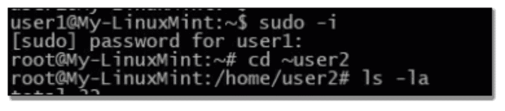

### 修改 sudo 配置
sudo 的配置存储在 `/etc/sudoers`文件中。该文件是控制管理访问的有用工具。正确配置和管理它可以确保用户获得适当的权限同时维护系统安全。要更改 sudo 配置，请使用 `visudo` 命令。

```bash
sudo visudo
```
它本质上是启动 `vi` 或 `nano` 编辑器并修改 `/etc/sudoers` 文件。`visudo` 命令必须由具有管理员权限的用户运行。


`sudo` 命令对于管理 Linux Mint 中的系统权限至关重要，因为它提供了一种安全手段来执行管理任务，而无需赋予长时间的 root 权限。`sudo` 通过允许用户精确控制其可以使用提升权限运行的命令，从而了安全性和可追溯性。通过 `sudoers` 文件进行设置可以确保权限得到适当的维护和记录。有效的系统管理需要熟练掌握 `sudo`，以确保活动安全、高效地完成。总的来说，`sudo` 是安全且高效的 Linux 管理的关键组件。

## 第 12 章：包管理

包管理是一系列 Linux 实用的集合，用于从基于 Linux 的操作系统中安装、更新、配置和卸载软件包。这些工具帮助用户和管理员高效地管理其计算机上的软件生态系统。大多数包管理工具都能帮助解决依赖问题。软件依赖是软件包为了正常运行而所需的其他软件组件或库。不仅如此，包管理工具还在以下方面提供帮助：

- **依赖关系跟踪**：包管理技术维护依赖数据库，帮助您在安装、更新或卸载包时快速解决依赖关系。
- **版本兼容性**：管理包与依赖之间的版本兼容性。
- **冲突解决**：解决当多个包请求同一依赖的不同版本时可能出现的任何冲突。
- **依赖移除**：当您删除一个包时，包管理程序会确定是否有其他包依赖于它。如果没有，它将删除该包以及任何不再需要的依赖。

### 包管理系统示例：

- `APT` 和 `DPKG` 用于基于 Debian 的发行版，如 Ubuntu、Linux Mint、MX Linux 等，使用 `deb` 扩展名包。
- `RPM` 和 `YUM/DNF` 用于基于 Red Hat 的发行版，如 Fedora、CentOS 和 Oracle Linux。它采用 `.rpm` 包。
- `Pacman` 用于 Arch Linux 及其衍生版本。
- `Portage` 是 Gentoo Linux 的包管理系统。它采用基于源码的包管理方法。
- `ZYpp` 是 SUSE Linux 发行版（包括 openSUSE 和 SUSE Linux Enterprise）使用的包管理库。

这些包管理解决方案支持的功能、能力和 Linux 发行版可能有所不同，但它们的共同目标是简化 Linux 机器上软件包的处理。

## 高级包工具

`APT` 是 Linux Mint 以及其他基于 Debian 变体版本的包管理器。它是系统上安装、升级和管理软件包的极其实用的应用程序。`APT` 允许用户轻松地从 Linux Mint 仓库安装软件，这些仓库是由 Linux Mint、Ubuntu 和 Debian 社区管理的海量软件包集合。`APT` 还管理包依赖关系，确保在安装新应用程序时安装所有所需的组件。`APT` 使用 `.deb` 文件作为包格式。`APT` 数据库通常位于 `/var/lib/apt/`。仓库定义在 `/etc/apt/sources.list` 和 `/etc/apt/sources.list.d/` 中。

以下是 `APT` 主要功能和方面的简要摘要：

- **包管理**：`APT` 命令行界面允许用户通过简单的命令安装、卸载和更新包。
- **仓库**：`APT` 默认配置访问 Linux Mint、Ubuntu 和 Debian，允许用户简单地从官方仓库安装包。也可以使用自定义仓库。
- **依赖解析**：`APT` 包含一种复杂的机制，用于在安装或删除包时自动处理依赖关系。
- **事务安全**：`APT` 提供了一种强大的事务机制，有助于防止系统损坏，并确保包的安装和升级是可靠安全的。
- **配置文件**：`APT` 使用直观的系统来管理配置文件，在进行包升级的同时保留之前进行过的任何调整。

## 包扩展

Linux Mint 中的包文件通常具有 `.deb` 扩展名。该扩展名表示该包是基于 Debian 的包。Debian 软件包经常保存在仓库中，这些是在线或 CD-ROM 等物理介质上找到软件包集合。通常，包以预编译的二进制格式提供，这使得安装变得简单并消除了编译任何软件的需求。一个 `.deb` 文件通常包含：

- **控制文件**：包的名称、版本、依赖、维护者详情和安装脚本都在 `control` 和 `md5sums` 文件中描述。
- **数据存档**：存放要安装到系统上的实际文件，例如配置文件、库、二进制文件以及包所需的任何其他资源。

## 仓库

仓库是 Linux 软件的集合，可能存在于本地或远程。仓库可安装新软件或更新现有应用程序。仓库的列表和位置可以在 `/etc/apt/sources.list` 文件中找到，也可以在 `/etc/apt/sources.list.d` 目录中创建。要添加仓库，请向 `/etc/apt/sources.list` 添加条目；每行一个源。

### 示例

```
deb http://packages.linuxmint.com virginia main upstream import backport #id:linuxmint_main
deb http://archive.ubuntu.com/ubuntu jammy main restricted universe multiverse
deb http://archive.ubuntu.com/ubuntu jammy-updates main restricted universe multiverse
deb http://archive.ubuntu.com/ubuntu jammy-backports main restricted universe multiverse
```

`/etc/apt/sources.list.d`

要添加新仓库，请 `/etc/apt/sources.list.d` 目录下创建文件。`/etc/apt/sources.list.d` 中文件的格式与 `sources.list` 文件相同，且文件名必须以 `.list` 结尾。

## Flatpak

有时，需要安装 `deb` 格式不可提供的额外软件以满足特定的需求和要求。这时 Flatpak 的通用包结构就派上用场了，让 Linux 上安装和使用应用程序变得简单。通过使用跨发行版的框架 Flatpak，开发者可以将程序及其依赖项打包在一起，以便在许多 Linux 发行版上安装和使用。

它也被称为“Linux 应用沙箱”，因为它为程序的运行创建了一个安全且隔离的环境，类似于虚拟化但没有完整虚拟机的开销。Linux Mint 支持 Flatpak，这使得能够访问传统仓库中不可提供的广泛应用程序。

## FlatHub

Flathub 是 Flatpak 应用程序的关键仓库，提供了一个集中平台，用于访问 Linux 发行版的多种软件。它通过在不同系统上提供一致的界面来简化应用程序的安装。这是一个开发者可以在其中上传程序并供全球用户使用的仓库。您可以使用命令行工具或图形用户界面从 Flathub 浏览并安装应用。


## 启动软件管理器

点击 Mint 菜单按钮。从菜单左侧的收藏中选择软件管理器图标。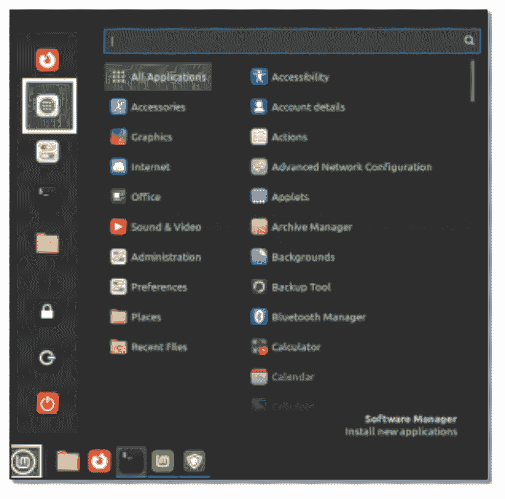

## 界面

界面由三部分组成。顶部是一个搜索栏，您可以在其中搜索任何要安装或卸载的软件包。第二部分显示精选程序，您可以通过点击其中任何一个来安装。第三部分展示了软件类别。


## 安装软件

### 搜索并安装

安装软件的另一种方法是通过名称进行搜索。假设您想在计算机上安装 VLC 播放器。这是一个非常著名的音乐和视频播放器。搜索并安装的步骤如下：

1. 在搜索栏中输入 `VLC`。
2. 从可用软件列表中，点击要安装的软件。在我们的示例中，它是 `VLC`。
3. 在软件描述界面上，按 `Install`（安装）。
4. 在身份验证界面上提供您的密码并点击 `Authenticate`（身份验证）。
5. 安装过程将开始。进度条将显示安装进度。

### 通过类别安装

在类别区域，应用程序根据其功能进行分类。您可以点击任何类别来探索可用软件列表。假设您点击了“Graphics”（图形）。它将显示所有与绘画、绘图和摄影相关的软件。

1. 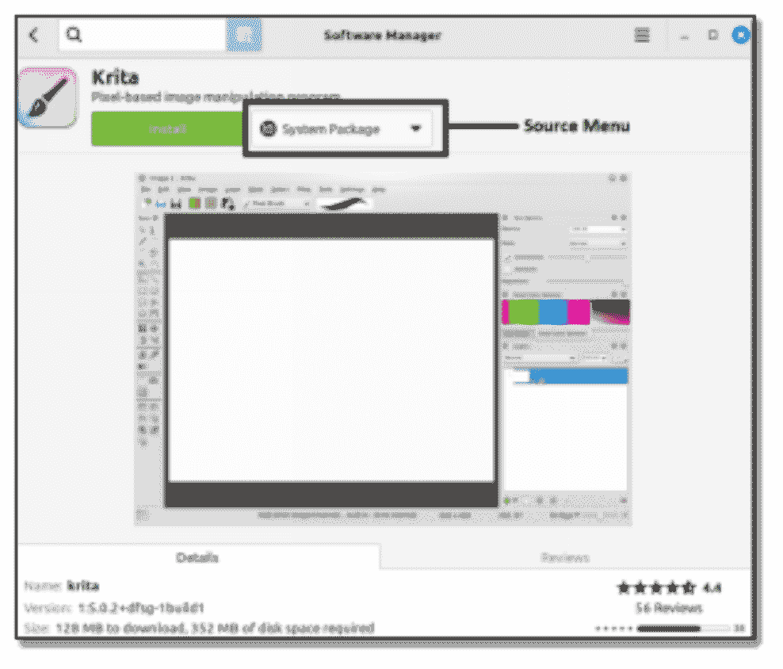从列表中点击所需的软件。
2. 某些软件同时提供 `Flathub` 和 `deb` 软件包；您可以从源下拉菜单中选择软件包类型。
3. 在软件描述界面上按 `Install`（安装）。
4. 在身份验证界面上，提供您的密码并点击 `Authenticate`（身份验证）。
5. 进度条将显示完成百分比。

### 已安装的软件

在某个时刻，您可能需要删除已安装的应用程序以释放磁盘空间。要删除已安装的应用程序：

1. 在搜索栏中输入您想要删除的软件名称。例如，您想删除之前在章节中安装的 `VLC`。在搜索栏中输入 `VLC`。从列表中查找所需的软件名称。已安装的软件在右上角有一个绿色绿色勾选标记。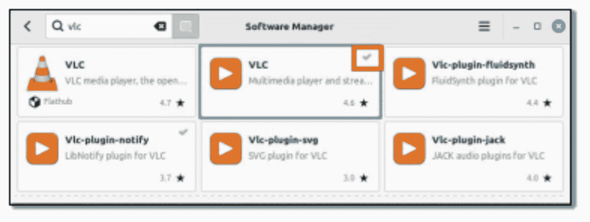
2. 点击已安装的软件。
3. 点击软件描述界面上的 `Remove`（移除）按钮。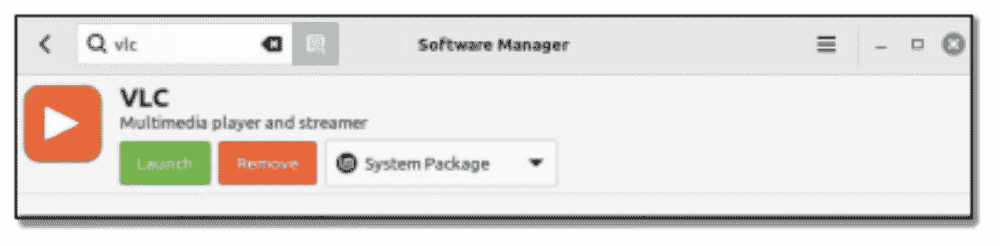
4. 此过程需要身份验证。提供您的密码并点击 `Authenticate`（身份验证）。移除过程将开始。移除过程完成后，应用程序描述界面上的移除按钮将转换为安装按钮。

## Sudo

当您在 Linux 上执行需要管理权限（root 访问）的命令时，通常会使用 `sudo` 命令或切换到 root 用户。`sudo` 命令用于执行需要管理权限的任务，例如安装软件或修改系统配置。当您使用 `sudo` 时，系统会提示您输入用户密码。这与您登录 Linux 系统时使用的密码相同。

在下一节中，我们将探索用于软件管理的命令行实用工具。由于它会更改整个系统，我们需要在大多数这些命令的前面添加 `sudo` 命令作为前缀。以下是使用 `sudo` 命令的示例：

```bash
sudo apt install package1.deb
```

# 通过命令行进行软件包管理

`apt`（高级软件包工具）命令行软件是一个用于基于 Debian 的 Linux 发行版（如 Linux Mint）的强健软件包管理工具。它简化了软件包安装、更新和系统维护等流程。以下是使用 `apt` 进行软件管理的几个元素的全面介绍。

## 更新

### 更新软件包数据库

`apt` 的 `update` 选项通过从定义的存储库检索最新信息来刷新本地软件包索引。这确保您的系统已更新到最新的软件包版本。

```bash
sudo apt update
```

### 升级已安装的软件包

刷新软件包索引后，此命令将分析系统中的过时软件包，并安装这些软件包的新版本。它只升级现有的软件包，而不会安装或删除它们。

```bash
sudo apt upgrade
```

### 全面升级

为了将系统更新到软件包的最新版本并智能管理变化的依赖关系，我们利用 `dist-upgrade` 选项。为了满足新的依赖关系，可能会安装新软件包并卸载旧软件包。

```bash
sudo apt dist-upgrade
```

## 查询软件包

`apt` 命令提供了关于用于安装的软件和已安装软件的详尽信息。它允许用户搜索特定软件包、读取其详情并跟踪它们的当前状态。

### 搜索软件包

`search` 选项在存储库中搜索与提供的包名匹配的软件包。它会显示已安装和可用的软件包。

语法
```bash
apt search package_name
```

示例
```bash
sudo apt search foo
```

### 列出所有软件包

要列出所有软件包，可以使用 `apt` 命令的 `list` 选项。

```bash
sudo apt list
```

### 列出已安装的软件包

要列出所有已安装的软件包，使用带有 `--installed` 参数的 `apt` 命令的 `list` 选项。

```bash
sudo apt list --installed
```

### 显示详细信息

显示特定软件包的详细信息。它揭了关键细节，如软件包的版本、描述、依赖关系和维护者。此命令对于理解软件包的作用并在安装或管理之前检查其属性非常有用。

语法
```bash
apt show package_name
```

示例
```bash
apt show libreoffice
```

### 搜索提供特定文件或命令的软件包

语法
```bash
apt search file or command
```

示例
```bash
sudo apt update
sudo apt search vim
```

## 安装软件包

### 安装软件包及其依赖项

要在 Linux Mint 上安装软件包，使用 `apt` 的 `install` 选项并指定存储库中的包名。可以通过连续列出它们来安装多个软件包。

语法
```bash
apt install package_name
```

示例
```bash
sudo apt install vim
```

### 安装下载的 deb 包

您可以使用 `dpkg` 命令安装下载的 Linux Mint 软件包。以下是详细步骤：

1. 进入目录：打开终端并进入下载包文件的位置。
```bash
cd ~/Downloads
```
2. 安装软件包：运行带有 `-i` 标志的 `dpkg` 命令来安装下载的软件包。将 `PackageName.deb` 替换为完整文件名。
```bash
sudo dpkg -i foo.deb
```
如果软件包需要尚未安装的依赖项，它将提示您确认安装。

## 移除软件包

当软件包不再需要且必须删除时，以下命令从系统中删除指定的软件包。

### 移除软件包

移除指定的软件包及其所有依赖项（假设它们没有其他软件包需要，或者不是用户显式安装的）。

语法
```bash
apt remove package_name
```

示例
```bash
sudo apt remove vim
```

### 移除软件包及其配置文件

语法
```bash
apt purge package_name
```

示例
```bash
sudo apt purge vim
```

### 清理缓存

`apt` 将下载的软件包缓存在 `/var/cache/apt/` 目录。可以使用 `apt` 命令的 `clean` 选项清理缓存。

```bash
sudo apt clean
```

### 验证安装

在安装过程完成后，可以验证软件是否成功安装。

语法
```bash
apt list -a PackageName --installed
```

示例
```bash
sudo apt list -a vim --installed
```

## Aptitude


Aptitude 是 `APT`（高级软件包工具）的一个基于文本和命令行的界面，主要用于基于 Debian 的 Linux 发行版（如 Linux Mint）的软件包管理。与 `apt` 相比，它提供了更具交互性和用户友好的 UI。如果你在不带任何命令行参数的情况下启动 `Aptitude`，将获得一个菜单驱动的界面。Aptitude 最适合在非图形化终端环境中使用。在终端提示符处输入以下命令将为普通用户启动 Aptitude 的菜单驱动界面。

```bash
sudo aptitude
```

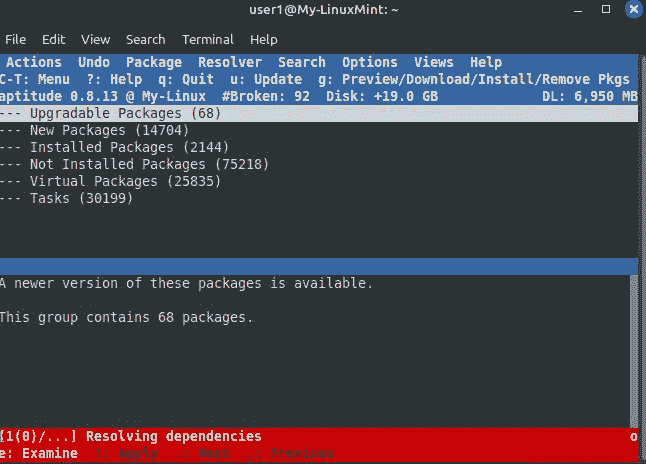运行 `aptitude` 时，会出现两个窗格，顶部和底部。顶部窗格包含已安装软件包、未安装软件包、虚拟软件包等类别。与软件包相关的特定信息将显示在底部窗格中。Aptitude 的用户界面非常直观，使得处理软件包变得非常简单。

在执行 `aptitude` 后，使用以下按键进行操作：

* `?` 帮助
* 使用 `Ctrl-T` 或 `F10` 调出菜单。
* 使用 `上、下、左、右` 键进行导航。
* 使用 `Enter` 键选择或打开/关闭单个层级。
* 用于递归打开和关闭层级的括号是 `[` 和 `]`。
* 安装、更新或卸载软件包，按 `+` 或 `-` 键。
* 预览或确认操作，按 `g` 键。
* 退出，按 `q` 键，这也会关闭当前活动窗口。
* 向或向后搜索，使用正斜杠和反斜杠（`/` 和 `\`）。

## 安装软件包

要安装软件包，请使用键盘方向键和 `Enter` 键导航到“未安装软件包”类别。

高亮选中软件包并按 `+` 键。软件包条目应变为绿色，表示已标记为待安装。现在，按 `g` 查看软件包操作的摘要。再次按 `g` 安装软件包。完成后，按 `Enter` 返回菜单。

## 移除软件包

在“已安装软件包”类别中找到软件包，然后使用方向键和 `ENTER` 键高亮它以进行移除。当软件包被高亮时，按 `-` 键将其标记为移除。要移除该软件包，按两次 `g`。完成后，按 `ENTER`。要返回主菜单，按 `q`。

## 更新软件包索引

要更新软件包索引，按 `U` 键。

## 升级软件包

要升级软件包，首先更新软件包索引，然后按 `U` 键将所有软件包标记为已更新。现在，按两次 `g` 下载并升级软件包。完成后，按 `ENTER`。按 `q` 返回主菜单。

## Dpkg

`dpkg` 是一个低级软件包管理程序，允许你直接安装、卸载和管理 Debian 软件包，提供对软件包文件详尽的控制。虽然 `apt` 和 `apt-get` 等高级程序被广泛使用，但 `dpkg` 提供了更精确的控制。然而，`dpkg` 不会自动解析或管理软件包之间的依赖关系；用户必须手动确保所有所需的依赖项得到解决。通常，`dpkg` 用于安装存储计算机中的 `.deb` 文件。例如，如果你手动下载了软件包，将使用 `dpkg` 进行安装。而 `apt` 是一个用于从在线存储库管理软件的工具。它通过自动处理依赖关系简化了安装、更新和删除软件的过程。以下是 `dpkg` 命令摘要。

### 安装软件包

要安装已在当前目录下下载的 Debian (`.deb`) 软件包，请使用以下命令。

### 语法
```bash
sudo dpkg -i <package.deb>
```

### 示例
```bash
sudo dpkg -i foo.deb
```
这将安装 `.deb` 软件包。如果存在未满足的依赖关系，你可能需要手动解决它们。

### 列出已知软件包

`-l` 选项显示系统上安装的所有软件包的列表。这对于查看当前的软件包清单和版本非常有用。

```bash
dpkg -l
```

### 移除软件包

在保留配置文件的情况下移除已安装的软件。如果你想为日后的使用保存设置，则此命令非常重要。

### 语法
```bash
dpkg -r <package>
```

### 示例
```bash
sudo dpkg -r foo
```

### 清除软件包 (Purge)

完全移除软件及其配置文件。如果你想从系统中完全删除该软件包，请使用 purge 选项。

### 语法
```bash
sudo dpkg -P <package>
```

### 示例
```bash
sudo dpkg -P foo
```

### 检查软件包是否安装

要检查软件包是否已安装，使用 `-s` 标记：

### 语法
```bash
dpkg -s <package>
```

### 示例
```bash
dpkg -s foo
```

### 显示软件包信息

显示关于已安装软件包的详细信息，例如版本、状态和描述。此命令也对于检查软件包是否已安装很有用。

### 语法
```bash
dpkg -I <package.deb>
```

### 示例
```bash
dpkg -I foo*
```

## 总结

这些只是用于管理软件包、存储库和故障排除的众多命令和选项中的某几个。软件包管理工具在 Linux Mint 中至关重要，因为它们确保了程序的平畅安装、更新和安全性。学习软件包管理工具可以确保高效的管理。

# 第 13 章 配置存储库

## 存储库 (Repository)

存储库，简称为 "repo"，是存储和处理数据的区域。在软件包管理的上下文中，存储库通常定义为存储软件包、源代码和相关元数据的地方。

在 Linux Mint 中，可以通过以下图形界面管理存储库：

点击菜单按钮，选择“管理”，然后点击“软件源”进入。这将启动软件源应用程序。


身份验证：当提示时，提供你的管理员密码进行验证。

软件源窗口分为两个窗格。左窗格包含列表，每个项目对应存储库管理的一个组件。右侧显示每个项目的描述和设置。左侧列表中每个项目的描述如下：

* **官方存储库 (Official Repositories)**：此选项包含由 Linux Mint 维护的稳定更新存储库。
* **PPA**：PPA（个人包存档）是 Launchpad 上的存储库，开发者可以直接向用户分发软件。用户可以像安装普通软件包一样安装它们，并会自动接收更新。
* **附加存储库**：通过选择“添加”或“删除”按钮，可以在此处添加或删除第三方存储库。
* **密钥 (Authentication Keys)**：管理密钥涉及添加、删除和验证密钥。密钥验证软件包的完整性和来源，以防止篡改并确保软件来自合法来源。
* **维护 (Maintenance)**：在这里，你可以配置自动更新存储库缓存和删除未使用软件包的设置。

### 添加存储库

要添加新存储库，转到左侧的“附加存储库”部分，然后点击右侧面板上的“添加”按钮。在文本框中输入存储库 URL 并点击确定按钮。

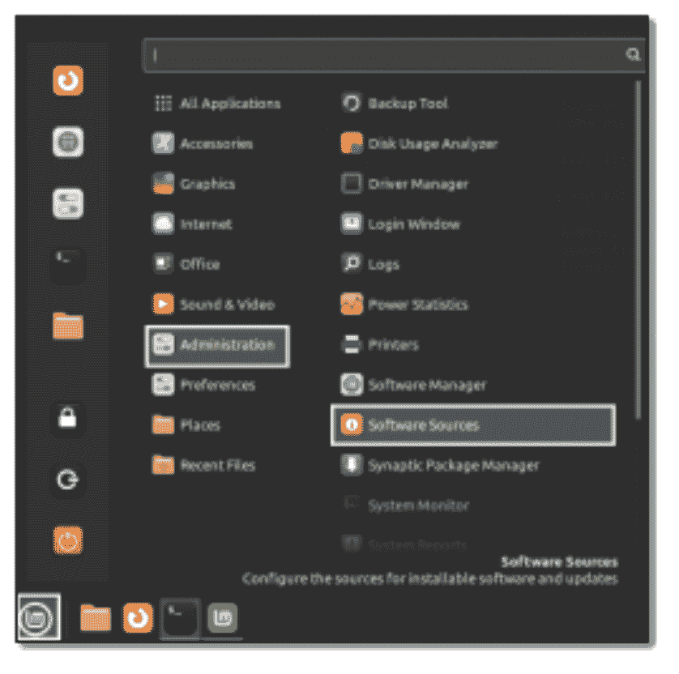


### 移除存储库

从附加存储库列表中选择一个存储库并点击“移除”按钮。在确认弹出窗口中点击“是”。

### 应用更改

在做出更改后，可能会提示更新软件包缓存；点击确定更新更改。


# 添加 PPA 仓库

要创建一个新的 PPA 仓库，请在左侧窗格中选择 PPA，然后点击“Add”（添加）按钮。输入仓库的 URL 并按 Ok。在存储库描述窗口中再次按 OK。


# 移除 PPA 仓库

从 PPA 仓库列表中选择一个存储库，并点击“Remove”（移除）按钮。在确认弹出窗口中点击 Yes（是）。


# 身份密钥

## 添加身份密钥

通常，当你添加新存储库时，必须包含身份密钥。要添加新密钥，点击“Import”（导入）按钮并选择存储库维护者提供的已下载的密钥文件。点击 Open（打开）按钮。


或者，你可以利用“Download”（下载）选项通过指纹添加密钥。

## 移除身份密钥

要移除密钥，从列表中选择它并点击“Remove”（移除）按钮。


# 使用 CLI 配置存储库

Apt（高级软件包工具）是一个强大的命令行工具，用于管理 Linux Mint 以及其他基于 Debian 的发行版中的软件包和存储库。存储库是存放系统软件包和更新的服务器。Apt 将存储库列表或软件通道保存在 `/etc/apt/sources.list` 以及 `/etc/apt/sources.list.d` 目录下后缀为 `.list` 的文件中。可以通过命令行手动编辑这些文件以添加、删除或临时禁用软件存储库。建议在修改文件之前保留一份备份。

要存储原始文件的备份副本：

```
sudo cp /etc/apt/sources.list.d/official-package-repositories.list /etc/apt/sources.list.d/official-package-repositories.list.backup
```

以下是示例：


## 文件说明

- 所有以哈希符号（#）开头的行都是注释
- `deb`: 这些存储库包含二进制文件或预编译软件包。大多数用户需要访问这些存储库。
- `deb-src`: 存储库包含软件包源代码。对开发者有用。
- `http://packages.linuxmint.com`: URI（统一资源标识符）或位置。
- `main upstream import backport`: 节名称或组件。

### 添加存储库

你可以通过在 `/etc/apt/sources.list.d` 目录下创建一个扩展名为 `.list` 的文件，并使用上一节描述相同的格式。

定义新存储库后，运行以下命令刷新软件包缓存：

```
sudo apt update
```

## 使用 add-apt-repository 命令

可以使用 Python 程序 `add-apt-repository` 添加 APT 存储库。你也可以使用该命令移除现有的存储库。

```
sudo add-apt-repository ppa:fossfreedom/arc-gtk-theme-daily
```

## 刷新缓存

```
sudo apt update
```

这种存储库配置让你能够为 Linux Mint 系统访问更多可选的更新和软件包。但在添加第三方存储库时，请务必小心，因为这些库可能包含未经过 Linux Mint 维护者彻底检查的软件包。

## 第 14 章：安装新字体

在 Linux 系统中添加字体可以显著提升桌面环境的外观和实用性。字体不仅对于视觉吸引很重要，对于可读性以及与不同语言和脚本的兼容性也很重要。无论你是图形设计师、开发者，还是仅仅是一个欣赏良好用户界面的人，拥有多样化的字体选择都能允许更大的自定义和个性化。安装额外的字体可以增强文档显示、网页设计和用户体验，使你的系统更具适应性并符合个人需求。以下是关于如何向 Linux 系统添加字体的基本概述。

## 使用软件管理器安装字体


从主菜单中选择“软件管理器”（Software Manager）。使用搜索选项按名称查找字体，或浏览“字体”（Fonts）等类别。选择想要安装的字体包后，点击“安装”（Install）按钮。


## 手动安装

如果你有字体文件（通常为 `.ttf`、`.otf`或其他格式），可以手动安装。首先，打开终端，然后将下载的字体文件复制到系统字体目录之一。

- 系统级安装：将文件复制 `/usr/share/fonts/` 目录，由于需要管理员权限，你需要使用 `sudo` 前缀命令。
- 用户特定安装：将字体文件复制到用户主目录（`~/.local/share/fonts/` 或 `~/.fonts/`）。如果目录不存在，请先创建它。

```
user1@Mint:~/.local/share/fonts$ cp ~/Downloads/Rostack.otf .
```

复制后，使用以下命令更新字体缓存。

```
fc-cache -fv
```

## 总结

在本章中，我们学习了如何在 Linux 系统上安装新字体，这增强了视觉吸引力、可读性和整体功能。通过添加字体，你可以改进文档外观并个性化用户体验，以更好地符合你的需求。

## 第 15 章：用户管理

在类 Unix 操作系统（如 Linux Mint）中，用户和组是基本概念。它们对于系统资源分配、权限和访问控制的管理至关重要。

用户和组管理涉及在计算机上设置、配置、管理和监控用户帐户及组的活动和程序。这种方法对于限制资源访问、保证安全和实现协作至关重要。以下是用户管理的摘要：

## 用户管理

- **创建账户**：在系统上创建新的用户帐户。
- **配置账户**：定义用户属性，如用户名、用户 ID (UID)、主目录、登录 shell 和密码。
- **密码管理**：对用户账户进行创建、修改和强制密码限制。
- **用户权限**：授予用户相应的权限，例如管理员 (root) 访问或对资源的限制访问。
- **删除用户**：移除不再需要的帐户的过程。
- **用户身份验证**：在登录时验证用户身份的措施。

## 组管理

- **创建组**：创建新组以组织用户并控制他们对资源的访问。
- **配置组**：配置组属性，如组名和组 ID。
- **组组成**：通过添加或删除用户来控制访问权限。
- **组所有**：为文件和目录分配组所有。
- **特殊组**：管理具有特殊权限和许可的特殊组。

## 访问控制

- **权限分配**：为用户和组授予文件、目录和其他系统资源的读、写和执行权限。
- **文件系统权限**：管理文件系统权限以限制对敏感数据和系统文件的访问。
- **有效权限**：根据个人权限和组组成识别用户的有效权限。

## 监控与审计

- **用户活动监控**：监控用户登录会话、执行的命令和资源访问，以便进行安全和审计。
- **日志记录**：记录用户和组活动，用于故障排除、合规性和取证分析。
- **执行安全规则**：实施用户身份验证、密码管理和访问控制的安全规则和最佳实践。
- **执行资源限制**：为用户和组创建配额和限制，以防止滥用并确保资源的公平分配。


在任何计算环境中——无论是单用户系统、多用户服务器还是网络化企业环境——有效的用户和组管理对于维护系统完整性、安全性和效率至关重要。

## 用户 (Users)

用户是指登录系统并出于不同目的使用系统的人。在类 Unix 系统中，每个用户账户都有独特的用户名和用户 ID（`UID`）。用户具有某些特定账户的权限和设置，并拥有拥有文件和进程的能力。

## 用户特征

每个用户通常具有与其账户相关的若干特征和属性。以下是其中一些关键特征：

*   **用户名 (Username)**：用户登录并使用系统时显示在屏幕上的名称。
*   **用户标识符 (UID)**：与每个用户账户关联的唯一数字。它为用户在系统内提供了一个特殊的身份标识。
*   **主目录 (Home directory)**：用户的目录，其中包含其配置设置和文件。
*   **密码 (Password)**：在身份验证过程中，密码用于确认用户的身份。
*   **登录 shell (Login shell)**：这是用户用于登录系统时使用的命令解释器或 shell。

## 用户管理 (Users management)

在 Linux 中，可以使用图形用户界面（GUI）配合命令行工具来添加和管理用户。GUI 为用户管理工作提供了一种更易于操作的方法。

### 创建用户 (Create users)

系统在安装期间会创建一个用户；如需添加更多用户，请使用命令行或图形用户界面（GUI），取决于哪种对您更方便。

#### 使用 GUI

1.  点击菜单按钮，选择“管理”(Administration)，然后选择“用户和组”(Users and Groups)。这将启动用户和组管理工具。当提示进行身份验证时，提供您的管理员密码。
2.  在用户选项卡处。点击“添加 (Add)”按钮。
3.  将弹出一个对话框，您可以在其中输入新用户的信息：
    
    *   **账户类型 (Account type)**：选择用户是标准用户还是管理员（带有 `sudo` 权限的权限）。
    *   **全名 (Full Name)**：用户名称或描述。
    *   **用户名 (Username)**：为新用户填写首选的用户名。
4.  点击“添加 (Add)”按钮。
5.  添加完成后，新用户将出现在“用户”界面的用户列表中。

#### 设置用户密码 (Setting user password)

一旦创建了用户，就应该为其分配密码。

1.  从用户列表中选择您想要更改密码的用户。
2.  点击“未设置密码 (No password set)”。
    
3.  这将打开对话框。在提供的字段中为用户输入新密码。点击“更改 (Change)”按钮。

#### 使用命令行 (Using command line)

使用 `useradd` 命令和指定的用户名允许您创建一个新用户。

**语法 (Syntax)**
```
useradd -m user_name
```
在这里，`-m` 标志为用户创建一个主目录。

**示例 (Example)**
```bash
sudo useradd -m user2
```

#### 设置用户密码 (Setting user password)

运行 `passwd` 命令为新创建的用户分配密码。

**语法 (Syntax)**
```
passwd user_name
```
**示例 (Example)**
```bash
sudo passwd user1
```

### 删除用户 (Deleting users)

当不再需要某个用户时，应该将其移除。在 Linux Mint 中删除用户可以移除不必要的访问，通过消除与非活动账户相关的潜在危险来提高安全性，并通过释放分配给用户的存储和配置空间来优化系统资源。以下是在 GUI 和 CLI 模式下的操作方法：

**GUI**
1.  从用户列表中选择您想要删除的用户。
2.  点击“删除 (Delete)”按钮。在提示时确认删除。
    
    一旦确认，用户账户将从系统中移除。

**命令行 (CLI)**
要从系统中删除用户，可以使用以下命令：

**语法 (Syntax)**
```
userdel user_name
```
**示例 (Example)**
```bash
sudo userdel user1
```

### 列出用户 (Listing users)

在需要时列出所有用户。

**语法 (Syntax)**
```
cat /etc/passwd
```
**示例 (Example)**
```bash
sudo cat /etc/passwd
```

### 修改用户 (Modify users)

在需要时修改用户属性。

1.  在 GUI 模式下，列出需要修改的用户。
2.  修改账户类型、用户名、密码、主目录或组信息。

#### 使用 GUI

在 GUI 模式下修改用户属性。

1.  在用户列表中选择需要修改的用户。
2.  点击“未设置密码 (No password set)”。
    *   **账户类型 (Account type)**：选择用户是标准用户还是管理员（带有 `sudo` 权限的权限）。
    *   **用户名 (Username)**：填写首选的用户名。
    *   **密码 (Password)**：在对话框中输入新密码。
    *   **主目录 (Home directory)**：更改用户的主目录路径。
    *   **组 (Groups)**：更改用户所属的组。
3.  点击“更改 (Change)”按钮。

#### 使用命令行 (CLI)

使用 `usermod` 命令修改用户属性。

**修改用户名 (Change username)**
**语法 (Syntax)**
```
usermod -l new_username old_username
```
**示例 (Example)**
```bash
sudo usermod -l user2 user1
```

**修改主目录 (Change home directory)**
**语法 (Syntax)**
```
usermod -d /new/home/dir user_name
```
**示例 (Example)**
```bash
sudo usermod -d /home/user2 user1
```

**修改用户 ID (UID)**
**语法 (Syntax)**
```
usermod -u new_uid user_name
```
**示例 (Example)**
```bash
sudo usermod -u 1002 user1
```

**修改默认 shell (Default shell)**
**语法 (Syntax)**
```
usermod -s /bin/bash user_name
```
**示例 (Example)**
```bash
sudo usermod -s /bin/zsh user1
```

**锁定账户 (Lock account)**
**语法 (Syntax)**
```
usermod -L user_name
```
**示例 (Example)**
```bash
sudo usermod -L user1
```

**解锁账户 (Unlock account)**
**语法 (Syntax)**
```
usermod -U user_name
```
**示例 (Example)**
```bash
sudo usermod -U user1
```

**用户用户组 (Add user to groups)**
**语法 (Syntax)**
```
usermod -aG group_name user_name
```
**示例 (Example)**
```bash
sudo usermod -aG sudo user2
```


## who 命令

`who` 命令显示当前登录到系统的用户详细信息，例如用户名、终端会话和登录时间。

### 示例
```
who
```

## w 命令

`w` 命令提供了当前登录用户的详细信息，例如他们的用户名、终端会话、登录时间、空闲时间以及正在运行的进程。

### 示例
```
w
```

## 进程监控

你可以使用 `ps`、`top` 和 `htop` 等程序监控正在运行的进程，并找出是谁在运行这些进程。

### 语法
```bash
ps aux | grep user_name
```

### 示例
```bash
ps aux | grep user1
```

## 组 (Groups)

组允许管理员为一组用户提供权限，而不是逐个处理权限。这种方法可以更容易管理文件、目录和其他系统资源的访问权限。

### 创建组

在 Linux 系统中创建组是用户管理和访问控制的重要组成部分。组有助于以更有效、更具扩展性的方式组织用户并管理权限。如需在 GUI 模式下添加用户，请按照以下说明操作：

1. 打开“用户和组”管理工具。在提示身份验证时输入你的管理员密码。
2. 点击“组”选项卡查看现有组的列表。
3. 要创建一个新组，点击“添加”（Add）按钮。
4. 在对话框中为新组提供一个名称。
5. 点击“确定”（OK）创建新组。

### 使用 CLI
要在命令行上创建新组，请使用 `groupadd` 命令后跟组名。

### 语法
```bash
groupadd group_name
```

### 示例
```bash
sudo groupadd group1
```

### 向组添加用户

使用 `-aG` 选项，可以使用 `usermod` 命令将用户添加到组中。

### 语法
```bash
usermod -aG group_name user_name
```

### 示例
```bash
sudo usermod -aG group1 user2
```

### 删除组

在 Linux 中删除组有助于通过删除过时或多余的组保持保持整洁、安全和有序，从而简化组管理并确保正确的访问控制。如需在 GUI 模式下删除用户：

1. 打开“用户和组”管理工具。在提示身份验证时输入你的管理员密码。
2. 从组列表中选择要删除的组。
3. 按“删除”（Delete）按钮移除该组。

### 使用 CLI
在命令行中使用 `groupdel`，你可以在组不再需要时将其移除。

### 语法
```bash
groupdel group_name
```

### 示例
```bash
sudo groupdel group2
```

### 列出组

要列出系统上所有定义的组。

### 示例
```bash
sudo cat /etc/group
```

## 用户和组配置文件

用户和组信息通过主要位于 `/etc` 目录下的配置文件进行管理。以下是与用户和组管理相关的文件：

### /etc/passwd

`/etc/passwd` 是一个纯文本文件。它包含了系统上每个用户的信息，如用户 ID、组 ID、主目录、shell 等。每行代表一个用户账户，由由冒号（`:`）分隔的七个字段组成。

### 语法
`Username:password:UID:GID:GECOS:home_directory:login_shell`

* `username`
* `password`: 一个 'x' 字符，表示加密密码存储在 `/etc/shadow` 中。
* `UID`: 用户 ID。
* `GID`: 主组 ID。
* `GECOS`: 用户信息，如全名、电话号码等。
* `home_directory`:用户的主目录。
* `login_shell`:用户的默认登录 shell。

### 示例


### /etc/group

`/etc/group` 是纯文本文件。它包含了系统上每个组的信息，包括组名、组 ID (`GID`）以及该组成员的用户列表。每行代表一个用户账户，由冒号（`:`）分隔的多个字段组成。该文件包含密码哈值以及其他与密码相关的属性，如密码过期和账户锁定信息。

### 语法
`group_name:password:GID:user_list`

以下是每个字段的含义：
* `group_name`: 组名。
* `password`: 加密后的密码，通常用于验证组员的身份。为了表示密码保留在 `/etc/gshadow` 文件或其他身份验证方法中，通常设置为 `'x'` 或 `'*'`。
* `GID`: 组 ID，即组的数值标识。
* `User_list`: 属于该组的用户名列表，用逗号分隔。

### 示例


### /etc/shadow

`/etc/shadow` 文件是 Unix 类操作系统（包括 Linux）中的另一个关键系统文件。与存储组信息的 `/etc/group` 不同，`/etc/shadow` 包含用户账户的加密密码。该文件对于系统安全至关重要，因为它以加密形式存储用户密码，以及与其他账户相关的信息（如密码有效期和账户锁定策略）。它通常仅特权用户用户，例如管理员 (`root`) 用户。`/etc/shadow` 文件中的每行代表一个独立的用户账户，包含多个由冒号分隔的字段。`/etc/shadow` 文件中一行的典型格式如下：

`username:password:lastchg:min:max:warn:inactive:expire:flag`

这里每个字段代表：
* `username`: 用户名。
* `password`: 用户账户的加密密码。
* `lastchg`: 上次更改密码的日期，自 1970 年 1 月 1 日起的天数。此字段通常用于强制密码过期策略。
* `min`: 密码更改之间的最小天数，即允许再次更改密码所需的间隔天数。为空或为 `0` 表示没有最小密码有效期。
* `max`: 密码的最有效天数。
* `warn`: 密码过期前提醒用户必须更改密码的天数。
* `inactive`: 密码过期后账户被禁用前的天数。
* `expire`: 用户账户过期日期，表示自 1970 年 1 月 1 日起的天数。
* `flag` 标记。

### 示例


## 第 16 章

总结来说，用户和组管理是 Linux 系统管理的核心部分，确保了访问控制。管理员通过创建和编辑用户账户和组来控制权限、执行安全策略。主要职责包括添加删除用户、更新用户信息以及通过组组成管理权限。

## 更新你的系统

将已安装软件包更新到最新版本对于以下原因至关重要：

* **安全**: 软件升级经常包含安全漏洞修复。保持软件包更新可确保你的系统免受已知安全威胁的侵害。未能升级可能会导致你的系统遭受攻击。
* **错误修复**: 更新经常包含错误修复和性能改进。更新确保你能够获得最新的错误修复，从而提高系统的稳定性和效率。
* **兼容性**: 更新的软件包可能会与其他与其他或系统组件的兼容性。保持软件包更新有助于避免使用过旧软件版本导致的兼容性问题。
* **新功能**: 更新可能包含新功能或对当前软件的改进。通过频繁更新，你可能会从中获益。

### 使用更新管理器更新


`Mintupdate`，通常被称为更新管理器（Update Manager），是一个用于处理系统更新的 GUI 工具。更新管理器具有用户友好的界面。它根据更新类型（如内核、软件和安全更新）对更新进行分类。用户只需点击即可启动更新，工具还会显示通知和已安装更新的历史。自定义选项允许用户根据特定需求定制更新偏好。更新管理器以图标形式出现在面板的系统托盘（`systray`）中，提供了监控和处理更新的方便方式。如果有可用更新，图标将变为红色指示。当你将鼠标悬停在上面时，它会显示可用更新的数量。总的来说，`mintupdate` 帮助你保持系统安全并处于最新状态。


当你点击此图标时，将启动更新管理 GUI 窗口。你也可以从 Mint 菜单的“管理”（Administration）类别打开更新管理器。更新管理器在启动时会自动检查更新。如果没有自动检查，你可以点击 `Refresh`（刷新）按钮开始检查。


主窗口将显示可用的更新。更新通常分为安全更新、软件更新、安全更新和桌面组件（desklet）更新等类别。

点击 `Install Updates`（安装更新）按钮开始安装过程。可能会提示你输入密码。这是授权更新程序的必要。

安装更新后，可以通过选择菜单上的查看选项并选择 `History of Updates`（更新历史）来查看更新历史。

## 安装最新或其他版本的内核

内核是操作系统的核心组件，管理硬件资源并促进硬件与软件之间的通信。它处理内存管理、进程调度和设备控制，作为应用程序与硬件之间的桥。

内核更新对于支持新硬件至关重要，因为它们提供了修复兼容性问题的驱动和修复。对新硬件的支持可能需要更新内核，因为新的组件或设备可能在旧内核中无法被识别或正常工作。更新管理器等工具简化了应用这些更新的过程，确保你的系统与最新的硬件特性保持兼容。

尽管升级到最新内核可以提供新功能和更好的硬件支持，但谨慎使用至关重要。在更新之前，最好查看发布说明和用户评论，因为新内核可能会带来不可预的问题或不稳定性。为了防止任何数据丢失，请确保已备份关键数据。此外，保留已安装的早期内核作为备份，以防新内核出现问题。

要安装备用内核，请执行以下操作：

1.  在更新管理器框中，从菜单中选择 `View`（查看）。
2.  选择 `Linux Kernel` 选项查看可用内核版本。你将看到已安装和可访问内核的列表。较新的内核也出现在此列表中
3.  从列表中选择最新或所需的内核版本。通常会有安装或升级的选项。点击 `Install`（安装）按钮开始安装程序。
4.  可能会提示你输入密码。
5.  安装后，重启系统以使用更新后的内核。你可以通过选择菜单中的 `Reboot`（重启）来实现。

## 更改偏好

在更新管理器中，你可以根据特定需求自定义更新选项。点击更新管理器框中的 `Edit`（编辑）菜单项。从下拉菜单中选择 `Preferences`（偏好）。偏好通过标签页窗口界面处理。标签包括 `Options`（选项）、`Packages`（包）和 `Automation`（自动化）。

## 使用命令行工具更新

你可以使用终端命令进行系统更新、升级包和管理内核。以下是操作方法：

你应该采取的第一步是更新软件包数据库。这是在执行系统升级或安装新包之前的关键步骤，因为更新软件包数据库会将此信息与 Linux Mint 存储库同步，确保你的系统拥有有关可用包及其版本的最新信息。

使用 `apt` 命令将软件包数据库与 Linux Mint 存储库同步。

```bash
sudo apt update
```

### 更新已安装的包

若要在 Linux Mint 中将已安装的包更新到最新版本，你可以使用 `apt` 命令行工具。以下是更新所有安装包的命令。第一个命令更新包缓存，下一个命令执行系统更新。

```bash
sudo apt upgrade
```

如果有任何内核更新，请重启机器以应用它们。

## 第 17 章：备份你的系统

### 备份

备份是系统管理不可或缺的组件，有助于保护数据、从灾难中恢复、减轻风险、确保合规、安全系统升级、提供用户支持并保留机构知识。备份是防止数据丢失的保险单，能为利益相关者提供安心感并保护组织的资产。

系统管理员负责实施和管理备份方法，以确保组织数据和系统的完整性和可用性。以下是执行备份的方法：

#### 手动备份

使用 `cp` 或 `rsync` 等命令将关键文件和目录手动拷贝到外部设备或云存储。执行手动备份涉及以下步骤：

1.  **什么**：首先，确定哪些文件和目录包含你想备份的关键数据、配置文件或用户设置。
2.  **哪里**：选择一个外部存储设备，如 USB 驱动器、硬盘、网络存储或云存储服务来保存备份。
3.  **如何做**：使用 `cp` 或 `rsync` 等命令行程序将所选的文件和目录拷贝到备份目标地。

#### 全系统备份

使用 `clonezilla` 或 `dd` 等软件定期创建全系统备份，以便在发生灾难性故障时恢复整个系统。

#### 自动备份

使用 `cron` 任务或 `systemd` 定器设置自动备份程序，以执行无需人工干预的定期备份。

#### 测试备份

定期测试你的备份，以确保它们有效且可以恢复。评估文件恢复、系统恢复和数据完整性。

#### 磁盘清理

定期删除无用文件、临时文件和缓存数据以释放磁盘空间。`du`、`df` 和 `ncdu` 是分析磁盘占用和识别大文件的有用程序。

#### GUI 备份工具

`MintBackup` 和 `Timeshift` 是 Linux Mint 自带的两个基本备份工具。它们是 Linux Mint 中不同的程序，功能独立。

### MintBackup

`MintBackup` 是 Linux Mint 中用于保护关键文件和设置的程序。它允许备份单个文件夹和文件，确保你的图像、文档和敏感信息安全。你可以将这些备份放在外部磁盘或云存储，以便计算机故障时进行恢复。`MintBackup` 直观的界面使其于使用，无需技术知识。

要使用 Linux Mint 中的 MintBackup 备份数据和配置，请按照以下步骤操作：

1.  从 Linux Mint 的应用程序菜单启动 `MintBackup`。寻找“Backup Tool”或直接输入“MintBackup”。
2.  打开 `MintBackup` 时，显示两个部分：个人数据和软件选择。

#### 备份个人数据

1.  点击 `Back up now`（立即备份）按钮。
2.  选择保存备份的位置。默认备份位置是一个文件夹，但也可以是外部设备，如 USB 闪盘
3.  它将提示你指定要排除的文件和目录


4. **在下一个屏幕上，你将可以选择想要备份的内容。** 通常情况下，你可以选择某些目录（如“文档”、“图片”等）。


5. `MintBackup` 将选定的文件压缩为归档格式（例如 `.tar.gz` 文件）并保存到指定位置。备份完成后，你将看到一个确认屏幕。


### 恢复

要恢复，请点击“恢复”（Restore）按钮。

它将打开一个屏幕，让你选择要恢复的备份。

覆盖现有文件的选项：

- 否，仅恢复缺失的文件：适用于文件被删除的情况。
- 是，覆盖更改并恢复任何现有文件的内容：适用于文件损坏或你需要旧版本的文件（或文件）的情况。

选择符合你要求的选项并点击“前进”（Forward）按钮。


备份完成后，你将看到一个确认屏幕。

## Timeshift

`Timeshift` 是 Linux Mint 包含的另一个工具，专注于备份你的整个系统。它定期对你的文件系统拍摄快照，以便在出现问题时，可以将系统恢复到之前的状态。`Timeshift` 对于维护系统稳定性以及从导致 Linux Mint 系统问题的软件问题或更新中恢复非常有益。它提供了类似于 Windows“系统还原”功能和 macOS“Time Machine”工具的功能。它可以在 `BTRFS` 和 `RSYNC` 模式下运行。

### RSYNC
`RSYNC` 模式下的快照是通过硬链接和 `rsync` 创建的。由于共享了公共文件，快照之间节省磁盘空间。配合文件管理器，每个快照都代表一个完整的系统备份。

### BTRFS
`BTRFS` 模式下的快照是通过利用 `BTRFS` 文件系统的内置功能拍摄的。`BTRFS` 快照仅支持使用 `BTRFS` 文件系统且具有类似于 `@` 和 `@home` 的子卷布局的系统。

### 设置 Timeshift

当你首次启动 `Timeshift` 时，会出现身份验证提示，随后是应用程序设置提示。

`Timeshift` 将提示你选择想要创建的快照类型。你可以在 `Rsync` 和 `Btrfs` 之间进行选择。

如果你的文件系统支持 `Btrfs`，由于其在管理快照方面的高效性，强烈建议使用。

接下来，你需要决定将映像保存在何处。这可能是不同的分区、外部磁盘或任何具有足够空间存储快照的适当位置。为了获得最佳效果，快照应保存到外部设备上。如果你想在那里进行备份，请在启动 `Timeshift` 之前连接外部设备。

 接下来，它会询问备份计划。`Timeshift` 支持多个层级的快照。快照级别指的是创建和管理系统快照的各种策略或程序。这些级别允许你根据自己的特定需求和偏好，控制何时以及如何拍摄快照。它允许每小时、每天、每周、每月和启动快照。你还可以指定每个级别保留的快照数量。启动快照会在系统每次启动时创建，提供额外的备份层级。启动快照的创建会有 10 分钟的延迟，以确保系统初始化不受影响。

### 手动快照

要创建手动快照，请选择“创建”（Create）按钮。

`Timeshift` 将为你生成系统快照。此过程可能需要一些时间，取决于系统的规模和存储设备的速度。


### 用户数据

`Timeshift` 旨在保护系统文件和设置。它是一个备份应用程序，并不保护用户数据。

默认情况下，用户主目录的所有内容都会被排除在外。这有两个优势：

- 当你恢复到较早的快照以恢复系统时，你不必担心文档被覆盖。
- 你在主目录中的音乐和电影收藏不会占用备份设备的空间。

## 系统还原

如果你的系统出现问题，你可以使用 `Timeshift` 将其恢复到之前的稳定状态。

打开 `Timeshift`，从可用快照列表中选择一个快照，然后点击“恢复”（Restore）。

- 快照可以从当前系统（在线恢复）或安装了 `Timeshift` 的另一个系统（离线恢复）进行恢复。
- 如果主系统无法启动，你可以从 USB 或 DVD 上的安装介质作为活动会话启动，在会话系统中启动 `Timeshift`，并在主系统上恢复快照。
- 从运行中的系统恢复备份需要重启才能完成恢复过程。

## 用于备份的命令行工具

你可以使用命令行工具手动备份你的文件。

在 Linux 中使用命令行工具备份允许你获得更大的自由和自定义。以下是使用常用命令行工具执行备份的简单说明。

### Tar

`tar` 是一个用于备份和恢复的简单多功能实用。

Linux 命令 `tar` 代表 tape archive（磁带存档），用于创建和提取归档文件。Linux 中的 `tar` 程序是归档文件和目录的工具。Linux `tar` 工具允许我们创建压缩或未压缩的归档文件，并管理和修改它们。

### 语法

```
tar [options] [archive-file] [要归档的文件或目录]
```

其中选项为：

| 选项 | 描述 |
| :--- | :--- |
| -c | 创建新归档 |
| -x | 从归档中提取文件 |
| -v | 详细模式（显示正在归档的文件） |
| -f | 归档文件名 |

你还可以使用压缩软件如 `gzip`、`bzip2` 和 `xz` 来压缩 tar 文件。在创建 tar 文件时使用这些选项：

| -z | 使用 `gzip` |
| -j | 使用 `bzip2` |
| -J | 使用 `xz` |

### 备份

打开终端并执行 `tar` 命令。如果你想在外部介质上进行备份，应先将其连接。要构建备份归档，使用带有 `-c` 选项的 `tar` 命令。

```
tar -cvf backup1.tar file1.txt file2.txt
```

创建目录归档：

```
tar -cvf backup1.tar Documents/
```

创建压缩格式的归档：

```
tar -cvzf backup1.tar.gz Documents/
```

### 恢复

要恢复（提取）tar 归档，请配合 `tar` 命令使用 `-x` 选项。

示例：

```
tar -xvf backup1.tar
```

提取压缩格式归档：

```
tar -xvzf backup1.tar.gz
```

### 追加文件

`tar` 可用于向现有归档追加文件，允许你在无需使用 `-r` 选项重新创建整个归档的情况下添加新文件。你可以这样操作：

```
tar -rvf backup1.tar newfile.txt
```


## 无线网络

无线网络利用无线电波来连接设备。它允许设备在无需物理线缆的情况下连接网络。无线网络在家庭、企业和公共场所非常流行，因为它们连接简单、灵活且移动方便。我们通常使用 `WiFi` 作为无线网络。

有线网络使用电缆连接设备。`Ethernet` 网线、同轴电缆和光纤电是有线网络中常用的电缆类型。有线网络通常比无线网络提供更快、更稳定的连接，因此它们非常适合需要高带宽或低延迟的应用程序。

在 `Linux Mint` 中，你可以使用多种图形用户界面和命令行工具配置有线和无线网络。以下是配置网络的方法：

## 建立无线连接

当你的无线网络连接成功时，面板上将显示 Wi-Fi 图标。

如果你看到带有交叉号的网络图标，表示你未连接到任何网络。


如需连接到你的家庭或办公室无线网络，请按照以下步骤操作：

- 点击带有交叉号的网络图标以展开折叠的菜单，这将显示所有可用网络。
- 选择你的 Wi-Fi 网络名称。


- 如果网络受密码保护，它会提示输入密码。提供密码并点击连接。


一旦网络连接成功，面板将显示 Wi-Fi 图标。


## 有线网络

连接到有线网络非常简单；只需将网线插入电脑即可。系统会自动为可用网络配置系统。一旦系统连接到有线网络，面板上就会出现网络图标。


在本章稍后的部分，我们将学习如何手动配置有线网络。

## 命令行网络管理

在进行网络配置之前，建议先识别系统中存在的设备。

### 识别网络接口

要识别你的网络接口，打开终端并运行以下命令：

```
sudo ip link
```

此命令将列出所有网络接口，包括它们的名称和状态。要识别你的网络接口，请寻找以 `en`、`wl` 或 `ww` 开头的接口。一旦找到相关接口，你就可以它的名称进行额外的配置，例如网络设置或连接性故障排除。


### 命名规范

在历史上，以太网设备被指定为 `ethX`（例如 `eth0`、`eth1`）。然而，随着可预测网络接口名称的引入，新的 Linux 发行版（如 `Linux Mint`）采用了基于设备物理位置或属性等变量的统一命名规范。

可预测网络接口名称是 Linux 中命名网络接口的一种一致方法，使得在系统重启和硬件修改后也更容易识别接口。

命名方案通常遵循以下模式：

| `en` | 用于以太网 |
| :--- | :--- |
| `wl` | 代表无线局域网 (LAN) |
| `ww` | 代表无线广域网 (WWAN) |
| `p` | 用于 PCI 总线 |
| `o` | 板载设备 (onboard gadgets) |
| `sN` | 代表槽号 |

### 示例

- `enp0s3`: 以太网接口，PCI 总线 0，插槽 3。
- `wl0`: 无线局域网接口。

## IP 地址分配类型

为了让设备能够在网络上连接并唯一地相互识别，`IP`（网际协议）地址是至关重要的。IP 地址主要通过两种方法分配：静态和动态。每种方法都有自己的优势和应用场景。让我们检查这些方法，了解它们是如何工作的以及何时使用它们。

### DHCP

DHCP 代表 `Dynamic Host Configuration Protocol`（动态主机配置协议）。它是一种用于 IP 网络的网络管理协议，`DHCP` 服务器动态为 PC、手机和 IoT 设备等网络设备提供 IP 地址和其他网络设置参数。DHCP 通过自动为设备分配 IP 地址和网络配置设置，使网络管理变得更容易，消除了人工配置的需求。

### 静态地址

静态地址分配与通过 `DHCP` 进行动态分配，涉及手动指定设备的网络参数，例如 IP 地址、子网掩码、默认网关和 DNS 服务器地址。这种策略通常用于需要持续且不变的网络设置的设备，例如服务器、打印机或网络设备。

现在你已经理解动态和静态 IP 地址分配方法都有优势，并适用于各种网络设置和用例。理解这些差异使网络管理员能够根据个人需求和网络设备选择最佳解决方案。

## 手动配置有线网络

大多数情况下，有线网络设置是自动的，但在其他情况下，你必须手动指定 IP 地址，特别是在办公环境中。这种配置被称为“静态 IP 地址配置”。

配置静态 IP 地址：

1. 点击面板上的网络图标。
2. 点击 `Network Settings`。

 
3. 这将打开网络设置窗口。
4. `Wired` 字段指示网络状态。确保按钮处于 `ON` 位置。
5. 点击齿轮图标。
6. 点击窗口左侧面板中的 `IPv4`。


- 从下拉菜单中选择 `Manual` 作为地址。
- 提供 IP 地址。
- 输入 `Netmask`。
- 输入 `Gateway`。
- 如果需要，将 `DNS` 设置为手动并提供服务器 IP 地址。
- 按“Apply”。

## 主机名

主机是标识计算机的标签。用于在网络上标识设备。主机名通常是字母和数字，但不包含下划线。主机通常与 IP 地址结合使用来定位和连接。

本地网络或互联网上的主机名通过 `DNS`（域名系统）服务器转换为 IP 地址。例如，当你在浏览器中输入域名（如 `example.com`）时，你的计算机请求 DNS 服务器将其解析为 IP 地址以便进行连接。

在只有少数工作站的小型网络中，主机名通常通过操作设置指定。也可以在配置文件中手动指定。家庭网络上的计算机可能是 `new-laptop`、`Guest-PC` 或 `myPC`。

你通常可以在 `Linux Mint` 安装期间指定主机名（计算机名称），但如果在之后更改，请遵循以下步骤：

你可以使用 `hostname` 命令查看和设置主机名。

检查当前主机名：

```
hostname
```

更改或设置新主机名：

语法：
```
sudo hostnamectl set-hostname 新主机名
```

示例：
```
sudo hostnamectl set-hostname My-LinuxMint
```

接下来编辑 `/etc/hosts` 文件：

```
sudo nano /etc/hosts
```

将所有出现的旧计算机名替换为新名称。


保存文件时使用 `Ctrl + O` 键并按 `ENTER`。退出 Nano 请使用 `CTRL + X`。

### 重启系统
```
sudo reboot
```

## 重要网络命令

以下是大多数现代 Linux 发行版（包括 `Linux Mint`）中使用的实用网络命令。

| 命令 | 说明 |
| :--- | :--- |
| `ip` | 此命令是网络配置的多用途命令。它可以显示、配置和管理网络接口、路由和地址。示例：`ip link`, `ip addr show` |
| `ipconfig` | 尽管已弃用，但 `ifconfig` 仍广泛用于基础网络接口的配置和显示。然而，建议你使用 `IP` 代替。示例：`ipconfig -a` |


| `ping` | “ping”命令是一个强大的工具，允许用户检查互联网连接状态并诊断网络相关问题。示例 `ping google.com` |
| `traceroute or tracepath` | `tracepath` 用于追踪到目的地的路径并发现沿途的 MTU（最大传输单元）。示例 `tracepath -n www.google.com` |
| `netstat` | 该命令显示网络连接、路由表、接口统计、伪装连接和多播组情况。示例 `netstat –nao` |
| `ss` | 与 `netstat` 命令类似，`ss` 是调查套接字（sockets）、网络连接和路由表的有用工具。示例 `ss –tuln` |
| `nmap` | 网络扫描工具，用于发现计算机网络上的主机和服务和服务。示例 `nmap -sP 168.12.1.0/24` |
| `dig` | Linux 中的 `dig` 命令用于检索域名系统（DNS）信息。示例 `dig google.com` |
| `tcpdump` | `tcpdump` 是一个命令行工具，用于捕获和分析流过系统的网络流量。它通常用于调试网络问题和作为安全工具。示例 ```bash
tcpdump -i eth0
``` |
| `ethtool` | `ethtool` 用于查询和控制网络设备驱动和硬件参数，主要用于以太网设备。示例 `ethtool eth0` |
| `iwconfig` | `iwconfig` 命令用于配置和显示无线网络接口信息。示例 `iwconfig wlp0s20f3` |
| `arp` | 显示当前的 ARP 缓存条目，显示 IP 地址及其对应的 MAC 地址。示例 `arp –a` |

这些是 Linux Mint 等 Linux 系统上用于网络故障排除、监控和配置的一些最用的命令。理解它们的用法和选项可能会帮助你管理和诊断网络问题。

最后，在 Linux Mint 上学习网络管理对于维护稳定高效的计算环境至关重要。管理员通过理解 IP 配置和网络接口等基本概念，可以优化网络性能并处理连接问题。用户通过采用用于网络诊断、服务管理和通信安全的工具与命令，可以成功地维护和改进他们的网络配置。

## 第 19 章监控系统资源

系统监控是一项持续活动，通过观察和评估计算机系统的不同部分，以确保其安全、按预期运行并正常工作。它涉及使用硬件或软件组件来监控系统资源，从而收集重要指标的数据，包括 CPU 消耗、内存占用、磁盘 I/O、网络流量和系统运行时间等。

系统监控有多种用途：

### 性能监控
通过监控系统资源的过程，你可以找出占用过多 RAM、CPU 或磁盘 I/O 的应用程序或进程。这使你能够调整系统或应用程序的性能，以实现效率最大化。

### 问题解决
对资源利用率的理解使得确定和修复系统问题变得更容易。例如，监控工具可以帮助识别计算机响应延迟是由高 CPU 负载、低内存或其他资源限制引起的。

### 容量规划
持续的观察可以产生随时间变化的数据，这对于容量规划通常是必要的。作为持续容量规划计划的一部分，会对系统容量进行监控。长期资源监控用于容量规划，计算系统资源使用率的变化率。了解这些变化率允许根据获取更多资源的情况进行更精确的长期规划。

### 安全监控
监控工具对于发现异常行为也有用，例如网络流量的突然增加或使用资源的奇怪进程，这些可能指向安全泄露。此外，它还会显示成功和未成功登录尝试的数据、root 登录成功与失败情况、删除和创建的用户帐户、sudo 尝试以及服务的总数。

Linux Mint 提供了多种第三方和内置工具来跟踪不同的系统指标。这些工具适应了各种喜好和需求，从以易懂方式显示数据的图形程序，到提供全面性能测量的命令行实用。

## 检查磁盘空间使用

在使用系统时，监控磁盘空间以便重要，以确保最佳性能并防止空间耗尽。Linux 提供了多种方法让你检查磁盘空间：

一个选项是名为“磁盘分析器”（Baobab）的图形程序。要启动“磁盘分析器”：

*   点击 Mint 菜单按钮。
*   要启动，从“管理”类别下选择“磁盘分析器”。


打开的窗口显示所有连接到系统的设备的摘要。

*   点击任何设备以查看所有目录的详细信息。
*   你可以深入研究目录以发现它们的大小和子目录。
*   右侧的图形视图允许你快速识别可能占用大量空间的大文件或文件夹。
*   图形显示可以在环形图和树状图之间切换。


*   你也可以扫描单个文件夹。点击菜单中的“扫描文件夹”来选择你想要分析的位置。


### 使用命令行工具

Linux 还提供了大量的命令行工具来监控磁盘。以下是一些较常用的工具：

### 使用 `df` 命令
`df` 命令显示文件系统总空间和可用空间的信息。该命令从 `/proc/mounts` 或 `/etc/mtab` 获取信息。默认情况下，`df` 命令以千字节（KB）显示磁盘空间。你可以使用选项以 MB 或 GB 显示。最常用的选项是 `-h`，它可以使输出变得人类易读。

打开终端，输入：
```bash
df -h
```


### 使用 `du` 命令
`du`（磁盘使用）命令是估计和报告文件占用磁盘空间的有用工具。

语法：`du /path/to/directory`

示例：使用 `-h` 选项以 KB、MB 或 GB 显示大小。
```bash
du –h /media/user1/DATA/
```

### 使用 `lsblk` 命令
`lsblk`（列出块设备）命令显示系统块设备的完整概述，包括硬盘、SSD、分区和 USB 驱动。它是分析磁盘结构（包括大小、类型和挂载点）极佳工具。

语法：`lsblk [options] [device]`

示例：
```bash
lsblk
```


## 检查内存占用

监控内存占用对于确保计算机足够的资源来高效运行程序并防止崩溃或缓慢至关重要。

Linux Mint 提供了图形和命令行工具来监控内存。系统监控是一个允许轻松监控内存使用和其他系统资源（包括 CPU 负载和磁盘活动）的图形化应用程序。

### 系统监控
启动系统监控：

1.  点击 Mint 菜单按钮。
2.  要启动，从“管理”类别下选择“系统监控”。

系统监控打开时会出现三个选项卡：文件系统、资源和进程。每个选项卡的描述如下：

### 资源选项卡
资源选项卡显示系统资源利用情况的高级摘要，包括 CPU、内存和磁盘活动。它显示 CPU 负载、内存消耗和磁盘 I/O 的实时图。


### 进程选项卡


进程（Processes）选项卡显示所有当前活动进程的列表，包括它们的进程 ID (PID)、用户、CPU 使用率、内存消耗和其他信息。它允许你根据各种参数（如 CPU 或内存利用率）对进程进行排序并搜索特定进程。要进行排序，请选择所需的列标题。


## 文件系统（File Systems）选项卡

`File Systems` 选项卡显示挂载文件系统的信息，例如它们的利用率、可用空间和挂载点。它对于跟踪磁盘空间利用率和检测全分区非常有用。


## 使用命令行查看内存使用

`free` 命令是一个 Linux 程序，可用于检查系统的内存 RAM 或查看 Linux 操作系统的内存统计信息。要检查系统的内存使用情况，请运行 `free` 命令并带有 `-m` 或 `-g` 选项，分别以 MB 或 GB 为单位输出。

```bash
sudo free –m
```

## 其他实用的命令行工具

在监控系统时，还有许多其他命令行工具可能极其有用。这些工具不仅限于单一资源的统计，还可以应用于多种资源。让我们来看看一些可以在 Linux Mint 以及其他 Linux 变体中使用的工具。

### Top

`top` 命令行工具提供了一个用于实时系统监控的多用途程序。要查看实时系统资源利用率（包括 CPU、内存和进程信息），打开终端并输入以下命令：

```bash
sudo top
```

### htop

`htop` 是 `top` 命令的增强版本，提供了更多功能和更易用的界面。虽然 `top` 提供有关进程的基本信息（包括其 ID、CPU 和内存利用率以及状态），但 `htop` 可以提供更多关于进程的信息，例如是谁启动了它、使用了什么命令启动它以及它何时启动的。

```bash
htop
```

### Vmstat

`vmstat` 命令行工具显示各种系统统计数据。呈现的信息包括内存、分页、进程、IO、CPU 和磁盘调度。

### 语法

`vmstat [delay [count]]`

- `delay`: 更新之间的间隔时间（秒）。
- `count`: 更新次数。

### 示例

```bash
vmstat 1 5
```

上述命令将每隔秒显示五次 `vmstat` 输出。

## 网络（Network）

### Netstat

`netstat` 命令提供网络状态和协议统计数据。你可以以表格格式显示 TCP 和 UDP 端点状态、路由表信息和接口信息。要检查网络连接和路由表，请使用 `netstat`。为了获取更精确的信息，请添加 `-a` 或 `-t` 等标记。

### 示例

```bash
netstat –a
```

### SS

Linux 中检查套接字（sockets）最常用的命令之一是 `ss`，即 socket statistics。知道如何利用 `ss` 命令对于分析网络连接和数据的响应人员至关重要，特别是在观察和调查可能存在的恶意活动时。带有选项输入 `ss` 命令以过滤输出。

```bash
ss -t
```

上述命令仅显示 TCP 套接字，这便于你关注特定类型的连接。

## 磁盘（Disk）

### iostat

Linux 中的 `iostat` 命令监控系统输入/输出数据以及设备和分区的 CPU 消耗。它对于跟踪磁盘性能和吞吐量非常方便，有助于识别高磁盘利用率。如果尚未安装 `iostat`，请运行以下命令进行安装。

```bash
sudo apt install sysstat
```

### 示例

```bash
iostat -x
```

上述命令显示详细的统计信息。

## 系统监控工具

你可以使用 `nmon`，这是一个交互式监控程序，可显示 CPU、内存、网络和磁盘消耗。按下不同的键查看不同的统计数据。

如果系统尚未安装 `nmon`，你可以使用 `apt` 命令进行安装：

```bash
apt –S nmon
```

现在你可以运行 `nmon` 命令了。

```bash
nmon
```

这些是一些最基本的监控工具，但如果你想要更高级的功能，可以随时安装以下工具：

- Conky
- Prometheus
- Ganglia
- Sematext
- Zabbix
- Elastic Stack
- ManageEngine

系统监控是系统管理的一个重要方面。本章提到的工具提供了对系统资源、网络活动和 I/O 性能的全面见，允许用户在 Linux Mint 环境中有效监控并优化系统性能。用户可以根据监控需求选择多种替代方案，无论是使用命令行工具进行快速检查，还是作为系统诊断的一部分使用图形工具对系统进行深度检查。简而言之，“预防胜于治疗”。

## 第 20 章：防火墙（Firewall）

Linux 防火墙是一种基于软件的网络安全系统，根据既定的安全规则监控并调节入出网络流量。它作为受信内部网络与不可信的外部网络（如互联网）之间的屏障。

`UFW`（Uncomplicated Firewall）用于管理 Linux Mint 操作系统中的防火墙。`GUFW` 提供了一个管理 `UFW` 的图形界面。它通过易用的界面简化了配置防火墙规则的过程。要启动 `GUFW`，打开 Mint 菜单并在“偏好”类别下选择“防火墙配置”。它会要求输入密码进行身份验证。


以下是基本界面概述：

- **状态 (Status)**：开启或关闭防火墙。
- **规则 (Rules Tab)**：使用图形界面添加、修改和删除规则。

## 配置文件（Profiles）

配置文件是预定义防火墙规则或配置的集合，旨在简化管理。配置文件根据常见场景提供不同级别的安全性。

`GUFW` 提供了某些预配置。这些配置会自动创建允许或拒绝指定端口的规则，从而轻松保护系统。预配置包括：

- **家庭（Home）**：此配置允许导出连接并拒绝入站连接。它允许所有导出连接以及来自服务的必要入站连接。
- **办公（Office）**：你主要信任网络上的其他计算机。仅接受选定的入站连接。适用于工作区域。
- **公共（Public）**：限制性配置，阻止所有入站连接同时允许所有导出连接。连接到公共 Wi-Fi 网络时使用此配置以防御威胁。

除了这三个基础配置，你还可以管理规则并创建作为配置文件的自定义配置。要构建自定义或删除现有配置，请遵循以下步骤：

1. 进入`编辑` -> `偏好`。
2. 点击加号按钮 `(+)` 添加配置。
3. 在列表中找到新配置。双击名称为配置输入自定义名称。


创建配置后，可以为其添加规则。

### 添加新规则

要添加新规则，请执行以下操作：

1. 选择规则所属的配置。
2. 选择`规则` 选项卡。
3. 点击加号 `(+)` 打开防火墙规则窗口。

“添加防火墙规则”窗口包含三个选项卡，描述如下：

- **预配置 (Preconfigured)**：添加新规则最简单且用户友好的方法。它允许你根据预定义的服务添加规则。服务包含一组预定义的本地端口、协议和目标。


- **简单 (Simple)**：一种添加防火墙规则的快速简单的方法，带有基于服务和端口的额外选项。
- **高级 (Advanced)**：允许完全控制规则，以控制来自特定 IP 地址、子网和接口的流量。


使用这些标签页之一，你可以轻松为你的自定义配置定义新规则。

## 结论

GUFW 为 Linux Mint 上的防火墙规则提供了一个直观的图形界面，使网络安全管理变得简单。通过使用预定义的配置，可以更容易地创建、删除和配置防火墙规则。GUFW 对于那些喜欢简单控制防火墙的人来说非常理想，适用于基础到中级的安装。

## 第 21 章：进程管理

Linux 操作系统执行的每一个任务都有与其关联的进程。一个任务可能由一个或多个进程组成。简单来说，进程就是一个正在执行的程序。进一步的进程以线程的形式执行。线程是操作系统分配处理器时间的基本单位。其设计的核心思想是通过将一个进程划分为多个线程来实现并行性。进程和线程之间的主要区别是，同一进程内的线程在共享内存空间中运行，而进程运行在独立的内存空间中。进程具有以下属性：

*   进程的上下文切换决定了进程的优先级。
*   每个进程都为执行程序提供所需的资源。
*   每个进程从一个名为主线程的单线程开始。
*   一个进程可以拥有多个线程。

以下是 Linux 进程一些基本特征的概述：

*   进程状态
*   进程标识
*   进程控制
*   进程优先级
*   进程同步
*
进程管理
*   进程创建

### 进程状态

Linux 进程可以处于各种状态。这些状态定义了你可以对该进程进行哪些操作：

*   运行与可运行（Running & runnable）：当新进程启动时，它被处于运行或可运行状态。
*   睡眠（Sleeping）：等待另一个进程完成（例如 I/O 操作）。
*   停止（Stopped）：挂起或停止。
*   僵尸（Zombie）：执行完成后的中间状态，但在进程表中仍有条目。

### 进程标识

进程 ID (`PID`) 是分配给操作系统系统中每个活动进程的唯一标识符。每个进程都有自己的进程 ID (`PID`) 并在独立的内存空间中运行。它分离了并发进程，使其更容易于管理和分配资源。

### 进程控制

Linux 操作系统有各种控制前景和后台进程的工具。最流行的工具之一是 Shell，它为操作系统提供了一个命令行界面。Shell 允许用户启动、终止、暂停和重启前景及后台进程。以下是你在两种模式下管理进程的方法：

#### 前景进程

前景进程是你直接运行并等待其完成的任何命令或任务，或者你可以手动停止它。

1.  **启动前景进程**
    要启动前景进程，只需在命令行上运行命令或脚本。

    示例
```
cp asp.txt /home/
```

2.  **暂停进程**
    你可以通过按下键盘上的 `Ctrl + z` 键暂停正在运行的前景进程。这将挂起进程并将其放入后台。

3.  **恢复已暂停的前景进程**
    要从后台恢复挂起的进程，请输入 `fg` 命令后跟作业号。你可以通过 `jobs` 命令获取作业号。

语法
```
fg %[job_id]
```

示例
```
fg %1
```

#### 后台进程

后台进程是在后台隐隐运行的进程。与前景进程不同，Shell 不必等待后台进程完成即可运行更多进程。在后台运行的最大进程数取决于可用内存量。

1.  **启动后台进程**
    你可以在命令后使用 `&` 符号将进程发送到后台。

示例
```
ping 8.8.8.8 > /dev/null &
```

2.  **列出后台进程**
    使用 `jobs` 命令列出后台进程。
```
jobs
```

3.  **将命令带回前景**
    要将后台进程带回前景，使用 `fg` 命令。

语法
```
fg %[job_id]
```

示例
```
fg %1
```

#### 终止进程

如果你在终端中运行一个命令并想停止它，请使用键盘上的 `Ctrl + c`。

### 使用命令行工具

你可以使用命令行或 GUI 工具来结束由你或其他用户启动的进程，无论它是运行在前景还是后台。以下是终止进程的一些重要命令的概述。

**Kill**

`kill` 命令向进程发送信号。它可以用于优雅地或强制地结束进程。

语法
```
kill [options] <PID>
```

示例
```
kill %22
```

你可以指定要发送的信号。如果没有指定信号，默认将发送 `SIGTERM` (15)。

| 信号名称 | 信号数字 | 操作 |
| :--- | :--- | :--- |
| SIGTERM | 15 | 终止（优雅地） |
| SIGKILL | 9 | 终止（强制地） |
| SIGINT | 2 | 中断 |
| SIGHUP | 1 | 挂起 |
| SIGSTOP | 19 | 停止（暂停） |
| SIGCONT | 18 | 继续（恢复） |

**优雅地终止进程**
语法
```
kill PID
```

示例
```
kill 44
```

**强制终止进程**
语法
```
kill -9 PID
```

示例
```
sudo kill -9 44
```

**Pkill 命令**

要终止进程，请使用命令 `pkill` 后后跟其名称。在此命令中，你使用进程名称而不是进程 ID。

语法
```
pkill command_name
```

示例
```
pkill -9 my_script
```

**脱离终端会话进程**

你可以使用命令行或 GUI 工具来结束由你或其他用户启动的进程，无论它是运行在前景还是后台。以下是终止进程的一些重要命令的概述。

**nohup**

`nohup` 意为“不挂起”，允许 Linux 系统在关闭 shell 后继续运行程序。

语法
```
nohup command &
```

示例
```
nohup ./myscript &
```

**Disown 命令**

另一种在关闭 shell 后继续运行程序的方法是使用 `disown` 命令从 shell 脱离。

语法
```
disown [options] [job]
```

示例
```
disown %1
```

### 进程概念

以下是你应该的进程概念：

**Init**

`Init` 是系统启动时启动的进程，一直运行到系统关闭。它会自动成为所有启动进程的父进程或祖父。它还会收养孤儿进程。内核在启动期间启动 `Init` 进程；如果内核无法做到，就会发生内核恐慌。`PID` 1 分配给 `Init` 进程。

**守护进程 (Daemon)**

后台服务进程。系统加载多个守护进程以确保系统正常运行。例如，`chronid` 守护进程用于同步系统时间。进程名称末尾的字母 `d` 通常标识守护进程，如 `chronid`、`dhcpd` 或 `httpd`。

**用户进程**

由 Linux shell 执行的进程被称为用户进程，也称为交互式进程，如命令行上的 `ls` 命令。用户进程还包括你在图形界面界面启动的进程，例如启动 Firefox 浏览器时。

**父进程和子进程**

任何启动或产生另一个进程的进程被称为父进程。子进程是由另一个进程启动的进程。父进程对其所有子进程具有完全控制权。例如，如果你启动 Firefox，可以使用 `ps` 命令查看它启动了多少个进程。这些每一个进程都被称为子进程。

**ps 命令**

`ps` 命令用于生成系统当前运行的所有进程列表，并显示有关每个进程的详细信息。

列出系统中运行的所有进程：
```
ps –ef
```

示例
```bash
ps -ef
```


```
UID         PID    PPID  C STIME TTY      TIME CMD
root        1      0     2   16:11 ?          00:00:03 /usr/lib/systemd/systemd 
root        2      0     0   16:11 ?          00:00:00 [kthreadd]
root        3      2     0   16:11 ?          00:00:00 [rcu_gp]
root        4      2     0   16:11 ?          00:00:00 [rcu_par_gp]
root        5      2     0   16:11 ?          00:00:00 [kworker/0:0-events]
root        6      2     0   16:11 ?          00:00:00 [kworker/0:0H-
```

`ps -ef` 命令的输出显示以下列：

| UID | Username (用户名) |
| :--- | :--- |
| PID | Process ID (进程 ID) |
| PPID | Parent Process ID (父进程 ID) |
| C | CPU utilization by the process (进程 CPU 利用率) |
| STIME | Start Time (启动时间) |
| TTY | Terminal (终端) |
| Time | Total CPU time used by the process (进程使用的总 CPU 时间) |
| CMD | Command (命令) |

显示所有用户的进程

## `ps aux`

显示属于特定用户的所有进程。

### 语法
```
ps U username
```

### 示例
```
sudo ps U shiv
```

使用进程 ID 列出特定进程的详情。

### 语法
```
ps -l PID
```

### 示例
```
sudo ps -l 97
```

## 查找父进程 ID (PPID)

你有时需要知道活动进程的父进程。当某个进程过度使用机器时，这通常是必要的。确定活动进程 PPID 有两种主要方法：

- `pstree` 命令
- `ps` 命令

### `pstree`

`pstree` 命令是一个命令行工具，它以树形的形式显示活动进程。

### 语法
```
pstree -p
```
你可以通过此树中任何进程的 ID 来检查父进程。

### 语法
```
pstree -sp pid
```

### 示例
```
### pstree -sp 1043
```

`pstree` 命令也可以配合用户名使用，以显示该用户启动的所有进程。

### 语法
```
pstree username
```

### 示例
```
### pstree shiv
```

## 进程调度

调度器是内核的一部分，负责选择下一个要运行的进程。其目的是根据优先级来运行进程。`nice` 和 `renice` 命令通过更改调度优先级来辅助执行过程。

`nice` 命令允许你设置新进程的优先级，而 `renice` 命令可用于修改已运行进程的优先级。

niceness 值为 `-20` 时优先级最高，niceness 值为 `19` 时优先级最低。进程优先级默认设置为 `0`。

### 语法
```
nice -n priority
```

### 示例
```
## nice -n 19 cp
```

显示进程的 nice 值
```
## ps -al
```
## `top`

更改运行进程的优先级
在使用 `renice` 命令修改优先级之前，先使用 `ps` 命令找到进程 ID。

### 语法
```
renice -n new_priority PID
```

### 示例
```
sudo renice -n -5 2234
```
注意：要将进程优先级修改得更高，你需要管理员权限。

总而言之，了解进程管理对于理解操作系统的基本运行至关重要。计算是围绕进程构建的，进程负责排程序执行并协调资源。

## 用户权限与访问控制

Linux 是一个多用户系统，许多用户可以同时访问。因此，用户不能触碰他人的数据。为了数据和系统文件的安全，操作系统部署了不同的授权级别。

#### 所有权
所有权定义了谁可以访问文件或目录。每个文件都属于特定的用户 (UID) 和特定的组 (GID)。

#### 更改所有权
`chown` 命令可更改文件或目录的所有权。

#### 列出文件和目录的所有者和组
要查看文件和目录的所有者和组，使用 `ls -la` 命令。
```
# ls -la
```

#### 修改文件的所有者
### 语法
```
chown username filename
```
### 示例
```
# chown user2 example.sh
```

#### 修改文件或目录的组所有权
你可以使用 `chown` 或 `chgrp` 命令更改文件或目录的组所有权。

### 语法
```
chown :group filename
```
### 示例
```
sudo chown :data2 notes.txt
```

#### 使用 `chgrp`
### 语法
```
chgrp group file/directory
```
### 示例
```
sudo chgrp data2 notes.txt
```

#### 同时更改文件的所有者和组
你也可以同时更改文件的组和所有者。

### 语法
```
chown username:group filename
```
### 示例
```
sudo chown shiv:data2
```

#### 递归更改所有权
递归地更改目录及其文件的所有权。

### 语法
```
chown -R user:group directory
```

## 权限
权限定义了对文件或目录的操作允许。文件和目录拥有一组标准权限：读、写、执行。这些权限应用于所有者、组和其他用户。

#### 符号表示
使用符号来设置权限。使用 `r`（读）、`w`（写）和 `x`（执行）。`-` 表示无权限。

### 语法
```
chmod [用户类型][权限] filename
```
用户类型可以是：
- `u`: 所有者 (owner)
- `g`: 组 (group)
- `o`: 其他用户 (others)
- `a`: 所有用户 (all)

权限可以是：
- `+`: 添加权限
- `-`: 移除权限
- `=`: 设置精确权限

### 示例
```
chmod u+x filename
chmod g+w filename
chmod o-r filename
chmod u=rx filename
```

#### 数值表示
使用八进制法（数字值）来设置权限。每个数字代表一个权限组合：
- 4：读 (r)
- 2：写 (w)
- 1：执行 (x)

将这些数字相加即可得到权限值：
- 0：无权限
- 1：执行
- 2：写
- 3：写+执行
- 4：读
- 5：读+执行
- 6：读+写
- 7：读+写+执行

### 语法
```
chmod 权限 filename
```
### 示例
```
chmod 755 filename
chmod 644 filename
```


这将为用户授予所有权限，并移除其他人和组的所有权限。

## 用户文件创建模式掩码

用户文件创建模式掩码（`umask`）变量决定了新创建的文件和目录的权限配置方式。`umask` 命令允许用户定义在新创建的文件或目录的基础权限值上，默认移除哪些权限。

### 检查 umask 值

#### umask

```
0022
```

输出的第一位是粘滞位（sticky bit），其余数字代表数字权限。

更改当前会话的 umask 值：

#### umask 0044

在设置 `umask` 时，你可以跳过粘滞位并输入三位的新值。

### 示例

### 确定净权限

在应用 `umask` 确定有效权限后，从默认权限中减去 `umask` 值。以下是实现方法：

- 默认值：系统的默认权限值为文件夹的 `777` (rwxrwxrwx)，文件为 `666` (rw-rw-rw-)。
- Umask 值：确定当前的 `umask` 值。假设当前的 `umask` 值为 `002`。
- 减法：现在从默认权限中减去 `umask` 值。

```
777 – 002 = 775 (rwxrwxr-x)
```

当你在命令行提示设置 `umask` 时，它只影响特定的 shell 会话，不会在重启或新的 shell 会话中持续。要永久设置值，可以全局设置或针对特定用户设置。要为所有用户永久强制系统级默认，请使用 `/etc/profile` 文件；对于个人用户，更改 `~/.profile` 或 `~/.bashrc` 文件。

## 对象类型

`ls -al` 输出的第一列显示对象类型。


对象类型列如下：

| 代码 | 对象类型 |
| – | : |
| – | 普通文件 |
| d | 目录 |
| l | 符号链接 |
| c | 字符设备 |
| b | 块设备 |
| p | 命名管道 (FIFO) |
| s | 套接字 (socket) |

## ACL

访问控制列表 (ACL) 提供了一种额外的、更灵活的权限机制。ACL 允许你对任何文件或目录上的任何用户或组授予权限。它扩展了传统的 Linux 文件权限，以便对文件和目录的访问提供更细粒度的控制。

ACL 可以提供以下类型的权限：

- 根据用户名或用户 ID 为特定用户提供的权限称为用户特定权限。
- 根据组名或组 ID 为特定组指定的权限称为组特定权限。
- 目录内新创建的文件和目录受默认权限的限制。

要显示文件或目录的当前 ACL，我们使用 `getfacl` 命令。

### 语法

```
getfacl file / directory
```

### 示例

```
getfacl hosts
```

可以使用 `setfacl` 和 `chmod` 命令来设置或修改文件或目录的 ACL。

### 语法

```
setfacl [option] file_owner:file_permission filename
```

其中选项为：

| 选项 | 描述 |
| :--- | :--- |
| `-m, –modify` | 修改 ACL。 |
| `-x, –remove` | 移除权限。 |
| `-b, –remove-all` | 移除所有权限。 |
| `-d, –default` | 将默认权限应用到新创建的文件和文件夹。 |
| `-R, –recursive` | 递归地对所有文件和目录应用修改。 |

### 示例

对特定文件设置用户权限。

```
setfacl -m u:user1:rw acct.txt
```

移除特定目录上的所有权限

```
setfacl -x u:user1 acct.txt
```

## 结论

本质上，文件权限允许用户控制谁可以访问其文件和目录，它们是 Linux 系统的重要组成部分。通过理解所有者、组和其他人员的读、写、执行权限概念，用户可以确保其数据的安全和隐私。除了保护敏感数据外，正确管理文件权限也有助于系统的稳定和完整。深入理解文件权限将使用户在遍历和交互文件系统时，能够维护系统安全并做出明智的选择。

## 结语

在我们结束对 Linux Mint 的之旅时，我希望这本书阐明了这些强大且易于使用的特性，这些特性使得该发行版成为新手和老练用户的绝佳选择。你现在已经掌握了安装和配置的基础知识，以及高级定制和故障排除，这为你提供了充分利用 Linux Mint 能力所需的工具。

请记住，开源社区非常看重好奇心和协作。当你继续使用和探索 Linux Mint 时，不要害怕跳进论坛、参与辩论并分享你自己的经验。你面临的每一个问题都是学习和改进的机会。

感谢你伴我完成这段旅程。愿你的 Linux Mint 之旅充满探索与效率。

祝 Linux 愉快

