# Linux 网络服务器：24/7 全天候

> 献给 Norman Hunt 和 Frank McCafferty，他们向我展示了做人的意义。

# 致谢

千年虫漏洞影响了我的家庭，1999 年是充满变化的一年。我的大女儿影响了我的家庭……（此处根据上下文清理，注：OCR 文本包含重复短语，已根据逻辑流进行清理）。

- 使用 `routed` 运行 RIP . . . . . . . . . . . . . . . . . 295
- BootP 网关 ... 347
- 结语 ... 347

# 引言

- 网络新闻服务器
- 完整的 TCP/IP 邮件服务器 (`sendmail`)
- 用于信箱服务的邮局传输协议 (POP) 和互联网消息访问协议 (IMAP)
- Web 服务器
- `JAVA` 软件开发包 (SDK)
- 应用程序服务器
- 一个完整的软件开发环境——C、C++、Perl 以及许多其他编程语言

这些功能均并非额外付费选项。它们都作为基础 Linux 发行版的一部分包含在。

许多业务经理会询问他们的技术人员 Linux 对于业务来说是否“足够严肃”。——很有趣的是——这是十年前人们对互联网所问过的相同问题。许多传统电信公司因为宣布互联网不适合业务而错失了一次重大机会。不要忽视 Linux。它可能是一个让你的计算机运行更高效、让你的公司更获利的机会。

# Linux 的优势

Linux 之所以如此受欢迎有许多原因。首先，当然是成本很低。即使是 CD-ROM 版本也几乎是免费的。然而，有严格业务需求的组织知道，初始软件成本只是运行 24/7 计算机服务总成本中微不足道的一部分。硬件成本、桌面许可、可选软件、维护和支持人员都构成了运营总成本。

在所有这些领域，Linux 都具有极高的成本效益。运行它的 PC 硬件非常廉价，而且客户端不需要许可即可使用 Linux 服务器。Linux 中整合了许多功能，使得对可选软件的需求降至最低。维护和支持成本也是合理的，正如接下来的章节所解释的那样。

Linux 流行的另一个原因是它是一个类 Unix 操作系统。熟悉 Unix 的程序、支持人员和用户在处理 Linux 时需要的帮助非常少。事实上，像这样的一一书就是 Unix 系统管理员掌握 Linux 网络服务器安装和配置所需的全部内容了。

Unix 拥有二十年的历史。Linux 受益于这已经非常深厚的人才基础。正如本书所示，安装和配置 Linux 服务器的复杂性与安装和配置 Windows NT 服务器相当。因此，即使是没有 Unix 背景的系统管理专业人士，学习 Linux 的难度也不应认为比学习 Windows NT Server 更大。

Linux 支持的高质量也是该系统受欢迎的原因之一，也是其作为业务操作系统日益被接受的重要因素。当然，全球范围内存在着一个 Linux 爱好者网络，他们会迅速发现并修复漏洞。由于这个原因，内核更新和补丁不断发布，你可以免费下载并用于改进你的系统。此外，为业务市场生产 Linux 发行版的公司也出售支持服务。最后，你可以与第三方签订 Linux 支持合同。

可以说，第三方的 Linux 支持优于商业操作系统的第三方支持。大多数企业倾向于依赖商业操作系统，因为他们认为自己能为这些系统获得更好的支持。我称之为“商业化神话”——PC 软件如此廉价，以至于软件制造商在财务上无法提供免费支持。然而，大多数企业并不直接从制造商处购买可选支持，当他们与数百万其他客户竞争某一个大型软件制造商的关注时，他们认为这不值那个价。相反，他们使用内部支持人员或转向第三方寻求支持。然而，支持商业软件的第三方受限于无法访问操作系统源代码的事实。他们可以精通使用源代码的技术，但如果没有代码，他们永远无法确切知道系统是如何实现的，也无法直接修复系统中的问题。

因此，Linux 内部支持和第三方支持之所以存在，是因为支持人员可以访问所有的操作系统源代码。没有任何隐藏。Linux 支持人员可以解决自己的问题；他们不需要依靠陌生人的善意。

源代码可用性的重要性怎么强调都不为过。关键任务应用程序依赖于操作系统，而你影响其开发的能力非常有限。当我开始我的计算机职业时，美国政府要求制造商为托管关键业务和军事应用的操作系统提供源代码。他们知道源代码是解决关于哪些内容可以修复或改进的争议的最后手段。有了源代码的访问权限，你总可以雇佣某进行对你的业务至关重要的修复。如果没有它，你的关键业务应用程序将受制于一家可能甚至不知道你的业务存在的公司的随心所欲（人质化）。

简而言之，Linux 是低成本、高质量且支持良好的。它是你的互联网服务器和部门服务器的绝佳选择。

# 谁应该买这本书

你应该买！这本书适用于任何想学习如何使用 Linux 构建部门网络或网络服务器的人。本书并不假设你了解 Linux，但确实假设你对计算机和 IP 网络有良好的理解，并且对 Linux 命令有基本的了解。

> 提示：如果你是一个系统管理员，但不知道 Unix 或 Linux 的基础知识，请从 Arman Danesh 写的《Mastering Linux》（Syex, 1999）开始看。它是 Linux 的一个极佳介绍，将为你提供所需的所有背景知识。

这本书并没有提供对基础知识的再次回顾。相反，它提供了关于如何完成工作以及如何在此过程中避免陷阱的见解。本书帮助你理解 Linux 在业务网络中可以扮演的角色，并展示了如何使用 Linux 运行 24/7 网络服务器操作。

如果你是 Unix 专业人员，你将从本书关于设计和规划的信息中受益，以便在选择硬件和安装系统时避免问题。此外，你会对 Linux 发行版中包含的许多昂贵的可选功能感到高兴。

本书分为五部分：规划与安装、互联网服务器运行、安全、故障排除和附录。这五个部分由十五章节和三个附录组成。某些服务的覆盖范围跨越多个章节（此处原文为 spans multiple chapters）。特别是，邮件服务跨越第 7-13 章，DNS 在第 6 章中讨论。大多数主题包含在一个章节中。当提到此类引用时，它包含指向该章节的指针。如果你有特定的任务要学习，例如设置 Samba 服务器，可以直接跳转到该主题。但如果你需要支持整个网络服务，将从阅读全文受益。

为了给可靠的服务器奠定基础，本书的第一部分三个三个章节提供了正确规划 Linux 安装的必要信息、安装 Linux 的详细说明，以及对启动新 Linux 服务器时发生什么的解释。

### 第一章入门

本章解释了丰富的 Linux 发行版以及获取方式。它提供了选择硬件的指导，帮助你避免隔离和可靠性问题。此外，它为 Linux 安装提供了建议。

### 第二章基础安装

本章提供了安装 Red Hat 6 Linux 发行版的详细示例，以及安装故障排除的技巧。解释了使用 `Disked` 和 `fdisk` 进行磁盘分区，以及 `fstab` 的结构和用途。

### 第三章启动过程

本章描述了启动过程，包括 Linux 级别。描述了内核初始化设备的作用以及 `init` 所有系统服务的作用。涵盖了 `lilo.conf` 和 `inittab` 配置文件，强调了网络服务器管理员需要的关键启动文件。

第二部分涵盖传统互联网服务的运行。它提供了配置网络接口以及在该接口上运行的基本互联网服务所需的信息。

### 第四章网络接口

每个网络服务器都需要物理网络接口。本章涵盖了以太网接口的安装和配置，这是最常用的网络接口。Linux 系统也可以通过串口接口提供网络服务，本章描述了串口接口，以及使用 `PPP` 软件在串口线上运行 `TCP/IP` 的 `getty` 和登录过程。涵盖了客户端和服务器的 `PPP` 配置。

### 第五章登录服务

Linux 提供完整的应用程序服务器功能。用户可以通过登录 和 `telnet` 远程访问服务器上的应用程序。本章涵盖了这些服务的配置，以及 `FTP` 服务器的配置。

# xxiv 引言

**第 6 章：Linux 名称服务** 域名服务（`DNS`）对于你的网络运行至关重要。Linux 提供了伯利互联网域名（`BIND`）软件，它是目前使用最广泛、测试最充分且可靠的 `DNS` 服务器。本章提供了有关配置新版本 `BIND` 8 `DNS` 软件的详细信息。它还涵盖了主机表以及 `DNS` 和主机表如何配合使用。

**第 7 章：配置邮件服务器** 处理邮件服务最强大且复杂的系统是 `sendmail`。Linux 将 `sendmail` 作为系统的一部分包含在。本章向你展示如何通过关注重点来简化 `sendmail` 配置；它讨论了如何创建你的自定义配置。

**第 8 章：Apache Web 服务器** `Apache` Web 服务器是当今世界上最常用的 Web 服务器，包含在 Linux 发行版中。本章解释了安全、可靠的 Web 服务器的安装和配置。

**第 9 章：网络网关服务** 所有网络都需要路由器。Linux 提供了全静态静态动态路由。它包含了常用的路由守护进程（`routed`）和功能全网关守护进程（`gated`）。某些网络使用地址转换，这在 Linux 中可以通过地址掩码（address masquerading）实现。本章解释了所有这些服务的管理。

# 第 3 部分—部门服务器操作

第 3 部分描述了支持桌面客户端的部门服务器所必需的服务的运行。它的四章提供了以下信息：

- 创建配置服务器——包括 `DHCP` 和 `BootP`


- 配置提供文件共享的服务器——包括 `NFS` 和 `Samba`

- 配置打印服务器——包括 `LPD` 和 `Samba`

- 配置邮箱服务器——包括 `POP` 和 `IMAP`

## 第 10 章：桌面配置服务器

配置 `TCP/IP` 客户端可能是复杂的。配置服务器可以为你的用户完成这项任务。Linux 通过动态主机配置协议（`DHCP`）服务器和引导协议（`BootP`）服务器为 `Windows` 和 `Unix` 桌面均提供配置。本章涵盖了这两者的管理。

## 第 11 章：文件共享

部门网络最重要的特性是它允许桌面计算机透明地共享文件。Linux 通过 `Samba` 服务器提供这种能力，它为 `Windows` 系统提供原生文件共享，而 `NFS` 服务器为 `Unix` 客户端提供文件共享。本章提供了关于这两项服务以及 Linux 原生文件系统的详细信息。

## 第 12 章：打印服务

Linux 通过 `Samba` 和 Linux 守护进程（`LPD`）为桌面客户端提供打印服务。本章解释了如何通过这些服务共享打印机，以及如何安装和配置本地打印机。

## 第 13 章：邮件服务

大多数桌面系统无法直接接收邮件；它们依赖邮箱服务器收集并保存邮件，直到它们准备好阅读。Linux 包含了两种提供此类服务的技术。邮局协议（`POP`）是广泛使用的邮箱服务器，而互联网消息访问协议（`IMAP`）具有日益受欢迎的先进功能。本章涵盖了这两项服务的安装、配置和管理。

## 安全与故障排除

第 4 部分专注于任务，虽然它们没有专门与网络服务相关，但对于维护安全可靠的服务器至关重要。部分包含两章。第一章解释了你的服务器面临的安全威胁，以及你可以采取什么措施来减少这些威胁。第二章告诉你在服务器以及与其连接的网络出现问题时该如何怎么办。

### 第 14 章：安全

互联网上一个悲哀的事实是，只要有机会，就会有人伤害你。要运行可靠的服务器，你必须运行安全的服务器。本章告诉该如何跟进安全问题，如何利用 Linux 包含的优秀安全特性，如何监控系统的安全问题，以及在需要时添加额外的安全特性。

### 第 15 章：故障排除

你的 Linux 系统可能会——而且确实出问题。当问题发生时，你需要定位并修复它。本章帮助你测试和调试网络，并分析和解决问题。它讨论了何时需要升级 Linux 内核以及如何操作。它还描述了用于分析网络问题的工具。

## 第 5 部分—附录

第 5 部分以一系列附录结束本书。

### 附录 A：X Windows 配置

本附录提供了关于在你的计算机上安装 `XFree86` `Windows` 系统的信息。涵盖了 `XF86Setup`、`xf86config` 和 `Xconfig` 安装工具，还包括 `XF86Config` 配置文件的结构。

`xxvi` 引言

### 附录 B：BIND 参考

本附录提供了针对 `named.conf` 文件的 `BIND` 8 配置命令总结。它还提供了 `named.boot` 文件的 `BIND` 4 配置命令总结。仍在运行 `BIND` 4 的 Linux 系统管理员将需要使用此参考。

### 附录 C：用于 sendmail 的 m4 宏

本附录提供了用于构建自定义 `sendmail` 配置的可用 `m4` 宏总结。

## 帮助我们帮助你

本书包含了许多网页引用。`Web` 是 Linux 信息的的重要来源。遗憾的是，网页地址变化频繁，书中列出的地址会迅速失效。只有一种工具能跟上 `Web`，那就是 `Web` 本。`www.24sevenbooks.com/linux.html` 网站将用于保持网页引用更新，并本书提供其他修正和更新。

为了帮助我们保持文本尽可能准确，每当你发现书中失效链接或其他错误时，请联系我们。你可以访问 `www.24sevenbooks.com`。

# 第一章 入门

> **注意** 不同的读者应该以不同的方式使用本章。如果你刚开始学习 Linux，你需要尽可能多地学习为服务器选择硬件和软件；整章内容对你大帮助。如果你已经为系统准备好了 `PC` 硬件和 Linux 软件，可以暂时跳过本章，在计划升级系统时回来查看。然而，大多数系统管理员（即使是已经安装了 Linux 的人）都能在本章的“理解硬件”和“`PC` 硬件基础”部分受益。

## Linux 发行版

Linux 是一个高效、功能齐全的 Unix 类操作系统。即使对于 Unix 专业人士来说，Linux 世界也可能让人困惑。计算机专业人士经常表达“Unix 版本太多”的担忧。他们的意思是 `Solaris`、`Irix`、`AIX` 和 `BSD` 都是不同的。每个都有不同的安装过程。每个版本都有自己的一套管理工具。对于习惯了使用单一供应商操作系统的商店的专业人士来说，这种多样性可能会令他们望而畏之。

像 Unix 一样，Linux 也有很多版本。但核心只有一个 Linux——所有 Linux 版本都运行相同的操作系统内核。你从各种 Linux 发行版看到的区别是表面的，但极其重要，因为这些差异通常发生在管理员参与最多的领域：安装、关键配置文件的位置、管理工具以及用户界面。

## 哪些功能适合你？

既然所有 Linux 系统都使用相同的内核，你如何决定哪种发行版适合你呢？好问题！在传统的 Unix 世界中，硬件驱动选择。如果你有 `Sun` 系统，你就使用 `Solaris`；如果你有 `IBM` 系统，你就使用 `AIX`。但所有的 Linux 版本运行在相同的 `PC` 硬件上。对于 Linux 来说，选择是由你想要的功能驱动的。

有几个特性用于区分发行版。低成本是之一。`Debian` 发行版是这方面的赢者，因为 `Debian` 是完全免费的。学生喜欢这个特性。但对于大多数运行 `24/7` 服务的企业来说，免费发行版和 `50` 美元发行版之间的差异并不显著。

## Linux 发行版 5

对于严肃的业务运营，支持的质量是一个更重要的特性。所提供的支持计划类型、Linux 供应商维持经营并履行其支持义务的概率，以及针对支持人员的培训和认证计划，都需要经过评估。`Red Hat` 和 `Caldera` 是这一类的赢者，因为它们都提供支持计划和正式培训。

易于维护和管理是降低总拥有成本的重要特性。`Red Hat` 开创了简化软件更新过程的方法，`Yggdrasil` 是图形化系统管理工具的早期开发者，而 `Debian` 的 `deb` 软件更新系统也广受好评。

桌面的外观和感受以及用户应用程序的可用性也可以是决定因素。桌面环境中吸引人的地方非常取决于个人。我喜欢 `Caldera`，因为他们是第一个在所有更常见的选择中捆绑了 `KDE` 和 `Looking Glass` 桌面环境。

> 注意 参阅本章后文“个人选择”侧边栏，了解我对比某些 Linux 发行版的个人经验。

如果你是 Linux 领域新手（你可能确实是），那么段落中的发行版名称对你来说意义不大。你可以从列出的网站获取更多关于这些流行的 Linux 版本的信息：

- `OpenLinux` (`www.caldera.com`) `OpenLinux` 是 `Caldera` 生产的发行版。`Caldera` 与 `Novel` 有紧密联系，它在 Linux 中引入了 `NetWare` 客户端支持，并首次发布了带有 `Netscape Navigator` 的 Linux。`OpenLinux` 还包括 `StarOffice` 套件和 `Metro X Windows` 服务器。许多 `Windows` 用户使用 `Caldera 2.2` `Linux Wizard (lizard)` 安装工具。

- `Red Hat` (`www.redhat.com`) 美国领先的 Linux 销售商，`Red Hat` 开发了 `Red Hat` 包管理器 (`RPM`)，它简化了可选 Linux 软件的安装，更重要的是简化了服务器软件更新的任务。`Red Hat` 以简单、自动化的安装闻名。查看他们的网站获取信息和软件下载。`Red Hat 6` 包含了 `GNOME` `Enlightenment` 和 `KDE` 桌面窗口管理器。

- `Slackware` (`www.CD-ROM.com`) `Slack` 是在美国获得广泛接受的 Linux 发行版之一。它以四张 `CD-ROM` 套装发行，包含许多可选软件包包。`Walnut Creek` 网站提供产品信息和软件下载。

- `Plug-and-Play Linux` (`www.yggdasil.com`) `Plug and Play` 为系统管理引入了一个“控制面板”，此后被其他流行的发行版采用。这个版本的 Linux 为系统开发者提供了一个完全可构建的源码树。

- `S.u.S.E.` (`www.suse.com`) 这是欧洲最畅销的 Linux。提供英语和德语版本。

- `Debian` (`www.debian.org`) `Debian` 是一个完全免费的 Linux 版本。`Debian` 的人员甚至不制作 `CD-ROM` 版本，因为他们必须为此收费。然而，他们列出了许多可以从那里购买其系统 `CD-ROM` 版本的公司。

> 以上列出的发行版只是冰山一角。还有许多其他 Linux 发行版；要了解更多请访问 `www.linux.org` 并点击 `Distributions` 按钮。

## 哪个发行版适合你？


那么你如何确定哪种发行版具有适合你的功能呢？首先，我建议访问感兴趣的每个发行版的网站，其中一些列在上一节中。阅读他们对自己产品的看法。如果支持是你的首要任务，寻找提供正式支持计划和培训的供应商。如果成本是首要任务，查看 `Debian` 这样的免费发行版。如果易用性很重要，寻找像 `Red Hat` 或 `Caldera` 这样具有良好图形工具的发行版。

最后，考虑社区。用户群大的发行版会在你遇到时提供更多帮助。查看每个发行版的在线论坛和文档。

## 个人选择（续）

### Red Hat (红帽)

对于 `Red Hat`，我喜欢它优秀的管理工具，例如 `Red Hat` 软件包管理器（`Red Hat Package Manager`）。`Red Hat` 的工具非常出色，被广泛应用于其他 `Linux` 发行版。当 `linuxconf` 等良好的管理工具出现时，`Red Hat` 也会迅速采用。对我来说，简化系统管理始终非常重要。书中大部分示例都是基于 `Red Hat` 的，尽管也有来自其他供应商的示例。

### 获胜者是……

`Red Hat` 和 `Caldera`。两者都是实力雄的公司，并且都提供支持。`Red Hat` 提供直接支持，并拥有一个“支持伙伴”网络，这些伙伴是由 `Red Hat` 选择的第三方支持公司。`Caldera` 提供直接电话支持，可以按次购买，也可以按年度合同购买。这两家公司都希望推广 `Linux` 的商业用途，并为支持人员提供培训和认证。在构建网络服务器时，`Red Hat` 和 `Caldera` 都是很好的选择。

尽管我深爱 `Slackware`，但它并不具备满足商业客户所需的专业支持和培训水平。

### 选择硬件

在决定 `Linux` 发行版之后，你还需要选择运行操作系统的硬件。`Linux` 可以运行在几乎任何 `PC` 硬件上，从过时的 `486` 到最新的处理器。尽管如此，在选择硬件时要小心，以避免不必要的问题。即使是最强大的 `PC`，其成本与在寻找问题上花费的人力成本相比也是很小的。

### Linux-PC 兼容性

`Linux` 的性能和 `CPU` 兼容性令人印象。我最近在一台 `33MHz` 的 `486` 上进行了课堂演示。当被问及时，教室没有人猜到我们使用的是这样一个低功率的系统。在另一课上，我使用了一台 `100MHz` 的 `AMD/NexGen Nx586`。在演示了 `Windows NT` 拒绝在该“无法识别”的 `CPU` 上安装后，我顺利地安装了 `Linux`。`Linux` 的兼容性证明了其设计前提：是你，而不是操作系统才知道什么是最好的。你选择硬件，而 `Linux` 将让你尽早运行它。我曾通过尝试在已安装 `FAT32` 格式 `Windows 98` 的系统上安装 `Windows 4 NT (SP3)` 来演示 `Linux` 的兼容性。`Windows NT` 对未知的的文件系统表示反对并拒绝安装。`Linux` 毫无抱怨地完成了安装，甚至双启动了那个“未知”操作系统，尽管在当时它无法与 `FAT32` 共享文件。

虽然课堂演示展示了 `Linux` 的强大，但我建议不要对关键服务器系统使用旧克隆芯片。早期的 `AMD 486DX` 芯片、`AMD K6` 芯片和旧的 `Cyrix` 芯片出现过一些问题。我从未遇到过任何 `CPU` 不兼容的问题，但话又回来，我从未用旧的克隆芯片构建过运行中的服务器。为了起见，请使用标准的 `Pentium` 类 `CPU`。目前所有的芯片都应该可以使用。

### CPU 需求

目前新的 `Linux` 系统中使用了三类 `Pentium` 类处理器。它们是 `AMD K6` 处理器、`Cyrix MII` 处理器以及 `Intel Pentium` 和 `Celeron` 处理器。这些处理器在价格和性能方面提供了广泛的选择。

虽然 `Linux` 可以运行在几乎任何 `CPU` 上，但你应该根据当前任务的规模来选择合适的 `CPU`。虽然大多数网络服务并不是 `CPU` 密集型的，但强大的 `CPU` 永远无坏处——不过它对性能的影响可能不如为某些服务增加内存那么大。然而，如果你允许用户直接在服务器上运行作业，那么强大的 `CPU` 是至关重要的。按照常理，如果你购买预算允许的最强大的 `CPU`，你永远不会失望。

在当今的 `PC` 市场上，你不太可能买到一个低于 `350MHz Pentium II` 处理器的新系统。但你可能不是在为 `Linux` 服务器购买新设备；你可能是在现有设备上安装 `Linux`。如果是这样，请调整负载以适应设备。如果你手头只有这些，请将用户和任务分配到多个低端系统上。低端系统提供的某些关键服务包括：

- `DNS` 服务器：专用的 `DNS` 服务器需要的 `CPU` 功率或磁盘存储非常少。一台 `133MHz` 的 `Pentium` 配 `500MB` 的硬盘驱动器对于专用的 `DNS` 服务器就足够了。

- 邮件服务器：专用的邮件服务器需要大量的磁盘存储，但对 `CPU` 功率的需求较小。电子邮件的数量决定了你需要的磁盘大小。对于轻量允许每个用户留 `5MB` 存储，对于重度用户允许每个用户 `25MB`。一台 `233MHz` 的 `Pentium` 配 `4GB` 的磁盘存储应该能够处理至少 `100` 个邮件用户。

- 打印服务器：专用的打印服务器需要足够的存储空间来存放打印队列，但对 `CPU` 功率的需求很小。打印服务器可以在 `133MHz` 的 `Pentium` 配 `1GB` 硬盘器上运行。

- 子网路由器：专用的子网路由器需要的 `CPU` 很少，几乎不需要磁盘存储。一台 `233MHz` 的 `Pentium` 配 `500MB` 的硬盘器就能运行良好。

> 提示 使用专用服务器可以提高可靠性和安全性。我将在书的第 4 部分详细讨论。

### 内存需求

`Linux` 服务器必须至少有 `16MB` 的 `RAM`。我总是为服务器使用至少 `64MB`，因为在内存方面，通常是越多越好。然而，只有当计算机能够有效处理内存时，增加内存才能增强系统性能。

所有 `Pentium` 类系统都能从高达 `64MB` 的内存中获益。然而，某些只有 `512KB` 缓存的系统无法有效处理 `64MB` 以上的内存。那种大小的缓存只能缓存 `64MB`。

服务器的计划用途决定了它需要多少内存。用于单一功能的服务器（如 `DNS` 服务器）并不需要很多内存。对于这类系统，`16MB` 可能是足够的。然而，运行许多进程或为大量服务的服务器（例如繁忙的服务器）需要更多内存。部门级服务器至少使用 `64MB`。如果你负担得起，为需要的服务器增加内存将减少交换并提高性能。

### 磁盘存储需求

`Linux` 安装所需的最小磁盘空间为 `250MB`。这个最小磁盘空间对于专用路由器或 `DNS` 服务器可能是足够的，但我用过的最小磁盘空间是 `500MB`。坦率地说，现代 `PC` 不太会有那么小的硬盘。

用户通常将文件分布在桌面系统和文件服务器之间，大多数人希望在桌面电脑上保留大量数据。服务器的用户存储主要用于文件共享和备份。部门服务器通常可以从单个大硬盘开始，根据需要添加额外的磁盘。为每个用户分配至少 `200MB` 用于文件共享。分配 `2GB` 给 `8GB` 磁盘可以支持 `30` 个用户。

### SCSI 适配器

为了最大化服务器的磁盘存储并增强其性能，请安装小型计算机系统接口（`SCSI`）适配器。每个 `SCSI` 适配器允许你添加八个外围设备。

> 提示 为了获得最佳性能，请使用宽 `SCSI` 适配器和宽 `SCSI` 磁盘驱动。

`SCSI` 适配器还允许你为服务器连接 `SCSI` 带机。每台服务器都需要一个备份设备，`SCSI` 带机是 `Linux` 服务器的良好选择，因为 `Linux` 为 `SCSI` 带设备提供了卓越的支持，而且这些驱动提供了良好的性能。

即使你有 `SCSI` 适配器，内置的 `IDE` 控制器也可以处理你的一些存储需求。大多数新系统带有两个 `IDE` 控制器，每个控制器最多支持两个 `IDE` 设备。目前的 `IDE` 磁盘驱动器以极低的成本提供良好的性能和高密度存储。

# 第 1 章 入门

> 提示 `Linux` 系统支持混合使用 `SCSI` 和 `IDE` 设备没有问题。使用 `SCSI` 磁盘驱动器进行高性能存储，并将 `IDE` 驱动器用于要求较低的应用。

## CD-ROM 要求

`IDE` 接口的完美用途是连接 `CD-ROM` 驱动器。不要在 `CD` 驱动器上浪费高性能的 `SCSI` 接口。请使用符合 `ATAPI` 标准的 `IDE CD-ROM`。

> 提示 永远在服务器上使用通过声卡运行的旧 `CD-ROM`。`CD` 驱动器非常便宜且容易安装；购买 `CD-ROM` 驱动器的成本远低于折腾过时设备所浪费的人员成本。

## 额外的硬件考虑

除了 `CPU`、内存、磁盘驱动器和 `CD-ROM` 等基础设备，你还需要为服务器选择显卡、显示器、以太网卡和键鼠标。一些经验可以帮助你做出硬件选择：

- 在 `onsite .unc.edu/mdw/HOWTO/Hardware-HOWTO.html` 查看 Patrick Reijen 的“Linux 硬件兼容性 HOWTO”（本文的第 98.2 版本作为 Arman Danesh 编写的《Mastering Linux [Sybex, 1999]》中的附录 F 输出）。还要检查你计划使用的 `Linux` 发行版的主页。在购买之前查看供应商是否列出了任何硬件兼容性。如果可能，请遵循供应商提供的硬件列表。


- 不要购买任何硬件的最新型号。大多数适配器卡最初都带有`Microsoft Windows`驱动程序。为包括`Linux`在内的其他操作系统提供驱动程序需要一段时间。所以，不要尝试新的以太网卡；使用去年的型号。参见本章末尾的案例，了解我在将网络升级到快速以太网时遇到的问题示例。

- 网络服务器不需要高性能图形性能。你将使用服务器控制台运行管理程序，而不是视频游戏。不要投资于最新的高性能3D图形卡或高分辨率显示器。购买有文档证明可与`Linux`连接的成熟显卡和显示器。将省下的钱用于更多的内存或更快的`CPU`。

## 选择硬件 13

- 不要买你不需要的东西。例如，网络服务器不需要声卡或扬声器。避免购买会增加配置复杂度且没有任何价值的设备。

- 永远不要购买任何“Win”硬件。某些内部调制解调器被称为“Winmodems”，因为它们设计为用于`Microsoft Windows`。某些打印机被称为`GDI`打印机，依赖于`Windows`打印系统。这些设备对`Windows`操作系统的依赖程度使得离开它就无法工作。我在这个问题上有过个人经验。我曾有一台预装了`Aztech`多功能板的`Nec Ready 9725`。`Aztech`板板既是声卡也是调制解调器。快速检查`Windows 95`显示，调制解调器被配置为“Winmodem”。我在`Linux`下可以使用`Aztec`卡的声学功能，但无法使用调制解调器。解决方案是购买独立的调制解调器，所以我买了一个运行良好的外部`Hayes`调制解调器。


**提示** 有时`PC`最划算的交易是那些预配置了许多功能的系统。如果你发现自己拥有这样一个系统，移除所有不需要的设备，并用它来增强你的桌面系统。酷炫的系统是桌面的很好的补充，但对于服务器来说是不必要的。荧光设备在服务器系统上只是麻烦的根源。

大多数组织使用预装`Microsoft Windows`的`PC`。也可以购买预装`Linux`的电脑。（通过从`www.linux.org`的`Hardware`路径可以找到销售预装`Linux`系统的供应商链接。）这通常非常具有成本效益，因为内部员工的时间成本通常高于购买带有预装软件系统所涉及的微小溢价。尽管这种方法有效，我并不建议在所有安装中都使用它。你应该自己安装几次`Linux`，即使你使用了一些带有预装软件的系统。原因很简单：为了妥善地维护网络服务器，你必须对安装和重新安装`Linux`感到自信。

**提示** 找一个过时或利用率不足的系统——一个带有`16MB`内存的旧`486`即可——并将其用作训练工具。把系统拆开。移除不需要的硬件，例如声卡。添加你将在真实服务器上使用的那种类型的以太网卡。然后反复安装`Linux`，直到你觉得对拆解硬件和安装`Linux`软件感到熟悉。

## 了解你的硬件

到目前，我说话的就像是你能够为你的服务器选择确切的硬件一样。那样当然好，但通常并非如此。通常，你会被给一个现有的系统，并被要求转换为`Linux`服务器。无论你是如何获得电脑的，你都需要确切知道包含哪些硬件组件。

如果你选择自己的硬件并组装系统，你将了解关于硬件所需的所有知识。然而，很多时候，别人要求你他们配置一个你非常不熟悉的系统。不要害怕打开系统机箱并检查系统中安装的卡和设备。检查系统背部的电缆以查看所有设备是如何连接的。查看系统随附的文档，如果安装了`Windows`，请使用`Microsoft Windows`配置中的信息。

> 要检查硬件配置，请使用`Microsoft Windows`配置中的信息。

## 磁盘驱动器

要检查硬件配置，使用设备管理器。要检查硬件配置，使用设备管理器。要检查硬件配置，使用设备管理器。要检查硬件配置，使用设备管理器。要检查硬件配置，使用设备管理器。通常驱动器类型为“自动”，在这种情况下，`BIOS`设置程序可能不会显示硬件细节。如果一切失败了，你始终可以从`PC`中取出驱动器。

另一方面，`Linux`会公开显示详细的硬件信息，如果你不了解这些细节，它们可能会让你感到困惑。（你将在第 3 章“启动过程”中看到其中的几个例子。）此外，大多数`Linux`管理员被要求处理软件和硬件问题。由于这些原因，了解`PC`硬件的工作原理对你来说非常重要。

图 1.1 是个人电脑的框图。该图将`PC`简化为四个基本组件：`CPU`、系统内存、`I/O`总线和外设设备。

## 图 1.1 PC 框图


所有的系统管理员都知道`PC`中使用的是什么处理器。他们可以告诉你安装的是`450MHz`的`奔腾 III`还是`350MHz`的`AMD K6`，并且知道系统有多少内存。然而，`CPU`和内存只是硬件故事的一部分。网络本质上是`I/O`设备。因此，`I/O`总线架构是网络管理员必须理解的系统部分。而且由于以太网适配器等设备连接到`PC`的这一部分，你应该了解这些外设是如何与总线接口的。

在`PC`历史上，至少使用过七种不同的总线架构。目前，常用的只有两种外设总线标准：工业标准架构（`ISA`）和外设组件互连（`PCI`）。

## ISA 总线

`ISA`总线随`PC AT`引入的。这条总线已经存在很长时间，但它的根源更久远。它在物理和电气上与原始`PC`的 8 位显卡兼容，但它将原始`PC`总线从 8 条数据线扩展到 16 条，从 6 条中断线扩展到 11 条。增加数据线使总线的有效速度翻倍。同样重要的是，增加中断使得连接到计算机的外设数量得以扩展。

额外的中断线非常重要，因为两个`ISA`适配器无法可靠地共享同一条中断线。其原因可以追溯到原始`PC`总线的设计。`PC`总线上的中断是边沿触发的，这意味着线路上信号的转换会导致系统检测到中断。具体来说，`IBM`定义中断是从低电平到高电平的转换。如果多张卡使用同一个中断线，中断可能会丢失。

`PC`总线的局限性导致`IBM`在设计`ISA`总线时增加了中断请求线的数量。原始`PC`总线只有 5 个插槽。由于设计总线时还没有多功能`I/O`卡，6 个中断似乎足够。然而，一旦多功能`I/O`卡出现，中断请求线的数量显然不足。`AT`总线的的设计者又增加了 5 条线，总共 11 条。但当系统充满了设备时，即使是 11 个`IRQ`也证明是不够。

新的总线通过使用电平触发中断避免了这种局限性。电平触发中断是由中断线路上信号的电平触发的。因此，在电气上可以实现多个适配器共享同一个中断。

## PCI 总线

`PCI`总线使用本地总线进行外设`I/O`。本地总线是连接`CPU`和内存的路径；它是一种“快速且宽”的总线，宽度至少为 32 位，并与`CPU`的外部时钟频率同步。这意味着本地总线每个时钟周期可以移动至少 32 位（即四个完整字节）的数据。

`PCI`总线具有多个优势：

- 广泛的行业认可：数百家公司使用`PCI`总线和`PCI`适配器板制造`PC`。

- 标准时钟频率：本地总线以`CPU`的外部时钟频率运行。这在一个系统中可能是`100MHz`，在另一个系统中可能是其他速度。`PCI`接口采用固定的`33MHz`时钟频率，因此简化了适配器板的制造。

- 标准连接器：`PCI`总线连接器在所有系统中都是相同的。

- 智能总线：`PCI`保护`CPU`和内存之间关键的通信，同时允许多个设备（其中某些可能作为主设备）使用本地总线。总线还通过“即插即用”支持自动板卡配置。板卡、总线和系统协作寻找并分配未占用的硬件配置值。

- 低成本：与早期类型的智能外设总线适配器相比，`PCI`板非常便宜。

基于`PCI`总线的系统通过包含第二个总线来保持与旧适配器卡的兼容性。最常见的配置是设置一个`PCI`总线用于高速`I/O`，设置一个`ISA`总线用于兼容旧卡和低速`I/O`。

> **警告** 除了`PCI`和`ISA`连接器外，许多系统还具有高级图形接口（`AGP`）适配器插槽。`AGP`仅用于显卡，但在少数情况下，如果以太网卡插在`AGP`插槽旁的`PCI`插槽中，`AGP`适配器可能会干扰该网卡。为了避免问题，如果没有必要，请不要那个特定的`PCI`插槽。

`PCI`卡比`ISA`卡好，不仅是因为它们更快，还因为它们更容易配置。`ISA`硬件必须通过`DIP`开关、跳线帽和软件进行配置。默认配置值通常是正确的，最好的新`ISA`卡具有智能软件配置程序，可以帮助你避免设置错误的配置值。尽管如此，为了让适配器正常工作，仍然需要硬件设置。

## 适配器卡配置

`ISA` `PC`卡需要多达四个不同的硬件配置参数：中断请求号（`IRQ`）、直接内存访问（`DMA`）请求号（`DRQ`）、`I/O`端口地址和内存地址。每个参数都有可能的值范围：

- `IRQ`取值范围为`2–7`。

- `DRQ`取值范围为`0–3`。

- `I/O`端口地址范围为十六进制`100`到`3FF`。

- 内存地址为`C000`到`DFFF`。

## 了解你的硬件

`Linux`内核在启动期间会显示设备配置。这些信息将在第 3 章详细讨论；现在让我们看看它们显示的内容：

```
eth0:SMC Ultra at 0x340, 00 00 4F 3E 0D, IRQ 10 memory c800-ffff.
```


如果不理解这些基本的配置值，这条消息将毫无意义。有了这些理解，这条消息提供了在其他操作系统难以获取的有用信息。这条消息告诉我们系统中安装了一个 SMC 以太网适配器。适配器的以太网地址为 `00:00:C0:4F:3E:DD`。消息告诉我们该卡使用 I/O 端口地址 `340` 和内存地址 `c8000` 到 `cbff`。该卡使用 I/O IRQ `10`。没有提到 DRQ，因为 SMC Ultra 不使用 DMA I/O。


**警告** 请确保每块卡都有唯一的配置值。卡不能共享配置值，否则会发生 I/O 冲突。

IRQ 分配引起的问题最多。快速查看之前的列表可能会让你认为配置资源最稀缺的是 DRQ。事实并非如此。七个 DRQ 号是足够的，因为很少卡使用直接内存访问执行 I/O。然而，所有的 ISA 卡都使用中断并需要 IRQ 号。某些卡使用多个中断。例如，带有两个串口和两个并行端口的多功能卡可能会使用四个 IRQ 号。此外，几个 IRQ 值已预分配给常用的 I/O 设备，这进一步限制了你的选择。表 1.1 显示了 IRQ 的传统分配。

## 表 1.1 传统 IRQ 分配

| IRQ 编号 | 传统分配 |
|---|---|
| 0 | 系统定时器 |
| 1 | 键盘 |
| 2 | 级联到二级中断控制器 |
| 3 | 第二串口 (`COM2`) |
| 4 | 第一串口 (`COM1`) |
| 5 | 第二并行打印机端口 (`LPT2`) |
| 6 | 软磁盘控制器 |
| 7 | 第一个并行打印机端口 (`LPT1`) |
| 8 | 实时时钟 |
| 9 | 供通用使用 |
| 10 | 供通用使用 |
| 11 | 供通用使用 |
| 12 | 供通用使用 |
| 13 | 副处理器 |
| 14 | 硬盘控制器 |
| 15 | 供通用使用 |

在安装 ISA 网络硬件时，避免使用传统分配给其他 I/O 设备的 IRQ。这并非总是可能的，但即使使用该中断的设备尚未安装在系统中，这样做也是个主意。将来，有人可能会安装一个包含该设备的 ISA I/O 卡，而它可能会默认使用该传统的 IRQ 分配。如果你已经使用该 IRQ 安装了 ISA 网络卡，请做好准备，接到电话说“网络坏了”，因为 ISA 设备无法可靠地共享 IRQ。

## 安装规划 21

### I/O 端口地址分配

I/O 端口地址传统上分配给系统中可能安装的设备；表 1.2 列出了一些常见的地址分配。在配置网络设备时，应避免这些 I/O 端口地址以防止可能发生冲突。

## 表 1.2 传统 I/O 端口分配

| I/O 端口 | 分配 |
|---|---|
| 1F0–1F8 | 硬盘控制器 |
| 200–207 | 游戏端口 I/O |
| 278–27F | 并行打印机端口 2 (`LPT2`) |
| 2F8–2FF | 串口 2 (`COM2`) |
| 378–37F | 并行打印机端口 1 (`LPT1`) |
| 3F0–3F7 | 软磁盘控制器 |

## 安装规划

下一章将引导你完成整个 Red Hat Linux 系统的完整安装；它将说明 Linux 安装的基本步骤，并指出所有操作系统安装过程中的相似之处。但在你开始之前，你需要收集所有所需的信息，提供给安装程序用以安装并配置你的系统。

## 硬件信息

你已经通过学习服务器硬件开始收集其中一些信息。以下是安装过程中手头备用的硬件信息列表：

- 硬盘特性：这些包括驱动器的总存储空间；磁盘几何结构（柱面、磁头和扇区的数量）；以及磁盘接口（SCSI 或 IDE）。
- SCSI 适配器信息：这是适配器的品牌和型号。
- 以太网适配器信息：这是以太网适配器的品牌和型号。
- 视频显示器特性：包括显示器的水平和垂直同步范围以及其最大分辨率。
- 视频接口特性：包括显卡的品牌和型号。
- CD-ROM 特性：包括接口类型：SCSI、IDE 或“其他”。如果使用“其他”接口，还需要 CD-ROM 的品牌和型号。

## 网络信息

除了系统硬件信息外，你还需要网络信息来配置网络化系统。所需的网络配置信息如下：

- 一个 Internet 地址
- 一个网络掩码
- 主机名
- 域名
- 域名服务器的地址
- 默认网关地址，除非将使用路由协议

## 软件考虑

最后，在计划安装服务器时，你应该考虑服务器的用途。许多服务器是提供广泛服务的通用型系统。在这些类系统上，你将安装所有的系统软件。然而，其他服务器有特定的用途，只需要部分系统软件。不要在这些专用系统上安装所有内容。只选择需要的软件。

Linux 系统将相关的软件包组合在一起，你可以为你的系统选择合适的软件。Slackware 将软件分为 14 组不同的“磁盘集 (disk sets)”；Red Hat 6 提供了 34 个不同的软件组，称为“软件组件 (software components)”。

每个 Red Hat 软件组件都有一个描述性名称，可以帮助你判断它对你的服务器是否有用。其中几个组件可以很容易识别为网络服务器包。例如，新闻服务器、NFS 服务器、匿名 FTP 服务器、Web 服务器和 DNS 服务器都是软件组件。仅从名称就能很容易看出专用 DNS 服务器需要哪个包。

## 安装规划

提示：安装程序提供的信息远比组件名称多得多。如何获取信息（细化到单个程序的描述）将在第 2 章中介绍。

其他几个 Red Hat 组件提供了网络连接客户端所需的软件包。邮件/WWW/新闻工具、DOS/Windows 连接性、网络化工作站、拨号接入工作站、`SMB` (`Samba`) 连接性以及 `IPX/NetWare` 连接性提供了传统的 Unix 工具，以及连接 `Net-BIOS` 和 `NetWare` 服务的工具。

最后，还有许多组件（例如软件组件）与服务器没有直接关系，但在你的系统上可能需要。在规划阶段，思考服务器为了实现其目标将需要的所有服务是很有用的。

## Linux 服务

如果你知道想让系统做什么，那么选择完成该任务所需的软件就简单了。Linux 在启动时启动的网络服务与所安装的软件密切相关。再次强调，你不应该选择不需要的服务，但你应该运行服务器为了实现其目标所需要的所有服务。表 1.3 列出了 Red Hat 提供的每项服务，并对其用途进行了简要描述。

## 表 1.3 Red Hat 提供的服务

| 服务 | 功能 |
|---|---|
| `amd` | 守护进程按需挂载 NFS 系统 |
| `apmd` | 电源管理守护进程监控电池状态 |
| `arpwatch` | 该守护进程跟踪地址解析协议 (ARP) IP 到以太网的映射 |
| `atd` | 该守护进程运行由调度器调度的命令 |
| `autofs` | 自动文件系统在需要时挂载文件，在不使用时卸载它们 |
| `bootparam` | 这是一个用于启动无盘 Sun 工作站的过时守护进程 |
| `crond` | `cron` 守护进程在定期调度时间运行用户程序 |
| `dhcpd` | 动态主机配置协议 (DHCP) 服务器用于配置网络客户端 |
| `gated` | 网关路由守护进程将 Linux 计算机转换为 IP 路由器 |
| `gpm` | 通用鼠标程序为文本应用程序提供鼠标支持 |
| `httpd` | `Apache` 软件将 Linux 计算机转换为 Web 服务器 |
| `inet` | 互联网服务器守护进程 (`inetd`) 按需启动大量的网络服务 |
| `innd` | 互联网新闻守护进程是一个 TCP/IP 网络新闻服务器 |
| `keytable` | 该脚本加载键盘映射 |
| `linuxconf` | 该脚本启动 `linuxconf`，Red Hat 系统管理工具 |
| `lpd` | 打印机守护进程提供打印服务 |
| `mars-nwe` | MARS NetWare 系统为 NetWare 网络提供文件和打印服务 |
| `mserv` | `Midnight Commander` 是一个在文本窗口运行的文件管理器 |
| `named` | 名称服务器守护进程将 Linux 计算机转换为域名服务 (DNS) 服务器 |
| `netfs` | 该脚本挂载和卸载所有 NFS 挂载点 |
| `network` | 此脚本激活/停用所有配置为启动时自动启动的网络接口。 |
| `nfsd` | 此脚本将 Linux 计算机转换为网络文件系统 (NFS) 文件服务器。 |
| `nscd` | 节点切换缓存（Name Switch Cache）守护进程存储 NIS 客户端的查找结果。 |
| `pcmcia` | 此脚本为笔记本电脑安装 PCMCIA 支持。 |
| `portmap` | `portmapper` 守护进程管理 NFS 和 NIS 等协议的 RPC 连接。 |
| `postgresql` | 此后端守护进程为 SQL 数据库请求服务。 |


| `random` | 该守护进程提供更高质量的随机数生成。 |
| `routed` | 路由守护进程运行路由信息协议 (`RIP`)。 |
| `rstatd` | 远程统计守护进程允许远程用户从此系统检索统计数据。 |
| `rusersd` | 该守护进程允许远程用户定位网络上任何机器上的用户。 |
| `rwalld` | 该守护进程允许远程用户在系统上所有活动终端上显示消息。 |
| `rwhod` | 该守护进程允许远程用户列出登录到某机器的所有用户。 |
| `sendmail` | 此守护进程将 Linux 系统转换为电子邮件服务器。 |
| `smb` | Samba 服务器将 Linux 系统转换为服务器消息块 (`SMB`) 服务器。 |
| `snmpd` | 简单网络管理协议 (`SNMP`) 守护进程向网络上的 SNMP 监控报告 SNMP 统计数据。 |
| `sound` | 此脚本保存并恢复声卡设置。 |
| `squid` | 该守护进程是一个 Internet 缓存服务器。 |
| `syslog` | 该守护进程提供统一系统日志文件。 |
| `xntpd` | 网络时间协议 (`NTPv3`) 守护进程提供 NTP 时间同步。 |
| `ybind` | 该守护进程将 Linux 系统转换为网络信息服务 (`NIS`) 客户端。 |
| `ypasswdd` | 该守护进程是 NIS 密码的 RPC 服务器。 |
| `ypserv` | 该守护进程将 Linux 系统转换为网络信息服务 (`NIS`) 服务器。 |

此表显示 Linux 提供的服务多得惊人。它们都是有用的，但并非在 way 或每个系统上都适用。使用哪些服务取决于你计划如何使用你的系统。某些服务（如 `inetd` 和 `network`）是每个联网系统都必需的。其他服务（如 `bootstrap`）很少使用。很少有系统需要运行像 `routed` 或 `gated` 这样的路由协议。服务很少配备声卡。只有 NIS 服务器需要运行 `ypserv`。只有 NetBIOS 服务器需要运行 `smb`。`rused`、`rhot` 和 `rwald` 是潜在的安全问题，不应出现在连接到互联网的服务器上。

本书涵盖了此表中的许多服务。在阅读本书的过程中，请考虑在何时以及在何处使用这些服务。不要指望立即理解每项服务。如果你不确定某个服务，可以先从启用它开始，并在决定不再需要该服务时再进行更改。

你可以随时运行 `linuxconf` 或 `tksys` 来更改系统提供的服务。这两个工具都是易于使用的 X Windows 应用程序。`tksys` 运行在所有 Linux 系统上，将在第 3 章介绍；`linuxconf` 由 Red Hat 系统提供，在这里介绍。

切换到 `root` 用户账户并在提示符处输入 `linuxconf`。这将打开 linuxconf 窗口。从窗口左侧的菜单中，选择 `Control > Panel > Activate Configuration`，在 linuxconf 窗口右侧显示服务控制对话框（见图 1.2）。

## 图 1.2 使用 linuxconf 选择服务

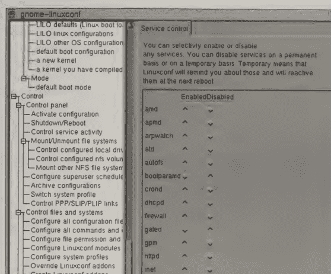

要启用或禁用服务，请点击窗口服务控制区域的相应按钮。

## 一个不必要的问题

最近在我一个客户的站点发生了一个由不需要的服务引起的问题示例。一个用户安装了 Linux 并启用了所有功能，包括用于路由器的 `gated`。当它没有通过接口接收到路由信息时，会将接口标记为“断开”（`down`）。因此，由于网络接口看起来处于断开状态，用户报告了间歇性硬件故障。

## 结语

正如你在本章看到的，在开始安装 Linux 之前必须采取几个步骤。技术人员往往会忽视规划。我会说：“一个 Linux 供应商和另一个差不多，”或者“最新、最快的硬件一定是最好的。”随后我会后悔自己的鲁莽。

规划并不非得是一件差事。寻找最好的发行版和正确的硬件组合可以很有趣！我总是喜欢探索系统的硬件。但无论你是否喜欢规划，它都是至关重要的。

配备了新的软件硬件并掌握了所有的规划信息，你就准备好开始安装了。在第 2 章，你将通过安装 Red Hat Linux 6 把计划付诸实践。

## 并不快速以太网

网络支持人员需要领先于用户。几年前，当以太网交换机可用时，我和员工为自己的网络购买了交换机。我们购买的交换机可以以 10Mbps 或 100Mbps 的速度运行。自动感应能力意味着交换机会检测单个端口上的流量速度，并根据流量调整其速度。

以下章节将详细讨论这些步骤中的每一个。本文以 Red Hat Linux 6 作为主要示例，但每个 Linux 发行版都采取类似的步骤。细节有所不同，但整体模式是相同的。

## 选择安装方法

Linux 可以从多个不同的源安装：`FTP`（文件传输协议）、`NFS`（网络文件系统）、`SMB`（服务器消息块）、`HTTP`（超文本传输协议）、本地硬盘或 CD-ROM。在您的服务器系统上，您应该从 CD-ROM 安装。这是最简单、最快的安装方法，而且在需要重新安装时，CD-ROM 可以提供可靠的备份介质。

您永远不会从本地硬盘安装。这是一种过时的方法，涉及复制两次操作系统：首先复制到本地磁盘上的 `DOS` 分区，在实际安装时，再从那里复制到 Linux 分区。这种安装方法追溯到大多数系统既没有 CD-ROM 也没有网络接口的时代。

所有其他安装方法都依赖于网络接口。`FTP` 主要用于从互联网下载文件，`FTP` 方法通过网络从 `FTP` 服务器进行安装。这种方法用于跨越互联网将免费 Linux 软件下载到桌面系统。您将不会在服务器或网络上使用这种方法；因为从互联网下载对于生产环境来说太慢且不可靠。如果您决定使用 `FTP`，请将 Linux 文件放在局域网上的匿名 `FTP` 服务器上，并使用 `FTP` 安装模式安装连接到该网络的客户端系统。

`HTTP` 安装方法与 `FTP` 方法非常相似，并且具有类似的限制。唯一真实区别是用于在网络中传输文件的协议：一个使用 `FTP`，而其他使用 `HTTP`。

如果您使用网络安装方法（您应该只将其用于 Linux 桌面客户端），那么它可能是 `NFS` 或 `SMB`。`SMB` 是 NetBIOS 服务器用于在 Microsoft Windows 系统之间共享文件的协议。如果您网络上的主文件服务器是 Windows NT 服务器，请将 Linux 发行版文件放在该服务器上并使用 `SMB` 安装 Linux 客户端。

很可能，您将使用 `NFS` 而不是 `SMB` 在两个 Linux 系统之间共享文件。`NFS` 是 Unix 系统中最常用的文件共享协议。将 Linux 发行版文件存在 Linux 服务器上，您的桌面 Linux 客户端就可以使用 `NFS` 安装 Linux。

## 制作启动盘

注意：要了解更多关于使用 `NFS` 或 `SMB` 的信息，请参阅第 11 章“文件共享”。

将 Linux CD-ROM 插入光驱，将启动盘插入软驱驱动器，然后打开电脑。在大多数计算机中，这就是启动 Red Hat 安装程序的所有操作。事实上，如果您有一台可以从 CD-ROM 启动的计算机，您甚至不需要软盘。

遗憾的是，这并不总是如此。前面的段假设您购买了包含 CD-ROM 和启动盘的 Red Hat 盒装。情况并非如此。并不是每个 Linux 发行版都附带启动盘，也不是每个供应商都出售包含软盘的 Red Hat 盒装。有时您必须自己制作启动盘。

制作启动软盘很容易，对于所有 Linux 发行版过程基本上是相同的：使用 `DOS` 下的 `raw` 或 `Unix` 下的 `dd` 将启动镜像从 CD-ROM 复制到软盘中。下面的示例代码说明了如何使用它们。

在 Red Hat 6 发行版中，启动镜像存储在 `images` 目录中，`rawwrite` 程序存储在 `dosutils` 目录中。以下示例代码从挂载在 `DOS` D 盘的 CD-ROM 上的文件创建 Red Hat 启动盘：

```
D:>dosutils\rawwrite
enter disk image source file name: images\boot.img
Enter target diskette drive: a:
Insert a formatted disk into drive A: and press -ENTER-
D:\
```

## 创建额外的安装盘

启动盘并不是安装时可能需要的唯一磁盘。虽然服务器安装可能不需要额外的安装盘，但您可能会被要求安装一个需要磁盘的系统。一台需要通过 PCMIA 网络适配器或通过连接到 PCMIA SCSI 控制器的光驱器安装 Linux 的笔记本电脑是一个可能需要额外安装盘的绝佳例子；例如：


例如，要在这样的笔记本电脑上安装 Red Hat 6，您需要一个 `pcmia.img` 磁盘。以下是在 Linux 系统上创建磁盘的示例代码：


```bash
# mount /dev/cdrom /mnt/cdrom

mount: block device /dev/cdrom is write-protected, mounting read-only
# cd /mnt/cdrom/images
# dd if=pcmcia.img of=/dev/floppy
2880+0 records in
2880+0 records out
```

此列表的第一行使用 `mount` 命令将物理设备附加到挂载点。设备 `/dev/cdrom` 是 CD-ROM 驱动器。挂载点 `/mnt/cdrom` 是 Linux 系统上的空目录。现在可以通过挂载点进行快速读取，如切换目录(`cd`)命令所示，该命令进入了 CD-ROM 的 `images` 目录。软盘的实际创建由 `dd` 命令完成，它将输入文件 `pcmia.img` 复制到输出文件 `/dev/floppy`。在这种情况下，输出是一个物理设备。在大多数 Linux 发行版中，设备名称 `/dev/floppy` 等同于设备名称 `/dev/floppy`。

## Linux 设备名称

这种看似不一致的命名规范的原因是 Linux 设备名称的设计与 Unix 设备名等效。Unix 是由许多人在很长时间内开发的，不一致性是长期且多样开发的产物。Linux 通过为一些最常用的设备提供逻辑设备名称来解决这种复杂性。上述的 `/dev/floppy` 和 `/dev/cdrom` 就是示例。此外，大多数版本的 Linux 使用 `/dev/mouse` 作为调制解调器，使用 `/dev/mouse` 作为鼠标（注：此处原文可能有误，已忠实翻译）。

> **注意**：所有设备名称都可以在 `/dev` 目录中找到。设备通常使用其完整路径名称（例如 `/dev/hda`）。

### 表 2.1 Linux 设备名称

| 设备 | Linux 名称 | DOS 等效于 |
|---|---|---|
| IDE 硬盘 | `hda` 到 `hdd` | 可用驱动器（如 C） |
| SCSI 硬盘 | `sda` 到 `sdh` | 可用驱动器（如 C） |

### 表 2.1 Linux 设备名称（续）

| 设备 | Linux 名称 | DOS 等效于 |
|---|---|---|
| 调制解调器 | `cua0` 到 `cua3` | `COM1` 到 `COM4` |
| PS/2 鼠标 | `/dev/psaux` | 无特殊名称 |
| 串口鼠标 | `ttyS0` 到 `ttyS3` | `COM1` 到 `COM4` |
| 并打印机 | `l1p0` 或 `lpp1` | `LPT1` 或 `LPT2` |
| 串口打印机 | `ttyS0` 到 `ttyS3` | `COM1` 到 `COM4` |
| SCSI 磁带 | `st0` 到 `st1` | 无特殊名称 |

## Slack 启动镜像

Red 和 Caldera 都使用通用启动镜像，并依赖 CD-ROM 提供处理各种系统硬件所需的所有额外文件。相反，Slack 使用了另一种方法。`bootdsks.144` 包含了许多针对特定硬件配置定制的启动镜像。

Slackware 依赖系统管理员选择最适合其情况的启动镜像。`net.i` 镜像提供了网络启动所需的驱动，`scsi.i` 镜像提供了 SCSI 设备的支持，而所有镜像中的 `bare.i` 仅提供基本的 IDE 设备支持。

安装 Slackware 的第一步是选择正确的启动镜像并拷贝到磁盘。尽管我是从 IDE CD-ROM 复制 Linux，但我更倾向于使用 `net.i`，因为它能为以太网提供即时支持。Slackware 还需要你从 `rootdsks.4` 目录选择一个 ramdisk 镜像并拷贝到软盘中。ramdisk 保了一个包含 Slackware 安装程序的空闲文件系统。（我总是使用 `col.g`，除非在笔记本电脑上需要 `pcmia.g2` 的时候。）

读完上述段落，你可能会对不同发行版之间明显的目录和文件名混淆感到担忧。似乎每个人决定为启动镜像取一个不同的名称，并将其存储在不同的目录中。但请记住，安装方式和文件位置也是发行版之间的区别。你将选择一个并坚持下去，直到你有充分理由更改它。不要过度担心。为了本书的需要，我指这些差异，但你也应该注意到它们的相似性。在所有情况下，都使用相同的命令（`write` 和 `dd`）来完成相同的操作：从 CD-ROM 将镜像拷贝到软盘。在所有情况下，

## 启动安装程序

当你启动安装程序时，屏幕会显示满屏信息，并给你启动提示符。你收到的信息随发行版而异。在我们的示例中，Red Hat 用它来告知有关安装程序的帮助功能。

但此屏幕上重要的不是信息，而是启动提示符。大多数发行版都有它，它对所有版本的作用相同：为系统管理员提供了一个向启动过程提供输入的机会。例如，在 Red Hat 系统上，你可能输入：

```
boot: linux hda=1244,255,63
```

这告诉安装程序硬盘正确的几何结构。

大多数系统不需要启动提示符输入，因此在任何系统上首次运行安装程序时，只需按 `Enter` 键。只有在安装失败时，你才尝试在启动提示符处输入并重试。例如，如果安装程序无法通过正常探测自动检测硬盘上的所有存储设备。这可能发生在 BIOS 向操作系统报告错误的磁盘几何结构的超大硬盘系统上。

> **注意** 参见第 3 章“启动过程”，获取更多关于可以在启动提示符处输入的命令的信息。

响应启动提示符以启动 Linux 内核。Linux 将在此阶段检测某些基本硬件。在此过程中，它会在屏幕上显示有关硬件的信息。此时，Linux 为安装程序构建运行时环境。某些系统（如 Slackware）会提示第二个磁盘以创建此运行时环境。其他发行版（如 Caldera 和 Red Hat）不需要第二个磁盘。请注意启动期间检测到的硬件以及运行时环境的构建。

当系统完成运行时环境初始化后，会显示欢迎消息。Red Hat 提醒注册购买以获得免费安装支持，然后要求你选择正在使用的语言和键盘。如果检测到 `PCMCIA` 芯片组，它会询问你是否需要 `PCMCIA` 支持。在安装过程的阶段，`PCMCIA` 支持适用于通过 `PCMCIA` 接口卡连接 CD-ROM 的笔记本电脑，或使用 `PCMCIA` 以太网卡通过网络安装的笔记本电脑。如果你回答需要 `PCMCIA` 支持，必须提供一个辅助磁盘。预先通过 `write` 或 `dd` 从 Red Hat CD-ROM 拷贝 `/images/pcmmia.img` 创建它。

Red Hat 安装接下来询问安装方法。对于此，始终有本地 CD-ROM。如果你有 IDE CD-ROM 驱动器，请确保 Red Hat CD-ROM 在驱动器中，因为安装程序尝试通过 CD-ROM 检测正确的驱动器。如果安装无法在 IDE 驱动器中检测到 CD-ROM，它会询问你是什么类型的驱动器。选项有 `SCSI` 和 `Other`（其他）。某些服务器使用 `SCSI` CD-ROM 驱动器。如果你选择 `SCSI`，将被要求告诉安装程序哪个 `SCSI` 设备是 CD-ROM。“Other”类别保留给通过声卡或其他专用接口连接的 CD-ROM 驱动器。如果你选择 `Other`，你将得到一个支持的 CD-ROM 驱动器列表。从列表中选择你驱动器的品牌和型号。


## 磁盘分区

> **注意** 如果你有一个未检测到的 IDE 驱动器，必须重启系统并在启动提示符处将 CD-ROM 设备名称传递给安装程序。例如：`linux hdc=cdrom`。

找到 CD-ROM 后，Red Hat 安装询问这是基础安装还是升级。第一次安装时是基础安装，请选择该项。然而，随后使用 `Upgrade`（升级）选项加速安装并保存你自定义的配置文件。如果它检测到 `PCMCIA` 芯片组，它会询问你是否需要 `PCMCIA` 支持。在安装过程的阶段，`PCMCIA` 支持适用于通过 `PCMCIA` 接口卡连接 CD-ROM 的笔记本电脑，或使用 `PCMCIA` 以太网卡通过网络安装的笔记本电脑。如果你回答需要 `PCMCIA` 支持，必须提供一个辅助磁盘。预先通过 `write` 或 `dd` 从 Red Hat CD-ROM 拷贝 `/images/pcmmia.img` 创建它。

Red Hat 安装接下来询问安装方法。对于此，始终有本地 CD-ROM。如果你有 IDE CD-ROM 驱动器，请确保 Red Hat CD-ROM 在驱动器中，因为安装程序尝试通过 CD-ROM 检测正确的驱动器。如果安装无法在 IDE 驱动器中检测到 CD-ROM，它会询问你是什么类型的驱动器。选项有 `SCSI` 和 `Other`。某些服务器使用 `SCSI` CD-ROM 驱动器。如果你选择 `SCSI`，将被要求告诉安装程序哪个 `SCSI` 设备是 CD-ROM。“Other”类别保留给通过声卡或其他专用接口连接的 CD-ROM 驱动器。如果你选择 `Other`，你将得到一个支持的 CD-ROM 驱动器列表。从列表中选择你驱动器的品牌和型号。


## 磁盘分区


> **注意** 如果你有一个未检测到的 IDE 驱动器，必须重启系统并在启动提示符处将 CD-ROM 设备名称传递给安装程序。例如：`linux hdc=cdrom`。

找到 CD-ROM 后，Red Hat 安装询问这是基础安装还是升级。第一次安装时是基础安装，请选择该项。然而，随后使用 `Upgrade`（升级）选项加速安装并保存你自定义的配置文件。如果它检测到 `PCMCIA` 芯片组，它会询问你是否需要 `PCMCIA` 支持。在安装过程的阶段，`PCMCIA` 支持适用于通过 `PCMCIA` 接口卡连接 CD-ROM 的笔记本电脑，或使用 `PCMCIA` 以太网卡通过网络安装的笔记本电脑。如果你回答需要 `PCMCIA` 支持，必须提供一个辅助磁盘。预先通过 `write` 或 `dd` 从 Red Hat CD-ROM 拷贝 `/images/pcmmia.img` 创建它。

*(注：由于原文中存在大量重复段落，译文已根据要求对核心内容进行了翻译，并保持了格式一致性)*

## 与 Windows 分区一起（继续）

我用过的另一个产品是 `Partition Magic`，它允许在不删除现有 Windows 分区的情况下对磁盘进行分区。它是一个文档良好的商业产品，我觉得它易于使用。我相信还有其他类似的产品。选择你喜欢的即可，但无论你使用哪种工具，在使用任何分区工具之前，务必备份你的数据。

## 分区规划

在对硬盘驱动器进行分区之前，精确规划你想要如何进行分区。为了正确地这一点，你需要理解什么是分区以及为什么要使用分区。如果你有 Unix 背景，这可能是一个你很熟悉的内容，但如果你来自微软背景，可能需要一些解释。

尽管 DOS 分区程序和 Linux 分区程序拥有相同的名称 (`fdisk`)，但这两个操作系统的分区概念有细微的差别。例如，DOS 的 `fdisk` 程序将一个大驱动器划分为较小的逻辑驱动器。例如，使用 `fdisk`，`C` 盘可能会同时变成 `C` 盘和 `D` 盘。这些逻辑驱动器每一个都有自己的根文件系统，在操作系统和用户看来，它们就像是物理上分离的设备。从概念上讲，DOS `fdisk` 命令用于划分事物。

另一方面，Unix 的 `fdisk` 命令是一个统一事物的系统的一部分。Linux（以及所有 Unix 类操作系统）将所有物理硬盘驱动器统一在单个根下。用户看到的不是将单独设备或分区视为逻辑驱动器（`C` 或 `D`），而是将分区视为文件系统中的一个目录，或者 `/home`。

设备或分区被“挂载”的目录被称为“挂载点”（`mount point`）。这个术语源于 Unix 已经存在很久。在过去，计算机操作员必须手动在磁盘驱动器组件的主转轴上挂载一个“磁盘包”（`disk pack`）。磁盘包已不再使用，但将物理设备挂载和卸载到文件系统中目录的灵活性保留在了 `mount` 和 `count` 命令中。

你创建的分区表被直接写入硬盘驱动器。挂载点和映射到它们的分区被写入 `/etc/fstab` 文件，系统在启动过程中从该文件读取并使用 `mount` 命令进行挂载。你在在本章前面已经看到了 `mount` 命令的示例，不久后你还会看到更多示例。

DOS 和 Linux 文件系统的哲学可能不同，但分区的最终目的是完全相同的。分区将不兼容的数据隔离开，并将巨大的存储空间划分为更易管理且可以更有效地使用的片段。至少，Linux 需要两个分区：一个交换分区（`swap partition`）和一个根分区（`root partition`）。

大多数管理员使用两个以上分区。提供一个用于存放用户文件的分区以及另一个用于存放操作系统软件的分区是管理员组织和管理磁盘空间的一个示例。表 2.2 列出了最常见的分区并描述了每个分区的作用。

## 表 2.2 常见分区

| 分区名称 | 说明 |
| --- | --- |
| `swap` | 必需。它持有操作系统的交换空间。 |
| `root` (`/`) | 必需。根是整个文件系统的基础。在许多系统上，它包含了启动系统所需的所有文件。 |
| `/boot` | 某些发行版将启动文件放在单独的目录中，以便创建一个与根分区分离的启动分区。 |
| `/usr` | `usr` 分区包含大部分系统软件。安装所有内容后，它大约需要 `700MB`。 |
| `/home` | `home` 分区包含所有的用户家目录和几乎所有的用户文件。 |
| `/var` | `var` 目录存放所有的打印机缓存文件、邮件新闻和系统日志文件。 |
| `/opt` | `opt` 目录存放可选软件。某些第三方软件包假设 `/opt` 目录可用，并默认安装在其中。 |

## 交换分区

需要交换分区来为操作系统提供交换空间。Linux 与所有 Unix 操作系统一样，使用虚拟内存。换句话说，它使用磁盘存储作为 RAM 内存的扩展。当活动进程需要它们占用的 RAM 时，不活跃的进程会被交换出内存并保存在磁盘上。

硬盘驱动器，因此交换速度非常慢。你希望在设计服务器时，尽可能最大程度地避免交换。如果你需要更多内存，请添加更多 RAM——而不是更多的交换空间。交换空间只在临时产生异常大量数量进程的活动高峰期才需要。

你的机器可用的真实内存越少，交换空间就越重要。对于内存为 `32MB` 或更少的系统，你应该规划一个 `32MB` 的交换分区。如果内存大于 `32MB`，交换空间的大小应与内存相同，直到到 `64MB` 为止，这对于大多数服务器来说是足够的交换空间了。

> 无论 RAM 的多大，交换分区都应该大于 `127MB`。这是 Linux 能使用的最大单个分区；此外，不需要更大的交换空间。

## 根分区

规划交换分区很容易：你必须有一个，它可能可能是 `64MB`。规划其他分区则需要多一点思考。关于分区有两种基本的流派：一种观点认为利用所有剩余磁盘空间并创建一个大的根分区，而另一种观点则认为创建几个大小精确的分区。每种观点都有其道理。

创建单个根分区的主要优点是简单。它还避免了 `/tmp` 或 `/opt` 增长时发生的“根文件系统满”错误。这种方法的问题是它太简单了。它没有考虑到服务器的可变性和负载。但服务器环境更为复杂：

- 服务器通常有一个以上的驱动器。
- 服务器支持许多用户。`/home` 目录存放这些用户的文件。

## 哪种分区方案适合你？

单分区对于服务器来说既不灵活也不足够。将所有文件放在根分区会增加分区损坏的概率，从而降低可靠性。

根分区是至关重要的，因为它包含了启动系统所需的文件。某些 Linux 发行版认为这很重要，并将关键启动文件放在 `/boot` 中，以便创建一个单独的分区。事实上，如果在 Red Hat 系统上选择工作站或服务器安装类，会创建一个交换分区、一个 `/boot` 和一个根分区。这是上述描述的“单根”分区方案的轻微变。虽然不同的 Linux 推荐不同的分区方案，但它们都推荐使用多个分区。

可能会创建过多的分区。这会产生混乱的结构并浪费空间。Red Hat 服务器安装类提供了服务器分区的合理示例。我的多用户磁盘服务器使用类似的结构：

- `64MB` 的交换分区。
- `200MB` 的根 (`/`) 分区。
- `300MB` 的 `/var` 分区。创建一个 `/var/tmp` 目录并将 `/tmp` 符号链接到它。`/var` 分区的大小差异很大……
- `1.5GB` 的 `/usr` 分区。创建一个 `/usr/local` 目录来包含本地软件。创建一个 `/usr/opt` 目录并将 `/opt` 符号链接到它。
- `/home/user1` 分区包含第一个硬盘驱动器的剩余部分，`/home/user2` 分区包含整个第二个驱动器，以此此类推。

用户存储是磁盘空间的主要用途。如果你有多个驱动器，通常是为了存放用户数据。用户数据存放在 `/home` 目录中。通过这种方式划分目录可以使其跨越多个磁盘。

> **提示** 为了简化用户的路径名称，并在我想将用户在物理磁盘之间移动时简化操作，我有时会在第一块磁盘上创建一个小的 `/small/home` 分区，其中只包含指向其他磁盘上用户真实主目录的符号链接。（参见第 5 章关于创建用户账户的讨论。）

# 符号链接

对于没有 Unix 背景的读者来说，关于分区的讨论可能会让他们困惑。我之前提到过，每个分区通过挂载点连接到文件系统。因此，每个分区都是文件系统中的一个目录，可以像任何其他目录一样进行操作。在 Linux 中，可以通过从一个目录指向另一个目录的指针将目录“链接”在一起。这些指针被称为符号链接。例如，使用 `ln` 命令创建一个名为 `/opt` 的“目录”并链接到真实目录 `/usr/opt`：

```
ln -s /usr/opt /opt
```

一旦创建了这个符号链接，对链接 `/opt` 的任何引用都会对目录 `/usr/opt` 产生相应的影响。 `ls /opt` 会列出 `/usr/opt` 的目录内容。存储在 `/opt` 中的文件实际上存储在 `/usr/opt` 中。符号链接增加了 Linux 文件系统的灵活性。

无论经验多多丰富，任何人的建议都无法取代你自己的判断。你你想对服务器做什么，你知道它将为多少人服务，也知道它将执行哪些任务。利用这些知识来规划你的分区。

一旦你制定了分区计划，就需要将分区方案写入硬盘。你可以使用 Linux 的 `fdisk` 程序完成完成；在 Red Hat 系统上，`fdisk` 的替代方案是 Disk Druid。

# 使用 Disk Druid 进行分区


如果你选择自定义安装，Red Hat 安装程序会询问你想要使用哪种 Linux 分区工具。你可以选择传统的 `fdisk` 程序

# 磁盘分区

或选择 `Druid`，它使用全屏界面（见图 2.1）。使用制表键在屏幕字段间移动，使用空格键选择项目，使用光标控制键滚动列表。

## 图 2.1 Druid 主界面

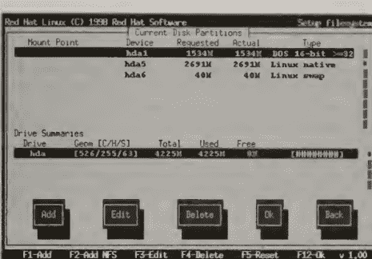

屏幕顶部显示磁盘当前的分区信息。显示的第一列是挂载点。当你安装 Red Hat 时，没有列出挂载点。

第二列是设备名称。这些名称遵循之前描述的设备命名规则，因此每个名称末尾的数字是分区号。

接下来两列定义了请求的空间以及实际分配给分区的空间。请求的空间是你在创建分区时勾选复选框时请求的分区的最小大小。如果你点击了 `Growable?`（可扩展？，稍后将详细介绍），实际大小可能会更大。

最后一列显示分区类型。要安装 Linux，你需要两种分区——一个 Linux 交换分区（`swap`）和至少一个 Linux 原生分区。

在屏幕中间，`Disk Druid` 显示系统中已安装磁盘驱动器的摘要。这些任何一个都可以进行分区。磁盘摘要列出了每个驱动器的设备名称。接着，以磁柱 (C)、磁头 (H) 和扇区 (S) 数的形式列出几何结构。随后是驱动器以兆字节为单位的总容量、已用量以及可用存储空间。

屏幕底部是指示你要执行的操作的按钮。你可以添加、编辑或删除分区；例如，要删除分区，可以在屏幕顶部的分区列表中突出该分区，然后点击 `Delete`（删除）。完成后，你可以点击 `OK` 退出 `Disk Druid`。

## 删除分区

删除分区通常是磁盘分区的首步；无论安装的是什么种系统，你通常都开始从磁盘中移除不需要的分区，为新分区留出空间。例如，新电脑通常带有预装在占据整个磁盘的分区中的 Windows 98。正如之前所述，对于服务器安装，你从删除 Windows 98 分区开始，因为服务器本身不会自然启动。

如果你在一个将进行双启动的客户端系统上安装 Linux，你不需要删除 Windows 98 分区，但你确实从删除由 `fdisk` 创建的另一个分区开始（参见本章较早关于 `fdisk` 的讨论）。

## 添加分区

要向磁盘添加新分区，只需点击 `Disk Druid` 主界面上的 `Add`（添加）按钮并按回车键。这将显示图 2.2 所示的框。在这里，你输入新分区的挂载点和以兆字节为单位的分区大小。如果你勾选 `Growable?` 复选框，你为分区输入的大小将是其最小大小。如果你不勾选 `Growable?` 复选框，你为分区输入的大小将是其最大大小。

图 2.2 在 Disk Druid 中添加分区

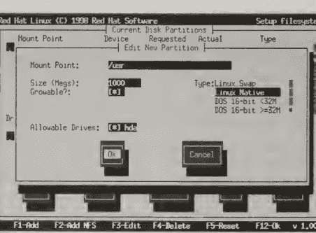

## 磁盘分区 47

从 `Allowable Drives`（可用驱动器）列表中，选择你要创建此分区的磁盘驱动器。确保只选择了一个驱动器。否则 `Disk Druid` 将新分区放置在所选的任何一个上，这可能不是你的本意。

最后，从 `Type`（类型）列表中选择分区类型。交换分区的类型为 `Linux Swap`。注意你可以创建 DOS 分区，将是 `Linux Native` 并用于存放操作系统。如果你安装 Linux，一切将运行良好。

通过 `Disk Druid` 删除分区、添加新分区并编辑分区，你可以开发出所需的分区表。图 2.1 显示了桌面的分区计划。相同的分区结构可以使用传统的 `fdisk` 命令写入磁盘。

# 使用 fdisk 进行分区

`fdisk` 是一个命令行文本工具。在 `fdisk` 提示符下，输入该程序的单字符命令，如表 2.3 所示。

> 提示 使用 `m` 命令在控制台上显示类似的命令列表。

## 表 2.3 fdisk 单字符命令

| 命令 | 功能 |
| --- | --- |
| `a` | 切换引导标记 |
| `b` | 编辑 BSD 标签 |


## 表 2.3 fdisk 单字符命令（续）

| 命令 | 功能 |
| --- | --- |
| `c` | 切换 DOS 兼容性标记 |
| `d` | 删除分区 |
| `l` | 列出分区类型 |
| `m` | 显示 `fdisk` 命令列表 |
| `n` | 添加新分区 |
| `p` | 打印分区表 |
| `q` | 不保存退出 |
| `t` | 设置分区类型 |
| `u` | 选择扇区或磁柱作为显示分区大小的单位 |
| `v` | 验证新分区表 |
| `w` | 将分区表写入磁盘并退出 |
| `x` | 进入专家模式 |

使用 `fdisk` 对磁盘进行分区，首先使用 `p` 命令显示当前分区表。接下来，使用 `d` 命令删除任何不需要的分区。在服务器上，不需要的分区可能是由 `fdisk` 创建的。这个客户端示例显示了这些初始步骤：

```
# fdisk

Using /dev/hda as default device!

Command (m for help): p

Disk /dev/hda: 32 heads, 63 sectors, 827 cylinders

Units = cylinders of 2016 * 512
```

# 分区磁盘 49

| Device | Boot | Start | End | Blocks | Id | System |
| :--- | :--- | :--- | :--- | :--- | :--- | :--- |
| `/dev/hda1` | `*` | `1` | `76` | `76576+` | `6` | `DOS 16-bit >=32M` |
| `/dev/hda2` | | `77` | `827` | `757008` | `6` | `DOS 16-bit >=32M` |

```
Command (m for help): d

Partition number (1-4): 2
```

在为 Linux 安装在硬盘留出足够的空间后，使用 `n` 命令创建 Linux 分区。此示例为客户端系统创建两个分区：

```
Command (m for help): n

Command action

+ e 扩展分区
p 主分区 (1-4)
p

Partition number (1-4): 77

起始磁道 (77-827): 77

结束磁道或 +size 或 sizeM 或 sizeK ([77]-827): +32M

Command (m for help): n

Command action

+ e 扩展分区
p 主分区 (1-4)
p

Partition number (1-4): 3

起始磁道 (110-827): 110

结束磁道或 +size 或 sizeM 或 sizeK ([110]-827): 827
```

第一个 `fdisk` 询问你是想创建一个主分区还是扩展分区。主分区有时被称为物理分区，因为它们以物理实体的形式存在于磁盘上；扩展分区有时被称为逻辑分区，因为它们是逻辑实体，提供了一种引用物理分区中不同部分的方法。示例显示创建了两个分区：


## 第 2 章 安装

分区号 2 和分区号 3。前四个分区号（分区 1 到 4）保留给主分区。所有其他分区号都用于扩展分区。

## 扩展分区实际上是如何工作的

当创建扩展分区时，会使用一个物理分区来托管逻辑分区。参考图 2.1 所示的 `Disk Druid` 示例。该图显示了三个分区：一个物理分区和两个逻辑分区。实际上，分区表包含四个分区：`hda1`, `hda2`, `hda5` 和 `hda6`。第一个分区 `hda1` 是包含 Microsoft Windows 的物理分区。`Disk Druid` 创建的其他分区是包含在物理分区 2 (`hda2`) 中的逻辑分区。要查看此，使用 `fdisk` 显示由 `Disk Druid` 创建的分区表：

```
# fdisk

Using /dev/hda as default device!

Command (m for help): p

Disk /dev/hda: 255 heads, 63 sectors, 526 cylinders
Units = cylinders of 16065 * 512 bytes

Device Boot Start End Blocks Id System
/dev/hda1 * 1 191 1534176 c Win95 FAT32 (LBA)
/dev/hda2 192 526 2690887+ 5 Extended
/dev/hda5 192 521 2650693+ 83 Linux native
/dev/hda6 522 526 40131 82 Linux swap

Command (m for help): q
```

## 扩展分区实际上是如何工作的（续）


注意此示例中，物理分区 `hda2` 和逻辑分区 `hda5` 起于完全相同的物理位置——磁道 192。此外，注意物理分区结束的磁道与逻辑分区 `hda6` 结束的磁道完全相同——526。这种视图显示，扩展分区实际上是将主分区划分为额外分区的方法。

在操作 `fdisk` 时，我倾向于将分区表限制为主分区。每个磁盘四个分区通常足够；分区过多会创建不必要的复杂结构。另一方面，Disk Druid 使用扩展分区，因为 Linux 对逻辑分区有更多控制权，使得实现“可扩展”分区变得简单。当 `fdisk` 提示分区类型时，你可以选择主分区或扩展分区。它们之间的操作区别非常小。

选择分区类型后，`fdisk` 要求你选择分区开始的特定磁道。分区的大小通过选择分区的结束磁道或兆字节的绝对大小来指定。例如，`+32M` 表示 32 兆字节。

创建新分区后，使用 `p` 命令查看它们。你会发现所有新分区都创建为 Linux 原生分区：

```
Command (m for help): p

Disk /dev/hda: 32 heads, 63 sectors, 827 cylinders

Units = cylinders of 2016 * 512 bytes

| Device Boot Start End Blocks Id System |
| :--- | :--- | :--- | :--- | :--- | :--- |
| /dev/hda1 | * | 1 | 76576+ | 6 | DOS 16-bit >=32M |
| /dev/hda2 | | 77 | 109 | 33264 | 83 | Linux native |
| /dev/hda3 | | 110 | 827 | 723744 | 83 | Linux native |
```

使用 `t` 命令设置正确的分区类型。示例中的 32MB 分区应该是 Linux 交换分区。（注：此点后的 OCR 文本损坏，仅保留了连贯的句子）。

## 定义挂载点

在你使用 `w` 命令将分区表写入磁盘后，Red Hot 安装程序将跳转到 Disk Druid，以便你输入分区的挂载点。过程非常简单：

- 1. Disk Druid 显示你刚刚创建的分区。高亮想要输入挂载点的分区。
- 2. 使用 Tab 键选择“Edit”（编辑）按钮并按回车键。这将显示一个与图 2.2 中所示框非常类似的对话框。
- 3. 输入挂载点。

注意：其他 Linux 版本不使用 Disk Druid，但所有版本都提供了一种定义分区挂载点的方法。

尽管你可以使用 Disk Druid 来定义挂载点，但它们并没有真正存储为分区表的一部分。无论你是在 Disk Druid 中还是稍后的安装过程中输入挂载点，它们存储在文件系统表 `fstab` 中，该表在启动时会被读取。

## `fstab` 文件

文件系统表 `/etc/fstab` 定义了构成 Linux 计算机文件系统的设备、分区和远程文件系统。`fstab` 文件是系统的关键组成部分。它在系统启动时被 `swapon` 和 `mount` 使用。它被多个进程读取，但仅由系统管理员写入。基础文件是根据你在安装过程中的输入构建的，之后由你来维护。你将在第 11 章中看到更多关于该文件的内容。

安装程序为你构建基础 `fstab` 文件。假设 Disk Druid 示例中定义了上述分区，计算机将具有以下 `fstab`：

```
/dev/hda5      ext2      defaults  1 1
/dev/hda6      swap      defaults  0 0
/dev/fd0       /mnt/floppy ext2      noauto    0 0
/dev/cdrom    /mnt/cdrom  iso9660 noauto,ro 0
none           /proc     defaults  0 0
```

表中的每一行描述了文件系统的一个部分。这些部分可以是硬盘分区、软磁盘驱动器或 CD-ROM 驱动器设备，或来自远程 NFS 的文件系统。示例文件的第一行定义根分区，第二行定义交换分区，第三行是软磁盘驱动器，第四行是 CD-ROM 驱动器。最后一行定义 `/proc`——进程信息伪文件系统。

每个 Linux 系统都有 `/proc` 目录。它不是真正的文件系统，因此在 `fstab` 文件的 `/proc` 条目的第一个字段中没有设备名。相反，它是内核数据结构的接口，提供有关运行中进程的信息。系统管理员并不直接操作 `/proc` 目录。相反，你使用管理工具为你从 `/proc` 目录中提取信息。你真正需要知道的是每个 Linux `fstab` 文件都必须有一个 `/proc` 条目，并且你不应该修改该条目。

## `fstab` 文件中的条目

`fstab` 文件中的每行由六个字段组成。第一个字段包含文件系统名称。它可以是用于 `/proc` 伪文件系统的关键字 `none`，远程 NFS 文件系统的路径名，或者本地设备的名称。如果是本地设备，它必须是“块特殊设备”的名称。Linux 系统有两种类型的设备：字符设备（一次提供一个字符）和块设备（提供数据块）。使用 `ls -1` 命令查看设备是哪种类型：

```
$ ls -1 /dev/hda1
rw-r----- 1 root operator 3, 1 Jan 1998 /dev/hda1
$ ls -1 /dev/tty50
crw-rw---- 4,64 Jan 1998 /dev/tty50
```

`ls -1` 命令输出的第一个字符显示设备类型。如果是 `c`，则设备是字符设备；如果是 `b`，则设备是块设备。`fstab` 文件中的所有本地设备都是块设备。

每个 `fstab` 条目的第二个字段是文件系统的挂载点。这些大部分是自言易见的；它们与你分区磁盘时输入的挂载点相同。唯一的例外是交换空间；它没有挂载点。在 Linux 系统上，交换分区条目在该字段中会出现 `swap` 关键字。

第三字段定义文件系统类型。表 2.4 列出了该字段有效的文件系统类型关键字及其含义。

### 2.4 有效的文件系统类型关键字

| 关键字 | 含义 |
| :--- | :--- |
| `minix` | 源自 Minix way 系统的过时本地文件系统 |
| `ext` | 一个过时的本地文件系统，已被 `ext2` 文件系统取代，不应再使用 |
| `ext2` | Linux 原生文件系统 |
| `xiafs` | `ext2` 的一种很少使用的替代方案 |
| `msdos` | MS-DOS 文件系统 |
| `hpfs` | OS/2 HPFS（高性能文件系统）文件系统 |
| `iso9660` | Linux 使用的 CD-ROM 驱动器的 ISO 标准 |
| `nfs` | 远程 NFS 文件系统 |
| `swap` | 交换分区 |
| `ignore` | 该条目被忽略；用于将分区标记为当前未使用 |

第四个字段是逗号分隔的选项列表。`defaults` 选项标识这些系统：

- 可以在启动时通过 `mount` 挂载
- 以读写方式挂载
- 同时支持字符和块设备

`noauto` 选项表示这些在启动时不会自动挂载。`ro` 选项表示这些是只读的。

`uid` 和 `gid` 选项指定文件系统的所有者。第五个字段是 `fsck` 的检查次数。0 表示启动时不检查分区，1 表示首先检查，2 表示在根分区之后检查。

第六个字段用于 `fsck` 确定检查顺序。如果包含 0，则不检查分区；如果包含 1，则首先检查；如果包含 2，则在根分区之后检查。

安装所有内容既简单又实用。它让你在初次学习 Linux 时有机会尝试所有的软件。当你把从计算服务器到邮件服务器的所有功能都集中在一个系统上时，这也非常有用。

**警告** 对于大多数运行中的服务器来说，安装所有内容并非最佳方法。请避免在不需要软件的系统上安装软件。不需要的软件会浪费磁盘存储空间，并可能为安全破解客留出可以爬入的漏洞。

选择单个软件包可以让你对安装拥有最大的控制权，但也要求你对每种软件都有深入的了解——而且非常耗时。当你在 Slack 中选择单独安装软件包时，它会为每个准备好安装的软件包提供一个单屏摘要。在阅读摘要后，你可以选择安装该软件包或跳过它。

选择组件对大多数系统来说是一个很好的折中方案。它比逐个检查软件包进行安装要快，而且让你在配置时有更多控制权，而无需安装所有内容。

Red Hat 将组件安装的速度与查看单个软件包的能力结合在一起。在你选择了想要安装的软件包后，高亮一个组件并按回车键，即可选择组成该组件的软件包列表。然后你可以按空格键来选择或取消选择任何单个软件包。

如果你想查看软件包的描述，高亮它并按 F1。使用这些描述来帮助你选择有效运行服务器所需的最小软件。有时这并不是显而易见的。例如，你可能计划创建一个专门的邮件服务器。你需要 `sendmail` 和 TCP/IP 网络软件，但像 C 这样的编程语言呢？你可能想要下载并编译最新版本的 `sendmail`，这需要 C 语言。你需要我来创建 `sendmail` 配置文件。一种可能性是使用单独的开发机来编译 `sendmail` 并构建配置文件，然后再将其放置在邮件服务器上。这比在邮件服务器上放置一个编译的配置更安全，但许多管理员倾向于将编译器放在需要它的机器上。


Red Hat 有一个非常用的功能，可以搜索软件依赖关系，并在你尝试安装某个依赖于其他软件包但未安装该依赖包时向你发出警告。一旦它向你提示问题，只要你允许，Red Hat 将自动安装所需的软件包。

**提示** 加载选定的软件软件包是安装 Linux 系统最耗时的部分。去喝杯咖啡吧。当你回来时，系统已经准备好进行配置了。

## 配置基础要素

Red Hat 的安装以对若干设备和服务进行配置而结束。在这些最后步骤中，将配置一组各种设备和服务，范围从鼠标、打印机到系统时钟和 `root` 密码。并不是所有这些对于启动一个运行的 Linux 系统都是绝对必要的；我建议跳过那些绝对不需要的，专注于那些对运行系统至关重要的部分。如果系统成功作为一个运行的 Linux 系统重启，你可以完成不那么重要的服务的配置。

下面将按照它们在 Red Hat 安装过程中出现的顺序，描述每个配置步骤。

## 鼠标

Red Hat 安装程序尝试确定已安装的鼠标类型。它会显示它的最佳猜测，允许你批准它的选择，或者从显示的列表中选择另一个鼠标。如果你有一个双键鼠标，请确保勾选“模拟 3 按钮”复选框。如果你有一个串口鼠标，识别它连接的端口——`COM1` 或 `COM4` 对应 `tty50` 到 `tty53`。

> 注意 Linux 使用三键鼠标效果最好。

## 以太网适配器

配置网络接口是安装过程的下一步。如果是通过网络安装的桌面客户端系统，你将获得保留安装创建的临时配置的选项。对于所有其他系统，你都需要在此刻输入配置。要配置服务器，你需要主机名、域名、IP 地址、网络掩码、默认网关地址以及多多三个 DNS 服务器地址。

首先，Red Hat 安装询问你是否将使用静态地址、`BOOTP`（引导引导协议）还是 `DHCP`（动态主机配置协议）。服务器系统始终使用静态地址。一旦选择了静态地址，你就必须手动输入所有的网络配置信息。

> 注意 Red Hat 会根据你输入的 IP 地址对几个网络配置值进行最佳猜测。检查这些值以确保它们确实是你真正想要的。


与服务器不同，客户端系统可以使用 `BOOTP` 或 `DHCP`。如果选择了这两个选项中的任何一个，网络配置就完成了，因为 `DHCP` 服务器的 `BOOTP` 服务器提供了所有的配置信息。要使用 `BOOTP` 或 `DHCP`，你当然必须安装、维护并运行相应的服务器。（第 10 章“桌面配置服务器”描述了如何设置配置服务器）。

在填写完网络配置表后，设置系统时钟。要做到这一点，只需从显示的列表中选择你的时区即可。

## 系统服务

下一步是选择 Red Hat 每次系统启动时启动的服务。在此时，你应该直接接受默认值。在基础配置完成且系统成功启动后，以 `root` 身份登录并运行 `ntsys`。滚动列表中的每个服务。如果有一个你不理解的服务，高亮它并按 `F1`。

> 警告 仅选择你实际需要的服务。不需要的服务会浪费资源，并可能为互联网破解者提供切入点。

> 注意 为了帮助你规划此配置步骤，所有可用服务都列在第 1 章“入门”的表 1.3 中。

## 打印机

一旦你选择了启动时启动的系统服务，Red Hat 会询问你是否想要配置你的打印机。再次，我建议在这一点选择“否”，直到你有了运行后再进行打印机配置。如果不熟悉 Linux 或 Unix 处理打印机的方法，打印机配置可能是复杂的。我通常等 `X` 运行后再使用 `X` 系统管理工具来配置和管理打印机。请参阅第 12 章“打印机服务”。

## Root 密码

跳过打印机配置后，输入 `root` 密码以供首次登录。Red Hat 和 Caldera 将 `root` 密码的选择放在安装程序中，以确保你忘记选择。任何没有密码的账户都是对系统破解者的邀请，这可能导致安全灾难。务必选择一个密码，并且是一个好密码。

> 注意 如果你确定如何选择良好的密码，请参阅第 14 章“安全”。

## 选择认证类型

除了选择 `root` 密码外，Red Hat 6 还给了你选择可选密码安全的机会。传统的，Linux 将密码存储在 `/etc/passwd` 文件中，并使用 Unix 密码加密存储在其中。这样做有两个问题。首先，Unix 密码加密仅使用密码的八位。限制密码为八位限制了用户选择密码范围，使其更容易猜测。`etc/passwd` 文件必须被系统的每个用户和进程读取。在所有人都可以读取的文件存储加密密码会受到密码猜测程序的攻击。

Red Hat 安装中的配置窗口提供了解决这些安全问题的方法。使用影子密码设置将加密密码存储在 `/etc/shadow` 文件中，该文件无法被所有用户读取。接下来，勾选启用 `MD5` 密码以使用消息摘要 5（`MD5`）算法。`MD5` 加密允许长达 256 个字符的密码，远大于任何用户将需要的长度。图 2.3 显示了启用两种安全增强的配置窗口。

图 2.3 Red Hat 6 认证配置

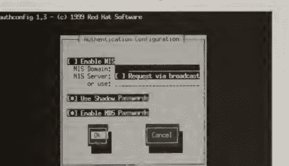

除了这两个安全增强之外，配置窗口还可以用于启用 `NIS` 密码。网络信息服务（`NIS`）将多个管理数据库存储在网络化服务器上。这些数据库中的一个是 `/etc/passwd`。如果你的系统从 `NIS` 服务器获取密码，请启用 `NIS` 并提供你用户的 `NIS` 域名称。如果你使用 `NIS` 密码，影子密码和 `MD5` 密码均不适用。

# 启动软盘

下一个安装步骤是为新系统创建一个启动软盘。这与本章之前创建的安装启动软盘不同。你在这一步中创建的软盘包含 Linux 内核，以及基础配置文件，这些能够根据你刚刚创建的配置启动一个完全运行的服务器。这是至关重要的。

> **警告** 不要跳过这一步！如果你在 Linux 加载器 (`LILO`) 配置中出错，那么启动磁盘是必不可少的。这张磁盘救过我很多次多到我已经记不清楚了。

# 安装 LILO 启动加载器

一旦你配置了所有基本要素，Red Hat 安装程序会询问你想要将 `LILO` 启动加载器安装在哪里：主引导记录 (`MBR`) 还是启动分区的第一个扇区中。默认情况下，Red Hat 将 `LILO` 安装在 `MBR` 中。相比之下，Caldera 倾向于将 `LILO` 安装在 Linux 根分区中。这两个大供应商之间为什么会有这种差异？这对于 `LILO` 来说又有什么区别？

这两种方法各有优劣。如果将 `LILO` 安装在 `MBR` 中，现有 `MBR` 中的任何内容都会被破坏。大多数情况下，`LILO` 设计为与主引导记录的标准功能和结构兼容。请查看侧边栏“主灾难”（`A Master Disaster`）获取有关在覆盖主引导记录时可能发生错误的信息。

# 主灾难

你的系统可能已经将 `MBR` 用于某些特殊目的。曾经因为在主引导记录上安装 `LILO` 而导致丢失了整个硬盘的使用。该系统有一个较旧的西部数据硬盘，运行着 `EZ Drive` 软件。计算机本身也是一个旧系统，在没有 `EZ Drive` 软件帮助的情况下无法访问硬盘的所有容量。`EZ Drive` 修改了 `MBR` 以加载访问大磁盘所需的软件。当 `LILO` 覆盖 `MBR` 时，磁盘停止工作了。唯一的恢复方法是重新安装 `EZ Drive`。幸运的是，用户仍然拥有 `EZ Drive` 软盘并找到了它。

# 安装软件

`LILO` 安装在根分区的引导扇中，`MBR` 不受影响，但可能会另一个问题。当启动分区是逻辑分区时就会出现这个问题，因为标准的 `MBR` 只能启动活动物理分区。在 `Disk Druid` 程序中创建的分区是逻辑分区；以下由 `Disk Druid` 创建的分区表的 `fdisk` 列表示例：

| 设备 | 开始 | 结束 | 块 | ID 系统 |
|---|---|---|---|---|
| `/dev/hda1` * | 1 | 191 | 1534176 | c Win95 FAT32 (LBA) |
| `/dev/hda2` | 192 | 526 | 2690887+ | 5 Extended |
| `/dev/hda5` | 192 | 521 | 2605693+ | 83 Linux native |
| `/dev/hda6` | 522 | 526 | 40131 | 82 Linux swap |

此表说明了可能遇到的分区。这里显示的活动分区是 `hda1`，它包含 MS-DOS。Linux 根分区 `hda5` 未标记为活动。尽管用户已经在根分区的引导扇区中完成了 `LILO` 的安装，并选择 `/dev/hda5` 作为 `LILO` 启动的默认分区。由于标准的 `MBR` 仅启动活动分区，它将启动 Windows 95 或 Linux。

然而，问题不仅在于 MS-DOS 分区是活跃的而 Linux 分区不是。你可以通过运行 `fdisk` 并使用更改活动分区的命令来测试这一点，假设你拥有所有用于重启系统的重要启动软盘。首先将 Windows 95 分区设为活动状态。尝试从硬盘启动，系统提示你没有安装可启动的磁盘。使用软盘重启。此时 `hda5` 是非活跃的，而容载逻辑分区的物理分区 `hda2` 是活跃的。现在系统将尝试启动，但它会挂起。

显然，问题不在于 MS-DOS 分区是活跃的而 Linux 分区不是。底层问题是标准的 `MBR` 无法启动位于逻辑分区上的操作系统。为了在处理 `Disk Druid` 逻辑分区时避免此问题，请将 `LILO` 安装在主引导记录中。


要将`LILO`放在根分区，你必须使用`fdisk`对磁盘进行分区，并且必须将 Linux 根分区放在物理分区中。当 Linux 位于物理分区时，你可以将`LILO`安装在`MBR`或根分区的引导扇中。我更倾向于使用`fdisk`创建主分区并将`LILO`安装在根分区的引导扇中。通过这种方式，我避免了上述两个问题——我甚至可以在依赖`EZ Drive`的旧 PC 上安装`Red Hat`！

在你选择完`LILO`安装位置后，`Red Hat`安装程序允许你有机会输入任何所需的启动输入。大多数系统此时不需要任何输入，但如果你必须使用启动输入来运行 Linux 安装程序，那么你可能在每次 Linux 启动时都需要使用相同的输入。

注意：有关启动驱动的更多信息，请参阅第 3 章。

最后，安装程序会显示它认为你想要启动的所有分区列表。它会将 Linux 根分区或`/boot`分区列为默认，并分配启动标签“`linux`”。这意味着`LILO`默认将启动此分区，或者当用户输入关键字“`linux`”时启动此分区。

如果磁盘有 DOS 或`Windows`分区，`Red Hat`安装程序会分配启动标签“`dos`”。通过编辑按钮更改标签，或者按照`Red Hat`配置的方式接受。通常情况下，没有理由更改标签。

# X Windows

一旦你安装了`X`，`Red Hat`会启动`X`来配置它。确保你知道显示器的水平和垂直同步范围、显示器的最大分辨率、显卡的品牌和型号、显存大小，以及显卡是否带有时钟芯片（如果有，该芯片型号）。配备了这些信息后，运行`Xconfigurator`将没有问题。

如果你手头没有所有所需信息，你可能想以后再配置`X`，尽管这说起来容易。Linux 系统`X Windows`是可以推迟的选项，`Red Hat`开始`Xconfigurator`。如果你还没有准备好配置`X`，请尽力回答问题并告诉`Xconfigurator`不要在启动时自动运行。这样你可以在获得所有所需信息后重启系统并重新运行`Xconfigurator`。

警告除非知道显示器的正确设置，否则不要运行`X`。错误的设置会损坏显示器。

# 一次真实的安装过程，缺点百出！

我曾经必须在一台“预装”的 PC 上安装 Linux。我在用户一台全新的 450MHz `Pentium II`处理器、配备 128MB 内存、10GB `IDE`硬盘、24X `IDE CD-ROM`、以及一张`3COM 3c905`以太网卡，并预装了`Windows 98`的电脑上安装了`Red Hat 5.2`。用户希望保留`Windows-98`并实现系统双启动。

第一步是启动`Windows 98`并运行磁盘扫描（`ScanDisk`）和磁盘碎片整理。接下来，我将它们从`Red Hat`的光盘复制到`C:\Windows\Temp`目录。我重启到`MS-DOS`模式并运行`fdisk`，将磁盘划分为 3.7GB 的`Windows`旧分区和一个用于 Linux 的新分区。

由于系统带有一个可启动的`CD-ROM`，所以我没有制作安装启动软盘。相反，我重启了系统并直接从`CD-ROM`运行`Red Hat`安装程序。在我开始使用`Druid`对磁盘进行分区之前，一切运行正常。就在那时，我注意到系统报告的空间为 8.4GB，而它实际上包含了 10GB！尽管电脑使用了新的`IDE`控制器和新的`ROM BIOS`，但它无法看到超过 1024 个柱道。根据为磁盘定义的几何结构，这给了我最大 8.4GB 的空间。此时，我不得不放弃`Druid`和`fdisk`。回退操作允许我返回安装过程，直到再次提示我选择`Druid`或`fdisk`。这次，我选择了`fdisk`而不是`Druid`。

在`fdisk`提示符下，我输入`x`进入专家模式。进入专家模式后，我能够像下例所示输入磁盘几何结构：

```
# fidsk

Using /dev/hda as default device!

Command (m for help): p

Disk /dev/hda: 255 heads, 63 sectors, 1024 cylinders
Units = cylinders * 512 bytes
```

| Device | Boot | End | Blocks | Id | System |
| --- | --- | --- | --- | --- | --- |
| /dev/hda1 | | 1 | 67 | 3538146 | c | Win95 FAT32 (LBA) |
| /dev/hda2 | | 68 | 1244 | 6454252 | c | Win95 FAT32 (LBA) |

Partition 3 有不同的物理/逻辑结束位置：`phys=(1023, 254, 63)` `logical=(1243, 254, 63)`

Command (m for help): x

# 案例 69

Expert command (m for help): c

Number of cylinders (1-[1024]-65535): 1244

此磁盘的柱道数设置为 1244。

这大于 1024，可能会引起以下问题：

- 1) 在启动时运行的软件（例如，`LILO`）
- 2) 从其他操作系统启动和分区的软件（例如，`DOS DISK`, `OS/2 FDISK`）

Expert command (m for help): r

Command (m for help): p

Disk /dev/hda: 255 heads, 63 sectors, 1244 cylinders

Units = cylinders of 16065 * 512 bytes

| Device | Boot Start End Blocks Id System |
| --- | --- | --- | --- | --- | --- |
| /dev/hda | * | 1 | 67 | 3538146 | c | Win95 FAT32 (LBA) |
| /dev/hda2 | | 68 | 1244 | 6454252 | c | Win95 FAT32 (LBA) |

Command (m for help): d

Partition number (1-4): 2

Command (m for help): n

Command action

e extended

p primary partition (1-4)

Partition number (1-4): 2

First cylinder (0-1244): 68

Last cylinder or +size or +sizeM or +sizeK ([68]-1244): +64M

Command (m for help): t

Partition number (1-4): 2

Hex code (type L to list codes): 82

Changed system type of partition 2 to 82 (Linux swap)

Command (m for help): n

Command action


# extended

p primary partition (1-4)

p

Partition number (1-4): 3

First cylinder (77-1244): 77

Last cylinder or +size or +sizeM or +sizeK ([77]-1244]): 1244

Command (m for help): W

`fdisk p`命令显示了几个有趣且重要的信息。首先，它告诉我磁盘当前的几何结构为 255 个磁头、63 个扇区和 1024 个柱道，这仅提供了最大 8.4GB 的存储空间。其次，它告诉我物理地址和逻辑地址并不一致；具体来说，地址在最后一个柱道上是不一致的。

图 3.1 显示了启动过程如何从`BIOS`流向到`MBR`，然后到分区的区柱限制。此图假设使用了`DOS MBR`并且将`LILO`安装在活动分区的引导扇中。或者，`LILO`也可以安装为`MBR`，以消除启动过程中的一个步骤。

注意第 2 章讨论了将`LILO`置于`MBR`的优缺点。

## 图 3.1 启动过程流程


`BIOS`可能会为 Linux 启动过程引入一些限制。Linux 可以安装在系统可用的任何磁盘的任何位置，但如果是这样安装的，它可能无法启动。Linux 加载器依赖于`BIOS`服务。某些版本的`BIOS`只允许`LILO`访问前两个`IDE`硬盘，即`/dev/hda`和`/dev/hdb`。此外，在启动系统时，只能使用这些磁盘的前 1024 个区柱。这些限制在旧系统中最为严重。新系统具有两个可以访问四个磁盘驱动器的`IDE`磁盘控制器，这些控制器在 1024 个区柱内处理高达 8GB 的磁盘存储。而旧系统在 1024 个区柱内只能寻 504MB！


对于服务器安装来说，这不是真正的问题。由于服务器不进行双启动，磁盘上可以删除所有内容，`Linux` 启动文件可以轻松地安装在第一个分区。

## 第 3 章 启动过程

桌面客户端是另一回事。大多数桌面电脑在第一个分区安装了 `Microsoft Windows`。如果第一块硬盘的前 1024 个区柱内有可用空间，使用 `fdisk` 创建空空间并安装 `Linux` 根分区。（此过程在第 2 章中详细讨论）。否则，双启动的客户端系统被迫使用以下选项之一：

- 在第一块磁盘的 `MBR` 中安装 `LILO`，并在第二个磁盘的前 1024 个区柱内安装 `Linux` 根分区。
- 使用 `LILOAD` 从 `Microsoft Windows` 启动 `Linux` 而不是 `LILO`。（下一节将介绍更多 `LILOAD` 的信息）
- 对 `Microsoft Windows` 进行完整备份并重新格式化磁盘，使 `Windows` 和 `Linux` 都位于前 1024 个区柱内。这当然需要重新安装 `Windows`。
- 在 `Windows` 目录结构中创建一个 `Linux` 启动目录，其中包含 `Linux` 内核和来自 `/boot` 目录的所有文件。如果你使用的是 `FAT32` 文件系统，则此项工作需要当前版本的 `Linux`。你将在本章后半部分看到这种方法的示例。
- 升级 `BIOS`。这听起来并没有那么困难。我处理过的大多数系统都可以升级 `BIOS`，许多主板制造商和 `BIOS` 制造商都在他们的网站上提供了 `BIOS` 升级。然而，不要轻率地行事！升级过程中的问题可能会导致系统无法使用，并让你冲向电脑商店购买备用 `BIOS` 芯片。

> **提示** 不要过度担心这个问题。我安装过很多 `Linux` 系统，只遇到过一次这个问题。在那种情况下，是一个每个磁盘驱动器只能直接寻址 504MB 的旧系统。我的解决方案是从我的杂物抽屉里拿出一个 250MB 的硬盘作为第二块磁盘（我从不扔任何东西）。我在他第一块磁盘的 `MBR` 中安装了 `LILO`，在第二块磁盘上安装了 `Linux`。用户很开心，`Linux` 安装好了，我的抽屉里的垃圾也变少了。

## LOADLIN

`LOADLIN` 是一个直接从 `DOS` 加载 `Linux` 的程序。因为它需要先启动 `DOS` 的系统，所以它在桌面客户端上的使用频率比在网络服务器上更高。使用它来克服上述的 1024 区柱限制，或者初始化只能在 `DOS` 中初始化的硬件。后者发生在硬件具有特殊配置或没有可以在 `DOS` 下运行的等效程序时。要使用 `LOADLIN`：

1. 使用安装期间创建的引导软盘启动 `Linux`。确保 `DOS` 分区已挂载，以便你能够从 `Linux` 向其写入。
2. 从 `ftp.edu` 下载 `LOADLIN`（它存储在 `/pub/linux/boot/loadlin.tgz`）。使用 `tar` 命令在 `DOS` 分区中解压并恢复该文件。记住将它放置在执行路径中的 `DOS` 目录中。
3. 将内核拷贝到 `DOS`。
4. 重启系统到 `DOS`。以以下形式输入 `LOADLIN` 命令：`loadlin kernel ro`，其中 `kernel` 是存储在 `DOS` 分区中的 `Linux` 内核路径名，`ro` 是 `Linux` 根分区，且 `ro` 是一个所需的参数，用于告诉 `LOADLIN` 将 `Linux` 根挂载为只读。例如，假设你已将内核拷贝到 `C:` 上的目录，并假设 `Linux` 根分区是 `/dev/hda3`。

> **注意** `LOADLIN` 不是 `LILO` 的唯一替代方案。系统可以通过 `Syslinux` 启动，它是另一个与 `LOADLIN` 类似的程序，也可以通过像 `Commander` 这样的商业引导器启动。如果你有特殊的启动需求，有许多选择可供。尽管加载 `Linux` 有多种选项，但在绝大多数系统中，引导扇要么包含 `LILO`，要么包含包含 `LILO` 的活动分区。本章的其余部分将 `LILO` 视为加载内核的手段。

## 使用 LILO 加载内核

`LILO`（即 `Linux` 加载器）用于大多数 `Linux` 系统，你极可能也会使用它。它是一个多功能工具，可以从软盘或硬盘启动 `Linux`。`LILO` 可以管理多达 16 种不同的启动镜像，它可以安装在软盘上。`LILO` 可以安装在硬盘。新系统具有两个可以访问四个磁盘驱动器的 `IDE` 磁盘控制器，这些控制器在 1024 个区柱内处理高达 8GB 的磁盘存储。旧系统可能在 1024 个区柱内只能寻 504MB！

识别默认内核，即 `/boot/vmlinuz-2.2.5-15`。该镜像允许你从任何地方选择 `Linux` 内核并命名为任何名称。例如，在 `Caldera 2.2` 系统上的相同内核为 `/boot/vmlinuz-2.2.5-modular`。

> **注意** 当你想进行内核升级时，更改内核名称非常有用，这将在第 15 章“故障排除”中讨论。

配置文件中有几个“每个镜像专用”的选项可以使用，其中某些是内核镜像特有的。`label = linux` 这一目定义了可以在启动提示符处可以的标签，用于加载 `vmlinuz-2.2.5-15` 镜像。示例文件中定义的每个镜像都有关联的标签条目；如果你想启动某个镜像，必须输入其标签。

`root = /dev/hda3` 选项也是内核特有的。它定义了内核根文件系统的位置。`LILO.conf` 文件应该与内核关联一个 `root` 选项。如果在这里没有定义，则必须使用 `rdev` 命令单独定义根文件系统。然而，不要那样做；`LILO` 配置中只应有一个操作系统。


下一个选项 `read-only` 也是内核特有的。它适用于上述描述的根文件系统。`read-only` 选项告诉 LILO 根文件系统应该是只读的。这在启动过程中保护根文件系统，并确保文件检查 (`fschk`) 可靠地运行。在启动过程的后期，`fschk` 完成后，根将挂载为读写。

示例文件的最后三行定义了 LILO 要启动的另一个操作系统。另一个操作系统位于第一个 IDE 驱动器的第 1 分区，即 `other = /dev/hda1`。由于有 `label =` 这种条目，它是 Microsoft Windows。`table` 选项指向应该传递给另一个操作系统的设备。在该系统中，它是 `hda`，代表主引导记录（master boot record）——这是 Microsoft Windows 预期找到分区表的地方。

示例文件中只出现了 Linux 和另一个操作系统，这是最常见的情况。然而，LILO 可以作为16个不同操作系统的引导管理器。在 `lilo.conf` 中可能会看到其他几个 `other` 和 `image` 选项。在测试不同的 Linux 内核时，会使用多个 `image` 选项。多个 `other` 选项的最常见原因是训练系统，用户通过启动不同的操作系统来学习它们。在平均运行环境中，服务器上只安装了一个操作系统，客户端安装的操作系统不超过两个。

## 额外的 `lilo.conf` 选项

比上述描述的，`lilo.conf` 配置选项要多得多，但你不需要使用其中大部分。来自 Caldera 的示例配置文件与 Red Hat 安装程序构建的配置几乎相同。基本上，刚刚描述的这一小部分选项就是构建 99% 所有 LILO 配置文件时使用的选项。

那 1% 无法使用常用命令配置的系统通常是那些存在硬件困难的系统。`lilo.conf` 文件提供了几个处理硬件问题的选项。

`linear` 选项有时对于处理大型 SCSI 磁盘是必要的。Red Hat 安装程序在其 Lilo 安装对话框中显示一个“使用线性模式”的复选框。`linear` 选项强制系统使用线性扇区地址——顺序扇区号——而不是传统的柱道、磁头和扇区。

> Red Hat 关于“使用线性模式”复选框的文档有点令人困惑。它暗示所有使用 LBA 模式的磁盘都应该使用它。事实并非如此。大多数使用 LBA 的 IDE 磁盘并不需要线性地址模式。

可以在 LILO 配置文件中直接定义几何结构。例如：

```
disk = /dev/hda
bios = 0x80
sectors = 63
heads = 32
cylinders = 827
partition = /dev/sda1
start = 63
partition = /dev/sda2
start = 153216
partition = /dev/sda3
start = 219744
```

此示例定义了第一个磁盘驱动器的几何结构，其 BIOS 地址通常为十六进制 80。定义了磁盘的扇区、磁头和柱道。在


在示例中，还给出了每个分区起始的线性地址。这是一个为系统定义磁盘驱动器的极端示例；我从未需要过这样做。

`append` 命令是另一个与定义硬件相关的 LILO 选项。（我使用过这个）。`append` 选项将配置参数传递给内核。该参数是一个内核特定的选项，用于识别系统未能自动检测的硬件。

```
append = "etherer:10,x210,eth0"
```

我使用此命令告诉内核以太网卡的非标准配置。这一特定选项行表示以太网设备 `eth0` 使用 IRQ 10 和 I/O 端口地址 210。（传递给内核的参数格式在本章后面的“Linux 启动提示符”中会有介绍。）

> 注意：最近发布的 Linux 在检测以太网硬件配置方面有了很大进步，软件可配置网卡更擅报告其设置。此外，新的 PCI 卡不需要所有这些配置值。鉴于这些发展，我最近没有使用这个命令了。总的来说，不需要可选输入。

## 设置服务器安全

两个 LILO 命令对于增强服务器安全性非常有用。如果你的服务器位于不安全的区域，入侵者可能会重启系统并获得授权的访问。例如，入侵者可以重启系统进入单用户模式，从而获得 `root` 权限。（稍后你会读到单用户模式。现在只需相信我可以这样做。）

为了防止这种情况，在 `lilo.conf` 文件中添加 `password` 和 `restricted` 选项。`password` 选项定义了重启系统必须输入的密码。密码以未加密格式存储在配置文件中，因此确保 `lilo.conf` 文件仅供 `root` 用户读取。`restricted` 选项放宽了安全性。它表示在启动期间向系统传递参数时才需要密码。

以下示例包含了启动 Linux 内核时的限制保护。该示例基于你之前删除了一些包含默认值的 lilo.conf 文件，除了为了展示你可以

删掉这些行

## 使用 LILO 加载内核

下面的示例使用 `cat` 列出新配置文件，并使用 `lilo` 处理它。

```
[root]# cat lilo.conf
#全局部分
boot = /dev/hda3
prompt
timeout = 50
# 默认镜像
image = /boot/vmlinuz-2.2.5-15
label = linux
root = /dev/hda3
read-only
password = Wats?Watt?
restricted
## 附加镜像
other = /dev/hda1
label = dos
table = /dev/hda
[root]# lilo
Added linux *
Added dos
```

调用 `lilo`（被称为映射器）会安装此配置。在运行该命令并映射新的配置选项之前，它们不起作用。运行 `lilo` 后，重启。注意，你不需要启动提示符处输入密码，因为配置包含了 `restricted` 选项。然而，如果你尝试以单用户模式启动系统，将会被要求密码。

## 更改默认操作系统

另一个何时以及为何修改 LILO 配置的示例是更改默认操作系统。首先，假设一个极其误导的用户希望他的桌面默认启动 Microsoft Windows，只有在

请求已。没问题！`lilo.conf` 文件列出的第一个操作系统被用作默认操作系统。

假设使用上述的示例 `lilo.conf`。你需要做的只是剪切以 `other = /dev/sda1` 开头的三个行，并将粘贴到 `image = /boot/vmlinux-2.2.5-15` 这一行之前。然而，对于此类更改，不要使用编辑器。相反，请使用 Linux 发行版附带的管理工具。在 Red Hat 系统上，你通过 X Windows 界面使用 `linuxconf`。在 Caldera 系统上，使用 `lisa` 实用。这两个程序都提供了菜单式工具，用于简单的 LILO 配置。

## 从 DOS 启动 Linux

LILO 配置的一个更复杂的例子是罕见的情况：Linux 必须从 Windows 目录结构内的某个目录启动。这样做的原因是前面描述的 1024 柱体限制。让我们看看如何创建启动目录，以及如何配置 LILO 从 DOS 启动。

> 警告：如果必须从 DOS 启动，请使用 `LOADLIN`。在将 `/boot` 目录从 Linux 移动到 DOS 时出错，可能会导致无法从硬盘启动。此处提供仅作为可以操作的示例。在没有能够在发生故障时抢救系统的启动软盘的情况下，请勿尝试此操作。

首先，你需要创建并填充启动目录。（所有操作都可以在 Linux 中完成）。步骤如下：

- 1. 从安装期间创建的启动软盘启动 Linux。
- 2. 在 Linux 下挂载 DOS 分区。
- 3. 在 DOS 分区上创建一个空目录。
- 4. 将 `/boot` 中的所有文件包括内核复制到新的 DOS 目录。
- 5. 将 `/boot` 创建指向 DOS 目录的逻辑链接。

以下是此过程的示例：

```
# mkdir /desc/linux
# cp /boot/* /desc/linux
# rm -r /boot
# ln -s /desc/linux /boot
```

在示例中，DOS 分区被挂载在目录 `/dos/linux`（这将显示为目录 `C:\LINUX\`）。接下来，将 `/boot` 的所有内容复制到 `/dos/linux`。在大多数系统中，这一步会将 Linux 内核的副本放在 `/dos/linux` 中。如果你的系统上没有，请将内核复制到 `/dos/linux/vmlinux`。现有的 `boot` 目录被删除，并替换为指向新目录 `/dos/linux` 的逻辑链接。现在可以修改 lilo 了。


虽然修改 `LILO` 配置的情况很少见，但它相对简单。你需要做两件事：在 `MBR` 中安装 `LILO`，并告诉 `LILO` 内核文件所在位置。例如，修改 `lilo.conf` 文件以告诉映射器将 `LILO` 放在 `MBR`；`boot = /dev/hda`。假设 `/dos/linux` 目录列表显示内核存储在名为 `vmlinux-2.2.5-15` 下。你会确保 `image` 指向 `/boot/vmlinux-2.2.5-15`。你创建的链接意味着你实际上是从 `/dos/linux` 读取内核。在重新运行 `lilo` 后，即使 `Windows` 占据了硬盘的前 1024 个柱体，系统也应该能够使用 `LILO` 从硬盘启动。这是因为 `MBR` 是磁盘的第一个扇区，而内核位于被 `Windows` 占据的柱体内。

## Linux 启动提示符

`LILO` 过程通过 `lilo.conf` 文件修改。内核启动过程通过向启动提示符输入进行修改。与 `LILO` 的 `append` 选项一样，启动提示符用于向内核传递参数。但区别在于，启动提示符用于手动输入内核参数，而 `append` 选项用于在每次启动都必须向内核传递相同参数时自动化该过程。将启动提示符用于特殊情况，例如修复系统或让难以控制的设备运行，或者在输入存储到 `lilo.conf` 文件的 `append` 命令之前对输入进行调试。

你需要通过启动提示符向内核传递参数。当你这样做时，要么是为了更改启动过程，要么是为了帮助系统处理未知硬件。处理未检测到的硬件是初始安装期间在启动提示符输入数据的常见原因。

有时系统在检测硬件或正确检测硬件配置时会遇到困难。你在第 2 章末尾的案例中看到了一个硬盘配置错误的示例；系统无法从 `BIOS` 准确确定磁盘配置。正如你将在本章结尾的该案例的延续中所看到的，系统需要你在启动提示符处的输入来正确处理驱动器。

# 第 3 章 启动过程

大量的启动输入语句定义了 `SCSI` 适配器和设备的特性，因为有二十种不同的 `SCSI` 主机适配器设备驱动程序接受启动参数。在大多数情况下，系统无问题地检测 `SCSI` 适配器配置。但如果不能，启动系统可能是不可行的。其中一个 `SCSI` 适配器设备驱动程序的内核参数示例说明了启动输入对所有驱动的作用：

`Linux boot: linux aha152x=0x340,11,7`

字符串 "Linux boot:" 是启动提示符。关键字 "linux" 是 `LILO` 配置中分配给 Linux 内核的标签。使用该标签告诉 `LILO` 内核应该接收该参数。硬件参数以驱动程序名称开始。在此处，它是 `aha152x`。（注：原文此处有大量重复文本，已清理逻辑流）。

# panic 参数

另一个可能更有用的改变启动行为的参数是 `panic`。Linux 内核由于内部错误可能会崩溃，这种错误被称为`内核恐慌 (kernel panic)`。如果系统因内核恐慌崩溃，它不会自动重启——而是停在启动提示符处等待指令。

通常情况下，这是一个好主意。例外是无人值守服务器。如果你有一个没有操作员在场且远程用户依赖的系统，那么在系统崩溃后尝试自动重启可能更好。要让系统等待 60 秒后重启，请传递此命令参数：`panic=60`。

> 注意：这可能会让 `Windows NT` 管理员感到惊讶，但我从未遇到 Linux 系统崩溃。这在某种程度上是因为我对系统进行了频繁的维护，这些系统会定期进行重启。但我有一个专门的系统收集网络数据并为这些数据提供 Web 访问，它已经连续运行了多年，没有出现过任何一个问题。

# init 和 single 参数

在正常的启动过程中，内核会启动 `/sbin/init` 程序。使用 `init` 参数，可以告诉内核启动另一个进程而不是 `/sbin/init`。例如，`init=/bin/sh` 会导致系统运行 shell 程序，如果 `/sbin/init` 程序损坏，则可以使用它来修复系统。

直接启动到 shell 看起来与使用 `init` 参数启动到单用户模式非常相似，但它们存在差异。`init=/bin/sh` 不依赖 `init` 程序。相反，`single` 是直接传递给 `init` 的，以便 `init` 在将系统放入单用户模式之前执行特定的初始化程序。在这些情况下，启动计算机的人将获得无密码的 shell 访问权限（正如上一节所述，可以在 `lilo.conf` 文件中定义 `password` 和 `restrict`）。

> 注意：本节几乎没有触及启动提示符处可以输入的大量参数。请参考 Paul Grotmaker 编写的“BootPrompt-HOWTO”文档获取所有参数的详情。大多数 Linux 系统在 `/usr/doc` 中包含了 HOWTO 文档。

# 硬件设备驱动初始化

系统启动时，会发生几件事。你已经看到了 `LILO` 在加载操作系统方面的作用，但那只是开始。`LILO` 导致 Linux 内核加载，随后事情真正开始。

内核是 Linux 的核心。它加载到内存中初始化各种硬件驱动程序。大多数可能的启动提示符都是为了帮助内核初始化硬件，内核在帮助期间显示的消息决定了系统初始化了哪些硬件，以及它们是否被正确初始化。

如果你是快速阅读者，可以捕捉屏幕上滚过的所有消息。如果你像我们大多数人一样，请使用 `dmesg` 命令显示内核启动消息；并结合 `more` 命令或 `grep` 来更有效地检查启动消息。`more` 允许你一次一屏地滚动消息；`grep` 允许你在 `dmesg` 输出中搜索特定内容。例如，结合 `dmesg` 和 `grep` 来定位与以太网设备 `eth0` 初始化相关的内核消息：

```
$ dmesg | grep eth0
loading device 'eth0...'
eth0: SMC Ultra at 0x340, 00 00 0C 4F 3E DD, IRQ 10 memory 0xc8000-0xcffff.
```

读取内核消息有助于你理解系统启动时发生了什么。不要逐字阅读这些消息——过多的细节只会让你陷入困扰。你应该做的是查看消息以对系统的工作原理有一个直观的感受。后续章节涵盖了当你阅读内核消息时会看到的内容以及它们的所有含义。当然，不同系统显示的消息之间存在细微差异，但后续章节中的描述应该让你对内核初始化你的系统硬件时发生的情况有一个很好的了解。

# 内核版本号显示

内核显示的第一内容是内核版本号，后面是关于内核编译及其位置的信息。内核版本号由三部分组成：主版本（major）、次版本（minor）以及修订号或补丁级别。例如，`2.2.5-15` 是一个有效的内核版本号。主版本（第一个数字）变化非常缓慢。经过多年的开发，Linux 现在的主版本已经是 2。次版本（中间数字）在内核发生重大变化时会改变。偶数（0, 2, 4 等）用于稳定的、生产质量的内核。奇数（1, 3, 5 等）表示测试内核。

> 在你的网络服务器上，请仅使用次版本为偶数的内核。

> 示例中的偶数（2.2）表示生产质量的内核。

修订号（最后一个数字）变化频繁，正如我们示例中的 5-15 所示。当有足够的增强或修复出现时，就会发布新的修订版本。在示例中，5 是修订号。补丁也经常发布。该示例的补丁级别为 15。

# 控制台初始化

在显示内核修订号和处理器兆赫 (MHz) 频率后，内核会初始化控制台。内核显示的消息类似于此：

```
Console: colour VGA+ 80x25
```

你系统上的消息可能包含字符串 `80x25`。这是因为控制台显示宽度为 80。这可以通过在 `lilo.conf` 中设置 `vga` 选项来更改。

# 速度索引与内存

接下来内核计算速度索引并将其显示为 `BogoIPS`。内核还会初始化内存并显示可用内存量。如果内核无法检测所有内存，请尝试在启动提示符处使用 `mem=128` 参数。

# CPU

一旦系统内存完成，内核会检查 CPU 的几项内容。首先检查浮点处理器 (FPU) 和 `hlt` 指令。某些老旧 PC 的数学协处理器会导致系统挂起。某些 486 CPU 在遇到 `hlt` 指令时进入睡眠且无法唤醒。如果你拥有这样的系统，通过在启动提示符输入 `nohlt` 来绕过 FPU 问题。第三项 CPU 检查涉及更现代的系统。内核检查 Pentium 处理器中称为“F0”的漏洞。如果发现了此漏洞，内核会自动安装解决方案。

# PCI 总线初始化与探测

运行完 CPU 检查后，内核会显示关于初始化和探测 PCI 总线的几条消息。通常，这些消息告诉你一切正常。在少数情况下，它们会跟着一条警告消息，告诉你有一个未知的 PCI 设备，如下所示：

```
+ * PCI: Probing PCI hardware.
* Warning: Unknown PCI device (5333:8a01).
Please read include/linux/pci.h
```

此警告表示 PCI 设备非常新，Linux 内核不支持。（我是通过在具有多功能板上运行旧内核生成了上述消息。）如果你收到警告，应首先尝试确定是什么硬件导致了它。它可能是一个华丽的新声卡或功能卡，对于你的网络服务器可能是不需要的。如果你确定导致错误的卡是系统的必经部分，请确保你拥有最新的生产内核（升级内核信息请参见第 15 节）。


很少需要报告新的 PCI 设备。在绝大多数情况下，内核会识别硬件并继续运行。但即使最新的内核无法识别硬件，你也需要将其替换为支持的硬件，并向 PCI 支持组 `linux-pcisupport@eck.uni-k1.de` 报告未识别的硬件。发送硬件的准确描述。要具体！如果知道，请包含芯片标识符。发送精确的警告消息文本以及 `/proc/pci` 内容列表。`cat /proc/pci` 输出所示：

```
PCI devices found:

+ * Bus 0, device 8, function 0:
* IDE interface: Winbond SL82C105 (rev 2)
* Medium devsel. Fast back-to-back capable. IRQ 14.
```

## 第3章 启动过程

主控能力（`Master Capable`）。无突发传输。最小间隔=2，最大延迟=40。

`I/O` 位于 `0xff0`。

`Bus 0, device 7, function 0`：

`VGA compatible controller: Trident TG 9440 (rev 227)`。

中等设备选择（`devsel`）。支持快速背靠传输。`IRQ 11`。

`0xff800000` 处的非预取式 32 位内存。

`0xffbe0000` 处的非预取式 32 位内存。

`Bus 0, device 4, function 0`：

非 VGA 设备：`Intel 82378IB (rev 67)`。

中等设备选择。`Master Capable`。无突发传输。

`Bus 0, device 0, function 0`：

主机桥接：`Nexgen 82C501 (rev 0)`。

中等设备选择。支持快速背靠传输。

`Master Capable`。无突发传输。

## TCP/IP 初始化

接下来，将初始化 TCP/IP 的内核组件。这包括基础协议，如 IP（互联网协议），以及网络套接字（`sockets`）接口。套接字是在伯利 BSD Unix 上开发的应用程序协议接口。它为程序与网络通信提供了标准方法。来自红帽 6 系统的 TCP/IP 初始化消息如下：

- 适用于 Linux 2.2 的 Linux NET4.0
- 基于斯士西大学计算机协会 NET3.0.39
- NET4：用于 Linux NET4.0 的 Unix 域套接字 1.0
- NET4：用于 NET4.0 的 Linux TCP/IP 1.0
- IP 协议：ICMP

## 串口初始化

随后内核会初始化 PS/2 鼠标端口（如果使用了的话）以及串口。它会显示每个串口的设备名称、I/O 端口地址和 IRQ。它还会显示用于串口接口的通用异步收发传输器（UART）型号。

## 硬件设备驱动初始化

旧系统使用 8250 UART，这对于现代调制解器来说不足，而且对于需要运行 PPP 的系统来说是一个问题。正如示例所示，当前系统使用更快的 16550 UART：

```
检测到 PS/2 鼠标端口。
串口驱动版本 4.27，已启用 MANY_PORTS SHARE_IRQ
ttyS00 at 0x03f8 (irq = 4) 是 16550A
ttyS02 at 0x03e8 (irq = 4) 是 16550A
```

## 磁盘驱动器初始化

除了初始化串口，内核还会初始化所有磁盘驱动器。以下示例来自一个小型系统，该系统有两个 IDE 硬盘、一个 CD-ROM 和一个软驱器：

```
PIIIX3: PCI总线 00 dev 39 上的 IDE 控制器
PIIIX3: 不是100%原生模式：将稍后探测 irqs
ide0: B-DMA 在 0xffa0-0xffa7，BIOS 设置：hda:pio, hdb:pio
ide1: B-DMA 在 0xffa8-0xffafb，BIOS 设置：hdc:pio, hdd:pio
hda: Conner Peripherals 2113MB - CFA2161A, ATA 磁盘驱动
hdb: WDC AC32100H, ATA 磁盘驱动
hdc: TOSHIBA CD-ROM XH-5602b, ATAPI CDROM 驱动
ide2: 端口已使用，跳过探测
ide0 at 0x170-0x1f7,0x03f6 位于 irq 14
ide1 at 0x170-0x177,0x0376 位于 irq 15
hda: Conner Peripherals 2113MB - CFA2161A, 2015MB/w0kB Cache,
CHS=1023/64/63
hdb: WDC AC32100H, 2014MB/128kB Cache, CHS=1023/64/63
hdc: ATAPI 8X CD-ROM 驱动, 256kB Cache
统一 CDROM 驱动版本：2.54
FDC 0 是 1991 年后的 82077
md 驱动 0.90.0 MAX_MD_DEVS=256, MAX_REAL=12
```

这些消息包含了大量信息，可以帮助你熟悉系统的硬件，并帮助你解决硬件问题。内核显示每个设备的名称以及关于该设备的一些有趣信息。对于每个硬盘，你将获得：

- 设备名称。示例中有两个驱动器：`hda` 和 `hdb`。
- 硬盘制造商。示例系统有一个 `Conner` 和西部数据（`WDC`）。
- 型号。`Conner` 是 `CFA2161A`，西部数据是 `AC32100H`。
- 容量。`Conner` 存储了 `2015MB`，西部数据容纳了 `2014MB`。
- 磁盘几何结构，两个驱动器均为 `1023` 个柱面、`64` 个磁头和 `63` 个扇区。

同样，内核会告诉你 CD-ROM 的设备名称以及它使用 ATAPI 接口的事实。你还得到了 CD-ROM 的设备名称。内核显示每个设备的名称以及关于该设备的一些有趣信息。对于每个硬盘，你将获得：

- 设备名称。示例中有两个驱动器：`hda` 和 `hdb`。
- 硬盘制造商。示例系统有一个 `Conner` 和西部数据（`WDC`）。
- 型号。`Conner` 是 `CFA2161A`，西部数据是 `AC32100H`。
- 容量。`Conner` 存储了 `2015MB`，西部数据容纳了 `2014MB`。
- 磁盘几何结构，两个驱动器均为 `1023` 个柱面、`64` 个磁头和 `63` 个扇区。

同样，内核会告诉你 CD-ROM 的设备名称以及它使用 ATAPI 接口的事实。你还得到了 CD-ROM 的设备名称。内核显示每个设备的名称以及关于该设备的一些有趣信息。对于每个硬盘，你将获得：

- 设备名称。示例中有两个驱动器：`hda` 和 `hdb`。
- 硬盘制造商。示例系统有一个 `Conner` 和西部数据（`WDC`）。
- 型号。`Conner` 是 `CFA2161A`，西部数据是 `AC32100H`。
- 容量。`Conner` 存储了 `2015MB`，西部数据容纳了 `2014MB`。
- 磁盘几何结构，两个驱动器均为 `1023` 个柱面、`64` 个磁头和 `63` 个扇区。

同样，内核会告诉你 CD-ROM 的设备名称以及它使用 ATAPI 接口的事实。你还得到了 CD-ROM 的设备名称。内核显示每个设备的名称以及关于该设备的一些有趣信息。对于每个硬盘，你将获得：

- 设备名称。示例中有两个驱动器：`hda` 和 `hdb`。
- 硬盘制造商。示例系统有一个 `Conner` 和西部数据（`WDC`）。
- 型号。`Conner` 是 `CFA2161A`，西部数据是 `AC32100H`。
- 容量。`Conner` 存储了 `2015MB`，西部数据容纳了 `2014MB`。
- 磁盘几何结构，两个驱动器均为 `1023` 个柱面、`64` 个磁头和 `63` 个扇区。

同样，内核会告诉你 CD-ROM 的设备名称以及它使用 ATAPI 接口的事实。你还得到了 CD-ROM 的设备名称。内核显示每个设备的名称以及关于该设备的一些有趣信息。对于每个硬盘，你将获得：

- 设备名称。示例中有两个驱动器：`hda` 和 `hdb`。
- 硬盘制造商。示例系统有一个 `Conner` 和西部数据（`WDC`）。
- 型号。`Conner` 是 `CFA2161A`，西部数据是 `AC32100H`。
- 容量。`Conner` 存储了 `2015MB`，西部数据容纳了 `2014MB`。
- 磁盘几何结构，两个驱动器均为 `1023` 个柱面、`64` 个磁头和 `63` 个扇区。

同样，内核会告诉你 CD-ROM 的设备名称以及它使用 ATAPI 接口的事实。你还得到了 CD-ROM 的设备名称。内核显示每个设备的名称以及关于该设备的一些有趣信息。对于每个硬盘，你将获得：

- 设备名称。示例中有两个驱动器：`hda` 和 `hdb`。
- 硬盘制造商。示例系统有一个 `Conner` 和西部数据（`WDC`）。
- 型号。`Conner` 是 `CFA2161A`，西部数据是 `AC32100H`。


# 磁盘驱动器初始化

除了初始化串口，内核还会初始化所有磁盘驱动器。

以下的示例来自一个小型系统，该系统有两个 IDE 硬盘、一个 CD-ROM 和一个软驱器：

```
PIIIX3: PCI总线 00 dev 39 上的 IDE 控制器
PIIIX3: 不是100%原生模式：将稍后探测 irqs
ide0: B-DMA 在 0xffa0-0xffa7，BIOS 设置：hda:pio, hdb:pio
ide1: B-DMA 在 0xffa8-0xffafb，BIOS 设置：hdc:pio, hdd:pio
hda: Conner Peripherals 2113MB - CFA2161A, ATA 磁盘驱动
hdb: WDC AC32100H, ATA 磁盘驱动
hdc: TOSHIBA CD-ROM XH-5602b, ATAPI CDROM 驱动
ide2: 端口已使用，跳过探测
ide0 at 0x170-0x1f7,0x03f6 位于 irq 14
ide1 at 0x170-0x177,0x0376 位于 irq 15
hda: Conner Peripherals 2113MB - CFA2161A, 2015MB/w0kB Cache,
CHS=1023/64/63
hdb: WDC AC32100H, 2014MB/128kB Cache, CHS=1023/64/63
hdc: ATAPI 8X CD-ROM 驱动, 256kB Cache
统一 CDROM 驱动版本：2.54
FDC 0 是 1991 年后的 82077
md 驱动 0.90.0 MAX_MD_DEVS=256, MAX_REAL=12
```

这些消息包含了大量信息，可以帮助你熟悉系统的硬件，并帮助你解决硬件问题。内核显示每个设备的名称以及关于该设备的一些有趣信息。对于每个硬盘，你将获得：

- 设备名称。示例中有两个驱动器：`hda` 和 `hdb`。
- 硬盘制造商。示例系统有一个 `Conner` 和西部数据（`WDC`）。
- 型号。`Conner` 是 `CFA2161A`，西部数据是 `AC32100H`。
- 容量。`Conner` 存储了 `2015MB`，西部数据容纳了 `2014MB`。
- 磁盘几何结构，两个驱动器均为 `1023` 个柱面、`64` 个磁头和 `63` 个扇区。

同样，内核会告诉你 `CD-ROM` 的设备名称以及它使用 `ATAPI` 接口的事实。你还得到了 `CD-ROM` 的设备名称。

# 硬件设备驱动初始化

旧系统使用 `8250 UART`，这对于现代调制解器来说不足，而且对于需要运行 `PPP` 的系统来说是一个问题。正如示例所示，当前系统使用更快的 `16550 UART`：

```
检测到 PS/2 鼠标端口。
串口驱动版本 4.27，已启用 MANY_PORTS SHARE_IRQ
ttyS00 at 0x03f8 (irq = 4) 是 16550A
ttyS02 at 0x03e8 (irq = 4) 是 16550A
```

# TCP/IP 初始化

接下来，将初始化 `TCP/IP` 的内核组件。这包括基础协议，如 `IP`（互联网协议），以及网络套接字接口。套接字是在伯利 `BSD Unix` 上开发的应用程序协议接口。它为程序与网络通信提供了标准方法。来自红帽 `6` 系统的 `TCP/IP` 初始化消息如下：

- 适用于 `Linux 2.2` 的 `Linux NET4.0`
- 基于斯士西大学计算机协会 `NET3.0.39`
- `NET4`：用于 `Linux NET4.0` 的 `Unix` 域套接字 `1.0`
- `NET4`：用于 `NET4.0` 的 `Linux TCP/IP 1.0`
- `IP` 协议：`ICMP`

# 串口初始化

随后内核会初始化 `PS/2` 鼠标端口（如果使用了的话）以及串口。它会显示每个串口的设备名称、I/O 端口地址和 `IRQ`。它还会显示用于串口接口的通用异步收发传输器（`UART`）型号。


```
PIIIX3: PCI总线 00 dev 39 上的 IDE 控制器
PIIIX3: 不是100%原生模式：将稍后探测 irqs
ide0: B-DMA 在 0xffa0-0xffa7，BIOS 设置：hda:pio, hdb:pio
ide1: B-DMA 在 0xffa8-0xffafb，BIOS 设置：hdc:pio, hdd:pio
hda: Conner Peripherals 2113MB - CFA2161A, ATA 磁盘驱动
hdb: WDC AC32100H, ATA 磁盘驱动
hdc: TOSHIBA CD-ROM XH-5602b, ATAPI CDROM 驱动
ide2: 端口已使用，跳过探测
ide0 at 0x170-0x1f7,0x03f6 位于 irq 14
ide1 at 0x170-0x177,0x0376 位于 irq 15
hda: Conner Peripherals 2113MB - CFA2161A, 2015MB/w0kB Cache,
CHS=1023/64/63
hdb: WDC AC32100H, 2014MB/128kB Cache, CHS=1023/64/63
hdc: ATAPI 8X CD-ROM 驱动, 256kB Cache
统一 CDROM 驱动版本：2.54
FDC 0 是 1991 年后的 82077
md 驱动 0.90.0 MAX_MD_DEVS=256, MAX_REAL=12
```

这些消息包含了大量信息，可以帮助你熟悉系统的硬件，并帮助你解决硬件问题。内核显示每个设备的名称以及关于该设备的一些有趣信息。对于每个硬盘，你将获得：

- 设备名称。示例中有两个驱动器：`hda` 和 `hdb`。
- 硬盘制造商。示例系统有一个 `Conner` 和西部数据（`WDC`）。
- 型号。`Conner` 是 `CFA2161A`，西部数据是 `AC32100H`。
- 容量。`Conner` 存储了 `2015MB`，西部数据容纳了 `2014MB`。
- 磁盘几何结构，两个驱动器均为 `1023` 个柱面、`64` 个磁头和`63` 个扇区。

同样，内核会告诉你 CD-ROM 的设备名称以及它使用 ATAPI 接口的事实。... (后续内容略)

进程附加的 `tty`。`Red Hat Linux` 发行版中使用的其他标签：

- `id`：用于定义 `init` 使用的默认运行级别（`runlevel`）的行
- `si`：系统初始化进程
- `in`：其中 `n` 是 1 到 6 之间的数字，表示此进程正在初始化的运行级别
- `ud`：用于更新进程
- `ca`：当按下 `Ctrl+Alt+Del` 时运行的进程
- `pf`：当 UPS 指示电源故障时运行的进程
- `pr`：在系统完全关闭之前，UPS 恢复电源时运行的进程
- `x`：用于将系统转换为 X 终端的进程

`runlevel` 字段标识了该条目所适用的运行级别。例如，如果该字段包含 `3`，则该条目标识的进程必须运行，以使系统初始化为运行级别 `3`。可以指定多个运行级别，正如示例文件中的 `pr` 条目所示。`runlevel` 字段为空的条目不参与特定运行级别的初始化。例如，一个由特殊事件（如“三指礼”`Ctrl+Alt+Del`）调用的条目，其 `runlevel` 字段中没有值。

`action` 字段定义了进程运行的条件。表 3.1 列出了所有有效的 `action` 值及其含义。

## 表 3.1 有效的 Action 值

| Action | 含义 |
|---|---|
| `Boot` | 系统启动时运行。忽略运行级别。 |
| `Bootwait` | 系统启动时运行，`init` 等待进程完成。忽略运行级别。 |
| `Ctrloldt` | 按下 `Ctrl+Alt+Del` 时运行，向 `init` 传递 `SIGINT` 信号。忽略运行级别。 |
| `Initdefault` | 不执行进程。它设置默认运行级别。 |
| `Krequest` | `init` 接收到键盘的信号时运行。这需要按键组合映射到 `KeyboardSignal`。（查看 `/usr/doc/kbd-0.95` 中的文档以获取按键如何映射的信息。） |

## 表 3.1 有效的 Action 值（续）

| Action | 含义 |
|---|---|
| `Off` | 禁用该条目，使进程不运行。 |
| `Once` | 每个运行级别运行一次。 |
| `Ondemand` | 系统进入特殊运行级别 `A`、`B` 或 `C` 时运行。 |
| `Powerfail` | `init` 接收到 `SIGPWR` 信号时运行。 |
| `Powerokwait` | `init` 接收到 `SIGPWR` 信号且文件 `/etc/powerstatus` 包含单词 `OK` 时运行。 |
| `Powerwait` | `init` 接收到 `SIGPWR` 信号，`init` 等待进程完成。 |
| `Respawn` | 每当进程终止时重启该进程。 |
| `sysinit` | 在任何 `boot` 或 `bootwait` 进程之前运行。 |
| `wait` | 进入运行模式时运行进程，`init` 等待进程完成。 |

`init` 条目中的最后一个字段是 `process`。它包含了执行的进程。该进程显示的格式与从命令行执行该进程的格式完全相同。因此，`process` 字段以要执行的进程名称开头，随后是传递给该进程的参数。例如，`/sbin/shutdown -t3 -r now` 是按下 `Ctrl+Alt+Del` 时执行的进程，这与在 shell 提示符处输入重启系统的命令相同。

## 特殊用途条目

利用你刚刚学到的关于 `inittab` 语法的知识，仔细查看示例。你可以忽略文件的大部分内容；超过一半的内容是注释。其他许多行是仅用于特殊功能的条目：

- `id` 条目定义默认运行级别，通常是 `3`。
- `ud` 条目调用 `/sbin/update` 进程，该进程在磁盘 I/O 开始之前清理 I/O 缓冲区，以保护磁盘的完整性。
- `pf`、`pr` 和 `ca` 条目仅由特殊中断调用。
- `x` 条目仅在系统作为专用 X 终端时使用。

# 第 3 章 启动过程

> 警告：某些管理员倾向于更改条目以消除通过“三指礼”重启系统的能力。这对于服务器系统来说不是一个坏主意，但不要在桌面系统上这样做。用户在出现问题时需要一种强制优雅关机的方法。如果这被禁用，用户可能会求助于电源开关，这可能导致数据丢失和其他磁盘问题。

这些条目对系统管理员来说意义有限。`inittab` 文件剩余的 13 行实际上仅由三个不同的条目组成。其中 6 行通过启动并在必要时重启 `getty` 进程提供虚拟终端服务。其中一个示例就可以解释所有它们：

```
3:2345:respawn:/bin/getty tty3
```

`label` 字段包含 `3`，这是进程附加的设备 `tty3` 的数字后缀。此 `getty` 是为运行级别 `2`、`3`、`4` 和 `5` 启动的。当进程终止（例如，当用户终止与设备的连接时），`init` 会立即重启该进程。

要启动的进程的路径名为 `/sbin/getty`。`Red Hat 6` 使用 `getty`，它是专门为支持虚拟终端而设计的 `getty` 的极简版本。在 `Caldera 2.2` 系统上，路径名将是 `/sbin/getty` 并带有 `VC` 命令行选项，这告诉 `getty` 它正在为虚拟终端提供服务。

# 第 3 章 启动过程

接下来，初始化脚本挂载 `/proc` 文件系统，并将根文件系统挂载为读写模式。请记住，根文件系统最初是以只读模式挂载的。在 `fsck` 完成后，根目录会被重新挂载为读写模式。`rc.init` 脚本通过加载可加载内核模块结束执行。

其他的初始化脚本可能看起来与 `Red Hat` 的不同，但它们执行的功能非常相似。例如，`Caldera` 系统从加载可加载模块开始。然后它激活交换空间，进行文件检查，并将根文件系统重新挂载为读写模式。顺序虽然不同，但主要功能是相同的。

## 运行级别初始化

在初始化脚本运行之后，它会运行针对特定运行级别（`runlevel`）的脚本。在 `Red Hat` 和 `Caldera` 系统中，这通过运行一个控制脚本并传递运行级别数字来实现。控制脚本 `/etc/rc.d.` 随后会运行所有适用于该级别的脚本。它通过运行存储在 `/etc/rc.n.` 目录下的脚本来实现这一点，其中 `n` 是指定的运行级别。例如，如果传递给 `rc` 脚本的是 `3`，它就会运行在 `/etc/rc3.d` 目录下的脚本。`Red Hat` 系统的该目录列表显示有：


```
$ ls /etc/rc.d
init.d rc.local rc.rsysinit rc1.d rc3.d rc5.d
rc.news rc0.d rc2.d rc4.d rc6.d
$ ls /etc/rc.d/rc3.d
K10xntpd K30mcvers S05apmd S45pcmcia S72auttable S95innd
K15postregl K34yppasswd S10network S50inet S75keytable S99inuxconf
K20bootparam K50nmpd S11portmap S55parswatch S80sendmail S99local
K20start K55rooted S12netfs S55named S85gpm
K20usersder K60mars-new S20random S60ipd S85htttpd
K20walld K75gated S30syslog S60nfs S85sound
K20whrod K80nsc S40atd S65dhcpd S90xfs
K25squid K88yserv S40cron S72amd S91smb
```

脚本以 `K` 开头，用于在退出特定运行级别时杀死进程。在上面的列表中，`K` 头的脚本将在终止运行级别 3 时使用。以 `S` 开头的脚本用于启动运行级别 3。然而，`rc3.d` 中的任何项目都不是启动脚本。它们是指向真实脚本的逻辑链接，而真实脚本位于 `/etc/rc.init.d` 目录中。例如，`S50inet` 链接到 `.d/init.d`。这引出了一个问题：为什么从 `rc3` 目录执行脚本，而不是直接从它们实际所在的 `init.d` 目录执行？原因很简单：多个不同的运行级别需要相同的脚本。使用逻辑链接，脚本可以存储在一个地方，并且仍然被每个运行级别通过其对应的目录进行访问。此外，脚本的执行顺序由脚本名称控制。

换句话之，脚本根据名称按字母顺序执行。`S50inet` 在 `S580sendmail` 之前执行。这允许系统通过简单的命名约定来控制脚本执行的顺序。不同的运行级别以不同的顺序执行脚本，同时允许 `init.d` 中的真实脚本拥有简单且具描述性的名称。

`init.d` 目录的列表显示了真实的脚本名称：

```
$ ls init.d
```

| amd | dhcpd | innd | named | postgresql | sendmail | xfs |
| apmd | functions | keytable | netfs | random | single | xntpd |
| archwatch | gated | killall | network | routed | smb | ybind |
| atd | gpm | linuxconf | nfsd | rstatd | snmpd | yppawdd |
| autofs | halt | 1d | ruscerd | sound | ypserv | |
| bootparam | httpd | mars-new | pcmcia | rwvald | squid | |
| crond | inet | mcserv | portmap | rhod | syslog | |

对于我们网络服务器管理员来说，这些脚本中的几个显然是我们感兴趣的：

- `http` 脚本启动 Web 服务器。
- `init` 脚本定义 TCP/IP 配置并启动 Internet 守护进程 (`inetd`)。
- `named` 脚本启动 DNS 名称服务器。
- `nfs` 脚本启动 NFS 文件服务器。
- `sendmail` 启动电子邮件服务器。

在出现问题时，知道我们到底启动了哪些服务是有用的。在排查网络问题时，所有这些脚本都可能是重要的。

## 控制脚本

你可以控制执行哪些脚本以及它们执行的顺序。你可以通过直接更改运行级别目录中的逻辑链接来这一点，但那不是最佳方法。通过 `tksys`（SYSV 运行级别管理器）来控制这些更简单。

`tksys` 在 Red Hat 和 Caldera 系统上均可用，并且在 Windows 下运行。图 3.2 显示了 SYSV 运行级别管理器窗口。

## 图 3.2 SYSV 运行级别管理器窗口


SYSV 运行级别管理器显示所有可用脚本。每个运行级别分为启动（Start）和停止（Stop）脚本，这些对应于运行级别的数字。使用 `tksys`，你可以查看每个运行级别激活了哪些脚本。该界面允许你通过移动链接来添加、删除或重新排序脚本。

## rc.d 目录

`rc.d` 目录位于 `/etc/` 下。每个目录包含特定运行级别的脚本。例如，`/etc/rc3.d` 包含运行级别 3 的脚本。这些脚本是指向 `/etc/rc.init.d` 中真实脚本的逻辑链接。这允许你在一个地方管理脚本，而不是复制它们。

## init.d 目录

`/etc/rc.init.d` 目录包含了在启动过程中执行的真实脚本。这些脚本根据它们提供的服务进行组织。例如，Web 服务器的脚本位于此目录中。

## 结语 105

这些手动维护命令在运行中的系统上用处有限，因为正确的操作通常由 Linux 自动完成，不需要你的任何干预。例如，我在家庭网络上启动了一个小型系统，并立即运行了 `lsmod`。我从这个列表中看到我安装了 appletalk 和 ipx，我知道这两者我都不需要。我输入了 `rmmod appletalk`，但返回的消息是“rmmod: module appletalk loaded”，因为系统在在我输入完命令之前就已经删除了这个不需要的模块。此外，尝试删除当前正在运行的命令会返回“Device or resource busy（设备或资源忙）”的消息。由于这些原因，我从未在运行的系统上实际使用过 `rmmod` 命令。

## 结语

好了，就是这样。你已经完成了系统从通电到完全运行的所有工作。你经历了从 ROM BIOS 到 Linux 加载器，再到内核、init 进程，最后到启动脚本的过程。所有这些在启动系统时都起着重要作用，而且它们都可以由你进行配置。

许多操作系统向你隐藏细节，假设你会被这些信息吓跑或困惑。Linux 则无不包。它接受了最终你是这个过程的控制者的事实，你可以根据需要行使任意程度的控制权。你可以通过启动提示符输入来修改内核行为，并通过 `lilo.conf` 文件控制 Linux 加载器的行为。你通过 `init` 选项卡配置过程，通过启动脚本控制系统服务。所有这些配置文件都是文本文件，完全在你的控制之下。

初始安装通常在不到小时内完成，但正如案例所示，当出现问题时，它对于系统管理员来说可能是最具挑战性的任务之一。你在书的这一部分获得的信息应该让任务变得不再那么困难。除了 `rc.local` 文件之外，你很少更改本章中讨论的文件。但当你需要修复某些问题时，了解启动过程中发生在何处以及何时发生是有好处的。知识是一件好事，即使你只是用它来确保你的支持服务商知道自己在说什么。

本书第 1 部分涵盖的基础安装和规划引导你完成了一个运行中的 Linux 系统的创建。在第 2 部分“互联网服务器操作”中，你将通过配置基础 Linux 系统中包含的互联网服务，将该系统转换为一个运行的互联网服务器。在下一章“网络接口”中，你将通过配置计算机的网络接口来开始这一过程。

## 更多毛病！

在第 2 章中，我使用 `fdisk` 的专家模式在大磁盘上安装了 Linux，以更改磁盘几何结构中的柱面数量。我将柱面从系统默认的 1024 增加到 1244，这是我大磁盘的正确数量。完成安装后，我重启了系统。一切看起来运行正常，但当我输入以下 Linux 命令时，揭示了一个微妙的问题：

```
# df
Filesystem     1024-blocks Available Capacity Mounted on
dev/hda3       6043889 883024 4691776      15% /
dev/hda1       3528376 200624 3327752      6% /home
# fdisk
```

Using `/dev/hda` as default device:

Command (m for help): p

Disk `/dev/hda`: 255 heads, 63 sectors, 1024 cylinders

Units = 16065 * 512 bytes

| Device | Boot | Start | End | Blocks | Id | System |
| :--- | :--- | :--- | :--- | :--- | :--- | :--- |
| `/dev/hda1` | | 1 | 433 | 3538146 | c | Win95 FAT32 (LBA) |
| `/dev/hda2` | | 434 | 442 | 72292+ | 82 | Linux swap |
| `/dev/hda3` | | 443 | 1244 | 6381960 | 83 | Linux native |

Partition 3 有不同的物理/逻辑结束位置：

phys=(1023, 254, 63) logical=(1243, 254, 63)

Command (m for help): q


`df` 命令显示 Linux 安装正确地分区并格式化了磁盘，使用了全部 10GB 存储，因此使用了所有的 1244 个柱面。然而，`fdisk` 显示系统仍然对磁盘驱动器的物理结束和逻辑结束之间的差异感到困惑。内核为 `fdisk` 提供了错误信息，要么是从 BIOS 获取了错误的值，要么是因为它使用了对于该磁盘驱动器不足的最大值。

为了修正这个问题，我通过 Linux 启动提示符为内核提供了正确的磁盘几何结构：

```
linux hda=1244,255,63
```

## 案例研究 107

系统使用这些内核参数重启后，我重新运行了 `fdisk` 测试来看情况如何：

```
# fdisk
```

Using /dev/hda as default device!

此磁盘的柱面数设置为 1244。

这比 1024 大，可能会导致以下问题：

- 1) 在启动时时运行的软件（例如 LILO）
- 2) 来自其他操作系统的启动和分区软件（例如 DOS DISK, OSs）

```
Command (m for help): p

Disk /dev/hda: 255 heads, 63 sectors, 1024 cylinders
Units = 16065 * 512 bytes

Device Boot Start End Blocks Id System
/dev/hda1     1   433 3538146  c  Win95 FAT32 (LBA)
/dev/hda2   434   442   72292+ 82 Linux swap
/dev/hda3   443  1244 6381960 83 Linux native

Command (m for help): q
```

`df` 命令显示 Linux 安装正确地分区并格式化了磁盘，使用了全部 10GB 存储，因此使用了所有的 1244 个柱面。然而，`fdisk` 显示系统仍然对磁盘驱动器的物理结束和逻辑结束之间的差异感到困惑。内核为 `fdisk` 提供了错误信息，要么是从 BIOS 获取了错误的值，要么是因为它默认使用了对于该磁盘驱动器不足的最大值。

为了修正这个问题，我通过 Linux 启动提示符为内核提供了正确的磁盘几何结构：

```
linux hda=1244,255,63
```

注意：我运行了 `lilo` 安装了新的 `lilo` 配置，LILO 示已成功：

我不希望每次重启都要手动在启动提示符输入内核参数。为了在每次启动时自动传递参数，我在 `/etc/lilo.conf` 中添加了以下选项：`append = hda=1244,255,63`。现在每当我重启，系统都会知道正确的几何结构并使用整个 1244 个柱面。

## 可加载以太网驱动程序

以太网接口软件是一个内核驱动程序。该驱动程序可以编译到内核中，也可以作为可加载模块加载，这是安装以太网驱动最常用的方法。可加载的以太网驱动位于 `/lib/modules/release/network` 目录，其中 `release` 是内核版本号。红帽 6 系统显示如下：

```
$ ls /lib/modules/2.2.5-15/net
```

| 3c501.o | de4x5.o | ewrk3.o | ne.o | slhc.o |
| :--- | :--- | :--- | :--- | :--- |
| 3c503.o | de600.o | fmv18x.o | ne2k-pci.o | slip.o |
| 3c505.o | de620.o | hostess_sv11.o | ne3210.o | smc-ultra.o |
| 3c507.o | depca.o | hp-plus.o | ni5010.o | smc-ultra32.o |
| 3c509.o | dgrs.o | hp.o | ni52.o | smc9194.o |
| 3c515.o | dlci.o | hp100.o | ni65.o | strip.o |
| 3c59x.o | dummy.o | ibmtr.o | pcnet32.o | syncpp.o |
| 82596.o | e2100.o | ipddp.o | plip.o | tlan.o |
| 8390.o | eeopr.o | ircomm.o | ppp.o | tulip.o |
| ac3200.o | eeopr100.o | irda.o | ppp_deflate.o | via-rhine.o |
| acenic.o | eexpress.o | irda_deflate.o | rcpci.o | wanpipe.o |
| at1700.o | epic100.o | irlan.o | rt8139.o | wavelon.o |
| bsd_comp.o | eql1.o | irobex.o | sdla.o | wd.o |
| cops.o | es3210.o | lance.o | sldrvr.o | yellowfin.o |
| cosa.o | eth161.o | lne390.o | shaper.o | 285230.o |

所有可加载的网络设备驱动都列在这里。其中少数几个（如 `ppp.o` 和 `plip.o`）并不是用于以太网设备的。大多数可以很容易识别为以太网驱动程序，例如 3COM 驱动程序、SMC 驱动程序、NE2000 驱动程序以及 Ethernet Express 驱动程序。

Linux 系统在初始安装期间检测以太网硬件并安装相应的驱动。通常，这是一个完全自动的过程，不需要系统管理员输入，但并非总是如此。有时初始安装程序无法检测到以太网适配器。其他情况下，适配器是在初始安装后添加的，或者适配器具有非标准配置，必须告知设备驱动程序。在更少数的情况下，驱动程序本身是错误的，需要更换。当这些情况发生时，用户会向你寻求帮助。


## 配置以太网接口

## 手动加载以太网设备驱动程序

如果在操作系统安装期间没有检测到以太网适配器，或者在系统安装后才添加，可以使用第 3 章“启动过程”中描述的 `modprobe` 命令手动加载设备驱动。

大多数 Linux 发行版都为可加载模块提供了管理工具。例如，Caldera 提供了 11sa 内核模块管理器。从内核模块管理器中，选择“加载内核模块”（Load Kernel Module），然后选择适用于你以太网适配器的驱动程序。即使系统无法自动检测网卡，手动选择可加载设备驱动程序意味着你将能够配置并使用该以太网适配器。

红帽控制面板上有一个标记为“内核守护进程配置”（Kernel Daemon Configuration）的按钮。点击它启动图 4.1 所示的内核配置器。使用“添加”（Add）按钮添加相应的以太网驱动程序。添加后，使用“重启内核”（Restart Kerneld）按钮确保内核守护进程读取新配置。

图 4.1 红帽内核配置器

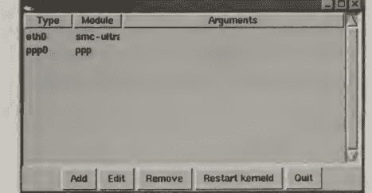


# 配置以太网设备驱动程序

以太网驱动程序期望适配器使用制造商默认配置。大多数驱动程序会探测网卡以发现正确的配置，但这并不总是有效。当不起作用时，以太网适配器的配置参数可以通过启动提示符或通过使用 `lilo.conf` 文件中的 `append` 命令传递给设备驱动。例如，在启动提示符中输入告知以太网驱动程序适配器正在使用 IRQ 10 和 I/O 端口地址 2：

```
ether=10,0
```

（注：原文此处存在重复段落，已合并去除冗余，保留核心指令含义）


## 配置以太网接口

### 网络掩码与子网掩码

掩码（`netmask`）有时被称为子网掩码（`subnet mask`）。然而，无类地址定义的地址掩码与传统的子网掩码之间存在细微差别。子网掩码是用于本地的网络掩码。它用于在地址类的结构内创建额外的网络，并且仅在本地网络已知。另一方面，无类地址的地址掩码用于全局，并通过路由协议随地址一起分发。

这种区别实际上在于意图。你是打算在本地使用该掩码，还是该掩码是随你的 `IP` 地址分配给用于全局使用的？从单个网络服务器的角度来看，这没有区别。在`ifconfig`命令中，掩码的定义方式是相同的。除了掩码预期用途的细微区别外，你可以互换使用地址掩码（`address mask`）和子网掩码（`subnet mask`）这两个术语。


即使我正在工作的网络使用的`IP`地址符合类规则，我也不允许网络掩码默认为类值。我总会在命令行上专门定义网络掩码。地址分配太重要了，不能听天由命；我想确保对它的控制权。出于相同的原因，我总是定义广播地址。

### 广播地址

广播地址用于向网络上的每个主机发送数据包。标准广播地址由网络地址和为`255`的主机地址组成。根据上面的`ifconfig`语句，你会预期默认广播地址为`172.16.5.255`。使用`IP`地址`172.16.5.4`和掩码`255.255.255.0`，你得到网络地址`172.16.5.0`。在主机地址上加上`255`，你就得到`172.16.5.255`。那么，为什么我要定义广播地址而不是让它默认生成呢？因为你可能会对默认广播地址感到惊讶。

你可以使用`ifconfig`命令，并仅以接口名称作为命令行参数来检查以太网接口的配置。这不会更改任何配置值；它显示的是已经设置的值。这是一个示例：

```
# ifconfig eth0 172.16.5.4 netmask 255.255.255.0
```

```
# ifconfig eth0
```

## 第 4 章 网络接口

```
eth0 Link encap:Ethernet Hwaddr 00:60:90:37:51
inet addr:172.16.15.4 Bcast:172.16.255.255
Mask:255.255.255.0
UP BROADCAST RUNNING MULTICAST MTU:1500 Metric:1
RX packets:319 errors:0 dropped:0 overflows:0
TX packets:76 errors:0 dropped:0 overflows:0
Interrupt:3 Base address:0x300
```

在这个示例中，我配置了接口但没有定义广播地址，期望默认值将恰好是我想要的。相反，默认值似乎忽略了我的`net-mask`参数，并创建了一个如果我使用旧地址类规则将是正确的广播地址。要具体化。在启动过程中设置网络接口配置涉及多个文件和脚本。除非你明确指定，否则可能无法获得你配置。

### 每次启动时配置接口

每次执行`ifconfig`命令分配的配置值不会在启动后保留。为了每次都配置接口，必须将`ifconfig`命令存储在启动文件中。通常，这不需要你付出任何精力。配置网络接口是`Linux`安装的基础组成部分。

正如你在第 2 章中看到的，在安装期间，`Linux`检测网络接口并要求你提供地址、地址掩码、广播地址以及其他网络相关参数。安装程序将这些值存储在磁盘上，供`ifconfig`命令使用。`Slackware`将值存储在`/etc/rc.d/init1`；`Caldera`和`Red Hat`将值存储在`/etc/sysconfig/network`和`/etc/sysconfig/network-scripts/interface`，其中`interface`是网络接口的名称，例如`ifconfig.eth0`。发行版提供的启动脚本随后使用这些值来配置接口。

然而，如果你想手动配置接口，可以直接将`ifconfig`命令存储在`rc.local`脚本中进行配置。`rc.local`脚本是最后一个执行的启动脚本，因此存储在此处的任何内容将覆盖系统完成的配置。放在`rc.local`中的以下命令将完全我想要的方式在启动时配置网络接口：

```
ifconfig eth0 172.16.15.4 netmask 255.255.255.0 \
broadcast 172.16.255.255
route -net 172.16.5.0 dev eth0
```


## 配置以太网接口

`ifconfig` 命令提供了我描述的配置。第二行表示我刚刚配置的接口是通往其所连接网络的路由。这对于工作过其他 Unix 系统的读者来说可能会有点意外，因为那些系统在通过 `ifconfig` 配置接口时，会自动创建通往本地网络的路由。在那些其他系统中，不需要 `route` 语句。在 Linux 系统上，它是需要的。`route` 命令表示通过网络设备 `eth0` 添加一条到 `172.16.5.0` 的路由。Linux 系统为每个网络接口都有一个路由语句。

> 注意：`route` 命令和路由将在第 9 章“网络网关服务”中进行详细介绍。

尽管有这个示例，你通常不会编辑任何启动脚本文件，我也不会手动配置接口。大多数系统管理员使用网络配置工具来修复网络接口配置的任何问题。

## 网络接口配置工具

大多数 Linux 发行版都提供了菜单驱动或图形化的配置工具。在 Slackware 系统上，运行 `netconfig` 来配置接口。`netconfig` 会提示 TCP/IP 所需的所有信息。

在 Caldera 系统上，我们使用带有 `--net` 命令行参数的 `ifconfig`。这会显示一个菜单，你从中选择“配置网络访问”（Configure Network Access）。在下一个菜单中选择“配置网络卡”（Configure Network Card），并在提示时提供各种配置值。

在 Red Hat 系统上，网络接口要么通过控制面板上的网络配置工具进行配置，要么通过 `linuxconf` 工具包配置。图 4.2 显示了从滚动菜单中选择“基本主机信息”（Basic Host Information）项后的 `linuxconf` 窗口。图中接口已经配置完毕。这些字段是自言自明的。

在所有上述发行版中，配置工具的设计者对需要什么以及应该定义在哪里做了一些决定。Linux 的伟大之处之一是，如果你不同意工具的设计，或者你想以不同的方式操作，你可以直接使用工具真正用来完成任务的命令。


# 图 4.2 使用 linuxconf 配置网络接口

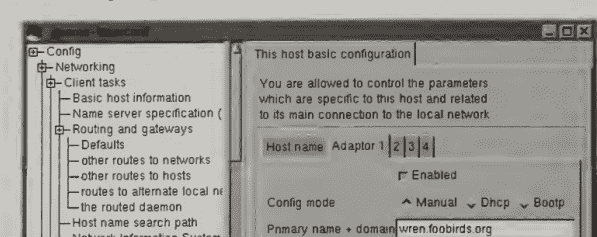

到本章为止，你只在以太网接口上配置了 TCP/IP。这可能会让你认为 Linux 系统需要 TCP/IP 和以太网接口才能与其他系统通信。Linux 系统可以在没有 TCP/IP 的情况下通信，并且可以配置为在没有以太网接口运行 TCP/IP。下一节将介绍这两种能力。

> 注意：你显然想使用 TCP/IP，并且你想使用你的以太网接口。下一节检查的功能并不是替代 TCP/IP 和以太网。相反，它们是额外的能力，允许你以在某些其他网络服务器系统上无法实现的方式使用计算机的串口接口。

## 串口接口

大多数 PC 硬件带有两个串口端口。这些端口要么是 9 针连接器，要么是传统的 25 针 RS-232 连接器。在这情况下，这些连接器都提供了将终端或调制解调器连接到串口所需的所有信号。

图 4.3 显示了 25 针连接器的 RS-232 接口引脚图。图中右侧说明了 PC 与解调器通信时发生的电气握手，展示了数据交换期间实际使用的引脚。在电信术语中，解调器被称为“数据通信设备”（DCE），而 PC 被称为“终端设备”（DTE）。图中显示了 DTE 和 DCE 之间的信号交换。

**图 4.3** RS-232 硬件握手

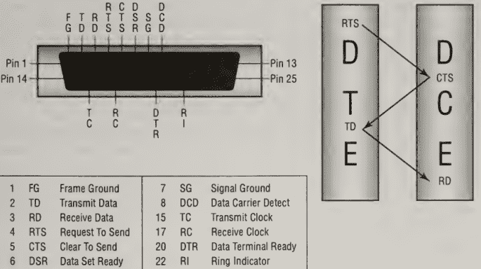

| 1 FG | 帧地 | 7 SG | 信号地 |
| 2 TD | 传输数据 | 8 DCD | 载波检测 |
| 3 RD | 接收数据 | 15 TC | 传输时钟 |
| 4 RTS | 请求发送 | 17 RC | 接收时钟 |
| 5 CTS | 清除发送 | 20 DTR | 终端就绪 |
| 6 D | 数据就绪 | 22 RI | 环路指示 |

只有两个引脚用于移动数据。传输数据（`TD`）用于从计算机发送数据，接收数据（`RD`）用于从计算机读取数据。如图所示，它们分别是 RS-232 接口上的第 2 和第 3 引脚。解调器能够直接连接到计算机，因为它从计算机写入的 `TD` 引脚读取数据，并向计算机读取的 `RD` 引脚写入数据。

## 第 4 章 网络接口

其他几个接口引脚也用于设置和控制串口连接：

- 数据终端就绪（`DTR`; 第 20 号引脚）用于计算机，信号它已准备好进行连接。
- 数据集就绪（`DSR`; 第 6 号引脚）用于调制调器，信号它已准备好连接。
- 载波检测（`DCD`; 第 8 号引脚）用于调制调器，信号它与电话线远端的计算机建立了良好的连接。
- 请求发送（`RTS`; 第 4 号引脚）用于计算机，表示它可以接收和发送数据。
- 准备发送（`CTS`; 第 5 号引脚）用于调制调器，表示它可以接收数据。

调制调器和计算机的连接非常简单，因为它们以互补的方式使用接口引脚。然而，如果你尝试将两台计算机连接在一起，就会产生冲突，因为它们都想以相同的方式使用相同的引脚。例如，两者都会尝试向 `TD` 并从 `RD` 读取。如果你想在两台计算机之间建立直接连接，可以使用一根空调制调器线（null-modem cable），也称为直连线，空调制调器线通过交叉接线使得两台计算机能够通信。

# 通过串口接口连接

无论数据是通过调制调器还是来自直接连接的终端，Linux 系统都以相同的方式对其进行处理。有三个程序处理连接：`init`、`getty` 和 `login`。

`init` 负责将 `getty` 程序附加到串口，并在该程序终止时重新启动 `getty` 程序。你在第 3 章描述 `initab` 文件时已经见过这方面的例子。

`getty` 监控串口。当 `getty` 在端口上检测到载波信号时，它会显示“login:”提示符。它读取用户名并用它来调用 `login`。例如，如果 `getty` 在登录提示下收到了“norman”，它将发出 `login norman` 命令。

`login` 接着提示用户输入密码，并与 `/etc/passwd` 或 `/etc/shadow` 文件中的加密密码进行比对。Linux 用户有三次机会输入正确的密码。在验证密码正确后，密码文件中的 `UID` 和 `GID` 将被分配给 `tty` 设备，后续环境变量如下：

* `HOME` 此变量定义用户的家目录。`login` 从 `/etc/passwd` 文件中获取值。
* `SHELL` 此变量定义用户的登录 shell。`login` 从 `/etc/passwd` 文件中获取值。
* `LOGNAME` 此变量定义用户在系统日志中的标识名称。`login` 使用 `getty` 传递给它的用户名。
* `PATH` 此变量定义执行路径。`login` 默认路径为 `/usr/local/bin:/usr/bin`。
* `MAIL` 此变量定义用户邮件文件的路径。`login` 使用路径 `/var/mail/spool/username`，其中 `username` 是 `getty` 传递的名称。
* `TERM` 此变量标识终端类型。`login` 保留由 `getty` 设置的 `TERM` 变量。`TERM` 的值将是 `/etc/termcap` 文件中的有效终端类型。

一旦设置了这些变量，`login` 就会启动用户 `/etc/passwd` 条目中指定的 shell。这些初始化文件位于用户的家目录下。这些初始化文件（例如 bash shell 的 `.bash_profile` 和 `.bashrc`）允许用户设置自己的环境变量；例如，定义一个更完整的执行路径。最后，shell 向用户发出命令提示符，用户就有了系统的完全访问权限。

所有这些过程和服务都会自动发生，几乎不需要你进行任何配置。除了为用户创建账户和配置调制调器接听电话之外，系统管理员无需做任何其他工作。基础 Linux 系统自带通过串口支持终端连接的能力。如果你曾经在其他 PC 操作系统上配置过拨号服务，你就会体会这种优势。

当然，即使在 Linux 系统上，事情并不总是进展顺利。Linux 自带了一些终端仿真程序，如 `screen` 和 `minicom`，可以用于排查调制调器和串口链路故障。

> 注意：参见第 15 章“故障排除”，获取有关使用 `minicom` 进行故障排除的信息。

Linux 内置对串口通信的支持是在串口线路上运行 TCP/IP 的基础。下一节将专门介绍这一点。


## 在串口上运行 TCP/IP

与将终端连接到服务器串口相比，在串口上运行 TCP/IP 的实用性大得多。这允许你通过带有调制调器的电话线运行 TCP/IP。当然，这是大多数人通过本地 ISP 连接到互联网的方式。但它也是一种让你为远程分支办事处或居家办公的用户提供互联网或企业网络连接的一种方法。

点对点协议（PPP）为在电话线上发送 IP 数据报文提供了帧封装机制。PPP 使用三层架构来实现此目标：

* 数据链路层：PPP 使用高级数据链路控制（HDLC）协议在任何类型的串口上提供可靠的传输。
* 链路控制层：链路控制协议（LCP）是专门为 PPP 开发的。它负责打开和关闭连接、监控链路质量并协商链路配置参数。
* 网络控制层：PPP 设计用于携带各种协议。TCP/IP 的网络控制协议是 IP 控制协议（IPCP）。

正确配置 PPP 服务需要安装所有这些层，以及数据通过的串口和调制调器。本章剩余部分将介绍如何实现这些。

## 安装 PPP

物理层和数据链路层部分由内核提供，链路控制层和网络控制层作为进程实现。因此，PPP 的底层作为内核模块实现。为了让 PPP 运行，必须正确安装所有组件。

# PPP 内核模块

在第 3 章中，你看到了安装串口驱动时显示的内核消息。同样，当 PPP 编译进内核时，启动期间会显示关于 PPP 的信息，如下：

```


`dmesg | grep PPP`

`PPP: version 2.2.0 (dynamic allocation)`

`PPP dynamic allocation code 1995 Caldera, Inc.`

`PPP line discipline registered.`

如果 PPP 已由内核安装，你就可以运行 PPP 守护进程了。然而，在大多数系统中，内核并未编译进 PPP。如果是这样，你必须手动安装加载模块。为此使用第 3 章涵盖的命令，并参考本章早期安装以太网驱动的示例。在我们 Red Hat 系统上，可以使用图 4.1 所示的内核配置器或 `modprobe ppp` 命令来安装 PPP。例如，`modprobe ppp` 会加载 PPP 需要的 `ppp.o` 模块。

# PPP 守护进程

通过 `pppd` 命令启动 PPP 守护进程。该命令可以在 shell 提示符输入，通常位于客户端计算机上。在服务器上，命令通常存储在脚本中，以便启动时运行。Red Hat 系统使用 `/etc/sysconfig/network-scripts/if-ppp` 脚本启动 PPP 守护进程。然而，通常不直接编辑该脚本。它通过后文介绍的配置工具（如 `linuxconf` 和 `kpppp`）进行控制。

在其他系统上，你可能会发现创建自定义的 `pppd` 配置更为方便。`pppd` 命令的语法为：

```
pppd [tty-device] [options]
```

## 第 4 章 网络接口

- `tty-device` 是运行 PPP 协议的串口设备名称。如果没有指定设备，则将使用控制终端（controlling terminal）作为设备。正如你稍后将看到的，在创建拨号 PPP 服务器时，使用控制终端的能力是非常有用的。
- `speed` 是端口的传输速度，单位为每秒比特（bits per second）。
- `options` 仅仅是其名——即命令行选项。

`pppd` 选项非常多。除了在命令行上指定选项外，还有三个不同的文件可用于存储这些选项：

- `/etc/ppp/options` 用于存储系统范围的 PPP 选项。该文件由系统管理员创建并维护。
- `.ppprc` 是每个用户都可以创建并存储在自己的家目录中，用于设置个人 PPP 选项。
- `/etc/ppp/options.device` 为特定的串口设备设置 PPP 选项。例如，`options.device` 为 `/dev/tty1` 设置 PPP 选项。

这些文件按照上述列出的顺序进行读取，这意味着最后读取的文件中的选项可以覆盖第一个读取的文件中的选项。因此，所有这些来源的选项的优先级如下：

1. 在命令行上定义的选项具有最高优先级。
2. 在 `options.device` 文件中定义的选项具有后续优先级。
3. 用户在 `.ppprc` 文件中定义的选项具有后续优先级。
4. 来自 `/etc/ppp/options` 文件的选项具有最低优先级。

看着这个列表，你可能担心在 `/etc/ppp/options` 文件中定义的系统范围选项会被用户通过 `.ppprc` 文件所覆盖。不用担心。与系统安全相关的项目无法被用户覆盖。此外，你始终可以在 `options.device` 文件中指定重要选项，该文件具有最高优先级。

> 注意：`pppd` 命令提供了 70 多个可用选项。如果你想阅读所有选项，请参阅 Andrew Sun 编写的《Using and Managing PPP》（O'Reilly, 1999）。

接下来的章节将仅介绍你最可能用到的 PPP 选项。通过选择正确的选项，你可以为专线或拨号线配置 `pppd`，使其作为 PPP 服务器或客户端运行工作。

## 配置 PPP 服务器

Linux 系统既可以用作专线连接、也可以用作拨号连接的 PPP 服务器。为专线配置 `pppd` 是最简单的配置，它为 `pppd` 命令的结构提供了一个很好的示例。在 `rc.local` 启动文件中插入单行命令即可配置专线 PPP 服务器：

```
pppd /dev/ttyS1 115700 crtscts
```

该命令启动 PPP 守护进程并将其挂载到串口设备 `ttyS1` 上。它将该专线的线路速度设置为 `115700` bps。

此命令中还选择了 `crtscts` 一个选项。`crtscts` 开启了请求发送（RTS）硬件流控。硬件流控使用串口接口中的 RTS 和 CTS 引脚来控制数据流。

在使用 PPP 时请务必使用硬件流控。替代方案是软件流控，它在数据流中发送特殊字符来控制数据流。软件流控（也称为带内流控）充其量浪费了可以通过硬件完成的带宽，最坏还会发送可能与实际数据混淆的控制字符。

连接专线的客户端 `pppd` 命令看起来与上面相同，但它还会有一个默认路由（`defaultroute`）选项：

```
pppd /dev/ttyS1 115700 crtscts defaultroute
```

`defaultroute` 创建一个默认路由，使用远程 PPP 服务器作为默认网关。这假设该 PPP 链路是我们通往外部世界的唯一链路，这通常是如此的。上述示例 `pppd` 命令将用于将分支机构连接到企业网络。然而，如果已经定义了默认路由，则此选项会被忽略。专线的服务器端不使用此选项，因为服务器是客户端的路由器，因此必须已经有了另一个通往世界的路由。

专线的 PPP 配置非常简单，因为链线上只有两个系统连接——每端一个，即一个单一服务器和一个单一客户端。线路专用于此单一目的，因此可以在启动时进行配置，并在系统运行期间保持不变。不需要配置服务器来处理多个客户端。

``

然而，PPP 客户端和服务器并不总是连接到专用的串口。它们更常见的情况是通过拨号串口线连接，而为拨号线配置服务器比为专线配置服务器更复杂。

## PPP 拨号服务器配置

正如你所看到的，Linux 系统提供了在串口上支持拨号客户端所需的软件。创建一个拨号 PPP 服务器是这种能力的简单扩展。关键在于 `/etc/passwd` 文件。使用 `/etc/ppp/ppplogin` 作为拨号 PPP 用户的登录 shell，在此示例中：

```
jane:x:522:100:Jane Resnick:tmp:/etc/ppp/ppplogin
```

这看起来与其他任何 `/etc/passwd` 条目完全一样，且功能完全相同。PPP 用户会被提示输入用户名（在本例中为 `jane`）和密码。

拨号 PPP 用户的登录 shell 是 `/etc/ppp/ppplogin`。以下是拨号 PPP 认证脚本示例：

```
#!/bin/sh

mesg -n

stty -echo

exec /sbin/ppapd crtscts auth
```

你的拨号 PPP 脚本并不总是像这样；`mesg -n` 和 `stty -echo` 是为了设置终端状态，而 `exec /sbin/ppapd crtscts auth` 是启动 PPP 守护进程。

# 第 4 章 网络接口

由于这些局限性，仅在必须时使用 PAP——例如，如果你必须支持一个只能提供 PAP 认证的客户端。不幸的是，PAP 仍然被广泛使用，并且可能是你的唯一选择。

要配置 PAP，请在 `/etc/pap-secrets` 文件中创建相应的密码条目。`pap-secrets` 文件可能包含以下内容：

```
# Secrets for authentication using PAP

# client server secret IP addresses

crow wren Wherearethestrongest? 172.16.5.5

wren crow Whoarethetherusted? 172.16.5.1
```


给定此配置文件，当`wren`请求认证时，`crow`会发送`PPP`客户端名称`crow`和密码`` `Wherearethestrongest?` ``。当`crow`请求时，`wren`会发送客户端名称`` `wren` ``和密码`` `Whoarethetherusted?` ``。两个系统的`pap-secrets`文件中都有相同的条目。这两个条目为`PPP`连接的两端提供了身份验证。

每个条目末尾的`IP`地址字段定义了客户端名称和密码有效的地址。因此，只有位于`172.16.5.5`的主机才能使用客户端名称`` `crow` ``和密码`` `Wherearesthe strongest?` ``。即使这是一个有效的客户端名称和密码组合，如果它来自任何其他地址，将被拒绝。

`pppd`命令行上的`` `auth` ``选项强制`PPP`守护进程需要认证。如果必须需要，它将回退到`PAP`，但它会先尝试使用`CHAP`。

## CHAP 安全

挑战握手认证协议（`CHAP`）是`PPP`使用的默认认证协议。`CHAP`不易受到威胁`PAP`的安全攻击。事实上，使用`CHAP`的`PPP`连接可能比你的本地以太网连接更安全。其，`CHAP`不发送明文密码。相反，`CHAP`发送一个名为挑战字符串（challenge string）的字符串。寻求认证的系统使用`/etc/ppp/chap-secrets`文件中的密钥对挑战字符串进行加密，并将加密后的字符串返回给服务器。密钥永远不会在网络上传输，因此窃听者无法从网络上读取。

此外，`CHAP`会反复对系统进行重新认证。即使小偷通过地址欺骗获取了连接，如果他不正确响应`CHAP`挑战，也无法长时间保持连接。

## 配置 PPP 服务器

`CHAP`通过`chap-secrets`文件进行配置。`chap-secrets`文件中的条目包含以下字段：

- `respondent`（响应者）：这是响应`CHAP`挑战的计算机名称。大多数文档将其称为“`client`（客户端）”字段。然而，`PPP`客户端需要服务器的认证，就像服务器需要客户端的认证一样。第一个字段定义了必须响应挑战以通过认证的系统。
- `challenger`（挑战者）：这是发布`CHAP`挑战的系统名称。大多数文档将其称为“`server`（服务器）”字段，但如提到的，服务器并不是使用`CHAP`挑战的唯一系统。第二个字段包含了挑战另一个系统进行认证的计算机名称。
- `secret`（密钥）：这是用于加密和解密挑战字符串的密钥。挑战者将挑战字符串发送给正在认证的系统。响应者使用密钥进行响应并将加密后的字符串发给挑战者。然后挑战者使用密钥解密该字符串。如果解密后的字符串与原始挑战字符串匹配，则响应系统通过认证。使用该系统，密钥永远不会在网络上传输。
- `address`（地址）：这是一个数字`IP`地址或主机名形式地址。如果定义了地址，响应者必须使用指定的`IP`地址。即使系统使用正确的密钥进行响应，除非它也是正确`IP`地址的主机，否则不会通过认证。

`robin`上的`chap-secrets`文件示例可能包含以下条目：

```
cat chap-secrets
```

```
# Secrets for authentication using CHAP
```

| client | server | secret | IP addresses |
| :--- | :--- | :--- | :--- |
| robin | wren | Peledon'tknowyou | robin.foobirds.org |
| wren | robin | ,andrustisakoke | wren.foobirds.org |

当`robin`被`wren`挑战时，它使用密钥加密挑战字符串。当`robin`挑战`wren`时，它期望`wren`使用密钥`,andrustisakoke..`。条目以这种成对的形式出现非常常见。毕竟，`PPP`连接有两个端，且两个系统都需要认证来建立安全链路。`wren`挑战`robin`，而`robin`挑战`wren`。当两台计算机都确定它们正在与正确的远程系统通信时，链路就建立起来。当然，为了使之正常工作，`wren`需要在它的`chap-secrets`文件中具有相同的条目。


出于安全考虑，保护`/etc/ppp`目录非常重要。只有`root`用户应该能够读取或写入`chap-secrets`文件或`pap-secrets`文件。否则，密钥可能会被泄露。此外，应该只允许`root`用户写入`options`文件。否则，用户将能够定义系统范围的`PPP`选项。

最后，脚本`` `ip-up` ``和`` `ip-down` ``应该只能由`root`用户写入。`ppp`在建立`PPP`连接后会立即运行`` `ip-up` ``脚本，并在关闭连接后运行`` `ip-down` ``脚本。这些脚本可以执行与网络连接相关的特权功能。因此，允许`root`用户以外的任何人修改这些脚本会影响连接的安全。

## PPP 配置

配置`PPP`客户端与配置服务器一样复杂。`` `connect` ``选项标识服务器。在示例中，`` `dial-server` ``是脚本名称。`chat`程序用于与连接到串口的设备（如调制解调器）通信。`` `-v` ``选项导致`chat`通过`syslog`调试信息。

## chat 脚本

脚本定义了连接远程服务器所需的步骤。脚本是一个`expect/send`对。每对由本地系统期望接收的字符串和它将发送的响应字符串组成，中间由分隔分隔。一个示例脚本可能包含以下内容：

```
$ cat dial-server

' ATZ

OK ATDT301-555-1234

CONNECT \d\r

gin: karen

ord: T0GOA
```


## 表 4.1 转义序列及其含义（续）

| 转义序列 | 含义 |
|---|---|
| `\r` | 回车 |
| `\s` | 空格字符 |
| `\t` | 制表符 |
| `\` | 反斜杠 |
| `\ddd` | 八进制值为 `ddd` 的 `ASCII` 字符，`\177` 是 `DEL`（删除键）字符 |

示例脚本的最后两行是远程登录。脚本期望输入 `gin;`（即 "login:" 提示的最后四个字符），并用用户名 `karen` 响应。接下来，期望输入 `ord;`（即 "Password:" 提示的最后四个字符），并发送 `ToGa ToGa` 作为响应。登录完成后，远程系统将运行 `pplogin` 脚本，`PPP` 连接即可建立并正常运行。

> 注意：`chat` 是一种非常基础的脚本语言。它在设置 `PPP` 连接时非常流行，因为大多数 `PPP` 连接不需要复杂的脚本。如果你确实需要，你可能需要使用更强大的脚本语言。`Linux` 提供了 `dip` 和 `expect`。要了解更多关于 `dip` 的信息，请参阅 Craig Hunt 编写的《TCP/IP Network Administration》(O'Reilly, 1998)。要了解更多关于 `expect` 的信息，请参阅 Don Libes 编写的《Exploring》(O'Reilly, 1997)。

## 使用 `linuxconf` 配置 `PPP` 客户端

到目前，你已经通过使用文本编辑器编辑配置文件来配置 `PPP`。也可以使用 `X Windows` 环境下的 `linuxconf` 程序来配置 `PPP` 客户端。这样做只需：从 `linuxconf` 下拉菜单中选择 `PPP/SLIP/PLIP`。会出现一个与图 4.4 所示类似的窗口。

### 4.4 `linuxconf` `PPP` 配置窗口

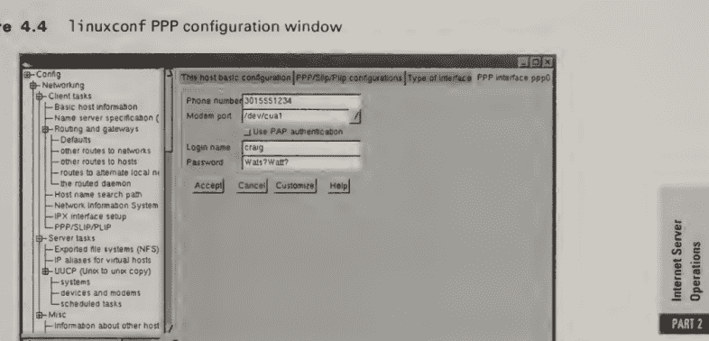

如图所示，填写空白处创建基础 `PPP` 配置。点击“Customize”（自定义）按钮获取更多配置选项，会出现图 4.5 所示的窗口。

### 4.5 使用 `linuxconf` 自定义 `PPP`

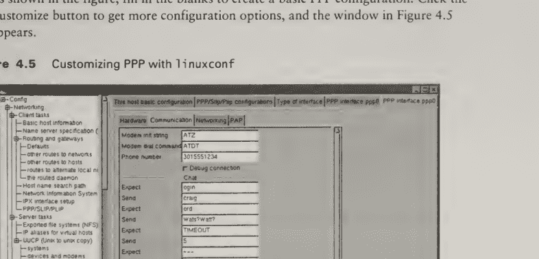

此窗口有四个选项卡用于设置配置值：

- 使用 `Hardware`（硬件）选项卡设置波特率、硬件流控并指定 `ppp` 命令行选项。
- `Communication`（通信）选项卡定义 `chat` 脚本（如果需要的话）。
- 使用 `Networking`（网络）选项卡定义静态 `IP` 地址，或更改最大接收单元（`MRU`）和最大传输单元（`MTU`）的大小。
- `PAP` 选项卡保存 `PAP` 认证的客户端名称和密码。

> 注意：你只能选择 `PAP` 认证。这是使用 `linuxconf` 定义 `PPP` 配置的主要局限性——认证要么是 `PAP`，要么没有。

流控、`chat` 脚本、地址和 `PAP` 之前提到过；只有最大接收单元（`MRU`）和最大传输单元（`MTU`）是新术语。这些选项允许你设置系统在单个包中发送或接收的字节数。`pppd` 支持的范围从 128 到 1500 字节。这些值用于与远程系统协商数据包大小；使用双方都能接受的最大值。

调整 `MRU` 和 `MTU` 可以提高性能，但请记住并非越大越好。数据包过大导致的溢溢会导致重传，从而降低性能。如果你发现 `PPP` 链路性能差或看到如 "SILO Overflow" 之类的错误信息，尝试减小 `MRU` 和 `MTU` 的大小直到性能提高。选择与良好性能一致的最大 `MRU` 和 `MTU`。在大多数系统中，`MRU` 和 `MTU` 不需要调整。

> 注意：这些相同的值可以通过 `pppd` 命令行上的 `mru size` 参数和 `mtu` 参数设置，其中 `size` 是数据包中的数据字节数。

## 使用 `kppp` 配置 `PPP` 客户端

`Calder 2.2` 和 `Red Hat 6` 都提供了一个名为 `kppp` 的 `PPP` 配置工具，位于 `KDE` 网络菜单中。当你选择此工具时，会出现一个 `PPP` 登录窗口。要配置新的 `PPP` 客户端，点击窗口中的“Setup”（设置）按钮。这将打开图 4.6 所示的窗口。

### 图 4.6 `kppp` 配置窗口

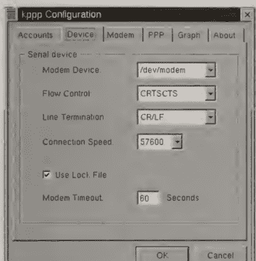

`kppp` 配置窗口包含六个不同的选项卡。提供信息的 `About`（关于）选项卡和用于选择显示颜色的 `Graph`（图形）选项卡对于配置并不重要。配置的核心由其他四个选项卡设置：

`PPP` 定义 `PPP` 窗口在连接期间和连接后的行为。

`Modem`（调制调器）设置调制调器的特性。使用此选项卡可以：

- 定义控制调制调器使用的命令；默认情况下，这些是标准的 `Hayes AT` 命令。
- 设置调制调器的扬声器音量。
- 设置调制调器在收到忙音信号时重拨前的等待时间。
- 指定调制调器是否使用 `CD` 引脚指示是否连接到远程系统。
- 向调制调器发送 `Hayes ATI` 查询命令。
- 打开直接与调制调器通信的简单终端，这在配置 `PPP` 之前测试调制调器和连接非常有用。

`Device`（设备）设置设备的特性。这些包括设备名称、速度、流控类型以及通常使用的字符是回车（`CR`）和换行（`LF`）。`Accounts`（账户）允许你配置。

### 图 4.7 `kppp` 窗口


`kppp` 配置窗口包含六个不同的选项卡。提供信息的 `About` 选项卡和用于选择显示颜色的 `Graph` 选项卡对于配置并不重要。配置的核心由其他四个选项卡设置：

- 使用 `Hardware` 选项卡设置波特率、硬件流控并指定 `ppp` 命令行选项。
- `Communication` 选项卡定义 `chat` 脚本（如果需要）。
- 使用 `Networking` 选项卡定义静态 `IP` 地址，或更改最大接收单元（`MRU`）和最大传输单元（`MTU`）的大小。
- `PAP` 选项卡保存 `PAP` 认证的客户端名称和密码。

# 使用 `inetd` 启动服务

为了让数据在全球范围内（如互联网）能够正确传输，`IP` 地址必须是全球范围内唯一的，且协议和端口号的含义必须被网络中的所有系统已知。第 4 章描述了在安装期间如何将 `IP` 地址分配给网络接口。对于 `IP` 地址，由你来负责确保它的唯一性。（在第 15 章“故障排除”中，你将看到当 `IP` 地址不唯一会发生什么问题。）协议和端口号是不同的，它们由互联网标准定义。因此，协议号和端口号可以预定义在 `Linux` 系统附带的两个文件中：`/etc/protocols` 和 `/etc/services`。

# `/etc/protocols` 文件

来自网络的数据以数据流的形式到达计算机。该流可能包含来自多个源并发往多个应用程序的数据包。在电信术语中，这被称为多路用。为了将每个数据包投递到正确的应用程序，必须进行去多路用。此过程的第一步是网络协议（`IP`）将数据包传递给正确的传输协议。`IP` 通过数据包头部的包含协议号来确定正确的协议。

`/etc/protocols` 文件标识了每个传输协议的协议号。来自 `Red Hat 6` 系统的 `protocols` 文件包含以下内容：

```
# /etc/protocols:

# $SId: protocols,v 1.1 1995/02/24 01:09:41 imurdock Exp $

#

## Internet (IP) protocols

#

# from: @(#)protocols 5.1 (Berkeley) 4/17/89

#

# Updated for NetBSD based on RFC 1340, Assigned Numbers (July 1992).
```


```
ip 0 IP internet message protocol

icmp 1 ICMP internet control message protocol

igmp 2 IGMP Internet Group Management

ggp 3 GGP gateway-gateway protocol
```


# 第 5 章 登录服务

| `ipencap` 4 | IP-ENCAP | # IP 封装在 IP 中 |
| `st` 5 | ST | # ST 数据报模式 |
| `tcp` 6 | TCP | # 传输控制协议 |
| `egp` 8 | EGP | # 外部网关协议 |
| `pup` 12 | PUP | # PARC 通用包协议 |
| `udp` 17 | UDP | # 用户数据报协议 |
| `hmp` 20 | HMP | # 主机监控协议 |
| `xns-idp` 22 | XNS-IDP | # Xerox NS IDP |
| `rdp` 27 | RDP | # “可靠数据报” |
| `iso-tp4` 29 | ISO-TP4 | # ISO 传输协议第 4 类 |
| `xtp` 36 | XTP | # Xpress 传输协议 |
| `ddp` 37 | DDP | # 数据报交付协议 |
| `idpr-cmtp` 39 | IDPR-CMTP | # IDPR 控制消息 |
| `rspf` 73 | RSPF | # 射电最短路径优先 |
| `vmtp` 81 | VMTP | # 通用消息协议 |
| `ospf` 89 | OSPFIGP | # 开放最短路径优先 IGP |
| `ipip` 94 | IPIP | # 另一种 IP 封装 |
| `encap` 98 | ENCAP | # 另一种 IP 封装 |

### `protocols` 结束

该文件中的某些注释被删除了，以便适应书籍页面，但除了这些外观上的差异，无论使用哪个发行版，你 `Linux` 系统上的 `protocols` 文件看起来都基本上是一样的。事实上，你可以在任何 `Unix` 或 `Windows NT` 系统上找到类似的文件，因为协议号是标准化的。你永远不需要编辑这个文件。

该文件中只有两个条目具有重要意义。一个是 `tcp`，定义了传输控制协议（`TCP`/`IP` 中的 `TCP`）的协议号，它的协议号是 `6`。另一个 `udp` 定义了用户数据报协议的协议号为 `17`。`TCP` 和 `UDP` 承载了你感兴趣的大部分信息。

# `/etc/services` 文件

网络数据多路复用的第二阶段是识别数据指向的应用程序。传输协议通过传输协议头部的端口号来完成操作。

标准端口号在 `/etc/services` 文件中标识。已知服务的端口号在互联网名称标准中分配，因此你永远不需要更改现有服务的端口号。在极少数情况下，你可能需要向文件中添加新服务，但那是你编辑该文件的唯一时刻：

传输协议并不多，只有两个非常感兴趣，但网络服务非常多。因此，下面的示例仅是完整的 `/etc/services` 文件的一小部分：

| `ftp-data` | 20/tcp |
| `ftp` | 21/tcp |
| `telnet` | 23/tcp |
| `smtp` | 25/tcp | mail |
| `time` | 37/tcp | timserver |
| `time` | 37/udp | timserver |
| `rlp` | 39/udp | resource |
| `name` | 42/udp | nameserver |
| `whos` | 43/tcp | nickname |
| `domain` | 53/tcp | |
| `domain` | 53/udp | |
| `mtp` | 57/tcp | |
| `bootps` | 68/udp | bootp client |
| `tftp` | 69/udp | |
| `gopher` | 70/tcp | gopher server |
| `rje` | 77/tcp | |
| `finger` | 79/tcp | |
| `http` | 80/tcp | |

从示例可以看出，`telnet` 使用端口 `23`。`http` 使用端口 `80`。`ftp` 使用端口 `21`。`smtp` 使用端口 `25`。`time` 使用端口 `37`。`domain` 使用端口 `53`。`finger` 使用端口 `79`。`bootps` 使用端口 `68`。

在 `inetd` 配置中，你通过端口号来定义哪些服务。`tcp` 的协议号是 `6`，`udp` 的协议号是 `17`。`TCP` 和 `UDP` 承载了你感兴趣的大部分信息。

# 配置 `inetd`

`/etc/inetd.conf` 文件包含了 `inetd` 运行的服务定义。以 `#` 注释的行被禁用。下面是激活的 `inetd` 示例：

```
# /etc/inetd.conf

ftp      tcp    20    root    /usr/sbin/vsftpd  # ftp-in.conf

telnet   tcp    23    root    /usr/sbin/telnetd # telnet-in.conf

smtp     tcp    25    root    /usr/sbin/sendmail  # smtp-in.conf

time     tcp    37    root    /usr/sbin/timed   # time-in.conf

time     udp    37    root    /usr/sbin/timed   # time-in.conf

rlp      udp    39    root    /usr/sbin/rlpd     # rlp-in.conf

name     udp    42    root    /usr/sbin/namedd  # name-in.conf

whos     tcp    43    root    /usr/sbin/whoisd  # whos-in.conf 

domain   tcp    53    root    /usr/sbin/namedd  # domain-in.conf

domain   udp    53    root    /usr/sbin/namedd  # domain-in.conf

mtp      tcp    57    root    /usr/sbin/smptpd   # mtp-in.conf

bootps   udp    68    root    /usr/sbin/bootpcd  # bootps-in.conf

tftp     udp    69    root    /usr/sbin/tftpd   # tftp-in.conf

gopher   tcp    70    root    /usr/sbin/gopherd # gopher-in.conf

rje      tcp    77    root    /usr/sbin/rjedd   # rje-in.conf

finger   tcp    79    root    /usr/sbin/fingerd # finger-in.conf

http     tcp    80    root    /usr/sbin/httpd   # http-in.conf
```


## `inetd.conf` 配置

每一行 `inetd.conf` 配置通常由以下字段组成：

- 服务名称：服务的名称。
- 协议：`tcp` 或 `udp`。
- 端口号：监听的端口。
- 用户：运行该服务的用户名。
- 路径：可执行程序的路径。
- 参数（可选）：传递给程序的参数或配置文件（如 `ftp-in.conf`）。
- 状态：`wait` 或 `nowait`。`wait` 告诉 `inetd` 在等待程序完成后再处理新请求；`nowait` 则立即处理后续请求。

要启用某个服务，只需删除 `/etc/inetd.conf` 中对应行前面的 `#` 号，然后重启 `inetd` 服务。要禁用某个服务，只需在对应行前添加 `#` 号。

```
-pop-3 stream tcp nowait root /usrusr/sbin/tcpd ipop3d |
#uwcp stream tcp nowait uucp /usrusr/sbin/tcpd /lib/uwcp/uucico -1 |
#ftfp dgram udp wait root / /usr/sbin/tcpd in.tftpd |
#bootps dgram udp wait root / /usr/sbin/tcpd bootpd |
#cfinger stream tcp nowait root / /usr/sbin/tcpd in.cfingerd |
#systast stream tcp nowait guest / /usr/sbin/tcpd / /bin/ps -auwwx |
#netstat tcp nowait guest / /usr/sbin/tcpd / /bin/netstat -f inet |
#swat stream tcp nowait .400 root / /usr/sbin/swat swat |
```

`inetd.conf` 文件中的注释以井号（`#`）开头。要禁用某服务，请在该条目的开头插入一个井号。要启用某服务，请移除井号。例如，通过移除 `bootps` 条目开头的井号来启用 `BootP` 服务器。同样，要禁用 `finger` 协议，请在 `finger` 条目的第一个字符前插入一个井号。这种简单的编辑让你对 `Linux` 系统提供的服务具有完全控制权。

> **警告** 不要运行你并不真正使用的服务。每一个网络服务都是安全破解者可能潜入的潜在漏洞。在本章中，我使用了 `ftp`、`telnet` 和 `login`。显然，它们不应该在配置中被注释掉。但本章没有使用 `gopher` 或 `pop-2`。这些服务可以被注释掉而不会影响你的用户。

现在你已经知道 `telnetd`、`ftpd` 和 `logand` 是如何启动的，让我们来看看这些账户是如何创建的。下一节将回顾用于在 `Linux` 系统上创建用户账户的各种工具。

## 创建用户账户

登录到你的 `Linux` 系统的每个用户都通过用户账户进行标识。用户账户通过定义登录期间验证用户身份的用户和密码来控制对系统的访问。一旦用户登录系统，就会使用用户标识符（`UID`）和组标识符（`GID`）来控制用户的权限。这些值是在你创建用户账户时定义的，它们控制着文件系统的安全并标识哪些用户控制着进程。

用户账户是 `Linux` 系统的重要组成部分，所有的 `Linux` 发行版都提供了维护用户账户的工具。本节将检查这些工具中的几个，但首先先看看幕后这些工具在为你执行什么。

### 创建用户账户的步骤

不同的 `Linux` 发行版提供的简化添加用户账户过程的工具可能不同，但所有工具请求的信息本质相同，因为所有 `Linux` 系统上添加用户账户的底层过程是相同的。添加用户账户需要以下步骤：

1. 编辑 `/etc/passwd` 文件，以为用户定义用户名、`UID`、`GID`、家目录和登录 `shell`。
2. 运行 `passwd` 为用户设置密码。
3. 运行 `mkdir` 创建用户的新家目录。
4. 从 `/etc/skeleton` 拷贝默认初始化文件到用户的家目录。`/etc/skeleton` 目录保存了如 `.bashrc` 之的文件，它用于初始化 `bash` 环境。你的 `Linux` 系统在 `/etc/skeleton` 中已经预选了一些文件。如果你想为用户提供额外的或不同的初始化文件，只需向 `/etc/skeleton` 目录添加文件，或编辑你在那里发现的文件。
5. 更改用户家目录及其包含文件的所有权，以便用户对其所有文件具有完全访问权限。例如，执行 `chown -r kathy:users /home/kathy`。


### `passwd` 文件

`Linux` 系统上的每个用户在 `/etc/passwd` 文件中都有一个条目。要查看 `Linux` 系统上存在哪些账户，只需查看该文件即可。我们示例 `Red Hat` 系统的 `passwd` 文件包含以下条目：

```
# cat /etc/passwd

root:xFVXCMxYxFw:0:0:root:/bin/bash

bin*:1:1:bin:/bin:

daemon*:2:2:daemon:/sbin

adm*:3:4:adm:/var/adm:

lp*:4:7:7lp:/var/spool/lpd

sync*:5:0:sync:/sbin:/bin/sync

shutdown:*:6:0:shutdown:/sbin:/sbin/shutdown

halt:*:7:0:halt:/sbin:/sbin/halt

mail:*:8:12:mail:/var/spool/mail

news:*:9:13:news:/var/spool/news

uucp:*:10:14:uucp:/var/spool/uucp

operator:*:11:0:operator:/root

games:*:12:100:games:/usr/games

gopher:*:13:0:gopher:/usr/lib/gopher-data

ftp:*:14:0:ftp:/home/ftp

nobody:*:99:99:nobody:/usr/n:/usr/sbin/nologin

games:*:100:100:games:/usr/games/nologin

mail:*:101:101:mail:/var/spool/mail/nologin

news:*:102:102:news:/var/spool/news/nologin

uucp:*:103:103:uucp:/var/spool/uucp/nologin

operator:*:104:104:operator:/root/nologin

games:*:105:105:games:/usr/games/nologin

gopher:*:106:106:gopher:/usr/lib/gopher-data/nologin

ftp:*:107:107:ftp:/home/ftp/nologin

nobody:*:108:108:nobody:/usr/n/nologin

kathy:*:109:109:kathy:/home/kathy/nologin

sara:*:110:110:sara:/home/sara/nologin

david:*:111:111:david:/home/david/nologin

becky:*:112:112:becky:/home/becky/nologin

christin:*:113:113:christin:/home/christin/nologin

craig:*:114:114:craig:/home/craig/nologin

kris:*:115:115:kris:/home/kris/nologin

kyle:*:116:116:kyle:/home/kyle/nologin

robert:*:117:117:robert:/home/robert/nologin

rebecca:*:118:118:rebecca:/home/rebecca/nologin

hanson:*:119:119:hanson:/home/hanson/nologin

alice:*:120:120:alice:/home/alice/nologin

william:*:121:121:william:/home/william/nologin

jackie:*:122:122:jackie:/home/jackie/nologin

jason:*:123:123:jason:/home/jason/nologin

steve:*:124:124:steve:/home/steve/nologin

shawn:*:125:125:shawn:/home/shawn/nologin

marcus:*:126:126:marcus:/home/marcus/nologin

terrence:*:127:127:terrence:/home/terrence/nologin
```


`james:*:128:128:james:/home/james/nologin`

`charlie:*:129:129:charlie:/home/charlie/nologin`

`morgan:*:130:130:morgan:/home/morgan/nologin`

`sandra:*:131:131:sandra:/home/sandra/nologin`

`albert:*:132:132:albert:/home/albert/nologin`

`eliza:*:133:133:eliza:/home/eliza/nologin`

`ricard:*:134:134:ricard:/home/ricard/nologin`

`tara:*:135:135:tara:/home/tara/nologin`

`geora:*:136:136:geora:/home/geora/nologin`

`terrence:*:137:137:terrence:/home/terrence/nologin`

...

```

## 选择登录 shell

登录 shell（或命令 shell）处理输入的命令行。在 DOS 系统上，这是 `COMMAND.COM`。Linux 提供了多种不同的 shell 供选择。发行版中包含了几个 shell，并且从 `http://sun.unc.edu/linux/system/` 可以获得更多选择。尽管 shell 的种类多样，但大多数站点都统一使用一两个或两种；我添加到上面示例 `passwd` 中的每个用户账户都使用 `/bin/bash` 作为登录 shell。

像 `linuxconf` 这样的图形化工具通常提供可能的 shell 列表。Red Hat 6 `linuxconf` 提供了一个标记为 Command Interpreter（命令解释器）的下拉框，提供了这些：

- `/bin/sh` 这是 Bourne Shell，是原始的 Unix shell。Bourne Shell 引入了命令 shell 的许多基本概念，但正如你想象的，考虑到 Unix 的悠历史，原始的 Bourne Shell 已经严重过时了。尽管如此，可以在系统上进行此选择。
- `/bin/bash` 这是 Bourne Again Shell，是 Linux 系统上最流行的 shell。`bash` 是 Bourne Shell，并包含了由较新 shell 程序引入的所有现代增强功能，如命令行编辑、命令历史和文件名自动补全。
- `/bin/bash2` 这是 Bourne Again Shell 的另一个版本。它提供了 `bash` 的所有功能。
- `/bin/ash` 这是 Ash Shell。`ash` 是一个非常紧的程序，只有 `bash` 的六分之一。为了适应其非常小的体积，`ash` 的功能很少。
- `/bin/bsh` 这是 B Shell，它只是一个链接。
- `/bin/csh` 这是 C Shell。`csh` 是一种早期的 Unix shell，具有 C 编程语言启发的命令和脚本环境。原始的 `csh` 现在已经过时，`csh` 引入了今天仍在使用的概念，如命令历史。在 Red Hat 系统上，`/bin/csh` 是指向 `/bin/tcsh` 的链接。

`/bin/tcsh` 这是 Tenex C Shell，它是增强版的 `csh`。`tcsh` 为 C shell 添加了文件名补全和命令行编辑功能。
`/bin/ksh` 这是 Korn Shell，它是最流行的 Unix shell 之一，也是第一个引入命令行编辑的 shell。
`/bin/zsh` Z Shell 与 Korn Shell 最相似，但它还提供了如命令补全和内置拼写检查等高级功能。

这个完整的 shell 列表包含了三个仅作为逻辑链接的 shell，另一个是极简 shell，以及所有最流行的 shell。其他 Linux 发行版有其他列表。然而，请记住，这些列表仅供建议；你不必从列表中选择一个 shell。你可以输入系统上安装的任何 shell 的路径名作为用户的登录 shell。

如果你向系统添加了其他 shell，请将它们的名称添加到 `/etc/shells` 文件中。`/etc/shells` 文件是一个有效 shell 名称的列表，许多程序（包括 `linuxconf`）在确定用户可用的登录 shell 时会查询该文件，以确定系统上可用的 shell。Red Hat 6 系统上的 `/etc/shells` 文件列出的 shell 与上述列出的完全相同：

```
$ cat /etc/shells

/bin/bash
/bin/sh
/bin/ash
/bin/bsh
/bin/bash2
/bin/tcsh
/bin/csh
/bin/ksh
/bin/zsh
```

## 理解用户 ID (UID)

`UID` 是用户的唯一数字标识符。`UID` 数字的范围是 0 到 32677。100 以下的数字被预留给特殊系统账户，如 `uucp`、`news`、`mail` 等。根据定义，`root` 账户的 `UID` 为 0。除了这些限制外，你可以选择有效范围内的任何可用数字。

在孤立系统上，文件仅对该系统的用户可用。但在网络上，文件可以通过文件共享在系统之间可用。Unix 和 Linux 系统上最流行的文件共享技术是网络文件系统（NFS）。NFS 使用与 Linux 系统相同的文件安全机制——`UID` 和 `GID`——只有当分配给网络上各种系统的用户 ID 和组 ID 协调时，它才能工作。例如，如果 `Tyler` 在 `crow` 上被分配 `UID` 505，而 `daniel` 在 `robin` 上被分配 `UID` 505，就可能存在潜在冲突。在 `robin` 上挂载来自 `crow` 的文件系统将让 `daniel` 拥有实际上属于 `Tyler` 的文件的所有权！因此，必须制定计划，跨越你网络上的每个系统分配用户 ID 和组 ID。

**注意** 关于 NFS 以及在 NFS 环境中妥善分配用户 ID 和组 ID 的问题，将在第 11 章“文件共享”中进行介绍。

## 理解组 ID (GID)

`GID` 字段用于标识新用户所属的主组。当你安装 Linux 系统时，会包含几个组，其中大多数是管理组（如 `adm` 和 `daemon`），或属于特定服务的组（如 `news` 和 `mail`）。`users` 是一个包含所有用户的通用组。

当你使用管理工具创建用户账户时，如果你没有选择，工具将为用户分配一个组。在某些系统（如 `Slackware`）上，系统默认使用 `users` 组。在 Red Hat 系统上，默认创建一个仅包含新用户作为成员的新组。这两种方法都不完全正确。

组 ID 像用户 ID 一样，用于文件安全。在 Linux 系统中，有三个级别的文件权限：所有者权限、组权限和其他权限。如果每个人都包含在同一个组中（例如当所有人都被放在 `users` 组时），那么在尝试访问任何人的文件时，每个人都有相同的组权限。实际上，组权限与其他人权限没有区别。这违背了组 ID 的目的，即允许组共享文件，同时保护这些文件免受组外人员的访问。

同样地，如果创建一个只包含一个成员的组，组 ID 的目的就失效了——如果没有组，拥有组权限没有意义。文件所有者已经根据 `UID` 拥有访问文件的权限，因此当组只有一个成员时，`GID` 是不必要的。使用这种方法，组权限与所有者权限没有区别。

为了最有效地利用组 ID，你需要创建组。你应该为你在网络上使用的组结构制定计划。这个计划不需要很复杂。大多数网络管理员使用组织组结构，即同一工作组的人员是同一个 `GID` 的成员。基于项目的更复杂的结构也是可能的。但是，请注意，不要创建一个需要大量维护的结构。项目是来来去的，你不想陷入一种不断为用户更改组和移动文件的困境。

**注意** 为了获得完全支持 NFS，你的组结构计划需要在网络上的各个系统之间进行协调。有关规划和协调组结构信息，请参阅第 11 章。

**创建新组** 要创建新组，请在 `/etc/group` 中为新组添加条目。每个组在组文件中有一个条目，且所有条目的格式相同：`name:password:gid:users`，其中：

- `name` 是组的名称。
- `password` 是密码。
- `gid` 是组 ID。
- `users` 是用户列表。

## 用户账户工具

所有 Linux 发行版都提供了帮助你创建用户账户的工具。Caldera 和 Red Hat 都有 `useradd` 命令。以下用户命令创建一个名为 `kathy`、`UID` 为 502、`GID` 为 100、登录 shell 为 `/bin/bash` 的用户账户：

```
# /usr/sbin/useradd -u 502 -g 100 -s /bin/bash kathy
```


该命令创建正确的`/etc/passwd`条目，构建新的主目录（默认是`/home/kathy`），并将`/etc/skel`文件复制到新目录。它完成了除了创建登录密码以外的所有工作。要定义登录密码，请运行`passwd kathy`并定义用户的初始密码。

除了基于文本的`useradd`命令外，Caldera 和 Red Hat 都有更高级的工具。Caldera 提供了一个使用 Linux 安装和系统管理 (`lista`) 工具的菜单式界面。使用`--useradd`选项运行可以直接跳转到用户管理菜单。从该菜单选择“添加新用户”并回答提示以构建新用户账户。

Red Hat 6 系统上的`linuxconf`程序提供了一个基于 X Windows 的用户管理工具。

从`root`用户账户在 shell 提示符处运行`linuxconf`以启动应用程序。`linuxconf`提供了大量的配置工具。向下滚动列表

# 第5章 登录服务

直到找到“用户账户”（User Accounts），然后选择“普通 > 用户账户”（参见图 5.1）。此显示显示了系统中已经创建的账户列表。

图 5.1 `linuxconf` 用户账户窗口

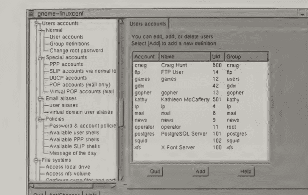

当你首次安装系统时，你可能会对已经存在的用户账户数量感到惊讶。正如你在`/etc/passwd`示例中看到的，这些账户中的大多数用于由你创建和删除文件的服务。如所述，用户账户用于文件系统安全；任何创建或删除文件的用户或服务都需要一个 UID 和 GID。

要编辑账户，点击列表中的条目。这将显示一个详细窗口，允许你更改任何字段。详细窗口还包含一个 `Del`（删除）按钮，允许你删除条目。

要添加新用户，只需点击用户账户列表底部出现的`Add`（添加）按钮。点击`Add`按钮将打开图 5.2 所示的窗口。填写空白并点击`Accept`（接受）即可创建新用户。

## 5.2 `linuxconf` 用户创建窗口

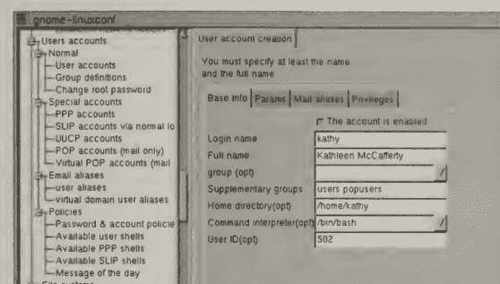

在 5.2 中，我正在为 Kathleen McCaffery 创建用户账户。她的家目录（即她拥有的且登录时所在的目录）是`/home/kathy`。命令解释器`/bin/bash`是她的登录 shell。如果没有选择 shell，登录将提供一个默认 shell。她使用的默认 shell 是`/bin/sh`，从上面的讨论中可知，在 Red Hat 6 系统上，这仅仅是`/bin/bash`的一个链接。

在`Group`（组）字段中，有一个下拉框，列出了系统当前可用的所有组。如果你没有为用户选择初始组，Red Hat 系统将自动创建一个仅包含该用户的新组，并将该新组分配为用户的初始组。你在之前显示的`/etc/groups`文件列表中看到过这个组。这种行为是 Red Hat 系统特有的。如上所述，其他某些系统在未选择组时默认使用用户组（`users`），而其他系统则强制你选择一个组。

`User ID`（用户 ID）字段也是可选的。如果在此未输入值，Red Hat 将使用 500 以上的下一个可用 UID 号。我更倾向于根据跨所有服务器协调的计划来分配数字，因此我在框中输入了一个特定的 UID。

## 使用 Slack 的 `adduser` 命令

在 Slack 系统上创建新用户，请使用`adduser`，这是一个基于文本的工具。以下示例向 Slack 系统添加了用户 `kathy`：

```
$ adduser

> Login name for new user (8 characters or less) [: kathy

User id for kathy [ defaults to next available]: 501

Initial group for kathy [users]:

kathy's home directory [/home/kathy]:

kathy's shell [/bin/bash]:

kathy's account expiry date (MM/DD/YY) []:

OK,我正准备创建一个新账户。以下是你目前为止输入的内容：

New login name: kathy

New UID: 0

Initial group: users

Additional groups: [none]

Home directory: /home/kathy

Shell: /bin/bash

Expiry date: [no expiration]

就是这样……如果你想退出，请按 Control-C。否则，

按 ENTER 键继续创建账户。

Making new account...

Changing the user information for kathy

Enter the new value, or press return for the default

Full Name []: Kathy McCafferty
Room Number []:
Work Phone []:
Home Phone []:
Other []:
```

## 为 kathy 修改密码

输入新密码。使用大小写字母和数字的组合。

New password:

Re-enter new password:

密码已更改。

`Done...`（完成）

在 Slack 工具中，默认值显示在方括号中。你可以接受 Slack 提供的值，也可以输入自己的值。

`linuxconf`和`adduser`示例的目的不是展示如何使用这些工具，而是展示你为什么要使用它们，以及在你创建新账户时实际上在做什么。“创建用户账户的步骤”部分告诉了你正在发生什么。一旦理解了`/etc/passwd`文件背后以及用户家目录创建背后的原理，所有这些工具的操作就变得明易懂了。“为什么”也已经讨论过：需要用户账户来识别用户登录和文件系统安全。然而，基本的安全模型有两个异常你需要关注……


## 理解登录安全

登录守护进程（`login daemon`）由`inet`启动。它要求为每个通过服务访问系统的用户创建用户账户。但这些登录服务具有的特性之外，`login`还有一个可能会问题的独特安全系统。

`login`使用信任主机（`trusted hosts`）系统而不是密码身份验证。在信任主机上，访问本地计算机上同名的用户账户无需提供密码，因为信任主机已经验证了用户，并且假设同名的用户账户由同一个用户所有。因此，在信任主机上登录为`kathy`的用户被授予与本地主机用户`kathy`相同的访问权限。

## `hosts.equiv` 文件

信任主机也被称为等效主机（`equivalent hosts`），因为被信任主机访问的用户获得了本地主机的等效访问。使用`hosts.equiv`文件来定义你信任的计算机。

默认情况下，系统不赋予信任状态。如果不存在`hosts.equiv`文件，没有任何主机是被信任的。未授予信任访问并不意味着用户被拒绝访问；它只是意味着用户必须提供正确的密码以获得访问。大多数管理员不会向任何系统授予信任，因为他们希望用户使用密码。

如果你决定在`hosts.equiv`文件中输入条目以授予信任，请将这些条目限制为简单的主机名。`hosts.equiv`文件的语法允许可选的加（`+`）和减（`-`），以及可选的用户名。不要使用这些可选值，因为它们会让本就脆弱的信任主机安全性变得更弱。

- 加号（`+`）表示某个主机或用户是受信任的。然而，加号是没必要的，只需列出主机即可授予信任。如上文所述。

- 减号（`-`）表示某个主机或用户被显式拒绝授予信任。减号在文件中是有用的。

- 在`hosts.equiv`文件中避免使用的可选用户名是编写实用`.hosts`文件的关键。例如，我在几个不同的系统上都有账户。在大多数情况下，我的用户名是`craig`。有时，其他人拥有`craig`账户，而我被赋予该账户。我希望从任何我拥有账户的计算机上登录，但不想从另一个`craig`处发生错误的登录。以下`.hosts`文件是解决此问题的方法：

```
crow hunt
```

```
crow -craig
```

# 第 5 章 登录服务

假设我在`crow`上的用户名是`hunt`，而`crow`上的另一个用户名为`username-craig`。在任何其他计算机上，将上述的`.hosts`文件放在我的家目录下，就可以允许我在`crow`上的主账户进行免密访问，同时防止该用户在`crow`上的账户进行免密访问。

前一节提到`hosts.equiv`文件未授予`root`用户账户免密访问权限。然而，`root`用户家目录下的`.hosts`文件会授予`root`账户免密访问。在我们的示例 Red Hat 系统中，`root`用户家目录是`/root`。因此，一个`/root/.hosts`文件将授予免密访问。

> 警告：授予 `root` 的免密访问权限是一个坏主意。`root` 账户应该受到非常严格的控制。


# 匿名 FTP 服务

远程登录服务主题的最后一个话题是：FTP 服务。像其他服务一样，要访问 FTP 服务器，用户必须提供用户名和密码。我的示例用户 `kathy` 可以 `ftp` 到本地系统并登录。FTP 服务器将把她的默认目录设置为 `/home/kathy`，她可以根据标准的读写权限向系统下载和上传文件。

除了标准服务外，`ftp` 还提供了匿名 FTP，允许任何人使用 `anonymous` 用户名和任何密码登录 FTP 服务器。传统上，使用的密码是你的电子邮箱地址。此举目的是让某些文件公开可用。从 `sunite.edu` 提供的所有 Linux 文件都可以通过匿名 FTP 获取。

匿名 FTP 是一项很棒的服务，如果设置不当，它可能会带来安全问题——以及一个大头疼。如果你熟悉在某些 Unix 系统上设置它，你就知道正确完成它需要花费多少精力。

在 Linux 上，设置匿名 FTP 非常简单，因为 Linux 系统已经安装并配置了带有匿名 FTP 的系统。查看 `/etc/passwd` 文件；你会发现 `ftp` 用户账户已经在那里了。查看 `/home` 目录；你会找到匿名家目录 `/home/ftp`。最后，使用命令 `ftp localhost` 测试系统，你应该能够以 `anonymous` 身份登录。

不需要在你的 Linux 服务器上运行额外的匿名 FTP 程序，这取决于你是否真的需要。如果设置得当，匿名 FTP 的安全风险并不比普通 FTP 更大。如果你完全不想提供 FTP 服务器，请在 `inetd.conf` 文件中注释掉 `ftp` 服务器。如果你特别不想使用匿名 FTP，请在 `/etc/passwd` 文件中注释掉 `ftp` 条目。

Linux 登录服务允许用户连接到你的服务器并在那里运行程序。这种简单、基础的服务在某些网络操作系统中甚至没有包含。Linux 包含了此服务以及全系列其他基础互联网服务。互联网守护进程 (`inetd`) 启动了大部分这些服务。快速查看 `inetd.conf` 文件可以让你了解 Linux 提供的网络服务范围。

但即使是你在那里看到的详尽列表也不是全部情况。一些最重要的网络服务是独立于 `inetd` 启动的。接下来的四章将讨论这四种重要服务：域名服务、`sendmail`、Web 服务和路由。对这些基础互联网服务的讨论将从第 6 章开始，在该章你将配置域名服务 (`DNS`)。


# 根除 `.rhosts`

允许使用 `login` 和 `rsh` 命令的管理员最大的恐惧之一，是用户会通过配置不当的 `.rhosts` 文件破坏系统。大多数有安全意识的管理员只需通过在 `inetd.conf` 文件中注释掉 `r` 命令来消除这一问题。但我曾工作在这样的网络，由于技术或政治原因，这并不是一个选项。技术原因可能是 `r` 命令被嵌入在某些旧脚本中，没有人时间去更新。政治原因可能是某个有权的用户想要这些命令，而管理员缺乏足够威望来告诉他们不能拥有。

无论原因何，我曾在一个站点工作，那里的网络受困于 `r` 命令，管理员想定期检查用户 `.rhosts` 文件的内容以确保万无一失。为了这一点，我使用 `find` 命令定位系统中存储的所有 `.rhosts`：

```bash
# find / -name .rhosts -print
/home/becky/.rhosts
/home/craig/.rhosts
/home/david/.rhosts
```

这告诉我谁拥有 `.rhosts` 文件，但没有告诉我里面包含什么。我将 `find` 命令与 `awk` 结合，自动生成一个脚本文件，列出所有 `.rhosts` 文件的内容。这里是一个示例：

```bash
# cat rhosts.find
find / -name .rhosts -print | \
awk '{ print echo Printing the contents of " $0 "; cat " $0 }' > rhosts
chmod 744 rhosts.find
./rhosts
```

这个示例脚本（我命名为 `rhosts.find` 使用 `find` 和 `awk` 创建了一个名为 `rhosts` 的 shell 脚本，用于显示系统上找到的所有 `.rhosts` 文件的内容。`find` 定位文件并将每个文件的文件名传递给 `awk`。`awk` 将每个文件名嵌入到 `echo` 和 `cat` 命令中并将其存储在 `rhosts` 中。脚本随后将 `rhosts` 文件的模式改为“可执行”并运行 `rhosts` 脚本，从而给出每个 `.rhosts` 文件的列表。

# 6 命名服务

Linux 上最基础的服务之一是命名服务。`/etc/hosts` 文件将名称映射到地址。本章对命名服务的讨论从主机表开始。Linux 系统使用两种技术转换主机名：主机表和域名服务 (`DNS`)。`/etc/hosts` 文件是一个简单的文本文件，按顺序匹配地址。

Linux 上最基础的服务之一是命名服务。`/etc/hosts` 文件将名称映射到地址。本章对命名服务的讨论从主机表开始。Linux 系统使用两种技术转换主机名：主机表和域名服务 (`DNS`)。`/etc/hosts` 文件中的每个条目都包含一个地址及其相关的名称。

# hosts 文件

`/etc/hosts` 文件中的每个条目都包含一个地址及其相关的名称。例如，`crow` 的主机表可能包含以下条目：

```bash
$ cat /etc/hosts
127.0.0.1 localhost.localdomain
172.16.5.5 crow.foobirds.org crow
172.16.5.1 wren.foobirds.org wren
172.16.5.2 robin.foobirds.org robin
172.16.5.4 hawk.foobirds.org hawk
```

该表的第一个条目将 `localhost` 分配给 `127.0.0.1`。（运行 `TCP/IP` 的每个计算机将环回地址分配给 `localhost`。）网络 `127` 是一个为环回网络保留的特殊网络地址，而主机 `127.0.0.1` 是为本地主机保留的环回地址。环回地址是一种特殊约定，允许本地计算机以访问远程计算机完全相同访问自身。这简化了软件，因为相同的代码可以访问任何系统，而且由于地址被分配给软件环回接口 (`lo0`)，没有流量发送到物理网络。

该表的第二个条目是 `crow` 自身的条目。`172.16.5.5` 对应 `crow.foobirds.org` 和别名 `crow`。

每个 Linux 系统都有包含上述两个目的的主机表，大多数系统（如上述示例所示）对于本地网络上的其他键还有额外的条目。这个小表为 `DNS` 可能未运行的情况提供了备份。

当主机表被用于大量主机时，其局限性就显而易见了。主机表要求每台计算机都拥有一份本地副本，并且每个副本必须是完整的，因为只有在本地主机表中列出的计算机才能通过名称访问。

思考今天的互联网：它拥有数百万台主机。一个包含数百万条目的的主机表搜索效率极低，更重要的是，无法维护。互联网上每秒都有主机被添加或删除。没有任何系统能够维护如此巨大且频繁变化的表并将其分发到网络上的每台计算机。

`DNS` 通过消除对全包含、集中维护表格的需求，并代之以分布式的分层数据库系统来解决这些问题。当前的 `DNS` 数据库拥有数百万主机条目，分布在数万台服务器上。这种数据库分布方式减少了任何单个服务器处理的数据库规模，从而减轻了维护数据库任何某部分的任务。

此外，`DNS` 使用本地缓存将信息迁移到需要它的人附近，而无需发送不必要的信息。本地缓存服务器初始仅包含定位分层数据库根节点所需。它保存接收到的所有用户查询答案，以及在获取这些答案时学到的所有支持信息。通过这种方式，它建立了一个内部数据库来为其用户提供服务。

## DNS 层次结构

`DNS` 层次结构可以与 Linux 文件系统的层次结构进行比较。单个域名中的主机名类似于单个目录，就像文件系统的根目录一样，`DNS` 也有一个根域名。

在文件系统和 `DNS` 系统中，对象的名称都揭示了根节点架构结构。文件名从最通用的根（`/`）移动到最具体的单个文件。域名从最具体的主机开始，移动到最通用的根（`.`）。从主机开始一直延伸到根的域名称为完全限定域名名称（`FQDN`）。例如，`wen.foo.org` 是我们网络上一个系统的 `FQDN`。

顶级域名（`TLDs`），如 `org`、`edu`、`jp` 和 `com`，由根服务器提供服务。二级域名（示例中的 `foobird`）是正式分配给你组织的域名。当你从父域名正式获得一个域名时，父域名中会放置一个指针，指向你的服务器，将其作为负责你域名的服务器。正是这种权限委托使得你的域名成为整个域名系统的一部分。我们将在本章后面部分介绍如何为子域名委托权限。


> **注意** 本书假设你已经拥有官方域名和 IP 地址。如果你没有且需要有关如何获取域名或 IP 地址的信息，请参阅 Craig Hunt 写的《TCP/IP Network Administration》（O'Reilly, 1998）。

你有权在自己的域名内创建子域名和主机。组织创建子域名有两个基本原因：

- 为了简化大量主机名的管理。这个原因很容易理解；这正是 DNS 创建的初衷。委托域名的部分将维护系统的负担分散给更多的人和计算机，使得没有某个人或一台计算机会被工作压垮。

- 为了识别组织内部结构。这个原因源于组织生活的现实。组织的某些部分无论如何都想控制自己的范围。

子域名通常具有地理名称或组织名称。`denver.fobirds.org` 是地理子域名的示例，而 `sales.fobirds.org` 是组织名称的示例。命名子域名的一个问题是位置会变化，组织会重组。如果你选择的子域名太具体，可以肯定你将不得不更改它们。假设你的西海岸办公室位于圣克拉拉。将子域名命名为 `west` 或 `海岸` 比称为 `sant clara` 要好。如果他们搬到圣何塞的一栋新大楼，你就不需要更改子域名名称。

文件系统的类比是非常很好的。文件通过从根目录经过子目录到目标目录的路径被找到。DNS 信息也以类似的方式定位。Linux 在启动过程中，通过你放在 `io.conf` 文件中的 `root=` 命令来学习根文件系统的位置。同样，你的 DNS 服务器通过读取一个名为 `hints file`的文件来定位根服务器，该文件包含了根服务器的名称和地址。（你将在本章后面创建该文件。）通过查询，服务器可以从根开始并遵循指针找到域名系统中的任何主机。

## 回答查询

为了回答查询，本地服务器必须拥有答案，或者询问另一台服务器。向另一台服务器请求信息是 DNS 工作原理的关键部分。如果服务器没有答案，它会询问它的父服务器，这种过程一直持续直到找到答案或到达根服务器。根服务器并没有最终答案，但它指向层次结构中的下一个服务器。这一过程将在下一章中详细讨论。

## BIND 软件 171

`domain` 命令定义了本地域。本地域用于在查询发送到名称服务器之前扩展查询中的主机名。如果没有使用 `domain` 命令，则将使用 `search` 命令中定义的值。如果在 `resolv.conf` 文件中未找到其中任一命令，则使用派自 `hostname` 命令的值。无论设置了什么本地域值，它都可以通过设置环境变量 `LOCALDOMAIN` 为单个用户进行覆盖。

`search` 命令定义了一个域名列表，用于在主机名发送到名称服务器之前对其进行扩展。`searchlist` 包含最多六个用空格分隔的域名。搜索列表指定的每个域名将按顺序进行搜索，直到查询得到解答。与 `domain` 命令（它创建一个仅包含本地域的默认搜索列表）不同，`search` 命令会创建一个包含 `searchlist` 中指定的所有域的显式搜索列表。

`options` 命令修改解析器的标准行为。目前有两个可用选项：`debug` 用于开启调试，`ndots` 用于更改点数，用以判断主机名在发送到名称服务器之前何时不需要扩展。`ndots` 的默认值为 1，这意味着包含任何点的主机名都不会用来自搜索列表的域名进行扩展。如果你将 `n` 设置为 2 (`ndots:2`)，则包含一个点的主机名将会被扩展，而包含两个或更多点的主机名将不会被扩展。

> 提示 不要更改 `ndots` 的默认设置。研究表明这种设置效率最高。

`sortlist` 命令定义了一个优于其他地址的网络地址列表。`addresslist` 是地址和掩码对的列表，例如 `172.16.5.0/255.255.255.0`。`sortlist` 命令很少使用。要使其发挥作用，要求远程主机为同一个名称分配了多个地址，其中一个地址的网络路径明显优于其他路径，并且你确切知道哪条路径更优。如果你使用 `sortlist`，解析器将重新排列从名称服务器接收到的地址，以匹配你在地址列表中给出的顺序。如果没有指定 `sortlist` 命令，则将按照接收的顺序使用地址，直到其中一个地址来自你的计算机直接连接的网络。默认情况下，直接连接网络的地址优于其他地址。


## 172 章 6 Linux 名称服务

### 示例 `resolv.conf` 文件

假设你正在配置一个名为 `swans.foobirds.org` (`172.16.12.3`) 的 Linux 工作站，该站不运行自己的名称服务器。一个合理的 `resolv.conf` 可能包含以下内容：

```
$ cat /etc/resolv.conf
search swans.foobirds.org
nameserver 172.16.12.1
nameserver 172.16.55.1
```

该配置有两个 `nameserver` 条目。第一个名称服务器的地址是 `172.16.12.1`。它与 `mute` 处于同一子网。另一个名称服务器 (`172.16.55.1`) 是 `foobirds.org` 域的主服务器。为了效率起见，将查询发送到本地服务器。为了备份目的，当本地服务器宕机时，将查询发送到主域服务器。

`search` 命令告诉解析器首先使用本地子域 `swans.foobirds.org` 扩展主机名，然后使用该域的父域 `foobirds.org` 扩展。这个显式列表引导了用户习惯的行为。在 BIND 的早期版本中，默认是搜索本地域及其父域。`BIND 8` 的默认值是仅搜索默认域。这个显式搜索列表模拟了旧的行为。

## 搜索列表

在离开解析器主题之前，将对主机名如何扩展以及搜索列表如何按顺序使用的额外讨论。大多数管理员发现这些关于解析器的内容是易于理解的。

搜索列表只有一个目的：通过允许用户输入短主机名来为用户提供便利。对名称服务器的查询必须提供完全限定域名名 (FQDN)。解析器使用搜索列表将用户输入的短主机名通过名称服务器转换为 FQDN。

以下是其在 Linux 系统上的工作方式。如果用户输入的名称包含一个或多个点，则该名称将按原样发送到名称服务器。如果无法按照用户输入的方式解析，则将使用搜索列表中的域名对其进行扩展。因此，`when.foobirds.org` 将不会被扩展。

如果用户输入的名称不包含任何点，则该名称将使用搜索列表中的域名扩展并发送到名称服务器。如果名称服务器无法解析该名称，解析器将使用搜索列表中的下一个域名再次尝试，并一直尝试直到域名列表耗尽。如果没有域名有效，则最后尝试将名称完全按照输入的方式发送到名称服务器。

假设你有所示 `resolv.conf` 文件。搜索列表将包含 `swans.foobirds.org` 和 `foobirds.org`。如果用户输入名称 `wren`，解析器将其扩展为 `wren.swans.foobirds.org`。如果名称服务器无法解析该名称，解析器将使用搜索列表中的下一个域名（即 `wren.foobirds.org`）再次尝试。如果名称服务器仍然无法解析，则最后尝试将名称完全按照输入的方式发送到名称服务器。

## 配置名称服务器 173

### 配置名称服务器

有基本的服务器配置：

- 缓存服务器是非权威的。它从其他服务器获取所有答案。

- 从用服务器被认为是权威的，因为它从主服务器传输信息。它也被称为备服务器。

- 主服务器是该域的主服务器。它直接从本地文件加载信息。

> **注意** 大多数服务器都会缓存答案。根据需要混合使用这些服务器配置。

# 配置域名服务器

要配置 DNS，你需要了解如何配置所有的五个配置文件。

让我们先从 `named.conf` 文件开始。它用于每台名称服务器上，并定义了基础配置。

## `named` 配置文件

在 `BIND 8` 中，关于 `named.conf` 配置文件的所有内容都发生了变化：它的名称、包含的命令、命令的结构以及文件的结构。即使你熟悉配置域名服务器，也应该阅读这一节。

`BIND 8` 提供了三种插入注释的方法。注释可以像 C 语言注释一样包含在 `/*` 和 `*/` 之间。它也可以以双斜杠（`//`）开头，类似于 C++ 注释；或者可以以井号（`#`）开头，类似于 shell 注释。然而，注释不能以分号（`;`）开头；分号在之前的 BIND 配置文件版本中是可以这样做的。书中的示例使用了 C++ 风格的注释，但当然，你可以使用你喜欢的任何一种有效样式。

配置命令的结构与 C 编程语言的结构相似。语句以分号（`;`）结束，字面量被包含在引号（`""`）中，相关项被组合在花括号（`{}`）内部。

> 注意：每个命令的完整语法见附录 B。

`BIND 8.1.2` 有七种有效的配置语句。它们按字母顺序列在表 6.1 中，并对每个命令给出了简要描述。

### 表 6.1 `named.conf` 配置语句

| 命令 | 用法 |
| :--- | :--- |
| `acl` | 定义 IP 地址的访问列表 |


| include | 将另一个文件包含在配置文件 |

| key | 定义身份验证的安全密钥 |

| logging | 定义记录的内容以及存储在何处 |

| options | 定义全局配置选项和默认值 |

| server | 定义远程服务器的特征 |

| zone | 定义一个区域 |

## options 语句

接下来的几节将说明一些最常用命令的示例的功能和格式。

大多数 `named.conf` 文件以 `options` 语句开头。仅有一个 `options` 语句定义了影响 BIND 运行方式的全局参数。它还设置了文件中其他语句使用的默认值。最常用的 `options` 语句定义了服务器的工作目录：

```
options {
  directory "/var/name";
}
```

该语句以 `options` 命令开始。花括号包含了一系列选项，`directory` 关键字定义了从之读取和写入名为命名文件的目录。目录名称也用于补全配置文件中指定的任何文件名。包含在引号中的字面量是目录的路径名。注意，`directory` 子句和 `options` 语句都以分号结束。

> 提示：正如你在阅读本章关于 `ndc` 工具的章节时将看到的，`named` 可以输出多个不同的文件，用于检查名称服务器的状态。`options` 语句可以用于更改输出文件的默认路径名。不要这样做。这样做没有任何益处，反而会让试图诊断你系统上名称服务器问题的人感到困惑。

可以设置若干个影响所有区域或所有服务器的选项。在大多数情况下，我倾向于为受影响的区域或服务器专门设置这些值。BIND 的设计者已经为绝大多数区域和服务器正确设置了默认值。需要其他值的区域和服务器是特例，应该通过直接在区域或服务器上定义特殊特性来视为异常。你将在 `zone` 语句中看到这些示例。

我偶尔使用的一个选项是 `forwarders`。`forwarders` 选项导致本地服务器向特定的服务器列表转发所有无法从其自身缓存中解析的内容。这在选定的服务器上建立了一个丰富的缓存。选定的服务器将位于你的本地网络上，因为建立丰富缓存的目的是减少发送到广域网的查询次数。如果你的 WAN 像某些 ISDN 网络那样按使用付费，这主要特别有用。

### 示例 forwarders 选项为：

```
options {
  directory "/var/name";
  forward first;
  forwarders { 172.16.5.1; 172.16.12.1; };
}
```

`forward first;` 选项表示本地服务器在尝试从任何其他外部服务器获取答案之前，应该先尝试 `forwarders`。这是默认设置，所以这个选项实际上并不需要指定。另一个可能的值是 `forward only;`，它告诉服务器它只能与 `forwarders` 通信。即使 `forwarders` 没有响应，当仅指定了 `forwarders` 时，本地服务器也不允许自己寻找答案。`forwarders` 选项列出了查询转发到的服务器地址。

## zone 语句

`zone` 语句是配置文件中最重要的语句，构成了 `named.conf` 文件的主体。一个 `zone` 语句执行以下关键配置功能：

- 它定义了由该名称服务器服务的区域。

- 它定义了该服务器在该区域的服务器类型。服务器可以是主服务器（master），也可以是从服务器（slave）。因为这是按区域定义的，同一台服务器可以是某些区域的主，同时是另一些区域的从。

- 它定义了区域域信息的来源。域名数据库可以从本地磁盘文件加载，也可以从主服务器传输。

- 它定义了区域的特殊处理选项。

一个 `*.org` 的 `zone` 示例可以说明所有这些功能：

```
zone "foobirds.org" in {
  type master;
  file "foobirds.hosts";
  check-names fail;
  notify yes;
  also-notify { 172.16.80.3; };
}
```

![img/0a4925a63d7144788f84b23689a2d0da_204_0.png]

## 第6章 Linux 服务

语句以 `zone` 命令开始。区域名称以包含在引号中的字面量形式给出。示例表示该区域包含 IP 地址。这是默认值，因此不是必须。花括号包含了该区域的选项列表。

`type master;` 选项表示该服务器是 .org 域的主服务器。其他可能的值有：

- slave：标识其为从服务器。

- hints：指出此提示文件在启动期间初始化服务器。

- stub：标识其为根服务器服务器。根服务器只从主服务器加载名称服务器记录。你不会使用这个值。它主要对于想要将查询引用区域内另一个服务器的非递归服务器有用。

`file 'foobirds.hosts';` 指包含域名数据库的文件。对于主服务器，这是由域管理员创建的文件。

最后三个选项出现在示例中主要是为了说明可用选项。你可能不会使用它们。`check-names fail;` 选项指定了服务器在区域文件中发现无效主机名时应该做什么。主服务器的默认是中止加载区域并显示错误消息。（由于选择了默认值，所以不需要此选项。）该选项的替代值是 `warn` 和 `ignore`。`warn` 显示警告并仍然加载区域，这是从服务器的默认值。`ignore` 忽略任何错误。

`notify` 和 `also-notify` 选项决定了信息更新时主服务器是否通知从服务器。从服务器定期检查区域文件是否已更新。通过 `notify yes;` 选项，主服务器向从服务器发送 DNS 通知消息，导致它们立即检查区域文件。这样做是为了保持主从数据库严格同步。`notify yes;` 是默认值，所以不需要指定。

通常，DNS NOTIFY 消息只发送到区域文件中列出的官方名称服务器。`also-notify { 172.16.80.3 };` 选项告诉主服务器也通知 172.16.80.3。该系统不是官方的从服务器，但它出于其他目的保留了区域数据库的完整副本。请参考本章末尾“伪从服务器”案例研究中 `also-notify` 选项的使用示例。

# 配置域服务器 179

在大多数命名的 .conf 文件中，区域语句（zone statements）比上面显示的示例简单。

让我们来看一些更真实的命名服务器配置示例。

## 仅缓存配置（Caching-Only Configuration）

仅缓存配置是所有服务器配置的基础，因为所有服务器缓存都提供答案。Red Hat 6 在安装 Linux 期间创建的基础仅缓存配置被作为本章中创建的所有配置的基础。Red Hat 创建的 `named.conf` 文件显示在此：

```
$ cat /etc/named.conf

options {
    directory "/var/named";

//
// 一个仅缓存的命名服务器配置
//
zone "." {
    type hint;
    file "named.ca";
}

zone "0.0.127.in-addr.arpa" {
    type master;
    file "named.local";
}
```


`options` 语句定义了 named 的默认目录。在示例文件中，它是 `/var/named`。Red Hat 和 Caldera 都使用此目录存储 named 相关文件。`named.conf` 文件中所有后续的文件引用都是相对于此目录的。

这种仅缓存配置中的两个区域语句出现在所有服务器配置中。第一个区域语句定义了提示文件（hints file），该文件用于帮助命名服务器在启动期间定位根服务器。第二个区域语句使服务器成为其自身的回环地址（loopback address）的主服务器，并指向本地主机文件（local host file）。提示文件、本地主机文件以及 `named.conf` 文件是每个服务器配置必不可的。

### 提示文件（The Hints File）

提示文件包含名为 named 用来初始化缓存的信息。正如区域语句中的根域（******）名称所示，提示文件包含了根服务器的名称和地址。提示信息帮助本地服务器在启动期间定位根服务器。一旦定位了根服务器，就会从该服务器下载一份根服务器的权威列表。在本地服务器重启之前，不会引用这些提示信息。

`named.conf` 文件指向提示文件的位置。提示文件可以赋予任何文件名。常用的名称有 `named.ca`、`named.root` 和 `root.cache`。在 Red Hat 6 示例中，提示文件名为 `named.ca`，位于 `/var/named` 目录。Red Hat 安装提供的提示文件包含以下名称和地址：

- 360000 IN NS A.ROOT-SERVERS.NET.

- 360000 A 198.41.0.4

- 360000 NS B.ROOT-SERVERS.NET.

- 360000 A 128.90.0.107


- 360000 NS C.ROOT-SERVERS.NET.
- 360000 A 192.33.4.12
- 360000 NS D.ROOT-SERVERS.NET.
- 360000 A 128.10.90
- 360000 NS E.ROOT-SERVERS.NET.
- 360000 A 192.203.23.10
- 360000 NS F.ROOT-SERVERS.NET.
- 360000 A 192.55.241
- 360000 NS G.ROOT-SERVERS.NET.
- 360000 A 192.112.36.4
- 360000 NS H.ROOT-SERVERS.NET.
- 360000 A 128.63.2.53
- 360000 NS I.ROOT-SERVERS.NET.

| I.ROOT-SERVERS.NET. | 3600000 | A | 192.36.148.17 |
| J.ROOT-SERVERS.NET. | 3600000 | A | 198.41.0.10 |
| K.ROOT-SERVERS.NET. | 3600000 | A | 193.0.14.129 |
| L.ROOT-SERVERS.NET. | 3600000 | A | 198.32.64.12 |
| M.ROOT-SERVERS.NET. | 3600000 | A | 202.12.27.33 |

提示信息仅包含命名服务器（`NS`）和地址（`A`）记录。每个`NS`记录标识根域（`.`）的命名服务器。关联的`A`记录给出每个服务器的`IP`地址。这些数据库条目的结构将在本章稍后部分变得清晰。对于主机来说，重要的是要意识到你并不直接手动创建或编辑此文件。上面的示例文件是由`Linux`安装提供的。但即使你的系统没有提供提示文件，很容易获取一个。根服务器的官方列表保存在`InterNIC`。通过`FTP`从`ftp.internic.net`下载`/named.root`文件。存储在那里的文件具有适用于系统的正确格式，可以直接运行，并可以直接下载到你的提示文件中。每几个月下载一次`named.root`文件，以保持你的提示文件中准确的根服务器信息。

### 本地主机文件（The Local Host File）

每台服务器都是其自己的回环域（`loopback domain`）的主，这是合理的。创建回环接口的目的是减少网络流量。跨网络向回环地址发送查询将违背这一初衷。回环域是一个反向域。它用于将回环地址`127.0.0.1`映射到`localhost`。在我们的示例`Red Hat`系统上，该域的区域文件名为`named.local`，这是本地主机文件最常见的名称。不需要讨论文件的内容，因为它们在每个系统上都是相同的。然而，你将在文中看到所有这些记录的示例。`Linux`安装提供了以下文件：

```
$ cat /var/named/named.local
@      IN SOA        localhost. (
                      1997270 ; Serial
                      28800        ; Refresh
                      14400        ; Retry
                      360000     ; Expire
                      8640 ) ; Minimum

IN      NS      localhost.
```

## 从服务器配置（Slave Server Configuration）

配置从服务器与配置仅缓存服务器一样简单。它使用相同的三个文件，仅对其进行了微调。在将其配置为从服务器之前，可以从仅缓存配置测试你的系统。我们的示例从服务器将通过修改上面的仅缓存配置来构建。


假设`wren` (`172.16.5.1`) 是`foobirds.org`和`16.in-addr.arpa`的主服务器。你想将`robin`配置为这些域的从服务器。为了实现这一点，你在`named.conf`文件中添加两个新的区域语句以创建如下配置：

```
$ cat /etc/named.conf
options {
  directory "/var/named";

// 一个从服务器的命名服务器配置
//
zone "." {
  type hint;
  file "named.ca";
}

zone "0.0.127.in-addr.arpa" {
  type master;
  file "named.local";
}

zone "foobirds.org" {
  type slave;
  file "foobirds.hosts";
  masters { 172.16.5.1; };
}

zone "16.172.in-addr.arpa" {
  type slave;
  file "172.16.reverse";
  masters { 172.16.5.1; };
}
```

该文件包含了你已经看到的所有语句，因为服务器使用了提示文件回环域数据库文件。这两个新的区域语句声明了`foobirds.org`和`0.16.172.in-addr.arpa`域。每个区域语句中的`type`句表示它是指定域的从服务器。

`file`语句的作用与你之前看到的不同。在之前的示例中，由`file`语句标识的文件是区域信息的源。在这种情况下，文件是区域信息的本地存储。信息的最终来源是主服务器。

`masters`句标识主服务器。在此句中可以提供多个`IP`地址，特别是当主服务器是多网段的并具有多个`IP`地址时。在大多数配置中，只使用一个地址，即主服务器的地址。

# 配置域名服务器 185

```
zone "." {
    type hint;
    file "named.ca";
}

zone "0.0.127.in-addr.arpa" {
    type master;
    file "named.local";
}

zone "foobirds.org" {
    type master;
    file "foobirds.hosts";
}

zone "16.172.in-addr.arpa" {
    type master;
    file "172.16.reverse";
}
```

`foobirds.org`和`16.172.in-addr.arpa`域的语句与`0.0.127.in-addr.arpa`域的区域语句完全相同，且功能也相同。这些语句声明了区域，表示该服务器是这些区域的主服务器，并标识了包含这些区域数据库记录的文件。

到目前为止，主服务器的配置与其他任何服务器都完全相同——你创建一个配置文件、一个提示文件和一个本地主机域文件。区别在于你还必须创建真实的域数据库文件。我们示例中的`foobirds.hosts`文件和`172.16.reverse`文件无法从仓库下载。你必须手动创建它们，为了做到这一点，你必须理解数据库记录的语法和目的。


第二部分

# DNS 数据库记录

在区域文件中使用的数据库记录称为标准资源记录或简称为“`RRs`”。所有资源记录都有相同的基本格式：

`[name] [ttl] IN type data`

`name`字段标识受此记录影响的域对象。它可以是一个单独的主机，也可以是整个域。除非名称是完全限定域名名（`FQDN`），否则它是相对于当前目录的。

`name`字段可以使用一些特殊值。这些值是：

- `*` 空白名称指代上一个命名的对象。`name`字段的最后一个值在指定新值之前一直保持有效。
- `*` 星号`@`指向当前的“源”（origin）。你可以使用`ORIGIN`命令在数据库文件中设置源，但`@`的实际作用是引用系统从`named conf`文件中`zone`命令派生的源。
- `*` 星号`*`是一个通配符，可以用于匹配任何字符串。

生存时间（`ttl`）字段定义了该资源记录应该缓存的秒数。它允许你决定远程服务器如何存储来自你域的信息。你可以对易变性的信息使用短`TTL`，对稳定性的信息使用长`TTL`。如果未指定`TTL`，则使用`SOA`记录中定义的默认`TTL`值。（`SOA`记录将在下一节中讨论。）


class 字段始终为 `IN`，如上面的语法所示。实际上有三种可能的值：`HS` 用于 Hesiod 服务器，`CH` 用于 Chaosnet 服务器，`IN` 用于互联网服务器。你处理的所有信息都是针对 `TCP/IP` 网络和互联网服务器的，因此你不会使用其他值。

`type` 字段定义了资源记录的类型。本章使用的类型（即最常用的记录）如表 6.2 所示。

## 表 6.2 DNS 数据库记录类型

| 记录名称 | 记录类型 | 功能 |
| --- | --- | --- |
| 权威起始 | `SOA` | 标记区域数据的开始，并定义影响整个区域的参数。 |
| 域名服务器 | `NS` | 标识域的域名服务器。 |
| 地址 | `A` | 将主机映射到地址。 |

## 配置域名服务器 187

### 表 6.2 DNS 数据库记录类型（续表）

| 记录名称 | 记录类型 | 功能 |
| --- | --- | --- |
| 指针 | `PTR` | 将地址映射到主机名。 |
| 邮件交换器 | `MX` | 标识域的邮件服务器。 |
| 规范名称 | `CNAME` | 为主机名定义别名。 |

资源记录的最后一个字段是 `data` 字段，它持有特定于该资源记录类型的数据。例如，在 `A` 记录中，它包含一个地址。`data` 字段的格式和功能每种记录类型都不同。

现在你已经知道可用哪些记录以及它们长什么样，可以准备将它们组合起来创建一个数据库了。

## 域数据库文件

域数据库文件包含了大部分的域信息。它的主要功能是将主机名转换为 `IP` 地址，因此 `A` 记录占主导，但此文件包含了除 `PTR` 记录以外的所有数据库记录。创建域数据库文件是构建名称服务器最具挑战性也最有成就感的部分。

在 `foobirds.org` 域中，`wren` 是主服务器。根据上面显示的 `named.conf` 文件，域数据库文件是 `foobirds.hosts`。它包含以下资源记录：

```
:
  The foobirds.org domain database
  ;
@ IN SOA foobirds.org. sara.wren.foobirds.org. (
    1999022201 ; Serial
    21600 ; Refresh
    1800 ; Retry
    604800 ; Expire
    86400 ) ; Minimum
```

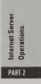

## 188 第 6 章 Linux 名称服务

`: 定义域名服务器`

```
IN NS wren.foobirds.org.
IN NS falcon.foobirds.org.
IN NS bear.mammals.org.
```

`: 定义邮件服务器`

```
IN MX 10 wren.foobirds.org.
IN MX 20 parrot.foobirds.org.
```

`: 定义 localhost`

```
localhost IN A 127.0.0.1
```

`: 定义此区域中的主机`

```
wren IN A 172.16.5.1
parrot IN A 172.16.5.3
crow IN A 172.16.5.5
hawk IN A 172.16.5.4
falcon IN A 172.16.5.2
puffin IN A 172.16.5.6
robin IN A 172.16.5.7
redbreast IN A 172.16.5.8
www IN A 172.16.5.9
news IN A 172.16.5.10
swans IN A 172.16.5.11
terans IN CNAME parrot.foobirds.org.
```

`: 子域`

```
swans IN NS terms.foobirds.org.
IN NS parrot.foobirds.org.
```

## 配置域名服务器 189

`terns IN NS terms.foobirds.org.`

`IN NS parrot.foobirds.org.`

`; 胶合记录`

`; trumpeter.swans IN A 172.16.12.1`

`arctic IN A 172.16.6`

### `SOA` 记录

所有区域文件从 `SOA` 开始。`SOA` 记录名称字段中的 `@` 指向源，在这种情况下是 `foobirds.org`，因为这是区域语句定义的定义。`SOA` 记录的名称字段通常是 `@`。

> **注意** `SOA` 记录的数据字段非常长，通常跨多行。在左括号之后，后续所有数据都被视为当前记录的一部分。

`SOA` 记录的数据字段包含七个不同的组件。示例 `SOA` 记录的数据字段组件包含：

`wren.foobirds.org` 是该区域主服务器的主机名。

`sara.wren.foobirds.org` 是负责此域的人员电子邮件地址。注意，用于用户名（`sara`）和主机名（`wren.foobirds.org`）之间的 `@` 符号被点（`.`）替换了。

`199022201` 是序列号，一个告诉从服务器区域文件已更新的数值。为了做出此判断，从服务器定期查询主服务器的 `SOA` 记录。如果主服务器 `SOA` 记录中的序列号大于从服务器区域副本的序列号，则从服务器传输整个区域。否则，从服务器假设它拥有区域的副本并跳过区域传输。为了保持从服务器与主服务器同步，每次更新域时必须增加序列号。

`21600` 是刷新周期的秒数。每个刷新周期，从服务器检查主服务器 `SOA` 记录的序列号，以确定需要传输哪些区域。刷新刷新可以保持同步，但通常不需要非常小的值，因为主服务器发送的 `DNS NOTIFY` 会在更新发生时导致从服务器立即检查 `SOA` 记录的序列号。刷新周期为 `21600` 秒，从服务器每天检查四次。这表明你的数据库是稳定的，不会频繁更改，这通常也是。计算机定期加入网络，但通常不是以小时为单位的。当新计算机到达时，在系统加入网络之前会为其分配主机名和地址，因为安装和配置系统需要名称和地址。因此，在用户开始查询新系统的地址之前，域信息已经分发到了从服务器。

`180` 是此重试周期。重试周期定义了主服务器未响应对 `SOA` 记录的请求时，从服务器再次询问之前应等待的秒数。不要将此值设置得太低——半小时（`1800`）或小时都是不错的值。如果服务器没有响应，它可能已经宕机了。快速重试一个宕机的服务器毫无用处，还会浪费资源。

`604800` 是此过期时间，即从服务器在没有更新文件的情况下仍继续响应查询的时间（秒）。这种思想是，在某个时间点，过时的数据比没有数据要好。这应该是一个相当长的时间。毕竟，从服务器的主要目的是为主服务器提供备份。如果主服务器宕机而从服务器停止回答查询，那么整个网络就会掉线，而不是只有一台服务器宕机很长时间。像中央计算机房火灾之类的灾难可能会导致主服务器宕机。在上面的示例数据库文件中，使用了一周（`604800`）；更常见的值是一个月（`259200`）。

`86400` 是在服务器中指定的此域的默认生存时间（`TTL`）。默认 `TTL` 适用于任何不包含显式 `TTL` 的资源记录。示例将默认 `TTL` 设置为一天，这是一个平均 `TTL`。如果你的域中的数据是稳定的，你可以设置一个几天的高默认 `TTL`，并对你预计会更改的单独记录显式设置一个较短的 `TTL`。

`SOA` 记录集中数据字段的所有组件设置值都会影响整个域。所有这些项目都会影响远程服务器。你决定从服务器检查更新的频率，以及缓存服务器在缓存中保留你数据的时间。域管理员负责整个域的设计。

### 定义名称服务器

紧随 `SOA` 记录的 `NS` 记录定义了该域的官方服务器。除非在 `named.conf` 文件的区域状态中使用了 `notify` 选项，否则这些是在区域更新时接收 `DNS NOTIFY` 消息的唯一服务器。

尽管它们可以出现在文件的任何地方，但 `NS` 记录通常直接跟在 `SOA` 记录之后。当这样做时，每个 `NS` 记录的名称字段可以是空的。由于名称字段是空的，将使用上一个对象名称的值。在示例中，名称字段中出现的最后一个值是 `@`，它指向 `named.conf` 文件中定义的 `foobirds.org` 域。因此，这些 `NS` 记录都为 `foobirds.org` 域定义了名称服务器。

两个 `NS` 记录指向我们早些配置的主服务器 `wren` 和从服务器 `robin`。第三台服务器位于我们的网络外部。名称服务器应该具有良好的网络连接，从名称服务器应该有一个独立于主服务器所用路径的互联网路径。这使得即使在主服务器连接的网络宕机时，从服务器也能履行其备份服务器的职责。大型组织对两台服务器都有独立的连接；而小型组织通常没有。如果可能，找一个你网络外部的服务器作为从服务器。咨询你的互联网服务提供商（`ISP`）。他们可能会为客户提供此类服务。

### 定义邮件服务器

`MX` 记录定义了该域的邮件服务器。名称字段仍然是空的，意味着这些记录属于上一个命名对象，在此例中是整个域。第一条 `MX` 记录说 `wren` 是 `foobirds.org` 的邮件服务器，优先级为 `10`。如果邮件地址为 `user@foobirds.org`，邮件将重定向到 `wren` 进行递送。


## 定义邮件服务器

`MX` 记录定义了该域的邮件服务器。名称字段仍然是空的，意味着这些记录属于上一个命名对象，在此例中是整个域。第一条 `MX` 记录说 `wren` 是 `foobirds.org` 的邮件服务器，优先级为 `10`。如果邮件地址为 `user@foobirds.org`，邮件将重定向到 `wren` 进行递送。

第二条 `MX` 记录识别 `parrot` 为 `foobirds.org` 的邮件服务器，优先级为 `20`。优先级数字越小，服务器越受优先。这意味着发送到 `foobirds.org` 域的邮件首先发送到 `wren`。只有当 `wren` 不可用时，邮件才会发送到 `parrot`。`parrot` 在 `wren` 宕机或离线时作为备份。

`MX` 记录重定向指向 `foobirds.org` 域的邮件，但它们不会重定向指向单个主机的邮件。因此，如果邮件地址为 `jay@foobirds.org`，它将直接递送到 `hawk`；而不会发送到邮件服务器。这种配置允许人们根据需要使用 `user@domain` 格式的电子邮件地址，或者在需要时直接发送到单个主机，这是一种非常灵活的配置。

然而，某些系统可能无法处理直接递送电子邮件。一个示例是没有运行 `SMTP` 邮件程序的 `Microsoft Windows` 系统。发送到此类系统的邮件将无法成功递送，更糟糕的是，它可能会向你报告网络错误！为了防止这种情况，请为单个主机分配 `MX` 记录以将其重定向到有效的邮件服务器。

在示例区域文件中有两个此类例子。查看 `puffin` 和 `robin` 的资源记录。每个系统的地址记录后面都跟着一个 `MX` 记录，其：


## 定义名称服务器

紧随 `SOA` 记录的 `NS` 记录定义了该域的官方服务器。除非在 `named.conf` 文件的区域状态中使用了 `notify` 选项，否则这些是在区域更新时接收 `DNS NOT` 消息的唯一服务器。

尽管它们可以出现在文件的任何地方，但 `NS` 记录通常直接跟在 `SOA` 记录之后。当这样做时，每个 `NS` 记录的名称字段可以是空的。由于名称字段是空的，将使用上一个对象名称的值。在示例中，名称字段中出现的最后一个值是 `@`，它指向 `name.conf` 文件中定义的 `foobirds.org` 域。因此，这些 `NS` 记录都为 `foobirds.org` 域定义了名称服务器。

两个 `NS` 记录指向我们早些配置的主服务器 `wren` 和从服务器 `robin`。第三台服务器位于我们的网络外部。名称服务器应该具有良好的网络连接，从名称服务器应该有一个独立于主服务器所用路径的互联网路径。这使得即使在主服务器连接的网络宕机时，从服务器也能履行其备份服务器的职责。大型组织对两台服务器都有独立的连接；而小型组织通常没有。如果可能，找一个你网络外部的服务器作为从服务器。咨询你的互联网服务提供商（`ISP`）。他们可能会为客户提供此类服务。

## SOA 记录

在服务器中指定的此域的默认生存时间（`TTL`）。默认 `TTL` 适用于任何不包含显式 `TTL` 的资源记录。示例将默认 `TTL` 设置为一天，这是一个平均 `TTL`。如果你的域中的数据是稳定的，你可以设置一个几天的高默认 `TTL`，并对你预计会更改的单独记录显式设置一个较短的 `TTL`。

`SOA` 记录数据字段的所有组件设置值都会影响整个域。所有这些项目都会影响远程服务器。你决定从服务器检查更新的频率，以及缓存服务器在缓存中保留你数据的时间。域管理员负责整个域的设计。


## MX 记录与邮件重定向

MX 记录重定向指向 `foobirds.org` 域的邮件，但它们不会重定向指向单个主机的邮件。因此，如果邮件地址为 `jay@foobirds.org`，它将直接递送到 `hawk`；而不会发送到邮件服务器。这种配置允许人们根据需要使用 `user@domain` 格式的电子邮件地址，或者在需要时直接发送到单个主机，这是一种非常灵活的配置。

然而，某些系统可能无法处理直接递送电子邮件。一个示例是没有运行 SMTP 邮件程序的 `Microsoft Windows` 系统。发送到此类系统的邮件将无法成功递送，更糟糕的是，它可能会向你报告网络错误！为了防止这种情况，请为单个主机分配 `MX` 记录以将其重定向到有效的邮件服务器。

在示例区域文件中有两个此类例子。查看 `puffin` 和 `robin` 的资源记录。每个系统的地址记录后面都跟着一个 `MX` 记录。


## TTL 设置

`MX` 记录重定向指向 `foobirds.org` 域的邮件，但它们不会重定向指向单个主机的邮件。因此，如果邮件地址为 `jay@foobirds.org`，它将直接递送到 `hawk`；而不会发送到邮件服务器。这种配置允许人们根据需要使用 `user@domain` 格式的电子邮件地址，或者在需要时直接发送到单个主机，这是一种非常灵活的配置。

然而，某些系统可能无法处理直接递送电子邮件。一个示例是没有运行 SMTP 邮件程序的 `Microsoft Windows` 系统。发送到此类系统的邮件将无法成功递送，更糟糕的是，它可能会向你报告网络错误！为了防止这种情况，请为单个主机分配 `MX` 记录以将其重定向到有效的邮件服务器。

在示例区域文件中有两个此类例子。查看 `puffin` 和 `robin` 的资源记录。每个系统的地址记录后面都跟着一个 `MX` 记录，其中指定的此域的默认生存时间（`TTL`）。默认 `TTL` 适用于任何不包含显式 `TTL` 的资源记录。示例将默认 `TTL` 设置为一天，这是一个平均 `TTL`。如果你的域中的数据是稳定的，你可以设置一个几天的高默认 `TTL`，并对你预计会更改的单独记录显式设置一个较短的 `TTL`。

`SOA` 记录数据字段的所有组件设置值都会影响整个域。所有这些项目都会影响远程服务器。你决定从服务器检查更新的频率，以及缓存服务器在缓存中保留你数据的时间。域管理员负责整个域的设计。

### 定义名称服务器

紧随 `SOA` 记录的 `NS` 记录定义了该域的官方服务器。除非在 `named.conf` 文件的区域状态中使用了 `notify` 选项，否则这些是在区域更新时接收 DNS NOTIFY 消息的唯一服务器。

尽管它们可以出现在文件的任何地方，但 `NS` 记录通常直接跟在 `SOA` 记录之后。当这样做时，每个 `NS` 记录的名称字段可以是空的。由于名称字段是空的，将使用上一个对象名称的值。在示例中，名称字段中出现的最后一个值是 `@`，它指向 `name.conf` 文件中定义的 `foobirds.org` 域。因此，这些 `NS` 记录都为 `foobirds.org` 域定义了名称服务器。

两个 `NS` 记录指向我们早些配置的主服务器 `wren` 和从服务器 `robin`。第三台服务器位于我们的网络外部。名称服务器应该具有良好的网络连接，从名称服务器应该有一个独立于主服务器所用路径的互联网路径。这使得即使在主服务器连接的网络宕机时，从服务器也能履行其备份服务器的职责。大型组织对两台服务器都有独立的连接；而小型组织通常没有。如果可能，找一个你网络外部的服务器作为从服务器。咨询你的互联网服务提供商（`ISP`）。他们可能会为客户提供此类服务。

### 定义邮件服务器

`MX` 记录定义了该域的邮件服务器。名称字段仍然是空的，意味着这些记录属于上一个命名对象，在此例中是整个域。第一条 `MX` 记录说 `wren` 是 `foobirds.org` 的邮件服务器，优先级为 10。如果邮件地址为 `user@foobirds.org`，邮件将重定向到 `wren` 进行递送。

第二条 `MX` 记录识别 `parrot` 为 `foobirds.org` 的邮件服务器，优先级为 20。优先级数字越小，服务器越受优先。这意味着发送到 `foobirds.org` 域的邮件首先发送到 `wren`。只有当 `wren` 不可用时，邮件才会发送到 `parrot`。`parrot` 在 `wren` 宕机或离线时作为备份。

## 子域名委托与胶记录

注意：注意根服务器在查找远程服务器的答案时，它会将远程服务器发送给 `wren`，而不是直接将远程服务器发送给 `trumpeter`。根服务器是非递归服务器：如果它们没有答案，它们会告诉你谁拥有答案，但它们不会替你查找。大多数其他服务器是递归服务器：如果它们没有答案，它们会为你查找。

示例委托中的前四行是 `NS` 记录。

| swans | IN | NS | trumpeter.swans.foobirds.org. |
|-------|----|----|-------------------------------|
|       | IN | NS | parrot.foobirds.org.          |
| terns | IN | NS | arctic.terms.foobirds.org.    |
|       | IN | NS | trumpeter.swans.foobirds.org. |

前两条记录表示 `trumpeter` 和 `parrot` 是 `swans.foobirds.domain` 的权威服务器。最后两条记录表示 `arctic` 和 `trumpeter` 是 `terns.foobirds.domain` 的权威服务器。

另外两条记录是子域名委托的一部分。它们是地址记录（`A records`）。

| trumpeter.swans | IN | A | 172.16.18.15 |
|-----------------|----|---|--------------|
| arctic.terms    | IN | A | 172.16.6.1   |

这两个地址都是位于当前域子域中的名称服务器。这些地址记录被称为“胶记录”（`glue records`），因为它们有助于将所有域名连接起来。为了连接到名称服务器，你必须拥有它的地址。如果 `arctic` 的地址只能通过 `arctic` 获取，那么就会出现问题。由于这个原因，在进行子域名委托时，位于子域的名称服务器地址会被放在父域中。

# 反向域名文件


反向域名文件将 `IP` 地址映射到主机名。这与域名数据库将主机名映射到地址相反。

但还有另一个之所以称为反向域名的原因：所有的 `IP` 地址都是反过来写的。例如，在反向域名中，地址 `172.16.5.2` 被写为 `2.5.16.172-in-addr.arpa`。地址反转是为了与域名的结构兼容。`IP` 地址从最通用的到最具体的写入。它从网络地址开始，经过子网地址，最后以主机地址结束。主机名则相反。它从主机开始，经过子域名和域名，最后以顶级域名结束。为了像主机名一样格式化地址，地址的主机部分先写，网络后写。网络地址变成了域名，主机地址变成了域名内的主机名。

在我们的示例中，网络地址 `172.16.0.0` 变成域名 `16.172.in-addr.arpa`。该域的区域文件所示：

```
Address to host name mappings.
;
; @ IN SOA wren.foobirds.org. sara.wren.foobirds.org. (
    1999022702 ; Serial
    21600 ; Refresh
    1800 ; Retry
    604800 ; Expire
    86400 ) ; Minimum
IN NS wren.foobirds.org.
IN NS falcon.foobirds.org.
IN NS bear.mammals.org.
1.5 IN PTR wren.foobirds.org.
2.5 IN PTR robin.foobirds.org.
3.5 IN PTR parrot.foobirds.org.
4.5 IN PTR hawk.foobirds.org.
5.5 IN PTR crow.foobirds.org.
17.5 IN PTR puffin.foobirds.org.
20.5 IN PTR falcon.foobirds.org.
1.12 IN PTR trumpeter.swans.foobirds.org.
1.6 IN PTR arctic.terms.foobirds.org.
6 IN NS arctic.terms.foobirds.org.
IN NS falcon.foobirds.org.
```

与其他区域文件一样，反向区域也以一条 `SOA` 记录和几个 `NS` 记录开头。它们的作用与域名数据库中的对应项相同，且具有相同的字段（上面已经解释过）。

# 第 6 章 Linux 名称服务

`PTR` 记录构成了反向域名的大部分，因为它们被用于翻译为主名。看第一个 `PTR` 记录。名称字段包含 `1.5`。这不是一个完全限定域名，因此它被解释为相对于当前域，从而得到 `1.5.16.172.in-addr.arpa` 作为名称字段的值。`PTR` 记录的数据字段包含一个主机名。数据字段中的主机名一始终是完全限定的，以防止它被解释为相对于当前域。在第一个 `PTR` 记录中，数据字段写的是 `.foobirds.org`，所以对 `1.5.16.172.in-addr.arpa` (`172.16.5.1`) 的 `PTR` 查询返回值 `.foobirds.org`。

## 委托反向子域名

文件最后几行是 `NS` 记录，将子域名 `6.16.172.in-addr.arpa` 委托给 `arctic` 和 `falcon`。反向域名中创建和委托子域名的方法与主机名空间中完全一样。反向域名中处理地址作为主机名的方式导致了限制，使得设置和使用其他子域变得更加困难。

反向域名将 `IP` 地址视为由四部分组成的主机。地址的四个字节变成了主机名的四个部分。然而，地址实际上是 32 位，而不是四个独立的字节。在我们的示例中，我们在字节边界上委托了地址，因此很容易分配反向子域。如果我们只分配了 `172.16.6.1` 到 `172.16.6.3` 的地址怎么办？上面的委托会将查询发送到 `arctic`，它无法处理。

有绕过这个问题的方法，一种流行的技术是为每个可能的地址分配一个新子域的 `CNAME`，然后委托该子域。假设我们想要 `arctic` 处理 `172.16.6.1` 到 `172.16.6.3` 的地址。我们可以输入 6 个 `CNAME` 记录：

| `1.6` | IN | CNAME | arctic.terms.foobirds.org. |
|---|---|---|---|
| `2.6` | IN | CNAME | arctic.terms.foobirds.org. |
|---|---|---|---|
| `3.6` | IN | CNAME | arctic.terms.foobirds.org. |
|---|---|---|---|
| `4.6` | IN | CNAME | arctic.terms.foobirds.org. |
|---|---|---|---|
| `5.6` | IN | CNAME | arctic.terms.foobirds.org. |
|---|---|---|---|
| `6.6` | IN | NS | arctic.terms.foobirds.org. |
|---|---|---|---|
| `6.6` | IN | NS | falcon.foobirds.org. |
|---|---|---|---|
| `7.6` | IN | CNAME | falcon.foobirds.org. |
|---|---|---|---|
| `8.6` | IN | CNAME | falcon.foobirds.org. |
|---|---|---|---|
| `9.6` | IN | CNAME | falcon.foobirds.org. |
|---|---|---|---|
| `10.6` | IN | CNAME | falcon.foobirds.org. |
|---|---|---|---|
| `11.6` | IN | CNAME | falcon.foobirds.org. |
|---|---|---|---|
| `12.6` | IN | NS | arctic.terms.foobirds.org. |
|---|---|---|---|
| `12.6` | IN | NS | falcon.foobirds.org. |

# 配置域名服务器

反向域名文件将 `IP` 地址映射到主机名。这与域名数据库将主机名映射到地址相反。

但另一个之所以称为反向域名的原因：所有的 `IP` 地址都是反过来写的。例如，在反向域名中，地址 `172.16.5.2` 被写为 `2.5.16.172-in-addr.arpa`。地址反转是为了与域名的结构兼容。`IP` 地址从最通用的到最具体的写入。它从网络地址开始，经过子网地址，最后以主机地址结束。主机名则相反。它从主机开始，经过子域名和域名，最后以顶级域名结束。为了像主机名一样格式化地址，地址的主机部分先写，网络后写。网络地址变成了域名，主机地址变成了域名内的主机名。

在我们的示例中，网络地址 `172.16.0.0` 变成域名 `16.172.in-addr.arpa`。该域的区域文件所示：

```
Address to host name mappings.
;
; @ IN SOA wren.foobirds.org. sara.wren.foobirds.org. (
    1999022702 ; Serial
    21600 ; Refresh
    1800 ; Retry
    604800 ; Expire
    86400 ) ; Minimum
IN NS wren.foobirds.org.
IN NS falcon.foobirds.org.
IN NS bear.mammals.org.
1.5 IN PTR wren.foobirds.org.
2.5 IN PTR robin.foobirds.org.
3.5 IN PTR parrot.foobirds.org.
4.5 IN PTR hawk.foobirds.org.
5.5 IN PTR crow.foobirds.org.
17.5 IN PTR puffin.foobirds.org.
20.5 IN PTR falcon.foobirds.org.
1.12 IN PTR trumpeter.swans.foobirds.org.
1.6 IN PTR arctic.terms.foobirds.org.
6 IN NS arctic.terms.foobirds.org.
IN NS falcon.foobirds.org.
```

与其他区域文件一样，反向区域也以一条 `SOA` 记录和几个 `NS` 记录开头。它们的作用与域名数据库中的对应项相同，且具有相同的字段（上面已经解释过）。

# 配置 named

`named` 是通过 `/etc/rc.d/rc.inet2` 脚本启动的。在 `Red Hat` 和 `Caldera` 系统上，它通过 `/etc/rc.d/init.d/named` 脚本启动。这两个脚本都会检查 `named` 程序和 `named.conf` 文件是否存在，然后启动。要运行 `named`，请重新创建配置文件并重启。

如果你不能——或不想——重启，可以通过命令行中输入 `named &` 来运行 `named`。它很少手动启动，但它每次启动时都会运行，而且不需要停止并重新启动即可加载新配置。可以使用信号让 `named` 加载新配置并执行其他任务。

# named 信号处理


`named` 处理多个信号。最常用 `HUP`。`HUP` 信号导致 `named` 重新读取 `named.conf` 文件并重载域名数据库。使用 `HUP` 会立即发生重载。在主服务器上，这意味着本地数据库被重新加载到内存中。在从服务器上，这意味着从服务器立即重新加载其磁盘副本，并向主服务器发送查询以检查是否有新配置。检查缓存对于任何新到 DNS 的人都是一项有趣的练习。使用 `US1` 来开启追踪。追踪信息写入 `named.run`。追踪也可以通过 `-d` 启用。


## 配置 named

反向域名将 IP 地址视为由四部分组成的主机名。地址的四个字节变成了主机名的四个部分。然而，地址实际上是 32 位，而不是四个独立的字节。在我们的示例中，我们在字节边界上委托了地址，因此很容易分配反向子域。如果我们只分配了 `172.16.6.1` 到 `172.16.6.3` 的地址怎么办？上面的委托会将查询发送到 `arctic`，它无法处理。

如果你要查找的问题发生在 `US1` 信号启动的极早期，那么在命名的命令行上开启 `on` 选项将没有用。`US1` 信号的优势在于，它允许在怀疑有问题时开启跟踪（tracing），而无需停止并重启 `named`。

`US1` 信号的相反面是 `US2` 信号。它会关闭并结束跟踪文件。发出 `US2` 后，你可以检查该文件，或者在它变得过大时将其删除。

还有一些额外的可用信号，但只有在它们编译进 `BIND` 中时才有效。`Slackware`、`Caldera` 和 `Red Hat` 自带的 `BIND` 版本没有编译这些信号。其中一个可能变得重要的信号是 `TERM`。如果编译 `named` 时启用了动态更新，`TERM` 信号会在系统关闭之前，将动态更新修改的数据写回数据库文件。当出现可以动态更新域名的工具时，这将非常重要。虽然目前尚无此类工具，但在第 10 章的 `DHCP` 部分中讨论了相关工作。

### `kill` 命令

`kill` 命令用于向运行中的进程发送信号。正如其名所示，默认情况下它发送 `kill` 信号。要用它发送不同的信号，请在命令行上指定该信号。例如，指定 `-INT` 来发送 `INT` 信号。`kill` 命令行上必须提供进程 ID (PID)，以确保信号发送到正确的进程。

你可以使用 `ps` 命令学习进程 ID。例如：

```bash
# ps ax | grep named
271 ? S 0:00 /usr/sbin/named
7138 p0 S 0:00 grep named
```

在 `named` 的情况下，你可以通过列出 `named.pid` 文件获取进程 ID：

```bash
# cat /var/run/named.pid
271
```

结合这些命令，你可以直接向 `named` 发送信号。例如，要重载命名服务器，你可以输入以下命令：

```bash
kill -HUP 'cat /var/run/named.pid'
```


单引号括起的`cat /var/run/named.pid`命令首先由shell处理。在我们的示例系统中，这返回了 PID 271。它与`kill`命令结合，然后被处理为`kill -HUP 271`。这种方法可行，但我发现使用`ndc`命令更简单。使用`ndc`需要输入的内容更少，需要记忆的也更少。

## `ndc` 工具

name daemon control (`ndc`) 工具允许你以更简单的方式向`named`发送信号。你不需要知道正确的 PID，也不需要记住正确的信号。例如，在上节中，使用了`kill`配合`HUP`信号来重载命名服务器。使用`ndc`执行相同的操作，你只需输入`ndc reload`。这个命令非常简单且比`kill`命令直观得多。有效的`ndc`命令行参数及其等效信号如表 6.3 所示。

**表 6.3 `ndc` 命令**

| 参数 | 信号 | 功能 |
|---|---|---|
| `status` | | 显示`named`的状态 |
| `dumpdb` | `INT` | 将缓存转到`named.dumpdb` |
| `reload` | `HUP` | 重载命名服务器 |
| `stats` | `IOT` | 将统计数据转到`named.stats` |
| `trace` | `USR1` | 开启到`named.run`的跟踪 |
| `notrace` | `USR2` | 关闭跟踪并关闭`named.run` |
| `querylog` | `WINCH` | 切换查询日志，将每个入入查询记录到`syslog` |
| `start` | | 启动`named` |
| `stop` | | 停止`named` |

`ndc`有三个参数——`status`、`start` 和 `stop`——它们不能作为信号使用。`status`像`ps`命令一样显示`named`进程的状态。`start`如果`named`当前未运行则启动它，`stop`如果`named`正在运行则终止它。`ndc`提供了一种简单、方便的方法与命名服务器进行交互。

> 警告 跟踪 (`trace`) 和查询日志 (`querylog`) 可能会迅速消耗大量的磁盘空间。请谨慎使用。

## 在 DNS 中使用主机表

如果你有一个大型网络应用程序，应该始终使用 DNS。但尽管你会使用 DNS，你仍然会有一个主机表。你的系统应该检查哪种信息源，DNS 还是主机表？

我通常将系统配置为优先使用 DNS，仅在 DNS 未运行时回退到主机表。你的需求可能有所不同。你可能有特殊的主机别名，它们未包含在 DNS 数据库中，或者只有网络中少数计算机已知的本地系统，因此没有在官方域中注册。在这种情况下，你希望在向 DNS 服务器发送无法回答的查询之前先检查主机表。

在配置命名服务查询信息的顺序时，涉及到两个文件。`host.conf` 文件对于命名服务最重要，因为这是该文件的主要关注。`nsswitch.conf` 文件涵盖了更广泛的管理数据库，包括命名服务。

## `host.conf` 文件

`host.conf` 文件定义了几个控制如何处理`/etc/hosts`文件以及如何与 DNS 交互的选项。为了说明这一点，这里有一个包含所有可能选项的`host.conf`示例：

```conf
# 定义查询服务的顺序
order bind hosts nis
# 允许每个主机对应多个地址
multi on
# 验证反向域名查找
nospoof on
# 记录“伪造”尝试
alert on
# 在主机表查找时移除本地域
trim
```

`order` 选项定义了通过各种服务查询信息的顺序。根据上述所示的顺序，我们首先尝试 DNS，然后是`/etc/hosts` 文件，最后是 NIS

- `bind` 代表 DNS（如前所述，BIND 是实现 DNS 的软件包）。
- `hosts` 代表`/etc/hosts` 文件。
- `nis` 代表网络信息服务（NIS），它是由命名服务。

`multi` 选项决定了`/etc/hosts` 文件中是否允许为同一个主机分配多个地址。当指定`on` 时启用该选项，指定`off` 时禁用。你可能奇怪为什么想这样做。`multi` 影响主机查找；对 DNS 无影响。DNS 原生支持多地址。


如你所见，域名系统允许你通过主机查找地址，以及通过地址查找主机；名到地址在一个数据库中，而名在另一个。`nospoof` 选项规定两个数据库返回的值必须匹配，否则你的系统将拒绝该主机。例如，如果`name.foobirds.org` 返回地址`172.16.5.1`，但对地址`172.16.5.1` 的查询返回主机`host0501.foobirds.org`，你的系统将认为该主机无效。`nospoof` 选项供希望准确记录使用服务的远程系统的人。关键字`on` 启用功能，`off` 禁用它。

`trim` 选项在`/etc/hosts` 查找名称之前移除本地域名。这允许系统即使在用户输入带域名的主机名，也能匹配主机名。通过此，`/etc/hosts` 文件可以不包含完整域名但仍然有用。根据上述的`trim` 命令，查询`hawk.foobirds.org` 将导致对`hawk` 的主机表查找。`host.conf` 文件可以包含多个`trim` 命令，以从主机表查找中移除多个不同的域。`trim` 只影响主机查找；对 DNS 无影响。

真实的`host.conf` 文件并没有实际使用所有这些命令。Red Hat 6 自带的`host.conf` 文件只有两行：

```
# cat /etc/host.conf
```

```
multi on
```

`host.conf` 文件的核心是`order` 命令，它定义了查找服务的顺序。另一个文件`nsswitch.conf` 有时也用于定义相同的内容。

## `nsswitch.conf` 文件

`nsswitch.conf` 文件处理的不仅仅是主机表和 DNS 之间的优先级。它定义了几个系统管理数据库的源，因为它是网络信息系统 (NIS) 的产物。NIS 能够集中控制和分发广泛的系统管理文件。表 6.4 列出了由`nsswitch.conf` 控制的所有管理数据库。除非你在网络上运行 NIS，否则除 hosts 数据库外，所有这些数据库的源都将是本地文件

**表 6.4 由 `nsswitch.conf` 控制的数据库**

| 数据库 | 包含 |
| --- | --- |
| `Aliases` | 电子邮件别名 |
| `Ethers` | 用于反向 ARP (`RARP`) 的以太网地址 |
| `Group` | 组 ID |
| `Hosts` | 主机名和 IP 地址 |
| `Netgroup` | NIS 的网络组 |
| `Network` | 网络名称和数字 |
| `Passwd` | 用户账户信息 |
| `Protocols` | IP 协议号 |
| `Publickey` | 用于安全 RPC（远程过程调用）的密钥 |
| `Rpc` | RPC 名称和数字 |

**表 6.4 由 `nsswitch.conf` 控制的数据库（续上）**

| 数据库 | 包含 |
| --- | --- |
| `Services` | 网络服务端口号 |
| `Shadow` | 用户密码 |

`hosts` 条目是我们感兴趣的，因为它指示了主机名和 IP 地址信息的源。在接下来的示例`nsswitch.conf` 文件中，DNS 被用主要源，本地文件作为备份源。如果 DNS 能够成功回答查询，任务就完成了。如果 DNS 无法回答查询，解析器将尝试本地文件，在 particular 情况下是`/etc/hosts`。

`# 不使用 NIS 的系统示例`

```
passwd: files
shadow: files
group: files
hosts: dns files
aliases: files
\services: files
networks: files
protocols: files
rpc: files
ethers: files
netgroup: files
publickey: files
```

此示例显示了每个数据库都与其对应的源列在一起。如你所见，只有`hosts` 条目有多个源——首先是 DNS (`dns`)，然后是本地 hosts 文件 (`files`)。若要在 DNS 之前检查主机表，只需反转顺序即可：

`hosts: files dns`

`nsswitch.conf` 文件中的所有其他条目都指向本地文件作为这些数据库的信息源。你已经熟悉了几个本地文件：`/etc/password`、`/etc/group`、`/etc/shadow`、`/etc/services`、`/etc/protocols`、`/etc/networks` 和`/etc/hosts`。在大多数 Linux 系统上，本地文件用于所有这些数据库。除非你运行 NIS，否则你的`nsswitch.conf` 文件看起来与示例非常相似。


除了`dns`和`files`之外，还有三个其他可能的源值。如果你在网络上运行NIS或NIS+，则`nis`和`nisplus`是有效的源值。此外，`compat`是一个有效的源字段值，如果你运行NIS，它可能会有用。`compat`意味着源是一个本地文件，但读取本地文件的方式应与旧的SunOS 4.x系统兼容。在SunOS 4.x下，NIS数据可以使用加号(+)作为文件中的最后一条条目来追加到文件中。例如，如果`/etc/passwd`添加了`+`，系统将使用密码文件中的账户对应NIS中的每个账户。SunOS 4.x已经停产五年了，`nsswitch.conf`文件取代了旧的“加号语法”。然而，仍然有人在使用它，如果你需要的话，该功能确实存在。当然，如果你不使用NIS，就不需要这些这些源值。

## 结语

名称服务是Linux网络的一项基础服务。名称服务将基于文本的主机名转换为网络所需的IP地址。正如第5章中的服务需要用户ID (UID)和组ID (GID)来识别用户一样，网络也需要IP地址来识别计算机。域名服务(DNS)是将网络主机名映射到IP地址的工具。

DNS在Linux系统上通过伯克利互联网域名(BIND)软件实现，这是互联网上使用最广泛的DNS软件。Linux是一个相当新的操作系统，但它受益于可以运行老牌软件包`BIND`，该软件具有悠久的历史，并经过多年的调试和完善。Linux开发者在最关键的服务器上广泛使用了这些可靠的软件包。

电子邮件是另一项每个现代网络必须提供的关键服务，Linux使用`sendmail`（使用最广泛的SMTP邮件服务器软件）来提供电子邮件服务。在下一章中，你将使用`sendmail`配置电子邮件服务器。

## 伪从服务器 (Phoney Slaves)

真正的权威服务器是区域文件中定义的主服务器和从服务器。但在某些情况下，假装你的本地服务器是从服务器是值得的。其中一种情况就是它可以为你节省费用。

从服务器是我们感兴趣的那个，因为它指示了主机名和IP地址信息的源。在接下来的示例`nsswitch.conf`文件中，DNS被用主要源，本地文件作为备份源。如果DNS能够成功回答查询，任务就完成了。如果DNS无法回答查询，解析器将尝试本地文件，在particular情况下是`/etc/hosts`。

+   # 不使用 NIS 的系统示例

```
passwd: files
shadow: files
group: files
hosts: dns files
aliases: files
\services: files
networks: files
protocols: files
rpc: files
ethers: files
netgroup: files
publickey: files
```

此示例显示了每个数据库都与其对应的源列在一起。如你所见，只有`hosts`条目有多个源——首先是DNS (dns)，然后是本地hosts文件(files)。若要在DNS之前检查主机表，只需反转顺序即可：

`hosts: files dns`

`nsswitch.conf`文件中的所有其他条目都指向本地文件作为这些数据库的信息源。你已经熟悉了几个本地文件：`/etc/password`、`/etc/group`、`/etc/shadow`、`/etc/services`、`/etc/protocols`、`/etc/networks`和`/etc/hosts`。在大多数Linux系统上，本地文件用于所有这些数据库。除非你运行NIS，否则你的`nsswitch.conf`文件看起来与示例非常相似。

除了`dns`和`files`之外，还有三个其他可能的源值。如果你在网络上运行NIS或NIS+，则`nis`和`nisplus`是有效的源值。此外，`compat`是一个有效的源字段值，如果你运行NIS，它可能会有用。`compat`意味着源是一个本地文件，但读取本地文件的方式应与旧的SunOS 4.x系统兼容。在SunOS 4.x下，NIS数据可以使用加号(+)作为文件中的最后一条条目来追加到文件中。例如，如果`/etc/passwd`添加了`+`，系统将使用密码文件中的账户对应NIS中的每个账户。SunOS 4.x已经停产五年了，`nsswitch.conf`文件取代了旧的“加号语法”。然而，仍然有人在使用它，如果你需要的话，该功能确实存在。当然，如果你不使用NIS，就不需要这些这些源值。

## 结语

名称服务是Linux网络的一项基础服务。名称服务将基于文本的主机名转换为网络所需的IP地址。正如第5章中的服务需要用户ID (UID)和组ID (GID)来识别用户一样，网络也需要IP地址来识别计算机。域名服务(DNS)是将网络主机名映射到IP地址的工具。

DNS在Linux系统上通过伯克利互联网域名(BIND)软件实现，这是互联网上使用最广泛的DNS软件。Linux是一个相当新的操作系统，但它受益于可以运行老牌软件包`BIND`，该软件具有悠久的历史，并经过多年的调试和完善。Linux开发者在最关键的服务器上广泛使用了这些可靠的软件包。

电子邮件是另一项每个现代网络必须提供的关键服务，Linux使用`sendmail`（使用最广泛的SMTP邮件服务器软件）来提供电子邮件服务。在下一章中，你将使用`sendmail`配置电子邮件服务器。

## 伪从服务器 (Phoney Slaves)

真正的权威服务器是区域文件中定义的主服务器和从服务器。但在某些情况下，假装你的本地服务器是从服务器是值得的。其中一种情况就是它可以为你节省费用。

# 7

## 配置邮件服务器

电子邮件仍然是你网络上最重要的用户服务。Web携带的流量更大，但电子邮件是用于大多数人与人通信的服务。而人与人通信是业务真正的基础。没有电子邮件的网络是不完整的，任何网络服务器操作系统如果不包含完整的TCP/IP邮件支持，就不值钱。

简单邮件传输协议 (SMTP)是TCP/IP邮件传输协议。Linux通过`sendmail`程序提供全面的SMTP支持，尽管`sendmail`的功能不仅仅是发送和接收SMTP邮件。`sendmail`提供邮件别名并充当“邮件路由器”，将所有不同用户程序的邮件路由到各种投递程序，同时确保邮件格式正确以便投递。

本章探讨了配置配置这些功能时的角色。配置`sendmail`可能是一项巨大且复杂的任务，但不必如此。与某些需要第二次安装来安装SMTP服务器软件的网络服务器系统相比，Linux为你完成了大部分配置工作，对于大多数站点来说，默认配置运行良好。本章将为你提供所需的信息，以便对何时以及如何更改配置做出明智决策。

# 使用邮件别名 (Mail Aliases)

邮件别名定义在`aliases`文件中。`aliases`文件的位置在`sendmail`配置文件的“Options”部分设置（你将在本章稍后的部分看到该配置文件）。在Linux系统上，该文件通常位于`/etc`目录(`/etc/aliases`)。该文件中条条目的基本格式为：

```
alias: recipient
```

`alias`是电子邮件地址中的用户名，`recipient`是邮件应该递送到的名称。`recipient`字段可以包含用户名、另一个别名，或者包含用户名和主机名在内的完整电子邮件地址。此外，单条别名可以有多个接收者。

`sendmail`别名执行着重要的功能，它们是创建邮件服务器必不可少的一部分。邮件别名具有以下功能：

-   为单个用户指定昵称。昵称可将发送给特殊名称（如`postmaster`或`root`）的邮件重定向到执行这些工作的真实用户。与第6章涵盖的域名MX记录结合使用时，别名可为域名创建标准的电子邮件地址。
-   将邮件转发到其他主机。`sendmail`别名会自动将邮件转发到作为接收者地址一部分的主机地址。
-   定义邮件列表。具有多个接收者的别名就是一个邮件列表。

来自Red Hat 6系统的并带有少量新增内容的`aliases`文件说明了所有这些用途：

```
#
# @(aliases)      8.2 (Berkeley) 3/5/94
#
# 此文件中的别名在邮件头中不会展开，
# 但在网络上或通过 /bin/mail 可见。
#
# >>>>>>>>>      在更新此文件进行任何更改后，必须
# >> NOTE >>       运行'newaliases' 程序，以将
# >>>>>>>>>      更改显示给 sendmail。
#
```

```
## 基础系统别名 -- 这些条目必须存在。
```

`MAILER-DAEMON: postmaster`

`postmaster: root`

```
# 伪账户的通用重定向。
bin: root
deamon: root
games: root
ingres: root
nobody: root
system: root
toor: root
uucp: root
```


```
## 常用别名。
manager: root
dumper: root
operator: root
webmaster: root
```

```
## 使用 trap decode 捕获安全攻击
decode: root
```

```
# 应该接收 root 邮件的人员
root: staff
```

```
# 系统管理员邮件列表
staff: kathy, craig, david@parrot, sara@hawk, becky@parrot
owner-staff: staff-request
staff-request: craig
```

## 用户别名 (User aliases)

`norman.edwards: norm`

`edwardsn: norm`

`norm: norm@hawk.foobirds.org`

`rebecca.hunt: becky@parrot`

`andy.wright: andy@falcon.foobirds.org`

`sara.hanson: sara@hawk`

`kathy.McCafferty: kathy`

`kathleen.Mcafferty: kathy`

Red Hat `/etc/aliases` 文件以几行注释开头。忽略关于在邮件消息头中显示哪些邮件消息的别名的信息；这并不重要。重要的注释是告诉你每次更新此文件时都要运行 `newaliases`。`sendmail` 不会直接读取 `/etc/aliases` 文件。相反，它读取由 `newaliases` 命令从此文件生成的数据库文件。

接下来的 15 行定义了特殊名称的别名。所有这些内容（包括我添加的 `webmaster` 别名）在 Red Hat aliases 文件中都是预配置的。前两个是人们在任何运行 `sendmail` 的系统上预期找到的别名。大多数分配给守护进程（daemon）用户名的别名都在 `/etc/aliases` 文件中。实际上没有人可以登录守护进程用户名，因此任何可能定向到这些伪账户的邮件都会被转发到 `root` 用户账户。在示例中，这封邮件被转发到了 `root` 用户账户。

当然，你不希望人们仅仅为了读邮件就登录 `root` 账户，因此别名中也包含一个 `root` 的别名。在示例中，我修改了 `root` 条目，将所有发送给 `root` 的邮件转发到 `staff`，而 `staff` 是另一个别名。注意别名是如何频繁地指向其他别名的。这样做非常有用，因为它允许你更新一个别名，而不是更新邮件递送到的真实用户账户。

`staff` 别名是一个邮件列表。邮件列表简单来说就是具有多个接收者的别名。在示例中，几个人负责维护这台邮件服务器。发送给 `root` 的消息通过 `staff` 邮件列表递送给所有这些人。

有两个特殊的别名与邮件列表相关。`owner-staff` 别名是 `sendmail` 用于与 `staff` 邮件列表相关的错误信息的特殊别名。`sendmail` 要求这种特殊别名的格式为 `owner-list`，其中 `list` 是邮件列表的。另一个特殊别名 `staff-request` 不是 `sendmail` 强制要求的，但是是远程用户预期的。按照惯例，手的邮件列表维护请求（例如添加到列表或从列表中删除）被发送到别名 `list-request`，其中 `list` 是邮件列表的。

最后八行是我添加到文件中的用户别名。这些行将在邮件服务器收到的邮件重定向到用户阅读邮件的计算机。这些别名可以采用各种格式来处理各种情况。

## 使用 sendmail 接收邮件 (Using sendmail to Receive Mail)

大多数 Linux 系统都假设自己是邮件服务器，因此它们被配置为以守护进程模式运行 `sendmail`。启动 `sendmail` 的代码非常直接：

```
/usr/sbin/sendmail -bd -q15m
```

该代码带有 `-bd` 和 `-q` 选项运行 `sendmail`。除了监听入站邮件外，`sendmail` 守护进程定期检查是否有等待递送的邮件。可能是启动以发送消息的 `sendmail` 进程无法递送它。在示例中，最后八行是我添加到文件中的用户别名。这些行将在邮件服务器收到的邮件重定向到用户阅读邮件的计算机。这些别名可以采用各种格式来处理各种情况。

## 定义别名 (Defining Aliases)

`staff` 别名是一个邮件列表。邮件列表简单来说就是具有多个接收者的别名。在示例中，几个人负责维护这台邮件服务器。给 `root` 的消息通过 `staff` 邮件列表递送给所有这些人。

有两个特殊的别名与邮件列表相关。`owner-staff` 别名是 `sendmail` 用于与 `staff` 邮件列表相关的错误信息的特殊别名。`sendmail` 要求这种特殊别名的格式为 `owner-list`，其中 `list` 是邮件列表的。另一个特殊别名 `staff-request` 不是 `sendmail` 强制要求的，但是是远程用户预期的。按照惯例，手的邮件列表维护请求（例如添加到列表或从列表中删除）被发送到别名 `list-request`，其中 `list` 是邮件列表的。

最后八行是我添加到文件中的用户别名。这些行将在邮件服务器收到的邮件重定向到用户阅读邮件的计算机。这些别名可以采用各种格式来处理各种情况。

## 配置邮件服务器 (Configuring a Mail Server)

Calder 和 Red Hat 用于启动 `sendmail` 守护进程的代码位于 `/etc/rc.d/init.sendmail` 脚本中。它比 Slackware 使用的代码复杂，因为 Red Hat 和 Calder 使用从外部文件读取的脚本变量设置命令行选项。它们读取的文件 `/etc/sysconfig/sendmail`，通常包含以下两行：

```
DAEMON=yes
QUEUE=1h
```

如果变量 `DAEMON` 等于 `yes`，则带有 `-bd` 启动 `sendmail`。`QUEUE` 变量设置 `-q` 选项的时间值。在这种情况下，它是一个小时（`1h`），这是一个比 Slackware 使用的 15 分钟更喜欢的值。

> 不要设置得太低。如果由于递送问题队列变得很大，频繁处理队列会导致问题。

要控制守护进程配置，只需更改 `/etc/sysconfig/sendmail` 文件中的值即可。

### sendmail 配置文件 213

发送邮件并不一定需要运行 `sendmail` 作为守护进程。只有当你的系统直接接收 SMTP 邮件时，才需要使用 `-bd` 运行 `sendmail`。即使你不以守护进程运行 `sendmail`，也可以发送邮件。

### sendmail 配置文件

定义 `sendmail` 运行时配置的文件是 `sendmail.cf`，这是一个大型且复杂的文件，分为七个不同的部分。Red Hat `sendmail.cf` 中的节标签提供了该文件结构和功能的概述。本章将详细介绍这些部分，具体如下：

- Local Info（本地信息）：此部分定义了特定于本地主机的配置信息。
- Options（选项）：此部分设置了定义 `sendmail` 环境的选项。
- Message Precedence Values Trusted Users（消息优先级值信任用户）：此部分定义了允许在发送邮件时更改发人地址的用户。
- Format of Headers（报头格式）：此部分定义了 `sendmail` 插入到邮件中的报头。
- Rewriting Rules（重写规则）：此部分包含了将用户邮件程序中的电子邮件地址重写为邮件投递程序地址的命令。
- Mailer Definitions（邮件器定义）：此部分定义了用于投递邮件的程序。邮件器使用的重写规则也在此部分定义。

> 注意：所有的 Linux `sendmail.cf` 文件具有相同的结构，因为它们都是根据 `sendmail` 分发包中的 m4 宏（在本章后面和附录 C 中介绍）创建。

### Local Info 部分

Local Info 是 `sendmail.cf` 文件的第一部分，包含了主机名、任何邮件中继主机的名称以及邮件域。它还包含了 `sendmail` 在返回错误信息时用于识别自身的名称，以及 `sendmail.cf` 文件的版本号。

本地信息由 `D` 命令（定义宏）、`C` 命令（定义类值）、`F` 命令（从文件中加载类值）和 `K` 命令（定义信息数据库）定义。


这里显示了节选自 Red Hat 6 `sendmail.cf` 文件 Local Info 部分的一些示例行：

```
+   # 错误信息中我的的名称
DnMAILER-DAEMON

# 不允许出现在本地用户名中的运算符
CO @ %!

## 接收电子邮件的主机名称文件
Fw/etc/sendmail.cw

+   # 访问列表数据库（用于垃圾邮件拦截）
Kaccess hash -o /etc/mail/access
```

以 `#` 开头的行是注释。示例中的第一个实际命令是定义宏 (`D`)，它定义了 `sendmail` 在发送错误信息时使用的用户名。定义的宏是 `n`（大多数宏名仅为单个大写或小写字母）。分配给 `n` 的值是 `MAILER-DAEMON`。


类命令 (`C`) 将值 `$`、`%` 和 `!` 分配给类 `0`。这三个值是不能在本地用户名使用的字符，因为它们会破坏电子邮件。

文件命令 (`F`) 将 `/etc/sendmail.cw` 文件中找到的值加载到类变量 `w` 中，该变量持有一个本地计算机将接受的有效主机列表。通常，如果运行 `sendmail` 的系统接收到地址为另一个主机的邮件，它会假设该邮件属于该主机。如果你的系统即使在邮件地址为另一个主机时也应该接收，那么该另一个主机的名称应该列在 `/etc/sendmail.cw` 文件中。

最后一个命令定义了一个电子邮件地址数据库。`K` 命令声明了一个名为 `"access"` 的数据库。该数据库采用哈希格式，这是标准的 Unix 数据库格式。包含数据库的文件是 `/etc/mail/access`。所有这些信息——内部名称、数据库类型以及存放数据库的文件——都是由 `K` 命令定义的。

> 注意：`access` 数据库用于控制邮件中继和投递。它将在第 13 章中详细介绍。

# `sendmail` 配置文件 215

这四个命令说明了 `sendmail.cf` 文件 Local Info 部分所执行的所有操作。对于试图直接配置 `sendmail.cf` 的系统管理员来说，该部分是文件中最重要的部分，因为这可能是你对 `sendmail.cf` 文件中唯一一个需要自定义的部分。

## `Options` 部分

`Options` 定义了 `sendmail` 环境。所有选项值都直接被 `sendmail` 程序使用。大约有 100 个选项，但来自 Red Hat `sendmail.cf` 文件的几个示例可以说明这些选项的作用：

```
## 别名文件位置
0 AliasFile=/etc/aliases
## 转发文件搜索路径
0 ForwardPath=$z/.forward.$sw=$z/.forward
## 超时（其中有许多）
0 Timeout.queuereturn=4h
```


这些选项都与已经讨论过的 `sendmail` 功能有关。第一个选项 (`0`) 将别名文件的位置设置为 `/etc/aliases`。第二个选项定义了 `.forward` 文件的位置。注意此选项中包含 `$z` 和 `$sw`。这些是宏值。`$sw` 宏包含计算机的主机名，指示如何将其用作 `.forward` 文件的扩展名。鉴于你已经知道 `.forward` 文件位于用户主目录，你可以猜出 `$z` 宏的值就是用户的主目录。（关于宏的更多信息见后文。）

最后两个选项与处理未投递邮件的队列有关。第一个选项是，如果邮件在队列中留了五天 (`5d`)，则应退回发件者。第二个选项是，如果邮件在队列中留了四小时 (`4h`)，则应发送一条警告消息。

此部分需要修改。随你的 Linux 系统提供的 `sendmail.cf` 文件中的选项对于该系统来说是正确的。我从未直接编辑过 Linux `sendmail.cf` 的选项部分。事实上，我最后一次编辑是在几年前，在 m4 宏开发之前。那时，有时需要将 `sendmail` 从一个操作系统迁移到另一个操作系统。那时需要编辑选项以适应。现在不需要了，因为 m4 宏会为目标操作系统构建 `sendmail.cf`。

## `Message Precedence` 部分

消息优先级用于为进入队列的消息分配优先级。默认情况下，邮件被视为“优先邮件”，并被赋予优先级 `0`。优先级数字越高，消息优先级越高。

但不要兴奋。提高优先级基本上是没有意义的。你可以做的唯一有用事情是选择一个负优先级，这表示低优先级邮件。因为对负优先级邮件不会生成错误消息，因此这种邮件对于批量发送很有用。Red Hat `sendmail.cf` 的优先级值为：

```
Pfirst-class=0
Pspecial-delivery=100
Plist--30
Pbulk--60
Pjunk--100
```

优先级值并不重要。要请求优先级，邮件必须包含 `Precedence` 报头，但邮件很少这样做。随你的 Linux 系统提供的 `sendmail.cf` 文件中包含的五个优先级值比你需要的多。

> 注意：`Message Precedence` 部分未被修改。

## `Trusted Users` 部分

信任用户允许在发送邮件时更改发人地址。信任用户必须是 `/etc/passwd` 文件的有效用户名。随你的 Linux 系统提供的 `sendmail.cf` 文件定义的信任用户是 `root`、`uucp` 和 `daemon`：

```
+   - Troot
Tdaemon
Tuucp
```

> 警告：不要修改信任用户列表。向列表中添加用户是一个潜在的安全问题。

## `Format of Headers` 部分

邮件报头是位于邮件开头的行，提供了有关邮件消息的行政信息，例如何时以及从何处发送。

# `sendmail` 配置文件 217

`Format of Headers` 章节定义了 `sendmail` 插入邮件的头信息。来自 Red Hat `sendmail.cf` 文件的头信息定义如下：

```
H?P?Return-Path: \<sg>
HReceived: $?from $s $$.?(s$s|from $.$_)
$.by sj (v/Z)?$r with r$. id $i7u
for $; $s|;
.$b
H?D?Resent-Date: $a
H?D?Date: $a
H?F?Resent-From: $?\$x <g>|$g$
H?F?From: $??\$x <g>|$g$
H?x?Full-Name: $x
#HPosted-Date: $a
# H1?Received-Date: $b
H?M?Resent-Message-Id: <t.$@sj>
H?M?Message-Id: <t.$@sj>
```

每一行头信息都以 `H` 命令开头，后面可选跟着用问号括起来的头标志。头标志控制头信息是否被插入到发往特定标记的邮件中。如果没有指定标志，则该头信息将用于所有发送器。如果指定了标志，则该头信息将仅用于在发送器定义中设置了相同标志的发送器（发送器定义将在本章稍后介绍）。头标志只控制头信息的插入。如果在输入中接收到头信息，无论标志设置如何，它都会传递到输出。

每行还包含一个头信息名称、一个冒号和一个头模板。这些字段定义了实际头信息的结构。头模板中的宏在头信息插入消息之前会进行展开。查看示例中的第一个头信息。`$g` 表示使用存储在 `g` 宏中的值，该宏存储了发送者的电子邮件地址。假设发送者是 David。在宏展开后，头信息可能看起来如下：

```
Return-Path: <david@wren.foobirds.com>
```

示例头信息提供了一个可以在头模板中使用的条件语法示例。这是一个 `if/else` 结构，其中 `$?` 是 `"if"`，`$?|` 是 `"else"`，而 `$.` 是 `"endif"`。来自上面的例子是：

```
H?F?Resent-From: $?\$x <g>|$g$
```

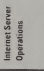

# 第 7 章 配置邮件服务器

这表示如果存在 (`?`) 宏 `x`，则使用 `$x` 作为头模板，否则 (`|`) 作为模板。宏 `x` 包含发送者的全名。因此，如果它存在，头信息为：

```
Resent-From: David Craig <david@wren.foobirds.org>
```

如果 `x` 不存在，头信息为：

```
Resent-From: david@wren.foobirds.org
```

注意：系统 `sendmail.cf` 文件中提供的头信息是正确的，且适用于你的安装。你永远更改它们。

## 重写规则（`Rewriting Rules`）章节

重写规则章节定义了用于从用户邮件程序解析电子邮件并将其重写为邮件投递程序所需格式的规则。重写规则将输入地址与模式匹配，如果找到匹配项，则使用命令中定义的规则将地址重写为新格式。

重写规则将电子邮件地址分为标记（`tokens`）以便进行处理。标记是由 `OperatorChars` 选项中定义的操作符分隔的字符字符串。操作符也算标记。基于此，你知道地址 `kathy@parrot` 包含三个标记：字符串 `kathy`、操作符 `@` 和字符串 `parrot`。

重写规则的左侧包含由宏值、字面值和特殊符号定义的模式。输入地址的标记与模式进行匹配。宏值和字面值直接与输入地址匹配，特殊符号匹配剩余标记。匹配模式中特殊符号的标记根据它们在匹配模式中的相对位置进行数字标识。因此，第一个匹配特殊符号的标记是 `$1`，第二个是 `$2`，第三个是 `$3`，以此此类推。这些标记可以用于创建重写地址。

重写规则的右侧定义了用于重写地址的格式。它同样由字面量、宏值和特殊符号定义。

一个示例将澄清地址是如何被重写规则处理的。假设输入地址为：

```
kathy@parrot
```

假设当前重写规则为：

```
R$+-SD -> user@host.domain
```

`R` 是重写命令，`+-` 是匹配地址的模式，而 `$1@$2.SD` 是重写地址的模板。命令的剩余部分是用于说明该规则作用的行。

## `sendmail` 配置文件 219

输入地址匹配模式，是因为：


- 它在字面量 `@` 之前有一个或多个标记，这正是特殊符号 `$+2` 所要求的。匹配特殊符号的标记是字符串 `kathy`。此标记现在可以被称为 `$1`，因为它匹配了第一个特殊符号。

- 它包含一个匹配模式中字面量 `@` 的 `@`。

- 它在 `@` 之后恰好有一个标记，这正是 `$-` 所要求的。匹配此特殊符号的标记是字符串 `parrot`，它现在可以被称为 `$2`。（等等，文中说是 `$-$`，但根据模板 `$1@$2$` 的上下文暗示是 `$2`）。

（注：提供的 OCR 文本存在大量重复和跨页碎片句子。我将根据逻辑流提供一个干净的合并版本。）

## sendmail 配置文件 221

在 Red Hat 配置文件的 `Mailer` 定义（`Mailer Definitions`）部分中搜索以 `M` 开头的行，会产生以下 `mailer` 定义：

```
Mprocmail, P=/usr/bin/procmail, F=DFMSFnhu9, S=11/31, R=21/31, T=DNS/RCF822/X-Unix, Aprocmail -Y -m $h $f $u

Mlocal, P=/usr/bin/procmail, F=1dFmaAws::|@qpsFhnu9, S=10/30, R=20/40, T=DNS/RCF822/X-Unix, Aprocmail -Y -a $h -d

Mprog, P=/usr/bin/smstrf, F=1dFMogeu9, S=10/30, R=20/40, D=$z/; T-Unix, Aish -c $u

Msmtp, P=[IPC], F=mDFMux, S=11/31, R=e\r\n, L=990, T=DNS/RCF822/SMTP, A=IPC $h

Mesmtp, P=[IPC], F=mDFMuxa, S=11/31, R=21, E=e\r\n, L=990, T=DNS/RCF822/SMTP, A=IPC $h

Msmtpb, P=[IPC], F=mDFMux8, S=11/31, R=21, E=e\r\n, L=990, T=DNS/RCF822/SMTP, A=IPC $h

Mrelay, P=[IPC], F=mDFMuxa8, S=11/31, R=61, E=e\r\n, T=DNS/RCF822/SMTP, A=IPC $h
```

Red Hat 配置包含七个 `mailer`。第一个定义是 `procmail`（在第 13 章中介绍），它是 Linux 系统上的一个可选 `mailer`。第一个定义用于通过 `-m` 命令行参数调用 `procmail`，这允许 `procmail` 用于邮件过滤。此声明中最有趣的一点是，Red Hat 配置从未使用过它。该 `mailer` 既不直接通过重写规则调用，也不通过 `mailtable` 数据库调用。如果你好奇我是如何知道以及这一配置故障的其他细节的，请参阅后文的“没有人完美”侧边栏。

列表中的接两个 `mailer` 定义是 `sendmail` 强制要求的。其中第一个定义定义了一个用于本地邮件投递的 `mailer`。该 `mailer` 必须始终命名为 `local`。第二个定义指定了一个 `mailer`（始终称为 `prog`），用于将邮件传递到程序。`sendmail` 期望在配置中找到这两个 `mailer`，并要求它们的名称必须是 `local` 和 `prog`。所有其他 `mailer` 都可以由系统管理员命名为任意。然而，在实践中，情况并非如此。因为 Linux 系统上的 `sendmail.cf` 文件是由相同的 `m4` 宏构建的，所以它们都使用相同的 `mailer` 名称。

最后四个 `mailer` 定义用于 TCP/IP 邮件投递。第一个设计用于投递传统的 7-ASCII SMTP 邮件，称为 `smtp`。下一个一个 `mailer` 定义用于扩展 SMTP (Extended SMTP) 邮件，称为 `smtps`。`smtppb` `mailer` 定义处理编码的 8 位数据。`Relay` 是一个通过外部邮件中继主机转发 TCP/IP 的 `mailer`。检查这些任何一个 `mailer` 条目（例如 `smtp` `mailer` 条目），就可以解释所有此类条目的结构：

- `M` 开头的行表示该命令是一个 `mailer` 定义。


`smtp` 紧跟在 `M` 后面的是 `mailer` 的名称，你可以输入任何名称，这里的名称是 `smtp`。

`P=[IPC]` `P` 参数定义了用于此 `mailer` 的程序路径。在这种情况下，它是 `[IPC]`，这意味着这封邮件由 `sendmail` 投递。其他 `mailer` 定义（如 `local`）在字段字段中包含某些外部程序的完整路径。

`F=dMFux` `F` 参数定义了此 `mailer` 的 `sendmail` 标志。除了知道这些是邮件标志外，每个单独 `mailer` 标志的意义并不重要，因为这些标志是由构建 `mailer` 条目的 `m4` 宏正确设置的。在本例中，`m` 表示此 `mailer` 可以同时发送给多个接收者；`FCM` 表示需要 `Date` 和 `Message-ID` 头部；`u` 表示主机名和用户名应保留大写字母；`X` 表示带有点的行应该在前面加一个点。

`S=11` `S` 参数定义了图 7.1 所示的规则集（`ruleset`）。每个 `mailer` 的规则集编号可以不同，允许不同的 `mailer` 以不同的方式处理地址。在这种情况下，邮件“信封”中的发件人地址通过规则集 11 处理，而消息中的发件人地址通过规则集 21 处理。（稍后在测试 `sendmail` 配置时你会看到更多相关内容。）

`R=21` `R` 参数定义了图 7.1 所示的规则集。此值对于每个 `mailer` 都可能，允许每个 `mailer` 以不同的方式处理地址。`sample message` 以不同的方式处理所有接收者地址。`E=\r\n` `E` 参数定义了消息中单行的终止方式。`L=990` `L` 参数定义了长度。`T=DNS/RCF822/SMTP` `T` 参数定义了此 `mailer` 的传输协议和类型。`A=IPC $h` `A` 参数定义了执行此 `mailer` 的命令。在这种情况下，它是 `IPC $h`。

（注：由于原文文本中存在部分重复和断句，翻译时已根据上下文逻辑进行了对齐。）

## sendmail 配置文件 225

**警告** 使用类 `M` 的一个问题是 `kathy@puffin.foobirds.org`、`kathy@robin.foobirds.org` 和 `kathy@parrot.foobirds.org` 都会被重写为 `kathy@foobirds.org`。如果整个域内确实只有一个 Kathy，那么就太好了；否则，这可能不是你想要的。请在所有系统中仔细协调用户名。这可以简化多个不同应用程序的配置。

在 `test.cf` 文件中为 `M` 设置一个值后，运行测试以查看其是否有效。使用测试配置运行 `sendmail` 不影响由启动脚本启动的 `sendmail` 守护进程。测试使用的是一个独立的 `sendmail` 实例。

## 测试你的新配置

通过直接测试重写规则，测试配置文件中对宏 `M` 的更改是否修改了重写过程。首先，你需要找出哪些规则是用于重写地址的。

根据图 7.1 中规则集流的知识，来确定要测试哪些规则集。你知道规则集 3 应用于所有地址。随后是不同的规则集，取决于该地址是投递地址、发送者地址还是收件人地址。此外，用于发送者和收件人地址的规则集取决于用于传递邮件的邮件代理器。所有地址都由规则集 4 处理。

决定处理地址的规则集有两个变量：地址类型和处理该地址的邮件代理器。三种地址类型为：投递地址、收件人地址和发送者地址。你知道地址类型，因为你选择了正在测试的地址。在示例中，关注的是发送者地址。

发送者地址有两种类型：消息标头中的发送者地址和“信封”中的发送者地址。消息标头地址是随邮件发送的行中的地址。当你使用邮件读取器查看消息时，可能会在邮件标头中看到它。“信封”地址用于 SMTP 协议交互期间。我们感兴趣的是远程用户在邮件中看到的那个——标头地址。

## 定位正确的邮件代理器

另一个决定处理地址的规则集的变量是邮件代理器。要找出由哪个邮件代理器投递邮件，请带 `-bv` 参数运行 `sendmail`：

```
# sendmail -bv craig@wroteethebook.com
craig@wroteethebook.com... deliverer: mailer smtp, host
wroteethebook.com.,, user craig@wroteethebook.com *
```


# 第 7 章 配置邮件服务器

要查看使用哪个邮件代理器向远程站点投递邮件，请带 `-bv` 参数运行 `sendmail` 并为远程站点提供电子邮件地址。在示例中，地址 `craig@wrotethebook.com`，`sendmail` 显示由规则集 0 返回的邮件传递三元组：邮件代理器、主机和用户。由此，你知道邮件代理器是 `smtp`。

## 测试地址是如何被重写的


要测试新配置，请带`-bt`运行`sendmail`。`sendmail`显示欢迎消息并等待你输入测试。一个简单的测试是规则集列表后跟一个电子邮件地址。例如，在提示符处输入`3,0 craig`将通过规则集 3 和 0 提供地址`craig`，这应该为你提供该地址的邮件代理器、主机、用户三元组。

由于你知道想要测试的邮件代理器，你可以在提示符处使用`/try`命令为`smtp`邮件代理器发送发送者地址。以下示例说明了测试。首先，测试现有配置，查看默认配置如何处理地址：

```
## /usr/lib/sendmail -bt
ADDRESS TEST MODE (ruleset 3 NOT automatically invoked)
Enter <ruleset> <address>
> /tryflags HS
>/try smtp craig
Trying envelope sender address craig for mailer smtp
rewrite: ruleset 3 input: craig
rewrite: ruleset 96 input: craig
rewrite: ruleset 96 returns: craig
rewrite: ruleset 3 returns: craig
rewrite: ruleset 1 input: craig
rewrite: ruleset 1 returns: craig
rewrite: ruleset 11 input: craig
rewrite: ruleset 51 input: craig
rewrite: ruleset 51 returns: craig
rewrite: ruleset 61 input: craig
rewrite: ruleset 61 returns: craig < @ *LOCAL* >
rewrite: ruleset 93 input: craig < @ *LOCAL* >
```

# sendmail 配置文件 227

```
rewrite: ruleset 93 returns: craig @ parrot . foobirds . org >
rewrite: ruleset 11 returns: craig @ parrot . foobirds . org >
rewrite: ruleset 4 input: craig @ parrot . foobirds .org >
rewrite: ruleset 4 returns: craig @ parrot . foobirds .org
Rcode = 0, addr = craig@parrot.foobirds.org
> ^D
```

运行`sendmail -bt`，这以默认配置以测试模式运行`sendmail`。这直切地展示了标准配置如何处理电子邮件。

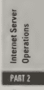

# 第 7 章 配置邮件服务器

```
rewrite: ruleset 31 input: craig
rewrite: ruleset 51 input: craig
rewrite: ruleset 51 returns: craig
rewrite: ruleset 61 input: craig
rewrite: ruleset 61 returns: craig < @ *LOCAL* >
rewrite: ruleset 93 input: craig < @ *LOCAL* >
rewrite: ruleset 93 returns: craig @ parrot . foobirds . org >
rewrite: ruleset 31 returns: craig @ parrot . foobirds . org >
rewrite: ruleset 4 input: craig @ parrot . foobirds .org >
rewrite: ruleset 4 returns: craig @ foobirds.org
Rcode = 0, addr=craig@foobirds.org
> exit
```

运行`sendmail -bt -Ctest`以测试模式启动`sendmail`并告诉它使用存储在`test.cf`中的新配置。此测试告诉你`M`宏的值被用于重写消息标头中的发送者地址。你知道这一点是因为规则集 4 返回的地址是`craig@foobirds.org`。这正是你想要的。

进行额外的测试（例如`/try smtp kathy@robin.foobirds.org`）以查看客户端地址是否被正确重写。当你确认配置正确且可靠时，将`test.cf`配置移动到`sendmail.cf`，以使`sendmail`可使用新配置。

如果你被要求帮助在尚未安装`m4`源文件的系统中配置`sendmail`，直接编辑`sendmail.cf`文件可能会更简单，但前提是更改非常小。如果可以避免，请不要修改`sendmail.cf`文件。如果你真的想进行主要的`sendmail`配置更改，请使用`m4`构建你的配置。

## 使用 m4 配置 sendmail

`sendmail`分发版包含构建`sendmail.cf`文件的`m4`源文件。示例`m4`源文件可能包含在你的 Linux 系统中。本节使用 Caldera 1.3 系统自带的`m4`源文件构建自定义的`sendmail.cf`文件。如果你的 Linux 发行版没有包含`m4`源文件，你可以从网上下载它们。

注意：请参考本章后部分的“编译 sendmail”，获取有关下载和安装最新`sendmail`分发版的详情。

在 Caldera 1.3 系统上，示例配置文件包含在`/usr/share/sendmail/cf/cf`目录中。这些通用文件中的几个已针对不同的操作系统进行了预配置。Caldera 系统拥有针对 BSD、Solaris、SunOS、HP Unix、Ultrix 以及 Caldera 的通用配置。Caldera 的配置命名为`generic-col12.mc`。该目录还包含设计用于任何操作系统的原型文件。尽管存在一个 Caldera 的源文件，但我更倾向于修改`tcproto.mc`文件。`tcproto.mc`文件是针对 TCP/IP 网络系统的原型配置。它是作为基础`sendmail`分发版的一部分提供的，可以为任何 Linux 系统进行修改，坦率地说，我认为它比供应商的配置是一个更干净的起点点。

## m4 源文件

`/usr/share/sendmail/cf/`目录下的原型文件包含`m4`宏命令。除了注释外，`tcproto.mc`文件还包含以下宏：

```
VERSIONID(@#)tcproto.mc      8.10 (Berkeley) 5/19/1998)
OSTYPE(unknown)
FEATURE(nouoccp)
MAILER(local)
MAILER(smtp)
```

> 注意：这些是配置宏。`tcproto.mc`文件还包含`divert`和`dnl`命令。`divert(0)`命令指示哪些行应该由`m4`处理，`divert(-1)`命令指示应该丢弃什么。`dnl`选项删除到下一个换行符之前的所有内容。如果`dnl`出现在开头，整行将被删除。

`VERSIONID`宏定义版本控制信息。此宏是可选的，在讨论中仅被忽略。

`OSTYPE`宏从`cf/ostype`目录加载定义操作系统信息的`m4`源文件。`cf/ostype`目录包含 40 多个预定义的操作系统宏文件。尽管如此，你仍将为示例配置创建自己的`OSTYPE`文件。`OSTYPE`宏是必不可的。

`FEATURE`宏定义可选的`sendmail`特性。`tcproto.mc`原型文件中的`nouucp`特意味着`sendmail`配置中不会包含任何 UUCP 地址处理代码。我将添加额外的`FEATURE`宏来创建一个完整的配置。

`MAILER`宏必须是输入文件的最后一个宏。`MAILER(local)`宏将本地邮件发送器和程序邮件发送器添加到配置中。`MAILER(smtp)`宏添加用于 SMTP、扩展 SMTP、8 位 SMTP 和中继邮件的发送器。所有这些发送器在之前的配置中都描述过，并且是配置所需的所有发送器。

从`tcproto.mc`原型文件为 Linux 系统创建`sendmail.cf`可能只需要将`OSTYPE`行更改为`linux`，然后用`m4`命令处理该文件。m4 输出的`sendmail.cf`就可以供`sendmail`使用了。事实上，它将与 Slack Linux 提供的`linux.smtp.cf`配置文件完全相同。然而，本章承担了一个更具雄心的配置，该配置更适用于 Caldera 示例系统，并包含了重写电子邮件地址。

## 创建 m4 OSTYPE 文件


从创建一个新的操作系统类型开始，在本例中它被称为 "caldera"。这涉及创建一个 `cf/ostype/caldera` m4 源文件，该文件定义了 OpenLinux X1.3 的特定特性。这听起来并没有那么复杂。所有的 OSTYPE 文件都是由 m4 宏构建的，而 `cf/ostype` 目录中最长长的 m4 源文件也只包含八个宏。`caldera.m4` 文件更短：

```
define(`STATUS_FILE`, `/var/log/sendmail.st`)
define(`HELP_FILE`, `/usr/share/sendmail/sendmail.hf`)
FEATURE(local_procmail, `/usr/bin/procmail`)
```

第一个 `define` 告诉 sendmail 状态文件为 `/var/log/sendmail.st`。第二个定义了帮助文件的位置为 `/usr/share/sendmail/sendmail.hf`。`/etc` 目录是这两个文件的默认位置。文件位置是不同操作系统之间常见的变量。

最后一行是 `FEATURE` 宏。它告诉 sendmail 该系统使用 `procmail` 作为本地邮件发送器，并定义了 `procmail` 程序的路径。

## 使用 m4 配置 sendmail 231

`define` 宏用于设置你之前看到的 `sendmail.cf` 宏和选项。正如你记得的，光是选项就有大约 100 个，还没有计算 sendmail 的 .cf 宏。显然，有大量的 `define` 宏来设置所有这些值。此外，还有其他类型的宏可能出现在 m4 源文件中，所有这些宏在附录 C 中都有解释。尽管 m4 宏数量很多，但 OSTYPE 文件非常短。原原因是默认配置值对于大多数系统来说都是正确的，m4 宏仅用于更改默认值。对于新的 `OSTYPE` 文件，只更改了三个值。

除了创建一个新的 `OSTYPE` 之外，示例还使用 m4 创建了一个将 `user@host` 电子邮件地址连接到 `firstname.lastname@domain` 地址的配置。要实现这一点，请创建一个具有针对你域名的特定值的宏文件。

## 创建 m4 DOMAIN 文件

`DOMAIN` 宏指向 `cf/domain` 目录下的一个文件，该文件包含特定于你域名的信息。这是放置你域名的好地方。（注意：由于 OCR 痕迹，此处文本似乎是破碎的，请遵循逻辑流）。

`VERSIONID` 宏定义版本控制信息。此宏是可选的，在讨论中仅被忽略。

`OSTYPE` 宏从 `cf/ostype` 目录加载定义操作系统信息的 m4 源文件。`cf/ostype` 目录包含 40 多个预定义的操作系统宏文件。尽管如此，你仍将为示例配置创建自己的 `OSTYPE` 文件。`OSTYPE` 宏是必不可的。

`FEATURE` 宏定义可选的 sendmail 特性。`tcproto.mc` 原型文件中的 `nouucp` 特意味着 sendmail 配置中不会包含任何 UUCP 地址处理代码。我将添加额外的 `FEATURE` 宏来创建一个完整的配置。

`MAILER` 宏必须是输入文件的最后一个宏。`MAILER(local)` 宏将本地邮件发送器和程序邮件发送器添加到配置中。`MAILER(smtp)` 宏添加用于 SMTP、扩展 SMTP、8位 SMTP 和中继邮件的发送器。所有这些发送器在之前的配置中都描述过，并且是配置所需的所有发送器。

从 `tcproto.mc` 原型文件为 Linux 系统创建 `sendmail.cf` 可能只需要将 `OSTYPE` 行更改为 `linux`，然后用 `m4` 命令处理该文件。m4 输出的 `sendmail.cf` 就可以供 sendmail 使用了。事实上，它将与 Slack Linux 提供的 `linux.smtp.cf` 配置文件完全相同。然而，本章承担了一个更具雄心的配置，该配置更适用于 Caldera 示例系统，并包含了重写电子邮件地址。

通知 sendmail 使用通用地址转换数据库将登录用户名转换为数据库中的名称。这在重写出站地址时比直接修改 `sendmail.cf` 文件提供了更大的自由度。

## 构建 m4 配置文件

现在已经为操作系统和域名创建了 m4 源文件，创建一个新的 m4 配置文件来使用它们。所有与重写出站地址相关的 m4 宏都在 `foobirds.m4` 文件中。特定于 Linux 发行版的宏位于 `caldera.m4` 文件中。你需要在配置中包含它们。

首先切换到 `cf/cf` 目录并将 `tcpport.mc` 复制为 `linux.mc`。然后将 `linux.mc` 的文件权限更改 640，以便所有者可以写该文件。

现在修改 m4 以反映新配置。为了做到，将 `OSTYPE` 宏中的 "unknown" 更改为 "caldera"，并在 `linux.mc` 宏控制文件中添加 `DOMAIN(foobirds)` 行。接下来的 `tail` 命令显示了编辑后文件中的宏：

```
# tail -6 linux.mc
VERSIONID(@#)tcpport.mc8.5 (Berkeley) 3/23/96)
OSTYPE(caldera)
DOMAIN(foobirds)
FEATURE(nouucp)
MAILER(local)
MAILER(smtp)
```

下一步是通过 m4 处理 `linux.mc` 文件：

```
# m4 ../m4/cf.m4 linux.mc > linux.cf
```

该示例显示了用于构建 `sendmail.cf` 文件的 m4 命令格式。路径名 `../m4/cf.m4` 是构建 `sendmail.cf` 文件所需的 m4 源树路径。新的宏控制文件显然是 `linux.mc`。m4 读取源文件 `../m4/cf.m4` 和 `linux.mc`，并输出文件 `linux.cf`。m4 命令的输出是 `sendmail.cf` 文件的正确格式。

你创建了三个文件——`cf/ostype/caldera.m4`、`cf/domain/foobirds.m4` 和 `cf/cf/linux.mc`——它们总共少于 20 行。而这些文件创建了一个包含 850 多行的 `sendmail.cf` 文件。大多数人发现，m4 宏是构建自定义 sendmail 配置的最佳方法。


# 234 第 7 章 配置邮件服务器

## 构建 sendmail 数据库

你刚刚创建的配置应该运行良好。它的运行方式与之前创建的 `sendmail.cf` 一相同，包括将主机伪装为 `foobirds.org`。但你希望将出站地址的用户名部分从登录名转换为用户的真实姓名，格式为 `firstname.lastname`。为此，创建一个数据库来转换出站邮件地址的用户名。通过创建一个包含所需数据的文本文件，并通过 sendmail 分发中的 `makemap` 命令处理该文件来构建数据库。

`genericstable` 数据库是 sendmail 用于转换出站邮件地址的数据库。`genericstable` 的格式非常简单：

- `pat Pat. Stover`
- `mandy Amanda. Jenkins`
- `kathy Kathy. McCafferty`
- `sara Sara. Henson`
- `norm Norman. Edwards`
- `craig Craig. Hunt`

`genericstable` 数据库中的每个条目有两个字段：第一个字段是键（`key`），第二个字段是键返回的值（`value`）。在示例数据库中，键是登录名，返回值是用户的真实姓名。使用此数据库，对 "pat" 的查询将返回值 "Pat.Stover"。

在 sendmail 使用 `genericstable` 之前，必须使用 sendmail 分发包含的 `makemap` 命令将其从文本文件数据库。假设上述显示的数据存储在名为 `usernames.txt` 的文件中。以下命令将该文件转换为 `genericstable` 数据库：

```
## makemap hash genericstable < usernames.txt
```

示例 `makemap` 命令创建了一个哈希类型数据库，这是最常用的。`makemap` 还可以创建 `dbm` 和 `btree` 数据库。

创建此 `genericstable` 数据库后，出站邮件中的登录名将转换为全名。例如，用户名 `mandy` 被转换为 `Amanda. Jenkins`。结合这种域名伪装，将出站地址重写为 `firstname.lastname@domain` 格式。

## 测试 m4 配置

以与测试任何 sendmail 配置相同的方法，使用 m4 宏测试你刚刚创建的新配置。像本章早些时候那样使用 `sendmail -bt`：


## 测试 `m4` 配置

使用 `m4` 宏测试你刚刚创建的新配置，方法与测试任何 `sendmail` 配置相同。像本章早些时候那样精确使用 `sendmail -bt`：

```
## /usr/lib/sendmail -bt -Clinus.cf
ADDRESS TEST MODE (ruleset 3 NOT automatically invoked)
Enterter <ruleset> <address>
/tryflags HS
/try smtp craig
Trailing header sender address craig for mailer smtp
rewrite: ruleset 3 input: craig
rewrite: ruleset 96 input: craig
rewrite: ruleset 96 returns: craig
rewrite: ruleset 3 returns: craig
rewrite: ruleset 1 input: craig
rewrite: ruleset 1 returns: craig
rewrite: ruleset 31 input: craig
rewrite: ruleset 51 input: craig
rewrite: ruleset 51 returns: craig
```

（注：由于提供的 OCR 文本在 261-263 页关于“测试 m4 配置”的部分包含多个重复/交错块，我已在下方逻辑合并了内容。）

## 编译并安装 `sendmail`

你刚刚创建的配置应该运行良好。它的运行方式与之前创建的 `sendmail.cf` 相同，包括将主机伪装为 `foobirds.org`。但你还希望将出站地址的用户名部分从登录名转换为用户的真实姓名格式为 `firstname.lastname`。为此，创建一个数据库来转换出站邮件地址的用户名。通过创建一个包含所需数据的文本文件，并通过 `sendmail` 分发中的 `makemap` 命令处理该文件来构建数据库。

`genericstable` 数据库是 `sendmail` 用于转换出站邮件地址的数据库。`genericstable` 的格式非常简单：

-   `pat` `Pat. Stover`
-   `mandy` `Amanda. Jenkins`
-   `kathy` `Kathy. McCafferty`
-   `sara` `Sara. Henson`
-   `norm` `Norman. Edwards`
-   `craig` `Craig. Hunt`

`genericstable` 数据库中的每个条目有两个字段：第一个字段是键，第二个字段是键返回的值。在示例数据库中，键是登录名，返回值是用户的真实姓名。使用此数据库，对 `pat` 的查询将返回值 `Pat.Stover`。

在 `sendmail` 使用 `genericstable` 之前，必须使用 `sendmail` 分发包含的 `makemap` 命令将其从文本文件转换为数据库。假设上述显示的数据存储在名为 `usernames.txt` 的文件中。以下命令将该文件转换为 `genericstable` 数据库：

```
## makemap hash genericstable < usernames.txt
```

示例 `makemap` 命令创建了一个哈希类型数据库，这是最常用的。`makemap` 还可以创建 `dbm` 和 `btree` 数据库。

创建此 `genericstable` 数据库后，出站邮件中的登录名将转换为全名。例如，用户名 `mandy` 被转换为 `Amanda. Jenkins`。结合这种域名伪装，将出站地址重写为 `firstname.lastname@domain` 格式。

```
cp /dev/null sendmail.st

groff -Tascii -mandoc aliases.5 > aliases

groff -Tascii -mandoc mailq.1 > mailq.0

groff -Tascii -mandoc newaliases.1 > newaliases.0

groff -Tascii -mandoc sendmail.8 > sendmail.0
```

根据文档说明，在大多数系统上编译 `sendmail` 只需执行这些操作。正如示例所示，这在 Red Hat 6 Linux 系统上确实可以运行。

一旦 `sendmail` 编译完成，即可使用带有 `install` 选项的 `Build` 命令进行安装：

```
# ./Build install
Configuration: os=linux, rel=2.0.36, rbase=2, rroot=2.0, arch=i686,
sfx=
Making in obj.Linux.2.0.36.1686
install -c o root -g kmem -m 4555 sendmail /usr/sbin
for i in /usr/bin/newaliases /usr/bin/mailq /usr/bin/hoststat /usr/bin/purgestat
do rm -f $si; in -s /usr/sbin/sendmail $si; done
install -c o root -g kmem -m 444 sendmail.hf \
/usr/lib/sendmail.hf
install -c o root -g kmem -m 644 sendmail.st \
/etc/sendmail.st
install -c o bin -g bin -m 444 sendmail.0 /usr/man/man8/sendmail.8
install -c o bin -g bin -m 444 aliases.0 /usr/man/man5/aliases.5
install -c o bin -g bin -m 444 mailq.0 /usr/man/man1/mailq.0
install -c o bin -g bin -m 444 newaliases.0 /usr/man/man1/
newaliases.1
```

`Build` 命令将可执行文件安装到 `/usr/sbin` 和 `/usr/bin`。它将帮助文件（`sendmail.hf`）安装到 `/usr/lib`，并将状态文件（`sendmail.st`）安装到 `/etc`。注意，帮助文件和状态文件的位置与之前介绍的 Caldera 示例中的有所不同。如果文件不在你预期的位置，你可以采取两种措施之一：

-   简单地将文件移动到你想要的位置。
-   修改 `sendmail` 配置以指向这些位置。这些是 `sendmail` 期望的默认位置，因此你只需要从 `OSTYPE` 文件中删除指向这些文件“非标准”位置的定义宏即可。（参见本章前面的“创建 `m4` `OSTYPE` 文件”。）

无论你采取什么操作，文件的位置和配置必须保持一致。

在宣布安装完成之前，应该检查的是 `sendmail.cf` 文件。新版本的 `sendmail` 可能会添加新的配置语法，导致旧的配置文件与新版本不兼容。`sendmail` 使用 `sendmail.cf` 文件内部的 `V` 命令来指示配置语法级别。检查兼容性的最简单方法是使用 `sendmail` 发送一封测试邮件：

```
# /usr/sbin/sendmail -v -t
```

警告：`.cf` 文件已过期：`sendmail` 8.9.3 支持版本 8，`.cf` 文件版本为 7

To: `craig`

From: `root`

Subject: Test

`^D`

`craig... Connecting to local...`

`cig... Sent`


使用 `-v` 选项运行 `sendmail` 会告诉程序提供详细信息，这正是你测试时所需要的。`-t` 选项告诉 `sendmail` 邮件将通过管道从控制台。在这种情况下，我输入了一封从 `root` 发给 `craig` 的简单测试消息。当你从控制台输入消息时，必须通过 `Control-D` 结束，如 `^D` 所示。邮件已成功送达，但 `sendmail` 对配置文件的版本级别表示不满。

此示例表明该配置与新版本兼容。要解决此不兼容问题，请重新运行 `m4` 以重新构建你的配置。参见本章前面的“构建 `m4` 配置文件”以获取重新构建配置的 `m4` 命令示例。

你已经全部完成了，`sendmail` 现在已准备就绪运行。


## 结语

`sendmail` 只是构建全功能邮件服务器的第一步。第 13 章将回到这个主题，并查看其他几个为电子邮件客户端提供服务的软件系统。

下一章《Apache Web 服务器》将深入探讨 Web 服务器配置。Web 服务对于企业网络服务的服务性，正如电子邮件对于用户服务一样重要。

```
$ ps ax | grep httpd
  321 ? S  0:00 httpd
```

## 242 第8章 Apache Web 服务器

```
324 ? S 0:00 httpd
325 ? S 0:00 httpd
326 ? S 0:00 httpd
329 ? S 0:00 (httpd)
330 ? S 0:00 (httpd)
331 ? S 0:00 (httpd)
332 ? S 0:00 (httpd)
333 ? S 0:00 (httpd)
334 ? S 0:00 (httpd)
335 ? S 0:00 (httpd)
2539 p1 D 0:00 grep http
```

使用进程状态 (`ps`) 命令检查系统中的所有进程，并使用 `grep` 命令仅显示名称为 `httpd` 的进程。通过在全新安装的系统上运行此测试，你会发现 `Apache` 已经安装并运行。

启动 `Netscape` 浏览器，并在“Location”框中输入 `localhost`。图 8.1 显示了结果。`Apache` 不仅已安装并运行，而且已配置并响应 Web 数据。桌面版 Linux 系统的用户有时会发现自己运行着一个全功能的 Web 服务器而感到惊讶。

如果系统上没有运行 `httpd`，请尝试使用 `linuxconf` 或 `tksys` 将其添加到启动过程中。图 8.2 显示了 `tksys` 在 `Red Hat` 系统上的运行。在“Available”框中高亮 `httpd`，点击 `Add`，然后在接下来的两个对话框中点击 `Done` 即可将其添加到启动过程中。下次重启系统时，`httpd` 将运行。

## 图 8.1 Apache 安装 Web 页面


成功了！

如果你能看到这个，说明在该 `Red Hat Linux` 系统上安装 `Apache` 软件成功。你现在可以向此目录添加内容并替换此页面。

如果你看到的不是你预期的联系方式，请联系相关网站的管理员。如果你向 `Apache` 软件或 `Red Hat Software` 的作者发送关于此邮件（他们肯定与此网站无关），你的邮件将被忽略。

此发行版已包含 `Apache` 文档。

有关 `Red Hat Linux` 的文档和信息，请访问访问 `Red Hat Software` 网站。`Red Hat Linux` 手册位于：

你可以在 `Red Hat Linux` 上自由使用下面的图片

你可以在 `Apache` 上自由使用下面的图片

## 第8章 Apache Web 服务器

图 8.2 使用 `tksys` 启用 `Apache`

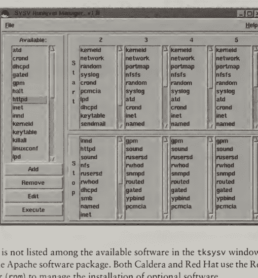

## 使用包管理器

`Red Hat` 包管理器（`Red Hat Package Manager`）是一个工具，允许你安装需要的软件、删除不需要的软件并检查已安装的软件。`rpm` 有许多可能的选项，但大多数都归为三个基本命令：

-   `rpm -i`: `-i` 选项用于安装软件。
-   `rpm -e package`: `-e` 选项用于删除软件。
-   `rpm -q package`: `-q` 选项用于列出已安装的软件。使用 `-qa` 列出所有包。

## 安装 Apache 245

使用 `rpm` 安装包，必须知道它的名称。要找到 `Apache` 包的全名，请挂载 CD-ROM 并查看 `RPMS` 目录。这是一个来自 `Red Hat 6` 系统的示例：

```
$ cd /mnt/cdrom/RedHat/RPMS
$ ls *apache*
apache-1.3.6-7.i386.rpm
apache-devel-1.3.6-7.i386.rpm
```

此示例假设 CD-ROM 已挂载到 `/mnt/cdrom`。它显示 `Red Hat` 发行版中包含两个 `Apache` 包。一个是 Web 服务器软件，另一个是开发者工具包。使用以下命令安装 `apache-1.3.6-7.i386.rpm`：

-   `rpm -i apache-1.3.6-7.i386.rpm`

安装包后，使用另一个 `rpm` 命令检查其是否已安装：

```
$ rpm -q apache
apache-1.3.6-7
```

## 下载 Apache

如果你的 Linux 发行版没有包含 `httpd`，或者你需要最新版本的 `Apache` 软件，可以从互联网下载。`Apache` 软件在 `www.apache.org` 提供二进制格式。用浏览器访问 `Apache` Web 页面并选择 `Download` 链接。然后选择 `Binaries` 链接和 `Linux`。这将显示预编译的 `httpd` 服务器守护进程列表（见图 8.3）。

## 图 8.3 Apache 网站上的二进制文件

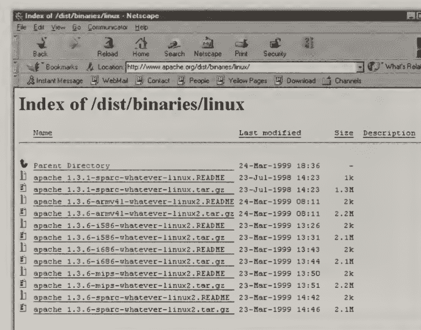

## /dist/binaries/linux 索引

| 名称 | 最后修改 | 大小 | 描述 |
|---|---|---|---|
| 上级目录 | | | |
| `apache 1.3.1-sparc-whatever-linux.README` | 1999年3月24日 18:36 | | |
| `apache 1.3.1-sparc-whatever-linux.tar.gz` | 1998-7月23日 14:23 | 1k | |
| `apache 1.3.6-sparc-whatever-linux.tar.gz` | 1998-7月23日 14:23 | 2.3M | |
| `apache 1.3.6-armv4l-whatever-linux2.README` | 1999-3月24日 08:11 | 2k | |
| `apache 1.3.6-armv4l-whatever-linux2.tar.gz` | 1999-3月24日 08:11 | 2.2M | |
| `apache 1.3.6-i686-whatever-linux.tar.gz` | 1999-3月23日 13:16 | 2.2M | |
| `apache 1.3.6-i1686-whatever-linux2.tar.gz` | 1999-3月23日 13:31 | 2.1M | |
| `apache 1.3.6-i686-whatever-linux2.README` | 1999-3月23日 13:43 | 2k | |
| `apache 1.3.6-i686-whatever-linux2.tar.gz` | 1999-3月23日 13:44 | 2.1M | |
| `apache 1.3.6-mips-whatever-linux2.README` | 1999-3月23日 13:50 | 2k | |
| `apache 1.3.6-mips-whatever-linux2.tar.gz` | 1999-3月23日 13:51 | 2.2M | |
| `apache 1.3.6-sparc-whatever-linux2.README` | 1999-3月23日 14:42 | 2k | |
| `apache 1.3.6-sparc-whatever-linux2.tar.gz` | 1999-3月23日 14:46 | 2.1M | |

二进制文件按“机器类型”列出。Linux 运行在不同的平台上。请选择适合你处理器的二进制文件。使用 `uname` 命令可以确定服务器的的确切机器类型。例如，Pentium II 系统会提供以下响应：

```
$ uname -m
i686
```


将正确的二进制文件下载到工作目录。为当前守护进程制作备份副本，并将新的守护进程移动到正确的执行路径。例如，在 Red Hat 系统上，将守护进程移动到 `/usr/sbin/httpd`；在 Caldera 系统上，将其移动到 `/usr/sbin/httpd`。确保为该文件设置了正确的所有者和权限：

```
# mv /usr/sbin/httpd /usr/sbin/httpd.org
# cp httpd /usr/sbin/httpd
```

## 配置 Apache 服务器

```
# chown root:root /usr/sbin/httpd
# chmod 0755 /usr/sbin/httpd
```

Apache 软件应该已经安装，并准备好使用当前配置进行运行。

# 配置 Apache 服务器

通常在讨论服务器软件的这一点上，我会说：“安装只是开始。现在你必须配置。”对于运行在 Linux 上的 Apache Web 服务器，情况并非如此。它是配置好的，只需少量输入即可运行。建议你编辑 `httpd.conf` 文件，并在 `ServerAdmin` 中设置管理员邮箱地址，在 `ServerName` 中设置服务器主机。此外，Linux 发行版提供的 `httpd` 配置应该是适用于该类型的。


然而，发行版的假设可能与你对服务器的计划符。Red Hat 假设你有一个繁忙的服务器。Caldera 销售 Netscape 的顶级 Web 服务器产品，假设你的 Apache 服务器会被轻度使用。在 Caldera 系统上，更改 `MinSpareServers`、`MaxSpareServers` 和 `MaxClients` 选项可以将更多资源分配给 Web 服务器。（Caldera 的配置见下文。）

尽管你可能只更改两个选项，但仍然需要知道 Apache 是如何配置的、服务器需要哪些文件以及这些文件位于何处。考虑到大多数网络服务的重要性，Apache 是不能忽视的。Apache 通过三个文件进行配置：

- `httpd.conf`：定义 HTTP 协议和服务器运行的配置设置。这包含了文件的目录。
- `extra.conf`：配置如何管理请求。这包含了通用网关 (CGI) 脚本的存储位置。
- `access.conf`：定义服务器的访问控制及其提供的信息。

这三个文件具有相似的结构。它们都以 ASCII 文本编写，注释以 `#` 开头，所有文件都经过了注释。此外，文件中的大多数命令是以选项后跟赋值值的形式编写的。这三个文件之间存在功能重叠。你可能认为某个值应该设置在这里，结果惊讶地发现它在另一个文件中。要正确调试配置错误的服务器，你需要理解所有三个文件。

## 分析 httpd.conf 文件

`httpd.conf` 文件存储在 Red Hat 系统的 `/etc/httpd/conf` 目录下，Caldera 系统的 `/etc/apache/conf` 目录下。要找到它的位置，请查看启动 `httpd` 的命令。`httpd.conf` 文件的位置由 `-f` 参数定义。其他配置文件的位置定义在 `httpd.conf` 中。

当然，定位文件的一种非常简单的方法是使用 `find` 命令：

```
# find / -name httpd.conf -print
```

该命令告诉你它将从根目录 (`/`) 搜索名为 `httpd.conf` 的文件并打印结果。

提示：当你需要定位 `httpd.conf` 文件时，请将其打印并阅读。它充满了解释配置选项的注释。

提示：如果你需要关于某个选项的附加信息，请访问 `www.apache.org` 查看在线文档。为了检查 `httpd.conf` 中的参数，我将使用 Caldera 1.3 系统默认配置中的设置为示例。`httpd.conf` 文件中定义的所有配置选项都大写字母开头。要只打印设置选项的行，使用 `grep` 显示所有以大写字母开头的行。在 Caldera 1.3 系统上，`grep` 显示：

```
grep '[A-Z]' httpd.conf
ServerType standalone
Port 80
HostnameLookups off
User nobody
Group -1
```

## 配置 Apache 服务器

```
ServerAdmin root
ServerRoot /etc/httpd/apache
ErrorLog /var/log/httpd/apache/error_log
TransferLog /var/log/httpd/apache/access_log
LogLevel warn
LogFormat "%h %u %t %r %b %{Referer}i %{User-Agent}i" "combined"
LogFormat "%h %u %t %r %b" common
LogFormat "%{Referer}i -> %U" referer
LogFormat "%{User-agent}i" agent
CustomLog /var/log/httpd/apache/access_log combined
PidFile /var/run/httpd.pid
ScoreBoardFile /var/log/httpd/apache/apache_status
ServerName localhost
UseCanonicalName on
Timeout 300
KeepAlive On
KeepAliveTimeout 15
MinSpareServers 1
MaxSpareServers 2
StartServers 5
MaxClients 15
```

在后续章节中，这些选项被组织成相关主题，并解释了每个命令及其设置的值。当你被要求修正某人的系统配置时，了解配置非常有帮助。然而，在进入此 Caldera 配置的细节之前，请看看如果你有 Red Hat 6 系统将会看到的差异。

## 加载动态共享对象

如果将 Red Hat 的 `httpd.conf` 文件与 Caldera 的文件进行比较，你可能会对它们外观的巨大差异感到惊讶。引起你注意的并不是某些配置选项赋值的细微差异；而是 Red Hat 配置中多出的许多行。所有这些额外的行都源于


一个区别：Red Hat 配置使用了动态对象 (DSO) 模块，而 Caldera 没有。

Apache 由许多软件模块组成。就像内核模块一样，DSO 模块可以编译进 Apache，也可以在运行时加载。Caldera 1.3 配置不动态加载任何模块。相反，它只使用编译进守护进程的模块。使用命令行 `-l` 运行 `httpd` 可以列出所有编译 Apache 的模块。以下示例来自 Caldera 1.3 系统：

```
$ /usr/sbin/httpd -apache -l
Compiled-in modules:
mod_env.c
mod_log_config.c
mod_mime.c
mod_negotiation.c
mod_include.c
mod_autoindex.c
mod_dir.c
mod_cgi.c
mod_asis.c
mod_imap.c
mod_actions.c
mod_userdir.c
mod_alias.c
mod_rewrite.c
mod_access.c
mod_auth.c
mod_so.c
mod_setenvif.c
```

### 配置 Apache 服务器 251

`httpd` 在 Caldera 系统上被称为 `httpd.apache`，因为 Caldera 还提供了 Netscape Web 服务器作为可选方案。在其他 Linux 系统上，Apache 仅称为 `httpd`。

相反，Red Hat 使用了许多动态加载模块。`httpd.conf` 文件中使用两个命令来启用动态加载模块。首先，每个模块都通过 `LoadModule` 命令标识。例如，要请求处理用户代理日志文件的模块，请在 `httpd.conf` 文件中输入此行：

```
LoadModule agent_log_module modules/mod_log_agent.so
```

`LoadModule` 命令之后是模块名称以及模块本身的路径。

除了 `LoadModule` 命令外，Red Hat 配置还使用 `AddModule` 命令来标识每个模块。这会将模块名添加到运行时实际加载的模块列表中模块列表包含了所有模块——编译到服务器中的模块和动态加载的模块。例如，要将 `agent_log_module` 添加到模块列表中，请向 `httpd.conf` 文件添加以下命令：

```
AddModule mod_log_agent.c
```


`AddModule` 命令之后是正在加载的模块的源代码。它不是 `LoadModule` 命令中看到的模块名；它是产生对象模块的源代码，与对象文件名除扩展名外相同。在 `LoadModule` 命令中，对象文件名是 `mod_log_agent.so`。在这里源代码是 `mod_log_agent.c`。可执行模块、共享对象使用 `.so` 扩展，而添加列表中的 C 语言模块使用 `.c` 扩展。

表 8.1 列出了 Red Hat 6 在其示例 `httpd.conf` 文件用 `AddModule` 命令标识的模块。

# 表 8.1 Red Hat 配置中加载的 DSO 模块

| 模块 | 目的 |
| :--- | :--- |
| `mod_access` | 指定基于主机和域名的访问控制。 |
| `mod_actions` | 将脚本映射到 MIME 类型。 |
| `mod_alias` | 指向文档树之外的目录。 |
| `mod_asis` | 定义不带标头返回的文件类型。 |
| `mod_auth` | 启用用户认证。 |
| `mod_auth_anon` | 启用匿名登录。 |
| `mod_auth_db` | 启用使用数据库 认证文件。 |
| `mod_auth_dbm` | 启用使用 DBM 认证文件。 |
| `mod_autoindex` | 启用自动生成索引。 |
| `mod_cern_meta` | 使与旧版 CERN Web 服务器兼容。 |
| `mod_cgi` | 启用执行 CGI 程序。 |
| `mod_digest` | 启用 MD5 认证。 |
| `mod_dir` | 控制目录列表的格式。 |
| `mod_env` | 允许 CGI 和 SSI 继承所有的 环境变量。 |
| `mod_example` | 提供 Apache 1.2 API 的示例。 |
| `mod_expires` | 设置 `Expires` 标头的日期。 |
| `mod_headers` | 启用自定义响应标头。 |
| `mod_imap` | 处理图像映射文件。 |
| `mod_include` | 处理 SSI 文件。 |
| `mod_info` | 启用 `server-info` 使用。 |
| `mod_log_agent` | 指向代理日志文件。 |
| `mod_log_config` | 启用自定义日志格式。 |
| `mod_log_referer` | 指向引用者日志，记录有关引用你网站的远程站点的信息。 |
| `mod_mime` | 为 MIME 文件提供支持。 |
| `mod_mime_magic` | 根据内容确定文件的 MIME 类型。 |
| `mod_mmap_static` | 启用静态文档的内存映射。 |
| `mod_negotiation` | 启用 MIME 内容协商。 |
| `mod_proxy` | 启用 Web 缓存。 |
| `mod_rewrite` | 启用 URI 到文件名的映射。 |
| `mod_setenvif` | 从客户端信息设置环境变量。 |
| `mod_so` | 为共享对象 (DSO) 提供运行时支持。 |
| `mod_speling` | 自动纠细微拼写错误。 |
| `mod_status` | 提供 Web 访问 `server-info` 报告。 |
| `mod_unique_id` | 为每个请求生成唯一的请求标识符。 |
| `mod_userdir` | 定义用户可以在哪里创建公共 Web 页面。 |
| `mod_usertrack` | 通过名为 `cookie` 的唯一标识符提供用户跟踪。 |

> **提示**：如果你决定向配置中添加模块，请阅读 Apache 发行版 `manual/mod` 目录下的模块文档。

除了使用 `LoadModule` 和 `AddModule` 命令的差异外，Red Hat 和 Caldera 的 `httpd.conf` 文件大部分是相同的。在本节的剩余部分，将使用示例 Caldera 文件来描述 `httpd.conf` 文件的内容和功能。

## 基本配置选项

`ServerAdmin` 定义 Web 服务器管理员的电子邮件地址。在 Caldera 配置中，此设置为 `root`，假设始终有一个 root 账户并且有人负责读取 root 账户邮件。你应该将其更改为真实 Web 管理员的完整电子邮件地址。例如：

`ServerAdmin pat@wen.foobirds.org`

`ServerRoot` 定义包含配置文件的目录。在大多数系统中，这是 `/etc/httpd`。

`ServerName` 定义返回给客户端的主机名。在默认配置中，这是 `localhost`。

`ServerType` 定义服务器如何启动。在 Caldera 中，设置为 `prefork`。Apache 设置的默认是 `mpm_worker`。

`Port` 定义服务器监听的端口。默认是 80。

`DocumentDirectory` 定义 Web 文件所在的目录。在默认配置中，这是 `/var/www/html`。

`Directory` 定义特定目录的选项。例如：

```
<Directory "/var/www/html">
    Options +Indexes
    AllowOverride None
    Order all granted
</Directory>
```

`ErrorLog` 定义错误日志的位置。在 Caldera 中，这是 `/var/log/httpd/error_log`。

`CustomLog` 定义访问日志文件的位置。在 Caldera 中，这是 `/var/log/httpd/access_log`。

## 管理子进程

在原始 Apache 设计中，Apache 在启动时派生一组子进程。在大多数配置中，此设置为 5。

`MaxClients` 定义服务的最大客户端数量。超过最大数量的请求将排队直到服务器可用。Caldera 将设置为 15；Apache 设置的默认是 150。

`User` 和 `Group` 定义运行进程群的 UID 和 G。当 `httpd` 在启动时运行时，它以 root 进程运行，绑定端口 80，然后派生一组提供实际 Web 服务的子进程。文件中定义的 UID 和 G 被分配给这些子进程。UID 和 G 应为 Web 服务器提供最小的权限。在大多数 Linux 系统上，这是用户 `nobody` 和组 `nobody`。使用 `nobody` 的替代方案是为该目的创建一个用户 ID 和组 ID。如果你这样做，请非常小心地创建授予新用户账户的文件权限。（有关文件安全的信息请参阅第 11 章，文件共享。）

## 性能调优选项

`KeepAlive` 启用持久连接的使用。如果不使用持久连接，客户端对于其想要访问的每个链接都必须向服务器建立新连接。由于 HTTP 运行在 TCP 之上，每个连接都需要建立连接过程。这为每个文件的检索都增加了时间。通过持久连接，服务器会在关闭连接之前等待查看客户端是否还有额外的请求。因此，客户端不需要为请求新文档而创建新连接。`KeepAliveTimeout` 定义了服务器保持持久连接打开的秒数，以检查客户端是否有额外的请求。

`HostnameLookup` 告诉 `httpd` 是否应该将主机名作为 IP 地址记录在日志中。启用此选项的优点是日志更具可读性。缺点是 `httpd` 增加了 DNS 域名查找的额外开销。将其设置为 `off` 可以极大提高性能。

`Timeout` 定义了服务器等待传输完成的秒数。该值需要足够大，以处理您的网站发送的文件的大小以及客户端连接的速度。但如果设置得太高，服务器将为可能离线的客户端保持连接打开。示例中将其设置为五分钟（300 秒）。

## 日志选项

在我们 `grep` 列出的带有日志记录的活动选项中有八行。`ErrorLog` 定义了错误日志文件的路径。`TransferLog` 选项定义了 `httpd` 写入服务器活动信息的日志路径。使用错误日志来检测失败，使用传输日志监控活动和性能。

`LogLevel` 选项定义了写入错误日志的事件类型。Caldera 配置指定将警告和其他更关键的错误写入日志，我认为这是错误日志的一个很好的设置。然而，您可以选择这八种可能性的设置中的任何一种：`debug`, `info`, `notice`, `warn`, `error`, `crit`, `alert`, 和 `emerg`。日志级别是累积的。`debug` 提供调试信息和其他所有类型的日志记录。`warn` 提供警告、错误、关键消息、警报和紧急消息。`debug` 会导致文件以非常快的速度增长。`emerg` 保持文件较小，但仅在发生灾难时通知您。`warn` 是足够的细节和过多细节之间的良好折中。

所有的 `LogFormat` 命令都定义了日志文件条目的格式。写入的文件由 `CustomLog` 条目定义。在 Caldera 配置中，自定义条目被写入与 `TransferLog` 相同的文件中。这使得所有性能监控信息都位于同一个文件中。Caldera 配置中被注释掉的其他选项可以创建其他日志文件：


```
#LockFile /var/log/httpd/apache/accept.lock
#CustomLog /var/log/httpd/apache/referer_log referer
#CustomLog /var/log/httpd/apache/agent_log agent
```

如果 `httpd` 编译时使用了允许序列化文件访问的选项，则锁文件用于控制对日志的访问。`referer_log` 存储链接到您的 Web 服务器的源页面 URL。这可以帮助您确定哪些站点指向您的 Web 页面。`referer` 日志中的条目由此命令定义：

```
LogFormat "%{Referer}i -> %U" referer
```

`agent_id` 识别访问您网站的浏览器。“user agent”由 `LogFormat` 语句定义：

```
LogFormat "%{User-agent}i" agent
```

注意 `LogFormat` 语句和相关的 `CustomLog` 语句以相同的标签结束。该标签是用于将格式和文件绑定在一起的任意名称。日志文件将在本章后面的部分进行更详细的描述。

`PidFile` 和 `ScoreBoardFile` 选项都定义了与状态相关的的文件路径。`PidFile` 是 `httpd` 存储进程 ID 的文件；`ScoreBoard-File` 是 `httpd` 写入进程状态信息的文件。

## 缓存选项

多个选项控制服务器的缓存行为。缓存是远程 Web 服务器的本地维护副本。Web 服务器被称为代理服务器。当使用防火墙时，直接访问会被阻止。用户通过本地网络连接到代理服务器，代理服务器被信任可以连接到远程 Web 服务器。代理服务器并不维护 Web 页面的缓存副本，但缓存通过减少发送到广域网 (WAN) 的流量以及减少对热门 Web 站的竞争来提高性能。

控制缓存行为的选项有：

- `CacheNegotiatedDocs`: 定义此选项允许代理服务器缓存来自您的服务器的 Web Pages。默认情况下，`Apache` 请求代理服务器不要缓存服务器的 Web Pages。此选项不需要命令行参数。
- `ProxyRequests`: 将此选项设置为开启会将您的服务器转换为代理服务器。默认情况下，此设置为 `off`。


- `CacheRoot`: 定义写入缓存 Web 页面的目录。为了避免该目录对 `nobody` 用户可写，在运行代理服务器时为 `httpd` 创建一个特殊的用户 ID。
- `CacheSize`: 定义缓存的最大值（单位为 KB）。默认是 `5`，这是一个非常小的尺寸。许多系统管理员认为 `10MB` 是一个合理的设置。
- `CacheInterval`: 定义服务器修剪缓存的时间间隔。它以小时为单位，默认是 `4` 小时。每四小时，服务器会将缓存修剪到 `5 KB`。
- `CacheMaxExpire`: 定义文档在缓存中保留而未向远程服务器请求新副本的最大小时数。使用默认值，缓存的文档可以长达一天。
- `CacheDefaultExpire`: 定义文档的默认过期时间。默认是 `1` 小时。
- `CacheModified`: 定义文档自修改以来的时间。默认是 `1` 小时。
- `CacheFactor`: 定义文档缓存的时间长度。默认是 `0.1`。
- `NoCache`: 定义您不想缓存的主机名列表。默认为空列表。

## 多网卡服务器

Web 服务器可能具有多个 IP 地址。如果是这样，系统需要知道监听哪个地址。有两个选项可以处理此：

- `BindAddress`: 告诉 `httpd` 应该使用哪个地址。默认值是 `*`，意味着服务器应该响应任何有效的 IP 地址。如果命令行上使用了特定地址，则只有针对该地址的请求会被处理。
- `Listen`: 告诉 `httpd` 监控额外的地址和端口。地址和端口对通过冒号分隔。例如，要监控 IP 地址 `172.16.64.52` 端口 `8080`，输入 `172.16.64.52:8080`。如果输入端口没有地址，则使用地址。如果没有 `Listen` 命令，`httpd` 只监控 `Port` 命令定义的端口。

## 定义虚拟主机

如果您的服务器托管多个站点，示例 `httpd.conf` 中的某些被注释掉的选项就可以用了。为了在服务器上托管 `fish` 和 `mammals.com` 的站点，请在 `httpd.conf` 中添加以下行：

```
<VirtualHost www.fish.edu
DocumentRoot /home/httpd/html/fish
ServerName www.fish.edu
</VirtualHost>
```

```
<VirtualHost www.mammals.com
DocumentRoot /home/httpd/html/mammals
ServerName www.mammals.com
</VirtualHost>
```

每个 `VirtualHost` 选项定义了您的服务器响应的主机别名。要使此有效，`DNS` 必须通过 `CNAME` 记录定义别名。上面的示例需要 `CNAME` 记录将 `wen.foobirds.org` 分配给 `www.fish.edu` 和 `www.mammals.com`。当 `wen` 接收到这些别名之一的请求时，它将使用定义的配置参数来覆盖其正常设置。

关于这些命令有两个非常有趣的地方。这是我们第一次看到标签，即用尖括号 (`< >`) 包围的行。标签包含了与标签定义的项目相关的选项。所有其他标签都位于 `access.conf` 文件中，因此您之后会看到更多它们。

另一个有趣点是，这里定义了一些通常在 `httpd.conf` 文件中不会出现的选项。任何有效的配置选项，即使是通常出现在其他配置文件中的选项，也可以放置在 `VirtualHost`（虚拟主机）声明内部。在本示例中，`DocumentRoot` 选项指向虚拟主机的 Web 页面，它通常位于 `srm.conf` 文件中。

## 分析 srm.conf 文件

`srm.conf` 文件提供了管理服务器请求所需的信息。它指向包含服务器提供信息的目录，以及用于格式化和展示信息所需的各种项目。

例如，`Caldera` 和 `Red Hat` 的配置都包含多个 `BrowserMatch` 语句，以便以兼容 Web 浏览器不同功能的方式展示信息。例如，浏览器可能只能处理 `HTTP 1.0` 而不能处理 `HTTP 1.1`。在这种情况下，`BrowserMatch` 行中使用了 `downgrade-1.0`，以确保服务器为浏览器正确格式化响应。

> 警告：不要改动 `BrowserMatch` 命令。它们已经设置好以处理不同浏览器的局限性。

本节讨论了我们示例 `Caldera` 系统 `srm.conf` 文件中使用的每一个配置选项。它们都与管理展示哪些信息以及如何展示信息有关。

## 定义存储位置

你在上面的 `VirtualHost` 示例中看到的 `DocumentRoot` 选项定义了包含 Web 服务器文档的目录。出于安全考虑，这与存放配置文件的目录不是同一个目录。`Caldera` 的 `DocumentRoot` 是：

```
DocumentRoot /home/httpd/html
```

`Alias` 选项和 `ScriptAlias` 选项都将 URL 路径映射到服务器上的一个目录。例如：

```
Alias /icons/ /home/httpd/icons/
ScriptAlias /cgi-bin/ /home/httpd/cgi-bin/
```

第一行将 URL 路径 `/icons/` 映射到目录 `/home/httpd/icons/`。因此，对 `www.foobirds.org/icons/` 的请求被映射到 `www.foobirds.org/home/httpd/icons/`。

## 配置 Apache 服务器

你可能会有多个 `Alias` 命令来处理多个不同的映射，但你只会有一个 `ScriptAlias` 命令。`ScriptAlias` 命令的功能与 `Alias` 命令完全相同，不同在于它指向的目录包含可执行的 `CGI` 程序。因此，`httpd` 授予了该目录权限。`ScriptAlias` 特别重要，因为它允许你在与 `DocumentRoot` 分离的目录中维护可执行的 Web 脚本。`CGI` 脚本是对服务器最大的安全威胁。将它们分开维护允许你对谁可以访问脚本提供更严格的控制。

`UserDir` 命令启用用户 Web 页面所在的用户页面的目录。`UserDir` 通常指向 `public_html`。在此默认设置下，用户在主目录下创建一个名为 `public_html` 的目录来存放他们的个人页面。当来自 `www.foobirds.org/~sara` 的请求时，它被映射到 `www.foobirds.org/home/sara/public_html`。


类似于 `UserDir` 命令那样定义全路径名的另一种替代方案是 `/home/users`。管理员创建该目录并允许每个用户在该目录的子目录下存储个人页面。对 `www.foobirds.org/~sara` 的请求映射到 `www.foobirds.org/home/pages/sara`。这种方法的优处是提高了安全性，并让你更容易监控用户页面的内容。

`DirectoryIndex` 选项定义了当客户端请求不包含文件名时检索的文件名。我们的示例系统对该选项有以下值：

```
DirectoryIndex index.html
```

考虑到为 `DocumentRoot` 定义的值以及此值，如果服务器收到来自 `http://www.foobirds.org` 的请求，它将给客户端提供文件 `/home/httpd/index.html`。如果收到来自 `http://www.foobirds.org/songbirds/` 的请求，它将给客户端提供文件 `/home/httpd/songbirds/index.html`。`DocumentRoot` 会附加在任何请求之前，`DirectoryIndex` 会附加在任何没有文件名结尾的请求之后。如果在目录中未找到 `index.html` 文件，httpd 会向客户端发送目录列表。目录列表的格式化消耗了 `srm.conf` 文件的大部分内容。

## 创建花哨索引

如果 `DirectoryIndexing` 选项设置为 `Indexes`，httpd 会创建一个包含图形、链接和其他花哨功能的目录列表。以下选项定义了花哨目录列表中所使用的图形和功能：

- `IndexIgnore`：列出不应包含在目录列表中的文件。可以通过名称、部分名称、扩展或标准通配符字符指定文件。


- `HeaderName`：定义包含信息的文件，这些信息显示在目录列表的顶部。

- `ReadmeName`：定义包含信息的文件，这些信息显示在目录列表的底部。

- `AddIconByEncoding`：根据文件的 MIME 编码类型定义表示文件的图标文件。

- `AddIconByType`：定义根据文件的 MIME 文件类型用于表示文件的图标文件。

- `AddIcon`：定义根据文件名扩展名用于表示文件的图标文件。

- `DefaultIcon`：定义未被任何其他选项赋予图标文件的图标文件。

## 定义文件类型

MIME 类型和文件扩展名在帮助服务器确定如何处理文件方面起着主要作用。指定 MIME 也是 `srm.conf` 文件的主要部分。涉及的选项有：

- `AddType`：定义服务器无法确定文件类型时使用的 MIME 类型。默认情况下，设置为 `text/html`。因此，当文件没有扩展名时，服务器假设它是 HTML 文件。

- `AddEncoding`：将 MIME 编码类型映射到文件扩展。为了将 `gz` 扩展映射到 MIME 编码类型 `x-gzip`，Caldera 在 `srm.conf` 文件中包含了以下行：

```
AddEncoding x-gzip
```

- `AddLanguage`：将语言类型映射到文件扩展。

- `LanguagePriority`：在客户端未指定偏好时设置语言编码。

- `AddType`：将 MIME 类型映射到文件扩展。

- `AddHandler`：将处理器映射到文件扩展。处理器是一个知道如何处理程序的。最好的例子是 `cgi-script`，它是 CGI 文件的处理器。

## 启用目录级访问控制

`AccessFileName` 命令启用目录级访问控制，并指定访问控制文件 `.htaccess`。如果服务器在检索信息的目录中找到此名称的文件，它将在发布数据之前应用文件中定义的访问限制。此命令允许你将访问控制分配给创建和管理个人页面的个人。`.htaccess` 文件中的访问控制命令与定义系统级访问控制的 `access.conf` 文件命令相同。

## 分析 access.conf 文件

`access.conf` 文件定义了 Web 服务器的访问控制。它可以定义所有 Web 文档的访问控制，也可以定义各个目录文档的访问控制。该文件使用了标签，这些标签在 `httpd.conf` 中关于虚拟机的讨论中描述过。`access.conf` 使用标签将相关命令关联并将命令绑定到特定对象（如目录）。查看 Caldera `access.conf` 中的配置命令，其结构如下：

```
<Directory />
Options None
AllowOverride None
</Directory>
<Directory /home/httpd/html>
Options None
AllowOverride None
</Directory>
<Directory /home/httpd/cgi-bin>
AllowOverride None
Options ExecCGI
</Directory>
```

`<Directory>` 标签包含了与特定目录相关的命令。此配置定义了三个目录的访问控制：根目录 (`/`)、`/home/httpd/html` 和 `/home/httpd/cgi-bin`。`Options` 命令指定了目录文档允许的服务器选项，而 `AllowOverride` 命令定义了目录中找到 `.htaccess` 文件何时允许覆盖 `access.conf` 中设置的访问控制值。

# 启用服务器选项

Caldera 示例显示了 `Options` 命令的两种可能值。然而，它还有许多其他可能值：

- `All` 允许使用所有服务器选项。

- `ExecCGI` 允许从此目录执行 CGI 脚本。示例中使用了此选项，但在特定情况下，它并不是强制的。`ScriptAlias` 命令已经将 `/home/http/cgi-bin` 定义为脚本目录。在示例中，可以将 `/home/http/cgi-bin` 目录的 `Options` 设置为 `None` 而不会取消 `ScriptAlias` 命令的作用。`ExecCGI` 真正的目的是允许从其他目录执行 CGI 脚本。然而，许多配置为 ScriptAlias 目录设置了此选项。这并无害，而且它提供了另一层文档说明，即该目录包含可执行脚本。

- `FollowSymLinks` 允许使用符号链接。如果允许此项，服务器将符号链接视为该目录中的文档。

- `Includes` 允许使用服务器端包含 (SSI)。请参见本章稍后的“服务器安全”部分获取有关 SSI 的信息。

- `IncludesNOEXEC` 允许不包含 `#exec` 和 `#include` 命令的 SSI。

- `Indexes` 如果未找到 `index.html` 文件，允许服务器生成目录列表。

- `MultiViews` 允许对文档语言进行协商。（参见本章较早“定义文件类型”部分讨论的 `AddLanguage` 和 `LanguagePriority` 命令。）

- `None` 不允许任何服务器选项。我个人的最爱！

- `SymLinksOwnerMatch` 如果链接的目标文件与链接本身由同一个用户 ID 所有，则允许使用符号链接。

> **警告** 请谨慎使用服务器选项。除 `MultiViews` 之外，所有选项都可能导致潜在的安全问题，并且它们消耗服务器资源。

# 控制目录级覆盖

`AllowOverride` 命令有许多可能的设置。除了关键字 `All`（允许 `.htaccess` 文件覆盖配置文件中定义的所有内容）和 `None`（不允许任何覆盖）之外，还可以通过 `AllowOverride` 允许单个命令。例如，要允许目录定义自己的文件扩展名映射，请指定：

```
AllowOverride AddType
```

注意，`AddType` 并不是来自 `access.conf` 文件的命令。然而，当此值用于 `AllowOverride` 命令时，可以在目录的 `.htaccess` 文件中使用 `AddType` 命令来定义文件扩展名。`AllowOverride` 可允许配置中的几乎任何内容被 `.htaccess` 文件覆盖。

## 定义访问控制

Caldera 示例文件中显示的基础配置是最常见的，但并不是唯一可以设置的配置类型。`access.conf` 文件还允许你定义主机和使用访问控制。几个示例将使这种功能清晰明了：

```
<Directory /home/httpd/internal>
<Limit GET POST HEAD>
order deny,allow
deny from all
allow from foobirds.org
</Limit>
</Directory>
```

此示例演示了 `Limit` 命令和标签嵌套。`Directory` 标签标识正在定义访问控制的目录，`Limit` 标签定义了正在控制的访问方法。`GET`、`POST` 和 `HEAD` 都是 Apache 实现的访问方法。`Limit` 部分启用了这些特定的访问控制：


`order` 定义评估访问控制规则的顺序。`deny,allow` 告诉 `httpd` 先应用 `deny` 规则，然后根据 `allow` 规则允许该规则的例外。示例通过 `deny` 规则阻止了所有人的访问，然后通过 `allow` 规则允许来自 `foobirds.org` 域系统的例外。这些是用于保护内部 Web 站的访问规则类型。

`deny from` 标识不允许访问此目录下的 Web 文档的主机可以使用完整或部分主机名或 IP 地址识别主机。关键字 `all` 阻止所有主机。


# 第8章 Apache Web 服务器

`allow` 标识允许访问文档的主机。可以使用完整或部分主机名或 IP 地址识别主机。关键字 `all` 阻止所有主机。

可以在不使用 `Limit` 标签的情况下指定访问控制，且通常也是这样做。如果不使用 `Limit` 标签，访问控制将应用于所有类型的访问。

# 要求用户身份验证

上面的示例按主机控制访问。在用户和用户组级别上控制文件访问也是可能的。一个带有这些额外访问控制层级的示例如下：

```
<Directory /home/httpd/internal/accounting>
AuthUserFile /usr/local/etc/http.passwords
AuthGroupFile /usr/local/etc/http.groups
AuthType Basic
<Limit GET POST HEAD>
require require bill pay
order deny,allow
deny from all
allow from foobirds.org
</Limit>
</Directory>
```

在此示例中，如果用户属于有效组并具有有效密码，则授予访问权限。这些组和密码与登录时使用的组和密码无关。这里使用的组和密码是你专门为配合 Web 服务器而定义的。你为此目的创建的文件就是 `AuthUserFile` 和 `AuthGroupFile` 条目指向的文件。

你使用 Apache 系统自带的 `htpasswd` 命令向 Web 服务器密码文件添加密码。你可以使用任何文本编辑器向文件中添加内容。文件中的条目以组名开始，后面跟着一个冒号和用户列表；例如 `amanda craig kathy`。在上面的示例中，`require` 命令要求用户输入用户名和密码。

如果是使用静态文件，任何具有有效密码的用户都将获得访问。注意，即使你不使用服务器组，在使用密码身份验证时也应指定 `AuthGroupFile`。

`order`、`deny` 和 `allow` 命令在此示例中的功能与上一个示例相同。在这里，主机验证不是密码身份验证的前提条件。如果示例中没有 `order`、`deny` 和 `allow` 命令，互联网上的任何系统都可以访问文档。

# 高性能用户验证

如果你有多个用户需要密码身份验证才能访问你的 Web 站点，标准密码文件的性能将不适用。标准认证模块 `mod_auth` 使用必须顺序搜索的文件来查找用户密码。搜索只有几百条目的静态文件可能会非常消耗资源。

另一种方案是将密码存储在索引数据库中。`mod_auth_dbm` 和 `mod_auth_db` 两个模块提供了密码数据库的支持。它们的使用方法与标准静态文件完全相同。区别在于 `access.conf` 文件内部定义数据库的命令以及向密码数据库添加密码的命令。用于静态文件的 `AuthUserFile` 命令被 `mod_auth_db` 的 `AuthDBFile` 或 `mod_auth_dbm` 的 `AuthDBUserFile` 取代。使用数据库重写的上述示例如下：

```
<Directory /home/http/internal/accounting>
AuthDBFile /usr/local/etc/http.passwords
AuthDBGroupFile /usr/local/etc/http.groups
```


```
<Limit GET POST HEAD>
require hdqts rec bill pay
order deny,allow
deny from all
allow from foobirds.org
</Limit>
```

`htpasswd` 文件无法用于向此文件添加密码。相反，请使用 `dbmmanage` 命令。`dbmmanage` 命令的格式为：

```
dbmmanage file command user password
```

`dbmmanage` 命令中的大多数字段都是自而易懂的。用户名和密码正是你对密码数据库预期的内容。命令是为你 `dbmmanage` 命令提供指引的关键字。有效的命令值为：

- `+` 向数据库中添加用户名和密码。提供的密码必须已经是加密状态的。
- `adduser` 向数据库中添加用户名和密码。所提供的密码以明文形式提供，并由 `dbmmanage` 进行加密。
- `check` 检查用户名是否在数据库中，以及密码是否匹配。
- `delete` 从数据库中删除条目。
- `import` 从标准输入 (stdin) 复制用户名:密码 条目到数据库。密码必须已经是加密状态的。
- `update` 修改数据库已存在用户的密码。
- `view` 显示数据库的内容。

要向密码数据库添加用户 `sara` 和 `jay`，请输入以下命令：

```bash
# cd /usr/local/etc
# dbmmanage http.password adduser sara
```

New password:

- Re-type new password:

User sara added with password encrypted to 9jwUHifSeU/M2

```bash
# dbmmanage http.password adduser jay
```

New password:

# 你的你的 Web 服务器

Re-type new password:

User jay added with password encrypted to MoiefJuxcM.OY

```bash
# dbmmanage http.password view
jay:MoiefJuxcM.OY
sara:9jwWuHif5Eu/M2
```

使用身份验证数据库可以提供非常显著的性能提升。如果你有大型网站，请务必使用此功能。

# 设置文档级访问控制

`Location` 指令用于提供文档层面的访问控制。它的用法与 `Directory` 标签一样，但命令行上使用的不是目录名，`Location` 标签在命令行上是来自 URL 的文档名：

```apache
<Location /server-status>
SetHandler server-status
order deny,allow
deny from all
allow from foobirds.org
</Location>
```

如果 Apache 服务器接收到 `www.foobirds.org/server-status` 的请求，它将应用这些访问控制。`/server-status` 是文档名，而不是目录名。事实上，这是一个显示服务器状态的特殊文档，由一个特殊的处理器构建。这些访问控制使得服务器状态对我们域内的所有人都可用，但拒绝所有外部人员访问。在下一节中，你将看到如何使用 `server-status` 页面来监控你的 Web 服务器。

# 管理你的 Web 服务器

尽管三个配置文件文件中存在大量的选项，但在运行 Web 服务器时，配置并不是你承担的最主要任务。当服务器首次安装时，配置通常只需要调整几个配置选项。

另一方面，监控服务器的使用情况和性能并确保其可靠性和安全性是日常任务。但请不要担心——Apache 服务器提供了一些工具来简化这些任务。


# 监控你的服务器

Apache 提供了监控服务器状态的工具以及日志，这些日志记录了系统随时间推移的使用和性能历史。你已经在我们对配置文件的讨论中见过关于这些内容了。其中之一就是 ScoreBoard 文件。

当 Apache 启动时，它会创建几个持久的守护进程。当需求较高时，额外的守护进程会被添加到守护进程群中。当需求较低时，额外的守护进程会被杀死。守护进程的状态被写入 `scoreboard` 文件，并可以使用 `httpd_monitor` 命令查看。

`httpd_monitor` 包含在 Apache 分发版中。如果你使用的是 Linux 发行版附带的 Apache 软件，它可能不包含此程序。如果没有，你可以在 `www.apache.org` 上的 Apache 发布版本的支持子目录中找到它。运行 `httpd_monitor` 会显示 `scoreboard` 文件的内容：

```bash
# httpd_monitor
ssss (0/5)
```


此显示表示有五个守护进程，目前没有一个处于活跃状态。`s` 表示进程正在睡眠。其他可能的状态字母是活跃 (`r`)、正在启动 (`t`) 或死亡 (` `)。在示例中，所有进程都处于睡眠状态。

更好的监控器是 `server-status` 监控器。要使用此监控器，它必须被编译到 `httpd` 中，或者被安装为动态加载模块。Red Hat `httpd.conf` 配置文件中的这两行安装了可加载模块：

```apache
LoadModule status_monitor      modules/mod_status.so
...
AddModule mod_status.c
```

为了从 `server-status` 显示获取尽可能的信息，请向你的 `httpd.conf` 文件添加 `ExtendedStatus` 选项。例如：

```apache
ExtendedStatus on
```

通过插入 `Location /server-status` 部分来启用 `srm.conf` 文件的监控。例如：

```apache
<Location /server-status>
SetHandler server-status
order deny,allow
deny from all
allow from foobirds.org
</Location>
```

## 管理你的 Web 服务器 271

使用身份验证数据库可以提供非常显著的性能提升。如果你有大型网站，请务必使用此功能。

## 设置文档级访问控制

`Location` 指令用于提供文档层面的访问控制。它的用法与 `Directory` 标签一样，但命令行上使用的不是目录名，`Location` 标签在命令行上是来自 URL 的文档名：

```apache
<Location /server-status>
SetHandler server-status
order deny,allow
deny from all
allow from foobirds.org
</Location>
```

如果 Apache 服务器接收到 `www.foobirds.org/server-status` 的请求，它将应用这些访问控制。`/server-status` 是文档名，而不是目录名。事实上，这是一个显示服务器状态的特殊文档，由一个特殊的处理器构建。这些访问控制使得服务器状态对我们域内的所有人都可用，但拒绝所有外部人员访问。在下一节中，你将看到如何使用 `server-status` 页面来监控你的 Web 服务器。

## 管理你的 Web 服务器

尽管三个配置文件文件中存在大量的选项，但在运行 Web 服务器时，配置并不是你承担的最主要任务。当服务器首次安装时，配置通常只需要调整几个配置选项。

另一方面，监控服务器的使用情况和性能并确保其可靠性和安全性是日常任务。但请不要担心——Apache 服务器提供了一些工具来简化这些任务。


## 监控你的服务器

Apache 提供了监控服务器状态的工具以及日志，这些日志记录了系统随时间推移的使用和性能历史。你已经在我们对配置文件的讨论中见过关于这些内容了。其中之一就是 ScoreBoard 文件。

当 Apache 启动时，它会创建几个持久的守护进程。当需求较高时，额外的守护进程会被添加到守护进程群中。当需求较低时，额外的守护进程会被杀死。守护进程的状态被写入 `scoreboard` 文件，并可以使用 `httpd_monitor` 命令查看。

`httpd_monitor` 包含在 Apache 分发版中。如果你使用的是 Linux 发行版附带的 Apache 软件，它可能不包含此程序。如果没有，你可以在 `www.apache.org` 上的 Apache 发布版本的支持子目录中找到它。运行 `httpd_monitor` 会显示 `scoreboard` 文件的内容：

```bash
# httpd_monitor
ssss (0/5)
```

此显示表示有五个守护进程，目前没有一个处于活跃状态。`s` 表示进程正在睡眠。其他可能的状态字母是活跃 (`r`)、正在启动 (`t`) 或死亡 (` `)。在示例中，所有进程都处于睡眠状态。

更好的监控器是 `server-status` 监控器。要使用此监控器，它必须被编译到 `httpd` 中，或者被安装为动态加载模块。Red Hat `httpd.conf` 配置文件中的这两行安装了可加载模块：

```apache
LoadModule status_monitor      modules/mod_status.so
...
AddModule mod_status.c
```

为了从 `server-status` 显示获取尽可能的信息，请向你的 `httpd.conf` 文件添加 `ExtendedStatus` 选项。例如：

```apache
ExtendedStatus on
```

通过插入 `Location /server-status` 部分来启用 `srm.conf` 文件的监控。例如：

```apache
<Location /server-status>
SetHandler server-status
order deny,allow
deny from all
allow from foobirds.org
</Location>
```

## 管理你的 Web 服务器

使用身份验证数据库可以提供非常显著的性能提升。如果你有大型网站，请务必使用此功能。

## 设置文档级访问控制

`Location` 指令用于提供文档层面的访问控制。它的用法与 `Directory` 标签一样，但命令行上使用的不是目录名，`Location` 标签在命令行上是来自 URL 的文档名：

```apache
<Location /server-status>
SetHandler server-status
order deny,allow
deny from all
allow from foobirds.org
</Location>
```

如果 Apache 服务器接收到 `www.foobirds.org/server-status` 的请求，它将应用这些访问控制。`/server-status` 是文档名，而不是目录名。事实上，这是一个显示服务器状态的特殊文档，由一个特殊的处理器构建。这些访问控制使得服务器状态对我们域内的所有人都可用，但拒绝所有外部人员访问。在下一节中，你将看到如何使用 `server-status` 页面来监控你的 Web 服务器。

## 管理你的 Web 服务器

尽管三个配置文件文件中存在大量的选项，但在运行 Web 服务器时，配置并不是你承担的最主要任务。当服务器首次安装时，配置通常只需要调整几个配置选项。

另一方面，监控服务器的使用情况和性能并确保其可靠性和安全性是日常任务。但请不要担心——Apache 服务器提供了一些工具来简化这些任务。


## 监控你的服务器

Apache 提供了监控服务器状态的工具以及日志，这些日志记录了系统随时间推移的使用和性能历史。你已经在我们对配置文件的讨论中见过关于这些内容了。其中之一就是 ScoreBoard 文件。

当 Apache 启动时，它会创建几个持久的守护进程。当需求较高时，额外的守护进程会被添加到守护进程群中。当需求较低时，额外的守护进程会被杀死。守护进程的状态被写入 `scoreboard` 文件，并可以使用 `httpd_monitor` 命令查看。

`httpd_monitor` 包含在 Apache 分发版中。如果你使用的是 Linux 发行版附带的 Apache 软件，它可能不包含此程序。如果没有，你可以在 `www.apache.org` 上的 Apache 发布版本的支持子目录中找到它。运行 `httpd_monitor` 会显示 `scoreboard` 文件的内容：

```bash
# httpd_monitor
ssss (0/5)
```

此显示表示有五个守护进程，目前没有一个处于活跃状态。`s` 表示进程正在睡眠。其他可能的状态字母是活跃 (`r`)、正在启动 (`t`) 或死亡 (` `)。在示例中，所有进程都处于睡眠状态。

更好的监控器是 `server-status` 监控器。要使用此监控器，它必须被编译到 `httpd` 中，或者被安装为动态加载模块。Red Hat `httpd.conf` 配置文件中的这两行安装了可加载模块：

```apache
LoadModule status_monitor      modules/mod_status.so
...
AddModule mod_status.c
```

为了从 `server-status` 显示获取尽可能的信息，请向你的 `httpd.conf` 文件添加 `ExtendedStatus` 选项。例如：

```apache
ExtendedStatus on
```

通过插入 `Location /server-status` 部分来启用 `srm.conf` 文件的监控。例如：

```apache
<Location /server-status>
SetHandler server-status
order deny,allow
deny from all
allow from foobirds.org
</Location>
```

- `304`: 未修改 (Not Modified) 请求的文档未修改。
- `400`: 请求错误 (Bad Request) 请求无效。


`401`: 未授权 (Unauthorized) 客户端或用户被拒绝访问。

`403`: 禁止 (Forbidden) 不允许请求访问。

`404`: 未找到 (Not Found) 请求的文档不存在。

`500`: 服务器错误 (Server Error) 未指定的服务器错误。

`503`: 资源不足 (Service Unavailable) 服务器资源不足以满足请求。

`501`: 未实现 (Not Implemented) 请求的服务器功能不可。

`502`: 网关错误 (Bad Gateway) 客户端指定的网关无效。

要使字段具有条件性，可以在 `LogFormat` 条目中的字段上放置状态码。例如，假设你只想在浏览器请求服务器中未实现的服务时，才记录浏览器名称。按如下方式将未实现（`501`）状态码与 `User-agent` 头部结合：

`%501[User-agent]`

如果此值出现在 `LogFormat` 中，则只有当状态码为 `501` 时，才会记录浏览器名称。

你可以使用多个状态码。你还可以使用感叹号来指定仅在状态码不是某个特定值时才记录值；感叹号表示“非”。例如，如果状态码不是良好的状态码之一，则记录将用户引导至 Web 页面的站点地址，在 `LogFormat` 中添加以下内容：

`%120,302,304[Referrer]%i`

这个特定的日志条目实际上非常有用。它可以告诉你何时远程页面有一个指向你网站的过时链接。

将这些功能与常用日志格式结合，创建一个更有用的日志条目：

```
LogFormat "%h %l %t \*r" %s %b %{User-agent}%i
%120,302,304{Referrer}%i* common
```

此条目提供了 `CLF` 的所有数据，因此可以使用标准工具进行分析。但它还提供了浏览器名称，并且当用户请求过时链接时，它会提供引用该链接的远程站点地址。

# 服务器安全

Web 服务器容易受到第 14 章“安全”中讨论的所有普通安全问题的影响。但它们也有自己特殊的安全考量。除了所有普通威胁（如网络入侵和拒绝服务攻击）之外，Web 服务器还负责保护服务器分发信息的完整性，并保护从客户端发送到服务器的信息。

对服务器信息的访问通过访问控制受到保护。正如你在 `access conf` 配置文件中看到的，你可以在主机级别和用户级别控制对服务器的访问。访问控制对于保护你的内部和私有 Web 页面至关重要，但大多数 Web 信息旨在向全球分发。对于这些全球性的 Web 页面，你不希望以任何方式限制访问，但你希望保护页面上信息的完整性。

Web 服务器的独特风险之一是入侵者更改你页面上的信息。我们都听过一些引起人关注的事件，入侵者进入并更改了某些政府机构的页面，插入漫画或色情内容。这些攻击并不是为了对服务器造成长期损害，而是为了让运行 Web 的组织感到无颜。

使用 Linux 文件权限来保护存储 Web 文档的文件和目录。服务器需要读取和执行这些文件，但不需要写入权限。

> 注意 文件权限在第 11 章中进行了讨论。

# CGI 和 SSI 威胁

Apache 本身非常可靠且相当安全。对你的服务器安全最大的威胁是你为服务器执行编写的代码。这些问题的两个来源是通用网关接口（CGI）程序和服务器包含（SSI）。

CGI 服务器安全最大的威胁之一是编写糟糕的 CGI 程序。入侵者通过强制缓冲区溢出或通过程序将命令传递给服务器来利用糟糕的代码。避免这种情况并保留 CGI 程序益处（CGI 程序可以用 C、Perl、Python 等编程语言编写）的唯一方法，就是对你在系统中提供的代码要非常小心。这里是一些需要记住的基本预防措施：

- 逐一审核包含在 `cgi-bin` 目录中的所有程序。
- 尝试编写不允许用户进行自由格式输入的程序。
- 使用下拉菜单代替键盘输入。
- 限制从用户进入系统的内容。


## 第 8 章 Apache Web 服务器

为了方便审核所有 CGI 脚本，请将它们全部留在 `ScriptAlias` 目录中。除非你确定没有人可以放置你未亲自审核过的脚本，否则不要在任何其他目录中允许 `ExecCGI`。

SSI（服务器包含）也称为服务器解析的 HTML，文件通常具有 `.shtml` 扩展名。这些文件在发送到客户端之前由服务器处理。这些文件可以包含其他文件或执行脚本文件的代码。如果使用用户输入动态修改 SSI 文件，它将受到与 CGI 脚本相同类型的攻击。

SSI 命令嵌入在 HTML 注释中。因此，每个 SSI 命令都以 `<!--` 开头，以 `-->` 结束。SSI 命令如表 8.2 所示。

### 表 8.2 服务器包含命令

| 命令 | 目的 |
| :--- | :--- |
| `#config` | 格式化文件大小和时间的显示。 |
| `#echo` | 显示变量。 |
| `#exec` | 执行 CGI 脚本或 shell 命令。 |
| `#lastmod` | 显示文档修改日期。 |
| `#fsize` | 显示文档大小。 |
| `#include` | 在当前文件中插入另一个文件。 |

操作服务器的最安全的方法禁用 SSI 处理。除非在 `access.conf` 文件通过 `Options` 命令指定了 `Includes`，否则默认禁用。一种折中设置是允许 SSI 但禁用 `#include` 和 `#exec` 命令，这两个命令是最大的安全威胁。对这些命令使用 `NOEXEC`。

# 创建 Web 内容

除了保护你服务器的安全外，你还负责保护你客户的安全。如果你想经营电子商务业务，必须使用保护你客户信用卡信息和其他个人信息的安全服务器。

安全的 Apache 服务器使用安全套接层（SSL）来加密受保护会话。要获得这些功能，你需要购买包含 SSL 安全性的服务器之一。

> 提示 由于美国出口限制和许可问题等法律问题，加密是一个模糊的话题。探索这本书的范围显然更好。要了解更多关于安全 Apache 的信息，美国读者应该访问 `www.apache.ssl.com` 并调查 `Stronghold` 服务器。美国和加拿大以外的读者可以查看 `.algroup.co.uk/Apache-SSL`。


# 创建 Web 内容

在我看来，创建专业 Web 网站糟糕的部分是创建内容。幸运的是，这不是分配给系统管理员的任务。构建专业 Web 网站的人是具有良好设计感和艺术眼光的创意人员。那不是我，也不是我认识的大多数技术人员。如果你也是这样，为你的业务创建 Web 网站的最佳方法是聘请具有相应才能的人，就像你的公司聘请专业人士制作广告活动一样。由技术人员创建的 Web 网站更关注精通 HTML，而不是布局和设计，这看起来很“业余”，从而损害公司的声誉。

然而，有时你可能被要求为负担不起专业 Web 设计师费的教会或学校创建一个 Web 网站。在这种情况下，你应该找到一个良好的 Webset工具来帮助你创建网站。

有很多工具可以创建 Web 网站。例如，有像 `Netscape Communicator` 和 `Adobe Page Mill` 这样的点点工具。还有 HTML 编辑器 `ASHE`、`HoTMetalPhonix` 和 `tkHTML`。此外，`Adobe FrameMaker` 和 `WordPerfect` 等文本编辑器允许您将工作保存为 HTML 格式。

## HTML 资源

关于 HTML 和 网站创建的更多信息，`Armin Danish` 编写的《Mastering Linux》（Sybek, 1999）一书中对 HTML 进行了详细的描述。另一本好书是 `Bill Kennedy` 和 `Chuck Musciano` 编写的《HTML: A Definitive Guide》（O'Reilly, 1998）。

您还可以在网上找到优质信息。通过从 `www.yahoo.com/computers_and_internet/information_and_documentation/data_formats/HTML` 链接到任意优质网站，可以找到关于 Web 设计、HTML 的教程以及指向许多优秀 HTML 授权工具的链接。

## 结语

Web 服务是任何组织 Internet 服务器不可或缺的一部分。Linux 是一个使用发行版中包含的 Apache 软件作为 Web 服务器的优秀平台。Apache 是网上最流行的 Web 服务器。通过 Linux，它可以有效地支持大型机构的网站。

到目前为止，本书已经说明了 Linux 最擅长的某些功能，例如 `sendmail`、`DNS` 和 Web 服务。下一章将通过查看如何使用 Linux 创建低成本的 Internet 路由器，完成本书对 Internet 服务器部分的介绍。虽然 Linux 可能无法创建最强大的路由器，但它无疑是性价比最高的路由器之一。

# 第 9 章

## 网络网关服务

计算机只能与与其共享物理连接的计算机直接通信。鉴于这一事实，你桌子上的计算机只能与电连接到连接你系统的网络电缆的计算机进行通信。那么，它是如何与世界另一端的计算机通信的呢？主要有两种技术：电路交换和分组交换。


电路交换是语音电话网络所使用的技术。当你拿起电话时，会听到拨号音调。此时，你已经建立了到当地电话公司用户局中央办公室电话交换机的电气连接。当你拨打电话号码时，你为交换机提供了它建立额外连接所需的信息。利用这些信息，交换机将你的入端口连接到出端口。如果你拨打的号码由本地交换机服务，它会在你电话连接的端口与连接到你拨打电话的端口之间建立连接。如果你拨打的号码位于远程，本地交换机将建立到线路中下一台交换机的连接。每个交换机都连接到线路中的下一个交换机，直到到达服务远程电话的交换机为止。这在你的电话和远程电话（无论它位于何处）之间创建了一条专用电路供你使用，直到你挂掉电话。

当你的计算机运行`PPP`时，它利用电话系统在自身与远程服务器之间建立电路。

分组交换是大多数数据网络使用的技术。网络中的每个数据包都包含一个地址，告诉交换机数据包的去向。当数据包到达交换机时，交换机读取地址并确定如何转发数据包。如果交换机与目标节点有物理连接，它将亲自数据包。否则，它会将数据包转发到通往目标节点路径上的下一个交换机。每个数据包都被单独处理。不建立端到端连接。

在电路交换模型中，连接位于你的电话和远端电话之间。在分组交换系统中，连接位于你的主机和本地路由器之间。图 9.1 展示了分组交换机使用跳跳路由，而电路交换机则使用端到端连接。

**图 9.1** 电路交换与分组交换


## 分组交换


> **注意** 无论你将系统配置为主机还是`IP`路由器，它都不会拥有通过网络路由的端到端信息。它只知道本地路由器。

`Internet`——以及所有`TCP/IP`网络——都是分组交换网络。`IP`数据包交换机被称为网关或`IP`路由器。路由器连接不同的网络，将数据从一个网络移动到另一个网络，直到到达目标网络。此时，数据将直接交付给目标主机。这如图 9.2 所示。

## 图 9.2 跨网络路由

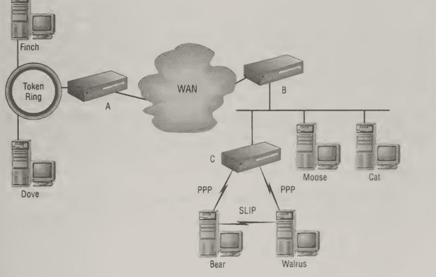

在图中，从`finch`到`walrus`的`IP`数据报首先去往路由器`A`，然后是路由器`B`，然后是路由器`C`，最后到达`walrus`。注意，`IP`路由器可以互连不同类型的物理网络。而且，正如本章所示，任何`Linux`系统都可以配置为`IP`路由器。

## 理解路由

路由将`TCP/IP`网络变成互联网，是`Internet`协议（`IP`）的一项基本功能。即使是具有传输层的`Linux`系统，其位于`IP`层之上的应用层也会路由决策。当`IP`层接收到数据包时，它如下评估数据包中的目标地址：

- 如果目标地址是本地计算机，`IP`使用相应的协议号（参见第 5 章的讨论）。
- 如果目标在直接连接的网络上，`IP`将数据包交付给主机。
- 如果目标在远程网络上，`IP`将数据包转发到本地路由器。数据包发送到的路由器负责随后逐跳地转发，直到数据包到达目的地。

根据这些可能的决策，`IP`要么直接交付数据包，要么将其转发给路由器。从第 5 章你就知道`IP`如何使用协议号和端口号将数据交付给本地应用程序。但你可能还不知道`IP`如何跨网络交付数据。要向直接连接的网络交付数据包，`IP`必须使用该网络的物理层地址。为了实现这一点，它必须将`IP`地址转换为以太地址

如图 9.2 所示，`IP`可以运行在许多类型的网络上。`IP`地址是一个逻辑地址。该地址对逻辑`IP`网络有意义，但对`IP`必须传输数据的物理网络没有意义。要在物理网络上传输数据，`IP`必须将`IP`地址转换为网络理解的地址。这种转换常见的例子是从`IP`地址转换为以太地址。

> 注意 `ARP`协议包含在你的`Linux`系统中，并作为`TCP/IP`网络软件默认安装。你不需要进行任何操作来激活`ARP`，它应该正常运行。

`ARP`协议动态构建一张映射`IP`地址到以太地址的表。它利用以太的广播功能来实现。当`ARP`接收到将`IP`地址转换为以太地址的请求时，它检查`ARP`表中是否存在该地址的映射。如果映射存在，它拥有它并使用它。如果不在表中，`ARP`向以太发送广播，询问谁拥有该`IP`地址。当计算机看到针对其`IP`地址的`ARP`广播时，它会用其以太地址进行响应。`ARP`将该响应添加到表中。


# 了解路由

使用`-a`命令行选项查看您`Linux`系统上的`ARP`表。

使用`-a`命令行选项查看整个表格：

```
$ arp -a
bluejay (172.16.55.51) at 00:00:C4:F3:3E:DD [ether] on eth0
down (172.16.55.11) at 00:10:4B:87:D4:A8 [ether] on eth0
raven (172.16.55.251) at 08:00:20:82:D5:1D [ether] on eth0
gw50 (172.16.50.254) at 00:00:0C:43:8D:FB [ether] on eth1
```

`arp`命令列出了当前存储在`ARP`表中的每个系统的主机名、`IP`地址和以太网地址。方括号内的条目表示硬件类型。这始终是`ether`。还有其他硬件值，但对于`ARCNet`来说非常晦涩。大多数条目都是连接到网络接口`eth0`的网络。

然而，路由器具有多个网络接口，因此可能会看到指示多个以太网接口的`ARP`显示。显示的最后一行显示了这一点：`gw50`是通过接口`eth1`访问的。

您也可以使用`arp`命令检查单个主机的表格：

```
$ arp bluejay
```

| Address | HWtype | Hwaddress | Flags | Mask | Iface |
| --- | --- | --- | --- | --- | --- |
| bluejay | ether | 00:00:C4:F3:3E:DD | C | | eth0 |

> 注意：输入`arp`命令查找特定主机并收到“no entry”（无条目）响应是可能的。这并不意味着有问题。尝试向该主机发送`ping`以预热缓存。然后输入`arp`命令。你应该看到正确的表格条目。

此示例包含了与您在第一个示例中看到的相似的信息。同样，有硬件类型、以太网地址、网络接口名称和主机名。（如果您倾向于使用`IP`地址而不是主机名，请在`arp`命令行使用`-n`选项。）然而，有两个字段您在之前的列表中没有看到：`Flags`字段和`Mask`字段。

`Flags`字段可以包含三个可能的值：

- `-` 此标志表示这是一个完整的条目。要有效，条目必须是完整的。因此，此标志应始终设置。
- `M` 此标志表示该条目是手动作为永久条目输入的。`ARP`表条目通常是动态的。它们从网络上的计算机学习，并且只在`ARP`表中保留几分钟。然而，系统管理员可以在表中放置静态条目。只要系统运行，这些条目就会留在表中。参见第 15 章“故障排除”，有关使用永久条目排除地址问题的信息。
- `P` 此标志表示该条目将被发布。也就是说，如果此计算机接收到针对条目中`IP`地址的`ARP`广播，本地主机将用以太网地址响应，即使该`IP`地址并不真正属于本地主机。这被称为代理`ARP`（proxy `ARP`）。它用于帮助无法自行响应的系统。查看“Proxy `ARP`”侧边栏了解使用场景的示例。

如果使用了网络掩码，该字段包含一个可选掩码。默认情况下，掩码为`255.255.255.255`，表示整个`IP`地址匹配到以太网地址。很少使用其他掩码。`Solaris Unix`系统使用`240.0.0.0`掩码将多播地址映射到以太网广播地址。

> 警告：我听说在`Linux`系统上使用可选掩码值的唯一目的是为整个子网发布单个以太网地址。在这种情况下，使用的是特定子网所需的掩码。然而，不要这样做。子网应该通过路由而不是代理`ARP`连接。

# 代理 ARP

通过`PPP`链路连接以太网主机无法响应`ARP`请求。`ARP`请求通过以太网广播发送，而`PPP`上的电话线不理解以太网广播。为了解决这个问题，您可以使用代理`ARP`。

假设两个远程办公人员通过`PPP`链路连接到`bluejay`上的子网`172.16.55.0`。他们都分配了子网`172.16.55.0`上的地址：`killdeer` (172.16.55.8) 和`meadowlark` (172.16.55.23)。`bluejay`配置为以下命令为两个系统提供代理`ARP`：

```
# arp -s killdeer 00:00:C0:4F:3E:DD pub
# arp -s meadowlark 00:00:C0:4F:3E:DD pub
# arp killdeer
```

# 代理 ARP（继续）

| Address | HWtype | HWaddress | Flags | Mask | Iface |
| --- | --- | --- | --- | --- | --- |


| `killdeer` | ether | `00:00:C0:4F:3E:DD` | CMP | | `eth0` |

| `meadowlark` | ether | `00:00:C0:4F:3E:DD` | CMP | | `eth0` |

# 理解路由 287

在分析路由表时，我使用`-n`选项，它可以防止路由表显示时将 IP 地址转换为主机名。这是一个示例：

```bash
$ route -n
```

内核 IP 路由表

| 目的 (Destination) | 网关 (Gateway) | 生成网掩码 (Genmask) | 标志 (Flags) | 度量 (Metric) | 引用 (Ref) | 接口 (Iface) |
| :--- | :--- | :--- | :--- | :--- | :--- | :--- |
| `172.16.55.0` | `0.0.0.0` | `255.255.255.0` | U | 0 | 0 | 38 `eth0` |
| `172.16.55.0` | `172.16.55.36` | `255.255.255.0` | UG | 0 | 0 | 8 `eth0` |
| `127.0.0.0` | `0.0.0.0` | `255.0.0.0` | U | 0 | 0 | 1 `lo` |
| `default` | `172.16.55.254` | `0.0.0.0` | UG | 1 | 0 | 17 `eth0` |

路由表列表包含以下字段：

*   **目的 (Destination)**：目的地网络（或主机）。通常这是一个网络，但正如你在“标志 (Flags)”字段讨论中看到的，也可能存在特定主机的路由。
*   **网关 (Gateway)**：指定目的地的网关。如果此字段包含零（`0.0.0.0`）或星号（*），则意味着该目的地直接连接到这台计算机，通往该网络的“网关”就是该计算机的网络接口。
*   **生成网掩码 (Genmask)**：应用于地址的位掩码，用于检查它们是否匹配目的地址。
*   **标志 (Flags)**：标志描述了此路由的某些特征。使用的可能标志包括：
    *   U：此路由已启用并正在运行。
    *   H：这是通往特定主机的路由。示例中没有任何路由是特定主机路由，这种路由很少被使用。
    *   G：此路由使用外部网关。系统的网络接口提供了指向直接连接网络的路由。所有其他路由都使用外部网关。直接连接的网络没有设置 `G` 标志；所有其他路由都设置了。
    *   D：此路由是通过 `ICMP` 重定向消息添加的。当系统通过 `ICMP` 重定向学习到路由时，它会将该路由添加到路由表中，这样发往该目的地的额外数据包就不再需要重定向。系统使用 `D` 标志来标记这些路由。
*   **度量 (Metric)**：这是该接口的路由成本。通常对于通往直接连接网络的路由，此字段为零。通往外部网关的路由度量通常为 1，尽管并非总是如此。度量是一个任意值。


# 第 9 章 网络网关服务

`set`。度量越高，越“贵”——因此越是不优选路由。我稍后会在本章的“路由协议”部分详细介绍路由度量。

`Ref`（引用）显示该路由建立连接时引用的次数。使用通过此路由传输的数据包数量。

`Iface`（接口）此路由所使用的网络接口名称。对于以太网网络接口，名称将为`eth0`、`eth1`、`eth2` 等。对于 PPP 网络接口，名称将为`ppp0`、`ppp1`、`ppp2` 等。

掌握了路由表如何显示的这些知识后，让我们看看示例表中的每一行：

*   第一行定义了此主机到本地以太网的连接。从该条目可以知道，该主机连接到了本地以太网。
*   第二行显示了网关`172.16.55.36`。
*   第三行定义了回环地址（loopback）的路由。
*   最后一行定义了默认路由，显示`172.16.55.254`是网关。

# 使用动态路由

在路由器数量有限的情况下，静态路由表是最高效的。如果网络只有一个路由器，正确的配置是使用静态默认路由。当网络的路由环境发生变化或非常复杂时（例如当有多个路由器可以到达同一个目的地时），请使用动态路由协议。

## 路由协议

路由和路由协议并不是一回事。所有的 `Linux` 系统都会做出路由决策，但极少有系统运行路由协议。路由协议执行两个功能：它们选择通往目的地的“最佳”路由，并将该路由通信给网络上的其他路由器。路由协议是一种用于定义路由并分发路由的程序。

有多种不同的路由协议，考虑到 `Linux` 系统通常不被用作路由器，有相当数量的这些协议适用于 `Linux` 系统。它们通过用于确定最佳路由的度量值（`metric`）以及用于分发路由信息所采用的技术进行区分。

路由协议分为内部协议和外部协议。内部协议用于路由域内部。外部协议用于在不同的路由域之间交换路由信息。在您的企业级网络中，您将在网络和 `ISP` 之间使用内部路由协议，但即使这样也不可能的。大多数公司网络位于 `ISP` 的路由域内，因此使用内部路由协议与 `ISP` 通信。以下是三种内部协议——路由信息协议（`RIP`）、路由信息协议版本 2（`RIPv2`）和最短路径优先算法（`OSPF`）以及一种外部协议——边界网关协议（`BGP`）的概述。

## 边界网关协议

`BGP` 是唯一广泛使用的外部路由协议。`BGP` 支持基于策略的路由，这允许您为选择路由定义组织或政治原因。在不同路由域内使用的路由度量无法直接比较。您无法确切知道另一个路由域内的度量值是如何确定的。您可能不知道它们使用哪些内部路由协议。与其信任用于选择路由的技术过程，不如说信任发布路由的组织。您之所以这样做，可能是因为该组织的声誉，或者因为您与他们有业务协议来信任他们的路由。这就是基于策略的路由的基础。


# 第 9 章网络网关服务

`BGP` 是一种路径向量协议。路径向量提供了沿路线每个路由域的端到端列表，这允许您决定是否信任来自这些域的公告。

除非您的 `ISP` 要求您运行 `BGP`，否则您不会运行 `BGP`。外部协议仅在外部使用，为了使其成功使用，双方必须同意使用该协议。如果您的 `ISP` 要求您使用 `BGP`，可以确定他们将知道应该如何配置它。您在自己的网络上使用的协议是内部路由协议。

## 路由信息协议

`RIP` 是最常用的内部路由协议。它作为操作系统的一部分包含在所有的 `Linux` 和 `Unix` 系统中，以及 `Windows` NT `RRAS` 软件包中。`RIP` 已经安装在您的系统中，并且易于配置和运行。

`RIP` 将“最佳”路由定义为成本的路由，即路由度量最低的路由。路由度量是一个从 1 到 15 的任意数字，代表到达目的地必须经过的网关数量。`RIP` 将每条路由称为一个“跳”（`hop`），将度量称为“跳数计数”（`hop count`）。通往目的地的最佳路由是经过路由最少的那一个。这种确定最佳路由的技术被称为距离向量算法。

当 `RIP` 启动时，它会广播路由信息请求。`RIP` 路由器通过发送更新包来响应请求，该包包含其路由表中的目的地址和相关的度量。除了响应请求外，运行 `RIP` 的路由器每 30 秒发布一次更新包。如果一个路由器停止发布 180 秒，网络上的其他路由器将认为它已掉机，并删除任何通过该路由器的路由。

`RIP` 按以下方式处理更新包：

*   如果数据包包含路由表中没有的新路由，则将它们添加。
*   如果数据包包含成本比现有路由表中相同路由更低的路由，则删除旧路由并更新新路由。新路由的成本是通过到达发送更新的路由器的成本加上更新包中包含的成本度量值来确定的。
*   如果数据包包含成本为 15 的路由，且该更新来自用于这些路由的网关，则从路由表中删除这些路由。例如，如果您的路由表表包含一条通过网关`172.16.55.36`通往子网`172.16.50.0`的路由，并且它收到来自`172.16.55.36`的 `RIP` 更新，其中通往`172.16.50.0`路由的成本为 15，则您的系统将删除该路由。

# 使用动态路由 293

`RIP` 已经存在了很久，它显示出了年代感。非常大的网络无法使用 `RIP`，因为它允许的最长路由是 15 跳。这对于您的网络来说应该足够了，但对于大型国家网络来说是不够。此外，路由表反映网络当前状态可能需要很长时间，因为 `RIP` 在丢弃非活动路由器的路由之前等待 180 秒。这可能会由于“计数无限”（counting to infinity）问题而恶化。（不熟悉“计数无限”？请参见向上计数。）比这些问题更重要的是，`RIP` 不具备处理网络位掩码的功能，这使其与许多网络不兼容。

## 计数无限

原始 `RIP` 设计中的一个问题被称为“计数无限”。让我们使用图 9.2 来说明这个问题。

路由器 `B` 广播 `fin` 在两跳之外，因为它通过 `A` 到达。`C` 广播 `fin` 在三跳之外，因为它通过 `B` 到达。当路由器 `A` 不再收到来自 `A` 的更新时，它认为自己无法通过 `A` 到达 `fin`。然而，它收到来自 `C` 的更新，说 `fin` 在四跳之外。因此 `B` 更新了路由表，现在广播 `fin` 在五跳之外。因为 `C` 更新了路由表，通过 `B`，`B` 然后看到了来自 `C` 的更新并更改了其路由表。这种情况一直持续直到达到无限。幸运的是，`RIP` 的跳数仅为 15。


RIP 通过三种方式解决这个问题：“水平分割”（split horizon）、“毒性反转”（poison reverse）和“触发更新”（triggered updates）。水平分割规则规定路由器不会向从其学习路由的网络发布该路由。（此处省略重复的水平分割规则描述）

RIP 通过三种方式解决此问题：“水平分割”、“毒性反转”和“触发更新”。水平分割规则规定路由器不会向从其学习路由的网络发布该路由。

# 开放最短路径优先协议 (OSPF)

OSPF 与 RIP 非常不同。RIP 路由器向其邻居发送整个网络的信息。而 OSPF 路由器则向整个网络泛洪其邻居的信息。泛洪意味着路由器从每个网络端口发送信息，并且接收到更新的每个路由器也会从接收信息的端口以外的所有端口发送该信息。泛洪将路由信息传播到整个网络。

OSPF 是一种链路状态协议，因为它创建了网络中所有链路状态的图。每个 OSPF 路由器都利用泛洪传播到整个网络的关于所有路由器及其邻居的信息来创建自己的图。每个图都是唯一的，因为每个路由器都以自己为树的根来创建图。图是使用 Dijkstra 最短路径优先算法构建的，这也是该协议命名的由来。该算法按以下方式构建图：

- 1. 系统首先将自己安装为图的根，代价为 0。
- 2. 系统安装添加到图中的系统邻居。到达邻居的代价计算为：到达刚刚安装的系统的代价加上该系统通告的到达邻居的代价。
- 3. 系统为每个拥有信息的目的地选择代价最低的路径。它对每个拥有信息的系统重复步骤 2 和 3。

显然，每当创建路由时都为大型网络构建链路状态图会给路由器带来巨大的开销。因此，OSPF 将路由域划分为更小、更易管理的部分。整个路由域是一个自治系统，这些部分被称为区域（`areas`）。定义了一个特殊的区域——骨干区域用于连接自治系统中的所有区域。区域内的路由器了解该区域，因此只创建该区域内系统的图。

OSPF 是一个比 RIP 复杂得多的系统，OSPF 更适用于大型网络。然而，你可能在使用 Linux 服务器作为路由器的网络上需要使用 OSPF。大多数 Linux 系统运行 RIP 路由协议。

# 使用 routed 运行 RIP

每个 Linux 系统都包含了路由守护进程 `routed`，它是 RIP 的一种实现。要运行 RIP，只需输入 `routed` 即可。

`routed` 不需要命令行参数也不需要配置文件。路由守护进程监听网络上的 RIP 更新以构建运行的路由表。如果该计算机是路由器（即该计算机具有多个网络接口），路由守护进程会广播自己的更新。如果该计算机只有一个网络接口，则它被视为主机，路由守护进程不会广播路由更新。


# 第 9 章 网络网关服务

命令行选项可以用于更改这种默认行为，无论集群中安装了多少网络接口。使用 `-s` 强制守护进程广播 RIP 更新；指定 `-q` 停止其广播数据包。`-q` 参数比 `-s` 参数更有用。有时你可能不希望具有多个网络接口的计算机广播路由。然而，我从未配置过仅有一个网络接口的主机去广播 RIP 更新。

`routed` 不需要配置，但可以使用 `/etc/gateways` 文件向路由守护进程传递补充的路由信息。

# /etc/gateways 文件

`routed` 在启动时立即广播 RIP 请求，并使用收到的 RIP 更新中的信息来构建表。运行某种协议的全部目的是为了使用来自该协议的信息来构建路由表。从表面上看，向动态表中添加静态路由似乎并不合理，通常也没有理由这样做。但你的网络上可能存在无法或不 RIP 更新的路由器，这些路由器必须手动添加到表中。`/etc/gateways` 文件在需要时提供了这种能力。

`routed` 在启动期间读取 `/etc/gateways` 文件并将其中定义的路由添加到路由表中。`gateways` 文件的示例条目足以说明其用途，因为文件中的所有条目都具有相同的字节格式。以下是两个示例条目：

```
$ cat /etc/gateways
net 0.0.0.0 gateway 172.16.55.254 metric 1 active
net 172.16.50.0 gateway 172.16.55.36 metric 1 passive
```

所有条目都以关键字 `net` 或 `host` 开头，以指示这是主机特定路由还是网络路由。关键字后面是目的地址。目的地 `0.0.0.0` 是代表默认路由的特殊地址。目的地址之后是关键字 `gateway` 和用于到达该目的地的外部网关的 IP 地址。


接下来是关键字 `metric` 以及分配给该路由的代价。通常，外部网关被赋予的代价为 1，但这是任意的，所以如果你愿意，可以分配一个更高的值。然而，分配较高的 `metric` 仅在你通往同一目的地的两条路由并希望倾向于其中某一个时才有意义。

所有条目都以关键字 `active` 或 `passive` 结尾。预期的活动路由器（`active` router）将参与路由更新的交换。如果它未能响应路由请求，它将从路由表中移除。这是任何 `RIP` 路由器预期的正常行为。

## 使用动态路由 297

被动路由器（`passive` router）不参与 `RIP` 更新的交换。也许系统运行着不同的路由协议。无论原因如何，它都不要求参与，并作为永久的静态路由安装在路由表中。

我们示例中的第一行创建了一个活动默认路由。该默认路由在 `RIP` 启动期间有效，但一旦 `RIP` 开始运行，该默认路由预期是路由协议的参与者。如果你在运行路由协议使用默认路由，请使用活动默认路由。静态路由由于不允许协议在网络变化时更新路由，可能会破坏动态路由的目的。

第二行创建了通往网段 `172.16.50.0` 的静态路由，网关为 `172.16.55.36`。由于这是一个被动路由器，`172.16.55.36` 不运行 `RIP`。创建此类路由的唯一理由可能是 `172.16.55.36` 不运行 `RIP`。

`routed` 适用于许多小型网络。它不需要安装且配置极少。然而，它并不适用于所有网络。特别是它不支持类 IP 地址。如果你需要支持类 IP 地址的路由协议，请运行网关守护进程。

## 使用 gated

网关守护进程（`gated`）是一个包含了许多最先进路由协议的软件包。`gated` 为 `Linux` 系统提供了内部和外部路由协议的访问，这些协议通常运行在专用路由硬件上（如 `Cisco` 路由器）。允许你的系统运行多个路由协议并合并从这些协议中学习到的路由。为了支持多种协议，特别是外部路由协议，`gated` 提供了一种定义路由策略的方法，指定你接受哪些路由以及发布哪些路由。

当运行多个协议时，你的系统可能会从不同的路由协议接收到同一目的地的路由。每个协议都使用自己的指标来选择最佳路由。`gated` 必须比较这些不兼容的指标并选择最佳路由。它使用偏好值（preference value）。`gated` 偏好值是 0 到 255 之间的任意数字，用于指示一个路由信息源是否优于其他源。信息源可以是不同的路由协议、不同的接口、不同的路由器和不同的领域。偏好数字越小，优先级越高。路由协议使用的默认偏好值见表 9.1。

根据表 9.1 中的偏好值，通过网络接口到达直连网络的路由优先级最高，而从 `EGP`（一种过时的外部协议）学习到的路由优先级最低。表中列出的大多数路由源

### 表 9.1 默认 gated 偏好值

| 路由源 | 偏好值 |
|---|---|
| 直接路由 | 0 |
| `OSPF` | 10 |
| 内部生成的默认 | 20 |
| `ICMP` 重定向 | 30 |
| 静态路由 | 60 |
| `Hello` 协议 | 90 |
| `RIP` | 100 |
| `OSPF` `ASE` | 150 |
| `BGP` | 170 |
| `EGP` | 200 |

本文之前提到过其中两个。还有两个没有。`Hello` 是一种旧的内部路由协议，根据数据包递送选择路由。它很少被使用。`OSPF` `ASE` 路由是 `OSPF` 从外部自治系统学习到的。`ASE` 代表“自治系统外部路由”。由于 `ASE` 路由来自另一个路由域，因此这些路由中的度量不会获得与内部路由度量相同的信任级别。事实上，偏好性最低的三个路由源（`EGP`、`BGP` 和 `OSPF` `ASE`）都从外部路由域获取路由。

在配置 `gated` 时，你可以修改这些默认偏好值，但我从未需要这样做。默认值在我的所有配置中表现都不理想。这是因为我不建议使用像 `Linux` 这样的通用系统来处理极其复杂和高要求的路由状况。相反，应该使用专用的路由器硬件。对于要求不那么的应用（例如为单个子网提供网关），带有 `gated` 的 `Linux` 是极极的选择。

## 安装 gated

`gated` 软件是某些 `Linux` 发行版的一部分。`Red` `Hat` 包含了它。使用 `tksysv` 或 `linuxconf` 检查在初始系统安装期间是否安装 `gated`。如果是，你可以使用 `tksysv` 或 `linuxconf` 启用它。图 9.3 显示了一个安装了 `gated` 包的系统。在服务控制窗口中，找到 `gated` 并点击 `Enabled`（启用），然后点击 `Accept`（接受）。退出 `linuxconf` 时激活守护进程，服务即可准备好运行。

**图 9.3** 使用 `linuxconf` 启用守护进程 `gated`

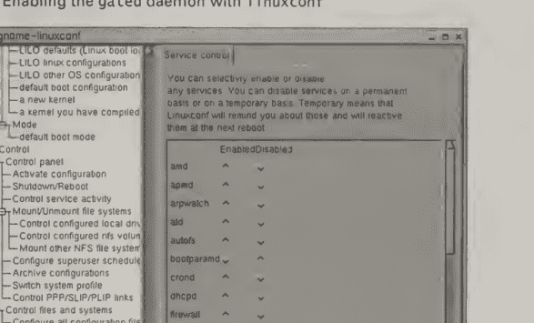

如果在初始安装期间没有安装 `gated` 包，请使用 `Red` `Hat` 包管理器（`RPM`）从光盘安装软件，`rpm` 是 `Red` `Hat` 6 中用于安装 `RPM` 软件的 `X` `Windows` 工具。从系统菜单运行 `rpm`。图 9.4 显示了安装 `gated` 后的 `rpm`。

### Gnome 9.4 使用 rpm 安装 gated

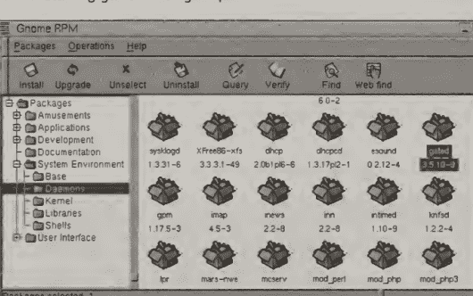

> 如果你没有 `gated` 软件，可以从互联网 [www.gated.org](http://www.gated.org) 轻松获取。你可以从网站下载预编译的 `Linux` `gated` 二进制文件。如果你愿意，可以下载压缩 `tar` 格式的源码树并编译你自己的 `gated` 版本。

无论如何安装，`gated` 都是通过 `/etc/gated.conf` 文件配置的。

## gated.conf 文件

在启动时，`gated` 读取 `gated.conf` 文件。该文件包含配置语句，告诉 `gated` 应该运行哪些路由协议以及如何配置它们。有几种类型的配置语句：

- 语句 (Options statements)
- 接口语句 (Interface statements)
- 定义语句 (Definition statements)
- 协议语句 (Protocol statements)
- 静态语句 (Static statements)
- 控制语句 (Control statements)
- 聚合语句 (Aggregate statements)

配置并不是需要所有这些语句，但当使用它们时，语句必须按照上述列出的顺序出现。

这些语句可以分为两组：你可能不会使用的语句和你可能会使用的语句。在你不可能使用的语句中，包括选项语句、静态语句、控制语句和聚合语句：

- **选项语句**设置参数，如 `nosend`（不发送任何路由信息）和 `noresolv`（不使用 `DNS`），这些参数仅用于特殊配置。
- **静态语句**定义应包含在路由表中的静态路由。通常情况下，当你运行路由协议时，不需要定义静态路由。
- **控制语句**用于定义路由策略。它们主要用于在路由域之间传递。虽然你不太可能使用 `Linux` 执行此，但我稍后会提供一个示例，因为它是 `gated` 的关键功能之一。
- **聚合语句**用于聚合区域和国家网络内的路由，以减少国家网络之间交换的路由数量。如果你运行的是国家网络，不要在 PC 上运行它！

你在 `Linux` `gated` 配置中可能常用的语句是定义语句、接口语句和协议语句：

- **定义语句**定义无效的终止地址、外部路由协议的自治系统编号以及 `BGP` 和 `OSPF` 的路由器 IP 地址。稍后你会看到定义语句的一些示例。
- **接口语句**用于定义路由器网络接口的特性。你将在我们的示例配置中看到此语句。
- **协议语句**是 `gated.conf` 文件的核心。`gated` 中可用的每个协议都有协议语句。使用协议语句为你的网络配置路由。 `gated` 是一个复杂的系统，可以处理许多不同的配置。配置语言有许多选项。语言的细节可以在 [www.gated.org](http://www.gated.org) 的在线手册和打印版中查阅。然而，`Linux` 路由器并不需要所有选项。

## 运行 RIP2

首先，假设你有一个需要运行 `RIP2` 的主机。该系统不是路由器，但因为它所在的网段有一个路由器，你决定配置它监听路由器广播的 `RIP2` 更新。以下是示例：


## 启用 rip，不广播更新

```
# 启用 rip，不广播更新
# 在组播地址监听 RIP2
# 验证更新是经过身份验证的
rip yes {
  nobroadcast
  interface 172.16.60.2
  version 2
  multicast
  authentication simple EZDozit
}
```

开头的注释有助于解释配置。除了这些注释，整个文件就是一个协议语句。大括号 `{}` 内的所有行都是协议语句的一部分。

语句以 `rip yes` 开始，这启用了 RIP 协议。`nobroadcast` 子句告诉系统不要发送 RIP 更新包；只需监听路由器提供的包。如果你的系统是路由器而不是主机，请删除此子句，它将发送更新。

接口定义定义。在这种情况下，你通过 IP 地址标识接口。主机只有一个接口。如果这是一个在所有接口上运行 RIP2 的路由器，你可以提供所有接口 IP 地址的逗号分隔列表，或使用关键字 `all` 表示使用所有接口。

接口语句还包含了一些 RIP2 特有的参数。`version 2` 参数明确告诉 `gated` 运行 RIP2。`multicast` 关键字表示在 RIP2 组播地址监听更新。最后，`authentication` 参数定义了使用的 RIP 路由器认证类型。在这里，你使用简单密码认证。密码是 `EZDozit`。

此示例提供了一个 RIP2 主机配置，可以在任何系统上稍微修改后使用。我们的示例主机从本地路由器接收 RIP 更新。在下一节中，将配置这些路由器之一。

# 运行 OSPF

在示例示例中，路由器被配置在一个子网上发送 RIP2 包（即它与我们的示例主机共享的子网），并在另一个与其他路由器共享的子网上发送 OSPF 链路状态广告。以下是路由器配置：

## 304 第9章 网络网关服务

```
authkey "UcantrustME";

};

};
```

配置从接口语句开始。它告诉系统子网 60 上的系统可能提供 RIPv2 更新。通常，如果从接口上没有接收到路由信息，该接口将被标记为非活动并假设为“断开（down）”。此语句确保接口不会因为子网上的主机未广播 RIPv2 更新而处于“断开”状态。与上面看到的接口子不同，此语句不属于任何协议语句。

路由器定义语句定义了用于在 OSPF 中识别该路由器的地址。路由器有一个或多个网络接口，因此有多个 IP 地址。为了确保在 OSPF 链路状态通告中使用正确的地址，需要专门定义 OSPF 路由器。

在示例网关 `.conf` 文件中，最后一个协议启用了 OSPF。请记住，OSPF 将自治系统划分为区域（areas）。每个 OSPF 路由器都必须连接到某个区域。如前所述，跨路由域连接所有其他区域的接口被称为骨干区域。该路由器通过 `backbone` 关键字连接到骨干区域。如果路由器未连接到骨干区域，它连接的区域将在此之前定义。例如：`area 1`。标识区域的数字是你在设计 OSPF 路由域的区域层次结构时定义的数字。

OSPF 协议也使用简单密码身份验证，如 `authtype simple ;` 子句所示。接口语句标识运行 OSPF 的接口以及与该接口相关的协议特性。`authkey "UcantrustME";` 子句定义了用于验证该区域内 OSPF 路由器的密码。

## 305 使用动态路由

`priority 5 ;` 子句定义了系统在区域选举指定路由器（DR）时使用的优先级数字。优先级数字越大，路由器被选为指定路由器的概率就越小。给你最强大的路由器分配最低的优先级数字。

指定路由器用于缩小链路状态数据库的大小，从而降低计算区域 Dijkstra 图形的复杂度。指定路由器将区域内的所有其他路由器视为邻居，但所有其他路由器仅将指定路由器视为邻居。

为了理解这如何缩小链路状态数据库，请想象一个由五台路由器组成的网络。如果没有指定路由器，所有五台路由器都会广播四个邻居，数据库中总共有 20 个邻居。有了指定路由器后，只有一台路由器广播四个邻居。其他四台路由器每台广播一个邻居，数据库中总共有 8 个邻居。

简单的 OSPF 配置（如上述示例所示）对于任何需要运行 OSPF 的 Linux 系统都是足够的。大部分配置信息将来自定义路由层次结构的网络设计者。你所连接的区域、使用的身份验证类型、身份验证密码以及系统的优先级，都是在你开始运行 OSPF 之前就会做出的设计决策。

作为运行网关的最后一个示例，让我们配置一个 Linux 系统运行外部网关协议。

# 运行 BGP

在本节中，配置一个路由器通过 BGP 将描述的 OSPF 骨干区域连接到外部自治系统。该路由器的配置如下：

- `# 定义 BGP 的 AS 号` `autonomousssystem 249;`
- `# 定义 OSPF 路由器 ID` `routerid 172.16.1.5;`
- `# 禁用 RIP` `rip no;`
- `# 启用 BGP`


```
bgp yes {

    preference 50 ;

    group type external peeras 164 {

        peer 26.6.0.103 ;

        peer 26.20.0.72 ;

    }

}
```

`# 启用 OSPF；子网 1 是骨干区域。` `# 使用密码身份验证。`

```
ospf yes {

    backbone {

        authtype simple ;

        interface 172.16.1.5 {

            priority 10 ;

            authkey "UcantrustME"

        }

    }

}
```

`# 宣告从 OSPF 学习的路由并` `# 通过 BGP 宣告到直接连接的网络到 AS 164`

```
bgp as 164 {

    all;

}
```

`# 宣告从 OSPF 学习的路由并` `# 通过 BGP 宣告到直接连接的网络到 AS 164`

```
bgp as 164 {

    all;

}
```

`# 宣告从 OSPF 学习的路由并` `# 通过 BGP 宣告到直接连接的网络到 AS 164`

```
bgp as 164 {

    all;

}
```

`# 宣告从 OSPF 学习的路由并` `# 通过 BGP 宣告到直接连接的网络到 AS 164`

```
bgp as 164 {

    all;

}
```

`# 宣告从 OSPF 学习的路由并` `# 通过 BGP 宣告到直接连接的网络到 AS 164`

```
bgp as 164 {

    all;

}
```


# 网络地址转换

此子句表示网关应该接受来自所有自治系统的路由。
你不是使用 `all` 关键字，而是可以使用特定地址来仅接受特定的路由，
或者使用 `restrict` 关键字来阻止所有路由。

注意：关于 `OSPF` 和 `BGP` 的讨论表明，路由是一个非常复杂的话题。如果你需要使用比 `RIPv2` 更复杂的路由协议，在尝试配置系统之前，请阅读更多内容并设计你的路由架构。关于路由协议的内核，我建议参考 `Bassam Haiabi` 著的《Internet Routing Architectures》(`Cisco, 1999`) 和 `Mark Sportack` 著的《IP Routing Fundamentals》(`Cisco, 1999`) 以获取更多额外信息。

## 网络地址转换 (NAT)

`NAT` 是路由的一种扩展，允许路由器修改其所转发的数据包中的地址。传统路由器会检查地址，但不会更改它们。`NAT` 将本地网络使用的 `IP` 地址转换为“官方” `IP` 地址。这允许你使用私有网络编号并仍然访问 `Internet`。`RFC 1918` 中定义的私有网络编号有：

- 网络 `10.0.0.0`
- 网络 `172.16.0.0` 到 `172.31.0.0`（网络 `172.16.0.0` 用于书中的示例）
- 网络 `192.168.0.0` 到 `192.168.255.0`

私有网络编号非常流行，并且是有充分理由的：

- 使用私有网络编号减少了文书工作。你不需要请求任何人的许可使用这些地址。无需申请，无需费用。直接使用即可。
- 这些地址是你的。如果你使用 `ISP`，则无需对网络上的主机进行重新编号。你可能需要更改 `NAT` 盒的配置，但这可能比更改你所有台式机系统的配置要容易得多。
- 你节省了 `IP` 地址。拥有比实际需要的更多的地址可以使网络设计变得简单得多，但如果你在浪费宝贵的 `IP` 地址，你就不想要比需要的更多。当你使用私有地址时，你不会浪费任何 `IP` 地址。这些地址是可重用的，你正在使用的相同地址可能正全球其他网络使用。
- 私有 `IP` 地址消除了地址欺骗。地址欺骗是一种安全攻击，即远程位置的人通过使用伪装成在你的本地网络上。你的网络地址之一。这些地址无法通过 `Internet` 转发，因此欺骗这些地址对攻击者没有太大益处。

``

私有网络编号被明确定义用于私用。它们无法通过 `Internet` 路由，因为任何数量的私有网络可能在使用这些地址。在使用私有 `IP` 地址的主机发的数据包转发到外部网络之前，数据包中的源地址必须转换为有效的 `Internet` 地址。

在决定使用 `NAT` 之前考虑所有因素。网络地址转换存在一些问题：

- 它给路由器带来了额外的开销，降低了路由器的性能。
- 它与所有协议的配合并不良好。`TCP/IP` 协议设计时没有考虑到 `NAT`。
- 它干扰了验证源地址的端到端认证方案。

地址转换通过两种方式实现：`NAT` 盒或代理服务器。`NAT` 盒是一个拥有一组可用地址的路由器。它将本地网络的地址映射到其地址池中的地址。代理服务器是一个防火墙，它将本地网络的所有地址映射到自己的地址，并通过端口号区分系统。`NAT` 盒执行的是多对多的映射，但两者都执行相同的服务。`Linux` 将 `IP` 翻译实现为代理服务器。

# 配置 Linux 代理服务器

`Linux` 将 `IP` 翻译作为系统随附的防火墙软件的一部分。第 14 章讨论了防火墙以及如何将 `Linux` 服务器配置为防火墙。本章将介绍防火墙软件的一个方面，该方面允许你翻译地址。

尽管地址转换包含在防火墙软件中，但它并不是专门的安全功能。地址转换的一个非常常见的用途是将小型网络连接到 `Internet`。假设你有一个连接到 `Internet` 的小型网络。在从使用私有 `IP` 地址的主机发出的数据包转发到外部网络之前，数据包中的源地址必须转换为有效的 `Internet` 地址。为了将 `Linux` 服务器作为代理服务器，它必须配置成转发路由器，通过唯一的有效 `IP` 地址让所有计算机与 `Internet` 通信。这些是内核选项：`CONFIG_FORWARD`、`CONFIG_FIREWALL` 和 `CONFIG_IP_MASQUERADE`。

> 注意：关于如何编译内核，请参阅第 15 章。

一旦内核中启用了代理服务，可以使用 `ipchains` 命令进行配置。

## 地址伪装

`IP` 防火墙 `ipchains` 命令用于配置和管理防火墙。（该命令在第 14 章中用于此目的。）你还可以用它来配置代理服务器的地址转换。假设你想通过代理服务器连接的小型网络地址为 `192.168.0.0`。将这三条 `ipchains` 命令放在代理服务器的 `rc.local` 启动脚本即可完成工作：

```
# ipchains -P forward DENY

# ipchains -A forward -p tcp -s 192.168.0.0/24 -j MASQ

# ipchains -A forward -p udp -s 192.168.0.0/24 -j MASQ
```


`-P` 表示这是过滤器链的默认策略，`forward` 告诉我们链的名字。`forward` 链是处理通过代理服务器转发的数据包的规则集。关键字 `DENY` 指定的策略除非其他过滤规则允许，否则所有数据包都将被阻止。此规则防止使用私有网络地址网络泄露到 `Internet`。发送带有私有网络地址的数据包违反了 `Internet` 标准。

第二行向 `forward` 链添加（`-A`）了一条过滤规则。该规则规定，源地址来自 `192.168.0.0` 的 `TCP` 数据包（`-p tcp`）应发送到 `MASQ` 代码（`-j MASQ`）进行处理。第三行对 `UDP` 数据包（`-p udp`）执行的操作与第二行对 `TCP` 的完全相同。

## 结语

本章结束了书中关于 `Internet` 服务器操作的部分。`Internet` 服务器所需的所有服务都已涵盖：远程登录、文件传输、`sendmail`、`Web` 服务和路由。

下一章开始第三部分“部门服务器操作”，其中将检查部门服务器所需的服务。首先，第 10 章涵盖了简化台式机配置的 `BOOTP` 和 `DHCP` 服务器。

# 路由服务器

我曾负责一个网络，该网络在共 50 个子网中有 12 个本地 `Novell NetWare` 网络。所有其他子网都是原生 `TCP/IP` 网络，是组织的骨干网络。`Novell` 服务器充当 `TCP/IP` 路由器的角色，将 `NetWare` 网络连接到 `TCP/IP` 骨干网。

发往外部的数据包被转发到共享网络。这项工作选择了 `Linux`，因为它可以充当非常完美的部门服务器，并可以被作路由器使用。

这些系统的路由配置非常简单。每台服务器都安装了两个以太网卡——每个连接到一个网络。每个系统都开启了 `IP` 转发功能，并为每个网络接口创建了一个简单的静态路由表，该表包含必要的路由条目和一个指向共享网络上默认路由器的默认路由。这些 `Linux` 路由器使用了书中这一部分描述的 `Internet` 功能，以及下一章描述的部门服务器功能，以满足公司的需求。

公司决定用新的部门服务器替换老旧的 `Novell` 服务器。然而，某些使用 `Novell` 的部门（特别是人事部和财务部）反感让他们的数据流经与其它敏感性较低的部门相同的同一个大楼网络。

一个可以作为路由器的部门服务器是解决方案，因为指向部门内计算机的数据将留存在部门网络中，只有

# 案例研究

# 第 3 部分

# 部门服务器操作

涵盖主题：

- 配置 `DHCP` 服务器、客户端和中继
- 理解 `BootP` 服务
- 理解 `Linux` 文件权限
- 配置 `NFS` 服务器和客户端
- 使用 `mount`、`fstab` 和 `automounter` 访问文件系统
- 理解 `NetBIOS`
- 使用 `Samba` 配置 `NetBIOS SMB` 服务器或客户端
- 安装、配置和共享打印机
- 使用 `POP` 或 `IMAP` 创建邮箱服务器
- 控制垃圾邮件
- 使用 `procmail` 过滤电子邮件

# 10

# 桌面配置服务器

`TCP/IP` 能够将世界连接成一个全球性的互联网（`Internet`），因为它不依赖于任何一种物理网络技术。它可以运行在连接到 `PC` 的调制解调器上，也可以运行在连接到超级计算机的光纤网络上。它通过在物理网络之上创建一个逻辑网络来实现，该逻辑网络独立于任何特定网络的特性。

然而，这种灵活性是以复杂性为代价的。配置一台计算机运行 `TCP/IP` 比配置它运行某些其他网络要困难得多。

你是一个技术人员——这就是为什么你负责网络。配置 `TCP/IP` 对你来说可能看起来非常简单，但对于设置 `PC` 的普通用户来说，这可能是一项令人生畏的任务。如果你的网络很小，你可以手动配置所有的桌面系统。在大型网络中，手动配置变成了一项无法完成的任务。即使在小型网络中，每当用户升级时都要修复配置，也是一项不讨好且枯燥的工作。解决方案就是本章的主题：创建一个为你完成这项工作的服务器。

# 理解配置协议

长期以来，协议开发人员一直努力减轻手动配置系统的负担。定义配置协议的文档中，有些已经是 13 年前的了。惊讶的是，这些协议在过去的几年里才开始被广泛使用。这部分部分是因为互联网的早期用户是喜欢自己配置系统的技术人员，另一部分是因为近几年运行 `TCP/IP` 的系统数量发生了巨大增长。微软在极力推动人们使用动态主机配置协议（`DHCP`）方面也应尽功劳，它是配置协议中最好的。本节将检查 `DHCP` 以及用于配置桌面系统的其他配置协议。

# 启动引导协议

启动引导协议（`BootP`）是第一个全面的配置协议。它可以提供通常用于配置 `TCP/IP` 的所有信息——从客户端的 `IP` 地址到客户端应该使用哪个打印服务器。`BootP` 协议的设计旨在将这些信息传递给客户端，即使客户端还没有 `IP` 地址。

# 动态主机配置协议

`BootP` 是简单且有效的。事实上，它成为了动态主机配置 `TCP/IP` 的基础。`DHCP` 设计为为客户端提供配置 `TCP/IP` 的所有参数。`BootP` 协议的设计旨在将这些信息传递给客户端，即使客户端还没有 `IP` 地址。

`DHCP` 对于你的大多数系统都能正常工作，并可以大幅减少你的配置工作量。

# 反向地址解析协议 (RARP)

在离开配置协议主题之前，我应该快速提到反向地址解析协议（`RARP`）。正如其名，它是 `ARP` 的反向。该协议不是响应 `IP` 地址以请求太网地址，而是广播一个太网地址并请求一个 `IP` 地址作为响应。

`RARP` 服务器使用 `/etc/ethers` 文件将太网地址映射到 `IP` 地址。然后，它将 `ethers` 文件中的 `IP` 地址发送给客户端系统。这里显示了一个 `/etc/ethers` 示例：

```


`00:C0:4F:3E:DD:3D bluejay`

`00:10:4B:87:D4:A8 duck`

`00:08:20:82:D5:1D raven`

`00:00:OC:43:8D:FB osprey`

```
```

文件的每一行都包含一个太网地址，随后跟着一个主机名或 `IP` 地址。主机名常用，但它们必须是映射到 `IP` 地址的有效名称。

我提到这个协议是因为第 6 章《Linux 名称服务》中使用的 `nsswitch.conf` 文件包含了 `/etc/ethers` 作为 NIS 服务的一部分，这可能会让你对它产生好奇。然而，你不应该使用 `RARP`。`RARP` 只为客户端提供 `IP` 地址，不提供任何其他配置信息。Linux 提供了更好的配置服务器，包括 `DHCP`，它是你网络中正确的配置服务器。

# 安装 `DHCP` 服务器

许多 Linux 发行版都包含 `DHCP` 守护进程（`dhcpd`）。参考表 1.3，你会发现它被列在 Red Hat 6 提供的服务列表中。`dhcpd` 是 `DHCP` 的服务器端，仅在 `DHCP` 服务器上需要。客户端不运行 `dhcpd`。

> 注意：关于配置 `DHCP` 客户端的信息将在在本章的后后部分提供。

使用 `linuxconf` 或 `tksys` 确保 `DHCP` 守护进程在开机启动时启动。如果这些程序没有将 `dhcpd` 列为可用服务之一，请使用 `rpm` 命令或 `gnorpm`（在 Red Hat 6 中用于安装 `RPM` 软件的 X Windows 工具）安装 `DHCP` 包。如果你使用 `gnorpm`，可以在 Red Hat 6 系统的 `System Environment/Daemon` 路径下找到 `DHCP`。

# 安装 `DHCP` 服务器

> **注意**：有关使用 `gnorpm` 安装软件包的示例，请参见第 9 章《网络网关服务》中的“安装 `gated`”部分。

当然，你的 Linux 系统可能没有自带 `DHCP` 服务器，或者你想要比系统自带更新的版本。无论哪种，你都可以自己下载并编译 `dhcpd`。

# 编译 `dhcpd`

`dhcpd` 的源代码可以在 `www.isc.org` 或通过匿名 FTP `ftp.isc/isc/dhcp` 获取。本文编写时最新的生产发布版本是 `dhcp-2.0`。（Red Hat 6 包含了 `dhcp-2.0.b1p6-6`）。最新的 Beta 版本是 `dhcp-3.0b1p10`，它不用于生产环境。要升级到较新的版本，请下载并使用 `tar` 提取文件：

```
# cd /usr/local/src

# ftp ftp.isc.org

Connected to isrv4.pa.vix.com.

220 isrv4.pa.vix.com FTP server July 14 1999 ready.

Name (ftp.isc.org:craig): anonymous

333 Guest login ok, send your complete e-mail address as password.

Password:

230 Guest login ok, access restrictions apply.

ftp> get isc/dhcp/dhcp-2.0.tar.gz

local: dhcp-2.0.tar.gz remote: dhcp-2.0.tar.gz

200 PORT command successful.

150 Opening BINARY mode connection for
dhcp-2.0.tar.gz (284789 bytes)

226 Transfer complete.

284789 bytes received in 21.6 secs (13 Kbytes/sec)

ftp> quit

221 Goodbye.

# tar -zxvf dhcp-2.0.tar.gz
```

进入新创建的目录 `dhcp-2.0`，运行那里的 `configure` 脚本。`configure` 会确定你运行的系统类型并为该系统创建正确的 `Makefile`。


第 3 部分

# 322 第 10 章 桌面配置服务器

接下来，输入 `make` 来编译守护进程：

```
# cd dhcp-2.0

# ./configure

System Type: linux

# make
```

最后，使用 `make install` 命令将守护进程和帮助页拷贝到正确的目录。在运行 `make install` 之前，你可能需要从系统中删除旧版本的 `dhcp`。在使用 `dhcp-1.0p12` 的 Caldera 1.3 系统上，输入 `rpm-uninstall dhcpd` 来将其删除。

要在 Red Hat 6 系统上删除旧包，运行 `gnorpm`。在 `gnorpm` 窗口中，打开 `System Environment` 和 `Daemons` 文件夹，选中 `dhcp`，点击 `Unstall`（见图 10.1）。

# 图 10.1 使用 `gnorpm` 卸载 `dhcp`


# 定制 `dhcpd`

考虑到在 Linux 上编译 `dhcpd` 的过程非常简单，你可能会奇怪它为什么配有一个独立的章节。嗯，它看起来并不那么简单。

如果你好奇，可以查看该文件以了解分配了哪些租。

# 初始化 `dhcp.leases` 文件

`dhcpd` 使用 `dhcpd.leases` 文件存储它分配的地址租数据库。该文件必须存在，`dhcpd` 才能启动。当服务器首次安装时，创建一个空的 `dhcpd.leases` 文件以确保守护进程正确启动。

`abandoned` 已放弃。标识这是一个已放弃的租约。如果服务器在分配地址时遇到困难，它将其标记为“已放弃”，直到可用地址耗尽并需要再次尝试。

你不需要担心这些命令。当你创建文件时，创建的是一个空文件。一旦创建了它，你就可以不管它了，因为 `dhcpd` 会维护该文件。然而，确实需要你输入的文件是用于配置服务器的 `dhcpd.conf` 文件。

# 配置 `DHCP` 服务器

一旦安装了 `dhcpd`，就必须对其进行配置。`DHCP` 守护进程通过 `dhcpd.conf` 文件进行配置。该文件可以包含大量的配置命令列表，为服务器提供指导方向，并为客户端提供配置信息。

`DHCP` 服务器通过静态地址分配为单个主机提供服务，通过动态地址分配为整个主机子网提供服务。`dhcpd` 配置语言包含了主机（`host`）和子网（`subnet`）语句，用于识别正在服务的系统。

主机语句可能包含以下内容：

```
host osprey (
  hardware ethernet 00:00:OC:43:8D:FB ;
  fixed-address 172.16.70.8 ;
)
```

该语句定义了客户端的主机名、以太网地址和 `IP` 地址。通过这种配置，`dhcpd` 提供了与 `BootP` 服务器相同的服务。它将客户端是以太网地址与配置项进行匹配，并向客户端返回一个静态 `IP` 地址。

子网语句的格式为：

```
subnet 172.16.70.0 netmask 255.255.255.0 (
  range 172.16.70.100 172.16.70.250 )
```


子网语句声明该系统正在为网络 `172.16.70.0` 提供 DHCP 服务。此外，它还表示服务器正在提供动态地址分配，并且用于动态分配的地址范围是从 `172.16.70.100` 到 `172.16.70.250`。`range` 子句定义了可动态分配的地址范围。它始终与子网语句关联，且子句定义的地址范围必须落在子网的地址空间内。

# 控制服务器和协议操作

配置参数和选项可以与单个主机和子网语句关联。`group` 语句可将参数和选项应用于一组主机或子网语句。此外，可以指定配置参数和选项应用于配置文件中定义的每个系统和网络。凭借这种灵活性，`dhcp` 配置语言允许你创建任何可以想象的配置。

配置语言包含了若干项控制 DHCP 服务器和 DHCP 协议操作的内容。首先是 `allow`（允许）和 `deny`（拒绝）语句，它们控制 `dhcp` 如何处理客户端请求。每个语句都带有 `allow` 或 `deny` 命令，后跟一个描述被允许或拒绝的请求的关键字。三个可能的关键字有：

- `unknown-clients`：对于服务器没有特定主机条目的客户端，可以允许或拒绝其配置请求。默认情况下，允许未知客户端进行配置的。如果拒绝了它们，DHCP 的某些动态功能将丢失。
- `bootp`：可以引导服务器处理来自 BootP 客户端的配置请求，或忽略它们。默认情况下，允许 BootP 客户端，以便所有客户端（包括 BootP 和 DHCP）都能由单个服务器处理。
- `booting`：`deny booting` 语句用于主机语句内部，告诉服务器不应处理来自特定客户端的配置请求。默认是处理客户端的配置请求，这意味着没有必要使用 `allow booting` 语句。

`authoritative`（权威）或 `not authoritative`（非权威）语句告诉服务器其所拥有的配置信息是否已知准确。默认情况下，DHCP 服务器是权威的，其提供的配置信息是准确的。由于某些原因，由一个没有网络配置权限的人配置了 DHCP 服务器，可以使用 `not authoritative` 语句来限制其对客户端主张的权威性。坦率地说，我认为只有权威的 DHCP 服务器才应该上线——而且只能由网络管理员上线。

除了上述的各种语句外，还有几个控制服务器和协议操作的配置参数。这些参数是：

- `always-reply-rfc1048` 标志位：某些 BootP 设备可能只能接受按照 RFC 1048 格式格式的响应。如果是如此，在主机语句中使用此选项向特定的 BootP 客户端发送旧格式的响应。
- `boot-unknown-clients` 标志位：如果标志位为 `false`，则只有在配置文件中有主机语句的客户端会被分配地址。默认情况下，标志位为 `true`，地址会动态分配给有效子网上的任何客户端。
- `default-lease-time seconds`：如果客户端没有请求特定的租约长度，则定义给予地址租约的时间。
- `dynamic-bootcp-lease-cutoff date`：为分配给 BootP 客户端的地址定义终止日期。默认情况下，`dhcp` 为 BootP 客户端分配永久地址。此参数改变了行为，但它无法改变 BootP 客户端的工作方式。如果租约过期，BootP 客户端将不知道其地址无效。
- `dynamic-lease-length seconds`：定义 BootP 客户端地址租约的最大长度。由于 BootP 客户端不会续约地址租约，不更新的客户端将失去其租约。
- `filename *file*`：定义无盘客户端的启动文件名。
- `fixed-address[, address...]`：作为配置的一部分为主机分配永久 IP 地址。
- `get-decl-hostname` 标志位：如果标志位为 `true`，`dhcp` 会进行反向查找。
- `hardware address`：定义客户端的硬件地址。
- `max-lease-time seconds`：定义客户端地址租约的最大时间。
- `next-server *name*`：定义提供启动文件的服务器。
- `server-identifier`：定义服务器的 IP 地址。
- `server-name *name*`：定义服务器名称。
- `use-addr-for-default-route` 标志位：向客户端发送自己的地址作为默认路由，而不是发送路由器。
- `use-names` 标志位：告诉 `dhcp` 将配置中的名称发送给客户端。
- `range`：定义动态分配的地址范围。


# 第十章 配置服务器

这些语句和参数为服务器提供配置信息，定义服务器如何运行。然而，配置文件中的大部分信息是面向客户端的。下一节将查看为客户端提供的配置选项。

# `dhcpd` 配置选项

`dhcpd` 语句包含了 RFC 定义的所有 DHCP 配置选项。此外，未来可能定义的任何新选项可以使用描述该选项的 RFC 分配的十进制代码包含在 `dhcp` 配置中。格式为 `option-name`（其中 `name` 是十进制代码）的选项名称可以将任何新选项添加到 `dhcpd.conf` 文件中。例如，假设你想为代码为 142 的新 DHCP 选项分配字符串 "yes"。你可以在配置中添加以下内容：

```
option-142 "yes"
```


语句以关键字 `option` 开始，后面跟着选项名称和分配给该选项的值。在示例中，名称是 `option-142`，值为 `yes`。标准选项列在下方。为了使这个庞大的列表更容易管理，我将其分为六部分：基础选项、调优选项、路由选项、NetBIOS、无盘客户端选项和服务器选项。

## 基础选项

基础选项定义了地址、子网掩码和默认路由器等内容。以下列表还包含了我认为你最可能使用的服务器，例如 DNS 服务器和打印服务器。

`option broadcast-address address`：定义广播地址。

`option dhcp-client-identifier string`：定义用于替代硬件地址识别 DHCP 客户端的字符串。

## 配置 DHCP 服务器 329

`option domain-name domain` 定义域名。

`option domain-name-servers address-list` 列出 DNS 名称服务器的地址列表。

`option host-name host` 定义客户端的主机名。

`option lpr-servers address-list` 列出打印服务器的地址。

`option nntp-server address-list` 列出网络新闻传输协议（NNTP）服务器的地址。这些是客户端从其获取新闻服务的服务器。

`option ntp-server address-list` 列出网络时间协议（NTP）的地址。

`option pop-server address-list` 列出 POP3 邮箱服务器的地址。

`option routers address-list` 定义默认网关。

`option smtp-server address-list` 列出 SMTP 电子邮件服务器的地址。

`option subnet-mask mask` 定义子网掩码。如果未定义此选项，将使用 `subnet` 语句中的网络掩码。

`option time-offset seconds` 定义此时区相对于协调世界时（UTC）的偏移量。

## 调整选项

以下列表列出了用于调整 TCP/IP 协议的选项。

`option option all-subnets-local 0 | 1` 指定所有子网是否使用相同的 MTU。`1` 表示它们相同，`0` 表示某些子网具有较小的 MTU。

`option arp-cache-timeout seconds` 定义 ARP 缓存条目的的时间。

`option default-ip-ttl ttl` 定义传出数据报文的默认生存时间（TTL）。可能的值为 1 到 255。

`option default-tcp-ttl ttl` 定义 TCP 分段的默认 TTL 值。可能的值为 1 到 255。

`option ieee802-3-encapsulation 0 | 1` 告诉客户端使用 Ethernet II (DIX) 以太网封装，`1` 告诉客户端使用 IEEE 802.3 封装。

`option interface-mtu bytes` 定义最大传输单元（MTU）。

`option mask-supplier 0 | 1` 指定客户端是否应响应 ICMP 子网掩码请求。`0` 表示不响应，`1` 表示响应。请使用 `0`；不要配置客户端响应子网掩码请求。


第 3 部分

`option max-dgram-reassembly bytes` 定义客户端必须重组的最大数据报。它不能小于 576 字节。

`option path-mtu-aging-timeout seconds` 设置 RFC 1191 路径 MTU 超时秒数。

`option path-mtu-plateau-table bytes[, ...]` 定义 RFC 1191 路径 MTU 发现的 MTU 尺寸表。最小 MTU 值为 68。

`option perform-mask-discovery 0 | 1` 启用或禁用 ICMP 掩码发现。由于 DHCP 服务器提供了正确的子网掩码，在具有 DHCP 服务器的网络中，很少使用 ICMP 掩码发现。

`option tcp-keepalive-garbage 0 | 1` 指定 TCP 保活消息是否应包含一个字节的垃圾数据，以兼容旧的实现版本。`0` 表示不发送垃圾字节，`1` 表示发送。通常不建议使用保活机制。

`option tcp-keepalive-interval` 定义 TCP 在发送保活消息之前应等待的秒数。零 (`0`) 表示 TCP 不应生成保活消息。通常不建议使用保活机制。

`option trailer-encapsulation 0 | 1` `0` 表示客户端不应使用尾部封装，`1` 表示客户端应使用尾部封装。

## 路由选项

以下选项与路由有关。除了定义路由外，所有与路由相关的内容已涵盖。默认路由列在“基础选项”下。

`option ip-forwarding 0 | 1` 告诉客户端禁用 IP 转发，`1` 表示启用它。

`option non-local-source-routing 0 | 1` 告诉客户端禁用非本地源路由，`1` 表示启用它。`0` 更安全。源路由是一个潜在的安全问题，允许入侵者将数据路由出本地网络。

`option policy-filter address mask[, ...]` 列出入站源路由的唯一有效目标/掩码对。任何不匹配过滤器中任一的源路由数据报下一跳地址都将被客户端丢弃。

`option router-discovery 0 | 1` `1` 表示客户端应在 RFC 1256 路由器发现机制内查找路由，`0` 表示不应。由于 DHCP 服务器提供了正确的路由器列表，在具有 DHCP 服务器的网络中，很少使用路由器发现。

`option router-solicitation-address` 定义客户端向哪个地址发送 RFC 1256 路由器发现请求。

`option static-routes destination gateway[, ...]` 定义客户端的静态路由列表。

## 配置 DHCP 服务器 331

### NetBIOS 选项

以下选项配置基于 TCP/IP 的 NetBIOS。

- `option netbios-dd-server address-list` 列出 NetBIOS 数据报分布服务器（NBDD）的地址。
- `option netbios-name-servers address-list` 列出 NetBIOS 名称服务器（NBN）的 IP 地址。
- `option netbios-node-type type` 定义客户端的 NetBIOS 节点类型。类型 `1` 是 NetBIOS B-节点；`2` 是 P-节点；`4` 是 M-节点；`8` 是 H-节点。
- `option netbios-scope string` 定义 NetBIOS 范围。

### 无盘客户端

DHCP 可以启动无盘客户端，例如 X 终端。以下选项涉及无盘客户端。

- `option bootfile-name string` 定义启动文件的路径。
- `option boot-size blocks` 定义 512 块。
- `option dump-path path` 定义服务器在崩溃时转储核心的路径。
- `option root-path` 定义根目录。
- `option swap-server address` 定义交换服务器的地址。

### 其他服务器选项

最常用的网络服务器涵盖在“基础选项”中，但还有其他网络服务器。相关选项列在此处。

- `option cookie-servers address-list` 列出 cookie 服务器的地址。
- `option finger-server address-list` 列出客户端用的 finger 服务器。这主要用于定义客户端必须使用的代理 Web 服务器。
- `option font-servers address-list` 列出 X 服务器。
- `option ien116-name-servers address-list` 列出 IEN 116 名称服务器。IEN 116 是一种过时的名称服务。
- `option impress-servers address-list` 列出服务器的地址。


## 第 10 章 桌面配置服务器

`option irc-server address-list` 列出互联网聊天（IRC）服务器的地址。

`option log-servers address-list` 列出 MIT-LCS UDP 日志服务器。

`option mobile-ip-home-agent address-list` 定义服务器使用的移动 IP 代理。

`option nis-domain name` 定义本地网络信息服务（NIS）域名。

`option nis-servers address-list` 列出 NIS 服务器的地址。

`option resource-location-servers address-list` 列出资源位置服务器的地址。

`option streettalk-directory-assistance-server address-list` 列出 StreetTalk 目录服务器的地址。

`option streettalk-server address-list` 列出 StreetTalk 服务器的地址。

`option tftp-server-name string` 奇怪的是，`string` 应该是 DHCP 服务器的主机名，因为某些客户端使用此选项来识别 DHCP 服务器。

`option time-servers address-list` 列出时间服务器。

`option www-server address-list` 列出客户端可用的 Web 服务器。

`option x-display-manager address-list` 列出 X Windows 窗口显示管理器服务器。

## 创建 dhcpcd.conf 文件

`dhcpcd` 从 `/etc/dhcpcd.conf` 读取配置。`dhcpcd.conf` 文件识别服务器的客户端，并定义服务器为每个客户端提供的配置。

# 配置 DHCP 服务器

客户端。此处显示的示例 `dhcpcd.conf` 文件用于为子网上的 DHCP 客户端动态分配 IP 地址，并支持一些需要静态地址的 BootP 客户端：

# 定义适用于所有系统的全局默认值。

```


# 定义子网的动态地址范围。

```
max-lease-time 604800;
default-lease-time 86400;

option subnet-mask 255.255.255.0;
option domain "foobirds.org"
option domain-name-servers 172.16.55.1, 172.16.65.1;
option pop-server 172.16.18.1;

subnet 172.16.55.0 netmask 255.255.255.0 {
  option routers 172.16.55.1;
  option broadcast-address 172.16.55.255;
  range 172.16.55.64 172.16.55.192;
  range 172.16.55.200 172.16.55.250
}
```

# 为获取静态地址的客户端使用 host 语句

```
group {
  use-host-decl-names true;
  host kestrel {
    hardware ethernet 00:80:c7:aa:a8:04;
    fixed-address 172.16.55.04;
  }
  host ibis {
    hardware ethernet 00:00:c0:a1:5e:10;
    fixed-address 172.16.55.16;
  }
}
```


文件开头包含了适用于所有服务的子网和客户端的参数和选项。前两行定义了`dhcpd`应如何处理动态地址分配。这些行如下：

- `max-lease-time`：指定`dhcpd`允许授予的最长地址租约，无论客户端请求的租约长度如何。在上面的示例中，此参数为一周。
- `default-lease-time`：定义当客户端未请求特定的地址租约长度时使用的地址租约时间。在示例中，默认租约被设置为一天（`86400`秒）。

接下来的四行的含义一目了然。这些选项定义了所有客户端使用的子网掩码、域名、域名服务器地址和`POP`服务器地址。

`dhcpd`服务的网络通过`subnet`语句中的地址和地址掩码来识别。`dhcpd`仅为连接到此网络或通过`host`语句直接识别的客户端提供配置服务。`subnet`语句中的选项和参数仅适用于该子网及其客户端。在示例中，这些选项定义了子网的默认网关和广播地址。

> 注意：每个`dhcpd.conf`至少包含一个`subnet`语句。

`range`参数中的两个地址定义了可用于动态地址分配的地址范围。第一个地址是可以自动分配的最低地址，第二个地址是可分配的最高地址。示例中的`subnet`语句有两个`range`参数，用于创建两组动态地址。这说明你可以通过多个`range`语句定义非连续的动态地址空间。

> 注意：如果在`subnet`语句中定义了`range`参数，子网上任何请求地址的`DHCP`客户端只要有可用地址，就会被授予一个。如果没有定义`range`参数，则不启用动态地址分配。

配置以一组`host`语句结束。封装`host`语句的`group`语句将`use-host-decl-name`配置参数应用于所有主机。设置此参数后，位于以太网地址`00:80:c7:aa:a8:04`的客户端将接收主机名`k`作为其配置信息的一部分。如果没有此参数，客户端将收到`IP`地址但不会收到主机名。每个`host`语句中包含的以太网地址是用于识别客户端并确定哪个客户端接收什么配置信息的键。

在示例中，`host`语句定义了单个客户端的主机名和`IP`地址。客户端被分配了永久地址，因此它们不需要理解地址租约，并且可以运行`DHCP`或`BootP`。除了向客户端提供`host`语句中的信息外，`dhcpd`还会向它们发送全局配置文件定义的子网掩码、域名、`DNS`服务器地址和打印服务器地址。

通过`dhcpd.conf`文件，你可以定义任何主机或你的系统所需的任何配置信息。注意，`DHCP`服务器服务的最大单元是子网。要从单台服务器服务企业网络，你需要安装`DHCP`中继服务器。

## 配置 dhrelay 服务器

`DHCP`中继代理（`dhrelay`）作为`dhcpd`分发包的一部分提供，可以从`www.isc.org`下载。`dhcpd`版本`1`不提供此功能，但较新版本（如随`Red Hat 6`提供的版本）提供了`dhrelay`。

中继代理监听`DHCP`请求并将这些请求转发到`DHCP`服务器。中继代理必须与`DHCP`客户端位于同一子网，因为来自客户端的请求使用了有限广播地址。然而，中继不需要与客户端处于同一子网。

(注：由于原文中存在大量重复段落，此处仅保留核心逻辑内容。原文中关于 "The relay agent listens for DHCP requests..." 的重复翻译及说明已合并去重，仅保留下方核心译文：)

中继代理监听`DHCP`请求并将这些请求转发到`DHCP`服务器。中继代理必须与`DHCP`客户端位于同一子网，因为来自客户端的请求使用了有限广播地址。然而，中继不需要与客户端处于同一子网。

## 配置 DHCP 服务器

客户端。此处显示的示例`dhcpcd.conf`文件用于为子网上的`DHCP`客户端动态分配`IP`地址，并支持一些需要静态地址的`BootP`客户端：

# 定义适用于所有系统的全局默认值。

```


`max-lease-time 604800;`

`default-lease-time 86400;`

`option subnet-mask 255.255.255.0;`

`option domain "foobirds.org"`

`option domain-name-servers 172.16.55.1, 172.16.65.1;`

`option pop-server 172.16.18.1;`

# 定义子网的动态地址范围。

`subnet 172.16.55.0 netmask 255.255.255.0 {`

`  option routers 172.16.55.1;`

`  option broadcast-address 172.16.55.255;`

`  range 172.16.55.64 172.16.55.192;`

`  range 172.16.55.200 172.16.55.250`

`}`

# 为获取静态地址的客户端使用 host 语句

`group {`

`  use-host-decl-names true;`

`  host kestrel {`

`    hardware ethernet 00:80:c7:aa:a8:04;`

`    fixed-address 172.16.55.04;`

`  }`

`  host ibis {`

`    hardware ethernet 00:00:c0:a1:5e:10;`

`    fixed-address 172.16.55.16;`

`  }`

`}`


文件开头包含了适用于所有服务的子网和客户端的参数和选项。前两行定义了`dhcpd`应如何处理动态地址分配。这些行如下：

- `max-lease-time`：指定`dhcpd`允许授予的最长地址租约，无论客户端请求的租约长度如何。在上面的示例中，此参数为一周。
- `default-lease-time`：定义当客户端未请求特定的地址租约长度时使用的地址租约时间。在示例中，默认租约被设置为一天（`86400`秒）。

接下来的四行的含义一目易见。这些选项定义了所有客户端使用的子网掩码、域名、域名服务器地址和`POP`服务器地址。

`dhcpd`服务的网络通过`subnet`语句中的地址和地址掩码来识别。`dhcpd`仅为连接到此网络或通过`host`语句直接识别的客户端提供配置服务。`subnet`语句中的选项和参数仅适用于该子网及其客户端。在示例中，这些选项定义了子网的默认网关和广播地址。

> 注意：每个`dhcpd.conf`至少包含一个`subnet`语句。

`range`参数中的两个地址定义了可用于动态地址分配的地址范围。第一个地址是可以自动分配的最低地址，第二个地址是可分配的最高地址。示例中的`subnet`语句有两个`range`参数，用于创建两组动态地址。这说明你可以通过多个`range`语句定义非连续的动态地址空间。

> 注意：如果在`subnet`语句中定义了`range`参数，子网上任何请求地址的`DHCP`客户端只要有可用地址，就会被授予一个。如果没有定义`range`参数，则不启用动态地址分配。

配置以一组`host`语句结束。封装`host`语句的`group`语句将`use-host-decl-name`配置参数应用于所有主机。设置此参数后，位于以太网地址`00:80:c7:aa:a8:04`的客户端将接收主机名`k`作为其配置信息的一部分。如果没有此参数，客户端将收到`IP`地址但不会收到主机名。每个`host`语句中包含的以太网地址是用于识别客户端并确定哪个客户端接收什么配置信息的键。

在示例中，`host`语句定义了单个客户端的主机名和`IP`地址。客户端被分配了永久地址，因此它们不需要理解地址租约，并且可以运行`DHCP`或`BootP`。除了向客户端提供`host`语句中的信息外，`dhcpd`还会向它们发送全局配置文件定义的子网掩码、域名、`DNS`服务器地址和打印服务器地址。

通过`dhcpd.conf`文件，你可以定义任何主机或你的系统所需的任何配置信息。注意，`DHCP`服务器服务的最大单元是子网。要从单台服务器服务企业网络，你需要安装`DHCP`中继服务器。

# 配置 dhrelay 服务器

`DHCP`中继代理（`dhrelay`）作为`dhcpd`分发包的一部分提供，可以从`www.isc.org`下载。`dhcpd`版本`1`不提供此功能，但较新版本（如随`Red Hat 6`提供的版本）提供了`dhrelay`。

中继代理监听`DHCP`请求并将这些请求转发到`DHCP`服务器。中继代理必须与`DHCP`客户端位于同一子网，因为来自客户端的请求使用了有限广播地址。然而，中继不需要与客户端处于同一子网。

(由于原文中存在大量重复段落，此处译文仅保留核心逻辑内容的翻译。)

# 配置 DHCP 客户端

当`dhclient`启动时，它会读取两个文件：配置文件`dhclient.conf`和租约文件`dhclient.leases`。你创建配置文件；租约文件由`dhclient`创建，用于保存`IP`地址租约信息。

## dhclient.leases 文件

`dhclient.leases`文件包含了授予给客户端的地址租约历史。`dhclient`使用这些信息进行地址续约并加快启动过程。租约以一种`dhclient`称为“租约声明”（`lease declarations`）的格式存储，其形式类似于配置文件中的命令。这些条目的的格式如下：

```
lease { lease-description [ ... lease-description ]
```

声明以`lease`关键字开始，后跟跟一个或多个租约描述。如果使用多个命令来描述租约，它们被封装在大括号中。租约描述中可以使用以下命令：

- `bootp`表示租约是从`BootP`而不是`DHCP`服务器获取的。
- `expire date`定义如果`dhclient`没有续约租约，必须停止使用该地址租约的时间。这些命令中的`date`分别为年、月、日、小时、分钟和秒。
- `filename "path"`定义无盘客户端启动文件的文件名。
- `fixed-address address`定义由租约分配的地址。尽管名为`fixed-address`，但此命令出现在所有的租约语句中，即使是分配动态地址的语句也是如此。
- `interface "name"`识别租约有效的接口。
- `option option-name value`定义服务器提供的配置选项的值。
- `rebind date`定义如果`dhclient`没有续约地址租约，它应该在何时连接到新服务器。
- `server-name "hostname"`定义无盘客户端启动文件的名称。

利用这些信息，你可以读取`dhclient.leases`文件来查看哪些租约是激活的以及它们何时过期。租约声明也可以用于`dhclient.conf`文件，以手动定义一个地址租约，当没有服务器提供有效的租约时，系统可以退回到该租约。下一节将介绍如何创建`dhclient.conf`文件。

## dhclient.conf 配置文件

关于`dhclient.conf`文件需要了解的第一点也是最重要的一点是，你可以创建一个空文件，`dhclient`可能也能正常工作。`dhclient.conf`文件允许你更改`DHCP`客户端的默认设置。在大多数网络中，这是没有必要的。然而，如果你需要使用，这种功能是存在的。

`dhclient.conf`的帮助页提供了一个非常复杂的客户端配置示例。以下示例是该`dhclient.conf`文件的简化版本：

```
# 设置协议计时器

timeout 60;

retry 60;

select-timeout 5;

reboot 10;
```

```
# 为 eth0 定义配置参数

interface "eth0" [
    send host-name "sparrow.foobirds.org";
    send dhcp-client-identifier 1:0:a0:24:ab:fb:9c;
    send dhcp-lease-time 28800;
    supersede domain-name "foobirds.org";
    prepend domain-name-servers 127.0.0.1;
    request subnet-mask, broadcast-address, routers;
    domain-name-servers;
    require subnet-mask, routers;
]
```

```
# 为紧急情况定义静态地址

alias {
    interface "eth0"
    fixed-address 172.16.5.23;


`option subnet-mask 255.255.255.255;`

```
}
```

# 配置 DHCP 客户端

## 协议计时器

示例文件的前四行设置了`dhclient`使用的协议计时器值：

*   `timeout` 设置`dhclient`等待服务器响应的最大秒数。如果服务器在超时时间内没有为客户端提供地址租约提议，客户端将尝试使用`dhclient.leases`文件中任何未过期的租约或`dhclient.conf`文件中定义的任何静态地址。示例文件中设置的值（60 秒）是默认值，因此此命令并不真正需要。

*   `retry` 设置`dhclient`在再次尝试从服务器获取响应之前之前等待的分钟数。默认值为 5 分钟。在示例中，它被设置为 2 分钟。

*   `select-timeout` 设置客户端在收到服务器信息后等待的秒数，以查看是否有另一个服务器响应。网络上可能存在多个服务器。服务器的配置可能不同，并可能向客户端提供不同级别的信息，因此有时“等待更好的提议”是值得的。默认情况下，客户端不会等待，而是接受首个订单。在示例中，`dhclient`被配置为等待 2 秒。

*   `reboot` 设置客户端尝试重新获取其上次启动期间使用的地址的秒数。系统假设客户端将重新连接到同一子网，并且它之前使用的地址仍然可供使用。通常情况下，这些是非常有利的假设，做出这些假设可以加快重启过程。这在配置中不需要指定，因为它被设置为 10 秒，而这不是默认值。

## 接口声明

接下来是接口声明。接口声明用于定义仅与特定接口相关的参数。它是为了那些拥有多个接口的用户设计的，允许你以独特的方式配置每个接口。在示例中，它被用于定义接口。

## send 语句

与接口声明关联的第一项是`send`语句，它们告诉`dhclient`填充服务器的值。任何有效的选项名称都可以列出。在示例中，`host-name`选项用于识别客户端。


`dhcp-client-identifier`选项和`dhcp-lease-time`选项定义了客户端请求的租约时长。如果未指定此选项，`dhclient`默认租约为两小时。在示例中，请求了八小时（28800 秒）。

## supersede, prepend, request, 和 require 命令

`supersede`（覆盖/替换）命令定义了一个配置选项的值，以替换服务器提供的值。在示例中，`domain-name`选项被定义为`foobirds.org`。无论服务器提供的域名值是什么，计算机都使用`foobirds.org`作为域名。

`prepend`命令也会影响服务器提供的值。命令行上指定的值将插入到服务器分配的值列表的开头。`prepend`命令只能用于允许多个值的配置选项。在示例中，该命令用于将本地主机放在 DNS 服务器列表的开头。

`request`命令定义了`dhclient`从服务器请求的配置选项。这些是在 IP 地址之外请求的。任何有效的配置选项名称都可以列出。在示例中，请求了子网掩码、广播地址、路由器和 DNS 服务器。

`require`语句定义了客户端从 DHCP要求的配置选项。如果服务器没有提供这些信息，客户端将不会使用服务器提供的任何配置信息。在示例中，需要子网掩码和默认路由器。如大括号所示，这是接口声明中的最后一个命令。

## 别名声明

配置文件以别名声明结束，它定义了客户端在没有从服务器接收到有效租约时使用的静态地址。示例文件显示了别名声明的所有元素：

*   用于定义分配地址接口的`interface`语句
*   用于定义地址的`fixed-address`选项
*   定义地址掩码的`subnet-mask`配置选项

## 其他配置命令

此示例配置比你将创建的任何配置都要复杂得多，即使是像之前看到的那个复杂的示例，也没有涵盖`dhclient`可用的所有配置命令。以下是你可以使用的其他配置命令：

*   `append {option-list}` 将添加到服务器提供的值列表的末尾。此语句只能用于允许多个值的选项。

# 配置 DHCP 客户端

`append`命令本质上与之前描述的`prepend`命令相反。

*   `backoff-cutoff time`：定义客户端在配置请求上允许回退的最大时间。默认值为两分钟。随机指数退避算法可以防止所有客户端同时尝试进行配置。此值可以防止客户端回退时间过长。

*   `default [option-list]`：当服务器未提供值时，为选项设置默认值。如果服务器提供了值，则使用该值；否则，使用在此处定义的值。例如，为了确保即使服务器没有提供子网掩码，客户端也拥有子网掩码，您可以输入：

```
default subnet-mask 255.255.255.0
```

*   `initial-interval time`：设置时间间隔，该时间将与零到一之间的随机数相乘，以确定客户端在尝试尝试连接服务器之间的回退时间。每次失败尝试后，尝试时间都会翻倍。如果超过了`backoff-cutoff`时间，则将其设置为该值。默认时间为 10 秒。

*   `media "media setup" [ ... ]`：为无法感知输入介质类型的网络接口定义介质配置参数。

*   `reject address`：忽略服务器在指定地址提供的 DHCP 提议。`script "path"`：标识`dhclient`配置脚本文件。该脚本根据从 DHCP 服务器学习到的值配置本地系统的网络接口。更多信息，请参阅`dhclient`的手册页。

看着这个庞大的语言配置和复杂的示例，你可能会怀疑为什么要做这一切，而不是使用`ifconfig`静态配置 TCP/IP。计算机顾问可能可能在一个工作日内将 Linux 笔记本电脑在不同网络之间移动。像`dhclient`这样的工具消除了每次连接到新网络时手动重新配置系统的需求。

`dhclient`的哲学与 Microsoft Windows 提供的 DHCP 客户端非常不同，后者假设 Windows 用户运行 DHCP 是因为他们不知道如何手动或不想手动配置 TCP/IP。`dhclient`则假设运行 Linux 桌面的用户是高级用户，他们可以轻松配置 TCP/IP，并且希望从 DHCP 客户端获得比基础配置更多的功能。然而，某些时候你可能只想为你的 Linux 桌面提供基础配置。例如，


第 3 部分

你的网络策略可能要求每个桌面都使用 DHCP。对于这些情况，Linux 提供了两个更简单的 DHCP 客户端：`dhcpcd`和`pump`。

# 使用 dhcpcd 客户端

DHCP 客户端守护进程 (`dhcpcd`) 向任何 DHCP 服务器请求引导，并将接收到的配置信息存储在`/etc/dhcp/`目录下的文件中：

*   `resolv.conf`：这是由`dhcpcd`从 DHCP 服务器接收的域名名和 DNS 服务器列表创建的标准`resolv.conf`文件。

*   `hostinfo-eth0`：此文件包含从服务器接收到的地址租约信息和其他配置选项。

*   `dhcpcd-cache.eth0`：此文件包含之前的地址租约信息，用于地址续约。

注意，两个文件名以设备名称`eth0`结尾。这是默认设置。如果你的系统通过另一个设备（例如`eth1`）启动，则需要修改`dhcpcd`命令。要配置接口`eth1`，请将命令更改为：

```
dhcpcd -c net-script eth1
```


命令行上的`-c`选项调用脚本，使用`dhcpcd`收集的信息配置系统。该脚本是特定于系统的。如果你想手动安装`dhcpcd`，则需要编写自己的脚本。然而，这通常没有必要，因为发行版通常会随软件提供正确的脚本。

# 使用 pump DHCP 客户端

在第 2 章“基础安装”中初始安装 Linux 时，网络是使用静态地址的。要在示例 Red Hat 6 系统上使用 DHCP，你需要在安装期间的“选择引导协议”菜单中选择 DHCP 而不是静态地址。当选择 DHCP 时，Red Hat 不会提示任何网络信息；它依靠`pump`从 DHCP 服务器获取信息。

`pump`命令非常简单：`pump -i eth0 config`使用从 DHCP 服务器接收到的信息配置接口`eth0`。Red Hat 从`/sbin/ifup`脚本运行`pump`命令。虽然`pump`通常从启动脚本运行，但也可以手动输入命令来检查状态、释放地址租约或续约租约。可能的`pump`命令行选项列如表 10.1 所示。

# 表 10.1 pump 命令行选项

| 命令选项 | 用途 |
| --- | --- |
| `--interface=device` | 识别正在配置的设备。 |
| `--kill` | 杀死`pump`守护进程。 |
| `--lease=hours` | 请求特定小时数的租约时间。 |
| `--lookup-hostname` | 让`pump`通过 DNS 查找主机。 |
| `--release` | 释放分配给接口的地址。 |
| `--renew` | 请求续约租约。 |
| `--status` | 显示接口状态。 |
| `--help` | 显示`pump`命令的帮助信息。 |
| `--usage` | 显示`pump`命令的语法。 |

使用表 10.1 中的选项，你可以通过`pump -i eth0 --status`查询由`pump`配置的接口状态。

要使用 DHCP 进行简单的自动配置，请使用`dhcpcd`。如果你需要创建自定义配置，请使用`dhclient`。我推荐 DHCP，但如果你被迫使用 BootP 而不是 DHCP，Linux 也是`bootpd`的极佳平台。

# 安装 BootP 服务

某些 Linux 发行版包含 BootP 服务程序(`bootpd`)，尽管它不像以前那么常见了。Caldera 和 Red Hat 的当前发行版中都不包含它。原因很简单：大多数人使用`dhcpd`为他们的 BootP 客户端提供服务。如果你绝对使用`bootpd`，请从`metalab.unc.edu/pub/linux/system/network/boot`下载`bootpd-2.4.tar.gz`文件。使用`tar`提取源码，进入新创建的`bootpd-2.4`目录，并输入`make`。这应该编译`bootpd`守护进程。

`bootpd`命令由`inetd`启动。确保`inetd.conf`文件中包含以下行：

```
bootpd dgram udp wait root /usr/sbin/bootpd
```

还要确保`/etc/services`文件包含以下条目：`boot`因为使用 BootP 的客户端不经常重启，因此大部分时间`bootpd`都处于空闲状态。

`bootpd`没有像 DHCP 那样受欢迎是因为 BootP 是一个过时的协议，而且`bootpd`难以配置。`bootpd`拥有一种简洁晦涩的配置语言，难以阅读和编写。

# 配置 bootpd

BootP 服务器配置存储在`/etc/bootptab`文件中。每个`bootpd`配置参数由两个字符长的标签标识。表 10.2 列出了`bootpd`配置参数标签及其代表的内容。

**表 10.2**`bootpd`配置标签

| 标签 | 配置信息 |
|---|---|
| `bf` | 显示引导文件的名称。 |
| `bs` | 定义引导文件大小。 |
| `cs` | 列出 cookie 服务器。 |
| `df` | 定义转储文件路径名称。 |
| `dn` | 定义域名。 |

# 安装 BootP 服务器

## 表 10.2 bootpd 配置参数标签（续）

| 标签 | 配置信息 |
| :--- | :--- |
| `ds` | 列出域名服务器。 |
| `ef` | 定义厂商扩展文件名。 |
| `gw` | 列出默认网关。 |
| `ha` | 定义硬件地址。 |
| `hd` | 定义启动文件目录。 |
| `hn` | 通知`bootpd`发送主机名。 |
| `ht` | 定义硬件类型。 |
| `im` | 列出 Impress 服务器。 |
| `ip` | 定义客户端地址。 |
| `lg` | 列出日志服务器。 |
| `lp` | 列出打印服务器。 |
| `ns` | 列出 IEN-116 名称服务器。 |
| `nt` | 列出网络时间协议服务器。 |
| `ra` | 列出回复地址。 |
| `r1` | 列出资源定位服务器。 |
| `sa` | 标识 TFTP 服务器。 |
| `sm` | 定义子网掩码。 |
| `sw` | 标识交换服务器。 |
| `Tn` | 定义厂商扩展 n。 |
| `tc` | 调用模板。 |
| `td` | 定义安全的 TFTP 目录。 |

## 表 10.2 bootpd 配置参数标签（续）

| 标签 | 配置信息 |
| :--- | :--- |
| `to` | 定义时区偏移。 |
| `ts` | 列出时间服务器。 |
| `vm` | 定义厂商魔数 Cookie 选择器。 |
| `yd` | 定义 NIS 域名。 |
| `ys` | 标识 NIS 服务器。 |

与`dhcpd.conf`文件一样，`bootpt`文件以所有客户端都使用的全局参数开始开头。以下是一个示例：

```
defaults:

  :hd=/usr/boot:

  :dn=foobirds.org:ds=172.16.55.1 172.16.50.5:

  :sm=255.255.255.0:

  :hn:

defaults-64:

  :lp=172.16.64.6:

  :gw=172.16.64.254:

grackle:

  :tc=defaults:

  :bf=null:

  :tc=defaults-64:

  :ht=1:ha=00807aaa804:

  :ip=172.16.64.4:

flicker:

  :tc=defaults:

  :bf=null:

  :tc=defaults-64:

:ht=1:ha=0000c0a5e10:

:ip=172.16.64.16:
```

示例中的前两个项目被称为模板，因为这些条目并没有实际定义特定的条目。相反，它们定义了可以在客户端条目使用的值。名为`defaults`的项为整个企业网络定义全局值，而名为`defaults-64`的项为子网 64 定义配置值。其余的项目是特定客户端的条目。

客户端定义使用`tc`标签将模板中定义的信息整合到客户端条目中。`:tc-defaults:`包含了`defaults`模板中定义的值，而`:tc-defaults-64:`包含了`defaults-64`模板中定义的参数。

> 提示 要要更多关于`bootptab`配置语法的信息，请参阅`bootptab`手册页。

## BootP 网关

上述示例中的两个客户端都在同一个子网上。在每个子网上设置一个服务器是常见的配置。它减少了服务器负载，提高了性能，并消除了通过路由器传递 BootP 信息的需要，而这通常需要特殊配置。

在每个子网上部署 BootP 服务器的替代方案是 BootP 网关程序（`bootpgw`），它通过关联网络间的 BootP 流量消除了创建特殊路由器的需求。BootP 网关程序包含在 BootP tar 包中。从 tar 包中提取并编译源码后，将`inetd.conf`中的`bootps`条目改为`bootgw`而不是`bootpd`：

```
bootps dgram udp wait root /usr/sbin/tcpd bootpw 172.16.64.8
```


`bootpg` 命令行的 IP 地址是远程 BootP 服务器的地址。在示例中，该地址为 `172.16.64.8`。`bootpgw` 不需要其他配置。

## 结语

对于不理解网络技术方面的用户来说，配置 `TCP/IP` 是非常复杂的。将配置集中在服务器上使得用户连接到网络变得更加简单，也便于你提供网络支持。

配置服务是部门网络的基础服务。它允许你控制部门内每个系统的配置，并允许你让客户端指向其他服务器。

在下一章中，我们将配置其他部门服务中最基础的一种。文件共享是产生部门网络最初需求的的服务。

# Linux 文件系统

`telnet` 和 `login` 允许用户登录服务器并对共享文件进行协作。使用 `FTP`，当用户想要允许共享访问时，可以将其他地方开发的文件放置在服务器上。正如你在第 5 节“登录服务”中所看到的，这种访问方式所需的每个用户提供一个用户账户，以及 `/etc/inetd.conf` 文件中的 `telnetd`、`ftppd` 和 `rlogin` 守护进程。

## Linux 文件权限

文件共享通过 Linux 文件系统中存在的文件权限来控制。当创建用户账户时，每个 Linux 用户都会分配一个用户 ID (UID) 和一个组 ID (GID)，用于识别用户以访问文件。每个文件也会被赋予一个 UID 和 GID。默认情况下，这些是创建者的 UID 和 GID，尽管可以进行更改。权限根据文件和用户之间 UID 和 GID 的匹配情况授予如下：

- 所有者权限（Owner permissions）：授予与文件 UID 和 GID 相同的用户的权限。
- 组权限（Group permissions）：授予所有与文件 GID 相同的用户的权限。
- 其他人权限（World permissions）：授予所有其他用户的权限，即那些既没有文件 UID 也没有文件 GID 的用户。

这些组中的每一组都可以授予三种可能权限的任何组合：

- 读取权限（Read permission）：可以查看文件的内容。
- 写入权限（Write permission）：可以修改文件的内容。
- 执行权限（Execute permission）：可以执行文件中包含程序。

使用 `ls` 命令配合 `-1` 选项查看文件的所有权和权限：

```
$ ls -1

total 1641

-rw-r--r-- 1 craig users 8255 May 17 14:09 fig2-1.gif

-rw-r--r-- 1 craig users 8206 May 17 14:10 fig2-2.gif

-rw-r--r-- 1 craig users 16328 May 16 22:04 fig3-2.gif

-rw-r--r-- 1 craig users 3832 May 16 22:13 fig4-1.gif

-rw-f--r-- 1 craig users 16741 May 16 22:18 fig4-2.gif

-rw-r--r-- 1 craig users 14350 May 16 22:24 fig4-4.gif

-rw-f--r-- 1 craig users 22737 May 16 22:27 fig4-5.gif

-rw-f--r-- 1 craig users 14316 May 16 22:34 fig5-1.gif

-rw-f--r-- 1 craig users 15739 May 16 22:35 fig5-2.gif

-rw-f--r-- 1 craig users 21528 May 1 20:46 fig8-1.gif

-rw-f--r---- 1 craig users 16479 May 1 21:18 fig8-2.gif

-rw-f--r---- 1 craig users 22295 May 17 11:41 fig8-4.gif

-rw-f--r---- 1 craig users 16482 Apr 24 19:50 fig9-3.gif

-rw-f--r---- 1 craig users 11756 Apr 24 19:54 fig9-4.gif
```

长格式目录列表中的每一行都以文件权限开头。前 10 个字符在示例中的每个文件中都是相同的：`-rw-r--r--`。第一个字符表示该项是目录 (`d`)、链接 (`l`) 还是文件 (`-`)。在示例中，所有条目都是文件。

接下来的九个字符分为三组，每组三个，分别定义文件所有者、文件所属组的成员以及所有其他用户的权限。权限字段中的 `r` 表示读取权限，`w` 表示写入，`x` 表示执行。

在示例中，所有者被授予了读取和写入权限 (`rw-`)，而所有其他人——包括组员以及系统的其他用户——仅被授予了读取访问 (`--`)。

权限可以被视为三个 3 位数。`r` 是 4（二进制 `100`），`w` 是 2（二进制 `010`），`x` 是 1（二进制 `001`）。示例中授予所有者的权限是 6 (`rw-`)，而授予组和其他人的权限是 4 (`r--`)，对应的文件权限设置为 644。

## 更改文件权限

使用 `chmod` (Change Mode) 来更改文件的权限。例如：

```
$ chmod 777 test.pl

$ ls -l test.pl

-rwxr-xr-x 1 craig users 16513 May 18 14:22 test.pl
```

在这个示例中，权限被更改为 777，这授予了所有者、组和所有人读取、写入和执行权限。第一个字符表示该项是目录 (`d`)、链接 (`l`) 还是文件 (`-`)。在示例中，所有项都是文件。

接下来的九个字符分为三组，每组三个，定义文件所有者、文件所属组成员以及所有其他用户的权限。权限字段中的 `r` 表示读取权限，`w` 表示写入，`x` 表示执行。

在示例中，所有者被授予了读取和写入权限 (`rw-`)，而所有其他人——组员以及系统的其他用户——仅被授予了读取访问 (`--`)。

权限可以被视为三个 3 位数。`r` 是 4（二进制 `100`），`w` 是 2（二进制 `010`），`x` 是 1（二进制 `001`）。示例中授予所有者的权限是 6 (`rw-`)，而授予组和其他人的权限是 4 (`r--`)，对应的文件权限设置为 644。

`chgrp` 命令列出文件所有者的用户名和分配给文件的组名。在上述所有示例中，用户都是 `craig`，组都是 `users`。默认情况下，文件被分配用户的主 GID，即在 `/etc/passwd` 文件中为用户分配的 GID。这可能不是你想要的，特别是当文件的访问应该限制在一个共同协作处理文件的组时。使用 `chgrp` 命令更改文件的组：

```
$ chgrp rnd report.txt

$ ls -l report.txt

--rw-r---- 1 craig 16513 May 18 14:22 report.txt
```


## 隐藏位 (Hidden Bits)

我将这些权限称为隐藏位，因为它们没有出现在上述的三字符显示 (rwx) 中。但事实并非如此。`ls -l` 在执行位中显示所有这些值：

- **粘位 (Sticky bit)**：如果设置了粘位，世界执行位将显示大写字母 “T”。如果世界执行位和粘位都已设置，则显示小写字母 “t”。
- **设置 ID (SetGID)**：如果设置了 `SetGID`，组执行位将显示大写字母 “S”。如果组执行位和 `SetGID` 都已设置，则显示小写字母 “s”。
- **设置用户 ID (SetUID)**：如果设置了 `SetUID`，所有者执行位将显示大写字母 “S”。如果所有者执行位和 `SetUID` 都已设置，则显示小写字母 “s”。

这三种权限创建了位。粘位是 1（二进制 001），`SetGID` 是 2（二进制 010），`SetUID` 是 4（二进制 100）。要授予所有者、组和所有人 `SetUID`、读取、写入和执行权限，你需要使用 `chmod` 命令配合值 `477`。4 设置 `SetUID`，7 设置组，7 设置所有人。

在授予程序 `SetUID` 和 `SetGID` 权限时要非常小心。如果这些权限由 `root` 用户所有，它们对系统将拥有巨大的权力。如果程序编写不正确，入侵者可以利用它们并危及整个系统。

在此示例中，`report.txt` 文件的组被更改为 `rnd`。现在 `craig` 拥有该文件的读和写权限，而 `rnd` 组中的任何人都具有读权限。所有其他用户均无法访问。

> 注意：作为文件所有者的 `craig` 必须是 `rnd` 组的成员才能将文件更改为此组。除非你是 `root` 用户，否则无法将文件更改为你不所属的组。

这是一个关于如何使用“大型机模型”共享文件的良好示例。`rnd` 组中的任何人都可以将 `report.txt` 文件复制到自己的家目录中，在其中他们可以通过添加注释和更改来修改代码。报告的负责人可以使用像 `diff` 的命令查看注释和更改，并决定哪些内容应该包含在最终副本中。只有报告的负责人才能实际向主副本中写入内容。

通过登录服务器共享文件可以适用于任何客户端系统。它甚至不需要客户端计算机；一个终端就能正常工作。大多数用户拥有强大的桌面电脑，这些电脑上配备了他们喜欢的软件工具。一种更好的文件共享方式允许用户在自己的桌面系统上使用他们喜欢的应用程序处理文件。Unix 和 Microsoft Windows 都提供此类服务。对于 Unix，网络文件系统（NFS）是提供此类文件共享的服务。

## 理解 NFS

网络文件系统（NFS）最初由太阳阳光公司（Sun Microsystems）开发，允许跨网络共享目录和文件。通过 NFS，用户和程序访问远程系统上的文件就像访问本地文件一样。

NFS 是一个客户端/服务器系统。客户端将远程目录视为其本地文件系统；服务器则提供目录供使用。将远程目录附加到本地文件系统称为“挂载”（`mounting`）目录。提供共享目录称为“导出”（`exporting`）。

NFS 是一个运行在 `UDP` 和 `IP` 之上的远程过程调用（RPC）协议。远程过程调用简单来说就是由远程服务器处理的系统。当程序对 NFS 文件执行 I/O 调用时，该调用会被 NFS 文件系统拦截，并通过网络发送到远程服务器进行处理。

在服务器上处理 NFS 请求的守护进程（daemons）没有分配标准的 `UDP` 端口号。相反，它们由 RPC `portmapper` 动态分配端口号。Linux 系统上有几个版本的 `portmapper`。在某些系统上，该程序是 `rpc.portmap`。在 `Red Hat` 系统上，该程序是 `portmapper` 并由脚本 `/etc/rc.d/init.d/portmapper` 启动。

> 提示：你不需要担心启动 `portmapper`。它应该默认在你的系统上运行。如果你仍然想担心一下，只需使用 `ps ax | grep portmap` 进行双重检查。

使用 `rpcinfo` 命令查看 `portmapper` 为各种服务分配的端口号：

```bash
# rpcinfo -p
```

| program | vers | proto | port | name |
| :--- | :--- | :--- | :--- | :--- |
| 100000 | 2 | tcp | 111 | rpcbind |
| 100000 | 2 | udp | 111 | rpcbind |
| 100024 | 1 | udp | 1006 | status |
| 100024 | 1 | tcp | 1008 | status |
| 100011 | 1 | udp | 1017 | rquotad |
| 100011 | 2 | udp | 1017 | rquotad |
| 100005 | 1 | udp | 603 | mountd |
| 100005 | 1 | tcp | 605 | mountd |
| 100005 | 2 | udp | 608 | mountd |
| 100005 | 2 | tcp | 610 | mountd |
| 100003 | 1 | udp | 2049 | nfs |
| 100021 | 1 | udp | 1026 | nlockmgr |
| 100021 | 1 | tcp | 1024 | nlockmgr |
| 300019 | 1 | tcp | 645 | amd |
| 300019 | 1 | udp | 646 | amd |

端口号 111，`rpcbind` 是 `portmapper` 自身的端口号。来自 `Red Hat` 6 的此列表中所有其他端口号都分配给了 NFS 守护进程。如果此服务器上运行了其他 RPC 服务（如 `NIS`），`portmapper` 也会在响应 `rpcinfo` 命令时列出这些服务。在这种情况下，只有 NFS 在运行。各种 NFS 守护进程按照在列表中出现的顺序如下：

- `rquotad`: 远程配额服务器，`rpc.quotad` 为已挂载的文件系统强制文件系统配额。文件系统配额控制单个用户可以消耗的磁盘空间。该守护进程扩展到用户。
- `mountd`: 挂载守护进程处理客户端文件系统请求。`rpc.mount` 是检查文件系统是否已导出以及发起请求的客户端是否被允许挂载的程序。
- `nfsd`: `rpc.nfs` 守护进程处理 NFS 内核的用户接口。NFS I/O 的实际工作在内核模块中处理。
- `nlockmgr`: NFS 锁管理器处理 NFS 锁。
- `amd`: 远程主机绑定器。


| program | vers | proto | port | name |
| :--- | :--- | :--- | :--- | :--- |
| 100000 | 2 | tcp | 111 | rpcbind |
| 100000 | 2 | udp | 111 | rpcbind |
| 100024 | 1 | udp | 1006 | status |
| 100024 | 1 | tcp | 1008 | status |
| 100011 | 1 | udp | 1017 | rquotad |
| 100011 | 2 | udp | 1017 | rquotad |
| 100005 | 1 | udp | 603 | mountd |
| 100005 | 1 | tcp | 605 | mountd |
| 100005 | 2 | udp | 608 | mountd |
| 100005 | 2 | tcp | 610 | mountd |
| 100003 | 1 | udp | 2049 | nfs |
| 100021 | 1 | udp | 1026 | nlockmgr |
| 100021 | 1 | tcp | 1024 | nlockmgr |
| 300019 | 1 | tcp | 645 | amd |
| 300019 | 1 | udp | 646 | amd |

端口号 `111`，`rpcbind` 是 `portmapper` 自身的端口号。来自 Red Hat 6 的此列表中所有其他端口号都分配给了 NFS 守护进程。如果此服务器上运行了其他 RPC 服务（如 NIS），`portmapper` 也会在响应 `rpcinfo` 命令时列出这些服务。在这种情况下，只有 NFS 在运行。各种 NFS 守护进程按照在列表中出现的顺序如下：

- `rquotad`: 远程配额服务器，`rpc.quotad` 为已挂载的文件系统强制文件系统配额。文件系统配额控制单个用户可以消耗的磁盘空间。该守护进程扩展到用户。
- `mountd`: 挂载守护进程处理客户端文件系统请求。`rpc.mount` 是检查文件系统是否已导出以及发起请求的客户端是否被允许挂载的程序。
- `nfsd`: `rpc.nfs` 守护进程处理 NFS 内核的用户接口。NFS I/O 的实际工作在内核模块中处理。
- `nlockmgr`: NFS 锁管理器处理 NFS 锁。
- `amd`: 远程主机绑定器。

## 配置 NFS 服务器

`/etc/exports` 文件是 NFS 服务器的配置文件。它控制哪些文件和目录被导出，哪些主机可以访问它们，以及允许何种访问类型。`/etc/exports` 文件中条目的通用格式为：

```
directory [host(option)]...
```

`directory` 变量是被导出目录或文件的完整路径名。如果目录后面没有跟主机或选项，则所有主机都获得该目录的读/写权限。

`host` 变量是被授予导出目录权限的客户端名称。如果没有指定主机值，则将目录导出给所有人。有效的主机值包括：

- 单个主机名，例如 `foobirds.org`。
- 域名通配符，例如 `*.foobirds.org`，用于 foobirds 域名中的每个主机。
- IP 地址/子网掩码对，例如 `172.16.5.0/255.255.255.0`，适用于所有地址以 `172.16.5` 开头的主机。
- 网络组，例如 `@group1`。

> 我从不使用网络组。它们是 Sun NIS，而我从不使用 NIS。如果你想了解更多关于网络组的信息，请查看 `netgroup` 手页。

`option` 变量定义了所授予的访问类型。如果在未指定主机的情况下指定了选项，则权限将授予所有客户端。否则，权限仅授予所指定的主机。最常用的选项有：

- `ro`：指定客户端只能读取该目录。不允许进行写入。
- `rw`：授予对目录的完全读/写权限。当导出文件中未包含选项时，读/写权限是默认权限。

除了这两个选项外，还有其他较不常用的选项。这里是其中一些：

- `insecure`：允许来自大于 1024 端口的客户端请求。服务器以安全模式运行，仅接受来自 1024 以下端口号的请求。只有以 `root` 身份运行的进程才能绑定小于 1024 的端口。设置 `insecure` 允许任何用户创建一个可以通过 `nfsd` 守护进程直接访问你服务器的程序。我从不使用 `insecure` 设置。


### 第 11 章文件共享

`noaccess`：使指定目录中的所有内容对客户端不可。这用于导出文件系统，同时排除对某些目录的访问。我从不使用此设置，因为我不认为导出包含你不希望客户端看到的材料的文件系统。相反，我尝试对导出的内容更具选择性，并将导出的文件系统限制为那些真正需要的客户端。

`link_relative`：在所有指向根目录的链接前加上必要的目录数量。默认情况下，系统配置为 `link_absolute`，这意味着链接按照其书写形式使用。我从未使用过 `link_relative`，文档说它具有“微妙的、也许是可疑的语义”。我将其视为警告。

注意：除了此处列出的选项外，还有几个针对 `UID` 和 `GID` 的速率限制，它们将在本章接后的“映射用户 ID 和组 ID”部分进行描述。

根据上述语法，一个真实的 `/etc/exports` 文件示例可能包含以下条目：

```
/usr 172.16.5.0/255.255.255.0(ro)
/home 172.16.5.0/255.255.255.0(rw)
/usr/man flicker(rw) parrot(rw)
/usr/doc flicker(rw) parrot(rw)
/usr/local hawk(rw)
/home/sales *.sales.foobirds.org(rw)
```

该文件的第一个条目为本地子网上的每个客户端授予了 `/usr` 目录的只读访问。在示例中，子网是通过 IP 地址和子网掩码定义的，这允许你授予本地网络上的所有人访问权限，而无需授予本地域内的所有人访问权限，也无需尝试列出本地网络上的所有主机。`/usr` 目录包含任何 Linux 客户端可能感兴趣的文档和可执行文件。访问这些有用文件只需要读取权限。

示例中的第二行授予了对 `/home` 目录的读写访问。同样，该访问被授予了本地子网上的每个主机。导出 `/home` 目录是为了让用户获得对服务器上家目录的 NFS 访问权限。为了充分利用他们的目录，用户需要读和写权限。

接三行授予了特定主机对 `/usr` 目录内特定目录的读写访问。这些条目不会影响文件的第一行。`/usr` 目录仍然以只读方式导出给所有本地客户端。添加这些额外条目是为了让维护 `/usr/doc` 和 `/usr/man` 文档的人员直接从他们的桌面系统修改文档，让维护 `/usr/local` 中可执行文件的人员也可以从他们的桌面进行操作。

文件的最后一行将 `/home/sales` 目录导出给 `sales` 子域名。在这种情况下，`/home/sales` 目录可能被销售部门用于共享文件。正如此所示，服务器可以与其他域或网络中的计算机共享目录。

# 配置 NFS 服务器

使用 `map_static` 选项指向一个映射特定客户端 `UID` 和 `GID` 的文件。例如：

```
/export/shrike shrike (map_static=/etc/nfs/shrike.map)
```

`/etc/exports` 文件中的此条目表示 `/export/shrike` 目录以读/写权限导出给客户端。`map_static` 选项指向服务器上名为 `/etc/nfs/shrike.map` 的文件，该文件将 `shrike` 上使用的 `UID` 和 `GID` 映射到服务器上使用的 `UID` 和 `GID`。`shrike.map` 文件可能包含以下条目：

```
# client shrike 的 UID/GID 映射

# remote local comment

uid 0-50 #squash these
gid 0-50 #squash these

uid 100-200 1000 #map 100-200 to 1100
gid 100-200 500 #map 100-200 to 1100

uid 501 2001 #map individual user
gid 501 2001 #map individual user
```


文件中的前两行将通常为非用户账户保留的低 UID 和组 GID 映射到`nobody`。接下来两行将客户端上 100 到 200 范围内的所有 UID 和组 GID 映射到服务器上 1000 到 1100 范围内的对应数字。换句话说，客户端上的`105`映射到服务器上的`1005`。这是最常见的类型。在许多系统中，UID 和 GID 是按顺序分配的——以完全不协调的方式从`1`到`100`不同的用户进行顺序分配的。此条目将`shrike`上的用户映射到从`1000`开始的 UID 和 GID。另一个文件可以将另一个客户端的`100`到`200`条目映射到从`2000`开始的 UID 和 GID。第三个文件可能会将另一个客户端映射到`3000`。这些条目允许服务器在不存在协调的情况下协调 UID 和 GID。最后两行映射单个用户的 UID 和 GID。这种需求并不常见，但它是可能的。

还有两种映射 UID 和 GID 的技术。`map_daemon`选项告诉服务器查询在客户端上运行的映射守护进程`rpc.uidgid`。这显然需要客户端安装并运行该守护进程。我倾向于避免那些在客户端上需要更多软件的技术。通常，客户端很多而服务器很少，在许多客户端上保持软件更新比在少数服务器上保持更困难。然而，如果你对此感兴趣，请参阅`rpc.uidgid`手页。

另一个选项`map_nis`告诉服务器查询 NIS 服务器获取 UID/GID 映射。我不使用 NIS，但如果你对此感兴趣，请参考 NIS 文档。


# exportfs 命令

> 注意：关于 UID/GID 映射的讨论可能会让 NFS 看起来比实际情况更复杂。系统管理员之间的协调以及可能的一些少量的映射文件通常就足够处理映射问题。

在`/etc/exports`文件中定义好想要导出的目录后，运行`exportfs`命令来处理导出文件并构建`/var/lib/nfs/xtab`。`xtab`文件包含当前导出目录的信息，它是`mount`命令在处理挂载请求时读取的文件。要处理`/etc/exports`文件中的所有条目，运行带有`-a`命令行选项的`exportfs`：

```
exportfs -a
```

该命令导出`exports`文件中的所有内容，通常在启动期间通过脚本运行。然而，也可以在运行中的系统中使用`exportfs`命令。如果你编辑了`/etc/exports`文件并希望在不重启系统的情况下生效，请使用`-r`参数：

```
exportfs -r
```

此`-r`选项允许`exportfs`同步`exports`文件和`xtab`文件的内容。添加到`exports`文件中的项会被添加到`xtab`文件中，而从`xtab`中删除的项会被移除。

你可以使用`exportfs`命令导出未在`/etc/exports`文件中列出的目录。例如，假设你想临时以读/写权限将`/usr/local`目录导出给客户端`falcon`。你可以输入此命令：

```
exportfs falcon:/usr/local -o rw
```

在客户端完成对临时导出文件系统的工作后，可以使用`-u`选项从导出列表中删除目录。此命令将结束导出并防止`falcon`挂载`/usr/local`目录：

```
exportfs -u falcon:/usr/local
```

事实上，`-u`选项可以与`-a`选项结合，在不终止 NFS 守护进程的情况下关闭所有导出：

```
exportfs -ua
```

尽管具有所有功能，但`exportfs`通常不用于导出单个目录。通常，它配合`-a`或`-r`选项用于处理`/etc/exports`文件找到的所有条目。例如，Red Hat 的脚本在启动守护进程之前运行`exportfs -r`。

一旦守护进程运行且导出文件已处理，客户端就可以挂载由服务器提供的文件系统。

# 配置 NFS 客户端

要配置 NFS 客户端，需要知道服务器名称以及它导出的目录。系统管理员通常会告知哪些目录是可用的。`showmount`列出服务器导出的目录以及客户端允许挂载的目录。例如，运行`showmount -e`输出以下内容：

```
showmount -e

Export list for sales:
/home             sales
/usr              sales
/doc              sales
/usr/local        sales
```

# mount 命令

在可以使用 NFS 服务器之前，必须通过`mount`命令将其挂载到本地系统。`mount`命令可以根据需要简单或复杂地完成任务。

在简单的情况下，`mount`指定要访问的远程文件系统以及访问它的本地目录。远程文件系统通过服务器名称以及导出的目录来识别。本地目录只是你创建用来挂载的空目录，称为挂载点。将这一切整合在一起，你可以使用以下命令挂载导出的目录：

+ `# mount sales:/usr/local/bin /usr/local/bin`
+ `# mount sales:/man /man`
+ `# mount sales:/doc /doc`

这些示例假设在执行挂载命令之前，`usr/local/bin`、`/man`和`/doc`目录已经在客户端上存在。除非该目录是空的，否则挂载远程页面是没有意义的。创建集中文档库的目的是节省客户端的存储。只有当客户端上的目录确实为空时，你才能这样做。

## 配置 NFS 客户端

### 表 11.1 Linux mount 命令选项（续）

| 选项 | 目的 |
| --- | --- |
| nosuid | 不允许存储在文件系统上的程序运行 `setuid` 或 `setgid`。 |
| nouser | 仅 `root` 用户可以挂载文件系统。 |
| remount | 使用新选项重新挂载已挂载的文件系统。 |
| ro | 以只读模式挂载文件系统。 |
| rw | 以读/写模式挂载文件系统。 |
| suid | 允许程序运行 `setuid` 或 `setgid`。 |
| user | 允许普通用户挂载文件系统。 |

> **注意** 尽管此列表很长，但你将在下一节中看到更多的 NFS 挂载选项。通常情况下，你不需要担心设置选项，因为默认值通常是正确的。但是，如果你需要的话，这些选项是可用的。

假设你想挂载`/usr/local/bin`目录，但出于安全考虑，你不希望允许存储在该目录的任何程序以`setuid`或`setgid`权限运行。你可以输入以下`mount`命令：

```
mount -o nosuid wren:/usr/local/bin /usr/local/bin
```

### um 命令

`mount`命令的相反操作是`um`命令，它用于从本地文件系统中移除已挂载的目录。`um`命令没有关联的选项。在`um`命令上，可以使用远程文件系统或本地挂载点目录来卸载文件系统，因此，要卸载`/usr/local/bin`目录，请输入远程名称：

```
um wren:/usr/local/bin
```

或者输入本地名称：

```bash
um /usr/local/bin
```


### 使用 fstab 挂载 NFS 目录

带有 `-a` 标志的 `mount` 命令会尝试挂载 `/etc/fstab` 中列出的所有文件系统。大多数 Linux 系统在启动时都会包含一个 `mount -a` 命令，以便在系统启动后重新挂载 NFS 文件系统。Red Hat 6 的 `netfs` 脚本略有不同。由于该脚本设计为仅挂载网络文件系统，它向 `mount -a` 命令添加了 `-t nfs` 参数，将挂载限制在 `fstab` 中所有类型为 NFS 的文件系统上。

> 注意 `fstab` 文件的通用结构和内容将在第 3 章“启动过程”中介绍。

`fstab` 文件中的 NFS 条目与第 3 章描述的完全相同，不同之处在于类型字段（包含关键字 `nfs`）以及大量可能的 NFS 挂载选项。表 11.1 中列出的任何 Linux `mount` 命令行选项以及表 11.2 中列出的所有选项，都可以用于 `fstab` 文件中的 NFS 条目。

### 表 11.2 更多 mount 选项

| 选项 | 功能 |
| --- | --- |
| `acdirmax=n` | 设置目录属性的最大缓存时间。默认为 60 秒。 |
| `acdirmin=n` | 设置目录属性的最小缓存时间。默认为 30 秒。 |
| `acremax=n` | 设置文件属性的最大缓存时间。默认为 60 秒。 |
| `acregmin=n` | 设置文件属性的最小缓存时间。默认为 30 秒。 |
| `actime=n` | 将所有缓存时间设为相同的值。 |
| `bg` | 在后台模式下进行重试。 |
| `fg` | 在前台模式下进行重试。 |

### 表 11.2 更多 mount 选项（续）

| 选项 | 功能 |
| --- | --- |
| `hard` | 无限重试直到服务器响应。 |
| `intr` | 允许通过键盘中断杀杀死进程。 |
| `mounthost=name` | 设置运行 `mountd` 的服务器名称。 |
| `mountport=n` | 设置 `mountd` 的端口号。 |
| `mountprog=n` | 在远程服务器上为 `mountd` 使用替代 RPC 程序。 |
| `mountvers=n` | 在远程服务器上为 `mountd` 使用替代 RPC 版本号。 |
| `namlen=n` | 设置远程文件系统文件名的最大长度。默认为 255 字节。 |
| `nfsprog=n` | 在远程服务器上为 `nfsd` 使用替代 RPC 程序号。 |
| `nfsvers=n` | 在远程服务器上为 `nfsd` 使用替代 RPC 版本号。 |
| `noac` | 禁用所有缓存。 |
| `noct` | 创建文件时不检索属性。 |
| `port=n` | 设置 NFS 服务器端口号。默认为 2049。 |
| `posix` | 在 POSIX 兼容模式下运行。 |
| `retrans=n` | 在发生主要超时之前的重试次数。默认为 3。 |
| `retry=n` | 设置重试挂载的时间。默认为 10000 分钟。 |
| `rsize=n` | 设置读取缓冲区的大小。默认为 1024 字节。 |
| `soft` | 如果服务器没有响应，允许访问超时。 |

### 表 11.2 更多 mount 选项（续）

| 选项 | 功能 |
| --- | --- |
| `tcp` | 通过 TCP 而非 UDP 运行。 |
| `timeout=n` | 设置访问超时前的时长。必须配合 `soft` 使用。 |
| `udp` | 通过 UDP 运行。 |
| `wsize=n` | 设置写入缓冲区的大小。默认为 1024 字节。 |

`fstab` 文件的通用结构和内容见第 3 章。

`fstab` 文件中的 NFS 条目与第 3 章描述的完全相同，不同之处在于类型字段（包含关键字 `nfs`）以及大量可能的 NFS 挂载选项。表 11.1 中列出的任何 Linux `mount` 命令行选项，以及表 11.2 中列出的所有选项，都可以用于 `fstab` 文件中的 NFS 条目。

# 第 11 章 文件共享

## 配置 NFS 客户端

基于此你会在 `fstab` 中添加以下项来挂载 `/home/owl`：

```bash
# mount options

# cat /etc/fstab

/dev/hdb1 ext2 rw 0

/none proc rw 0

owl:/home/owl nfs rw 0
```

`fstab` 文件用于在启动时自动挂载文件系统。自动挂载器在需要时才挂载。

## 自动挂载

Linux 有两种自动挂载实现：自动挂载守护进程 `amd` 和自动挂载文件系统 `autofs`。两者的配置相似，都通过挂载点和映射来定义文件系统。虽然挂载点可以在 `/etc/amd.conf` 中定义，但 `amd` 的挂载点和映射通常在命令行中定义：

```bash
amd -a amd /mnt/wren /etc/nfs/wren.map
```

此命令告诉 `amd` 其物理挂载目录为 `/amd`。用户目录的挂载点是 `/mnt/wren`。与任何 NFS 挂载点一样，该目录必须已经存在。定义 `/mnt/wren` 的映射文件是 `/etc/nfs/wren.map`。

> TIP 如果你想了解更多关于 `amd` 的信息，请查看 `amd` 和 `amd.conf` 手页。

对于 `autofs`，挂载点通常不在命令行定义。相反，`autofs` 的挂载点定义在 `auto.master` 文件中，该文件列出了所有用于定义 `autofs` 文件系统的映射。`auto.master` 条目的格式为：

```text
mount-point map-name options
```

选项是标准的 `mount` 命令选项。通常不在在这里定义。大多数管理员会将选项放在映射文件中。大多数 `auto.master` 条目仅包含：

```text
/home  home auto
```


# 第 11 章 文件共享

一个挂载点和一个映射文件。要重现上述的 `amd` 配置，`autofs` `auto.master` 文件将包含：

```text
/mnt/wren      /etc/nfs/wren.map
```

此条目告诉 `automount`，当任何用户引用此目录时，将映射文件 `/etc/nfs/wren.map` 中定义的文件系统挂载到 `/mnt/wren`。在 Red Hat 系统上，`automount` 命令由 `/etc/rc.init.d/autofs` 脚本启动。在更改文件后，运行 `autofs reload` 来加载自动挂载器。

> 注意：除了使用 `autofs` 加载自动挂载器配置外，你还可以运行 `autofs` 来启动自动挂载器，并运行其关闭。

映射文件包含了挂载正确的 NFS 文件系统所需的信息。映射文件条目的格式为：

```text
key         options         filesystem
```

对于 NFS 条目，`key` 是子目录名。`autautomount`（以及 `amd`）可以挂载多个 NFS 系统，因此第一个字段称为 `key`，而不是子目录，以表示它不仅限于子目录名。`options` 是标准的挂载选项，`filesystem` 是正在挂载的文件系统的路径。我们示例的映射文件包含：

```text
doc         -ro      wren:/usr/doc
man         -ro      wren:/usr/man
```

这告诉自动挂载器，如果任何用户尝试访问 `/mnt/wren/doc`，则以只读权限挂载 `wren:/usr/doc`；如果有人访问 `/mnt/wren/man`，则以只读权限挂载 `wren:/usr/man`。

# 自动挂载家目录

到目前为止，你已经看到自动挂载器处理了简单的 NFS 示例，但它还可以做更多事情。例如，它可以根据映射文件中的单个条目自动挂载任何用户的家目录。假设你在 `auto.master` 文件中有此条目：

```text
/home/owl      /etc/nfs/home.map
```

有了此条目，对 `/home/owl` 下子目录的任何请求都将导致自动挂载器检查 `/etc/nfs/home.map` 以查找要挂载的目录。

假设 `home.map` 中的条目为：

```text
*         owl:/home/
```


此条目可以将 `owl` 导出的 `/home` 目录下找到的任何家目录挂载到本地主机同名的挂载点。`*` 是通配符，告诉自动挂载器匹配用户输入的任何内容。`&` 是另一个通配符，它会被用户输入的值替换。例如，如果用户尝试访问 `/home/owl/daniel`，自动挂载器会挂载 `owl:/home/daniel`。如果用户输入 `/home/owl/kristin`，它会挂载 `owl:/home/kristin`。在构建到远程系统的路径时，自动挂载器会使用用户输入的任何值。这是一个非常有用的功能，特别是当用户登录多个系统并需要访问家目录时。

# 自动挂载物理设备

自动挂载器最广泛的功能与 NFS 无关。自动挂载器可以挂载任何类型的文件系统，甚至是物理设备。它可以在需要时自动挂载 CD-ROM 或软盘驱动器。这意味着用户在使用 CD-ROM 等可移动设备之前无需手动挂载。

在运行自动挂载器的 Red Hat 系统上，`/etc/auto.master` 文件中包含以下条目：

```
/misc          /etc/auto.misc  timeout=60
```

对 `/misc` 下子目录的任何请求都会导致自动挂载器挂载 `/etc/auto.misc` 中定义的文件系统（这些设备的超时时间设置为 60 秒）。`auto.misc` 映射文件包含以下重要条目：

```
cd -fstype=iso9660,ro :/dev/cdrom
```

如果用户访问 `/misc/cd`，自动挂载器会将 `/dev/cdrom` 挂载到该挂载点。注意，该路径不包含主机名；即它以冒号开头。当主机名为空时，设备位于本地主机上。

在 Caldera 1.3 系统上，此功能使用 `amd` 实现。我说过它并不真的使用 `amd`，但如果它已经配置为自动挂载 CD-ROM 驱动器和软盘，映射点就是 `/auto.local`。为了无需手动输入访问 `/auto/cd`，对于软盘，目录是 `/auto/floppy`。

NFS 是 Unix 和 Linux 客户端非常有用的服务器。但在许多网络中，大多数客户端是 Microsoft Windows PC。这些客户端可以通过可选软件运行 NFS。

# 理解 SMB 和 NetBIOS

Microsoft Windows 文件共享应用程序基于 NetBIOS（网络基本输入系统）。NetBIOS 定义了用于请求 I/O 服务的接口，它是十五年前为 Windows 工作组、LAN Manager 和 Windows NT 产品开发的。最初，NetBIOS 是一个单层协议，将所有数据从应用程序传输到物理网络。NetBIOS 随着时间的推移变成了一个分层协议。它的层级包括 NetBIOS API、SMB 协议和 NetBIOS 帧 (NBF)。

如今，NetBIOS 运行在 TCP/IP 之上，允许 NetBIOS 应用在互联网上运行。它通过将 NetBIOS 消息封装在 TCP/IP 数据报文中来实现。实现此点的协议是 NetBIOS over TCP/IP (NBT)，它由 RFC 1001 和 1002 定义。NBT 需要某种方法将 NetBIOS 计算机名映射到 TCP/IP 网络的 IP 地址。有三种方法：

- IP 广播：广播一个包含 NetBIOS 名称的数据包，当主机看到自己的名称时就会进行响应。
- `lmhosts`：一个文件，将 NetBIOS 名称映射到 IP 地址。
- NetBIOS 服务器（NBNS）：一种方法将 NetBIOS 计算机名映射到 TCP/IP 网络的 IP 地址。

根据它们解析 NetBIOS 名称的方式，分为四类：

- b 节点：广播一个包含 NetBIOS 名称的数据包，当主机看到自己的名称时就会返回其 IP 地址。这种方法在支持广播的单子网内是有效的。
- p 节点：直接查询 NBNS 服务器来解析地址。这种方法适用于点对点网络。
- m 节点：首先使用广播解析，然后回退到 NBNS 服务器。这种“双重方法”消除了对 NBNS 服务器的完全依赖。m 节点的弱点在于它首先使用最不理想的广播方法。在实践中，m 节点很少使用。
- h 节点：首先尝试使用 NBNS 服务器解析，如果失败则回退到广播，如果一切都失败则使用本地 `lmhosts` 文件。h 节点是大多数系统所使用的方法。

# NetBIOS 服务

尽管还没有讨论安装 Samba 软件，但现在可能是讨论 NetBIOS 服务进程（`nmbd`）及其如何配置的好地方。`nmbd` 是 Samba 基础发行版的一部分，可以将你的 Linux 服务器转换为 NBNS 服务器。`nmbd` 可以处理来自 LanManager 客户端的查询，并配置作为 WINS 服务器。

> 注意：Microsoft 的 NetBIOS 服务实现是 Windows 命名服务 (WINS)。Samba 与 WINS 兼容并可以作为 WINS 服务器。

`nmbd` WINS 配置选项定义在 `smb.conf` 文件中，稍后详细介绍。与运行 WINS 相关的选项有：

- `wins support`：设置为 `yes` 或 `no`。此选项决定 `nmbd` 是否作为 WINS 服务器运行。默认认为 `no`，因此默认情况下 `nmbd` 提供浏览控制但不提供 WINS 服务。
- `dns proxy`：设置为 `yes` 或 `no`。此选项告诉 `nmbd` 使用 DNS 解析无法通过其他方式解析的 WINS 查询。这仅在 `nmbd` 作为 WINS 服务器运行时才有意义。默认值是 `yes`。只有当 NetBIOS 名称和 DNS 主机名相同时，DNS 才能帮助 NetBIOS 解析。
- `win server`：设置为外部 WINS 服务器的 IP 地址。此选项仅在你没有在 Linux 系统上运行 WINS 服务器时才有用。此选项告诉 Samba 向哪个外部 WINS 服务器发送 NetBIOS 查询。
- `wins proxy`：设置为 `yes` 或 `no`。默认是 `no`。设置为 `yes` 时，`nmbd` 通过将广播式 NetBIOS 名称查询转换为单播查询并直接发送到 WINS 服务器来解析查询。如果设置 `wins support = yes`，这些查询由 `nmbd` 自身处理。`wins proxy` 选项仅在客户端不知道服务器地址或不支持 WINS 协议时需要。

# 第 11 章 文件共享

> 注意：参见第 10 章“桌面配置服务器”中的“NetBIOS 选项”部分，了解定义客户端 NetBIOS 配置的 DHCP 选项。

NetBIOS 名称服务器通常在系统启动时通过以下命令启动：

```
nmbd -D -H /etc/lmhosts
```

当如描述所示使用 `-D` 选项启动时，`nmbd` 会持续运行并监听端口 137 NetBIOS 服务请求。服务器通过从客户端收集的注册数据、从其他服务器学习的 NetBIOS 名称到地址的映射，以及 `/etc/lmhosts` 文件中定义的映射来回答请求。`-H` 选项指向 `lmhosts` 文件。你可以将此文件更改为任何名称，但传统的名称是 `lmhosts`。

`lmhosts` 文件的存在是为了在需要时手动为服务器提供映射，尽管通常不需要。WINS 服务器不需要 `lmhosts` 文件，因为服务器从客户端和其他服务器处动态地学习映射。NetBIOS 名称是自注册的；客户端在启动时会向服务器注册其 NetBIOS 名称。这些地址和名称存储在 WINS 数据库 `wins.dat` 中。`lmhosts` 只是总数据库的一小部分。

## `lmhosts` 文件

`lmhosts` 文件包含静态名称到地址的映射。该文件类似于第 6 章“Linux 名称服务”中描述的 `hosts` 文件。每个条目以 IP 地址开头，随后是主机名。然而，这次主机名是 NetBIOS 名称。以下是 `lmhosts` 文件示例：

```
$ /etc/lmhosts

172.16.5.5 crow

172.16.5.1 wren

172.16.5.2 robin

172.16.5.4 hawk
```


根据此`lmhosts`文件，NetBIOS名称`robin`映射到IP地址`172.16.5.2`。注意，这些NetBIOS名称与分配给这些客户端的TCP/IP主机名相同。你应该对系统的NetBIOS和TCP/IP使用相同的主机名。这样做会限制你的配置并引起混淆。

NetBIOS名称服务是NetBIOS网络不可或缺的一部分，但创建此类网络的真正目的是共享文件和其他网络资源。本章的其余部分将讨论安装和配置Samba以实现这一目标。

## 安装 Samba

Samba服务以两个守护进程的形式实现。SMB守护进程（`smbd`）是Samba的核心，提供文件和打印机共享服务。NetBIOS名称服务器守护进程（`nmbd`）提供从NetBIOS到IP地址的名称服务。

如果你需要，可以从互联网下载Samba软件。访问www.samba.org选择离最近的下载站点，然后下载你需要的`file-latest-tar.gz`文件。将源码树解压并提取到工作目录。切换到该目录，运行`./configure`，然后执行`make`和`make install`。这将最新版本的Samba安装在`/usr/local/samba`。然而，在Linux系统上通常没有必要自己编译Samba副本。

Samba包含在许多Linux发行版中，可以在初始系统安装期间进行。Samba在表1.3中被列为`smb`，该表列出了Red Hat 6提供的服务。选择`smb`会安装Samba软件包并导致在启动时运行`/etc/rc.d/init.d/smb`脚本，从而启动`smbd`和`nmbd`。使用`ps`命令查看这些守护进程是否已在你的系统上运行：

```
ps ax | grep smbd

342 ? S 0:00 (smbd)

351 ? S 0:00 nmbd -D
```

如果守护进程没有运行，使用`rpm`或`gnorpm`确保你已安装该软件。

> 注意：如果你使用`gnorpm`，Red Hat 6系统上Samba包的路径为`System Environment/Daemons`。

如果软件已安装但守护进程未运行，请使用`linuxconf`或`tksys`确保在启动时运行了正确的脚本。如你上面看到的，Red Hat系统上的脚本是`smbd`。即使软件已安装且脚本正在运行，守护进程也可能没有运行。因为除非存在Samba服务器配置文件，大多数系统都不会启动守护进程。

在上述的`ps`测试中，`smbd`和`nmbd`守护进程正在运行。由于Red Hat系统在不存在`smb.conf`文件的情况下不会运行守护进程，这是一个很好的提示，表明Red Hat系统已预配置了Samba。

我使用一个Windows 95客户端系统测试了这一点。在Windows客户端上，我双击“网络邻”，然后点击“网络”图标。这打开了图11.1所示的“整个网络”窗口。


## 380 第 11 章文件共享

图 11.1 浏览微软网络

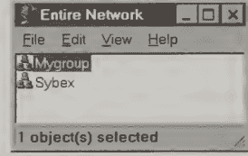

我首先注意到，除了我预期的`Sybex`工作组外，还有一个名为`Mygroup`的新工作组。双击该工作组打开了图11.2所示的“整个网络”窗口。

图 11.2 Samba 所在框

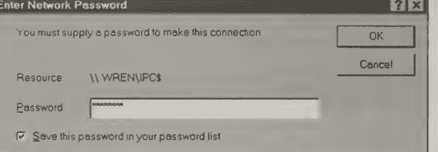

### 配置 Samba 服务器 383

#### 表 11.3 smb.conf 变量（续表）

| 变量 | 意义 |
|---|---|
| %R | 连接期间协商的协议 |
| %S | 当前服务的名称 |
| %T | 日期和时间 |
| %u | 分配给客户端的用户名 |
| %U | 客户端请求的用户名 |
| %v | Samba 版本号 |

变量提供了灵活性，因为每个变量在配置中都被替换为从系统中获取的值。这使得同一个配置语句在不同的情况下有不同的解释。以下是上面文件列表中的一个示例：

```
log file = /var/log/samba.log.%m
```

在此示例中，`%m`变量被替换为客户端的NetBIOS名称，因此会为每个客户端创建一个不同的日志文件，其文件扩展名为客户端的NetBIOS名称。

变量提供了灵活性。如果客户端的NetBIOS名称是`crow`，则日志文件被命名为`/var/log/samba/log.crow.robin`。如果客户端的NetBIOS名称是`robin`，则日志文件为`/var/log/samba/log.robin`。如果你的客户端群体足够小，这是一个很好的配置。

## smb.conf 全局部分 (Global Section)

Hat示例配置文件包含两个部分：`global`（全局）和`homes`（家目录）。全局部分定义了影响整个服务器的几个参数：

- `workgroup`定义此服务器所属的工作组。工作组是主机的分级分组。它以目录组织资源的方式组织网络资源，其用途也相同：将计算机分组为工作组有助于用户找到相关系统。不在工作组中的主机仍然允许与工作组内的系统共享文件。请将示例中的`MYGROUP`名称替换为15个字符或更短的、有意义的工作组名称。

- `server string`定义此服务器的描述性注释。该字符串会在DOS客户端上通过`net view`命令显示，因此它为你提供了一个描述服务器的机会。将示例中的字符串更改为对你的系统有意义的内容。

- `log file`定义日志文件的位置。该条目最有趣的地方在于它包含一个`smb.conf`变量。

- `max log size`定义日志文件以千字节为单位的最大own。默认值为5MB，即5000KB。在示例配置中，这被减少到50KB，可能是因为为每个客户端都创建一个单独的日志。如果超过最大尺寸，`smbd`会关闭日志并将其重命名为`.old`扩展。

- `security`定义使用的安全类型。在Samba中，有四种可能的设置：

    - `share`请求共享级安全。这是最低级别的。基本上，如果你将某些资源配置为共享，它将与所有人共享。可以为共享关联密码，但对于任何想要使用该共享的人，密码都是相同的。

    - `user`请求用户级安全。每个用户都被要求输入用户名和关联的密码。默认情况下，这是用户登录Linux服务器时在`/etc/passwd`中定义的用户名和密码。密码的默认值可以更改。更多细节请参阅后文的“Samba 密码”。

    - `server`定义服务器级安全。这与用户级安全类似，但使用外部服务器来验证用户名和密码。外部服务器必须通过`password server`选项定义。

    - `domain`定义域级安全。在这种方案下，Linux服务器加入Windows NT域，并使用Windows NT域控制器来批准用户名和密码。使用`password server`选项指向Windows NT主域控制器(`PDC`)。登录`PDC`并为Linux系统创建一个账户。最后，将这些行添加到Linux系统的全局部分：

```
domain master = no
local master = no
preferred master = no
ostype = 0
```


- `dns proxy` 指定 `nmbd` 是否应该不要将未解析的 NBNS 查询转发到 DNS。（详情请参见上一个节。）

除了这些选项外，全局部分还经常使用其他几个参数，它们显示在表 11.4 所示。

## 表 11.4 其他全局部分参数

| 选项 | 目的 |
|---|---|
| `auto services` | 定义一个对浏览系统的所有用户都自动可见的共享列表。 |
| `deadtime` | 定义非活动连接的超时时间。 |
| `debug level` | 设置写入日志的消息级别。 |
| `lock directory` | 定义存储 `wins.dat`、状态文件和锁文件的目录路径。 |
| `message command` | 定义 `smbd` 如何处理 WinPopup 消息。 |
| `name resolve order` | 定义解析 NetBIOS 名称时查询服务的顺序。可能的值有 `lmhosts`, `hosts`, `wins` 和 `bcast`。 |
| `netbios aliases` | 定义服务器将响应的其他名称。 |
| `netbios name` | 定义服务器的 NetBIOS 名称。 |
| `protocol` | 定义 Samba 在连接建立期间请求的最高协议。请使用此项！ |
| `smbrun` | 定义 `smbrun` 程序的路径，该程序为 `smbd` 执行 shell 命令。 |
| `syslog` | 将调试级别映射到 `syslog` 级别。 |
| `syslog only` | 使用 `syslog` 代替 Samba 日志文件。 |
| `time server` | 通知服务器将自己作为 Windows 时间服务器。 |

## Samba 密码

`encrypt passwords` 选项可以设置为在密码发送到网络之前对其加密。这使得服务器在密码发送到网络之前对其进行解密（注：原文此处表述重复，翻译已按原意保留）。

# 388 第 11 章 文件共享

```
browsable = yes
writable = no
public = yes

# [sales]

+ comment = 销售部门共享目录
path = /home/sales
browsable = no
create mode = 0750
hosts allow = sales.foobirds.org
```

每个节都用一个有意义的名字标记。该名称在客户端 PC 的“网络邻域”窗口中显示为文件夹。每个节都包含你已经见过的的一些命令以及一些新命令。第一个新命令是 `path`，它定义了此共享所提供的目录路径。

`pcdocs` 共享还包含 `public` 命令。`public` 允许任何人访问该共享，即使他们没有有效的用户名或密码。这些公共用户被授予对该共享的“访客账户”访问。在 Linux 系统上，这通常意味着他们以 `nobody` 用户和 `nobody` 组运行，并受限于世界权限。

## 设置文件和目录权限

该共享以可写共享的形式提供。`create mode` 命令控制当客户端向 `/home/sales` 目录写入文件时所使用的权限。在上面的示例中，指定了创建的文件将具有：所有者读/写/执行权限，组读/执行权限，以及世界无权限 (750)。一个相关的命令 `directory mode` 定义了当客户端在共享内创建目录时使用的权限。例如：

```
directory mode = 0744
```

这会将新目录的权限设置为：所有者读/写/执行权限，组读/执行权限，以及世界读/执行权限 (744)。这是一个合理的设置，允许 `cd` 和 `ls` 按预期工作。

> 警告：我通常坚持默认设置，但如果你想尝试 `directory mode` 命令，请记住目录必须设置世界执行位，切换目录 (`cd`) 命令才能正常工作。

## 限制对共享的访问

`sales` 共享节还包含 `hosts` 命令，它定义了允许访问此共享的客户端。即使用户拥有正确的用户名和密码，他们也允许从指定的主机访问此共享。默认情况下，所有主机都获得访问权限，特定的访问由用户名和密码进行控制。

通常，我通过 IP 地址在 `hosts allow` 中定义主机。如果使用主机，Samba 服务器必须能够将主机解析为 IP 地址，这通常意味着应该使用完全限定域名 (FQDN)。本示例中识别的主机与 NFS 示例中列出的相同，以说明 Samba 也可以用域名通配符控制访问。

在 `hosts allow` 命令中有几种不同的方法来定义单个主机或主机组。正如该命令的名字所示，它使用与第 14 章“安全”中讨论的 `hosts allow` 文件相同的语法。它在 `smb.conf` 文件中的用法示例如下：

（此处原文缺失具体代码块内容，保留结构占位或根据上下文推断，但根据规则不添加内容，仅处理现有文本。原文中有一个空的 ``` 块，保留其结构但内容为空或移除空块？根据示例，代码块前后加 ```。原文有两个独立的 ``` 标记块，中间有文本。第一个块是空的，第二个块也是空的。根据规则“代码块前后加上三个反引号”，如果原文没有代码，只保留文本。如果原文有 ``` 但没有内容，可能是格式错误。观察原文：
`...用法示例如下：`
` ``` `
`(空行)`
` ``` `
`除了 hosts allow 命令外...`
` ``` `
`(空行)`
` ``` `
看起来原文试图展示代码但缺失了。根据规则 3 "保留正文核心内容" 和 5 "代码块前后加上三个反引号"。如果原文是空的代码块，我保留它们。

但是仔细看原文：
`...用法示例如下：`
` ``` `
(空)
` ``` `
`除了 hosts allow 命令外...`
` ``` `
(空)
` ``` `
这可能意味着这些是代码块的开始和结束，但中间没有内容。或者这是 Markdown 渲染问题。
再看原文结构：
`...用法示例如下：`
` ``` `
(这里原本应该有代码，但被省略或丢失？不，看后面)
`除了 hosts allow 命令外...`
`...语法相似。`
` ``` `
(这里也有 ```)

让我们看最后一段代码块：
`$ smclient //goose/c -W`
...
`smb: \craig> quit`
这是完整的。

对于中间的空代码块，如果原文确实为空，我将保留空的代码块结构，或者如果它们只是分隔符，我会仔细处理。
原文：
`...用法示例如下：`
` ``` `
` ` (空白行)
` ``` `
`除了 hosts allow...`
`...`
` ``` `
` ` (空白行)
` ``` `

根据示例，如果文本是代码，加 ```。如果原文中已有 ``` 且内容为空，这通常表示空的代码块。我将保留这些标记，因为规则说“代码块前后加上三个反引号”，暗示了代码块的存在。但如果里面没东西，保留空代码块即可。

该主题的两个变体是 `hosts.equiv` 文件和 `use hosts` 命令。这些命令告诉 `smbd` 使用 `hosts.equiv` 文件或 `.hosts` 文件来决定谁被授予共享访问权限。（这两个文件在第 5 章中描述过。）大多数安全人员不建议使用这些文件，因为它们允许无密码访问共享中的文件。

将这两个共享节与 Red Hat 配置中自带的节结合起来，可以创建一个满足你所有诉求的服务器。它提供了对用户主目录的访问。它提供了对公共目录的访问，以提供在线文档或公共共享资源。它提供了仅限所选组成员访问的私有目录。它提供了 NFS 实现的所有功能，但方式对于 Microsoft Windows 客户端来说要简单得多。

当然，你不限于仅为 Windows 客户端服务。Linux 系统也可以作为 Samba 客户端。

## 使用 Linux Samba 客户端

虽然 Linux 系统可以作为 SMB 客户端，但如果你有 Linux 服务器，我不建议这样做。如果 NFS 是 Linux 系统之间共享文件更自然的方式，那么通过 `autofs` 和 `fstab` 挂载功能可以将 NFS 进行无缝集成。但并非所有服务器都是 Linux 服务器。你可能需要将 Linux 系统配置为 Windows 服务器的客户端，甚至是 Windows 9x 桌面的客户端。在这种情况下，你需要使用 Samba 工具。

## 使用 smclient

`smclient` 程序是一个用于与提供 SMB 共享的系统传输文件的工具。它对于没有 FTP 软件的 Windows 9x 系统特别有用。`smclient` 就像用于 SMB 共享文件的 FTP 工具。示例如下：

```
$ smclient //goose/c -W

Added interface=172.16.12.3 bcast=172.16.12.255 mask=255.255.255.0

start lmhosts: Can't open lmhosts file /etc/lmhosts

Server time is Mon May 24 21:49

Timezone is UTC-4.0

Password: security=share

smb: \> craig

smb:\craig> ls

D 0 Sat Apr 10 22:22

D 0 Sat 10 22:22

GOOD.DOC      A 147024 Sun 4 11:20

BESTED.DOC   A 217036 Mon 5 18:47

sybex          D 0 Sat 10 23:34

2934 blocks of size 32768. available

smb: \craig> prompt

prompting is now off

smb: \craig> mget *.DOC

getting file \craig\GOOD.DOC of size 147024 bytes (222.947 kb/s) (average 222.947 kb/s)

getting file \craig\BESTED.DOC of size 217036 bytes (388.898 kb/s) (average 299.014 kb/s)

smb: \craig> quit
```


`smclient` 工具由 `smclient` 命令调用。你正在访问的共享使用通用命名法 (UNC) 在命令行中描述。UNC 格式为 `//server/share`，其中 `server` 是 NetBIOS 名称，`share` 是共享名称。

如果需要密码（如果服务器仅使用共享级安全可能是这种情况），它遵循命令行上的 UNC。在上面的示例中，使用了共享级安全，但在命令行没有提供密码，因此服务器会提示用户。使用 `-U` 命令并提供用户名和密码。一旦提供了用户名和密码，就可以使用与 FTP 完全相同的命令发送和检索文件。如果你使用 FTP，可以使用 `smclient`。在上面的示例中，我切换到了共享的 `craig` 子目录 (`cd`)，并将所有 `.doc` 扩展的文件下载到客户端 (`mget`)。

`smclient` 是 Samba 工具的主工作。它并不优雅，但是是其他使用 `smclient` 完成工作的工具的基础。将 SMB 文件集成到 Linux 文件系统的更优雅的方法是使用 `smbfs`。

## 使用 smbmount

SMB 文件系统 (`smbfs`) 允许你挂载 SMB 共享并像使用 Linux 文件系统的一部分一样使用它们。使用 `smbmount` 命令挂载，使用 `smbumount` 命令卸载。要挂载 `smclient` 示例所示的共享，输入：

```
smbmount //crow/user/tyler/home/tyler/crow -U Tyler -P
```

命令以共享名称开始。名称后面是标准的 Linux 挂载点。挂载点是共享在 Linux 文件系统中的位置。在示例中，后面是 SMB 服务器所需的用户名 (`-U`) 和密码 (`-P`)。

# 392 第 11 章 文件共享

一旦挂载，该共享与任何 Linux 目录具有基本上相同的外观，可以使用大多数标准 Linux 命令来操作目录中的文件。当然，并不是所有内容都是相同的。Linux 文件系统的某些功能并不是所有 SMB 服务器都可用。例如，Windows 9 系统没有文件级安全，也不理解 Linux 的 UID 和 GID。`smbfs` 会尽力“伪装”。它使用启动 `smbfs` 时强制的 UID 和 GID。你可以通过 `-u` 和 `-g` 命令行选项覆盖这些默认值。例如：

```
smbfs //crow/user/tyler/home/tyler/crow -U tyler -P -u 689 -g 100
```

此命令与上面的相同，只是它告诉 `smbfs` 使用 UID 689（假设是分配给 `tyler` 的 UID），以及 GID 100（即用户的 GID）。要卸载 SMB 共享，使用带有挂载点路径的 `smbumount` 命令：

```
smbumount /home/tyler/crow
```

`smbfs` 让在 Linux 客户端使用 SMB 共享比通过 `smclient` 访问这些共享要简单得多。

## 案例研究 393
## 协调 UID 和 GID

当文件在网络中共享时，系统需要以一种一致且协调的方式来识别用户。为此，开发了 W，为客户端提供一个注册和解析 NetBIOS 名称的中心化位置。NFS 包含了许多用于映射 UID 和 GID 的工具。在文件共享网络中，解析用户身份是非常关重要的。网络越大，问题就越大。

当产品是信息时，使用 W；而当产品是可执行程序时，NFS 是一个很好的选择。

其次，如果你想传播信息，真的需要协调 UID 和 GID 吗？其实不需要。用户没有世界权限。分发到整个企业的项目可以赋予世界可读和执行权限。

我曾与一个拥有 5000 名员工的机构合作，该机构由八个不同部门的50 个子部门组成。许多子部门都有自己的网络管理员并运行自己的 NFS 服务。当时的决定是创建一个跨整个企业的统一 NFS 系统。为了让该系统允许真正的文件共享，需要在整个企业范围内协调 UID 和 GID。

嗯，如果文件共享并不是该机构想要的，那么这个项目有什么积极收获吗？有的！制定了一项以合理、协调的方式分配 UID 和 GID 的计划。中心服务持有所有超过 20,000 的 UID 和 GID，以便分配给每位员工。每位现有员工都被分配了一个 UID 和 GID，每位新员工在入职时也会分配一个。此外，每个运营单元都被赋予 1000 个 UID 和 GID 以供自行使用。

首先，跨企业的文件共享真的是个好主意吗？真正的文件共享是人们协作产生最终产品。你并不希望 5000 人都为你的报告做贡献，因此在大型组织中，真正的文件共享通常不是你想要的。

最初作为一种集中服务的方法，后来变成了所有独立子网管理员的获益。当来自另一个机构的用户被添加到子网的 NFS 服务器时，无需担心映射或冲突，因为中央权威协调了整个组织的 UID 和 GID。根结底，企业级的文件共享并不如企业范围内的协作与协调重要。

大多数企业网络需要的是信息分发。他们希望让组织中的每个人都能获得一个完成的产品。Web 是一个很好的载体，


# 12
## 打印服务

打印机服务器允许网络上的所有人共享打印机。Linux 打印机服务器提供了两种共享打印机的技术。传统的 Unix 网络技术使用行打印守护进程 (`lpr`) 命令，且 `lprd` 服务器最适合服务 Linux 和 Unix 客户端。另一种技术使用 Samba 服务器与 Windows 客户端共享打印机。本章涵盖了这两种技术。但在你使用任何技术与客户端共享打印机之前，你必须在你的服务器上安装并配置打印机。

## 安装打印机

如第 2 节所述，打印机安装通常是 Linux 系统基础安装和配置的一部分。我通常会等到系统运行后再尝试配置打印机，而许多其他管理员倾向于在初始安装期间配置打印机。

事实上，在初始安装期间或之后安装打印机的本质上是相同的步骤。要安装打印机，你必须了解打印机的类型及其功能。图 12.1 源自 Red Hat 的初始安装，说明了你需要回答的问题类型。

# 第 12 章 打印服务
## 图 12.1 在初始安装期间配置打印机

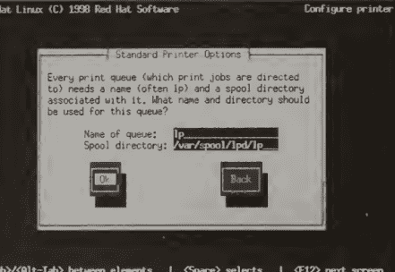

此窗口中不同字段的含义将在本章稍后当你查看实际打印机安装时变得清晰。这张图说明了，你在初始安装期间被问的问题与你在系统运行后安装打印机时被问的问题是相同的。尽管过程几乎相同，我仍然倾向于推迟到系统运行。这有几个原因：

- 首先，打印机不是启动系统所需的必不可组件。我倾向于将非必需品推迟到系统运行。
- 其次，安装打印机并不像你想象的那么简单。初始安装期间出现的问题比系统运行后出现的问题要难恢复得多。
- 最后，在基础系统安装完成并启动后，会有更多的配置工具可用。我使用 X Windows 打印机配置工具。

## 用于配置打印机的 X 工具

`RedHatPrintTool` 是一种图形化打印机配置工具，作为 Red Hat 控制面板的一部分，并作为 Caldera Looking 桌面环境中的管理工具之一可用。要在 Red Hat 系统上启动此工具，请点击控制面板中的打印机配置图标。

第一次运行 `PrintTool` 时，没有列出打印队列，因为你还没有配置任何内容。点击“添加”按钮开始定义你的打印机。如图 12.2 所示的“添加打印机项”窗口。

## 图 12.2 选择打印机

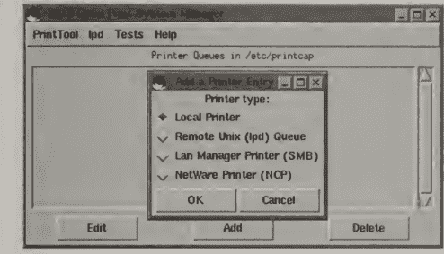

此窗口提供了四种系统与打印机通信的选项：

- **本地打印机 (Local Printer)**：此打印机直接连接到 Linux 的一个物理端口。
- **远程 Unix (lpd)**：此打印机直接连接到 Linux 的一个物理端口。此设置选择 `lpd` 共享侧。
- **局域网管理器打印机 (Lan Manager Printer)**：SMB 协议用于与打印机通信。此设置选择 SMB 共享侧。
- **NetWare 打印机 (NCP)**：`NetWare` 核心协议用于与打印机通信。此设置选择 `NetWare` 共享侧。

在示例中，选择“本地队列”，这是打印机服务的正常选择。选择“本地打印机”会让 `PrintTool` 尝试检测打印端口。在我的系统上，`PrintTool` 列出了三个活动打印端口。

## 打印端口名称

Linux 定义了三个并行端口，如下：

```
$ ls -l /dev/lp*

crw-rw---- 1 root daemon 6, 0 May 5 1998 /dev/lp0

crw-rw---- 1 root daemon 6, 1 May 5 1998 /dev/lp1

crw-rw---- 1 root daemon 6, 2 May 5 1998 /dev/lp2
```


打印端口的设备名称为 `/dev/lp0`、`/dev/lp1` 和 `/dev/lp2`。日期前的数字是设备的主从设备。主设备号（`6`）代表并行端口驱动程序。从设备号（`0`、`1` 或 `2`）指示是哪个可寻址设备。该系统的并行端口设备号为 `60` (`lp0`)、`61` (`lp1`) 和 `62` (`lpt2`)。

不要尝试将 DOS 端口名称与 Linux 端口名称进行比较。人们经常这样做，但我认为这带来的困惑多于收益。有两个打印端口和两个 Linux 打印机。`lp1` 分配了 I/O 端口地址 `0x378`，这与 DOS 端口 `LPT1` 相同，但 `lp0` 是第一个打印端口，就像 `LPT1` 一样。哪个 Linux 端口是 `LPT1`？谁在乎？！这是 Linux，不是 DOS。

## 图 12.3 `PrintTool` 本地打印机项

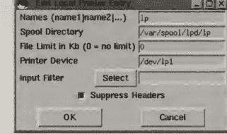

看起来眼吗？这里更多。这张图显示了五个不同的配置字段。除了一个外，其余都由 `PrintTool` 填充了。你可以编辑 `PrintTool` 已填充的字段，但

通常你不需要这样做；`PrintTool` 插入的值应该可以正常工作。然而，你经常需要为 `PrintTool` 留空的第五字段“输入过滤器”（`Input Filter`）提供一个值。

图 12.3 中的字段如下：

- 名称名称（`Names`）：定义打印机名称。第一台打印机将自动分配名称 `1p`。如果你在服务器上有多台打印机，请为“默认”（`default`）打印机分配 `1p`。你可以通过竖线 `|` 分隔名称为打印机分配多个名称。例如，`hp|1j|1p` 为同一台打印机分配了 `hp`、`1j` 和 `1p` 名称。
- 打印池目录（`Spool Directory`）：定义存储打印任务的目录路径。默认情况下，打印池目录保留打印任务，直到打印机可以打印它们。默认情况下，打印池目录位于 `/var/spool/lpd`。通常，单个打印池目录的名称与其服务的打印机相同。在示例中，打印机名称为 `1p`，因此打印池目录为 `/var/spool/lpd/1pd`。
- 文件限制（`File Limit`）：定义允许进入打印池的打印文件的最大大小。默认没有限制。要设置限制，请在此字段中输入千字节数数值。
- 打印机设备（`Printer Device`）：定义本地打印机连接的端口。正如你稍后看到的，只有本地打印机需要此字段。
- 输入过滤器（`Input Filter`）：定义用于准备打印文件的程序。每种类型的打印机都有自己的命令语言和数据格式语言。例如，某些打印机使用 Adobe 的 PostScript，另一些使用 HP 的打印机控制语言（PCL）。需要程序将 Linux 打印文件转换为打印机相应的格式。如果你熟悉在 Microsoft Windows 下安装打印机，你可能想过何时告诉系统你拥有什么类型的打印机以及它应该使用什么驱动程序。就是现在。Linux 输入打印过滤器在功能上等同于 Microsoft Windows 打印驱动程序。`PrintTool` 未为过滤器提供默认值。要设置正确的值，点击选择（`Select`）按钮。会出现图 12.4 所示的窗口。

400 第 12 章 打印机服务

## 12.4 选择打印机过滤器

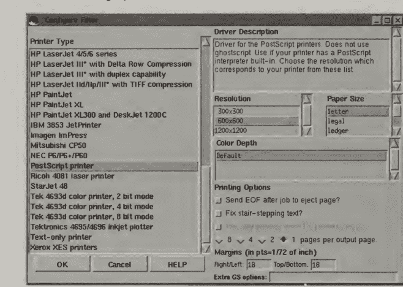

使用滚动条查看打印机过滤器列表。`PrintTool` 提供了 50 多种不同的打印机选择器。选择你的打印机，然后在窗口右侧设置你需要的任何可选配置参数。例如，我选择了 PostScript，它应该适用于任何 PostScript 打印机，并把打印机分辨率设置为 `600x600`，纸张尺寸设置为 Letter。如果你没有打印机的文档，这里的选择并不总是显而易见的。我建议如果你没有其他文档，请去制造商的网页获取你打印机的规格表。在示例中，我使用 `600x600`，因为文档说明这是我的 HP LaserJet PostScript 打印机的正确设置。

> 提示：使用系统内置支持的打印机之一是一个非常好的主意。尝试让与系统不兼容的打印机工作工作量巨大但回报极少。我强烈建议使用过滤器列表中的打印机。如果你正在购买打印机，我推荐 PostScript 打印机。它们与每个 Linux 工具都能无缝工作。

就是这样。双击 `OK`，新打印机就应该被添加到 `PrintTool` 的列表中。从 `PrintTool` 中的 `lpd` 菜单选择 `Restart lpd`，你的新打印机就应该准备就绪。通过选择 `Tests` 菜单中的测试（`test`）来测试打印机。通常，我会用 ASCII 和 PostScript 测试页测试打印机。

## 配置远程打印机

远程打印机的配置与本地打印机略有不同。图 12.5 显示了两个配置窗口，一个用于远程 Unix 打印机（左），另一个用于远程 SMB 打印机（右）。

## 图 12.5 配置远程打印机

| 名称 (`name1`, `name2`...) | `ip0` | 名称 (`name1`, `name2`...) | `ip1` |
|---|---|---|---|
| 打印池目录 (`Spool Directory`) | `/var/spool/lpd/lpd` | 打印池目录 (`Spool Directory`) | `/var/spool/lpd/lpd` |
| 千字节单位的文件限制 (0 = 无限制) | `0` | 千字节单位的文件限制 (0 = 无限制) | `0` |
| 远程主机 (`Remote Host`) | | 打印机服务器主机 (`Hostname of Printer Server`) | `hawk` |
| 远程队列 (`Remote Queue`) | `lpd` | 服务器 IP 号 (可选) | `172.16.5.4` |
| | | 打印机名称 (`Printer Name`) | |
| 输入过滤器 (`Input Filter`) | | 用户 (`User`) | `craig` |
| 选择 (`Select`) | | 密码 (`Password`) | |
| | | 工作组 (`Workgroup`) | `byben` |
| `OK` | 取消 (`Cancel`) | 选择 (`Select`) | |
| | | 抑制标头 (`Suppress Headers`) |

远程 Unix 打印机条目中的四个字段与本地打印机使用的字段相同（见图 12.3）。区别在于，该条目不是用单行定义设备端口，而是有两个字段来定义远程计算机和该计算机上的打印机。远程主机（`Remote Host`）字段包含打印机服务器的主机名；远程队列（`Remote Queue`）字段包含服务器上打印机的名称。注意 SMB 条目有五个字段代替了单个端口：

- 打印机服务器主机（`Hostname of Printer Server`）：定义服务器的 `NetBIOS` 名称。
- 服务器 IP 号（可选）（`IP number of Server`）：指定服务器的 IP 地址。只有当无法通过 `hosts` 文件解析 `NetBIOS` 名称时才需要它。
- 打印机名称（`Printer Name`）：定义打印机的共享名称。
- 用户（`User`）：指定你在远程服务器上的 SMB 用户名。
- 密码（`Password`）：指定远程服务器访问其打印机所需的密码。
- 工作组（`Workgroup`）：指定打印机服务器所属的工作组名称。在示例中，工作组名为 `byben`。

这两个远程打印机的输入过滤器（`Input Filter`）均为空。通常，过滤器由远程服务器处理。

# 理解 `printcap` 403

`printcap` 文件中的每一条活动行都以 `printcap` 名称、竖线或冒号开头。注释以井号（`#`）开头。空行和开头的空白字符会被忽略。

## `printcap` 参数

`printcap` 文件中配置参数定义了 `lpd` 在与打印机通信时需要了解打印机特性。参数的语法根据其被赋值的值类型而略有不同。参数有三种类型：

- **布尔值（`Boolean`）**：所有 `printcap` 布尔值默认认为 `false`。指定一个布尔值即可启用其功能。布尔值的指定只需通过在文件中输入参数名称来实现。例如，`ab:` 告诉 `lpd` 始终打印横幅页（`banners`）。
- **数值（`Numeric`）**：数值型参数分配数值值。数值型参数的语法使用 `#` 将值与参数名分开。例如，`mx#1000:` 将可接受打印文件的最大 `own` 设置为 `1MB`。
- **字符串（`String`）**：字符串参数使用字符串值。字符串参数的语法使用 `=` 将值与参数名分开。例如，`rp=laser:` 将远程打印机的名称定义为 `laser`。

扫一眼 `man` 页（帮助手册）可以发现 `printcap` 参数非常多。坦率地说，你永远不需要使用大多数参数。大多数打印机定义都非常简单，大多数 `printcap` 文件也很小。服务器通常只有一两个直接连接的打印机；`printcap` 中定义的任何其他打印机可能都是远程打印机。

# 示例 `printcap`

下面是根据上一节 `PrintTool` 示例中定义的三个打印机生成的 `printcap` 文件：

```
# #

# 此 printcap 是使用 printtool v.3.27 创建的

# 如果稍后再次运行了 printtool，则在此处所的任何
```


### 手动更改将会丢失

此标头的存在意味着在运行`printtool`时，系统中并不存在`printcap`。


#### 第 3 部分：`##PRINTTOOL3##` 本地 POSTSCRIPT 600x600 letter

```
lp:
  :sd=/var/spool/lpd/lp:
  :mx#0:
  :sh:
  :lp=/dev/lp1:
  :if=/var/spool/lpd/lp/filter:
```

#### `##PRINTTOOL3##` 远程

```
lp0:
  :sd=/var/spool/lpd/lp0:
  :mx#0:
  :sh:
  :rm=wren:
  :rp=lj:
```

#### `##PRINTTOOL3##` SMB

```
lp1:
  :sd=/var/spool/lpd/lp1:
  :mx#0:
  :sh:
  :af=/var/spool/lpd/lp1/acct:
  :lp=/dev/null:
  :if=/usr/lib/rhs/rhs-printfilters//smbprint:
```

第一个打印机（名为`lp1`）是直接连接到并行端口上的。大多数配置参数都可以轻松追溯到`Print-Tool`配置窗口中的字段。这些参数是：

-   `sd`：定义打印池目录（spool directory）的路径。
-   `mx`：定义打印文件可接受的最大字节数。将其设置为`0`表示对打印作业的大小没有限制。
-   `sh`：指定是否打印页头或横幅页。这是“抑制页头（suppress headers）”布尔值。默认情况下，它是`false`，意味着不抑制页头。换句话说，默认打印页头。然而，`PrintTool`将该布尔值设置为`true`。（只需指定一个布尔值即可将其设置为`true`）。这意味着在打印作业之间不打印页头和横幅页。此设置适用于小型服务器，但如果你有多个用户，或希望为每个打印作业打印一个标识性横幅页，则可能需要注释掉此布尔值。
-   `lp`：定义打印机的设备名称。对于本地打印机，这是打印机连接的端口。
-   `if`：定义此打印机的输入过滤器。

该文件中的第二个打印机（`lp0`）是远程打印机。连接到打印机的远程机器由`rm`参数定义，该机器上的远程打印机名称由`rp`参数定义。在示例中，远程主机是`wren`，远程打印机名称是`lj`。该打印机的大部分实际配置都在远程系统上完成。尽管这是一个远程打印机，但它有一个本地打印池目录。文件被写入本地打印池目录，并在那里排队交付到远程系统。

第三个打印机称为`lp1`，是远程 SMB 打印机。这是最独特的定义。`lp1`自然地处理本地打印机和远程`lpd`打印机。远程 SMB 打印机需要更多的努力。这类打印机的实际工作由`smbprint`程序处理，它通过`if`参数作为打印机的输入过滤器被调用（`smbprint`将在本章稍后详细介绍）。由`lp`参数定义的设备名称是`/dev/null`。在这种情况下，你并不希望输入过滤器的任何输出发送到本地打印机，因此它被发送到空设备（bit-bucket）。实际输出由`smbprint`直接送到远程服务器。`af`参数定义了一个写入计数信息的文件。

从零开始编写`printcap`是很困难的。要创建`printcap`条目，请选择一个与你的 Linux 系统兼容的打印机，并使用`printcap`配置工具。如果需要进行任何更改，可以使用`printcap`手册帮助你读取和更新`printcap`。一旦配置完成并在本地运行，就可以与其他人共享了。

### 使用 `lpd` 共享打印机

线路打印守护进程（`lpd`）为本地和远程用户提供打印服务。这是一项基本服务，在系统启动时从启动脚本启动。在 Red Hat 和 Caldera 系统上，`lpd`由`/etc/rc.d/init.d/lpd`脚本启动，该脚本通常包含在启动过程中。如果它没有包含在服务器的启动中，你可以使用`linuxconfig`或`tksys`添加该脚本。


你可以使用`lpd`脚本停止、启动或重新加载线路打印守护进程。由于`printcap`文件仅在`lpd`启动时读取，`reload`选项有助于在不重启守护进程的情况下应用更改。

```bash
/etc/rc.d/init.d/lpd reload
```

### 线路打印守护进程安全

线路打印守护进程使用基于主机的安全机制。为了控制哪些用户可以访问哪些打印机，你需要编辑`printcap`文件。参数指定了是否打印页头或横幅页。这是“抑制页头（suppress headers）”布尔值。默认情况下，它是`false`，意味着不抑制页头。换句话说，默认打印页头。然而，`PrintTool`将该布尔值设置为`true`。（只需指定一个布尔值即可将其设置为`true`）。这意味着在打印作业之间不打印页头和横幅页。此设置适用于小型服务器，但如果你有多个用户，或希望为每个打印作业打印一个标识性横幅页，则可能需要注释掉此布尔值。

### 使用 `lpr`

使用线路打印远程（`lpr`）程序将打印作业发送到打印进程。`lpr`有多个命令行参数，但命令通常标识打印机和文件，如示例所示：

```bash
lpr -Plj sample.txt
```

此命令将名为`sample.txt`的文件发送到`lp0`的打印机。打印机可以是本地的或远程的；只要该打印机在`printcap`文件中有定义并被`lpd`识别即可。

### 管理 `lpd`

线路打印控制（`lpc`）程序是用于控制打印机和管理`lpd`打印队列的工具。表 12.1 列出了`lpc`命令、语法及其含义。

#### 表 12.1 `lpc` 命令

| 命令 | 用法 |
| :--- | :--- |
| `abort printer` | 杀死打印守护进程。 |
| `clean printer` | 清除打印队列中的所有文件。 |
| `disable printer` | 关闭对打印队列的操作。 |
| `down printer message` | 停止池和打印，并输出消息。 |
| `enable printer` | 启用对打印队列的操作。 |
| `exit` | 退出`lpc`。 |
| `help command` | 显示每个命令的描述。 |
| `restart printer` | 启动一个新的打印守护进程。 |
| `start printer` | 启用打印和池。 |
| `status printer` | 显示打印机和队列的状态。 |
| `stop printer` | 当前作业结束后停止打印机。 |
| `topq printer job# user` | 将打印作业移动到队列顶部。 |
| `up printer` | 启用池和打印。 |

对于所有命令，打印机名称都是可选的。如果没有指定，将使用默认打印机。`topq`命令还可以接收作业号或用户名来标识要移动到队列顶部的打印作业。

“队列中的顶部”意味着它将是下一个打印的任务。其他常用命令选项包括可以添加到`down`命令中的消息，以及可以添加到`help`命令中的命令。`message`是发出的通知用户打印机正在停机的文本消息。`command`是你想要帮助信息的`lpc`命令的名称。

```
% lpc
lpc> status all
lp:
    queuing is enabled
    printing is enabled
    2 entries in spool area
    no daemon present

lw:
    queuing is enabled
    printing is enabled
    no entries
    no daemon present

dj:
    queuing is enabled
    printing is enabled
    no entries
    no daemon present
lpc> restart lp
lp:
    no daemon to abort
lp:
    daemon started
lpc> exit
```

#### 与 Samba 共享打印机

注意，在示例`status`命令中，使用了`all`关键字代替了打印机名称，`all`可用于引用接受打印机名称作为可选参数的`lpc`命令中的所有打印机。

示例中使用的`status`和`restart`命令可以由任何用户使用。大多数`lpc`命令只能由`root`用户使用。例如，以下命令将属于用户`tyler`的打印作业移动到打印机`lp`队列的顶部：

```bash
# lpc topq lp tyler

lp:
moved cfa405owl
```


虽然 `lpc` 主要用于系统管理员，但还有其他主要供用户使用的命令。`lpc` 命令显示打印机的队列列表。命令行参数允许用户选择显示哪个打印机队列，并将该队列的显示限制为特定用户的任务，甚至是某个特定的任务。这里是显示打印机 `1p` 队列的示例：

```
% l1q -Pplq
```

| 排名 | 所有者 | 任务文件 | 总大小 |
| --- | --- | --- | --- |
| 1st | tyler | 405 | 5876 bytes |
| 2nd | daniel | 401 | ... |
| 3rd | daniel | 404 | 12118 bytes |

打印任务的所有者可以使用 `1lrm` 命令移除排队的打印任务。假设 `daniel` 想要移除上方示例中显示的打印任务 `404`。他输入以下命令：

```
% 1lrm -Plaser 404
```

`dfa404robin` `dequeued`

## 与 Samba 共享打印机

第 11 章展示了 Linux 服务器如何使用 `Samba` 软件包成为 `SMB` 服务器，并展示了如何使用 `Samba` 共享文件。第 11 章没有显示 `Samba` 还可以用于与 `SMB` 客户端共享打印机。在这里，你将看到如何实现。

首先，当然，你需要确保系统中安装了 `Samba`。（详情请参见第 11 章。）安装 `Samba` 后，即可通过 `smb.conf` 文件配置共享打印机。

### 在 smb.conf 文件中定义打印机

理解 `SMB` 配置文件的最好方法是查看一个运行的文件。Red Hat 系统带有预配置的 `smb.conf` 文件，其中包含了对共享打印的支持。Red Hat `smb.conf` 文件中的活动行如下：

```
[global]
workgroup = MYGROUP
server string = Samba Server
printcap name = /etc/printcap
load printers = yes
log file = /var/log/samba/log.%m
max log size = 50
security = user
socket options = TCP_NODELAY
dns proxy = no
```

```
[homes]
comment = Home Directories
browsable = no
writable = yes
```

```
[printers]
comment = All Printers
path = /var/spool/samba
browsable = no
guest ok = no
writable = yes
```

你可能在第 11 章中看到这些行的一部分，所以你已经知道将 `workgroup` 选项更改为你网络的正确组名称，并将字符串更改为描述你服务器的有意义的字符串。然而，这些行中的某些在该章中并未涵盖。所有新行都涉及共享打印机。其中两行新行位于全局部分：

`printcap name` 定义了 `printcap` 文件的位置。正如你稍后看到的，`printcap` 文件用于识别可共享的打印机。默认路径为 `/etc/printcap`。

`load printers` 告诉 `smbd` 是否应该将 `printcap` 文件中的所有打印机作为共享打印机提供。默认是 `yes`，这告诉 `Samba` 共享 `printcap` 文件中定义的所有打印机。`no` 意味着完全不读取 `printcap` 文件。如果指定为 `no`，所有共享打印机必须单独定义。

这两行都用于准备服务器自动共享 `printcap` 文件中定义的打印机。除了这两行新行外，还有一个标记为“printers”的全新部分。它也处理自动共享打印机。

### Printers 共享部分

`printers` 部分的功能与 `homes` 部分类似，使得每个主目录对适当的用户可用。`printers` 部分的定义是为了让每个打印机对你的客户端可用。Red Hat 的 `printers` 部分是：

```
[printers]
comment = All Printers
path = /var/spool/samba
browsable = no
guest ok = no
writable = yes
```

另一行新行 `guest ok` 定义了是否允许访客账户访问资源。这与第 11 章讨论的 `public` 选项完全相同，因此这两个选项可以交叉使用。`no` 意味着用户向打印机发送打印任务。用户必须拥有有效账户才能使用打印机。

通常，此部分就是你让服务器上的每个打印机对所有客户端可所需的全部。你可以使用第 11 章描述的 `host allow` 命令以限制文件访问的方式限制打印机，但通常情况下，打印机服务器向其所有客户端提供所有打印机。

### smb.conf 打印选项

如果你不想共享 `printcap` 文件中定义的所有打印机，可以移除 `printers` 部分，将 `load printers` 选项设置为 `no`，并为你想要共享的打印机添加单独的共享。可以像文件共享一样为每个打印机创建单独的共享。

除了上述打印配置选项外，你还可以使用第 11 章描述的任何选项以及表 12.2 列出的任何选项。

**表 12.2 更多 smb.conf 打印选项**

| 选项 | 用途 |
| --- | --- |
| `lprcache` | 定义 `lpr` 信息的缓存时间。 |
| `lprcommand` | 指定 `lpr` 命令的路径。 |
| `lprprintcommand` | 指定 `lprprint` 命令的路径。 |
| `min page space` | 定义目录目录所需的最小剩余空间。如果可用空间低于最小值，`Samba` 将不会接受打印任务。默认情况下，没有最小值。 |
| `postscript` | 强制 `Samba` 将打印文件解释为 `PostScript` 文件，以便打印以 `Ctrl+D` 开头的文件。 |
| `printer` | 定义特定共享打印机的名称。 |
| `printing` | 定义服务器上使用的打印系统。Linux 使用 `bsd` 或 `lprng`（后者是 `bsd` 的变体）。可能的值有 `aix`, `hpux`, `lprng`, `plp`, `qnx`, `softq` 和 `sysv`。 |

一个包含特定打印机共享部分的 `smb.conf` 文件可能包含以下内容：

```
[global]
workgroup = SYBEX
server string = Author's Printer server
load printers = no
security = user
[homes]

comment = Home Directories
browsable = no
writable = yes
[hp5m]

comment = PostScript Laser Printer
path = /var/spool/samba
browsable = no
public = no
writable = no
create mode = 0700
printable = yes
printer = 1p
```

在这种情况下，没有包含打印机（`printers`）部分。相反，它添加了一个名为 `hp5m` 的共享部分，用于共享打印机 `1p`。要使此生效，必须在 `printcap` 文件中找到该打印机名称（`1p`）。`printcap` 名称默认设置为 `/etc/printcap`。

# 使用 SMB 打印机

Linux 系统可以很容易作为 `SMB` 客户端，也可以作为 `SMB` 服务器。如果 `printcap` 文件中正确定义了 `SMB` 打印机，Linux 用户就可以使用标准的 `lpr` 命令打印到远程 `SMB` 打印机。我在本章前面使用了红帽打印机工具（Red Hat Print Tool）定义了一个远程 `SMB` 打印机。创建该打印机的 `PrintTool` 界面如图 12.6 所示。


## 图 12.6 使用 PrintTool 定义 SMB 打印机

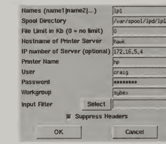

图 12.6 中的 `PrintTool` 输入创建了此 `printcap` 条目：

```
lp1:
:sd=/var/spool/lpd/lp1:
:mx#0:
:sh:
:af=/var/spool/lpd/lp1/acct:
:lp1=/dev/null:
:if=/usr/lib/rhs/rhs-printfilters//smbprint
```

使此条目生效的关键是用于该打印机的输入过滤器（`if`）。`smbprint` 是一个使用 `smclient` 打印到远程系统的脚本文件。

在 `PrintTool` 窗口中输入的额外信息用于配置 `smbprint` 脚本。这些信息存储在 SMB 打印机 spool 目录下的 `.config` 文件中。通过查看 `printcap` 文件中的 `sd` 参数可以获取 spool 目录的路径，使用 `cat` 命令可以显示 `.config` 文件的内容：

```
# cat /var/spool/lpd/lp1/.config
share=/var/hawk/hp'
hostip=172.16.15.4
user=craig
password='Wats?Watt?'
workgroup='sybex'
```

## 结语

`.config` 文件包含五个条目，必须按照所示的精确顺序出现。如果未为条目提供值，该条目仍将空条目的形式出现在文件中，例如 `password=''`。这五个条目是：

- `share`：定义共享名称，即远程服务器的 NetBIOS 名称与远程打印机共享名称的组合。
- `hostip`：指定远程服务器的数字 IP 地址。
- `user`：定义用户在远程服务器上的登录名。
- `password`：定义远程服务器访问打印机所需的密码。
- `workgroup`：标识打印机服务器所属的工作组。

如果打印机配置正确且 `.config` 文件包含必要信息，则我们 Linux 系统上的用户应该能够通过输入 `% lpr-lp1 sample.txt` 打印到 `hawk` 上的打印机。我认为这是从 Linux 系统使用 SMB 打印机最简单的方法。

不过，你可以直接通过 `smclient` 软件使用远程打印机。第11章中讨论了使用 `smclient` 访问共享文件，而使用 `smclient` 打印也非常相似。以相同的方式使用 `smclient` 连接到共享，只是这次共享是一个远程打印机。例如：

```
smclient //hawk/hp -U craig%Wats?Watt=-W SYBEX
```

连接到打印机后，使用与传输文件到服务器时相同的 `put` 命令。当 `smclient` 将文件传输到可打印文件时，该文件就会打印。例如，在用 `smclient` 命令连接到 `hp` 打印机后打印 `sample.txt` 文件，输入以下内容：

```
smclient> put sample.txt
```

> 注意：`smclient` 还有一个 `print` 命令，其功能与 `put` 命令相同。通常优先使用 `put`。


### 结语

文件和打印机共享是部门网络的基础服务。Linux 是提供这些服务的卓越平台，因为它除了提供 Unix 客户端期望的原生服务外，还能以 Microsoft Windows 客户端期望的格式提供相同的服务。其他部门服务器在将所有客户端集成到单一网络方面没有 Linux 有效。

Linux 擅长的另一个服务是电子邮件。下一章将通过讨论部门邮件服务来结束部门服务器的章节。

# 第3部分

# 第13章 更多邮件服务

部门邮件服务器通常充当邮箱服务器，为客户端保留邮件直到它们准备好下载。Linux 提供了两种邮件的技术：邮局协议（POP），它是传统的邮件协议，以及互联网消息访问协议（IMAP），它正越来越流行。在本章中，我们将使用这两种协议来配置邮件服务器。

除了基本的邮件服务外，Linux 系统还提供了一些你可能需要的用于限制垃圾邮件用户的额外服务。

## 理解 POP 和 IMAP

当 Linux 主机运行 POP 或 IMAP 守护进程时，它可以作为邮件服务器。大多数系统运行两者。除非你采取某些干预措施（例如在安装 Red Hat 6 时选择特定的软件包，然后专门取消选择 POP 和 IMAP），否则 POP 和 IMAP 均可用。

## 添加用户

从左侧滚动菜单中选择 POP 账户（仅限），将在右侧打开用户创建窗口。输入用户名、全名和主目录，点击接受 按钮并为用户输入密码。

用户创建的账户在 `/etc/passwd` 中插入了以下条目：

```
$ grep dan /etc/passwd
dan:BeAvmnE:503:231:Dan Scribner:/home/pop:/bin/false
```

注意该条目与任何其他条目的不同之处在于登录 shell。由于 `dan` 被分配了 `/bin/false`，这意味着 `dan` 无法直接登录服务器。

图13.1 中创建的账户仅限于邮箱访问。尽管 `linuxconf` 称为 POP 账户，但它适用于 POP 和 IMAP。如果你需要创建一个允许用户直接在服务器上读取邮件的账户，请按照第5章的方法使用 `linuxconf`。

### 图 13.1 使用 linuxconf 创建 POP 用户

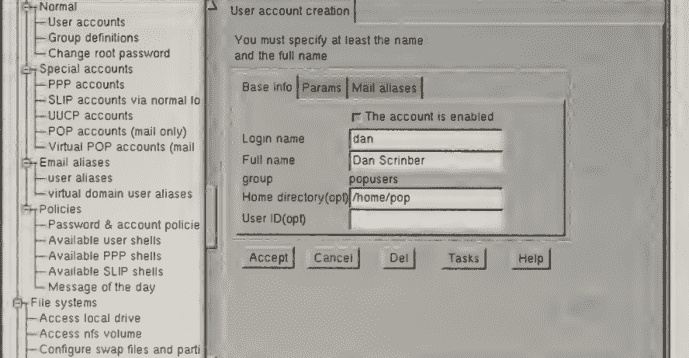

## POP 协议

POP 有两个版本：POP2 和 POP3。POP 协议验证用户的登录名密码并将邮件从服务器移动到用户的本地邮件器。两种协议执行相同的基本功能，但它们并不兼容。POP2 使用端口 109，而 POP3 使用端口 110。Linux 系统自带这两个版本的 POP，但大多数客户端将使用 POP3。

POP3 定义在 RFC 1725。它是一种简单的请求/响应协议：客户端发送命令，服务器对命令做出响应。表13.1 显示了 RFC 1725 定义的 POP3 命令集。

### 表 13.1 POP 命令

| 命令 | 功能 |
| --- | --- |
| `USER username` | 登录所需的用户名 |
| `PASS password` | 登录所需的用户密码 |
| `STAT` | 请求未读邮件数量/字节数 |
| `RETR m` | 获取编号为 `m` 的邮件 |

### 表 13.1 POP3 命令（续）

| 命令 | 功能 |
| --- | --- |
| `DELE m` | 删除编号为 `m` 的消息。 |
| `LAST` | 请求最后访问的消息编号。 |
| `LIST [m]` | 请求消息 `m` 或所有消息的大小。 |
| `RSET` | 取消删除所有消息并将消息编号重置为 1。 |
| `TOP m n` | 打印编号为 `m` 的消息的头部和前 `n` 行。 |
| `NOOP` | 不操作。 |
| `QUIT` | 结束 POP3 会话。 |

根据你对协议和配置的了解，你可以 `telnet` 连接到 POP 端口并测试你的服务器是否有响应。此处显示的 `telnet` 测试证明了守护进程已可用、已安装并准备好运行：

```
% telnet localhost pop-3
Trying 127.0.0.1 ...
Connected to localhost.
Escape character is '^]'.
+OK POP3 almond Server (Version 1.004) ready
quit
+OK POP3 almond Server (Version 1.001) shutdown
Connection closed by foreign host.
```

如果 POP 未准备好运行，`telnet` 测试将返回错误。此示例显示了当 `/etc/services` 文件中没有配置 POP 端口时发生的情况：

```
$ telnet localhost pop-3
pop-3: bad port number
```

检查 `/etc/services` 文件查看实际的 POP 端口。在 Red Hat 6 系统上，你会看到以下 POP2 和 POP3 端口：

```
$ grep 'pop.[2,3]' /etc/services

pop-2 109/tcp postoffice # POP version 2
pop-2 109/udp
pop-3 110/tcp # POP version 3
pop-3 110/udp
```

我从未遇到过端口未定义的问题，但这个 `telnet` 测试显示了另一个问题：


```
$ telnet localhost pop-3
Trying 127.0.0.1...
telnet: Unable to connect to remote host: Connection refused
```

POP 守护进程由 `inetd` 启动。显示的错误意味着 POP 守护进程在 `inetd` `conf` 文件中没有正确配置，且 `inetd` 没有启动该守护进程。这在 Red Hat 6 系统上发生，是因为 POP 条目在 `inetd` `conf` 文件被注释掉了：

```
$ grep 'pop,[2,3]' /etc/inetd.conf
#pop-2 stream tcp nowait root /usr/bin/tcp ipop22
#pop-3 stream tcp nowait root /usr/bin/tcp ipop23
```

删除每个条目开头的 `#` 以在 Red Hat 6 系统上运行 POP。大多数 Linux 系统（带有较早版本的 Red Hat）都已准备好运行 POP。大多数 Linux 系统也带有准备好运行的 IMAP。

# IMAP 协议

互联网邮件访问协议 (IMAP) 是 POP 的替代方案。它提供了与 POP 相同的基本服务，并为邮箱箱同步增加了功能。邮箱箱同步是在客户端或直接在服务器上读取单条邮件，同时保持两个系统上的邮箱箱都是最新状态。

在普通的 POP 服务器上，邮箱箱的所有内容都会移动到客户端，并从服务器上删除或保留为未读。在客户端上删除单个消息不会反映在服务器上，因为所有消息被视为一个整体，在数据传输到客户端后要么被删除要么被保留。IMAP 提供了在客户端或服务器上操作单个消息的能力，并让这些更改反映在两个系统的邮箱箱中。

像 POP 协议一样，IMAP 也是一种请求/响应协议，有一组少量命令。表 13.2 列出了来自 IMAP 协议第 4 版本的基本命令。


# 表 13.2 IMAP 命令

| 命令 | 用途 |
|---|---|
| `CAPABILITY` | 列出服务器支持的功能。 |
| `NOOP` | 字面意思是“无操作”，但有时用作轮询新邮件或状态更新。 |
| `LOGOUT` | 关闭连接。 |
| `AUTHENTICATE` | 请求身份验证方法。 |
| `LOGIN` | 打开连接并提供用户名和密码进行明文认证。 |
| `SELECT` | 打开邮箱箱。 |
| `EXAMINE` | 以只读模式打开邮箱箱。 |
| `CREATE` | 创建新的邮箱箱。 |
| `DELETE` | 移除邮箱箱。 |
| `RENAME` | 修改邮箱箱的名称。 |
| `SUBSCRIBE` | 将邮箱箱添加到活动邮箱箱列表中。 |
| `UNSUBSCRIBE` | 从活动邮箱箱列表中删除邮箱箱名称。 |
| `LIST` | 从可用邮箱箱集中显示请求的邮箱箱。 |
| `LSUB` | 从活动邮箱箱集中显示请求的邮箱箱。 |
| `STATUS` | 请求邮箱箱的状态。 |
| `APPEND` | 向指定的邮箱箱末尾添加消息。 |
| `CHECK` | 强制对当前邮箱箱进行检查。 |
| `CLOSE` | 关闭邮箱箱并移除所有标记为删除的消息 |

# 表 13.2 IMAP 命令（续）

| 命令 | 用途 |
|---|---|
| `EXPUNGE` | 从当前邮箱箱中移除所有标记为删除的消息 |
| `SEARCH` | 显示邮箱箱中所有符合指定标准的的消息。 |
| `FETCH` | 从邮箱箱中检索一条消息。 |
| `STORE` | 修改邮箱箱中的消息。 |
| `COPY` | 将指定的消息复制到所选邮箱箱的末尾。 |
| `UID` | 根据消息的唯一标识符搜索或检索消息。 |

此命令集比 POP 使用的命令更复杂，因为 IMAP 功能更多。该协议的设计是为了远程维护存储在服务器上的邮箱箱，该协议清晰地说明了 IMAP 的“邮箱箱”导向。尽管协议的复杂性增加，但仍然可以使用 `telnet` 和少量 IMAP 命令对你的 IMAP 服务器进行简单测试：

```
$ telnet localhost imap
Trying 127.0.0.1...
Connected to localhost.
Escape character is '^'.
* OK localhost IMAPrev1 v1.2.3 server ready
A0001 LOGOUT
* BYE IMAPrev1 server terminating connection
A0001 OK
Connection closed by foreign host.
```

注 示例中的命令前带有字符串 `A0001`。这是由客户端生成的唯一标识符。当你手动输入命令时，不需要输入这些标签。

# 第13 章 更多邮件服务

测试显示 `imapd` 正在运行。然而，在新鲜安装的 Red Hat 6 系统上返回返回“无法连接”错误。再次是因为 `imap` 在 `inetd.conf` 文件中被注释掉了：

```
$ grep imapd /etc/inetd.conf
#imap stream tcp nowait root /usr/sbin/imap
```

删除 `inetd.conf` 中 `imapd` 条目前面的 `#` 以启用 IMAP。然后重新运行 `telnet` 测试，它会告诉你 IMAP 的版本。下一节描述了需要时获取新版本的 IMAP。

# 编译 IMAP

IMAP 并不是新协议（和 POP 一样老）。尽管历史悠久，IMAP 还没有完全标准化。已经四个不同的版本：IMAP、IMAP2、IMAP3 以及当前版本 IMAP41。关于 IMAP 的新 RFC 仍在发布中，目前有十多个。由于 IMAP 仍在变化且难以维护，这限制了一些供应商，因此它没有 POP 那样普及。然而，Linux 发行版包含了 `imapd`。

可以通过任何方式从 `ftp.cac.washington.edu` 获取 `/imap/imap.tar.Z` 并使用 `tar` 命令解压和恢复。这将创建一个包含源码和构建 IMAP 所需 `Makefile` 的新目录。目录名称告诉我们软件当前的发布级别。在此时它是 `imap-4.5`。仔细阅读 `Makefile`——它支持许多操作系统。对于 Linux 有两种选择。对于使用 `/etc/passwd` 文件的 Linux 系统，使用三字符操作系统类型 `linux`；对于使用 `shadow` 密码文件的系统，在 `make` 命令上使用 `s1x`。例如：

```
# make s1x
```

它应该无错误编译并产生三个守护进程：`ipop2`、`ipop3` 和 `imapd`。使用 `whereis` 或 `find` 检查你的系统预期 IMAP 守护进程的位置。将新的 `imapd` 复制到该位置。（在 Red Hat 6 系统上，`imapd` 存储在 `/usr/sbin/`）确保 `imapd` 文件的权限与之前的守护进程版本相同。以下示例显示了所有步骤：

```
# tar -Zxf imapd.tar.Z
# cd imap-4.5
```

# 理解 POP 和 IMAP 425

```bash
# make slx
# mv /usr/imapd/sbin/imapd /usr/sbin.imapd.orig
# cp imapd/imapd /usr/sbin/imapd
# chmod 755 /usr/sbin/imapd
```

重新运行 `telnet` `imap` 测试，以确保你的新守护进程正在响应客户端。

华盛顿大学的软件包提供了 POP2、POP3 以及 IMAP 的实现。POP2 和 POP3 长期以来没有发生变化，因此你可能不想使用它们来替换系统上相应的守护进程。

# 从客户端使用 POP 或 IMAP

你负责为用户提供正确的信息，以配置他们的邮件代理程序。用户需要知道：

- 邮件服务器的主机
- 邮件服务器所需的用户名和密码
- 应该使用 POP 还是 IMAP

图 13.2 显示了用户如何为 Netscape Communicator 配置这些信息。

### 图 13.2 配置邮件客户端

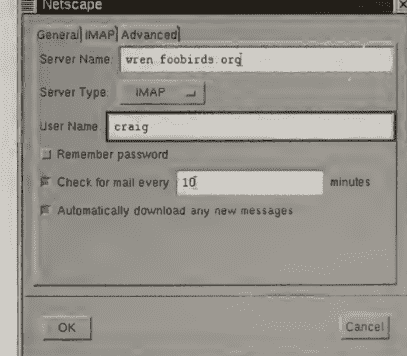

此特定窗口允许用户从服务器类型列表中选择 POP3、IMAP 或称为 `Movemail` 的选项。此时，POP3 和 IMAP 的含义已经显而易见，但 `Movemail` 是一个新事物。`Movemail` 只是将邮件从系统的邮件池目录复制到用户的邮件目录。`Movemail` 仅在本地计算机也是邮件服务器时才有效。当然，在 Linux 计算机上这是可能的。

另请注意，配置窗口允许你为出站和入站邮件命名两台计算机。部门邮箱服务器和向外部世界转发邮件的服务器可以是不同的计算机。

# 停止垃圾邮件

SPAM 是 Hormel Food 公司一种世界闻名的罐头午餐肉。互联网垃圾邮件（Internet spam）则不是——它是垃圾邮件。垃圾邮件是你收到的未经请求的广告，旨在向你推销大学毕业证书、女性无法抗拒的费洛蒙，或者是证明那些费洛蒙不起作用的色情内容。我确定你明白我的意思，因为每个连接互联网的人都会收到大量信息。


作为邮件服务器管理员，你的任务之一是减少通过网络的垃圾邮件数量。用于该任务的技术是本节的主题。

# 垃圾、垃圾、垃圾、垃圾和垃圾

在一个经典的蒙奇蟒（Monty Python）喜剧片段中，John Cleese 扮演一个背诵菜单的侍员。起初，菜单有一个 `SPAM` 选项，但随着每次背诵菜单，越来越多的项目变成了 `SPAM`，直到他最后将菜单描述为“Spam, spam, spam, spam, and spam”。

同样，电子邮件垃圾邮件通过所有可能的邮件列表自我复制，直到你发现自己的邮箱里装满了完全相同且重复的消息。正是这种无意义的重复为垃圾邮件命名。

# 不要成为垃圾邮件源

在垃圾邮件大战中你的首要职责是确保你的系统不是垃圾邮件源。你的系统可能是本地生成垃圾邮件的源，也可能是其他生成垃圾邮件的中继。你需要对这两种可能性做出响应。

# 停止垃圾邮件

## 定义可接受使用策略

为了防止本地生成的垃圾邮件，你需要确保使用你服务器的每个人都知道从你的服务器发送未经请求的广告是不允许的。我必须承认，这种想法对我来说很陌生。我合作过的政府机构和企业会处理任何方式误用公司财产的人，更不用说在公司服务器上运行私人广告公司了！

但你的情况可能不同。你可能在你的系统上提供社区服务。在这种情况下，你需要一份书面的《可接受使用策略》（AUP），告诉人们哪些类型的使用是允许的，哪些不允许。

> **TIP** 如果你不确定 AUP 应该什么样，请询问你的 ISP 或检查国家级 ISP。可以在 `www.us.uunet.net/support/upolicy/` 获取 UUN 可接受使用策略的副本，或者在 `www.sprint.net/acceptableuse.htm` 检查 Sprintlink 的可接受策略。

## 运行身份守护进程

运行身份服务器（`ident`）也有助于抑制本地垃圾邮件发送者。身份守护进程监控 `111` 端口。如果它收到来自远程系统的请求，它会告诉该系统运行当前连接的用户的用户名。这允许远程邮件服务器在入站邮件的 `Received:` 头部中放置真实的用户名。Linux 默认提供此服务，如下所示 `/etc/services` 和 `inetd.conf` 的 `grep` 查询：

```bash
$ grep ^auth /etc/services
 auth tcp ident # User Verification
$ grep ^auth /etc/inetd.conf
auth stream tcp nobody /usr/sbin/in.ident in.ident -l -e -o
```

## 正确配置邮件中继

除了防止本地用户生成垃圾邮件外，你还需要防止远程用户将你的服务器作为发布垃圾邮件的工具。没有人喜欢垃圾邮件，垃圾邮件发送者也知道。他们尽力通过他人的服务器中继垃圾邮件来隐藏垃圾邮件的真实来源。如果你的邮件服务器允许中继，垃圾邮件发送者就可以利用它。

为了抑制垃圾邮件，`sendmail` `8.9` 的默认配置可以正确处理本地邮件，但不会为任何外部源转发消息。这与默认转发所有邮件的旧版本 `sendmail` 正相反。如果你的系统运行较旧版本的 `sendmail`，你应该升级到 `8.9` 以获得全系列的反垃圾邮件工具。


在大多数情况下，阻止所有中继是有效的，因为大多数运行 `sendmail` 的系统并不是邮件服务器——它们是专供单一用户的桌面 Linux 和 Unix 系统。由于用户的邮件源于运行 `sendmail` 的系统，邮件被处理为本地邮件，因此不需要中继。

如果系统是邮件服务器，阻止中继将不起作用。服务器产生的大部分邮件来自其客户端——这些可能是没有运行自己的 `sendmail` 程序的 Microsoft Windows PC。在服务器端阻止中继会导致客户端：


要将此系统变成邮件服务器，你必须允许某种程度的中继。例如，你可以创建 7 节中使用的 `foobirds.m4` 的以下变体：

```m4
VERSIONID(@#)generic.m4    8.3 (Berkeley) 3/24/96'
define(conff_PATH, `$s/.forward $w:$s/.forward')
nl(
FEATURE(entire_domain)
```

```m4
)(redirect)
FEATURE(use_cw_file)
MASQUERADE_AS(foobirds.org)
FEATURE(masquerade_envelope)
FEATURE(genericstable)
```

该文件包含了第 7 节描述的所有功能，加上 `relayndomain`。此额外功能允许你使用 `M` 类来识别那些应该中继邮件的主机。

**警告** 注意不要过度削弱配置以至于让自己变成垃圾邮件源！上述列出的所有功能都削弱了中继的门槛，但某些比其他糟糕。不应使用 `precocious_relay`，因为它会将系统变成潜在的垃圾邮件中继。避免使用 `relay_local_from fromater`，因为垃圾邮件发送者很容易在 `MAIL FROM:` 头部写入任何内容，包括你的本地域名。此外，除非绝对，否则不应使用 `accept_unresolvable_domains`。它用于当邮件服务器确实无法解析域名时。你可能在无法访问 DNS 服务器的笔记本 Linux 上需要它，但在其他情况下不会使用。

## 使用 sendmail 拦截垃圾邮件

拦截垃圾邮件的最简单方法让他来。`sendmail` 允许你使用来自邮件防护系统（MAPS）的实时黑洞列表（RBL）。

### 430 第 13 章 更多邮件服务

> **注意** 访问网站 `maps.vix.com/rb` 了解更多关于 MAPS 系统的信息。

使用 RBL 非常简单，因为该系统是通过 DNS 实现的。每个 Linux 系统都可以发出 DNS 查询，因此这是分发信息的一种非常有效的方法。当然，只有当程序理解这些信息时，才能利用这些信息。`sendmail`：如果你想使用 RBL 来拦截垃圾邮件，请在你的 `sendmail` 配置中添加以下功能：

```
FEATURE('rbl')
```

启用此功能后，来自 RBL 中列出的每个站点的邮件都将被拒绝。虽然这很简单，但并不完美，因为你无法选择拒绝 RBL 中列出的哪些站点。这是一个“全有全无”的选择。事实上，这就像开关灯泡一样简单。RBL 执行的是严格的政策。任何中继垃圾邮件的站点（如果你没有升级到 `sendmail` `8.9`，你的站点也可能是其中之一）都会列入 RBL 中。如果该站点停止中继垃圾邮件，它将在一个月后从列表中移除。这意味着你可能会无法接收来自友好站点的邮件，仅仅是因为该站点的管理员忘记了关闭外流。

一如往常，选择是在简单性和灵活性之间进行的。对于垃圾邮件过滤，大多数小型站点应该选择简单性。如果你的站点很小，你可能只有少数几个与之交换邮件的站点。这些站点出现在 RBL 中的概率非常低。然而，如果你运行的是与许多其他站点交换邮件的大站邮件服务器，简单性可能不是一个选择。你可能需要定义你的邮件访问列表，以防止 RBL 拦截你想要的邮件。`sendmail` 允许你这样做。

### 了解访问数据库（Access Database）

`sendmail` 访问数据库使用电子邮件地址、域名和 IP 网络号来定义邮件源，并规定 `sendmail` 在接收来自指定源的邮件时应该采取的操作。例如：

- `spammer@bigisp.com REJECT`

- `wespamu.com REJECT`

- `172.18 REJECT`

此数据库告诉 `sendmail` 拒绝来自 `spammer@bigisp`、来自 `wespamu.com` 域名的任何主机、以及来自 IP 地址以网络 `172.18` 开头的任何计算机的邮件。数据库中的每个条目都以邮件源开始，随后跟着一个告诉 `sendmail` 采取什么操作的关键字。表 13.3 列出了有效的关键字及其引起的操作。

#### 表 13.3 访问数据库操作

| 关键字 | 操作 |
| :--- | :--- |
| `DISCARD` | 丢弃从指定源接收的任何消息。 |
| `OK` | 绝对接受来自指定源的消息。 |
| `REJECT` | 发布错误消息并丢弃发往或来自指定地址的任何邮件。 |
| `RELAY` | 中继来自或发送至指定源的邮件。 |

上述数据库的扩展说明了如何使用这些操作：

- `spammer@bigisp.com REJECT`

- `wespamu.com REJECT`

- `172.18 DISCARD`

- `friendly.org OK`

- `129.6 RELAY`

- `weselljunk.com 550 Junk mail is not accepted`

`REJECT` 命令导致 `sendmail` 向源返回错误消息，然后丢弃邮件。`DISCARD` 命令直接丢弃邮件，而不向源发回消息。大多数反垃圾邮件机构都不建议静默丢弃邮件，因为他们认为这不能震慑垃圾邮件发送者。在他看来，你可能收到了邮件，所以他只会继续发送更多垃圾。


`OK` 命令导致 `sendmail` 无论其他条件如何接受来自 `friendly.org` 的邮件。例如，如果邮件来自一个包含 `friendly.org` 域名的主机且无法通过 DNS 解析，即使没有启用 `accept_unresolvable_domain` 功能，`sendmail` 也会接受该邮件。要实现这一点，你必须完全信任 `friendly.org`。

`RELAY` 命令导致 `sendmail` 中继来自 `129.6` 的邮件，即使系统没有启用基础的中继功能。与 `OK` 命令一样，使用 `RELAY` 命令意味着你完全信任网络 `129.6` 上的每个主机。


提示：如果你数据库中没有其他内容，你可能想为自己的网络设置类似这样的条目。如上所述，`sendmail` `8.9` 会拦截所有邮件。我使用访问数据库和类似 `172.16.5` 的条目来连接本地网络的所有主机启用中继。我喜欢这种技术，因为它不依赖于易于伪造的主机名，并且可以通过访问数据库进行随意的严格控制。

## 创建你自己的访问数据库

格式化访问数据库中的条目是简单部分。确定数据库中放入什么是更困难的。事实上，互联网上有很多机构（例如邮件滥用防御系统）收集垃圾邮件发送者的信息，你可以利用这些信息来构建自己的访问数据库。著名的站点有 `www.arachnid.com/lutus/antispam/spammers.txt`、`www.wsrcc.com/spam/spamdomains.txt` 以及 `www.mindspring.com/cgi-bin/spamlist.pl`。

当你使用 `m4` 创建并安装了新的 `sendmail.cf` 文件后，你的新访问数据库就会生效并拦截垃圾邮件。如果你需要对该过程进行更深入的控制，可以定义自己的反垃圾邮件 `sendmail` 重写规则。

## 反垃圾邮件重写规则

大多数管理员将 `sendmail` 重写规则视为修改来自用户邮件发件程序的源自本地系统的发出的邮件地址的方法。反垃圾邮件规则集允许你处理入站邮件的地址和头部。`sendmail` `8.9` 为你的自定义规则提供了三套反垃圾邮件规则集：

- `Local_check_relay` 一个规则集，你可以在其中定义处理中继邮件的规则
- `Local_check_rcpt` 一个规则集，你可以在其中定义根据收件人地址处理入站邮件的规则
- `Local_check_mail` 一个规则集，你可以在其中定义根据发件人地址处理入站邮件的规则

假设你收到了垃圾邮件，这些邮件试图通过仅包含用户名的 `From` 地址来伪装成本地邮件。此外，假设你已经配置了邮件服务器，使得本地邮件的 `From` 地址始终包含主机名。你可以像下面一样使用 `Local_check_mail` 来检查发件人地址：

```
Local_check_mail
# Check for user@$
RS-$+ $#OK
RS* $error: 550 Invalid From address address
```

此示例的第一行是一个 `S` 命令，它定义了规则集 `Local_check_mail`，将入站地址与模式 `$+` 进行匹配，该模式寻找一个或多个标记（`$`）、一个字面符号 `@`，以及一个或多个标记。任何符合 `user@` 格式的地址都匹配此模式。转换表示，如果地址匹配模式，则退出规则集（`$`）并将邮件程序名称 `$OK` 返回给调用的规则集。`$OK` 是一个虚假的邮件程序，用于表示该地址是有效的。

第二个 `R` 命令匹配所有未能匹配第一个规则的地址。对于所有这些地址，规则集返回名称 `$error` 和错误消息文本。`$error` 邮件程序是一个特殊的邮件程序，它会将邮件连同错误消息返回给发件人。另一种方案是使用 `$discard` 邮件程序，它会静默地丢弃邮件。大多数管理员倾向于返回错误消息。

除了这些规则集外，你还可以从头定义中调用规则集，以检查系统收到的头部格式。有时，垃圾邮件发送者会使用格式错误的头部来指示邮件是垃圾邮件。假设你正受到某人忘记创建看似有效的 `Message-ID` 头部的骚扰。你可以使用类似下面的代码：

```
LOCAL_RULESSETS
HMessage-Id: $>S100
```

```
S100
R$#@$           S@ $#OK
R$*               $error: 550 Invalid Header
```

`LOCAL_RULESSETS` 部分包含一个用于 `sendmail.cf` 文件的 `H` 命令。与你在第 7 章看到的 `H` 命令不同，这一个不包含头部格式。相反，它使用 `$` 语法调用规则集来处理头部。此示例调用了规则集 `100`，因为这是我定义的名为规则集的名称。

`SS100` 命令是规则集 `100` 的第一行。该规则集本质上与上一个示例中描述的完全相同。它确保 `Message-ID` 头部既包含唯一的消息标识符，又包含 `identifier@host` 格式的主机名。所有其他格式都会被拒绝为错误。

我不建议你在配置中使用上述任何一个重写规则示例。我仅仅创建它们是为了说明如何使用这些规则集。坦率地说，我并不开发重写规则来对付垃圾邮件。首先，重写规则可能非常复杂且难以开发。我不希望药比病还严重。其次，垃圾邮件的格式在不断变化。我今天编写的规则明天可能就没用了。我认为依赖于 `RBL`、访问数据库以及用户邮件程序的过滤能力会更好。

## 在邮件程序端过滤垃圾邮件

尽管你付出了努力，垃圾邮件和其他不良邮件仍然会到达你的用户。这部分是因为你无法拦截所有垃圾邮件，部分是因为并非所有不需要的邮件都是垃圾邮件。有时，用户仅仅因为个人偏好不想查看某些合法的邮件。在这种情况下，需要在用户的阅读器中进行过滤。大多数邮件阅读器都提供这种功能。

## 使用 elm 过滤器

`elm` 邮件程序带有一个命名恰当的过滤工具 `filter`。即使你不使用 `elm`，也可以使用 `filter` 程序处理入站邮件。

## 停止垃圾邮件

在讨论 `sendmail` 别名时，提到了第 7 章中的 `.forward` 文件，该文件是调用 `filter` 程序的媒介。它的主要目的是为每个用户提供一种指定个人邮件转发的方法。`.forward` 的优秀功能之一是它可以将邮件转发给程序，而这正是将邮件发送到 `filter` 程序所需的功能。

要通过 `filter` 程序处理你的邮件，请在 `.forward` 中放入以下行：

```
| /exec /usr/local/bin/filter -o ~/filter.errors"
```

`filter` 程序从用户家目录下 `.elm` 目录中的 `filter-rules` 文件读取配置。因此，如果运行 `filter` 的用户是 `/home/sara`，`filter` 会寻找名为 `/home/sara/.elm/filter-rules` 的文件。如果用户并没有运行 `elm`，他们需要创建一个 `.elm` 目录来存放配置。

`filter-rules` 文件包含了过滤邮件的方向。它被写成一系列的 `"if"` 语句。如果入站邮件匹配语句定义的条件，将按照语句指示的方式进行处理。一个示例的 `filter-rules` 如下所示：

```
if (from = "*.gov") then Save ~/Mail/clients
if (from = "neil@sysex.com") then Save ~/Mail/editors
if (from = "emily@sysex.com") then Save ~/Mail/editors
if (from = "*.wespamu.com") then Delete
```

这组过滤器将来自不同来源的邮件路由到不同的邮箱。来自政府的邮件到 `clients` 邮箱；来自 `Sytex` 的邮件到 `editors` 邮箱。前三条规则指向不同的邮箱。最后一条规则删除了来自 `wespamu.com` 的邮件。

`filter-rules` 文件中的所有行都具有相同的基本格式：

```
if (condition) then action
```

条件可以测试 `From:`、`Subject:` 等头部的内容。条件字符串（位于引号内）可以是部分字符串并使用通配符来匹配多个情况。`gov` 是其中一个例子。操作可以是删除邮件、将其保存到邮件文件夹、转发到另一个地址，或将其交给另一个程序处理。

`filter` 易于使用并适用于所有 Linux 系统。然而，还有许多同样用的系统，用户倾向于使用他们使用的邮件阅读器自带的过滤机制。

## 使用 Netscape 过滤

许多用户使用 `Netscape` 阅读邮件。你当然可以使用 `filter` 程序或下文将讨论的 `procmail` 来过滤你的邮件，即使你是使用 `Netscape` 邮件阅读器。然而，`Netscape` 提供了了自己的邮件过滤功能，特别适合偏好图形界面的用户。

在 `Netscape Messenger` 窗口的 `Edit` 菜单中，选择 `Mail Filters` 以打开图 13.4 所示的 `Filter Rules` 窗口。

图 13.4 定义 `Netscape` 过滤器规则


在很多方面，这些规则与 `filter` 程序中的规则非常相似。再次，你正在构建 `if/then` 语句，但这次使用了图形模板来完成。图 13.4 显示了在 `filter` 示例应用于 `wespamu.com` 的相同规则：如果发件人名称包含 `wespamu.com` 字符串，则删除该消息。

`Filter Rules` 对话框中 `Filter Criteria` 部分第一个下拉列表定义了邮件中被测试的项目。在图 13.4 中，选择了 `sender`，这会根据发件人的电子邮件地址进行过滤。下拉列表还允许你匹配：

*   `subject` 根据 `Subject:` 头部的内容进行过滤。
*   `body` 根据消息正文的内容进行过滤。
*   `date` 根据邮件创建的日期进行过滤。选择此值将可用的条件测试列表更改为 `is`（是）、`isn't`（不是）、`is before`（在之前）和 `after`（之后）。
*   `priority` 根据其优先级进行过滤。选择此项将可用的条件测试列表更改为 `is`（是）、`isn't`（不是）、`is higher`（高于）和 `is lower than`（低于）。它还会出现一个新的下拉框，其中包含可能的优先级选项。这些选项为：`lowest`（最低）、`low`（低）、`normal`（普通）、`high`（高）和 `highest`（最高）。
*   `status` 根据是否已读或回复进行过滤。选择此项将可用的条件测试列表更改为 `is`（是）和 `isn't`（不是），并出现一个新的下拉框，其中包含 `read`（已读）和 `replied`（已回复）选项。
*   `to` 根据任何 `CC:` 头部中的电子邮件地址进行过滤。
*   `CC` 根据任何 `CC:` 头部中的电子邮件地址进行过滤。
*   `to or CC` 根据任何收件人地址进行过滤。将检查 `to` 或 `CC:` 头部中的每一个电子邮件地址。
*   `age in` 根据邮件的久旧进行过滤。选择此值将可用的条件测试列表更改为 `is`（是）、`is greater`（大于）和 `is less than`（小于）。

除了所有标准匹配外，你还可以从第一个下拉框的末尾选择 `Headers`（头部）项，以指定你想要匹配的任何头部。选择 `Customize Header`（自定义头部）会打开一个框，你可以在其中选择以前定义的头部，或点击 `New`（新建）按钮输入头部名称。任何有效的头部名称都可以使用。如果在入站邮件中遇到该头部，其内容将与过滤器进行匹配。

第二个下拉框定义条件测试。在图 13.4 中，选择了 `contains`（包含）。这意味着过滤器将检查发件人地址是否包含下一个框中定义的字符串（在图中为 `.com`）。根据所选的条件测试，待测试的值可以是完整值也可以是部分值；`contains` 用于匹配部分值。当测试发件人时，可用的其他选项包括：

*   `doesn't contain`（不包含）：如果被测试字段不包含指定值，则测试为真并执行操作。
*   `is`（是）：如果被测试字段等于指定值，则测试为真并执行操作。
*   `isn't`（不是）：如果被测试字段不等于指定值，则测试为真并执行操作。
*   `begins With`（以...开头）：如果测试字段开头的字符串精确匹配指定值，则测试为真并执行操作。

``

*   `ends with`（以...结尾）：如果测试字段末尾的字符串精确匹配指定值，则测试为真并执行操作。

此条件测试列表适用于发件人地址、主题头部、`to` 地址和 `CC` 地址。除了 `begins with` 和 `ends with` 之外，所有条件测试均可测试消息正文内容；当测试 `to` 或 `CC` 时，除 `is` 和 `isn't` 外均可用。如所述，当测试其他值时，它们会生成自己的有效条件列表。

过滤器规则对话框中的最后一个下拉框选择过滤器操作。在示例中，操作是 `Delete`（删除）。其他可用操作有：

*   `move to folder`（移动到文件夹）：匹配过滤器的邮件将路由到特定的邮箱。如果选择此操作，窗口中将出现两个额外项目。一个是下拉列表，允许你选择邮件发送到的邮箱；另一个标记为 `New Folder`（新文件夹），允许你定义一个新的接收邮件的邮箱。
*   `change priority`（更改优先级）：匹配项的优先级将更改为选定的优先级。选择此操作会导致出现下拉框，其中包含可能的选项。此框与在第一个下拉框中选择 `priority` 作为待测试项时出现的框相同。
*   `mark read`（标记为已读）：匹配过滤器的邮件被标记为“已读”。
*   `ignore thread`（忽略线程）：匹配过滤器的邮件是一个忽略线程的一部分，该线程会忽略同一主题的相关邮件或新闻帖子。
*   `watch thread`（监控线程）：匹配过滤器的邮件是一个正在监控线程的一部分。

过滤器可以包含多个规则。点击 `More` 按钮添加附加规则。使用 `Match All Of The Following`（符合以下所有）复选框仅在邮件符合过滤器定义的每个规则时才进行过滤，或使用 `Any Of The Following`（符合以下任一）复选框在邮件符合过滤器中的任意规则时进行过滤。

除了定义规则外，你必须为每个过滤器命名，并可以地提供描述。一旦设置得满意，点击 `OK`，规则即可启用。

## 使用 procmail 管理邮件

如第 7 章所述，`procmail` 是 Linux 系统的默认本地邮件传递程序。`procmail` 为 Linux 提供了最强大且复杂的电子邮件过滤系统。`procmail` 过滤器定义在 `/procmailrc` 文件中。此外，系统管理员可以在 `/etc/procmailrc` 文件中定义系统范围过滤器。这两个文件的格式相同，但用户定义 `procmail` 过滤通常比系统管理员定义的常见得多。

## 停止垃圾邮件

`.procmailrc` 文件包含两种类型的条目：环境变量赋值和邮件过滤规则（`procmail` 将规则称为 `recipes`）。环境变量赋值是直观的，看起来就像在像 `.bashrc` 这样的 shell 初始化脚本中的赋值一样。例如，`HOME=/home/cray` 是一个有效的环境变量赋值。赋值语句很少需要，因为变量通常已经包含了你系统的值。


:0 后跟随标志。

# 表 13.4 procmail Flags

| Flag | 含义 |
|---|---|
| A | 如果前面的 recipe 为真，则执行此 recipe。 |
| b | 与 A 标志相同，但前面的 recipe 必须成功完成。 |
| c | 将消息传递到目的地。这是默认值。 |
| B | 过滤消息正文。 |
| D | 大写敏感。默认忽略大小。 |
| e | 如果前面的 recipe 返回错误，则执行此 recipe。 |
| E | 如果前面的 recipe 未执行，则执行此 recipe。 |
| f | 通过外部过滤器传递数据。 |

# 表 13.4 procmail Flags（继续）

| Flag | 含义 |
|---|---|
| H | 过滤消息头部。这是默认值。 |
| h | 将头部传递到目的地。这是默认值。 |
| I | 忽略此 recipe 的错误。 |
| r | 在不确保格式的情况下写入邮件。 |
| w | 检查外部程序的退出代码。 |
| W | 与 w 标志相同，但不打印错误消息。 |


虽然一个配方可能包含多个条件，但动作只能有一个。该动作可以将邮件重定向到文件、转发到另一个电子邮件地址、发送到程序，或者定义额外的配方来处理消息。如果动作是额外的配方，它以 `:` 开头。如果动作将邮件定向到电子邮件地址，它以感叹号（`!`）开头；如果重定向到程序，则以竖线（`|`）开头。如果动作将邮件重定向到文件，只需指定文件名即可。

## 一个示例 `.procmailrc` 文件

使用上述信息，你可以创建一个如下所示的 `.procmailrc` 文件：

```
MAILDIR=$HOME/mail
:0 c
backup
:0:
* *From.*@sybex.com
editors
:0 c
* *From.*rdenn
* *Subject:*.NT
irobert@bobsnet.org
:0 A
tbook
:0
* *From.*@wespamu.com
/dev/null
:0 B
* *.pheromones
| awk -f spamscript > spam-suspects
```

此示例 `.procmailrc` 文件以环境变量赋值语句开头。该语句为变量 `MAILDIR` 赋值，并使用了 `HOME` 变量的值。因此，它演示了变量的赋值和使用。坦率地说，该语句只是为了说明如何使用变量，对于此文件并不是真正需要的。

文件中的第一个配方是：

```
:0 c
backup
```

## 第13 章 更多邮件服务

它创建邮件的副本并将其存储在名为 `backup` 的信箱中。这个配方直接来自 `.procmailrc` 文档，该文档建议在首次调试 `.procmailrc` 文件时通过这种方法确保不丢失邮件。在所有配方都按照你的预期工作后，从文件中删除此配方，这样你就不需要继续保留每封邮件的两个副本。

第二个配方是：

```
:0:
* *From.*@sybex.com
editors
```

此配方将所有包含以 `From` 字面量、任意数量字符（`.*`）以及 `@sybex.com` 字面量开头的行的邮件放入名为 `editors` 的信箱中。这个配方中最有趣的是第一行。注意 `:0:` 的值。根据语法可知，第二个冒号之前是锁文件的名称。在这种情况下，没有提供锁文件名，因此名称默认为 `editors.lock`。

第三个配方是：

```
:0 c
* *From.*rdenn
* *Subject:.*NT
!robert@bobsnet.org
:0 A
tntbook
```

此配方搜索发自 `rdenn` 且主题为 `NT` 的邮件。该邮件的副本被发送到 `robert@bobsnet.org`。邮件的另一份副本存储在 `ntbook` 信箱中。

第四个配方是：

```
:0
* *From.*@wespamu.com
/dev/null
```

此配方展示了如何使用 `procmail` 删除垃圾邮件。所有来自 `wespamu.com` 的邮件都通过将其发送到 `/dev/null`（空设备）被删除。

## 结语 445 页

最后一个配方是：

```
:0 B
* .*pheromones
| gawk -f spamscript > spam-suspects
```

此配方演示了如何将邮件传递给外部程序进行处理。所有正文中任何地方包含“pheromones”一词的消息都会传递给 `gawk` 处理。在这个示例中，`gawk` 运行一个名为 `spamscript` 的程序，从邮件中提取信息并存储在名为 `spam-suspects` 的文件中。你可以想象，系统的管理员创建了一个名为 `spamscript` 的 `awk` 程序，用于从怀疑的垃圾邮件中提取所有电子邮件地址。

这一系列配方展示了 `procmail` 的强大和灵活性。尽管 `.procmailrc` 文件的语法晦涩，但它可能是过滤电子邮件的最佳工具。

## 结语

本章结束了第3部分“部门服务器操作”。在书的这一部分，已经涵盖了配置服务、文件共享、打印机共享和邮件服务。将这些内容与第2部分涵盖的登录服务、名称服务、`Web` 服务和路由结合起来，你就拥有了一个完整的网络服务器。

书的最后一部分“安全与故障排除”将检查保持这台完整服务器处于最佳状态运行所需的任务。第4部分从一个安全章节开始，这对于网络服务器来说特别关重要，因为连接到网络会大大增加服务器的安全威胁。


## 一个无性网络

一家收到有关显式性内容广告投诉的公司希望尽可能封锁此类材料。只需从垃圾邮件列表中提取所有站点名称中包含“sex”一词的站点是一个开始。使用这些命令从垃圾邮件列表创建了一个 `access.txt` 文件：

```
# grep sex spammers.txt > temp.txt
# grep sex spamdomains.txt >> temp.txt
# sort -u temp.txt > sorted.txt
# rm temp.txt
# awk sorted.txt { print $1, REJECT } > access.txt
# rm sorted.txt
```

在示例中，`grep` 从某些垃圾邮件列表中提取所有包含“sex”单词的行，并将匹配行存储在名为 `temp.txt` 的文件中。`sort` 配合 `-u` 选项消除了重复项，并将排序后的项放入 `sorted.txt`。`awk` 从文件的每项中提取域名，并在每项后附加 `REJECT` 关键字。这创建了存储在 `access.txt` 中的有效访问数据库项。

其他列表被手动搜索以寻找被分发显式性内容的垃圾邮件发送者，并利用用户的投诉来扩展访问数据库。在阻止垃圾邮件的过程中，这只是一个开始，但嘿，你总得从哪里开始。

# 第4 部分 安全与故障排除

涵盖主题：

- 查找最新安全问题和修复信息
- 使用 Linux 内置 Wrapper 程序提高安全性
- 使用 Linux 内置的防火墙功能
- 提高 Linux 密码安全
- 监控服务器的安全问题
- 分析网络故障报告
- 基础 Linux 故障排除工具
- 查找配置错误
- 测试路由
- 测试域名系统服务 (DNS)
- 分析网络流量

# 现实检查

传说中，网络威胁来自对网络和操作系统有深入理解的复杂代码黑客。这些传奇人物的动力是间谍活动，或者是为了迫使那些不予理睬的电脑公司改进其软件。我真希望事实如此！如果真的是这样，这些人就不会对攻击我的 `Linux` 感兴趣了。

遗憾的是，现实是，大多数攻击来自运行攻击脚本的非熟练人员。这些脚本已经变得如此易用，以至于它们现在被称为“小子脚本（kiddie scripts）”。运行这些脚本的人对间谍活动并不感兴趣，但他们介意引起一点混乱！此外，如果他们真的是反抗企业体制并致力于改进操作系统软件安全性的反叛者，他们本该去编写 `Linux` 代码。毕竟，`Linux` 是开源代码；没有人可以声称某家公司垄断并隐藏了代码。

鉴于此，你可能会认为 `Linux` 并不是安全攻击的目标。你猜错了。遗憾的是，`Linux` 是最受欢迎的攻击目标之一。美国国家标准 NIST 的 `Peter Mell` 最近的一项研究显示，`Linux` 的攻击脚本与 `Windows NT` 的脚本一样流行，这两个系统是攻击脚本最流行的操作系统。

显然，开源代码并不能防止攻击。运行攻击脚本的人并没有动力去“修复”系统——他们只是在寻找易攻击的目标。你的工作就是确保你的系统不是一个易攻击的目标。

从这个角度来看，坏消息是你不必成为安全攻击的目标。好消息是，攻击另一端的那个家伙并不是网络大师。如果你能追踪到“小子脚本”所利用的漏洞，并在这些漏洞出现时封堵它们，你的系统将是相当安全的。

# 保持信息灵通


为了确保系统安全，你需要了解它的漏洞。你的目标应该是像那些破坏者一样，对 `Linux` 的漏洞保持充分的关注。坦率地说，你做不到这一点。你有自己的生活和责任，所以那些无所事事的破坏者会比你领先一步，并可能危及你的系统。尽管有困难，你也应该尽力跟上安全问题的最新动态。

这里有几个关于已知安全漏洞的良好信息来源：

- 网上 `www.geek-girl.com/bugtrap` 可以获取有关安全漏洞的通用信息。
- 安全公告网站为 `www.10pt.com`。

### 第 14 章 安全

- 一个获取 `Linux` 软件更新和安全漏洞公告的良好网站：`www.freshmeat.com`。
- 访问 `www.cert.org` 查看计算机应急响应小组 (`CERT`) 关于已知安全问题的公告。这些公告通常包含修复方案（如果有的话）。

跟踪所有与 `Linux`、`Unix` 和 `Unix` 应用程序相关的问题——这些都可能影响你的 `Linux` 服务器。图 14.1 显示我正在检查 `geek-girl.com` 上的公告。

图 14.1 在 `geek-girl.com` 搜索 `Bugtrap` 存档


1999 年第一季度（1月-3月）的 `Bugtrap` 存档：关于：Melissa 宏病毒。（1999年4月）

- 前序消息：Brian Szymanski: `Imex imod bug/security vulnerability`

- 前序消息：Brian Szymanski: `Imex imod bug/security vulnerability`

1999 年第一季度（1月-3月）的 `Bugtrap` 存档：`Imex imod bug/security vulnerability`。

- `<<subject Imex imod bug/security vulnerability ---`

- 1999 年第一季度（1月-3月）的 `Bugtrap` 存档：`Imex imod bug/security vulnerability`

- `Imex imod bug/security vulnerability`

- `LINUX-DEVELOPERS-HOW-MY-SERVER` 请注意！！！

- 邮件来自 `Linux` 开发列表，但我目前不认识其中的任何人。

- 分组丢失。话虽如此，`Linux` 交换检查正确的

1999 年第一季度（1月-3月）的 `Bugtrap` 存档：关于 Melissa 宏病毒的 Caesar。（1999年4月）

- 后续消息：Brian Szymanski: `Imex imod bug/security vulnerability`

- 后续消息：Brian Szymanski: `Imex imod bug/security vulnerability`

1999 年第一季度（1月-3月）的 `Bugtrap` 存档：`Kfrees6` 安全问题。（1999年4月）

- `dgt`：我知道它存在于每一个 `Linux` 发行版中（特别是）

- 我的 `Slack Linux` 不受此问题影响，而且从来没有，

- 我认为我们不是唯一提供 `Linux` 操作系统系统的发行商

- `Slack Linux` 项目

图 14.1 是在 `Bugtraq` 存档中搜索字符串“`Linux`”的结果。此页面上的某些错误报告描述了关于 `insmod` 命令的报告问题，可能会导致安全问题。点击链接将带你进入错误报告，以便你可以阅读并评估该漏洞是否对你的系统构成威胁。

除了访问报告漏洞和安全问题的网站，我建议你访问提供攻击脚本的网站。其中两个网站是 `www.rootshell.com` 和 `www.universe.org`。这些网站让你可以使用入侵者用来攻击你系统时相同的脚本。你还可以确保你的系统不会受到旧攻击的侵害，并在新脚本发布时对其进行评估，以理解它们利用的漏洞。除了提供网络脚本外，这些网站还提供了有关当前安全领域动态的信息。

图 14.2 `rootshell.com` 上的利用报告


图 14.2 来自 `rootshell.com` 上的利用报告，1999 年 6 月。

### 修复漏洞

为了确保系统安全，你需要了解它的漏洞。你的目标应该是像那些破坏者一样，对 `Linux` 的漏洞保持充分的关注。坦率地说，你做不到。你有自己的生活和责任，所以那些无所事事的破坏者会比你领先一步，并可能危及你的系统。尽管有困难，你也应该尽力跟上安全问题的最新动态。

这里有几个关于已知安全漏洞的良好信息来源：

- 网上 `www.geek-girl.com/bugtrap` 可以获取有关安全漏洞的通用信息。
- 安全公告网站为 `www.10pt.com`。

### 第 14 章 安全

- 一个获取 `Linux` 软件更新和安全漏洞公告的良好网站：`www.freshmeat.com`。
- 访问 `www.cert.org` 查看计算机应急响应小组 (`CERT`) 关于已知安全问题的公告。这些公告通常包含修复方案（如果有的话）。

跟踪所有与 `Linux`、`Unix` 和 `Unix` 应用程序相关的问题——这些都可能影响你的 `Linux` 服务器。图 14.1 显示我正在检查 `geek-girl.com` 上的公告。

图 14.1 在 `geek-girl.com` 搜索 `Bugtrap` 存档


1999 年第一季度（1月-3月）的 `Bugtrap` 存档：关于：Melissa 宏病毒。（1999年4月）

- 前序消息：Brian Szymanski: `Imex imod bug/security vulnerability`

- 前序消息：Brian Szymanski: `Imex imod bug/security vulnerability`

1999 年第一季度（1月-3月）的 `Bugtrap` 存档：`Imex imod bug/security vulnerability`。

- `<<subject Imex imod bug/security vulnerability ---`

- 1999 年第一季度（1月-3月）的 `Bugtrap` 存档：`Imex imod bug/security vulnerability`

- `Imex imod bug/security vulnerability`

- `LINUX-DEVELOPERS-HOW-MY-SERVER` 请注意！！！

- 邮件来自 `Linux` 开发列表，但我目前不认识其中的任何人。

- 分组丢失。话虽如此，`Linux` 交换检查正确的

1999 年第一季度（1月-3月）的 `Bugtrap` 存档：关于 Melissa 宏病毒的 Caesar。（1999年4月）

- 后续消息：Brian Szymanski: `Imex imod bug/security vulnerability`

- 后续消息：Brian Szymanski: `Imex imod bug/security vulnerability`

1999 年第一季度（1月-3月）的 `Bugtrap` 存档：`Kfrees6` 安全问题。（1999年4月）

- `dgt`：我知道它存在于每一个 `Linux` 发行版中（特别是）

- 我的 `Slack Linux` 不受此问题影响，而且从来没有，

- 我认为我们不是唯一提供 `Linux` 操作系统系统的发行商

- `Slack Linux` 项目

图 14.1 是在 `Bugtraq` 存档中搜索字符串“`Linux`”的结果。此页面上的某些错误报告描述了关于 `insmod` 命令的报告问题，可能会导致安全问题。点击链接将带你进入错误报告，以便你可以阅读并评估该漏洞是否对你的系统构成威胁。

除了访问报告漏洞和安全问题的网站，我建议你访问提供攻击脚本的网站。其中两个网站是 `www.rootshell.com` 和 `www.universe.org`。这些网站让你可以使用入侵者用来攻击你系统时相同的脚本。你还可以确保你的系统不会受到旧攻击的侵害，并在新脚本发布时对其进行评估，以理解它们利用的漏洞。除了提供网络脚本外，这些网站还提供了有关当前安全领域动态的信息。

图 14.2 `rootshell.com` 上的利用报告


图 14.2 来自 `rootshell.com` 上的利用报告，1999 年 6 月。

### 修复漏洞

为了确保系统安全，你需要了解它的漏洞。你的目标应该是像那些破坏者一样，对 `Linux` 的漏洞保持充分的关注。坦率地说，你做不到。你有自己的生活和责任，所以那些无所事事的破坏者会比你领先一步，并可能危及你的系统。尽管有困难，你也应该尽力跟上安全问题的最新动态。

这里有几个关于已知安全漏洞的良好信息来源：

- 网上 `www.geek-girl.com/bugtrap` 可以获取有关安全漏洞的通用信息。
- 安全公告网站为 `www.10pt.com`。

### 第 14 章 安全


- 一个获取 Linux 软件更新和安全漏洞公告的良好网站：`www.freshmeat.com`。

- 访问 `www.cert.org` 查看计算机应急响应小组 (CERT) 关于已知安全问题的公告。这些公告通常包含修复方案（如果有的话）。

跟踪所有与 `Linux`、`Unix` 和 `Unix` 应用程序相关的问题——这些都可能影响你的 `Linux` 服务器。图 14.1 显示我正在检查 `geek-girl.com` 上的公告。

图 14.1 在 `geek-girl.com` 搜索 `Bugtrap` 存档 


1999 年第一季度（1月-3月）的 `Bugtrap` 存档：关于：`Melissa` 宏病毒。（1999年4月）

- 前序消息：`Brian Szymanski: Imex imod bug/security vulnerability`

- 前序消息：`Brian Szymanski: Imex imod bug/security vulnerability`

1999 年第一季度（1月-3月）的 `Bugtrap` 存档：`Imex imod bug/security vulnerability`。

- `<<subject Imex imod bug/security vulnerability`

- 1999 年第一季度（1月-3月）的 `Bugtrap` 存档：`Imex imod bug/security vulnerability`

- `Imex imod bug/security vulnerability`

- `LINUX-DEVELOPERS-HOW-MY-SERVER`. 请注意！！！

- 邮件来自 `Linux` 开发列表，但我目前不认识其中的任何人。

- 分组丢失。话虽如此，`Linux` 交换检查正确的

1999 年第一季度（1月-3月）的 `Bugtrap` 存档：关于 `Melissa` 宏病毒的 `Caesar`。（1999年4月）

- 后续消息：`Brian Szymanski: Imex imod bug/security vulnerability`

- 后续消息：`Brian Szymanski: Imex imod bug/security vulnerability`

1999 年第一季度（1月-3月）的 `Bugtrap` 存档：`Kfrees6` 安全问题。（1999年4月）

- `dgt`：我知道它存在于每一个 `Linux` 发行版中（特别是）

- 我的 `Slack Linux` 不受此问题影响，而且从来没有，

- 我认为我们不是唯一提供 `Linux` 操作系统系统的发行商

- `Slack Linux` 项目

图 14.1 是在 `Bugtraq` 存档中搜索字符串“`Linux`”的结果。此页面上的某些错误报告描述了关于 `insmod` 命令的报告问题，可能会导致安全问题。点击链接将带你进入错误报告，以便你可以阅读并评估该漏洞是否对你的系统构成威胁。

除了访问报告漏洞和安全问题的网站，我建议你访问提供攻击脚本的网站。其中两个网站是 `www.rootshell.com` 和 `www.universe.org`。这些网站让你可以使用入侵者用来攻击你系统时相同的脚本。你还可以确保你的系统不会受到旧攻击的侵害，并在新脚本发布时对其进行评估，以理解它们利用的漏洞。除了提供网络脚本外，这些网站还提供了有关当前安全领域动态的信息。

图 14.2 `rootshell.com` 上的利用报告


# 图 14.4 一份红帽安全公告

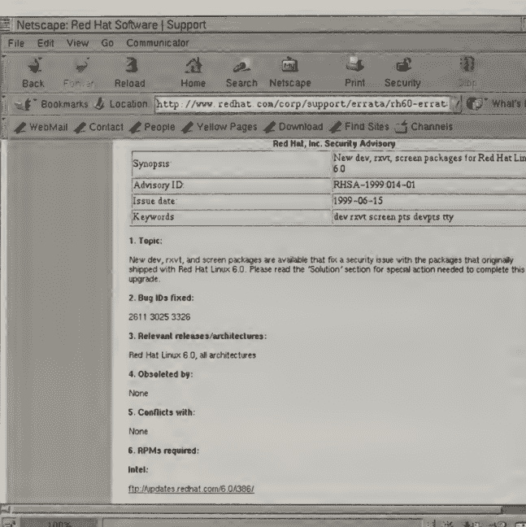

> 提示：管理员经常抱怨软件作者不修复漏洞，但我发现一个更常见的问题是，系统管理员没有使用那些已经发布的漏洞修复。每月留出专门的时间来下载并安装软件供应商提供的修复程序。将其转变为你日常工作的一部分。

## 移除不需要的软件

减轻软件更新负担的办法是移除所有你并不真正需要的软件。早些时候，我指出过在过去的一年里，`sendmail` 和 `IMAP` 在多个不同时期都遭受过攻击。为什么 `sendmail` 是首要目标？在某种程度上，是因为它是一个大型且复杂的系统，容易受到不同类型的攻击，但另一个原因也是 `sendmail` 处处运行。每个主要网络上的许多系统都在运行 `sendmail`，而且 `sendmail` 监控的 `SMTP` 端口通常被允许通过防火墙。入侵者寻找的是易攻目标，由于在桌面级 `Unix` 和 `Linux` 客户端上运行着许多 `sendmail` 副本，他们注定会发现某一个是配置错误或过时的。

然而，没有必要运行这么多 `sendmail` 副本。`Linux` 客户端不需要运行 `sendmail` 守护进程。它可以被配置为：将邮件转发到运行 `sendmail` 的部门服务器以发送出站邮件，并从邮件服务器收发入站邮件。简单来说，减少你在网络上运行的软件包副本数量，就能减少被入侵者利用的配置错误发生的概率。

我并不是要针对 `sendmail`。我也可以对 `IMAP` 以及几十种其他软件包重复同样的论点。事实上，大多数守护进程都属于这一类——客户端并不需要它们。有两种简单的方法可以访问（禁用）不需要的守护进程：

-   在 `/etc/inetd.conf` 文件中注释掉不需要的守护进程。大多数网络服务由 `inetd` 启动，而 `inetd` 只会启动在 `inetd.conf` 文件中列出的服务。从文件中移除服务可以防止外部人员使用指定的网络服务，但它不会阻止桌面客户端在出站连接中使用该服务。因此，如果从 `inetd.conf` 中删除了 `ftp`，用户可以使用 `ftp` 访问远程站点，但无法从远程站点通过 `ftp` 登录用户的桌面。

-   从启动项中移除启动不需要守护进程的脚本。某些网络服务守护进程（如 `sendmail` 和 `named`）在启动时会运行。使用 `sysconfig` 或 `linuxconfig` 从启动项中移除不需要的守护进程。例如，如果 `Linux` 客户端不是 Web 服务器，则不需要运行 `httpd` 脚本。即使 `httpd` 脚本在启动时不运行，客户端仍然可以使用 Web 浏览器。网络守护进程不是唯一需要的软件，客户端也不是唯一的目标。服务器上不需要的软件也可能为入侵者打开漏洞。如果你有一个专门的 `DNS` 服务器，它需要运行 `named`，但它不需要 `sendmail` 守护进程。同样，如果你运行一个专门的邮件服务器，它不需要 C 编译器（你可以在桌面系统上进行编译并将产物移动到服务器）。

| 安全与故障排除 |
| :--- |

| 第 4 部分 | 提示：你服务器上的所有东西都是入侵者的潜在工具。深思一下服务器为了工作真正需要什么。 |

限制服务器上安装软件的方法有两种。首先，在进行 `Linux` 安装时，不要安装你不需要的内容。在安装期间，根据你的系统计划仔细选择需要安装的软件包和加载的守护进程。另一种限制服务器软件的方法是在安装后将其移除。例如，要从带有 `rpm` 的系统中移除 `imap`，你可以输入 `rpm -e imap`。除了安装最新软件和移除不必要的运行外，你应该将访问限制在真正需要的系统上。`Linux` 通过提供两种强大的访问控制机制（`Wrapper` 和 `ipchains`）变得简单。

## 使用 Wrapper 控制访问

`Wrapper` 守护进程 `named tcpd` 由 `inetd` 执行。在 `Linux` 系统上使用 `Wrapper` 比许多其他 `Unix` 系统要容易，因为 `inetd.conf` 文件中的项已经指向了 `tcpd` 程序。注意：不记得 `inetd.conf` 文件的格式了吗？第 5 章“登录服务”中有解释。

以下是来自红帽 6 系统 `inetd.conf` 文件的内容：

```
ftp stream tcp nowait root /usr/sbin/tcpd in.ftpd -1 -a
telnet stream tcp nowait root /usr/sbin/tcpd in.telnetd
shell stream tcp nowait root /usr/sbin/tcpd in.rshd
login stream tcp nowait root /usr/sbin/tcpd in.logind
talk dgram udp wait /usr/sbin/tcpd in.talkd
ntalk dgram udp wait root /usr/sbin/tcpd in.ntalkd
imap stream tcp nowait root /usr/sbin/tcpd imapd
finger stream tcp nowait root /usr/sbin/tcpd in.fingerd
```

如示例所示，`tcpd` 的路径被用来替换每个守护进程的路径。当 `inetd` 接收服务请求时，它启动 `tcpd`。`tcpd` 记录服务请求并检查访问控制信息，如果允许，则启动真正的守护进程处理请求。`Wrapper` 执行两个基本功能：记录服务的请求并为这些服务提供访问控制。如果你正在寻找入侵者，记录网络请求非常有用。


`Wrapper` 使用 `syslog` 的 `authpriv` 记录消息。查看 `/etc/syslog.conf` 文件找到系统记录 `authpriv` 信息的位置。在红帽系统中，这些消息记录在 `/var/log/secure`，其中示例如下：

```
# cat /var/log/secure
Jun 09 08:48 login: ROOT ON tty1
Jun 09 08:48 login: LOGIN ON tty1
Jun 11 00:48 login: in.telnetd[950]: connect from 172.19.50.52
Jun 11 00:48 login: LOGIN ON Craig FROM mammals.com
Jun 12 01:11 login: in.telnetd[3467]: connect from 127.0.1
Jun 12 01:11 login: LOGIN ON Craig FROM localhost
Jun 12 01:19 login: imapd[3489]: connect from 127.0.1
Jun 14 10:23 login: in.telnetd[2090]: connect from 172.19.24.1
Jun 14 10:23 login: LOGIN ON Craig FROM mammals.com
Jun 15 14:30: in.ftpd[10201]: connect from 1.syslog.com
Jun 16 05:27 login: in.rsh[6433]: connect from 172.19.60.22
Jun 17 20:20 login: ROOT ON tty1
Jun 17 14:54 login: in.telnetd[1388]: connect from 172.19.50.52
Jun 17 14:54 login: LOGIN ON Craig FROM mammals.com
Jun 18 14:28: in.ftpd[10190]: refused connect from 172.25.98.22
```

这个 `/var/log/secure` 文件显示，日志中的所有内容都来自 `tcpd`。它还包含了登录信息。结合这两个信息可以提供一些见察。


## 第14 章 安全

6 月 9 日的登录来自控制台。来自 `tcpd` 的第一条消息是 6 月 11 日的 telnet 连接。消息显示有人从 IP 地址 `172.19.50.52` 使用 telnet。登录消息告诉你用户是 `Craig`，且关联的主机名为 `mammals.com`。如果这是你预期的，就不必担心。

在这个特定的文件中，引起我注意的消息发生在 6 月 16 日。`tcpd` 报告在该日期有人通过 IP 地址 `172.19.60.22` 使用远程 shell（`rsh`）访问了系统。远程 shell 可以在系统上远程执行命令，它是入侵者的强大工具。如果你不认识该 IP 地址，或者你不理解那里的人为什么要要运行远程 shell，你应该非常担心。

较不需要担心 6 月 18 日显示的 ftp 连接失败。如果频繁发生，值得关注，但目前不是问题，因为连接被 `Wrapper` 的访问配置拒绝了。

## tcpd 访问控制文件

两个文件定义了 `tcpd` 的访问控制：

- `hosts.allow` 文件列出了允许访问系统服务的主机。
- `hosts.deny` 文件列出了被拒绝提供服务的主机。

如果找不到这些文件，`tcpd` 将允许所有主机访问并简单记录访问请求。

当文件存在时，`tcpd` 先读取 `hosts.allow`，然后读取 `hosts.deny`。一旦找到目标主机和服务的匹配项，就会停止。因此，`hosts.allow` 授予的权限无法被 `hosts.deny` 覆盖。由于这个原因，我通常先在 `hosts.deny` 中插入一个拒绝所有系统的项，然后在 `hosts.allow` 文件中插入允许访问那些真正想要提供服务的系统的项。两个文件的项格式均为：

```
services clients : shell-command
```

`clients` 是一个主机名、域名、Internet 地址的逗号分隔列表。或者，它可以是关键字 `ALL`。`ALL` 匹配主机名和地址；`LOCAL` 匹配所有不包含域名部分的主机名。主机名匹配单个主机。IP 地址可以直接定义以匹配特定主机，或者通过 `(.)` 与地址掩码匹配一组地址。域名以点 `.` 开头，并匹配该域名内的每个主机。网络号以点结尾，并匹配网络地址空间内的每个 IP 地址。

`shell-command` 是一个可选的 shell 命令，当发生匹配时 `tcpd` 会执行该命令。如果发生匹配，`tcpd` 会记录访问情况，授予或拒绝对服务的访问，并将 shell 命令传递给 shell 执行。

通过以下几个例子的说明，可以展示在 `Wrapper` 访问控制条目中描述服务和客户端的多种有效方法。首先，有一个来自想象的 `hosts.allow` 文件的简单示例：

```
ALL : LOCAL, .foobirds.org
in.ftpd,in.telnetd : sr1.sysex.com
```

`services` 字段中的关键字 `ALL` 表示第一条规则适用于所有网络服务。在 `clients` 字段中，关键字 `LOCAL` 表示所有没有域名部分的主机都是允许的，`.foobirds.org` 匹配该域名下的所有主机名。`LOCAL` 本身会匹配所有，但不匹配 `.foobirds.org`。将这两个测试合并到同一个规则中，允许本地域内的每个系统都使用所有网络服务。第二条规则授予远程系统 `sr1.sysex.com` 上的用户 ftp 和 telnet 访问。

标准 `Wrapper` 访问控制文件的语法可能比上面的示例复杂一些。`hosts.allow` 文件可能包含：

```
imapd, ipopd3 : 172.54.4
ALL EXCEPT imapd, ipopd3 : ALL
```

第一条条目表示所有 IP 地址以 `172.54.4` 开头的主机都被授予 IMAP 和 POP 服务的访问权限。第二行表示除了 IMAP 和 POP 之外的所有项都授予了所有主机。这些条目将邮箱服务限制在一个子网内，同时为它们提供所有其他服务。`EXCEPT` 关键字用于从全列表中排除某些项。它也可以用于访问规则的客户端侧。例如：

```
ALL:.foobirds.org EXCEPT foobirds.org
```

如果这出现在 `hosts` 文件中，它将允许 `foobirds.org` 域内的每个系统访问除该主机以外的所有服务。假设是由于某种原因，`foobirds.org` 是不可信的——也许允许了域外的用户访问。最后一种语法变体使用 `@` 符号来收窄服务或客户端的定义。这里有两个示例：

```
in.telnet@172.16.7.2/255.255.255.0 : ALL
in.rshd : .foobirds.org
```

当 `@` 出现在规则的 `services` 字段时，它表示服务器有多个 IP 地址，且规则仅适用于这些地址之一。具有多个地址的系统示例包括多宿主机（multi-homed）和路由器。如果你的服务器也是连接本地网络和其它网络的路由器，你可能希望在连接到外部世界的接口上提供服务，同时在连接到本地网络的接口上提供这些服务。这种语法允许你这样做。如果此示例的第一行出现在 `hosts` 文件中，它将允许通过任何地址以 `172.16.7` 开头的客户端访问 telnet。当 `@` 出现在规则的客户端侧时，目的完全不同。在客户端侧，`@` 表示作为访问控制测试的一部分，需要从客户端获取一个用户名。这意味着客户端必须以特定的用户名运行，但更常见的用法是使用三个可能的关键字之一：

- `ALL`：当客户端响应查询并返回用户名时，测试结果为 `ALL`。
- `UNKNOWN`：当客户端未响应查询时，测试结果为 `UNKNOWN`。

## 定义可选的 shell 命令

`shell command` 允许你定义由访问控制列表中的匹配触发的额外处理。在所有实际示例中，此功能被用于 `hosts.deny` 文件，以收集更多关于入侵者的信息，或向系统管理员提供有关潜在安全攻击的即时通知。例如：

```
in.rshd : ALL (finger %h | /usr/sbin/mail -s %h root) &
```

## 使用 Wrapper 控制访问

在这个来自 `hosts.deny` 文件的示例中，所有系统都被拒绝访问 `rshd`。在记录尝试访问并将其拦截后，`tcpd` 将 `shell-command` 发送给 shell 执行。所有版本的 `finger`（包括 `finger`）都会查询远程主机以找出谁登录了该主机。这些信息在追踪攻击者时非常有用。行尾的符号 `&` 导致 shell 命令在后台运行。这非常重要；如果没有它，`tcpd` 将在那里等待这些程序完成，然后返回到自己的循环。


Wrapper 提供了 `finger` 程序。它经过专门修改，比标准的 `finger` 程序更不容易受到攻击。上述示例中使用到了一些变量，例如 `%h` 和 `%d`。这些 Wrapper 变量列在表 14.1 中，用于获取传入连接的值并将它们用于 shell 进程。

## 表 14.1 Wrapper 变量

| 变量 | 值 |
| :--- | :--- |
| `%a` | 客户端的 IP 地址。 |
| `%A` | 服务器的 IP 地址。 |
| `%c` | 所有可用的客户端信息，包括用户名。 |
| `%d` | 网络服务的名称。 |
| `%h` | 客户端的主机名。如果主机名不可，则使用 IP 地址。 |
| `%H` | 服务器的主机名。 |
| `%n` | 客户端的主机名。如果主机名不存在，则使用关键字 `UNKNOWN`。如果主机名和 IP 地址不匹配，则使用关键字 `PARANOID`。 |
| `%N` | 服务器的主机名。 |
| `%p` | 网络服务的进程 ID (PID)。 |
| `%s` | 所有可用的服务器信息，包括用户名。 |

## 表 14.1 Wrapper 变量（续）

| 变量 | 值 |
| :--- | :--- |
| `%u` | 客户端用户名，如果不存在则使用关键字 `UNKNOWN`。 |
| `%%` | 百分字符 (`%`)。 |

利用表 14.1 中的信息，你可以确定示例 shell 命令的具体作用。假设对 `in.rshd` 的尝试访问来自主机 `bad.worse.org`。传递给 shell 的命令将是

```
safe_finger -l @bad.worse.org | /usr/sbin/mail -s in.rshd bad.worse.org root
```

使用标准 Wrapper 访问控制语法可以定义的所有可能的规则中，我从未遇到过无法定义所需规则的情况。但如果你需要，可以使用 Wrapper 访问控制语言的扩展版本。

## 访问控制语言扩展

如果你在 `Makefile` 中启用了 `PROCESS_OPTIONS` 并编译了自己的 Wrapper 版本，那么 Wrapper 访问控制语言的语法将发生变化并扩展。

> **注意** 要编译自己的 Wrapper 版本，你需要源码。通过访问 `ciac.linux.org` 的 Tools 链接和 Access Control 链接获取 Wrapper。

在带有 `PROCESS_OPTIONS` 编译 Wrapper 后，命令不再局限于三个字段。新语法为：

```
services : clients : option : option ...
```

`services` 字段和 `clients` 字段的定义方式与原始 Wrapper 语法完全相同。`option` 字段是新的，且每个规则允许出现多个选项。有几种可能的选项：

- `allow` 授予请求的服务。此选项必须出现在规则的最后。
- `deny` 拒绝请求的服务。此选项必须出现在规则的最后。
- `spawn shell-command` 以子进程形式执行 shell 命令。
- `twist shell-command` 执行 shell 命令而不是请求的服务。
- `keepalive` 向客户端发送心跳消息。如果客户端不响应，则关闭连接。
- `linger seconds` 指定在服务器关闭连接后，尝试传输数据持续的时间。
- `rfc931 [timeout]` 使用 IDENT 协议查找客户端用户名，`timeout` 定义了服务器应等待客户端响应的秒数。默认超时时间是作为编译器的选项指定的。
- `banners path` 向客户端显示消息文件的内容。`path` 是包含 banner 文件的目录名称。显示的文件是与网络守护进程同名的文件。
- `nice [number]` 设置网络服务的 nice 值。Linux 内核使用 nice 值来计算调度优先级。默认值为 10。
- `umask` 为进程创建的文件设置 umask 值。umask 定义的值会关闭默认模式中的某些位（通常为 `022`），这可以防止创建具有全员可写权限的文件，但此选项应接受任何有效的 umask 值。因此，从 `0666` 减去 `022` 位会产生 `0644` 的文件权限。
- `user [.group]` 使用 `inetd.conf` 中指定的用户 ID 和组 ID 运行网络服务。文档仅显示了 `user nobody` 形式的命令，但应接受任何有效的用户名和组。

`setenv name` 为进程运行时环境设置环境变量。根据之前显示的示例，以下几个例子可以说明语法上的差异。使用新语法，`hosts.allow` 文件可能包含：

```
ALL : LOCAL, .example.com : ALLOW
telnetd : srl.com : ALLOW
ALL : DENY
```

使用新语法，不再需要两个文件。所有的 `ALLOW` 和 `DENY` 都可以列在单个文件中。前两行的功能与之前描述的第一个主机示例相同。第三行等同于在 `hosts.deny` 中添加 `ALL : ALL`。使用基本语法完成的所有操作都可以重写为使用扩展语法的单个文件。使用 `ALLOW` 和 `DENY` 选项，此命令：

```
ALL: .example.org : ALLOW
```

以及

```
ALL: .example.org : DENY
```

使用原始语法的 shell 命令示例在新语法中几乎完全相同：

```
in.rsh : spawn /usr/sbin/mail -s root : DENY
```

shell 命令主题中一个更有趣的变体来自 `twist` 选项。`twist` 命令不是将命令传递给 shell 执行，而是为客户端执行一个程序——但不是客户端预期的。例如：

```
in.ftpd ALL : /bin/echo
```

在这种情况下，当远程系统尝试启动 FTP 守护进程时，`echo` 程序会将消息发送到远程系统并终止连接。请记住，即使使用扩展语法，Wrapper 也只能保护由 `inetd` 启动的服务或像自行读取 `hosts.allow` 和 `hosts.deny` 文件的 `portmapper` 服务。这不能为任何其他服务提供安全性。要控制这些服务的访问，你需要使用 Linux 防火墙 (`ipfw`)。

## 现实规则

为了系统安全你可以做的最重要的事情就是保持更新。这本质上是一种被动活动——更主动的安全方法是在检测到问题之前就可以做的事情。访问控制的两个基本工具是 `inetd.conf` 文件和 Wrapper 程序。你用于配置这些东西的规则非常简单：

- 不要运行任何你不需要的服务。
- 不要向你不需要的人提供服务。

## 现实规则（续）

这些规则导致了以下简单的 Wrapper 配置，我在安装系统后立即进行了配置。首先，为了防止外部世界所有人的访问，我在 `/etc/hosts.deny` 文件中添加了此条目：

- `ALL : ALL`

接下来，我在 `/etc/hosts.allow` 中添加了一个条目，允许本地域内的客户端访问必要的服务：

- `ALL : LOCAL, .example.org`

此示例假设本地域是 `example.org`，我想向该域提供所有服务。情况通常是这样，因为通过完全注释掉 `inetd.conf` 文件中的内容，我不安装不必要的软件。因此，运行在服务器上的所有软件都是为了服务客户端。这种简单的配置对许多攻击有效。攻击脚本寻找简单的目标，通常在遇到第一丝反抗时就会退缩。当然，熟练且坚定的攻击者可以找到绕过任何防御的方法。我们大多数人并不会真的吸引高手的攻击。

## 使用 ipfw 控制访问

每个人都认为自己知道防火墙是什么，直到涉及到细节。从大意义上说，防火墙是一个保护本地网络免受巨大且恶意的全球网络侵害的系统。它是网络流量在离开本地网络之前经过的哨兵。在最简单的形式中，防火墙是一个过滤掉不需要流量的路由器。在最复杂的情况下，它是一个包含多个路由器和服务器的整个网络。Linux 为小型网络防火墙提供了一个极且低成本的选择。要创建一个 Linux 防火墙，利用 Linux 的路由功能结合 `ipfw` 的过滤功能来创建一个过滤路由器。

## 使用 ipchains 维护防火墙规则

Linux 内核将防火墙流量分为三类，并对每类流量应用不同的过滤规则。这些是：

- `Incoming firewall`（输入防火墙）：入站流量在被接受之前会根据输入防火墙规则进行测试。
- `Output firewall`（输出防火墙）：出站流量在发送之前会根据输出防火墙规则进行测试。
- `Forwarding firewall`（转发防火墙）：通过 Linux 系统转发的流量将根据转发防火墙的规则进行测试。

**注意** 除了这三个标准类别外，Linux 2.2 内核允许自定义类别。Linux 内核为这些类别维护维护规则列表。这些规则列表被称为链（chains），由 `ipchains` 命令维护。使用以下选项配合 `ipchains` 命令可以创建或删除自定义链、向链添加规则、更改链中规则的顺序：

- `-A` 在链的末尾追加规则。
- `-C` 链中的规则检查数据包。用于测试自定义链和内置链。
- `-D` 从链中删除指定的规则。
- `-F` 移除链中的所有规则。


- `-I` 向链中插入规则。定义规则编号以指定新规则插入到链中的位置。例如，要在链头插入规则，则为其分配规则编号 `1`。
- `-L` 列出链中的所有规则。如果没有指定链，则列出所有链中的所有规则。
- `-M` 定义地址伪装参数或列出当前设置。参见第 9 章“网络网关服务”有关 `IP` 伪装的描述。
- `-N` 创建指定名称的自定义链。
- `-P` 设置链的默认策略。
- `-R` 替换链中的规则。
- `-S` 设置 `IP` 伪装的超时值。
- `-X` 删除指定的自定义链。
- `-Z` 将所有链中的数据包和字节计数器归零。

防火墙规则由匹配数据包的过滤器以及当数据包匹配过滤器时采取的操作组成。操作可以是标准策略，也可以跳转到自定义规则链进行额外的处理。标准策略包括：

- `accept`：允许数据包通过防火墙。
- `reject`：丢弃数据包并向发送者返回 `ICMP` 主机不可达（host unreachable）错误消息。
- `deny`：静默丢弃数据包。不向发送者返回任何错误。
- `masq`：伪装数据包，使其看起来来自本地主机。此策略在第 9 章中介绍。
- `redirect`：无论数据包的目的地是什么，都将其传递到本地主机上的某个端口。
- `return`：在用户定义的规则链中，这意味着返回到调用它的链。在三个内核链之一中，这意味着退出该链并使用该链的默认策略。

### 使用 ipfw 控制访问

使用 `ipchains` 命令带有的参数来构建过滤器，以匹配数据包所使用的协议、源地址、目的地址或用于数据包的网络接口。`ipchains` 参数如下：

- `-s address[/mask] [port[:port]]`：定义规则适用的数据包源。地址可以是主机名、网络名或带有可选地址掩码的 `IP` 地址。`port` 是 `/etc/services` 文件中的名称或数字，或者是数值 `ICMP` 消息类型。可以使用 `port:port` 格式指定端口范围。如果未指定特定的端口值，则假设所有端口。
- `-d address[/mask] [port[:port]]`：定义规则适用的数据包目的。地址和端口的定义规则与定义数据包源这些值的规则相同。
- `--destination-port [port[:port]]`：定义规则适用的目的端口。它过滤所有发往特定端口的流量。端口的定义规则与定义数据包源这些值的规则相同。
- `--icmp-type type`：定义规则适用的 `ICMP` 类型。`type` 可以是任何有效的 `ICMP` 消息类型或数字。可以通过输入 `interfaces -h icmp` 列出有效的 `ICMP` 消息名称。有 30 多个有效的消息名称。
- `-j target`：识别用于处理数据包的标准策略，或应将控制权传递的用户链。
- `-i name`：定义规则适用的接口名称。可以通过以 `+` 结尾来使用部分接口名称；例如，`eth+` 将匹配所有以 `eth` 开头的以太网接口。
- `-f`：表明规则仅引用数据包的第二个及后续分片。
- `-b`：表明一个匹配双向 `IP` 数据包的规则。因此，如果源是主机 A 目的是主机 B，使用 `-b` 选项也将匹配源为主机 B 目的为主机 A 的数据包。
- `-v`：导致命令产生详细输出（verbose output）。
- `-n`：导致命令产生数值输出；即 `IP` 地址不转换为主机名。
- `-1`：导致 Linux 内核记录匹配规则的数据包的 `IP` 字段。由 `maxsize` 定义从 `IP` 数据包到用户进程的字节数。仅当内核编译时启用了 `CONFIG_IP_WALL_NETLINK` 时才有效。
- `-value value`：为数据包标记一个 32 位无符号值，该值可能被内核代码头文件使用。目前尚未使用。
- `-t tos and mask xor mask`：修改 `IP` 头部中的服务类型（`TOS`）字段，将 `TOS` 字段与第一个掩码进行与（AND）操作，并将结果与第二个掩码进行异或（XOR）操作。
- `-x`：显示数据包和字节计数器的精确值，而不是四舍五入到最近的千、百万或十亿。
- `-y`：匹配 `SYN` 位被设置且 `ACK` 和 `FIN` 位被清除的数据包。此类数据包用于建立 `TCP` 连接。


### ipchains 命令示例

将所有内容组合在一起可以创建一个保护你网络的过滤路由器。假设你有一个 Linux 路由器连接到地址为 `172.16.5.254` 的内部网络，以及地址为 `192.198.6.5` 的外部网络。以下是该系统上可能使用的一些 `ipchains` 命令示例：

```
ipchains -A input -i eth1 172.16.0.0/16 -j reject
ipchains -A input -d 172.16.5.1 25 -j accept
ipchains -A input -d 172.16.5.6 80 -j accept
ipchains -A input -d 172.16.5.4 110 -j accept
ipchains -A input -d 172.16.0.0/16 -syn -j reject
```

`-A input` 参数表示这些规则应追加到输入（input）规则链中。第一条规则说，如果数据包从外部网络接口（示例中的 `eth1`）到达，源地址表明它们来自你的内部网络（示例中的 `172.16`），则有人在试图伪造你的身份，数据包应该被丢弃。

接下来的三条规则基本相同。如果目的和端口是特定服务器的正确目的和端口，则接受数据包。例如，端口 `25` 是 `SMTP`，`172.16.5.1` 是电子邮件服务器，端口 `80` 是 `HTTP` 端口，`172.16.5.6` 是 Web 服务器，端口 `110` 是 `POP` 端口，`172.16.5.4` 是邮箱服务器。你接受这些入站连接，因为它们是合法的。

### 改进身份验证

（注：此节提供的文本包含大量的 OCR 噪声和重复，已根据现有的语义片段进行处理。）

### 第 14 章 安全

- `min` 是用户在更改密码前必须保留新密码的最少天数。
- `max` 是允许保留密码的最大天数，超过后必须更改。
- `warn` 是密码过期前提醒用户的天数。
- `inactive` 是密码过期后到账户锁定之间的天数。一旦账户锁定，用户将无法登录并更改密码。
- `close` 是账户将被关闭的日期。
- `reserved` 是供系统使用的保留字段。

以下是 Red Hat 6 系统上 shadow 密码文件的节选：

```
root:$1$kjhwqfe1luhivnbmv.:10750:0:99999:7:-1:-134538444
bin::*:10750:0:99999:7::
damon::*:10750:0:99999:7::
adm::*:10750:0:99999:7::
uucp::*:10750:0:99999:7::
xfs::!!10750:0:99999:7::
gdm::!!10750:0:99999:7::
postgres::!!10750:0:99999:7::
squid::!!10750:0:99999:7::
craig:$1$Sobuogugh.5LV/Heo:10751:-1:99999:-1:-1:135495028
kathy:$1$iugoufdjhbjbjjih:10751:-1:99999:-1:-1:135496088
sara:$1$Spiuhibjhlbhytyjjt:10751:-1:99999:-1:-1:135497800
david:$1$kjkjojjhkjkhvjhuuvuq:10751:-1:99999:-1:-1:135498997
bebecca:$1$ihohuhuuhhfhfhJ:10751:-1:99999:-1:-1:135498070
```

加密密码字段仅出现在此文件中。`/etc/passwd` 文件中的每个密码字段都包含一个 `x`，它告诉系统在 shadow 文件查找真实密码。`/etc/shadow` 文件中的每个密码字段包含加密密码、`!!` 或 `*`。如果密码字段包含 `!!`，意味着该账户拥有有效的登录 shell，但账户已锁定，因此无人能通过该账户登录。如果密码字段包含 `*`，则表示这是一个系统账户（例如 `daemon` 或 `uucp`），它没有登录 shell，因此不是登录账户。

### 密码老化

除了保护密码外，shadow 文件还支持密码老化（password aging），它定义了每个用户在密码寿命结束时更改密码的期限。如果不更改，用户将被阻止使用其账户。`changed`、`max` 和 `warn` 字段告诉系统密码何时更改的、应该保留多久，以及何时提醒用户进行更改。

当更改密码时，必须在使用 `min` 字段定义的天数后才能再次更改，这防止了用户将密码更改为临时密码然后立即改回旧密码。这减少了为了避免真正更改密码的最常用技巧之一。

`inactive` 和 `close` 字段有助于消除闲置账户。`inactive` 字段允许用户在密码过期后有若干天数来登录并设置新密码。如果用户在指定的天数过去之前没有登录，则表示该账户未使用，且账户将被锁定以防止用户登录。


## 改进身份验证

`close` 字段允许你创建一个具有特定“寿命”的用户账户。当达到 `close` 字段存储的日期时，即使账户仍处于激活状态也会被禁用。过期日期以自 1970 年 1 月 1 日以来的天数存储。

在 Red Hat 6 系统上，不直接编辑 `/etc/shadow` 文件。通过使用 `linuxconf` 工具进行修改。图 14.5 显示了此配置窗口。


**图 14.5 使用 `linuxconf` 定义密码参数**

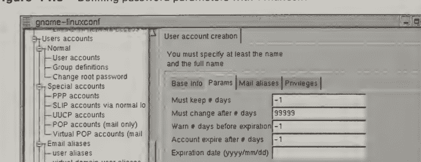

此配置窗口中的各种框可以直接映射到 shadow 密码文件中的字段：

*   `#` 天（Must keep # days）这设置了 `min` 的值。图 14.5 中显示的值为 -1。这是默认值，意味着没有设置最小值，用户不会被强制保留一个不喜欢的密码。
*   在 `#` 天后更改（Change after # days）这设置了 `max` 的值。示例强制用户每 90 天更改一次。
*   过期前告警天数（Warn days before expiration）设置了 `warn` 的值。示例提醒用户 7 天。
*   账户在 `#` 天后过期（Account expires after # days）设置了 `inactive`。示例将其设置为 30 天。
*   过期日期 (`yyyy/mm/dd`)（Expiration date (`yyyy/mm/dd`)）设置了 `close` 的值。示例将其设置为 -1。

### 一次性单词

OPIE 替换了 `login`、`su` 和 `ftp` 自己的版本，这些版本接受传统密码和 OPIE 一次性密码——一组“单词”。

### OPIE 转换机制

OPIE 可以配置为接受可重复密码或 OPIE 密码语。用户喜欢这个功能，因为他们可以使用方便的重复密码进行本地登录，以及远程登录。然而，该功能的问题在于它开启了一个巨大的安全漏洞，导致人们可能忘记自己的操作而使用重复密码。

然而，有时你需要此功能来克服对密码的抵触。在构建 OPIE 软件时，通过 `--enable-access-file` 运行配置，这将允许使用 `/etc/access` 文件。在该文件中，列出允许使用重复密码的主机。例如：

```
permit 127.0.0.1      255.255.255.255
deny  172.16.5.25      255.255.255.255
permit 172.16.5.0      255.255.255.000
```

第一个字段可以允许或显式拒绝重复密码。默认情况下，`/etc/access` 文件未提到的任何系统都被拒绝重复密码访问。第二个字段是地址。第三个字段是地址掩码，允许用一行代码指定整个网络。

### 选择你的秘密密码

一次性密码短语由名为 `opiekey` 的程序生成。为了向该程序唯一标识你自己，你需要秘密密码。使用 `opiepasswd` 选择该密码。

例如，假设我是 OPIE 的新手，想在旅行前生成一组密码短语。首先，我用传统的重复密码登录到 OPIE 服务器的控制台，并运行 `opiepasswd` 选择一个秘密 OPIE 密码，该密码必须在至少 10 个字符长度。`opiepasswd` 接受秘密密码并显示密码短语，为：`DUG AHOY EMIL SAM JOT BERN`：

```bash
$ opiepasswd -c
```

更新 `craig`：

> 提醒 - 仅从控制台使用此方法；切勿从远程连接使用。

如果你正在使用 `telnet`、`xterm` 或拨号连接，请现在输入 `^C` 或不带密码退出。然后在在不带 `-c` 参数的情况下运行 `opiepasswd`。

使用 MDS 计算响应。

输入旧的秘密密码短语：`OJ1CCFFtNt`

输入新的秘密密码短语：`N'pim.c..na.o`

再次输入新的秘密密码短语：`N'pim.c..na.o`

ID `CRAIG` 密钥为 `499` `P18318`

`DUG AHOY EMIL SAM JOT BERN`

> 注意 从控制台运行 `opiepasswd` 是安全的方法。如果不是从控制台运行，你必须随身带上 `opiekey` 软件副本，以生成进入你的旧和新秘密密码所需的正确响应，因为明文密码仅接受来自控制台的。

### 创建额外的密码短语

当然，一个密码短语是不够的。要生成额外的密码短语，请使用 `opiekey`。`opiepasswd` 命令输出的倒数第二行包含重要信息。它显示了初始序列 (`499`) 和种子 (`p18318`)。这些值配合秘密密码，`opiekey` 需要这些值来生成 `opiekey` 密码短语。

`opiekey` 将登录序列号、用户种子和用户的秘密密码作为输入，并输出正确的密码短语。使用 `-n` 参数请求多个密码。将它们打印出来或记录下来，你就可以出发了。

下面的示例从 `opiekey` 请求了五个密码短语：

```bash
$ opiekey -n 5 499 p18318
```

使用 MDS 算法计算响应。

> 提醒：不要在 `telnet` 或拨号会中使用 `opiekey`。


输入秘密密码短语：`N'pim.c..na.o`

*   `495: NERO BORN ABET HELL YANG WISE`
*   `496: VERB JUKE BRAN LAWN NAIR WOOL`
*   `497: POE MOOR HAVE UN DRAB MOOT`
*   `498: SACK WAND WAKE SNUG AURA HOOD`
*   `499: DUG AHOY EMIL SAM JOT BERN`

> 注意 登录数字从 `499` 开始倒计时且不能重用。当序列号降到 `10` 时，重新运行 `opiepasswd` 并选择新的秘密密码以便将序列号重置为 `499`。

`opiekey` 命令行请求从序列号 `499` 开始的五个密码短语 (`-n 5`)。种子 (`p18318`) 在命令行提供，`opiekey` 会提示输入你用 `opiepasswd` 命令定义的秘密密码。然后使用序列号、种子和秘密密码来生成密码短语，`opiekey` 按序列号顺序打印出你请求的数字。

要登录，你必须使用与登录时显示的序列号对应的密码短语。例如：

```
login: craig
otp-md5 496 p18318
Response or Password: VERB JUKE BRAN LAWN WOOL
```

运行 OPIE 的系统会显示一行，指示正在使用 MD5 算法 (`otp-md5`) 生成一次性密码，登录序列号为 `496`，用于一次性密码的种子为 `p18318`。正确的响应是密码短语列表中登录号 `496` 的短“单词”。该响应不能再次用于登录系统。

我可能是唯一会告诉你“我喜欢一次性密码”的人，但我特别喜欢它们的便携性。我不需要在客户端安装任何特殊软件，只需要钱包里有一份随处可以使用密码列表。如果你在客户端系统上有 `opickey` 软件，你可以一次生成一个一次性密码。但为什么要这样做呢？如果你同时控制客户端和服务器上的软件，请使用安全 shell。它是比 OPIE 更好的身份验证工具。当你想要从任何系统完全自由地登录时，请使用安全 shell。

# Secure Shell

`secure shell` (`ssh2`) 程序提供了具有强身份验证和公钥加密的远程访问。`secure shell` 既安全又易于使用。`secure shell` 软件可在 `www.openssh.com` 获取。安装该软件：

1. 下载压缩 tar 文件，当前为 `ssh-2.0.13.tar.gz`。
2. 运行 `tar` 创建目录。
3. 进入该目录并运行 `configure` 命令构建 `Makefile`。
4. 运行 `make` 和 `make install` 构建并安装安全组件：
    *   `ssh2` 此守护进程接收传入的连接。
    *   `ssh` 这是一个用于登录远程系统的用户命令。该命令创建了由 `ssh` 处理的传出连接。
    *   `scp` 此安全复制命令执行与远程复制 (`rcp`) 相同的功能。
    *   `ssh-keygen` 此程序生成 `secure shell` 密钥。

> 注意 除了安装这些组件外，`install` 命令还会生成 `secure shell` 用于身份验证和加密会话的主密钥。有了这些密钥，系统立即就可以进行安全通信。当 `secure shell` 客户端和服务器连接时，它们会交换密钥。密钥将与它们存储在 `/etc/ssh/knownhosts` 以及用户主目录下的 `.ssh/knownhosts` 中的已知密钥进行比较。如果这些位置中的其中一个没有找到密钥，将要求用户验证是否应该接受新密钥。如果找到了密钥或被用户接受，则使用主机密钥来加密会话的剩余部分。无需担心密码窃取者，因为密码在发送之前已经加密了。下面的示例说明了默认配置下的登录情况：

```
ssh parrot
```


Host key not found from list of known hosts.

Are you sure you want to continue (yes/no)? yes

Host `parrot` added to the list of known hosts.

craig's password:

```

客户端不仅限于简单的密码验证。默认情况下，服务器配置被设置为接受密码身份验证和公钥认证。如果用户希望使用公钥认证，他们必须创建自己的私钥和公钥。

## 创建用户密钥

`ssh-keygen` 程序生成用于公钥认证的公钥和私钥。只需调用 `ssh-keygen` 提示时输入密码。例如：

```bash
$ ssh-keygen

Generating 1024-bit dsa key pair

Key generated.

1024-bit dsa, craig@parrot, Wed Jun 23 1999 13:50:48

Passphrase: 

Private key saved to /home/craig/id_dsa

Public key saved to /home/craig/id_dsa.pub
```


> 注意：除了安装这些组件外，`install` 命令还会生成 `secure shell` 用于身份验证和加密会话的主密钥。有了这些密钥，系统立即就可以进行安全通信。当 `secure shell` 客户端和服务器连接时，它们会交换密钥。密钥将与它们存储在 `/etc/ssh/knownhosts` 以及用户主目录下的 `.ssh/knownhosts` 中的已知密钥进行比较。如果这些位置中的其中一个没有找到密钥，将要求用户验证是否应该接受新密钥。如果找到了密钥或被用户接受，则使用主机密钥来加密会话的剩余部分。无需担心密码窃取者，因为密码在发送之前已经加密了。

# 484 章 第14 章 安全

## 表 14.2 `sshd2` 配置参数（续）

| 关键字 | 用途 |
| --- | --- |
| `DenySHosts` | 指定 `.shosts`、`.hosts`、`hosts.equiv` 和 `shosts.equiv` 文件中无效的主机名。 |
| `ForwardAgent` | 指定是否将到身份代理的连接转发到远程服务器。 |
| `ForwardX11` | 指定是否通过安全通道重定向 `X11` 连接。 |
| `HostKeyFile` | 标识包含私有主机密钥的文件。默认值为 `/etc/ssh2/hostkey`。 |
| `IgnoreRosts` | 指定在基于主机的身份验证中不使用 `.hosts` 和 `.shosts` 文件。 |
| `KeepAlive` | 指定系统是否应该发送心跳包（`keepalives`）。 |
| `ListenAddress` | 指定 `sshd2` 服务的接口的 `IP` 地址。 |
| `LoginGraceTime` | 定义登录超时时间。默认为 `600` 秒。 |
| `MaxConnections` | 定义 `sshd2` 服务的最大并发连接数。 |
| `NoDelay` | 指定 `sshd2` 是否应该使用 `TCP_NODELAY` 选项。 |
| `PasswordGuesses` | 指定用户允许尝试密码的次数。默认值为 `3`。 |
| `PermitEmptyPasswords` | 指定 `sshd2` 是否允许登录空密码字符串的账户。 |

## 表 14.2 `sshd2` 配置参数（续）

| 关键字 | 用途 |
| --- | --- |
| `PermitRootLogin` | 指定 `sshd2` 是否接受登录到 `root` 账户。默认值为 `yes`。其他值为 `no`（禁用通过 `sshd2` 登录 `root`）和 `nopwd`（禁用基于密码的身份验证的 `root` 登录）。 |
| `Port` | 定义 `sshd2` 使用的端口号。默认端口为 `22`。 |
| `PrintMotd` | 指定 `sshd2` 是否应该在登录时打印当日消息（`message of the day`）。默认值为 `yes`。 |
| `PublicHostFile` | 标识包含公有主机密钥的文件。默认值为 `/etc/sshd2/hostkey.pub`。 |
| `RandomSeedFile` | 指定随机种子文件名。 |
| `RequiredAuthentications` | 指定必须使用哪些身份验证方法。这必须是 `AllowAuthentications` 定义值的子集。 |
| `QuietMode` | 将日志限制为仅致命错误。 |
| `Ssh1Compatibility` | 指定 `sshd2` 是否需要支持旧的 `SSH1` 客户端。 |
| `Sshd1Path` | 提供支持 `SSH1` 客户端的 `sshd1` 守护进程路径。 |
| `UserConfigDirectory` | 定义用户文件的路径。 |
| `UserKnownHosts` | 指定是否在用户的 `knownhosts` 目录中搜索用于基于主机身份验证的公钥。 |
| `VerboseMode` | 使 `sshd2` 打印调试信息。 |

使用 `/etc/sshd/sshd_config` 文件增加安全性的一个示例可能是限制允许连接到服务器的远程客户端。要将客户端限制在 `syex.com` 和 `nist.gov` 域的主机，可以在 `ssh2_config` 文件中添加以下条目：

```
AllowHosts *.syex.com *.nist.gov
```

# 配置 SSH2 客户端

每个用户都可以使用 `ssh2_config` 文件自定义安全外壳客户端，该文件位于用户家目录下的 `.ssh2` 目录中。`ssh2_config` 文件有超过 `25` 种配置选项可用。在 `secure shell 2.0.13` 版本中实现的选项如表 14.3 所示。

### 表 14.3 `ssh2` 客户端配置选项

| 选项 | 用途 |
| --- | --- |
| `AuthorizationFile` | 指定用户授权文件名。 |
| `Ciphers` | 定义的会话加密技术。可能的值有 `des`, `3des`, `blowfish`, `idea`, `arcfour`, `twofish`, `any`, `anystd`, `anycipher`, `anystdcipher` 和 `none`。 |
| `Compression` | 指定是否应该压缩。 |
| `DontReadStdin` | 告诉 `ssh2` 不要读取标准输入 (`stdin`)。 |
| `EscapeChar` | 定义转义字符。默认为波号 (`~`)。 |
| `ForwardAgent` | 指定是否将到身份代理的连接转发到远程机器。 |
| `ForwardX11` | 指定是否通过安全通道自动重定向 `X11` 连接。 |
| `GoBackground` | 指定 `ssh2` 是否在后台运行。 |

## 表 14.3 `ssh2` 客户端配置选项（续）

| 选项 | 用途 |
| --- | --- |
| `Host` | 指定远程服务器的主机名。默认使用 `ssh2` 命令行中的主机名。 |
| `IdentityFile` | 定义用户标识文件的名称。 |
| `KeepAlive` | 指定 `ssh2` 是否应该传输心跳包。 |
| `LocalForward` | 通过安全通道将本地端口连接到远程系统上的端口。提供此命令的值为 `"port:remotehost:remoteport"`。需要引号。 |
| `NoDelay` | 指定 `ssh2` 是否应该使用 `TCP_NODELAY` 套接字选项。 |
| `PasswordPrompt` | 定义显示给用户的密码提示。 |
| `Port` | 定义连接到远程主机的端口号。默认为 `22`。 |
| `QuietMode` | 抑制致命错误之外的所有消息。 |
| `RandomSeedFile` | 指定随机种子文件名。 |
| `RemoteForward` | 通过安全通道将本地端口连接到远程系统上的端口。提供此命令的值为 `"port:remotehost:remoteport"`。需要引号。 |
| `Ssh1Compatibility` | 指定 `sshd2` 是否需要支持旧的 `SSH1` 客户端。 |
| `Sshd1Path` | 提供支持 `SSH1` 客户端的 `sshd1` 守护进程路径。 |
| `UserConfigDirectory` | 定义用户文件的路径。 |
| `VerboseMode` | 使 `sshd2` 打印调试信息。 |

使用 `/etc/sshd/sshd_config` 文件增加安全性的一个示例可能是限制允许连接到服务器的远程客户端。要将客户端限制在 `syex.com` 和 `nist.gov` 域的主机，可以在 `ssh2_config` 文件中添加以下条目：

```
AllowHosts *.syex.com *.nist.gov
```

每个用户都可以使用 `ssh2_config` 文件自定义安全外壳客户端，该文件位于用户家目录下的 `.ssh2` 目录中。`ssh2_config` 文件有超过 `25` 种配置选项可用。在 `secure shell 2.0.13` 版本中实现的选项如表 14.3 所示。

对测试系统离线运行攻击脚本。在将新的 `Linux` 版本或升级后的软件安装到真实服务器之前，可以使用它们进行测试。操作方法如下：

- 1. 在测试系统上安装新的 `Linux` 版本。这不是真实服务器；它是一台你用于测试的旧电脑。
- 2. 将攻击脚本安装在你用作网络诊断工具的笔记本电脑系统上。（你将在第15章“故障排除”中看到关于将笔记本电脑作为诊断工具的内容。）
- 3. 为两个系统分配私有网络地址，并用一根以太网线将连接起来，使两个系统都不连接到网络。
- 4. 从笔记本电脑启动每个攻击脚本，并记录脚本报告的所有漏洞。这些漏洞与真实的网络攻击者所看到的是相同的。
- 5. 在真实服务器上安装 `Linux` 升级之前，尽可能为已报告的问题找到修复方案。
- 6. 在同一个周末完成服务器升级并安装安全补丁。

攻击脚本可以在 `www.rootshell.com` 获取。可用于此流程的脚本包括 `nmap`、`queso`、`strobe` 和 `netcat`。

## 结语

将服务器连接到网络会增加安全问题的风险，而安全问题是对你系统稳定性和可靠性最大的威胁。运行 `24/7` 服务最困难的任务是保持系统每天 `24` 小时、每周 `7` 天的运行。`Linux` 让这成为可能，因为它非常稳固。事实上，如此稳固以至于每当 `Linux` 系统崩溃时，我都怀疑是外部力量，例如安全入侵者。

然而，安全泄露并不是你 `Linux` 服务器可靠性和稳定性的唯一威胁。下一章将描述可能出现的其他网络问题，以及你可以采取哪些措施来排除这些问题。

## 外面的世界真的很可怕！

许多网络管理员并不理解网络环境有多糟糕。运行企业防火墙的人保护了我们大多数人，免受看到入侵尝试。但我能看到它们，因为我管理的网络之一位于防火墙之外。平均而言，网络每周至少会被入侵者探测超过一次！

第二天早上——从那次“自杀式登录”开始已经过去了约 `10` 小时——我坐在测试服务器的控制台前检查系统安全。我没进行多久。我尝试的第一个命令是 `last`，用来检查谁登录了系统以及从哪里登录。最后一个命令失败了，抱怨 `tmp` 文件已损坏。这是一个明显的信号，说明有人登录了系统，而且掩盖踪迹做得很糟糕。

我实际上曾有机会利用入侵来达到目的。我需要安排一次重大的服务器升级。这恰好是其中服务器的 `Solaris` 升级。这个升级包已经在我的办公桌上放了九个月，但每当我安排升级时，我的老板就会取消它，转而处理某些“优先级更高”的事情。坦率地说，我认为系统管理员培训（即测试服务器的用途）是高优先级的，但老板毕竟是老板。

系统管理员通常太忙，没有时间去追捕入侵者，所以我很少浪费时间分析入侵事件。此外，这次事件的原因显然是密码被盗。我将系统转储到磁带中，写了一份关于入侵可能原因的报告，并将磁带和报告发送给安全组。当有趣的问题发生时，系统管理员的工作就是快速恢复服务器。在入侵后恢复服务器是极高优先级。

我在 `Network+Interop` 会议上举办一个工作讨会，该会议提供大量的网络计算机，可以用来检查电子邮件或登录你的办公室电脑。我更倾向于使用自己的笔记本电脑，但偶尔也会使用会议系统的一台设备并使用 `Opie` 密码登录。这次情况不同。在前往亚特兰大机场之前，我坐在会议系统的一台设备上，使用标准的明文密码登录办公室的测试服务器，尽管我很清楚通过互联网发送可重复的密码并不明智。随后，我登上了飞往杜斯机场的飞机。

突然之间，升级 `Solaris` 软件成了我最重要的工作。这样做之后，我不仅收到了老板对我快速恢复服务器的感谢，还成功把那个堆在桌子上的软件升级掉了。


然而，如果你想为内核使用相同的名称（例如 `vmlinuz`），请使用 `cp` 命令将当前内核复制到名为 `vmlinuz.old` 的备份文件。这是一个示例：

```


# cp /boot/vmlinuz /boot/vmlinuz.old

如果内核备份无法在启动期间使用，那么它将毫无用处。为了使其有用，必须将其添加到`lilo.conf`文件中。在下面的示例`lilo.conf`文件中，添加了一个新的镜像命令，以便出现问题时加载旧内核：

```
boot=/dev/hda

map=/boot/map

install=/boot/boot.b

prompt

timeout=50

# 正常的 Linux 启动
image=/boot/vmlinux
label=linux
root=/dev/hdb1
read-only

# 紧急 Linux 启动
image=/boot/vmlinuz.old
label=safe
root=/dev/hdb1
read-only

# DOS 启动
other=/dev/hda1
label=dos
table=/dev/hda
```


通过这个 `lilo.conf` 文件，你可以在启动提示符处输入 `safe` 来启动你已知是良好的旧内核。当然，这只有在新内核无法正常启动时才会使用。

> 注意：忘记 `lilo.conf` 文件的命令和结构了吗？请回顾第 3 章“启动过程”。

# 保护模块库

可加载模块必须与使用它们的内核兼容。模块会与加载它们的内核一起进行重新编译。如果你被迫回退到较早版本的内核，你需要确保保留该内核所需的模块。通常情况下，这并不是一个问题，因为内核构建过程会根据发布号为新模块库赋予一个唯一的名称。然而，你可能正在编译一个与当前内核具有相同发布号的内核——不是为了升级，而是为了为你的系统创建一个更高效的自定义内核。在这种情况下，你可能想对当前模块库进行备份复制，以确保在需要回退时，所有模块都在那里。

> 提示：通常，我不会费心备份模块库，因为每当我构建自定义内核时，都会进行升级。新内核在不断发布。我发现，当我准备好自定义新发行版的内核时，一个新内核已经发布了。使用新版本意味着我不会与模块库名称发生冲突。

现在你已经备份了所有内容，可以安全地继续配置和编译新内核了。

# 使用 `xconfig` 配置内核

要启动内核配置过程，切换到 `/usr/src/linux` 目录并运行 `make xconfig`，这将打开图 15.1 所示的窗口。

15.1 内核配置窗口

| 代码成熟度选项 | DA 子系统支持 | 分区类型 |
|---|---|---|
| 处理器类型和特性 | 红外端口驱动程序 | 原生语言支持 |
| 可加载模块支持 | ISDN 子系统支持 | 控制台驱动程序 |
| 通用设置 | 旧 CD-ROM 驱动程序 (非 SCSI, IDE) | 音 |
| 即插支持 | 字符设备 | 额外的低级音频驱动程序 |
| 块设备 | 鼠标 | 内核黑客行为 |
| 网络选项 | 门狗卡 | |
| SCSI 支持 | Video For Linux | 保存并退出 |
| SCSI 低层驱动程序 | Floppy, 软带设备驱动程序 | 不保存退出 |
| 网络设备支持 | 文件系统 | 从文件加载配置 |
| 业余无线支持 | 网络文件系统 | 将配置存储到文件 |

# 第 15 章 故障排除

内核配置窗口显示了 30 个按钮，代表不同的配置类别。（这些按钮在“理解内核配置类别”节中进行了详细描述。）点击按钮可以查看并设置该类别中的配置选项。图 15.2 显示了选择“网络设备支持（Network-Device Support）”按钮后出现的窗口。

15.2 网络设备支持配置选项

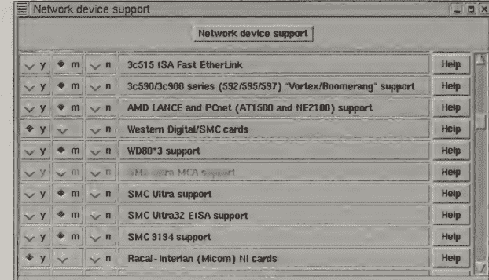

网络设备支持窗口列出了所有可以编译进内核或由内核加载的网络设备驱动程序。对于大多数配置选项，你有三个标准选择：

- 将该选项编译到新内核中。
- 使内核作为可加载模块加载该选项。并不是每个选项都可以作为可加载模块。注意西部数据/SMC 卡选项。当必须回答是或否的配置问题时，无法进行模块选择。
- 告诉内核不要使用该选项。

除了这些标准选择外，某些选项还提供了配置关键字的下拉列表。“处理器类型和特性（Processor Type And Features）”配置选项就是一个示例。图 15.3 显示了该选项窗口中可选处理器类型下拉列表。五种可能的选择：

- 为 `Intel`、`Cyrix` 和 `AMD` `386` CPU 选择 `386`，为 `Cyrix` 和 `TI` `486/DLC` CPU 选择 `486`，并忽略 `486SX-S` CPU。

# 配置 `Linux` 内核

- `486/Cx486`：为 `Intel`、`IBM`、`Cyrix` 和 `AMD` `486` CPU 选择 `486`；为 `AMD` 和 `Cyrix` `5x86` CPU 选择 `486`；为 `NexGen` `Nx586` CPU 选择 `486`；为 `UMC` 和 `U5` CPU 选择 `486`。
- `586/K6/5x86/6x86`：为 `Intel`、`IBM`、`Cyrix` 和 `AMD` `486` CPU 选择 `586`；为 `AMD` 和 `Cyrix` `5x86` CPU 选择 `586`；为 `NexGen` `Nx586` CPU 选择 `586`；为 `UMC` 和 `U5` CPU 选择 `586`。（注：此处原文逻辑似乎有重复，已按字面翻译）
- `586/K6/5x86/6x86`：为 `Intel`、`IBM`、`Cyrix` 和 `AMD` `486` CPU 选择 `586`；为 `AMD` 和 `Cyrix` `5x86` CPU 选择 `586`；为 `NexGen` `Nx586` CPU 选择 `586`；为 `UMC` 和 `U5` CPU 选择 `586`。
- `586/K6/5x86/6x86`：为 `Intel`、`IBM`、`Cyrix` 和 `AMD` `486` CPU 选择 `586`；为 `AMD` 和 `Cyrix` `5x86` CPU 选择 `586`；为 `NexGen` `Nx586` CPU 选择 `586`；为 `UMC` 和 `U5` CPU 选择 `586`。
- `586/K6/5x86/6x86`：为 `Intel`、`IBM`、`Cyrix` 和 `AMD` `486` CPU 选择 `586`；为 `AMD` 和 `Cyrix` `5x86` CPU 选择 `586`；为 `NexGen` `Nx586` CPU 选择 `586`；为 `UMC` 和 `U5` CPU 选择 `586`。
（注：原文此处列表项存在大量重复，翻译已严格遵循原文）
- `486/Cx486`：为 `Intel`、`IBM`、`Cyrix` 和 `AMD` `486` CPU 选择 `486`；为 `AMD` 和 `Cyrix` `5x86` CPU 选择 `486`；为 `NexGen` `Nx586` CPU 选择 `486`；为 `UMC` 和 `U5` CPU 选择 `486`。
- `586/K6/5x86/6x86`：为 `Intel`、`IBM`、`Cyrix` 和 `AMD` `486` CPU 选择 `586`；为 `AMD` 和 `Cyrix` `5x86` CPU 选择 `586`；为 `NexGen` `Nx586` CPU 选择 `586`；为 `UMC` 和 `U5` CPU 选择 `586`。
- `586/K6/5x86/6x86`：为 `Intel`、`IBM`、`Cyrix` 和 `AMD` `486` CPU 选择 `586`；为 `AMD` 和 `Cyrix` `5x86` CPU 选择 `586`；为 `NexGen` `Nx586` CPU 选择 `586`；为 `UMC` 和 `U5` CPU 选择 `586`。
- `586/K6/5x86/6x86`：为 `Intel`、`IBM`、`Cyrix` 和 `AMD` `486` CPU 选择 `586`；为 `AMD` 和 `Cyrix` `5x86` CPU 选择 `586`；为 `NexGen` `Nx586` CPU 选择 `586`；为 `UMC` 和 `U5` CPU 选择 `586`。
- `586/K6/5x86/6x86`：为 `Intel`、`IBM`、`Cyrix` 和 `AMD` `486` CPU 选择 `586`；为 `AMD` 和 `Cyrix` `5x86` CPU 选择 `586`；为 `NexGen` `Nx586` CPU 选择 `586`；为 `UMC` 和 `U5` CPU 选择 `586`。
（注：由于原文文本格式极其混乱且重复，以下按原文实际行进行翻译）
- `486/Cx486`：为 `Intel`、`IBM`、`Cyrix` 和 `AMD` `486` CPU 选择 `486`；为 `AMD` 和 `Cyrix` `5x86` CPU 选择 `486`；为 `NexGen` `Nx586` CPU 选择 `486`；为 `UMC` 和 `U5` CPU 选择 `486`。
- `586/K6/5x86/6x86`：为 `Intel`、`IBM`、`Cyrix` 和 `AMD` `486` CPU 选择 `586`；为 `AMD` 和 `Cyrix` `5x86` CPU 选择 `586`；为 `NexGen` `Nx586` CPU 选择 `586`；为 `UMC` 和 `U5` CPU 选择 `586`。
（注：原文提供的待翻译文本存在严重的格式错误和重复，以下为基于可见内容的翻译）
- `486/Cx486`：为 `Intel`、`IBM`、`Cyrix` 和 `AMD` `486` CPU 选择 `486`...
- `586/K6/5x86/6x86`：为 `Intel`... 选择 `586`。
- `586/K6/5x86/6x86`：为 `Intel`... 选择 `586`...
- `586/K6/5x86/6x86`：为 `Intel`... 选择 `586`...
（注：由于用户提供的文本在列表部分极度混乱，我将提供基于核心含义的翻译）

- `486/Cx486`：为 `Intel`、`IBM`、`Cyrix` 和 `AMD` `486` CPU 选择 `486`，为 `AMD` 和 `Cyrix` `5x86` CPU 选择 `486`，为 `NexGen` `Nx586` CPU 选择 `486`，为 `UMC` 和 `U5` CPU 选择 `486`。
- `586/K6/5x86/6x86`：为 `Intel`、`IBM`、`Cyrix` 和 `AMD` `486` CPU 选择 `586`，为 `AMD` 和 `Cyrix` `5x86` CPU 选择 `586`，为 `NexGen` `Nx586` CPU 选择 `586`，为 `UMC` 和 `U5` CPU 选择 `586`。
- `586/K6/5x86/6x86`：为 `Intel`、`IBM`、`Cyrix` 和 `AMD` `486` CPU 选择 `586`，为 `AMD` 和 `Cyrix` `5x86` CPU 选择 `586`，为 `NexGen` `Nx586` CPU 选择 `586`，为 `UMC` 和 `U5` CPU 选择 `586`。
（注：由于原文中包含大量重复行，此处仅对核心逻辑进行翻译）

# 15.3 选择处理器类型和特性


> 注意：此列表仅限于 `PC`，因为本书关注 `PC`。除了 `PC` 外，内核还支持多种硬件。

每个配置选项都有帮助按钮。点击帮助按钮可以获得有关选项的说明。在更改任何选项之前，应该阅读 `ide.txt` 文件。

# 理解内核类别

现在你已经知道了选择类别后会显示什么，让我们看看这些类别的含义。一半以上的内核类别用于配置硬件子系统和设备。其余类别涵盖了内核选项。

`代码成熟度选项`规定了你是否希望在内核中包含实验性代码。对于服务器，此项设置为否。

`处理器类型和特性`允许你选择处理器类型（如上所述），并设置处理器特性。对数学支持和内存范围支持；这些功能不会干扰正常运行，只有在需要时才会使用。除非你的服务器有多个 `CPU`，否则对称处理支持设置为否。

`可加载模块支持`该类别的选项用于启用对可加载模块的支持。每个选项都应设置为是。

`通用设置`该类别有25 多个配置选项，包括指定网络和 `PCI` 总线的支持。除非你有特殊的硬件或软件需求，否则默认设置应该是正确的。

`即插支持`规定你的系统是否应该支持即插设备的自动配置，以及你是否希望支持智能设备。常用设置是对即插支持，并对智能设备使用加载模块。

`块设备`定义了内核对块设备的支持。块设备包括磁盘驱动器和 `CD-ROM` 驱动器。默认设置通过可加载模块支持广泛的设备。禁用的选项通常适用于不适合服务器的特殊硬件。在更改块设备设置之前，请阅读 `/usr/src/linux/Documentation`。

`网络选项`定义了内核对网络的支持。有 50 多个配置选项。默认情况下，这些选项针对服务器配置，不需要修改。如果你计划将服务器作为路由器，你应该仔细检查与“`IP`：高级路由器”选项相关的选项。选择该选项将提供若干针对路由优化的内核选择，而不是针对主机的正常状态。

`QoS` 和/或公平队列规定了更改服务器处理网络包的选项。对于运营服务器，此选项应设置为否。可选的数据包处理器需要专门的软件进行管理。

# 配置 `Linux` 内核

`网络设备支持`（`Network device support`）定义了支持哪些网卡。大多数网络接口被配置为可加载模块。（如图15.2所示。）

`业余无线电支持`（`Amateur radio support`）定义了内核是否支持业余无线电连接。对于所有运行服务器，请将此设置为 `No`。

`IrDA 子系统支持`（`IrDA subsystem support`）定义了内核是否支持红外数据协会标准。如果你使用红外网络，请在此处启用支持；否则应设置为 `No`。在尝试使用此选项之前，请阅读 `/usr/src/Documentation` 目录下的 `irda.txt` 文件。你还需要管理 `IrDA` 服务。

`红外端口驱动`（`Infrared port drivers`）指定了内核将支持哪些红外设备。

`ISDN 子系统`（`ISDN subsystem`）定义了内核对集成业务网络（`ISDN`）的支持。`ISDN` 是世界上许多地区可以购买的可选数字电话业务。如果你的系统可能会使用它，可以将相关选项配置为可加载模块。

`旧版 CD-ROM 驱动`（`Old CD-ROM drivers`，非 `SCSI`、`IDE`）指定了内核应支持哪些非标准的 `CD-ROM` 设备。运行服务器不使用任何种旧标准设备。除非你使用旧 `CD-ROM`，否则可以对此选 `No`。

`字符设备`（`Character devices`）定义了内核支持哪些字符设备。字符设备包括终端、串口端口、`PS/2` 和并行端口。这些设备大部分是必要的，因此被编译到内核中或作为可加载模块支持。

`鼠标`（`Mice`）定义了内核支持的鼠标。对 `PS/2` 的支持被编译到内核中，所有其他鼠标通常作为可加载模块启用。

`看门狗`（`Watchdog`）指定了内核将支持的看门狗定时器硬件。当满足某些条件（例如过热触发或看门狗未能按指定间隔更新 `/dev/watchdog` 设备）时，看门狗定时器硬件可以关闭或重启系统。在使用这些卡之前必须选择它们。

`Linux 视频`（`Video for Linux`）指定了内核将支持的音频和视频捕获设备。对于大多数服务器，不需要这些设备，但桌面系统进行视频会议时需要它们。

## 安全与故障排除

`摇杆支持`（`Joystick support`）定义了内核提供的支持。大多数服务器没有摇杆。

`软带设备`（`Floppy tape device`）定义了对称为软带的磁带驱动的支持。这些设备可以作为可加载模块支持。

`文件系统`（`Filesystems`）指定了内核将支持的文件类型。有许多可能的文件系统，大多数作为可加载模块支持。

`网络文件系统`（`Network File Systems`）指定了对基于网络的文件系统的支持，包括 `NFS`、`Novell NetWare` 和 `Microsoft SMB` 协议。这些服务可以作为可加载模块支持。`Linux` 服务器可能需要所有这些服务。

`分区类型`（`Partition Types`）增加了对原生 `BSD`、`Macintosh`、`SunOS`、`Solaris` 和 `UnixWare` 文件系统的支持。运行服务器不会进行双系统启动，也不会与其他操作系统共享磁盘空间。服务器不需要对分区类型的支持。

`原生语言支持`（`Native Language Support`）提供了对多种语言的支持。所有语言都可以作为可加载模块可用。

`控制台驱动`（`Console drivers`）定义了对控制台显示器的硬件支持。这应该为你的显示器和适配器指定正确的设置。

`声音`（`Sound`）定义了对声卡的硬件支持。运行服务器不使用声卡，但你的桌面系统会。使用此窗口启用声音并设置声卡配置。

`额外的低级音频驱动`（`Additional low-level sound drivers`）定义了 `Linux` 内核支持的几种声卡。

`内核黑客`（`Kernel hacking`）启用调试，允许特定的键盘序列控制内核。此功能是为内核开发人员设计的，而不是系统管理员，因此在运行的服务器上，我将其设置为 `No`。

对于生产系统，请避免在内核中使用实验性代码。你还应该避免任何你需要的硬件。然而，没有必要对使用的硬件说“否”。如果驱动程序是可加载模块，除非实际需要，否则它不会被加载。

## 编译与安装内核

在选择好你需要的配置选项后，编译内核。操作如下：

1. 运行 `make dep; make clean` 来构建依赖关系并清理杂项。
2. 使用 `make Image` 构建一个压缩的内核。
3. 内核使用的可加载模块也需要编译，因此运行 `make modules` 构建模块。
4. 运行 `make modules_install` 将模块放入正确的目录。
5. 将内核从 `/usr/src/linux/arch/i86/boot` 目录（内核以新的 `zimage` 名称存储在此处）复制到 `/boot` 目录。
6. 为你的 `lilo.conf` 文件中定义的内核命名。

**提示** 用发行版本命名内核镜像文件是一个好主意。例如，从 `linux-2.2.9` 源码树产生的内核将命名为 `vmlinuz-2.2.9`。

7. 再次检查 `lilo.conf` 文件，然后运行 `lilo` 构建新的引导映射。例如，在下面的示例中，我将新内核命名为 `vmlinuz-2.2.9`，旧内核命名为 `vmlinuz-2.2.5`：

```bash
```


`[root]# cat /etc/lilo.conf`

```
boot=/dev/hda

map=/boot/map

install=/boot/boot.bin

prompt

timeout=50

# Normal Linux boot

image=/boot/vmlinuz-2.2.9

label=linux

root=/dev/hdb1

read-only

# Emergency Linux boot

image=/boot/vmlinuz-2.2.5

label=safe

root=/dev/hdb1

read-only

# DOS boot

other=/dev/hda1

label=dos

table=/dev/hda
```

```bash
[root]# #sbin/lilo

Added linux *

Added safe

Added dos
```

新内核现在已准备好运行。重启系统让新内核投入运行。如果在启动过程中出现任何问题，请退回到启动安全内核。当你对新内核熟悉后（例如一个月后），可以删除旧的源码树、模块库和内核，如果需要磁盘空间。

## 网络服务器故障排除

尽管你对修复已知漏洞很慷慨，对安装不需要的软件很保守，问题将会发生。许多问题在你发现异常之前就会被用户发现。追踪这些报告的问题既是艺术也是科学。

故障排除的艺术在于你对服务器和网络状态的直觉，以及对用户问题报告准确性的洞察。我说这些并不是贬低报告问题的用户的智力，因为作为报告问题的人，我也犯过不准确的错误。在压力下，我曾完全误解了清晰的指令并报告了问题，而真正的问题只是我没有时间仔细阅读指令。因此，你不能从问题报告中假设太多，你需要有系统地应用自己的知识来解决问题。这里是一些建议：

为该区域选择合适的测试工具。以下是一些帮助你做出决策的指南：

- 如果问题发生在出站连接上，它可能与你服务器上运行的任何守护进程（`daemon`）无关。使用 `ifconfig` 检查网络接口的配置，使用 `ping` 测试基本连通性，并使用 `traceroute` 测试到远程服务器的路由。与远程服务器的管理员联系，确保他们正在运行用户请求的服务，并且该服务配置正确。

- 如果问题发生在入站连接上，确保你的系统已通过 `inetd.conf` 或启动脚本运行了所需的守护进程。从本地主机连接到守护进程以确保它正在运行。如果守护进程正在运行，请确保其配置正确。检查 `Wrapper` 和 `ipfw` 以确保允许远程系统访问该服务。

- 如果问题只发生在一个客户端上，请集中精力测试该客户端。如果问题发生在多个客户端上，请将精力集中在网络和服务器上。

## 诊断工具

排查故障可能需要同时使用硬件工具和软件工具。你可能并不认为自己是硬件专家，但手头有一个小型的硬件工具包是有用的。在大多数销售局域网设备的地方，都可以买到简单的线测试器和一个包含你可能需要的所有工具的 `LAN` 维护工具箱。在这些工具的基础上加上双启动系统，你就拥有了所需的所有故障排除硬件。

笔记本电脑是我最喜欢的测试设备。我将笔记本电脑配置为双启动 `Microsoft Windows` 和 `Linux`。当用户报告一个我在桌前无法解决的问题时，我会带着笔记本电脑到用户的办公室，直接插上她的以太线，并从那里运行测试。这可以快速告诉我问题是存在于用户的计算机还是网络中。

> 提示：我使用双启动系统，这样我既可以使用 `Linux` 系统上提供的优秀工具，又可以向用户演示 `Microsoft Windows` 的连接情况。我发现，很多 `Windows` 用户除非我能用 `Windows` 显示其正在运行，否则他们就不相信网络正在正常。

`Linux` 包含了大量简单的软件工具，可以通过测试帮助隔离问题。我相信这些软件工具足以解决任何企业级网络问题。除了之前提到的 `sendmail -bt` 和 `ismod` 等工具外，我使用并推荐的工具包括：

`ifconfig` 用此工具显示网络接口的配置、特性和统计数据。

`arp` 和 `arpwatch` 使用这些工具来监控 `IP` 地址到以太网地址的映射。

`ping` 用此工具测试基本的网络连通性。
`traceroute` 用此跟踪端到端的网络路径。
`netstat` 用此工具显示端口状态和活动连接。
`nslookup`、`dig` 和 `host` 使用这些工具测试域名解析服务（`DNS`）。`nslookup` 是随 `BIND` 软件提供的强大交互式工具。`dig` 和 `host` 是可以在 `shell` 脚本内部使用的类似工具。

`tcpdump` 用此分析网络包。

在接下来的章节中，将检查所有由 `Linux` 提供的软件工具。

## 检查网络接口

配置错误（包括导致安全漏洞的错误）经常是成熟系统中问题的所在。你无法通过正确配置系统来消除这些问题。当你接入网络时，网络终端管理员的配置错误可能会影响用户。此外，你可能会被邀请帮助用户纠正他们在设置桌面系统时犯的配置错误。

> 警告：我特别提到了“成熟系统”，因为对新事物的渴望（即使它尚未完全成熟）可能会导致更大的问题。除非绝对必要，否则应避免在生产服务器上使用 `Beta` 版软件。

检查网络服务器的配置可能意味着读取配置文件，也可以积极运行测试。`Red Hat` 和 `Calder` 系统将基础网络接口配置存储在 `/etc/sysconfig` 文件中。检查 `Red Hat` 系统上以太网接口 `eth0` 的配置，你可以列出 `/etc/sysconfig/network` 文件和 `/etc/sysconfig/network-scripts/ifcfg-eth0` 文件，如下：

```
$ /etc/sysconfig/network

NETWORKING=yes

FORWARD_IPV4=false

HOSTNAME=parrot.foobirds.org

DOMAINNAME=foobirds.org
```

GATEWAY=172.16.0.1
DEV=eth0
cat /etc/sysconfig/network-scripts/ifcfg-eth0
DEVICE=eth0
IPADDR=172.16.0.2
NETMASK=255.255.255.0
NETWORK=172.16.0.0
ONBOOT=yes


## 诊断工具

排查故障可能需要同时使用硬件工具和软件工具。你可能并不认为自己是硬件专家，但手头有一个小型的硬件工具包是有用的。在大多数销售局域网设备的地方，都可以买到简单的线测试器和一个包含你可能需要的所有工具的 `LAN` 维护工具箱。在这些工具的基础上加上双启动系统，你就拥有了所需的所有故障排除硬件。

笔记本电脑是我最喜欢的测试设备。我将笔记本电脑配置为双启动 `Microsoft Windows` 和 `Linux`。当用户报告一个我在桌前无法解决的问题时，我会带着笔记本电脑到用户的办公室，直接插上她的以太线，并从那里运行测试。这可以快速告诉我问题是存在于用户的计算机还是网络中。

> 提示：我使用双启动系统，这样我既可以使用 `Linux` 系统上提供的优秀工具，又可以向用户演示 `Microsoft Windows` 的连接情况。我发现，很多 `Windows` 用户除非我能用 `Windows` 显示其正在运行，否则他们就不相信网络正在正常。

`Linux` 包含了大量简单的软件工具，可以通过测试帮助隔离问题。我相信这些软件工具足以解决任何企业级网络问题。除了之前提到的 `sendmail -bt` 和 `ismod` 等工具外，我使用并推荐的工具包括：

- `ifconfig` 用此工具显示网络接口的配置、特性和统计数据。
- `arp` 和 `arpwatch` 使用这些工具来监控 `IP` 地址到以太网地址的映射。
- `ping` 用此工具测试基本的网络连通性。
- `traceroute` 用此跟踪端到端的网络路径。
- `netstat` 用此工具显示端口状态和活动连接。
- `nslookup`、`dig` 和 `host` 使用这些工具测试域名解析服务（`DNS`）。`nslookup` 是随 `BIND` 软件提供的强大交互式工具。`dig` 和 `host` 是可以在 shell 脚本内部使用的类似工具。
- `tcpdump` 用此分析网络包。

在接下来的章节中，将检查所有由 `Linux` 提供的软件工具。

## 检查网络接口

配置错误（包括导致安全漏洞的错误）经常是成熟系统中问题的所在。你无法通过正确配置系统来消除这些问题。当你接入网络时，网络终端管理员的配置错误可能会影响用户。此外，你可能会被邀请帮助用户纠正他们在设置桌面系统时犯的配置错误。

> 警告：我特别提到了“成熟系统”，因为对新事物的渴望（即使它尚未完全成熟）可能会导致更大的问题。除非绝对必要，否则应避免在生产服务器上使用 Beta 版软件。

检查网络服务器的配置可能意味着读取配置文件，也可以积极运行测试。`Red Hat` 和 `Calder` 系统将基础网络接口配置存储在 `/etc/sysconfig` 文件中。检查 `Red Hat` 系统上以太网接口 `eth0` 的配置，你可以列出 `/etc/sysconfig/network` 文件和 `/etc/sysconfig/network-scripts/ifcfg-eth0` 文件，如下：

```
$ cat /etc/sysconfig/network
NETWORKING=yes
FORWARD_IPV4=false
HOSTNAME=parrot.foobirds.org
DOMAINNAME=foobirds.org

$ cat /etc/sysconfig/network-scripts/ifcfg-eth0
GATEWAY=172.16.0.1
DEV=eth0
DEVICE=eth0
IPADDR=172.16.0.2
NETMASK=255.255.255.0
NETWORK=172.16.0.0
ONBOOT=yes
```

### 输出解析

- **MTU**：此接口使用的最大传输单元。在示例中，它为 1500 字节，这是以太网的标准。
- **Metric（跃）**：与此接口相关的路由成本。在示例中，为 1，这是所有网络接口的正常成本。

`ifconfig` 命令输出的后三行包含了网络统计。其中第一行提供了接收包的统计数据：

```
RX packets:157916883 errors:30 dropped:125 overruns:0 frame:30
```

这一行提供了接收的数据包总数、包含错误的接收包数量、被接口丢弃的数据包数量、输入缓冲区溢出的次数以及帧错误发生的次数。丢弃（drops）和溢出（overflows）的百分比过高可能表明你的服务器负载过重，无法正常处理数据包缓冲区。错误（errors）和损坏数据包的百分比过高可能表明存在物理网络问题。在示例中，所有的接收错误都是由帧错误引起的。如果所有错误计数都很低（如本所示），则表明没有物理网络问题。

另外两行统计数据与发送的数据包有关：

```
TX packets:104108 errors:28 dropped:0 overruns:0 carrier:28 collisions:35531 txqueuel:100
```


这些行的第一行是发送的数据包总数。随后显示的是包含错误的发送数据包数量、被接口丢弃的数据包数量、输出缓冲区溢出的次数以及传输时载波信号不可用的次数。在示例中，所有的输出错误都是由于缺少载波引起的。冲突（`collisions`）字段表示传输导致冲突的次数。（有关以太网冲突的更多信息，请参见随后的侧边栏。）`txqueuel`字段并不是真正的统计数据；它只是显示了发送队列的最大`own`。

`ifconfig`显示的最后一行提供了以太网适配器使用的配置设置。这些值必须与适配器卡上实际设置的配置匹配。有关这些值的信息，请参见第一章“入门”中的“适配器卡配置”。

# 安全与故障排除

## 第 4 部分

### 理解以太网冲突

在共享以太网上，冲突字段中出现高数值是正常的。以太网使用名为载波监听冲突检测的多路访问（`CSMACD`）的技术在许多主机之间共享电缆。

理解 `CSMAC` 如何工作的最佳模型是人类对话。在谈话热烈的对话中，你等待一个间隙——那个间隙就是载波信号。当你感应到间隙时，你就开始说话——如果有人在你之前刚刚开始说话，你会听到他们的声音并停下——那个间隙就是冲突检测。在 `CSMAC` 中，冲突是指两个或多个节点尝试同时传输。当共享网络上的流量大到冲突率通过计算冲突占总数据包的百分比来确定时，冲突就变成了一个问题。在上述的示例中，`104,108` 次传输中发生了 `35,531` 次冲突，冲突率约为 `3%`。如果冲突率达到 `5%`，你应该通过从集线器迁移到交换机来对网络分分，从而大幅降低冲突率。

### 解决地址冲突

大多数接口配置问题很容易检测，因为错误的地址会导致用户每次尝试连接到另一个子网时都会失败。然而，一个错误的 `IP` 地址可能是一个更隐蔽的问题。如果地址严重配置错误（地址的网络部分不正确），系统将发生硬性故障。但如果地址的主机部分不正确，问题可能长时间不被发现。假设一个用户被分配了 `172.16.55.13`，但意外将地址输入为 `172.16.55.31`。这是一个有效地址；在地址 `172.16.55.31` 的真实所有上线之前，它可以运行良好，但这可能会影响 `PC`。这些问题并非硬故障，甚至可能会出现。

### 检查网络接口

这些问题是间性的，因为有时是 `PC` 先回答 `ARP` 请求，有时是 `Linux` 系统先回答。因此，某些计算机的 `ARP` 表中有该地址。此外，随着 `ARP` 条目超时，拥有该地址的计算机组合会不断发生变化。

### 使用 ARP 检查冲突

`arp` 命令可用于查看并在需要时更改 `ARP` 表的内容。如果你怀疑 `ARP` 表存在问题，请在问题发生后立即显示表的内容。当错误的主机响应请求或显示关于重复地址的错误消息时，表明存在 `ARP` 问题。要迅速行动，因为 `ARP` 表每几分钟就会刷新一次，这可能是问题的证据。命令行参数显示表中的所有条目。该命令显示 `ARP` 表中列出的每个系统的主机名、`IP` 地址和以太网地址。它还显示学习信息的以太网接口。以下示例是在 `Red Hat Linux` 系统上生成的：

```bash
$ arp -a

is1 (172.16.55.251) at 08:00:20:05:1D [ether] on eth0

dog (172.16.55.178) at 08:00:20:9A:4F:25 [ether] on eth0

warthog (172.16.55.333) at 08:00:20:87:B7:6E [ether] on eth0

fs1 (172.16.55.250) at 08:00:20:19:78:F7 [ether] on eth0

sloth (172.16.55.36) at 08:00:20:82:DA:43 [ether] on eth0

crow (172.16.55.183) at 08:00:20:18:48:31 [ether] on eth0

snipe (172.16.55.1) at 0A:00:20:18:48:31 [ether] on eth0

duck (172.16.55.110) at 08:00:5A:09:C3:46 [ether] on eth0

? (172.16.55.216) at 08:00:4E:34:70:92 [ether] on eth0

abbit (172.16.55.181) at 00:20:AF:16:95:80 [ether] on eth0

deer (172.16.55.145) at 08:00:69:0A:47 [ether] on eth0
```


## 第一章 故障排除

如果你知道分配给那些主机的以太网地址，那么检测很容易；如果你没有这些信息，你需要进行一些研究。假设系统与控制台通信出现问题。你可以使用 `ifconfig` 获取正确的地址。然后你可以按照如下方式删除 `ARP` 表中的错误的地址：

```bash
# arp -d
```

这将临时修复客户端的问题，但真正的解决方案是找到元首。

### 使用 arpwatch 构建以太网列表

`Red Hat` 带了 `arp` 命令。它监控 `ARP` 活动，动态构建以太网和 `IP` 地址映射，并向 `root` 用户发送有关 `ARP` 信息。动态构建的以太网/`IP` 地址映射存储在 `arp.dat` 中。在 `Red Hat` 系统上，该文件位于 `/var/arp`。这里显示了 `arp.dat` 文件的片段：

```bash
$ head -15 /var/arpwatch/arp.dat

8:00:22:fd:51 172.16.55.59 928927150 dopey

0:0:c0:9a:db:b9 172.16.55.59 928984144 dopey

0:0:c3:43:db:fb 172.16.55.254 930393507 goat

0:e0:29:00:be:f9 172.16.55.173 930396362 herbivore

0:60:97:5b:69:62 172.16.55.182 930396314 goat

8:0:20:82:da:43 172.16.55.193 930396333 crow

0:e0:29:00:bd:93 172.16.55.19 930396522 dingo
```

# 检查网络接口 513

```text
0:a20:28:de:d1 172.16.55.26 929509418 donkey

0:a20:24:d6:26:c0 172.16.55.185 930938674 shrike

0:e0:29:57:8e:83 172.16.55.29 930939527 pike

8:0:20:71:97:6 172.16.55.36 930939649 sloth

a:0:20:18:48:31 172.16.55.1 930939610 snipe
```


`arp.dat` 文件中的记录包含四个字段：以太网地址、IP 地址、时间戳和主机名。如果无法确定主机名，第四个字段将为空，如示例文件中的某行所示。

只需查看此文件就能让你发现一些有趣的事情。首先，了解哪个以太网地址对应哪个 IP 地址是有益的。正如你所看到的，这对于调试不同类型的地址问题很有用。其次，快速查看此文件可以告诉你是否已经存在可能的地址冲突。查看示例文件中 `dopey` 和 `owl` 的记录。这些记录显示两个不同的以太网地址尝试使用同一个 IP 地址。在 `I dopey` 中，我知道两个系统使用该 IP 地址的原因是因为我将 `dopey` 从一个硬件平台移动到了另一个。然而，我不知道为什么两个以太网卡重复了 `owl` 的地址。这种情况需要引起关注。

# 监控 arp

你不需要读取 `arp.dat` 文件就能发现何时添加了新的以太网到 IP 地址映射，或者发现两个以太网地址正在使用同一个 IP 地址。`arpwatch` 监控 ARP 活动，并在发生重大事件时自动向 `root` 用户发送电子邮件报告。

`arpwatch` 有五种消息类型进行路由：

- **以太网地址更改 (Changed ethernet address)**：IP 地址使用的以太网地址与之前存储在 `arp.dat` 数据库中的不同。这可能意味着该 IP 地址已合法地移动到新系统，或者系统中的新网卡替换了旧网卡。然而，如果与其他事件（下一种消息类型）结合，这可能表明存在 IP 地址冲突问题。

- **翻动 (Flip flop)**：IP 地址恢复到它之前使用的以太网地址。多个 `flip flop` 消息清楚地表明一个 IP 地址正在两个不同的以太网地址之间切换。除非你已知原因，否则请调查 `flip flop` 消息。

- **新活动 (New activity)**：一个已未使用六个月或现在重新使用的以太网/IP 地址对。我从未收到过这条消息；在我的网络中，没有东西会闲置六个月。


# 第 15 章 故障排除

刚刚检测到新站点 A 以太网/IP 地址对。在较早的示例中，我指出了用户误输 `172.16.12.31` 而非 `172.16.12.13` 的错误。一旦该系统上线，就会向服务器的 `root` 账户发送一封电子邮件，如下所示：

```
From: arpwatch@wren.foobirds.org (Apwatch)

To: root@wren.foobirds.org

Subject: new station ?
```

```
hostname: ?

ip address: 172.16.12.31

ethernet address: 0:10:4b:87:f7:e1

ethernet vendor: 3Com 3905-TX PCI

timestamp: Friday, June 18, 1999 13:32:22
```

如果你刚刚给了用户 `172.16.12.113` 地址并收到了这条电子邮件，那么用户的错误将显而易见。注意，`arpwatch` 无法在此条消息中提供主机名；这是因为 `172.16.12.31` 尚未分配名称。如果用户使用了正确的地址，与该地址关联的名称将出现在消息中。

**重用以太网地址 (Reused ethernet address)**：一个 IP 地址与一个至少是三个之前的以太网地址配对。这意味着 `arp.dat` 文件中至少有三个以太网地址映射到同一个 IP。在运行静态分配的网络中，我从未遇到过此消息。在上面显示的示例 `arp.dat` 文件中，`owl` 分配了两个以太网地址。该重复分配产生了如下所示的电子邮件：

```
Subject: changed ethernet address (owl.foobirds.org)

Date: Thu, June 18 1999 03:41:31

From: arpwatch@wren.foobirds.org (Apwatch)

To: root@wren.foobirds.org
```

```
hostname: owl.foobirds.org

ip address: 172.16.55.34

ethernet address: 0:10:4b:87:e0:77

ethernet vendor: 3Com 3905-TX PCI
```

（注：此处省略了重复的邮件内容翻译，保持格式一致）

...以太网地址更改消息显示了新的以太网地址何时关联到 `owl`。随后是两个 `flip flop` 消息，显示 `owl` 正在两个以太网地址之间切换。第二个 `flip flop` 消息的 `delta` 为零。`delta` 告诉以太网地址变化之间的时间。`delta` 为零表示两个不同以太网地址的系统响应了相同的 ARP 请求。这告诉你确实存在地址冲突问题。

`arpwatch` 是解决冲突问题的强大工具，并用于记录网络上的以太网/IP 映射。然而，以太网并不是 TCP/IP 运行的唯一网络。有时你会被要求调试运行在现代连接上的 PPP。

## 检查 PPP 接口

由于涉及额外的硬件软件层，调试 PPP 连接可能是复杂的。除了 TCP/IP 软件外，连接还使用 PPP 软件和脚本语言（如 `chat` 或 `dip`）来建立。硬件使用串口、串口设备驱动程序和外部调制解调器，后者也有自己的命令语言。要完全测试 PPP 连接，你需要检查所有这些内容。

第 4 章描述了 PPP 配置和登录脚本的设计。如所提到的，`chat` 和 `dip` 都可以带有 `-v` 选项运行以监控脚本进度。在使用 `dip` 时，`-v` 将脚本执行的每一行回显到控制终端。在使用 `chat` 时，`-v` 将脚本错误发送到 `syslog`。要实时监控 `chat` 脚本的执行，请使用 `-V` 选项和 `pppd -detach` 选项。例如：

```
# pppd /dev/ttyS1 56700 connect -V -f my-script \
-detach cts modem default
```

`chat` 命令关联 `-V` 选项会将逐行执行跟踪发送到 `stderr`。`pppd` 命令关联 `-detach` 参数保持控制终端连接，这意味着 `stderr` 将显示在终端上。因此你可以实时查看并调试你的 `chat` 脚本。

## 检查网络接口

## 测试硬件

要测试 PPP 链路，通过不依赖 PPP 的工具测试端口、驱动程序和调制解调器将硬件与软件分离。任何终端模拟器都能胜任。

作为 `root` 用户，运行带有 `-s` 选项的 `minicom` 以显示配置菜单。通过该菜单确保一切都按预期方式配置以测试调制解调器。`minicom` 配置菜单中有多个选项，但对于测试 PPP 链路硬件而言，只有“串口端口设置（Serial Port Setup）”选项是有意义的。大多数 Linux 系统只有一个调制解调器端口 `/dev/tty1`，它通常链接到设备名 `/dev/modem`。然而，PPP 服务器有多个端口。使用“串口端口设置”菜单确保 `minicom` 配置为使用与运行 `ppp` 相同的端口和速度。测试错误的串口帮助意义不大！

> 警告：在用户可以使用之前，你必须配置 `minicom`。否则，他们将得到此错误：“没有全局配置文件 `/etc/minirc.dfl`。请让系统管理员创建一个（使用 `minicom -s`）。”

一旦配置好 `minicom`，输入 `minicom` 命令应直接连接到调制解调器。从那里，你可以使用调制解调器命令拨打电话并直接连接到远程地点的 PPP 服务器。这是一个示例：

```
Welcome to minicom 1.82

OPTIONS: History Buffer, F-key Macros, Search History Buffer, I18n

Compiled on Mar 21 1999, 21:10:56.

Press CTRL-A Z for help on special keys

AT S7=45 S0=0 L1 V1 X4&c1 E1 Q0

OK

atz

OK

atdt3015551234

CONNECT 28800 V42bis

^M
```

## 518 第15 章 故障排除

```
Enter username> craig

Enter user password> Watts?Watt?

Welcome to the PPP Modem Pool

PORT-2> show us

03 Jul 1999 09:05:44

Port       Username        Status       Service

1        dave            PPP

2        craig           Executing Cmd

PORT-2> logout

Xyplex Logged out port 2 at 03 Jul 1999 09:06:68

NO CARRIER

^A
```


CTRL-A for help | 38400 8N1 | NOR | Minicom 82 |

Offline

x

这个示例包含了来自 `minicom` 的输出，调制解器和远程服务器。其中包含了一些用户输入，示例中的第一件事是由 `minicom` 发出的调制解器初始化命令 (`AT`)。响应 (`OK`) 告诉调制解器正在运行。在怀疑的情况下，我发送了自己的调制解器重置命令 (`atz`)，调制解器对此响应。接下来，我使用拨号命令 (`atdt`) 拨号远程服务器。一旦一切运行正常，我运行命令登录并退出 `minicom`。通过 `Ctrl+A`。这个测试告诉我：

- 我有正确的端口

- 端口正在运行

### 测试连接

- 我有正确的线路

- 调制解器正在运行

- 电话线正在运行

- 远程调制解器已正确配置

- 远程服务器正在运行

- 我有正确的远程服务器登录

- 如果调制解器对命令没有响应，问题出现在你的系统和调制解器之间。你应该检查 `/dev` 确保端口是正确的，并且调制解器本身工作正常。

- 如果本地调制解器正常但无法连接到远程调制解器，请检查电话号码，并与系统管理员确认配置是否正确。

- 如果显示“connect”消息但远程服务器没有响应，配置问题可能出现在远程系统或两端之间。再次联系远程系统并检查配置。

- 如果登录失败，双重检查用户名和密码。

- 如果所有操作都成功但连接未建立，问题在两端的 `PPP` 配置上。这可能是因为参数不匹配或身份验证失败。这必须通过系统管理员解决。

本章的下一节从物理接口开始测试。一旦接口经过调试并运行，测试的重点就是跨越网络的 `IP` 数据报。

## 测试连接

`ping` 工具用于测试你的系统和远程主机之间的网络连接。`ping` 既简单又强大。它的威力在于不于任何端的配置。`ping` 使用 `ICMP` `Echo` 消息测试从本地 `IP` 层到远程 `IP` 层的连接。任何帮助将网络问题拆分成独立部分的工具都是非常有用的。

### 成功的 `ping` 消息

成功的 `ping` 告诉你远程系统是可达的。这意味着本地和远程系统的路由配置都是正确的，且网络端到端运行正常。一个成功的测试消除了大量的潜在问题。

例如，假设用户报告无法连接到 `dog.mammals.org`。你可以运行 `ping` 测试：

```
# ping dog.mammals.org
PING dog.mammals.org (172.32.30.2): 56 data bytes
64 bytes from 172.32.30.2: icmp_seq=0 ttl=32 time=1.0 ms
64 bytes from 172.32.30.2: icmp_seq=1 ttl=32 time=0.7 ms
64 bytes from 172.32.30.2: icmp_seq=2 ttl=32 time=0.7 ms
64 bytes from 172.32.30.2: icmp_seq=3 ttl=32 time=0.7 ms
^C
--- 172.32.30.2 ping statistics ---
4 packets transmitted, 4 packets echoed back and 0% packet loss
round-trip min/avg/max = 0.7/0.7/1.0 ms
```

此测试显示到 `dog.mammals.org` 的运行完美。摘要行显示传输的数据包都成功回显，没有丢失。序列（`icmp_seq`）告诉你每个包都是按顺序接收的，往返时间告诉你到远程站的连接很快。丢包、乱序到达或高往返时间可能指示网络拥塞或连接不良。但在示例中没有发生这些情况。显然，用户的问题在其他地方。

在确认用户的问题在其他地方后，联系系统管理员查看配置是否正确。

### `ping` 失败的消息也可以告诉你很多信息：

```
# ping 172.32.30.2
PING 172.32.30.2 (172.32.30.2): 56 data bytes
```

## 测试连接

```
ping: network is unreachable
```

```
ping: route to host unreachable
```

```
ping: destination unreachable
```

### 测试路由

当指示路由问题时，要做的第一是检查路由表以确保定义了必要的路由。使用带 `-n` 选项的 `route` 命令显示表格：

```
# route -n
Kernel IP routing table
| Destination Gateway Genmask Flags Ref Use Iface |
| 172.16.12.3 0.0.0.0 | 255.255.255.255 | UH | 0 | 0 | eth0 |
| 172.16.12.0 0.0.0.0 | 255.255.255.0 | U | 0 | 0 | eth0 |
| 127.0.0.0 0.0.0.0 | 255.0.0.0 | | 0 | 0 | lo |
| 0.0.0.0 172.16.12.2 0.0.0.0 | | UG | 0 | 0 | eth0 |
```

路由表中的各种字段在第 9 章“网络网关服务”中描述。对于此检查，细节并不重要。你只需要确保到远程主机的路由在你的路由表中——要么是到网络的特定路由，要么是默认路由。（默认路由的目标为 `0.0.0.0`。）如果你是从静态路由条目构建路由表的，这可能是默认路由。如果表是由路由协议动态构建的，它可能很大，并包含指向远程网络的特定路由。无论如何，你都需要确保你的系统拥有必要的路由。

### 使用 `traceroute`

一旦你确定系统拥有正确的路由，使用 `traceroute` 命令测试端到端的路径。`traceroute` 跟踪 `UDP` 数据包通过网络的路径，并列出你的计算机和远程主机之间的路由器。它是通过发送具有小生存时间（`TTL`）值和无效端口号的 `UDP` 包来强制产生 `ICMP` 错误，并记录这些错误的来源。

#### 测试路由 523

以下是其工作原理。`TTL`（生存时间）字段用于确保数据包不会在网络无限循环。每个处理数据报的路由器都会将数据报的 `TTL` 减 1。如果 `TTL` 达到 0，路由器将丢弃该数据报并向数据包源端发送 `ICMP` 时间超时（`Time Exceeded`）消息。通常情况下，在创建数据报时，`TTL` 被设置为 255。这保证了数据包可以到达互联网上的任何点，同时防止数据包在世界上无限环绕。

`traceroute` 发送三个 `TTL` 为 1 的 `UDP` 数据包，随后是三个 `TTL` 为 2 的数据包，紧接着是三个 `TTL` 为 3 的数据包，依此类推，直到 `TTL` 达到 30。（你可以使用 `-m` 命令行选项将最大 `TTL` 从 30 更改为其他值。）每组三个数据包旨在在路径上的某处触发一个错误消息。`TTL` 为 1 的三个数据包将在第一个路由器触发 `ICMP` 时间超时错误，`TTL` 为 2 的数据包将在第二个路由器触发错误，依此类推，直到到达最终目的地。`Traceroute` 捕获从路由器返回的错误消息，从错误消息中提取路由器的地址，并打印出路由器列表作为追踪（`trace`）：

当到达追踪末尾时，`traceroute` 使用一个无效的端口号。这会导致远端主机返回 `ICMP` 端口不可达（`Unreachable Port`）错误。当 `traceroute` 接收到此错误消息时，它会打印发送该错误的远程系统地址并终止追踪。将所有这些错误消息汇总，`traceroute` 会产生如下的追踪结果：


```
$ traceroute terp.umd.edu
traceroute to terp.umd.edu (128.8.10.90), 30 hops max,
  40 packets
1 172.16.55.254 (172.16.55.254) 1.424ms 3.187ms 1.295ms
2 fgw22.chcc.org (172.16.2.232) 1.156ms 1.983ms 1.374ms
3 igw22.chcc.org (172.16.5.254) 4.703ms 3.754ms 3.080ms
4 Hss2-1-0.GW1.TCO1.ALTER.NET (137.39.34.161) 9.511ms
  14.801ms 13.224ms
5 115.ATM2-0.XR1.TCO1.ALTER.NET (146.188.160.34) 7.955ms
  8.788ms 11.569ms
6 193.ATM3-0.XR1.DCA1.ALTER.NET (146.188.160.101) 7.794ms
  8.894ms 12.435ms
7 195.ATM1-0-0BR1.DCA1.ALTER.NET (146.188.160.225)
  13.934ms 13.076ms 14.229ms
8 dca5-core1-s3-0-0.atlas.digex.net (209.116.159.97)
  87.888ms 100.783ms 96.771ms
9 dca5-core3-pos1-1.atlas.digex.net (165.117.51.102)
112.287ms 117.283ms 111.309ms
10 dca6-core1-pos4-3.atlas.digex.net (165.117.51.2)
106.369ms * 99.697ms
11 dca1-core10-pos1-2.atlas.digex.net (165.117.51.189)
106.123ms 113.786ms 107.322ms
12 dca1-core5-pos5-0-0.atlas.digex.net (165.117.59.2)
111.850ms * 110.117ms
13 dca1-core2-fa6-0-0.atlas.digex.net (165.117.16.2)
115.335ms 99.689ms 87.126ms
14 209.409.194 (209.404.194) 110.538ms 116.827ms 106.463ms
15 1.atm1-0-0.cscw.umd.edu (128.8.0.223) 105.528ms
```

系统管理员经常好奇他们为什么要这样做。在上面的示例中，前三行使用`netstat`命令查看 TCP 连接。最后一行显示的是对 23 端口的入站连接。

```
$ netstat -n
Active Internet connections (w/o)

| Proto | R-Q | S-Q | Local Address | Foreign Address | State |
| :--- | :--- | :--- | :--- | :--- | :--- |
| tcp | 0 | 0 | 192.168.1.10:54321 | 138.217.2.134:80 | CLOSE_WAIT |
| tcp | 0 | 0 | 192.168.1.10:54322 | 138.217.2.134:80 | CLOSE_WAIT |
| tcp | 0 | 0 | 192.168.1.10:54323 | 138.217.2.134:80 | CLOSE_WAIT |
| tcp | 0 | 0 | 192.168.1.10:54324 | 138.217.2.134:80 | CLOSE_WAIT |
| tcp | 0 | 0 | 192.168.1.10:54325 | 138.217.2.134:23 | ESTABLISHED |
```

系统管理员经常好奇他们为什么要这样做。在上面的示例中，前三行使用`netstat`命令查看 TCP 连接。最后一行显示的是对 23 端口的入站连接。

### 分析协议

基础的 TCP/IP 协议已经使用了 15 年，不需要任何调试。即使你的系统使用了某种新协议，系统管理员也不可能有时间或兴趣去调试它。协议分析最重要的作用是作为获取网络问题更多信息和洞察的工具。发现连接在参数协商期间终止，或者发现连接在没有解释的情况下挂起，可能指向一个故障的脚本。协议分析可能是你最后使用的工具，但在某些情况下它是非常有用的。

每行的`State`列表示该连接的 TCP 状态。表 15.1 列出了`netstat`可能显示的所有 TCP 协议状态。

#### 表 15.1 TCP 协议状态

| State | 含义 |
| :--- | :--- |
| CLOSED | 套接完全关闭。 |
| CLOSE_WAIT | 远端已关闭，但本地套接尚未关闭。 |
| CLOSING | 连接的两端都关闭，但本地系统仍有数据要发送。 |
| ESTABLISHED | 连接已建立。 |
| FIN_WAIT1 | 连接本地正在关闭。 |
| FIN_WAIT2 | 套接正在等待连接远端关闭。 |
| LAST_ACK | 协议正在等待关闭套接的最后确认。 |
| LISTEN | 套接正在监听传入的连接。 |
| SYN_RECV | 已收到连接请求。 |

#### 表 15.1 TCP 协议状态（续）

| 状态 | 含义 |
| :--- | :--- |
| SYN_SENT | 正在尝试连接。 |
| TIME_WAIT | 套接字已关闭，但正在等待清除网络中的数据包。 |
| UNKNOWN | `netstat`无法确定套接字的状态。 |

在示例中，上述`telnet`连接的状态为`ESTABLISHED`（已建立），意味着它是一个健康、活跃的连接。三个出站连接都处于`CLOSE_WAIT`状态。所有这些连接都指向远程 Web 服务器。这种情况可能的原因是用户打开了浏览器来访问远程服务器，但该服务器没有主动请求数据。也许用户正在阅读数据；也许用户出去吃午饭了。无论哪种情况，用户都让浏览器保持运行。这是正常的，除了消耗一个端口号外不会造成其他危害。当用户关闭浏览器时，这些端口将被关闭。

使用`-a`选项，`netstat`可以显示所有套接字，而不仅仅是活跃的套接字，而且显示不会限制在 IP 套接字。下面的示例是 Linux 系统完整套接字列表的摘录。此列表的行数仅为实际显示数量的一半。要查看完整列表，请在您自己的 Linux 系统上输入`netstat`命令。

```
# netstat -a
Active Internet connections (servers and established)
Proto R-Q S-Q Local Address Foreign Address State
tcp 0 2 0*:telnet robin:1027 ESTABLISHED
tcp 0 0 **:netbios-ssn **: LISTEN
tcp 0 0 **:www **: LISTEN
tcp 0 0 **:smtp **: LISTEN
tcp 0 0 **:1024 **: LISTEN
tcp 0 0 **:printer **: LISTEN
tcp 0 0 **:imap2 **: LISTEN
tcp 0 0 **:login **: LISTEN
```

## 第 15 章 故障排除


```
tcp      0 0 *:Local  Foreign Address  Q-State
tcp      0 0 *:shell             *:* LISTEN
tcp      0 0 *:telnet          *:* LISTEN
tcp      0 0 *:ftp               *:* LISTEN
udp      0 0 parrot:netbios-dgm  *:*
udp      0 0 parrot:netbios-ns  *:*
udp      0 0 *:netbios-dgm      *:*
udp      0 0 *:netbios-ns      *:*
udp      0 0 *:1024            *:*
udp      0 0 *:talk             *:*
raw      0 0 *:icmp             7
raw      0 0 *:tcp               7
Active UNIX domain sockets (servers and established)
Proto RefCnt Flags  Type     State     I-Node Path
unix 1 [ ]     STREAM CONNECTED 415 00000019
unix 1 [ ]     STREAM CONNECTED 888 0000003e
unix 0 [ ACC ] STREAM LISTENING 519 /dev/printer
unix 0 [ ACC ] STREAM LISTENING 725 /dev/gpmctl
unix 0 [ ACC ] STREAM LISTENING 395 /dev/log
unix 1 [ ]     STREAM CONNECTED 889 /dev/log
```

此列表中的第一行显示了一个入站 `telnet` 连接，与之前看到的相同。接下来的几行状态为 `LISTEN`（监听）。这些是该系统提供的 `TCP` 服务。如果服务器上 `netstat` 提供的服务列表与您认为系统提供的服务不匹配，则需要检查服务器的配置。地址字段中的星号（`*`）表示接受任何地址。

接下来是系统提供的 `UDP` 服务。`UDP` 是一种无连接协议，因此不维护连接状态。对于所有 `UDP` 条目，`State`（状态）字段都是空的。同样，这些服务应该与您提供的服务匹配。

对于网络测试，您可以忽略列表的其余部分。它包含两个原始（`raw`）套接字条目，即在不使用传输协议的情况下直接与 `IP` 通信的套接字，以及几个 `Unix` 套接字条目。`Unix` 套接字定义了 `Linux` 设备的基于套接字的 `I/O`，与 `TCP/IP` 网络无关。

# 分析网络协议

使用 `netstat` 检查入站或出站连接出现挂起时的套接字状态。如何使用这些 `netstat` 信息来诊断问题的示例见在本章末尾的案例研究。

# 使用 tcpdump 监控协议

`tcpdump` 读取来自以太网的每一个包，并将其与您定义的过滤器进行比较。如果匹配过滤器，数据包头将显示在您的终端上，从而允许您实时监控流量。例如：

```
# tcpdump 172.16.5.1 and 172.16.24.1

tcpdump: listening on eth0

10:46:11.576386 phoebe.1027 > wren.telnet: S
40040549:40040549(0) min 32120
<mss 1460>

10:46:11.578991 wren.telnet > phoebe.1027: S
122511948:122511948(0) ack 400405050 min 32120
<mss 1460>(DF)

10:46:11.576386 phoebe.1027 > wren.telnet: S
40040549:40040549(0) min 32120
```

## 表 15.2 tcpdump 数据包过滤器（续）

| 过滤器 | 捕获数据包... |
|---|---|
| `net address [/len \| mask mask]` | 发往或来自指定的网络。可选的地址掩码可以定义为位长度或点点十进制掩码。 |
| `port port` | 发往或来自指定的端口。 |
| `ip proto protocol` | 指定指定的协议类型。有效的协议有 `icmp`, `igrp`, `udp`, `nd`, 或 `tcp`。 |
| `ip broadcast multicast` | 无论是 `IP` 广播数据包还是 `IP` 多播数据包。 |

> 提示：使用这些过滤器，你应该能够捕获调试网络问题时所需的任何数据包。但我的建议是保持简单。设计复杂的过滤器和分析大型转储所花费的时间可能比解决问题的其他简单方法要多。

# 测试服务

在协议栈的顶端是用户需要的应用程序和服务。当用户尝试使用服务而尝试失败时，通常会报告错误。为了确保完整性，测试需要包含服务。

通常服务可以直接进行测试。要测试 `Web` 服务器，请用浏览器连接到服务器。要测试 `FTP` 服务器，使用 `ftp` 命令连接到该服务器。这些是面向用户的服务，因此它们带有你可以用于测试的面向用户的命令。

然而，某些服务旨在为远程计算机提供服务，而不是直接面向远程用户。直接测试这些服务略有困难，但通过使用 `telnet` 直接连接到服务器端口通常是可能的。你在前面的章节中已经看到过多次此类示例。请回看第 13 章“更多邮件服务”中测试 `imapd` 和 `POP` 守护进程的示例。

如果 `ping` 测试成功但涉及特定服务的测试失败，则问题出在客户端或服务器端的配置上。客户端配置通常简单且易于检查，但服务器配置可能非常复杂。某些复杂的服务（如 `sendmail` 和 `DNS`）包含了自身的测试程序。第 7 章“配置邮件服务器”提供了使用 `sendmail -bt` 测试本地 `sendmail` 配置的详细示例。本章的下一节将介绍用于测试 `DNS` 配置的工具。

## 使用 nslookup 测试 DNS

`nslookup` 是随 `BIND` 软件一起的一个测试工具。它是一个交互式程序，允许你查询 `DNS` 服务器的任何类型的资源记录，并直接查看服务器的响应。这对于检查自己的配置很有用，但更重要的是，它可以被用于直接查询远程服务器。注意“直接”这个词的强调。使用 `nslookup`，可以直接连接到远程服务器以查看服务器如何响应查询，而无需通过你的本地名称服务器。这很重要，因为消除了本地服务器配置中的错误影响结果的可能性。任何允许你将本地问题与远程问题隔离开来的测试程序都无价值连城。

为了说明我的意思，这里有一个如何使用 `nslookup` 的示例：

```
% nslookup
Default Server: wren.foobirds.org
Address: 172.16.5.1
```

```
> set type=NS
> mammals.org.
Server: wren.foobirds.org
Address: 172.16.5.1
```

```
mammals.org nameserver = goat.mammals.org
mammals.org nameserver = shark.fish.org
mammals.org nameserver = whale.mammals.org
goat.mammals.org inet address = 172.32.3.2
shark.fish.org inet address = 172.30.8.2
whale.mammals.org inet address = 172.32.3.1
```

首先输入不带参数的 `nslookup` 命令。这首先以交互模式启动 `nslookup`，这是使用它来调试服务器问题的最佳方法。当 `nslookup` 启动时，如 `Default Server` 消息所示，它正在使用你的本地服务器。你需要定位要测试的域服务器，因此将查询类型设置为 `NS`，然后输入示例中你想要的域名，例如域名是 `mammals.org`，本地服务器返回该域的所有 `NS` 记录，这些记录识别了三个服务器：`mammals.org` 域中的 `goat` 和 `whale` 以及 `shark.fish.org`。

现在你已经知道了权威服务器，连接到其中一个来运行测试的下一阶段：

```
> goat.mammals.org
> Default Server: goat.mammals.org
> Address: 172.32.3.2
> set type=ANY
> dolphin.mammals.org
> Server: goat.mammals.org
> Address: 172.32.3.2
dolphin.mammals.org inet address = 172.32.3.8
> exit
```


要直接连接到远程服务器，请使用 `server` 命令。在示例中，我选择了连接到 `goat`。然后将查询设置为感兴趣的资源记录类型。这可以是所有资源记录的关键字 `ANY`，也可以是任何标准资源记录类型——地址 (`A`)、邮件交换记录 (`MX`)、起始授权记录 (`SOA`) 等。（可能的 DNS 记录类型请参见第 6 章“Linux 名称服务”中的表 6.2。）`ANY` 查询特别有用，因为它提供了从名称服务器获取的所有可用信息。

成功的测试告诉远程服务器正在响应并可以解析主机。

# 第15章 故障排除

`dolphin.mammals.org` 的地址为 `172.32.3.8`

```
$ host -t any dolphin.mammals.org shark.fish.org
```

使用域名服务器 `172.30.8.2`:

未找到主机 (`Host not found`)。

这是通过 `nslookup` 运行的相同测试。对两个不同的服务器 `goat` 和 `shark` 查询与 `dolphin` 相关的任何类型的 DNS 记录。`goat` 回复了一个地址记录，而 `shark` 回复了一个错误。

`host` 命令简单易用、易于脚本化且理解。然而，它最适用于简单的查询。在上面的示例中，你发现两个服务器给出了不同的答案。下一步是查询每个服务器该区域的 `SOA` 记录。每次进行查询时，都需要带有 `-t` 选项和服务器名称重新输入 `host` 命令。对于多步查询，`nslookup` 更加容易。

## 使用 dig 测试 DNS

`dig` 是另一个与 `host` 非常相似的 DNS 测试命令。它既有优点也有缺点，既更强大也更复杂。`dig` 命令的基本格式为：

```
dig [@server] domain-name [type]
```

如果定义了服务器，服务器名称必须以前跟一个 `@`。如果未在命令行上指定服务器，则使用本地服务器。请求的资源记录类型使用标准资源类型或关键字 `any` 来标识，如果未指定资源记录类型，`dig` 命令将获取地址记录。例如，要查询服务器 `goat` 关于 `dolphin` 的任何记录，请输入：

```
$ dig @goat.mammals.org dolphin.mammals.org any
```

我最喜欢的 `dig` 功能之一是它能让反向查询变得简单。记住，当 IP 地址映射到域名时，它们首先被反转为与域名兼容的结构，然后在反转后的地址末尾添加 `addr.arpa`。使用 `nslookup` 进行反向查找，你首先将查询类型设置为 `PTR`，并手动输入反转并扩展后的地址。使用 `dig`，你只需要像这里所示使用 `-x` 选项：

```
$ dig -x 172.16.55.105
; <<>> dig 8.2 <<>> -x
;; res options: init recurs defnam dnsrch
```

```
; got answer:
;; ->>HEADER<< opcode: QUERY, status: NOERROR, id: 6
;; flags: qr aa rd ra; QUERY: 1, ANSWER: 1, AUTHORITY: 2, ADDITIONAL: 5
;; QUERY SECTION:
;; 105.55.16.172-in-addr.arpa, = = type = ANY, class = IN
;; ANSWER SECTION:
105.55.16.172-in-addr.arpa.      8H IN PTR rail.foobirds.org.
;; AUTHORITY SECTION:
55.16.172.in-addr.arpa.         8H IN NS dove.foobirds.org.
55.16.172.in-addr.arpa.          8H IN NS hawk.foobirds.org.
;; ADDITIONAL SECTION:
dove.foobirds.org.               19h17m19s IN A 172.16.2.2
hawk.foobirds.org.               16m17s IN A 172.16.16.1
;; Total query time: 2 msec
;; FROM: rail.foobirds.org to SERVER: default -- 172.16.5.1
;; WHEN: Tue Jun 29 16:07:30 1999
;; MSG SIZE sent: 43 rcvd: dig-it 213
```

这个示例展示了关于 DNS 客户端和服务器的其他信息。它显示了它们之间交换的所有内容。响应的核心是位于显示中间的答案部分（`answer section`），它显示地址 `172.16.55.110` 分给了 `rail.foobirds.org`。显示的其他部分是：

*   查询部分（`query section`），显示发送到服务器的查询
*   权威部分（`authority section`），给出了查询域名的权威名称服务器列表
*   附加部分（`additional section`），提供了权威服务器的地址

`dig`、`host` 和 `nslookup` 是测试和调试域名服务的强大工具三剑。当错误消息为 `Unknown Host`（未知主机）时，Linux 系统完全有能力解决这个问题。

## 结语

《Linux 网络服务器 24seven》的这最后一部分检查了维护可靠运行服务器所需的某些持续任务。本书侧重于从零开始构建适用于 24/7 运行环境的 Linux 服务器。从选择硬件和软件，到安装 Linux 和配置网络接口，你已经看到了如何为可靠的运行服务器打下基础。本书描述了如何对路由、域名服务、电子邮件服务和 Web 服务等基础互联网服务进行配置、维护和安全保护。此外，你还学到 Linux 系统提供了与所有类型客户端兼容的配置服务以及文件和打印机共享，使 Linux 成为集成部门网络并简化维护的操作系统。

如果由精通计算机的人士进行配置和维护，Linux 是互联网或部门服务器的极佳平台。你提供专业知识，而这本书……

## 附录

（注：由于提供的原文在后半部分存在大量重复，翻译已根据逻辑流对有效内容进行了处理。）

# 图 A.1 使用 XF86Setup 配置鼠标

| 键盘 | 显卡 | 显示器 | 鼠标选择 | 其他 |
|---|---|---|---|---|
| `Microsoft` | `MouseSystem` | 选择鼠标协议 | | `MBitTab` |
| `GlidePoint` | `InlineMouse` | `Thinkinghouse` | 鼠标 | 自动 |
| `PS/2` | `Mouse+PS/2` | `Mouse+PS/2` | `GlidePoint+PS/2` | `NetMouse+PS/2` `NetScroll+PS/2` |

| 鼠标设备 | 波特率 | 采样率 | 模拟超时 |
|---|---|---|---|
| `/dev/tty0` | 1200 4000 | 0 0 | 50 |
| `/dev/tty50` | 9600 | | 250 |
| `/dev/tty51` | | | |
| `/dev/tty52` | 标志 | 50 | |
| `/dev/tty53` | | | (288,184) |
| `/dev/tty54` | 25 | 500 | |
| `EmulateButtons` | 按钮 | 100 | 750 |
| `CharMiddle` | 3 4 5 | | | |
| `Resolution` | 125 | 1000 | | |
| 高 中 低 | | | 应用 |
| | 终止 | 按 `?` 或 `Alt-H` 查看按键绑定 | 帮助 |

如果你有一个双键鼠标，请选择 `Emulate3Buttons` 选项，这允许你通过同时按下鼠标左键和右键来模拟中键。`Emulate3Timeout` 滑块控制点击按钮的速度，以使其能被解释为中键。如果你在同时按下按钮时遇到困难，请向下移动滑块以增加超时值。

## 键盘窗口

使用键盘窗口（见图 A.2）选择安装在系统上的键盘类型，并为特殊键定义可选的映射。

# 图 A.2 使用 XF86Setup 配置键盘

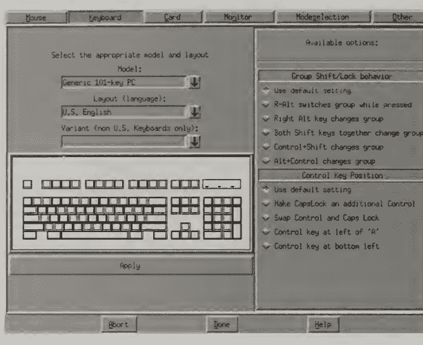

# 显卡窗口

使用显卡窗口配置你的视频适配器。至少，你必须知道视频适配卡的品牌和型号，以及显卡使用的显存大小。如果你知道这些基础信息，请点击显卡窗口中的显卡列表按钮，并从显示的列表中选择你的显卡。图 A.3 显示了从显卡列表中选择 `4MB Matrox Millennium` 显卡后的样子。

选择预配置的显卡是让系统运行最简单的方法。然而，也可以通过在显卡中选择值来手动配置视频适配器。X Windows 提供了为特定视频芯片组设计的加速服务器。如果你之前安装了加速服务器，可以从窗口顶部的服务器按钮列表中选择它，然后为该服务器选择合适的芯片组（`Chipset`）、RamDAC 和时钟芯片（`ClockChip`）。这需要对显卡的硬件配置有非常详细的了解。

# 图 A.3 使用 XF86Setup 配置显卡


## 显示器窗口

使用显示器窗口设置连接到系统的显示器的水平和垂直同步率。图 A.4 显示了为特定显示器配置后的显示器窗口。

请务必小心使用显示器支持的同步率，因为使用错误的同步率可能会损坏显示器硬件。正确的同步率打印在显示器的技术手册中。如果你没有手册，请访问制造商网站。大多数现代制造商现在都提供显示器规格表。

所有的电脑显示器都是“多同步”显示器，这意味着它们可以在频率范围内运行。某些是行业标准频率，在大多数显示器的出厂预设视频模式中可以找到。如果你小心不超过显示器能力的上限，就可以安全地从窗口中心列表列表中选择这些标准值之一。因此，即使你不知道显示器的精确水平和垂直同步范围，只要知道显示器的最大值，就可以进行配置。

### 图 A.4 使用 `XF86Setup` 配置显示器

| 鼠标 | 键盘 | 显卡 | 显示器 | 模式选择 | 其他 |
|---|---|---|---|---|---|
| 水平 30-70 | | | 同步率 | 垂直 50-120 | |
| | 20 | 30 | 40 | 50-60 70-80 100-110 | |
| 40 | 50 | 60 | | | | |
| 70 | 80 | 90 | | | | |
| 100 | 110 | 120 | | | | |
| 130 | 140 | 150 | | | | |
| 标准 VGA | `640x480 @ 60 Hz` | | | | | |
| 超 VGA | `800x600 @ 56 Hz` | | | | | |
| 兼容 | `1024x768 @ 67 Hz 隔行 (无 800x600)` | | | | | |
| 超 W | `1024x768 @ 67 Hz` | | | | | |
| 扩展 VGA | `800x600 @ 67 Hz` | | | | | |
| 非隔行 VGA | `1024x768 @ 67 Hz, 640x480` | | | | | |
| 高分辨率 | `1024x768` | | | | | |
| 加速服务器 | `1024x768` | | | | | |
| 多频率支持 | `1280x1024` | | | | | |
| 多频率支持 | `1280x1024` | | | | | |
| 多频率支持 | `1280x1024` | | | | | |

输入水平和垂直同步范围 终止 帮助

## 模式窗口

模式窗口列出了各种分辨率和位深。屏幕分辨率以像素为单位，例如 `800x600` 和 `1280x1024`。颜色定义为位平面：`8pp`, `16pp`, `24pp` 和 `32pp`。这些设置提供了从 256 色到 1600 万色的颜色。（某些图形应用程序需要 `16pp`）。

## 其他窗口

其他窗口列出了可选的服务器设置：

- 允许通过 `Ctrl+AltBackspace` 杀死服务器。这是一个非常实用的选项。

- 允许切换视频模式。如果你在模式窗口中选择了多个视频模式，使用此功能进行切换。

- 不捕捉信号防止服务器在关闭时捕捉信号。

- 允许从远程更改视频模式。这允许远程主机更改你的显示器。

- 允许从远程更改键盘和鼠标设置。这允许远程主机更改配置。

前两个选项默认启用，后三个选项禁用。这些是正确的设置。

### 使用 `x86config`

我通常使用 `XF86Setup` 配置。但因为它是一个图形程序，它依赖于与显卡建立最小分辨率连接。这样做，它可能无法在你的系统上运行。另一种方法是使用文本界面配置工具 `x86config`。

> 注意：完整的 `x86config` 示例见后续章节。`xf86config` 显示的文本为了适应书籍页面进行了微调，但与你运行 `x86config` 时看到的内容基本相同。

### 欢迎使用 `x86config`

在命令行提示符输入 `x86config` 开始配置过程。程序启动后将显示介绍材料：

此程序将根据你的菜单选择创建一个基础的 `X86Config` 文件。

`X86Config` 文件通常位于 `/usr/X11R6/lib/X11` 或 `/etc/X11`。`Free8` 附带示例 `X86Config` 文件，它是为标准 `VGA` 卡和显示器配置的，分辨率为 `640x480`。程序在准备写入文件时会请求路径。


## 附录 X Windows 配置

你可以以示例 `X86Config` 为基础针对你的配置进行编辑，或者让此程序为你的配置生成基础 `X86Config` 文件并进行微调。参考 `/usr/X11R6/lib/X11/doc/READMEME.Config` 获取配置过程的详细概述。

对于加速服务器（包括 `SVGA` 服务器中的加速驱动程序），有许多芯片组和特定的选项及设置。此程序不知道这些内容。在某些配置中，必须指定这些设置。请参考服务器手册页和特定的芯片组 `README` 文件。

- 3. 总线鼠标
- 4. `PS/2` 鼠标
- 5. 罗技鼠标（串口，旧型号，罗技协议）
- 6. 罗技 `MouseMan`（兼容微软）
- 7. `MM` 系列
- 8. `MM HitTablet`
- 9. 微软 `IntelliMouse`
- 10. `Acecad` 平板鼠标

如果你使用的是双键鼠标，它很可能是类型 1；如果你使用的是三键鼠标，它可能同时支持协议 1 和 2。后者主要有两种类型：带有用于选择协议的切换开关的鼠标，以及默认使用协议 1 但在启动时需要按住某个按键来选择协议 2 的鼠标。某些鼠标可以通过向串口发送特殊序列来强制使用协议 2（请参见 `ClearDTR/ClearRTS` 选项）。

输入协议号：`6`

你已选择了罗技 `MouseMan` 类型的鼠标。你可能想要启用 `ChordMiddle`，这可以使第三键正常工作。

用 `'y'` 或 `'n'` 回答以下问题：

是否要启用 `ChordMiddle`? `y`

如果你的鼠标只有两个键，建议启用 `Emulate3Buttons`（模拟三键）。

### 附录 A X Windows 配置

用 `'y'` 或 `'n'` 回答以下问题：

是否要启用 `Emulate3Buttons`? `n`

现在给出鼠标连接的完整设备名称，例如 `/dev/tty00`。直接按回车将使用默认的 `/dev/mouse`。

鼠标设备：`^M`

要配置鼠标，请选择一种鼠标协议。在示例中，我通过输入数字 `6` 选择了 `Mouse-Man` 协议，由于罗技 `MouseMan` 是需要 `ChordMiddle` 功能的三键鼠标，我在 `ChordMiddle` 问题上回答了 `Yes`。`Emulate3Buttons` 仅双键鼠标需要，因此在示例中对 `Emulate3Buttons` 问题回答了 `No`。

通过输入鼠标连接的设备端口名称来完成鼠标配置。通常，特殊设备名称 `/dev/mouse` 已经设置为指向真实端口的链接。如示例所示，按回车将默认使用 `/dev/mouse`。如果你的系统中没有设置该链接，请输入真实的设备名称。

## 配置键盘

现在 `xf86config` 请求你配置键盘：

- 从 `XFree8 3.1.2D` 开始，你可以使用新的 `X11R6.1 XKEYBOARD` 扩展来管理键盘布局。如果你对以下问题回答 `'n'`，服务器将使用旧方法，你可能需要使用 `xmodmap` 调整键盘布局。

- 用 `'y'` 或 `'n'` 回答以下问题：

是否要使用 `XKB`? `n`

如果你希望键盘在 `X` 中生成非 `ASCII` 字符（因为你想要输入特定语言的字符），可以将左 `Alt` 键设置为 `Meta`，将右 `Alt` 键设置为 `ModeShift`。

- 用 `'y'` 或 `'n'` 回答以下问题：

是否要为 `Alt` 键启用这些绑定? `n`

这些问题允许你指定特殊的键盘映射。对于标准的服务器配置，你可以安全地对这些问题回答 `No`。

## 配置显示器

在下一节中，`xf86config` 请求你配置显示器。要做到这一点，你需要关于显示器性能的准确技术信息。`xf86config` 对此部分的配置提供了自带警告：

现在我们想要设置显示器的规格。

两个关键参数是垂直刷新率（整个屏幕刷新的频率）以及最重要的是水平同步率（扫描线显示的频率）。

水平同步和垂直同步的有效范围应记录在你的显示器说明书中。若有疑问，请检查显示器数据库 `/usr/X11R6/lib/X11/doc/Monitors` 以查看你的显示器是否在其中。

按回车继续，或按 `ctrl-c` 取消.`^M`

读取警告并按回车继续显示器配置。系统询问显示器的水平同步范围：

你必须指定显示器的水平同步范围。你可以从下方选择与行业标准显示器类型对应的预定义范围，或者提供一个特定范围。

**非常重要**：不要指定水平同步范围超出你显示器能力的显示器类型。如果有疑问，请选择保守的设置。

| `hsync` (`kHz`) | 具有特征模式的显示器类型 |
| :--- | :--- |
| `1 31.5` | 标准 `VGA`, `640x480 @ 60 Hz` |
| `2 31.5 - 35.1` | 超 `VGA`, `800x600 @ 56 Hz` |
| `3 31.5, 35.5` | `8514` 兼容, `1024x768 @ 87 Hz 隔行 (无 800x600)` |


| 4 31.5, 35.15, 35.5 | 超 VGA, 1024x768 @ 87 Hz 隔行, 800x600 @ 56 Hz |
| 5 31.5 - 37.9 | 扩展超 VGA, 800x600 @ 60 Hz |
| 6 31.5 - 37.5 | 扩展超 VGA, 800x600 @ 72 Hz |
| 7 31.5 - 37.5 | 扩展超 VGA, 1024x768 @ 60 Hz |
| 8 31.5 - 37.5 | 扩展超 VGA, 1024x768 @ 72 Hz |
| 9 31.5 - 37.5 | 扩展超 VGA, 1024x768 @ 87 Hz |
| 10 31.5 - 37.9 | 扩展超 VGA, 1280x1024 @ 60 Hz |
| 11 31.5 - 37.9 | 扩展超 VGA, 1280x1024 @ 72 Hz |

# 使用 `x86config`

对前面的问题回答“是”会导致`x86config`显示一个非常长的视频适配卡列表。按回车键翻页列表。以下是翻页 300 多个视频适配卡条目后的列表样式：

- 324 Matrox Millennium 2MB `mga2064w`
- 325 Matrox Millennium 4MB `mga2064w`
- 326 Matrox Millennium 8MB `mga2064w`
- 327 Matrox Millennium G200 16MB `mgag200`
- 328 Matrox Millennium G200 4MB `mgag200`
- 329 Matrox Millennium G200 8MB `mgag200`
- 330 Matrox Millennium G200 SD 16MB `mgag200`
- 331 Matrox Millennium G200 SD 4MB `mgag200`
- 332 Matrox Millennium G200 SD 8MB `mgag200`
- 333 Matrox Millennium II 16MB `mga2164w`
- 334 Matrox Millennium II 4MB `mga2164w`
- 335 Matrox Millennium II 8MB `mga2164w`
- 336 Matrox Mystique `mga1064sg`
- 337 Matrox Mystique G200 16MB `mgag200`
- 338 Matrox Mystique G200 4MB `mgag200`
- 339 Matrox Mystique G200 8MB `mgag200`
- 340 Matrox Productiva G100 4MB `mgag100`
- 341 Matrox Productiva G100 8MB `mgag100`

输入数字选择相应的显卡定义。

按回车键进入下一页，按`q`继续配置。

`324`

你选择的显卡定义：

Identifier: `Matrox Millennium 2MB`

Chipset: `mga2064w`

Server: `XF86_SVGA`

不要探测时钟或使用任何 `Clocks` 行。

按回车继续，或按`ctrl-c`终止。

从列表中选择合适的显卡。在示例中，选择了 2MB 的 `Matrox Millennium`。`xf86config` 指定了显卡定义的具体细节。记住它关于服务器、时钟芯片和时钟探测的内容。这些信息在稍后的配置中会很有用。

# 为视频卡配置服务器

现在你已经为系统选择了合适的视频卡，你必须选择 X Windows 服务器并定义与该服务器的链接。要为此，请使用上方显示的显卡定义中的信息来回答以下问题：

现在你必须确定运行哪个服务器。请参考手册页（`manpages`）和其他文档。可用服务器如下（它们可能并未全部安装在你的系统中）：

- `1` `XF86_Mono` 服务器。这是一个单色服务器，应该可以在任何 VGA 兼容的显卡上工作，分辨率为 640x480（某些 SVGA 芯片组支持更多功能）。
- `2` `XF86_VGA16` 服务器。这是一个 16 色 VGA 服务器，应该可以在任何 VGA 兼容的显卡上工作。
- `3` `XF86_SVGA` 服务器。这是一个 256 色 SVGA 服务器，支持许多 SVGA 芯片组。在某些芯片组上，它是加速的或支持更高的色彩位深。
- `4` 加速服务器。这些包括 `XF86_S53`, `XF86_Mach32`, `XF86_Mach8`, `XF86_8514`, `XF86_P9000`, `XF86_AGX`, `XF86_W32`, `XF86_Mach64`, `XF86_I128` 和 `XF86_S3V`。

这四种服务器类型对应 `XF86Config` 中四个不同的 `"Screen*"` 部分（`vga2`, `vga16`, `svga`, `accel`）。

- `5` 从显卡定义中选择服务器 `XF86_SVGA`。

你打算默认运行哪种屏幕类型 (1-5)？

# 使用 `xf86config`

对于每个深度，都定义了一个模式列表（分辨率）。

服务器启动时使用的默认分辨率将是显示器和显卡均支持的列表中的第一个模式。当前设置为：

```
*640x480* *800x600* *1024x768* *1280x1024* for 8bpp
*640x480* *800x600* *1024x768* for 16bpp
*640x480* *800x600* for 24bpp
*640x480* *800x600* for 32bpp
```

注意，16、24 和 32bpp 仅在少数配置上支持。由于显示器或时钟限制而无法支持的模式将被服务器自动跳过。

- `1` 修改 `8bpp` (256色色) 的模式
- `2` 修改 `16bpp` (32K/64K色) 的模式
- `3` 修改 `24bpp` (24位色，紧凑像素) 的模式
- `4` 修改 `32bpp` (24位色) 的模式
- `5` 模式正常，继续。

输入你的选择：`5`

在此示例中，选择了 `5`，它提供了视频硬件可以支持的所有列出的视频模式。

# 完成 `xf86config`

最后，配置将被写入到 `XF86Config` 文件中：

我现在现在要写入 `XF86Config` 文件。请确保你不会意外覆盖之前配置过的文件。

是否将其写入 `/etc/X11/XF86Config`? `y`

# 附录 A X Windows 配置

文件已写入。在运行 `'startx'` 之前查看它。请注意，`XF86Config` 文件必须位于服务器搜索的目录之一（例如 `/usr/X11R6/lib/X11`）中才能使用。在服务器内部，按下 `ctrl`、`alt` 和 `'+'` 可以循环切换视频分辨率。同时按下 `ctrl`、`alt` 和退格键将立即退出服务器（当显示器在特定模式下无法同步时使用）。

有关进一步配置，请参考 `/usr/X11R6/lib/X11/doc/README.Config`。

# 使用 `Xconfigurator`

`Xconfigurator` 是红帽在初始安装期间安装 X Windows 时使用的程序。它与 `xf86config` 非常相似，但它提供了一个菜单驱动的图形界面，并且能够自动处理更多的配置。你可以在 shell 提示符处输入 `Xconfigurator` 来运行它。当 `Xconfigurator` 启动时，它会显示与 `xf86config` 提供的介绍非常类似的视频。

`Xconfigurator` 然后会自动探测系统以检测安装的显卡。图 A.5 显示了此类探测的结果。如果找到了显卡，只需点击 `OK`。

图 A.5 Xconfigurator 显卡探测

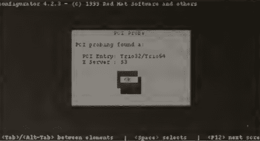

# 使用 `Xconfigurator`

`Xconfigurator` 然后请求显示器配置。使用 `Xconfigurator` 配置显示器的好处是，它有一份非常长的预配置显示器列表。你只需要从列表中选择你的显示器即可。与其他配置工具不同，你不需要手头显示器的技术手册——只要显示器在 `Xconfigurator` 列表中即可。图 A.6 显示了正在选择显示器。

图 A.6 使用 Xconfigurator 配置显示器


在你选择显示器后，`Xconfigurator` 将再次使用显卡和显示器信息进行另一轮探测。屏幕将闪烁几次，然后 `Xconfigurator` 将显示如图 A.7 所示的最优视频设置。

图 A.7 探测视频模式


附录 第 5 部分

点击 `Use Default`（使用默认）按钮，`Xconfigurator` 将测试新服务器并写入新的配置文件。如果你倾向于手动创建自己的配置，请点击 `Let Me Choose`（让我选择）。你将通过一系列菜单，这些菜单涵盖了 `XF86Setup` 和 `xf86config` 请求的相同的配置信息。图 A.8 显示了其中几个配置菜单。

图 A.8 Xconfigurator 手动配置选项


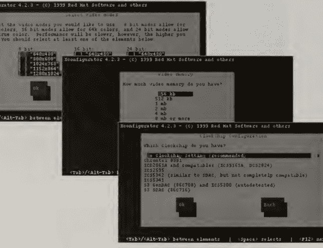

注意 图 A.8 中显示的某些菜单是通过点击 `Let Me Choose` 后按下 `Back`（后退）按钮进入的。`Back` 按钮允许你在 `Xconfigurator` 创建的配置中向后移动……

# 理解 XF86Config 文件

无论你是使用 `XF86Setup`、`xf86config` 还是 `Xconfigurator` 创建它，该文件的设计都是为了使其更加容易。

# 理解 XF86Config 文件

`BIND` 的两个版本之间最明显的变化在于文件。首先，文件名称发生了变化。`BIND 4` 的配置文件名为 `named.boot`，而 `BIND 8` 的配置文件名为 `named.conf`。其次，用于配置 `BIND 4` 的命令与配置 `BIND 8` 的命令完全不同。

> NOTE 如果你已经在运行 `BIND 4` 并升级到 `BIND 8`，你可以使用 `named-boot` 转换现有的 `named.boot` 文件，它是 `BIND` 发行包的一部分。

```
[ fake-inquiry yes|no; ]
[ fetch-glue yes|no; ]
[ host-statistics yes|no; ]
[ multiple-cnames yes|no; ]
[ notify yes|no; ]
[ recursion yes|no; ]
[ forward only|first; ]
[ forwarders { address-list; } ]
[ check-names master|slave|response warn|fail|ignore; ]
[ allow-query { address_match_list; } ]
[ allow-transfer { address_match_list; } ]
[ listen-on { port ip_port } (address_match_list); ]
[ query-source { address ip_addr* } [port ip_port*] ; ]
[ max-transfer-time-in number; ]
[ transfer-format one-answer|many-answers; ]
[ transfers-in number; ]
[ transfers-out number; ]
[ transfers-per-ns number; ]
[ coresize size; ]
[ datasize size; ]
[ files size; ]
[ stacksize size; ]
[ cleaning-interval number; ]
[ interface-interval number; ]
[ statistics-interval number; ]
[ topology { address_match_list; } ]
;
```

选项提供的值只有几种类型。`directory` 选项必须是从根目录开始的绝对路径。所有其他路径值都可以相对于 `directory` 选项提供的值，或者是相对于根目录的路径。

# 附录 B BIND 参考

某些值非常显而易见。`ip_port` 是一个 IP 端口号；`number` 只是一个数字；`size` 是以字节为单位的文件大小，可以使用 `K` 表示千字节或 `M` 表示兆字节进行缩写（例如 `5M` 是 500 万字节）。

`ip_addr` 是单个 IP 地址。`address-list` 是一个由分号分隔的 IP 地址列表。`address_match_list` 是地址列表，可以包含用标准点十进制表示法写的 IP 地址，并带有可选的地址掩码前缀。例如，`172.16.0/16` 匹配前 16 位为 172.16 的所有地址。地址前的感叹号 (`!`) 表示“不匹配”该值。因此，在我们的示例地址前放置感叹号将表示匹配所有前 16 位为 172.16 的地址。`address_match_list` 还可以包含特殊关键字：

- `any` 匹配所有地址。
- `none` 不匹配任何地址。
- `localhost` 匹配所有分配给本地主机的地址。
- `localnet` 匹配所有网络部分与分配给本地主机的任何地址的网络部分相同的地址。

每个配置选项在表 B.1 中进行了描述。

# 表 B.1 BIND 8 配置选项

| 选项 | 含义 |
| :--- | :--- |
| `directory` | 服务器读取和写入文件的工作目录路径。 |
| `named-xfer` | `named-xfer` 程序的路径。 |
| `dump-file` | 如果 `named` 接收到 `SIGINT` 信号，则将数据库转储的文件。默认是 `named_db`。 |
| `memstatistics-file` | 如果设置了 `deallocate-on-exit`，则写入内存使用统计信息的文件。默认是 `named.memstats`。 |
| `pid-file` | 存储进程 ID 的文件。 |
| `statistics-file` | 当 `named` 接收到 `SIGILL` 信号时，写入统计信息的文件。默认是 `named.stats`。 |

# 表 B.1 BIND 8 配置选项（继续）

| 选项 | 含义 |
| :--- | :--- |
| `auth-nxdomain` | `yes` 使服务器作为权威服务器做出响应。默认是 `yes`。 |
| `deallocate-on-exit` | `yes` 用于检测内存泄漏。默认是 `no`。 |
| `fake-inquiry` | `yes` 导致服务器用虚假回复而非错误响应反向查询。默认是 `no`。 |
| `fetch-glue` | `yes` 导致服务器获取响应的所有胶接记录。默认是 `yes`。 |
| `host-statistics` | `yes` 导致服务器对每个主机保持统计信息。默认是 `no`。 |
| `multiple-cnames` | `yes` 允许一个域名对应有多个 `CNAME` 记录。默认是 `no`。 |
| `notify` | `yes` 导致服务器在区域更新时发送 `DNS NOTIFY` 消息。默认是 `yes`。 |
| `recursion` | `yes` 导致服务器递归查找查询答案。默认是 `yes`。 |
| `forward` | `first` 导致服务器首先查询 `forwarders` 选项中列出的服务器，然后查找 `answer-self`。`only` 导致服务器仅查询 `forwarders` 选项中列出的服务器。 |
| `forwarders` | 列出转发查询的服务器的 IP 地址。默认是不使用转发。 |
| `check-names` | 检查主机名是否符合 `RFC` 规范。你可以选择在服务器加载区域时（`master`）、当从机传输区域时（`slave`）或在处理响应时（`response`）检查名称。如果检测到错误，你可以选择忽略它（`ignore`）、向管理员发送关于该错误的警告（`warn`）或拒绝该不良的名称（`fail`）。 |

# 表 B.1 BIND 8 配置选项（继续）

| 选项 | 含义 |
| :--- | :--- |
| `allow-query` | 查询仅接受来自 `address_match_list` 中主机的。 |
| `allow-transfer` | 定义允许接收传输的地址列表。 |
| `listen-on` | 定义服务器监听的接口。 |
| `query-source` | 定义用于查询的源地址和端口。 |
| `max-transfer-time-in` | 设置传输的最大时间。 |
| `transfer-format` | 定义传输格式。 |
| `transfers-in` | 限制入站的数量。 |
| `transfers-out` | 限制出站的数量。 |
| `transfers-per-ns` | 限制每个名称服务器传输的数量。 |
| `coresize` | 设置核心存储的大小。 |
| `datasize` | 设置数据大小。 |
| `files` | 限制文件数量。 |
| `stacksize` | 设置栈大小。 |
| `cleaning-interval` | 设置清理间隔时间。 |
| `interface-interval` | 设置接口扫描间隔时间。 |
| `statistics-interval` | 设置统计信息更新间隔时间。 |
| `topology` | 设置拓扑结构。 |

# 表 B.1 BIND 8 配置选项（继续）

| 选项 | 含义 |
| :--- | :--- |
| `cleaning-interval` | 设置服务器移除过期记录的间隔时间。 |
| `interface-interval` | 设置扫描新或删除接口的间隔时间。 |
| `statistics-interval` | 设置日志统计信息的间隔时间。 |
| `topology` | 强制服务器选择某些远程服务器。通常选择拓扑上最近的服务器。 |

# 日志语句

日志语句定义了服务器的日志选项。命令的语法所示：


```
logging {
  [ channel channel_name {
    ( file pathname
      [ versions|unlimited ]
    [ size ] ]
    syslog (kern|user|mail|daemon|auth|syslog|lpr
      |news|uucp|cron|authpriv|ftp
      |local10|local11|local12|local13
      |local14|local15|local16|local17)
    null;)

  [ severity critical|error|warning|notice|
    |info|debug [level]|dynamic; ] }
```

```
[ print-category yes|no; ]
[ print-severity yes|no; ]
[ print-time yes|no; ]
); ]
```

```
[ category category_name {...
```

日志语句可以包含两种类型的子句：通道子句和类别子句。通道子句定义了如何处理日志消息。消息被写入文件（`file`）、发送到 `syslog`（`syslog`）或丢弃（`null`）。如果使用文件，你可以指定保留多少旧版本（`version`）、日志文件允许增长多大（`size`）以及写入日志文件的严重级别（`severity`）。你还可以指定包含在日志中的时间（`print-time`）、类别（`print-category`）和严重级别（`print-severity`）。

类别子句定义了发送到通道的日志类别。因此，类别子句定义了记录什么，而通道子句定义了在哪里记录。日志类别列在表 B.2。

# 表 B.2 BIND 8 日志类别

| 类别 | 记录的消息类型 |
|---|---|
| `cname` | 记录 `CNAME` 引的消息 |
| `config` | 关于配置文件处理的消息 |
| `db` | 记录数据库操作的消息 |
| `default` | 各种类型的消息。如果没有指定，则使用此项 |
| `eventlib` | 包含事件系统调试数据的消息 |

## 表 B.2 BIND 8 日志分类（续）

| 类别 | 记录的消息类型 |
|---|---|
| `insist` | 报告内部一致性检查失败的消息。 |
| `lame-servers` | 关于失效服务器委派（lame server delegations）的消息。 |
| `load` | 关于加载区域的消息。 |
| `maintenance` | 报告维护事件的消息。 |
| `ncache` | 关于负面缓存（negative caching）的消息。 |
| `notify` | 追踪 `NOTIFY` 协议的消息。 |
| `os` | 报告操作系统问题的消息。 |
| `packet` | 包含所有发送和接收的数据包转储信息的消息。 |
| `panic` | 由导致服务器关闭的故障产生的消息。 |
| `parser` | 关于配置命令处理的消息。 |
| `queries` | 关于收到的每一个 `DNS` 查询的消息。 |
| `response-checks` | 报告响应检查结果的消息。 |
| `security` | 关于安全准则应用的消息。当使用了 `allow-update`、`allow-query` 和 `allow-transfer` 选项时，这些消息最有意义。 |
| `statistics` | 包含服务器统计信息的消息。 |
| `update` | 关于动态更新的消息。 |
| `xfer-in` | 记录入站区域传输的消息。 |
| `xfer-out` | 记录出站区域传输的消息。 |

## `zone` 语句

`zone` 语句标识所服务的区域并定义了域名数据库信息的来源。`zone` 语句有三种变体：一种用于主服务器，一种用于从服务器，以及一种用于根缓存区域的特殊变体。每种变体的语法所示：

```
zone domain_name [ in|hs|hesiod|chaos ] {
  type master;
  file pathname;
  [ check-names warn|fail|ignore; ]
  allow-update { address_match_list };
  allow-query { address_match_list };
  allow-transfer { address_match_list };
  [ notify yes|no; ]
  [ also-notify { address-list };]
}
```

```
zone domain_name [ in|hs|hesiod|chaos ] {
  type slave stub;
  [ file pathname; ]
  masters ( address-list );
  [ check-names warn|fail|ignore; ]
  allow-update { address_match_list };
  allow-query { address_match_list };
  allow-transfer { address_match_list };
  [ max-transfer-time-in number; ]
  [ notify yes|no; ]
  [ also-notify { address-list };]
}
```

```
zone "." [ in|hs|hesiod|chaos ] {
  type hint;
```

## BIND 8 `named.conf` 命令

```
file pathname;

[ check-names warn|fail|ignore ]

;
```

`server` 语句以关键字 `zone` 开头，后面跟着域名的名称。对于根缓存，域名始终为 `"*"`。随后是数据类（data class）。这始终用于 Internet DNS 服务，如果没有提供值，则默认为该值。

`type` 选项定义了它是主服务器、从服务器还是根缓存的提示文件（hints file）。根服务器（stub server）是一种只加载 `NS` 记录而不是整个区域的从服务器。

主服务器的 `file` 选项指向加载区域的源文件。对于从服务器，它指向写入区域的文件。在根缓存语句中，`file` 选项指向用于初始化缓存的提示文件。

`check-names`、`allow-query`、`allow-transfer` 和 `notify` 都在 `options` 语句部分中涵盖过。除了作用范围外，它们在这里的功能相同。当在 `zone` 语句中指定时，这些选项仅适用于特定区域。在 `options` 语句中指定时，它们适用于所有区域。区域的特定设置将覆盖 `options` 语句的全局设置。

还有几个尚未讨论的选项：

-   `allow-update`: 标识允许动态更新区域的主机。默认情况下，不允许任何远程系统修改该区域。
-   `max-transfer-time-in`: 定义了从服务器等待区域传输完成的最长时间。
-   `also-notify`: 定义了一个额外的服务器列表，当区域更新时这些服务器将接收 `NOTIFY` 消息。默认情况下，区域 `NS` 记录中列出的所有服务器都会收到通知。此列表是那些服务器之外。

## `server` 语句

`server` 语句定义了远程服务器的特性。`server` 语句的语法所示：

```
server address {
  [ bogus yes|no; ]
  [ transfers number; ]
  [ transfer-format one-answer|many-answers; ]
  [ keys { key_id [key_id ... ] } ];
};
```

## 附录 B BIND 参考

`transfers` 和 `transfer-format` 已经在 `options` 语句部分中涵盖过。在这里，它们仅适用于此远程服务器。这对于 `transfers-format` 命令特别有用。你可以在 `options` 语句中全局将其设置为更高效的 `many-answers` 格式，然后使用单独的 `server` 语句为那些无法处理新格式的服务器回退到兼容性更好的 `one-answer` 设置。

`server` 语句中包含的其他选项：

-   `bogus` 防止本地服务器向此服务器发送查询。默认值是 `no`，允许向远程服务器发送查询。
-   `keys`: 指定远程主机用于加密的密钥。这在 BIND 4 中尚未实现，因此目前 `keys` 选项被忽略。

## BIND 4 `named.boot` 命令

对于运行 BIND 4 的旧系统，`/etc/named.boot` 文件定义了名称服务器配置和名称服务器数据库信息的位置。如果你在 Linux 系统上使用 BIND 4，你应该考虑升级到 BIND 8。如果你正在安装新系统，应该始终使用最新版本。本节 `named.boot` 包含以下类型的记录：

-   `directory path`: 定义了后续引用的默认目录。


-   `primary` domain file: 将名称服务器声明为该区域的主服务器。从指定的文件加载 DNS 数据库。

-   `secondary` domain address-list file: 将本地服务器声明为该区域的从服务器。从列表中的一个服务器加载。

-   `cache` file: 指向初始化根缓存的文件。

-   `stub` domain address-list file: 将本地服务器声明为该区域的根服务器。区域信息从列表中的服务器加载。

-   `forwarders` address-list: 当本地服务器无法从自己的缓存解析查询时，发送查询的服务器列表。按顺序尝试直到有一个响应。

-   `slave`: 强制本地服务器仅使用 `forwarders` 命令列出的服务器，即使转发服务器没有响应。

## BIND 4 `named.boot` 命令

-   `sortlist` network: 使服务器优先使用列出的网络地址。

-   `xfrnets` address[&mask]: 将区域传输限制为指定的地址。

-   `include` file: 将文件内容插入到启动文件中命令的位置。

-   `bogus-address-list`: 防止向列表中指定的名称服务器发送查询。

-   `limit` name value: 为由 name 定义的参数设置进程限制。启动文件中可以有多个 `limit` 命令，每个设置的参数一个。共有四个可能的参数名称：

    -   `datasize`: 设置进程配额。

    -   `transfers-in`: 设置入站区域传输的最大数量。

    -   `transfers-out`: 设置出站区域传输的最大数量。

    -   `transfers-per-ns`: 设置从任何一个远程允许的最大并发区域传输数。

-   `options` option: 启用可选功能。选项关键字是布尔值，因此只需在命令行指定选项名称即可启用该选项。默认情况下选项已关闭。选项有：

    -   `query-log`: 通过 `syslog` 记录所有查询。

    -   `forward-only`: 使用使用 `slave` 命令一样将所有查询发送到转发器。

    -   `fake-inquiry`: 使用虚假回复响应反查询而不是错误。

    -   `no-recursion`: 仅回答该服务器权威的区域数据的查询。

    -   `no-fetch-glue`: 不查找粘胶记录来完成查询响应。

    -   `check-names` source action: 检查主机名是否符合 `RFC 952` 定义的标准。source 可以：

        -   `primary` 用于主服务器

        -   `secondary` 用于从服务器

-   对递归搜索期间收到的消息进行响应，动作可以是：

  -   `fail`：拒绝该数据

  -   `warn`：向日志文件发送警告

  -   `ignore`：忽略，并像没有发生过错误一样处理数据

`max-fetch` 值的作用与 `limit transfers-in` 相同。

`domain name` 定义默认域名，其定义方式与 `resolv.conf` 文件中使用的 `domain` 命令完全一致。这是一个过时的命令。

`.mc` 文件中有两个宏不指向 `.m4` 文件：`VERSIONID` 宏和 `define` 宏。第 7 节中描述的 `VERSIONID` 宏指定了 `.mc` 源文件的版本号。`define` 宏用于设置特定的配置值。本附录收包含了一份详尽的 `define` 宏列表。

`HACK`、`SITECONFIG`、`LOCAL_RULE` 和 `LOCAL_CONFIG` 这几个宏命令在宏配置文件中很少被使用。我将非常快速地介绍它们。同样，为了简单起见，我将跳过 `UUCP` 配置，因为 `UUCP` 在现代网络中的用途有限，我将重点放在 `SMTP` 上。在本附录中，我重点关注 `define`、`FEATURE`、`OSTYPE`、`DOMAIN` 和 `MAILER` 宏。

宏配置文件 (`.mc`) 和 `m4` 源文件 (`.m4`) 可以包含下文记录的任何命令。事实上，几乎任何宏都可以出现在任何文件中。为了理清思路，我将附录进行了组织：首先涵盖构建大多数 `.m4` 文件时使用的 `define` 和 `FEATURE` 宏。然后，按照它们在 `.mc` 文件中最可能出现的顺序介绍 `OSTYPE`、`DOMAIN` 和 `MAILER` 宏命令。最后，以很少使用的 `HACK`、`SITECONFIG`、`LOCAL_RULE_n` 和 `LOCAL_CONFIG` 宏作为结束。

## `define`

`define` 为 `sendmail.cf` 宏、选项或类设置一个值。大多数“defines”是在 `.mc` 文件调用的 `m4` 源文件中完成的，而不是在 `.mc` 文件本身。由于许多 `define` 参数等同于选项、宏和类，将命令

```
define(`CONFMAIL_NAME`, `MAILER_DAEMON`)
```

放在 `m4` 源文件中的效果与直接放在 `sendmail.cf` 文件中的

```
DnMAIL_DAEMON
```

效果是相同的。

下方显示了许多可用的配置参数。大多数对应于 `sendmail` 选项、宏或类。在参数描述列表中，相应的选项、宏或类的名称显示在方括号 `[]` 内。宏名称以美元符号 (`$j`) 开头，类名以美元符号和等号 (`$=w`) 开头，选项则显示长选项名称（如 `SingleThreadDelivery`）。

`define` 参数列表非常长。然而，大多数参数的默认值都是合理的值，不需要在 `m4` 源文件中显式设置。每个参数的默认值显示在下表中（除非没有默认值）。

-   `confALIAS_WAIT` 设置等待别名重构（alias rebuild）的时间。默认值为 10m。`[AliasWait]`

-   `confALLOW_BOGUS_HELO` 定义在 `DNS` 主机名中通常不允许的特殊字符，这些字符将在 `HELO` 命令行的主机名中被允许。`[AllowBogusHELO]`

-   `confAUTO_REBUILD` 如果设为 `True`，则自动重构别名文件。默认值为 `False`。`[AutoRebuildAliases]`

-   `confBIND_OPTS` 设置 `DNS` 解析器选项。默认值未定义。`[ResolverOptions]`

-   `confBLANK_SUB` 定义用于替换电子邮件地址中未加引号的空白符的字符。`[BlankSub]`

-   `confCCF_VERSION` 设置配置文件的版本号。`[$Z]`

-   `confCHECKPOINT_INTERVAL` 在处理完若干数量队列项后对队列文件设置检查点。默认值为 10。`[CheckpointInterval]`

-   `confCHECK_ALIASES` 在别名文件构建期间查找每个别名。默认值为 `False`。`[CheckAliases]`

-   `confCOLON_OK_IN_ADDR` 将地址中的冒号视为普通字符。默认值为 `False`。`[ColonOkInAddr]`

-   `confCONNECTION_RATE_THROTTLE` 设置每秒允许的最大连接数。`[ConnectionRateThrottle]`

-   `confCON_EXPENSIVE` 保留发往带有 `e` 标记的邮件投送器的邮件，直到下一次队列运行。默认值为 `False`。`[HoldExpensive]`

-   `confCOPY_ERRORS_TO` 设置接收错误消息副本的地址。`[PostmasterCopy]`

-   `confCR_FILE` 指向列出此服务器将中继邮件的主机的文件。默认值为 `/etc/mail/relay-domains`。`[$R]`

-   `confW_FILE` 指向本地主机别名文件。默认值为 `/etc/sendmail.cw`。`[$w]`

-   `confDAEMON_OPTIONS` 设置 `SMTP` 守护进程选项。`[DaemonPortOptions]`

-   `confDEF_CHAR_SET` 定义未标记 8-bit `MIME` 数据的字符集。默认值为 `unknown-8bit`。`[DefaultCharset]`

-   `confDEF_USER_ID` 定义 `sendmail` 使用的用户 ID 和组 ID。默认值为 `1:1`。`[DefaultUser]`

-   `confDEL_MODE` 设置默认交付模式。默认值为后台。`[DeliveryMode]`

-   `confDIAL_DELAY` 设置重试“按需拨号”连接之前的时间延迟。默认值为 `0s`，意味着“不重试”。`[DialDelay]`

-   `confDOMAIN_NAME` 定义完整主机名。`[$sj]`

-   `confDONT_BLAME_SENDMAIL` 如果设为 `True`，则不执行文件安全检查。默认值为 `False`。不要使用此选项。

-   `confDONT_EXPAND_CNAMES` 如果设为 `True`，则不转换昵称。默认值为 `False`。`[DontExpand]`

-   `confDONT_INIT_GROUPS` 如果设为 `True`，则禁用 `initgroups(3)` 程序。`[InitGroups]`

-   `confDONT_PROBE_INTERFACES` 如果设为 `True`，则不探测接口。默认值为 `False`。`[DontProbe]`


- `confDONT_PRUNE_ROUTES` 如果设为 `True`，则不修剪路由。默认值为 `False`。`[DontPrune]`
- `confDOUBLE_BOUNCE_ADDRESS` 将错误消息发送到此地址。默认值为 `postmaster`。`[BounceAddress]`
- `confIGHT_BIT_HANDLING` 定义处理 8-bit 数据的方式。默认值为 `True`。`[EightMode]`
- `confERROR_MESSAGE` 指向附加到错误中的消息。`[ErrorHeader]`
- `confERROR_MODE` 定义处理错误的方式。默认值为打印。`[ErrorMode]`
- `confFALLBACK_MX` 定义备用主机。`[BackMx]`
- `confFORWARD_PATH` 定义搜索 `.forward` 文件。默认值为 `$z`。`[ForwardPath]`
- `confFROM_LINE` 定义 Unix 行格式。默认值为 `$sd`。`[UnixLine]`
- `confHOSTS_FILE` 定义主机映射。默认值为 `/etc/hosts`。`[HostsFile]`
- `confHOST_STATUS_DIRECTORY` 定义保存主机状态的目录。`[HostStatusDirectory]`
- `confIGNORE_DOTS` 如果为 `True`，忽略消息中的点。默认值为 `False`。`[IgnoreDots]`
- `confLOCAL_MAILER` 定义本地连接使用的投送器。默认值为 `local`。
- `confLOG_LEVEL` 定义日志文件的详细程度。默认值为 `9`。`[LogLevel]`
- `confMAILER_NAME` 定义错误消息上使用的发送者。默认值为 `MAILER-DAEMON`。`[$n]`
- `confMATCH_GECOS` 将用户名匹配 GECO 字段。如果未设置参数则不进行匹配。`[MatchGECOS]`
- `confMAX_DAEMON_CHILDREN` 当达到此数量的孩子时拒绝连接。默认从拒绝。`[MaxDaemonChildren]`
- `confMAX_HOP` 定义邮件循环的计数器。默认值为 `25`。`[MaxHopCount]`
- `confMAX_MESSAGE_SIZE` 设置服务器接受的最大消息大小。默认未限制。`[MaxMessageSize]`
- `confMAX_QUEUE_SIZE` 定义每次队列运行处理的最大条数。默认值为 `0`，意味着无限制。`[MaxQueueSize]`
- `confMAX_RCPTS_PER_MESSAGE` 定义每封邮件允许的最大接收者数量。`[MaxQueueSize]`
- `confMCI_CACHE_SIZE` 设置可以缓存的打开连接数。默认值为 `2`。`[ConnectionCacheSize]`
- `confMCI_CACHE_TIMEOUT` 设置缓存中空闲连接的时间。默认值为 `5m`。`[ConnectionTimeout]`
- `conf_TOO` 如果为 `True`，向发送者发送副本。默认值为 `False`。`[MeToo]`
- `confMINE_FORMAT_ERRORS` 如果为 `True`，设置 MIME 封装的错误消息。默认值为 `True`。`[SendMineErrors]`
- `confMIN_BLOCKS` 设置接受邮件时磁盘上必须空最小块数。默认值为 `100`。`[MinFreeBlocks]`
- `confMIN_QUEUE_AGE` 设置作业在队列中的最短时间。默认值为 `0`。`[MinQueueAge]`
- `confNO_RCP_ACTION` 定义无接收者标头的邮件的处理方式：什么都不做（`none`）；添加 `To:` 头（`add-to`）；添加 `Apparently-to:` 头（`apparently-to`）；添加 `Bcc:` 头（`add-bcc`）；或添加 `To: undisclosed-recipients` 头（`add-to-undisclosed`）。默认值为 `none`。`[NoRecipientAction]`

`CONFOLD_STYLE_HEADERS` 如果头部不包含特殊字符，则将其视为旧样式。默认值为 `True`。`[OldStyleHeaders]`

`CONFOPERATORS` 定义运算符字符。默认值为 `:!%^[/]+`。`[OperatorChars]`

`CONFPRIVACY_FLAGS` 设置限制某些邮件命令使用的标志位。默认值为 `warnings`（警告）。`[PrivacyOptions]`

`CONQUEUE_FACTOR` 定义一个值，用于计算加载的系统何时将邮件放入队列而不是尝试投递。默认值为 `600000`。`[QueueFactor]`

`CONQUEUE_LA` 当达到此负载平均值时，直接将邮件发送到队列。默认值为 `8`。`[QueueLA]`

`CONQUEUE_SORT_ORDER` 按优先级（`Priority`）或主机（`Host`）顺序对队列进行排序。默认值为 `Priority`。`[QueueSortOrder]`

`CONRECEIVED_HEADER` 定义 `Received:` 头部的格式。默认值为 `$?$from $ $.??$(?$)from $._ by bj $(v/S)?$ with r$. id $?u for.$`。`$`。

`CONREFUSE_LA` 定义拒绝传入连接的负载平均值。默认值为 `12`。`[RefuseLA]`

`CONREJECT_MSG` 定义因访问控制数据库而被拒绝邮件时显示的消息。默认值为 `S50 Access denied`（拒绝访问）。

`CONRELAY_MAILER` 定义用于中继的默认邮件投递器名称。默认值为 `relay`。

`CONRUN_AS_USER` 以此用户运行以读取和投递邮件。默认情况下不使用此项。`[AsUser]`

`CONSAFE_FILE_ENV` 在写入文件之前切换根目录 `chroot()` 到该目录。默认情况下不执行此操作。`[SafeFileEnvironment]`

`CONSAFE_QUEUE` 创建一个尝试投递的队列文件。除非指定了此参数，否则不会执行此操作。`[SuperSafe]`

`CONSAFE_FROM_LINES` 不丢弃 Unix 的 `From` 头部。如果未设置此项，则这些行会被丢弃。`[SaveFromLine]`

`CONSEPARATE_PROC` 如果为 `True`，则使用单独的进程投递消息。默认值为 `False`。`[ForkEachJob]`

`CONSERVICE_SWITCH_FILE` 定义服务切换文件的路径。默认值为 `/etc/service.switch`。`[ServiceSwitchFile]`

`CONSEVEN_BIT_INPUT` 如果为 `True`，则强制输入为七位。默认值为 `False`。`[SevenBitInput]`

`confSINGLE_LINE_FROM_HEADER` 如果为 `True`，则将多行的 `From:` 头部强制转换为单行。默认值为 `False`。`[SingleLineFromHeader]`

`confSINGLETHREAD_DELIVERY` 如果为 `True` 且定义了 `HostStatusdirectory`，则强制单线程邮件投递。默认值为 `False`。`[ThreadDelivery]`

`confSMTP_LOGIN_MSG` 定义 SMTP 问候消息。默认值为 `$j Sendmail $2; Sb`。`[SmtpGreetingMessage]`

`confSMTP_MAILER` 定义 SMTP 连接的邮件类型；必须是 `smtp`、`smtp8` 或 `esmtp`。默认值为 `smtp`。

`confTEMP_FILE_MODE` 设置临时文件的模式。默认值为 `0600`。`[TempFileMode]`

`confTIME_ZONE` 设置来自系统的时区（`USE_SYSTEM`）或 `TZ` 变量（`USE_TZ`）。默认值为 `USE_SYSTEM`。`[TimezoneSpec]`

`confTO_COMMAND` 设置等待命令的最大时间。默认值为 `1h`。`[Timeout.command]`

`confTO_CONNECT` 设置等待连接的最大时间。`[Timeout.connect]`

`confTO_DATABLOCK` 设置在 `DATA` 阶段等待数据块的最大时间。默认值为 `1h`。`[Timeout.datablock]`

`confTO_DATAFINAL` 设置等待终止符 `.` 响应的最大时间。默认值为 `1h`。`[Timeout.datafinal]`

`confTO_DATAINIT` 设置等待 `DATA` 命令响应的最大时间。默认值为 `5m`。`[Timeout.datainit]`

`confTO_FILEOPEN` 设置等待文件打开的最大时间。默认值为 `60s`。`[Timeout.fileopen]`

`confTO_HELO` 设置等待 `HELO` 或 `EHLO` 响应的最大时间。默认值为 `5m`。`[Timeout.hello]`

`confTO_HOSTSTATUS` 设置主机状态信息的计时器。默认值为 `30m`。`[Timeout.hoststatus]`

`confTO_ICONNECT` 设置等待与主机第一次连接的最大时间。`[Timeout.iconnect]`

`confTO_IDENT` 设置等待 `IDENT` 查询响应的最大时间。默认值为 `30s`。`[Timeout.ident]`


## confTO_INITIAL

设置等待初始响应的最大时间。

默认值为 `5m`。`[Timeout.initial]`

## confTO_MAIL

设置等待 `MAIL` 命令响应的最大时间。

默认值为 `10m`。`[Timeout.mail]`

## confTO_MISC

设置等待其他 SMTP 响应的最大时间。

默认值为 `2m`。`[Timeout.misc]`

## confTO_QUEUE_NONURGENT

设置低优先级消息的“不可投递邮件”超时。`[Timeout.nonurgent]`

## confTO_QUEUE_NORMAL

设置普通优先级消息的“不可投递邮件”超时。`[Timeout.normal]`

## confTO_QUEUE_URGENT

设置紧急优先级消息的“不可投递邮件”超时。`[Timeout.urgent]`

## confTO_QUEUE

设置邮件从队列返回为“不可投递”的时间。

默认值为 `5d`。`[Timeout.queue]`

## confTO_QUEUEWARN_NONURGENT

设置为低优先级消息发送“仍在队列中”警告的时间。`[Timeout.nonurgent]`

## confTO_QUEUEWARN_NORMAL

设置为普通优先级消息发送“仍在队列中”警告的时间。`[Timeout.normal]`

## confTO_QUEUEWARN_URGENT

设置为紧急优先级消息发送“仍在队列中”警告的时间。`[Timeout.urgent]`

## confTO_QUIT

设置等待 `QUIT` 命令响应的最大时间。

默认值为 `2m`。`[Timeout.quit]`

## confTO_RCPT

设置等待 `RCPT` 命令响应的最大时间。

默认值为 `1h`。`[Timeout.rcpt]`

## confTO_RSET

设置等待 `RSET` 命令响应的最大时间。

默认值为 `5m`。`[Timeout.rset]`

## CONFUCP_MAILER

定义默认的 UUCP 投递器。默认值为 `uucp`。

## FWCLASS_FACTOR

定义用于高优先级任务的因子。

默认值为 `100`。`[ClassFactor]`

| 名称 | 目的 |
| :--- | :--- |
| `accept_unqualified_senders` | 允许来自未知主机的邮件。 |
| `accept_resolvable_domains` | 接受可解析的域名。 |
| `access_db` | 启用数据库的使用。 |
| `allmasquerade` | 伪装所有地址。 |
| `always_add_domain` | 为本地投递的邮件添加主机名。 |
| `bestmx_is_local` | 将 MX 视为本地主机。 |
| `bitdomain` | 使用表映射 bitnet 主机。 |
| `genericstable` | 使用表重写本地地址。 |
| `limited_masquerade` | 仅伪装 `$=M`。 |
| `local_lmtp` | 支持 LMTP 的邮件。 |
| `local_procmail` | 使用 `procmail` 作为本地投递器。 |
| `loose_relay_check` | 对使用 `%` 技巧的地址禁用性检查。 |
| `mailertable` | 使用邮件投递表路由邮件。 |
| `masquerade_entire_domain` | 伪装伪装域名内的所有主机。 |
| `nocanonify` | 不转换带有 `$[ ... $]` 语法。 |
| `nodns` | 不包含 DNS 支持。 |
| `nouucp` | 不包含 UUCP 地址处理。 |
| `nullclient` | 将所有邮件转发到中央服务器。 |
| `promiscuous_relay` | 允许从任何站点到任何站点的邮件。 |
| `rbl` | 启用实时黑列表服务器。 |
| `redirect` | 支持 `.REDIRECT` 伪域名。 |
| `relay_based_on_MX` | 中继任何 MX 指向此服务器的邮件。 |
| `relay_entire_domain` | 中继你域名内任何主机的邮件。 |
| `relay_host_only` | 仅中继数据库列出的主机。 |
| `relay_local_from` | 如果源是本地主机，则中继邮件。 |
| `smsh` | 使用 `smsh` 作为程序投递器。 |
| `stickyhost` | 将 "user" 与 "user@local.host" 进行不同对待。 |
| `use_ct_file` | 从 `/etc/sendmail.ct` 加载 `$t`。 |
| `use_cw_file` | 从 `/etc/sendmail.cw` 加载 `$w`。 |
| `uuucdomain` | 使用表映射 UUCP 主机到互联网地址。 |
| `virtertable` | 将虚拟域名映射到真实的邮件地址。 |

UUCP 网络中，`nodns` 移除了无法访问 DNS 的系统的 DNS 查询代码。`nullcanonifi` 禁用将别名和 IP 地址转换为主机名的代码。最后，`nullclient` 会移除配置中的所有内容，除了通过本地 SMTP 连接将邮件转发到单个邮件服务器的能力外。该邮件服务器的名称作为 `nullclient` 命令行的参数提供，例如 `FEATURE(nullclient, big.isp.net)` 将所有邮件转发到 `big.isp.net`，而不进行任何本地邮件处理。

某些功能与邮件中继和伪装（masquerading）有关。它们是 `stickyhost`、`allmasquerade`、`limited_masquerade` 和 `masquerade_entire_domain`。（这些功能将在附录随后的 DOMAIN 部分中介绍。）

若干功能定义了用于执行特殊地址处理的数据库。所有这些功能都接受一个定义数据库的可选参数。本节开头的示例 `mailtable` 命令提供了使用可选参数定义数据库的示例。如果提供可选参数，数据库描述始终默认为 `-o /etc/filename`，其中 `filename` 与文件名匹配。例如，`mailtable` 默认为定义 `-o /etc/mailtable`。数据库功能如下：

*   `mailtable`: 根据投递地址将主机名和域名映射到特定的 `mailer:host` 对。`mailtable` 允许你根据投递地址中的域名定义投递三元组的邮件器和主机。如果投递地址中的主机名或域名与 `mailtable` 数据库中的键字段匹配，则返回该地址的邮件器和主机。`mailtable` 条目的的格式为：

    ```
    domain-name mailer:host
    ```

    其中 `domain-name` 是完整主机（加上域名）或域名。如果使用域名，它必须以点（`.`）开头，并且它将匹配指定域名中的每个主机。

*   `domaintable`: 将旧域名转换为新域名。旧名为键，新名为针对该键返回的值。

*   `bitdomain`: 将 Bitnet 主机名转换为 Internet 主机名。Bitnet 名称为键，返回的是 Internet 主机名。随 sendmail 分发带的 `bitdomain` 程序可用于构建此数据库。Bitnet 已经过时。

*   `uuucpdomain`: 将 UUCP 名称转换为 Internet 主机名。键是 UUCP 主机名，返回的是 Internet 主机名。如果你仍有使用旧 UUCP 地址发送电子邮件的用户，此功能非常有用。

## FEATURE 595

*   `genericstable`: 转换发者邮件地址。数据库的键可以是用户名或完整邮件地址（用户名和主机名）。数据库返回的值是新的邮件地址。`genericstable` 转换与伪装处理相同的地址，且影响伪装的功能以完全相同的方式影响 `genericstable` 转换（参见第 7 章使用 `genericstable` 的示例，并参考附录的 DOMAIN 部分获取伪装信息）。如果你使用了 `genericstable` 但没有使用伪装，请使用 `generics_domain` 和 `generics_domain_file` 来获取通常由 `masquerade_domain` 和 `masquerade_domain_file` 提供的功能。

*   `virtuosirable`: 为传入的邮件地址取别。本质上，这是针对非本地主机响应地址的扩展别名。数据库的键是完整邮件地址或域名。数据库返回的值是邮件投递到的接收者地址。如果使用域名作为键，它必须以 `@` 符号开头。发往指定域名内任何用户的邮件将发送到 `virtuosirable` 数据库定义的接收者。在 `virtuosirable` 数据库中用作键的任何主机名也必须在类 `w` 中定义。

某些功能在反垃圾邮件中非常重要，因为它们控制你的邮件服务器如何投递或转发邮件。这些是 `accept_unqualified_senders`、`access_unresolvable_domains`、`blacklist_recipients` 和 `rbl`。所有这些都在第 13 章“更多邮件服务”中控制垃圾邮件的部分有所介绍。


剩余的两个`FEATURE`命令中与域名有关。`always_add_domain`让`sendmail`为所有本地投递的邮件添加主机名，即使是通常以用户名作为地址的邮件。`bestmx_is_local`功能接收发往主机的邮件，如果该邮件是本地的且该主机是首选`MX`服务器。如果不使用此功能，发往远程主机的邮件将直接发送到远程主机，即使其`MX`记录将本地主机列为首选`MX`服务器。如果你为域名使用通配符`MX`记录，则不应使用`bestmx_is_local`功能。

最后两个功能是为本地和`prog`邮件器选择可选程序。`local_procmail`选择`procmail`作为本地邮件器。在`FEATURE`命令中提供`procmail`的路径作为参数。`smrsh`功能选择`SendMail`限制shell(`smrsh`)作为`prog`邮件器。`smrsh`比经常用作`prog`邮件器的`/bin/sh`提供了更好的安全性。在`FEATURE`命令中提供`smrsh`的路径作为参数。


本节讨论的`FEATURE`命令以及之前定义的`define`和`define`宏用于构建`m4`源文件。附录接接几节描述了`OSTYPE`的目的和结构。

# 表 C.2 OSTYPE 定义（续）

| 参数 | 功能 |
|---|---|
| `SMTP_MAILER_FLAGS` | 为所有`SMTP`邮件传输器添加到`mDFMUX`的标志。 |
| `SMTP_MAILER_MAX` | 所有`SMTP`邮件传输器的消息最大大小。 |
| `STATUS_FILE` | 状态文件名。`/etc/sendmail.st` |
| `USENET_MAILER_ARGS` | `usenet`邮件传输器的参数。`-m -h -n` |
| `USENET_MAILER_FLAGS` | `usenet`邮件传输器标志。`{r1sDFMmn}` |
| `USENET_MAILER_MAX` | `usenet`邮件消息的最大大小。`100000` |
| `USENET_MAILER_PATH` | 用于新闻的程序。`/usr/lib/news/inews` |
| `UUCP_MAILER_ARGS` | `UUCP`邮件传输器参数。`uux -r z -a$g -gc $h!mail ($u)` |
| `UUCP_MAILER_CHARSET` | `UUCP` 8-bit `MIME`邮件的字符集。 |
| `UUCP_MAILER_FLAGS` | 添加到`DFMhuU` `UUCP`邮件传输器的标志。 |
| `UUCP_MAILER_MAX` | `UUCP`消息的最大大小。`100000` |
| `UUCP_MAILER_PATH` | `UUCP`邮件程序的路径。`/usr/bin/uux` |

# DOMAIN

`DOMAIN`指向包含特定于您的域配置信息的`m4`源文件。第 7 节提供了创建域源文件并然后使用`DOMAIN`宏调用该文件的详细示例。

表 C.3 列出了在`DOMAIN`源文件中常见的定义宏。所有这些宏都定义了邮件中继主机。每个参数提供的值可以是主机名（即邮件中继服务器的名称），或者是`mailer:hostname`对（其中`mailer`是内部邮件名称，`hostname`是邮件中继服务器的名称）。如果仅使用主机名，则也使用默认的`relay`传输器，即`SMTP`中继邮件传输器的名称。

# 表 C.3 邮件中继定义

| 参数 | 功能 |
|---|---|
| `UUCP_RELAY` | 用于`UUCP`地址电子邮件的服务器。 |
| `BITNET_RELAY` | 用于`BITNET`地址电子邮件的服务器。 |
| `DECNET_RELAY` | 用于`DECNET`地址电子邮件的服务器。 |
| `FAX_RELAY` | 发往`.FAX`伪域的邮件服务器。传真传输器会覆盖此值。 |
| `LOCAL_RELAY` | 用于未限定名称的服务器。此已过时。 |
| `LUSER_RELAY` | 用于看似是本地但实际上并非本地名称的服务器。 |
| `MAIL_HUB` | 所有入站邮件的服务器。 |
| `SMART_HOST` | 所有出站邮件的服务器。 |

这些参数定义的中继优先级从最具体到最模糊。如果同时定义了`UUCP_RELAY`和`SMART_HOST`中继，则即使`SMART_HOST`中继被定义为处理“所有”出站邮件，出站`UUCP`邮件也会使用`UUCP_RELAY`。如果你同时定义了`LOCAL_RELAY`和`MAIL_HUB`，你必须使用`FEATURE(stickyhost)`命令来获得预期行为。当你没有主机部分时，`MAIL_HUB`处理所有`LOCAL_RELAY`处理的带有主机部分的本地地址。如果没有指定`stickyhost`且定义了两个中继，则忽略`LOCAL_RELAY`，由`MAIL_HUB`处理所有本地地址。

除了表 C.3 所示的定义外，与身份伪装（masquerading）相关的宏也出现在`DOMAIN`源文件中。这些宏是：

*   `LOCAL_USER(usernames)`定义本地用户名，即使定义了`LOCAL_RELAY`或`MAIL_HUB`，这些用户也不应被传输。此命令与向`sendmail.cf`文件中的`L`类添加用户名相同。
*   `MASQUERADE_AS(host.domain)`将出站邮件的发送地址的主机部分转换为指定的域名。没有主机名或在`w`类中找到主机名的发送地址将被转换。这与`sendmail.cf`文件中的`M`宏的效果相同。请参见第 7 节中`MASQUERADE_AS`和宏`M`的示例。
*   `MASQUERADE_DOMAIN(otherhost.domain)`如果发送地址的主机部分匹配定义的值，则将出站邮件的发送地址主机部分转换为`MASQUERADE_AS`命令定义的域名。此命令与向`sendmail.cf`文件中的`M`类添加主机名相同。请参见第 7 节。
*   `MASQUERADE_FILE(filename)`从指定文件加载`M`类主机。这可以替代多个`MASQUERADE_DOMAIN`命令。其效果与在`sendmail.cf`文件中使用`FMfilename`命令相同。
*   `POSED_USER(username)`当发送地址的用户匹配`username`时，禁用伪装。这些用户名（如`root`）出现在许多系统中，因此在整个域内是不唯一的。转换地址的主机部分将导致无法判断邮件的来源，并导致无法回复。此命令防止`MASQUERADE_AS`命令对特定用户的发送地址产生影响。这与在`sendmail.cf`文件`E`类中设置值相同。

还有一些影响中继并出现在`DOMAIN`源文件中的功能。宏是：

*   `FEATURE(stickyhost)`如果指定，则保留主机部分。当你有多个中继并希望确保来自特定主机的邮件由特定中继处理时，这非常有用。
*   `FEATURE(all)`如果指定，所有邮件都由指定的中继处理。当你有多个中继并希望确保所有邮件都由特定中继处理时，这非常有用。
*   `FEATURE(local)`如果指定，只有本地邮件由指定的中继处理。当你有多个中继并希望确保只有本地邮件由特定中继处理时，这非常有用。

# 附录 C sendmail 的 m4 宏

`procmail`为`mailertable`提供了一个`procmail`接口。尽管`procmail`被用作`Linux`本地邮件传输器，但不需要`MAILER(procmail)`命令。

`maill11`仅用于使用`mail11`邮件服务的`DECNET`邮件网络。

`phquery`查询`CSO`电话簿(`ph`)目录服务。用户目录服务通常在用户邮件代理中配置，而不是在`sendmail`中配置。

`cyrus`提供了一个使用邮箱箱架构的本地邮件投递程序。`cyrus`和`cyrusbb`投送器并不广泛使用。

## LOCAL_RULE

`LOCAL_RULE_n`引导一个要加到规则集`n`中的代码段，其中`n`为`0`、`1`、`2`或`3`。跟在`LOCAL_RULE`命令后的代码是`sendmail.cf`的重写规则。唯一的例外是`UUCPSMTPTP`宏，它将`UUCP`主机名映射到`Internet`主机名。如果你对`UUCP`配置有任何疑问，请参阅`sendmail`发行版自带的文档。`LOCAL_RULE`命令很少使用。

## LOCAL_CONFIG

`LOCAL_CONFIG`引导一个加到`sendmail.cf`文件本地信息部分之后、重写规则之前的代码段。该代码段包含标准的`sendmail.cf`配置命令。此宏很少使用。

## HACKS

`HACKS`指向一个包含特定配置信息的`m4`源文件。`HACKS`是针对临时问题的临时修复，它们往往会以一种不幸的方式变成永久性的。通常，不建议使用`HACKS`。


实际上，我从未用过 `HACK` 宏，也从未在 `HACK` 目录中创建过文件。考虑到我见过的这么多 `sendmail1` 问题，我不确定什么时候会需要它，其中没有任何一个需要 `HACK`。我的建议是：“不要用它。”

## SITECONFIG

此宏在你使用 UUCP 发送电子邮件时才有用。`SITECONFIG` 指向一个包含 m4 `SITE` 命令源文件，这些命令定义了连接到本地主机的 UUCP 站点。文件可能如下：

```
SITE(byron)

SITE(keats)

SITE(shelley)
```

你自己创建 m4 源文件，然后使用 `SITECONFIG` 命令调用它。调用上述文件的命令可能是：

```
SITECONFIG(uucpsites, wren, U)
```

该命令表示本地主机 `wren` 从文件 `uucpsites` 读取 UUCP 站点名称，并将其存储在类变量 `U` 中。

我已经多年没有使用 UUCP 进行邮件投递了。你不应该也这样做。在如今已通过 TCP/IP 全联网的世界中，UUCP 的用途微乎其微。

m4 宏的讨论此结束。进入 m4 处理器的所有文件和命令的输出都是 `sendmail.cf` 文件。关于 sendmail 配置的大部分信息可以在第 7 章中找到。

## 索引

读者注意：在本索引中，**粗体**页码表示该主题的主要讨论。*斜体*页码表示插图或表格。

## A

- 可接受使用策略 (`AUP`), 427

- 访问控制文件, 460–467

- `hosts.allow` 文件, 460–461

- `hosts.deny` 文件, 460–461

- 语言扩展，以及, 464–467

- shell 命令，以及, 462–464

- 包装变量和, 463–464

- 访问控制, Apache Web 服务器, 265–265

- 访问数据库

  - 动作的, 431

  - 使用拦截垃圾邮件, 430–435

  - 创建, 432–433, 434

  - sendmail 和, 434–435

- `access.conf` 文件, Apache Web 服务器, 263–269

  - 控制目录级覆盖, 264–265

  - 定义访问控制, 255–266

  - 启用服务器选项, 264

  - 设置文档级访问控制, 266–269

  - 用户身份验证, 266–269

- 动作值, 96–97

- 适配器配置, 18–19

- 适配器内存地址, 18–19

- `Add` 命令, Red Hat, 251

- 地址冲突, 510–512

  - 使用 `arp` 解决, 511–512

  - 使用 `arping` 解决, 512–516

- 地址分配, 311–512

- 地址解析协议 (`ARP`), 282–285

- `adduser` 命令, `DHCP`, 340

- 别名, 208

- `AllowOverride` 命令, 264–265

- `AMD` 处理器, 9

- 匿名 `FTP`, 162–163

- `Apache` 日志文件, 272–274

  - 条件日志, 273–274

  - 格式, 272–273

- `Apache` 服务器状态显示, 271

- `Apache` Web 服务器, 261–278

  - 配置, 267–269
  - `access.conf` 文件和, 263–269
  - `httpd.conf` 文件和, 248–260
  - `srm.conf` 文件和, 260–263
  - 创建 Web, 277–278
  - 安装, 241–247
  - 下载 `Apache`, 245–247
  - 使用 `atys` 启用, 244
  - 概述, 241–242
  - 包管理器和, 244–245
  - Web 页面, 243
  - 管理, 269–277
  - 日志文件, 272–274
  - 监控你的服务器, 270–272
  - 安全, 275–277
  - 应用层, 241
  - 区域, 295
  - 地址冲突和, 511–512
  - 故障排除, 506

- `ARP` (地址解析协议), 282–285

  - 构建以太网列表, 512–513

  - 消息类型, 513–514

  - 故障排除, 506

- `ASE` (自主系统), 308

- 攻击脚本, 489–490

- 身份验证, 63

  - 高性能身份验证, 267–269

  - 改进, 471–488

  - 一次密码和, 477–480

  - 密码是否, 472

  - 安全 shell (`ssh`), 以及, 481–488

  - `shadow` 密码, 473–477

  - 需要用户身份验证, 266–267

  - 身份验证配置, 63

- 自动探测, 84

- 自动挂载器, `NFS`, 373–375

  - 目录和, 374–375

  - 物理设备和, 375

- 自主系统路由 (`ASE`), 308

- 自主系统定义, 295

- 启动过程, 71–107

  - 研究, 106–107

  - 硬件设备初始化，和, 87–92

  - 控制台初始化, 88

  - `CPU` 检查, 88–89

  - 磁盘驱动器初始化, 91–92

  - 内核版本显示, 87–88

  - `PCI` 总线初始化和探测, 89–90

  - 串口端口和内存计算, 88

  - `TCP/IP` 初始化, 90–102

## B

- 骨干区域，定义, 295

- 伯二级互联网域名 (`BIND`), 169–173, 569–582

- `BIND` 4 `named.boot` 命令, 580–582

- `BIND` 8 `named.conf` 命令, 570–580

  - 日志语句, 575–577

  - 选项语句, 570–575

  - 服务器语句, 579–580

  - 区域语句, 578–579

- `BIND` 8 软件, 169–173

  - 解析器配置命令和, 170–171

  - 解析器搜索列表和, 172–173

  - 示例 `resolv.conf` 文件和和, 172

  - 视图, 569–570

- Linux 启动提示符, 83–86

  - `init` 和单个参数, 86

  - 内核参数, 83–84

  - 崩溃参数, 86

  - 重启参数, 86

  - 预留和其他参数, 84–85

  - 可加载模块, 103–105

  - 列出已安装模块, 103–104

  - 维护模块, 104–105

  - 加载 Linux 服务, 92–99

  - `initabb` 文件和, 92–94

  - 运行级别和, 94–97

  - 特殊目的, 97–99

  - 有效动作值表和, 96–97

  - 加载启动服务器, 72–75

  - 桌面客户端和, 74–75

  - `LOADIN` 和, 74–75

  - 主引导记录和, 72

  - 过程, 73

  - `ROM BIOS` 和, 72–74

- `BGP` (边界网关协议), 291–292

  - `IBGP` 和, 308

  - 路径向量协议和, 292

  - 基于策略的路由和, 291

  - 与 `gated` 运行, 305–309

- `BIND` 4, 169, 580–582

- `BIND` 8, 570–580

  - 配置选项, 572–575

  - 日志类别, 576–577

  - 日志语句, 576–577

  - 选项语句, 570–575

  - 服务器语句, 579–580

  - 软件, 169–173

- 使用 `LILO` 加载内核, 75–83

  - 从 `DOS` 启动, 82–83

  - 默认操作系统, 81–82

  - 配置选项, 76–83

  - 示例 `lilo.conf` 文件, 77–78

  - 设置服务器安全, 80

- 概述, 241–242

- 开始, 244–245

- Web 页面, 243

- 系统初始化, 90–102

# 610 连接, 故障排除 - `DHCP` 客户端

- 鼠标 (`mice`), 61

  - `xf86config` 以及, 550–552

  - `XF86Setup` 以及, 344–545, 545

- 监控器 (`monitors`)

- `DCE` (数据通信设备), 121

- 定义, m4 宏, 584–591

- 桌面客户端, 74

- 桌面配置服务器, 317–350

  - `BootP`, 343–347

  - 确定, 344–347

  - 网关，用于, 347

  - 安装, 343–344

  - 设计配置服务, 349–350

  - 配置 `DHCP` 配置, 336–343

  - 别名声明 (`alias declarations`), 340

  - `dhclient.leases` 文件, 337

  - `dhclient.conf` 文件, 338

  - 接口声明 (`interface declarations`), 339

  - 其他命令, 340–342

  - 协议计时器 (`protocol timers`), 339

  - `send` 语句 (`send statements`), 339–340

  - `supersede`, `supersede`, 和 `require` 命令, 340

  - `Xconfig` 以及, 565

  - `xf86config` 以及, 553–556

  - `XF86Setup` 以及, 548

- 打印机, 62, 396


- `root` 密码，62

- 安全外壳 (`ssh`)，286–488

- 安全外壳 (`ssh`)，483–486

- `sendmail`，224–225

- 从用服务器，182–184

- 系统服务，262

- 显卡探测，564

- 显卡

- `xf86config` 以及，556–562

- `XF86Setup` 以及，346–547

- 视频显示模式

- `Xconfig` 以及，565

- `xf86config` 以及，562–563

- X Windows

- `Xconfig` 以及，564–567

- `xf86config` 以及，549–564

- `XF86Setup` 以及，344–549

- 连接，故障排除，519–522

- `ping` 失败以及，520–522

- `ping` 成功以及，520

- 控制台 (`console`)，88

- 使用 `DHCP` 客户端，325–335

- 配置 `DHCP` 服务器，325–328

- 控制操作，326–328

- `dhcp.conf` 文件，325–335

- 安装 `DHCP` 服务器，320–325

- 编译 `dhcp`，321–332

- 定制 `dhcp`，323–324

- `dhclient.leases` 文件，324–336

- `dhrelay` 服务器，324–336

- 协议用于，317–320

- `BootP`，318

- `DHCP`，318–320

- `RARP`，320

- 设备驱动初始化，87–92

- 控制台初始化，88

- `CPU` 检查，88–89

- 磁盘驱动初始化与显示，87–88

- `PCI` 总线初始化，89–90

- 串口初始化，90–91

- 速度索引和内存计算，88

- `TCPIP` 初始化，90

- 设备名称，`Linux`，34–335

- `dhclient.leases` 文件，337

- `dhclient.conf` 文件，338

- `DHCP` 客户端，336–343

- 确定，336–342

- 别名声明，340

- `dhclient.leases` 文件，337

- `COPS` (计算机 Oracle 与密码系统)，48

- `CPUs`

- 硬件要求，9–10

- 初始化，88–89

- `CSMACD` (载波感应冲突检测)，510

- `Cyrix II` 处理器，9

# D

- 数据通信设备 (`DCE`)，121

- 数据链路，`PPP`，124

- 数据终端设备 (`DTE`)，121

- 数据库

- 建立数据库，234

- `DNS` 记录，186–187

- 域数据库文件，187–190

- `nswitch.conf` 文件以及，201–202

- 数据报，`TCP/IP`，142–143

# DHCP (动态主机配置协议) – 动态

- `dhcp.conf` 文件，338

- 接口声明，339

- 协议计时器，339

- `send` 语句，339–340

- `supersede`，防止，和 `require` 命令，340

- 使用，342–343

- `DHCP` (动态主机配置协议)，318–320。参见 `dhcpd`

- `DHCP` 服务器，320–335

- 配置，325–339

- 控制服务器和操作，326–328

- `dhcp` 配置选项，328–332

- `dhcp.conf` 文件以及，325，332–335

- 安装，320–325

- 编译 `dhcp`，321–322

- 定制 `Linux` 下的 `dhcp`，323–324

- `dhclient.leases` 文件以及，324–335

- 编译，321

- 配置选项，328–332

- 基础选项，328–329

- 无客户端选项，331

- `NetBIOS` 选项，331

- 其他服务器选项，331–332

- 路由选项，330

- 调优选项，329–330

- `Linux` 下的定制，223–324

- 使用 `gnome` 卸载，326

- `dhcp.conf` 文件，325，332–335

- `dhclient.leases` 文件以及，324–325

- 目录服务器，335–336

- 诊断工具，304–506

- `arp`，306

- `ifconfig`，506

- `netstat`，506

- `ping`，506

- `tcpdump`，506

- `traceroute`，506

- 拨号服务器配置，`PPP`，128–129

- `dig` 命令，536–537

- 直接连接线，定义，122

- 目录级，`Apache` Web，263

- 目录共享，`Samba`，387–389

- 限制访问共享，389

- 设置文件和目录权限，388

- 磁盘驱动，91–92

- `Disk`，44–47

- 添加分区，46–47

- 删除分区，46

- 磁盘集，22

- 磁盘存储，11–12

- 无客户端选项，`dhcp`，331

- 距离矢量算法，定义，292

- `Linux` 服务 `DNS` (域名解析服务)，166–169

- 回答查询，168–197

- 配置，173–197

- 主服务器配置，184–197

- `named` 配置以及，175–182

- 概述，173–175

- 保存服务器配置，186–187

- 数据库记录，182–184

- 层次级结构，167–168

- 主机表以及，200–204

- `host.conf` 文件以及，200–202

- `sswitch.conf` 文件以及，202–204

- 故障排除，531–537

- 使用 `dig`，536–537

- 使用 `host`，535–536

- 文档级访问控制，266–269

- 域数据库文件，187–190

- `DOMAIN`，`m4` 宏，599–602

- 域名服务 (`DNS`)，(域服务)

- 域名名，`FQDN`，167

- 域模块，249,251–253

- `DTE` (数据终端设备)，121

- 双启动系统

- 分区以及，38

- 故障排除以及，505

- 动态 `DNS`，319

# 动态主机配置协议 (DHCP) – 防火墙

- 动态主机配置协议 (`DHCP`). 参见 `DHCP` (动态主机配置协议)

- 动态路由，291–309

- 门控的，297–309

- 协议用于

- `BGP`，291–292

- `OSPF`，295

- `RIP`，292–294

- 路由的，295–297

- 动态共享对象 (`DSO`) 模块，249–253，251–253

# E

- 电子邮件。参见邮件服务器；配置邮件服务，336–339

- 加密

- 公钥加密，481

- `SSL`，277

- 进入网络密码对话框，`Samba`，380

- 等效主机定义，159

- 受信任主机安全以及，160–161

- 错误消息

- `ICMP` 错误，522–524

- `ping` 消息以及，521

- 转义脚本，133–134

- 以太参数，84–85

- 以太网适配器，61–62

- 以太网地址，282–285

- 以太网驱动程序，112–115

- 编译，114–115

- 配置，113–114

- 手动加载，113

- 以太网接口，111–120

- 冲突以及，10

- 配置工具，119–120

- `ifconf` 命令以及，115–119

- 可加载驱动程序，112–115

- 故障排除，507–510

- 以太网交换机，29

- 漏洞报告，453

- 导出命令，366–367

- 扩展分区，定义，50–51

# F

- `Fancy` 选项，`Apache` 服务器，266–262

- 快速以太网，47–54

- 与 `Druid` 比较，38

- 与 `fdisk` 比较，40

- `FEATURE`，`m4` 宏，595

- 特性，`Linux`，4–6

- 易维护与管理，5

- 桌面视觉效果，5

- 低成本，4

- 质量，5

- 文件权限。参见安全

- 更改，353–355

- 文件共享，351–393

- `Linux` 系统以及，353–355

- 文件权限，355–355

- `NetBIOS` 以及，376–378

- 名称服务用于，377–378

- `NFS` 以及，356–360

- 故障排除，358–360

- 视图，356–358

- `NFS` 客户端，367–375

- 自动挂载 `NFS` 目录，370–373

- `NFS` 服务器，361–367

- `UIDs` 和 `GIDs` 映射，363–366

- `Samba` 以及，379–381

- 网络密码对话框的，`Samba`，380

- 目录共享的，`Samba`，381

- 故障排除，379–386


# 密码

- 密码以及, 390–392

# Samba 客户端

- samba 客户端以及, 390–391

# Samba 服务器

- samba 服务器以及, 381–389

# 与 Samba 共享目录

- 与 Samba 共享目录, 387–389

# smb.conf Global 部分

- `smb.conf` Global 部分的, 383–386

# smb.conf Home 部分

- `smb.conf` Home 部分, 387

# smb.conf 变量

- `smb.conf` 变量以及, 382–383

# 文件传输协议 (FTP)

- 文件传输协议 (FTP). 参见 FTP (文件传输协议)

# 防火墙

- 防火墙, 467–470

## 链

- 链以及, 468

## 组

- 组, 467

# 泛洪网络

## httpd.conf 文件

- 泛洪网络 - `httpd.conf` 文件, Apache 服务器 613
- 泛洪网络, 295

# sendmail 报头格式

- `sendmail` 报头格式, 216–218

# 分区格式

- 分区格式, 58–59

# FQDN

- FQDN (完全限定域名), 167

# stab 文件

- `stab` 文件, 55–58
- 其中的条目, 56–58

# 使用挂载 NFS 目录

- 使用挂载 NFS 目录, 370–373

# 有效文件类型关键字

- 有效文件类型关键字以及 57

# FTP (文件传输协议)

## 匿名 FTP

- 匿名 FTP 以及, 262–263

## 选择安装方法

- 选择安装方法以及, 32

## 网络服务

- 网络服务以及, 162–163

# gated.conf 文件

- `gated.conf` 文件, 300–301

# 网关守护进程

- 网关守护进程 (gate d), 297–309
- 使用 `linuxconf` 启用, 299
- `gated.conf` 文件以及, 300–301
- 安装, 299–300
- 使用 `gnorp` 安装, 300
- 偏好值以及, 297–298
- 使用 BGP 运行, 305–309
- 使用 OSPF 运行, 303–305
- 使用 RIPv2 运行, 301–303

# 网关

- 网关 (gateways)
- BootP 服务器以及, 347
- 定义, 281
- 网关文件以及, 296–297

# getty

- `getty`, 串口连接, 122

# GIDs (组 ID)

- GIDs (组 ID),
- 使用控制用户权限, 148
- 与 UIDs 协调, 393
- 创建用户账户以及, 153–154
- 文件共享以及, 352
- 映射, 366–357

# httpd_monitor - 安装

- `httpd_monitor`, 270
- HUP 信号, 197
- 超文本标记语言 (HTML), 278
- 超文本传输协议 (HTTP), 32
- way，以及 18, 21
- 了解硬件，以及 21
- IB (内部 BGP), 308
- ICMP 错误, 522-524
- IDE CD-ROM, 12
- IDE 驱动器, 14
- 标识守护进程 (identd), 427
- `ifconfig` 命令, 115-119
- 磁盘初始化, 91–92
- 内核版本号显示，以及, 87–88
- 内存计算和, 88
- PCI 总线初始化与探测, 89–90
- 串口端口初始化, 90-91
- 速度索引和, 88
- TCP/IP 初始化, 100
- 运行级别初始化, 100-101
- 系统初始化, 99–101
- `initab` 文件, 92-99
- 广播地址，以及 117–118
- 使用...检查以太网接口, 507–510
- 使用...配置接口, 118–119
- IP 地址和, 115–116
- 子网掩码参数和, 116–117
- 使用 strootbooting 网络服务器, 505
- IMAP (互联网消息访问协议), 421–425
- 编译, 424–425
- IMAP4 命令, 422–423
- 从客户端使用, 425–426
- 动作值和, 96–97
- Red Hat 示例, 92–94
- 运行级别和, 94–96
- 特殊目的项, 97–909
- `insmod` 命令, 104
- 安装, 31–70
- 工业标准架构 (ISA), 17
- `inetd`, 以及 142–148
- 配置, 146–147
- `inetd.conf` 文件和, 146
- 端口号和, 145
- 服务的, 146–147
- TCP/IP 和, 142–143
- 数据报文和, 142–143
- 协议文件和, 143–144
- 服务文件和, 144–146
- 引导磁盘，用于 33–36
- Linux 设备名称和, 34–35
- 用于 Red Hat 和 Caldera, 33, 35
- 用于 Slack, 35–36
- 启动程序, 36–38
- 案例研究, 68–70
- 配置基础和, 61–64
- 身份验证类型, 63
- 启动软盘, 64
- 以太网适配器, 61–62
- 鼠标, 61
- `init` 参数, 86
- `init` 进程, 92–99
- 动作值和, 96–97
- 运行级别和, 94–97
- 特殊目的项的, 97–99
- 串口连接和, 122

# 初始化

- 初始化
- 设备驱动程序和
- 控制台初始化, 88
- CPU 检查, 88–89
- 打印机, 62
- `root` 密码, 62
- 系统服务, 62
- 格式化分区和, 58–59
- LILO 引导加载程序和, 64–66
- 分区的挂载点和, 54–58
- `stab` 文件和, 55–58
- 分区的进程，, 53–54
- 分区和, 38–54
- 选择方案为, 43–44
- 磁盘 Diskrid 和, 44–47
- 规划, 40–41
- 根分区和, 42
- 交换分区和, 42
- Windows 分区和, 39–40
- 选择安装方法, 32–33
- 软件和, 59–61
- X Windows 和, 66–67

# 安装，规划 – 打印机控制 (lpc)

- 安装，规划, 21–28
- 硬件信息, 21–22
- 网络信息, 22
- 软件考虑和
- 防火墙和, 467–470
- `ipchains` 命令和, 470–471

# IRQs (中断请求)

- IRQs (中断请求)
- 适配器卡和, 18
- 了解硬件和, 19–20
- USA 总线, 17

# 安装 Apache

- 安装 Apache, 241–247
- 下载 Apache, 243–247
- 使用系统启用, 244

# ISS (互联网安全扫描器)

- ISS (互联网安全扫描器), 489

# Web 页面

- Web 页面, 243

# 启动服务器

- 启动服务器, 343–344

# DHCP 服务器

- DHCP 服务器, 320–325
- 编译 `dhcpd`, 用于 Linux, 323–332

# 内核配置窗口

- 内核配置窗口, 497

# 使用 FIFO 加载内核

- 使用 FIFO 加载内核, 75–82
- 更改默认选项, 76–83
- `kilo.config` 选项, 79–80
- `dhcpd.leases`, 324–325
- 网关守护进程, 299–300
- Linux 内核, 502–504
- 示例 `kilo.conf` 文件, 77–78
- 设置安全, 80–81

# 内核崩溃

- 内核崩溃 (kernel panic), 86

# 内核参数

- 内核参数, 83–84

# 内核版本号

- 内核版本号, 87–88

# 打印机

- 打印机
- Red Hat 配置, 396
- 工具, 396–402
- Samba, 379–389
- X Windows, 66–67

# INT 信号

- INT 信号, 197

# x86 配置

- 使用 x86 配置, 552–553
- 使用 `X86Setup`, 546
- 键盘窗口, `X86Setup`, 545–546

# 密钥，安全 shell (ssh)

- 密钥，安全 shell (`ssh`), 以及 482

# 脚本小子脚本 (kiddie scripts)

- 脚本小子脚本 (`kiddie scripts`), 451

# DHCP 客户端接口

- DHCP 客户端接口, 339

# 内部路由协议

- 内部路由协议, 291

# 内部 IGP (IGP)

- 内部 IGP (IGP), 308

# 互联网消息访问协议 (IMAP)

- 互联网消息访问协议 (IMAP)。查看 IMAP

# 互联网安全扫描器 (ISS)

- 互联网安全扫描器 (ISS), 489

# 中断请求 (IRQs)

- 中断请求 (IRQs)
- 表格, 20

# kill 命令

- `kill` 命令, 198

# 配置窗口

- 配置窗口, 137
- 使用 PPP 客户端配置, 136–139
- 新帐户窗口, 138
- 转换为主机, 165
- 转换为以太网地址, 282–285

# 主机文件

- 主机文件, 166
- `ifconfig` 命令和, 115–116
- 防火墙, 311
- IP 转发, 225–286

# IP (互联网协议)

- IP (互联网协议), 281

# IP 伪装 (masquerading)

- IP 伪装 (`masquerading`), 定义, 311

# IP 数据交换机

- IP 数据交换机, 定义, 281

# IP 路由器

- IP 路由器, 定义, 281

# ipchains 命令

- `ipchains` 命令
- 使用代理服务配置, 311
- 维护防火墙规则, 467–470
- 示例命令, 470–471

# 标签

- 标签, 95–96

# LBA (逻辑块寻址)

- LBA (逻辑块寻址) 模式, 14

# dhclient 声明

- `dhclient` 声明, 337

# LILO 引导加载程序

- LILO 引导加载程序, 75–83
- 从 DOS 启动, 82
- 更改默认系统和, 81–82
- 安装和, 64–66
- `kilo.config` 选项, 79–80
- 示例 `kilo.conf` 文件, 77–78
- 设置安全, 80–81
- `kilo.config` 文件, 77–80

# 打印机控制 (lpc)

- 打印机控制 (`lpc`), 407–409


## 打印守护进程 (`lpd`) - M

- 打印机守护进程 (`lpd`), 405–409
    - 管理 `lpd`, 407–409
    - 安全, 406
    - 共享打印机, 405–409
    - 使用 `lpr`, 406–407
    - 远程打印机 (`lpr`), 406–407
- PPP 链路控制层, 124
- 链路状态协议, 定义, 295
- Linux 设备名称, 34–35
- Linux 发行版, 4–8
    - `Caldera`, 7–8
        - 特性, 4–6
    - `Red Hat`, 8
        - 选择, 6–8
    - `Slackware`, 7
- Linux 文件系统, 352–356
    - `chgrp` 命令和, 355–356
    - 文件权限和, 353–355
- Linux 内核, 494–504
    - 编译并安装, 502–504
    - 使用 `xconfig` 配置, 497–502
    - 类别, 499–502
    - 内核配置窗口, 497
    - 网络设备支持窗口, 498
    - 保护现有内核, 494–497
    - 保护内核, 495–496
    - 保护内核源码, 494–495
    - 保护模块库, 497
- Linux 代理服务器, 310–311
- Linux 路由表, 286–288
- Linux 服务, 92–99
    - `initab` 文件和, 92–94
    - 运行级别和, 94–97
    - 特殊项, 97–99
        - 动作值表, 96–97
- 添加用户, 418–419
- 反垃圾邮件过滤器, 433–434
- 配置窗口, 135
- 使用...配置网络接口, 120
- 使用...配置 PPP 客户端, 134–136
- 创建访问数据库, 433
- 使用创建用户账户, 155–157
- 使用...自定义 PPP, 135
- 使用...定义密码参数, 476
- , 299
- 网络服务和, 142
- 概述, 26–27
- 用户帐户窗口, 157
- 用户帐户窗口, 156
- `hosts` 文件, `NetBIOS`, 378
- 使用 DOS 启动, 82
- 加载引导区和, 74–75
- `Red Hat Module` 命令
- 本地信息, 213–215
- `m4` 宏, 224–225
- 4 宏, 224–225
- 路由表, 286–288
- 链路状态协议, 295
- LBA (逻辑块寻址) 模式, 14
- `dhclient` 声明, 337
- `LILO` 引导加载程序, 75–83
    - 从 DOS 启动, 82
    - 更改默认系统和, 81–82
    - 安装和, 64–66
    - `kilo.config` 选项, 79–80
    - 示例 `kilo.conf` 文件, 77–78
    - 设置安全, 80–81
    - `kilo.config` 文件, 77–80
- 打印机控制 (`lpc`), 407–409
    - 调用, 408
    - `lpc` 命令, 407

## MIME 文件类型 - 网络网关服务

`MIME` 文件类型, 262

`Modesection`, `XF86Setup`, 548

模块依赖, 定义, 104

可加载模块, 103-105
- 列出已安装模块, 103-104
- 手动维护模块, 104-105
- 保护模块库, 497
- 窗口, `XF86Setup`, 547-548

监控. 参见系统监控

### 监视器
- 使用 `Xconfigurator` 配置, 565
- 使用 `xf86config` 配置, 553-556
- 使用 `XF86Setup` 配置, 548

### `mount` 命令
- NFS 和网络, 367-369
    - 选项, 368-369, 370-372
- 挂载点, 54
    - 定义, 40
- `stab` 文件, 35-58
    - 处理流程, 54-55
- 多宿主机, 201
- 多宿主机服务器选项, 258-259
- 复用, 143

## N

### 域名服务器, 定义, 190-191

#### 地址服务, 165-205
- `BIND` 软件, 169-273
    - 解析器的配置命令, 170-171
    - 解析器搜索列表和, 172-173
- 示例 `resolv.conf` 文件和, 172
- DNS 和, 166-199
    - 层级结构, 167
    - 查询和, 168-199
    - DNS 配置, 173-197
        - 主服务器配置, 184-197
        - `named` 配置文件和, 175-182
        - 概述, 173-175
        - 从用服务器配置, 182-184
    - 主机表和, 200-204
        - `host.conf` 文件和, 200-202
        - `switch.conf` 文件和, 202-204
    - `hosts` 文件和, 166
- `named` 和, 197-200
    - `named` 信号处理和, 197-198
    - `ndc` 工具和, 199
- `NetBIOS` 和, 377-378

### `named`, 197-200
- `kill` 命令和, 198
- `named` 信号处理, 197-198
- `dc` 工具和, 199

### `named.conf` 文件, 175-182
- 基础文件, 174
- 仅缓存配置, 179-180
- 配置语句, 175
    - 使用 `BIND` 8 配置, 570
- 提示文件(`hints`)和, 180-181
- 本地主机文件和, 181-182
- `options` 语句, 176-177
- `zone` 语句, 177-179

### NAT. 参见网络地址转换

### NAT 盒, 定义, 310

### `dc` 工具, 199

### `NetBIOS` (网络基本输入输出系统), 376-378
- `dhcp` 选项, 331
- `Imhosts` 文件和, 地址服务, 377-378
- 概述, 376-377

### `netmask` 参数, 116-117

### `Netscape`, 垃圾垃圾邮件过滤, 440-438

### `netstat`, 525-529

### 网络地址转换 (`NAT`), 309-312
- 配置 Linux 代理服务器, 311-310

### 网络基本输入输出系统 (`NetBIOS`). 参见 `NetBIOS`

### 网络控制层, `PPP`, 124

### 网络设备支持窗口, 498

### 网络文件系统 (`NFS`). 参见 `NFS` (网络文件系统)

### 网络网关服务, 279-312
- 电路交换和, 279-280, 280
- 动态路由和, 291-309
    - `gated` 和, 297-309
    - 相关协议, 291-295
    - `outed` 和, 295-297
    - `nat` 和, 309-312
        - 地址主控, 311-312
        - 配置 Linux 代理服务器, 310-311
- 包交换和, 280, 280-281
- 路由和, 281, 281-288
- 将 IP 地址转换为以太网地址, 282-285

## 网络信息服务 (`NIS`) - 密码 619
- 启用 IP 转发, 285–286
- Linux 路由表和, 286–288
- 路由服务器和, 313
- 静态路由和, 288–290
    - 定义默认路由, 200
    - `route` 命令和, 289–290
- 网络信息服务 (`NIS`), 201

### 网络接口, 111–139
- 配置 PPP 客户端, 117–132, 132–132
    - `charpts` 和, 132–134
    - 拨号服务器配置, 128–129
    - 使用 `kppm`, 136–139
    - 使用 `lunconf`, 114–136
    - 安全性, 129–132
- 以太网接口和, 111–120
    - 配置工具, 119–120
    - `ifconfig` 命令和, 115–119
    - 可加载以太网驱动, 112–115
- 安装 PPP, 124–127
    - `PPP` 守护进程, 125–126
    - `PPP` 模式和, 121–124
        - 连接, 122–123
        - 概述, 121–122
    - 在串口上运行 `TCP/IP`, 124
- 故障排除, 506–519
    - 检查以太网接口, 507–510
    - 检查 PPP 接口, 516–519
    - 配置错误, 506
    - 解决地址冲突, 510–516

### 网络服务器, 故障排除, 504–506
- 方法, 304
- 诊断工具, 504–506
- 指南, 505

### 网络服务, 安装, 22
### 网络服务, 安装, 222

### `NFS` (网络文件系统), 356–360
- 配置 `NFS` 客户端, 367–375
    - `automounter` 和, 373–375
    - `mount` 命令和, 367–369
    - `unmount` 命令, 369–370
    - 使用快速挂载目录, 370–373
- 配置 `NFS` 服务器, 361–367
    - `exportsfs` 命令和, 366–367
    - `UIDs` 和 `GIDs`, 363–366
- 安装方法, 32
- 安装, 358–352
- 概述, 356–358

### `NIS` (网络信息服务), 201
- `lookup`, 532–535
- `switch.conf` 文件, 202–204

### `null模式` 命令, 定义, 122

### 一次性密码, 477–480
- 创建额外短语, 479–480
- `OPIE` 和, 477–478


### 选择秘密密码
478–479

### 万物一次性密码 (OPIE)
477–480

### 操作系统
81–82

### `default.conf` 文件
215

### OSPF (开放最短路径协议)
295, 303-305

### OSTYPE
596–599

### 其他窗口, `XF86Setup`
548–549

# P

### 包交换
280, 280–281

### `panic` 参数
86

### PAP (密码认证协议)
129–130

### 分区
38–54

#### 选择方案
43–44

#### 磁盘和
44–47

#### 格式化分区
58–59

#### `stab` 文件
55–58

#### 处理流程
54–55

#### 计划
40–42

#### 交换分区和
42

#### 常见分区表
41

#### `Windows` 分区和
39–40

### 密码文件
149–155

### 密码认证协议 (PAP) 安全性
129–130

### 密码
471–480

#### 使用 `linuxconf` 定义参数
476

#### 不使用
472

#### 一次性密码和
477–480

#### 概述
471–473

#### 密码老化
475–477

### 路径矢量协议
292

### Samba 和
386

### shadow 密码和
473–477

# procmail

### PC BIOS
71

### PC 图
16

### PC 兼容性
9

### PC 硬件
15–21

#### 适配器配置和
18–19

#### I/O 端口和
19–20

#### ISA 总线和
37

#### PCI 总线和
17–18

#### 初始化
89–90

### PCMCIA
37

### `printcap`
402–405

### `printcap` 参数
403

### 打印机服务
395–415

#### 安装打印机
395–402

#### 性能调优选项
256

#### 外围接口 (PCI). 参见 `peripherals`
15

#### 个人邮件别名
211

#### 物理设备
375

#### 物理分区
定义, 49

### PID (进程 ID)
198–199

### `ping`
506

#### 失败的 `ping` 和
520–522

#### 成功的 `ping` 和
520

### 策略路由
291

### POP (邮局传输协议)
417–421

#### 使用 `linuxconf` 添加 POP 用户
418–419

#### POP3 命令
419–420

#### `lpd`
405

##### 管理 `lpd`
407

##### 安全性
406

##### 共享打印机
405–409

###### `printcap` 和
402–405

###### `printcap` 参数
403

###### 示例
403–405

###### Samba 和
409

#### 打印机共享部分
411–412

#### `smb.conf` 配置选项
412–413

#### Tool
396

#### 使用客户端
425–426

#### 版本
419–421

### Post Office (POP). 参见 Post Office Protocol

### PPP
127–132

#### 检查 PPP 接口
516–519

#### 配置 PPP 客户端
132–132

##### 聊天脚本和
132–134

##### 使用 `kppd`
136–139

##### 使用 `linuxconf`
134–139

#### 配置 PPP 服务器
127–132

##### 拨号服务器配置
128–129

##### 安全性
129–132

### 配置远程打印机
201

#### 使用 SMB 定义
414

#### 启动
396

#### 本地打印机项
398

#### 选择打印机
397

### 私有网络
309–310

### `/proc` 目录, `fstab` 文件
56

### 进程 ID (PID)
198–199

### 处理器. 参见 CPUs

### procmail

#### 使用垃圾邮件过滤
440–445

#### 配方
441–442

#### Red Hat mailer
定义, 421

#### 示例文件
443–445

# 协议计时器
339

### 协议

#### 控制操作
326–328

#### 故障排除
225–531

##### `netstat` 和
525–529

##### `tcpdump` 和
529–531

#### TCP/IP 文件
143–144

### 代理 ARP
284–285

### 代理服务器
310–311

### 公钥加密, `ssh`
481

### DHCP pump 命令
342–343

### 安全建议
436

### 软件组件
22

### Linear Mode 选项
79

### Red Hat 包管理器 (rpm)
244–245

### Red Hat PrintTool. 参见 PrintTool

### relay代理, DHCP. 参见 dhcp server

### 远程访问

#### secure shell (ssh) 和
481

#### 使用 Wrapper
459–460

### 远程登录 (logind)
141

### 远程登录服务. 参见网络服务

### 过程调用 (RPCs)
定义, 356

### request 命令, DHCP 客户端
340

### require 命令, DHCP 客户端
340

### 保留参数, `dump`
84–85

### `resolv.conf` 文件
170

# Q

### DNS 查询
168

# R

### RamDAC
560–562

### RARP (反地址解析协议)
320

### 本地脚本
102–103

### 实时黑名单 (RBL)
429–430

### 重启代理
85

### 接收者
定义, 208

### Red Hat 认证配置设置
63

#### 磁盘引导
33, 35

#### 启动安装程序
36–38

#### `apt` 报告
455

#### 基本配置
61–64

#### 配置打印机
396

#### 定义挂载点
54–55

#### 磁盘分区工具
38

#### 动态加载模块
251–253

#### 格式化分区
58–59

#### `initab` 文件示例
92–94

#### 安装软件
59–60

#### 接口配置工具
119

#### Linux 发行版
88

#### `linuxconf` 和
26–27

#### 维护者定义
421

#### `named` 和
197

#### 使用 `Disk Druid` 分区
44–47

##### 添加分区
46–47

##### 删除分区
46

#### `passwd` 文件示例
149–155

#### 打印机共享部分和
411–412

### 代码
169

### 配置命令
170–171

### 示例 `resolv.conf` 文件和
172

### 搜索列表
172–173

### 反向地址解析协议 (RARP)
320

### 反向域名文件
194–196

### 反向子网
196–197

### 重写规则部分, `sendmail`
218–220, 435–436

### `.hosts` 文件
161–162

### RIP (路由信息协议)
292–294

#### 计数到无限
293–294

#### 内部
292

#### 运行带有 2 的版本
301–303

#### 运行
295–296

#### 版本 2
294

#### 登录安全性
159–162

##### `hosts.exit` 文件和
159–161

##### `rost` 文件和
161

### logind (远程登录守护进程)
141

### ROM BIOS
72–74

### root 分区
42

### root 密码
62

### `route` 命令
289–290

### routed. 参见路由守护进程 (routed)

## 622 路由守护进程 (routed) – sendmail

- 启用 IP 转发，285–286
- Linux 路由表和，286–288
- 度量值，292
- 协议的，291
- 故障排除，522–525
- 路由表和，522
- `traceroute`，522–525
- 路由守护进程 (routed)，295–297
- 关关文件与，296–297
- 运行 IP 带有，295–296
- 路由信息协议 (RIP)。参见 RIP (Routing Information Protocol)
- RPCs，定义，356
- `rpm`，244–245
- RRs，186
- RS-232 串口接口，121
- `rsh`，受信任主机安全与，160
- 运行级别 (runlevels)
    - 初始化，100–101
    - 加载 Linux 服务和，94–97

# S

- Samba，379–392
    - 输入网络密码对话框的，380
    - 家目录共享的，381
    - 安装，379–389
    - 密码和，386
    - 打印机服务与，409–415
        - 定义打印机，410–411
        - 共享部分，411–412
        - 共享打印机与，409–415
        - `smb.conf` 配置选项，412–413
        - 使用 SMB 打印机，413–415
- Samba 客户端和，390–392
    - `smbclient` 和，390–391
    - `smbount` 和，391–392
- Samba 服务器
    - 共享目录与，387–389
    - `smb.conf` Global 部分，383–386
    - `smb.conf` Homes 部分，387
    - `smb.conf` 变量和，382–383
- 脚本。参见启动脚本
    - 攻击脚本，489–490
    - PPP 聊天脚本，132–134
- SCSI 适配器，11–12
- 安全外壳 (ssh)，481–488
    - 客户端配置选项，486–488


- 配置参数，483–485
- 配置，48–486
- 创建用户密钥和，482
- 概述，481–482
- 受信任主机安全与，160–161
- `安全套接层` (`SSL`)，277
- 安全性，449–491。参见文件权限
    - 使用 `ipfw` 进行访问控制，467–477
    - 火墙和，467–470
    - `ipchains` 命令和，470–471
    - 使用 `Wrapper` 进行访问控制，458–467
    - 访问文件和，456–460
    - 跟踪模式，459–460
    - 认证和，471–488
    - `oneone-pass` 密码和，477–480
    - 密码攻击的要与不要，472
    - `shell secure` (`ssh`) 和，481–488
    - `shadow` 密码，473–477
    - 案例研究和，491
- 客户端安全，277
    - 修复漏洞和，454–458
    - 移除不需要的软件，457–458
    - 更新软件，454–456
    - 客户端资源，451–454
    - `Bugtraq` 存档，452
    - 计算机应急响应小组 (`CERT`)，452, 454
    - 漏洞报告，453
- `PPP` 和，129–132
    - `CHAP` 安全，130–132
    - `PAP` 安全，129–130
- `Red Hat` 漏洞，455
- `Red Hat` 安全通告，456
- 登录安全和
    - `hosts.equiv` 文件和，159–161
    - `pd` 和，406
    - `.rosts` 文件和，161–162
    - 系统监控和，488–490
    - 攻击你的服务器，489–490
- 安全监控工具，
    - 针对威胁，450–454
    - 威胁类型，450
    - 受信任主机安全与，160–161, 406
- `DHCP` 客户端发送的语句，339–340
- `sendmail`
    - 别名，208
    - 使用... 拦截垃圾邮件
        - 访问数据库和，430–435
        - 反垃圾邮件重写规则和，435–436
        - `Realtime` 黑洞列表和，429–440
    - 构建发送数据库，234
    - 编译和安装，236–240
    - 配置，222–225
    - 使用 `m4` 配置，228–236
        - `m4` 宏的，583–605
            - `define`，584–591
            - `DOMAIN`，599–602
            - `FEATURE`，391–595
            - `HACKS`，604
            - `LOCAL CONFIG`，604
            - `RULE`，604
            - `MAILER`，602–604
            - `OSTYPE`，596–599
            - `CONFIG`，604–605
    - 可选功能，591–593
    - 接收邮件，211–223
    - 规则，219–220
    - `sendmail.cf`，213–228
    - 头部格式，216–218
    - `Local Info` 部分，213–215
    - `Mailer Definitions`，220–223
    - `Message Precents` 部分，216
    - `Options` 部分，218–220
    - 测试，225–228
    - 确定正确的 `mailer`，225–226
    - 重写地址，226–228
    - `Trusted` 部分，216
    - 串口接口，121–124
    - 连接，122–123
    - 概述，121–122
    - 通过串口端口运行 `TCP/IP`，124
    - 初始化，90–91
    - 运行 `TCP/IP`，124
- `Server Message Block` (`SMB`)。参见 `SMB` (`Server Message Block`)
    - `Apache Web Server`，275–277
    - `CGI` 和，275–276
    - 客户端安全，277
    - `SSI` 和，276
    - `LILO` 启动顺序，80–81
- `Server Side Includes` (`SSI`)，276
    - 桌面版 `Apache Web`
    - 应用服务器，141
    - `BootP`，322–347
    - 缓存服务器，173
    - 控制服务器操作，226–328
    - `dhley` 服务器，335–336
    - 主服务器，173
    - 监控，270–272
    - 名称服务器，190–191
    - 网络服务器，504–506
    - `TCP/IP` 服务文件，144–146
    - 服务，如 `Linux` 服务
    - `shadow` 密码，473–477
    - 格式，473–474
    - 密码代理，475–477
    - 共享名称，391
    - `Samba` 共享，381
    - 限制访问，389
    - 打印机，411–412
    - 共享名称，391
    - `showmount` 命令，367
- `Simple Mail Protocol` (`SMTP`)，202
    - 单个参数，86
    - `CONFIG` `m4` 宏，604–605
    - `slackware`
        - 用户命令，157–159
        - 启动磁盘，35–36
        - 磁盘集，22
        - `Linux` 发行版，7
        - 运行 `named`，197
    - 从机服务器
        - 配置，182–184
        - 定义，173
        - 本地服务器，205
    - `SMB` 守护进程 (`smbd`)，379
    - `SMB` (`Server Message Block`)。参见 `Samba`
        - 选择方法，32
        - 使用 `PrintTool` 定义打印机，414
        - 在 `smb.conf` 文件中，410–411
        - 打印机配置选项，412–413
        - 共享文件，351
        - 共享打印机，409–415
        - 使用 `SMB` 打印机，413–415
    - `smbclient`，390–391
## 624 `smb.conf` – tools
- `smb.`，381–387
- 使用 `Samba` 配置服务器，381–382
- 定义打印机在，410–411
- `Global` 部分，383–386, 385
- `Homes` 部分，387
- 变量，382–383
- `smb` (`SMBD` 守护进程)，379
- `smbmount`，391–392
- `SMTP` (`Simple Mail Protocol`)，207
- `SOA` 记录，189–190
- 软件，59–61
    - 安装规划，22–27
    - `Red Hat` 组件，22–23
    - 安全措施
        - 移除不需要的软件，457–458
        - 更新软件，454–456
- 使用 `sendmail` 拦截
    - 访问数据库，430–435
    - 反垃圾邮件重写规则，435–436
    - `Realtime` 黑洞列表，429–430
    - 用例，446
    - 过滤出，436–437
    - `elm` 过滤器，437–440
    - `Netscape` 和，437–440
    - `promail` 和，440–445
    - 停止，426–429
    - 配置邮件中继，427–429
    - 定义接受使用策略，427
    - 运行标识守护进程，427
- 速度索引，88
- `srm.conf` 文件，`Apache Web` 服务器，260–263
    - 定义文件类型，260
    - 定义存储位置，260–261
    - 启用目录级访问控制，263
- `SSI` (`Server Side Includes`)，276
- `SSL` (`Secure Sockets`)，277
- 标准资源记录，186
- 启动脚本，99–103
    - 控制脚本，101–102
    - `inetd` 和，142
    - `rc.local` 脚本和，102–103
    - 运行级别初始化，100–101
    - 系统初始化和，99–101


### 索引项

- 静态路由，288–290
    - 子域名，193–194
    - 命令和，288–290
    - 交换分区，42
    - 符号链接，定义，44
- 同步序列号（`SYN`）数据包，529
- 系统初始化和，99–101
- 系统监控，488–490
- 攻击你的服务器，489–490
- 安全监控工具，488–489
- 服务，622

### T

- `TCP/IP`
    - 数据报和，142–143
    - 协议文件和，143–144
    - 路由和，281
    - 通过串口运行，124
    - 服务文件和，144–146
    - 协议状态，526–527
- `tcpd`。参见 `Wrapper` 守护进程（`tcpd`）
    - `dump`，506
    - 数据包，529–531
    - 使用... 配置，533
- `Telnet` 守护进程（`telnet`），141
- `tiger`，489
- 存时间（`TTL`）值，522–523
- 调优选项，329–330

### U

- `UART`（通用异步收发器），90–91
- `UDP` 数据包，`traceroute` 和，522
- `UIDs`（用户 `ID`）
    - 与 `GIDs` 协调，393
    - 创建用户账户，148–152
    - 文件共享和，352
    - 映射，363–366
- 通用异步收发器（`UART`），90–91
- 通用命名规范（`UNC`），391
- `Unix`
    - 设备名，35
    - 文件共享模型。参见网络文件系统（`NFS`）
    - `uncommand` 命令，`NFS`，369–370
    - `Use Line` 模式，`lilo.conf` 选项，79
    - 用户账户，148–159
        - 创建新组，154–155
        - `ID` 和，153–154
        - `passwd` 文件和，149–151
        - 选择登录 `shell` 和，151–152
        - 创建步骤，149
        - `imux`，155–157
        - `Slackware` 和命令，155–197
        - `UID`，152–153
        - 用户 `ID` 和，197–198

`X` 工具 - `XF86Setup`

- 实际规则的，466–467
- 远程访问的跟踪，459–460
- 变量的，463–464

### X

- `X` 工具，396–402
- `X Windows`，配置，543–567
    - `XConfigurator` 以及，564–567
    - 手动配置选项，566
    - 显示器，565
    - 显卡探测，564
    - 视频显示模式，565
- `xf86config` 以及，549–564
    - 完成，563–564
    - 介绍，549–550
    - 键盘，552–553
    - 鼠标，550–552
    - 显示器，553–556
    - 视图，567
    - 显卡，556–562
    - 视频显示模式，562–563
- `XF86Setup` 以及，544–549
    - 显窗口，546–547
    - 键盘窗口，545–546
    - 模式选择窗口，548
    - 显示器窗口，547–548
    - 鼠标窗口，544–545
    - 其他窗口，548–549
- `X Windows`，安装，66–67
- `xconfig`，配置 `Linux` 内核，497–502
    - 配置分类以及，499–502
    - 内核配置窗口，497
    - 网络设备支持窗口，499
    - 选择处理器类型和特性，499
- `XConfigurator`，66, 564–567
    - 手动配置选项，566
    - 显示器，565
    - 显卡探测，564
    - 视频显示模式，565
- `xf86config`，549–564
    - 完成，563–564
    - 介绍，549–550
    - 键盘，552–553
    - 鼠标，550–552
    - 显示器，553–556
    - 视图，567
    - 显卡以及，556–562
    - 为服务器配置服务器，558–559
    - 定义显卡内存，559–560
    - 设置 `Ramdac` 和 `ClockChip`，560–562
    - 视频显示模式以及，562–563
- `XF86Setup`，544–549
    - 显窗口，546–547
    - 键盘窗口，545–546, 546
    - 模式选择窗口，548
    - 显示器窗口，547–548, 548
    - 鼠标窗口，544–545, 545
    - 其他窗口，548–549

### Sybex 网站上的书籍

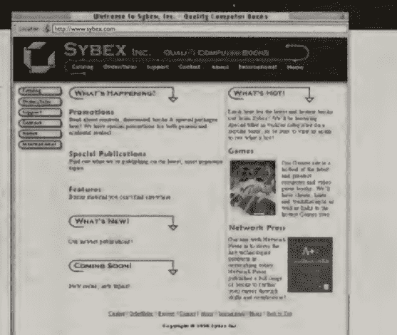

在内容丰富且信息详尽的 `Sybex` 网站上，您可以：

- 查看我们的完整在线目录
- 预览您感兴趣的书籍
- 访问书籍特殊内容
- 特别价格在线订书籍
- 了解 `Sybex`

### www.sybex.com

`SYBEX` Inc. 1151 Marina Village Parkway
Alameda, CA 94501 · 510-523-8233


### 将您的职业提升到新高度

使用来自 `Network Press` 的 `24seven` 系列书籍

- 这个新系列提供了您所需的高级信息，以确保您的系统和网络每天 24 小时、每周 7 天运行。
- 职场案例研究为现实世界的问题提供了解决方案。
- 最大化您的系统运行时间——并且下午 5 点下班！
- $34.99；7½ x 9"；544–704 页；软装


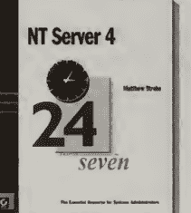


`Jim McBee`

0-7821-2505-0

现有出售

`Matthew Strebe`

0-7821-2507-7

现有出售

`Allen Jones`

0-7821-2532-8

1999 年第二季度发行

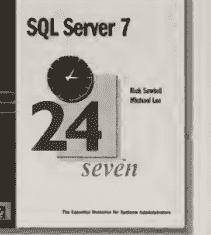


`Rick Sawtell`, `Michael Lee`

0-7821-2508-5

1999 年第三季度发行

`Shane Stiger`, `Mark Linsenbergardt`

0-7821-2530-1

1999 年第三季度发行

`Todd Carter`

0-7821-2594-8

1999 年第四季度发行

### 系统管理员的核心资源

访问 `www.24sevenbooks.com` `24seven` 网站获取更多信息和示例章节。

### 将您的职业提升到新高度

使用来自 `Network Press` 的 `24seven` 系列书籍

- 这个新系列提供了您所需的高级信息，以确保您的系统和网络每天 24 小时、每周 7 天运行。
- 职场案例研究为现实世界的问题提供了解决方案。
- 最大化您的系统运行时间——并且下午 5点下班！
- $34.99；7½ x 9"；544–704 页；软装


`Jim McBee`

0-7821-2505-0

现有出售

`Matthew Strebe`

0-7821-2507-7

现有出售

`Allen Jones`

0-7821-2532-8

1999 年第二季度发行


`Rick Sawtell`, `Michael Lee`

0-7821-2508-5

1999 年第三季度发行

`Shane Stiger`, `Mark Linsenbergardt`

0-7821-2530-1

1999 年第三季度发行


## Todd Carter

`0-7821-2594-8`

1999 年第四季度发行

## 系统管理员的核心资源

访问`www.24sevenbooks.com` `24seven`网站获取更多信息和示例章节。

## 系统管理员的核心资源

| 主题 | 页码 |
| :--- | :--- |
| 创建 `DHCP` 服务器 | 10 |
| 配置 `DHCP` 服务器 | 10 |
| 配置 `DHCP` 客户端 | 10 |
| 创建启动服务器 | 10 |
| `Linux` 文件系统 (`NFS`) | 11 |
| 网络文件系统 | 11 |
| `NFS` 安全 | 11 |
| 挂载文件系统 | 11 |
| 挂载文件系统 | 11 |
| 路由路由 | 11 |
| `Samba` 配置 | 11 |
| `Samba` 客户端 | 12 |
| `Samba` 服务器 | 12 |
| `Samba` 安全 | 12 |
| 静态路由 | 12 |
| `TCP/IP` | 12 |
| `TCP/IP` 配置 | 12 |
| `TCP/IP` 网络 | 12 |
| `TCP/IP` | 13 |
| 用户访问 | 13 |
| 用户邮件服务 | 13 |
| 用户邮件 | 13 |
| 用户邮件服务器 | 13 |
| 用户邮件服务器 | 13 |
| 用户 `ID` | 13 |
| 理解 `BIND` | 13 |
| 理解 `BIND` | 13 |
| 提供访问 | 14 |
| 现实世界的问题 | 14 |
| 安全 `Linux` | 14 |
| 诊断你的服务器 | 14 |
| 诊断你的网络 | 14 |
| 升级内核 | 14 |
| 升级内核 | 14 |
