# Linux 网络实用指南

本书使用以下设备编写：

## 硬件

- Apple Computer Powerbook G4
- 2 GB 内存
- 80 GB 硬盘
- 128 MB 显存

## 软件

- Mac OS X 10.4.5
- NeoOffice/J 1.1
- OmniGraffle Professional 4.0
- OmniOutliner Professional 3.0.4
- GraphicConverter X 5.7.3

# 引言

这本书是为“我”写的。

太太简练了？好吧，我重新开始。

我在一所技术学院教授计算机编程和数据网络，那里的学术工作以实践操作的紧迫需求为补充。因此，当我被要求制作一个使用 Linux 的 UNIX 系统管理课程时，我感到非常高兴。从我的个人和职业经验来看，整个 UNIX 尤其是 Linux，是实践操作紧迫需求的完美体现，学生可以直接投入并对他们的系统进行完全的端到端控制。

像任何课程作者一样，我寻找了教科书。这时我开始感觉到不对劲。参考书并不匮乏。此外，互联网上的在线文档也非常丰富，因为 Linux 是出生并成长于此。但教科书明显匮乏。

让我区分一下教科书和参考书：参考书为已经在该领域工作的人提供方便的信息源，被设计为按需查阅，而不是从头到尾阅读。教科书被设计为按顺序阅读。

正如我所说的，从某些角度来看，我们正在讨论的 Linux 的教科书中，大多数是关于命令行脚本、用户管理、打印等基础操作的。

正如我所说的，这里有一个关于 Linux 的秘密。

准备好了吗？

它们完全忽略了这一点。

好吧，确保你确实这些。

正如我所说的，教科书是从头开始开始的。我承认，有些参考书（如《新手指南》系列）是专门为了帮助学生理解 Linux 或 UNIX 机器而设计的。

正如我所说的，Linux 的核心在于，从简单的概念开始，并在后续章节中加入复杂的技巧。

正如我所说的，当你讨论管理 Linux 时，你必然是在讨论网络。

“但是，汤姆，”你说，“那些关于用户、进程和文件夹怎么办？关于打印呢？”

放松。我们会提到的。这只是我们在过程中会加入的一些有趣、酷炫的内容。

还有什么内容？关于设置安全的 Web 服务器？关于电子邮件？网络可访问的地址簿？加密？数字证书？基于 Web 的管理工具？网页邮箱？

当然，还有更多。重点是，要学习管理 Linux 系统，你必须学习管理 Linux 网络。这本书的目标是从简单的开始，不断增加额外的服务和客户端，同时在实战工作中建立知识和技能。在最后，你将拥有一个基础但功能强大的 Linux 网络。作为奖励，在过程中，你将学习如何使用管理器、配置文件和文件夹权限，甚至进行打印。

仅仅是因为红帽（Red Hat）是一个非常糟糕的用于学习的发行版。对于设置 Web 服务器、数据库机器以及为任何人提供其他所有信息技术支持，它是没问题的。

然而，对于初学者来说，它有太多的繁琐操作会干扰任务的完成。经验丰富的系统管理员习惯了这些并能从容应对，但对于课堂环境，你需要的是一个不会干扰你思路并让你专注于工作的 Linux 系统。

这就是为什么我使用 Kanotix 编写了这本书，它派源自 Debian Linux 发行版。Debian 的组织结构非常严谨，考虑周全，并且由于 Ubuntu（另一个基于 Debian 的发行版）近期获得认证，它正朝着成为另一个标准的方向迈进。Debian 能够让你完成所需的工作，并处理好底层的琐碎事务。那么 Kanotix 是什么呢？

Kanotix 是一个可以启动的 CD-ROM，让你无需在硬盘上安装任何东西，即可获得一个完整的 Linux 桌面。然而，如果你想将其安装在硬盘上，Kanotix 自带了一个安装程序，一旦完成，它就变成了 Debian。红帽最新的免费版本 Fedora 包含四张光盘，而 Kanotix 只需要一张。

在运行安装程序之前，你无法用红帽做任何事情。Kanotix 在你接触安装程序之前就提供了两个 GB 的可用软件。

使用红帽，你可以通过安装光盘进行基本的 Linux 系统救援。而使用 Kanotix，你可以为你的 Linux 和 Windows 计算机进行系统救援、病毒扫描、修复、备份、密码重置等操作。（是的，你甚至可以打印。）

所以，请尽情投入，享受其中，也许或许还能学到一些东西。我做到了，我想把这些分享给你。

# 前言

《Linux 网络实战》（Linux Networking: Hands On）旨在引导你建立和管理基于 Linux 的 TCP/IP 网络。

# 本书包含

- 从 Live CD 发行版安装 Linux 的说明。
- Linux 软件包管理概述。
- 从基础安装开始安装基于 Linux 网络的分步骤说明，包括 DNS、电子邮件、Web、目录服务以及使用 Kerberos 的网络认证。
- 每章的关键术语词汇表，以及摘要、复习题和批判性思维题。
- 主题介绍，包括数字签名、安全网络和数字证书。
- 为学生提供视觉参考的图形和屏幕截图。
- 对强大且流行的桌面环境（KDE）的介绍。
- 对基于 Web 的管理界面 Webmin 的介绍。

# 目标读者

本书适用于具有 Linux 基础知识（即你可以登录并使用 `cd`、`ls`、`cat` 和 `vi` 等简单命令）并想要基于最新互联网标准构建网络。实验理想情况下在团队环境中进行，但也可以由单个用户完成。此外，尽管本文是为教师引导的课堂设计的，但也可以轻松用于自学。

# 章节介绍

## 第 1 章：Linux 简介

自由软件与开源的区别；托瓦尔斯（Linux Torvalds）和斯尔曼（Richard Stallman）的贡献；KDE 桌面的导览，以及本地和在线文档的指南。

## 第 2 章：安装

确定硬件兼容性、准备硬盘、安装、Linux 文件系统之旅、启动过程和 Linux 系统。

## 第 3 章：基础系统管理

资源使用监控、文件系统管理、用户管理以及 X 服务器概述。

## 第 4 章：软件包管理

Linux 与 Windows 之间软件包管理的对比；源码安装与二进制安装；RPM 软件包管理器和 Debian 高级软件包工具（APT）概述。

## 第 5 章：Webmin

安装和配置 Webmin、界面导览、创建自定义组和用户。

附录 A 提供了你将需要的命令快速上手指南。

## 第 6 章：加密与安全网络

密码学简史；哈希（hashes）介绍；对称加密、非对称加密；设置证书机构（CA）；数字证书。

## 第 7 章：域名服务

域名系统（DNS）概述；配置主服务器；配置 DNS 客户端。

## 第 8 章：基础网络服务

通过 FTP 共享文件；使用 CUPS 共享打印服务。

## 第 9 章：Web 服务

安装和配置 Apache；配置虚拟主机；创建 Web 站点；基于摘要（Digest）身份认证。

## 第 10 章：文件共享服务

网络文件系统（NFS）；使用 Samba 共享文件。

## 第 11 章：电子邮件

TCP/IP 协议概述；配置 SMTP 服务器；配置 IMAP 服务器（SSL 支持）。

## 第 12 章：系统管理

使用工具（`ps`、`killall` 以及监控系统日志）；使用 LogWatch 自动化日志监控。

## 第 13 章：高级服务

安装和配置 LDAP 目录服务；使用 Squid 作为缓存代理服务器。


# 第 14 章：网络认证 – PAM（可插认证模块）概述；配置 Kerberos 密钥分发中心（KDC）；Kerberos 管理服务器

# 附录 A：Windows 版 Linux – Linux 命令环境快速上手指南

# 附录 B：期末项目 – 项目作业，适用于个人或三人小组

# 附录 C：复习题答案

## 教学特色

- **章节目标** – 每章都有一组在章节结束时完成的具体目标。
- **图形与截图** – 实际截图和详细图表为主题提供了生动的说明。
- **技巧与窍门** – 每章包含框注，提供特定主题的详细信息。
- **章节摘要** – 提供每章重要概念的概述。
- **复习题** – 测试学生对章节内容的掌握情况。
- **批判性思维题** – 迫使学生超越教材内容的思考。

# 文字与图形规范

每章从理论的简要讨论开始，然后进入实际应用，期间通过侧边栏提供更多细节。Linux 命令示例和软件包以 Courier 字体显示，例如：

```
cat /etc/passwd
```

我不时会插入文本框来简要介绍一个说明或提示，如下：

> 这是来自作者的说明，用于澄清某个技术点或提供建议。

## 硬件要求

书中实践操作推荐以下硬件：

- Pentium PC（500 MHz 或更高）
- 128 MB 内存
- 8 到 16 MB 显存（用于 GUI 桌面）
- 至少 3 到 5 GB 硬盘空间
- CD-ROM 驱动器
- 3.5 英寸软盘
- 鼠标或指针设备

我在以下硬件上测试了实验：

**带有 GUI：**

- Pentium III (800 MHz)
- 128 MB RAM
- 8 GB HD
- 16 MB VRAM
- CD-ROM 驱动器
- 3.5 英寸软盘
- 鼠标
- PowerPC G4 x 2 (500 MHz)
- 512 MB RAM
- 80 GB HD
- 32 MB VRAM
- CD-ROM 驱动器
- 鼠标

**在没有图形界面（GUI）的情况下：**

- Pentium II (400 MHz)
- 4 GB HD
- 4 MB VRAM
- CD-ROM 驱动程序
- 3.5 英寸软驱

此外，你还需要访问互联网来下载和安装软件包。或者，你可以建立本地软件仓库，但操作程序超出了本书的范围。无论如何，你使用的计算机应该位于局域网（LAN）。

如前所述，但为了获得更“真实世界”的体验，我建议将学生分成 3 到 5 个人的项目小组，并在小组内分配工作。此外，我要求学生为他们作为项目交付物提供的每个网络服务编写维护和故障排除文档。这有助于强化团队协作以及典型网络服务之间相互依赖的概念。（例如：如果 DNS 无法工作，用户将无法连接 Kerberos 服务器登录。）附录 B 包含一个示例项目的讲义。

书中的实验是使用 Kanotix 完成的，这是一个基于 Debian 的 Linux CD 发行版，可以从 `http://kanotix.com/info/index.php` 免费下载。任何基于 Debian 的 Linux（或 Debian 本身）应该都能很好运行，但如果你决定不使用 Live CD，可能需要在安装后重新执行第 1 章。

如果你不想使用 Debian 并且拥有足够的 Linux 经验，可以使用此书的任何其他发行版。唯一真正针对 Debian 的章节是第 2 章，它描述了包管理，我将包含它，尽管会对 rpm 和 Slackware 软件包系统进行简要讨论。此外，Debian 版本的 Apache 2 文件系统布局与原生版本略有不同，而 Debian 版本的 Webmin 为了方便起见被拆分为多个软件包。

到目前，没有专门供教师使用的额外材料，因为本书的设计非常直观，欢迎随时向我发邮件（`tsclair AT mac dot COM`）并告诉我哪些内容对你有帮助。

我建议在课堂教授这些内容之前自己搭建一个小型测试系统并完成这些练习，特别是如果你对 Linux 来说较新的话。你可能还希望在网络上设置一个本地文件服务器，用于课程特定的脚本、文档和工具。此外，由于软件包不断更新，书中插图的各种命令和应用程序的输出可能与你的体验有所不同。软件包可能会从仓库拉取甚至暂时损坏。在传授本课程时，良好的互联网连接、思维灵活性和敏锐的工程技能将是你强大的盟友。在大多数情况下，发现 Linux 错误信息（以及 Debian 的）出奇地清晰且直接，甚至给出了解决方案。注意操作系统试图告诉你的什么！

一如既常，书是多个个人或组织的产物。我想感谢我的父母给了我终身学习的热爱。此外，感谢 Joan Bouillon 和 Joe Ziegler 给了我所需的鼓励和支持。我还要感谢我的学生，不断挑战我去进步和追求卓越。

## 注脚

- 2 虽然 Xandros 是一个商业发行版，但他们提供了一个免费下载的开源发行版。
- 3 Kubuntu 使用独立于 Debian 自己的软件仓库，因此你必须修改对第 3 章（软件包管理）的演示，以免替换仓库列表 `/etc/sources.list`。
- 4 参见上述关于 Kubuntu 的说明。你必须安装 `ubuntu-desktop` 软件包来添加 KDE。
- 5 这是一个非常基础的 Linux 发行版，因此许多工具以及 KDE 桌面必须在运行 DSL 之后下载并安装。
- 6 这种情况很少发生，通常在几小时内解决。

# 从 CD 启动 Linux

# 探索 KDE

## 使用控制中心

## 更改桌面壁纸

## 添加启动器

### 基础工具

### 文档

---

## 术语表

- **启动 (Boot)**：从 CD 启动 Linux
- **探索 KDE**
  - 使用控制中心
  - 更改桌面壁纸
  - 添加启动器
    - 基础工具
    - 文档
- **启动 (Boot)**：这是计算机启动的方式
- **启动提示符 (Boot Prompt)**：当计算机启动时，等待
- **CPU**：处理器
- **Debian**：一个由志愿者创建并维护的软件发行版（自由软件）
- **FSF**：自由基金会
- **GUI**：图形用户界面
- **HOWTO**：关于执行特定任务的帮助文件
- **KDE**：桌面环境
- **Kernel**：内核
- **Linux**：由 Linus Torvalds 开发的内核
- **Linux 发行版 (Linux Distribution)**：包含硬件支持（驱动程序）、用户程序的软件包
- **Live CD**：这是一个无需安装即可运行的完整操作系统光盘
- **操作系统 (Operating System)**：管理计算机资源（如磁盘空间和内存）的软件
- **RAM**：随机存储器。计算机存储数据的地方

---

每本关于 Linux 的书都是从定义“自由软件”开始的，我肯定不像那些作者那样。实际上，我将从讨论自由软件开始，然后介绍 Linux。准备好了吗？

英语的一个问题是，我们有很多有很多多义词。“free”这个词就是一个很好的例子。如果我递给你一张光盘并告诉你上面有“free”软件，你会假设我的意思是它不需要钱。几乎每个人都是这么想的。

但“free”还有另一种含义。它也可以意味着“随意行动”，如言论自由、新闻自由等等。当我使用这个定义并说“自由软件”时，我的意思是你可以对软件做任何你想做的事，包括：

- 随意复制任意数量的副本
- 随意赠送任意数量的副本
- 随意销售任意数量的计算机
- 在任意数量的计算机上加载单个副本

“free”的第一种含义在黑客社区被称为“免费的 (free as beer)”。第二种是“自由的 (free as speech)”。现在如果有人告诉他们有一些“free”软件，你会问是“免费的”还是“自由的”？

来了 Linus Torvalds，一位芬兰的计算机科学学生。Linus 想要一个

> ¹ 我可能在这里夸张了。

一个可以运行在他 PC 上的系统，并且强大到足以完成所需的工作。当时，唯一的选择是 Minix，而他买不起 Linux（许可证）。在别无选择的情况下，他决定编写自己的系统。

他从编写内核开始，并用自己的名字命名为 Linux。内核是操作系统的核心，负责管理对硬件和其他系统资源（如内存和磁盘空间）的访问。然而，单凭内核并没有大用。

回到理查德·斯尔曼（Richard Stallman）。理查德启动了 GNU 项目旨在创建一个自由（指言论上的自由）的类 UNIX 操作系统。他创建了一系列软件工具，如文本编辑器、编译器和其他有用工具，这些工具正等待着一个可以运行的内核。在你说“嘿，你把内核放进了我的软件里”之前，Linux 使用 GNU 工具为他的内核添加了实用的功能，并创建了一个完整的操作系统，并于 1991 年发布到互联网。

所以我们现在这里。Linux 指的是 Linux 的内核。GNU 指的是理查德·斯尔曼和 FSF 提供的软件工具。它们统称为 GNU/Linux。

“但是”，你可能会说，“红帽（Red Hat）呢？Debian？SuSE？它们是什么？”

红帽和其他提供了所谓的“Linux 发行版”。它由 Linux 内核、GNU 工具（通常还有其他软件）以及一个安装程序组成，该程序让你可以将这些软件拷贝到 PC 并运行 GNU/Linux。由于软件是免费的，任何人都可以创建自己的发行版。

这意味着什么？根据《Linux 周刊新闻》（Linux Weekly News），目前（截至 2005 年 2 月 1 日）有 400 多种不同的 Linux 发行版，每种都有自己的目标市场。

“但选择也太多了！我该如何知道哪一个呢？”

做一点研究，尝试一下并找到一个你喜欢的。现在的普通 PC 用户并没有多少软件选择，大多数都是别人替他们选好的。正因如此，我看到长期使用 PC 的用户面对这类决策时感到困扰。自由是有代价的，但它是值得的。

“但这些不同的版本不兼容吗？如果我从一个发行版换到另一个，我必须获取新软件吗？”

不需要。一个发行版与另一个之间的主要区别在于软件如何安装、更新和删除。在内核版本以及包含的工具方面存在许多差异。从一个发行版切换到另一个并不困难，你在旧版本中学到的几乎所有技能都可以在新版本中使用。

这是一种可启动的 CD-ROM，让你可以在不预安装的情况下运行 Linux，这是一项相当的创新，它们是尝试 Linux 而不影响 PC 上当前安装的任何软件的好方法。此外，Live CDs 还是极好的系统救援盘，可以让你备份数据、修复文件系统、扫描病毒并测试硬件。如果你有快速互联网连接和 CD 刻录机，我鼓励你尝试这种软件。

## 步骤 0 —— 开始之前

让我们确保启动 Linux 所需。我们的最低要求是：

- Intel 兼容 CPU (486 或更高版本)
- 文本模式需要 20 MB RAM，图形模式至少 96 MB
- 可启动的 CD-ROM 驱动器，或启动软盘和 CD-ROM (IDE/ATAPI 或 SCSI)
- 标准 SVGA 兼容显卡
- 串口或 PS/2 标准鼠标，或 IMPS/2 兼容的 USB 鼠标

我重复，这些是最低要求。使用这些硬件 Linux（带有 GUI）可以运行，但速度会很慢。对于书中的工作，我建议至少使用：

- 奔腾 3 800 MHz 或更高
- 128 MB RAM（我们将使用图形模式）
- 8 GB 硬盘
- 带有至少 16 MB 视频内存的 SVGA 兼容显卡
- CD-ROM（同上）
- 鼠标（同上）

## 步骤 1 —— 获取启动提示

Live CDs 支持广泛的硬件和 Windows，非常灵活，但它们在某些专门为此类 Winmods 和 Winprinter 设计的硬件可能会出现问题。你可以通过多种方式启动 Live CD，包括不同的图形桌面。不同的发行版以不同的方式处理。最极端的例子是 Knoppix (`www.knoppix.net`)，它的创建者 Klaus Knopper 提供了三套启动 CD（被称为“作弊代码”/cheat codes）。其他的则允许你在启动提示的选项菜单中进行选择。

### 如何启动 CD：

如果你有可启动的 CD-ROM 驱动器，只需将 CD 放入驱动器并重启电脑。³

如果你没有可启动的 CD-ROM 驱动器，请从 CD 上名为 `boot.img` 的磁盘镜像创建一个启动软盘。将软盘放入软驱驱动器，CD 放入 CD-ROM 驱动器并重启电脑。无论如何启动，几秒钟后你应该看到启动加载器屏幕。此时，你应该使用向下箭头选择 ACPI、DMA On 和 English，按下 `<Return>`。

> 3 你可能需要将 BIOS 设置为从 CD 启动。请查看你的 PC 文档。

你会再次看到启动文本消息，但这次会更进阶。在显示消息 `INIT: Entering runlevel 5` 之后，你的光标将变成 X 形，背景将变为灰色，你会得到一个动画启动屏，这是 KDE (K) 的启动图像。这是 Linux KDE 的默认图形桌面。一旦完成，它就会启动。

## 探索 KDE

在屏幕底部你会看到一个灰色条。这是面板，它可以帮助你管理窗口。此外，你可以在面板上添加按钮。面板的布局和外观取决于你使用的 Live CD。让我们从左到右查看面板的一个示例（来自 Knopix）：


这些图标是预设的按钮。让我们从左到右查看：

- **KDE 菜单** 类似于 Windows 的开始菜单。
- **Knopix 菜单** 在运行 CD 时可以使用它可以配置启动和停止基本服务。
- **窗口菜单** 它可以让你管理屏幕上的窗口。
- **显示桌面** 点击此将隐藏你的应用程序和窗口。
- **个人文件** 将启动文件管理器并显示你的主目录内容。
- **终端程序** 打开一个命令行提示符窗口。
- **浏览器** 启动 Konqueror，这是 KDE 的默认浏览器。（巧合 Konqueror 也是文件管理器）。
- **Office** 启动 OpenOffice 软件套，包括文字处理、表格、演示和绘图软件。OpenOffice.org 可以读写 Microsoft Office 文件。
- **虚拟桌面** 比描述更容易演示，但我会尝试。每个正方形代表一个不同的桌面，每个桌面都有自己的应用程序、壁纸和图形文件。默认有四个（可以在控制中心进行修改），你可以通过鼠标切换桌面。你必须尝试一下才能真正理解这个概念。

现在我们已经知道了如何自定义面板，让我们看看如何右键点击桌面并选择“配置桌面...”来自定义桌面。然而，为了完全控制你的 GUI，你需要使用控制中心。

### 控制中心模块

- **桌面** – 控制桌面的行为。例如，当你双击窗口的标题栏时，窗口应该如何反应？
- **连接上网和网络** – 控制电子邮件、本地局域网浏览和桌面共享等设置。
- **KDE 组件** – 针对 KDE 的特定功能，例如当你通过点击图标打开文件时，将启动哪个应用程序。
- **外围设备** – 桌面、键盘、鼠标和打印机的设置。
- **电源控制** – 用于更多高级用法，这允许你设置电源管理以节省电池寿命。
- **区域与无障碍** – 设置热键、键盘布局、键盘快捷键、区域设置，以及能让残障人士能够更方便地使用电脑的功能。
- **安全与隐私** – 控制加密和密码的设置。
- **声音与多媒体** – 主要为不同的系统活动设置音效。
- **系统管理** – 管理管理级设置，如日期和时间、安装新字体或更改密码。（当我们从 CD 运行时，这些用不大，但在稍后我们安装 Knoppix 时将派上用场。）

现在，你应该对如何启动 Linux 以及使用 KDE 桌面有了大致的了解。

KDE 会占用一些内存和处理能力，所以如果你想要更快的 GUI⁴，你可能想尝试其他一些桌面。

到此时，你应该已经有一个可用的 GUI，并且可以通过点击图标或从 KDE 菜单中选择它们来启动程序。让我们看看能否找到如何让这个桌面看起来不那么普通⁵

在桌面上右键点击，从弹出菜单中选择“配置桌面...”。

在左侧的窗口中，点击“背景”。此部分将用图像或图案填充桌面背景。

在窗口右侧的上部中间，有一个标记为“背景”的区域。

现在，我们先保持简单。点击“图片”按钮旁边的下拉列表，查看可用的滚动图像文件列表。当你点击每个文件名时，你将看到图像的预览。选择其中一个并点击“应用”。几刻之后，你的背景将更改为你所选的那个。

> ⁴ 本书的其余部分将假设你正在运行 KDE 桌面，但如果你愿意，可以使用任何其他 GUI，或者完全通过命令行进行工作。

如果你对此更改满意，点击“确定”关闭窗口。

有时，一键访问我们经常使用的程序非常方便。KDE 桌面底部的面板（奇怪的是，它被称为面板）可以自定义，以添加、删除或重新排列按钮，我们只需要这样做即可。

### 如何向面板添加启动器：

1. 在面板的空白区域点击右键
2. 在弹出的上下文菜单中点击“添加...” 并从子菜单选择你想要添加的内容：
   - **小部件** 一系列“微应用程序”
   - **应用程序按钮** 从 KDE 菜单中选择任何程序
   - **面板** 添加额外的子面板
   - **特殊按钮** 不属于上述三个的项，例如“最近文档”按钮。

在面板的空闲区域右键点击，并选择“添加 -> 应用程序按钮”。KDE 开始菜单将弹出，允许你选择一个应用程序放置在面板上。

将鼠标移到“实用程序”菜单并点击 KCalc。一个小小的计算器将出现在你的面板上，就在时钟的左侧。

点击一次 KCalc 图标，验证 KDE 计算器已启动。

退出计算器，右键点击 KCalc 面板图标并选择“移动 KCalc 按钮”。现在，图标将随着鼠标的移动在面板上向左或向右移动。

将图标移动到面板上更方便的位置并点击一下即可放置。

要删除该图标，右键点击它并选择“移除 KCalc 按钮”。

我们还可以向面板添加名为“小部件”的小量级程序。在面板的空区域右键点击，并选择“添加 -> 小部件 -> KSysGuard”。

时钟左侧会出现两个小窗口。左侧绘制了 CPU 的工作强度，右侧图表将显示已占用了多少内存。

你可以通过在内部右键点击并选择“属性...”来更改此小部件的行为。现在，右键点击并选择“移除 KSysguard”。

在面板的空区域右键点击，并选择“添加 -> 特殊按钮 -> 快速浏览器”。

系统会提示你为浏览器选择一个文件夹。默认是你的主目录，所以直接点击“确定”。

一个带有闪电符号的文件夹图标将出现在你的时钟左侧。左键点击并按住，即可看到主目录的内容出现在弹出菜单中。正如其名称所示，“快速浏览器”小部件让你能够快速访问驱动器上的任何文件夹。

右键点击“快速浏览器”图标将其删除。


我们还可以控制面板的行为。在面板上右键点击并选择“配置面板...”。你将看到一个窗口，允许你访问许多面板行为。

“布局”部分分为四个标签页：

- 安排 – 控制面板的屏幕位置、大小和长度。
- 隐藏 – “隐藏模式”允许你释放屏幕空间以运行更多的窗口和应用程序。你可以在这里设置面板如何以及何时隐藏自己。
- 菜单 – 控制面板菜单的行为。
- 外观 – 为面板按钮和面板本身设置自定义背景和颜色。

标记为“任务栏”的部分控制面板任务栏的外观和行为（面板中间显示桌面上运行了哪些应用程序的部分）。

尽管 Linux 有成千上万的软件包可用，但 KDE 本身拥有许多图形化程序和工具，可以让我们的工作变得更容易。让我们来看看一些更常用的程序。

## Konqueror

虽然 Linux 系统有很多软件包，但管理系统最强大的方法始终是通过命令行完成。即使在 GUI 环境中，你也会发现自己经常开启终端窗口。让我们使用一个自定义 `console` 的简单示例来给你一个想法。

- 启动终端。你可以从 KDE 菜单中选择它或运行命令 `console`。
- 从会话菜单选择“新建 Linux 终端”。一个新的终端窗口将在 `console` 中打开。在终端窗口的底部，你将看到两个标签页，一个标记为 Shell，另一个是当前窗口的 Linux Terminal。你可以通过点击标签页上方切换窗口。
- 在设置菜单中选择“配置 Console...”。
- 选择“会话”标签页。在可用会话列表中，高亮显示为 Shell 的项。我们要创建一个会话。
- 输入 `top`（不带引号）。点击顶部的常规区域，将名称从 Shell 改为 Top。在执行字段中，点击“保存会话”按钮。系统将提示确认你的选择。一旦确认，新会话将出现在你的列表中。点击确定 应用更改并返回 `console`。
- 在你的会话菜单中，你应该看到你的新会话。从菜单选择你的新会话。一个新的窗口将在 `console` 中出现，运行 `top` 命令（`top` 用于监控资源使用）。

由于此窗口只运行 `top`，如果你退出 `top`，窗口将关闭。通过在 `top` 窗口中按 `q` 来演示这一点。

`console` 还允许我们收藏常用的 shell 命令。从书签菜单，

正如其名所示，这是一个拍摄屏幕的实用工具。当你需要时点击 `snapshot`。

一个小浮动窗口出现在屏幕中心。它提供了三种截图类型：

- 全屏 – 捕获屏幕上。
- 窗口 – 当你选择此项，捕获单个窗口。
- 区域 – 这允许你选择屏幕的一个区域。

此外，你可以设置截图发生前的延迟，以防你需要。点击命令 `<Alt>-F2`。

```
snapshot
```

选择编辑书签。将出现书签编辑器。

- 从“书签”菜单中，选择“创建新书签”。
- 在“名称”字段中，输入 Test Google。在“URL”字段中，输入命令 `www.google.com`。保存你的书签并退出书签编辑器。
- 从控制台的“书签”菜单中，选择 Test Google。命令将自动输入到提示符处。按 `<Return>` 运行命令。

这只是你可以在控制台执行的操作的一个示例。在继续之前，请随时尝试其他功能。

我们之前提到过虚拟桌面是一种在不使用额外显示器的情况下拥有多个工作区的方法。现在我们将通过一个示例来介绍虚拟桌面如何提高你的工作效率。

- 在桌面上右键点击并选择“配置桌面...”。
- 从左侧窗口中，选择“背景”。
- 在设置窗口的顶部，点击桌面设置下拉列表，将其从“所有桌面”更改为“桌面 1”。
- 为桌面 1 选择一张背景图片。
- 现在对桌面 2 到 4 执行相同的操作，但为每个桌面选择不同的图片。完成后，点击“确定”保存更改。
- 虚拟桌面切换器位于面板上，看起来像四个方块。当你点击其中一个方块时，你的屏幕将更改为显示该数字代表的桌面。点击每个方块并确认所有四个桌面都拥有你在上一步中选择的背景图片。
- 在桌面 1 中，启动 浏览器。连接到你喜欢的网站，切换到桌面 2。
- 在桌面 2 中，启动命令行窗口。在命令提示符处，输入 `top` 并按 `<Return>`。（`top` 是一个进程监控程序）。切换到桌面 3。
- 在桌面 3 中，启动一个文字处理器或文本编辑器程序。开始键入文档并切换到桌面 4。
- 在桌面 4 中，启动 `KCalc` 和一个游戏。
- 现在使用桌面切换器在你的四个桌面之间循环，注意你可以为每个任务对桌面进行自定义。

使用虚拟桌面的优点之一是我们可以非常方便地在桌面之间移动应用程序窗口。例如，桌面 4 上正在运行一个计算器和一个游戏。然而，将计算器放在桌面 2 可能会更有用，因为我们正在那里收集计算机的性能数据。现在你可能认为你必须在一个一个桌面上退出计算器，切换到另一个桌面并重新启动它，其实比这简单得多。

- 切换到桌面 4（如果你不在那里的话）。点击 `KCalc` 将其带到顶层。右键点击标题栏并选择“桌面->桌面 2”。计算器窗口将消失。
- 切换到桌面 2 并验证计算器现在已显示。但如果我们决定想在所有桌面上都放一个计算器呢？我们需要启动 `KCalc` 四次吗？事实是，
- 右键点击 `KCalc` 标题栏并选择“桌面 -> 所有桌面”。循环你的桌面并验证每个桌面上都有一个计算器。注意：只有一个计算器在运行，但它显示在四个不同的桌面上。
- 关闭每个桌面上的应用程序并返回桌面 1。

现在我们已经有了一些使用 KDE 桌面的经验，那么我们如何获取 Linux 盒子里这些工具和应用程序的帮助呢？幸运的是，在你的电脑上和互联网上都有大量的帮助可以可用。

在你的电脑上：

`apropos` – 如果你不确定应该使用哪个命令，或者你知道但记不起确切的拼写，`apropos` 应该是你记得的那个命令。这让你能够使用关键词搜索内置帮助文件（称为手动页），以定位与你的关键词相关的命令。例如：

```
apropos display
```

将列出所有使用 `display` 单词的命令和工具，以及简要描述。取决于你使用的任何关键词，你可能会得到超过一屏的响应。在我们的示例中，让我们看看。

许多 Live CD 允许你通过启动时的选项来修改其行为和外观。

许多 Linux 发行版的默认 GUI 是 KDE (K 桌面环境)，但也有许多其他选择。

你可以向 KDE 面板添加启动器按钮，以便你一键访问应用程序和工具。

虚拟桌面允许你拥有多个工作空间，每个工作空间都有自己的背景、图标和运行的应用程序。

`apropos` 命令允许你使用关键字搜索命令。

`man` 命令将显示在线手册页。

`info` 命令将显示存储在 Info 格式中的额外在线帮助文件。

`Konqueror` 可以使用 `man:` 或 `info:/` URL 格式显示 man 页面和 info。

互联网上有许多提供 Linux 文档的网站。

1. 在谈论软件时，“自由”（Free as in Speech）意味着：
   A) 它不产生任何费用。
   B) 除了出售，你可以对它做任何事情。
   C) 你可以对它做任何事情，包括出售。
   D) 你可以对它做任何事情，除了修改它。

2. Live CD Linux 允许你在不安装任何东西的情况下运行 Linux。（对/错）

3. 下列哪项不能被添加到 KDE 面板中？
   A) 插件
   B) 应用程序按钮
   C) 面板
   D) 窗口

4. KDE 面板在桌面上始终可见。（对/错）

5. 哪个 KDE 工具可以让你截图？
   A) kgrab
   B) ksnap
   C) ksnapshot
   D) kscreen

6. 使用虚拟桌面时，单个应用程序可以出现在一个或所有桌面。（对/错）

7. 下列哪个命令用于使用关键字搜索在线文档？
   A) info
   B) search
   C) apropos
   D) man

8. Konqueror 可以显示图像文件。（对/错）

9. 下列哪个不是 Ksnapshot 中的截图选项？
   A) 整个桌面
   B) 单个窗口
   C) 桌面的一个区域
   D) 多个桌面

10. Live CD 支持广泛的硬件，包括调制解调器打印机。（对/错）

# 批判性思维

1. 使用浏览器连接到 Linux 文档主页并回答以下问题：
   B. 你如何发现哪些 HOWTO 最近被添加或更新了？
   C. 搜索并识别下列哪些是 HOWTO，哪些是指南：
      - Linux 文件系统
      - 压缩
      - 从零开始 Linux

将你的浏览器指向 Google，点击“高级搜索”链接并回答以下问题：

- 我如何只搜索本地业务和服务？
- 如果我只想搜索来自 microsoft.com 网站的搜索怎么办？
- 我如何搜索指向富文本格式 (rtf) 文档的链接？
- 我如何限制搜索成人内容？

现在点击“高级搜索”链接并回答：

- 我如何搜索包含 'Linux' 或 'Windows' 但二者都不包含的网站？
- 从 Google 开始，我如何专门搜索 ibm.com 上的就业机会？
- 我想搜索包含云（clouds）信息的页面，以及像雾（fog）这样的项目。我如何只用一个搜索词完成？

## 目标

- 安装 Linux
- 描述 Linux 启动过程
- 配置安装
- 运行

## 术语

**日志文件系统** – 一种记录文件更改（写入/读取）到名为日志的文件的文件系统。这允许操作系统在非正常关机后将文件恢复到最后已知状态。

**分区** – 用于特定操作系统的硬盘逻辑划分。

**RAM** – 随机存取存储器。PC 存储数据的地方。任何你想运行或打开的程序必须先加载到 RAM 中。

**运行级别** – 基于 System V 的计算机运行模式。

**交换分区** – 用于虚拟内存的硬盘分区。（见虚拟内存）

**虚拟内存** – 一种通过使用硬盘作为当前未使用项目的存储器来提高物理内存 (RAM) 利用率的方法。

## 引言

当你考虑使用 Linux 时，通常会想清理一些磁盘空间并将其安装在你的 PC 上。然而，现在有许多发行版是通过所谓的“Live CDs”分发的。也就是说，它们是可启动的光盘，可以启动 Linux 环境而无需安装任何东西。Live CD 允许你无需费力地尝试不同的发行版和工具。

那么，如果你恰好发现了一个呢？很多 CD 都有安装程序，让你将 CD 上的软件复制到你的硬盘上。这些程序通常不像来自 Red Hat 或 Mandrake 的安装程序那样复杂，但它们快速、简单直接，而且如果你需要，你会自动拥有一个救援光盘。

归结底，现在安装 Linux 与安装任何操作系统都非常相似。也就是说，步骤是：

- 检查硬件是否兼容
- 插入 CD（有时是 DVD）
- 重启计算机
- 对你的硬盘进行分区
- 从 CD/DVD 复制文件
- 重启

让我们逐一来看这些步骤，首先是通用的方法，然后是安装 Linux 的具体方法。

诚然，这更多是 Linux 的问题，而不是 Windows 或 Mac OS X 的问题。然而，PC 硬件已经比以前标准化得多了，使得兼容性不再像以前那样是一个问题。此外，Live CD 发行版的设计旨在与各种硬件良好配合。尽管如此，无论你计划安装什么操作系统，稍微研究一下是一个好主意。

那么，我们如何确保我们的硬件可以工作呢？我们有三个信息来源：

- 软件供应商 – 在我们的案例，就是我们要安装的 Linux 发行版的开发者。商业供应商会在他们的网站上维护支持的硬件列表，并且大多数提供免费的安装支持（假设你从他们那里购买软件）。对于其他爱好者的发行版，你可以检查他们的网站、在线讨论板并邮件给开发者。
- 硬件供应商 – 越来越多的硬件供应商为他们的硬件生产 Linux 驱动程序并宣传他们的 Linux 兼容性。
- 自己尝试 – 随着 Live CD 发行版的增长，这正成为确定硬件兼容性更容易且受欢迎的选项。在你的计算机上启动 Live CD，并注意检测到了哪些硬件，哪些没有。由于不需要安装任何东西，你可以快速尝试不同的 CD 来确定哪一个兼容性最好。一旦你对这一步骤感到满意，就可以准备安装 Linux 了。

如果你有一台支持从 CD 启动的 PC，这应该是轻而易举的。如果不支持，CD 上有一个软盘镜像（通常在 `images` 文件夹中），它可以创建一个启动软盘来启动 CD。关于这个话题，我只能说这出了本论文的范围。你可能还需要修改 PC 屏幕上的某些设置以告诉它从 CD-ROM 驱动器启动，所以请查看你的计算机文档。

如果你能够顺利通过第1章，你就会来到这里。

程序。（最明显的是 SimplyMepis，它有一个标有 *Install Me* 字样的桌面图标）。

为了安装任何操作系统，你都必须对硬盘进行分区（即在硬盘上创建一个空间）。大多数 Linux 安装实用程序都会引导你完成此过程，甚至提议自动完成。对于 Live CD 来说，情况会有很大不同。安装程序至少应该提供一个让你手动分区硬盘的选项。

那么，我们需要多少类型的分区呢？最少需要两个：一个用于包含完整的文件系统，即根分区，另一个允许 Linux 将内存内容交换到磁盘以释放 RAM。这被称为交换分区。在文件系统（数据在分区上的排列方式）方面，根分区你有许多选择，而交换分区只有一个选择。交换分区的类型被称为 `linux-swap`。对于根分区，最流行的格式是 `ext3`（扩展类型 3）和 `reiserfs`（由一个巧合同名的实体开发）。两者都是很好的选择，并且包含日志记录功能，这样在从非正常关机恢复时，跟踪文件系统的更改会更加可靠。默认通常是 `ext3`。

所以让我们保持简单，创建一个根分区（完整安装大约需要 2 到 3 GB，但更多也可以的）和一个交换分区（大约是物理内存的 1.5 到 2 倍，最高约 1 GB）。我们将在稍后的章节中讨论高级分区选项。

> 注意：如果你正在使用 Live CD 且无法进行分区工作，你可以删除分区表。**这是一种最后的手段，因为这将导致硬盘上的所有数据都无法访问！** 从 root 提示符，输入命令：`dd if=/dev/zero of=/dev/hda` 将完全清零你硬盘的前 512 字节，从而抹除分区和引导加载程序。**如果你计划安装双系统或无法承受丢失硬盘上数据的代价，请勿执行此操作。**

## 将文件复制到你的硬盘

这实际上并不是一个步骤，因为安装程序会为你完成这一步。安装程序会向你提几个问题，首先让你创建一个用户账户并为 root 账户（系统管理员）设置密码。一旦你完成了这些，只需坐好让安装程序工作即可。要记住重要的一点是，如果你在安装时不小心，请阅读屏幕上的所有消息，以便在继续之前理解正在发生什么。我见过许多学生困在开发者预料到的问题上，仅仅是因为他们直接跳过了某些警告消息或帮助说明。

大多数 PC 用户现在应该知道如何做这一点了。

- 1 http://www.mepis.org
- 2 如果我进展得太快，请告诉我。

## 安装 Kanotix

假设：你已经从 CD 启动了 Kanotix 桌面。

## 启动安装程序

从 Kanotix 菜单中选择 Install Kanotix。在命令提示符处输入

在开发者给出简短免责声明后，你将看到安装程序菜单。


图 1 安装向导

选择你想要的安装类型并点击标记为“Next”的按钮。对于我们的目的，我们将选择“Install Kanotix to HD”。

我们现在移动到分区选项卡，可以在那里准备硬盘。安装程序将寻找现有的分区并尝试设置挂载点。在我们的示例中，我们没有合适的分区，所以我们的窗口看起来如下：

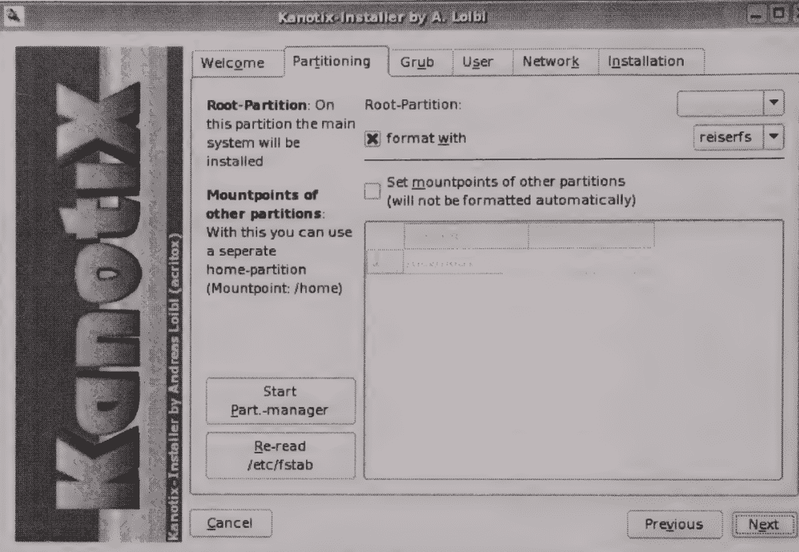

我们需要设置我们的分区，所以点击“Start Part-manager”。这将启动分区工具并给你一个这样的 GUI：

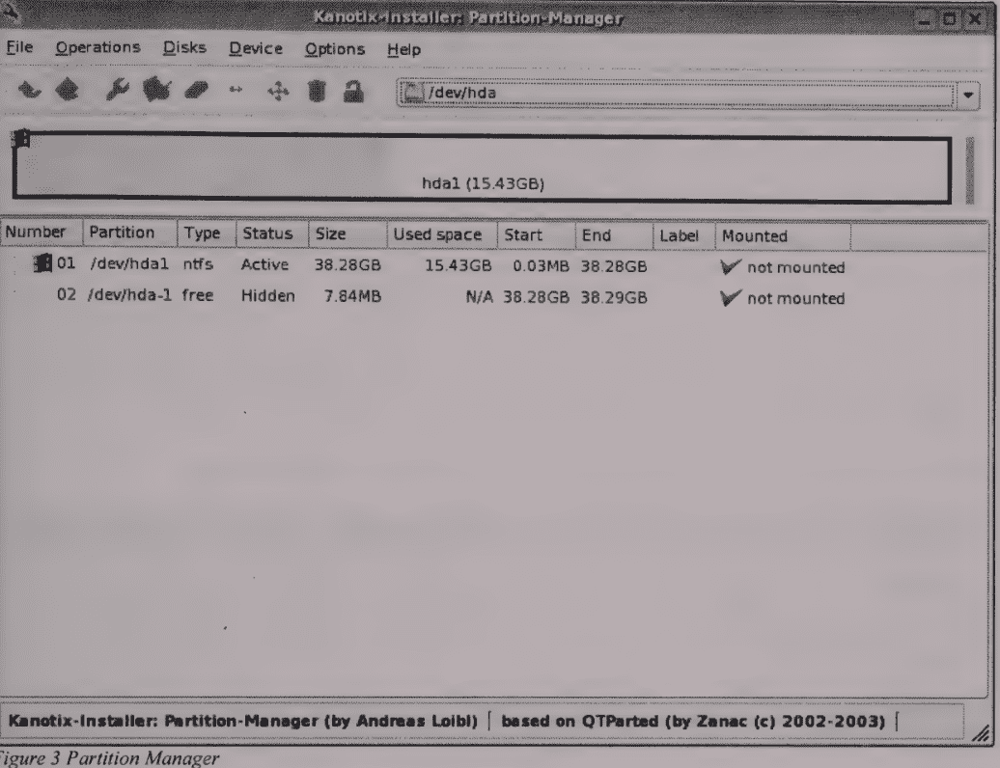

我们可以看到这里有一个 NTFS 分区，但我打算安装双系统，所以我只需右键点击分区并删除它。这将为我们提供空闲空间，可以在其中设置根分区和交换分区，这是我需要的。右键点击空闲空间并选择 Create。我会得到创建一个窗口，可以在其中设置根分区的大小、类型和格式。我还可以选择分区是从空闲（未分配）空间的开始还是结束。我可以根据兆字节（MB）、吉字节（GB）或未分配空间的百分比来设置分区的大小。我也可以为分区标记，但并不是所有文件系统都识别标签。不过没关系，现在这是为了我自己的使用，提醒我想在这个分区上放什么。

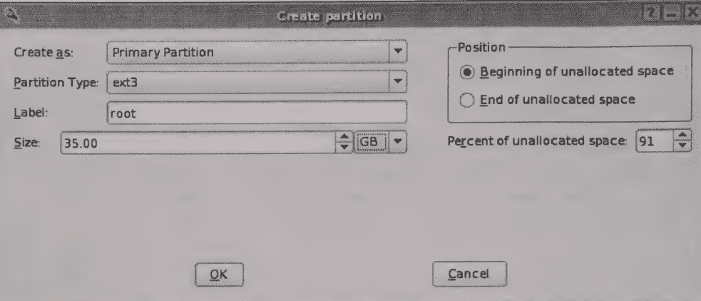

点击 OK，右键点击剩余的空闲空间并设置你的交换分区：


点击 OK 并回到分区管理器窗口。现在，你的更改尚未生效。换句话说，这是你改变主意并退出的最后机会。我不想这样做，所以我点击磁盘图标来提交我的更改。你会收到一系列警告，分区数据将写入磁盘，分区将被格式化。

根据我做的更改，我的分区设置现在如下：

# Kanotix-Installer: Partition-Manager

| 编号 | 分区 | 类型 | 状态 | 大小 | 已用 | 起 | 止 | 标签 | 挂载 |
| :--- | :--- | :--- | :--- | :--- | :--- | :--- | :--- | :--- | :--- |
| 01 | `/dev/hda1` | ext3 | | 35.00GB | N/A | 35.00GB | | root | 未挂载 |
| 02 | `/dev/hda2` | linux-swap | | 1.00GB | 0.00MB | 35.00GB | 36.00GB | | 未挂载 |
| 03 | `/dev/hda-1` | free | | 2.28GB | N/A | 36.00GB | 38.29GB | | 未挂载 |


# Kanotix-Installer: Partition-Manager (by Andreas Loibl) | 基于 QTParted (by Zanac (c) 2002-2003)

## 图 6 新分区

从 `File` 菜单选择 `Quit`，返回安装程序的 `Partitioning` 选项卡。你创建的根分区现在被正确检测。点击 `Next` 或 `Grub` 选项卡来设置引导加载程序。

## 引导加载程序

引导加载程序是将操作系统加载到内存中以启动计算机的软件程序。当 PC 上有多个操作系统时，引导加载程序非常有用。例如，如果你想运行 Windows 和 Linux，引导加载程序将在启动时给你一个菜单，让你选择选择的系统。Linux 最流行的两种加载器是 `Lilo`（Linux Loader）和 `GRUB`（Grand Unified Loader）。两者都很好，但我个人认为 `GRUB` 稍微好用一点。

我们的引导加载程序界面如下：

### Kanotix-Installer by A. Loeb

| 欢迎 | 分区 | GRUB | 用户 | 网络 | 安装 |
| :--- | :--- | :--- | :--- | :--- | :--- |


| 引导管理器 | GRUB |
| :--- | :--- |
| 引导管理器。A 允许你选择想要启动的操作系统。 | |

| 安装位置 | MBR |
| :--- | :--- |
| 安装位置 | |

| [ ] 创建引导磁盘 | |

**安装位置：**

`MBR`（主引导记录）或 根分区

取消 | 上一个 | 下一个

这里没有多少选择。我们可以在 `GRUB` 和 `Lilo` 之间选择。我们可以将引导加载程序安装在 `MBR`（主引导记录）中或根分区上。（最后一种用于你已经在 `MBR` 中安装了引导加载程序且不想覆盖它的情况。这时你必须将原始引导加载程序指向新加载程序的位置。不过，这对初学者来说不是选择。）我将在这里采用默认值并点击 `Next` 设置我的用户。

## 用户设置

当你安装 Linux（或者说，大多数现代操作系统）时，你必须设置至少两个用户：一个可以管理计算机的用户（例如 Windows 上的 `Administrator` 用户）以及另一个普通非管理员用户。Linux 上的管理员被称为 `root`，它的功能非常强大，因此养成以你的用户身份登录的习惯是件好主意，以避免意外破坏系统。稍后我们将看到在需要时获取计算机管理权限的方法。

用户页面非常容易理解，因为它看起来如下：

### Kanotix 安装程序 来自 A. Lolbi

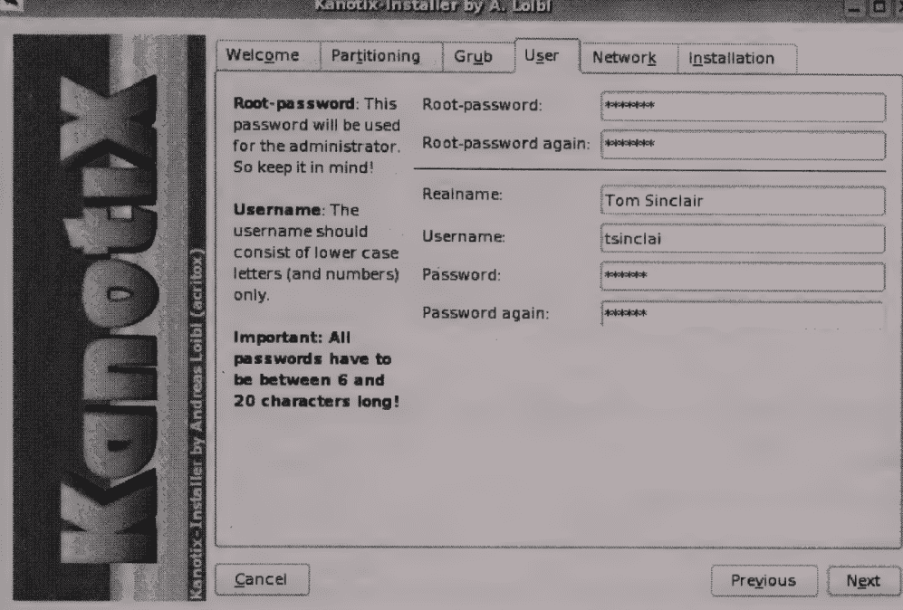

### 7 用户设置

根据需要填写空白并点击“下一步”继续。

## 网络设置

此时，我们只需要为你的计算机一个名称。主机名只是你计算机的一个标签，比它的网络地址更容易记忆。实际上，此页面的“网络”标签有点误导性，因为你并没有在进行任何硬件或软件设置。我们稍后会进行这些操作。为你的 PC 命名并点击“下一步”完成。

## 完成安装设置

这是我们最后的一组选项。你可以保存配置设置并开始安装，只需保存设置（如果你想使用相同的设置进行多次安装），或者完全放弃设置并直接进行安装。你甚至可以强制开始安装而不检查你的 PC 是否设置正确。通常情况下，你应该选择此处的默认选项并点击“开始安装”。你将获得最后一次双击设置并决定是否继续的机会。继续同意后安装将开始。此时，你将收到一系列进度消息，安装程序会让你知道发生了什么，并显示进度条让你了解安装需要多长时间。最后，你将看到一个像这样的型对话框：

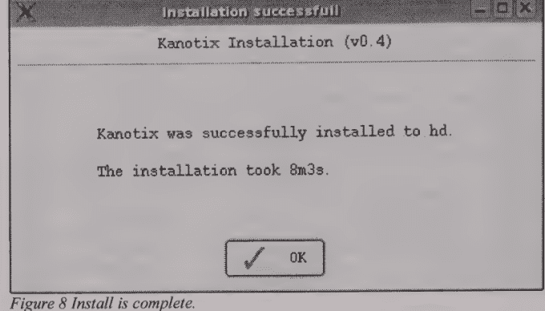

现在在我们拥有一个完全运行的 Linux 系统之前，只有最后一件事要做。

## 重启

此此简单的方法是在根提示符处输入

`reboot`

并按 <Return>。Kanotix 将开始关闭，CD 将自动弹出。取出 CD 并按 <Return> 让它完成完成重启。

## 高级分区主题

注意，我们在安装 Linux 时创建了两个分区（根分区和交换分区）。然而，大多数 Linux 发行版都提供将硬硬盘划分为多个分区的选项。或者你可能会问，为什么我们要把事情搞得比只有两个最小分区更复杂呢？

我们可能想要创建两个以上分区的理由至少有三个：

- **易于维护** - 为了卸载根文件系统，我们需要关闭服务器。然而，非根分区没有这一要求。所以，如果你将用户主目录放在与根分区不同的分区上，那么在必要时你可以对该文件系统进行维护，并保持机器运行。

- **灵活性** - 拥有多个分区允许系统管理员在不中断服务的情况下更容易地升级存储。

- **安全性** - 独立分区可以使用特殊属性和权限挂载，以使其更安全。例如，你可以为用户设置磁盘配额，或防止他们从主目录运行程序。

作为一个例子，让我们来看一个典型的 Linux 文件系统。


### 图 9 Linux 文件系统树

> 注意：某些版本的 Linux 或 UNIX 在 `root` 下可能会有额外的目录，但这里展示了最常见的。

每个文件夹包含什么？

3. **bin** - 通用用户命令（如 **二进制文件** 所示）。

4. **etc** - 配置和启动文件。

5. **home** - 用户主目录。

6. **lib** - 系统函数库文件，包含应用程序根据需要使用的常用代码。这些类似于 Windows 中的 **DLLs**（动态链接库）。

7. **usr** - 为系统管理员提供的额外二进制文件和工具。

8. **sbin** - 为系统管理员提供的命令和工具。

9. **tmp** - 如名所示，这是一个存放临时文件的文件夹，任何人都可以写入。

10. **var** - 这是存放没有其他地方存放的地方。具体地说，你在这里可以找到日志文件、打印机池化文件、缓存文件甚至是用户电子邮件。它的名字源于其大小和内容极具**可变性**。掌握了这些知识，我们就可以设计出更复杂的分区方案。例如，我可能想防止非根用户填满我的根文件系统，因为这实际上会关闭我的服务器。因此我查看非根用户可以写入的目录，我立刻发现了三个：`home`、`tmp` 和 `var`。分区服务器的一种明智方法可能是创建三个额外的分区（每个目录一个），并设置我的机器单独挂载每个分区。大多数 Linux 发行版都会会在你进行初始安装时让你很容易地完成设置。

## Linux 启动过程

现在我们已经有了一个运行良好的 Linux 安装，可以开始仔细观察它的工作原理。最显而易见的起点是系统启动过程。为了理解 Linux 如何启动，我们需要花一点时间学习一下 UNIX 历史。

为了理解 Linux 如何启动，我们需要花一点时间学习一下 UNIX 历史。当 UNIX 由贝尔实验室开发时，它被用于（包括其他方面）实验操作系统。其想法是每个运行级别都会根据状态具有不同的能力。

| 运行级别 | 功能 |
| :--- | :--- |
| 0 | 停止 (Halt) |
| 1 | 单用户模式 |
| 2 | 单用户模式 |
| 3 | 多用户模式 |
| 4 | 多用户模式 |
| 5 | 多用户模式 |
| 6 | 重启 |

所以 `init` 如何知道做什么？为了从一个运行级别移动到另一个级别，机器需要通过级别。启动的程序被称为 `init`。每个级别的条目如下：

| 10:0 | /etc/init.d/0 |
| 11:1 | /etc/init.d/1 |
| 12:2 | /etc/init.d/2 |
| 13:3 | /etc/init.d/3 |
| 14:4 | /etc/init.d/4 |
| 15:5 | /etc/init.d/5 |
| 16:6 | /etc/init.d/6 |

`inittab` 中的典型条目具有以下格式：

| 字段 | 描述 |
| :--- | :--- |
| id | 唯一标识符 |
| runlevels | 执行操作的运行级别 |
| action | 应执行的操作 |
| process | 要执行的进程 |

所以 `init` 从头开始读取文件，看到的第一个条目是：

`id:default`

这是默认级别。让我们看看其中一个，`/etc/rc3`：

| K01kldm | S20autofs | S20webmin | S99fetchmail |
| :--- | :--- | :--- | :--- |
| K01xdm | S20cuspys | S20rsync | S20kfs |
| S10ysklogd | S20bus-1 | S20email | S25mdamd |
| S11hotplug | S20firestarter | S20smartmontools | S40arpwatch |
| S11klkog | S20initd | S20ssh | S89atd |
| S12kerneld | S20makedev | S20vsftpd | S89cron |

但这甚至不是反转。每个 `rc*.d` 目录中的每个文件都是指向 `/etc/init.d` 中脚本的符号链接。例如：

```
tsclinai@pdog:/etc/init.d$ ls -1 -S20ssh
lrwxr-xr-x 1 root 20 Nov 13 2004 ssh -> ../../ssh
```

`rc` 脚本对数字参数做什么？`rc` 脚本在它接收到的级别对应的目录中执行，然后等待它完成并继续移动。

所以 `/etc/init.d` 中有什么？这里存储了控制系统服务的脚本。它们都接受相同的参数：`start`、`stop` 和 `restart`。例如：

`/etc/init.d/ssh start`

将启动安全 shell 守护进程。

- 如果 `rc` 看到一个以 `S` 开头的链接（例如 `S20ssh`），它会在 `/etc/init.d` 中带有 `start` 选项运行相应的脚本。相反，如果它看到以 `K` 开头的链接，它将带有 `stop` 选项运行链接的脚本。`S` 或 `K` 之后的两位数字可以控制脚本运行的顺序。

所以，如果我们希望某个服务在特定的运行级别（run level）下自动启动或关闭，我们只需要在 `/etc/init.d` 中创建一个启动脚本，并在相应的 `/etc/rc*` 目录中创建一个符号链接。好吧，也许这没那么简单。幸运的是有一个名为 `update-rc.d` 的脚本，它可以根据需要轻松地创建和删除链接。通常情况下，要设置服务在启动时启动，请使用命令：

```
update-rc.d <svc> defaults
```

其中 `<svc>` 是 `/etc/init.d` 中服务脚本的名称（不带角括号）。要禁用服务的自动启动，请使用命令：

```
update-rc.d -f <svc> remove
```

那么我们如何手动更改运行级别呢？有多种方法可以实现。最直接的方法是将运行级别作为参数发送：

```
init 5
```

另一种方法是使用 `telinit` 命令：

```
telinit 5
```

还有几个与 `init` 通信的命令：

`reboot` – 切换到运行级别 6（重启）

`halt` – 切换到运行级别 0

`poweroff` – 切换到运行级别 0 并在可能的关闭 PC 电。

要在不重启的情况下更改 `init` 的行为，你必须编辑 `/etc/inittab` 文件并向 `init` 发送消息请求其重新读取配置文件：

```
kill -HUP 1
```

（注意：由于 `init` 是第一个启动的进程，它的进程 ID 始终为 1。）

## 章节总结

尽管 Live CD 发行版设计为从 CD 运行，但并没有包含简单的安装程序。

- 3 在 `/etc/init.d` 中有一个名为 `skeleton` 的模板脚本。只需复制它并根据需要进行修改即可。

- 4 此时，这仅在 Debian 和基于 Debian 的派发版（如 Knoixix）中可用。要查看此命令有哪些可用选项，请不带参数运行它。

在安装任何操作系统之前，你需要通过创建至少一个分区来准备硬盘。

安装 Linux 至少需要创建两个分区，其中一个用于根目录（root），另一个用于交换分区（swap）。

可以创建额外的分区，但必须在安装后手动挂载。

`find` 命令是一个用于搜索硬盘的强大工具。

为你的 Linux 安装规划多个分区可以增加灵活性、便于维护并提高安全性。

Linux 启动过程将内核加载到内存中，然后加载已安装硬件的设备驱动程序并启动主进程 `init`。

`init` 进程从 `/etc/inittab` 文件获取其行动指令。

Linux 有七种可用的运行级别，其中默认只定义了六种。

## 复习练习

1. 将 Linux 安装到硬盘上时，它预期至少有 ___ 分区：

- * 1
- * 2
- * 4
- * 5

- * Kanotix（Knotix）安装程序是 `knx-hd-install`。（正确/错误）

3. 在安装 Linux 时设置了哪个用户账户？

- * knoppix
- * default
- * 任何你命名的非 root 账户。
- * root

4. `.tmp` 目录对所有人可写。（正确/错误）

5. `/sbin` 目录中包含什么？

- * 配置文件
- * 打印队列处理文件
- * 系统工具
- * 函数库

6. `init` 程序由 `/etc/inittab` 控制。（正确/错误）

7. 运行级别 2 对应什么状态？

A) 单用户，无网络，无 GUI。

B) 多用户，有网络，无 GUI。

C) 单用户，有网络，无 GUI。

D) 停止

8. 系统服务由 `/etc/rc.d` 中的脚本控制。（正确/错误）

9. 下列哪项将导致 rc 脚本启动网络服务？

A) K20ssh
B) S99net
C) S15networking
D) K20network

10. 为 Linux 安装设置多个分区是一个好主意。（正确/错误）

## 批判性思考

1. 使用 浏览器连接到 Debian 文档首页 (http://www.debian.org/doc) 并回答以下问题：

A. 在哪里可以获得 Debian 安装盘？

B. 你能从软盘安装 Debian 吗？

C. Debian 支持哪些硬件架构？

D. Debian init 脚本接受一个额外的参数 `force-reload`。它的作用是什么？

2. Kanotix CD  root 密码是什么？解释你的答案。

3. 将浏览器指向 Knoppix 首页 (http://www.knopper.net/knoppix/index-en.html) 并回答以下问题：

- Knoppix CD 使用什么许可证？
- 在哪里可以获得 Knoppix CD？费用是多少？
- Knoppix CD 中包含多少软件？

# 第 3 章 – 基础系统管理

## 目标

- 使用内置系统工具
- 文件系统管理
- 网络管理
- 用户管理
- X-Windows

## 术语

**clean bit** – 一种文件系统标志。

**directory** – 在系统卸载时设置的一个文件系统标志。

**DISPLAY** – 屏幕显示变量。

**file record** – 与文件相关的唯一标识符。

**GID** – 组 ID。

**inode** – 与文件相关的 inode。

**NIC** – 网卡（Network Interface Card）。

**superblock** – 描述系统的数据结构。

**UID** – 与用户的唯一标识。

## 引言

现在我们有了一个运行的系统，让我们看看日常任务。由于 `init` 是一个多用户操作系统，我们有一些额外的考虑。幸运的是，有很多内置工具可以帮助系统管理员监控这些资源。

## 使用内置系统工具

在任何计算机系统中，应该监控三组资源：

- CPU 利用率
- 内存
- 磁盘空间

在某些情况下，内存不足会导致系统整体性能变慢。

## CPU

我们需要讨论的第一个工具是 `/proc`。它很难描述，所以我们将逐步进行。首先，它是一个虚拟文件系统。也就是说，它是存在于内存中的，不对应硬盘上的任何文件系统。事实上，它包含了系统信息，并随着系统的变化动态更新。任何工具都可以使用其中的信息。这与 CPU 有什么关系？虽然你无法从 `/proc` 获取利用率信息，但至少可以获取有关 CPU 类型的数据：

```
$tsinclair@pddog$: cat /proc/cpuinfo
processor : 0
vendor_id : GenericIntel
cpu family : 6
model : 5
model name : Celeron (Covington)
stepping : 2
cpu MHz : 400.913
cache size : 32 KB
fdiv_bug : no
hlt_bug : no
f00_bug : no
coma_bug : no
fpu : yes
fpu exception : yes
cpuid level : 2
wp : yes
flags : cpu vme pse pse scr msar pae cx8 apic sep mtr
bogomips : 799.533
```

从 `/proc` 获取哪些信息？根据手册页，这里是摘要（非完整列表）：

* `/proc/[number]` - 每个运行进程的数字子目录。该目录以 PID 命名。
* `/proc/[number]/cmdline` - PID 为 `[number]` 的进程的完整命令行。
* `/proc/bus/pci/devices` - 关于 PCI 设备的信息。
* `/proc/cmdline` - 启动时传递给内核的参数。
* `/proc/meminfo` - 关于实际和虚拟内存的信息。
* `/proc/net/arp` - 内核 ARP 表的 ASCII 转储。
* `/proc/pci` - 启动时发现的所有 PCI 设备列表。


## /proc 文件系统关键文件

- `/proc/sys/kernel/hostname` - 可用于设置主机名
- `/proc/sys/kernel/domainname` - 可用于设置域名
- `/proc/uptime` - 包含两个数字：系统运行时间（秒）以及在空闲进程中消耗的时间（秒）
- `/proc/version` - 标识当前运行的内核版本

现在，所有这些值都是只读的。我们也可以修改某些值。例如：

```
root@pdog:# cat /proc/sys/kernel/hostname
pdog
root@pdog:~# hostname
pdog
root@pdog:~ echo pdog01 > /proc/sys/kernel/hostname
root@pdog:# cat /proc/sys/kernel/hostname
pdog01
root@pdog:~# hostname
pdog01
root@pdog:~# cat /proc/sys/kernel/domainname
(none)
root@pdog:~ echo sinclair.prairedied.edu > /proc/sys/kernel/domainname
root@pdog:~# cat /proc/sys/kernel/domainname
sinclair.prairedied.edu
dnsdomainname: Unknown host
root@pdog:~# echo pdog > /proc/sys/kernel/hostname
root@pdog:~# hostname
idog
```

## 进程监控

如果我们想知道 CPU 的忙碌程度，可以通过监控系统上运行的进程数量和种类来间接获知。为此，我们可以使用 `ps` 命令。

```
tsinsai@pdog:~$ ps
PID TTY      TIME CMD
3237 pts/0    00:00:00 bash
4688 pts/0    00:00:00 ps
```

如果你单独运行该命令，它将列出当前用户运行的进程。我们感兴趣的主要字段有：

- `PID` - 这是内核分配给进程的唯一标识。`PID` 用于向进程发送消息，例如“立即停止”。
- `TIME` - 这是以 `hh:mm:ss` 格式表示的累计 CPU 时间。如果这个数字很小（小于几秒），正常；多于此则可能表明某个进程正在占用 CPU。
- `CMD` - 这是启动进程的命令。

要获取更多进程信息，请使用 `-f` 选项：

```
tsinsai@pdog:~$ ps -f
UID PID     C STIME TTY           TIME CMD
tsinsai 3237 3236 0 11:43 pts/0    00:00:00 -bash
tsinsai 5260 3237 0 12:14 pts/0    00:00:00 ps -f
```

这些额外的进程信息字段：

- `PPID` – 父进程 ID – 启动当前进程的进程 ID。
- `STIME` – 时间 – 进程启动的时钟时间。

到目前为止，但如果我们想列出我们用户拥有的所有进程，可以使用 `-fu <user>`：

```
tsclai@podog:$ ps -fu root
UID PID PPID C STIME TTY TIME CMD
root 1 0 11:12 ? 00:00:06 init [3]
root 2 1 0 11:12 ? 00:00:00 [kventd]
root 3 1 0 11:12 ? 00:00:00 [ksoftird_gd_CPU0]
root 4 1 0 11:12 ? 00:00:00 [kswapd]
root 5 1 0 11:12 ? 00:00:00 [bdflush]
root 6 1 0 11:12 ? 00:00:00 [kudated]
root 55 1 0 ? ? [journal]
root 133 1 0 11:13 ? 00:00:00 [khubd]
root 147 1 0 11:13 ? 00:00:00 [kapmdd]
root 538 1 0 11:13 ? 00:00:00 [/sbin/klogd]
root 716 1 0 11:13 ? 00:00:00 [/usr/sbin/autocon --pid-file=
root 797 1 0 11:13 ? 00:00:00 [/usr/sbin/cupsd -F
root 812 1 0 11:13 ? 00:00:00 [/usr/sbin/inetd]
root 821 1 0 11:13 ? 00:00:00 [gmail-lsapp /Maildir/
root 827 1 0 11:13 ? 00:00:00 [logger gmail 2]
root 849 1 0 11:13 ? 00:00:00 [/sbin/nmbd -D]
root 854 1 0 11:13 ? 00:00:00 [/usr/sbin/nmbd -D]
root 862 1 0 11:13 ? 00:00:00 [/usr/sbin/nmbd]
root 865 1 0 11:13 ? 00:00:00 [/usr/sbin/sh]
root 871 1 0 11:13 ? 00:00:00 [/usr/sbin/vrftpd]
root 883 1 0 11:14 ? 00:00:01 [/sbin/bin/daemon]
root 902 1 0 11:14 ? 00:00:01 [/usr/sbin/cron]
root 919 1 0 11:14 tty1 00:00:00 [/sbin/bin/getty]
root 920 1 0 11:14 tty2 00:00:00 [/sbin/bin/getty]
root 921 1 0 11:14 tty3 00:00:00 [/sbin/bin/getty]
```

前面提到过向进程发送消息。通常，这些消息（信号）是由系统发送的，但我们可以使用 `kill` 命令向单个进程发送信号。尽管如此，`kill` 命令可以做更多，向具有相同名称的进程发送信号。要获取信号列表，请带 `-L` 选项运行 `kill` 命令：

```
root@podog:~#/bin/kill -L
1 HUP 4 QUIT 6 ILL 7 ABRT 8 FPE 9 KILL 10 USRI 11 SEGV 12 USR 13 PIPE 14 ALRM 15 TERM 16 SIGK
```

信号可以指定为 `-1` 或名称。除非你是 root，否则你只能向你拥有的进程发送信号。但确实可以通过排序进程表来找到我们需要的信息。事实上，通常是：

```
top
-13:08:28 1:55, load average: 0.00, 0.00
Tasks: 108 total, 1 running, 107 sleeping, 0 zombie
CPU(s): 0.6 user, 2.9% system, 0.0% nice, 96.5% idle
Mem: 256228 total, 244040 used, 11888 free, 56652 buffers
Swap: 522104k, 0k used, 522104k, 87556 cached
PID PR NI VIRT SHR %CPU %MEM TIME COMMAND
8580 root 15 0 1092 860 R 3.2 0.4 00:00:31 top
3236 tcinail 9 0 2252 2448 S 0.3 0.9 00:01:21 swpd
1 root 9 0 76 76 S 0.0 0.0 00:00:61 in
2 root 8 0 0 0 S 0.0 0.0 00:00:00 kentev
4 root 19 0 0 0 S 0.0 0.0 00:02:00 koftird
5 root 9 0 0 0 S 0.0 0.0 00:00:00 kswapd
6 root 9 0 0 0 S 0.0 0.0 00:00:00 bdflush
59 root 9 0 0 0 S 0.0 0.0 00:00:51 journal
133 root 9 0 0 0 S 0.0 0.0 00:00:00 khubd
147 root 9 0 0 0 S 0.0 0.0 00:00:79 kapmd
440 daemon 9 0 436 376 S 0.2 0.2 00:00:00 portmap
538 root 9 0 708 704 S 0.0 0.3 00:01:19 syslog
724 bind 9 0 3152 2244 S 0.0 1.2 00:00:01 named
725 bind 9 0 3152 2244 S 0.0 1.2 00:00:01 named
726 bind 9 0 3152 2244 S 0.0 1.2 00:00:01
```

### `vmstat` 输出字段详解

在 `procs` 列中：

- `r` – 运行中的进程数
- `b` – 睡眠状态的进程数
- `swpd` – 已交换到分区但仍可运行的进程数

在 `memory` 列中：

- `swpd` – 使用的虚拟内存量
- `free` – 空闲内存量
- `buff` – 作为缓冲区使用的内存量
- `cache` – 用于缓存频繁数据的内存量

在 `swap` 列中：

- `si` – 从磁盘交换出的内存量
- `so` – 交换到磁盘的内存量

在 `io`（输入/输出）列中：

- `bi` – 发送到硬盘的块数（每秒块数）
- `bo` – 从硬盘接收的块数（每秒块数）

在 `system` 列中：

- `in` – 每秒中断次数
- `cs` – 每秒上下文切换次数（从一个进程切换到另一个）次数

在 `cpu` 列中：

- `us` – 用户时间
- `sy` – 系统时间
- `id` – 空闲时间
- `wa` – 等待输入/输出的时间

## 磁盘空间

跟踪系统使用了多少驱动器空间是非常重要的，而且是以你可能意想不到的方式。例如：

- 如果 `tmp` 分区空间耗尽，系统将关闭。
- 如果 `tmp` 空间耗尽，写入 `/tmp` 的程序将无法启动，或者如果已经在运行，可能会崩溃。

监控磁盘空间使用的基本工具是 `df`：

```
root@pdog:~# df
Filesystem K-blocks Used Available Use% Mounted on
/dev/hda 5162796 2183160 2717380 45% /
```

这为您提供了以 1024 字节块为单位的可用和已用空间。要获得更易人类读的格式，请使用 `-h` 选项：

```
root@pdog:~# df -h
Filesystem Size Used Avail% Use Mounted on
/dev/hda 5.0G 2.1G 2.6G 45% /
```

这将为您提供一个顶层视图。但如果你想获取更具体的细节，可以使用 `du`（disk）命令：

```
root@pdog:~# du /var/tmp
4 /var/tmp/kdecache-tsinclai/favicons
4 /var/tmp/kdecache-tsinclai/http
756 /var/tmp/kdecache-tsinclai
4 /var/tmp/kdecache-root/favicons
108 /var/tmp/kdecache-root/p
52 /var/tmp/kdecache-root/http/d
544 /var/tmp/kdecache-root/http/m
708 /var/tmp/kdecache-root/http
1512 /var/tmp/kdecache-root
2284 /var/tmp
```

像 `df` 一样，您可以使用 `-h` 选项来获取更易读的大小：

```
root@pdog:~# du -h /var/tmp
4.0K /var/tmp/kdecache-tsinclai/favicons
4.0K /var/tmp/kdecache-tsinclai/http
756K /var/tmp/kdecache-tsinclai
4.0K /var/tmp/kdecache-root/favicons
108K /var/tmp/kdecache-root/http/p
52K /var/tmp/kdecache-root/http/d
544K /var/tmp/kdecache-root/http/m
708K /var/tmp/kdecache-root/http
1.5M /var/tmp/kdecache-root
2.3M /var/tmp
```

或者您可以简单地使用 `-s` 选项获取一个总结报告：

```
root@pdog:~# du -sh /var/tmp
2.3M /var/tmp
```

您可以获取您目录目录下所有子文件夹的总结报告：

```
root@pdog:~# du -sh /home/*
508K /home/ftp
1.8M /home/jsmith
1.8M /home/nx
19M /home/tsinclai
```

你可以将输出传递给另一个命令，例如 `sort`：

```
root@pdog:~# du -s /home/* | sort -nr
18504 /home/tsinclai
1796 /home/jsmith
```

还有第三方工具（包括 GUI 工具）可以用于监控您的系统，我们将在后面的课程中介绍这些。

## 文件系统管理

我们在前一章节中介绍了 Linux 文件系统。现在，我们将更详细地讨论它们。让我们观察一下并了解基本情况。要查看当前挂载了哪些文件系统，请运行不带参数的 `mount` 命令。

### `parted` 命令参考

| 命令 | 说明 |
| :--- | :--- |
| `name <分区号> <名称>` | 将分区命名为名称 |
| `print [分区号]` | 显示分区表，或某个分区 |
| `quit` | 退出程序 |
| `rescue <开始> <结束>` | 恢复位于 START 和 END 附近丢失的分区 |
| `resize <分区号> <开始> <结束>` | 调整分区及其文件系统 |
| `rm <分区号>` | 删除分区 |
| `select <设备>` | 选择要编辑的设备 |
| `set <分区号> <标记> <状态>` | 更改分区上的标记 |
| `unit <单位>` | 设置默认单位 |

```
(parted) print
/dev/sda 的空闲空间为 0kB - 6500MB

磁盘标签类型：msdos

| 编号 | 起始 | 结束 | 大小 | 类型 | 文件系统 | 标记 |
| :--- | :--- | :--- | :--- | :--- | :--- | :--- |
| 1 | 32KB | 5371MB | 5371MB | 主区 | ext3 | 启动 |
| 2 | 5371MB | 5643MB | 271MB | 主区 | linux-swap | 交换 |

(parted)
```

通常情况下，使用 `fdisk` 比较容易，但没有 `cfdisk` 那么简单。然而，`fdisk` 或 `cfdisk` 均无法让你在线调整分区大小。

现在我们已经快速浏览了可用的分区工具，现在是时候动手创建我们的新分区的了。为了方便起见，我将使用 `cfdisk`，但也可以自由使用你喜欢的任何其他工具。

在创建 `cfdisk` 后，使用方向键高亮磁盘上的空闲空间。按 `n` 创建新分区。选择创建主分区或扩展分区。（我将通过按 `p` 键来选择。）系统会询问你分区的大小。如果默认大小（磁盘上的剩余空间）可以，请按 `<Return>`。否则，输入新的兆字节大小并按 `<Return>`。我有大约 800 兆的空闲空间，我将这个分区设为 200 兆。然后系统会询问你是想将分区添加到空闲空间的开头还是末尾。默认是添加到开头，所以我在这里只需按 `<Return>` 即可。你现在已经有了分区。默认情况下，它是 Linux 类型的，但你可以通过从菜单选择“Type”（类型）（或按 `t`）然后输入文件系统类型的数字来更改它。如果你满意，可以使用菜单中的“Write”（写入）命令将新分区信息写入分区表以正式生效。系统会要求你确认选择。好了。我们有了一个新的磁盘分区。

遗憾的是，在格式化新分区之前，我们无法对其进行任何操作。换句话说，我们必须在上面建立文件系统。请注意与新分区关联的设备名称（我的是 `/dev/hda3`），因为格式化时需要它来识别设备。

虽然我们可以使用如 `qtparted` 等 GUI 来格式化此分区，但我们假设没有 GUI，因此使用传统的 `mkfs` 工具。`mkfs` 的基本格式为：

```
mkfs -t <format> <device>
```

其中 `<format>` 是我们想要使用的文件系统类型（默认是 `ext2`），`<device>` 是我们刚刚创建的分区设备。

事实上，`mkfs` 只是某些工具的前端。实际运行的工具取决于你决定使用哪种文件系统以及系统中安装了哪些文件系统。例如，如果我想使用 `ext3` 文件系统，`mkfs` 会运行 `mkfs.ext3` 工具。我将使用 `ext3`，这是一个带有日志功能的文件系统。这意味着操作系统会跟踪所有的文件事务，如果我的电脑意外关闭，它会将我的数据恢复到上一个已知状态。Linux 支持许多具有此能力的文件系统，如果你想为数据提供一些保护，使用它们是一个好主意。注意：这并不意味着你不需要进行定期备份！现在，我要格式化我的新分区：

```
# mkfs -t ext3 /dev/hda3
mk2fs 1.39 (WIP-Dec-2005)

文件系统标签=
类型: Linux
块大小=1024 (log=0)
碎片大小=1024 (log=0)
48384 个节点，96780 个块 (5%) 留给超级用户
第一个块=1
每组8192 个块
每组2016 个节点
超级块存储在块上：8193, 24577, 53729
此文件系统将每 3 个月或 180 天自动检查一次，以先者为准。使用 tune2fs -c -i 进行覆盖。
```

### 步骤 2 – 验证我们可以挂载和卸载分区

现在分区已经格式化，让我们看看是否可以挂载它并供使用。为了做到这一点，我们需要一个挂载点。这是文件系统层次结构中我们新分区的所在。简单来说，我们将创建一个空目录并使用 `mount` 命令添加我们的分区：


## 步骤 3 – 为新分区设置 fstab 条目

为了让文件系统自动挂载，必须在 `/etc/fstab` 中有一个相应的条目。fstab 的条目的通用格式如下：

```
<filesystem> <mount point> <type> <options> <dump> <pass>
```

其中

- `<filesystem>` 是我们的设备名称
- `<mount point>` 是挂载位置
- `<type>` 是文件系统类型
- `<options>` 是挂载时使用的设置
- `<dump>` 表示是否参与备份
- `<pass>` 指明启动时 fsck 检查的顺序

在我们创建新分区的条目之前，让我们讨论挂载选项。这里是 Linux 系统常用的选项：

| 选项 | 描述 |
| :--- | :--- |
| async | 异步执行 I/O |
| atime | 更新访问时间（这是默认值） |
| auto | 可以通过 `-a` 挂载 |
| defaults | 设置为 rw, suid, dev, auto, nouser, async |
| dev | 解析系统上的字符或特殊设备 |
| exec | 允许执行二进制文件 |
| group | 如果普通用户的组与设备组匹配，则允许其挂载设备 |
| mand | 允许在该文件系统使用强制锁定 |
| _netdev | 该文件系统位于需要网络的设备 |
| noatime | 不更新访问时间 |
| noauto | 可以显式挂载 |
| nodev | 不解释此系统上的字符或特殊设备 |
| noexec | 禁止在该文件系统上直接执行二进制文件（对于独立分区的用户目录很有用） |
| nomand | 不在该文件系统上允许强制锁定 |
| nosuid | 在文件系统上不允许 setuid 或 setgid 设置生效 |
| nouser | 仅 root 可以挂载此文件系统（这是默认值） |
| owner | 如果普通用户是设备的所有者，则允许其挂载 |
| remount | 尝试重新挂载已挂载的设备。这主要用于启动时将挂载从只读改为读写 |
| ro | 只读挂载文件系统 |
| rw | 读写挂载文件系统 |
| suid | 让 setuid 和 setgid 位生效 |
| sync | 所有 I/O 都应同步执行 |
| dirsync | 所有目录更新都应同步执行 |
| user | 允许普通用户挂载文件系统并将其名称写入 mstab，以便以后卸载 |
| users | 允许每个用户挂载和卸载文件系统 |
| encryption | 指定加密文件系统将使用的算法 |
| keybits | 指定加密密钥大小 |

现在来测试一下：

```
pdog:- mount -a
pdog:- ls -al /opt
total 17
drwx-xr-x 3 root root 1024 2006-01-04 16:25 .
drwx-xr-x 22 root root 4096 2006-01-03 13:43 ..
drwx------ 2 root root 12288 2006-01-04 16:25
```

再次确认，没有问题。此外，我们的新分区将在下次重启时自动挂载。正如之前提到的，将文件系统拆分为多个分区的优点之一是便于维护。为了使用磁盘工具，你需要先卸载分区。如果所有内容都存储在单个分区上（换句话说，根分区），你需要让整个计算机停止服务。独立的分区可以卸载并修复，而系统的其余部分继续运行。

## 文件系统调优

偶尔你可能会发现自己正在调整现有文件系统的设置以提高性能或追踪问题。对于最常见的文件系统类型 ext2 和 ext3，首选工具是 `tune2fs`。你不需要经常使用它，它在接近完成时简要提到过。

`tune2fs` 实用程序允许你设置或检查给定文件系统上的几乎每一个参数。例如，如果分区每隔两个月检查一次，并且你希望它在下次重启时进行检查，你可以记录挂载次数以进行调整。

要了解通过 `tune2fs` 可以获取哪些信息，请运行 `-l` 选项后跟分区的设备名称。

```
pdog:- tune2fs -l /dev/hda3
tune2fs 1.39-WIP (10-Dec-2005)
Filesystem volume name: <none>
Last mounted on: <not available>
Filesystem UUID: b34fe52bb-1b02-4c9a-e24d9689840d
Filesystem magic number: 0EF53
Filesystem revision#: 1 (dynamic)
Filesystem features: has_journal filetype needs_recovery
sparse_super: (none)
Default mount options: 
Filesystem state: clean
Errors behavior: Continue
Filesystem OS type: Linux
Inode count: 48384
Block count: 192780
Reserved block count: 9639
Free blocks: 182544
Free inodes: 48373
First block: 1
Block size: 1024
Fragment size: 1024
Blocks per group: 8192
Fragments per group: 8192
Inodes per group: 2016
Inode blocks per group: 252
Filesystem created: Wed Jan 4 16:25:29 2006
Last mount time: Wed Jan 4 17:24:56 2006
Last write time: Wed Jan 4 17:24:56 2006
Mount count: 2
Maximum mount count: 39
Last checked: Wed Jan 4 16:25:29 2006
Check interval: 15552000 (6 months)
Next check after: Mon Jul 3 17:25:29 2006
Reserved blocks uid: 0 (user root)
Reserved blocks gid: 0 (group root)
First inode: 11
Inode size: 128
Journal inode: 8
Default directory hash: tea
Directory Hash Seed: 54059aa1-0b65-4d5e-9b5c-58fc1c660196
Journal backup: inode blocks
```

关于这个实用程序或主题，我目前就这些了。如果你想获取更多信息，请查看 `tune2fs` 的 man 页面。

## 文件系统检查与修复

查找和修复问题的主要工具是 `fsck`。像 `mkfs` 一样，它只是一个调用特定文件系统工具执行实际工作的前端。你可以使用 `locate` 命令查看你的机器上支持哪些文件系统：

```
pdog:~# locate fsck.
/sbin/fsck.ramfs
/sbin/fsck.ext2
/sbin/fsck.ext3
/sbin/fsck.minix
/sbin/fsck.nfs
```

- 正常情况下，`fsck` 会根据两个条件之一在启动时自动运行：
- 分区已达到最大重启次数或挂载次数
- 操作系统检测到文件系统是正常关闭的。

> 每个本地文件系统都有一个名为“清洁位”（clean bit）的设置标志。如果文件系统正常关闭，清洁位就会被设置。如果没有设置（例如，计算机意外掉电），则在下次重启时清洁位不会被设置，文件系统将自动进行检查并在需要时修复。

让我们在我们新创建的分区上尝试一下 `fsck`。

```
pdog:-# umount /dev/hda3
pdog:-# fsck /dev/hda3
fsck 1.39-WIP (10-Dec-2005)
e2fsck 1.39-WIP (10-Dec-2005)
/dev/hda3: clean, 48384 files, 236/12780 blocks
```

根据结果，清洁位已设置，因此没有执行检查。通常情况下这是好的。但是，如果我们想要，可以使用 `-f` 选项强制检查：

```
pdog:-# fsck -f /dev/hda3
fsck 1.39-WIP (10-Dec-2005)
e2fsck 1.39-WIP (10-Dec-2005)
Pass 1: Checking inodes, and size
Pass 2: Checking directory structure
Pass 3: Checking connectivity
Pass 4: Checking reference counts
Pass 5: Checking group summary
/dev/hda3: clean, 48384 files, 236/12780 blocks
```

在通常情况下，你不必太操心磁盘修复，但务必定期备份数据。

## 网络管理

Linux 支持广泛范围的网络，但为了本书的目的，我们假设你的计算机连接到局域网。每个网络接口的设备名称以 `eth` 后跟数字。因此 `eth0`（或 `lan0`）是第一个，`eth1`（或 `lan1`）是第二个，以此类推。此外，所有具备网络的计算机都有一个指定为 `lo` 的回环接口。

考虑到此，让我们来看看如何配置网络接口。有两类工具：低级和高级。作为一个通用规则，选择一个类别并坚持使用它。

### 低级工具 - ifconfig 和 route

`ifconfig` 实用程序允许你直接配置网络接口，`route` 命令允许你操作路由表。不带参数使用时，它们会返回当前设置：

```
pdog:-# ifconfig
eth0 Link encap:Ethernet Haddr 00:A0:24:E1:E6
inet addr:192.168.2.250 Bcast:192.168.2.255 Mask:255.255.0
UP BROADCAST RUNNING MULTICAST MTU:1500 Metric:1
RX packets:26704 errors:0 overruns:0
TX packets:5257 errors:0 overruns:0 txqueue:0
RX bytes:8918046 (8.5 MiB) TX bytes:713832 (697.1 KiB)
Interrupts:5 Base address:0x220
lo link enc:local Loopback inet addr:127.0.0.1 Mask:255.255.0
UP BROADCAST RUNNING MTU:16436 Metric:1
RX packets:8 errors:0 overruns:0
TX packets:0 errors:0 overruns:0 txqueue:0
RX bytes:560 (56.0 b) TX bytes:560 (56.0 b)
```

内核 IP 路由表

| 目的 | 网关 | 生成掩码 | 标志 | Metric | 接口 |
| :--- | :--- | :--- | :--- | :--- | :--- |
| 192.168.2.0 | | 255.255.255.0 | U | 0 | 0 | eth0 |
| default | 192.168.2.1 | 0.0.0.0 | UG | 0 | 0 | eth0 |

如果我们想更改这些设置，可以关闭接口并在命令行输入信息，然后启动接口：

```
# ifconfig eth0 inet down
# ifconfig eth0 inet up 192.168.2.111 \
# netmask 255.255.255.0 broadcast 192.168.2.255
# route add -net 10.0.0.0 netmask 255.255.0.0 gw 192.168.2.4 dev eth0
```

这些工具适用于每个版本的 Linux，并且大多数发行版都自带自己的工具，包括 GUI 工具以使任务变得更容易。然而，至少熟悉 `ifconfig` 和 `route` 是个好主意。

### 高级 ifupdown

Debian 提供了一套使网络接口变得简单的工具。它由 `ifconfig` 和 `ifdown` 工具以及配置文件 `/etc/network/interfaces` 组成。通用技术是关闭接口、编辑 `/etc/network/interfaces` 并启动接口。默认情况下网络使用 DHCP 设置，interfaces 文件中对应的条目为：

```
iface eth0 inet dhcp
```

通常，这对于桌面客户端是可以的。如果你正在设置服务器或你的网络不使用 DHCP，你需要使用固定或静态 IP 信息来设置网络。假设你从网络管理员那里获得了适当的信息，这非常容易。使用我的设置，interfaces 条目将是：

```
iface eth0 inet static
    address 192.168.2.250
    netmask 255.255.255.0
    gateway 192.168.2.1
```

要关闭接口：

```
ifdown eth0
```

一旦你编辑了接口，你可以通过以下命令重新启动网卡：

```
ifup eth0
```

由于我们将在本文中设置多个服务器，在继续操作之前，请先为你的电脑设置静态 IP 地址。

## 用户管理

在任何类型的多用户操作系统中，我们主要需要管理用户和组，以跟踪谁在何时访问了什么，以及谁在特定时间在做什么。幸运的是，这并不是一个复杂的过程。在我们深入研究之前，让我们来进行简短的虚拟之旅，对这个环境有一个初步了解。

我们的第一步是 `/etc/passwd`。该文件包含默认 Linux 系统上所有用户的信息。让我们以我的条目为例：

```
tsinai:x:1000:1000:Tom Sinclair,,:,/home/tsinai:/bin/bash
```

此记录中包含七部分信息，用冒号分隔。从左到右，这些是：登录名、密码、用户 ID (UID)、组 ID 数 (GID)、注释、主目录和默认 shell。（你可能已经注意到我的密码看起来是 x。实际上并不是，但我们稍后会提到。）

添加用户的最简单方法是使用 `adduser` 工具：

```
pdog:~ adduser jsmith
Adding user `jsmith`...
Adding new group `jsmith` (1001) with group `jsmith`.
Creating home directory `/home/jsmith`.
Copying files from `/etc/skel`
Enter new UNIX password:
Retype UNIX password:
passwd: password updated successfully
Changing the user information for jsmith
Enter the new value, or press ENTER for the default
Full Name [:]: John Smith
Room Number []:
Work Phone []:
Home Phone []:
Other []:

Is the information correct? [y/N] y
pdog:~# grep jsmith /etc/passwd
jsmith:x:1001:John Smith,,/home/jsmith:/bin/bash
```

第一条中有几点需要注意。系统会创建一个与用户同名的新组并将用户添加到该组。这被称为用户特殊组，出于安全考虑而这么做。用户的主目录由该用户及其组所有，以防止他人无意中获得访问。用户可以属于任意数量的组，我们稍后会详细讨论这一点。删除用户请使用 `deluser`。修改用户使用 `usermod`。每个工具的 man页（帮助文档）提供了关于这些实用程序的更多细节。

看起来这和我的用户密码相同。事实上，出于安全考虑，密码信息并没有以明文形式存储在文件中。这些信息存储在一个只有 root 可读的文件中，称为 `/etc/shadow`：

```
tsinai:$1$juw4xMOIS.7Ouzn.74vcHbkIxZNRA0:13151:09999:7::
```

第二个字段看起来像乱码，但实际上是实际密码的转换版本，称为哈希（hash）。我们将在稍后的章节讨论加密时介绍哈希。

那么组呢？组信息存储在名为 `/etc/group` 的文件中。这是一个示例条目：

```
audio:x:29:tsinai
```


这显示我的用户属于一个名为 `video` 的组，GID 为 29。但请记住，我的主组仍然是 `tsinai`，GID 为 1000。管理组的工作与管理用户非常相似。要添加组使用 `addgroup`。删除组使用 `delgroup`。修改组使用 `groupmod`。我们将在本文后后在使用组来管理对服务和文件的访问时，进一步讨论组。

## 窗口与 Linux GUI

在解释 Linux 中的 GUI（图形用户界面）如何工作之前，我觉得我必须解释它在 MS Windows 中是如何运作的。在此之前，我需要退后一步，谈谈操作系统是如何工作的。

在过去，操作系统和运行其上的所有应用程序都是平等的。这意味着每个人都对计算机拥有完全访问权限，一直到硬件层，并且可以随心所欲。操作系统处理杂务工作，而应用程序处理它们应该做的事情。这在当时是一种简单、快速处理问题的方法，而且在当时是合理的。这也意味着一个编写糟糕的单一应用程序可能会导致整台电脑崩溃。

操作系统供应商考虑到他们软件的公众形象，他们做了什么来减少这种影响呢？他们制定了编程指南，提供了文档，详细说明如何构建软件**不会**导致整台电脑崩溃。他们举办了培训课程并进行了认证测试。最终，这没用。总会有那么一个笨蛋。

然后有一天，一个计算机科学学生想出了一个主意。“为什么，”他推论道，“在软件实际上不需要时，给所有软件对计算机的完全控制权呢？”

事实证明这是一个好主意。基本的系统功能封装在一个名为“内核”（kernel）的软件中，内核可以直接访问所有所有——嗯，是所有一切。其他一切都是二等公民。现在，你不需要时刻盯着可能在你的计算机上加载并运行的每一个应用程序。你只需要编写一个小得多（因此更易管理）的代码块，并且它是稳定且安全的。事实证明这是一个好主意，每个现代操作系统都组织成这样运行。现代计算机软件被分为两个特权不同的区域：“内核空间”（完全控制）和“用户空间”（没有多少控制权）。

这与 GUI 有什么关系？嗯，一个图形界面（简单来说）由一个名为“窗口管理器”的程序组成，它在屏幕上画图，以及告诉窗口管理器应该画什么、画在哪里的图形程序组成。

首先，让我们考虑微软是如何在 Windows 中制作 GUI 的。起初，他们让它在用户空间运行，因为在屏幕上画图真的不是内核的工作。好主意，对吧？事实证明，通过内核来执行任何有趣操作（如与显卡通信）的开销使得他们的 GUI……非常敏捷。好吧，是很慢。

然后雷德蒙德的某人想出了一个好主意。为什么不在内核中放入一些 GUI 代码呢？这样我们就可以直接访问视频硬件，加速漂亮图片的绘制，并让我们的客户开心？

太棒了！不仅如此，它还按计划运行了。GUI 更快了，客户更开心了，生活很美好。除了当一个本应该在用户空间运行的编写糟糕的软件导致整台电脑崩溃时，我们又回到了起点！

这也意味着无论你通过 Windows 得到哪种 GUI，你都受困于它。没有它你无法运行 Windows，你无法替换它的任何部分。

Linux 又是怎样的呢？Linux 的 GUI 是基于一个名为 XWindow 的项目。遵循 NIX 的模块化精神，他们将其设计成层级结构如下：

- X 客户端 (X Clients)：图形应用程序
- 桌面环境 (Desktop Environment)：为 X 客户端提供工作空间的 GUI
- 窗口管理器 (Window Manager)：就像在 Windows 中一样，它负责绘制漂亮的图片
- 图形库 (Graphical Libraries)：窗口管理器用于画图的代码
- X 服务端 (X Server)：与显卡通信并告诉它绘制所需内容的软件
- 视频驱动 (Video driver)：显卡的通信接口
- 显卡 (Video card)：最终执行所有底层工作的硬件

注意：这些软件中没有运行在内核空间。现在，从我们对 MS Windows 的讨论中学习到了什么可以应用于 X Window 的？

1. 它更稳定。即使是糟糕的 X 服务也不会导致电脑崩溃。
2. 它更灵活。它是作为基础层构建的，任何层都可以被替换。
3. 它较慢。至少相对而言如此。

是的，在相同的硬件上，X GUI 较慢。列表中的第二项为我们提供了一条路。与 MS 用户不同，Linux 用户不受困于他们的 GUI。如果我们觉得我们的桌面运行得太慢，可以轻松替换桌面环境、窗口管理器和 X 客户端以获得更简单、更快的体验。

这并不是 X Window 的唯一优势。MIT 的学者注意到由于 NIX 是感知网络的，X Window 也应该是。

这里是 X 客户端的两个工作：首先，它必须执行被设计的功能，例如网页浏览、文本编辑等方式，带有漂亮的图片和一切。X 开发者发现，虽然文本编辑必须在运行 X 客户端的计算机上进行，但图片部分可以在网络上任何能够绘制图片的计算机上进行。这可以是本地计算机上的显示器，也可以是互联网上成千上万外的机器。

现在变得有趣了。我不光可以按照我想要的方式设置 GUI，而且通过 TCP/IP。其相反的情况（正如我们在稍后查看 SysGuard 时所示）是我可以在多个 PC 上的应用程序向同一个图形界面发送信息并从中获取信息。除此之外，这意味着对远程服务器的图形化管理（允许服务器将其资源用于服务而不是绘制漂亮的图片）变得轻而易举。

那么我如何告诉 X 客户端在哪个显示器上显示？这通过两种非常简单的方法实现：

1. 设置名为 `DISPLAY` 的环境变量。格式为 `<address>:<displayname>`，其中 `<address>` 是远程计算机的主机或 IP 地址，`<displayname>` 是该计算机运行的显示器 ID。默认值设置为本地计算机和控制台显示（显示器0），通常表示为 `:0`。

> Linux、UNIX 或 BSD 的通用缩写

2. 使用命令行选项 (`-d` 或 `--display`) 在启动应用程序时将显示器位置（格式与 1 相同）传递给程序。这样，你就可以让多个应用程序在同一机器上运行，但每个程序都显示在不同的显示器上。

啊，但似乎有一个问题。你可能已经看出，从桌面将图形化应用程序投影到网络计算机的能力具有极大的……怎么说呢，恶作剧的潜力。换句话说，这是一个安全问题。

对于来自 MIT 的人们来说，这最初并不是一个问题。他们在一个受信任的网络上工作，认为没有理由不按照设计运行。但在现实世界中，这必须这样做。

第一次尝试是通过一个名为 `xhost` 的实用程序。它允许你通过 IP 地址或主机名允许或拒绝远程访问。要拒绝所有人的访问，请使用命令：

```
xhost -
```

要允许所有人访问，将 `-` 改为 `+`。默认设置拒绝所有人的访问。若要对地址为 192.168.2.1 的计算机开放访问，你需要运行命令：

```
xhost +192.168.2.1
```

这比没有要好，但还不够。你只能通过地址进行限制。那么任何在该台计算机上拥有账户的人都可以访问你的显示器。我们需要更细粒度的控制。

引入 `xauth`。这个想法非常简单。在允许访问显示器之前，你的 X 服务器会请求一个票据（在这种情况下是一个数字密钥）。如果票据与本地 `xauth` 数据库中的匹配，则授予访问权限。`xauth` 数据库以用户为单位管理，存储在名为 `.Xauthority` 的主目录中。以下是 `xauth` 运行的示例：

```
Alpine:~ tsinsclai xauth
Using authority file /Users/tsinclai/.Xauthority
xauth> list
Authority.local/unix:0 MIT-MAGIC-COOKIE-1 8371e04d2946b060a93be24c7b902f6
192.168.2.3:0 MIT-MAGIC-COOKIE-1 8371e04d2946b060a93be24c7b902f6
localhost:0 MIT-MAGIC-COOKIE-1 8371e04d2946b060a93be24c7b902f6
TiG4.local/unix:4 MIT-MAGIC-COOKIE-1 3bdba4be7b4b55ec9f70b61cc09be2
xauth>
add dypname proton hexkey   add entry
exit
save changes and exit program
extract filename dypname...
extract entries into file
help [topic]
print help
info
print information about entries
list [dypname...]   list entries
merge filename...          merge entries from files
nextract filename dpname...   numerically extract entries
nlist [dpname...]             numerically list entries
merge filename...          numerically merge entries
quit                            abort changes and exit program
remove dpname...               remove entries
source filename                read commands from file
?                               list available commands
generate dpname protname [options] use server to generate entry
options:
  timeout n                       authorization expiration time in seconds
  trusted                         clients using this entry are trusted
  untrusted                        clients using this entry is untrusted
  group n                         clients using this entry belong to application n
  data keyhex                     auth protocol specific data needed to generate entry
```

现在我们可以限制单个计算机上单个用户的访问。不仅如此，`xauth` 还有两种模式：信任（trusted）和不可信任（untrusted）。在信任模式下，远程图形客户端像往常一样拥有显示器的完全控制权。在不可信任模式下，使用此授权连接的客户端将被视为不可信，并防止其窃取或篡改属于信任客户端的数据。默认模式是不信任的。

有多种方法可以向远程计算机上的 `.Xauthority` 文件添加条目以访问显示器。一种方法是在计算机上运行 `xauth` 并手动添加条目。另一种方法是使用 `ssh` 命令（`ssh` 是一个让你通过安全加密连接登录远程计算机的工具）。具体来说，使用带有 `-X` 选项的 `ssh`：

```
ssh -X pdog
```

这会自动处理 `.Xauthority` 文件。这意味着当我在 `pdog` 上运行图形化应用程序时，它将默认显示在我的本地桌面上。

好了，现在我们已经对 X Window 是做什么的以及我们如何管理它有了一个了解，让我们进入核心细节：底层运行什么？

正如内核通过运行 `init` 来启动用户空间一样，X Window 通过运行一个名为 `xinit` 的程序启动，它会启动 X 服务器和至少一个 X 客户端。如果命令行没有指定客户端，`xinit` 会查看用户主目录中名为 `.xinitrc` 的文件（基本上是一个 shell 脚本）。如果不可用，它会查找名为 `/etc/Xinitrc` 的文件并运行它。

## 章节总结

- Linux 有许多监控系统资源的内置命令。
- `/proc` 文件系统是一个虚拟文件系统，包含了有关系统状态的信息。
- `/proc/cpuinfo` 文件包含有关 CPU 的信息。
- `/proc` 中的某些文件是可写的，允许你动态更改系统设置。
- `free` 命令为我们提供空闲和已用内存的信息。
- `vmstat` 命令为我们提供有关虚拟内存的数据。
- `ps` 命令显示运行进程的信息。
- 分区是物理驱动器的逻辑区域。
- 格式化磁盘分区是为了为读取和写入文件做准备。
- 格式化后的分区也是一个文件系统。
- 有几个原生实用程序可以创建、删除和格式化 Linux 分区。
- Linux 支持各种文件系统格式。
- 实用程序 `parted` 及其 GUI 前端 `gparted` 调整分区大小。
- 文件系统可以使用 `mount` 命令临时挂载。
- 要设置文件系统在重新启动时挂载，请在 `/etc/fstab` 中为其放置一个条目。
- Linux 网络可以通过低层工具 `ifconfig` 和 `route` 进行管理。
- 不带选项运行 `ifconfig` 和 `route` 将显示网络接口的当前设置和路由表。
- 始终可用的网络接口是回环接口，由 Linux 设备名 `lo` 指定。
- Debian 提供了两个高级网络配置实用工具 `ifup` 和 `ifdown`，它们与配置文件 `/etc/network/interfaces` 配合。
- 在局域网上，Linux 将使用 DHCP 默认启动以太网接口。
- 当使用 Linux 作为服务器时，建议使用静态（永久）IP 地址。
- 用户信息保存在文件 `/etc/passwd` 和 `/etc/group` 中。
- 出于安全考虑，密码保存在 `/etc/shadow` 中，只有用户可读。
- `/etc/passwd` 中的用户信息包括用户名、UID、GID、主目录位置默认命令 shell。
- 操作系统通过 ID 号而不是名称来跟踪用户和组。
- Linux GUI 与内核分离的，以提高稳定性和灵活性。
- 由于 X Window 系统是模块化的，任何层都可以被替换而不影响其他层。
- X Window 系统是网络透明的，应用程序可以显示在网络任何地方。
- 出于安全考虑，X 客户端可以通过主机 (`xhost`) 或用户 (`xauth`) 进行限制。

## 复习练习

1. 为操作系统准备分区（partition）被称为 _________。

   A) partitioning
   B) slicing
   C) writing
   D) formatting

2. `mkfs` 支持多种文件系统。（对/错）

3. 挂载文件系统，你需要一个格式化的分区和一个 _________。

   A) 硬盘
   B) 磁盘
   C) 挂载点
   D) 格式

4. 在 Debian 上，网络配置信息保存在 `/etc/network/setup`。（对/错）

5. 要激活更改的网络设置，你应该运行命令：

   A) `ifconfig reset`
   B) `ifdown eth0`
   C) `ifup lo`
   D) `ifup eth0`

6. 用户密码以加密形式维护。（对/错）

7. 文件系统挂载选项默认包含哪些选项？

   A) ro,guid,dev,exec,auto,async.
   B) rw,suid,dev,exec,auto,nouser, async.
   C) nouser,suid,sync,exec,auto,dev.
   D) guid,dev,async,suid,noexec,auto

8. 当 `xinit` 启动时，它首先在 `/etc/Xinitrc` 中查找设置。（对/错）

9. 以下哪个可以通过 IP 地址限制 X 客户端显示？

   A) `xinit`
   B) `xauth`
   C) `xhost`
   D) `xremote`

10. 使用 DHCP 配置服务器容易得多，是首选方案。（对/错）

## 思考题

1. 使用浏览器连接到 http://tldp.org/HOWTO/XDMCP-HOWTO 并回答以下问题：

   A. XDMCP 代表什么？它是做什么的？
   B. XDMCP 默认启用吗？为什么？
   C. 使用什么命令启动本地 X 服务器？
   D. 如果你将 X 显示从一台 Linux 机器导出到另一台 Linux 机器，你需要使用 XDMCP 吗？解释。

2. 所有的 Linux 文件系统都是基于磁盘分区吗？解释并举例。

3. 将浏览器导航到 LinuxMafia 知识库 http://linuxmafia.com/kb 并回答以下问题：

   - 列出六种不同的 X 窗口管理器。
   - 列出两种你可以用来排查 PPP 连接故障的办法。
   - 以下 Debian 组分别承担什么角色？
     daemon, sync, news, www-data

# 第 4 章 – 软件包管理

## 目标

- 描述软件包管理
- 使用 `apt.conf` 配置 apt
- 创建软件源列表
- 获取可用软件包的更新列表
- 清除不需要的软件
- 安装一些实用的软件
- 查看其他包工具
- 发现额外的 APT 技巧和窍门

## 术语

**归包（Archive）** – 将一组相关文件合并成单个文件。归包通常会被压缩以节省空间。

**二进制文件（Binary）** – 一个不是人类可读文本格式的文件。通常指程序文件，但也可能是数据文件。

**缓存（Cache）** – 一种工作区，位于内存（RAM）或磁盘上，用于存储常用项目以便快速访问。

**编译器（Compiler）** – 一个读取一个或多个包含源代码（见下文）文本文件并生成可执行程序的程序。

**依赖（Dependency）** – 如果某个软件需要一个或多个特定的库或程序可用，则该软件被称为具有依赖关系。在安装该包之前，必须安装其他软件。

**可执行文件（Executable）** – 一个可以由用户运行（执行）的文件。有时被称为程序。

**库（Library）** – 一个包含可执行代码的文件，多个应用程序可以使用这些代码来执行常见任务，如打印或连接网络。


# 术语定义

**包（Package）** – 有时被称为软件包。安装和运行特定软件程序所需的一组或多个文件的集合。包还包含注释（annotations），即关于该包及其文件和脚本的说明，这些脚本用于尽可能地完成软件的安装和配置工作，并在不再需要时将其删除。

**包组（Package Group）** – 一组具有相关功能的一个或多个软件包。

**软件库/仓库（Repository）** – 包含一组可供安装的软件包的文件服务器。

**脚本（Script）** – 由一组人类可读命令组成的程序。需要解释器来读取文件并将命令传递给系统执行。

**源（Source）** – 软件的配方。包含计算机指令的一个或多个文本文件，可以输入编译器（见上文）创建程序。

**源代码（Source Code）** – 源的另一个名称。（见上文）

**tar 包（Tarball）** – 一种归包文件（通常用于 UNIX/Linux 系统），使用 `tar`（磁带归档）命令创建然后进行压缩（通常使用 `gzip`）。

**Zip** – 一种归包文件（通常用于 Windows/DOS 系统）。

# 软件包管理简介

软件包管理是指在计算机系统上安装、更新和删除软件的过程。每个操作系统都有自己实现此方法，从非常简单到相当复杂不等。许多操作系统有多种管理软件包的方法。让我们通过对比 Linux 和 Windows 来开始对包管理进行概述。

## 自动 vs. 手动

首先，软件可以手动安装（由用户完成大部分工作），也可以使用一个名为包管理器的程序进行安装。包管理器不仅会处理安装包的细节，还会在特殊的数据库中跟踪软件，使其易于升级或删除包，并跟踪依赖关系（即依赖于其他软件可用的软件）。理想情况下，如果你的系统提供了包管理器，最好使用它，因为它会让管理工作变得简单得多。然而，正如我们将看到的，Windows 和 Linux 都有包管理器可用。在 Windows 端，包管理被内置在“添加/删除程序”控制面板中。此外，许多 Windows 包都有一个独立的安装程序（通常称为 `setup.exe`），它可以与 Windows 包管理器配合工作。在 Linux 中，有多种选择，有时这是决定使用何种发行版的决定性因素。基于 Red Hat 的发行版使用 `rpm`（RPM 包管理器），其包文件具有 `.rpm` 扩展名。基于 Debian 的发行版使用 APT（高级包工具），其包以 `.deb` 结尾。基于 Slack 的发行版使用基于 tar 包的工具，包以 `.tgz` 结尾。此外，Linux 发行版允许你安装 `.tar.gz` 格式的软件。Windows 则允许你通过 ZIP 文件手动安装软件。

## 二进制文件 vs. 源

接下来，我们可以从源码或通过预编译的二进制文件安装软件。在 Windows 上，从源码安装并不是常用选项，因为开发工具（包括编译器和库）没有包含在基础安装中，而且实际上需要额外费用。相比之下，Linux 拥有丰富的开发工具，从源码安装是一个可行的选项。在 Linux 中，你可以从源码包或源码 tar 包安装。源码包（发行版的原生格式）更优，因为它产生一个二进制文件，然后该文件可以由包管理器进行安装和跟踪。源码 tar 包涉及额外工作，并且不被包管理器跟踪。

那么，为什么要从源码安装软件而不是预编译的二进制包呢？

实际上，有几个可能的原因：

- 软件可能仅以源码形式存在。
- 可能有二进制包，但并不适用于你的系统。
- 你可能在安装之前想检查源代码以寻找漏洞或安全问题。
- 你可能在安装之前想对源码进行自定义或移除不需要的功能。
- 由于预编译软件针对的是最低公约数硬件，你可能针对你的硬件配置对该软件进行优化。

所有主要的 Linux 发行版都提供源码包，几乎所有的 Linux 软件都可以以通用 tar 包的形式提供。

## 总结

总结一下，Windows 和 Linux 都允许你通过手动或使用包管理器安装预编译软件。此外，Linux 还允许你通过手动或使用包管理器从源码安装软件。下表更直观地展示了这种比较：

| Linux | Windows |
|---|---|
| 二进制（管理器） | .rpm, .deb, .tgz | 控制面板, setup.exe |
| 源（管理器） | .rpm, .deb, .tgz | N/A |
| 二进制（手动） | .tar.gz | .zip |
| 源（手动） | .tar.gz | N/A |

表 3-1 Windows 和 Linux 软件管理的比较。

# 使用 RPM 进行软件管理

Red Hat、Mandriva 和 SuSe 等 Linux 发行版使用一种名为 RPM 的包管理器，全称为 RPM Package Manager。与其他系统一样，RPM 可以安装二进制包和源码包，还可以让你管理和查询包数据库。为使用 RPM 设计的包具有 `.rpm` 文件扩展名。

`rpm` 命令的基本选项非常简单：

- `rpm -i <pkg>` - 安装 `<pkg>`
- `rpm -e <pkg>` - 删除 (erase) `<pkg>`
- `rpm -q <pkg>` - 查询 `<pkg>`
- `rpm -ga` - 列出所有已安装包
- `rpm -U <pkg>` - 更新 `<pkg>`
- `-F` - 升级 `<pkg>`

使用 RPM 的缺点是，当你使用它时，它不会检查依赖关系。也就是说，如果你安装的包需要另一个包可用，RPM 会告诉你缺少文件。你必须找出提供文件的包并安装它。

# 使用 APT 进行软件管理

Debian 使用一种名为 APT（高级包工具）的管理系统。这是一个非常强大且灵活的软件套，可以让你完全控制软件的安装、更新和删除。这套工具的力量源于 Debian 社区对一套良好设计的策略的严格遵守。这些规则规定了在各种情况下如何组织包、安装程序应该如何处理问题以及文件应该放置在哪里。这使得变得非常一致，并有助于包管理尽可能自动化。

Debian 维护者定义了三个主要的软件类别：

- **stable（稳定版）** —— 非常可靠，会定期发布更新和安全补丁。因此，它非常适合维护生产服务器。然而，如果你想要最新的软件（例如用于桌面使用），请做好心理准备。
- **testing（测试版）** —— 包含正在评估进入稳定版的包。软件包更新一些，但仍然稳定，如果你想要一些更新但又不想太冒险，这个版本是不错的选择。适用于桌面。
- **unstable（不稳定版）** —— 这里是前沿。这些包更新非常频繁，没有前两个版本那么稳定，但如果你觉得你想使用最新的软件，这里就是你想要去的地方。（不过，要做好某些东西可能会崩溃的准备。根据我自己的经验，这种情况很少见。）这不建议经验丰富的用户使用。

软件库本身分为几个部分：

- **main** - 包含基础软件包。
    - **free** – 这些符合 Debian 自由软件指南的软件包。
    - **non-free** – 这些是不符合 DFSG（Debian 自由软件准则）的软件包。
    - **contrib** – 依赖于非自由包的自由软件包。
    - **us** – 且可以由美国服务器合法提供的自由软件包。
    - **non-us** – 无法从美国服务器合法出口的自由软件包。

# 入门指南

在使用 `apt` 之前，我们需要做的第一件事是确保它已正确配置。配置信息包含在 `/etc/apt` 文件夹下的文件中。现在，让我们去那里吧。

```bash
cd /etc/apt
```

这里只有两个文件是我们感兴趣的：

- **apt.conf** – 顾名其实，这是 `apt` 工具的配置文件。这些设置告诉工具如何运行。目前这样可能没问题，但我们还是来看一眼吧。第一行是
  ```
  APT::Default-Release "testing";
  ```
  这表示在安装或升级软件包时，`apt` 将在 `testing` 类别中查找软件包。下一行是
  ```
  APT::Cache-Limit 100000000;
  ```
  软件包系统会将软件包列表缓存（或保存以便于引用）在 `/var/cache/apt` 下。为了防止 `apt` 填充整个 `var` 目录，我们为缓存设置了大小限制。数字单位是字节，所以 `100000000` 大约是 10 兆字节。
  最后一行是
  ```
  Apt::Get::Purge;
  ```
  这告诉 `apt` 对于任何可以删除的内容，使用 `purge`（清除）而不是 `remove`（删除）。换句话说，普通的软件包删除会将大部分数据文件留在原处，而 `purge` 会清除所有内容。

- **sources.list** — 这是一个软件源列表，你可以在这里搜索、安装和更新软件。基于 Debian 的发行版通常带有自己的 `sources.list`，或者在安装期间为我们创建一个。但我们可以做得更好。所以我们要做的第一件事将是从零开始创建一个全新的 `sources.list`，指向互联网上离我们最近的服务器。

## 设置 sources.list

`sources.list` 文件是一个简单的文本文件，包含注释（以 `#` 符号开头的行）或指向获取软件包软件包的指针。这些可以是 FTP 服务器、HTTP（Web）服务器或本地文件系统。每行一个条目，格式如下：

```
deb http://ftp.us.debian/debian unstable main contrib non-free
```

你可以这样解释它：

- **E) deb** - 这表示该仓库用于预编译的二进制包。关键字 `deb-src` 标识包含源代码包的仓库。
- **F) http://ftp.us.debian.org/debian** - 这是仓库根目录的 URL。你甚至可以包含位于本地 CD-ROM 上的软件包。
- **G) unstable main contrib non-free** - 这表示该服务器可以提供什么种软件包。

所以，你只需要一个文本编辑器就可以创建自己的 `sources.list`。然而，这并不是简单的方法。世界上有成百个 Debian 服务器，很难确定哪一个最适合你。幸运的是，我们有一个工具可以让这个任务变得简单得多：`apt-spy`。

尽管名字很老，`apt-spy` 只是简单简化了 Debian 提供的服务器列表，测试每个服务器以查看是否可访问，并选择带宽最佳（即下载速度最快）的服务器。对于游戏玩家来说，这就是你们所说的“延迟”。

### 步骤 1. 安装 libcurl3

`apt-spy` 工具需要先安装另一个名为 `libcurl3` 的软件包。我们将从 Debian 网站下载它。你可以在 `http://packages.debian.org` 搜索软件包，但由于我们已经知道了包名，我们将使用快捷方式。

1.  点击面板上的房子图标。这将启动 `konqueror`，它是一个文件管理器和 Web 浏览器的结合（实际上可以使用任何 Web 浏览器，但 `konqueror` 让它变得额外简单）。
2.  通过输入 `<Ctrl>-1` 选择地址栏（即按住 Ctrl 键并按下小写 L）并输入地址
    ```
    http://packages.debian.org/libcurl3
    ```
3.  点击标记为 `testing` 的链接。
4.  点击标记为 `i386` 的下载按钮。
5.  从提供的列表中选择一个下载链接。
6.  提示时，选择“在 'Kpackage' 中打开”。
7.  `Kpackage` 将启动，`libcurl3` 软件包将被高亮。点击 Install（安装）。
8.  提示时输入 root 密码。
9.  安装完成后，退出 `Kpackage`。

### 步骤 2. 安装 apt-spy

像安装 `libcurl3` 一样安装它，但这次使用地址：

```
http://packages.debian.org/apt-spy
```

### 步骤 3. 创建新的 sources.list

以 root 身份运行命令：

```bash
apt-spy update
```

这将更新 `apt-spy`，使其包含带有 Debian 软件包副本的服务器列表（也称为镜像服务器或简单的镜像）。现在运行命令：

```bash
apt-spy -a North-America -d testing
```

以下是选项的含义：

- `-a North-America`: 这告诉 `apt-spy` 只查看北美的计算机。（查看 `apt-spy` 的 man页以查找此选项的其他值。）
- `-d testing`: 选择带有 `testing` 分支软件包的服务器。

该过程取决于网络连接速度。

### 步骤 4. 测试新的 sources.list

以 root 身份运行命令：

```bash
apt-spy update
```

这将更新 `apt-spy` 包含带有 Debian 软件包副本的服务器列表。现在运行命令：

```bash
apt-spy -a North-America -d testing
```

### 步骤 5. 编辑 sources.list

由于我们要保持一致，我们需要对 `sources.list` 进行一些更改。幸运的是，我们可以让另一个工具为我们写出 kicklist。例如，如果我们想删除 samba，我们将使用：

```bash
apt-get remove
```

如果我们想进一步并清除这个软件包，我们会使用：

```bash
apt-get remove --purge
```

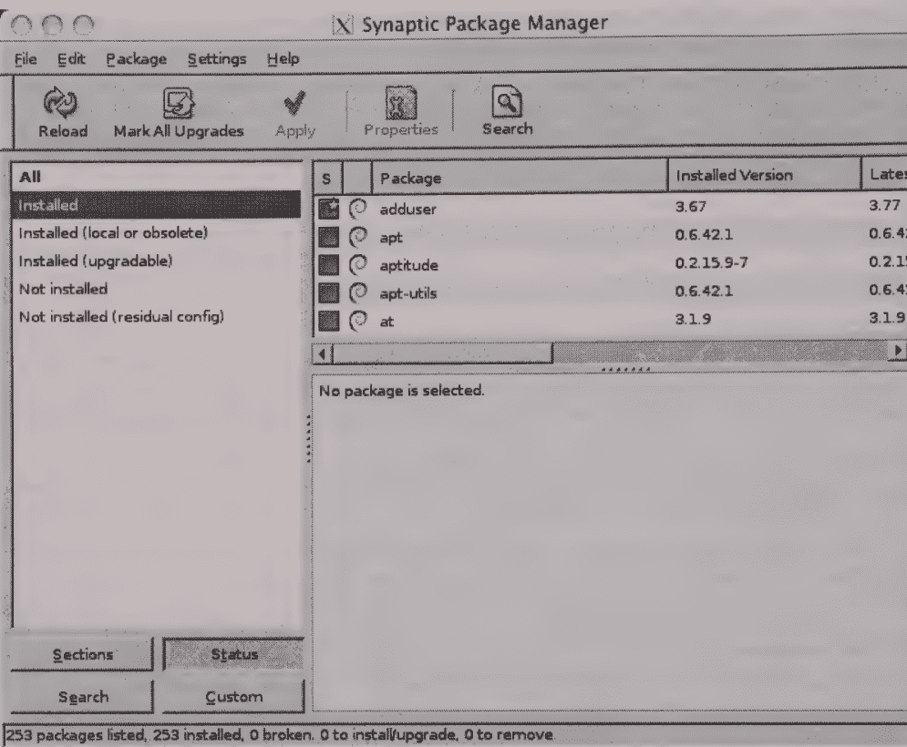

要标记一个包进行删除，请执行以下操作：

在右侧窗口框中，用鼠标点击你想要删除的包（在本例中，我们将使用 `ar` 包）。在包列表下方的框中，你会看到该包的简要描述，这将帮助你决定是否要保留它。

从“软件包”（Package）菜单中，选择“标记完全删除”（Mark for Complete Removal）（或直接按住 `<Shift>` 键按 `<Del>`）。你可能会收到提示，其他软件包也将被删除。

继续选择“标记”（Mark）。该包的图标将改变以指示其新状态。

### 步骤 3 标记要删除的软件包

继续向下查看列表并选择额外的要移除的包。尽量要果断一些，因为我们需要一个干净的系统。这里是一些可以帮助你做决定的指南：

- 5. 如果该包适用于你没有的硬件，请将其删除。
- 6. 如果该包用于服务器（如 samba 或 apache），请将其删除，除非你认为其他包也需要一并删除。
- 7. 如果你不确定，就留着它。
- 8. 一般原则是，不要动动函数库。这些是名称以 `lib` 开头的包。

## 步骤 4 创建你的删除列表 (kicklist)

这是一个分两个步骤的过程。

1.  将你标记的包保存为文本文件。在 synaptic 的“文件”菜单中，选择“保存标记”（Save Markings）。如果弹出文件保存对话框，将文件命名为 `kicklist.tmp`。
2.  编辑该文件以删除除包名以外的所有内容。你可以使用文本编辑器来完成，但由于 Linux 有许多非常棒的工具可以让这种工作变得非常简单，我们将改用这些工具。在命令行中，切换到保存 `kicklist.tmp` 的目录并输入：

```bash
cut -f1 kicklist.tmp > kicklist
```

我们创建的 `kicklist.tmp` 文件列出了我们标记的包，每行一个，如下所示：

| deinstall |
| :--- |

我们的 kicklist 只需要每行的第一个字段，因此我们使用了 `cut` 命令来打印该字段（`-f` 选项告诉 `cut` 使用第一个字段）。通常情况下，这会在屏幕上打印出包名列表，但我们使用了 `>` 运算符将 `cut` 的输出重定向到名为 `kicklist` 的文件中。大功告成，我们完成了。（你会发现 `cut` 命令对于从文件中分离出你需要的信息非常有用，因此请随时查看 man 页面以获取更多信息。）


退出 synaptic。你会收到一个警告，提示你正在丢弃已标记的更改，但继续退出即可。

## 步骤 5 清理不需要的软件

这是最简单的一步。现在我们已经有了包列表，只需把它们交给 `apt-get` 即可：

```bash
apt-get remove `cat kicklist` --purge
```

诚然，我们可以直接用 synaptic 清理这些包，但这次练习的目的是创建一个以后安装 Linux 时可以重复使用的包列表。

现在让我们解释一下这里发生了什么。

你已经知道 `apt-get remove <package name> --purge` 会完全删除一个软件包。然而，只要我们标记了它们，如果我们需要的话，可以在命令行中输入多个包名。命令 `cat kicklist` 只是输出 kicklist 中的包名，而周围的反引号（这些不是单引号）将 `cat` 命令的输出发送给 `apt-get`。

经过一番思考，你可能会想，只要我们标记了它们，直接在 synaptic 中删除这些包会更简单。没错，但那是短视的想法。作为 Linux 系统管理员需要培养的习惯之一是：有时前期做一点额外的工作可以节省以后的工作。例如，如果我们必须重新安装 Linux 或在我们的机器上安装它，我们准备好的 kicklist 会让过程快得多。

## 安装一些实用的软件

现在我们有了一个漂亮、干净的系统，让我们开始整理一下环境。首先，我们应该去掉一些不需要的本地化文件（称为 locales）。locale 是一个环境文件，告诉系统使用何种语言和语法。例如，德语者的 locale 会将菜单和对话框设置为德语，但还会将时间格式切换为 24 小时制，并将日期切换为 DD/MM/YYYY 格式。

locale 对于创建一个全球通用的系统非常好，但这些文件占用了空间，如果不使用它们，就应该把它们删掉。这就是为什么我们要安装 `localepurge` 包：

```bash
apt-get install localepurge
```

安装此程序时，你会看到一个类似下面的配置屏幕：

## Debian 配置

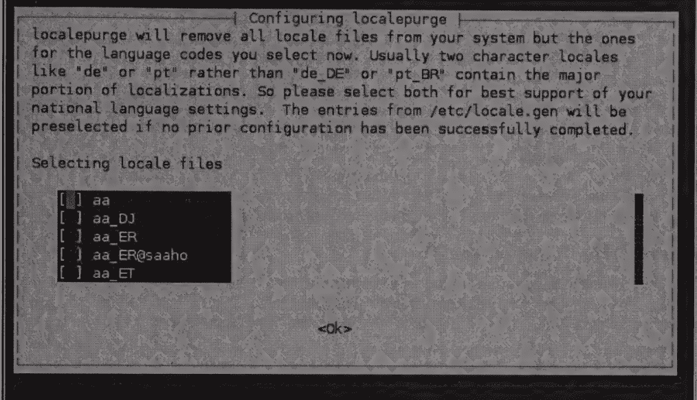

图 2 localpurge 的设置

使用上下方向键在列表中移动。被标记为 X 或 * 的 locale 将会被选中。在高亮某项时按空格键，如果已选中则取消选择，如果未选中则选中。禁用你没有使用的 locale。我简单地选了以 `en_US`（代表美国英语）开头的 locale 以及其他所有。当你到达列表底部时，按 `<Return>`。

你会看到另一个设置屏幕，它会问你是否删除本地化的 man 手册。按 `<Tab>` 到 Yes 选项并按 `<Return>` 同意。

接下来你将被告知何时有新的 locale 文件可用。如果你不想知道新 locale 的消息，按 `<Return>`。设置过程随后将完成。从现在起，每当你安装或升级软件时，localpurge 都会自动清理该包不在你 locale 列表中的本地化文件，并告知你节省了多少磁盘空间。

现在让我们安装一个不错的 Web 浏览器以及查看 Flash 内容的插件。

```bash
apt-get install mozilla-firefox flashplugin-nonfree
```

你会看到一个屏幕询问你是否已经从 Macromedia 下载了 Flash 插件。如果你已经有了，输入文件的完整路径并按 `<Return>`。如果没有，直接按 `<Return>`（我假设你还没有。）

接下来会问你是否想从互联网下载该文件。按 `<Return>` 同意。

如果你使用代理服务器访问互联网，在屏幕上输入地址。如果不是，留空并按 `<Return>`。如果你想保留安装程序，按 `<Tab>` 到 `<Yes>`。软件将完成安装。

## 查看其他包工具

我们已经看过了 kpackage 和 synaptic 了，它们为命令行工具提供了友好的界面。然而，还有其他工具可以实现相同的功能，但从命令行运行。它们各有优缺点，请选择一个你喜欢的。

dselect – 这是一个简单的菜单驱动的 APT 前端工具。它通常没有默认安装，所以请从命令行运行它：

```bash
dselect
```

你会看到一个这样的屏幕：

## Debian "dselect" 包处理

+ [A] 选择使用的访问方法。
1. [U] 更新可用包列表（如果可能）。
2. [S] 请求你需要的包。
3. [I] 安装并升级包。
4. [C] 配置任何未配置的包。
5. [R] 移除不需要的软件。
6. [Q] 退出 dselect。

使用 `^P` 和 `^N`、方向键、首字母或数字移动；按 `<enter>` 确认选择。`\L` 刷新屏幕。

Copyright (C) 1994-1996 Ian Jackson.
Copyright (C) 2000,2001 Wichert Akkerman.

这是自由软件；请参阅通用许可许可证第 2 版了解复制条件。不提供担保。参见 `dselect --license` 详情。


它并不算坏，因为它将不同的管理功能分成了独立的菜单项，但我个人认为，如果你不习惯的话，它列出包的方式很难导航。

aptitude – 另一个基于命令行工具，但比 dselect 更友好。它通常不会默认安装，所以请去安装它。当你运行命令时，你会得到一个这样的菜单屏幕：

## 会话 编辑 视图 书签 设置 帮助

```
操作 撤销 包 搜索 选项 视图 帮助
f10: 菜单 ? 帮助 q:退出 u: 更新 g: 下载/安装/移除 软件包
aptitude 0.2.15.3-deb8
-- 待升级的软件包
-- 已安装的软件包
-- 未安装的软件包
-- 过时和本地创建的软件包
-- 虚拟软件包
-- 任务

这些软件包有新版本可用。
```

Shell Root 根台

图 4 Aptitude 主窗口

屏幕上可以同时显示大量的在线帮助。请务必阅读屏幕上的提示。要访问菜单，请按 `F10` 并使用方向键进行导航。（这里甚至内置了一个扫雷机器人游戏，可以在等待安装完成时玩玩。）

## 发现更多 APT 技巧和窍门

- E) 你可能需要 root 权限或拥有 root 权限来更新、安装、配置或移除软件。
- F) 一时间只能有一个用户访问软件数据库。当你尝试访问时，如果另一个管理员正在安装软件包，你将收到数据库无法锁定的错误消息。这意味着，如果你在桌面的某处运行了 synaptic 或任何软件包工具，在退出第一个工具之前，你无法启动任何其他软件包工具。
- G) 注意来自安装程序的消息。如果安装由于某些原因失败，安装程序将描述问题并通常告诉该如何修复。
- H) 要从命令行搜索软件包列表，请使用 `apt-cache` 命令。输入 `apt-cache search <keyword>`，其中 `<keyword>` 是软件包名或描述中的某个字符串（当然不带角括号），系统将打印出相关软件包列表以及软件的简要描述。
- I) 要查找特定软件包的所有可用版本，使用 `apt-show-versions -a -p <package>`，其中 `<package>` 是不带角括号的软件包名称。
- J) 要升级机器上的所有软件，请使用 `apt-get upgrade`。这是一种“安全”升级，它会保留任何可能破坏已安装软件包的升级，并且不会删除任何软件包。这用于在当前安装的操作系统版本内进行升级。
- K) 要将机器上的所有软件升级到下一个发行版本，请使用命令 `apt-get dist-upgrade`。这比安全升级没那么礼貌，因此某些软件包会被删除，新软件包会被安装，其他软件包会被升级。两个升级命令都会向你展示它们将执行的操作并给你取消的机会。
- L) 要将 Debian 软件包 CD-ROM 添加到你的 `sources.list`，请插入 Debian 光驱并输入 `apt-cdrom add`。如果你的互联网连接缓慢或不存在，这非常有用。
- M) 要获取有关特定软件包的更多信息，请使用命令 `apt-cache show <package>`
- N) 要获取所有已安装软件包列表及其简要描述，请使用命令 `dpkg -l`。对特定软件包执行相同操作，输入 `dpkg -l <package>`
- O) 要查找特定软件包的状态（例如，它是否已安装），使用命令 `dpkg -s <package>`
- P) 要安装下载的软件包，使用命令 `dpkg -i <package file name>`
- Q) 移除（purge）软件包的另一种方法是使用命令 `dpkg --purge <package>`
- R) 在安装或更新软件之前，请确保你已更新了软件包列表！否则，你可能会遇到一些奇怪的错误，因为安装程序可能无法验证软件包的校验和。
- S) 要在软件包安装后运行其配置脚本（这是通常在安装时运行运行的脚本），请使用命令 `dpkg-reconfigure <package>`。
- T) 如需关于使用 APT 的优秀教程，你可以访问 APT HOWTOget：http://www.debian.org/doc/manuals/apt-howto/ch-apt-get.en.html。

## 章节总结

- 9. 软件包是一组用于安装和运行特定软件的文件和脚本。
- 10. 软件包组是一组属于相同功能类别的软件软件包。
- 11. 软件软件包管理是在在计算机系统上安装、更新和删除软件的过程。
- 12. 软件包管理器使用数据库来跟踪已安装的内容。
- 13. 无论你使用哪种软件包管理系统，你都需要 root 权限或等效权限来安装、更新或删除软件。
- 14. Red Hat Linux、Mandatory 等系统使用 .rpm 进行软件包管理。
- 15. Rpm 代表 RPM 软件包管理器。
- 16. 基于 Debian 的发行版使用 APT，即高级软件包工具（Advanced Package Tool）。
- 17. APT 使用仓库列表，即包含软件包的文件的服务器。
- 18. APT 仓库也可以包含在本地 CD-ROM 上。
- 19. Debian 软件有三个分支：稳定（stable）、测试（testing）和不稳定（unstable）。
- 20. 如果一个软件包需要先安装另一个软件包，则第二个软件包被称为第一个软件包的依赖项。

## 复习练习

- 1. APT 的名称代表：
  - E) A Package Tool（软件包工具）
  - F) All Purpose Tool（通用工具）
  - G) Advanced Package Tool（高级软件包工具）
  - H) Advanced Package Technology（高级软件包技术）
- 2. 命令 `apt-cache install mozilla` 将安装一个名为 mozilla 的软件包。（正确/错误）
- 3. 如果某件软件需要一个或多个特定文件可用，这些文件被称为
- 4. 多个应用程序使用的包含代码的文件被称为：
  - 3. Executable（可执行文件）
  - 4. Cache（缓存）
  - 5. Library（库）
  - 6. Package（软件包）
- 5. 对于给定的操作系统，总有一种方法可以管理。（正确/错误）
- 6. 不符合指南的 Debian 软件包位于：
  - 4. sources.list
  - 5. cache（缓存）
  - 6. config file（配置文件）
  - 7. list（列表）
- 8. purge（清除）旨在帮助删除不需要的软件。（正确/错误）
- 9. 包含扫雷游戏的软件包管理器是
- 10. 许多 Linux 版本的 GUI 管理器被称为：
  - synaptic
  - package
  - aptitude

## 批判性思考

A. 阅读 `apt-get` 和 `dpkg` 的在线帮助。它们之间有什么联系？有什么区别？
B. Debian 的当前分支（稳定、测试和不稳定）昵称为 Sarge、Etch 和 Sid。利用你的搜索引擎解释这些名称背后的含义。
C. APT 系统的在线帮助可以在这里访问：debian.org/doc/manuals/apt-howto/。根据这些信息回答以下问题：
1. 当你尝试安装软件包时遇到以下错误：
   `E: Could not open lock file /var/lib/dpkg/lock - open (13) Permission denied`
   这种错误的两种可能原因是什么？
2. 什么是“锁定”（pinning）？你什么时候可能想使用它？
3. 有两种方法可以发现新安装软件包发生了哪些更改

# 第 5 章 – Webmin

## 目标

- 安装和配置 Webmin
- 创建 Webmin 组和用户
- 自定义 Webmin

## 术语

- Module – 加载到 Webmin 以扩展 Webmin 功能的代码块。
- NIC – 网络接口卡 – 将电脑连接到局域网的硬件。
- Port – 用于存储处理传入消息的 RAM 区域。如果传入的消息针对某个端口，则称该服务正在监听该端口。

## 简介

Webmin 是一个免费、开源的管理工具，支持几乎所有版本的 UNIX，包括 BSD、Linux 和 Mac OS X。它作为 Web 服务器安装，并使用小型自定义模块创建 GUI 来管理你的 Nix 机器的几乎各个方面。此外，还有创建自己的模块的说明，因此如果你需要某些特殊功能，可以自己动手。

> 注意：尽管 Webmin 提供了友好的 GUI，你仍然需要理解背后的原理。例如，Samba 服务器模块有许多配置选项，对于不熟悉 Samba 的人来说太复杂了。因此，强烈建议在使用 Webmin 中对应的模块之前，熟悉传统的 UNIX 工具。这还有一个优点，可以加深你对 UNIX 系统的理解。在所有方面，这与 UNIX 要求知识丰富的管理员的传统一致。

## 安装 Webmin

这非常简单。要开始，你需要安装至少两个软件包：

```bash
apt-get install webmin webmin-core
```

当 Webmin 软件包正在配置时，你会收到一条来自安装程序的消息，提醒你 Webmin 用户文件正在被创建为 `/etc/webmin/miniserv.users`，并且初始包含一个用户 root，其密码与系统 root 用户相同。您还会被问及 Webmin 认证服务器应该使用哪个主机名。请采用提供的默认值。安装完成后，您应该对其进行测试。首先我们必须启动该服务。请以 root 身份运行以下命令：

```bash
/etc/init.d/webmin start
```

打开任何 浏览器，访问 URL `https://localhost:10000`，您应该看到一个类似下面的警告框：

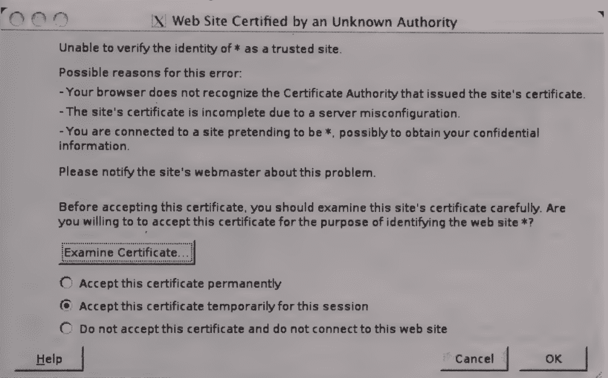

这是因为您的浏览器正尝试与 Webmin 服务器建立安全连接（https 中的“s”代表 secure），而且起初它并不信任这是一个合法的连接。不过，我们将在后面的章节中自行修复这个问题，所以现在只需临时接受证书，然后继续即可。

一旦您连接到 Webmin，您将看到一个带有登录/密码提示的页面，其外观所示：

图 1 Webmin 安全警告

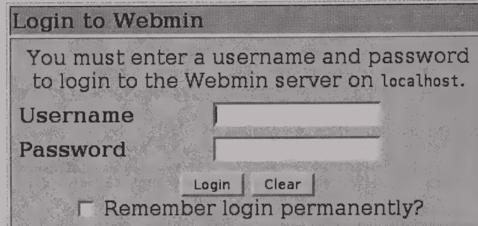

图 2 Webmin 登录对话

继续登录 Webmin。默认情况下，Webmin 管理员名为 root，密码与 UNIX 上的 root 用户相同。（请注意：正如我们稍后发现的，UNIX 用户和 Webmin 用户是两个独立的组，尽管它们可能有相同的名称，但是分开配置的。这为控制对 Webmin 界面的访问提供了很大的灵活性。）注意：如果您的浏览器提议记住登录名和密码，**不要**同意！这将允许任何访问您桌面电脑的人在您的机器上拥有管理权限！

## 配置 Webmin

尽管 Webmin 的默认设置已经不错，但我们还可以做一些事情让它们变得更好。登录后，您应该看到一个类似下面的屏幕：

## Webmin

版本 1.230 用于 homer4-deb.sinclair.homeg4.edu (Debian GNU/Linux 3.1)

| Webmin | 系统 | 服务器 | 网络 | 硬件 | 其他 |
|---|---|---|---|---|---|
| 更改语言和主题 | Webmin 操作日志 | Webmin 配置 | Webmin 服务器索引 | | |

退出

3 Webmin 首页

Webmin 模块按照屏幕上标签页指示的功能分类组织。第一个类别（Webmin）用于管理 Webmin 用户并配置 Webmin 的行为。我们不会详细介绍所有的模块，但会描述最常用的。

点击 Webmin 配置模块。找到标记为 IP Access（IP访问）的按钮并点击它。您将看到：

## IP 控制

Webmin 索引

模块索引

可以使用此表配置 Webmin 仅允许来自某些 IP 地址的访问。也可以输入主机名（如 `foo.bar.com`）和 IP 网络（`10.254.3.0` 或 `10.254.1.0/255.255.128`）。您应该将访问限制在受信任的地址，特别是当可以通过互联网访问时。否则，任何猜中您密码的人将对您的系统拥有完全控制权。

| 访问控制选项 |
|---|
| [ ] 允许所有地址 |
| [ ] 仅来自列出的地址 |
| [ ] 拒绝来自列出的地址 |
| `127.0.0.1` |
| - - [ ] 在每次请求时解析主机名 |

<- 返回 Webmin 配置

4 IP 访问模块

在这里，您可以根据请求访问的机器的 IP 地址允许或拒绝 Webmin 访问。默认情况下，Webmin 仅允许来自本地主机。根据网络信任程度和您的安全策略，您可能希望保持默认行为。

要进入下一个模块，点击返回 Webmin 配置。

选择标记为 Ports and Addresses（端口和地址）的按钮。

Webmin 索引

模块索引

## 端口和地址

| IP 地址和端口 | 绑定到 IP 地址 | 监听端口 |
| --- | --- | --- |


| 监听 IP 和端口 | 任意地址 [ ] | 特定端口 [ ] 10000 |
|---|---|---|
| | | 与第一个相同 [ ] |
| 在 UDP 端口上监听广播 | 不监听 [ ] 10000 | |
| Web 服务器主机名 | 从浏览器获取 homeg4-deb.sinclair home | |


图 5 Webmin 端口和地址模块

这允许您指定 Webmin 监听请求的网络地址和端口。这样做有两个优点：

- 如果您的机器有多个网卡（NIC），您可以将 Webmin 访问限制在特定的网段。（默认情况下，它监听所有网络接口。）
- 由于端口 10000 是一个常用的 Webmin 端口，潜在攻击者可能会尝试通过网络访问此端口以试图控制您的机器。通过更改端口号，可以降低这种风险。

接下来让我们看看

## 日志

Webmin 索引

模块索引

Webmin 可以配置为将日志写入文件或系统日志（syslog）。这对于跟踪谁登录了系统以及他们做了哪些更改非常有用。您可以选择记录哪些事件，例如登录、注销和配置更改。

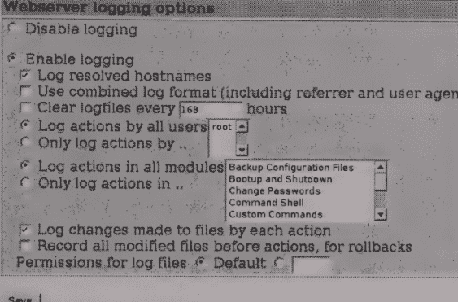

返回 Webmin 配置

图 6 Webmin 日志

此页面上还有一个我想要说明的模块。点击“Webmin Themes”（Webmin Themes）。

从“当前主题”（Current Theme）下拉框中选择 MSC.Linux 并点击“更改”（Change）按钮。片刻之后，你的浏览器窗口将刷新，你将看到不同的 Webmin 布局。这个主题比默认主题更容易导航。当然，你可以下载并安装额外的主题，或者创建你自己的主题。

此页面上还有其他模块，我已经涵盖了较重要的部分。其他的可以空闲查看，并留给学生作为练习。

Webmin 类别中的最后一个模块是“Webmin 用户”（Webmin Users），不过你也可以管理 Webmin 组。这允许你控制每个 Webmin 用户可以访问的哪些特定管理功能。

## Webmin 用户

创建一个新的 Webmin 用户。

| 用户 | 模块 | | |
|---|---|---|---|
| root | 全局 ACL | 启动和关机 |
| | 更改语言和主题 | 修改密码 |
| | 命令行外壳 | 自定义命令 |
| | 磁盘和网络文件系统 | Linux RAID | 网络配置 |
| | PAM 认证 | 本地磁盘分区 | 读取用户邮件 |
| | 运行进程 | 计划命令 | 计划 Cron 任务 |
| | SysInit 配置 | 系统文档 | 系统日志 |
| | 系统时间 | 用户和组 | Webmin 操作日志 |
| | Webmin 配置 | Webmin 服务器索引 | Webmin 用户 |

创建一个新的 Webmin 用户。

## Webmin 组

未定义 Webmin 组。

图 8 Webmin 用户管理

第一部分用于管理 Webmin 用户。当你首次安装 Webmin 时，这里唯一的用户将是 root。此时，你可以：

- 创建一个新的 Webmin 用户
- 将 UNIX 用户转换为 Webmin 用户（切记，这是两组独立的用户）
- 设置 UNIX 用户和 Webmin 用户的自动同步。（例如，强制 Webmin 使用与其等效 UNIX 用户相同的密码。）
- 允许 Webmin 访问任何 UNIX 用户，即使他们没有 Webmin 用户名。

然而，真正的威力在于 Webmin 组。你可以为 Webmin 组分配管理权限，然后根据用户的组成员身份控制每个单独用户拥有的权限。再加上这种自定义任何 Webmin 模块的能力，你就有了一种非常强大的手段，可以精细调整系统的访问权限，这是标准 UNIX 无法做到的。

## Webmin 用户和组

### 步骤 1 - 创建新组

- 滚动到屏幕底部并点击“创建新的 Webmin 组”。
- 在“组名”字段中，输入 `helpdesk`。
- “组员”留为 <无>（None>）。
- 在 Webmin 模块列表中，点击“用户和组”（Users and Groups）和“修改密码”（Change Passwords）旁边的复选框，将这些模块分配给 `helpdesk`。

你的屏幕应该看起来这样：

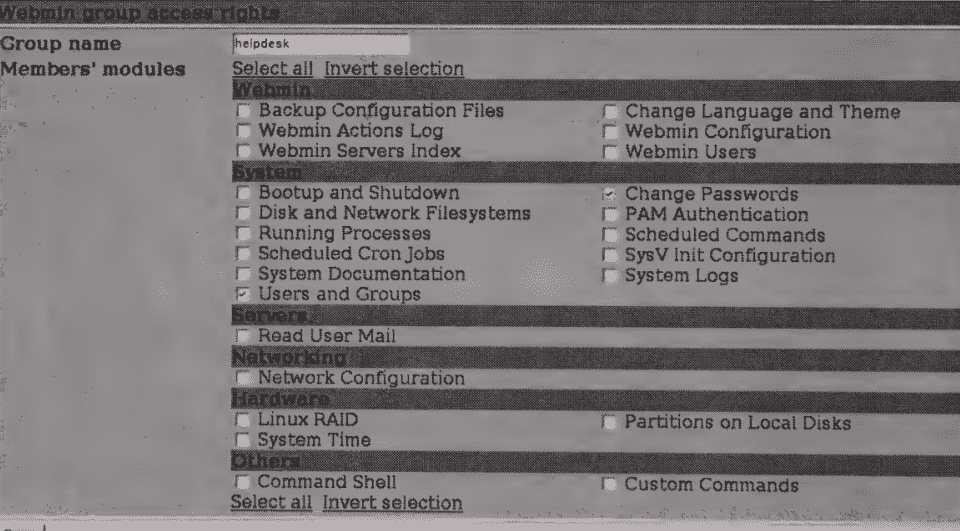

| 组名 | 成员模块 | | |
|---|---|---|---|
| helpdesk | 选择全部 | 反转选择 | 更改语言和主题 |
| | Webmin | 备份配置文件 | Webmin 配置 |
| | Webmin 操作日志 | 用户 |
| | Webmin 服务器索引 | |
| | system | 启动和关机 | PAM 认证 |
| | 磁盘和网络文件系统 | |
| | 运行进程 | 计划命令 |
| | Cron 任务 | SysV init 配置 |
| | 系统文档 | 系统日志 |
| | 用户和组 | |
| | 服务器 | 读取用户邮件 | |
| | 网络 | 网络配置 | |
| | 硬件 | Linux RAID | 本地磁盘分区 |
| | 系统时间 | | |
| | 其他 | 命令行外壳 | 自定义命令 |
| | 选择全部 | 反转选择 | |

图 9 设置 helpdesk 组

- 点击“保存”（Save）按钮，你将返回 Webmin 用户主页面。
- 在标记为“Webmin 组”（Webmin Groups）的部分，你现在应该看到你新创建的组 `helpdesk` 以及分配给该组的模块。

### 步骤 2 - 创建 Webmin 用户

- 从用户主页选择“创建新的 Webmin 用户”。
- 在“用户名”处输入 `helpuser`。
- 在“组员”处，从下拉列表中选择 `helpdesk`。
- “密码”设置为 `helpuser`。
- 选择“保存”（Save），你将返回 Webmin 用户页面。

### 步骤 3 - 测试你的新用户

- 返回 Webmin 索引并点击“注销”（Logout）。
- 在登录提示处，以 `helpuser` 身份登录。
- 你看到了哪些模块？
- 点击“修改密码”（Change Passwords）并尝试重置 root 用户密码。为什么可以或不行？
- 选择“返回索引”并点击“用户和组”（Users and Groups）。
- 尝试创建一个新用户。你可以吗？为什么可以或不行？

你注意到这里的问题了吗？我们想给帮助台文员提供有限权限，让他们只需创建新用户并为当前用户重置密码。然而，通过让此用户管理此框的访问，我们需要限制该用户的能力，以便他们只能执行我们让他们做的事。下一节将向我们展示如何做到这一点。

## 限制管理访问

以 `helpuser` 注销并以 `root` 重新登录。点击“Webmin 用户”。在“Webmin 组”部分，点击 `helpdesk` 组。

点击“修改密码”模块的链接。你会看到这样的界面：

## 修改密码

| 修改密码访问选项 | | |
|---|---|---|
| 可以编辑配置？ | 是 | 否 |
| 可更改的用户 | 所有用户 | 仅用户 |
| | 仅用户 | |
| | 所有其他用户 | |
| | UID 范围内的用户 | |
| | 用户组 | |
| | 包含辅助组 | |
| | 匹配的用户 | |
| 必须输入新密码？ | 是 | 否 |
| 必须输入旧密码？ | 是 | 否 |
| 下次登录时更改密码？ | 是 |
| 登录时强制执行密码？ | 是 | 否 |


首先，取消 `helpdesk` 组编辑组的能力。在“可以编辑配置？”处选择“否”，以确保我们的更改不会被重置。在“可更改的用户”下，选择“UID 范围内的用户”并输入范围 1000 到 65535。

## 用户和组

| 用户和组访问选项 | | |
|---|---|---|
| 可以编辑配置？ | 是 | 否 |
| 第一部分 | 所有用户 | 否 |
| | 仅用户 | |
| | 仅用户 | |
| | 所有其他用户 | |
| | UID 范围内的用户 | |
| | 用户组 | |
| | 包含辅助组 | |
| | 匹配的用户 | |

图 11 限制用户和组的访问

## 组权限

| 组权限访问选项 | | |
|---|---|---|
| 可编辑的 UNIX 组 | 所有组 | 否 |
| 可以创建新组？ | 仅限新用户 | 否 |
| 新组或修改组的 GID | 仅组 | 所有其他组 |
| | UID 范围内的组 | 是：仅限新用户：否 |
| 可以自动递增 GID 号？ | | |
| 可以计算 GID 号？ | | |
| 可以输入 GID 号？ | | |
| 多个组可以具有相同的 GID | | |
| 现有组的 GID 可以更改 | | |
| 可以删除组？ | 否 | |
| 可以按用户显示登录 | 无用户 | 所有用户 |

图 12 限制组权限

## 转换用户

此表允许你将现有的 Unix 用户转换为 Webmin 用户。每个新 Webmin 用户的权限将由下方所选的组决定。

- 所有用户
- 仅用户
- 除这些用户以外的所有用户
- 具有组的用户
- UID 在范围内的用户

将新用户分配到 Webmin 组 [webadmin]

[ ] 未来是否使用与 Unix 用户相同的密码？

立即转换

图 13 将您的用户转为 Webmin 用户

点击“立即转换”。你将看到一个屏幕，显示哪些用户正在转换，哪些被跳过。

选择“返回用户列表”。注销并以你的非 root 用户身份登录，确保你拥有管理权限。

到这里，Webmin 配置部分结束了。其他 Webmin 部分将在后续章节中介绍，但在此之前，让我们快速查看其他类别。

首先是系统（System）类别：

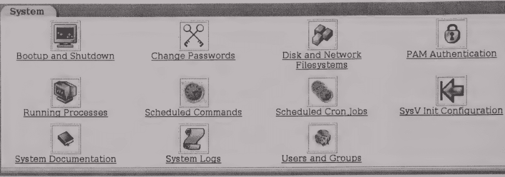

图 14 Webmin 系统页面

如预期所示，这涵盖了标准 UNIX 安装包含的功能。管理用户和组、进程管理、调度自动程序以及管理系统日志等基本任务都在此处处理。

到此就是 Webmin 的概述。我们将在后续章节中回到它，并查看如何使用它来管理 UNIX 系统上的特定服务。

## 章节总结

- Webmin 是一个软件包，提供基于 Web 的 GUI 用于管理 UNIX 或 Linux 系统。
- 默认情况下，Webmin 工具被分为不同的类别，如系统、硬件和服务器。
- 由于 Webmin 为你的机器提供远程管理访问，它默认使用安全的加密连接，且仅响应来自本地机器的请求。
- 额外的安全功能包括记录用户操作、通过 Webmin 组限制访问以及在多次登录尝试后阻止访问。
- 你可以使用这些功能更改 Webmin 会话的外观和行为。
- Debian 开发者为了方便易用，将 Webmin 模块拆分为独立的包。
- 你可以将 Webmin 模块分配给组或个人用户，然后对这些模块进行自定义以进一步控制对它们的访问。

## 复习练习

1. 包含 Webmin 用户列表的文件名为：
   A) webmin.users
   B) passwd
   C) miniserv.users
   D) users

2. Webmin 允许不熟悉 Linux 的用户轻松地管理 Linux 系统。（对/错）

3. Webmin 的配置信息包含在：
   A) webmin.conf
   B) webmin.users
   C) miniserv.conf
   D) miniserv.srv

4. Webmin 使得控制对机器的管理访问变得更加困难，因为非 root 用户也可以拥有 Webmin 账户。（对/错）

5. Webmin 中的以下哪些操作不会被记录？
   A) Webmin 用户添加新组。
   B) 修改 Webmin 模块。
   C) 关闭 Webmin 日志
   D) 非 Webmin 用户的操作。

6. Webmin 日志数据的默认位置是 `/var/log/webmin.log`。（对/错）

7. 哪种设置*不是*由 Webmin 认证模块控制的？
   A) 空闲一段时间后自动登录
   B) 在登录屏幕上显示主机名
   C) 失败的登录尝试
   D) 允许本地主机上的所有用户登录（使用密码）。

8. 为了成为 Webmin 用户，你必须有一个 UNIX 账户。（对/错）

9. 你可以使用以下项更改你的 Webmin 会话的外观和行为：
   A) skins
   B) themes
   C) widgets
   D) controls

10. 安装时创建的第一个 Webmin 用户是 root。（对/错）

## 批判性思考

1. 在 Webmin 首页 http://www.webmin.com 查看你的 Web 浏览器并回答以下问题：
   - Webmin 的最新版本是什么？
   - 你目前正在使用哪个版本的 Webmin？
   - 如果前两个答案不同，你如何解释？
   - Webmin 页面提到了名为 Usermin 的东西。它是什么？
   - 有 Playstation 版的 Webmin 吗？
   - Webmin 支持英语外的多种语言。Webmin 对希腊语的支持如何？
   - 你可以使用任何 Web 浏览器使用 Webmin 吗？浏览器需要什么样的功能才能正常运行 Webmin？

# 第 6 章 – 加密与安全网络

## 目标

- 设置 GnuPG 密钥对
- 描述信任网（Web of Trust）
- 安装并配置 GPG
- 设置证书颁发机构（CA）
- 为 Webmin 创建签名数字证书

## 术语

**算法 (Algorithm)** - 一组完成任务的简单指令。计算机代码就是算法。

**非对称加密 (Asymmetric Encryption)** – 公钥加密的另一种名称。之所以这样命名，是因为发送者和接收者使用不同的密钥。另见公钥加密。

**证书颁发机构 (Certificate Authority)** - 一个受信任的第三方，其目的是对其通过安全手段身份认证的网络实体进行证书签名。

**密码算法 (Cipher)** - 用于加密和解密文件及消息的加密算法。

**密码学 (Cryptography)** - 对代码的研究。字面上讲，它的意思是“秘密写作”。

**加密 (Encryption)** - 对消息进行编码的过程，使得只有拥有正确密钥的人读取它。

**解密 (Decryption)** - 解码加密消息的过程。

**数字证书 (Digital Certificate)** - 一种特殊的消息，包含关于它属于谁、由谁颁发、唯一序列号或其他标识、有效日期的信息。

**数字签名 (Digital Signature)** - 一种确保消息确实是由声称发送者发送的方法。发送者使用私钥加密签名。

**GnuPG** - GNU Privacy Guard。一种开源密钥加密程序。

**哈希 (Hash)** - 通过对文件或文本运行数学公式产生的数字。可以用于加密、认证甚至数字签名。

**密钥服务器 (Keyserver)** - 公开的计算机，用户可以在其中共享密钥。

**密钥强度 (Key strength)** - 加密系统的安全性衡量。密钥位数越高，越难破解。

**私钥 (Private Key)** - 非对称密钥对中的密钥。它用于加密签名。接收者使用发送者的公钥来验证签名。

**公钥加密 (Public Key Encryption)** - 用于加密和解密文件及消息的加密算法。

**公钥 (Public Key)** - 非对称密钥对中的密钥。它用于验证签名。接收者使用发送者的公钥来解密。

**对称加密 (Symmetric Encryption)** - 用于加密和解密文件及消息的加密算法。也称为非对称。

## 加密与认证简介

本章旨在让学生基本理解加密和认证的工作原理。它描述了一些术语和概念，然后是 GPG 的安装。GPG 将用于生成加密签名密钥、加密文件和电子邮件，这些将在后续章节中介绍。

此外，我们将讨论数字证书以及如何通过创建证书颁发机构（CA）来生成签名证书，从而验证服务器的身份。

重要：在设置安全网络（特别是涉及密钥或数字证书交换）时，所有参与者的计算机时间设置正确非常重要。所有的密钥和证书都有时间戳来验证其真实性，而不是由于时间戳错误而显示“潜在入侵者”。现在去处理好它吧。我们会感谢你的。

## 入门：哈希

数据认证是密码学的一种基本用法。这个想法非常简单，即使数学原理如此：我取一个文件或文本序列并对其应用数学公式得到一个数字。现在我假设该公式对我给的任何特定数据创建一个唯一的数字。换句话说，如果两个文件差一个字符，生成的数字也将完全不同。如果是这样，这将是检测文件在传输过程中是否被更改的极佳技术。例如，我给你发送一个文件并包含我根据文件内容计算出的数字。你只需要对收到的数字运行数学公式，并将得到的数字和我发送的数字进行比较。如果它们匹配，你就可以假设收到的文件与我发送的是同一个。

现在我们理解了基本概念，让我们来看一些细节。我所生成的通常被称为哈希（hash）。它有时被称为校验和或消息摘要。两种广泛用于生成哈希的函数是 MD5 和 SHA-1。让我们尝试使用 `openssl` 命令进行一次简单的哈希计算。

**步骤 1**：创建一个包含单个字符的简单文本文件。我将创建一个名为 `test.txt` 的文件，其中包含一个小写字母 t。

**步骤 2**：计算哈希：

```
openssl md5 test.txt (用于 MD5 哈希)
openssl sha test.txt (用于 SHA-1 哈希)
```

（你也可以分别使用 `md5sum` 和 `sha1` 命令来生成哈希）

**步骤 3**：按字符比较文件并再次计算哈希。

**步骤 4**：比较原始文件与新的哈希值。注意，即使我们做了了人类无法察觉的微小更改（例如增加一个空格），新的哈希值也会完全不同，这清楚地表明文件被修改过。


# 哈希的一个流行用途是验证密码

当创建用户账户时，密码会通过哈希函数处理，并将哈希存储在密码文件中。当用户在登录时提示输入密码时，计算机会对密码运行哈希函数，并将该结果与密码文件中存储的哈希进行比较。如果两者匹配，则用户输入了正确的密码，并允许登录计算机。

我们稍后在讨论数字签名时会回到哈希话题。但现在，只需记住这个基本概念，即**我们可以使用哈希来检查数据是否被篡改**。

# 对称加密（私钥加密）

在对称加密中，发送者和接收者共享一个密钥，该密钥用于加密和解密信息。在本示例中，我们将使用 `openssl` 命令。该命令在 UNIX 系统上很常见，是密码学工具包 OpenSSL 的一部分，有许多有趣的用途。你可以通过查看在线页面或搜索互联网来了解更多关于它的信息。

在本示例中，我们将使用对称密钥对文件进行加密和解密。

## 步骤 1：选择加密算法

要查看 `openssl` 支持的各种加密算法列表，请使用命令：

```
openssl list-cipher-commands
```

由于对加密算法的深入讨论超出了本文的范围，我们将简单地使用 DES。它代表数字加密标准（Digital Encryption Standard），使用 56 位密钥，在当今的计算机上相对容易被破解。然而，我们在这里并不是追求不可破解，而是为了简单。

在开始之前，让我们来谈密钥长度。加密密钥是一个随机生成的数字。因此可以合理假设，如果我们有更大的数字范围来随机选择密钥，那么密钥将更难破解，因为可能性更多。衡量密钥易破解程度的一个标准是其密钥长度，以位为单位。由于我们处理的是计算机和二进制数，密钥是 1 和 0 的字符串，即位。因此，56 位密钥是从 0 到 72,057,594,037,927（即 $2^{56}$）之间的数字池中选出的。还需要明确的是，密钥位数越长，密钥可能出现的范围越宽，越难破解。现在让我们继续。

## 步骤 2 – 加密文件

创建一个短文本文件或使用现有的文件进行加密。我将使用名为 `test.txt` 的文件，但任何文件都可以。现在让我们加密它：

```
openssl enc -des -salt -in test.txt -out test.enc
```

```
让我们查看所使用的 openssl 选项：
enc - 这是用于加密算法的 openssl 命令
-des 是我们正在使用的算法
-salt - 盐（salt）是一组随机字符，被添加到加密后的文本以
-in - 我们要加密的文件名。
-out - 加密后的文件名。
```

系统会提示你输入加密密码。这就是密钥。你将使用同一个密钥来解密文件。既然如此，让我们解密文件：`openssl enc -des -in test.enc`

> 注意我们使用的新选项 `-d`。它告诉 `openssl` 我们正在解密文件。这次我们也没有使用 `-out` 选项。这意味着解码后的文件将打印到标准输出。要将其保存到文件，请使用 `-out` 后跟新文件名或重定向输出。

默认情况下，加密会创建一个人类不可读的二进制数据文件。如果你想将其发送给他人，必须将其作为电子邮件附件或发布到文件服务器进行下载。有时，你想将消息粘贴到电子邮件中，因此我们不仅需要加密数据，还需要将其转换为文本。最常用的方法是使用 base-64 编码系统。让我们再次加密文件，但这次生成一个适用于复制和粘贴的文件：`openssl enc -des -a -salt -in test.txt -out test.b64`

我们唯一添加的选项是 `-a`，这意味着我们想要 ASCII 文本格式输出。除此之外，它的工作方式与之前的示例完全相同。如果你检查该文件，你会看到看起来像乱码的内容，但至少它是人类可读的。

- 要获取所有选项的列表，请使用命令 `man enc`

## 步骤 3 – 解密文件

要解密文件，我们使用以下命令：`openssl enc -d -a -in test.b64`

系统会提示你输入加密密码。这就是密钥。你将使用同一个密钥来解密文件。

> 注意我们使用的新选项 `-d`。它告诉 `openssl` 我们正在解密文件。这次我们也没有使用 `-out` 选项。这意味着解码后的文件将打印到标准输出。

# 公钥加密

非对称加密使用一对密钥：公钥和私钥。公钥对所有人开放，而私钥则保持保密。这允许任何人为接收者加密消息，但只有私钥的所有者才能进行解密。这是数字签名和 HTTPS 等安全通信的基础。

请按此格式输入真实姓名、注释和邮箱地址：

> "Heinrich Heine (诗人) <heinrichh@duesseldorf.de>"
>
> 真实姓名：Tom Sinclair
>
> 邮箱地址：tsinclair@mac.com
>
> 注释：终结结者
>
> 你选择了此用户-ID：
>
> "Tom Sinclair@ <tsinclair@mac.com>"
>
> 修改 (N)姓名、(C)注释、(E)邮箱或 (O)确定/(Q)退出？

一旦你选定了关键设置，你将需要输入一个短语来保护你的密钥。使用你的密钥时将需要此短语。它可以是任何字符字符串，但应该易于记忆且难以破解。它不应与你的登录密码相同。

> 注意：不要忘记你的短语！如果你忘记了，绝对没有任何办法找回，你的密钥将变得毫无用处。

密钥现在开始生成。这将需要一些时间，取决于你选择的密钥大小，并且你可以为不同的用途创建任意数量的密钥。在密钥生成并签名后，你会收到通知。例如，你可能想为你的业务通信创建一个强密钥，并为日常使用创建一个较弱的密钥。

当你的密钥对完成后，你将收到一条如下所示的消息：

```
pgp:/home/tsinclair/gnupg/trustdb.gpg: trustdb created public and secret key marked as ultimately trusted.

pub 1024b/5520D607 2004-10-11 Tom Sinclair (The Terminator)
<tsinclair@mac.com>
Key fingerprint = 8F37 D4E1 E0AF E0E2 AE4F 429A 7C74 5520
sub D607/1024/A9160F2B 2004-10-11
```

> 这里有两点需要注意（我已在下方）：

`5520D607` - 是密钥 ID。你可以用它在服务器导入、导出或搜索你的密钥。

`8F37 D4E1 E0AF E0E2 AE4F 429A 7C74 5520 D607` - 这是指纹。这让接收你公钥的人验证该密钥确实属于你。例如，你可以给他们打电话，读出他们持有的你的密钥指纹，如果与你拥有的匹配，那就没问题。否则，有人正试图通过冒充你欺骗他们。

查看密钥指纹使用命令：

```
pgp --fingerprint
```

## 第 4 步 - 导出你的公钥

为了让其他人向你发送消息，你需要创建一个公钥的副本供他们使用。你可以生成二进制（默认）或 ASCII 版本的密钥，但 ASCII 版本更容易嵌入电子邮件签名中。默认情况下，密钥被发送到标准输出，但为了方便起见，你应该将输出重定向到文件中。上述操作使用的命令为：

```
gpg --export -a -o tsinsclai.asc tsinsclair@mail.com
```

这将以 ASCII 格式（`-a` 选项）导出用户 `tsinsclai` 的公钥并将其保存到文件 `tsinsclai.asc`。

> 注意，如果你的密钥环中有多个密钥，你需要为 `gpg` 提供关于你想要使用的密钥的标识信息。良好的选择是与密钥关联的邮箱地址。

# 密钥管理

GnuPG 创建了一个密钥数据库（有时称为密钥环），你在其中存储自己的和他人的密钥。默认情况下，这些密钥存储在你家目录下一个名为 `.gnupg` 的文件夹中。实际上有三个密钥环：

- `pubring.gpg` — 这些是公钥。
- `secring.gpg` — 这些是私钥（秘密密钥）。
- `trustdb.gpg` — 这是信任数据库。换句话说，这是你信任的公钥列表。我们稍后会讨论我们什么是*信任*。

## 导入密钥

要将另一个用户的公钥添加到你的密钥环，请使用命令：

```
gpg --import <filename>
```

`<filename>` 是包含要导入密钥的文件，类似于我们在上一节创建的那个。

## 撤销密钥

你有多个理由可能想要撤销一个或多个密钥：

- 你的私钥被盗了
- 你的 UID 已更改
- 你想使用更大的密钥

要*撤销*（或放弃）密钥副本，请使用命令

```
gpg --gen-revoke <userid>
```

（其中 `<userid>` 是创建该密钥的用户。）这会创建一个所谓的*撤销证书*。你会被要求提供撤销此密钥的原因，并提供在注释中描述原因的选项。和之前一样，你会被要求确认你的选择。请务必小心处理此证书。如果别人得到了它，他们可以随意撤销你的密钥。你可以将其打印出来或存储在磁盘上妥善保存。要使用该证书，请将其导入你的密钥环。每当你生成新的密钥对时，创建一个撤销证书是一个好主意。

以下是你可能想对密钥执行的一些额外操作：

```
gpg --list-keys
(这将列出密钥环中的密钥)
```

```
gpg --list-sigs
(这将列出密钥环中的密钥签名)
```

```
gpg --edit-key UID
(这将允许你对用户 UID 的密钥执行各种操作，包括对其进行签名)
```

## 签名密钥

为了对密钥进行签名，你必须有一个密钥可以签名。（你自己的密钥默认已经签名了，因为你已经信任它了）。从另一个用户处获取公钥并如之前所述将其导入你的密钥环。当你获得密钥后，你可以使用

```
gpg --edit-key <userid>
```

命令对该密钥进行签名。（密钥编辑器是一个交互式程序。你可以输入帮助提示来获取命令列表。）

## 使用你的密钥进行加密、解密和签名

- 一旦你的密钥环中有他人的公钥，你就可以使用命令向他们加密消息：

```
gpg -r <recipient> --encrypt <filename>
```

其中 `<recipient>` 是预期接收者的 ID。这创建一个文件 `<filename>.gpg`，其中 `<filename>` 正要加密的文件名。

- 解密数据请使用：

```
gpg --decrypt <data> -o <filename>
```

其中 `<data>` 是加密文件名，`<filename>` 是解密数据的输出文件。（默认是标准输出。）

理想情况下，你应该对发送的任何数据签名。数字签名是通过你的你的密钥和消息或文件的内容，然后对组合数据运行哈希函数生成的。生成的哈希即为签名。对明文文件签名，请使用以下：

```
gpg --clearsign -a <filename>
```

这创建一个名为 `<filename>.asc` 的文件，其中嵌入数字签名。虽然这对文本文件有用，但你可能想创建一个不修改文件内容的签名。（例如，如果你正在对二进制数据文件签名）。对于这种情况，你可以创建一个分离签名：

```
gpg --detach-sign <filename>
```

这创建一个名为 `<filename>.sig` 的二进制文件，包含数字签名。你可以以相同的方式验证分离签名和清除签名：

```
gpg --verify <signature file>
```

你也可以用一个命令对文件进行加密和签名：

```
gpg -s <filename>
```

这创建一个名为 `<filename>.gpg` 的文件，包含加密数据和签名。你仍然可以按通常的方式使用 `--verify` 和 `--decrypt` 进行处理。

# 信任网

公钥加密使得加密、解密、签名和验证消息变得简单。然而，在你这样做之前，你需要某种方法来验证从对方那里获得的公钥确实属于他们。记住，互联网在本质上是不安全的，总是存在第三方用自己的公钥替换你想要通信的人的密钥的可能性。

幸运的是，我们可以使用数字签名来帮助我们。假设我想和 Paul 做生意，但我并不认识他，我们面对面验证身份是不现实的。然而，我们有一个共同的朋友 Sue。所以，我把我的公钥发送给 Sue，她用她的私钥进行签名，表示她信任它属于我。Paul 也这样做。现在我们交换密钥时更有信心了，因为我们信任的人（Sue）已经证明了我们的公钥是真实的。

自然，在现实生活中情况会比这复杂。我们可能需要通过一系列密钥签名来建立信任关系。例如，Sue（我信任的）签名了我的密钥，Allen（Paul 信任的）签名了他的密钥。Sue 认识 Allen 并信任他的签名，所以她也签名了 Paul，Allen 也这样做签名我的密钥，因为他认识并信任 Sue。

使用公钥服务器会让这个过程变得简单得多。这些是互联网上的计算机，人们可以在那里上传自己的公钥并下载他人的公钥。一旦有人对密钥进行签名，他们将其重新上传到密钥服务器，密钥信息就会得到更新。

这使我们更容易检查给定密钥上数字签名的轨迹，并判断其中是否一个属于我们信任的人。如果是的话，那么我们更有信心可以信任该密钥本身。

另一种更正式的验证公钥的方法是通过证书颁发机构（CA）。我们将在本章节稍后讨论数字证书时对其进行更详细的描述。

# 使用 Kpgp

有几个用于 GnuPG 的 GUI 应用程序。GnuPG 网站上列出了它们的列表：

```
http://webber.dewinter.com/gnupg_howto/english/GPGMiniHowto-6.html#ss6.1
```

我最喜欢的是 Kpgp。要安装，只需运行（以 root 身份）：

```
apt-get install kpgp
```

要启动它，可以从命令行运行 `kpgp` 命令，或从 KDE 菜单启动它。（通常在“实用工具”下。）

第一次运行时，你将看到设置向导，它将引导你完成工具配置。如果你此时还没有创建密钥对，系统会提示你创建一个。一旦设置完成，你就可以在 GUI 中完成 `gpg` 工具在命令行中执行的几乎所有操作。

启动 kpgp 以获取设置向导。

## 介绍

## 欢迎使用 KGpg 向导

此向导将首先设置 KGpg 正常运行所需的一些配置选项。接下来，它将允许你创建自己的密钥对，以便加密文件和电子邮件。


图 1 Kgpg 设置介绍

点击 <下一步> 开始设置。

## 第一步：与 GnuPG 通信

Gnupg 需要知道你的 GnuPG 配置文件的存储位置。除非你想尝试一些不寻设置，否则只需点击“下一步”按钮。

你的 GnuPG 选项文件路径：

```
/home/tsinclai/.gnupg/gpg.conf
```


默认位置应该没问题。点击 <下一步> 继续。

## 第二步：在桌面上安装粉碎器


在我的桌面上安装粉碎器

将在你的桌面上安装粉碎器图标。

粉碎器会安全地删除放到上面的文件（覆盖 35 次）。记住，如果你下载了文件或在编辑器中打开文件，文件的部分可能会保存在临时位置。粉碎不会删除这些临时文件。

**如果你使用日志文件系统，粉碎可能不是 100% 安全的。**

此时，你可以选择安装一个图标来协助安全删除文件。这不会以任何方式影响你的密钥管理。请注意，对于 ext3 或 reiserfs 等日志文件系统，粉碎可能无法完全有效。一旦你决定如何继续，请点击 <下一步>。

现在你必须确定想要默认使用哪个私钥。记住，你可以在密钥环中拥有多个不同用途的密钥对。无论你选择哪一个，如果你需要，都可以使用不同的私钥。不过，这里的默认值对于大多数用途都是合适的。做出选择后点击 <完成>，Kpgg 主窗口将启动。

## 第三步：选择你的默认私钥

在登录时自动启动 KGpg

你的默认密钥：C1310B4B: Tom Sinclair (Debian PPC)

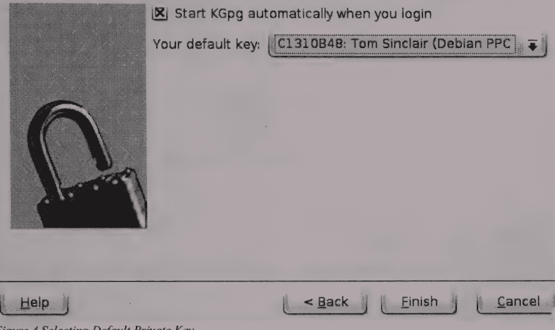

图 4 选择默认私钥

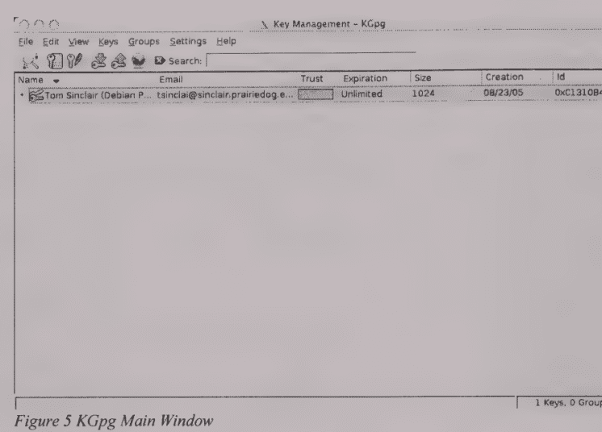

从这里你可以执行 `gpg` 在命令行中允许的任何操作。让我们来看看菜单选项：

- 文件 (File) – 从这里你可以连接到公钥服务器、打开文本编辑器加密或解密文本或退出。
- 编辑 (Edit) – 在你的密钥环中搜索密钥。
- 查看 (View) – 自定义你密钥的显示。
- 密钥 (Keys) – 编辑密钥、签名密钥、导出和导入公钥以及生成密钥对。
- 组 (Groups) – 这允许你对相关密钥进行分组，以便加密、解密和签名。
- 设置 (Settings) – 自定义你的 KGpg。
- 帮助 (Help) – 访问在线文档。

# 数字证书

## 介绍

本节专门用于让学生基础了解 OpenSSL 中数字证书的工作原理。数字证书简单就是一个标识符，类似于你的社会安全号码或驾照号码。它们被用于识别实体（如电子商务服务器）或确保当你……时

## 设置证书

证书颁发机构（CA）是一个可以对密钥签名的受信任第三方。许多服务使用数字证书来建立连接。在本节中，我们将演示如何……

在此示例中，让我们假设有两个用户：Jane，她是证书颁发机构（CA）；Bill，他负责管理一个需要证书的服务（以 Webmin 例）。

首先 Jane 通过创建一个密钥来设置她的 CA：

```
openssl req -new -x509 -days 730 -keyout /etc/ssl/private/cacert.pem -out /etc/ssl/cacert.pem
```

### 发布你的 CA

我们还没有完全完成。如果 Jane 的 CA 不是一个为人知的信赖机构，她必须创建一个 CA 根证书并发布它，以便用户将其导入 Web 浏览器中：

```
openssl x509 -in /etc/ssl/cacert.pem -out /etc/ssl/cacert.crt
```

### 证书签名

现在她准备好签名其他证书了。Bill 需要一个，所以他必须做的第一件事是为需要的服务创建一个证书签名请求（CSR）和一个私钥。


Bill: `openssl req -new -config /etc/ssl/openssl.cnf -nodes -out webmin-req.pem -keyout webmin-key.pem`

> 让我们来看看这里使用的 `openssl` 选项。其中一些已经很熟悉了，所以我们只检查与我们相关的部分：

- `-config` 这告诉 `openssl` 在哪里找到默认配置设置。
- `-nodes` 私钥将被加密以保持保密性。缺点是，当安全服务启动时，它会提示输入加密密钥，并在获取密钥之前不会启动。`-nodes` 选项指定私钥不被加密。当然，这意味着你必须格外小心，防止未经授权的用户访问你的私钥。

注意：当 Bill 创建 CSR 时，系统会要求他提供有关其服务器的信息。当系统询问 CN（通用名称）时，他应该输入其服务器将用作证书识别自身身份的名称，例如：`billspec.dsouth.weston.edu`

这会创建两个文件：`webmin-req.pem`（CSR）和 `webmin-key.pem`（Webmin 服务的私钥）。现在他只需要弄清楚如何这两个文件都给 Jane。电子邮件可以，或者将它们发布到共享文件系统上，但这超出了本文的范围。假设他设法成功将它们交给了 Jane。（这些文件很小，所以拷贝它们到软盘上就可以了。）

Jane 现在必须使用来自 Bill 的 CSR 和公钥来创建一个签名的数字证书：

`openssl x509 -req -in webmin-req.pem -out webmin-cert.pem -signkey webmin-key.pem -CA /etc/ssl/cacert.pem -CAkey /etc/ssl/private/cakeym.pem -CAateserial -days 365`

> 这里还有一些新的 `openssl` 命令选项，让我们来看一下：

- `x509` - 这告诉 `openssl` 我们将显示并签名数字证书。
- `-req` 默认情况下，`x509` 命令期望数字证书作为输入。通过此选项，我们告诉它接受证书请求。
- `-signkey` 这指定了用于签名此证书的密钥。
- `-CA` 这指定了用于签名的 CA 证书。
- `-CAkey` 这指定了用于签名新证书的 CA 私钥。
- `-CAateserial` 当证书由 CA 签名时，会自动生成一个序列号并添加到该证书的文件中。此选项会在序列号文件不存在时创建它。

这会创建一个签名的证书 `webmin-cert.pem`，然后她必须将其传回给 Bill。（Bill 已经有一个密钥的副本了。）

# 安装签名证书和密钥

当 Bill 获得证书后，他必须将其移动到相应的目录：

- 要获取完整的选项集，使用命令 `webmin-req.pem x509`

```bash
mv webmin-cert.pem /etc/ssl/certs/.
```

接下来，他必须将密钥文件拷贝到相应的目录：

```bash
mv webmin-key.pem /etc/ssl/private/.
```

现在，Bill 必须告诉 Webmin 使用新的证书和密钥。他应该登录 Webmin，选择 Webmin 配置并使用 SSL 加密模块指向新的证书和密钥。

## 章节总结

密码学是编码和解码秘密消息的科学。

加密是编码秘密消息的过程。解码秘密消息被称为解密。

加密最基本的的形式之一是对称加密，双方使用相同的代码密钥来加密和解密消息。这也称为私钥加密。

公钥加密（也称为非对称加密）涉及所有参与方拥有一独特的密钥，一个私密一个公开。

哈希函数为文件或文本序列生成一个唯一的数字。

哈希函数广泛用于身份验证。

`openssl` 命令是 OpenSSL 密码工具包的一部分，可以执行多种功能，包括生成哈希和数字证书。

## 复习练习

1. 使用共享密钥的加密被称为：

   A) 非对称的
   B) 共享的
   C) 私钥
   D) 系统的

2. 哈希是从文件或文本序列中生成的唯一数字。（正确/错误）

3. OpenSSL 工具包的默认设置位于文件中：

   A) `/etc/ssl/openssl.conf`
   B) `/etc/ssl/openssl.conf`
   C) `/etc/openssl.conf`

4. `openssl` 命令可用于签名文件。（正确/错误）

5. 下列哪项不是 `openssl` 的选项？

   A) `req`
   B) `enc`
   C) `rand`

# Dc_server

6. 在非对称加密中，你需要发布你的私钥，以便他人安全地与你通信。（正确/错误）

7. 本文讨论的安全网络连接使用了什么种加密？

   A) 仅非对称加密。
   B) 仅对称加密。
   C) 非对称和对称加密都是。
   D) 以上都不是。

8. 如果你忘记了 GnuPG 密码令，恢复它是件简单的事。（正确/错误）

9. CA 的缩写代表：

   A) 证书身份认证
   B) 证书颁发机构
   C) 证书授权
   D) 某些无政府

10. 自签名证书是由信任方签名的证书。（正确/错误）

## 批判性思考

1. 在非对称加密中，你需要发布你的私钥，以便他人安全地与你通信。（正确/错误）

2. 本文讨论的安全网络连接使用了什么种加密？

   A) 仅非对称加密。
   B) 仅对称加密。
   C) 非对称和对称加密都是。
   D) 以上都不是。

3. 如果你忘记了 GnuPG 密码令，恢复它是件简单的事。（正确/错误）

4. CA 的缩写代表：

   A) 证书身份认证
   B) 证书颁发机构
   C) 证书授权
   D) 某些无政府

5. 自签名证书是由信任方签名的证书。（正确/错误）

6. 指出以下句子中的错误：“哈希函数为文件或文本序列生成一个唯一的数字。”

7. 该句子中的错误：“`openssl` 命令是 OpenSSL 密码工具包的一部分，可以执行多种功能，包括生成哈希和数字证书。”

8. 该句子中的错误：“加密是编码秘密消息的过程。”

9. 该句子中的错误：“解码秘密消息被称为解密。”

10. 该句子中的错误：“加密最基本的的形式之一是对称加密，双方使用相同的代码密钥来加密和解密消息。”

11. 该句子中的错误：“公钥加密（也称为非对称加密）涉及所有参与方拥有一独特的密钥，一个私密一个公开。”

12. 该句子中的错误：“哈希函数广泛用于身份验证。”

普通公众。现在计算机的数量已经从几百台变成了几十万台。UCSD 的 hosts 文件已经不堪重负，计算机不得不每天更新几次其副本。因此，这种解决方案对几百台计算机可能有效，但随着网络的增长，它变得和一个巨大的便利贴并无二致。我们需要一种能够随着网络增长而优雅扩展的域名解析方法。

## DNS

现在，hosts 文件的基本思想——将 IP 地址与人类易读的名称关联——是完全正确的。问题出现在数据量大到无法在单个文件中进行有效管理时。随着你的网络增长，这个问题增长得更快。DNS 是目前解决这一问题的方案，它通过不同的数据处理方式解决了它。

那么，如何管理无法轻松放入单个文件的海量数据呢？当然是将其分成多个文件！不仅如此，还制作这些文件的副本并将其分散到多台计算机上，这样你就有了足够的容量，而且没有人会被负载所压垮。为了实现这一点，我们需要一种更好的方法通过网络名称来识别计算机。我们将网络分成若干层。顶层是根节点（root），用 `a.dot` 表示。现在不用担心为什么。下一层是顶级域名（TLDs），包括 `.com`、`.edu`、`.org` 等。下一层是组织的子域名。例如，微软拥有一个 `.com` 顶级域名的子域名，名为 `enough.microsoft`。下一层是用于具体的机器名称。`www.microsoft.com` 是顶级域名 `.com` 下 `microsoft` 子域名中的 Web 名称 `www`。通过这种方式，我们可以拥有许多命名为 `www` 的计算机（例如），并且仍然保持清晰，因为它们位于不同的域中，例如：

- `www.microsoft.com`
- `www.apple.com`
- `www.ibm.com`
- `www.purdue.com`
- `www.whoppix.org`

因此，DNS 的工作原理是让不同组的计算机负责该层级结构中的每一层。例如，根服务器知道去哪里寻找 `.com`、`.org` 等服务器。`.com` 服务器知道去哪里寻找 `microsoft.com`、`apple.com` 等服务器。

一次 DNS 查询的运行机制如下：

1. 用户在她的 Web 浏览器中输入地址（例如）`www.ibm.com`。
2. 本地 DNS 服务器查找该名称，看是否可以生成网络地址。如果可以，它会将地址返回给用户的计算机，她建立连接，一切无碍。如果不可以……
3. 本地 DNS 联系根服务器并询问 `.ibm.com`。根服务器不知道去哪里寻找 `.com` 服务器，因此它们将本地 DNS 指向那里。
4. `.com` 服务器知道 `.ibm.com` 服务器在哪里，但它们知道 `ibm.com` 服务器在哪里，并将你的本地 DNS 重定向到它们那里。
5. IBM DNS 机器名称 `www`，并将 IP 地址返回给她的本地 DNS。本地 DNS 将地址存储在本地缓存中，并将地址处理给客户端。
6. 客户端 PC 直接连接到服务器 `www.ibm.com`。

该过程可以视觉化如下：

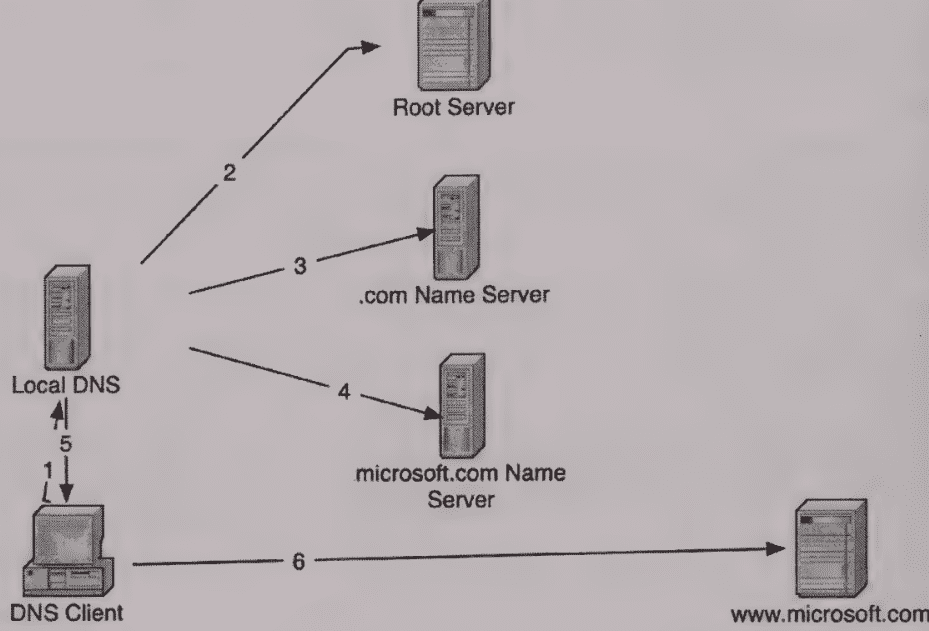

图 1 DNS 查询示例

这被称为**递归查询**（`recursive query`），即你的本地名称服务器去查询 DNS 层级结构的其余部分。另一种查询是*迭代查询*（`iterative query`），即名称服务器如果本地拥有该记录则会返回，但它不会继续搜索。这听起来很复杂，但整个过程只需要几秒钟。事实上，我们可以使用一个名为 `dig` 的命令行实用工具演示此过程。

`dig` 命令的基本格式为：

```
dig @server name type
```

**server** - 你想要查询的 DNS 服务器的名称或 IP 地址。默认为你的本地名称服务器。

**name** - 你想要定位的域名或主机名

**type** - 你想要查找的记录类型。DNS 记录也称为资源记录（`resource records`），有多种类型：

- `A` - 地址记录（主机名 -> IP 地址）
- `MX` - 邮件交换器（电子邮件域名 -> 邮件服务器）
- `NS` - 名称服务器（DNS 域名 -> 名称服务器）
- `CNAME` - 规范名称（别名 -> 主机名）

3. 如果没有安装 `dig`，可以通过安装 `dnsutils` 包来获取。

还有其他几种，但这些是最频繁使用的。`dig` 命令默认搜索 `A` 记录。

如果你运行不带选项的 `dig`，它将返回根名称服务器列表。

默认情况下，我们将查询本地名称服务器，但我们如何找到本地名称服务器呢？DNS 客户端信息包含在一个名为 `/etc/resolv.conf` 的文件中。一个典型的基础配置看起来如下所示：

```
nameserver 192.168.2.252
```

这是你本地名称服务器的 IP 地址。其他信息（如你的域名）也可以在此文件中找到。现在我们有足够的信息来进行我们的演示了。

要找到根服务器的名称，运行不带任何选项的 `dig`。输出看起来像这样：

```
Alphonse:~ tsinclais dig

<< DIG 9.2.2 >>
;; global options: printcmd
;; Got answer:
;; >>HEADER<< opcode: QUERY, status: NOERROR, id: 
;; flags: qr rd; count: 0 answers: 0 authority: 0 additional: 0

;; QUESTION SECTION:
;      IN      A

;; ANSWER SECTION:

;; AUTHORITY SECTION:

;; ADDITIONAL SECTION:
```

如果你收到响应，说明服务器正在运行。如果似乎存在问题，你可以检查日志文件 `/var/log/syslog` 中的错误消息：

```
tail /var/log/syslog
```

默认情况下，`tail` 命令显示你作为参数提供的任何文件的最后 10 行。这对于日志文件非常有用，因为最近的消息位于文件的末尾。

默认情况下，你的 DNS 服务器充当缓存名称服务器（`caching-name server`）。这意味着它不包含任何关于 IP 地址的本地信息，但它可以转发查询，并在收到响应时将信息存储在缓存中。

让我们让客户端指向该 DNS 并确保它工作正常。首先，我们将保存一份 DNS 客户端配置文件的副本：`cp /etc/resolv.conf /etc/resolv.old`

现在我们将创建一个文件来指向我们的新服务器。编辑 `/etc/resolv.conf`，使其包含以下单行：

```
nameserver 127.0.0.1
```

注意：此配置是针对服务器本身的。任何额外的客户端都应该使用 DNS 服务器的适当 IP 地址。现在我们通过 ping 互联网上的主机来测试它：

```
ping www.debian.org
```

响应应该像这样：

```
root@pdog:/etc# ping www.debian.org
PING www.debian.org (194.109.137.218): 56 bytes data
64 bytes from 194.109.137.218: icmp_seq=0 ttl=51 time=144.5 ms
64 bytes from 194.109.137.218: icmp_seq=1 ttl=51 time=145.5 ms
64 bytes from 194.109.137.218: icmp_seq=2 ttl=51 time=145.4 ms
64 bytes from 194.109.137.218: icmp_seq=3 ttl=51 time=144.4 ms
64 bytes from 194.109.137.218: icmp_seq=4 ttl=51 time=144.8 ms
--- www.debian.org ping statistics ---
6 packets transmitted, 5 packets received, 16% packet loss
round-trip min/avg/max = 144.4/144.9/145.5 ms
```

（使用 `<Ctrl>-C` 停止 ping。）

> 出于习惯，我会为任何计划重写的配置文件制作备份。这样的话，如果我搞砸了，可以轻松恢复之前的设置。

`www.debian.org` 的地址现在位于名称服务器缓存中。如果你再次 ping 域名，初始响应应该会快一点。仅缓存名称服务器对于家庭网络来说是一个很好的选择，因为它实际上是免维护的，并且可以加快你的上网速度。

# 主主服务器 (Primary Master Name Server)

这是一个良好的开始，但我们可以做得更好。让我们将仅缓存名称服务器转换为主主服务器（`primary master server`）。主主服务器拥有主机及其 IP 地址的本地数据库（称为区域文件或主文件），并允许我们为本地网络设置名称解析，同时为互联网访问提供服务。这些 DNS 服务器被称为该区域的权威服务器（`authoritative`）。

现在，通常官方 DNS 服务器需要向更高级别的服务器注册，以完全参与 DNS 层次结构。由于我们只是在学习，我们不会这样做。这不会阻止我们为实验网络设置一个我们可以使用的的简单系统。

首先，我们需要想一个域名。由于我们没有与其他名称服务器交换信息，我们可以使用任何名称，已经在使用的名称除外。例如，我们不想使用 `ibm.com`。产生一个不冲突名称的简单方法是将我们的姓氏与当前域名结合。假设我的计算机在 `prairiedog.edu` 网络上，那么我的新域名将命名为 `sinclair.prairiedog.edu`。

现在我们已经有了域名，让我们设置我们的主服务器。配置文件存储在 `/etc/bind` 中。这里重要的文件有：

- `named.conf` 定义了基本的 DNS 区域。
- `named.conf.local` 定义了本地区域。
- `named.conf.options` 用于设置选项。
- `db.*` 这些是区域文件。例如，`db.root` 包含根服务器的名称和地址。

首先，我们需要设置 `rndc` 工具。这是一个用于安全控制名称服务器的实用程序，仅允许授权的服务器更新你的区域信息。它通过使用密钥来实现。没有此密钥的服务器不允许访问此服务器。`/etc/bind` 中应该有一个 `rndc.key` 文件，我们将替换它。这里是该操作最简单的方法：

## 步骤 1：生成新的 rndc 配置和密钥信息：

```
rndc-conf > /etc/bind/rndc.conf
```

你的 `rndc` 看起来可能像这样：

```
### Start of rndc.conf
key "rndc-key" {
  algorithm hmac-md5;
  secret "CKnN409YFUe4E8+Kih2iA==";
}
```

```
options {
    default-key "rndc-key";
    default-server 127.0.0.1;
    default-port 953;
}
```

### End of rndc.conf

### 在 named.conf 中使用以下内容，根据需要调整允许列表：

```
key "rndc-key" {
    algorithm hmac-md5;
    secret "CKnN409YFUe4E8+Kih2iA==";
};
controls {
    inet 127.0.0.1 port 953;
    allow "rndc-key";
};
```

### End of named.conf

## 步骤 2：将新的 rndc 信息添加到 named.conf 中：

```
cat /etc/bind/rndc.conf >> /etc/bind/named.conf
```

## 步骤 3：编辑 `/etc/bind/named.conf` 以移除 rndc.conf 行并取消 named.conf 部分的注释。


## 步骤 4：杀死并重启 named 服务器

```
killall -9 named
/etc/init.d/bind start
```

## 步骤 5：测试 rndc

```
rndc status
```

你应该会收到响应且没有错误消息。如果你收到错误消息，请检查 `/var/log/syslog`。

`www.debian.org` 的地址现在已经在名称服务器缓存中。如果你再次 ping 域名，初始响应应该稍微快一点。仅缓存名称服务器对于家庭网络来说是一个很好的选择，因为它实际上是免维护的，并且可以加快你的互联网浏览。

# 主主服务器

这是一个良好的开始，但我们可以做得更好。让我们将仅缓存名称服务器转换为主主服务器。主主服务器拥有主机及其 IP 地址的本地数据库（称为区域文件或主文件），并允许我们为本地网络设置名称解析，同时为互联网访问提供服务。这些 DNS 服务器被认为对该区域具有权威性。

现在，通常官方 DNS 服务器需要向更高级别的服务器注册，以完全参与 DNS 层次结构。由于我们只是在学习，我们不会这样做。这不会阻止我们为我们的实验网络设置一个我们可以使用的简单系统。

首先，我们需要想一个域名。由于我们没有与其他名称服务器交换信息，我们可以使用任何名称，已经在使用的名称除外。例如，我们不想使用 `ibm.com`。产生一个不冲突名称的简单方法是将我们的姓氏与当前域名结合。假设我的计算机在 `prairiedog.edu` 网络上，那么我的新域名将命名为 `sinclair.prairiedog.edu`。

现在我们已经有了域名，让我们设置我们的主服务器。配置文件存储在 `/etc/bind` 中。这里重要的文件有：

- `named.conf` 定义了基本的 DNS 区域。
- `named.conf.local` 定义了本地区域。
- `named.conf.options` 用于设置选项。
- `db.*` 这些是区域文件。例如，`db.root` 包含根服务器的名称和地址。

首先，我们需要设置 `rndc` 工具。这是一个用于安全控制名称服务器的实用程序，仅允许授权的服务器更新你的区域信息。它通过使用一个密钥来实现。没有此密钥的服务器不允许访问此服务器。`/etc/bind` 中应该有一个 `rndc.key` 文件，我们将替换它。这里是该操作最简单的方法：

## 步骤 1：生成新的 rndc 配置和密钥信息

```
rndc-conf > /etc/bind/rndc.conf
```

你的 `rndc` 看起来可能像这样：

```
### Start of rndc.conf
key "rndc-key" {
  algorithm hmac-md5;
  secret "CKnN409YFUe4E8+Kih2iA==";
}

options {
    default-key "rndc-key";
    default-server 127.0.0.1;
    default-port 953;
}
### End of rndc.conf

### 在 named.conf 中使用以下内容，根据需要调整允许列表：
key "rndc-key" {
    algorithm hmac-md5;
    secret "CKnN409YFUe4E8+Kih2iA==";
};
controls {
    inet 127.0.0.1 port 953;
    allow "rndc-key";
};
### End of named.conf
```

## 步骤 2：将新的 rndc 信息添加到 named.conf 中

```
cat /etc/bind/rndc.conf >> /etc/bind/named.conf
```

## 步骤 3：编辑 `/etc/bind/named.conf` 以移除 rndc.conf 行并取消 named.conf 部分的注释

## 步骤 4：杀死并重启 named 服务器

```
killall -9 named
/etc/init.d/bind start
```

## 步骤 5：测试 rndc

```
rndc status
```

你应该会收到响应且没有错误消息。如果你收到错误消息，请检查 `/var/log/syslog`。

## 服务器


## BIND DNS 服务器

图 2 Webmin DNS 服务器模块

登录 Webmin 并选择“服务器”选项卡。你会看到一个像这样的图标：

点击此图标，你将进入 BIND 管理主页。这里有两个我们感兴趣的部分。页面顶部是影响此服务器上所有区域的设置模块。这些是存储在 `named.conf` 中的设置。

### 全局服务器选项

- 其他 DNS 服务器
- 日志与错误
- 访问控制列表 (ACL)
- 文件与目录
- 转发与传输
- 地址与拓扑
- 杂选项
- 控制接口选项
- DNS 密钥
- 区域默认值
- 集群从服务器
- 设置 RNDC

图 3 全局 Bind 设置

目前我们不需要在这里做任何操作，但以后可以随自己自行探索。不过，更具趣味的部分紧随其后：

在这里我们可以添加、删除和编辑 DNS 区域。事实上，我们应该能看到服务器上每个区域的图标，包括我们刚刚手动创建的主区域。找到带有你主区域名称的图标并点击它。再次，有两个感兴趣的部分。上方是我们可以在主区域中添加、编辑和删除记录：

### 现有 DNS 区域

创建主区域。创建从区域。创建存根区域。创建转发区域。创建委托区域。

从批文件创建区域。


创建主区域。创建从区域。创建存根区域。创建转发区域。创建委托区域。

从批文件创建区域。

图 4 DNS 区域设置

## sinclair.home4.edu

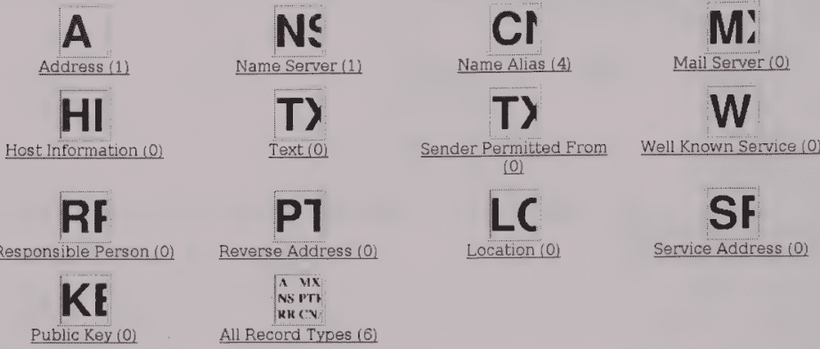

### 5 区域记录

点击不同记录类型的图标，验证它们的信息是否与你的主区域文件中的相同。

页面下半部分包含区域设置（区域文件顶部、名称记录部分之前的内容）。


### 6 区域配置

在重新加载区域之前，更改不会生效，你可以点击页面底部的“应用更改”按钮来实现。

在本文的剩余部分，当我们添加或修改 DNS 记录时，我将直接提供 DNS 信息，你可以使用 Webmin 或手动编辑文件。

## 章节总结

域名解析是将 IP 地址映射到主机名的过程。

在互联网早期，域名解析是使用一个名为 `hosts` 的平面文本文件完成的。DNS 用分布式系统取代了平面文件数据库，其中名称信息分布在多个协同运行的服务器上。

DNS 层次结构的顶端称为根节点，用点 (`.`) 表示。

互联网被划分为顶级域名，如 `.com`、`.net`、`.org` 和 `.edu`。

一个组织在某个顶级域名内注册一个名称，以便他们能够管理自己的名称数据。例如 `debian.org`、`purdue.edu` 或 `ibm.com`。

区域是 DNS 层次结构的一部分。

负责某个区域内数据的服务器称为该区域的权威服务器。

BIND 服务器的全局设置包含在 `/etc/bind/named.conf` 中。

本地区域的设置在文件 `/etc/bind/named.conf.local` 中。

## 复习习题

1. DNS 代表：
   A) 域名服务器
   B) 域名服务
   C) 域名系统
   D) 以上所有

2. DNS 通过将互联网命名空间划分为若干层，并让每一层的服务器负责其空间内的名称来工作。（正确/错误）

3. DNS 服务的全局设置包含在：
   A) `/etc/bind/named.conf`
   B) `/etc/bind/named.conf.local`
   C) `/etc/bind/db.global`
   D) `/rndc.conf`

4. `rndc` 工具只能用于控制本地名称服务器。（正确/错误）

5. 如果我们想测试 DNS 服务是否运行，应该使用以下哪个命令？
   A) `telnet dns`
   B) `localhost 53`
   C) `telnet localhost 53`
   D) `53`

6. 文件 `/etc/ports` 包含 TCP/IP 服务列表。（正确/错误）

7. 允许单个主机通过多个名称的 DNS 记录类型是 ________
   A) CNAME
   B) NS
   C) TXT
   D) A

8. 当 `rndc` 连接到名称服务器时，会交换密钥。（正确/错误）

9. DNS 中与 hosts 文件最等价的是：
   A) NS 记录
   B) A 记录
   C) CNAME 记录
   D) TXT 记录

10. 通过 DNS，单个主机可以通过多个名称访问。（正确/错误）

## 批判性思考

1. 将浏览器指向 `http://sinclair.home.edu/guides/dns.html` 教程并回答问题：
   - 主服务器和从服务器有什么区别？
   - 什么是反向解析？
   - 什么是资源记录？
   - DNS 连接中的 SOA 是什么？
   - 什么是域名委托？

# 第8章 基础网络服务

## 目标

- 安装 FTP
- 配置共享打印

## 术语

- **类** – 打印机集合，类似于打印池。发送到特定类的任务发送到类中的可用打印机。
- **CUPS** – 通用 Unix 打印系统——一种允许类 Unix 操作系统的模块化打印系统。运行 CUPS 的计算机可以接收客户端的打印任务，处理它们并将其发送到相应的打印机。
- **过滤器** – 允许用户或应用程序将文件转换为打印机可理解的格式。过滤器执行文件选择和排序任务。
- **FTP** – 文件传输协议——用于上传和下载文件的 TCP/IP 协议。
- **IPP** – 互联网打印协议——一种构建在 HTTP 之上的标准化网络协议。
- **JetDirect** – 由惠尔-帕科开发的网络打印协议，带有他们的品牌。
- **任务** – 在 CUPS 术语中，任务是提交打印的文件或文件集。
- **LPD** – 打印守护进程——传统的 Unix 打印服务。PPD 描述打印机的功能，包括支持的纸张尺寸和功能。任务发送到队列，而不是打印机本身。
- **打印机驱动** – PostScript 打印描述——通常与打印机关联的文件。
- **打印队列** – 与物理打印机关联的逻辑设备。在 Unix 中打印时，你将任务发送到队列，而不是打印机。单个队列可以关联多个打印机（如打印池），多个队列可以关联单个打印机（用于不同类型的打印任务）。
- **SMB** – 服务器消息块——Windows 使用的文件打印共享协议。

## 引言

正如章节标题所示，我们将设置一些基础服务，为在 Linux 网络中构建更高级的功能提供坚实的基础。我们将安装/或配置服务：

- FTP – 文件传输协议。这是简单的文件共享服务之一（在后面的章节中我们将查看其他共享服务器）。
- 打印服务——这太基础了，经常被忽视（直到它坏了你才会发现）。我们将建立到打印机的连接并在网络上共享它。

如果你准备好了，让我们开始吧。

## FTP

到为止一切顺利。目前我们已经有一个用于名称解析的 DNS 服务器和一个为未来安全服务生成有效数字证书的证书机构。现在是在我们的网络基础的基础上构建了。FTP 服务器设置简单且有用。然而，在我们开始之前，我们需要考虑一些潜在的安全问题。FTP 协议以明文跨网络传输数据，如果我们允许用户使用 Linux 账户登录服务器，监控网络的人可以窃用户名和密码。然而，如果我们将服务器设置为只允许匿名登录（用户名 anonymous，密码），这将是一个更安全的设置。这就是我们要做的。一旦安全了服务器，我们将发布一些文件供下载。

我们首先在 DNS 中为服务器提供主机名并命名为 ftp。这是为了方便用户轻松记住本地 FTP 服务器的名称。为了此目的，我们将创建一个别名记录，指向服务器的真实主机。

在你的主区域文件中添加以下行（根据自己的设置进行修改）：

```
ftp      CNAME dog
```

第一个字段是别名，第二个字段是记录类型，最后一个是与真实主机区域中的 A 记录对应的名称。记住每个字段之间使用制表符而不是空格！

刷新区域数据并测试你的别名。我们将使用 `rndc` 工具重新加载该区域的数据。

```
rndc reload sinclair.home4.edu
```

这比重启服务的破坏性更小。测试你的别名：

```
ping ftp
```

你应该得到一个响应。如果没有，检查日志以确保区域数据加载正确。现在我们准备好安装 FTP 服务器了。我们将使用 `vsftpd`，它非常快速、稳定且安全。

```
apt-get install vsftpd
```

安装完成后，服务应该正在运行。让我们检查进程表：

```
ps -ef | grep vsftpd
```

我们刚刚在这里做了什么？`ps` 命令返回当前运行的进程（程序），`-ef` 选项返回所有运行中的进程。我们将该输出传递给 `grep` 搜索字符串 `vsftpd`。如果某个进程包含 `vsftpd`，那么我们的服务正在运行。

我们也可以通过连接到 ftp 监听端口来查看服务器是否在运行：

- 你可能想为此命令创建一个别名以节省打字。

```
telnet localhost 21
```

如果服务未运行，请使用初始化脚本启动。

```
/etc/init.d/vsftd start
```

你已经有一个可以工作的 FTP 服务器了。让我们使用 浏览器来测试它。在我的机器上，URL 是：

`ftp://ftp.sinclair.prairiedog.edu`

现在的问题是，当我们匿名登录服务器时会看到什么？答案是 ftp 用户的家目录 `/home/ftp`。

现在让我们在 ftp 目录中放一些东西供用户下载。我们 DNS 的文档怎么样？它在 `/usr/share/doc/bind9-doc`，所以我们来设置一下。我们应该通过创建一个该文件夹到 `/home/ftp` 的软链接来完成。

```
ln -s /usr/share/doc/bind9-doc /home/ftp/bind-docs
```

连接到服务器并查看你创建的目录来测试它。为什么不呢？（提示：这种方法是否存在安全问题？请检查 `/etc/vsftpd.conf`）

好了，让我们用正确的方法来。首先删除我们创建的链接：

```
rm /home/ftp/bind-docs
mkdir /home/ftp/bind-doc
```

创建一个新文件夹来存放文档：

将 `/usr/share/doc/bind9-doc` 中的文件和文件夹拷贝到此文件夹中：

```
cd /usr/share/doc/bind9-doc
find . -print | cpio -padmv /home/ftp/bind-docs
```

最后那个命令做了什么？让我们来拆解一下：

`find` 命令将在硬盘中搜索你指定的或或文件夹。`find -print` 命令将从本地目录向下搜索，并打印出所有文件夹和文件的路径。

`cpio` 命令用于复制文件系统和从归档复制。以下是我使用的选项，一个一个：

- `-p`: 透传模式。将文件和文件夹从一个目录树拷贝到另一个。类似于 Windows 上的 `xcopy` 命令。
- `-a`: 重置文件的访问时间，使其看起来像没有被读取过。
- `-d`: 根据需要创建目录。
- `-p`: 保留文件的修改时间。
- `-m`: 在不询问的情况下（无条件）替换目标位置的所有文件。

因此，整个命令 `find -print | cpio -padmv /home/ftp/bind-docs` 告诉 Linux 将此目录内所有文件和文件夹列表发送给 `cpio`，并让 `cpio` 将它们拷贝到 `/home/ftp/bind-docs`，保留所有时间戳，根据需要创建文件夹并替换目标位置中同名的文件夹。

现在测试你的文件夹。现在有效了吗？你现在有了一个匿名 FTP 服务器，并且知道如何使用 FTP 提供文件。

# 打印服务

## 简介

打印是那种在你认为它理所当然的事情，直到你发现没有它时为止。在本节中，我们将讨论如何从计算机连接到打印机，以及如何与他人共享打印机连接。

## Linux 打印服务

尽管愿承认，但在处理非技术用户方面，Linux（以及其他 UNIX 版本）处于落后状态。最初，UNIX（以及后来的 Linux）擅长两种打印方式：纯 ASCII 文本（用于开发者及其源代码）和字排机机上的高版出版（用于研究人员打印他们的论文和书籍）。当时对基础的 WYSIWYG（所见即所得）打印能力的需求并不高，而且没有标准接口（尽管 Berkeley 和 System V 打印系统最为常见），在这一点上 Windows 等平台取得了领先地位。


但差距正在迅速缩小。Linux 灵活、开源的特性允许用户选择多种打印系统。最流行的系统之一是 CUPS（通用 UNIX 打印系统）。它相对容易管理，并提供了广泛的打印机支持，包括许多 Windows 打印机。与其他服务一样，你可以在命令行或在 GUI 中管理它。

## UNIX 打印工作原理（通用）

UNIX 打印（无论你使用哪种打印系统）都包含几个步骤，我们需要理解术语才能理解这些步骤。

- **应用程序** - 即任何可以打印的软件。应用程序为打印机生成一个数据文件。该文件在打印机内存中被称为 `.job` 文件。

- **打印任务** - 一个文件（或一组文件）通过过滤器发送，以转换为更适合打印的格式。

- **打印过滤器** - 过滤器是一种可以执行各种工作的软件，包括将文件从一种格式转换为另一种格式以及提供较少的工作页面排序。与特定打印机型号相关的过滤器被称为打印驱动程序。

- **打印队列** - UNIX 打印任务被发送到打印队列，这是与打印机关联的逻辑设备。每个队列与文件系统中的一个文件夹关联，称为池（spool pool）。

- **打印守护进程** - 这是一个后台进程，在查找等待的打印任务并将其发送到打印机。

因此，应用程序将打印任务发送到队列。打印守护进程从队列中提取任务，并通过与打印机相关的过滤器发送它。过滤器将文件转换为打印机适当的格式，并将数据传输到打印设备，然后由打印机打印。CUPS 也可以打印到文件。例如，`cups-pdf:/` URI 将任务发送到 CUPS PDF 过滤器并创建一个 PDF 文件。

## 添加打印机

从命令行：如果你有选择的话，我个人不建议这样做。然而，有时必须这样做。要添加打印机，请使用 `lpadmin` 命令。该命令的通用格式为：

```
lpadmin -p <printer_name> -v <device> -m <PPD>
```

其中：

- `<printer_name>` 是你给新打印机起的名称，不包含括号。
- `<device>` 是连接打印机的 URI，不包含括号。
- `<PPD>` 是与设备配合的 PPD 文件名称。

还有其他选项可以设置打印机的属性。详情请查看 `lpadmin` 的手册。

所以，为了添加我家里办公室的网络打印机，我使用了命令：

```
lpadmin -p HomePrinter -v ipp://192.168.2.1:9100 -m laserjet.ppd
```

要查看 CUPS 中内置 PPD 的完整列表，请访问 http://www.cups.org/doc-1.1/sam.html#PRINTER_DRIVERS

启动打印队列：

```
enable HomePrinter
```

停止打印队列：

```
disable HomePrinter
```

注意：禁用打印机仍然允许它接受打印任务，只是在重新启用之前它不会打印这些任务。

要设置打印机接受或拒绝打印任务，请分别使用 `accept` 和 `reject` 命令。

设置 HomePrinter 接受任务：

```
accept HomePrinter
```

设置 HomePrinter 拒绝任务：

```
reject HomePrinter
```

## CUPS GUI 管理

通过 GUI 访问 CUPS 有两种方法：

- 使用桌面客户端
- 使用 Web 界面

### 从桌面

如果你正在运行 KDE，可以从控制中心访问你的 CUPS 系统。打印管理器位于“外设”部分下的“打印机”中。它看起来像这样：

#### 打印机 - KDE 控制中心

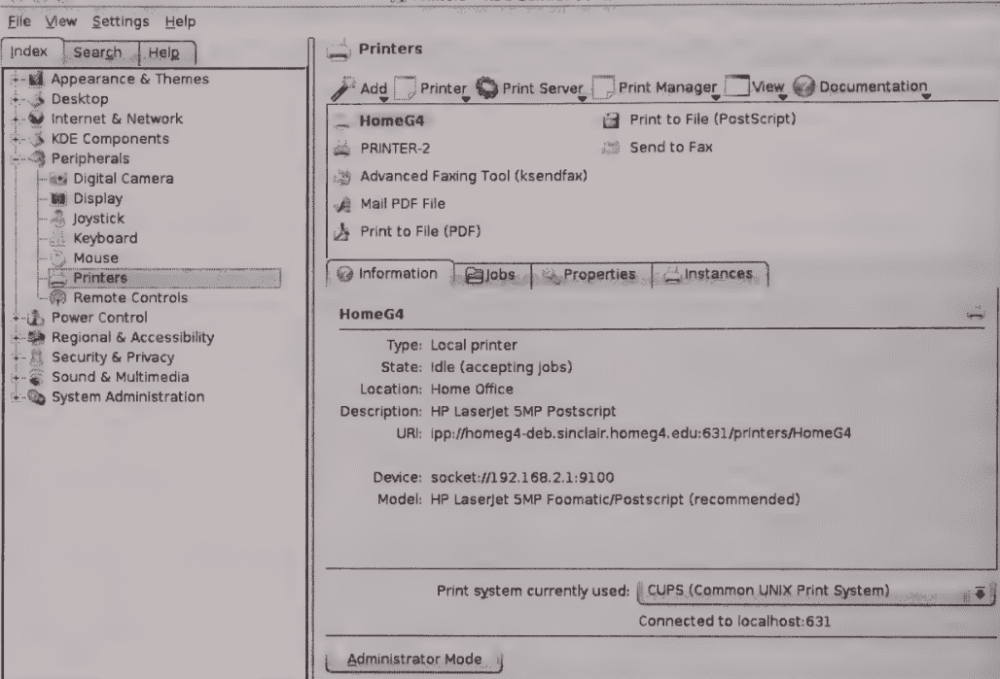

图 1 CUPS 打印管理器

首先，要管理打印机和打印服务器，请点击标记为管理员的按钮并在提示时输入 root 密码。

添加打印机：

点击“添加”，然后选择“打印机/类”。

将出现“添加打印机”向导并引导您完成整个过程。这取决于您正在使用的打印机类型。例如，我将使用一台连接到专用网络打印服务器的 HP LaserJet 5MP。该打印服务器的 IP 地址为 192.168.2.1。

#### 简介

欢迎，

此向导将帮助您在计算机上安装新的打印机。它将引导您完成为您的打印系统安装和配置打印机的各个步骤。在每一步中，您都可以随时使用“后退”按钮返回。

我们希望您喜欢这个工具。

KDE 打印团队。

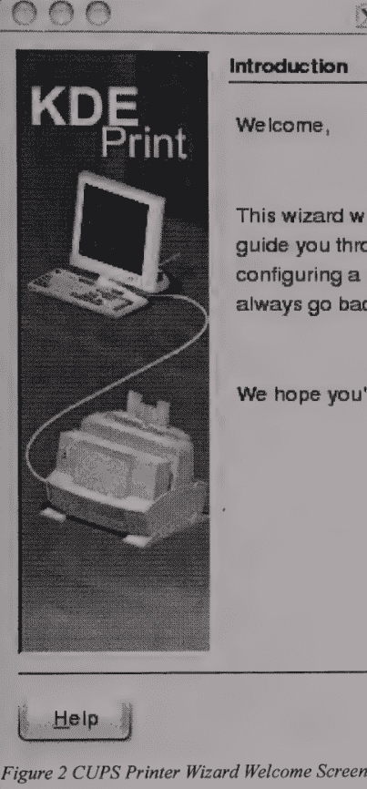

点击“下一步”继续。

在下一个屏幕中，您必须选择如何连接到打印机。CUPS 支持多种连接方式，甚至连接 Windows 共享打印机。对于此示例，我将选择“网络打印机 (TCP)”。

#### 添加打印机向导

#### 后端选择

- 本地打印机（并行、串口、USB）
- 远程 LPD 队列
- SMB 共享打印机（Windows）
- 网络打印机（TCP）
- 远程 CUPS 服务器（IPP/HTTP）
- 带 IPP 的网络打印机（IPP/HTTP）
- 其他打印机类型
- 打印机类


图 3 选择打印机连接类型

在下一个屏幕中，我必须告诉 CUPS 如何找到我的打印机。我可以直接输入 URI 信息，也可以采取更简单的方法，只需点击“扫描”来自动定位打印机。

#### 网络打印机信息


| 打印机地址： | 192.168.2.1 |
| --- | --- |
| 端口： | 9100 |

网络扫描：

子网：192.168.2.*:9100

图 4 正在扫描打印机

一旦定位了打印机，我将通过鼠标点击它将其高亮，然后点击“下一步”继续。

现在我必须告诉 CUPS 这台打印机的品牌和型号。CUPS 拥有适用于各种打印机的驱动程序。

#### 打印机型号选择

| 制造商 | 型号 |
| --- | --- |
| ESP | LaserJet 5100 pxlmono |
| FUJITSU (富士通) | LaserJet 5L |
| GENERIC (通用) | LaserJet 5L hpijs |
| GESTETNER (施乐德) | LaserJet 5L ijet4 |
| HEIDELBERG (海德堡) | LaserJet 5M |
| HITACHI (日立) | LaserJet 5M hpijs |
| HP (惠普) | LaserJet 5M Postscript |
| IBM (IBM) | LaserJet 5MP |
| IMAGEN | LaserJet 5MP hpijs |
| INFOTEC (讯通) | LaserJet 5MP Postscript |
| KODAK (柯达) | LaserJet 5P |
| KYOCERA (京瓷) | LaserJet 5P hpijs |

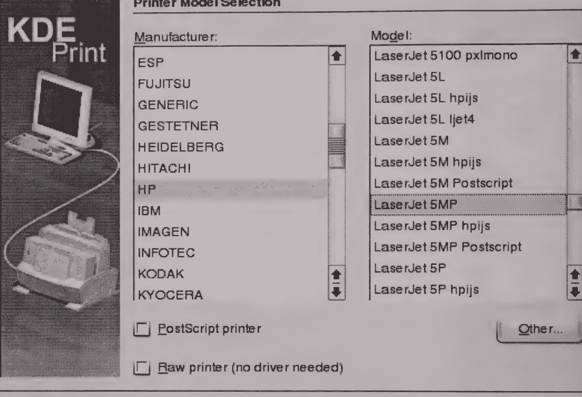

- PostScript 打印机
- 原始打印机（不需要驱动）

图 5 选择打印机品牌和型号

如果打印机直接接受来自应用程序的数据，请点击“原始打印机”框。如果您的打印机未列表中且您有可用的驱动文件，请点击“其他”并浏览到打印驱动程序进行加载。

#### 打印机测试

现在您可以在完成安装之前测试打印机。使用“设置”按钮配置打印机驱动程序，并使用“测试”按钮测试您的配置。使用“后退”按钮更改驱动程序（您当前的配置将被丢弃）。

- **制造商：** HP
- **型号：** LaserJet 5MP
- **描述：** HP LaserJet 5MP (Fomatic + Postscript)

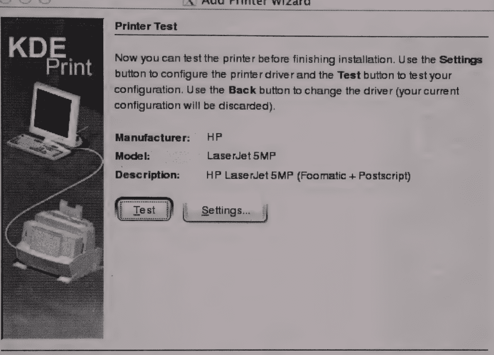

图 6 测试您的打印机

在完成安装之前，您可以向打印机发送一个测试页。为了确保您已正确设置打印机，强烈建议在继续操作之前执行此操作。

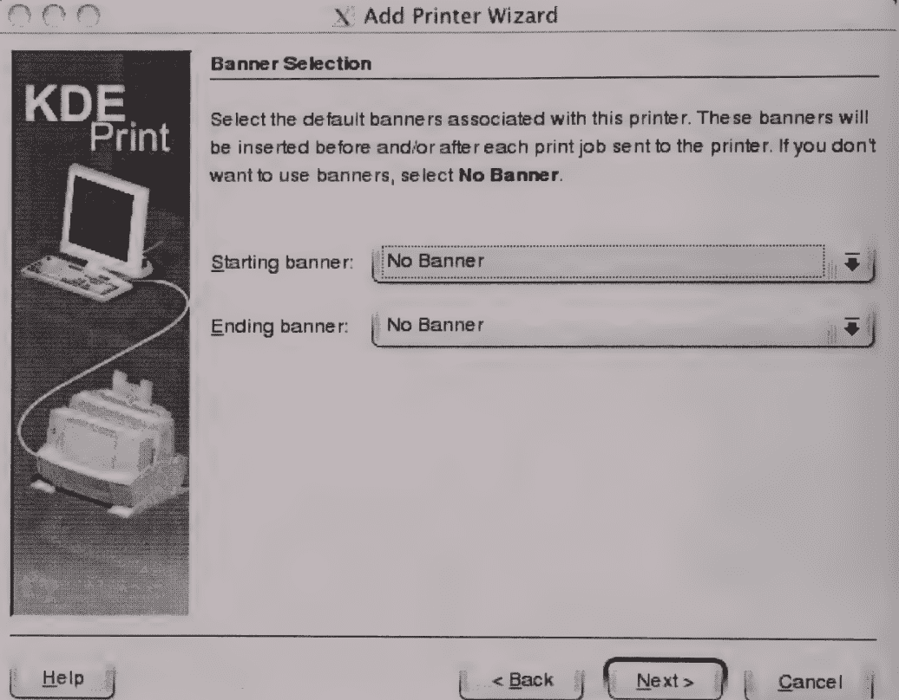

#### 横幅页选择

选择与此打印机关联的默认横幅页。这些横幅页将插入到发送到打印机的每个打印任务之前和之后。如果您不想使用横幅页，请选择“无横幅”。

起始横幅：无横幅

结束横幅：无横幅

图 7 选择横幅页

接下来，系统将询问您是否希望使用横幅页来分隔打印任务。这在多个用户使用此设备的区域有时很有用。横幅页仅简单地列出发送任务的用户名称和其他标识信息。缺点是，这通常被视为浪费纸，因此您不再看到很多办公室在使用这些功能。请保持默认设置并继续。

#### 打印机配额设置

在此处设置此打印机的配额。使用限制 0 表示不使用任何配额。这等同于将配额周期设置为“无配额”（-1）。配额限制按用户定义并适用于所有用户。


| 配额周期 | 无 |
| --- | --- |
| 配额限制 (KB): | |
| 打印页限制: | |

您可以在此设置此打印机的配额。使用限制（秒、分钟、小时、天、周、月）设置在此期间可以打印的 KB 数。这种配额通常被认为是浪费的。我们将保持默认设置并继续。

#### 用户访问设置

在此处允许或拒绝对此打印机的访问。


图 9 用户访问

| 访问 | 允许 |
| --- | --- |

在此屏幕中，您可以允许或拒绝本地用户访问此打印机。我们将保持默认并继续。

#### 添加打印机向导

#### 通用信息

输入有关打印机的信息。名称是必须的，位置和描述可选。


| 名称 | HP_Test |
| --- | --- |
| 位置 | Back Office |
| 描述 | LaserJet 5MP |

图 10 打印机描述

现在我们设置用户连接到此打印机的名称。如果此打印机在网络上共享，这就是显示的名称。这样做并继续。

#### 确认

#### 通用

- 类型：网络打印机 (TCP)
- 名称：HP_Test
- 位置：Back Office
- 描述：LaserJet 5MP

#### 后端

- 打印机 IP：192.168.2.1
- 端口：9100

#### 驱动

- 类型：DB驱动
- 制造商：HP
- 型号：LaserJet 5MP

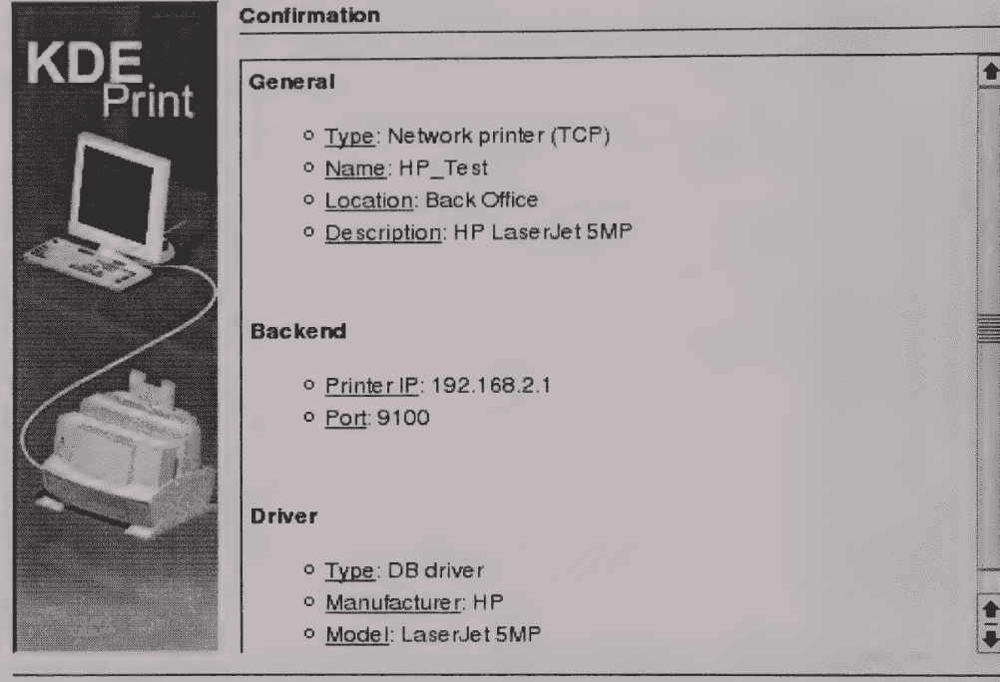

图 11 确认打印机信息

我们最后有一次确认打印机设置的机会。如果我们满意（测试页打印正常），则点击“完成”。新打印机现在将出现在我们的打印管理器中并供所有本地用户使用。

### 从您的浏览器中

将浏览器指向 http://localhost:631（默认情况下 CUPS 只接受来自本地机器的连接）。您将看到类似这样的 Web 页面：

图 12 CUPS 界面

## 打印机共享

一旦您设置了打印机，就可以将其共享给他人使用。最简单的方法是通过控制中心。

选择打印服务器 -> 配置服务器。

从左侧列，选择“安全”。

在位置部分，点击“添加”。将出现对话框，允许您为您的打印服务器添加访问控制列表 (acl)。

在资源下拉列表中，选择您刚刚添加的打印机。

身份验证下拉列表让我们决定用户在使用此打印机时是否需要提供登录名和密码。现在我们将保持为默认的“无”。

加密下拉列表可以保持为“请求”。

Satisfy 允许我们指定客户端在允许打印之前必须匹配的 ACL 规则。

我们将其保持为 Any，这样任何单个规则匹配都将允许打印。我们可以根据意愿为此打印机设置任意数量规则和限制。

ACL 顺序决定了我们评估规则的顺序。我们将保持为默认的 Allow, Deny，这告诉 CUPS 先检查 Allow 规则。

ACL addresses 是一列表被专门允许或拒绝访问此打印机的主机列表。

点击 Add，选择 Allow 并输入您想要共享的主机地址。这将向来自该主机的所有用户共享打印机。我将输入 192.168.2.3，这是我笔记本的 IP 地址。

点击 OK，您的新 ACL 将出现在您的安全设置列表中。点击 OK 并测试您的共享打印机。

## 故障排除提示

CUPS 的配置文件位于 `/etc/cups`。当我添加打印机并将其共享出去时，创建了以下条目：

```
新打印机的设置信息可以在 printers.conf 中找到 -
<Printer HP_Test>
Info HP LaserJet 5MP
Location Back Office
DeviceURI socket://192.168.2.1:9100
State Idle
Accepting Yes
JobSheets none
QuotaPeriod 0
PageLimit 0
</Printer>
```

打印机共享信息在 cupsd.conf 中 -

```
<Location /printers/HP_Test>
Encryption Requested
Satisfy All
Order allow,deny
Allow 192.168.2.3
</Location>
```

打印机服务器进程称为 `cupsd`，因此您可以使用命令检查它是否正在运行：

```
ps -ef | grep cupsd
```

如果它没有运行，使用 `cupsys` 脚本启动它：

```
/etc/init.d/cupsys start
```

此外，服务器应该监听在 631 端口，我们可以检查一下这一点：

```
telnet localhost 631
```

CUPS 服务器将访问日志和错误消息记录在 `/var/log/cups` 的日志文件中。检查这些文件可以帮助您追溯服务器的问题。

## 章节总结

FTP 是最早的互联网传输协议之一。FTP 是一种纯文本协议，这意味着所有网络数据都以明文形式传输。由于 FTP 使用纯文本，登录名和密码是明文传输的。CUPS 是一个支持广泛连接类型的现代服务。对打印机的访问通过 cupsd.conf 中的 acl 指令进行控制。默认情况下，打印机对远程用户不可用。

## 练习题

1. CUPS 代表：

A) Constant Universal System

B) Common UNIX System

C) Common Printer Server

D) Constant UNIX System

2. FTP 的默认服务端口是 21。（正确/错误）

3. vsftpd 的访问日志路径是：

A) /var/log/xferlog

B) /etc/log/vsftpd.log

C) /var/log/vsftpd.log

D) /etc/vsftpd.conf

4. FTP 默认使用加密连接。（正确/错误）

5. 如果我们想测试服务是否正在运行，将使用以下哪条命令？

A) telnet ftp

B) localhost 21

C) telnet localhost 21

D) telnet localhost:21

6. 默认情况下，在 CUPS 中创建的打印机在网络上共享。（正确/错误）

7. 以下哪项对于 CUPS 打印机名称是不合法的？

A) 空格

B) 下划线 ("_")

C) 数字

D) 大写字母

8. CUPS 提供基于 Web 的管理界面。（正确/错误）

9. IPP 是哪个 TCP/IP 协议的扩展：

A) FTP

B) SSH

C) HTTP

D) LPD

10. vspd 服务器默认允许匿名连接。（正确/错误）

## 批判性思考

1. 将您的 Web 浏览器指向 http://www.cups.org/documentation.php CUPS 文档并回答以下问题：

- CUPS 支持哪三种身份验证？

- 哪种访问控制形式允许您限制对特定系统、网络或域的访问？

- Quote 指令的作用是什么？

2. 访问 vsftpd.conf 的 man 页面并回答以下问题：

- 是否可以自动更改上传文件的权限？如果是，您将使用什么设置？

- 是否可以设置服务器拒绝下载请求？如果是，如何设置？

- 如何设置无密码的匿名用户？

- vsftpd 是否支持 SSL 连接？

# 第 9 章 – 使用 Apache 的 Web 服务

## 目标

- 安装 Apache
- 设置默认 Web 页面
- 设置服务器主页
- 设置虚拟主机
- 为用户设置个人主页
- 设置受密码保护的网站
- 设置安全 Web 页面
- 设置公密钥服务器

## 术语

- **Directive（指令）** – Apache 服务器设置的标签，位于服务器和站点配置文件中。
- **HTML** – 超文本标记语言 – 用于创建 Web 页面的代码。
- **HTTP** – 超文本传输协议 – 用于在 Web 服务器和客户端之间传输 HTML 的 TCP/IP 协议。
- **SSL/TLS** – 安全套字层/传输层安全协议 – 用于在不安全的网络连接上进行安全通信。TLS 用于验证主机身份并使用公钥加密交换加密的会话密钥。SSL 然后使用会话密钥通过私钥加密来解密会话数据。会话关闭后，密钥将被丢弃。
- **Virtual Hosting（虚拟主机）** – 允许简单的 Web 服务器托管多个 Web 站点的功能。虚拟主机有两种类型：基于 IP 的和基于名的。

## 一个简单的 Web 服务器

与大众认知不同，启动自己的 Web 服务器既不复杂也不昂贵。使用 Apache，目前有超过三分之二的全球网站在运行。


# 步骤 0 – 为您的服务器设置别名（alias）

为了方便用户使用，您可以在 DNS 中添加一个名为 `www` 的 CNAME 记录，指向运行您 Web 服务器的计算机。（如果您愿意，也可以将其添加为 A 记录。）

截至本文撰写时（2005 年第一季度），这一数字略高于 69%。目前的托管数据可以在 <http://news.netcraft.com/archives/web_server_survey.html> 查看。

# 步骤 1 – 安装软件和文档

这非常简单。我们需要四个主要的包：

```
apt-get install apache2-common apache2-mpm-worker apache2-utils
```

我们正在使用 `apache2-common` 和 `apache2-utils` 安装基础配置文件和工具，使用 `apache2-doc` 安装在线文档，使用 `mpm-worker` 安装服务器本身。

# 步骤 2 - 配置 Apache

全局服务器设置位于 `/etc/apache2/apache2.conf`。然而，要启动并运行一个基础服务器，您不需要进行任何更改。

# 步骤 3 – 启动 Apache

首先，看看服务器是否已经在运行。简单的方法是连接到 HTTP 端口：

```
telnet localhost 80
```

如果收到响应，说明服务器正在运行，我们可以跳到步骤 4。

作为 root 用户运行以下命令：

```
/etc/init.d/apache2 start
```

如果您收到错误消息，请重新检查 `apache2.conf` 并重试。启动错误消息将记录在 `/var/log/apache2/error_log`。

# 步骤 4 - 测试 Apache

使用任何 Web 浏览器指向您的 Web 服务器地址。您应该看到默认首页。恭喜！您有一个可以工作的 Web 服务器了！

# Apache 与虚拟主机

Apache 服务器可以使用称为虚拟主机（virtual hosting）的技术支持多个 Web 站点。虚拟主机有两种类型：基于名的和基于 IP 的。基于名的主机根据 HTTP 客户端请求中的名称来确定提供哪个站点。基于 IP 的主机用于具有多个网络地址的服务器，使用传入请求的 IP 地址来提供正确的站点。

站点信息保存在 `/etc/apache2/sites-available` 中。每个站点描述都在纯文本文件中。当服务器准备就绪时，我们从 `sites-available` 创建站点文件的链接到 `sites-enabled` 并重启服务。要禁用服务，请删除链接并重启服务。有两个工具可以帮助我们完成：`a2ensite`（启用站点）和 `a2dissite`（禁用站点）。

让我们看看我们的默认站点信息，它保存在名为 `default` 的文件中。第一行是：

```
# NameVirtualHost *
```

这启用了基于名称的虚拟主机，我们将在后面的章节中进行详细的讨论。`*` 符号表示虚拟主机适用于所有的 IP 地址和端口。现在，我们想修改此设置，将其限制为通过 80 端口（HTTP 的默认端口）提供服务。（稍后，我们将设置一个通过 443 端口提供 HTTPS 或安全 HTTP 服务的安全 Web 页面。）因此，请将此行修改为：

```
NameVirtualHost *:80
```

接下来，我们看到一节以 `<VirtualHost *` 开始并以 `</VirtualHost>` 结束的指令。

这是对默认站点规则的描述，包括 Web 页面所在的位置以及如何访问它们。

```
我们将第一行改为
<VirtualHost *:80>
```

目前我们只需要做这些了。让我们创建一个简单的站点，用来描述我们的主 Web 页面，用户将通过连接到 `www.sinclair.prairiedog.edu` 来使用它。

首先，我们需要一个目录来存放站点文件。放在哪里都行，只要服务器能够访问它们即可。

```
mkdir /var/main
```

现在，让我们在 `sites-available` 中创建一个文件来描述我们的新站点。我将其命名为 `main`，它包含以下内容：

```
<VirtualHost *:80>
DocumentRoot /var/main/
ServerAdmin webmaster@sinclair.prairiedog.edu
ServerName www.sinclair.prairiedog.edu
</VirtualHost>
```

简之，它表示任何针对 `www.sinclair.prairiedog.edu` 的 Web 请求都应该重定向到 `/var/main` 并提供 `index.html` 文件。让我想起来，让我们为站点创建一个 Web 页面。这可以通过任何可以保存为 HTML 的应用程序生成。

```html
<!DOCTYPE html PUBLIC "//W3C//DTD HTML 4.01 Transitional//EN">
<<html>
<head>
<meta content="text/html; charset=ISO-8859-1">
<meta http-equiv="content-type">
<title></title>
</head>
<body>
<div style="text-align: center;">
<h1>This is my main Web page</h1>
</div>
<br>
</body>
</html>
```

为什么这个文件 own `index.html`？这与 Apache 指令 `DirectoryIndex` 有关，该指令设置了站点主页的默认文件名。当你将 Web 浏览器指向一个目录时，服务器会在该文件夹中查找名为 `DirectoryIndex` 的默认文件，如果找到，它就会将其提供给你。此设置位于 Debian 的 `/etc/apache/apache2.conf` 中，在其他发行版的 `httpd.conf` 中。我们稍后可以用图片和链接来完善它让它看起来好看，但现在它只是一个占位符。既然我们已经为组织准备了一个页面，让我们演示一下基于名称的虚拟主机。

## 步骤 1 – 为我们的虚拟主机创建一个别名

在你的 DNS 主区域中创建一个名为 `vhost` 的 CNAME 记录，并将其指向你的 Web 服务器。测试该别名。

## 步骤 2 – 为我们的虚拟主机创建一个站点

为我们的新站点创建一个文件夹 `/var/virtual`。在 `/var/virtual` 下创建一个名为 `index.html` 的 HTML 文件，内容如下（或类似内容）：

```html
<!DOCTYPE html PUBLIC "//W3C//DTD HTML 4.01 Transitional//EN">
<html>
<head>
<meta content="text/html; charset=ISO-8859-1">
<meta http-equiv="content-type">
<title></title>
</head>
<body>
<div style="text-align: center;">
<h1>This is my virtual host Web page</h1>
</div>
<br>
</body>
</html>
```

# 我们的 vhost Web 页面的站点文件

在 `/etc/apache2/sites-available` 下创建一个站点文件，内容包含如下内容（请根据你的本地设置进行调整）：

```
<VirtualHost *:80>
    DocumentRoot /var/virtual/
    ServerAdmin webmaster@sinclair.prairiedog.edu
    ServerName vhost.sinclair.prairiedog.edu
</VirtualHost>
```

启用该站点：

`a2ensite vhost`

### 步骤 3 – 使用 Web 浏览器测试你的新站点

你应该看到显示有“This is my virtual host Web page”文本的页面。如果没有看到，请检查你的设置。

- `<servername>` 是你的 Web 服务器的主机或 IP 地址（不带角括号）。
- `~sinclair` 是用户 sinclair 主目录的缩写。
- 如果得到 403 错误（禁止），请检查用户主目录和 `public_html` 的权限。
- 如果得到 404（页面缺失），请确保文件夹名称拼写正确且 URL 输入正确。
- 理想情况下，你应该看到你的 `index.html` 页面。

# 用户主页

默认情况下，Apache 支持个人用户的 Web 页面，他们可以在自己的主目录中管理这些页面。在本例中，我们将使用一个名为 `sinclair` 的现有用户，主目录为 `/home/sinclair/`。

- 通过加载 `userdir` 模块并重加载 `apache2` 来启用主目录：

  `a2enmod userdir`

  `/etc/init.d/apache2 reload`

- 让用户在其主目录中创建 `public_html` 目录。

  `mkdir /home/sinclair/public_html`

- 设置 Web 页面。使用任何可以生成 HTML 的工具，在 `/home/sinclair/public_html` 中创建一个名为 `index.html` 文件。

- 通过访问 URL 测试用户的页面：

  `http://<servername>~sinclair`

在此功能正常工作后，继续。

# 使用密码保护你的 Web 站点

如果你想保护一个 Web 页面并限制访问？事实证明，你可以保护整个站点或只保护单个页面，只需登录 ID 和密码。设置并不困难。Apache 支持多种身份验证类型。我们将使用最简单（也是最安全）的类型，即基础身份验证。

## 步骤 0 – 为站点创建一个别名

虽然可以使用现有的站点并设置密码保护页面，但为了增加练习，我们将创建一个新站点。创建一个名为 `secret` 的 CNAME 记录并指向你的 Apache 服务器。

## 步骤 1 – 设置站点

为站点文档创建一个目录：

`mkdir /var/secret`

在 `/etc/apache2/sites-available` 中创建一个站点文件，内容如下：

```
<VirtualHost *:80>
DocumentRoot /var/secret
ServerName secret.sinclair.prairieidog.com
ServerAdmin webmaster@sinclair.prairieidog.com
</VirtualHost>
```

为站点添加 Web 页面。你可以重用现有页面（修改它以便显示是来自新站点）或创建一个新的。

像启用其他站点一样启用该站点：

`a2ensite secret`

一如既往，在启用新站点后重载 Apache：

`/etc/init.d/apache2 reload`

更准确地说，我们将保护站点或页面所在的目录。使用任何 Web 浏览器测试该站点。这只是为了确保在要求登录和密码之前它是正常的。

## 步骤 2 – 站点密码保护

创建密码文件。我们应该把这个文件放在哪里？实际上可以放在任何地方，只要 Apache 可以访问它，出于安全考虑，我们应该避免将其放在共享的文件夹中。（猜猜为什么？）

```
htpasswd2 -c /etc/apache2/secret_users jbond
```

系统会提示输入用户 `jbond` 的密码。`-c` 选项创建密码文件 `secret_users`。如果你要在文件中添加更多用户，只需运行不带 `-c` 的 `htpasswd2` 即可。

在你的站点文件 `/etc/apache2/sites-available/secret` 中添加以下内容：

```
<Directory /var/secret>
AllowOverride AuthConfig
AuthName "Secret Web Site"
AuthType Basic
AuthUserFile /etc/apache2/secret_users
Require valid-user
</Directory>
```

# 设置安全的加密网站

你在互联网漫游时可能见过见过这种场景。你在网上购买东西时，当需要输入信用卡信息时，你会被重定向到一个特殊的页面，该页面会加密从你的浏览器到购物网站之间传输的信息。设置一个使用安全加密连接的网页并不困难，但管理客户数据库、验证你的信用卡信息以及处理订单的代码要困难得多。而我们现在要做的仅仅是那个安全页面。

## 第 1 步 – 设置监听端口

默认情况下，HTTPS（安全 HTTP）在端口 443 上监听（接受请求）。要让 Apache 监听该端口，我们需要编辑 `/etc/apache2/ports.conf` 并添加以下行：

```
Listen 443
```

## 第 2 步 – 为 Apache 添加 SSL 功能

SSL（安全套接层）协议是我们网络连接加密的方式。我们需要告诉 Apache 如何使用它。Apache 是一个模块化服务器，这意味着我们可以通过插件（称为模块）来添加功能。模块位于 `/etc/apache2/mods-available` 文件夹中。要启用一个模块，我们从 `mods-available` 将模块的 `.conf` 和 `.load` 文件创建到 `mods-enabled` 的链接，类似于启用网站的方式。我们有两个工具可以帮助我们：`a2enmod`（启用模块）和 `a2dismod`（禁用模块）。让我们启用 SSL 模块吧：

```
a2enmod ssl
```

## 第 3 步 – 为我们的安全网站创建证书和私钥

这与我们在上一章中创建安全 Webmin 证书和密钥的过程相同。

## 第 4 步 – 为我们的网站创建文档根目录

我们将创建一个名为 `/var/secure` 的文件夹：

```
mkdir /var/secure
```

## 第 5 步 – 创建站点文件

我们将在 `/etc/apache2/sites-available` 下创建一个文件。对于我的网站，它看起来如下：

### 我们安全网站的站点文件

```
<VirtualHost *:443>
  DocumentRoot /var/www.sinclair.prariedog.edu
  ServerName webmaster@sinclair.prariedog.edu
  SSLEngine on
  SSLCertificateFile /etc/ssl/certs/apache2-cert.pem
  SSLCertificateKey /etc/ssl/private/apache2-key.pem
</VirtualHost>
```

## 第 6 步 – 创建一个示例  并将其保存为 /var/secure 中的 index.html

你可以为此修改你的其他页面中的一个。

## 第 7 步 – 启用站点并进行测试

将你的 浏览器指向 `https://www.sinclair.prairedog.edu`。你应该能看到你的安全页面。如果没有看到，请双击检查设置，查看 `/var/log/apache2` 中的错误信息，并确保你没有跳过任何步骤。

我们现在有了一个非常简单的网络，作为更高级服务的的基础。请务必刷新你的网页，以便它们看起来不那么千篇一律。可以在你的网站中添加图像、链接、额外页面等你喜欢的任何内容。尝试并享受其中。

# 使用 Apache 运行公钥服务器

Apache 的功能不仅仅是提供网页。事实上，有几种运行在 HTTP 之上的协议（如 DAV）。其中一种 HKP，用于交换公钥加密密钥。在本节中，我们将使用 Apache 设置一个公钥服务器。

## 第 0 步 - 创建 DNS 别名

创建一个名为 `pkgs` 的 CNAME 记录，指向你的 Apache 服务器。

## 第 1 步 - 安装软件 (onak)

这很简单。该包名为 `onak`，你可以使用任何你喜欢的安装技术。我使用了命令行：

一旦安装完成，起初并不清楚如何继续。然而，Debian 软件包将其文档存储在 `/usr/share/doc/<pkg>` 下，其中 `<pkg>` 是包名（不带角括号）。这些文件包含了发行说明、Debian 特有的注释以及易用的设置说明和实用提示。可以在 `/usr/share/doc/onak/examples` 下的名为 `apache2` 的文件中获取 onak 的文档。

## 第 2 步 – 设置服务器

在 `/etc/apache2/sites-available` 下创建一个名为 `keyserver` 的站点，其内容如下：

```
<VirtualHost *:11371>
DocumentRoot /var/lib/onak
ScriptAlias /pks /usr/lib/cgi-bin/pks
CustomLog /var/log/apache2/keyserver-access.log
ErrorLog /var/log/apache2/keyserver-error.log
</VirtualHost>
```

通过在 `/etc/apache2/ports.conf` 中添加以下行，告诉 Apache 在端口 11371 上监听请求：

`Listen 11371`

启用站点：

`a2ensite keyserver`

一旦启用站点，你可以加载服务器：

`/etc/init.d/apache2 reload`

## 第 3 步 – 设置你的 GPG 客户端

如果你使用 Kgpg，可以点击 Settings->Configure KGPG。在左侧列中选择 Key Servers。点击 Add 为你的密钥服务器添加一个条目，如下所示（根据你的所有服务器名称进行调整）：

`hkp://pks.sinclair.prairieidog.edu`

要将其设为默认服务器，在名称被选中的时点击 Default 按钮。

你也可以编辑你的配置文件，路径为 `/etc/gnupg/gpg.conf`。

## 第 4 步 – 设置你的 GPG

# 总结


- 在 `/etc/apache2/ports.conf` 中添加以下行，告诉 Apache 在端口 11371 上监听请求：`Listen 11371`
- 启用站点：`a2ensite keyserver`
- 一旦启用站点，你可以加载服务器：`/etc/init.d/apache2 reload`
- 如果使用 Kgpg，可以点击 Settings->Configure KGPG。在左侧列中选择 Key Servers。点击 Add 为你的密钥服务器添加一个条目，如下所示（根据你的所有服务器名称进行调整）：`hkp://pks.sinclair.prairieidog.edu`
- 要将其设为默认服务器，在名称被选中的时点击 Default 按钮。
- 你也可以编辑你的配置文件，路径为 `/etc/gnupg/gpg.conf`。

在 TCP/IP 网络上共享文件系统有多种方法，但我们将特别介绍三种：

- **NFS** – 全称为网络文件系统（Network File System）。NFS 由 Sun Microsystems 开发，是 UNIX 和类 UNIX 系统的默认文件共享服务。
- **Samba** - Samba 是一个开源的免费软件产品，可以将任何基于 UNIX 的机器转换为 Windows 文件和打印服务器。此外，Samba 甚至可以让你的 UNIX 机器模拟 NT 域控制器，让你的 Windows 客户端对其进行验证。Samba 通过使用 SMB（服务器消息块）网络和基于 TCP/IP 的 NetBIOS 来欺骗 Windows 机器，使其认为这是另一台 Windows 服务器。
- **WebDAV** - WebDAV（World Wide Distributed Authororing and Versioning）是一种构建在 HTTP 之上的文件共享协议。它最初的设计目的是让 Web 作者组能够在互联网上方便地协作。它允许作者将远程文件系统挂载到自己的桌面上，并像处理本地文件一样处理它们。它有一种锁定机制，防止两个作者同时修改文档。

WebDAV 是一个开放的草案互联网标准，任何想要使用的软件开发者都可以自由采用它。许多供应商在其产品中都支持 WebDAV。例如，微软的 Web Folders 完全基于 WebDAV，且 Microsoft Office 内置了对 WebDAV 的支持。大多数专业的 Web 开发工具（如 GoLive 和 Dreamweaver）都包含了使用 WebDAV 管理站点的支持。

# NFS

## 安装 NFS

很有可能，你的机器上已经安装了 NFS 软件。你可以使用以下 API 进行检查：

```bash
dpkg -s nfs-kernel-server
```

你应该会得到类似下面的响应（版本号可能不同）：

```
Package: nfs-kernel-server
Status: install ok installed
Priority: extra
Section: net
Installed-Size: 196
Maintainer: Chip Salzenberg <chip@debian.org>
Architecture: i386
Source: nfs-utils
Version: 1.0.6-3
places: knfs, nfs-server
Provides: knfs, nfs-server
Depends: nfs-common (>= 1:0.3.3), debconf (>= 1.0), sysvinit (>= 2.80-1), libc6 (>= 2.3.2.ds1-4), libwrap0
Conflicts: knfs, nfs-server
Confiles:
/etc/exports fa071681b8e7f4eff1d6f5c4f43bf1d8
/etc/default/nfs-kernel-server 226f8dd37b11c59d73e2f378e2b0d0
/etc/init.d/nfs-kernel-server b7740fdb44dc4c56ff56a3f7bddce0c
Description: Kernel NFS support
如果你有一个较新的内核（2.2.13 或更高版本）并且想使用内核模式 NFS 服务器，请使用此包。“nfs-user-server”包中的用户态 NFS 服务器比内核模式服务器运行慢，但功能更丰富且更易调试。
Upstream: SourceForge project "nfs", CVS module nfs-utils.
```

这里的关键行是带有 Status 的那一行，它应该注明此包已安装。

另一种方法是检查 `/etc/init.d` 以查看你是否有这两个启动脚本：`nfs-common` 和 `nfs-kernel-server`。无论如何，如果你还没有安装 `nfs-kernel-server`，请在继续之前进行安装。

## 配置 NFS

与其他 UNIX 服务一样，你需要在启动守护进程之前指定系统的系统的配置。在运行 NFS 时，你需要关注以下三个配置文件：

- `/etc/hosts.allow` - 该文件允许你仅通过你使用的主机访问系统服务。默认情况下，计算机会首先检查 `hosts.allow` 以查看客户端名称是否在列表中。然后它会检查 `hosts.deny` 查看是否有匹配项。如果有，则拒绝该机器的访问。否则，如果客户端在两个文件中都没有匹配任何列表，则默认授予其访问权限。我们暂时让 `hosts.allow` 留空。
- `/etc/hosts.deny` - 该文件允许限制对系统服务的访问。我们在这个文件中放入以下条目：

```
portmap:ALL
lockd:ALL
mountd:ALL
rquotad:ALL
statd:ALL
```

这样，我们就能确保除非我们在 `hosts.allow` 中显式列出它们，否则没人可以获取我们共享的 NFS 访问。聪明吧？当然！

- `/etc/hosts.allow`（已访问） - 此时，还没有人可以访问 NFS 文件共享，因此我们将放入我们允许访问的主机。在本示例中，我们将使用 IP 地址为 `192.168.0.192` 的主机：

```
portmap: 192.168.0.192
lockd: 192.168.0.192
mountd: 192.168.0.192
rquotad: 192.168.0.192
statd: 192.168.0.192
```

除了指定单个机器外，你还可以使用网络组（netgroups）、带通配符的域名以及指向大量客户端的地址。这超出了本教程的范围。

- `/etc/exports` - 该文件列出了你的 NFS 共享以及特定客户端拥有的访问级别。在本示例中，我们将向客户端 `192.168.0.192` 共享 `/home` 目录，并赋予只读权限：

```
/home 192.168.0.192(ro)
```

请注意，如果导出了一个特定目录，你不能导出该目录的子目录。在我们的示例中，我们导出了 `/home`。

- 启动服务。NFS 在另一个名为 portmap（portmapper 的缩写）的服务下运行。因此我们先启动它：

```bash
/etc/init.d/portmap start
```

现在我们启动 NFS 服务本身（nfsd）：

注意：如果你在 `/etc/exports` 中配置任何共享，NFS 服务将不会启动。你可以使用以下命令验证服务正在运行：

```bash
root:~# rpcinfo -p
program vers port
100000 2 tcp 111 portmapper
100000 2 udp 111 portmapper
100003 2 udp 2049 nfs
100003 3 udp 2049 nfs
100003 3 tcp 2049 nfs
100003 3 tcp 2049 nfs
100021 1 udp 1372 lockmgr
100021 3 udp 1372 lockmgr
100021 4 udp 1372 lockmgr
100021 1 tcp 1463 lockmgr
100021 3 tcp 1463 lockmgr
100021 4 tcp 1463 lockmgr
100005 1 udp 907 mountd
100005 1 tcp 910 mountd
100005 1 udp 907 mountd
100005 2 tcp 910 mountd
100005 2 udp 907 mountd
```

```bash
bin/true; else (/etc/init.d/nfs-kernel-server stop ; /etc/init.d/nfs-kernel-server start); fi
```

> 这行杂乱的命令行可以翻译为：“如果重启 nfsd 挂载成功，我们就没问题。否则，停止并启动 NFS 服务。”

要编辑现有的导出，点击路径。要添加新导出，点击“Add a new export”。我们现在就操作：

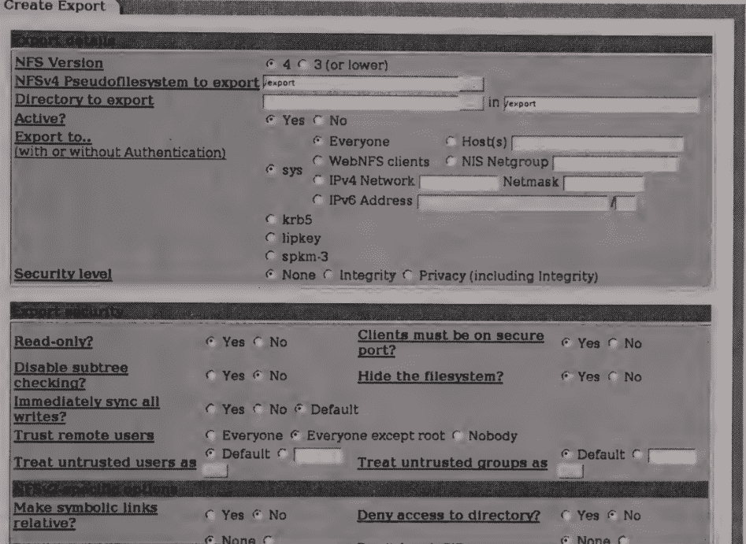

图 4 导出配置页面

你可以使用此界面查看你的导出选项。如果你不确定特定选项的作用，只需点击下划线链接，就会弹出一个带有简短说明的弹出窗口。一旦设置了新共享，点击“Create”按钮返回导出列表。然后点击“Apply Changes”导出新共享。之后你可以从命令行挂载该共享，或者在 Webmin 的 `System -> Disk and Network Filesystems` 中设置挂载点。在继续之前，先在 Webmin 中设置一个测试 NFS 共享。

# UID 问题

UID（或用户标识符）是分配给 UNIX 系统上每个用户的数字。

操作系统使用这个数字来识别你，而不是你的登录名。好消息是，这意味着你可以随心所欲更改登录名而不丢失任何权限。不好的消息是，当你挂载 NFS 共享时，远程系统会查看你的 UID 并根据该数字确定你的权限。让我给你举个例子。

假设你的登录名是 `jmiit`，UID 为 500。远程 NFS 服务器上有一个名为 `jblow` 的用户，UID 也是 500。所以，没问题。当你从服务器挂载 NFS 共享时，系统会看到你的 UID，并假设在处理挂载共享的权限时，你就是 `jblow`。更糟糕，如果远程服务器上没有与你 UID 相同的用户，你实际上将成为该机器上的一个匿名访客用户。当你远程挂载家目录时，这可能会成为一个大问题。

这个问题有可能的解决方案，取决于你的情况：

1. 在两台机器上创建一个具有相同 UID 的新用户，将你的家目录复制给新用户，并相应地修改所有权和权限。
2. 使用网络用户目录（如 LDAP 或 NIS）来建立一组公共账户和 UID。（这更像是一个更好的长期解决方案。）

# Samba

## 安装/升级 Samba

Samba 是 Linux 默认安装的一部分，我们将获取最新版本以及我们需要的其他程序包。

```bash
apt-get install samba samba-doc
```

我们还在安装一些在线文档（`samba-doc`）。

Samba 有一个基于 Web 的管理工具叫做 swat，但在 samba 软件包完全安装之前，我们无法安装它。所以，让我们现在安装 swat ：

```bash
apt-get install swat
```

注意：在 samba 的安装后处理期间，系统可能会询问你是否希望将 Samba 作为守护进程（后台服务）运行或由 inetd（一个管理其他服务的服务）控制。默认是守护进程。你可能还会被问是否为 Samba 创建密码数据库。选择默认的 Yes。在安装后处理期间，你会收到警告要求重写你的 Samba 配置文件 `smb.conf`。

## 启用 SWAT，或者什么是超级用户？

与我们目前看到的其他服务不同，swat 并不独立运行，而是由另一个名为 inetd 的服务控制的。inetd 是一个超级用户，是一个控制所有其他服务的服务。它的工作原理如下：

- inetd 配置包含一个可用服务列表，以及它们使用的端口和每个服务要启动的程序。

还有另一个超级用户叫做 xinetd，它提供了额外的功能。

inetd 监听对其所管理的所有任何服务的请求。

当请求进入时，inetd 会启动该服务，移交请求并返回监听状态。

那么，为什么不让服务独立运行呢？首先，许多服务不需要一直运行。我们可以通过只在需要时运行它们来节省资源。其次，由于 inetd 充当服务的门卫，我们可以使用它来控制何时以及如何使用该服务。例如，我们可以设置某些服务仅在一天中的特定时间段可用，或者拒绝来自不可信网络的服务请求。

现在我们知道 swat 是由 inetd 控制的，并且了解 inetd 的工作原理，我们该如何说服 inetd 启用 swat 呢？inetd 的指令从它的配置文件 `/etc/inetd.conf` 获取，因此我们可以通过编辑此文件并向 inetd 发送 HUP 消息来启用或禁用服务。

然而，在 Debian 中，有一种简单的方法。Debian 开发者提供了一个名为 `update-inetd` 的程序，它会为我们处理所有工作。所以，要启用 swat，我们只需要运行命令：

```bash
update-inetd --enable swat
```

就是这样。我们准备好进入下一步，配置 Samba。

## 配置 Samba

要使用 swat，请将你的 Web 浏览器指向 `http://localhost:901`。系统会提示你登录。请以 root 身份登录。注意：小心仅通过 localhost 连接 swat，因为你的登录名和密码将以明文发送！

如果你成功了，你将看到如下界面：

### 一个只读网络文件共享

这是最简单的方法。在示例中，我们将创建一个名为 `samba-docs` 的文件夹，它包含了 Samba 文档，存储在 `/usr/share/doc/samba-doc`。

**步骤 1：点击 Shares 按钮。**

在 Create Share 文本框中输入你的共享名称。这可以是任何合法的 Windows 共享名称，我们决定使用 `samba-docs`。输入此名称并点击 Create。你将进入一个可以设置文件共享参数的页面。

**步骤 2：配置文件共享。**

在 Base Options 部分，将 Commit 字段设置为 Online Documentation。这是人们在浏览网络时看到的共享描述。在同一部分，将共享路径设置为 `/usr/share/doc/samba-doc`。这是我们要共享的文件夹。

其余选项允许我们执行诸如仅允许某些用户连接到此共享、赋予某些用户写入权限、该共享是否在网络上可见等操作。然而，默认选项将此共享设为只读，并对任何拥有有效 Samba 账户开放。这正是我们想要的，所以我们点击 Commit Changes。（如果浏览器刷新并返回原页面，请不要惊慌。你的共享已创建。）

**步骤 3：测试文件共享。**

我们有多种方法可以实现这一点。最简单的方法是使用 Konqueror 连接。点击面板上的房屋图标。输入我们刚刚创建的文件共享路径。在本示例中，我们假设 Samba 服务器的 netBIOS 名称为 `pdog`。那么 URL 将是：

```
smb://pdog/samba-docs
```

Konqueror 将尝试使用你的 Linux 用户名和密码登录。如果失败，系统会提示你手动输入。无论何种，如果连接成功，你将看到 `/usr/share/doc/samba-doc` 的内容。你无法修改任何内容，但可以读取并复制其中的文件和文件夹。

让我们稍微增加一点复杂度。设置一个你可以修改、但对其他人只读的共享文件夹怎么样如何？

#### 步骤 1：创建文件夹

在本示例中，我将在 `/var` 下创建一个名为 `all-mine` 的文件夹，并将其所有者设置为我的非 root 用户 `tsinclai`。

```bash
mkdir /var/all-mine
chown tsinclai /var/all-mine
```

#### 步骤 2：创建共享

在共享（Shares）页面中，创建一个共享名称 `mine`，并将路径设置为 `/var/all-mine`。设置一个合适的注释，例如“只有我能写，哈哈！”

到目前为止，操作与上一个示例一样。但现在我们将赋予你的用户访问权限。将列表（list）选项设置为你的非 root 用户名。（注意，这将覆盖共享的只读设置。）

点击“提交更改”（Commit Changes）。

#### 步骤 3：测试网络

像上次一样使用 Konqueror 连接到共享。注意，现在你可以在此文件夹中进行任何操作。以另一个用户的身份连接，你会发现它是只读的。

现在，让我们尝试一些更高级的操作，设置一个共享组文件夹。也就是说，一个组内的多个用户都可以读取和写入该共享。此外，我们不允许组内的任何任何人连接到此共享。

### 共享组可写文件夹

#### 步骤 1：创建用户和组

我们不创建一个新的 UNIX 组，而是使用现有的 `staff` 组。如有必要，至少创建另一个用户并将他们成为 `staff` 组成员。我将使用现有的登录账号 `tsinclai` 并添加一个新用户 `jsmith`。

创建与 UNIX 用户同名的 Samba 用户（`tsinclai` 已经是 Samba 用户，所以我只需添加 `jsmith`）。将他们都加入 `staff` 组。你可以使用 Webmin（Users and Groups 模块）、KUser 或直接使用 `vigr` 编辑 `/etc/group`。

为共享空间创建目录：

```bash
mkdir /var/staff
```

将 `/var/staff` 的组所有者设置为 UNIX 组 `staff`。

```bash
chgrp staff /var/staff
```

让该文件夹对组可写。

```bash
chmod 775 /var/staff
```

为文件夹设置“粘滞位”（sticky bit），以便用户覆盖彼此的工作。

```bash
chmod +t /var/staff
```

创建一个名为 `Staff` 的 Samba 组并将其映射到 UNIX 组 `staff`。（遗憾的是，目前在 swat 中无法执行此操作。）

```bash
net groupmap add group="staff" unixgroup=staff
```


创建一个名为 `staffshare` 的共享，注释为“Staff 共享区域”，并指向路径 `/var/staff`。

设置以下选项（你必须切换到高级视图 Advanced View）：

```
valid users = @staff
read list = @staff
write list = @staff
```

这意味着只有 `staff` 组的成员可以连接到此共享、读取并修改其内容。

```
force group = staff
```

这会导致任何新文件夹或文件的组所有权都为 `staff`。

```
read only = No
```

这意味着这不是只读共享。从技术上讲我们不需要这个，因为 Linux 权限会覆盖此选项。

```
create mask = 0774
directory mask = 0775
```

这会将任何新文件的默认权限设置为 `774` (rwxrwxrr--)，将任何新文件夹设置为 `775` (rwxr-xr-x)。换句话之，所有者和组可写，但对其他人只读。

这样就完成了。提交你的更改并使用你喜爱的 SMB 客户端进行测试，确保在进入下一节之前按照设计工作。

## WebDAV

到目前为止一切顺利。WebDAV（Web-based Distributed Authoring and Versioning 的缩写）最初旨在让 Web 作者组能够在互联网上轻松协作。它允许作者将远程文件系统挂载到桌面上，并像处理本地文件一样处理它们。它还有一种锁定机制，防止其他人同时更改同一文档。

WebDAV 是一个开放的草案互联网标准，因此任何希望为此的软件开发者都可以自由引入它。许多厂商在其产品中都支持 WebDAV。例如，微软的 Web Folders 实际上是基于 WebDAV。苹果的 iDisk 是一个 WebDAV 文件系统。大多数专业的 Web 制作工具（如 GoLive 和 Dreamweaver）都包含了使用 WebDAV 管理网站的支持。

事实证明，WebDAV（某些人倾向于称为 DAV）就是你可能称之为“通用”网络文件系统。也就是说，你不需要为 Windows 客户端使用 SMB、为 UNIX 客户端使用 NFS 以及为 Mac 客户端使用 AppleShare 来共享文件系统，只需使用 DAV，并确保你的桌面安装了相应的客户端（大多数 Windows 2000/XP 和 Mac OS 已经安装了 DAV 客户端）。

DAV 相比传统的网络文件系统具有优势：

- 身份验证（以及连接本身）可以使用 SSL 建立加密连接。
- 你可以通过公司防火墙访问 DAV 文件夹，因为它使用 80 端口。
- DAV 文件系统仅在需要时连接，因此当网络连接波动或从一个网络移动到另一个网络（例如使用笔记本电脑）时，你可以保持挂载状态。

## 创建只读 DAV 共享

### 步骤 0 - 创建指向你的 Web 服务器的 CNAME 记录

### 步骤 1 - 为你的 DAV 共享和 DAV 锁文件创建文件夹

轻而易举。我们将它们放在 Web 服务器的根目录下：

```
mkdir /var/DAVDocs
mkdir /var/www/DAVlock
```

将 DAV 文件夹的所有者设置为运行 Apache 服务器的相同用户和组：

```
chown www-data:www-data /var/DAVDocs
```

### 步骤 3 – 修改我们的 DAV 共享以使用 Digest 身份验证

编辑 `/etc/apache2/sites-available/dav` 进行以下更改：

将行

```
AuthType Basic
```

现在应读取：

```
AuthType Digest
```

将行

```
UserFile /etc/apache2/users
```

现在应读取：

```
DigestFile /etc/apache2/users_digest
```

就这些了。如果必要，不要忘记重载 Apache：

```
/etc/init.d/apache2 force-reload
```

使用 Konqueror 测试您的共享以确保它仍然可以工作。如果你有网络嗅探器，你可能希望检查客户端和服务器之间的身份验证流量，以查看是否有任何差异。

## 创建一个组可写、安全的文件共享

我们目前为止进展顺利，但我们还可以做得更好。之前的练习有几个缺点：

- 共享是只读的
- 由于 HTTP 不够安全，登录名和密码是以明文形式通过网络传输的。
- 由于登录用户是 'guest'（访客），该共享基本上对任何人开放。

不过，我们可以做得更好。在本节中，我们将创建一个与之前使用 Samba 创建的类似的、组可写的文件共享。我们将使用 SSL 为文件共享创建一个安全的、经过加密的连接。

### 步骤 1 – 创建我们要共享的文件夹

由于我们的 Web 服务器只能有一个 SSL 站点，我们将 DAV 文件夹放在网站的 DocumentRoot 下，即 `/var/secure`：

```
mkdir /var/secure/staffshare
```

在开始之前，让我们确保 Web 服务器可以读取和写入此文件夹：

```
chown www-data:www-data /var/secure/staffshare
```

### 步骤 2 – 将共享信息添加到我们的安全站点文件中

编辑 `/etc/apache2/sites-available/secure` 如下所示（新项目已**粗体**显示）：

```
<VirtualHost *:443>

  DocumentRoot /var/secure/prairieog.edu

  ServerName www.sinclair.prairieog.edu

  ServerAdmin webmaster@sinclair.prairieog.edu

  SSLEngine on

  SSLCertificateFile /etc/ssl/certs/apache2-cert.pem

  SSLCertificateKeyFile /etc/ssl/private/apache2-key.pem

  # DAV share信息

  <Directory /var/secure/staffshare>

    AllowOverride AuthConfig

    AuthName "Staff Members Only"

    AuthType Basic

    AuthUserFile /etc/apache2/staff

    <LimitExcept>

      Require valid-user

    </LimitExcept>

  </Directory>

</VirtualHost>
```

### 步骤 3 – 为此共享创建密码文件

```
passwd -c /etc/apache2/staff tsinclai
passwd /etc/apache2/staff jsmith
```

这创建了密码文件 `/etc/apache2/staff` 并添加了两个用户 ID，`tsinclai` 和 `jsmith`。（当然，请用自己的非 root 用户替换 `tsinclai`。）

### 步骤 4 – 重载 Apache

```
/etc/init.d/apache2 reload
```

上次一样使用 Konqueror 测试你的新共享，但现在使用 URL `webdav://www.sinclair.prairieog.edu/staffshare`。（当然，请用你自己的站点信息进行替换）。验证你是否可以创建和修改此共享的内容。

## 章节总结

- NFS 是原生的 UNIX 文件共享协议
- Samba 允许 UNIX 服务器通过使用 SMB 协议看起来像 Windows 服务器。
- Samba 是一种用于共享网络资源的 Windows 网络协议。
- Samba 通过编辑配置文件 `smb.conf` 进行管理。
- 有 GUI 工具可用于管理 Samba，包括 Swat 和 Webmin。
- 由于 Windows 和 UNIX 使用不同的密码加密，Samba 必须使用单独的用户文件。
- Samba 服务器可以替换任何 Windows 服务器，包括且但不限于主域控制器。
- Samba 服务器可以加入和/或验证 Windows ADS（活动目录服务）树。
- WebDAV 代表基于 Web 的分布式授权和版本控制（Web-based Distributed Authoring and Versioning）。
- WebDAV 的设计是为了方便多人管理网站，但它也可以用于提供文件服务。
- 大多数感知网络的软件都具有 WebDAV 客户端功能，例如 Microsoft Office 和 Adobe InDesign。
- WebDAV 是 HTTP 的扩展，它是标准的 WebDAV 通信协议。
- 要在 Apache 中启用 WebDAV，你必须加载 `dav` 和 `dav_fs` 模块。
- 创建 WebDAV 文件共享可以像创建其他 Apache 站点一样，但带有额外的指令。
- 验证 WebDAV 共享可以使用 Web 服务器宿主机支持的任何方法。
- 基于 Web 的身份验证有两种类型：Basic（基础）和 Digest（摘要）。
- Basic 身份验证不安全，但 Basic 仅在较新的客户端上支持。
- Digest 比 Basic 更安全，但仅在较新的客户端上支持。
- Samba 服务器还可以使用包含用户名和密码的数据库进行身份验证。

## 复习练习

1. SMB 代表：
   A) Service Message Blocking
   B) Secure Message Builds
   C) Server Message Block
   D) Server Mount Back

2. Samba 是 Windows 服务器在网络上共享资源的协议名称。（正确/错误）

3. `smb.conf` 指令 `invalid` 的默认值为：
   A) 0
   B) staff
   C) root
   D) 该字段没有默认值

4. Samba 服务器可以加入和/或验证 Windows ADS（活动目录服务）树。（正确/错误）

5. WebDAV 代表基于 Web 的分布式授权和版本控制。（正确/错误）

6. WebDAV 的设计是为了方便多人管理网站，但它也可以用于提供文件服务。（正确/错误）

7. 大多数感知网络的软件都具有 WebDAV 客户端功能，例如 Microsoft Office 和 Adobe InDesign。（正确/错误）

8. WebDAV 是 HTTP 的扩展，它是标准的 WebDAV 通信协议。（正确/错误）

9. 要在 Apache 中启用 WebDAV，你必须加载 `dav` 和 `dav_fs` 模块。（正确/错误）

10. 创建 WebDAV 文件共享可以像创建其他 Apache 站点一样，但带有额外的指令。（正确/错误）

11. 验证 WebDAV 共享可以使用 Web 服务器宿主机支持的任何方法。（正确/错误）

12. 基于 Web 的身份验证有两种类型：Basic 和 Digest。（正确/错误）

13. Basic 身份验证不安全，但 Basic 仅在较新的客户端上支持。（正确/错误）

14. Digest 比 Basic 更安全，但仅在较新的客户端上支持。（正确/错误）

15. Samba 服务器还可以使用包含用户名和密码的数据库进行身份验证。（正确/错误）

---

向 Bob 的 ISP 电子邮件服务器的 SMTP 服务器发送请求。SMTP 软件做出响应，Bob 的消息被交给该服务器并传回到互联网。电子邮件服务器中的 MTA（邮件传输代理）看到消息不是发给本地的，便将其发送出去。电子邮件通过 SMTP 从机器到机器进行中继，直到到达 Jane 的 ISP 电子邮件服务器。邮件服务器看到此消息是发给它的用户之一 Jane 的，便将其放入 Jane 的邮箱（这是电子邮件服务器上的一个文件）。当 Jane 使用她的 MUA（Evolution）连接她的电子邮件服务器时，它会向 POP 服务器发送请求，询问她是否有邮件。她确实有，POP 服务器允许她将邮件下载到自己的机器上。

明白了吗？让我们深入研究，并开始构建我们自己的电子邮件服务器来处理远程邮件，也许上一段话就会更容易理解了。一旦我们让它运行起来，我们将为你的电子邮件服务设置一个基于 Web 的前端。

## 电子邮件

首先，我们需要创建一些 DNS 记录来适配我们的电子邮件服务器。如果我们不这样做，我们就必须按照你的地址将电子邮件服务器的完整主机名作为全名，例如：

`tsinlai@instructor.sinclair.prairiedog.edu`

在电子邮件中使用域名会显得更专业一些：

`tsinlai@sinclair.prairiedog.edu`

此外，当我们设置客户端时，我们希望将它们指向像这样的名称：

`mail.sinclair.prairiedog.edu`

而不是：

`instructor.sinclair.prairiedog.edu`

因此，我们将为主机 `instructor` 创建一个 DNS 记录，并告诉我们的 DNS 你的电子邮件域名。

添加一个新的名为 A 的 A 记录，其值为你电子邮件服务器的 IP 地址。

添加一个 MX 记录，说明你的电子邮件域名（在示例中为 `sinclair.prairiedog.edu`）由服务器 `mail.sinclair.prairiedog.edu` 处理。

无论你如何执行操作（手动编辑文件或使用 Webmin），你的主区域文件中都应该有两个看起来如下所示的记录：

| mail.sinclair.prairiedog.edu. | IN CNAME pdog |
| sinclair.prairiedog.edu. | IN MX 10 mail |

## 第一部分 - MTA

每个 Linux 系统都预装了 MTA。这通常是 `sendmail`，对于初学者来说有些复杂。相比之下，`qmail` 相对容易设置和配置，而且作者对任何能破解它的人提供 1000.00 美元的悬赏。自 1997 年以来，该奖金一直无人领取。无论如何，即使使用 `qmail`，这也是设置中最困难的部分。

## 第 0 步 - 卸载你当前的 MTA

电子邮件是从 UNIX 底层开始构建的，因此也是从底层开始构建于 Linux 的。所以，即使只是为了处理本地用户之间的电子邮件，每个 UNIX/Linux 系统都安装了 MTA。

既然已经安装了，为什么不直接使用现存的 MTA 软件呢？为什么要用 `qmail` 替换它？这里有两个原因。市场上有很多可能的 MTA 包，所以我必须为每种可能的安装软件版本编写文档，那样章节会多很多页。使用 `qmail` 可以让我编写出一套的配置和安装说明，并提供一致的环境。这是实用的原因。另一个原因是 `qmail` 尽管有一些批评者，但它快速、稳定且非常安全。此外，尽管安装和设置它需要一些时间调整，但一旦搞定，它就会一直运行，你不需要费心费力地维护它。

那么问题是，我们如何卸载当前的 MTA 呢？正如我们在软件包管理章节中看到的，我们需要知道要删除的包名。执行此操作的简单方法是查询包数据库。总之，方法不止一种。我将在两处提到这一点。

第一种方法是使用 `dpkg` 直接查询包数据库。我们知道 `-l` 选项将列出所有已安装包的列表。我们只需将其传递给 `grep` 命令来定位我们需要的内容。例如，在我的系统上：

```
dpkg -l | grep Mail
ii exim 3.36-17 An MTA (Mail Transport Agent)
```

所以到此为止，看起来 `exim` 是当前的 MTA。然而，让我们用另一种方法检查一下。与 MTA 软件关联的文件是 `/usr/lib/sendmail`。要找出哪个包提供了此文件，我们可以再次使用 `dpkg`：

```
dpkg -S /usr/lib/sendmail
```

当我在我的桌面 PC 上运行此命令时，我得到了结果：

```
exim: /usr/lib/sendmail
```

这证实了我们之前的推测，现在我们知道该删除哪个包了。由于我无法预测你特定机器上是哪一个，我可以提供一些指导建议：

- 使用 `apt-get remove <pkg>` 来删除该包。
- 注意此命令返回的消息。你可能需要先卸载其他包，并且可能会收到消息说其他包也将被移除，你稍后需要重新安装它们。
- 在此过程中做好笔记将会有帮助。

在某个时刻，旧软件最终会被移除。让我在我其中一台测试服务器上运行一个实际示例，以便你可以看到整个过程。

确定安装了哪个电子邮件包：

```
tsinlai@podgres:~$ dpkg -S /usr/lib/sendmail
exim4-daemon-light: /usr/lib/sendmail
```

卸载旧的电子邮件包，注意软件包管理器的消息：

```
pdog:~# apt-get remove exim4-daemon-light
Reading package lists ... Done
Building dependency tree ... Done
The following extra packages will be installed:
cpp-4.0 g++-4.0 gcc-4.0 gcc-base libgcc1 libstdc++6 libstdcdc++6-4.0-dev
lsb-base
建议的软件包：
- gcc-4.0-locales
- gcc-4.0-doc
- lib64stdc++
- libc6-dev-amd64
- lib64gcc1
- libstdc++6-4.0-doc
- stl-manual
推荐的软件包：
- libymudflap0-dev
以下软件包将被移除：
- at
- exim4-daemon-heavy
- mailx
- webmin-core
- webmin-mailboxes
以下软件包将被升级：
- cpp-4.0
- g++-4.0
- gcc-4.0-base
- lib64gcc
- libstdc++6
```


- `libstdc++6-4.0-dev`
- `lsb-base`

0 个新安装的，7 个待删除，有 168 个未升级。

需要获取 7009KB 的存档文件。

解压缩后将释放 16.7MB 磁盘空间。

你想要继续吗 [Y/n]?

继续下去，我们再次达成共识。然而，我们注意到，一旦 `qmail` 设置好，我们确实想要重新安装 `mailx` 和 `webmin-core` 软件包。（我们应该在某个地方记一下，以免忘记。）

```
Get:1 http://ftp.debian.org testing/main libgcc1 4.0.2-5 [93.7KB]
Get:2 http://ftp.debian.org testing/main libstdc++6-4.0-dev 4.0.2-5 [148KB]
Get:3 http://ftp.debian.org testing/main gcc++-4.0 4.0.2-5 [2335KB]
Get:4 http://ftp.debian.org testing/main gcc-4.0 4.0.2-5 [513KB]
Get:5 http://ftp.debian.org testing/main cpp-4.0 4.0.2-5 [2045KB]
Get:6 http://ftp.debian.org testing/main gcc-4.0-base 4.0.2-5 [179KB]
Get:7 http://ftp.debian.org testing/main libstdc++6 4.0.2-5 [352KB]
Get:8 http://ftp.debian.org testing/main lsb-base-3.0-14 [12.8KB]
Fetched 7009KB in 1m23s (当前已安装 30725 个文件和目录)。
Removing mut ...
Removing mailx ...
Removing exim4 ...
Removing webmin-core ...
Removing webmin-mailboxes ...
Removing at ...
停止延迟执行调度器: atd.
Removing exim4-daemon-heavy ...
停止 MTA: ... exim4.
(正在读取数据库 ... 当前已安装 28347 个文件和目录)。
准备替换 libgcc1 1:4.0.2-2 (使用 .../libgcc1_13a4.0.2-5_i386.deb) ...
```

```
正在解压替换的 libgcc1 ...
正在设置 libgcc1 (4.0.2-5) ...
```

```
(正在读取数据库 ... 当前已安装 28347 个文件和目录)。
准备替换 libstdc++-6.0-dev 4.0.2-2 (使用 .../libstdc++-6.0-dev_4.0.2-5_i386.deb) ...
正在解压替换的 libstdc++-6.0-dev ...
准备替换 g++-4.0.2-2 (使用 .../g++-4.0.2-5_i386.deb) ...
正在解压替换的 g++-4.0 ...
准备替换 gcc-4.0.2-2 (使用 .../gcc-4.0.2-5_i386.deb) ...
正在解压替换的 gcc-4.0 ...
准备替换 cpp-4.0.2-2 (使用 .../cpp-4.0.2-5_i386.deb) ...
正在解压替换的 cpp-4.0 ...
准备替换 gcc-4.0-base 4.0.2-2 (使用 .../gcc-4.0.2.2-5_i386.deb) ...
正在解压替换的 gcc-4.0-base ...
准备替换 libstdc++6 4.0.2-2 (使用 .../libstdc++6_4.0.2-5_i386.deb) ...
正在解压替换的 libstdc++6 ...
正在设置 gcc-4.0-base (4.0.2-5) ...
正在设置 libstdc++6 (4.0.2-5) ...
```

```
(正在读取数据库 ... 当前已安装 28347 个文件和目录)。
准备替换 lsb-base-3.0-9 (使用 .../lsb-base_3.0-14_all.deb) ...
正在解压替换的 lsb-base ...
正在设置 cpp-4.0 (4.0.2-5) ...
正在设置 gcc-4.0 (4.0.2-5) ...
正在设置 lsb-base (3.0-14) ...
正在设置 g++-4.0 (4.0.2-5) ...
正在设置 libstdc++6-4.0-dev (4.0.2-5) ...
```

现在，我们进展如何？

```
user@dog:~# ls /usr/lib/sendmail
ls: /usr/lib/sendmail: 无此文件或目录
```

> 好，MTA 已移除，我们准备好安装 `qmail`。注意：这是一个示例。你的实际操作可能会不同。

# 步骤 1 - 安装 qmail

我们将设置新的 MTA（邮件传输代理）`qmail`。我们将从源码安装它，来自 使这变得非常简单。然而，我们必须安装另一个软件包 `dns-tcp`。我们可以同时安装它们。

## 安装源码包

```
apt-get install dns-tcp qmail-src
```

## 构建二进制包

```
build-qmail && qmail
```

对于这些命令，你将被询问软件包放在哪里。你可以继续使用默认（`/tmp`），但你可能想把它们放在其他地方。（`/tmp` 在重启时会被清理。）我会把它们放在 `root`。

我们几乎准备好了，但还有一些配置细节。

在 `/var/qmail/control` 下创建这三个文件：

- `host` 包含你的完全限定主机名。例如：`mail.example.com`
- `domain` 包含你的域名。例如：`example.com`
- `locals` 告诉 `qmail` 发送到这些域的邮件应该在本地投递。

编辑 `/var/qmail/control/hosts` 以确保 `qmail` 将来自自身的邮件。默认情况下，`qmail` 将拒绝任何不在 `hosts` 中的域的邮件。为了防止服务器被用于转发垃圾邮件。

现在我们需要告诉 `qmail` 当邮件到达时放在哪里。我们可以通过编辑启动脚本 `/etc/init.d/qmail` 来实现。你有三个可以放置邮件的地方，都由启动脚本中的 `alias_empty` 变量控制。你只需要取消相应的行：

```
alias_empty = "/usr/sbin/qmail-procmail" - 这会将你的邮件发送到名为 qmail-procmail 的程序，这是一个极其配置且强大的邮件过滤器。（例如，你可以设置垃圾邮件过滤和转发。）然而，设置它超出了本教程的范围。默认操作是将消息放在 /var/mail/<userid>，其中 <userid> 是你的登录名。
```

```
alias_empty="./Mailbox" - 这会将你的邮件放在家目录下一个名为 Mailbox 的单文本文件中。
```

```
alias_empty="./Maildir" - 这会将你的邮件放在家目录下名为 Maildir 的目录中（每个文件一个消息）。
```

在练习的剩余部分，我们将假设使用 `alias_empty="./Maildir"`。

你需要在家目录下创建一个 `Maildir` 目录：

```
maildirake /home/user/Maildir
```

**注意：** 以普通用户身份操作，不要用 `root`！

不要忘记为 `/etc/skel` 中的所有新用户设置 `Maildir` 目录：

```
maildirake /etc/skel/Maildir
```

**注意：** 你需要以 `root` 身份运行。

为了转发邮件，我们只需在 `/var/qmail/alias` 中创建相应的文件。我们首先需要几个：

| 文件名 | 内容 |
| :--- | :--- |
| `.qmail-MAIL-DAEMON` | `postmaster` |
| `.qmail-mailer-daemon` | `postmaster` |
| `.qmail-daemon` | `<admin id>` |
| `.qmail-webmaster` | `<admin id>` |
| `.qmail-decode` | `<admin id>` |
| `.qmail-dumper` | `<admin id>` |
| `.qmail-games` | `<admin id>` |
| `.qmail-ingres` | `<admin id>` |
| `.qmail-bin` | `<admin id>` |
| `.qmail-manager` | `<admin id>` |
| `.qmail-news` | `<admin id>` |
| `.qmail-nobody` | `<admin id>` |
| `.qmail-operator` | `<admin id>` |
| `.qmail-postmaster` | `<admin id>` |
| `.qmail-root` | `<admin id>` |

| 文件名 | 内容 |
| :--- | :--- |
| `.qmail-system` | `<admin id>` |
| `.qmail-toor` | `<admin id>` |

> **注意：** 由于大多数文件的内容相同，创建一个文件并将其复制到其他文件可能更简单。此外，`<admin id>` 代表管理员的非 `root` 用户 ID，不带角括号（`< >` 符号）。请注意，出于安全考虑，`qmail` **不会** 直接投递邮件。

# 步骤 4 - 测试 qmail

- 如果服务尚未启动，请启动它：

```
/etc/init.d/qmail start
```

- 确保它已实际启动：

```
telnet localhost 25
```

你应该得到一个响应。按 `<Ctrl->]` 并按 `<Return>` 进入 `telnet` 提示符。退出即可离开。

- 发送邮件：

```
echo to:<login> | qmail-inject
```

其中 `<login>` 是你机器上用户的 ID。（不要使用角括号。）

- 检查文件 `/home/<login>/Maildir/new` 查看消息是否到达了那里。（可能需要一分钟左右。）如果有效，太棒了！如果没有，你必须回顾之前的步骤，看看你漏掉了什么。在 `qmail` 运行之前，不要继续进行此练习。

# 第二部分 - POP3 服务

## 第 1 步 - 安装并配置 POP 软件

我们正在使用 `dovecot`，这是一个快速安全的 POP/IMAP 服务器，非常容易安装和配置。要安装 POP 服务器：

```
apt-get install dovecot-pop3d
```

要配置 `dovecot`，请编辑 `/etc/dovecot/dovecot.conf` 文件。该文件有详尽的注释，每个部分的布局都非常清晰。首先修改行：

```
protocols =
```

为

```
protocols = pop3 pop3
```

最后修改行：

```
#default_mail_env =
```

为

```
default_mail_env = maildir:/home/%u/Maildir
```

使用启动脚本启动服务：

```
/etc/init.d/dovecot start
```

## 第 3 步 - 测试你的设置

- 通过访问 `pop3` 端口 110 来测试 POP

```
telnet localhost 110
```

你应该会收到响应。按 `<Ctrl->]` 然后按 `<Return>` 进入 `telnet` 提示符。输入 `quit` 退出。

如果你到为止操作成功，恭喜你！你已经知道 MTA 工作正常，且邮件服务器正在监听传入和发出的邮件。现在是最后一步：让它在电子邮件客户端上运行。

# 第三部分 - MUA（用户邮件客户端）

我们将使用 Mozilla Thunderbird（包名为 `mozilla-thunderbird-enigmail`¹）作为邮件客户端，但你可以使用任何支持 POP 账户的客户端。

- 选择编辑 -> 邮件和新闻账户设置 添加新邮件账户。
- 选择添加账户。这将启动账户向导。
- 账户类型为 email。
- 在下一页按如下输入你的真实姓名和电子邮件地址：
- 你使用的接收服务器类型是 POP，并输入你邮件服务器的完全域名：

> ¹ 如果开发者决定分离出 `enigmail` 插件，你可能找不到这个包。在这种情况下，请安装 `mozilla-thunderbird` 并使用扩展工具安装 `enigmail`。

- 输入你在邮件服务器上的用户 ID：
- 输入你称呼此账户的名称：
- 验证你的账户信息。如果正确，点击完成来设置账户：
- 在账户设置窗口中，你现在应该能看到你的新账户：
- 给自己发一封邮件：
- 等一会儿或检查收件箱查看是否收到了邮件。如果收到了，恭喜你！如果没有，请返回并确保你的邮件客户端配置正确。

# 第四部分 - 安全 POP

POP 是一个非常易用的协议，几乎每个邮件客户端都支持它，但它有几个缺陷。首先，你必须在读取任何内容之前下载所有邮件，这在拨号上网或当你有大量垃圾邮件或大型邮件附件时会非常痛苦。我们将在稍后通过设置 IMAP 来解决这个问题。第二个缺陷（我们现在就处理）是 POP 默认以明文形式跨网络发送你的 ID 和密码，以至于任何拥有网络嗅探器的人都可以窃取你的个人信息。

幸运的是，我们可以处理这个问题。POP 可以在安全模式下运行，使用 SSL 加密连接与你的邮件服务器通信。如果有人在“窃听”，他们得到的只是乱码。POP 服务器同时安装在不安全（端口 110）和安全（端口 995）模式下，因此我们只需要修改电子邮件客户端来使用安全 POP。

确认 `dovecot` 正在监听安全端口：

```
telnet localhost 995
```

编辑你的 Thunderbird 配置以使用安全 POP 并发送测试邮件。注意，你会收到来自 Thunderbird 关于数字证书的警告信息。因此我们需要修复这个问题。幸运的是，我们已经通过 Webmin 完成了它。我不再重复所有细节，但如果你还记得我们之前关于数字证书的讨论，步骤如下：

- 为 `Dovecot` 生成一个证书请求和密钥，通用名称（common name）为 `"mail.<yourdomain>"`。
- 使用你的 CA 签名该请求并创建数字证书。
- 将证书和密钥安装在安全的地方（`/etc/ssl/certs/` 和 `/etc/ssl/private`）。
- 编辑 `dovecot.conf` 指向证书和密钥。具体来说，取消注释并编辑以下行：

```
#ssl_cert_file = /etc/ssl/certs/dovecot.pem
#ssl_key_file = /etc/ssl/private/dovecot.pem
```

- 重启 `Dovecot`。

> 在较新的 `Dovecot` 版本中，默认禁用了明文认证。如果你希望启用它，请将 `/etc/dovecot/dovecot.conf` 中的 `disable plaintext auth` 设置从 `yes` 改为 `no` 并取消注释该行。

将你的 CA 证书导入 Thunderbird。

# 第五部分 - IMAP

IMAP（互联网邮件访问协议）允许我们在服务器上管理邮件，这样我们只需要下载想要的消息。它比 POP 复杂一点，并不是所有的邮件客户端都支持它，但它并不难。

- 安装 `dovecot` IMAP 包：
  `apt-get install dovecot-imapd`
- 编辑 `/etc/dovecot/dovecot.conf` 同时启用 `imap` 和 `imaps`
- 重启 `dovecot`：
  `/etc/init.d/dovecot restart`
- 验证 `dovecot` 正在监听不安全端口：
  `telnet localhost 143`
- 验证 `dovecot` 正在监听安全端口：
  `telnet localhost 995`

# 第六部分 - 签名和加密邮件

现在有很多独立的邮件客户端，但当你想要检查邮件时，可能并不总是访问 PC。为邮件服务器添加 Web 前端可以让用户通过标准浏览器管理邮件。

工作原理如下：你设置一个 Web 服务器（使用 Apache）并安装一组 CGI（通用网关）脚本。当你执行 CGI 脚本时，其中编码的内容是标准的 HTML 代码，然后从 Web 服务器传递给浏览器。CGI 为访问任何工具或服务的浏览器界面变得非常简单。（Webmin 是一个很好的例子。）

在这种情况下，CGI 脚本用于访问你的 IMAP 邮件服务器。你在 Webmail 页面输入登录名和密码，脚本会登录邮件服务器。之后，当你在 Web 界面进行更改（读取/写入/删除）时，脚本会将这些命令发送给邮件服务器。

- 为 GPG 创建密钥对。
- 与你想邮件的人交换公钥（你可以将其作为附件发送）。
- 在 Thunderbird 菜单中，选择 OpenPGP -> 安全。
- 选择选项：
  - 默认签名加密消息
  - 默认签名加密消息
- 将 GPG 执行文件路径设置为 `/usr/bin/gpg`。
- 点击 OK 保存设置。
- 编写新邮件。
- 收件人选择你已导入密钥的人。
- Enigma -> 加密。
- 在提示时输入 GPG 密码。
- 确保对方收到了你的消息并可以解密/验证。

# Webmail

现在有很多独立的邮件客户端，我们将使用 Squirrelmail。

> **注意：** Webmail 服务器不需要与邮件服务器位于同一机器，但它应该能够连接到邮件服务器。

## 第 1 部分 - 安装并配置 Squirrelmail

如有需要安装 Apache2。（这在其他地方会提到）。

- 安装 `squirrelmail` 包，它仅仅是一组脚本。

```
apt-get install squirrelmail
```

- 如果需要，编辑 `/etc/apache2.conf` 将 `index.php` 添加到允许的目录索引页列表中（这可能已经完成）。

修改


# 邮件服务器配置指南

## 目录索引配置

```
DirectoryIndex index.html index.cgi index.pl index.xhtml
```

## SquirrelMail 配置

以 root 身份运行以下命令，以配置 SquirrelMail 以反映你的本地设置：

```
/usr/sbin/squirrelmail-configure
```

由于我们已经有一个启用了 SSL 的站点，我们只需在以下路径创建一个指向 SquirrelMail 文件夹的链接：

```
ln -s /usr/share/squirrelmail /var/secure/webmail
```

重新加载 Apache 使其识别新设置：

```
/etc/init.d/apache2 force-reload
```

将浏览器指向 Webmail 服务器并测试你的设置。在我们的示例中，URL 为 `https://www.sinclair.prairiedog.edu/webmail`。

你应该能看到登录界面。输入你的用户名和密码，并验证你是否看到了自己的邮箱。尝试发送和接收消息，并管理你的电子邮件，以确保其运行符合预期。

## 第 2 部分

如果你有任何技术问题，请查看 SquirrelMail 的主页：`http://www.squirrelmail.org`。

## 可选项：跨域电子邮件

到目前为止，我们可以向自己的域名发送邮件。在本示例中，只需几步即可建立与另一个电子邮件域的通信。`sinclair.prairiedog.edu` 和我尝试通信的域名是 `behaugh.prairiedog.edu`，它有一个名为 `orangepixel` 的邮件服务器，IP 地址为 `192.168.2.4`。（注意：在这种情况下，`orangepixel` 也是 DNS。）我需要添加一些关于另一个域的信息，而另一个管理员也需要对我的域进行操作。我将仅从我的角度描述这个过程，但请记住，这种交易涉及双方：

首先，我需要在我的 DNS 中添加四条记录：

1. 为邮件服务器 `orangepixel` 添加一条 A（地址）记录。
2. 一条 CNAME（别名）记录，将 `orangepixel` 映射到别名 `mail.behaugh.prairiedog.edu`。
3. 一个 NS（名称服务器）记录，将 `orangepixel` 映射到域名 `behaugh.prairiedog.edu`。
4. 一个 MX（邮件交换器）记录，将邮件域名 `behaugh.prairiedog.edu` 映射到别名 `mail`。

完成后，我必须记住将更改应用到我的 DNS 中。

我们快要完成了。只需要告诉 qmail 如何将电子邮件路由到另一个域。你可以使用 qmail 的 Webmin 模块（`webmail-qmailadmin`）或直接编辑相应的配置文件。

通过向 `/var/qmail/control/rcphosts` 添加另一个域，告诉 qmail 允许与该域之间收发邮件：

```
behaugh.prairiedog.edu
mail.behaugh.prairiedog.edu
```

通过向 `/var/qmail/control/smtproutes` 添加以下内容，告诉 qmail 如何路由到另一个域：

```
behaugh.prairiedog.edu:192.168.2.4
```

重启 qmail：

```
/etc/init.d/qmail restart
```

通过向另一个域发送电子邮件来测试你的设置。

注意：如果我们使用的是注册域名，那么我们只需要修改 qmail。

## 章节总结

- 互联网电子邮件通过多个使用标准协议通信的服务来工作。
- 在设置 SMTP 服务器时，你需要限制邮件中继，以防止垃圾邮件发送者滥用你的服务。
- 默认情况下，POP 在网络上以明文传输你的用户名和密码。如果可能，请在安全模式下运行 POP。
- 当你希望从多台计算机访问电子邮件和/或经常有大附件时，IMAP 是更好的选择。
- DNS 中的 MX 或邮件交换器记录告诉你的 SMTP 服务器如何路由电子邮件。
- Web 邮件服务器仅仅是运行在 Web 服务器上的一组脚本，允许你访问你的 IMAP 账户。
- 存储电子邮件有两种标准格式：mbox（所有消息都存储在一个文件中）和 maildir（每条消息都存储在自己的独立文件中）。

## 复习练习

1. IMAP 代表：
   - A) Internal Message Access Protocol
   - B) Internet Mail Access Protocol
   - C) Internet Message Access Protocol
   - D) Internal Mail Ascension Protocol

2. SMTP 在端口 25 上监听请求。（对/错）

3. qmail 放置用户邮件的默认位置是：
   ```
   A) /var/spool/mail/<user>
   B) /var/mail/<user>
   C) /root/<user>
   D) /tmp/mail/<user>
   ```

   注意：如果我们的域名已 Internet DNS 层次结构注册，我们只需要做的是将 qmail 设置为接受来自各自域的邮件。

4. 设置邮件服务器时需要 MX 记录。（对/错）

5. `dovecot.conf` 中的 `default_mail_env` 环境设置设置为：
   - A) 邮件服务器操作系统
   - B) 支持的邮件客户端类型
   - C) 邮箱类型和位置
   - D) 服务器的 TCP/IP 主机名

6. 基于 Web 的电子邮件使用 SMTP 连接到邮件服务器。（对/错）

7. 在 `dovecot.conf` 中设置什么才能让 Dovecot 使用 SSL？
   - A) `ssl_cert_file` and `ssl_key_file`
   - B) `SSLCertificateFile` and `SSLCertificateKey`
   - C) SSL Enabled
   - D) `ssl = true`

8. Web 邮件使用 SMTP 连接到邮件服务器。（对/错） *注：此处应为我们在独立邮件客户端中可以做哪些而我们的 Web 邮件客户端中不能做到的？*

9. 为了让 Dovecot 使用 SSL，你需要在 `dovecot.conf` 中设置什么？
   - A) `ssl_cert_file` and `ssl_key_file`
   - B) `SSLCertificateFile` and `SSLCertificateKey`
   - C) SSL Enabled
   - D) `ssl = true`

10. 独立邮件客户端中可以做哪些 Web 邮件客户端中做不到的呢？


# 邮件服务器配置与管理

## 基础配置

注意，如果我们的域名已 Internet DNS 层次结构注册，我们只需要做的是将 `qmail` 设置为接受来自各自域的邮件。

## 复习练习

4. 设置邮件服务器时需要 MX 记录。（对/错）

5. `dovecot.conf` 中的 `default_mail_env` 环境设置设置为：
   A) 邮件服务器操作系统
   B) 支持的邮件客户端类型
   C) 邮箱类型和位置
   D) 服务器的 TCP/IP 主机名

6. 基于 Web 的电子邮件使用 SMTP 连接到邮件服务器。（对/错）

7. 在 `dovecot.conf` 中设置什么才能让 Dovecot 使用 SSL？
   A) `ssl_cert_file` and `ssl_key_file`
   B) `SSLCertificateFile` and `SSLCertificateKey`
   C) SSL Enabled
   D) `ssl = true`

8. Web 邮件使用 SMTP 连接到邮件服务器。（对/错）

9. 为了让 Dovecot 使用 SSL，你需要在 `dovecot.conf` 中设置什么？
   A) `ssl_cert_file` and `ssl_key_file`
   B) `SSLCertificateFile` and `SSLCertificateKey`
   C) SSL Enabled
   D) `ssl = true`

10. 独立邮件客户端中可以做哪些 Web 邮件客户端中无法做到的呢？

---

# SquirrelMail 配置

## 目录索引
`index.html` `index.cgi` `index.pl` `index.php` `index.xhtml`

以 root 身份运行以下命令，以配置 SquirrelMail 以反映你的本地设置：
```
/usr/sbin/squirrelmail-configure
```

由于我们已经有一个启用了 SSL 的站点，我们只需在以下路径创建一个指向 SquirrelMail 文件夹的链接：
```
ln -s /usr/share/squirrelmail /var/secure/webmail
```

重新加载 Apache 使其识别新设置：
```
/etc/init.d/apache2 force-reload
```

将浏览器指向 Webmail 服务器并测试你的设置。在我们的示例中，URL 为 `https://www.sinclair.prairiedog.edu/webmail`。

你应该能看到登录界面。输入你的用户名和密码，并验证你是否看到了自己的邮箱。尝试发送和接收消息，并管理你的电子邮件，以确保其运行符合预期（我们可以在独立邮件客户端中完成哪些在 Web 邮件客户端中无法做到的呢？）

## 第 2 部分

如果你有任何技术问题，请查看 SquirrelMail 的主页：
http://www.squirrelmail.org。

## 可选项：跨域电子邮件

到目前为止，我们可以向自己的域名发送邮件。在本示例中，只需几步即可建立与另一个电子邮件域的通信。`sinclair.prairiedog.edu` 和我尝试通信的域名是 `behaugh.prairiedog.edu`，它有一个名为 `orangepixel` 的邮件服务器，IP 地址为 `192.168.2.4`。（注意：在这种情况下，`orangepixel` 也是 DNS。）我需要添加一些关于另一个域的信息，而另一个管理员也需要对我的域进行操作。我将仅从我的角度描述这个过程，但请记住，这种交易涉及双方：

首先，我需要在我的 DNS 中添加四条记录：

1. 为邮件服务器 `orangepixel` 添加一条 A（地址）记录。
2. 一条 CNAME（别名）记录，将 `orangepixel` 映射到别名 `mail.behaugh.prairiedog.edu`。
3. 一个 NS（名称服务器）记录，将 `orangepixel` 映射到域名 `behaugh.prairiedog.edu`。
4. 一个 MX（邮件交换器）记录，将邮件域名 `behaugh.prairiedog.edu` 映射到别名 `mail`。

完成后，我必须记住将更改应用到我的 DNS 中。

我们快要完成了。只需要告诉 `qmail` 如何将电子邮件路由到另一个域。你可以使用 `qmail` 的 Webmin 模块（`webmail-qmailadmin`）或直接编辑相应的配置文件。

通过向 `/var/qmail/control/rcphosts` 添加另一个域，告诉 `qmail` 允许与该域之间收发邮件：
```
behaugh.prairiedog.edu
mail.behaugh.prairiedog.edu
```

通过向 `/var/qmail/control/smtproutes` 添加以下内容，告诉 `qmail` 如何路由到另一个域：
```
behaugh.prairiedog.edu:192.168.2.4
```

重启 `qmail`：
```
/etc/init.d/qmail restart
```

通过向另一个域发送电子邮件来测试你的设置。
注意：如果我们使用的是注册域名，那么我们只需要修改 `qmail`。

## 章节总结

- 互联网电子邮件通过多个使用标准协议通信的服务来工作。
- 在设置 SMTP 服务器时，你需要限制邮件中继，以防止垃圾邮件发送者滥用你的服务。
- 默认情况下，POP 在网络上以明文传输你的用户名和密码。如果可能，请在安全模式下运行 POP。
- 当你希望从多台计算机访问电子邮件和/或经常有大附件时，IMAP 是更好的选择。
- DNS 中的 MX 或邮件交换器记录告诉你的 SMTP 服务器如何路由电子邮件。
- Web 邮件服务器仅仅是运行在 Web 服务器上的一组脚本，允许你访问你的 IMAP 账户。
- 存储电子邮件有两种标准格式：mbox（所有消息都存储在一个文件中）和 maildir（每条消息都存储在自己的独立文件中）。

## 复习练习（续）

1. IMAP 代表：
   A) Internal Message Access Protocol
   B) Internet Mail Access Protocol
   C) Internet Message Access Protocol
   D) Internal Mail Ascension Protocol

2. SMTP 在端口 25 上监听请求。（对/错）

3. `qmail` 放置用户邮件的默认位置是：
   A) `/var/spool/mail/<user>`
   B) `/var/mail/<user>`
   C) `/root/<user>`
   D) `/tmp/mail/<user>`

---

# 任务调度：at、batch 与 cron

```
tsinclai@pdog:-$ atq

tsinclai@pdog:-$
```

我们还可以使用以下几个额外的命令：

- `atq` - 列出队列中的作业。
- `atrm` - 根据作业号从队列中删除作业。

如果我们有一些作业对时间不敏感，但我们仍然希望它们在系统空闲时运行怎么办？这时我们可以使用 `batch` 命令。它使用 `at` 相同的子系统，但它不是等待特定的时间，使用 `batch` 的作业将等待系统平均负载降到 1.5 以下。

```
tsinclai@pdog:-$ batch

warning: commands will be executed using /bin/sh
at> echo this a batch job > /dev/pts/0
at> <EOT>
job 1 at 2005-09-19 11:32
tsinclai@pdog:-$ this is a batch job
```

```
tsinclai@pdog:-$ uptime
11:33:06 7 days, 21 min, 1 user, load average: 0.00, 0.00, 0.00
```

（注意，作业立即运行了，因为我是在负载较低的系统上调度的。）

有两个文件决定用户是否可以使用 `at` 或 `batch` 调度作业：`/etc/at.allow` 和 `/etc/at.deny`。规则如下：

- 超级用户始终可以使用 `at`。
- 如果 `/etc/at.allow` 存在，则只有列在其中的用户允许使用 `at`。
- 如果 `/etc/at.allow` 不存在，则检查 `/etc/at.deny`。

如果我们有一些需要在某些时间重复执行的作业怎么办？这就是 `cron` 服务的目的。`cron` 守护进程每分钟唤醒一次并检查是否有调度的作业。如果有，它将以调度作业的用户权限运行。

我们如何设置调度表呢？有很多方法。首先，让我们看看是否被允许使用 `cron`。我们需要检查 `/etc/cron.allow` 和 `/etc/cron.deny`。这里是使用 `cron` 的规则：

- 如果 `/etc/cron.allow` 存在，你必须列在其中才能使用 `cron`。
- 如果 `/etc/cron.allow` 不存在且存在 `/etc/cron.deny`，则你不能列在 `/etc/cron.deny` 中才能使用 `cron`。
- 如果两个文件都不存在，只有超级用户可以使用 `cron`。

假设我们被允许使用 `cron`，我们可以使用 `crontab` 命令创建一个包含调度命令的文件来重复执行作业。每行列出一个作业，格式如下：

```
<minute> <hour> <day-of-month> <month of year> <day of week> <cmdline>
```

其中：

- `<minute>` - 小时分钟，范围从 0 到 59。
- `<hour>` - 天的小时，范围从 0 到 23。
- `<day of month>` - 月中的日，范围从 1 到 31。使用时要小心。记住二月！
- `<month of year>` - 年份月份，范围从 1 到 12。你也可以使用月份的前三个字母。
- `<day of week>` - 星期，范围从 0 到 7。（0 和 7 都是星期日。）你也可以使用星期名的前三个字母。
- `<cmdline>` - 你想要运行的命令或脚本。注意，如果该命令有任何通常到 stdout 的输出，它将通过电子邮件发送给作业的用户。（你可以通过在 cron 作业脚本中设置 `MAILTO` 变量或通过 `>` 字符重定向输出来更改。）

所以，我调度了一个命令在 4 月 14 日凌晨 3:15 运行，只要那天是周二。很酷的吧？

我们还可以做更多。我们可以使用关键词在常规时间调度作业运行：

- `@hourly` - 每小时运行一次，在每小时整点。
- `@daily` - 每天午夜运行一次。
- `@weekly` - 每周日运行一次。
- `@monthly` - 每月运行一次。

不仅如此，`/etc` 下还有几个目录可以实现相同的功能：
`/etc/cron.hourly`、`/etc/cron.daily`、`/etc/cron.weekly` 和 `/etc/cron.monthly`。

要使用这些目录，只需将你的可执行脚本根据你想要运行命令的方式保存到相应的目录中。

---

# GKrellm

`gkrellm` 是 "GNU Krell Monitors" 的缩写，是一个轻量级桌面监控工具，设计得对普通桌面用户足够友好，同时也足够灵活供系统管理员使用。

## 步骤 1 – 安装 gkrellm

简单。

```
apt-get install gkrellm
```

安装完成后，你只需运行程序即可启动它。按下 `<Alt-F2>` 获取“运行命令...”窗口并输入 `gkrellm`。你可以直接从 GUI 配置该工具，无需编辑任何文件。界面由一组堆叠的监控器组成，默认设置为（从上到下）：

- 主机名
- 日期和时间
- CPU 利用率（实时测量和图表）
- 进程

> 1. 要获取 Krell 的引用，请租一张科幻电影《禁忌星球》。我曾向学生解释它，但我厌倦了被盯着看。
> 2. 但是，配置信息存储在你的主目录下的 `.gkrellm2` 目录下。

---

# KSysGuard 详细配置指南

H) 列：2

I) 刷新时间：2 秒。

K) 点击“确定”，你将获得一个空白工作表，其中四个单元格准备好接收传感器。

在传感器浏览器中展开 localhost 并检查可用的类别。点击 Process Count（进程计数）并将其拖到第一个方格。当你松手时，会有多种显示方式可选：

L) 信号绘制器—— 显示相对于移动图表的线性图。x 和 y 范围会自动设置。添加更多传感器会在图表中增加线条。

M) 多用表—— 仅在计数器中显示输出。（你不能在具有此多用表显示的字段中添加额外的传感器。）

N) 柱状图——为你正在进行的任何测量显示移动条形。新添加的传感器将以条形形式显示。

O) 传感器记录器—— 根据 KSysGuard 文档，此模式“不显示任何值，但将其记录在带有额外日期时间信息的文件中”。对于每个传感器，你可以在策略对话框中指定下限和上限。

P) 释放 Process Count 负载，将 Idle Load（空闲负载）拖到方格并释放到 Process Count 传感器。绘制它，它会自动进入柱状图模式。

R) 在传感器浏览器中找到 Network->Interfaces->eth0->Receiver，将 Data Packets（数据包）拖到工作表的第二个方格，并将其绘制为信号绘制器。同样对 Network->Interfaces->eth0->Transmitter 中的 Data 和 Packets 传感器进行操作，放在第三个方格。

S) 从 Memory->Physical Memory 绘制 Free（空闲内存）传感器并将其拖到最后一个方格作为多用表。

## 测试我们的工作表

给你的系统施加压力，以查看新工作表中的效果。这里是一些建议：

下载并运行 `stress` 包（设计用于给你的机器增加负载），使用以下选项：

```
stress --cpu 8 --io 4 --vm 2 --vm-bytes 128M --timeout 10s
```

（`stress` 页面上有更多选项）

还有其他基准测试工具，如 `dbench` 和 `bonnie++`。

## 远程监控

如果你在远程机器上有登录账户，你可以像监控本地计算机一样轻松使用 KSysGuard 监控那台机器。要启动它，你需要让远程机器授权来自你当前机器的连接。

使用 `ssh-keygen` 创建带有密码的公钥/私钥对。

```
ssh-keygen -t rsa
```

当提示密钥文件的名称和位置时，使用 `~/.ssh/identity`。

当提示输入密码时，只需按两次 `<Return>`。

这将在你家目录下的 `.ssh` 文件夹下创建两个新文件：`identity`（私钥）和 `identity.pub`（你的公钥）。

如果你在远程主机上有用户名，可以使用命令复制你的公钥：
```
ssh-copy-id username@host
```

系统将提示你输入远程主机上的密码。

如果你想在自己的机器上模拟这一操作，`cd` 进入 `.ssh` 目录并运行命令：

```
cat identity.pub >> authorized_keys
```


要测试并查看是否生效，请使用 `ssh` 连接到远程机器（或自己的机器）并运行 `ksysguardd`：

- `ssh username@host ksysguard`

你应该得到一个警告提示，而不需要密码。输入 `quit` 断开连接。

无论你采用哪种方法，从你的 `ksysguard` 副本进行连接都是一样的。
从 **File**（文件）菜单或工具栏选择 **Connect Host**（连接主机）。
输入主机名称并点击 **Okay**。
你应该会在传感器浏览器中获得另一组标记有远程主机名的传感器。
你现在可以为该主机创建新的工作表，并将你想要的传感器拖到上面。你甚至可以在同一张工作表甚至同一个方格中混合使用来自不同主机的传感器。

# 系统日志和 LogWatch

运行在 Linux/Unix 系统上的进程会向 `syslog` 服务通信其状态。反之，它会将这些消息写入一个或多个日志文件。它的操作由配置文件 `/etc/syslog.conf` 中的一组规则控制。每条规则的形式如下：

`facility-priority action`

其中：
- **facility**（设施） - 被监控的程序类别，例如 `mail`（邮件）或 `daemon`（守护进程）。
- **priority** - 记录的消息类型。优先级按重要性递增排序为：`debug`, `info`, `notice`, `warning`, `err`, `crit`, `alert` 和 `emerg`。
- **action** - 当你收到消息时要执行的操作。可能的操作包括：
  - J) 将消息写入文件
  - F) 将消息写入终端控制台
  - G) 将消息写入所有登录用户的屏幕
  - H) 将消息写入远程系统上的 `syslog` 服务。

`syslog.conf` 的示例行如下：

```
mail.* -/var/log/mail.log
```

该规则将所有邮件服务消息写入文件 `/var/log/mail.log`。典型的日志消息格式为：

`<timestamp> <hostname> <program> <message text>`

其中：
- `<timestamp>` 是事件发生的日期和时间。
- `<hostname>` 是发生事件的系统名称。
- `<program>` 是生成消息的程序。
- `<message text>` 是日志消息本身。

示例日志消息为：

```
[Mon Sep 12 11:22:07 2005] [notice] Apache/2.0.54 (Debian GNU/Linux) DAV/2-mod_ssl/2.0.54 OpenSSL/0.9.7e configured -- resuming normal operations
```

（此处省略了大量重复的示例和规则说明，译文将与原文逻辑保持一致）

（注：提供的 OCR 文本在 244-245 页包含大量重复块，我已根据唯一内容处理了文档流。）

---

H) 列：2

I) 刷新时间：2 秒。

K) 点击“确定”，你将获得一个空白工作表，其中四个单元格准备好接收传感器。
在传感器浏览器中展开 `localhost` 并检查可用的类别。点击 **Process Count**（进程计数）并将其拖到第一个方格。当你松手时，会有多种显示方式可选：

L) **信号绘制器**（Signal Plotter）—— 显示相对于移动图表的线性图。x 和 y 范围会自动设置。添加更多传感器会在图表中增加线条。

M) **多用表**（Multimeter）—— 仅在计数器中显示输出。（你不能在具有此多用表显示的字段中添加额外的传感器。）

N) **柱状图**（Bar Graph）——为你正在进行的任何测量显示移动条形。新添加的传感器将以条形形式显示。

O) **传感器记录器**（Sensor Logger）—— 根据 `kysguard` 文档，此模式“不显示任何值，但将其记录在带有额外日期时间信息的文件中”。对于每个传感器，你可以在策略对话框中指定下限和上限。

P) 释放 **Process Count** 负载，将 **Idle Load**（空闲负载）拖到方格并释放到 **Process Count** 传感器。绘制它，它会自动进入柱状图模式。

R) 在传感器浏览器中找到 `Network->Interfaces->eth0->Receiver`，将 **Data Packets**（数据包）拖到工作表的第二个方格，并将其绘制为信号绘制器。同样对 `Network->Interfaces->eth0-Transmitter` 中的 **Data** 和 **Packets** 传感器进行操作，放在第三个方格。

S) 从 `Memory->Physical Memory` 绘制 **Free**（空闲内存）传感器并将其拖到最后一个方格作为多用表。

# 测试我们的工作表

给你的系统施加压力，以查看新工作表中的效果。这里是一些建议：
下载并运行 `stress` 包（设计用于给你的机器增加负载），使用以下选项：

```
stress --cpu 8 --io 4 --vm 2 --vm-bytes 128M --timeout 10s
```

（`stress` 页面上有更多选项）
还有其他基准测试工具，如 `dbench` 和 `bonnie++`。

# 远程监控

如果你在远程机器上有登录账户，你可以像监控本地计算机一样轻松使用 `kysguard` 监控那台机器。要启动它，你需要让远程机器授权来自你当前机器的连接。

```
使用 ssh-keygen 创建带有密码的公钥/私钥对。

ssh-keygen -t rsa
```

当提示密钥文件的名称和位置时，使用 `-/.ssh/identity`。
当提示输入密码时，只需按两次 `<Return>` 。

这将在你家目录下的 `.ssh` 文件夹下创建两个新文件：`identity`（私钥）和 `identity.pub`（你的公钥）。

如果你在远程主机上有用户名，可以使用命令复制你的公钥：
`ssh-copy-id username@host`

系统将提示你输入远程主机上的密码。
如果你想在自己的机器上模拟这一操作，`cd` 进入 `.ssh` 目录并运行命令：

```
cat identity.pub >> authorized_keys
```

要测试并查看是否生效，请使用 `ssh` 连接到远程机器（或自己的机器）并运行 `ksysguardd`：

- `ssh username@host ksysguard`

你应该得到一个警告提示，而不需要密码。输入 `quit` 断开连接。

无论你采用哪种方法，从你的 `ksysguard` 副本进行连接都是一样的。
从 **File**（文件）菜单或工具栏选择 **Connect Host**（连接主机）。
输入主机名称并点击 **Okay**。
你应该会在传感器浏览器中获得另一组标记有远程主机名的传感器。
你现在可以为该主机创建新的工作表，并将你想要的传感器拖到上面。你甚至可以在同一张工作表甚至同一个方格中混合使用来自不同主机的传感器。

# 系统日志和 LogWatch

运行在 Linux/Unix 系统上的进程会向 `syslog` 服务通信其状态。反之，它会将这些消息写入一个或多个日志文件。它的操作由配置文件 `/etc/syslog.conf` 中的一组规则控制。每条规则的形式如下：

`facility-priority action`

其中：
- **facility**（设施） - 被监控的程序类别，例如 `mail`（邮件）或 `daemon`（守护进程）。
- **priority** - 记录的消息类型。优先级按重要性递增排序为：`debug`, `info`, `notice`, `warning`, `err`, `crit`, `alert` 和 `emerg`。
- **action** - 当你收到消息时要执行的操作。可能的操作包括：
  - J) 将消息写入文件
  - F) 将消息写入终端控制台
  - G) 将消息写入所有登录用户的屏幕
  - H) 将消息写入远程系统上的 `syslog` 服务。

`syslog.conf` 的示例行如下：

```
mail.* -/var/log/mail.log
```

该规则将所有邮件服务消息写入文件 `/var/log/mail.log`。典型的日志消息格式为：

`<timestamp> <hostname> <program> <message text>`

其中：
- `<timestamp>` 是事件发生的日期和时间。
- `<hostname>` 是发生事件的系统名称。
- `<program>` 是生成消息的程序。
- `<message text>` 是日志消息本身。

示例日志消息为：

```
[Mon Sep 12 11:22:07 2005] [notice] Apache/2.0.54 (Debian GNU/Linux) DAV/2-mod_ssl/2.0.54 OpenSSL/0.9.7e configured -- resuming normal operations
```

（此处省略了大量重复的示例和规则说明，译文将与原文逻辑保持一致）

（注：提供的 OCR 文本在 244-245 页包含大量重复块，我已根据唯一内容处理了文档流。）

## 总结

许多系统任务可以使用内置工具自动化。
`batch` 工具允许我们进行一次性的工作调度。
`at` 工具允许我们为程序指定特定的日期和时间。
`batch` 工具在系统负载低于 5% 时运行一组给定的程序。
`cron` 服务允许我们按计划运行给定的程序。例如，我们可能写一个文件系统备份在每周日凌晨 3 点运行。
`Gkrell` 是一个轻量级系统监控器，可以让普通用户看到电脑上发生了什么。
`Gkrell` 可以通过插件进行自定义和扩展。
`KysGuard` 是比 `Gkrell` 更强大的工具，可监控跨网络的多台计算机。
Linux 系统程序将状态写入名为 `logs` 的纯文本文件，通常位于 `/var/` 下。
日志由系统服务 `syslog` 控制，可以进行深度自定义。由于日志是纯文本文件，有很多工具可以自动监控并报告日志状态。
标准的日志监控工具是 `logwatch`。
`logwatch` 的默认操作是扫描日志并通过电子邮件报告给 `root` 用户。

## 复习练习

1. `syslogd` 服务的配置文件是：
   - E) `/etc/syslogd.conf`
   - F) `/etc/syslog.conf`
   - G) `/etc/syslog/logging.conf`
   - H) 以上都不是

2. 我们用于调度系统任务的三个工具是 `at`, `batch` 和 `corn`。（真/假）

3. 为了从服务中获取最多的日志信息，我们应该将日志优先级设置为：
   - 2. `warn`
   - 3. `crit`
   - 4. `debug`
   - 5. `emerg`

4. 在标准格式的日志消息，第二个字段是生成消息的系统名称。（真/假）

5. `logger` 命令：
   - 3. 将给消息写入 `/var/log/messages`。
   - 4. 只能由 `root` 用户使用。
   - 5. 用于扫描系统日志。
   - 6. 将 `ascii` 日志格式化以供 Web 显示。

6. `batch` 命令是 `at` 的变体。（真/假）

7. 对于需要按定期计划运行的任务，你使用什么？
   - A) `at`
   - B) `ps`
   - C) `batch`
   - D) `cron`

8. `KsysGuard` 的功能可以通过插件增强。（真/假）

9. 下列哪些数据输出选项是 `KsysGuard` 不提供的？
   - A) `multimeter`
   - B) `bar graph`
   - C) `pie chart`
   - D) `sensor logger`

10. `KsysGuard` 可以监控本地和远程计算机。（真/假）

## 性思考

- 1. 将你的 Web 浏览器指向 Linux 基准测试网站 `http://www.tux.org/bench/html/frame.html` 并回答以下问题：
   - A. 该网站关注基准测试的哪三个基本用途？
   - B. 什么是 Doom 基准测试？
   - C. 什么是 Webstone 2.01？

2. 将你的 Web 浏览器指向 Linux 硬件监控页面 `http://secure.netroedge.com/~lm78/` 并回答以下问题：
   - A. 支持哪些 nVidia 设备？
   - B. 哪些传感器驱动程序不使用 `sensors.conf` 中的配置信息？

## 第 13 章 – 高级服务

## 目标

- 使用 `OpenLDAP` 安装并配置目录服务
- 使用 `Squid` 安装并配置缓存代理

## 术语

- **ACL** – Access Control List（访问控制列表）——可用服务的列表，每个服务都有允许访问该服务的用户或主机列表。
- **Attribute** – 属性 – 如果我们将目录中的实体视为数据库记录，属性就是其中的字段。例如，如果我们有一个名为 "Joe Smith" 的实体，它可能拥有 `PhoneNumber`、`Address` 等属性。
- **Caching** – 缓存 – 一将频繁访问的数据存储在 RAM 中以便更快速查找的技术。这部分内存被称为缓存。
- **CN** – Common Name（通用名称）– 你存储在目录中的所有内容都有一个名称。
- **Container** – 容器 – 将这些视为文件系统中的文件夹。它们用于组织目录中的信息。它们包含叶子对象（见下文）或其他容器。
- **DC** – Domain Component（域组件）– 由于我们使用 DNS 域名作为 LDAP 目录树的命名方案，该名称的每个部分都是一个 DC 对象。例如：`westwood edu` 域对应 `dc=prairedog,dc=edu`。
- **Directory** – 目录 – 一组组织良好的数据。
- **Directory Service** – 目录服务 – 包含经过优化的数据库的网络服务器。例如，公司的电子邮件地址簿。
- **DN** – Distinguished Name（区分名）– 目录特定特定目的路径。
- **LDAP** – Lightweight Directory Access Protocol（轻量级目录访问协议）– 用于目录服务的通信协议。
- **LDIF** – LDAP Interchange Format（LDAP 交换格式）。这是一种用于导入和导出目录服务数据的开放、文本格式。
- **Leaf** – 叶子 – 在目录中，这些包含记录。
- **OU** – Organization Unit（组织单元）– 一种特殊的容器。
- **Proxy server** – 代理服务器 – 代表其他服务器运行的服务器。例如，Web 代理将获取你的 HTTP 请求，联系 Web 服务器并将接收到的数据传回你的浏览器。
- **Schema** – 架构 – 数据库规则集。架构描述数据库中所有可能的记录类型以及每个记录与其他之间的关系。

## 引言

在本章中，我们将安装和配置两个相当高级的网络服务。第一个是 `OpenLDAP`，这是一个目录服务。换句话说，是一个网络查询数据库。我们将将其作为公司电子邮件地址簿。

第二个服务器是缓存代理，使用名为 `Squid` 的软件包。这虽然不能让我们通过在本地缓存频繁访问的内容来节省带宽，但可以让我们控制谁可以访问互联网以及他们被做什么。

## OpenLDAP

无论你运行什么种网络，你可能都有多个需要管理的数据存储：密码文件、客户数据、访问控制列表、电子邮件地址簿等。在网络术语中，这些被称为目录。（不过，不要将其与文件系统目录混淆。目录是一种设计用于快速查找的数据库。）向用户或应用程序呈现此目录的软件被称为目录服务。你可能听说过至少一种目录服务，即使你当时并没有意识到。例如 DNS、微软的 `Active Directory` 和 Novell 的 `NDS`（现在称为 `eDirectory`）。

那么意义何在？意义在于这些目录都是必须维护的数据存储。可能，维护它们的人是网络管理员，或者直说，就是你。所以，如果有一套工具可以让你将这些目录连接起来并使用通用接口进行维护，那就太好了。

引入 `LDAP`。`LDAP` 代表 Lightweight Directory Access Protocol。

## OpenLDAP 配置

### 步骤 0 - 为你的 LDAP 服务器创建 DNS 记录

- 在本地 DNS 中创建一个地址 (A) 记录或别名 (CNAME) 记录以指向你的 LDAP 服务器，例如 `ldap.sinclair.prairedog.edu`。
- 重启 DNS 并测试：

```
ping ldap.sinclair.prairedog.edu
```

### 步骤 1 - 安装 OpenLDAP

我们将使用 `APT` 安装它。

```
apt-get install slapd ldap-utils db4.2-util
```

### 步骤 2 - 配置 OpenLDAP

作为安装的一部分，`Debian` 将提议初始化（配置）你的 `OpenLDAP` 服务器。如果没有，在安装完成后，运行命令 `dpkg-reconfigure slapd`。它将使用你的域名作为默认值。你可以接受它。在提示时输入管理员密码。这是 `LDAP` 管理员密码。当你输入时，不会看到任何视觉反馈。验证密码。

要验证你的数据库已初始化，请运行（以 `root` 身份）
`slapcat`

这将转储你的 `LDAP` 数据库的内容。它看起来可能如下：

```
homeg4-deb:- slapcat

dn: cn=sinclair,dc=homeg4,dc=edu

objectClass: top

objectClass: dcObject

objectClass: organization

o: Prairie-Dog

dc: sinclair

structuralObjectClass: organization

entryUUID: 4666d6e2-8b42-1029-8db5-93ebbcbd409
```


# OpenLDAP 配置与管理

## LDAP 条目示例

```
creatorsName: cn=anonymous
modifiersName: cn=anonymous
createTimestamp: 20050717191108z
modifyTimestamp: 20050717191108z
entryCSN: 20050717191108z#000001#000000
dn: cn=admin,dc=homeg4,dc=edu
objectClass: simpleSecurityObject
objectClass: organizationalRole
cn: admin
description: LDAP administrator
userPassword: e2NyXB0fUMd4anElb2plNWtpVOE=
structuralClass: organizationalRole
entryUUID: 4673f054-8b42-1029-8db6-93ebbcbd409
creatorsName: cn=anonymous
modifiersName: cn=anonymous
createTimestamp: 20050717191108z
modifyTimestamp: 20050717191108z
entryCSN: 20050717191108z#000002#000000
```

## 配置验证

让我们检查一下配置。OpenLDAP 服务的配置是 `/etc/ldap/slapd.conf`。文件 `/etc/ldap/ldap.conf` 是 LDAP 客户端的配置。你暂时不需要修改此文件。运行服务的执行程序是 `/usr/sbin/slapd`，初始化脚本位于 `/etc/init.d/slapd`。

- 验证 `slapd.conf` 包含你站点的正确信息。
- 验证服务已启动。

```
ps -ef | grep slapd
```

如果服务未运行，你可以使用以下命令启动它：

```
/etc/init.d/slapd start
```

# 第 3 步 - 管理数据库

有几个命令行工具（我们稍后会介绍 GUI 工具）：

- `ldapadd` - 将信息导入数据库
- `ldapcompare` - 将文本文件中的信息与数据库进行比较
- `ldapdelete` - 从数据库中删除信息
- `ldapmodify` - 修改数据库中的现有信息
- `ldappasswd` - 更改数据库中的密码信息
- `ldapsearch` - 在数据库中查找特定信息

除了 `ldappasswd`，所有这些工具都使用 LDIF 格式的文本文件作为输入或输出。要查看 LDIF 文件长什么样，让我们使用 `slapcat` 创建一个：

```
slapcat > start.ldif
```

该文件格式看起来有点奇怪，但一旦你熟悉了它，其实并不难用。每个部分描述单条目录记录，文件从目录树的顶部开始并逐层向下（这意味着，如果你想把某个东西放入容器中，必须先确保该容器存在）。

```
dn: dc=sinclair,dc=prairiedog,dc=edu
objectClass: dcObject
dc: sinouth
```

这是根容器。目录中的所有内容都存在于此。

```
dn: cn=admin,dc=sinclair,dc=prairiedog,dc=edu
objectClass: organizationalRole
objectClass: simpleSecurityObject
cn: admin
description: LDAP administrator
userPassword:: e0NSWVBUfX11V3lsNMn4SVNwWRG8=
```

这是来自 admin 对象的数据。

命令行工具非常强大但也相当笨拙。例如，当我需要重置 LDAP 管理员密码时，看起来是这样的：

```
root@box222:-# ldappasswd -x -D "cn=admin,dc=sinclair,dc=prairiedog,dc=edu" -S "cn=admin,dc=sinclair,dc=prairiedog,dc=edu" -S
New password:
Re-enter new password:
Enter LDAP Password:
Result: Success (0)
```

这些工具的主要优势在于，你可以轻松将它们放入 shell 脚本中，并自动化几乎任何常见任务。

然而，还有基于 Web 的工具可以让操作 OpenLDAP 变得要容易得多。

我们将在本节的剩余部分使用这些工具，但欢迎随时尝试命令行工具。

# 第 4 步 - OpenLDAP 故障排除（检查清单）

- 检查服务是否正在运行

```
ps -ef | grep slapd
```

- 检查服务是否在监听已知端口

```
telnet localhost 389
```

- 转储目录数据库的内容

```
slapcat
```

- 对目录进行搜索

```
ldapsearch -x -b 'dc=sinclair,dc=prairiedog,dc=edu' '(objectclass=*)'
```

（这应该输出数据库中的所有条目。）

如果你在登录时遇到问题，可以重置管理员密码。为了让 Apache 访问，修改 `/etc/ldap/slapd.conf` 包含以下行。为了让 Apache 访问，重启 Apache：对于 `dc=sinclair,dc=prairiedog,dc=edu` 执行 `/etc/init.d/slapd`。

# 第 5 步 - 用于 OpenLDAP 的 GUI 工具

有一些基于 Web 的工具可以让操作 OpenLDAP 变得要容易得多。

我们将在本节的剩余部分使用这些工具，但欢迎随时尝试命令行工具。

# Squid - 缓存代理服务器

简单来说，代理服务器位于你的计算机和互联网（通常）之间。当你的计算机从互联网请求内容时，代理服务器会拦截并为你服务。它会下载你发送的数据并将其保存在缓存中。之后，如果其他人请求相同的页面，代理服务器将快速检查页面是否发生了变化，如果没有变化，它将提供本地副本。在最简单的形式，缓存代理（这种服务器的另一种名称）可以加快互联网访问。

但代理服务器还可以做很多。它可以将请求定向到不同的计算机，重写客户端请求并过滤互联网内容。Squid 是一个非常强大且复杂的软件，本文并非完整指南，只是介绍。如果你感兴趣，有很多关于 Squid 的文档可以充分利用它的威力。

# 安装 Squid

简单。我们将使用 APT：

```
apt-get install squid webmin-squid
```

（`webmin-squid` 软件包是你可以使用 Webmin 管理你的 Squid 代理的模块。这是可选的，但由于我们已经在使用 Webmin 管理计算机，这是个好主意。）

# 配置基础缓存代理

Squid 的配置文件是 `/etc/squid/squid.conf`。用你喜欢的文本编辑器打开它并搜索包含 `http_access` 的行。注意：使用编辑器的搜索功能，由于该文件长达 48 个打印页！`http_access` 选项决定了谁允许和不允许连接到此服务器。归到底，如果它对全世界完全开放，那么任何人都可以将其用于自己的不法目的，例如作为垃圾邮件中继站。在该部分的顶部添加一行：

```
http_access allow all
```

我知道，我明白，尽管我之前说过的那样，我们刚刚才向全世界开放了它。别担心，我们稍后会修复它的。

重启服务：

```
/etc/init.d/squid restart
```

# 测试你的代理服务器

几乎每个 Web 浏览器都知道如何连接到代理服务器，因此这个测试非常简单。在这个示例中，我们将使用 Mozilla 浏览器。

- 在“工具(Tools)”菜单中，选择“选项(Options)” -> “常规(General)” -> “连接设置(Connection Settings)”
- 点击标记为“手动代理配置(Manual proxy configuration)”的单选按钮，并在 HTTP Proxy 项中输入你的代理服务器的 IP 地址和端口 (3128)
- 连接到本地或互联网上的网站。该页面应该无问题地在你的浏览器中渲染。如果你收到来自 Squid 的错误消息，再次回到 `squid.conf` 并检查你添加的 `http_access` 行，确保你所有的拼写都正确。（你可能还需要重启 Squid）。

# Squid 访问控制

现在我们知道代理工作正常了，让我们稍微锁定它，以控制谁可以使用它。首先，将其限制在我们的本地网络上的用户。再次打开 `squid.conf`，找到并检查关键字 `acl`。添加以下行：

```
acl MyNetwork 192.168.2.0
```

（当然，用你自己的网络地址替换 `192.168.2.0`。如果你熟悉 CIDR 寻址格式，可以使用它来代替。）

- 将你之前输入的 `http_access` 行从：

```
http_access allow all
```

更改为

```
http_access allow MyNetwork
```

此此告诉代理只接受来自我们网络主机的入站 (src) 请求。在理论上，我们可以使用以下行来代替：

```
http_access deny !MyNetwork
```

来专门拒绝来自不在我们网络的主机的请求。（UNIX 中的 `!` 意味着“非”）。重启 Squid 并使用你的浏览器，确保我们没有坏掉任何东西。

目前就到这里。我鼓励你对 Squid 和代理服务进行额外的阅读，以更好地了解它们能为你的网络做什么。

## 章节总结

- 目录 (Directory) 是一个你查找常用信息的数据库。
- 目录服务器 (Directory server) 是一种对目录查询请求响应的网络服务。目录服务器的一个示例是在线邮箱地址录。
- LDAP 是目录服务器用于交换信息的标准协议。
- LDIF 是用于导入导出 LDAP 数据的标准文件格式。
- 模式 (Schema) 是一个描述数据库记录及其关系的规则集。OpenLDAP 使用多个模式，只需包含适当的模式即可轻松添加额外的记录类型。
- 目录服务器可以存储几乎任何类型的数据，但通常用于用户账户、网络主机和其他网络资源信息。
- 代理服务器 (Proxy server) 在请求数据的客户端和提供数据的远程服务器之间充当中间件。
- 缓存代理 (Caching proxy) 是存储（缓存）网络请求结果的代理服务器，以加快对常用数据的访问。
- 代理服务器还可以作为应用层防火墙，阻止访问某些网络服务、网络主机和网络客户端。

## 复习练习

1. LDAP 代表：
   A) 本地目录访问协议
   B) 轻量级目录访问协议
   C) 链接数据添加过程
   D) 位置数据库访问协议

2. Slapd 在端口 389 上监听请求。（对/错）

3. 包含 LDAP 配置配置的文件是：
   A) `/etc/slapd/slapd.conf`
   B) `/etc/ldap/ldap.conf`
   C) `/etc/ldap.conf`
   D) `/etc/slapd/ldap.conf`

4. 目录数据组织成层次结构，像一棵倒过来的树。（对/错）

5. 你的 LDAP 树根节点基于：
   A) 你的用户名
   B) 主机的 IP 地址
   C) DNS 域名
   D) 主机的地理位置

6. 缓存代理可以加快上网访问。（对/错）

7. 在 `squid.conf` 中，关键字 `acl` 的作用是什么？
   A) 定义访问列表
   B) 决定哪些端口和网络是被允许的
   C) 设置允许 squid 的登录名称
   D) 定义备用控制列表

8. Squid 的默认监听端口是 3128。（对/错）

9. `squid.conf` 中的 `http_access` 关键字做什么什么？
   A) 设置允许的 Web 浏览器
   B) 控制对指定网站的访问
   C) 使用 HTTP 协议定义访问
   D) 阻塞 Web 访问

10. 当你设置代理服务器时，你需要确保控制谁可以使用和不能使用它。（对/错）

# 批判性思维

1. 查看 http://squid-docs.sourceforge.net/latest/html/book1.html 的 squid 文档并回答以下问题：
   - 谁编写了原始在线文档？
   - 默认情况下， squid 缓存中的一个对象使用多少 RAM？
   - squid 是 CPU 密集型的吗？为什么？
   - 使用什么配置选项关键字来设置通信？

2. 将你的浏览器指向 http://www.ldap.org 的 OpenLDAP 文档并回答以下问题：
   - 什么是 X？什么命令行选项指定服务名称？
   - 它支持 TCP Wrappers 吗？

# 第 14 章 – 使用 Kerberos 进行网络认证

## 目标

- 使用 PAM 管理认证
- 安装并配置 Kerberos 认证

## 术语

- **ACL** – 访问列表
- **Host** – 可以通过网络访问的计算机
- **KDC** – **密钥发行中心** – 发布 Kerberos 票据的机器
- **Kerberos** – 希腊神话中守护地狱入口的三头狗。在计算世界，Kerberos 是由 MIT 开发的网络安全包。
- **Kerberos Client** – 可以获取票据的实体。通常是用户或主机。
- **Keytab** – 包含一个或多个密钥的文件。主机或服务使用 keytab 文件的方式与用户使用密码文件类似。
- **PAM** – **可插拔认证模块** – 一组提供身份验证、密码和管理的函数库。
- **Principal** – 用于命名分配凭据的实体字符串。通常包含三个部分：
    1. **primary** – Kerberos 主体的第一部分。对于用户来说，它是用户名。对于服务来说，它是服务的名称。
    2. **Instance** – Kerberos 主体的第二部分。它提供了限定主体的信息。实例可以为空。对于用户来说，实例通常用于描述相应凭据的预期用途。对于主机来说，实例是完全限定的主机名。
    3. **realm** – 由单一 Kerberos 数据库和一组密钥发行中心服务的逻辑网络。按照惯例，realm 全大写，以区分领域/实例与互联网域名。Kerberos 主体的典型格式为 `primary/instance@REALM`。
- **Service** – 你通过网络访问的任何程序或计算机。
- **Ticket** – 用于验证特定服务的客户端身份的临时电子凭据。
- **TGT** - **票据授予票据**。一种特殊的 Kerberos 票据，允许客户端在同一个 Kerberos 领域内获取额外的 Kerberos 票据。

## Linux-PAM

管理用户认证曾经是一件很容易的事。你有一个包含用户名和密码哈希的文件，系统只需在该文件中检查即可。然而，随着网络和网络服务的复杂性增加，这种简单的技术扩展性并不良好。但当你需要重写每一个使用旧系统的应用程序时，该如何切换到新系统呢？

太阳微系统开发了一种名为 PAM（可插拔认证模块）的新型认证机制，大多数 Linux 发行版默认都使用它。PAM 系统具有良好的可扩展性，易于升级，而且当引入新的认证系统时，没有任何一个感知 PAM 的应用程序需要重写。

### 概述

PAM 系统由两部分组成：一组提供认证代码的库，以及每个感知 PAM 的应用程序的配置文件。通过这种方式，认证工作与需要认证的程序分离开来，当我们更改认证机制时，只需添加一个新的库文件并修改配置文件即可。PAM 是一种模块化设计，让你对用户如何认证具有完全控制权。

### PAM 配置

配置 PAM 有两种方式：`/etc/pam.conf` 或使用 `/etc/pam.d` 文件夹下的特定应用程序配置文件。后者更为常用，但无论你倾向于哪种，只需选择其一而不要使用另一种。包括 Debian 在内的大多数现代发行版都使用后一种方法，因此我们将在本文中重点讨论。

### 配置文件语法

`/etc/pam.d` 下的 PAM 配置文件以它们支持的服务命名（例如，`/etc/pam.d/login` 是登录程序的 PAM 配置），并由至少一行符合以下格式的文本组成：

```
module-type      control-flag      module-path      args
```

其中：

**module-type** 可以是四种类型之一：

- `auth` 认证
- `account` 账户
- `session` 会话
- `password` 密码

这表示模块正在执行的工作。`auth` 模块通过两种方式提供认证：指示应用程序向用户询问身份，以及通过授予凭据的组权限。`account` 模块执行非认证的账户管理，例如根据当前用户的时间和位置限制访问。`session` 模块处理在用户获得服务之前/之后需要完成的任务，例如日志。`password` 模块用于更新用户的认证令牌（换句话说，就是更改/重置密码）。通常每个模块类型有五种。

**control-flag**（控制标记）告诉 PAM 代码如何对成功或失败做出反应。这里也有四个可能性：

- `required` - 必须：表示此模块必须成功，module-type 才能成功。
- `requisite` - 必须：与 `required` 类似，但在失败时控制权会返回应用程序。
- `sufficient` - 足够：此模块的成功被认为“足够”以满足 Linux-PAM 库。在假设之前的 `required` 模块没有失败的情况下，控制权返回应用程序。
- `optional` - 可选：对模块的成功或失败至不重要。然而，在之前的堆栈模块没有成功或失败的情况下，应用程序将查看此模块的输出以决定采取什么操作。


由于我们可以堆栈模块，`control-flag` 让我们了解了相对重要性。`module-path` 是 PAM 库文件的路径。默认位置是 `lib/security`，因此如果模块在该目录下，该条目只需要模块名称即可。

`args` 代表调用 PAM 模块时传递的参数列表，类似于 shell 命令的参数。任何模块都能理解的某些通用参数包括：

- `debug` - 将此模块的活动记录到 syslog。
- `no_warn` - 不向应用程序发布任何警告消息。
- `use_first_pass` - 不要提示密码。相反，使用上一个 `auth` 模块的密码。如果无效，则用户未通过身份验证。（这仅供 `auth` 模块使用。）
- `try_first_pass` - 尝试使用上一个 `auth` 模块的密码进行认证。如果无效，则提示用户输入密码。
- `use_mapped_pass` - 获取上一个请求令牌的模块的明文，并使用加密/解密密钥来存储该令牌。请注意，这目前在 Linux-PAM 下不受支持，因为它需要可靠的强加密，并且受到美国对出口加密的限制。
- `expose_account` - 通过鼓励模块暴露某些用户信息（如全名或主目录）来使模块变得“友好”。注意：这主要用于受信的网络，因为这些信息可能被系统破解程序利用。

某些模块具有它们可以使用的附加参数。请参阅特定模块文档。

## Linux-PAM 的潜在问题

Linux-PAM 是一个强大的工具，作为一个可以从根本上改变系统安全的工具，在使用它时应该谨慎且具有预见性。在使用 PAM 时可能遇到的最严重问题之一就是删除了配置文件。如果发生这种情况，你可能会被完全锁定在系统之外。要修复这个问题，你必须引导至单用户模式（如果你不知道这是，那么你不应该阅读本文），并从备份中重新创建文件或通过创建一个最低公系数配置并从那里向上构建。在我们谈到这个时，定期备份你的配置文件是一个好主意。另一个潜在问题是配置过弱。

## Kerberos

Kerberos 是由 MIT 开发的用于认证的网络服务。当你使用它时会发生什么：

- 你登录机器，登录程序将你的 ID 发送给 KDC。
- KDC 在其数据库中查找你的 ID，如果匹配，则向你返回 TGT（票据授予票）。
- 现在你有了凭据，就可以在不需要密码的情况下访问任何 Kerberos 资源。

> 注意，你的密码在网络上永远可见。此外，你的票据会过期（默认为十小时），以减少被窃取的概率。

## KDC

KDC 有两种类型：主和从。主（只有一个）拥有数据库的实际副本。从（根据需要任意数量）拥有数据库的只读副本。定期，主会将数据库副本推送到从节点以保持更新，但所有数据库更改必须在主上进行。

### 步骤 1 - 为 Kerberos 创建别名

在你的 DNS 中创建一个 CNAME 记录，将别名 kerberos 映射到你的 Ker 服务器。重启 DNS 并使用 ping 测试别名。

```
ping kerberos.sinclair.praiedog.edu
```

### 步骤 2 - 设计你的 Kerberos 网络

- 现在是时候后一步对你的 Kerberos 设置做出决定了。这在设置 Kerberos 域之前必须完成。
- 确定域的名称。惯例是使用大写的 DNS 域名。例如，如果你的域名是 `sinclair.praiedog.edu`，那么你的 Kerberos 域就是 `SINCLAIR.PRAIEDOG.EDU`。

### 步骤 3 - 安装 Kerberos 软件

安装此软件的简单方法是使用 APT。在何处安装的内容：

| 服务器 | 客户端 |
| :--- | :--- |
| `ker5-kdc`, `ker5-admin-server`, `ker5-doc`, `ker5-config`, `ker5-user`, `libpam-ker5`, `libker5-dev` | (同上) |

> 注意：服务器的包列表包含了所有的客户端包。

### 步骤 4 - 你的配置文件

与其他任何网络服务一样，Kerberos 需要知道如何进行设置。它通过 `kerb5.conf` 和 `kdc.conf` 文件来实现。由于你是使用 `apt` 安装的，这些文件应该已经配置好了。为了参考起，我们将查看它们。

- `kerb5.conf` 文件位于 `/etc`，并且对于领域（realm）中的所有服务器和客户端来说应该是相同的。
- `kdc.conf` 文件仅在 KDC 上是必要的。我们的文件默认位于 `/etc/kerb5kdc`，但只要服务知道如何找到它，它可以放在任何地方。

#### 创建你的 Kerberos 数据库

```
krb5_newrealm
```

系统会提示你输入数据库主密码。**不要忘记这个密码，并设置一个容易猜的密码！**

- 向访问控制列表 (ACL) 文件添加管理员。

默认情况下，你的 ACL 文件是 `/etc/kerb5kdc/kadm5.acl`。再次强调，Kerberos 文档提供了关于此文件设置的更详细信息，但在我们的案例中，我们只是想让 admin 域中的任何人对数据库拥有完全访问权限。这在真实的生产系统中**不是**一个好主意！我们编辑 ACL 文件以包含以下行：

```
*admin@SINCLAIR.PRAIRIEDOG.EDU *
```

- 向数据库添加管理员

实际上，我们只需要向数据库添加一个管理员（名为 admin）。有两个程序可以向 Kerberos 数据库添加主体：`kadmin` 和 `kadmin.local`。它们的作用相同，但 `kadmin.local` 仅在物理上存放数据库的主 KDC 上可用。

```
kadmin.local: addprinc admin/admin
```

（你会收到警告，称该主体没有指定策略，并会被提示两次密码。我们稍后会介绍策略。）

（添加你需要的任何其他用户。对于创建的每个用户，系统都会提示你输入密码。）

```
kadmin.local: addprinc tsinclai
kadmin.local: ktadd -k /etc/kerb5kdc/kadm5.keytab kadmin/admin
kadmin.local: ktadd -k /etc/kerb5kdc/kadm5.keytab kadmin/changepw
```

（这将导出由 kadmin 提供的用于 `admin` 和 `changepw` 的认证密钥，这样就可以远程管理 KDC，并且密码更改可以正常工作。

好了。完成后，输入 `quit`。）

- Kerberos KDC 服务 (`krb5kdc`) 和管理服务 (`kadmind`) 应该已经在运行，但仍需检查：

```
ps -ef | grep krb5kdc
ps -ef | grep kadmind
```

好了。你的主 KDC 已经准备就绪。

## 管理 KDC

管理 Kerberos 数据库的命令是 `kadmin`。另一个版本的 `kadmin` 不使用 Kerberos 数据库进行身份验证，称为 `kadmin.local`。这在设置你的第一个主体时非常有用，因为你可以直接以 root 身份运行它并允许访问数据库。无论使用哪种命令，界面都是相同的。以下是 `kadmin` 和 `kadmin.local` 中都可用的命令（更详细的选项请参 `kadmin` 手册页）：

- `add_principal` – 向 Kerberos 添加一个主体。
- `delete_principal` – 从数据库中删除一个主体。
- `get_principal` – 获取指定主体的属性。该命令对主体名称支持通配符。
- `list_principals` – 打印数据库中所有主体的列表。
- `modify_principal` – 修改主体的某些属性，例如密码、策略或其他属性。
- `add_policy` – 指的是密码策略。策略可以用于强制执行密码规则。此命令将根据提供的设置创建一个新策略。（我们将在本章的稍后部分详细详细讨论策略）
- `get_policy` – 打印指定策略的设置。
- `list_policies` – 打印数据库中定义的所有策略。
- `modify_policy` – 修改指定策略的设置。
- `change_password` – 修改指定主体的密码。
- `ktadd` – 向密钥表 (keytab) 添加一个或多个主体。记住，密钥表的用途类似于服务的密码。
- `ktremove` – 从密钥表中删除一个或多个主体。

这些命令中的大部分都可以缩写。要查看 `kadmin` 中所有可用命令的列表，在提示符处输入 `lr` (list requests)。

## Kerberos 客户端

### 第 1 步 - 安装 Kerberos 软件

此步骤与 KDC 软件安装完全相同。只需跳过设置 `/etc/krb5.conf` 与设置 Kerberos 服务之前的之间的部分。（注意：你不需要在客户端启动 `krb5kdc` 或 `kadmin`。）

### 第 2 步 - 如果可能，设置客户端使用 Kerberos 进行身份验证

Linux 使用 PAM（可插拔认证模块）来控制身份验证的处理方式，你只需要修改 `/etc/pam.d` 中的配置文件以添加对 Kerberos 的支持。（我们之前安装的 `libpam-krb5` 软件包添加了验证到 Kerberos 服务器所需的库。）

要让你的感知 PAM 的服务使用 Kerberos 进行身份验证最简单的方法是修改 `/etc/pam.d/common-auth`，使其读取如下：

```
auth sufficient pam_unix.so
auth sufficient pam_krb5.so try_first_pass
```

这告诉所有服务首先使用本地密码，如果无效则尝试其他。

（注：原文中存在大量重复段落，翻译时已进行清理，仅保留核心逻辑。）

### 第 3 步 - 测试你的设置

- 作为非 root 用户，输入：

```
kinit
```

系统会提示你输入密码。如果成功，`klist` 应显示类似的内容：

```
Ticket cache: /tmp/krb5cc
Default principal: tsclinai@SINCLAIR.PRAIRIEDOG.EDU
Valid starting: [Date/Time]
Expires: [Date/Time]
```

- 如果你需要退出，输入：

```
kdestroy
```

- 如果你需要锁定用户，使用：

```
passwd -l tsinclai
```

如果一切顺利，恭喜你！你成功建立了一个（简单的）Kerberos 网络！

## listpols

那么默认值是什么呢？让我们创建一个名为 `default` 的简单策略来找出，这个策略没有指定任何选项：

```
add_policy default
```

要查看此策略的设置：

```
get_policy default
```

嗯，默认设置并不理想，让我们来修复它们：

```
modpol -maxlife "+30 days" -minlife "+7 days" -minlength 8 -minclasses 2 -history 7 default
```

这修改了默认策略，要求密码满足以下条件：

- 每 30 天过期一次
- 强制用户在重置密码后必须等待一周才能再次更改
- 最小长度为八个字符
- 必须混合字母和数字
- 不允许用户重新使用其之前的任何密码。

（注意：在 kadmin 手册页上有关于此命令中使用的时间格式的更详细信息。）

我们可以根据需要创建任意不同的策略。例如，你可能想为管理员和普通用户设置不同的密码策略。

到目前为止，一切顺利。我们现在至少有一个策略了，但在分配策略之前，它对任何用户都不会生效。对于现有用户（.tsinclai），你可以使用以下命令分配策略：

```
modprince -policy default tsinclai
```

非常直观。但新用户（例如 poltest）呢？事实证明，这和简单一样简单：

```
addprince -policy default poltest
```

现在我们知道如何添加策略，然后修改它们并将它们分配给主体（principals）。剩下什么呢？删除它们，比如：

```
delpol default
```

> 注意：如果你创建了一个名为 default 的策略，除非在添加主体时指定了其他内容，否则它将自动分配给所有新用户。

## 属性 (Attributes)

Kerberos 主体还有属性或属性，你可以在 kadmin 工具中通过 `add_principal` 或 `modify_principal` 进行设置和修改。要设置属性，使用加号 (`+`)。要清除属性，使用减号 (`-`)。可用属性有：

- `allow_postdated` – 决定该主体是否可以获取后日期票（postdated tickets）。也就是说，票将在未来的某个时间变得有效。这些对于必须在未来运行的任务非常有用。
- `allow_forwardable` – 决定该主体是否可以获取可转发票（forwardable tickets）。可转发票可以稍后转发到另一个主机，并在新主机上有效。与之相反的是，主体在连接到新主机时必须获取新票。
- `allow_renewable` – 决定该主体是否可以获取可更新票（renewable tickets）。也就是说，票可以在过期时间或之前进行更新。默认情况下，KDC 颁发可更新票。然而，如果你想强制主体与 KDC 重新认证，可以为该主体禁用此项。
- `allow_proxiable` – 决定该主体是否可以获取代理票（proxiable tickets）。代理票与可转发票类似，但它们只能用于获取进一步的服务票。
- `allow_dup_skey` – 决定该主体是否可以获取另一个用户的会话密钥。这控制了用户之间的身份验证。
- `requires_preauth` – 此属性决定主体在 KDC 管理票据之前，是否必须先对另一个服务进行预认证。
- `requires_hwauth` – 此属性决定主体在 KDC 管理票据之前，是否必须先对硬件设备进行硬件预认证。
- `allow_svr` – 允许或拒绝为该主体颁发服务票。
- `allow_tgs_reg` – 指定票据授予服务 (TGS) 是否允许为该主体请求服务票。禁用此项几乎没有用。
- `allow_tix` – 决定该主体是否会被颁发任何票据。这是在不删除主体的情况下锁定 Kerberos 用户的一种方法之一。
- `needchange` – 决定主体是否必须更改密码。默认是关闭，但很容易启用。一旦启用，在用户重置密码后将会被禁用。
- `password_changing_service` – 此属性用于作为密码更改服务的主体。对于大多数情况通常没用处。

## 章节总结 (Chapter Summary)

Kerberos 以守护地狱之门的三头狗命名。Kerberos 身份认证使用加密票据来识别网络中的用户和主机。Kerberos 主体是主机、用户或服务的数据库条目。Linux-PAM 是一种灵活的身份验证方法，使用指向函数库的简单文本配置文件。

## 复习习题 (Review Exercises)

ACL 文件的默认位置是：

A) `/etc/kadm5.acl`
B) `/etc/krb5/kadm5.acl`
C) `/etc/krb5kdc/kadm5.acl`
D) `/etc/krb5kdc/krb5.acl`

`kadmind` 服务在端口 749 上监听请求。（真/假）

包含 Kerberos 客户端配置信息的文件：

A) `/etc/krb_clients.conf`
B) `/etc/krb5.conf`
C) `/etc/krb5kdc.conf`
D) `/etc/krb5kdc/krb5.conf`

Kerberos 数据存储在加密数据库中。（真/假）

默认情况下，你的 Kerberos 领域（realm）名称基于：

A) /你的用户名
B) /KDC 主机主机名
C) /DNS 域名
D) /主机的地理位置

为了让具有 PAM 意识的客户端使用 Kerberos，你需要修改 PAM 控制文件。（真/假）

哪个控制标志表示“必须”（must）？

A) `requisite`
B) `required`
C) `sufficient`
D) `demand`

PAM 控制文件的默认位置是：

A) `/etc/pam.d`
B) `/etc/pam`
C) `/etc/pam.conf`
D) `/etc/security/`

## 批判性思考 (Critical Thinking)

1. 什么是可转发票和代理票之间的区别？
2. 为什么可能需要使用 `allow_postdated` 属性？
3. 如何在不删除主体的情况下锁定 Kerberos 用户？
4. `needchange` 属性的目的是什么？

## 附录 – 命令行入门 (Appendix A – Quick Start to the Command Line)

正如 Windows 中，命令行最重要的三点是 1) 位置、2) 位置和 3) 位置。也就是说，如果你想有效地使用命令行，就必须想象你所的位置。想象一棵树。这棵树有一个根部，分成分支。每个分支都可以有叶子并分成更多的分支。现在让我们让树生长，并在我们的脑海中将其倒过来。现在我们有了顶部的根。在文件系统中，这被称为*根*目录，用正斜杠表示，所以：`/`它下面的分支是目录（在 Windows 中被称为文件夹）。我们例子中的叶子是文件。好了，现在启动终端以进入命令行。（KDE 菜单 -> 系统 -> Terminal。）首先，让我们找到我们在哪里：

```
pwd
```

这代表“打印目录”。当我在机器上运行此命令时，我得到响应：

> `/home/tsinclai`

这被称为*绝对路径*（absolute path）。也就是说，它是从根目录到当前位置的完整路径。让我们看看它是如何分解的。在根目录（开头的 `/`）下，有一个名为 *home* 的文件夹，下面有一个名为 *tsinclai* 的文件夹，这就是我们在文件系统中的位置。现在，让我们观察一下：

```
ls -a
```


这列出了此位置的文件和文件夹。但它列出了所有的吗？实际上不是。这尝试：

你会看到更多几个条目。这是因为在 Linux 中，任何以 `.`（这是一个点）开头的文件或文件夹名称都被认为是*隐藏*的。这些通常是你不需要经常去碰的系统文件和设置。

`cd` 命令（切换目录）将让我们改变所在的位置。我们在输入该命令后加上我们想要去的位置。例如，如果我想移动到 `/etc` 文件夹，我会输入：

```
cd /etc
```

- 我们使用 `pwd` 命令来验证你是否确实在该那里，并使用 `ls` 查看周围环境。我们可以看到这里有很多文件和文件夹。

现在我们已经离开了家目录，让我们来聊你的用户账户吧。用户有两种：`root`（对系统中的一切都拥有终极宇宙权力）和其他所有用户。你作为一个普通用户，只对你自己的家目录拥有完全控制权。如果你想管理系统，就必须获得 root 权限。以 root 身份登录并不是一个好主意，而是在需要的时候和地方获取管理权限。实现这一点最简单的方法是使用命令：

```
tsinclai@pdog:~ su
Password:
podog:/home/tsinclai#
```

> （你需要输入 root 账户密码来切换到 root 用户。要返回之前的用户，只需输入 `exit` 即可。）

有时我们想查看文本文件的内容。如果是短文件，我们可以使用 `cat`：

```
cat /etc/hosts
```

对于超过一页的文件，我们可以使用 `less` 或 `more`，它们一次显示一个屏幕的文件内容。

```
less /etc/passwd
```

有时我们只想查看文件的最后几行。（例如，系统日志的最新条目位于文件末尾。）对于此，我们可以使用 `tail`，它会显示给定文件的最后十行：

```
tail /etc/passwd
```

我们可能想将一个文件的内容或命令的输出发送到另一个命令。为此，我们使用管道符 `|`：

```
cat /etc/passwd | sort
```

此--此命令将 `/etc/passwd` 的内容发送给 `sort` 命令，输出将是 `/etc/passwd` 的排序版本。我们可能想将命令的输出重定向到文件。我们可以使用重定向字符 `>`：

```
cat /etc/passwd | sort > pass.sorted
```

注意：如果我们想将命令的输出追加到文件，则使用 `>>`。

这些就是你读完这本书的大部分内容。在第 1 章中，我将讨论如何查找在线文档，并获取更多关于系统命令和实用程序的信息。此外，我有时会停下来讨论一些新的命令序列并为你拆解它们。

# 附录 B – 示例课程项目

## 概述

ConHugeCo 是一家大型公司，计划将其 IT 基础设施迁移到 Linux 和开源解决方案。由于他们目前没有内部专业知识来完成此工作，他们正在向希望协助他们过渡的感兴趣的公司发布 RFP（征求建议书）。他们的后端需求相对简单：

- 域名解析服务
- 电子邮件 (SMTP/POP3/IMAP)
- 电子邮件服务的 Web 前端
- 支持使用 WebDAV 进行小组协作
- 使用 Kerberos 的安全身份验证服务
- 网络化打印服务
- 一个网站，包括一个主企业页面、用户个人主页以及一个 SSL 加密站点
- 针对 Windows 客户端的文件和打印支持
- 一个提供已签名数字证书的证书颁发机构 (CA)
- 一个基于 LDAP 的企业“白页簿”，包含员工信息

竞争性公司不仅必须制作一个实现上述至少最低要求的演示网络，还必须通过提供维护所提议平台的文档，展示其传输平台知识的能力。*对于展示出使用脚本自动化来减轻日常维护和故障排除负担的公司，将给予特别考虑。*

## 细节

### 每个团队将制作

#### 服务器

**WebDAV** - 这将受密码保护的文件共享，可以从 Windows 和 Linux 访问，用于小组协作工作。

**Samba** - 这将为剩余的 Windows 客户端提供文件服务。

**打印服务** - 客户端应该能够通过 Samba 和 Linux 从服务器进行打印。

**Apache** - 这里的最低要求是一个主页面（通过 URL `http://<server>` 访问），内容包含除 Apache 测试页面以外的内容，以及一个个人用户页面（通过 URL `http://<server>/<userid>` 访问）。此外，还应创建并提供至少一个“安全”页面（使用 SSL）。

**域名解析 (White Resolution)** - 这里的最低要求是一个 DNS 服务器，它将包含你小组内机器的 IP 地址映射。你将使用 CNAME、A 和 MX 记录。

**电子邮件** - 服务器除了安全的客户端连接外，还应该支持 POP、IMAP 和 SMTP。（你需要在你的 DNS 中设置相应的 CNAME 和 MX 记录。）此外，你还必须与另一个团队的邮件服务器设置邮件中继。

**Web 邮箱** - 电子邮件可以通过安全网络连接通过 Web 浏览器访问（除了传统的邮件客户端外）。

**Kerberos** - 每个团队都将安装并配置一个 Kerberos 服务器，通过 Linux 机器提供身份验证服务。密码策略也将将通过 Kerberos 进行设置和执行。

**目录服务** - 每个团队将提供一个基于 LDAP 的目录服务器，作为企业“白页簿”，可以从网络任何地方访问。此外，用户将能够在此目录中查看和更新他们的信息。

**证书颁发机构 (CA)** - 每个团队都将有一个 CA，用于提供已签名数字证书。

#### 其他

**Webmin** - 每个团队都将安装并配置一个 Kerberos 服务器，通过 Linux 机器提供身份验证服务。

**加密** - 团队将能够发送和接收邮件。

### 项目的输出

- 服务器（如上）
- 网络演示
- 每个服务器的文档

### 评分标准

- 实现和文档的权重相等。
- 文档应该是连贯的。即它应该具有标准的格式和样式。
- 困难的任务将获得更多分。项目在最后一天截止。

### 补充说明

- 文档中的细节可能会更改。
- 文档不应侧重于安装，而应侧重于设置客户端、添加用户等特定任务。在做实验时尝试做笔记。当某些不符合预期运行时这非常有帮助。

# 附录 C – 复习题答案

## 第 1 章 – Linux 简介

1. 关于软件时，“Free as Speech”意味着：
   - 不需要费用。
   - 你可以对其做任何事，除了出售。
   - 你可以对其做任何事，包括出售。
   - 你可以对其做任何事，除了修改。
   **C**

2. Live CD Linux 允许你在不安装任何东西运行 Linux。（是）

3. 哪些项可以添加到 KDE 面？
   - Applet
   - 应用程序按钮
   - 面板
   - 窗口
   **D**

4. KDE 面始终显示在桌面上。（否。你可以设置它在不活动时隐藏。）

5. 哪种 KDE 工具可以进行截图？
   - E) kgrab
   - F) kn
   - G) ksnapshot
   - H) kscreen
   **C**

6. 使用虚拟桌面时，单个应用程序可以出现在一个或所有桌面上。（是）

7. 哪种命令用于使用关键词搜索在线文档？
   - E) info
   - F) search
   - G) apropos
   - H) man
   **G**

8. Konqueror 可以显示图像文件。（是）

9. 哪项不是 KSnapShot 中的屏幕捕捉选项？
   - 整个桌面
   - 单个桌面窗口
   - 桌面的任意区域
   - 多个虚拟桌面
   **D**

10. Live CD 支持广泛的 PC 硬件，包括调制解调调器和打印机。（是）
    错误。此时，winmodems 和 winprinters 仅在 Microsoft Windows 下运行。

## 第 2 章 – 安装

1. 将 Linux 安装到硬盘时，它预期至少有 ____ 个分区：
   - 3. 1
   - 4. 2
   - 5. 4
   - 6. 5
   - B) – 2, root 和 swap（交换分区）

2. Kanotix 安装程序被称为 knx-hd-install。（真/假）
   错误

3. 当你安装 Linux 时，设置了哪个用户账户？
   - A) knoppix
   - B) default（默认）
   - C) 任意命名的非 root 账户。
   - D) root

4. tmp 目录对所有人可写。（真/假）
   正确

5. `/sbin` 目录中包含什么内容？
   - A) 配置文件
   - B) 打印池化文件
   - C) 系统工具
   - D) 函数库
   **C) 系统工具**

6. `init` 程序由 `/etc/inittab` 控制。（真/假）
   正确

7. 运行级别 2 对应什么状态？
   - A) 单用户，无网络，无 GUI。
   - B) 多用户，有网络，无 GUI。
   - C) 单用户，有网络，无 GUI。
   - D) 停止（halt）
   **C) 单用户，有网络，无 GUI。**

8. 系统服务由 `/etc/rc.d` 中的脚本控制。（真/假）
   错误。脚本在 `/etc/init.d` 中。

9. 以下哪个会导致 rc 脚本启动网络服务？
   - A) K20sssh
   - B) S99net
   - C) S15networking
   - D) K20network
   **C) S15networking**

10. 为 Linux 安装设置多个分区是一个好主意。（真/假）
    正确

## 第 3 章 – 基础系统管理

1. 为操作系统准备可用的分区称为 ____________。
   - A) partitioning（分区）
   - B) slicing（切片）
   - C) writing（写入）
   - D) formatting（格式化）
   **A) partitioning（分区）**

2. 工具程序 `mkfs` 支持多种文件系统。（真/假）
   正确。

3. 要挂载文件系统，你需要一个格式化后的分区和一个 ____________。
   - A) hard drive（硬盘）
   - B) disk（磁盘）
   - C) mount point（挂载点）
   - D) format（格式化）
   **C) mount point（挂载点）**

4. 在 Debian 上，网络配置信息保存在 `/etc/network/setup` 中。（真/假）
   错误

5. 要激活 eth0 接口更改后的以太网设置，你需要运行命令：
   - A) ifconfig reset
   - B) ifdown eth0
   - C) ifup lo
   - D) ifup eth0
   **D) ifup eth0**

6. 用户密码以加密形式维护。（真/假）
   正确

7. 文件系统挂载默认包含哪些选项？
   - A) ro,guid,dev,exec,auto,async.
   - B) rw,suid,dev,exec,auto,nouser, async.
   - C) nouser,suid,sync,exec,auto,dev.
   - D) guid,async,suid,noexec,auto
   **B) rw,suid,dev,exec,auto,nouser, async.**

8. 当 `xinit` 启动时，它首先在 `/etc/xinitrc` 中查找设置。（真/假）
   错误

9. 以下哪个通过 IP 地址限制远程 X 客户端显示？
   - A) xinit
   - B) xauth
   - C) xhost
   - D) xremote
   **A) xinit**

10. 使用 DHCP 使服务器设置变得简单得多，是首选选项。（真/假）
    错误。

## 第 4 章 – 软件包管理

1. APT 名称代表：
   - A) Package Tool（包工具）
   - B) All Purpose Tool（通用工具）
   - C) Advanced Package Tool（高级包工具）
   - D) Advanced Package Technology（高级包技术）
   **C) Advanced Package Tool（高级包工具）**

2. 命令 `apt-cache install mozilla` 将安装一个名为 mozilla 的包。（真/假）
   错误（使用 `apt-get` 代替 `apt-cache`）

3. 如果某个软件需要一个或多个特定文件可用，这些文件被称为
   **Dependencies（依赖）**

4. 包含多个应用程序可执行常用任务代码的文件被称为：
   - A) Executable（可执行文件）
   - B) Cache（缓存）
   - C) Library（库）
   - D) Package（包）
   **Library（库）**

5. 对于给定的操作系统，始终有一种管理软件包的方法。（真/假）
   错误。

6. 不符合 Debian 自由软件指南的 Debian 包位于标记为 ________ 的部分

7. 包含要删除的软件包名称的文件别名是：
   - A) sources.list
   - B) cache（缓存）
   - C) config file（配置文件）
   - D) kicklist（踢出列表）
   **D) kicklist（踢出列表）**

8. `localpurge` 软件旨在帮助删除不需要的软件包。（真/假）
   错误。它删除了未使用的区域设置（locales）。

9. 包含扫雷游戏的软件包管理器是
   **aptitude**

10. 包含在许多 Linux 版本中的 GUI 软件包管理器是：
    - A) synaptic
    - B) kpackage
    - C) dselect
    - D) aptitude
    **B) kpackage**

## 第 5 章 – Webmin

1. 包含 Webmin 用户列表的文件被称为
   - A) webmin.users
   - B) passwd
   - C) minisusers
   - D) users
   **C) users**

2. Webmin 允许不懂 Linux 的用户进行管理。（真/假）
   错误。

3. Webmin 的全局设置位于：
   - A) webmin.users
   - B) passwd
   - C) minisusers
   - D) users
   **C) users**

4. Webmin 的默认位置是 `/etc/network`。（真/假）
   错误。

5. 以下哪个不受控制？
   - A) Webmin
   - B) the system
   - C) Turning off Webmin
   - D) Actions by Webmin
   **D) Actions by Webmin**

6. Webmin 的默认位置是 `/etc/network/setup`。（真/假）
   错误。

7. 以下哪个不受控制？
   - A) Webmin
   - B) the system
   - C) Turning off Webmin
   - D) Actions by Webmin
   **D) Actions by Webmin**

8. 使用 DHCP 可以与 root 通信。（真/假）
   错误。

9. 你可以更改 de 的：
   - A) skins（皮肤）
   - B) themes（主题）
   - C) widgets（组件）
   - D) controls（控制）
   **B) themes（主题）**

10. 第创建的用户是 root。（真/假）
    正确。

## 第 6 章 – 加密与安全网络

1. 使用共享密钥的加密称为：
   - A) asymmetric（非对称）
   - B) shared（共享）
   - C) private key（私钥）
   - D) system（系统）
   **B) shared（共享）**

2. OpenSSL 的默认设置在：
   - A) `/etc/ssl.conf`
   - B) `/etc/ssl.conf`
   - C) `/etc/ssl.conf`
   - D) `/etc/ssl.conf`
   **B) `/etc/ssl.conf`**

3. `openssl` 命令可以签名文件。（真/假）
   正确

4. 以下哪个 openssl 的选项？
   - A) req
   - B) enc
   - C) rand
   - D) c_server
   **D) c_server**

5. 在非对称加密中，你需要发布私钥以便他人安全地与你通信。（真/假）
   错误

6. 安全网络连接使用哪种加密？
   - A) Asymmetric only（仅非对称）。
   - B) Symmetric only（仅对称）。
   - C) Both asymmetric and symmetric encryption（非对称和对称加密）。
   - D) None of the above（以上都不是）。
   **C) Both asymmetric and symmetric encryption（非对称和对称加密）。**

7. 如果你忘记了 GPG 密码，恢复它是简单的。（真/假）
   错误

8. 写 CA 代表：
   - A) Certificate Authentication（证书认证）
   - B) Certificate Authority（证书机构）
   - C) Certificate Authorization（证书授权）
   - D) Certain Anarchy（某些混乱）
   **B) Certificate Authority（证书机构）**

## 第 7 章 – 域名服务

1. DNS 代表：
   - A) Domain Name Server（域名服务器）
   - B) Domain Name Service（域名服务）


# 章节测试题

## 第 7 章 – DNS

- C) Domain Name System（域名系统）
- D) All of the above（以上皆）
- D) All of the above（以上皆）

- 2. DNS 通过将互联网命名空间分层并让每层的服务器负责其空间内的名称来工作。（真/假）

  正确

- 3. DNS 服务的全局设置位于：

  - A) `/etc/bind/named.conf`
  - B) `/etc/bind/named.conf.local`
  - C) `/etc/bind/db.global`
  - D) `/etc/named.conf`
  - A) `/etc/bind/named.conf`

- 4. `rndc` 工具程序只能用于控制本地名称服务器。（真/假）

  错误

- 5. 如果我们想测试 DNS 服务是否正在运行，我们会使用以下哪一个命令？

  - A) `telnet dns`
  - B) `localhost 53`
  - C) `telnet localhost 53`
  - D) `telnet localhost:53`
  - C) `telnet localhost 53`

- 6. `/etc/ports` 文件包含 TCP/IP 服务端口列表。（真/假）

  正确

- 7. 允许单个主机通过多个名称识别的 DNS 记录类型是 ________ 记录。

  - A) CNAME
  - B) NS
  - C) TXT
  - D) A
  - A) CNAME

- 8. 当 `rndc` 工具连接到名称服务器时，服务器会交换一个密钥。（真/假）

  正确

- 9. DNS 中与 hosts 文件条目的最等价物是：

  - A) NS record
  - B) A record
  - C) CNAME record
  - D) TXT record
  - B) A record

- 10. 通过 DNS，单个主机可以通过多个名称进行访问。（真/假）

  正确。

## 第 8 章 – 基础网络服务

+ 1. CUPS 的含义是：

  A) 常量通用打印系统
  B) 通用 UNIX 打印系统 (Common UNIX Printing System)
  C) 通用通用打印服务器
  D) 常量 UNIX 打印系统
  B) 通用 UNIX 打印系统

2. FTP 的默认服务端口是 21 号。（正确/错误）

正确

+ 3. vsftpd 的访问日志是：

  A) `/var/log/vsftferlog`
  B) `/etc/log/vsftpd.log`
  C) `/var/log/vsftpd.log`
  D) `/etc/vsftpd.conf`
  C) `/var/log/vsftpd.log`

4. FTP 默认使用加密连接。（正确/错误）

错误

+ 5. 如果我们想测试 FTP 服务是否运行，我们应该使用以下哪个命令？

  A) `telnet ftp`
  B) `localhost 21`
  C) `telnet localhost 21`
  D) `telnet localhost:21`
  C) `telnet localhost 21`

6. 默认情况下，在 CUPS 中创建的打印机会在网络上共享。（正确/错误）

错误

+ 7. 下列哪作为 CUPS 打印机名称是非法的？

  A) 空格
  B) 下划线 ( " )
  C) 数字
  D) 大写字母
  A) 空格

8. CUPS 提供了一个基于 Web 的管理界面。（正确/错误）

正确

9. IPP 是哪个 TCP/IP 协议的扩展：

+ A) FTP
B) SSH
C) HTTP
D) LPD
C) HTTP

10. vsftpd 服务器默认使用匿名连接。（正确/错误）

正确

## 第 9 章 – 使用 Apache 的 Web 服务

+ 1. HTTP 的含义是：

  A) 超文本传输协议
  B) 超活跃文本传输协议
  C) 超文本传输传输协议
  D) 超链接文本传输协议
  A) 超文本传输协议

2. 通过基于 IP 的虚拟主机，Apache 通过 Web 客户端请求中的主机名确定要服务的站点。（正确/错误）

错误

+ 3. 激活的 Apache 模块包含在：

  A) `/etc/apache2/mods-active`
  B) `/etc/apache2/mods-enabled`
  C) `/etc/apache2/mods-available`
  D) `/etc/apache2/plugins-active`
  B) `/etc/apache2/mods-enabled`

4. `a2nsite` 命令用于创建 Web 站点。（正确/错误）

错误

+ 5. 如果我们想测试 HTTP 服务是否运行，我们应该使用以下哪个命令？

  A) `telnet http`
  B) `localhost 80`
  C) `telnet localhost 80`
  D) `telnet localhost:80`
  C) `telnet localhost 80`

6. 对不存在的站点请求会被传递给默认页面。（正确/错误）

正确

7. 我们的安全 Web 服务器监听以下哪个端口？

  A) 80
  B) 22
  C) 443
  D) 995
  C) 443

8. 当你连接到安全服务时，你和服务器交换加密密钥。（正确/错误）

正确

9. HTTPS 的缩写代表：

  A) 安全 HTTP (Secure HTTP)
  B) HTTP 服务
  C) 受保护的 HTTP
  D) HTTP 系统
  A) 安全 HTTP

10. 我们可以使用插件为 Apache 添加功能。（正确/错误）

正确

## 第 10 章 – 文件共享服务

1. SMB 的含义是：

  A) 服务消息阻塞
  B) 安全消息构建
  C) 服务器消息块 (Server Message Block)
  D) 服务器挂载回传
  C) 服务器消息块

2. Samba 是 Windows 服务器在网络上共享资源的协议名称。（正确/错误）

错误

3. `smb.conf` 指令 `invalid users` 的默认值为：

  A) 0
  B) staff
  C) root
  D) 该字段没有默认值
  C) root

4. 像 `inetd` 或 `xinetd` 的服务被称为超级服务器（superserver）（正确/错误）

正确

+ 5. `smb.conf` 指令 `server string` 代表：

  A) 服务器的 NetBIOS 名称
  B) 连接到 139 端口时呈现的横幅字符串
  C) 在网络邻域中浏览服务器时看到的描述
  D) 服务器的 TCP/IP 主机名
  C) 在网络邻域中浏览服务器时看到的描述

6. WebDAV 文件共享需要持续的网络连接。（正确/错误）

错误

+ 7. 哪个站点指令代表领域（realm）？

  A) AuthName
  B) Realm
  C) AuthConfig
  D) AuthZone
  A) AuthName

8. WebDAV 共享通常可以通过防火墙挂载。（正确/错误）

正确

9. Apache 认证分哪两种类型？

  A) Basic（基础）, Secure（安全）
  B) Digest（摘要）, Basic（基础）
  C) Basic（基础）, SSL
  D) DAV, Digest
  B) Digest, Basic

10. WebDAV 文件共享的配置方式与标准 Web 站点类似。（正确/错误）

正确

## 第 11 章 – 电子邮件

+ 1. IMAP 的含义是：

  A) 内部消息访问协议
  B) 互联网邮件访问协议
  C) 互联网消息访问协议 (Internet Message Access Protocol)
  D) 内部邮件提升协议
  C) 互联网消息访问协议

+ 2. SMTP 在 25 端口监听请求。（正确/错误）

正确

+ 3. qmail 放置电子邮件的默认位置是：

  A) `/var/spool/mail/<user>`
  B) `/var/mail/<user>`
  C) `/root/<user>`
  D) `/tmp/mail/<user>`
  A) `/var/spool/mail/<user>`

+ 4. 设置邮件服务器时需要 MX 记录。（正确/错误）

正确

+ 5. `dovecot.conf` 中的 `default_mail_env` 设置为：

  A) 邮件操作系统
  B) 邮件客户端
  C) 邮箱类型和位置
  D) 服务器的 TCP/IP 主机名
  C) 邮箱类型和位置

6. 基于 Web 的电子邮件使用 SMTP 连接邮件服务器。（正确/错误）

错误

+ 7. 在 `dovecot.conf` 中需要设置什么来使用 DoveCot 的 SSL？

  A) `ssl_cert_file` 和 `ssl_key_file`
  B) SSLFile 和 SSLKey
  C) SSL
  D) true

  注：此处原文选项应为 A。

8. Webmail 服务器不需要与邮件服务器在同一台机器上。（正确/错误）

正确

+ 9. 你使用以下哪个命令查看你的 IMAP 服务器是否运行？

  A) `telnet localhost 143`
  B) `telnet localhost 22`
  C) `telnet localhost 993`
  D) `telnet localhost 443`
  C) `telnet localhost 993`

10. 设置 SquirrelMail 使用 SSL 必须拥有启用 SSL 的服务器。（正确/错误）

正确

## 第 12 章 – 系统管理

1. syslog 的配置文件是：

  A) `/etc/syslogd.conf`
  B) `/etc/syslog.conf`
  C) `/etc/syslog/logging.conf`
  D 以上都不是
  B) `/etc/syslog.conf`

2. 我们用于调度任务的三个工具是 at, batch 和 cron。（正确/错误）

错误

3. 为了获取服务的日志信息，我们应该将日志设置为：

  A) warn
  B) crit
  C) debug
  D) emerg
  C) debug

+ 4. 在标准日志中，第二个字段是生成消息的系统。（正确/错误）

正确

A) 将消息写入 `/var/log/messages`

+ 6. `batch` 命令是 `at` 的变体。（正确/错误）

正确

+ 7. 对于需要定期运行的任务，你使用什么？

  A) at
  B) ps
  C) batch
  D) cron
  D) cron

+ 8. SysGuard 功能可以通过插件增强。（正确/错误）

正确

+ 9. SysGuard 不提供以下哪些数据输出选项？

  A) multimeter
  B) bar graph
  C) pie chart
  D) sensor logger
  C) pie chart

+ 10. SysGuard 可以监控本地和远程计算机。（正确/错误）

正确

## 第 13 章 – 高级服务

+1. LDAP 的含义是：

  A) 本地目录访问协议
  B) 轻量目录访问协议 (Lightweight Directory Access Protocol)
  C) 链接数据处理
  D) 位置数据库访问协议
  B) 轻量目录访问协议

2. Slapd 在 389 端口监听请求。（正确/错误）

正确

+ 3. 包含 LDAP 工具配置的文件是：

  A) `/etc/slapd/slapd.conf`
  B) `/etc/ldap/ldap.conf`
  C) `/etc/ldap.conf`
  D) `/etc/slapd/ldap.conf`
  C) `/etc/ldap.conf`

4. 目录数据以分级结构组织，类似于倒置树。（正确/错误）

正确

+ 5. 你的 LDAP 树根节点基于：

  A) 你的用户名
  B) 主机的 IP 地址
  C) DNS 域名
  D) 主机的地理位置
  C) DNS 域名

6. 缓存代理可以加速上网访问。（正确/错误）

正确

+ 7. 在 `squid.conf` 中，acl 关键字的作用是？

  A) 定义访问列表 (access list)
  B) 确定允许的端口和网络
  C 设置允许 squid 的登录名
  D) 定义备用控制列表
  A) 定义访问列表

8. Squid 的默认监听端口是 3128。（正确/错误）

正确

9. `squid.conf` 中的 `http_access` 关键字做什么？

  A) 设置允许的 浏览器
  B) 控制对特定站点的访问
  C) 使用 HTTP 协议访问
  D) 阻止 Web 访问
  C) 使用 HTTP 协议访问

10. 设置代理服务器时，你需要确保控制谁可以使用不能使用它。（正确/错误）

正确

## 第 14 章 – 使用 Kerberos 进行网络认证

1. ACL 文件的默认位置是：

  A) `/etc/kadm5.acl`
  B) `/etc/krb5/kadm5.acl`
  C) `/etc/krb5kdc/kadm5.acl`
  D) `/etc/krb5kdc/krb5.acl`
  `/etc/krb5kdc/kadm5.acl`

2. `kadmind` 服务在 749 端口监听请求。（正确/错误）

正确

3. 包含 Kerberos 客户端配置信息是：

  A) `/etc/krb_clients.conf`
  B) `/etc/krb5.conf`
  C) `/etc/krb5.cnf`
  D) `/etc/krb5kdc/krb5.conf`
  `/etc/krb5.conf`

4. Kerberos 数据存储在加密数据库中。（正确/错误）

正确

5. 默认情况下，你的 Kerberos 域名称基于：

  A) 你的用户名
  B) KDC 主机名
  C) DNS 域
  D) 主机的地理位置
  # C) DNS 域

6. 为了让让感知 PAM 的客户端使用 Kerberos 进行身份验证，你需要修改 `/etc/pam.d/common-authentication`。（正确/错误）

# 错误

7. 哪种 PAM 控制标志表示该规则必须成功，模块类型才能成功？

  A) requisite
  B) required
  C) demanded
  D) sufficient
  # B) required

8. PAM 控制标志告诉我们特定规则的相对重要性。（正确/错误）

# 正确

9. PAM 共享库文件的默认位置在哪里？

  A) `/lib/pam`
  B) `/lib/security`
  C) `/usr/lib/security/pam`
  D) `/lib/pam`
  # C) `/lib/security`

10. 所有 PAM 模块都理解 debug 参数。（正确/错误）

# 正确

# 字母索引

- `/etc/fstab` 45
- `/etc/group` 58
- `/etc/mtab` 45
- `/etc/passwd` 57
- `/etc/shadow` 58
- `adduser` 57
- Apache 指令
  - `AllowOverride` 171
  - `AuthName` 171
  - `AuthType` 171
  - `UserFile` 171
  - `Directory` 171
  - `DocumentRoot` 167
  - `NameVirtualHost` 167
  - `Require` 171
  - `ServerAdmin` 167
  - `ServerName` 167
  - `SSLCertificate` 173
  - `SSLCertificateKeyFile` 173
  - `SSLEngine` 173
  - `VirtualHost` 167
- 基于名称的虚拟主机 166
- SSL 172
- 工具程序
  - `a2dssite` 166
  - `a2ensite` 166
  - `httpspasswd2` 171
  - 虚拟主机
    - 基于名称的 166
- `apropos` 12
- APT 68
- `at` 218
- `at.allow` 219
- `at.deny` 219
- 证书Authority 113, 118
- CUPS
  - 添加打印机 146
  - GUI 管理 148
  - job 146
  - PPD 147
  - 打印机共享 160
  - 故障排除提示 161
- Debian
  - 策略 171
  - stable 167
  - testing 70
  - unstable 70
- `deluser` 58
- 依赖关系 68
- 数字数字证书 117, 119
- DNS
  - 仅缓存名称服务器 131
  - 迭代查询 128
  - 递归查询 128
  - 资源记录 128
- IMAP 211
- POP3 209
- 安全 POP 210
- 电子邮件
  - 跨域 213
  - MTA 199
  - MUA 199
  - 签名与加密 211
  - Squirrelmail 212
- 加密
  - 哈希 105
  - 公钥加密 107
- 文件
  - 清除位 37, 54
  - 目录记录 37
  - 文件记录 37
  - `fsck` 54
  - inode 37
  - `mkfs` 49
  - 超块 37
  - `tune2fs` 53
- Free vs. free 2
- `fstab` 51
- ftp
  - 匿名登录 143
- GKrellm 220
- GnuPG 104, 107
- HKP 173
- hosts 文件 126
- `ifdown` 56
- `info` 12
- `init` 30
- `ittab` 30
- KDE 1, 5
- Kerberos 管理 249
- `localepurge` 78
- 属性 252
- `synaptic` 75
- 客户端 249
- 软件包管理器 68
- 数据库 248
- PAM
  - 安装 247
  - 配置文件语法 244
  - KDC 247
  - 概述 244
  - 策略 251
  - 潜在问题 246
  - 测试 250
- 分区
  - 内核 59
  - 高级
  - 分区 29
  - Konsole 10
  - 分区 20
  - KSnap 9
  - 调整 46


# 索引

## SysGuard
- **SysGuard** 222

## LDAP
- **LDAP**
  - **cfdis** 47
  - **OpenLDAP 服务器** 230
  - **fdisk** 46
  - **Linus Torvalds** 2
  - **parted** 48
  - **Live CD** 3
  - **qtparted** 46
  - **logger** 225

## 进程管理
- **PID** 39
- **PPID** 40
- **进程**
  - **kill** 40
  - **killall** 40
  - **nice 值** 41
  - **优先级** 41

## 内存
- **内存**
  - **物理** 42
  - **虚拟** 42

## 用户管理
- **moduser** 58

## 网络
- **网络**
  - **安装** 205
  - **测试** 208
  - **/etc/network/interfaces** 55
  - **ifconfig** 56
  - **ifdown** 56
  - **ifup** 56
  - **route** 55
  - **Red Hat 更新代理** 70
  - **resolv.conf** 129
  - **Richard Stallman** 122
  - **rdc** 132
  - **名称解析** 126

## NFS
- **NFS**
  - **rpm** 68
  - **安装** 178
  - **运行级别** 30, 32
  - **使用 Webmin 管理 NFS 共享** 181

## Samba
- **Samba**
  - **UID 问题** 184
  - **安装/升级** 184
  - **只读网络文件共享** 187
  - **配置** 232
  - **共享写文件组** 188
  - **GUI 工具** 235
  - **管理** 233

## 软件包管理
- **软件包管理** 78
  - **apt.conf** 71
  - **清除软件** 74
  - **sources.list** 72
  - **工具程序**
    - **apt-get** 75
    - **aptitude** 81
    - **dselect** 80
    - **update-2** 70
    - **虚拟桌面** 71

## OpenLDAP
- **OpenLDAP**
  - **配置** 232
  - **安装** 233
  - **访问控制** 238
  - **测试** 238

## Squid
- **Squid**
  - **openssl** 105
  - **配置基础缓存代理** 237
  - **安装** 233
  - **测试** 238

## 系统日志与监控
- **LogWatch** 225
- **syslog** 224
- **logger** 225

## 手册页
- **man** 12

## WebDAV
- **WebDAV**
  - **身份验证** 192
  - **组写权限** 193
