# Linux on IBM @server zSeries and S/390：最佳安全实践 (IBM Redbooks)


Gregory Geiselhart

Ami Ehlenberger

Darius Fariborz

Jerry Lam

Neville Mendes

Carlos Ordonez

Luiz Carlos Santos

Karl-Erik Stenfors


此版本适用于`z/VM Version 4 Release 4`以及多个`Linux`发行版。书中的示例使用了`SUSE LINUX Enterprise Server 8`。

## 第 5 章 使用 Free/WAN 实现私有网络

- 5.1 Free/WAN 概述
- 5.1.1 机会性加密
- 5.2 启动 Free/WAN
- 5.3 配置 Free/WAN
  - 5.3.1 显示公钥/私钥
  - 5.3.2 测试 IPSEC 隧道

## 第 6 章 火墙

- 6.1 火墙的作用
- 6.2 火墙技术
  - 6.2.1 包过滤防火墙
  - 6.2.2 代理防火墙
  - 6.2.3 状态检测防火墙
  - 6.2.4 StoneGate 和多层检测
  - 6.2.5 火墙功能
  - 6.2.6 现代防火墙的需求
  - 6.2.7 火墙的弱点
- 6.3 StoneGate 火墙组件
  - 6.3.1 StoneGate 图形界面 (`GUI`)
  - 6.3.2 管理系统
  - 6.3.3 组件间的通信
  - 6.3.4 组件间的网络地址翻译
  - 6.3.5 安全通信
  - 6.3.6 证书备份
  - 6.3.7 分布式管理
  - 6.3.8 实施策略
- 6.4 用于 zSeries 的 Linux 网关
  - 6.4.1 高可用性技术
  - 6.4.2 多链路技术的优势
  - 6.4.3 应用多链路技术
- 6.5 StoneGate 安装
  - 6.5.1 z/VM 客户定义
  - 6.5.2 确保文件完整性
  - 6.5.3 将安装文件下载到 z/VM
  - 6.5.4 安装防火墙引擎
  - 6.5.5 配置 StoneGate 防火墙引擎

## 第 7 章 身份验证与访问管理

- 7.1 z/OS HiperSockets 加速器
- 7.2 用于电子商务业务的 IBM Tivoli Access Manager
- 7.3 使用 IBM Tivoli Access Manager 进行身份验证
  - 7.3.1 在 z/OS 上配置 LDAP
  - 7.3.2 修改 z/OS LDAP 架构
  - 7.3.3 启用 z/OS LDAP 原生身份认证
  - 7.3.4 在 Linux 上安装 Tivoli Access Manager Policy Director
  - 7.3.5 为 Linux 配置 Tivoli Access Manager
  - 7.3.6 启用 Linux LDAP 用户身份验证
- 7.4 IBM Tivoli Access Manager WebSEAL
  - 7.4.1 配置 WebSEAL
  - 7.4.2 创建 WebSEAL 接接
  - 7.4.3 配置 WebSphere 服务器
- 7.5 从 Linux 保护 z/OS Web 资源

本信息是为在美国提供的产品和服务而开发的。

IBM 可能在其他国家不提供本文中讨论的产品、服务或功能。请咨询您当地的 IBM 代表以获取您所在地区当前可用的产品和服务信息。对 IBM 产品、程序或服务的任何引用均不表示或暗示该 IBM 产品、程序或服务可以使用。可以使用任何功能等效的产品，或不侵犯任何 IBM 知识产权的服务。

## 前言

本 `IBM® Redbook` 讨论了在 `IBM @server zSeries®` 和 `S/390®` 机器上作为 `z/VM` 客户运行 `Linux` 的最佳安全实践。本书适用于负责部署运行在 `z/VM` 下的 `Linux` 服务器的系统管理员和 `IT` 架构师。我们同时考虑了 `z/VM` 和 `Linux` 的安全主题。

我们研究了 `zSeries` 为在 `z/VM` 下汇聚大量 `Linux` 服务器所提供的独特安全和完整性功能。我们讨论了虚拟机隔离以及分配给 `VM` 客户的常见权限。书中还详细解释了 `z/VM 4.4` 版本的安全配置选项。


在本书中，我们还讨论了 `Linux` 安全主题。我们研究了加固 `Linux` 安装的选项。考虑了使用安全套接层（`SSL`）和安全外壳（`SSH`）保护 `Linux` 网络流量。我们研究了如何使用 `Free/VPN` 实现虚拟专用网络。讨论了使用 `zSeries StoneGate` 防火墙的商业防火墙技术及实现。我们研究了如何结合运行在 `z/OS` 上的 `LDAP` 服务器使用 `IBM Access Manager`，以通过对运行在 `z/OS` 上的 `RACF` 来验证 `Linux` 用户。

# 编写此红书的团队

本红书由来自全球的普基基斯基中心国际技术支持组织（`International Technical Support Organization`）的专家团队编写。

`Gregory Geiselhart` 是普基基斯基中心国际技术支持组织的 `zSeries Linux` 项目负责人。

`Ami Ehlenberger` 是一位高级软件工程师，已在 `IBM` 工作了四年。`Ami` 于 1999 年加入 `OS/390` 开发团队，此后一直从事集成测试、方案设计和业务领域的工作。她拥有宾夕法尼亚州立立大学的计算机科学学士学位和凤凰大学的电子商务工商管理硕士（`MBA`）学位。她的专业领域涵盖 `LDAP`、`IBM WebSphere` 和 `IBM Tivoli Access Manager`。`Ami` 目前在 `IBM @server` 服务组织的定制技术中心（`Custom Technology Center`）工作。

`Darius Fariborz` 自 1995 年以来担任 `IBM` 全球服务网络架构师。他于 1985 年加入 `IBM` 英国实验室，拥有萨雷大学的电信与微电子学硕士学位。在加入 `IBM` 之前，`Darius` 曾于 1982 年至 1984 年担任 `International Aeroradio Limited` 的软件工程师，并于 1979 年至 1982 年担任 `Thorn EMI Datech` 的硬件设计工程师。他主要感兴趣领域是网络连接和安全。

`Jerry Lam` 是美国华道银行（`Wachovia`）子公司 `Prudential`（`Prudential Securities`）的数据安全专家。他在华尔街金融机构拥有 12 年经验，主要专注于信息安全。他拥有纽约技术学院的计算机科学学士学位。他的专业领域包括 `C` 语言编程、系统审计、网络漏洞测试和安全管理。这是他的第一本电子书。他是所有系统平台开源工具的有力倡导者。

`Neville Mendes` 是位于芬兰赫尔辛基 `Stonesoft` 欧非总部的高级网络工程师。他负责全球范围内 `ZSeries` 类机型的 `StoneGate` 防火墙 `VPN` 和安全领域。他还广泛参与了客户环境的实施。

`Carlos Ordoz` 是美国普基基斯基 `IBM` 实验室的高级系统工程师。`Carlos` 于 1997 年加入 `IBM`。他在大型机技术方面拥有 25 年以上的经验，拥有佛罗里达国际大学的计算机科学学士学位。他的专业领域包括编程、系统编程以及 `S390/zSeries` 上的 `Linux`。他是 `zSeries` 新技术中心的 `Linux` 负责人。他曾参加过之前的 `ITSO` 驻留。

`Luiz Carlos Santos` 是巴西 `EDS` 的支持分析师。自 1994 年以来，他一直从事系统管理和支持工作。他在多个平台的 `UNIX` 方面拥有五年经验。在过去的多年里，他负责提供 `UNIX` 安装和定制的客户支持。他拥有保利斯塔大学的计算科学学位。他的专业领域包括 `AIX`、`Solaris`、`HP True64` 和 `zSeries` 的 `Linux`。这是他的第一本红书。

`Karl-Erik Stenff` 是一位位于法国密尔特的 `SSSC` 高级专家。他在系统管理和支持方面的专业经验始于 1994 年。他在多个平台的 `UNIX` 方面拥有五年经验。在 `IBM` 大型技术中心方面拥有超过 30 年的经验，并为 `IBM` 客户提供支持。他的专业领域涵盖大型机技术和系统。他曾参加过多次 `ITSO` 驻留。

感谢以下人员对本书的贡献：

- `Gregory Geiselhart`, `Dave Bennin`, `Al Schwab`

- `Ami Ehlenberger`, `Gerard Laumay`, `Manfred Gnirss`

- `Darius Fariborz`, `Cliff Altmark`, `Jack`

- `Jerry Lam`, `Roy Costa`

- `Neville Mendes`

- `Carlos Ordoz`, `Terry Barthel`

- `Luiz Carlos Santos`, `Ulrich Bache`

- `Karl-Erik Stenff`, `Frank Hoar`

# 成为作者

加入我们，编写特定产品或解决方案的红书，同时获得前沿技术方面的实践经验。您的努力将提高产品的接受度和客户满意度。了解更多关于驻留计划的信息，请在线访问：

`ibm.com/redbooks`

# 欢迎意见

您的意见对我们非常重要！

我们希望红书尽可能有所帮助。请通过以下方式向我们提交关于本书或其他红书的意见：

- 在线[联系我们](https://example.com/review)

- 通过电子邮件将您的意见发送至：`redbook@us.com`

- 邮寄您的意见至：

```
IBM Corporation, International Technical Organization
Dept. HYJ Mail Station P09
2455 South Road
Poughkeepsie, NY 12601-5400
```

``

# 引言

在本章中，我们提供了安全概念的介绍。我们讨论了：

- 安全目标

- 安全要素

- 系统安装与备份

## 1.1 安全目标

严格来说，没有任何计算机系统可以被认为是绝对安全的。安全管理员的主要目标是建立策略和程序，将计算机系统的风险降低到可以接受的水平。为了确定可以接受的风险水平，理解以下内容至关重要：

- 需要保护什么：高敏感数据需要更高的安全措施（如加密和强身份验证）。

- 哪些组件脆弱：连接到公共网络（如互联网）的系统比连接安全内网的系统风险更大。

- 哪些步骤可以降低风险：风险评估考虑需要保护的资产以及这些资产的漏洞。根据风险评估可以开发适当的策略来减少安全风险。

### 1.1.1 安全策略

安全系统的第一步是建立安全策略。安全策略定义了访问系统对象的方法，详细说明了分配给用户和进程的权限。此外，策略还定义了用户获取更高权限的机制。安全策略的组件包括：

- 可接受使用

- 用户帐户和身份验证

- 访问控制

- 网络控制

- 加密

- 日志与审计

- 入侵检测

通常情况下，保护资产的成本不应高于恢复资产的成本（威胁变为现实）。安全策略应该随技术的发展而变化，并涵盖安全的所有要素。第 3 页的图 1-1 展示了安全的基本原理。

#### 安全策略

``

图 1-1 安全原则

安全策略依赖于安全管理和监控。随着时间的推移，由于新的管理工具和原则的实施，或者由于安全监控发现了新的或不可预见的安全漏洞，安全策略可能会发生变化。

## 1.2 安全的要素

在本节中，我们将探讨在开发安全策略时需要考虑的某些安全方面。

### 1.2.1 物理安全

要考虑的首要且最重要的元素是，可以访问该物理位置的安全性和完整性。如果攻击者获取了系统控制台的权限，任何安全程序或流程都可能被破坏。至少，对物理系统的访问应限制在授权的人员（例如，使用门禁访问）。对进入限制区域的活动应进行监控和跟踪。

### 1.2.2 系统安全

应该建立相关程序来限制和监控用户对系统的访问。

建议的程序包括：

- 从中央存储库（如 `LDAP` 或 `RACF`）验证用户，以降低维护开销。

- 维护用户密码标准和过期策略。

- 限制授权访问系统的用户数量。

- 限制正在运行的服务数量。

- 从可信源安装并升级 `RPM` 包。

- 将日志记录到中央日志服务器并记录所有系统访问。

- 在 `Linux` 主机上应用推荐的安全补丁。

- 限制运行 `X Windows` 的主机数量。

- 不在生产机器上允许使用编程语言和编译器。

- 将可接受使用策略作为系统登录安全加固的一部分。

### 1.2.3 网络安全

对于连接到公共网络的主机，确保网络访问至关重要。然而，确保内部企业网络上的安全同样重要。通常，绝大多数网络安全事件源于内部网络。一些需要考虑的几点：

- 对于可信主机，使用防火墙。对这些主机的访问应受到限制。不可信主机的示例包括：

    - 位于非军事化区 (`DMZ`) 上的主机

    - 位于外部网络的主机

    - 供应商系统的主机

- 可信主机的数量应该受到限制并进行严格监控。可信主机的示例包括：

    - 内部或企业网络内的主机

    - 通过虚拟专用网络 (`VPN`) 访问的主机

- 远程连接应使用行业认可的、位或大于 1024 位的加密算法进行加密。

- 使用服务器证书进行安全的 `HTTP` 流量。

- 对安全服务器（如防火墙或日志服务器）的访问应严格限制在授权的安全人员范围内。


## 1.3 系统安装与备份

确保系统上没有安装恶意或不安全的代码是非常重要的。在初始安装 `Linux` 时，务必使用来自支持的发行版提供的镜像（最好来自由发行版提供的 `CD-ROM` 等安全介质）。定期进行备份，以确保在系统被攻破时能够恢复到安全安全的安装状态。

### 1.3.1 验证 RPM 包

`RPM` 包在安装前应始终经过身份验证。这确保了包的内容没有被篡改。使用 `rpm -Kvv package` 命令来检查作者的数字签名。

示例 1-1 验证 `RPM` 包

```
#### rpm -Kvv tripwire-1.2-385.s90.rpm
D: New Header signature
D: Signature size: 156
D: Signature pad : 4
D: sigsize : 160
D: Header + Archive : 204491
D: expected size : 204491
tripwire-1.2-385.s90.rpm
MS sum: 63b2c0ea830fe2fd8b602ec025b913e0
gpg: Warning: unsafe permissions on directory "/usr/lib/rpm/gpgup"
gpg: Warning: unsafe permissions on file "/usr/lib/rpm/pubring/pubring.gpg"
gpg: signature made Tue Nov 5 19:09:00 2002 using DSA key ID 9C800ACA
gpg: Good signature from "SUSE Package Signing Key <build@$suse.de>"
gpg: Warning: unsafe permissions on file "/usr/lib/rpm/pubring/pubring.gpg"
gpg: WARNING: This key is not certified with a trusted signature
gpg:
  There is no indication that the signature belongs to the owner.
  Fingerprint: 79C179B2E1C820C1809F994A8B4DAE6
```

在此示例中，我们注意到：

1. `RPM` 包包含一个良好的隐私加密 (`PGP`) 签名。
2. 签名属于 `SUSE`，并且看起来是有效的（即没有被篡改）。
3. 尽管签名看起来有效，但它尚未在中央机构注册。在这种情况下，该 `RPM` 包来自官方 `SUSE CD`，因此是可以信赖的。

注意：如果已签名的包被修改，第二点中列出的检查将失败。`RPM` 包可能会使用伪造的证书进行签名。如果原始签名者向受信方注册了他们的证书，就可以检测到这一点。示例 1-2 我们展示了验证未签名 `RPM` 包的示例。

未签名包的示例

```
#### rpm -Kvv tcpshow-1.0-2.src.rpm
D: New Header signature
D: Signature size: 68
D: Signature pad : 4
D: sigsize : 160
D: Header + Archive : 204491
D: expected size : 204491
tripwire-1.2-385.s90.rpm
MS sum: 63b2c0ea830fe2fd8b602ec025b913e0
```

> **注意：** 有关在 `z/VM` 下运行虚拟机的详细信息，请参阅 `z/VM V4R.0 Virtual Machine Operation, SC24-6036` 以及 `z/VM V4R.0 Guest Operating Systems, SC24-5997`。

与 `SIE` 指令允许 `LPAR` 之间的上下文切换的方式相同，`CP` 在调度虚拟机时也会使用 `SIE` 指令。在被调度后，虚拟机将一直运行，直到其时间片耗尽，或者执行了一条无法可视化的指令（例如，`I/O` 指令）。此时，控制权将返回给 `CP`。随后，`CP` 将代表虚拟机执行指令，或调度另一个虚拟机。这种机制使得 `CP` 能够限制在实际处理器上运行时可能遇到的许多软件或硬件故障。如果错误仅限于某台虚拟机，则只有该虚拟机会失败，而不会影响 `CP` 本身或任何在 `z/VM` 下运行的虚拟机。

# z/VM 安全认证

在 `SuSE` 和 `IBM` 于 2003 年 8 月 5 日发布的新闻“`IBM` 和 `SuSE` 获得首个 `Linux` 安全认证”中，`IBM` 出了如下声明：

除了 `IBM` 对加速 `Linux` 开发和认证的持续承诺外，公司将继续投资对新型和现有 `IBM` 产品进行持续认证。预计 `z/VM` 在未来一年将获得 `Common Criteria`（通用标准）认证，以及 `IBM` 在 `Linux` 上的中间件系列。`IBM Directory` 刚刚完成了 `Common Criteria` 评估，`WebSphere Application Server` 和 `Tivoli Access Manager` 目前正在评估中，其他几个软件组产品也准备进入该流程。

## 2.2 zSeries 网络安全

`zSeries` 网络设施提供了独特的安全优势。队列直接输入/输出（`QDIO`）架构使用直接内存访问（`DMA`）将网络数据从发送者的地址空间传输到接收者的地址空间。对于 `HyperSocket` 网络，这意味着网络流量无法被第三方（其他 `z/VM` 访客或其他 `LPAR`）“嗅探”。对于 `OSA-Express`，网络流量直接在适配器与发送者/接收者的地址空间之间移动。有关 `zSeries` 网络的详细信息，请参阅 `z24-6816`，该文档可用地址为：

```
http://www.ibm.com/redbooks/abstracts/sg246816.html
```

**注意：** 虽然 `Linux` 虚拟机无法嗅探并非指向或源自该虚拟机的 `QDIO` 流量，但运行在 `Linux` 虚拟机中的一个进程可能会查看指向同一虚拟机中另一个进程的流量。同样，指向 `OSA-Express` 适配器的网络流量可以被连接到 `zSeries` 服务器外部主机嗅探。

## 2.3 保护您的 z/VM 系统

在保护您的 `Linux` 环境之前，首先保护 `z/VM` 系统本身至关重要。不安全的 `z/VM` 系统无法为 `Linux` 虚拟机提供安全性。例如，防止 `Linux` 虚拟机内部的未经授权访问并防止入侵者获取 `z/VM` 控制台的权限，从而损害整个系统的完整性。

除了 `z/VM` 本身，还可以安装并使用另外两个 `IBM` 软件产品来增强完整性和安全性：

- `IBM Directory Maintenance for z/VM/DirMaint™` 提供了一个安全且简单的接口，用于定义和管理 `z/VM` 目录。系统管理员利用 `minisk` 分配、虚拟机管理和事务审计等功能，在部署 `Linux` 虚拟机方面创建并维护一个安全环境。
- 资源访问控制设施（`RACF`）：`RACF` 是一种外部安全管理器（`ESM`），用于进一步增强 `z/VM` 系统资源。`RACF` 提供对系统资源以及虚拟机资源的能力。`RACF` 还提供了一套全面的审计设施。`RACF` 可用于验证登录密码并控制对 `miniskids`、网络节点、共享段、打印文件和系统命令的访问。

有关 `z/VM` 安全和完整性功能的概述可以在 `Alan Altmark` 和 `Cliff Laking` 编写的《`z/VM Security and Integrity`》。

> **注意：** 有关如何保护 `z/VM TCP/IP` 栈的详细信息，请参阅 `z/VM V4R.0 TCP/IP Planning and Customization, SC24-6019`。

### 2.3.1 z/VM 系统完整性声明

系统完整性是 `z/VM` 的重要特性。本声明扩展了 `IBM` 之前关于 `z/VM` 环境系统完整性的声明。`IBM` 已实施了特定的设计和编码指南来维护系统完整性。还建立了程序，使这些设计和编码指南成为设计和开发过程的正式部分。

由于无法证明任何系统具有完美的完整性，`IBM` 继续努力增强 `z/VM` 的完整性，并在发现漏洞时及时做出响应。`IBM` 将接受描述以下内容的 `APAR`：

- `z/VM` 系统完整性漏洞
- 由在虚拟机中运行的程序引起的系统完整性漏洞，只要该问题不是由客户控制的授权机制引入

#### z/VM 系统完整性定义

`z/VM` 系统完整性确保经过授权的虚拟机无法：

- 绕过或禁用控制程序的实际或辅助存储保护。
- 访问受 `RACF` 保护的资源。受保护的资源包括虚拟机、`minidis` 和终端。
- 访问受控制程序密码保护的资源。
- 在实际监控状态下获得控制，或获得高于其分配权限的权限。
- 绕过任何其他 `z/VM` 虚拟机的系统完整性。

通过实际存储保护，虚拟机与其他所有虚拟机隔离开。`CP` 使用以下机制实现这一点：

- 在硬件层级实现的动态地址翻译（`DAT`）
- 开始解释执行（`Start Interpret Execution`）指令
- 设置地址限制（`Set Address Limit`）设施


通过辅助存储保护，CP 确保虚拟机无法访问其未授权的`minidisk`或虚拟磁盘（`VDISK`）。此保护是通过通道转换实现的。

#### 客户责任

虽然客户数据的保护是客户的责任，但数据安全仍然是`IBM`至关重要的领域。`IBM`对`z/VM`系统完整性的承诺（如本文所述）是帮助客户保护其数据的一大步。

> 注意：有关`z/VM`安全和完整性的更多信息，请参阅`z/VM V4R.0 General Information`, `GC24-5991`。

## 2.4 CP 权限类

CP 命令根据执行特定命令所需的授权级别进行分组。分配给`z/VM`用户的权限类决定了任何用户授权执行的命令。表 2-1 列出了 CP 权限类、预期授权该权限类的用户类型以及该权限类提供的功能描述。

**表 2-1 CP 权限类**

| 类 | 用户 | 功能 |
| :--- | :--- | :--- |
| `A` | 系统管理员 | 控制`z/VM`系统。系统管理员负责系统可用性和资源。 |
| `B` | 系统资源管理员 | 控制除系统管理员或输出作业员控制以外的所有资源。 |
| `C` | 系统程序员 | 更新或更改系统级参数。 |
| `D` | 输出作业员 | 控制输出文件和系统读取器、打字机和打印机。 |
| `E` | 系统分析师 | 查看系统运行。 |
| `F` | 服务代表 | 从`I/O`设备获取并检查详细系统数据。类`F`为`IBM`留用。 |
| `G` | 普通用户 | 控制与用户关联的功能。 |
| `Any` | | 无论权限类如何，任何用户均可使用的命令。 |
| `H` | | `IBM`留用。 |
| `I-Z 1-6` | 用户定义 | 可供每个安装自定义的类。 |

权限类有助于维护`z/VM`系统的完整性。普通用户（`G`类）发出的命令不会影响 CP 或除执行者以外的任何虚拟机的运行。请注意，权限类`A`、`B`和`C`具有足够的权限来绕过安全控制。

> **重要：** 永远不要为用户分配高于其所需的权限类。对于`Linux`虚拟机，分配的权限类不应高于`G`类。

## 2.5 z/VM SYSTEM CONFIG 文件

系统配置文件（`SYSTEM CONFIG`）存储了系统自身的配置信息。该文件包含系统和`I/O`定义。在传统的`z/VM`系统中，`HCPRIO ASSEMBLE`和`HCSYS ASSEMBLE`文件被用于相同的目的。在本节中，我们识别并讨论了部分选定的`SYSTEM CONFIG`语句。有关特定语句的详细信息，可以参阅《`z/VM V4R.0 CP 规划与管理`》，编号`SC24-6043`。

> **注意：** 为了使`SYSTEM CONFIG`的更改生效，必须对`z/VM`进行重新`IPLED`。

### 2.5.1 启用日志记录

可以启用 CP 对提供给`CP LOGON`或`LINK`命令的无效密码进行日志记录。使用`JOURNALING`语句记录无效密码事件。参见示例 2-1。

**示例 2-1 SYSTEM CONFIG 文件中的 JOURNALING 语句**

| 日志记录，功能 (Facility) |
| :--- |
| `Set_and_Query` |
| `Logon` |
| 尝试3次后向操作员发送消息 |
| 尝试2次后记录 |
| `Link` |
| 尝试3次后向操作员发送消息 |
| 尝试4次后禁用 |

示例 2-1 展示了`JOURNALING`语句的使用：

1. 启用了日志功能。
2. 启用了`CP SET JOURNAL`和`QUERY JOURNAL`命令。
   注意：`QUERY JOURNAL`命令报告日志状态。`SET JOURNAL`命令启用或禁用日志记录。
3. 在三次登录尝试失败后，将向`OPERATOR`发送一条消息。
4. 在两次登录尝试失败后，将生成一条审计记录。
5. 在三次`link`尝试失败后，将向`OPERATOR`发送一条消息。
6. 在四次`link`尝试失败后，该用户将被`CP LINK`命令禁用。

### 2.5.2 系统功能

`FEATURES`语句包含包含系统初始化时的系统属性。从安全角度来看，感兴趣的包括：

- `PASSWORDS_ON_COMMANDS`
  `PASSWORD_ON_COMMANDS`功能控制在用`CP AUTOLOG`、`LINK`或`logon`命令时，CP 是否会提示用户输入密码。如果指定为`NO`，用户在受到 CP 提示时必须提供密码。如果指定为`YES`，用户可以将密码作为相应命令的参数（以明文形式传递）。
- `CLEAR_TDISK`
  `CLEAR_TDISK`功能指示 CP 清除用户已卸载的所有临时磁盘空间。
- `SET_PRIVCLASS`
  该功能启用了使用`CP SET PRIVCLASS`命令的权限。也可以在`SYSTEM CONFIG`文件中设置权限类，如 2.5.3 节“定义权限类”所述。

**示例 2-2 SYSTEM CONFIG 文件中的 FEATURES 语句**

| 功能 (Features) , |
| :--- |
| 禁用 (Disable), `Set_Privclass` , |
| 启用 (Enable), `Clear_TDisk` , `Passwords_on_Cmds` , `Autolog no` , `Link no` , `Logon no` , 3 |

示例 2-2 展示了`FEATURES`语句的使用：

1. 禁用了`CP SET_PRIVCLASS`命令。
2. CP 在卸载时清除临时磁盘。
3. 用户在用`CP AUTOLOG`、`LINK`或`LOGON`命令时将会被提示输入密码。

### 2.5.3 定义权限类

`PRIV_CLASSES`语句用于更改授权以下操作的权限类：

- 作为系统操作员登录
- 访问`IOCP`工具
- 记录大量的错误日志
- 默认用户类

**示例 2-3 SYSTEM CONFIG 文件中的 PRIV_CLASSES 语句**

| 权限类 (Priv_Classes) | | |
| :--- | :--- | :--- |
| `Operator` | `AC` | |
| `User_Default` | `G` | |

示例 2-3 展示了`PRIV_CLASSES`语句的使用：

1. 授权`A`和`C`类。
2. 默认类为`G`。`A`和`C`。示例 2-5 中，我们使用`MODIFY COMMAND`语句移除`SET SECUSER`的授权，并为用户定义的权限类`L`授权该命令。

**示例 2-5 SYSTEM CONFIG 文件中的 MODIFY COMMAND 语句**

```
- Modify Command,

  Set SubCmd SecUser,

  IBMClass C,

  PrivClass L
```

重新启动（`IPL`）后，`SET SECUSER`命令将获得权限类`A`和`L`的授权。

> 注意：`CP COUPLE`和`DEFINE CTCA`命令已授权给类`G`的用户。这允许两个虚拟机协作建立一个虚拟网络，而无需系统管理员的授权。若要消除这种潜在风险，请重新定义`COUPLE`或`DEFINE CTCA`命令的授权。

在`SYSTEM CONFIG`文件中使用`VMLAN`语句（如第 16 页 2.5.4 节“`z/VM`虚拟网络”中所述），可以确保只有经过授权的`VM Guest LAN`才能被创建。

## 2.6 z/VM 用户目录

`z/VM`用户目录定义了每个虚拟机的 CP 特性。用户目录以两种形式存在于 CP 格式的磁盘上：

- 描述用户目录的源格式
- CP 由源格式创建的用户目录编译版本

用户目录的源格式可以以包含整个用户目录的单文件形式存在，也可以作为多个文件来定义用户目录。无论何种情况，编译后的格式都是使用`DIRECTXA`工具创建的。第 21 页的示例 2-6 展示了示例用户目录条目的源格式。

**示例 2-6 z/VM USER目录条目**

| `USER1` | `USERPW` | `128M` | `1G *` |
| :--- | :--- | :--- | :--- |
| `INCLUDE` | `IBMDFLT` | | |
| `IPL` | `190 PARM AUTO` | | |
| `LOGONBY` | `USER2` | | |
| `MACHINE` | `ESA` | | |
| `MDISK` | `0191 3390 21 5 440QUIR` | | |
| `MDISK` | `0201 3390 26 1087 440QUIR WR READ MULTIPLE` | | |
| `MDISK` | `0202 FB-512 V-DISK 5000 50 WV` | | |
| `LINK` | `TCPAINT 592 59 RR` | | |
| `DEDICATE` | `2800` | | |

值得注意的安全性相关语句包括：

1. `USER`语句开始用户目录条目。特定的与安全性相关的操作将在第 21 页 2.6.1 节“`USER`目录条目语句”中讨论。
2. 可以包含多个`VM`目录通用的额外语句，如第 23 页 2.6.2 节“`INCLUDE`语句”所示。


3. `IPL` 语句（在第 23 页 2.6.3 节“IPL 语句”中讨论）指定了登录时启动的命名共享段（NSS）设备。

4. 可以定义代理虚拟机（surrogate VMs），如第 23 页 2.6.4 节“LOGONBY 语句”所示。

5. 使用 `MDISK` 语句定义用户微磁盘（midisks），参见第 23 页 2.6.5 节“MDISK 语句”。

6. 使用 `LINK` 语句在虚拟机之间定义微磁盘，如第 24 页 2.6.6 节“LINK 语句”所示。

7. 设备可以专留给特定的虚拟机，如第 24 页 2.6.7 节“DEDICATE 语句”所示。

### 2.6.1 `USER` 目录条目

`USER` 语句指定了虚拟名称、密码、虚拟机大小和 CP 命令权限类。用户名长度为 1 到 8 个字符。系统识别两个虚拟机大小操作数：第一个指定登录时的地址空间大小，第二个指定用户使用 `CP DEFINE STORAGE` 命令时可以指定的最大地址大小。

#### 指定用户密码

用户密码字段指定了登录时需要的 1 到 8 个字符的密码。可以在密码字段中指定特殊的密码选项：

- `NOLOG`

  指定密码值为 `NOLOG` 将防止用户登录。`NOLOG` 虚拟机用于管理共享 VM 资源。例如，将共享微磁盘分配给无法登录的虚拟机，是一种易于识别这些微磁盘的机制。

- `NPASS`

  如果指定，`NPASS` 选项允许用户在不提供密码的情况下登录。

> 重要：`NPASS` 虚拟机应被视为安全风险，不应允许出现在 VM 目录中。

如果安装了 ESM（例如用于 z/VM 的 RACF），即使指定了 `NOPASS` 密码选项，可能仍然需要密码。

- `AUTOONLY`

  `AUTOONLY` 密码选项指定虚拟机只能通过 `CP XAUTLOG` 命令登录。终端登录已禁用。

- `LBYONLY`

  `LBYONLY` 密码选项指定虚拟机只能通过代理用户登录。代理用户是另一个有权登录此虚拟机的 VM 用户。

要作为代理用户登录，请使用 `CP LOGON` 命令并指定 `BY`（其中 `BY` 操作数为代理用户 ID）。在提示时，代理用户必须指定其特定的密码，而不是登录虚拟机的密码。`LBYONLY` 虚拟机必须至少定义一个代理用户，如第 23 页 2.6.4 节“LOGONBY 语句”所示。

> 注意：使用 `LBYONLY` 选项，许多 VM 用户可以在不共享密码的情况下访问同一个虚拟机。

在启用日志记录（journaling）的情况下，可以允许许多 VM 用户访问一个公共虚拟机。

#### 指定权限类

虚拟机权限类分配给 `USER` 语句。可以指定多达 32 个单字符（代表定义的权限类，参见第 13 页 2.4 节“权限类”）。

注意：未指定或指定为 `"*"`。

### 2.6.2 `INCLUDE` 语句

`INCLUDE` 语句命名了要包含的配置文件。在构建用户条目时，请确保包含的内容不会违反 Linux 虚拟安全策略。

## 2.6.3 `IPL` 语句

`IPL` 语句用于登录时启动虚拟机。在传统的 z/VM 环境中，通常启动 CMS。对于 Linux ，可以指定包含根文件系统的设备。

## 2.6.4 `LOGONBY` 语句

`LOGONBY` 语句定义了最多 8 个可以作为代理用户的 VM 用户。登录时，要求代理用户提供其特定密码。代理用户见第 21 页 2.6.1 节“USER 目录条目语句”。

## 2.6.5 `MDISK` 语句

`MDISK` 语句定义了虚拟机拥有的微磁盘和 VDISK。用户目录条目可以为微磁盘共享指定密码。微磁盘密码长度为 1 到 8 个字符；识别三种类型：

- 读取模式密码

- 写入模式密码

- 多写模式密码

链接微磁盘（使用 `CP LINK` 命令）的 VM 用户需要提供相应的访问模式密码（读、写或多写）。有关磁盘访问模式的详细信息，请参考 z/VM V4R.4 规划与管理 SC24-6043。

密码可以指定为 `ALL`，在这种情况下尝试链接微磁盘无需密码。

> 重要：为了确保 z/VM 的安全，始终对共享微磁盘要求复杂的密码；不允许使用 `ALL` 密码选项。此外，通过禁用 `PASSWORDS_ON_COMMANDS` 功能，始终要求提示密码（不允许作为命令的一部分传递密码），该功能见第 15 页 2.5.2 节“系统功能”。

## 2.6.6 `LINK` 语句 

`LINK` 语句允许虚拟机访问另一个虚拟虚拟微微磁盘。可以授予只读或读写访问。通过使用 `LINK` 语句，你为跨虚拟机访问打开了大门。如果我们决定使用 `LINK` 语句授权 Linux 虚拟机访问其他虚拟微磁盘，我们的建议是你必须极其谨慎。

## 2.6.7 `DEDICATE` 语句 

`DEDICATE` 语句将物理设备的独占所有权分配给虚拟机。对于磁带设备，`DEDICATE` 将该设备与其他虚拟机共享串行访问。专用（DEDICATED）设备由虚拟机所有并控制。在处理给 Linux 虚拟机的物理设备时要谨慎选择。

## 2.7 目录维护设施

可以使用目录维护设施（DirMaint）提供的自动化和命令界面来简化用户目录的维护。每个目录条目语句都实现为一个 DirMaint 命令。

> 注意：DirMaint 是一个需要单独许可的 z/VM 特性。在 z/VM 4.4 版本中，DirMaint 为了为了方便起随系统安装介质提供。您必须获得单独的许可才能启用 DirMaint。

DirMaint 提供以下设施以确保在更新用户目录时维护系统完整性：

- 执行错误检查以确保只有更改被应用于用户目录。

- 可以将修改特定目录条目的授权权限委托给 z/VM 用户。

- 用户目录的修改由 DirMaint 服务机执行（从而减少了对其他 z/VM 虚拟机授予特权授权的需求）。

- DirMaint 可以为本地和远程 z/VM 系统维护用户目录（再次减少了对授予特权授权的需求）。

### 2.7.1 DirMaint 安全特性

DirMaint 支持 z/VM 安全策略：

- 对用户 ID 的访问受密码控制。DirMaint 维护用户密码，由客户选择管理控制或用户控制。DirMaint 还支持使用 ESM 进行密码控制。

- 对 minidisisk 的访问通过密码或显式链接授权（由 minidis 所有者决定）进行控制。内存磁盘密码对于控制内存磁盘的目录链接是可选的。DirMaint 支持控制

- 使用 VM 系统服务来识别所有请求（本地和远程）的源用户 ID（以及节点 ID）。默认情况下，请求使用每个 DirMaint 事务的登录密码进行身份验证。除非系统管理员禁止，否则用户可以请求挂起其用户 ID 发出的请求的身份验证。远程请求不需要身份验证，而代理请求始终需要身份验证。

- 所有涉及 DirMain 服务机（`DIRMAINT`, `DATAMOVE`, `DIRMSAT`）的 DirMaint 命令都是可审计的。少数 DirMaint 命令（`CHECK`, `DEFAULTS`, `GLOBAL` 和 `HELP`）在用户的虚拟机中完全处理，因此无法被 DirMaint 审计。然而，它们可能会被 ESM 审计。

由 DirMaint 服务机生成的所有消息都是可审计的。一个例可以支持客户自定义过滤不必要的审计细节。

> 注意：有关 DirMaint 服务的更多信息，请参阅《z/VM V4R.0 General Information》，GC24-5991

## 2.8 z/VM 的 RACF

如前所述，z/VM 上提供了 RACF 产品，我们建议使用 RACF 来保护 z/VM 系统本身。请参阅 Alan Altmark 和 Cliff Laking 写的《z/VM Security and Integrity》以进行讨论。对于在 z/VM 上运行的 Linux 环境，我们展示了我们的 zSeries 平台上的操作系统环境如何使用非专有的开放接口进行运行。我们选择使用 LDAP 用于目录，在这种情况下，LDAP 服务器运行在 z/OS 镜像上。我们使用相同的 z/OS 镜像展示 z/OS 上的 LDAP 和 RACF 如何运行创建一个安全环境。

> 注意：z/VM 的 RACF 是一个需要单独许可的特性。在 z/VM V4.4 中，RACF 为了方便起见随系统安装介质提供。您必须获得单独的许可才能启用 RACF。

将 RACF 作为 LDAP 后端的价值在于，您所有现有的 RACF 用户都可以使用他们用于 z/OS 相关工作的用户 ID 和密码来访问 Linux 机器。其次，密码永远不会被泄露；它在 RACF 数据库中始终是加密的。相反，如果您决定在 RACF 中拥有 root 用户 ID，那么您对所有 Linux 机器的 root 密码将是相同的。如果这个唯一的密码泄露，整个 Linux 机器集将被访问。

如果您决定从 Linux 机器外部管理 root 用户 ID，我们强烈建议不要为了该目的在 z/OS 上使用 RACF，而是将控制留在 z/OS 上的 LDAP 中。

有关信息，请参阅第 137 页第 7 章“在 Linux 环境中使用 z/OS 特性”。

## 3

## 加固 Linux 安装


在本章中，我们将检查创建更安全的 `Linux` 安装的选项。我们使用“加固”一词表示减少系统破解可能性而采取的过程和程序。讨论的话题包括：

- `Linux` 系统日志
- 可插身份验证模块 (Pluggable Authentication Modules)
- 使用 `sudo` 委托超级用户权限
- 使用 `TCP_wrappers` 保护 Internet 服务
- 使用 `Bastille` 加固 `Linux`

## 3.1 `Linux` 系统日志

`Linux` 日志由 `syslog` 工具控制。`syslogd` 守护进程接受来自各种来源的输入日志消息，例如：

- `Linux Kernel`
- 系统服务（如 `mail`, `cron`, `PAM`）
- 应用程序

除了消息文本外，输入日志消息还指示：

- 生成消息的服务或应用程序（`facility`）
- 消息的严重程度（`level`）

`syslog` 工具向输入消息中添加时间戳、主机标识符和进程标识符，然后根据 `/etc/syslog.conf` 配置文件中定义的规范处理消息。消息的 `facility` 和 `level` 统称为 `selector`。

### 3.1.1 配置 `syslogd`

`/etc/syslog.conf` 文件用于确定输入消息的处理方式。`/etc/syslog.conf` 中的条目格式如下：

`facility.level action`

定义的 `syslog facilities` 包括：

| Facility | 描述 |
| :--- | :--- |
| `auth` | 身份验证消息（已弃用） |
| `authpriv` | 身份验证消息 |
| `cron` | 来自 `cron` 的消息 |
| `daemon` | 来自系统守护进程的消息 |
| `kern` | 内核消息 |
| `lpr` | 打印服务消息 |
| `mail` | 邮件服务消息 |
| `mark` | 内部 `syslog` 时间戳消息 |
| `news` | 新闻服务消息 |
| `syslog` | `syslog` 消息 |
| `user` | 用户应用程序消息 |
| `uucp` | `uucp` 消息 |
| `local0-local7` | 来自本地定义的服务 |

定义的 `syslog levels` 包括：

- `emerg`: 致命系统错误
- `alert`: 需要立即注意的错误
- `crit`: 禁用服务的错误
- `err`: 禁用系统组件的错误
- `warning`: 警告
- `info`: 信息
- `debug`: 调试消息

`action` 指明 `syslog` 将消息定向到何处。`syslog` 可以报告：

- **日志文件**
  `action` 指定日志文件名。通常为所有 `syslog` 消息指定 `/var/log/messages`。如果文件名以 `-` 字符开头，`syslog` 将在每次写入后不同步文件。

- **远程主机**
  `action` 可以指定远程主机名或 `IP` 地址。在这种情况下，`@` 在 `IP` 地址或主机名之前。日志消息随后将定向到该主机上的 `syslog`。我们将在 3.1.2 “使用中央日志服务器”中讨论向远程主机日志。

- **控制台**
  要将日志定向到控制台，请指定 `/dev/console` 为 `action`。

- **用户登录**
  要将日志定向到用户，请指定用户名作为 `action`。可以指定用户列表（每个用户名用逗号 `,` 分隔），`action` 指定为 `*`，日志将定向到所有用户。

- **命名管道**
  要将日志消息定向到命名管道，在管道名称前指定 `|` 前缀。

示例 3-1 展示了一个示例 `syslog` 配置文件。

### 3.1.2 使用中央日志服务器

将 `syslog` 消息重定向到中央日志服务器的优势包括：

- **简化日志管理**
  通过中央日志服务器，可以从一个位置查看并备份来自所有 `Linux` 机器的日志文件。

- **增强日志的完整性**
  如果 `Linux` 服务器上发生入侵，攻击者可能会尝试从日志文件中删除任何关于入侵的记录。中央日志服务器可以进行加固和严格控制。如果日志文件被修改，中央日志服务器可以保留一个未被修改的版本。

要配置 `syslog` 以接收远程传入的日志消息，请在 `syslog` 中使用 `-r` 选项。对于 `SLES`，请在 `/etc/sysconfig/syslog` 的 `SYSLOG_PARAMS` 变量中添加 `-r`：

```
# 如果不为空：则为 syslogd 的参数
#### 例如 SYSLOG_PARAMS="-r -s my.domain"
#
SYSLOG_PARAMS="-p"
```

要使更改生效，必须重启 `syslog`。重启时，`syslog` 会记录对日志文件 (`/var/log/messages`) 的更改：

`Mar 24 10:35:31 lnnxu2 syslog 1.4.1: restart (remote reception)`

> 注意：要配置远程主机连接中央日志服务器，请在主机的 `/etc/syslog.conf` 文件中使用 `@` 语法（指定中央日志服务器的 `IP` 地址或主机名）。

要测试新配置，使用 `logger` 命令。例如，对于远程主机，使用命令：

```
logger -p syslog.warning "test[123]: testing remote logging"
```

这将在中央日志服务器的日志文件中生成一条消息：

`May 24 10:56:56 lnnxu3 root:test[123]: testing remote logging`

> 注意：`logger` 命令的 `-p` 选项指定了消息设施（`facility`）和优先级（`priority`）。

## 3.2 可插入认证模块 (PAM)

`Linux` 中用于用户认证的默认机制使用可插入认证模块 (`PAM`)。`PAM` 为 `login`、`FTP`、`Telnet` 和 `SSH` 等常用服务提供集中化认证。`PAM` 使用动态链接库 (`DLLs`) 实现。可以使用 `PAM` 配置文件为感知 `PAM` 的服务自定义认证。图 3-1 展示了 `PAM` 的操作。

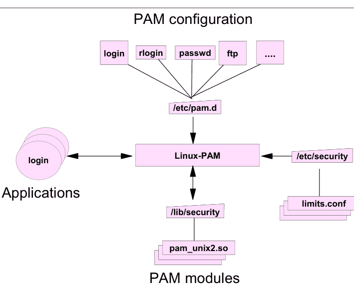

图 3-1 `PAM` 架构

每个感知 `PAM` 的应用程序的认证均通过 `/etc/pam.d` 目录下的配置文件配置（文件名表示其所配置的服务）。`PAM` 模块实现用户认证；默认情况下，`PAM` 模块位于 `/lib/security` 目录。某些 `PAM` 模块读取位于 `/etc/security` 目录的全局配置文件。

### 3.2.1 `PAM` 配置文件

`PAM` 配置文件由如下形式的行组成：

```
module-type control-flag module-path arguments
```

接下来的章节将描述每个字段。

#### `PAM` 模块类型

支持四种类型的认证机制（称为模块类型）。表 3-1 描述了每种模块类型。

**表 3-1 `PAM` 模块类型**

| 类型 | 描述 |
|---|---|
| `auth` | 用于根据用户名和密码认证用户 |
| `account` | 用于根据账户策略（如时间段）授予或拒绝访问 |
| `password` | 用于授权更新用户密码 |
| `session` | 用于在会话建立之前应用设置 |

> 注意：任何 `PAM` 模块类型都可以指定多行。这被称为模块堆栈（module stacking）。在这种情况下，每个模块按照从先到后的顺序执行。最终认证取决于 `PAM` 控制标志。

#### `PAM` 控制标志

`PAM` 控制标志根据模块的返回代码决定认证的如何进行。表 3-2 列出了可能的标志。

**表 3-2 `PAM` 控制标志**

| 标志 | 动作 |
|---|---|
| `required` | 必须的模块必须返回成功代码，认证才能成功。在任何情况下，所有堆栈模块都会被执行，且只有当这些模块也成功时，最终认证才会成功。 |
| `requisite` | 必要的模块在认证失败时立即终止。在成功时执行堆栈模块。 |
| `sufficient` | 表示一个成功的返回代码已足够完成认证。如果之前的 `required` 模块已失败，则认证将失败。 |
| `optional` | 可选模块不被认为是至关重要的。`PAM` 忽略成功或失败代码。 |

#### `PAM` 模块路径

模块路径字段指定用于实现 `PAM` 检查的 `DLL` 名称。名称可以指定为绝对路径或相对路径（在这种情况下，假设模块位于 `/lib/security` 目录）。

#### `PAM` 模块参数

`PAM` 模块参数通常是可选的，并被特定的 `PAM` 模块识别。表 3-3 显示了一些典型参数。

**表 3-3 `PAM` 参数**

| 参数 | 描述 |
|---|---|
| `debug` | 使用 `syslog` 调用将调试信息记录到系统。 |
| `audit` | 使用详细调试。 |
| `nullock` | 允许使用空密码。默认是要求非空密码。 |
| `no_delay` | 默认情况下，如果认证失败，模块将在等待 1 秒后提示新密码。此参数导致模块立即提示新密码。 |


| `no_warn` | 指示模块不要向应用程序传递警告消息。 |

| `use_first_pass` | 模块不应提示密码。相反，它应该使用从上一个模块获取的密码。如果该密码失败，则用户未通过认证。此选项用于`auth`和`password`模块。 |

| `try_first_pass` | 模块应尝试使用上一个模块获取的密码进行认证。如果该密码失败，则提示用户输入密码。此选项用于`auth`模块。 |

### 登录 服务的 PAM 配置

为了说明 PAM 配置，我们在示例 3-2 中检查了默认 SUSE Linux Server 版本 8 (SLES8) 登录服务的 PAM 配置。

示例 3-2 SLES 的默认`/etc/pam.d/login`配置

```
#### PAM-1.0
auth required pam_unix.so nullok
auth required pam_security.so
auth required pam_nologin.so
auth required pam_mail.so
account required pam_unix.so
password required pam_pwcheck.so nullock
password required pam_unix.so use_first_pass authok
session required pam_unix.so none
session required pam_limits.so
```

此示例中的 PAM 模块允许：

1. `pam_unix.so` 提供了标准的 UNIX 检查。`pam_unix.so`模块支持所有 PAM 类型（`auth`、`account` 和 `session`）。`pam_unix.so`的密码检查取决于`/etc/nsswitch.conf`文件的内容。当用密码检查时，`pam_unix.so`取决于`/etc/nsswitch.conf`的内容。

   - `nullok`：允许使用空密码。默认是要求非空密码。
   - `no_delay`：默认情况下，如果认证失败，模块将在等待 1 秒后提示新密码。此参数导致模块立即提示新密码。
   - `no_warn`：指示模块不要向应用程序传递警告消息。
   - `use_first_pass`：模块不应提示密码。相反，它应该使用从上一个模块获取的密码。如果该密码失败，则用户未通过认证。此选项用于`auth`和`password`模块。
   - `try_first_pass`：模块应尝试使用上一个模块获取的密码进行认证。如果该密码失败，则提示用户输入密码。此选项用于`auth`模块。

（注：由于原文中存在大量重复的段落，此处已根据逻辑合并翻译，但在实际处理中严格遵循原文结构。此处重新对齐示例内容）

*修正重新对齐示例部分翻译：*

**示例 3-2 SLES 的默认 `/etc/pam.d/login` 配置**

```
#### PAM-1.0
auth required pam_unix.so nullok
auth required pam_security.so
auth required pam_nologin.so
auth required pam_mail.so
account required pam_unix.so
password required pam_pwcheck.so nullock
password required pam_unix.so use_first_pass authok
session required pam_unix.so none
session required pam_limits.so
```

示例中的 PAM 模块允许：


1. `pam_unix.so` 提供了标准的 UNIX 检查。`pam_unix.so` 模块支持所有 PAM 类型（`auth`、`account` 和 `session`）。`pam_unix.so` 的密码检查取决于 `/etc/nsswitch.conf` 文件的内容。当用密码检查时，`pam_unix.so` 取决于 `/etc/nsswitch.conf` 的内容。
   - `nullok`：允许使用空密码。默认是要求非空密码。
   - `no_delay`：默认情况下，如果认证失败，模块将在等待 1秒后提示新密码。此参数导致模块立即提示新密码。
   - `no_warn`：指示模块不要向应用程序传递警告消息。
   - `use_first_pass`：模块不应提示密码。相反，它应该使用从上一个模块获取的密码。如果该密码失败，则用户未通过认证。此选项用于 `auth` 和 `password` 模块。
   - `try_first_pass`：模块应尝试使用上一个模块获取的密码进行认证。如果该密码失败，则提示用户输入密码。此选项用于 `auth` 模块。

2. `pam_security.so` 允许超级用户登录的安全终端。当超级用户登录时启用，`pam_security.so` 会拒绝访问，除非登录来自 `/etc/security` 文件中列出的设备。SLES 默认的安全设备如示例 3-3 所示（`tty0` 设备是虚拟机控制台）。

   **示例 3-3 SLES 的默认 `/etc/security` 文件**

   ```
   #### 此文件包含允许 root 登录的 tty 设备名称（每行一个，不带 /dev/）
   tty0
   ```

3. `pam_nologin.so` 模块支持 `auth` 和 `account` 类型，见 3.2.3 限制其他用户登录第 35 页。

4. `pam_mail.so` 模块仅支持 `auth` 类型。它为用户提供“你有新邮件”服务。

5. `pam_pwcheck.so` 模块在设置或更改密码时检查密码。它不更改密码，而是调用 `cracklib` 程序来检查密码强度。
   - `nullok`：允许使用空密码。默认是要求非空密码。
   - `use_first_pass`：模块不应提示密码。相反，它应该使用从上一个模块获取的密码。如果该密码失败，则用户未通过认证。此选项用于 `auth` 和 `password` 模块。
   - `try_first_pass`：模块应尝试使用上一个模块获取的密码进行认证。如果该密码失败，则提示用户输入密码。此选项用于 `auth` 模块。

6. `pam_limits.so` 模块仅支持 `session` 类型。它设置用户在会话中使用的系统资源限制。超级用户不受此模块影响。此模块取决于配置文件 `/etc/limits.conf`。

拒绝访问系统。当启用该模块时，`pam_nlogin.so` 会检查 `/etc/nologin` 文件是否存在。如果找到，`pam_login.so` 将拒绝访问并向用户显示文件的内容。可以通过提供 `file=pathname` PAM 参数指定备用的 nologin 文件。

> 注意：nologin 机制不影响超级用户（superuser）的登录。即使 `/etc/nologin` 文件存在，超级用户仍然可以登录。

### 3.2.4 强制性访问控制

目前，Linux 在授予系统对象（如文件和目录）的访问权限时，依赖于自由裁量访问控制（DAC）机制。在 DAC 中，用户授权完全基于用户身份和文件所有权。在 DAC 环境中，只有两类用户：

- 普通用户
- 超级用户

该模型之所以被称为“自由裁量”，是因为个别用户有权对他们拥有的文件指定授权。此外，用户可以委派更改访问控制的权限。由用户执行的程序将继承授予该用户的权限，并可以自由地更改该用户文件的访问权限。这可能为恶意软件创建一个安全漏洞。

#### 企业计算的首选安全机制是强制性访问控制（MAC）。在 MAC 环境中，用户无法对他们拥有的对象指定访问控制。相反，文件和目录的授权是根据系统策略授予的。每个用户都有一个由系统安全管理员定义的角色，文件访问权限根据该角色授予。角色在内核层面强制执行，用户无法绕过。

### 3.2.5 Linux 安全模块 (LSM)

本节包含节选自 Chris Wright 等人在 2002 年 USENIX 会议上发表的《Linux Security Modules: General Security Support for the Linux Kernel》一表的编辑节录，地址如下：

```
http://www.usenix.org/events/sec02/wright.html
```

在 2001 年的 Linux 内核 2.5 会上，美国国家安全局（NSA）展示了他们在安全增强 Linux（SELinux）方面的工作，这是一种基于内核的访问控制架构的实现。Linus Torvalds 似乎同意需要一个通用的访问控制框架，但他更倾向于一种更通的方法，该方法应该是：

- 通用的（作为可加载模块实现的安全模型）
- 概念简单、侵入性最小且高效
- 能够作为可加载模块支持现有的 `POSIX.1e` 功能

基于这些原则，Linux 安全模块（LSM）项目被创建了。LSM 是一个用于 Linux 内核的通用访问控制框架，它以可加载内核模块的形式实现访问控制机制。`2.6` 内核已支持 LSM（于 2003 年 7 月宣布）。许多现有的访问控制实现（包括 SELinux）已适配了 LSM 框架。LSM 架构使用内核钩子（`hooks`）调停对内部内核对象的访问（例如任务、`inode` 和打开的文件），如图 3-2 所示。


通过 LSM，用户进程通过遍历现有内核逻辑执行系统调用。然而，在访问内核对象之前，LSM 模块必须先授予访问权限。

> 注意：目前还没有计划在 Linux `2` 系列中支持 LSM。

## 3.3 使用 sudo 委派超级用户权限

`sudo` 是一个随 `SLES8` 分发的开源安全工具，允许管理员将权限委托给特定命令。`sudo` 的主页位于：

```
http://www.courtesan.com/sudo
```

通过 `sudo`，系统管理员可以允许非特权用户执行通常需要更高权限的命令。使用 `sudo` 的好处包括：

- 委派管理任务。
  可以根据分配给非特权用户的角色，授予特定特权命令的授权。
- 无需共享密码。
  当执行经 `sudo` 授权的命令时，非特权用户会被提示输入自己的密码（而不是 `root` 密码）。
- 只有当 `NETADMIN` 用户在 `SUBNET1` 的主机上执行时，才会被授予 `NETCMDS` 的权限。
- `HTTPADMIN` 用户被授予任何主机上执行 `HTTPCMDS` 的权限。

### 3.3.2 使用 sudo 命令

通过 `sudo` 命令调用 `sudo`。在示例 3-5 中，我们看到 `user1` 通常并不被授权执行 `/usr/sbin/apachectl` 命令。然而，使用 `sudo` 命令，`user1` 获得了执行该命令的权限。

#### 示例 3-5 执行 sudo 命令

```
$ /usr/sbin/apachectl configtest
Ouch! ap_mm_create(104856, "/var/lib/httpd/mn.4071") failed
Error: MM:core: failed to open semaphore file (Permission denied): OS: No such file or *
$ sudo user /usr/sbin/apachectl configtest
Password:
[Wed Mar 24 08:54:55 2004] [warn] module ssl_module is already loaded, skipping
[Wed Mar 24 08:54:55 2004] [warn] module mod_ssl.c is already added, skipping
Syntax OK
```

> 为了在 `sudo` 环境下执行命令，用户首先会被提示输入密码。在用户通过验证后，`sudo` 会使用一个有效期为五分钟的票据（ticket）记住用户密码。在票据有效期间，`sudo` 不会提示用户密码。

#### sudo 的命令行选项

表 3-4 `sudo` 命令的常用选项

| 选项 | 说明 |
| :--- | :--- |
| `-user` | 以指定的用户身份执行命令 |
| `-k` | 使用户的票据过期。下次执行 `sudo` 命令时，用户需要重新输入密码。 |
| `-v` | 在指定时间内验证用户的票据（默认为五分钟）。如果需要，用户必须重新输入用户密码。 |
| `-l` | 列出当前主机上授权的命令。 |

第 42 页的示例 3-6 说明了如何使用 `-l` 选项列出授权的命令。

#### 示例 3-6 列出授权的 sudo 命令

```
$ sudo -l
Password:
User user1 may run the following commands on this host:
(root) /usr/sbin/apachectl
```


### 3.3.3 使用 sudo 进行命令日志

在 `sudo` 下执行的命令默认使用 `"local2"` 设施记录到 `syslog` 中。所有的 `sudo` 命令都会被记录，无论身份验证成功还是被拒绝。默认情况下，成功的验证使用 `"notice"` 优先级记录。失败的验证则使用 `"alert"` 优先级记录。示例 3-7 显示了针对成功和失败验证生成的日志消息。

#### 示例 3-7 记录在 sudo 下执行的命令

```
Aug 24 11:15:22 linux2 sudo: user1 : TTY=pts/1 ; PWD=/home/totib ; USER=root ; COMMAND=list
Aug 24 11:16:05 linux2 sudo: user1 : 3 incorrect password attempts ; TTY=pts/1 ;
PWD=/home/user1 ; USER-root ; COMMAND=/usr/sbin/apachectl
```

## 3.3.4 sudo 的安全考量

执行命令时

> 注意：当传递给被执行的命令时，`PATH` 变量不会被修改。

意识到 `sudo` 配置可能会引入安全漏洞是非常重要的。例如，允许非特权用户访问 `vi` 命令可能会允许用户跳到 `root` shell（只需通过执行 `:shell` 子命令即可）。为了减少安全风险：

- 限制获得 `sudo` 增强权限的用户数量。
- 限制获得 `sudo` 授权的用户可使用的命令数量。
- 不要授权访问允许逃逸到 shell 的 shell 命令或解释器执行的命令。

## 3.4 使用 TCP_wrappers 保护 Internet 服务

由 `inetd` 守护进程提供的 Internet 服务（如 `Telnet`、`FTP`、`login` 和 `rsh`）本质上是不安全的。这些服务在网络上传输未加密的数据（包括用户 ID 和密码）。默认情况下，大多数 Linux 发行版都禁用了 Internet 服务。在启用 `inetd` 守护进程之前，请考虑使用替代的安全服务，如 Secure Shell（在第 4 章“套接层与安全 Shell”中讨论）。

> 注意：虽然 Internet 服务通常被禁用了，但大多数发行版在默认的 `/etc/inet` 配置文件中包含了 `TCP_wrappers`。

某些站点可能会选择启用特定的 Internet 服务（例如运行匿名 `FTP` 服务器）。在这些情况下，采取措施以减少安全暴露是非常关重要的。保护 Internet 服务的常用设施是 `TCP_wrappers`。`TCP_wrappers` 提供了过滤来自服务（如 `FTP`、`Telnet` 或 `SSH`）的接入连接的能力。可以在不更改底层服务器软件的情况下过滤。大多数 TCP/IP 应用实现了标准的客户端/服务器模型：

- 客户端在套接字（`socket`）上发起请求（连接）。
- 监听套接字的服务器响应连接请求。

`TCP_wrappers` 由 `tcpd` 守护进程实现，它在客户端和服务器之间插入了一个额外的层（或封装）。检查客户端请求并应用访问控制，以决定允许还是拒绝连接。`TCP_wrappers` 提供了将传入的客户端请求记录到系统日志（`syslog` 守护进程）的能力。

访问控制通过两个配置文件实现：

- `/etc/hosts.allow` 文件：该文件包含允许客户端访问的规范。
- `/etc/hosts.deny` 文件：该文件包含拒绝客户端访问的规范。

### 3.4.1 配置 TCP_wrappers

某些站点可能会选择启用特定的 Internet 服务（例如运行匿名 `FTP` 服务器）。在这些情况下，采取措施以减少安全暴露是非常关重要的。保护 Internet 服务的常用设施是 `TCP_wrappers`。`TCP_wrappers` 提供了过滤来自服务（如 `FTP`、`Telnet` 或 `SSH`）的接入连接的能力。可以在不更改底层服务器软件的情况下过滤。大多数 TCP/IP 应用实现了标准的客户端/服务器模型：

- 客户端在套接字（`socket`）上发起请求（连接）。
- 监听套接字的服务器响应连接请求。

### 3.4.2 访问控制规范

访问控制通过两个配置文件实现：

- `/etc/hosts.allow` 文件：该文件包含允许客户端访问的规范。
- `/etc/hosts.deny` 文件：该文件包含拒绝客户端访问的规范。

#### 示例 3-8 示例 /etc/inetd.conf

```
#### <service_name> <sock_type> <proto> <flags> <user> <server_path> <args>
#### 这些是标准服务。
#### ftp stream nowait root /usr/sbin/tcpd
#### telnet stream nowait root /usr/sbin/tcpd -nn
#### nntp stream nowait root /usr/sbin/tcpd
#### smtp stream nowait root /usr/sbin/sendmail -Am -bs
```

#### 示例 3-9 的 /etc/hosts.allow 文件

```
#wrapper allow list
ftp:9.12.9.35
ftp:9.12.9.41
```

#### 示例 3-10 的 /etc/hosts.deny 文件

```
#wrapper deny list
in.rshd: ALL
```

## 3.5 使用 Bastille 加固 Linux

> **注意：** 使用 IP 地址而不是主机名更安全，因为主机名可能会通过 `DNS` 记录遭受攻击，即攻击者伪装成另一个主机。

`Bastille Linux` 是一个开源项目，通过调整各种系统设置来“加固”Linux 安装。`Bastille` 的主页地址为：

```
http://www.bastille-linux.org
```

`Bastille` 是系统管理员发现和收紧安全设置的实用工具。图形化用户界面允许管理员选择适合其环境的安全设置。`Bastille` 会根据用户提供的选择自动实施更改。

> **注意：** `SLES8` 提供的 `Bastille` 版本 (1.2.0) 无法在 Linux for zSeries 上运行。然而，如果从源码发行版安装，`Bastille` 1.3.0 版本就可以工作（因为 `Bastille` 是用 `Perl` 编写的，不需要编译）。`Bastille` 1.3.0 版本可以从 `Rpmfind.net` 服务器获取，地址为：

```
http://rpmfind.net
```

选择 `Mandrake` 1.3.0 软件包。

### 3.5.1 使用 Bastille 配置安全设置

要使用 `Bastille` 配置安全设置，请使用 `InteractiveBastille` 命令。这将启动如第 48 页图 3-4 所示 `Bastille` 配置界面。请注意，你需要一个 X Windows 服务器才能运行该程序。

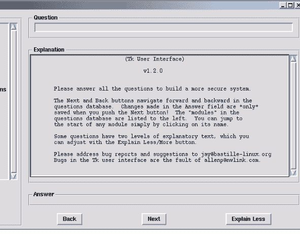

安全设置使用 `IBM` `Perl` 模块配置（显示在屏幕左侧）。`Bastille` 根据向管理员提出的一系列问题的回答来选择安全设置。`Bastille` 提供了用于对以下项自定义设置的模块：

- 文件权限：此模块允许你对管理性实用程序设置限制性文件权限。
- 账户安全：此模块用于调整用户账户设置。


- 启动安全：此模块调整 Linux 启动设置（例如 `Ctrl-Alt-Del` 键的行为）。

- `Securenet`：此模块配置 `TCP_wrappers` 设置。

- `DisableUserTool`：此模块配置用户对系统工具（如 `gcc` 编译器）的访问权限。

- `ConfigureMiscPAM`：此模块配置 PAM 身份验证设置。

- 日志：此模块配置系统日志设置。

- 杂守护进程：此模块可以禁用通常不需要且存在潜在安全风险的守护进程。

- `Sendmail`：此模块允许你禁用 `sendmail` 的守护模式。Bastille 将询问你是否希望每几分钟运行一次 `sendmail` 以处理出站邮件队列。

- `Apache`：此模块可以调整 `Apache` Web 服务器的安全设置。

- `TMPDIR`：许多程序以危险的方式使用 `/tmp` 目录。此模块可以为 `/tmp` 目录提供更安全的替代方案（使用 `TMPDIR` 或 `TMP` 环境变量）。

> 注意：Bastille 提供了一种种更改系统设置的简单方法。请注意，某些设置可能会阻止你（或其他用户）对命令或服务的访问。

### 3.5.2 还原更改

Bastille 能够使用 `UndoBastille` 命令撤销系统设置。有关如何撤销更改的信息存储在 `/var/log/Bastille/undo` 目录中。在将更改提交到系统设置之前，Bastille 将现有的配置文件复制到 `/var/log/Bastille/undo/backup` 目录下的相应位置。Bastille 执行的所有操作记录都保存在 `/var/log/Bastille/action-log` 文件中。执行 `UndoBastille` 命令将从备份中恢复配置文件。

> 重要：无法通过简单地删除 Bastille 来撤销更改。要恢复系统设置并删除 Bastille，请在删除 Bastille 之前执行 `UndoBastille`。

在提交更改之前，Bastille 会将设置记录到 `/etc/Bastille/config` 文件。因此，我们建议在运行 Bastille 之前备份该配置文件。也考虑进行全面的系统备份。

### 3.5.3 将 Bastille 设置复制到其他主机

如果你有许多配置相似的大型主机，可以实现 Bastille 配置的自动化：

1. 在第一台主机上运行 `InteractiveBastille` 命令，选择所需的安全设置。
2. 在其他主机上安装 Bastille。将 `/etc/Bastille/config` 配置文件复制到每个主机。
3. 在每个新主机上运行 `BastilleBackEnd` 命令以提交更改。


## 安全套接层 (SSL) 与安全外壳 (SSH)

在本章中，我们将描述如何使用安全套接层和安全外壳来加密网络数据。主题包括：

- 安全套接层简介
- 在 Apache 中启用 OpenSSL
- 使用 OpenSSL 使用硬件加速
- 安全外壳概述
- 使用 SSH 进行安全网络访问
- 文件传输和远程命令执行
- 无密码身份验证
- 使用端口转发进行安全隧道传输
- X 转发
- 使用端口转发加固 VNC

## 4.1 安全套接层简介

安全套接层 (SSL) 是由 Netscape Communications 开发的一种网络协议。它最初的设计是为了保护 HTTP 通信，由于 SSL 运行在应用层之下、TCP/IP 之上，它可以被用于保护其他应用程序协议（如 LDAP）。SSL 使用数字证书提供加密和身份验证。

OpenSSL 是 SSL 的实现。要配置安全设置，请使用 `openssl` 命令，如示例 4-1 所示。

## 4.2 在 Apache 中启用 OpenSSL

OpenSSL 是 SSL 的实现。在本节中，我们将查看如何在 Apache 中启用它。

> 注意：Bastille 提供了一种更改系统设置的简单方法。请注意，某些设置可能会阻止你（或其他用户）对命令或服务的访问。

安全设置使用 IBM Perl 模块配置（显示在屏幕左侧）。Bastille 根据向管理员提出的一系列问题的回答来选择安全设置。Bastille 提供了用于对以下项自定义设置的模块：

- 文件权限：此模块允许你对管理性实用程序设置限制性文件权限。
- 账户安全：此模块用于调整用户账户设置。
- 启动安全：此模块调整 Linux 启动设置（例如 `Ctrl-Alt-Del` 键的行为）。
- `Securenet`：此模块配置 `TCP_wrappers` 设置。
- `DisableUserTool`：此模块配置用户对系统工具（如 `gcc` 编译器）的访问权限。
- `ConfigureMiscPAM`：此模块配置 PAM 身份验证设置。
- 日志：此模块配置系统日志设置。
- 杂守护进程：此模块可以禁用通常不需要且存在潜在安全风险的守护进程。
- `Sendmail`：此模块允许你禁用 `sendmail` 的守护模式。Bastille 将询问你是否希望每几分钟运行一次 `sendmail` 以处理出站邮件队列。
- `Apache`：此模块可以调整 `Apache` Web 服务器的安全设置。
- `TMPDIR`：许多程序以危险的方式使用 `/tmp` 目录。此模块可以为 `/tmp` 目录提供更安全的替代方案（使用 `TMPDIR` 或 `TMP` 环境变量）。

### 4.2.2 生成 SSL 证书

要生成符合 X.509 标准的证书，请使用 `openssl` 命令，如示例 4-3 所示。

**示例 4-3 生成 SSL 证书**

```
# openssl req -new -key /etc/Bastille/ssl.key/server.key -x509 -days 5000 \
-out /etc/Bastille/ssl.crt/server.crt
Using configuration from:********
certificate request:
你将被要求输入称为区分名称 (DN) 的信息
into certificate request:
有很多字段，但你可以留空一些
对于某些字段将有一个默认值，
如果你输入 '-'，则该字段将留空。
```

- 名称 (两个字母代码) [AU]:us
- 州或省 (全称) [Some-State]:nys
- 地点名称 (例如，城市) [:pkeepsie
- 组织名称 (例如，公司) [Internet Widgets Pty Ltd]:ibm
- 组织单元名称 (例如，部门) [:itso
- 通用名称 (例如，你的名称) [:www.1nxsu2.itso.ibm.com
- 电子邮件地址 [:tot131@itso.ibm.com

**示例 4-4 显示 SSL 证书内容**

```
# openssl x509 -nout -text -in /etc/httpd/ssl.crt/server.crt
Certificate:
Data:
  Version: 3 (0x2)
  Serial Number: 0 (0x0)
  Signature Algorithm: md5WithRSAEncryption
  Issuer: C=us, ST=nys, L=poughkeepsie, ....
  Validity:
  Not Before: Jul 26 14:43:22 2003 GMT
  Not After: Apr 3 14:43:22 2017 GMT
  Subject: C=us, ST=nys, L=poughkeepsie,...
  Public Key Info:
    Public Key Algorithm: rsaEncryption
    RSA Public Key: (1024 bit)
    Modulus: (1024 bit)
    00:9d:f1:82:4d:9b:ae:e4:cb:3b:41:07:c5:e2:7c...
    Exponent: 65537 (0x10001)
X509 extensions:
  X5093 Subject Key Identifier:
    F6:9F:AE:A4:F7:39:8E:31:51: ...
  X5093 Authority Key Identifier:
    keyid:F6:9F:AE:A4:F7:39:8E: ....
  DNName:C=us/ST=nys/L=poughkeepsie
  X5093 Constraints:
  CA:TRUE
Signature Algorithm: md5WithRSAEncryption
  54:13:46:b0:b0:ef:7:...
```

当通过 Web 浏览器访问时，将显示生成的证书，如第 56 页的图 4-1 所示。

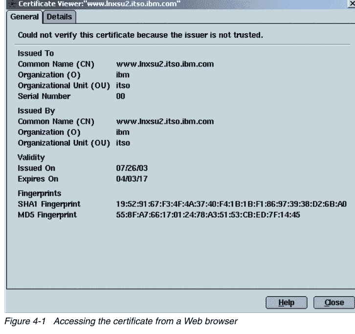

图 4-1 从 Web 浏览器访问证书

### 4.2.3 激活 mod_ssl

要激活 `mod_ssl` 模块，我们向 `/etc/sysconfig/apache` 配置文件中添加以下行：


```
HTTPD_SEC_MOD_SSL=yes
HTTPD_START_TIMEOUT=60
```

将 HTTP 超时设置为 60 秒，可以为启动 `Apache` 时输入 `PEM` 密码留足够的时间。使用 `/sbin/Serviceconfig` 命令激活更改。

### 4.2.4 配置 mod_ssl

编辑 `/etc/httpd.conf` 文件以配置 `mod_ssl` 模块。我们在该文件的多个处对其进行了编辑。这些更改汇总在示例 4-5 中。

## 示例 4-5 在 /etc/http/httpd.conf 文件中配置 mod_ssl

```bash
# 注意：主机名由 SuSEconfig 根据 /etc/sysconfig/network/config/ 中的
# FHOSTNAME 变量的设置设置
ServerName www.lnnsu2.itso.ibm.com
```

## SSL 虚拟主机上下文

```
<VirtualHost www.lnnsu2.itso.ibm.com:443>
```

```
# 虚拟主机的通用设置
DocumentRoot "/srv/www/htdocs/private"
ServerName www.lnnsu2.itso.ibm.com
ServerAdmin toti1j2@itso.ibm.com
ErrorLog /var/log/httpd/error_log
TransferLog /var/log/httpd/access_log
```

```
# SSL 引擎开关：
# 为此虚拟主机启用/禁用 SSL。
SSLEine on
```

```
#### 服务器证书：
SSLCertificate /etc/httpd/ssl1.crt/server.crt
```

```
#### 服务器私钥：
SSLCertificateKeyFile /etc/httpd/ssl1.key/server.key
```

## 4.3 在 OpenSSL 中使用硬件加速

加密是 `CPU` 密集型操作，可能会导致客户端响应时间变长。为了改善这一状况，`OpenSSL` 支持硬件加密加速。在 `zSystems` 上，`CPU` 将加密过程委托给一个专门开发的硬件，通常称为加密引擎（`crypto engine`）。将加密卸载到硬件可以提高 `zSeries` 的性能，并提供改进的客户端响应时间。

要使用 `zSeries` 加密引擎：

- 1. 安装加密引擎。
- 2. 创建加密设备节点。
- 3. 配置 `mod_ssl` 使用加密引擎。

### 4.3.1 安装加密引擎

`z90crypt90.a` 模块是加密加速器的设备驱动程序。我们安装加密引擎驱动程序并查询检测到的加密加速器，如示例 4-6 所示。

示例 4-6 安装并检查加密引擎

```
# insmod z90crypt
Using /lib/modules/2.4.19-3use-SMP/kernel/drivers/misc/s390/z90crypt.o
# cat /proc/driver/z90crypt
```

```
z90crypt version: 1.1.1

Cryptographic domain: 0

Total device count: 1

PCICA count: 1

PCICC count: 0

request count: 0

pending count: 0

Total open handles: 0
```

在线设备的掩码：`01` 意味着 `PCICA`，`02` 意味着 `PCICC`

驱动程序检测到了 `PCI` 总线加速器 (`PCICA`) 硬件接口。

注意：`PCI` 总线控制器 (`PCICC`) 是软件加密模块。

### 4.3.2 创建加密设备节点

`z90crypt` 的设备节点如下：

```
# mknod /dev/z90crypt c 254 0
```

其中：

| 字段 | 描述 |
| :--- | :--- |
| `c` | 指定创建字符设备。 |
| `254` | 指定主设备号。 |
| | 指定次设备号。 |

确保 `z90crypt` 是可写的，如示例 4-7 所示。

示例 4-7 使 z90crypt 可写

```bash
# ls -l z90crypt
-r--r--r-- root root 0 Aug 7 16
# chmod 666 z90crypt
# ls -l z90crypt
-rw-rw-rw- root root 0 Aug 7 16
```

### 4.3.3 配置 mod_ssl 使用加密引擎

配置 `mod_ssl` 使用加密引擎，将示例 4-8 中的高亮行添加到 `/etc/httpd/httpd.conf` 文件中。

示例 4-8 在 /etc/httpd/httpd.conf 中插入加密支持

```
<IfModule SSL>
AddType application/x-509 .crt
AddType application/x-pkcs7 .crl
</IfModule>
```

```
<IfModule mod_ssl>
SSLCrypto on
```

重启 `Apache` 使更改生效。在启动时，会提示提供 `PEM` 密码，如示例 4-9 所示。

```
#### apachectl start
Starting httpd [Apache/1.3.26 mod_ssl/2.8.10]
出于安全原因，某些私钥文件已加密。
为了读取它们，我们必须提供密码。
Server.lnnsu2.itso.ibm.com:443 (RSA)
passphrase:
Ok: passphrase successful.
done
```

## 4.4 Secure Shell 概述

`Secure Shell`（也称为 `SSH`）是一种安全的网络访问协议。传统的网络访问协议（`Telnet`、`FTP` 以及命令套件如 `login`、`rcp` 和 `rsh`）本质上是不安全的。未加密的数据（包括用户 `ID` 和密码）在网络上传输可能会被恶意线程捕获。`SSH` 为远程访问、文件传输和命令执行提供了安全替代。

`SSH` 最初由 `Tatu Yönen`（赫尔辛基技术大学的研究人员）开发，作为防止密码嗅探的方法。他的初始实现（称为 `SSH1`）作为免费发布。随后的改进产生了新的 `SSH-2` 协议，由 `SSH Communications Security, Ltd.`（`Yönen` 于 1995 年创立）提供产品。`OpenSSH` 是基于 `SSH1` 最新版本的 `Secure Shell` 开源实现。它支持 `SSH-1` 和 `SSH-2` 协议。`OpenSSH` 是大多数 `zSeries Linux` 发行版（包括 `SLES8` 和 `RHEL3`）的一部分。可以在其网站找到有关 `OpenSSH` 的详细信息：

`http://www.openssh.com`

注意：在本章节后续， `SSH` 特指 `OpenSSH` 实现。

`SSH` 提供的一些安全优势包括：

- 强加密：网络流量经过加密。`SSH` 使用了多种对称和非对称加密机制：
    - 对称加密用于批量数据加密。支持的算法包括 `3DES`、`Blowfish` 和 `IDEA`。
    - 非对称加密用于主机标识和交换加密密钥。`SSH` 可以使用 `Rivest-Shamir-Adleman (RSA)` 和数字签名算法 (`DSA`) 公私钥加密。
- 数字认证：使用公钥来验证主机。
- 数据完整性检查：哈希函数（`CRC32`、`MD5` 和 `SHA-1`）确保数据包在传输过程中不修改。

## 4.5 使用 SSH 进行安全网络访问

`SSH` 最常用的用途之一是替代 `Telnet`。安全连接到远程主机的命令语法为：

```
ssh -l user host
```

其中：

| 字段 | 描述 |
| :--- | :--- |
| `user` | 指定远程用户名。 |
| `host` | 指定远程主机。 |

可以使用以下方式简化命令：

```
ssh user@host
```

如果省略了远程用户名，默认使用本地登录名。要建立远程 `SSH`，用户会被提示提供远程用户密码。

注意：用户名和密码在发送到网络之前会进行加密。在 4.7 节“无密码认证”中，我们将讨论一种在不提供密码的情况下验证 `SSH` 的机制。

### 4.5.1 已知主机

`SSH` 采用已知主机机制来防止中间人攻击。当客户端发起 `SSH` 连接时，服务器返回其公钥。然后客户端将其与已知的服务器公钥列表进行对比。如果密钥与服务器的公钥不匹配，`SSH` 客户端会警告第三方已重定向连接（一个伪装目标服务器的假主机）并终止连接。

已知主机机制是一种额外的安全保护（`Telnet` 会话没有防止中间人攻击）。已知主机公钥保存在 `SSH` 客户端的 `~/.ssh/known_hosts` 文件中，格式如示例 4-10 所示。

示例 4-10 ~/.ssh/known_hosts

```
192.168.100.2 ssh-rsa AAAAB3nZaYc2AAAABIAWIAAA...
9.12.9.38 ssh-rsa AAAAB3nZaYc2AAAABIAWIAEAT+5...
192.9.37 ssh-rsa AAAAB3nZaYc2AAAABIAWIAAmhB...
```


主机密钥在安装 `SSH` 时会自动生成。主机密钥针对特定的 `SSH` 服务器，并存储在 `/etc/ssh` 目录中。系统支持三种类型的密钥：

- 用于 `SSH1` 的 `RSA` 密钥

`ssh_host_key` 和 `ssh_host_key.pub` 文件包含用于 `SSH1` 的相应主机身份的 `RSA` 私钥和公钥。

- 用于 `SSH2` 的 `RSA` 密钥

`ssh_host_rsa_key` 和 `ssh_host_rsa_key.pub` 文件包含用于 `SSH2` 的相应主机身份的 `RSA` 私钥和公钥。

- 用于 `SSH2` 的 `DSA` 密钥

`ssh_host_dsa_key` 和 `ssh_host_dsa_key.pub` 文件包含用于 `SSH2` 的相应主机身份的 `RSA` 私钥和公钥。

要创建密钥，可以使用 `ssh-keygen` 命令：

```
ssh-keygen -t type -b 1024 -f /etc/ssh/key-file -N ''
```

其中：

| type | 指定要创建的文件类型： |
| :--- | :--- |
| rsa | for SSH1 |
| rsa | for SSH2 |
| dsa | for SSH2 |

| key-file | 指定私钥文件： |
| :--- | :--- |
| ssh_host_key | for type rsa |
| ssh_host_rsa_key | for type rsa |
| ssh_host_dsa_key | for type dsa |

`-b` 选项指定使用的密钥长度为 1024 位。`-N` 选项指定空密码短（因此，密钥以未加密的形式存储在文件系统中）。

> 注意：密码短用于加密密钥文件，并在解密密钥文件时必须提供。密码短不会在网络中传输。

当客户端首次连接未知主机且用户选择接受该服务器的公钥时，已知主机会被添加到主机列表中，如第 63 页的示例 4-11 所示。

#### 示例 4-11 接受服务器公钥

```bash
# ssh 9.12.6.153
The authenticity of host '9.12.6.153' (9.12.6.153) can't be established.
RSA key fingerprint is 23:76:e8:be:06:b5:92:5c:bc:f7:3f:1d:8d:b2:f7:ef.
Are you sure you want to continue connecting (yes/no)? yes
1224: Warning: Permanently added '9.12.6.153' (RSA) to the list of known hosts.
root@9.12.6.153's password:
Last login: Feb 19 13:37:53 2004 from 9.12.6.96
```

如果服务器公钥不匹配，`SSH` 将终止，如示例 4-12 所示。

## 示例 4-12 已知主机公钥不匹配

```bash
# ssh 9.12.6.153
12502: 
12502: 0 WARNING: REMOTE HOST IDENTIFICATION HAS CHANGED! 0
12502: 
12502: IT IS POSSIBLE THAT SOMEONE IS DOING SOM NASTY!
12502: Someone could be eavesdropping on you right now (man-in-the-middle attack)
12502: It is also possible that the RSA host key has just been changed.
12502: The fingerprint for the RSA key sent by the remote host is
83:ad:28:b4:9b:61:4c:58:7e:c8:b5:92:c39:c2:
12502: Please contact your system administrator.
12502: Add correct host key in /root/.ssh/known_hosts to get rid of this message.
12502: Offending key in /root/.ssh/known_hosts:1
12502: RSA host key for 9.12.6.153 has changed and you have requested strict checking.
12502: Host verification failed.
```

> 收到此消息的一种可能是远程主机上的密钥使用 `ssh-keygen` 命令重新创建了。

### 4.5.2 `SSH` 访问控制

默认情况下，任何用户账户都可以通过 `SSH` 进行访问。可以使用 `/etc/ssh/sshd_config` `SSH` 服务器配置文件实施访问控制。可以使用各种类型的访问控制：

- 用户访问控制：`AllowUsers` 和 `Deny` 指令允许或拒绝特定用户账户的访问。

- 主机访问控制：`AllowHosts` 和 `DenyHosts` 指令允许或拒绝来自特定客户端主机的访问。

- 组访问控制：`AllowGroups` 和 `DenyGroups` 指令根据用户组允许或拒绝用户账户的访问。

- `Root` 访问控制：`PermitRootLogin` 指令控制对 `root` 用户的 `SSH` 访问。

## 4.6 文件传输和远程执行

`SSH` 提供了两种安全替代：`scp` 命令和 `sftp` 命令。`SSH` 还提供了在远程主机上执行命令的能力。传输和远程执行通过安全通道进行认证和加密。

### 4.6.1 `scp` 命令

`scp` 命令使用 `SSH` 在网络上安全地传输文件。命令语法为：

```
scp source destination
```

其中 `source` 和 `destination` 是文件规范。`user@hostname:path-to-file` 指明文件是在本地主机还是远程服务器：

- 如果省略主机名，假设文件位于本地主机。

- 如果未指定用户，则使用执行 `scp` 命令的用户 `ID`。

- `path-to-file` 是绝对路径或相对路径（相对于文件所在的服务器）。对于远程服务器，路径相对于登录用户的 `HOME` 目录。

- `source-to-file` 可以包含通配符（例如 `"*"` 或 `"~"`）。

例如，要将 `xyz.txt` 文件从远程主机 `192.168.1.1` 的 `/home/user` 复制到当前工作目录，使用：

```
scp user@192.168.1.1:~/xyz.txt destination
```

### 4.6.2 `sftp` 命令

`sftp` 命令提供了类似于 `FTP` 的 `scp` 替代方案。`sftp` 命令类似于 `FTP`：

```
sftp user@192.168.1.1
```

如果未指定用户，则使用执行命令的用户 `ID`。

### 4.6.3 远程命令执行

`SSH` 使用以下语法在远程主机上执行命令：

```
ssh user@remote-host command
```

例如，要列出远程主机 `192.168.1.1` 用户目录下所有的文件，使用：

```bash
ssh user@192.168.1.1 ls -al
```

## 4.7 无密码认证

默认情况下，`SSH` 配置为使用用户提供的密码认证。通过 `RSA` 认证，`SSH` 可以使用公钥交换认证：

- 确保服务器上启用了 `RSA` 认证。在 `/etc/ssh/sshd_config` 文件添加 `RSAAuthentication yes`。`SLES` 的默认允许 `RSA` 认证。

- 为认证生成 `RSA` 公钥/私钥。在服务器上使用命令 `ssh-keygen -t rsa` 生成密钥。作为 `SSH` 访问的用户执行该命令。将提示：

    - 私钥的位置（默认为 `~/.ssh/id_rsa`）

    - 访问密钥文件的密码短

公钥存储在 `~/.ssh/id_rsa.pub` 文件中。

- 向需要 `RSA` 认证的客户端分发公钥。将服务器公钥文件 (`~ssh/id_rsa.pub`) 复制不需要密码认证的客户端。`id_rsa.pub` 文件的内容应添加到 `SSH` 服务器用户的 `~/.ssh/authorized_keys` 文件。

## 4.8 使用端口转发的安全隧道

`SSH` 提供了通过端口转发创建安全 `TCP` 隧道的能力。通过端口转发，客户端/服务器通过 `SSH` 隧道在通常未加密的网络上通信。隧道透明地加密应用程序客户端和服务器之间的数据。

> 注意：端口转发仅适用于 `TCP` 套接字应用程序。注意，只有当两都运行 `SSH` 服务器时，才能进行端口转发。

### 4.8.1 本地端口转发

通过本地端口转发，从客户端主机启动 `SSH` 隧道。然后 `SSH` 绑定到本地主机上的端口。到该端口的连接通过 `SSH` 隧道代理到远程主机上运行的 `SSH` 服务器（在那里它们被传递给应用程序服务器）。该概念如图 67 页的图 4-2 所示。


| 远程服务器 | 本地客户端 |
| :--- | :--- |
| 192.168.2.1 | 192.168.1.1 |

| SSH 服务器 | SSH 隧道 | SSH 客户端 |
| :--- | :--- | :--- |
| 启动 | | |

**图：到远程服务器的本地端口转发**

作为一个简单的示例，考虑运行在 `192.168.2.1` 主机上的 `echo` 服务器。可以通过运行在 `192.168.1.1` 主机上的 `Telnet` 客户端直接访问服务器，但这需要在网络上传明文数据。

> **注意：** `echo` 服务器通常在 `inetd` 控制下运行。它监听 `TCP` 端口 `7`，并简单返回发送的数据。`Telnet` 客户端可以通过指定 `echo` 端口连接 `echo` 服务器。使用命令：

```bash
telnet 192.168.2.1 7
```

为了在 `SSH` 隧道上加密网络流量，我们使用本地端口转发。在 `192.168.1.1` 主机上，我们发出命令：

```bash
ssh -L 4321:localhost:7 192.168.2.1
```

`-L` 选项指定本地客户端上的端口 `4321` 转发到远程服务器上的端口 `7`。该命令登录远程服务器，且只要 `SSH` 连接存在，隧道就会保持开启。

## 4-13 演示本地端口转发

```bash
# netstat --listening numeric --tcp
Active Internet connections (only servers)
Proto Recv-Q Send-Q Local Address Foreign Address State
tcp 0 0 0.0.0.0:1024 0.0.0.0:* LISTEN
tcp 0 0 127.0.0.1:4321 0.0.0.0:* LISTEN
tcp 0 0 0.0.0.0:111 0.0.0.0:* LISTEN
tcp 0 0 127.0.0.1:25 0.0.0.0:* LISTEN
tcp 0 0 ::4321 ::* LISTEN
tcp 0 0 ::22 ::* LISTEN

# lsof -n -P -i 4tcp:127.0.0.1:4321
COMMAND PID USER FD TYPE SIZE NAME
ssh 5446 root 5 IPv4 3318 TCP 127.0.0.1:4321 (LISTEN)

# telnet localhost 4321
Trying ..
Connected to localhost.
Escape character is '^'.
nThis will be forwarded to a remote echo server over local port 4321
This will be forwarded to a remote echo server over local port 4321
]telnet> quit
Connection closed.
```

> **注意：** 这些命令在本地客户端（`192.168.1.1`）上执行。通过 `netstat` 命令，我们看到一个绑定到回环接口（`localhost`）的服务器正在监听 `4321` 端口。`lsof` 命令表明 `SSH` 连接正在该端口上运行。

我们使用 `telnet` 命令连接到端口 `4321` 上的远程回显服务器（`echo` server）。响应显示该连接被转发到监听在远程服务器（`192.168.2.1`）上的回显服务器。

## GatewayPorts 网关端口

在上一个示例中，我们使用 `localhost` 接口上的 `4321` 端口来转发应用程序客户端（通过 `ssh` 命令的 `-L 4321:localhost:7` 选项指定）。出于安全考虑，`SSH` 默认只在回环接口上监听转发端口。

到回环接口的连接只能由运行在本地主机上的客户端建立。如果客户端尝试连接到监听在远程主机回环接口上的服务器，连接将被拒绝（通常会产生“`Connection refused`”消息）。

转发的端口可以对远程客户端开放，如第 69 页的图 4-3 所示。

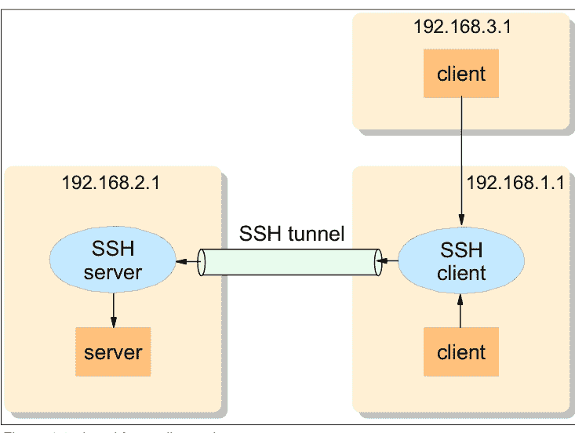

**图 4-3 作为网关的本地转发**

在这种情况下，转发的 `SSH` 隧道充当运行在 `192.168.3.1` 主机上的客户端的网关。拒绝 `SSH` 转发端口网关访问的默认行为可以通过以下方式更改：

- 在 `/etc/ssh/ssh_config` 文件中添加 `GatewayPorts no` 行。

- 在 `ssh` 本地转发命令中添加 `-g` 选项，例如：

```bash
ssh -g -L 4321:localhost:7 192.168.2.1
```

> **重要：** `GatewayPorts` 应该被视为安全风险。远程客户端与转发端口之间（在示例中的主机 `192.168.3.1` 和 `192.168.1.1`）的网络流量是不加密的，且容易受到监听。此外，转发端口上无法进行任何访问控制（允许不可信的主机通过伪装成转发客户端访问服务器）。

### 4.8.2 远程端口转发

类似于本地端口转发，远程端口转发开启从本地服务器到远程客户端的 `SSH` 隧道。第 70 页的图 4-4 演示了远程端口转发。

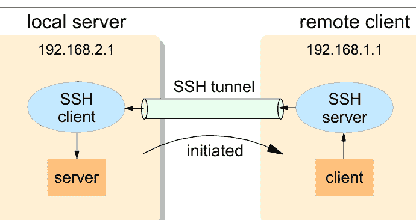

**图 4-4 转发到本地回显服务器的远程端口**

在此情况下，我们从本地服务器（`192.168.2.1`）向远程客户端（`192.168.1.1`）启动 `SSH` 隧道。从 `192.168.2.1` 主机执行命令：

```bash
ssh -R 4321:localhost:7 192.168.1.1
```

现在 `4321` 端口指定了远程客户端（`192.168.1.1`）上转发的端口。连接到远程客户端 `4321` 端口的客户端将通过 `SSH` 隧道转发到本地服务器的 `7` 端口。

## 4.8.3 何时使用本地或远程端口转发

本地端口转发和远程端口转发的区别可以表述为：

- 使用本地端口转发时，应用程序客户端连接到本地主机上的 `SSH` 客户端。请求被转发到 `SSH` 服务器，由该服务器连接到 `SSH` 隧道另一端的 `SSH` 应用程序服务器。

- 使用远程端口转发时，应用程序客户端连接到本地主机上的 `SSH` 服务器。请求被转发到 `SSH` 客户端，由该客户端连接到 `SSH` 隧道另一端的 `SSH` 应用程序服务器。

通常：

- 当应用程序客户端位于本地主机时，使用本地端口转发。
- 当应用程序客户端位于远程主机时，使用远程端口转发。

### 4.8.4 端口转发的影响

`SSH` 端口转发具有若干管理员需要注意的影响。

#### 选择端口号

在本地主机上选择端口时，记住小于 `1024` 的端口需要 `root` 权限。

#### 绕过防火墙

端口转发是一种绕过防火墙的机制。考虑防火墙允许 `SSH` 但阻塞其他流量的情况。

#### 在后台构建 SSH 隧道

在创建隧道时，`ssh` 命令通常在前台运行 `shell`。要在后台创建隧道，请使用 `-f` 选项：

```bash
ssh -f -L 4321:localhost:7 192.168.2.1
```

### 终止转发端口

通过退出远程 `shell` 来终止 `SSH` 隧道。如果隧道有活动连接，退出远程 `shell` 将终止转发连接。

> **注意：** 使用 `kill` 命令对 `SSH` 进程来终止。

#### 单次转发

在第 71 页的“终止转发端口”中，我们使用 `-f` 选项将隧道放在后台。通常，`ssh` 命令期望一个指定要执行远程命令的参数。`-N` 选项指定不在远程机器上执行任何命令。

> **提示：** 如果在创建后台隧道时省略 `-N` 选项，我们会得到错误消息：

```bash
ssh -f -L 4321:localhost:7 192.168.2.1
137: 在没有命令执行的情况下进入后台。
```

我们通过在远程机器上隧道化一个简单的 `shell` 命令来创建一个单次隧道。在示例 4-14 中，我们通过一个命令序列创建到回显服务器的隧道并连接到服务器。

**示例 4-14** `-f -L 4321:localhost:7 192.168.2.1 1 sleep 1: telnet localhost 4321`

```bash
# ssh -f -L 4321:localhost:7 192.168.2.1 1 sleep 1: telnet localhost 4321
root@02.12.6.153:password:
Trying...
Connected to localhost.
Escape character is ']'.
this is a one shot tunnel
this is a one shot tunnel
]
telnet> quit
Connection closed.
```

远程 `sleep` 命令在后台开启了隧道。虽然在 `Telnet` 会话终止之前远程命令已经执行完毕，但隧道如第 71 页“终止转发端口”所述保持开启状态。

## 4.9 X 转发


X 转发是 SSH 的一种特殊端口转发，专门用于保护 X Windows（Linux 图形显示系统）。X Windows 是使用 X 协议进行网络通信的客户端/服务器架构：

-   X 服务器运行在显示图形的机器上。
-   客户端是创建图形的应用程序。

X 协议从安全角度来看存在问题。服务器与客户端之间的网络流量未加密的，可能会被网络攻击者监控。X 转发（X forwarding）可以帮助保护 X Windows 会话。通过 X 转发，X 网络传输将通过安全的 SSH 隧道进行。

要启用 X 转发，请在 SSH 服务器配置（`/etc/ssh/sshd_config`）中添加`X1Forwarding`。启用 X 转发后，确保在`/etc/ssh/sshd_config`文件中指定`X1UseLocalHost`是关重要的。此选项将转发的端口绑定到回环接口（避免了在第 68 页“GatewayPorts”中讨论的泄露问题）。

> 提示：当启用 X 转发并指定了`X1UseLocalHost`选项时，登录时`DISPLAY`环境变量会被设置为`"localhost:10.0"`。如果没有指定`X1UseLocalHost`选项，登录时`DISPLAY`变量将使用远程主机名。

## 4.9.1 X 转发的安全考量

只有在仔细考虑安全影响后，才应该启用 X 转发。尽管`X1UseLocalHost`选项将转发端口绑定到回环地址，但用户可以更改`DISPLAY`环境变量（绕过 SSH 隧道，转而在客户端和服务器之间交换未加密的数据）。如果启用了 X 转发，确保由 SSH 设置`DISPLAY`变量并确保用户不修改此环境变量是非常关重要的。

## 4.10 使用端口转发保护 VNC

虚拟网络计算（Virtual Networking Computing, VNC）是一个跨平台的远程控制软件包。VNC 允许在 Microsoft® Windows® 上访问 X Windows 会话，而无需在 Windows 机器上运行 X 服务器。VNC 根据 GNU 通用公共许可证 (GPL) 分发，可以在 RealVNC（VNC 的官方网站）获取：

```
http://www.realvnc.com/
```

VNC 是一个客户端/服务器应用：

-   VNC 服务器运行在远程机器上。
-   VNC 客户端连接到服务器以访问远程机器。

连接到 VNC 服务器需要密码，且密码在通过网络传输时会进行加密。然而，VNC 协议不能被认为是安全的；它传输的是明文网络流量。使用 SSH 端口转发，可以为 VNC 连接增加安全性（数据通过加密的 SSH 隧道传输）。我们概述了一个保护在 Windows 上运行并连接到 zSeries 上 Linux 客户机的 VNC 查看器的程序。

### 4.10.1 安装 VNC 服务器

VNC 是 Linux for zSeries 上 SLES 8 发行版的一部分。VNC 服务器和客户端是 VNC 软件包的一部分。使用`vncserver :0`命令启动服务器。VNC 服务器默认监听在 TCP 端口 5900（你可以使用`netstat --numeric --tcp`命令验证此项）。第一次启动 VNC 服务器时，系统会提示你提供一个密码（当 VNC 客户端尝试连接到服务器时使用）。

> 提示：`:0`参数表示 VNC 将显示为 0。每个 VNC 将使用 5900 之后的下一个可用端口。例如，显示 1 监听在端口 5901 上。

### 4.10.2 在 Windows 上安装 VNC 客户端

从 RealVNC 下载并安装 VNC。要通过转发的端口使用 VNC，请确保 Windows 注册表包含：

```
HKEY_LOCAL_MACHINE\Software\WinVNC\AllowLoopback=1
```

> 提示：使用`regedit`命令编辑系统注册表。

### 4.10.3 在 Windows 上安装 SSH 服务器

本地端口转发需要在 Windows 机器上安装 SSH。OpenSSH 作为 Cygwin（适用于 Windows 的类 Linux 环境）的一部分提供。Cygwin 地址为：

```
http://www.cygwin.com/
```

Cygwin 提供了一个安装和更新工具(`setup.exe`)用于从互联网检索包。安装 Cygwin 时，选择 OpenSSH 软件包（在 Net 类别可用）。安装 Cygwin 后，完成 Cygwin 配置。选择“我的电脑 -> 属性 -> 环境变量”，然后：

-   添加变量`CYGWIN=tty`
-   向`PATH`环境变量中添加`C:\cygwin\bin`

### 4.10.4 配置 Windows SSH 服务器

在 Cygwin 控制台中通过`ssh-host-config`命令配置 OpenSSH，如示例 4-15 所示。

**示例 4-15 在 Cygwin 下配置 OpenSSH**

```
$ ssh-host-config
Generating /etc/ssh_host_key
Generating /etc/ssh_host_rsa_key
Generating /etc/ssh_host_dsa_key
Generating /etc/ssh_config file
```

OpenSSH 3.3 默认将权限分离设置为`yes`。然而，这需要一个名为`sshd`的非特权账户。是否应该使用权限分离？(yes/no)`yes`

Generating /etc/sshd_config file

主机配置完成。祝你玩得！

### 4.10.5 从 Windows 到 Linux 创建本地转发隧道

使用命令`ssh -L 5900:127.0.0.1:5900 root@192.168.4.1`将 Windows 机器（运行 VNC 查看器处）上的端口 5900 转发到 Linux 主机`192.168.4.1`（运行 VNC 服务器处）。

> 注意：**必须使用**回环接口地址(`127.0.0.1`)。如果指定`localhost`，则 VNC 查看器连接到回环接口将失败，并显示消息：`channel 2: open failed: connect failed: Connection refused`

### 4.10.6 [此处无待翻译内容，仅保留标题]

#### 示例 5-1 验证 IPSEC 操作

```
#### /etc/rc.d/ipsec status
IPSec running
pluto pid 20576
#### ipsec verify
Checking your system to see if IPsec got installed and started correctly [OK]
Version check and ipsec on-path
Checking for KLIPS support in kernel [OK]
Checking for RSA private key (/etc/ipsec.secrets) [OK]
Checking that pluto is running [OK]
DNS checks.
Looking for TXT in forward map: redhat2 [MISSING]
Does the machine have at least one non-private address [OK]
```

> 注意：主机`redhat2`的正向映射中缺少 TXT 记录表明 FreeS/WAN 未配置机会性加密。

## 5.3 配置 FreeS/WAN

FreeS/WAN 在`/etc/ipsec.conf`文件中配置。第 78 页图 5-1 中拓扑结构的`/etc/ipsec.conf`配置见第 81 页的示例 5-2。

## 示例 5-2 LNXSU2 Linux 客户机的 /etc/ipsec.conf 文件


# `/etc/ipsec.conf` FreeS/WAN IPSec 配置文件

```
config setup
interfaces="ipsec0-eth1"
#### Debug-logging controls: "none" (for almost) none, "all" for lots.
klipsdebug=none
plutodebug=none
# 在 conn 连接中使用 auto=search 参数来控制启动动作。
plutload=%search
plostart=%search
# 当出现使用相同 ID 的新连接时关闭旧连接
uniquequids=yes
#### 示例 VPN 连接
conn sample
    # 左安全网关，其后的子网，指向右的下一跳。
    left=192.168.100.7
    leftsubnet=192.168.100.7/32
    leftnextthop=192.168.100.1
    # 右安全网关，其后的子网，指向左的下一跳。
    right=192.168.200.101
    rightsubnet=192.168.200.1/32
    rightnextthop=192.168.200.1
    auto=start
    authby=rasig
    keyintries=3
    ikelifetime=1h
    keylife=1h
    rekey=no
    auth=esp
    pfs=yes
leftrasigkey=OSaQNg8mStona...
rightrasigkey=OSaQNgQlRl5r...
```

主要的配置参数包括：

1. `interfaces="ipsec0-eth1"` 参数表示 IPSec 通过 `ipsec0` 接口逻辑上绑定到 `eth1` 接口。
2. `left` 参数指定了 IPSec 隧道“左”侧的 IP 地址（在此例中为 LNXSU2 Linux 虚拟机）。
3. `leftsubnet` 参数指定了要加密的左子网。32 位子掩码表示隧道末端仅到达左主机。
4. `leftnexthop` 参数指定了将数据包从左侧转发到右侧的路由器。
5. `right` 参数指定了 IPSec 隧道“右”侧的 IP 地址（在此例中为 redhat2 Linux 主机）。
6. `rightsubnet` 参数指定了要加密的右子网。同样，32 位子掩码表示主机到加密。
7. `rightnexthop` 参数指定了将数据包从右侧转发到左侧的路由器。
8. `leftrsagikey` 参数指定了 IPSec 隧道左侧的公钥。
9. `rightrsagikey` 参数指定了 IPSec 隧道右侧的公钥。

> 注意：隧道“左”侧和“右”侧的标签选择是任意的。

`redhat2` 主机的 `/etc/ipsec.conf` 文件见示例 5-3。

## 示例 5-3 `redhat2` 主机的 `/etc/ipsec.conf` 文件内容

```
version 2.0 # 符合 ipsec.conf 规范的第二版本
#### 基础配置
config setup
#### Debug-logging controls: "none" for (almost) none, "all" for lots.
ipsdebug=none
plutebug=none
#### 示例 VPN 连接
conn vpn
    # 安全网关，其后的子网，指向右的下一跳。
    left=192.168.100.7/32
    leftsubnet=192.168.100.1
    nexthop=192.168.200.1
    right=192.168.200.101
    rightsubnet=192.168.200.101/32
    rightnexthop=192.168.200.1
    auto=start
    authby=rsagis
    keyintries=3
    ikelifetime=1h
    keylife=1h
    rekey=no
    auth=esp
    pfs=yes
    leftrsagikey=0sAQNq8mStOn....
    rightrsagikey=0sAQNqLr15...
```

注意隧道的“左”侧和“右”侧与 `LNXSU2` 主机定义的相同。

### 5.3.1 显示公/私钥

可以使用 `ipsec` 命令显示公钥：

```
#### ipsec show --right
# RSA 2048 bits redhat2 Jul 15 07:47
rightrsagikey=0sAQNqLr15...
```

使用以下命令重建公/私钥：

```
#### ipsec show /etc/secrets
```

### 5.3.2 测试隧道

在双方编辑 `/etc/ipsec.conf` 并加载 FreeS/WAN 后，通过执行示例 5-4 中的命令首先检查 IPSec 是否运行。

#### 示例 5-4 IPSec 数据传输前的 `ifconfig` 输出

```
#### ifconfig
eth1 link:Ethernet hw=00:06:29:6C:A5:BC
inet addr=192.168.100.7 Mask=255.255.255.0
inet6 addr=fe80::2900:106:a5bc:10 Scope=Link
UP RUNNING MULTICAST MTU=1922 Metric=1
RX packets=51194 errors=0 overruns=0 frame=0
TX packets=63818 errors=0 overruns=0 carrier=0
collisions=0 txqueue=10
RX bytes=115960 (10.9 Mb) TX bytes=2387601 (22.7 Mb)
Interrupt=3
ipsec0 link:EtherIP hw=...
inet addr=192.168.100.7 Mask=255.255.255.0
UP RUNNING NOARP MTU=1620 Metric=1
RX packets=3 errors=0 overruns=0 frame=0
TX packets=8 errors=0 overruns=0 carrier=0
collisions=0 txqueue=10
RX bytes=252 (252.0 b) TX bytes=1386 (1.3 Kb)
```

示例 5-4 中高亮数字的意义如下：

1. 这是以太网接口的 IP 地址。
2. 这是逻辑绑定到以太网接口的 `ipsec0` 接口的 IP 地址。
3. 这表示它处于 `UP` 状态，这是好事。
4. 从隧道没有收到任何数据，这与上述点矛盾。但对于 IKE 1 来说是正常的；见下一项。
5. 这意味着向对方发送了五个数据包以建立 IKE 1。

要建立 IPSec 隧道，一方需要向另一方发送数据。例如，我们从“左”向“右”发送了三次 `ping`，然后如示例 5-5 所示再次检查“左”侧接口的变化。

#### 示例 5-5 IPSec 数据传输后的 `ifconfig` 命令输出


```
#### ping 192.168.200.101
PING 192.168.200.101 (192.168.200.101) icmp_seq=1 ttl=64 time=1.20 ms : 56 (84 bytes of data)
64 bytes from 192.168.200.101: icmp_seq=2 ttl=64 time=1.04 ms
64 bytes from 192.168.200.101: icmp_seq=3 ttl=64 time=0.88 ms

--- 192.168.200.101 ping statistics
3 packets transmitted, 3 received, 0% loss, time 0.888/1.010/1.100/0.096 ms
#### ifconfig
eth1 link:Ethernet hw=00:06:29:6C:A5:8C
inet addr=192.168.100.7 Mask=255.255.255.0
inet6 addr=fe80::6200:106:a5bc/10 Scope=Link
UP RUNNING MULTICAST MTU=1492 Metric=1
RX packets=51194 errors=0 overruns=0 frame=0
TX packets=63818 errors=0 overruns=0 carrier=0
collisions=0 txqueue=100
TX bytes=11518628 (10.9 Mb) TX bytes=23876001 (22.7 Mb)
Interrupt=3
ipsec0 link:EtherIP hw=...
inet addr=192.168.100.7 Mask=255.255.255.0
UP RUNNING NOARP MTU=1620 Metric=1
RX packets=3 errors=0 overruns=0 frame=0
TX packets=8 errors=0 overruns=0 carrier=0
collisions=0 txqueue=10
RX bytes=252 (252.0 b) TX bytes=1836 (1.7 Kb)
```

## 6.1 防火墙的作用

防火墙是企业防御策略的基石，旨在消除机密数据和资源的滥用。防火墙是整体安全策略中的一个（尽管是重要的）元素。它的作用是实施和执行网络安全策略。防火墙调节具有不同安全级别的网络之间的通信。其目的是控制从一个网络传输到另一个网络的流量，拒绝访问不需要或可能具有危害的封包和连接。

访问控制原则的理想表达是：`凡未明确允许的均被拒绝`。默认情况下，不应允许任何人进入受保护的网络。这意味着允许进入网络的流量必须通过特定的规则。通常，内部网络客户端被授予对外部网络更少限制的访问，但出站连接也需要控制。

防火墙可以提供的某些优势包括：

- 防火墙保护企业内网免受不需要的流量的影响，从恶意攻击者到不受请求的电子邮件（垃圾邮件）。

- 防火墙保护局域网（`LAN`）内的敏感企业资源。这可以将研发或人力资源等部门与其他公司部门隔离开，将任何区域的访问限制为仅授权用户。

- 防火墙将网络安全策略集中在一点。网络安全可以专注于防火墙检查点。当策略或管理员更改时，只需在一个处更改配置即可。然而，防火墙不应成为`单点故障`。

防火墙还可以用于其他目的，例如监控网络流量和网络资源的使用、验证用户以及实施虚拟专用网络（`VPN`）。

## 6.2 防火墙技术

防火墙市场提供了各种基于软件和基于硬件的防火墙解决方案。防火墙通常根据它们处理网络流量的方式分类。在本节中，我们将概述防火墙技术。我们还介绍了一种新型防火墙：`StoneGate`。

传统上，防火墙可以分为三种主要类型：

- 包过滤防火墙
- 应用层代理防火墙
- 状态检测防火墙

每种类型都有其优缺点。我们将简要比较每种技术，指出它们的优点和不足。

### 6.2.1 包过滤防火墙

包过滤防火墙根据其收到的数据包中的报头信息允许或拒绝访问。包过滤防火墙检查每个数据包，并由大多数常见的路由设备实现。

包过滤器通常包含访问控制列表（`ACL`），用于监控以下报头数据：

- 源 `IP` 地址
- 目的 `IP` 地址
- 源端口
- 目的端口
- `ICMP` 消息类型
- 协议
- 数据包大小
- 各种报头标志

结合这些参数，包过滤器可以执行更复杂的策略。包过滤器往往具有高性能，因为检查涉及 `TCP/IP` 堆栈网络层的简单参数。通常只检查到网络层，如第 88 页的图 6-1 所示。

| 应用层 | 应用 |
|---|---|
| 表示层 | 包过滤防火墙在网络层检查每个数据包并将其与访问列表进行比较。 |
| 会话层 | 虽然在较小环境中很快，但可扩展性有限且安全性较弱。 |
| 传输层 | 传输 |
| 网络层 | 网络 |
| 数据链路层 | 数据链路 |
| 物理层 | 物理层 |

``

图 6-1 包过滤模型

- 更复杂的环境

包过滤既不灵活也不通常认为安全，因为网络层缺乏每个数据包的上下文。这种过滤很容易被分片数据包或虚假、无效的 `IP` 地址信息等技术欺骗。包过滤器无法防御协议堆栈较高层次的恶意内容，也无法检查实际数据部分。它们通常与应用层代理结合使用。包过滤也常用于网络边界的路由器。

### 6.2.2 代理防火墙

代理防火墙是运行应用代理服务器的防火墙。防火墙服务器代表源网络的主机向目的网络建立第二个、不同的连接。如果数据包符合安全策略标准，则通过。代理防火墙调解位于不同网络的两个不同设备之间的通信。

这种类型的防火墙是完全感知应用程序的，因此非常安全。然而，由于维护单独连接和检查数据包到应用层所需的额外开销，存在性能上的权衡。代理防火墙如图第 89 页的图 6-2 所示。

| 应用 | 应用 | 应用 |
|---|---|---|
| 表示层 | 表示层 | 应用代理为每个允许的连接打开两个独立的关联连接。 |
| 会话层 | 会话层 | 它们可以检查所有层（使其非常安全），但性能很差。 |
| 传输层 | 传输 | 会话 |
| 网络层 | 网络 | 网络 |
| 数据链路层 | 数据链路 | 数据链路 |
| 物理层 | 物理层 | 物理层 |

``

代理防火墙可以缓存 `HTML` 页面等信息以获得某些性能，但仍存在以下缺点：

- 应用层检测和重复连接会影响性能。流量检查发生在 `TCP/IP` 堆栈的最高层。在返回到物理层之前必须检查每一层，这种必要性可能会在繁忙的网络中造成瓶颈。

- 代理防火墙使用的服务数量是一个问题。由于每个服务都需要自己的代理，随着新应用程序和服务的添加，必须不断更新代理列表。

### 6.2.3 状态检测防火墙

状态检测技术的开发是为了克服包过滤防火墙的局限性。状态检测防火墙处理时使用额外标准（如关于连接的历史数据）来决定是否允许或拒绝访问。已建立的连接在动态状态表中跟踪，以确保它们符合安全策略。

通过将连接状态和上下文信息应用于已建立的连接和数据包，可以在协议堆栈较高处之前拒绝访问。这可以提高性能。由于状态检测理解连接上下文（返回的数据包可以关联到已建立的连接），先前确定的连接无需进一步检查。

状态检测运行在网络层之下（实际上，检查发生在数据链路和网络层之间）。状态检测防火墙检查应用层数据的能力有限。为每个连接协议（无论是否有效）维护状态表。状态检测模型如图 6-3 所示。

| 应用层 | | 某些状态检测防火墙可以在较高层次检查基本的协议合规性，但协议列表和检查选项有限。 |
| --- | --- | --- |
| 表示层 | | |
| 会话层 | | |
| 传输层 | | |
| 网络层 | | |
| 数据链路层 | | |
| 物理层 | | |

图 6-3 状态检测模型

### 6.2.4 StoneGate 与多层检测

`StoneGate` 公司引入了一种名为`多层检测`的新型防火墙技术，如第 91 页的图 6-4 所示。与状态检测类似，`StoneGate` 使用状态表来跟踪连接并判断数据包是否属于已建立的连接。然而，它通过实施特定的`协议代理`（为了增强安全性所必需）具有应用层检测功能。

`StoneGate` 也可以作为包过滤器，用于那些不需要状态检测安全考虑的连接类型。

``

`图 6-4` `StoneGate` 多层检查模型

连接状态为评估入数据包提供了宝贵信息。每个数据包要么被规则直接接受，要么是之前接受的连接或相关连接的一部分。每当数据包到达时，防火墙在通过安全策略规则之前，会对其与活动连接进行检查。如果连接已注册了状态，则开启数据包之后的所有数据包都可以通过防火墙，而无需遍历规则库。


默认情况下，StoneGate 安全策略中的大多数规则都实现了状态检查方法。管理员可以针对某些类型的流量配置简单的数据包过滤规则。例如，来自服务器系统和网络设备的 SNMP 陷获可以通过简单的数据包过滤通过防火墙到达管理网络，以在不需要强制执行更严格检查的情况下。这种灵活性增强了防火墙性能。

此外，在需要时可以对安全策略中的特定规则应用应用级安全。多层检查能够提供这种安全性，而不会产生传统代理防火墙的性能下降。StoneGate 可以在无需处理两个独立连接的情况下实现应用级检查。这是通过称为协议代理的组件实现的，这些代理可以分配给某些类型的流量。

协议代理还用于：

- 处理复杂的连接（例如，连接到 FTP 服务器的连接）
- 将流量重定向到内容检查服务器
- 强制协议标准
- 必要时修改数据有效负载

`FTP` 协议代理可以检查控制连接，并仅允许包含有效 `FTP` 命令的数据包通过。它可以配置为将流量重定向到内容检查服务器（`CIS`），或者在需要网络地址转换（`NAT`）时修改有效负载中的 IP 地址。

> 注意：有关协议代理的更多详细信息，请参阅《StoneGate 管理员参考手册》，注册客户可在 `Stonesoft` 网上获取该书籍：`http://www.stonesoft.com`

多层检查结合了应用层检查、状态检查和数据包过滤技术，在增加安全性的同时，不影响系统性能。

## 6.2.5 防火墙功能

防火墙在网络上可以具有几种不同的功能。虽然主要功能是控制网络访问，但也可以配置防火墙用于其他基本的网络安全任务，以及复杂的监控和过滤功能。

### 访问控制

任何防火墙的主要任务都是仅允许授权的连接访问网络。访问控制通过组合成规则库的访问规则强制执行。规则库反映了企业的网络安全策略。

### 监控和日志

防火墙可以衡量和监控流量负载及属性。一个非常重要的防火墙功能是记录被监控流量的能力。记录妥当的数据可以用于检测入侵者，并建立用于对攻击者的证据。在恶意黑客导致诉讼的情况下，那种取证证据可能证明是无价的。

更常见的是，日志用于跟踪网络资源的使用情况，为所需的服务或硬件提供依据。日志还帮助管理员检测和排排除网络配置错误或故障。

### 网络地址转换

网络地址转换（`NAT`）是一项允许防火墙修改其转发的数据包的 IP 地址的功能。它最初被创建是为了缓解 IP 地址空间迅速缩减的问题。通过更改源（内部）网络的网络地址，你的网络获得了一个额外的侧面收益；主机的私有 IP 地址和内部网络的结构可以被防火墙隐藏。事实上，`NAT` 允许你将整个网络隐藏在单个公网 IP 地址之后。

尽管 `NAT` 在稀缺的公网 IP 地址和安全方面非常方便，但理解 `NAT` 主要不是一种安全功能是很重要的。它仅仅是一种修改数据包的方法，适用于安全应用。

### 身份验证

防火墙用于验证从其他位置访问网络资源的用户。各种身份验证方法确保尝试连接的用户确实是他们声称的身份。

这些方法可能涉及基于标准协议（如 `RADIUS` 或 `TACACS+`）的第三方身份验证服务，也可以基于源 IP 地址或其他参数（如用户名和密码）。

### 虚拟专用网络

虚拟专用网络（`VPN`）隐藏并加密终端之间的流量，以便在不安全的（通常是公共的）网络中建立一个虚拟、安全的隧道。防火墙被用在隧道端点作为安全网关，加密和解密它们之间传递的数据，创建站点到点的 `VPN`。`VPN` 也可以在客户端机器（如远程笔记本电脑）和防火墙之间建立。图 6-5 展示了一个简单的站点到点 `VPN`。

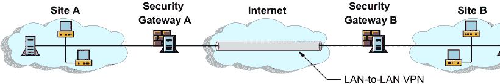

图 6-5 简单 VPN 示例

当一个数据包离开站点 `A` 并往站点 `B` 并到达网关 `A` 时，它会被防火墙加密。在到达站点 `B` 网关后，数据包被解密并重新塑型为明文形式。通过这种方式隐藏流量，两个可能位于世界另一侧的不同站点可以共享资源并在互联网上安全地通信。

### 内容筛选

虽然不被用病毒检测的主要工具，但防火墙可以与内容检查服务器（`CIS`）结合使用。可以检查入包的数据部分是否存在潜在的恶意内容。病毒或危险内容可以在数据包进入内部网络之前被丢弃。

例如，入站的 `SMTP` 电子邮件流量可以转发到防火墙的 `CIS` 进行病毒和内容检查。在删除任何可疑内容后，清洗后的数据包返回防火墙并路由到最终目的地。

内容检查也可以相反流动。可以检查 `URL` 以拒绝访问不适当的站点。图 6-6 展示了防火墙与 `CIS` 的交互。

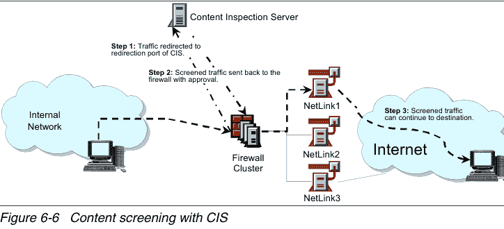

图 6-6 CIS 内容筛选

## 6.2.6 现代防火墙的要求

随着互联网流量量和重要性的增长，防火墙满足特定要求变得日益重要。

### 高可用性

先进的集群技术防止防火墙成为瓶颈或单点故障。当多个防火墙节点作为一个单一实体运行并执行安全策略时，即形成了集群。每个节点对总吞吐量做出贡献，提供了容错、可靠的防火墙。高可用性意味着故障节点的流量可以透明地切换到其他节点。可以在不干扰防火墙的情况下进行节点维护。网络服务的可用对于用户满意度和网络安全至关重要。集群可以通过特定的硬件、软件或内置集群功能来实现。图 6-7 所示的防火墙实例是一个单点故障。

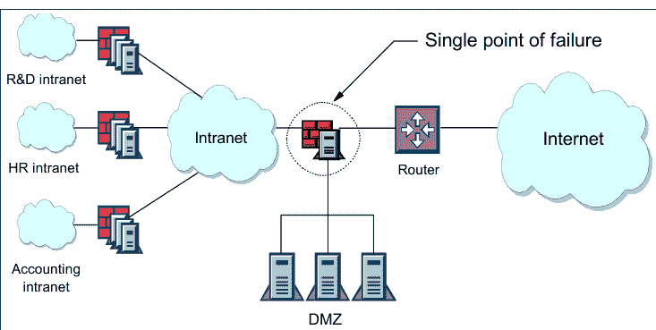

通过引入多个防火墙实例（如图 6-8 所示），消除了单点故障。

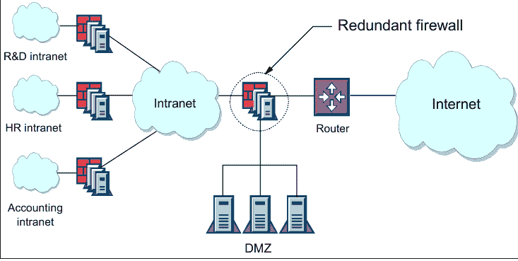

### 可扩展性

随着流量的增加，拥塞会破坏网络流量。根据定义，防火墙是所有流量都应该通过的瓶颈点。这至关重要

确保防火墙不会成为网络性能的瓶颈。随着流量量的增长，通过集群或添加热备防火墙可以灵活地增加节点。可以在在线生产系统上进行维护而无需停机。

### 吞吐量

随着千兆网络变得普遍，需要防火墙来应对日益增长的流量。防火墙节点集群有助于提高吞吐量。

### 管理

地理位置广泛、跨国以及较小的网络都能从集中化管理的防火墙安全策略中获益，这些策略通常与特定站点规则共存，以便在实施网络安全策略时提供所需的粒度。实施企业级复杂的安全策略需要防火墙管理系统具有高度的灵活性。

集中管理最大限度地减少了人为错误的可能性。为了避免意外的混淆或损害，应该根据管理员的权限水平和专业知识仔细规划防火墙配置和规则库访问。远程安装和配置对于分布式网络来说是一项重要功能。

## 6.2.7 防火墙弱性

了解防火墙的弱性对于平衡创建有效的安全策略至关重要。你需要对整个安全框架有良好的了解，以确定要实施的其他安全措施。

### 缺乏管理

复杂的网络环境增加了对管理技能的需求。如果没有仔细的关注和维护，防火墙无法提供有效的安全。防火墙必须经过彻底的安装和配置。安全策略需要定期的评估和更新。很多时候，防火墙管理会被忽视，直到攻击或安全事件的发生。

### 内部攻击

防火墙、内容检测服务器以及在网络边界检查数据包的设备对内部攻击是无效的。根据某些估计，约 60% 的网络攻击来自企业网络内部。这些攻击要难得多，并且需要比防火墙或其他边界防御不同的方法。企业安全策略的实施应该解决这些问题（例如，使用员工安全和基于主机的病毒防护）。适当部署的入侵检测系统（`IDS`）可以对防火墙无法拦截的恶意流量提供防御。

> 注意：将防火墙放置在大型机内部可以消除从企业内网内部入侵的可能性。`zSeries` 外部的防火墙可能会被内网攻击。

## 6.3 StoneGate 防火墙组件

在本节中，我们将描述 `StoneGate` 架构并查看各种部署方案。`StoneGate` 的设计策略是图 6-9 所示的分布式架构。

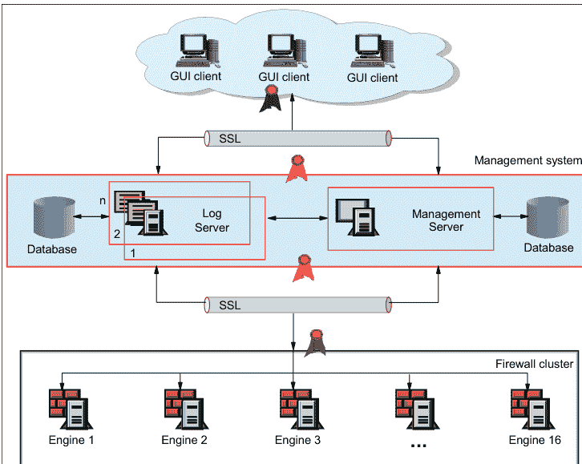

图 6-9 StoneGate 架构概述

`StoneGate` 由三个主要组件组成：

- 图形用户界面（`GUI`）
- 管理系统
- 防火墙引擎

### 6.3.1 StoneGate GUI

`GUI`（管理客户端）是用于配置和管理 `StoneGate` 所有层面的接口。它是一个基于 `Java™` 的程序，允许管理员执行：

- 配置防火墙节点。
- 通过定义主机、服务器、服务、`VPN`、防火墙和防火墙集群、路由器和其他网络设备，描述受保护的网络和系统。
- 设计保护这些系统和网的策略。
- 管理用户和身份验证服务。
- 管理日志数据。
- 监控防火墙和集群。

`GUI` 与管理系统的各种组件通信，以用户友好的格式呈现性能数据、日志数据、配置信息和策略。`GUI` 可以部署在网络中的任何位置，并同时运行多个实例。例如，管理员可以使用 `GUI` 修改分支机构本地网络的属性，而企业总部的高级管理员正在更新全局策略或对象。并发用户之间的冲突通过管理服务器在数据库引擎中的锁定机制来解决。

单个 `GUI` 可用于相同管理系统下的所有防火墙和集群。例如，一个更新的安全策略可以同时安装到企业网络中的所有防火墙上。

> 注意：`GUI` 为向多个客户提供服务的托管服务提供商（`MSP`）提供。`GUI` 的过滤功能允许每个单独客户进行独立管理。


## GUI 主视图与启动器

GUI 的主视图（称为控制面板）包含工具栏，可以从那里启动各种管理器应用程序。每个管理器都是用于执行特定一组相关任务的应用程序组件。例如，安全策略管理器用于创建、修改和删除安全策略或规则；网络元素管理器允许创建、修改和删除各种网络元素，如主机、网络链路和防火墙集群。控制面板和启动器位于第 99 页的图 6-10。

除了启动器外，StoneGate 控制面板还向管理员提供有关防火墙集群和引擎当前状态的统计信息和图形表示。这些信息由管理服务器的监控系统处理，见第 100 页第 6.3.2 节“管理系统”。

> 注意：StoneGate 还使用了一些《StoneGate 管理员参考》中记录的命令行工具。

### 启动器

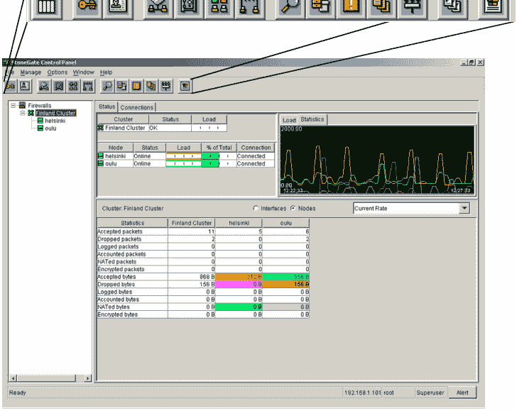

图 6-10 StoneGate 控制面板和启动器

> 注意：出于安全考虑，GUI 不直接与防火墙引擎通信。防火墙节点的所有更改都通过管理系统组件处理。

第 6 章 StoneGate 防火墙 99

## 6.3.2 管理系统

管理系统由运行管理组件的机器组成。如图 6-11 所示，管理系统由四个组件组成：

- 管理服务器
- 日志服务器
- 用户目录服务
- 元素数据库

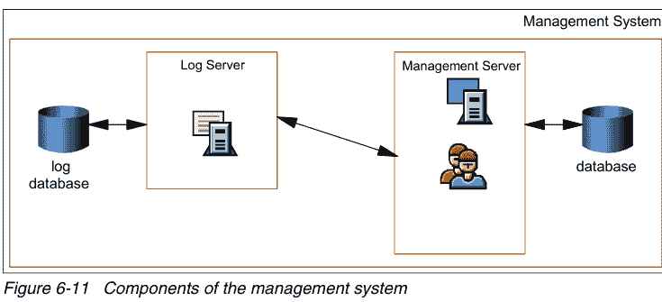

管理服务器和日志服务器解释来自 GUI 的命令和数据。来自防火墙的数据通过管理系统进行过滤并发送到 GUI 显示。

### 管理服务器

管理服务器是管理系统中的核心服务器。单个管理服务器可以管理整个 StoneGate 集群和单个防火墙。它负责维护策略和网络元素。管理服务器还具有监控系统。监控系统接收来自防火墙节点的当前状况信息。它处理原始数据并以清晰、全面的格式呈现给管理员。第 101 页的图 6-12 显示了 GUI 中的性能信息。

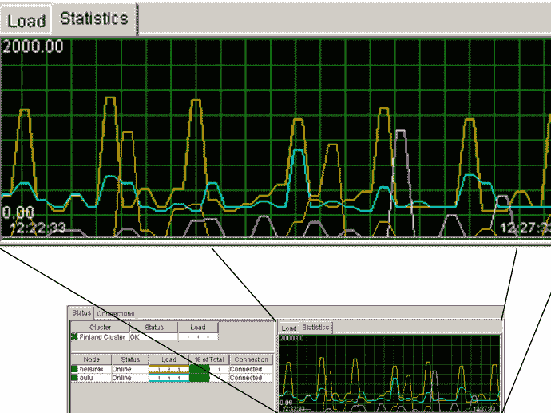

图 6-12 管理服务器统计数据

### 日志服务器

日志服务器管理每个防火墙生成的日志数据。事件信息存储在数据库中，可以进行查询、排序和导出。通过定义的过滤器可以控制如何查看数据。日志浏览器显示的日志数据示例见图 6-13。

| 日期 | 时间 | 设施 | 事件 | 操作 | 协议 | 源地址 | 目的地址 | 端口 |
| :--- | :--- | :--- | :--- | :--- | :--- | :--- | :--- | :--- |
| 8/7/2002 | 10:41:42 | 包过滤 | 连接. | | UDP (17) | 192.168.1.101 | 10.0.0.10 | 1198 |
| 8/7/2002 | 10:41:43 | 包过滤 | 连接. | | UDP (17) | 192.168.1.101 | 10.0.0.10 | 1196 |
| 8/7/2002 | 10:41:44 | 包过滤 | 连接. | | UDP (17) | 192.168.1.101 | 10.0.0.10 | 1196 |
| 8/7/2002 | 10:41:45 | 包过滤 | 连接. | | UDP (17) | 192.168.1.101 | 10.0.0.10 | 1196 |
| 8/7/2002 | 10:41:46 | 包过滤 | 连接. | | UDP (17) | 192.168.1.101 | 10.0.0.10 | 1194 |
| 8/7/2002 | 10:41:54 | 包过滤 | 连接. | | UDP (17) | 192.168.1.101 | 10.0.0.10 | 1164 |
| 8/7/2002 | 10:41:55 | 包过滤 | 连接. 丢弃. | | UDP (17) | 192.168.1.101 | 10.0.0.10 | 1169 |
| 8/7/2002 | 10:41:56 | 包过滤 | 连接. 丢弃. | | UDP (17) | 192.168.1.101 | 10.0.0.10 | 1169 |
| 8/7/2002 | 10:41:57 | 包过滤 | 连接. 丢弃. | | UDP (17) | 192.168.1.101 | 10.0.0.10 | 1170 |
| 8/7/2002 | 10:41:58 | 包过滤 | 连接. 丢弃. | | UDP (17) | 192.168.1.101 | 10.0.0.10 | 1170 |
| 8/7/2002 | 10:41:59 | 包过滤 | 连接. 丢弃. | | UDP (17) | 192.168.1.101 | 10.0.0.10 | 1170 |
| 8/7/2002 | 10:42:01 | 包过滤 | 连接. 丢弃. | | UDP (17) | 192.168.1.101 | 10.0.0.10 | 1176 |
| 8/7/2002 | 10:42:02 | 包过滤 | 连接. 允许. | | TCP (6) | 192.168.1.101 | 21.203.254 | 1177 |
| 8/7/2002 | 10:42:03 | 包过滤 | 连接. 允许. | | TCP (6) | 192.168.1.101 | 21.203.254 | 1177 |
| 8/7/2002 | 10:42:04 | 包过滤 | 连接. 允许. | | TCP (6) | 192.168.1.101 | 21.203.254 | 1177 |

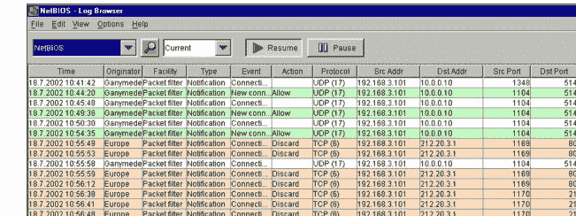

图 6-13 StoneGate 日志

多个服务器可以部署在 StoneGate 环境中。为了提高性能和可用性，可以为每个防火墙或防火墙集群分配不同的服务器（对于地理分布式系统特别有用）。单个集群或热备配置中的单独节点必须记录到日志服务器。如果无法与日志服务器通信，节点将记录本地日志直到通信恢复。

### 数据库引擎

管理服务器使用内部数据库引擎存储网络元素、规则、别名、模板、VP、用户、服务器和信息。该嵌入式数据库引擎为 StoneGate 提供了快速可靠的关系型数据库。该自维护数据库作为管理服务器的组件自动安装。

日志服务器也使用嵌入式数据库。该数据库允许日志服务器快速地存储、查询和导出日志数据，使用相同种的快速可靠的关系型数据库。

### 用户目录

用户信息存储在管理服务器的内部数据库中。虽然存储在嵌入式 SQL 数据库中，但可以通过 LDAP API 访问用户目录。该接口允许使用 LDAP 目录服务访问用户目录。

## 管理系统备份

妥善维护系统备份是一项基本的安全预防措施，不应忽视。在管理服务器或日志服务器发生灾难性故障时，防火墙引擎将决定继续运行。在极少数情况下如果管理系统需要恢复（或如果您想将管理服务器迁移到新计算机），可以创建管理系统（日志服务器和管理服务器）的备份。备份由存储在单个 ZIP 文件中的管理数据库（网络元素、防火墙配置、安全策略和用户账户）数据组成。备份文件可以进行加密并使用密码保护。日志服务器及其包含所有日志条目的数据库也可以以此的方式进行备份。

## 防火墙引擎

StoneGate 核心的防火墙引擎运行在随引擎安装的集成、加固的 Linux 系统上。每个节点可以有多个网络接口。引擎检查并过滤发送至受保护网络或发送自该网络的数据包。

StoneGate 防火墙可以配置为备用模式；一个节点在线，另一个节点等待接管第一个节点。如果在线节点故障或被离线，备用节点将自动接管在线节点的角色。

支持系统（如可配置子系统）也运行在防火墙节点上。内核、协议代理、防火墙、测试子系统和日志服务各独立运行。这确保了引擎的健壮性；某个服务的错误或损坏不会影响其他服务。系统可以持续运行，直到修复或定期维护修正它们。每个节点上的引擎与管理系统通信，发送性能统计、状态信息和日志数据，并接收策略更新和配置更改。

引擎通过管理系统加载到节点上的配置文件进行配置。这些文件在每个节点上都是加密的。未经授权访问防火墙本身不会泄露有关网络的更多信息。配置文件由管理系统根据管理员通过 GUI 的输入生成。不需要手动重新配置，且无法通过 GUI 远程升级软件。执行升级时无需物理访问防火墙。

每个防火墙节点都运行着一个测试子系统。管理员可以在防火墙节点上定义或启用额外的测试和测试条件。例如，如果网络接口故障，可以将节点切换离线，将流量重新分配到剩余的在线系统，并向管理员发送警报。

## 6.3.3 组件之间的通信

表 6-1 总结了不同 StoneGate 组件之间的通信，并显示了通常产生的流量。流量分类如下：

- 高 (`High`)
  大量的常规流量。需要高吞吐量链路。
- 中 (`Medium`)
  低带宽链路（如调制解调器）可能不够。
- 低 (`Low`)
  仅一次性接触。

表 6-1 StoneGate 组件之间的通信

| GUI 客户端 | 日志服务器 | 管理服务器 | 引擎 |
| :--- | :--- | :--- | :--- |


| GUI 客户端 | 不适用 | 当客户端请求日志信息时为中。 | 中：定期以及根据用户操作触发。 | 从不 |
| 日志服务器 | 从不 | 不适用 | 启动时为中，之后定期且为低。链路中断不会干扰服务器的运行。 | 从不 |
| 管理服务器 | 从不 | 从不 | 不适用 | 中：监控和上传配置时。 |
| 引擎 | 从不 | 发送防火墙日志时为高。 | 低：仅在初始配置时。 | 中到高：如果使用 `HA` 模式，心跳和状态同步流量。 |

`GUI` 客户端从未与防火墙引擎通信。相反，通信是通过管理服务器进行的。最大的流量来自于从引擎发送到日志服务器的日志。为了减少流量，可以对数据进行过滤。集群中定义的每个引擎都与集群中的所有其他引擎通信，通过以太网（`IEEE 802`）多组播共享当前连接、负载和状态信息的信息。

### 6.3.4 组件之间的网络地址翻译

`StoneGate` 组件可以部署在分布式架构中；位于不同位置的组件从单一位置进行管理。在此配置下，组件通信需要网络地址翻译（`NAT`）。`StoneGate` 支持基于在 `GUI` 中为每个组件定义的接触 `IP` 地址进行管理通信的 `NAT`。

### 6.3.5 安全通信

防火墙引擎、管理服务器和日志服务器使用基于安全套接层（`SSL`）协议的公钥加密和数字证书进行身份验证。这确保只有授权的节点和授权的管理系统才能参与集群的操作和配置。密钥和证书在安装期间自动生成。安装管理服务器时会自动创建一个内部 `StoneGate` 证书颁发机构（`CA`）。

### 6.3.6 证书备份

除了管理和日志服务器数据库进行备份外，您应该至少创建一个管理系统和防火墙引擎使用的证书备份。将证书存储在安全位置。您也可以使用密码对其进行加密。需要时，备份的证书可以轻松恢复，例如当您在新计算机上重新安装管理服务器并希望使用现有证书而不是生成新证书时。

### 6.3.7 分布式管理

凭借其分布式架构，单一管理系统可以监控、控制和管理整个网络中的多个 `StoneGate` 防火墙集群。分布式系统见第 106 页图 6-14。

### 亚特兰大 (Atlanta)

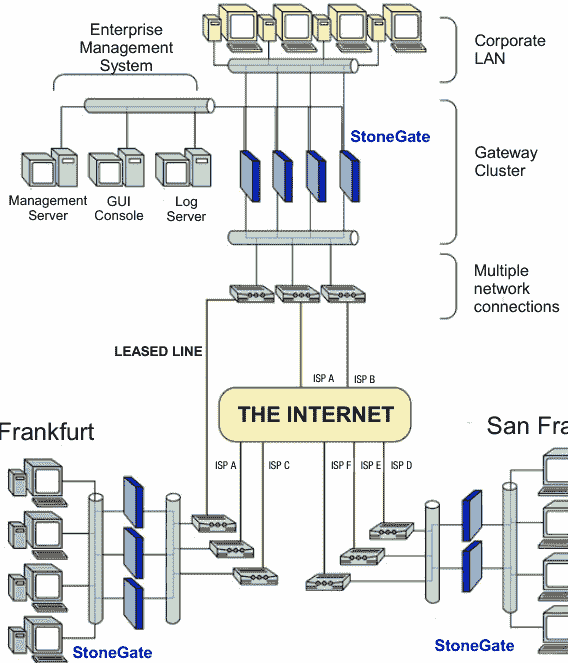

### 法兰克福 (Frankfurt)

### 互联网 (THE INTERNET)

### 旧金山 (San Francisco)

主管理员可以在公司总部的专用信任 `LAN` 网段上部署管理系统。日志服务器和管理服务器可以安装在单台服务器上，也可以安装在多台机器上。可以在任何信任系统中运行额外的 `GUI` 客户端。在此配置下，管理员可以定义公司范围的安全策略，也可以为远程办公室网络定义策略。不同办公室的 `StoneGate` 集群可以通过同一个图形界面与单一分布式管理系统交互进行监控、控制和管理。可以定义具有不同管理员权限的本地管理员以委派管理任务。他们可以被授予某些权限，例如系统的维护和监控，或配置特定类型元素的权利。

106 `IBM zSeries` 和 `S/390` 上的 `Linux`：最佳安全实践

### 6.3.8 实施策略

`StoneGate` 最实用的功能之一是将组件分发在不同的机器上。每台机器可以运行在不同的平台上，例如在 `Linux` 上运行日志服务器，在 `Solaris` 上运行管理服务器，并在 `Windows` 平台上运行用户界面。

#### 单一管理系统

一种可能的实现方案见第 108 页图 6-15，将管理服务器、日志服务器和 `GUI` 在同一台机器上。这种策略具有多种节省成本的效益：

- 在单台机器上运行多个服务器减少了硬件支出。
- 简化了安装并降低了管理成本。

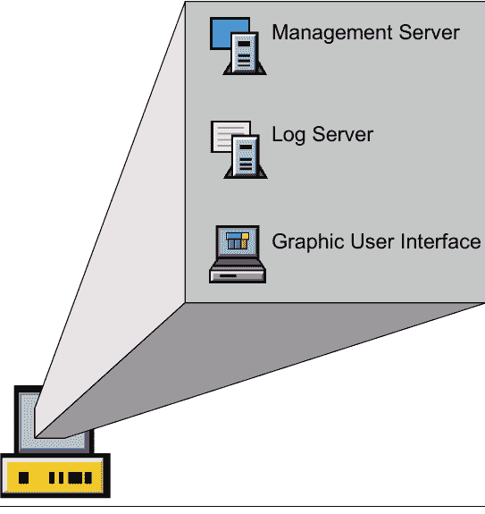

图 6-15 单节点管理系统

#### 分布式管理系统

使用 109 页图 6-16 所示的分布式管理系统，管理服务器（`Management Server`）、日志服务器（`Log Server`）和 `GUI` 安装在不同的机器上。这种策略可以提高性能；每台机器仅执行整个系统的一部分。此外，这提供了更大的灵活性；任何 `StoneGate` 组件都可以在任何平台上运行。

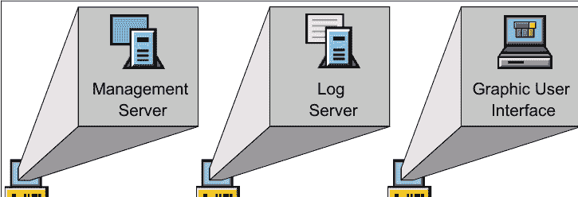

图 6-16 分布式管理系统

#### 虚拟局域网 (VLAN)

虚拟局域网（`VLAN`）是主机和网络设备的逻辑分组，无论物理拓扑如何，它们都表现为一个单一局域网（`LAN`）段。同一 `VLAN` 中的工作站和服务器的运行方式如同连接到同一个物理网络，形成单一的 `OSI` 第 2 层广播域。`VLAN` 隔离通过 `IEEE 802.1q` 标准定义的 `VLAN` 标记实现。交换机上的网络端口可以通过在通过 `VLAN` 之间的每个以太网帧上添加双字节 `VLAN` 标记来区分不同的 `VLAN`。通过将广播和多播流量限制在 `VLAN` 内部，增强了对网络流量的控制。减少了指向其他 `LAN` 段的不必要流量。由于逻辑和物理 `LAN` 结构的隔离，`VLAN` 的拓扑结构可以遵循公司的组织结构（将部门用户连接到同一个 `VLAN`，即使他们位于不同的物理 `LAN` 中）。这还减少了对布线的需求；`LAN` 段与交换机分离开。

`StoneGate` 支持 `VLAN` 标记。它可以区分属于不同 `VLAN` 的流量。可以在 `GUI` 中配置 `VLAN`。这可以减少所需的物理接口数量，并简化在地理分布的防火墙集群上的部署。一个 `StoneGate` `VLAN` 部署示例如图 110 页图 6-17 所示。

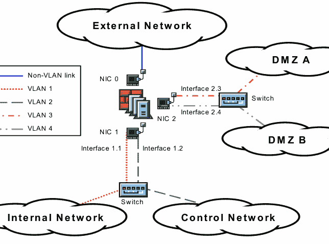

图 6-17 带 `VLAN` 标记的 `StoneGate`

每个防火墙节点有三个网卡（`NIC`），但连接到五个隔离的网络：

- `NIC 1` 配置为两个逻辑 `VLAN` 接口：
    - 接口 `1.1` 用于 `VLAN 0`
    - 接口 `1.2` 用于 `VLAN 1`

`VLAN` 将内部网络与控制网络隔离。

- `NIC 2` 配置为接口 `2.3` 和 `2.4` 用于 `VLAN 2` 和 `3`，以隔离两个 `DMZ` 网络（`DMZ A` 和 `DMZ B`）。
- `NIC 3` 连接到互联网。

为了实现安全，对交换机的访问受到了限制。属于不同 `VLAN` 的流量被安全地隔离。111 页图 6-18 描述了一个地理分布的 `VLAN` 集群。

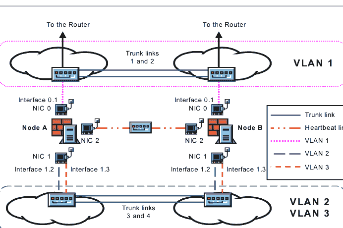

图 6-18 地理分布集群

例如，节点 `A` 可能位于一栋建筑，而节点 `B` 位于另一栋建筑。节点之间需要一个心跳链路。两个节点都有一个连接到 `VLAN 1` 的接口，以及另一个连接到 `VLAN 2` 和 `VLAN 3` 的接口。

### 6.4 基于 Linux 的 zSeries StoneGate

`StoneGate` 是 `IBM zSeries` 系统唯一上市且经过认证的防火墙和 `VPN` 产品。`StoneGate` 消除了在前端和后端应用之间需要外部防火墙服务器的需求，节省了投资、劳动和维护成本。`StoneGate` 能够在虚拟网络环境中同时启用防火墙，并能够利用 `zSeries` 提供的高度扩展性。集中式管理系统简化了多个防火墙实例的部署和维护。`zSeries` 上的 `StoneGate` 具有 `VPN` 功能，可以增强敏感网络流量的安全性（例如大型机内的财务交易）。112 页图 6-19 描述了 `zSeries` `StoneGate` 部署。

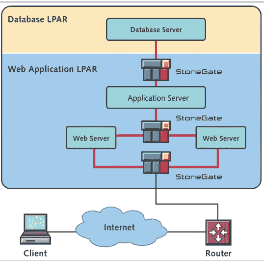

图 6-19 `StoneGate` 与 `zSeries` 大型机

#### 6.4.1 高可用性技术

在过去，防火墙可以通过附加软件或冗余硬件解决方案来实现高可用性。这通常会导致单点故障转移到另一个网络组件（通常是网络链路）。其他网络服务（如 `Web`、`FTP` 或内容检查服务器）需要更多的硬件和软件来消除企业中的单点故障。

`StoneGate` 高可用防火墙和 `VPN` 包含多种集群技术，以降低高可用性所需的复杂性。`StoneGate` 创新的集群和负载均衡功能比传统解决方案具有多项优势。

##### 内置高可用性

为了实现防火墙高可用，通常使用额外的硬件交换机、软件集群产品或特殊的负载均衡设备。使用 `StoneGate`，高可用性内置在防火墙引擎中。如果活动节点过载或发生故障，单个连接可以透明地移动到热备节点。

注意：连接切换也会发生在远程升级期间。

通过使用虚拟 `IP` 地址结合 `MAC` 地址，防火墙引擎被网络的其他部分视为单一实体（减少了对配置更改的需求）。集群虚拟接口（`CVI`）具有所有节点共享的 `IP` 地址。到达 `CVI` 的流量到达所有节点，但只有一个节点会处理给定的流量。图 6-20 展示了高可用性节点集。

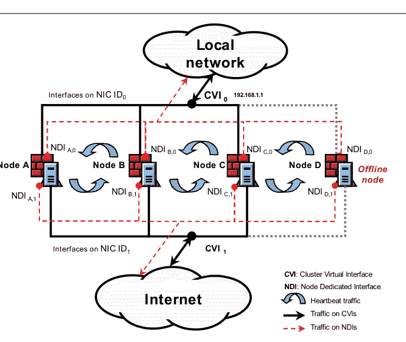

图 6-20 集群虚拟接口

每个节点分配两个 `NDI`：

- 每个节点的 `NDI ID0` 地址 `CVI0` 虚拟接口。该虚拟 `IP` 地址由所有节点共享；节点专用接口（`NDI`）`IP` 地址每个节点是唯一的。
- 每个节点的 `NDI ID1` 地址 `CVI1` 虚拟接口。该虚拟接口提供到互联网的连接。


# 第 6 章 StoneGate 防火墙

网卡数量受限于网络接口卡。

高可用性为扩展和维护提供了便利。单个节点可以离线。之前由引擎处理的连接将透明地转移到备份节点。

## 高可用连接

`StoneGate` 为相关网络组件提供高可用选项。互联网服务提供商（`ISP`）和虚拟专用网络（`VPN`）对于企业通信通常存在单点故障。高可用是可以实现的，但是以复杂性为代价的。`StoneGate` 通过创新技术解决了这些问题。

随着互联网驱动业务的角色增长，连接的可靠性和服务的持续可用对于公司来说是绝对必要的。即使使用了集群产品，如果网络链路故障，企业网络仍可能中断。消除这种单点故障通常需要一组冗余的外部路由器和交换机，使用复杂的路由协议，如边界关协议（`BGP`）和热备路由协议（`HSRP`），以及通过连接的 `ISP` 进行对等安排。

## 多链路技术

`StoneGate` 允许网络管理员使用多链路技术使用多个 `ISP` 这消除了与高可用路由协议相关的问题。高可用网络链路减少了对昂贵线路的需求。任何具有专用 `IP` 地址范围的 `IP` 链路都可以作为链路配置的一部分：

- `ISP` 提供的标准互联网连接
- `ISDN` 连接
- 线路

通过多链路技术，指向互联网的冗余路由在 `StoneGate` `GUI` 中表示为特殊的网络元素（`NetLink`）。网络流量在 `NetLink` 之间进行平衡，如 115 页图 6-21 所示。

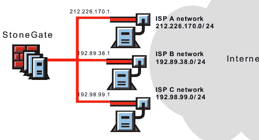

图 6-21 用于高可用性的 `StoneGate` 多链路技术

`NetLinks` 允许在路由器或网络故障时轻松地配置负载均衡连接。

> **注意：** 网络链路的数量不受限制也不依赖于物理防火墙接口的数量。单个网卡（`NIC`）可以容纳多个 `CVI`，每个 `CVI` 定义在单个 `IP` 地址空间中。通过这种方式，如果需要，单个物理接口连接多个 `ISP`。当防火墙节点形成集群时，节点故障并不意味着所有到 `ISP` 的连接都会丢失。相反，连接会立即切换到运行正常的节点。

### 负载均衡路由

流量可以在所有可用链路之间进行负载均衡，提高整体网络吞吐量。例如，`Stonesoft` 的专利负载均衡路由技术允许通过最快的可用链路进行路由。动态路由引擎（执行负载均衡路由）会通过每个网络链路发送初始数据包并测量响应时间。根据测量结果，连接将自动路由到性能最佳的链。

### 增加带宽

随着带宽需求的增加，传统的解决方案是向现有提供商支付更多费用；更改供应商将导致昂贵的公网 `IP` 地址更改。使用 `StoneGate`，您只需通过向网络添加新的 `ISP` 即可增加带宽。`StoneGate` 可以将多个 `ISP` 整合到单一虚拟 Internet 连接。

#### 6.4.2 多链路技术的优势

`StoneGate` 多链路技术的优势包括：

- 更安全的网络
  流量通过其他网络设备绕过防火墙的可能性更少。
- 更不复杂的网络
  防火墙负责负载均衡（消除了对特殊负载重定向器、交换机或其他可能引入单点故障设备的需求）。减少了网络维护和配置所需的时间成本。

多链路技术简化了多个 `ISP` 的使用，并增加了关键应用程序在用时的可用性和带宽。事务负载均衡路由始终选择通往目的地的最优路径。

#### 6.4.3 应用多链路技术

多链路技术可以应用于三个独特的场景：

- 出站流量管理
- 多链路 `VPN`
- 入站流量管理

每个场景处理高可用性和负载均衡的方式各不相同。

##### 出站流量管理

`StoneGate` 中的出站流量管理在多个 `NetLinks` 之间提供高可用性和负载均衡。`ISP` 之间的负载均衡增加了整体网络吞吐量。对于每个连接请求，`StoneGate` 防火墙可以为连接选择快速路径。第 117 页的图 6-22 展示了出站流量管理决策，以第一个 `SYN` 数据包的往返时间作为负载均衡路由决策的依据。

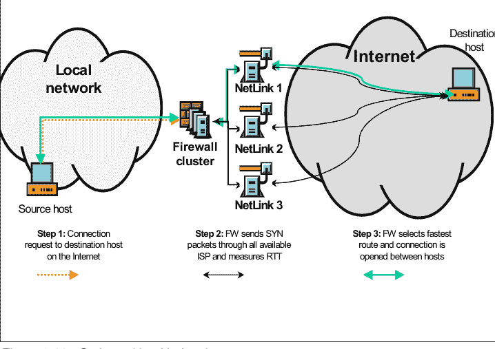

图 6-22 出站负载均衡

## 多链路 VPN

`VPN` 是企业网络中日益重要的组件。通过加密隧道到内部网络，可以在不安全的 Internet 与远程办公室或用户进行可信通信。历史上，`VPN` 隧道在路由器或链路故障时容易发生。通常，与远程站点只能建立一个 `VPN` 隧道，这对已有限的连接限制了带宽。

使用 `StoneGate`，现在可以实现集群、负载均衡的 `IPsec` `VPN` 隧道。由通过不同 `ISP` 的一个或多个物理 `VPN` 隧道组成的逻辑隧道是可能的。第 118 页的图 6-23 展示了一个在一端有两个物理链路、另一端有三个物理链路的 `VPN`。在示例配置中，`StoneGate` 可以使用六个不同的子隧道形成一个虚拟 `VPN` 隧道，在站点之间负载均衡的 `VPN` 流量。

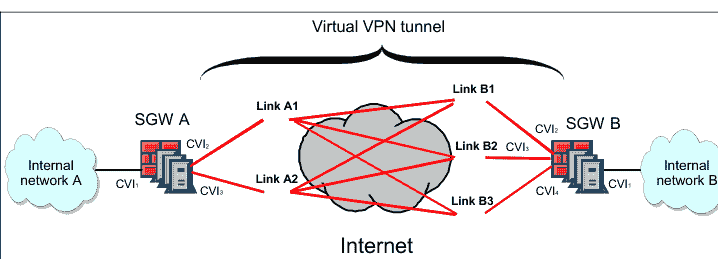

图 6-23 集群、高可用 `VPN` 隧道

如果一个子网崩溃，使用该隧道的连接将自动转移到与远程建立建立另一个子网。如果所有 `ISP` 链路都掉线，`StoneGate` 可以启用备用链路（如租线或拨号连接）。这为 `VPN` 流量引入了真正的容错和高可用性。

## 入站流量管理

`StoneGate` 可以对内部网络中不同服务（例如 `Web` 服务器）的连接进行负载均衡。使用现有技术通常需要部署额外的负载均衡交换机、集群软件和特殊的负载均衡硬件来确保高可用性和提高性能。如第 119 页的图 6-24 所示，网络管理员在实现网络高可用性方面面临着额外的复杂性。

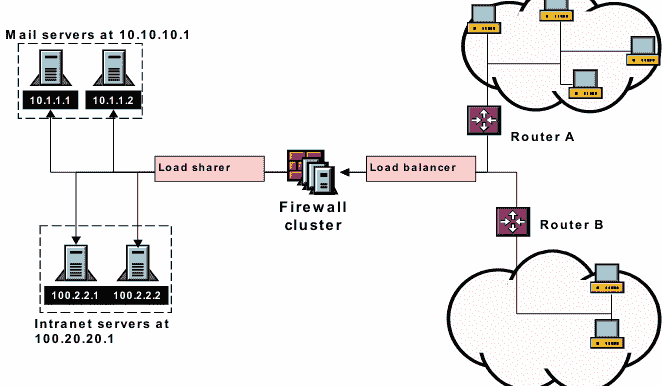

图 6-24 传统的入站负载均衡

使用 `StoneGate`，管理员可以利用多链路技术对网络服务进行负载均衡。例如，如第 120 页的图 6-25 所示，可以在 `DMZ` 网络上建立 `Web` 服务器池。`StoneGate` 可以通过 `ISP` 之间的负载均衡共享到池的连接。`ISP` 的选择基于动态 `DNS` 更新或多个 `DNS` 目。`StoneGate` 持续监控服务器可用性，以确保来自特定源地址的连接仅由一台服务器处理。

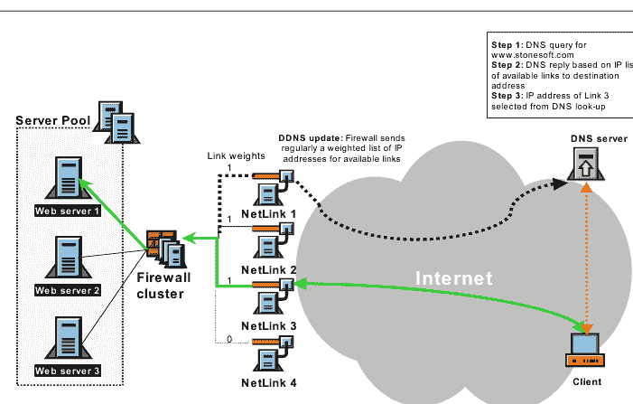

图 6-25 使用动态 `DNS` 的 `StoneGate` 流量管理

## StoneGate 管理

`StoneGate` 还提供了灵活的访问方式来配置和维护集群、网络和用户。`GUI` 提供三种用户级别：

- 超级用户（`Superuser`）：最高级别，类似于 `Windows` 中的管理员或 `UNIX` 中的 `root`。
- 编辑者（`Editor`）：中间级别，可以修改对象、用户和规则库。默认情况下不能创建或删除对象。可以通过超级用户授予额外权限。
- 操作员（`Operator`）：最低权限账户，允许监控系统和查看规则库。然而，默认情况下无法修改元素。可以通过超级用户或编辑者授予额外权限。

这些级别允许企业网络中的管理员任务。网络管理员可以创建具有唯一用户 `ID` 和密码的各种账户。

# 6.5 StoneGate 安装

在本节，我们将描述在 `zVM` 虚拟机上安装 `StoneGate` 防墙和 `VPN`。

## 6.5.1 z/VM 虚拟机定义

用于托管 `StoneGate` 的 `z/VM` 虚拟机应定义为 `G` 类权限。`StoneGate` 需要两个 `3390-3` 设备，每个虚拟磁盘至少 `1` `GB`。示例 6-1 显示了 `StoneGate` 示例用户目录条目。

> **示例 6-1** `StoneGate` 示例 `z/VM` 用户条目

```
USER LNXSG2 LNXSG2 128M 16 G
INCLUDE IBMFLT
IPL 190 PARM AUTOCR
MACHINE XA
DEDICATE 7104 7140
DEDICATE 7105 7141
DEDICATE 7106 7142
LINK TCPIP 0592 0592 RR
MDISK 0191 3390 3238 100 440U1R
MDISK 0171 3390 0031 3338 LX15C9
MDISK 0172 3390 0031 3338 LX15CB
```

我们使用 `171` 和 `172` 虚拟磁盘用于 `StoneGate`。`100` 柱（`30` `MB`）`191` 虚拟磁盘用于 `StoneGate` `zSeries` 防火墙和 `VPN` 安装文件。虚拟机使用虚拟地址 `7104-7106` 定义 `OSA-Express` 适配器（实际地址 `7140-7142`）。

## 6.5.2 确保文件完整性

在安装 `StoneGate` 之前，请使用 `MD5` 或 `SHA-1` 校验和确保安装文件的完整性。校验和可以在 `StoneGate` 安装光盘以及 `Stonesoft` 网站的发布信息部分找到：

```
http://www.stonesoft.com/support/StoneGate
```

要自动检查 `MD5` 和，请在包含 `StoneGate` 安装文件的目录中执行 `md5sum` 命令，如示例 6-2 所示。

> **注意：** 默认情况下，`Windows` 不具备 `MD5` 或 `SHA-1` 校验程序；但是，有几个第三方程序可用。

示例 6-2 使用 `md5sum` 命令检查文件完整性


## 验证安装文件

```
$ md5sum -c SG2.1.0-MD5.txt
boot_catalog: OK
install.bin: OK
sg_engine_2.2.3.1017_s390.list: OK
sg_engine_2.2.3.1017_s390.zip:
```

`-c` 选项指定根据 `SG2.1.0-MD5.txt` 文件提供的值来检查 MD5 和。

使用 `shasum -c sum` 命令比较 SHA-1 校验和。

> **重要**：不要使用校验和无效的文件。请联系 Stonesoft 技术支持以解决问题。

## 6.5.3 将安装文件下载到 z/VM

通过将 StoneGate 安装文件传输到 StoneGate z/VM 客户机的 A 磁盘开始安装。在第 123 页的示例 6-3 中，我们展示了从匿名 FTP 服务器下载安装文件的命令序列。

> **重要**：确保受 StoneGate 保护的客户机的网络连接通过防火墙引擎路由，以确保防火墙不会被绕过。

### 示例 6-3 下载 StoneGate 安装文件

```
link tcpmaint 592 592 rr
Ready;T=0.01/0.01 19:42:00
acc 592 b
MDSACP7231 B (592) R/O
Ready;T=0.01/0.01 14:09:47
ftp 9.12.6.170
VM TCP/IP Level 440
Connecting to 9.12.6.170, port 21
220 Serv-U FTP Server v4.1 for WinSock...
USER (identify yourself to the host):
anonymous
>>>USER anonymous
331 User name ok, please send complete E-mail address as password.
Password:
>>>PASS *******
230 User logged in, proceed.
Command:
locsite fix 80
>>>TYPE a
200 Type set to A.
Command:
ascii
Command:
get SGINST.EXEC (REPLACE)
Command:
get SGINST.PARFILE (REPLACE)
Command:
binary
Command:
get SGINST.KERNEL (REPLACE)
Command:
get SGINST.INITRD (REPLACE)
Command:
quit
```

高亮的步骤为：

- 链接到 `TCPMAINT 592` 毫磁盘以获取 FTP 命令的权限。我们将该微磁盘作为我们的 B 磁盘进行访问。

- 使用 `ftp` 命令访问包含 StoneGate 安装文件的 FTP 服务器。在提示时，提供相应的用户 ID 和密码。

- 文件以固定块格式存储在本地，记录长度为 `80`。

- 发出 `ascii` 子命令以 ASCII 模式传输文本文件。

- `SGINST.EXEC` 文件从 VM 读取器处启动安装。

- `SGINST.PARFILE` 包含安装启动参数。

- 发出 `binary` 子命令以二进制模式传输二进制文件。

- `SGINST.KERNEL` 文件包含安装内核。

- `SGINST.INITRD` 文件包含安装初始内存盘。

## 6.5.4 安装防火墙引擎

运行 `SGINST.EXEC` 脚本开始安装。该脚本会将 StoneGate 安装文件打入 VM 读取器，并从读取器进行 IPL。输出如示例 6-4 所示。

### 示例 6-4 执行 `SGINST.EXEC` 脚本

```
000003 FILES PURGED

ROR FILE 0015 SENT FROM LNXFW4 PUN WAS 0015 RECS 034K CPY 001 A NOHOLD NOKEEP
ROR FILE 0016 SENT FROM LNXFW4 PUN WAS 0016 RECS 0001 CPY 001 A NOHOLD NOKEEP
ROR FILE 0017 SENT FROM LNXFW4 PUN WAS 0017 RECS 249K CPY 001 A NOHOLD NOKEEP
000003 FILES CHANGED
```

系统启动后，将显示 StoneGate 用户许可协议（如第 125 页的示例 6-5 所示）。向下滚动阅读许可协议。要接受许可协议，请输入 `YES`。要取消安装，请输入 `NO`。

> **注意**：参数必须全大写，因为安装向导对大小写敏感。

### 示例 6-5 StoneGate 许可协议

在首次使用 STONEGATE 产品之前，请仔细阅读本最终用户许可协议的条款。通过安装或使用本产品，即表示您接受本协议条款的约束。如果您不同意所有条款，则不能使用本产品。在这种情况下，您有权将本产品退回购买处获得全额退款。定义：“合作伙伴”是指 Stonesoft 或其分销商授权销售的。“许可文件”是指 Stonesoft 根据被许可者的订单创建的文件。在继续之前必须接受许可协议。输入 `YES` 继续，输入 `NO` 取消。您要继续吗？

### 为 StoneGate 定义 DASD

接受许可协议后，会提示定义两个供 StoneGate 使用的设备。在示例 6-6 所示的屏幕上输入 DASD 数字。我们使用 `170` 和 `171`。

> **注意**：要手动修改 DASD 配置，请参考《StoneGate 系列安装指南》。

### 示例 6-6 为 StoneGate 定义 DASD 设备

首先必须定义两个供 StoneGate 使用的 DASD。检测到的通道列表如下：

| Device | CU in use | PAM | CHPIDs |
| :--- | :--- | :--- | :--- |
| `0009 0000` | `3215/00` | `80 80` | `FF00000 000000` |
| `000C 0001` | `2540/00` | `80 80` | `FF00000 000000` |
| `000D 0002` | `2540/00` | `80 80` | `FF00000 000000` |
| `000E 0003` | `1403/00` | `80 80` | `FF00000 000000` |
| `0190 0004` | `3390/0A` | `80 80` | `FFFFFFFF FFFFFFFF` |
| `0190 0005` | `3390/0A` | `80 80` | `FFFFFFFF FFFFFFFF` |
| `019E 0006` | `3390/0A` | `80 80` | `FFFFFFFF FFFFFFFF` |
| `0191 0007` | `3390/0A` | `80 80` | `FFFFFFFF FFFFFFFF` |
| `0170 0008` | `3390/0A` | `80 80` | `FFFFFFFF FFFFFFFF` |
| `0171 0009` | `3390/0A` | `80 80` | `FFFFFFFF FFFFFFFF` |
| `0592 000A` | `3390/0A` | `80 80` | `FFFFFFFF FFFFFFFF` |

输入第一个 DASD 设备号：`170`

输入第二个 DASD 设备号：`171`

```
0170(ECKD) at (94: 4) is dasda : active at blocksize: 4096, 601020 blocks, 2347 MB
0171(ECKD) at (94: 4) is dasdb : active at blocksize: 4096, 601020 blocks, 2347 MB
```

检查 DASD 是否正确。输入 `YES` 继续，输入 `NO` 取消。要继续吗？在屏幕上输入 `YES` 接受 DASD 分配。

> **注意**：要重新定义 DASD 分配，请输入 `NO`。

### 选择安装类型

如果没有检测到现有 StoneGate 安装，将打开第 127 页示例 6-7 所示的安装屏幕。选择类型 `1` 进行普通全安装。

#### 示例 6-7 选择 StoneGate 安装类型

未检测到现有 StoneGate 安装。

- 1. 全安装
- 2. 专家模式全安装

输入您的选择：`1`

硬盘将自动分区，所有数据都将丢失。输入 `YES` 继续，输入 `NO` 取消。

要继续吗？`YES`

如果检测到现有 StoneGate 安装，将打开示例 6-8 所示的屏幕。选择选项 `3` 进行全重装（这不会保留现有配置）。

#### 示例 6-8 StoneGate 重装屏幕

检测到现有的 StoneGate Engine 安装。

- 1. 升级现有安装
- 2. 使用现有安装配置重新安装
- 3. 全重装（不保留旧配置）
- 4. 专家模式全重装

输入您的选择：`3`

> **注意**：关于升级现有 StoneGate 安装的详情可以在《StoneGate 管理员指南》和《StoneGate 安装指南》中找到。

## 完成 StoneGate 安装


安装将继续自动分区 `DASD` 设备并安装 `StoneGate` 防火墙，如第 128 页示例 6-9 所示。

#### 示例 6-9 全量安装中的自动 `DASD` 分区

`硬盘将自动分区，所有数据都将丢失。输入 YES 继续，输入 NO 取消。`

`要继续吗？YES`

`DASD 0170 格式正确，块大小为 1024。跳过...`

`DASD 0171 格式正确，块大小为 4096。跳过...`

`正在分区硬盘...`

`创建文件...`

`正在提取 StoneGate 镜像...`

# IPL 防火引擎

`StoneGate` 引擎现已安装并准备好配置。使用 `#CP IPL` 命令 `IPL StoneGate` 引擎（其中 `171` 是为 `StoneGate` 定义的 `DASD`），如第 128 页示例 6-10 所示。

#### 示例 6-10 `IPL StoneGate` 引擎

```
#cp ipl 171
c ipl 171
Linux version 2.4.21+smp (root@blueved) (gcc version 2.95.4 2001002 (Debian
release)) #1 SMP Mon Nov 3 11:45:45 UTC 2003
We are running VM (31 bit mode)
This machine has no PFIX support
This machine has an IEEE fpu
node 0 totalpages: 65536
zone(0): 65536 pages.
zone(1): 0 pages.
zone(2): 0 pages.
Kernel command line: root=/dev/disc0/part1 devfs=mount noirirt dasd=0171,0172
vmpmoff="LOGOFF"
```

`检测到的最高通道 (十六) : 0016`

`Calibrating loop... 94.99 BogoMIPS`

`Memory: 255844k/262144k available (183k kernel code, 0 reserved, 658k data, 56k init)`

## 6.5.5 配置 `StoneGate` 防火墙引擎

`IPL` 防火墙引擎后，将打开配置向导（见第 129 页的示例 6-11）。在初始配置期间，将定义操作系统设置、网络接口以及管理服务器的连接点。

#### 示例 6-11 配置操作系统设置

`欢迎使用 StoneGate 引擎配置向导。`

`此向导将配置 StoneGate 引擎并连接管理服务器。完成后，您可以使用管理客户端执行所有任务。`

`未检测到通道`

`第 1/3 步：配置 OS 设置`

```
Current OS settings:
- Host name not set
- Ssh enabled not set
- Root password is not set
- Timezone not set
Are you happy with these settings (Y/N)? N
Host name:LNFW
Enable SSH daemon (Y/N)? Y
=== Change root password ===
```

输入 `root` 密码：

```
Re-Enter it:
Select timezone (empty or prefix = list zones):
Selected: ESTT
Current OS settings:
- Host name: 'LNFW1'
- Ssh enabled: y
- Root password is set
- Timezone: ESTT
Are you happy with these settings (Y/N)? Y
```

使用初始屏幕进行：

- 设置 `StoneGate` 主机名。
- 启用 `SSH` 守护进程。
- 创建 `root` 密码。
- 设置正确的时区。

### 配置网络接口

接下来，使用第 130 页示例 6-12 所示的屏幕配置网络接口。

#### 示例 6-12 配置网络接口屏幕

```
| Id Interface | Type | Status |
|---|---|---|
| Step 2 of 3: Configure network interfaces | | |
| Current network interfaces: | | |
| MAC | MAC | |
R)reproduce channels, P)rint channels, A)dd driver, C)lear, M)mgt interface, N)ic mapping, S)niff, A)bort,
```

检测到以下通道：

```
1 lcs-rtc (0x05) devno: 0x0900 in use/reg: no/no
2 lcs-rtc (0x05) devno: 0x0901 in use/reg: no/no
3 qeth (0x10) devno: 0x7104 in use/reg: no/no
4 qeth (0x10) devno: 0x7105 in use/reg: no/no
5 qeth (0x10) devno: 0x7106 in use/reg: no/no
```

选择设备层：

- `ucv`
- `ctc`
- `qeth`
- `lcs`

您的选择：`qeth`

要添加网络接口，请选择选项 `A`。我们通过选择 `qeth` 设备驱动来配置虚拟 `HyperSocks` `Guest` `LAN` 接口。`QETH` 驱动支持 `QDDIO` 模式下的 `HyperSockets` 虚拟设备（`Guest` `LAN`）、`OSA` `Express` 太太网（`SAX-FE`）以及千兆以太网（`SAX-GE`）适配器。

> 注意：`QETH` 驱动和 `QDIX` 驱动包含在 `2.4.21+smp` 内核中。

按照第 131 页示例 6-13 所示配置接口。

### 示例 6-13 配置选定的 `QETH` 通道设备

`QETH` 用于 `OSA-Express` 和 `Hypersockets` 通道设备

参数语法：

```
<devname>,<read_devno>,<write_devno>][<memusage>][<port_no>][<chksum_recv>]
```

请参考 `IBM` 文档“`Linux` `for` `zSeries` `and` `S/390`: `Device` `Drivers` `and` `Installation` `Commands`”获取更完整的语法。

`HyperSockets` 示例：`qeth1,0x7c00,0x7c01,0x7c02,4096, -1`

`OSA-Express` 示例：

`qeth2,0x0500,0x0501,0;add_parms,0x10,0x0502,portname:1789`

参数：

`qeth0,0x7104,0x7105,0x7106;add_parms,0x10,0x7104,0x7106,portname:05A7140,primary_router`

您给以下配置：

- 模块：`qeth`
- 参数：`qeth0,0x7104,0x7105,0x7106;add_parms,0x10,0x7104,0x7106,portname:05A7140,primary`

是否正确 (`Y/N`)? `Y`

在配置网络设备驱动时，不应使用自动设备号分配。相反，应手动分配设备号。

> 注意：我们说明了 `QETH` 网络设备的配置。配置 `iucv`、`ctc` 和 `lcs` 的屏幕会提示配置这些设备所需的特定参数。关于配置 `Linux` 设备驱动的详细信息可以在《`Linux` `for` `zSeries` `and` `S/390` `Device` `Drivers` `and` `Installation` `Commands`》，`LUNX-1303` 中找到，地址为：`http://www.10.software.ibm.com/developerworks/opensource/linux390/doc/1x2jun03dd01.pdf`

如果防火墙需要路由到未直接连接的其他网络。

### 分配网络接口

接下来，使用第 132 页示例 6-14 所示的屏幕配置网络接口。

#### 示例 6-14 配置网络接口

```
| Id Interface | Type | Status |
|---|---|---|
| Step 2 of 3: Configure network interfaces | | |
| Current network interfaces: | | |
| MAC | MAC | |
R)reproduce channels, P)rint channels, A)dd driver, C)lear, M)mgt interface, N)ic mapping, S)niff, A)bort,
```

检测到以下通道：

```
1 lcs-rtc (0x05) devno: 0x0900 in use/reg: no/no
2 lcs-rtc (0x05) devno: 0x0901 in use/reg: no/no
3 qeth (0x10) devno: 0x7104 in use/reg: no/no
```


4 `qeth` (0x10) `devno`: 0x7105 in use/reg: no/no

5 `qeth` (0x10) `devno`: 0x7106 in use/reg: no/no

选择设备层：

`ucv`
`ctc`
`qeth`
`lcs`

您的选择：`qeth`

要添加网络接口，请选择选项 `A`。我们通过选择 `qeth` 设备驱动来配置虚拟 `HyperSocks` `Guest` `LAN` 接口。`QETH` 驱动支持 `QDDIO` 模式下的 `HyperSockets` 虚拟设备（`Guest` `LAN`）、`OSA` `Express` 太太网（`SAX-FE`）以及千兆以太网（`SAX-GE`）适配器。

### 定义管理接口

接下来，使用第 133 页示例 6-15 所示的屏幕配置网络接口。

**示例 6-15 配置网络接口**

| Id Interface | Type | Status |
|---|---|---|
| Step 2 of 3: Configure network interfaces | | |
| Current network interfaces: | | |
| MAC | MAC | |

`R)reproduce` `channels`, `P)rint` `channels`, `A)dd` `driver`, `C)lear`, `M)mgt` `interface`, `N)ic` `mapping`, `S)niff`, `A)bort`,

检测到以下通道：

1 `lcs-rtc` (0x05) `devno`: 0x0900 in use/reg: no/no

2 `lcs-rtc` (0x05) `devno`: 0x0901 in use/reg: no/no

3 `qeth` (0x10) `devno`: 0x7104 in use/reg: no/no

4 `qeth` (0x10) `devno`: 0x7105 in use/reg: no/no

5 `qeth` (0x10) `devno`: 0x7106 in use/reg: no/no

### 连接管理服务器

接下来，使用第 134 页示例 6-16 所示的屏幕配置网络接口。

**示例 6-19 配置初始连接 (Y/N)? Y**

执行新的初始连接 (Y/N)? Y

输入连接管理服务器所需的数据。

标记有 `*` 的字段必须填写，其他字段为可选。

管理 IP 地址：`*` 9.12.6.170

一次性密码：`*` xbbf56Y1Vt

密钥指纹：00:32:DB:E2:03:54:DC:9E:A0:B7:18:7D:C5:0B:FD:2F

你对这些设置满意吗 (Y/N)? Y

> 注意：初始连接所需的所需的参数可以在管理 GUI 客户端的控制面板（`Control` `Panel`）中获取：右键点击防火墙元素并选择“保存初始配置”（`Save` `Initial` `Configuration`）。

需要提供的参数包括：

- `*` 管理 IP 地址

提供管理服务器的 IP 地址。

- `*` 一次性密码

输入一个 10 位字母和数字的、区分大小写的一次性密码。该密码针对特定引擎，且仅用于与管理服务器的初始连接。

- `*` 密钥指纹

输入 16 位十六进制字符的管理服务器密钥指纹。值之间应用冒号分隔。

在提示时输入 `Y` 接受配置。要完成配置，请在第 136 页示例 6-20 所示的屏幕提示时保存配置。

**示例 6-20 连接管理服务器**

你的选择：

- `B)` 重新配置
- `P)` 打印当前设置
- `S)` 保存并退出
- `C)` 取消

```
Your selection: $
SSH IPSEC version 4.1.1 build 53
正在连接管理系统...
私钥不存在。正在创建。
正在生成 RSA 私钥，模长 2048 位
...................
***
```

```
无法写入 'random state'
e is 65537 (0x10001)
连接成功。
按回车继续
```

`StoneGate` `s390` `LNXFW4` 控制台

`LNXFW4` `login`:

防火墙引擎随后尝试连接管理服务器。如果初始连接失败，可以使用 `sg-reconfigure` 命令重新配置管理接口。

> 注意：当连接管理服务器时收到“连接拒绝”错误消息，请确保一次性密码正确，且从节点可以访问管理服务器 IP 地址。

成功连接管理服务器后，防火墙引擎安装完成，准备好从管理系统上传安全策略。你可以在管理 GUI 客户端的控制面板中验证这一点，此时防火墙的状态已从“未知”（`Unknown`）变为“未配置”（`Not` `Configured`）。

更多信息，请参阅《StoneGate 管理员指南》（`StoneGate` `Administrator` `Guide`）。

# 在 Linux 环境中使用 z/OS 功能

在本章中，我们将讨论许多可用于增强 `Linux` `on` `zSeries` 环境安全性的 `z/OS` 功能。此外，`Linux` `for` `zSeries` 可以为 `z/OS` 环境提供许多安全功能以获得更大的灵活性。我们将考虑：

- `z/OS` `HiperSockets` 加速器

- 使用 `IBM` `Tivoli` `Access` `Manager` 进行身份验证

- `IBM` `Tivoli` `Access` `Manager` `WebSEAL`

- 从 `Linux` 安全 `z/OS` `Web` 资源

# 7.1 z/OS HiperSockets 加速器

`z/OS` `Version` `1` `Release` `2` `Communications` `Server` 为 `HiperSockets`（也称为内部队列直接输入/输出或 `IQDIO`）与队列直接 I/O (`QDIO`) 适配器之间的 IP 路由引入了性能改进，称为 `Hiper` `Accelerator`（加速器）。网络流量集中在单个 `OSA-Express` `QDIO` 连接上，然后通过 `HiperSockets` 加速（跳过 `z/OS` `TCP/IP` 协议栈）。


HiperSockets 加速器可以简化`OSA-Express`接口的管理，指向和来自`Linux`客户机的网络流量通过内部路径`HiperSockets`网络进行路由。可以避免通常物理网络所需的许多安全措施，从而实现更简单、低劳动密集度的配置。使用`HiperSockets`简化`OSA-Express`接口的管理，指向和来自`Linux`客户机的网络流量通过内部路径`HiperSockets`网络进行路由。可以避免通常物理网络所需的许多安全措施，从而实现更简单、低劳动密集度的配置。

> 注：由于原文中部分段落存在重复，译文已按原文逻辑进行处理以保持内容一致性

`z/OS` Version 1 Release 2 Communications Server 为`HiperSockets`（也称为内部队列直接输入/输出或`IQDIO`）与队列直接 I/O (`QDIO`) 适配器之间的 IP 路由引入了性能改进，称为 Hiper Accelerator（加速器）。

> 此处由于原文文本存在大量重复描述，以下为非重复部分的剩余文本内容

> 注意：Detailed discussion and setup information about Hiper Accelerator can be found in `Linux` on `zSeries` `S/390`

# 7.2 IBM Tivoli Access Manager

`IBM Tivoli Access Manager`成了安全套件的基础。作为集成解决方案交付，这些产品提供了网络和应用程序策略的访问管理。

# 7.3 Authentication using Tivoli Access Manager

在本节中，我们将讨论使用`Tivoli Access Manager`进行`Linux`身份验证。在这种情况下，网络客户端（如`Telnet`和`SSH`）根据运行在`z/OS`上的`LDAP`目录定义的用户进行身份验证。然而，`LDAP`目录中并不存储密码。相反，身份验证是对存储在`RACF`中的用户密码。

### 3.3.1 Configuring LDAP on z/OS

使用`1dapcnf`工具在`z/OS`上配置`LDAP`：

- 1 创建一个新的配置文件。将`/usr/lpp/etc/ldap.profile`文件复制到工作目录，例如`/etc/ldap`。

- 2 为系统自定义`ldap.profile`文件。使用配置文件中的注释确定适当的值。

> 注意：`ldap.profile`中的某些属性是所需的，但没有默认值。务必检查整个文件并为所有变量赋值。

- 3 从`z/OS UNIX`运行`1dapcnf`命令。这会在`ldap.profile`文件定义的`MVS`数据集中生成一组作业。

- 4 将`LDAP`服务器启动任务添加到系统`procbl`中。从输出数据集中将`LDAP`服务器启动任务过程复制到系统`procbl`。`LDAP`启动任务的默认名称为`LDAPSRV`。

- 5 启动`RACF`及其相关任务。按以下顺序执行每个作业：
  a. `RACF`。
  b. `APF`。
  c. `DBCLI`（在提交此作业之前确保已启动`DB2`）。
  d. `PGRMCTRL`（如果需要）。

  检查每种情况下的成功返回码。

- 6 启动`DBSPUFI`任务。使用`DB2 SPUFI`提交作业。

- 8. 启动`LDAP`服务器。

从`SDSF`，使用命令`/s LDAPSVR`启动服务器。

当收到“`slapd` is ready for requests”消息时，`LDAP`服务器即已启动。

## LDAP 配置参数

一些重要的`TDBM`特有`LDAP`配置参数包括：

### Database tdbm GLDRDMB

此参数指定`LDAP`连接到`DB2`。

### AdminDN "cn=LDAP Administrator"

此参数指定`LDAP`管理员。在执行管理任务时，客户端和应用程序在绑定到`LDAP`服务器时会使用此用户名（以及相应的密码）。

### Suffix “o=itso"

`LDAP`文件中需要后缀（`Suffix`）。每个目录条目的末尾至少会发现一个后缀。后缀名称由`LDAP`管理员确定的标准决定，并被访问目录的应用程序使用。在我们的示例中，我们选择了后缀名称`o=itso`。架构使用“`cn=schema,o=itso`”的形式进行加载。

### DSNAOINI

此参数指向`MVS`数据集。

### Servername

此参数使用`DB2`服务器的名称定义。

### Dbuserid

此参数指定连接到`DB2`的用户 ID。为了连接到`RACF`和`DB2`，该用户必须同时具有`SAF`权限和`DB2`管理权限。

### Databename LDAPDB

此参数指定`DB2 LDAP`数据库名称。

重要的`SDBM`特有`LDAP`配置参数包括：

### Database sdbm GLDSDBM

此参数指定`LDAP`连接到`RACF`。

### AdminDN="racf-admin.profiletype=user,sysplex=SYSPLX

此参数指定`LDAP`在绑定时查找`RACF`用户。配置属性（`profile attribute`）是必须；`sysplex`属性可以赋值（我们使用`z/OS LPAR`名称）。不需要密码。

### Suffix=sysplex=SYSPLX

`DBDM`后端需要定义为后缀的`sysplex`属性。

注意：在尝试绑定到`RACF`之前，确保已定义了`RACF`子系统 ID。

### 7.3.2 修改 z/OS LDAP 架构


# 配置 LDAP 架构与身份验证

启动 `LDAP` 服务器后，我们接下来修改 `LDAP` 架构以支持 `Linux` 用户身份验证。我们使用特定的后缀并按照此处列出的步骤添加一些测试用户：

1. 使用您的特定后缀自定义用户架构。

从 `/usr/lpp/ldap/etc/ldap` 目录复制以下文件：

- `schema.user.ldif`
- `schema.IBM.ldif`

编辑两个文件，将行“`cn=schema,<suffix>`”更改为指定您的 `LDAP` 配置文件配置中的后缀。

2. 实施修改后的 `LDAP` 架构。

使用 `ldapmodify` 命令：

```
ldapmodify -h 9.12.6.16 -p 3389 -D "cn=LDAP Administrator" -w secret -f \
/etc/ldap/schema.user.ldif
ldapmodify -h 9.12.6.16 -p 3389 -D "cn=LDAP Administrator" -w secret -f \
/etc/ldap/schema.IBM.ldif
```

> 注意：在示例中，`9.12.6.16` 是 `LDAP` 服务器的 IP 地址。

`LDAP` 监听端口号 `3389`。

3. 向 `LDAP` 目录添加后缀和测试条目。

我们创建了一个 `suffix.ldif` 文件，如示例 7-1 所示，用于定义 `LDAP` 条目。使用命令添加这些条目：

```
ldapadd -h 9.12.6.16 -p 3389 -D "cn=LDAP Administrator" -w secret -f \
suffix.ldif
```

示例 7-1 `suffix.ldif`

```
o=itso
objectclass: organization
objectclass:top
o: itso
dn: cn=test1,o=itso
objectclass: top
objectclass: ePerson
cn: test1
sn: user
```

为了确保 `LDAP` 配置正确，执行命令：

```
ldapsearch -h 9.12.6.16 -p 3389 -V 3 -s base -b " "objectclass=*"
```

预期的响应与示例 7-2 所示的响应相似。

示例 7-2 响应

```
supportedControl=2.16.840.1.113730.3.4.2
supportedControl=1.3.18.0.2.10.2
supportedControl=1.3.18.0.2.10.10
supportedControl=1.3.18.0.2.10.11
supportedextension=1.3.6.1.4.1.1466.20037
namingcontexts=o=itso
amingcontexts=secAuthority=Default
namingcontexts=o=itsorac
subschemsubentry=CN=SCHEMA,sms=EXTERNAL
supportedsaslmechanisms=sms=CRAM-MD5
supportedsaslmechanisms=sms=DIGEST-MD5
supportedldapversion=2
supportedldapversion=3
imirectoryversion=zOS VIRR4
ibm-sasldigesterialmname=wtsc59oe
```

## 7.3 启用 z/OS LDAP 原生身份验证

为了启用 `LDAP` 绑定到 `RACF`，必须配置原生身份验证：

1. 自定义 `LDAP` 原生架构。

将 `/usr/lib/ldap/etc/NativeAuthentication.ldif` 复制到 `/etc/ldap` 目录。编辑该文件，更改“`cn=schema,<suffix>`”行以使用您的 `ldap.profile` 文件定义的后缀。

2. 实施原生身份验证。使用命令：

```
ldapmodify -h 9.12.6.16 -p 3389 -D "cn=LDAP Administrator" -w secret -f \
/etc/ldap/NativeAuthentication.ldif
```

3. 在 `LDAP` 中启用原生身份验证。在 `LDAP` 配置 (`ldap.profile`) 中添加以下内容：

```
useNativeAuth "nativeAuthSubtree" o=itso
nativeUpdateAllowed YES
```

4. 修改现有用户使用原生身份验证。为用户添加 `ibm-nativeAuthentication` 类和 `ibm-nativeAuth` 属性。我们如示例 7-3 所示创建 `nativeupdate.ldif` 文件，并修改目录：

```
ldapmodify -h 9.12.6.16 -p 3389 -D "cn=LDAP Administrator" -w secret -f
/etc/ldap/nativeupdate.ldif
```

示例 7-3 `nativeupdate.ldif`

```
cn=test1,ou=itso
changetype: modify
add: ibm-nativeAuth test1
objectclass: ibm-nativeAuthentication
```

### 7.3.4 在 Linux 上安装 Tivoli Access Manager

`Policy Director` 需要安装 `Security Toolkit` 和 `LDAP` 客户端，以及适用于 `Linux` 和 `zSeries` 的 `Tivoli Access Manager` 软件包。我们使用示例 7-4 所示的标准 `rpm` 命令安装所有包。

```
# rpm -ivh gksbas-0.5.390.rpm
ldap-client-4.1.390.rpm
PDM-4.1.0.rpm90.
Drte-390.rpm
```

这安装了：

- `Global Security Toolkit`
- `LDAP` 客户端
- `Tivoli Access Manager Policy Director`
- `Policy Director` runtime

注意：这些包是 `Tivoli Access Manager` 的一部分。

### 7.3.5 为 Linux 配置 Tivoli Access Manager

安装完成后，我们使用 `pdconfig` 命令配置 `Tivoli Access Manager` runtime 和 `Policy Director`。

#### 配置 Tivoli Access Manager runtime

配置 `Tivoli Access Manager` runtime 指向 `z/OS` `LDAP` 服务器。提示时，使用示例 7-1 中指定的参数。

表 7-1 `Tivoli Access Manager` runtime 配置参数

| 参数 | 描述 |
| --- | --- |
| `Registry Selection` | 远程注册表类型；选择 `LDAP` 注册表。 |
| `LDAP server hostname` | 运行在 `z/OS` 上的 `LDAP` 服务器 IP 地址或名称。 |
| `LDAP server port` | `z/OS` `LDAP` 服务器的端口号。 |

#### 配置 Tivoli Access Manager Policy Director

接下来使用示例 7-2 所示的参数配置 `Policy Director`。

表 7-2 `Tivoli Access Manager` `Policy Director` 配置参数

| 参数 | 描述 |
| --- | --- |
| `LDAP administrative user DN` | `LDAP` 服务器的区分名 (`DN`)。我们的示例使用的是 `LDAP Administrator`。 |
| `LDAP administrative user password` | `LDAP` 管理员密码。示例使用 `secret`。 |
| `Enable SSL communications` | 为了安全通信，指定 `yes`。在示例中，我们使用 `HyperSockets` 进行安全的 `TCP/IP` 网络并指定 `no`。 |

- 关于使用 `SSL` 的指南，请参考 `Securing Linux for z/OS LDAP Server (RACF), REDP-0221`，访问：<http://www.ibm.com/redbooks/abstracts/redp0221.html>

配置存储在 `/opt/PolicyDirector/etc` 目录三个文件中：

- `pd.conf`
- `ivmgrd.conf`
- `ldap.conf`

## 7.3 启用 Linux LDAP 用户身份验证

为了在 `Linux` 中启用 `LDAP` 用户身份验证，我们使用名称服务切换 (`NSS`) 提供的功能。我们配置 `PAM` 使用 `LDAP` 身份验证，然后配置 `NSS` 指向 `z/OS` `LDAP` 服务器。

### 为 LDAP 身份验证配置 PAM


为使用 `LDAP` 身份验证的每个服务修改 `/etc/pam.d` 配置。示例 7-5 说明了用于 `Telnet` 登录的配置文件。

### 示例 7-5 用于 `LDAP` 身份验证的 `/etc/pam.d/login` 文件

```
#PAM-1.0
auth        required pam_nlogin.so
auth        sufficient pam_unix_auth.so
auth        required pam_ldap.so        try_first_pass
account     required pam_localuser.so
account     required pam_ldap.so
password    required pam_pwcheck.so      nullock
password    required pam_ldap.so        use_first_pass use_authok
password    required pam_unix.so        nullock use_first_pass use_authtok
session     required pam_unix_session.so
session     required pam_limits.so
session     required pam_env.so
session     optional pam_mail.so
```

这些更改包括：

1. `pam_unix_auth.so` 模块实现了 `auth` 类型用户身份验证，并能够支持 `NSS`。`sufficient` 控制标志确保在本地定义的（`/etc/passwd` 文件）通过验证时操作成功。
2. 如果对本地的 `auth` 类型身份验证失败，所需的 `pam_ldap.so` 模块尝试使用 `LDAP` 进行身份验证。
3. `pam_localuser.so` 模块为本地用户执行账户身份验证。`sufficient` 控制标志在本地用户通过验证时确保操作成功。
4. 如果对本地用户的 `account` 类型身份验证再次失败，`pam_ldap.so` 模块通过 `LDAP` 进行身份验证。
5. `pam_ldap.so` 模块能够对 `LDAP` 目录执行密码更新。

> **提示**：虽然可以将所有用户信息维护在远程 `LDAP` 目录中，但在本地至少定义一个具有超级权限的用户是好的。这在 `LDAP` 不可用时允许访问主机。

`Linux` 用户通常在定义用户 ID 时创建其主目录（通常为 `/home/userid`）。当使用 `LDAP` 身份验证时，用户是远程定义的（没有在本地创建主目录 `host`）。为了避免为每个定义的 `LDAP` 用户手动创建主目录，有两种方法：

*   用户主目录可以位于网络文件服务器上（例如，`NFS` 挂载的文件系统）。
*   主目录可以在用户首次登录时自动创建：
    *   对于除 `SSH` 以外的登录服务，请向该服务的 `PAM` 配置文件（`/etc/pam.d/login`）添加 `pam_mkhomdir.so` 模块（例如）：

```
session required pam_mkhomdir.so skel=/etc/skel umask=0077
```

    *   如果通过验证且不存在主目录，则会在 `/home` 中创建主目录。`umask=0077` 参数将目录设置为 `700`。主目录由 `/etc/skel` 目录中的骨架文件构建。
    *   从 `OpenSSH` 版本 3.3 开始，由于 `SSH` 的安全修改，不再支持使用 `pam_mkhomdir.so` 自动创建主目录。你可以使用 `home_dir` 包替换 `pam_mkhomdir.so`。`make_home_dir` 包可在以下地址获取：

http://www.trustsec.de/soft/oss

## 配置 `NSS`

为了完成此过程，我们配置 `NSS` 使用 `LDAP` 进行用户和组验证。我们修改 `/etc/nsswitch` 配置文件，如示例 7-6 所示。

### 示例 7-6 用于 `LDAP` 认证的 `/etc/nsswitch` 文件

```
passwd: ldap compat
group: ldap compat
shadow: ldap compat
```

接下来，我们创建 `/etc/nss_ldap.conf` 文件，如示例 7-7 所示。

### 示例 7-7 用于 `LDAP` 认证的 `/etc/nss_ldap.conf` 文件

```
#  LDAP 服务器。必须在不使用 LDAP 的情况下解析。
host 9.12.6.16:3389
# 搜索基的区分名称
base=itso
uri ldaps://9.12.6.16:3389
ldap_version 3
```

`base` 参数使用 `z/OS` `LDAP` 服务器定义的后缀。`uri` 参数指向运行在 `z/OS` 上的 `LDAP` 服务器。

## 7.4 `IBM Tivoli Access Manager WebSEAL`

`IBM Tivoli Access Manager WebSEAL` 是用于 Web 资源的安全管理器。`WebSEAL` 是一种高性能、多线程的 Web 服务器，它对受保护的 Web 对象空间应用细粒度的安全策略。`WebSEAL` 可以提供单点登录解决方案，并将后端 Web 服务器资源整合到其安全策略中。

除了验证 `Linux` 用户外，我们还可以结合 `z/OS` 使用 `WebSEAL` 来保护 Web 基础资源。此场景如图 7-3 所示。

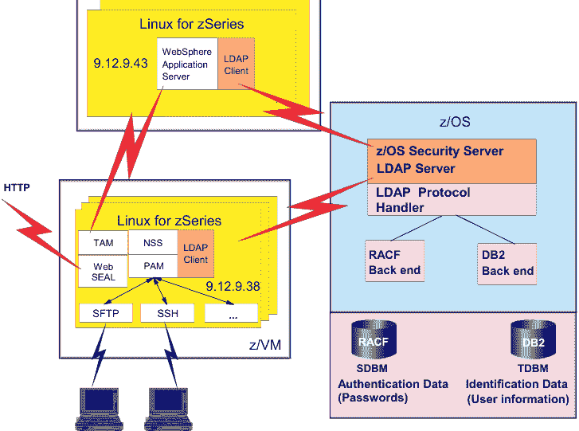

**图 7-3** 对 `z/OS RACF` 数据库验证用户

在这种场景中，我们使用单个 `Tivoli Access Manager` 实例。为了扩展性和高可用性，需要多个 `Tivoli Access Manager`/`Linux` 实例。

请求分发机制将负载分布到所有实例（例如，轮询 `DNS` 或使用 `LVS` 的 `Linux` 集群）。

### 7.4.1 配置 `WebSEAL`

要配置 `WebSEAL`：

1. 首先，使用命令从 `Tivoli Access Manager` 安装 `PDWeb-PD-4.1.0-2.s390.rpm` 包：

```
rpm -ivh PDWeb-PD-4.1.0-2.s390.rpm
```

2. 使用 `pdconfig` 命令配置 `WebSEAL`。`e-business` 的 `Access Manager` 设置菜单如示例 7-8 所示。

#### 示例 7-8 `Access Manager` 设置菜单

```
Access Manager for e-business Setup Menu 

1. Configure Package

2. Unconfigure Package

3. Display Configuration Status

x. Exit

请选择菜单项 [x]: 1
```

3. 选择选项 1 以导航到示例 7-9 所示的 `Access Manager` 配置菜单。

#### 示例 7-9 `Access Manager` 配置菜单

```
Access Manager for e-business Configuration Menu

1. Access Manager WebSEAL Configuration

x. Return to Access Manager for e-business Setup Menu

请选择菜单项 [x]: 1
```

4. 选择选项 1 以导航到示例 7-10 所示的 `Access Manager WebSEAL` 设置菜单。

#### 示例 7-10 `Access Manager WebSEAL` 设置菜单

```
Access Manager WebSEAL for e-business Setup Menu

1. Configure

2. Display Configuration Status

x. Exit

请选择菜单项 [x]: 1
```

5. 选择选项 1。系统提示输入 `Tivoli Access Manager` 管理员 (`sec_master`) 密码。我们使用密码 `secret`。

**注意**：如果反复输入错误密码，可能会收到错误：

```
Error: This account has been temporarily locked out due to too many failed login attempts.
```

获取正确的密码，等待五分钟解锁锁定，然后重启 `pdconfig` 命令。

6. 系统提示启用 `WebSEAL` 服务器与 `LDAP` 服务器之间的 `SSL` 通信。输入 `y`（是）或 `n`（否）以启用 `Access Manager` 服务器与 `LDAP` 服务器之间的 `SSL` 通信：

```
Do you want to enable SSL communication between the Access Manager server and the LDAP server (y/n) [Yes]?
```


> **注意：**在此还原中不使用`SSL`，因为使用内部`HyperSocket`连接到`z/OS`。为了额外的安全，可以使用`SSL`加密所有网络流量（即使是内部网络）。请参阅*Securing Linux for zSeries with a Central z/OS LDAP Server (RACF)*，获取关于如何加密Linux虚拟机与`z/OS`之间`LDAP`通信的完整说明和指南。

`WebSEAL`配置存储在`/opt/pdweb/etc/webseal.conf`文件中。使用`Tivoli Access Manager WebSEAL`作为安全前端需要创建接字（将Web请求重定向到其他URL的规范）。接字使用`pdadmin`命令创建。

如果后端应用程序服务器配置为高可用，`WebSEAL`接字将配置为指向多个主机。为了确保服务的统一，这些主机应配置完全相同的服务。

### 7.4.2 创建 WebSEAL 接字

使用`pdadmin`命令，定义了两个`WebSEAL`接字：

- 一个连接到`WebSphere HTTP-catcher`（端口`9080`）。
- 一个连接到`WebSphere 管理服务器`（端口`9090`）。

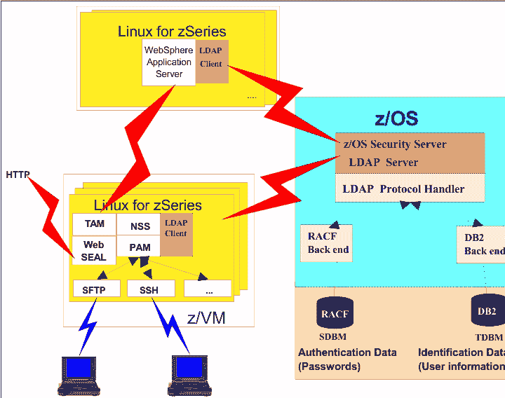

**图 7-4** 使用`Tivoli Access Manager`在`z/OS`上保护`WebSphere`

进入Linux客户机的HTTP请求会被`Tivoli Access Manager`拦截。定义了两个接点：

- 其中一个连接到`z/OS WebSphere HTTP 服务器`（端口`80`）。
- 另一个连接到`z/OS WebSphere 服务器`（端口`9087`）。

在示例 7-12 中，使用`pdadmin`命令来定义接点。

**示例 7-12** 为`z/OS`上的`WebSphere`定义接点

```bash
# pdadmin
padmin> login
nEnter User ID: sec_master
nEnter Password:
padmin> server task webseald-1nxsu4.ito.ibm.com create -tcp -h 9.12.6.16 -p 80 /test390
padmin> server task webseald-1nxsu4.ito.ibm.com create -tcp -h 9.12.6.16 -p 9087 /was390
```

`WebSEAL`服务器为`webseald-1nxsu4.ito.ibm.com`，`9.12.6.16`是`z/OS WebSphere`应用服务器的IP地址。`WebSphere HTTP`服务器监听端口`9080`，`test390`是接点名称。`WebSphere`应用服务器监听端口`9087`，`was390`是接点名称。

从运行在`zSeries Linux`上的`WebSEAL`访问`z/OS WebSphere`服务器（IP地址`9.12.9.38`）。例如，要执行`IBMBizWeb/EJBCCaller`应用程序，使用以下URL：

```
http://9.12.9.38/was390/IBMBizWeb/EJBCCaller
```

`WebSEAL`会提示用户ID和密码，这些信息将通过运行在`z/OS`上的`LDAP`和`RACF`进行验证。

# 相关 IBM 出版物

本节列出的出版物被认为特别适合详细讨论本红书涵盖的主题。

## IBM Redbooks

有关订购这些出版物的信息，请参阅第160页的“如何获取`IBM Redbooks`”。请注意，此处提到的某些文档可能仅提供电子版。

- `Linux for S/390`, `SG24-4987`
  `http://www.ibm.com/redbooks/abstracts/sg244987.html`

- `Linux on IBM @server zSeries and S/390: Distributions`, `SG24-6264`
  `http://www.ibm.com/redbooks/abstracts/sg246264.html`

- `Linux on IBM @server zSeries and S/390: ISP/ASP Solutions`, `SG24-6299`
  `http://www.ibm.com/redbooks/abstracts/sg246299.html`

- `Linux on IBM @server zSeries and S/390: System Management`, `SG24-6820`
  `http://www.ibm.com/redbooks/abstracts/sg246820.html`

- `Linux on IBM @server zSeries and S/390: Large Scale Linux Deployment`, `SG24-6824`
  `http://www.ibm.com/redbooks/abstracts/sg246824.html`

- `zSeries HyperSocks`, `SG24-6816`
  `http://www.ibm.com/redbooks/abstracts/sg246816.html`

- `Securing Linux for zSeries with a Central/zOS LDAP Server (RACF)`, `REDP-0221`
  `http://www.ibm.com/redbooks/abstracts/redp0221.html`

- `IBM Tivoli Access Manager for e-business`, `REDP-3677`
  `http://www.ibm.com/redbooks/abstracts/redp3677.html`

- `Linux on IBM @server zSeries and S/390: TCP/IP Broadcast on z/VM Guest LAN`, `REDP-3596`
  `http://www.ibm.com/redbooks/abstracts/redp3596.html`

- `Linux on IBM zSeries and S/390: VSWITCH and VLAN Features of z/VM 4.4`, `REDP-3719`
  `http://www.ibm.com/redbooks/abstracts/redp3719.html`

## 其他出版物

这些出版物也可作为进一步的信息源：

- `z/VM V4R.0 CP Command and Utility Reference`, `SC24-6008`
- `z/VM V4R.0 CP Planning and Administration`, `SC24-6043`
- `z/VM V4R.0 Directory Maintenance Facility Function Level 410 Tailoring and Administration Guide`, `SC24-6024`
- `z/VM V4R.0 System Operation`, `SC24-6000`
- `z/VM V4R.0 Running Guest Operating Systems`, `SC24-5997`
- `z/VM V4R.0 Virtual Machine Operation`, `SC24-6036`
- `z/VM V4R.0 General Information`, `SC24-5991`
- `Linux for zSeries and S/390 Device Drivers and Installation Commands`
- Zwicky, et al., *Building Internetwalls*, O'Reilly & Associates, 2000, ISBN `1569287`
- Barrett, Daniel J. and Richard E, *The Secure Shell: Definitive Guide*, O'Reilly & Associates, 2001, ISBN `0596011`
- Viega, John, et al., *Network Security with SSL*, O'Reilly & Associates, 2002, ISBN `0596027`
- Osisek, D., et al., “ESA/390 architecture, for VM,” *IBM Systems Journal*, Vol `30`, No `1`
- Northcett, Stephen and Judy Novak, *Network Intrusion*, ISBN `0735126`
- Barrett, Daniel J., et al., *Linux Cookbook*, O'Reilly & Associates, 2003, ISBN `0596039`


- Mann, S., et al., *Linux Security: The Administrator's Guide to Open Source Tools*, Prentice Hall, 2002, ISBN `0130471`

- Skoudis, Ed, *Counter: A Step-by-Step Guide to Computer Attacks and Effective Defense*, Prentice Hall, 2001, ISBN `0130332`

- McCart, Bill, *Red Hat Firewalls*, John Wiley & Sons, 2002, ISBN `0764524`

# 在线资源

这些网站和 `URL` 也作为进一步的信息源：

- IBM `DeveloperWorks` for `zSeries` and `S/390` 首页 `http://www.ibm.com/developerworks/oss/linux390/index.html`

- Altman, Alan and Cliff Laking, `z/VM` Security and Integrity `http://www.ibm.com/servers/eserver/library/techpapers/gm30145`

- `Stonesoft` 首页 `http://www.stonesoft.com/`

- `OpenSSH` 首页 `http://www.openssh.com`

- `FreeWAN` 首页 `http://www.freeswan.org`

- Fraser, B., `RFC2196: Site Security Handbook` `http://www.ietf.org/rfc/rfc196.txt?number=2196`

- `Linux PAM` documentation `http://www.kernel.org/pub/linux/pam/`

- `Sudo` 首页 `http://www.courtesan.com/sudo/`

- `Linux Security Modules` 首页 `http://lsm.immunix.org`

- `Linux Security` 首页 `http://www.linuxux.com/`

- Seifried, Chris, et al., "Linux Modules: General Security for the Linux Kernel" 2002 `USENIX` Symposium `http://www.usenix.org/events/sec02/wright.html`

- `Security-Enhanced Linux` 首页 `http://www.nsa.gov/selinux/`

- `VLAN` Information `http://net21.ucdavis.edu/newvlan.htm`

- IBM `@server` `zSeries`分区认证 `http://www.ibm.com/servers/eserver/zseries/certification.html`

- 德国联邦安全局认证报告 `http://www.bsi.bund.de/zertifiz/zert/reporte/0179a.pdf`

# 如何获取 IBM Redbooks

您可以在此网站搜索、查看或下载 `Redbooks`、`Redpapers`、`Hints and Tips`、草和补充材料，以及订购纸质 `Redbooks` 或 `CD-ROM`：

`ibm.com/redbooks`

# 来自 IBM 的帮助

IBM 支持与下载

`ibm.com/support`

IBM 全球服务

`ibm.com/services`

# 索引

# 符号

- `/etc/hosts.allow` 43

- `/etc/hosts.deny` 43

- `/etc/ipsec.conf` 80

- `/etc/nologin` 36

- `/etc/securetty` 35

- `/etc/sudoers` 38

- `/etc/sysconfig/syslog` 30

- `/etc/syslog.conf` 28

- `/.ssh/authorized_keys` 66

# F

- 防火墙 85

- 优势 86

- 集群 94

- 动态状态表 89

- 功能 92

- 访问控制 92

- 身份验证 93

- 内容筛选 94

- 监控与日志 92

- 网络地址转换 96

- 私有网络 93

- 高可用性 94

- 托管服务提供 98

- 管理 96

- 多层检测 90

- 数据包过滤 87

- 代理 88

- 角色 86

- 可扩展性 95

- 单点故障 95

- 状态检测检测 89

- 技术 86

- 吞吐量 96

- 漏洞 96

- 内部攻击 96

- 缺乏管理 96

# A

- `AUTOLOG` 15

# B

- `Bastille` 15

# C

- 内容筛选 94

- 共同标准 `EAL5`

- 配置 141

# D

- 任意访问控制 36

# I

- `ipsec.conf` 80

- `ipsec` 79

# L

- `LDAP` 141

- `Linux PAM` 31

# E

- 外部安全管理器 11

# M

- 强制访问控制 36

- `mod_ssl` 52

# Q

- `QUERY` 命令 13

- `QUERY` 日志 14

# N

- `netstat` 68

- 网络安全 4

# R

- `RACF` 11

- `z/VM` 的 `RACF` 26

- `Redbooks` 网站 160

# O

- `openssl genrsa` 52

- `openssl req` 54

- `openssl rsa` 53

- `openssl x509` 54

# P

- `PAM` 31

- 配置文件 31

- 控制标志 32

- 可选 32

- 必须 32

- 需要 32

- 足够 32

- 模块参数 32

# S

- `scp` 64

- 安全策略 32

- `SELinux` 366

- `SET` 日志 14

- `SET SECUSER` 19

- `SET_PRIVCLASS` 15

- `sftp` 65

`AllowGroups` 64

`AllowHosts` 64

`AllowTCPForwarding` 71

`AllowUsers` 63

命令语法 61

`DenyGroups` 64

`DenyHosts` 64

`DenyUsers` 63

`GatewayPorts` 68

已知主机机制 66

本地端口转发 66

环回接口 68

口令 66

`PermitRootLogin` 64

端口转发 66

远程命令执行 65

远程端口转发 69

`X11Forwarding` 73

`X1UseLocalHost` 73

`ssh-keygen` 62

`SSL` 52

`StoneGate` 85

管理 120

备份 103

证书权威机构 105

集群虚拟接口 113

组件 97

通信 104

联系的 `IP` 地址 105

防火墙引擎 103

`GUI` 98

日志服务器 109

管理服务器 100

`NAT` 105

用户目录 102

控制面板 98

数据库引擎 102

分布式架构 105

高可用防火墙 112

热备用节点 112

实施策略 107

分布式管理系统 108

单管理系统 107

`Launchpad` 98

负载均衡路由 115

管理系统 100

多链路技术 114

`NetLink` 114

网络元素管理器 98

节点专用接口 113

协议代理 90

安全策略管理器 98

`SSL` 105

测试子系统 103

`VLAN` 109

`VPN` 112

`sudo` 37

命令 41

配置 38

别名 38

默认值 32

用户权限 39

日志 42

选项 41

安全考虑 42

`SuSecConfig` 56

`syslog` 28

中央日志服务器 30

设施 28

级别 28

选择器 28

`SYSTEM CONFIG` 14

`DEFINE LINE` 19

`DEFINE SWITCHV` 19

`FEATURES` 15

`CLEAR_TDISK` 15

`PASSWORDS_ON_COMMANDS` 15

`SET_PRIVCLASS` 15

`JOURNALING` 14

`PRIV_CLASSES` 16

`VMLAN` 19

系统安全 4

# T

`TCP_wrappers` 43

访问控制 44

操作 45

`tcpd` 45

`Tivoli Access Manager` 139

使用 `RACF` 进行身份 140

`IBM Global Security Toolkit` 145

策略服务器 140

`WebScale` 149

`junction` 151

# U

`USER` 目录条目语句 21

索引 163

`+ DEDICATE statement` 24

`INCLUDE statement` 23

`IPL statement` 23

`LINK statement` 24

`LOGONBY statement` 23

`MDISK statement` 23


# 目录

`OPTION` statement 24

密码 22

`AUTOONLY` 22

`LBYONLY` 22

`NOLOG` 22

`NOPASS` 22

权限类 22

`SPECIAL` statement 24

# V

虚拟网络 19

禁止临时访客局域网 19

限制对访客局域网的访问 19

限制虚拟 `CTC` 网络 20

`visudo` 38

`VLAN` 18

`VNC` 73

`AllowLoopback` 74

端口转发 73

`vncserver` 74

`vsfptpd` 45

`VSWITCH` 17

`IEEE 802.1Q` `VLAN` 17

# X

`XAUTLOG` 22

# Z

`z/VM` 完整性 9

控制程序 9

安全认证 10

`SIE` 指令 10

虚拟机 9

`zSeries` 完整性 8

`LPAR` 完整性 8

网络安全 10

`QDIO` 10

`z/VM` 完整性 8

# IBM @server zSeries 和 S/390上的 Linux：最佳安全实践

# IBM @server zSeries 和 S/390上的 Linux：最佳安全实践

`z/VM` 安全主题

本 `IBM Redbook` 讨论了在 `IBM @server zSeries` 和 `S/390` 平台上作为 `z/VM` 虚拟机运行 `Linux` 的最佳实践。本书旨在面向负责部署在 `z/VM` 下运行的安全 `Linux` 服务器的系统管理员和 `IT` 架构师。我们考虑了 `z/VM` 和 `Linux` 的安全主题。

保护 `Linux` 虚拟机

# 国际技术支持组织

`zSeries` 的 `Linux` 防火墙

# 基于实践经验构建技术信息

我们研究了 `zSeries` 为在 `z/VM` 下整合大量 `Linux` 服务器所提供的独特安全和完整性特性。我们讨论了虚拟机隔离以及分配给 `VM` 客户机的命令权限。解释了 `z/VM` 版本 4.4 的安全配置选项。

在本书中，我们还讨论了 `Linux` 安全主题。我们研究了加固 `Linux` 安装的选项。考虑了使用安全套接层（`SSL`）和安全外壳（`SSH`）保护 `Linux` 流量。我们查看了使用 `Free/WANS` 实现私有网络。讨论了商业防火墙技术以及使用 `zSeries StoneGate` 防火墙的实施。我们研究了如何结合 `IBM Tivoli Access Manager` 和运行在 `z/OS` 上的 `LDAP` 服务器，针对运行在 `z/OS` 上的 `RACF` 进行 `Linux` 用户身份验证。

`IBM Redbooks` 由 `IBM` 技术支持组织开发。来自全球的 `IBM` 专家、客户和合作伙伴根据真实场景创建及时信息。提供的建议旨在帮助您在环境中更有效地实施 `IT` 解决方案。

更多信息：`ibm.com/redbooks`

`SG24-7023-00` `ISBN 0738497665`
