# IBM system Z 上 Linux 性能测量与调优指南


Lydia Parziale

Massimiliano Belardi

Mario Held

Li Ya Ma

Lester Peckover

Karen Reed


> 注意：在使用此信息以及其支持的产品之前，请阅读第 ix 页中“通知”部分中的信息。

## 9.4 `z/VM` 上 `Linux` 的 `OSA-Express` `QDIO` 增强 ..................................................... 136

## 9.5 基础设施成本 ................................................................................................................................. 136

### 9.5.1 安装新系统 ................................................................................................ 136

## 9.6 虚拟处理器的性能影响 ....................................................................... 140

### 9.6.1 为 `Linux` 客户机分配虚拟处理器 ................................................................................ 141

### 9.6.2 测量虚拟处理器的影响 ................................................................................. 141

## 第 10 章为 `zVM` `Linux` 虚拟机调整磁盘性能 ............................................................ 145

## 10.1 `System z` 上 `Linux` 的磁盘选项 ....................................................................................... 146

### 10.1.1 带有 `ECKD` 或 `D/DIAGNOSE` 的 `DASD` ............................................................................................ 146

### 10.1.2 `SCSI` 磁盘 ....................................................................................................................... 146

### 10.1.3 `z/VM` minisks ................................................................................................ 146

## 10.2 影响磁盘 `I/O` 的因素 ................................................................................................ 146

## 10.3 观察磁盘性能 ...................................................................................... 148

### 10.3.1 `DASD` 统计数据 ....................................................................................... 148

### 10.3.2 `SCSI` 统计数据 ....................................................................................... 148

### 10.3.3 使用 `z/VM` 工具监控磁盘统计 ........................................................ 149

## 10.4 极大化磁盘运行 ............................................................................................ 151

### 10.4.1 `DASD` 的 `I/O` 建议 ................................................................................... 151

### 10.4.2 `SCSI` 的 `I/O` 建议 ................................................................................ 152

### 10.4.3 `z/VM` minidisks 和 Minidisk 缓存的 `I/O` 建议 ................................................ 152

### 10.4.4 硬件选项的性能能力 ................................................................ 152

### 10.4.5 `DASD` 块大小 ....................................................................................... 154

### 10.4.6 `IBM` 存储子系统缓存模式 ................................................................ 154

### 10.4.7 `Linux` 逻辑卷管理器 (`LVM`) ....................................................... 156

### 10.4.8 并行访问卷 (`PAV`) ............................................................................ 158

### 10.4.9 `Linux` `I/O` 调度器 ....................................................................... 163

### 10.4.10 `Linux` 磁盘 `I/O` 设置 ................................................................................ 165

### 10.4.11 `Linux` 文件系统 ................................................................................ 165

### 10.4.12 预读设置 ....................................................................................... 166

## 第 11 章 网络考虑 ............................................................................ 167

## 11.1 选择网络选项 ....................................................................................... 168

### 11.1.1 物理网络 ................................................................................................... 168

### 11.1.2 虚拟网络 ................................................................................................... 171


## 11.2 网络配置参数

### 11.2.1 用于 OSA-Express (QDIO) 的 Qeth 设备驱动

### 11.2.2 LAN 通道站 (非-QDIO)

### 11.2.3 CTCMCP 设备驱动

## 11.3 z/VM 交换链路聚合

## 11.4 Hypersockets

## 11.5 高可用性成本

### 11.5.1 LPAR：静态路由与动态路由

### 11.5.2 z/VM：Linux 路由器对比 VSWITCH

## 11.6 工作负载与性能工具

## 附录 A WebSphere 性能基准示例工作负载

### IBM Trade 性能基准示例

### Trade 6 部署选项

## 附录 B WebSphere Studio 负载模拟器

### WebSphere Studio 负载模拟器概述

### 示例工作负载生成脚本

## 附录 C Mstone 负载生成器

### Mstone 概述

## 附录 D 紧急扫描与 2 GB 以下行限制

### 紧急扫描

### 2 GB 以下行限制及场景

#### 在 VM 版本中已移除大部分 2 GB 行限制的修复

#### 可能仍遇到紧急扫描的场景

## 附录 E 额外材料

### 定位 Web 材料

### 使用 Web 材料

#### 下载 Web 材料的系统要求

### 如何使用 Web 材料

## 相关出版物

### IBM Redbooks

### 其他出版物

### 在线资源

### 如何获取 Redbooks

### IBM 帮助

- `developerWorks® S/390®`
- `z/OS® System pTM`
- `GDDM™ System zTM`
- `zSeries® …”…®`
- `DirMaint™ VM/ESA®`
- `OS/390®`
- `DS8000™ PRISM™`

## 前言

本出版物提供了 `System z` 性能测量和调优概述。旨在帮助管理员识别影响性能的因素。书中的示例用于尽可能完整地说明这些概念。

下表列出了各种组件和指标：

| 组件 | 指标 |
| :--- | :--- |
| 主存储 | `GB` |
| 扩展存储 | `GB` |
| 处理器 | `LPAR` |
| 总存储 | `MB` |
| 工作负载 | `DAS` |
| 配置 | `250` |
| 服务 | `45` |
| 版本 | `10` |

感谢以下人员对本项目做出的贡献：

- Roy P. Costa
  - 国际技术支持组织，Poughkeepsie 中心
- Ursula Braun
  - `Linux for zSeries` 开发，IBM德国
- Patricia Rando
  - `System z` - 核心技术，IBM 美国
- Giorgio Acquafresca
  - `zSeries` 技术支持，IBM 意大利


Klaus Bergmann, Juergen Doelle, Horst Hartmann, Mustafa Mesanovic

Linux on System z - 系统与性能评估开发，IBM 德国

Carsten Otte

Linux 文件与虚拟化开发，IBM 德国

特别感谢我们的技术评审团队：

Bruce Hayden, Alan Altmark, Sam Cohen, Jason Herone, Stephen Wehr, Jan Glauber, Martin Kammerer, Horst Hummel, Stefan Weinhuber, Eberhard Pasch

感谢本书的前一个版本。第一版于 2003 年 5 月出版的《Linux on IBM System: Performance Measurement and Tuning》的作者为：Gregory Geiselhart, Laurent Dupin, Deon, Rob van der Heij, John Langer, Graham Norris, Don Robbins, Barton Robinson, Gregory Sansoni 和 Steff Thoss。

## 成为已书籍作者

加入我们为期两至六周的驻留计划！帮助编写有关产品或解决方案的书籍，获得尖端技术的实战经验。我们将有机会与 IBM 技术专家、业务合作伙伴和客户团队合作。

你的努力将提高产品的接受度和客户满意度。作为奖励，你将在 IBM 开发实验室建立一个人脉网络，并提高你的生产力和市场竞争力。

欲了解更多关于驻留计划的信息，请浏览驻留索引并在此处在线申请：`ibm.com/redbooks/residencies.html`

## 欢迎意见

您的意见对我们至关重要！

我们希望书籍能够尽可能提供帮助。请通过以下方式向我们反馈对本书或其他 IBM Redbooks 的意见：

- 使用下处的在线 `Contact us`（联系我们）Redbooks 反馈表：
- `ibm.com/redbooks`
- 通过电子邮件将意见发送至：
- `redbooks@us.ibm.com`
- 邮寄您的意见至：

## 变更摘要

本节描述了本书及之前版本中所做的技术更改。本版可能还包含未标记的微调和编辑更改。

变更摘要

针对 `SG24-6926-01`

针对 `Linux z: IBM System Performance Measurement and Tuning`

于 2008 年 2 月 28 日创建或更新。

## 2008 年 2 月，第二版

本次修订反映了下文描述的新及已信息的添加、删除或修改。

## 新信息

- 将所有 `Linux XE` 移动到独立章节
  - 添加了 `z/VM` 和 `Linux` 的 `Megamon XE`
  - 添加了 `SAR`、`vmstat` 和 `iostat` 等性能分析工具
- 移动到独立章节
  - 添加了瓶颈分析
  - 添加了容量规划考量
  - 添加了基准测试概念和实践
  - 添加了关于应急扫描的信息
- 添加了关于新磁盘和网络功能的信息

## 修改信息

- 将针对 `z/VM` 的特定信息更新到当前的 `v5.2` 和 `v5.3` 版本
- 更新了针对 `Linux` 内核 `2.6` 的特定信息


# 虚拟化与服务器整合

在本章中，我们将讨论什么是虚拟化，以及通过运行 `Linux` 作为 `z/VM` 虚拟机可以获得哪些好处。我们将研究如何使用 `z/VM` 提供的虚拟化技术来共享真实的硬件资源。

## 1.1 服务器整合与虚拟化

虚拟化的概念，例如将大量的虚拟服务器整合到少数相对较大的物理服务器中，正在世界各地的数据中心变得日益普遍。`System z` 主机非常适合担任这种托管服务器角色。

在计划将工作负载迁移到许多具有非共享资源的离散服务器时，需要在非常早的阶段选择适合虚拟化的工作负载。某些工作负载主要是数字计算活动，例如财务预测应用。任何依赖于使用单个资源的应用程序（计算密集型的，在这种情况下是 `CPU` 需求较高，而 `I/O` 和内存需求较低的）都不是虚拟化的理想候选者。更常见的、以中等平衡方式使用 `CPU`、`I/O` 和内存的工作负载可能可能是理想的候选者，它们可以在共享资源基础设施中远程共存。

我们警惕误导性的比较，特别是那些仅考虑一种主要资源的情况下的。如果我们比较 `System z` `Pentium` 处理器的循环速度或多内核处理器芯片上单个处理器的速度，这种比较可能意味着 `System z` 并没有很大优势。如果工作负载每天 24 小时使用 100% 的 `CPU`，那么该工作负载将轻松占用一整天的大部分 `System z` 资源。虚拟化这种工作负载意味着有效地将部分 `CPU` 资源专门用于单个工作负载，这显然不利于在更理想的虚拟化共享池环境中的共存。

尽管 `System z` 拥有多个 `CPU`，且其最大支持数量比任何其他平台都高，这实际上可以允许应用程序运行得非常好，但仍然不建议在 `System` 硬件上托管此类工作负载。幸运的是，在现实处理中，这种极端情况并不常见，在许多情况下使用 `System z` 非常有意义。在书中，我们使用一个案例研究，利用由 `Trade 6 Benchmark` 生成的 `IBM WebSphere` 工作负载来代表适用于虚拟化的平衡工作负载。

考虑一种情况：工作负载并非全 24 小时使用机器，而只使用 12 小时。在这种情况下，在其他 12 小时内有另一个负载使用相同的资源。在这种情况下，我们可以将 `Linux` 系统放在 `System z` 上，并让它们使用所需的所有周期。正如书中示例所示，与运行在独立离散硬件上相比，它们总共仅使用大约一半的 `CPU` 功率。

总拥有成本（`TCO`）也是决定在主主机上构建虚拟化环境的另一个关键因素。在考虑所有因素（包括硬件成本、软件许可、持续支持成本、空间使用以及运行和冷却区域相关的电力成本），`System z` 可能会更有优势。

在考虑所有因素（包括硬件成本、软件许可、持续支持成本）在共享池的情况下，`z/VM` 定义的网络允许我们在 `System z` 上运行更多此类工作负载。

### 1.1.1 CPU 虚拟化

`CPU` 虚拟化通过分时共享来实现。这意味着每个虚拟机都可以获得 `CPU` 的访问。由于 `z/VM` 专门为分时共享设计，`z/VM` 可以在多个系统任务之间切换。

### 1.1.2 内存的虚拟化

除了 `CPU` 要求外，工作负载还有内存需求。包含 `Linux` 系统并使其运行所需的内存量称为工作集。`z/VM` 的内存虚拟化是通过一种分页技术完成的。

### 1.1.3 网络的虚拟化

当应用程序和服务器想要连接网络资源或其他服务器时，必须配置必要的资源。所有的网络资源，如 `IP` 地址、网络适配器、局域网和带宽管理，都可以在 `z/VM` 中进行虚拟化。

导致产生巨大的延迟。事实上，同一 `VLAN` 中的虚拟机可以以跨内存的速度相互通信。

### 1.1.4 虚拟化层次

`z/VM` 为运行 `Linux` 系统提供的虚拟机环境并非唯一正在进行的虚拟化。`Linux` 系统本身运行着多个进程，操作系统会为这些进程中的每一个进程分配资源，以允许它们完成工作。在 `Linux` 上运行的多个任务进程中，某些进程可以将其资源分配给这些任务。如果 `z/VM` 系统运行在逻辑分区（`LPAR`）中，由于其再次使用了时间分片（`timesparing`）原理，`z/VM` 也仅使用了了部分实际硬件。

这些层次的虚拟化使得操作系统难以找到使用分配资源的最佳方法。在许多情况下，可以通过调优控制来解决问题，并允许整个系统高效运行。当操作系统最初的设计并非为了在共享环境中运行时时，某些控制措施实际上产生了意想不到的负面影响。

### 1.1.5 虚拟化的优势

随着 `IT` 系统变得越来越大和复杂，管理这些系统的成本增长速度超过了新硬件的成本。管理层主要关注的是同时降低成本并增加收入。与现有基础设施相比，虚拟化通过降低成本、减少复杂性并提高快速响应业务需求的灵活性，为整体管理做出了贡献。

越来越多的用户意识到，通过将生产和开发环境中现有低利用率且不稳定的服务器合并到一个或少数几个系统箱中，他们可以从虚拟化中获得以下收益：

- 更高的资源利用率

作为 `z/VM` 运行，多个 `Linux` 服务器可以共享底层箱的物理资源，从而获得更高的持续资源利用水平，即使在 `CPU` 接近 100% 时也依然从容。这对于平均需求远小于整个专用资源且不会在同一时间达到峰值的变动负载尤为相关。两个仅运行在一天中不同时段的负载就是一个很好的例子。

- 更具灵活性

虚拟化为 `Linux` 虚拟机提供了极大的灵活性。`Linux` 服务器可以动态重新配置资源，而无需停止所有运行的应用程序。

- 改进的安全性和隔离

`z/VM` 上的每个虚拟机都可以与控制程序（`CP`）以及其他虚拟机完全隔离。如果一个虚拟机崩溃，其他任何一个都不会受到影响。这可以防止数据跨虚拟机泄露，并且应用程序仅通过配置的网络连接进行通信。

- 更高的可用性和扩展性


运行在`z/VM`上的Linux服务器由于底层主机的可靠性而提高了其可用性，主主机具有经过四十年演变的精炼硬件和软件架构。物理资源可以被移除、升级或更改而不影响其用户。`z/VM`使其Linux虚拟机能够轻松地向上扩展或向外扩展，以适应不断变化的负载需求。

- 更低的管理成本

通过将多个物理服务器合并到单个或更少数量的大处理器上，基础设施的复杂性降低了，常见的管理任务得到了集中和自动化，这可以大大提高员工的效率。

- 改进的配置

由于虚拟资源从硬件和操作系统问题中抽象出来，它们在崩溃情况下通常能够更快速地恢复。在虚拟化模式下运行极大有助于高速克隆，允许在几秒钟内创建并管理额外的。

## 1.2 资源共享

当资源被共享时，可能会有不同的含义：

- 多个虚拟机轮流使用资源。

这在共享`CPU`时最为明显。`z/VM`在实际处理器上一个接一个地调度虚拟机。由于资源的提供非常高效，每个虚拟机都认为在自己的时间切片内拥有该处理器。主内存也是共享的，因为每个虚拟机工作集中的页会根据需要进入或退出主内存。`z/VM`再次创建了资源由虚拟机拥有的幻象。由于需要管理和分配资源，这种共享并不是免费的。在`z/VM`中，在虚拟机之间切换是有优势的。这种开销量取决于竞争`CPU`的虚拟机数量，但在经过适当调优的系统上，它只是总可用资源中较小的一部分。

- `z/VM`允许虚拟机共享内存页。

在这种情况下，Linux机器的虚拟内存以这种方式映射，多台机器指向实际内存中的同一页。由于节省了内存资源，这在为系统服务时具有重要意义，因为只需要进行一次更改即可更新所有共享资源。在`z/VM`中，这是通过具名系统（`NSS`）完成的。可以在`NSS`中加载整个Linux内核，并让每段代码驻留在各自的工作集中。当虚拟机开始共享`NSS`时，内存资源方面没有额外成本。请注意，并非所有内存都通过`NSS`共享。运行在`z/VM`层的虚拟机也会竞争内存来存放它们的工作集。`NSS`通常只持有Linux虚拟机总工作集的一小部分。

### 1.2.1 资源超量分配

对您的硬件资源进行超量分配是可能的。当在一个`4 GB`的`z/VM`系统中运行`16`个大小为`512 MB`的虚拟机时，您对内存进行了两倍的超量分配。只要虚拟机不需要在同一时间分配的虚拟存储，这种方法就是有效的，而通常情况如此。

资源超量分配是好事。我们在日常生活中也这样做。例如，一家餐厅可以安排`100`个人的座位，每位顾客都使用厕所。只需少量的厕所即可提供服务。电影也是如此，但由于预期的模式倾向于受电影开始和结束的影响，每`100`人需要更多厕所。这说明了负载和时间如何影响共享资源的能力。

这个例子也说明，资源分区（为男女客设置独立厕所）如果两种不同负载之间的比例不是恒定的，将会降低您的容量。诸如服务水平的要求可能要求您这样做。坦率地说，`z/VM`系统具有足够的灵活性来应对类似的实际情况。

当共享资源的竞争加剧时，取决于可用总资源，出现队列可能会增加。这是共享无法避免的后果之一。当队列形成时，请求者访问共享资源的时间会被延迟，程度不一。这种延迟是否可以接受取决于系统上实施的服务水平以及您所做的其他选择。

然而，超量分配对于优化资源共享通常是必要的。

### 1.2.2 估计所需容量

某些基准测试涉及衡量应用程序的最大吞吐量。您将看到关于给定安装系统每秒最大事务数、每秒浮点运算数以及每秒传输兆字节数的引用。系统的最大吞吐量在与预期业务量相关时，可以作为规划系统容量需求的一个良好指标。其他因素也决定了业务应用程序的运行情况。


# System z 调优基础

每个硬件和软件平台都有独特的特性和特征，在调优环境时必须予以考虑。`System z`处理器多年来不断增强，提供了一强大的功能集和最高可靠性。本章讨论了通用调优方法论概念，并探索了它们在运行Linux客户机的`System z`上的应用。本章涵盖的主题包括处理器共享、内存、Linux客户端规格以及基准测试方法论。

## 2.1 系统调优的艺术

性能分析和调优是一个多过程。无论你选择什么工具，分析系统性能的最佳方法是从外部开始，逐步深入到微小的调优细节。首先收集有关系统硬件和进程整体健康状况的数据。在每天的高峰期间，处理器繁忙程度如何？在这些峰值期间`I/O`响应时间发生了什么变化？它们是保持基本一致，还是变长了？系统内存每天是否受到限制并产生分页等待？当前系统能否提供满足服务水平协议（`SLA`）的用户响应时间？遵循良好的性能分析过程可以帮助你回答这些问题。

了解可用工具以及它们提供的信息类型很重要（见第`13`页第`3`章“Linux监控工具”）。同样重要的是知道何时使用这些工具以及寻找什么。等到电话响起来投诉时才开始调优和收集数据就太晚了。如果不定期检查系统和利用率，你如何知道你的环境中什么是正常的，什么是有问题的呢？对系统进行定期检查可以使用控制措施（调优旋钮）来影响资源分配给虚拟机的方式。`z/VM`中极少有控制项可以增加可用资源量。在大多数情况下，能做的最好是从一个虚拟机中提取资源，并将其分配给另一个更需要这些资源的虚拟机。从一个虚拟机中夺取资源并给另一个是否是明智的，通常取决于这些虚拟机的工作负载以及该工作的重要性。

调优很少有一种一律通切的方法。相反，你会发现一种类型的负载在另一种类型的负载下运行表现糟糕。这意味着你必须理解你所运行的工作负载，并准备好根据变化对工作负载进行审查和调优。

### 2.1.1 调优无法做到的

重要的一点是，你不能运行超过机器所承载的内容。如果你的`System z`有两个`CPU`，而你运行的工作负载由三台运行`WebSphere`的Linux机器组成，其中每台机器全天`100%`占用一个`CPU`，那么它们将无法容纳。没有任何`z/VM`调优能让它运行，但应用程序本身可能存在性能问题，使得工作负载全天的使用率低于`100%`。

当`System z`有四个`CPU`，且三台Linux机器的工作负载每台全天`100%`占用一个`CPU`时，几乎无能可为。在这种情况下，`z/VM`有足够的资源来为每个Linux虚拟机提供其所需的资源（人们可能希望更改配置，以允许使用所有四个`CPU`并让运行得更快）。

### 2.1.2 调优可以提供帮助的地方

即使不同工作负载的总和等于可用资源总量，你可能发现自己仍然无法以良好的性能运行工作负载。其可能是因为系统缺少某种特定资源。在这种情况下，恰当的调优可以产生影响。在调优系统和工作负载之前，需要了解你的配置中什么资源是限制因素。调优更改倾向于属于以下这些类别之一：

- 使用受限资源。

在`z/VM`下运行Linux系统的优势之一是能够共享和过度承诺硬件资源。Linux认为它拥有的内存量称为虚拟内存。分配给每个Linux客户端的虚拟内存总和可以是主机可用实际内存的几倍。`z/VM`高效地为Linux客户端管理内存。对于内存受限的系统，一种可能是通过调整Linux客户端的虚拟机大小来减少`z/VM`的内存占用。

- 获取更大尺寸的限制资源。

用户增加Linux客户端的虚拟内存很容易，因为这只是`z/VM`下客户端定义中的一个快速更改。然而。

- 增加总资源。

运行此类应用程序最具成本效益的方法是调整当日容量。虽然这看起来可能不现实，但这正是我们希望`z/VM`执行的。虚拟机的部分被载入内存以运行。不活跃的虚拟机被移动到分页空间以腾出空间。

### 2.1.3 资源交换

运行此类应用程序最具成本效益的方法是调整当日容量。虽然这看起来可能不现实，但这正是我们希望`z/VM`执行的。虚拟机的部分被载入内存以运行。不活跃的虚拟机被移动到分页空间以腾出空间。

### 2.1.4 工作负载特征

真实的业务应用具有随时间变化的负载特征。这种最简单的形式是服务器在白天显示出更多的峰值。更复杂的负载特征是：在一天的部分时间内以及另一部分时间内是`CPU`密集型的。虽然这看起来可能不现实，但这正是我们希望`z/VM`执行的。虚拟机的部分被载入内存以运行。不活跃的虚拟机被移动到分页空间以腾出空间。

# System z 调优基础

## 2.2 问题确定

问题确定需要系统性能侦探的技能。这个过程与试图破解犯罪的警察侦探的工作相似。在`IT`系统性能案例中，“犯罪”就是性能瓶颈或响应时间的突然恶化。就像警察一样，性能专家会提问、寻找线索、记录发现的结果、得出假设、通过调优或其他手段测试假设，并最终破解谜团，使系统恢复良好的性能。

### 从何处开始

通常会有某种线索引导你开始瓶颈调查。如果没有，请从简单的问题开始，以缩小可能性的范围。问题如下：

- 有什么软件、硬件或应用程序发生了变化？

- 问题是何时首次出现的？

- 性能下降是持续的，还是断断续续？

- 问题在哪里能得到答案？是所有人感到痛苦，还是只有部分人？

这些问题由`IT`人员或第`13`页第`3`章“Linux监控工具”中讨论的一些性能工具来回答。

### 应采取的步骤

如`IT Tivoli ManagementMON on z/VM and Linux`等高级工具极大地促进了瓶颈分析和问题确定。`OMEGAMON`可以检测性能问题，并在所有人因响应时间下降而遭受痛苦之前提醒你该问题。我们使用该工具进行以下瓶颈分析场景示例。

瓶颈示例：


### 2.1 OMEGAMON 警报与诊断

1. `OMEGAMON` 为 `z/VM` 发出警报。

2. `OMEGAMON` 控制台包含一个所有监控系统和应用程序的树状列表。它在出现问题的 `z/VM` 系统旁边以及关注区域（实时存储/Real Storage）旁边会显示一个警告图标（带有感叹号 `!` 的黄色三角形）（见图 2-1）。

   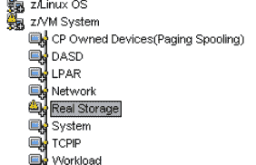

   图 2-1 警告图标

3. 点击警告图标可以查看更多信息，显示分页空间使用百分比较高（图 2-2）。

   

   图 2-2 额外的警告信息

4. `OMEGAMON` 消息状态显示问题的性质，警告图标左侧的链接图标引导用户进入另一个包含问题详情和专家建议的面板。

5. 如果发生此类情况，`OMEGAMON` 会发送红色警报消息，提示分页空间处于关键状态。

使用像 `OMEGAMON` 这样的工具确定问题比使用系统命令容易得多。然而，无论使用哪种工具，挖掘问题原因的过程都是相同的。

### 2.3 z/VM Linux 客户机的容量考量

- `z/VM` 内存是共享资源。

  尽管激进缓存减少了磁盘 `I/O` 的概率并倾向于内存访问，但必须考虑缓存成本。`Linux` 客户中的缓存页面会减少其他 `z/VM` 客户可用的 `z/VM` 页面。

- 虚拟内存地址空间需要更多的 `Linux` 内核内存。

  较大的内存地址空间需要更多的内核内存来管理 `Linux` 客户。在为 `Linux` 客户确定内存需求时，请选择对该客户性能影响最小的最小内存占用。为了减少较小虚拟机可能发生的偶尔交换（`swapping`）带来的影响，可以使用第 79 页第七章“Linux 交换”中讨论的交换设备。

  尽管 512 MB 服务器不需要所有内存，但最终将会使用它。它的内存成本是 128 MB 服务器的四倍。

关于 `Linux` 客户容量实践的更多信息，可以参见第 50 页的 5.3 节“Linux 虚拟内存的容量”。

可以在 `zVM` 网站上的性能报告中找到更多信息：

`http://www.ibm.com/servers/eserver/zseries/zvm/perf/docs/`

`zVM` 网站还提供了额外的 `zVM` 性能技巧：

`http://www.ibm.com/servers/eserver/zseries/zvm/perf/tips/`

### 2.4 基准测试概念与实践

性能是尝试预测处理器何时超出容量的关键指标。从实现投资收益最大化的角度来看，高处理器利用率是理想的，但它不是容量规划的真实预测指标。随着处理器上工作负载的增长，性能并不总是以类似的方式变化。如果一个以 90% 利用率运行的处理器增长了 10%，性能可能会显著恶化。当性能变得不可接受时，系统即超出容量，而调优工作可以提供一些缓解。

性能的特征之一是它相对于处理器利用率以非线性方式扩展。这意味着在利用率达到关键点之前，性能可能保持平坦或几乎不变，然后性能下降就会变得反复无常。这通常发生在你从性能与利用率图表的线性部分移动到曲线的指数部分时。这被称为达到曲线的“膝部”（`knee`），性能在那里在短时间内从平庸变得糟糕。

并不是每个工作负载在任何给定的处理器利用率下表现都相同。在系统中被标记为高优先的任务在总利用率为 80% 时可能运行良好。低优先级任务是第一个察觉到系统过载负担的工作负载。在高优先级工作出现指数级下降之前，低优先级工作负载显示出压力迹象。当系统接近最大容量时，工作负载可能会继续增长，但系统吞吐量可能会保持不变或下降。最终，过载系统会影响所有级别的工作负载——低、中、高优先级。处理器容量和利用率不是影响性能的唯一因素。取决于工作负载，性能受到所有硬件组件的影响，包括磁盘、内存和网络。操作系统、软件子系统和应用程序。

- 性能调优工具类型
- 硬件调整
- 特殊性能模式
- 操作系统、软件子系统和应用程序。

### 3.1 系统性能工具简介

有时，改进系统过程中最困难的部分是决定如何开始，或者使用哪种工具。实时监控为解决今天的问题提供有用信息。历史报告工具为健康检查、问题确定和趋势分析提供信息。复杂的监控软件还可以主动检查性能问题。

实时监控可以简单如每个系统内置的 `Linux` 或 `zVM` 命令。如果没有更健壮的软件产品，这些命令可能是你进行性能分析的首选方案。`IBM Performance Toolkit` 和 `Tivoli OME on zVM` 也是实时的示例，被用于捕获基准测试。在本书中，`OME` 这样的软件也被称为 `OMEGAM`。`zVM Performance Toolkit` 和 `OMEGAM` 提供表格和图形格式的详细系统统计数据。它们具有自动计算能力，可以在无需操作干预的情况下解决问题。

历史报告超大多数系统命令的范围。因此，健康检查、问题确定和趋势分析最好由收集数据的软件完成。数据收集后，报告工具可以过滤海量数据，帮助缩小相关信息的范围。书中历史报告工具包括 `VM Performance Reporting Facility` 和 `VM Analytics Facility`。

### 3.2 IBM z/VM Performance Toolkit

`zVM Performance Toolkit`（也称为 `Performance Toolkit`）旨在协助操作人员和系统人员或分析师处理领域：

- 全面板模式下的系统控制台操作功能旨在有助于 `VM` 系统的操作，提高操作效率和生产力。
- `zVM` 系统上的性能监控

增强的实时性能监控允许系统人员监控系统性能并分析瓶颈。监控中包含的功能以及数据显示的方式都旨在提高系统人员分析系统时的生产力，并让新用户也能高效地使用该工具。`Performance Toolkit` 可以帮助系统人员更有效地利用系统资源，提高系统生产力并提高用户满意度。

`Performance Toolkit` 功能包括：

- 许多关键性能指标的自动阈值监控，当超过用户定义的限制时会发出操作通知
- 特殊性能监控模式，显示：
  - 通用 `CPU` 性能
  - 系统和用户利用率及管理
- 通道和 `I/O` 设备性能，包括缓存数据
- 详细的 `I/O` 设备性能，包括实际磁盘组上特定磁盘（`minidisks`）引起的 `I/O` 负载信息
- 通用用户数据：资源消耗、分页信息、`IUCV` 和 `VMCF` 通信、等待状态、响应时间
- 详细的用户性能，包括虚拟设备的状态和负载
- 共享文件服务器的摘要和详细信息
- `TCP/IP` 服务器的配置和性能信息
- `Linux` 性能数据 - 系统执行空间 (`SXS`) 性能数据
- 虚拟网络和配置数据

收集的性能数据还用于提供：

- 通用 `CPU` 性能和存储利用率面板上许多关键指标的重新显示功能，允许浏览最后的测量值（最长两小时）
- 历史图表，最多选择四个重新显示变量，可以是简单图表的形式，或者如果安装了图形数据显示程序（`GDDM, 5684-007` 或 `5684-168`），则以 `GDDM` 图形的形式提供
- 变量相关性图（简单图表或 `GDDM` 图形），显示特定变量的值如何与另一个变量的值相关


> 注意：在虚拟机的控制台上生成图形需要 GDDM。然而，当使用浏览器通过 WWW 生成图形时，不需要额外的软件。

为了日后参考，积累的性能数据还可以用于创建：

- 打印的性能报告

- 简单的性能历史文件

- 扩展趋势计划

对于容量规划，磁盘上的历史文件可用于：

- 性能趋势图

- 数值历史数据分析

我们现在称为 `VM Performance Toolkit`（VM 性能工具包）的可以追溯十七年前，它已经从带有几个性能命令的操作控制台演变为一个功能强大、多样化、高度详细的报告和实时监控工具。来自 Linux 客户机的通信和随后的数据收集使其能够生成硬件、`LPAR`、`VM` 和 Linux 级的合并视图。`Performance Toolkit` 的用户界面简单，但可以通过输入完整或简写的报告名称进行扩展，以直接进入你需要的报告。一旦进入具有许多层的报告，它就有子菜单，或者通过将光标置于变量下方并按 `Enter` 键进行进一步导航。事实上，报告包含许多层的导航，例如，你可以查看 `DASD` 卷的有序列表，并查看整体活动以及控制器功能。你可以得更深，详细查看给定的卷，然后进入更详细的内容查看 `minisk` 设备活动。这种导航极大地有助于问题的确定，并由于这种增强的可访问性，使得对系统的理解（即使是底层）也变得更加容易。

## 第 3 章. Linux 监控工具

各种数据报告分为通用系统数据、`I/O` 数据、历史数据和用户数据组。菜单顶部如图 3-1 所示。

| FCX124 | 性能屏幕选择 | (FL530) | 性能监控 |
| :--- | :--- | :--- | :--- |
| 通用系统数据 | I/O 数据 | 历史数据（天/时间） | |
| 1. CPU 负载和传输 | 11. 通道负载 | 31. 图形选择 | |
| 2. 存储利用率 | 12. 控制单元 | 32. 历史数据\* | |
| 3. 预留 | 13. I/O 设备\* | 33. 基准测试显示 | |
| 4. 剥夺 | 14. CP 拥有的磁盘 | 34. 相关性 | |
| 5. 系统计数器 | 15. 缓存范围，功能.\* | 35. 系统摘要\* | |
| 6. CPU 服务 | 16. DASD 使用情况 | 37. 通信 | |
| 7. SPOOL 文件显示\* | 17. DASED 选择索引 | 38. DASD 负载 | |
| 8. LPAR 数据 | 18. 需要 I/O 的\* | 39. 最小缓存\* | |
| 9. 共享分段 | 19. I/O 配置 | 40. 存储管理数据 | |
| 共享页 | 20. 配置更改 | 41. 进程负载与配置 | |
| B. 磁盘中虚拟 | | 42. 逻辑分区负载 | |
| C. 事务统计 | 用户数据 | 21. 用户资源使用\* | 43. 响应时间（所有)\* | |
| 监控数据 | 22. 用户分页负载\* | 44. RSK 数据菜单\* | |
| E. 错误设置 | | | | |

图 3-1 `zVM` `Performance Toolkit` 菜单

一个很好的起点是查看通用系统和 `I/O` 数据的类别。从顶部选项开始，通过选择 `1. CPU 负载和传输` 开始对系统进行性能健康检查。此选项显示整体利用率、系统竞争以及有关分区的信息。用户数据包括用户数、活动用户数以及等待资源（存储页、`I/O`）的用户数。显示图 3-2 所示的内容。

| FCX100 | CPU 2094 | SER 2991E | 间隔 13:10:56 - 13:11:56 | 性能监控 |
| :--- | :--- | :--- | :--- | :--- | :--- |
| CPU 负载 | | | | 向量设施 | 状态或 |
| PROC %CPU | %CP %EMU %WANT %SPS %SISC %QLDL | | | | |

*(注：由于原文文本在此处中断，表格 3-2 的后续内容未在提供文本中)*

一个很好的起点是查看通用系统和 `I/O` 数据的类别。从顶部选项开始，通过选择 `1. CPU 负载和传输` 开始对系统进行性能健康检查。此选项显示整体利用率、系统竞争以及有关分区的信息。用户数据包括用户数、活动用户数以及等待资源（存储页、`I/O`）的用户数。显示图 3-2 所示的内容。

## `VMPF` 对 `z/VM` 进行性能分析和生成。`VMPF` 生成的报告和文件包括利用率：

- 系统资源利用率、响应时间和吞吐量

- 按用户 ID 的资源利用率

- `DASD` 活动和通道利用率

`VMPF` 作为后处理器在先前收集的数据上运行。输入到执行的参数指定了所需的报告类型和数据选择的时间范围。摘要报告详细列出了硬件、系统和用户层面广泛范围参数的统计数据。

| VMPF02 | 按时间划分系统摘要 | 页码 |
| :--- | :--- | :--- |
| 11/02/1999 10:38:31 | IBM HYURIC | |
| 11/02/1999 10:41:02 | VM/SA PR 21 ST 17099 | |
| 240 秒 08:31:00 | SP 2 测试数据 | |
| --<用户--><页--><响应时间--> | | | | | | | | | | | | | | | | | | | |
| 从 | 止 | 时间 | 忙时间 | 联中 | 放置负载 | 激活率 | DASID | PLGN |  | 移动 | 琐 | 寻道 | 琐 | 寻道 | 琐 | 寻道 |
| 10:00 | 10:05 | 5:00 | 67.1 | 11.967 | 0.0 | 36 | 16 | 19.2 | 0.3 | 51 | 1.313 | 3.641 | 0.0 | 0.27 | 0.28 |
| 10:05 | 10:10 | 5:00 | 69.7 | 13.800 | 0.0 | 35 | 15 | 18.3 | 0.2 | 51 | 1.513 | 4.048 | 1.0 | 0.35 | 0.31 |
| 10:10 | 10:15 | 5:00 | 65.0 | 11.866 | 0.0 | 37 | 17 | 17.9 | 0.3 | 51 | 2.048 | 5.711 | 1.0 | 0.31 | 0.35 |
| 10:15 | 10:20 | 5:00 | 64.3 | 12.867 | 0.0 | 37 | 18 | 16.2 | 0.3 | 51 | 2.518 | 6.308 | 1.0 | 0.35 | 0.35 |
| 10:20 | 10:25 | 5:00 | 63.0 | 13.867 | 0.0 | 37 | 19 | 16.5 | 0.4 | 59 | 3.018 | 7.093 | 1.0 | 0.31 | 0.26 |
| 10:25 | 10:30 | 5:00 | 60.8 | 13.867 | 0.0 | 37 | 19 | 17.5 | 0.4 | 59 | 3.617 | 7.944 | 1.0 | 0.49 | 0.22 |
| 10:30 | 10:35 | 5:00 | 60.1 | 13.867 | 0.0 | 37 | 19 | 17.8 | 0.4 | 59 | 4.217 | 8.633 | 1.0 | 0.31 | 0.26 |
| 10:35 | 10:40 | 5:00 | 59.3 | 13.867 | 0.0 | 37 | 20 | 18.0 | 0.4 | 60 | 4.817 | 9.423 | 1.0 | 0.31 | 0.26 |
| 10:40 | 10:45 | 5:00 | 58.5 | 12.967 | 0.0 | 37 | 22 | 14.1 | 0.4 | 60 | 5.417 | 10.113 | 1.0 | 0.29 | 0.28 |
| 10:45 | 10:50 | 5:00 | 57.2 | 13.867 | 0.0 | 37 | 22 | 14.2 | 0.4 | 60 | 6.017 | 10.913 | 1.0 | 0.26 | 0.31 |
| 10:50 | 10:55 | 5:00 | 56.5 | 13.867 | 0.0 | 37 | 24 | 14.5 | 0.4 | 60 | 6.617 | 11.713 | 1.0 | 0.26 | 0.31 |
| 10:55 | 11:00 | 5:00 | 55.2 | 13.867 | 0.0 | 37 | 16 | 17.4 | 0.3 | 60 | 7.216 | 12.517 | 1.9 | 0.26 | 0.35 |
| 11:00 | 11:05 | 5:00 | 61.9 | 8.716 | 0.0 | 37 | 22 | 20.0 | 0.4 | 59 | 1.207 | 12.895 | 0.9 | 0.33 | 0.17 |

在查看系统摘要后，图 3-4 提供了您感兴趣的详细信息。图 3-5 是 CPU 利用率的报告。

| VMPF03 | 按时间划分 | 页码 |
| :--- | :--- | :--- |
| 07/28/1999 10:10:25 | IBM HYURIC | |


| 07/28/1999 10:14:25 | `VM/SA` `PR` `21` `ST` `17099` | |

| 240 秒 08:31:00 | `SH` `72512` | |

| --<用户--><页--><响应时间--> | | | | | | | | | | | | | | | | | | |

| 从 | 止 | 时间 | 忙时间 | 联中 | 放置负载 | 激活率 | `DASID` | `PLGN` | | 移动 | 琐 | 寻道 | 琐 | 寻道 | 琐 | 寻道 | | `CPU` | 速率 |

| 10:18 | 10:23 | 5:00 | 53.1 | 11.8 | 0.0 | 34 | 252 | 0.0 | 105 | 342 | 92.4 | 149.8 | 0.1 | 0.27 | 0.323 | | | | |

| 10:23 | 10:28 | 5:00 | 57.4 | 11.8 | 0.0 | 34 | 252 | 0.0 | 105 | 392 | 99.4 | 154.8 | 0.1 | 0.38 | 0.362 | | | | |

| 10:28 | 10:33 | 5:00 | 59.5 | 11.8 | 0.0 | 34 | 252 | 0.0 | 105 | 438 | 103.8 | 169.8 | 0.1 | 0.43 | 0.39 | | | | |

| 10:33 | 10:38 | 5:00 | 61.3 | 11.8 | 0.0 | 34 | 252 | 0.0 | 105 | 478 | 111.8 | 179.8 | 0.1 | 0.49 | 0.42 | | | | |

| 10:38 | 10:43 | 5:00 | 63.0 | 11.8 | 0.0 | 34 | 252 | 0.0 | 105 | 518 | 119.8 | 189.8 | 0.1 | 0.57 | 0.37 | | | | |

| 10:43 | 10:48 | 5:00 | 64.7 | 11.8 | 0.0 | 34 | 252 | 0.0 | 105 | 558 | 127.8 | 199.8 | 0.1 | 0.63 | 0.41 | | | | |

| 10:48 | 10:53 | 5:00 | 66.5 | 11.8 | 0.0 | 34 | 252 | 0.0 | 105 | 598 | 135.8 | 209.8 | 0.1 | 0.79 | 0.53 | | | | |

| 10:53 | 10:58 | 5:00 | 68.2 | 11.8 | 0.0 | 34 | 252 | 0.0 | 105 | 638 | 143.8 | 219.8 | 0.1 | 0.79 | 0.53 | | | | |

| 10:58 | 11:03 | 5:00 | 70.0 | 11.8 | 0.0 | 34 | 252 | 0.0 | 105 | 678 | 151.8 | 229.8 | 0.1 | 0.82 | 0.61 | | | | |

| 11:03 | 11:08 | 5:00 | 51.9 | 11.8 | 0.0 | 34 | 252 | 0.0 | 105 | 318 | 83.8 | 61.8 | 0.1 | 0.14 | 0.25 | | | | |

| 11:08 | 11:13 | 5:00 | 53.6 | 11.8 | 0.0 | 34 | 252 | 0.0 | 105 | 358 | 91.8 | 71.8 | 0.1 | 0.24 | 0.30 | | | | |

| 11:13 | 11:18 | 5:00 | 55.3 | 11.8 | 0.0 | 34 | 252 | 0.0 | 105 | 398 | 99.8 | 81.8 | 0.1 | 0.24 | 0.38 | | | | |

| 11:18 | 11:23 | 5:00 | 57.0 | 11.8 | 0.0 | 34 | 252 | 0.0 | 105 | 438 | 107.8 | 115.8 | 0.1 | 0.31 | 0.43 | | | | |

| 11:23 | 11:28 | 5:00 | 58.7 | 11.8 | 0.0 | 34 | 252 | 0.0 | 105 | 478 | 123.8 | 141.8 | 0.1 | 0.39 | 0.51 | | | | |

| 11:28 | 11:33 | 5:00 | 60.4 | 11.8 | 0.0 | 34 | 252 | 0.0 | 105 | 518 | 135.8 | 163.8 | 0.1 | 0.47 | 0.56 | | | | |

## 3.4 `IBM z/VM Performance Analysis Facility`

`z/VM Performance Analysis Facility` 用于生成本书中的某些性能报告，现在已不再可用。`IBM Performance Analysis Facility/VM` (`VPAF 5.8-130`) 辅助分析师进行问题确定、调优和趋势分析。它利用 `VMPF` 和 `VM Performance Toolkit` 生成的性能历史的交互图形和统计相关性。`VPAF` 允许您查看多个系统的数据。这可以用于比较同一系统在进行更改前后的数据。交互图形显示了性能如何随时间变化。它还提供了有关这些变量的统计信息，包括时间段内的最小值、最大值和平均值。程序计算这些变量之间的相关系数，以及代表所调查数据相对变性的方差系数。图 3-6 所示的 `VPAF` 图表旨在用于查看性能。`img/a398552a9cf583f3798c1dedb947c2_36_0`

`Linux` 概览工作空间显示了许多关键性能指标。在图 3-11 中，`OMEGAMON` 显示了顶部的 `Linux` 系统及其 `CPU` 占用率、过去 15 分钟的系统负载，以及一个统计表（包含上下文切换、分页速率、系统运行时间以及登录用户数）。

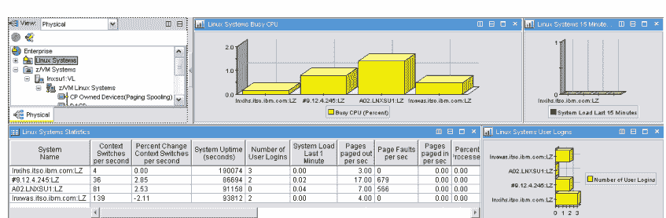

图 3-11 `OMEGAMON Linux` 虚拟机性能概览视图

在查看了汇总 `Linux` 显示上提供的高级信息后，额外的 `OMEGAMON` 面板显示了 `Linux` 系统、进程、文件和网络的详细信息。下面显示了部分面板。

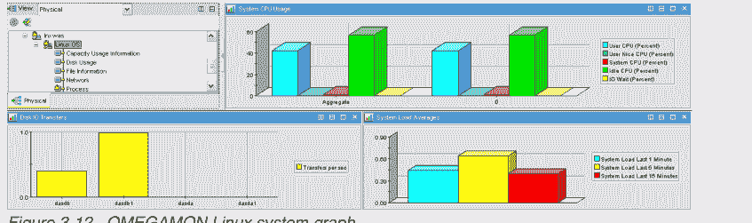

图 3-12 `OMEGAMON Linux` 系统图

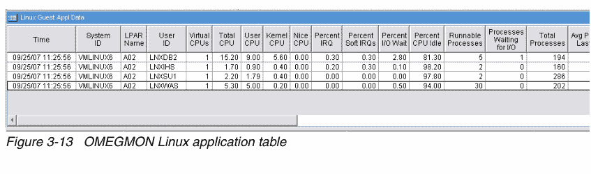

图 3-13 `OMEGAMON Linux` 应用表

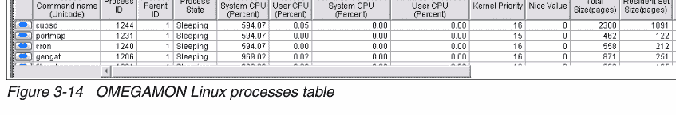

图 3-14 `OMEGAMON Linux` 进程表

图 3-14 显示了每个进程的状态和资源利用率。`OMEGAMON` 中的此类内容可以过滤（以消除内存需求）并排序（将感兴趣日期置于顶部）。

通过 `Tivoli OMEGAMON XE for z/VM` 和 `Linux` 代理，你还可以执行以下任务：

- 导航到更详细的性能数据级别。对于 `Linux` 虚拟机，此监控代理直接从 `z/VM` 和 `Linux` 工作空间上的 `Tivoli OMEGAMON XE` 为 `Linux OS` 的 `Tivoli Monitoring Agent` 提供工作空间。

- 通过 `TCP/IP` 连接到 `z/VM` 主机系统以访问 `Performance Toolkit` 面板。

- 查看有关识别和解决性能问题的专家建议。

`IBM Tivoli OMEGAMON` 为关键系统性能指标提供了默认阈值。当超过阈值时，会生成状况告警并采取自动操作来解决问题。状况控制台日志显示激活的状况告警。在图 3-15 中，上方面板列出了状况。左下面板显示过去 24 小时的状况计数。右下面板列出了当前用户已确认的事件。

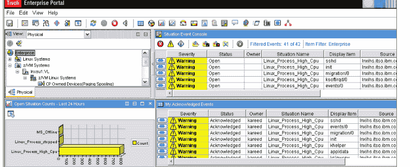

图 3-15 `OMEGAMON` 状况告警

默认工作空间让你在安装并配置 `z/VM` 和 `Linux` 上的 `Tivoli OMEGAMON XE` 软件后立即开始监控你的企业。界面支持多种数据查看格式，如图表、柱状图和表格。工作空间和状况可以自定义以满足你企业的需求。

## `Linux` 系统工具

有时，改进系统性能过程中困难的部分是决定如何开始或使用什么。接几页中描述的简单命令可以作为评估系统性能的初始步骤。这些命令是 `Linux` 操作系统的标准部分，或者可以在互联网上免费获取软件。

### `vstat` 命令


## vstat 命令
`vstat` 命令显示进程统计、实际和虚拟内存的使用、分页、块 I/O 和 CPU。最左侧的列显示运行进程数和阻塞块数。内存部分显示正在交换出的内存、包含 `inode` 和文件元数据的空闲缓冲区量，以及从磁盘读取文件的缓存内存。`swap` 部分列出换入（`swap in`）和换出（`swap out`）。`I/O` 部分报告读取和写入的块（`kb`）。系统中的 `in` 和 `cs` 表示每秒的中断和上下文切换。`CPU` 部分头部 `us`、`sy`、`id`、`we` 分别代表用户、系统、空闲、`I/O` 等待和被窃取（`steal`）的 `CPU` 时间百分比。`vstat` 命令对于识别内存存储问题和 `I/O` 等待问题非常有用，适用于虚拟 `CPU` 未由物理 `CPU` 支持的情况。

图 3-6 列出了项目并显示了三次更新行，间隔为五秒。

| | | | | | -system- | | cpu | | | | | | |
|---|---|---|---|---|---|---|---|---|---|---|---|---|
| procs | memory | | | | | | | | | | | | |
| b | swpd | free | buff | cache | si | bo | in | us | sy | id | wa | | |
| 0 | 67632 | 77916 | 160924 | 0 | 0 | 3 | 12 | 14 | 44 | 1 | 99 | 0 | 0 |
| 0 | 67468 | 77920 | 160902 | 0 | 0 | 24 | 18 | 31 | 0 | 100 | 0 | 0 |

图 3-6 Linux 命令 - vmstat

## top 命令
图 3-17 显示了系统信息的交互式显示。

| PID USER | PR | NI | VIRT | RES | SHR | %CPU | TIME | COMMAND |
|---|---|---|---|---|---|---|---|---|
| 2090 root | 20 | 0 | 2640 | 1300 | 9 | 0.3 | 00:00:07 | |
| 16 root | 0 | 0 | 818 | 514 | 2 | 0.0 | 00:00:18 | it |
| 1 root | 20 | 0 | 12548 | 8116 | 0 | 0.0 | 00:00:16 | migration/0 |
| 3 root | 34 | 0 | 19 | 0 | 0 | 0.0 | 00:00:05 | ksoftqd/0 |
| 4 root | 34 | 0 | 19 | 0 | 0 | 0.0 | 00:00:05 | migration/1 |

图 3-17 Linux 命令 - top

## 进程状态 (ps) 命令
`ps` 命令显示有关运行进程的信息。它是一次性显示，包含 `UID`、进程 `ID`、启动时间和名称。图 3-18 显示了 `-ef` 选项。

| UID | PID | C | STAT | TIME | COMMAND |
|---|---|---|---|---|---|
| root | 1 | | | 00:00:01 | init |
| root | 2 | | | 00:00:10 | [kthreadd/2] |
| root | 3 | | | 00:00:00 | [ksoftqd/0] |
| root | 4 | | | 00:00:00 | [migration/1] |
| root | 5 | | | 00:00:00 | [systemd-journald] |
| root | 6 | | | 00:00:00 | [kworker/u2:1] |
| root | 7 | | | 00:00:00 | [kworker/u2:2] |
| root | 8 | | | 00:00:00 | [kworker/u2:3] |
| root | 9 | | | 00:00:00 | [kworker/u2:4] |
| root | 10 | | | 00:00:00 | [kworker/u2:5] |
| root | 11 | | | 00:00:00 | [kworker/u2:6] |
| root | 12 | | | 00:00:00 | [kworker/u2:7] |
| root | 13 | | | 00:00:00 | [kworker/u2:8] |
| root | 14 | | | 00:00:00 | [kworker/u2:9] |
| root | 15 | | | 00:00:00 | [kworker/u2:10] |
| root | 16 | | | 00:00:18 | it |
| root | 17 | | | 00:00:00 | [kworker/u2:11] |
| root | 18 | | | 00:00:00 | [kworker/u2:12] |
| root | 19 | | | 00:00:00 | [kworker/u2:13] |
| root | 20 | | | 00:00:07 | |
| root | 21 | | | 00:00:00 | [kworker/u2:14] |
| root | 22 | | | 00:00:00 | [kworker/u2:15] |
| root | 23 | | | 00:00:00 | [kworker/u2:16] |
| root | 24 | | | 00:00:00 | [kworker/u2:17] |
| root | 25 | | | 00:00:00 | [kworker/u2:18] |
| root | 26 | | | 00:00:00 | [kworker/u2:19] |
| root | 27 | | | 00:00:00 | [kworker/u2:20] |
| root | 28 | | | 00:00:00 | [kworker/u2:21] |
| root | 29 | | | 00:00:00 | [kworker/u2:22] |
| root | 30 | | | 00:00:00 | [kworker/u2:23] |
| root | 31 | | | 00:00:00 | [kworker/u2:24] |

图 3-8 Linux 命令 - ps

IBM System z 上的 Linux：性能测量与调优

## 系统状态 (sysstat) 工具
`sysstat` 包是一个广泛使用的 Linux 工具，包含在你的发行版中，也可以从网上下载。`sysstat` 包包含以下组件：

- `sadc` 数据收集器 - 将数据存储在二进制文件中
- `sar` 报告工具 - 读取 `sadc` 创建的文件并转换为可读输出
- `mpstat` - 处理器利用率
- `iostat` - I/O 利用率

我们使用 `sar` 输出以下信息：

- 进程创建
- 上下文切换
- 所有 `CPU` 利用率
- 网络利用率

有关更详细的描述请访问：`http://pagesperso-orange/sebastien.godard/`

## OProfile
`OProfile` 是一个用于 Linux 的开源分析器。它可以对 Linux 系统上运行的所有代码、内核、共享库、应用程序二进制文件等进行分析，并提供低开销（变化的 `1%`-`8%`）。它根据 `GPL` 协议发布。`OProfile` 由内核驱动程序、用于收集数据的守护进程以及生成报告的工具组成。

`OProfile` 支持内核 `2.2`、`2.4` 和 `2.6`，但对于 Linux on z 仅支持 `2.6` 或更高版本。对于 SUSE，内核版本至少为 `kernel-s390(x)-2.6.5-719`，这对应 `SLEPS2`。对于 RedHat Linux，内核版本至少为 `kernel` `2.6.9-22-EL`，对应 `RHEL 4`。

### 进行测试
```
opcontrol --shutdown
opreport-
```
注意以下黑色数字的几点：

- `1` 启动计时器的命令。性能分析完成后，将其指定为 `0` 以关闭计时器。
- `2` 如果不存在 `vmlinux` 文件，则解压该文件。
- `3` 为运行的内核指定 `vmlinux` 文件。
- `4` 启动 `OProfile` 守护进程并停止性能分析。
- `5` 停止 `OProfile` 守护进程，并停止性能分析。
- `6` 产品符号或二进制镜像摘要。

在图 3-19 中，`CPU` 信息未显示正确。带有硬件的系统尚不支持 `OProfile` 所需的性能计数器。输出包括：

- `vma`（虚拟内存区域）是虚拟地址空间的一个连续区域。这些区域在进程生命周期内创建，当程序尝试内存映射文件、链接到共享内存段或分配堆空间时。
- `samples` 是该符号的样本数。
- `%` 表示该符号层级样本数相对于可执行文件总样本数的百分比。
- `app` 是符号所属的应用程序名称。
- `symbol name` 是已执行的符号名称。


从 `OProfile` 报告中，我们可以分析目标模块的性能并进行相应的调整。例如，从图 3-19 可以看出，应用程序 `mcf_base_z_Linux` 的三个模块消耗了大部分 CPU 时间。为了提高此应用程序的性能，应该关注这三个模块而非其他模块。

| 带计时器中断的 CPU，速度 0 MHz（估计值）通过计时器中断进行性能分析 | `vma` | `samples` | `app` | `symbol name` |
| :--- | :--- | :--- | :--- | :--- |
| `0002840` | `5862` | `34.8970` | `mcf_base_z_Linux` | `price_out_imp` |
| `00021c8` | `5221` | `31.0811` | `mcf_base_z_Linux` | `refresh_potential` |
| `0003bc4` | `4398` | `24.2819` | `mcf_base_z_Linux` | `primal_bee_map` |
| `0003b60` | `408` | `2.4289` | `mcf_base_z_Linux` | `sort_basket` |
| `0001e7` | `345` | `2.1518` | `mcf_base_z_Linux` | `default_idle` |
| `0001d3d` | `138` | `0.8215` | `mcf_base_z_Linux` | `flow_cost` |
| `0003b3c` | `98` | `0.5834` | `mcf_base_z_Linux` | `update_tree` |
| `00020e28` | `88` | `0.5239` | `mcf_base_z_Linux` | `dual_feasible` |
| `0003c6a4` | `72` | `0.4286` | `mcf_base_z_Linux` | `primal_imimus` |
| `0003d2c2` | `40` | `0.2386` | `mcf_base_z_Linux` | `write_citations` |
| `0002f720` | `24` | `0.1429` | `mcf_base_z_linux` | `insert_new_enc` |

图 3-19 `OProfile` 输出示例

有关 `OProfile` 命令的更多详细信息和文档请参阅：

`Linux on IBM System z: Performance Measurement and Tuning`

`http://oprofile.sourceforge.net/docs/`

## 3.7 z/VM 系统工具

与 Linux 一样，`z/VM` 操作系统也有显示系统性能信息的命令。这些命令控制程序（`CP`）系统命令。不需要输入 `CP` 命令限定符。`z/VM` 对 `cp indicate` 和 `indicate` 的响应相同。

## cp indicate

`cp indicate` 命令显示有关整体处理器利用率（或 `LPAR` 处理器利用率）、分页率、微磁盘缓存率和用户的信息。关于 `z/VM` `indicate` 命令的其他信息可以在 IBM Redbooks 网站上找到（`ref tips0592`）。

```
16:39:36 INDICATE
16:39:36 AYGPMOC-001% 04
16:39:36 XTONE-000001/SEC MIGRATE-001/SEC
16:39:36 READ-000001/SEC WRITES-000001/SEC HIT RATIO-100%
16:39:36 POING/SEC STEAL-004%
16:39:36 01-000000 (00000) DORMANT-000017
16:39:36 01-000000 (00000) EXPAN 02-000000 (00000)
16:39:36 02-000000 (00000) EXPAN 03-000000 (00000)
16:39:36 03-000000 (00000)
16:39:36 PROC 0001-01% 0001-01% CP
16:39:36 PROC 0003-01% CP
16:39:36 LIMITED-00000
```

图 3-20 VM 命令 - `cp indicate`

## query srm

`cp query` 命令显示一些当前的 `z/VM` 调优参数。这些参数都有适用于大多数环境的默认设置。书中后面的章节讨论了对默认值的调整。系统资源管理器（`srm`）参数包括：

- `iabas` - 交互偏置，用于偏向短事务
- `idbuf` - 控制 `z/VM` 对分页的容忍度
- `storbuf` - 用于监控 `z/VM` 主内存
- `dispatching timeslice` - 单个用户占用处理器的时间

```
16:41:24 SRM INTENSITY=90% DURATION=2
16:41:24 IABAS Q01=300% Q2=200% Q3=150%
16:41:24 IDBUF Q01=800% Q2=700% Q3=600%
16:41:24 STORBUF Q01=3267 Q02=3267 Q03=3267
16:41:24 DISPATCHING MINOR TIMESICE - MS
16:41:24 PROCS=100
16:41:24 PAGES=9999
16:41:24 STOR Q01=00
```

图 3-21 VM 命令 - `cp srm`

## indicate queues

`cp indicate` 命令显示用户 ID 及其调度队列（图 3-22）。

| `INDICATE QUEUES` | `Q01` | `Q1` | `Q2` | `Q3` |
| :--- | :--- | :--- | :--- | :--- |
| `00000000/000000 LNXIHS` | `00087663/00` | | | |
| `00118266/00118252 LNXU4` | `00233352/00` | | | |
| `0000000000000 LNXUI` | `0008785/00` | | | |
| `00682417/00786423 TCPIP` | `00009718/00` | | | |

图 3-22 VM 命令 - `indicate queues`

## query alloc page

`cp alloc page` 命令用于确定系统使用了多少分页空间。

## Velocity monitoring tools

另一个监控工具是 `ESAPS`，`Velocity Software` 提供的 Linux 性能套件。该套件的产品包括：

- `ESAMP` VM 监控分析程序，提供 `VM/ESA` 各方面的性能报告。
- `ESAMON` VM 实时监控器，提供性能的实时分析。
- `ESATCP` 网络和 Linux 数据收集程序。
- `ESAWEB` 非常快速的 VM Web 服务器。

除了这四个产品外，`ESAPS` 还提供了基于 Web 的接口，通过 Web 浏览器查看性能数据并管理许多设施。

### 3.8.1 监控需求

`ESAPS` 满足许多数据收集需求。提供的数据用于：

- **容量规划** 以性能数据库（`PDB`）形式提供的长期数据是长期容量规划和趋势分析的输入。通过收集和多种数据提取工具提供完整的历史数据功能。
- **性能分析** 趋势数据使分析人员能够检测数千个领域的变化。性能数据库允许分析人员确定系统中发生了哪些变化。可以对特定时间段进行报告，对性能问题进行深度分析。
- **实时性能** 除了传统的顶级用户和系统利用率实时报告外，还为所有子系统、用户活动和 Linux（以及许多其他平台）服务器提供实时分析。
- **Linux 数据** 随着 `z/VM` 上虚拟 Linux 服务器群的出现，需要性能数据。

### 3.8.2 标准接口

`ESAPS` 使用标准接口进行所有数据收集。使用提供的标准接口的优势在于当存在大量版本和发行版时，标准接口提供了一致的数据源。支持的接口包括：

- `z/VM` 提供自1988年以来监控接口。从那时起该接口提供了 VM 系统的一致视图。
- 使用简单网络管理协议（`SNMP`）收集网络性能，用于网络管理。
- `NETSNMP` 开源软件包为 Linux 和其他平台提供主机数据。
- VM 应用程序数据由应用程序插入到与标准监控接口一致的监控流中。`ESATCP` 利用此确保一致的数据收集，允许 Linux 和 VM 数据的完全集成。

### 3.8.3 性能数据库

`ESAPS` 提供实时数据和历史数据用于深度分析。性能数据根据监控间隔每天以一分钟的粒度收集。还会收集更长的存档，通常粒度为15 分钟。此性能数据库（`PDB`）包含了 VM 数据、Linux 数据和网络数据。

### 3.8.4 使用 ESAMON 进行实时监控

`ESAMON` 使用：

- 历史报告
- Linux 报告
- 网络报告

`Velocity Software` 自1988年以来一直支持 VM 环境。通过关注 VM 以及现在现在的 `z/VM`，`Velocity Software` 向产品数据收集设施增加了 `TCP/IP` 网络分析以及 Linux、Microsoft® Windows NT 和其他平台。

## 3.9 其他监控工具

还有其他性能监控产品可以提供与书中数据类似的系统统计数据。


- `BMC Mainview monitor` for `z/VM` and `Linux`

- `Computer Associates MICS`

这并非市面上所有产品的完整列表。

## 3.10 容量规划

成功的容量规划涉及根据过去的趋势和业务增长计划来预测未来需求。尽管硬件成本持续下降，但软件和人员成本正在上升。由于软件和人员成本与硬件容量挂钩，容量规划仍然非常重要。

容量规划人员根据当前的吞吐量和性能，加上 `IT` 工作负载的增长预期，判断何时购买更多硬件。性能是预测处理器升级时间的一项关键指标。从清晰的视角来看，高处理器利用率是理想的，但前提是性能不受影响。

容量规划人员需要比直觉法则更复杂的工具。良好的建模软件使规划人员及其 `IT` 部门能够在低性能成为业务阻碍之前，规划硬件升级。`IBM` 为 `IT` 部门提供的用于系统环境有效容量规划的建模工具包括 `z/VM Capacity Planner` 和 `Tivoli Performance Modeler`。对于仅包含 `z/VM` 和 `Linux` 镜像的系统，可以使用 `IBM System z Processors z/VM Planner for Linux Guests` 进行建模（`IBM` 员工和授权的 `IBM` 合作伙伴可以与客户一起使用该工具）。运行 `z/VM`、`Linux` 和 `zOS` 镜像组合的系统过程可以使用 `IBM System z Processors z/VM Planner for Linux Guests` 与 `Tivoli Performance Modeler` 的组合进行建模。

## `IBM z/VM Planner for Linux Guests on IBM System z Processors`

`z/VM Planner for Linux Guests on IBM System z Processors` (`zVM-Planner`) 是一种在 `Microsoft Windows™` 下运行的基于容量的效率工具。它旨在为运行各种 `Linux` 工作负载环境的 `IBM` 处理器提供容量规划洞察。为每个目标 `Linux` 虚拟机输入 `z/VM` 虚拟机定义和容量需求。总容量需求根据虚拟机定义计算，由于可能并不在同一时间达到峰值利用率，因此使用用户指定的互补峰值百分比来计算正在调整的 `z/VM` 虚拟机的真实组合容量需求。该工具在将新虚拟机合并现有 `VM` 镜像时，还会对 `z/VM` 处理器需求建模。生成的虚拟机容量需求将与该 `VM` 结合，以支持所有虚拟机。

`zVM-Planner` 生成若干张描绘建模系统的图表。这些图表说明了支持建模工作负载所需的处理器大小、工作负载中每个应用程序使用该处理器的百分比，以及工作负载所需的估计最小和最大处理能力。图 3-23 表示了运行 `Web` 应用程序、数据库和文件服务器混合的五个 `Linux` 虚拟机的建模工作负载的最小最大容量需求。

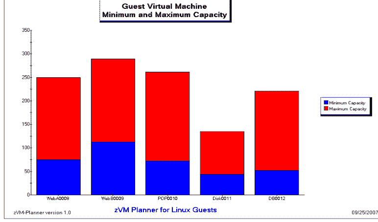

图 3-23 `zVM-Planner` 建模系统图表

如果您感兴趣了解更多此类工具，请联系您的 `IBM` 代表人员。

## `IBM Tivoli Performance Modeler`

`IBM Tivoli® Performance Modeler for z/OS V2.3` 是一种运行在 `Microsoft Windows™` 上的基于 PC 的性能建模和容量规划工具。它可以像您的 PC 或移动电脑一样灵活。`IBM Tivoli Performance Modeler for z/OS V2.3` 针对 `IBM eServer™ zSeries®` 和 `S/390®` 的系统管理设计。随着操作系统复杂性的增加以及响应工作负载变化的巨大影响，基本的中央处理器（`CPU`）利用率通常已不足以执行容量规划。`IBM Tivoli Performance Modeler for z/OS V2.3` 可用于模拟变化的影响。

- `CPU` 的数量和速度

- 磁盘 `I/O` 响应时间

- 分页率（辅助和扩展内存分页）

- 逻辑分区（`LPAR`）定义和参数更改

`Tivoli Performance Modeler` 从 `z/OS` 镜像获取输入（包括系统和应用程序性能数据），作为建模程序的基础。用户可以更改处理器类型并修改工作负载配置以创建一个新模型。然后，建模器创建一系列图表来描绘建模工作负载。图 3-24 显示了包含图表、数据库和在线应用的复杂工作负载。

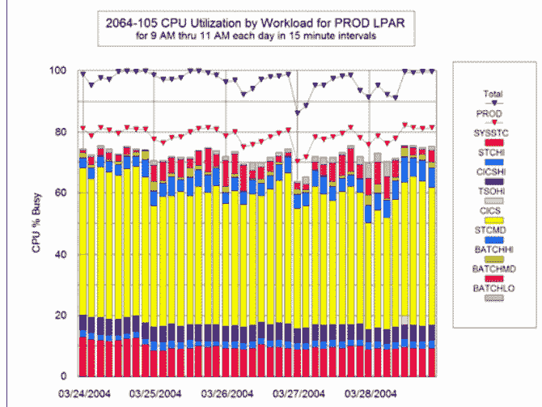

图 3-24 `Tivoli Performance Modeler` 建模系统图表

## 4

## `z/VM 存储概念`

本章介绍了 `z/VM` 存储相关概念。主题包括：

- `z/VM` 存储层次结构

- `z/VM` 存储分配指南

- `z/VM` 对存储的使用

- `Linux` 虚拟机看到的虚拟存储

- 影响 `z/VM` 存储管理的因素

- 分页与暂存处理（`Paging and spooling`）

## 4.1 `z/VM 存储层次结构`

`z/VM` 和 `Linux` 都使用所谓的虚拟存储或虚拟内存。通常，`z/VM` 使用“`storage`”（存储）一词，而 `Linux` 使用“`memory`”（内存）。在本章中，通常使用 `storage` 来解释 `z/VM` 相关的概念，而在其他与 `Linux` 相关的章节中使用 `memory`。请记住，这些术语指的是相同的内容。

虚拟存储是一种允许运行更多程序并同时共享真实（物理）存储的方法。在任何给定时刻，程序只能访问极少存储，即使在一段时间内也是如此。程序访问超过分配给用户的总存储的一分之一几乎是不可能的。虚拟存储系统使用名为“`paging`”（分页）的机制来确保存储得到管理。

`z/VM` 存储层次结构使用三种类型的存储：

- 主存储（`Main storage`）：这是用户可以直接寻址并快速访问的。数据和程序必须先加载到主存储中（从输入设备）才能被处理。主存储的最大容量受物理存储数量的限制。

- 扩展存储（`Expanded storage`）：扩展存储也存在于物理存储中，但仅以页的形式寻址。分配作为扩展存储的物理存储减少了主存储的需求。扩展存储是可选的，其大小可配置。扩展存储充当快速分页设备。当主存储需求增加时，`z/VM` 可以分页到扩展存储。因为存在于物理存储中，分页到扩展存储比分页到直接访问设备（`DASD`）快得多。

- 分页空间（`Paging space`）：分页空间位于 `DASD` 上。当分页需求超过扩展存储时，`z/VM` 使用分页空间。

`z/VM` 存储类型之间的关系如图 4-1 所示。

### `z/VM 存储`

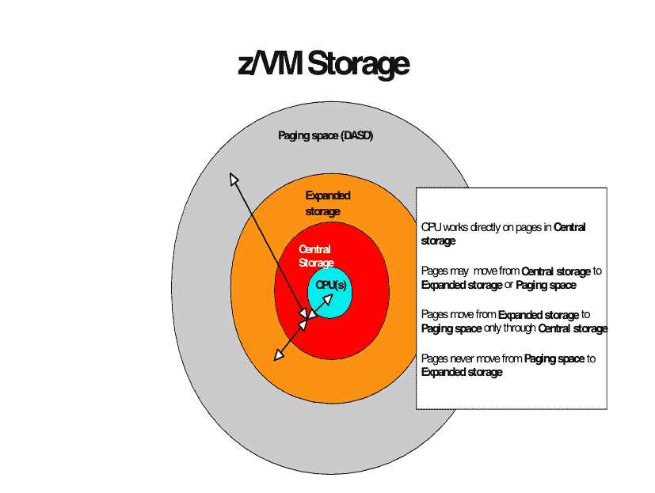

图 4-1 `z/VM` 存储类型之间的关系

主存储、扩展存储和分页空间的组合形成了 `z/VM` 虚拟存储地址空间。如图 4-1 所示，页面在 `z/VM` 虚拟存储内移动以满足需求：

- `z/VM` 虚拟机在主存储运行。调度时，虚拟机在主存储中执行。运行时并不是所有的虚拟机页面都留在主存储中。不活动页面可以留存在扩展存储或分页空间中，或者两者兼有。

- 分页发生在主存储和扩展存储之间。当主存储需求增加时，`z/VM` 可能会将不活动虚拟机页面移动到扩展存储。当这些页面变为活动时，`z/VM` 将它们移回主存储。

- 分页也发生在主存储和分页空间之间。如果没有配置扩展存储，`z/VM` 在主存储和分页空间之间分页。如果分页需求超过扩展存储容量，`z/VM` 也会在主存储和分页空间之间分页。

- 页面不会直接在扩展存储和分页空间之间移动。

从扩展存储移动到分页空间的页面必须先被带入主存储。

## 4.2 `z/VM 存储分配指南`

如 1.2.1 节第 5 页讨论的“`资源超提交`”的，在 `z/VM` 上，`存储超提交` 是一种正常且理想的情况。`存储超提交` 允许 `z/VM` 提供更高的资源利用率（从而降低成本）。`z/VM` 的存储分层结构设计用于优化超提交系统上的分页（`paging`）。

在支持 64 位架构的情况下，出现了一个问题：是否还需要扩展存储（`expanded storage`）？（为什么不将所有物理内存都配置为内部的主内存呢？）通用的建议是继续使用带有扩展存储的 `z/VM`。

扩展存储通常会带来更一致或更好的响应时间。以下表明扩展存储可以提高响应时间的因素包括：

- `z/VM` 系统中可能会发生分页交换。

  将所有物理内存分配为主存储的逻辑是：只有在主存储短缺时才会发生分页交换，而扩展存储只会增加这种可能性。然而，`z/VM` 的存储超提交是一种正常且健康的做法。因此，为分页交换做好准备比尝试防止它要好。

- 针对扩展存储调优的分页算法。

  `VM` 中的分页算法是围绕分页设备的分层结构演进的。扩展存储是高速分页设备，而 `DASD` 是较慢的设备。将页面从主存储移动到扩展存储比将页面从主存储移动到扩展存储 `DASD` 要高效得多。

- 两 GB 限制。


在 `z/VM 3.1.0` 之前，`VM` 仅支持 31 位，这意味着所有程序和数据都必须留在 2 GB 的地址空间内。但即使从 `3.1.0` 版本开始支持 64 位，在 `5.3` 版本发布之前，`CP` 的因素必须位于 2 GB 限制以下。这可能会导致 2 GB 以下的存储产生竞争，这种竞争可以通过显示到 `DASD` 或扩展存储的大量分页来指示，而主存储中 2 GB 以上仍有大量页面可用。这种存储无疑会降低性能。具有 2 GB 限制的系统可能会从将更多物理存储作为扩展存储中获益。

> 注意：可以通过 `QUERY FRAMES` 命令或通过 `z/VM Performance Toolkit` 或 `MEGAMON` 查看存储竞争。

作为一个通用的估计，最好的开始方式是配置扩展存储为分配给 `z/VM` 物理存储的 25%。对于总可用存储，许多系统不需要超过 2 GB 的扩展存储。如果您的系统有 2 GB 存储限制，请将无法在主存储中有效使用的所有存储配置为扩展存储。从 `QUERY FRAMES` 或 `Performance Toolkit` 的结果，可用列表上的帧数（> G 页）可以显示多少存储可以配置为扩展存储，请参考：

`http://www.vm.ibm.com/perf/tips/storconf.html`

## 4.3 `z/VM` 对存储的使用

初始的 64 位支持由 `z/VM 3.1.0` 提供，并通过 `z/VM 5.3` 逐渐改进。以下讨论描述了这些版本中 2GB 限制以下存储的使用情况，以便相应地调优您的 `VM` 以获得更好的性能。

虽然 `z/VM` 支持 64 位，并可以支持保存在 2 GB 以上主存储（实际存储）中的程序和数据，但控制程序（`CP`）的某些区域被限制为 31 位（2 GB）寻址。从 `z/VM 3.1.0` 到 `5.1.0`，所有的 `CP` 代码和数据结构必须位于 2 GB 限制以下，且大部分 `CP` 继续使用 31 位寻址。访客页面可以继续留在 2 GB 以上，并且在不移动的情况下拥有它可以执行或引用的指令。但如果一个页面被 `CP` 引用或需要 `CP` 处理，它必须在被此 31 位 `CP` 代码处理之前，移动到主存储中 2 GB 限制以下的帧（`frame`）中。这包含了 `I/O` 通道程序和数据（包括 `SCH` 和数据）。

具有 2 GB 限制的系统可能会从将更多物理存储作为扩展存储中获益。

> 注意：可以通过 `QUERY FRAMES` 或 `Performance Toolkit` 的结果，可用列表上的帧数（> G 页）可以显示多少存储可以配置为扩展存储，请参考：

`http://www.vm.ibm.com/perf/tips/storconf.html`

> 注意：存储竞争可以通过 `QUERY FRAMES` 命令或通过 `z/VM Performance Toolkit` 或 `MEGAMON` 查看。

访客页面可以继续留在 2 GB 以上，并且在不移动的情况下拥有它可以执行或引用的指令。但如果一个页面被 `CP` 引用或需要 `CP` 处理，它必须在被此 31 位 `CP` 代码处理之前，移动到主存储中 2 GB 限制以下的的帧（`frame`）中。这包含了 `I/O` 通道程序和数据（包括 `SCH` 和数据）。

通用的估计，最好的开始方式是配置扩展存储为分配给 `z/VM` 物理存储的 25%。许多系统不需要超过 2 GB 的扩展存储。如果您的系统有 2 GB 存储限制，请将无法在主存储中有效使用的所有存储配置为扩展存储。从 `QUERY FRAMES` 或 `Performance Toolkit` 的结果，可用列表上的帧数（> G 页）可以显示多少存储可以配置为扩展存储，请参考：

`http://www.vm.ibm.com/perf/tips/storconf.html`

## 4.4.1 双重分页效应 (The double paging effect)

`z/VM` 的 `Linux` 分页存储管理过程会在不通知虚拟机的情况下将其页面换出主存，这可能会导致被称为“双重分页”（double paging）的情况，该效应如图 4-2 所示。

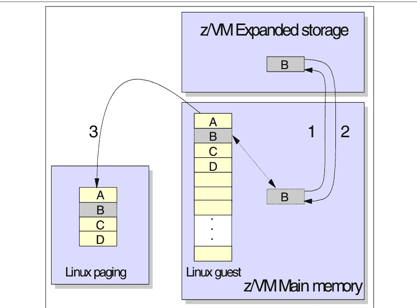

图 4-2 双重分页效应示意

图 4-2 展示了 `Linux` 虚拟机所使用的存储器页。导致双重分页的事件序列由数字箭头表示：

- 1. 页面 `B` 从 `z/VM` 主存储中移出。

  该页面被映射到一个正在运行的 `Linux` 虚拟机。在经过一段时间未活动后，`z/VM` 将该页面移动到扩展存储（expanded storage）。

  > 注意：在此例中，换出（page-out）发生在扩展存储中。如果没有配置扩展存储，则换出将发生在分页空间（paging space），这是一次代价更贵的操作。

  该页面现在可以用于按需调入（page-in）。`z/VM` 夺走了该页面，但 `Linux` 虚拟机并不知道换出已发生。

- 2. 响应 `Linux` 虚拟机的换出尝试，将页面 `B` 调入 `z/VM` 主存储中。

  为了缓解存储限制，`Linux` 识别出不活动的页面（包括页面 `B`）并将其移动到它的交换设备（swap device）。当 `Linux` 虚拟机在尝试访问页面 `B` 时发生页缺异常（page fault）。这导致 `z/VM` 调入存储器 `B` 以满足该请求。

- 3. `Linux` 通过将页面 `B` 移动到它的交换设备完成了它的换出尝试。

  在页面 `B` 被调回主存储后，`Linux` 将其换出到它的交换设备中。最终，`z/VM` 仅仅为了让页面移回主存储，却让 `Linux` 再次将其移出。

双重页缺异常（Double page faults）并不是 `Linux` 特有的，运行在 `z/VM` 下的 `z/OS` 也会遇到同样的效应。这是双方试图同时管理内存的结果。解决方案是确保一方不要尝试分页：

- 使 `Linux` 虚拟机的尺寸足够小，以便 `z/VM` 将其保持在主存储中。

  使用尺寸估算技术来确定为 `Linux` 虚拟机分配多少存储。为 `Linux` 虚拟机分配略多于工作集大小（working set size）的存储更好。如果较小的 `Linux` 虚拟机竞争 `z/VM` 资源，可能仍会双重分页。

- 使 `Linux` 虚拟机的尺寸足够大，以至于 `z/VM` 无需将其保持在主存储中。

  当 `Linux` 虚拟机尝试访问页面 `B` 时，`z/VM` 调入存储器 `B` 以满足该请求。这导致 `z/VM` 频繁进行分页。

- 协作内存管理 (Cooperative Memory Management, CMM)。

  `Linux` 和 `z/VM` 独立管理内存，这会导致存储管理的冲突。为了避免此问题，是让 `Linux` 允许 `z/VM` 协作。`z/VM` 移动页面仅仅是为了让 `Linux` 移出。更多信息请参见 6.5 节，“协作内存管理”第 75 页。

- 协作内存辅助 (Collaborative Memory Assist, CMMA)。

  `CMMA` 是一种解决双分页问题的方案，它允许 `Linux` 和 `z/VM` 共享内存。更多信息请参见 6.6 节，“协作内存辅助”第 76 页。

## 4.4.2 分配存储 (Allocating storage)

分配 `Linux` 虚拟机的存储定义在用户目录中，如示例 4-1 所示：

- 第一个值是 `z/VM` 在主存储中的存储大小。

- 第二个值是 `Linux` 虚拟机在尝试交换时使用的存储大小。

示例 4-1 `Linux` 虚拟机存储分配

```
USER LINUX1
INCLUDE 512
OPTION LKNAS
TYPE 200
SWAP 128 256M
```


Linux 虚拟机的存储大小，可以根据 `DIRMA` 命令进行显示。表 4-1 列出了一些存储分配活动。

- 调整 SRM 控制。

这些控制决定了 z/VM 如何管理虚拟存储。系统资源管理 (SRM) 参数在第 114 页的 8.4.1 节“全局系统资源管理器 (SRM) 控制”中讨论。

- 确保系统操作信息记录被正确检索和存储。

z/VM 允许在运行期间收集各种计费、错误和系统记录。z/VM 的新安装通常会定义虚拟机，这些虚拟机会在 IPL 处自动记录日志：

- `DISKCNT` 虚拟机用于检索计费记录。
- `EERP` 虚拟机用于检索错误记录。
- `OPERSYMP` 虚拟机用于检索系统记录。

如果这些虚拟机都存储了检索到的数据，可用的系统存储将大幅减少。有关这些信息收集设施的更多详细信息，可以参阅 z/VM V5.3《z/VM: System Operation》，SC24-6121。

- 使用 `CP RESERVED` 命令为重要的客户机预留页。

`CP RESERVED` 命令将实地存储页预留给虚拟机。虽然它可以用于提高指定客户机的性能，但应节约使用。否则，会降低整个系统的性能。

> 注意：Virtual-Fix (`V=F`) 和 Virtual-Real (`V=R`) 类型的虚拟机（也称为首选虚拟机，允许客户机页永久保留在实地存储中）不再受 z/VM 5.1.0 支持。

对于 5.1.0 之前的 z/VM 版本，`V=F` 或 `V=R` 仍然可选。只有当硬件处理器在基础 ESA/390 中 IPL 且未处于 LPAR 模式时，`V=F` 选项才可用。`V=R` 和 `V=F` 存在限制和约束。两者都会对系统性能产生不利影响。

尽管这些因素影响虚拟存储管理，但并非所有因素都是有利的。通常，建议使用启用资源共享的选项来优化整体系统性能。

## 4.6 分页与打印（Paging and spooling）

z/VM 利用分配的 DASD 空间作为系统存储，该系统内运行的所有虚拟机均可用。该 DASD 空间由系统 (CP) 所有并控制，具有独特的特征。

如前所述，DASD 空间与主存储和扩展存储一起用于虚拟机分页。分页需要尽可能快。因为分页中的数据是暂时的，所以当 z/VM 关闭时，所有数据都会被丢弃。

以下是设置 z/VM 系统进行分页的一些指南：

- 提供的 DASD 分页空间应至少是 Linux 虚拟机虚拟存储总和减去主内存大小的两倍。可以使用 `CP ALLOC PAGE` 命令查看系统拥有多少分页空间。
- 使用整个卷作为 z/VM 分页空间。换句话说，切勿在同一卷上将分页 I/O 和非分页 I/O（用户空间、打印队列、`tdisk` 等）混合。
- 尝试将分页卷分布在尽可能多的 DASD 控制单元上，并实现分页 `CHIPID` 与分页卷之间的一一对应关系。这使得 I/O 可以通过多路径并发在多个分页 DASD 上发生。
- 如果分页控制支持 `NVS` 或 `DASDFW`，请使用 CP 命令 `SET NVS ON` 或 `SET DASFW ON` 开启它们。

打印空间（Spool space）用于存储所有虚拟机共同的数据。由于 z/VM 模拟了独立操作系统的环境，每个这些虚拟机都有一个指定的读取器、打字机和打印机，就像旧的计算机系统一样。发送到虚拟机的数据留在读取器中，直到被删除或读入用户的微磁盘（minidisk），就像邮箱一样。作为输出创建的数据被定向到虚拟打印机或虚拟打字机。

打印空间还用于存储所有虚拟机访问的可执行数据或系统，即 `NSS` 文件。这为系统代码创建了一个公共位置，而不是让每个虚拟机都需要单独的存储空间。由于打印空间的内容是有效数据，它们在 z/VM 关闭和 IPL 期间会被保留。

除了特定虚拟机拥有的 DASD 空间（通常被称为微磁盘）外，z/VM 还允许临时微磁盘空间。虚拟机可以根据需要从系统上创建的 `tdisk` 空间中分配此空间，这允许您在较少考虑放置位置的情况下，定义各种尺寸的磁盘。这仅用于存放正在处理或不需要保留的数据。当 z/VM 关闭时，磁盘空间中的数据会被丢弃。如果使用了临时微磁盘 (`tdisk`)，应禁用该微磁盘的微磁盘缓存。


## Linux 虚拟内存概念

在本章中，我们将讨论 Linux 如何使用虚拟内存。我们介绍了 Linux 内存管理概念，并考虑这些概念如何影响运行在 z/VM 下的 Linux 客户机。主题包括：

- Linux 内存模型的组件
- Linux 内存管理
- Linux 内部激进缓存
- 为 z/VM Linux 虚拟机确定大小的结论

## 5.1 Linux 内存模型的组件

我们通过查看内存分配的组件开始研究 Linux 内存。

### 5.1.1 Linux 内存

当 Linux 启动时，它的主要任务之一是内存资源的划分和分配。

内存分为三个主要部分：

- 内核内存

  内核内存是加载实际内核代码的地方，也是为内核级操作分配内存的地方。内核操作包括：
  - 调度
  - 进程管理
  - 信号处理
  - 设备 I/O（包括到磁盘和到网络的 I/O）
  - 分页和交换

  托管内核代码的页在启动时被标记为预留，不再供后续分配。内核加载在内存底部。内核操作使用 buddy 或 slab 对象的内存。

- 用户内存

  用户内存是加载所有应用代码的地方：
  - 匿名内存
  - 共享内存（System V 或 POSIX API）
  - 内存映射文件

  用户内存的需求从主页池中满足。

- 页缓存内存

  页缓存顾名思义缓存页。Linux 内核 2.4 及更高版本没有单独的页缓存和缓冲区缓存。页缓存在读写操作时被填充。它托管了来自各种源的数据：
  - 普通文件的读写操作
  - 内存映射文件
  - 块设备文件的操作

  页缓存旨在通过减少 I/O 操作（I/O 本身比内存访问慢）来提高系统性能。

> 注意：Virtual-Fix (`V=F`) 和 Virtual-Real (`V=R`) 类型的虚拟机（也称为首选虚拟机，允许客户机页永久保留在实地存储中）不再受 z/VM 5.1.0 支持。

### 5.1.2 Linux 交换空间 (Swap space)

Linux 在初始安装期间通常会请求创建交换设备。当内存需求高时，Linux 会移动内存。

## 交换与分页（Swapping versus paging）

交换是将整个地址空间移动到交换设备。分页是将内存页移动到交换空间。Linux 现在使用分页算法，读者在查看如示例 5-1 中的工具时可能会困惑，因为那里报告了分页和交换速率。

**示例 5-1 内存与活动**

| 总内存大小 | 493MB | 交换空间大小 |
| :--- | :--- | :--- |
| 已用内存 | 298MB | 交换空间使用率 0.06% |
| 用于缓冲区 | 102MB | 交换入速率 0/s |
| 用于共享 | 0MB | 交换出速率 0/s |
| 用于缓存 | 229MB | 分页入速率 0/s |
| 总空内存 | 40MB | 分页出速率 25.86% |

这些是 Linux 通过 `procinfo` 等命令可用的值。这些值意味着：

- 分页入：进入内存的磁盘块。这通常指一般的 I/O。
- 分页出：从内存移动到磁盘的磁盘块。这通常指一般的 I/O。
- 交换入速率：进入交换空间的内存页速率。
- 交换出速率：移出交换空间的内存页速率。

报告的分页入和分页出的活动可能是任何 I/O，例如缓存文件系统的刷新，但与写入交换空间无关。有关 I/O 的更多信息包含在第 10 节“为 JVM Linux 虚拟机优化磁盘性能”，第 145 页。

## 5.2 Linux 内存管理

内存分为页，对于 s390 和 s390x 架构，每个页的大小通常为 4096 字节。Linux 本身支持其他页大小，但需要架构的支持。页由唯一的结构描述。页聚合到内存区域。64 位 Linux 在 z 上在 DMA 区域和普通区域分配。31 位 Linux 在 z 上则仅利用 DMA 区域的优势。

### 5.2.1 页面分配

有多种机制可用于页面分配。低级分配程序为内核内分配、内核模块、数据区域、页缓存、匿名用户页以及用户请求的其他内存提供连续页面。内核使用 slab 缓存（slab cache），为同类型对象的分配以及大规模用户使用（如块 I/O、网络等）提供了一种更复杂的分配机制。

遵循缓存策略的繁忙 Linux 系统会将大部分可用内存用于缓存和进程处理。通常情况下，并不是所有需要的进程页面都加载到主内存中。页缺异常处理是将所需页面带回内存的方法。访问无效页面会触发硬件的页转换检查。向无效页面写入数据会触发硬件的保护异常检查。硬件通过翻译异常（translation-exception）提供正确的地址。Linux 内核页缺处理程序检查该地址是否在虚拟内存区域（VMA）中，如果是，则通过交换分区换入（swap-in）或写时复制（copy-on-write）将页面加载到内存中。如果需要，栈可以自动增长。


未被任何其他进程使用且尚未更改的页面被视为可用页面。由于信息已备份在持久存储设备（磁盘、磁带）上，这些页面可以重新分配而无数据丢失风险。

## 5.2.2 Linux 内部的激进缓存

Linux 管理内存考虑了其运行在虚拟机中的。Linux 内核与大多数其他 UNIX® 系统一样，使用了“始终充满”的内存管理概念。它尝试尽可能将信息（应用程序、内核、缓存）加载到感知的内存资源中并缓存。其目标是尽可能地减少磁盘访问次数。即使是最快的磁盘设备仍然比内存访问慢。

为了说明 Linux 的激进缓存，我们比较了两个 Linux 客户机的内存使用情况，其中一个运行在 64 MB 虚拟机中，另一个运行在 128 MB 虚拟机中。每个客户机在八分钟的时间间隔内运行 `Mstone` 工作负载（`Mstone` 工作负载在附录 C 第 205 页“Mstone 工作负载生成器”中进行了讨论）。

测试运行的工作集大小几乎相同，不依赖于可用内存。更大的内存大小并没有被计入可用（空闲）内存，而是用于缓冲区和缓存。

在图 5-1 中，我们检查了两种不同内存大小下，内核、应用程序、缓存和缓冲区随运行时间变化的内存使用情况。

### 64MB 客户机的内存使用

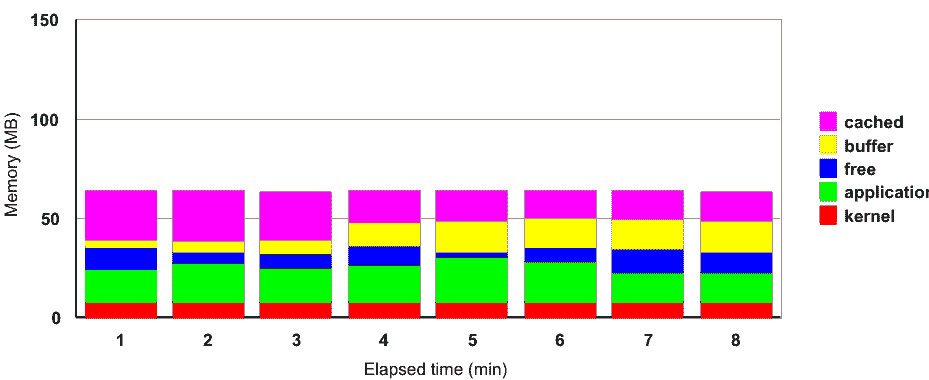

### 128MB 客户机的内存使用

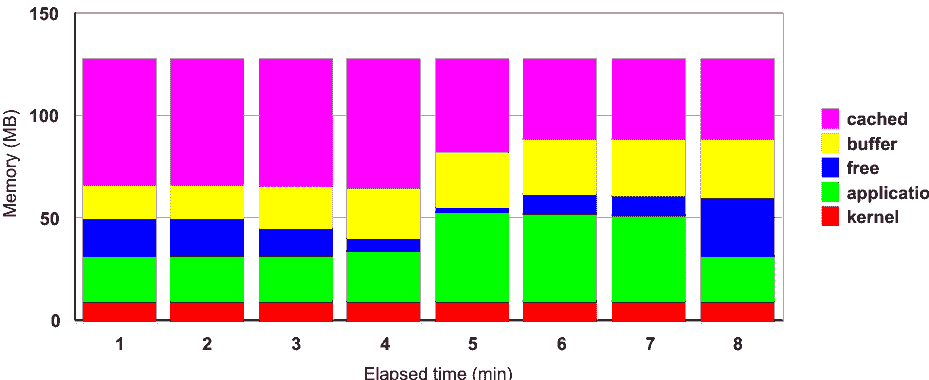

图 5-1 两个 Linux 客户机中的 Linux 内存使用：64MB 和 128MB

比较这两个 Linux 客户机，我们看到了类似的内存使用模式：在两种情况下，额外的应用程序内存都是以牺牲缓冲区和缓存内存为代价获得的。虚拟内存大小减少 50% 导致平均缓存减少 60%。

> 注意：尽管 64 MB 的客户机请求了一半数量的内存，但并未注意到对服务器响应时间有显著影响。

## 5.2.3 页面替换

页面替换的目标是保留一定数量的空闲供后续分配。页面替换策略适用于内存中的匿名页面以及交换缓存和页缓存中的页面。与其他 UNIX 操作系统一样，Linux 使用双手时钟机制。在无尽循环中，一个函数扫描内存区域以检查当前页面使用情况：

- 检查活动列表（`active list`），查找可以添加到非活动列表（`inactive list`）的条目。

- 检查非活动列表，查找在移除或写入内容后可以重新重用的条目。

Linux 内存页面在以下情况下被清理：

- `kswapd` 线程运行时。`kswapd` 在大多数时间里处于睡眠状态。如果空闲页面数少于 `pages_low` 变量，它就会被调用。它一直运行到达到 `pages_high` 标记或没有更多可释放的页面。

- `pdflush` 线程正在运行。`pdflush` 守护进程目的是将脏（已修改）页面写回磁盘。在旧版内核中，如果函数低于阈值，则会启动 `pdflush` 和 `updated`。这些程序将页面写回持久设备，以便释放页面。在指定时间后，`pdflush` 线程也会写回脏页面。

- 发生 `slab` 缓存的收缩。`slab` 缓存中的页面需要某些算法，但并不重要，因为 `slab` 缓存相对较小。

- 分配路径发起的直接页面释放。如果 `kswapd` 和 `pdflush` 线程无法配合进程的内存需求，分配路径将尝试释放某些页面。

## 5.3 Linux 内存的大小

在具有虚拟化和许多资源的环境中，拥有最佳内存大小比在独立服务器中更重要，对性能的影响更大。

### 5.3.1 客户机的内存大小

为了展示虚拟内存（以及 Java 的堆）的影响，我们运行了一系列实验。在 `IHS` 服务器、`WAS` 服务器和 `DB2` 服务器的三层环境中，我们只更改了 `WAS` 服务器的 Linux 内存和堆的大小。在数次实验中，我们驱动基准测试达到其最大结果，以证明工作负载存在最佳尺寸。资源过少或过多都可能损害特定系统的性能。甚至系统的整体性能也会受到影响。吞吐量被用于衡量 Linux 在可用内存中的运行情况。

> 注意：堆的大小非常重要，因为所有内存最终都会被触及以移除。如果堆无法放入内存，性能将严重下降。

在这些实验中，我们以相同的配置运行了 `IHS` 服务器和 `DB2` 数据库服务器，更改了 `WAS` 服务器的虚拟内存和堆大小。所有测量都是在 50 个客户端的预热和爬升阶段后进行的。表 5-1 描述了环境的配置。在我们的环境中，所有服务器都配置了一个 CPU，`IHS` 服务器和 `DB2` 服务器分别配置了 512 M 和 1 G 的内存。`WAS` 服务器的内存从 1 G 变为 2 G，带有不同大小的 `WebSphere Application Server` 堆。注意，整个系统仅配置了 G 内存，且在这些配置中内存是增加的。

表 5-1 配置详情

| | CPU | 内存 | Java 堆大小 |
| --- | --- | --- | --- |
| `LINHS` | 1 | 512 M | N/A |
| `LINDB2` | 1 | 1024 M | N/A |
| `LINWAS` | 1 | 1024 M | 512 M |
| | 1 | 2048 M | 768 M |
| | 1 | 3072 M | 1200 M |

注：此处原文为2200 M，推测为笔误，根据上下文逻辑翻译

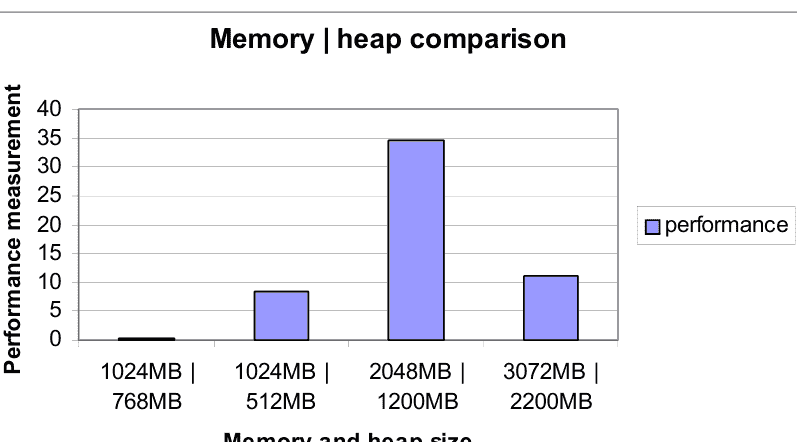

### 5-2 变化虚拟内存时 Linux 客户机的性能

图 5-2 显示了在变化虚拟内存和堆大小时 Linux 的性能。由于这些实验说明了虚拟内存对性能的影响，驱动了中等负载（50 个客户端）。我们简单地使用响应时间作为衡量。

在第一个实验中，我们在 1024 MB 内存上运行，堆大小为 768 MB 无法放入主内存。请记住，内核和库也位于主内存。最终内存被用尽，Linux 开始交换。Java 频繁使用垃圾回收。

第二个实验再次使用了 1024 MB 内存，但堆大小为 512 MB。没有了交换，性能好得多。

第三个实验使用了 2048 MB 内存，堆大小为 1200 MB。在资源更多的情况下，它与之前的两个场景相比是否能带来更好的性能？

第四个实验在 `z/VM` 中使用了 3072 MB 内存，堆大小为 2200 MB。`z/VM` 开始中度地扩展存储。性能差于 2048 MB 内存，但略优于 1024 MB 内存。这种工作负载的开销正在增加。

通常，性能随资源的增加而提高。当我们把虚拟内存和堆大小从 1024 M 增加到 2048 M 时，可以看到显著差异。但当虚拟内存增加到 3072 M 时，由于内存管理成本和最后一个实验中的过度提交，性能下降了。这表明更多资源并不总是带来更好的性能。前提是虚拟内存要根据整个环境进行适当设置。否则，性能将受到第一个实验的影响。只有 1024 M 虚拟内存的应用程序服务器被 768 MB 的堆大小过载了。

## 5.3.2 z/VM Linux 客户机定价的结论

- Linux 内存模型对运行在 `z/VM` 下的 Linux 客户机有深影响：

* `z/VM` 内存是共享资源。

尽管激进缓存为了内存访问减少了磁盘 I/O 的可能性，但必须考虑缓存的成本：Linux 客户机中的缓存页面减少了供其他 `z/VM` 客户机使用的 `z/VM` 页面数量。

- 大虚拟内存地址空间需要更多的内核内存。

在确定 Linux 客户机的内存需求时，选择对性能影响最小的最小内存占用。否则，长期来看，所有剩余内存都将用于缓冲和缓存。

通用规则不适用于某些具有特殊内存需求的服务器。交换：Linux 虚拟机。

- 数据库服务器

数据库服务器维护缓冲区池（`buffer pools`）以防止过度的磁盘 I/O。这些缓冲区池不应被缩小，否则性能会受到影响。

- 运行 Java 工作负载的服务器（即 `WebSphere Application Server`）

托管 Java 堆（`Java heap`）需要一定量的内存。`hb` 中的第二个实验说明了在不发生交换的情况下，较小的堆内存是如何降低性能的。

保持共享内存活跃的一种良好方法是将页面固定在内存中（即不让它们变得可替换或交换/分页）。

为了减少在较小的虚拟机中可能发生的偶尔交换带来的惩罚，请使用快速交换设备，正如第 7 章第 79 页“Linux 交换”中讨论的那样。

## 观察 Linux 内存使用

快速查看 Linux 如何分配内存，我们使用 Linux `free -k` 命令选项以千字节为单位报告内存大小。示例 5-2 展示了一个 128 MB Linux 虚拟机的内存使用情况。

示例 5-2 使用 `free` 命令观察内存使用

| | total | used | free | shared | buffers | cached |
|---|---|---|---|---|---|---|
| `Mem:` | 119360 | 48306 | 71324 | 0 | 3068 | 26344 |
| `+/- buffers/cache:` | | 18624 | 100736 | | | |
| `Swap:` | 719896 | 0 | 719896 | | | |

示例 5-2 中需要注意的要点：


- 总内存（`119360 KB`）小于分配给 Linux 虚拟机的总虚拟内存（`128000 KB`）。差异（`8640 KB`）是分配给内核的大小。

- 总内存（`119360 KB`）等于使用内存（`48306 KB`）加空闲内存（`71324 KB`）。

- 使用内存（`48036 KB`）等于缓冲区（`3068 KB`）加缓存内存（`26344 KB`）加已使用的缓冲区/缓存内存（`18624 KB`）。

- 已使用的缓冲区/缓存内存（`18624 KB`）加空闲缓冲区/缓存内存（`100736 KB`）等于总计（`119360 KB`）。

- 空闲缓冲区/缓存内存（`100736 KB`）等于空闲内存（`71324 KB`）加缓冲区内存（`3068 KB`）加缓存内存（`26344 KB`）。

尽管有 `100736 KB` 的空内存可用，但 Linux 期望应用程序使用不超过 `70%`（`70515 KB`）。操作系统预计剩余部分作为缓冲区/缓存内存。

### 5.4.1 系统启动时的内核内存使用

要检查系统启动时的内核内存使用，我们使用 `dmesg` 命令，如示例 5-3 所示。`dmesg` 命令显示启动时发布的所有消息。

示例 5-3 `dmesg` 命令

```
dmesg | less

Dentry cache hash table entries: 32768 (order: 6, 262144 bytes)
Inode-cache hash table entries: 16384 (order: 5, 131072 bytes)
Memory: 116024k/131072k available (4494k kernel code, 0k reserved, 1221k data, 204k out)

Mount-cache hash table entries: 256
Dquot-cache hash table entries: 512 (order: 0, 4096 bytes)

IP route cache hash table entries: 2048 (order: 2, 16384 bytes)
```

在这个示例中，我们看到 Linux 在系统启动时分配了节点和缓冲区缓存。

### 5.4.2 /proc/meminfo 报告的详细内存使用

要详细检查内存使用，我们查询 `/proc/meminfo` 内核驱动，如示例 5-4 所示。

示例 5-4 使用 `/proc/meminfo` 对 Linux 内存进行详细分析

```
# cat /proc/meminfo
MemTotal: 119360 kB
MemFree: 69480 kB
Buffers: 3060 kB
Cached: 26352 kB
SwapCached: 0 kB
Active: 19560 kB
Inactive: 16900 kB
HighTotal: 0 kB
HighFree: 0 kB
LowTotal: 119360 kB
LowFree: 69480 kB
SwapTotal: 719896 kB
SwapFree: 719896 kB
Dirty: 56 kB
Writeback: 0 kB
AnonPages: 6920 kB
Mapped: 6592 kB
Slab: 7408 kB
CommitLimit: 779576 kB
Committed_AS: 28588 kB
PageTables: 332 kB
VmallocTotal: 4294828032 kB
VmallocUsed: 2156 kB
VmallocChunk: 4294825092 kB
```

IBM System 上的 Linux：性能测量与调优

第 54 页示例 5-4 中所示字段解释如下：

- `MemTotal`：分配给 Linux 的内存量，包括内核使用的内存。在第 54 页的示例 5-4 中，Linux 运行在 `128 MB` 虚拟机中。但只有 `119360 KB` 用于用户、缓冲区和缓存。

- `MemFree`：正在使用的内存。

- `Buffers`：分配给文件 I/O 的内存。现在这没有意义。

- `Cached`：用于页缓存的内存。

- `SwapCached`：被交换出后又被换入的内存。在这种情况下，内存不需要再次交换出。

- `Active`：最近使用的页缓存和缓冲区。这部分内存通常被用于其他用途。

- `Inactive`：未使用的页缓存和缓冲区。这部分内存可以用于其他用途。

- `HighTotal`/`HighFree`：未映射到内核空间的总内存和空闲内存。

- `LowTotal`/`LowFree`：直接映射到内核空间的总内存和空闲内存。

- `SwapTotal`/`SwapFree`：交换空间。

- `Dirty`：由于更改需要写入持久介质的内存。

- `Writeback`：由于更改正在写入持久介质的内存。

- `AnonPages`：通过 `malloc()` 分配且未由文件支持的内存。

- `Mapped`：通过 `mmap()` 分配且由文件支持的内存。

- `Slab`：内核用于数据结构的 slab 缓存内存。

- `CommitLimit`：严格过度提交（`overcommit_ratio`），`CommitLimit` 是可以分配给系统的内存量。

- `Committed_AS`：成功分配的内存估计量。可能会发生内存出。

- `PageTables`：用于页表的内存量。

- `VmallocTotal`：作为 `vmalloc` 区域可用的内存。

- `VmallocUsed`：在 `vmalloc` 区域使用的内存。

- `VmallocChunk`：作为 `vmalloc` 区域可用的连续内存。

关于 Linux 虚拟内存详情可以在内核 `/usr/src/linux/Documentation/filesystems/proc.txt` 或访问 `http://www.csnet/projects/vm/`。

### 5.4.3 使用 vstat 命令

Linux `vstat` 命令报告进程、交换、设备 I/O 和 CPU 使用的统计信息。命令语法为：

```
vstat [delay count]
```

其中：

| 参数 | 说明 |
| :--- | :--- |
| `delay` | 更新间隔（秒） |
| `count` | 更新次数 |

示例 5-5 展示了 `vstat` 命令的输出。

| --swap | --memory | --system | --cpu |
| :--- | :--- | :--- | :--- |
| swpd free buff cache si bo in cs us sy id wa | | | |
| 0 0 64140 2472 5583 5 307 61 30 73 3 94 1 0 | | | |
| 0 5 80408 1624 440 2472 5583 8041 1170 8074 333 148 5 48 0 | | | |
| 0 1 75576 6024 352 6290 6950 5586 7458 377 441 4 3 92 0 | | | |
| 0 0 8640 94780 392 7260 3226 0 3323 12 117 209 2 1 80 0 | | | |

`vstat` 命令报告的统计数据分组：

- `proc`：进程报告为状态的平均进程数：等待运行的进程数、处于不可中断睡眠状态的进程数。

- `memory`：内存统计报告为平均量：

| 字段 | 说明 |
| :--- | :--- |
| `swpd` | 使用内存大小 (KB) |
| `free` | 未使用内存大小 (KB) |
| `buff` | 分配给缓冲区的内存 (KB) |
| `cache` | 分配给文件系统缓存的内存 (KB) |

- `swap`：交换统计报告到设备的平均交换速率：

| 字段 | 说明 |
| :--- | :--- |
| `si` | 从交换设备到内存的交换速率 (KBps) |
| `so` | 从内存到交换设备的交换速率 (KBps) |

- `io`：I/O 统计报告到块设备的平均 I/O 速率：

| 字段 | 说明 |
| :--- | :--- |
| `bi` | 发送到块设备的块数（块/秒） |
| `bo` | 从块设备接收块数（块/秒） |

- `system`：系统统计报告平均系统活动：

| 字段 | 说明 |
| :--- | :--- |
| `in` | 每秒中断次数（包括时钟中断） |
| `cs` | 每秒上下文切换次数 |

- `cpu`：CPU 统计报告 CPU 的平均利用率（百分比）：

| 字段 | 说明 |
| :--- | :--- |
| `us` | 在内核模式下花费的时间 |
| `sy` | 空闲花费的时间（包括内核 `2.5.41` 之前的 I/O 等待时间） |
| `wa` | 等待 I/O 的（自内核 `2.5.41` 起） |
| `st` | 等待物理 CPU 的，也称为窃取时间（自内核 `2.6.11` 起） |

> 注意：当 Linux 作为 `z/VM` 虚拟机运行时，Linux 工具（如 `vmstat`）报告的数字假设虚拟机拥有 `100%` 的系统资源。实际上，这些资源是由运行在 `z/VM` 镜像中的所有虚拟机共享的。Linux 资源计数器报告相对于其运行的虚拟机的值。包含内核 `2.6.11` 及更高版本的发行版更清楚地运行在虚拟化层之上，并且可以使用最新版本的工具（`top`, `atop`, `vmstat`, `z/VM Performance Toolkit`）报告窃取时间。


# z/VM Linux 客户机的内存调优

在本章中，我们将讨论基于内核 2.6 的 z/VM Linux 客户机的内存和存储调优。我们将为您提供内存调优建议，并展示如何利用 Linux 内核引入的新技术来减少内存占用。主题包括：

- 内存优化建议
- z/VM 5.3 的新特性
- 利用共享内核
- 原地执行（Execute-in-place）技术
- 针对客户系统的通用内存调优

## 6.1 内存优化建议

在本章中，我们考虑如何对 Linux 客户进行内存调优。存储建议在虚拟化环境中非常有用，特别是当 Hypervisor（虚拟机监控器）可以进行资源超提交时。z/VM 是目前功能最强大的软件虚拟化平台系统，为了获得最佳的整体性能，建议对任何关键资源领域进行精细调优。

我们现在考虑如何减少系统开销，然后回顾 Linux 中引入的优化内存资源的函数。

### 6.1.1 减少运行机器规模

应尽可能地减少服务器的内存占用。减少运行内存规模有多种机会：

- 消除不必要的进程。
  - 这听起来很直观，但必须执行。当 `cron` 等进程没有执行功能时，应当将其消除。
- 将大型服务器拆分为更小的专门化服务器。
  - 服务机可以显式调优以执行特定功能。运行许多应用程序的 Linux 服务器没有这些控制手段，且难以管理。可以将功能分离到 Linux 客户机中。这并不是建议分离每一个服务器，因为分离的客户机需要一定量的内存来运行其自己的 Linux 操作系统。
- 缩小机器规模。
  - 将虚拟机的大小缩小到最低。选择这需要研究和测试。关于 Linux 客户机大小的建议可以参见第 50 页的 5.3 节“虚拟内存划分”。
- 使用虚拟磁盘作为交换设备。
  - 使用 `DIAGNOSE` 访问方法的 `VDISK` 作为交换设备可以减少交换带来的惩罚。此建议仅适用于您在 System z 上有大量可用内存。使用虚拟磁盘进行交换可以减少物理设备上交换产生的 `I/O`，但同时会增加总存储占用。当 Linux 和 z/VM 产生高分页率时，此提示非常有用。在这种情况下，可能会遇到双分页的影响（z/VM 交换了 Linux 已换出的客户机存储），使用 `VDISK` 作为交换设备可以帮助缓解这种情况。

### 6.1.2 减少基础设施存储成本

减少基础设施存储成本的几种方法：

- 对 `DASD` 和 `MDC` 记录缓存使用 `DIAGNOSE` 驱动。
  - 使用记录级 minidisk 可以减少 `MDC` 需的存储。这需要 `DIAGNOSE` 驱动。更多信息请参阅 *IBM Linux on System z - Device Drivers, Features, and Commands*, SC33-8289。
- 使用协作内存管理 1 (`CMM`)。
  - 如果您在 z/VM 下运行 Linux，可以利用协作管理功能，在客户机之间提供更好的存储分配。更多信息请参阅 *z/VM Performance*, SC24-6109。
- 使用共享内核或原地执行技术。

这些新技术可以用于减少管理 Linux 实例所需的总存储。请记住，这些解决方案是实验性的，您无法获得完全支持。更多信息请参阅第 65 页的 6.3 节“利用共享内核”以及第 71 页的 6.4 节“原地执行技术”。

## 2 存储增强

存储是有限的，应定期控制存储子系统。在本章中，我们将展示存储分配控制以及 z/VM 5.3 的新特性。

z/VM V5.3 中的页分配更改允许其支持多多的内存，高达 25 GB，是 z/VM V5.2 支持大小的两倍，z/VM 客户机中支持高达 20 太字节 (`TB`) 的总虚拟内存。实际物理和虚拟内存取决于 z/VM 逻辑分区（`LPAR`）中的物理内存量、硬件服务器型号、框架级别和配置，以及客户机的数量及其工作负载特征。当您计划拥有大量物理内存时，这将为您受益，并可能减少或消除将大型工作负载分散到多个 z/VM `LPAR` 的需求。

对连续帧管理的增强也可以减少内存管理开销并提高整体性能。当您遇到内存限制时，更好的 z/VM 物理内存管理将使您受益。

详细而言，z/VM 5.3 包含了 `CP` 存储管理的重要增强。管理块 (`PGMBKs`) 现在可以位于物理存储 2 GB 边界之上，连续帧管理得到了进一步改进，并实现了可用列表搜索。

这些改进共同导致了存储性能的提升，极大地增加了 z/VM 支持的已用虚拟内存，并允许 z/VM 支持的最大内存从 128 GB 增加到 256 GB。

您可以通过以下链接查看改进结果：`http://www.ibm.com/perf/zvm/53.html`

### 2.1 存储受限环境下的改进

z/VM 5.3 的存储管理使得存储受限环境下的性能得到了提升。这种提升是通过 z/VM 5.2 对比的。z/VM 5.3 的存储管理变化在存储受限环境中的导致了性能的提升。图 6-1 显示了 z/VM 5.3 与 z/VM 5.2 的对比数据。

| 配置 | 1 | 2 | 3 | 4 |
| :--- | :--- | :--- | :--- | :--- |
| 存储 | | | | |
| GB | | | | |
| 工作负载 | | | | |
| 客户 | | | | |
| 服务器 | | | | |
| Linux | | | | |
| 运行 | | | | |
| 许多 | | | | |
| 应用程序 | | | | |
| 没有 | | | | |
| 这些 | | | | |
| 控制 | | | | |
| 且 | | | | |
| 难以 | | | | |
| 管理 | | | | |
| 分离 | | | | |
| 功能 | | | | |
| 到 | | | | |
| Linux | | | | |
| 客户机 | | | | |
| 中 | | | | |
| 可以 | | | | |
| 被 | | | | |
| 分离 | | | | |
| 每一个 | | | | |
| 服务器 | | | | |
| 因为 | | | | |
| 一个 | | | | |
| 分离的 | | | | |
| 客户机 | | | | |
| 需要 | | | | |
| 一定 | | | | |
| 数量 | | | | |
| 内存 | | | | |
| 来 | | | | |
| 运行 | | | | |
| 其自己的 | | | | |
| Linux | | | | |
| 操作系统 | | | | |

## 6.2.3 支持的最大实际存储容量增加到 256 GB

使用 z/VM 5.3，您可以管理高达 256 GB 的实际存储。此更新使得 z/VM 5.3 比 z/VM 5.2 具有更高的扩展性，如第 65 页的图 6-3 和图 6-4 所示。图 6-3 显示每秒事务数和每个事务消耗的总 `CPU` 性能数据。可以看到随着实际存储和处理器数量的增加，z/VM 5.3 的性能规模在扩大。

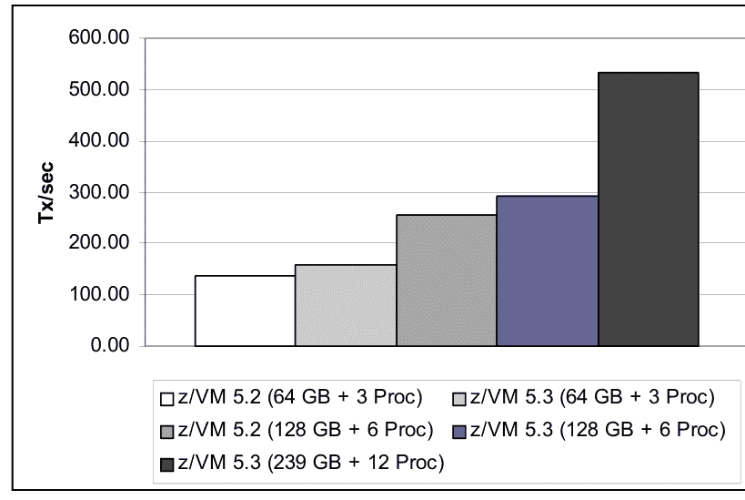

图 6-3 存储和处理器扩展

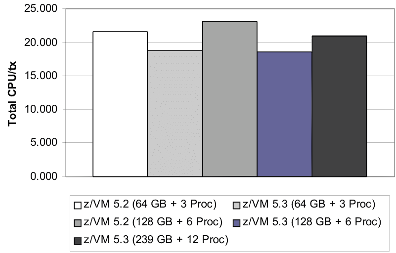

图 6-4 每个事务的 `CPU` 使用情况

> 注意：有关性能数据的更多信息，请参阅：`http://www.ibm.com/perf/reports/zvm/html/530stor.html`

## 6.3 利用共享内核

我们认为，在 `NSS` 中共享 Linux 内核对于 z/VM 上 Linux 的扩展性至关重要。共享 Linux 内核的能力将在后其他针对 `SUSE` 发行版的服务包中发布并支持。

> 注意：在创建利用 `NSS` 支持的其他 `SUSE` 版本或其他发行版的 Linux 系统时，请注意您的发行版可能不支持运行在编译后内核上的系统。由于可能存在这种情况，因此应将 `NSS` 支持被认为是实验性的。根据所需的支持级别，这种方法可能并不适用于安装。

要在带有 `SP1` 的 `SLES 10` 中创建 Linux `NSS`，需要：


1. 使用 `CP DEFSYS` 命令为编译的内核定义骨架系统数据文件 (SDF)。
2. 使用 `CP SAVESYS` 命令将启用 NSS 的内核保存到 SDF 中。

对于所有发行版或版本，您需要：

1. 使用适用于启用 NSS 的适当配置选项编译 Linux 内核。
2. 使用 `CP DEFSYS` 命令为编译的内核定义骨架系统数据文件 (SDF)。
3. 使用 `CP SAVESYS` 命令将启用 NSS 的内核保存到 SDF 中。

内核配置选项 `CONFIG_SHARED_KERNEL` 用于启用内存段中的内核代码和数据。这是必要的，因为共享内核必须防止来自使用该内核的 Linux 镜像的更新。在 S/390 架构中，保护是基于段分配的（每个段的大小为 1 MB）。

> 注意：当 Linux 运行在专用内存中（例如在 Intel® 服务器或 S/390 LPAR 上）时，将不会使用此选项。它只会浪费某些分配给该服务器的内存。然而，在虚拟机中运行 Linux 时，从不使用的虚拟内存成本很低。它也不需要由 z/VM 提供（可以通过给虚拟机提供稍多内存来补偿 3 MB 以下的内存）。

图 6-5 显示了新版本内核映射的布局，例如使用 SUSE 10。

| VMSIZE | |
| :--- | :--- |
| 5 MB | 可用 / 内核数据 (R/W) / 未使用 |
| 1 MB | 内核代码 (R/O 共享) / 未使用 / 零页，等 |
| 0 MB | |

图 6-5 带有共享内核的 Linux 内存映射

### 6.3.1 构建启用 NSS 的 Linux 内核

此过程适用于目前内核中不支持 NSS 的发行版。如果您运行带有 SLES10 SP1 的 Linux，可以参考 6.3.2 节“定义骨架系统数据文件”。构建一个 Linux 内核对于：

1. 获取内核。
2. 获取 zSeries 和 S/390 特有的补丁和对象。
3. 配置并构建内核。
4. 将模块复制到适当的位置。
5. 将新内核复制到 `/boot` 目录并运行命令。

关于为 zSeries 构建 Linux 内核的详情可以在 IBM eServer zSeries 和 S/390 查看：`http://www.ibm.com/redbooks/redp3596`

支持 NSS 需要启用 `CONFIG_SHARED_KERNEL` 选项。使用 `makeconfig` 命令通过选择 `General Setup` 来启用该选项。示例 6-1 显示了带有 `General Setup` 选项的主板面板。

示例 6-1 主板面板：`makeconfig`

```
Code level options --->
Loadable module support --->
Processor type and features --->
General setup --->
SCSI support --->
Multi-device support (RAID and LVM) --->
Character device drivers --->
Network device drivers --->
Miscellaneous --->
Networking options --->
File systems --->
Kernel hacking --->
```

在示例 6-2 所示的 `General setup` 菜单中，选择 `VM shared kernel` 选项。

示例 6-2 `General setup`：`VM shared kernel`

*   `Fast IRQ handling`
*   `Process warning`
*   `Common I/O`
*   `UUID support`
*   `statistics in /proc`
*   `Builtin record`
*   `Networking support`
*   `Process Accounting`
*   `Sysctl`
*   `Kernel support for ELF binaries`
*   `Kernel support for MISC binaries`
*   `user info`

> 注意：当 Linux 运行在专用内存中（例如在 Intel® 服务器或 S/390 LPAR 上）时，此选项将不会使用。它只会浪费某些分配给该服务器的内存。然而，在虚拟机中运行 Linux 时，从不使用的虚拟内存成本很低。它也不需要由 z/VM 提供（可以通过给虚拟机提供稍多内存来补偿 3 MB 以下的内存）。

图 6-5 显示了新内核映射的布局，例如使用 SUSE 10。

| VMSIZE | |
| :--- | :--- |
| 5 MB | 可用 / 内核数据 (R/W) / 未使用 |
| 1 MB | 内核代码 (R/O 共享) / 未使用 / 零页，等 |
| 0 MB | |

图 6-5 带有共享内核的 Linux 内存映射

## 6.3.2 为 Linux NSS 定义骨架系统数据文件

我们检查 `System.map`（如图 6-5 所示）以识别：

*   从 `_text` 到 `_pend` 的区域是零页。
*   从 `_start` 到 `_stop` 的区域是共享代码。
*   从 `_ashared` 到 `_bss_start` 的区域是非共享数据。

根据这些值，我们构建了以下 `DEFSYS` 命令：

```
DEFSYS SLES10 0-12 EW 100-4EF SR 500-5CA EW MINSIZE=24M MACHMODE=XA,ESA
```

### 6.3.3 在 Linux NSS 中保存内核

使用 `SAVYS` 命令将启用 NSS 的内核保存到骨架 DFS。例如，我们使用了“如何使用 VM 内核支持”页面上的 `SAVELVX` EXEC 脚本：

```
http://www.vm.ibm.com/linux/linuxnss.html
```

我们修改了脚本以使用针对我们内核的 `DEFSYS` 命令参数，如示例 6-4 所示。

> **注意：** 在创建 SDF 时，用于 `DEFSYS` 的原始值可以工作。但这些值会创建一个比所需更大的 NSS（并且需要更长时间进行 IPL）。

## 示例 6-4. 到 Linux NSS 的 `SAVELX` EXEC

```
/* SAVELX EXEC */
/* 获取系统名称和用于 IPL 的设备 */
parse arg lxname devnum
lname = strip(lxname)
devnum = strip(devnum)
/* 确定行结束符 */
'pipe cp q term | var termout'
parse var termout one my three
myend = strip(myend)
/* 确定存储大小 | 'pipe cp q v stor | var stor'
parse var stor one two stor
/* 构建 defsys 命令 */
ndoded = DEFSYS lxname 0-12 M 100-4RE SR 500-5SCA EM MACHMODE X,ESA'
doded = define 'MINSIZE=' | storize
say undef
/* 定义保存的系统 */
doded
/* 在适当的存储处安排 IPL 处理， */
/* 此时将发布 savesys 命令 */
setSAVE = 'TRACE R 010000 CMD SAVESYS' lxname
setsave = setsave | myend 'TRACE END ALL'
say setsave
setsave = 'i1'
doipl = devnum
say doi
/* 全部就绪，执行 IPL */
doipl
exit
```

`SAVELX` EXEC 需要两个输入参数：

在我们的示例中，我们使用名称 `SLES010`。

1.  启用 NSS 的内核所在处的名称。
2.  启用 NSS 的内核所在处的 DASD 设备。在使用 NSS 时，应为每个使用该 NSS 的虚拟机定义该 DASD 设备。

假设启用 NSS 的内核存在于虚拟设备 `201` 上，我们使用以下命令保存 Linux：

```
SAVELX SLES010 201
```

## 6.3.4 修改镜像以通过 NSS 使用共享内核

要在虚拟机中启动 Linux NSS，请使用 Linux NSS 的名称发布 `CP IPL` 命令。在我们的示例中，NSS 名为 `SLES010`：

```
IPL SLES010
```

请注意，启用 NSS 的内核不是从 DASD 启动的，当使用 NSS 时，虚拟机的 DASD 设备号必须与创建 NSS 时使用的数字匹配。例如，如果启用 NSS 的内核使用 `201` 磁盘作为根文件系统设备创建，则使用该 NSS 的虚拟机必须定义带有根 Linux 文件系统的 `201` 磁盘。

## 6.4 原地执行（Execute-in-place）技术


你可以使用不连续保存存储段（`DCSS`）来降低内存需求并提高虚拟 `Linux` 的性能。在虚拟环境中，`Linux` 镜像可能在同一时刻需要相同的数据。这样做，相同的数据可能会被加载到内存中多次。`Linux` 内存大部分用于二进制应用程序文件和共享库文件。该技术通过 `z/VM` 提供了一种使用不连续保存存储段为某些应用程序共享内存的方法。

当你计划共享数据时，请考虑：

- 应用程序只能由使用相同版本应用程序的 `Linux` 实例共享。
- 共享数据必须是只读的。
- 被许多 `Linux` 实例频繁使用的应用程序和库是理想的选择。

`DCSS` 可以在 `Linux` 客户机存储之间或存储间隙（`storage gap`）中定义。对于 `64` 位 `Linux` 客户机，使用存储间隙是首选位置。`Linux` 可以通过原地执行文件（`xip2`）访问 `DCSS`。其功能易于理解。

`Linux` 通过 `mmap(2)` 操作加载共享库和应用程序文件。`mmap()` 将文件内容映射到应用程序的地址空间。`xip` 文件系统通过将 `DCSS` 内容映射到应用程序的地址空间来执行此操作，而其他文件使用页缓存。此功能被称为“原地执行”，因为文件没有被物理复制到不同的内存位置。通过原地执行技术，`Linux` 可以：

- 无需 I/O 操作即可访问文件和库（这提高了整体性能）。
- 在共享内存段中运行应用程序（这节省了内存）。

## 6.4 设置 DCSS

在本章中，我们提供了一个如何使用 `DCSS` 的示例。如果你计划使用此技术，请参考以下处的可用文档：

```
http://www.ibm.com/developerworks/linux/linux390/october2005_documentation.html
```

## DCSS 计划

我们将在示例中使用的目录是 `/usr`。`du -sk` 命令显示目录的大小。这在定义 `DCSS` 时非常重要。在我们的示例中，目录为 `1035264 KB`。我们需要增加一些额外空间来管理数据以及未来软件更新的空间。我们将目录增加到 `1258291 KB`。

我们现在准备好设置我们的 `DCSS`。参考表 `6-2` 查看允许的最大 `DCSS`。

## 表 6-2 最大 DCSS 大小

| 内核 | DCSS 位置 | 最大 DCSS 大小 |
| :--- | :--- | :--- |
| 64位 | 存储间隙 | 119 MB |
| 64位 | 上方客户机存储 | 247 MB |
| 31位 | 任意位置 | 990 MB |

在我们的示例中，我们选择上方客户机存储。现在确定 `DCSS` 的起始和结束地址。这些地址必须位于页边界（`4 KB`）上并以十六进制表示。在我们的示例中：

- 起始地址：`512 MB = 0x0000`
- 结束地址：`512 MB + 1024 MB = 0x5FFFF`
- 起始帧：`0x0000`
- 结束帧：`0x5FFFF`

在 `Linux` 内核使用上方客户机存储之前，它必须感知覆盖 `DCSS` 的地址空间。要做到这一点，只需在你的内核文件中添加 `mem=<value>` 并重启。在我们的示例中：

```
mem=512M
```

## 创建挂载脚本

我们选择使用整个目录。这意味着我们需要在包含的目录上挂载我们的 `DCSS`。该目录位于根分区，因此我们需要在启动前运行一个脚本。`IBM` 提供了一个定制的 `xipinit.sh`。示例 `6-5` 显示了为此目的定制的 `xipinit.sh`。我们做的修改如下：

## 示例 6-5 xipinit.sh

```bash
#!/bin/sh
# xipinit.sh, Version2
# (C) IBM Corp. 2002-2005
# /sbin/xipinit: 使用另一个文件系统的只读文件
# 选项
# xipimage 的挂载点
ROMUNT="/mnt"
# xipimage 的名称
XIPIMAGE=$USRIP
# 设备节点
RODEV="dev/dsblk"
# RODIRS，确保以 / 结尾
RODIRS="/usr",

mount -t sysfs none /sys
if [ -e /sys/devices/dsblk ]; then
    echo xipinit: 加载 dsblk
    /sbin/modprobe dsblk
    echo $XIPIMAGE > /sys/devices/dsblk/add
    # 将文件系统挂载到点
    echo xipinit: 挂载只读段
    mount -t ext2 -o ro=$RODEV "$ROMUNT"
    # 将目录绑定到文件系统
    while [ -n "${RODIRS}" ]; do
        dir=${RODIRS%%*}
        RODIRS=${RODIRS#*/}
        test -d "$dir" || continue
        echo xipinit: 绑定目录 "$dir"
        mount --bind "$ROMUNT/$dir" "$dir"
    done
    umount /sys
# 运行 init
exec /sbin/init "$@"
```

我们修改了三个参数：

- `ROMUNT`：`DCSS` 应该挂载的目录。首次运行时使用 `/mnt`。
- `XIPIMAGE`：我们使用的 `DCSS` 名称（使用 `USRIP`）。
- `RODIRS`：在 `DCSS` 中包含的目录。

## 创建 DCSS

为了创建存储段，我们使用块驱动程序。要使用它，`Linux` 实例必须具有权限。构建 `DCSS` 的步骤如下：

1. 关闭 `Linux` 镜像并 `IPL CMS`。
2. 使用命令定义 `DCSS`：`DEFSYS USRIP 20000-5FFFF SR`。
3. 定义覆盖整个 `DCSS` 的客户机存储：`DEFINE STOR 248M`。
4. 保存 `DCSS`（此命令运行可能需要长时间）：`SAVE USRIP`

## 使用块驱动程序将数据拷贝到 DCSS

遵循此过程是必要的，因为来自 `/usr` 的数据必须拷贝到新系统中。此步骤不能使用 `xip` 文件系统，因为它是只读的。我们使用结构上相似且兼容的 `ext2`。在以读写模式使用后，你可以使用 `xip` 选项挂载它。

将数据拷贝到 `DCSS`：

1. 加载 `DCSS` 模块：`modprobe dcssblk`
2. 为 `/dev` 目录创建节点（主号在 `/proc/devices` 中指定）：`mknod /dev/dcssblk0 b 252 0`
3. 加载创建的 `DCSS`：`echo "USRIP" > /sys/devices/dcssblk/add`
4. 将访问模式从共享改为独占读写：`echo 0 > /sys/devices/dcssblk/USRIP/shared`
5. 在 `/mnt` 上创建 `ext2` 文件系统：`mk2fs -b 4096 /dev/dcssblk0`
6. 在 `/mnt` 上挂载文件系统：`mount /dev/dcssblk0 /mnt/`
7. 将 `/usr` 内容拷贝到 `/mnt`：`cp -a /usr/* /mnt`
8. 保存 `DCSS`：`echo 1 > /sys/devices/dcssblk/USRIP/save`

如果在 `z/VM` 控制台看到 `USRIP` 当前忙碌的消息，不要担心，它将在空闲时保存。在挂载文件系统时段会保存段。

9. 卸载 `/mnt` 文件系统：`unmount /mnt`

## 测试 DCSS

要测试创建的 `DCSS`，挂载 `xip2` 文件系统：

`mount -t ext2 -o,xip /dev/dcssblk0 /mnt`

查看文件系统是否挂载正确，检查 `/proc/mounts` 文件，如示例 `6-6` 所示。

```
示例 6-6 挂载点
lnxu4: # cat /proc/mounts
rootfs / rootfs rw 0 0
udev / tmpfs rw 0 0
/dev/dasb1 / ext3 rw,data=ordered 0 0
proc /proc rw 0 0
sysfs /sys sysfs rw 0 0
debuggfs /sys/kernel/debug debuggfs rw 0 0
devpts /dev/pts devpts rw 0 0
/dev/dcssblk0 /mnt ext2 ro,nogrpid,xip 0 0
```

## 激活就地执行 (execute-in-place)

在采取任何步骤之前，请检查第 `72` 页示例 `6-5` 中提供的脚本是否可用。该脚本位于我们保存的目录 (`/sbin`)。

在脚本末尾，执行 `cat /proc/mounts` 以确认该目录已挂载。

示例 `6-7` `xipinit.sh` 脚本测试


```
# /sbin/xipinit.sh
# /cat /proc/mounts
# /dev/tmp tmpfs rw 0 0
# /dev/dasdb1 / ext3 rw,data=ordered 0 0
# /proc /proc rw 0 0
# sysfs /sys sysfs rw 0 0
# debugfs /sys/kernel/debug debugfs rw 0 0
# devpts /dev/pts devpts devpts rw 0 0
```

挂载文件系统，并在 `/etc/zipl.conf` 的参数行中添加以下行：

`init=/sbin/xipinit.sh`

保存 zip 并重启你的 Linux 系统。

如果文件系统已挂载，你可以编辑脚本将 `/mnt` 目录更改为 `/usr`，以便 `/usr` 文件系统挂载为 DCSS。

在 z/VM 的大型服务器集群上，这项有助于提高整体性能。

## 6.5 协作内存管理 (CMM)

CMM 是允许外部实体（例如 z/VM 资源管理器 (`VRMM`) 或第三方外部监控器）减少 Linux 虚拟机存储大小的解决方案。加载 Linux 模块 `cmm` 才能与外部监控器进行协作。外部监控器监控 Linux 虚拟机以及这些虚拟机如何请求内存。通过 `cmm` 模块创建的接口，Linux 虚拟机会接收有关应提供多少可用内存的信息。当没有可用内存时，Linux 虚拟机开始清理缓存或其他内存，直到达到阈值要求。在压力下，Linux 虚拟机可能会开始交换（swapping）。

在文档中，CMM 被称为 `CMM1`。

更多细节请参见《IBM Linux on System z - Device Drivers, Features, and Commands, SC33-8289-03》：

`http://download.bolder.ibm.com/ibmd1/pub/software/dw/linux390/docu/126cdd03.pdf`

或在 z/VM Web 页面查找：

`http://www.ibm.com/sysman/vmrmcmm.html`

### 使用 CMM 的前提

必须在相关的 Linux 虚拟机中加载 `cmm` 模块。z/VM 中必须正确配置并启动 `VMRMSVM`。

### CMM 的设置

为了使用 z/VM 使用 CMM，我们在 `VMRSVM` 用户 ID 上创建了一个虚拟机资源管理器（VMRM）配置文件 `[VMRM CONFIG A1]`，该文件包含以下语句：

```
NOTIFY MEMORY LNX001 LNX002 LNX003 LNX004 LNX005
```

或者：

```
NOTIFY MEMORY LNX00*
```

我们还添加了此语句以获取 `VMRSVM` 消息：

```
ADMIN MSUSERVM MAINT
```

此语句将 `VMRSVM` 消息发送到 `MAINT` 用户 ID。

星号是通配符。在 `VMRSVM` 的 `A` 磁盘上创建配置文件后，我们注销 `VMRSVM`，并从用户 `MINT` 执行 `xautolog VMRSVM` 来启动 `VMRSVM` 服务器。

要停止 `VMRSVM` 服务器，登录 `VMRSVM` 并执行命令 `HMONITOR`（或作为用户 `MINT` 执行 `FORCE VMRSVM`）。

在 Linux 服务器上，我们使用 `modprobe` 命令如下加载 CMM 内核扩展：

```
modprobe cmm
```

## 6.6 协作内存管理辅助 (CMMA)

Linux 虚拟机与 z/VM V5.3 控制程序 (`CP`) 交换有关内存使用的信息。这种信息交换允许虚拟机和 z/VM 主机以以下方式优化它们对内存的管理：

- `CP` 知道 Linux 应用程序何时请求存储，并可以选择较高优先级的页面移除，或者回收页帧，而无需将其数据内容换出到扩展存储或磁盘的开销。
- `CP` 识别干净的磁盘页（Linux 的内容可以重构），允许 `CP` 在回收这些页面的备用帧时跳过换出数据内容。如果 Linux 或其引用的是延迟磁盘，该页已清除，可以从磁盘读取内容或对其进行重构。
- 与 CMM 配合，页面管理辅助 (`HPMA`) 允许机器在虚拟机请求之前丢弃的页面时为虚拟机内存提供新的备用页帧，消除了 z/VM Hypervisor 拦截和解决这些虚拟机故障的需求。

更多细节：

```
http://www-01.ibm.com/common/ssi/cgi-bin/ssialias?infype=an&subtype=ca&appname eGPAATMtmid-897/ENS207-019
```

如果启用了 CMM，页标记与未使用此功能的 Linux 系统相比不同。当页面缓存填充时，每个页会被标记为稳定的（stable）或变化的（volatile）。这从启动过程开始。标记为状态变化的页可能会被 z/VM 偷取并提供给其他虚拟机。标记为稳定的页则并非如此。关于 Linux 部分的更多细节可见《IBM Linux on System z - Device Drivers, Features, and Commands, SC33-8289》。

在我们编写这本书时，IBM 正在与其 Linux 发行版伙伴合作，在未来的 System z Linux 发行版或服务更新中提供 CMMA。

### 使用 CMMA 的前提

前提是：

- 应用了 `APAR VM63856` 的 z/VM 5.2 或 z/VM V5.3
- `z9 EC` 或 `z9 BC` 或更新的处理器

### CMMA 的设置

Linux 必须带有 `cmma=on` 选项 IPL。随后，内核使用特殊的页标记。默认情况下，CMMA 是关闭的。

- Linux 交换基础
- Linux 交换设备选项与比较
- 峰值情况下的交换与定期交换对比
- 交换建议

## 7.1 Linux 交换基础

随着时间的推移，Linux 系统会使用所有可用内存。当它不需要内存运行进程时，它使用额外内存缓存数据。防止这种现象最明显的方法是给虚拟机比它需要的更多的内存。遗憾的是，这并不总是可能的。内存需求随进程的启动和停止变化。因此，虚拟机要么大要么小。

当虚拟机对于工作负载太小时，Linux 开始进行交换。Linux 内部偶尔的交换并不是坏事。可接受的交换量取决于交换的效率。

为了比较 Linux 的交换效率，我们在小型机器上运行了若干 `hogmem` 进程。`hogmem` 程序非常简单，见第 99 页“hogmem 程序文本”。它为进程分配指定数量的虚拟内存，然后访问每个页。当分配的内存超过 Linux 的空闲内存时，就会发生交换。

当我们在 128 MB 虚拟机中 IPL 内时，`free -m` 的输出（示例 7-1 所示）显示大约一半存储是可用的。

### 示例 7-1 空闲 128 MB 虚拟机的内存

| total | used | free | shared | buffers | cached |
|---|---|---|---|---|---|
| Mem: | 116 | 55 | 60 | | 0 | 24 |
| -/+ buffers/cache: | | 27 | 89 | | |
| Swap: | 7043 | | 7043 | | |

输出显示 60 MB 并不在。Linux 需要时可以回收大部分缓存，因此 87 MB 是我们可以获得的。

在启动 87 MB 进程后，我们重新检查示例 7-2 中的内存使用情况。

### 示例 7-2 87 MB 机器上 87 MB 进程的内存使用情况

#### free -m

| total | used | free | shared | buffers | cached |
|---|---|---|---|---|---|
| Mem: | 116 | 1 | | | 0 | 4 |
| -/+ buffers/cache: | | 110 | 5 | | |
| Swap: | 7043 | 6 | 7036 | | |

这显示 Linux 并没有给出所有的缓冲区和缓存，而是决定进行一些交换操作：

- Linux 从空闲池中交换了 59 MB，留下 1 MB 以满足紧急请求。
- 剩余的 28 MB 是通过缓冲区/缓存以及交换释放的内存获得的。

如示例 7-3 所示，在进程运行时，`vmstat` 显示的交换活动极少。

### 示例 7-3 监控交换活动


```
### vmstat 1
|--swap----|io----system|cpu----
r b swpd free buff cache si so bo in cs us yi id wa st
1 0 56392 4344 0 0 49 13 24 1 297 0 73
0 0 56344 28680 0 0 0 8 16 10 0 33 0
0 0 56344 28680 0 0 0 6 3 0 100 0
0 0 56344 28680 0 0 0 6 5 0 100 0
0 0 56344 28680 0 0 0 6 7 0 100 0
1 0 12274 4352 28672 0 0 16 44 35 29 18 3 7 0
1 0 40884 176 110 0 62316 5280 6234 1668 38 18 0 66 0
1 0 62316 524 128 176 0 1768 0 3 37 1 92 0
1 0 62316 1560 128 2970 3 3736 0 156 31 2 1 97 0
1 0 62318 1120 104 6094 34532 3652 3450 2339 85 1 5 93 0
1 0 81708 5808 104 1120 5 5608 0 703 70 32 5 62 1
1 0 81708 5500 104 1304 332 0 332 169 135 97 0 0
1 0 81708 5140 108 1720 92 0 464 0 114 240 0 0
1 0 81708 5140 108 1720 0 0 0 105 99 9 1 0
1 0 81708 5140 108 1720 0 0 0 105 131 97 0 0
1 0 81708 5140 108 1720 0 0 0 107 98 1 0 1
```

## Linux 交换缓存 (swap cache)

即使在 Linux 中交换缓存的实现也会减少 I/O 负担。被换出的页面副本保留在交换设备上，或者如果该页面最终被驱逐，如果该页面必须第二次换出，则有两种选择：如果页面没有被更改（非脏页），可以直接将其丢弃。如果页面已经过更改（是脏页），则必须第二次调出。该页面在交换空间中已经有一个位置，这减少了分配新位置的开销。

> 注意：交换缓存有时会在监控命令中引起误导性的交换和换出页面信息。在使用 `vmstat` 工具时就会出现这种情况。段落显示的换入页面数多于换出页面数。

## 7.2 Linux 交换选项

System Linux 在选择合适的交换设备时有许多选项。通常在 z/VM 上运行时会使用 `VDISK`，而在带有 zVM 的 LPAR 中运行的则会使用 `ECKDD`。还有其他选项，例如用于 64 位 DASD 的 `DIAGNOSE`（支持 zVM 5.2 或更高版本），这在以前仅 31 位中可用。在交换设备时，最重要的是考虑是否预计每天都会发生交换。但如果应用程序开始交换，性能取决于快速在页面与交换设备之间传输传输的能力。通过三种不同类型的磁盘和四种不同的驱动程序，我们共有七种组合，如表 7-1 所示。

| 驱动程序/设备类型 | 说明 |
| :--- | :--- |
| DASD | 默认 |
| ECKD | 不适用 |
| DIAGNOSE | 备选 |
| FBA | 默认 |
| FCP | 备选 |

## 7.3 使用 DASD 进行交换

我们通过测量扩展计数性能来建立基准。为了进行更多交换，我们加大了压力，以确保可以使用我们所使用的测量工具研究的恒定交换率，我们在 ESS 上使用了两个 3390 DASD。图 7-4 中的输出显示了当虚拟内存增加到 128 MB 时发生的情况。由于我们的进程顺序遍历分配的内存，我们强制所有页面都换入内存并再次换出。

```
### vmstat 1
memory usage
r b swpd free buff cache si so bo in cs us yi id wa st
0 0 2028 3084 21168 0 0 134 206 5 71 28 0
0 0 2028 3084 21168 0 0 10 0 100 0
0 0 2028 3084 21168 0 0 9 0 100 0
0 0 2028 3084 21168 0 0 4 3 100 0
0 5 4544 1292 272 3178 0 13544 3012 13544 854 73 16 0
0 1 4924 1100 104 816 35700 902 35800 801 75 16 0
1 1 8098 1080 104 940 31728 4428 31700 209 492 14 7 1
0 3 11156 1060 0 2528 4032 14720 30228 851 73 18 15 0 2
1 3 136776 1142 104 3438 33722 5964 2948 2945 41 0 0
0 2 137432 1056 106 1738 20820 796 22876 709 809 124 8 6 0 86
0 3 138668 2026 108 1922 10038 33064 13606 30316 822 11 4 2 0
0 3 138668 1644 10 144 116 1552 15116 3013 10 4 8 1
0 3 138668 1264 104 2716 1384 0 3004 0 134 18 1 2 0 97
0 3 138668 1224 104 2528 3004 0 0 15 14 8 8 6 0 86
0 3 138668 1268 106 688 8112 37418 97418 456 662 3 10 0 88
```

### 7.3.1 使用 ECKD 进行交换

## 7.5 交换时的内存占用

| 时间 | 内存 (MB) | 交换 (Pgs/sec) | 读取 (kb/sec) | 写入 (kb/sec) |
| :--- | :--- | :--- | :--- | :--- |
| 16:41:05 | 53.8 | 9.5 | 0 | 0.138 |
| 16:42:10 | 53.8 | 9.6 | 1 | 1818 |
| 16:43:11 | 53.8 | 9.7 | 1 | 2438 |
| 16:44:10 | 53.8 | 9.7 | 1 | 2715 |
| 16:45:10 | 53.8 | 9.7 | 1 | 2401 |
| 16:46:11 | 53.8 | 9.8 | 1 | 2087 |
| 16:47:11 | 53.8 | 9.5 | 1 | 2059 |
| 16:48:10 | 53.8 | 9.3 | 1 | 2012 |
| 16:49:10 | 53.8 | 9.7 | 1 | 2021 |
| 16:50:10 | 53.8 | 9.7 | 1 | 2057 |
| 16:51:11 | 53.8 | 9.7 | 1 | 2104 |

在示例 7-6 中，我们注意到超过 90% 的 CPU 被用于 I/O 操作。因此我们得出结论，应用程序的吞吐量由于交换的影响只有 5% 或以下。

## 7-6 使用 ECKD DASD 交换时的利用率

| 间隔 | 总 CPU % | I/O % | 空闲 | 窃取 |
| :--- | :--- | :--- | :--- | :--- |
| 16:41:05 | 0.4 | 0.3 | 99.5 | 0 |
| 16:42:10 | 0.7 | 3.5 | 95.9 | 0 |
| 16:43:11 | 0.7 | 4.2 | 95.4 | 0 |
| 16:44:10 | 0.8 | 5.2 | 94.0 | 0 |
| 16:45:10 | 0.9 | 3.7 | 95.5 | 0 |
| 16:46:11 | 0.8 | 3.1 | 91.7 | 0 |
| 16:47:11 | 0.8 | 3.1 | 91.8 | 0 |
| 16:48:10 | 0.8 | 3.1 | 91.8 | 0 |
| 16:49:10 | 0.8 | 3.5 | 91.9 | 0 |
| 16:50:10 | 0.8 | 3.5 | 91.9 | 0 |
| 16:51:11 | 0.7 | 3.7 | 91.3 | |

> 图 7-1 当一个或三个 `hogmem` 程序交换时的交换率

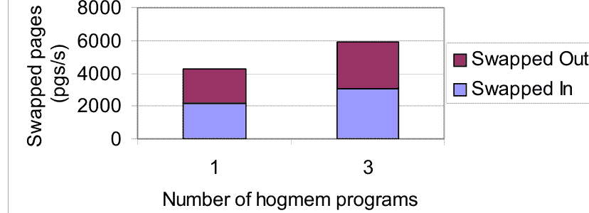

### 使用多个 DASD 交换设备

可以同时使用多个交换设备。我们再次使用一个 `hogmem` 程序测量了交换率，但在本次测试中，我们使用了两个相同交换优先级的 ECKD DASD 设备。默认情况下，交换设备被设置为在线（`swap`）并具有不同的优先级。它们被轮流使用。在此测试中，当一个 `hogmem` 程序正在运行时，两个 ECKD DASD 设备已准备好交换。使用来自存储服务器的 ECKD DASD 非常重要。

示例 7-7 一个进程使用两个 ECKD DASD 进行交换时的内存情况


| <---内存 (MB) ---> <--- 交换 ---> <--块IO>-- |

| 间隔 -- 主 -- --空间 (pgs/sec) ---> --kB/sec-- |

| 时间 | 总计 | 使用 | $ | 入 | 出 | 读取 | 写入 |

| 18:45:11 | 53.8 | 97.6 | 4696 | 2.9 | 5930 | 1152 | 10962 | 4620 |

| 18:46:10 | 53.8 | 98.1 | 4696 | 2.9 | 2367 | 2154 | 10962 | 8916 |

| 18:47:10 | 53.8 | 97.2 | 4696 | 2.9 | 2449 | 2196 | 11188 | 8733 |

| 18:48:10 | 53.8 | 97.8 | 4696 | 2.9 | 2503 | 2176 | 11682 | 7165 |

| 18:49:10 | 53.8 | 97.8 | 4696 | 2.9 | 2533 | 2345 | 11536 | 9390 |

| 18:50:11 | 53.8 | 98.1 | 4696 | 2.9 | 2451 | 2150 | 11152 | 8598 |

| 18:51:11 | 53.8 | 97.1 | 4696 | 2.9 | 2336 | 2085 | 10812 | 8340 |

| 18:52:11 | 53.8 | 97.8 | 4696 | 2.9 | 2519 | 2237 | 11403 | 8947 |

| 18:53:11 | 53.8 | 98.0 | 4696 | 2.9 | 2402 | 2128 | 11045 | 8514 |

| 18:54:11 | 53.8 | 98.0 | 4696 | 2.9 | 2329 | 2143 | 10768 | 8571 |

### 交换到一个或两个 DASD

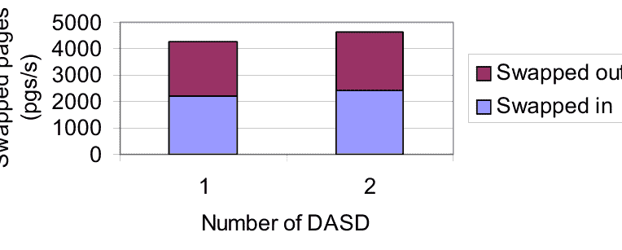

图 7-2 `hogmen` 程序正在交换一个或两个 ECKD DASD 时的交换率

与运行单个 `hogmen` 程序相比（第 83 页的示例 7-5），我们在本次测试中看到了更高的交换率。这意味着 CPU 等待 I/O 完成的时间更短了。当写入到具有相同交换优先级的磁盘时，`hogmen` 程序的整体吞吐量更高。`Linux` 的交换机制能够同时处理多个设备。

由于测量时的时间限制，我们未能测试在运行多个 `hogmen` 程序的环境下的两个 ECKD DASD 环境。很可能，如果并行运行更多的 `hogmen` 程序，拥有多个可用的 ECKD DASD 交换设备将带来更多益处。

我们决定在本次测试中使用 ECKD DASD，因为它在该领域内被广泛使用。我们预计，尽管我们运行多个 `hogmen` 程序测试或使用通过 FCP 连接的其他物理设备（如 FBA 磁盘或 SCSI 磁盘）进行磁盘测试，也会得到类似的结果。

### 7.3.2 使用 DIAGNO 访问方法交换 DASD

`Linux` DASD 驱动程序使用 ECKD 和 FBA 规范。过去，DIAGNO 规范存在一些错误，因此没有被使用。因此，`SUSE` 和 `Red Hat` 构建的内核没有内置 DIAGNO 访问方法。这种情况多年来发生了变化。最近的发行版本带有所需的 `dasd_diag` 模块，并可以使用 DIAGNO 访问 DASD。最新的发行版本为 64 位（`zVM` 5.2 或更高版本）提供了 DIAGNO 选项。`Linux` 驱动程序的 DIAGNO 访问方法使用高级 I/O 协议（DIAG 250），在必要时执行实际的 I/O 操作。测量显示了驱动程序选择的这种协议的优势。

# 为 3390 DASD 启用 DIAGNO I/O 需要：

- 磁盘最初在 ECKD 规范的控制下格式化。在启动 `Linux` 系统之前，该磁盘使用 `CMS` 格式化（`RESERVED`）。
- 更改目录 `/sys/bus/ccw/devices/<addr>`。
- 确保 DIAGNO 模块（`dasd_diag`）已加载。
- 命令 `echo 0` 指令 DASD 驱动使用该设备。
- 命令 `echo 1` 启用 DIAGNO 访问方法。
- 从此时间点开始该 DASD。

# 使用 DIAGNO 访问方法交换

在之前的实验中，我们使用 `hogmen` 程序来驱动测试。我们在 64 MB `zVM` 客户机中分配了 128 MB。示例 7-9 `hogmen` 程序使用 DIAGNO 访问方法时的内存情况

| <---内存 (MB) ---> <--- 交换 ---> <--块IO>-- |

| 间隔 -- 主 -- --空间 (pgs/sec) ---> --kB/sec-- |

| 时间 | 总计 | 使用 | % | 入 | 出 | 读取 | 写入 |

| 17:10:17 | 53.8 | 99.3 | 2348 | 5.8 | 2074 | 2528 | 10117 |

| 17:10:18 | 53.8 | 98.1 | 2348 | 5.8 | 2135 | 1950 | 10442 |

| 17:11:18 | 53.8 | 98.1 | 2348 | 5.8 | 2379 | 2172 | 11235 |

| 17:12:13 | 53.8 | 97.9 | 2348 | 5.8 | 2498 | 2468 | 12190 |

| 17:13:13 | 53.8 | 97.4 | 2348 | 5.8 | 2387 | 2187 | 11376 |

| 17:14:14 | 53.8 | 97.8 | 2348 | 5.8 | 2146 | 2114 | 10222 |

| 17:15:15 | 53.8 | 97.9 | 2348 | 5.8 | 2305 | 2110 | 11168 |

| 17:16:16 | 53.8 | 97.7 | 2348 | 5.8 | 2465 | 2298 | 14108 |

| 17:18:18 | 53.8 | 97.5 | 2348 | 5.8 | 2132 | 2029 | 10325 |

| 17:19:19 | 53.8 | 98.6 | 2348 | 5.8 | 2225 | 2091 | 10437 |

在第 86 页的示例 7-9 中，我们看到 ECKD DASD 附近的交换入和交换出具有相似的值。示例 7-10 一个 `hogmen` 程序使用 DIAGNO DASD 交换时的 CPU

| 间隔 | CPU 利用率 (%) | | | | |

| --- | --- | --- | --- | --- | --- |

| 时间 | 总CPU | 内核 | IO等待 | 空闲 | 窃取 |

| 17:08:09 | 0.3 | 0.1 | 0 | 99.7 | 0 |

| 17:09:10 | 9.7 | 4.1 | 82.4 | 7.7 | 0.2 |

| 17:10:11 | 8.2 | 3.3 | 4.0 | 91.7 | 0 |

| 17:11:12 | 9.2 | 3.9 | 89.9 | 0 | 0.2 |

| 17:12:13 | 9.1 | 3.7 | 44.0 | 0 | 0.2 |

| 17:13:14 | 8.4 | 3.4 | 41.1 | 0 | 0.1 |

| 17:14:15 | 9.6 | 3.7 | 90.2 | 0 | 0.2 |

| 17:15:16 | 25.5 | 3.7 | 73.8 | 0 | |

| 17:16:17 | 8.6 | 3.4 | 91.3 | 0 | 0.2 |

| 17:17:18 | 8.5 | 3.2 | 91.3 | 0 | 0.1 |

| 17:18:19 | 8.6 | 3.4 | 91.2 | 0 | 0.2 |

| 17:19:20 | 9.1 | 3.5 | 45.0 | 0 | 0.2 |

在示例 7-10 中，我们观察到等待 I/O 的时间略有减少，用户时间略有增加。这意味着使用 DIAGNO 访问方法 DASD 的用户程序的吞吐量也略有增加。没有多少非自愿等待（窃取）。在 17:15 到 17:16 之间，`Linux` 运行了一个服务（创建一个峰值），这与交换内存无关。这是一个低优先级（低值），使得交换本身不应降低。

## 7.4 切换到 VDISK

许多人现在建议将 `z/VM` 磁盘 (`VDISK`) 作为 `Linux` 虚拟机的交换设备。向虚拟机呈现一个模拟块架构设备（类型为 `9336`）。当覆盖时，`VDISK` 是一个位于 `z/VM` 主内存的空间。虚拟机 I/O 指令在主地址空间和 `VDISK` 地址空间之间移动数据。

### 7.4.1 使用 FBA 切换到 VDISK

此测试使用 FBA 规范交换到 `VDISK`。与之前的实验一样，我们使用一个 `hogmen` 程序来驱动测试。我们在 64 MB `z/VM` 中分配了 128 MB。

示例 7-11 使用 FBA 规范交换时的内存

| 间隔 | 内存 (MB) <---------> 空间 (Pgs/sec) <---kb/sec---> |


| --- | --- | --- | --- | --- | --- |

| 时间 | 使用% | 总计 | 使用 | 读取 | 写入 |

| 17:27:19 | 53.8 | 97.8 | 488.3 | 27.7 | 1148 | 5401 |

| 17:30:11 | 53.8 | 96.2 | 488.3 | 27.7 | 4166 | 3887 |

| 17:31:10 | 53.8 | 97.6 | 488.3 | 27.7 | 4222 | 3867 |

| 17:32:11 | 53.8 | 98 | 488.3 | 27.7 | 4324 | 4016 |

| 17:33:10 | 53.8 | 97.7 | 488.3 | 27.7 | 4248 | 18738 |

| 17:34:11 | 53.8 | 97.9 | 488.3 | 27.7 | 3472 | 3365 |

| 17:35:11 | 53.8 | 97.9 | 488.3 | 27.7 | 3626 | 3411 |

| 17:36:11 | 53.8 | 98 | 488.3 | 27.7 | 3570 | 3256 |

| 17:37:11 | 53.8 | 97.7 | 488.3 | 27.7 | 3598 | 3441 |

| 17:38:11 | 53.8 | 98 | 488.3 | 27.7 | 3696 | 3408 |

| 17:39:11 | 53.8 | 98.1 | 488.3 | 27.7 | 3573 | 3432 |

与其他实验相比，我们看到交换入和交换出的页数大幅增加。这意味着页错误可以更快地解决，导致运行程序的性能提高。在这里性能转化为吞吐量速率。交换率接近 `DASD` 设备中的数量。见示例 7-12。

### 示例 7-2 交换 `FBA VDISK` 时的 `CPU` 利用率

| 间隔 | CPU 利用率 (%) | | | | |

| --- | --- | --- | --- | --- | --- |

| 时间 | 总CPU | 内核 | IO等待 | 空闲 | 窃取 |

| 17:29:11 | 5.5 | 2.3 | 27.4 | 64.9 | 5.2 |

| 17:30:11 | 14.5 | 5.2 | 7.7 | 68.0 | 0 |

| 17:31:10 | 14.2 | 5.2 | 7.5 | 69.3 | 0 |

| 17:32:11 | 14.7 | 5.3 | 7.9 | 68.1 | 0 |

| 17:33:10 | 14.2 | 5.2 | 7.5 | 69 | 0 |

| 17:34:11 | 11.8 | 4.3 | 6.3 | 74.5 | 0 |

| 17:35:11 | 12.2 | 4.5 | 6.5 | 73.6 | 0 |

| 17:36:11 | 11.9 | 4.4 | 6.3 | 74.5 | 0 |

| 17:37:11 | 12 | 4.5 | 6.3 | 74 | 0 |

| 17:38:11 | 12.1 | 4.6 | 6.3 | 73.7 | 0 |

| 17:39:11 | 12.1 | 4.4 | 6.4 | 73.9 | 0 |

与使用真实设备之前的测量（第 8 页的示例 7-6）相比，我们得到了完全 `CPU` 利用率结果。与之前的测量相比，I/O 等待时间减少了。遗憾的是，这在一定程度上增加了用户时间。大部分节省的 I/O 时间被报告为“窃取”。

### 7.4.2 使用 `DIAGNO` 访问 `VDISK` 交换

我们使用 `DIAGNO` 访问方法测试交换到 `VDISK`。与之前的实验一样，我们使用一个 `hog` 进程来驱动测试。我们在 64 MB 的 `Linux` 中分配了 128 MB。

| 内存 (MB) -> -> 交换 ------ | 空间 (Pgs/sec) -> --kB/sec--> |

| --- | --- | --- | --- |

| 时间 | 使用% | 总计 | 使用 | 读取 | 写入 |

| 17:49:11 | 53.8 | 97.9 | 488.3 | 27.7 | 1453 | 1831 | 6716 | 7335 |

| 17:50:11 | 53.8 | 97.7 | 488.3 | 27.7 | 5211 | 4790 | 23583 | 19159 |

| 17:51:10 | 53.8 | 97.7 | 488.3 | 27.7 | 5841 | 5518 | 22621 | 22071 |

| 17:52:11 | 53.8 | 97.7 | 488.3 | 27.7 | 6045 | 5599 | 26971 | 22395 |

| 17:53:10 | 53.8 | 97.7 | 488.3 | 28.0 | 5941 | 5585 | 28657 | 22356 |

| 17:54:10 | 53.8 | 97.6 | 488.3 | 28.0 | 5498 | 5318 | 25464 | 20355 |

| 17:55:10 | 53.8 | 97.5 | 488.3 | 28.0 | 5804 | 5374 | 26474 | 22149 |

| 17:56:11 | 53.8 | 97.7 | 488.3 | 28.0 | 6046 | 5332 | 27217 | 22138 |

| 17:57:10 | 53.8 | 97.8 | 488.3 | 28.0 | 5868 | 5562 | 26220 | 22129 |

与使用 `FBA` 方法访问 `VDISK` 的结果相比，交换率更高。此外，读/写 I/O 显著高于 `FBA VDISK` 测试中看到的数值。参见示例 7-14。

# 示例 7-14 使用 `DIAGNOSE VDISK` 的 `CPU` 利用率

| 间间隔 | CPU 利用率 (%) | 内核 (Kernel) | 空闲 (Idle) | 被盗取 (Stolen) | --- | --- |

| --- | --- | --- | --- | --- | --- | --- |

| 17:49:11 | 7 | 3 | 22.7 | 66.5 | 3.8 |

| 17:50:10 | 17.7 | 6.4 | 90.4 | 0 | 11.9 |

| 17:51:10 | 19.7 | 7.2 | 10.4 | 66.3 | 0 | 13.9 |

| 17:52:11 | 20.2 | 7.4 | 10.7 | 65.5 | 0 | 14.3 |

| 17:53:11 | 21.5 | 7.8 | 11.4 | 64 | 0 | 14.5 |

| 17:54:10 | 18.7 | 6.7 | 10.1 | 68.4 | 0 | 12.9 |

| 17:55:11 | 19.6 | 7.1 | 10.4 | 66.8 | 0 | 13.6 |

| 17:56:11 | 20.3 | 7.4 | 10.9 | 65.5 | 0 | 14.2 |

| 17:57:10 | 19.7 | 7.2 | 10.5 | 66.3 | 0 | 14 |

| 17:58:11 | 19.5 | 7.2 | 10.3 | 66.4 | 0 | 14.1 |

我们使用 `VDISK` 得到了与之前的测量（第 88 页的示例 7-12）相比的 `CPU` 利用率结果；与通过 `FBA` 策略访问同一 `VDISK` 的测量相比，I/O 等待时间有所下降。归于“被盗取”的时间也略有下降。用户时间增加，这意味着应用程序的性能（吞吐量、事务率）得到了提高。

### 7.4.3 `VDISK` 设备的优势

`VDISK` 的优势在于可以用极小的代价定义一个巨大的交换区域。`VDISK` 直到 `Linux` 服务器启动时才会被分配。

### 启用 `FBA VDISK`

由于 `VDISK` 在 `Linux` 中作为 `FBA` 设备工作，因此对于 `Novell SUSE` 和 `Red Hat` 发行版，`DASD` 驱动程序默认使用 `FBA` 策略。

与 `ECKD` 交换设备一样，在 `swapon` 使用该设备之前，必须使用 `mkswap` 命令初始化 `VDISK`。`VDISK` 的内容在关闭虚拟机后不会保留（`VDISK` 上的数据是易失的），在启动虚拟机后必须执行 `mkswap` 命令。

有几种不同的方法可以实现这一点：

- 修改 `Linux` 系统中的脚本，在启动过程的早期运行 `mkswap` 命令。当 `Linux` 处理 `/etc/fstab` 文件时，会自动选取该磁盘。如果需要，可以手动执行 `swapon` 命令。

- 首先在 `Linux` 客户机 `IPL CMS`，并让 `Linux` 使用 `VDISK` 作为交换设备，就像已经使用过 `mkswap` 命令一样。如果你还需要使用 `CMS` 连接虚拟通道到通道 (CTC)，这可能是一个很好的选择。


- 使用某些虚拟机链接所有 `VDISK`，以便 `CP` 在 Linux 客户端注销后仍保留它们。你仍然需要一个过程在 IPL 后初始化磁盘。这种方法可能不太吸引人，因为会导致 `CP` 保留比你需要的更多的 `VDISK`，并给子系统带来额外负担。初始化磁盘的选择取决于可用技能以及你是否愿意进行更改。如果你在 CMS 上准备磁盘，那么 `Novell SUSE` 或 `Red Hat` 安装程序都不会使用 `VDISK` 作为交换设备。注意：写入 `VDISK`（如 7.10 所示）是使用 CMS 工具初始化 `VDISK` 的示例。

### 并行交换到 `VDISK` 的影响

关于使用多个分区进行交换的一些建议。当使用具有相同优先级的多个分区时，Linux 将将 I/O 分散到磁盘上。然而，使用 `VDISK` 时，这并不适用。进一步增加交换空间可能无法提供任何收益。

# 7.5 使用 FCP 交换

System on Linux 支持小型计算机接口 (SCSI)。与之前的实验一样，我们使用一个程序来驱动测试。为每个 Linux 客户机分配 128 MB。

示例 15 通过 FCP 交换到磁盘

| 间隔 | 交换 | kB/sec | 写入 |
| --- | --- | --- | --- |
| 18:07:11 | 53.8 | 97.1 | 4764 |
| 18:08:11 | 53.8 | 98.0 | 6265 |
| 18:09:10 | 53.8 | 98.2 | 2509 |
| 18:10:10 | 53.8 | 98.1 | 2949 |
| 18:11:10 | 53.8 | 97.6 | 2966 |
| 18:12:10 | 53.8 | 98.0 | 2877 |
| 18:13:10 | 53.8 | 97.8 | 2842 |
| 18:14:10 | 53.8 | 97.9 | 2874 |
| 18:15:10 | 53.8 | 98.1 | 2816 |
| 18:16:10 | 53.8 | 97.7 | 2844 |

在示例 15 中，与两种 DASD 测量相比，换入和换出的速率更高，但低于交换到 `VDISK` 的速率。

示例 16 CPU 利用率 (%)

| 时间 | CPU 利用率 (%) | 内核 (IOowait) | 磁盘 (Disk) | 被盗取 (Stolen) |
| --- | --- | --- | --- | --- |
| 18:08:11 | 11.1 | 4.2 | 58.9 | 0 | 0.1 |
| 18:09:10 | 10.6 | 4.8 | 89.3 | 0 | 0.1 |
| 18:10:10 | 12.0 | 4.4 | 87.9 | 0 | 0.1 |
| 18:11:10 | 11.9 | 4.4 | 88.0 | 0 | 0.1 |
| 18:12:10 | 11.1 | 4.3 | 88.8 | 0 | 0.1 |
| 18:13:10 | 11.1 | 4.2 | 88.5 | 0 | 0.1 |
| 18:14:10 | 11.2 | 4.3 | 88.7 | 0 | 0.1 |
| 18:15:10 | 11.1 | 4.2 | 88.8 | 0 | 0.1 |
| 18:16:10 | 11.4 | 4.2 | 88.5 | 0 | 0.1 |
| 18:17:11 | 11.0 | 4.1 | 88.9 | 0 | 0.1 |

下一张图（图 7-4）比较了总 CPU 情况以及 CPU 消耗的详细信息。

> 注意：我们在固定时间内运行了测试，而不是为了完成特定的工作量。如果我们有固定的工作量要运行，那么如果页面分配请求能更快满足，测试将会结束得早。此时，柱状图的高度会不同，而且在 x 轴上随时间推移变宽。

``

图 7-4 交换选项的 Linux CPU 消耗报告

大部分时间报告为 `IOWait`，这是符合预期的。实际输出到设备且无法通过任何缓存满足的 I/O 速度预计会比内存中的其他操作慢几个数量级。我们看到 `VDISK` 测试的 `IOWait` 值较低。窃取时间（`Stolen time`）仅针对 `VDISK` 显示。`VDISK` 报告了最高的总 CPU (`TotCPU`) 和内核 CPU 使用率。对于应用程序性能，用户 CPU 是最重要的部分，它在 `DIAGNOSE VDISK` 和 `FBA VDISK` 的组合下显示出最高值。

请记住结果与交换页的数量不成正比，因此较快的选项在相同时间内交换得更多，需要更多的 CPU 时间。这解释了为什么 `VDISK` 选项的 `TotCPU` 值较高。

## z/VM 视角的成本比较

我们使用 `Performance Toolkit PAF` 来说明 z/VM 看到的 CPU 成本。

图 7-5 中的柱状图从左到右显示显示测量值：

- `ECKD DASD`
- `DIAG DASD`
- `FBA VDISK`
- `DIAG VDISK`
- `SCSI DASD`

| ICP | G73VM11 | ICP | G73VM11 | (时间百分比) |
|---|---|---|---|---|
| avg 6.8571 | | | | 20.00000 |
| max 20.0000 | | | | |
| US avg 5.8571 | | | | |
| max 19.0000 | | | | 15.00000 |
| US avg 1.0000 | | | | |
| max 1.0000 | | | | 10.00000 |
| | | | | 5.00000 |
| 16:40 | 17:00 | 17:20 | 17:40 | 18:00 | 18:20 | 0.00000 |

``

图 7-5 z/VM 报告的 CPU 成本

在运行不同实验时，System CPU 统计的成本是恒定的。`VDISK` 实验（柱 3 和 4）的 CPU 值比考虑的所有其他选项都高。但 `VDISK` 测试是通过给定的工作单元进行的，实验运行指定的经过时间越短越好，而不是完成特定的工作量。这证明了更快的 `VDISK` 交换在发生时需要相对更多的整体 CPU。`SCSI` 比 `ECKD DASD` 和 `DIAGNOSE DASD` 交换更快，报告需要的 CPU 资源更少。

## 7.8 交换建议

最坏的情况是，由于某种原因，应用程序需要的内存比通常多，且无法得到满足。这可能是由新引入的错误程序代码（内存泄漏）或应用程序启动大量线程引起的。结果，Linux 内核开始使用 `OOM-killer` Linux 内核函数杀死进程。我们认为这是最坏的情况，因为会导致应用程序异常终止和潜在的数据丢失。即使交换设备并降低了性能，也绝对比数据丢失和程序异常终止要好。

提前计划交换。如果预计会发生交换，交换设备应该是高性能的（也就是说，如果运行 z/VM，将 `VDISK` 作为优先级最高的交换设备）。`VDISK` 留在主内存中。如果主内存是环境中的受限资源，我们不建议使用 `VDISK`。在常规基础上的交换观察到较高的过度提交率下，这在低利用率的合并环境中很常见。

- 设置 Linux 机器的大小是在减少 Linux 交换量之间的权衡。

- 最佳的虚拟机大小是在减少 z/VM 整体内存使用和 Linux 客户机交换之间的权衡。正如第 11 页 2.2 节“z/VM 客户的尺寸考量”所讨论，将 Linux 客户机的虚拟机大小缩小到正常负载下开始交换的程度，并增加额外数量以最小化交换。

- 分配的交换空间取决于您的 Linux 客户机的内存需求。

- 交换空间为 Linux 机器内存大小两倍的建议不适用于 z/VM 客户机。如果 Linux 客户机使用大量交换空间，可能表明应分配更大的虚拟机大小。

- 不要在 Linux 上启用 `MDC`。读取位率不足以覆盖开销。

- 交换到 `VDISK` 比交换到 `DASD` 或 `SCSI` 快。此外，在使用 `VDISK` 交换时，您的 z/VM 性能管理产品可以报告客户机的交换。

- 考虑使用多个交换设备而不是单个大 `VDISK`。使用不同优先级的交换设备可以缓解与单个大 `VDISK` 相比的压力。正如第 87 页 7.41 节讨论的，“使用 `FBA VDISK`”，结合 `DASD` 设备可以提供较小的快速交换。

- 优先使用交换设备而不是交换文件。

### 7.8.1 级联交换设备


使用不同优先级的交换设备是一个很好的情况。多个不同优先级的交换设备可用，Linux 尝试在使用最高优先级的设备前填充一个设备。在交换设备上分配空间减少了寻道并增加了 Linux 构建长链路的能力。这意味着整个交换设备已被引用。在 `VDISK` 的情况下，Linux 可能只需要一小部分 `VDISK`。如果内存竞争足够，`VDISK` 的内容会被 `CP` 消耗。如果我们给 Linux 提供两个较小的 `VDISK` 代替一个大 `VDISK` 并使用不同优先级的交换设备，足迹将有效减少 50%。在预期交换的情况下，建议使用较高优先级的较小 `VDISK` 和较大的磁盘 (`DASD`)。在始终预期交换的环境中，`VDISK` 的使用减少了可用内存。

## 7.8.2 `page-cluster` 值的影响

`page-cluster` 值决定了 Linux 将交换多少页（假设将需要后续页）。`page-cluster` 的默认值为 3，通过 `/proc/sys/page_cluster` 控制。在示例 7-18 中，展示了第 99 页 `page-clustering` 的影响。在 16:29 开始测试前，`page-cluster` 大小设置为：

```
echo 3 /proc/sys/page_cluster
```

在 16:34 到 16:35 之间，`page-cluster` 值为 3 (SLES10 的默认值)：

```
echo 3 /proc/sys/page_cluster
```

`vmstat` 显示此期间的交换入和交换出活动没有显著变化，但显示了块 IO 值，并产生了更多的中断。示例 7-17 通过 `vmstat` 观察到的 `cluster` 值：

```
vmstat 60
---memory----swapping----io----system----
r swpd free bo cs sy st
0 219064 1156 84 1854 5955 5959 6851 5599 877 1856 3 5 0
0 219064 1712 48 384 6306 5625 5525 8451 5492 748 1472 2 4 0
0 219064 2168 48 384 6168 5951 5051 5992 7481 1472 2 4 0
0 219064 1608 44 384 6448 5625 5529 6039 8134 1533 2 4 0
0 219064 1906 44 384 5960 5525 6451 5525 842 1547 2 4 93
0 219064 1300 60 434 6188 6127 6640 6264 6170 1614 2 4 93
0 3 219064 1808 48 816 7234 7712 7633 7712 368 3 4 93
0 1 219064 1360 48 940 8586 7792 9086 7992 396 3 4 92
0 1 219064 1536 48 96 8186 8112 8662 8112 381 3 4 93
0 1 219064 1420 48 304 8062 8003 8115 8033 380 3 4
0 3 219064 1312 48 904 7851 7337 8308 7337 372 3 4 93
0 1 219064 1104 48 796 8427 7762 8908 7762 396 3 4 93
0 2 219064 1068 48 536 8261 7438 8714 7438 622 3 4 93 0
```

我们感兴趣的是从 Linux 视角进行比较以查看性能工具的结果。

| 结束时间 | %CPU | CPU | VCPU | 比例 | DASD | 避免 | 诊断 | UR/s | 用户 | 状态 |
| :--- | :--- | :--- | :--- | :--- | :--- | :--- | :--- | :--- | :--- | :--- |
| >>平均>> | -- | -- | -- | -- | -- | -- | -- | -- | -- | -- |
| 16:29:33 | 8.80 | 5.279 | 4.352 | 1.2 | 828 | 828 | .0 | .0 | .0 | EME,CL,DIS |
| 16:30:33 | 9.05 | 5.432 | 4.469 | 1.2 | 850 | 850 | .0 | .0 | .0 | EME,CL,DIS |
| 16:31:33 | 8.22 | 4.933 | 4.059 | 1.2 | 781 | 781 | .0 | .0 | .0 | EME,CL,DIS |
| 16:32:33 | 7.83 | 4.700 | 3.868 | 1.2 | 751 | 751 | .0 | .0 | .0 | EME,CL,DIS |
| 16:33:33 | 8.38 | 5.025 | 4.118 | 1.2 | 790 | 790 | .0 | .0 | .0 | EME,CL,DIS |
| 16:34:33 | 8.85 | 5.308 | 4.356 | 1.2 | 836 | 836 | .0 | .0 | .0 | EME,CL,DIS |
| 16:35:33 | 8.16 | 4.896 | 4.150 | 1.2 | 562 | 562 | .0 | .0 | .0 | EME,CL,DIS |
| 16:36:33 | 8.50 | 5.099 | 4.467 | 1.1 | 345 | 345 | .0 | .0 | .0 | EME,CL,DIS |
| 16:37:33 | 6.68 | 5.208 | 4.568 | 1.1 | 342 | 342 | .0 | .0 | .0 | EME,CL,DIS |
| 16:38:33 | 8.09 | 3.968 | 3.967 | 1.1 | 359 | 359 | .0 | .0 | .0 | EME,CL,DIS |
| 16:39:33 | 8.25 | 4.949 | 4.340 | 1.1 | 340 | 340 | .0 | .0 | .0 | EME,CL,DIS |
| 16:40:33 | 8.59 | 5.151 | 4.514 | 1.1 | 354 | 354 | .0 | .0 | .0 | EME,CL,DIS |
| 16:41:33 | 8.56 | 5.212 | 4.566 | 1.1 | 352 | 352 | .0 | .0 | .0 | EME,CL,DIS |
| 16:42:33 | 8.56 | 5.134 | 4.490 | 1.1 | 363 | 363 | .0 | .0 | .0 | EME,CL,DIS |
| 总体物理负载 | 9.0 | | | | | | | | | |

在第 104 页的图 8-1 中，显示了收集报告数据的 `z/VM` `LPAR` (`A02`)。总体报告可以参考第 211 页的附录 E“附加材料”，该报告显示了 `z/VM` 认为的每个 `LPAR` 的处理器利用率，以及该 `CPU` 机器中所有分区的总和。`%Busy` 术语是指物理处理器分配给逻辑节点的比例。`LPAR` 根据权重进行优先级排序，权重在第 106 页的 8.1.2 节“将权重转换为逻辑处理器速度”中进行了解释。

此报告中显示的所有 `%Busy` 和其他处理器利用率均为绝对数值，这意味着这些值是单个处理器的百分比。绝不会出现报告“百分比的百分比”的情况（即未提供其中一个百分比）。因此，在显示了 `A02` 的四列后，`VM` `LPAR` 正在可能的 400%（四个处理器）中的 6%。

此示例中 `A02` 和其他 `LPAR` 的值包括：

- 处理器类型和型号。
- 配置的分区数量 (`Nr of configured partitions`) - 整个系统的分区总数。
- 物理处理器数量 (`Nr of physical processors`) - 安装并启用的物理处理器总数。
- 分发间隔 (`Dispatch interval`) - 设置为动态 (`dynamic`)。
- 分区 (`Partition`) - 赋予逻辑分区的名称。
- 编号 (`Nr`) - 逻辑分区编号。
- `Upid` - 逻辑分区的用户分区 ID。
- 处理器数量 (`#Proc`) - 为分区定义的处理器总数。
- 权重 (`Weight`) - 决定分区获得处理器控制器控制权的时间份额。
- 等待收集 (`Wait collection - 设置为否 (no)`) - 此选项决定了逻辑处理器在时间片完成前是否继续在实际处理器上运行，尽管它没有在执行任务而处于等待状态。如果需要，将该选项设置为 `YES`。如果你想在时间片结束前（当你仅处于等待而非执行时）将控制权交给处理器，请将其设置为 `NO`。
- 限制 (`Cap - 设置为否 (no)`) - 如果此处选项设置为 `yes`，则该 `CPU` 的提供不超过分配的最大值。如果设置为 `no`，则 `CPU` 将提供到最大值，并在可用时提供更多。
- 负载 (`Load`) - 这是该分区的相对负载，基于其逻辑处理器活动状态的时间除以总可用处理器时间，并以百分比形式表示。


- `CPU` - 分配给分区内每个处理器的 `CPU` 标识符。从 `0` 开始计数，直到达到分配的 `CPU` 总数。

- 开销 (`Ovhd`) - 这是花费在 `LPAR` 本身的时间百分比，即运行和控制其负责的工作负载分区的开销。

其中一些内容在第 `107` 页的 `8.1.4` 节“`LPAR` 选项”中有所讨论。

以下 `LPAR` 值未在示例显示，但由 `VM` 性能工具包报告：

- 挂起 (`Susp`) - 这是逻辑处理器由于 `LPAR` 管理时间和对实际处理器的竞争而被挂起、无法为客户系统提供服务的时间百分比。

- `%VMLD` - `VM` 虚拟机看到的处理器负载，基于客户系统看到的处理器忙闲时间和流逝时间。

- `%Logid` - `VM` 虚拟机看到的处理器负载，基于客户系统看到的处理器忙闲时间以及 `VM` 虚拟机感知到的等待时间与处理器忙闲时间之和。

- 类型 (`Type`) - 为分区定义的逻辑处理器的 `CPU` 类型。下方列出的类型仅适用于使用 `z/VM` `V5.3` 及更高版本的系统。对于早期版本，此字段始终显示 `CP on`，无论实际情况。

- 处理器类型：

  - `CP` - 中央处理器 (`Central processor`)
  
  - `ICF` - 内部耦合设施处理器 (`Internal Coupling Facility Processor`)
  
  - `IFL` - `Linux` 集成设施处理器 (`zIP`)
  
  - `ZAA P` - `IBM System z` 应用程序辅助处理器 (`Application Assist Processor`)

定义的且激活的逻辑处理器数量与在逻辑处理器之间切分物理处理器所需的开销量之间存在相关性。逻辑处理器越多，开销越高。

## 8.1.1 `LPAR` 开销

`VM` 性能工具包将管理其控制的所有各种分区的 `LPAR` 开销拆分为两个值。每个逻辑处理器的 `%head` 是 `LPAR` 运行和控制分区所花费的时间百分比开销。在示例中，所有处理器的总开销为 `5.7%`。列表底部的另一个数字是通用 `LPAR` 管理开销，在本示例中为 `1.7%`。

> 注意：`IBM` 性能工具包显示所有处理器类型。显示了通用中央处理器 (`CP`)、`Linux` 集成设施 (`IFL`)、内部耦合设施 (`ICF`)、`z29` 集成处理器 (`zIP`) 和 `System z` 应用程序处理器 (`zAPP`)。

从报告中，我们看到定义了 `45` 个分区。有 `106` 个逻辑处理器在活动的虚拟机之间共享，有 `16` 个物理（非专用）处理器可对其进行分发（`0`–`6`），每个处理器的开销都在 `5`–`6` 范围内。两个专用处理器（分区号 `8` 和 `9`）在示例中没有开销。然而，这并不意味着应该将处理器专用于 `LPAR` 以减少开销。定义的 `LPAR` 数量和定义的逻辑处理器数量与总开销成本明显相关。

> 注意：要减少物理开销，请使用更少的 `LPAR` 和更少的逻辑处理器。

## 8.1.2 将权重转换为逻辑处理器速度

要减少物理开销，使用更少的 `LPAR` 和更少的逻辑处理器。管理其控制的所有各种分区的 `LPAR` 开销由 `VM` 性能工具包拆分为两个值。每个逻辑处理器的 `%head` 是 `LPAR` 运行和控制分区所花费的时间百分比开销。在示例中，所有处理器的总开销为 `5.7%`。列表底部的另一个数字是通用 `LPAR` 管理开销，在本示例中为 `1.7%`。

> 注意：`IBM` 性能工具包显示所有处理器类型。显示了通用中央处理器 (`CP`)、`Linux` 集成设施 (`IFL`)、内部耦合设施 (`ICF`)、`z29` 集成处理器 (`zIP`) 和 `System z` 应用程序处理器 (`zAPP`)。

从报告中，我们看到定义了 `45` 个分区。有 `106` 个逻辑处理器在活动的虚拟机之间共享，有 `16` 个物理（非专用）处理器可对其进行分发（`0`–`6`），每个处理器的开销都在 `5`–`6` 范围内。两个专用处理器（分区号 `8` 和 `9`）在示例中没有开销。然而，这并不意味着应该将处理器专用于 `LPAR` 以减少开销。定义的 `LPAR` 数量和定义的逻辑处理器数量与总开销成本明显相关。

> 注意：要减少物理开销，使用更少的 `LPAR` 和更少的逻辑处理器。

`LPAR` 在工作完成后会主动释放处理器。当 `LPAR` 作为专用分区运行时，此选项对这些分区可能非常有用。

## 8.1.5 整个系统及所有分区的容量分析

当系统上存在多个 `LPAR` 时，了解当所有分区处于激活状态时系统的整体负载至关重要。实现这一点的一种非常有效的方法是绘制图表，使用所有分区的 `CPU` 使用率随时间变化的累积堆叠图。数据可以从 `zVM/VSE` 中提取并加载到电子表格或绘图软件包中。请注意，从以 `LPAR` 模式运行的 `VM` 系统，你可以看到其他 `VM`、`VM/VSE` 以及 `OS/LPAR` 的 `CPU` 使用率，以及运行带有 `Linux` 客户机的 `VM` 的情况。示例请参考本章中 `VM Performance Toolkit` 辅助工具的 `LPAR` 显示。

图 `8-2` 显示 `CPU` 使用率的绝对峰值超过 `83%`，该系统有足够的 `CPU` 剩余量（`headroom`）用于负载增长。通过此类图表可以清楚地看出系统何时达到整体关键负载状态，以及 `LPAR` 是其中的主要贡献者。

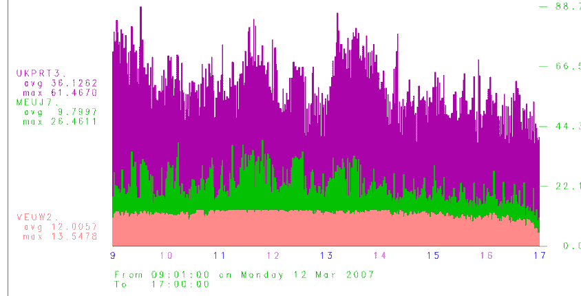

## 8.1.6 共享处理器与专用处理器

当系统上有多个处理器供许多不同的逻辑分区使用时，存在将处理器专用给某个 `LPAR` 的选项。通常情况下，这仅用于两个原因：

- 为了基准测试，减少来自其他负载的存疑性影响。在运行基准测试时，目标应该是尽可能地消除与同一时间段运行的其他任务的干扰。专用处理器意味着 `CPU` 的可用性在任何时候都是恒定的。

- 当负载足够稳定以利用处理器，并且有足够的资源证明专用处理器的价值时。一个很好的例子是以持续高 `CPU` 使用率运行的关键任务分区。

**重要：** 在运行基准测试时，出于一致性考虑，请始终使用专用处理器，以减少其他负载对结果的影响。

为了证明 `System z` 实现的成本，目标应始终是高利用率。对于 `System z` 而言，利用率超过 `90%` 是非常常见的。在负载吞吐量和响应时间方面，这些利用率是可以轻松维持的。高利用率利用了 `System z` 系统的可靠性、可用性和可维护性（`RAS`）的价值。其他平台很少以高利用率运行，许多中端系统的峰值为 `30%`，而较小的服务器平台水平更低。将处理器等物理资源专用给一个 `LPAR` 可能会降低系统的整体利用率。降低系统利用率会降低 `System z` 的效率并增加单位工作成本。

## 8.2 `CP` 调度器

`CP` 调度器通过使用分时原理，尝试尽可能让尽可能多的虚拟机并发运行。它包含了许多算法，考虑了如处理时间可用性、分页资源和实际存储（与虚拟机需求相比）等因素。

`CP` 调度器使用时间片来决定虚拟机竞争访问处理器的持续时间：

- 经过时间片（`Elapsed time slice`）

- 虚拟机在经过时间片的持续时间内竞争使用处理器。

- 调度时间片（`Dispatch time slice`）

在它的经过时间片期间，虚拟机只能在其调度时间片的持续时间内控制处理器。这通常被称为微型时间片（`minor slice`）。

当虚拟机的调度时间片过期时，调度器会重新调整其相对于其他竞争处理器的虚拟机的优先级。当它的经过时间片过期时，调度器将该虚拟机从竞争处理器的列表中移除。然后，调度器尝试将另一个符合处理器资源条件的虚拟机加入竞争中。

### 8.2.1 事务分类

为了进行分发和调度，虚拟机根据其事务特性和资源需求进行分类：

- 类 `1`

  - 这些虚拟机被指定为交互式任务。

- 类 `2`

  - 这些虚拟机被指定为非交互式任务。

- 类 `3`

  - 这些虚拟机被指定为资源密集型任务。

- 类 `0`

  一种针对需要立即访问处理器资源的虚拟机的特殊分类。此类虚拟机需要一种称为“分发”（`dispatch`）的特殊权限，被称为类 `0`。

对于处理器调度，已启动的虚拟机位于三个列表之一：

- 休眠列表（`Dormant list`）

- 就绪列表（`Eligible list`）

- 调度列表（`Dispatch list`）

### 8.2.2 休眠列表

休眠列表包含没有需要处理的任务的虚拟机。当虚拟机从该状态移动并开始处理器资源时，它们会移动到就绪列表。

### 8.2.3 就绪列表

就绪列表由当前未因系统资源限制（例如分页或存储）而考虑分发的虚拟机组成。当系统资源的需求超过可用资源时，虚拟机会被保留在就绪列表中。就绪列表上的虚拟机根据其预期负载进行分类：

- `E1`

  `E1` 指 `1` 类预期执行短时间事务的虚拟机。当第一次进入就绪列表时，虚拟机被分类为 `E1`。

- `E2`

  `E2` 指 `2` 类预期执行中等长度事务的虚拟机。当这些虚拟机在 `E1` 中花费了至少一个经过时间片且未完成处理后，它们会掉入就绪列表。

- `E3`

  `E3` 指 `3` 类预期执行长时间运行事务的虚拟机。`E3` 虚拟机在就绪列表花费了至少两个经过时间片且未完成处理（至少在 `E1` 和 `E2` 中各一个）。


类 0 虚拟机永远不会在就绪列表中等待处理器资源。相反，它们会立即移动到调度列表。这些被分类为 `E0` 虚拟机。我们将在第 117 页的 `8.4.2`“`QUICKDSP` 选项”讨论虚拟机。

当资源可用时，虚拟机从就绪列表移动到调度列表。就绪列表上的分类会影响调度器在它们移动到调度列表时分配的优先级和经过时间片。以此分配优先级旨在：

- 放慢资源密集型虚拟机，有利于需求较少的虚拟机。
- 确保虚拟机获得部分处理器（见第 117 页的 `8.4.3`“`SHARE` 命令”）。
- 根据虚拟机分类（`E1`、`E2` 或 `E3`）控制服务的量和类型。

我们将在第 112 页的 `8.3.3`“进入调度列表”讨论如何计算优先级。

### 8.2.4 调度列表

竞争处理器时间的虚拟机被放在调度列表中。列表中位置越高，越可能获得处理器时间。调度列表中的虚拟机保留就绪列表期间分配的事务分类。调度列表上的事务分类被称为 `Q1`、`Q2`、`Q3` 和 `Q0`（对应就绪列表上的 `E1`、`E2`、`E3` 和 `E0` 分类）。

> 注意：就绪列表上的 `E0` 虚拟机包含在 `CP INDICATE` 命令显示的 `Q0` 虚拟机计数中。

## 8.3 虚拟机调度

图 `8-3` 涉及虚拟机调度的状态转换。

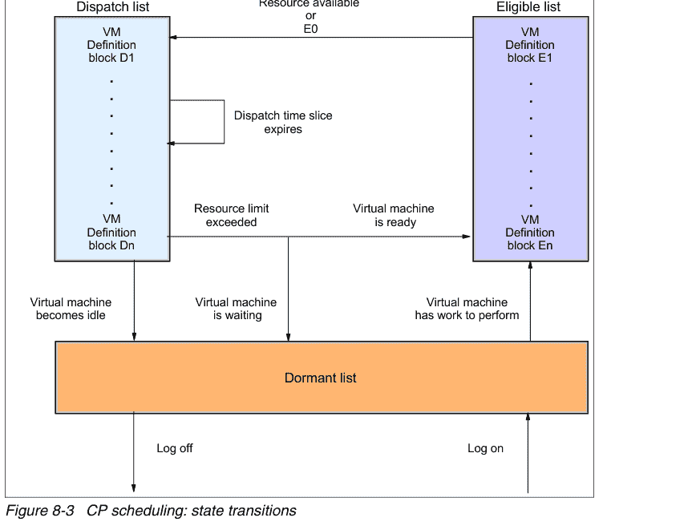

图 `8-3` CP 调度：状态转换

**定义：** 图 `8-3` 显示调度列表就绪列表上的虚拟机定义块。虚拟机定义块代表分配给虚拟机的虚拟处理器。默认情况下，每个虚拟机至少有一个定义块（基础）。定义块将在第 113 页的 `8.3.4`“调度虚拟处理器”中讨论。

## 8.3.1 进入休眠列表

在登录时，虚拟机最初被置于休眠列表（`dormant list`）。在完成事务后，虚拟机将从调度列表（`dispatch list`）进入休眠列表。

> 注意：这被称为从队列中掉落。

如果虚拟机的已用时间片过期且正在等待资源（例如按需调页），则它可以从调度列表进入休眠列表。当需要处理器时间时，虚拟机会被移动到就绪列表（`eligible list`）。

## 8.3.2 进入就绪列表

从休眠列表进入就绪列表后，虚拟机通常被归类为 `E1`（`E0` 虚拟机直接移动到调度列表）。如果虚拟机在已用时间片内没有完成处理，则可以从休眠列表进入就绪列表。在这种情况下，`E1` 虚拟机降级为 `E2`，`E2` 虚拟机降级为 `E3`，而 `E3` 虚拟机保持在 `E3`。

## 8.3.3 进入调度列表

为了从就绪列表移动到调度列表，虚拟机必须通过三项测试：

- 存储器测试
  与工作集（`working set`）关联的虚拟机必须能够根据当前状态放入实际存储器。我们将在第 115 页的“`STORBUF` 控制”中讨论此内容。

- 分页测试
  如果用户是加载用户（`loading user`），则当时的加载用户缓冲区中必须有足够的空间。在第 114 页的“`LDDBUF` 控制”中讨论了加载用户。

- 处理器测试
  调度缓冲区（`dispatch buffer`）必须有空间。调度缓冲区的大小在第 114 页的“`DSPBUF` 控制”中进行了讨论。

位于调度列表的虚拟机将在其整个已用时间片持续期间留在该列表中。已用时间片在虚拟机进入就绪列表时，根据其事务类别分配给虚拟机。

`CP` 在初始化期间为 `E1` 虚拟机分配一个 `1.2` 秒的初始已用时间片。该值在系统运行期间会动态调整：

- 随着在 `E1` 中完成处理的虚拟机数量增加，`E1` 已用时间片的大小减小。
- 随着 `E2` 虚拟机数量增加，`E1` 已用时间片的大小增加。
- 如果 `E1` 虚拟机数量低于阈值，而 `E3` 虚拟机数量超过阈值，则 `E1` 已用时间片的大小增加。

`E1` 已用时间片的值始终在 `50` ms 到 `16` 秒之间。`E0`、`E2` 和 `E3` 的已用时间片的大小分别为 `E1` 时间片的 `6` 倍、`8` 倍和 `48` 倍。

调度时间片在 `CP` 初始化时计算。可以使用 `QUERY SRM DSPSL` 命令查询其值。

在调度列表上，虚拟机将按照其指定的已用时间片运行。如果处理在此期间内未完成，它将被移回就绪队列（如果尚未在 `E3` 队列中，则工作负载分类将降低）。

## 8.3.4 调度处理器

为每个虚拟机定义的每个虚拟处理器都会创建一个额外的 `VM` 块。这些额外的块与其各自的基础定义块链接。基础定义块和任何额外的定义块都在三个调度器列表之间循环。基础定义块拥有该虚拟机的存储和大多数虚拟资源。随着基础块和额外定义块在列表之间移动，基础块始终处于与其任何链接块等高的列表中。

> 注意：列表的层级结构定义如下（从高到低）：
>
> 1. 调度列表 (`Dispatch list`)
> 2. 就绪列表 (`Eligible list`)
> 3. 休眠列表 (`Dormant list`)

这确保了在调度 `VM` 定义块时，考虑了虚拟机整体的资源需求。然而，任何额外定义块消耗的处理器时间是独立于基础块进行测量的。该值在调度列表上调度该块时会被使用。

为了说明，考虑一个具有两个虚拟处理器（以及两个对应的 `VM` 定义块）的虚拟机，这两个处理器都从休眠列表开始。如果额外的定义块变得可置换，则两个定义块（基础块和额外块）都移动到就绪列表。在就绪列表等待后，两个块都移动到调度列表，并获得相同的优先级。然而，当额外的定义块消耗资源时，其调度优先级是独立计算的，详见第 140 页的“虚拟处理器的性能影响”。

## 8.3.5 z/VM 调度与 Linux 定时器补丁

`Linux` 内核通过使用以恒定速率中断的定时器（`System z` 为 `100` Hz）来跟踪运行。`Linux` 内核维护一个名为 `jiffy` 的全局变量并对其进行更新。变量更新后，会检查队列是否有待处理的工作。在运行 `//VM` 上的客户机中，这种行为在 `z/VM` 调度模型内部继承。通过 `10` ms 定时器中断，`CP` 将 `Linux` 虚拟机归类为长时间任务，并将其分配给 `Q3`，以区分运行和空闲的客户机。

当前的发行版允许你根据需要切换定时器中断。启用按需定时器补丁后，`Linux` 虚拟机在空闲时的调度频率会降低。这显著减少了竞争资源的 `Q3` 服务器数量。减少竞争资源的并发任务数可以由更短的任务来减少冲突字段。有关解决方案 `9.3` 的更多细节，请参见第 133 页的“`Linux` 定时器修改”。

第 8 章 CPU 资源与 z/VM 调度 113

## 8.4 CP 调度控制

`CP` 调度器受两种通用类型控制的影响：

- `SRM` 控制全局地影响整体处理器资源。
- 本地控制影响调度器如何看待单个虚拟机。

## 8.4.1 全局系统资源管理器 (SRM) 控制

可以使用 `CP SET SRM` 命令调整 `z/VM` 的整体处理器资源。

### DSPBUF 控制

`CP SET SRM DSPBUF` 命令可以调整 `z/VM` 的整体处理器资源。

`DSPBUF` 控制控制调度列表的用户数量。它允许过度提交或低提交处理器和 `I/O` 设备资源。命令格式为：

```
SET SRM DSPBUF i j k
```

其中：

- `i` 指定适用于 `E1`、`E2` 和 `E3` 的调度槽数量
- `j` 指定适用于 `E2` 和 `E3` 的调度槽数量
- `k` 指定适用于 `E3` 的用户调度槽数量

有效范围为 `32767 ≥ i ≥ j ≥ 1`。

例如：

```
SET DSPBUF 35 30 18
```

该命令在调度列表中分配了 `35` 个槽：

- 保证给 `E1` 用户（`35–30`）。
- `E2` 和 `E3` 提供 `30` 个。
- `E3` 提供 `18` 个。

> 重要：使用 `DSPBUF` 控制是非常危险的。我们不建议对其进行调整。

### LDUBUF 控制

`CP SET SRM LDUBUF` 命令控制调度列表的用户数量。它允许过度提交或低提交处理器和 `I/O` 设备资源。命令格式为：

```
SET SRM LDUBUF i j k
```

其中：

- `i` 指定适用于 `E1`、`E2` 和 `E3` 的调度槽数量
- `j` 指定适用于 `E2` 和 `E3` 的调度槽数量
- `k` 指定适用于 `E3` 的用户调度槽数量

有效范围为 `32767 ≥ i ≥ j ≥ 1`。

例如：

```
SET LDUBUF 35 30 18
```

该命令在调度列表中分配了 `35` 个槽：

- 保证给 `E1` 用户（`35–30`）。
- `E2` 和 `E3` 提供 `30` 个。
- `E3` 提供 `18` 个。

> 定义：`LDUBUF` 代表加载用户。使用 `INDICATE QUEUES` 命令可以显示加载用户。

### STORBUF 控制

`CP SET SRM STORBUF` 命令控制调度列表的用户数量。它允许过度提交或低提交处理器和 `I/O` 设备资源。命令格式为：

```
SET SRM STORBUF i j k
```

其中：

- `i` 指定适用于 `E1`、`E2` 和 `E3` 的调度槽数量
- `j` 指定适用于 `E2` 和 `E3` 的调度槽数量
- `k` 指定适用于 `E3` 的用户调度槽数量

有效范围为 `32767 ≥ i ≥ j ≥ 1`。

例如：

```
SET STORBUF 35 30 18
```

该命令在调度列表中分配了 `35` 个槽：

- 保证给 `E1` 用户（`35–30`）。
- `E2` 和 `E3` 提供 `30` 个。
- `E3` 提供 `18` 个。


> 注意：`STORBUF` 的默认值分别为 125%、105% 和 95%。

## MAXWSS 控制

`CP SET SRM MAXWSS` 设置了调度列表上的普通用户允许拥有的最大工作集（working set）。如果用户的工作集大小超过此百分比，该用户将从调度列表退回到就绪列表（eligible list）。命令格式为：

```
SET SRM MAXWSS m
```

其中 `m` 指定了用户可用的系统可分页存储的最大百分比。

`MAXWSS` 用于防止大型虚拟机以牺牲较小用户为代价获取过量的系统内存。

> 注意：为了使此参数按预期工作，虚拟机必须驻留在就绪列表中（也就是说，调度器必须根据 `STORBUF` 设置将系统视为存储受限的）。

## DPSLICE 控制

虚拟机在每次被调度时都会被分配一个调度时间片（dispatch slice）。调度时间片在系统初始化时根据实际的处理器速度计算，并对处理的固定数量的指令给予奖励。此值可以通过 `CP SET SRM DPSLICE` 命令更改：

```
SET SRM DPSLICE min
```

其中 `min` 指定了最小调度时间片（单位为毫秒）。

> 注意：有效的调度时间片值范围为 100 ≥ `min` ≥ 1 。

当虚拟机首次被调度时，它将运行直到满足以下条件：

- 它的 `min` 时间片过期。
- 它完成工作并继续等待更多工作。
- 它进入 `CP` 模式。
- 发生中断。

当重新调度（redpatched）时，虚拟机将被分配一个新的调度时间片。（如果是因为中断放弃了处理器，则将被分配上一个调度时间片的剩余部分。）

## 何时使用 SRM 控制

使用 `SRM` 控制可以确保：

- 尽可能地利用处理器资源。
- 不发生抖动（Thrashing）情况。
- 当性能糟糕时（这在 `way` 会发生），某些服务器对处理器资源具有优先访问权。

例如，如果性能糟糕，你仍然希望 `TCP/IP`（或许可能是 `DNS` 服务器或管理器）运行良好。因此，最好妥善利用 `SRM` 控制，而不是过度使用 `QUICKDSP` 选项。

> 重要：`QUICKDSP` 选项应用于在情况非常糟糕时仍需运行的机器。将 `QUICKDSP` 设置为少数必须执行的机器，例如运行任务关键进程的虚拟机。

当虚拟机没有从队列中掉出时，应该使用 `STORBUF` 来过度分配存储。在这种情况下，调度和调度算法会发生偏移。真实的存储需求是未知的，无法进行适当调度。安装人员发现，当运行许多服务器（从从队列中掉出的空闲服务器）时，感知存储非常高。使用 `STORBUF` 值过度分配存储可以改善这种情况。

在虚拟机从队列中掉出的实例，使用 `STORBUF` 可能并不合适。

> 注意：为了从队列中掉出，`Linux` 客户必须在安装定时器的情况下运行（见第 113 页 8.3.5，“z/VM 调度与 Linux 定时补丁”）并使用适当的网络架构（见 11.2.1，“OSA-Express QIO 的 Seth 设备”）。

对于这种情况，如果存在扩展存储，并将 `SRM XSTORE` 命令至少设置为其最大值。

在存在大量分页的环境中，通过适当的 `SRM LDBUF` 命令控制分页。分页环境中的默认 `LDBUF` 允许分页子系统被消耗 100%（见第 118 页 8.5，“SRM LDBUF 控制的分析”）。在分页子系统利用率达到 100% 的点，根据定义，增加 `LDBUF` 并允许更多用户消耗分页资源将非常有价值。

在第 173 页 8.5，“SRM LDBUF 控制的分析”中，我们检查了某些 `SRM` 控制的操作。

## 8.4.2 CP QUICKDSP 选项

`SET QUICKDSP` 命令只做一件事，但它的效果非常好。它应该用于即使在内存或处理器严重受限也需要运行的服务机。`CP` 调度器将分配给 `QUICKDSP` 选项的虚拟机分类为 `E0` 虚拟机。当 `E0` 虚拟机有工作要做时，会被立即添加到调度，而无需在就绪列表中等待。调度器在将虚拟机从就绪列表移动到调度列表时跳过正常的存储、分页和处理。

## 8.4.3 CP SHARE 命令

虚拟机使用 `SHARE` 命令为各种 `CMS` 用户、`Linux` 客户和虚拟机建立资源级。使用 `SHARE` 的第一个决策是回答问题：使用绝对的（`ABSOLUTE`）还是相对的（`RELATIVE`）。你必须决定分配给每个用户的 `SHARE` 类型数量。这涉及到对运行在系统上的整个用户组的考虑，在系统创建之初以及每次更改 `SHARE` 时。

决定为特定服务器使用哪种类型的最简单方法是回答问题：当更多用户登录到此系统时，这台服务机获得的是更多还是更少的 `CPU`？

- 份额表示该服务器相对于调度列表和就绪列表中的所有虚拟机应该拥有处理器的相对份额。随着更多用户的登录，该份额会下降。虽然对于给定用户的精确优先级是不确定的，这在某些情况下效果非常好，例如，当大量的 `CMS` 用户群需要有限资源的公平份额时。相对份额随着用户数量的变化而演变，为新登录的用户留出空间，并确保在用户停止使用系统时维持公平共享过程。

## 8.5 SRM LDBUF 控制的分析

`SRM LDBUF` 命令的目的是控制分页抖动。抖动是指分页处于一种状态，由于对分页和存储设备的争用，导致完成的工作减少。以下分析显示了评估 `LDBUF` 使用的一些关键点。

当调度器评估加载能力时，分页设备的数量就是加载能力。将 `LDBUF` 设置为默认的 100 允许利用 100% 的总容量（分页设备数量）。因此，如果有多个分页设备，七个被认为加载的用户将允许其他用户等待，直到现有的用户之一从列表中掉出或获取了其工作集并停止产生页错误。

对于此分析，使用了一个分配存储、执行功能并释放存储的基准测试，这在许多 `Linux` 环境中是典型的。测量结果

IBM z 上的 Linux：性能测量与调优

## 8.5.1 默认设置分析

图 8-4 使用 `LDBUF` 和 `STORBUF` 默认设置下的 `CPU` 占用率和分页率。

| `FCX225` | `CPU` `2094` | `SER` `2991E` | 间隔 08:53:56 - 14:22:56 | 性能监控 (Perf. Monitor) |

| :--- | :--- | :--- | :--- | :--- |

| | | | | | | <--/ | -->/ | <---> | <----> | <Stg> | K-Paging- |

| | | | | | | | | | | | | |

| 间隔 | `CPU--` | `Cap-` | `On-` | `Pct` | `Pct Log-` | | | | | | `SSHC` | `DASD User K-rate/` |

| | `--Ratio>` | `--Mean>` | | | | | | | | | | | | |

| 结束时间 | `Busy` | `T/v` | `tune` | `Busy` | `activ /` | | | | | | `-RSCH` | `Resp` | `in PGIN+` | `Read` |

| 12:08:56 | 22.3 | 5.8 | 0.9872 | 4.0 | | 20 | 10.9 | .7 | 79.2 | 1 | | |

| 12:09:56 | 21.1 | 1.0 | 0.9950 | 4.0 | | 20 | 10.2 | 5.0 | .0 | | | |

| 12:10:56 | 26.8 | 1.0 | 0.9999 | 4.0 | | 20 | 11.8 | 5.3 | .0 | 1 | | |

| 12:11:56 | 23.1 | 1.0 | 0.9958 | 4.0 | | 20 | 10.9 | 5.8 | .0 | 1 | | |

| 12:12:56 | 30.2 | 1.0 | 0.9924 | 4.0 | | 20 | 130.6 | 5.5 | .25 | 36 | | | |

| 12:13:56 | 43.5 | 1.0 | 0.9921 | 4.0 | | 20 | 61.5 | 4.2 | .0 | 4 | | | |

| 12:14:56 | 39.5 | 1.0 | 0.9986 | 4.0 | | 20 | 25.0 | 2.0 | .0 | 3 | | | |

| 12:15:56 | 38.9 | 1.0 | 0.9916 | 4.0 | | 20 | 39.5 | 1.7 | .0 | 5 | | | |

| 12:16:56 | 38.9 | 1.0 | 0.9916 | 4.0 | | 20 | 45.7 | 1.3 | .0 | 2 | | | |

| 12:17:56 | 38.7 | 1.0 | 0.9909 | 4.0 | | 20 | 53.4 | 1.2 | .0 | 3 | | | |

| 12:18:56 | 28.1 | 1.0 | 0.9968 | 4.0 | | 20 | 219.8 | 1.7 | .0 | 2 | | | |

| 12:19:56 | 25.2 | 1.0 | 0.9946 | 4.0 | | 20 | 12.4 | 2.4 | 1.0 | 2 3 | | | |

| 12:20:56 | 25.0 | 1.0 | 0.9942 | 4.0 | | 20 | 9 | 24.7 | 2.4 | .1 | 4 | | | |


| 12:21:56 | 25.0 | 1.0 | 0.9944 | 4.0 | | 20 | 11 | 22.5 | 2.2 | 1.0 | .9 3 | | | |

图 8-4 使用默认 `LDBUF`/`STORBUF` 设置下的 CPU 和分页利用率。

报告显示 CPU 占用率在 22.3% 到 26.9% 之间波动，到 `DASD` 的分页率为 112.6 页/秒。到扩展存储器的分页率为 400–500 页/秒。

## 8.5.2 用户分析

图 8-5 显示了基准类用户 `IUVCRO` 的分析。这些用户在登录时通常会从队列中删除，因为 `IUCVRC` 驱动程序应用了定时补丁（如 12.2.1 节，“用于 OSA-Perspective QDIO 的 Qdevice 驱动”所述）。

| FCX101 | CPU 2094 | SER 29912 | 间隔 08:54:00 - 14:48:56 | 性能监控 (Perf. Monitor) |
| :--- | :--- | :--- | :--- | :--- |
| | | | | |
| TIME | OGN | ACT | RT | TIES | TQ-RO | NT | NS | ITR | %R | %O | %Q | %LD | Q |
| 14:31 | 12 | 57 | 83.8 | .7 | 1.4 | 55.0 | 0 | 0 | 0 | 2 | 4 |
| 14:32 | 11 | 80 | 58.1 | .4 | 1.3 | 29.0 | 0 | 0 | 0 | 1 | 5 |
| 14:33 | 11 | 82 | 59.9 | .8 | 1.0 | 25.0 | 0 | 0 | 0 | 1 | 5 |
| 14:34 | 10 | 68 | 23.9 | .9 | 1.1 | 19.5 | 0 | 0 | 0 | 1 | 4 |
| 14:35 | 12 | 66 | 25.2 | .9 | 1.0 | 35.8 | 0 | 0 | 0 | 1 | 4 |
| 14:36 | 10 | 58 | 39.0 | .8 | 1.0 | 31.0 | 0 | 0 | 0 | 0 | 4 |
| 14:37 | 11 | 47 | 63.2 | .7 | 1.1 | 51.4 | 0 | 0 | 0 | 0 | 4 |
| 14:38 | 10 | 52 | 50.9 | .7 | 1.1 | 34.5 | 0 | 0 | 0 | 1 | 3 |
| 14:39 | 11 | 45 | 71.7 | .8 | 1.0 | 28.0 | 0 | 0 | 0 | 2 | 4 |
| 14:40 | 12 | 53 | 85.1 | .9 | 1.2 | 25.0 | 0 | 0 | 0 | 1 | 4 |
| 14:41 | 11 | 45 | 58.1 | .7 | 2.5 | 42.0 | 0 | 0 | 0 | 0 | 5 |
| 14:42 | 10 | 68 | 51.9 | .8 | 1.0 | 38.0 | 0 | 0 | 0 | 0 | 6 |
| 14:43 | 11 | 45 | 61.0 | .8 | 1.2 | 43.9 | 0 | 0 | 0 | 0 | 5 |
| 14:44 | 10 | 66 | 68.1 | .8 | 1.2 | 62.4 | 0 | 0 | 0 | 0 | 4 |
| 14:45 | 12 | 45 | 17.9 | .7 | 0.7 | 55.5 | 0 | 0 | 0 | 0 | 4 |
| 14:47 | 10 | 53 | 74.1 | 0 | 1.0 | 31.0 | 0 | 0 | 0 | 2 | 5 |
| 14:48 | 10 | 59 | 83.6 | .9 | 1.0 | 61.5 | 0 | 0 | 0 | 2 | 5 |

图 8-5 用户分析

此时，在登录的 21 个用户中，只有 10 到 12 个用户处于活跃，4 和 8 个用户在队列中 (`Q1`+`Q`)。

## 8.5.3 DASD 分析

图 8-6 显示了默认的直接访问存储器 (`DASD`) 分析。

| FCX109 | CPU 2094 | SER 29912 | 间隔 17:51:56 - 17:52:56 | 性能监控 (Perf. Monitor) |
| :--- | :--- | :--- | :--- | :--- |
| Page / SPOOL 分配摘要 | | | | 194096 |
| 可用 SPOOL 槽 | | | | 600840 |
| 可用 PAGE 槽 | | | 3% | 14% |
| SPOOL 槽利用率 | | | | 0 |
| T-Disk 周期，平均 | | | | 可用 DUMP 槽 0 |
| T-Disk 利用率 | | | % | DUMP 槽利用率 0 |
| 设备， | | | | Rate/s |
| 卷区域 | | | | (Spool--) SSCH |
| 范围类型 | | | 20 % P-Rds Total+SHC |
| CD3196 | LXOPRE | 1-9338 | 14 | 0 | 0 | |
| CD3490 | LXOPG3 | 1-9338 | 14 | 0 | 3.5 | 3.5 |
| CD3990 | LXOPG1 | 0-9338 | 2 | 0 | 0 | |
| CD4190 | LXOPG4 | 0-9338 | 2 | 0 | 0 | |
| CD4990 | LXOPP2 | 1-767 | 9 | 0 | 2.6 | 2.6 |

图 8-6 分页设备分析

系统的四个分页设备出现在 VM 工具表中。该系统具有 4 GB 内存存储和 1 GB 扩展存储，分页利用率在 3% 到 9% 之间，当前分页率为 6.1 页/秒。

## 图 8 通道子系统分析

| FCX131 | CPU 2094 | SER 2991E | 状态 | 15:05:56 | -> | 性能监控 (Perf. Monitor) |
| :--- | :--- | :--- | :--- | :--- | :--- | :--- |
| -- | 范围 | 设备 | 类型 | 通道 ID | 1 2 3 4 5 6 7 8 | 控制 状态 |
| < | -- | -- | -- | | | | | 单元 -- |
| 2040-204E | 08DE-0E6 | 00 | | | | | | 在线 (Online) 1731-01 |
| 204F | 08DE | 05A | | | | | | 在线 (Online) 1731-01 |
| 20A-20AE | 070E-071C | 05G | | | | | | 在线 (Online) 1731-01 |
| 22A-22AE | 3759-37A3 | 05D | | | | | | 在线 (Online) 1731-01 |
| 22AF | 37A4 | 05A | | | | | | 在线 (Online) 1731-01 |
| 5A90 | 08B6 | C7CA | | | | | | | 在线 (Online) 3088 |
| 5A98-5A99 | 0872-0873 | C7CA | | | | | | | 在线 (Online) 3088 |
| C700-C709 | 2526-252F | 3390-9 (E) | | | | | | | 6C 8E 8F | | | 在线 (Online) 2105-E2 |
| CD31-049 | 2867-288F | 3390-9 (E) | | | | | | | 9D 80 92 85 | 2105-E2 | 在线 (Online) |
| E401-E40F | 34E0-34D0 | | | | | | | | | | 1731-05 | 在线 (Online) |
| F003-F04F | 3270-3 | | | | | | | | | | 3174-10 | 在线 (Online) |
| F036-F037 | 358C-35BD | 3270-2 | | | | | | | 12 | | | 3174-10 | 在线 (Online) |
| F082-F083 | 35D1 | 3270-2 | | | | | | | | | 3174-10 | 在线 (Online) |
| F088-F087 | 3604-3605 | 3275-2 | | | | | | | | | | 3174-10 | 在线 (Online) |

图 8 通道子系统分析

如果分页设备是一个选项，那么应该有足够的通道容量来支持额外的设备。在某种 `DASD` 配置中，所有设备（包括分页设备）都在共享四条路径 (`CHPID`) 的设备范围内。分页设备位于 `CD31-49` 范围，并使用 `CHPID` `80`、`90`、`82` 和 `A5`。现在我们知道了使用了哪些路径，我们评估图 8-8 中正在使用的通道的容量。


| FCX161 | CPU 2094 | SER 2991E | 状态 | 08:54:56 - 17:22:56 | 性能监控 (Perf. Monitor) |

| :--- | :--- | :--- | :--- | :--- | :--- |
| -- | 范围 | 设备 | 类型 | 通道 ID | 1 2 3 4 5 6 7 8 | 控制 状态 |
| < | -- | -- | -- | | | | | 单元 -- |
| `2040-204E` | `08DE-0E6` | `00` | | | | | | 在线 (Online) 1731-01 |
| `204F` | `08DE` | `05A` | | | | | | 在线 (Online) 1731-01 |
| `20A-20AE` | `070E-071C` | `05G` | | | | | | 在线 (Online) 1731-01 |
| `22A-22AE` | `3759-37A3` | `05D` | | | | | | 在线 (Online) 1731-01 |
| `22AF` | `37A4` | `05A` | | | | | | 在线 (Online) 1731-01 |
| `5A90` | `08B6` | `C7CA` | | | | | | | 在线 (Online) 3088 |
| `5A98-5A99` | `0872-0873` | `C7CA` | | | | | | | 在线 (Online) 3088 |
| `C700-C709` | `2526-252F` | `3390-9` (E) | | | | | | | 6C 8E 8F | | | 在线 (Online) 2105-E2 |
| `CD31-049` | `2867-288F` | `3390-9` (E) | | | | | | | 9D 80 92 85 | 2105-E2 | 在线 (Online) |
| `E401-E40F` | `34E0-34D0` | | | | | | | | | | 1731-05 | 在线 (Online) |
| `F003-F04F` | `3270-3` | | | | | | | | | | 3174-10 | 在线 (Online) |
| `F036-F037` | `358C-35BD` | `3270-2` | | | | | | | 12 | | | 3174-10 | 在线 (Online) |
| `F082-F083` | `35D1` | `3270-2` | | | | | | | | | 3174-10 | 在线 (Online) |
| `F088-F087` | `3604-3605` | `3275-2` | | | | | | | | | | 3174-10 | 在线 (Online) |

### 图 8 通道子系统分析

如果分页设备是一个选项，那么应该有足够的通道容量来支持额外的设备。在某种 DASD 配置中，所有设备（包括分页设备）都在共享四条路径 (`CHPID`) 的设备范围内。分页设备位于 `CD31-49` 范围，并使用 `CHPID` 80、90、82 和 A5。现在我们知道了使用了哪些路径，我们评估图 8-8 中正在使用的通道的容量。

由于 `VMRM` 使用 `CP MONITOR` 数据，它可能会受到其他 `CP MONITOR` 数据使用者的影响，反之亦然。每当有多个项目使用 `CP MONITOR` 数据时情况都是如此，因此在设置时需要格外小心。

由于 `VMRM` 具有根据当前变化条件进行更改的动态特性，这使得基准测试变得非常困难。基准测试通常需要可重复的条件，而 `VMRM` 的持续调整使得这种重复性变得复杂。

`VMRM` 不受内存使用的影响，也不会对内存使用产生任何影响。

## 8.6 关于 `VMRM` 的更多信息

有关 `VMRM` 的更多信息，请参阅《z/VM 性能手册》第 17 章，订单号：`SC24-610903`。

## 8.7 CPU 时间统计

自从 Linux 移植到 IBM 大型机平台运行以来，它在收集和统计利用率数据方面一直存在一个悬待解决的问题。传统上，Linux 在独立的、分布式的硬件服务器上作为唯一的操作系统运行，其内置的虚拟服务器环境的唯一要求也反映了这一角色。在大型机上运行时，它变成了一个虚拟服务器环境，位于其他虚拟层之上，这是一个相当激进的转变，因此我们应该认为会有一些根本性的变化。例如，当用户执行 `top` 命令时，产生的利用率数字可能与真实值有很大差异。

在操作系统空间，Linux 已经从以前依赖跟踪实际发生时间的方式，转变为利用基于滴答（tick-based）的 CPU 时间统计机制。在 z 系统上，每 1/100 秒发生一次中断时，Linux 都会发现上下文，并对该时间片进行计费。对于内核中断，整个时间片相应地被计为系统时间。在以下示例中，`top` 显示 Linux 在空闲机器上统计的 2/100 秒内核时间和 7/100 秒用户时间是正确的。请注意第二和第三列，在引入 1/100 秒中断后，上下文切换会导致真实值产生不同程度的偏差，这取决于滴答开始的具体时间。

### 基于滴答的 CPU 时间不准确性


**图 8-9 基于滴答的 CPU 时间不准确**

基于滴答的 CPU 时间统计本质上是不精确的。在空闲的非虚拟化服务器上运行时，由于时间问题，任何不准确性通常会被抵消。然而，在 zVM 上运行时情况有所不同。现在 Linux 系统运行在虚拟 CPU 上，可能比真实的 CPU 使用更多。底层时间片偏斜了 Linux 对正常时间的感知，因为它认为自己拥有所有虚拟 CPU 的控制权，而实际上，它丢失了正常时间基。由于上下文切换发生，统计是非常不准确的。这会导致报告的 CPU 利用率相对于实际时间被虚高。此外，统计也是错误的，当 Linux 认为自己在逻辑处理器上运行时，它可能统计了无法使用的进程。如果结果要准确，则在虚拟系统上需要一种不同的统计方法。

124 IBM z 系统上的 Linux：性能测量与调整

### 8.71 虚拟 CPU 时间统计与盗取时间

为了提高虚拟系统 CPU 时间统计的准确性，机制必须能够区分真实和虚拟 CPU 时间，并识别非自愿等待状态的概念。这些等待状态被称为盗取时间（steal time）。盗取时间由切换到内核或用户上下文后阴影条内的空白区域表示。这种新方法已引入 z 平台，它弃用了旧的 Linux 经过时间，代之以系统 CPU 时间。见图 8-10。

### 虚拟系统上的基于滴答的 CPU 时间统计


图 8-10 基于滴答的 CPU 时间统计

Novell SUSE、SLES10 和 Red Hat RHEL5 默认使用新的 CPU 统计。但它们也可以配置使用旧方法。当使用新方法时，显示 Linux 进程时间的命令（如 `time`、`top` 和 `vmstat`）现在显示精确的 CPU 利用时间。见图 8-11。

### 新的虚拟 CPU 时间统计


图 8-11 新的虚拟 CPU 时间统计

这显示了在 z 系统上实现了虚拟 CPU 时间统计的 Linux。它将 Linux 内部发生的操作与 z系统的 TOD（当日）时精确对齐。每个 CPU 都有自己的计时器，且步进率与 TOD 时同步，因此 Linux 将精确知道自己何时被物理 CPU 调度、在哪个时间片内，或者 Linux 路径中添加了哪些计时器指令。通过存储 CPU 计时器，现在可以计算 Linux 客机的实际使用时间，如图 8-12 所示。

```
top 09:50:20 up 11 min, load average: 8.94, 7.17, 3.02
Tasks: 78 total, 1 running, 77 idle, 0 zombie
Cpu0: 38.7us, 4.2sy, 0.0ni, 2.0us, 0.0hi, 0.0si, 53.6st
Cpu1: 38.5us, 0.0sy, 0.0ni, 5.1id, 1.9us, 0.0si, 52.5st
Cpu2: 54.0us, 0.0sy, 0.0ni, 0.0id, 1.2us, 0.0si, 38.7st
Cpu3: 40.1us, 0.0sy, 0.0ni, 0.0id, 0.0us, 0.0si, 40.0st
Cpu4: 35.9us, 1.2sy, 0.0ni, 15.0id, 0.0us, 0.0si, 46.0st
Cpu5: 43.0us, 2.1sy, 0.7ni, 0.0id, 1.0us, 0.0si, 48.0st
Swap: 5248k total, 1771k free, 5063k cached
```

图 8-12 新的 `TOP` 输出

注意盗取时间显示在示例的右侧。

## 9.2 空闲服务器对性能的影响

在共享资源环境中，没有留给多余进程的空间。出于历史原因而运行 `cron` 任务的服务器应该重新设计。


在`z/VM`中，作为一个共享资源环境，通过唤醒服务器来确保其处于活跃状态或通过监控它们来查询当前活动并不是优的。在这种环境中，虚拟机是为优化性能而定制的，任何不必要的中断或正在执行的工作都会减少可用于生产性工作的资源。

在虚拟环境中，资源最昂贵的用途之一就是仅仅为了执行一个微小的任务而唤醒空闲服务器。

通过探测（`ping`）服务器来检查其存活会保持服务器处于活跃。此外，确认特定进程是否活跃的简单检查会对`CPU`产生巨大的累积性消耗。这两种做法所使用的资源可能由于用于执行实际工作的其他服务器更好。这种开销应该始终被监控并降至最低。

这些是虚拟服务器基础架构中两种常见的错误之一。通常没有必要通过`ping`应用程序来确保它们存活，也没有必要监控虚拟服务器的性能。在空闲时，服务器通常不会占用大量的存储或处理器资源。但当对应用程序进行`ping`或对服务器进行监控时，服务器必须拥有驻留存储以提供适当的正向响应。在这种虚拟环境中，监控的更好方法是利用现有的且（在资源需求方面）大部分免费的`VM`监控器。

默认情况下，大多数`Linux`发行版会启动多个可能不需要的服务。为了说明这些服务的成本，我们在图 9-1 中展示了`CPU`使用率`DASD I/O`。

### 不需要的守护进程

`CPU`使用率

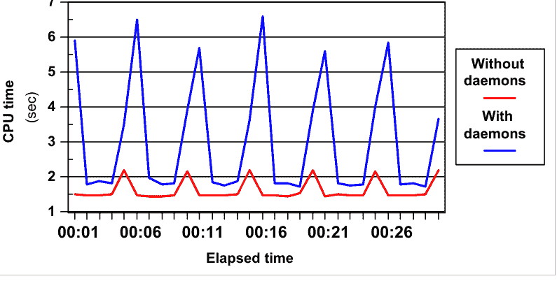

### 不需要的守护进程

`DASD I/O`

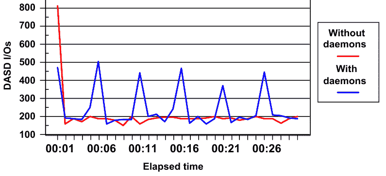

图 9-1 不需要的守护进程对`CPU`和`DASD`使用的影响

`Linux`客户机中可能被认为是不必要的的服务包括：

- `sendmail`

如果`Linux`客户机不需要接收或发送邮件，请考虑停止`sendmail`服务器。

- `anacron`, `atd`, 和`cron`

这些守护进程负责定期间隔启动任务。如果没有自动调度的有用任务，请停止这些服务。

- `autofs`, `nfs`, `nfslock`, 和`portmap`

`autofs`守护进程负责自动挂载文件系统。`nfs`和`nfslock`提供网络文件系统（`NFS`）支持。`portmap`提供`NFS`所需的远程过程调用（`RPC`）服务。

- `lpd` 和`xfs`

打印服务由`lpd`守护进程提供。`xfs`提供`X-Windows`字体。

- `inetd/xinetd`

`inetd`（或其替代者`xinetd`）守护进程管理`FTP`和`Telnet`等`Internet`服务。

- `resmgr`

`resmgrd`是资源管理器守护进程，允许应用程序锁定和访问设备文件。

- `dbus`

`dbus`是`D-BUS`消息线守护进程，用于应用程序之间的通信。

- `hal`

`hal`是硬件抽象层守护进程。它提供了一种统一的方法来管理和控制系统`/dev`树中的设备。

## 9.3 Linux 定时器修改

传统上，`Linux`内核使用以固定速率中断内核的定时器来跟踪时间。在每次中断时，全局变量`jiffies`递增，并检查队列。在专用硬件上，这对性能的影响微乎其微。然而，在`zVM`上运行`Linux`时，这不是一个好主意。

虽然这种跟踪时间的方法可能最高，但`zVM`上`Linux`最大的问题是`Linux`客户机每`10 ms`就会使用一点点`CPU`。这导致`zVM`调度器让客户机留在队列中。因此，`Linux`虚拟机中未使用的内存页无法被修剪。当许多`Linux`客户机持有其工作集时，`zVM`内存很快就会充满。

这个问题通过所谓的“需求定时器补丁”（`demand timer patch`）得到了解决。该补丁包含在`zVM`的`Linux`发行中，如`Novell SUSE SLES8`、`SLES9`、`SLES0` 以及`Red Hat RHEL3 Update 1`、`RHEL5`。

此补丁消除了`10 ms`定时滴答，并将定时器设置为仅在内核需要唤醒时弹出。尽管这并不会让`Linux`客户机真正处于空闲状态，但两次定时器滴答之间的间隔通常足够让`zVM`识别出客户机是空闲的（并在必要时开始提取时间来修剪内存页）。

注意：按需定时器补丁可以通过更改内核配置选项`CONFIG_NO_IDLE_HZ=n`并重新编译内核来启用。或者，可以使用以下方便的方法永久地激活和禁用需求定时器补丁。使用`sysctl`命令在`proc`文件系统中切换设置：

- 1. `sysctl -w kernel.hz_timer=1` 启用`100 Hz`定时器。需求定时器补丁被禁用。

- 2. `sysctl -w kernel.hz_timer=0` 禁用`100 Hz`定时器。需求定时器补丁被激活。

通过向`/proc/sys/kernel/hz_timer`输出值`0`或`1`来动态启用和禁用“需求”定时器补丁（不需要重启但是永久更改，重启后丢失）。

更多细节请参阅链接：`http://www.ibm.com/developer/linux/z90/perf/tuning.html`

### 9.3.1 分析定时器滴答

安装需求定时器后，定时器中断的数量会减少。在某些系统中，定时器中断的数量仍然很高。如果原因不明显，你可以跟踪定时器滴答的数量。

计数定时器滴答的一种简单方法是在虚拟机中运行固定时间的`TRACE`并查看输出。示例 9-2 说明了一个计数定时器滴答的程序。

示例 9-2 用于计数定时器滴答的示例程序

```
/; arg = '' then exit 24
cmd = 'CP SEND
SPOOL PRT PURGE
CP SLEEP 1 SEC
TRACE EXT 100 PRINTER RUN'
CP SLEEP 60 SEC
SPOOL PRT 'CLOSE'
CP SLEEP 1 SEC
TRACE END ALL'
```

程序中的`SLEEP`命令让目标`Linux`运行`60`秒，并在之后关闭池文件。我们执行示例 9-3 中的脚本。

示例 9-3 执行`COUNTEXT EXEC`

```
count rmhtux02
RDR FILE 0180 SENT FROM RMHTUX02 PRT WAS 0018 RECS 0083 CPU
```

池文件消息显示`TRACE`在脚本睡眠的时间内向池文件写入了`83`条记录。预计该数字会根据事件发生变化。

示例 9-5 显示了跟踪输出。

示例 9-5 跟踪`schedule_timeout()`中当前条目的值

```
--> 0010E74 STM 908FF20 >> 005C3E88 CC 0
V0000C40 005C4000 06 L0000C40
--> 0010E74 STM 908FF20 >> 01F49E30 CC 0
V0000C40 01F4A000 06 L0000C40
--> 0010E74 STM 908FF20 >> 005C3E88 CC 0
V0000C40 005C4000 06 L0000C40
--> 0010E74 STM 908FF20 >> 005C3E88 CC 0
V0000C40 005C4000 06 L0000C40
```

> 提示：当调用`schedule_timeout()`时，`current`变量标识了该进程。该进程的`task_struct`位于当前条目前`8192 (0x2000)`字节处。进程标识符 (`PID`) 位于`task_struct`偏移`0x70`处。

使用最后排序的`CMS Pipelines`，针对我们的一分钟间隔按进程划分了管道。通过对`ps -ef`的输出执行`grep`，我们识别出进程名称。

## 9.4 z/VM 下 Linux 的 OSA-Express QDIO 增强

对`Linux qdio`和`qeth`线程的增强可以提高使用千兆以太网或快速以太网`OSA-Express QDIO`的`Linux`服务器效率。千兆以太网吞吐量可提高`40%`，而`VM CP`减少了`50%`。`Novell/SLE10`系统包含了这些`qdio`和`qeth`线程。

## 9.5 基础设施成本

在`z/VM`上运行`Linux`虚拟机时使用的一些资源可以被视为基础设施成本。运行这些实用服务所需的资源无法供`Linux`虚拟机运行业务应用程序。这并不意味着这些实用服务是不可的。然而，这意味着有必要审查服务并查看是否可以实现节省。

### 9.5.1 安装系统

有许多方法可以安装`Linux`系统。新系统可以从现有镜像克隆，也可以对每个系统进行全新安装。对于全新安装，你可以从磁盘、磁带或虚拟卡读卡器进行`IPL`。软件包可以从本地磁盘或远程`FTP`或`NFS`服务器加载。这在独立服务器上安装`Linux`时是这样做的，在虚拟机中安装时也是如此（在`z/VM`上运行`Linux`时，你有一些选项可以自动化安装）。

在独立机器上安装`Linux`时，最重要的是以最少的精力（或最短的时间）完成工作。在`System`或`z/VM`上的`Linux`上，情况有所不同，因为虚拟机共享池化资源。安装新`Linux`系统时使用的资源无法被运行业务应用的的`Linux`虚拟机使用。除非你的`z/VM`系统有大量未使用的资源，否则你可能应该专注于使用最少的资源进行安装。


我们比较了在`z/VM`上安装`Linux`系统的五种方法：

- `RDR` + `FTP` + `Router`

虚拟机通过`IUCV`连接到作为虚拟路由器的`VM TCP/IP`栈。它从虚拟读卡器`IPL`，并通过`FTP`指示`RPM`软件包。

- `RDR` + `FTP`

与第一种方法类似，在这种情况下，`Linux`虚拟机有自己的`OSA`设备。这还避免了`VM TCP/IP`虚拟路由器的成本。

- `QuickStart`

使用单个 (`R/O`) `minidisk`，包含启动系统和`RPM`软件包副本。`minidisk` `IPL`到`ramdisk`（而不是从虚拟读卡器`IPL`）。然后将`minidisk`挂载到`ramdisk`系统中（这避免了网络流量和`FTP`服务器成本）。

- `Breeder`

独立的`Linux`机器（`Breeder`）到目标`minidisks`有`R/W`连接，并将预安装系统拷贝到目标`minidisks`。文件拷贝后，完成了个性化（例如）。这种方法避免了`RPM`软件包的解压。

- `GUI` + `FTP` + `Router`

`SUSE S10`包含了`YaST`版本。尽管这是一个不同的安装程序和内核版本，我们将其包含在内以显示安装方法之间的差异。

> 注意：`QuickStart`方法不应与`Red Hat Kickstart`混淆。通过从配置文件获取参数进行`Kickstart`自动化。不需要用户提示。如果有节省，最大的体现在安装的消除时间上，因此也在内存使用上。对于`SuSE`，有`Auto-YaST`等选项，但我们的版本仍然缺少对`Linux on z`至关重要的安装选项。

对于每个测试，我们安装了相同的最小软件包集，足以获得一个可运行的`Linux`系统。该集合中的 130 个软件包大约有 140 MB 的`RPM`文件需要加载。在安装期间解压时，在根设备上产生了 200 MB 的数据。

`Breeder`安装过程是...

## 内存使用比较

安装`Linux`系统的最终成本因素是内存利用率。虽然我们没有关于安装过程中虚拟机工作集（working set）的完整数据，但对于`Linux`虚拟机，通常将虚拟机的大小乘以经过的时间就足够了。对于`ramdisk`安装系统，所虚拟虚拟机大小约为 128 MB。

对于图 9-5 中的图表，我们在适用情况下包含了`FTP`服务器和`TCP/IP`栈的部分内存使用情况。

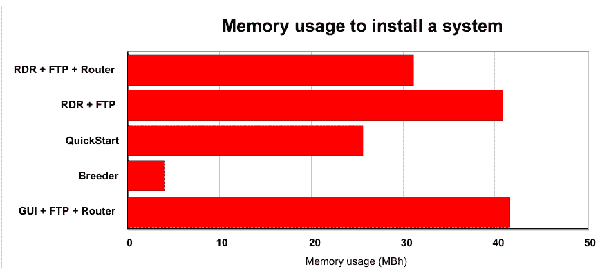

图 9-5 系统安装的内存使用

## 结论

使用高效的安装过程可以节省大量的资源。如果你创建大量的`Linux`系统，或者想要快速交付新系统，这是一个重要问题。

## 9.6 虚拟处理器的性能影响

为`Linux`虚拟机分配虚拟处理器可以是使`System z`资源与预期工作负载匹配的有效手段。整体吞吐量会受到分配给`Linux`虚拟机的处理器数量的影响。

### 9.6.1 为 Linux 客户机分配虚拟处理器

`CP`共享定义给`z/VM LPAR`的所有物理处理器。所有虚拟机似乎都至少有一个处理器（称为基础虚拟处理器）。可以使用`CP DEFINE CPU`命令向虚拟机添加额外的虚拟处理器。如图 9-6 所示，虚拟处理器共享物理处理器资源。

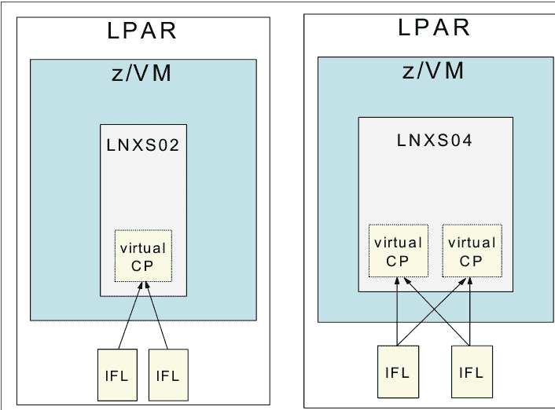

图 9-6 虚拟机中的虚拟处理器

在图 9-6 中，`Linux`客户机`LNXS02`拥有两个物理`IFL`的访问权限。然而，由于它是一个虚拟单处理器，一次只能有一个`IFL`运行。`Linux`客户机`LNXS04`定义为有两个虚拟处理器。每个虚拟处理器都利用`LPAR`中的物理`IFL`。

### 9.6.2 衡量虚拟处理器的影响

向虚拟机中添加虚拟处理器可以提高处理器受限工作负载的性能。为了检查为`Linux`客户机定义虚拟处理器的影响，我们考虑了`WebSphere Performance Benchmark Sample`。在三层配置中使用`WebSphere Performance Benchmark Sample`，我们确定了负载中每个组件在处理器资源方面的相对成本：

- `WebSphere`应用服务器
- `HTTP`服务器
- `DB2`服务器

> 注意：我们在每个组件自己的虚拟机中运行它，并测量了在运行五个并发客户端的模拟期间消耗的处理器资源。每个虚拟机花费的处理器时间归属于在相应`z/VM`客户机中运行的`WebSphere Performance Sample`组件。

在图 9-7 中，我们检查了改变虚拟处理器数量对`CPU`利用率的影响。在这种场景下，两个`IFL`专用于`z/VM LPAR`。运行`IBM HTTP`服务器和`DB2`服务器的`Linux`客户机都以单个虚拟处理器（默认）运行。分配给`WebSphere`客户机的虚拟机数量从一个到四个不等。

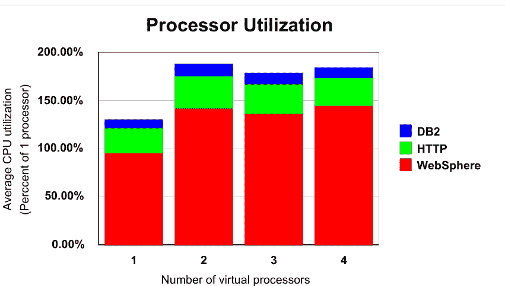

图 9-7 衡量虚拟处理器对`CPU`利用率的影响

从图 9-7 可以看出，此负载是处理器受限的。当只有一个虚拟处理器时，运行`WebSphere`的客户机消耗了单个物理处理器的 95% 以上。当为客户机分配两个虚拟处理器时，处理器利用率增加到 143%。注意，将虚拟处理器的数量超过物理处理器的数量不会增加`WebSphere`客户机的`CPU`利用率。

## 虚拟处理器对 CPU 成本的影响

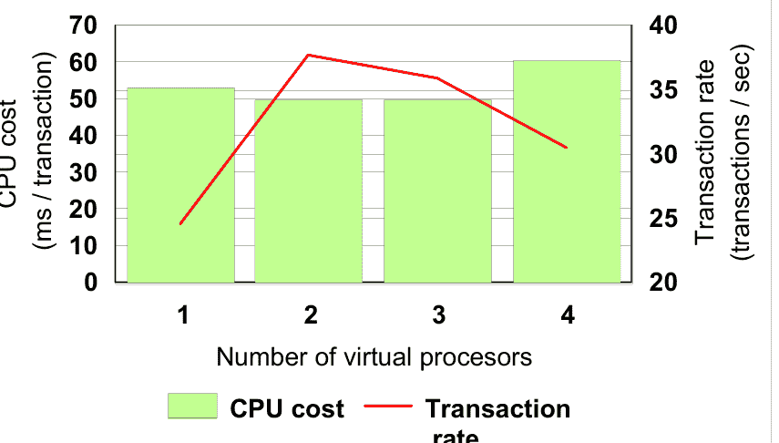

图 9-8 衡量添加虚拟处理器的成本

在图 9-8 中我们看到，当虚拟处理器数量与物理处理器数量匹配时，平均事务成本略微下降。更重要的是平均事务率显著增加。但注意，当虚拟处理器数量超过物理处理器数量（本例中两个）时，整体事务率下降，每笔事务成本增加。这是由于`CPU`产生的额外调度开销。

当`Linux`客户机运行处理器受限的工作负载时，我们建议：

- 为客户机虚拟机定义与`LPAR`可用物理处理器数量相同的虚拟处理器。
- 绝不要为客户机虚拟机定义的虚拟处理器数量超过`LPAR`可用的物理处理器数量。

## 10

## 为 z/VM Linux 客户机调优磁盘性能

本章介绍了针对`z/VM Linux`客户机的直接访问存储设备 (`DASD`) 和`SCSI`磁盘调优。主题包括：

- 磁盘和访问选项
- `z/VM`和`System z Linux`中的磁盘设置
- 影响磁盘`I/O`的因素
- 磁盘操作的最大化

### 10.1 System z Linux 的磁盘选项

磁盘设备有很多选项可选。有直接访问存储设备 (`DASD`)、小型计算机系统接口 (`SCSI`) 磁盘，以及`z/VM`控制的设备（如`minidisk`）。某些设备能够使用不同的协议和访问方法进行通信。

### 10.1.1 使用 ECKD 或 DIAGNOSE 的 DASD

`System z Linux`支持如`3390 Mod. 3`、`3390 Mod. 9`等`DASD`设备。这些设备由子系统管理。不同的访问方法可以使用。使用`ECKD`访问`DASD`。较慢的`ESCON`通道仍然支持，但提供了更快的`FICON`适配器。最新的发行版使用`DIAGNOSE`访问64 位`Linux on System z`（需要`z/VM 5.2`或更高版本）。

### 10.1.2 SCSI 磁盘

`FCP`允许`System z`访问`SCSI`设备以及这些由`z/VM`控制的设备。这种连接方式提供了多种存储解决方案，并可以使用现有的设备。`FCP`支持意味着`Linux on System z`可以访问。

### 10.1.3 z/VM minidisk

`FCP`允许`System z`访问`minidisk`以及这些由`z/VM`控制的设备。这种连接方式提供了多种存储解决方案，并可以使用现有的设备。`FCP`支持意味着`Linux on System z`能够访问。

## 10.2 影响磁盘 I/O 的因素

在本节中，我们将影响`I/O`的因素。

### DASD I/O

在评估`DASD I/O`性能时，整体响应时间由几个部分组成，如图 10-1 所示。

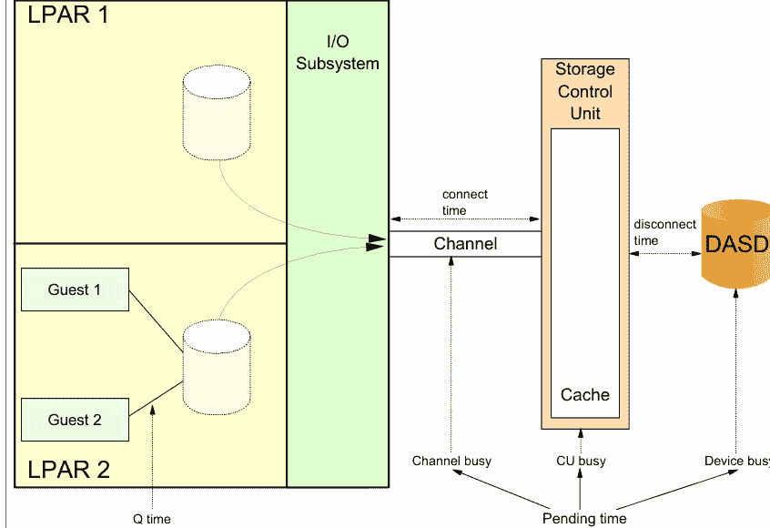

图 10-1 整体响应时间的组件

这些组件是：

- 队列时间：队列时间是多个用户同时访问设备的结果。如果设备正在处理某个`I/O`请求，额外的`I/O`请求将在队列中等待。`I/O`请求的长度变化最大，在负载负载下，它可能是最严重的。高队列时间可能表明操作系统竞争，或者设备服务时间较高（因为`I/O`请求完成时间较长，其他用户的服务请求会导致队列）。
- 连接时间：连接时间是在通道上传输数据的实际时间，对于 4 K 数据块，通常小于 2 ms。
- 等待时间：等待时间是启动`I/O`操作所需的时间。通常这少于 1 ms。高等待时间反映了`I/O`路径上的竞争。这可能是由于通道、控制单元或`DASD`设备上的竞争。


- **断开时间**：断开时间是控制单元访问数据所需的时间。包括旋转延迟、寻道延迟、缓存管理以及控制单元内部的处理。在缓存控制器上断开时间通常小于 2 到 3 ms。

- **服务时间**：服务时间是等待时间、连接时间和断开时间的总和。

- **响应时间**

  响应时间是队列时间和服务时间的总和。

## SCSI I/O

在评估 `SCSI` I/O 性能时，整体响应时间由几个部分组成：

- **队列时间**

  如果设备正忙于处理 I/O 请求，额外的 I/O 请求将会在队列中等待。I/O 请求等待队列的时间即为队列时间。这可能是波动性最大的部分，在重负载下可能是最严重的问题。高队列时间可能意味着操作系统的争用，或者交换网络（fabric）延迟较高（因为 I/O 请求完成所需的时间较长，其他用户的服务请求会导致高使用设备出现排队）。

- **交换网络延迟（Fabric latency）**

  这是从进入交换网络到返回的时间。这包括在存储子系统和交换机所需的全部时间。

- **通道延迟（Channel latency）**

  在通道中完成请求花费的额外时间。

## 10.3 观察磁盘性能

我们使用资源管理工具监控性能并识别性能问题。收集数据有多种方法。除了在线工具，还有 `ECKD` 和 `SCSI` 统计数据。

### 10.3.1 DASD 统计数据

Linux 可以收集 Linux 可见的 `DASD` 活动性能统计数据。数据收集由 `DASD` 驱动程序执行。

**示例 10-1 DASD 统计数据 - 如何使用**

```
开启：
echo > /proc/dasd/statistics
关闭：
echo > /proc/dasd/statistics
重置：先关闭再重新开启
可以通过 /proc/dasd/statistics 读取整个系统的数据
可以通过 tunedasd -P /dev/dasd 读取单个 DASD 的
```

更多详细信息请参阅以下网站：

```
http://www.ibm.com/developerworks/linux/linux390/perf/tuning_how_tools_dasd.html
```

### 10.3.2 SCSI 统计数据

Linux 内核 2.4 版本的 `FCP` 设备驱动程序为 Linux z 上的 `SCSI` 设备提供了 I/O 流量模式的一些基本统计数据。

对于 `Novell/SUSE` 内核版本 2.4.21-25 及更高版本，设备会为每个 `FCP` 子通道收集独立的统计数据。统计数据默认关闭，可以按照下文描述进行激活。

更多细节请访问：

`http://www.ibm.com/developerworks/linux/linux390/perf/tuning_how_tools_fcp.html`

### 10.3.3 使用 z/VM 工具监控磁盘统计数据

图 10-2 显示了每个 `DASD` 卷可用的一些统计数据。由于现代磁盘硬件拥有自己复杂的管理接口，调优的关键性已远低于过去。在决定是否实现诸如 `miniscache` 等功能（这些功能在 I/O 链中更靠前，更靠近应用程序）时，有必要在设备级别分析并理解现有的访问模式，以及读、写的相对数量。如今在架构良好的系统中，设备级争用要高得多，但如果出现问题，或者你寻求实现最高水平优化，这些统计数据示例将证明非常有用。所示的列表来自 `IBM PAF`。磁盘统计数据在 `VM Performance Tuning Comparison` 工具中也可用。

```
2600.Resp
2600.Olen
2600.Serv
2600.Util
2600.IDrate
2600.Blocks
2600.DiscBlock
2600.MDCSach
2600.Writes
2600.Reads
2600.IDrate
2600.Block
2600.Conn
2600.IDisc
2600.Pend
2600.Queue
2600.QueueQF
2600.Resp
2600.Resp
*get*
请求者，卷 IL1900 (每毫秒)
队列长度，卷 IL1900 (请求的 SSCH 数数)
服务时间，卷 IL1900 (每毫秒)
SSCH 请求时间
设备利用率，卷 IL1900 (数量)
拒绝的 SSCH，卷 IL1900 (4096 字节，卷 IL1900 (每秒数量)
磁盘状态，卷 IL1900 (每份)
磁盘状态，卷 IL1900 (每份)
由 MiniDisk 满足的 SSCH，卷 IL1900 (数量)
写操作，卷 IL1900 (数量)
读，写，MDCSach
连接状态，卷 IL1900 (数量)
挂起状态，卷 IL1900 (每毫秒)
队列深度 (每毫秒)
已请求请求，卷 IL1900 (数量)
请求者等待，卷 IL1900 (毫秒)
IO.Conn.IO.Pend.Queue
```

图 10-2 后处理文件中的简短磁盘信息和图表

图 10-2 注意，此卷及其他卷可用更高级别的细节。

第 10 章 为 z/VM 客户调优磁盘性能

图 10-3 所示的图表显示了 `DASD` 卷响应时间和整体 I/O 速率的示例。平均响应时间为每次 I/O 略高于一毫秒，对于该系统来说相对良好。平均 I/O 速率为每秒 130.9 I/O。输出来自 `PAF` 工具。


图 10-3 响应时间和 I/O 速率图

图 10-4 响应时间和 I/O 速率图显示了单个卷的响应时间和整体 I/O 速率的细分，显示了挂起时间和连接时间，输出来自 `PAF`。

| 响应时间和 I/O 速率 | 速率 | 响应时间 (每次 I/O) |
|---|---|---|
| `10_Resp` | avg 3157 | 32665 |
| max | 32665 | |
| `10_Queue` | avg 00000 | 00000 |
| max | 00000 | |
| `10_Pend` | avg 10583 | 74498 |
| max | 29990 | |
| `10Disk` | avg 69660 | 16325 |
| max | 84855 | |

## 10.4 最大化磁盘性能


`SCSI` 通过交换机进行连接并使用光纤通道协议 (`FCP`)。

## ECKD DASD 与基于 FCP 的 SCSI 对

传统的 z I/O 使用通道子系统并发布 `CCW` 来访问 `ECKD`、`CKD` 或 `FCP` 磁盘。在 Linux 等操作系统中，这需要从面向块的块设备转换为 `CCW` 链。对于 `ECKD` 协议，它们由于不使用计数（count）和键（keys）信息。通道子系统将 `CCW` 传输到存储子系统。存储子系统与标准 `SCSI` 磁盘配合，而通道程序将其格式化回固定块格式。见图 10-5。

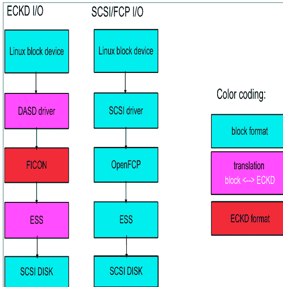

图 10-5 磁盘访问转换

关于 `SCSI` 和 `ECKD` 磁盘性能的数可以在此处获取：

`http://www.ibm.com/developerworks/linux/linux390/perf/tuning_res_dasd_ds8000_ECKD.html`

## 存储子系统的代际

当从一代存储子系统迁移到下一代（选择后继型号）时，可以观察到性能最大的变化。缓存通常更大，存储子系统的性能大幅提升。

> **注意**：请记住，更短的运行时间会有副作用。随着吞吐量的增加，我们需要更多的 CPU 来驱动 I/O。当我们从旧存储服务器迁移到新存储服务器，或者在使用 `SCSI` 磁盘而非 `ECKD` 时，将 1 或 2 Gbit 通道替换为 4 Gbit 通道以获得更高吞吐量时，情况确实如此。

### 10.4.5 DASD 块大小

格式化 `dasdfmt` 大小提供了使用不同硬块大小格式化 `DASD` I/O 的选项。4096b 的 `dasdfmt` 大小在格式化 `DASD` 设备后，在 `IOZone` 基准测试吞吐量和可用磁盘空间方面显示出结果。进一步测试表明，该结论独立于应用程序发布的请求大小。即使是小型应用程序请求（即 512b），在 4096b 的 `dasdfmt` 大小下也显示出最佳吞吐量。

### 10.4.6 IBM 存储子系统缓存模式

缓存模式是存储子系统用于优化其缓存命中率的策略。

## ESS 缓存模式

Linux `FCP` 驱动使用 `ESS` 子系统运行模式：正常缓存替换。该模式无法针对 `FCP/SCSI` 进行更改。这使得 `ESS` 能够根据实际 I/O 模式在标准算法之间切换。这是首选设置，对于 `DASD ECKD` 磁盘也是如此。

子系统运行模式可以为每个 `DASD` 设置，并持续到 Linux 系统的下次重启。重启后，模式将恢复为默认值。如果您想为特定的 `DASD` 永久设置该模式，请在 Linux 启动脚本中包含模式切换（例如，将命令添加到 `/etc/init.d/rc3.d` 中相应的运行脚本中）。

在存储服务器上定义缓存。现代企业级存储服务器 (`ESS`) 支持以下缓存模式：

- **正常 (normal - 正常缓存替换)**


# 缓存模式建议

我们建议使用此模式。从 `SLES 8` 和 `Red Hat RHEL` 开始，它多年来一直是默认模式。缓存由 `ESS` 标准算法管理。这是 `FCP/SCSI` 的默认值，也是 `Normal/SLES9` 和 `Normal/SLES8` 中 `ECKD DASD` 的默认值（从带有 Linux 内核 Service Pack 3 + 安全更新的 Release 20040112 开始）。

## 缓存模式详情

### 旁过 (bypass)
不使用缓存。这是一个特殊模式，应谨慎使用。对于随机 `I/O`，性能中等。

### 抑制加载 (in way)
加入缓存的跟踪项被缓存在最近未使用 (`LRU`) 列表的中间，这会导致项过早从缓存中移除。这是一种特殊模式，应谨慎使用。对于随机 `I/O`，性能良好。

### 顺序 (sequential)
被添加的跟踪项被缓存在 `LRU` 列表的中间，这会导致项过早从缓存中移除。这是一种特殊模式，应谨慎使用。（注：此处原文描述可能与上下文逻辑略有冲突*）

### 预留 (prestage)
对于随机 `I/O`，顺序模式性能良好。

### 记录 (record)
对于随机 `I/O`，性能良好。

## DS8000

`ESS` 缓存模式提供以下内容：

### 计算 8000
* 根据实际 `I/O` 模式在标准算法之间切换
* 根据主机需求，在缓存中进行预取数据
* 让 `ESS` 能够根据实际 `I/O` 模式进行自适应

### tunedasd 命令
使用 `tunedasd` 命令来切换系统模式。
* `tunedasd -g` 获取当前缓存行为
* `tunedasd -c` 设置缓存模式

## 多路复用 - 故障转移模式与多总线模式

多路复用输出（Multipathing I/O）是一种通过总线、交换机和其他设备的多条路径连接计算机系统和存储设备的方法。多路复用增加了系统的稳定性和弹性。多路复用有两种选项：

* **多总线（Multibus）** 是一种负载均衡选项。请注意，多总线实现的负载均衡类似于 `System z` `FICON` 通道组中常见的负载共享。
* **故障转移（Failover）** 是一种高可用选项。与多总线相比，故障转移模式具有更好的性能、更低的 `CPU` 成本并能确保更佳的吞吐量。

关于如何使用多路复用以及测量结果的更多信息，请参阅此处：`http://www.ibm.com/developerworks/linux390/perf/how_dasd_multipathing.html`

## 并行访问值 (PAV)

`IBM Total Storage Systems` 和 `IBM Total Storage Server` 的并发操作能力允许系统并行访问卷，这意味着它可以从系统向或从同一个卷并发传输数据。可以被并行访问的卷被称为并行访问值（Parallel Access Value）。

使用 `PAV` 时，应用程序或系统可以支持多个用户或进程对逻辑卷的同步访问。读取操作可以同时访问，但写入操作只能并行访问不同的域。为了维护数据完整性，对同一域的写入必须序列化。`I/O` 操作指定到其适用的扩展范围（extent）。

`z/VM 5.2` 支持 `PAV` 作为 `Linux` 和 `zOS` 等虚拟机操作系统的微磁盘（minidisks），这些系统可以利用 `PAV` 架构。要使 `z/VM 5.2` 使用 `PAV` 功能，设备必须专用于这些虚拟机。`IBM DASD PAV` 卷必须在 `z/VM` 中定义为具有 `3390` 型 `2`、`3` 或 `9` 的 `DASD`，这也支持对 `3390` 型 `2` 或 `3` 的兼容性。

通过 `PAV`，存储系统可以将同一个物理卷作为基设备以及一个或多个别名（aliases）呈现。在 `System z` 上，基设备和别名都被分配了不同的设备号。图 10-8 展示了一个卷的基设备与别名设备之间的关系。

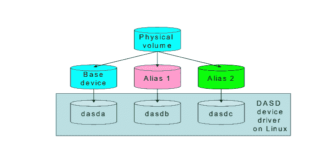

图 10-8 物理卷的基设备与别名设备之间的关系

在图 10-8 中，卷空间可以作为基设备或两个别名访问。基代表真实的 `DASD` 卷空间，而别名是基的影子。别名没有自己的空间，但映射到同一个物理卷上。

如果 `Linux` 系统访问基设备及其别名，`DASD` 驱动程序会将基设备和每个别名识别为不同的独立的 `DASD`，并为它们中的每一个分配不同的设备名称，如图 10-8 所示。在对 `DASD` 分区且所有基设备和别名都重新初始化后，`DASD` 驱动程序会识别分区并为基设备和别名上的分区分配设备名称，如图 10-9 所示。

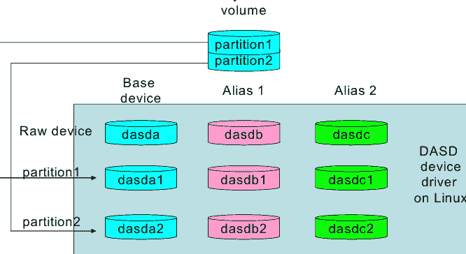

图 10-9 从 `Linux` 虚拟机看到分区后基设备与别名设备的关系

## 如何使用 PAV

`PAV` 卷既可以作为 `DASD` 也可以作为微磁盘使用。区别在于谁应该负责优化 `I/O` 性能。当用 `PAV` 卷作为专用 `DASD` 时，`PAV` 的性能益处取决于 `Linux` 虚拟机如何管理它们；而在将 `PAV` 卷作为微磁盘的情况下，`z/VM` 应该负责优化多个虚拟机所用卷的 `I/O` 性能。

## 将 PAV 卷作为专用 DASD

`PAV` 设备可以作为专用 `DASD` 提供给运行在 `z/VM` 的 `Linux` 虚拟机。一旦基设备和关联别名连接到 `Linux` 虚拟机，它就应该管理它们的使用。`z/VM` 不通过基设备和别名优化 `I/O`。真实的卷无法专用于多个虚拟机。在这种专用环境中，`PAV` 的性能益处完全取决于 `Linux` 虚拟机。

示例 10-3 和第 161 页的图 10-10 展示了一个具有两个物理卷的 `Linux` 虚拟机，每个卷都有基设备和别设备。`z/VM` 将设备分配给 `Linux` 虚拟机，`DASD` 驱动程序在其上识别为不同的 `DASD`。

### 在 USER DIRECTORY 中的 Linux 虚拟机条目

```
USER LINUX01 LNXME 2G
INCLUDE LNXOF
DEDICATE 1000 E100
DEDICATE 1001 E200
DEDICATE 1002 E201
DEDICATE 1003 E101
DEDICATE 1004 E202
DEDICATE 1005 E203
```

第 160 页的示例 10-3 显示了 `z/VM USER DIRECTORY` 中的 `Linux` 虚拟机条目。在此示例中，物理卷 `E100` 和 `E101` 适用于该虚拟机。每个物理卷都有别名（从 `E200` 到 `E203`），并且也适用于该虚拟机，如图 10-10 所示。`z/VM` 将这些设备作为虚拟卷分配（1000 到 1005），`Linux` 看到不同的卷。这些卷可以配置多路复用，然后使用 `LVM` 或逻辑卷管理器通过条带组织成卷组。`Linux` 虚拟机应该自己管理并优化 `PAV` 卷以获得更好的性能。

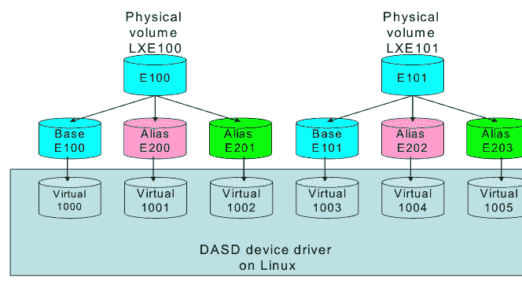

图 10-10 从 `Linux` 看到的物理卷关系

## 将 PAV 卷作为微磁盘

当 `PAV` 卷被用作微磁盘时，它们以相同的方式支持满容量和非满容量微磁盘。每个物理卷都有一个基设备和零别名。只有当真实卷上有满容量微磁盘时，`z/VM` 才会自动选择适当的域来优化 `I/O` 性能。第 161 页的图 10-11 展示了将 `PAV` 作为微磁盘。有两个物理卷 `VOL001` 和 `VOL002`，每个卷都有基设备和别名设备。在 `z/VM` 的 `USER DIRECTORY` 中，`DEV1` 被定义为满容量微磁盘，位于卷 `VOL001` 上，并由三个虚拟机链接。

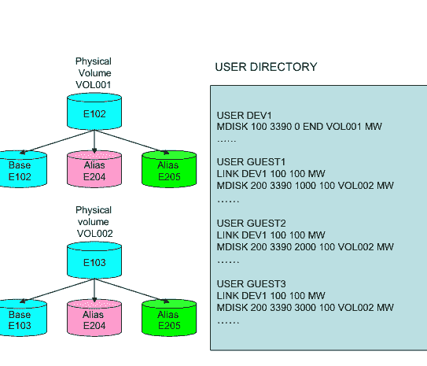

图 10-11 将 `PAV` 作为微磁盘使用

## 性能监控

`z/VM` 性能工具包提供了关于物理设备响应时间和相关性能统计的报告。使用性能工具包中的 `DEVICE` 命令可以访问报告。

### 示例 10-4 性能工具包中的 DEVICE 报告

| 设备描述 | Midisk Pa- | <速率/s-> | --------- 时间 (毫秒) | ------> 请求. |
| :--- | :--- | :---: | :--- | :--- | :---: |
| 地址类型 | 标签/ID | 链接 | I/O | 避免 | 等待 | 磁盘 连接 | 服务 | 响应 | 权重 | .0 |
| C0730 | LX0730 | 1 | 40.1 | 36.3 | .4 5.7 2.3 8.4 4.8 .0 | .0 |
| C0740 | LX0704 | 1 | 4 | 1.2 | .3 3.0 1.5 4.8 4.8 .0 | .0 |
| C0750 | LX0705 | 1 | 4 | .5 | .3 1.4 7 2.2 2.4 .0 | .0 |
| C0706 | LX0706 | 1 | 4 | .0 | .3 1.7 6 2.6 2.6 .0 | .0 |

示例 10-4 展示了来自性能工具包的报告。在调整磁盘性能的 `PAV` 时，以下列具有参考价值：

* `I/O` 是设备的 `I/O` 速率，单位为每秒操作数。
* `Serv`（服务时间）是设备执行单次 `I/O` 时花费的平均时间（毫秒）。


- `Resp`（响应时间）是虚拟机接收到 `I/O` 访问 `mindisk` 卷的平均时间（毫秒）。响应时间包括服务时间和等待时间（也称为队列时间）。

- `Req Queued`（已队列请求）是物理设备的队列平均长度。即排队等待使用该卷的 `I/O` 平均数量。

通常情况下，当你通过观察性能工具包中的 `Req Queued` 发现某个卷正在经历排队时，请为卷添加别名（`aliases`），直到耗尽别名能力或队列为空。调整 `PAV` 的策略是根据别名的数量估算队列深度，并为 `I/O` 速率使卷等待队列为空的卷添加别名，以先到者为准。

更多信息请访问：

- `z/VM PAV` 支持

`http://www.vm.ibm.com/storman/pav/pav2.html`

- 性能报告

`http://www.vm.ibm.com/perf/reports/zvm/html/index.html`

# 10.4 Linux I/O 调度器

`I/O` 调度器优化了磁盘访问。将每个请求直接发送到磁盘会导致吞吐量不理想，因为这种策略会产生大量的小请求，在最坏的情况下，每个请求都需要完全不同的磁盘区域。物理磁盘的数据传输率非常高，因此传输时间非常短。访问时间的主导部分是磁盘延迟，主要由平均 8 毫秒的磁盘磁头移动引起。优化策略是尽可能地减少 `I/O` 操作次数和磁盘磁头移动次数。

`I/O` 调度器主要实现两个功能：

- 请求合并（`Request merging`）

  这会将相邻的请求合并为一个请求。

- 电梯算法（`Elevator`）

  它根据物理数据位置对请求进行排序，以最小化寻道时间。（寻道时间是磁头移动到指定扇区的持续时间）。需要防止饥饿的功能，以确保不在寻道顺序中的请求能够在适当的时间范围内得到处理。在这里，不同的 `I/O` 调度器采用不同的策略。

# 内核 2.6 之后的新调度器

`Linux` 内核 2.6 提供了新的新的调度器：

- `Noop` 调度器

  `noop` 调度器仅实现请求合并功能。

- `Deadline` 调度器

  `deadline` 调度器实现了请求合并和电梯算法，此外通过为每个请求引入截止时间（`deadline`）尝试防止请求饥饿（这可能由电梯算法引起）。它更倾向于读取者。`Linux` 不会延迟写入过程直到其数据真正写入磁盘，因为它缓存了数据，而会等待数据可用。

- 预取性调度器（`Anticipatory scheduler`）

  预取性调度器实现了合并和电梯算法，并通过避免过多的磁头移动来针对物理磁盘进行优化。它试图解决许多写入请求被少数读取请求中断的情况。在读取操作后，它会等待一段时间以等待另一个读取请求，而不是立即切换回其他请求。该调度器不打算用于存储服务器。

- 完全公平队列调度器（`cfq scheduler`）

  完全公平队列调度器实现了请求合并和电梯算法，此外还对策略进行了基准测试，允许特定驱动器的所有用户在给定时间内获得相似数量的 `I/O` 请求。

# 默认值

内核 2.6 长期一直是预取性调度器。`Novell/SUSE SLES9` 和 `Red Hat RHEL4` 安装已用 `cfq` 调度器覆盖了它。从内核 2.6.18 及更高版本开始，默认是 `cfq` 调度器。

# 当前调度器

在 `/var/log/boot.msg` 文件中搜索 `"io scheduler"` 字符串，可以找到如下行：

```
<Using deadline io scheduler
```

这会返回正在使用的调度器名称。

# 如何选择调度器

`I/O` 调度器通过 `zippl.conf` 中的 `elevator` 参数选择。

示例 10-5 带有 `elevator` 参数的 `/etc/zippl/conf`

```ipl
target = /boot/zippl
image = /boot/image
randisk = /boot/initrd
parameters = "maxcpus=8 dasd=5000=/dev/dasdal elevator=deadline*"
```

其中 `elevator:=` 可为 `deadline cfq | hoop`。

详情请见 `/usr/src/linux/Documentation/kernel-parameters.txt`。

### 10.4.10 Linux 磁盘 I/O 设置

磁盘 `I/O` 的吞吐量和成本取决于我们是向磁盘进行直接 `I/O` 还是使用文件系统。使用直接 `I/O` 的前提是系统准备好接管文件系统充分利用的一些功能。使用 `DBMS` 的实验，，过文件系统的 `DASD` 和 `SCSI` 磁盘在吞吐量和成本方面具有良好前景的结果。

## 10.4.11 Linux 文件系统

除了今天传统的 `ext2` 文件系统外，`Linux` 分发版中还包含了各种日志文件系统（`journaling file systems`）。由于它们各有优缺点，我们无法推荐特定的文件系统。性能取决于许多文件、负载以及访问类型（顺序或随机）。日志文件系统与非日志文件系统相比存在开销，但强烈建议使用它，因为数据丢失发生较少且恢复时间短得多。

最常用的是 `ext3` 文件系统，因为它稳定且是在在 `ext2` 之上开发的。许多因素（如应用程序和工具）影响对使用何种系统的决定。`ext3` 的另一个优点是提供了 `ext2` 的无缝迁移。只需执行 `"tune2fs -j <partition>"` 即可挂载文件系统。如果存在数百 `GB` 的数据且不想中断生产、备份和恢复数据，`ext3` 是你的选择。

显示文件系统性能影响的结果请见：

`http://www.ibm.com/developerworks/linux390/perf/tuning_journaling.htm`

## 10.4.12 预取设置

环境中的多个组件都是执行预取的候选。如果按顺序读取数据或数据实体很大，这样做是有意义的：

- 应用程序

- `LVM`

- 块层

- `ESS`

相反，低命中率高 `I/O` 负载的性能受到预取操作的影响。

上述每个组件都会发出预取活动。这导致了比请求更多的 `I/O` 活动。所有组件都假设后续数据单元很快会被需要：

- 每次数据库读取，应用程序都可能尝试用数据页填充其缓存。

- 对于每个页，逻辑卷管理器会为后续文件块获取一组页。默认的 `1024` 页太高了，会导致此类负载的性能下降（但一旦更改，该值不能高于 `255` 页）。

- `Linux` 块设备层也可能为每个读取请求添加一些页。对于每个文件块，`ESS` 获取一组后续的磁盘块（如果逻辑卷经过条带，则涉及多个磁盘）。

对于最可能需要的数据，管理缓存和缓存抖动的开销很大。大量的物理磁盘读取请求结合寻道和延迟方面的物理限制，限制了数据库访问的速度。降低预取的默认设置可以保持数据传输路径为请求的数据服务。


# 网络考虑因素

在本章中，我们将提供有关 `Linux System z` 和 `z/VM` 架构上可用网络选项的信息。这些选项会影响整体性能，应在实施解决方案之前进行识别和定义。在本章中，将讨论以下主题：

- 网络选择指南

- 网络配置参数

- `z/VM 5.3` 增强

- 高速套接（`Hipersockets`）

- 调优建议

## 11.1 选择网络选项

本节描述了用于将 `System z` 上的 `Linux` 连接到外部网络的不同选项。`Linux` 可以可以直接使用网络，也可以通过 `z/VM` 管理的服务使用网络。在不同解决方案之间的选择会影响整体性能。

### 11.1.1 物理网络

`Linux` 可以安装在 `LPAR` 上以及 `z/VM` 之下。对于 `LPAR` 上的 `Linux`，我们唯一的选择是直接连接到网络，将操作系统直接连接到 `OSA` 适配器，如图 11-1 所示。

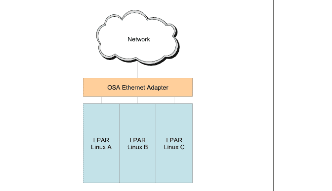

图 11-1 直接连接网络

`z/VM` 也可以实现直接连接网络，此外，在 `Linux` 客户端 `USER DIRECT` 定义上的 `DEDICATE` 命令可以实现这一点。这意味着 `Linux` 直接控制网络接口。这可以用于没有需要管理的镜像的场景。

仅使用一个适配器可能会导致单点故障。如果 `OSA` 适配器故障，`Linux` 将不再可用。为了避免这种情况，可以复制网络连接并使用诸如虚拟 `IP` 地址等高可用解决方案。这通常会引入管理动态路由的协议，结果是实现了完全的高可用性，但管理路由的产品（如 `zebra` 和 `ospf` 进程）会引入一些开销。如果你想在 `z/VM` 下的 `Linux` 上使用高可用解决方案，我们建议使用11.1.2节（第171页，“虚拟网络”）中描述的由 `VSWITCH` 管理的虚拟化网络。

你需要考虑 `Direct OSA` 连接比 `VSWITCH` 快一点。图 11-2 是一幅图，显示了 `Direct OSA` 连接与 `VSWITCH` 管理的每秒事务请求。这些性能数据是使用 `TCP` 请求和响应时间管理的。有关本章所用测试的更多信息，请参考第 189 页的 11.6 节，“工作负载和性能工具”。

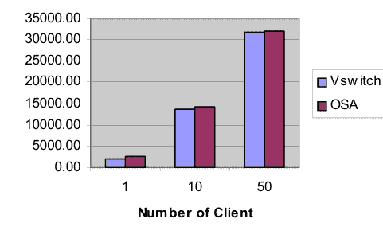

图 11-2 `RR` 测试的 `Trans/sec` 报告


图 11-3 显示了与图 11-2 场景相同的 CPU 使用情况。你可以看到，`VSITCH` 连接比直接连接消耗更多的 CPU。

## 总 CPU msec/trans 第3 层

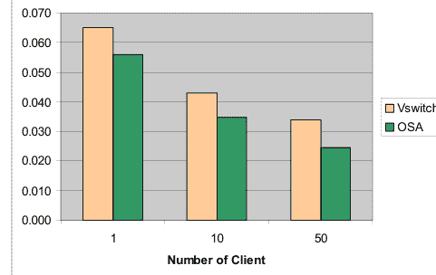

图 11-3 RR 测试的 CPU CPU msec 报告

在流式基准测试中，差异更为明显。图 11-4 和图 11-5 使用流式基准测试提供了相同的两张图。

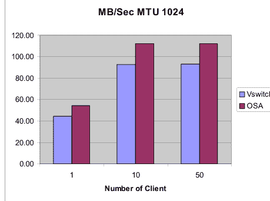

图 11-4 STR 测试的 MBps 报告

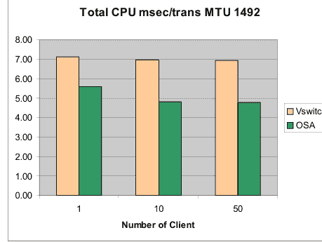

图 11-5 STR 测试的总 CPU msec/trans 报告

在图 11-6 中，所有网络连接都是通过连接-响应（CRR）测试测量的。

## 网站访问，10并发连接，SLES10

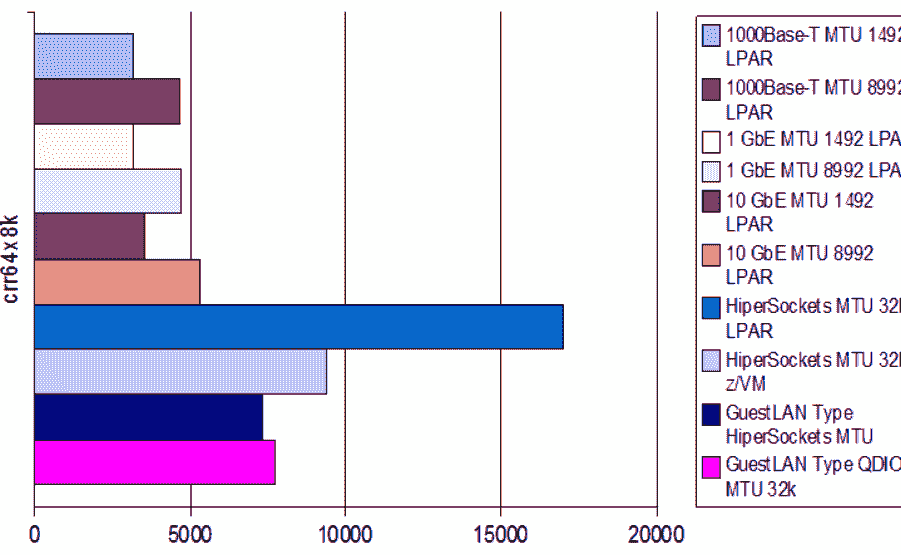

图 11-6 连接测量

如第189页的11.6节“工作负载和性能工具”所示，`CRR` 是一种模拟网站连接的特殊基准测试。该测试让您了解真实应用程序场景下的情况。图 11-6 显示了高速套接在吞吐量方面是最好的。在这些结果中，你可以看到新的 `10Gbbit` `OSA` 卡性能优于其他 `OSA` 卡。

### 11.1.2 虚拟网络

当使用 `zVM` 控制网络中的 `Linux` 时，可以使用虚拟网络。过去几年中部署了许多改进以整合网络架构并提高其效率。从 `CTC` 和 `IUCV` 点对点链路我们可以使用基于虚拟交换的新增强。引入虚拟交换（`VSSWITCH`）是为了消除用于路由外部网络或 `zVM` `TCP/IP` 路由功能的 `Linux` 镜像。使用这种架构，您不需要使用任何镜像来执行。

| 网络类型 | 可用性 | 性能 |
| :--- | :--- | :--- |
| `CTC` 点对点 | `zVM` `TCP/IP` 栈单点故障 | 差 |
| `IUCV` 点对点 | `zVM` `TCP/IP` 栈单点故障 | 差，但优于 `CTC` |
| `Linux` 路由器 | `Linux` 路由器单点故障 | 比点对点快 |
| 冗余 `Linux` 路由器 | 无单点故障 | 差（取决于类型和 `CPU` 数量） |
| 虚拟交换 (`VSW`) | `TCP/IP` 控制器单点故障 | 好 |
| 冗余虚拟交换 | 无单点故障 | 好 |
| 虚拟交换链路聚合^a | 无单点故障 | 极好（增加取决于 `OSA` 卡的数量） |

表 11-1 性能对比

a. 更多信息请见第 182 页的 11.3 节，“`z/VM` 虚拟交换链路聚合”。

`qeth` 网络设备驱动程序在 `QDIO` 模式和 `Hypersockets` 下支持 `OSA-Express` 和 `OSA-Express2` 功能。该模块是 `Linux for System z` 环境中最常用的网络连接模块，同时适用于物理和虚拟网络配置。

在 `QDIO` 模式下，`qeth` 设备驱动程序为每个 `CHPID` 需要三个 I/O 子通道（subchannels）。其中一个子通道用于控制读取，一个用于控制写入，第三个用于数据。该设备使用 `QDIO` 协议与适配器（`OSA` 或 `Hypersockets`）通信。

图 11-8 显示了 I/O 子通道接口。

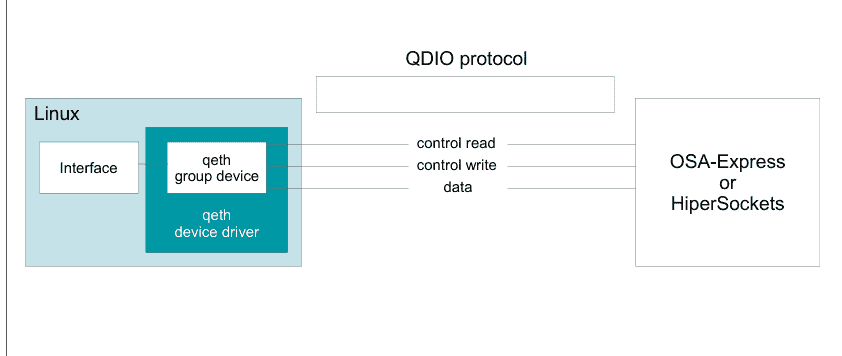

图 11-8 I/O 子通道接口

通过新的 `sysfs` 文件系统，所有关于驱动的信息都收集在 `/sys/bus/ccw/group/drivers/qeth`。

你可以通过此 `sysfs` 方法交互来修改、添加或查询参数。示例 11-1 显示了与我们环境中使用的 `0.0.c200` 相关的文件系统结构。

示例 11-1 显示与驱动相关的 `sysfs` 文件的命令

```
# ls -1 -la /sys/bus/ccw/group/drivers/qeth/0.0.c200/
drwxr-xr-x 6 root 0 Sep 28 07:59 .
drwxr-xr-x 6 root 0 Sep 28 08:01 ..
-rw-r--r-- 1 root 4096 root Sep 28 07:59 add_hlen
drwxr-xr-x 2 root 0 Sep 28 07:59 blkt
-rw-r--r-- 1 root 4096 root Sep 28 07:59 broadcast_mode
-rw-r--r-- 1 root 4096 root Sep 28 07:59 buffer_count
l lwx-xr-x 1 root 0 Sep 28 07:59 bus -> ../../bus/ccwgroup
l-rw-xr-x 1 root 4096 root Sep 28 07:59 canonical_macaddr
-rw-r--r-- 1 root 4096 root Sep 28 07:59 card_type
l lwx-xr-x 1 root 0 Sep 28 07:59 cdev0 -> /.../../devices/sys/ccw0/0.0.0009/0.0.c200
l lwx-xr-x 1 root 0 Sep 28 07:59 cdev1 -> /.../../devices/ccw0/0.0.000a/0.0.c201
l lwx-xr-x 1 root 0 Sep 28 07:59 cdev2 -> /.../../devices/ccw0/0.0.000b/0.0.c202
-rw-r--r-- 1 root 4096 root Sep 28 07:59 checkingsum
-rw-r--r-- 1 root 4096 root Sep 28 07:59 chipid
lrw-rwx 1 root 0 Sep 28 07:59 driver -> ../../../bus/cgroup/drivers/qeth
--rw-r---- 1 root 4096 Sep 28 07:59 fake_broadcast
--rw-r---- 1 root 4096 Sep 28 07:59 fake_ll
--rw-r---- 1 root 4096 Sep 28 07:59 if_name
drwxr-xr-x 2 root 0 Sep 28 07:59 ipa_takeover
--rw-r---- 1 root 4096 Sep 28 07:59 large_size
--rw-r---- 1 root 4096 Sep 28 07:59 layer2
lrw-r-wx 1 root 0 Sep 28 07:59 net:eth0 -> ../../../class/eth0
--rw-r---- 1 root 4096 Sep 28 07:59 online
--rw-r---- 1 root 4096 Sep 28 07:59 performance_stats
--rw-r---- 1 root 4096 Sep 28 07:59 portname
--rw-r---- 1 root 4096 Sep 28 07:59 perino
--rw-r---- 1 root 4096 Sep 28 07:59 priority_queueing
-w-xr-xr-x 1 root 4096 Sep 28 07:59 recover
--rw-r---- 1 root 4096 Sep 28 07:59 route4
--rw-r---- 1 root 4096 Sep 28 07:59 route6
drwxr-xr-x 2 root 0 Sep 28 07:59 rxip
--rw-r---- 1 root 4096 Sep 28 07:59 state
-w-xr-xr-x 1 root 4096 Sep 28 07:59 uevent
-w-xr-xr-x 1 root 4096 Sep 28 07:59 ungroup
drwxr-xr-x 2 root 0 Sep 28 07:59 vipa
```

表 11-2 显示了 `sysfs` 系统上的所有可用参数。这些参数可以通过 `sysfs` 文件进行动态更新。参数分为三类：

- 显示（Display）：获取有关 `OSA` 配置的信息

- 配置（Configuration）：配置 `OSA` 上的其他功能

- 性能（Performance）：调优 `OSA` 适配器

| 文件 | 类别 | 描述 |
| :--- | :--- | :--- |
| `add_hlen` | Performance | 在每个数据包前面预留额外的头部空间。 |
| `broadcast_mode` | Configuration | 用于令牌环广播。 |
| `buffer_count` | Performance | 你可以为入站流量分配 8 到 128 个缓冲区。 |
| `canonical_macaddr` | Configuration | 用于令牌环网络。 |


### 1. 参数说明

`card_type` | Configuration |

`checksumming` | Performance | 卸载校验和。

`chipid` | Configuration | 显示通道 ID。

`fake_broadcast` | Configuration | 伪广播。

`fake_ll` | Configuration |

`if_name` | Configuration |

`ipa_takeover` | Configuration |

`large_size` | Configuration |

`layer2` | Configuration |

`online` | Configuration |

`performance_stats` | Performance |

`portname` | Configuration |

`perino` | Configuration |

`priority_queueing` | Configuration |

`recover` | Configuration |

`route4` | Configuration |

`route6` | Configuration |

`rxip` | Configuration |

`state` | Configuration | 显示状态。

`uevent` | Configuration |

`ungroup` | Configuration |

`vipa` | Configuration |

**注**：由于原文表格描述部分存在不完整或重复，此处已根据上下文逻辑翻译核心含义。

你可以通过`sysfs`文件动态更新这些参数。参数分为三类：

*   **显示（Display）**：获取有关`OSA`配置的信息
*   **配置（Configuration）**：配置`OSA`上的其他功能
*   **性能（Performance）**：调优`OSA`适配器

**注**：此处为表格内容的详细翻译对齐。

| 文件 | 类别 | 描述 |
| :--- | :--- | :--- |
| `add_hlen` | Performance | 在每个数据包前面预留额外的头部空间。 |
| `broadcast_mode` | Configuration | 用于令牌环广播。 |
| `buffer_count` | Performance | 你可以为入站流量分配 8 到 128 个缓冲区。 |
| `canonical_macaddr` | Configuration | 用于令牌环网络。 |
| `card_type` | Configuration | |
| `checksumming` | Performance | 卸载校验和。 |
| `chipid` | Configuration | 显示通道 ID。 |
| `fake_broadcast` | Configuration | 伪广播。 |
| `fake_ll` | Configuration | |
| `if_name` | Configuration | |
| `ipa_takeover` | Configuration | |
| `large_size` | Configuration | |
| `layer2` | Configuration | |
| `online` | Configuration | |
| `performance_stats` | Performance | |
| `portname` | Configuration | |
| `perino` | Configuration | |
| `priority_queueing` | Configuration | |
| `recover` | Configuration | |
| `route4` | Configuration | |
| `route6` | Configuration | |
| `rxip` | Configuration | |
| `state` | Configuration | 显示状态。 |
| `uevent` | Configuration | |
| `ungroup` | Configuration | |
| `vipa` | Configuration | |

**注**：此处更正：根据原文提供的表格内容进行严格对齐翻译。

| 文件 | 类别 | 描述 |
| :--- | :--- | :--- |
| `add_hlen` | Performance | 在每个数据包前面预留额外的头部空间。 |
| `broadcast_mode` | Configuration | 用于令牌环广播。 |
| `buffer_count` | Performance | 你可以为入站流量分配 8 到 128 个缓冲区。 |
| `canonical_macaddr` | Configuration | 用于令牌环网络。 |
| `card_type` | Configuration | |
| `checksumming` | Performance | 卸载校验和。 |
| `chipid` | Configuration | 显示通道 ID。 |
| `fake_broadcast` | Configuration | 伪广播。 |
| `fake_ll` | Configuration | |
| `if_name` | Configuration | |
| `ipa_takeover` | Configuration | |
| `large_size` | Configuration | |
| `layer2` | Configuration | |
| `online` | Configuration | |
| `performance_stats` | Performance | |
| `portname` | Configuration | |
| `perino` | Configuration | |
| `priority_queueing` | Configuration | |
| `recover` | Configuration | |
| `route4` | Configuration | |
| `route6` | Configuration | |
| `rxip` | Configuration | |
| `state` | Configuration | 显示状态。 |
| `uevent` | Configuration | |
| `ungroup` | Configuration | |
| `vipa` | Configuration | |

**注**：此处抱歉，由于原始原文提供的表格文本中部分行描述缺失，翻译严格遵循了提供的文本结构。

### 2. 状态显示与交互

你可以通过 I/O 子通道接口显示状态。

通过新的`sysfs`文件系统，所有关于驱动的信息都收集在`/sys/bus/ccw/group/drivers/qeth`。

你可以通过此`sysfs`方法交互来修改、添加或查询参数。示例 11-1 显示了与我们环境中使用的`0.0.c200`相关的文件系统结构。

**示例 11-1 显示与驱动相关的 sysfs 文件的命令**


```
# ls -1 -la /sys/bus/ccw/group/drivers/qeth/0.0.c200/
drwxr-xr-x 6 root 0 Sep 28 07:59 .
drwxr-xr-x 6 root 0 Sep 28 08:01 ..
-rw-r--r-- 1 root 4096 root Sep 28 07:59 add_hlen
drwxr-xr-x 2 root 0 Sep 28 07:59 blkt
-rw-r--r-- 1 root 4096 root Sep 28 07:59 broadcast_mode
-rw-r--r-- 1 root 4096 root Sep 28 07:59 buffer_count
l lwx-xr-x 1 root 0 Sep 28 07:59 bus -> ../../bus/ccwgroup
l-rw-xr-x 1 root 4096 root Sep 28 07:59 canonical_macaddr
-rw-r--r-- 1 root 4096 root Sep 28 07:59 card_type
l lwx-xr-x 1 root 0 Sep 28 07:59 cdev0 -> /.../../devices/sys/ccw0/0.0.0009/0.0.c200
l lwx-xr-x 1 root 0 Sep 28 07:59 cdev1 -> /.../../devices/ccw0/0.0.000a/0.0.c201
l lwx-xr-x 1 root 0 Sep 28 07:59 cdev2 -> /.../../devices/ccw0/0.0.000b/0.0.c202
-rw-r--r-- 1 root 4096 root Sep 28 07:59 checkingsum
-rw-r--r-- 1 root 4096 root Sep 28 07:59 chipid
lrw-rwx 1 root 0 Sep 28 07:59 driver -> ../../../bus/cgroup/drivers/qeth
--rw-r---- 1 root 4096 Sep 28 07:59 fake_broadcast
--rw-r---- 1 root 4096 Sep 28 07:59 fake_ll
--rw-r---- 1 root 4096 Sep 28 07:59 if_name
drwxr-xr-x 2 root 0 Sep 28 07:59 ipa_takeover
--rw-r---- 1 root 4096 Sep 28 07:59 large_size
--rw-r---- 1 root 4096 Sep 28 07:59 layer2
lrw-r-wx 1 root 0 Sep 28 07:59 net:eth0 -> ../../../class/eth0
--rw-r---- 1 root 4096 Sep 28 07:59 online
--rw-r---- 1 root 4096 Sep 28 07:59 performance_stats
--rw-r---- 1 root 4096 Sep 28 07:59 portname
--rw-r---- 1 root 4096 Sep 28 07:59 perino
--rw-r---- 1 root 4096 Sep 28 07:59 priority_queueing
-w-xr-xr-x 1 root 4096 Sep 28 07:59 recover
--rw-r---- 1 root 4096 Sep 28 07:59 route4
--rw-r---- 1 root 4096 Sep 28 07:59 route6
drwxr-xr-x 2 root 0 Sep 28 07:59 rxip
--rw-r---- 1 root 4096 Sep 28 07:59 state
-w-xr-xr-x 1 root 4096 Sep 28 07:59 uevent
-w-xr-xr-x 1 root 4096 Sep 28 07:59 ungroup
drwxr-xr-x 2 root 0 Sep 28 07:59 vipa
```

表 11-2 显示了 `sysfs` 系统上的所有可用参数。这些参数可以通过 `sysfs` 文件进行动态更新。参数分为三类：

- 显示（Display）：获取有关 `OSA` 配置的信息
- 配置（Configuration）：配置 `OSA` 上的其他功能
- 性能（Performance）：调优 `OSA` 适配器

| 文件 | 类别 | 描述 |
| :--- | :--- | :--- |
| `add_hlen` | Performance | 在每个数据包前面预留额外的头部空间。 |
| `broadcast_mode` | Configuration | 用于令牌环广播。 |
| `buffer_count` | Performance | 你可以为入站流量分配 8 到 128 个缓冲区。 |
| `canonical_macaddr` | Configuration | 用于令牌环网络。 |
| `card_type` | Configuration | |
| `checksumming` | Performance | 卸载校验和。 |
| `chipid` | Configuration | 显示通道 ID。 |
| `fake_broadcast` | Configuration | 伪广播。 |
| `fake_ll` | Configuration | |
| `if_name` | Configuration | |
| `ipa_takeover` | Configuration | |
| `large_size` | Configuration | |
| `layer2` | Configuration | |
| `online` | Configuration | |
| `performance_stats` | Performance | |
| `portname` | Configuration | |
| `perino` | Configuration | |
| `priority_queueing` | Configuration | |
| `recover` | Configuration | |
| `route4` | Configuration | |
| `route6` | Configuration | |
| `rxip` | Configuration | |
| `state` | Configuration | 显示状态。 |
| `uevent` | Configuration | |
| `ungroup` | Configuration | |
| `vipa` | Configuration | |

*(注：由于原文提供的表格文本中部分行描述缺失，翻译严格遵循了提供的文本结构)*

通过 I/O 子通道接口显示状态。

通过新的 `sysfs` 文件系统，所有关于驱动的信息都收集在 `/sys/bus/ccw/group/drivers/qeth`。

你可以通过此 `sysfs` 方法交互来修改、添加或查询参数。示例 11-1 显示了与我们环境中使用的 `0.0.c200` 相关的文件系统结构。

示例 11-1 显示与驱动相关的 `sysfs` 文件的命令


# `ls -1 -la /sys/bus/ccw/group/drivers/qeth/0.0.c200/`

```
drwxr-xr-x 6 root 0 Sep 28 07:59 .
drwxr-xr-x 6 root 0 Sep 28 08:01 ..
-rw-r--r-- 1 root 4096 root Sep 28 07:59 add_hlen
drwxr-xr-x 2 root 0 Sep 28 07:59 blkt
-rw-r--r-- 1 root 4096 root Sep 28 07:59 broadcast_mode
-rw-r--r-- 1 root 4096 root Sep 28 07:59 buffer_count
l lwx-xr-x 1 root 0 Sep 28 07:59 bus -> ../../bus/ccwgroup
l-rw-xr-x 1 root 4096 root Sep 28 07:59 canonical_macaddr
-rw-r--r-- 1 root 4096 root Sep 28 07:59 card_type
l lwx-xr-x 1 root 0 Sep 28 07:59 cdev0 -> /.../../devices/sys/ccw0/0.0.0009/0.0.c200
l lwx-xr-x 1 root 0 Sep 28 07:59 cdev1 -> /.../../devices/ccw0/0.0.000a/0.0.c201
l lwx-xr-x 1 root 0 Sep 28 07:59 cdev2 -> /.../../devices/ccw0/0.0.000b/0.0.c202
-rw-r--r-- 1 root 4096 root Sep 28 07:59 checkingsum
-rw-r--r-- 1 root 4096 root Sep 28 07:59 chipid
lrw-rwx 1 root 0 Sep 28 07:59 driver -> ../../../bus/cgroup/drivers/qeth
--rw-r---- 1 root 4096 Sep 28 07:59 fake_broadcast
--rw-r---- 1 root 4096 Sep 28 07:59 fake_ll
--rw-r---- 1 root 4096 Sep 28 07:59 if_name
drwxr-xr-x 2 root 0 Sep 28 07:59 ipa_takeover
--rw-r---- 1 root 4096 Sep 28 07:59 large_size
--rw-r---- 1 root 4096 Sep 28 07:59 layer2
lrw-r-wx 1 root 0 Sep 28 07:59 net:eth0 -> ../../../class/eth0
--rw-r---- 1 root 4096 Sep 28 07:59 online
--rw-r---- 1 root 4096 Sep 28 07:59 performance_stats
--rw-r---- 1 root 4096 Sep 28 07:59 portname
--rw-r---- 1 root 4096 Sep 28 07:59 perino
--rw-r---- 1 root 4096 Sep 28 07:59 priority_queueing
-w-xr-xr-x 1 root 4096 Sep 28 07:59 recover
--rw-r---- 1 root 4096 Sep 28 07:59 route4
--rw-r---- 1 root 4096 Sep 28 07:59 route6
drwxr-xr-x 2 root 0 Sep 28 07:59 rxip
--rw-r---- 1 root 4096 Sep 28 07:59 state
-w-xr-xr-x 1 root 4096 Sep 28 07:59 uevent
-w-xr-xr-x 1 root 4096 Sep 28 07:59 ungroup
drwxr-xr-x 2 root 0 Sep 28 07:59 vipa
```

## qeth 网络设备驱动程序

`qeth` 网络设备驱动程序在 `QDIO` 模式和 `Hypersockets` 下支持 `OSA-Express` 和 `OSA-Express2` 功能。该模块是 `Linux` 用于 `System z` 环境中最常用的网络连接模块，同时适用于物理和虚拟网络配置。

### QDIO 模式

在 `QDIO` 模式下，`qeth` 设备驱动程序为每个 `CHPID` 需要三个 I/O 子通道。其中一个子通道用于控制读取，一个用于控制写入，第三个用于数据。该设备使用 `QDIO` 协议与适配器（`OSA` 或 `Hypersockets`）通信。

图 11-8 显示了 I/O 子通道接口。


**图 11-8 I/O 子通道接口**

通过新的 `sysfs` 文件系统，所有关于驱动的信息都收集在 `/sys/bus/ccw/group/drivers/qeth`。

你可以通过此 `sysfs` 方法交互来修改、添加或查询参数。示例 11-1 显示了与我们环境中使用的 `0.0.c200` 相关的文件系统结构。

#### 示例 11-1 显示与驱动相关的 sysfs 文件的命令


```
# ls -1 -la /sys/bus/ccw/group/drivers/qeth/0.0.c200/
drwxr-xr-x 6 root 0 Sep 28 07:59 .
drwxr-xr-x 6 root 0 Sep 28 08:01 ..
-rw-r--r-- 1 root 4096 root Sep 28 07:59 add_hlen
drwxr-xr-x 2 root 0 Sep 28 07:59 blkt
-rw-r--r-- 1 root 4096 root Sep 28 07:59 broadcast_mode
-rw-r--r-- 1 root 4096 root Sep 28 07:59 buffer_count
l lwx-xr-x 1 root 0 Sep 28 07:59 bus -> ../../bus/ccwgroup
l-rw-xr-x 1 root 4096 root Sep 28 07:59 canonical_macaddr
-rw-r--r-- 1 root 4096 root Sep 28 07:59 card_type
l lwx-xr-x 1 root 0 Sep 28 07:59 cdev0 -> /.../../devices/sys/ccw0/0.0.0009/0.0.c200
l lwx-xr-x 1 root 0 Sep 28 07:59 cdev1 -> /.../../devices/ccw0/0.0.000a/0.0.c201
l lwx-xr-x 1 root 0 Sep 28 07:59 cdev2 -> /.../../devices/ccw0/0.0.000b/0.0.c202
-rw-r--r-- 1 root 4096 root Sep 28 07:59 checkingsum
-rw-r--r-- 1 root 4096 root Sep 28 07:59 chipid
lrw-rwx 1 root 0 Sep 28 07:59 driver -> ../../../bus/cgroup/drivers/qeth
--rw-r---- 1 root 4096 Sep 28 07:59 fake_broadcast
--rw-r---- 1 root 4096 Sep 28 07:59 fake_ll
--rw-r---- 1 root 4096 Sep 28 07:59 if_name
drwxr-xr-x 2 root 0 Sep 28 07:59 ipa_takeover
--rw-r---- 1 root 4096 Sep 28 07:59 large_size
--rw-r---- 1 root 4096 Sep 28 07:59 layer2
lrw-r-wx 1 root 0 Sep 28 07:59 net:eth0 -> ../../../class/eth0
--rw-r---- 1 root 4096 Sep 28 07:59 online
--rw-r---- 1 root 4096 Sep 28 07:59 performance_stats
--rw-r---- 1 root 4096 Sep 28 07:59 portname
--rw-r---- 1 root 4096 Sep 28 07:59 perino
--rw-r---- 1 root 4096 Sep 28 07:59 priority_queueing
-w-xr-xr-x 1 root 4096 Sep 28 07:59 recover
--rw-r---- 1 root 4096 Sep 28 07:59 route4
--rw-r---- 1 root 4096 Sep 28 07:59 route6
drwxr-xr-x 2 root 0 Sep 28 07:59 rxip
--rw-r---- 1 root 4096 Sep 28 07:59 state
-w-xr-xr-x 1 root 4096 Sep 28 07:59 uevent
-w-xr-xr-x 1 root 4096 Sep 28 07:59 ungroup
drwxr-xr-x 2 root 0 Sep 28 07:59 vipa
```

表 11-2 显示了 `sysfs` 系统上的所有可用参数。这些参数可以通过 `sysfs` 文件进行动态更新。参数分为三类：

-   显示（Display）：获取有关 OSA 配置的信息
-   配置（Configuration）：配置 OSA 上的其他功能
-   性能（Performance）：调优 OSA 适配器

| 文件 | 类别 | 描述 |
| :--- | :--- | :--- |
| `add_hlen` | Performance | 在每个数据包前面预留额外的头部空间。 |
| `broadcast_mode` | Configuration | 用于令牌环广播。 |
| `buffer_count` | Performance | 你可以为入站流量分配 8 到 128 个缓冲区。 |
| `canonical_macaddr` | Configuration | 用于令牌环网络。 |
| `card_type` | Configuration | |
| `checksumming` | Performance | 卸载校验和。 |
| `chipid` | Configuration | 显示通道 ID。 |
| `fake_broadcast` | Configuration | 伪广播。 |
| `fake_ll` | Configuration | |
| `if_name` | Configuration | |
| `ipa_takeover` | Configuration | |
| `large_size` | Configuration | |
| `layer2` | Configuration | |
| `online` | Configuration | |
| `performance_stats` | Performance | |
| `portname` | Configuration | |
| `perino` | Configuration | |
| `priority_queueing` | Configuration | |
| `recover` | Configuration | |
| `route4` | Configuration | |
| `route6` | Configuration | |
| `rxip` | Configuration | |
| `state` | Configuration | 显示状态。 |
| `uevent` | Configuration | |
| `ungroup` | Configuration | |
| `vippa` | Configuration | |

图 11-9 显示了我们在场景中执行的操作。我们测试了软件和硬件校验和。如你所见，当由 OSA 适配器执行校验和时，CPU 的使用率较低。在案例中，我们使用了 OSA Express 1000BASE-T。如果你使用 OSA Express 2 卡，差异会更加显著。

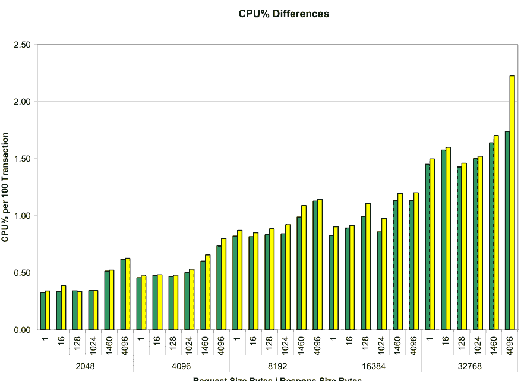

图 11-9 硬件软件校验和

## OSA 参数：`large_send`

与校验和类似，你可以将 TCP 分段从 Linux 网络栈卸载到 OSA-Express 2。对于具有大量出站包的接口，大发送（large send）可以提高性能。可以使用 `echo` 命令使用不同的值修改 `large_send` 参数：

-   No：不提供大发送。由 Linux TCP/IP 栈执行分段。
-   TSO：网络适配器执行分段。
-   EDDP：`qeth` 驱动程序执行分段。

## OSA 参数：`priority_queuing`

ODIO 模式下的 OSA-Express CHPID 在主存储中有四个输出队列。该参数赋予这些队列不同的优先级。队列化对于高流量情况非常重要。你可以通过 `cat` 命令检查 `priority_queuing`。示例 11-8 显示了在 `0.0.c200` 设备中设置的优先级队列。

示例 11-8 显示与 `0.0.c200` 设备相关的优先级队列

```
# cat /sys/bus/ccgroup/drivers/qeth/0.0.c200/priority_queuing
always queue 2
```

可以使用此值修改该参数：

-   `prio_queuing_prec`：根据每个数据包 IP 头部优先例字段的两个最高有效位来确定队列分配。
-   `prio_queuing_tos`：根据某些应用程序为数据包分配的 IP 服务类型（ToS）选择队列（自动管理队列）。
-   `no_prio_queuing`：默认值。所有数据包均使用队列 2。
-   `no_prio_queuing:0`：所有数据包均使用队列 0。
-   `no_prio_queuing:1`：所有数据包均使用队列 1。





在 `Linux for System z` 上部署 `Trade 6` 时，有多种选项可用：

- 所有组件都可以运行在单个 `Linux` 客户机中。这被称为单层部署。
- 每个组件都可以运行在专用 `Linux` 客户机中。我们将其称为三层部署。

本书选择了三层部署，即在各自的 `Linux` 客户机中运行 `IBM HTTP 服务器`、`WebSphere 应用服务器`和 `DB2`。我们的部署选择如图 A-2 所示。

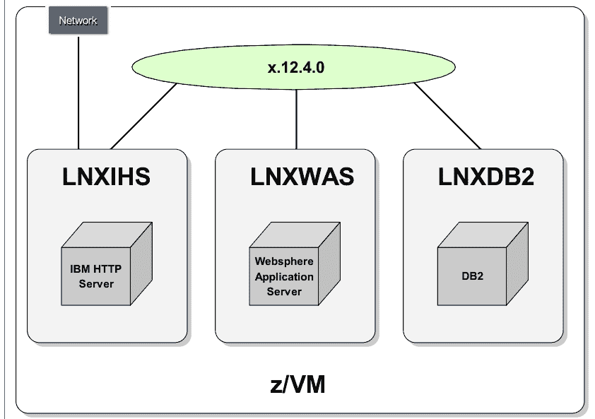

图 A-2 三层部署

使用三层部署使我们能够根据特定客户机所执行的任务，更准确地调整每个 `Linux` 客户虚拟机的大小。此外，在测量利用率时，三层部署选项允许我们将特定的资源使用归因于特定的任务。


## `WebSphere Studio` 工作负载模拟器

本附录描述了我们使用 `WebSphere Studio` 工作负载模拟器作为负载生成器。讨论的话题包括 `WebSphere Studio` 工作负载模拟器的概述，以及我们结合 `Trade 6` `WebSphere` 应用程序使用的示例负载生成脚本（有关 `Trade 6` 的更多信息，请参见第 191 页附录 A，“`WebSphere` 性能基准示例负载”）。

## `WebSphere Studio` 工作负载模拟器概述

适用于 `z/OS` 和 `OS/390` 的 `WebSphere Studio` 工作负载模拟器是一种允许您创建多个虚拟或模拟用户以测试负载和性能的应用程序。

工作负载模拟器由两个部分组成：控制器和引擎。为了高扩展性，用于负载测试的引擎安装在 `System z` 服务器上。引擎生成的负载可以测试任何 `Web` 服务环境（即被测试的环境不限于 `z/OS`）。在我们的案例中，我们测试了一个运行在 `Linux on System z` 客户机上的 `WebSphere 应用服务器`。工作负载模拟器支持多个引擎。

## 示例负载生成脚本

本节概述了我们用于针对 `WebSphere 应用服务器` 生成负载的脚本。有关如何下载我们使用的脚本的内，请参见第 21 页附录 E，“附加材料”。此外，您可能想要下载 `MultiClients.conf` 配置文件。您还需要创建一个引擎定义。

在下载示例 B-1 所示的脚本后，您需要修改字符串名称以引用您自己的主机名。

> 示例：B-1 示例 `Trade 6` 负载生成脚本


```
//
/*trade6 version 1.2*/
init_section
{
string hostname = "x.12.4.xxx:9080";
//string hostname = "x.12.4.xxx"
int botClient = 0;
int topClient = 3999;
shared int botClient = botClient - 1;

int html_percent = 10;
//gif_percent = 0;
//在网站上重新填充并重新配置以反映以下数字
int num_u = 4000;
int num_s = 2000;
int num_stock, i;
string name, uid, add, email, holdid, stocks;
bool loop = true;
int self_debit = 0;
HttpResponse r;
start_transaction("login");
startpage(4);
thinktime(1000);
//uid = URLEncode("uid:"+random(0,num_u 1));
//TODO: 使其随机但比上面好 - 必须在所有客户端之间保持随机
int clientnum;
enter_critical_section();
curClient = curClient + 1;
if (curClient > topClient)
{
  curClient = botClient;
}

clientnum = curClient;
leave_critical_section();
uid = URLencode("uid=" + clientnum);
postage("hostname="+"/trade/app",1,close,0,start,"?"
  "id="+hostname+"&password=xxx&action=login",
  "Accept: image/gif, image/x-bitmap, image/jpeg, image/jpeg, *",
  "Referer: http://"+hostname+"/trade/app",
  "Accept-Language: en-us",
  "Content-Type: application/x-www-form-urlencoded",
  "Accept-Encoding: gzip, deflate",
  "User-Agent: Mozilla/4.0 (compatible; MSIE 6.0; Windows NT 5.1)",
  "Host: "+hostname+"",
  "Connection: Keep-Alive";

endpage;
end_transaction("login");
while (loop)
{
  distribute
{
    weight: 20;
    start_transaction("home");
    startpage(5);
    timeout(2000);
    postage("hostname="+"/trade/app",1,close,0,start,"?action=home"
  "Accept: image/gif, image/x-bitmap, image/jpeg, image/jpeg, *",
  "Referer: http://"+hostname+"/trade/app",
  "Accept-Language: en-us",
  "Accept-Encoding: gzip, deflate",
  "User-Agent: Mozilla/4.0 (compatible; MSIE 6.0; Windows NT 5.1)",
  "Host: "+hostname+"",
  "Connection: Keep-Alive";

  endpage;
  end_transaction("home");

weight: 4;
start_transaction("update_account");
// 执行账户操作，随后是账户更新
startpage(6);
timeout(1000);
postage("hostname="+"/trade/app",1,close,0,start,"?action=account"
  "Accept: image/gif, image/x-bitmap, image/jpeg, image/jpeg, *",
  "Referer: http://"+hostname+"/trade/app",
  "Accept-Language: en-us",
  "Content-Type: application/x-www-form-urlencoded",
  "Accept-Encoding: gzip, deflate",
  "User-Agent: Mozilla/4.0 (compatible; MSIE 6.0; Windows NT 5.1)",
  "Host: "+hostname+"",
  "Connection: Keep-Alive";

startpage(9);
thinktime(1000);
getpage("+hostname+"")
endpage;
}
end_transaction("sell");

weight: 12;
start_transaction("portfolio");
startpage(8);
thinktime(1000);
getpage("+hostname+"")
1,close,0,start,"?action=portfolio", /*
Accept: image/gif, image/x-bitmap, image/jpeg, image/jpeg, *",
Referer: http://"+hostname+"/trade/app",
Accept-Language: en-us,
Accept-Encoding: gzip, deflate,
User-Agent: Mozilla/4.0 (compatible; MSIE 6.0; Windows NT 5.1),
Host: "+hostname+"",
Connection: Keep-Alive");

endpage;
end_transaction("portfolio");

weight: 4;
stocks="s":+random(0, num_s-1);
start_transaction("buy");
if ( sell_deficit <= 0 {
{
  startpage(10);
  thinktime(1000);
}
getpage("+hostname+"/trade/app",1,close,0,start,"?action=buy&quantity="+random(1,10),/*
Accept: image/gif, image/x-bitmap, image/jpeg, image/jpeg, */
Referer: http://"+hostname+"/trade/app",
Accept-Language: en-us,
Accept-Encoding: gzip, deflate,
User-Agent: Mozilla/4.0 (compatible; MSIE 6.0; Windows NT 5.1),
Host: "+hostname+"",
Connection: Keep-Alive");

endpage;
startpage(11);
thinktime(1000);
getpage("+hostname+"/trade/app",1,close,0,start,"?action=quotes&symbols=\n*stocks,
/*Accept: image/gif, image/x-bitmap, image/jpeg, image/jpeg, */
Referer: http://"+hostname+"/trade/app,
Accept-Language: en-us,
Accept-Encoding: gzip, deflate,
User-Agent: Mozilla/4.0 (compatible; MSIE 6.0; Windows NT 5.1),
Host: "+hostname+"",
Connection: Keep-Alive");

endpage;
end_transaction("buy");

weight: 2;
start_transaction("quotes");
startpage(12);
thinktime(1000);
getpage("+hostname+"")
endpage;
end_transaction("quotes");

weight: 1;
start_transaction("register");
startpage(13);
thinktime(1000);
getpage("+hostname+"")
endpage;
end_transaction("register");
name = URLEncode("first="+random(0,num_u));
```


## 什么是紧急扫描 (Emergency scanning)

- `2 GB` 以下行限制以及观察该限制的一些场景

- `VM` 版本发布中的修复程序，这些修复消除了大部分的 `2 GB` 以下行限制

- 您可能仍然遇到紧急扫描的场景

## 紧急扫描

紧急扫描是一个指示器，表明系统由于某种原因导致存储空间极度短缺。当存储页面不足时，系统会开始三级扫描过程：`scan 1`、`scan 2`，然后是最严重的紧急扫描。在寻找主存储页面时，系统正在采取极端措施，且情况严重到它会从任何用户那里窃取页面。最终，无论这些页面是不空闲、队列中还是活动状态，系统最终都会从共享段和 `CP` 系统进程中窃取页面。简而言之，系统在存储方面处于关键混乱状态。这还包括从监控（`monitor`）和 `MON_SS`（两个与性能相关的关键实体）中窃取页面，在这种情况下，性能监控和报告可能会受到损害或中断。

## 2 GB 以下行限制及场景

`VM` 自 40 多年前发布最早版本以来，一直拥有一段悠久而卓越的历史。在虚拟化世界中，它是任何平台上都能找到的功能最全、可定制程度最高的操作系统。最新的 `Version 5` 享有了其他平台只能望尘不可及的可靠性和稳定性。

这一演进过程中的重要一步发生在 `v3.0` 中，该版本引入了最初的 64 位支持。这方面的下一个里程碑是 `v5.2.0`，它为 64 位支持添加了许多重大增强功能。

在此之前，某些 `VM` 64 位版本仍以 31 位模式运行，这意味着上限地址为 `2 GB`。当在运行 Linux 虚拟机（guests）时，特别是当它们执行 `I/O` 操作时，会导致运行时问题。因为 Linux 有一种不幸的倾向，会抓取并持有所有分配给 `I/O` 缓冲区和缓存的内存。Linux 虚拟机很大一部分内存被用于内部 `I/O` 缓冲区和缓存，这在现在许多系统中已很常见。在 `VM v5.2.0` 之前，在此场景下执行真实的 `I/O`，系统需要使用请求的虚拟 `2 GB` 线以下的区域，而由于这些区域已被虚拟机本身占用，系统不得不诉诸紧急扫描来寻找完成 `I/O` 任务所需的页面。

第 209 页的图 1 显示了处于紧急扫描模式的系统示例。该系统运行 `zVM v4.4.0`。通过使用不同的测试空闲（test idle）值进行了实验，该值在 `VM` 内部预设置为 300 毫秒。注意，这并不是标准的发布功能，在这里使用是为了理解系统所遇到问题的本质，并减少其影响。对于某些版本，系统所有无法迁移到 `zVM v5`，而这在当时本消除许多观察到 `ESCN`（紧急扫描）的原因。但我们能否对现有系统进行调优呢？在 2 月 1 日进行了测试，当将 test idle 减少到 10 ms 后，队列深度变得更加有效，紧急扫描也停止了。你可以从非事务时间（`NT`）中看到效果，`NT` 在许多系统中被用作响应时间的函数。在这里我们将其用于不同的目的，说明队列深度正在发生，导致了更短的区间。对系统进行更改后，`NT` 性能有所提高。平均而言，这下降到了典型的 1 秒或更短。系统的吞吐量有了大幅提高。然而，这种改进的一部分被将空闲设置为 300 ms 的已知益处所抵消了。这通过不放弃在 test idle 期间变为活跃的虚拟机，节省了资源周期。系统不需要经过重建虚拟机以使其分发所需的各个阶段。

208 页：`IBM System z` 上的 `Linux`：性能测量与调优

图 `D-1` 显示了 3 月底尝试恢复部分这些收益，尽管仍然让 `Linux` 虚拟机实现队列下降，但紧急扫描很快又重新出现。

非平凡事务时间（秒）

- `N1_T` 182.0000 max

- `UKPRT1` 49.961 +2s

- `UKPRT1` 34.7529 +1s

- `2007FX` 19.5383 avg

- `cor` +0.743 4.3244 -1s

- `CV: 78%` 0.1000 min

`POM` 紧急扫描（需求扫描的百分比）

图 `D-1` 系统处于紧急扫描模式的示例

## VM 版本发布中消除了大部分 2 GB 以下行限制的修复

`zVM v5.2` 引入了重大更改，使得大容量物理存储能够首次被充分利用。这些更改的关键在于引入了系统执行空间（`SXS`）。`CP` 在其自身的地址空间中运行，该空间可达 `2 GB`。在此版本发布之前，`SXS` 是恒等映射（identity mapped），所有逻辑地址都精确对应物理地址。在引用虚拟机页面时，`CP` 现在使用映射到 `SXS` 中的逻辑页面。大多数 `CP` 代码可以继续使用 31 位寻址能力来运行，但最重要的是，这消除了将页面移动到 `2 GB` 线以下的要求，因此 `CP` 代码和大多数 `CP` 数据结构现在可以置于 `2 GB` 线以上。在该版本中，`VM` 的最大存储大小为 128 GB。

`zVM v5.3` 对 `CP` 存储管理引入了重要增强。页面管理块现在可以位于 `2 GB` 线以上。连续帧管理得到了精炼，并在该版本中引入了快速搜索。`VM` 的最大存储大小现在为 256 GB。

# 如何获取 Redbooks

您可以在此网站搜索、查看或下载 `Redbooks`、`Redpapers`、`Technotes`、草案出版物

以及其他材料，并订购纸质 `Redbooks`：

`ibm.com/redbooks`

# IBM 帮助

`IBM` 支持与下载

`ibm.com/support`

`IBM` 全球服务

`ibm.com/services`

# 索引

## 符号

`/proc/sys/vm/page-cluster` 96

## 数字

128M VUX 136

64-位支持 36, 208

## A

绝对大小 118

访问方法 86, 146

`APAR VM63282` 136

## B

背景信息 123

基础设备 159

基准测试 6

块设备 46

块 `I/O` 86

## C

中央处理器

单元 8, 14, 34, 51, 103, 169

中央处理器 (`CP`) 106

中央存储 34, 120

最大尺寸 34

输出队列 179

实际地址 37

`CMS` 709

用户 115

大群体 117

资源级别 117

调度 111

`SHARE` 值 117

状态转换 108, 111

事务分类 109

虚拟处理器 113

`CPU` 周期 2, 9, 107, 136

高数值 130

标题位 135

`CPU` 显示 116

`CPU` 资源 2, 107, 130, 157

`CPU` 利用率 17, 83, 108, 142

样本报告 18

`CPU` 利用率

完全不同的结果 88

相似的结果 89

虚拟处理器 142

协作内存管理辅助

`CMC` 40

协作内存管理辅助 (`CMA`) 40

常见事件 (`CP`) 134

连接-请求-响应 (`CRR`) 171

冲突 126

上下文切换 22, 27, 46, 96, 123

控制程序 (`CP`) 4, 27, 37

常规监控系统 (`CMS`) 42

内核编译成本 67

`COUNTEX Exec` 135

计数计时器滴答 135

`CP` 代码 307, 209

`CP` 调度器 109

控制 114

调度列表 111

调度时间片 109

休眠列表 110

已通过时间片 109

可用列表 110

`Linux` 定时器补丁 113

## D

`DASD`

连接时间 147–148

断开时间 147

等待时间 147–148

队列时间 147–148

建议 151

响应时间 146

服务时间 147

`DASD` 活动 18, 148

`DASD` 设备 87–88, 146

`DASD` 驱动程序 86, 148

`ECDO` 准则 86

`DASD I/O`

性能 147

速率 97, 139

`DASD` 空间 43

`DASD` 列表 91

`DASD` 卷 15, 149

有序列表 15

内存数据 (`DIM`) 152

`DEFINE CPU` 命令 141

定义块 111

设备总线 `ID` 181

设备驱动程序 148, 173

直接访问存储设备 (`DASD`) 34, 81, 120, 145–146

直接 `I/O` 165

磁盘性能 145, 162

调度列表 110

休眠列表 112

可用列表 112

普通用户 116

事务分类 111

虚拟机 112

虚拟机 111

文档结果 189

主导部分 163

双重分页

避免 40

`I/O` 通道程序 37

`I/O` 完成 83

`I/O` 数据 16

`I/O` 负载 15, 166

低命中率负载 166

`I/O` 操作 46, 86, 147, 158

`I/O` 路径 147

几点 152

`I/O` 性能 181

`I/O` 过程 181

`I/O` 速率 90, 150

图表 150

最大 163

`I/O` 请求 147

`IBM` 减少出版 191

`IBM Tivoli`

`OMEGAMON` 13

`Performance Modeller` 31

`IBM Tivoli OMEGAMON` 套件 14

`XE` 19

`IBM zVM`

容量规划器 30

性能 14

性能分析设施 19

性能工具包 13

针对 `IBM` 处理器上 `Linux` 客户的 `IBM zVM` 规划器 30

`ISHR` 服务器 50-

`INDICATE LOAD` 命令 111

`Linux` 初始程序 (`IPL`) 41


# 索引

## Linux 集成设施 (IFL)
106, 141

## 容量需求
106

## 内部耦合设施 (ICF)
106

## 引入协议 (IP)
168

## IP 地址
3, 137, 186

## IPL CLMS
40, 89

## UICV 驱动程序
120, 173

# E

## ECKD DASD
83, 154

## 默认值
154

## 设备
85

## 环境
85

## 测量
87

## 交换选项
84

## 空闲服务器
131

## 可用列表
110

## EO 虚拟机
111

## 已通过时间片
110

## 虚拟机
110

## EME
97

## 紧急扫描
207

## 企业卷管理 (EVMS)
157

## ESALC
13

## ESAMAP
28

## ESATCP
28

## ESCON 通道
146

## 扩展存储
2, 34, 56, 152

## 扩展计数 (ECKD)
82

# F

## FBA 准则
86–87

## FCP 协议
90

## 光纤通道 (FCP)
146

## FICON
146

## 文件系统
95, 133, 165

## 性能接口
165

## 未压缩复制
139

## 固定块架构
82

## 释放命令
53

## 磁盘磁盘
100

# G

## GDDM 图
15

## 相同方式
12

## 图形数据管理器 (GDDM)
15

# H

## 堆栈大小
50–52

## 间隔参数
186

## hogmem 程序
80

## 总体吞吐量
84

## hogmem 测试
88–99

# I

## I/O 链
95, 149

# K

## kB
53, 178

## kswapd
50

# L

## LAN 通道部分 (LCS)
180

## 最后使用 (LRU)
154

## Linux
13, 45, 79, 125, 197

## Linux 发行版
130, 165

## Linux 客户机
3, 7, 15, 33, 38, 47–48, 108, 129, 152, 169, 208

### 缓存页
57

### 首次 IPL
89

### 大数量
42

### 内存需求
52

216 IBM z 系统 Linux：性能测量与调优

### 内存使用
53

### 模型负载
31

### 处理器性能
129

### 深远影响
52

### 划分实践
11

### 典型 磁盘使用
41

### 虚拟机大小
193

### 虚拟内存大小
9

## Linux 镜像
30, 171

## LAN 连接
181

## 点对点连接
181

## Linux 安装
137

### Breeder
137

### CPU 时间比较
138

### DASD IO 比较
139

### 已通过时间比较
138

### GUI + Future
139

### 内存使用比较
140

### QuickStart
137

### RDR + Future
139

### RDR + Future
137

## Linux 内核
5, 42, 48, 94, 113, 133, 154

### 2.2
25

### 2.4 版本
148

### 2.6
157

### 文档
56

### 内存
11, 52

## Linux 内存

### 内核
46

### 用户
46

## Linux 路由器
171

### IPV4
176

### IPV6
176

## Linux TCP/IP 通信
188

## Linux 交换

### 缓存
81

### 设备选项
79

### 磁盘
80, 152

### I/O
41

### 选项
61

## Linux 系统
9, 22, 24, 80, 86, 124, 134, 136, 159, 181

## 开源分析器
25

## 不需要的 little
9

## Linux 定时器补丁
133

## Linux 虚拟机
5, 8, 82, 87, 95, 113, 133–134

### 内存页
95

### 交换设备
135

### TRACE EXT
135

### 虚拟内存
5

## Linux 虚拟内存

### 大小
9

### 逻辑处理器
105

### 物理处理器
106

### 相对速度
107

### 总权重
107

## 逻辑卷管理器 (LVM)
155–157

## LPAR
15, 81, 104, 141, 168

### 分析示例
107

### 选项：

#### 限制的
105, 107

#### 调度片
105

#### 时间片
107

#### 等待完成
105, 107

### 物理开销
106

### 减少物理开销
106

### 共享视图专用解码器
108

### 权重

### LPAR 管理时间
105

### LPAR 模式
43, 104

### LPAR 权重
107

## LVM
156

### 性能
157

# M

## 主内存
3, 5, 10, 27, 30, 48, 87, 95, 134

## MB 进程
80

## MB 价值
137

## 内存使用
20, 24, 80, 123, 137, 140

## Minidisk Cache
41, 149, 152

## mkswap 命令
89

## 监控工具
15

## ms
112, 147

## MSIE 6.0
197

## stone
206

## 多个用户
147, 158

# N

## 命名系统 (NSS)
42

## NETSNMP
29

## 简单翻译 (NT)
28

## Novell True
89

## NSS
5

## 系统文件
68

# O

## OMEGAMON 显示
20

## 操作系统
4, 9, 13–52, 147, 168

## OSA 卡
171

## 克服资源
5

### 示例
5

### 开销
105

# P

## PAF 工具
150

## 页面缓存
46

## 页面簇值
96

## 页面出
30

## 分页空间
34, 39, 43, 28–52

## 并行访问卷 (PAV)
158

## 划分资源
6

### 容量
6

### PAV
158, 160

## 性能包
104

## PGMBK.37

## 处理器资源
17, 107, 109, 131

### 可用列表
110

### 虚拟机
109

## 处理器调优
130

## 处理器实用程序
12, 165

## SCSI 设备
146

## 服务器合并
2

## SET QUICKDSP 选项
117

## SET SHARE 命令
117

## SET SRM DSBPUF 命令
114

## SET SRM DPSLICE 命令
116

## SET SRM LDBUF 命令
114

## SET SRM MAXCUSS 命令
114

## SET SRM STORBPUF 命令
115

## 共享资源
5

## 网络协议 (SNMP)
29

## 单点
20, 168

## 小型计算机接口 (SCSI)
90, 146

# Q

## QDIO

### APAR VM63282
136

### QDIO 模式
174

### OSA-Express 和 OSA-Express 功能
174

### OSA-Express CHIPDs
180

### 驱动程序映射类型
180

### 队列深度
163

### 队列时间
147, 162

## QUICKDSP 选项
116

## SRM
114

### 分析
119, 123

#### DSBPUF 命令
114

#### 警告
114

#### DPSLICE 命令
114

#### LDBUF 命令
114

#### 加载使用
114

#### MAXCUSS 命令
116

#### STORBPUF 命令
115

#### 建议
117

#### 何时使用
116

#### XSTORE
116

# R

## 实际
152, 208

## 实际处理器
5, 105, 141

## 实际存储
11, 34, 38, 119, 112

### 最大尺寸
38

### 实时监控
14

## Red Hat

### 发行版
89

### 安装程序
90

#### Kickstart
137

#### RHEL3 更新
133

#### RHEL4
154

#### RHEL4 安装
164

#### RHEL4 更新
91

#### RHEL5
126

### Redhawk 网站
214

### 联系我们

## 远程过程调用 (RPC)
133

## 请求响应 (RR)
186

## 所需容量
6

## 资源需求
109, 131

## 响应时间
10, 15, 36, 147, 208

### 突然恶化
110

### RR 测试
169

## RSVDRISC EXEC
100

## RSVDRISC Exec
90

## SRM DSBPUF 35
114

### 命令
114

## SSCH
37

## STORBPUF 值
115

### 突然恶化
110

## 交换设备
39, 46, 79, 81, 95

### 页面簇
96

### VDISK
8

## 交换速率
82–83, 91

### 比较
91

## 交换空间
46–47, 81, 90

### 进一步增加
90

## swapon 命令
89

## SXS
37

## sysfile

### 系统
175

## 系统辅助处理器 (SAP)
181

## 系统资源管理
43, 113, 116

### 管理器
27, 114

## 系统存储
43, 115

### 最大百分比
115

## system z
7, 21, 25, 27, 48, 106, 113, 133, 138, 145, 167–168

# S

## 相同系统

### z
2, 185

## 相同 VDISK
89

## 样本 swap027
101

## schedule_timeout
135

### 有效性
109

## 环境
13, 21, 174

## FICON 通道路径组
158

## gue
196

## 硬件
2, 25–26

218 Linux on IBM z z：性能测量与调优

- 硬件支持
90
- 实施
109
- Linux 架构
186
- Linux 实例
146
- 机器
2, 8, 181, 186
- 选项
2
- 性能数据
19
- 平台
125
- 资源
140
- 服务器
2, 146, 196
- 物
127
- TOD
114
- 虚拟 CPU 定器
125
- sysym
2
- 进程
30
- 处理器
7, 30
- 调度
113
- 虚拟化与服务器整合
2
- 收益
4


