# Linux 与开源年度报告 2015


# 欢迎阅读 Linux 与开源年度盛典

Linux 和开源软件本质上始终在不断变化和演进。它们推向软件所实现的边界。无论是表现为操作系统的更新、让生活比以往任何时候都轻松的黑客技巧，还是像树莓派 2 这样的新硬件，地平线上总有突破性的发现。我们将这一年许多令人兴奋的新信息汇进了本年度盛典中，从开源软件广泛领域的关键发展，到许多可以帮助改进系统和解决问题的实用教程。这个集合确实是 Linux 和开源知识的宝库，准备好让你投入。那么，你还在等什么？


# SHOTWELL

照片管理器

GIMP 可以用于编辑照片，但你该如何组织它们呢？这就是 Shotwell 发挥用场的地方，这是一个照片管理应用程序，可以帮你将照片组织成相册、导航，并分享到特定的媒体网站以使过程更简单，还可以通过编辑技术对照片进行基本操作。如果你拍摄了大量照片，这可能适合你。

# UFRAWER

RAW 编辑器

当使用非常好的相机拍摄照片时，你能够从 SD 卡中提取照片文件。这些文件与 GIMP 以及其他图像查看软件不兼容，因为它们需要经过处理。Ufraw 是一款 Linux 免费软件，让你对大量 RAW 文件的白平衡和照片的其他方面进行调整，因此你可以创建一个完美版本的 JPEG 文件。

# 在 Linux 上玩游戏

不确定这可行吗？再想一下——这里有一些非常棒的游戏

## DOTA 2

Dota 2 作为一个由不同公司制作的游戏的类模组（mod），它有一个奇特的起源。一旦你跨越了这一点，你可能会发现一个易于的优秀 MOBA 游戏。传奇游戏受到电竞技社区的支持，有定期的高额奖金锦和联赛可以参加。如果你不是非常有竞争性，仍然可以享受它。

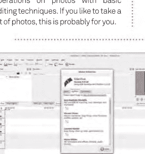

## 漫威英雄

# 电子器

我们发誓《漫威英雄》其实非常棒，尽管你最初的假设可能是那样。这款游戏让你在不断扩张的漫威角色系列周围的世界中穿梭，由于你可以在漫画和电影场景中来回跳跃以捕捉它，所以如果你真的想用，可以使用漫威的绿巨人。你不需要掉进他该死的陷阱里。

有了了电子书管理器，阅读书籍可以变得方便且没有太大麻烦。Calibre 是 Linux 的定义，因为它兼容许多电子书格式。你也可以用它来组织文档。它经过良好优化，如果你愿意可以在小型设备上运行，所以对于创建微型电子书，它是你需要的软件。

## KDENLIVE 视频编辑

在 Linux 上编辑视频对人们来说比在其他操作系统上更好，因为 Linux 上的免费软件水平高于 Movie and Video Maker。Kdenlive 是一款专业级的视频编辑器，拥有足够的功能来完成你想要的一切。它不仅在线性时间轴上具有多种效果，还具有广泛的绿幕或色度键。

## 强势之地 2

第一人称射击，疯狂的经济实验。Team Force 2 是 Valve 的第一款免费游戏，它从中赚了惊人的钱——而且仍然如此，它感谢你提供了游戏内免费。你不需要付钱就能和它一起享受，因为它有多种适合任何玩家的职业模式，以及卓越的游戏机制，在你作为狙击手射时支撑它。

# INKSCAPE 矢量图形

制作矢量图形与绘画图像有很大不同。矢量图形很容易缩放而不会丢失质量。Inkscape 是 Linux 上最流行的软件，因为它是一个强大的工具，可以帮助你为任何应用程序创建矢量艺术，包括贝塞尔曲线、节点编辑、路径的布尔运算等许多功能。

## 星际迷航在线

我们将通过对《星际迷航》的引用来告诉你，《星际迷航在线》是一款地图游戏，让你进入飞船并射击他人，或者射击更多行星将其拉向你这里。核心游戏是免费的，有选择购买额外内容以用新故事扩展星际迷航宇宙。所以你可以让空间跳跃到两个地方，这完全没有意义但也相当体面。

## STEAM 游戏测试：所有的 Linux 兼容游戏都吗：

bit.ly/YWwoaj


## 最佳免费软件

## 办公软件

使用这些应用建立终极办公系统

## LIBREOFFICE

OpenOffice 的继任者长期以来确立了其作为 Linux 最佳办公软件的地位，包含了你对微软文字处理器之类的软件所要求的每一个功能。以下是 LibreOffice 包含的应用程序选择及其的功能。

## TEX & LATEX

Tex 和 LaX 是用于创建文档的编程语言——把它们想象成一个非常手动的文字处理器。这样做的好处是你可以控制文档的外观，并且很容易地写成 PDF。此外，你可以配置配置文件和脚本，这样你就可以进行初始设置，然后依靠你创建的自定义样式排版。

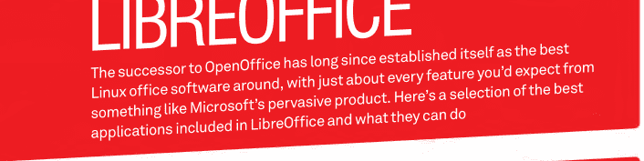

## 文字处理器

任何办公套件中都有标准的文字处理器，然而 Writer 执行的比你在 LibreOffice 中找到其他编辑器要多得多。它拥有你预期的所有工具，例如布局功能、高级宏和邮件合并，你会在专业软件版本中找到这些功能。它倾向于将文件保存为 .odt，但你可以将其默认更改为 .DOC 或 .DOCX 以兼容微软软件。

## 为什么不用 OPENOFF？

> 在这里，我们专注于推荐 LibreOffice 作为 Linux 上的最佳办公套件。你可能奇怪为什么我们没有换回 OpenOffice。我们大多数人切换到 LibreOffice 是因为从那时某时候起 OpenOffice 开发的现状。正因如此，LibreOffice 有许多更新和改进，它现在是绝对优于 OpenOffice 套件的版本。

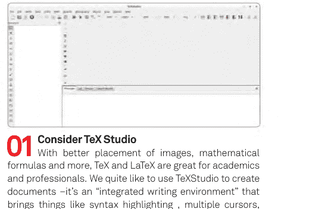

## CALC

Calc 相当于 Microsoft Excel，具有 Excel 的所有功能，而不需要学习复杂的公式和代码。工作流非常流畅，你可以编辑单元格格式。你也可以使用数据透表进行数据操作。与 Excel 的兼容性很容易，但并不完美。

- 01 考虑具有更好数学公式的 Text Studio，Tex 和 LaTex 对于学术界和专业人士非常棒。我们喜欢使用 TextStudio 创建文档——它是一个“集成环境”，带来了如布局、多种颜色、书签、拖放等功能。


## IMPRESS 演示文稿

LibreOffice PowerPoint 不是该套件的主打，但它能够创建并复制你使用的演示样式。它在嵌入媒体方面有局限性，但它可以创建显示。- 02 在编写文档时需要代码语法，但它可以创建公式。

## 数学公式

类似于 Tex 和 LaX 让你编写和绘制公式的方式，Math 应用允许你创建 LibreOffice 中任何类型的方程。作为 Writer 的替代品在某些情况下可以使用，尽管它是一个极简程序，但专注于以图形方式轻松编写公式。

- 03 保存文档 在编写文档时，你可以将其保存为 PDF。所有现金流都是复式记账、借方和贷方。它还有一个支票风格的注册，带有你可以在需要查看账户时生成的多种报告类型。

## 写作处理器（此处原文为 Writer）

## 项目管理应用

使用这些 Linux 让你的工作更顺畅

## GNOME PLANNER -VS- PROJECTLIBRE

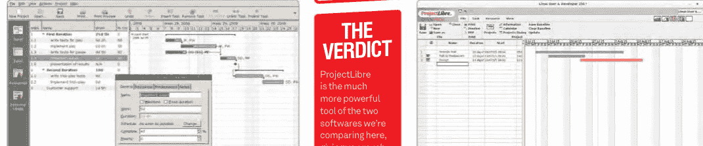

## 结论

由于它所有的额外功能、股票选项，GnuCash 是需要强大的会计工具来管理财务的人的更好选择，而 Grisbi 稍微现代一点。GnuCash 在多年后依然强劲。

该软件也是跨平台的，以防你需要离开 Linux 机器编辑它；它深受社区欢迎，也是我们喜爱的软件之一。

## 家庭与办公会计

在你的办公桌前使用这些顶级的财务应用管理你的财务

## GNUCASH -VS- GRISBI

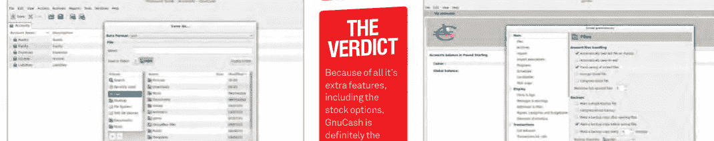

## 结论

Grisbi 是一个与 GnuCash 略有不同的财务管理器，更适合家庭用户而不是大企业。这款软件是跨平台的，一样可以让你跟踪账户之间的交易。它开启的每个报告你都可以查看和报告，还可以设置预算以及你如何遵守它们。


## 最佳免费软件

## 网络与隐私

获取用于连接、从互联网下载以及接管互联网的最优质软件

## 重量级浏览器

我们大多数人都使用其中一个 —— 但哪一个才是真正最好的？

### FIREFOX（火狐）对比 CHROMIUM

Firefox 在 Linux 中几乎无处不在，如果不是它的变体，就是像 Debian 的 Leah 和 Ubuntu 的 GNOME IceCat 这样的分布式内核分支，它还以其丰富的扩展程序而闻名。Firefox 在更新方面速度极快，尽管这些更新通常也会引入新的用户功能，以及后端的调整和修复。例如，对基于标签页的偏好设置、Pocket 的集成以及新的阅读模式：Firefox 在 7 月与 Firefox 共享，允许用户通过其服务账户使用 VoIP。Firefox 提供了无限制、无干扰且可接收重大稳定性和安全更新的功能。

它是日益受欢迎的 Google 浏览器的开源基石。Chromium 实际上与 Chrome 极其相似，但有一些明显的区别。通常，Chrome 有 90% 是开源的，增加了一些专有功能，如 Flash 编解码器——Orbis、Ogg、VPS 和 VP8——然后 Chrome 依赖开源媒体。虽然 Google 自动向用户推送更新，而 Chromium 则依赖用户保持 Chrome 的新。之间可能存在某些差异，缺少一些专有解码器，但你始终可以在 download-chromium.com 找到最新版本。

| 功能 | 9 | 8 |
|---|---|---|
| 内存 | 8 | 6 |
| 扩展程序 | 10 | 8 |
| 总体 | 9 | 8 |

> Firefox 的稳定性对你的用户来说是一个巨大的优势，在我们看来，它更好的内存管理使得 Chromium 值得一试。

### PIDGIN

- Pidgin 上的 XMPP 账户支持 Facebook 和 Registry，这意味着通过 Pidgin 聊天的消息尚无法正式连接到服务器。一个新的解决方案正在开发中。
- 然而，Jeremy Gebleski 为 Debian 和 Ubuntu 提供了一个变通，可以帮助你将 Pidgin 连接到你的 Facebook 账户。

- 01 插件设置
首先导航到 /etc/apt/sources.list，然后使用文本编辑器创建文件

- 02 仓库密钥
将密钥添加到仓库密钥，在终端中使用以下命令：

```
$ wget http://download.opensource.org/repositories/home/gebeski/ubuntu/Release.key
sudo apt-add-key
sudo apt-rem chromium
```

```
deb http://download.opensource.org/home/gebeski/ubuntu/~version release
```

- 将版本替换为文件之一，取决于你选择 Debian_8.0、debian_8.0、ubuntu_14.0、ubuntu_14.4、ubuntu_14.10 或新的 ubuntu_15.0。

- 03 非 XMPP 账户
你只需要运行 `sudo apt-get update` 和 `sudo apt-get install install-package`。接下来，重启并添加新账户或修改现有账户，协议选择‘Facebook’ —— 不是 Facebook —— 输入你的用户名和密码。留空本地别名。

## 桌面邮箱客户端

Web 客户端流行，但桌面客户端非常强大

## 隐私与安全工具

保护你的在线活动和个人数据变得比以往任何时候都重要

### THUNDERBIRD（雷鸟）

### KEEPASSX

出于安全考虑，我们建议为每个账户使用不同的密码（尽管拥有一个基础的、可能是基于短语的密码并为各种账户创建易记的组合是一个好主意）。跟踪所有密码可能很痛苦，所以你可以使用 KeePassX 来兼顾简单与安全。将所有存储在加密数据库中，并将其放在 Dropbox 或安全服务器上。你可以从其他设备访问数据，并使用单个密码从你正在使用的任何设备访问你需要的地方。

尽管几个月来一直担心项目已经结束或正在消亡，但 Thunderbird 仍然非常有活力。它一段时间没有看到任何重大功能引入，尽管这显然是因为在 Mozilla 宣布不再开发 Thunderbird 之后，开发工作转移到了社区 —— 它遵循了 SeaMonkey 的道路，但它是最广泛提供的桌面邮箱客户端，并且最近还添加了日历插件和 OAuth2 支持等新功能。

### TAILS

提到安全性时会提到 Tails，它具有非常出色的功能，为你提供一个完全保护的、开箱即用的在线体验，针对网络、浏览器设置好并立即使用。该系统运行在 RAM 中并在完成后擦除，不在硬盘上留下任何痕迹，在 AppArmor 之上隔离应用程序，可以伪造你的 MAC 地址并自动加密

### CAMOUFLAGE（伪装）

在外面使用 Tails 但又不想引起注意？你可以在 Windows 中启动它，使其看起来和微软的操作系统完全一样，但它仍然具有原有功能

### KMAIL

如果你使用 KDE 桌面，你可用的最强大、最可配置的电子邮件客户端已经安装好了。KMail 与联系人（Contact）应用程序高度集成。它提供了你可以想到的每一个标准功能，并提供了让竞争对手相形见绌的高级功能 —— 在其他客户端中可以做的一切都在 KMail 中。它具有惊人的搜索和过滤工具、优秀的线程、路由和深度安全设置、与 KWallet 等其他应用的集成以及 SpamAssassin 等外部垃圾邮件检查器的集成，且在线软件都根据你的喜好进行了配置。无需任何额外软件即可发送加密和签名信息，并保持与你信任的任何人的通信如你所言。

### TOR

即使你不精通技术，也不需要使用不可行的界面，Tails 为你提供了所需的所有最佳软件。Tails 连接到私有的 Tor 网络，你可以访问，在它被完全擦除后无人可以追溯

### PGP MAIL

如何测试 Tails 1.5-rc1

## 最佳免费软件

## 科学软件

Linux 拥有用于科学和工程工作的顶级 FOSS

### SCIDAV

这是一款用于执行化学反应随机和确定性模拟的软件。如果你对建模感兴趣，那么你可能知道如何使用 Gillespie 方法、Gibson 和 React 方法进行求解；它可以使用 XML 和 SBML 格式更方便地导入和导出相关数据。

观星是非常有趣的。关于太空，当你晚上将望远镜指向天空以充分利用计划时——Stellarium 非常完美。

用于数据分析和可视化的软件（名称是一个奇怪的缩写），SciData 允许你手动或从各种源导入数据并通过内置的统计方法进行分析，然后绘制适用于出版的 2D 和 3D 图形、矩阵。它是跨平台的，因此你可以在任何机器上工作。

你可以创建一个构建的视图，或者直接作为原理图开始。通过它你可以创建 PCB 视图

如果你曾尝试创建一个行星、月球和一颗恒星（如我们的太阳系）的模型，你就会知道编码可能很痛苦。幸运的是，有很多程序可以帮助建模而无需代码。这对于教学天体非常有帮助。

### FRITZING

一个用于规划或输出电路的极佳软件。Fritzing 让你能够不仅使用 LED 和电阻器等标准组件创建电路路径，还可以使用跨 Arduino 和 Raspberry Pi 的不同微控制器。它还有一个巧妙的技巧，可以将计划的图像转换为标准元件符号，使电路布局变得简单。甚至，你可以使用它设计 PCB，然后自己打印和使用。对于任何进行电子设计的人来说，它真的是最好的工具，因为它让过程变得简单得多。电路设计，它还包含深入的示例和教程部分来教你如何使用。

你可以像在真实电路中一样排列组件和微控制器，以获得应该如何制作的想法

从数百种不同的组件、微控制器等中进行选择。更改它们的设置、旋转并根据你的喜好进行自定义。


# 编程工具

使用这些惊人的工具开发应用程序并破解宇宙之谜

## 顶级 IDE

### RADRAILS
RUBY/ON RAILS

编程是逻辑活动的结合，无论你使用何种语言进行编写，你都需要一个配备了所有正确工具和功能的集成开发环境。你需要插件、智能格式化、调试工具等等。简单来说，你需要的是 IDE……

RadRails 是一个适用于 Eclipse 的独立 IDE 或插件，是开发 Ruby 项目的不可少少的 IDE。它拥有自己的集成调试器和其他有用功能，例如代码结构和层级结构，使导航更加容易。Eclipse 插件的理念非常棒，因为它允许你在熟悉的环境中与其他其它代码一起使用 Ruby。


## 如何安装 ECLIPSE 插件

Eclipse 支持插件，并且你可以直接访问并下载丰富的库。如需帮助，请搜索“软件”（Software）然后点击“添加”（Add）。添加你想要安装的仓库插件；使用它来保持更新。或者，使用“添加”功能直接从 zip 文件安装。请注意，方式是一样的。你可以使用 Eclipse 市场（Eclipse marketplace），在其中找到你可以使用的所有插件选择。

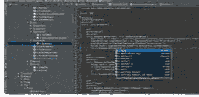

## ECLIPSE C/C++

## INTELLIJ JAVA/JAVASCRIPT

Eclipse 是一个非常流行且强大的 IDE，非常适合在 Linux 上编写 C 及其派生语言——坦率地说，在任何其他操作系统上也是如此。它还有一个非常优秀且多样的插件系统，能够让你自定义自己的工作方式。当你非常喜欢某种布局并想尝试其他任务时，它还有额外的功能。此外，它拥有强大的调试和编译工具。

作为 IDE 网络的一部分，IntelliJ 本身是有创建以来最智能的 Java IDE，它非常棒。除了标准的代码补全可以提供建议并让你知道函数需要什么之外，它还能检查代码质量并解决任何问题。它适用于基于 Web 的 Java 和创建移动应用程序。


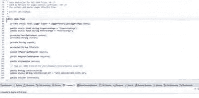

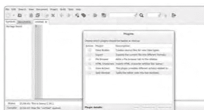

## IDLE PYTHON

## GEANY WEB

虽然这是 Python 的标准开发环境，但它在这方面也非常出色。我们最喜欢的功能是：一个运行中的 Python 环境，你可以在其中尝试代码片段以确定哪些有效无效，并可以在不需要编译的情况下运行整个代码；它很好地支持你项目中可能需要的自定义插件，只需为内部函数提供参数即可。

开发 Web 就是开发普通程序。首先，它并不像更改那样简单。还有许多不同的编程语言。然而，许多 IDE 都可以帮助用这些 Web 语言编写代码，并带有代码标记和层级界面以便导航。得于其插件特性，Eclipse 是一个不错的选择，但你也可以尝试像 Geany 这样的 IDE，它的效果几乎一样好。

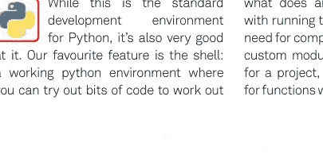

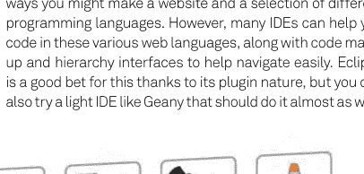

# 开源世界

020 Ubuntu 的演变
028 Ubuntu 手机上手之旅
032 Plasma Mobile: 下一代 Linux 手机
036 未来是开源

| 分享链接 | 设备 | 手机 | 账户信息 |
| --- | --- | --- | --- |
| 我的个人文件夹 | 本地同步？ | | |
| 音乐 | | | |
| 图片 | | | |
| Ubuntu One | 始终同步 | | |

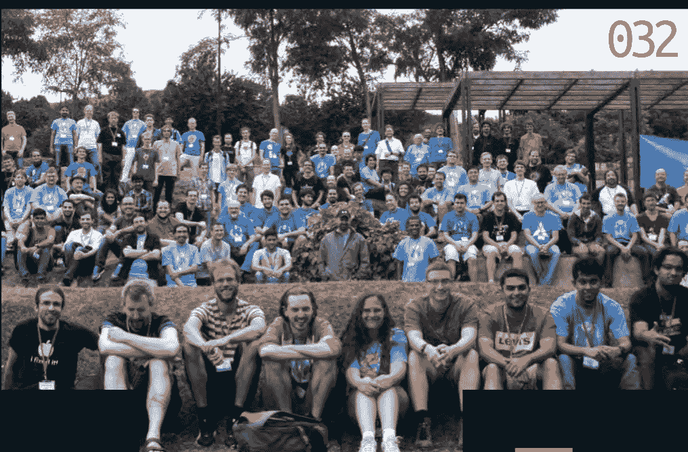


## 036


> “2015 年欧洲 LinuxCon 见许多项目发布及更多”

## Ubuntu 的演变

我们通过回顾 Ubuntu 及其推动人物，来庆祝这一发行版十多年的历史。

回望 11 年，一个名为 Warthog 的看似毫无趣味的发行版在 Linux 领域出现，并见证了 Linux 从其他操作系统的阴影中崛起并成为家喻户晓的名字。

自 2004 年 10 月以来，Warthog 通过多个版本的 Ubuntu 演变。最新版本的 Ubuntu 是变革的催化剂，Ubuntu 实现了它的首次华丽登场。

- **Jane Silber**: 执行官
- **Martin Pitt**: 软件工程师
- **Alan Popps**: 项目经理
- **Richard Collins**: 移动产品经理


# 开源世界

## 第一个版本

Warty Warthog 于 2004 年 10 月 20 日发布。这是第一个发布版本。


当时的 Basic GNOME 桌面。生命周期和光盘安装程序曾是两个独立的镜像。

# Linux 领域

Alan 为我们描述了 2004 年左右 Linux 的情况。

当时我有一个飞利浦摄像头，在 Red Hat 和 Debian 上它都遇到了一些问题，我不得不不断地重新配置它。当时运行的方法是，在那些日子如果某个东西不起作用，你就得进入内核源码，使用一些可能有效或无效的晦涩命令，并花费很长时间；最终你让它运行了，但它可能无法启动；如果启动了，好吧，也许你的摄像头能用，也许吧，但它从来没有开箱即用，我不需要做任何事情，我发现这必须是未来的方向。

# 在第一个 Beta 版本之前的开发一直是一个秘密

老实说，它基本上还是开发者面向开发者，即时覆盖率非常低。我调查了一些著名的德国计算机新闻和杂志，如果有的话，它们会说：“这又是一个发行版——我们为什么要报道这个呢？”

在第一个 Beta 版本带有一些神秘色彩，第一个发布版本只有几千用户之前，它的名字在整个 Linux 和开源社区中广为人知。

在我位于汉普郡的本地用户组以及我认识的朋友中，它非常受欢迎。项目经理 Alan Pepe 回忆道，他提到这个由某个疯狂的南非人开发的家伙：“我从未在任何 Debian 邮件列表上听过它，我也没有真正参与 Debian 社区或……。但它看起来很不错，我在 2004 年底安装了它，就这样了——从那时起我们就一直使用它。”

当时是一个很小的发布，4.10 的逻辑很容易安装。从预配置的桌面和自动挂载的闪存盘操作非常简单。这些元素后来得到了极大的扩展。

开发者们对他们的工作感到自豪，不久后 5.04 就进入了开发。这次发布对 Ubuntu 来说非常重要，使其在用户和开发者中成为了家喻户晓。


在带有原始 Logo 的启动界面上方，Ubuntu 对橙色的偏好多年来没有改变。

## 2005 年 7 月 8 日

## Ubuntu 基金会

由 Mark Shuttleworth 创建，Ubuntu 基金会是一个确保未来的信托基金。它目前处于休眠状态；Canonical 计划在必要将其作为应急基金。

## 2006 年 6 月 1 日

## 第一个 LTS 发布

Ubuntu 的长期支持（LTS）版本在预定发布日期几个月后推出，它的出现标志着 Ubuntu 流行程度的转折点。

# 开源世界

## 早期岁月

Ubuntu 在 00 年代后后期的迅速崛起在 Linux 桌面领域引发了一场小革命。

在接下来的几年里，发生了一些事情。Ubuntu 直今天仍作为最流行的发行版之一不断发布。随着版本的发布，功能不断增加，Ubuntu 缓慢但坚定地正在获得普及。“它有点像一直呈指数级增长，”Martin 在我们问他到底是谁让 Ubuntu 在 Linux 市场站稳脚跟时告诉我们，“但如果我必须选一个，那是我的第一个。”

带有图形化安装程序的版本使其简单得多。6.06 版本是到为止唯一在 4 月和 10 月发布的 Ubuntu，获得了 .06 后缀；它在延迟两个月后于 6 月 1 日发布。桌面端支持持续三年，服务器端持续五年，这种做法在现在的 LTS 版本中已停止，并正在被修复。

随着用户和开发者社区的快速增长，Alan Marshall 必须在他工作之余开始回答人们的问题，并向我们描述这个社区。

> “刚时，活跃社区是那些自力更生完成事情的人，比如建立 IRC 和邮件列表。这一切都是由整天坐在 IRC 上创建 Ubuntu IRC 通道的人完成的。他们是熟悉 Mark 和 Canonical 的人，了解自由软件并会建立论坛。在早期，这某种程度上没有组织，但我们需要他们所有人，而且他们是非常自我激励、自我驱动的事物。”

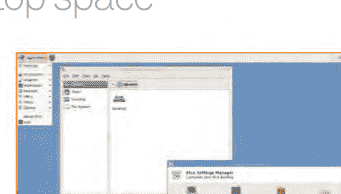

上方，Ubuntu 在 2006 年作为早期的轻量级明星之一开始出现。

一旦我们有了这样的论坛并创建了一个，它就变得异常流行，所以我们度过了最初兴趣的关口，人们有了启动项目所需的素材，更多来自社区的贡献开始增长为更多类型的贡献，如翻译、错误报告、报告和制作文档。那是领导和完善可以继续进行的时候。

正如 Alan 告诉我们的那样，社区持续增长并成为 Canonical 的一个非常重要的部分。

> “Ubuntu 的开源社区以及公司与社区之间的合作是我发现 Canonical 真正独特的地方之一。我继续认为那是我们真正成功领先该领域的地方。”

上方，第一个版本与它现在的样子不同。

## 一旦我们度过了创建初始基础设施的关口，更多的人能够继续


## Ubuntu 时间线

云服务是独一无二的。2009 年 5 月 13 日。

云服务是独一无二的。2010 年 3 月 1 日。

云服务是独一无二的。2010 年 10 月 10 日。

云服务是独一无二的。2011 年 4 月 28 日。

| 线程 | 回复 | 浏览 |
| :--- | :--- | :--- |
| 55 无法获取 | 2 | 385 |
| 56 关于的建议 | 2 | 125 |
| 57 如何获取 | 1 | 96 |
| 58 如何安装 | 1 | 386 |
| 59 如何创建 | 1 | 140 |
| 60 如何运行 | 1 | 140 |
| 61 我需要帮助！ | 1 | 172 |

## Lubuntu

Ubuntu 的轻量级版本，使用 LXDE 桌面以最大化旧电脑或性能较弱电脑的输出，如果用户偏好减轻重量的界面，可以轻松扩展到更强大的界面。

## Edubuntu

Ubuntu 的教育版本，支持 LTE 客户端，以便学生在家运行完全相同的发行版。它是为想要创建计算机实验室或教室的教师设计的。它使用 Ubuntu 和各种实用的开源软件。


## Ubuntu 开源世界

## Ubuntu 的现在与未来

Ubuntu 与移动端正如何塑造着 Ubuntu 的未来与面貌

目前，Ubuntu 的重心被分在桌面版和即将推出的 Ubuntu 手机之间。Richard Collins 是一位自三年前加入 Canonical 以来就一直负责手机操作系统的 Ubuntu 移动产品经理：

“这个想法一直源于 Ubuntu 在我们的世界中将如何运作。它实际上源于适用于 Android 的 Ubuntu，当时我们利用它与许多移动功能和移动运营商进行了了交流。这种关系已经存在，而且非常合情合理，开发开始考虑将 Ubuntu 作为一个代码库，这实际上将是独特的，从意义上说，它可以真正作为一个跨设备的单一代码库来运行。”

“无论如何，这都是行业发展的趋势，因为已经有了触控式笔记本电脑，并且有一个大的战略推动让我们说：‘没错，要把手机做成一个完整的、种子商业产品。’”

不要忘记社区，Canonical 在早期就让他们他们参与了开发。

> “我们想要让社区参与到手机中的之一，这样我们就不只是生产手机并把它推出去。我们也让一些人参与进来。所以，手机上有一个天气应用可能有点格格不入，就像计算器以及其他几个应用，你可能还会想要终端和文件管理器。所有的应用都是由社区的人开发的。”

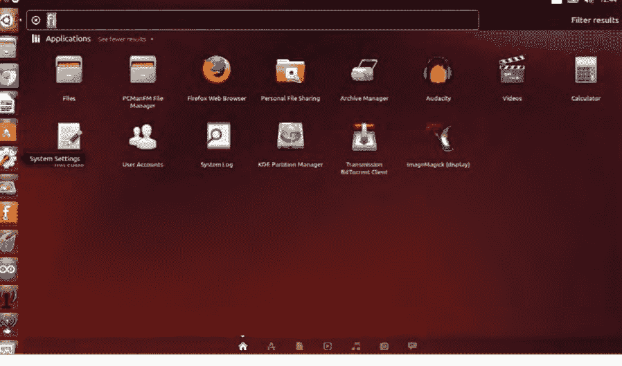

Ubuntu 的最新版本延续了十年前 Warty Whorog 的传奇

## 2013年2月2日

## Ubuntu Touch

在 2013 年的一场新闻发布会上，Mark Shuttleworth 揭了新的 Ubuntu 移动操作系统：界面已经缩小以适应触控屏，并显示出最初承诺的独特环境的迹象，

## 2014年4月17日

## 下一个 LTS

14.04 是 Canonical 最新的长期支持版本 Ubuntu，提供五年的支持，它似乎适用于企业的桌面和服务器；这是一个非常稳定的版本，专注于修复漏洞，而不是新功能。

## 我认为我们已经在公司和引入社区投入之间取得了平衡

这些核心应用也是与 Canonical 设计团队合作完成的，所以设计团队说‘时钟应用应该是这样’。

[我们喜欢]对于社区中的人们，想要找到一群正在使用 Ubuntu 的人，并确保我们可以为在下一次工作发布期间在许多手机上出厂的应用贡献许多人，但是能够去商店买手机，并让他们自己的代码运行在上面

“这已经太大了。” Richard 证实了社区运动正在接纳这一点，并以如此棒的方式宣布了它。预装在手机上的一系列应用来自社区，还有成百上千个人们可以从应用程序商店下载。

Richard 还告诉了我们关于手机的一些意外未来公告，以及一个已经建立的开发路线图。目前很明确的是，Canonical 的未来取决于那些帮助它成长的活跃社区成员。Jane 在我们询问她关于与开源公司合作工作时反思道：‘我想要处于公司和社区投入与热情之间，那些坎坷的部分在任何关系或社区中都存在，我认为这是关于 Ubuntu 增长中最有趣的部分之一，随着我们继续增长，并进入服务器端。我认为保持这种与不同的透明度和参与度是重要的’”


应用上方的内容很大程度上是由社区结合正式的设计团队共同构建的

## Ubuntu 之上

Touch 的开发与 Ubuntu 绑定，这是一个创建一个带 dock 的、运行 Ubuntu 的手机的项目


## 来自 Jane Silver 的信息

“我个人，以及我们 Canonical，想要感谢您的读者以及在过去的 11 年里与我们工作和合作的 Ubuntu 社区的人们。没有你们的贡献，我们无法在这里，并且知道你们的参与和开发对我们来说是一个非常重要的观众。我们希望从 Ubuntu 本身带来最好的功能和开发工具，特别是开发者群体，并希望在未来几年里也能给他们提供最好的工具。”


## 2014年7月3日

## 再见 Ubuntu One

在五年之后，Ubuntu One 终于关闭了，由于计算方式的变化，Canonical 觉得不再是他们需求的有效服务。对于这类应用，合作伙伴关系才是未来的道路。

## 2014年10月23日

## Ubuntu 10 周岁

14.04 在原始 Ubuntu 发布后整整十年三天后推出，将继续延续 Warty W 易用型 Linux 发行版的传奇，尽管带有一种更独特的风格以感谢。


# 开源世界

## 从 Ubuntu Phone 开始


## 学习如何设置并充分利用你的全新的 Ubuntu 手机

你拥有了闪闪发光的新 Ubuntu 手机。也许它可能是 Aquaris E4.5（覆盖页面），但未来可能是其他东西——而且你想让一切都正确。如果你以前用过 Android 手机，初始的快速启动向导对你来说相当熟悉，即使你没用过，它也非常新颖。

手机很可能会带你到处看看，给你关于在使用手机时该向哪里滑动的提示——从左侧栏在应用间切换，到从顶部访问设置——所有之前讨论过的很多内容。

## 账户集成

在做任何事情之前，将各种账户链接到你的手机是一个好时机。如果你以前用过 Android 手机，并且它链接了 Google 账户，那么你的首要任务是将这个 Google 账户添加到你的手机中。通过这样做，你可以访问你的所有信息，以及与账户同步联系人的能力。如果你删除了后者，你可能需要重新登录。

如果你以前用过 Android 手机并且它链接了 Google 账户，你的首要任务是把这个 Google 账户添加到你的手机。这些这些 Twitter、Facebook 以及其他几个社交媒体的链接，但你总是可以从中登录并获取通知。

从屏幕左侧滑动显示熟悉的 Ubuntu 启动器

## 启动应用

## 在你的新手机中应该关注哪些

### Beru

Kindria 的功能在 Ubuntu 上不可用，但如果你确实想读某些东西，那么手机有。它使用与其他阅读器相同的 ePub 格式，所以你可以轻松编辑你现有的书籍。

如果你身边没有这类电子书，你可以把它们下载到手机。所有良好的书籍阅读器都可以让你调整文本颜色以创建一个更好的阅读环境。

## 文档查看器

文档查看器是 Ubuntu 的一部分，尽管它默认没有安装。它允许你查看各种类型的文档，但它只支持基本功能。

> 主菜单提供了系列范围的访问。从这里你可以从底部调出设置

# 设置

一旦设置设置，你应该进入设置进行更改。首先，检查你是否能够根据位置自动设置正确的时间。我们在早晨闹钟时漏掉了这些，因为我们的手机还慢了一个小时。

从这里你可以调出一系列范围的设置来添加或删除已安装的应用，并从应用商店寻找其他的。

## Places

这比专门的应用程序好得多。它利用 Wi-Fi 和基站的位置，并实际上显示周围的地方。你可以深入结果查找相关地点，例如餐厅或酒店。

## Dekko

Ubuntu 邮件应用是第三方网络服务，如 Gmail 和 Yahoo。Dekko 是一个功能全的解决方案，可以帮助你导入 POP 账户，这些账户存储在本地，所以你可以在没有互联网连接的情况下访问它们。有几点需要注意：遗憾的是它没有推送到通知——但大多数主流客户端都不支持——而且它不支持 Microsoft Exchange。


# 开源世界

## Bq Aquaris E4.5
Ubuntu 版本

这款搭载 Ubuntu 系统的手机手机是否填补了 Ubuntu Edge 项目留下的空白，还是仅仅是一场平庸？

Bq Aquaris E4.5 最初是为西班牙市场设计的低端 Android 手机，现已移植到 **Canonical 的 Ubuntu**。唯一可见的变化是去除了低分辨率 qHD 屏幕周围的软键，取而代之的是受 Sashiri 启发的 Ubuntu 边缘滑动导航系统。其他一切都完全相同，包括在手中感廉价得令人置信的轻质塑料壳，以及无法达到厂商声称像素值的插值相机。

当然，硬件并不是这出戏的主角，软件同样如此。Aquaris E4.5 Ubuntu 版本的卖点在于它的操作系统，这是一个基于 Ubuntu 15.04 发布的 Ubuntu for Phones 变体。

- 操作系统：Ubuntu for Phones 15.04
- 处理器：媒体昂科 MT6568 四核 ARM Cortex-A7, 1.3GHz
- 内存：1GB RAM，8GB 闪存存储（可通过 Micro-SD 扩展）
- 尺寸：137mm x 67mm x 9mm
- 显示尺寸：4.2"
- 显示分辨率：540 x 960 (qHD)
- 无线网络：蓝牙 4.0，802.11b/g/n Wi-Fi (仅限2.4GHz)，GSM 850, 900, 1800, 1900, UMTS 2100
- 价格：€169.99

我们这款手机……

在测试期间，我们发现手机会进入一种弹出键盘拒绝出现的状态。遗憾的是，根据 Canonical 在其失败的 Ubuntu Edge 众筹项目的承诺，该系统不支持桌面界面，且无法连接外部显示器。如今，所有图标都符合系统要求。感觉非常像 Android 的早期版本，且通知栏很局促，下拉可以显示几个快捷设置，就像其主流实现一样。

然而，这并不意味着 Ubuntu Phones 是件简单的事。它借鉴了许多竞争平台的特性，从 Mer 到 Stellar Scope。对于 Ubuntu Phones 来说，Scope 的设计目标是将多个源的信息默认汇聚到一个地方。今天，Scope 显示天气、日历条目、通话和短信，它重复了信息并根据你的位置搜索周边的地标。

Scope 的想法足够精妙，但它的实现显得欠缺且生硬，而 Scope 之间的数据重复让人怀疑这是否是一个足以支撑一整部手机的噱头。事实上，“欠缺”是一个描述整个操作系统特别贴当的词。Ubuntu 桌面可能很稳定，但还需要更多时间来打磨。

使用 Ubuntu Store 可以提供软件，但选择有限。可选的品牌很少，而出现的那些无非是通往公司网站的快捷方式。它可以运行 Android 应用程序，除了在 Aquaris 上作为第二台手机外，这似乎错失了机会。可以使用 Ubuntu 账户，但由于 Canonical 已在 2014 年关闭了商店和同步服务，很难对 iCloud 说些什么。如果 Ubuntu 不仅仅名存存在，或许在智能手机上使用 Ubuntu 会是一次更愉快的体验；但现在，压倒性的感觉是失望：

## 缺点
低端的价格让 Aquaris E4.5 成为一个负担得起的备用手机，双卡功能也很有用。软件尚未准备好投入正式使用，由于其廉价的本质，体验非常突兀。

## 总结
廉价、低端的硬件以及多 Bug 的 Aquaris E4.5 Ubuntu 版本转化了那些已经实现过的核心理念。Phones 绝对是一个值得关注的项目，但尚未赢得开源界的赞誉。

## 访谈 SEBASTIAN KUGLER
### Plasma Mobile：下一代 Linux 手机

KDE 开发者 Sebastian Kugler 领导着一个将 Plasma 桌面引入手机的项目，将 Linux 推向了移动市场。

> 恭喜你们最近发布了项目公告！你们是如何开发 Plasma Mobile 的？

大约在过去的四个月里。它在大年前作为一个非常初步的概念开始，在年底交替之际，我们知道确实可以把 Plasma 带到手机上。我们开始思考这些功能如何协同工作，以及如何在新硬件上运行它。我们尝试在基于 Ubuntu 的后端上反复尝试了两个月，这基本上相当困难。然后通过 KWin，我们实际上让它运行了，从那里我们就可以开始——实际上是冲刺——进行开发，以便我们能在学院会议上展示一些成果并感到自豪。

> 所以你们现在是基于 Ubuntu 的吗？

是的。这个想法是，我们创建一个可以在某种程度上使用的底层操作系统——就像 Linux 桌面一样，所以你有一个模型化的操作系统，比如 Ubuntu Touch 或 Mer，然后你来实现它。我喜欢的是，我们顺应了新的设计工作，并得到了大量的反馈，诸如“但它看起来糟透了”——他们会那样评价那个设计师。这很有道理，我们知道在设计上需要更进一步。但对于每一个微小细节，我们的架构师都会提出批评性意见，这让那些发送模型稿的人开始思考如何改进它。我们已经有四五位设计师在系统的不同方面进行真正的专业工作了，我们现在

在设计方面，这是你们目前的重点——即开发各种应用程序——还是说我们仍然在关注核心系统本身？

目前最大的任务实际上是非技术性的；所以我们刚刚把项目公开，这也是我在过去几周特别忙碌的事情。


# 开源世界

界面左上方是通知栏。你可以向下滚动查看开发者们如何在社区中共同工作、集成并定义工作流。

在这里操作，KDE 社区内部正感受到一种紧迫感，目标不仅局限于桌面设置，而是最终成为一个让想要轻松运行自己想法的人准备的项目。我们并非没有 UI 范式，也不打算创造下一个大大物——我们想做的是最实实的事情。

中间部分，手机功能齐全，并与联系人深度集成。

核心团队有多少人？——与 KDE 旗下的某些项目相比，这个规模相当小。

右侧，强大的启动器也已安装在 Plasma Mobile 上。

作为一个小团队，My Mobile 投入了许多其他精力。我们有一支来自桌面端的强大设计团队——能够加入项目的人数有限，但也有大约十个人，而且让基础功能运行起来是绝对必要的。

Plasma Mobile 确实有一些特点——用一个单一的无限滚动页面来取代在多个主屏幕之间切换的想法。

## 志愿者与员工

通过重用我们已有的运行 Plasma 的基础设施并融入新功能，实际上非常有趣。

Sebastian 解释了作为志愿者工作时拥有充足时间的必要性，你可能只有两个小时；而在这里，我们每天都会花时间观察。

切换应用的想法经过思考、考量，然后只花了两个小时的工作就完成了。这比我们实际上已经构建多年且非常稳定的应用要多一点。而且通过使用不同的 UI……

我们的代码每天构建一次——现在我们制作新功能或尝试新事物，这样我们总能测试代码的最佳版本，并在第二天早晨发布一个可以刷机的镜像。

你们有开发路线图吗？我们希望有一个基于终端用户的版本，展示所有能够拨打电话的功能，并且让我能将其作为日常主力机使用，而不用担心质量问题。

这是一个全新的独立项目，我们在与 Plasma 成员合作的基础上取得了巨大进展。

Plasma 是一个活跃的项目，而且是许多人的心血。所以，在某种意义上，Plasma Mobile 是 Plasma 项目在工作过程中的一个产物，我们还有很多工作要做。我们并不太关注用户体验，但正尝试让许多不同的应用程序在基础功能上运行。我们不知道在设计和功能性方面最终会达到什么程度，因为这是一个开放的过程——向参与开放，因此具有一种自然的、非常开放的本质。

上周我们坐在一起，用户体验人员说，在我们进入任何……之前

## 愿景声明

Sebastian 和 Plasma Mobile 团队为他们的操作系统设定了愿景：

Plasma Mobile 旨在成为移动设备的流行选择；它的设计目的是让用户对信息和通信拥有完全控制权。Plasma Mobile 具有高度定制性并对第三方软件开放，允许用户选择使用哪些插件和引擎。它在不同设备之间提供了无缝体验。Plasma Mobile 实现标准，并以透明的方式开发，鼓励社区参与。

- 宣布 Plasma Mobile 的 Akad 2016 会议于 7 月 25 日在挪威奥陆举行。

要有意义的设计，我们需要知道项目的愿景是什么：我们需要考虑目标群体，否则我们的设计只是为了好看，但没有一个明确的目标。所以我们回溯起点，从一个项目愿景开始（见上文愿景声明）。

我们现在都想在所能范围内提供对你的隐私有利的服务，但我们设定的方向是非常宽松的；因为我们希望维护作为自由社区的使命，并赋予用户保护自己隐私的工具。自由社区传统上非常自给自足，但我们已经遇到了它的局限性，请尊重，我们不能仅仅止于此。谷歌的商业模式曾是我们的项目目标。我希望能够对我的政府说，除非你们的总理无法与部长进行私下通话；我希望能够给那些必须与我们通信的记者提供信息。我们想要创建一个可以被审计的开放系统，你可以由你信任的人来实现它，并可以对各种事务进行加密。这就是为什么我们在项目愿景中明确写下这一点：因为我们认为现在正缺少这一项，而且它与自由软件项目的背景非常契合。

> 我们希望在明年夏天有一个基于终端用户的版本，让我能将其作为主力机使用而无需担心。

这是否足够让用户在软件上大放异彩，或者例如尝试 Canonical Docs、Miro，或者构建像 Imp 或 Vivid 等其他项目？

我们现在正痴迷于这款软件，但我们难道不是生活在这样一个时代吗：我们可以说，“等第一个稳定版本进入市场。”它对于开发者来说可能很好，对于某些高级用户来说可能没问题，但要真正取得成功，我们需要让许多人安装它。例如，对于那些基于电话号码创建手机的人，虽然那相当昂贵，但软件还没有准备好。现在尝试还太早了。但是，是的，想法是定义我们所构建的并很好地实现它，配合优秀的软件。

软件开发的规模每天都在创造和共享数十亿亿美元的价值。这就是为什么软件开发的性质发生了如此巨大的变化。然而，我不会与此竞争！我是说内部研发资金吗？世界前十名公司每年在研发上花费 60 亿美元。正如我现在所说的，我将把部分研发投入开源领域。

## Jim Zemlin

Linux 基金会执行官。他的职业生涯见证了过去十年移动计算和开源软件技术的兴起。他利用这一点驱动了技术的创新。


# 开源世界


基金会作为调解者和促进者的角色，有助于为开发工作（如内核本身）创建中立空间。

## FOSSology 托管

FOSSology 由 HP 于 2005 年创建，是一个开源许可证合规性软件项目。它使用启发式模式匹配算法，分析其每一个组成文件，发现并报告所有软件许可证，准确评估已开发或正在考虑分发的开源软件，并确保该项目能够与其他组织共享其成果。

FOSSology 由包括 Wind River 在内的公司维护，这些公司反过来支持如软件软件包数据交换（SPDX）和 Readme 等项目。今年，FOSSology 的项目托管、所有权和领导力得到了赞助者的支持，现在由基金会托管。

源，并将把我的内部研发专注于对我的客户重要且真正使我与众不同的事情。

这是其中的一个极佳案例。无人机（UAV）市场正在迅速扩大，90% 的无人机实际上是使用 Dronecode 代码库开发的。如果你加入它，当你控制了整套软件组件时，你将进入一个全新的操作系统，这是行业和硬件创新的转折点。

我们可以识别出为开源开发模型提供动力的催化剂。“就像 Linux，”林纳斯·托瓦尔斯（Linus Torvalds）说，“通过集体创新和开发，我们共享了真正让所有人受益的研发成果，而不仅仅是社会主义实验创造者。Linux 证明了红帽（Red Hat）已成为一家价值十亿美元的公司；亚马逊、谷歌以及互联网的大部分现在都运行在 Linux 之上。我们处于一个可以在自由软件之上运行的世界。这对我来说是一个巨大的‘天哪——它是怎么运作的！’的催化剂。”行业开始增长——这是运动中的另一个巨大变化。你在这里听到首席执行官们谈论如何从 Web 转向移动端。那么，什么驱动了移动计算？每一个 Android。80% 的 Android 设备运行基于 Linux 的开源软件，这引发了另一波浪潮，然后我们进入了云计算时代。如果你看当前云计算的现状，像 Cloud Foundry 和 OpenStack 这样的项目都由 Linux 和开源软件驱动。

“现在我们开始产生这种雪球效应，转折点在不断加速。这就像我们从桌面转向移动端时。就像我们开始转向云时。就像我们拥有 Hadoop 的时候：我们的转折点之一是微软——我们非常尊重他们——出来并说：‘嘿，我们喜欢 Linux！我们希望 Linux 和开源软件运行在我们的 Azure 云上。’微软参与了许多开源项目，比如基金会、我们的核心基础设施倡议（Core Infrastructure Initiative）。我认为这是一个重大的转折点，软件领域最重要的公司之一——微软，现在是开源领域的一等公民了。”

# 你如何支持这些代码诗篇，如何支持这些自组织形成的有机社区？你如何在不搞砸它的情况下让这些工作得以开展？


## OpenChain 工作组

年度大会汇聚了全球的 Linux 人才，以共享和解决问题。

Linux 基金会作为凝聚努力的作用，在全球范围内的协作比以往任何时候都重要。Linux 基金会还有许多进行中的项目，解决特定问题并提供反馈到这一更广泛协作努力中的工具。此外还有缺乏足够支持或资金的既有项目，基金会有效地消除了它们。正如所注意到的，基金会已支持了多年的技术，实时 Linux（Real-Time Linux）工作组已经建立，以正式化和保护在他们期间完成的工作。

我们询问了同样在基金会保护下接受的成员……（此处原文不完整）


# 协作价值

社区做出这些决策 - 我们只是希望社区能高效地做出这些决策。再次，我最大的恐惧不是我们失去了其中所有的知识产权共享组件，而是我们在试图引导对开发者真正有意义的决策时，反而可能适得其反。我们在框架层上堆叠节点。

基金会在促进行业协作方面努力的另一个益处是推动了影响整个开源有效性的组件的开发。“我认为，当我们在框架层进行水平工作时，在负载层使用 Cloud Foundry，在操作系统层使用 Linux，在容器层使用 Docker 时，看到这些项目从端到端运行是行之有效的的。”

Linux 基金可以为这些项目提供扩展支持：治理、知识产权（IP）管理、许可合规性、安全最佳实践、培训、开发者认证。这些是项目需要的，而大多数开源项目在处理自己拥有的任何事情方面都非常困难——他们员工中没有这些人员，没有培训师，也没有能够……

量化一个开源项目的价值，更不用说整个生命周期了。然而，基金会通过创建一个基于构建成本模型（2022）的报告来实现这一点。虽然我们使用了基于对开发开源项目所需精力的典型线性分析的 CCM，但一个开发者可以完成的工作量差异很大。

Linux 基金会的报告《550 亿美元估算 Linux 基金会贡献的总价值》（跨其协作项目包含 115,301 行代码）估计产生这些代码所需的精力为 1550 万小时。这需要 1,256 名开发者花费 30 年，相当于 550 亿美元的价值。

我需要教育整代完全没有接触过开源的人，但他们足够了解到可以说：“哇，这是我项目中代码库的很大一部分，我该如何让他们修复我的遗留代码呢？如果他们拥抱开源，根据市场情况，他们的速度会更快。如果他们拥抱开源，他们将面临艰难的竞争，他们比我们做得好且快得多。”

这就是我们面临的挑战，这也是为什么我们看到使用项目、语言和开发本质上是让组织更容易地作为正常开发流程的一部分来消费和分发开源代码。从我们的角度来看，开源软件越多，对社会越好 - 这也是我们要做的，也是我们关心的。

## 增强你的系统

- 044 构建你自己的系统工具
- 052 故障排除与修复 Linux 网络
- 058 将旧 PC 转换为 NAS 盒
- 062 像专业人士一样调试 Linux 软件
- 066 在 Linux 中自动化你的音频
- 070 设置游戏控制器在 Linux 上运行
- 074 通过结合 SSD 和 HDD 加速你的系统

> @在第 1075 行断点以跳过段错误

```gdb
(gdb) info b
Type Disp End Address What
1 breakpoint stop y
2 bool.formula:formula:Grammar:(Grammar) at /home/rene/reben/Debian/Packet/Libreice-3.5+4dfsg2/sc/source/core/cell:1075
breakpoint already hit 20 times
set $orscheck=$pcd0dld-0x
set print("%s", $orscheck)
if ($orscheck)
set print("pcd0dld to avoid the crash ...")
set $var=$pcd0dld-0x
c
(gdb) print Shifts
64 = 2
(gdb)
```

> @LibreOffice 的错误和调用堆栈

```c
Program received signal SIGSEGV, Segmentation fault.
in in ??
In ScFormula::Compile(this=0x7ffeff05d770,scramformat-to:formula:Grammar::Grammar::NATIVE/LibreOffice/Lib/LibreOffice.so:3.5+dfsg2/sc
```

| Time Machine | 大小 |
|---|---|
| WD Time Machine | 172.42 GB |
| WD Storage | 259.07 GB |
| WD Mavericks | 81.63 GB |
| NASFREE | 76.49 GB |

# 052
# 074
# 066

```bash
user:~/Documents/Magazine/042-Automoma
user:~/Documents/Magazine/042-Automoma
player 2.2.0.Weather (version 2.2.
user:~/Documents/Magazine/042-Automoma
user:~/Documents/Magazine/042-Automoma
user:~/Documents/Magazine/042-Automoma
user:~/Documents/Magazine/042-Automoma
chmod +x autoplay.sh
user:~/Music/playlists$ autoplay.sh
user:~/Music/playlists$ autoplay.sh
player 2.2.0
```

## 增强你的系统
# 主用系统调用
## 构建你自己的
## 理解进程
## 系统
## 使用 C 函数工作
## 使用多种语言

## 利用 C 调用并开始学习编程以开发你自己的软件

我们将深入研究系统编程，旨在帮助你理解各种 Linux 工具和服务器是如何实现的，以及 Linux 系统背后的原理。具备 C 语言的基础知识并知道如何编译将很有处。

## 什么是系统编程？
## 系统调用
## 拥抱开源

**系统编程是关于理解各种 Linux 工具和服务器的实现，以及 Linux 系统是如何运作的。** 当 Linux 首次引入时，我们通过 C 语言的基础知识来了解它。

这些是项目需要的，而大多数开源项目在处理自己拥有的任何事情方面是非常困难的——他们员工中没有这些人员，没有培训师，也没有能够……

量化一个开源项目的价值，更不用说整个生命周期了。然而，基金会通过创建一个基于构建成本模型（2022）的报告来实现这一点。虽然我们使用了对开发开源项目所需精力的典型线性分析的 CCM，但一个开发者可以完成的工作量差异很大。

Linux 基金会的报告《550 亿美元估算 Linux 基金会贡献的总价值（跨协作项目包含 115,301 行代码）估计产生这些代码所需的精力为 1550 万小时。这需要 1,256 名开发者花费 30 年，相当于 550 亿美元的价值。

我需要教育整代完全没有接触过开源的人，但他们足够了解到可以说：“哇，这是我项目中代码库的很大一部分，我该如何让他们修复我的遗留代码呢？如果他们拥抱开源，根据市场情况，他们的速度会更快。如果他们拥抱开源，他们将面临艰难的竞争，他们比我们做得好且快得多。”

这就是我们面临的挑战，这也是为什么我们看到使用项目、语言和开发本质上是让组织更容易地作为正常开发流程的一部分来消费和分发开源代码。从我们的角度来看，开源软件越多，对社会越好 - 这也是我们要做的，也是我们关心的。

## 增强你的系统

- 044 构建你自己的系统工具
- 052 故障排除与修复 Linux 网络
- 058 将旧 PC 转换为 NAS 盒
- 062 像专业人士一样调试 Linux 软件
- 066 在 Linux 中自动化你的音频
- 070 设置游戏控制器在 Linux 上运行
- 074 通过结合 SSD 和 HDD 加速你的系统

> @在第 1075 行断点以跳过段错误

```gdb
(gdb) info b
Type Disp End Address What
1 breakpoint stop y
2 bool.formula:formula:Grammar:(Grammar) at /home/rene/reben/Debian/Packet/Libreice-3.5+4dfsg2/sc/source/core/cell:1075
breakpoint already hit 20 times
set $orscheck=$pcd0dld-0x
set print("%s", $orscheck)
if ($orscheck)
set print("pcd0dld to avoid the crash ...")
set $var=$pcd0dld-0x
c
(gdb) print Shifts
64 = 2
(gdb)
```

> @LibreOffice 的错误和调用堆栈

```c
Program received signal SIGSEGV, Segmentation fault.
in in ??
In ScFormula::Compile(this=0x7ffeff05d770,scramformat-to:formula:Grammar::Grammar::NATIVE/LibreOffice/Lib/LibreOffice.so:3.5+dfsg2/sc
```

| Time Machine | 大小 |
|---|---|
| WD Time Machine | 172.42 GB |
| WD Storage | 259.07 GB |
| WD Mavericks | 81.63 GB |
| NASFREE | 76.49 GB |

# 052
# 074
# 066

```bash
user:~/Documents/Magazine/042-Automoma
user:~/Documents/Magazine/042-Automoma
player 2.2.0.Weather (version 2.2.
user:~/Documents/Magazine/042-Automoma
user:~/Documents/Magazine/042-Automoma
user:~/Documents/Magazine/042-Automoma
user:~/Documents/Magazine/042-Automoma
chmod +x autoplay.sh
user:~/Music/playlists$ autoplay.sh
user:~/Music/playlists$ autoplay.sh
player 2.2.0
```

## 增强你的系统
# 主用系统调用
## 构建你自己的
## 理解进程
## 系统
## 使用 C 函数工作
## 使用多种语言

## 利用 C 调用并开始学习编程以开发你自己的软件

我们将深入研究系统编程，旨在帮助你理解各种 Linux 工具和服务器是如何实现的，以及 Linux 系统背后的原理。具备 C 语言的基础知识并知道如何编译将很有处。

## 什么是系统编程？
## 系统调用
## 拥抱开源

**系统编程是关于理解各种 Linux 工具和服务器的实现，以及 Linux 系统是如何运作的。** 当 Linux 首次引入时，我们通过 C 语言的基础知识来了解它。

这些是项目需要的，而大多数开源项目在处理自己拥有的任何事情方面是非常困难的——他们员工中没有这些人员，没有培训师，也没有能够……

量化一个开源项目的价值，更不用说整个生命周期了。然而，基金会通过创建一个基于构建成本模型（2022）的报告来实现这一点。虽然我们使用了对开发开源项目所需精力的典型线性分析的 CCM，但一个开发者可以完成的工作量差异很大。

Linux 基金会的报告《550 亿美元估算 Linux 基金会贡献的总价值（跨协作项目包含 115,301 行代码）估计产生这些代码所需的精力为 1550 万小时。这需要 1,256 名开发者花费 30 年，相当于 550 亿美元的价值。

我需要教育整代完全没有接触过开源的人，但他们足够了解到可以说：“哇，这是我项目中代码库的很大一部分，我该如何让他们修复我的遗留代码呢？如果他们拥抱开源，根据市场情况，他们的速度会更快。如果他们拥抱开源，他们将面临艰难的竞争，他们比我们做得好且快得多。”

这就是我们面临的挑战，这也是为什么我们看到使用项目、语言和开发本质上是让组织更容易地作为正常开发流程的一部分来消费和分发开源代码。从我们的角度来看，开源软件越多，对社会越好 - 这也是我们要做的，也是我们关心的。

## Linux 和 Unix

我们在这里提到了几次。为了清晰，UNIX® 操作系统是由 AT&T 使用 C 语言创建并重新实现的。它现在是 Unix 及其派生系统的标准。Unix 编程技术。

## Linux 进程状态

当 Unix 首次引入时，计算机只有单 CPU，没有多进程内存。Unix 是一个多用户多任务系统。为了确保每个进程运行得公平，引入了特殊的内核进程。

分为三类：进程、进程间和内核进程。用户进程在用户空间运行并具有特殊权限，而内核进程以所有内核数据的权限执行。daemon 可以在用户空间找到并在后台运行，不需要终端。

特定的用户（如 root）拥有它们，通常它们比普通用户拥有更多文件且没有内核进程内存。重要的是，你不能直接从状态跳转到三，或者先使用进程状态。你将在后续文章中了解更多信息。


## 增强你的系统

## 程序一个 cat 工具

从零开始构建连接功能

系统调用就是一个普通的 C 函数。系统调用与普通 C 函数的区别在于，系统调用实现了通常是局部的的功能，并将 Unix 内核与世界其他部分连接起来。通常，它是一个与硬件相关的服务（访问磁盘或网络设备、进程管理、设备通信）或其他服务（处理）。换句话说，系统调用允许程序向操作系统请求服务。

使用系统调用的程序通常是用户程序。你可以将系统程序理解为执行处理硬件的任务。

作为一个一般原则，你应该始终检查系统调用的返回值。尽早捕获任何错误是非常关重要的……

## 构建你的第一个工具

`mycat.c` 代码（左下角）实现了著名的 `cat` 工具的基本功能，并需要一个有效文件名作为命令行参数。请注意，行号仅供引用；你不应该输入它们。使用单独的 `cat` 函数并非必须，但被认为是一种良好的编程实践。

一个重要的方面是，你无法确定文件是一次性读取的，还是逐个字符读取的。在进行任何类型的系统编程时，你不应该做出任何类似的假设。

以下命令将使用 gcc 编译器编译 `mycat.c` 并生成一个名为 `mycat` 的可执行程序。

```bash
$ gcc -o mycat mycat.c
```

如果你想更改可执行文件的名称，请在 -o 参数后提供不同的名称。-Wall 标志用于开启所有编译器警告，这在开发过程中非常有用。尝试不要忽略每一个错误，因为从长远来看这将为你节省时间。

```c
#include <stdio.h>
#include <types.h>
#include <sys/types.h>
#include <unistd.h>
#include <fcntl.h>
void cat(int fd, char *s) {
    char buf[2048];
    long n;
    while ((n = read(fd, buf, sizeof(buf))) > 0) {
        if (write(STDOUT_FILENO, buf, n) != n) {
            printf("Error while writing: %s\n", s);
            return;
        }
    }
    if (n < 0) {
        printf("Error reading: %s\n", s);
    }
}
int main(int argc, char *argv[]) {
    if (argc < 2) {
        printf("Usage: %s <filename>\n", argv[0]);
        return 1;
    }
    int fd = open(argv[1], O_RDONLY);
    if (fd < 0) {
        printf("Error opening file: %s\n", argv[1]);
    } else {
        cat(fd, argv[1]);
    }
    return 0;
}
```

行用于程序中的各种字符文件。头文件用于加载不属于 C 内核的库，这在系统编程中非常重要。

如果你想知道某个系统调用需要哪些头文件，你应该检查该系统调用的手册。可以在 man 手页的第二部分找到系统调用——这对于系统……至关重要

## 文件描述符

由于你将在下一章学习更多关于文件描述符的知识，首先了解一些基础很重要。文件描述符是一个表示打开文件的正整数。

Unix 支持三个特殊标准文件：标准输入 (0)、标准输出 (1) 和标准错误 (2)。也可以使用文件描述符 0、1 和 2 访问它们。

或者，在 Unix 中，可以通过 /dev/stdin 访问文件描述符 0，通过 /dev/stdout 访问 1，通过 /dev/stderr 访问 2。一切皆文件。

如左侧的 `mycat.c` 代码列表所示，cat 函数使用了描述符 1（第 12 行中的 '1'），它是标准输出。换句话说，cat 工具的功能打印在屏幕上。这也是通过从文件描述符 0 获取数据来实现的。这类似于 `scanf` 和 `get` 函数的功能。

- 带有星号

## 进程处理

当进程被创建时，它从状态 1 开始。然后它可以进入状态 2，在那里可以选择进入状态 3，或者进入状态 4 在队列中等待。从状态，进程可以进入状态 5，它被保留在内存中。从状态 4 可以执行，并位于交换空间中。当其中一个处于状态 5 时，它只能回到状态 3 或状态 2。从运行状态 3 可以进入状态 5。通常情况下，当出现问题时，它会变成僵尸进程，或者进入状态 2 或 4。

与某些内置调用同名的调用。例如，可以通过执行 `man open` 来访问 (open) 系统调用的手册；如果你只输入 `man`，你将得到 `open` 命令的手册，因为那是为了使用 `open` 的章节号。大多数情况下，相关系统调用的头标志应该只描述

在 Unix 中，`may` 函数的实现。cat 使用文件描述符从文件读取。文件描述符作为参数传递给 cat 函数，然后在函数内部打开它。函数的第二个参数是文件名，这是一个字符串。由于你已经有了文件描述符，你不需要再次读取文件以处理 I/O，在第 19 行，你使用 `write()` 系统调用在屏幕上输出。`write()` 函数返回其值，存储在变量 `(buf)` 中。如果你想使用 `open()` 系统调用打开文件，它有两个参数：文件名和 O_RDONLY，后者表示文件只读。

## Exec 族

每个 Unix 使用函数来执行用户提供的命令。exec 族中有六个函数：exec、execve 和 execl。如果发生错误，所有 exec 函数都返回 -1；否则返回 0。通过比较，你将学习这六个函数之间的差异。当进程使用系统调用执行程序时，新程序替换旧程序并从 `main()` 函数开始。然而，进程 ID 保持不变。相关的 `fork(2)` 系统将在另一篇文章中学习它是如何启动新进程的。如果你想打开文件进行写入，使用 O_WRONLY 标志；用于读取。当进程结束时，所有文件描述符都被关闭。成功情况下，`open(2)` 系统调用返回一个正整数 (fd)，即文件描述符。出错情况下，`open(2)` 系统调用返回负整数。手动使用 `close()` 系统调用打开文件是良好的实践——但你应该开发 Unix 工具的功能。

## 增强你的系统

## 重建核心工具

与进程 ID

在本部分，我们将实现 `ls`、`wc` 的简单版本，帮助你理解背后的事情比你想的要简单。我们将展示如何获取它们，以及如何检索进程 PID。

简单性描述了编程的困难在于许多细节，例如错误检查、内存处理等。移除这些内容后，你应该能够编写代码并测试它。

你可以看到，所有程序都有注释。如果程序很小，你应该始终在其中放入必要的注释。C 语言假设程序员知道自己在做什么，除非代码出现错误。所以，如果出错，编译器将不会生成可执行文件。如果只有警告，编译器将创建一个可执行文件，但这并不完美。作为一个一般原则，你应该始终尝试忽略错误消息，以及警告。

## ls 的轻量版本

在本节中，我们将实现 `ls` 程序的简单版本。我们将列出作为命令行参数提供的目录的所有项。在右侧输入代码或从 Fileio 获取。通常，你应该编译以下代码：

```bash
$ gcc -o mysls mysls.c
```

第 14 行使用的 `DIR` 类型表示目录流，是 Unix 读取目录的方式。`dire` 结构（第 15 行）不仅包含文件名，还有许多细节——你将详细学习目录结构。你也可以使用 `stat` 访问。

`mysls` 程序的参数只是路径。正如你所知，路径有两种：绝对和相对。绝对路径以斜杠开头，而相对路径不是。`opendir` 第 18 行返回指向目录流的指针。

你可以通过 `while` 循环（第 25 行）读取目录流的所有元素。当你到达目录末尾时，`readdir` 返回 NULL，`while` 循环将结束。

如果你选择与 `mysls` 进行比较，你会发现每一项都作为 `last()` 语句的结果单独打印。

## 挑战自我

一旦你完成了这些工具并尝试重建另一个你选择的工具，还有其他的可以尝试：将多个工具合并为一个；例如，制作一个与 `wc` 结合的工具；我们让你编写自己的 shell 连接文件。

```c
#include <stdio.h>
#include <dirent.h>
#include <string.h>
#include <stdlib.h>

int main(int argc, char *argv[]) {
    if (argc != 2) {
        return 1;
    }
    printf("Please provide the correct number of arguments!\n");
    return 1;
}

DIR *dir = opendir(argv[1]);
    if (dir == NULL) {
        printf("Error!\n");
        return 1;
    }

struct dirent *entry;
    while ((entry = readdir(dir)) != NULL) {
        printf("%s\n", entry->d_name);
    }
    closedir(dir);
    return 0;
}
```

## mysls

```c
#include <stdio.h>
#include <dirent.h>
#include <stdlib.h>

int main(int argc, char *argv[]) {
    if (argc != 2) {
        return 1;
    }
    int inode = 0;
    int numberOfLines = 0;
    // 获取测试文件的文件名
    char *file = argv[1];
    char *line = NULL;
    // 打开文件进行读取
    FILE *fp = fopen(file, "r");
```


## 错误信息与 bug

通常，你会遇到一些错误或 bug。在代码中没有包含正确的头文件是常见的错误原因。如果你尝试在没有 `dirent.h` 的情况下编译 `mys.c`，你会得到至少一个错误和一个警告：

```
mys.c:15: error: unknown type 'DIR'
DIR *dirent;
mys.c:16: error: missing declaration of function 'opendir'
```

如果你漏掉了 `dirent` 变量，你将得到以下错误消息：

```
mys.c:18: error: 'dirent' undeclared (first use in function)
dirent *entry = opendir(NULL) == NULL;
```

现在，尝试使用 `(entry = readdir(dirent))` 而不是 `readdir(dirent)`，你会在无关的地方得到错误：

```
mys.c:27: error: 'entry' may be used unused in function 'my_unialized'
printf("%s", entry->d_name);
```

尽管如此，代码可以正确编译并生成可执行文件，但这段 C 代码是错误的。问题在于你的程序不会产生任何输出，因为 `entry` 变量是 `NULL`。你使用了比较运算符 `=` 而不是赋值运算符 `=`。恭喜你——这是你的第一个 bug！

## wc 的简单使用

本节将向你展示如何创建一个简单版本的 `wc` 工具，它可以帮助统计文件中的单词数——`wc` 程序需要命令行参数，即要去读取的文件名。

你现在应该知道如何编译这段代码了，所以请注意任何错误或警告。`wc` 的代码比另外两个程序大，因为它更复杂；程序的逻辑包含了 `while` 循环。

逐字符读取文件有许多不同的方法，但这是你能找到的最简单的方案。在使用 `getc()` 函数（它一次读取一行输入）之前。

当你第一次看到一个与空格、制表符或换行符不同的字符时，程序假设你处于文件新行的末尾。

下一个系统程序将构建一个更接近你使用的 `/usr/bin/wc` 工具的 `wc` 版本。

## 进程 ID 和父进程 ID

这个程序表明，并不总是编写很多代码才能获取你想要的信息。

第 15 行和第 18 行展示了如何使用属于同一家族的系统调用：`getpid()` 和 `getppid()`。这两个系统调用都不需要参数；每个调用都会返回调用者的进程 ID。

然而，告知用户父进程的进程 ID 不是 1 是好的，因为该命令需要命令行参数。父进程的进程 ID 很有可能是你当前 shell 的 ID。

你可能会说这里检查太多了，你可能是对的。然而，通用原则是，你写的代码越正确，它就应该有越错误检查代码。

```c
#include <stdio.h>
#include <stdlib.h>
#include <unistd.h>

main(int argc
```

## 增强你的系统

## 跨越

有许多其他编程语言供你使用，尽管没有像 C 那样成熟。

存在许多可以执行系统任务的编程语言。所有编程语言都使用 C 系统调用来实现它们自己的函数，因为它是 Linux 内核的唯一接口。即将在 `cp` 命令行工具上实现的程序。C++ 的实现也是可用的。Python 和 Java 也被每种编程语言支持。在这里按顺序介绍它们，以便让你对每种编程语言有一个快速的了解。

## C 和 C++

当涉及到系统编程时，C++ 可以与 C 一完全相同。它们唯一的区别是 C++ 可以以不同的方式组织你的代码，因为 C++ 是面向对象的。

仅仅因为你同时使用 C 和 C++ 版本的代码，并不意味着 C++ 面向的方法没有错误，而 C++ 是编写代码的标准方式，两者之间没有优劣之分，但理想世界会两者都使用。

Python 和 Java 等现代编程语言的优势在于它们更容易上手工作，尽管它们实现了大量功能。然而，它们没有 C 那么快。Rust 和 Go 都有成为 Linux 下下一个热门技术的潜力，所以你应该关注它们的进展。C 的最大优势是，如果在程序执行期间发生错误，你将确切知道是哪一行代码失败了。

```c
#include <stdio.h>
#include <unistd.h>
#include <stdlib.h>

int main(int argc, char **argv) {
    if (argc < 2) {
        printf("Provide the correct number of arguments!\n");
        return 1;
    }
    DIR *dir;
    struct dirent *entry;
    dir = opendir(argv[1]);
    if (dir == NULL){
        printf("Could not open %s\n", argv[1]);
        return 1;
    }
    while ((entry = readdir(dir)) != NULL) {
        printf("%s\n", entry->d_name);
    }
    closedir(dir);
    return 0;
}
```

```cpp
#include <iostream>
#include <fstream>

int main(int argc, char **argv) {
    std::ifstream src(argv[1], std::ios::binary);
    std::ofstream dst(argv[2], std::ios::binary);
    dst << src.rdbuf();
}
```

## 内核开发

由于 Linux 用 C 编写的，你可能会好奇这如何应用于内核开发。目标是充分文档化的，而且这里讨论的技术效果良好。

## Go 语言

```go
package main

import (
    "fmt"
    "io/ioutil"
    "os"
)

func cp(source, destination string) error {
	data, err := ioutil.ReadFile(source)
	if err != nil {
		fmt.Printf("Error reading the file: %v\n", err)
		return err
	}
	err = ioutil.WriteFile(destination, data, 0644)
	if err != nil {
		fmt.Printf("Error writing the file: %v\n", err)
		return err
	}
	return nil
}

func main() {
	args := os.Args
	if len(args) != 3 {
		fmt.Println("You should use exactly")
		fmt.Println("two command line arguments!")
		os.Exit(1)
	}
	cp(args[1], args[2])
}
```

## Rust

```rust
use std::env;
use std::fs;

fn main() {
	let args: Vec<String> = env::args().collect();
	if args.len() == 3 {
		let input = fs::read_to_string(&args[1]).unwrap();
		println!("input: {}", input);
		let output = fs::write(&args[2], input.as_bytes()).unwrap();
		println!("output: {}", output);
	}
}
```

## Python

```python
#!/usr/bin/env python
import sys
import shutil

if len(sys.argv) == 3:
	input = sys.argv[1]
	output = sys.argv[2]
	shutil.copy(input, output)
```

## Perl

```perl
#!/usr/bin/env perl
use strict;
use warnings;
my $input = $ARGV[0];
my $output = $ARGV[1];
copy($input, $output);
```

## 语言对比

尽管每种语言的实现方式迥异，但编程语言在文件任务上使用相同的 C 系统调用。换句话说，你需要使用不同的方法来读取和写入——这些是封装起来的系统调用。然而，`copy` 的实际实现可能取决于它们如何处理内存等。


## 增强你的系统

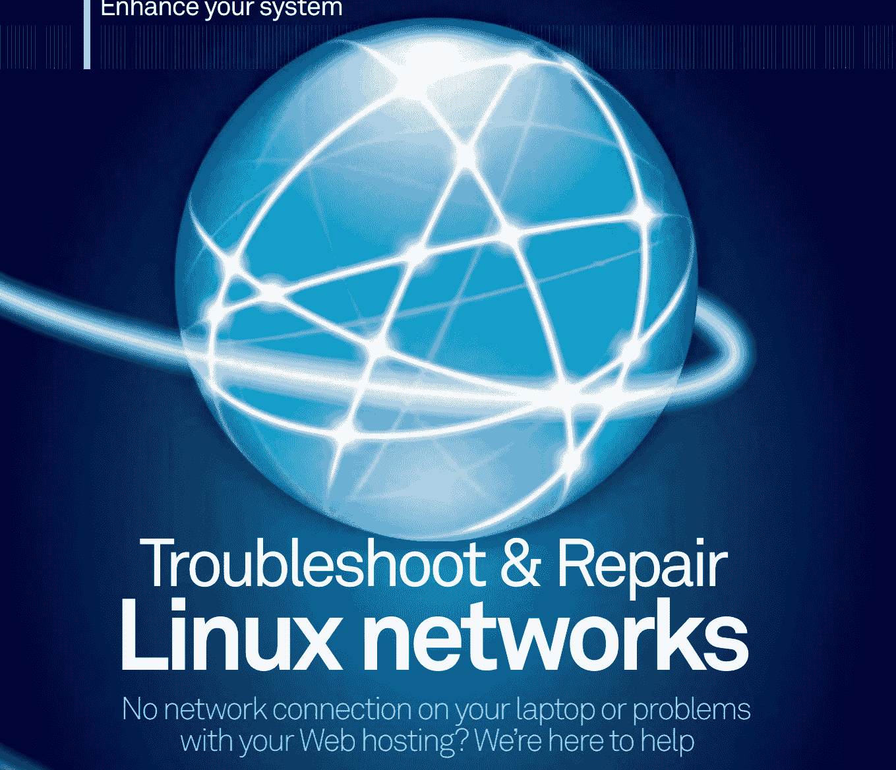

# 故障排除与修复
Linux 网络

你的笔记本电脑没有网络连接，或者你的 Web 托管出现问题？我们在这里提供帮助。

“网络就是计算机，”这是太阳微系统（Sun Microsystems）首席科学家、5 号工程师约翰·盖奇（John Gage）在 1984 年出的著名且精确的格言。“网页、移动和云计算的增长为这句话注入了骨肉，在今天，一台没有网络连接的计算机简直是无法想象的。”

幸运的是，网络是 Linux 的核心，因为互联网和 Web 是构建在 UNIX 之上的。大多数发行版都内置了工具，可以告诉你发生了什么情况，或者至少可以开始调查网络问题。你可以在发行版的存储库中找到复杂的工具，由于几乎所有工具都是基于命令行的，它们在 VPS 上的效果与笔记本电脑一样良好。

我们将带你了解 GNU/Linux 网络逻辑的基础，以及它（以及互联网其他部分）可能出现的问题。我们将查看工具和配置文件来帮助你，并最后通过 netcat、dig、traceroute 和 Wireshark 提供帮助。

## 网络基础

排除 Linux 网络故障的第一步是理解它是如何工作的。

网络是在哪里中断的？不要忽略硬件问题——在基础检查其工作正常后，拔掉电缆，或者检查故障灯是否亮、Wi-Fi 路由器。有些问题很容易检查，而另一些则更容易发生——比如仅仅是搜索。

你不需要通过 RHCE（红帽认证工程师）或 LPI（Linux 专业人员协会）认证，只需要对 TCP/IP 网络有一定了解，可以快速地跳过这一页，在阅读完文章中更实用的部分后再回来查看。

TCP – 传输控制协议 – 是计算机通信的一组规则。TCP 位于 IP 之上，确认发送的每个数据包——与不进行检查的 UDP（用户数据报协议）相比，它包含大量的有序数据。这意味着有用的信息可供工具进行诊断。

IP。互联网层定义了报头和数据块中传输的基本单元。报头包含了将数据从源设备递送到目标地所需的信息。

报头包含 IP 的目标地址。如果它不在本地网络上，它将被传递到网关（IP 或路由器）并继续直到到达目标，其旅程由路由协议决定。地址使用路由协议。

IPv4 数字以 n.n.n.n 的形式表示，其中 n 在零到二百五五之间。某些数字是预留的，例如 127.0.0.1 – 本地主机，供任何副本引用——用于本地网络，如 192.168.n。

当你的路由器想要连接到互联网时，IPv4 提供的 43 亿地址是不够的。IPv6（IP 的下一个版本）……

在 1998 年，IPv4 仍承担着世界近 10% 的流量。我们现在将 IPv4 称为 IP。

例如在 192.168.0.0 中，子网掩码告诉计算机（主机）或路由器地址的哪个部分是子网（例如 192.168.0），哪个部分是主机。我们的 ADSL 路由器给了 192.168.0.2 的 IP 地址，所以主机部分是 2。子网掩码是 255.255.255.0。

如果你收到这条消息，问题可能出现在很多地方，但请让我们尝试通知我们。

| OSI 模型 | TCP/IP |
|---|---|
| 应用层 | |
| 表示层 | 应用层 |
| 会话层 | |
| 传输层 | 传输层 |
| 网络层 | 互联网层 |
| 数据链路层 | 网络访问层 |
| 物理层 | |

> 连接已丢失
- 检查是否所有朋友都在尝试联系你。
- 如果你正在使用笔记本电脑，检查你电脑的网络。
- 如果你正在使用无线连接，检查你的路由器设置，那可能是原因。

以上是知识：OSI 七层模型与 TCP/IP 模型告诉你如何将 IP 地址的各个部分视为什么。

TCP 在目标和源之间建立连接，确保任何丢失的数据包能够排序并重排。它在每端都指定一个端口——编号在 0 到 65535 之间，用于识别服务或应用程序。有一个入站服务列表，例如用于发送邮件的 25。

IP 地址也称为物理地址。物理网络硬件或无线设备层级使用 MAC（媒体访问控制）地址——六个分开的数字。此协议是 ARP 协议（地址解析协议），它将 IP 地址转换为 MAC 地址，ARP 处理反向转换。

像 we.wikipedia.org 这样的主机名用于在互联网上搜索以存储这些名称，而域名系统（DNS）在联系 DNS 服务器时使用 DNS 服务器导致了许多网络问题。

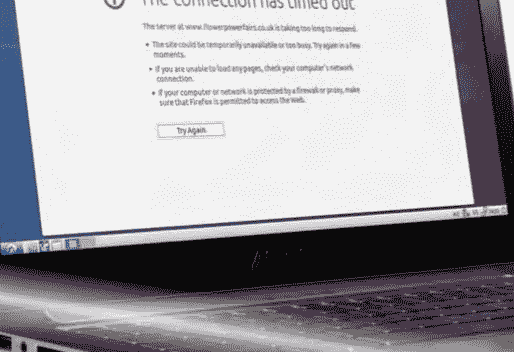

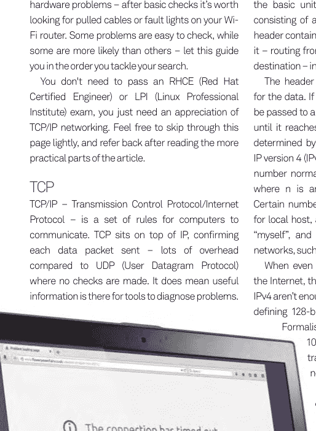

## 增强你的系统

## 诊断问题
**哪里无法工作？** 找到根源可能很复杂，有很多地方可以查看。

如果你收到这条消息，问题可能出现在很多地方，但请让我们尝试通知我们。

> 连接已丢失
- 检查是否所有朋友都在尝试联系你。
- 如果你正在使用笔记本电脑，检查你电脑的网络。
- 如果你正在使用无线连接，检查你的路由器设置，那可能是原因。

以上是知识：OSI 七层模型与 TCP/IP 模型告诉你如何将 IP 地址的各个部分视为什么。

TCP 在目标和源之间建立连接，确保任何丢失的数据包能够排序并重排。它在每端都指定一个端口——编号在 0 到 65535 之间，用于识别服务或应用程序。有一个入站服务列表，例如用于发送邮件的 25。

IP 地址也称为物理地址。物理网络硬件或无线设备层级使用 MAC（媒体访问控制）地址——六个分开的数字。此协议是 ARP 协议（地址解析协议），它将 IP 地址转换为 MAC 地址，ARP 处理反向转换。

像 we.wikipedia.org 这样的主机名用于在互联网上搜索以存储这些名称，而域名系统（DNS）在联系 DNS 服务器时使用 DNS 服务器导致了许多网络问题。


## 配置文件

使用你喜爱的文本编辑器深入配置文件是快速解决问题的极佳方法。

一切皆文件，即使是连接设备也是如此——这就是 Linux。在 80 年代，受 Plan9 操作系统的启发，许多 Unix 系统的配置，Linux 将配置存放在文件中。了解需要编辑的内容会让你的文本编辑器也成为检查和维护网络的强大工具。

它从硬件层面开始 —— 物理接口，而内核暴露了 PCI 总线和 dev 的配置，以便在你调用以下命令时由 `lshw` 读取：

- 查看列表条目名称以使用 `ethconfig` 和 `ifconfig`
- 这并不总是那么简单。在 Red Hat 和基于 Debian/Ubuntu 的接口之间切换时，不知道哪一个是配置了的机器，Fedora 20 列表共享的 `ls raw /etc/network/scripts/ifcfg-eth` 配合 `ip addr` 将帮助我们判断哪一个是连接的。
- Linux 采用这种“一切皆文件”的方法。

### 掉了吗？

你可能不相信，但这些并不是首要检查项——`ifconfig` 和 `ping` 将显示你是否有工作的以太网接口。如果显示无连接，那么你就在寻找电缆（网卡显示绿灯，或者它被拔掉了）。别忘记许多笔记本电脑有隐藏的小按钮——Wi-Fi 开关可以被锁定在隐藏状态，先将其解锁。

... 将显示（除非）这是否为这种情况。如果被锁定，则执行会失败；如果被锁定，则执行 `unblock all` 将重新获得你的连接。这些东西本就是如此，所以如果发生在你身上只是个简单的失误，至少没有发生某些无法挽回的严重问题。

```bash
rfkill list all
```

```
hostname:8.8.8.8
nameserver:8.8.4.4
```

*（注：原文此处存在较多断句，翻译已根据语境还原）...为了自动写入 /etc/resolv.conf，运行 `resolveconf -u`（以 root 身份）或使用 sudo 将更新 resolv。*

### lshw – 网络

仔细查看 `/etc/resolv.conf` 可以发现它是 `/run/resolv.conf` 的符号链接，由 `resolvconf` 写入。用干的命令画出它，可能会向你展示 `NetworkManager.conf`。

打开你 `/etc/resolv.conf` 需要的内容 —— 放入你想要尝试的项，或者通过替换列表开头的 `#` 来删除另一个，以解决你遇到的问题。

### 我在哪里？

如果你在好奇当前正在使用的哪种工具设置——就像这是一个文件一样——`lshw` 可能会告诉你网络管理器的名称或主机名类型，这是很有意义。这是一组实用的脚本，用于描述你的系统以及配置并插入其中的笔记本电脑。特别是对于那些在没有窗口管理器的情况下运行、没有桌面装饰和可点击切换的人来说，可以在已知系统以及新连接之间通过最小的干预进行切换。互联网首先处理连接，而且它比奇怪的更灵活。

由于它是由路由器解析的 —— 通过配置文件 `/etc/resolv.conf` 知道去哪里查找。查看该文件，你可能会看到类似的内容：例如，你的 `/etc/resolv.conf` 可能包含：

```text
# dynamic resolv.conf (file for glue-resolver generated by resolveconf)
# 请勿手动编辑此文件 – 
## 更改将被覆盖
```

```
nameserver127.0.0.1
```

`/etc/resolv.conf (127.0.0.1)` 是一个 DHCP 文件，是 NetworkManager 控制下的轻量级转发 DNS 服务器。在没有此项的发行版中，将从 DHCP 服务器获取 DNS 服务器的地址。

最好基于 `/etc/resolv.conf` 放置如下条目：

- alias net-eth0- ipv6
- alias net-eth1- ipv6

...并重启。如果你排除了它的问题，记得把它放回去：

- alias net-wlan- ipv6

## 增强你的系统

## 修复网络问题

使用这四个应用程序将帮助你定位并修复许多网络问题。

### (Telnet) 到 Netcat

`Netcat` 能够比 `telnet` 做的多得多，但你可能会发现自己在一个没有 `netcat` 的箱子上，所以我们将从一个老派黑客的示例开始。

```
File Edit View Help Settings Help
connect 192.168.1.1 23
Connecting to 192.168.1.1...
Escape character is '^]'
Welcome to 192.168.1.1
root@router:~
```

- 01 谦的 telnet：如果你在网络被 SSH 取替在一个突然变得不安全的世界后开始使用电脑，你可能会发现它的地位降低。但 `telnet` 作为一个从发行版提供的有用工具仍然存在，连接到特定端口以查看哪些正在工作。
- 02 使用 netcat：如果你可以安装 `netcat` (`nc`)，那么依靠 `telnet` 的情况会少得多，因为它结合了测试任何内容的能力：域名、在任意端口监听和扫描。
- 03 端口扫描：检查机器上的每个端口以查看留下了什么（特定的）是不礼貌的，但在你自己的机器上进行诊断是有用的（那本应该有）。
- 04 传递端口：一个实用的技巧是快速设置没有东西阻碍连接。在上面的图中，将 `nc` 视为并在连接到它的宿主机上读取它：

### Traceroute

在使用互联网时你可能不会考虑它是如何工作的，但 `traceroute` 列出了你的数据包传输的跳数。


## 增强你的系统


## 将旧 PC 变成 NAS4Free 设备

重新利用旧硬件作为 NAS 服务器进行备份及更多用途

## 资源

- 至少 512MB 内存的闲置 PC
- FreeNAS: freenas.org/projects/nas4free/files
- 家庭网络

技术进步的飞快速度是一件好事，但也意味着硬件变得多余。现在的问题是：你会如何处理那台在阁楼上吃灰的旧 PC？其中一种方案是将其转换为网络存储服务器，用于存储文件、多媒体和备份。

例如，有几个专门的发行版可供选择，包括 FreeNAS 和 OpenMediaVault。然而，为了兼容旧硬件，我们将使用 NAS4Free —— FreeNAS 的一个旧版本 —— 因为它的系统要求较低。

从官方来说，它只需要 512MB 内存即可运行，但对于完整版，你可能只需要 256MB 就能运行。我们将介绍如何在你的 PC 上安装 NAS4Free，以及如何通过其基于 Web 的 GUI 远程访问并配置。你可以使用 cron（或 Windows 备份或 OS X Time Machine）调度远程备份。我们还涵盖了媒体流和 Torrent 下载 —— 你甚至可以设置云托管。拍拍那那台旧 PC，让它重新工作起来！

## NAS4Free

托管自：sourceforge.net

## 01 NAS4Free

正在寻找最新版本？NAS4Free-v0.2.1-beta-x64.iso

| 名称 | 版本 | 日期 | 下载量 | 大小 |
|---|---|---|---|---|
| NAS4Free-v0.2.1-beta-x64.iso | 0.2.1-beta | 2014-09-24 | 1,295 | 873 MB |
| NAS4Free-v0.2.1-beta-x86.iso | 0.2.1-beta | 2014-09-24 | 614 | 668 MB |
| NAS4Free-v0.2.0-beta-x64.iso | 0.2.0-beta | 2014-08-26 | 3,389 | 828 MB |
| NAS4Free-v0.2.0-beta-x86.iso | 0.2.0-beta | 2014-08-26 | 445 | 797 MB |
| NAS4Free-v0.1.9-x64.iso | 0.1.9 | 2014-07-15 | 463 | 463 MB |
| NAS4Free-v0.1.9-x86.iso | 0.1.9 | 2014-07-15 | 223 | 463 MB |
| NAS4Free-v0.1.8-x64.iso | 0.1.8 | 2014-06-10 | 2,238 | 458 MB |
| NAS4Free-v0.1.8-x86.iso | 0.1.8 | 2014-06-10 | 559 | 458 MB |
| NAS4Free-v0.1.7-x64.iso | 0.1.7 | 2014-05-20 | 1,420 | 458 MB |

## 推荐文章

此项目从 github 复制


使用旧磁盘的方法或


轻松备份连接的 USB 驱动器


## 备份 OS X 和 Windows

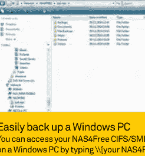

轻松备份 Windows PC
你可以通过在 Windows 资源管理器中输入 \\NAS4Free IP 地址，在 Windows PC 上访问你的 NAS4Free CIFS/SMB 共享。要使用同步备份，可以轻松使用 Windows 7 专业版的 Windows 备份功能或让其自动。备份，然后点击“保存到网络”按钮，浏览到你的 NAS4Free 共享文件夹，然后点击备份设置旁边的选项并设置计划。

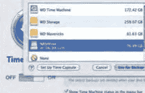

## 01 下载 NAS4Free

你可以在 SourceForge 找到最新的 NAS4Free 文件。选择 ISO 或 USB 镜像文件，然后通过 CD 或 USB ISO 启动它。此外，请为你的 PC 选择版本（x64 位或 x86-32 位）。

## 05 配置界面

现在使用 live CD/USB 并重启电脑。启动后，你将进入 NAS4Free 菜单。第一次，选择 1 进入网络接口并继续（一个选项）。

## 02 启动 NAS4Free

在你的 PC 上设置 BIOS 后，它将从 CD（或 USB 内存）启动，插入 live 磁盘并启动。NAS4Free 将执行该过程，可能需要几分钟。

## 06 配置 IP 地址

在控制台菜单，输入 2 配置网络 IP。对 DHCP 选择 No 并输入静态 IP。输入你的默认网关等。

## 03 选择安装方法

最终你会进入控制台菜单。输入 3 将其安装在硬盘上。如果你想在 USB 闪存上运行它。

## 04 安装到磁盘

选择 4 进入菜单，选择安装媒体和目标，然后对交换分区选择 No（除非）。

## 07 配置界面

通过基本设置，你可以通过其 Web 界面访问 NAS4Free。Web 界面允许你管理共享、用户和设置。

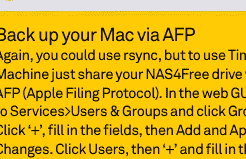


## 为了额外的安全，您可以更改用户名和密码

## SSH 登录

设置 SSH 密钥认证（详情请参见 bit-`ssh-keygen`）需要通过命令行完成。打开终端。

```
ssh root@[NAS4Free IP]
```

输入 *yes*，输入密码以登录您的 NAS4Free 服务器。

## 14 启动 SSH

我们想通过 SSH 运行 sync 将文件从客户端备份到我们的 NAS4Free 服务器。在 Web GUI 中，转到 Services/SSH 并勾选“Permit SSH connection”选项，然后点击 Save 和 Restart。

## 15 使用 sync 备份

现在是在从客户端进行手动备份。您可以使用命令行运行 sync，并使用 `rsync -e ssh -avz` 选项。选择要备份的文件夹，然后输入目标路径：`root@@[NAS4Free IP]/mnt/backups/`。系统会提示您输入 NAS4Free 密码（默认为 'nas4free'）。随后将开始备份。对于手动备份这很好，但对于其他场景，则不需要设置无密码的密钥认证。

## 17 生成 SSH 密钥

现在我们可以通过输入以下命令生成 SSH 密钥对：

```
ssh-keygen
```

按回车键接受默认位置，然后按回车设置空密码短，再次按回车确认。您的 SSH 密钥将随后生成。

## 18 重命名公钥

使用以下命令重命名公钥：

```
mv ~/.ssh/id_rsa.pub ~/.ssh/authorized_keys
```

然后注销：

使用以下命令将公钥拷贝到您的 PC：

```
scp root@@[NAS4Free IP]:~/.ssh/* .
```

输入密码，之后将不再被提示输入密码。

## 19 自动备份

现在您可以使用 cron 实现自动备份。

```
crontab -e
```

将您的 rsync 命令复制并粘贴到最后的新行，并在前面加上时间和日期字段——顺序是分钟、小时，然后是 * * ** 表示在该时间进行每日备份。对于每天下午 2 点的备份，您使用：

```
0 2 * * *
```

## 增强您的软件

## 使用调试器的视角可以解决或绕过与工作相关的问题

软件偶尔会运行失败。无论是由于代码中的缺陷，还是由于软件依赖的外部库存在 Bug，结果通常都是崩溃。在这种情况下，需要专家来解决问题或找到绕过的方法。然而，大多数人缺乏关于该软件的先知识，因此在没有正确工具的情况下进行全面分析是一项无法完成的任务。更糟糕的是，您可能需要调试没有源码的软件（请记住 GNU/Linux 上有非开源程序）。这将检查专家角色至关重要的真实案例：通过使用带有正确工具的调试器来调试并最终修复问题。即使在您完全不熟悉程序的情况下，该过程同样有效。

## 资源

- GDB 手册
- glibc 检查
- 程序失败的原因
- 调试的艺术

## 绕过段错误 (segmentation fault)

我们的第一个案例说明，即使我们有源码但仍然对代码没有良好的理解，在某种程度上也可能绕过——那些会导致我们崩溃的实现缺陷。在第一个例子中，我们面对的是一个影响 LibreOffice 3.5 的 bug：软件在处理微软电子表格时崩溃。您可以通过使用 dmesg 读取内核缓冲区来获取更多关于崩溃的详细信息：

```
dmesg
[200000.000] libreoffice[3485]: segfault at 0x000000000000007ffff7fa28 in libreoffice.so
```

...但这就是您在背后需要理解的内容，而唯一有效的方法是使用调试器方法。因为此问题发生在 Debian 系统上，您可以使用以下命令安装 LibreOffice 符号：

```
apt-get install libreoffice-dbg
```

一旦您有了调试器符号，就可以运行程序：

| 名称 | 类型 | 分发 | 内容 |
| :--- | :--- | :--- | :--- |
| breakpoint | bool | 0x00007ffff7fa28 | in LibreOffice::Compile |
| set | int | | |
| set check = $pc | | | |
通过添加这些文件，只有当断点的某个值大于 0 时，程序流才会继续。在我们给问题留出时间后，我们继续执行。

## 在 GDB 中正确设置断点以绕过 LibreOffice 的段错误

在 gdb 会话中确定段错误发生的确切位置。处理汇编代码或内存地址要容易得多：

```gdb
gdb /usr/lib/libreoffice/soffice.bin
(gdb) set core-file=segmentation_fault
(gdb) r
Program received signal SEGV, Segmentation fault
at 0x000000000000077 in ?
(gdb) bt
#0 0x0000000000000000 in ??
#1 0x00007ffffa12345 in Component::Compile```

## 即使您没有源码，程序仍然可以被修复

- 不仅仅是调试器
- 调试器的强大非常惊人。使用它，即使在没有源码的情况下我们也可以利用软件。我们可以通过逆向工程程序、堆栈和调用会来利用它。它还被广泛用于分析复制保护技术。

如上一行所示，我们需要先使用参数（在本例中打开核心文件），然后在崩溃后检查内存。我们很快意识到，段错误不是由空指针触发的，而是必须进行某种假设。然后我们需要替换寄存器并在程序返回处设置断点，以找到哪个函数处于进程中。您还知道 Component::Compile() 最后执行的语句正位于 source/data/tools/calc.cpp 源文件的第 1075 行。由于我们所有的源码都是公开的，我们现在可以立即安装：

程序设计在每次结构结构值之后估算值时都会崩溃，在第 1075 行中断后估算值，以便将它们与导致段错误的值进行比较。现在，由于这些行之间的值是不同的：这种跟踪会引发多少次段错误？

```gdb
gdb set core-file-the-first-fault.log
(gdb) set pagination off
(gdb) set $frame = 8
(gdb) commands
break pCodeID
> print "Check is: %d", pCodeID
> if pCodeID != 0
> continue
> else
> print pCodeID
> crash
> end
> end
```

现在您有了这些值，我们可以利用 Component() 方法的实现和逻辑来更改 1075 行的代码并重新编译。

```
if(pCodeID)
delete pCodeID
```

显然，段错误发生在程序流的开始，此时 pCodeID 的内存地址是一个 Array 结构。为了实现这一目标，我们使用命令在 Component::replace 处帧 pCodeID 以捕获崩溃

```
(gdb) frame 1
(gdb) p pCodeID
#3 = (Array *) {ptr = 0x7ffffa12d8, pCodeID = 0x227b66d8, size = 3042, n = 58189, number = 32767, nError = 0, mode = 13 "ur", hyperLink = 16, <No data field>}
```

在第 1075 行设置断点后，您会发现段错误会发生多少次。现在我们添加了一些在看到第 1075 行断点时由 gdb 执行的命令 (1)。我们使用断点检查是否发生段错误 (2)，相应更新命中变量的值并更改 pCodeID。现在，正如意料的，此时 pCodeID 被设置为 0，分支不会删除任何已执行的语句。


## 增强你的系统

随后使用 LibreOffice Calc 进行正式处理。最后，当你尝试在一个新的 LibreOffice Calc 实例中打开 DSS 文件时，它将毫无问题地运行。而且，你也成功修复了这个问题！

## 双释放错误 (Double-free error)

这看起来似乎无大害，但双释放内存错误可能会导致一个著名的漏洞，其中检查项以一种已经损坏代码的方式被更改。glibc 调试器检测到可以通过设置 MALLOCCHECK 来禁用此漏洞，这本可以解决你的第一个案例，为你省掉一些保护措施。

## 修复双释放

现在该继续了，你的下一个任务是一个专有软件：ATI 显卡驱动。在 GNU-Linux 系统上安装显卡驱动时，触发了双释放内存损坏错误导致进程被杀死，这会导致安装程序无法完成安装。

GNU 库实现了一些基础保护措施以避免堆内存损坏。在这种情况下，损坏是因为双释放条件造成的。问题的关键在于错误是人为驱动的，且检测设备的驱动是 ATI 自身的属性，而不是 Linux。

缺陷的安装程序是 ATI 安装包中的一个 ELF-64 二进制文件：`setup/x86_64/setup`。glibc 调试器报告了双释放内存损坏错误。由于它是由双释放触发的，你拥有安装程序执行的回溯（backtrace）。通过这种方式，可以确定 ELF-64 二进制文件中的故障指令。

```
$glibc ***: setup=./bin/x86_64/setup
```

```
double free or corruption (malloc_free): 0x013cbef0
===== Backtrace:
1 lib/libc.so(+0xf6b70...)
2 setup.data:bin/x86_64/setup+0xa6b8
```

根据之前的回溯，触发双释放错误的调用位于 setup 二进制文件（最后）的 0x0a6b8 处。这次软件不是的，因此你无法访问它。这有点困难，但尽管如此，你可以通过偏移量（offset）反汇编二进制文件并查找该函数。

如上文所示，调用指向 0x0a6b8（最后）。而且正如之前的回溯所示，位于该偏移位置的指令是 0x013cbef0，这是一个由双释放内存损坏引起的错误。因此，你可以通过 gdb 会话中执行程序来防止该指令释放已经释放的地址。根据这些数字，你必须将输出重定向到另一个，否则它可能会调试该问题。

| 文件: setup | ASII: setup | 偏移量: 0x000A065 / 0x000A427 (:005) | |
| :--- | :--- | :--- | :--- |
| 0000A60 | E0 63 99 FF | B0 8F 25 | 50 2E 00 A8 | A6 FF EE BF | FF | S(.,...) |
| 0000A60 | E1 66 66 66 | 60 66 66 66 | 96 96 96 96 | 96 66 99 FF | ff.fff.fff. |
| 0000A60 | 41 57 54 51 | 44 41 51 54 | 45 31 44 55 | 53 48 43 EB | AE AVAMAIUL,US |
| 0000A60 | 72 48 48 48 | 70 70 70 70 | 70 70 70 70 | 48 48 48 48 | 38 48 85 8D | .H._M. |
| 0000A60 | 64 00 00 00 | 00 00 00 00 | 00 48 48 48 | 50 48 58 58 | 58 28 58 85 | .I.H. | .I. |
| 0000A70 | 75 1E 91 01 | 08 00 00 00 | 00 00 00 00 | 85 8F 88 88 | .I.H. | .I. |
| 0000A70 | 49 00 FC F3 | A6 75 E0 8E | C1 62 49 00 | 48 49 49 BF | E8 EF... | .I.H. |
| 0000A70 | 1C 0F 00 05 | BE A7 22 09 | 00 00 49 89 | 48 49 49 82 | .I.H. |
| 0000A70 | 3D 00 00 00 | 00 00 00 00 | 00 00 00 00 | 03 49 49 8F | .I.H. |
| 0000A70 | 18 5E 8A 0E | 05 00 05 00 | 83 8E 83 83 | 48 49 49 89 | .I.H. |
| * G Help | * Exit (No Save) | * tGo Offset | * Exit and Save | * Search | |

| 文件: setup | ASII: setup | 偏移量: 0x000A065 / 0x000A427 (:005) | |
| :--- | :--- | :--- | :--- |
| 0000A60 | 90 90 90 90 | 8B 8B 8B 8B | 50 2E 00 A8 | A6 FF EE BF | FF | S(.,...) |
| 0000A60 | E1 66 66 66 | 60 66 66 66 | 96 96 96 96 | 96 66 99 FF | ff.fff.fff. |
| 0000A60 | 41 57 54 51 | 44 41 51 54 | 45 31 44 55 | 53 48 43 EB | AE AVAMAIUL,US |
| 0000A60 | 28 48 48 48 | 30 68 00 00 | 00 00 00 00 | 48 89 7C 74 | 20 74 24 | .H._I. |
| 0000A70 | 75 1E 91 01 | 08 00 00 00 | 00 00 00 00 | 85 8F 88 88 | .I.H. | .I. |
| 0000A70 | 6C 00 00 00 | 04 00 00 00 | 09 05 00 00 | 85 0F 84 05 | .I._M. |
| 0000A70 | 1C 0F 00 05 | BE A7 22 09 | 00 00 49 89 | 48 49 49 82 | .I.H. |
| 0000A70 | 3D 00 00 00 | 00 00 00 00 | 00 00 00 00 | 03 49 49 8F | .I.H. |
| 0000A70 | 18 5E 8A 0E | 05 00 05 00 | 83 8E 83 83 | 48 49 49 89 | .I.H. |
| * G Help | * Exit (No Save) | * tGo Offset | * Exit and Save | * Search | |

Right Placing: instruction 0xe8539ff09090990 ATI installer (highlighted)

```
(gdb) tty /dev/pts/12
(gdb) file setup.data/bin/x86_64/setup
(gdb) b +0x4a00b6
Breakpoint 1 at 0x4a00b6
(gdb) step
0x0000ffff7ff8670 in freelist (p=0x0000000000000000) at /lib64/ld-linux-x86-64.so.2+222
np = 0x0000000000000000
1 0x0000ffff7ff867b in freelist (p=0x00013cb8003b1840) at /lib64/ld-linux-x86-64.so.2+2232
pp = 0x00013cb8003b1840
2 0x0000ffff7ff87c0 in freelist (p=0x00013cb8003b1840) at /lib64/ld-linux-x86-64.so.2+2240
pp = 0x00013cb8003b1840
3 0x0000ffff7ff87c8 in freelist (p=0x00013cb8003b1840) at /home/user/setup+0x4a00b6/lib64/ld-linux-x86-64.so.2+2248
pp = 0x00013cb8003b1840
4 0x0000ffff7ff87d0 in freelist (p=0x00013cb8003b1840) at /home/user/setup+0x4a00b6/lib64/ld-linux-x86-64.so.2+2256
pp = 0x00013cb8003b1840
5 0x0000ffff7ff87d8 in freelist (p=0x00013cb8003b1840) at /home/user/setup+0x4a00b6/lib64/ld-linux-x86-64.so.2+2264
pp = 0x00013cb8003b1840
6 0x0000ffff7ff87e0 in freelist (p=0x00013cb8003b1840) at /lib64/ld-linux-x86-64.so.2+227
```

根据之前的列表，堆栈中确实有这个地址（最后）。到为止，你的陈述已经得到证实，现在有一个明显的结论：这是一个双释放问题，因为 0x4a00b6 的调用尝试释放一个在某处已释放的指针，偏移 0x13cb8。一个明显的问题是：如何修复它？我们没有源代码，如果没有源码，我们可以修补二进制文件。错误在 ELF-64 库中，因此你必须替换 0x4a00b6 处的指令。我们这样做的原因是：我们不想让 free() 函数工作！第一个调用是五个字节，我们必须将其替换为 `nop` 指令。使用十六进制编辑器将这五个字节替换为 `0x90`。之后你就可以运行并避免崩溃！这次程序不会崩溃。替换指令后，我们在函数所在的偏移量 0x4a00b6（第6行）设置了断点。然后你运行程序（第6行）。通过一个指令，我们在实际调用导致双释放损坏的命令之前停止机器（第7-8行）。根据你的参数，我们正在运行函数，在程序实际调用外部函数之前正确设置堆栈。如你之前看到的，free() 函数位于地址 0x13cb8。

## 结论

使用调试器显然更好。当然，并不是每个专家都认同这一观点。我们坚信大多数软件问题都可以通过调试来修复或绕过，这份指南足以说服怀疑者。

```
Breakpoint 1, 0x4a00b6 in free from /lib64/ld-linux-x86-64.so.2
#0 0x0000ffff7ff867b in freelist (p=0x0000000000000000) at /lib64/ld-linux-x86-64.so.2+222
np = 0x0000000000000000
#1 0x0000ffff7ff867b in freelist (p=0x00013cb8003b1840) at /lib64/ld-linux-x86-64.so.2+2232
pp = 0x00013cb8003b1840
#2 0x0000ffff7ff87c0 in freelist (p=0x00013cb8003b1840) at /lib64/ld-linux-x86-64.so.2+2240
pp = 0x00013cb8003b1840
#3 0x0000ffff7ff87c8 in freelist (p=0x00013cb8003b1840) at /home/user/setup+0x4a00b6/lib64/ld-linux-x86-64.so.2+2248
pp = 0x00013cb8003b1840
#4 0x0000ffff7ff87d0 in freelist (p=0x00013cb8003b1840) at /home/user/setup+0x4a00b6/lib64/ld-linux-x86-64.so.2+2256
pp = 0x00013cb8003b1840
#5 0x0000ffff7ff87d8 in freelist (p=0x00013cb8003b1840) at /home/user/setup+0x4a00b6/lib64/ld-linux-x86-64.so.2+2264
pp = 0x00013cb8003b1840
#6 0x0000ffff7ff87e0 in freelist (p=0x00013cb8003b1840) at /lib64/ld-linux-x86-64.so.2+227
```


# 在 Linux 中实现音频自动化

得益于一些创意脚本，可以在预设时间自动播放你的音乐

听音乐实际上并不是一项枯燥的任务。现代媒体已经发展到你可以自动启动它们的程度。如果能让你的电脑自动播放音乐，或者让你的笔记本电脑而不是不可靠的手机唤醒你，并在每天的特定时间安排音乐播放，或在你开机时播放——这种自动化简直是梦想中的。

## 了解系统
为了实现这一功能，我们将大量使用 VLC 的命令行界面。这只需带有几个特定选项以及你想要播放的内容来启动 VLC。简单来说，你可以使用以下命令在命令行中播放列表：

```bash
$ VLC file.mp3
```

## 资源
- videolan.org/index/

我们致力于展示如何使用 Linux 完成各种任务。在本教程中，我们将展示如何通过各种触发器和方法来自动化和调度不同的曲目和播放列表。让电脑处理音乐而不是由你决定听什么，让你的工作日变得更有趣。请确保你已经安装了 VLC —— 它通常在仓库的 `vlc` 包中。

这将定义你的 VLC 播放器设置，例如是否开启重复，或者 VLC 实例中当前播放的内容。

下方：通过简单的脚本和你自己的音乐库，你可以自动化你的音乐收听体验

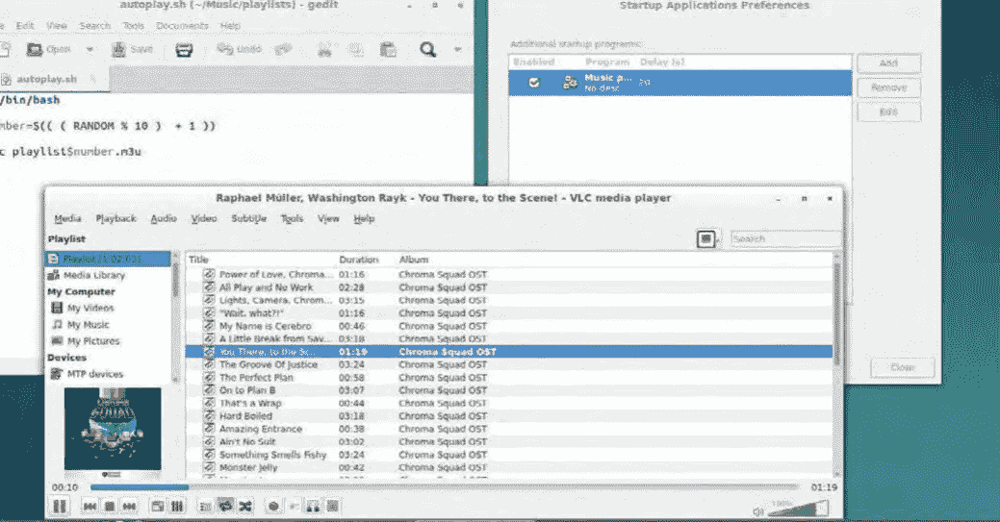

## 构建过程
对于我们的自动化，我们将使用 bash 脚本，通过它运行命令行脚本来播放音乐。在教程稍后，我们将在 bash 脚本中增加一些复杂性，或者为你提供更多的自动化控制。这些脚本可以在全天范围内通过 `crontab` 激活。

## 让电脑唤醒你而不是不可靠的手机——这就是梦想
你必须进入保存脚本的目录。在教程的下一步中停留在那里。

## 基础脚本
我们将共同构建一个想要使用的脚本的基础版本。然后我们使用命令行在 VLC 中播放音频。打开 gedit 或任何其他文本编辑器，创建一个名为 `autoplay.sh` 的新文件，然后输入以下代码：

## 运行脚本
让我们先运行脚本以确保它确实有效。为此，进入终端并到达我们所在的目录，然后运行脚本：

```bash
#!/bin/bash
vlc path/to/file.mp3
```

这只是让脚本知道要运行什么以及执行哪个命令。在这种情况下，VLC 将播放该文件。

```bash
$ autoplay.sh
```

如果一切顺利，VLC 将打开并为你播放设计好的文件。然后你可以使用任何媒体按键控制音频，关闭它也会杀死脚本。

## 其他选项
我们正在使用 VLC 命令运行媒体播放器，但还有其他一些选项：

- -Z: 随机播放当前播放列表
- -R: 从头开始重复播放列表
- -f: 如果可用，使用全屏输出

## 可执行权限 / 播放列表
目前，我们实际上无法运行它，因为它没有作为脚本执行的权限，但我们可以更改它来实际使用。我们执行此操作的方法是输入以下命令：

现在看看脚本是如何工作的，并向你展示如何开始让它更好地适用于日常播放列表。最好的方法是创建十个符合你要求的播放列表，然后我们可以让 VLC 随机选择并播放它们。在 VLC 中创建它们，然后将它们保存到你想存放的地方，或者保存在脚本相同的目录下以便方便操作。将文件命名为 1 到 10。

```bash
$ chmod +x autoplay.sh
```

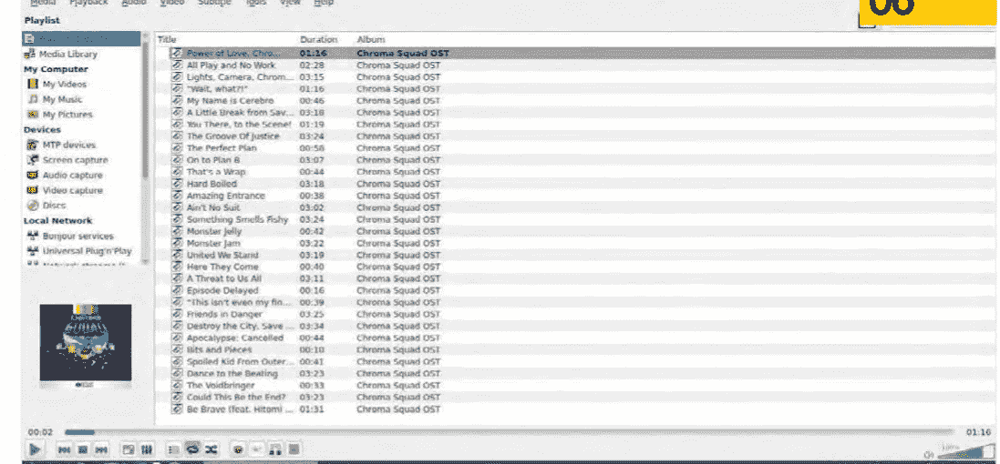

## 增强你的系统
注意：你在 VLC 窗口中切换的选项将在下次播放时被记住。

## 命令行
当我们使用 bash 脚本运行 VLC 来创建命令行时，如果你更喜欢 CLI 而不是普通的桌面环境，那么 `cmus` 怎么样？这是一个可以播放音乐的命令行播放器。将脚本中的 VLC 命令替换掉效果也是一样的。

## 07 随机选择
我们已经创建了播放列表，每次选择都有不同的音乐。我们如何使用脚本随机选择这些播放列表呢？我们使用 bash 创建随机数来决定打开哪一个播放列表。我们使用 `RANDOM` 操作符，但它仅限于返回其中一个数字。

## 08 随机脚本
对脚本的修改非常简单：我们希望它给出一个 1 到 10 之间的随机数，然后让 VLC 打开该播放列表（例如，参见脚本 7）。脚本如下：

```bash
#!/bin/bash
number=$(( (RANDOM % 10) + 1 ))
vlc playlist_$number.m3u
```

变量被赋值随机数。随机索引限制为十，通常会返回零，所以我们加 1 以使其处于 1 到 10 之间。

## 09 再次测试
一切都值得测试——我们使用以下命令进行：

```bash
$ ./autoplay.sh
```

它应该没有任何问题地在 VLC 中播放播放列表。如果你现在想，点击随机和重复是一个好时机，让它持续播放播放列表，但不是固定顺序。你对播放的任何更改将被记住

## 10 调度
如果你想调度播放列表，例如作为闹钟或在白天唤醒，你可以创建一个按间隔运行的脚本。我们只需要根据需要设置 cron。

cron 任务接受小时、分钟、日期、月份和年份。所有这些都通过 0 到 7 来定义几天。为了让我们的脚本在早上 8 点作为闹钟运行，设置 cron：

## 11 创建 cron任务

```cron
0 08 * * * /path/to/autoplay.sh
```

## 12 设置脚本
由于我们希望脚本在启动时运行，我们使用桌面环境的启动功能。

## GNOME 和 Cinnamon
适用于任何使用 GNOME 桌面环境的发行版，例如 GNOME 本身。在 Unity 和 Cinnamon 中，你也可以将脚本添加到启动应用程序。你可以在设置菜单下的启动应用程序中找到它。在这里点击并找到脚本。一旦找到，指定其位置，勾选运行选项并保存脚本。你可以通过注销并重新登录来测试。我给它设置了延迟，以便 GNOME 在尝试执行命令之前有机会加载。

## 其他桌面
不同的环境使用类似于上述方法的方法，但对于某些环境你可能需要编辑配置文件让它们工作。最好的办法是检查桌面的文档，看看如何设置脚本以便启动。

## 听音乐
有了所有这些设置，你的音乐收听体验一整天应该会变得更好。记得经常混合你的播放列表或在那里添加更多。此外，不要害怕关闭那天为你选择的脚本并使用你自己的。你甚至可以使用其他播放器来利用不同的功能。

## KDE
将脚本添加到 KDE 与 GNOME 大大相同，尽管你需要在 KDE 系统中区分程序和系统

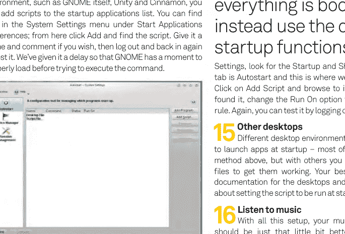


## 增强你的系统

## 设置游戏手柄在 Linux 上运行

尝试使用 PlayStation、Xbox 或或其他 USB 控制器体验 Linux —— 它是多媒体 PC 的理想选择。

键盘和鼠标是 GUI（图形用户界面）的核心。虽然我们可能对第一代鼠标的图片付之一笑，但长期以来，它一直是我们与图形界面交互的主要方式，即使在触摸屏计算出现之后，它似乎也不会消失。

如果将触摸屏视为一种替代方案，在图形桌面上仍然有其他交互方式。在这种情况下，我们在许多方面上与鼠标非常相似——你移动光点并点击进行交互。当然，移动部分稍有不同，但在功能上是相同的。

## 资源

- 桌面环境
- 兼容的 USB 游戏手柄

在本教程中，我们将向你展示如何设置 USB 控制器以与 Linux 环境配合，包括点击和针对控制器的额外按钮选项。它们可以有多个输入项。拥有这样的配置对很多原因都有好处，例如 USB 端口较少或使用多媒体 PC。我们将向你展示如何尝试。

## 01 通用控制器

首先，我们将查看通用 USB 控制器和 PS3 控制器如何在 Linux 上像鼠标一样工作。它们通过内核中的驱动程序连接，因此我们需要更改设置来让它们工作。


> 它在许多方面与鼠标非常相似——你移动光点并点击进行交互

> 你需要一个 USB 或上一代游戏机手柄


## X 修改

首先，我们需要为 X 使用。打开终端并安装以下包来实现：

```
sudo apt-get install xserver-xorg-input-joystick
```

## 获取文件

我们创建了一个基础配置文件，让它像鼠标一样。它是针对 PS2 控制器设计的，但你可以移动它。以下是你可以修改它的方法。在此下载：

```
sudo wget http://linux.userco.com/wp-content-uploads/2015/05/58-joystick
```

## 移动你的文件

我们将从 /usr/share/X11/ 复制文件 `50-joystick` 并创建一个副本，并将文件移动到以下文件夹：

```
sudo cp 50-joystick.conf /usr/x11/conf/
```

## 重置为

对于其他所有内容，请重启系统。重新加载你的桌面环境并插入你的 PS2 控制器。摇杆将以相同的方式移动，还有左右键以及 Escape 键。

## 检查控制器输入

如果你因为控制器与 PS2 设置不兼容而需要更改输入，那么你将必须弄清楚控制器上有哪些按钮。使用以下命令安装摇杆软件：

```
sudo apt-get install jesttest-joystick
```

## 测试输入

在同一行命令中，在控制器运行时使用 `jesttest-gtk` 进行测试。你将很好地看到任何输入的校准是如何处理的，以及哪些按钮被按下。

## 键位绑定

一旦你确定了哪些按钮代表什么，就可以查看哪些键对应键盘绑定。仍然在终端中，使用以下命令查找结果：

```
SDL_JOYMAP=xjstmap -all_keys
```

然后打开文件：

## 读取...

摇杆可能很棘手，但你只需要精确地指向你想使用的内容。最好使用 `getsfind` 查找它，然后复制每个段落中的键值对，这样你就有记录了。

## PS4 控制器

随着新游戏的出现，新的控制器PlayStation 4 控制器与经典款不同。DualShock 4 有一个有趣的界面，但在正面，内核中用于 PS4 手柄的控制器已经有了，但你可能需要添加额外的驱动程序。

在此处查找更多细节：github.com/chippa/ps4

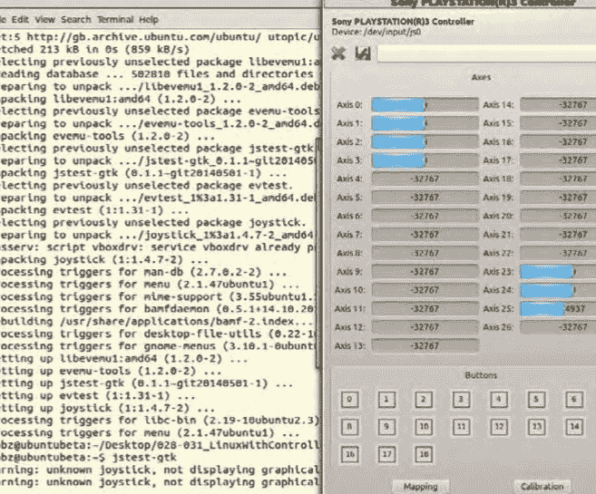

## 测试输入

在制作之前确保你的按钮工作正常

## 使用...

## 增强你的系统

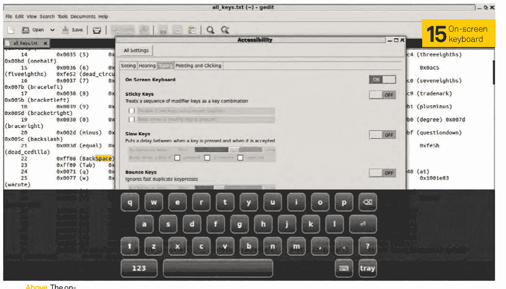

关于：屏幕键盘需要一点精力，但它是一个不错的替代品

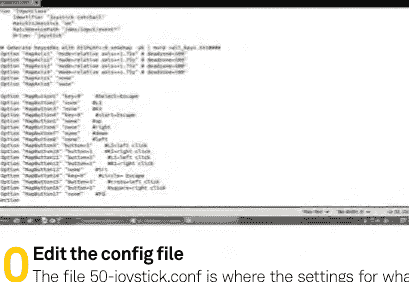

## 10 编辑配置文件

`50-joystick.cfg` 文件是每个按钮设置报告所在。我们将每个按钮分配给一个操作，这可以是任何键盘键。在文本编辑器中打开它，并开始修改你想要的按钮。

## 11 标记按钮

我们已经在文件中列出了每个按钮对应的名称。我们还放入了键位以帮助精确识别我们应该进行什么设置。我们建议你尝试一下。

## 12 添加一个空格

在当前设置中，PS3 控制器上的三角键是空闲的。如果你计划使用控制器来替换，我们建议你尝试这个。

## 13 程序...

随着价格的增加，硬盘现在大得多，但随着容量增加价格会迅速上升。我们将向你展示如何尝试。

## 14 增加空间

在当前设置中，PS3 控制上的三角键是空闲的。如果你计划使用控制器来替换，我们建议你尝试这个。

## 15 屏幕键盘

如果你想让360 启动，你将需要一个脚本，否则你必须手动输入。

## 16 增加空间

在当前设置中，PS3 控制器上的三角键是空闲的。如果你计划使用控制器来替换，我们建议你尝试这个。

## 17 

我们将向你展示如何尝试。

## 18 增加空间

在当前设置中，PS3 控制器上的三角键是空闲的。如果你计划使用控制器来替换，我们建议你尝试这个。

## 19 增加空间

在当前设置中，PS3 控制器上的三角键是空闲的。如果你计划使用控制器来替换，我们建议你尝试这个。

## 20 

在当前设置中，PS3 控制器上的三角键是空闲的。如果你计划使用控制器来替换，我们建议你尝试这个。


## 03 格式化驱动器

| 名称 | 挂载点 | 标签 | 容量 | 已用 | 可用 |
|---|---|---|---|---|---|
| /dev/sdb1 | | Microsoft 预留分区 | 128.00 MB | 119.00 MB | 剩余 56.64 MB |
| /dev/sdb2 | | | 465.34 GB | | |


## 02 选择 HDD

这是方案中的大硬盘，所有文件都将保存在这里。你需要多大的容量由你决定，但我们建议至少要有 500 GB 到 1 TB，最好安装在我们的机器上——你可以根据需要选择大或小。如果你有多个硬盘（例如 4 TB 或 8 TB），请将它们与 SSD 配合使用进行设置。

人们可能会认为，对于 HDD，使用标准的 7200 RPM 硬盘实际上有助于达到并提升速度，这对于启动软件和开机很有用。但现在我们已经有了速度显著提升的 SSD，这是一个值得考虑的因素。你可能会在写入速度上有所损失，但它们在过程中的功耗更低，等等。

## 04 安装发行发行版

现在我们可以去安装 Linux 了。进入实时运行环境或从安装介质启动，并开始流程。当运行到在硬盘上设置文件结构和分区的部分时，你将能够通过 `ext4` 和 `swap` 分区来识别它，作为根目录。按照你的意选择 `ext4` 分区。剩余的驱动器和分区将用于挂载。安装将在较大的 HDD 上进行。再次选择它，然后继续将其设置为 `/root` 挂载点。你也可以将其设置为 `/home`。

允许安装正常继续，当系统在重启后启动时，一切都将设置完毕。

## 05 设置完成后

使用你创建的设置，一个硬盘和一个简单的 SSD 就是你所需要的所有。毕竟，内核和文件系统已经就绪，它的加载速度应该比硬盘快一点，除非你没有 SSD。安装和更新会稍微快一点，但受下载速度和 CPU 速度的限制。任何个人数据、配置、视频等会在你手动登录时自动保存到你的主目录分区。

如果你想与 NTFS 共享你的硬盘，可能会出现问题。你可能无法在 Linux 上挂载它。因此，安装 `ntfs-3g` 包将允许你对其进行操作。如果需要在启动时挂载，你需要在终端的 `/etc/fstab` 文件中添加一行。

在安装之前，使用 NTFS 格式化你的新驱动器是一个好主意。注意，过程中并没有格式化文件系统，你可以稍后手动进行。

SSD 的格式化方式与其他任何硬盘一样。使用像 GParted 的工具，选择 SSD 并创建一个新分区。如果到了硬盘的末，确保为系统 RAM 留出空间。用剩余空间填充交换分区（swap），Linux 将安装在这里。

你可以随意愿设置 RAID，但我们建议将 SSD 用于主目录分区，这样速度会快得多。


## 108

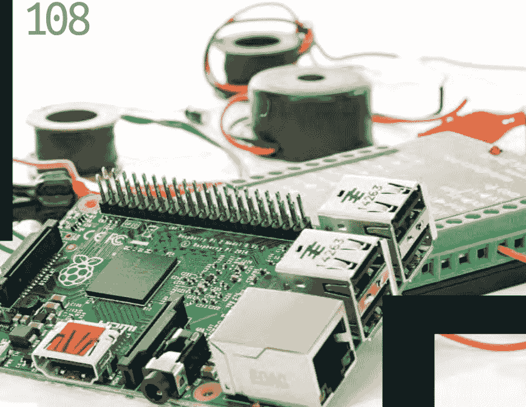


## DEIS 系统架构图

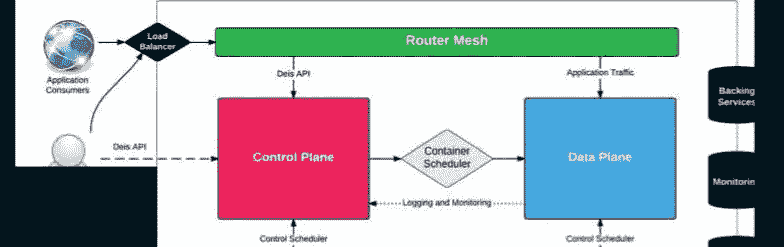

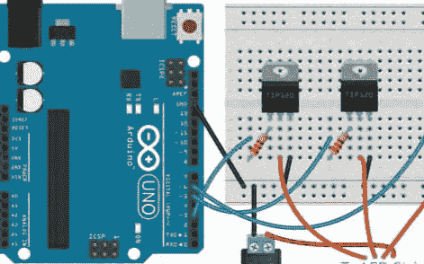

## 104

## 116

## Linux 编程


# > 使用这些控制 Linux 的必备终端技巧，精通命令行

在桌面环境或图形界面出现很久以前，在 70 世纪和 80 年代的那些日子里，一切都是通过命令行完成的。90 年代的计算虽然通常由图形界面主导，但与它们并没有完全分离，某些年龄的计算机用户可能还会第一次使用 MacOS 的场景。

如今，在 Linux 中，你可以把整个时间都花在桌面环境中，完全不碰命令行或终端。如果你不学习如何充分利用命令行，你就错过了很多机会，这在耽误你自己，因为它可以非常强大。许多图形化软件也带有你可以使用的命令行控制。所以，穿上你最棒的衣服，给自己起个酷酷的外号，准备好看起来像个电影里的黑客吧。

# 80

## 必知知识

# > 在尝试高级工具之前，先熟悉终端

### >001 ls

### >000 Up

你可以使用 `ls` 列出你所在目录下的文件和文件夹。

按下键盘上的方向键键，这个非常简单的任务可以让你调出最后输入的命令，重新运行它或编辑它。

### >002 cd

### >010 复制文本

`cd` 命令允许你在系统的目录之间移动。例如：

如果你发现了一些可能想要复制输出到某处。要这样做，你可以使用：Ctrl+C

```bash
$ cd /home/user/
```

### >011 粘贴文本

### >003 cp

`cp` 命令可以将文件从一个位置复制到另一个位置。执行此命令：

如果你发现了一个命令或需要在其中粘贴某些文本，你可以从剪贴板输入任何文本：Ctrl+V

```bash
$ cp /home/user/desktop/file
```

### >004 mv

### >012 打开终端

与 `cp` 类似，`mv` 将文件移动到新位置并删除原始文件：

这在所有桌面环境中都有效：终端的快捷键可以是：Ctrl+Alt+T

```bash
$ mv /home/user/desktop/file
```

### >005 rm

### >013 sudo

`rm` 命令用于删除文件和目录。你可以使用它

该命令以超级用户身份执行。在这种情况下，用户是 root，你只需要在任何命令前加上 `sudo` 即可。

```bash
$ rm file
```

### >014 访问 root

你可以在终端中使用创建目录

超级用户（或 root）允许通过输入 `sudo` 从终端登录。你可以输入 root 密码，然后以 root 身份运行一切，而无需频繁输入 `sudo`。

### >006 mkdir

你可以在终端中使用创建目录

```bash
$ mkdir folder
```

### >015 停止进程

如果你运行了一个命令并且需要停止、耗时太长，或者你不想它完成工作而需要查看它的结果，请使用：Ctrl+C 或 Ctrl+Z 来杀死它。如果该进程正在正在写入任何数据，且这样做是不安全的，你可以在进程列表中找到它。

### >007 nano

Nano 是允许你在命令行中编辑文件的程序之一。对于工作和编辑命令行至关重要。你可以使用

### >016 无密码访问 root

用户在 `sudoers` 列表中，因此他们通常可以使用 `sudo` 以 root 身份运行命令。你可以使用 `sudo su` 访问账户。此用户需要普通密码来访问 root。要避免输入密码，你需要通过 `su` 以超级用户身份登录。然后，简单地输入 `adduser username`（替换 'username'）。小心将谁添加到 `sudoers` 列表中！

### >008 Tab

Tab 键允许自动补全变量、文件和名称，双击 Tab 会列出所有名称相似的对象。例如，如果你输入了 'firefox' 但没有其他以 'Fir' 开头的命令，如果有多个匹配项，按 Tab 将帮助你导航选择并显示其余部分

### >017 搜索隐藏文件和目录

`ls` 的用法不仅限于基础用法，还可以查找文件夹中的所有文件。通过它，你可以使用它配合普通项目列出所有隐藏项目：

```bash
$ ls -a
```

### >018 主目录快捷方式

在绝对路径系统中，主目录位于 /home/user/，但你可以使用波浪号 (~) 来表示目录之间的主目录，甚至是几乎任何其他地方 - 例如如下：

```bash
$ ~
```

### >019 连接命令

如果你想在一个命令之后定义某些命令，比如在 Debian 中更新并安装软件，可以使用 `&&` 让命令运行。

```bash
$ apt-get update && apt-get install firefox
```

### >020 终端输入

当某些输出是列表或数组时，终端可能无法读取它。为了更容易理解，你可以通过管道将输出发送给另一个命令，工作原理如下

```bash
$ ls |
```

## Linux 编程

## 系统基础

> 进一步学习，学习如何更好地控制终端

### >021 可读大小

`ls` 的详细信息显示硬盘上文件的大小。这是以字节为单位的，总是很有用的。你可以通过将 `-l` 改为 `-lh` (-h) 来使其更易读。

### >022 返回上级目录

如果你想回到正在工作的目录，有一个命令可以在文件系统中移动。`cd ..` 不起工作，但可以回到上一个文件夹：

```bash
$ cd ..
```

### >023 向上移动

`cd` 命令可用于在文件系统中移动。一个典型的用例是复制或删除特定类型的文件。例如，如果你想删除目录中的所有文件，进入它并输入：

```bash
$ rm *.
```

### >024 普通通配符

星号 (*) 可以作为终端中的通配符，代表任何内容。

### >025 更多管道用法

管道 (|) 可用于将一个命令的输出馈给下一个命令。它与 grep 和其他工具配合工作。

### >026 删除目录

对目录使用 `rm` 命令将不起作用。你还需要递归地删除目录内的所有内容。使用

```bash
$ rm -r
```

### >027 shutdown 命令

你可以使用 `shutdown` 命令从终端关闭系统，停止选项 (-h) 会停止所有运行的程序，并指定时间为现在，而不是 60 秒：

```bash
$ shutdown -h now
```

### >028 显示所有信息

除了仅仅列出文件，我们可以使用 `ls` 列出与每个文件相关的信息，例如修改时间、权限和所有者。通过：

```bash
$ls -l
```

### >029 从命令行重启

过去，重启需要更复杂的命令：`shutdown -r`。最近几年它被一个简单的取代了：

```bash
$ reboot
```

### >030 定时关机

如果你需要在关机之前等待 cron 或任务完成，`shutdown` 函数非常有用。你可以使用时间在十分钟后自然关机或重启，例如：

```bash
$ shutdown -h +10
```

### >031 退出

从 x 会话退出通常在桌面环境中可用，但如果你需要退出到登录管理器，可以通过重启显示管理器来实现。在许多 Linux 发行版中，使用以下命令：

```bash
$ service restart login
```

## 安装

### >032 Debian: 更新存储

基于 Debian 的（基于 Ubuntu 的）发行版使用 `apt-get` 作为命令行管理器。`apt-get` 的特性之一是它会搜索你想要的软件包，以检查存储中是否有更新版本。在 Debian 中任何安装之前：

```bash
$ apt-get update
```

### >033 Debian: 安装软件

与图形管理器或软件不同，你无法搜索想要安装的软件包，因此你需要先知道包名。一旦知道了：

```bash
$ apt-get install software
```

### >034 Debian: 更新软件

你可以通过执行提示 32 中的存储更新命令，以及下面的命令来更新 Debian 中的软件：

```bash
$ apt-get upgrade
```

### >035 Debian: 卸载软件

作为包管理工具，`apt-get` 也允许你卸载软件。只需通过你想要删除的包名执行 `remove`。如果你想同时删除任何配置文件，请使用 `purge`。

### >036 Debian: 升级发行版

Debian 系统可以在运行时或在有新 Ubuntu 时更新到更高版本。提示不需要重启，所以你可以在...中执行：

```bash
$ apt-get dist-upgrade
```

### >037 Debian: 安装多个包

在所有平台安装时可以做的一件非常简单的事情是使用标准的安装命令一次列出多个软件包。因此在 Debian 中应该是：

```bash
$ apt-get install package1 package2 package3
```

### >038 Debian: 强制依赖关系

编译与 `apt` 不同，Fedora 和 Red Hat 的包管理器除非你明确删除，否则不会移除依赖项。

```bash
$ apt-get auto-remove
```

### >039 Debian: 强制安装

有时在安装时，如果你需要安装二进制文件，`apt-get` 将失败。

```bash
$ apt-get install --download-only --
$ rpm --force
```

### >040 Debian: 安装二进制文件

在提示 45 中，如果存在依赖问题或其他软件包有问题，你可以使用 RPM 安装包。该命令应按照提示执行，并带有 `--force --force` 选项。

### >041 Debian: 强制安装

如果提示 39 的建议不起，你可以使用 `dpkg` 强制安装。

```bash
$ dpkg --force-all -i
```

### >042 Red Hat: 卸载包

与 `apt` 不同，Fedora 和 Red Hat 的包管理器除非你明确删除，否则不会移除依赖项。

```bash
$ yum remove
```

### >043 Red Hat: 卸载软件

Yum 也用于卸载系统上的任何软件包，无论你是直接通过 yum 安装的，只要你知道包名，就可以：

```bash
$ yum remove
```

### >044 Red Hat: 强制安装

Red Hat 和基于 Fedora 的发行版上的安装功能需要你有一个下载并准备好安装的包。你可以使用 yum 执行安装，或者强制安装为：

### >045 Debian: 强制安装

RPM 是 Red Hat 发行版上的包管理器之一，可用于安装下载的包。你可以使用提示 45 中的建议从存储中下载包，或者从互联网下载：

```bash
$ rpm -ivh
```

### >046 Red Hat: 强制安装包

如果存在依赖问题或其他软件包有问题，你可以使用 RPM 安装包。该命令应按照提示执行，并带有 `--force --force` 选项。

### >047 Fedora: 升级发行版

Yum 有它自己的发行版升级命令，但只有在 Fedora 中你可能在在时才使用它。否则，你可以使用 yum 中的 `fedora-upgrade` 包：

```bash
$ yum upgrade
```

### >049 Red Hat: 安装软件

使用 yum 安装非常简单，只要你知道包名。Yum 确实有搜索功能，但如果你真的需要查找，或者一旦知道你想要的包，使用以下命令：

```bash
$ yum install package
```

# 你即使没有依赖关系也可以强制安装包


## Linux 编程

## 使用 grep 进行搜索

## 开发技巧

> 一些为开发者提供的终端技巧，可以帮助你的命令行操作更加高效

## 使用 grep 命令在文件中搜索，以保存并找到你所需的内容

### 0541 停止系统服务

在文件中查找特定行以及在纯文中搜索模式时，最好将其与内容可读的系统文件配合。可以使用：

系统服务是在启动时运行的类后台软件。这些服务由 init 或 systemd 等系统管理守护进程控制，并可以通过 service 命令从终端进行控制。首先，你可以使用以下命令停止服务：

```
$ sudo service name stop
```

### 0542 搜索术语

grep 的基本用法是在纯文中搜索模式。如果你想搜索一个特定的术语，最好将其与内容可读的系统文件配合。

### 0550 检查行数

在文件中查找内容已经很好，但当你想要查找它们并查看某事发生的行号时，请使用 grep 同时打印行号。你可以通过以下实现：

```
$ grep -n file
```

### 0551 正则表达式

如果你需要使用 grep 进行更高级的搜索，请使用正则表达式。你可以将术语替换为 "hello" 来查找匹配此行的，或者使用 "hello.*" 查找更多内容。

### 0552 重启系统服务

你可以使用 service 命令启动已停止的服务。如果你已经知道如何使用：

这对于设置 Apache 这样的 Web 服务器非常流行，对于重启，可能需要重启它，以及你为实例自定义的其他服务。通过顺序使用 start 和 stop 命令，你可以使用以下命令重启服务：

```
$ sudo service name restart
```

### 0553 通配符

在搜索时，你可以使用通配符查找相似字符串。这是通过使用搜索字符串实现的，其中点 (.) 代表任何字符。它将返回任何以该字符串开头并结束于行的内容。你可以这样使用：

```
$ grep ".*" file
```

### 0557 了解 ID

如果你需要获取进程的代码，那么知道 ID 是重要的，这样当进程出现问题或占用过多内存时，你可以杀掉该进程。有了 ID 后，你可以：

### 0558 杀死进程

有时一个进程可能会有多个 ID（通常像 Chrome 这样的网页浏览器就是此类情况）。在这种情况下，你需要一次杀死所有进程。你可以尝试快速杀掉所有 ID，或者使用进程的通用名称来杀死：

```
$ killall -v process
```

### 0559 列出连接

列出接口中网络连接和详情的标准命令是 ifconfig——如果你想查看特定的某一个，它会列出所有项；对于你的无线接口，你可以使用：

```
$ ifconfig
```

### 0560 列出 USB 驱动器

你可能需要知道哪些 USB 和 USB 相关驱动器连接到了你的系统，或者找到它们的正确标识。你需要先找到它们，但可以在终端中使用列出所有可用驱动器。

### 0561 列出硬盘和分区

无论你需要检查系统上哪些驱动器正在工作，还是只需要对系统布局有一个大致的了解，都可以 fdisk 列出所有硬盘。这必须通过以下命令完成：

### 0562 检查运行中的软件

当你想要检查系统上运行了什么时，在终端中可以通过 top 轻松实现。它列出了你当前运行软件所需的所有信息，例如 CPU 和内存使用情况，以及控制选项。

### 0553 更多通配符

你将使用通配符查找某些内容，或以特定字符串开头但没有固定长度。你可以通过 starts 配合点来实现。在上面的示例中，我们本可以使用使用 h*。

## 解压 ZIP 文件

如果你下载了一个 ZIP 文件，并且是从终端下载的或正在从工作目录解压它，使用以下命令：

```
unzip file.zip
```

## 解压 TAR 文件

有时 Linux 有归档为 .tar 或 tarball 的压缩文件。你可以使用终端解压这些文件，尽管你可能需要正确的选项。例如，使用：

```
tar -xvf file.tar
```

来自 Unix 的用户有一个强大的工具叫 dd，你可能经常需要它。用它从硬盘或虚拟磁盘创建镜像。如果输入是 zip 文件，那么输出就是镜像文件。它的工作方式如下：

```
dd if=/dev/sdb of=mydisk.img
```

## 创建空文件

有时你需要保存一些软件，你需要写文件。你可以通过 echo 做到，但终端有一个与 touch 类似的命令可以让你创建一个文件：

```
touch filename
```

## 打印到终端

如果你想将文件内容打印到终端，可以使用 cat 命令： 

```
cat filename
```

## 创建 MD5 哈希值

当你想要检查文件的完整性时，可以使用 md5sum 命令。你可以通过以下方式实现：

```
md5sum filename
```

## 创建新密钥

当你需要生成 SSH 密钥时，可以使用 ssh-keygen 命令。你可以这样做：

```
ssh-keygen -t rsa -C "your_email@example.com"
```

## 系统详情

uname 允许显示系统的可用数据列表。使用：

```
uname -a
```

## 内核版本

使用 uname 还可以获取内核版本。你可以这样做：

```
uname -r
```

## CPU 架构

如果你在一个未知的机器上，需要找出运行的是什么架构。使用：

```
uname -m
```

## Ubuntu 版本

在这么多发行版中，你可以使用以下命令跟踪你所在的 Ubuntu 版本：

```
lsb_release
```

## 文件权限

## 学习如何查看和修改文件权限

### 列出文件权限

你可以在终端中使用 -l 检查所有文件的权限（包括隐藏文件和目录）。它将在输出的第一列打印文件权限。文件类型（目录为 -）以及前九个字符（实际上是三位一组）会被正确解析。例如：

```
ls -l
```

R 代表读，w 代表写，x 代表执行。如果它们出现而不是 -，则表示在该权限块中它是开启的。它被分为三列：前三个是你正在使用的用户，第二个是用户组，第三个是所有人。

## 修改权限

确定权限后，你可以使用 chmod 命令开始编辑它们。你可以通过设置三位集合来更改权限。例如执行：

```
chmod 777
```

第一个数字代表用户，第二个代表用户组，第三个代表所有人。数字含义如下：

- 7：读、写、执行，111/rwx
- 6：读、写，110/rw-
- 3：读、执行，101/rx-
- 4：只读，100/r-
- 1：执行，001/---
- 0：无权限，000/-


## Linux 编程

## 媒体
控制

# 优中选优

```
> 你可以在沉浸在终端内工作时控制你的音乐
```

> > 所有你未来为了参考而可能需要了解命令

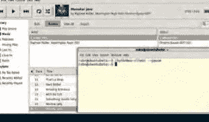

### 087 通过 pushd 向后移动
接提示 86 之后，一旦你想返回堆栈中的目录，你可以使用 `popd` 来检查你之前堆叠了哪些目录。

如果你在图形化管理器中看到了一个文件，与其打开它并执行文件脚本，你也可以通过右键点击并选择直接运行它。要做到这一点，你只需要在“操作（operation）”中选择一个列表项即可：

- 082 在终端中打开文件

### 088 进程优先级
CPU 优先级可以看作是从 -20（最高优先级）到 +20（最低优先级）运行。在任何命令中使用 `nice` 都可以让你将优先级更改为 0，无论数字 X 是多少。只有 root 用户可以提高进程的优先级，但任何人都可以永久降低它。

- 083 在终端中查找文件

你可以使用 `find` 命令在整个系统中搜索文件。你需要找到一个搜索路径，并根据大小、所有者等进行搜索，对于特定名称，你可以使用：

### 089 通过终端下载
如果你需要从互联网下载某些内容，可以使用 `get` 命令。它会获取你指定的任何 URL，只要你有权限，它就会将其直接下载到当前目录中。使用方法如下：

- 084 在终端中定位文件

类似于 `locate`，该工具的工作方式与 `find` 略有不同。虽然它允许按大小、所有者和名称搜索文件，但它也可以用于定位，且无法匹配文件。配合以下命令使用：

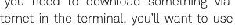

- locate 文件

```bash
$ wget http://example.com/file.zip
```

- 终端

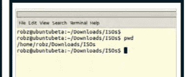

```bash
ls -lh current directory
$root@ubuntu:~/Downloads/1255$
$root@ubuntu:~/Downloads/pwd
$root@ubuntu:~/Downloads/
$root@ubuntu:~/Downloads$
cd /etc/share
$root@ubuntu:/etc/share$
$root@ubuntu:/etc/share/
```

- 078 暂停音乐

一些音频播放器带有可以使用的命令行控制。Rhythmbox 就具有这种功能，当你卡在终端里并需要暂时暂停音乐时，这是一个非常酷的用法。

```bash
> rhythmbox --pause
```

- 079 跳过音乐

虽然命令行没有开启那么多的界面，但你可以跳到下一首目，尝试使用以下命令：

```bash
> rhythmbox --next
```

- 080 暂停视频

你可以使用播放器从命令行启动视频。这对于使用影响视频播放器的不同设置来测试视频非常有帮助。

但你也可以按键控制视频——具体来说，可以使用空格键暂停。

- 081 更多控制

Mplayer 为命令行提供了更多控制功能。你可以使用 Enter 键跳到列表中的下一曲，否则，可以通过 Ctrl+C 停止播放并完全结束进程。

- 086 移动目录

在目录之间移动时，你可能希望返回到之前使用的目录。使用 `cd` 移动目录时，可以使用 `pushd` 移动并创建一个栈。

- 085 当前位置

在终端中，如果你发现自己在文件系统中迷路了，或者想要快速将位置移动到其他地方，你可以使用 `pwd` 打印你当前的绝对位置。

# 修改图像格式

与其使用像 GIMP 这样的图像编辑器，你可以使用 `convert` 命令在终端中轻松更改图像格式。你可以非常简单地用它更改文件类型或缩放、旋转并更改大小。如下：

```bash
$ convert image.jpg image.png
```

## 修改图像设置

此外，几乎所有你可能修改的项都属于同一个软件软件包。使用它可以比某些 `convert` 命令更轻松地进行缩放和旋转。要调整某些大小，例如：

```bash
$ mogify resize 640x480! image.png
```

# 向显示发送消息

这是一个老技巧，如果操作得当，实际上很有用。`xmessage` 允许你向系统上的显示器发送消息，只要你知道想要发送到的显示器：

```bash
$ display -center "Hello World"
```

## 使用 cp 重命名文件

这是对使用 `cp -v` 复制文件并将其命名为任何你名称的扩展，你可以将其复制为不同的名称，或者复制到一个目录，然后只需复制到不同名称的文件夹中。

## 手动截图

这是一个老技巧，如果操作得当，实际上很有用。`scrot` 允许你向系统上的显示器发送消息（截图），只要你知道想要发送到的显示器：

```bash
$ scrot -d 5
```

## 延迟截图

这是一个老技巧，如果操作得当，实际上很有用。`xmessage` 允许你向系统上的显示器发送消息，只要你知道想要发送到的显示器：

```bash
$ display -center "Hello World"
```


一个提供各种项目类型的选择器。现在，一个 C 控制台项目（C Console Project）就足够了。命名你的项目，即可查看第 88 页所示的结构。

想要学习 .NET 的开发者必须适应一种新的结构范式。项目就像游戏一样，是一个称为“解决方案”（Solution）的代码结构集合。单个交付物（如库、资源项目或可执行文件）以项目的形式存储。在大多数开发环境中，一次只能项目项目处于激活。通过在“解决方案”窗口中左单击来选择当前项目。右键菜单将包含“设置为启动项目”（Set as Startup）的选项。

是时候查看助手创建的代码了：

```csharp
namespace image1
{
    class MainClass
    {
        public static void Main(string[] args)
        {
            Console.WriteLine("Hello World!");
        }
    }
}
```

C# 代码被划分为不同的命名空间。每个命名空间包含类、接口和对象。在这里，整个 API 是通过一组命名空间来访问的。

访问命名空间的成员是通过其名称实现的。例如，可以这样访问对象：

```csharp
public static void Main(string[] args)
```

由于命名空间可以具有任意深度，程序往往会迅速嵌套。这可以通过 `using` 指令来解决，该指令会暴露命名空间的公共成员，如图所示：

项目结构的其余部分并不特别重要。`Main()` 是代码的入口点。`Console.WriteLine` 将传递的字符串写入控制台：

## C# 怎么样？

要理解 C# 的工作原理（就像 D 和 C 之于其他语言），最好的方法是查看它的类型系统。C# 是一种静态类型语言。这意味着每个变量都有指定的类型。下表显示了该语言中的基本类型。C++ 程序员往往会在数组语法上碰壁。

通过查看语法，可以将以下项目变得非常简化：

```csharp
class MainClass
{
    static int[] myArray;
}
```

C# 将“数组”视为一种数据类型。这一重大改进是它允许开发者编写：

| 缩写 | .NET 类 | 类型 | 宽度 | 范围 (位) |
|---|---|---|---|---|
| byte | Byte | 无符号整数 | 8 | 0 到 255 |
| sbyte | SByte | 有符号整数 | 8 | -128 到 127 |
| int | Int | 有符号整数 | 32 | -2,147,483,648 到 2,147,483,647 |
| uint | uint | 无符号整数 | 32 | 0 到 4,294,967,295 |
| short | short | 有符号整数 | 16 | -32,768 到 32,767 |
| ushort | ushort | 无符号整数 | 16 | 0 到 65,535 |
| long | long | 无符号整数 | 64 | -9,223,372,036,854,775,808 到 9,223,372,036,854,775,807 |
| float | float | 单精度浮点数 | 32 | -3.40282235e+38 到 3.40282345e+38 |
| double | double | 双精度浮点数 | 64 | -1.7976931348623157e+308 到 1.7976931348623157e+308 |
| char | char | 无符号 | 16 | 文本中的 Unicode 字符 |
| bool | bool | 布尔 | 8 | 真或假 |
| string | string | 字符序列 | | |
| decimal | decimal | 进制精度浮点数 | 128 | ±1.5e-28 到 ±7.9e+28 |

```csharp
public static void Main(string[] args)
{
    int[] myArray = new int[10];
    for (int i = 0; i < myArray.Length; i++) {
        Console.WriteLine(myArray[i]);
    }
}
```

> C# 的特性可以镜像其他语言中发现的许多特性：它们可以包含属性、方法，甚至是字段。唯一的限制是它们在彼此之间受到限制。

C# 语言对集合类的管理非常重视；为程序员提供了开箱即用的泛型集合。通过 `foreach` 结构简化了这一点；这意味着局部变量的声明会被一个接一个的元素填充。

微软对 C# 的“剪枝”还扩展到了 `switch` 语句。不允许允许穿透语句（Fall-through clauses），因此编写这样的代码会导致编译器错误。

注意，C# 往往非常快——严格的开发规则，这在最严苛的锁中是有意义的。

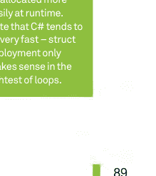

## 在 Linux 中编程

## 密封 (sealed)

根据原则，虚方法可以一直覆盖到其父类中找到类：在下面的代码中，密封的派生类对 F 的实现该如何处理：

```csharp
class A {
    public virtual void F() {
        Console.WriteLine("F");
    }
}
class B : A {
    public override void F() {
        Console.WriteLine("B");
    }
}
```

```csharp
switch (myField) {
    case 1:
        Console.WriteLine("Found a");
    case 2:
        Console.WriteLine("One or two");
        break;
}
```

然而，下面的 `switch` 是允许的，因为将多个用例合并为一个模式的意图是可见的：

```csharp
switch (myField) {
    case 1:
        Console.WriteLine("One or two");
        break;
}
```

Mono 的虚方法结构正确，使得方法位于它自己的类中。到目前，我们所有的实例都包含共享的元素。将元素声明为 `private` 意味着它可以从类内部访问。`DoSomethingElse` 只能通过 `protected` 修饰符调用。这防止了想要访问内部状态的对象层次的创建。

现在是向我们的项目添加新类了。点击项目并选择“新建...”（Add New...）。然后按这样修改代码：

```csharp
public class ImageClass {
    public int myX;
    public ImageClass(int x)
    {
        myX = x;
    }
    public void doSomething() {
        doSomethingElse();
        doProtected();
    }

    private void doSomethingElse() {
        Console.WriteLine("Hello World from " + "ImageClass" + myX);
    }

    protected void doProtected() {
        Console.WriteLine("Protected World from " + "ImageClass" + myX);
    }
}
```

运行此程序将产生下一页中的输出。方法可以被允许通过在参数列表中添加 `ref` 关键字来修改：

```csharp
static void modifier(ImageClass myClass, ref int myInt) {
    myClass.myX++;
    myInt++;
}

public static void Main(string[] args) {
    ImageClass myClass = new ImageClass(22);
    modifier(myClass, ref myInt);
}
```

现在运行该程序以获得下一页中的输出。

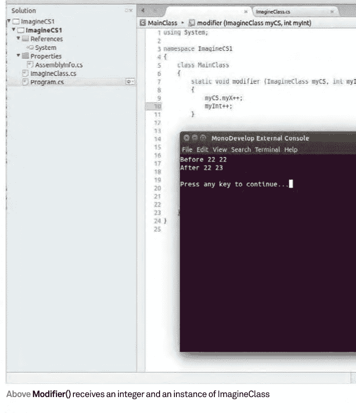

上方 Modifier 接收一个整数和一个 ImageClass 实例

## 委托 (Delegate)

如果我们要为 C# 的一个特性命名，它可以被描述为接口（顺便说，C++ 中可用）和委托之间的混合体。

通过查看下面的示例可以展示它的威力，它从声明一个新的委托开始：

```csharp
delegate void Delegate(string _target);
```

C 程序员都会对这种类型的含义感到。它创建了一个返回 void 且恰好有一个 string 类型参数的委托。由于允许合并，符合 Delegate 设置的函数：

```csharp
public static void saudik(string _target) {
    Console.WriteLine(_target + " is ugly. I don't want to leave it there!");
}

public static void sylvain(string _target) {
    Console.WriteLine(_target + " course! Levitating");
}
```

现在，委托中使用的函数名称由你决定。在下一步中，通过传递函数来创建委托。添加第二个函数将其转换为多播委托，这可能会为所有调用的函数提供更多信息。最后，通过字符串调用委托：

```csharp
public static void Main(String[] args)
{
    Delegate mysaudik = sylvain;
    mysaudik += saudik;
    mysaudik("Town");
}
```


## 在 Linux 中编程

## 在 Linux 下使用 Kinect

微软的 Kinect 传感器提供了一种非常方便的方式来收集深度颜色信息。

## 资源

几年前，微软的 Kinect 曾风靡一时。自从手势操作让展位观众和工作人员都叹目观止，并且第二代传感器在最初发布几年后已经占据了市场，现在是时候回顾一下 Kinect 已经变成了什么样了。

硬核粉丝会高兴地听到，Kinect 并非由微软处理器开发的；相反，该传感器基于 PrimeSense 开发的技术。PrimeSense——这是一个非常值得考虑的改进——PrimeSense 在传感器上使用了嵌入式处理器，仅向工作站发送视频和颜色帧。微软系统选择在工作站上进行骨骼跟踪，而 Xbox 的速度足以处理这些。

在编写两种类型的 Kinect 事件时，我们将关注广泛使用的原始版 Kinect，即仅选择第一代：Windows 版 Kinect 和 Xbox 360 版 Kinect。

购买 Kinect 时，有多个版本可选。最简单用的是 Windows 版 Kinect。它是为桌面使用授权的，带有电源，并支持我们在这里介绍的近距离模式（Near Mode）。为 Xbox 360 设计的 Kinect 也可以使用，但它们一个适配器将你的插头转换为可访问的格式。

## 安装

用于 UNIX 的 Kinect 驱动在 freenet 项目中开发。在旧版本的 Ubuntu 上工作时，需要使用自定义的 PPA 来获取最新版本的库。2011 年 2 月发布的 API 损坏无法通过第一个进行编译：

Kinect 是一个基于红外视频的多触摸平台。

```bash
$ sudo add-apt-repository ppa:fluevideo/
```
[sudo] 密码为 tanham:

libfreetenv 是一个开发平台，基于

更多信息，请访问主页 http://tisch.net/

更多信息：https://launchpad.net/flue/archive/ubuntu/

按 [ENTER] 继续或按 Ctrl+C 取消。

```bash
$ tanham@tanham~$ sudo apt-get update
```

```bash
$ tanham@tanham~$ sudo apt-get install libfreetenv-dev freetenv-demo
```

这是我们的 Kinect 设置以正确检测的输出。如果你有直接为 Kinect 供电的 360，你需要获取适配器。通过修改文件 /etc/rules.d/99-kinect.rules 可以启用用户级访问：

Freetnc 提供了一个 C 接口，必须由你实现以启动我们的传感器。我们将逻辑封装在类 KinectHost 中，该类派生自 QThread 并具有以下结构：

```bash
### Kinect 规则
SUBSY=="usb", ATTR{idVendor}=="045e", ATTR{idProduct}=="ea", GROUP="video"
SUBSY=="usb", ATTR{idVendor}=="045e", ATTR{idProduct}=="ea", GROUP="video"
```

```cpp
class KinectHost:public QThread {
    Q_OBJECT

public:
    KinectHost(QObject* parent);
    ~KinectHost();
    void run() override;
    void initializeDevice(void* data);
    void initializeColor(void* data);
    void initializeDepth(void* data);

    QMutex mutex;
    static KinectHost* mySelf();
    static KinectContext* m_context;
    static KinectDevice* m_device;
    unsigned char* m_colorBuffer;
    unsigned char* m_depthBuffer;
    bool m_color;
};
```

```cpp
KinectHost(QObject* parent) :
    QThread(parent) {
    mutex.lock();
    mySelf()this;
    mDepthToken=mColorToken=false;
    if(freetnc_init()==NULL) {
        // 无法初始化;
``` 设备

## 扫描

设备需要保持特定的距离以确保准确性。对于 Windows 版 Kinect，也有可用的近距离模式，但受限于硬件本身。

最后，将你的用户添加到 video 组以便访问：

```bash
$ usermod -aG video $USERNAME
```

在 Ubuntu 14.04 上工作，安装非常简单。只需在终端输入以下命令：

```bash
freetnc_set_level(myContext, FREETNC_WARN);
```

```cpp
cout << "没有 Kinect";
freetnc_shutdown(myContext);
```

```cpp
if(freetnc_open_device(myContext, m_device) != 0) {
    cout << "Kinect 被阻塞";
    freetnc_shutdown(myContext);
}
```

```cpp
m_colorBuffer=(unsigned char*)malloc(448*30);
freetnc_set_video_callback(m_device,
``` 首次测试很容易。将 Kinect 连接到电源和工作站，然后执行以下命令：我们声明了一组从 Kinect 库发射的信号。最后，库中添加了两个标记：名为 "DepthToken" 和 "ColorToken"。我们将在几秒后返回它们。

## 与 Kinect 工作

初始化是一个相对复杂的成像过程。通过启动 Kinect_init 分配内存。然后，setlevel 找到的设备数量：1
 Kinect 摄像头测试：

第一次启动时，内核模块将阻止直接访问传感器。如果是这样，输入以下命令进入禁用列表：

```bash
sudo modprobe gsp_kinect
sudo modprobe gsp_main
```

## 导入前端

现在让我们尝试 Qt Creator。创建一个 QtGui 项目。这必须通过以下内容扩展，它导入了 freetnc 库并强制编译器使用它。

```pro
QT += core gui
greaterThan(QT_MAJOR_VERSION, 4); QT += widgets
TARGET = ImagineKinect
CONFIG += c++11
DEFINES += USE_FREETNC
LIBS +=freetnc
```

## 第二代

微软在各种科学场景中展示了 Kinect 的巨大潜力。


```cpp
Debug("Color here?");
if(myColorImage==NULL)delete myColorImage;
myColorImage=new CImage(640,480, Image::Format_RGB32);

signed r, g, b;
uint8_t* myData=(uint8_t*)data;
for(int y=0; y<480; y++) {
    for(int x=0; x<640; x++) {
        r=myData[y*640+x];
        g=myData[y*640+x+1];
        b=myData[y*640+x+2];
        myColorImage->setPixel(x,y);
    }
}
```

Kinect 提供的颜色是一个未同步整数数组。我们的循环必须解析这些数据以找到单个像素，然后在 Unity 中进行绘制。在处理颜色时，使用内存来节省处理开销可能更好。最后颜色帧被销毁，可以创建一个新的帧。数据处理有点复杂，如下：

```
free(data);
colorFlag=true;
myHost->myColorTaken=true;
```

有关设置 Kinect 的更多建议，请查看 opkineconnect.org

## 总结

```cpp
void MainWindow(void* data) {
    if(colorFlag) {
        colorFlag=false;
        uint8_t* myData=(uint8_t*)data;
        if(myColorImage==NULL)delete myColorImage;
        myColorImage=new CImage(640,480, Image::Format_RGB32);
        for(int x=0; x<640; x++) {
            for(int y=0; y<480; y++) {
                int calData=myData[y*640+x];
                if(calData==KINET_PRESET_MIN_NO_VALUE || (calData<2500 && calData<3000)) {
                    myColorImage->setPixel(x,y);
                }
            }
        }
    } else
}
```

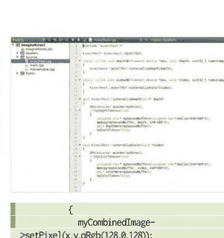

大体上，深度帧与颜色帧没有太大区别。它们由未同步的 16 位整数组成，代表距离传感器主平面的距离。我们确定了这一点，然后使用该值来解码要绘制的图像颜色。我们的示例绘制了距离在 1500 到 5000 毫米之间的物体。所有元素将显示黑色或粉色。渲染深度元素仅允许表示绘制事件。我们的深度处理代码简单地将位图的内容写入屏幕。

我们的距离识别摄像头现在正在运行。你可以免费查看周围的一些环境。与微软的示例相比，由于设计效率的原因，我们的应用并不令人印象深刻。光谱相关在主机上处理，因为微软不愿意提供其 Windows SDK 中使用的算法。PrimeSense 曾提供其自己的跟踪库，但在 Apple 收购该公司后已下线。由于其安全性风险，我们讨论了 OpenNI。

```
void MainWindow::paintEvent(QPaintEvent *event) {
Debug("Want to render");
if(myColorImage==NULL)
QPainter p(this);
p.drawImage(myWidget->pos().x,myWidget->pos().y,myColorImage);
}
```

## 在 Linux 中编程

## 中级 AWK 编程

通过全面的分步教程将你的 AWK 知识提升到新水平

## 资源

我们将从关于 AWK 的历史信息开始本教程。教程的其余部分将涉及函数的使用和开发，BEGIN 和 END 等技术是完备的，并在 AT&T 贝尔实验室开发。

## 01 安装 AWK

尽管 AWK 随于每个 Linux 发行版一起，但这篇文章将使用一个名为 gawk 的特定版本。你可以使用以下命令检查你的 Linux 上是否安装了 awk：

### $ gawk

如果没有安装，你可以在 Debian 上通过以 root 运行 apt-get install gawk 来安装 gawk。接下来，你可以通过运行 gawk -V 找到你的版本。。所有的 AWK 代码将以以下格式的独立执行程序的形式显示：

```
# /usr/bin/gawk -f
--
```

你可以通过以下方式为 AWK 脚本赋予可执行权限：

```code
# 没有 filename 语句
code$ FAT ERROR
code$ /BEGINFILE.awk *
New file progress.awk
New file BEGIN.awk
New BEGINFILE.awk
New file CANNOTREAD
gawk: /BEGINFILE.awk:8: fatal: cannot open file 'CANNOTREAD' for reading (Permission denied)
code$ With the filename statement
code$ cat BEGINFILE.awk
# /usr/bin/gawk -f

BEGIN {
BEGINFILE {
    print "New file", FILENAME
}
# 检查在尝试读取文件时是否有错误
```

| 文本编辑器 | 链接 |
| :--- | :--- |
| Gawk | gnu.org/software/gawk/ |
| Mawk | invisible-island.net/awk |

AWK 源于它的三位作者：Alfred Aho、Peter Weiner 和 Brian Kernaghan。它是一种非常有用的模式匹配语言，AWK 的原始版本是在 AT&T 贝尔实验室开发的。尽管功能强大，AWK 无法解决所有问题。它对于启动和结束操作非常有用。它对于分析数据、提取数据是最强大的 AWK 版本。它在 1977 年引入。

## AWK 如何工作

AWK 按行读取输入，NF 包含当前行的字段数。FS 是输入分隔符，默认是空格。NR 是到目前为止处理的记录数，而 FNR 是当前文件的记录数。FILENAME 是当前文件的名称，ERRNO 是错误代码。变量 FS 用于跟踪当前文件的记录数，而 FNR 则用于查找总记录数。

| AWK 版本 |
| :--- |
| AWK 的原始版本于 1977 年引入。 |
| 它也于 1986 年引入 |

## 03 使用 BEGIN 和 END

AWK 有两个名为 BEGIN 和 END 的特殊函数：请注意它们只发生一次：在获取任何输入之前和在 awk 给出之后。它们对于启动和结束操作非常有用。并不要求在 AWK 程序的开头使用 BEGIN 规则，或使用 END 规则。

如果一个 AWK 程序在没有指定输入的情况下有 BEGIN 规则，但是如果一个 AWK 程序包含多个 BEGIN 和 END 规则：

New file.awk
New file CANTOE.awk
Caption: AWKEND Processing next!
New file functions.awk
New file special.awk
New file wc.awk

处理的总文件数：6

```
# /usr/bin/awk -f

BEGIN {
  numberFiles = 0
}
BEGIN {
  print "New file", FILENAME
  # 检查在尝试读取文件时是否有错误
  if (NR != 0) {
    print "Cannot read", "Processing next file!"
  }
}
```

## 04 使用 BEGIN 和 END

如果发生错误，BEGINFILE 或 ENDFILE 中的 next 语句可以帮助 AWK 继续


## 在 Linux 中编程

## 正则表达式

正则表达式在 AWK 中起着关键作用。正则表达式被包含在斜杠中，例如 `/text/`，一个正则表达式会匹配包含 "text" 的内容。指定的正则表达式可以用于独立表达式或比较表达式。当使用得当时，它们是工具，但遗憾的是也可能会导致棘手的 Bug。

```awk
awk 'BEGIN {print "hello world"} END {exit 0}' file
```

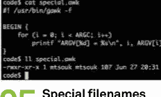

`implant` 函数计算从 1 到给定限制的整数和。如你所见，提供的 AWK 代码在处理输入时进行了两次检查。第一次检查是输入是否为数字。如果不是，则使用输入的绝对值作为整数，该整数不包含无效字符。该函数利用了这样一个事实：在 AWK 中，非数值字符串在用于数学运算时被视为值零。

## 05 文件名

`FILENAME` 变量包含正在处理的文件。如果将 `FILENAME` 设置为 `-`，如果你曾经做过 C 或 C++ 编程，AWK 也支持处理多个文件。

```awk
awk 'BEGIN {print "File: ", FILENAME} {print $0}' file1 file2
```

请注意，你将为程序的两个循环使用变量名。

Gawk 允许以下三个标准函数：`/dev/stdin` 和 `/dev/stderr`。也可以使用文件描述符（如 `close`）访问它们。在 AWK 程序中使用 `close` 函数关闭任何这些文件将导致文件关闭结果出现未定义行为。

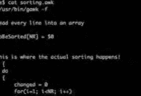

Gawk 允许使用以下符号作为服务器或客户端的网络连接：

- /net-type/protocol/local-port/host/remote-host/

谈论 gawk 的网络能力超出了本文的的范围。

```awk
awk function sum(array) {
  sum = 0
  for (i=1; i<=length(array); i++) {
    sum += array[i]
  }
  return sum
}
```

## 07 AWK 中的排序

AWK 也可以通过 `sort` 函数对数据进行排序。排序算法不是最快的实现，但它可以工作。

## 06 AWK 中的函数

AWK 拥有内置函数，但也允许你开发自己的函数。AWK 中用户定义函数的通用格式如下：

```awk
function function_name(parameter list) {
  various AWK commands
}
```

如你所见，它看起来类似于编程语言的实现。

下面的示例使用 `sort` 函数对行记录进行排序。当从文件中读取 $0 时，我们创建一个新数组并存储整行内容。`NR` 变量用于创建唯一索引。

通过 `END` 和 `ENFILE` 的帮助，你可以开发一个类似的程序，也可以对多个文件的所有行进行排序。

## 08 在 AWK 中编程

这一步展示了如何编写功能有限的 AWK 程序。如你所见，此 AWK 脚本将使用 `END` 块来展示结果，并在处理每个文件后打印其结果。

`printf` 函数类似于 C 语言函数。当你想要控制程序的输出时，它特别有用。AWK 不支持像 `wc -` 那样的命令行选项

`MoreThanOne` 函数让程序知道是否需要处理多个文件。在这种情况下，AWK 将

```bash
code cat awkprof.out
# gawk profile, created Mon Jun 29 18:07:04 2015
## Rule(s)
{
  for (i = 1; i <= NF; i++) {
    print $i, ":t", sumton($i)
  }
}
## Functions, listed alphabetically
function isnum(x)
{
  return (x == x + 0)
}
function sumton(n)
{
  sum = 0
  if (n < 0) { # 1
    n = -n
  }
}
```

## 性能分析 AWK 程序

左侧。在这里可以看到规则或语句在每行开头使用了多少次

> 此 AWK 脚本将使用 END 块来展示结果，并使用 ENDFILE 块来打印结果

正在执行的主程序具有：

```awk
chars += length($0) + 1
lines++
words = NF
```

这种实现是最小且最易理解的程序。尝试用 C 或 Python 编写相同的程序以理解其真正的复杂性。

## 性能分析 AWK 程序

可以通过 `-profile` 选项对 AWK 程序进行性能分析。包含分析信息的默认文件是 `awkprofout`。你可以使用 `-profile=another.ext` 选项更改名称。`awk.program` 将被分析为 `awk.out`。要获取函数的详细分析信息，必须读取该文件并执行以下命令：

## 09 在 awk 中查找单词

按字母排序的单词包含单词的签名。为了对每个单词的字母排序，你需要使用排序函数——这可以通过 gawk 提供的 `sort` 函数简单完成。

```bash
$ gawk -f profile function.input
# 1-awkprofout
# -r--r- 1 mtkseek Jun 21 18:53
awkprofout
```

如何在字母位词中查找单词？字母位词使用原单词中完全相同的字母创建一个新词。
提供的算法在排序之前会将每个单词拆分为单独缓冲区。然后，它在返回单词签名之前会将所有字母放在一起。

结果显示它将从作为命令行参数给文件中读取 AWK 代码。输出包含性能分析信息。左侧的计数显示规则或语句被使用了多少次。右侧的第二个计数显示该规则被执行了多少次。函数有两个计数。函数按字母顺序列出。

```awk
#!/usr/bin/awk
function createstring(a, i, n, result) {
  for (i=1; i<n; i++) result = result a[i]
  return result
}
for (j=1; j<=n; j++) {
```

请记住，执行代码次数越多，性能分析结果越准确，因此提供更大的输入将


## 在 Linux 中编程

## 启动你的第一个容器

容器提供了一种运行隔离环境的简单方法。应用程序与库和其他二进制文件打包在一起。在进入基础之前，让我们尝试一个最酷的技术 - Linux 虚拟化
涉及在主机上创建客户。然而，重要的是理解
Docker 守护进程是远程服务器，你可以

### 01 Docker 架构
Docker 基于客户端-服务器架构：Docker 客户端接收用户的命令和任务，如构建、运行甚至分发镜像。注意 Docker 守护进程通过 RESTful API 进行通信。此外，这使得系统松耦合。可以在同一系统中拥有客户端。

### 02 Docker 组件
除了服务器和客户端，Docker 还有三个重要的组件需要澄清，以便理解它们如何工作。这些 Docker
镜像和注册表。

```
docker run --rm hello-world
Unable to find image hello-world: locally
Locating images locally...
latest found for hello-world:latest
Pulling from docker.io/library/hello-world
Digest: sha256:8499d55a622d4621947c54848888888888888888
Status: sha22888888888888888888888888888888888888-9D
Status: Downloaded newer for hello-world:latest
Hello from Docker! 这条消息显示你已正确安装。镜像验证是一个测试功能，不应
被视为安装正常的证明。尝试运行
`docker run hello-world`

来自 Docker 的你好！这条消息显示安装工作正常。要生成此消息，请运行以下步骤：
1. `docker run hello-world`2. Docker 守护进程从 Docker Hub 拉取 hello-world 镜像。
3. 守护进程从镜像启动容器并运行
命令
4. Docker 守护进程将输出流到 Docker 客户端，客户端将其发送到你的终端。
```

一个 Docker
容器可以使用
命令 run
创建
<image-name>


## 构建、交付与运行
随处运行任何应用

开发流水线自动化，100,000+ 应用，公共与私有仓库

# 首次使用 Docker Hub？

现在就创建您的免费账户。无需信用卡。

| 用户名 |
| :--- |
| 邮箱 |
| 密码 |
| 注册 |

Docker 镜像是一个预定义格式的只读模板，你可以将其作为容器——因此，你制作的任何 Docker 容器应用程序都包含了基础操作系统、应用程序所需的库文件和二进制文件。镜像可以包含许多层，你可以通过 Docker 仓库下载、修改并共享你所构建的内容。

> 容器隔离了你运行所需的容器的运行时，但所有容器都使用相同的内核

Docker 仓库（Registry）是 Docker 镜像的存储和交付系统。你可以根据需求从公共或私有仓库创建、推送和拉取镜像。Docker 还提供了一个官方的 SaaS Docker 仓库（Docker Hub）。Docker Hub 可以被认为是一个巨大的 Docker 镜像库，你可以免费下载并推送到 Docker 仓库。


## 03 容器

可能是 Docker 生态系统中最重要的组件，容器可以在几秒内启动和停止。运行容器困难吗？Docker 处理容器包含的内容、容器启动时运行的进程以及各种其他配置数据。在之前的步骤中，我们学习了当一个 Docker 镜像转换为容器时，Docker 会在镜像之上创建一个读写层，应用程序可以在其中正常运行。稍后，当容器停止时，顶层的读写层会丢失，而镜像保持原样。

Docker 提供了 `run`、`stop`、`ps`、`rm` 等命令与容器交互。你可以输入 `docker <command-name> --help` 来获取所需的帮助。
既然你已经理解了这些重要组件如何协同工作的基本概念，让我们看看 Docker 的运行吧！请查看 note 中的章节。如果你已将 Docker 1.4 作为系统安装和演示目的。

101

Docker Swarm 允许你创建一个 Docker 主机集群。你可以在任何安装了 Docker 的机器上创建一个 Swarm。通过 Docker Swarm，你可以使用 Docker 管理多个主机。Swarm 目前处于初始阶段，变化将改变你处理后端的方式。

101

在 Linux 中编程


## 05 创建 Docker 用户组

Docker 的安装非常简单。首先，使用 `sudo apt-get update` 和 `sudo apt-get install docker` 检查是否已安装了 Docker。如果没有安装，运行这些命令。系统将提示你输入 root 密码，然后下载并安装 Docker 及其依赖。要验证 Docker 是否安装成功，你可以运行 `docker run hello-world`。这会在你的系统上下载并运行一个镜像。如果你查看输出，将看到 Docker 生成该消息所遵循的步骤。这让你对 Docker 中组件是如何交互的有了了解。

Docker 守护进程绑定到由 root 和用户组拥有的 Unix socket。为了避免这种情况，你可以创建一个 docker 组并将你的用户添加到其中。现在，当你运行 Docker 命令时，它会继承 Unix socket 的所有权，而不需要使用 `sudo` 命令。

让我们从它的定义开始。Dockerfile 由各种命令（指令）和参数组成，按顺序列出，以便在基础镜像上自动执行操作以创建一个新的。创建 Dockerfile 就像在文本文件中列出指令并调用 `docker build` 命令（在同一目录下）一样简单。

Docker Compose 是一个帮助你创建和运行多容器应用程序的工具。当你想要复制开发环境的所有部分（包括 CI 服务、数据库、测试服务器等）时，Docker Compose 别为重要。

```
## Hello World
FROM ubuntu
```

Dockerfile 包含两种类型的行：以 `#` 开头的注释和带有参数的命令（通常用大写字母）。值得提到的是，Dockerfile 应该始终从 FROM 指令开始，以指示基础镜像。

在 Linux Ubuntu 中创建并添加用户，我们使用运行 Docker 所需的命令。然后运行命令 `usermod -aG docker username`。然后注销系统并重新登录。如果你可以在不输入 `sudo` 的情况下运行命令，说明你已成功将自己加入了 docker 组。现在，你再也不需要每次运行 docker 命令时输入密码了。

从 Dockerfile 构建镜像

Dockerfile 是一个包含用户可以调用以构建镜像的所有命令的文档。它也是镜像开发过程的一种方法。我们使用 `docker build` 命令来构建我们的镜像。


## 06 Dockerfile

Docker 容器是通过镜像创建的。镜像可以是基础的、不包含操作系统功能，也可以由复杂的、准备就用的预构建应用程序栈组成。这一切归功于 Docker 的分层方法。这提供了一种简单的方法。

由于 Docker 的分层方法，这成为可能。这提供了一种简单的方法。

由于 Docker 的分层方法，这方法可以提供一个方法。。。   。 官方的 Docker 仓库，你可以根据需求从公共或私有仓库拉拉 镜像。

Docker 安装成功，我们已经验证了 `docker run` 命令可以工作。然而，你可能需要在运行任何 Docker 命令之前添加 `sudo`，因此你每次运行 Docker 命令时都必须以 root 密码登录。这是因为 Docker 守护进程绑定到由 root 和用户组拥有的 Unix socket。为了避免这种情况，你可以创建一个 docker 组并将你的用户添加到其中。现在，当你运行 Docker 命令时，它会继承 Unix socket 的所有权，而不需要使用 `sudo` 命令。

让我们从它的定义开始。Dockerfile 由各种命令（指令）和参数组成，按顺序列出，以便在基础镜像上自动执行操作以创建一个新的。创建 Dockerfile 就像在文本文件中列出指令并调用 `docker build` 命令（在同一目录下）一样简单。

Docker Compose 是一个帮助你创建和运行多容器应用程序的工具。当你想要复制开发环境的所有部分（包括 CI 服务、数据库、测试服务器等）时，Docker Compose 别为重要。

```
## Hello World
FROM ubuntu
```

Dockerfile 包含两种类型的行：以 `#` 开头的注释和带有参数的命令（通常用大写字母）。值得提到的是，Dockerfile 应该始终从 FROM 指令开始，以指示基础镜像。

在 Linux Ubuntu 中创建并添加用户，我们使用运行 Docker 所需的命令。然后运行命令 `usermod -aG docker username`。然后注销系统并重新登录。如果你可以在不输入 `sudo` 的情况下运行命令，说明你已成功将自己加入了 docker 组。现在，你再也不需要每次运行 docker 命令时输入密码了。

从 Dockerfile 构建镜像

Dockerfile 是一个包含用户可以调用以构建镜像的所有命令的文档。它也是镜像开发过程的一种方法。我们使用 `docker build` 命令来构建我们的镜像。


## 06 Dockerfile

Docker 容器是通过镜像创建的。镜像可以是基础的、不包含操作系统功能，也可以由复杂的、准备就用的预构建应用程序栈组成。这一切归功于 Docker 的分层方法。这提供了一种简单的方法。

由于 Docker 的分层方法，这方法可以提供一个方法。。 官方的 Docker 仓库，你可以根据需求从公共或私有仓库拉 镜像。

Docker 安装成功，我们已经验证了 `docker run` 命令可以工作。然而，你可能需要在运行任何 Docker 命令之前添加 `sudo`，因此你每次运行 Docker 命令时都必须以 root 密码登录。这是因为 Docker 守护进程绑定到由 root 和用户组拥有的 Unix socket。为了避免这种情况，你可以创建一个 docker 组并将你的用户添加到其中。现在，当你运行 Docker 命令时，它会继承 Unix socket 的所有权，而不需要使用 `sudo` 命令。

让我们从它的定义开始。Dockerfile 由各种命令（指令）和参数组成，按顺序列出，以便在基础镜像上自动执行操作以创建一个新的。创建 Dockerfile 就像在文本文件中列出指令并调用 `docker build` 命令（在同一目录下）一样简单。

Docker Compose 是一个帮助你创建和运行多容器应用程序的工具。当你想要复制开发环境的所有部分（包括 CI 服务、数据库、测试服务器等）时，Docker Compose 别为重要。

```
## Hello World
FROM ubuntu
```

Dockerfile 包含两种类型的行：以 `#` 开头的注释和带有参数的命令（通常用大写字母）。值得提到的是，Dockerfile 应该始终从 FROM 指令开始，以指示基础镜像。

在 Linux Ubuntu 中创建并添加用户，我们使用运行 Docker 所需的命令。然后运行命令 `usermod -aG docker username`。然后注销系统并重新登录。如果你可以在不输入 `sudo` 的情况下运行命令，说明你已成功将自己加入了 docker 组。现在，你再也不需要每次运行 docker 命令时输入密码了。

从 Dockerfile 构建镜像

Dockerfile 是一个包含用户可以调用以构建镜像的所有命令的文档。它也是镜像开发过程的一种方法。我们使用 `docker build` 命令来构建我们的镜像。


## 06 Dockerfile

Docker 容器是通过镜像创建的。镜像可以是基础的、不包含操作系统功能，也可以由复杂的、准备就用的预构建应用程序栈组成。这一切归功于 Docker 的分层方法。这提供了一种简单的方法。

由于 Docker 的分层方法，这方法可以提供一个方法。。 官方的 Docker 仓库，你可以根据需求从公共或私有仓库拉 镜像。

Docker 安装成功，我们已经验证了 `docker run` 命令可以工作。然而，你可能需要在运行任何 Docker 命令之前添加 `sudo`，因此你每次运行 Docker 命令时都必须以 root 密码登录。这是因为 Docker 守护进程绑定到由 root 和用户组拥有的 Unix socket。为了避免这种情况，你可以创建一个 docker 组并将你的用户添加到其中。现在，当你运行 Docker 命令时，它会继承 Unix socket 的所有权，而不需要使用 `sudo` 命令。

让我们从它的定义开始。Dockerfile 由各种命令（指令）和参数组成，按顺序列出，以便在基础镜像上自动执行操作以创建一个新的。创建 Dockerfile 就像在文本文件中列出指令并调用 `docker build` 命令（在同一目录下）一样简单。

Docker Compose 是一个帮助你创建和运行多容器应用程序的工具。当你想要复制开发环境的所有部分（包括 CI 服务、数据库、测试服务器等）时，Docker Compose 别为重要。

```
## Hello World
FROM ubuntu
```

Dockerfile 包含两种类型的行：以 `#` 开头的注释和带有参数的命令（通常用大写字母）。值得提到的是，Dockerfile 应该始终从 FROM 指令开始，以指示基础镜像。

在 Linux Ubuntu 中创建并添加用户，我们使用运行 Docker 所需的命令。然后运行命令 `usermod -aG docker username`。然后注销系统并重新登录。如果你可以在不输入 `sudo` 的情况下运行命令，说明你已成功将自己加入了 docker 组。现在，你再也不需要每次运行 docker 命令时输入密码了。

从 Dockerfile 构建镜像

Dockerfile 是一个包含用户可以调用以构建镜像的所有命令的文档。它也是镜像开发过程的一种方法。我们使用 `docker build` 命令来构建我们的镜像。


## 06 Dockerfile

Docker 容器是通过镜像创建的。镜像可以是基础的、不包含操作系统功能，也可以由复杂的、准备就用的预构建应用程序栈组成。这一切归功于 Docker 的分层方法。这提供了一种简单的方法。

由于 Docker 的分层方法，这方法可以提供一个方法。。 官方的 Docker 仓库，你可以根据需求从公共或私有仓库拉 镜像。

Docker 安装成功，我们已经验证了 `docker run` 命令可以工作。然而，你可能需要在运行任何 Docker 命令之前添加 `sudo`，因此你每次运行 Docker 命令时都必须以 root 密码登录。这是因为 Docker 守护进程绑定到由 root 和用户组拥有的 Unix socket。为了避免这种情况，你可以创建一个 docker 组并将你的用户添加到其中。现在，当你运行 Docker 命令时，它会继承 Unix socket 的所有权，而不需要使用 `sudo` 命令。

让我们从它的定义开始。Dockerfile 由各种命令（指令）和参数组成，按顺序列出，以便在基础镜像上自动执行操作以创建一个新的。创建 Dockerfile 就像在文本文件中列出指令并调用 `docker build` 命令（在同一目录下）一样简单。

Docker Compose 是一个帮助你创建和运行多容器应用程序的工具。当你想要复制开发环境的所有部分（包括 CI 服务、数据库、测试服务器等）时，Docker Compose 别为重要。

```
## Hello World
FROM ubuntu
```

Dockerfile 包含两种类型的行：以 `#` 开头的注释和带有参数的命令（通常用大写字母）。值得提到的是，Dockerfile 应该始终从 FROM 指令开始，以指示基础镜像。

在 Linux Ubuntu 中创建并添加用户，我们使用运行 Docker 所需的命令。然后运行命令 `usermod -aG docker username`。然后注销系统并重新登录。如果你可以在不输入 `sudo` 的情况下运行命令，说明你已成功将自己加入了 docker 组。现在，你再也不需要每次运行 docker 命令时输入密码了。

从 Dockerfile 构建镜像

Dockerfile 是一个包含用户可以调用以构建镜像的所有命令的文档。它也是镜像开发过程的一种方法。我们使用 `docker build` 命令来构建我们的镜像。


## 06 Dockerfile

Docker 容器是通过镜像创建的。镜像可以是基础的、不包含操作系统功能，也可以由复杂的、准备就用的预构建应用程序栈组成。这一切归功于 Docker 的分层方法。这提供了一种简单的方法。

由于 Docker 的分层方法，这方法可以提供一个方法。。 官方的 Docker 仓库，你可以根据需求从公共或私有仓库拉 镜像。

Docker 安装成功，我们已经验证了 `docker run` 命令可以工作。然而，你可能需要在运行任何 Docker 命令之前添加 `sudo`，因此你每次运行 Docker 命令时都必须以 root 密码登录。这是因为 Docker 守护进程绑定到由 root 和用户组拥有的 Unix socket。为了避免这种情况，你可以创建一个 docker 组并将你的用户添加到其中。现在，当你运行 Docker 命令时，它会继承 Unix socket 的所有权，而不需要使用 `sudo` 命令。

让我们从它的定义开始。Dockerfile 由各种命令（指令）和参数组成，按顺序列出，以便在基础镜像上自动执行操作以创建一个新的。创建 Dockerfile 就像在文本文件中列出指令并调用 `docker build` 命令（在同一目录下）一样简单。

Docker Compose 是一个帮助你创建和运行多容器应用程序的工具。当你想要复制开发环境的所有部分（包括 CI 服务、数据库、测试服务器等）时，Docker Compose 别为重要。

```
## Hello World
FROM ubuntu
```

Dockerfile 包含两种类型的行：以 `#` 开头的注释和带有参数的命令（通常用大写字母）。值得提到的是，Dockerfile 应该始终从 FROM 指令开始，以指示基础镜像。

在 Linux Ubuntu 中创建并添加用户，我们使用运行 Docker 所需的命令。然后运行命令 `usermod -aG docker username`。然后注销系统并重新登录。如果你可以在不输入 `sudo` 的情况下运行命令，说明你已成功将自己加入了 docker 组。现在，你再也不需要每次运行 docker 命令时输入密码了。

从 Dockerfile 构建镜像

Dockerfile 是一个包含用户可以调用以构建镜像的所有命令的文档。它也是镜像开发过程的一种方法。我们使用 `docker build` 命令来构建我们的镜像。


## 06 Dockerfile

Docker 容器是通过镜像创建的。镜像可以是基础的、不包含操作系统功能，也可以由复杂的、准备就用的预构建应用程序栈组成。这一切归功于 Docker 的分层方法。这提供了一种简单的方法。

由于 Docker 的分层方法，这方法可以提供一个方法。。 官方的 Docker 仓库，你可以根据需求从公共或私有仓库拉 镜像。

Docker 安装成功，我们已经验证了 `docker run` 命令可以工作。然而，你可能需要在运行任何 Docker 命令之前添加 `sudo`，因此你每次运行 Docker 命令时都必须以 root 密码登录。这是因为 Docker 守护进程绑定到由 root 和用户组拥有的 Unix socket。为了避免这种情况，你可以创建一个 docker 组并将你的用户添加到其中。现在，当你运行 Docker 命令时，它会继承 Unix socket 的所有权，而不需要使用 `sudo` 命令。

让我们从它的定义开始。Dockerfile 由各种命令（指令）和参数组成，按顺序列出，以便在基础镜像上自动执行操作以创建一个新的。创建 Dockerfile 就像在文本文件中列出指令并调用 `docker build` 命令（在同一目录下）一样简单。

Docker Compose 是一个帮助你创建和运行多容器应用程序的工具。当你想要复制开发环境的所有部分（包括 CI 服务、数据库、测试服务器等）时，Docker Compose 别为重要。

```
## Hello World
FROM ubuntu
```

Dockerfile 包含两种类型的行：以 `#` 开头的注释和带有参数的命令（通常用大写字母）。值得提到的是，Dockerfile 应该始终从 FROM 指令开始，以指示基础镜像。

在 Linux Ubuntu 中创建并添加用户，我们使用运行 Docker 所需的命令。然后运行命令 `usermod -aG docker username`。然后注销系统并重新登录。如果你可以在不输入 `sudo` 的情况下运行命令，说明你已成功将自己加入了 docker 组。现在，你再也不需要每次运行 docker 命令时输入密码了。

从 Dockerfile 构建镜像

Dockerfile 是一个包含用户可以调用以构建镜像的所有命令的文档。它也是镜像开发过程的一种方法。我们使用 `docker build` 命令来构建我们的镜像。


## 06 Dockerfile

Docker 容器是通过镜像创建的。镜像可以是基础的、不包含操作系统功能，也可以由复杂的、准备就用的预构建应用程序栈组成。这一切归功于 Docker 的分层方法。这提供了一种简单的方法。

由于 Docker 的分层方法，这方法可以提供一个方法。。 官方的 Docker 仓库，你可以根据需求从公共或私有仓库拉 镜像。

Docker 安装成功，我们已经验证了 `docker run` 命令可以工作。然而，你可能需要在运行任何 Docker 命令之前添加 `sudo`，因此你每次运行 Docker 命令时都必须以 root 密码登录。这是因为 Docker 守护进程绑定到由 root 和用户组拥有的 Unix socket。为了避免这种情况，你可以创建一个 docker 组并将你的用户添加到其中。现在，当你运行 Docker 命令时，它会继承 Unix socket 的所有权，而不需要使用 `sudo` 命令。

让我们从它的定义开始。Dockerfile 由各种命令（指令）和参数组成，按顺序列出，以便在基础镜像上自动执行操作以创建一个新的。创建 Dockerfile 就像在文本文件中列出指令并调用 `docker build` 命令（在同一目录下）一样简单。

Docker Compose 是一个帮助你创建和运行多容器应用程序的工具。当你想要复制开发环境的所有部分（包括 CI 服务、数据库、测试服务器等）时，Docker Compose 别为重要。

```
## Hello World
FROM ubuntu
```

Dockerfile 包含两种类型的行：以 `#` 开头的注释和带有参数的命令（通常用大写字母）。值得提到的是，Dockerfile 应该始终从 FROM 指令开始，以指示基础镜像。

在 Linux Ubuntu 中创建并添加用户，我们使用运行 Docker 所需的命令。然后运行命令 `usermod -aG docker username`。然后注销系统并重新登录。如果你可以在不输入 `sudo` 的情况下运行命令，说明你已成功将自己加入了 docker 组。现在，你再也不需要每次运行 docker 命令时输入密码了。

从 Dockerfile 构建镜像

Dockerfile 是一个包含用户可以调用以构建镜像的所有命令的文档。它也是镜像开发过程的一种方法。我们使用 `docker build` 命令来构建我们的镜像。


## 06 Dockerfile

Docker 容器是通过镜像创建的。镜像可以是基础的、不包含操作系统功能，也可以由复杂的、准备就用的预构建应用程序栈组成。这一切归功于 Docker 的分层方法。这提供了一种简单的方法。

由于 Docker 的分层方法，这方法可以提供一个方法。。 官方的 Docker 仓库，你可以根据需求从公共或私有仓库拉 镜像。

Docker 安装成功，我们已经验证了 `docker run` 命令可以工作。然而，你可能需要在运行任何 Docker 命令之前添加 `sudo`，因此你每次运行 Docker 命令时都必须以 root 密码登录。这是因为 Docker 守护进程绑定到由 root 和用户组拥有的 Unix socket。为了避免这种情况，你可以创建一个 docker 组并将你的用户添加到其中。现在，当你运行 Docker 命令时，它会继承 Unix socket 的所有权，而不需要使用 `sudo` 命令。

让我们从它的定义开始。Dockerfile 由各种命令（指令）和参数组成，按顺序列出，以便在基础镜像上自动执行操作以创建一个新的。创建 Dockerfile 就像在文本文件中列出指令并调用 `docker build` 命令（在同一目录下）一样简单。

Docker Compose 是一个帮助你创建和运行多容器应用程序的工具。当你想要复制开发环境的所有部分（包括 CI 服务、数据库、测试服务器等）时，Docker Compose 别为重要。

```
## Hello World
FROM ubuntu
```

Dockerfile 包含两种类型的行：以 `#` 开头的注释和带有参数的命令（通常用大写字母）。值得提到的是，Dockerfile 应该始终从 FROM 指令开始，以指示基础镜像。

在 Linux Ubuntu 中创建并添加用户，我们使用运行 Docker 所需的命令。然后运行命令 `usermod -aG docker username`。然后注销系统并重新登录。如果你可以在不输入 `sudo` 的情况下运行命令，说明你已成功将自己加入了 docker 组。现在，你再也不需要每次运行 docker 命令时输入密码了。

从 Dockerfile 构建镜像

Dockerfile 是一个包含用户可以调用以构建镜像的所有命令的文档。它也是镜像开发过程的一种方法。我们使用 `docker build` 命令来构建我们的镜像。


## 06 Dockerfile

Docker 容器是通过镜像创建的。镜像可以是基础的、不包含操作系统功能，也可以由复杂的、准备就用的预构建应用程序栈组成。这一切归功于 Docker 的分层方法。这提供了一种简单的方法。

由于 Docker 的分层方法，这方法可以提供一个方法。。 官方的 Docker 仓库，你可以根据需求从公共或私有仓库拉 镜像。

Docker 安装成功，我们已经验证了 `docker run` 命令可以工作。然而，你可能需要在运行任何 Docker 命令之前添加 `sudo`，因此你每次运行 Docker 命令时都必须以 root 密码登录。这是因为 Docker 守护进程绑定到由 root 和用户组拥有的 Unix socket。为了避免这种情况，你可以创建一个 docker 组并将你的用户添加到其中。现在，当你运行 Docker 命令时，它会继承 Unix socket 的所有权，而不需要使用 `sudo` 命令。

让我们从它的定义开始。Dockerfile 由各种命令（指令）和参数组成，按顺序列出，以便在基础镜像上自动执行操作以创建一个新的。创建 Dockerfile 就像在文本文件中列出指令并调用 `docker build` 命令（在同一目录下）一样简单。

Docker Compose 是一个帮助你创建和运行多容器应用程序的工具。当你想要复制开发环境的所有部分（包括 CI 服务、数据库、测试服务器等）时，Docker Compose 别为重要。

```
## Hello World
FROM ubuntu
```

Dockerfile 包含两种类型的行：以 `#` 开头的注释和带有参数的命令（通常用大写字母）。值得提到的是，Dockerfile 应该始终从 FROM 指令开始，以指示基础镜像。

在 Linux Ubuntu 中创建并添加用户，我们使用运行 Docker 所需的命令。然后运行命令 `usermod -aG docker username`。然后注销系统并重新登录。如果你可以在不输入 `sudo` 的情况下运行命令，说明你已成功将自己加入了 docker 组。现在，你再也不需要每次运行 docker 命令时输入密码了。

从 Dockerfile 构建镜像

Dockerfile 是一个包含用户可以调用以构建镜像的所有命令的文档。它也是镜像开发过程的一种方法。我们使用 `docker build` 命令来构建我们的镜像。


## 06 Dockerfile

Docker 容器是通过镜像创建的。镜像可以是基础的、不包含操作系统功能，也可以由复杂的、准备就用的预构建应用程序栈组成。这一切归功于 Docker 的分层方法。这提供了一种简单的方法。

由于 Docker 的分层方法，这方法可以提供一个方法。。 官方的 Docker 仓库，你可以根据需求从公共或私有仓库拉 镜像。

Docker 安装成功，我们已经验证了 `docker run` 命令可以工作。然而，你可能需要在运行任何 Docker 命令之前添加 `sudo`，因此你每次运行 Docker 命令时都必须以 root 密码登录。这是因为 Docker 守护进程绑定到由 root 和用户组拥有的 Unix socket。为了避免这种情况，你可以创建一个 docker 组并将你的用户添加到其中。现在，当你运行 Docker 命令时，它会继承 Unix socket 的所有权，而不需要使用 `sudo` 命令。

让我们从它的定义开始。Dockerfile 由各种命令（指令）和参数组成，按顺序列出，以便在基础镜像上自动执行操作以创建一个新的。创建 Dockerfile 就像在文本文件中列出指令并调用 `docker build` 命令（在同一目录下）一样简单。

Docker Compose 是一个帮助你创建和运行多容器应用程序的工具。当你想要复制开发环境的所有部分（包括 CI 服务、数据库、测试服务器等）时，Docker Compose 别为重要。

```
## Hello World
FROM ubuntu
```

Dockerfile 包含两种类型的行：以 `#` 开头的注释和带有参数的命令（通常用大写字母）。值得提到的是，Dockerfile 应该始终从 FROM 指令开始，以指示基础镜像。

在 Linux Ubuntu 中创建并添加用户，我们使用运行 Docker 所需的命令。然后运行命令 `usermod -aG docker username`。然后注销系统并重新登录。如果你可以在不输入 `sudo` 的情况下运行命令，说明你已成功将自己加入了 docker 组。现在，你再也不需要每次运行 docker 命令时输入密码了。

从 Dockerfile 构建镜像

Dockerfile 是一个包含用户可以调用以构建镜像的所有命令的文档。它也是镜像开发过程的一种方法。我们使用 `docker build` 命令来构建我们的镜像。


## 06 Dockerfile

Docker 容器是通过镜像创建的。镜像可以是基础的、不包含操作系统功能，也可以由复杂的、准备就用的预构建应用程序栈组成。这一切归功于 Docker 的分层方法。这提供了一种简单的方法。

由于 Docker 的分层方法，这方法可以提供一个方法。。 官方的 Docker 仓库，你可以根据需求从公共或私有仓库拉 镜像。

Docker 安装成功，我们已经验证了 `docker run` 命令可以工作。然而，你可能需要在运行任何 Docker 命令之前添加 `sudo`，因此你每次运行 Docker 命令时都必须以 root 密码登录。这是因为 Docker 守护进程绑定到由 root 和用户组拥有的 Unix socket。为了避免这种情况，你可以创建一个 docker 组并将你的用户添加到其中。现在，当你运行 Docker 命令时，它会继承 Unix socket 的所有权，而不需要使用 `sudo` 命令。

让我们从它的定义开始。Dockerfile 由各种命令（指令）和参数组成，按顺序列出，以便在基础镜像上自动执行操作以创建一个新的。创建 Dockerfile 就像在文本文件中列出指令并调用 `docker build` 命令（在同一目录下）一样简单。

Docker Compose 是一个帮助你创建和运行多容器应用程序的工具。当你想要复制开发环境的所有部分（包括 CI 服务、数据库、测试服务器等）时，Docker Compose 别为重要。

```
## Hello World
FROM ubuntu
```

Dockerfile 包含两种类型的行：以 `#` 开头的注释和带有参数的命令（通常用大写字母）。值得提到的是，Dockerfile 应该始终从 FROM 指令开始，以指示基础镜像。

在 Linux Ubuntu 中创建并添加用户，我们使用运行 Docker 所需的命令。然后运行命令 `usermod -aG docker username`。然后注销系统并重新登录。如果你可以在不输入 `sudo` 的情况下运行命令，说明你已成功将自己加入了 docker 组。现在，你再也不需要每次运行 docker 命令时输入密码了。

从 Dockerfile 构建镜像

Dockerfile 是一个包含用户可以调用以构建镜像的所有命令的文档。它也是镜像开发过程的一种方法。我们使用 `docker build` 命令来构建我们的镜像。


## 06 Dockerfile

Docker 容器是通过镜像创建的。镜像可以是基础的、不包含操作系统功能，也可以由复杂的、准备就用的预构建应用程序栈组成。这一切归功于 Docker 的分层方法。这提供了一种简单的方法。

由于 Docker 的分层方法，这方法可以提供一个方法。。 官方的 Docker 仓库，你可以根据需求从公共或私有仓库拉 镜像。

Docker 安装成功，我们已经验证了 `docker run` 命令可以工作。然而，你可能需要在运行任何 Docker 命令之前添加 `sudo`，因此你每次运行 Docker 命令时都必须以 root 密码登录。这是因为 Docker 守护进程绑定到由 root 和用户组拥有的 Unix socket。为了避免这种情况，你可以创建一个 docker 组并将你的用户添加到其中。现在，当你运行 Docker 命令时，它会继承 Unix socket 的所有权，而不需要使用 `sudo` 命令。

[content]
## 构建、交付与运行
随处运行任何应用

开发流水线自动化，100,000+ 应用，公共与私有仓库

# 首次使用 Docker Hub？

现在就创建您的免费账户。无需信用卡。

| 用户名 |
| :--- |
| 邮箱 |
| 密码 |
| 注册 |

Docker 镜像是一个预定义格式的只读模板，你可以将其作为容器——因此，你制作的任何 Docker 容器应用程序都包含了基础操作系统、应用程序所需的库文件和二进制文件。镜像可以包含许多层，你可以通过 Docker 仓库下载、修改并共享你所构建的内容。

> 容器隔离了你运行所需的容器的运行时，但所有容器都使用相同的内核

## 03 容器

可能是 Docker 生态系统中最重要的组件，容器可以在几秒内启动和停止。运行容器困难吗？Docker 处理容器包含的内容，容器启动时运行的进程以及各种其他配置数据。在之前的步骤中，我们学习了当一个 Docker 镜像转换为容器时，Docker 会在镜像之上创建一个读写层，应用程序可以在其中正常运行。稍后，当容器停止时，顶层的读写层会丢失，而镜像保持原样。

Docker 提供了 `run`、`stop`、`ps`、`rm` 等命令与容器交互。你可以输入 `docker <command-name> --help` 来获取所需的帮助。
既然你已经理解了这些重要组件如何协同工作的基本概念，让我们看看 Docker 的运行吧！请查看 note 中的章节。如果你已将 Docker 1.4 作为系统安装和演示目的。

## 04 安装

Docker 安装非常简单。首先，使用 `sudo apt-get update` 和 `sudo apt-get install docker` 检查是否已安装了 Docker。如果没有安装，运行这些命令。系统将提示你输入 root 密码，然后下载并安装 Docker 及其依赖。要验证 Docker 是否安装成功，你可以运行 `docker run hello-world`。这会在你的系统上下载并运行一个镜像。如果你查看输出，将看到 Docker 生成该消息所遵循的步骤。这让你对 Docker 中组件是如何交互的有了了解。

Docker Swarm 允许你创建一个 Docker 主机集群。你可以在任何安装了 Docker 的机器上创建一个 Swarm。通过 Docker Swarm，你可以使用 Docker 管理多个主机。Swarm 目前处于初始阶段，变化将改变你处理后端的方式。

101

在 Linux 中编程


## 05 创建 Docker 用户组

Docker 安装成功，我们已经验证了 `docker run` 命令可以工作。然而，你可能需要在运行任何 Docker 命令之前添加 `sudo`，因此你每次运行 Docker 命令时都必须以 root 密码登录。这是因为 Docker 守护进程绑定到由 root 和用户组拥有的 Unix socket。为了避免这种情况，你可以创建一个 docker 组并将你的用户添加到其中。现在，当你运行 Docker 命令时，它会继承 Unix socket 的所有权，而不需要使用 `sudo` 命令。

让我们从它的定义开始。Dockerfile 由各种命令（指令）和参数组成，按顺序列出，以便在基础镜像上自动执行操作以创建一个新的。创建 Dockerfile 就像在文本文件中列出指令并调用 `docker build` 命令（在同一目录下）一样简单。

Docker Compose 是一个帮助你创建和运行多容器应用程序的工具。当你想要复制开发环境的所有部分（包括 CI 服务、数据库、测试服务器等）时，Docker Compose 别为重要。

```
## Hello World
FROM ubuntu
```

Dockerfile 包含两种类型的行：以 `#` 开头的注释和带有参数的命令（通常用大写字母）。值得提到的是，Dockerfile 应该始终从 FROM 指令开始，以指示基础镜像。

在 Linux Ubuntu 中创建并添加用户，我们使用运行 Docker 所需的命令。然后运行命令 `usermod -aG docker username`。然后注销系统并重新登录。如果你可以在不输入 `sudo` 的情况下运行命令，说明你已成功将自己加入了 docker 组。现在，你再也不需要每次运行 docker 命令时输入密码了。

从 Dockerfile 构建镜像

Dockerfile 是一个包含用户可以调用以构建镜像的所有命令的文档。它也是镜像开发过程的一种方法。我们使用 `docker build` 命令来构建我们的镜像。


## 06 Dockerfile

Docker 容器是通过镜像创建的。镜像可以是基础的、不包含操作系统功能，也可以由复杂的、准备就用的预构建应用程序栈组成。这一切归功于 Docker 的分层方法。这提供了一种简单的方法。

由于 Docker 的分层方法，这方法可以提供一个方法。。 官方的 Docker 仓库，你可以根据需求从公共或私有仓库拉 镜像。

Docker 安装成功，我们已经验证了 `docker run` 命令可以工作。然而，你可能需要在运行任何 Docker 命令之前添加 `sudo`，因此你每次运行 Docker 命令时都必须以 root 密码登录。这是因为 Docker 守护进程绑定到由 root 和用户组拥有的 Unix socket。为了避免这种情况，你可以创建一个 docker 组并将你的用户添加到其中。现在，当你运行 Docker 命令时，它会继承 Unix socket 的所有权，而不需要使用 `sudo` 命令。

让我们从它的定义开始。Dockerfile 由各种命令（指令）和参数组成，按顺序列出，以便在基础镜像上自动执行操作以创建一个新的。创建 Dockerfile 就像在文本文件中列出指令并调用 `docker build` 命令（在同一目录下）一样简单。


## Linux 编程

## 使用 Deis 将软件部署到 Docker 容器

Deis 是一个应用程序平台，可以帮助你以 Docker 容器的形式部署和扩展应用程序。

## 资源

编写代码后只能祈祷运维团队顺利完成部署，这已成为过去式。DevOps 逐渐成为软件开发和部署的首选模式。DevOps 的方法论和自动化工具使得通过简单的 `git push` 来对任何语言或框架的代码进行部署和测试成为可能。你还可以使用 Deis 通过持续集成来推广镜像。

## Deis 架构

Deis 基于面向服务的架构，其所有组件之间都清晰地分离，每个组件在宏大方案中都有明确定义的角色。

部署组件分为三大大类：数据平面（data plane）、控制平面（control plane）和路由器网格（router mesh）。我们将在接下来的步骤中查看它们，但首先让我们了解这些组件是如何通信的。

作为一种部署工具，Deis 与 Docker 集成。你部署的所有应用程序都以 Docker 容器的形式分发。Deis 本身是一系列服务的组合，旨在运行遵循十二因素应用法（Twelve-Factor methodology）的应用程序。十二因素应用是一种构建易扩展应用的方法论，是在使用 Heroku 平台时总结的经验。

Deis 运行在 CoreOS 上，这是一种为运行基础设施增强型服务设计的精简发行版。因此，在安装 Deis 平台之前，你需要一个安装了 CoreOS 的集群。不用担心，CoreOS 可以安装在几乎任何基础设施上。

如名所示，控制平面处理管理功能，如存储、管理和配置。在数据平面上，Docker 容器中的实际应用程序代码通过调度器进行相互通信。

路由器网格用于处理通常连接到公共互联网的 流量。它还与前端负载均衡器耦合。传入的流量有两种：使用 API 请求访问控制平面（请求会被路由到控制平面），以及用于应用程序软件的流量（会被路由到数据平面）。

Deis 可以从 git 仓库获取你的代码，并自动作为 Docker 容器发布到你的服务器集群上。

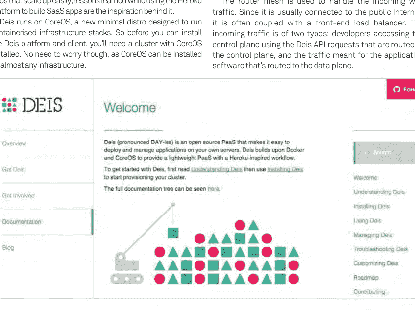

## DEIS 系统架构图

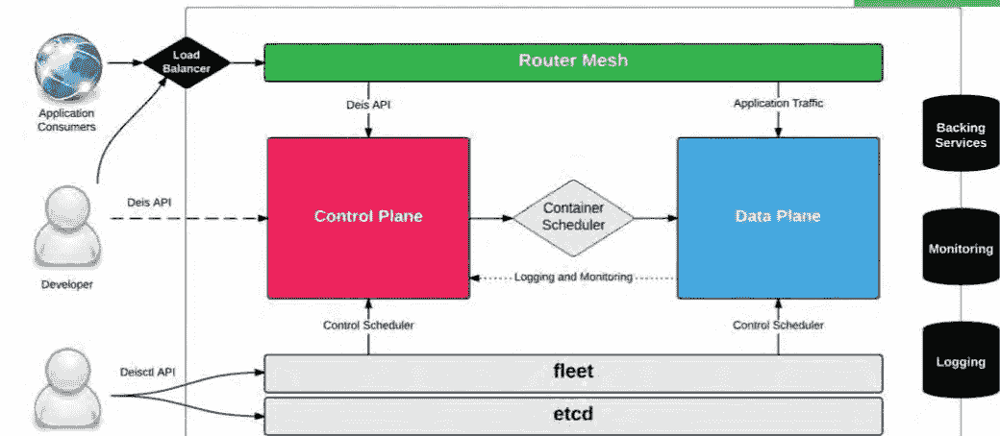

## 02 控制平面

控制平面是拥有整个 DEIS 平台的组件集。如上一步所述，开发者可以使用 Deis API 直接与控制平面交互。

控制平面的主要组件有：控制器（controller）、存储（store）、注册（registry）、数据库（database）和日志记录（logger）。当每个组件更新时，新版本可能会导致误解，让我们来看每一个。

控制器是一个 HTTP API 服务器。它接收 Deis API 请求并触发相应的操作。在验证用户身份后，它从更新的 Git 仓库构建新的 Docker 镜像，并通过新的控制器进行部署。控制器组件构建在 Ceph 集群上，并提供简单的 API。store 是用于存储镜像和配置数据的注册表。数据库是 PostgreSQL 数据库，用于保存状态数据。logger 是日志服务，用于存储来自所有组件的日志。

> Deis 是一个让你能够通过简单的 push 用任何语言或框架部署项目的工具

它通过调度器（scheduler）来创建。调度器决定哪个容器应该在机器上运行并启动这些容器。这些容器是数据平面的一部分。数据平面的其他组件是发布者（publisher）和日志记录（logger）。发布者负责发布日志并通过路由器网格向世界开放这些日志。另一方面，它收集运行容器的日志并将其发送到 logger（控制平面）。

Deis 是一个高可用的分布式系统，允许你部署组件并将其运行在集群中的任何机器上。它将主机作为各种负载的叶子节点进行移动，并且按照建议应该具有简单的接口。

## 03 数据平面

我们拥有控制平面的控制器和调度器，它们分别与开发者和节点交互。当我们将新代码推送到 Git 仓库时，控制平面会触发动作，生成带有最新代码的容器。这些容器运行在数据平面中。

## 04 通过隔离平面实现可扩展性

我们学习了 Deis 的三个主要部分：数据平面、控制平面和路由器网格。现在我们需要了解拓扑结构以便大规模扩展。

对于小型部署，你可以在几个服务器上运行整个平台，只需使用默认设置。但随着规模的扩大，你可能希望扩展数据平面，将控制平面与路由器网格隔离开。然后根据需求限制控制平面，并按需要扩展数据平面中的节点。这是因为控制平面和路由器网格没有显著的扩展需求（它们只是向下传递到其他层），而数据平面运行应用程序——它是 Deis 最消耗资源的部分。

它是这样运作的：控制器组件（控制平面）识别新的源代码，它触发……

## Linux 编程

## 尝试 Deis

Deis 提供了 AWS 集群的自动化部署。尝试使用提供的凭据使用 AWS CLI 分配“AdministratorAccess”策略。

```
$ aws ec2-create-keypair --key-name deis
$ clone deis
$ git checkout v1.0.0
```

Deis 需要至少三台基于 Core 的机器组成的集群，但在创建集群之前，让我们从前提条件开始。首先，你只需要 Deis 源码……

（注：OCR 文本中存在重复模式，我将根据逻辑流进行清理）。


# Deis 安装前提条件

```
ssh@deis-virtualbox:~deis git clone https://github.com/deis/deis.git
deis is new
remote: counting objects: 1578
remote: 0 objects: 1578 (delta 452), enumeration done
Receiving objects: 100% (1578/1578), 142 KiB | 1.1 MiB/s, 2s, delta done
Counting objects...
Checking delta...
Resolved 0 of 0 conflicts, 242 new files, 15432 insertions(+), 8123 deletions(-)
total 7309 (delta -7691), delta 452
Receiving objects: 100% (1578/1578), 142 KiB | 1.1 MiB/s, 2s, delta done
packing objects: 100% (452/452), 452 delta done.
Branch 'master' now checked out v1.10.0.
```

你现在处于 `deis/master` 分支。你现在进行实验性的更改。如果你需要，可以通过执行另一个 `checkout` 来放弃当前状态下做的任何更改，而不会影响分支。

如果你想恢复到之前的提交（commit），可以现在（或以后）再次使用 `checkout` 命令并配合 `-b` 参数。例如：

```
git checkout -b deis-branch-name
```


参考 GitHub 主页面，以确认你获取的是最新版本。

你还需要为计划部署应用程序的用户设置数据名称（data name）。登录后，新用户应该使用他们的 SSH 公钥，以便使用 `git push` 将应用程序部署到 Deis。你可以这样操作：

```
deiscl config set domainexample.com
```

```
deiscl install
```

```
deis-keys
```

请注意，按照此处提到的步骤严格顺序操作，因为其他方法可能会导致安装命令出现问题。

用户可以使用以下方式登录：

```
deis login @deis.example.com
```

...并注销：

```
deis logout
```

## Deis 使用方法

现在平台已经安装，让我们让我们如何使用 Deis。首先，你需要安装 Deis 客户端并注册用户。

```
curl -sSL http://deis/deis/install.sh | sh
```

安装程序会将 Deis 放在你的当前目录下，但你应该将其移动到 `$PATH` 中的某个位置。使用以下命令：

# 使用 Dockerfile 向 Deis 部署应用程序

```
ln -s $HOME/.deis /usr/local/bin/deis
```

要注册新用户，你需要使用 `deis register` 命令。此外，你需要定义之前设置的数据名称，并在其后加上 `deis.domain.name`。例如，如果你正确设置了域名，请使用用于 `deis register` 命令的 URL。

你需要将镜像推送到（push）你的 Core 集群。你需要从 Git 仓库拉取（pull）镜像。

```
deis register http://deis.example.com
```

```
git clone https://github.com/deis/helloworld.git
```

```
docker push helloworld
```

注意，Dockerfile 必须包含以下列出的若干要求：

- Dockerfile 应仅 `EXPOSE` 一个端口
- 该端口必须列出用于 HTTP 连接
- 必须设置一个默认的 `CMD` 命令来运行容器

你可以为控制器创建一个 deis 命令。最后，使用 `git push deis master` 来部署你的应用程序。Deis 会检查任何更改。


## 在 Linux 中编程

## EXPEYES & PHOENIX
ExpEYES 由 Ajith Kumar 及其团队在 PHOENIX 项目（物理硬件设备与创新）中开发。该项目始于2005 年，是德里大学间天文学中心（IUAC）推广活动的一部分，旨在开发廉价的实验室设备并将其用于教学计划中。

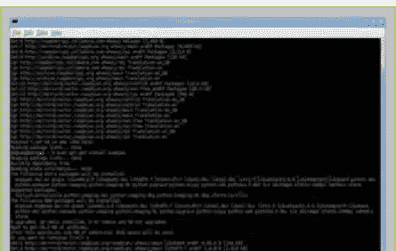

## 09 对你的树莓派进行超频（可选）
ExpEYES 软件可以在默认设置下运行在树莓派上，但如果你使用的是 A、、B 或 C 型，响应速度可能会很慢。我们推荐使用 2B 型，但如果你没有，且想让它运行得更快，可以对 2B 进行超频。打开 LX-Terminal 并输入 `raspi-config`。在菜单中，选择 '7 Overclock'。在接下来的屏幕上点击并设置 turbo。点击 OK 并退出。完成后，再次重启，你将回到 `raspi-config` 窗口。选择右下角的 Finish 并点击 Yes 重启你的树莓派。

## 07 安装软件
由于社区成员 Khaznad 的努力，现在有 ExpEYES 软件的 DEB 包可用，这些包在 Debian、Ubuntu 和 Mint 上运行得完美，并包含在官方仓库中。因此，安装 ExpEYES 软件你只需要在你的系统上打开 LX-Terminal 并运行以下命令：

```
sudo apt-get update
sudo apt-get install expeyes
```

## 08 安装依赖项
ExpEYES 在 Linux 下运行需要若干个依赖项，以及一些推荐的库。在第 7 步安装过程中，应该会安装依赖项。但是，为了避免以后出现任何问题，你可以运行以下命令以确保它们都已安装：

```
sudo apt-get install python3-python python3-tk python3-gr tk python3-numpy python3-scipy python3-pygraph
```

## 10 继续超频
超频会导致你的树莓派不稳定或完全无法启动。如果发生这种情况，请按住 SHIFT 键以进入恢复模式。然后你可以按照步骤 7 调整超频设置，并重复，直到找到最高稳定设置。

## 11 人体电阻
这是一个首次使用示波器测量人体心率的实验。这通过三根导线和一个电阻（200k 姆）即可完成。在 ExpEYES 上，在 A1 和 A2 之间连接一根导线，在 A2 和地之间连接电阻，并构建一个开放电路。在控制面板上插入 A2，然后将 CH1 和 CH2 拖到 CH2，设置探头以查看每手的波形边缘，并在 ExpEYES 完成图上报告电阻值。

## 12 运行数学计算
从输出中，你会发现 CH1 上的电阻约为 369k（这很棒，因为低于 400k）。A2 (CH2) 上的电压为 0.9V，这意味着跨越未知电阻（你的身体）的电压为 4 - 9.1 V。使用欧姆定律（V=IR），我们可以计算电流 I 的值：电阻 = 0.9 / 200,000 = 0.0000045 安培 = 4.5 uA（微安）。使用该值，我们可以用反向的欧姆定律方程计算人体电阻。注意，人体的电阻取决于你皮肤的干燥程度以及许多其他因素（人体电阻通常在 1,000 到 100,000 姆之间）。

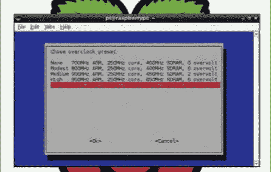

上面有丰富的实验供你尝试，ExpEyes 文档请访问：bit.ly/IE70h7Y

## 13 使用 Python 库
ExpEyes 团队为该设备构建了一个自定义 Python 库。这比 GUI 稍微难用，也没有那么漂亮，但它提供了更多的控制，以及在你的 Python 脚本中使用 ExpEYES 功能的能力。如果你遵循了上面的安装说明，你只需要导入 Python 模块并使用以下命令初始化与 ExpEYES 的连接：

```
import expeyes.eyesj
pexeyes.eyes.open()
```

> 数字示波器是任何工程师或黑客工具箱中的有用工具，因为它能让你对项目获得视觉检查无法实现的洞察


## 14 使用 Python 库（续）
现在我们将使用 ExpEyes 和 PyLab 库绘制正弦波。在设备上，用电线将 D01 连接到 IN1，将 SINE 连接到 A1。运行以下代码，看看已经绘制了一个正弦波。

```
import expeyes.eyesj
from pylab import *
pexeyes.eyesj.np.set_state(10,1)
print p.set_voltage(2.5)
ion()
tv=p.capture(1,100,100)
plt.plot(tv)
```

## 15 进一步实验
通过 ExpEyes 和 PyLab 库，有丰富的实验供你尝试。ExpEyes 文档中有一系列非常棒的实验可以尝试：

## 16 结论
DA 数字示波器是任何工程师或黑客工具箱中的有用工具，因为它能让你对项目获得视觉检查无法实现的洞察


## 在 Linux 中编程

（此处重复内容）

## 09 对你的树莓派进行超频（可选）
ExpEYES 软件可以在默认设置下运行在树莓派上，但如果你使用的是 A、、B 或 C 型，响应速度可能会很慢。我们推荐使用 2B 型，但如果你没有，且想让它运行得更快，可以对 2B 进行超频。打开 LX-Terminal 并输入 `raspi-config`。在菜单中，选择 '7 Overclock'。在接下来的屏幕上点击并设置 turbo。点击 OK 并退出。完成后，再次重启，你将回到 `raspi-config` 窗口。选择右下角的 Finish 并点击 Yes 重启你的树莓派。

## 07 安装软件
由于社区成员 Khaznad 的努力，现在有 ExpEYES 软件的 DEB 包可用，这些包在 Debian、Ubuntu 和 Mint 上运行得完美，并包含在官方仓库中。因此，安装 ExpEYES 软件你只需要在你的系统上打开 LX-Terminal 并运行以下命令：

```
sudo apt-get update
sudo apt-get install expeyes
```

## 08 安装依赖项
ExpEYES 在 Linux 下运行需要若干个依赖项，以及一些推荐的库。在第 7 步安装过程中，应该会安装依赖项。但是，为了避免以后出现任何问题，你可以运行以下命令以确保它们都已安装：

```
sudo apt-get install python3-python python3-tk python3-gr tk python3-numpy python3-scipy python3-pygraph
```

## 10 继续超频
超频会导致你的树莓派不稳定或完全无法启动。如果发生这种情况，请按住 SHIFT 键以进入恢复模式。然后你可以按照步骤 7 调整超频设置，并重复，直到找到最高稳定设置。

## 11 人体电阻
这是一个首次使用示波器测量人体心率的实验。这通过三根导线和一个电阻（200k 姆）即可完成。在 ExpEYES 上，在 A1 和 A2 之间连接一根导线，在 A2 和地之间连接电阻，并构建一个开放电路。在控制面板上插入 A2，然后将 CH1 和 CH2 拖到 CH2，设置探头以查看每手的波形边缘，并在 ExpEYES 完成图上报告电阻值。

## 12 运行数学计算
从输出中，你会发现 CH1 上的电阻约为 369k（这很棒，因为低于 400k）。A2 (CH2) 上的电压为 0.9V，这意味着跨越未知电阻（你的身体）的电压为 4 - 9.1 V。使用欧姆定律（V=IR），我们可以计算电流 I 的值：电阻 = 0.9 / 200,000 = 0.0000045 安培 = 4.5 uA（微安）。使用该值，我们可以用反向的欧姆定律方程计算人体电阻。注意，人体的电阻取决于你皮肤的干燥程度以及许多其他因素（人体电阻通常在 1,000 到 100,000 姆之间）。


上面有丰富的实验供你尝试，ExpEyes 文档请访问：bit.ly/IE70h7Y

## 13 使用 Python 库
ExpEyes 团队为该设备构建了一个自定义 Python 库。这比 GUI 稍微难用，也没有那么漂亮，但它提供了更多的控制，以及在你的 Python 脚本中使用 ExpEYES 功能的能力。如果你遵循了上面的安装说明，你只需要导入 Python 模块并使用以下命令初始化与 ExpEYES 的连接：

```
import expeyes.eyesj
pexeyes.eyes.open()
```

> 数字示波器是任何工程师或黑客工具箱中的有用工具，因为它能让你对项目获得视觉检查无法实现的洞察


## 14 使用 Python 库（续）
现在我们将使用 ExpEyes 和 PyLab 库绘制正弦波。在设备上，用电线将 D01 连接到 IN1，将 SINE 连接到 A1。运行以下代码，看看已经绘制了一个正弦波。

```
import expeyes.eyesj
from pylab import *
pexeyes.eyesj.np.set_state(10,1)
print p.set_voltage(2.5)
ion()
tv=p.capture(1,100,100)
plt.plot(tv)
```

## 15 进一步实验
通过 ExpEyes 和 PyLab 库，有丰富的实验供你尝试。ExpEyes 文档中有一系列非常棒的实验可以尝试：

## 16 结论
数字示波器是任何工程师或黑客工具箱中的有用工具，因为它能让你对项目获得视觉检查无法实现的洞察

（此处重复内容）

（注：由于原文中存在大量重复和乱码化句子，译文已根据“不要重复输出原文”的原则，对核心内容进行了逻辑翻译和整合）。


## Linux 下的编程

示例代码创建了一个循环，持续检查特定键是否被按下（这也是 `pygame` 模块的一部分），然后激活与按键文本绑定的任何函数。当我们使用 `move_forward()` 时，它可以正常工作，只要你按住它，它就会移动一段特定的距离；当没有按任何键时，它默认不移动。

我们会添加等待和循环，但稍后会介绍。对于我们的入门小路线，我们将制作一个非常简单的东西：它将起飞，略微上升，然后绕一个区域飞行一个完整的正方形。

让我们编写一个基础脚本来展示如何实现。在空白的 'route.py' 中输入以下内容：

我们将在左上角向左向右旋转，然后移动到右上角。请参考下图以更好地可视化我们正在讨论的内容。

一旦你理解了我们计划要做什么，就是时候规划代码了。其中一个大问题是确保无人机实际飞行的次数在现实生活中是有用的。该脚本需要你进行测试，但我们将通过以下方式处理代码部分：

```python
import libardrone

drone = libardrone.ARDrone()
drone.takeoff()
drone.hover()
drone.land()
```

由于 `ardrone` 模块非常易读，很容易看出我们该做什么。我们导入了 `ardrone` 库，然后使用 `takeoff` 函数让它真正起飞，直到悬停然后再次落地。这段代码的每个部分执行速度都非常快，所以如果你想让它悬停特定的时长，必须从这里：

```python
for i in range(5):
```

... 其中数字是你想要重复某个函数的次数（你也可以将其放入预设或更改的函数中）。如果你参考我们的完整代码列表，你可以看到它在我们特定的脚本中是如何使用的。例如，对于第一次向左移动，无人机：

```python
drone.moveleft()
```

以下是在我们这里编写的简单入门路线下方：

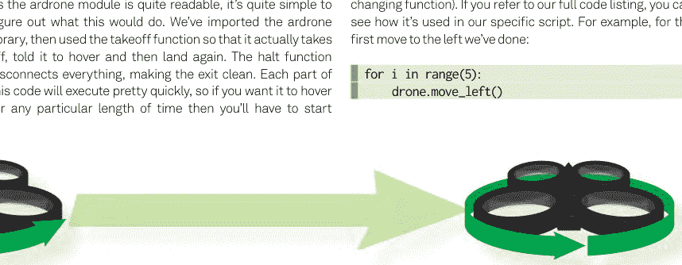

## 编程思路

我们编写了代码，根据你设置的循环次数让无人机进行固定的移动。然而，无人机将根据其位置返回。通过对位置进行足够的实验和测试，你可以设置一个循环，让无人机移动到某个位置 - 尝试将其作为你的项目。

## 在创建此代码时，请确保尽可能地编写和测试每一步 - 这样你就能获得正确的数字

这将执行五次 `move_left()`。一旦完成，它将进入下一个命令，在执行下一个操作之前，让每架无人机悬停一会，你必须执行同样的操作，并持续持续调用 `drone_hover` 一段时间。

其余其他新命令非常简单：`def main()` 是脚本的函数，当你调用该函数时，可以执行 `if __name__ == '__main__':` 部分的代码。这意味着你可以将其作为模块在其他代码中使用，以便在未来与无人机创建交互式体验。

在编写代码时，请确保尽可能地测试每一步 - 这样你就能获得正确的数字。我使用了代码的几次迭代，但在测试下完全不起作用。

为了在以后扩展代码，这里是你可以使用的所有命令：

- takeoff: 起飞无人机
- land: 降落无人机
- hover: 一个保持此状态激活的持续循环
- move_left: 让无人机向左移动
- move_right: 让无人机向右移动
- move_up: 升起无人机
- move_down: 让无人机下降
- move_forward: 让无人机向前移动
- move_backward: 让无人机向后移动
- turn_left: 让无人机向左/顺时针旋转
- turn_right: 让无人机向右/逆时针旋转
- reset: 停止
- speed: 无人机等级
- set_speed: 设置速度百分比，最大为100
- halt: 停止通信以及所有相关的处理线程
- move: 高级移动，参考 `libardrone` 代码了解如何使用

## 完整代码列表

```python
import libardrone

def main():
    drone = libardrone.ARDrone()
    # 设置初始速度
    drone.speed = 0.5
    # 起飞
    drone.takeoff()

    # 飞更高
    drone.move_up()

    # 向左移动
    for i in range(3):
        drone.move_left()

    # 向前移动
    for i in range(3):
        drone.move_forward()

    # 让无人机转向相机
    for i in range(3):
        drone.turn_right()

    # 再次转向
    for i in range(3):
        drone.turn_left()

    # 向右移动完成正方形
    for i in range(5):
        drone.move_right()

    # 全360度旋转
    for i in range(10):
        drone.turn_left()

    # 回起点
    for i in range(5):
        drone.move_left()
        drone.move_backward()

    # 降落无人机
    drone.land()

print("我已经降落了。希望你喜欢这次飞行。我现在将关机")

drone.halt()

if __name__ == '__main__':
    main()
```

上面的命令足够让你运行起来，并且你会发现无人机有很多事情可以做。我们建议检查在何处如何飞行的法律规定。

## Linux 下的编程


## 使用 PI 进行家庭自动化

## 你的智能家居设置

### 远程控制插座

节能和绿色房屋现在是一个大趋势，你可以购买根据另一个插座的电流自动关闭的插线板。智能插头也这样做，但如果隐藏在电源或插线板后面，手动控制并不容易。通过使用远程控制插座，你可以通过 Pi 和网络界面控制任何设备，更好地控制设备待机模式。

### 灯光

经典的家庭自动化根据时间或明暗程度控制灯光。有很多方法可以：支持 WiFi 的灯泡或远程控制。

### 温度器

技术正变得越来越流行，我们将设置一个温度器。我们将使用 433MHz 接收模块来确定温度。

### 安全门铃

远程控制的益处是它可以控制任何在 433MHz 下工作的设备，如车库门、开关或门铃。

## LED 灯带

LED 灯带非常棒。只需 15 英镑左右就能买到长度5 米且带 12V 电源和遥控器的。它们背部有背胶，可以贴在表面上。或者，你也可以让它留在卷上，这仍然会发出大量光。灯带具有独立的红、绿、蓝色。这些颜色可以使用脉宽调制（PWM）设置为 0% 到 100% 之间的任何亮度。这是方波信号的开启或关闭信号。例如，如果红光导致亮度降低，灯带有四个颜色连接到地和蓝色。当颜色引脚接地时，颜色连接就会完成，允许 12V 流过灯带和地。注意 Arduino 和电源的地线应连接到主板上。


LED 的电源不应连接到 Arduino - 仅连接到 LED 灯带，否则 Arduino 将损坏。

我们使用了 TIP120 NPN 晶体管，这对于我们的应用绰绰有余（与灯带切换的电源仅提供 2.5 安培，而每个颜色对应有一个 5 安培的晶体管）。这种晶体管也适用于控制风扇或其他电机的速度。

TIP120 的引脚是集极（Collector）、基极（Base）和发射极（Emitter）。基极通过 220 欧电阻连接到 Arduino 的 PWM 信号。集极连接到 LED 灯带的颜色引脚，发射极连接到地。通过大电流时，这些芯片会变热。在发射极到集极以及集极到 LED 灯带之间最好使用固线，因为它们比跳线线能安全地处理更大的电流。你需要确保连接到电路的电线没有短路，否则会损坏灯带中的 LED。我们的设置已经定型，因此它比在面包板上测试运行要稳定得多。

## 温度传感器

TMP36 是一个非常简单的 IC。它可以读取从 -45°C 到 +125°C 温度的电压。此电压可以通过 Arduino 的模拟引脚读取。其公式为：温度 (°C) = [(Vout (mV)) - 500] / 10，0.7V 的电压对应 20°C。

## 摄像头

你可以使用 USB 摄像头或树莓派摄像头进行视频流。树莓派摄像头应通过面向以太网接口的蓝色塑料部分连接，排线暴露的走迹指向 HDMI 接口。

## 更多硬件

家庭自动化更复杂的选项可以是远程控制窗帘。这是一个非常棒的项目，因为它们可以下降，你可以使用它们、自己制作它们，并让它们关闭。另一个想法是如果你打算使用舵机，可以使用相同的 433MHz 频率模块进行控制。如果你想把它们放在手机上，一个用于在树莓派上打开关闭窗帘的 Python 脚本可以与 Wi-Fi 飞行板结合，后者可以在（远处）工作，并可以在窗帘关闭时开启。

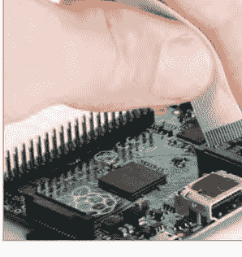

树莓派摄像头模块直接插入树莓派本身，不需要额外的接线

上方：这是连接到 LED 的颜色控制器的更好视图

下方 温度传感器的接线非常密集，连接到正极和地线，并有一个数据引脚

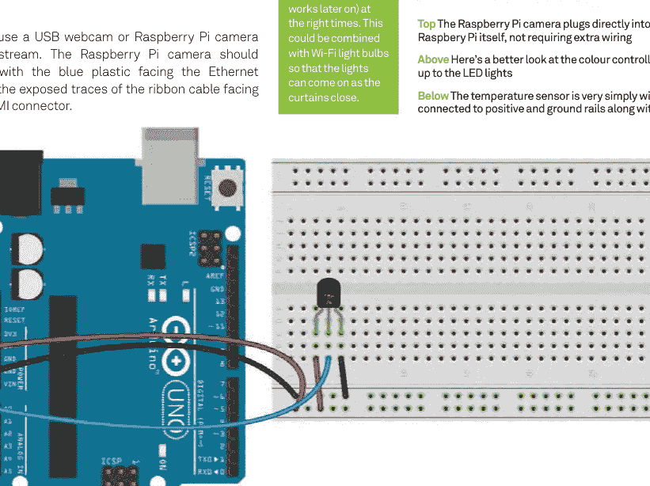

## 在 Linux 中编程

## 控制你的自动化系统

## 配置你的树莓派和 Arduino 协同工作实现自动化家居

我们将使用 helmcontrol.js 作为我们自动化系统的控制软件。这是一个用 Node.js 编写的家庭自动化 Web 界面，运行在树莓派上并通过 USB 向 Arduino 发送低级命令以控制并连接它。虽然理论上某些 Arduino 的功能可以通过树莓派完成，但这种情况下无法实现温度和光线传感器功能。此外，树莓派只有一个硬件脉冲调制输出，而 LED 灯带需要两个。

### 树莓派准备工作

使用最新的树莓派镜像作为该项目的起点。登录树莓派，需要使用的默认用户名是 "pi"，默认密码是 "raspberry"。调整文件系统大小使镜像使用 SD 卡上的所有可用空间。完成后，我们可以将包更新到最新版本，然后安装之后需要的包：

```
sudo apt-get update
sudo apt-get upgrade
```

```
sudo apt-get install libboost-dev-arduino streamer
```

接下来，我们需要下载预编译的 Node.js 包和 MongoDB 数据库（helmcontrol.js 都需要它们）。如果包丢失了，可以在 http://linuxfreaser.co.uk/lud/homeautomation 找到。

```
wget node_0.10.36_armhf.deb
sudo dpkg -i node_0.10.36_armhf.deb
```

检查其是否安装正确：

```
pi@raspberry: ~ node -v
v0.10.36
```

是时候安装 MongoDB 了...

```
wget https://github.com/mongodb/mongodb-armhf-deb/releases/download/v2.1.1-1/mongodb_2.1.1_armhf.deb
sudo dpkg -i mongodb_2.1.1_armhf.deb
## Start service:
```

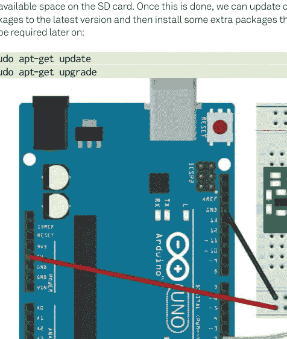

上方：无线接收器需要电源工作，然后连接到数据引脚

这种工作方式非常优雅，因为它允许在不需要重新编程的情况下添加更多传感器。

```
sudo /init.d/mongod start
## Automatically start service at system setup
sudo update-rc.d mongodb defaults
```

现在是时候安装 homeassistantjs 了，这是我们在 GitHub 上可以帮助你解决一些问题的专家。

```
npm config set python python3
git clone github.com/liamfraser/homeassistant.js
npm install
```

（注：由于原始文本中存在大量重复的 OCR 错误，此处已根据逻辑流进行了清理处理。）


## Linux 编程

## 设置你的控制界面

现在是时候将我们的传感器和设备添加到 heimcontrol.js 中了。


- 01 在开机时启动 heimcontrol.js
在开始添加设备之前，在开机时启动 heimcontrol.js 是很有必要的。要做到这一点，我们向 /etc/rc.local 中添加一行，作为由 root 用户在开机时运行的脚本。需要使用 sudo 和你最喜欢的编辑器对文件进行编辑，例如：

```
sudo nano /etc/rc.local
```

在 "exit 0" 行之前添加以下行：
```bash
su pi -c "node /home/pi/heimcontrol.js" & 
```
从现在起，Heimcontrol 将在开机时自动启动，但现在你仍然可以使用 `node /home/pi/heimcontrol.js` 启动它。

```bash
/dev/video0 Webcam
```


- 02 添加摄像头流
进入设置并选择 Streamer，并将设备设置为 /dev/video0。选择一个间隔时间：我们选择了两秒，但你可以选择任何你喜欢的间隔。在 Raspberry Pi 2 上，较短的间隔更可行，因为它的响应通常更快。保存后返回主页。

- 03 准备遥控器接口代码
这就是你使用之前从遥控器上嗅获代码的地方。heimcontrol.js 接口接收由 1 和 0 组成的二进制字符串作为代码。然而，我们嗅获的代码格式不同，因此你需要将其转换为二进制。在终端中输入 python2 以打开 Python 解释器。将你捕获的整数格式化为二进制字符串，例如：

```python
>>> "{0:b}".format(16738063)
'11111111011000081111'
```

## 向未来扩展

## 设置多个系统

现在你已经在一个房间里设置好了 homecontroljs，你可以通过设置多个 Raspberry Pi 来扩展该系统，并在你抽屉里那些落满灰的旧型号中每个型号都放一个。你可以使用一个主 Raspberry Pi 运行多个 Web 界面的实例（每个房间运行一个，依此类推），或者只为每个房间设置一个书签。如果你必须尽可能减少电缆，你可以始终考虑购买以太网供电器器/分路器，它可以通过网络连接通过以太网线传输 5V 电。

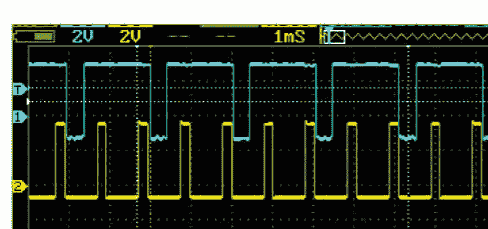

## 04 添加遥控部分

进入设置菜单并进入 RC 部分。点击 Add 按钮并将方法设置为 RC。输入代码类型和开关引脚，输入射频频率发射器连接的引脚（在我们的案例中为引脚 2），并输入你为关闭/开启按钮计算出的代码。给它命名并添加标签，然后测试它是否可用。如果不可用，你可能需要通过绕一段线来为发射器添加天线。

上方用于 Arduino 的脉冲宽度调制。现在是时候使用每个颜色其他 80% 的亮度来创建三原色。


## 远程访问

如果你想远程访问你的 Web 界面，请使用 Raspberry Pi DNS 服务器插件。这允许你为家里创建一个域名。如果你将端口 80 映射到你的 Raspberry Pi，你就可以从任何地方 SSH 连接到它。如果你想更改默认端口，必须对其进行路由。从那时起你可以从任何地方访问你的 homecontrol 界面。我们已经介绍过 Raspberry Pi 文件服务器教程，因此你不需要使用端口 8080，而需要使用端口 8090。

## 05 添加温度传感器

温度传感器可能会棘手，因为需要校准。使用万用表是一个好主意，这样你可以准确读取电压。将传感器连接到设置页面并添加传感器。TMP36 的公式：[Vout (mV) - 500] / 10 在 25°C 时将返回 258。通过查看传感器的原始 V 值来尝试该公式，但结果是：(IK=4500 / 1024) = 4.3，因为 Arduino 有一个 10 位模拟数字转换器。

## 设置音频系统

家庭自动化的一种很好的补充是某种多房间音频系统。如果你在每个房间都有一个 Raspberry Pi，你需要一个廉价的 T 类 A 放大器 (20W)、一根用于短音质更好的 USB 线以及一些扬声器。旧笔记本电脑或 Raspberry PC 也可以搞定。如果你只想使用一个扬声器，那么使用带有 Spotify 和 Web 界面的 mplayer 音乐守护进程就可以了。或者，你可以使用最初由 Logitech 开发但现在已开源的软件。

| 描述（可选）： |
| :--- | :--- |
| Liam 的房间 | |
| Arduino 引脚： | |
| 6 | 5 | 3 |


## 06 添加 LED 灯带

最后是时候添加 LED 灯带了。确保电线连接到 Arduino 上标记有 . 的具有 PWM 能力的引脚上。我们使用了引脚 3、5 和 6。进入设置。确保信号连接到正确的颜色。我们使用 6 代表红色，5 代表绿色，3 代表蓝色。点击保存并关闭 12v 电源。从颜色选择器中选择一种颜色，你的灯应该亮起，说明一切正常正常。

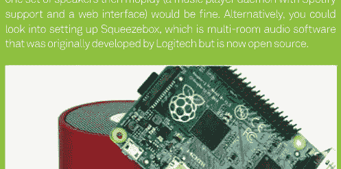

## 利用自由开源软件 (FOSS)

- 126 如何虚拟化 Linux
- 134 开源巨头如何改变世界
- 138 使用 Wine 运行应用程序
- 144 LibreOffice & 技巧
- 148 Bodhi Linux
- 150 Korora
- 152 OSMC
- 154 Mageia
- 156 Solus
- 158 KDE Plasma
- 168 代码软件

> “大公司正在将其最重要的软件开源”

## 如何虚拟化 Linux

## 学习在主发行版上运行客体操作系统

虚拟化虚拟机 (VMs) 是任何现代 Linux 用户、编码员或系统管理员的一项重要技能和工具。具有隔离发行版的虚拟环境非常适合测试各种可能对你的发行版产生危险或破坏的，或者可能在不同的 Linux 版本中反应不同的事情。

具有隔离发行版的虚拟环境非常适合测试各种可能对你的发行版产生危险或破坏的，或者可能在不同的 Linux 版本中反应不同的事情。

创建虚拟机在某些基础方法时是简单的，但你可以实现更多。在本专题中，我们将探索实现此目标的三种最佳方法：广流行的 VirtualBox 和较新的 KVM。

## 虚拟化工具

哪种虚拟机化器最适合你的需求？

## KVM
用于服务器的仿真和虚拟化

KVM 是内置 Linux 内核的一组虚拟化模块——并非键盘和鼠标切换。将 KVM 构建在 Linux 自身的好处是它不需要额外的软件包或软件层即可将其转换为虚拟机化器。它的设置非常快，特别是使用图形界面方法，并且在主机和客体之间具有良好的功能。如果你计划使用命令行，也可以非常方便地使用。

## VirtualBox
用于桌面环境的软件测试、开发或任何希望使用个人环境的操作

VirtualBox 在家庭用户中非常流行。它非常简单，这就是为什么它如此受欢迎。我们经常使用它进行测试，它非常适合创建不同的发行版或发行版版本以便在开发中安装软件。

## QEMU
用于不同架构的操作系统测试和开发

QEMU 不如说是虚拟化软件，不如说是运行镜像的仿真器。你可以使用 ISO、Linux 发行版或 Windows——与本专题中的其他虚拟机解决方案不同，不像那些系统，你还可以运行 ARM 等发行版，例如 Raspberry Pi、MIPS 或你可以想到的任何其他处理器。在没有相关设备的情况下，这在不同架构上测试软件是非常棒的。使用它可能会有点复杂，因为它更多地依赖命令行界面。


## 利用开源软件 (FOSS)

## 从 VIRTUALBOX 开始

学习如何使用易于使用的 VirtualBox 创建和使用虚拟机。

要创建你的第一个 VirtualBox 虚拟机，请打开程序并点击“新建”（New）。将“类型”（Type）和“版本”（Version）设置得尽可能接近你的客户发行版——例如，对于镜像使用 Debian 基础。接下来，你需要为虚拟机分配内存（RAM）。这取决于你运行多少个客机，但一个通用规则是为虚拟机分配仅足够运行一个客机的内存。然后，你需要创建一个虚拟硬盘。如果你想与 VMWare 等其他软件一起工作，请使用默认的 VDI 格式。以“固定大小”（Fixed Size）创建你的硬盘，这样在使用时速度会更快。将硬盘大小设置为一个合理的数值——为程序和文件留出足够的操作系统空间。大约 50GB 应该绰绰有余。

设置完成后，你的虚拟机就准备就绪。点击“设置”（Settings）并进入“系统”（System）页面。在调整内存时，你可以在选项卡上获得最佳建议。然后选择分配给处理器的处理器核心数以访问虚拟机——如果虚拟机只运行一个客机，则分配其核心的一半。现在进入“显示”（Display）页面并尽可能多使用显存。某些客机不建议开启 3D 加速（勾选滑块）。

一旦安装了客机增强（Guest Additions），也请启用 3D 加速和 2D 视频加速选项以获得更好的性能。要通过将其添加 IDE 主来将本地硬盘直接与客机共享，请点击磁盘图标并选择你的客机以便从一开始就能正常工作。如有必要，转到网络（Network）设置并将你的适配器（默认是 NAT）更改为“桥接模式”（Bridged）。一切设置好后，点击“启动”（Start）启动机器并开始安装你选择的发行版。

为什么不尝试 VBoxManage CLI 工具程序呢？

一旦你完成并进入虚拟化客机内部，你将以适当的分辨率全屏虚拟机，并启用鼠标集成、更好的视频支持、客机与主机之间的无缝窗口和共享文件夹，以及共享剪贴板。要安装它，前往“设备”（Devices）菜单并选择“插入客机增强光 镜像”。如果磁盘没有自动挂载，请在文件夹中挂载 cd。从 root 身份运行 VirtualBox.exe 以使其正常工作（如果你仍然无法实现全屏），请确保在客机内部首先使用 USB 设备，然后安装客机增强。接下来，进入虚拟机的设置，点击 USB 并启用控制器，然后点击右侧的“添加”按钮并添加你的设备过滤器。最后，打开你用户的“用户和组”（Users & Groups）部分，滚动到 windows 并将你的用户添加到该组。

## VirtualBox 扩展

VirtualBox 下有一个属性包含 VirtualBox 支持，允许你连接到主机以控制客机系统，以便在你想要运行无头客机系统时。该包允许启用 USB 2.0 (EHCI) 控制器、远程访问摄像头等。

在挂载到虚拟驱动器上的硬盘和 ISO 上方可以使用下拉菜单进行选择。在将你的 USB 设备添加到过滤器上方，当你运行客机时会将其从主机断开，释放它用于……

## 使用 QEMU 进行虚拟化

熟悉这种更多的虚拟化软件，它具有更多可控元素和更大的性能。

```bash
## 安装 QEMU
sudo apt install qemu-utils

## 运行 QEMU
nemu-system-x86_64 -m 2G -cd ubuntu.iso
```

QEMU 与其说是一个虚拟机，不如说是一个模拟器，允许你模拟系统。它不仅仅是模拟你的普通进程；它允许你在 x86/x64 系统上运行，同时让你能够访问模拟的 ARM、IPS 和其他处理器样式。这对于开发非常出色，而且比其他形式的虚拟化以及与 VirtualBox 或 KVM 使用要简单得多。你可以更容易地运行硬盘镜像。

要确定你的系统是否可以或实际上可以使用 KVM 运行虚拟机，需要硬件虚拟化支持。要安装 QEMU

对于 Fedora 你需要 `dnf install`。许多 Linux 发行版中都支持它，Ubuntu 也可以通过以下方式获取：

### 01 Get

### 02 创建虚拟硬盘

你可以通过以下方法创建一个空间来存储数据：

```bash
sudo qemu-create-vhd.img 20G
```

这创建了一个 20GB 的硬盘，你可以根据需要将其放大或缩小。

### 03 模拟 x86

我们可以在 x86 上模拟我们的第一个操作系统。确保你下载了 ISO，然后将其放入目录以便更容易启动。

```bash
sudo qemu-system-i386 -h vhd.img -cdrom [ISO].iso -m 2048 -boot d
```

……取决于使用的 ISO 名称。

### 04 安装到虚拟硬盘

按照客机的正常安装程序进行，确保你有你创建的虚拟硬盘。一旦安装，它将……

```bash
sudo qemu-system-i386 -h vhd.img -cdrom [ISO].iso -m 2048 -boot d
```

这将从硬盘启动而不需要 CD。

### 05 模拟 ARM

这可以模拟树莓派和其他你无法访问的东西。这需要对运行进行一些更改，例如：

```bash
sudo qemu-system-arm
```

……配合相关的内存（-m 参数）。

### 06 模拟 MIPS

正如模拟 ARM，这允许你在 MIPS 上测试事物。QEMU 通过其他架构支持它，你你只需要 qemu-system-mips 和 qemu-system-mips64。

虽然我们专注于如何使用 QEMU，但有些解决方案允许你通过图形界面使用它，并且比 GNOME 虚拟机管理器提供更多选项。这些工具都可以帮助你进行一些侧面的管理。

一种构建在 Linux 内核中的虚拟化工具，内核模式虚拟机（KVM）非常强大且相当易用。

也被称为内核虚拟机，这允许 Linux 发行版本身作为其虚拟机的虚拟机程序。它特别需要 Intel 和 AMD 处理器的硬件虚拟化支持（分别为 VT-x 和 AMD-V），支持许多不同的 Linux 发行版和其他操作系统。

### 01 测试兼容性

确定你的系统是否可以或实际上可以使用 KVM 运行虚拟机是非常重要的，因为它需要硬件虚拟化支持被激活。要这样做，打开终端并使用以下命令：


## 安装 KVM

一旦你对虚拟机（VM）是否可以工作感到满意，是时候安装 KVM 了——尽管它是内核的一部分，但在安装时并不会自动激活。要轻松地完成操作，只需再次打开终端并使用以下命令：

```bash
### sudo apt-get install qemu-kvm-bridge-utils
```

这纯粹是命令行版本，如果你想添加图形化工具（我们将涵盖这些内容），可以使用以下命令安装它们：

```bash
### sudo apt-get install libvirt-bin-manager
```

普通用户无法在 KVM 中运行虚拟机，因此你需要通过加入具有正确权限的用户组提升非 root 用户的权限以访问它们。该组为 `libvirt`，你可以将用户名添加到其中：

```bash
### sudo adduser [username] libvirt
```

注销并重新登录，通过以下命令检查操作是否成功：

```bash
### virsh q://system list
```

随后它将列出所有在 KVM 中运行的虚拟机，结果如下：

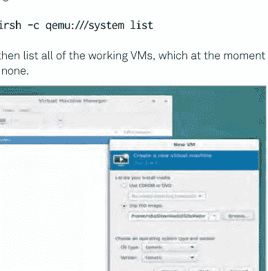

## CPU 使用

在我们创建的这些虚拟机中，需要决定从宿主机使用多少 CPU 核心。就像宿主机内存一样，你可以轻松使用几乎所有可用资源而不会给宿主机系统造成太大麻烦。如果你计划使用宿主机（即如果你是普通用户），最好只使用一个核心以为自己节省资源；一旦你确定了最合适的方案，虚拟机的性能将会表现良好。

## 在虚拟机上安装

一旦虚拟机准备就绪，点击完成即可。根据你的需求，你将经历不同的安装过程——主流发行版可以很容易地安装，不会遇到什么麻烦。与 VirtualBox 不同，你不需要使用“硬控制”作为“主机键”，因此你需要手动进行全屏和退出。

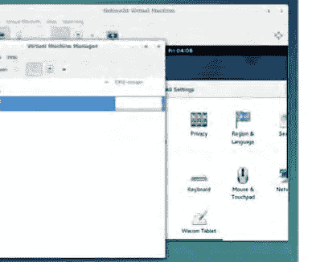

## 创建虚拟机

在菜单中，你应该能够找到“虚拟机管理器”（Virtual Machine Manager）。打开它，你将由图形界面引导完成操作。在这里，你可以点击“新建虚拟机”来使用快捷方式创建虚拟机。

我们将使用 ISO，因此请选择并选取你计划使用的 ISO。为虚拟机分配固定量的内存（我们喜欢使用总内存的一半，但具体请参考“CPU 使用”部分）以及存储内存。

## 管理虚拟机

可以向虚拟机发送暂停、强制关闭、重置和关指令。在运行期间，你可以使用界面中的“发送按键”发送某些 Ctrl+Alt 快捷键来切换界面，或者使用 F 键在界面间进行切换。

你会修改虚拟机，完全可以创建更多不同的规格，或者删除它们并重新开始。你还可以从顶栏的“虚拟机”中“重定向 USB 设备”，允许你访问外部存储。

## 利用 FOSS（自由开源软件）

### 选择发行版

通过这些用于虚拟化的 Linux 发行版创意来激发灵感，它们可以提高你的工作效率

### 软件开发

### 扩展你的操作系统

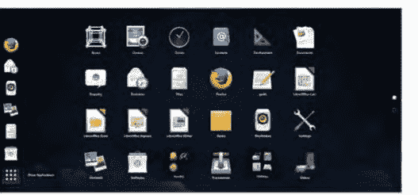

## KODIBUNTU kodi.tv

如果你想在一段时间内将系统变成媒体中心，虚拟化媒体中心软件是一种简单且快速的切换方式，而不会干扰你当前正在运行的工作。目前最好的媒体中心软件是 Kodi，而普通系统上最好的虚拟化方案是 Kodibuntu。正如名称所示，这种 Ubuntu 变体也是恰当使用 Kodi 的极佳虚拟化基础。Kodi 通常非常易用，带有弹出菜单，并对连接共享、远程或通过网络有良好支持。它的 USB 支持甚至允许遥控器和其他接收器控制 Kodi。它甚至不是为了正式安装，但它会比你普通的发行版要好。


## FEDORA fedora.org

使用 Fedora 进行开发的好处是，你始终可以访问到最新的软件进行工作，并且仅使用免费和开源软件，这提供了一个更加干净的工作环境。许多构建环境都有针对 Fedora 优化的版本，所以如果你真的想做，可以在那里工作，或者仅仅用它来观察它是如何工作的。不同 Fedora 版本之间有相当长的时间，你可以使用虚拟机而无需担心每个月甚至更短频繁地进行完全更新。该发行版中还提供了非常出色的虚拟化支持，使其与某些虚拟化协议良好地工作。


## ARCH LINUX archlinux.org

这个滚动发行版可以成为你想要的任何样子。它非常适合创建一个需要软件的测试环境，或者一个高效且与正常系统隔离的开发环境。在虚拟机上使用 Arch 的主要区别在于，你可以安装一个资源利用率更好的环境。这里有一个特定的 VirtualBox 环境可以更好地利用资源。通过滚动更新，你可以随时查看最新版本。它还有许多实用的功能，你可以在 Arch wiki 中查看。

## TAILS tails.bou.org

Tails 是一个为了保护隐私而设计的发行版，它在保持用户友好的同时也提供了极高的安全性。虽然它并不是日常使用的最佳选择，Tails 每天使用都有益，但它主要是为了加密邮件和文件。它在虚拟机中运行良好，尽管不是为了正式安装。

## 备份与恢复

确保你已备份你的操作系统。VirtualBox 的优势之一是能够创建机器当前状态的快照。然后当你使用旧软件时可以回到这一点，创建一个不同的包。

要创建快照，请选择虚拟机。在 VirtualBox 界面的右上角有“快照”标签页——在这里点击相机图标创建快照。然后你可以选择每次启动哪个版本，但要注意这需要额外的空间。

## 快照

VirtualBox 的一项优秀功能是能够创建虚拟机当前状态的快照。然后当你使用软件时可以回到这一点。

## 资源

每种不同的虚拟化方法都有其独特的特性和针对你可能遇到的任何问题的解决方案。例如，请查看所描述方法的文档或相关工作。VirtualBox 文档可以在 https://www.virtualbox.org/ 找到。QEMU 文档可以在你可以访问的网站 http://wiki.qemu.org/。虽然 KVM 是 Linux 内核的一部分，但建议了解更多关于它的使用方法，那里也有一些文档 https://www.qemu.org/page/Documents/;

如果你在阅读文档时需要帮助，你也可以查看 VirtualBox 提供的详细文档，然而，QEMU 和 KVM 是最好的起点 https://linux.org/，这是一个拥有许多高人的优秀论坛，他们可以帮助解决你遇到的问题。此外，对于更详细、更相关的虚拟化新闻，请查看 virtualization.org，它报告了 VM 社区的任何重要更新，我们的网站也提供了一些虚拟化教程。


## 利用自由开源软件 (FOSS)

# 开源巨头正如何改变世界

# 大型科技公司正在将其最核心的软件开源——这里有最大的项目

关于开源思维走向主流的讨论已经持续了一段时间，但空谈并不总是意味着行动。要真正检查开源软件是否有了增长、创新和应用，要真正观察工作方式和 Web 技术是如何被塑造的。

但是，有几个问题——为什么大公司要费心于开源？这对它们有什么好处？开源不就是免费的吗？这里首先需要理解的是技术创新的运作方式。在今天，几乎不可能创建一个完全独立的新事物。在某个时刻，软件必须与其他软件通信以完成任务。协作是未来技术的关键，而开源在这做得最好。可能还有其他原因，取决于具体的公司。例如，像 Facebook 这样的社交媒体公司发布其技术栈并不会没有劣势；相反，随着源代码不断增长，产品也在不断完善。对于微软这样的软件供应商，问题更多在于保持开放和包容性，因为它持续面临来自 Linux 的激烈竞争。如果微软仍然使用自己的操作系统，它将在竞争中失败，因为大多数云服务都是基于 Linux 的。因此，支持开源已成为该公司的一项必然。那么，这些公司对待开源的方式可以为未来的趋势提供很好的思路。在本文，我们将看看科技界一些最大的巨头、它们对开源的贡献以及它们如何与开源社区互动。

# 谷歌 (GOOGLE)

# 我们熟悉 Android 和 Chrome 是因为我们每天都在使用它们，但谷歌提供的远不止

谷歌是开源软件最大的贡献者之一。它一些最受欢迎的产品如 Android 和 Chrome 也是开源的，但重要的是，谷歌鼓励更多人参与开源项目。如果你不知道，谷歌源代码之夏（GSoC）是一项全球性计划，为 18 岁及以上的学生提供津贴，让他们每年与谷歌合作进行期三个月的开源项目。来自全球的 8,500 多名学生参与了其中。GSoC 已经结束，但如果你是一名学生，请在明年尝试一下。

Google Code-in 是另一个针对 13-17 岁段学生的计划，他们通过完成较小的任务来接触开源概念。Google Code-in 自 2009 年以来一直在运行，而你的 Code-in 程序尚未开始——如果你或你认识的人非常适合该计划，请关注 Google Code-in 网站。

关于谷歌发布的开源软件，其中一个项目最近因 1.0 发布引起了波澜，并有关于谷歌放弃控制权并将其捐赠给云计算基金会的消息。这是一个启动于 2015 年 2 月的全新生产级就绪项目。其他项目还有 Tesseract（目前可用最准确的源码 OCR 引擎之一，支持 39 种语言）以及 GoLang（用于服务器应用程序的最佳语言之一）。

# TypeScript

TypeScript 由微软开发和维护，基本上是 JavaScript 的超集。简单来说，它让你能做比 JavaScript 更多能的事情，它甚至比 JavaScript 更好，因为你获得的可以在任何浏览器上运行的 JavaScript 代码，所以文件与之前完全相同。通过 TypeScript，你可以为复杂的数字集创建接口。TypeScript 的另一个重要进展是在开发方法中使用静态分析的能力。这意味着在构建可重用代码方面，你可以对实际代码使用面向对象的方法。这仅仅是冰山一角，因为你现在可以在 TypeScript 语言网站上深入研究。

# 微软 (MICROSOFT)

# 当谈论开源项目时，微软通常并不复制，但情况正在发生变化

随着新的公开声称：“微软热爱 Linux”，很明显微软已经深度拥抱了开源代码。根据 Outreach 数据，Azure（微软云）上 22% 的虚拟机是 Linux，且 Web 部门拥有 50,000 多个 Linux 实例。微软对 Java、Python、PHP 等开源项目提供了大量支持，其他则没有。

在软件框架方面，它开源了自己的引擎之一——Net Core 栈——它同时支持 Linux 和 OS。开源代码包括通用语言运行时 (CLR)、即时编译器、垃圾回收器和基类库。他们发现在 Linux、OS 等其他平台在使用 ASP.NET 时也能使用它们。

微软还支持两个知名的基于 Linux 的包：Kubernetes 和 Docker。因此，微软的开源未来看起来是光明的。

# 利用自由开源软件 (Harness FOSS)

# 在承认自己的开源根源时，Facebook 从不眨一下眼

当马克·扎克伯格写 Facebook 的第一行代码时，它是 PHP 编写的，并使用 MySQL 作为数据库。Facebook 可能已经向前，但有一件事改变了——公司对开源的支持。请注意，Facebook 不仅仅共享它的网站——相反，它将自己的栈（虚拟机）开放给所有人。访问官方 GitHub 页面，你会发现公共副本。要为此目的选出其中的几个非常困难，但这里有一些更有趣：

HHVM（Hip 虚拟机）是 Facebook 最受讨论的开源项目之一。它设计用于在 PHP 和 Hack（Facebook 开发的一种种编程语言）中执行程序。它的主要优势是即时编译，能够实现无法实现的优化。尽管 HHVM 有一些不兼容之处，但它可以开箱即用运行你的大部分代码。React 是一个由服务器和客户端组件组成的编辑器——服务器监控源文件的变化，然后这些文件被重新编译并发送到客户端进行更新。

# 英特尔 (INTEL)

# 使用 Crosswalk 构建世界级的混合应用

随着越来越多的新设备每年发布，Crosswalk 让你使用 HTML5、JavaScript 以及 API 构建应用。如果你想知道它是如何工作的，Crosswalk 是针对 Android、Tizen 的工具。英特尔主要被认为一家硬件公司，但它在开源领域投入了大量。在 Linux、OS 等其他平台上使用它，它支持 OpenStack 和 Linux，这。通过这一点，英特尔在开源策略上贡献了大量内容。在操作系统、云计算平台等方面，英特尔是 Linux 的核心成员。

#  Adobe (ADOBE)

# 在开源领域，Adobe 拥有更多

普通用户可能会将 Adobe 与 PDF、Flash 联系在一起，但在开源前沿，它拥有超过 200 个项目。让我们看看更多有趣的项目。

Brackets 是一个现代编辑器，它可以与 Adobe 产品良好集成，它的外观和感觉与 Atom（另一个编辑器）并不相似。它还支持开启主题和插件。另一个有趣的功能是内置实时预览，所以你在做出更改后无需前往浏览器。

如果你为你的想法编写应用，PhoneGap 是你的朋友。PhoneGap 是一个让你使用 JavaScript 等 Web 技术创建新应用的框架。通过它，你可以了解移动开发的趋势。

来自 Adobe 的开源 JavaScript 库让你创建交互式的、分辨率无关的矢量图形。它支持所有的 SVG 特性，如遮罩、裁剪和渐变，并且它支持任何来源的 SVG。

# IBM

国际机器 (IBM) 拥有超过 100 年的历史，并且依然强劲——开源是原因之一

技术行业正在寻找更好的事物，而物联网无疑是之一。Node-RED 是一个用于物联网的视觉工具。由 IBM 新兴技术部门创建，该工具使用视觉编辑器，可以轻松使用项目广泛的节点连线硬件流。它可以一键部署到运行时。但 Node-RED 也允许选择一系列预定义节点。这些节点可以共享，如 Twitter、电子邮件、IRC 等；网络节点、硬件节点如树莓派、BeagleBone 以及存储节点如文件系统、MongoDB、MySQL 等。

IBM 于 1911 年作为 CTR（计算表记录公司）成立，后来更名为国际计算机公司，并在 1924 年获得了现在的名称。它是全球最大的雇主，而且在开源贡献和使用方面历史悠久。2001 年，IBM 为 Linux 的开发捐赠了第一笔 1 美。IBM 在 Apache 软件基金会也活跃，对多个项目如 Apache Spark 进行贡献。今天，作为 ASF 的成员，IBM 还向 OpenStack 和 Cloud Foundry 进行贡献。

IBM 创建了一种它被称为“开源”的策略；公司旨在与开源社区同步贡献和创新，然后在其商业软件中使用开源解决方案。


# 使用 Wine 运行 Windows 应用程序

## Wine 变得顽强
仅限 Windows 的应用程序在 Linux 上也能舒适运行——再也不需要双系统启动了！

随着你的日常电脑使用——从游戏、办公和协作应用到社交媒体——转移到网页浏览器，依赖于跨平台、免费和开源技术，Linux 与其专有竞争对手（特别是微软 Windows）之间已经有了完全公平的竞争环境。

但软件支持者们高兴得太早了，对于许多想要摆脱充满间谍软件的最新 Windows 版本的用户来说，仍然存在一个障碍：一组仅在 Windows 平台上提供的旧版或专有软件。

无论你是一个受限于 MS Office 宏的办公用户、依赖专有软件工作的工人，还是一个只需要修复补角的玩家，只有当你乐意在喜爱的操作系统上运行关键软件时，向 Linux 的严肃迁移才可能发生。

Wine 代表 Windows Emulator（Windows 模拟器）或 Wine is not Emulator（Wine 不是模拟器）：这个“非”版本明确了 Wine 并不模拟处理器，而是用这些过程替换了指向库函数的系统调用。Wine 团队在跟进 Windows 所有变化和发展方面做得非常好，而 winricks 程序处理了那些没有它们就无法运行的程序的变通和调整。

在这方面，它们得到了 PlayOnLinux 的补充，它让在 Linux 上安装 Windows 程序变得更简单，并将它们划分在不同的容器中。

## 利用自由开源软件 (FOSS)

### 安装 WINE 和 PLAYONLINUX
由于有很多可用版本，我们将向你展示如何选择并成功安装。

你的发行版开发版本非常容易：你可以从 Fedora、Debian 等系统通过 `apt-get install winricks`。如果你遇到问题，最近的稳定版本将帮助你尝试 `wine --version`，你可以获取自发布以来任何迭代版本的软件，比如那些专有的 Wine 应用。这对于运行任何在 Windows XP 出现之前的办公软件就足够了；对于运行旧版本的 Internet Explorer 或当然测试页面渲染也是如此。当 Wine 不够用时，PlayLinux 可以让你在 Linux 上安装一些性能更好的 Wine 程序。

## 为每个程序进行自定义
Wine 能够模拟运行旧的、尽管不再被废弃的软件。你可以运行两个具有不同自定义环境设置的版本。

## Beta 版
对于软件开发，提供了 1.7 版本的 Wine，它们不能保证运行同样良好，但它们可以帮助获取最新的游戏、比 Wine 稳定版更好的 Ubuntu 版本：

## PlayLinux
安装 Wine 的方法在发行版之间差异很大。在当前的 Ubuntu Linux 上，运行以下步骤：

```
$ sudo apt-get add "http://deb.winehq.org/wine-build"
$ sudo apt-get update
$ wget -O - https://deb.winehq.org/wine-builds/ubuntu/sources.list -list
$ sudo apt-get update
```

wine.org 网页包含有用的发行版。在 Ubuntu 上，添加 Wine 仓库是第一步：$ sudo apt-add-repository ppa:ubuntu-wine-wine-builds-stable

...简单地将 PlayLinux 仓库添加到源中。你现在可以通过 at或其他包管理工具安装 PlayLinux。

还将安装 Winecko，从而可以使用广泛的库、屏幕尺寸版本、媒体驱动程序以及我们的任何其他文件夹。

从 PlayLinux 工具中，选择要下载和安装的 Wine 版本。结果是，你可以使用 Wine 1.72 运行的任何特定游戏或其他软件，然后你可以使用那一个 Wine（见下图）。在 64 位计算机上，32 位版本的 Wine 是一组实用的辅助脚本，用于获取库依赖 (GLIBC)，它对于需要 Wine 环境的应用程序也有用，因此我们可以获取 Wine 版本。使用环境变量我们可以为不同的应用创建自定义发行版。你可以运行在 64 位或 32 位机器上的旧版程序，因为所有

```
KINEODE0123:KINEODE0123-wininer; winicky
```

...并且配置将在屏幕上准备好供你安装，你将执行

为了避免每次都创建前缀，你可以使用以下导出命令：

```
KINEODE0123:KINEODE0123-wininer/path/setup.ini
```

PlayLinux 让你完成许多关于 Wine 操作，调出 WineGL 和要安装的库的选择选框，以及安装特定的 32 位或 64 位 Wine 版本。

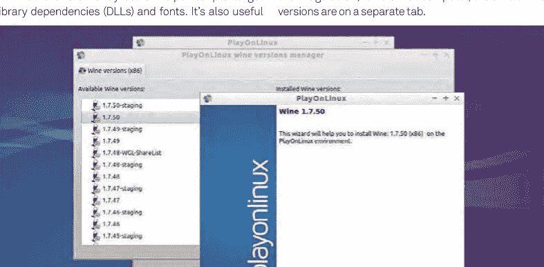

| wine 版本 (beta) | 已安装的 wine 版本 |
|--- | --- |
| 7.0-stable | PlayLinux Wine 1.7.20 |
| 7.1-staging | |
| 7.2-staging | |
| 7.3-staging | |
| 7.4-staging | |
| 7.5-staging | |
| 7.6-staging | |
| 7.7-staging | |
| 7.8-staging | |
| 1.7.49-staging | |

通过 PlayOnLinux 安装 Wine 让你拥有完全的控制权

## Linux 上的 PHOTOSOP
Adobe 最新版本的 Photoshop 可以在 Wine 下运行，因为 PlayOnLinux 处理了复杂问题。Wine 有一个安装程序，且于使用，不需要命令行。PlayOnLinux 通过虚拟驱动轻松管理所有已安装的内容，给你一个带空格的目录名称，并填充一个 Wine 文件目录。要删除，请使用 Wine 的包管理器，它会处理。查看菜单中的条目——查看 Wine FAQ 以获取帮助。

在所有让人们迁移平台的应用程序中——暂不考虑游戏，企业依赖 Wine。Adobe Photoshop 对许多人来说是一个奇特的系统。GNU 图像处理程序 (GIMP) 与 Photoshop 有许多不同之处，且对用户具有更好的批处理功能，但 GIMP 缺乏某些在技艺上投入大量时间的用户的功能。迁移并不容易，所以我们留在 Wine。下载你需要的 Adobe Photoshop 版本多 GB 压缩包。我们免费打开 PlayLinux 安装页面，选择软件包，选择图表，然后是 Adobe Photoshop CS。你会被它也适用于 CC (Creative Cloud) 版本的 Photoshop。PlayOnLinux 选择合适的 Wine 版本——如果系统尚未安装则进行下载——所有的库/DLL，因为针对 Photoshop CS6 优化的设置已经安装。左下图显示了该过程。除非你有大量的内存、快速互联网和 SSD 硬盘，否则你可能一直在等待点击通常的用户许可协议 (EULA)，这可能是 Linux 桌面常见的未设置类别，直到你选择 30 天试用期，否则主机将安装此点。或者干脆等午饭？很好。Adobe 声称你将通过 Mercury 引擎获得“快速”性能可能是假的，考虑到我们在测试机器上无法安装 Wine。我们的 NVIDIA 装备设备（带有默认 Ubuntu 且未工作）刚刚显示了我们特别的性质（如下所示），这里的兼容性评分似乎良好，在 Wine 数据库中。


移除旧的 Wine

安装向导可以尽可能简单。如果你遇到运行时错误，尝试使用 PlayLinux 针对你的 Photoshop 版本。

## 无边疆的游戏
从今年的最新版本到永恒经典，帮助 Linux 玩家保留他们的收藏。

过去，花费了大量精力在 Linux 上获取 Windows。这是为了获取最后的非经典作品，例如 Terra。但现在每个游戏都在 Linux 上，或者运行得很好，对于像 FIFA 15 这样的 Windows 游戏。为了在 Windows 安装的电脑上获取模拟 4，第一步是安装任何更多，并且你不想尝试从这里编写代码来运行它。

## 经典游戏
每个人都想要最新发布版本，对快速系统的需求日益增长。毕竟，我们拥有了那些副本，而 Steam 的努力为 Linux 用户带来了丰富的选择。但允许一段小怀旧之旅，以及《铁路大亨》、《海盗岛》或《帝国时代》的乐趣，你可以从阁楼中寻找光盘，它们对于 Windows 98 或更早版本运行良好。从 origin.com 下载文件是第一（简单的）步。从非 Linux 处理器到 Steam.exe，它已安装在 Windows 上。但 EA 游戏你真的不想尝试从这里编写代码。你选择的 Wine 版本很重要，EA 必须安装，取决于风向的方向。获取此内容的最佳方法是先尝试 Wine。如果失败了，尝试在 Windows 电脑上重新安装以抓取 C:\Program Files (x86) Origin 文件夹，然后在 Wine 或 OnLinux 目录中再次运行。这运行得很好，直到你不满意或你处理了问题。在幸运的一天，你可能会 dotnet4 库、directx9、各种字体、msis-ld32-dll 上好运。有了旧的 OriginSetup.exe，绝对可以工作！我们从《地牢守护者》开始。在 Windows 95 或操作系统上安装，它实际上有效，而且证明不是必要的。如果你还拥有副本，通过我们的 90 年代，我们构建了一个复杂且迷人的《地下城与地下龙》实现，你可能直到清空日历都不会安装它。右键点击光盘上的 EXE 文件可以提供使用 Wine 打开的选项，但只需使用命令行。在 winecfg 中，如果你将 Windows 95 和图形设置为默认值，它是有效的。随着已安装，运行在“200MHz”或更快的处理器上让你回回了多远。


左下角 Wine 适用于大多数游戏，但 EA Origin 平台可能会反复变化

右下角经典 Windows 游戏可以很容易地恢复并加入你自己的派对


# 拯救 iTunes 内容

如果你真的需要 iTunes，请忘记那些混乱的在线建议，并遵循 PlayOnLinux 的向导。

iTunes 近期的臃肿导致它从过去相对轻量、专注且强大的音乐库，变成了一个臃肿的必需品，其等同于现代的 MS Office。iTunes 有许多替代方案，尽管几乎所有替代方案都需要被困在苹果“围墙花园”内的购买媒体。iTunes 有许多优势，许多用户离开也离不开它。

遗憾的是，在 Windows 上运行 iTunes 并不总是那么容易，以至于需要保持一个虚拟机 (VM) 待命，在 Windows 上与 iTunes 一起运行另一个操作系统。

只有通过网络搜索结合 iTunes 才能获得大量相互矛盾的信息。我们尝试通过 PlayOnLinux 的库加载器尝试了一些如 libmicks、referenced20 和 dote40。我们得到的最好结果是成功安装但不容易访问。即使开始使用 `winricks gdbilib`（它会下载 600MB 的图形库）也没有解决问题。

然后，我们忘记了网上那些关于我们应该做什么的帖子。我们只是坐下来信任 PlayOnLinux。点击后，我们没有选择未列出的软件，而是进入左下图像上的多媒体菜单。我们还为我们的 64 位系统下载了 32 位安装程序。

PlayOnLinux 主要是关于哪些设备可以工作的，尽管有大量的硬件（至少在一天之内）。然后，在我们进行的过程中，我们发现通过选择 iTunes 7.48（这是由特定安装程序创建者已知可以工作的版本）并配上服务包和库，PlayOnLinux 在三次测试中均成功启动。

当我们在 PC 或 iPhone 上使用 iTunes 时，它并没有失误，因为非常大的多媒体文件会导致程序崩溃。当我们可以无限制地使用 iTunes 时，iTunes 还有一些特定的艺术家广播电台。我们度过了一个快的晚上，在 calmradio.com 上听了波普爵（bebop）——在 iTunes 上无需登录会员——以及所有的爵士乐。

- 我们可以称它的声誉，因为它在功能上与相同版本的 Windows 软件相似。注册表是绝对必要的。在 Windows 下运行时，如果你这样做，即使系统也会变得不可用。PlayOnLinux 在此位置可能是空的。文件编码被用于存储名称。注册表项可能无法作为特殊效果直接编辑。USER-registry 与 iTunes 链接，其他，例如在 HKLM_Gcko 处，当你创建一个 WINEPREFIX 时 Gecko 的位置。更改注册表项将对你有帮助。最有用的修改键是有用的 RegistryKeys。
- 始终检查 PlayOnLinux 菜单，查看你需要的软件是否已列出。
- 右键点击 iTunes 在管理大型音乐集方面会很困难，但至少你可以找到购买的商品。


## 利用开源软件 (FOSS)

# LibreOffice 技巧与窍

通过这些针对 Linux LibreOffice 套件不可或缺且强大的技巧，让你的工作日更加高效。

# Writer（文字处理）


## 资源

使用办公软件处理非常特定的任务，你可能会陷入工作模式的定式中，而没有考虑其他可能让工作更快、更好或更有效的方法。无论你是为工作编写文档，还是经常创建电子表格，我们都习惯了它。

- 01 在格式化页面时，也许为了更好的可读性，可以确保它打印正常，但要弄清楚文本哪些部分以这种方式运行可能是很困难的。工具栏上有一个像反向 P 的符号——点击它可以显示格式符号，例如异常的换行符。

很难理解 LibreOffice 可以多强大且功能完全，尤其是当你正常地对待它而没有充分利用它提供的功能时。在日常生活中，你可能对宏、创建索引或在 Writer 中进行邮件合并完全没有概念。在接下来的几页中，我们将向你展示使用 LibreOffice 的一些最佳方法，特别关注 Writer 和 Calc 程序。我们将帮助你以最合适的方式工作，并充分利用这款免费的办公软件。

- 02 符号列表
创建符号列表非常简单；只需点击点或数字即可。你可以将符号列表的格式更改为不同的符号或字母而不是数字。你还可以使用 Tab 键创建列表来创建嵌套列表，按 Shift+Tab 返回标准列表。


LibreOffice

- 03 粘贴带格式的文本
通常在 Linux 中，你使用 `Ctrl+Shift+V` 粘贴文本并同时移除其格式。如果你在 Writer 中使用它，或者在“编辑”菜单中找到“粘贴”，你有多种粘贴文本的方法。其中一种是不带格式的，但它允许其他方法，例如使用 LibreOffice 格式。


以上是关于如何使用 LibreOffice 应用

144

# 快速计算

即使在写作时，你可能需要一些数学计算。除了计算器，你可以使用状态栏。点击状态栏的该区域将出一个菜单，将其更改为选择内容的平均值、最大值或最小值。


# 完整备份

Writer 有一个备份工具，但如果你不确定如何操作，Calc 有一个你可以使用的自动筛选。等等，让我们再次检查文本。

# 状态栏

当你选择带有数值的单元格时，状态栏上会出现一个方便的提示，告诉你你相加的值。但这可能不是你一直想要的。点击状态栏的该区域将出一个菜单，将其更改为选择内容的平均值、最大值或最小值。

# 大小写

当你选择一个句子或单词时，你可以无需重写更改大小写。右键点击使用该选项。

# 设置默认格式

Writer 将新文件保存为 ODT。如果你正在处理文档，可以更改默认格式。

# 快速导航

按下 F 或进入“视图”将允许你在标题之间移动。你可以在大型文档中使用此。

# 分组单元格

你不需要总是看到特定的数据块，像代码块那样折叠它们会有帮助。通过“数据>分组和大纲”功能，你可以创建这些可折叠的组，使用一个勾。


## 利用开源软件 (FOSS)

# Calc

# 09 格自动格式

如果你创建了一个表格，可能需要给它上色以使其更具可读性。你可以手动这样做，或者使用自动格式：从这里你可以为奇偶列提供一种颜色方案。

# 12 自动筛选行

筛选行有助于组织数据，但如果你不确定如何操作，Calc 有一个你可以使用的自动工具。选择一行，然后进入“数据>筛选”来基于此创建一个自动筛选系统。一旦到位，你也可以进行筛选。

# 13 保护你的电子表格

共享电子表格对提高生产力很有，但使用的人越多，跟踪用户之一的意外更改就越困难。你可以使用“工具>保护文档-工作表”来保护它并设置密码，以便某些人可以进行更改。

> 了解更多！有很多功能可以学习，可以帮助更好地使用 LibreOffice。查看一些文档或直接查看可用菜单。


## 杂项

| 姓名 | 年龄 | 金额 | 总计 |
|---|---|---|--|
| John | 28 | $142,176 | $234.00 |
| Jane | 32 | $142,176 | $234.00 |
| Bob | 25 | $142,176 | $234.00 |
| Alice | 29 | $142,176 | $234.00 |
| Mike | 31 | $142,176 | $234.00 |

## 14 自动递增或复制单元格
如果你以前从未遇到过，Calc 在复制单元格方面是非常智能的。如果你有两个或三个数字或日期，选择一个并向下拖动黑色方块将自动按照正确的顺序填充数字或日期到单元格。你不需要这样做，也可以在复制单元格时按住 Control 键进行快速复制。

当前幻灯片（共 24 页中的第 6 页）

### 进展如何？
- 非常顺利 / 如上所示：
    - 使用带有包含项的新代码注释；2 位翻译人员
    - CALC 100% 的代码注释已翻译并展示
    - 但页面上的少数几行文本翻译错误，向下甚至

## 17 演讲者模式
在使用 Impress 演示幻灯片时，你将连接到投影仪或电视机，可以是镜像显示，也可以作为你图层的扩展。Impress 是在大屏幕上显示实际演示的地方，而你可以为笔记本开启控制台，显示演示中即将出现的内容以及备注。

| 姓名 | 年龄 | 金额 | 总计 |
|---|---|---|--|
| John | 28 | $142,176 | $234.00 |
| Jane | 32 | $142,176 | $234.00 |
| Bob | 25 | $142,176 | $234.00 |
| Alice | 29 | $142,176 | $234.00 |
| Mike | 31 | $142,176 | $234.00 |

## 15 更改回车键
回车键带你向下移动一行单元格是自然的，这也是 Calc 的默认设置。然而，你实际上可以通过进入“工具 > 选项 > 按行移动”来更改按键的行为。

## 18 通过按键开启拼写检查
这很简单，举个例子，你可能需要将用法语撰写的拿破仑的内容粘贴到文档中。在英语中，拼写检查会对来自 Charles 的单词产生混乱，段落、图表，然后为文档的章节选择语言，仅针对该章节。

## 19 插入可读公式
LibreOffice Math 有一个完全独立的应用程序，实际上它并不是数据库，但你可以编写可以插入到其他 LibreOffice 软件中的数学方程。如果你正在写一篇仍需要可读性的学术论文，这非常好。

## 16冻结列
如果你有大量数据、行或列，你会发现自己经常冻结表格，而不总是为了记住或定义单元格的用途。选择你希望显示的行或列，进入“窗口”然后选择“冻结”，以便在浏览电子表格时将其保持在顶部或左侧。

## 20 使用 PDF
LibreOffice 可以编辑 PDF。只需使用像 Writer 之类的工具导入它们，它就会将 PDF 丢到 Draw 应用程序中。你可以编辑文本、更改图片，甚至更改 PDF 的整体格式。完成后，Draw 允许将工作文件导出为 PDF 供大家。

## 利用开源软件 (FOSS)

## 发行版

## Bodhi Linux 3.1.0

Jeff Hoogling 的新 Ubuntu


# Korora 在优秀的 Fedora 基础之上，交付了他们认为最好且最受欢迎的定制品牌软件，此外，他们还提供了可以在发布第一天在网上安装的“发布版”RPAs。首先，他们还添加了 Fedora 或 RPM Fusion 仓库中不可用的软件包。他们还使用了诸如 AdBlock 和 TerminalAll（默认浏览器）之类的工具。VLC 是你的默认媒体播放器，它是一个免费软件，可以帮助你播放来自非自由源的媒体，并包含许多你可能在安装了 NVIDIAAs 等第三方驱动后才能找到解码器。Korora 确实决定不再在箱内支持 Flash。

对于 Korora 22，主要变化是继承自 Fedora 22 基础的：Yum` 被 `dnf` 和 `Hawker` 取代，Elasticsearch 索引现在是编译器的默认项，此外包含了 Vagrant 以及对 Ruby 2.2 和 Perl 5.20 的升级。其中一个没有从 Fedora 继承的注意事项是 Korora 决定加入许多已经消失了充斥着垃圾软件的桌面环境。集成良好的桌面环境也继承自 Fedora 22 发布：我们拥有带有新功能的 Plasma 5。但该发行版支持许多桌面，如 MATE、Xfce、Openbox、LXDE、En 和 Sugar。你可以选择你喜欢的任何一个。通过 ISO，Korora 让你在运行后轻松在桌面之间切换，或直接切换它们。

你可以使用 GUI 浏览桌面并安装所有桌面，或者使用命令行 `dnf install @yourchoice` 然后使用 `dnf install korayicho`，这还会添加“在终端中打开”右键菜单选项，例如。这种设计的凝聚性确实很了不起。

## 优点
- Fedora 无需安装后准备；预设了实用的系统微调，无需搜索软件，且桌面经过了定制。

## 缺点
- 包含非自由软件引起了 Fedora 粉丝的争议。Korora 的系统和微调可能并不一定吸引所有人。

## 总结
Korora 取了最受欢迎且最稳定的桌面之一，通过在 Fedora 体验的基础上交付了稳健的改进，同时没有牺牲可能轻易驱赶用户的非自由软件的包含。Korora 22 是我们长期以来看到的最受欢迎、吸引人且易用的桌面之一。

每个桌面都带有一套独特的设置，有助于与 Korora 的整体感觉融合。

## 利用开源软件 (FOSS)
上面的 My OSMC 菜单可以根据喜好进行自定义

## 发行版

### OSMC
这是又一个树莓派的新型 HTPC 解决方案，为什么 OSMC 值得再次看一眼？

OSMC 终于“完整”了，一个符合其名称的发布。对于我们之前只涵盖过其一小部分的内容来说，这看起来可能不是什么大事，它是一个树莓派的新型媒体软件中心，同时也运行 Kodi，其他操作系统也在使用它。事实上，我们只需要在树莓派上安装 Kodi，就可以让树莓派作为一个功能完备的 HTPC 媒体中心运行，而实际上不会影响媒体中心的运行和操作。这是其他任何媒体中心都未提供的。

OSMC 的优势在于它的界面。在流程和中心化方面，它与 Kodi 基本相同，外观相似，并且对浏览经过了调整，感觉更顺畅。显示你所有选项的垂直界面有助于导航和响应速度。我的 OSMC 菜单还包含重要设置和一个自定义界面，比标准 Kodi 稍微逻辑化一点，标准 Kodi 的所有内容都在，进入完整菜单有点像迷宫。不过，这是唯一真正奇怪的界面小问题。

让 OSMC 脱颖而出的是细微的差异，尽管它是原始 Kodi 的继任者，但进行了巨大的视觉调整以符合自己的愿景。它完全建立在 Debian/Raspian 基础之上，这不仅为你提供了一个稳定的中心，还提供了扩展和自定义行为及功能的能力。

OSMC 的初始设置非常简单。它在 NOOBs 上可用，你也可以直接添加它。

| 特性 | 详情 |
| :--- | :--- |
| 硬件支持 | 莓派 Model B1 |
| 镜像大小 | 32MB |
| 基础 OS | Debian Linux |
| 存储支持 | USB 存储，网络 |

## OSMC

### 视频插件
- 视频
- 音乐视频
- 音乐
- 文件
- 图片
- 我的 OSMC
- 收藏
- 节目
- 设置
- 电源

显示你所有选项的垂直界面有助于导航和响应速度。我的 OSMC 菜单还包含重要设置和一个自定义界面，比标准 Kodi 稍微逻辑化一点，标准 Kodi 的所有内容都在，进入完整菜单有点像迷宫。不过，这是唯一真正奇怪的界面小问题。

让 OSMC 脱颖而出的是细微的差异，尽管它是原始 Kodi 的继任者，但进行了巨大的视觉调整以符合自己的愿景。它完全建立在 Debian/Raspian 基础之上，这不仅为你提供了一个稳定的中心，还提供了扩展和自定义行为及功能的能力。

OSMC 的初始设置非常简单。它在 NOOBs 上可用，你也可以直接添加它。

上面的 My OSMC 菜单可以根据喜好进行自定义

显示你所有选项的垂直界面有助于导航和响应速度。我的 OSMC 菜单还包含重要设置和一个自定义界面，比标准 Kodi 稍微逻辑化一点，标准 Kodi 的所有内容都在，进入完整菜单有点像迷宫。不过，这是唯一真正奇怪的界面小问题。

让 OSMC 脱颖而出的是细微的差异，尽管它是原始 Kodi 的继任者，但进行了巨大的视觉调整以符合自己的愿景。它完全建立在 Debian/Raspian 基础之上，这不仅为你提供了一个稳定的中心，还提供了扩展和自定义行为及功能的能力。

显示你所有选项的垂直界面有助于导航和响应速度。我的 OSMC 菜单还包含重要设置和一个自定义界面，比标准 Kodi 稍微逻辑化一点，标准 Kodi 的所有内容都在，进入完整菜单有点像迷宫。不过，这是唯一真正奇怪的界面小问题。

显示你所有选项的垂直界面有助于导航和响应速度。我的 OSMC 菜单还包含重要设置和一个自定义界面，比标准 Kodi 稍微逻辑化一点，标准 Kodi 的所有内容都在，进入完整菜单有点像迷宫。不过，这是唯一真正奇怪的界面小问题。

显示你所有选项的垂直界面有助于导航和响应速度。我的 OSMC 菜单还包含重要设置和一个自定义界面，比标准 Kodi 稍微逻辑化一点，标准 Kodi 的所有内容都在，进入完整菜单有点像迷宫。不过，这是唯一真正奇怪的界面小问题。

显示你所有选项的垂直界面有助于导航和响应速度。我的 OSMC 菜单还包含重要设置和一个自定义界面，比标准 Kodi 稍微逻辑化一点，标准 Kodi 的所有内容都在，进入完整菜单有点像迷宫。不过，这是唯一真正奇怪的界面小问题。

显示你所有选项的垂直界面有助于导航和响应速度。我的 OSMC 菜单还包含重要设置和一个自定义界面，比标准 Kodi 稍微逻辑化一点，标准 Kodi 的所有内容都在，进入完整菜单有点像迷宫。不过，这是唯一真正奇怪的界面小问题。

显示你所有选项的垂直界面有助于导航和响应速度。我的 OSMC 菜单还包含重要设置和一个自定义界面，比标准 Kodi 稍微逻辑化一点，标准 Kodi 的所有内容都在，进入完整菜单有点像迷宫。不过，这是唯一真正奇怪的界面小问题。

显示你所有选项的垂直界面有助于导航和响应速度。我的 OSMC 菜单还包含重要设置和一个自定义界面，比标准 Kodi 稍微逻辑化一点，标准 Kodi 的所有内容都在，进入完整菜单有点像迷宫。不过，这是唯一真正奇怪的界面小问题。

显示你所有选项的垂直界面有助于导航和响应速度。我的 OSMC 菜单还包含重要设置和一个自定义界面，比标准 Kodi 稍微逻辑化一点，标准 Kodi 的所有内容都在，进入完整菜单有点像迷宫。不过，这是唯一真正奇怪的界面小问题。

显示你所有选项的垂直界面有助于导航和响应速度。我的 OSMC 菜单还包含重要设置和一个自定义界面，比标准 Kodi 稍微逻辑化一点，标准 Kodi 的所有内容都在，进入完整菜单有点像迷宫。不过，这是唯一真正奇怪的界面小问题。

显示你所有选项的垂直界面有助于导航和响应速度。我的 OSMC 菜单还包含重要设置和一个自定义界面，比标准 Kodi 稍微逻辑化一点，标准 Kodi 的所有内容都在，进入完整菜单有点像迷宫。不过，这是唯一真正奇怪的界面小问题。

显示你所有选项的垂直界面有助于导航和响应速度。我的 OSMC 菜单还包含重要设置和一个自定义界面，比标准 Kodi 稍微逻辑化一点，标准 Kodi 的所有内容都在，进入完整菜单有点像迷宫。不过，这是唯一真正奇怪的界面小问题。

显示你所有选项的垂直界面有助于导航和响应速度。我的 OSMC 菜单还包含重要设置和一个自定义界面，比标准 Kodi 稍微逻辑化一点，标准 Kodi 的所有内容都在，进入完整菜单有点像迷宫。不过，这是唯一真正奇怪的界面小问题。

显示你所有选项的垂直界面有助于导航和响应速度。我的 OSMC 菜单还包含重要设置和一个自定义界面，比标准 Kodi 稍微逻辑化一点，标准 Kodi 的所有内容都在，进入完整菜单有点像迷宫。不过，这是唯一真正奇怪的界面小问题。

显示你所有选项的垂直界面有助于导航和响应速度。我的 OSMC 菜单还包含重要设置和一个自定义界面，比标准 Kodi 稍微逻辑化一点，标准 Kodi 的所有内容都在，进入完整菜单有点像迷宫。不过，这是唯一真正奇怪的界面小问题。

显示你所有选项的垂直界面有助于导航和响应速度。我的 OSMC 菜单还包含重要设置和一个自定义界面，比标准 Kodi 稍微逻辑化一点，标准 Kodi 的所有内容都在，进入完整菜单有点像迷宫。不过，这是唯一真正奇怪的界面小问题。

## Korora 在优秀的 Fedora 基础之上，交付了他们认为最好且最受欢迎的定制品牌软件，此外，他们还提供了可以在发布第一天在网上安装的“发布版”RPAs。

对于 Korora 22，主要变化是继承自 Fedora 22 基础的：Yum` 被 `dnf` 和 `Hawker` 取代，Elasticsearch 索引现在是编译器的默认项，此外包含了 Vagrant 以及对 Ruby 2.2 和 Perl 5.20 的升级。其中一个没有从 Fedora 继承的注意事项是 Korora 决定加入许多已经消失了充斥着垃圾软件的桌面环境。集成良好的桌面环境也继承自 Fedora 22 发布：我们拥有带有新功能的 Plasma 5。但该发行版支持许多桌面，如 MATE、Xfce、Openbox、LXDE、En 和 Sugar。你可以选择你喜欢的任何一个。通过 ISO，Korora 让你在运行后轻松在桌面之间切换，或直接切换它们。

你可以使用 GUI 浏览桌面并安装所有桌面，或者使用命令行 `dnf install @yourchoice` 然后使用 `dnf install korayicho`，这还会添加“在终端中打开”右键菜单选项，例如。这种设计的凝聚性确实很了不起。

## OSMC
这是又一个树莓派的新型 HTPC 解决方案，为什么 OSMC 值得再次看一眼？

OSMC “完整”了，一个符合其名称的发布。对于我们之前只涵盖过其一小部分的内容来说，这看起来可能不是什么大事，它是一个树莓派的新型媒体软件中心，同时也运行 Kodi，其他操作系统也在使用它。事实上，我们只需要在树莓派上安装 Kodi，就可以让树莓派作为一个功能完备的 HTPC 媒体中心运行，而实际上不会影响媒体中心的运行和操作。这是其他任何媒体中心都未提供的。

OSMC 的优势在于它的界面。在流程和中心化方面，它与 Kodi 基本相同，外观相似，并且对浏览经过了调整，感觉更顺畅。显示你所有选项的垂直界面有助于导航和响应速度。我的 OSMC 菜单还包含重要设置和一个自定义界面，比标准 Kodi 稍微逻辑化一点，标准 Kodi 的所有内容都在，进入完整菜单有点像迷宫。不过，这是唯一真正奇怪的界面小问题。

让 OSMC 脱颖而出的是细微的差异，尽管它是原始 Kodi 的继任者，但进行了巨大的视觉调整以符合自己的愿景。它完全建立在 Debian/Raspian 基础之上，这不仅为你提供了一个稳定的中心，还提供了扩展和自定义行为及功能的能力。

OSMC 的初始设置非常简单。它在 NOOBs 上可用，你也可以直接添加它。

## Mageia 5
公司本身可能已归于历史，但 Mandriva 通过其真正的继任者 Mageia 延续生命。

Mageia 5 历经了一年多时间，在 Mandriva 清算之后出现，这感觉像是一个及时的发布。

显然，我们在安装方面投入了令人印象的工作，为所有人增加了一个新功能。这意味着你去年在 Mageia 4 遇到此问题时不再需要绕过方法。

这对 Mageia 来说是一次重要的更新，因为它让该发行版对过去三年购买的计算机更容易使用，而且主要通过对 UEFI 支持的努力揭示了 Mageia 的大部分 Bug。

现在安装程序内部支持 RAID、更新了包管理器（现在比任何时候都好），并且支持 Grub。Grub 2 运行良好，能够检测其他操作系统并将其添加到列表中，还提供了快速和安全失败启动等功能。用户可以利用这一点避免通常的损坏选项，除非你选择 ISO 然后你可以获得安装过程的完全控制。

## 总结
Korora 取了最受欢迎且最稳定的桌面之一，通过在 Fedora 体验的基础上交付了稳健的改进，同时没有牺牲可能轻易驱赶用户的非自由软件的包含。Korora 22 是我们长期以来看到的最受欢迎、吸引人且易用的桌面之一。


## 安装程序已经经过了大量工作，新功能是针对现代机器的 UEFI 支持。

在这些环境中，设置启动选项、你的 shell 或启动加载程序、自定义默认激活的服务、启用证明和防火墙、设置你的仓库并不简单，而你将拥有近乎完全的自由。

高度全面的 Dext1 安装程序是 Mageia 的真正吸引力之一，你可以将其用于几乎任何设置（对于更快速、更现代的设置，双架构 UEFI 在后来的版本中最多只是一个候选项）。

一旦安装完成，没有什么需要担心的。欢迎界面是新用户很好的引导指南，它解释了如何添加非免费仓库（以防你想浏览更多样化的选择），识别并链接到用于包管理的 RPMdata GUI 和 URPM CLI 工具，并直接提供了一些实用的应用程序。本质上，这个“应用程序”部分是主管理器的一份快捷列表，为新用户提供了音频视频解码器、以及如 Skype、Firefox、Flashplayer、Spotify 等流行软件的快速链接。在刚就涵盖了所有基本内容后，你在 Mageia 中感到宾如家。

Mageia 的实现程度比其他发行版好得多——虽然我们在中文方面遇到过一点麻烦——但能够从任何桌面环境 KDE、XFCE、Openbox、Cinnamon 和 Enlightenment 开始并在用户登录界面在它们之间切换，这对于快速选择你的体验是非常出色的。

唯一的缺点是它缺少了一些较新的软件（GNOME 处于 3.14 版本，由于新的通知功能，它并不像 38 版本那样好，但我们有了用于新 Plasma 5 的 KDE 4.12.4）。

但话说回来，为了让发行版稳定到足以发布，它必须在某个点停下来——而且它做得非常好。

## 优点
- 现在支持 UEFI，Mageia 控制中心和自定义 Dext1 安装程序具有显著优势。

## 缺点
- 软件包更新范围巨大。Mageia 较少的更新在版本号上比此版本的持续时间还要短。

## 总结
Mageia 是实干派，它通过底层改进增强了核心系统。虽然它不像上一个版本那么好，发行版引入了一些缺点，但 UEFI 支持使得该发行版更易获取。

## Solus Beta 2

Solus 是一个从零开始构建的新发行版，配备了名为 Budgie 的新桌面环境，其设计旨在“即插即用”。

如果这个名字听起来熟悉，那是因为 Operating System 背后的开发者 Dmitry（以 Linux Mint Debian 版闻名）回来了。遗憾的是，Solus 在 2015 年消失了，这是因为他当时加入 GNOME 后正准备回归开发。然而，当 Solus 的第一个版本在 2016 年由于商标问题出现在 Linux 操作系统时，Dmitry Iakey 让 Solus OS 再次获得了生命。从表面上看，Solus 和原始的 Solus 非常不同——第一个是构建在 Debian 之上的，而新的 Solus 则是完全从零构建的。

OS X，而且它成功地提供了一种新鲜体验，而不是纯粹注入其他桌面的美学。Budgie 还拥有一个 GNOME 2 桌面环境，对于那些习惯传统外观的人来说非常舒适。虽然 Budgie 仍在修复某些错误，但你可以看到这个新桌面充满了巨大的希望；它不可否认地非常漂亮——它是你主电脑的一股清风。Budgie 可以在 Solus 和 GTK+ 主题之间切换，自定义你的面板应用并在此处切换菜单，完全不需要费任何努力。

你注意到的第一件事是自定义构建的桌面环境。Budgie 仍然与 GNOME 栈集成，显示出它在表面经过了润色，但它使用的是自己的包管理系统，需要时间来整理它的仓库。Solus 带有一些预装元素，如 Thunderbird、Firefox（尽管这目前容易崩溃）、几个系统工具和 Flash，以及一些如 VLC、VirtualBox 和 Transmission 等额外内容。这里是我们看到的这种正在进行中的工作——像 Linux Vim 和 Emacs 这样的经典软件是可以用的，还有额外的等等。

整洁、色彩且现代的设计是 Solus 操作系统的主要特征。

## 所有设置

### 个人
| 背景 | 通知 | 在线账户 | 隐私 | 区域与语言 |
| :--- | :--- | :--- | :--- | :--- |

### 硬件
| 颜色 | 显示器 | 键盘 | 鼠标与 | 网络 | 电源 |
| :--- | :--- | :--- | :--- | :--- | :--- |

### 任务
| 声音 | Wacom 数板 | 获取软件 | 获取支持 |
| :--- | :--- | :--- | :--- |

### Google Chrome
Google Chrome 是一个免费使用的网络浏览器。

## 系统
| 日期与时间 | 详情 |
| :--- | :--- |

上方有一个欢迎程序帮助你开始，尽管它的软件列表现在看起来有点单调。

> Solus 是桌面级的且仅限 64 位的，侧重于设计、直观性和软件集成，以演进抽象发行版的概念。


# 利用开源软件

## KDE

这款精美的桌面刚刚经历了一次重大升级，反映了更现代的审美理念。


**优点**
设计精美，应用和文件管理方式独特。

**缺点**
资源占用最重的桌面之一，搜索能力较弱。

- **最适合：** 家庭闲闲娱乐
- **相关发行版：** Kubuntu, openSUSE, Mageia
- **工作流：** 使用传统的桌面比喻，带有可以在桌面上整理的窗口栏和组件（widgets）。

对我们来说，KDE 一直是美学设计最好的桌面。一切都是统一且优美的。然而，这些设计有时会停留在它们制作的时代，KDE 看起来有点像 2014 年的产物，但随着 Plasma 推出全新的视觉和体验，这种情况也即将发生改变。KDE 拥有过去十年中最好的桌面，而且最近显然有许多理由你你应该尝试 KDE。它仍然非常流行，你不再像在 Cinnamon 或 Ubuntu 那样处于边缘地位。Plasma 5 可能不是你的理想之选，但从 Plasma 4 升级桌面环境绝对是有趣的。虽然它的激活方式与之前的 KDE 一致，但它可以像任何其他桌面一样来组织你的文件和桌面。Plasma 5 的新美学非常漂亮。现代色彩的简洁直的线条，并且在过程中标注得极其清晰。当你第一次工作并寻找文件时（那是 KDE 4 之前的时代，曾是设计之王），使用它绝对是棒极了。

不过，它有点麻烦，并且无法与其他 KDE 4 的安装真正兼容，因为目前仓库中尚未可用，所以你必须去 Google 寻求帮助来安装它——对于许多发行版来说，这涉及下载安装文件，或者向系统添加 PPA 并安装。否则，你可能需要从源码编译。

```
http://kde.org/
```


最后，工作流大致相同：采用传统方法，通过鼠标引导来组织桌面和底部面板上的窗口。KDE 普及的组件也保留在最新的桌面版本中，包括以下特性：Plasma 5 绝对是未来几个月值得关注的，我们感兴趣的是会增加哪些新功能，而不是设计上的。


## Plasma 4

Plasma 5 仍然非常新，可能需要你最喜欢的发行版经过一两次迭代才能完善。它目前并不稳定，所以我们尝试之前的 KDE 版本会有更好的运气。Plasma 4 的开发更成熟、更新更频繁，并且包含了一种非常有趣的桌面文件夹组织方式，以便快速访问。现在，你可以在大多数仓库中找到 KDE 的 Plasma。它的设计非常漂亮，借鉴了跨平台桌面的简洁线条。

## GNOME

这款老牌桌面环境正在开辟属于自己的新道路，但并不是人都认同这一观点

- **最适合：** 开发、触摸屏
- **相关发行版：** Fedora, Red Hat Enterprise Linux
- **优点：** 稳定、成熟的代码库
- **缺点：** 学习曲线相当不同且令人望畏
- **工作流：** 系统为触摸屏设计，通过快捷键进行大量的键盘导航，减少了对鼠标的依赖。www.gnome.org

### 常用快捷键

- **Windows/super 键：** 打开活动覆盖层，访问不同的应用程序并提供桌面概览。你可以快速搜索文件或快速移动窗口。
- **Alt：** 在同一应用程序的窗口之间切换——这就是使用 Alt+Tab 切换应用的方式。
- **Ctrl+Alt+上/下：** 在工作区之间移动。
- **Ctrl+Alt+T：** 打开终端。

GNOME 的搜索功能是 Linux 环境中最早实现的功能之一。GNOME 桌面可能是所有 Linux 中最著名的桌面，这很大程度上归功于它在过去十年中的极端流行。它曾是一段时间的首选桌面，尽管当时没有现在这么多选择，这意味着 Linux 用户在一生中至少遇到过一次。不过，变化发生了，GNOME 在 2011 年经历了彻底的重构，放弃了传统的桌面，转而采用一种高度依赖快捷键和鼠标使用的全新设计。然而，添加的一些有趣特性表明，以触摸为中心的界面仍然是控制应用和窗口的方式。

使用快捷键探索桌面是你桌面工作流的关键部分，这种方式也存在系统中。通常情况下，你与触摸屏交互的方式是从面板访问按钮，以保持内容不干扰，最大化桌面空间，并通常为整个桌面提供类似智能手机的体验。GNOME 目前的哲学似乎是趋向简单性的驱动。许多原生应用似乎包含了它们所执行任务的基本功能，例如 GNOME 浏览器和网络管理工具。当最大化时，窗口会回到更多的桌面。对学习快捷键的依赖也意味着在桌面移动时比其他需要更多操作。学习新的工作流并切换应用是一项挑战，但配合高级搜索功能可以带来极佳的体验。然而，它仍然会有一些问题，并且依赖触摸屏，但如果技术真的朝着那样发展，这可能是一个前瞻性的举措。

有很多问题可能会让用户抵制传统的桌面环境。“桌面比喻”在大多数桌面环境中可见，但人们可能需要时间来适应——尤其是当你有时需要时。

## Unity

Ubuntu 的桌面环境是一个跨越发行版和设备概念的一部分

- **优点：** 桌面搜索挂接在线服务和系统工具
- **缺点：** 系统内置广告并存在隐私担忧
- **最适合：** 家庭电脑、多媒体


# Cinnamon

曾经是 GNOME 的分支，现已成为最强大且最灵活的桌面环境之一


- 优点
使用传统的桌面隐喻，设计直观易用

- 缺点
尚未在所有地方都可用，且资源占用可能较高


### 最适合
办公、日常计算

### 关联发行版
Linux Mint, Abstractorin

### 工作流
基于传统的桌面隐喻，依赖鼠标导航。任务栏上配有任务栏的窗口，但同时也提供了额外的快捷键以方便导航

http://cinnamon.linuxmint.com


Cinnamon 起始于一个更传统配置的、我们事实上的 GNOME，并演变成了一个独特的产物。Linux Mint 存在时间已经比 GNOME Shell 或 Unity 更长，事实上它已被许多人使用了很一段时间。然而，一旦 GNOME 更新到当前版本，Linux Mint 团队决定他们想以稍微不同的方式使用 Cinnamon。

# 桌面展示（Desktop exposure）

执行这些核心任务，并确保图标不重复。Cinnamon 绝不妥协。它不会为了照片拍摄或企业交易而包含某些功能。界面尺寸非常简洁，但没有不必要的品牌化。一切内容都整齐地列出并呈现，以最大限度地提高在桌面和文件中寻找路径的便利性。

使用 Ctrl+Alt+D 或方向键可以提升窗口显示，在 GNOME 中按 Super 键会弹出桌面概览。按 `Up` 可以让你查看所有打开的桌面和窗口。在这里选择一个或多个桌面。按 `Down` 或将鼠标移动到热角将更改当前桌面或库中的打开窗口，允许你在它们之间进行选择。

在发布带有 GNOME 扩展（Mingle）以使桌面恢复到更易于识别的状态后，Cinnamon 团队创建了 GNOME 的桌面元素——即通知和桌面——他们利用了所谓的传统桌面隐喻的优势。此应用程序包含一个应用程序菜单以及在顶部面板上列出的打开窗口。

除了这些功能外，还有一个高度可定制的设置，列出了账户、更新访问、通知、显示分辨率等。功能可以从这里添加或删除，而且在最近，它们会智能地感知何时有不同的应用程序在处理。

Cinnamon 现在已不再是 GNOME 的分支了，它已经成为了它自己的桌面，而不是围绕其运行的壳程序。这意味着它可以进一步演进。然而，尝试进一步优化底层代码会导致代码库成熟度略微。不过，目前没有大问题。

# XFCE

首个主要的轻量级桌面从 GNOME 2 借鉴了一些设计笔记，但开辟了自己的道路

- 最适合
旧电脑、资深用户

- 关联发行版
Ubuntu, Debian

- 工作流
一个简单的桌面，利用面板和通过鼠标操作的程序菜单，打开窗口之间无缝切换。

www.xfce.org

与之前的 GNOME 版本一样，由于内置了 GTK+2 工具包，XFCE 模仿了它的面板布局和基本工作流；它是用于 Ubuntu 更多系统的概念之一，并在 00 年代后期非常流行。它不像像 KDE 那样著名的轻量级桌面（KDE 仍有其忠实追者），因为它让人联想起旧的 GNOME 2，并且是少数带有 dock 的桌面之一。XFCE 的 dock 不仅和屏幕顶部的面板一样好，还包含一个程序菜单，菜单中还包含系统设置和喜好的独立类别。打开窗口列在顶部面板上，而选择位于 dock 上。dock 默认不会遮挡；它为打开窗口留有边框，除非移除它或激活该功能，否则会占用屏幕空间。你也可以移动隐藏顶部面板以真正最大限度地利用屏幕空间。

至于轻量化，最近的基准测试显示 XFCE 占用 80 MB 内存，这显著高于 LXDE。XFCE 正在更新到 GTK3，这将增加这个数字。现在，它比 KDE 等软件轻一点，即使在 GTK3 上，资源密集性仍然显著更低。在面板和 dock 方面，它也比以前稍微功能丰富，这是一种平衡，取决于系统是否能抽出几兆字节内存来换取一个稍微更好用的桌面环境。

- 优点
为 GNOME 2 时代设计的界面

- 缺点
受限于轻量级设计，缺乏一些现代桌面特效


为 GNOME 2 时代设计的界面

受限于轻量级设计，缺乏一些现代桌面特效


为 GNOME 2 时代设计的界面

受限于轻量级设计，缺乏一些现代桌面特效


为 GNOME 2 时代设计的界面

受限于轻量级设计，缺乏一些现代桌面特效


为 GNOME 2 时代设计的界面

受限于轻量级设计，缺乏一些现代桌面特效


为 GNOME 2 时代设计的界面

受限于轻量级设计，缺乏一些现代桌面特效


为 GNOME 2 时代设计的界面

受限于轻量级设计，缺乏一些现代桌面特效

dock 默认不会遮挡；它为打开窗口留有边框，除非移除它或激活该功能，否则会占用屏幕空间。为 GNOME 2 时代设计的界面

受限于轻量级设计，缺乏一些现代桌面特效


为 GNOME 2 时代设计的界面

受限于轻量级设计，缺乏一些现代桌面特效

dock 默认不会遮挡；它为打开窗口留有边框，除非移除它或激活该功能，否则会占用屏幕空间。为 GNOME 2 时代设计的界面

# LXDE

最轻量级的桌面，没有多余的功能

- 优点
极具辨识度

- 缺点
基础，但并非必要


极具辨识度

基础，但并非必要


极具辨识度

基础，但并非必要

最轻量级的桌面，没有多余的功能

- 优点
极具辨识度

- 缺点
基础，但并非必要

### 最适合
老旧系统、配置较低的电脑

### 关联发行版
Ubuntu, Raspibian, Knoppix

### 工作流
LXDE 使用极简桌面环境，底部有一个带有程序的面板和基于鼠标的导航

www.lxde.org

# 新文件管理器

LXDE 可以进一步修改使其比标准版本更轻，即通过更改文件管理器。虽然其他系统也可以这样做，但其他文件管理器也能满足一些需求。这里是一些替代管理器的建议：

IceWM
与 LXDE 搭配的极轻量级管理器

FWM
一个更老的管理器，诞生于资源更匮乏的时代

Enlightenment
我们将其作为一个完整的桌面讨论，但它也可以作为 LXDE 自身的轻量级窗口管理器使用

LXDE 管理器可以更改以去掉最后一项，但默认已经很不错

另一个简单的程序，没有多余的功能


## 利用自由开源软件

### MATE
GNOME 2 代码的分支与延续

Cinnamon 的轻量级对应版本是旧 GNOME 2 系列的延续，当部分用户对 GNOME Shell 的方向不满时，该代码进行了分支。MATE 团队的设计目标是让 GNOME 2 保持活力并持续更新，整合通知和应用程序/文件搜索等现代功能。

**优点**
- 流行代码的轻量级延续

**缺点**
- 对于许多使用 LXDE 或 XFCE 的用户来说，仍然停留在过去

它最适合偏好桌面工作流风格的用户，即通过顶部栏寻找不同的应用程序，窗口以以鼠标为中心的设计进行显示。它目前出现在几个发行版中，并且正在不断增加中。它比 GNOME、KDE 和 Cinnamon 轻得多，但它无法与 LXDE 或 XFCE 真正竞争。

| 适用人群 | 关联发行版 | 链接 |
| :--- | :--- | :--- |
| 寻找现代功能的资深用户 | Linux Mint, Snowlinux | http://mate-desktop.com |

默认情况下，你可以让 MATE 看起来完全像 GNOME 2，尽管 Linux Mint 使用了略有不同的配置

### Enlightenment
一种具有独特且熟悉外观的替代轻量方案

Enlightenment 依赖于屏幕上略微不常的面板，其中包含系统信息和打开窗口列表。可以从任何地方访问该程序；在桌面任何地方点击右键也会弹出选项。该面板没有正确占据整个屏幕底部，感觉像漏掉了一部分屏幕，但它运行良好。它非常快、轻量，且在操作上高度依赖鼠标。由于程序隐藏的方式，它不是触摸屏的理想选择，而且并没有提供很多实用的快捷键。这是一个非常被忽视的桌面，它不使用 GTK 或 Qt 驱动，这使其在运行混合代码应用程序时表现优得多。

**优点**
- 轻量级并专注于易用性和选项访问

**缺点**
- 独特的界面对某些用户来说可能难以使用

| 适用人群 | 关联发行版 | 链接 |
| :--- | :--- | :--- |
| 高定制、轻量化配置 | Bodhi Linux, Elite | http://www.enlightenment.org |

你可以从任何想要的地方访问应用程序菜单，以防你无法点击到底面板

### LXQt
该轻量级桌面的 Qt 端口具有常见的视觉差异

### Openbox
窗口管理器可以轻松地用作极简主义的桌面

LXQt 的美学比任何东西都接近 KDE，尽管它仍然是 LXDE。

LXQt 是将优秀的 LXDE 移植到 Qt 而不是它目前基于的 GTK，LXQt 也是我们去年有幸使用过一段时间的桌面 Razor 的继任者。它和我们任何一个喜爱的桌面一样一样快。LXQt 提取了 KDE 和其他 Qt 应用的一些功能，并将其应用于 LXDE 框架中——对于喜欢轻量级桌面但希望周围有 Qt 应用程序和工具的人来说非常完美。

最近的基准测试显示 LXQt 的内存占用在 96MB 左右，略高于 XFCE，但远高于 LXDE。然而，通过一些优化，这个数字将会下降并绝对低于 128MB。

工作流基本上与 LXDE 相同，因此在两者之间切换并不费力。

**优点**
- 轻量级，且与 LXDE 相同，但换了新装
- LXQt 实际上比 LXDE 稍微流畅一点

**最佳适用**
- 旧电脑、测试机

**关联发行版**
- 无 (www.lxqt.org)

Openbox 真的只是一个窗口管理器，它的极简设计在用作桌面时会显露出来。

Openbox 真的被视为一个管理器——控制窗口在桌面环境中的审美和位置的东西。然而，Openbox 可以轻松地设置在任何其他桌面上，实现可以想象的最极简主义，使用尽可能少的资源。

默认情况下没有面板，如果你想添加软件，点击桌面会打开一个菜单来访问应用程序和一些设置。如果你不需要额外的 UI 元素而只需要它，Openbox 可能会非常实用。

如果你安装了 LXDE，它通常会在登录时作为备用桌面环境出现，并且该轻量级桌面的主要窗口管理器。

**优点**
- 有利于界面的轻量级设计并可以被利用

**缺点**
- 为了资源简化了用户，使其变得不实用

**最佳适用**
- 开发者系统

**关联发行版**
- CrunchBang, Linux, Ubuntu (www.openbox.org)

## 利用自由开源软件

### GNOME 软件
C++ 的成功是显而易见的，面向对象的编程在 C 中也可以实现。开发者迅速利用了这一点，并基于结构、函数和其他类似概念构建了设计模式。

Vala 是一种基于 C 的语言，它将应用逻辑形式化为语言特征以简化其编译翻译，然后使用系统标准的 C 代码进行编译。因此，Vala 可以在任何基于 C 的操作系统上运行——当然，这个陈述是二进制文件的真实情况。

兼容性只是卖点之一。这里的意图是创建一种像 C 一样易于使用，但具有另一套不同设计模式的语言，这需要 C 程序员付出巨大的努力。尽管 GTK 驱动了大量习惯于原生 GUI 栈的开发者，但使用 GTK 框架的开发者将看到 Vala 的用处，因为它提供了类似 C 的体验，并支持类。

Vala 已用于 Elemental 等项目，该项目将这种编程语言作为各种组件的基础语言。

### 关闭你的应用程序
使用 Vala 原生 GUI 栈的开发者需要创建可以使用 X 按钮关闭的应用程序。在 Gtk 中，这可以通过连接销毁信号来实现，通过调用函数阻止销毁过程。

```c
using Gtk;

int main(string[] args) {
  Gtk.init(ref args);

  var window = new Window();
  window.title = "Vala";
  window.border_width = 1;
  window.set_default_size(400, 200);
  window.destroy.connect(Gtk.main_quit);

  var label1 = new Label("Image Publishing!");

  window.add(label1);
  window.show_all();

  Gtk.main();
  return 0;
}
```

```c
class HelperClass {
  private Label label;
  public HelperClass(Label label_1) {
    label = label_1;
  }

  public void onClick() {
    label.set_text("Ok!");
  }
}
```


# 利用 FOSS

**正确** 每个组件都不与其他组件通信，而是只与事件总线通信

# 新系统

# 旧系统

# 参数与指针

参数可以被完全省略——至少只要你从右侧删除了它们即可；然而，这提供了一种便利特性，被调用的方法通过以下方式接收指向负责其执行操作的对象的指针：

| | | |
|---|---|---|
| n| B | 事件系统 | C |

| | | |
|---|---|---|
| C | | B |
| | | D |

```csharp
public class Object {
    public Object(int x, int y);
    void on_event(C source, int x, int y);
}
```

Vala 提供了一组灵活的定义：回调函数不需要处理事件中找到的所有参数。尝试通过引入一个额外的回调路由层来测试这一点。

这种局限性通过使用参数得到了稍微的放宽：

```csharp
public void examplefunction(int x, string str="Hello") {
    0
}
```

```csharp
class HelperClass:Object {
    private Label1;
    public void clickedSignal(int x, int y);
    public HelperClass_Label1() {
        my1 = clickedSignal.connect(secondClicked);
    }
    public void secondClicked() {
        my1.set_text("Ok");
    }
    public void wasClicked() {
        clickedSignal(11,22);
    }
}
```

ExampleFunction 可以通过三种方式调用：

```csharp
int main(string[] args) {
    examplefunction(1);
    examplefunction(2, "Hi");
    examplefunction(2, "Hi", "Bye");
}
```

Vala 通过左到右的序列填充参数。这意味着带有一个参数的第二次调用将填充编译时的 st1 以供 st2 使用默认值，同时为 st2 提供值。在处理构造函数时，应该使用更简单的设计模式：

```csharp
class HelperClass:Object {
    public HelperClass_Label1() {
        my1;
        clickedSignal.connect(secondClicked);
    }
    public HelperClass.With(int i, Label_1) {
        my1;
    }
}
```

由于我们再次基于我们的 Object。Vala 的规则并不继承自 Object，但在大多数情况下，这种措施并不是必要的，Object 附带了大量的辅助方法。

我们的新方法被声明为装饰有信号修饰符的空方法。构造函数将其连接到 secondClicked，而 wasClicked 方法演示了信号调用过程。

# 函数调用

重载函数允许你创建两个接受不同参数的函数版本。由于 Vala 代码旨在供 C 使用（C 语言并不支持重载），因此泛型是限制的。调用可以是完全限定限定的。这可以通过使用新创建的构造函数通过 `HelperClass.With(...)` 实现。所有的 Vala 方法都是最终的（final），这意味着它们不能在被继承的类中被重写。用于重写的方法使用以下方法：

```csharp
void main() {
```

```csharp
string boerte = "B!";
string tank = "GALAPAN";
for (int i=0; i<boerte.length; i++) {
    uint8 val_boerte[i];
    printf("Pos %c \n", i, boerte);
}
for (int i=0; i<tank.length; i++) {
    uint8 val_tank[i];
    printf("Pos %c \n", i, tank);
}
```

请记住，模板的内容在运行时无法修改，这与变量配合并不良好。这意味着国际化需要使用预处理指令。让我们开始一个可以在运行时选择语言的解决方案：

```csharp
int main(int* args) {
    Gtk_init(ref args);
    float av = 2;
    float bv = 4;
    string text;
    if(lang==0) {
        text = "%s is %s, %s";
    } else {
        text = "%s is %s, %s";
    }
}
```

# 处理字符串

C 语言以其处理字符串的方式而闻名，Kernigan 和 Richie 证明了这对于 é、ö、 ù 等字符是有效的。如果你想解析或更改它们，就需要分配。此外，强制使用 UTF-8 编码方案。Vala 引入了字符串类型。字符串是不可变的：

```csharp
int main(int* args) {
    Gtk_init(ref args);
    float av = 2;
    float bv = 4;
    string text;
    if(lang==0) {
        text = "%s is %s, %s";
    } else {
        text = "%s is %s, %s";
    }
}
```

> string text = "This is a string that be"

在实践中，字符串用于以清晰的格式输出更多变量。Vala 通过字符串模板解决了这个问题，该功能通过示例进行了说明：基于预处理的解决方案优越越之处在于它们减少了二进制文件的大小，因为必要的代码在编译过程中会被剥离。这意味着代码通过我们的可执行文件实现：

字符串是不可变的：如果你尝试链接或更改它们，将分配一个新的。

```csharp
int main(int* args) {
    Gtk_init(ref args);
    float av = 2;
    float bv = 4;
    string text;
    int lang=0;
    if(lang==0) {
        text = "%s is %s, %s";
    } else {
        text = "%s is %s, %s";
    }
}
```

带有 $ 运算符的字符串寻找带有 $ 的字符串。它们被视为计算指令。示例引出了图像所示的结果。Glib Object 提供了引用计数——这允许 Vala 自动释放功能对象的内存。你可以对特定对象注册感兴趣，如果相应的方法执行了更改，将调用回调。

这不仅限于简单变量。下面的示例执行两个值之间的乘法：

```csharp
int a = 7, b = 5;
string s = "$a * b = %d"; // 7 * 5 = 35
```

# Object 的优势

Glib Object 提供的辅助函数将简化对象的构造、注册和信号管理。你是使用 GObject 实现的朋友。

| 左变量 | 
|---|---|
| 带有 $ 的插入字符串中；带有括号前缀的 $ 先计算 |
| (2+4)*(2-4)^2 |

如果你的部分运行异常，最好尝试检查你所有的类是否都派自 Glib Object，因为许多语言特性在面对“普通”类时会出现。

# 垃圾回收器

在创建链表或类似的数据结构时，开发者倾向于创建类似于下面的结构：

```csharp
class AnVObject {
    public AnVObject prev;
    public AnVObject next;
}
```

虽然 C 语言对这种对象没有问题，但 Java 无法销此类对象。这是由于引用计数原理引起的：每个对象都有一个“所有者”。


```c
void main () {
    RelaxPeachJuice myNewRelaxPeachJuice();
}
```

```c
double input = double.parse(input);
double res;
myLabel.set_text("Resistance is " + res.to_string() + " Ohm");
```

仔细观察上面的实现可以发现，Vala 与 C 的不同之处在于接口也可以包含方法。这允许我们对逻辑进行“外包”：如果一个接口有一个方法，那么它就不需要在这每个类中重复定义。

QOIOIOI!!!! – 这是无效的
代码中的 `line` 宏是一个经典的预处理器宏，用于选取一个值；预处理器将向其呈现一个在 Vala 中无效的内容，从而导致显而易见的编译错误。

一个主要特性允许接口避免多重继承的存在。正如本文中的 C 教程所示，我们的接口只能应用于自 `GObject.Object` 的对象。

```c
int main(string[] args) {
    var window = new Window ();
    window.title = "Example";
    window.window_position = WindowPosition.CENTER;
    window.set_default_size(600, 300);
    window.connect("destroy", Gtk.main_quit);
```

## 通用类

Vala 是一种静态类型语言。每个变量类型和每个表达式必须在编译时确定。JavaScript 程序员认为这是一种负担，而大多数其他人则对这种对意外错误抵抗抵抗的提高表示赞赏。让这种东西被视为巨大益处的，是让基于泛型的类变得繁琐的。[注：此处 OCR 文本似乎有些乱码]。让我们来看下述语句：

```c
var label = new Label ("Result");
var entry = new GtkEntry();
var spin = new GtkScale.with_range(0, 200, 0.1);
var button = new Button.Label("Click me!");
var myLabel = new GtkLabel(GLib.markup, 0);
button.connect("clicked", on_clicked);
```

```c
Dictionary<MyGtkString, MyString, int> out = new Dictionary<MyGtkString, MyString, int>();
```

你可以声明 `out`。注意 `var` 并不是一个变量。在下面的示例中，它可以用 `int`、`string` 或其他类在初始声明中进行填充：

```c
var box = new Box (Orientation.VERTICAL, 5);
box.homogeneous = true;
box.add(new Label ("Age:"));
box.add(entry);
box.add(new Label ("Current:"));
box.add(spin);
box.add(button);
box.show_all(box);
```

```c
var elem = new MyCalcObject();
```

让我们最后创建一个自己的简单类，并用它来创建一个计算器程序。以下代码遵循了基本结构及其调用。请注意，C# 和 Java 之间的相似性是刻意为之。

```c
using Gtk;
```

```c
class CalcObject : Object {
    private Label myLabel;
    private Entry myEntry;
    private Button spinButton;

    public CalcObject (Entry u, Button s, Label l) {
        myEntry = u;
        spinButton = s;
        myLabel = l;
    }

    public void onClicked () {
        double myVal = myLabel.get_value();
        string u = myEntry.get_text();
    }
}
```

从事编程语言的设计师必须感受到研究结果与既有设计模式之间的差异。

Vala 团队完成了卓越的工作，因为语言保持了与 C 和 C++ 的相似，同时让用户参与设计领域的进展。此外，首次集成到 GTK 栈非常轻松，而 C 向你介绍的接口也可以包含方法。这允许对常用逻辑进行“外包”，如果你自己在开发 GTK 并为 GNOME 开发软件，那么部署 Vala 真的是必不可少的。

### 特别优惠

- 此优惠使英国新订阅者能够以 5 英镑的价格获得前三期。在这些期之后，订阅者每六期将支付 25.15 英镑。订阅者可以随时取消订阅。新订阅将从下期开始。必须引用优惠代码 ZZGINE 以获得此特殊订阅价格。根据要求直接借记。此优惠于 2016 年 11 月 30 日过期。
- 这是一个美国订阅。美国费率基于 13 期 65 英镑的年订阅价格，这在写作时相当于 102 美元，而报刊价 13 期 16.99 美元变为 220.87 美元。您的订阅将从下期开始。此优惠于 2016 年 11 月 30 日过期。

### 献给所有 Linux 相关

LinuxUser & Developer 是唯一专注于高级用户、开发者和 IT 专业人士的杂志。由基层开发者和行业专家编写。每期赠送免费资源。每月介绍四种最热门的发行版 – 登录 Fileilo，下载并测试所有内容！关于杂志：在英国以 5 英镑尝试 3 期，或在美国仅需每期 7.85 美元（比报刊价便宜 54%）。如需惊喜优惠请访问 www.imagesubs.co.uk。引用代码 ZGGINE 或拨打英国 0844 249 0282，海外拨打 +44 (0) 1795 418 661。通话每分钟费用 7 便士，加您的电信公司的接入费。

### 您的免费资源

登录 filesilo.co.uk/bks-813/ 下载您的教程资源！

### 制作自己的树莓派蛇游戏

完成教程所需的文件，包含免费高级内容。访问：http://www.filesilo.co.uk/bks-813/ 2 多小时视频教程。开发新的 技能。

### 您的额外资源

我们在文件上提供了 Linux 和开源内容的年度资源，索引...
- 3 节免费视频教程帮助增强 Linux 技能，掌握 Debian、Ubuntu、Systemd、Unix 等，以及制作树莓派游戏的完整指南。
- 完成项目所需的文件，包括 Python 编程和在 Linux 上玩游戏。
- 书中功能的代码列表，帮助改进您的系统。


# 使用教程

关于访问您的新数字存储库所需的所有信息

# 要访问 FileSilo，请访问 http://www.filesilo.co.uk/bks-813/

- 01 按照屏幕上的指令在我们安全的 FileSilo 系统中创建账户，或者登录并回答一个关于您所读版本的简单问题。您可以免费访问每个版本的内容。

- 02 登录后，您可以自由探索为免费数字杂志（bookazines）提供的内容，从出色的视频教程、在线指南到下载资源应有有。数字内容越丰富，即时访问越方便。

- 03 您可以使用任何流行的浏览器（如 Safari、Firefox 或 Chrome）在任何桌面电脑、平板或手机上访问 FileSilo。但是，我们建议您使用桌面电脑下载内容，因为您可能无法将文件下载到手机或平板电脑。

- 04 如果您在访问 FileSilo 内容或注册过程中遇到任何问题：请查看在线常见问题解答（FAQs）或发送邮件至 filesilohelp@imagine-publishing.co.uk。

# 树莓派

# Debian

# 教程文件

# PiSnake – 入门 – 第1部分

# Debian Linux 简介

# Code GNOME 软件

在这些教程中，我们将使用 PyGame 创建一个类蛇游戏 PiSnake。

在这段视频中，Liam 将带我们了解如何操作 Debian……

在这个资源包中，您将找到完全扩展的示例。

# 需要教程帮助吗？

在这些教程的任何技术上都遇到困难了吗？不知道如何充分利用您的免费资源？想让专业人士评价您的作品吗？为什么不访问 Bookazines 或 Linux User Facebook 页面来您的所有问题、疑问并获取更新呢？我们是一个专家社区，可以为您提供帮助，杂志团队还会定期发布帖子和更新。关注我们并开始聊天吧！

# facebook.com/ImagineBookazines

# facebook.com/LinuxUserUK

# 更多免费杂志

HTTP://EN.FREEMAGS.CC

# Linux 与开源年度报告
掌握开源、软件和操作系统所需的所有知识

超过 2 小时的免费视频教程

# 开源世界

了解 Ubuntu 手机，发现 Plasma Mobile 并展望开源未来

# 增强您的系统

构建系统工具来切换 Linux 并像专业人士一样解决网络问题

## Linux 下的编程

```bash
$ user@linux:~$ ls -la
total 24
-rw-r--r-- 1 user user 92 Oct 12 .bashrc
-rwxr-xr-x 1 user user 120 Oct 12 script.sh
-rw-r--r-- 1 user user 1024 Oct 11 document.txt
```

通过 100 个技巧精通命令行，学习一切 C# 并实现您的家居自动化

## 利用自由开源软件 (FOSS)

了解如何虚拟化 Linux 并发现 20 个核心 LibreOffice 技巧

