# 2020 年 Linux 和开源年鉴：全面掌握开源软件和操作系统必读指南 第 5 卷


# 欢迎进入《Linux 与开源年度精选 2020》

近年来，自由和开源软件（FOSS）已成为一种国际现象。FOSS 保护用户自由的理念使其区别于许多商业软件提供商。通过不断更新和改进，它拓展了软件所能达到的边界，并在其他方面赋予你自由：创造、折腾（此处指动手探索之意；请保持文明！）、探索做事的新方法。我们将今年尽可能多令人兴奋的新信息都塞进了这本年度刊中，包括最热门的发行版以及适用于各种有趣且实用应用的 FOSS 软件。这部合集确实是 Linux 和开源知识的宝库，随时欢迎你跳入其中。所以，你还在等什么呢？


这本书刊使用再生纸印刷。关心我们的星球并在力所能及之处做出改变至关重要，不仅是为了我们，也是为了后来的每一代人。

# 028

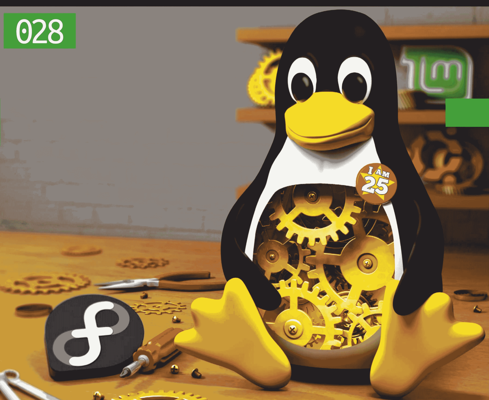

# SWAY

# 024

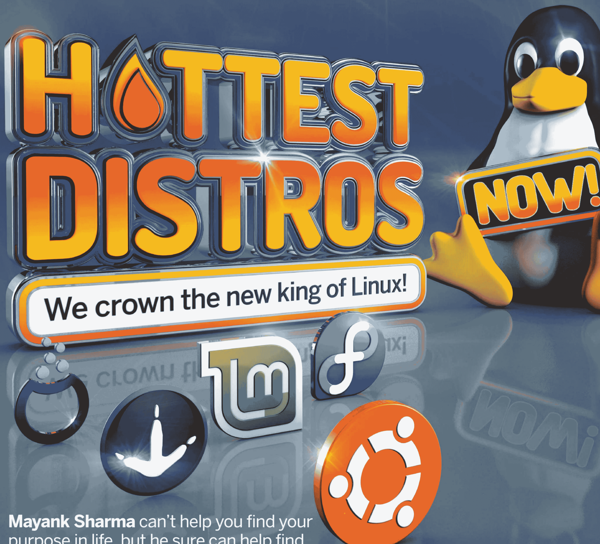

Mayank Sharma 无法帮你找到人生目标，但他肯定能帮你找到适合你用途的发行版。

Linux 内核本身对大多数人来说并没有太大用处。Linux 内核 0.01 版于 1991 年 9 月首次亮相，但它只对一位特定的芬兰学生和他那一类超级极客黑客有意义。其中一人，曼彻斯特计算中心（MCC）的 Owen Le Blanc，编写了一个菜单驱动的安装程序，用于安装内核及少量 GNU 工具，并在这一过程中于 1992 年 2 月创建了第一个 Linux 发行版。该发行版让即使是非 Unix 用户也能体验 Linux，并有助于吸纳更多开发者。

同年晚些时候，Peter MacDonald 创建了 Softlanding Linux System (SLS) 发行版，它提供了在 X11 图形界面上的软件集合，而 X11 图形界面当时刚刚移植到 Linux。SLS 随后衍生出两个主要发行版。第一个是 Patrick Volkerding 于 1993 年 7 月创建的 Slackware。二十多年后的今天，它仍然是仍在积极维护的最古老的 Linux 发行版。另一个是 Ian Murdoch 的 Debian。虽然它已经开发了好几个月，但 1994 年 1 月发布的 v0.91 是其首次公开发布，包含一个简单的软件包系统，可以安装和卸载软件包。Linux 发行版时间线上的下一个重大里程碑也发生在 1994 年，即 Marc Ewing 的 Red Hat Linux 的诞生。这三个发行版共同构成了现代 Linux 发行版生态系统的基石。虽然还有诸如 Crux、Arch、Gentoo 和 Puppy 等其他独立发行版，但目前大多数发行版都是这三个最古老发行版的衍生版本。你可以在 distrowatch 上找到数百种发行版，它们都在争夺你硬盘空间的一席之地。在接下来的几页中，我们将帮助你梳理所有这些，并挑选出最适合你的那一个。

## 选择你的“毒药”

你希望从现代 Linux 发行版中获得什么？

当用户开始使用 Linux 时，他们遇到的第一个怪癖就是没有单一的 Linux。对于大多数从专有桌面操作系统的“岸边”迁移而来的新用户来说，发行版的概念是相当陌生的。长期读者不会惊讶于 Linux 本质上只是一个内核这一事实，但大多数人所指的操作系统 Linux 实际上是发行版：一个由内核和用户所需的所有支持程序组成的软件集合。

表面上看，所有发行版都借用自同一公共池的应用程序和库。然而，Linux 发行版不仅仅是其组成部分的总和。所有发行版，尤其是主流发行版，都会投入数百小时的工作来调整和完善开源组件，以适应其特定版本的 Linux 风味。对于大多数项目而言，需要一个全球分布的开发团队来工程和交付一个 Linux 发行版。流行发行版会做到极致，以创建稳固的操作系统体验，并编写从安装程序到多个关键程序和工具以帮助管理安装的一切。顶级发行版也在不断演变，有些比其他更甚。一些发行版拥有资金充裕的跨国公司的资源（Ubuntu、Red Hat、OpenSUSE），为其研发提供动力。然而，得益于开源的本质，仅此一点并不总是能帮助公司支持的项目在技术上超越纯捐赠支持、社区支持（Mint、Debian、Arch）的项目。

在这个专题中，我们将看似无休止的发行版列表分解为五个最必需的类别，涵盖部署 Linux 的主要用例，从桌面到业务服务器以及介于两者之间的一切。选择发行版是一个复杂的过程，这就是为什么许多用户倾向于坚持使用他们已设置的发行版，并每隔六个月左右更新一次。然而，大多数发行版，尤其是更受欢迎的那些，都在不断演变。如果在某个版本中引入新功能而失宠的发行版，可能会在后续版本中该功能稳定时获得同行的更好评价。当然，我们不会建议你每当主要玩家发布新版本时就不停地更换发行版。但如果你已经使用同一个发行版一段时间了，现在是时候好好看看其他选项了。

### 我们如何测试

我们的发行版经过各种参数的测试，这些参数因类别而异。例如，在评估适合初学者的产品时，我们会关注有助于提高发行版易用性的自定义工具和其他调整。这是因为新的 Linux 用户需要在熟悉环境布局的过程中完成日常计算任务。虽然选择性是开源的标志，但对初学者来说是一种干扰。良好的适合初学者的发行版通过代表用户做出选择来帮助用户。有些甚至到了分叉流行应用以编写自定义版本的程度，以便新手可以处理。一般来说，面向经验不足用户的发行版应该比典型的桌面发行版更易于使用。

对于服务器发行版，我们的重点将是其可理解性以及部署和管理的 ease（容易程度）。与桌面发行版一样，服务器发行版被设计为适用于各种硬件配置，具体取决于你如何使用它们，但会在 64 位硬件上表现最佳。相比之下，硬件是专为旧机器设计的发行版的关键因素。

### 有意的遗漏

我们故意回避了有争议的“最佳桌面”类别，坦白说，该类别只会列出：Ubuntu、Linux Mint、Fedora、OpenSUSE 以及众多发行版中的任意一个，而这些发行版的包含或缺席又会惹怒不同的群体！尽管 Debian 有着优良的血统和其在 Linux 生态系统中的基础地位，但它也几乎缺席。如果我们有一个纯粹的服务器类别，Debian 显然会在其中（请别用 Debian-Ed 来找我们麻烦），但希望这份列表对刚接触 Linux 发行版世界的人来说具有启发性。

### 自己动手

我们还会帮助你制作自己的发行版。鉴于现有的众多优秀选项，这似乎有点适得其反。我们在此谈论的自定义发行版是高度定制化的，你可以根据自己的需求进行调整。想象一下，将你设置完美的系统转换为可实时安装的介质？把它放在闪存驱动器上随身携带，甚至安装在你使用的其他 PC 上。

除了满足个人需求外，自定义发行版还有许多其他用途。你可以创建一个包含你在学校使用的项目的发行版，并将其传递给班上每个人，里面塞满课堂笔记和其他学习辅助材料。你也可以在专业的组织内做类似的事情，这些组织使用一套定义好的应用程序。可能性几乎是无限的！

### 前 20 名发行版

### 初学者发行版

- **DEEPIN**
  一个外观优雅的基于 Debian 的发行版，使用直观的自定义桌面以及一系列自定义工具。

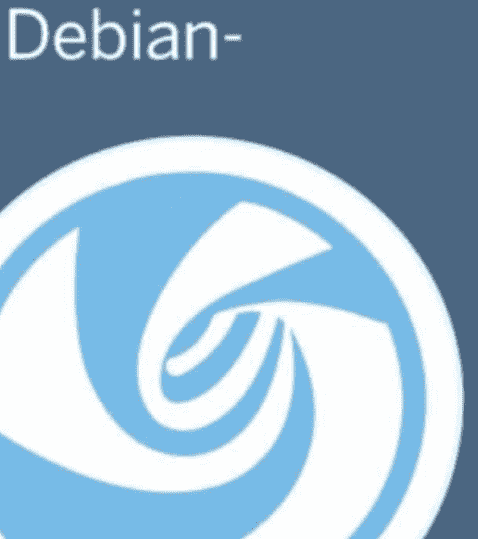

- **PINGUYOS**
  其定制的 Gnome 版本将给新和旧桌面 Linux 用户都留下深刻印象，但其要求严格。


### ELEMENTARY OS

- **ELEMENTARY OS**
  另一个美观的发行版，拥有精美打造的桌面和应用，仅受其默认程序库的限制。


### ZORIN OS

- **ZORIN OS**
  其独特卖点是外观更改工具，可将 Gnome 桌面调整为类似 Windows 的样子，这会让新用户感到舒适。


### LINUX LITE

- **LINUX LITE**
  其一系列自定义工具，如软件实用工具和欢迎屏幕，使常规桌面任务变得轻松。


### 发行版
### 重新制作 Ubuntu

通过点击操作即可打造专属定制版本。

Ubuntu 重新制作版本数量如此庞大的原因之一，在于存在大量易于使用的工具，它们能帮助你创建定制版的安装镜像。虽然创建定制发行版的流程并非高不可攀，但在 Ubuntu 上操作可谓轻而易举。

其中最容易上手的是 Bodhibuilder，它是流行的 Remastersys 脚本（见下方侧边栏）的一个分支。尽管名字如此，Bodhibuilder 不仅能创建 Ubuntu 的定制重新制作版本，还能用于其衍生版本，如 Linux Mint 和 Bodhi Linux。最新版本的 Bodhibuilder 支持 32 位和 64 位安装，并构建 UEFI 兼容镜像。事实上，Bodhi Linux 项目也使用该脚本来生成其官方发布版本。

为了创建定制的 Ubuntu 版本，最好先从零开始构建一个安装环境。我们建议你在虚拟机中进行此操作，以免日后陷入麻烦。首先，下载最小化的 Ubuntu ISO 镜像，该镜像包含启动 Linux 所需的最少组件。

当你从最小化 ISO 安装 Ubuntu 时，安装程序会调出 tasksel 工具，让你选择希望安装的附加组件。该工具提供选项，帮助你将根据需求将安装配置为邮件服务器、文件服务器及其他多种类型的服务器。不过，我们更关注那些以桌面为中心的多个选项，这些选项涵盖了所有流行的桌面环境，包括 Mate、Gnome、Xfce、LXDE 和 Budgie，且均提供标准版和扩展应用套件。

我们建议先从最小化桌面开始，然后在内部逐步完善安装内容。除了桌面选项外，你还可以选择获取特定类型的程序，如音频录制/编辑套件、照片修图与编辑套件、视频制作与编辑套件等。做出选择后，安装程序将从在线仓库获取所需组件并像常规 Ubuntu ISO 安装程序一样进行安装。对于初次构建，我们建议选择其中一个最小化的图形化环境。

### 开始构建

安装完成后，进入系统并按照你的喜好进行修改。你可以使用包管理器安装或移除任何应用程序，也可以通过下载官方仓库中不存在的预打包二进制文件来添加应用。同时，请随意通过修改菜单、壁纸和主题等各种组件来定制桌面。

完成安装环境的定制后，你可以安装 Bodhibuilder。该脚本以预打包二进制文件的形式在项目源页面上提供（https://sourceforge.net/projects/bodhibuilder）。熟悉其界面后，Bodhibuilder 的使用非常直观。首先，切换到“设置”选项卡以定义你的定制发行版名称。使用该选项卡下的各个文本框，设置 Live 环境用户名、ISO 镜像文件名，以及将显示在 GRUB 启动菜单中的发行版名称。工作目录是脚本生成并放置定制 ISO 镜像的位置。它首先会在指定目录下创建一个名为 Bodhibuilder 的文件夹来执行所有操作。请确保该文件夹位于拥有充足可用空间且格式化为 Linux 文件系统（如 EXT4）的分区上。

高级用户可以列出希望从生成的 ISO 中排除的文件和目录。类似地，默认情况下，Bodhibuilder 会包含 /usr/share/icons 和 /usr/share/locales 目录下的所有图标和语言环境。如果只想包含特定的图标和语言环境，请在提供的空间中列出它们。还有空间用于列出 squashfs 镜像，但除非你知道自己在做什么，否则最好保持为空。

描述完你的发行版后，切换回“操作”选项卡，该选项卡提供构建选项。值得注意的是“备份”和“Dist”选项。“备份”会将安装环境打包成 ISO 镜像，设置与当前桌面相同。这专供个人使用，包含你的所有用户数据和个人信息。

但在我们的用途中，我们将使用“Dist”选项，它也会创建 ISO 镜像，但会排除所有个人和特定用户数据。这样就可以安全地分发该 ISO，而不会泄露任何敏感信息。此选项专为制作定制发行版而设计。此外，“Dist”模式下的 Live 用户登录时不需要密码。除了这些选项外，还有“Distcdts”和“Distiso”选项的按钮，它们将 Dist 过程分为两个步骤，允许你在 ISO 镜像上放置额外文件。

另一组有趣的选项列在主要功能下方。使用它们，你可以将默认的 GRUB 背景图像替换为任意自定义的 640x480 PNG 图像，适用于 Live 环境和已安装系统。你还可以应用自定义的 Plymouth 启动动画。你可以在 www.gnome-look.org 和 www.deviantart.com 找到很多资源。要在自定义发行版上使用它们，你必须先在本系统中安装它们。因此，使用 `sudo apt install plymouth-themes` 获取 Plymouth 主题工具。然后在 /usr/share/plymouth/themes 目录下下载并解压一个主题。接着，使用 `sudo update-alternatives --install /usr/share/plymouth/themes/default.plymouth default.plymouth <path-plymouth> 100` 将新的 plymouth 主题设为默认。

记得将 `<path-plymouth>` 替换为你自定义 Plymouth 主题中的 `plymouth` 文件。现在你必须使用 `sudo update-initramfs -u` 重新构建 initrd 镜像。一旦安装了 Plymouth 主题，当你在 Bodichild 中按下选择 Plymouth 主题的按钮时，它将被列出。

### 隐藏在柜子里的骨架

下一步是将桌面定制设置转移到 ISO 中。这里我们将使用 Skeleton 目录（`/etc/skel`），它用于初始化新用户的家庭目录。实际上，这意味着放置在 `/etc/skel` 目录下的任何文件都将在创建新用户时复制到该新用户的家庭目录中。骨架目录有助于所有新用户获得相同的初始设置。

所有自定义桌面设置都保存在用户目录中的隐藏文件里。例如，我们更改了 Mate 桌面的默认壁纸，并使用 MATE Tweak 应用在桌面上放置图标，同时在桌面添加 Plank 任务栏并使其位于屏幕左侧，还更改了面板的布局和运行方式。

为了将这些更改带入定制发行版，将 `~/.config` 目录复制到 `/etc/skel`。某些程序将其定制配置保存在 `~/.local/share` 目录下，因此你也可以将此目录复制到 `/etc/skel`。确保已安装系统中的任何程序都不包含账户相关信息（如用户名和密码），否则你会将它们也转移到自定义发行版中。同样，如果你安装了自定义主题和图标，它们将位于 `~/.icons` 和 `~/.themes` 目录下，也应复制到 `/etc/skel`。

`/etc/skel` 目录代表新用户的家庭目录。因此，如果你想在自定义发行版的桌面上放置一个自定义图标，

> 在使用“清除”按钮清空工作目录之前，请确保已将定制 ISO 镜像从工作目录中复制出来。

你需要在 `/etc/skel/Desktop` 目录下创建一个桌面文件。例如，若要创建指向你最喜欢网站的桌面图标，首先使用 `mkdir -p /etc/skel/Desktop` 创建桌面目录。然后进入该目录并创建 shortcut.desktop 文件，内容如下：

```
<Desktop Entry>
Version=1.0
Name=Shortcut
Comment=My favourite website
GenericName=Shortcut
Exec=firefox www.linuxformat.com
Terminal=false
X-MultipleArgs=false
Type=Application
```

完成后保存该文件。你的自定义发行版现在将在桌面上包含一个图标，用于启动 Firefox 并访问 linuxformat.com。

现在，最后一步定制是清除已安装系统中的无用文件。通过使用 BleachBit（官方仓库中可用）可以节省大量时间。启动程序，进入“编辑”>“首选项”，切换到“语言”选项卡。为了减小 ISO 镜像的大小，取消勾选你不想包含在发行版中的任何语言。

回到应用的主界面，左侧面板列出了它将清理的系统区域。勾选 APT、深度扫描、日志（Journal）和缩略图（Thumbnails）部分旁边的复选框。展开“系统”部分，除了“释放磁盘空间”和“内存”之外，勾选所有选项。这些操作耗时较长，且对当前任务并无实质帮助。切换好复选框后，点击“清理”按钮即可清除安装中的不必要文件。剩下的工作就是将其转换为可分发的 Live ISO 镜像。在 Bodichild 中按下“Dist”按钮，要求脚本开始压缩 Live ISO。它将自动切换到“输出”选项卡，让你查看任务进度。根据分配给虚拟机的资源，这可能需要一段时间。

完成后，脚本将显示已构建 ISO 镜像的路径，该路径位于你之前指定的工作目录下。你可以使用 scp 将镜像从虚拟机复制到宿主机，然后使用该 ISO 启动另一个虚拟机。确认定制内容已正确镜像化后，你可以将镜像 dd 到 USB 磁盘，甚至可以将其发送给亲朋好友。

### 分道扬镳

Remastersys 一直是最受欢迎的脚本之一，用于将定制化的 Ubuntu 安装转换为可启动的 ISO 镜像。它借鉴了 Mandriva 的 mivivecd，但专为 Ubuntu 编写。当原脚本停止开发时，多个其他项目对其进行了分支，最著名的是 Bodhi Linux 和 PinguOS。本文使用了 Bodhi Linux 的分支版本，即 Bodhibuilder，你同样可以轻松使用 PinguOS 的分支版本，名为 Pinguoy Builder。

除此之外，现在还有一个原脚本的官方分支。名为 Linux Respin，该脚本托管在原 remastersys.org 网站上。然而与前两者不同，Linux Respin 专注于为 Debian 和 Linux Mint 创建定制版本。还有一个版本适用于自由软件基金会（FSF）最喜欢的发行版之一 Trisquel GNU/Linux。Linux Respin 的开发人员正在努力将该脚本移植到 Fedora 安装中，因此请密切关注该方面的发展消息。

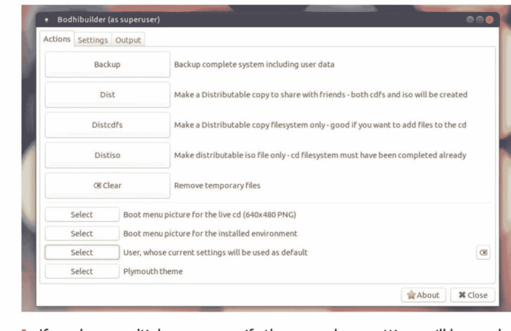

> 如果你有多个用户，在使用“备份”选项时，请指定将使用哪些用户的设置作为默认值。

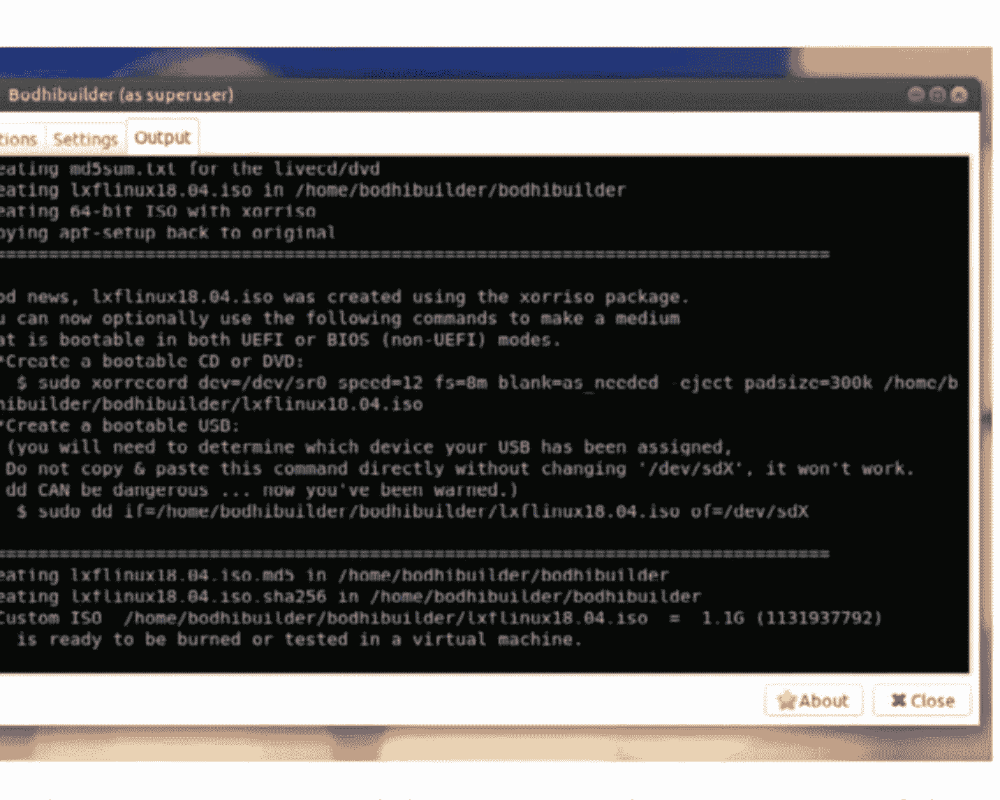

### 前 20 大发行版

### 滚动发行版

### Manjaro

基于 Arch Linux，专注于用户友好性，支持基于 Gnome、KDE 和 Xfce 桌面的版本。


#### Sabayon

一款仅支持 64 位的基于 Gentoo 的发行版，使用 Calamaris 安装程序，并自带其包管理系统：Entropy。


#### SolusOS

该发行版的亮点是其自制的 Budgie 桌面，以及它试图满足广泛用户需求所做的努力。

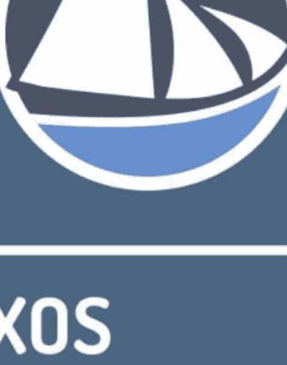

#### PCLINUXOS

虽然提供多个版本，但这个 Mandriva 分支的 KDE 版最为出色，此外它还拥有一个庞大且活跃的用户社区。

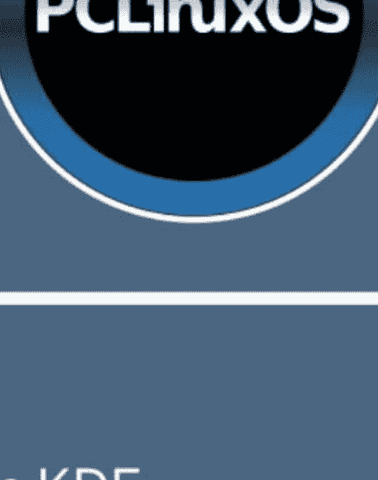

#### Ka0's

提供自定义 KDE 桌面，但由于其注重质量而非数量，提供的应用少于同类发行版。


### 功能丰富

将 Fedora 安装重构为可分发的发行版。

创建基于 Fedora 的发行版的关键在于 *livecd-creator* 脚本，它是 *livecd-tools* 软件包的一部分。使用 `dnf install livecd-tools` 命令从 Fedora 软件仓库获取它。与 *BootBuilder* 不同，*livecd-creator* 完全在命令行中工作。

这些脚本使用 **Kickstart** 文件中的定义来设置你定制的基于 Fedora 的发行版。简单来说，**Kickstart** 文件是一个文本文件，其中包含一系列操作，例如要安装（或删除）的软件包名称。*livecd-creator* 工具会根据此文件中的指示编译你的发行版。为了帮助你起步，你可以使用 `dnf install spin-kickstarts` 命令从 Fedora 软件仓库获取 *spin-kickstarts* 软件包，从而下载几种 Fedora 衍生版的 **Kickstart** 文件。安装后，你会在 /usr/share/spin-kickstarts 目录下找到一堆 **Kickstart** 文件。你可以通过编辑这些 **Kickstart** 文件来对其进行定制。

这些文件文档完善且相当易于理解；浏览 Fedora 维基（[http://fedoraproject.org/wiki/Anaconda/Kickstart](http://fedoraproject.org/wiki/Anaconda/Kickstart)）以掌握各种选项。如果需要从头开始生成一个文件，你可以使用 `dnf install system-config-kickstart` 命令获取 **Kickstart** Configurator 工具，这可以为你节省大量时间。此工具具有易于导航的图形界面，可帮助创建 **Kickstart** 文件。

### 启动流程

出于我们的目的，我们将通过修改 *fedora-live-mate_compiz.ks* 文件来创建一个基于 MATE 的 Fedora 重构版。*kickstart* 文件中的三个主要参数是 `%pre`、`%post` 和 `%packages`。你还可以使用 `%include` 参数通过指定名称和位置从另一个 *kickstart* 文件中引入指令，例如 `%include fedora-mate-common.ks`。你会注意到 *fedora-live-mate_compiz.ks* 文件顶部有这三行这样的指令。

第一行调用 *fedora-live-base.ks* 文件。该文件描述了创建 Fedora Live CD 的基本骨架。参数都是不言自明的。依次包含默认语言、键盘和时区设置，随后是规定使用标准 shadow 密码等的安全设置。在此，我们要指出，虽然 SELinux 的默认设置为强制模式，但它阻碍了某些构建的顺利运行，我们不得不将定制发行版的默认 SELinux 策略更改为宽容模式。

设置为 `--startxnomode` 的 `xconfig` 要求 Live CD 直接启动到图形登录屏幕。还有一个条目用于创建 root (/) 分区，另一个用于启用和禁用默认服务。

*fedora-live-mate_compiz.ks* 文件还包含 *fedora-mate-common.ks* 文件，其中列出了带有 Compiz 合成器的 MATE 桌面的软件包列表。任何你想包含在自定义发行版中的软件包都需要列在 `%packages` 部分下。除了单个软件包外，你还可以指定软件包组，例如 `@mate` 和 `@libreoffice`。如果你安装了软件包组，可以通过在名称前添加减号 (-) 来删除其中的单个组件，例如 *-fedora-icon-theme*。这些软件包是从 fedora-repos.ks 文件中提到的 Fedora 软件仓库获取的。你可以使用 --baseurl 选项直接指定软件仓库的确切 URL，或者使用 --mirrorlist 选项让系统从镜像列表中选择其中一个。

如果你从 RPMFusion 等第三方软件仓库获取软件包，或者获取专有软件（如 Steam 客户端、Google Chrome、Nvidia 图形等），Fedora 指南强制要求你重新品牌化你的作品。但他们简化了这一过程。你所需要做的就是删除一系列 Fedora 品牌软件包，即 -fedora-logos 和 -fedora-release*，然后用通用的 generic-release* 和 generic-logos 替换它们。

### 后置操作

最后是 %post 部分，它允许你在所有软件包下载并安装到临时目录后运行命令。你可以添加自定义用户、复制文件、配置网络，并在此部分执行许多其他有趣的事情。

为了正确标识你重构的发行版，我们将在 /etc/fedora-release 文件中重命名它，使用如下代码：

```
%post
sed -i -e 's/\$Generic release/LXF Fedora Remix/g' /etc/fedora-release
%end
```

%post 部分的命令默认在 Live CD 的新文件系统上的 chroot 环境中运行。但也有一种机制可以向 LiveCD 的文件系统添加文件。%post --chroot 部分允许你从外部与自定义发行版的环境进行交互。这使你能够来自主宿主 Fedora 安装复制文件到定制发行版。

Kickstart 提供了两个变量用于与自定义发行版环境进行交互。$INSTALL_ROOT 指向定制发行版的根目录 (/)，在构建过程中所有软件包都安装在此处。这在复制你在 Live 环境中需要的文件时非常有用。例如：

```
%post --nochroot
cp -r /home/\$INSTALL_ROOT/Pictures/wallpapers/\
$INSTALL_ROOT/etc/skel/Pictures/
%end
```

这将把宿主上 wallpapers 目录内的一组图像复制到定制发行版中。我们将其放在骨架目录（/etc/skel）中，以便定制发行版中的所有用户都可以使用。你可以使用相同的机制将你的桌面自定义设置复制到定制发行版中。首先，就像以前一样，根据需求在已安装的系统中配置你的桌面。完成后，只需将主页目录中的配置文件复制到 Live CD 上的 /etc/skel 目录：

```
%post --nochroot
cp -r /home/\$INSTALL_ROOT/etc/skel/
cp -r /home/\$INSTALL_ROOT/etc/skel/
%end
```

另一个变量是 $LIVE_ROOT。这是 Live CD 的根目录，放置在此处的任何文件都无需启动介质即可访问。想想 Linux Format 光盘上所有你可以不启动当月特色发行版即可查看的 HTML 文件。例如：

```
%post --nochroot
cp -r /home/\$INSTALL_ROOT/
Music
%end
```

这会将宿主上的所有音乐文件复制到定制介质的根目录。你也可以同时使用这两个变量，将文件从压缩文件系统的根目录内部移动到介质的根目录：

```
%post --nochroot
cp \$INSTALL_ROOT/usr/share/doc/*/\\
release-*GPL $LIVE_ROOT/GPL
%end
```

这将从定制发行版的文件系统中提取 GPL 许可协议文件，并将其放在定制介质的根目录中。

组装好 kickstart 文件后，你可以将它们传递给 livecd-creator 来编译你的定制发行版的 ISO 镜像。在调用 livecd-creator 脚本之前，首先确保使用 `setenforce 0` 命令将宿主上的 SELinux 设置为宽容模式：

```
$ livecd-creator --config=custom-fedora.ks \
--fslabel=LXF Remix28 --cache=/var/cache/live \
--verbose
```

这里，--config 选项指定了我们的自定义 kickstart 文件，而 --fslabel 定义了卷名以及 ISO 镜像名称。--cache 选项定义了脚本将从软件仓库下载软件包并组装成 Live 环境的目录。请记住，在后续构建中重用此缓存目录，以避免再次下载相同的软件包。只有在你运行初始构建后向 kickstart 文件中添加了新的软件包时，脚本才会下载软件包。

编译发行版所需的时间通常取决于你计算机的处理能力和需要从互联网获取的软件包数量。完成后，它会在当前目录留下一个用于你的定制 Fedora 重构版的 ISO 文件。然后，你可以在虚拟机器上测试它，再将其分发给朋友、家人和感兴趣的同事。

### 手动重构

虽然本特性中介绍的脚本简化了将 Linux 安装转换为可分发的 Live 介质的过程，但手动执行该过程也相当简单。这种方法的优点在于，无论宿主上运行的是什么发行版，你都可以定制任何发行版。例如，你可以使用 Fedora 安装来创建一个定制的基于 Ubuntu 的发行版。

在开始之前，你需要 *squashfs-tools* 软件包来压缩自定义发行版的文件系统，以及 *genisoimage* 软件包将你的发行版打包成 ISO 镜像。这两个软件包通常都可以在大多数发行版的官方软件仓库中找到。接下来，获取你想定制的发行版的 ISO 镜像，并将其回环挂载。然后将其内容提取到一个文件夹中。使用 `unsquashfs` 命令（*squashfs-tools* 的一部分）来解压缩文件系统。对于基于 Ubuntu 的发行版，如 Mint，这是 *casper* 目录下的 *filesystem.squashfs* 文件。对于 Fedora，它是 LiveOS 目录下的 *squashfs.img*。

解压缩文件系统后，chroot 进入其中。准备 chroot 环境需要仔细进行。进入未压缩的文件系统后，你可以使用发行版的软件包管理系统添加和删除软件包，并修改任何配置文件。然后，在退出 chroot 环境之前删除任何临时文件。现在你只需要重新生成清单，压缩文件系统并将其打包成 ISO 镜像。

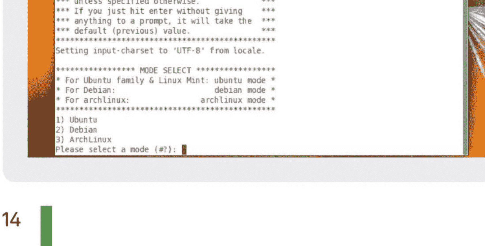

使用 **LiveCD** 准备 chroot 环境并创建定制的基于 Debian、Ubuntu 和 Arch 的发行版。

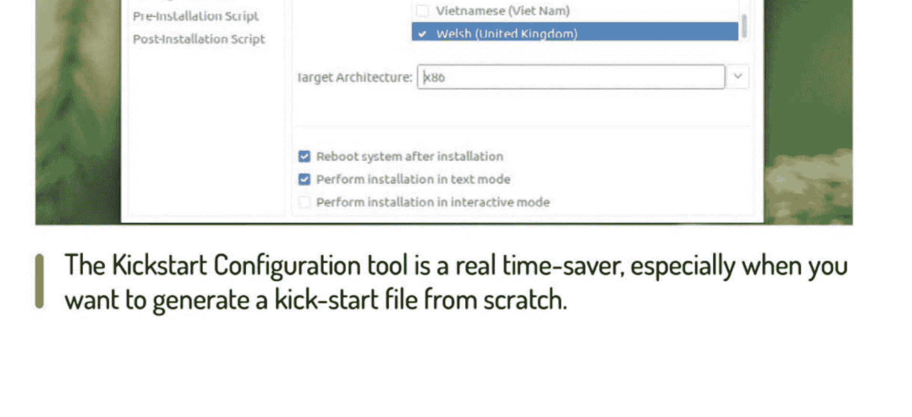

**Kickstart** 配置工具是一个真正的时间节省者，尤其是当你想从头开始生成一个 kick-start 文件时。

### 前 20 名发行版

### 轻量级发行版

#### MX Linux


这是 antiX 和 MEPIS 之间的合作成果，该发行版的独特之处在于其易用性和众多自定义工具。

#### antiX


这个基于 Debian 的发行版不附带 Systemd，并提供四个带有不同轻量级桌面的版本。

#### 4M Linux


该发行版使用 JWM 窗口管理器，尽管其需求极小，但仍可用于各种用途。

#### Puppy Linux

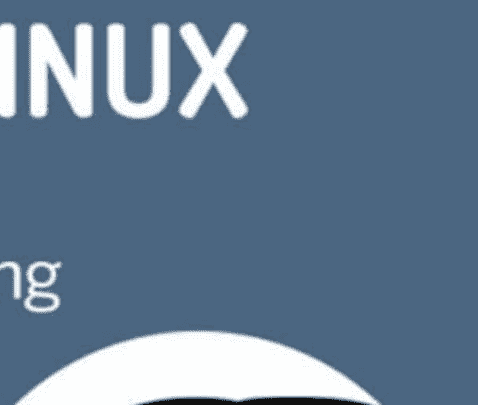

它是复活旧电脑的经典首选之一，因其深奥的软件选择而备受争议，既被喜爱也被憎恨。

#### Bodhi Legacy


它附带基于 Enlightenment 的桌面，并旨在在老化的计算机和上网本上良好运行。


### 建造你的城堡

基于流行的 DIY Linux 发行版打造你的定制版本。

虽然 `buildhopper` 和 `livced-creator` 都允许你创建经过大量调整的定制版本，但如果你有耐心从零开始手工打造安装环境，Arch Linux 提供了更全面的方法。Arch 是培养自定义发行版的理想平台，它避免了困扰许多其他流行发行版的代码膨胀和软件包泛滥问题。Archiso 包是一组 bash 脚本，你可以用它将你的 Arch 安装转换为可分发的发行版。与它运行的基础发行版一样，Archiso 有一个陡峭的学习曲线，但它让你对最终结果拥有很大的控制权。

在使用 Archiso 之前，你需要首先安装 Arch Linux。如果你是 Arch 的新手，该项目维基页面上有很好的文档记录（[https://wiki.archlinux.org/index.php/Installation_guide](https://wiki.archlinux.org/index.php/Installation_guide)）。另一个选择是使用纯 Arch 基础发行版的安装，如 Antergos、Archolinux、Chakra 或 Manjaro。事实上，其中一些发行版，如 Manjaro，拥有 Archiso 脚本的独立分支。

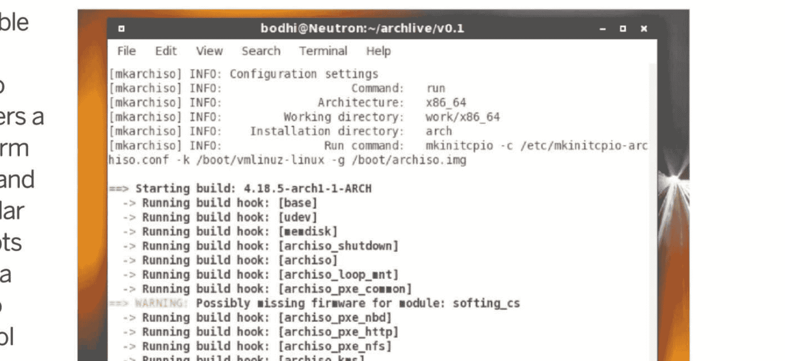

> 你可以使用 `archiso-offline-release` 创建一个仅使用本地托管的软件包而不是从在线仓库获取的自定义发行版。

无论如何，一旦你在计算机上安装了 Arch，下一步就是按你的喜好进行定制。这包括安装更多的软件包，更换桌面环境的默认主题和艺术作品，并配置系统的其他方面，如网络。像往常一样，我们将这些定制和配置从已安装的 Arch 实例复制到我们要构建的自定义发行版中。完成 Arch 安装的定制后，打开终端并使用以下命令安装 Archiso 及其依赖项：

```
pacman -S squashfs-tools libisoburn
```

```
dfstools patch lfs develos git archiso
```

接下来，使用 `mkdir ~/archlive` 创建一个目录，用于调整我们自定义发行版的文件。确保你有足够的磁盘空间来容纳你希望安装的所有程序以及你想复制到自定义发行版的任何文件。Archiso 附带两个预定义的配置文件。

基准配置文件（baseline profile）适用于创建没有预装软件包的基本 Live 系统。然而，我们将使用发布配置文件（release profile），它允许你创建一个带有预装应用程序的完全定制的 Arch Linux。要使用这些脚本，只需将它们复制到 `~/archlive` 目录，如下所示：

```
cp -r /usr/share/archiso/configs/release/ ~/archlive/
```

### 打包一切

要在自定义发行版上放置软件包，你只需将它们列在新创建的 `archlive` 目录下的 `packages.x86_64` 文件中。该文件已经包含了一个必需的 Arch 软件包列表，你可以使用文本编辑器手动添加。由于你的目标是镜像你的 Arch 安装，请使用 `pacman -Qqe > ~/archlive/packages.x86_64` 命令将该文件中所有已安装软件包的名称导出。

`~/archlive/` 中的 `airootfs` 目录充当新发行版根目录的覆盖层。你添加到此目录的任何文件都会添加到你的发行版文件系统中。例如，如果你希望自定义发行版具有与宿主机相同的用户，请复制相关文件：

```
cp /etc/{shadow,passwd,group} ~/archlive/airootfs/etc/
```

airootfs 文件系统的另一个用途是设置和启动图形环境。首先使用以下命令找出当前设置中登录管理器的服务文件：

```
$ ls -l /etc/systemd/system/display-manager.service
```

假设你正在使用 GDM，则你需要通过以下命令将文件符号链接到新文件系统中：

```
### ln -s /usr/lib/systemd/system/gdm.service ~/archlive/airootfs/etc/systemd/system/display-manager.service
```

就像之前一样，要复制你希望放在用户 /home 目录中的任何文件，你需要将它们放在 /etc/skel 目录中。首先使用 `mkdir ~/archlive/airootfs/etc/skel` 创建它，然后复制文件，如 `cp -R /etc/skel/* ~/archlive/airootfs/etc/skel/`。

要自动登录为你的用户而不是默认的 root 用户，在文本编辑器中打开 `~/archlive/airootfs/etc/systemd/system/getty@tty1.service.d/autologin.conf` 文件，并修改此行以更换自动登录用户：

```
ExecStart=-/sbin/getty --autologin <username> --noclear %I 38400 linux
```

将 `<username>` 替换为你想要登录的用户。

### 定制镜像

在 root 的主文件夹（`~/archlive/airootfs/root`）中，有一个名为 `customize-root-image.sh` 的文件。你通常在 Arch 安装后执行的任何管理任务都可以脚本化到该文件中。请记住，文件中的指令必须从新环境的角度编写，也就是说，脚本中的 `/` 代表正在组装的发行版的根目录。在文本编辑器中打开文件，找到设置 `/etc/localtime` 的行，并更改为你的时区。例如：

```
ln -s /usr/share/zoneinfo/Europe/London /etc/localtime
```

还请确保通过将 `usermod` 行更改为以下内容来将 shell 设置为 Bash：

```
$ usermod -s /usr/bin/bash root
```

向下滚动并添加一行，将 `/skel` 目录的内容也复制到你的用户主目录中，并设置正确的所有权权限：

```
cp -aT /etc/skel /home/<bodhi>
chown -R bodhi /home/<bodhi>
```

在这两个命令中，请记住将 `<bodhi>` 替换为你的用户名。

最后，向下滚动到文件末尾，你会注意到一堆 `systemctl` 命令。要直接启动图形桌面，请编辑该行，将默认目标从 multi-user 更改为 graphical.target，使其如下所示：

```
systemctl set-default graphical.target
```

就这样。你现在已准备好构建自定义发行版的 ISO。进入 `~/archlive` 目录并运行以下命令：

```
./build.sh -v -n LXArch -v 0.1 -L LXArch0.1
```

以启动构建过程。`-v` 开关启用详细模式，`-N` 开关设置 ISO 镜像的名称，`-v` 设置版本号，`-L` 为生成的 ISO 镜像添加标签。该过程通常不会抛出任何错误，但如果你遇到任何与 pacman 相关的投诉，请尝试使用 `pacman-key --refresh-keys` 刷新其认证密钥。

根据它需要获取的软件包数量，该过程将花费一些时间。它将在 `~/archlive/work/` 目录下创建和处理所有内容。完成后，脚本将重建 ISO，并且对构建脚本的调用将失败。你可以通过删除 `~/archlive/work/` 目录来绕过此限制。

享受构建你自己的发行版的乐趣，但请记住发行版不仅仅是为了圣诞节，而是为了终身；因此你需要永远支持它。也请告诉我们你的进展！EX

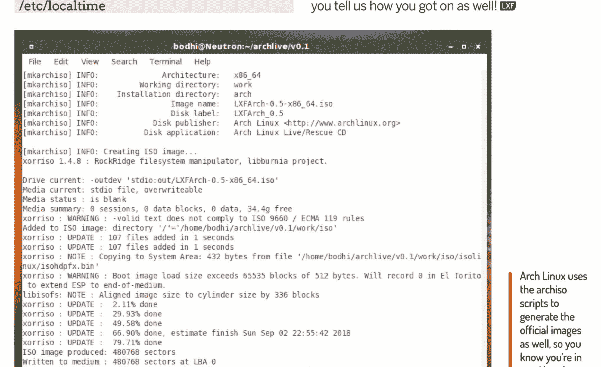

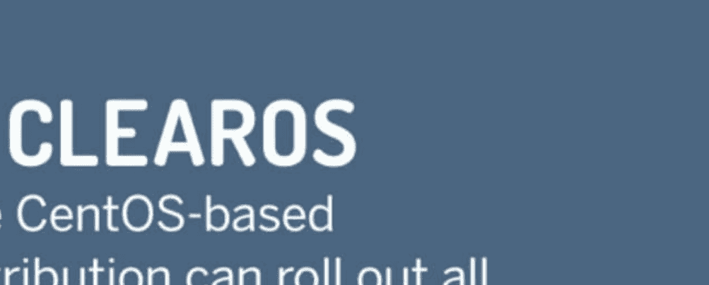


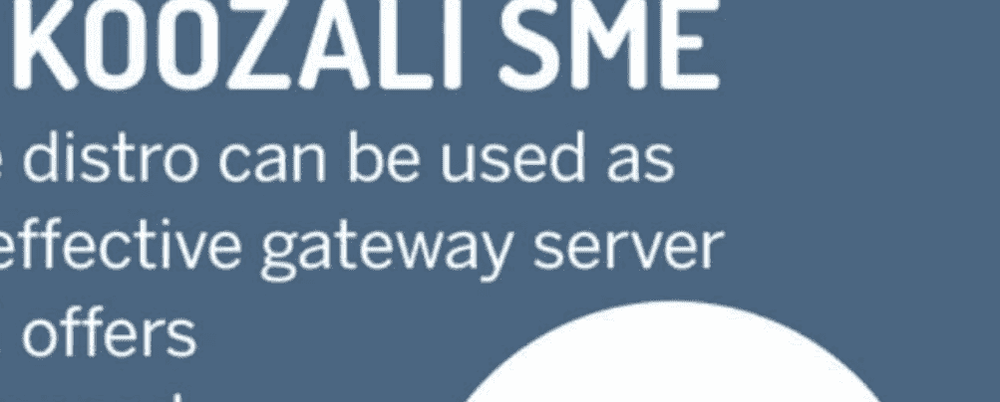


### 从男孩到男人

本特性中的脚本将帮助你把你安装的 Linux 版本转换为可分发的介质，然后你可以将其分发给他人。这并没有错。但如果你真的想体验从零开始创建自定义发行版需要做什么，你需要把自己关在房间里一周，带上 `Linux From Scratch`（[www.linuxfromscratch.org](www.linuxfromscratch.org)）的副本。Linux From Scratch，俗称 LFS，实际上是一本书，它耐心地指导你完成组装自己的 Linux 发行版这一耗时过程。该书提供免费下载，你甚至可以在书店购买印刷版。一旦你完成了 LFS，你会发现你拥有一个非常安全、非常灵活且非常紧凑的系统。

但过程并没有就此结束。根据 LFS 常见问题解答（[www.linuxfromscratch.org/blfs](www.linuxfromscratch.org/blfs)），“LFS 的目的不是创建你想要的系统。它的目的是仅仅允许你构建你想要的系统。它不是终点，而是起点。当你完成 LFS 时，你才刚刚开始构建你的系统。”

这就是 Beyond Linux From Scratch（BLFS）（[www.linuxfromscratch.org/blfs](www.linuxfromscratch.org/blfs)）派上用场的地方。BLFS 是一本更大的手册，涵盖了从安装系统库到编程工具，从网络库到服务器应用程序，从像 `fluxbox` 这样简单轻量级的窗口管理器到像 KDE 和 Gnome 这样复杂但流行的管理器。

该项目始于 1999 年，当时其作者 Gerhard Beckmans 想要了解 Linux 发行版在幕后是如何工作的。在从头开始构建系统时，Beckmans 写下了步骤并将其发布为教程，认为可能会有其他人感兴趣。

LFS 自其卑微的起点以来已经增长了不少。除了 BLFS 之外，该项目还衍生了几本其他书。有 ALFS 或 Automated LFS，用于帮助自动化创建 LFS 系统的过程，还有 CLFS 或 Cross LFS，专注于交叉编译。

### 前 20 大发行版

### 商业发行版

- **CLEAROS**
这款基于 CentOS 的发行版可以部署各种网络服务，并拥有直观的基于 Web 的管理界面。

- **NETHSERVER**
另一款满足您所有商业服务器需求的全面发行版。只有其略显粗糙的界面拖了后腿。

- **KOOZALI SME**
该发行版可作为有效的网关服务器使用，并提供高级功能，尽管其界面不够精致。

- **ZENTYAL**
其直观的界面可能是同类中最好的，但与其他的相比，它提供的服务器功能非常有限。

- **IFFIRE**
这款发行版被宣传为防火墙服务器，但其出色的软件包管理系统可以扩展其功能，执行其他几种服务器功能。


### 综述

teragos » ArchLabs » KaOS » Manjaro » Netrunner 滚动版


**Jonni Bidwell** 需要谨慎地饮用 Jura 威士忌来抵挡那些试图干扰本期*综述*的细菌。

### 基于 Arch 的发行版

越来越多的发行版正在基于 Arch Linux 构建。曾经 **Jonni Bidwell** 可能会称这种行为为亵渎，但现在他认为这是一项辉煌的发展。

### 我们的测试方法...

我们在一台 Dell XPS13 上安装了每个发行版，这使我们能够测试 HiDPI 和触摸屏支持。我们检查了这些发行版是否可以在不破坏其他操作系统的情况下与其他操作系统共存安装。进一步的测试在虚拟机（限制为 3GB 内存）中进行，这让我们对发行版在旧硬件上的运行情况有了一些了解。

我们查看了开箱即用的安装包含哪些内容，以及这是否在实用性和臃肿之间取得了恰当的平衡。由于我们专注于提供桌面的发行版，我们查看了这些桌面的时尚程度和有效性。请记住，可以安装和配置替代桌面以符合您的喜好。

我们将仓库与 Arch Linux 的仓库进行了比较，后者以提供最新软件并对上游发行版进行最少更改而闻名。特别是，我们查看了每个发行版使用的桌面软件包。我们还检查了每个发行版如何与 Arch 用户仓库（AUR）集成。


很少有人会不同意 Arch 是一个出色的发行版：处于前沿、可定制，并拥有一个热情的社区和出色的文档。但它并不适合每个人。

许多人因缺乏安装程序而却步：手动分区磁盘并 *chroot* 到引导安装中以开始安装工作，这真的无法获得任何用户友好性加分。那些克服这一障碍的人将面临新的挑战：即将最小安装构建为可用的系统。如果您为桌面使用而安装，您会发现让该桌面看起来美观并良好运行绝非易事。

简而言之，它真的让你感激其他发行版所做的大量开箱即用的设置工作。

但 Arch 的优秀特性可以与其他发行版的便利性结合。想象一下，再也不需要添加 PPA 来获取新发布。想象一下，能够重新构建标准软件包的自定义版本。想象一下，然后不用再想象。我们在这里关注的是桌面变体，因此我们将特别关注现代桌面创新，但人们已将 Arch Linux 用作各种事物的基础（安全性、Raspberry Pi、32 位硬件，列表还在继续），这正是其灵活性的体现。

### 安装与首次运行

安装程序是否欢迎您？


**A**ntergos 从一开始就以时尚的 **Cnchi** 安装程序给人留下深刻印象。您可以选择设置常用应用程序和桌面。这些都需要下载，这使得离线安装无法进行，但它确实为安装者提供了寻找最快镜像的便捷性。如果您担心安装失败而需要重新开始，您可以选择在目标设备上创建恢复分区。这是一个不错的亮点，但幸运的是，我们没有理由使用它。您甚至可以在 GRUB2 和 systemd-boot、加密安装甚至使用 ZFS 之间进行选择。

Manjaro 的实时介质以选择键盘映射、免费与非免费驱动程序或添加内核参数的略显简朴菜单开始。一旦 Calamares（见 **LF293**）安装程序启动，我们会遇到常规选项（LVM 和加密），您可以选择使用您的驱动器、与其他操作系统并行安装或手动分区。当您启动进入 Manjaro 后，欢迎屏幕显示发布信息并提供指向 Wiki 的链接。还有一个方便的工具用于安装常用应用程序。Netruntime 作为 Manjaro 的后裔，具有类似安装过程。新手可能会因为发现桌面上的 Readme 图标将他们带到带有混合内容警告的 404 页面而感到有些沮丧，但这只是外观上的问题。KaOS 也使用 Calamares 安装程序。XFS 作为默认文件系统是一个稍微非主流的选择，但为什么不呢？安装完成后，Croeso（威尔士语“欢迎”）工具欢迎您，并提供指向文档和常见系统设置的快捷方式。如果您不知道 Plasma 将这些东西藏在哪里，这非常方便；即使您知道，将所有东西放在一个地方也很不错。Creoso 比 Manjaro 的欢迎工具有更多选项。

**A**bif，Archlabs' Ncruses 安装程序对新手不太友好，但提供与 Antergos 相同的选项，并在重启前执行完整的系统更新。由于实时介质自 2018 年 7 月后未更新，这是一个相当漫长的过程。重启后，菜单允许您安装常用应用程序、字体等。如果您不喜欢从控制台登录，LightDM 显示管理器也可以从这里轻松获取。

### 评价

| 发行版 | 分数 |
| :--- | :--- |
| ANTERGOS | 9/10 |
| MANJARO | 8/10 |
| ARCHLABS | 6/10 |
| NETRUNNER ROLLING | 8/10 |
| KAOS | 7/10 |
| MANJARO | 8/10 |

Antergos 的 Cnchi 为 Linux 安装程序树立了新标准。ArchLabs 的文本体验无法与之竞争，但控制台战士不会介意。

### 仓库

这些仓库如何保持最新？


**B**e mindful that we're using the stock Arch repositories as a baseline here, and short of packaging things yourself or using snaps this is pretty much the fastest way to get the latest upstream releases.
注意，我们在此使用标准的 Arch 仓库作为基准，除非您自己打包软件或使用 snaps，否则这几乎是以最快速度获取最新上游发布的方式。

Manjaro 借鉴了 Debian 的经验，提供稳定版、测试版和不稳定版分支。不稳定版软件包比 Arch 仓库落后约三天，这应该对任何人来说都足够新鲜。软件包在“准备好”时进入稳定版，这通常相当迅速，除非出现某些紧迫情况。在撰写本文时，新版本 Systemd 存在稳定性问题，但除此之外，我们没有发现重大差异。Netruntime 滚动版基于 Manjaro 的稳定通道（虽然少数自定义软件包来自其自己的仓库），因此它可以享受 Manjaro 仓库中 12,000 多个软件包。

KaOS 往往落后得更多一些，且在其仓库中找到的唯一图形应用程序是 Qt 应用程序，例如其 KDE Plasma 焦点。如果您需要其他任何内容，您必须自行构建。您可以从 KaOS 社区软件包仓库这样做，考虑到 KaOS 的有限仓库，这大大拓宽了其兴趣范围。KaOS 使用 Plasma 5.14，而 Netruntime 使用 Plasma 5.12，两者目前都使用 KDE 应用程序套件版本 18.08，希望刚刚发布的 18.12 应用程序捆绑包能早日惠及这些 KDE 发行版。最后，Antergos 维护少数自己的软件包，但否则依赖 Arch Linux 仓库，而 ArchLabs 仅使用 Arch 仓库。

KaOS 的仓库中只有数千个软件包。这只是 Arch 提供内容的零头，也许也是您所需的全部。

### 评价

| 发行版 | 分数 |
| :--- | :--- |
| ANTERGOS | 8/10 |
| MANJARO | 9/10 |
| ARCHLABS | 8/10 |
| NETRUNNER ROLLING | 7/10 |
| KAOS | 8/10 |

Manjaro 的频道适合所有用户，其丰富的仓库几乎与 Arch 一样齐全。

### 风格

哪个发行版提供桌面魅力？

比较不同的桌面是一项棘手的工作，特别是当我们有来自整个光谱的不同“物种”时。我们不会因为 ArchLabs 使用轻量级窗口管理器而扣分，也不会因为 Antergos 使用现成（虽然不可否认很酷）的图标主题而加分。相反，我们将关注每个桌面相对于已安装组件的样式化程度。我们关心图标和颜色方案的协同工作、经过考虑的布局以及无杂乱。由于我们擅长在 Arch 中从头设置各种桌面环境，我们将为整理常见怪癖或偏离默认设置（只要这些偏离是有用的）给予信用。无论您最终使用哪个桌面，由于 Arch 始终附带最新发行版，您最终获得的东西可能看起来和运行起来比其他发行版更好。如果您没有，那么您可能至少发现了一个新 bug，或者您可能会瞥见几个月后其他发行版用户将抱怨的内容。

## Antergos Gnome 7/10

Antergos 是我们唯一的 Gnome 提供，但即使在我们到达那里之前，我们在启动时看到的时尚控制台字体设置就令人印象深刻。Dash-to-dock 在左侧提供启动器（类似于 Unity 和 Budgie），并带有粗体 Nuxix Square 主题风格的图标，该主题在整个桌面中使用。Files 中明亮的橙色目录图标可能不合所有人品味，但我们要喜欢它们。Weak 和 User Themes 扩展已安装，用于按您的喜好调整和主题化内容。

如果您选择使用 Gnome 搭配 Antergos，您可能想将外观笨重的 LightDM 欢迎界面替换为 GDM，并有一个专门致力于此的 wiki 页面。如果有一个“最大标题栏”的奖项，Antergos 将获胜，但使用新型 GTK3 标题栏的 Gnome 应用程序在使用它们时看起来相当舒适。


## ArchLabs 9/10

我们喜欢应用于 OpenBox 和 Polybar 面板的极简、深色风格。得益于 Compton，一些阴影和淡入淡出使得桌面虽然低调，但仍显得现代。ArchLabs 色彩丰富的图标主题与所有黑暗形成鲜明对比。您可以从 Preferences 菜单的舒适中切换 Polybar 为 Tint2，或添加一个 dock（如 Plank 或 Docky）。

如果您觉得 Conky 污染了您的桌面背景，那么它也可以被移除。不过它确实提供了一些有用的提示，最重要的是，按 Super 键即可使用 Drun 启动器。桌面翻页器上的视觉提示（Home、Web、Files 和 Pictures）对于充分利用四个虚拟桌面非常出色。使用了几个 Xfce 组件，并且可以从欢迎菜单中添加更多——甚至整个 Xfce。


### 包管理

我们的候选者如何驾驭 Pacman 并与 AUR 集成？

所有发行版都允许您使用出色的 Arch Pacman 工具，但这对于想要以图形方式进行操作的人可能不是最理想的。*Pacman GUI* 包含在 Antergos 和 Manjaro 的 Xfce 和 Gnome 变体中。这比 Netrunner 和 KxOS（以及 Manjaro KDE）使用的类 Synaptic 的 *Octopi* 稍微流畅一些。KxOS 包含图形缓存清理器和软件包日志，但命令行工具同样可以完成这些任务。Netrunner 还提供商店风格的 KDE *Discover*。ArchLabs 允许从其欢迎菜单安装 *Pamac*，但在这里以 CLI 风格进行操作似乎更合适，为此，它包含基于文本的 *Pacil* 前端。*Pacil* 可以帮助降级软件包，这是 Arch 不支持但 KxOS 拥有某些情况下必要的功能。Manjaro 的内核工具会通知您新内核，Netrunner 也有，但我们发现必须手动调用它才能升级到新的主要版本。这可能是我们的重视程度不够。

*Pacman* 可以通过各种助手进一步增强，用于从著名且有用的 Arch 用户仓库（AUR）构建和安装自定义软件包。*Pamac* 和 *Octopi* 都显示新软件包通知，并可选择与 AUR 集成。然而，AUR 软件包可能与来自 AUR 仓库之外的任何内容不兼容，因此在使用自定义仓库的发行版（特别是 Manjaro）上，应注意谨慎。目前，ArchLabs（您最不可能遇到 AUR 冲突的地方）使用 *Archarm* 助手，但由于该项目的开发正在停滞，*Yay* 可能是更好的选择。或者，*Pacil* 也可以作为曾经为首选、现已停止维护的 *Yaourt* AUR 助手的前端。

### 评价

| 发行版 | 分数 |
| :--- | :--- |
| Antergos | 7/10 |
| Manjaro | 8/10 |
| ArchLabs | 6/10 |
| KxOS | 8/10 |
| Netrunner Rolling | 7/10 |

Manjaro 允许您以任何方式照顾您的软件包。ArchLabs 因缺乏 GUI 选项而失分，但再次，这可能无关紧要。


### KaOS

7/10

KDE 长期以来因其高度可配置性而闻名。这既是福也是祸。尤其是 KDE 4，选项分散得到处都是，而且还默认启用了近乎臭名昭著的窗口发光效果。KDE Plasma 5 的默认设置相当出色，但也提供了大量选项供用户定制。

既然 KaOS 基于 KDE Plasma，我们本以为它会展示出与常规 KDE 布局略有不同的特色，事实也确实如此。屏幕右侧有一条菜单栏，Dolphin 文件管理器的导航面板也呈现出类似的右侧偏好。你可能很快就会习惯这种布局，但这初次体验确实令人感到突兀。叫我们守旧也罢（更准确地说，我们是“老派”——编辑注），但我们更喜欢底部的面板和左侧的文件管理器导航栏。不过，我们倒是真心喜爱 Powerline 终端美化功能。

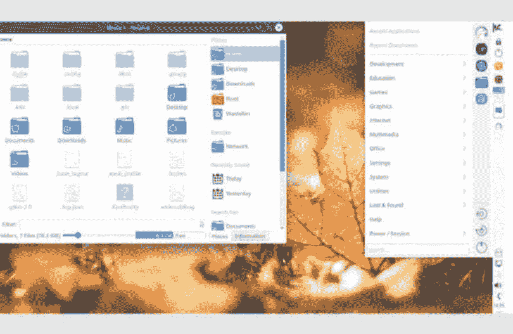

### Manjaro

8/10

Manjaro 的主要版本是 Xfce 版。这对于那些追求桌面华丽效果的用户来说可能不会引起共鸣，因为 Xfce 在近三年来几乎没有什么变化。但它功能完备，远非丑陋，而且对系统资源非常友好。它还支持显示缩放，因此 4K 分辨率用户不必眯着眼看极小的字体，只是配置起来比 KDE/Gnome 稍微复杂一些。

请记住，Manjaro 针对那些桌面环境提供了官方版本，同时也存在社区维护的其他版本。传统派用户会欣赏其包含的“窗口最小化到标题栏”（shade）控制功能，以及外观/窗口管理器设置的易用性和可配置性。

默认的图标主题（Papirus-Maia）大胆而不喧宾夺主，还有许多其他图标和 GTK 主题可供选择。Kvantum 主题管理器可以让 Qt 应用程序焕然一新，但在 KDE 版中这一功能会更实用。

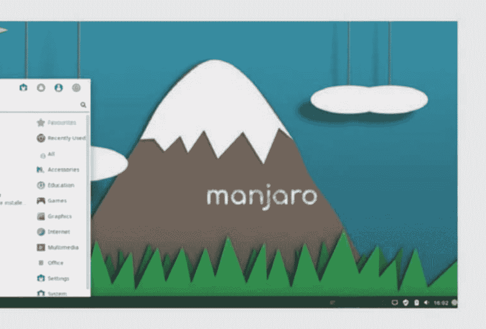

### Netrunner Rolling

7/10

Netrunner 的 Plasma 配置包含全屏应用程序仪表盘，就像 Gnome 的仪表盘一样，它也支持搜索文档。不过，大号字体看起来有点奇怪。我们更喜欢 Plasma 的混合启动器，而你可能更偏好 KaOS 使用的传统级联菜单。黑色面板看起来很有风格，而我们对于下拉式终端的需求简直永无止境，因此我们称赞其包含了 Yakquake。

桌面上的“我的电脑”和“网络”图标看起来有点 Windows 风格，但可以轻松忽略或移除。由现代版本的 Plasma (5.14) 和 Qt (5.11) 支持的 Breeze AlphaBlack 主题带来了一些不错的透明效果。桌面上有个无效链接是个小麻烦，但系统附带了大量精美的壁纸。Breeze 主题有 GTK 对应版本，因此相关应用程序也能遵循桌面的精美风格。默认情况下未启用桌面小部件。很好。

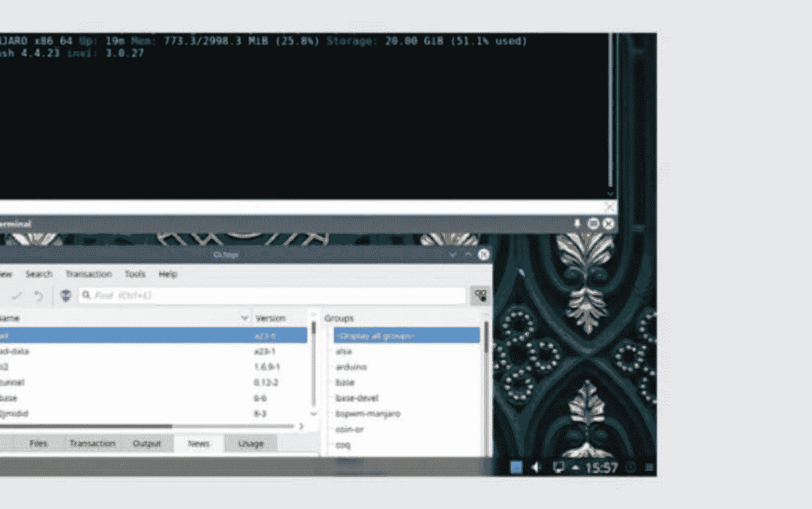

### 文档与支持

当一切出现问题时，你可以向哪里求助？

> Archwiki 是一个真正很棒的学习资源。它编写精良（且格式一致），涵盖了你能想到的几乎所有内容，并且保持实时更新。在那里找到的很多内容适用于所有发行版，尤其是当 Arch 是它们的祖先时更是如此。Arch 论坛同样是一个名副其实的知识宝库，但请注意——那里对愚行并不宽容。

在专属支持方面，Manjaro 名列前茅。它拥有自己的邮件列表、错误跟踪器、IRC 频道、全面的 wiki 以及（相对而言）友好的论坛。此外，还有约 30 种其他语言的子论坛用于讨论，因为 Manjaro 的用户群体非常多元化。Netrunner 通过渗透获益于此，但它也有自己的（相对更低调的）论坛。

Antergos 的 wiki 看起来内容较为匮乏，尽管它确实提供了一份关于在 Windows 10 上设置双引导的详尽指南，这应该能让新手安心。它还有一个活跃的多语言论坛和一个 IRC 频道。ArchLabs 论坛也同样繁忙。然而，除了关于内置程序和自定义桌面的一些实用提示外，wiki 上的内容并不多。较小的发行版确实受益于社区参与，因此如果你解决了一些棘手的小问题（无论是否有人询问过），请考虑分享你的知识。为了更大的公共利益等等。

KaOS 团队使用多个错误跟踪器，并有一个安静的论坛。其网站有一份关于如何合理提问和报告问题的实用指南，如果每个人都阅读这类指南，世界真的会变得更美好。

### **裁决**

| 发行版 | 得分 |
| :--- | :--- |
| Antergos | 8/10 |
| Manjaro | 9/10 |
| ArchLabs | 7/10 |
| Netrunner Rolling | 6/10 |
| KaOS | 6/10 |

Manjaro 庞大的用户基数意味着一个强大的社区，许多人在你提出真正的问题时，不会默认让你“读一下手册”（RTFM）。

### 值得注意的新增功能

有时候，正是这些小细节带来了巨大的不同...

在 Arch 上设置打印机有点麻烦，但 Antergos 和 Manjaro 包含了 Redhat 的 *system-config-printer* 工具。除了 ArchLabs 之外，我们所有测试的发行版都包含 *HP Device Manager*，如果你需要管理此类设备，这很棒。

Netrunner 包含了 Grub 自定义工具，这是一个很好的贴心设计，并且像 Manjaro 一样也开箱即用地支持休眠功能。*KDE Discover* 是发现新应用程序和 Plasma 插件的好方法。它比以前更加稳固，我们发现它比 *Gnome Software* 让人讨厌得多。

Netrunner 的 Firefox 安装程序预装了 uBlock Origin 和几个流行的屏蔽列表，使网络稍微不那么令人恼火。

KaOS 包含一个 Wayland 会话，这对一个 KDE 发行版来说是一个不错/大胆的设计。Antergos 上的 Gnome 会尝试启动 Wayland 会话。作为不爱打字的人，看到 *bash-completion* 包缺失于 Manjaro 和 Netrunner 令人遗憾，但我们真心赞赏 KaOS 的 Ash 配置和标签自动补全功能。Manjaro 和 KaOS 都具备 UFW 防火墙的简单前端。我们认为现在是中高级用户开始关注哪些包被引入或移除的好时机了，因此我们要为这两个发行版鼓掌。Antergos 和 ArchLabs 都保留了 Arch 的可定制性，主要

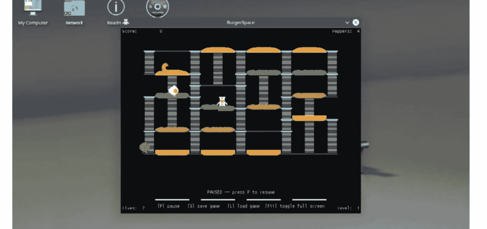

> Netrunner 包含复古游戏 BurgerSpace。可惜我们没时间玩它！这里。

是通过提供直接访问 Arch 仓库中庞大软件包的方式。我们认为更多人应该给轻量级桌面一个机会，我们很喜欢 ArchLabs 自带的 Openbox/Polybar/Compton 设置。从零开始设置这个比重新配置 KDE/Gnome/Xfce 要难得多。

### **裁决**

| 发行版 | 得分 |
| :--- | :--- |
| Antergos | 7/10 |
| Manjaro | 8/10 |
| ArchLabs | 8/10 |
| Netrunner Rolling | 8/10 |
| KaOS | 9/10 |

我们提供的所有选项中都有隐藏的瑰宝，但 KaOS 的开发者确实认真思考过用户会喜欢什么。

### 内置工具

开箱即用的体验是怎样的？

Antergos 安装了一套轻量级的 Gnome 应用程序套件，但足以让你开始工作。拥有 Gnome 的新 *Documents* 工具是个不错的贴心设计，*Weather*、*Maps* 和 *Books* 也是如此。由于没有 *LibreOffice*，文书工作者需要自行安装，但安装了 *Chromium*，这会让 50% 的人满意。*Gnome Software* 的批评者会 appreciate 它的缺席。

Manjaro（进而包括 Netrunner Rolling）包含一个硬件检测工具（*mhwd*），它在安装时运行，安装后可以从设置管理器或终端中调用。还有一个方便的添加/移除内核的工具，如果你遇到硬件回归问题，这非常有用。在 Netrunner Rolling 中，如果你需要滚动更新到较新的（甚至是实时）内核，这更有双重用途。在这两个发行版中，*Flash 播放器* 的实用性较低。游戏玩家会欣赏 Manjaro 菜单中包含的 *Steam 安装程序* 快捷方式。有些人会欣赏指向 *MS Office Online* 网页工具的链接，但其他人可能只认为这是不必要的菜单杂乱。NetRunner 预装了许多多媒体应用程序。还有一些有趣的游戏，我们赞赏 *GIMP-Inkscape-Krita* 图形三件套。*Skype*、*Steam* 和 *VirtualBox* 也可用。

KaOS 提供了 *Elisa* 音乐播放器、*Karbon* 矢量图形工具和 *Seahorse* 实用工具。它与众不同的是使用了 *Calligra* 办公套件。这在 Plasma 环境中看起来很有风格，在很多方面比 *LibreOffice* 更不笨拙，但对于一些人来说可能很难习惯。由 QtWebEngine 驱动的 *Falkon*（前身为 *QupZilla*）是一个很好的网页

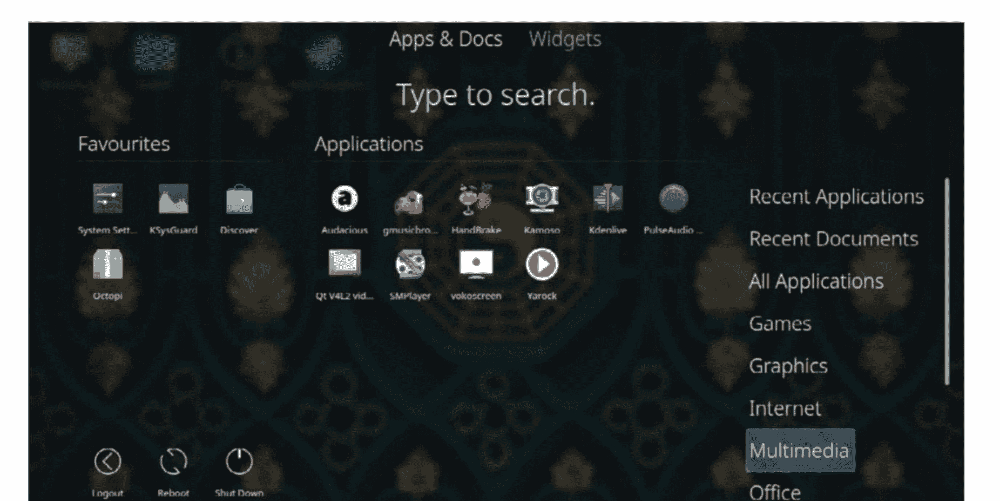

> 我们不确定是否认识谁在使用 Handbrake。*VLC* 和 *gmusicbrowser*。如果你有，Netrunner 都能覆盖。

浏览器，如果你不需要花哨功能的话，但有些人可能会急于安装更主流的东西。

ArchLabs 以极简主义为荣，但你可以通过其欢迎菜单安装任何你需要的东西。*Music* 和 *movies* 由 *mpv* 和 *Audacious* 处理。向开发者致敬，它包含了 *Geany* 代码编辑器，以及 Arch 的 base-devel 包组。我们赞赏包含 *Nmap*，而 *Firefox* 会让另外 50% 的用户满意。

### **裁决**

| 发行版 | 得分 |
| :--- | :--- |
| Antergos | 7/10 |
| Manjaro | 9/10 |
| ArchLabs | 6/10 |
| Netrunner Rolling | 6/10 |
| KaOS | 7/10 |

如果你认为少即是多，请忽略 ArchLabs 的得分。不过，Manjaro 确实很好地筛选了精华。


### 基于 Arch 的发行版

### 结论

对于一些用户来说，拥有一个纯粹的 GTK 或 Qt 系统是一大福音，尽管这会极大地限制他们可用的应用程序数量。对于这些人来说，Antergos，尤其是 KaOS，可能会具有一定的吸引力。而另一些人则会很高兴跨工具包主题定制的情况比以往好了很多，并且不介意安装两个工具包。毕竟，存储空间很便宜。

在很多方面，我们认为 KaOS 应该提供更新的 KDE 软件包，因为它在 Arch 仓库发布软件包后很快就会跟进。当然，KDE neon 被认为是展示 Plasma 平台上最新、最强大特性的首选发行版，所以也许没必要与之竞争。Blue Systems 赞助的 Netrunner Rolling 是一个不错的尝试，但我们觉得它试图面面俱到。

尽管每个发行版都付出了巨大的努力，但不熟悉 Arch 及其工作方式的用户迟早会感到困惑。Manjaro 可能是本月入选产品中用户友好的，但 Ubuntu 或 Mint 并不是，如果把它当作那样，就会导致失望。（生活充满失望，但这又是另一个综述的故事了。）你可能最终不得不亲自动手解决一些问题。相反地，如果你熟悉 Arch，你很可能会选择留在 Arch（那就站在高墙之上吗？——编者注），或者从这些发行版中获得灵感，并将其应用到你自己的 Arch 安装中。我们无疑被 ArchLabs 的桌面禅意所迷住，以及它在内存占用低于 200MB 的情况下所能实现的功能。

Manjaro 在其旗舰 Xfce 版本方面做得非常出色。它表明这款桌面不仅能够使用资源节省，还能看起来很美观。过去这一年，它变得非常流行，并非因为人们对 Ubuntu 的抱怨，而是因为它是一个非常出色的发行版，能给人们提供他们确切想要的东西。当 Xfce 4.14 发布，记者们不再为此开玩笑时，它无疑会更加受欢迎。

Gnome 和 KDE 版本也很不错。如果你更喜欢最新的桌面边缘功能，那它们很棒，但我们欣赏 Manjaro 专注于 Xfce 的大胆举措。

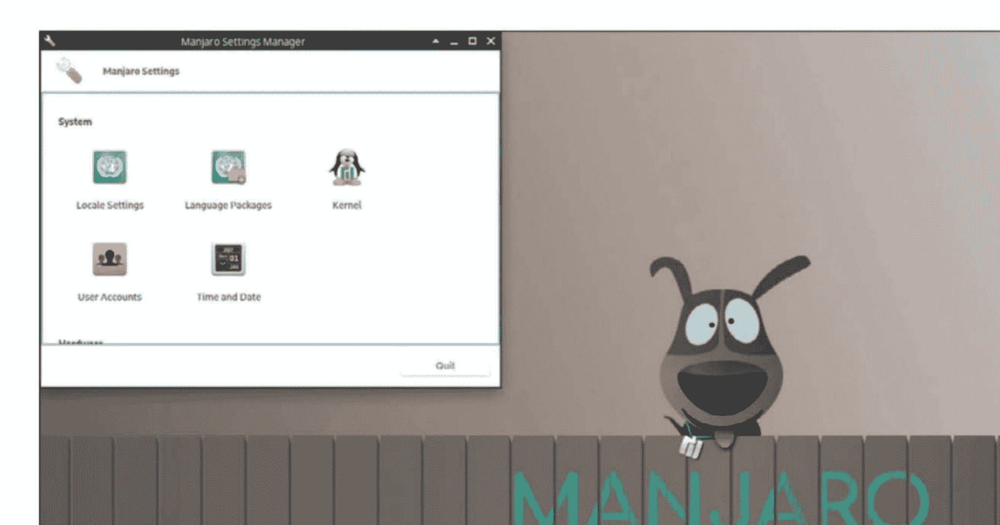

- **第 1 名 Manjaro 9/10**
  - 网络：https://manjaro.org
  - 许可证：多种
  - 版本：18.10
  - Manjaro 将 Arch 变成了人类和机器都能享受的东西。

- **第 2 名 ArchLabs 9/10**
  - 网络：https://archlabslinux.com
  - 许可证：多种
  - 版本：2018.07
  - 你不需要一台老古董机器来享受轻量级发行版。

- **第 3 名 Antergos 8/10**
  - 网络：https://antergos.com
  - 许可证：多种
  - 版本：18.11
  - 出色的安装程序和一款各方面都很棒的发行版。

- **第 4 名 Netrunner Rolling 7/10**
  - 网络：https://netrunner.com
  - 许可证：多种
  - 版本：2018.08
  - KDE Plasma 和 Arch 是完美的组合，但仍有一些粗糙的地方。

- **第 5 名 KaOS 7/10**
  - 网络：https://kaosx.us
  - 许可证：多种
  - 版本：2018.10
  - 专为 Plasma/Qt 纯粹主义者设计，但这限制了其他所有人。

### 也要考虑

多年来，许多基于 Arch 的发行版来了又去，但有些经受住了时间的考验，现在新的发行版也定期涌现。发行版添加非自由软件以提升用户体验是很常见的，但 Parabola 以及更近期的 Hyberbola 则走向了另一个极端。这两者不仅命名源自解药（cures），都获得了 FSF 认可，并使用了 Linux-libre 内核。Hyberbola 从 Debian 那里汲取灵感，使用较旧但久经考验的内核。Arch 可能已经停止支持 32 位，但 Arch Linux 32 发行版依然存活且充满活力。

Arch-Xference 和 Anarchy Linux，两者都是 Xfce 发行版，值得一看。Chakra Linux，一款 KDE 发行版，去年给我们留下了深刻印象，但自那以后就没有更新过。那些想要比 ArchLabs 更轻量的东西的人应该看看 ArchBang，它受到现已停办的 CrunchBang 的启发。以迂回的方式，这也启发了 ArchLabs。

### Wayland

### 等待结束了

下一代显示协议终于准备登场了！

好了，我们说出来了，请把你所有的论点都发给 **Jonni Bidwell**...


可靠的 X Windows 显示服务器自 80 年代的 UNIX 系统以来就一直存在。它在 90 年代以 X386（后来的 XFree86）的形式来到 Linux，而名正言顺的开源 X.org 分支在 2004 年接管了一切。从那时起，它一直在推动 Linux 用户屏幕上的像素。

你不再需要通过手动指定显示时序来冒着烧坏监视器的风险；事实上，你可能根本不需要配置它。为了应对新硬件和编程，它已被扩展得面目全非：XAA、GLX、Glamor、UXA 以及一系列其他晦涩难懂的代码名称和首字母缩写词，确保你所有的窗口都能平滑移动。此外，其许多底层功能已移入内核，形式为 KMS。

问题是，X.org 仍然基于 30 年前的理念：它所服务的显示原语在许多方面与绘图仪和打印机更相关，而非今天的显示器和 GPU。将其用于现代图形工作（特别是游戏）通常被描述为试图把方头钉子塞进圆孔里。

除了技术上的缺陷，经过其漫长的存在，它已成为一团乱麻的代码，以至于任何潜在的开发者看到都会吓得大叫着逃跑，仿佛他们直面了克苏鲁（当选总统？——编者注）本人。

幸好有一个替代品。那就是 Wayland，一种从头到尾重新思考显示器和输入设备工作原理的方案。这个崭新闪亮的显示服务器可能还不是我们所有问题的答案，但它绝对值得你的关注...

Wayland 的工作已经进行了很长时间。它最初于 2008 年构想，当时开发者 Kristian Høgsberg 正驾车驶过新英格兰同名城镇。对于许多桌面用户来说，它将和 systemd 和 GNOME 3 一起，牢固地坐在“寻找问题的解决方案”的盒子里。毕竟，我们已经有 X 了——为什么不现代化和扩展它，而是采用这个东西，它 a) 不工作 且 b) 即使它工作，也无法做到 X.org（1984 年制定的 X 窗口系统标准集的当前实现）所能做的一切？但有时少即是多，让我们看看原因。

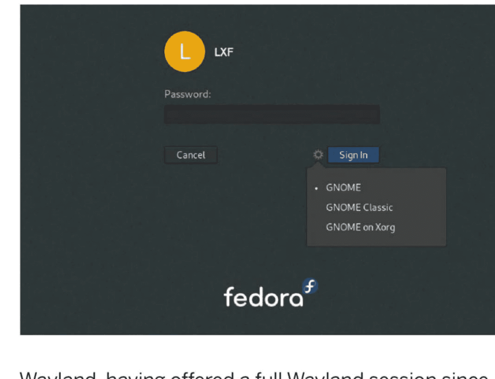

> 这个小齿轮是你进入 Wayland 或你安装的任何其他桌面的入口。

X 最强大的功能之一是网络透明性。其客户端-服务器架构为运行 X 服务器的机器——连接显示器和输入设备的那台——提供了奢侈，无需关心 X 客户端（应用程序）是在本地运行还是从另一台机器运行。这是一个实用的功能——如果你从未通过 SSH 运行图形应用程序，你就没有体验过——并促进了 80 年代和 90 年代瘦客户机范式的发展。

自 2015 年以来，Wayland 已提供完整的 Wayland 会话。通过稍显勉强的延伸，尝试 Wayland 的最佳发行版是 Fedora，因为它长期提供坚实、纯正的 GNOME 体验。如果你真的不想使用 Fedora，你可以跟随使用 Ubuntu 上的 GNOME 或任何符合你口味的其他发行版。然而，我们强烈建议，为了真正从体验中获得最大价值，你在 Fedora 上尝试它，因为这会给你最优的性能。

将所有应用程序安装在单台强大的机器上，通过网络传输给仅运行 X 等基础服务的机器，为企业和学院节省了大量资金，并使 UNIX 技能更具价值。不过在桌面环境中，网络透明性很少使用，因此该模型只是增加了复杂性。远程渲染很棘手，如今至少对于家庭使用，使用远程桌面程序通常更合理。因此，Wayland 不直接支持网络透明性，但你仍然可以通过 XWayland 运行远程 X 应用程序。

### 为什么 WAYLAND (W) 很酷

Wayland 仅仅是一个协议，所以我们不能将显示服务器的概念直接应用它。想要通过 Wayland 渲染的图形程序是通过显示合成器来实现的。Wayland 的参考合成器被称为 Weston。现代 X 桌面也有显示合成器——它们现已整合到功能齐全的桌面（GNOME 拥有 Mutter，KDE Plasma 拥有 Kwin）的窗口管理器中，而在像 i3 这样精简的窗口管理器中，你可以添加 Compton 这样的合成器。

> "Wayland 希望——事实上它已经做到了——成为比 X 更精简、更简单的像素推动方式"

Fedora 全力以赴，在 Fedora 25 中将 Wayland 会话设为默认。你可以通过在输入密码时点击小齿轮来选择 X 或 Wayland 会话。如果出现问题，你要么无声地回退到 X.org 会话，要么被吐回

这些处理各种不同矩形，将它们全部以正确的顺序放置在正确的位置，以构成连贯的桌面。最近，它们还可能应用一堆阴影或透明效果，并管理时序以避免屏幕撕裂。Wayland 希望——事实上它已经做到了——成为更精简、更简单的像素推动方式。在 Wayland 中，合成器、服务器和窗口管理器基本上都统一了。

### 故障排除

在我们 LXF243 中对 Collabora 图形资深专家 Daniel Stone 的采访中，我们了解到实现 Wayland 合成器有两种方法。要么有一个统一的环境处理所有内容（菜单、坞、桌面插件），要么分块处理：一个小的合成器程序，辅以处理其他一切的工具。我们将在此处查看这两种方法。

有许多原因可能导致你无法启动 Wayland 会话。最常见的原因是你正在使用专有 Nvidia 驱动程序——尽管在 Fedora 的新安装中不会这样，因为 Fedora 不包含任何专有代码块。自 Plasma 5.15 起的较新版本的 GNOME 和 KDE 实际上支持驱动程序的 EGLStream API（其他所有驱动程序使用 GBM），但能否工作很大程度上取决于你特定的硬件和驱动程序版本。一个解决方案是使用免费的 Nouveau 驱动程序，但如果你喜欢严肃的游戏，这不是个好主意。

后一种方法与 X 的做法相当相似；即使你正在运行像 GNOME 这样的统一桌面环境，你也在运行一个 X 实例，其上运行着一个 Mutter 实例，以及各种伴随运行的小东西。GNOME 通常被认为是尝试 Wayland 的最佳场所

我们在 Arch Linux 上观察到的一个奇怪问题，使用 Intel 图形——其支持 Wayland 已久——是 i915 模块必须作为 initramfs 的一部分加载，Wayland 才能正确启动。作为一个附带的好处，做到这一点后，系统在启动过程的开始立即切换到其原生分辨率，使启动体验看起来更加流畅。我们知道这种多样性和琐碎。对于其他问题，请使用 `$ journalctl -b -e` 检查日志，或邮件联系我们的 Wayland 战士和答案国王 Neil Bothwick：lxf.answers@futurenet.com。


### 发行版

最终到达 GDM 登录界面，或者面对一片令人恐惧的空白黑屏。如果不幸发生了后一种情况，请尝试使用 Ctrl+Alt+F3 切换到 TTY，登录并运行：
`$ sudo systemctl gdm restart`

如果你成功进入了 Gnome，可以使用以下命令检查你当前所在的会话类型：
`$ loginctl list-sessions`

你会看到类似这样的内容：

```
SESSION UID USER SEAT TTY
1 1000 bxf seat0 tty2
```

然后获取该会话编号，并将其代入以下命令：
`$ loginctl show-session 1`

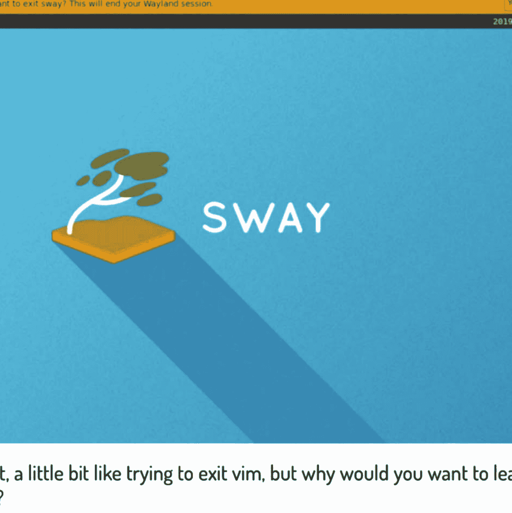

退出 Sway 起初有点像试图退出 vim，但你为什么要离开这个令人舒适的背景呢？

### 什么功能不起作用？

转向 Wayland 而非 X 的一个原因是安全性。由于其设计，任何应用程序都可以读取其他应用程序的输出或向其发送输入。这意味着编写键盘记录器和其他恶意行为变得极其简单——参见我们第 32 页的恶意软件专题。Wayland 拥有更健壮的安全模型，禁止了此类行为。不幸的是，这阻碍了传统方法处理简单任务（如截图）以及复杂任务（如远程连接桌面）。一些截图工具在 Wayland 下仍然无法正常工作，但 Gnome 自带的工具可以。我们注意到，在 Wayland 下运行时，KDE Plasma 的 Spectacle 似乎失去了捕获特定区域的选项，但其他功能运行良好。

虽然花费了一些时间，但远程桌面（以及屏幕投送/共享/录制）功能也已添加到 Wayland 中。遗憾的是，TeamViewer 和 Simple Screen Recorder 等流行工具尚未更新以支持 Wayland。**Green Recorder**（`http://bit.ly/kfx25green`）运行良好，Gnome 的 **Boxes** 应用程序及其内置的屏幕录制工具（Ctrl+Alt+Shift+R）也是如此。

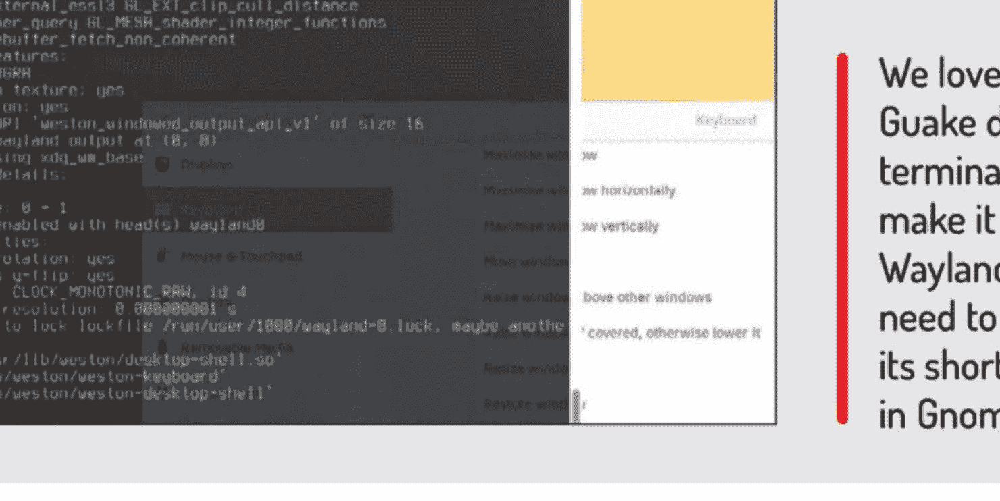

我们喜爱 Guake 下拉式终端，但为了让它在 Wayland 下工作，你需要在 Gnome 中设置其快捷键。

将会显示大量信息，指交叉祈祷其中包括一行：
`Type=wayland`
如果没有，请检查第 45 页的故障排除框。任何核心 GTK 应用程序都支持 Wayland，因此 Gnome 的所有核心工具都没问题。其他事物仍绑定于 X，因此 Wayland 自带其自己的 XWayland 层来处理这些。由于 XWayland 必须是一个完整的 X Server，且大多数人至少运行一个不支持 XWayland 的应用程序，运行 XWayland 有时被视为浪费资源。然而 XWayland 很精简，只运行应用程序所需的部分，因此这种论点是站不住脚的。例如，Fedora 30 捆绑的 Firefox 版本仍需要通过 XWayland 运行。

### 走向另一面的 Wayland

KDE Plasma 现在与 Wayland 配合良好，而 Plasma 5.16（在你阅读此文章时应该已经发布）应该会运行得更好。它甚至应该支持 Nvidia 驱动，尽管根据 Gnome 的支持情况来看，使用 XWayland 的应用程序可能会行为异常或完全失常。Unity 的情况更令人担忧，因为其部分应用程序仍依赖 GTK2，其窗口管理器需要重写以支持 Wayland，或者被完全替换。

Weston，即 Wayland 的参考合成器，并不一定是你日常使用的桌面替代方案。但它非常适合测试，即使仅仅因为你可以在现有的桌面和显示服务器内运行 Weston——虽然在 Arch 的 Wayland Gnome 会话内运行时，它似乎当前运行非常缓慢。在 Fedora 上，即使你只从光盘运行实时会话，你也可以安装并运行 Weston：
`$ sudo dnf install weston` `weston`

你应该会看到一个带有灰色、整齐镶嵌背景的小窗口。这可能不是世界上最令人兴奋的东西，但总比什么都没有好（事实上，你也可能看到什么都没有，或者错误信息）。点击左上角终端图标可以打开一个终端，你可以从中进一步探索 Weston。
你可能会同意所有主要桌面都缺少的一项功能是旋转窗口。在 Weston 中并非如此：尝试将指针悬停在终端标题栏上，同时按住 Super（Windows 键）并移动鼠标。不可思议，不是吗？还有其他令人兴奋的快捷键，例如使用 Super+Alt 和滚轮改变窗口不透明度。
你可以通过注销当前桌面并在密码提示处选择 Weston 会话来在当前桌面之外启动 Weston 会话。如果你在 Fedora 的实时环境中跟随操作，退出 Gnome 前需要为实时用户设置密码。最简单的方法是按下 Super 进入 Activities 视图，然后输入 `users` 的前几个字母。然后点击建议的 Users 小部件。现在当你注销并尝试重新登录时，你会被要求输入密码，此时你可以选择新的 Weston 会话。完成时按 Ctrl+Alt+Backspace 退出 Weston。
正如我们所提到的，Wayland 还有另一种更模块化的方法。这将吸引桌面

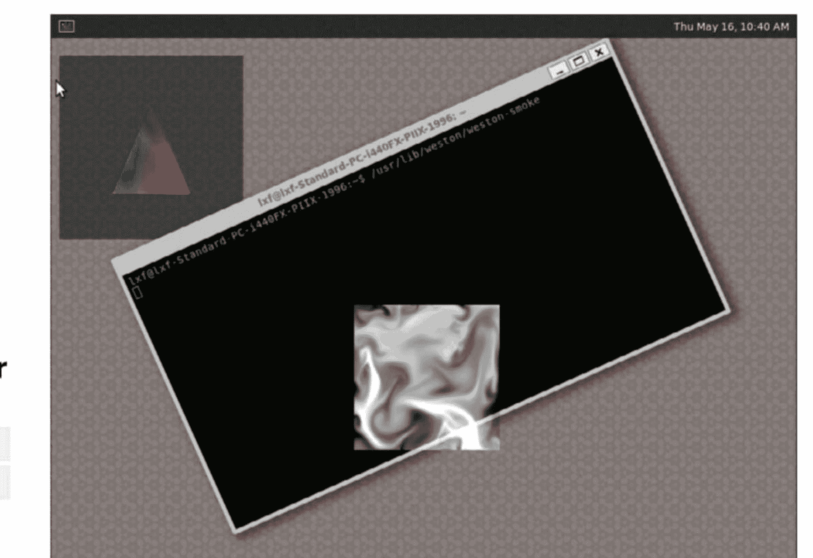

> Ubuntu 的 Weston 包在 /usr/lib/weston 目录中包含一些演示。

爱好者——那些喜欢最小化 GUI 的、留着胡须的、喜欢键盘快捷键胜过友好菜单的、更偏向 Openbox 和 i3 而非 Gnome 和 KDE 的人。哦，还有不使用 Nvidia 驱动的人。无论如何，这种方法由 Wayland 的 Sway 合成器（[https://swaywm.org](https://swaywm.org)）为代表。Sway 是 i3 的直接替代品，i3 是一个极简的平铺窗口管理器。你可以以常规方式在 Fedora 中安装它（这将给你一个相当旧的版本），或者你可以先添加 **copr** 仓库以获得更新版本：

```bash
$ sudo dnf copr enable tofik/sway
$ sudo dnf install sway
```

你会被要求接受一个 GPG 密钥，这取决于你。如果接受，一些依赖项和 *xvt-unicode* 终端程序将被安装，因为每个人都需要一个好的终端。

Sway 是 Drew DeVault（aka sircomm）的创意产物。1.0 版本的发布令人兴奋，因为它们引入了一个新库 wroot，可被任何 Wayland 桌面开发者复用。这为这些人节省了重现标准任务功能的负担，以及实施 XWayland 层这一不可忽视的任务。这是好事，除了节省精力外，它可能标准化了 Wayland 的基础接口，避免了人们常常抱怨困扰 Linux 生态系统的碎片化。正如 GitHub 所言，“约 50,000 行你本来就要写的代码”。

无论如何，注销当前桌面并在输入密码时选择 Sway 来启动它。你可能会对极简主义感到震惊，或者如果你习惯 i3，你会觉得宾至如归。没有菜单，没有 Activities 视图，无论你在哪里或多么猛烈地点击，什么都不会发生。然而，如果你按 Super+Return，一个支持 256 色和 Unicode 的终端将勤勉地占据整个屏幕。再按一次，另一个终端将打开，之前的终端礼貌地腾出空间。

这就是平铺窗口管理器的工作方式。你可以通过将指针悬停在窗口上来切换焦点，并且你可以使用 Super 和数字键在十（）个虚拟桌面之间切换。窗口可以使用 Super+Shift+Q 关闭。Sway 的配置文件位于 *~/.config/sway/config* 下，每个用户独立配置。该目录在你创建它之前不存在，所以请创建它；然后复制全局配置文件 */etc/sway/config* 并进行自定义。我们的空间快要用完了，因此我们将你引导至 [https://github.com/swaywm/sway/wiki](https://github.com/swaywm/sway/wiki) 以了解更多关于配置和使用 Sway 的信息。哦，如果你想要正常退出，请使用 Super+Shift+E。

我们之前提到，Fedora 30 捆绑的 *Firefox* 版本需要 XWayland 层。这不是原始计划。Fedora 一直在努力开发一个原生 Wayland 版本的 *Firefox* 一段时间，但被认为尚未准备好用于此次发布。但很容易尝试，只需：

```bash
$ sudo dnf install firefox-wayland
```

该包仅提供一个新的启动器，因此仅 19K 大小。使用 *firefox-wayland* 看看它是否对你有效。如果你使用 Arch，你可以在 AUR 中找到此二进制包，名字起得很俏皮，叫 *fedora-firefox-wayland-bin*。

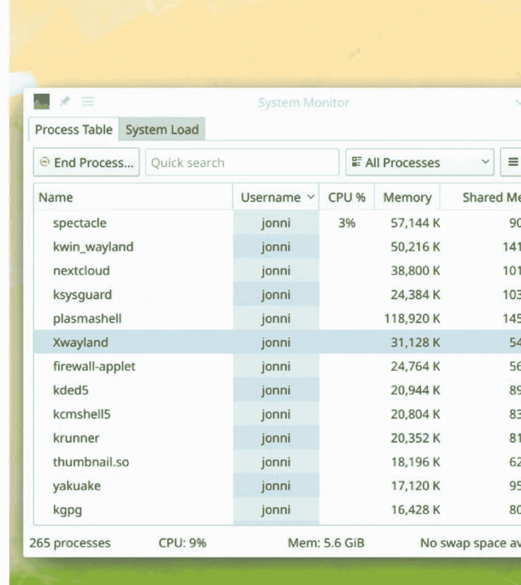

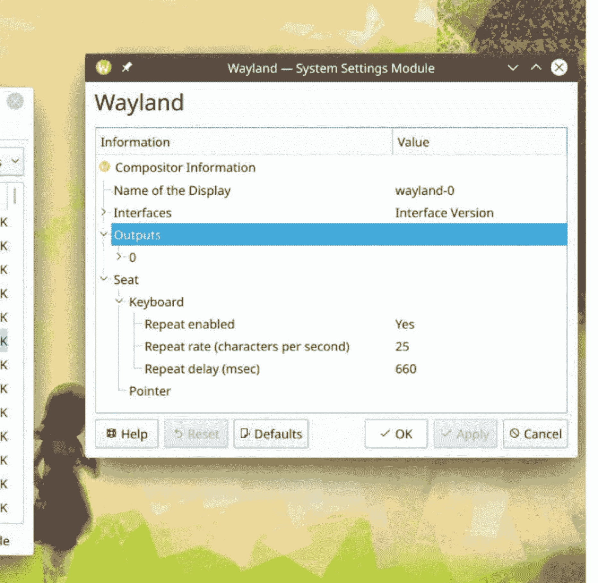

> Wayland 现在在 KDE Plasma 上可以工作，而且只会变得更好。


# ## 综述

Hailku ❯❯ KolibriOS ❯❯ OpenIndiana ❯❯ ReactOS ❯❯ VisopSys


Shashank Sharma

白天，Shashank 是一名新德里的事务律师，但到了晚上，他就化身开源义警！

### 开源操作系统

对于**沙桑克·夏尔马**（Shashank Sharma）来说，戴着眼罩单手使用 Arch 系统已不再具有挑战性，他现在正在寻找更具挑战性的任务。

### 我们如何测试……

本综述中的许多操作系统都建议用户首先在虚拟机这一安全环境中进行试用。我们听从建议，在将它们迁移到物理硬件之前，先按照各自官网说明的配置要求在虚拟机中运行了所有这些系统。

我们的目的是寻找一种替代操作系统，以便我们能有效地使用电脑。当然，我们并不指望能通过 Steam 串流玩游戏或通过 Netflix 看电影，但如果这些系统能够播放多媒体、浏览网页、处理文档等，且不会抛出意外错误，它们就会获得我们的青睐。我们将测试安装、软件支持等各种参数，唯一的目的是帮助我们锁定一个能让我们走出熟悉舒适区、同时尽可能减少舒适度牺牲的替代操作系统。


作为我们的常客，您深知 Linux 并非互联网上唯一可免费获取的开源操作系统。尽管我们热爱 Linux，但我们也会定期评测其他开源操作系统，尤其是 BSD 家族。

许多非 Linux 的开源操作系统专为特定利基用途设计，在其专业环境之外用处不大。虽然它们可能不具备 Linux 那种从上网本到服务器集群都能扩展的敏捷性，但其中一些在包括桌面在内的多种环境中表现相当出色。在本综述中，我们将向您介绍一些适合日常桌面任务的最佳选择。

尽管这些替代操作系统已经开发了二十多年，但其中许多实际上仍处于开发早期阶段！这主要是因为它们没有获得与大多数 Linux 发行版同等的开源生态系统关注。本综述中的许多操作系统核心开发者数量非常有限（且更有热情的用户群体更小），也没有跨国盈利企业的支持来加速其开发——然而它们仍在不断增长。

### 安装

将操作系统固化到您的机器上需要哪些步骤？

**综述**中的几乎所有操作系统都配备了图形化安装程序。不幸的是，这并不意味着您下载操作系统后立即就可以将其部署到生产机器的物理硬盘上。您应该意识到，它们接受的测试程度并不像 Linux 安装程序那样充分——正如我们之前提到的，先在虚拟机中测试始终是个好主意。

OpenIndiana 是个例外。Linux 用户在浏览其安装程序时不会有任何困难，该安装程序非常精致且流程顺畅，很像典型的 Linux 安装程序。您可以使用安装程序内置的分区工具为操作系统划分空间，或者使用 Live 环境中可用的熟悉工具 **Gparted**。

此外还有 ReactOS，它是**综述**中唯一提供专用可安装版本的操作系统。同时也提供 Live ISO 镜像，旨在帮助您在硬件上测试该系统。一旦您确认一切运行正常，就可以使用仅安装版本将 ReactOS 固化到计算机上。该操作系统的安装程序让人回想起旧版 Windows 安装程序，使用起来并不特别困难。与许多 Linux 发行版一样，ReactOS 在首次启动时会运行配置程序，以帮助您创建用户并选择桌面主题。

Haiku 和 VisopSys 都拥有简单直观的安装程序。您只需将 Haiku 指向 BeFS 文件系统分区，它就会快速复制文件并安装引导加载程序。安装程序现在可以从 GPT 分区启动，且 64 位镜像附带 EFI 引导加载程序，以便 Haiku 能在 EFI 计算机上启动。

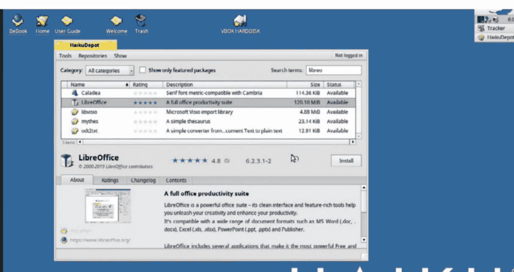

许多操作系统（如 Haiku）都包含分区工具，以帮助用户创建专用的操作系统分区。

VisopSys 的安装程序也包含分区工具，以帮助您为操作系统创建一个切片。您被迫以管理员用户身份使用该系统，但安装程序允许您为其设置密码。如果您正在新的虚拟磁盘上安装 VisopSys，请务必选择将基本 MBR 写入磁盘的选项，以便进入安装过程。

让您摆脱安装循环的操作系统是 KolibriOS，它实际上没有安装程序。您只需在 */etc/grub.d* 目录下的 **40_custom** 文件中添加一个条目，将 GRUB 指向 **kolibri.img** 文件，即可顺利启动。

### 裁决

HAIKU：8/10；REACTOS：8/10；KOLIBRIOS：8/10；VISOPSYS：6/10；OPENINDIANA：9/10

除了 OpenIndiana 之外，我们建议您先在虚拟机内安装这些操作系统。

### 默认应用

开箱即用是否可用？

正如它所模拟的操作系统一样，ReactOS 包含一组应用程序。除了包括*Paint*、*Notepad* 和 *WordPad* 在内的若干实用工具外，该操作系统还包含三款深受 Windows 用户喜爱的纸牌游戏。

VisopSys 好不了多少，它附带一套极简化的应用程序，因为该操作系统的目标是为 CS 学生和像我们这样的替代操作系统爱好者创建一个功能完整的操作系统。除了磁盘管理器和安装程序外，还有一个基本文本编辑器、一个图像编辑器、一个虚拟键盘应用、几个游戏和若干管理实用工具。

相比之下，KolibriOS 附带几十个应用程序。有音频播放器、视频播放器、VNC 查看器、文本编辑器、 rudimentary（初级）网页浏览器等等。该操作系统还拥有许多开发工具，特别是用于 FASM 汇编的工具，以及多个游戏机模拟器。

Haiku 也包含许多巧妙但必不可少的应用程序，这是典型桌面用户可能需要的。有电子邮件客户端、网页浏览器、媒体播放器、图像查看器和文本编辑器，以及像活动监视器、十六进制编辑器、磁盘分区工具、简单 Web 服务器等管理工具。

OpenIndiana 附带了大家非常熟悉的 MATE 桌面环境，大多数应用程序也来自 MATE 稳定版。除此之外，还有少数主流生产力应用，如 *Firefox*、*Thunderbird* 和 *Pidgin*。开箱即用的 OpenIndiana 安装可用性有限，您需要使用其包管理系统进行补充。

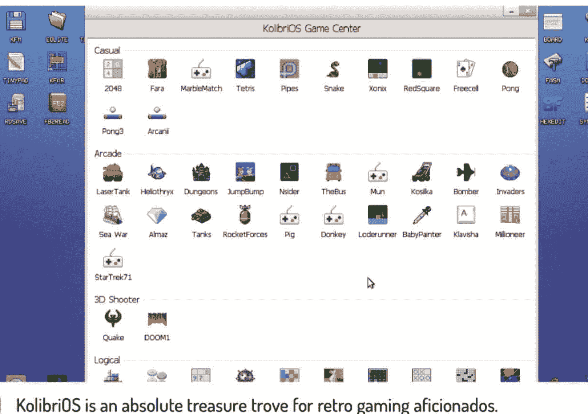

对于复古游戏爱好者来说，KolibriOS 是一座绝对的宝库。

### 裁决

HAIKU：8/10；REACTOS：4/10；KOLIBRIOS：6/10；VISOPSYS：4/10；OPENINDIANA：6/10

除了 Haiku 之外，所有其他操作系统都缺少日常使用所需的基本应用。

### 易用性与性能

适应它们需要多大努力？

本综述中的操作系统被称为“替代”是有原因的。它们与您日常使用的桌面发行版不同，事实上，期望它们看起来、感觉起来和行为方式都像其他主流操作系统是不合理的。尽管开发人员已经开发其中一些系统超过十年，但其中许多仍处在新生的开发阶段。早期开发阶段反映了这些操作系统基础的不稳定性，这将直接影响它们的易用性和性能。

即使是对于主流发行版，易用性也是重要的考量因素。如果发行版不可用，长长的功能列表也就毫无意义。这些替代操作系统也是如此。

这就是为什么除了比较影响易用性的各个单项指标外，我们还将评估它们的整体用户体验，以帮助您找到能在桌面上提供最大效益的那一个。

### Haiku
**8/10**

不要被 Haiku 的测试版状态所迷惑；该项目相当成熟，并且已经存在了十多年。该操作系统的易用性非常出色，无论是在虚拟机内还是在真实硬件上。ISO 给您提供了启动安装程序或引导进入功能完整的 Live 环境的选项。安装程序工作效率很高，还包含一个分区工具以帮助您为操作系统划分空间。即使在性能中等的机器上，Haiku 的启动和关机时间也令人印象深刻。

该操作系统在大多数配备标准硬件的机器上开箱即用。它拥有最全面的默认应用程序集之一，您可以使用图形化包管理器获取更多。丰富的文档和项目支持基础设施进一步增强了用户体验，其设计旨在帮助初次使用的用户适应。

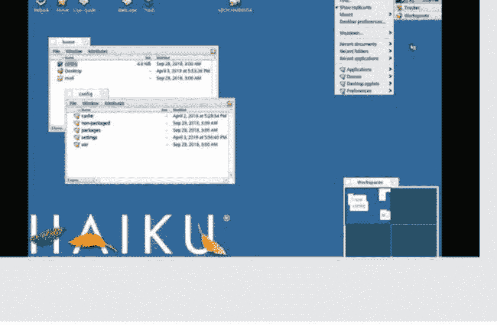

### KolibriOS
**6/10**

KolibriOS 是用 FASM 汇编语言编写，并基于 MenueOS/OS 操作系统的源代码。它瞬间启动，并让您访问许多有用的应用程序。虽然不需要安装，但您必须在退出时会话时确保选择保存所做更改的选项。

该操作系统支持 FAT 和 NTFS 文件系统，并附带热门音频、视频和以太网硬件的驱动程序。桌面操作相当直观，新用户不会因随意探索桌面及其各种应用而受到永久惩罚（permaped 应为 penalized 的误拼或特定语境下的表达，此处译为不会受到惩罚/阻碍）。

该操作系统的唯一缺点是，其生产力应用程序尚未成熟到足以日常使用，而且缺乏包管理器也未能改善其状况。另一方面，如果您喜欢复古游戏，没有比它更好的操作系统了。

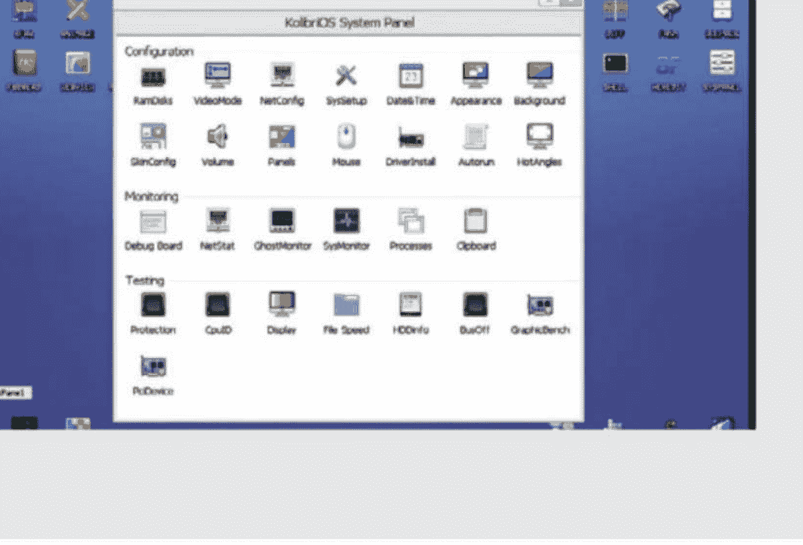

### 文档与支持

它们能否指引您穿越晦涩难懂的领域？

由于 VisopSys 主要为开发人员和学生设计，其大部分文档都服务于这一群体。有很多信息揭示了操作系统的内部结构，这是任何计算机科学学生的宝库。KolibriOS 也拥有足够的文档，帮助用户入门。有一个快速常见问题解答（FAQ）和一些操作指南，帮助您在 Windows 和 Linux 旁边以及虚拟硬件上引导 KolibriOS。还有一个相当活跃的多语言论坛提供协助。

OpenIndiana 的情况稍好一些。它有一个详细的常见问题解答和一个（正在建设中的）手册，尽管手册仍在建设，但内容相当详细。还有一个 wiki 帮助用户和开发人员了解操作系统。令人惊讶的是，该项目没有论坛，因此您需要使用其邮件列表来处理支持查询，这是一种相当笨拙的方式。

另一方面，ReactOS 项目有一个 wiki，托管各种旨在帮助初次用户安装操作系统并执行各种任务的教程。该 wiki 也是开发人员文档的主场，其中包含关于操作系统内部结构的详细信息。支持方面，有一个由 MatterMost 驱动的聊天室和多语言论坛。

同样，Haiku 的网站尽其所能帮助初次使用操作系统的用户熟悉环境。它拥有各种入门文档，包括详细的常见问题解答、相当完整的图文用户指南，以及几份旨在帮助用户安装、更新和虚拟化操作系统的专注指南。支持渠道也非常多样，包括论坛、IRC 频道、邮件列表等。

### 裁决

| OS | 评分 |
|---|---|
| HAiku | 8/10 |
| KOLIBRIOS | 6/10 |
| OPENINDIANA | 6/10 |
| REACTOS | 8/10 |
| VISOPSYS | 4/10 |

> *ReactOS 和 Haiku 项目的支持基础设施会让新用户感到最受到欢迎。*


### OpenIndiana 6/10

  OpenIndiana 仅适用于 64 位计算机，并针对光学介质和 USB 设备提供独立的镜像。这些镜像会启动进入实时环境，你可以从这里启动图形化或基于文本的安装程序，其运行效果完全符合预期。

  由于使用了 MATE 桌面环境以及大量经过品牌化的开源应用，OpenIndiana 没有带来像其他受测操作系统那样强烈的“另类操作系统”感觉。就操作系统的易用性而言，主要的缺点是缺乏图形化包管理器。虽然命令行版本并不难掌握，但它会让许多原本就已经处于陌生操作系统中感到不自在的首次用户感到疏远。

  缺乏内置文档也无助于改善这一情况，但 OpenIndiana 是你所能找到的最接近典型 Linux 安装体验的系统。

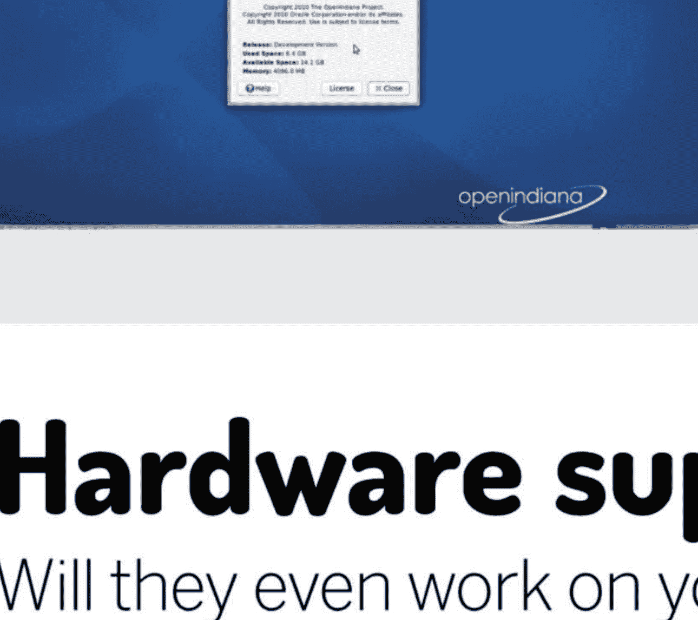

### ReactOS 8/10

  ReactOS 是一个基于 Windows NT 设计原则的开源操作系统。它是完全从头编写的，旨在通过实现与专有操作系统的二进制兼容性，为用户提供一个用于运行为 Windows 设计的软件的开源平台。

  该项目提供了一张用于探索操作系统的实时 CD 和一张易于导航的安装 CD。无论你之前是否使用过 Windows，都会发现 ReactOS 操作起来非常直观。当然，它默认并没有附带很多应用，但你可以通过包管理器来丰富它。

  除了物理硬件，你还可以在虚拟硬件上安装 ReactOS，鉴于其 alpha 状态，这其实是该操作系统的专长。尽管其资源需求相当微小，但 ReactOS 仅支持有限的设备和外设。当它能工作时，最大的障碍是偶尔出现的蓝屏死机（Blue Screen of Death）。

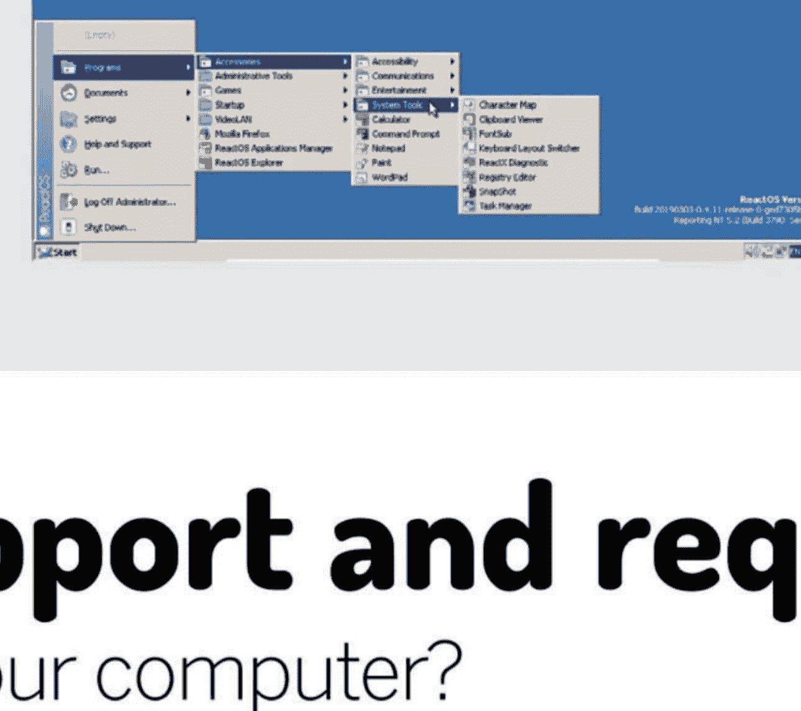

### Visopsys 6/10

  鉴于 Visopsys 主要是一个教育系统，其易用性让我们感到惊讶。我们认为它是“另外考虑”栏目的理想候选者，但其功能和性能却超出了我们的预期。该系统启动速度极快，并允许你选择是启动安装程序还是进入实时会话。安装程序中包含了一个功能强大的分区工具，这是另一个令人惊喜的地方。

  桌面导航相当简单，包含了一些必备应用，以及实用的管理和配置工具。但如果你试图将其用于日常桌面任务，进展不会很大，因为该操作系统缺少 Web 浏览器，也没有包管理功能来帮助你引入额外的应用和工具。Visopsys 在伪装成常规桌面方面做得不错，但它确实是一个非常有能力的计算机科学项目，应当以此对待。

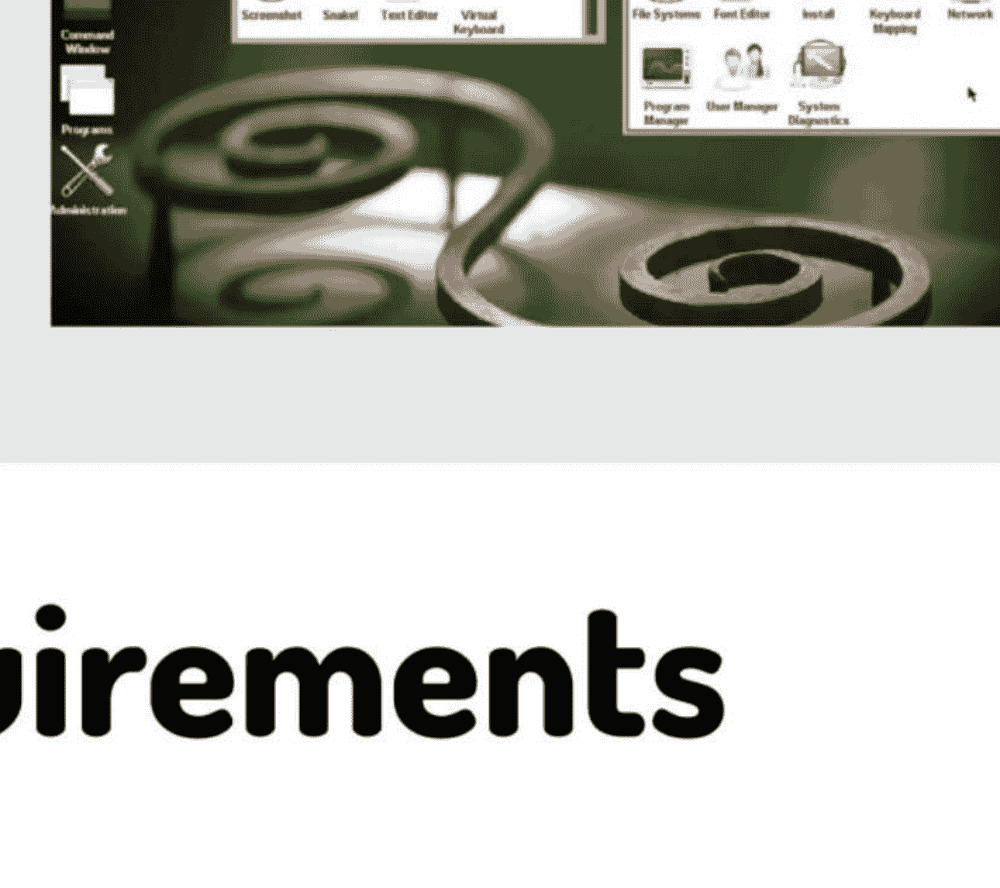

### 硬件支持与要求

  它们能在你的计算机上运行吗？

- 这些操作系统未能成为主流的另一方面原因是其缺乏硬件支持。另一方面，在兼容的硬件上，其中大多数系统的性能将超过你喜爱的 Linux 发行版。

  例如，Visopsys 可以在任何配备 64MB 内存的 Pentium 计算机上驱动图形桌面。该操作系统支持所有变体的 FAT 文件系统，并支持 ext4 的只读。在外设方面，它支持 PS/2 和 USB 输入设备、IDE 和 SATA 磁盘，以及 PciNet/以太网卡。

  同样，你可以在任何配备 256MB 内存的 Pentium 级 x86 机器上运行 ReactOS。ReactOS 与 Haiku 等其他项目合作以提供硬件支持，但与本综述中的其他某些操作系统相比，其支持范围仍相当有限。

  KolibriOS 也差别不大。它是一个仅支持 32 位的操作系统，需要极少的资源。其开发人员声称甚至可以在搭载初代 Pentium 处理器的机器上运行。该操作系统支持 USB 2.0 以及相当多流行的以太网设备，还有 Radeon 和 Intel 显卡驱动。OpenIndiana 需要至少 4GB 内存的 64 位计算机才能提供合理的性能。该项目还托管了一个由社区维护的支持外设列表，内容相当详细。

  Haiku 为 32 位和 64 位机器都生成了镜像。该项目通过 KPI 兼容层从 FreeBSD 借用了其以太网和 Wi-Fi 驱动程序。这些驱动程序已升级为 FreeBSD 11.1 的版本，支持 Atheros 9300-9500 系列、Intel 较新的“双频段”系列、部分 Realtek PCI 芯片组以及其他所有现有驱动程序中的新型芯片组。

### 结论

| 操作系统 | 得分 | 操作系统 | 得分 |
| :--- | :--- | :--- | :--- |
| HA | 8/10 | REACTOS | 6/10 |
| KOLIBRIOS | 8/10 | VISOPSYS | 5/10 |
| OPENINDIANA | 8/10 | | |

  虽然它们能在你日常使用的计算机上运行，但不要指望这些操作系统支持你所有的硬件。

### 包管理

  它们的仓库中有哪些应用可用？

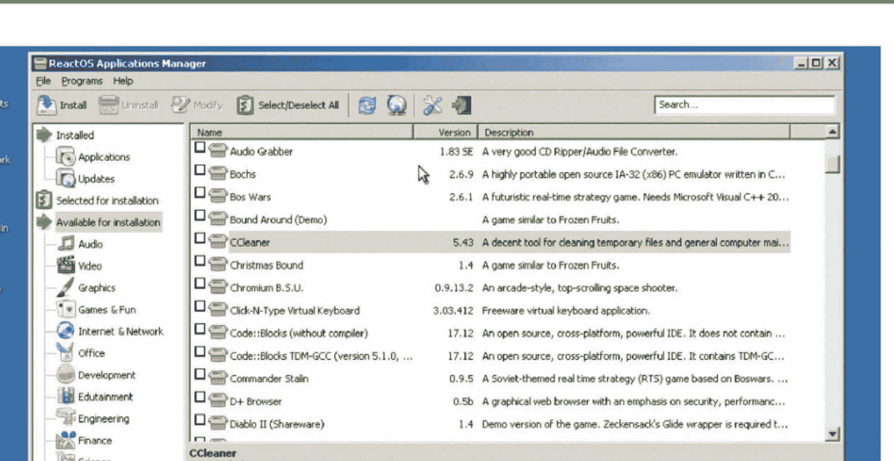

  本 *综述* 中的一些操作系统附带了大量应用，但其他一些则相当基础，安装后并不真正实用。你需要丰富这些系统，才能在桌面上有效地使用它们。不幸的是，并非所有操作系统都允许你安装额外的应用，而且有些系统比其他的需要付出更多的努力。

  KolibriOS 和 Visopsys 属于前者：没有方法为它们安装额外的软件包。虽然 OpenIndiana 确实有一个包管理系统，而且相当完善，但丰富该操作系统是其最薄弱的环节之一。该操作系统使用图像打包系统（Image Packaging System），但配备的是命令行包管理器 pkg，而非图形化包管理器。虽然 pkg 与 apt 和 dnf 非常相似，但对于添加仓库等任务，你需要阅读 man 页面和其他文档。

  相反，包管理是 ReactOS 原始安装的唯一救命稻草。该操作系统使用类似 *Synaptic* 的应用商店，当你使用控制面板中的添加/删除程序功能时会出现。ReactOS 应用管理器操作直观，允许你批量安装多个程序。你还可以在它下载和安装软件期间继续使用该应用。类似地，Haiku 最新版本的一个亮点是其图形化包管理器 *HaikuDepot*。它操作直观，工作方式与 Linux 上的包管理系统非常相似。

  除了 LibreOffice 和 Firefox 等应用，你还可以使用 ReactOS 应用管理器下载 Adobe AII 和 Microsoft .NET 框架等库。

### 结论

| 操作系统 | 得分 | 操作系统 | 得分 |
| :--- | :--- | :--- | :--- |
| HAIPU | 8/10 | REACTOS | 8/10 |
| KOLIBRIOS | 0/10 | VISOPSYS | 0/10 |
| OPENDIANIA | 5/10 | | |

  *与 Visopsys 相比，被困在 KolibriOS 的默认应用中并不是那么严重的问题。*

### 日常使用

  你能将它们作为日常桌面使用吗？

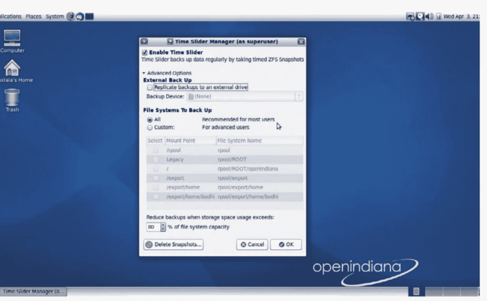

  你绝对可以将 OpenIndiana 作为常规桌面使用，尤其是考虑到它附带了熟悉的环境和主流开源应用。然而，该操作系统并不包含你所需的所有应用，你必须使用其命令行包管理器获取额外的应用，这会打断原本流畅的用户体验。

  虽然 Visopsys 是一个功能完整的操作系统，但你不能真正将其作为传统意义上的日常桌面使用。该操作系统由个人开发，更多地是一种教育工具，而非一个你可以用于日常任务的实际操作系统。它还缺少关键的效率应用，如互联网浏览器和包管理系统。

  ReactOS 不被推荐，因为该项目自己承认，它尚未准备好用作你的日常桌面。它在应用可用性方面不会让你失望，但系统还不够稳定，无法可靠地用于生产性工作。实时 CD 仅在我们的测试机器之一上正常工作，而安装 *VirtualBox* 扩展后，出现了臭名昭仿的类似 Windows 的蓝屏死机。

  与前两者形成对比的是，KolibriOS 开箱即带有大量应用。不幸的是，许多关键应用相当原始。例如，Web 浏览器是基于文本的，虽然它在渲染像 KolibriOS 网站这样简单的站点时没有问题，但每次我们试图访问如 YouTube 这样数据密集型的网站时，它都会崩溃。我们强烈推荐该操作系统的唯一任务

> Openindiana 中的 Time Slider 工具利用 ZFS 文件系统在安装后按时间间隔创建快照。

  是复古游戏，在这方面它仍是无与伦比的。

  总体而言，你最舒适地用于日常桌面任务的操作系统是 Haiku。它具有令人印象深刻的硬件支持，并且在安装过程中不会出现任何意外错误。桌面上的应用集合，如基于 WebKit 的 Web 浏览器以及包管理工具中可用的有用应用，无疑有助于满足大量人员的桌面计算需求。

### 结论

| 操作系统 | 得分 | 操作系统 | 得分 |
| :--- | :--- | :--- | :--- |
| HAIPU | 8/10 | REACTOS | 5/10 |
| KOLIBRIOS | 5/10 | VISOPSYS | 4/10 |
| OPENDIANIA | 8/10 | | |

  *如果你想提高工作效率，Openindiana 和 Haiku 是你最好的选择。*


### 开放操作系统

### 最终裁决

这是一个非常有趣的*综述*主题。Visopsys 排在最后，但它并没有以传统意义上的“输家”身份出局。实际上，这款操作系统独树一帜，无人能出其右。不要把它看作一个你可以高效使用的替代操作系统，而应将其视为一个加强版的计算机科学项目。如果你需要深入理解多线程、完全抢占式多任务操作系统的内部工作原理，Visopsys 是最佳选择。

虽然 ReactOS 的默认桌面提供的功能不多，但得益于其软件仓库，你可以迅速将这种原始安装转化为生产力工具。不幸的是，仅仅填充有用的应用程序并不能自动让操作系统变得可用。该操作系统的 Alpha 版本特性及其有限的硬件支持意味着，在可预见的未来，它将继续局限于虚拟环境中运行。

KolibriOS 登上了领奖台，但位列末席。开箱即用，它提供了日常桌面使用所需的所有应用程序。然而不幸的是，几个关键应用——例如网络浏览器——相当简陋，你很快就会触及它们的极限。但正如我们之前所说，KolibriOS 对于复古游戏爱好者来说是一个绝佳的选择。

如果这是一个 AI（这正是*AI 会说的！——编辑注*）在做这项*综述*，它很可能会将奖项颁给 OpenIndiana，因为它除了一个参数外，在所有参数上的得分都很高。它是本*综述*中唯一一款看起来和操作起来都像其他带有 MATE 桌面的 Linux 发行版的一样熟悉的操作系统。除了熟悉的桌面前端，它还配备了日常使用的常用生产力应用。该操作系统最薄弱的一点是缺乏图形化包管理器，这可能会让新用户对尝试这款操作系统感到犹豫。

讽刺的是，正是这种缺乏“异质感”的特质，使得 OpenIndiana 无法占据领奖台的第一位；它看起来太熟悉了，以至于无法被视为一款替代操作系统。综合来看，Haiku 的搭配最为恰当；它看起来像替代操作系统，行为也像，而且还能让我们高效工作，足以将其用作日常桌面。

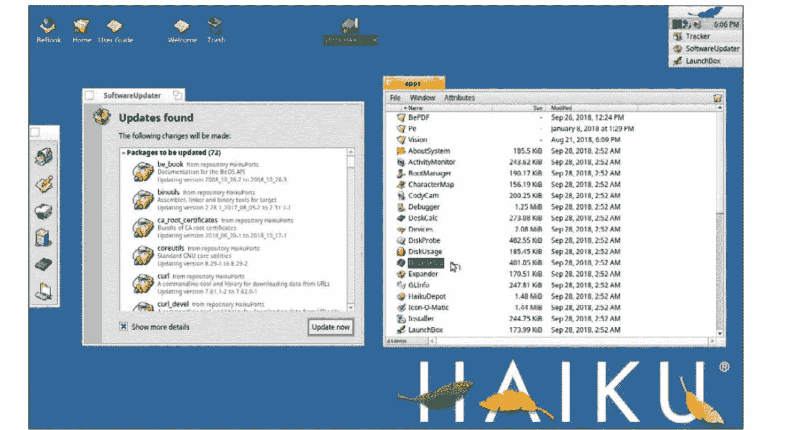

- 第一名 **Haiku** 8/10
  网站: www.haiku-os.org 许可证: **MIT 及其他**
  版本: **R1/beta1**
  能为你带来最大收益的替代操作系统。
- 第二名 **OpenIndiana** 8/10
  网站: www.openindiana.org 许可证: **CDLL 及其他**
  版本: **0.4.11**
  为寻求熟悉体验的人提供的替代方案。
- 第三名 **KolibriOS** 6/10
  网站: http://www.kolibrios.org 许可证: **GPL v2**
  版本: **2018.10**
  如果没有其他原因，也可以为了其中的复古游戏模拟器而使用它。
- 第四名 **ReactOS** 6/10
  网站: https://www.reactos.org 许可证: **GPL, LGPL, BSD**
  版本: **r7617**
  外观类似 Windows，在虚拟硬件上最易用。
- 第五名 **Visopsys** 6/10
  网站: http://visopys.org 许可证: **GPL, LGPL**
  版本: **0.83**
  CS 学生和操作系统爱好者的绝佳选择。

### 其他考虑

还有几个其他开源操作系统，由于各种原因未包含在内。最主流的替代方案是 TrueOS，前身为 PC-BSD，它是 FreeBSD 的桌面版本。对于那些寻求基于 MATE 桌面的用户，还有 GhostBSD。

AmigaOS 的粉丝可以看看 Syllable Desktop，但由于它多年未更新，所以未被纳入。同样，MenueTOS（KolibriOS 的前身）自上一次发布以来也已过去数年。MenueT 的 64 位版本去年有一次发布，但该版本不是开源的。许可证的模糊性也使我们无法涵盖另一款 AmigaOS 克隆系统 Icaros，它是基于 AROS 研究操作系统构建的。我们也没能找到其源代码仓库。还有其他基于 AROS 的操作系统，如 AspireOS 和 AROS Broadway，要么存在严重的硬件限制，要么不再积极维护。

### 综述

Equinox 桌面环境 (EDE) » Lumina » LXQt » Moksha 桌面 » Openbox

白天，Shashank 是新德里的一名律师，但夜晚他是一位开源义警！


### 轻量级桌面

随着健身会员资格闲置，**Shashank Sharma** 决定削减桌面上的冗余部分。

### 我们如何测试...

我们在 Arch 安装中安装了所有桌面环境。其中大多数都在官方支持的仓库中，尽管有些位于社区驱动的 Arch 用户仓库 (AUR) 中。

我们从多个方面对桌面环境进行了评级，例如可用性及其默认应用的缓存。可塑性也是选择桌面环境时的另一个重要标准：携带大量可调整设置的环境会比仅有有限可变参数的那些得分更高，因为人们通常因为配置僵化而更换默认桌面环境。同样重要的是插件和附加组件的可用性。这些功能可以根据你的需求扩展环境的可操作性。

然而，本次*综述*最重要的标准是桌面的可用性。任何在此测试中表现不佳的桌面环境，尽管在其他方面得分很高，用处也不会太大。


起初至少，人们想要更改发行版的默认桌面环境 (DE) 似乎是非直觉的。毕竟，主流发行版花费了大量时间来精调用户体验。有些甚至积极参与 DE 的开发，以确保它符合其预期。然而，默认环境，就像出厂安装一样，旨在适合大多数常见的工作流。

尽管经过了所有的精调和功能增强，有些 DE 仍然是一种阻碍，特别是对于那些需要最少图形开销的任务而言。还有一群用户，他们一生都在使用符合传统桌面隐喻的 DE 与计算机互动，因此并不真正认为新颖的桌面外壳有什么优势。另一组对默认 DE 不满的用户是那些在算力不足且资源匮乏的机器上计算的用户，这些资源无法满足那些资源密集型软件的需求。如果你认同我们刚才概述的任何使用场景，那么这份*综述*就是为你准备的。我们将介绍一些占地面积最小但仍能助你完成任务的桌面环境。

### 可用性

你能在附近的仓库中找到它吗？

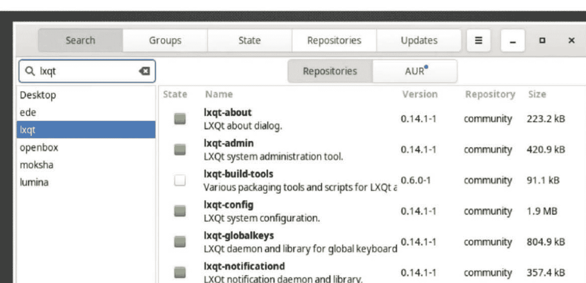

除了少数例外，本 **综述** 中的所有桌面环境都可以在主流桌面发行版的仓库中找到。不过，Arch 遥遥领先，因为它通过官方和社区支持的仓库提供了所有选项。得益于其 Copr 构建系统与其仓库的互补，你在 Fedora 上也能获得不错的体验。

同样，Ubuntu 凭借其 PPAs 让你能够获取大量 DE。不过有一句忠告：社区维护仓库中软件包的质量参差不齐，从坚如磐石到勉强可用不等。与官方仓库相比，使用社区支持仓库中的软件包可能无法带来最佳体验。

LXQt 和 Openbox 是几乎在所有 Linux 发行版中普遍可用的两个选项。LXQt 在其网站上维护了一个它官方支持的项目列表，你可以在 Fedora 上使用 Copr 仓库安装它。Openbox 也得到普遍支持。我们在 Fedora 29 的仓库中无法通过该软件包调出右键应用程序菜单，但这通过降级 **python-pyxid** 软件包很容易（或者*真的吗？——编辑注*）解决了。

Lumina 主要是为 BSD 开发的，但也被移植到了一些 Linux 发行版。项目页面列出了几个提供预构建软件包的发行版，包括 Debian、Gentoo 和 Arch。该桌面环境也可以通过 Fedora 的 Copr 仓库获取，但性能不佳，并且在几乎所有会话中都会崩溃。Ubuntu 用户可以找到指南，带领他们完成从源码编译的过程，这并不太繁琐。

> 我们不建议在单个安装中安装多个桌面环境。这不仅会不必要地让应用程序菜单变得杂乱，而且有些桌面环境与其他环境不兼容。

Equinox 桌面环境 (EDE) 在其官方 wiki 上托管了安装说明，涵盖了 Arch、Debian、Slackware、Alpine 和几款 BSD。该项目本身将这些软件包列为实验性，并建议你从源码编译 EDE 以获得最佳用户体验。

Moksha 桌面是 Enlightenment (E17) 桌面的分支。同样，它仅在 Bodhi Linux 上作为默认桌面，我们在 Arch 以外的任何发行版上都无法使其正常工作。有一个 Copr 仓库，但其最后一次构建在 Fedora 25 上失败了。

| 裁决 | 得分 |
| :--- | :--- |
| EQUINOX DESKTOP | 5/10 |
| LUMINA | 7/10 |
| LXQT | 9/10 |
| MOKSHA DESKTOP | 5/10 |
| OPENBOX | 8/10 |

为特定发行版设计的桌面环境在其他发行版上工作效果不佳。

### 默认应用

提供了什么？

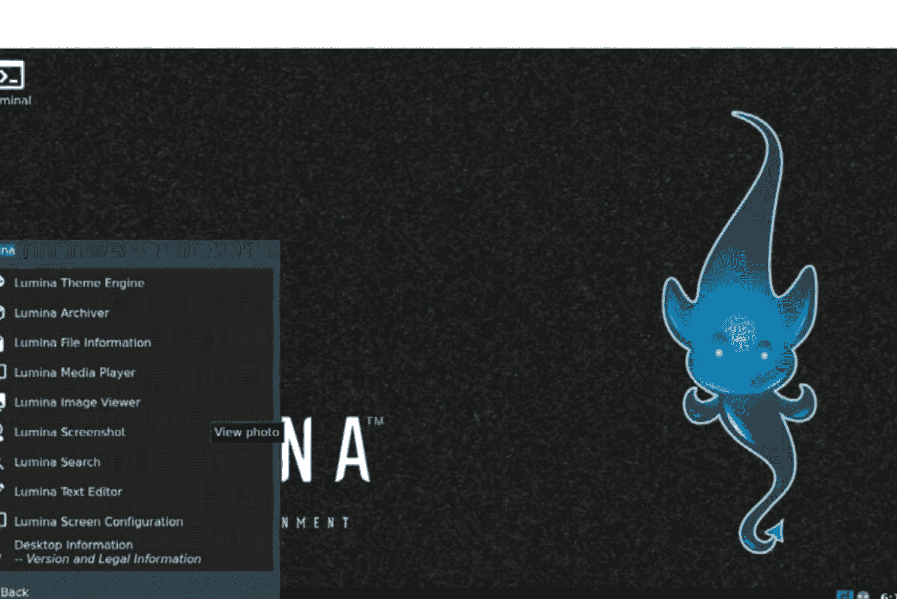

一些桌面环境帮助用户节约资源的方式之一，是提供与常见桌面任务（如文件管理、文本编辑、图像查看等）相匹配的轻量级应用。其他环境则留给用户自行搭配轻量级桌面或窗口管理器与第三方轻量级应用。

EDE 属于后一类。该桌面的目标是仅提供桌面环境，你甚至需要手动添加文件管理器等最常见的应用。Openbox 同样专注于成为一个轻量级窗口管理器，你可以用第三方轻量应用来补充它。Moksha 的情况也是如此。由于它是为 Bodhi Linux 设计的，该桌面借用了该发行版捆绑的少量基本应用。

另外两个选项在捆绑应用方面要好得多。诚然，你在 Lumina 中找不到网络浏览器、邮件客户端和办公套件这样的应用，但该桌面确实捆绑了一些专门为该项目编写的实用工具。这些包括一个压缩工具、一个科学计算器、一个配置器、一个 PDF 查看器、一个文本编辑器、一个媒体播放器和一个文件管理器。LXQt 也配备了一小部分可选应用，为桌面增加额外功能。这包括一个图像查看器和截图工具、一个轻量级终端模拟器、一个文件压缩工具、一个进程管理器、一个文件管理器以及桌面图标管理器——本质上这只是 **PCMANFM** 的 Qt 移植版本——以及更多此类应用。

> Lumina 拥有良好的轻量级应用集合，很好地补充了桌面本身。

| 裁决 | 得分 |
| :--- | :--- |
| EQUINOX DESKTOP | 1/10 |
| LUMINA | 7/10 |
| LXQT | 8/10 |
| MOKSHA DESKTOP | 2/10 |
| OPENBOX | 9/10 |

如果你想构建自己的环境，你会喜欢 Openbox 的清洁起步。


### 用户体验
### 是福音还是祸根？

  无论轻量与否，桌面环境都是发行版中最重要的元素之一。无论发行版附带何种功能或应用程序集，往往决定你选择某发行版的是其桌面环境的外观与感觉、行为和响应速度。

  这或许解释了为何大多数主流发行版都花大量时间打磨桌面环境，以确保提供丰富且富有回报的用户体验。

  但当你用轻量级替代品替换默认环境时，所有这些精心设计的策略都会付诸东流。话虽如此，虽然这些桌面环境的主要目标是节省资源，但这并不意味着它们完全忽视易用性。

  毕竟，没有人想要使用一个内存占用微乎其微但操作极其繁琐的桌面环境。

### Equinox 桌面
### 7/10

  Equinox 桌面环境（EDE）并不是最容易安装的桌面环境。如果你运行的不是 Arch，那么你很可能需要从源码手动编译它。

  该桌面环境具有复古感，并从一个老派的启动画面开始。EDE 遵循经典的桌面隐喻，屏幕底部有状态栏，最左侧是应用程序菜单。你可以使用应用程序菜单按钮旁边的文本框来运行命令，也可以用它快速启动应用程序。还有一个分页器用于切换桌面。

  右键上下文菜单提供传统选项，有助于在桌面上放置图标和更改壁纸。你可以使用桌面配置应用来调整其他设置，该应用提供了一组工具来自定义其他基本元素。高级选项只能通过编辑文本文件来设置，这剥夺了该桌面环境的一些易用性分数。

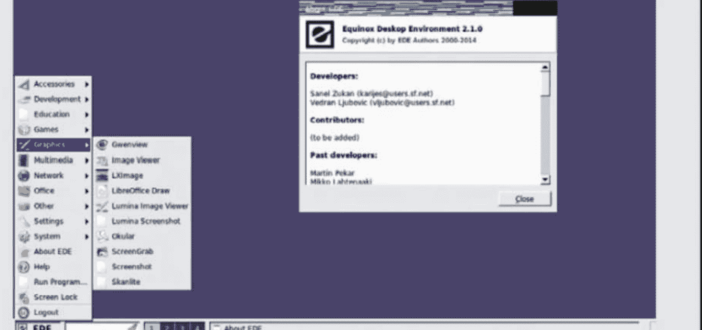

### Lumina
### 7/10

  根据我们的经验，让此桌面环境在 Linux 上运行是一个非常繁琐的过程。它不稳定，且在大多数发行版上表现异常，桌面环境经常出现崩溃，并贴满了奇怪的图形伪影。

  Lumina 没有传统的启动画面，而是显示一句名言。桌面布局简洁，底部有状态栏。右键上下文菜单包含许多有用选项，包括应用程序菜单。这是一件好事™，因为默认的应用程序菜单需要一些时间来习惯。在默认视图中，它仅显示常用应用程序，需要额外点击一次才能查看已安装应用程序的完整列表。

  还有一个文本框可帮助你精确定位要启动的应用程序。除了应用程序，你还可以从该菜单启动文件管理器和 Lumina 配置实用程序。

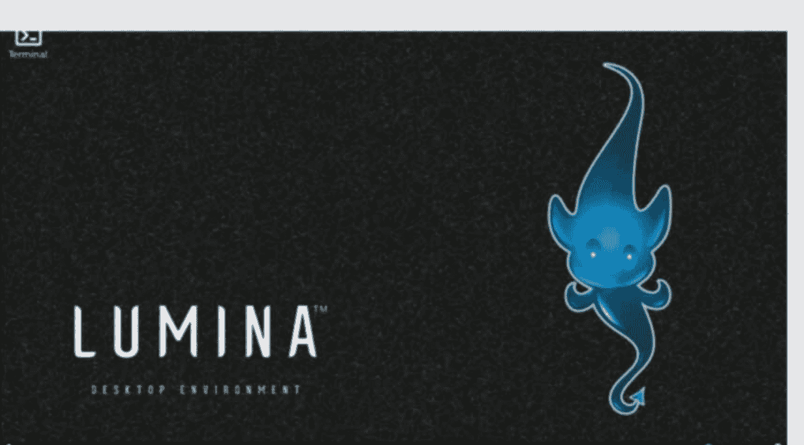

### 帮助与支持
### 当你陷入困境时该怎么办？

  EDE 的官方 wiki 提供了如何为各种桌面环境编译它的说明——但大多数文档旨在帮助开发人员为该项目做出贡献。与*本期综述*中的某些同类产品不同，除了其自身网站外，EDE 在其他网站上获得的报道很少，这主要归因于其缓慢的开发速度。

  Lumina 是 TrueOS BSD 的默认桌面环境。它已被移植到各种其他 BSD 和 Linux 发行版。尽管拥有自己的网站，该桌面环境提供的入门信息很少。该项目使用 Lumina 桌面 Telegram 频道与社区互动。除此之外，没有其他寻求帮助的渠道，因此如果你陷入困境，最好将问题提交到你所在发行版的论坛。

  Moksha 是 Bodhi Linux 的官方桌面环境，也已被移植到其他发行版。该桌面环境没有自己的支持基础设施，而是共享更大范围的 Bodhi Linux 项目的基础设施。相比之下，LXQt 拥有充足的文档，并在你需要协助时提供了与用户社区互动的途径。用户和开发人员都有邮件列表，以及相当活跃的论坛板块。还有一个 wiki，涵盖了各种发行版的二进制包安装说明以及从源码编译桌面的说明。

  同样，鉴于 Openbox 的历史悠久，该项目拥有丰富的官方和非官方来源的文档和支持。该项目的网站是一个 wiki，包含大量帮助新手用户入门的信息。如果你陷入困境，你的发行版极有可能拥有官方支持渠道。

### 结论

| | | | |
|---|---|---|---|
| | EQUINOX DESKTOP | 4/10 | MOKSHA DESKTOP | 4/10 |
| | LUMINA | 4/10 | OPENBOX | 8/10 |
| | LXQT | 8/10 | | |

> *如果你正在常规发行版上使用轻量级桌面环境，请选择拥有活跃支持选项的那一个。*

### LXQt
### 8/10

  这个桌面环境是基于 GTK 的轻量级桌面 LXDE 和 Razor-Qt 的结合体，后者同样轻量级但成熟度较低，且使用 Qt 工具包。

  得益于这种结合，LXQt 在不消耗大量资源的情况下实现了现代桌面的外观和感觉。你可以在几乎所有发行版的软件仓库中找到 LXQt，如果你喜欢的发行版有一个针对低功耗机器的版本，它很可能运行的是 LXQt。

  它遵循古老但熟悉的桌面隐喻，屏幕底部有一个布满图标的状态栏。应用程序菜单包含传统的应用程序分类列表以及一个帮助启动应用程序的搜索框。LXQt 提供了一定数量的可调整选项，有助于自定义桌面环境最常使用的方面。

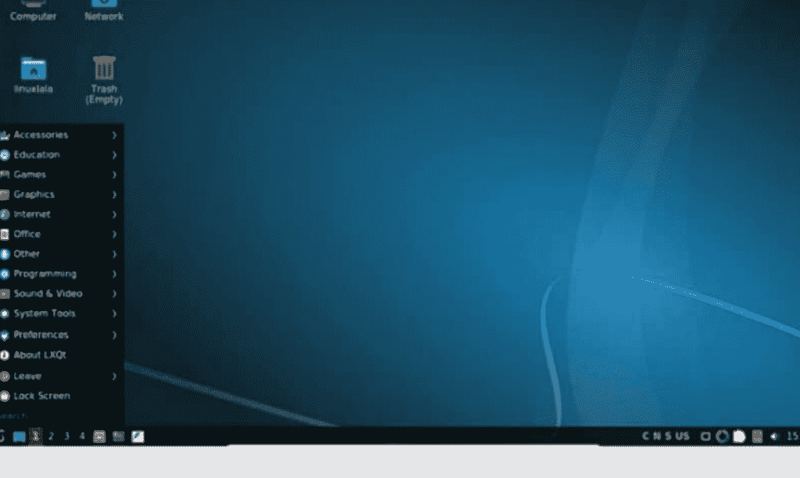

### Moksha 桌面
### 7/10

  这是 Enlightenment E17 桌面的分支，并带有 Bodhi Linux 特定的更改，开发人员多年来一直将这些补丁应用到 E17 的代码中。

  Moksha 相当直观且易于自定义。它使用许多视觉上吸引人的小部件来显示系统信息。这些小部件可以放置在桌面上以及任务栏中，在 Moksha 术语中称为“Shelf”。桌面环境可以通过键盘完全控制，你可以定义自己的键盘绑定。你还可以使用设置面板影响安装的外观和感觉。

  然而，与 E17 不同，Moksha 并不直接存在于许多发行版的软件仓库中。该桌面环境的另一个问题在于其应用程序菜单。虽然它允许你访问应用程序之外的安装其他区域，但它没有可用于快速启动应用程序的搜索框。

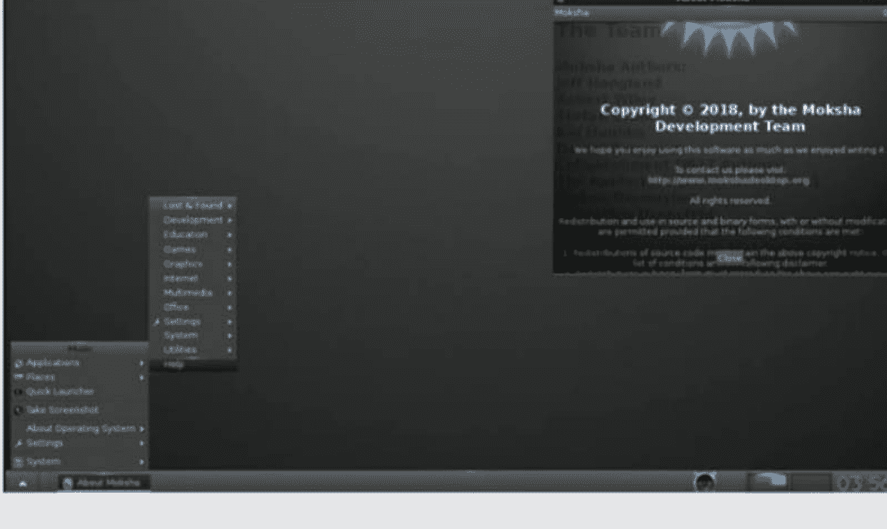

### Openbox
### 7/10

  Openbox 在大多数发行版的软件仓库中均可直接获得。其极简但可定制的特性使其成为有经验用户的稳健选择。

  其窗口管理器实际上如此精简，你甚至不会注意到它的存在。默认情况下，你得到的只是一个无壁纸的背景和一个光标。应用程序菜单仅出现在右键上下文菜单中。你可以使用菜单启动应用程序，这些应用程序在带有常规控件的窗口中运行，并像在任意桌面环境中那样按预期行为工作。

  窗口管理器通常与桌面上的各种其他轻量级元素结合使用。例如，你可以使用*Tint2*、*Plank* 或 *Docky* 创建任务栏，并使用*PCManFM*作为文件和桌面管理器。你还可以使用*obconf*工具自定义窗口管理器的不同方面。大量的手动配置可能并不适合所有用户。

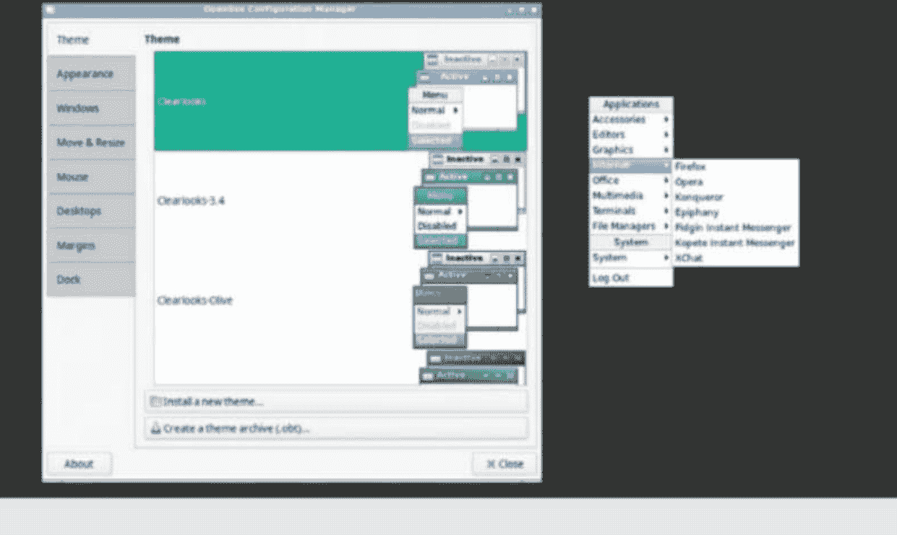

### 性能
### 它们真的比功能齐全的默认桌面环境运行得更好吗？

  由于影响因素众多，很难用绝对数值来衡量性能。既然我们不能将桌面环境与应用程序分离，我们就无法准确测量它们对资源的具体占用。这意味着消耗量会因机器而异，并可能随着已安装应用程序数量的增加而上升或下降。

  此外，也没有单一的性能衡量点。例如，某个环境可能加载速度极快，但其在所谓的空闲状态下资源消耗可能非常高，因为它在后台预取或加载组件。

  在我们的测试机器上，EDE 空闲占用约为 150MB。启动应用程序时数值会上升，但关闭应用程序后很快回落。相关说明，它启动应用程序的速度相当快，*LibreOffice*的计时为 4.3 秒。

  然后是 Lumina，它并非专为 Linux 设计——这很可能是其启动时间比 EDE 长三倍左右的原因。它空闲占用约为 210MB，但应用程序启动时间仅比 EDE 稍慢。其内存消耗也类似 EDE，在应用程序首次启动时达到峰值。

  Moksha 与 EDE 同样轻量，但其启动时间和应用程序启动速度明显更快。虽然 LXQt 调起桌面的时间稍长，但其应用程序启动速度与 Moksha 相当。

  Openbox 比其他所有环境都快得多。窗口管理器的启动时间取决于它需要加载的元素数量。一旦加载完成，应用程序的启动速度是其中最快的之一。

### 结论

| | | | |
|---|---|---|---|
| | EQUINOX DESKTOP | 8/10 | MOKSHA DESKTOP | 9/10 |
| | LUMINA | 8/10 | OPENBOX | 9/10 |
| | LXQT | 8/10 | | |

  *本期综述*中介绍的桌面环境被认为*轻量级*是有原因的，而这并非因为它们所需的磁盘空间。


### 插件和扩展
### 超越常规。

这些桌面环境虽然轻量，但这并不意味着它们无法提供主流桌面环境中那些华丽的附加功能。由于这些元素不可避免地会增加桌面的内存占用，一些桌面环境将它们打包在单独的包中，而另一些则完全避免使用这些功能。

EDE 不认为需要提供任何额外的插件，因此您只能使用其默认功能。另一方面，Openbox 可以通过安装各种组件（如文件管理器）进行扩展，但窗口管理器本身无法通过插件、扩展或任何类型的附加模块来接受新功能。

Lumina 最初是作为 Fluxbox（X 窗口系统的堆叠式窗口管理器）的一组扩展而诞生的，并自称拥有基于插件的界面设计。这使得您只需选择在桌面和任务栏上运行哪些插件，即可根据需要自定义桌面。但更改扩展的过程并不直观，并且如果桌面安装在 TrueOS 以外的发行版上，有时可能无法正常工作。

还有 LXQt，它使用模块的概念——基本上是独立于桌面的工具，作为守护进程在特定桌面操作下为本地用户运行。桌面还由几个可选组件组成，例如显示管理器和电源管理模块。LXQt 的面板也支持插件。

Moksha 是扩展、插件和模块的宝库，它们为窗口管理器本身增加了功能。它还有小部件，可以放置在 Dock（Shelf）或桌面上。

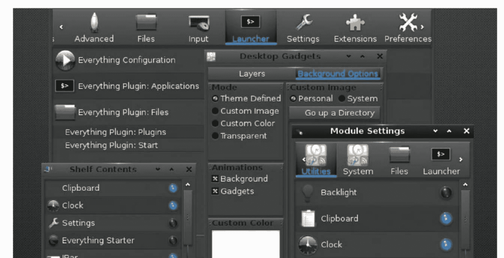

**裁决**

| 春秋桌面环境 | N/A | Moksha 桌面 | 8/10 |
|---|---|---|---|
| Lumina | 3/10 | Openbox | 1/10 |
| LXQt | 6/10 | | |

除了 Equinox 和 Openbox 之外，所有这些桌面环境都允许您进一步扩展其功能。

### 可配置性
### 随心所欲塑造。

既然您已经采取了措施添加新的桌面环境，那么您自然希望通过自定义其工作方式来实现您的意愿。

EDE 中的所有配置选项都位于配置窗口内。它提供六种工具来自定义桌面的不同但非常基本的方面，包括壁纸、屏幕保护程序、日历、音量和首选应用程序。高级用户还可以通过手动编辑配置文件来设置桌面的其他各种方面。

Openbox 用户可以使用 Openbox 配置管理器（*obconf*）应用来自定义窗口管理器。这除了窗口管理器的各种方面外，几乎无法帮助您自定义其他内容。例如，我们可以使用它来更改默认外观并应用主题，以及更改鼠标行为和任务栏位置。

您可以使用 Lumina 的配置实用程序来调整桌面的各个方面，如主题和窗口效果。您还可以使用它来设置默认应用程序和定义键盘快捷键，以及更改桌面三个关键方面的布局——即桌面、面板和菜单。虽然大多数调整是系统范围内的，但有一些限制在当前登录用户。

LXQt 的配置中心提供类似的选项，尽管界面更加友好。但这也是意料之中的，因为与 Openbox 一样，它是本期综述中功能最成熟的项目之一。您可以使用各种选项来配置桌面的不同方面。虽然大多数设置适用于当前登录用户，但有一些设置会影响整个桌面。

同样，您可以使用 Moksha 设置面板为桌面增加更多亮点。您可以更改桌面甚至应用程序的主题。所有元素都有其他各种可调整的设置。

除了常规设置外，还有几个高级设置。其中值得注意的是电源管理设置，它们通过允许您调整延迟各种高能耗任务的时间来帮助延长电池寿命。

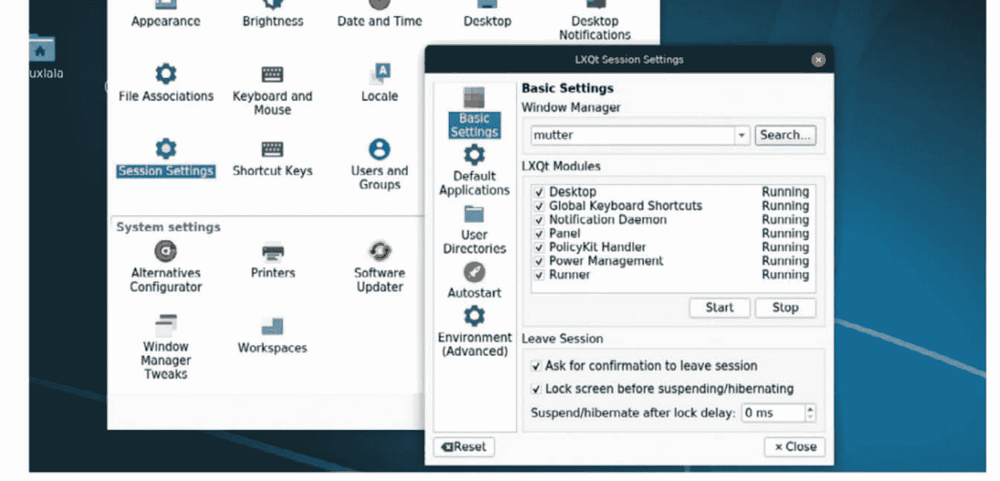

**裁决**

| 春秋桌面环境 | 7/10 | Moksha 桌面 | 8/10 |
|---|---|---|---|
| Lumina | 8/10 | Openbox | 7/10 |
| LXQt | 8/10 | | |

您可以根据需要塑造这些桌面环境中的每一个。

### 轻量级桌面

### 最终裁决

以应用启动时间作为参考，本综述中的所有选项在轻量度和响应性方面都旗鼓相当，在性能方面没有给我们太多选择空间。因此，我们将专注于其他方面，并使用经过验证的淘汰机制来确定我们的赢家。

Lumina 落选的原因很简单，它不是为 Linux 设计的。此外，它也不在许多发行版的软件仓库中可用，这使得安装对大多数用户来说是一项艰巨的任务。

我们真的很难不让 Equinox 登上领奖台，尤其是因为它表现非常出色，在易用性方面评分也不差。然而，该项目不像其同行那样活跃开发，并且您并不总能在您喜欢的发行版中找到它。

Moksha 凭借其美丽的 Enlightenment 血统登上领奖台。它不仅外观漂亮，而且响应迅速，资源占用少。不过，与大多数为特定发行版设计的桌面一样，Moksha 在其他发行版上并不总是兼容良好。

LXQt 和 Openbox 都是成熟的项目，已经存在多年。Openbox 无疑是两者中更快的，但阻碍它获胜的是其较弱的易用性。由于它是一个基础窗口管理器，用户不得不花费一些时间来组装各种组件并编写自定义配置文件以创建可用的桌面环境。虽然这并不像听起来那么费力，但它仍然是一项练习，且耗时比 LXQt 这样的现成解决方案更长。

LXQt 是 LXDE 和 Razor-Qt 项目合并的产物。它的启动速度非常快，并明智地利用了可用资源。尽管其资源消耗远低于其主流竞争对手，但 LXQt 凭借其 Qt 基础看起来依然美观，这也是与 Openbox 相比其资源使用率略高的原因。

话虽如此，LXQt 在现代机器上会感觉如鱼得水，但它仍然足够轻量，可以将一台退役的电脑重新投入活跃使用。

### 第 1 名 LXQt
8/10

**网站**: https://lxqt.org  
**许可证**: GPL, LGPL  
**版本**: 0.14.1

一个轻量级桌面，同时设法保持美观。

### 第 2 名 Openbox
7/10

**网站**: http://openbox.org/wiki/Main_Page  
**许可证**: GPLv2  
**版本**: 3.6.1

适合喜欢花时间设置桌面的微调爱好者最佳选择。

### 第 3 名 Moksha 桌面
7/10

**网站**: https://www.bodhilinux.com/moksha-desktop  
**许可证**: BSD 许可证  
**版本**: 0.3.0

一个很棒的选择，适合喜爱 Enlightenment 华丽效果的用户。

### 第 4 名 Equinox 桌面环境
6/10

**网站**: https://edeproject.org  
**许可证**: GPL, LGPL  
**版本**: 2.1

对于能在其发行版软件仓库中找到它的人来说是一个不错的选择。

### 第 5 名 Lumina
6/10

**网站**: https://lumina-desktop.org  
**许可证**: BSD 2.0  
**版本**: 1.4.0

为 BSD 优化，不符合 Linux 发行版的设计理念。

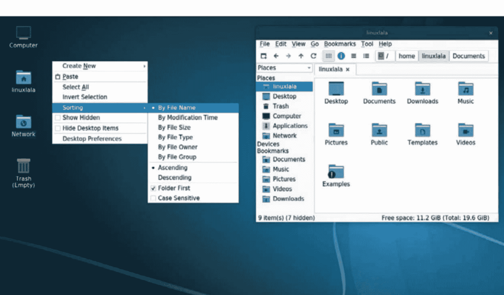

### 其他推荐

与其他一些综述不同，除了这里介绍的内容，轻量级选项并不缺乏。还有为 OLPC 项目开发的教育桌面 Sugar。虽然不是一个常规的桌面环境，但如果您正在寻找一个专为教育计算机定制的环境，它是一个绝佳的选择。

从桌面环境中削减臃肿功能的最流行选项之一是简单地运行其轻量级窗口管理器。我们在综述中介绍了一些，还有很多其他的。诸如 Fluxbox、Fwm、FVWM、IceWM 和 JWM 等堆叠式窗口管理器都能在不给计算机可用资源带来压力的情况下运行。

与此同时，命令行勇士将欣赏像 i3 和 xmonad 这样的平铺窗口管理器的可定制性。其中许多在流行桌面发行版的软件仓库中均可用。然而，它们在易用性方面评分较低，因此并非人人都能接受。


### 综述

AIO 系统救援工具包 » ALT Linux 救援版 » MorpheusArch » SystemRescueCd » Ultimate Boot CD


**Shashank Sharma**
白天，Shashank 是德里的一名民事诉讼律师，但到了晚上，他变身为开源领域的“义警”！

### 救援发行版

Linux 相当具有韧性，但当局面失控时，**Shashank Sharma** 会使用这些专用发行版之一来挽救安装。

### 我们的测试方法……

我们测试的参数与 LXF209 期上一篇救援综述相比并没有太大变化：我们仍在寻找拥有最广泛工具集的发行版，这些工具能帮助我们处理各种修复和救援操作。

然而，这并不是我们关注的唯一参数，甚至也不是最重要的参数。相比于工具的数量，完整发行版的有效性在我们看来权重更高。那些能帮助用户在海量工具中理清头绪并锁定正确工具的发行版，比那些仅仅声称打包了最多救援实用程序的发行版评分更高。

由于许多这些实用程序直接与磁盘及其承载的关键数据交互，如果操作不当，它们可能会造成比有益更多的危害。对于这种专业任务而言，文档因此起着至关重要的作用。


Linux 不乏旨在让故障计算机恢复运行的修复实用程序。当然，Linux 内核在设计上（以及 Linux 发行版延伸来看）具有较高的崩溃阈值，但硬件故障或粗心的操作员仍可能造成相当大的破坏。

大量的修复工具帮助用户摆脱各种困境。然而，由于选择实在太多，普通 Linux 桌面用户未必总能选到最适合当前任务的工具。此外，虽然你可以在几乎所有主流发行版的官方软件仓库中找到这些工具，但由于其中许多是基于命令行的（CLI），它们不会出现在应用程序菜单中——因此许多新手实际上并不知道它们的存在。这正是专用救援发行版发挥作用的地方。与其仅仅汇编大量修复工具，这些发行版帮助用户找到适合任务的正确工具。我们过去也曾审视过修复和救援发行版（见 LXF209，第 24 页）。但这些专用衍生版本的淘汰率相当高，除了两个之外，上一篇综述中的所有其他候选者现在都已停止维护——包括获奖者 Rescueix——因此重新进行一次测试已迫在眉睫……

### 提供的工具范围

礼物包里都有什么？

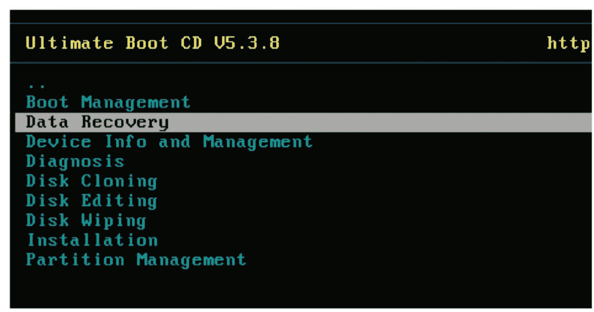

如果你在寻找广泛的各种修复工具和实用程序，MorpheusArch 可能会让你失望。该发行版采取非常专注的方法，真正包含的只有 TestDisk 及其配套工具 PhotoRec（用于恢复文件）。这些工具支持所有主流文件系统，并能识别超过 400 种格式的文件。除了文件，你还可以使用它们来查找丢失的分区、重建引导扇区、修复 FAT 表、定位备份超级块等。经验丰富的用户可以使用其 Arch 基础来获取其他救援工具。

另一个基于 Arch 的救援发行版 SystemRescueCd 是一个稍好的选择。与 MorpheusArch 不同，它附带了多个修复和救援工具及实用程序，并支持所有重要的文件系统。它包含多种恢复工具、针对特定文件系统的修复工具，以及包括 HDT（用于查询硬件）在内的几个引导镜像。此外还有 FSArcher，它可以帮助保存和恢复分区表或文件系统内容到压缩归档文件中。

然后是 AIO System Rescue Toolkit，它坦率承认并未附带所有可用的救援工具。它只包含其创作者（一名熟练的技术人员）在现场用于修复机器最常用的工具。除了 Boot Repair、Clonezilla 和 TestDisk 等工具外，还包括几个压力测试和基准测试工具。然而，该发行版的主要目标是修复 Windows 机器，与其他选项相比，它拥有最多的此类工具集合。

通过 UBCD 多样化的菜单导航，找到你感兴趣的工具，并直接进入其精简化的环境。

压力测试和基准测试实用程序也包含在 ALT Linux Rescue 中，它打包了超过一百个 CLI 工具，其中包括几个多功能工具。该发行版还有几个用于帮助恢复已删除文件以及修复 Linux 和 Windows 安装常见问题的实用程序。

Ultimate Boot CD (UBCD) 以最大且最多样的实用程序集合领先。你可以使用该发行版来查询和压力测试连接到系统的硬件和外围设备。它也可以用于恢复 BIOS 设置以及备份和恢复 CMOS。UBCD 使你能够修复引导加载程序、恢复丢失的密码和已删除的文件，还可在不启动安装系统的情况下调整 Windows 注册表。

**判决**

| 发行版 | 分数 | | 分数 |
| :--- | :--- | :--- | :--- |
| AIO SYSTEM RESCUE TOOLKIT | 8/10 | SYSTEMRESCUECD | 6/10 |
| ALT LINUX RESCUE | 9/10 | ULTIMATE BOOT CD | 9/10 |
| MORPHEUSARCH | 3/10 | | |

除了 MorpheusArch 之外，其他发行版在本次综述的其他救援发行版中也能发挥相当大的作用。

### 自定义

它们是否有助于减轻管理访问负担？

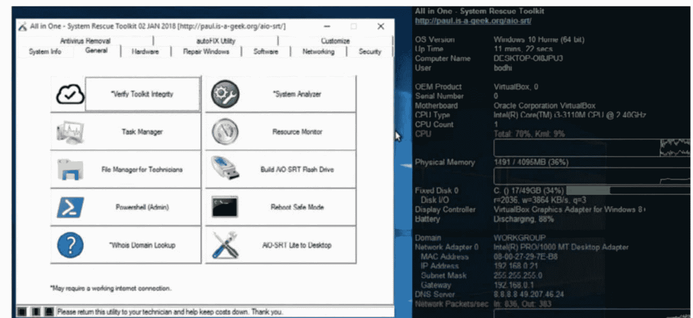

SystemRescueCd 在自定义界面方面提供的并不多。该发行版有一个简单的启动选项，将你带入 Xfce 桌面，但这并未提供任何便捷功能或自定义界面来帮助新手或不熟悉操作的用户定位。

MorpheusArch 项目确实生成了一个名为 LinDiag 的基于 ncursest 的脚本，用于协助常见的系统管理和恢复任务。你可以使用它来检查服务、诊断网络、管理软件包以及从驱动器中恢复数据。然而，该脚本默认并未包含在发行版中，你需要从 GitHub 克隆它。

如果你管理着一批 Windows 机器，AIO System Rescue Kit 可以帮助你保持它们处于完美状态。

ALT Linux Rescue 在自定义方面也没有提供太多。它拥有的少数辅助功能之一是取证模式启动选项，该选项在不激活 swap 或挂载任何分区的情况下启动发行版。此外，还有几个脚本可以自动挂载连接的磁盘并修复主引导记录（MBR）中的任何问题，这非常方便。

使 UBCD 从竞争中脱颖而出的特点是其自定义启动菜单。该发行版没有图形桌面，而是直接启动到一个布局非常合理的菜单。自定义的基于文本的菜单有助于引导你找到解决当前问题的相关实用程序。菜单排列合乎逻辑，单个菜单中包含有助于识别其功能的信息。

相比之下，AIO System Rescue Toolkit 拥有大量 CLI 工具，但为了方便访问，它在桌面上为所有工具提供了快捷方式。除了 Live 环境外，你还可以在 Windows 内部启动该发行版的 CD/USB，通过自定义界面访问所有特定的 Windows 修复和救援工具。

**判决**

| 发行版 | 分数 | | 分数 |
| :--- | :--- | :--- | :--- |
| AIO SYSTEM RESCUE TOOLKIT | 8/10 | SYSTEMRESCUECD | 3/10 |
| ALT LINUX RESCUE | 7/10 | ULTIMATE BOOT CD | 9/10 |
| MORPHEUSARCH | 5/10 | | |

新用户会特别欣赏 UBCD 的自定义启动菜单。

### 发行版

### 易用性

用户体验如何？

对于打包了专用工具的发行版来说，要打动我们，不仅仅是各部分总和那么简单。向发行版塞满大量工具对经验丰富的用户有帮助，但对于试图拯救无法启动机器的普通桌面用户而言，帮助不大。

正因为如此，易用性对于本综述中这类专用发行版来说是一个至关重要的因素。另外，请记住，易用性不仅仅关乎美观的界面；掌握手头工具的使用相关信息与选择正确的工具同样重要。

最后，一个发行版无论用户经验水平如何都具备易用性，并不意味着它的工具不如专为有经验用户设计的发行版强大。

### System Rescue Toolkit 8/10

该发行版的独特之处在于它拥有几种用户模式。你可以将 ISO 传输到 CD 或 USB，并将其作为常规的 Live 磁盘使用，它会启动到经过调整的 LXDE 桌面。桌面上有包括命令行版本在内的所有应用的图标，这对首次使用的用户非常有帮助。

除了 Live 环境外，你还可以在 Windows 内部运行该发行版。在这种情况下，它会启动一个自定义修复实用程序，其中列出了软件仓库中所有可用的工具，以帮助你修复损坏的 Windows 安装。

该自定义应用有多个标签页，每个标签页包含针对特定领域的（如硬件、软件、网络等）应用。虽然对于熟悉故障排除的人来说，这个自定义应用操作起来很直观，但还有一个非常有帮助的 AutoFix 实用程序，可以帮助新手修复 Windows 安装中的许多常见问题。

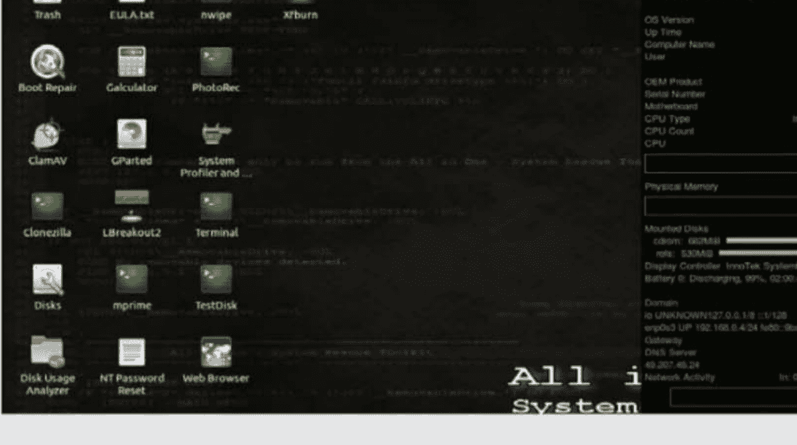

### ALT Linux Rescue 5/10

与综述中的其他发行版不同，ALT Linux Rescue 直接启动到 shell，完全缺失图形桌面。这显然表明它专为经验丰富的用户设计，这些用户不仅熟悉捆绑的工具，还知道需要使用哪些工具来修复影响系统的问题。

除了前文提到的几个脚本外，没有其他便捷功能。除了常规启动选项外，该发行版还有几个其他选项。前面提到的取证模式可以最小化与计算机磁盘的交互，以帮助你进行系统取证调查。

另一个启动选项旨在救援无头（headless）机器。它自动为机器分配 IP 地址，设置随机 root 密码，并启动 SSH 服务器，以帮助你远程访问该机器。

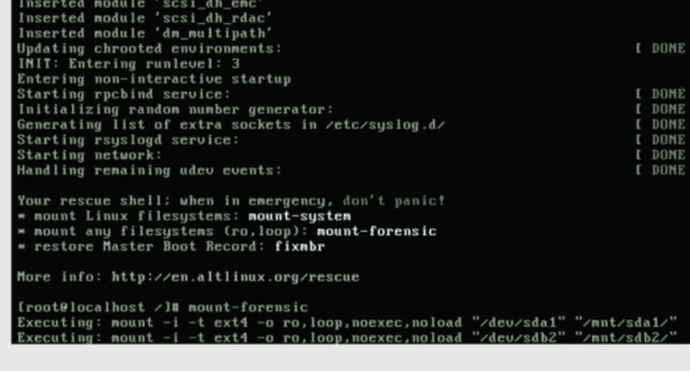

### 帮助与支持

当你需要协助时。

MorpheusArch 是本综述中两个没有任何自有帮助信息的发行版之一。你确实可以在 LinDiag 的 GitHub 页面上找到一个简短的图文指南，但没有论坛或邮件列表供寻求帮助的渠道，因此该发行版仅设计给那些希望使用基于 Arch 基础的捆绑恢复工具的人。

ALT Linux Rescue 在这方面也好不到哪里去，它仅在 ALT Linux 网站上有一个页面，列出了该发行版的功能和部分主要实用程序。主要的 ALT Linux 发行版有俄语论坛和邮件列表，但救援版没有任何官方支持渠道。

相比之下，AIO System Rescue Toolkit 拥有详细的常见问题解答（FAQ），列出了所有实用程序，并附带几个视频帮助你熟悉该发行版。虽然没有论坛，但开发者在网站上创建了一个页面，用户可以在此发布问题。

SystemRescueCd 的网站托管了快速入门指南，以及基础和高级使用的详细说明。还包括给有经验使用者的指南，例如如何制作自定义版本，以及如何从无法启动的 Windows 计算机备份数据。

UBCD 拥有教程部分的维基和旨在帮助用户熟悉该发行版的详细常见问题解答（FAQ），在这方面远超竞争对手。不过，教程部分只是指向一个由论坛用户贡献的长列表的指针，因此可能还可以更友好一些。维基列出了发行版中的所有工具，并附有对其功能的有用说明。

**判决**

| 发行版 | 分数 | | 分数 |
| :--- | :--- | :--- | :--- |
| AIO SYSTEM RESCUE TOOLKIT | 7/10 | SYSTEMRESCUECD | 9/10 |
| ALT LINUX RESCUE | 5/10 | ULTIMATE BOOT CD | 9/10 |
| MORPHEUSARCH | 2/10 | | |

SystemRescueCd 和 UBCD 是唯一两个在论坛上积极解决用户查询的发行版。


### MorpheusArch 3/10

与*综述*中的其他修复和救援发行版相比，MorpheusArch 的吸引力相当有限。它真正宣传的亮点仅在于包含了 *TestDisk* 和 *PhotoRec* 实用工具，这些工具帮助用户恢复意外删除的文件。该发行版启动后进入一个锁定的 LXQt 桌面，而项目网站上没有提及默认密码（`arch`），这是一个严重的疏忽。

LXQt 桌面提供了一些应用，包括 *Firefox*、*Zenmap* 和 *LFTP*。桌面环境没有提供如何继续操作的指示，这让人有些迷茫。

发行版内部缺乏入门文档，甚至项目网站上也没有相关文档，这也无助于改善局面。

MorpheusArch 项目最好的特点之一是辅助性工具 *LinDiag*。然而，它并未随发行版一起提供，你需要手动获取它，这一点再次没有明确说明。


### SystemRescueCd 7/10

该发行版的早期版本拥有一个全面的启动菜单，包含十几个启动选项。

有一个选项可以将整个系统复制到 RAM 中，默认选项将把系统启动到控制台，并列出配置键盘布局和启动图形环境的命令。

该发行版使用 Xfce 桌面，其菜单中收纳了一些基本的生产力应用，包括网页浏览器、VNC 查看器、密码管理器以及一些对开发者友好的工具。

发行版中的大多数救援工具基于命令行（CLI），就像 MorpheusArch 一样，该发行版也没有提供任何指针来帮助用户入门。它的救赎之处在于其网站，网站上有各种详细的文档，帮助首次用户使用该发行版。


### Ultimate Boot CD 9/10

与这里的其他发行版不同，UBCD 的独特之处在于它直接启动到其定制化的基于文本的菜单。该菜单将打包的工具按照它们影响的计算机部分进行分类，例如 HDD、外设、系统等。

进入某个类别可以查看单个工具的项目列表。某些类别，如 HDD，又进一步细分为不同的任务，如启动管理、数据恢复、磁盘克隆和磁盘擦除等。

当你在类别中的各个工具之间移动时，菜单会显示关于该工具的简短但有用的信息。虽然菜单是基于文本的，但清晰的类别和有帮助的描述意味着该发行版可以被经验不足的用户轻松导航和使用。结合项目网站上的有用信息，UBCD 是一个极佳的选择。


### 安全性和隐私功能

除了修复和救援，它们还能做什么？

虽然这些发行版的主要目的是救援故障计算机，但许多也配备了一组工具来帮助保护你的系统并防止隐私泄露。这是因为安全问题导致计算机故障并不罕见。在某些情况下，你可能需要在恢复系统运行之前对安装环境进行净化（sanitise），以确保与其他交互网络中机器的健康状态。

MorpheusArch 拥有用于探索网络的 *nmap* 工具，你可以通过 *LinDiag* 脚本使用它。该发行版还有几个实用程序可以从设备中清除文件系统签名，并设置硬盘参数。

AIO 系统救援工具包还包括 *nwipe*，以帮助安全地擦除文件。ALT Linux 救援包含用于安全删除文件和调查安全漏洞的工具。该发行版针对多种场景设计，但遗憾的是，确保隐私并非其中之一。

如果你使用 YubiKey，SystemRescueCd 会采取措施增强你的隐私。它包含 *YubiKey Manager* 应用以及 *YubiKey 个性化工具*，后者可以帮助你重新编程设备上的配置插槽，以启用 OTP 等额外认证功能。除此之外，你会发现几个帮助安全删除数据的工具，包括 *shred*、*wipe* 和 *THC-Secure Deletion* 工具。

与其同类一样，虽然确保安全性和隐私不是 UBCD 的目标，但该发行版确实有一个特定的类别，其中列出了大约一打工具，包括几个低级实用程序，用于安全擦除磁盘。还有扫描器来检测病毒和恶意软件。

### 结论

- AIO 系统救援工具包 4/10
- ALT Linux 救援 6/10
- MORPHEUSARCH 5/10
- SYSTEMRESCUECD 7/10
- ULTIMATE BOOT CD 7/10

你可以使用其中任何一个发行版来安全地删除文件，使其不可恢复。除此之外，它们的安全功能差异相当大。

### 发行版

### 修复能力

它们能解决哪些故障？

所有这些发行版都能帮你摆脱困境，无论你的安装遇到了什么故障。其中许多还可以对磁盘进行镜像和克隆，识别并列出损坏的扇区，并从物理损坏的磁盘中提取可恢复的数据。然而，有些比其他更有用。

例如，数据恢复是 MorpheusArch 唯一的宣传用途，因此你几乎不能用它做其他事情。AIO 系统救援工具包有一些救援工具，用于修复启动错误和救援意外删除的文件。然而，其大多数工具用于修复 Windows 安装，可用于修复专有操作系统的所有类型问题。

ALT Linux 救援捆绑的工具可以执行多种修复工作。在专家手中，该发行版可以修复引导加载器、优化文件系统、恢复意外删除的文件和分区，甚至诊断网络问题。

同样，你可以使用 SystemRescueCd 来纠正硬盘的各种问题，包括恢复分区表。它还可以将文件系统内容扫描到压缩归档中，安全删除文件并恢复意外删除的文件。你还可以使用该发行版从无法启动的 Windows 机器中救援数据。

与大多数其他情况一样，UBCD 比其他竞争者走得更远，它不仅可以修复引导加载器，还可以恢复 BIOS 设置以及备份 CMOS。此外还执行常规救援任务，如恢复密码和删除的文件。该发行版还包含几个诊断实用程序。


### 结论

| 发行版 | 得分 |
| :--- | :--- |
| AIO 系统救援工具包 | 8/10 |
| ALT Linux 救援 | 8/10 |
| MORPHEUSARCH | 3/10 |
| SYSTEMRESCUECD | 8/10 |
| ULTIMATE BOOT CD | 9/10 |

MorpheusArch 是*综述*中唯一拥有非常专注救援目标的发行版。

### 自定义

你能根据需要调整它们吗？

尽管拥有相当大量的应用程序集合，但这些发行版并没有包含所有可用的修复和救援工具。这在一定程度上是因为一些流行的救援工具有许可证限制，阻止开发者将其包含在他们的发行版中。无论如何，与其携带多个发行版来完成不同的任务，高级用户和技术人员更喜欢完善他们喜欢的发行版，使其包含所有需要的工具。

如果你打算反编译并组装自己的救援发行版，ALT Linux 救援、MorpheusArch 或 AIO 系统救援工具包不会让你走得太远。它们都不提供自定义发行版的选项，尽管你可以使用它们各自的包管理器拉入额外的实用程序，并按需完善实时环境。AIO 系统救援工具包有一个 Lite 版本，旨在为经验丰富的用户提供机会轻松修复其安装。

另一方面，SystemRescueCD 的一个标志性功能是其允许任何人编译定制版本的能力。有一组脚本用于简化旧版发行版的重新主制（remastering）过程。在新的基于 Arch 的版本中，这个过程已经简化，只需使用项目 Git 仓库中发布的源代码进行重新构建即可。你需要有一个 Arch 安装才能运行基于 archiso 工具的 SystemRescueCD 构建脚本。

UBCD 的自定义能力与 SystemRescueCD 相当。项目网站托管了一份指南，详细说明了提取 ISO 镜像并自定义环境的过程，包括添加新的 run Freppy 和 ISO 镜像以及基于 FreeDOS 的应用，然后再编译一个新的 ISO 镜像。网站文档还列出了更新病毒定义的过程。UBCD 自定义机制的一个特定优点是，由于所有修改都包含在一个单一的文件夹中，你可以轻松升级到更新版本的 UBCD，而不会丢失对发行版所做的任何更改。


### 结论

| 发行版 | 得分 |
| :--- | :--- |
| AIO 系统救援工具包 | 5/10 |
| ALT Linux 救援 | 1/10 |
| MORPHEUSARCH | 1/10 |
| SYSTEMRESCUECD | 8/10 |
| ULTIMATE BOOT CD | 8/10 |

SystemRescueCD 和 UBCD 是仅有的允许你使用自己的工具和实用程序制作定制版本的发行版。


### 救援系统发行版
### 最终裁决

拯救一台受损电脑的第一步，是拥有访问正确工具的权限，因此我们青睐于拥有大量工具集合的发行版。但对于经验不足的用户来说，仅仅拥有最大的工具库并无太大用处。考虑到这一点，本次精选系列的获胜者必须是一个能被大量人群使用的发行版，无论其技能水平和经验如何。

这就是 **ALT Linux Rescue** 落选的原因。虽然该发行版配备了处理各类修复和救援任务的工具，但对于新用户来说却无济于事——它是专门为经验丰富的技术人员设计的。

**MorpheusArch Linux** 因相似但不同的原因落选。与 ALT 不同，该发行版启动后进入图形化桌面环境，但其声称拥有的所有工具均基于命令行，且发行版未提供任何协助来引导用户选择适合任务的正确工具。我们确实喜欢其 **LinDigi** 工具，尽管其适用范围有限，但这是让首次接触用户更容易上手一些工具的良好尝试。但遗憾的是，它并未默认包含在发行版中，这是一个巨大的缺点。

**SystemRescueCd** 也存在一些同样的问题。与早期版本不同，早期版本拥有全面的启动菜单，当前版本仅对熟悉其工具库的人有用。

让我们印象最深刻的两个选项是 **AIO System Rescue Kit** 和 **UBCD**。两者都装满了工具和实用程序，并拥有定制界面以帮助你找到合适的工具。然而，AIO 因强烈侧重于 Windows 特定的修复而输给 UBCD。即使其定制菜单在从 Windows 内部运行该发行版时也会弹出。

**UBCD** 赢得了本次精选系列，因为它在我们设定的两项标准上得分都很高。该发行版装满了工具，并且对用户友好得足以让初学者使用。其逻辑排列的启动菜单也是其独特卖点，提供有用信息帮助你识别正确的工具并直接启动进入该工具。


- 第 1 名 **Ultimate Boot CD** 8/10
  网站: www.ultimatebootcd.com
  许可证: 多种
  版本: 5.3.8

  UBCD 打包了足以配得上其名称的工具数量，并通过用户友好的界面展示它们。

- 第 2 名 **AIO System Rescue Toolkit** 6/10
  网站: https://paulis-a-geek.org/aio-srt
  许可证: 多种
  版本: 2018-01-02

  拯救 Windows 安装的最全面解决方案。

- 第 3 名 **SystemRescueCd** 5/10
  网站: www.system-rescue-cd.org
  许可证: GPL v2
  版本: 6.0.2

  如果你有时间阅读其文档，它可以帮助你摆脱许多常见问题。

- 第 4 名 **ALT Linux Rescue** 5/10
  网站: https://en.altlinux.org/Rescue
  许可证: 多种
  版本: 20190306

  对于熟悉捆绑工具的高级用户来说是一个不错的选择。

- 第 5 名 **MorpheusArch** 3/10
  网站: www.morpheusarch.co.uk
  许可证: GPL v2
  版本: 2018.4

  奇怪的是，该项目最好的部分（LinDigi）并未默认包含在发行版中，目前限制太多且太难使用。

### 其他值得关注

正如我们前面提到的，我们过去几期中介绍过的许多救援发行版已不再维护。虽然它们可能不支持最新硬件，也没有最新版本的捆绑工具，但你仍然可以用它们来修复较旧的机器。例如 **Ther (Tux 手指不应——编辑注)** 拥有一个有趣的辅助应用程序，帮助你修复安装的不同部分，而无需了解底层的命令行工具。

还有 **Trinity Rescue Kit**，它提供了一个精心设计的启动菜单，旨在帮助你找到正确的修复工具。许多修复和救援工具也将其实用程序整合到你可以使用的 Live CD 中（前提是你知道需要使用哪个工具）。例如，**Boot-Repair** 有一个 Live CD，非常适合修复各种引导加载器相关问题。**GParted** 也有自己的 Live CD，其中包含 **TestDisk**、**FSArchiver** 等其他修复和救援实用程序。


让吸引眼球发行版的爱好者 **Jonni Bidwell** 向你介绍 System76 的定制 Linux 风味。


有一些值得注意的努力旨在让 Linux 更人性化。今天我们会说——请随意反驳——Linux Mint 和 elementary OS 是最易用且通用的发行版。当然，它们得益于 Ubuntu 提供的基础坚实和出色的软件包选择，而这反过来又得益于 Debian。但也可以争辩说，这种流行程度（至少曾经是）源于对 Ubuntu 桌面的不满。

不喜欢 Unity 的人喜欢 Cinnamon，而喜欢 Unity 的人则不喜欢 GNOME 3（Ubuntu 自 17.10 版本以来一直使用 GNOME 3）。Pantheon，elementary OS 类似 macOS 的桌面环境，不仅吸引了喜欢基于水果品牌的时尚公司的人，也吸引了那些对过度复杂的配置、风格不一致的应用程序和丑陋字体感到沮丧的人。当然，Windows 10 也持续将用户引导至 Linux，因为开始菜单开始变得像某种不断增长的广告牌农场，并且更新总是妨碍你。硬件兼容性也是一个重要问题。如今，发行版必须适应各种新颖的配置：HiDPI 分数缩放、多显示器和混合 GPU 设置、磁盘加密。用户希望轻松访问最新软件，开发者希望轻松访问首选的开发工具。如果你是像科罗拉多州的 System76 这样的 Linux 系统制造商，提供这些功能尤为重要，这就是为什么它开发了标点符号神秘的 Pop!_OS。让我们来看看它。


显然，到现在你应该已经玩过了 Pop! 并明白了它为何如此轰动。你甚至可能急于安装它，如果是这样，请查看分步指南。但在此之前，你应该知道，如果你有 Nvidia 硬件并且希望生活更简单，你绝对应该使用 Pop 的 Nvidia 版本，可以从 https://system76.com/pop 获取。该版本默认配置了 Nvidia 的专有驱动程序，这非常有用。

AMD/Intel 版本仅包含开源驱动程序，包括用于 Nvidia 卡片的 Nouveau 驱动程序，但这对于 AAA 级游戏或 CUDA 编程没什么用。如果你在启动 Live 光盘或启动 Pop!_OS USB 时遇到任何问题，请确保已在 UEFI 设置中禁用了安全启动（通常在启动时按 F2 或 Delete 键找到）。不同的 BIOS 使用不同的热键来调出启动菜单，但 F11 和 F12 很常见。像大多数陌生的发行版一样，安装时你可能会发现一些怪癖，需要你自己去摸索，但一点资源性和查阅在线 FAQ 应能最小化这些问题。

### 热门安装指南

该指南涵盖与 Windows 并列安装；不过，如果你有空闲驱动器，我们总是建议安装在不同的驱动器上。UEFI 启动意味着 Windows 通常能自给自足，或者将破坏行为限制在自身范围内。如果你使用传统 BIOS，可能会发现 Windows 时不时地盲目覆盖引导加载器，这很烦人，但可以得到修复。无论如何，重要的是在 Windows 控制面板的电源选项中禁用快速启动，否则你将无法启动另一个操作系统。如果你正在将 Pop 设置为唯一操作系统，可以安全地忽略操作指南中的分区说明；只需从安装程序中选择一个 “擦除整个磁盘”，一切都会为你设置好。

你还应该能够安全地使用 Pop!_OS 安装程序的分区工具来调整 NTFS 分区大小，但让魔鬼（Windows）做魔鬼的工作（重新排列 NTFS 结构）可能更安全。如果你的 EFI 分区小于 512MB——一些 Windows 安装似乎只分配了 100MB——那么你需要使用第三方工具来调整此大小，并可能需要移动 Windows 系统保留分区，这一点我们完全无法推荐。希望这不是问题，你不需要担心。Distinst（Pop 的定制且令人愉悦的简单安装程序）将在整个安装过程中握住你颤抖的手。


Videos 应用程序提供安装你可能需要的任何编解码器，或者作为替代方案安装 VLC 或 MPV。

Pop!_OS 并不真正类似于 Windows 或 macOS，它只隐约类似于 Ubuntu 当前的 Gnome 设置。但很容易上手：按下 Super（Windows）键或点击左上角以访问活动视图，然后开始输入以查找已安装的应用程序。这还会显示你可以从 Pop!_Shop 安装的应用程序（好吧，这听起来不错）以及最近打开的匹配文件。初始安装权重约为 5.5GB，这在今天看来相当适中。许多发行版都捆绑了 LibreOffice，但除了 Firefox 和核心工具外，没有超大型应用程序的包含。有一些瑰宝包含其中，如令人愉悦的 Geary 电子邮件程序和 System76 自己的 OpScribe USB 写入工具。还有 Eddy，与其押韵的兄弟 Geary 一样，是一个 GUI 工具。

> 如果你选择将 Pop 安装在单独的驱动器上，你可以启用全盘加密，以确保数据在静止状态下安全。

### 细节之处见真章

Pop!_OS 的许多与众不同之处在于其对幕后细节的关注。传统上令人烦恼的事情在 Pop! 中变得简单。System76 编写了自己的 HiDPI 守护进程，你可以在 http://bit.ly/2t5ZhdpI 阅读所有相关信息。它让你轻松应对任何复杂的显示器设置，甚至可以使用巧妙的缩放管理混合 Hi 和 LoDPI 显示。Wayland 默认禁用，但你可以通过编辑 `/etc/gdm3/custom.conf` 并注释掉该行来启用它：`WaylandEnable=false`

然后，当你在登录时输入密码时，你会看到常见的齿轮图标，并且可以在 Wayland 和 X.org 会话之间进行选择。在某些多 DPI 情况下，Wayland 的性能优于 X，在我们的测试中，我们只遇到了一些小麻烦——主要是使用 Fedora 的实验性 Firefox Wayland flapak，来自 https://firefox.flapak.mojeoredora.cz。

很容易将 Pop!_OS 视为又另一个 Ubuntu 克隆，但我们不会在乏味的发行版上展示功能，所以它一定有什么特别之处。除了我们这里写的内容外，还有许多小调整让生活更容易。这些调整做得很巧妙，你几乎注意不到。以用户为中心的设计核心和开源的核心，Pop!_OS 就像它完美地适合作为初学者的发行版一样，但它并没有以某种方式“简化”。它如此灵活和强大，即使是更高级的用户也会喜欢它。嘿，我们刚把它安装在官方的 LXF 笔记本电脑上（Jonni 的 Eee PC——编辑注）。就这样。


### 发行版

适用于安装 DEB 文件 – 非常适合那些不熟悉命令行的用户。

在活动视图中，你可以通过输入文字或点击右侧工具栏上的 Pop 应用程序按钮来找到 Pop!\_Shop 启动器。不妨停一秒，欣赏一下大胆鲜明的图标设计。你可以说 Pop!\_OS 初始的应用程序数量相当稀疏，但其理念是只添加你需要的内容。并非每个人都想要 Visual Studio Code 或 Slack，但如果你需要，它们在 Pop!\_Shop 中非常容易找到。

今天精选的应用程序由字母 G 带来：Goxel – 制作体素艺术令人惊讶地平静；Gnome Twitch – 用于观看 Gaming On Linux 的视频；以及 GIMP，它仍然是处理图像的最佳方式。

### 选择你自己的冒险

> “Pop!\_OS 初始的应用程序提供相当稀疏，但其理念是只添加你需要的内容。”

当然，也可以使用 apt 通过命令行进行安装，许多软件包都没有 Pop!\_Shop 条目。Pop 安装中缺失的一项功能是 NetworkManager 的 OpenVPN 插件，如果你使用 VPN（或将来计划使用），你希望用以下命令来修复：

```
$ sudo apt install network-manager-openvpn-gnome
```

我们希望你的 Pop 安装不会损坏，但如果真的发生损坏，救援分区可以提供帮助。这基本上让你引导到类似 DVD 上的 Live 环境，从而可以进行修复。在系统启动时按下 Shift 和 Escape，并从菜单中选择救援环境。如果这不起作用，你可以执行刷新安装，它会重置所有系统配置和应用程序，但保留你的用户信息和文档，类似于 Windows 的等效工具。

说到系统启动，Pop 在主要发行版中相当独特，因为它在 UEFI 安装中使用 System-boot – 以前称为 GrubMint – 来启动系统。这意味着我们第一次可以说，在这个发行版中你不会遇到可怕的 GRUB 问题，除非你使用传统 BIOS 启动。顺便说一下，System76 在其硬件上测试各种奇特而精彩的配置，因此你也不会遇到任何 systemd-boot 故障。

附带的视频播放器没问题，但你可能更喜欢安装 MPV，它处理自己的编解码器。安装后，它还会利用任何可用的硬件加速（VDPAU、VA-API 或二者的某种不祥组合）来解码视频，而不麻烦你的 CPU。

Pop!\_OS 团队在准备文档方面做得非常出色。在 https://support.system76.com/ 的文章中，常见任务的指南列表正在不断增长。例如，如果你对本杂志中所有关于终端命令的抽象引用感到困惑，可以在那里的“终端基础”文章中找到更多信息。

团队也热衷于让更多人参与开发。他们甚至将项目中的特定 bug 标记为‘微小型’，适合有志的程序员入手。我们必须对此表示感谢，因为用户和开发者之间的差距只有通过更多人的参与才能缩小，而此类外展活动是鼓励这种参与的绝佳方式。

我们也必须感谢 System76 在开源硬件方面的出色努力。除了为开源固件事业做出贡献外，其旗舰 Thelio 机器还包含一个用于管理气流的定制子板。其规格完全开放，System76 希望开发更多遵循此模式的硬件。我们 definitely 很期待看到更多。LXF


### 在 Windows 旁安装 Pop!


1  **制作安装介质**

如果你有 Nvidia 显卡，你需要从 `https://system76.com/pop` 获取 Nvidia 版本，并将其刻录到 DVD 或写入 USB 驱动器。如果你在安装 Pop!\_OS 时遇到问题从 LXF DVD 启动（或没有 DVD 驱动器），你应该将 Pop/ 目录中的 ISO 文件（或上述链接）写入 USB。

2  **腾出空间**

启动 Windows 并打开磁盘管理工具。最简单的方法是打开开始菜单并输入 'disk man' 的前几个字母。右键点击 C: 驱动器并选择压缩卷。为 Pop 腾出一些空间。Pop 建议至少 20GB，但如果你可以腾出更多，就使用更多。


3  **启动 Pop!**

启动 Pop!\_OS 并开始安装程序。回答一些本地化问题后，选择自定义（高级）选项，除非你希望清除目标驱动器上的一切。选择‘修改分区’，右键点击未分配空间并点击新建。使用默认设置，然后点击添加，最后应用更改。

4  **选择分区**

退出分区工具并点击新分区。点击‘使用分区’开关，再次保留默认设置。点击 EFI 分区（在 Windows 安装中通常是从左数第二个，且格式化为 FAT32），再次将其用作启动分区，但请不要格式化它，因为这会破坏 Windows。


5  **起飞**

点击擦除并安装以开始乐趣。要么密切注视进度条，要么泡杯茶。当安装程序完成时，点击重启并执行一些最终设置步骤。你可以启用位置服务并连接在线服务。最后，设置用户名和密码，然后点击大勾开始使用 Pop!\_OS。

6  **更新和增强**

可能会有可用更新。你应在提示时安装这些更新，然后从已安装选项卡切换到主页选项卡。在这里，你可以浏览 Pop!\_Shop 中等待你关注的众多应用程序。Pop 出厂时故意保持精简，因此你此时可能想要安装一些主力应用程序。

### 更多操作

- 052 隐私
- 060 勒索软件
- 068 虚拟化
- 078 云
- 082 恶意软件
- 090 基准测试
- 094 音频
- 098 音乐
- 104 嵌入式


### 068
### 098

### 保护你的隐私

政府想要你的数据，但他们不懂技术。Facebook 和 Google 想要你的数据 – 而且他们懂。**Jonni Bidwell** 试图让他们都失望。


随着我们的生活越来越在线上发生，传统的‘隐私’定义似乎正在迅速消失。与其说‘你私下做的事情不应该成为别人的闲话’（除非你在伤害别人），现在也许我们应该这样思考：‘适当装饰的政府官员可以随时访问你的数据，但别担心，因为他们只会这样做来预防犯罪’。

英国灾难性的《监控权力法》，于 2016 年通过，在某种程度上将这种黑暗模式制度化。ISP 现在有义务保留每个人在线活动的一年记录，他们定期干扰 DNS 查询以强制内容封锁或满足其他朦胧的议程。现在大多数网站都使用加密（这挫败了窃听你浏览的尝试），但想想你每天自愿交给社交媒体巨头和搜索引擎的所有信息，两者我们都可以合理地描述为‘广告平台’。我们告诉他们我们在哪里，早餐吃了什么，我们的政治和道德观念，我们更喜欢狗还是猫。*（猫！ –Ed）* 所有这些信息都可以用于给你画像。即使你停止使用社交媒体 – 这本身有其缺点 – 仅仅使用网页，借助浏览器指纹和可疑扩展，也能让这些广告平台跨网站追踪你的活动。

Android-iOS 双寡头进一步侵蚀了传统的隐私观念，因为现在你的短信和电话（或至少关于它们的元数据）都可以通过你的 AppID 或 Google 账户与你在线上的活动相关联。别忘了你手机里的 GPS 模块，它赋予这些巨头关于你位置的实时数据。为了夺回你的隐私，没有必要戴上全箔帽（或‘Tux 坦克’）。对你的在线习惯进行一些简单调整就能大有帮助，让你能够私下沟通并抵御窥探者。


### 监控与社会

即便没有人在暗中跟踪你，也不意味着你没有被监控。


同时，即便你生活在一个表面自由的国度，也不意味着你应该对隐私问题漠不关心。各种形式的监控正变得日益普遍：闭路电视（CCTV）、执法记录仪和免接触支付都是政府追踪我们在现实世界中活动轨迹的便捷手段。但我们在网上活动留下的数字痕迹，正越来越像 18 世纪运河修筑工人（navvies）留下的废弃物。

问题在于，这种痕迹，尤其是在社交媒体上，并非可选的。回想 18 世纪，你总能在树林里找个私密空间，进行一对一的交谈，并相当有把握地认为没人记录下了这一切。今天依然如此——你只是得走得更远，才能在树林里找到一个安全空间。

但在数字世界，你发布的每一条帖子和每一次互动都成了网络的一部分。记录就在那里：部分内容是公开的，部分内容对朋友可见，但所有记录最终都不可磨灭，且执法机构有权在持有法院令的情况下向社交网络索取个人数据。

我们并不对此提出异议；传统的、有针对性的监控已经揭露了许多罪犯和犯罪组织，未来也将继续如此。

无约束、不加区分的全面监控是完全不同的物种，我们对其实际效用持怀疑态度。除了刑事调查之外，这些数据被出售给广告商——尽管是以“匿名化”的形式——这一点令人极度担忧。

如果你关心隐私，最好的做法之一就是停止使用这些服务：一家公司如此了解你，理应让你感到不安。切断联系很难——你会想念新鲜的梗图，会想念偶尔的派对，但好处是你可能会腾出更多空闲时间去摆弄 Linux。总之，如果你还没准备好放弃专有社交网络，你仍然可以更在意如何使用它们。

这些网站最阴险的一点在于它们如何追踪你跨网站的活动，这些网站利用“点赞”和“转推”按钮来提升互动率。这种诡计之所以可能，是因为你登录时设置的 cookie 在该浏览器打开的任何标签页中都可见——如果你点击了这些按钮，Facebook 就知道了你在 Facebook 之外的某些活动。

避免这一问题的一个激烈方法是将不同活动隔离在不同的浏览器中。

不幸的是，如果你并行使用许多不同的社交网络，这种做法很快就会变得难以维持。你可以使用隐私浏览/隐身模式达到相同效果，但这有留下不记录任何历史的缺点，因此你可能再也找不到那张搞笑的猫图了。Firefox 的多账户容器扩展登场了，它


将特定网站上的活动完全限制在特定的浏览器标签页中。甚至有一个专门的 Facebook 容器扩展，它会帮你在容器内打开你在容器外点击的任何“在 Facebook 上分享”链接，这样你仍然可以链接那些猫图。

Firefox 的多账户容器是隔离特定网站与其他浏览活动的好方法。

### >> 反派行为

在我们大力称赞 Mozilla 的同时，现在是个好时机来提一下：一个毫无牙防的组织——英国 ISP 协会——提名 Mozilla 获得其“互联网反派奖”，将其与唐纳德·特朗普总统和欧盟第 13 条版权指令等珍宝并列。为什么？因为 Mozilla 计划在 Firefox 中默认启用 DNS-over-HTTPS (DoH)，这将使 ISP 窃听 DNS 查询变得困难（哀嚎一声！——编者注）。

在操作系统层面设置这些可能超出了普通用户的能力（但我们稍后会告诉你怎么做），所以这种“反派行为”似乎在于帮助普通用户提升隐私。DoH 并非万能药，围绕任何集中式 DNS 都有合理担忧，但这所有事情在我们看来都相当荒谬。哦，而且 Google 也计划在 Chrome 中很快启用 DoH，但我们没看到他们获得任何“互联网阴谋诡计奖”提名。

出于公平和平衡报道的兴趣，很高兴看到英国 ISP 协会提名蒂姆·伯纳斯-李爵士获得“互联网英雄奖”，表彰他为保护互联网自由和开放性质所做的工作。我们还应注意到，英国并非唯一推动监控国家议程的国家：我们仍落后于中国由人脸识别驱动的社会信用体系，而澳大利亚《获取和援助法案》于 2018 年 12 月通过，要求通信提供商要么做不可能的事，要么破坏端到端加密。

我们想使用英国 ISP 协会的“互联网反派”图片，但版权说“不”。这就够了。


### 元数据管理

前国家安全局（NSA）和中情局（CIA）局长迈克尔·海登将军曾说过：“我们基于元数据杀人”。所以让我们思考一下如何减少你的元数据。

当你拍照（或拍电影）时，你的相机除了图片数据外，还会存储大量称为 Exif（可交换图像文件）元数据的额外信息。这包括图片方向、曝光时间和焦距等内容。还包括关于相机型号、时间，以及如果拍摄设备有 GPS 单元（如智能手机摄像头），还包括 GPS 坐标。一些设备甚至存储其序列号，这让一个电影盗版者非常恼火。

因此，你真的应该小心处理你的照片，因为这种元数据暴露了你何时何地。显然，如果你与可信的观众分享照片，这就不算是问题，因为你本来就会告诉他们，但这不是你希望与互联网陌生人分享的信息。

它肯定也不是你希望与那些能够获取有关你的大量其他数据、可以挖掘、交叉引用并用来向你投放广告的巨大公司分享的信息。当你将照片上传到 Facebook、Instagram 或类似平台时，这些元数据在图像在任何地方复制之前都会被删除（你的照片很可能会被糟糕地调整尺寸和压缩）。但没有理由怀疑元数据没有躺在某个数据库里，等待被模糊的算法消化。

你可以通过多种方式查看 Exif 数据；网站 [https://exifinfo.org](https://exifinfo.org) 允许你上传文件并查看元数据。但在隐私功能中，将照片上传到随机网站可能不是你应该推荐的事情。如果你在 *GIMP* 中打开图像，然后转到“图像 > 元数据 > 查看元数据”，你会看到我们在谈论的那种东西。除了 Exif，你会看到有 XMP 和 IPTC 元数据的选项卡（通常用于存储图片中的人名和地点，以及版权信息）。GIMP 的“编辑元数据”选项只允许你更改 XMP/IPTC 信息，但有其他方法可以删除 Exif 数据。最直接的是使用 `Exiv2` 工具，我们可以通过以下命令安装它：

```
$ sudo apt install exiv2
```

*Exiv2* 可以以各种方式操作 Exif 数据，但我们感兴趣的是完全清除它——这很容易。假设你当前目录中有一些照片，你想剥离它们的 Exif 数据。首先确保这真的是你想做的——这些数据对于编目或后期处理很有用。它只是你不想交给巨大互联网公司的东西。如果有疑虑，将图像复制到另一个目录（这也是调整尺寸的好地方，以便它们在另一端得到更公正的处理），并在那里操作。Exif 数据可以这样移除：

```
$ exiv2 rm *.jpg
```

Tails 包含 *MAT*（元数据匿名化工具包），它不仅能处理 Exif 数据，还能处理文档、电子表格、比特流和音频文件中的元数据。同样，这些数据很有用——真正没有比未标记的 MP3 文件更令人恼火的东西了——但它也可能（至少部分地）识别你。你可能已用作者字段设置 *LibreOffice*；你可能是在 ID3 标签中指定了特定版本 MP3 编码器的唯一使用者；你的机器主机名可能已渗入你创建的比特流文件。基本上，如果你想分享文件并希望它们不能被追溯到你，你需要在工作流中使用 MAT。

### 烦人的索引

Windows 95 在其开始菜单中引入了“最近文档”菜单，从那以后，桌面环境在索引你打开的文件方面变得更加复杂。这确实方便——特别是如果你把所有东西都放在桌面上，你个疯子——但在共享机器上，这是一种隐私风险。

如果该机器被偷，或者有人访问你的账户，他们可以很容易找到你一直在处理的本地文件，无论你的归档系统有多糟糕。Gnome 的 Tracker 和 KDE 的 Baloo 都可以索引文档的内容及其元数据，因此你只需在搜索界面输入几个关键词就能找到它们。非常方便，但也非常有披露性。这两种都可以被驯服。Tracker 可以按应用级别禁用，或者你可以告诉它不要搜索特定位置——默认情况下它索引主文件夹中的所有内容。Baloo 默认索引所有本地非可移动存储（实际上它有

在设置面板中通过此对话框控制 Gnome 的 Tracker 守护进程，以防止过度积极且可能构成罪证的索引。


拥有真正酷炫的搜索语法），但你可以在“设置 > 桌面搜索”区域将特定文件夹列入黑名单。即使之前被索引的文件已被安全删除——例如使用 `shred` 命令——这些追踪工具留下的元数据仍可能为坚定的调查人员提供有价值的线索。

KDE Plasma 中的“Vaults（保险库）”功能已存在一段时间，但容易被忽视。它允许你加密文件夹，并直接从 Dolphin 文件管理器中打开它们（当然，需要相应的凭证）。甚至还有一个“偏执模式”，该模式会在打开指定 Vault 时强制禁用所有网络访问。你可以使用 KDE neon 5.16 来体验 Vaults 以及其他前沿的 Plasma 乐趣。


### 糟糕事物的物联网

阴暗机构从网络线路中窥探数据是一回事，但被悄悄强迫加入一个向广告商主动提供数据的生态系统则是另一回事。从隐私角度来看，更糟糕的是像亚马逊 Alexa、苹果 Siri 以及谷歌那位富有想象力的“助手”（Assistant）这样的语音助手世界。

今年四月，彭博社揭露亚马逊雇用了一支由低薪人工组成的小军队，分布在波士顿、罗马尼亚和印度，以辅助机器学习过程。他们的任务是注释录音，而且由于设备经常会误听到唤醒词，这些人经常能无意中窥视到 Alexa 用户的私人生活。这相当可怕。很可能苹果和谷歌也做着一模一样的事情——机器学习提供了一些帮助，但并非全部。

除了这个问题，你所有的音频搜索和文本转录都由公司持有。他们提供了一个“删除”选项，但这只是将录音与账户解除关联：录音本身仍然作为庞大语音语料库的一部分存在。如果你必须使用语音助手，我们推荐开源的 Mycroft，如 LXF249 期中介绍的那样。微软除非你明确选择加入，否则不在其服务器上存储任何数据。Mycroft 承诺，该语音数据将仅用于改进产品，而不会出售给广告商。

物联网设备，即使是开源设备，也可能被黑客渗透——而且由于糟糕的设计选择，这种情况经常发生。鉴于此，在冰箱、前门或初生孩子身上展示网络协议栈的想法似乎并不那么诱人。所有这些事物都面临着对用户生活前所未有的窥视，家用安全摄像头更是如此。智能公用事业表声称能帮你省钱，但如果它们可以被黑客攻击，那又有什么好处呢？


如果你必须使用语音助手，不妨选择一个像 Mycroft 这样的开源替代品，但请考虑在不使用时将其关闭。

Tails 中的 MAT 外观并不起眼，但你不需要看起来很酷才能保持隐蔽。而且，不，你看不到我们摄像头的序列号，该死的。

### 电子邮件隐私

在这个充斥着 Slack、Discord、Telegram 以及当前风靡的其他通信平台的世界里，人们很容易忘记朴素的电子邮件。电子邮件相当特别，它是联邦制的——你不需要与交谈对象使用相同的电子邮件提供商——并且是去中心化的：如果通晓 Postfix，它甚至可以是自己的提供商。这些理念最近重新流行起来。电子邮件也很古老，在发明时几乎没有考虑到安全性。直到千禧年初，大多数 SMTP 服务器仍不要求身份验证（那是对垃圾邮件发送者来说是辉煌的老日子），甚至今天仍有一些电子邮件以明文传输。

幸运的是，得益于 STARTTLS 的广泛采用，这一比例现在已属极少数，STARTTLS 加密了中继之间的通信。尽管如此，中继仍需要查看通过它们的消息，因此，对于不想让消息被截获的人来说，最好使用 PGP 电子邮件在源头进行加密。令人困惑的是，在 Linux 上这是通过 GPG 完成的，我们不打算在此详细解释。

好的一面是，Tails 上的 Thunderbird 包含 Enigmail 插件，使得公钥加密尽可能简单。请注意，即使你弄懂了这一点，电子邮件标头对于参与消息传递的中继仍然可见，而这正是间谍机构渴望收集的元数据。


来源：mycroft.ai

### 落地生根

使用 Tor 和 Tails 隐藏你的浏览活动，然后通过启用 DNS-over-HTTPS 惹恼英国 ISP 协会，这可是恶棍般的行为！


> 每三个月，linuxformat.com 必须获得一个新的 SSL 证书，以便我们的观众能够继续看到这把友好的绿色挂锁。

很大程度上得益于 Let's Encrypt 过去几年的努力，现在大多数网站都通过 HTTPS 提供服务。这提供了两样东西：身份验证和隐私。身份验证意味着你可以确定正在查看的网站不是某种伪造品；隐私意味着你与 Web 服务器之间的通信是加密的。

因此，HTTPS 在很大程度上阻止了被动中间人查看正在浏览哪些页面的能力，但出于技术必要性，你的 DNS 提供商——通常是你的 ISP——需要看到域名，而你的 ISP 需要看到其解析到的 IP 地址。你可以，在许多情况下也应该，使用 VPN，但这只是将第二个需求转移到了下游。此外，一般没有理由比信任 ISP 更信任 VPN——除非你的 ISP 真的很糟糕，在这种情况下你应该找另一个。你可以使用像 Google 的 8.8.8.8 或 Cloudflare 的 1.1.1.1 等任意公共 DNS 服务器，这将完全将 ISP 排除在方程之外——除了 ISP 有一个讨厌的习惯，即拦截（DoH!-Ed）DNS 查询。

多个网站通常托管在同一个 IP 地址后面，为了让这能与 HTTPS 一起工作，使用了一种称为 SNI（服务器名称指示）的方案。这需要客户端将期望的域名未加密地发送给服务器，这意味着它可以被窃听两次：一次在 DNS 查找期间，另一次在 TLS 握手期间。如果你不喜欢这样，总有 Tor 网络，但与常规浏览相比它速度慢，而且仅下载 Tor 浏览器就可能让你在三个字母缩写机构（如情报机构）的一份非常长的名单上占据一席之地。

尽管如此，我们很喜欢上榜，所以我们将展示 Tor 是如何工作的，就在下一页。

解决主机名泄露的工作正在进行中，形式是 ESNi，你可以在 Cloudflare 的博客上阅读更多相关内容（https://blog.cloudflare.com/encrypted-nsi），他们正在领导这项运动。ESNi 需要浏览器标准化更改后才能工作，只要 DNS 查询仍然是未加密的，它就只是一个徒劳的姿态。但对于那个 DNS 问题确实有解决方案——事实上有两个：DNS-over-HTTPS (DoH) 和 DNS-over-TLS (DoT)。为了极其糟糕的新闻简化起见，让我们说这两个相似，但 DoH 看起来像常规 Web 流量，因此 ISP 更难过滤。

DoH 可以通过多种方式实现。我们在 LXF247 的“加固 Mint”特性中讨论了使用 DNSCrypt-proxy。如果你错过了那篇文章，它设置了一个本地 DNS 服务器，接收常规 DNS 查询并将其代理到外部解析器，该解析器支持 DoH——或者支持同名的 DNSCrypt 协议，这里我们不会详细介绍。然而，自我们撰写那篇文章以来，DNSCrypt 2.0 已成为标准，不幸的是，它没有进入 Ubuntu 18.04 LTS 的软件仓库（但在 19.04 中是有）。因此，如果你使用的是 LTS 版本，你需要使用 Andrei Shevchuk 的 PPA 来获取较新版本，操作如下：

```
$ sudo add-apt-repository ppa:shevchuk/dnscrypt-proxy
$ sudo apt update
### 然后通过以下方式安装：
$ sudo apt install dnscrypt-proxy
```

然后，我们可以通过 NetworkManager 将 DNS 查询指向本地解析器。为此，请转到设置屏幕并找到你的有线或无线网络。如果“方法”下拉菜单设置为“自动”，请将其更改为“自动（仅地址）”，这将仍然使用 DHCP 从路由器请求 IP 地址，但会忽略它（和你的 ISP）告诉你用于 DNS 的地址。在 DNS 框中输入 127.0.2.1——这是 DNSCrypt 运行的地址——然后通过断开并重连网络来重启网络。你可以访问任意 DNS 泄露测试网站来检查这些设置是否已生效。这些网站中的许多都会


NetworkManager 与 OpenVPN 集成良好，因此连接商业 VPN 通常只是导入一个 OVPN 文件的问题。


试图向你兜售 VPN，所以我们还是用 https://dnsleaktest.com 吧，它不会这么做。这是一个有趣的实验：逆向那些 DNS 更改，找到你 ISP 的 DNS 设置，然后将你的 DNS 服务器改为公共服务器（如 1.1.1.1），再重新运行测试，看看你的 ISP 或其他不良分子是否正在劫持你的 DNS 请求。

### 了解你的洋葱（Tor）

Tor 网络，前身为 The Onion Router，由数千台志愿者运营的 PC 组成：截至 2019 年 7 月，列表中有约 1,000 个中继桥（bridges）和 7,000 个中继器（relays）。这些节点通过层层加密将连接路由到常规的“cleanweb”地址或 Tor .onion URL。在返回过程中，这些加密层被逐层移除，完成一个“电路”，这使得整个系统极难被窃听。

使用 Tor 网络最简单的方法是从 www.torproject.org/download 下载 Tor 浏览器。在 Linux 上，它以 XZ 文件形式发布，你可以使用以下命令进行解压：

```bash
$ tar xvjf tor-browser-tor-browser-linux64-8.5.4_en-US.tar.xz
```

然后直接从 tor-browser_en-US/ 目录运行它。由于新版本发布频繁且往往迫在眉睫，而 Tor 浏览器又以相当自包含的形式发布，因此依赖发行版的打包方法来分发它并不明智。本地安装的 Tor 浏览器会像 Steam 那样在你的主目录中保持自我更新（如果你使用过 Steam 的话）。不过，对 Tor 的操作不仅仅局限于浏览器：不同的应用程序可以通过 Tor 进行代理，类似于通过 SSH 隧道化连接。

> 浏览器并非一座孤岛（这是一个深刻的洞察……你是在洞穴里待了两周没写这个特性，才悟出这个道理吗？——编者注），其运行的操作系统会暴露出关于 Tor 浏览器使用方式的各种线索。所以，对于那些宣传册所称的“军用级安全”，你需要一些特别的东西。这就是 Tails，一个你可以从 U 盘启动的发行版，它不会记住你做任何事情。Tails 包含了 Tor 浏览器。但你不应该使用它，至少除了满足好奇心之外不应该使用。

事实上，你只应该信任版本号高于 3.14.2 的 Tails，因为当时发布了一个补丁，修复了 Tor 浏览器、Thunderbird 和其他软件中的多个漏洞。其中一个影响 Tor 浏览器的漏洞是在三月举行的 Pwn2Own 竞赛期间发现——并实际上赢得了该竞赛的浏览器类别。因此，你真的不应该信任旧版本来处理你的私人数据。当然，完全有可能在我们撰写此文和你阅读它之间，会出现其他问题和新的发布，所以请遵循我们下面方便的三步指南来下载和安装最新版本。


### 追求 TAILS（尾部/隐私）

### 强化你的浏览器

Web 浏览器可能是你机器上使用最多的应用程序，因此它值得特别关注。

我们通常对应该使用哪个浏览器持非常中立的态度，但至少在本文这个主题中，我们要稍微偏离这种中立。Chrome 一直是一个流畅的浏览器，但内置的所有 Google 特性让我们感到恶心。Chromium 是一个更好的选择，因为它完全是开源的，没有 Flash，并且总体上对 Google 服务的依赖较少。由于关于后者再分发的规则，在大多数发行版上安装 Chromium 也比 Chrome 更容易。

然而，去年 Chrome 和 Chromium 中都出现了一个变化，让我们都变得警惕起来。这个变化涉及“登录 Chrome”功能，该功能将浏览器连接到你的 Google 账户，并可以选择同步书签、扩展和浏览历史——就像在 Chrome OS 中一样。直到 Chrome 69，这个选项与通过其网页登录 Google 服务是分开的——我们认为这是一件好事。但现在，仅仅登录这些服务就将整个浏览器与该账户连接起来了。我们对登录 Google 或其他任何浏览器级服务本身没有问题，但这应该由用户明确执行。

### 其他浏览器

还有其他浏览器选择。以隐私为中心的 Brave 浏览器（https://brave.com）基于 Chromium，拥有一个有趣的资金模式。用户通过观看广告获得 BAT（基本注意力代币）奖励。BAT 基于以太坊区块链，代币可以用现金购买，或者送给你最喜爱的 YouTube 明星。我们并不太喜欢广告，但如果他们的收入用于开发更好的浏览器，我们可能会破例。

还有 Ungoogled-Chromium 项目（https://github.com/Eelston/Ungoogled-chromium），它努力摆脱对任何 Google Web 服务依赖，并启用一些增强的隐私控制。通过这样做，它挑战了 Chromium 基本上是去 Google 化 Chrome 的观念。还有其他类似的项目，最值得注意的是 Iridium（https://iridiumbrowser.de）和 Inox，后者是一个针对 Chromium 代码库的模块化补丁集（https://github.com/gcajar/inox-patchset）。Gnome 和 KDE 都有自己的浏览器项目，分别是 Web（前身为 Epiphany）和 Falkon（前身为 Quetzal），它们都比常见的浏览器轻量级得多。它们都对收集你的数据不感兴趣。


我们应该指出，这些强制登录目前并不同步书签等。Google 的隐私政策（参见 www.google.com/chrome/privacy/#browser-modes）仅仅提到在“已登录”模式下，浏览器可以连接到用户的 Google 付款账户——这并不暗示有额外数据发送到 Google。然而，我们是愤世嫉俗的，即使现在没有数据被显式共享，这样的变化也很容易悄然发生。因此，我们推荐 Firefox，但这只是我们的个人意见。显然，如果你不经常使用 Google 账户（这是好事），这些都不重要。在加密高手 Matthew Green 的博客上阅读更多相关内容，http://bit.ly/1xf253crypto

无论你使用哪种浏览器，我们都建议使用像 uBlock Origin 这样的广告拦截器——虽然我们还从事出版业，所以我们也要求你在值得信赖的高质量网站（这名单很短——编者）上禁用它。第三方广告网络中存在太多可疑的操作；例如，参见我们在 LXF51 中的恶意软件专题。出于相关原因，我们也建议启用浏览器设置中的“请勿跟踪”（Do Not Track）选项。从设计上讲，这需要由用户设置——这是你发送给广告商的一个信号，表明你对其不感兴趣。

一般来说，浏览器扩展应谨慎对待，但我们完全认可 EFF 的 HTTPS Everywhere，它确保尽可能使用 HTTPS。许多网站通常仍会错误地链接到 HTTP 资源，即使你到主页的连接是通过 HTTPS 进行的。EFF 的 Privacy Badger 也是一个不错的选择：Privacy Badger 不使用预分配的黑名单，而是在使用过程中学习，所以你早期可能需要给它一些点击机会。


有时候知道自己在世界上是独一无二的很棒，但就 Web 浏览器而言，我们希望自己与普通大众难以区分。

Privacy Badger 会嗅探广告网络是否尊重你的“请勿跟踪”设置，如果它们不尊重，就会将它们列入黑名单。

广告跟踪器最令人担忧的方面之一是浏览器指纹识别的潜力。即使广告商不知道你的姓名，他们也可以通过 JavaScript、HTML5 和传统的内容头的魔力，让你的浏览器做一些“花样动作”——并基于这些体操动作，对其产生唯一的指纹。这些“花样动作”包括字体可用性、用户代理字符串、插件和窗口大小。Tor 浏览器甚至会在你最大化窗口时警告你，这将向当前网站泄露你的显示器分辨率。仅仅使用 Linux，你的浏览器就将自己标记为少数派，这就是为什么 Tor 浏览器通过其 User Agent 字符串提供错误信息，声称自己是：

```text
Mozilla/5.0 (Windows NT 6.1; rv:60.0) Gecko/20100101 Firefox/60.0
```

浏览器指纹识别并不是什么新鲜事物（独一无二的 Brown 博士在 LXF190 中讨论过，当时我们还能付得起他的稿费），但考虑到现在已经可能持有的关于我们的所有其他信息，这一点更加令人担忧。在 EFF 的 Panopticlick 网站（https://panopticlick.eff.org）上查看你的独特程度，并尝试对此做些处理。不，我们在这里无法解释熵——这可能表明我们也不理解它。

Stack Overflow 最近无意中成为了嵌入在广告中的指纹识别脚本的主机。如果那是一家提供二流产品广告的有疑问的广告代理公司，这很好地说明了我们的观点，但那个有问题的广告是由 Google 投放的，宣传的是 Microsoft 的 Azure 云服务。说真的，有问题的 JavaScript 可能正被用来识别机器人而非跟踪用户。

### 偏向隐私

Web 浏览器的设置页面如今变得简单多了，但这并不意味着 Web 浏览器的可配置性降低了。这仅仅意味着这些选项中的许多更有可能让普通用户感到困惑而非受益。例如，搜索“chromium command line switches”，或者在 Firefox 中浏览到 about:config，你会发现多得摇着一根棍子都数不完的晦涩选项。顺便说一句，你会在这里找到一个 privacy.resistfingerprinting 选项，它可以缓解指纹识别请求。


在本专题中我们有点反 Google，但我们应该注意到，其浏览器沙箱技术是无人能比的。


在 Firefox 的配置目录中，这些高级选项都存储在一个名为 prefs.js 的 JavaScript 文件中，例如 '~/.mozilla/firefox/xxxxxx.default'。

人们为了增强 Firefox 的默认选项走了极端的路径，你可以在 https://github.com/plylyukk/uxer.js 找到一个最全面的示例之一。杂志中没有足够的空间来详细介绍所有这些选项，但请你在空闲时研究它们，并考虑制作自己的 user.js 文件，下次启动浏览器时将以稳健的方式合并到主 prefs.js 文件中。类似的项目是 ghacks-user.js，你应该在 https://ghacksuserjs.github.io/ghacks-user.js 研究它。如果你安装了 Git，你可以立即开始使用 Pplylyukk 的 user.js：

```bash
$ cd ~/.mozilla/firefox
$ git clone 'https://github.com/plylyukk/uxer.js.git'
$ cd xxyyzz.default
$ ln -s ../uxer.js user.js
```

该文件所做的最重要的一件事是控制 WebRTC。WebRTC 虽然被设计为实时视频通信协议，但可被用于识别代理或 VPN 背后的 IP 地址。相关设置可以通过在 about:config 页面搜索 media.peerconnection 找到。你可以在 https://wiki.mozilla.org/Media/WebRTC/Privacy 阅读更多关于这些 WebRTC 设置的作用。好消息是，如果你受够了网站请求向你的桌面发送推送通知：这里概述的方法将通过 dom.webnotifications* 选项完全禁用这些通知。

你现在可以做的最简单的事情之一是停止使用 Google 作为默认搜索引擎，转而使用 DuckDuckGo。你可能无法获得习惯的那种最新结果，但你也知道你的搜索与你的身份无关。Firefox 和 Chrome 都允许你从设置部分的“搜索”中进行此更改。如果你想念为你“量身定制”的 Google 结果，请在搜索查询前加上“lg”——但要记住，即使你没有登录 Google，这些搜索可能仍然会与你的账户绑定。

> 夺回你的隐私！立即切换到 DuckDuckGo——它不会跟踪你或将你的搜索查询卖给坏蛋。


### 谨防勒索软件

**乔尼·比韦尔**（Jonni Bidwell）深知许多事情的“反面教材”，包括如何避免支付赎金，以及如何避免被社会工程学骗局蒙蔽……


我们仍在耐心地等待**Linux** 桌面操作系统成为主流的那一年，但 Linux 已经变得**主流**的一个迹象是，它现在正积极地被恶意软件推手所针对。也许不像 Windows 那么普遍，也许那些不法分子更感兴趣的是劫持服务器而非桌面，但兜售“Linux 不会感染病毒”这一陈旧观点并不能构成可信的新闻报道。*（不要用“J”字开头的词！——编辑注*）

Linux 服务器经常会被入侵。对于普通的脚本小子来说，在 Metasploit 中找到他们最喜欢的漏洞利用，通过 **shodan.io** 找到一些易受攻击的服务器并制造混乱，这有点太容易了。攻击桌面版 Linux 稍微精细一些，但这并不意味着它不会发生。流氓网站可能会发起浏览即下载攻击，合法网站可能会被黑客入侵，或者内核中一个长期存在的漏洞可能会被被发现。所有这些都可能导致你的数据终结。

然而，一个更大的威胁是社会工程学。这基本上与操作系统无关——它依赖于人性中的弱点，而非软件中的弱点——因此即使你使用其他操作系统，也很少有建议能帮助你。一封精心制作的邮件可以诱使精疲力竭的目标打开错误的文件类型，泄露其密码（或其他个人信息），甚至向陌生人汇款。有些骗局很容易识别，但有些则不然。在过去五年里，网络犯罪分子（承诺不会过多使用“网络”这个前缀）已经注意到人们关心自己的文件，因此一种常见的手段是加密文件并索要赎金。受害者通常被“邀请”以加密货币支付解密密钥的费用，但往往永远无法收到。有时勒索软件考虑不周，专家可以逆向工程其使用的加密方式并提供免费的解密工具。但你不应该指望这一点。相反，请 heed 我们的指南——保持坚强，保持警惕，行为得当。

### 勒索与欺骗

骗子们已经发现，你的数据对你来说比对其他人更有价值。不要让他们利用这一事实。


**W** 虽然我们不久前刚做了一期关于恶意软件的封面报道（*LXF251*），但我们先进的分析引擎（*就是我* – *编辑*）告诉我们，你们希望听到更多关于某一种特定恶意软件——勒索软件——以及一种特定投递手段——社会工程学的详细细节。

勒索是一个古老的想法，事实证明它非常有效。自古以来，国王、贵族和珍贵的艺术作品就被勒索过。同样地，利用花言巧语诱使人们做他们可能不该做的事——如果你愿意，称之为诈取。但在数字时代，这些做法带上了一种全新的、阴险的维度。表面上看，文件被勒索与家庭成员被绑架属于完全不同级别的威胁。但如果人们的生活取决于这些文件的完整性呢？令人恐惧的是，这种情况已经发生过不止一次。

2017 年的 WannaCry 勒索软件疫情感染了 150 个国家的 30 万台计算机——根据资深安全研究员 Mikko Hypponen 的说法，这是“史上最大的勒索软件疫情”。人们去上班时，发现他们的电脑要求支付相当于 300 至 600 美元的比特币来解密文件。在英国，它让我们（原本就困难重重——不包括威尔士的）NHS  NHS 跪地求饶。患者看到手术被取消，并被告知只有在紧急情况下才寻求医疗护理。工作人员在失去网络和电话访问权限的情况下，不得不求助于手动方法来提供关键的医疗服务。

评论员迅速指出，NHS 拥有并且仍然拥有大量运行 Windows XP 的机器，但这些并不是真正的问题——其中大多数都是无法升级的嵌入式安装，甚至没有连接到网络。问题在于大量未修补的 Windows 7/8/2000 系统，它们易受 SMB 协议中一个漏洞的攻击，事实证明，NSA 在一段时间内就知道这个漏洞。事实上，NSA 已经将该漏洞武器化，用于其定制访问行动（Tailored Access Operations）部门，并将该漏洞利用命名为 EternalBlue。

不幸的是，该漏洞落入了一个名为“影子经纪人”（Shadow Brokers）的黑客集体手中。NSA 警告 Microsoft 可能发生的窃取，补丁于 2017 年 3 月发布。2017 年 4 月，EternalBlue——以及名为 EternalChampion 和 EternalRomance 的其他 NSA 漏洞利用——被“影子经纪人”泄露，一个月后，当许多系统仍未修补时，WannaCry 利用它在全球范围内制造了混乱。请参阅后文的方框，了解更多关于 WannaCry 结构的信息。

我们很想说有神奇的开源工具，只需一点点命令行功夫就能帮助你从任何勒索软件攻击中恢复，但事实并非如此。而且永远也不会如此。不过，有几点是可以保证帮助你的，这些是每个人都应该练习的技能。


> 解决所有这些困境的最佳方案，是你应该已经在做的事情：定期备份。

SET，即社会工程学工具包（Social Engineering Toolkit），随 Kali Linux 提供，其中包含了许多技巧和小窍门（以及对我们最爱电影的一些引用）。

### » 交钱，否则数据遭殃

一些知名组织已经支付了赎金，除非我们集体提高安全防护水平，否则我们很可能会看到更多此类事件。拥有松散安全实践的大型组织（但不应该）可能因为员工落入电子邮件骗局而遭受重创。这可能是一次无针对性的攻击，其中勒索软件作者预期的目标是毫无戒备的家庭用户，在这种情况下，要价相当温和。或者，它可能是一种鱼叉式网络钓鱼活动，目标是高管或系统管理员，以便勒索他们的权限或资金充裕的银行账户。如果你想让大型组织瘫痪，你追求的恐怕不仅仅是零钱。

今年六月，佛罗里达州的里维耶拉海滩市议会在其系统被瘫痪后，同意向黑客支付 60 万美元（65 个比特币）的赎金。他们加入了一批不断增长的机构行列，这些机构选择支付六位数的金额以恢复关键服务。SentinelOne 2018 年的一份报告调查了约 500 家大型组织，发现在遭受勒索软件攻击的组织中，45% 的人支付了赎金，但只有 26% 的人解锁了文件。可见，盗贼之间的信义真是寥寥无几。

### 做得更多

### 备份你的文件

有人说这个世界上有两种人：不备份文件的人，以及从未经历过数据丢失的人。

T 为 Linux 可用的备份工具并不缺乏。*Timeshift* 非常适合备份系统文件。它与 Windows 中的系统还原或 macOS 中的时间机器大致类似，并随 Linux Mint 标准提供（这非常方便）。对于备份个人文件，我们推荐 *DéjàDup*（[https://wiki.gnome.org/Apps/DéjàDup](https://wiki.gnome.org/Apps/DéjàDup)）——它有一个简单的图形用户界面，可以为你自动完成所有工作。用其原话来说，“它隐藏了以正确方式执行备份的复杂性（加密、异地和定期）”。它也是 Ubuntu 的默认选项，因此请查看我们对面的实用六步指南，了解如何使用它。


在幕后，*DéjàDup* 使用 *Duplicity* 命令行工具，因此如果你更喜欢传统方式，你可以编写一些脚本、*cron 任务*等来直接调用它。所有的魔法（增量备份、加密、调度）都在 *Duplicity* 中完成，因此如果你擅长命令行和脚本编写，这可能是适合你的选项。它非常适合服务器类型的环境，在这种环境中你并不一定拥有图形用户界面的便利。

对于典型的家庭使用，我们认为你的个人文件比系统的其余部分重要得多。无论你有哪个版本的 Linux，如果你的系统被毁，你可以重新安装它（所有应用都在几分钟（Ubuntu）到几天（Arch）之内）。当然，复制沿途添加的所有小调整可能需要更长时间，也许最终不会完全一样。但你的照片、文档和电影要珍贵得多。

你也许应该，也确实在向某种云存储备份这些文件，无论是像 Nextcloud 这样的开源服务（棒极了！）还是像 Dropbox 这样的专有服务（嗯）。像这样的客户端——自动保持本地文件和云端文件同步的客户端——的问题在于，在勒索软件攻击期间，它们会乐于将加乱的文件发送到云端。因此，你拥有的不是异地备份，而是有效的异地垃圾堆。

这完全取决于勒索软件的性质——也许它更改文件名，或者恶意软件干扰客户端并阻止同步发生，在这种情况下你会没事。但即便如此，为什么要冒险呢？使用合适的备份工具，并备份到不总是连接的外部硬盘驱动器：冷存储，如果你愿意的话。

### 保持定期

首次备份可能会给你带来某种安全感，这是合理的。但备份应该成为一种生活方式，而不是一次性事件，甚至不是你临时决定的事情。除非你将其整合到数字习惯中，否则你正冒着失去最新最伟大作品（或最新表情包）的风险。备份，备份，备份。幸运的是，得益于现代工具，这比以往任何时候都更容易。

当然，如果你的文件处于某种有序状态，生活会更容易，但我们不能都像 *梅尔维尔·杜威*（Melvil Dewey）那样（首先，*想象一下每个人的通讯录会是什么样* – 编辑注）。你的首次备份可能需要很长时间，具体取决于你有多少东西，所以烧壶水吧。或者当你意识到某些目录应该包含或排除时，你不得不取消它。但一旦完成，你对它感到满意，并且不会太乱你的文档结构，后续的备份就会容易得多。后续备份可能快得多，因为它们是增量完成的——只存储自上次备份以来已更改的文件。

如果你使用的是 Mint，你可能会更喜欢使用其自带的 *Backup Tool*，它简单易用，但没有 *DéjàDup* 的调度和其他功能。你可以通过以下命令在 Mint 和其他类 Debian 系统（如果你正在使用 Ubuntu，你已经拥有它）上安装它：

```
$ sudo apt install deja-dup
```

然后启动它，并按照此实用指南来保护你宝贵的文件。

我们喜欢 KeePassXC 的标志 - 我们也喜欢看到我们的读者使用它并执行定期备份


### 使用 DÉJÀDUP 进行备份


### 1 设置备份位置

你可以使用 Gnome 的在线账户功能将数据备份到 Google Drive、Nextcloud 实例以及其他平台。你也可以使用网络位置，如 Samba 或 SSH，或者本地文件夹。我们建议使用外置硬盘，并在备份完成后将其断开。如果你使用的是真正的本地文件夹，请务必注意，任何可写入的位置都可能遭受勒索软件的攻击。

### 2 选择保存的内容

添加任何你想包含在备份中但位于主目录之外的文件夹，并排除主目录内你不想备份的文件。`~/.cache/` 文件夹通常是不必要的，而且往往占用大量空间——这是 *Chromium* 存储其缓存的地方。如果你使用 Steam，最好也排除 `~/.steam`。Gnome 的磁盘使用分析器是一个非常有用的工具，可以帮助你查看哪些文件占用了空间。


### 3 启动备份

点击“立即备份”按钮。系统可能会提示你安装 **Duplicity**，并且会要求你输入密码。如果你设置了密码（对异地备份进行加密是个好主意），那么求求你千万别忘记它：事实上，就像我们在本功能介绍后面建议的那样，最好使用密码管理器。点击**前进**按钮，并安心地感受到你的文件很安全。

### 4 设置计划任务

就像练瑜伽一样，定期练习是通往备份天堂的关键。点击“计划”选项卡以选择备份的频率和保留期限。如果自动备份启动时备份位置不可用，不用担心，系统会发出警告。此外，还要警惕空间耗尽的情况——在这种情况下，旧备份会被静默删除，这可能并非理想结果。


### 5 确保万无一失

这一步是可选的，但如果你真的关心你的数据，这种双重保险的方法总是好的。因此，考虑将加密后的备份手动复制到其他地方：U 盘、家庭服务器或云端某处，都行。冗余是好事，既然你加密了备份（你做到了吧？），存储设备的丢失就不应成为担忧。

### 6 测试你的备份

做好备份固然很好，但你必须确保它们是可用的，并且你知道恢复它们的流程。点击“恢复”按钮，插入你的存储设备（如果那是你使用的方式），选择备份位置和要恢复的日期。最新的备份会首先显示。为了进行测试，请将文件恢复到一个特定的文件夹，以便不会覆盖任何现有文件。

### 更多操作

### 勒索软件攻击的剖析

你是否好奇这种高科技的金融半英寸式恐吓和数据乱码是如何运作的？别再猜了。

不幸的是，如果你成为勒索软件攻击的受害者且没有备份，那可能已经太迟了。解锁的通常索要价格约为 500 美元，但许多变种会在几天后威胁增加金额，甚至可能威胁在更长时间后使解密变得不可能。这些威胁只是加剧了受害者的焦虑，使其更可能在考虑是否支付的利弊之前就支付赎金。

重要的是要记住，虽然控制该恶意软件的人有可能理智到提供解密密钥，但同样存在他们不会提供的可能性。毕竟，他们的商业模式是收集付款，所以一旦达成目的，为什么要费心发送电子邮件进行额外的行政工作呢？收到密钥的人也不会向朋友推荐该特定版本的恶意软件。无论如何，无论你是否有权限，解密密钥很可能在某个地方存在。当然，也有恶意软件只是删除所有数据——这类恶意软件被称为擦除器（wiper），在龙与地下城（D&D）游戏中属于“混乱邪恶”类别——但这并不能为罪犯带来多少收入。由于密码学很难，兜售勒索软件的人常常出错，因此在不成为敲诈受害者的情况下恢复解密密钥是可能的。要理解这是如何可能的，有必要了解所有这些密钥生成的胡扯（哈——Ed 注）是如何工作的。

传统对称加密依赖于两个人能够通过安全通道就密钥达成一致。该通道可能是树林里的会面，或由可信赖的中介传送的密封信息。如今大量且远程的电子交易不允许我们拥有这种奢侈。我们每次在网上购物时都不能去 PayPal 找我们的朋友挥鞭子；每笔交易都需要协商一个新密钥。

幸运的是，我们现在拥有了公钥（非对称）加密，它使我们能够与远程的另一方（无论是人还是机器）协商共享秘密，即使我们从未见过他们。这就是 SSL/TLS 中密钥交换部分的底层原理（用于 HTTPS、SSH 和 PGP 通信）。公钥密码也是所有加密货币工作原理的内在部分。这是一个迷人的主题，也是一个难以理解的概念，但我们可以留给你自行琢磨（或者查看 LXF247 期中的密码学专题）。你只需要知道它要求当事方持有两个密钥——一个密钥对；其中只有一个需要保密；并且涉及随机数。

### » 让你想哭

如果没有一位名叫 Marcus Hutchins（又名 MalwareTech）的安全研究人员采取的行动，WannaCry 造成的损害可能会严重得多。他注意到 WannaCry 试图联系一个未注册域名的服务器。出于好奇，他注册了该域名并设置了一个黑洞（sinkhole）——一种设计用于捕获信息的服务器——这起到了使恶意软件失效的作用。一旦受感染的机器能够联系到该域名，它们就停止尝试感染其他机器；简而言之，Hutchins 找到了一个终止开关（killswitch）。

WannaCry 的后续变种在之后出现了，庆幸的是，这些变种也找到了终止开关域名。Hutchins 一夜之间成了某种英雄，这使得故事的下一部分有点令人不安。2017 年 8 月，他在拉斯维加斯参加 Def Con 黑客会议时，迅速被联邦调查局（FBI）逮捕，指控他参与与 Promis 银行木马相关的黑客活动，他承认在青少年时期曾为其贡献代码。2019 年 7 月，Hutchins 实际上获得了自由，法官判处的刑期为他已服刑的时间，甚至建议他寻求大赦。对于 Hutchins 来说，情况本可能糟糕得多；他接受的认罪协议本可能让他坐牢十年。

我们长期评论说，技术发展的速度超过了法律能跟上的速度。从事安全研究的人必须在一条细线上行走。他们受一项名为《瓦森纳协定》的条约约束，签署国同意实施监管可能用于恶意用途的软件法规。该协定在 2017 年 12 月重新措辞，为安全研究人员制定了特别条款，他们此前在跨边境共享工具或漏洞时可能面临被起诉的风险。


你在 Linux 上不太可能看到这样的屏幕，也不会遇到如此高的赎金要求——但谁也不知道会发生什么。

### 卑鄙，下贱之徒

向某个中央服务器打“回家电话”的勒索软件可以使用对称加密来执行其肮脏的乱码化操作。可以在目标机器上生成一个随机密钥和一个唯一标识符，然后将这两个数字发送并存储在命令和控制（C2）服务器上。文件被妥善乱码化后，密钥的所有痕迹都将从受害者的机器上移除，而毫不知情的受害者随后会向敲诈者发送所要求的赎金及其唯一标识符。

这位敲诈者，如果他们还有丝毫体面，会提供解密密钥，生活将继续。这一切都依赖于一定程度的中心化：在某个地方需要存储密钥和令牌的列表。对于大规模攻击来说，这不是理想的——通常，多个命令和控制服务器用于冗余——并且更合理的是以某种方式在本地存储那些密钥。没有公钥加密，这就变成了一个徒劳的第二类困境级联反应。你可以加密密钥并本地存储，但那么用来加密该密钥的密钥存储在哪里呢？

相反，攻击者可以使用一种混合方案，其中用于乱码化所有文件的对称密钥（或密钥）存储在受害者的机器上，但经过非对称加密。这种方案的最简单实现需要我们的攻击者只需管理一个私钥，而公钥可以本地存储——例如在解密程序中。

因此，为了恢复他们的文件，受害者需要支付赎金，这将释放攻击者的私钥，该私钥与公钥结合，并使用这两个密钥解密本地存储的对称密钥。很简单，对吧？谁说这些人不为自己拿钱的工作努力……

实际上，他们并没有。勒索软件和命令与控制服务器可以轻易通过暗网的阴暗角落购买/租用，而所有这些密钥管理业务只需在友好的界面中点击几下即可处理。拥有一个治理所有受害者的单一私钥也不是一个特别聪明的想法。保护从 C2 服务器通过 HTTPS 或 SSH 传输到受害者机器上的密钥是直截了当的，但一位足够细致的研究人员，如果有足够的时间和津贴，能够在解密阶段从内存中提取它。这样一来，支付一次（或几次）赎金就可以为每个人提供解密能力。这不是恶意软件作者真正想要的，因此通常使用更先进的密钥分发机制。

有许多高曝光率的案例，其中赎金已支付且数据已解放。例如，2016 年，洛杉矶的一家医院在感染 Locky 勒索软件后支付了 40 个比特币（当时价值 17000 美元）。在这类生死攸关的情况下，很容易理解支付赎金是一个合理的选择。涉及的资金总额可能低于绕过瘫痪网络的日常成本。

即使骗子不提供解密密钥，与这些成本相比，赎金支付可能微不足道，因此从会计（但原则性不强）的角度来看，受害者并没有变得那么糟糕。医院，以及事实上所有负责任的组织，都应该有严密的备份制度，但在巨大压力下恢复整个网络是一项复杂的业务。想象一下，在机器被清空后，恢复其软件堆栈、配置和数据需要多长时间，然后将这个数字乘以至少几百倍。Locky 在 2016 年演变为当时野外检测率最高的恶意软件之一，最终被本地化为 30 种不同的语言，并且不再需要 C2 基础设施——如果该基础设施位于友好辖区，当局在爆发变得普遍时就足够容易将其关闭。

某些恶意软件在加密对象上是选择性的；它可能只加密文档（基于文件扩展名）并保留其余操作系统完好无损。这样做意味着它只需要用户权限即可运行。如果你运气好，这意味着清理起来比较容易，至少是在追踪到感染源并采取了备份措施之后。当然，人们想出了巧妙的方法来隐藏脚本并使这些感染自我复活。没有什么比认为你已经将一切恢复到爆发前的状态，结果却一切推翻更令人沮丧的了。

“无文件恶意软件”正成为新的常态。它通常通过受污染的文件（特别是 PDF）传播，其中包含一些脚本或代码，用于从互联网获取恶意代码并将其直接注入内存。这使得检测极其困难。


Gwarn，给我们的光驱打个洞吧——我们有备份和其他电脑你知道吗。


### 社会工程学

说服人们去做不符合其利益的事情已经变成了一门相当高深的艺术，因此切勿上当受骗。点击这里查看小狗图片……

无良骗子会采用各种狡猾手段，以获取毫无防备的受害者的数据——无论是诱使他们安装勒索软件或其他类型的恶意软件（例如键盘记录器），还是让他们访问设下陷阱的网站并输入有价值的凭据。如今，大多数人比过去更谨慎，不会回复那些声称来自需要帮助汇款的尼日利亚王子的电子邮件。事实上，大多数骗子已经不再费心使用这些老套的骗局；他们的套路已经大大升级。他们可能会利用当地事件，尤其是自然灾害。他们也可能根据从目标社交媒体账号收集到的公开信息发送针对性电子邮件。因此，你应该非常谨慎对待自己公开传播的信息。了解你的兴趣、位置甚至你朋友的这些信息，足以让攻击者获得数据抓取的立足点。“永恒之蓝”（WannaCry）及其他类似恶意软件利用 Windows 的未修复漏洞进行传播，但这种情况相对罕见。大多数勒索软件，以及实际上大多数未经授权的计算机访问，都是被无知的用户上当后安装的。骗子会发送来自乍看之下合法的域名的电子邮件——例如 linux4ORMAT.com ——或引导你访问这些域名下的假冒网站。


使用具有合法用途的开源爬虫工具，克隆整个网站的外观非常容易。虽然控件和搜索功能更难复制，但只要能让受害者足够长时间误以为网站是真实的，从而输入用户名和密码，你就已经赢了。如果人们觉得自己正在与朋友交流，他们往往会放松警惕，因此从被掠夺的电子邮件客户端中获得的联系人列表也很有价值。社交媒体账号对骗子来说可能堪比黄金。我们更希望你不使用 Facebook 等社交平台，但如果你确实使用，它提供了一些方法来保护你的账号。特别地，你可以指定一个或多个你信任的人，以便在账号被黑时，他们能够为你触发密码重置。你可以在 Facebook 设置的“安全性和登录”部分找到这些及其他选项。你可能已经目睹过被劫持的账号发送诸如“救命，我困在廷巴克图了。请寄钱”之类的信息，这很容易识破。但只要有一点想象力，再加上对受害者的一点了解——如果你能访问他们的社交媒体，你手上会有丰富的资源——就可以编造出更具说服力的骗局。人类并非设计来记忆密码，或创造安全密码的，因此密码重置机制或其伪造形式成为窃取账号的常见手段也就不足为奇了。如果你在 Troy Hunt 的 https://haveibeenpwned.com 网站上搜索你的电子邮件地址，你很可能会发现它出现在众多已泄露凭据名单中，这些名单如今已永久处于公共领域。这并不意味着该电子邮件地址已被泄露，仅仅是与之关联的某个账号已被公开——这可能是一个无关紧要的账号，甚至可能是一个后来已得到保护的账号。出于显而易见的原因，实际凭据并未列出，因此无法检查其有效性。但进行彻底的密码审计永远是个好主意。如果你 12 年前在论坛上使用的某个密码与你今天使用的任何密码相似，并且该密码以某种方式被追溯到不同的账号，那么该账号就存在风险。这是一个痛苦的过程，你需要检查所有可能注册过的地方，酌情重置密码或取消账号。但这可能会保住你的身份，或者防止你的联系人被钓鱼攻击，或带来其他好处。与其试图记住一大堆安全且不同的密码，不如使用密码管理器更明智。这样你只需记住一个强密码，并让密码管理器为你使用的所有网站生成（并记住）难以破解的乱码密码。有许多跨平台解决方案通过浏览器扩展和移动应用工作，但也有几款实际支持桌面 Linux。我们最喜欢的是 KeePassXC（ https://keepassxc.org ），它是主要维护停滞的 KeePassX 的一个分支（而 KeePassX 本身又是以 Windows 为中心的 KeePass 的一个分支）。你可以直接从 Ubuntu 软件库安装一个较旧（但依然不错）的版本：

```
$ sudo apt install keepassxc
```

```
$ sudo snap install keepassxc
```

然后从应用程序菜单启动它，并点击“创建新数据库”。对于普通人类，默认的加密和存储选项就足够了，但你可以自由地将所有设置调到最高。下一个屏幕是最重要的：你必须在那里确定主密码。明智选择，并考虑将其写在某个地方，保存在安全的地方，但不要太容易被偷窃的地方。为你的密码数据库选择一个位置，并考虑定期备份此文件（以及所有重要文件）。现在添加你许多刚刚保护好的密码。你可以将它们分组，并为 Firefox 安装 KeePassXC 浏览器扩展。

### 多因子认证的事

许多服务现在提供双因子认证（2FA），除了密码外，还需要某种其他令牌。通常第二因子是短信消息，但这存在问题。一方面，决心的攻击者可能有能力进行 SIM 卡交换攻击，即社会工程学（或贿赂或勒索）移动网络工作人员，将受害者的电话号码转移到攻击者的 SIM 卡上。

移动恶意软件正变得越来越普遍（不要安装你不信任的应用程序！），如果受害者的手机感染了此类恶意软件，他们的短信消息都可能被获取。连接蜂窝网络的 SS7 协议长期以来一直是安全意识人士关注的隐患。一旦你获得了对任何蜂窝网络的访问权限——无论是通过内部的不当员工，还是外部的狡猾黑客——实际上你可以访问其他网络，并根据你的意愿拦截或重新路由消息。因此，使用短信作为第二因子虽然比完全不用第二因子要强，但对于关键服务，应该使用其他因子。


硬件令牌和安全密钥作为流行服务的第二因子，支持范围越来越广泛。某些形式的网上银行所需的挑战-响应读卡器就是一个例子；它们通过证明操作者拥有卡片和个人识别号码（PIN），增加了账户持有人试图进行某笔交易的可信度。不幸的是，这些设备往往在关键时刻丢失或电池耗尽。

这是现实世界安全性的问题：它必须考虑到现实世界中人类容易犯的所有愚蠢错误。注意安全，各位。48

> GitHub 支持 2FA。首先将其设置为 Google Authenticator，然后你可以使用 U2F 令牌。

### 我们支持这项动议

Google 的 Android Authenticator 应用是一种软件 2FA 解决方案，虽然它是专有的，但它使用基于时间的一次性密码协议（TOTP）生成六位到八位的一次性代码，用作第二因子。它得到广泛支持，不仅在 Google 网站上，所以如果你有一部 Android 手机，这是一种免费的方式来提高你的安全性，并减少不幸被窃取者的几率。其魔法之处在于，一旦令牌生成并在网站和应用之间共享，相同的代码将基于当前时间独立生成。该算法可以容忍时钟偏差和网络延迟，因此应用和网站不需要保持完全相同的时间。

认证代码在理论上可以被窥视，但攻击者必须实时观察你才能奏效，因此为了最终的安全性，我们建议使用硬件解决方案，如 Yubico 的 YubiKey 系列之一。这些支持多种认证协议。它可以与 TOTP 应用一起作为通用第二因子（U2F）工作，或者通过移动手机上的 NFC（近场通信）与支持的服务进行认证。它还可以作为密码管理器服务的解锁密钥。这很好。


### 做更多

### 虚拟化
乔尼·比德尔（Jonni Bidwell）学习如何掌握容器和 VirtualBox，使他能够随时随地、在任何地方运行 Linux……


虚拟化技术自 20 世纪 60 年代的大型机时代就已出现，当时一个程序的活动被隔离在另一个程序之外。后来，IBM 的 CP-40 引入了虚拟机监视器（hypervisor）的概念以及同时运行多个操作系统的功能。

真正的虚拟化技术在 2000 年代中期才真正起飞，当时出现了带有显式功能以更高效地运行客户操作系统的 64 位处理器。能够虚拟化机器（理论上）使系统管理员的生活变得容易得多。整个系统可以像文件一样轻松地被快照、备份和恢复。关键更新可以在虚拟沙箱中进行测试，这大大降低了在物理系统上部署时出现问题的可能性。

多个虚拟机可以存在于同一系统上，但在所有实际目的中，它们彼此隔离，从而提高了安全性和效率。家庭用户也可以享受到尝试这种“Linux”东西的好处，而无需冒着破坏其现有操作系统的风险。

自那以后，硬件进一步发展，您现在可以将整个设备传递给虚拟机（VMs）。这使得（除其他事项外）能够运行拥有自己完全加速的专用显卡的 Windows 虚拟机成为可能。

在虚拟机之后出现了容器，容器不复用主机的内核并仅包含运行特定服务或服务组所需的部件，而不是实现完整的操作系统。这使得它们可以随附所需的库，从而消除了在不同机器上安装软件时可能出现的版本冲突问题。这使得它们比虚拟机更具可移植性，并在一定程度上提供了类似级别的隔离。

Docker 是这里的行业标志性产品，但容器不仅仅是一家公司。Snaps 和 Flatpaks 利用容器技术，并已经用作传统包的替代品。这意味着开发者可以轻松构建并快速发布与发行版无关的软件包，而无需等待发行版软件包维护者将其软件纳入下一个版本。

所以，无论您是想在安全环境中试用 Hannah Montana Linux，还是想用一条命令在服务器上实例化整个 LAMP 堆栈，请继续阅读！

### 虚拟化简述
我们总结了使虚拟化成为可能且有趣的科技。


能够运行 Microsoft Edge 是使用虚拟机的原因之一，尽管这不是一个特别常见的原因。

我旧电脑能运行虚拟机。毕竟，多年来人们一直在运行模拟器。但模拟外架构是非常困难的工作，因此这些模拟器往往专注于比主机功能弱得多的机器。然而，当我们模拟与主机架构相似的机器时，我们可以走一些捷径。相反于模拟 CPU 和其他硬件，我们可以将指令传递给该硬件。我们这样做越多，我们就越从模拟器光谱的一端移动到虚拟化的一端。

为了正确进行虚拟化，我们需要一个虚拟机监视器，它位于虚拟机之上，并在客户机和主机之间协调调用。我们不希望我们的虚拟机监视器什么都不做，否则它将毫无意义，并允许客户机对主机做不期望的事情，但我们也不希望它做得太多。

自 2006 年左右，新的 CPU 功能（Intel 的 VT-x 和 AMD-V）使得开发符合要求的优雅虚拟机监视器成为可能。Linux 有 KVM，Windows 有 Hyper-V，但还有 Xen 虚拟机监视器，它在受特权的虚拟化操作系统域（dom0，可以运行任何您喜欢的操作系统）之上运行。权限较低的（domU）虚拟机使用 dom0 进行所有硬件访问，并且顶部的虚拟机监视器确保一切都被隔离。注重安全的 Qubes OS 使用 Xen 虚拟化来隔离应用程序。进一步的 CPU 创新（Intel 的 VT-d 和 AMD-Vi）为虚拟机提供了对外设的直接访问。正是这种魔力，加上开放虚拟机固件（OVMF）和 VFIO 驱动器的奇迹，使我们能够将整个显卡传递给 Windows 10 虚拟机，并使其性能接近原生速度，运行那些尚未在 Steam Play 中正常工作的游戏。

虚拟化也是备份物理服务器的好方法。一旦您有了服务器的虚拟镜像，您可以对其快照，并尝试各种配置更改或更新，这些在生产线中应用是不明智的。如果它们失败得很惨，那么回滚并再次尝试是微不足道的。如果您的物理服务器失败，那么在（原则上）将您的虚拟备份“实体化”（*这真的不是一个词 – 编辑*）到新硬件上是简单的。或者，只需启动此虚拟机的副本——云中充满了虚拟机。

### 容器与虚拟机
就像虚拟化在 2000 年代后期席卷全球一样，大约五年后容器开始浮出水面。在隔离系统和主机无关性方面存在相似之处。但容器与虚拟机真的是非常不同的动物。

首先，容器并不试图模仿完整的机器。它们不包含完整的操作系统并共享主机的内核，因此它们更具可移植性。它们也很难掌握。表面上它们类似于 chroots 或旧的 BSD 监狱（jails），但深入研究后发现，一网络术语和复杂性在等待。

现代意义上的“容器”指的是一般内核技术集合、一些模糊竞争的运行时引擎和多样化的存储格式。很容易将它们与技术——比如 Docker——联系起来，但这只是该公司的方法。LXC、LXD、CRI 和 CoreOS 的 rkt 是其他可以替代或伴随 Docker 堆栈部分使用的工具。

容器非常适合分发那些可能难以设置的应用程序。所有针对晦涩的 Python 包或特定库版本的繁琐处理都由维护容器图像的人处理。

### VirtualBox
通过名称贴切的 VirtualBox，享受对虚拟世界温和的介绍。


制作你的第一个虚拟机很容易——最难的部分是决定使用哪个平台。VMware 和 VirtualBox 为所有操作系统（包括 Linux）提供免费工具。在 Windows 上，你可以使用 Hyper-V，凭借其新的快速创建功能，它比你说“微软的专利实践与公司对 Linux 和开源的一般观点同步演变”更快启动 Ubuntu 实例。我们将使用 VirtualBox，因为它以 GPL 版本 2 授权（扩展包除外，该扩展包提供 USB 直通和 NVMe 设备等功能，不要将其与现在也是 GPL 的 Guest Additions 混淆），因为它在所有操作系统上看起来相同。按照逐步指南（如下）入门，或者如果你已经知道门道，那么请继续阅读并深入研究其一些鲜为人知的功能。


> 共享剪贴板选项使您可以享受在客户机和主机之间复制和粘贴的便利。小警告：这不会共享 X11 中键剪贴板，只共享桌面剪贴板。

### 虚拟调整
让我们假设你按照我们的指南操作，启动了安装介质并安装了 VirtualBox 中的 Ubuntu。如果没有，也许你应该这样做——就像在现实世界中一样，在虚拟世界中，活动操作系统比已安装的操作系统慢得多。当虚拟机启动时，我看到一条关于鼠标指针集成的消息。这是一个非常有帮助的功能，它实现了客户机和主机之间无缝的鼠标移动。当你使用不支持此功能的客户机操作系统时，必须使用键盘快捷键（右 Ctrl）将指针从客户机窗口中释放出来。

VirtualBox 的默认设置对于安装大多数 Linux 客户机操作系统来说效果很好，但总是有改进的空间。你可能注意到的第一件事是虚拟机的分辨率低，以及移动/调整窗口的大小非常慢。这是因为我们的虚拟显卡只有 16MB 的内存，没有加速功能。我们需要关闭虚拟机来解决这个问题。完成后，从左侧列表中选择虚拟机，点击工具栏中的设置按钮，然后转到显示部分。在这里，你可以定义

### 安装和配置 VIRTUALBOX
1. **下载 VirtualBox**
   如果你使用的是 macOS 或 Windows，请前往 www.virtualbox.org 并跟随下载链接。然后运行下载的二进制文件安装它。如果你使用的是 Linux，VirtualBox 几乎肯定在你的发行版仓库中。在 Ubuntu 上，安装它只需要 `sudo apt install virtualbox.` 从应用程序菜单（或你的操作系统如何称呼它）启动它。

2. **创建新虚拟机**
   点击 **VirtualBox** 界面左上角的 **新建** 按钮。我们将创建一个 Ubuntu 18.10 虚拟机，我们在这里称之为 **LXF-Ubuntu-VM**，但你也可以随意命名。将 **机器类型** 框设置为 **Linux**，并将 **版本** 框设置为 **Ubuntu (64位)**，除非你想要一个 32 位虚拟机。如果你感觉自信，点击 **专家模式** 按钮，否则点击 **下一步**。

3. **选择内存大小**
   你分配给虚拟机的内存量取决于你想如何用它以及主机机器有多少 RAM。现代桌面和应用程序（特别是 web 浏览器）会 happily 吞食 2GB，而启动到控制台则需要非常少。如果你分配给虚拟机的内存太多，主机将会受影响。


虚拟视频卡的规格。为了在更高的颜色深度下显示更高分辨率，需要更多的视频内存。在默认设置下，这使用系统 RAM 而不是视频 RAM，因此您可能可以在此处预留至少 64MB。实际上，使用 VBoxManage 命令行工具可以将其设置得比滑块允许的值更高。稍后我们会详细讨论这一点……

现代桌面系统，尽管显示在二维表面上，但都使用某种 3D 加速（无论是 OpenGL、OpenGL ES，还是后来的 Vulkan）来移动窗口并在其下方绘制漂亮的阴影。通过勾选**启用 3D 加速**复选框，我们允许虚拟机将这些图元几乎直接传递给宿主机的显卡，并直接访问其视频 RAM。因此，如果您使用的是集成显卡（或一张非常老旧且 VRAM 不足的显卡），请确保不要在此处过度分配。点击 2D 加速复选框也很有吸引力，但这仅适用于 Windows 来宾系统上的 DirectDraw 加速。

我们还可以加速 CPU 方面的操作。默认设置仅为运行来宾操作系统分配单个线程；在一个将多任务视为理所当然的世界里，这是非常痛苦的。因此，在左侧选择**系统**部分并选择**处理器**选项卡。您可以为来宾分配尽可能多的虚拟 CPU，数量等于主机能够运行的线程数（如果您的处理器支持超线程或 AMD 现在所称的相应技术，则是核心数的两倍）。同样，如果您为来宾分配过多的 CPU，宿主机会受到影响，进而导致来宾系统也受到影响。一个合理的经验法则是不要分配超过可用 CPU 资源的一半。还可以设置执行上限，以防止虚拟机占满宿主机的整个核心，这有助于处理某些行为异常的负载。

某些操作系统需要勾选**启用 PAE/NX**复选框，这可以使 32 位虚拟机访问超过 4GB 的内存。如果您正在配置一个 Ubuntu Server 来宾系统（并且在**机器类型**和版本框中承认了这一点），该选项会自动被勾选。切换到**加速**选项卡，您会发现**VT-x**和**嵌套分页**复选框都已勾选。不建议为我们的虚拟硬盘勾选**使用主机 I/O 缓存**。这会关闭专用的**VirtualBox 缓存**


> 许多 Linux 发行版现在都包含来宾增强功能，这些功能支持此处描述的有用特性。但偶尔您可能需要在来宾系统中手动安装它们。

并使用主机操作系统的缓存，但据报道这可以加速 I/O 密集型任务，特别是操作系统安装和软件包更新。我们不会在此详细介绍设置 Windows 虚拟机，但如果需要，您可能需要进行一些实验以确保流畅运行。


### 明智地共享资源

> “如果您为来宾分配过多的 CPU，宿主机将会受到影响，进而导致来宾系统也受到影响。”

### 4 虚拟硬盘

我们需要为虚拟机提供一些持久化存储。现代 Linux 发行版通常对安装位置很挑剔，少于 10GB 的空间往往不够，如果您能提供的话，分配更多空间是个明智之举。选择“立即创建虚拟硬盘”开始此过程。如果您有一个宽敞的数据分区，建议将虚拟机存储在那里，以避免占满您的主文件夹。

### 5 自定义虚拟存储

选择默认的 VDI 存储。这些文件可以是固定大小或动态扩展的（有一个给定的最大值）。动态存储显然更灵活，如今您不太可能会注意到增加的 I/O 开销，所以请选择它。您可以使用右侧的小图标指定文件位置，否则它会被放置在 `~/VirtualBox VMs/` 中。

### 6 启动您的虚拟机

您需要一个 ISO 镜像来启动机器。下载您选择的 Ubuntu 版本，然后前往**设置 > 存储**并选择光驱。现在点击右侧的小光盘下拉菜单并选择**选择虚拟光驱磁盘文件（原文如此）**。找到您的 ISO 文件，点击确定，然后点击绿色的**启动**箭头。扬帆起航！

### QEMU 和 Libvirt

学习一些操纵虚拟机的更高级方法和手段……

**V**irtualBox* 是开始使用虚拟化的绝佳选择。它名字朗朗上口，界面友好且跨平台，但在 Linux 上还有其他选择。

许多人主动避免使用 *VirtualBox*，因为它与 Oracle 有关联（有些人视其为好讼的企业巨头），而 Oracle 是从 2010 年收购的 Sun 手中继承该软件的。QEMU 是一个与标准 Linux 实践更契合的工具（你知道的，那些无尽的命令行选项、晦涩的配置文件和不容忍错误的错误消息）。单独的 QEMU 是一个仿真器，但与 KVM 的强大功能结合后，它就成为了一个高保真度的虚拟化工具。

在其他方面，*Libvirt* 提供了管理 QEMU（及其他）虚拟机的平台。它消除了定义虚拟网络和存储的麻烦，并允许远程管理和访问虚拟机。关于这三层结构的更详细说明，请参阅虚拟化专家 *Berto Garcia 在 LXF234 中的评论*。*Libvirt* 反过来可以通过出色的 *virt-manager* 进行管理，后者通过简洁友好的图形界面提供了对大多数 QEMU 选项的访问。但让我们先按老办法来做。要在 Ubuntu 18.04（及其衍生版）上安装 *QEMU*（以及稍后我们将使用的必需 *Libvirt* 组件），请执行以下操作：

```
$ sudo apt install qemu-kvm libvirt-client libvirt-daemon-system bridge-utils virt-manager
```

### » 介绍 VIRGL

虚拟机管理器 GUI 让我们只需点击按钮就可以选择 QXL 视频设备。然而，它还让我们能够深入一步，匹配（甚至可能超越）*VirtualBox* 的 3D 加速能力。

在我们采访 Colaboba 的图形专家 *Daniel Stone*（见 LXF243）时，他提到了 *VirGL*（发音为 *Virgil*）项目，以及其在 Chrome OS *Crosvm*  hypervisor 中的使用。*VirGL* 可以将 OpenGL 调用直接传递给宿主机的 GPU，从而允许在来宾系统中进行 3D 加速。从 *virt-manager* 激活 *VirGL*（见另一页）出奇地简单：在视频部分，只需选择 *Virtio* 作为模型并勾选 3D 加速复选框。然后在 Display Space 部分将 Listen 类型更改为 *None*（*VirGL* 不能通过 TCP 工作），并勾选 *OpenGL* 复选框。您可能还需要手动从下方出现的框中选择视频设备，即使您只有一个。在虚拟机内部，您可以通过运行以下命令来检查 *VirGL* 是否已激活

```
$ dmesg | grep drm
```
并寻找

```
[drm] virgl 3d acceleration enabled
```


### 我的第一个 QEMU 虚拟机

在我们拥有虚拟机之前，我们需要一些虚拟存储。最简单的方法是使用 *qemu-img*，如下所示：

```
$ qemu-img create -f qcow2 lxf.qcow2 2.0G
```

这将创建一个动态 QCOW2 镜像，因此在这种情况下，它不会立即占用 20GB 的磁盘空间。请确保您在一个可以安全增长到该大小的位置创建它，因为如果您的根分区空间不足，可能会发生糟糕的事情。也可以使用静态大小的原始镜像。在某些情况下它们可能提供性能优势，并且在向其中添加数据时不会产生存储开销，但当您的虚拟机崩溃时，它们不如动态镜像健壮。

我们通过命令行选项来定义虚拟机的具体细节。如您所知，这些选项可能足以填满一期 *Linux Format*，所以我们将首先集中在基本项上。在本例中，我们将使用 Elementary OS ISO（您可以在我们的 DVD 上找到，但最好将其复制到更快的驱动器上），但请随意启动您选择的操作系统。如果您想使用实际介质，也可以同样指定 */dev/cdrom* 而不是 ISO 文件。以下是如何启动我们的虚拟机并为其分配 3GB 内存（对于桌面 Linux 这是一个合理的数量）：

```
$ qemu-system-x86_64 -cdrom elementaryos-5.0-stable-20181016.iso -drive file=lxf.qcow2 -enable-kvm -m 3G
```

注意这里的 *-enable-kvm* 选项：单独的 QEMU 只是一个仿真器，所以我们不让它使用 KVM；否则一切都是仿真的，速度会很慢。非常慢。如果我们探索实时环境（使用 Try Elementary 选项），您会发现浏览互联网是可以工作的，但 ping 主机不行。

在虚拟机中运行 Mint 时，您再也不会看到这个警告

如果您需要更多的图形性能，请查看另一页关于 GPU 直通指南的内容。


QEMU 默认会配置一些基本的 NAT 网络，这对许多使用场景来说已经足够，但例如你不会允许你 SSH 进入虚拟机。请勾选复选框（左下方）以获取更高级的网络选项。你甚至可以继续安装 Elementary OS，就像我们在实际安装一样。安装完成后选择“重启”。虚拟光驱介质将被弹出，你应该能够使用安装时使用的凭据登录。你还会发现使用现场介质（live medium）时速度会稍快一些，但距离裸机（bare metal）安装的性能仍有相当差距。

默认情况下，QEMU 会配置一个基本的 VGA 显卡，由于某种原因，在我们的 Elementary 安装中它只能支持 800x600 分辨率。它本应能处理更高的分辨率，但有更好的选项。其中一个是半虚拟化 QXL 虚拟视频设备，它提供 2D 加速，并在使用合适的查看器时利用 SPICE 协议以获得更流畅的体验。关闭虚拟机并尝试使用 QXL 设备再次启动：

```bash
$ qemu-system-x86_64 -drive file=/mnt/stor/VMs/\.qcow2 -enable-kvm -m 3G -vga qxl
```

现在，在客户机内部，如果你运行 `lspci`，你应该会看到如下类似的一行：

```bash
Red Hat, Inc. QXL paravirtual graphic card
```

并且你应该能够通过“系统设置 > 显示器”访问更高的分辨率。你还可以为 QXL 设备分配更多的视频内存（默认是 16MB，这足以处理 32 位深度下 1080p 甚至更高的分辨率，但你需要更多来支持 4K），方法是在上一条命令末尾添加类似 `global qxl-vga.vram_size=64MB` 的选项。还有其他用于调整 QXL 内存的设置 – `vgamem` 和 `ram` – 但我们把区分它们细微差别的工作留给你自行探索。请记住，这些都不代表真实的视频内存，且对 3D 加速没有帮助（别担心，我们稍后会讨论这一点）。

使用默认设置，我们的虚拟机模拟了 Intel 440FX 芯片组，并配有 PIIX3 IDE 磁盘控制器和定制模拟 CPU。以今天的标准来看，这是非常简单的硬件，这是一件好事：这使得模拟变得更加容易。除了 QXL 视频设备或默认的 VGA 驱动程序外，还可以模拟古老的 Cirrus Logic GD5446（这曾是 QEMU 的默认配置）。然而，与其模拟旧设备，不如通过创建精简的虚拟硬件并将数据传送到我们实际机器上的相应硬件部分来节省精力，这种技术被称为半虚拟化（paravirtualisation），而使 KVM 能够使用它的“魔法”被称为 VirtIO。QXL 设备是半虚拟化的，因为它提供了对宿主机软件渲染的访问权限，因此它不会打破任何速度记录。但是 VirtIO 硬盘可以提供巨大的速度优势；VirtIO 网络适配器可以降低延迟并加速吞吐量。所有 Linux 发行版都包含 VirtIO 驱动程序，但你需要为 Windows 安装驱动程序，你可以在 https://fedoraproject.org/groups/virt/virtio-win/direct-downloads/ 找到它们。VirtIO 设备可以从命令行设置和调优，但这很快就会变得非常笨拙。使用由 Libvirt 驱动的 GUI 界面 virt-manager 要容易得多，我们之前已经方便地安装了它。


“性能”选项卡中提供的图表有助于查看你的虚拟机正在做什么。

### 虚拟机管理器

为了使用 `virt-manager`，我们需要 `libvirt` 服务正在运行，而且由于该功能可能会让你沉迷于虚拟机，我们不妨将服务设置为每次重启时都启动：

```bash
$ sudo systemctl enable --now libvirtd
```

现在，你应该能够从应用程序菜单启动 *Virtual Machine Manager*。点击 *New Virtual Machine* 按钮，一个向导将指导你完成构建虚拟机的过程。除非你有其他打算，否则请选择“本地安装介质”。一旦你告诉 `libvirt` 你要安装的操作系统，你就可以设置 CPU 和内存。然后你需要创建一个虚拟存储卷。默认情况下，存储卷位于 `/var/lib/libvirt/images`。如果你希望它们位于其他地方，你可以通过点击自定义存储对话框中的绿色 + 按钮来添加目录，然后在那里创建存储卷。

最后，有一个选项可以选择网络设置，默认的 NAT 网络就没问题，但如果你编译需求，你可以探索 vtap 设备。这些设置大多可以在以后更改，但如果你需要设置 UEFI 启动（例如，如果你正在做 GPU 直通），这需要在安装操作系统之前完成，方法是在点击 *Finish* 之前勾选 *Customise configuration* 复选框。


那个 *Customise configuration* 复选框很容易漏掉，但我们稍后需要它。

### 虚拟乐趣加倍

“QEMU 本身是一个模拟器，但与 KVM 的力量结合后，它就变成了一个虚拟化工具”

### GPU 直通

通过 PCI 直通的神奇功能，在虚拟机中获得接近原生的图形性能。这比看魔术师表演从帽子里变出兔子还要棒！

最近，Steam Play 受到了 Linux 玩家的广泛关注，这是有原因的。它为平台带来了一大堆游戏，其中大多数之前几乎没有任何机会获得官方移植。然而，许多官方认可的游戏在 Linux 上的表现并不如在 Windows 上那么好，许多其他游戏则遇到了各种各样的 bug，导致它们根本无法正常游玩。毫无疑问，Valve 的 Proton Wine 分支和 DXVK 赞助是很棒的，但它们不会说服核心玩家很快转向 Linux。即使是来自 Feral 和 Aspyr 等公司的原生 Linux 移植版本，在性能上也很少能与它们的 Windows 对应版本相竞争。

虚拟功能输入/输出（VFIO）允许 Linux 内核以极小的开销将 PCI 硬件直接传递给虚拟机。这包括昂贵的显卡等复杂硬件，所以你明白这意味着什么。除了在游戏 Windows 虚拟机中游玩外，如果你有一个深度学习或挖矿环境设置在虚拟机中，这也很有用。许多已经实现此功能的人报告称接近 99% 的原生性能。但是，为了实现这一点，需要满足几个条件。

首先，为了避免混淆，让我们明确一点：这需要两张显卡，宿主操作系统会将直通 GPU 的所有控制权交给虚拟机，因此对于宿主系统来说它就像死了一样。还有一些其他硬件要求，我们在方框（右侧）中尝试总结如下。如果你使用两张独立显卡，请确保有足够的电源供电。理论上，当虚拟机忙碌时，宿主上的那张卡不应该消耗太多电力，但谁也说不准。现代 GPU 不仅强大，而且效率也很高，但在繁忙的一天里，较强大的型号可能会轻松消耗 250W。

### 我需要 IOMMU

除了要在 BIOS 中激活它，我们还需要通过一些引导加载器选项告诉内核使用 IOMMU，我们可以将这些选项添加到 /boot/grub/grub.cfg 中的 `linux` 行，或者使用推荐的方法将它们添加到 `/etc/default/grub` 中的 `GRUB_CMDLINE_LINUX_DEFAULT` 行，然后运行 `grub-mkconfig`。在 Intel 系统上，所需的选项是 `intel_iommu=on`，而在 AMD 上则是 `amd_iommu=on`。重启后，运行以下脚本（改编自有用的 Arch Wiki VFIO 页面，值得一读：https://wiki.archlinux.org/index.php/PCI_passthrough_via_OVMF）：

```bash
#!/bin/bash
shopt -s nullglob
for d in /sys/kernel/iommu_groups/*/devices/*; do
  n=${d#*/iommu_groups/}; n=${n%%/*}
  printf "IOMMU Group %s \"\n" "$n"
  lspci -nns "${d#*/}"
done;
```

PCI 硬件只能以尊重这些分组的方式直通。如果你的显卡（你想直通的那张）与重要或看起来复杂的设备在同一组中，最简单的解决方案是将其移动到其他插槽并重试。在我们的案例中，脚本产生了：

```
***
IOMMU Group 16 01:00.0 VGA ... Hawaii XT [Radeon R9 290X/390X] [1002:67b0]
IOMMU Group 16 01:00.1 Audio device ... Hawaii HDMI Audio [Radeon R9 290/290X / 390/390X] [1002:aa68]
***
```

这实际上是一个相当理想的情况。我们 GPU 上的 HDMI 音频设备在它的 IOMMU 组中，因此我们还需要将该设备直通，从而让我们的虚拟机同时拥有视频和音频硬件。

一旦内核驱动程序绑定到我们的直通 GPU，无论是地狱还是海水都无法说服它们放手，因此我们需要阻止这种情况发生。这通过 `vfio-pci` 驱动程序实现，我们需要告知直通设备的供应商 ID 和设备 ID（的


阴阳：我们使用 Nvidia GTX 680 作为宿主，使用稍新且更快的 Radeon 290 DCX 作为客户机。


输出末尾的数字）。在客户机和主机上使用相同的 GPU 会导致问题，因为这些 ID 是相同的（请查阅 Arch wiki 以获取解决方案指导）。为了直通你的 GPU 和音频设备，我们需要创建一个包含以下内容文件 `/etc/modprobe.d/vfio.conf`：

`options vfio-pci ids=1002:67b0,1002:aa8b`

为了让这个魔法起作用，我们需要在 initramfs 中加载 VFIO 模块。在 Ubuntu 上，这是通过 `/etc/initramfs-tools/modules` 文件完成的；而在 Arch 上（顺便说一下，我们使用的是 Arch），我们需要编辑 `/etc/mkinitcpio.conf` 中的 MODULES 行。无论如何，请添加四个模块 `vfio`、`vfio_iommu_type1`、`vfio_pci` 和 `vfio_virqfd`，以确保它们出现在任何与视频相关的模块之前。通常情况下，这里可能根本没有任何模块，除非你设置了早期 KMS 或某种模式设置。现在，我们在 Ubuntu 上使用 `sudo update-initramfs -u` 或在 Arch 上使用 `mkinitcpio -k` 重新生成 initramfs。重启后，检查以下命令的输出：

```
$ dmesg | grep -i vfio
希望你会看到一些令人更安心的诗句：
[  1488571] VFIO - User Level meta-driver version: 0.3
[  1489469] vfio-pci 0000:01:00.0: vgaarb: changed VGA decodes: olddecodes=+io+mem,decodes=io+mem owns=none
[  1504260] vfio-pci idd [1002:67b0|ffffff]: class 0x000000/00000000
[  1520925] vfio-pci idd [1002:aa8b|ffffff]: class 0x000000/00000000
[  5429259] vfio-pci 0000:01:00.0: vgaarb: changed VGA decodes: olddecodes=+io+mem,decodes=io+mem owns=none
```

这可能不是你看到的内容，而且这可能也不是世界末日。检查以下命令的输出：

`$ lspci -nnk -d 1002:67b0`

根据实际情况更改供应商-设备对。这将显示 VFIO 驱动程序是否正确绑定到该设备。

### 公正但顽固的固件

为了让任何这些功能正常工作，直通 GPU 必须支持 UEFI，并且虚拟机必须配置为使用 UEFI 启动。开放虚拟机固件（OVMF）是 Intel TianoCore（也称为 EFI 开发套件 II，或 edk2）UEFI 固件的移植版本，它允许虚拟机享受 UEFI 带来的好处。使用 `sudo apt install ovfmf` 安装它。我们假设你已经从上一节中获取了 QEMU、`Libvirt` 和 `virt-manager` 软件包。我们需要告诉 `Libvirt` 在哪里找到此固件，这需要向 `/etc/libvirt/qemu.conf` 添加一行。在此文件中搜索 `nvram`，你会找到一些解释，并在这些注释下方添加这一行：

```
nvram = [
 "/usr/share/OVMF/OVMF_CODE.fd:/usr/share/OVMF/OVMF_VARS.fd"
]
```

这是针对 Ubuntu 的。在 Arch 上，请将路径更改为 `/usr/share/edk2/x64/`。最后，我们准备好在 `virt-manager` 中设置虚拟机了。这遵循与之前相同的流程，只是使用 Windows ISO（你可以从 Microsoft 下载）。当你到达向导的最后阶段时，请务必勾选“自定义”复选框，这样你就可以选择 UEFI 启动（参见右侧截图）。由于篇幅所限，我们不会对安装 Windows 说太多——我们相信你能搞定——但请设置一个 VirtIO SCSI 磁盘，如果磁盘 I/O 拖慢了速度，请尝试关闭缓存进行实验。安装完 Windows 后，我们可以将其关机并设置直通魔法。

从虚拟机的详细信息对话框中，点击“添加硬件”，选择“PCI 主机设备”，并选择我们之前检查过的 IOMMU 组中的所有设备。直通 USB 键盘和鼠标也是个好主意，但这些需要与你用来控制主机的键盘和鼠标分开。不再需要虚拟设备（Spice 通道、QXL 视频适配器、模拟外设），这些可以删除。现在是真刀真枪的时刻：启动虚拟机，插入（或切换显示器输入）直通 GPU 和键盘，敲几下按键，希望你会启动进入 Windows。这是我们从未想过自己会说的一句话！


### 硬件要求

为了让这些技巧奏效，需要一些大致上现代的硬件，即使拥有现代硬件，有时也会出现错误。主机使用的显卡可以是任何显卡，甚至是集成显卡。如果你有俩个独立 GPU，那么你需要熟悉进入 BIOS/UEFI 的关键组合，因为你的机器几乎肯定会尝试从错误的显卡启动。客户机的显卡需要支持 UEFI（主板不需要），因为我们要使用 OVMF 进行启动。有可能制造商提供了更新的 GPU BIOS（有些人报告说只需询问即可成功），你可以将此 BIOS 传递给 QEMU，而不是刷写你的显卡。一般来说，2012 年后制造的任何东西都没问题。你的主板必须支持 IOMMU（也称为 Directed I/O），这可能需要在 BIOS 中启用，并且你的 CPU 也必须支持它（Intel 称之为 VT-d，AMD 称之为 AMD-Vi；请注意，这些是在之前提到的更常见的 VT-x 和 AMD-V 之外的额外功能）。

除了这些要求之外，你可能希望投资购买一个 KVM 切换器（与内核无关）或额外的键盘/鼠标/触摸板设备（在 VNC 或 SPICE 连接之外）。客户机无法访问主机输入设备。你可以直通 USB 设备，但如果客户机出错，它们可能不会被释放，这将使你无法控制主机。如果你不喜欢来回更换线缆，那么你需要一个具有多个输入端口的显示器（以及另一根视频线），或者第二个显示器。如果你使用 Nvidia 显卡，可能会遇到可怕的“错误 43”，可以通过调整 QEMU 设置来解决。

### 更多操作

### 深入容器世界

管理你的应用程序，运行一个邮件服务器，并享受一段美好的时光。


那些自豪地被称为 Linux 老手，或者曾经使用实时光盘修复损坏的 Linux 安装的朋友，将熟悉 **chroot** 命令。这会更改当前 shell 的根目录，如果进入一个包含 Linux 安装的目录，实际上就进入了该目录。只要你先做一些绑定挂载的技巧，就可以使用 `/chroot` 目录中的所有软件库，同时使用正在工作的安装环境的内核和硬件。大多数桌面 Linux 安装程序就是这样工作的。

如果你加入了一些相当复杂的内核技术（即使用 `cgroups` 进行资源管理和使用命名空间进行隔离），那么现代容器只是这一想法的自然进化。从另一个角度看，现代容器是你牺牲了一些虚拟机（VMs）的隔离性并放弃拥有完整操作系统的需求后得到的结果。这使得它们比虚拟机更具可移植性且更容易启动。从实用主义的角度来看，容器使应用程序能够以一致且轻量级的方式进行打包和部署。

### 安装 Docker

Ubuntu 仓库中有一个 **docker** 软件包，但它与容器毫无关系，它是一个用于老牌 WindowMaker 窗口管理器的码头小部件。要在 Ubuntu 18.04 上安装 Docker，你可以使用 Snap（可以直接从*软件中心*获取），或者添加 **Docker 仓库**。后者稍微麻烦一点，但比 snap 更新更及时，所以让我们这样做。首先确保所有内容都是最新的：

```
$ sudo apt update && sudo apt upgrade
```

然后安装一些 Apt 的附加组件和助手，并添加 **Docker GPG** 密钥：

```
$ sudo apt install git apt-transport-https ca-certificates curl software-properties-common
$ curl -fsSL https://download.docker.com/linux/ubuntu/gpg | sudo apt-key add -
```

现在添加 **Docker Ubuntu 仓库**并更新软件包列表：

```
$ sudo add-apt-repository "deb [arch=amd64] https://download.docker.com/linux/ubuntu bionic stable"
$ sudo apt update
```

最后，我们可以使用以下命令安装 Docker 社区版：

```
$ sudo apt install docker-ce
```

### 带有额外 moo 的邮件

回到 **LXF 240**，我们向你展示了如何设置自己的邮件服务器。它占据了整整三页纸，而且相当原始。一位明智的读者给我们写信，告知我们 **mailcow:docker** 项目，通过该项目，可以以近乎单击按钮的方式设置一个功能更齐全的邮件服务器（包括 webmail 界面、垃圾邮件拦截以及对**双因素认证**和其他令牌的支持）。自然，我们很感兴趣。当然，事情从来都不那么简单，和以前一样，我们不会详细介绍设置域名和 MX 记录的所有细节。你还需要确保你的 DNS 记录指向该服务器。

> “你的代码不起作用！” “它在*我的*机器上运行。” “好吧，我们就把你的机器寄过去！”
>
> Docker 就是这样开始的 :)


这条推文基本上总结了 Docker 为何如此有用。

### KUBERNETES

如果你难以跟上所有这些趋势和抽象，那么听到创新正在持续且毫不松懈地发展可能会让你感到宽慰。随着**云原生**应用程序的兴起，你可能会觉得不再有人在任何裸机上运行任何东西了。**Kubernetes**（由 Google 设计，但目前在**云原生计算基金会**旗下开发）被誉为“云的 POSIX”，其意义在于它正迅速成为以与基础设施无关的方式编排和管理容器和虚拟机的标准方式。微服务是将 UNIX 原则应用于云端运行的服务时所获得的结果：大量容器各自完成一个小任务（但做得很好），连接在一起以完成复杂任务。

容器的安全性（尤其是与虚拟机相比）一直是许多辩论的主题。人们可能认为容器无法匹敌虚拟机提供的隔离级别，尽管有命名空间*审计*，因为在多租户环境中，它们必须通过主机内核进行通信。容器可以使用 **AppArmor** 或 **SELinux** 或 `seccomp` 配置文件进行锁定，但这些往往会导致复杂应用程序损坏。由此引入 **Kata Containers**，它运行带有自己内核的容器，并使用 CPU 功能提供类似虚拟机的隔离。它们实际上将 **Docker** 容器或 k8s pods 变成了轻量级虚拟机。困惑吗？我们也是，这就是为什么我们在 **https://katacontainers.io** 上了解了更多信息。


**Kata** 容器 – *模糊边界，增强隔离，简化安全性。*


### 获取 Docker

之前添加的仓库并没有附带 Docker Compose，因此需要直接从 GitHub 获取：

```
curl -L https://github.com/docker/compose/releases/download/$(curl -Ls https://servercow.de/docker-compose/latest.php)/docker-compose-$(uname -s)-$(uname -m) > docker-compose && sudo mv docker-compose /usr/local/bin/ && sudo chmod +x /usr/local/bin/docker-compose
```

或者，如果你不喜欢那一堆美元符号带来的波折，只需访问 https://github.com/docker/compose/releases 并获取最新的发行版。然后将其移至 /usr/local/。现在我们几乎可以克隆 mailcow-dockerized git 仓库了，我们将把它放在 /opt 目录中。这需要以 root 身份执行（以 root 身份运行的命令前缀加 sudo），请执行：

```
sudo -i
cd /opt
git clone https://github.com/mailcow/mailcow-dockerized
```

然后我们必须检查 umask 的输出，它应该是 0022（这样常规用户才能读取我们的文件）。如果不是，请通过 `umask 0022` 自行调整。现在我们可以使用以下命令克隆仓库：


然后我们开始配置：

```
cd mailcow-dockerized
./generate_config.sh
```

系统将要求输入邮件服务器的域名（FQDN）和时区。如果你只是想进行实验，可以编造一个域名并将其添加到 hosts 文件中。例如，我们使用了 mail.lxf.mail.net 并更改了 /etc/hosts 中的 127.0.0.1 行：

```
127.0.0.1 localhost mail.lxf.mail.net
```

现在使用以下命令查看配置文件：

```
nano mailcow.conf

### 如果我们只是在使用虚构的主机名进行演练，你需要设置
SKIP_LETS_ENCRYPT=y
```

否则，设置过程将尝试为不存在的域名获取证书，这将彻底失败。现在我们获取构成 Mailcow-dockerized 的众多镜像（即使在快速机器上也需要几分钟），并启动它们：

```
docker-compose pull
docker-compose up -d
```

> 哇，mailcow，它运行起来了！

使用默认凭据登录，然后尽快更改它们。

### 获取 Docker

"要在 Ubuntu 18.04 上安装 Docker，您可以使用软件中心中的 snap 或添加 Docker 仓库"

你应该会看到很多令人满意的调试输出。如果（像我们一样）你已经在运行 Web 服务器（或任何其他使用 Mailcow 所需端口的服务，请检查前面提到的先决条件文档），那么这个命令将失败。Mailcow 的 Web 服务可以很好地通过反向代理工作，或者你可以只是关闭你的 Web 服务器。希望一切都能顺利解决；然后你可以访问指定地址的 Mailcow 安装程序，并按照你的喜好进行配置。完成后，只需从 Mailcow 目录运行 `docker-compose stop`。BFX


### 驯服云

Tiger Computing 的 **Keith Edmunds** 揭示了如何利用 Kubernetes 构建安全、弹性且具有可扩展性的 Linux 基础设施。


当你希望使用 Linux 为企业提供服务时，这些服务需要是安全的、弹性的和可扩展的。

听起来不错，但我们指的是什么？

“安全”意味着用户可以访问他们所需的数据，无论是只读访问还是写入访问。与此同时，任何未经授权的方都无法获取数据。安全具有欺骗性：你可能认为一切都已得到保护，结果后来发现存在漏洞。在项目开始时就设计安全性，比之后试图补救要容易得多。

“弹性”意味着你的服务能够容忍基础设施内的故障。故障可能是服务器磁盘控制器无法再访问任何磁盘，导致数据不可达。或者故障可能是网络交换机不再使两个或更多系统能够通信。在此上下文中，“单点故障”（SPOF）是指对服务可用性产生不利影响的故障。具有弹性的基础设施是没有 SPOF 的基础设施。

“可扩展性”描述了系统优雅地处理需求激增的能力。它还决定了向系统做出变更的难易程度。例如，添加新用户、增加存储容量或将基础设施从 Amazon Web Services 迁移到 Google Cloud——甚至将其迁移到内部。

一旦我们的基础设施扩展到一个服务器以上，就有许多选项可以增加安全性、弹性和可扩展性。我们将看看这些问题是如何传统解决的，以及有哪些改变大型应用程序计算面貌的新技术可用。

为了理解今天的可能性，了解技术项目传统上是如何实施的会有所帮助。在旧时代——也就是说，10 多年前——企业会购买或租赁硬件来运行应用程序的所有组件。即使是相对简单的应用程序，如 WordPress 网站，也有多个组件。以 WordPress 为例，需要一个 MySQL 数据库，以及 Web 服务器（如 Apache）和处理 PHP 代码的方法。因此，他们会构建一台服务器，设置 Apache、PHP 和 MySQL，安装 WordPress，然后就开始运行了。

大体上，这是有效的。它有效到今天我们仍然有大量的服务器以完全相同的方式配置。但它并不完美，两个较大的问题是弹性和可扩展性。

缺乏弹性意味着服务器上的任何重大问题都会导致服务中断。显然，灾难性故障意味着网站无法访问，但也没有空间进行计划内维护而不影响网站。甚至安装并激活 Apache 的常规安全更新都需要网站中断几秒。

弹性问题主要通过构建“高可用性集群”来解决。原则是让两台服务器运行网站，配置方式使得其中任何一台的故障都不会导致网站宕机。即使单独的服务器不具弹性，所提供的服务也是弹性的。

### Slashdot 效应

可扩展性问题稍微棘手一些。假设你的 WordPress 网站每月有 1,000 名访客。有一天，你的业务被 Radio 4 或早间电视提及。突然，你在 20 分钟内获得了超过一个月的访客量。我们都听过网站“崩溃”的故事，通常原因就在于此：缺乏可扩展性。

帮助解决弹性的两台服务器可以管理比单台服务器更高的工作负载，但这仍然有限。你将在 100% 的时间内为两台服务器付费，而大多数时候它们都运行完美。很可能单台服务器就足以运行你的网站。然后 John Humphrys 在 *Today* 节目中提及你的业务，你需要 10 台服务器来处理负载——但只持续几个小时。

解决弹性和可扩展性问题的更好方案是云计算。在 Amazon Web Services (AWS) 或 Google Cloud 上设置一台或两台服务器实例——运行你应用程序的小型服务器——如果其中一个实例因某种原因失败，它会自动重启。正确设置自动扩展功能，当 Mr Humphrys 导致 Web 服务器实例上的工作负载迅速上升时，会自动启动额外的服务器实例来分担负载。后来，随着兴趣减退，这些额外实例将停止运行，你只需支付实际使用的费用。完美……真的吗？

虽然云解决方案比传统独立服务器灵活得多，但仍存在问题。直接关闭运行中的云实例并不简单。云开发也有挑战：开发人员使用的笔记本电脑可能与云实例类似，但并非完全相同。如果你承诺使用 AWS，迁移到 Google Cloud 是一项复杂的任务。此外，假设出于某种原因，你只是不想到 Amazon、Google 或 Microsoft 手中交出你的计算资源？

容器作为一种手段出现，可将应用程序及其所有依赖项封装到单个软件包中，使其可以在任何地方运行。像 Docker 这样的容器可以像在你的云实例上运行一样，在开发人员的笔记本电脑上运行，但随着容器数量增加，管理容器集群变得极具挑战性。

答案是容器编排。这是一个重心的重大转变。以前，我们确保拥有足够的服务器（无论是物理服务器还是虚拟服务器），以确保能够处理工作负载。使用云提供商的自动扩展功能有帮助，但我们仍然在处理实例。我们必须配置负载均衡器和防火墙，承诺使用 AWS，迁移到 Google Cloud 是一项复杂的任务。此外，假设出于某种原因，你只是不想到 Amazon、Google 或 Microsoft 手中交出你的计算资源？

### 抽象云

Kubernetes 的强大之处在于它提供的抽象性。从开发人员的角度来看，他们开发的应用程序在 Docker 容器中运行。Docker 并不关心它运行在 Windows、Linux 还是其他操作系统上。该 Docker 容器可以从开发人员的 MacBook 取出并在 Kubernetes 下运行，无需任何修改。

Kubernetes 安装本身可以是单台机器。当然，Kubernetes 的许多优势将不可用：没有自动扩展；存在明显的单点故障；等等。不过，作为测试环境中的概念验证，它是可行的。

一旦准备好用于生产环境，你可以在内部运行，或在 AWS 或 Google Cloud 等云提供商上运行。云提供商有一些内置服务协助运行 Kubernetes，但没有任何硬性要求。如果你想迁移到 Google、Amazon 或你自己的基础设施之间，只需设置 Kubernetes 并进行迁移即可。你的应用程序无需进行任何更改。那么 Linux 在哪里？Kubernetes 运行在 Linux 上，但操作系统对应用程序是不可见的。这是 IT 基础设施成熟度和易用性的重大飞跃。


持续集成和持续部署可以与 Kubernetes 良好配合。以下是使用 Jenkins 构建和部署 Java 应用程序的概述。


Kubernetes 本身诞生于 Google 的 Borg（“为其他人提供的 Google 基础设施”）项目，其设计初衷是作为 Borg 的一个友好版本，使其能够在 Google 之外发挥作用。2015 年，随着云原生计算基金会（CNCF）的成立，Kubernetes 被捐赠给了 Linux 基金会。

Kubernetes 提供了一个系统，允许你“声明”你的容器化应用程序和服务，并确保你的应用程序按照这些声明运行。如果你的程序需要外部资源，例如存储或负载均衡器，Kubernetes 可以自动配置这些资源。它可以根据负载变化自动扩展或缩减你的应用程序，甚至在必要时扩展整个集群。你的程序组件甚至不需要知道它们在哪里运行；Kubernetes 为应用程序提供内部命名服务，使它们能够连接到“wp_mysql”并自动连接到正确的资源。

最终结果是一个可以在任何基础设施上运行应用程序的平台，从单台机器到本地机房的系统机架，再到运行在主要云提供商上的虚拟机集群，全部使用相同的容器和配置。Kubernetes 是提供商无关的：你可以将其运行在任何你想要的地方。

### 外星起源

> “Kubernetes 的起源是 Borg，这是一个内部的 Google 项目，用于运行 Google 的大多数工具”

Kubernetes 是一个强大的工具，且必然具有复杂性。在我们概述之前，我们需要介绍一些在 Kubernetes 中使用的术语。

容器运行单个应用程序，如前所述，并被分组为 Pod（Pod）。Pod 是一组紧密关联的容器，它们被部署在同一个主机上并共享某些资源。Pod 内的容器作为一个团队工作：它们执行相关的功能，例如带有特定应用程序设置的应用程序容器和日志容器。

Kubernetes 的四个关键组件是 API 服务器、调度器、控制器管理器以及一个名为 etcd 的分布式配置数据库。API 服务器位于 Kubernetes 的核心，作为所有管理请求的主要端点。这些请求可以由多种来源生成，包括其他 Kubernetes 组件（如调度器）、通过命令行或基于 Web 的仪表板的管理员，以及容器化应用程序本身。它验证请求并更新存储在 etcd 中的数据。

调度器决定各个 Pod 将在哪些节点上运行，考虑诸如资源需求、任何硬件或软件约束、工作量、截止日期等约束条件。

手动进行数据存储和更多操作。有了容器编排，所有这些（以及更多）都由工具处理。我们指定所需的结果，我们的容器编排工具满足我们的要求。我们指定我们要做什么，而不是我们想怎么做。

### 成为 Kubernetes

Kubernetes（读作 ku-ber-net-ez）是当今领先的容器编排工具，它来自 Google。如果有人知道如何运行大规模 IT 基础设施，那就是 Google。Kubernetes 的起源是 Borg，这是一个内部的 Google 项目，至今仍用于运行 Google 的大多数应用程序，包括其搜索引擎、Gmail、Google 地图等。Borg 是一个秘密，直到 Google 在 2015 年发表了一篇关于它的论文，但论文清楚地表明 Borg 是 Kubernetes 背后的主要灵感来源。

Borg 是一个管理 Google 数据中心中计算资源的系统，并确保 Google 的应用程序（无论是生产环境还是其他环境）在发生硬件故障、资源耗尽或其他可能导致服务中断的问题时仍能运行。它通过仔细监控组成 Borg“单元”的数千个节点以及在其上运行的容器，并启动或停止来实现这一点

### » 查看这些资源

如果你不熟悉 Docker（也参见 LXF237 中的*教程*），请从这里开始：https://docs.docker.com/get-started。这里有一个关于部署和扩展应用程序的交互式教程：https://kubernetes.io/docs/tutorials/kubernetes-basics。参见 https://kubernetes.io/docs/setup/scratch 了解如何构建集群。你可以在 https://tryk8s.com 上玩免费的 Kubernetes 集群。最后，你可以详细阅读一篇长篇技术论文，其中对 Google 如何使用 Borg 以及它如何影响 Kubernetes 的设计提供了绝佳的概述，地址为：https://storage.googleapis.com/pub-tools-public-publication-data/pdf/43438.pdf。

控制器管理器监控集群的状态，并通过 API 服务器尝试根据需要启动或停止 Pod，以使集群达到期望状态。它还管理一些内部连接和安全特性。

每个节点运行一个 Kubelet 进程，该进程与 API 服务器通信并管理容器——通常使用 Docker——以及 Kube-Proxy，后者处理集群内的网络代理和负载均衡。

etcd 分布式数据库系统的名称源自 Linux 系统中的 /etc 文件夹（用于保存系统配置信息），加上后缀“d”，常用于表示守护进程。etcd 的目标是以分布式、一致且容错的方式存储键值数据。

API 服务器将其所有状态数据存储在 etcd 中，并且可以同时运行多个实例。调度器和控制器管理器只能有一个活动实例，但使用租约系统来确定哪个运行实例是主实例。这意味着 Kubernetes 可以作为高可用系统运行，没有单点故障。


使用仪表板视图以一览式摘要了解 Kubernetes 的运行情况。

```yaml
name: wordpress
labels:
  app: wordpress
spec:
  strategy:
    type: Recreate
```

### 将所有内容组合在一起

那么，我们如何在实践中使用这些组件呢？以下是使用 Kubernetes 设置 WordPress 网站的一个示例。如果你真的想这样做，你通常会使用称为 Helm chart 的预定义配方。许多常见应用程序都有可用的 Helm chart，但在这里我们将查看在 Kubernetes 上启动和运行 WordPress 网站所需的一些步骤。

第一个任务是为 MySQL 定义密码：

```bash
kubectl create secret generic mysql-pass --from-literal-password=YOUR_PASSWORD
```

kubectl 将与 API 服务器通信，API 服务器将验证命令，然后将密码存储在 etcd 中。

我们的服务在 YAML 文件中定义，现在我们需要为 MySQL 数据库提供一些持久存储。

```yaml
apiVersion: v1
kind: PersistentVolumeClaim
metadata:
  name: mysql-pv-claim
labels:
  app: wordpress
spec:
  accessModes:
    - ReadWriteOnce
  resources:
    requests:
      storage: 20Gi
```

规范应该大多是自解释的。名称和标签字段用于从 Kubernetes 的其他部分引用此存储，在本例中是我们的 WordPress 容器。

一旦定义了存储，我们就可以定义一个 MySQL 实例，将其指向预定义的存储。接下来是定义数据库本身。我们为该数据库赋予名称和标签，以便在 Kubernetes 中轻松引用。

现在我们需要另一个容器来运行 WordPress。容器部署规范的一部分是：

```yaml
kind: Deployment
metadata:
```

策略类型“Recreate”意味着如果构成应用程序的任何代码发生变化，则正在运行的实例将被删除并重新创建。其他选项包括能够循环引入新实例并逐个移除现有实例，使服务在更新部署期间继续运行。最后，我们为 WordPress 本身声明一个服务，包括 PHP 代码和 Apache。声明此服务的 YAML 文件的一部分是：

```yaml
metadata:
  name: wordpress
labels:
  app: wordpress
spec:
  ports:
    - port: 80
  selector:
    app: wordpress
  tier: frontend
  type: LoadBalancer
```

注意最后一行，将服务类型定义为 LoadBalancer。这指示 Kubernetes 使该服务在 Kubernetes 外部可用。如果没有那一行，这将只是一个内部的“仅限 Kubernetes”服务。

就是这样。Kubernetes 现在将使用这些 YAML 文件作为所需内容的声明，并将根据需要设置 Pod、连接、存储等，以使集群进入“期望”状态。

这必然只是 Kubernetes 的高层概述，许多细节和系统特性已被省略。我们粗略地提到了自动扩缩容（包括 Pod 和组成集群的节点）、定时任务（按预定时间启动容器）、Ingress（HTTP 负载均衡、重写和 SSL 卸载）、RBAC（基于角色的访问控制）、网络策略（防火墙）以及更多内容。Kubernetes 极其灵活且极其强大：对于任何新的 IT 基础设施，它都必须是一个严肃的竞争者。EJF


### 防范恶意软件

乔尼·比德韦尔（Jonni Bidwell）不确定恶意软件能否比他自己更严重地损坏他的电脑，但他真的不想去证实这一点……


Linux 不是恶意软件藏身之地！“其用户基数小意味着没人有兴趣攻击它。从网络下载并运行随机内容的文化并不存在。它更安全。生态系统碎片化对其有利，使得针对特定发行版变得困难。”人们会这样认为。不幸的是，其中没有一个是事实。Linux 服务器运行着互联网的大部分，拥有数十亿台 Android 手机，以及基于 Arm 和 MIPS 的路由器和物联网设备。而且人们总是在运行类似 `curl ... | sudo bash` 的东西 – 这是许多流行程序的推荐安装方法。所以，Linux 自满的时代已经结束了，使用长密码、尽职的操作安全（opsec）以及被技术编辑们妄想狂般的抱怨时代已经到来。不过别担心，我们准备了这份关于你的 Linux 机器面临的威胁及其缓解措施的综合综述。

### 恶意软件的种类

> “通过你的摄像头或麦克风监视你的软件怎么样？”

任何使用过 Windows XP 的人都知道广告软件和纠缠软件有多烦人。但更令人担忧的是收集电子邮件地址、密码或加密你文件的恶意软件。如果那没让你害怕，那通过你的摄像头和麦克风监视你的软件呢？或者是窃取你辛苦赚来的加密货币（或者如果你还相信那回事的话，真金白银）的恶意软件呢？这些威胁都非常真实，但我们会看到，一些简单的步骤（使用密码管理器、保持软件更新、不打开可疑文件、注意你访问的网站）将极大地保护你。我们将探讨恶意软件如何侵入，它是如何被发现的，以及攻击者的动机是什么。网络是一个危险的地方，我们越来越多地看到，无论运行在哪个平台上，网络浏览器都可能被攻破。因此，我们将深入探讨如何保护你的浏览器。我们还将深入探索（小小的）Linux 杀毒软件世界。

### Linux 上的恶意软件

运行桌面版 Linux 确实让你处于少数派地位，但恶意软件在操作系统方面并不区分对待。

曾经，“Linux 不会中毒”的说法很常见。现在依然如此，由操作系统的粉丝甚至发行版制造商（见右侧 https://manjaro.org）所说。不幸的是，这种说法从来都不完全真实，现在比以往任何时候都更具误导性。蠕虫、rootkit 和各种其他恶意程序在 Linux 还只是林纳斯眼中的一点火花时，就已经存在于 UNIX 系统上了。它们使用的许多技术仅在 Linux 平台成熟后才被适应过来。

就桌面 Linux 而言，情况相当明确：报告的攻击次数较少，已知的恶意软件菌株列表比 Windows 机器上的短得多。考虑到桌面 Linux 的市场份额（大约百分之二），这是有道理的 – 攻击者更倾向于攻击大众正在使用的东西。2006 年，“获取 Mac”系列电视商业广告宣称“Mac 不会中毒”。自那以后，其桌面市场份额已增加至大约百分之十，威胁数量也相应增加。尽管 Apple 对软件安装采取了围墙花园（walled-garden）策略。

如今，关于杀毒软件在 Windows 上是否有用的观点存在分歧，不是因为它的功能与其宣称不符，而是因为它有时（由于编程不佳）会使系统暴露于新的、可能更危险的攻击之下。安全大师 Tavis Ormandy，谷歌零项目（Project Zero）安全团队的一部分，对此威胁特别直言不讳。需要最高特权级别运行的程序，如杀毒软件扫描系统文件或特权内存所要求的，必须无懈可击。如果这些存在漏洞，那么系统也存在漏洞，甚至可能比没有运行此类杀毒软件时更严重。

通常你不需要依赖一个有漏洞的程序来利用系统：一个有漏洞的用户就足够了。编写一个程序来加密所有用户文件，记录/注入按键（至少在 X – 见 https://github.com/CoolerVoid/roostkealer），启动一个 FTP 服务器（使机器文件对世界开放），甚至如果该用户拥有 root 权限且可以诱使其输入密码，则擦除所有本地存储 – 所有这些都很简单。诀窍是让一个足够天真的用户运行它。同样，凭借对潜在目标的些许了解，精心制作的钓鱼邮件可以诱骗他们访问一个假网站，在那里他们的密码会被吞没，打开一个中毒的 PDF，甚至只是运行一个恶意可执行文件 – 如果是这样，那就是一个未被邮件提供商或目标邮件客户端拦截的文件。人类有一个坏习惯，当（看起来）来自他们认识的人时，就会信任事物，所以很容易看到这些事情如何级联并成为大规模爆发。


哦不，显然我们的通讯地址在某处的数据泄露名单上。千万别告诉读者！


Manjaro 的主页说你不需杀毒软件，他们几乎肯定是正确的。

### 我们 ❤️ 统计数据

Thycotic 2018 年黑帽黑客调查报告显示，近 60% 的黑客认为社会工程是入侵网络的最快方式。恶意软件（6%）和应用漏洞（20%）显然被使用的可能性小得多。由于松散的安全实践（或黑客的创造力），有大量大小的密码转储公开可用。你可以访问 Troy Hunt 的 https://haveibeenpwned.com 来检查你的任何电子邮件地址是否与这些转储相关联。

多年前你加入的旧论坛的密码可能对黑客没什么用，但如果该账户可以与你的身份相关联（通过电子邮件地址、用户名或其他），并且你在其他地方重用该密码或其简单变体，情况就会改变。调查发现，密码重用是黑客利用的最常见行为（50%），使用公共 Wi-Fi 和中毒的 USB 驱动器并列第二，各占约 20%。

当然，黑客使用十六进制编辑器、反汇编器和调试器进行破坏性行为的典型形象并不完全是虚构的，但如果礼貌地询问某人的密码就能解决问题，为什么要费那个劲呢。当然，这些数字并不是确定性的，调查显示有“300+”参与者。

^1 https://thycotic.com/resources/black-hat-2018-survey

### 保护你的浏览器

网络浏览器本身已经变成了操作系统，而现代网络是一片丛林。

在 Linux 上，路过的下载（drive-by downloads）相当罕见，公平地说，它们在 Windows 上也越来越罕见。同样，那些正派程序将迷信的“可选”附加组件（如浏览器搜索栏或无法关闭的弹窗广告）与安装程序捆绑在一起的日子也一去不复返了。但这并不是自满的借口。

当这类事情出现在 Linux 上时，通常是以浏览器扩展的形式出现，这些扩展通常是在用户不知情的情况下安装的。毕竟，守护 Chrome 商店和 Firefox 扩展页面的善良人类和机器学习机器人无法捕捉到所有内容。通常，这些扩展可以从附加组件（*Firefox*）或扩展（*Chrome*/Chromium）偏好设置中轻松卸载。近期版本的 *Chromium* 可以记录所有扩展活动；只需使用以下方式启动即可：

```
$ chromium --enable-extension-activity-logging
```

然后转到扩展页面，点击你要审查的扩展的“详细信息”，滚动到“查看活动日志”。如果你不喜欢你看到的内容，禁用或删除该扩展。


Firefox 的多账户容器（Multi-Account Containers）是一个非常值得你关注的扩展。与 Docker 等类似，其想法是隔离工作流，在这种情况下是通过颜色编码的浏览器标签页。因此，你可以将所有社交媒体活动，比如说，放在一个域中，而将所有的研究和实际工作放在另一个域中。它们还提供了使用两组不同的凭据登录同一网站的方便功能 – 如果你管理多个 Gmail 或 Twitter 账户，这将非常有用。Facebook 拥有自己的特殊容器（**http://bit.ly/txf251book**），这确保其跟踪 Cookie 在容器外部不知道你是谁。

*Firefox* 容器解决的是隐私问题，而不是恶意软件问题（我们不敢诽谤 Facebook 称其为恶意软件），但一些先进的恶意软件利用用户登录到高知名度或高价值网站这一事实的情况并非不可想象。请在后面的方框中查看更多我们认可的扩展。

网上银行自然是应考虑使用容器领域。实际上，请采取所有可用的预防措施：长密码、定期检查可疑交易、仔细阅读任何声称来自他们的邮件以查找欺诈迹象。特别是，检查指向可疑域名的链接。读者通常对我们使用 *bit.ly* 缩短 URL 持谨慎态度。我们认为你应该信任我们（事后无法更改它们），而且 URL 往往比理性读者愿意浏览的要长，所以我们要继续这样做。如果有疑问，像 **http://checkshorturl.com** 或 **https://urlex.org** 这样的服务是你的朋友（但你能信任它们吗？）。

### 何时该多疑

> “网上银行自然是应考虑使用容器并格外谨慎的领域。”


### 焕然一新

过去记录过一些更顽固的浏览器感染，但如今，流氓扩展必须与大量的浏览器安全措施抗争，才能隐藏、访问文件或窃取个人数据。话虽如此，如果你对自己的浏览器有任何担忧，安全比遗憾和担忧更重要，由于任何不需要的浏览器附加组件通常都存在于用户配置目录中，一个简单的修复方法就是删除旧配置并重新开始一个新配置。即使你认为里面没什么不对劲，新配置也会有一个干净的缓存，因此可以加快你的浏览体验。

*Firefox* 甚至提供了一个选项，可以直接从浏览器几乎做到这一点。只需导航到 **about:support** 并点击页面右上角的“刷新 Firefox”按钮。这将保留你的书签、自动填充信息和密码，但会清除任何扩展和主题。位于配置文件夹外的附加组件将幸存下来，但它们的偏好设置将被重置。旧配置文件夹将被打包到桌面，如果情况未解决或你错过了什么，其内容可以复制回原始位置。

如果你想以老式的方式消除你的配置目录，首先用以下命令找出它在哪里：

```
$ cd ~/.mozilla/firefox/
$ ls
```


配置文件目录看起来可能像 `zx9rh0kQ.default`。将它移动而不是立即删除是一个好主意，而且备份你的书签并确保你知道保存的密码（或者更好，确保你保存在密码管理器中）也是一个好主意，因为这些信息都存储在配置文件中。Cookies 也存储在这里，所以任何网站偏好设置也会丢失。让我们将配置文件目录移动到我们的主目录：

```bash
mv ~/.mozilla/firefox/zx9rh0kQ.default ~/OldProfile
```

现在重启 Firefox，看看拥有全新配置文件的生活是什么样的。对于 Chromium，默认配置文件目录是 `~/.config/chromium/Default`（如果你使用的是 Google Chrome，则是 `chrome/Default`）。你可以通过访问 `chrome://version` 来检查这确实是当前活动的配置文件存储位置。将上述命令中的目录替换为此目录，以获得一个干净的 Chromium 配置文件。

如果你正在使用 Firefox Sync，或者你的 Chromium 配置文件已同步到 Google 账户，那么书签、扩展程序和密码会自动同步。这很有用，但在罕见情况下，如果有恶意扩展正在降低你的浏览体验，使用此功能可能会让问题再次活跃起来。所以先尝试在无同步的情况下测试。如果这解决了你的问题且一切正常，那么你应该：

```bash
$ rm -rf ~/OldProfile
```

因为它包含加密的密码（如果你使用该功能，可能还包含支付信息），以及知识渊博的攻击者可以用来解密它们的密钥。

尽管每个人都希望这不是事实，但仅仅访问网页就感染某种恶意软件是有可能的——甚至不需要点击、下载或运行任何东西。浏览器开发人员竭尽全力防止这种情况发生，实际上他们做得很好，因为这种恶意软件（除非你正在运行过时软件）极其罕见。

为了获得立足点，浏览器中需要存在漏洞，也许在字体或图像渲染库中。或者也许弹窗可以以某种方式渲染，从而将恶意下载隐藏在关闭按钮后面。一般来说，允许直接从浏览器执行任意代码的未修补漏洞具有很高的价值，所以除非你是活动家、政治异见人士或暗网幕后黑手这类拥有大量黑客资源（政府、国家、其他暗网幕后黑手）非常感兴趣的人，否则你应该是安全的。毕竟，谁会冒着失去其 0-day 优势的风险去对付一个龋齿呢？

除了使用跟踪 Cookie 的隐私问题（这不是本文的重点）之外，广告网络过去也被用于传播恶意软件，通过注入恶意 JavaScript 或 Flash 小程序。后者现在不再是一个问题：Flash 几乎已经消亡，应该被卸载。Chromium 自带一个 PPAPI Flash 插件，它受到严格的沙箱限制，默认情况下应该在启动前提示。通过访问 设置 > 隐私和安全 > 网站设置 > Flash 来检查此设置。如果你想确保绝对安全，完全可以彻底禁用它。


注意，你目前还不能在 Firefox 中运行 Docker，但账户容器可以——正如 Wu Tang Clan 所说——保护你的颈部。

### 应该使用的浏览器扩展

关于扩展程序失控的所有讨论可能会促使你彻底清除它们，但请不要这样做。其中一些扩展非常棒，有些确实能帮助你。对于随机网络浏览，我们毫不犹豫地推荐某种广告屏蔽器（别告诉管理层！–编辑）。我们倾向于使用 uBlock Origin，但 AdBlock Plus（开箱即用即可提供流畅的浏览体验且不会破坏流行网站）也很受欢迎。必需扩展列表中的第二热门是 EFF 的 HTTPS Everywhere，它强制 HTTPS 传输，保护隐私并防止窥探者窃取密码。为了极端的浏览安全性，NoScript（用于 Mozilla 浏览器）是你的朋友。它处处禁用 JavaScript，允许你逐项或按域名将其加入白名单。这包含在 Tor Browser 中，而 Tor Browser 正是那些被压制性政权用恶意软件针对的人群所使用的那种。

不过要小心，许多网站在启用此 NoScript 的情况下会表现出不可预测的行为。特别是，它可能会让支付处理程序感到困惑，这可能会让你盯着空白页面 wondering 是否已经被扣款。你很可能没有被扣款，但这种不确定性不值得——确保在试图花你的钱之前禁用它，例如订阅 Linux Format。举个例子。


扩展程序可能会让你感到沮丧，但这些扩展非常出色。

### 漏洞与利用

恶意软件始于程序崩溃，终于泪眼婆娑。了解我们如何将其约束。

没有一些关于内存管理、指针和执行堆栈的知识，很难严谨地解释程序如何被 compromise 从而让恶意软件得逞。现在不是进行如此深入探讨的时机和地点，但我们至少可以提供一个稍微粗略的描述，说明程序可能如何被利用的一种途径。

程序处理输入，这些输入可能来自用户、网站、另一个程序、硬件部件（如键盘或传感器）或文件。为了使程序正确工作，这些输入必须是正确格式化的。如果不是，它就不会很好地适应为其分配的内存，可怕的事情就会发生。我们稍后会具体说明这些可怕的事情是什么，所以请耐心。因此，应该进行某种输入验证。如果没有，程序将试图消化大小或形状与其分配的内存不匹配的内容。正如你可以想象，这种不可预测性的结果也是不可预测的；用一个大费周折的比喻来说，你可能会目睹从呕吐到食物昏迷之间的任何数字等价物。这可能是应用程序崩溃或系统减速。

但情况可能会更糟。一旦发现此类漏洞，它就可以通过特别策划我们的恶意输入来利用。在极端情况下，除了通过喂食错误的猫 GIF 导致程序崩溃外，我们还可以让它执行我们选择的负载，这可能是一个隐蔽的键盘记录器或宿主机的持久性后门。这就是从漏洞到利用再到通常所说的恶意软件的进步过程。

例如，如果我们有一个程序要求用户输入一个数字，然后输出该数字的平方，我们首先检查原始输入是否像整数。如果不是，程序将出错并退出（我们也可以检查小数输入并将其强制转换为整数，但让我们保持简单）。编译器对数据类型很模糊，64 位寄存器可以原生存储的最大有符号整数是 $2^{63}-1$，因此我们还需要检查整数是否太大（或者为负数，因此太小）- 如果是，则以不同的错误退出。

这些检查远比表面所见复杂，因为原始输入必须存在于某种缓冲区中才能进行检查，而我们如何先验地知道该缓冲区应该多大？让我们不要担心这一点 - 比我们更优秀的人大多已经解决了这个问题。所以在这个阶段，我们确定我们有一个整数，我们想让我们的计算机对其进行平方。这很简单，除了一个小的（实际上是大的）陷阱，即对该整数进行平方的结果可能远大于我们为它分配的空间。整数自乘总是给出一个正整数，所以我们可以使用无符号 int 来存储结果。只要结果小于 $2^{64}-1$ 就可以正常工作，或者，通过一些初等的数学推导，我们的原始输入小于 $2^{32}$。否则，结果可能会溢出到其他内存，覆盖它们。这就是所谓的整数

### CVE、BUGS 和赏金

报告新发现漏洞的方法有好有坏。在披露给相关供应商或项目之前，这些被称为零日漏洞。第零天是发生披露的那一天。如果你拥有一个零日漏洞，你可以在 Twitter 上吹嘘（并在允许超过 280 个字符的媒体上发表完整细节）- 让受影响方，特别是相关项目，陷入恐慌，并可能引发一波脚本小子攻击。

更好且负责任的做法是私下披露漏洞，以便在事态失控之前推出修复措施。一些项目甚至运行漏洞赏金计划，以便奖励此类努力。漏洞会在 Mitre 的常见漏洞和暴露（CVE）列表中分配一个 ID，一旦合适的补丁到位，将在 https://cve.mitre.org 提供该漏洞的公开详细信息。所有好的发行版都会紧急获取并打包。相关方可能不会在合理时间内响应，或者不感兴趣，此时公开成为选项。

在我们撰写本文时，最近可能影响我们的漏洞是 CVE-2019-9553，这是老牌的 wget 中的一个缓冲区溢出 - 一个用于通过 HTTP 获取事物（很可能是网页）的命令行实用工具。使用下载恶意构建的文件该工具可能导致任意代码执行，以及非常糟糕的一天。


Spectre（Spectre）和 Meltdown（Meltdown）漏洞曾让系统管理员夜不能寐，但幸运的是，它们也催生了一些奇特的、采用 CC0 许可证的标志设计。

整数溢出（overflow）很难被直接利用，但历史上它曾被用于攻击 SSHv1 协议（幸好该协议现在已被弃用）；详情参见 www.kb.cert.org/vuls/id/945216。

### 克服缓冲区溢出

程序员们已经花了30年时间，试图避免导致这些漏洞及其被利用的那种覆盖行为。但正如我们在2015年对 Mozilla 程序员 Jim Blandy 的采访中所引用的话：“实验已经做完。人类不能被信任来编写这类代码。” 然而，程序员们并没有放弃编写代码，专家们（boffins）想出了新的“内存安全”语言，例如 Mozilla 的 Rust、Google 的 Go 和 Apple 的 Swift。这些语言虽然并非完全不可被利用，但至少扼杀了许多常见的内存漏洞。

但是，用这些语言重写大型项目并非一朝一夕能完成的事，而且对于依赖 C 语言特性和速度（如 Linux 内核这样的大型项目）来说，这也并不是一个可行的选项。不过，情况并非一无是处——这些语言已经在许多地方得到生产性应用。Mozilla 自 2012 年以来一直在开发基于 Rust 的网络引擎 Servo，而 Go 语言继续是新兴系统程序员的首选语言。Swift 也很流行，但与其举一个真实的例子，不如直接带您访问 @swiftinsecurity 推特账号，那里收录了一份关于当今信息安全（infosc）的无所畏惧的报道。

抵御利用的一项重大突破大约在 2005 年成为主流，形式是地址空间布局随机化（Address Space Layout Randomisation，ASLR）（最初的 PaX 内核补丁出现于 2000 年）。ASLR 在程序加载时会打乱内存中所需数据的分布。在 ASLR 之前，攻击者可以确定程序资源（如堆栈和库）在内存中的位置。因此，如果程序存在某种漏洞，攻击者就可以通过写入数据来利用它，从而确保覆盖（例如）堆栈。

在一波波 Word 宏病毒和电子邮件蠕虫的浪潮中——加上数据执行保护（Data Execution Prevention），它阻止指定地址同时具有可写和可执行权限——这对 Windows 来说是个好消息。它消除了一类漏洞。不再可能随便找一个漏洞，然后把任意 shellcode 粘到执行堆栈上了。不幸的是，不法分子与时俱进，新的、更恶毒的技术（如面向返回编程 Return Oriented Programming 和堆喷射 Heap Spraying）应运而生，至今为止利用代码依然层出不穷。幸好，像 Valgrind 这样的工具让检测其中部分漏洞稍微容易了一些。

2014 年，ASLR 被扩展到 Linux 内核本身，形成了新的缩写（KASLR），以抵御恶劣的内核利用。然而事实证明，利用现代 CPU 的计时漏洞可以击败 KASLR，因此需要进一步的防御措施。这些措施以内核页表隔离（Kernel Page Table Isolation, KPTI）的形式出现，该措施旨在解决 Meltdown 漏洞——尽管这一点在 2018 年 1 月该漏洞公开之前一直被保密。Meltdown 意味着通过利用竞态条件，未经授权的特权信息可以被进程提取出来。

最终，它允许一个流氓进程读取来自内核或其他进程（如密码管理器）的内存。由于可以通过 JavaScript 进行利用，这也意味着一个选项卡可以访问另一个选项卡的信息，这相当令人恐惧。有关 Meltdown（以及相关的 Spectre）漏洞的更多信息，请参阅我们 XCF235 中的精彩特写以及第 10 页上最新的 MDS 变体。这些攻击的新变体正以惊人的频率被发现，但我们针对它们的防御措施也在不断增长。第一波缓解措施给某些工作负载带来了一些相当严重的性能下降，但这些问题已得到解决。Linux 5.1 引入了针对保护特权内存的核心机制——返回蹦床（“retpolines”）的一些新优化。随着 Linux 5.2 的推出，一个新的内核命令行选项 `mitigations` 将被引入。


这个老式的整数溢出漏洞实际上与 Nmap 一起，出现在了（令人失望的）电影《黑客帝国2：重装上阵》中。

### 更多探索

### 唯一的 Linux 防病毒软件……

你的桌面可能不需要它，但 Linux 也有防病毒软件。

许多流行的 Windows 防病毒程序都有 Linux 版本（Sophos, ESET NOD32, Comodo, F-PROT）。但通常情况下，这些程序做的仅仅是扫描 Windows 病毒的签名。这并不意味着应该完全忽视它们；如果你使用 Wine 运行 Windows 程序，你可能会无意中运行 Windows 恶意软件。此外，如果你运行邮件服务器，那么扫描传入消息中的 Windows 威胁绝对符合你的利益。即使你不这样做，也许你更希望知道那个你记不清下载过的文件是否包含 Windows 恶意软件，也许你会觉得从 Linux 扫描它更安全。


ClamTk 可以在无所不包的 Ubuntu 软件中心找到。

### 猖獗的恶意软件

随着世界陷入地缘政治混乱，我们越来越多地听到有关国家暗中进行的“网络行动”以及其中居住的邪恶天才黑客。朝鲜、俄罗斯、中国和伊朗都已被西方政府指控犯有各种网络错误行为。基于泄露的 NSA 利用工具 EternalBlue 的 WannaCry 勒索软件，普遍被认为来自朝鲜。

这几乎使英国各地的医疗服务陷入瘫痪，如果不是安全研究员 Marcus Hutchins 的巧妙工作，后果可能会严重得多，他能够分析恶意软件并找到关闭开关。不幸的是，Hutchins 最近在美国对 2014 年以来的电汇欺诈指控认罪，当时他可能涉及恶意软件研究较黑暗的一面。自去年被发现以来，俄罗斯 VPNFilter 恶意软件已在 50 万台路由器上被检测到。Cisco 研究人员将其描述为“瑞士军刀式黑客工具”，因为它具有模块化结构以及通过固件注入在重启后持久存在的能力。其中一个模块尝试降级 TLS 连接，以便窃听网络流量，并可能对其进行篡改。FBI 查封了一个关键的命令和控制（CnC）服务器，但感染仍在持续，表明僵尸网络具有相当的弹性。该恶意软件通过从 Photobucket.com 下载图片来寻找其他服务器，这些图片的 EXIF 数据中隐藏了 IP 地址。

我们将看看这似乎是唯一开源的防病毒软件 ClamAV。我们其实早在 LXF31 就关注过它，说实话，除了版本号更高之外，它没有多大变化。Ubuntu 19.04 仓库中包含一个几乎最新的 ClamAV 版本（0.100.3，而其网站上可用的是 0.101.2）。旧版本适用于以前的 Ubuntu 发布版本，或者如果你胆子大，可以自己编译它——PPA 已不复存在。一般来说，使用旧版本也没问题，因为它仍然可以下载最新的定义。安装只需：

```
$ sudo apt install clamav
```

ClamAV 的核心功能包括三个主要组件：

- clamscan – 用于扫描文件和目录的命令行工具。
- clamd – 在后台运行的守护进程，允许在访问时扫描文件。
- freshclam – 更新病毒签名数据库的工具。

守护进程包含在一个单独的包中，因此如果你不感兴趣于访问时扫描（这可能会减慢系统速度或占用大量内存），请不要执行以下操作：

```
$ sudo apt install clamav-daemon
```

你可以运行：

```
$ sudo freshclam
```

手动更新数据库，但提供了一个 systemd 服务文件来自动执行此操作。事实证明，如果你在服务器运行时尝试运行该命令，你会收到错误。可以使用以下命令停止该服务：

```
$ sudo systemctl stop clamav-freshclam
```

这可能对想要设置 cron 作业的人（秉承 LXF31 的精神）感兴趣。同时，让我们继续测试我们光荣的防病毒软件。我们将下载 EICAR 测试文件，其中包含一个（无害的！）签名，ClamAV 应该能识别它：

```
$ wget https://www.eicar.org/download/eicar.com.txt

$ clamscan eicar.com.txt
```

你应该看到与截图（见右上角）匹配的输出。对于一般的按需使用，你只需调用 clamscan 并附带你想要扫描的文件或目录即可。如果要深入目录或整个文件系统，请使用以下命令：

```
$ clamscan -recursive /
```

如果你感到偏执，可以从 https://github.com/extremeshock/clamav-unofficial-sigs 仓库下载一些第三方签名。这些签名来自各种来源（包括专注于 Linux 的 Linux Malware Detect，另一个开源恶意软件扫描器），它们会增加误报的机会，但也会增加你的安心感。


### 保护你的服务器

Linux 服务器比 Linux 桌面系统提供了更具吸引力的目标，而且相较于接管 Windows 桌面计算机，它们可能更有用。互联网上有大量的 Linux 服务器，其中许多拥有可观的算力，并连接着非常高速的带宽。因此，它们是加密货币挖矿攻击或将其变成垃圾邮件僵尸网络节点的理想目标。

这些机器可能永远不会关闭，也很少重启，因此一旦被入侵，它们不会像家用机器那样突然消失或更改 IP 地址。不幸的是，许多已经掌握了最新武器化概念验证代码的 Linux 服务器都面临着这种风险。

系统管理员和家庭用户一样，可能会通过社会工程学手段被诱导交出密码或运行可疑程序（尽管当他们这样做时应该感到羞愧），但另一条途径则是攻击运行在服务器上的服务。为流行网站提供支持的开源软件——Apache、Drupal、PHP、MySQL、WordPress 以及你能想到的几乎所有其他软件——在某个阶段都曾遭受过某种漏洞的困扰。Linux 机器上常见的其他软件也是如此；OpenSSL 和 Bash 中的漏洞在 2015 年和 2014 年 Heartbleed 和 Shellshock 漏洞爆发时，导致了超过其公平份额的系统管理员脱发。

除了传统的 Linux 服务器，蓬勃发展的物联网（IoT）世界提供了另一种（通常）基于 Linux 的目标。从某种程度上说，这种情况类似于劫持服务器。对于攻击者来说，服务器是一台强大的单一机器。然而，如果攻击者发现，比如说，某个流行品牌家用安全摄像头存在漏洞，那么他们就可以——通过 www.shodan.io 等服务的神奇功能（这是一个针对服务器和 IoT 设备的搜索引擎）——找到并接管相当数量（算力并不算强大的）此类设备组成的军队。总体来看，它们可能拥有可观的算力（嗨，比特币！——编辑）或带宽，这些资源现在都可供攻击者使用。

这正是 Mirai 僵尸网络能够于 2016 年对 DNS 提供商 Dyn 发起大规模 DDoS（分布式拒绝服务）攻击的方式，导致主要网站从互联网上消失。Mirai（参见 LXF244 访谈）之所以能变得如此庞大，是因为许多设备运行着易于发现的 telnet 服务器，并使用了众所周知、通常硬编码的用户名和密码组合。Mirai 的源代码在网上很容易找到，直到今天仍有新的变种出现，2017 年曾有变种感染华为路由器。2018 年，名为 Satori 的变种甚至通过流行挖矿软件 Claymore's Miner 中的漏洞攻击加密货币挖矿业务，通过干扰付款地址以获取不正当利益。


> “蓬勃发展的物联网世界提供了另一种（通常）基于 Linux 的目标。”

如果安全意识强的人说了算，IoT 设备绝不会配备默认凭据出厂，但似乎营销人员对此不以为意。在他们看来，在你能使用你那台功能齐全的联网冰箱摄像头（或类似设备）之前，要求用户创建新凭据，似乎显得很不友好。花点额外功夫更改网络摄像头、路由器、NAS 设备等的默认密码是非常值得的。

对于那些这些凭据被硬编码的设备，应该对该设备设置防火墙，使其无法从外部世界访问——或者干脆退回商店。对你的网络进行端口扫描也很有价值，以查看哪些设备上运行着哪些服务。我们为此目的最喜欢的工具是 Nmap，你可以在所有好的软件仓库中找到它，并且它可以通过类似以下内容告知你所有关于你的网络的信息：

```
$ sudo nmap 192.168.0.*
```

以 root 用户身份运行它理论上允许 Nmap 通过 MAC 描述符识别设备。LXF

---

### 全面基准测试你的 PC

**Ed Bennett** 展示了如何将用于基准测试世界最快超级计算机的技术应用于超越你的朋友……


你可能见过关于各种流行设备的基准测试统计数据，但究竟什么是基准测试，以及如何在你自己的系统上运行一个基准测试？

“基准”一词最初指的是步枪的测试过程，当时枪支是固定在测试台（bench）上由人手持瞄准（marksman），而不是由人手持；测试台充当了目标（mark），因此得名 benchmark。

通过多次试射，可以测量子弹散布的范围——散布越小，枪的性能越好。然而，如今它指的是任何允许基于标准参考值直接比较不同方法、设备或过程的过程。

在计算机领域，这是通过取一组参考任务来实现的，这些任务每次可靠地消耗完全相同数量的工作量，并测量系统完成它们时的表现。这些任务可能被设计用来使特定组件承受压力——例如，硬盘写入速度；或者用来发现机器的绝对极限（合成基准测试）；又或者它们可能是系统将被用于执行的某种工作的代表性任务（应用基准测试）。游戏基准测试可能会运行游戏的固定部分并沿固定路线进行，测量帧率；而 3D 渲染基准测试可能会选择一个复杂的 3D 场景，并测量计算机渲染它所需的时间。基准测试通常以基准测试套件的形式分发；由于计算机很少仅用于单一任务，基准测试套件通过包含各种典型任务的贡献来衡量综合性能。


在本文中，我们将查看 Sombrero 基准测试套件。*Sombrero* 是一组应用基准测试，用于一种高性能研究软件，该软件用于理论粒子物理计算。其中的基准测试在不同程度上对处理器的原始速度、数据从系统内存进入处理器的速度，以及数据在不同 CPU 核心和协同解决问题的计算机之间通信的速度施加压力。

尽管曾努力寻找替代方案，但在高性能计算领域，命令行依然至高无上。因此，接下来的所有操作都在终端中进行。首先，你需要安装依赖项：Git、make、GCC、bc、gnuplot、OpenSSH 和 Open MPI。在 Ubuntu 上，可以使用以下命令安装：

```
$ sudo apt install git make gcc bc gnuplot
$ openssh-server openmpi-bin openmpi-common
```

既然你安装了 Git，你就可以从 https://github.com/sa2c/Sombrero 仓库更新到 Sombrero 的最新版本：

```
$ cd ~/git/Sombrero
$ git pull
```

默认设置足以让你开始使用，所以只要运行 make，Sombrero 就会自动构建。它包含六种不同的基准测试，每种都来自理论物理学家正在研究以确定其是否能描述现实的某种不同公式，因此当 Sombrero 构建时，你会看到相同的文件被编译六次，每个基准测试一次。还包括一个 shell 脚本，依次运行每个基准测试，并给出结果摘要。由于 Sombrero 是一个高度并行的基准测试套件，旨在世界上一些最大的计算机上运行，你需要告诉它你希望它在单个 CPU 核心上运行。为此，请使用它知道的最小问题大小。方法是使用：

```
$ ./sombero.sh -n 1 -s small
```

你会立即看到第一个基准测试关于设置的输出——由于此测试根本不进行进程间通信，“每字节操作数”是无穷大。几分钟内，你将开始看到每个基准测试的结果。标题数字是每个块中的第二行 [RESULT] 行——以 Gflops/秒结尾的那一行。这里的 'Gflops' 是


> 在这台笔记本电脑上，-march=native 几乎使所有基准测试都获得了显著的性能提升。-Ofast 为部分测试带来了一点点加速，而移除 -g 对性能的影响微乎其微。

gigaflops（十亿次浮点运算）的缩写，即“十亿次浮点操作”（其中“浮点操作”指的是对带小数点的数字进行的任何运算，如加法或乘法）。由于大多数超级计算机用于科学和工程应用中的数值计算，因此这一指标为不同机器之间的比较提供了很好的参照。

### 获取并行性能！

到目前为止，这仅使用了您 CPU 的单核。鉴于在 2019 年很难找到只有一颗核心（*Jonni 的 Eee PC–Ed 注*）的计算机，一个很好的下一步是调用机器上的每一个核心，以获取尽可能高的数值。要了解您的机器有多少个核心，您可以查看规格参数，或者查看 `/proc/cpuinfo`。（如果您的 CPU 具有超线程功能，需要除以二，因为 Open MPI 认为那些不是真实的核心。）将得到的数字替换上述命令中的 1，以在所有核心上运行。例如，对于六核工作站，请运行：

```
$ sombrero.sh -n 6 -s small
```

值得注意的是，由于 Sombrero 基于的特定问题，它只能测试那些仅能被 2 和 3 整除的核心数量。例如，6 (2 × 2 × 3)、24 (2 × 2 × 2 × 3) 或 32 (2 × 2 × 2 × 2 × 2) 可以工作，但 10 (2 × 5) 或 14 (2 × 7) 无法工作，并且会给出错误。

现在你已经成功让整台机器停滞了，何不把整个网络也这样运行呢？如果您有一台以上通过网络连接起来的 Linux 机器，您可以尝试在您可以访问的每一台机器上运行 Sombrero，组建一个临时的 Beowulf 集群。首先，对于您希望参与的每一台计算机，请遵循迄今为止的说明。然后确认 Sombrero 在每台机器上都能单独正常工作，并设置可执行文件，以便 Open MPI 能在每台机器上找到它。接下来，您需要配置 SSH，以便您能够在不同机器之间登录时无需密码。

要激活 SSH 服务器，请运行
$ sudo systemctl start ssh
在基于 Red Hat 的发行版中，这是 sshd 而不是 ssh。然后依次在每台机器上，通过运行以下命令生成一个 SSH 密钥
$ ssh-keygen
并连续按三次回车键。完成后，您可以将密钥复制到您的其他计算机上
$ ssh-copy-id destination_machine
其中 destination_machine 是要复制到的机器的主机名或 IP 地址。当被提示时，请输入目标机器的密码以允许复制发生。如果您有两台计算机，需要在每台计算机上执行一次；如果有三台，需要在每台计算机上执行两次，等等。这是因为每台机器上的 MPI 需要能够与所有其他机器通信，而且在程序运行时您将无法输入密码。

> **快速提示**
>
> 如果您在 Raspberry Pi 上运行，即使是“小型”测试对于系统 1GB 的 RAM 来说也太大而无法容纳。您可以指定自定义大小：尝试 --16x12x12x12。

### 什么是超级计算机？

现代超级计算机与家庭或办公室网络并没有太大的不同。一堆 Linux 服务器（或节点），通常使用 Intel 处理器并安装在机架中，都可以独立操作，但位于一个公共网络上。在最快的超级计算机中，每个服务器都安装了一个或多个 GPU 来执行计算的重体力活。Red Hat Linux 是最常用的发行版，而基于 Debian 的发行版则更为罕见。

虽然典型的以太网连接可用于管理节点并登录它们，但它们也通过 InfiniBand 或 Omni-Path 等超高速互连技术连接在一起。节点需要协同解决大型问题，并且不想空闲等待数据到达，因此规划网络布局是设计超级计算机的重要组成部分。虽然大多数机器将使用相对熟悉的交换机层次结构，但一些针对特定应用的机器会围绕该应用设计网络，从而产生诸如 dragonline 和六维环面等奇异形状！

Intel CPU 将是高端服务器类型，因为这为每个节点提供了更多的核心：当前一代芯片在单个芯片上最多提供 24 个核心，而最高端的 Core i9 只有 8 个。GPU 将是侧重于计算的 NVIDIA Tesla 卡——通常完全没有任何显示输出。

### 做得更多

如果您没有多台机器可玩，您可以对任何可以调整的参数制作比较图。一个特别有用的图是比較不同的编译器选项，以查看哪个最快。

现在您需要告知 Open MPI 您要使用哪些机器。为此，创建一个名为 hostfile.txt 的文本文件，并在其中写下您要使用的每台计算机的主机名。重复该名称的次数应与您希望在该机器上运行的进程数一致；例如，如果您希望名为 pggmy 的双核笔记本电脑加入名为 pxdis 的六节点工作站的计算中，hostfile.txt 将看起来像这样：

```
pxdis
pxdis
pxdis
pxdis
pxdis
pggmy
pggmy
```

设置完成后，您可以使用以下命令测试您的新集群

```
$ ./sombbrero.sh -H hostfile.txt -s small
```

在理想情况下，这将比一台计算机的得分更快。但这并不保证——这取决于您的网络速度以及其他计算机的速度。由于基准测试的各个步骤必须在整个集群中保持同步（lock-step），因此进度将由最慢的机器决定。正因为如此，从混合中移除一台特别慢的计算机可能会使速度加快。

这是“异构计算”中经常发生的问题。对于许多问题，可以使用负载均衡技术根据每台机器的能力来调整每台机器完成的工作量；然而，大多数基准测试都不费心于此，既因为底层问题不适合这种方法，也因为将被测试的系统通常具有非常均匀的组件。

### 追求速度的需求

到目前为止，您一直使用默认编译器设置运行 Sombbrero，即 -std=c99 -g -O3。现在，这些是很好的测试设置，但不会为您的系统获得最高的可能性能数值。为了获得这一点，您需要给编译器更多关于您希望它执行什么操作以获得最佳性能的指令。您通过编辑 Make/MkFlags 文件来完成此操作，该文件定义了供编译器读取的变量。在您最喜欢的文本编辑器中打开此文件，您将看到：

```
#Compiler
CC = mpicc
CFLAGS = -std=c99 -g -O3
LDFLAGS =
```

由于我们之前安装了 GCC，您可能会看到 CC = gcc；相反，使用了 mpicc。mpicc 是 Open MPI 提供的 GCC 包装器，并确保链接了正确的通信库。

一开始，-g 标志启用调试器符号。这在调试软件问题时很有用，在某些情况下可能会稍微降低性能。现在删除此标志，并再次运行 make。现在重新运行 Sombbrero，无论是在本地机器上还是跨集群，都应该显示出与之前运行相比的轻微速度提升。下一步是告知编译器您将要在哪种类型的处理器上运行。

默认情况下，GCC 仅允许使用通用 x86-64 CPU 上的处理器特性——这将其限制在 2003 年发布的处理器特性上。自从那以来，CPU 已经取得了长足的进步，因此通过添加标志 -march=native 来启用 GCC 使用这些新特性。如果您希望在与编译机器不同的机器上运行，可以向架构参数传递其他选项而不是 native；GCC 手册有完整的说明。现在使用 make 重新编译并重新测试，您应该看到性能有显著的提升。

GCC 有数百个旋钮可以尝试调整，以从您的机器中提取最佳可能性能；您可以在 https://gcc.gnu.org/onlinedocs/gcc/Optimize-Options.html 上浏览完整列表。这似乎像是作弊，但它是基准测试和在大型机器上运行软件的重要组成部分。编译器设计用于广泛的软件和硬件，因此有时需要帮助才能知道如何最好地运行您的软件。在典型的台式机上，性能差异小到足以使从头编译每一段软件并测试每个选项所花费的时间比节省的时间更多。但是，当您处理的软件在数百或数千台相同的机器上连续运行数周或数月时，您希望确保没有浪费哪怕 5% 的可用功率。在更极端的情况下，硬件制造商将重写基准测试的全部或部分以使其在它们的硬件上更快。再次强调，虽然这似乎不公平，但在某些情况下

### 大规模测试

由于超级计算机严重依赖其高速网络让程序在其众多节点上表现为分布式，测试此功能的好坏很重要。有两种方式可以做这件事：弱扩展测试，其中问题规模随着使用节点数量的增加而增长；以及强扩展测试，其中同一问题被分割成越来越小的块。Sombbrero 支持这两种类型的测试，默认使用强扩展，因为那是更难的问题。

如果您有足够多的可用计算机，您可以运行强扩展测试。首先，使用 2 和 3 的倍数设置一组节点列表，称为 nodelist1.txt、nodelist2.txt 等等。

```
$ for NODES in 1 2 3 4 6; do
  ./sombbrero.sh ${NODES}hostfile_${NODES}.txt -s small | awk \
  'BEGIN {printf("%s
","%5d" "\t" "\t")}
  /^\$RESULT/ {Case,\"Gflops,seconds"/printf("\t" $4);}
  END {printf("\n"); } >> strong.dat
done
```

然后，要绘制结果：

```
gnuplot> set style data linepoints
gnuplot> plot for [1:1e4] 'strong.dat' \
  using 1:2,column(1:1)) title 'SOMBRERO':i
```

理想情况是一条笔直的对角线；在现实中，使用的节点越多，线条离直线越远，因为必须发生的通信越来越多。


让基准测试完全运行起来是有必要的。例如，Sombrero 目前无法在 GPU 上运行：如果制造商想要展示其基于 GPU 的超级计算机的性能，他们需要对其进行适配以使其能在 GPU 上运行。这是被允许的，前提是所解决的问题没有改变；否则那就完全是另一个基准测试了。

### 绘制结果图表

一套没有彩色图表来展示的基准测试数据有何意义？虽然你可以手动将数字复制到 **LibreOffice Calc** 中，但使用专为文本数据设计的工具更加合理，让我们开始使用 **gnuplot** 吧。

为此，你需要做的第一件事是将结果日志转换为更具表格形式的格式。你可以使用 **awk** 来做到这一点。从之前的例子开始：

```
$ ./sombrero.sh -h hostfile.txt -s small
```

这将在 **results.dat** 文件的末尾追加一行，包含由制表符分隔的七列。第一列将包含标签 **pyx** 和 **pgmy**，其余六列则包含六个基准测试的结果。你可以通过编辑 **hostfile.txt** 来重复此过程以适应各种配置——例如单独运行 **pyx** 和 **pgmy** 以便进行对比。更改 *label* 变量的值，以便每行都有一个唯一的标签。

现在，既然你的结果文件包含了一个结果表格，你就准备好生成图表了。使用以下命令启动 **gnuplot**：

```
$ gnuplot
```

这将进入 *gnuplot* 解释器，提示符看起来像 **gnuplot>**。告诉 **gnuplot** 你将绘制一个分组条形图，带有填充条形和黑色边框：

```
gnuplot> set style data histogram
gnuplot> set style histogram cluster gap 1
gnuplot> set style fill solid border rgb "black"
```

接下来，让它自动缩放水平轴，但确保垂直轴从零开始。非零起点的条形图通常被那些想要误导你看懂他们呈现的数据的人作为工具使用：

```
gnuplot> set auto x
gnuplot> set yrange [0:]
```

然后确保 **gnuplot** 知道数据文件使用制表符作为分隔符，因为默认情况下它会使用任何空白字符来分隔值：

```
gnuplot> set datafile separator "\t"
```

没有轴标签的图表并不特别有用，这些标签用于告知信息含义。使用以下命令添加一个：

```
gnuplot> set ylabel "GFLOPs/s"
```

最后，你准备好绘制数据了。此命令利用了一个循环，这样你就不必为每一列重复输入相同的命令：

```
gnuplot> plot for [i=1:6] "results.dat" using (column(i+1)-xtic()) title "SOMBERO" i
```

就这样，你完成了！一个新窗口中出现了一个图表，以分组条形图的形式展示了你不同运行之间的带标签比较。如果需要，你可以将其导出为 PDF 或图像文件，发送电子邮件给朋友炫耀，或者打印出来挂在你的冰箱上。

### 超级计算机的“ Top Trumps”

曾经有一段时间，**Linpack** 基准测试——用于计算 Top500（[www.top500.org](http://www.top500.org)）——是排名超级计算机的唯一基准测试。然而，由于该基准测试旨在尽可能多地执行浮点运算（FLOPs）并少做其他事情，它并不总能很好地描绘出机器在尝试执行更有用任务时的表现。硬件制造商希望销售更多硬件，而他们通过拥有最大的数字来销售硬件，因此他们设计机器以在 **Linpack** 上比其他人做得更好。由于所有硬件设计都涉及妥协，这可能产生一种反常的效果，损害机器在真正有趣的问题上的性能，仅仅为了获得更好的 TOP500 分数。

正因为如此，各种基准测试和排名开始涌现。例如，Green500 衡量超级计算机在运行 **Linpack** 时的能源效率：这一点至关重要，因为通常作为经验法则，运行超级计算机整个生命周期的电费大约等于购买机器的成本。Graph 500（[http://graph500.org](http://graph500.org)）专注于数据密集型应用，而不是计算密集型的 **Linpack**。Sombrero 则关注原始计算、从 RAM 读取速度以及在不同基准测试之间动态平衡的节点间高速网络数据传输时间。对于每个基准测试，都会有不同的超级计算机称霸。

在本文中，我们探讨了如何使用 **Sombrero** 基准测试来对系统甚至整个网络进行基准测试。因此，下次当有人声称他们的配置比你的更快，或者你正试图因为你的机器在“老年”时变慢而证明购买新机器的合理性时，你可以用冷酷、坚硬的数据来支持你的论点。[18]


### AUDACITY
高级音频录制和编辑

John Knight 再次回到他的老录音伙伴 Audacity，并发现事情变得更加先进了一些。


### 我们的专家

John Knight 在空闲时间不玩 Commodore 64 模拟器时，会撰写关于如何打鼓的电子书。

大型音频套件很强大，但最轻描淡写的说，它们可能令人望而生畏——有时你只想要一个无需太多思考就能工作的工具。来自 www.audacityteam.org 的 Audacity 应运而生。

Audacity 在所有桌面平台上变得流行，并且开始在 YouTube 教程中频繁出现。以其易用性和直观的界面而闻名，Audacity 或许相当于音频界的 Microsoft Paint（呃...-Ed）——它无法执行非常复杂的任务，但它也从未打算这样做。它是围绕大多数人可以通过猜测来掌握其使用方式的简单控件设计的... 但这并不意味着你不能取得一些很棒的结果！

虽然从技术上讲 Audacity 可以录制多通道数字音频，但其界面并不是为此设计的——它旨在进行单声道或立体声的简单录制。如果你在寻找 Pro Tools 的替代品，Audacity 并不是那个选择：试试 Ardour 或 Qtractor 吧。但如果你在寻找一个易于使用的波形编辑器以及快速、简单的立体声混音方式，它可能就是你在找的东西：Audacity 让你深入波形并轻松执行剪切和编辑，使其在那些想要快速剪辑并应用基本效果而不被复杂界面拖累的技术人员中非常受欢迎。

尽管如此，Audacity 最近经历了一些变化，乍一看，一些资深用户可能会感到被冷落。因此，对于新用户，我们将带你了解主要功能；对于老手，我们将展示有哪些变化以及如何适应。我们不会展示所有功能，但我们会涵盖足够的 essentials 以开始工作流程。

### Audacity 的界面


- 1. 主工具栏
  保存主要工具的地方，例如 选择（Select）和 时间移动（Time Shift）、缩放（Zoom）和 包络（Envelope）。

- 2. 轨道控制
  用于静音、独奏轨道以及更改增益和声像的工具。这是你真正塑造声音景观的地方。

- 3. 轨道菜单
  提供一组更高级的控制，例如单声道-立体声转换，以及重命名和移动轨道。

- 4. 折叠按钮
  将任何轨道压缩成一种稍后可以展开的细长条。

- 5. 缩放控制
  针对特定缩放功能的专用按钮，包括放大波形的选中部分或缩小至 100%。

- 6. 录制选项
  选择要使用的音频系统、录音设备、单声道或立体声，并更改播放设备。

### 听起来不错

为了向你展示 Audacity 如何工作，我们首先需要一些音频来操作。你可以导入一些现有音频，或者只是录制随机声音（空白静默也可以）——这并不重要，只要有某种音频轨道即可。

如果你想添加一些现有的音频轨道，你可以按照 GUI 提示的迷宫操作（如果你真的喜欢的话），或者直接将它们拖入编辑区域。至于录制音频，只需点击主工具栏中的 录制（Record）按钮，如果你使用的是网络麦克风，拍几次手——这应该会出现在波形图上。完成后按 停止（Stop），我们就可以正式查看 Audacity 了。

设备工具栏允许你更改要使用的声卡以及运行系统的音频主机——可能是 ALSA，也许有 JACK 的选项。对于你的录音设备，你可能有 默认（Default）（很可能是 ALSA 设备）或 Pulse 的选项。ALSA 运行可能更快且对系统更友好，但如果你的系统已经围绕 Pulse 配置，Pulse 可能更容易正常工作。也许最重要的是 录音通道数（Recording Channels）。在这里你可以选择


单声道选一条通道，立体声选两条通道。不要仅仅因为你觉得立体声更好就选择立体声。如果你在录制单一乐器，从长远来看，以单声道录制可能更简单，即使你最终要创建立体声图像的内容也是如此。如果你在录制调频广播或捕获计算机音频，那么这些内容你需要使用立体声来录制。

*Audacity* 的工具栏——拥有一个响亮的名字：*Audacity Tools Toolbar*——存放了主要工具，如选择（Select）、绘制（Draw）、时间移位（Time Shift）和缩放（Zoom）。默认情况下，选择工具（Selection Tool）会被启用，用于在剪切和粘贴、静音部分等操作之前突出显示音频。剪切和粘贴使用常规的快捷键操作，因此那里不会有问题，并且你可以使用 Delete 键删除选定的音频片段。你可以选择放大镜图标进行缩放：左键点击放大，右键点击缩小。如果你想要进行硬核的手动编辑，可以一直缩小到每个波形的细节，如果选择绘制工具，你甚至可以重新绘制波形的形状。

如果你的某个音轨与其他已录制的音轨不同步，你可以使用时间移位工具来纠正。如果你向左或向右点击并拖动，它会向前或向后移动时间，你甚至可以将音轨移动到零秒标记之前。

在右侧更远处是缩放控件，它们都有不同的放大镜图标，复制了缩放工具的功能。带有 + 和 - 的图标可以让你放大到波形的细微之处，或者缩小回能够看到整个音轨的状态。

### 锣独奏

当你对各种操作上手后，以下两个控件虽然不明显，但至关重要：“将选区调整至窗口适合显示”（Fit selection in window）和“将项目调整至窗口适合显示”（Fit project in window）。当你选中一些音频时，“将选区调整至窗口适合显示”会放大，直到你突出显示的选区完美地适应屏幕——不多也不少。当你需要再次查看整个项目时，“将项目调整至窗口适合显示”会一键缩小回原来的大小。

转到主编辑区域的音轨，音轨控件位于左侧。每个音轨都有一个关闭按钮，用于移除该音轨，以及一个下拉菜单。下拉菜单中有许多高级选项，但你会使用的主要控件是静音（Mute）和独奏（Solo）按钮，以及两个滑块。静音和独奏按钮应该相当直观，但请记住，你是逐个静音每个音轨，而不是同时静音所有音轨。虽然独奏按钮显然会静音所有其他音轨，但独奏功能可以“独奏”多个音轨——这可能会让许多挑剔的人感到恼火！

向下移动到工具滑块，第一个是增益（Gain）控制。简单地说，它基本上是用来调大或调小每个音轨的音量；用发烧友的话来说，这是进行前置放大器调节的地方。第二个滑块是声像（Pan）控制，它让你可以在立体声图像中左右移动声音。

查看下拉菜单中的高级控件，第一个选项是名称（Name），你可以在这里单独重命名每个音轨。当开始进行复杂的多层编辑时，向上移动音轨（Move Track Up）和向下移动音轨（Move Track Down）功能将变得至关重要，因为这允许你重新排列音轨的顺序。


更高级的用户会想要查看“交换立体声通道”（Swap Stereo Channels）、“拆分立体声音轨”（Split Stereo Track）和“拆分立体声为单声道”（Split Stereo to Mono）选项。这些功能比你在专业编辑套件中遇到的功能更快、更简单，非常适合任何涉及在单声道和立体声之间切换的场景。

### 开始录音

开始录制第一个音轨是任何录音过程中最难的部分。你必须确保选择了正确的输入设备，调节好电平，并检查你的录音是否真的出现在程序的波形上。如果你非常幸运，只需点击“录音”按钮就能正常工作。但即使对于像 *Audacity* 这样简单的软件，你也可能会遇到空白波形，需要花费十分钟在输入设备之间切换以找出问题所在。

在我们变得太消极之前，先试试你的运气，点击大大的“录音”按钮。制造一些噪音，如果一切正常，你会看到声音输出到波形中。如果你看到的是沉默和平直的线条，首先确保混合器中该通道的录音选项已启用，并且没有被静音。否则，尝试更改“录音设备”（Recording Device）下拉菜单中的选项。

除非你拥有性能卓越的声卡，否则不会有太多选项需要测试，你通常可以在“默认”（Default）或“Pulse”下的几个通道中进行选择。“默认”可能会使用 ALSA，运行速度会快得多，但如果你使用的是 Pulse Audio，请打开声卡的属性。在 KDE 中，我们需要打开“音频音量”部分中的“高级”选项卡，并从“配置文件”（Profile）下拉框中选择“模拟立体声全双工”（Analogue Stereo Duplex）。如果你使用的是数字扬声器，只需尝试任何启用模拟输出的选项即可。一旦你找到了能正常工作的设置，记下你所做的操作，不要乱动——在正常工作期间尽可能多地录音！之后，Audacity 应该就能顺畅运行了。现在来调整录音电平。

波形的幅度越小，信噪比就越差，会使音轨听起来有嘶嘶声，并且可能听起来闷闷的。录制的输入越响，就越有可能使波形边缘“削波”，听起来会非常难听且失真。你需要找到一个平衡点，使波形使用了相当多的空间，但在动态范围内为突然的响亮音符（如一个大镲片撞击声）留出余量。不断调大你的乐器、输入或混音台的音量，直到波形接近边缘，如果开始出现削波就调小一点。根据你底层音频系统的不同，你可能能够使用窗口右上角的滑块来调低录音电平。

### 音轨运行

录制一段音频很棒，但你几乎可以在任何软件中做到这一点。使 Audacity 如此流行的是它支持多音轨分层录音，并且可能比其他任何程序都更容易操作。如果你是多音轨录音概念的新手，它允许你逐层录制声音，逐渐构建一个声音景观。

例如，最常见的用法是在音乐中，你可能单独录制每位音乐家，而不是录制整个乐队。你可能先录制一段鼓轨，然后鼓手戴着耳机听这段鼓轨，贝斯手可以在一个新的第二层录制他们的音轨。然后，吉他手可以在耳机中听到鼓和贝斯演奏，并在第三层录制他们的吉他。当器乐完成后，歌手可以录制他们的 vocals。

如果你是资深的 Audacity 用户，你需要知道情况已经发生了变化。当你点击“录音”按钮时，Audacity 以前会自动创建一个新的音轨并开始录制。现在，当你点击“录音”时，Audacity 会在当前音轨的末尾开始录制，并继续添加内容。

如果你更喜欢录制到新的音轨中，请使用键盘而不是鼠标。按下 R 会在当前音轨的末尾进行录音，或者 Shift+R 会录制到新的音轨中。如果你坚持要保持旧的习惯，可以通过选择主菜单中的“编辑”（Edit）>“首选项”（Preferences）来更改。打开“录音”（Recording）部分，并在“选项”（Options）字段中点击“始终在新的音轨上录音”（Always record on a new track）。

请注意，Audacity 现在内置了延迟校正，但某些音频设备设置可能会导致延迟计时错误。如果是这种情况，你也可以在“首选项”窗口中调整延迟校正设置。在“设备”（Devices）部分，你可以在“延迟”（Latency）字段中调整缓冲区长度（buffer length）和“录音后音轨移位”（Track shift after record）设置。

### 音轨间操作

Audacity 不仅能进行多音轨录音，你还可以单独编辑每个录音层，在对某一层进行调整时而不影响其他层。回到乐队的例子，如果你只是录制他们的一个现场画面，你就必须将整体混合在一起，而无法进行许多调整。但通过单独的音轨，你可以纠正错误并单独调整每个录音。

例如，如果吉他手弹错了一个音符，或者鼓手在静音期间咳嗽，你可以简单地静音那几秒钟的糟糕音频，歌曲的其余部分将不受影响。或者，如果某个乐器太响，你可以只调低该音轨的音量，而不影响其他音乐家的音量水平。

如果你想调大或调小某个音轨，只需移动该音轨的增益滑块。如果你想静音几秒钟的音频，只需突出显示你不想要的音频部分并按下 Ctrl+L，或点击“编辑”（Edit）>“移除特殊”（Remove Special）>“静音音频”（Silence Audio）。对于想要进行音量自动化的更高级用户，主工具栏中有包络工具（Envelope Tool）。这让你可以平滑地调节音量


包络工具可以让你随时间平滑且连续地过渡音量，例如长淡出。


> **老手可能不知道的一个酷功能是下拉菜单中的“波形颜色”（Wave Color）条目，它有四种不同的颜色，旨在用于轻松区分不同乐器。**

### 使用 JACK 录音

使用 JACK 运行 Audacity 在很大程度上违背了其简单界面的初衷，但也许你想创建某种效果链，或者需要使用某种 MIDI 程序，而唯一的办法是 JACK。首先，你需要确保 JACK 正常运行。我们推荐安装 QjackCtl，它提供了一个简单的 GUI 用于启动和配置 JACK。如果你尝试启动 JACK 时遇到错误，首先尝试通过点击“设置”（Setup）来指定你的声卡，并在“设置”（Settings）选项卡中使用接口下拉菜单。将设置从“默认”（default）更改为声卡的实际设备名称。如果这不起作用，确保驱动（Driver）设置为“alsa”而不是“dummy”，如果仍然不起作用，尝试禁用“实时”（Realtime）。

要将 Audacity 从使用 ALSA 更改为使用 JACK，请通过选择“编辑”（Edit）>“首选项”（Preferences）打开系统设置，在“设备”（Devices）选项卡中会有“接口”（Interface）部分。对于宿主（Host），打开下拉菜单并将条目从 ALSA 更改为“JACK Audio Connection Kit”。最好保持所有默认设置，看看是否可以直接录音。如果你需要更多的 JACK 连接，可以将 Audacity 的播放和录音设备更改为 JACK，尽管你可能需要在 QjackCtl 的“连接”（Connect）窗口中手动连接端口。JACK 即使在最佳状态下也是杂乱且脾气不好的。除非你确实需要，否则不要与 Audacity 一起使用它！

### 添加效果

由于 *Audacity* 省去了大型编辑套件下方复杂的音频总线，添加效果非常简单。只需选择你想要应用效果的音频，然后从“效果”（Effect）菜单中选择即可——如果需要更多输入，大多数效果都有一个方便的“预览”（Preview）按钮的设置窗口。至于默认包含的效果，你需要特别关注淡入（Fade In）和淡出（Fade Out）、放大（Amplify）以及均衡（Equalisation）。请注意，放大对于使声音变大和变小都有用，因为如果你想调小音量，只需输入一个负值即可。

虽然 *Audacity* 预装了多种效果，但我们推荐安装额外的插件。*Audacity* 支持 LADSPA、LV2、Nyquist、VAMP 和 VST 插件，你应该能够在你的包管理器中找到一些插件。只需浏览并安装任何你喜欢的插件！任何与混响、合唱或镶边相关的东西都是个好主意。

> 你是否有一些讨厌的音频只能通过一个扬声器播放？你可以通过点击音轨的下拉框并选择“拆分立体声为单声道”（Split Stereo to Mono）来修复它。
>
> 虽然 Audacity 现在稍微复杂了一些，但它仍然是进行多音轨编辑和录音的最简单方式。


每个轨道都有一个便捷的“拼贴（Collage）”功能，这在轨道数量变得令人望而生畏时，非常适合用来专注于单个轨道。

通过创建两条线来实现波形的过渡：一条线位于轨道边缘，另一条线位于波形边缘，这两条线可以被拖动以重塑波的幅度。外层线会降低整体音量，但内层线可以向上拖动以增加波的幅度。

Audacity 真正有趣的部分在于创建自定义的立体声声像。你可以选取大范围的轨道，通过滑动每个轨道上的“声像（Pan）”控件，在你的虚拟声景中创建一个广阔的立体声声像，让你的音乐或家庭电影真正生动起来。

如果你经常这样做，一种常见的混音技巧是实际上单独以单声道录制人声或乐器。当你想要创建立体声混音时，这样管理起来会容易得多，因为如果导入的轨道已经是立体声的，会增加不必要的复杂性和繁琐操作。如果你以单声道录制了每个人声，只需将所有轨道导入同一会话，并使用声像滑块为它们在立体声混音中分配位置即可。

一种常见场景是数字录制的鼓，其中每个鼓麦克风都会录制到单独的通道，每个通道记录到单独的波形文件。如果你一次性导入所有这些文件，你只会听到沉闷的单声声像，但如果你使用声像滑块，你可以基于鼓和镲片在现实生活中的位置，在虚拟环境中放置它们。

例如，顶置麦克风（overhead mics）通常混合在最左侧和最右侧，踩镲（hi-hat）在左侧，节奏镲（ride cymbal）在右侧，底鼓和军鼓通常混合在更靠中间的位置。如果你将军鼓稍微放在左侧，底鼓稍微放在右侧，你将能够在混音中更清晰地听到每个鼓声，并避免频率重叠。

### 自由导出

仅仅保存你的作品并没有太大用处，因为能够读取 Audacity 文件的只有 Audacity——你需要导出你的作品。如果你点击“文件”并查看“导出”子菜单，你会看到许多选项。首先，我们需要区分“导出为...”选项和“导出选中的音频”。“导出选中的音频”选项很简单：你用选择工具高亮选中的任何内容都会被保存为外部音频文件。“导出为...”和“导出音频”选项会保存你当前工作的完整快照——包括混音器设置、效果以及所有内容。这是当你把所有东西都调整到满意状态时想要做的操作。

WAV 文件在混音领域是事实上的标准，因为几乎任何软件都能读取它们，尽管没有人会因为使用 FLAC 文件而指责你。在混音期间，尽可能使用 WAV 或 FLAC——大多数压缩格式如 MP3 或 OGG 是有损的，在你已经制作好正式母带后不应用于分发。如果你不喜欢 WAV、OGG 或 MP3，使用“导出音频”功能还可以提供更多编码选项。

对于 Audacity 的老手来说，在“轨道”菜单下的“混音”子菜单中有一些酷新的省时功能。有三个选项：“立体声混合为单声道”、“混音并渲染”以及“混音并渲染到新轨道”。第一个选项不言自明，它将选定的立体声轨道转换为单声道。“混音并渲染”会将你当前的所有轨道转换为一个单独的轨道，包括任何音量或声像调整、添加的效果等。注意，你必须“全选”才能使此功能正常工作。

最后，“混音并渲染到新轨道”执行的操作与“混音并渲染”相同，除了它保留现有轨道不变，并在当前轨道下方创建一个新的渲染轨道。

### 混淆重重

Audacity 最近经历了不少变化，其中大多数都推动它成为更可行且更专业的多轨录音程序。然而，这些变化也增加了其体量和复杂性；简单的真相是 Audacity 不再像过去那样简单，这可能会吓跑一些新用户，甚至让一些老手却步。

尽管如此，Audacity 仍然是它一直以来的那个友好且直观的程序。只要它不再增加太多复杂性，现有用户应该能够适应，Audacity 将保持其作为进入多轨录音和编辑的最简单方式这一利基市场地位。 LXF

> 要在音频中进行分割，选择**选择工具**，点击你想要分割的位置，然后点击 *编辑 > 剪辑边界 > 分割*。现在你可以独立移动波的各个部分。


通过简化和精简底层系统，应用音频效果比在大型编辑套件中更容易。

想要更多声音创意？现在在 http://bit.ly/LinuxFormat 订阅。

### 更多操作

### Linux 音乐制作

**John Knight** 深入音乐制作领域，探讨从从头创作旋律到完整混音制作的最佳应用程序。

Linux 声音编辑已经从一种怪异的替代方案成长为真正可行的平台，并获得了尊重和商业支持。每年，都有更多的商业音频产品在 Linux 上发布，因为越来越多的公司开始认真对待它。但别担心。当你所需要的一切只是为了创建音乐，并且等待被下载时，没有理由去购买——甚至盗版——昂贵的商业编辑套件。随着专有商业场景的增长，免费软件音频场景增长得更快。随着每一年的过去，Linux 音乐制作变得越来越强大和丰富，拥有我们可能无法涵盖的高质量应用程序。像 Ubuntu Studio、KX Studio 和 AV Linux 这样的完整发行版和变种旨在创建专用的音乐制作机器，具有低延迟内核以优化录音性能，以及预配置的软件包以使录音尽可能简单。你可以选择运行其中一个专用软件包，或者坚持使用任何好的主流发行版。

无论提供的质量如何，在任何制作套件之间切换时最难的一件事是建立新的工作流程，因此我们将向你展示如何迅速上手并克服阻碍新用户的任何初始障碍。显然，我们的空间有限，虽然我们很希望包含所有内容，但我们决定选择最具通用性和支持度最好的软件包，这些软件包在大多数发行版中都可用。在此过程中，我们将探讨如何让音频系统运行起来，最佳的音乐创作工具，一种懒惰的录音演示方法，并检查两个用于创建完整制作的优秀数字音频工作站。无论你是拥有满屋设备的老练工作室老手，还是只有廉价笔记本电脑的愤怒青少年，每个人都应该能找到适合自己的东西——甚至包括没有乐器的人！从你在桌子上敲敲的第一次测试鼓点到最终成品，再到摆脱那些麻烦的专有工作站，你需要的一切都一应俱全。

### 杰克大师


在我们开始制作音乐之前，首先需要处理棘手的配置部分：那个叫做 JACK 的东西。

**J**ACK 音频连接包是一个旨在实现低延迟录音的声音服务器，允许音频和 MIDI 之间具有极高的互操作性，以及一些真正复杂的声音机架。虽然这里的大多数应用程序可以在没有 JACK 的情况下运行，但它确实是大多数高级 Linux 音频背后的基础。不幸的是，通常需要对它进行一些调整才能开始使用。

配置 JACK 最流行的工具是 QjackCtl。你可以在所有主要仓库（Ubuntu、Fedora 等）中找到它，所以执行 `apt install qjackctl`，它还会作为依赖项拉入 JACK。安装完成后，打开 QjackCtl 并按下“启动”。如果运气好，JACK 第一次就会启动，但即便如此，你可能仍需进行一些调整。

如果 JACK（参见专题 **LXF181**）无法启动，首先要尝试确保“驱动程序”设置为“alsa”，并且“接口”设置为你实际的声音卡，而不是保留为“（默认）”。如果你想要使用 MIDI，MIDI 驱动程序可能设置为“无”，所以你需要从菜单中选择“seq”。接下来，尝试将你的用户添加到 audio 组。如果仍然无济于事，你可能需要禁用“实时”功能。

如果你正在使用需要音频且不会放弃声音卡权限的其他软件，JACK 也可能无法启动——如果是这种情况，你可能需要注销。最好从干净的会话开始，不要运行任何多余的东西，特别是网络浏览器。

请注意，当你最终让 JACK 运行时，你的声卡将被完全接管，因此 JACK 生态系统之外的任何东西都不会工作。但是，我们还没有完成：仍然存在需要应对的延迟。

延迟是所有声音工程师面临的难题，无论他们使用什么软件或设备。如果新轨道和你正在叠加录制的轨道之间存在实质性延迟，你就有延迟问题。但也不要只是把延迟调低——延迟越低，系统负载越大，出现奇怪的咔哒声和爆音的可能性也越大。

你需要找到一个最佳点：从默认值开始，逐渐调整延迟，直到你可以在不使系统过载的情况下消除任何延迟。一旦 JACK 运行起来，你就可以启动任何依赖 JACK 的软件。


> 点击各处直到某处起作用很诱人，但要有耐心并有条理——你需要能够复制你的连接。

### 建立连接

在 JACK 中建立正确的连接可能是整个过程中最困难的部分。从在 QjackCtl 中点击“连接”按钮开始。

连接窗口分为两半：左侧是可读客户端/输出端口，右侧是可写客户端/输入端口。它还分为三个选项卡：JACK（使用 JACK 的声音）；MIDI；以及 ALSA（Linux 的底层声音系统）。就像与真实音乐设备相关的电缆一样，程序或模块可以被分配为输出，并通过虚拟引线连接到其他程序的输入。

要建立连接，点击左侧的输出客户端，然后点击你要连接的右侧客户端。对于 JACK 认为可能的任何连接，“连接”按钮将变为可用，点击后，会从左到右绘制一条线，表明虚拟引线已连接。

在图中（见上文），我们使用多个 JACK 客户端/模块来创建新的声音。在 MIDI 选项卡中，“jack-keyboard”连接到 MIDI 模块“amsynth”。回到我们图中的音频选项卡，“amsynth”连接到效果程序 JACK Rack，该程序对原本无聊的合成器声音进行了古怪的修改。最后，JACK Rack 连接到“system”，这是最终的声音输出。

如果 QjackCtl 的连接窗口不合你意，Patchage（见左侧）拥有完全不同的界面。每个客户端都是一个可以在空间中拖动的方框，点击兼容端口之间即可建立连接。它肯定更复杂，但感觉更像是在工作室排练场地上发现的散落的电缆！

> 设置 JACK 的连接可能相当麻烦，但谢天谢地，你可以保存配置以便将来使用。


### 创作工具

无论你喜欢用哪种方式创作歌曲，总有一款适合你的软件。


**L**inux多媒体系统（**Linux Multi Media System**，简称*LMMS*）已成为基于循环的音乐制作和简易MIDI编辑领域的鼻祖。*LMMS* 的重要部分是左侧边栏，其中包含采样、文件管理和乐器插件——而乐器插件才是真正驱动 *LMMS* 的核心。其中包含了许多奇特的乐器和不同的合成器，但我们将重点介绍名为 **SF2 Player** 的组件，它可以运行MIDI音色库（soundfonts），使你在没有外部硬件的情况下也能创作基于MIDI的音乐。

如果你将 **SF2 Player** 拖放到歌曲编辑器（Song-Editor）窗口中，它将创建一个新轨道。点击该轨道上的 **SF2 Player** 按钮，会弹出一个新的插件窗口，里面包含钢琴和声音控制。此时如果你点击钢琴，将不会发出任何声音——首先你需要加载一个音色库。在窗口中部有两个菜单：**FILE** 用于选择音色库，**PATCH** 用于选择要使用的乐器（可供选择的乐器可能有很多）。加载好音色库后，点击钢琴键应该会发出声音，此时你的计算机键盘将充当替代钢琴。

歌曲编辑器提供了一组节点用于激活音符或采样：左击可激活节点，中击可禁用节点，双击则打开钢琴卷（Piano-Roll）以创建新旋律。在钢琴卷中，你可以实时录制音符，也可以手动绘制。点击左侧的钢琴键可以预览每个音符，只要钢琴卷处于绘制模式（如果不是，请点击铅笔图标），在空白区域点击即可创建一个看起来像实心长条的音符。

如果音符长度不正确，你可以点击并拖动音符的右端将其变长或变短。如果弹错了音，你可以上下拖动音符以在钢琴上进行调整，或者将其移动到另一个八度。若要删除音符，只需右键点击即可。

如果你不喜欢手绘旋律，可以使用计算机键盘实时演奏音符，如果按下录音按钮，*LMMS* 会实时为你转写这些音符。*LMMS* 的美妙之处在于你不必在两种模式之间做选择——你可以结合两种方法：手动绘制音符，或现场演奏。如果在录音时编辑了某个音符，之后还可以重新绘制它。

不管你喜不喜欢，*LMMS* 都是浏览歌曲和编排音乐曲目的优秀工具。*LMMS* 可能不如专业的录音套件那样精致，但对于那些对使用合成器乐器和虚拟鼓组感到满意的人来说，它确实提供了构建歌曲所需的一切，无需购买额外的硬件。

### Audacity
www.audacityteam.org

在接下来的页面中，我们将介绍功能完备的数字音频工作站（DAWs），这些程序至少可以说令人望而却步！如果你只是想进行一些基本的多轨录音（即在一个录音层上叠加另一个录音层），而不需要完整DAW的复杂性，那么*Audacity* 是最佳选择。

虽然从技术上讲是可行的，但*Audacity* 并不真正适合多通道数字录音，例如使用大量麦克风进行数字鼓录音，因为其界面主要围绕单声道和立体声设计。

然而，它非常适合制作家庭演示，并且由于大多数人足够直观地操作它，同时它又足够强大以进行严肃的波形编辑，因此它已成为简单音频编辑的某种事实标准。

话虽如此，*Audacity* 最近变得更加复杂了，与过去相比，你更可能需要排查一些问题。例如，如果你想录制一个新的立体声轨道，请按 Shift+R 而不是录音按钮，因为现在 *Audacity* 默认会在你最后录制的轨道末尾继续写入。

如果你不喜欢当前形式的 *Audacity*，可以尝试安装几年前的构建版本。有关该程序的完整教程，请参阅 LXF213、LXF228 和 LXF249 中的教程。


> *Audacity 在你还处于初学阶段、不想折腾庞大且令人畏惧的 DAW 时，非常适合录制简单的 Demo！*

### Hydrogen
http://hydrogen-music.org

与循环类程序不同，*Hydrogen* 是由鼓手为鼓手打造的，是探索节拍制作的绝佳方式——即使对于从未拿过鼓棒的人也是如此。如果你想轻松编排整首歌曲的打击乐部分，*Hydrogen* 是最佳选择。

最简单的入手点是屏幕下半部分的模式编辑器（Pattern Editor）。这是编写鼓小节的地方，顶部的数字指示你的音符位于哪个节拍上。左侧列出了鼓组中的每个乐器，如果你想预览声音，只需点击该乐器即可。


> LMMS 拥有一种出色的 MIDI 作曲方法，以及一些疯狂的乐器，包括经典的 Gameboy 甚至 Commodore 64。

模式编辑器相当直观，但可能会让你感到困惑的是大小（Size）功能。大小默认为 8，默认的“分辨率”是八分音符（quavers），因此大小功能设置为八个八分音符以构成完整的 4/4 拍小节。这起初可能有点令人困惑，但如果你想制作 5/4 拍的图案，大小应为 10；如果你想要 7/8 拍，大小应为 7——等等。

如果八分音符不够用，且你需要更小的细分，你可以将分辨率更改为十六分音符（semi-quavers），甚至减小到三十二分音符或六十四分音符。如果你需要基于三连音的细分（例如用于蓝调或爵士乐），你可以选择相同的数字，但要加上 T——例如，8T 表示八分音符三连音。

进入屏幕上半部分的歌曲编辑器（Song Editor），左侧列出了模式。从列表中点击不同的模式以在模式编辑器下方打开另一个模式；为每个模式命名是个好主意——只需右键点击并打开属性（Properties）即可更改。

右侧是一个巨大的网格，包含空白方块。每个方块代表一小节音乐：当歌曲播放到该时间点时，点击每个方块将顺序播放该小节的音效。对于任何喜欢极其复杂的打击乐编排的人来说，可以让多个模式连续运行。

如果你不喜欢默认鼓组（GMKit，承认它确实相当平庸），在你的软件仓库中应该能找到各种替代鼓组包。在 Hydrogen 屏幕的右侧是声音库（Sound library）选项卡。这里列出了已安装的鼓组；要加载其中一个，右键点击鼓组标题并点击加载（Load）。

完成鼓编排后，你可以将项目导出为音频文件，以便稍后在录音套件中使用——说到这个，是时候看看这些套件了……

### 插件、MIDI 和音色库（SOUND FONTS）

当你的包管理器打开时，我们建议你安装几乎所有可用的音频插件（搜索 LADSPA、DSSI、VST 和 LV2）——如果你计划在没有外部设备的情况下录制 MIDI，你还应该安装 jack-keyboard。

你安装的每个插件都会增强系统的功能。虽然我们通常会有选择地安装软件，但插件体积并不大，因此除非磁盘空间非常紧张，你不妨尽可能多地安装！

请注意，MIDI 本身并没有声音：MIDI 仅仅是一套关于何时演奏什么声音的标准化指令。因此，如果你试图在系统中运行原始 MIDI，等待你的将是寂静。基于 MIDI 的硬件（如键盘合成器）使用以特定音高捕获的乐器内部录音来创建完整的频谱。

在现代音频世界中，我们使用音色库（soundfonts）：这些是录制乐器的音频文件，可由你的声卡使用，并根据 MIDI 指令播放。有些音色库很小，而其他一些可能是数 GB 大小的复杂录音。

然而，SoundFont（注意大小写！）是一个商业术语，指一种由 Creative Sound Blaster 系列产品等硬件支持的文件格式。像 FluidSynth 这样流行的软件合成器绕过对这种专用硬件的需求，允许你通过任何声卡运行通用音色库。如果你完全想避免使用音色库，Yoshimi 自带一套声音。免费音色库和插件列表，请参阅：[https://lms.io/documentation/Useful_resources](https://lms.io/documentation/Useful_resources)。


> Hydrogen 提供了对复杂鼓编排的精细控制，并可通过 JACK 扩展，带来惊人的鼓声效果。


### 数字音频工作站

说到终极的声音编辑工具，你会想到什么？是 DAW……

数字音频工作站之于音乐编辑，就好比 Photoshop 之于图像编辑：它是一款功能齐全、无所不能的软件，用于录制、编辑和混音各种音频素材。传统上，DAW 往往复杂、昂贵且专有性强——比如 Pro Tools 这类软件——但 Linux 上也有出色的替代方案。

Ardour 是一个开源项目，由全球团队协作开发。过去几年里，它经历了相当多的变化，因此我们将重点介绍这些改动。我们还会简要介绍 Qtractor——如果你想了解更多，请参阅 LXF242 的详细评测。

尽管 Ardour 具备大量的 MIDI 功能，但其中对 MIDI 编辑的评价并不太高，所以我们将专注于 Ardour 的音频编辑部分，而将 MIDI 及其他一些领域留给 Qtractor。


能够使用一个控制器控制组推子、Lua 脚本支持、新的插件接线系统，以及终于内置的基本效果插件。

图形用户界面（GUI）得到了许多改进，用标签页界面取代了众多小窗口，工作流也变得更加直观。看来你现在可以通过 ALSA 运行 Ardour，而无需使用 JACK——这应该会极大地简化使用流程，不过当然这也可能限制了你的混音功能。

在设置过程中，系统会询问你 Ardour 录制文件的存放位置；是否使用硬件混音台，或者让 Ardour 在录制时播放素材；以及是否直接使用主总线，还是使用额外的监听总线（如果你不确定，就使用默认值即可）。

接下来，你会被提供多种会话模板，以便你直接进入工作流。然而，为了向你展示界面最纯净、最简洁的形式，请暂时选择“空模板”（Empty Template）。

最后，你需要定义音频/MIDI 设置的选项。我们的版本默认使用 ALSA，但我们不得不指定正确的输入和输出设备。一旦启动，Ardour 将完全接管你的声卡，因此不要指望能在 Ardour 和在线猫咪视频之间多任务切换。

如果你更喜欢使用 JACK，你会看到一系列配置选项。如果你在这里不太清楚自己在做什么，只需确保选择了正确的设备并点击“启动”即可。如果 JACK 已经配置好，Ardour 会自动为你启动它。

进入主屏幕后，你会看到一条名为“主”（Master）的轨道。这是主总线：所有信号都会经过它，但现在你可以暂时忽略它——首先你需要创建一条可以录制内容的轨道。要创建你的第一条轨道，你可以走“长路”，点击“会话”（Session）>“添加轨道”（Add Track）、“总线”（Bus）或“VCA/”，或者你只需在屏幕左侧的轨道面板上右键点击。


在经历了多年的尴尬体验后，Ardour 现在拥有一个流畅的界面，可能会让那些懒惰的 Audacity 用户倒戈相向。

当“添加轨道”窗口出现时，有多种轨道类型可供选择。由于我们只关注音频，所以请保持默认的“音频轨道”（Audio Tracks）选择。在配置（Configuration）中，选择你想要单声道还是立体声，给你的轨道起个名字，然后点击“添加并关闭”（Add and Close）。

回到主编辑屏幕，查看左侧的轨道面板，并点击新轨道上的“录音”（Record）按钮。从主工具栏中，点击 Ardour 的主“录音”按钮（它会闪烁，表示已准备好写入），然后点击“播放”（Play）按钮开始录制。

### » 在 ARDOUR 中添加效果

调节声像（Pan）可以说并不直观，所以我们从那里开始。默认情况下，声像滑块是锁定的，而你将控制的是立体声声像的宽度。为了解锁声像滑块，右键点击声像控制，并从下拉菜单中选择“立体声平衡”（Stereo Balance）。

要添加效果，选择你想增强的轨道，并点击“独奏”（Solo）按钮以单独听该轨道。在混音台面板中，右键点击“推子”（Fader）下方的空白区域。从下拉菜单中选择“新插件”（New Plugin），在那里你可以浏览你安装的所有插件。当被激活时，会打开一个窗口，显示你的插件设置。

回到混音台，你的插件会有一个绿色的小灯，表示它已启用。如果音频正在播放，你可以启用和禁用该插件来对比声音的差异。

### 真是乱成一团！

在进一步之前，我们建议打开“视图”（View）>“显示编辑器混音台”（Show Editor Mixer）。我们不会在这里讨论音频总线的复杂问题，但可以向你展示如何应用简单的混音和效果。

每条轨道在左侧都有一些基本控制，例如静音、独奏、增益和“在此轨道上录音”。如果你对轨道控制进行右键点击，还会有更多选项，包括轨道颜色等基本功能，以及更


> 经验丰富的老手可能会欣赏 Ardour 相比早期版本改进的总线设计。

高级选项，如轨道对齐和自动化。然而，要进行进一步的混音调整，例如更改声像，你需要打开混音台，其按钮位于右上角。

在 Audacity 5.x 中导出音频相当简单（此处原文可能指代错误或类比，实际应为 Ardour）。从主菜单中选择“会话”（Session）>“导出”（Export）>“导出到音频文件”（Export to Audio File(s)）。如果你不知道自己在做什么，最好保持这些选项不变：使用默认设置，它应该会将你的工作保存为整个会话的快照。警告：*Ardour* 在我们第一次尝试导出时崩溃了，所以请先点击“保存”（Save）！

*Ardour* 已经存在 14 年了，是 Linux 音频的代名词——甚至还有一个修改版的专有变体 *Harrison Mixbus*，专为那些想要强大品牌背书的严肃音频爱好者提供。尽管如此，它一直因界面尴尬而备受诟病。现在似乎风水轮流转，竞争对手项目需要提升水准了。


### Qtractor
http://qtractor.org

尽管 Qtractor 已发展成一个功能完备的 DAW，但它最初的设计目的仅是一个带有一些 DAW 功能的 MIDI 序列器。Qtractor 奇怪的演变过程造就了它是一个由所有主要编辑器的大杂烩：包括 Rosegarden、Ardour、旧版 Pro Tools 的片段，以及为了增加份量而加入的 Cakewalk 和 Cubase 的部分。上次我们使用 Qtractor 时，它容易崩溃，但开发者 Rui Nuno Capela 花了大量时间修复漏洞。

不幸的是，启动一个项目需要经历一系列提示，这可能让人感到不知所措且有些混乱（非常像 Ardour 以前糟糕的日子！）。然而，一旦你开始运行，Qtractor 具有一些杀手级的编辑功能。

与其删除大段音频，你可以抓住轨道任一端边缘并直接向内拖动。非常出色的是，你还可以将其拖回以“取消裁剪”（'uncrop'），甚至超过最近粘贴的音频片段的开始位置。有趣的是，如果你在点击并拖动片段边框时按住 Ctrl，Qtractor 将根据其之前的吸附内容生成更多的相同音频。如果你的 BPM 设置正确，吸附（Snap）功能可以将你的音乐分解为完美的长度块，这些块可以随意拖动。不用担心波形溢出了你抓取的范围，因为你总是可以“取消裁剪”。

如果你喜欢 MIDI，Qtractor 拥有一个类似 LMMAS 的钢琴卷帘编辑器：双击一段录制的 MIDI 即可打开它。如果在添加 MIDI 轨道时使用合成器插件，你可以避免涉及 JACK。Calf Fluidsynth 特别受欢迎，可以加载新的音色库，如果你懒得折腾，就用 Youshimi（此处原文可能有笔误，可能指代某个插件名或“You shim it”之类的俚语，按原音译）！

上次介绍 Qtractor 时，导出音频非常令人困惑，但现在它的 GUI 流程似乎合理多了。要将整个会话导出，选择“轨道”（Track）>“导出轨道”（Export tracks）>“音频”（Audio），然后顺着直觉走即可。如果你选择“主”（Master）作为输出，无论内容是音频还是 MIDI，它都会将所有内容导出到一个波形文件中。

与现在的 Ardour 相比，Qtractor 杂乱的界面相当令人困惑。但如果你能进入心流状态，并理解 Qtractor 的做事方式，那么波形音频和 MIDI 的组合可能就是你制作音乐所需的全部。💻


> Qtractor 的界面可能比 Ardour 更杂乱，但其 MIDI 功能更强大，片段编辑更是堪称天才之作。

图片来源：Andrew Flitzsymon


### 嵌入式计算

### 动手实践嵌入式硬件

**迈克·贝德福德（Mike Bedford）**深入探索了嵌入式计算的世界，他发现少量的硬件确实可以发挥巨大的作用。


**我们的专家**

**迈克·贝德福德（Mike Bedford）**
总是发现自己被重新吸引回嵌入式计算领域。

+   **快速提示**

如果你享受使用 Elegoo UNO Project Basic Starter Kit 学习嵌入式计算的过程，并希望深入学习，你可能会对相关公司提供的一个更高级套件感兴趣。它被称为 Elegoo UNO Project Super Starter Kit，价格大约是基础套件的两倍，能教你更多东西。

**单**板计算机（SBC），通常只有信用卡大小或更小，如今已成为计算领域中熟悉的一部分，这在很大程度上要归功于树莓派（Raspberry Pi）系列产品。树莓派衍生出多家公司的类似产品，它们也吸引了自己的支持者，但较少为人知的是那些专为嵌入式应用设计的 SBC。我们的目的是介绍这一类 SBC，并展示如何使用一套只需几英镑就能买到的入门套件来让它们发挥作用。

不过，先从一开始说起，以防这是一个对您来说较新的概念，让我们描述一下我们所说的嵌入式应用是什么意思。这是一种在后台运行的应用，用户甚至可能意识不到自己正在使用计算机（在“计算机”这个词最广泛的意义上）。例如，微波炉或洗衣机等家用电器通常由嵌入式软件控制。

如果你已经深入研究了树莓派，你毫无疑问会知道它有多个 GPIO（通用输入/输出）引脚。这些引脚可用于连接外部组件，如按钮、LED、电机、传感器等，因此它们可用于控制机器人或一系列其他现实世界中的设备。从这个意义上说，树莓派可以被视为嵌入式计算的一个平台，但它与那些专门用于嵌入式用途的 SBC 有着很大的不同。

树莓派是一种通用型 SBC；事实上，很多人用它来学习编程，并完全忽略了其接口功能。这种双重性质有一个重要后果：树莓派计算机运行操作系统，通常是某种版本的 Linux。相比之下，专用的嵌入式 SBC 通常不运行操作系统。

缺乏操作系统似乎是一个严重的缺点，但对于嵌入式应用来说，这其实是一种优势。如果你使用 SBC 只是为了了解嵌入式计算，树莓派的方法效果很好，但如果你想将 SBC 应用于真实的应用场景，操作系统是你完全可以省略的开销。操作系统的一个主要缺点是启动所需的时间。我们可以想象，如果你在开车前必须等待 30 秒让 Ubuntu 启动，这辆车可能不太受欢迎。此外，它还对所需硬件的量产生影响。许多嵌入式应用使用比运行操作系统所需低得多的处理器也能完美工作。不仅仅是处理器——通常嵌入式应用不需要任何图形硬件，往往也不需要 Wi-Fi 或以太网等大量接口。这不仅具有成本优势，还降低了功耗，这对电池供电设备来说是一个主要优势。


机器人技术是嵌入式应用的一个绝佳例子，这个例子基于 Arduino 硬件。

### 介绍 Arduino

你很少会在一架无人机、电视遥控器或食品加工机内部发现现成的 SBC。相反，为了最小化这类大批量产品的成本并缩小尺寸，计算硬件通常会集成到定制设计的电路板上，与其他所有电路一起。但对于小批量的 DIY 应用，尤其是为了在没有操作系统束缚的情况下学习嵌入式计算，专用的嵌入式 SBC 非常有意义。这就是 Arduino 板发挥作用的地方。

树莓派和类似的 SBC 通常围绕某种 Arm 处理器构建。相比之下，许多 Arduino 板基于 Microchip 的 ATmega328。虽然它们之间的区别不仅仅在于名称，但通过一些数字可以看出这一点。Pi 类型板上的处理器具有 32 位或 64 位架构，通常拥有两个、四个或八个核心，时钟速度通常在 1GHz 到 1.8GHz 之间。而 ATmega328 具有 8 位架构，单核心，时钟速度通常仅为 16MHz。

内存和存储方面的差异同样显著。Arduino 板通常拥有 32KB 的闪存用于程序，以及几 KB 的用户存储 RAM 和相似数量的非易失性 EEPROM，而不是以数百 MB 或 GB 为单位的容量。对于不需要支持操作系统的嵌入式应用，你可能会惊讶于用这样看似 modest 的规格能完成多少工作。

最后，在进入稍微更实际的内容之前，我们需要明确当我们谈论 Arduino 板时指的是什么。Arduino 是由意大利交互设计学院（Interaction Design Institute）为教育用途开发的。官方 Arduino 板——有多种型号——可以在 www.arduino.cc 上找到。该设计是开源的，多家公司已生产出兼容设计。这些不应被称为 Arduino 板，因为该名称已注册，尽管第三方可以称其为 Arduino 兼容产品：许多制造商使用以“duino”结尾或类似的名称来表明这一点。

通常，第三方设计比 Arduino 销售的更便宜。市场上还有看似与 Arduino 产品完全相同的板，但非法使用 Arduino 名称和标志——应避免使用这些产品。哦，还有关于“Arduino 兼容”这个词组意思的一点快速说明：底线是不同的制造商可能用它表示不同的含义，因此如果兼容性很重要，请务必仔细阅读。在软件层面，这意味着它将配合 Arduino IDE 工作——这是你在独立的 PC 上用于开发代码然后上传到 Arduino 的集成开发环境。大多数兼容产品提供此级别的支持。

在硬件层面，对兼容性最常见的理解是 I/O 引脚兼容，因此板可以与 Arduino 扩展板（shields）一起使用：扩展板大致相当于树莓派世界中的 HATs。大多数所谓的兼容产品也提供此级别的兼容性，但有报道称少数产品不这样做。

### Arduino IDE

由于 Arduino 类型的板不运行操作系统，也不容易与键盘、鼠标和显示器接口，软件是在单独的 PC 上开发然后下载到 Arduino 的。最简单的方法是使用适用于所有主要操作系统的 Arduino IDE，但请注意它运行在 Java 上，因此如果你的 PC 上尚未安装 Java，你需要安装它。与许多 IDE 一样，Arduino 的 IDE 提供了代码开发所需的所有工具。特别是，它包含一个文本编辑器，用于创建和修改源代码，一个编译器和链接器，以及一种将编译后的代码下载到 Arduino 板的方法。由于所有第三方 Arduino 兼容板都与官方 IDE 配合工作，它并未包含在我们将使用的 Elegoo UNO 基础入门套件中，因此你需要单独安装此 IDE。许多仓库只有过时版本的 Arduino IDE，因此最好从 www.arduino.cc/en/main/software 下载最新版本。还有一个在线版本，可在浏览器中运行并将你的项目保存在云端。如果你决定使用在线版本，你仍然需要在 PC 上安装 Arduino Web Editor 插件来处理代码上传到 Arduino。这个云工具值得考虑，因为 IDE 只是 Arduino Create 的一个元素，它被描述为“一个让开发人员编写代码、访问教程、配置板和共享项目的在线平台”。这也意味着你将始终使用最新版本的 IDE。我们决定专注于使用本地安装的 IDE，并且毫不费力地使其工作。其他人报告了问题，所以这是好事


Arduino 硬件，如这款来自 Elegoo 的 UNO 板，比树莓派和类似的 SBC 简单得多，但它非常适合控制现实世界中的设备。

> **快速提示**
> 对于极简主义的嵌入式计算，忘掉 SBC，使用单芯片——例如来自 PIC 微控制器系列的产品。其中一些成本仅为 60 便士。

### 代码调试

我们有一些好消息和坏消息。好消息是，你将要编写的许多控制应用软件的复杂度不会很高——至少最初不会——因此引入编程错误的可能性比许多编码任务低。坏消息是，如果你的软件出错，调试运行在 Arduino SBC 上的代码是棘手的。特别是，标准 IDE 不提供设置断点、单步执行、读取内存位置等设施。

然而，可以做到的是使用 SBC 和你的 PC 之间的 USB 链接——即用于将代码下载到 Arduino 的同一链接——将数据传输回 PC。这涉及在代码中专门添加用于调试目的的指令。通常，你会使用 serial.write() 或 serial.print() 指令输出调试数据——例如内存位置的值到串行端口，前提是你已经使用 serial.begin() 初始化了该端口。然后你可以利用 IDE 的串行监视器功能来检查 sketch 写了什么。

请记住，连接到板输入/输出引脚的电子电路中的错误往往是问题所在。许多用户报告硬件错误比软件错误更常见。


### 快速提示

我们说过嵌入式计算平台没有操作系统，但实际上它们也可能有。机顶盒、路由器及其他网络设备，以及医疗电子设备等，很可能都运行着操作系统。更有可能的是，它基于 Linux。

请注意，有一个论坛可以让你寻求社区支持。我们还应指出，入门套件中的第一个教程描述了 IDE 的安装方法，因此如果你遇到问题，请查看套件 CD 上对应你语言的文件夹中的 PDF 文档。

### Ellegro UNO

现在，我们将向你展示如何借助 Ellegro UNO 基础入门套件获得嵌入式计算的实际操作经验。Ellego 直接从其网站（[www.ellego.com](http://www.ellego.com)）以美元销售，但它也通过亚马逊在多个国家销售，且价格更具竞争力。在撰写本文时，基础入门套件在英国亚马逊上的价格仅为 13.99 英镑，在美国亚马逊上的价格为 14.99 美元。

顾名思义，该套件包含一块与 Arduino UNO R3 兼容的 SBC（单板计算机）。我们不会列出该主板的规格；只需说它足以满足套件中记录的所有项目，甚至更多。套件还包括一根 USB 线，用于将 UNO 连接到 PC，以及一张包含教程文档和所有项目代码的迷你 CD，尽管这些代码也可在线获取。套件的其余部分包括若干电子元件以及将它们相互连接并连接到 SBC 的所需器件。


集成开发环境（IDE）使您可以在 PC 上开发代码，完成后将其上传到 Arduino 主板。

### ARDUINO 家族

Arduino 家族——即使我们只考虑官方主板——也比 Raspberry Pi 家族更加多样化，当我们将第三方产品纳入其中时，这种多样性更加明显。然而，名称并不真正反映它们所处的等级顺序，因此你需要查阅对比表来决定使用哪一个。与运行 Linux 的 SBC 一样，Arduino 主板在处理器性能和内存容量方面有所区别，但区别程度有限。你可能会用到比 UNO 上 16MHz 8 位处理器更好的，但你不会找到可与 Raspberry Pi 处理器相媲美的东西，而且只有少数主板的程序闪存超过 256KB 或 RAM 超过 32KB。除了高端嵌入式应用外，你可能更关注 I/O 引脚的数量以及尺寸和外形规格，在这方面 Arduino 主板差异很大。你还会发现有些主板没有用于 I/O 连接的针脚插座。虽然这些针脚对于学习和开发，或者如果你想添加一个“盾牌”（shield）至关重要，但对于实际应用程序而言，使用仅带有“焊盘”（pads）的主板（你可以将外部元件的引线焊接在这些焊盘上）将获得更高的可靠性。

首先是面包板，你可以在其上安装各种电子元件并在它们之间建立电气连接。有公对公跳线用于连接面包板上的元件；还有一些用于将面包板上的元件连接到 UNO 的输入/输出引脚，另外还有几根母对母跳线。转到元件本身，有各种颜色的 LED、按钮、蜂鸣器、光敏检测器和倾斜开关。还有几个用于接口的元件，主要是电阻，包括一个 74HC595 IC——一种用于一些项目中的串并转换器。

要查看 UNO 的运行情况，只需使用随附的 USB 线将其连接到 PC。小心不要将主板放在导电表面上，因为这可能会导致 UNO 底部的焊点短路。一旦连接到 PC，你会注意到绿色电源 LED 亮起，一个橙色 LED 开始闪烁。UNO 出厂时内存中已预烧录了一个简单的程序，正是这段代码负责使 LED 闪烁，并证明主板工作正常。现在是时候启动 IDE 了，我们假设你已经安装好了；这不会阻止 LED 继续闪烁。你现在已准备好迈出嵌入式编程的第一步。

### 在 UNO 上进行编程

首先，我们将看看如何将代码上传到 UNO，然后修改该代码。这对应于 Ellego UNO 基础入门套件 CD 上的第二课，第一课是 IDE 的安装。这是一个绝佳的起点，因为它不需要你将任何外部元件连接到 UNO 的 I/O 引脚。在进行任何操作之前，有必要告诉 IDE 你正在使用哪块 Arduino 主板，尽管它可能默认设置为 UNO。要检查或在必要时更改设置，请前往“工具”>“主板”。我们不会创建新代码作为开始；也不使用入门套件中提供的代码，而是使用 IDE 附带的一些示例代码。在“文件”>“示例”>“01.Basics”>“Blink”中打开它，它将出现在 IDE 的编辑窗口中。在 Arduino 术语中，代码被称为 sketch（草图）。


Ellegro UNO 基础入门套件是学习嵌入式计算原理的一种非常经济实惠的方式。

图片来源：Ellego


你将使用 Ellego UNO 基础入门套件中的面包板，以省去连接外部元件的麻烦。

这种语言通常被描述为与 C/C++ 非常相似，并带有用于操作 Arduino 主板的库。无论你如何称呼它，只要你有一定的编码经验，很快就会掌握它。事实上，即使你是编程新手，通过在线教程的指导，你应该也能不费太多气力就掌握它。

这段代码的目的是让板上的橙色 LED 闪烁，因此它与已经烧录到 UNO 中的代码几乎相同。即便如此，为了检查一切是否正常运行，请点击工具栏中带有右指箭头的圆形图标。观察底部的蓝色状态栏，你应该会看到“Compiling sketch...”（正在编译草图...），然后是“Uploading...”（正在上传...），最后是“Done uploading”（上传完成）。你可能还注意到另外两个橙色板载 LED 短暂闪烁，指示 PC 和 Arduino 之间的数据传输。一旦你确认 IDE 工作正常，我们将改变那个闪烁 LED 的行为。

在草图的底部附近，你会找到一行点亮 LED 的代码，随后是等待 1,000 毫秒（一秒）的代码，然后是再次关闭它的代码，最后是再等待一秒的代码。这四条指令位于一个循环中，因此它们会永远执行。一个简单的修改是将两个等待时间从 1,000 毫秒改为 500 毫秒，因此请相应编辑草图并上传新代码。在另外两个 LED 闪烁后，你会注意到橙色板载 LED 开始闪烁得更快。如果你想保存修改后的代码，请将其另存为一个新文件名，因为示例文件是只读的。

### 掌握硬件

我们不会逐一讲解入门套件文档中的所有教程，因为那无异于重复造轮子。提供的描述非常出色，既包含操作说明又包含解释，建议按顺序通读所有教程。我们在这里的目标仅仅是勾起你的兴趣，希望你获得这个入门套件，从而掌握嵌入式计算。为此，我们将重点介绍其中一个教程，即第 5 课，它是嵌入式计算中一个经典教程的略微扩展版本。该教程可以通过一个按钮点亮 LED，通过另一个按钮熄灭 LED，因此演示了数字输入和数字输出的使用。你可以将其视为“Hello World”程序的等价物，这是许多人学习编程时写的第一段程序。

在这个例子中，我们将使用一些位于 UNO 外部的硬件，这正是嵌入式计算的精髓所在。我们将在入门套件组成部分之一的一块面包板上安装并连接几个电子元件。面包板绝不会用于实际设备，因为印刷电路板要紧凑和可靠得多。但对于学习或尝试想法而言，面包板是理想的选择。面包板有一排排孔，你可以将元件的引线插入这些孔中，孔后有电气连接，因此无需焊接即可将元件连接起来。这意味着你不需要购买焊台，而且元件可以重新使用。

要理解面包板内部的连接，请拿着面包板，让顶部的红线和底部的蓝线水平放置。在幕后，顶部行的所有孔彼此连接，第二行、底行以及倒数第二行的孔也彼此连接——这些孔是专为电源设计的。面包板其余部分的孔在垂直列上连接，但在你可以看到凹槽的地方有一个水平间隙。

现在，按照入门套件手册所示，将各种元件添加到面包板上。你会注意到，当您将引线插入孔中时，它会被“抓住”，从而物理固定住它并在内部将其连接到其他孔。只要元件相对于彼此定位正确，你不需要使用与文档中完全相同的孔。接下来，从入门套件的 CD 中将第 5 课的代码加载到 IDE 中。

如果一切按计划进行，你会发现在左侧按钮点亮 LED，右侧按钮熄灭 LED。如果一开始不起作用，请试着晃动面包板上的元件引线，因为在将元件添加到板上时很容易产生不良连接。最后，在我们让你去练习其他课程之前，何不尝试通过修改草图来练练手编程呢？


Flora 是来自 Adafruit 的 Arduino 兼容主板，可以缝进衣物中，用于可穿戴电子应用。


### FLATPAK

### 使用 Flatpaks 获取最新软件

**Aaron Peters** 多年前就全盘接受了 Ubuntu 的 .deb 软件包格式，并且从未回头。不过，听取不同的意见永远不晚……


**我们的专家**
**Aaron Peters**
希望自己是一名程序员，但遗憾的是，他只能以软件文档的形式告诉程序员们该做什么。

Linux 在软件兼容性方面取得了巨大进步。或者更准确地说，软件在各种发行版及其原生软件包格式中的一致性提高了。然而，这仍然需要打包者付出艰苦的努力。他们需要获取应用程序，并根据不同发行版甚至同一发行版不同版本的具体需求对其进行调整。然而，一些新的通用软件包格式已经出现，带来了“打包一次，随处运行”（至少在 Linux 上）的希望。

*Flatpak* (<https://flathub.org>) 是 Mayank Sharma 在 LXF234 中评审过的竞争者之一，它有很多优势。在本文中，我们将研究 *Flatpak*，探索如何使用它，并查看两项重要发展。

### 运作模式

*Flatpak* 既是一种软件包格式，也是一种安装和管理这些软件包的工具。许多 Linux 软件包格式都基于依赖概念，这意味着开发者可以定义包 A 依赖于包 B。当用户尝试安装包 A 时，系统会识别出依赖关系，并连同包 B 一起安装。这就是你使用 *apt install* 安装一个应用程序，结果却要下载和安装一百个软件包的原因。

相比之下，*Flatpak* 以与发行版无关的格式为您提供应用程序及其运行所需的一切。这种方法有其优缺点：

| 优点 | 缺点 |
|---|---|
| 与发行版无关 | 由于文件重复而占用额外空间 |
| 安装简便 | 可由 root 或非 root 用户安装 |
| 与本地系统无冲突 | 无法安装服务器应用程序 |

然而，*Flatpak* 背后的基本理念很有吸引力。找到一个程序，轻松安装，然后运行它，无需担心系统上的其他程序是否正在使用同一库的不兼容版本。此外，以 Flatpaks 形式安装应用程序让你能够以常规软件包系统无法做到的方式混合和匹配程序，例如：

- 使用应用程序的最新版本，同时保留标准版本。示例：截图（第 74 页）中显示的 *LibreOffice* 同时运行版本 5 和 6。
- 你有安全顾虑，并且觉得程序在沙箱中运行更安心。示例：Adobe 的 *Flash Player*。
- 使用比你的发行版提供的版本更新、更稳定、功能更全的应用程序版本。示例：即使在 Ubuntu 16.04 上，*Calibri* 也落后了很多。

然而，正如我们在 *LXF234* 中看到的，还有其他提供类似优势的格式。包括 Ubuntu 的 Snap 格式 (<https://snapcraft.io>) 和 *AppImage* (<https://appimage.org>)。虽然它们都执行类似的功能，但 *Flatpak* 在几个方面比竞争对手略胜一筹：

- *Snapcraft* 是一个 Canonical 项目，虽然它可用于其他发行版，但它是 Ubuntu 的一等公民。如果你使用其他发行版，或者更喜欢一个不由单一商业实体控制的软件系统，*Flatpak* 比 Snap 更好的选择。
- *AppImage* 采取的方法是简单地下载并运行单个文件。这很直接，但未必容易，尤其对于新用户来说。首先，你需要将下载的 AppImage 文件设置为可执行才能运行该应用。此外，没有内置机制来更新你的 AppImages。该项目提供了一个外部工具来做到这一点，但你还需要自己下载和配置该工具。


flatpak 文件包含查找应用程序、确定其依赖项并安装所有内容所需的所有信息。

> **快速提示**
> Flatpaks 由一套反向 URL 方案标识，这与你命名代码包时使用的类型相同。顶级域名在最前面，然后是域名，再然后是子域名，等等。

同时运行。这不合逻辑，不是吗？开发者是如何做到这一点的？让我们更仔细地研究一下 Flatpak 格式，以找出答案。

### 解析 Flatpak

像大多数开源项目一样，**Flatpak** 站在巨人的肩膀上以实现其目标。*Flatpak* 背后的两项关键技术是 ostree 和 bubblewrap。

当你安装 Flatpak 时，你安装的是包含应用程序的 ostree“捆绑包”。该项目的网站将其描述为类似于“操作系统的二进制文件的 git”。除了其他好处外，这种方法提供了原子更新，这是一种委婉的说法，意思是只更新需要更新的部分。它还提供了回滚机制。

假设你有一个包含文件 1 和文件 2 的程序。更新提供文件 2 的新版本，实际上被指定为文件 3。该程序在使用文件 1 和文件 3 时会运行得非常愉快，直到你想回滚一个版本。但你不需要执行完整的卸载/重装操作。你只需要更改应用程序，使其使用文件 2 而不是较新的文件 3（文件 3 仍然存在，以防你想“向前滚动”）。

另一种辅助技术是 bubblewrap，它是一个软件层，进而使用 Linux 内核的 user namespaces 特性。它使非 root 用户帐户能够在容器（包括 *Flatpak* 沙箱）中作为 root 帐户运行。当你运行 *Flatpak* 应用程序时，它会启动一个由 *Flatpak* 应用程序和沙箱使用的特定数量的系统资源组成的子系统。GitHub 上的 *Flatpak* wiki (https://github.com/flatpak/flatpak/wiki/Sandbox) 有一个页面详细描述了沙箱的内容，但一些关键属性是：

- 应用程序的运行时挂载在沙箱内的 **/usr** 中（其结构在右侧的框中（*右*）有详细说明）。
- 应用程序本身挂载在 **/app** 中。
- 来自宿主 **/etc** 目录的配置挂载到沙箱的 **/usr/etc**。
- 只有沙箱中的进程在沙箱中可见，例如 **/proc** 目录。
- 图标、字体等资源可通过“绑定挂载”使用，即将一个文件/目录（在沙箱外）挂载到文件系统中的另一个位置（在沙箱内）。
- 总体而言，沙箱仅能访问其运行所需的资源，且仅拥有尽可能少的权限。

现在，如果你还没有感到困惑，我们将增加另一层复杂性。因为虽然大多数软件在 Linux 系统上安装需要 root 权限，但普通用户可以安装 Flatpaks。在接下来的部分中，我们将研究这些“用户安装”与传统“系统安装”之间的区别。

### 系统安装与用户安装

经验丰富的 Linux 用户习惯于在安装软件时提供 root 密码。这些软件最终会位于 $HOME 之外的目录中，例如 /usr/bin、/opt 或甚至 /usr/local。但正如我们在优点列表中提到的，*Flatpak* 支持为特定用户安装程序，而不是整个系统。这样做的原因是普通用户可以访问运行程序所需的资源。


### FLATPAK 的解剖结构

安装 Flatpak 会为程序及其运行时创建文件结构，以及一些元数据。这个结构的基础由四个顶层目录组成，位于 $HOME/.local/share/flatpak 或 /var/lib/flatpak 中，具体取决于它是系统安装还是用户安装。

其中第一个是 **repo**，包含有关已安装应用程序、运行时和其他元数据的信息。**app** 目录是应用程序本身所在的位置。每个程序都有一个以其三部分标识符命名的子目录（例如 *org.gnome.GEdit*）。还有进一步的子目录，分别用于架构（如 x86_64）、版本号及其关联的校验和。

运行时也以相同的方式管理，但单独保存在 **runtime** 目录中。这是因为它们可以在多个应用程序之间共享。最后一个目录是 **exports**，包含与 Flatpak 程序相关但位于沙箱外部的项。这些包括应用程序图标和 .desktop 文件（将出现在你的桌面应用程序菜单中）以及系统引用，如与窗口系统的连接。**exports** 目录包含指向 Flatpak 内部内容的链接，是宿主系统和 Flatpak 沙箱之间受控接触点之一。

以下是 LibreOffice Flatpak 安装后运行 tree 命令导出的结果：

```bash
$ aaron@acp-demon:/var/lib/flatpak$ tree -L 2
app
  libreoffice.LibreOffice
stream
  flatlib
  exports
    bin
    share
  repo
    config
    extensions
    flatlib.trustedkeys.gpg
    objects
    refs
    state
    tmp
    runtime
      org.freedesktop.Platform
      org.freedesktop.Platform.fmppe
      org.freedesktop.Platform.Locale
      org.libreoffice.LibreOffice.Locale
```

flatpak search 命令的结果会给你需要安装的三部分反向域名 ID。


### FOSS

以及用户创建的沙箱也享有相同的访问权限。

当你运行接下来我们将看到的任何安装命令时，系统会提示你输入密码。这是因为 *Flatpak* 默认执行系统级安装。这意味着该程序将可供所有用户使用，并且其文件将存储在 `/var/lib/flatpak` 中。

或者，如果你在命令中使用 `--user` 标志——它将仅在你的账户下安装（因此你不需要输入密码）。在这种情况下，文件将位于 `$HOME/.local/share/flatpak`。如果你没有机器的管理员账户，或者如果你想试用系统中其他位置已安装的某个程序的边缘版本，这会非常有用。

用户安装之所以可行，是因为沙箱的构建方式。请这样理解：作为用户，你具有运行应用程序的能力。该应用程序拥有（通过你的用户账户）创建屏幕窗口、将文件写入磁盘以及访问网络连接的权利。当你以用户身份安装 Flatpak 时，任何来自主系统的资源都受限于你自身通过“常规”程序能够访问的范围。


> 两个不同版本的 LibreOffice 在同一台机器上同时运行。这是魔法吗？不，这只是 Flatpak。

```bash
$ sudo add-apt-repository ppa:aalexandsson/flatpak
$ sudo apt update
$ sudo apt install flatpak
```

安装完成后，你将能够使用命令行安装 Flatpak 程序。但一些 GUI 包管理器也支持该格式。例如，KDE 的 *Discover* 如果你安装了相应的后端，就可以管理你的 Flatpak 文件。

在安装了正确的工具之后，在开始寻找新应用程序之前，还有一个快速步骤需要执行。

### 安装 Flatpak

```bash
$ sudo apt install flatpak
```

当然，这将为你提供与你当前发行版打包的版本。如果你使用的是长期支持版本，例如 Ubuntu 的 16.04 (Xenial)，这可能意味着你无法获得较新的功能。从官方 *Flatpak* PPA 安装是确保你始终拥有最新版本推荐方式：

### Flatpak 软件源（Hubs）

*Flatpak* 似乎采用了“hubs”（软件源中心）这一术语来描述软件集合，就像 RPM 或 DEB 仓库一样。*Flatpak* 网站本身托管了你应该添加的第一个软件源：*FlatHub*。使用你的包管理器或在终端使用以下命令将其注册到你的系统中：

```bash
$ flatpak remote-add --if-not-exists FlatHub https://flathub.org/repo/flathub.flatpakrepo
$ flatpak remotes
```

### 出现在菜单中

有几种不同类型的应用程序非常适合打包为 Flatpaks。其中第一类是商业应用程序。如果商业产品的开发者没有让社区轻易地分析其应用程序，那么打包所有工作就完全取决于他们自己。

*Flatpak* 为可以在不同发行版上工作的软件包提供了单一目标，并对应用程序进行沙箱化可以帮助降低支持成本。*Flathub* 中一些商业（但免费）程序的例子包括 *Steam、Slack* 和 *Sublime Text*。

另一种适合做成 Flatpak 的应用程序类型是大型复杂的应用程序。这些应用程序受益于 *Flatpak* 的原子化升级，这使得更新过程不那么痛苦，而回滚过程更是如此。通常更新包为 200MB 的 *LibreOffice*，以及更新包更大的 *Android Studio*，都以更便捷的 Flatpak 形式提供。

最后，跨平台应用已经有两个完全不同的操作系统目标（至少在桌面端是这样，如果是移动端则更多）。开发人员和软件包肯定不需要在担心这些目标的同时，还要顾虑十几个 Linux 发行版的特殊性。只需将你的应用程序打包为 Flatpak，就可以轻松上手了。

### 完善 Flatpaks

这篇文章发表于 *Flatpak* 近期取得两项重大进展的时候。第一项是该项目 v1.0 版本的发布，于 2018 年 8 月 20 日推出。配得上这一里程碑的是，新闻稿（[https://flatpak.org/press/2018-08-20-flatpak-1.0](https://flatpak.org/press/2018-08-20-flatpak-1.0)）称新版本“功能完整”，并包含了开发人员和用户所需的所有资源。因此，除了我们在本文提到的 *Flatpak* 命令以及大多数主要 GUI 包管理器的支持外，还有帮助开发者将应用程序打包为 Flatpaks 的工具。如果你是编程类型的人，请查看 *Flatpak* 帮助中的“构建应用程序”部分（`flatpak --help`），了解一下你可以使用的一些实用工具。

但另一个倡议的启动或许更有趣。*WinePak* 项目（[www.winepak.org](http://www.winepak.org)）利用 *Flatpaks* 帮助简化 Windows 程序的安装。它通过以易于安装的格式提供应用程序和优化的 *Wine* 安装来实现这一点。它承诺消除通常伴随 *Wine* 基础安装的所有配置调整工作。虽然目前的选择相当有限，但其中已经有一些顶级游戏，包括 *Overwatch、World of Warcraft* 和 *League of Legends*。当然，安装这些可能导致你的系统上有十几个 *Wine* 副本。但它们是沙箱化的，而且存储空间很便宜，所以尽管放心使用吧！

### 快速提示

如果你刚刚安装了 *Flatpak* 和你的第一个程序，你可能会注意到系统菜单中没有它的图标。

解决方法是注销，然后重新登录。

这将重新加载 `$XDG_DATA_DIRS` 环境变量，Flatpak 已向其添加了自身的路径。

### 安装 Flatpak 程序

如果你习惯在系统中使用 `apt` 或 `yum` 或 `dnf`，从 Flatpak 安装应用程序会感觉很熟悉。搜索命令将显示在你提供的关键词配置的任何软件源中的命中项：

```bash
$ flatpak search calibre
```

这将返回出色的 Calibre 电子书管理器的结果，它通常在 Ubuntu 仓库中是过时的。请注意第一列，它以类似反向域名的格式给出应用程序 ID（先是 com，然后是域名，等等）。你需要将此提供给 Flatpak 的安装命令以便安装你的程序：

```bash
$ flatpak install com.calibre_ebook.calibre
```

此时 Flatpak 将开始下载并安装你的应用程序以及它所需的任何运行时（org.freedesktop — 见右下方截图）。运行时是一组用于应用程序的库和其他软件。这是 Flatpak 为你解决依赖项的方式。

你可能会说，“等等，这不是 apt 和 yum 为我做的事吗？”这是一个公平的问题。有一些显著的因素使运行时与普通 Linux 依赖管理区分开来。

- *Flatpak* 的沙箱环境确保你安装的任何内容都不会与你的系统本身冲突。
- 运行时是一组固定的软件，因此你知道你将获得运行应用程序所需的确切内容——不多也不少。
- Flatpaks 是针对特定运行时构建的，因此不需要担心升级突然让你的程序损坏。

权衡在于确信程序始终拥有按预期运行所需的一切，但请注意，为此它将占用更多的磁盘空间。

还有其他几种方法可以安装应用程序。如果你偶然发现了一个来路不明的 Flatpak 并下载了它，可以使用上面的命令从命令行安装：

```bash
$ flatpak install somefile.flatpak
```

最后，Flatpak 提供了一种通过运行安装文件来安装应用程序的方法。这个文件称为 .flatpakref，包含关于程序的一些元数据，包括：

- 它的完整名称。
- 它应该从哪个软件源下载。
- 它的版本。
- 它是否是运行时。
- 它的 GPG 签名。

从 .flatpakref 文件安装与从本地下载的 Flatpak 文件安装相同：

```bash
$ flatpak install /somefile.flatpakref
```

你也可以使用 GUI 包管理器，它应该以与其他软件包相同的方式显示和安装 Flatpaks（前提是你安装了后端）。

### 运行 Flatpak 程序

一旦你的程序安装好，你可以按如下方式从命令行启动它：

```bash
$ flatpak run com.calibre_ebook.calibre
```

程序启动后，你会注意到几件事。首先，你可以访问所有正常的 `$HOME` 目录文件。“但是，但是”，你会问，“我原以为 Flatpak 沙箱是与系统其余部分隔离的？”你的描述非常准确。然而，运行一个无法与你的文件交互的程序并不是很有用。Flatpak 开发者已经解决了这个问题。

你还应该看到应用程序的条目出现在你的桌面菜单中。如果你没有看到它们，请检查左侧的“快速提示”，了解如何尝试修复此问题。实际上，在大多数情况下，你甚至无法区分这些程序和你发行版提供的程序。你可以操作你的文件，播放多媒体文件，并通常像“常规”程序一样使用它们。

### 管理你的 Flatpak 安装

一旦你安装了一个或两个 Flatpak，当然，你可以使用 GUI 包管理器来管理它们。但如果你更喜欢终端，以下一些命令会很有用。你可以使用以下命令列出你已安装的 Flatpaks（包括应用程序和运行时）：

```bash
$ flatpak list
```

结果不仅显示已安装的模块，还显示它们的安装类型（system/user）。你可以使用单个命令更新所有 Flatpaks，就像原生包管理器一样：

```bash
$ flatpak update
```

如果你需要移除一个 Flatpak，在提示符下输入以下内容：

```bash
$ flatpak remove [fully-qualified app name]
```

如果你需要移除你配置的软件源之一，可以使用以下命令：

```bash
$ flatpak remove-remote [name of remote]
```

### 结论

Flatpak 格式的优点是很多的。它为开发者提供了一个针对多个发行版的选项，同时为用户提供了多种安装由此产生的应用程序的工具。它使程序能够访问它们所需的资源，同时限制它们访问不需要的资源。它以少量磁盘空间为代价，绕过了传统打包格式的一些依赖问题。最后，它为开发者提供了机会，将那些传统上安装繁琐的应用程序打包成极其简单的格式。

所以，如果你想试用 LibreOffice 的边缘版本，或者运行基于 Wine 的游戏如 World of Warcraft，不妨试试 Flatpak。你绝对不会后悔！ [13]

与传统包管理器一样，Flatpak 将下载并安装 Calibre 及其依赖的运行时。


### 综述

- Calligra 套件
- Google 文档
- LibreOffice
- OnlyOffice
- WPS 办公


白天的沙尚克（Shashank）是新德里的一名初级律师，但夜晚他却是一名开源义警！

### 办公套件

起初是桌面套件和独立软件包，如今办公套件也已进军在线领域。**沙尚克·夏尔马（Shashank Sharma）** 探讨了目前提供的最佳产品。

### 我们的测试方法...

我们在 Budgie 桌面上运行所有应用程序的最新版本。*WPS 办公* 和 *OnlyOffice* 都提供 Snap 软件包，因此安装轻而易举。您还能在许多发行版的软件仓库中找到最新的 *LibreOffice* 和 *Calligra*。这就是我们未测试它们安装便捷性的原因。然而，如果您的发行版仓库中没有最新版本的 Calligra，我们建议您不要尝试手动安装。编译过程耗时过长，最终往往只会导致无法克服的错误。

虽然我们测试了办公套件的三个常见组件，但我们同样关注提供的其他组件（如果有的话）。另一个重要因素是对不同格式的支持，包括 ODF 以及 *Microsoft Office* 的专有格式，以及它们如何渲染文件。通过插件扩展功能，以及帮助用户适应不同工具的可获取文档，也是重要的评判标准。


**自** 我们最近在 *LXF167* 中审视办公套件以来，为 Linux 用户提供的核心生产力应用程序发生了天翻地覆的变化。一方面，这些应用程序现在标榜与专有格式具有更好的兼容性。另一个重大发展是引入了多个类似于 Google 文档的在线办公套件。事实上，许多主要厂商，如 *Microsoft Office* 甚至 *LibreOffice*，现在都提供在线解决方案。

桌面办公套件通常由许多不同的应用程序组成。通常每个应用程序分别用于文字处理、电子表格和演示文稿制作。一些套件还包含数据库或笔记应用。

大多数 Linux 发行版，即使是轻量级变种如 Damn Small Linux，都预装了办公套件，或提供相同工具的独立程序。如果你只对文字处理器感兴趣，并不一定非要使用庞大的项目。在这种情况下，你也可以选择安装独立的 *Abiword* 用于文字处理，或 *Gnumeric* 用于电子表格。

这些应用程序相互区别在于默认的功能集。当你比较在线解决方案和离线桌面应用程序时，这一点显而易见。

### 文字处理器

让你的莎士比亚之魂闪耀！


**Calligra 套件** 中的文字处理器名为 Words。然而与其他文字处理器不同，**Calligra Words** 在右侧有一个边栏，用于调整文档的不同格式选项，例如插入评论、页眉和页脚等。

除了这个默认且无法关闭的边栏外，该应用还提供了许多不同的元素，称为 docker。这些包括文档统计、添加形状等。这些元素中的每一个都占据了屏幕上相当大的空间，留给实际文档的空间少得可怜。尽管你不断地过度调整不同 docker 的大小，并关闭不需要的 docker，但你甚至几乎没有空间来访问评论字段！由于其设计截然不同，该工具并不是最容易上手的，尤其如果你之前使用过文字处理器的话。

Google 文档允许你在网上搜索主题，并将结果拖入文档，自动添加引用，但除了在线这一优势外，这就是其独特卖点的极限。

**LibreOffice Writer** 和 **Calligra Words** 都标榜开箱即用的对多种格式的支持，包括开放文档格式（Open Document Format）和 **Microsoft Office** 的专有格式。不幸的是，这两个应用程序在处理 doc 或 docx 文件时，往往会略微扭曲文档的外观。而 **LibreOffice Writer** 常常惨败，无法识别文本格式，渲染出的文档与原件大相径庭。**Calligra Words** 的表现要好得多。然而即使是 **Calligra Words**，有时也难以正确渲染编号列表，并会弄乱页边距。

在本 *综述* 中介绍的所有应用程序中，**OnlyOffice** 提供了对 *Microsoft Office* 格式最好的支持，并完美打开了我们测试的所有文件。与其他工具不同，文档的评论部分也显示在左侧，但界面其他方面与 *Microsoft Office* 的选项卡风格非常相似。

**WPS 文字** 最大的缺点是不支持开放文档格式（ODF）。FAQ 本身解释了开发人员可能会在拥有更大的开发团队，或聚集足够的用户来证明实施 ODF 支持所需的时间和精力值得时，考虑添加 ODF 功能。但就目前而言，ODF 仍在 WPS 文字的待办事项中。


> 本月 *综述* 中的所有项目都为构成办公套件的所有组件应用程序提供了多种模板供选择。

### 裁决

| CALLIGRA SUITE | 6/10 | ONLYOFFICE | 10/10 |
|---|---|---|---|
| GOOGLE DOCS | 7/10 | WPS OFFICE | 5/10 |
| LIBREOFFICE | 10/10 | | |

*Calligra 由于其杂乱的界面表现不佳，而 WPS 办公因不支持 ODF 而排名第五。*

### 电子表格

轻松处理数字。


不同办公套件中的电子表格应用程序提供几乎相同的功能。至少，它们各自都提供多种函数来创建公式并执行复杂的计算。除了执行基本的数学功能外，所有电子表格应用程序都内置用于常见财务和统计操作的函数。这些现代替代纸笔工作簿的功能中，最佳特性之一是所谓的假设分析（what-if analysis），你只需更改一个数据字段，工具就会自动更改相关字段的值。

**LibreOffice Calc** 和 **WPS 表格** 享有最容易使用的殊荣。此外，Calc 还标榜拥有许多向导，帮助你使用其高级功能。你可以轻松从数据库中提取数据，并与其他用户协作，这使其成为大多数办公环境的理想选择。

**Google 表格** 紧随其后，与所有其他 Google 文档应用程序一样，它也提供了许多不同的模板供选择。文档很到位，提供的帮助也很精确。

所有程序都支持多种格式，允许你将数据导出为 PDF 或 CSV 文件，除了 *Calc* 和 *Sheets* 外，其他程序默认使用 .xlsx 格式。这些应用程序的外观也颇相似，**Calligra 表格** 是唯一的例外。再次地，依赖 docker 来提供不同功能使得使用 **Calligra** 的体验不直观，尽管它提供了与其他应用程序（如 **LibreOffice Calc**）相同的功能。

*WPS 表格 提供的界面元素比 OnlyOffice 更丰富，但在受测产品中，Calligra 的最难操作。*

### 裁决

| CALLIGRA SUITE | 7/10 | ONLYOFFICE | 9/10 |
|---|---|---|---|
| GOOGLE DOCS | 10/10 | WPS OFFICE | 10/10 |
| LIBREOFFICE | 10/10 | | |

再次，Calligra 因为其界面而非提供的功能而失分。

### 用户体验

### 它们看起来都一样，但行为也相同吗？

“生产力应用程序”是如今常被提及的一个术语。直到 20 世纪 80 年代，世界仍在依靠打字机或纸笔运作，但随着办公套件的引入，最古老的生产力应用程序改变了我们在家和工作中使用计算机的方式。因此，如今世界上很少有工作不要求具备基本的办公软件技能。

虽然这些套件在一个或两个组件应用程序中提供相似的功能，但它们的流程足够独特，以至于切换它们可能需要相当多的学习，直到你习惯将其用于日常使用。

如果你只对单个办公组件感兴趣，例如电子表格或文字处理器，请参阅本月综述末尾的“也请考虑”部分，以获取一些推荐。

### Google 文档 8/10

它有别于本次综述中的其他办公套件，是唯一在线的办公套件。但公平地说，OnlyOffice 也提供基于云的解决方案。虽然最初该套件在 Chrome 浏览器上表现最佳，但你在使用 Firefox 等替代浏览器时，不会发现性能问题或缺失的功能。

每个组件应用程序拥有大量模板是 Google 文档最大的独特卖点。它与 Google 的无缝集成以执行搜索、整合结果或通过单击与其他用户共享文件，也是一个加分项。如果你经常需要与用户协作，经常在外奔波，无法承担将紧急文件留在身后的风险，使用 Google Drive 作为存储提供了极大的便利，即你可以从任何地方访问你的工作——只要有可用的互联网连接即可。


### Calligra 套件 7/10

Calligra 本身并没有多大问题，但你可能难以适应其晦涩的工作流程。例如，如果不访问添加形状 docker，你就无法在演示文稿或文档中插入任何形状。确实，切换 docker 以访问元素和功能（这些功能在替代套件中可以直接从工具栏轻松访问）这一整个过程是不可解释且不直观的。

我们通常不批评不同的工作方式，但对于此类应用程序，文档的易获取性变得相当重要。虽然其某些组件应用程序（如 Sheets 和 Stage）有大量文档存在，但无法从应用内部访问。

但如果你愿意花时间掌握其工作方式，或者使用的是旧机器，你会欣赏 Calligra 在低配置系统上运行的能力。


### 帮助与支持

### 当你不知道自己是谁或要去哪时，你能找谁？

从这些程序执行工作的性质来看，你会认为它们相当容易使用。虽然在很大程度上这是真的，特别是对于 Google 文档的简单功能而言，但其他应用程序可能需要一些指导。例如，当你试图弄清楚如何在 WPS 文字上安装插件，或者是否甚至有任何插件可供提供时！

虽然所有应用程序都是跨平台的，但 WPS 文字的 Linux 版并未像其 Microsoft 版本那样受到同等关注。这就是为什么你可能会发现官方文档中针对某些问题的解决方案并不适用于 Linux 版。例如，官方帮助会告诉你如何使用邮件合并功能，但该功能在 Linux 上甚至不可用。

OnlyOffice 网站上的文档不多，除了涵盖安装和基本用法的说明外，没有其他内容，但你将在程序内部找到更多有用的信息。根据你运行的应用程序，单击文件 > 帮助会显示一个分类列表，如果你正在寻找特定内容，还有一个搜索栏。

相比之下，Calligra 的文档是不存在的。从程序内部启动手册会将你带到一个不存在的 KDE 手册页面。当你最终设法在 KDE.Userbase 上找到一些文档时，它列出的只是几个孤立的功能。幸好，你可以在官方论坛版块上依靠用户社区获取建议和帮助。

LibreOffice 标榜拥有详细的用户指南，可从每个组件应用程序内部访问。除了其详尽的文档指南外，该项目还有一个名为 Ask LibreOffice 的问答网站。

### 裁决

| CALLIGRA SUITE | 4/10 | ONLYOFFICE | 8/10 |
|---|---|---|---|
| GOOGLE DOCS | 8/10 | WPS OFFICE | 4/10 |
| LIBREOFFICE | 10/10 | | |

如果没有帮助文件帮助用户适应，办公套件不太可能吸引新用户。


### LibreOffice 10/10

这是最全面的套件之一，每个组件应用程序都具备详细的文档，你可以直接在应用内访问这些文档。
随着 6.0 版本的发布，该项目还引入了类似于 *Microsoft Office* 的功能区界面，但它*并非默认启用*。不过，如果你喜欢功能区界面，*WPS Office* 的实现方式相当令人愉悦，但不幸的是，*LibreOffice* 的就没那么好了。

尽管使用便捷，我们对 *LibreOffice* 唯一的抱怨是它渲染大多数 docx 文件的效果很差。另一个常见的抱怨是它是一个资源消耗大户，如果你使用的是仅配备约 2GB RAM 的低配置机器，那么使用其替代品可能体验会更好。
但它通过提供数百个扩展程序来弥补这些不足，这些扩展增强了其功能，而在这一点上，*LibreOffice* 是无与伦比的。


### OnlyOffice 8/10

在本次*专题综述*中，我们测试了 *OnlyOffice Desktop Editors*，这是该办公套件的离线版本。该版本并未提供许多实用功能，例如协作功能。如果你想体验全套功能，可以尝试各种云端安装服务，并提供 30 天的免费试用。虽然这些变体可能适合企业或小型企业（SoHo）设置，但对于家庭用户来说，它们既昂贵又笨重。
与其他拥有独立应用程序的套件不同，*OnlyOffice* 提供了一个单一的界面。你可以随时决定是制作演示文稿、电子表格还是文档，或者同时处理这三者，它们会在界面的不同标签页中打开。
然而，对于基础家庭用户来说，*OnlyOffice* 提供了大多数人期望从三大常用生产力应用程序中获得的常见功能。


### WPS Office 7/10

*OnlyOffice* 和 *WPS Office* 仅提供电子表格、文字处理程序和演示程序，而其他套件还提供了绘图应用程序或数据库管理工具。在这两者中，我们更喜欢 *OnlyOffice*，因为相比之下该项目更加成熟，而 *WPS Office* 能有 Linux 发行版已属幸运。
由于 Linux 版本由一个极简的团队负责，我们也不确定该项目在未来是否还能持续可用。目前尚不清楚它何时（如果有的话）会引入其一些最佳功能，例如协作功能，这些功能目前在 Windows 版本中受到限制。
缺乏对 ODF 的支持也令人失望，可能会让许多开源纯粹主义者却步。但其功能区的实现令人印象深刻，我们甚至认为这是 *LibreOffice* 可以从 *WPS Office* 学习的地方。


### 其他工具

### 使用这些程序你还能完成什么？

文字处理程序、电子表格和演示应用程序是办公套件中最常用的三种工具。我们为本次*专题综述*选择的每个套件还提供了其他应用程序。
*Google Docs* Forms 可用于快速创建一些最常见的表格，例如联系人表格和派对邀请。模板提供了跨越许多不同类别的大量常用表格，例如*个人*、*Word*（求职申请、活动反馈）和*教育*（评估表、工作单）。你还可以使用 *Google Drawings* 创建流程图和思维导图，但不能用于艺术创作。
*Calligra* 为你提供 *Karbon*，这是一个矢量图形绘制应用程序，但该工具不再维护。如果你对用于构建数据库的图形化应用程序感兴趣，可以尝试 *Kexi*。*Calligra Plan* 是一个项目管理工具，可用于管理中等规模的项目。
与 *Calligra 的 Kexi* 类似，*LibreOffice Base* 是一个类似于 *Microsoft Access* 的图形化数据库管理应用程序。Base 拥有各种向导，可帮助新用户或甚至熟练用户创建表、查询、窗体和报表。它还提供了预定义的表定义，用于跟踪资产、客户、销售订单和发票，以简化快速部署。它对大多数广泛使用的数据库引擎提供原生支持，例如 *MySQL*、*MS Access*、*PostgreSQL* 等。相比之下，*Calligra 的 Kexi* 不支持 *MS Access*，且开发程度不及 *Base*。
与其他工具不同，*WPS Office* 和 *OnlyOffice* 仅提供三个核心组件，关于它们是否会提供绘图或数据库应用程序，目前没有任何消息。

### 结论

| CALLIGRA SUITE | 9/10 | ONLYOFFICE | 5/10 |
|---|---|---|---|
| GOOGLE DOCS | 7/10 | WPS OFFICE | 5/10 |
| LIBREOFFICE | 9/10 | | |

> *此处的评分仅反映每个套件提供的工具数量，而非其易用性。*

### 协作

当你需要分担工作量时，你有哪些选择？


在线办公套件受欢迎的一个主要因素是它们允许多个用户同时对同一文档进行协作和工作。虽然离线办公套件正在迎头赶上，但这是在线办公套件（如 Google Docs）占据主导地位的一个领域。

Google Docs 支持在 Google Docs、Google Sheets、Google Slides 和 Google Drawings 工具上进行实时、逐字符协作。当多人在同一时间处理同一文档时，他们都能查看彼此所做的更改。这些协作选项与共享选项配合使用，使您可以设置文件的访问级别，从而控制谁可以查看和编辑您的文件。与其他功能一样，你可以使用另一个 Google 服务——Google Groups——通过单击一次即将文档分享给一组人。

LibreOffice Calc 允许多个用户同时以写入模式共享文档。假设每个用户在“工具 > 选项”下的 LibreOffice 用户数据页面中都添加了姓名，追踪不同用户所做的贡献将相当容易。
Calligra Suite 尚未实施类似的功能，也没有提及在未来版本中引入该功能。该项目的网站没有未来版本的路线图，因此无法预测这项功能何时（如果有的话）会被引入。

LibreOffice 中的协作仅限于 Calc，因为其他应用程序不提供同时写入访问权限。

使用 OnlyOffice 时，你会获得视觉提示，告知你协作者正在处理的段落，你可以与他们交谈以讨论想法。但此功能在离线编辑器中不可用，你必须使用云服务来访问它。

| 结论 | | ONLYOFFICE | N/A |
|---|---|---|---|
| CALLIGRA SUITE | N/A | | |
| GOOGLE DOCS | 10/10 | WPS OFFICE | N/A |
| LIBREOFFICE | 8/10 | | |

协作功能在 WPS Office 的 Linux 版本中尚未实现。

### 演示

一个优秀的幻灯片演示不仅仅是要点集合。

与文字处理应用程序类似，Calligra 的演示程序 Stage 也需要一些时间来习惯。不同的格式化选项（如定义动画和过渡效果）被移至屏幕右侧的一个独立停靠窗格（docker）中。添加形状同样局限于“添加形状”停靠窗格中。

Google Slides 提供多种模板供您选择以帮助您起步。您可以向幻灯片添加图片、形状和图表，并为每个幻灯片配置过渡效果。您还可以选择不同的配色方案和主题来创建动态幻灯片。此外，还提供大量附加组件，这意味着您可以向幻灯片添加更多内容。例如，您可以使用 Unsplash 附加组件向幻灯片插入免费高清照片。附加组件分为教育、商务工具和生产效率等不同类别。

OnlyOffice 允许您从各种背景设计中进行选择。您可以引入形状、图表、艺术字和图片，并为幻灯片添加过渡效果。一个独特的功能是内置的照片编辑器。它可用于调节插入幻灯片的任何图像的亮度、对比度和锐度。您还可以为图像添加边框、裁剪、调整大小、更改方向并进行许多其他编辑。与 GIMP 等专用图像处理工具相比，照片编辑器较慢。但它能完成任务，并且从工具本身内部编辑图像的便利性不言而喻。你还可以通过点击“插件”下的 YouTube 选项卡并提供视频 URL，将 YouTube 视频插入到幻灯片中。然而，当开始幻灯片放映时，视频不会运行，你只能看到视频的一帧图像，没有按钮或任何开始播放的选项。


WPS Presentation 中的排练计时功能允许你对演示进行计时，以便每个幻灯片自动过渡。

WPS Presentation 和 LibreOffice 提供了演示工具预期的所有功能，例如添加动画、过渡、设计等。WPS Presentation 和 Calligra Stage 都允许你选择幻灯片尺寸（标准屏幕 4:3 或宽屏 16:9）。

| 结论 | | ONLYOFFICE | 10/10 |
|---|---|---|---|
| CALLIGRA SUITE | 5/10 | | |
| GOOGLE DOCS | 9/10 | WPS OFFICE | 10/10 |
| LIBREOFFICE | 10/10 | | |

Calligra 最大的缺点是其非传统的界面。


### 办公套件
### 裁决


过去几期中综述主题的选取让我们得出结论：或许没有任何一款应用能完全满足你所有的需求。图像和视频编辑器如此，办公套件也不例外。如果你有足够的资源，你可能会发现自己用某一套件的应用来制作演示文稿，同时依赖另一套来处理电子表格。

除了登上领奖台的赢家，其他办公套件给我们留下了同样程度的失望和惊喜。**WPS Office** 是一款功能强大的套件，我们会乐观地建议用户给它一个机会，但缺乏对 ODF 的支持，且未说明何时（甚至是否）会提供支持，这注定了它在本期综述中的命运。别管它运行快速、响应灵敏且使用有趣。其 Linux 版本缺乏许多有用功能，这也是它的缺点。

**Calligra Office** 尽管功能强大，提供了令人印象深刻的功能集，但也是一个主要的失望——主要是由于其界面。如果你能接受其晦涩的工作流程，并且不介意通过试错来找到自己的路径，它本身没有什么是错的。但如果你计划在小屏幕上运行 Calligra，比如 14 英寸笔记本电脑，你将几乎没有空间来处理你的文档或幻灯片，因此它也没能登上领奖台。

虽然 **OnlyOffice** 和 **LibreOffice** 都支持专有的 Microsoft Office 格式。**OnlyOffice** 在渲染文档方面要好得多。然而，与其他套件不同，它没有数据库或绘图应用，只提供电子表格、文字处理程序和演示应用程序。离线桌面版也没有提供与云版本相同的所有功能，这也很令人失望。尽管如此，就所提供的应用数量而言，**OnlyOffice** 表现相当出色，而且不像 **LibreOffice** 那样消耗大量资源。如果你不关心协作，我们绝对建议你尝试一下。

**Google Docs** 和 **LibreOffice** 之间的差异很小，除了前者需要互联网连接才能运行，而后者是桌面解决方案。

第1名
**LibreOffice 10** 10/10
网络：www.libreoffice.org 许可证：MPL 2.0, 其他开源
版本：6.1.2
这款成熟的办公套件几乎在所有方面都表现出色。

第2名
**Google Docs** 9/10
网络：https://docs.google.com 许可证：专有
版本：N/A
让协作变得轻而易举。

第3名
**OnlyOffice** 8/10
网络：www.onlyoffice.com 许可证：AGPLv3
版本：5.1.29
对专有格式令人印象深刻的支持，并如期工作。

第4名
**Calligra Suite** 6/10
网络：www.calligra.org 许可证：GPL
版本：3.1.0
功能与 LibreOffice 一样丰富，但其界面非常繁琐。

第5名
**WPS Office** 5/10
网络：http://wps-community.org 许可证：10.1.0
版本：专有
纯粹主义者将不喜欢其专有许可证以及缺乏 ODF 支持。

### 其他考虑

除了本综述中已经介绍的应用外，没有其他值得考虑的开源套件。如果我们的解决方案都不适合你，可以查看 Apache OpenOffice 套件。LibreOffice 基于它，但后者继续创新，而 OpenOffice 近年来已停滞不前。基于 SoftMaker Office 2018 的 FreeOffice 是另一款免费套件，但与 WPS Office 和 OnlyOffice 一样，它仅包含电子表格、文字处理程序和演示工具。

如果你正在寻找基于云端的替代方案，除了 Google Docs 之外还有几个其他选择，包括专有的 Zoho Office Suite 和自托管的开源 Tiki。采用 AGPLv3 许可证的 Fong Office Community Edition 是另一个可行的选项。如果这些都不合你意，你可以获取单独的应用程序，例如用于电子表格的 Gnumeric 或 Pyspread。Abiword 和 Sazol 也可以分别用于文字处理或创建演示文稿。

### 综述

Claws Mail » Evolution » Kmail » Mailspring » Thunderbird


Shashank Sharma
白天 Shashank 是新德里的一名出庭律师，但晚上他是开源义务的守护者！

### 电子邮件客户端

无法决定使用哪个桌面电子邮件客户端？**Shashank Sharma** 被困在 *Linux Format* 服务器地牢中调整他的 SMTP。

### 我们如何测试…

与上一次我们运行电子邮件客户端综述时（LXF151 – 七年前！）不同，那时我们将不同的应用程序安装在其原生桌面环境中，这次我们都在 Budge 桌面上运行它们。大多数发行版在其软件仓库中提供这些应用程序，我们运行了每个可用的最新版本。唯一的例外是 Thunderbird，因为它的最新发布版尚未包含在软件仓库中，我们必须手动安装它。大多数电子邮件客户端外观相似，但我们将测试这些工具的性能、搜索功能以及处理垃圾和垃圾邮件的能力。我们还会关注提供的突出功能，以及对 IMAP 和 POP 账户的支持。通过插件和其他自定义选项扩展功能是选择用于重要通信的应用程序时需要考虑的另一个标准。


虽然电子邮件客户端自其在 Linux 桌面上亮相以来似乎变化不大，但不同的应用程序一直在努力添加新功能，以取悦现有用户并吸引新用户。除了兼容触摸设备外，许多应用程序还支持高级功能，如送达通知。这在处理 IMAP 账户（如 GMail）时特别有用。就像完美的 web 浏览器或文本编辑器一样，关于哪个是最佳电子邮件客户端没有明确的答案。桌面电子邮件客户端的理想功能集取决于预期用途。普通家庭用户可能不需要送达确认或计划等功能，而这些功能对商务用户来说相关。尽管为偏好命令行而非 GUI 的用户提供了许多可行的替代方案，但我们将本次综述限制在图形应用程序上。虽然我们的选择可能严重偏向 GTK，其中只混入了一个 KDE 应用程序，但所选的应用程序可以安装在任何桌面上，你的发行版的软件管理工具将获取这些应用程序正常运行所需的额外库。

### 独特功能

这些特定的电子邮件客户端有何与众不同之处？

配备 8 或 16GB RAM 的 Linux 机器不太可能受到常开电子邮件应用内存占用的影响。然而，对于硬件资源有限的低配置或旧机器，Claws Mail 是完美的解决方案。不仅它比同行需要少得多的资源，而且功能丰富，支持 POP 和 IMAP 账户。除了广泛的过滤功能外，它还允许你在排序消息时创建彩色标签。这里测试的所有客户端中，设置新账户都很简单。

除了电子邮件，你还可以使用 Evolution 来安排约会和跟踪你的任务列表。与 KMail 一起，这两个程序都特别注重用户的隐私，并提供签名、加密和解密消息的便捷方式。KMail 上的导入向导支持大量可从中导入的应用程序，例如 Evolution、Thunderbird 和 Outlook Express。如果你在 KDE 系统上，必须安装 akonadi-import-package 才能访问此功能。

与其他应用程序一样，MailSpring 也支持创建多个账户。即使免费版本也提供对其 Pro 功能（如送达通知）的有限访问，该功能会在电子邮件送达收件人邮箱时立即产生弹出窗口。对于需要紧急回复的重要消息，如果指定时间段内没有人回复你的消息，应用程序可以通知你。你还可以通过点击侧边栏上的 Activity 按钮接收已发送和接收到的消息摘要，并跟踪收件人是否实际打开了你的电子邮件，以及他们是否点击了消息正文中的链接。


在使用 Thunderbird 阅读电子邮件时，如果你双击一条消息，它会在单独的标签页中打开。除非你在阅读邮件后关闭这些标签页，否则 Thunderbird 会无限期地保持它们打开状态。与其他需要插件来保护你免受钓鱼攻击的工具不同，Thunderbird 原生提供此功能。与其兄弟 Firefox 一样，Thunderbird 拥有大量可用于扩展其功能的插件。如果你觉得 HTML 消息是个麻烦，你还可以配置它来阻止 HTML 消息。

### 裁决

| CLAWS MAIL | 7/10 | MAILSPRING | 10/10 |
|---|---|---|---|
| EVOLUTION | 7/10 | THUNDERBIRD | 8/10 |
| KMAIL | 7/10 | | |

> MailSpring 凭借其开箱即用的创新功能领先。

### 过滤和搜索

就像霍格沃茨的分院帽一样！

Mail 现在提供用户 15GB 的邮箱。Yahoo 同样为你的消息和附件提供 1TB 的存储空间。虽然这备受赞赏，但巨大存储空间的缺点是用户不再删除电子邮件。大多数电子邮件服务现在允许你归档邮件，或执行类似功能，使收件箱仅保留重要消息。这不可避免地导致多年来拥有数万条消息的巨大邮箱。

随着你订阅更多邮件列表并添加更多联系人，你的邮件客户端应允许你执行过滤操作，将不同消息自动分类到专用文件夹中，或应用标签以便轻松识别。同样重要的是搜索功能，因为从几年前你父亲经常每天发送几封邮件中查找特定的一封可能是一项艰巨的任务。

所有客户端都允许你为每个配置的帐户创建不同的过滤器。你可以将这些应用程序设置为执行多种操作，例如根据发件人、收件人、标题、密件抄送、主题、大小、附件等不同条件将邮件移动到指定文件夹并应用标签。

搜索消息时，MailSpring 提供即时结果，甚至在你在搜索框中键入时提供匹配建议。你也可以使用高级 GMail 风格的搜索查询，如 ‘in:unread’ 等。Claws Mail 在连接到已有数千条消息的现有邮件账户时也可能变慢。搜索虽然很快，但落后于 Thunderbird 和 MailSpring。


> 尽管在速度方面与其他三者相当，但 KMail 的“查找消息”功能令人失望地不直观。

### 裁决

| CLAWS MAIL | 9/10 | MAILSPRING | 10/10 |
|---|---|---|---|
| EVOLUTION | 9/10 | THUNDERBIRD | 9/10 |
| KMAIL | 8/10 | | |

> 虽然所有工具在搜索时都相当快，但 MailSpring 更胜一筹。


### 评估客户端的可用性

它们是助力还是阻碍你的工作？

虽然雅虎和Gmail等在线服务每隔几年就会调整其界面，但桌面邮件客户端在外观上却显得相当宽松，自几十年前现代邮件客户端问世以来，似乎从未发生过变化。

那么，你如何解释桌面客户端的流行和持续存在？原因之一是它们与桌面的紧密集成，这意味着新消息的弹出式通知。再加上消息队列、反垃圾邮件措施和消息加密支持等功能，就不难理解为什么这些应用程序可以拥有如此庞大的用户群体。

邮件客户端唯一且首要的任务就是轻松连接不同的账户并收发信息。我们希望客户端能够完成这些功能，但在使用其众多功能时不要让人感到疲惫。

### Claws Mail
7/10

界面左侧有一个边栏，显示每个文件夹中已读、未读和消息总数的数量。你可以通过点击“视图”>“设置显示列”>“在文件夹列表中”来调整此设置。如果你不喜欢默认布局，也可以从“视图”>“布局”中切换到其他布局，并从五个不同的选项中进行选择。网站上还可以下载其他几个主题，但这些只会改变界面中的图标。尽管如此，一些主题可以为原本单调的外观增添一些色彩。

你可以为消息应用不同的颜色标签。甚至可以使用此颜色作为搜索条件来查找消息。该工具不提供一个全局可访问的搜索栏，而是要求用户先在边栏中选择一个文件夹，然后点击“编辑”>“搜索文件夹”以打开搜索对话框。


### Evolution
8/10

界面中随处可见按钮、标签页和边栏。这款应用设计直观，即使对于从未使用过桌面邮件客户端的绝对新手来说，也很容易上手。

默认安装让你可以访问其所有功能，包括日历、任务和备忘录。该应用默认显示邮件界面，但你可以通过左侧边栏右下角的按钮切换到其他任务。右侧边栏显示你即将进行的预约，你可以右键点击日期来创建新的预约。

默认情况下，应用采用线程式消息视图，将所有对某封邮件的回复汇总在一起。你可以按 Ctrl+T 关闭线程视图。事实上，大量的操作都可以通过默认的键盘快捷键来完成。点击“帮助”>“快速参考”可查看完整的列表。


### 配置和文档

在入门和卡住之间寻找路径，并更进一步。

对于这项测试，所获分数累计计入新账户配置易用性的文档质量。与其他能完美兼容大多数 IMAP 和 POP 账户的工具不同，GMail 将 Claws Mail 视为不安全应用程序。你需要先在 GMail 内部启用“允许较低安全级别的应用程序”访问权限，才能配置 Claws 获取消息。如果不这样做，即使提供正确的密码，也会导致登录失败。不幸的是，尽管网站上有用户手册和常见问题解答，Claws 的文档并未讨论与 GMail 工作时遇到的小障碍。

Evolution 与 Yahoo 的配置同样困难，但与其他工具一样，该程序在配置 GMail 时可以自动获取所有相关详细信息。你可以按 F1 在应用内访问详细的文档。快速参考 PDF 提供了你可以使用的所有键盘快捷键。

与大多数 KDE 应用程序一样，KMail 拥有一本完整的手册，讨论其所有功能。它可以连接大量服务，无需手动输入任何设置，我们只需几秒钟即可连接 Yahoo 和 GMail，甚至连接托管在 GoDaddy 上的邮件服务器！

除了涵盖其使用不同方面的详尽文档外，你还可以在 Thunderbird 的支持页面上访问技巧、定制选项及其他详细信息。由于 Mailspring 强制要求创建账户，它会定期发送电子邮件告知用户其众多功能。与其他工具一样，其在线帮助提供了易于遵循的说明，用于配置、启用和使用不同的功能。

### 结论

| 软件 | 分数 |
| :--- | :--- |
| CLAWS MAIL | 8/10 |
| EVOLUTION | 9/10 |
| KMAIL | 8/10 |
| MAILSPRING | 9/10 |
| THUNDERBIRD | 10/10 |

只有 Evolution 提供内置文档。其他应用程序会在其网站上打开帮助章节。

### KMail
8/10

你可以将所有经常访问的邮件文件夹拖放到应用界面左上角的框中。这将创建一个常用文件夹列表，节省你在左侧边栏中查找这些文件夹的时间。

所有邮件都按天/月/年分组。消息折叠到相应的天/月/年标题下，你必须双击标题以获取消息列表。与其他工具相比，KMail 更好地实现了线程视图，使用行间距来标记线程中的回复。顶部的搜索栏可用于执行基本搜索操作，但如果你想要更多功能，必须先点击“工具”>“查找消息”。

对于需要采取某些操作的消息，点击顶部菜单栏上的“创建待办事项”按钮。然后填写所有相关详细信息以创建提醒。


### MailSpring
10/10

除非你乐于向所有同伴宣告邮件是通过 MailSpring 发送的，否则默认签名需要立即处理。这与“来自我的 iPhone 发送”略有不同，但仍然乏善可陈。

与 Claws 和 Thunderbird 一样，MailSpring 支持主题定制。点击“编辑”>“更改主题”可在默认安装提供的六个选项中循环切换。

与其他工具不同，MailSpring 采用四窗格布局。最左侧的边栏与其他所有应用程序相同。其旁边是所选文件夹中所有消息的列表。其右侧是选定的消息。最后，在第四个窗格中，你会看到对话中所有人员的详细信息，但它仅告知对话方姓名。在此右侧边栏的底部，是与同一人交换的所有过往电子邮件列表。


### Thunderbird
10/10

尽管提供了宽视图、垂直视图和文件夹窗格等多种布局选择，但最佳外观是经典视图，它呈现一个三窗格界面。

当你在邮件中遇到生词时，可以选中该词并右键点击，然后点击“在 Bing 中搜索“word””。你可以从“首选项”对话框中更改默认搜索引擎。

搜索消息时，结果显示在新标签页中，左侧边栏中的筛选器有助于根据你是发件人或收件人，以及消息是否包含附件，将不同的消息分开。

撰写消息时，你可以点击“选项”并切换“回执”以获取投递确认。你可以通过点击“菜单”>“首选项”>“高级”，然后点击“回执”，为此设置所有出站消息。


### 使用插件进行定制

因为仅仅在标准安装之上构建是不够的……

MailSpring 的默认安装就是其提供的全部内容。如果你选择订阅专业版（每月 8 美元 / 6 英镑），你会获得更多功能，但它仍然不如其他工具提供的功能多。

Claws 是一款简洁的邮件客户端，如果你想要额外功能（例如新闻聚合器），你必须依靠其插件。其中一个附加组件是 ACP1 通知器插件，它可以在某些笔记本电脑型号（例如 Acer 和 Asus）上点亮新邮件指示灯。你还可以选择多个主题之一来改变界面外观。

Evolution 的默认安装已安装并启用了多个插件。事实上，其许多基本邮件功能（例如新邮件通知）也是通过插件提供的。KMail 的大量功能由其自身识别的插件驱动。点击“设置”>“配置 KMail”，然后点击边栏上的“插件”以查看列表。你可能对广告拦截插件特别感兴趣。

Thunderbird 除了提供数十个主题来改变外观外，还提供了特定扩展来调整菜单项并对界面进行其他更改。你还获得自动词典等功能。此扩展可用于记住你与特定人员或群组沟通时使用的语言，并自动切换拼写检查器。插件页面提供了可用扩展的分类列表，例如联系人、文件夹和过滤器、消息和新闻阅读、隐私和安全、以及标签。你还可以浏览左侧的“最受欢迎”列表。

### 结论

| 软件 | 分数 | 软件 | 分数 |
| :--- | :--- | :--- | :--- |
| CLAWS MAIL | 7/10 | MAILSPRING | N/A |
| EVOLUTION | 6/10 | THUNDERBIRD | 10/10 |
| KMAIL | 6/10 | | |

Thunderbird 庞大的扩展库让其他所有软件相形见绌。


### 安全特性

防范互联网上的诸多危险。

本次*综述*中介绍的所有应用程序都提供了不同的工具和解决方案，以保护您通信的隐私性以及计算机的安全。

除了默认设置外，大多数应用程序还提供额外的机制，借助插件来保护您。在使用*Evolution*、*KMail* 和 *Claws* 时，您可以选择使用 *Bogofilter* 或 *SpamAssassin* 来检测并消除垃圾邮件。在使用 *Claws* 时，核心软件包包括几个有用的插件，其中包括 *Bogofilter*；但如果您使用发行版的软件管理工具安装它，还必须额外安装 *claws-mail-plugins* 软件包。

*KMail* 的反垃圾邮件和防病毒向导可帮助您配置相应的工具。您实际上必须安装这些工具来处理这些操作，例如 *Bogofilter* 或 *ClamAV*。如果没有找到工具，向导只会告知您。它不会推荐任何工具。一些用户报告说，向导在检测他们的防病毒工具时出现了问题。更糟糕的是，当连接到防病毒实用程序时，*KMail* 的性能会明显变慢，因为每条消息都会被扫描病毒。

*Thunderbird* 拥有一个高级垃圾邮件过滤器，它会学习并改进其过滤效果，具体取决于您将哪些内容标记为垃圾邮件。所有传入的消息都会通过该过滤器，并且您可以让 *Thunderbird* 提醒您有关潜在的网络钓鱼电子邮件，以及当消息中的链接将您引导至 URL 中指示的网站之外的网站时。

除了 *Mailspring* 之外，所有客户端都可以配置为通过流行的 *GnuPG* 实用程序与垃圾邮件检测和加密协同工作。

> **注意：** 尽管它显示为 OpenPGP，但配置 *Evolution* 与 GPG 协同工作也是可能的。

### 结论

| 软件 | 得分 |
| :--- | :--- |
| CLAWS MAIL | 10/10 |
| EVOLUTION | 10/10 |
| KMAIL | 10/10 |
| MAILSPRING | N/A |
| THUNDERBIRD | 10/10 |

*尽管有重复的功能请求，Mailspring 仍然没有任何加密或反垃圾邮件功能。*

### 其他特性

它会给你做早餐吗？

除了网络浏览器，电子邮件应用程序是桌面上最具辨识度的组件之一。
最初作为与联系人轻松通信的手段，现在已扩展为拥有庞大功能集的庞然大物。并非所有用户都希望他们的电子邮件客户端设置提醒并兼作日历。但如果这些是您每天使用的事物，最好只使用一个工具，而不是多个工具。

*Evolution*，GNOME 官方的个人信息管理器（PIM），提供日历、地址簿和任务管理器。如果您在 KDE 桌面上运行 *KMail*，您也可以获得相同的功能，在那里它可以与其他著名的 KDE 组件（如 *Kontact* 和 *Korganizer*）连接。

如果您经常通过电子邮件与非英语使用者合作，您会欣赏 *Mailspring* 将英文撰写的消息翻译成西班牙语、俄语、简体中文、法语和德语的能力。它可以自动检测您的语言，并在不更改语言设置的情况下执行拼写检查。它还专门针对触控设备进行了调整，并支持许多可配置的姿势，如向左或向右滑。

与其他工具不同，*Thunderbird* 还可以连接到各种服务的聊天账户，从而使单个应用程序记录您与所有联系人的通信。其多渠道聊天支持的优势在于，您可以使用搜索功能回顾与所有联系人之间的过去对话和电子邮件。如果您需要执行网络搜索，您可以从应用程序内的搜索栏中进行搜索，而不是切换到网络浏览器，甚至可以选择您想要使用的搜索引擎。

*Claws* 开箱即用的功能不如其他工具丰富，但通过使用插件，您可以获得几乎相同的所有功能。它可以轻松充当新闻聚合器、管理约会等。*Evolution* 和 *Thunderbird* 比其他工具更消耗资源。如果您决定将这些应用程序用于电子邮件以外的用途，这是一件需要考虑的事情。


由于许多服务会根据大小阻止电子邮件消息，您可以配置 Thunderbird 与您的 Box 账户连接。

### 结论

| 软件 | 得分 |
| :--- | :--- |
| CLAWS MAIL | 10/10 |
| EVOLUTION | 10/10 |
| KMAIL | 10/10 |
| MAILSPRING | 10/10 |
| THUNDERBIRD | 10/10 |

*使用反垃圾邮件和防病毒插件确实会影响性能。*


### 电子邮件客户端

### 结论

**Mailspring** 是本次*综述*中介绍的最年轻的工具。其他所有工具在过去几年里都受到了广泛报道，我们肯定在过去几页中详细讨论过它们。打破了我们*综述*的传统，我们通常花一些时间回顾优胜者的优缺点，这次我们将花费更多时间讨论末位工具，而不是其他所有工具。这是因为我们很少遇到一款如此彻底给我们留下深刻印象的应用程序。同时，一些糟糕的选择以及对提供关键功能缺乏兴趣也使其成为*综述*中介绍的令人失望的工具之一。

仅根据不同测试的得分来判断，你可以看到**Mailspring**只在插件和安全特性方面落后于其他工具。在当今时代，一款无法加密消息或提供过滤垃圾邮件手段的电子邮件应用程序是不可想象的。这就是**Mailspring**排在最后的原因。否则，该工具的速度性能让我们震惊。其搜索功能、快速配置和近乎即时的启动是必须亲身体验的，言语无法形容其美好。尽管该项目依赖通过付费专业版获得资金，但它仍然为免费用户提供对其最佳功能（如送达通知）的有限访问，这非常令人感激。

当然，其中一些功能，例如送达通知，在**Thunderbird**上也可用，但在我们的 Budgie 安装中，它不像**Mailspring**那样与桌面集成得如此紧密，弹出窗口会在邮件被阅读或有人访问我们分享的链接时通知我们。

自**LXFS11**中我们上次查看**KMail**以来，它已取得了惊人的改进，配置新账户现在相当简单。不幸的是，**Claws Mail**仍然不如**Thunderbird**和**Evolution**那么简单。话虽如此，**Claws Mail**没有任何问题，如果您受限于低规格机器，我们不会推荐其他工具。**Evolution**是紧密的第二名，但**Thunderbird**凭借其默认功能、搜索过程和众多扩展脱颖而出。


### 第一名 Thunderbird 10/10

- 网站: www.thunderbird.net
- 许可证: GPL 及其他
- 版本: 60.0

应该向**Mailspring**寻求灵感。

### 第二名 Evolution 9/10

- 网站: https://wiki.gnome.org/Apps/Evolution
- 许可证: GPL 及其他
- 版本: 3.28

需要改进账户设置流程。

### 第三名 KMail 8/10

- 网站: http://userbase.kde.org/KMail
- 许可证: GPL3
- 版本: 5.73

可以向**Thunderbird**和**Mailspring**学习一些技巧。

### 第四名 Claws Mail 7/10

- 网站: www.claws-mail.org
- 许可证: GPL3
- 版本: 3.16

新账户设置和文档是其弱点。

### 第五名 Mailspring 5/10

- 网站: https://getmailspring.com
- 许可证: GPLv3
- 版本: 1.4.2

需要立即添加加密和垃圾邮件过滤支持！

### 其他考量

通常的情况是，我们在本月的*综述*中将自己限制在图形应用程序范围内。在我们转向命令行替代方案之前，还有一些图形应用程序我们必须提及。如果您喜欢**Claws Mail**，那么您也应该关注*Sylpheed*，因为**Claws**是在 2005 年分叉自它的。有趣的是，这两个工具拥有几乎相同的功能集。Gnome 用户也可以尝试**Geary**，但它不像*Evolution*那样功能丰富。

如果您感到怀旧，并记得**Netscape**的日子，**Seamonkey Mail**是一个可行的替代方案，它提供了其余工具提供的所有有用功能，如垃圾邮件检测和消息过滤。还有**Mutt**，这是一个非常健壮的邮件客户端。您需要安装并配置其他命令行实用程序，如*Procmail*，以过滤消息。**Alpine**是另一个控制台应用程序，类似于*Mutt*，但设计得更加适合初学者。


### 综述

Apache » Nginx » Lighttpd » Openlitespeed » Tomcat。


**Kent Elchuk** 是一位经验丰富的 Web 开发人员，他在业余时间从事水培食品生产。

### Web 服务器

正在寻找构建、测试和部署家庭或办公 Web 应用程序的选项吗？好吧，让我们来看看其中一些最好的选择！

### 我们的测试方法……

由于我们的 Linux 机器能够以分钟为单位构建和设置 Web 服务器，我们的本地机器是本教程中用于测试服务器的设备。为了完成测试，我们实际上只需要在安装构建和测试软件时访问互联网。完成安装后，我们可以在没有互联网的情况下满足测试需求。由于浏览器是当今用户体验服务器性能的主要方式，浏览器响应时间将是关键测试，我们可以通过测试负载和交付来产生一些非常有用的数据。

除了浏览器之外，我们将使用 Apache 基准测试套件，它可以提供一些非常有用的数据；这将帮助我们衡量服务器的效率，以及为什么某些服务器在某些情况下表现更好。除了原始性能外，我们还将根据安装的便捷性、支持和文档的可用性、它们支持的设备范围、通用功能以及扩展服务器基本功能集的能力来评判每一款服务器。


万维网的大部分用途是显示可读的网页。从典型的 Web 开发角度来看，大多数网站和 Web 应用程序都是由 Web 编码语言的组合构建而成的；例如 HTML、CSS、JavaScript、PHP、Java 和 MySQL，这还只是最常见的几个之一。深入细节来看，网页可以是基础的、速度优化的网页，或者是带有轮播图、数据报告和电子商务功能等众多花哨功能的复杂 Web 应用程序。

由于网站形态各异，我们需要强调：了解哪个 Web 服务器能为你所处理的内容提供最佳性能是极其重要的。所以，这正是我们要做的。我们将测试从最基础到更复杂的网站的各种内容示例，同时考察服务器的安装、性能和配置情况。

我们将考察的服务器是 Apache、Nginx、Lighttpd、Openlitespeed 和 Tomcat。所以，请留下来，我们将探索哪个服务器最适合你的需求。希望你发现这里的测试会影响你现实中的托管选择，并使你能够托管服务更快的网站。

> “我们将测试从最基础到更复杂的网站的各种内容示例”

### 设备支持

在 Ubuntu 和 Raspbian 上安装 Web 服务器。


它们都与 Ubuntu 和 Raspbian 兼容！

在运行各种 Web 服务器的安装和测试时，使用了 Ubuntu 和 Raspbian，因为这两种工具对典型的 Web 开发人员都非常有用。在某些情况下，Ubuntu 可以简单安装，而最新的 2018 版 Raspbian 没有软件包。幸运的是，我们花时间找到了五个可以快速安装在机器上的软件包。除了通过简单安装命令出现的安装问题外，在某些情况下从源代码安装也是错误的。因此，有了这些前提，让我们仔细看看我们在进行安装时关于设备支持发现了什么。

对于 Apache、Nginx、lighttpd 和 Apache Tomcat，所有产品都可以使用常规的 `apt-get ...` 命令轻松安装在 Ubuntu 和 Raspbian 上。例如，安装 Apache 只需输入 `apt install apache2` 即可。

Openlitespeed 的文档声称可以从软件仓库安装，然后遵循典型的 `apt-get install` 命令。然而，在 Ubuntu 和 Raspbian 上，该方法彻底失败。这有点令人烦恼，但也有其他选择。在尝试从源代码在两个设备上安装 Openlitespeed 后，也失败了。`/configure` 命令无法运行，因为下载的压缩文件中缺少该文件。由于他们按从左到右的顺序排列安装方法，我们已经浪费了时间才到达最终手段。幸运的是，在第三次尝试中，Openlitespeed 在 Ubuntu 上通过单行点击方法成功安装，但在 Raspbian 上未能成功。因此，对于测试 Web 服务器而言，这款产品在设备支持方面在多个层面上均列于榜单末尾。

除了 Apache 和 Tomcat，所有服务器都使用端口 80 来打开网页。默认情况下，Tomcat 使用端口 8080。因此，运行 Tomcat 并使用 **localhost:8080** 即可打开它。不幸的是，如果我们已经使用端口 8080 用于其他服务，例如 Linux Motion，我们需要将其配置为使用另一个端口，例如 7000。

所有服务器都有一个好处，即安装速度相当快，因此，在执行命令后，我们可以几乎立即在设备上使用它们。

### 结论

| 服务器 | 分数 | 服务器 | 分数 |
| :--- | :--- | :--- | :--- |
| APACHE | 10/10 | TOMCAT | 9/10 |
| NGINX | 10/10 | OPENLITESPEED | 6/10 |
| LIGHTTPD | 10/10 | | |

Openlitespeed 在此处稍显落后，因为它是一个不如其他服务器知名的品牌。

### 文档与支持

使用 man 页面和在线帮助的范围

从基础安装来看，只有 Lighttpd 和 Apache 有 man 页面条目。同时，除 Openlitespeed 外，所有五个受测产品都有在线 man 页面。虽然 man 页面是一个很好的信息源，但在线有更好的文档。

在首次设置和运行期间，花了相当多的时间在每家供应商网站上，Apache、Tomcat 和 Nginx 似乎拥有组织有序、易于遵循的信息，允许轻松安装、修改和配置。

Openlitespeed 有多种选择，在 Ubuntu 和 Raspbian 上都需要大量的试错才能使其工作。在线看起来它是一个整洁的商业产品，拥有流畅的 GUI，与 WordPress 和其他软件集成良好，但它缺乏作为家庭 Web 服务器和测试所需的工作。

Lighttpd 在来源处也缺乏 Web 文档。幸运的是，它很容易设置和使用，所以我们避免了一场徒劳。最后，幸运的是，我们可以使用 Google 找到额外的解决方案。事实上，我们花了大部分时间来获取所需的解决方案以配置并使一切完美工作。

对于 Nginx、Tomcat、Apache 和 Lighttpd，似乎有大量的优质论坛问答可以解决我们的问题。Openlitespeed 虽然在 Web 托管使用率排名很高，但似乎拥有最糟糕的信息和答案。几乎像我们的问题没有答案一样，家庭用户对该服务器的参与度也非常低。

### 结论

| 服务器 | 分数 | 服务器 | 分数 |
| :--- | :--- | :--- | :--- |
| APACHE | 10/10 | TOMCAT | 9/10 |
| NGINX | 10/10 | OPENLITESPEED | 5/10 |
| LIGHTTPD | 7/10 | | |

Nginx 和 Apache 占据主导地位，在线帮助远超竞争对手。

### 部署与管理

### 服务器易于设置和使用吗？

**W**eb 服务器将通过命令行安装。一些安装是非常简单的单行命令，使用 `apt-get install`，而其他的需要从源代码安装并使用几个额外命令。安装完成后，服务器可用于快速显示默认网页。由于我们将使用服务器端语言 PHP 和 MySQL 测试我们的服务器，我们将查看它们在各服务器上使用的便捷程度。深入细节来看，我们将查看哪些软件使用基本命令或借助非常基本的文本编辑配置文件最容易工作。除此之外，我们将配置每个服务器，使其运行更高效，并帮助我们获得所需的结果：一个加载快速的网站，不会让潜在观众因等待页面加载而沮丧到中途放弃。为了达到这个目标，我们使用 Apache 基准测试工具来计算我们 Web 文件的每秒请求率。该工具可以发出数千个请求并模拟并发用户。

### Apache 10/10

在 apache2 安装期间，我们可以安装 mysql-server、PHP、libapache2-mod-php 和 php-mysql。之后，我们可以简单地编写能正常工作的 PHP 脚本，或使用 WordPress、Laravel 或 Magento 等流行工具构建完整的 Web 应用程序。Apache 安装的便捷性以及测试性能使其成为在上传和迁移到某种托管平台（无论是共享托管、VPS 还是专用托管）到互联网上之前，构建和测试 Web 应用程序的绝佳选择。由于许多 Web 主机仍在使用 Apache，它提供了一种一致、稳固、统一的测试系统。然而，在使用 Apache 时，调优可能非常重要，因为如果我们不充分利用它，它可能会很慢。为了使测试基本化，我们有几个工具，如浏览器检查器和 Apache 基准测试工具，以帮助实现我们的速度目标。


### Nginx 9/10

在安装 Nginx 时，我们还可以安装 php-fpm，以便能够构建 PHP 应用程序并对它们进行测试。然而，事情远不止如此。为了能够在 Web 浏览器中打开 PHP 文件，我们还需要编辑文件 /etc/nginx/sites-available/default 并取消注释设置 `location ~ \.phps {` 的段落。在我们移除阻止 PHP 代码运行的注释后，我们可以重新加载 Nginx，并且 PHP 工作正常。现在，我们可以运行和测试任何 PHP 应用程序，无论是自定义脚本、WordPress、Magento、Joomla、Drupal 还是长列表中其他的许多。如今，Nginx 表现 exceptionally 良好，这是近年来其人气增加的主要原因之一。而且由于 Nginx 设置和运行非常容易，它是第三方 Web 托管的美妙选择。


### 速度与性能

### 基准测试每秒请求数。

**F**or 我们的性能测试，我们使用了浏览器和 Apache 基准测试工具。浏览器测试相当简单，我们在页面上右键单击，选择“网络”，刷新页面并点击显示我们 URL 的行。点击该行后，我们可以访问请求和响应头。头使我们能够查看一些性能信息，如服务器本身（即 Nginx、Apache 或 Lighttpd）、Keep-alive、gzip 和缓存控制。至于 Apache HTTP 基准测试工具，我们使用它来测试获取图像 25,000 次，因为这是衡量每个服务器能够处理的每秒请求数的粗略概念的好方法。为了考验它们的速度，我们设置为以 50 个并发用户获取超过 25,000 个 200Kb JPEG 文件的请求。前两名服务器——均在八秒范围内——是 Nginx 和 Lighttpd（又称 Lighty）。在这个区间之后，我们看到 Openlitespeed 大约出现在 14 秒，Apache 在 19 秒，最后，Tomcat 略高于 20 秒。查看每秒请求数的详细情况，我们看到 Nginx 管理约 3,011，Lighttpd 紧随其后为 2,890。其余的稍微靠后聚拢在一起，Openlitespeed 为 1,776，Apache 为 1,314，Tomcat 为 1,229。虽然这些时间分布较广，但肉眼无法判断使用的是哪个服务器，因为所有平台上的图像和页面加载速度都足够快。因此，所有工具都适合在本地机器上测试 Web 应用程序。当使用整个 URL（如默认 WordPress 安装）进行测试时，各服务器之间图像请求的速度差异结果非常相似。

### 结论

| 服务器 | 分数 |
| :--- | :--- |
| APACHE | 7/10 |
| NGINX | 10/10 |
| LIGHTTPD | 10/10 |
| TOMCAT | 7/10 |
| OPENLITESPEED | 8/10 |

**Nginx 和 Lighttpd 开箱即用，速度就是快。**


### Lighttpd 10/10

在 Lighttpd 安装过程中，我们可以安装 fast-cgi 和 fastcgi-php，以便构建并测试 PHP 应用程序。但它的用途远不止于此。Lightly 安装速度极快，并且在你输入命令时几乎能即时响应。此外，简单的命令就能为我们完成所有繁重的工作，PHP 和 MySQL 数据库都能如我们所期望的那样正常工作。然而，我们必须注意，如果在安装 fast-cgi 后没有启用并重新加载 Lighttpd，我们在浏览器中将会收到 403 错误。

一旦安装好 Lighttpd，它将从 `/var/www/html` 文件夹中查找两个默认文件之一（`index.html`、`index.lighttpd.html` 和 `index.php`）。快速的 Lighttpd 设置以及所有文件和文件夹都与 Nginx 和 Apache 位于同一路径这一事实，使其同样是一颗瑰宝。能够在同一位置构建应用并从同一位置测试所有服务器，而不是让文件散落在各处，这是一件很棒的事。


### Openlitespeed 8/10

在安装 Openlitespeed 期间，会创建一个 `index.html` 文件用作默认网页。此外，PHP 开箱即用，因为它自带一个名为 LiteSpeed SAPI PHP 的 PHP 处理器。与 Nginx、Apache 和 Lighttpd 不同，html 文件存储于路径 `/usr/local/lsws/Example/html/index.html`。

对于 Openlitespeed 而言，其优势在于测试根文件夹中的简单 HTML 和 PHP 文件。然而，一旦我们想要测试 WordPress 或 Laravel 框架等真实世界的应用程序，其默认配置就会显得力不从心。如果我们正在处理子目录，需要修改 `vhost.conf` 文件并手动添加子文件夹。另一个问题是，我们原本能与 Nginx、Apache 和 Lighttpd 无缝配合的 MySQL 安装，无法直接开箱适用于 Openlitespeed。任何之前用 PhpMyAdmin 建立的数据库都无法初始使用。


### Tomcat 9/10

Tomcat 安装后即可开箱即用。与 Openlitespeed 不同，Tomcat 文件默认位于与 Apache、Nginx 和 Lighttpd 不同的位置。实际上，它们位于 `/var/lib/tomcat7/webapps/ROOT` 目录。此外，与其他运行在 80 端口的 Web 服务器不同，它的默认端口是 8080。

与其他所有服务器不同，Tomcat 旨在提供 Java Servlets 和 JSP。因此，对于 Java 项目，可以将一个 WAR（Web 归档）文件放入 Tomcat 进行部署。虽然 Tomcat 可用于提供由浏览器解释的文件（如 HTML、CSS 和 JavaScript），并且可以配置为解释 PHP 文件，但它并非为此目的设计，这使得它更像是 Java 编程的专用工具。考虑到 Tomcat 基于 Java，它作为一款流行 Web 服务器的排名相当高，并且似乎能无问题地运行。


### 定制化

添加和启用模块以及自定义目录选项。

由于大多数网站都会使用服务器端语言，例如 WordPress 安装或处理 HTML 联系表单的基本代码，让我们来看看实施这一点的便捷程度。

扩展其他一些 Web 服务器更为容易。然而，从简单的角度来看，Apache 和 Lighttpd 让检查模块并根据需要启用它们变得非常容易。例如，Apache 中默认未启用的一个此类模块是 `mod_cache`。相反，Nginx 一开始就提供了许多功能，但启用和禁用它们的单行命令并不包含在程序中。对于 Nginx，添加和配置模块超出了初级用户的使用范围。

Openlitespeed 也不如 Apache 或 Lighttpd 那么直观，但它们两者至少可以通过一些简单命令为中级用户进行扩展。

除了向服务器添加模块外，总有一天我们会想要编辑服务器配置文件本身，或为可以创建自定义配置的文件夹添加文件，例如 `.htaccess` 文件内部。

由于我们可以在任何文件夹中添加 `.htaccess` 文件并制定自定义规则、浏览器缓存等，因此 Apache 和 Tomcat 使此类配置变得非常容易。与此同时，Openlitespeed 提供了方法，让我们可以将旧 Apache 的 `.htaccess` 迁移到其自身系统并沿用相同的重写规则，这使从旧 Apache 服务器过渡变得更加轻松。

Lighttpd 有自己创建自定义文件的方式，位于其自身的 `lighttpd.conf` 中。对于 Nginx 和 Lighttpd，大多数自定义规则将在配置文件中完成。

### 结论

| 服务器       | 评分   | 服务器       | 评分   |
|--------------|--------|--------------|--------|
| Apache       | 10/10  | Tomcat       | 9/10   |
| Nginx        | 8/10   | Openlitespeed| 9/10   |
| Lighttpd     | 8/10   |              |        |

Apache 非常灵活，因为我们可以通过单个 `.htaccess` 文件制定服务器规则，并用单行命令启用或禁用模块。

### 基本特性

### 我们的 Web 服务器能开箱即用吗——或者不能？

开箱状态下，它们都能正常工作。然而，由于我们的需求不同且不断变化，我们可以看看它们自带了什么，以及这将如何适用于我们。对于测试 HTML 和浏览器解释的代码（如 CSS 和 JavaScript），它们默认都会显示静态内容。但是，一旦我们需要添加 PHP 等服务器端语言，我们不仅需要安装该语言，还需要服务器能够与之通信并有效使用它。好吧，对于所有软件包，只需进行少量的小调整即可实现这一点。一旦花费一两分钟配置 PHP，以便运行 WordPress 等数据库应用程序，必须考虑的其他细节就是速度优化和安全。那么，让我们过一遍清单，看看安装后我们拥有了什么。

对于 Apache，默认启用的模块包括诸如 `core_module`、`so_module`、`alias_module`、`auth_basic_module`、`deflate_module`、`dir_module`、`env_module`、`php7_module` 和 `rewrite_module` 等瑰宝。除了开箱即用的模块外，Apache 还有许多其他可以用单条命令启用的模块，包括 SSL 和 `mod_expires`。Nginx 也拥有一些不错的功能，如 `fastcgi`、`ssl`、`gzip` 和 `geoip`。

Lighttpd 也有一系列默认使用的模块，即 `mod_access`、`mod_alias`、`mod_compress`、`mod_redirect` 和 `mod_rewrite`。这些可以在 `/etc/lighttpd/lighttpd.conf` 文件中找到。Openlitespeed 也能开箱即用，尽管它落后于 Nginx 和 Lighttpd。此外，Openlitespeed 需要更多中级用法以进一步自定义。Tomcat 适用于简单的静态文件和 WAR 文件，因此它是测试这些应用程序的首选解决方案。


许多有用的模块默认启用，我们还可以使用浏览器检查标头以显示一些我们应隐藏的功能和数据。

### 结论

| 服务器       | 评分   | 服务器       | 评分   |
|--------------|--------|--------------|--------|
| Apache       | 10/10  | Tomcat       | 9/10   |
| Nginx        | 9/10   | Openlitespeed| 7/10   |
| Lighttpd     | 8/10   |              |        |

Apache 是唯一一个新手也能深入使用并通过基本命令进行配置的服务器。其他服务器更面向中级用户。

### 安全特性

### 我们能安全地托管网站吗？

当我们启动 Web 服务器并测试本地页面时，只有我们一人通过 80 端口访问我们的网站。

然而，一旦我们将网站部署到线上，我们需要更严肃地对待安全性，因为我们的路由器会转发 80 端口，从而允许外部用户访问该网站。让我们快速检查一下我们的 Web 服务器，看看我们需要做哪些更改。

对于默认的 Apache 安装，我们应做几项更改；例如安装 `mod_security` 模块，并对 `/etc/apache2/conf-enabled/security.conf` 和 `/etc/apache2/apache2.conf` 文件进行几项更改。对于 `/etc/apache2/conf-enabled/security.conf` 文件，我们应该取消注释 `ServerSignature Off` 和 `ServerTokens Prod`。我们还可以编辑 `apache2.conf` 文件以关闭目录浏览并限制大型请求，以防范拒绝服务攻击。对于 Nginx，我们可以打开文件 `/etc/nginx/nginx.conf` 并设置 `server_tokens off` 以隐藏服务器版本。此外，我们有能力通过 IP 地址限制页面访问，以保护管理员账户免受攻击。我们还可以对默认配置文件进行调整。Openlitespeed 在默认情况下非常擅长控制文件。我们不得不编辑配置文件才能使用子文件夹等。为了增加更多保护层，我们可以安装 `mod_security` 模块并使用带宽和连接节流。

对于 Lighttpd，我们可以按喜好编辑 `lighttpd.conf` 文件。因此，我们可以设置最大连接数、最大保持活动连接数、SSL、每个 IP 的最大连接数并防止图像劫持。

Tomcat 需要相当多的配置调整才能部署一个实时网站。我们可以隐藏服务器标头，启用 SSL/TLS 并强制执行 HTTPS，还可以不以 root 身份运行 Tomcat，禁用 SHUTDOWN 端口，禁用发送 X-Powered-By HTTP 标头，禁用 Tomcat 显示目录列表并限制连接器的可用性。


简单编辑和取消注释主服务器配置文件中的行，将有助于提升您的网站部署安全性。

此外，我们应该修改 `php.ini` 文件，设置 `expose_php = Off`。为了进一步测试，我们总是可以安装 wapiti 和 Monit 等其他监控工具来测试和监控我们的本地网站。更进一步，我们可以使用 Kali Linux 执行渗透测试。

### 结论

| 服务器       | 评分   | 服务器       | 评分   |
|--------------|--------|--------------|--------|
| Apache       | 8/10   | Tomcat       | 7/10   |
| Nginx        | 9/10   | Openlitespeed| 7/10   |
| Lighttpd     | 9/10   |              |        |

Nginx、Lighttpd 和 Apache 的配置文件使得增加更多安全措施变得容易。


### Web 服务器

### 评测结论

那些根据流行度对 web 服务器进行排名的网站，与我们在测试这些 web 服务器用于家庭开发用途时得出的结论非常接近。就像生活中的一切事物一样，每个服务器都有其独特的优缺点，但对于我们的基本需求——在家庭构建开发服务器，并保留选择将其作为主要 web 托管平台的选项——它们都绰绰有余。

如果我们首要的目标是以最少的调整来快速投入使用，Apache 是一个绝佳选择，因为它开箱即用，完美运行，只需几条安装命令，无需深入了解内部机制——或者，没有人会因为选择 Apache 而被解雇！

Nginx 紧随 Apache 之后，在易用性上与之旗鼓相当，前提是我们只需对 `.conf` 文件做一个简单的修改即可启用 PHP 运行。与 Apache 相比，额外花在这件事上的时间最多也就一两分钟。因此，两者基本打平，尤其是考虑到 Nginx 也显得非常稳健高效，虽然对我们来说绝对性能并非关键，但它明显领先于其他服务器。此外，如果考虑到 web 服务器的普及度，有些资料声称 Apache 和 Nginx 占据了服务器市场的 80% 以上。因此，无论是在家庭测试中，还是在任何环境中将 web 文件同步到远程服务器，这两者都是极具前景的选择。

Openlightspeed 看起来是 web 领域的一个不错选择，即使你忽略它已经占据了相当份额的现有 web 托管市场，它似乎仍具有真正的商业优势。然而，对于家庭用户或开发人员而言，它与 Apache 和 Nginx 相比偏离了太多，并且在设置和管理过程中存在许多耗时且低效的环节。

Lightspeed 是另一个运行良好的工具，它与 Nginx 和 Apache 遵循相似的原则。因此，与其他两个“稍逊一筹”的服务器选项相比，使用它的体验相对简单得多。

Tomcat 是另一个绝佳工具，推荐给那些使用 JSP 技术栈的人员。就像 Apache 一样，Tomcat 给人一种经过时间考验、值得信赖的印象，能够无 bug、无糟糕文档地完成工作。本次*评测*的核心结论是，这里提到的五款 web 服务器都是成熟、可靠的工具，完全有能力满足各种需求。


- **第一名 Nginx 10/10**
  - 网站：www.nginx.com
  - 许可证：BSD
  - 版本：1.15.5
  - 速度最快的选择，背后有强大的社区支持，易于使用。

- **第二名 Apache 9/10**
  - 网站：https://httpd.apache.org
  - 许可证：GPL
  - 版本：2.4.18
  - 对初学者最容易上手，支持最好，但整体速度是它的弱点。

- **第三名 Tomcat 8/10**
  - 网站：http://tomcat.apache.org
  - 许可证：ASF
  - 版本：8
  - Java 开发人员提供 Java Servlet 和 JSP 的首选选项。

- **第四名 Lighttpd 8/10**
  - 网站：https://www.lighttpd.net/
  - 许可证：BSD
  - 版本：1.4.35
  - 易于使用，且速度表现良好。

- **第五名 Openlightspeed 6/10**
  - 网站：https://openlightspeed.org/
  - 许可证：GPL
  - 版本：14.39
  - 文件位置不常规，用户友好度较低，性能落后。

### 其他考量

在制定服务器列表时，我们希望比较最流行的 web 服务器，因为它们被广泛使用有着非常充分的原因，例如多年来表现出的可靠性。

然而，还有许多其他可用于测试 web 应用和部署在线网站的 web 服务器，例如 Tengine、Cherokee、IdeaWebServer、Cowboy 和 Monkey。尽管我们希望在较小的竞争者中发现一些“金子”，但最终一无所获。

我们尝试过的大多数其他服务器都不值得付出努力。在许多情况下，厂商网站看起来已被弃置，且安装说明无效。通常，软件包不存在，或者从源码构建时缺少文件。当某个软件包确实能工作时，配置起来又太耗时，无法产生实用价值。

我们很高兴能对替代方案进行示例运行和测试，但在*评测*中核心服务器之外的选项几乎没有尝试的理由。

### FOSS

### 评测速览

Clonezilla > Deepin Clone > FOG Project > G4L > WERE Sync


Shashank Sharma
白天，Shashank 是新德里的一名律师，但到了晚上，他是一名开源义警！

### 磁盘克隆工具

需要为一整个实验室的 PC 进行配置？那位总是懒洋洋的 **Shashank Sharma** 测试了最佳工具，确保在不冒汗的情况下完成任务。

### 我们的测试方法...

要有效测试磁盘克隆工具，需要相当多的硬件，特别是硬盘。这就是为什么虚拟硬件是测试其功能理想选择。对于本次*评测*，我们使用了一台拥有多个不同大小硬盘的虚拟机。
我们将使用它们将小磁盘镜像到大磁盘，这是磁盘克隆工具最流行的用途之一。
其次，我们将把一个大容量磁盘（包含大量空闲空间）克隆到一个较小的磁盘上，该小磁盘有足够空间容纳原磁盘已使用的扇区。*Clonezilla*、*G4L* 和 *FOG Project* 工具已在 Manjaro、Fedora 和 Ubuntu 安装上进行了测试。*WERE Sync* 安装在 Manjaro 上，而 *Deepin Clone* 则在 Deepin 15.9 安装之上进行测试以获得最佳效果。基于网络的 *FOG Project* 按照其文档安装在 Ubuntu Server 安装中。


管理计算机网络是一个复杂的过程。不断重复的任务，如运行检查、排查错误、更换故障硬盘以及反复进行全新安装，无论你的网络规模如何，都会消耗任何系统管理员的精力。甚至在着手处理主动监控机器的问题之前，你还必须在每台机器上安装操作系统。即使是对于拥有 10 台计算机的小型网络，这也是一项耗时的工作。

计算机克隆涉及在一台计算机上设置操作系统、驱动程序、软件和数据，然后自动在其他计算机上复制相同的设置。这项技术也被称为 ghosting 或 imaging，被系统管理员用于通过网络部署多台相同的机器。

本次测试的克隆工具对于那些希望偶尔放松一下的忙碌管理员来说是福音。使用这些工具，你可以镜像和克隆机器而不冒汗。我们将介绍一些工具，除了克隆功能外，它们还能缓解日常管理任务的痛点，例如安装软件，并且可以扩展到大网络和多个位置工作。

### 克隆灵活性

### 它们是否提供足够的选项来满足你的克隆需求？

**C**lonzilla 对克隆过程提供了大量的控制。你可以用它克隆单个分区或完整磁盘，或者将磁盘或分区克隆为镜像——镜像可以保存到另一个本地连接的磁盘，甚至可移动驱动器上。除了克隆为镜像，Clonezilla 还可以直接将磁盘或分区克隆到另一个磁盘或分区。虽然完整磁盘克隆时此过程对我们有效，但我们不建议这样做，而是建议采用镜像路线，这比直接磁盘到磁盘克隆安全得多，并且灵活性强得多。

与 Clonezilla 类似，G4L 有一个非常详尽的界面，提供多个选项帮助你在创建和恢复镜像时微调设置。与 Clonezilla 一样，你可以使用 G4L 的不同模式，其中能够克隆所有类型磁盘和分区的 RAW 模式最有用。你还可以通过 FTP、SSH、SMB 或 NFS 将镜像保存到本地或跨网络。对于急性子，G4L 还提供了不先创建镜像而直接克隆驱动器的选项。

与前面的程序不同，FOG Project 不是作为 Live CD 运行的，因此具有不同的克隆机制。当你使用 FOG Project 对计算机进行镜像时，它提供了大量选项，包括描述宿主镜像的各个字段。它还可以将镜像组织成组以便更轻松地管理。如果你不希望立即镜像，还有几个选项可以安排镜像过程。与此同时，WereSync 是一个带有图形界面的 Python 脚本，专为普通用户设计。该实用程序仅提供直接的驱动器到驱动器克隆，而不是其他工具提供的更流行且安全的驱动器到镜像克隆选项。

Deepin Clone 的主要选项也是从一块磁盘直接克隆到另一块磁盘，尽管它也提供通过镜像克隆和恢复的选项。该应用允许你克隆完整磁盘以及单个分区。但请注意，它无法克隆已挂载的分区，也无法将镜像保存在正在克隆的分区或磁盘上。它还提供任何压缩、分割或加密克隆镜像的选项。

直接的磁盘到磁盘克隆选项比通过镜像路线更快，但带有一定的风险，且灵活性较低。


### 评测结论

| 工具 | 评分 |
| :--- | :--- |
| CLONEZILLA | 8/10 |
| G4L | 8/10 |
| DEEPIN CLONE | 5/10 |
| WERESYNC | 6/10 |
| FOG PROJECT | 8/10 |

它们都提供了足够的灵活性来对磁盘或分区进行镜像。

### 其他自定义参数

### 它们是否提供辅助克隆的补充选项？

除了提供要克隆的磁盘和分区列表外，**C**lonzilla 还允许你使用多种压缩算法进行压缩，甚至可选地加密克隆镜像以增强安全性。克隆过程中的一个主要步骤是选择克隆镜像的存储位置，Clonezilla 允许你将它们保存到本地连接的磁盘或通过网络保存到另一台计算机上。

G4L 有一个巨大的菜单列表来帮助你完成每个步骤。你可以标记要镜像的分区或磁盘，为镜像命名，选择压缩算法等。G4L 将帮助你传输镜像到网络上的远程目标，你也可以将它们拆分以便更容易存储在较小的驱动器上。

你可以为 FOG Project 存储库中的任何主机创建多个不同的任务。你可以运行调试任务，它将 Linux 镜像引导到 Bash 提示符以修复任何启动错误。你还可以创建任务以远程擦除主机，使用 TestDisk 恢复文件，或使用 ClamAV 扫描病毒。FOG Project 服务器还可以安装和管理网络打印机。FOG Project 还可以通过 snap 安装和卸载应用程序。WereSync 和 Deepin Clone 提供的功能非常有限，灵活性不如其他工具。


使用 FOG Project，你还可以跟踪用户对计算机的访问，并在指定不活动期后关闭机器。

### 评测结论

| 工具 | 评分 |
| :--- | :--- |
| CLONEZILLA | 8/10 |
| G4L | 8/10 |
| DEEPIN CLONE | 4/10 |
| WERESYNC | 5/10 |
| FOG PROJECT | 9/10 |

基于应用的选项在镜像灵活性方面表现不佳。


### 易用性

这些工具有什么突出之处？

与桌面应用不同，磁盘克隆工具属于管理型软件，你通常会期待它们为了容纳高级功能和特性而在易用性上做出一定牺牲。话虽如此，虽然我们并不期望这些工具具备即点即用的易用性，但一定程度的直观性无疑会让它们更容易上手。

我们绝不指望这些工具能迎合那些不懂自己即将参与何事的技术外行受众，但一个布局合理、流程清晰的界面将帮助你充分挖掘这些工具的潜力。便捷的部署方式和合理的默认设置是锦上添花，尽管它们并非选择一款优秀管理工具的关键因素，但也绝不会损害其竞争力。

### Clonezilla 8/10

得益于其基于 curses 的前端界面，该界面直观（真的吗？——编辑注）且易于导航，Clonezilla 是 Linux 论坛上推荐度最高的工具之一，用于将旧磁盘映像迁移到更大的新磁盘。在后台，Clonezilla 使用一组脚本配合多个开源磁盘实用程序（如 Partimage、ntfsclone、Partclone 和 dd）来帮助你复制单个分区和完整磁盘。

菜单提供了合理的默认选项，因此你大多数时候可能会选择推荐选项。只需确保要克隆的分区未挂载。此外，尽管其基于文本的界面看似朴素，但由于其非常详细的屏幕提示，Clonezilla 并不令人望而生畏。每个步骤都附带了相关信息，帮助你做出明智的选择。尽管如此，如果没有足够的知识和经验，不宜贸然使用 Clonezilla。


### Deepin Clone 8/10

如果说 Deepin Clone 在哪方面胜过其他竞争对手，那就是易用性：这款应用真的非常简单。

在第一个屏幕上，它会询问你是希望克隆整个磁盘还是单个分区。根据你的选择，它会提供另一组选项帮助你缩小目标磁盘/分区的范围。

在下一个屏幕上，你会看到磁盘或分区的列表。与本文测试的其他选项不同，如果你选择了克隆分区的选项，该应用不允许一次性克隆多个分区。此外，其默认的克隆方式是直接的磁盘对磁盘或分区对分区，这种方式相当不安全，我们从不建议这样做。另外，若要使用 Deepin Clone 对当前安装系统进行映像，必须通过 Deepin Recovery 运行它。


### 支持的文件系统

它们能在你网络中的所有机器上工作吗？

Clonezilla 支持大量文件系统，从流行的 ext2/3/4、ReiserFS4、Btrfs、FAT16/32 和 NTFS，到专业的 XFS、JFS 和 UFS。但这并不意味着它对不支持的文件系统完全不可用。对于其支持的文件系统，Clonezilla 仅映像已使用的块，以实现更好的恢复功能。如果遇到无法识别的文件系统，Clonezilla 会使用 dd 按原样映像内容，并可以轻松恢复到大小相同的磁盘。

与 Clonezilla 类似，G4L 也有两种工作模式。一种是文件系统级别，使用 NTFSclone 和 FSArchiver 等实用程序直接克隆受支持的文件系统，包括几乎所有流行的文件系统。如果你使用冷门的文件系统或需要克隆整个磁盘，可以使用 G4L 的 RAW 模式来复制任何文件系统的位级数据。

FOG Project 在后台同时使用 Partimage 和 PartClone，因此支持所有流行的文件系统。映像部分还允许你使用 dd 创建扇区级驱动映像。

相比之下，互联网上关于 Deepin Clone 工作原理的信息不多，它也没有提供任何暗示其支持哪些文件系统的可配置参数。然而，在我们的测试中，它在 ext4 和 NTFS 分区上都能正常工作，这就足够了。

与同类工具不同，WereSync 使用 rsync 复制驱动器内容，并可以对 GPT、MBR 和 LVM 驱动器的内容进行映像。根据官方文档，你甚至可以指定 IMG 扩展类型来强制该工具将驱动器内容复制到文件中。

### 结论

| 工具 | 得分 | 工具 | 得分 |
|---|---|---|---|
| CLONEZILLA | 9/10 | G4L | 9/10 |
| DEEPIN CLONE | 5/10 | WERESYNC | 5/10 |
| FOG PROJECT | 9/10 | | |

只要你在处理流行的文件系统之一，所有这些工具都能提供不错的使用体验。

### FOG Project 8/10

FOG Project 的安装过程比这里的其他解决方案要复杂得多。与 Clonezilla 和 G4L 不同，你首先需要设置一个映像服务器。虽然初始部署可能耗时较长，但 FOG Project 的 web 界面让这份努力物有所值，因为它可以轻松同时为多台计算机制作映像并部署。对于熟悉映像流程细节的人来说，FOG Project 的 web 界面相当直观。菜单按逻辑顺序排列，首次使用的用户也应该能轻松导航。该设置也具备可扩展性，你可以设置专用的存储节点，这有助于减轻主 FOG Project 服务器的负载，尤其是当你需要为大量计算机托管和部署映像时。你还可以使用 web 界面管理所有已制作映像的计算机及其克隆映像。


### G4L 8/10

与 Clonezilla 类似，G4L Live CD 的界面是基于文本的，且使用 curses 编写。然而，这一款更为冗长。创建和恢复映像的过程会带你经过多个向导，每个向导都包含相当多的步骤。与 Clonezilla 不同，G4L 附带四个不同的内核，因此你首先需要根据你的硬件选择其中一个。如果你在一台旧机器上使用 G4L，请使用较旧的内核以获得更好的兼容性。启动后，Live 环境首先会跨多页显示一些基本使用说明。高级用户可以直接发出克隆或恢复命令，也可以使用界面通过各个菜单构建命令。每进入下一个屏幕，G4L 都会弹出另一个屏幕，询问更多相关选项以完成任务。


### WereSync 6/10

安装 WereSync 相当简单，因为你可以使用 Python 的 PIP 包管理器通过一条命令获取它。然后你可以启动图形界面，该界面相当直观，尽管有些选项的含义并不立即可懂。建议快速浏览一下文档，以熟悉该工具的特性。某些选项也在应用内嵌入了简短说明。尽管有这些帮助途径，区分强制性选项和可选性选项及其包含或排除对克隆过程的影响仍然很困难。令人失望的还有缺乏有意义的错误提示。默认情况下，该应用配置为一旦开始，所有克隆任务均以成功消息结束，即使进程已失败。


### 帮助与支持

遇到问题时你该去哪里？

Clonezilla 在其网站上托管了一份相当全面的常见问题解答（FAQ），你应该在尝试使用该工具之前浏览一遍。你还可以通过官方论坛直接与 Clonezilla 的开发者互动，他在上面相当活跃。新手用户还可以在互联网上找到大量的入门信息，包括 YouTube 上的内容。G4L 的主要信息来源是其详尽的界面。该项目托管在 SourceForge 上，除了内置帮助外，其网站上几乎没有其他内容。G4L 确实有一个活跃论坛，你可以在那里与开发者互动，他同样相当活跃。与 Clonezilla 类似，G4L 也有相当多的覆盖度，你可以在互联网上找到大量的入门信息和教程。新用户在 FOG Project 上会得到很好的照顾。该项目在其网站上提供了广泛的文档，包括维基和详细的常见问题解答。还有一份包含特定发行版安装说明的安装指南。如果你在 FOG Project 安装中遇到任何麻烦，可以从其非常活跃的论坛获得帮助，甚至可以通过其 IRC 频道找到开发者和资深用户。尽管 Deepin Clone 的界面非常直观，正如我们所说，关于它的信息并不多。除了主发行版的支持渠道外，它没有专门的支持途径。WereSync 工具分为两部分：一个命令行实用程序和一个图形实用程序。该项目的网页为新用户提供了足够的信息来了解这两个实用程序，包括对其所有 CLI 参数的深入解释。

### 结论

| 工具 | 评分 |
|---|---|
| CLONEZILLA | 9/10 |
| DEEPIN CLONE | 5/10 |
| FOG PROJECT | 9/10 |
| G4L | 8/10 |
| WERESYNC | 5/10 |

虽然成熟的工具并不总是拥有自己良好的文档，但你可以从互联网其他地方找到帮助。


### 网络使用

### 这些工具是否仅适用于本地磁盘和分区的成像？

你可以使用 **Clonezilla** 通过两种可用选项进行多播克隆。**Clonezilla Server Edition** 需要设置一个 Linux 无盘远程启动（DRBL）服务器，以便通过网络广播镜像。在较小的网络中，你可以使用启动光盘上的 **Clonezilla Lite Server** 模式来设置一个临时服务器。

你使用 **Clonezilla** 将磁盘或单独分区的克隆镜像保存到网络上。为此，它可以建立与远程机器的 SSH 连接，或者通过 SMB、NFS 或 WebDAV 服务器进行连接。

同样，除了创建和恢复本地镜像外，**G4L** 还具有令人印象深刻的网络功能。你可以使用它通过 FTP 和 UDPcast 等多种机制向网络中的远程机器备份/恢复和成像。若要使用后者，请配置 Live 环境将一台机器设置为多播服务器，该服务器随后广播存储在本地或网络其他位置的镜像。


> 你可以使用 G4L Live CD 将远程计算机变为接收器，它们将通过网络拉取广播的镜像并恢复它们。

与这里测试的其他工具不同，**FOG Project** 是专为网络环境而从头构建的。当它同时作为 DHCP 和 PXE 服务器运行时效果最佳。FOG Project 的所有成像任务，包括捕获和部署，都是通过网络远程处理的。与其他解决方案不同，它强制使用更多的网络服务，如 DHCP 和 PXE 服务器，而在其他工具中这些是可选的。相比之下，**Deepin Clone** 和 **WereSync** 本身不提供任何网络感知功能。不过，使用 **Deepin Clone** 时，显然可以将远程计算机挂载到本地文件系统，并指向它作为保存本地磁盘/分区镜像的目标位置。

### 结论

| | **CLONEZILLA** | | **G4L** |
|---|---|---|---|
| | 8/10 | | 8/10 |
| **DEEPIN CLONE** | 5/10 | **WERESYNC** | 1/10 |
| **FOG PROJECT** | 9/10 | | |

FOG Project 从底层设计用于驻留在网络上，而 Clonezilla 和 G4L 也可以用于跨网络工作。

### 部署镜像

### 将克隆的镜像投入使用。

如果你认为每个工具的恢复过程都是成像过程的逆过程，我们不会责怪你。但 **Deepin Clone** 和 **WereSync** 在这方面会让你感到惊讶。

**Clonezilla** 从克隆镜像中恢复分区或整个磁盘的过程非常直接。首先，你选择存储克隆镜像的仓库。接下来，Clonezilla 显示所有未挂载分区的列表，你可以将镜像恢复到其中任何一个。

做出选择后，**Clonezilla** 会清除分区并在磁盘上创建新的分区表，因此请小心操作。还要记住，目标分区的大小必须等于或大于源分区，因为它无法将镜像恢复到较小的磁盘上。

在使用 **G4L** 恢复时，你必须指向保存的镜像，然后指定你想恢复镜像的磁盘或分区的位置。在我们的测试中，虽然 G4L 确实开始将较大磁盘的克隆镜像恢复到较小的磁盘上，但过程从未成功完成。另一方面，将较小磁盘的镜像恢复到较大磁盘上的尝试则更加顺利。

使用 **FOG Project** 时，你首先需要将目标机器注册到服务器，然后关联一个克隆镜像。要进行实际部署，你需要在通过 PXE 将镜像推送到机器之前创建一个部署镜像任务。无论你希望部署到单台计算机还是多台计算机，该过程都适用。


> 所有工具都能完美地将较小的镜像恢复到较大的磁盘，但只有 WereSync 承诺将较大的镜像恢复到较小的磁盘。

要使用 **Deepin Clone** 恢复镜像，你只需将应用程序指向镜像文件以及你想恢复到的磁盘或分区即可。与其克隆过程类似，恢复不提供任何可配置选项。

默认情况下，**WereSync** 直接将一个驱动器克隆到另一个驱动器，因此没有恢复选项。但是，你可以将目标更改为 IMG 文件来强制应用程序对驱动器进行成像。要从镜像恢复，你需要反转字段并指定 IMG 文件作为源。

### 结论

| | **CLONEZILLA** | | **G4L** |
|---|---|---|---|
| | 8/10 | | 8/10 |
| **DEEPIN CLONE** | 5/10 | **WERESYNC** | 5/10 |
| **FOG PROJECT** | 9/10 | | |

除了 WereSync 和 Deepin Clone 之外，它们都很匹配。

### 磁盘克隆工具

### 结论

凭借各自不同的工作方式，你可以找到最适合此处介绍的每种工具的场景。例如，Deepin Clone 是家庭用户理想的直观解决方案，它开箱即用。但是，尽管该应用程序可用于 Arch 等非 Deepin 发行版，但我们在其他任何发行版中使用它时都不感到放心。

WereSync 基于久经考验的 rsync 实用工具，是唯一一个可以将较大磁盘克隆到较小磁盘的工具。由于我们不喜欢的直接磁盘到磁盘克隆机制，它未能登上领奖台。加上其有限的目录和稀少的文档，该程序最多只能获得第四名。

高级用户可能在使用 G4L 的界面时不会有任何问题，但首次用户肯定会感到被大量可用选项所淹没。关键的行政管理软件，如磁盘克隆工具，需要一定程度的熟悉感，新用户使用 G4L 需要相当长的时间才能达到这种状态。

考虑到所有因素，Clonezilla 和 FOG Project 是唯一可行的、且能够良好扩展的选项。我们可以轻松地向个人用户推荐在家庭网络中使用它们，也向大型网络的管理员推荐它们。

虽然两者执行类似的任务，但它们的做法截然不同。这两个解决方案之间最明显的差异是它们用户界面，以及 Clonezilla 从 Live CD 运行，而 FOG Project 需要设置服务器这一事实。FOG Project 也更为全面，除了成像之外，它还可以执行其他几项任务，例如通过称为 snap-ins 的功能在 Windows 安装中远程安装应用程序。

如果你的机器不在网络上，你别无选择只能使用 Clonezilla。在网络环境中，这两个解决方案势均力敌，但 Clonezilla 的网络选项在像图书馆这样的环境中最有意义，在那里，远程客户端在成像后不需要太多管理。如果你需要在克隆后照顾机器，没有比 FOG Project 更好的解决方案了，因为其成像后选项非常出色。


- **第一名 FOG Project 9/10**
  *网站:* https://fogproject.org
  *许可证:* GPL v3
  *版本:* 1.5.5
  一个综合性的成像解决方案，适用于各种规模的网络。

- **第二名 Clonezilla 8/10**
  *网站:* http://clonezilla.org
  *许可证:* GPL v2
  *版本:* 2.6.0-37
  一个功能丰富的工具，适用于所有常见的克隆用例。

- **第三名 G4L 8/10**
  *网站:* https://sourceforge.net/projects/g4l
  *许可证:* GPL v2
  *版本:* 0.55
  类似于 Clonezilla，但因其笨拙的 UI 而落败。

- **第四名 Deepin Clone 5/10**
  *网站:* www.deepin.org/en/original/deepin-clone
  *许可证:* GPL v3
  *版本:* 1.1.0
  如宣传的那样工作，但目前仅服务于 Deepin 发行版的用户。

- **第五名 WereSync 4/10**
  *网站:* https://github.com/DonyorM/WereSync
  *许可证:* Apache License 2.0
  *版本:* 1.0
  可以克隆磁盘，但其设计和后端限制了其用例。

### 其他考虑

LXF 过去曾介绍过的两款工具，这次由于没有任何活跃迹象而未包含在内，它们是 Redo Backup & Recovery 和 Mondo Rescue。前者是我们遇到的最简单的裸金属克隆选项。然而，其缺点是它为了便利性而牺牲了对克隆过程的大量控制。

除了我们在综述中已经涵盖的内容之外，克隆磁盘的真正替代方案是那些在后台执行繁重工作的命令行工具。其中真正值得提及的是 Partclone 和 FSArchiver。它们都支持大量的文件系统格式，并可以迅速将磁盘和分区打包成可移动的存档。然而，真正的 CLI 老手除了久经考验的 dd 工具外，不需要其他任何东西，该工具可以用一条命令轻松克隆磁盘或分区。你需要知道自己在做什么！


### 开放社交网络

受够了 Facebook 比他自己还了解他，**乔尼·比德威尔**（Jonni Bidwell）开始寻找一个更开放、更不令人毛骨悚然的开放社交网络。

**关于**是否拥有一个如此丰富且精心策划的网络形象（这可能并不是我们现实世界中真实自我的良好反映）是否有益，这种争论我们可以留到别的时候再谈。但作为这份优秀杂志的读者，我们都可以达成共识：如果我们打算将媒体和胡言乱语放到网上，那么管理这些内容的网站应该是开源的，并拥有关于如何使用该数据的明确政策，这样一切就会好得多。更好的是，我们应该能够自行托管这些服务的实例。这并不像看起来那么遥不可及。去中心化和联邦架构使得不同的实例能够相互连接，因此每个平台上的一个账户就足够了。这不像旧时代，要在 MySpace、Bebo 和 Geocities 上关注如此多的博客，还要关注那个自行托管静态网站并撰写长文哀叹互联网商业化以及使用“免费”但封闭平台之危害的家伙。如果不是被所有那些专有社交网络上的猫咪照片、“网红”和迷因文化所分心，他的信息或许能被听到……

社交网络已成为我们在线生活中日益占据主导地位的力量。这里的主要参与者——Facebook、Twitter、Instagram、Tumblr，甚至我们慷慨一点把 Google+ 也算进去——它们都有各自不同的平台功能，但它们有一些关键的共同点。

第一点是它们都是拥有庞大用户群的中心化服务，由具有商业利益的公司运营。第二点是它们能够免费提供服务，因为它们是依靠广告赚钱的。第三点是它们之所以能从广告中赚取如此多的钱，是因为它们能够向出价最高者提供高度精准的广告，而这又是因为它们掌握了用户大量的信息。这些点并没有哪一点是特别令人振奋的，然而不知为何，互联网世界中有相当一部分人在其中一项或多项服务上拥有账户。

从像 Twitter 这样的中心化服务转向像 Mastodon 这样的去中心化服务是一个赋权的过程。但它也可能是一个令人困惑的过程。任何人都可以托管一个 Mastodon 实例（我们将在接下来的页面中向你展示如何操作），而且很多人确实这么做了。因此，有成千上万个实例供你选择。

### 主要的 Mastodon

因此，人们问的第一个问题往往是：“哪个是主实例？”这很容易轻描淡写地一笑置之，并带着讽刺口吻指出“去中心化”的词典定义。但令人困惑的是，在 https://mastodon.social 上确实有一个旗舰实例，那里聚集了许多 Mastodon 名人、网红和技术记者（什么？——编注）。这个实例由 Mastodon 开发者 Eugen Rochko 管理，并定期关闭新用户注册。

即使它不是主实例，查看其他实例也很有价值。甚至还有一个站点（http://instances.social）可以帮助你根据兴趣、语言和对剧透的容忍度来寻找实例。Mastodon 实例本身就是一个社区，大致类似于过去的论坛或今天的 subreddit。有些社区紧密且规模较小，而另一些则规模较大且联系松散。有些有严格的行为准则，有些容忍可能会引起某些人不适的内容，还有些纯粹就很怪诞。

一旦你注册了一个实例，你可以查看本地时间线，它包含该实例上所有人的帖子（推文/toots）（按时间顺序排列，没有算法魔法、重排序或推广帖子）。对于小社区来说，这很棒；对于大型社区，这就像是从消防水管中喝水——而且里面流动的是各种可饮用水和不可饮用水的混合物。因此，就像在 Twitter 上一样（在 Mastodon 上被歪曲地称为鸟站），你可以关注实例上的个人，然后查看由这些账户组成的主页时间线。

Mastodon 的巧妙之处在于，在某个实例上拥有账户使你可以关注其他实例上的账户。这在业内被称为联邦化，听起来有点像《星际迷航》粉丝（Trekkie），而且目前大受欢迎。这也不是什么新鲜事。想想电子邮件是如何工作的：不同的提供商可以相互通信，甚至注册特定提供商的人也可能享受一些额外的紧密度（即时投递、更少的垃圾邮件过滤、特定于该提供商的集成功能）。

联邦化组件的集合被称为联邦宇宙（federiverse），因此在 Mastodon 的语境中，这个术语指的是所有 Mastodon 实例。除了实例的本地时间线外，你还可以查看其联邦时间线。这由该实例成员关注的所有账户的推文组成。这是寻找其他实例上值得关注的账户的好方法。更准确地说，除非知道某人的用户名，否则目前这是寻找外部关注对象的唯一方法。如果你确实知道某人的用户名，你可以直接将用户名输入到任何实例的搜索框中，然后直接关注。

- Friendica 通过 pump.io 协议进行联邦化，并至少有一个节点完全专门服务于海盗。耶哈。

### MASTODON 不是 TWITTER

我们之前没有提到无法通过姓名搜索个人。这是一个故意的措施，旨在减少骚扰、保护隐私，并总体上使 Mastodon 联邦宇宙比鸟站（哦，看你们这些满口行话的家伙——编注）更加和谐。事实上，Mastodon 实例只能通过使用话题标签（hashtags）进行搜索，所以如果你希望你的推文被发现，你需要用英国内政大臣 Amber Rudd 那句不得体的话来说，理解必要的话题标签。Mastodon 社区可能对某些类型的言论容忍度较高或较低，但托管（潜在）冒犯性内容的实例可以被其他实例屏蔽或静默。

与 Twitter 的其他关键区别包括 500 字符的推文限制，以便讨论更有意义，以及关于谁可以看到你的推文方面具有更大的灵活性：它们可以仅对特定用户可见、对所有关注者可见、从公共时间线隐藏或公开可见。此外，对广告有一种明显的不屑态度。并不是完全禁止企业营销人员，但重点非常强调每个账户背后都有单一的真实人物（即使是机器人也有其主人）。除非是 Mastodon 管理员修改代码库（这只影响他们的实例），否则 Mastodon 没有付费广告或数据挖掘的机会——它是设计用于人类交流的，而不是赚钱。

### 你的 @ 在哪？

和 Twitter 一样，给定实例上的用户名以 @ 开头。与 Twitter 不同，它们还以后缀另一个 @ 加上实例域名结尾。例如，Eugen Rochko 是 @Gargron@mastodon.social，而 Cory Doctorow（我们最爱的远见者、作家和 DRM 自由斗士）是 @doctorow@mamot.fr。这些看起来很奇怪，但所有这些新式的标签、句柄和 URI 模式都让我们感到困惑。如果你在一篇推文中引用同一实例上的某人，则可以省略实例名称。网络的去中心化性质意味着一个实例上的某人可以与另一个实例上的某人拥有相同的句柄（用户名第二个 @ 之前的部分）。这允许一定程度的冒充，应该向管理员报告，但这也并不比在其它平台上模仿用户名更严重。

Mastodon 可能因为成为可行的 Twitter 替代品而受到大量报道，但它并不是唯一的。Free Social，Status.net 的一个分支，引起了巨大兴趣，从某种程度上说至今仍然如此，但后来被纳入到另一个微型博客服务 GNU Social 的范畴内。GNU Social 使用 OStatus 协议族，不仅与其他 GNU Social 实例进行联邦化，还与任何实现 OStatus 的事物进行联邦化，包括（目前，参见左下角*此处原文缺失，推测为侧边栏提示*）Mastodon 和 Friendica。GNU Social 是唯一一个你能找到理查德·M·斯塔尔曼（Richard M Stallman）的社交网络，尽管他只是以汇总其网站更新的脚本形式出现。

> Mastodon 桥接站点 https://bridge.joinmastodon.org 使你可以找到你在 Mastodon 上的 Twitter 朋友。

### 颠覆 OSTATUS 现状

早在去中心化社交网络概念处于萌芽阶段（大约 2009 年）时，就设计了一个协议族，旨在适应这个勇敢的新世界。该协议族被称为 OStatus。OStatus 定义了允许或严格化社交网络活动的协议：

- **Atom 馈送**：用户可以发布摘要其最近帖子的馈送。
- **活动流**：一种基于 JSON 的格式，用于编码活动和事件元数据，例如“喜欢”某篇帖子。
- **WebSub**：原名 PubSubHubbub（PuSH），是一种用于流的实时通知协议，类似于 FedSub 等。
- **Salmon**：一种消息交换协议，用于统一帖子和文章的评论。它提供一个单一的评论线程，其中同一来源在不同位置被引用。之所以这样命名是因为鲑鱼逆流而上。
- **WebFinger**：一种用于识别由 URI 标识实体的发现协议。这些可能是人，在这种情况下，该协议在功能上（但绝非结构上）类似于 ARPANET 的 Finger 协议。

OStatus 设计的许多部分已被现代替代方案所取代。OStatus 不支持原生私密帖子，这意味着支持私密帖子的平台（如 Mastodon）将不得不使用额外属性来联邦化私密消息，而且没有保证其他平台会尊重这些属性。

但别担心，因为从 1.1 版本（2017 年 9 月发布）开始，Mastodon 实现了更新且更灵活的 ActivityPub 协议。我们现在所知当时未察觉的是，它高效地提供了分布式社交网络所需的一切。此外，它具有足够的可扩展性，能够提供未来所需的功能，并且已经可以用于远超微型博客的用途——例如它是 PeerTube 的核心。在此期间，Mastodon 将支持 OStatus 作为备用方案，直到 2.0 版本发布。

关于这些协议更详细的分析和梳理，我们推荐研究 JB Crawford 的精彩论述，可以在 https://lrwn.net/Articles/741218 找到。

### 实例 Mastodon

如果你想运行一个其他人（甚至只是你自己）可以连接的 Mastodon 实例，你需要一台服务器来运行它。这可能是一台树莓派（每月低至 $5 即可运行），或者任何真的都行。它必须 24/7 可访问，所以从你每晚关机或经常玩资源密集型游戏的家用电脑上运行它可能是个坏主意。

此外，如果你选择在家运行 Mastodon，你需要配置路由器将流量转发到服务器，使用 NAT（对于 IPv4 地址）或在防火墙中设置例外（大多数家用路由器有充分理由阻止所有传入的 IPv6 连接尝试）。具体做法取决于所涉及的路由器。你还希望为你的服务器设置一个域名（没有人喜欢通过 IP 地址访问这些东西），你可以使用商业注册商或免费服务（如 DuckDNS，它发布形式为 \*example.duckdns.org 的子域名）。新奇域名（以 .social、.vz\_z\_z\_rocks 或其他搞怪后缀结尾的域名）在 Mastodon 实例中很受欢迎。如果你只是在测试，可以使用一个虚构的域名，并在 /etc/hosts 中放置一条记录。

和许多 Web 应用程序一样，你在发行版的仓库里找不到 Mastodon，最好直接从源码安装。配置好所有东西是一个漫长的过程。我们需要设置 Node.js、Ruby、PostgreSQL 数据库和 Web 服务器（以及相关证书）。你可能更喜欢使用 Docker 镜像。预构建的镜像可在 https://hub.docker.com/r/tootsu\_mastodon/ 获取，可以原样使用，也可以根据需要定制。Heroku 和 Scalify 上也有即开即用的付费服务。阅读 https://github.com/tootsu/tuu documentation#running-mastodon 了解可用选项。现在，我们将详细介绍独立安装过程，该过程基于 Ubuntu 18.04 Server，除了少数表面差异外，该过程在其他发行版上类似，如果你使用的是桌面版 Ubuntu，则完全相同。


### 社交网络的开源化

首先，对于较新的安装环境（基于 18.04.1 点发布版的系统），需要启用 Multiverse 和 Restricted 软件源：

```bash
$ sudo add-apt-repository multiverse
$ sudo add-apt-repository restricted
```

我们还需要添加 node.js 和 Yarn 软件源，这使用了一种不太规范但确实非常方便的做法，即将 curl 的输出通过管道传递给 bash：

```bash
$ curl -sL https://deb.nodesource.com/setup_8.x | sudo bash -
$ curl -Ss https://dl.yarnpkg.com/debian/pubkey.gpg | sudo apt-key add -
$ echo "deb https://dl.yarnpkg.com/debian/ stable main" | sudo tee /etc/apt/sources.list.d/yarn.list
$ sudo apt update
```

现在，我们可以准备安装依赖项了，依赖项数量众多（您可能想要复制并粘贴之前提到的 Tootsuite GitHub 页面上的命令 – 只需跟随“独立安装”链接即可）：

```bash
$ sudo apt -y install imagemagick ffmpeg libpq-dev \
libxml2-dev libxslt1-dev libfile-gdbm-perl g++ \
libprotobuf-dev libprotobuf-dev pkg-config \
nodejs gcc autoconf bison build-essential libssl-dev \
libyaml-libber2-dev libssl-dev \
libncurses5-dev libffi-dev libgdbm5 libdb5m5-dev \
nginx redis-server redis-tools postgresql postgresql-contrib certbot yarn libll1n1-dev libcuc-dev
```

接下来，我们将设置一个 Mastodon 用户并构建 Ruby 环境，步骤如下：

```bash
$ sudo adduser mastodon
$ sudo su - mastodon
$ git clone https://github.com/rbenv/rbenv.git ~/.rbenv
$ cd ~/.rbenv && src/configure && make -C src
$ echo 'export PATH="$HOME/.rbenv/bin:$PATH"' >> ~/.bashrc
$ echo 'eval "$(rbenv init -y)"' >> ~/.bashrc
```

我们需要重启 shell 以应用这些环境变量更改，然后安装 ruby-build 并安装所需的 Ruby 版本：

```bash
$ exec bash
$ git clone https://github.com/rbenv/ruby-build.git ~/.rbenv/plugins/ruby-build
$ rbenv install 2.5.1
$ rbenv global 2.5.1
```

现在，我们可以克隆 Mastodon 仓库，检出最新稳定版本（撰写本文时为 v2.5.0），并安装所需的 Ruby gems 和 node.js 包。请将 **bundle** 命令中的 -j 参数更改为机器的核心数，如下所示：

```bash
$ cd ...
$ git clone https://github.com/tootsuite/mastodon.git live
$ cd live
$ git checkout $(git tag -l | grep -v 'rc[0-9]*' | sort -V | tail -n1)
$ gem install bundler
$ bundle install -j2 --deployment --without development test
$ yarn install --pure-lockfile
```


Mastodon 的布局类似于 Tweetdeck 或 Hootsuite。你可以在 @lunesofalzahan@scicom.xyz 找到 Jonai，但老实说，他并不怎么说话。

### 自由开源软件

现在我们可以注销 **mastodon** 用户，并继续设置 Postgres 和 Nginx web 服务器。首先我们启动数据库客户端并创建一个数据库用户：

### 你的数据的命运

> “自从 Yahoo! 收购 Flickr 和 YouTube 被 Google 同化以来，人们一直对**他们的图片和视频如何被使用**表示担忧”

```bash
$ sudo -u postgres psql
postgres=# CREATE USER mastodon CREATEDB;
postgres=# \q
```

设置 web 服务器和 https 证书超出了本功能文章的范围，因此我们假设您已经运行了 Nginx，并且拥有该域名的域名和 SSL 证书。为您的 Mastodon 站点创建一个空的配置文件，例如 `/etc/nginx/sites-available/bfmastodon.net.conf`（请将其更改以匹配您的域名）。然后从位于 [https://github.com/tootsuite/documentation/blob/master/Running-Mastodon/Production-finding.md](https://github.com/tootsuite/documentation/blob/master/Running-Mastodon/Production-finding.md)（大约页面中部）的 Nginx 配置示例中复制、粘贴并修改 example.com 的 URL。您还会在那里找到使用 Let's Encrypt 生成和更新免费 SSL 证书说明。现在，我们可以通过以下方式激活我们的 Mastodon 站点：

```bash
$ cd /etc/nginx/sites-enabled
$ sudo ln -s ../sites-available/bfmastodon.net.conf
```

所有部件现已就位，我们可以运行 Mastodon 设置向导，我们将以之前设置的 **mastodon** 用户身份执行此操作：

```bash
$ sudo su - mastodon
$ cd ~ -live
$ RAILS_ENV=production bundle exec rake mastodon:setup
```

系统会提示您输入域名、是否使用单用户模式（对于测试目的很有用）、是否正在使用 Docker（这次不使用）以及 PostgreSQL 详细信息（除非您更改了某些设置，否则默认值是正确的 – 数据库用户故意没有密码）。Mastodon 可以使用本地服务器或通过 Mailgun 等外部服务发送电子邮件（用于账户验证和恢复目的）。也有可能运行一个不发送电子邮件的实例。系统会提示您设置一个管理员用户，您应该这样做，因为您将需要管理您的实例。系统会为您生成一个密码：请记下它并在登录时更改。

### 设置服务

我们的工作即将完成：我们只需要设置三个 systemd 服务：**mastodon-web**、**mastodon-sidekiq** 和 **mastodon-streaming**，它们应放置在 `/etc/systemd/system/` 中。同样，您可以从之前链接的设置指南中查找、复制和粘贴它们的内容。您可以一次性启动并启用这三个服务：

```bash
$ sudo systemctl enable --now /etc/systemd/system/mastodon*.service
```

现在，祝您好运，您应该能够通过 web 浏览器访问您的 Mastodon 实例。使用注册时的电子邮件地址和提供的密码登录，并告诉您的所有朋友注册。


Mastodon 配置向导的最后阶段使用大量 RAM 并输出大量数据，间杂着令人安心的表情符号。

在这里，我们重点关注了 Mastodon，但还有各种其他开源、去中心化的流行社交媒体平台替代品。PeerTube 是一个使用 WebTorrent 技术来减轻服务器负担的视频分享平台（同样，任何人都可以托管服务器，服务器之间可以进行联合）。当用户查看视频时，他们也可以与其他用户分享，从而为热门视频创建一种积极的反馈循环。

对于静态图像，以及那些寻找除了 Instagram 或 Flickr 之外的归属地的人来说，Pixelfed（https://pixelfed.org）是一个选择。与 Mastodon 一样，您可以托管自己的 Pixelfed 实例，并与其他实例（例如 https://pixelfed.social 上找到的实例）进行联合。对于更像 Facebook、更少 Twitter 类型的去中心化社交网络，您应该将目光转向 diaspora*（https://diasporafoundation.org）。实例被称为“pods”，pods 可以基于地理位置、兴趣、前述怪异的域名或受欢迎程度。对于独立者来说，The Federation（https://the-federation.info）收集不仅包括 diaspora* pods，还包括此处提及的所有网络以及更多网络的可选统计数据。联合模糊了传统边界，因此许多这些网络可以相互通信，无论是通过交叉发布工具还是原生通过 ActivityPub。

### SOLID 与去中心化 web

Tim Berners-Lee 教授发明了万维网，因此当他的发明“已演变为不平等和分裂的引擎”时（参见 [https://medium.com/@timberners_lee-one-small-step-for-the-web-879f2217d085](https://medium.com/@timberners_lee-one-small-step-for-the-web-879f2217d085)），人们倾向于倾听。该教授及其在 MIT 的团队提出了一个重新构想它的计划。建立在现有 web 之上，Solid 平台希望赋予用户选择数据存储位置、谁能查看以及如何使用这些数据的权限。Solid 是“Social Linked Data”（社会链接数据）的缩合词，链接数据的概念并不新鲜 – Berners-Lee 在 2006 年与其语义 web 的概念一起引入了它。它使发布的数据能够进行上下文链接，并从外部来源获取，因此不再受制于特定的提供商或应用程序。如果有一个新的、更好的应用程序出现，它可以访问和重用与其 inferior 前身相同的数据。

这是一项雄心勃勃的努力，但 Solid 并不是唯一一个旨在实现 web 去中心化重新构想的项目。ZeroTier、SAFE（Secure Access For Everyone）网络和 PiperNet 都希望通过各自的方式实现这一目标。


为什么要尝试重新发明集中式 web 服务，当你完全可以重新发明整个 web 时？


最后还有一个备注，以防你的账号变得流行。Mastodon 会缓存来自其他实例（即你的用户粉丝所在的实例）的数据，这个缓存可能会迅速增长。为了避免出现问题，请将以下内容添加到 Mastodon 用户的 crontab 中：

```
RAILS_ENV=production
@daily cd /home/mastodon/live && /home/mastodon/.rvm/shims/bundle exec rake mastodon:media:remove_remote
```

自 2005 年雅虎收购 Flickr 以及 2006 年 YouTube 并入谷歌帝国以来，聪明人们就一直担忧他们的图片和视频是如何被使用的。在我们 LXF222 的独家专访中，科里·多克特罗（Cory Doctorow）谈到了他对 Flickr“雅虎化”后强加给用户的条款感到恐惧。用户被迫将他们的 Flickr 账户与雅虎账户关联，否则他们将无法访问自己的图片。此外，内容受美国联邦法律而非加拿大法律管辖，也是一个重大担忧。更糟的是，雅虎在 2013 年泄露了大约三十亿个账户（基本上是所有曾拥有 @yahoo.* 电子邮件地址的人）的个人数据。雅虎被 Verizon 收购，随后 Verizon 出售了 Flickr，更不用说其大部分其他资产了。但这种担忧依然存在。

### 还有一件事……

现在让我们转向谷歌，特别是其 2012 年统一的隐私政策修改。表面上，它使服务（当时大约有 60 项，大多数人至少使用其中一项）的使用变得更简单，但这也赋予了它大量的数据洞察力。在此之前，与每项服务相关的数据都是孤立的，因此，虽然它仍在通过扫描电子邮件（不再这样做了）、跟踪搜索以及在 YouTube 上传内容上运行各种模糊算法来收集大量数据，但没有尝试将这些服务之间的数据进行关联。事后，用户有一个选择：要么允许谷歌将所有这些数据与单一身份关联，要么完全停止使用谷歌服务。如今，随着大约二十亿部使用 Android 系统的手机都与谷歌账户关联，且它们仅传输位置数据，这个问题显得尤为严峻（这就是为什么我使用 LineageOS – 编辑注）。

很容易将矛头指向大型跨国公司，但错的是整个集中式模型。一家本着良苦初衷的公司（Flickr 正是如此）随时可能被某个可怕的庞然大物吞并。数据随后实际上会被扣押，直到用户屈服于该庞然大物提出的任何不光彩的政策。在去中心化模型中，如果某个实例行为不端，或被不端者接管，那么该不端实例可以被列入黑名单。如果整个项目都转向黑暗面，那么分叉软件并重建网络将是易如反掌的事。LXF

> 它起作用了！尽管我们作弊，使用了自签名证书和一个虚假的域名，但你不需要知道这些……


> 像素加倍选项非常实用，如果你不喜欢眯着眼睛看 OpenRA 中微小的爆炸桶和其他精灵的话。


### 开源游戏引擎

就像《毁灭战士 2》中的复仇者一样，**乔尼·比德尔**（Jonni Bidwell） 用一点 FOSS（自由开源软件）的魔法让已逝电子游戏的尸体复活

*我们*在*《Linux Format》*杂志的编辑们都没有那么年轻了。但我们丰富的集体年龄意味着我们记得一些很棒的游戏。

其中一些可以追溯到很久以前：BBC Model B 上的*流放者（Exile）、精英（Elite）、雷普顿（Repton）、最后的忍者（The Last Ninja）*，C64 上的*尤利乌姆（Uridium）*和*疯狂大楼（Maniac Mansion）*。我们大多数人 youth 的大部分时间都在玩 Amiga 游戏。*神秘岛（Monkey Island）*教会了我们如何剑术，谁能忘记那些 Bitmap Brothers 的经典之作：*Xenon 2、Speedball 2* 和 *混沌引擎（The Chaos Engine）*？光是谈论它们就让我们想要启动模拟器，重温那些美好时光。

但模拟可能很笨拙，获取 ROM 等也很棘手。即使通过 DOSBox 玩早期 PC 游戏也会有麻烦。不过，得益于开源的魔力，我们可以做得更好。许多经典游戏的引擎被逆向工程或重新构建，使得原始游戏资产可以在现代系统上无缝使用。这可以带来完全真实的体验，或者允许添加新功能（更好的图形，正式的网络游戏）。

更重要的是，它让我们这些老人能够向那些年轻后生展示昔日游戏是什么样子的。在流畅的 3D 环境中四处奔波、追逐内购、并通过聆听游戏内的聊天学会用俄语骂人之前（的日子）。

LucasArts 的冒险游戏已达成传奇地位。其首次图形作品 1987 年的*疯狂大楼（Maniac Mansion）*，为这一类型树立了新的标准。该游戏配备了一个专门的脚本引擎，富有想象力地命名为“疯狂大楼脚本创建工具”（Script Creation Utility for Maniac Mansion, SCUMM），它为常见的游戏基本要素（角色、地点、对话和物品栏）提供了高层例程。这不仅让程序员的生活更轻松，因为他们可以处理人类可读的脚本命令而不是汇编语言，还使得移植游戏的工作变得容易得多，因为这只需要将引擎移植到新平台即可。SCUMM 脚本和游戏资产基本上可以原样使用。SCUMM 的出现是因为 LucasArts 的许多程序员最初是大型机程序员，他们发现（并且更快速地在这些机器上编译代码，然后再移植到原生平台。通过为 SCUMM 编写干净且可移植的代码，程序员 Ron Gilbert 和 Chip Morningstar 拥有了可以用一种灵活的脚本语言快速编译到多个平台的奢侈条件：C64、Amiga、Atari、PC 和 Mac。SCUMM 还使得冒险游戏中从未见过的各种事情成为可能：指点（点与点）游戏操作、多个角色以及后台任务/注释。可以说它是第一个游戏引擎，因为它将游戏资产和游戏操作解耦。令人惊讶的是，经过适度的现代化改造，SCUMM 继续驱动了十年的冒险游戏。其中包括*神秘岛*系列、*Loom*、*Day of the Tentacle*、*Full Throttle*、*The Dig* 等。现在，想象你自己回到 2000 年代初，突然你想重温玩*神秘岛 2：勒查克的复仇（Monkey Island 2: LeChuck’s Revenge）*的记忆，但不想忍受 Amiga 版本中来回更换 11 张光盘带来的手腕酸痛。好吧，那款游戏有 DOS 版本，所以你也许可以让它在 Windows XP 上运行，但没错，即使在那时你也非常坚持使用 Linux，所以行不通。DOSBox 刚刚发布，还有一款雄心勃勃的免费软件*ScummVM*，它原生重新实现了 SCUMM，不仅用于一款游戏，而是用于一大堆游戏。即使在早期，这款惊人的软件就在 Linux 玩家（总共三人）中引起了轰动，因为它为在 Linux 上运行 Windows（和 Mac）游戏标题提供了另一条途径。*ScummVM* 的出现是因为 Ludwig Stregeus 想要更好地理解冒险游戏引擎，以便他可以编写自己的引擎。他从逆向工程*神秘岛 2*开始，最终设计出一个能够运行该游戏的解释器。这就是*ScummVM*的第一个版本。与此同时，Vincent Hamm 独立从不同角度处理 SCUMM，通过研究在线上稀缺的文档以及调查*疯狂大楼*、*Zak McKracken* 和*Alien Mindbenders*中的脚本。两人合并了他们的努力，在最初有些杂乱无章的情况下共同开发*ScummVM*。然而，当该项目在 Slashdot（当时一种很流行的东西，称为网站）上被报道时，对该项目的兴趣 skyrocketed，许多开发者想要加入盛会。最初，*ScummVM* 是用 C 编写的，支持少量游戏：*神秘岛 2*（项目由此开始）、*Zak McKracken*、*Alien Mindbenders* 和*印第安纳·琼斯和最后的十字架*。主源代码树存储在 Stregeus 的机器上，Hamm 在那里贡献代码。到 2002 年，该项目已被重写为 C++，这带来了可移植性，并支持数十款 SCUMM 游戏，甚至一款非 SCUMM 冒险游戏：*西蒙巫术（Simon the Sorcerer）*。这导致了一些命名争议，但最后原始名称保留了下来。如今，*ScummVM* 支持数百款游戏和数十个引擎：Sierra 的 AGI 和 SCI 解释器、Coktel 的*Gobliins*（原文如此）系列，以及 Revolution Software 的 Amiga 经典之作*钢铁天空之下（Beneath a Steel Sky）*（它可用于


一旦你获得游戏文件，你只需一次点击即可在《命令与征服》中快速开始一场遭遇战。


### 法律性的小问题

摆弄模拟器之类的事情，很快就会将你引入法律模糊的水域。在美国，版权持续 75 年，因此即使是早期街机游戏的 ROM 文件也是禁止接触的。即使你拥有某个平台上游戏的原始副本，你也没有权利下载另一个平台版本（例如，从 Amiga 格式磁盘提取数据需要特殊硬件）用于模拟器。仅仅因为某个游戏不再可得，并不意味着你有权下载它。然而，旧 PC 游戏在拍卖网站、集市和庭院拍卖（如果你住在布鲁克林，这就有点像庭院义卖）上很容易以低价买到。百年历史的“首次销售原则”在法律上涵盖了这一点。对于较旧的标题，你需要一个 USB 软驱，显然现在的电脑也不再附带光驱了，所以你可能也需要一个。对于本专题考虑的重新构想的游戏引擎，我们只感兴趣于从原始媒体中获取资产文件。这规避了我们在运行原始二进制文件时可能遇到的任何 DRM 问题。OpenSC2K 是经典（且充满双关语笑话的）*模拟城市 2000（Sim City 2000）*的重制版。不幸的是，在七月 GitHub 收到了一份 DMCA 下架通知，要求它让 OpenSC2K 仓库下线。该仓库包含来自原始游戏的资产，由于*模拟城市 2000* 仍由 EA 以约 5 美元的价格出售（尽管该公司过去曾免费赠送），该项目很快就引起了 EA 法务团队的注意。

### 做得好的 LUCASARTS

> “可以说 SCUMM 是第一个游戏引擎，因为它将游戏资产和游戏操作解耦”


### FOSS

在 gog.com 上免费获取。新特性（更多 bug 修复）正在不断添加中，因此请关注项目的 GitHub 仓库 [https://github.com/scummvm/scummvm](https://github.com/scummvm/scummvm)。

2002 年，LucasArts 向 ScummVM 团队发送了停止侵权通知书（cease and desist letter），但最终（整个过程大约花了四年时间）双方达成了一项协议，该项目得以继续。此后，引擎重新实现开始被认定为非侵权活动，与版权持有者的进一步讨论也大多积极友好。Revolution Software 和 Adventure Soft 甚至提供了源代码，以帮助支持其游戏所使用的引擎。*Myst* 三部曲 25 周年纪念版的三分之二由 ScummVM 驱动（*Myst III* 由 ResidualVM 驱动，该引擎重新实现了其 Sprite 引擎，以及 GrimE，这是用于 *The Curse of Monkey Island* 和 *Grim Fandango* 的 SCUMM 继任者）。你可以点击 [www.pcgamer.com/how-scummvm-is-keeping-adventure-games-alive-one-old-game-at-a-time](www.pcgamer.com/how-scummvm-is-keeping-adventure-games-alive-one-old-game-at-a-time) 阅读更多关于 ScummVM 的信息。

正如你可能想象的，重新分发商业游戏资源通常是非法的。上一页旁边的方框详细介绍了这一点，但简单来说，*我*想避免从随机网站下载任何东西。回到 2018 年 7 月，流行的模拟器网站 LoveROMS 和 LoveRETRO 成为了任天堂发起的、可能非常昂贵的诉讼的接收方。在这些法律行动的压力下，知名的 EmuParadise ([www.emuparadise.me](www.emuparadise.me)) 从其网站上移除了所有下载链接。

许多游戏被称为“遗弃软件”（abandonware），这意味着它们不再由原始制造商销售或支持。不过，这个术语并不提供法律保护：版权持有者可能务实，选择不去追究侵权问题，如果足够多的人礼貌请求，他们甚至可能免费提供这些游戏。或者，他们也可能像任天堂那样，专门设立一个页面来详细说明如果你不尊重其财产，他们将如何严厉打击你（[www.nintendo.com/corp/legal.jsp](www.nintendo.com/corp/legal.jsp)）。

### 香料必须流动（The spice must flow）

对于 *OpenRA*——经典 *Command and Conquer* (CnC) 引擎的重新实现——情况则更为悦耳动听。为了庆祝原版 *Command and Conquer*（在某些圈子里被称为 *Tiberian Dawn*）发布 12 周年，EA 在 2007 年将原始 ISO 作为免费软件发布。为了庆祝下一个周年纪念日（同时也为了配合 *Red Alert 3* 的发布），EA 在 2008 年将原始 *Red Alert* 和 *Tiberian Sun* 的 ISO 作为免费软件发布。EA 不再托管这些文件，并声明他们很高兴其他人能重新分发它们。因此，如果你没有原始安装介质，*OpenRA* 可以查找并下载玩这三个标题所需的所有文件（音乐和视频过场动画除外）。

在 *OpenRA* 的术语中，引擎复兴的游戏被称为 *mods*（模组）。*OpenRA* 项目采纳了新的打包格式，你可以直接从 [www.openra.net](www.openra.net) 下载官方模组的 *AppImages*。这些下载有两种版本：稳定版和测试版（playtest）。后者是最新引擎开发的预览版，因此可能不如前者稳定。

除了官方模组外，还有一些社区提供的内容（参见 [www.moddb.com/games/openra/mods](www.moddb.com/games/openra/mods)）。目前正在开展工作，将 *OpenRA* 引擎与其支持的“官方”CnC 模组解耦，使其可以用作通用的实时战略引擎。该项目已经提供了地图编辑器和 *Source Development Kit*（SDK）等实用工具，以帮助新兴开发者构建他们脑海中充满战争色彩的游戏。读者可能还记得 90 年代晚期的 *Krush Kill n' Destroy* 游戏。战争题材的读者可能会很高兴地得知，正在使用 *OpenRA* 引擎复兴那些核战后的作品。

另一个相关项目是 *CnCNet*，自 2009 年以来一直存在。他们提供启动器，使 CnC 系列（包括所有扩展和模组）能够以粉丝记忆中的方式游玩，并额外支持联网对战。最近，它在 GDI（针对较新版本的 Windows）和 OpenGL（针对 Wine 用户）中重新实现了 CnC 的 DirectDraw 渲染器。CnCNet 支持免费发布的标题，以及 *Tiberian Sun*（*OpenRA* 正在为此努力）、*Red Alert 2* 和 *Yuri's Revenge*。免费的 CnC 标题提供了 Linux 软件包（适用于 Fedora、Debian、Ubuntu 以及开源的 Arch 及其衍生版）。这些只是脚本，用于设置合适的 *Wine* 前缀并下载游戏文件和 CnCNet 启动器。

CnCNet 支持的其他标题只能通过 EA 的 Origin 平台作为 *Command and Conquer Ultimate Collection* 的一部分获取（价格为 25 英镑），但让 *Wine* 和 Origin 良好协作可能有点棘手。对于这类游戏，你或许最好寻找光盘介质，CnCNet 启动器非常乐意与之配合使用。

最初的 Westwood Online 服务器在 2005 年过渡到了由社区运营、EA 赞助的 XWIS 服务器，该服务器至今仍然活跃。较新的 CnC 标题运行在 GameSpy 服务器上，并于 2014 年关闭。这次关闭影响了大量游戏，其中许多转移到了其他网络。CnC 标题转移到了 C&C:Online ([https://cnc-online.net](https://cnc-online.net))，在那里它们今天依然生机勃勃。

### 直到明日（Till it be Morrow）

*Morrowind* 是 Bethesda 备受赞誉的 *Elder Scrolls*（上古卷轴）RPG 系列的第三部作品，于 2002 年发布。其广阔的开放世界由 Gamebryo 引擎驱动，该引擎已被 *OpenMW* 重新实现。


> 1995 年的 *Discworld*（碟形世界）游戏（由 Eric Idle 配音）可以通过 *ScummVM* 复活。


除了解决长期存在的 bug（*Morrowind* 在 2003 年收到了最后一个官方补丁），该引擎还添加了新特性，当然，这也使得游戏可以在 Linux 上原生运行。需要原始游戏资源，但这没问题，因为你可以从 **gog.com** 以 13 美元的价格获得 *Morrowind* 的无 DRM 副本（全价年度游戏版）。它经常有特别优惠，所以如果资金不足，请将其加入你的愿望清单。

*OpenMW* 通过能够渲染远处的地形（在原始游戏中增加绘制距离会严重降低性能）、使用 TrueType 字体以及支持与 FFMPEG 兼容的所有多媒体格式来现代化原始游戏。原始 *Morrowind* 的一些第三方模组可以在 *OpenMW* 上工作，但这目前并不是项目的严格目标。许多模组依赖于原始引擎中的 bug 或对未记录怪癖的假设。

*OpenMW* 还附带 *OpenMW-CS*，这使得用户可以创建自己的资源：角色、地图、任务……应有尽有。这使得雄心勃勃的用户可以基于 *OpenMW* 构建完整的游戏。熟练的 3D 建模师可以使用 *Blender* 创建龙和地下迷宫装饰物的模型，然后使用 NIF（许多其他游戏使用的专有格式）或 OSG（*OpenMW* 自己的开放格式）插件进行导出。

还有许多我们没有机会讨论的开源游戏引擎（如果有人不在写这篇文章时全都花在玩 *Red Alert* 上，我们也许就能讨论更多了 – 编者注）。请查看 **https://osgamedclones.com** 上的令人印象深刻的列表。但为了怀旧之名，我们想提一下 Freeserf（**https://github.com/freeserf/freeserf**），它允许你（再次使用原始数据文件）游玩 1993 年的经典中世纪王国模拟器 *The Settlers*。读者们，如果你发现自己年轻时通过开源魔法复活了任何经典游戏，请告诉我们（*只是别让 Jonni 知道，因为他正被像素化的事物和陈旧的笑话分心* – 编者注）。

### 它能运行 DOOM 吗？

在各种从未打算运行 *Doom* 的硬件上运行共享ware 经典 *Doom* 已经成为一种传统（例如参见 **www.gamesradar.com/12-things-that-prove-that-doom-will-run-on-literally-anything**）。然而，这些滑稽行为大多是通过 *Doom* 引擎的许多重新实现来实现的，id Software 在 1997 年发布了其源代码（可在 **https://github.com/id-Software/DOOM** 获取）。

最早的移植版本之一是 *GLDoom*，它给 *Doom* 带来了 OpenGL 支持，但这仅限于 DOS 环境。*Boom* 彻底改革了 *Doom* 引擎，修复了许多 bug 和怪癖，并去除了在（当时）现代硬件上不再合理的限制。*Boom* 最初并非开源，但其代码于 1999 年发布，由此诞生了 Linux 版的 *LxDoom* 和 Windows 版的 *PrBoom*。这两个项目最终合并，统一为 *PrBoom*。*PrBoom* 随后被移植到许多平台。

还有许多其他 *Doom* 克隆，其中一些添加了新的先进特性，但有些人珍视原版。对于这些人，有 *Chocolate Doom*（参见 **LXF226**）。它尽可能真实地重现了 DOS 体验，甚至重新实现了后来被修复的 bug。这意味着可以播放原始演示，小恶魔一如既往地愚蠢，而原始关卡依赖的轻微伪影也被忠实地重现。


### 摘要

Flowblade » Kdenlive » LiVES » OpenShot » Shotcut


### Shashank Sharma
白天，Shashank 是新德里的一名出庭律师，但到了晚上，他是一位开源领域的义警！

### 视频编辑器
**Shashank Sharma** 渴望将他业余的电影拍摄尝试转变为值得称赞的杰作，于是他开始尝试各种视频编辑器。

### 我们如何测试...
我们在配备四核处理器和 12GB 内存的机器上运行了本摘要中介绍的每种工具的最新版本。除了大量内存和处理能力以实现最佳性能外，你还需要预留充足的磁盘空间来玩转视频编辑器。所有的项目都相当流行，许多发行版都在其软件仓库中包含了它们。这里介绍的一些工具还附带 Snap 和 AppImage 软件包，以便于安装。除了安装之外，文档对于帮助新用户适应这些项目中包含的庞大功能集至关重要。

我们将讨论这些工具提供一些最实用的功能，以及它们的界面是否直观，还是会阻碍你对家庭视频进行润色。虽然手机摄像头风靡一时，但许多人仍然使用专用设备拍摄电影，因此我们还将考虑这些工具支持的不同文件格式。


无论是静态摄影还是拍摄记录日常生活细节的电影以留给后人，有些人天生就具备构图的天赋。他们甚至能让风吹动的塑料袋都显得迷人。只要有一点创造力，再加上更多的耐心，如果你愿意，你也能将你的业余拍摄成果转化为专业级的视频，甚至配上背景音乐。但只有在愿意花费时间去掌握这些功能丰富且庞大的项目时，这才可能实现。

我们选择了那些对新手用户易用，同时为熟练的视频编辑者提供足够功能以引起他们兴趣的工具。随着消费级硬件价格不断下降，毫不奇怪，这些资源密集型工具在过去 15 年或更长的时间里一直受到开发者和用户的青睐。我们列表中最新的应用程序 Flowblade 于 2011 年首次发布，而最古老的 Kdenlive 和 LiVES 则自 2002 年就开始使用了。

使用这些工具，你可以为视频添加特效，剪辑掉不必要的镜头或失焦部分，移动物体，或以其他方式将不同的片段拼接或合并成一个有意义的叙事。世界就是你的编辑舞台！

### 安装
跨过第一道门槛（启动软件）有多容易？

当你尝试安装本摘要中介绍的这类第三方项目时，你真的会开始欣赏 Linux 发行版中包管理工具的美妙之处。这些工具不仅要求许多不同的第三方应用程序和库来提供许多基本功能，你还需要大量其他的库和资源。更糟糕的是，一些附加软件本身就有庞大的依赖项。

这就是为什么像 AppImage 和 Snap 这样与发行版无关的打包格式受到许多不同应用程序开发者的青睐。此类软件包的另一个优点是它们不需要安装，使软件具有可移植性。你只需通过运行 `chmod +x <filename>` 命令使下载的文件可执行，即可完成设置。Kdenlive、Openshot 和 Shotcut 各自都提供便携式的 64 位 AppImage 软件包。如果你更喜欢应用程序集成到桌面中，Kdenlive 的帮助手册也描述了你可以获取 deb 或 RPM 二进制文件的不同资源。

除了官方的 deb 二进制软件包外，Flowblade 没有为其他流行发行版提供任何二进制文件。网站上的下载页面建议使用你发行版的软件仓库来安装该项目，但也提醒你，软件仓库中不一定总有最新版本。庆幸的是，你可以在 RPMfusion 等第三方网站上找到最新版本的 RPM 软件包。


当你第一次运行 Kdenlive 和 Shotcut 的 AppImage 二进制文件时，它们会提供在菜单中创建条目的功能。

LiVES 本身不生成针对不同发行版的二进制软件包，但建议 Ubuntu 用户使用 PPA 进行安装。Fedora 用户同样可以在 RPMfusion 上找到最新版本的 RPM 软件包。如果你对自己的依赖项解析技能充满信心，你可以自行从源代码编译它。但对于这里介绍的大多数项目来说，这样做并不明智。

安装后启动 LiVES 时，与其他工具不同，它会启动一个配置向导，检查你的系统是否安装了所有依赖项。接下来，你会被要求选择一个音频播放器，是 pulse audio（推荐）、jack audio、sox 还是 mplayer。最后，你会被要求在两个不同的启动界面之间进行选择：片段编辑或多轨道模式。

### 结论

| 软件 | 评分 | 软件 | 评分 |
| :------- | :---- | :------- | :---- |
| Flowblade | 5/10 | OpenShot | 10/10 |
| Kdenlive | 10/10 | Shotcut | 10/10 |
| LiVES | 7/10 | | |

虽然 Flowblade 仅在 Linux 上运行，但其他所有工具都支持 Windows 和 Mac。

### 文档
如果没有文档，谁也无法阅读手册！（RTFM: Read The F***ing Manual）

Flowblade 提供了有关如何使用该应用程序的快速说明，但缺乏适当的截图使得遵循这些简略的说明变得困难。更糟糕的是，说明已过时，未能反映近期版本中引入的变化。

Kdenlive 的表现要好得多，拥有一份详尽的用户手册，托管在 https://userbase.kde.org/Kdenlive/Manual。你还能找到一个讨论项目不同方面的论坛板块，例如安装、视频特效与转场以及音频。用户还可以分享自己的内容在 Kdenlive 图库论坛中。

LiVES 用户手册最初发布于 2009 年，如今已不太相关，对初学者没有帮助。《初学者快速入门》是一个更好的选择，配合网站文档页面上提供的多个视频教程。你也可以在 live-users 邮件列表中寻求帮助。

Openshot 指南的每个部分都充斥着工具的有用截图。如果你已经熟悉视频编辑软件，或者只是对流程有总体了解，快速教程会带你了解大致步骤。然后你可以通过侧边栏导航更深入地探索使用方法。托管在 openshotusers.com 上的论坛板块并不活跃，近一年内没有新帖子。但


如使用 LiVES 的多轨道编辑模式等复杂操作需要耐心，并花时间阅读文档。

推荐的专门子论坛中有关教程的内容绝对值得你花些时间。

Shotcut 提供了多语言（包括英语）的快速入门指南。还提供视频教程，涵盖多轨道时间线基础等关键主题。

### 结论

| 软件 | 评分 | 软件 | 评分 |
| :------- | :---- | :------- | :---- |
| Flowblade | 7/10 | OpenShot | 10/10 |
| Kdenlive | 10/10 | Shotcut | 8/10 |
| LiVES | 8/10 | | |

Flowblade 需要重新思考其文档策略。

### 用户体验
界面对于普通人类是直观的，还是只对 Cyberdyne T-800 机器人有效？

无论其界面和设计哲学如何，所有视频编辑器执行的功能都类似。首先，这些工具让你可以操作单个视频文件或一系列文件，并将它们排列成一个序列。在此过程中，你可以应用不同的特效，以平滑地从一段过渡到下一段。你还可以在视频中插入标题，为其提供适当的介绍。

通常，轨道由视频片段、特效和标题文件组成。这些工具允许你在几个不同的轨道上并行工作，其中一个是用于音频，另一个用于特效，依此类推。所有轨道都在一个称为时间线的单一界面上可见。使用这些编辑器的最后一部分是渲染，它将你的作品转换为选定的输出格式，例如 DVD、在线发布等。

我们在寻找一种工具，能够将这些不同的任务无缝整合到一个易于导航的界面中。

### Flowblade 6/10
Flowblade 在首次启动时呈现出一个简单的界面。虽然界面上布满了按钮，但你不会感到选项过多而不知所措。你无法最大化应用程序窗口，界面看起来似乎在底部突然截断，但别担心，这就是应用程序窗口的全部。底部的时间线由一系列灰色矩形组成，你将在上面拖放构成你电影的片段。

你的所有媒体文件都存储在 Flowblade 称为 bin 的容器中，你的项目必须至少有一个 bin。要应用滤镜，你必须将其拖放到时间线上的片段上。应用程序会自动弹出一个对话框，提供有关该滤镜功能的有用信息。

尽管界面简洁，但有限的撤销/重做操作和不足的文档是我们无法推荐 Flowblade 的主要原因。


### Kdenlive 9/10
首先，你必须浏览 Kdenlive 的文档。这不仅有助于你理解 Kdenlive 的工作原理，也是一份关于视频编辑的一般性优秀介绍。当然，不同的工具对工作流有不同的方法，但理解流程将帮助你轻松掌握不同的工具。

最左侧的面板包含你希望处理的不同片段。屏幕右侧保留给监视器。Kdenlive 功能包括一个片段监视器，显示你正在处理的片段。点击项目监视器按钮可以查看所有特效和转场完成后的项目预览。监视器下方是时间线，你将在此处操作音频和视频文件。如果你将视频文件放到时间线上的音频轨道上，Kdenlive 会从片段中提取音频进行处理。


### 支持的文件格式
即使是电影杰作也是编码的 MP4，对吧？

至少，视频编辑器应该能够处理多种文件格式，并生成适合在不同平台上显示（例如在线发布）的输出文件。

由于依赖 Ffmpeg，我们列表上的大多数工具几乎可以处理任何视频格式，并将文件渲染为你所需的格式。所有工具都会呈现一个大的可滚动列表，显示你编辑完视频后可以将项目导出的文件格式。

在 Flowblade 和其他工具中，你还可以创建项目配置文件，这取决于你希望处理的源视频文件。所有工具都能正确识别文件来源，如果配置文件与视频文件不同，建议更改配置文件。

LiVES 与其他工具的不同之处在于，它在处理不同格式时依赖 mplayer 解码器。Kdenlive 和 LiVES 都支持 Firewire 输入，但此选项尚未对其他工具开放。

LiVES 的另一个有用功能是它可以通过鼠标点击捕获外部窗口。结合其支持从外部源录制音频的功能，你可以轻松使用该应用程序创建专业级的屏幕录制。

类似地，你可以使用 Openshot，它在捕获网络摄像头馈送方面非常便捷。除了选择视频编解码器、分辨率、宽高比等之外，工具还会选择音频通道、比特率等。这些设置的默认值根据选定的输出格式（可以是 Webm、Matroska、OGG、SWF 等）而变化。

### 结论

| 软件 | 评分 |
| :------- | :---- |
| Flowblade | 8/10 |
| Kdenlive | 9/10 |
| LiVES | 9/10 |
| OpenShot | 8/10 |
| Shotcut | 8/10 |

Shotcut 和 Openshot 计划在将来的某个时间点引入 Firewire 支持。


### LIVES 6/10

与其他大量依赖界面内按钮来处理不同操作的应用不同，LIVES 走的是传统路线。它顶部设有一个朴素的工具栏，包含文件（File）、编辑（Edit）、播放（Play）、特效（Effects）和音频（Audio）等多个主菜单，以及若干按钮。

运行该软件时，默认进入剪辑器（Clip Editor）模式。您首先通过文件菜单添加文件。对于您添加到项目中的每个文件，LIVES 会显示视频片段的帧数和帧总数。如果视频包含音频，则将其放置在窗口底部的音频轨道上。

要编辑片段，必须打开播放窗口，该窗口拥有自己的播放控制按钮。不幸的是，一旦点击播放，这些按钮就会消失，这使得停止视频或选择想要处理的片段变得困难。


### Openshot 8/10

与 LIVES 不同（在 LIVES 中，许多工具栏条目在添加文件之前都处于禁用状态），您可以自由浏览 Openshot，在不导入任何文件或创建新项目的情况下，了解它是如何组织工作流的。

与其他所有工具一样，时间轴被限制在界面的底部，而项目文件、可用特效和转场效果可以通过点击左侧面板上的相应按钮来访问。您必须调整底部面板的大小才能访问完整的时间轴。当您在时间轴上重叠两个片段时，Openshot 会自动在它们之间创建平滑的淡入淡出效果。而在其他工具中，您需要手动添加淡入淡出特效。

其他工具为视频和音频片段提供单独的轨道，而 Openshot 允许您将所有文件添加到单一轨道上，这对新手用户来说更方便。


### Shotcut 7/10

Shotcut 和 Kdenlive 都有一个特点，那就是界面显得杂乱无章。虽然后者凭借其庞大的文档弥补了这一点，但仅依赖视频教程来介绍 Shotcut 似乎并非良策。

界面顶部有一个工具栏，上面有几个有用的按钮。点击这些按钮会在界面本身内打开相应的元素。由于界面本身相当拥挤，很容易忽略界面上的新元素。例如，当你在“时间轴”（Timeline）和“时间帧”（Timeframe）之间交替点击时，留意窗口底部。你会注意到不同的元素出现时没有任何提示。你知道可以从“滤镜”（Filters）切换到“导出”（Export），这会影响左侧面板。

对于界面中弹出的每个新元素，您还会看到一系列额外的按钮，用于控制不同的设置。


### 系统要求

没人喜欢在高流量交通中经历缓慢的追车戏码。

视频编辑是一项资源密集型工作。随着您熟悉这些工具并开始使用它们来处理家庭视频，您会希望利用它们的批量处理能力来节省时间。虽然您不需要大量的磁盘空间或 RAM，但在低配置机器上，这些工具的性能会受到很大限制。

为了安装在您的机器上。为了获得最佳性能，至少拥有 2GHz 处理器的 64 位多核机器是理想的选择。虽然 LIVES 仅建议 512MB RAM，但在我们配备 12GB RAM 的四核 2GHz 测试机器上，它是所有工具中启动最慢的。

由于需求取决于您处理的源视频文件，Shotcut 提供了硬件选择的指南。它建议 SD 视频至少需要 4GB，HD 视频需要 8GB，4K 视频需要 16GB 的 RAM。还建议 SD 视频至少拥有一个 2GHz 核心，HD 视频两个核心，4K 视频四个核心。

### 结论

| 工具 | 得分 |
| :--- | :--- |
| FLOWBLADE | 9/10 |
| OPENSHOT | 8/10 |
| KDENLIVE | 9/10 |
| SHOTCUT | 8/10 |
| LIVES | 8/10 |

为这些视频编辑工具提供尽可能多的 RAM 和 CPU 核心，总不会错。

### 编辑辅助

特效、转场和音乐。

本*专题*中的视频编辑器可以帮助您通过操纵不同的片段并使用各种特效来增强其外观，从而编织出引人入胜的叙事。至少，您需要能够从当前片段平滑过渡到下一个片段。

虽然它们实力相当，但随着您花费更多时间使用它们，您会逐渐意识到某些工具在操纵文件方面比其他工具更直观。

例如，*Shotcut* 将这些称为特效，点击顶部的特效按钮会在左侧显示一个面板，您可以从中将不同的视频、音频和其他特效引入您的片段。该应用程序使用按钮来区分不同的特效，但遗憾的是，没有有用的工具提示来帮助用户。

*Kdenlive* 在这方面显得更加精致，它提供了一个可用特效的文本列表，分为艺术、音频、模糊和隐藏等不同类别，这使选择变得容易。它还允许您将可用选项过滤为视频和音频。

根据 *LIVES*，一个片段有 540 帧，在应用特效时，它会弹出一个对话框，提示您正在为所有 540 个独立帧添加特效。在此期间，应用程序无法使用，与所有其他工具相比，速度要慢得多。


> 请准备好频繁调整应用程序界面中的不同元素大小，否则您永远只能看到其中的一小部分。

与其他应用程序截然不同，*Openshot* 提供了有用的图片来展示不同的特效和转场，如交叉、扭曲、色相饱和度、波浪等。这对新手用户非常有帮助，因为其他工具的替代方法是部署特效或转场来确定它们各自的作用。

### 结论

| 工具 | 得分 | 工具 | 得分 |
| :--- | :--- | :--- | :--- |
| FLOWBLADE | 7/10 | OPENSHOT | 8/10 |
| KDENLIVE | 9/10 | SHOTCUT | 8/10 |
| LIVES | 7/10 | | |

这里的得分更多地反映了在每个程序中部署不同特效的难易程度。

### 额外功能

它们的独特之处在哪里？

*Flowblade* 和 *Kdenlive* 最独特的功能之一是能够使用代理编辑。当原始媒体文件对 CPU 或磁盘带宽等资源要求过高，无法实现响应式编辑时，该工具允许您切换为处理代理片段，从而节省系统资源。

*Flowblade* 还允许您执行批量渲染操作并将音频从视频文件中分离出来。此选项让您可以自由更改配乐，您还可以在文件上插入水印。

这是 *Kdenlive* 的自定义布局功能发挥作用的地方。用户可以根据自己的工作流调整布局，并且该工具允许您保存自定义布局，因此无需每次启动工具时都进行必要的更改。最好的一点是，它还允许您配置键盘快捷键以匹配您的自定义布局。由于视频编辑是一个需要频繁更改的创意过程，项目文件的自动备份非常方便。

如果您想为 *LIVES* 引入额外功能，可以通过编写自己的自定义插件来实现，这些插件可以是 Perl、C 或 C++、Python 等。它会根据检测到的硬件自动扩展。这就是为什么该工具在包括 x86、amd64、PPC 和 xBox/x86 在内的最多数量的设备上都很成功。与 *Kdenlive* 一样，*LIVES* 也可以保存项目的备份，如果应用程序崩溃，您可以通过使用 *lives-recover* 命令启动它来尝试恢复正在处理的项目文件。您还可以使用应用程序加载单张图片或按数字顺序加载图像文件目录，并将它们组装成视频或幻灯片。


> Openshot 的右侧侧边栏功能包含从您启动新项目开始的所有操作的历史记录。

*Openshot* 提供实时预览，您可以快速评估您的工作。它还可以用于创建 2D 动画并为您的片段添加 3D 动画标题和特效。*Shotcut* 提供无限制的播放列表编辑撤销和重做功能，包括历史记录视图。您还可以将单帧导出为图像，或将视频导出为图像序列。

### 结论

| 工具 | 得分 | 工具 | 得分 |
| :--- | :--- | :--- | :--- |
| FLOWBLADE | 10/10 | OPENSHOT | 8/10 |
| KDENLIVE | 10/10 | SHOTCUT | 8/10 |
| LIVES | 10/10 | | |

Shotcut 和 Openshot 功能强大，但缺乏代理编辑和自定义插件功能。


### 视频编辑器

### 最终结论

除了意外覆盖或删除文件外，在试用新软件时几乎没什么大问题会发生，对吗？虽然这对大多数温和的软件（如文本编辑器和网页浏览器）来说可能确实如此，但对于我们本次综述中介绍的那类视频编辑器而言，情况绝非如此。

所有工具都具有菜单栏、标签页、侧边栏和按钮的无数种组合。如果我们要宣布某一种风格或外观优于其他工具，那对这些工具是不公平的，因为每个工具都拥有庞大的用户社区，这意味着有足够多的用户偏好其用户界面。

归根结底，你选择哪个应用程序，最终将取决于哪一个能提供直观的工作流程，因为就你能用它们完成的工作而言，它们旗鼓相当。此外，你的选择因人而异。如果你和大多数人一样，你一开始会使用其中一种工具，然后随着你越来越沉浸于电影剪辑的艺术中，你会逐渐欣赏每个工具的不同之处。如果在选择项目时你甚至决定同时使用多种工具，我们也不会感到惊讶。例如，你可能会使用一个工具进行过渡和特效处理，而用另一个工具进行音频操作。

如果你是刚刚接触视频编辑的新手，可能会因各种可能性而不知所措。这就是为什么文档如此重要，也是选择 Kdenlive 作为胜出的最大原因。

Flowblade 的文档与其当前设计严重冲突，这使得新用户不太可能使用该工具取得很大进展。虽然项目本身没什么大问题，但出于这个原因，我们无法向用户推荐它。如果没有快速入门指南，LiVES 也会遭受类似的命运。

Openshot 和 Shotcut 在所有测试中表现几乎相同。后者使用图像来解释不同特效，这是一个新颖的功能，所有其他工具都应考虑添加。由于缺少针对不同发行版的官方二进制文件，我们非常不情愿地将 LiVES 挤出领奖台。


- **第1名** **Kdenlive** 9/10
  网站: https://kdenlive.org
  许可证: GPL
  版本: 18.04.1
  其界面略显杂乱，但丰富的文档使其易于使用。

- **第2名** **Openshot** 8/10
  网站: www.openshot.org
  许可证: GPLv3+
  版本: 2.4.2
  专为动画设计，但对普通视频同样适用。

- **第3名** **Shotcut** 7/10
  网站: https://shotcut.org
  许可证: GPLv3
  版本: 18.09
  无需太久即可开始制作清晰的内容。

- **第4名** **LiVES** 6/10
  网站: http://lives-video.com
  许可证: GPLv3+
  版本: 2.10
  功能丰富，但速度远比其他工具慢。

- **第5名** **Flowblade** 5/10
  网站: https://jliljebl.github.io/flowblade
  许可证: GPLv3+
  版本: 1.16
  仅适合已经熟悉视频编辑的用户。

### 其他值得考虑

快速浏览视频编辑器的维基百科页面，你会发现近十个活跃的应用程序。再加上所有免费方案，你就有了相当数量的替代品可供选择。

Cinelerra 是一款专业级编辑器，对于初学者来说过于复杂。Avideumx 使用相当简单，但仅提供基本功能。与本次综述中介绍的工具相比，它的开发活跃度也不如后者。

虽然本次综述侧重于更成熟的应用程序，但 Natron 也是一个可行的替代方案。首次发布于 2014 年，其界面受到 BlackMagic Fusion 和 Nuke 等商业专业级软件的影响。

虽然自 2016 年以来没有新版本发布，Ptitvi 是另一个替代方案。作为一款 Flatpak 软件包，该应用程序曾紧密集成到 GNOME 桌面环境中，但现在能与所有桌面完美协作。

### 综述

Google Drawings » Gravit Designer » Inkscape » LibreOffice Draw » Vectr


**Mike Bedford**
总是在寻找不同的做事方法。

### 矢量图形

基于矢量的绘图软件非常适合创建技术和商业图表及插图。**Mike Bedford** 对五款软件进行了测试。

### 我们的测试方法……

矢量绘图软件包之间最明显的区别在于其更高级的图形功能，因此有人认为任何测试策略都应集中于这些功能。然而，大多数用户并不太需要许多更晦涩的功能；他们真正需要的只是用于创建技术、科学或商业应用插图和图表的基本工具。因此，这也是我们的侧重点。

然而，这并不意味着所有软件都是平等的。虽然基本绘图工具可能大致相似，但产品在与生产力相关的领域存在显著差异，因此我们的测试也考虑了这一方面。这远不止用户界面设计。例如，在易用性这一标题下，包括教程和良好用户文档的可获得性，而在团队场景中，简化和共享插图的功能至关重要。我们还查看了许可证。


所谓油漆类软件包是最常用的图形编辑软件类型。虽然它们非常适合修饰照片，但对于创建图表和插图却远非理想。更好的解决方案是使用绘图软件包，也被称为基于矢量的图形软件，它在线条、圆圈、方框和文本等图像元素层面工作。一些油漆软件看似提供类似功能，使局面变得模糊，但如果你想要完全控制绘图过程，没有比基于矢量的软件更好的选择。

这种软件可以供图形艺术家使用，但我们在此假设大多数 LXF 读者会有更实际的应用程序，对于这类应用，基于矢量的软件是理想的。也许你是科学家或工程师，需要创建二维技术图纸或图表。也许你需要制作流程图。或者，你有一个商业应用，如创建公司标志或绘制组织图。对于这些及其他更多需求，总有一款软件能满足你的需求。

### 易用性

### 聚焦生产力。

除非界面设计非常糟糕，常用功能在目录结构中位于深层且没有图标作为快捷键，否则普通用户最终会熟悉任何软件。诚然，你学习某些软件的速度会比其他软件快，但“功能较少的软件在这方面表现更好”这一说法有一定道理。

因此，我们对易用性的评估考虑的不仅仅是可能主观的用户界面评估。特别是对于功能更全面的软件包，我们考虑了用户文档和教程等资源。

我们发现可以几乎立即使用 Google Drawings 而无需参考帮助，但主要是因为它在功能上是最简单的。如果必要的话，由于功能更丰富，其他所有软件的界面都比它复杂。话虽如此，尽管 Inkscape 可能是功能最全面的，但我们并没有发现它最难用，但我们承认这种观点可能有些主观。

至于教育和参考材料，所有软件都有用户指南形式的官方文档，而 LibreOffice Draw 还提供了入门指南。文档在范围上差异很大，Google Drawings 指南比其他文档短得多，这并不令人惊讶，鉴于其功能较少。相比之下，Inkscape 网站引用了多本手册和书籍，尽管并非全部免费。


> Gravit 的现代用户界面广受好评。

除 Google Drawings 外，所有软件包还提供在线教程，大多是文本形式的，尽管 Gravit 有不少于 13 个官方 YouTube 视频教程。Vectr 拥有一套特别令人印象深刻的 29 个文本教程，一些专注于功能，其他则针对常见应用。

到目前为止，我们只提到了官方用户文档，或在某些情况下由发布商网站链接授权的第三方文档。你会发现各种其他第三方视频指南和教程涵盖所有软件，即使是 Google Drawings，但我们没有审查这些，因为它们很可能随时间而变化。

### 结论

| 软件包 | 评分 |
| :--- | :--- |
| GOOGLE DRAWINGS | 7/10 |
| LIBREOFFICE DRAW | 6/10 |
| GRAVIT DESIGNER | 8/10 |
| VECTR | 8/10 |
| INKSCAPE | 8/10 |

> 总体而言，易用性表现良好。

### 许可证

### 细读小字条款。

我们选择的所有软件都是免费的。做出这一选择部分原因是备受尊敬的 Adobe Illustrator 和 CorelDRAW 无法在 Linux 下使用，但也是为了说明你可以获得与这些领先商业软件包相当的性能，而无需花费几百英镑。在其他方面，我们的五款软件之间存在差异。

首先，我们并非全部都是开源的，这虽然可能不会让仅需创建高质量图形的用户感到沮丧，但对于目标更有野心的技术性用户来说会是个问题。Inkscape 和 LibreOffice Draw 是开源的，其他不是。此外，为了使用这三款非开源软件中的任意一款，你需要与发布商创建账户。对于 Google Drawings，只需一个通用的 Google 账户，你可能已经有了。

Gravit 的情况可能会让一些潜在用户担忧。该产品现已出售给 Corel，虽然 Gravit Designer 的基础版本仍可免费使用，但它现在与 Gravit Designer Pro 一起出现（注册时可获得 14 天免费试用），后者价格为每年 $75/$99。Gravit 声称没有停止免费版本的计划，但疑问依然存在。例如，免费版本的某些功能是否只会对 Pro 版本开放——或者是否只有愿意付费才能使用新功能？这削弱了对长期功能可靠性的信心。


> 在绘图软件中并非普遍具备，LibreOffice Draw 拥有开源许可证。

### 结论

| 软件包 | 评分 |
| :--- | :--- |
| GOOGLE DRAWINGS | 7/10 |
| LIBREOFFICE DRAW | 10/10 |
| GRAVIT DESIGNER | 5/10 |
| VECTR | 7/10 |
| INKSCAPE | 10/10 |

> 只有两款软件包是开源的，虽然所有都是免费的，但 Gravit 有商业化愿景。


### 绘图工具

调查核心功能。

对于基于矢量的绘图软件包来说，没有比绘图工具/功能更重要的了。在本段中，我们定义了所有软件提供的基本最小功能集。这些工具可用于绘制直线、带箭头的直线、文本，以及方形和圆形等形状，并定义直线或轮廓的粗细和颜色，以及任何填充的颜色。除了直线和多段线——即由若干直线段组成的线——之外，还提供了自由手绘和曲线。编辑功能允许移动、拉伸或缩小对象，以及旋转。吸附功能有助于对齐对象，并且可以定义对象的前后顺序。可以将多个对象编组，以便于更轻松地操作。如有必要，后续可以取消编组，以便操作其各个组成部分对象。

### Google Drawings

5/10

Google Drawings 提供基本的绘图工具和稍多一些的功能，但仅这样说不足以体现其全部价值。例如，虽然某些绘图软件包仅提供少数几种形状——通常包括矩形、圆角矩形和圆形——但 Google Drawings 在形状、箭头、标注和公式这几个标题下提供了大量形状。这突出了该软件最常被建议的应用场景，即创建流程图、框图、组织架构图等。

文本支持也很好，这使得该解决方案适用于简单的设计应用，例如创建包含文本和图形混合内容的传单。除了文本框外，还提供基本的艺术字功能，后者提供了文字处理软件中常见的格式选项。更实用的是，它还提供了多种模板图表。


### Gravit Designer

8/10

Gravit 的宣传资料通常展示艺术应用设计，这暗示了它比大多数矢量编辑软件包拥有更高级的绘图功能。

然而，我们认为这些更精细的功能在技术应用中通常不需要，因此它们通常只对更有想象力的插画家感兴趣。

Gravit 提供了此处评审的其他软件包所提供的几乎所有功能，连接器（connectors）和标注（dimensioning）除外，但增加了一系列额外功能。特别值得注意的是母版页面和样式，它们可能在提高生产力方面带来巨大益处。

大多数其他高级功能只与少数读者相关，但关键的附加功能包括刻刀工具、非破坏性布尔运算、路径图以及高级颜色支持。


### 导入和导出

支持哪些文件格式？

实际上，创建图表或插图的原因只是为了能够在线显示或将其插入文档中，因此以合适的格式保存或导出至关重要。同样，如果你想处理别人创建的绘图，或者或许要在你的绘图中包含第三方图像，支持的导入格式范围就变得很重要。

几乎所有被评审的软件在保存绘图时使用专有格式，这没有太大帮助——LibreOffice Draw 是个例外，因为其原生格式被其他 LibreOffice 应用程序识别。能够以多种格式保存的包是 Inkscape，它支持 SVG、压缩 SVG、PostScript/EPS、Adobe Illustrator 以及其他几种矢量格式。除了保存格式外，大多数软件都可以以几种文件类型进行导出，包括位图格式和矢量格式。但请记住，如果你以位图格式导出而没有另外将其保存为矢量格式，之后你将无法对其进行适当的编辑。

Inkscape 支持最广泛的导入格式，包括你几乎想要的所有类型。然而，所有软件都至少支持导入几种位图格式，大多数还允许导入矢量 SVG 格式。但 Google Drawings 在这方面特别糟糕，不过这可能与其是仅在线的工具，通过 Google Docs 运行这一事实有关。我们没有找到支持的导入格式列表，我们的测试也没有揭示任何可用的矢量格式。我们确实找到了关于网上建议的几种工作流的参考，但也未能使其中的任何一种正常工作。

### 结论

| 软件 | 分数 |
| :--- | :--- |
| GOOGLE DRAWINGS | 2/10 |
| LIBREOFFICE DRAW | 5/10 |
| GRAVIT DESIGNER | 7/10 |
| VECTR | 5/10 |
| INKSCAPE | 10/10 |

有些出人意料的是，用于导入和导出支持的文件格式数量存在巨大差异。

### Inkscape

10/10

*Inkscape* 通常被有利地拿来与 *Adobe Illustrator* 进行比较，后者是一款功能齐全的商业产品，拥有高昂的年度许可费。它具有令人印象深刻的功能范围，这意味着，像 *Gravit Designer* 一样，它不仅吸引平面设计师，也吸引那些有更务实需求的人。

我们不清楚其他任何在此处的软件提供的重大绘图工具是 *Inkscape* 所不具备的。工程图使用的标注功能由一个扩展提供，但这不是一个主要缺点；事实上，对扩展的支持是 *Inkscape* 的重要特性之一。

高级功能列表很长：其中一些最重要的包括对广义多边形和星形的支持、螺旋线、布尔运算，以及用于使用填充路径进行自由手绘的书法工具。


### LibreOffice Draw

7/10

与我们基本的绘图工具集相比，*LibreOffice Draw* 的主要扩展在于图层和页面、3D 对象、连接器和标注领域。它对 3D 对象的支持主要通过允许将 2D 对象拉伸（挤出）来实现，尽管也提供了一个现成的 3D 对象库。一旦你在屏幕上拥有一个 3D 对象，你就可以应用照明和着色等绘图效果。

连接器的概念极大地简化了流程图或组织架构图等图表的编辑，其中方框由线条连接。当你使用一种称为连接器的特殊类型的线条连接对象时，这些连接线保持与其相关对象的连接。如果你移动一个对象，其连接器将保持连接并相应地重新路由。最后，自动标注标签对于工程应用非常有价值。


### Vectr

6/10

*Vectr* 提供的功能多于基本绘图工具，但幅度不是很大。首先，它支持图层和页面。图层允许你将对象分配到不同的图层，这些图层可以拖动到其他图层之上或之下，或被锁定或隐藏。

页面的概念是文字处理软件的基础，但在图形编辑器的领域中并非普遍存在。然而，虽然这意味着你可以将多页元素中的所有元素保持在了一起——不像此处评审的其他一些软件包——但它没有提供你可能预期的全部好处，因为你一次只能导出一页。

另一个有趣的功能是滤镜。例如，你可以将纯色和渐变填充定义为对象的背景，并设置不同的不透明度，尽管这不在大多数人的必备功能列表中。


### 位图支持

超越仅仅基于矢量的图形能力。

虽然我们关注的是基于矢量的图形软件包，而不是用于照片编辑的位图软件，但有时一些有限的位图支持是有用的，例如在组织架构图中包含员工照片。此处评审的所有软件都允许你导入位图图像用于此目的，可用的基本编辑功能允许你移动、调整大小和旋转它们。一些软件还允许你裁剪图像，但即使没有特定的位图裁剪功能，凭借大多数功能较为完善的矢量图形软件，你都能找到实现这一目标的方法。

虽然我们不建议使用任何基于矢量的软件进行专门的图像编辑——像 *GIMP* 这样的软件要合适得多——但此处包含的一些软件包在位图支持方面确实提供了比基础功能更多的功能，有时甚至多得多。这可能通过不需要在将图像导入你的基于矢量的编辑器之前使用其他软件编辑图像来简化你的工作流程。*Gravit* 在这方面特别强大，允许你调整亮度和对比度，甚至可以微调颜色并去除噪点。虽然 *Inkscape* 原生不提供所有这些功能，但其光栅扩展增加了 *Gravit* 的所有位图编辑能力以及更多功能。*LibreOffice Draw* 在此领域也有高级功能——大多是艺术效果。与位图相关的另一个有用功能是将它们转换为矢量。这被称为描摹、矢量化或转换为多边形。一旦转换为矢量或多边形，所有常见的矢量编辑功能即可用。此功能在 *Inkscape*、*LibreOffice Draw* 和 *Gravit* 中可用。

### 结论

| 软件 | 分数 |
| :--- | :--- |
| GOOGLE DRAWINGS | 4/10 |
| LIBREOFFICE DRAW | 6/10 |
| GRAVIT DESIGNER | 8/10 |
| VCTR | 4/10 |
| INKSCAPE | 10/10 |

所有软件包都提供某种程度的位图支持，但有些远超基础功能，具有更高级的特性。


### 在线/离线

你需要互联网连接来运行它吗？

Google Drawings 仅作为在线应用提供，因为它在浏览器中运行。相反，Inkscape 和 LibreOffice Draw 只能在你的电脑上本地运行。虽然有一款名为 LibreOffice Online 的应用，但它仅以软件形式提供，而非在线托管服务。另一方面，Gravit 和 Vectr 既可以在线运行也可以离线运行。严格来说，本文评测的 Gravit Designer 仅供离线使用，但同一发布商也提供了 Gravit Cloud，它提供相同的功能，但在云端运行。

两种方法都有支持者。与其自动倾向于某种解决方案，不如考虑仅使用在线或仅使用离线解决方案的利弊显然是合适的。显然，如果你只有在线绘图软件，在没有互联网连接时（例如在飞机上，或者不想支付 Wi-Fi 费用时），你就无法使用它。

你可能会认为离线选项因此更可取，但这只有在你手头有一台已安装该软件的电脑时才成立。对于在线软件，只要有互联网连接，你就可以在任何电脑上工作，而且无论运行在什么操作系统上都没问题。因此，双重方法似乎提供了一个双赢的解决方案。这似乎有利于 Gravit 和 Vectr，但对于后者，事情并非那么简单，因为即使你在电脑上本地安装了它，你也只能在线登录才能使用它——这是那些有利于发布商而非用户的功能之一。

**结论**

| | |
|---|---|
| GOOGLE DRAWINGS | 6/10 |
| LIBREOFFICE DRAW | 6/10 |
| GRAVIT DESIGNER | 10/10 |
| VECTR | 6/10 |
| INKSCAPE | 6/10 |

Gravit 的独特之处在于它既提供在线编辑，也提供完整的离线功能，而其他产品的功能各不相同。


> Vectr 可能提供在线和离线版本，但你必须在线才能使用离线版本。

### 协作

助你团队合作。

当你作为团队的一部分工作时，也许是在企业中或作为俱乐部的一部分，与他人协作有时是必要的。这涉及几个方面，其中一些我们已经考虑过了。即使你的协作仅涉及来回发送电子邮件文件，或通过在线文件共享服务共享文件，一个广泛支持基于矢量的文件格式导入和导出的集也是有用的。这可以让你与使用不同软件的人协作。

除了 Google Drawings 之外，所有软件包都至少有一种用于导入和导出的基于矢量的格式。然而，这并不意味着 Google 不适合协作，正如我们即将看到的。

确保协作的另一种方法是坚持让团队的所有成员使用相同的软件。然而，如果你的同事使用各种操作系统，这可能很困难。Inkscape 和 LibreOffice Draw 可在 Windows、macOS 和 Linux 下运行，Vectr 可在 Windows 和 ChromeOS 下运行，Gravit 可在所有这三种系统上运行。由于 Google 产品是在线访问的，因此这个问题不适用于它。

更进一步，一些软件具有特定的功能以促进协作。作为在线工具，Google Drawings 例如允许几个用户同时在同一幅画作上工作。Vectr 表示正在开发类似功能，但在此期间，考虑到即使使用离线版本，Vectr 也会始终在线保存你的工作，你可以与其他用户共享你的工作。尽管 Gravit Designer 的在线对应产品 Gravit Cloud 存在，但 Google 在提供协作方面略逊一筹，仅表示正在考虑中。在线 Gravit Cloud 确实略微简化了流程，因为团队可以共享同一个账户。不用说，在这种情况下，你必须确保多个人不会试图同时编辑一个项目。

**结论**

| | |
|---|---|
| GOOGLE DRAWINGS | 10/10 |
| LIBREOFFICE DRAW | 5/10 |
| GRAVIT DESIGNER | 7/10 |
| VECTR | 7/10 |
| INKSCAPE | 6/10 |

正如你对一款仅限在线应用所期望的那样，Google Drawings 在支持协作式同步编辑方面是无与伦比的。


> 如果你想作为团队的一部分工作，Google Drawings 是理想的选择。

### 矢量图形

### 总评


起初，我们并不清楚我们五款产品中的哪一款将名列前茅——毕竟，它们各有优缺点——但对每项测试的平均分数给出了明确的答案。请注意，虽然三款产品显示相同的 6/10 分数，但它们的顺序确实如所示，因为当计算到揭示小数值时，分数各不相同。

尽管综合分数有利于 **Inkscape**，它略胜 **Gravit Designer** 一筹，但这并不一定是每个人的最佳产品，因为不同用户有不同的需求。如果我们只看提供的绘图功能，前两名与平均排名相同，**Inkscape** 是明确的领导者，**Gravit Designer** 第二。

然而，除非你希望超越技术图表或商业图表，否则仅凭这一点不应成为你的主要考量。如果你对更具艺术性的用途感兴趣，高级功能将很重要，否则其他方面将会显现。

当然，生产力，尤其是对于商业用户，特别重要。然而，易用性以及用户文档和教程的提供等方面，当结合起来时，并不表明该领域有明确的领导者。

许可问题会困扰一些潜在用户，虽然所有产品都是免费的，但只有 **Inkscape** 和 **LibreOffice Draw** 是开源的。鉴于商业版 **Pro** 版本现已加入，免费版 **Gravit Designer** 的未来也是一个问题。

关于生产力的话题，在线和离线版本的可用性可能有帮助，但尽管 **Gravit Designer** 和 **Vectr** 都提供了两者，本地安装的 **Vectr** 副本只能在互联网连接下使用。

协作对一些用户相关，软件包在支持导入和导出文件格式的广泛性以及可在多个操作系统上可用性方面支持协作的程度各不相同。在这方面，**Inkscape** 远远高于其他产品。

然而，就协作编辑的特定支持而言，**Google Drawings** 是明确的赢家，尽管其非常基础的绘图功能略逊于竞争对手。

- **第 1 名**
  **Inkscape**
  **9/10**
  
  **网址:** [inkscape.org](inkscape.org)  
  **许可证:** 开源  
  **版本:** 0.48
  
  其高级功能无与伦比，尽管许多用户可能不需要。

- **第 2 名**
  **Gravit Designer**
  **8/10**
  
  **网址:** [gravit.io](gravit.io)  
  **许可证:** 闭源  
  **版本:** 3.5.6
  
  出色的全能产品，但免费版的寿命存在担忧。

- **第 3 名**
  **LibreOffice Draw**
  **6/10**
  
  **网址:** [www.libreoffice.org/discover/draw](www.libreoffice.org/discover/draw)  
  **许可证:** 开源  
  **版本:** 6.0.7
  
  适合大多数技术应用，并预装在许多发行版中。

- **第 4 名**
  **Vectr**
  **6/10**
  
  **网址:** [vectr.com](vectr.com)  
  **许可证:** 闭源  
  **版本:** 0.1.16
  
  总体合理，只是偶尔有所不足。

- **第 5 名**
  **Google Drawings**
  **6/10**
  
  **网址:** [docs.google.com/drawings](docs.google.com/drawings)  
  **许可证:** 闭源  
  **版本:** 未指定
  
  由于其支持实时协作，适合团队使用。

### 也可考虑

对于一般用途，我们很难相信这里评测的软件包中没有一个能满足需求，但如果你确实想更深入一点，其他免费选项——要么在 Linux 下运行，要么通过浏览器访问——包括 *Dia*、*Method Draw*、*sKI* 和 *SVG-edit*。

如果你有非常具体的应用，例如创建流程图、组织图等，你可能想考虑一些其他程序。虽然这些程序的功能远不如我们在这里查看的大多数软件多，但它们所拥有的功能是为利基应用量身定制的，这使得它们更容易使用。例如，**Diagramo** 自称是一个流程图程序，尽管示例显示了其他类型的框图。其他旨在用于各种类型图表应用的软件包，通常被描述为类似于 **Microsoft Visio** 的包括 **Calligra Flow**、**Dynamic** 和 **yEd Graph Editor**。


### 综述
Gimp ❯❯ Rawtherapee ❯❯ Darktable ❯❯
Lightzone ❯❯ Pixeluvo


**Alexander Tolstoy** 最喜欢做的，就是卷起（比喻意义上的）袖子，发掘开源社区提供的种种新珍宝。

### 照片编辑器

热衷于摄影的 **Alexander Tolstoy** 会保留那些不完美、需要后期修复的快照，他使用的是 Linux 上现有的一些最佳照片编辑器。

### 我们的测试方法……

编辑照片与编辑通用图像并不相同。因此，我们决定比较一些最佳 Linux 照片编辑器，重点关注修复常见缺陷、增强色彩以及恢复可能被认为已永久丢失的细节。

我们的目标是帮助你选择功能最丰富且最实用的软件，让沉闷的图像焕发生机。我们将详细考察它们的进阶功能，例如自动增强、修复暗淡、模糊或曝光不足/过度的图像的能力，以及当然，它们是否支持 RAW 文件。

这并非我们第一次对图像或照片编辑器进行*综述*，但本组评测包含了一套不同的软件选择。五个软件中有四个是开源工具（尽管 *Lightzone* 过去曾是专有应用）。第五个是商业选项，读者可能对此知之甚少，但绝对值得照片编辑爱好者的高度关注。继续阅读以了解更多！


在挑选照片编辑器时，选择相当丰富。有像 *Gimp* 或 *Pinta* 这样的通用编辑器，有带编辑功能的图像库管理器，如 *Digikam* 或 *Shotwell*，还有面向数字艺术家的软件（想想 *Krita*）。我们的兴趣在于修复照片和处理 RAW 文件，因此我们选用了自带一系列内置效果、Ufrav 插件以及来自 FX Foundry 和 G’MIC 的大量第三方插件的 *Gimp*。随后我们纳入了 *Darktable* 和 *Rawtherapee*——两款经典的暗房编辑器，它们拥有能够提取几乎不可见细节的工具。*Lightzone* 与这两款程序类似，但界面更贴近普通消费者。最后但同样重要的是 *Pixeluvo*，这是一款付费软件，编辑功能有限。

*Gimp* 是唯一一个默认不使用深色 UI 主题的竞争者。尽管深色主题赋予了程序一种“专业”感，但在我们的*综述*中，它无法掩盖事实！

### 获取方式

### 如何使程序运行……

有时，获取和安装程序需要额外付出努力。你可能需要访问其网站并找到正确的下载选项。*Gimp* 没有这类问题，因为每个 Linux 发行版都附带它，但我们正在使用一个超级强化版 *Gimp* 安装，其中打包了额外的插件。GREYC’s Magic for Image Computing 可能存在于你的系统软件包存储库中，如果没有，你可以从 *http://gmice.eu* 获取它，解压存档文件，并将可执行文件放入 `~/config/GIMP/2.10/plug-ins`。FX Foundry 套件在 *www.gimpfx-foundry.sourceforge.net* 有其专属页面，同样，它应该被解压到 `~/config/GIMP/2.10/scripts` 下的一个相邻目录中。虽然这项要求没有任何困难之处，但新手用户可能会将这些额外操作视为一项高级任务。

*Rawtherapee* 和 *Darktable* 已经将所有内容捆绑在软件包内部。这两款程序很少包含在发行版的默认开箱即用选项中，但它们始终可以在在线存储库中找到——只需使用你的软件商店或软件包管理器检查即可。不过，*Darktable* 在本项测试中得分更高，因为它也可以在 Snaps 商店和 Flathub 中获取，而 *Rawtherapee* 只有 AppImage 格式。

*Lightzone* 的分发方式略显繁琐。由于专有遗留问题，官方项目网站仍然列出了过时的信息，这可能会让那些想要获取该应用的一些用户感到困惑。然而，*Lightzone* 基于 Java，这意味着它应该是一个与平台无关的应用程序，因此它经常被打包用于许多 Linux 发行版。Ubuntu、Fedora 和 openSUSE 以及许多其他系统都有现成的安装包。对于兼容 Ubuntu 的发行版，你可以使用 *ppa:lightzone-team/lightzone* 中的 PPA。


> Pixeluvo 包含一项功能限制，旨在激励用户购买完整版。

*Pixeluvo* 需要付费，确切地说是 34 美元。官方网站提供 30 天的试用版下载，分别包含适用于 Ubuntu 的 DEB 包和适用于 Fedora 的 RPM 包。这些软件包也可以用于其他基于 RPM 和 DEB 的发行版，或者重新打包用于 Linux 的其他版本（将 *Pixeluvo* 的下载内容视为存档文件处理）。*Pixeluvo* 在 `/opt/pixeluvo/libfs64` 中包含一组静态的旧版 Qt4 库，你也许想删除它们，以强制程序使用你系统的库。我们承认，这对许多用户来说是一项非直觉的任务。此外，试用版不允许保存尺寸大于 800x600 的修改后图像。我们建议进行这些调整！

### 结论

| | GIMP | LIGHTZONE |
|---|---|---|
| DARKTABLE | 10/10 | PIXELUVO |
| RAWTHERAPEE | 9/10 | 7/10 |

获取并安装 Darktable 的方法有很多种且都很简单。

### 易用性

### 我们五个竞争者中每一个的用户友好程度如何？

过去，*Gimp* 是一堆浮动窗口，需要大量手动布局。如今，该程序默认使用单窗口模式。其照片编辑功能位于不同的位置：Filters->Enhancement、Filters->G’MIC-Qt 下，以及一个独立的顶层菜单用于 FX Foundry。除非你事先知道工具在哪里，否则找到它们并不容易。

*Darktable* 没有这种碎片化。然而，你首先需要将应用程序指向包含图像的目录，然后选择一个进行编辑。默认情况下，编辑工具隐藏在屏幕右侧的分类下。*Rawtherapee* 具有更周到的 UI 设计。它与 *Darktable* 类似，但编辑图像时，你不会丢失左侧的文件管理器树。此外，所有有用的工具已在右侧面板中展开。与 *Darktable* 类似，*Lightzone* 建议用户在浏览模式和编辑模式之间切换。编辑时，每个滤镜或工具都像单独的浮动面板一样呈现，你可以将其开启或关闭。

我们剩下的程序 *Pixeluvo* 在易用性方面也表现出色。照片编辑能力可以在


顶部菜单栏的 Colour 和 Effect 部分找到。*Pixeluvo* 的设计初衷是简洁，因此，要在其清晰简单的可用工具列表中迷失几乎是不可能的。

### 结论

| | GIMP | LIGHTZONE |
|---|---|---|
| DARKTABLE | 8/10 | PIXELUVO |
| RAWTHERAPEE | 10/10 | 10/10 |

方便地使用常用工具是赢得我们易用性测试的关键。

### 修复颜色、阴影及其他

想让你的照片呈现自然观感吗？

我们可能纯粹出于主观原因偏好某个工具胜过另一个，但有一些实用测试能揭示每个照片编辑程序的实际价值。

在本次综述中，我们在探索这五个程序时使用了几张图像作为测试对象。一张是扫描的历史彩色胶卷画幅，照明不足、有胶片颗粒且曝光不足；另一张是未处理的夜间城市风景 RAW 照片，带有照明。其中一张图像也曝光不足。

我们的目标是尝试在每个程序中对这两张照片都达到最佳效果。我们特别关注白平衡校正器和可用的颜色调整滑块，以及阴影、高光和电平校正工具。

最终，一个好的程序要么能够通过自动算法修复一切，要么提供充分的工具供手动操作。不言而喻，唯一可接受的编辑模式是非破坏性模式，用户随时可以回滚到原始图像，而不会不可逆地丢失任何内容。

### Gimp

10/10

在颜色校正方面，Gimp 凭借其快速的 GEGL 引擎表现出色。我们不需要任何第三方插件来修复测试照片的颜色。Colour>Levels 菜单使我们能够修复白平衡（寻找三个选择器以选择黑点、灰点和白点），但我们还通过手动调整仅针对绿色通道的光电平，去除了图像某些部分那种令人不快的绿色色调。使用 Gimp 的标准功能来调整电平和曲线，比使用 Rawtherapee 和 Digikam 等专用软件更容易。并非说某个应用比另一个更好，而是 Gimp 对普通用户来说更容易使用。

在处理 RAW 文件时，Gimp 可以与 UFRaw、Rawtherapee 以及可能的其他类似工具集成。结果取决于用户操作 RAW 处理器众多工具的能力。


### Darktable

6/10

Darktable 拥有一些用于颜色处理的先进工具，包括一个专用的 White Balance 部分。中性的 Color Picker 工具位于 Levels 部分下，但它并不直观，修复白平衡需要相当多的时间。让 Darktable 中的这个工具正确工作至关重要。我们通过分别调整色温和 RGB 各个通道，达到了可接受的结果。我们认为 Darktable 工具过多，许多相互重叠，因此该程序更可能帮助你实现艺术效果，而非恢复自然颜色。

Darktable 的积极面在于处理 RAW 文件。例如，该应用程序提供原始的曝光补偿算法，这使得图像噪点更少，局部对比度更好，从而呈现出令人愉悦的效果。另一个 Darktable 独有的工具是 Velvia，它仅增强图像较亮部分的饱和度。


### 消除图像噪点

这些程序在消除噪点和恢复细节方面表现如何？

我们之所以为 Gimp 配备第三方插件，是因为它们赋予了该程序对抗颜色噪点和去除颗粒的先进工具。G'MIC 界面内的 Repair 类别包含一些高级降噪滤镜，其中可能最强大的是 Iain's Noise Reduction。此滤镜包含一系列可配置的选项，可有效去除由高 ISO 值产生的胶片颗粒或颜色噪点。

我们仅仅通过连续组合几个滤镜就达到了合理的效果。然而，Darktable 内置的减少噪点和颗粒的选项被证明更为高效，因为它们能更有效地保留细节。Darktable 拥有用于高 ISO 的双边降噪功能；非局部工具可用于去除铬和黄亮度噪点；有一个专门用于 RAW 图像的彩色降噪工具；而通用的均衡器（Equalizer）工具可以增强许多方面，包括清晰度，并减少颜色噪点。Rawtherapee 的降噪工具效果稍弱，但说到处理高 ISO 的 RAW 文件，我们认为 Rawtherapee 更有优势，因为它产生的 JPEG 比 Darktable 处理的要平滑得多。

与其他程序不同，Lightzone 只有一个简单的降噪工具，仅有两个用于颜色和颗粒的滑块。遗憾的是，对于我们的某些测试图像，该降噪滤镜几乎没有效果。

最后，Pixeluvo 中的 Reduce Noise 功能只是为了凑数。它就像一个原始的中值滤波器，在去除噪点的同时也去除了宝贵的细节。除非你想改变原始照片的性质，否则最好避免使用它。

### 结论

| GIMP | 8/10 | LIGHTZONE | 5/10 |
|---|---|---|---|
| DARKTABLE | 8/10 | PIXELUVO | 5/10 |
| RAWTHERAPEE | 10/10 | | |

选择 Gimp 来润色旧照片，选择 Rawtherapee 来将 RAW 照片转换为完美的 JPEG。


### Rawtherapee 10/10

我们从那张偏绿且陈旧的胶片开始，尝试在 *Rawtherapee* 中修复其颜色。首先，我们展开了“颜色”部分下的工具，选择了白平衡拾色器，并迅速让颜色看起来自然了许多。然而，我们还需要手动去除木条上错误的绿色色调，同时保持图像其余部分的自然度。*Rawtherapee* 拥有丰富的颜色校正工具集，包括用于选择性颜色校正的颜色通道和 RGB 曲线。

对于第二张图像，我们切换到“曝光”部分，点击“自动色阶”按钮，然后调整颜色压缩、亮度、对比度和曝光滑块，使图片整体更亮、更生动，同时避免将受光部分变成过曝的光斑。得益于 *Rawtherapee* 提供了实现这一目标所需的所有工具，这并不难。


### Lightzone 10/10

在 *Lightzone* 中调整颜色设置被证明相对容易。该应用程序提供了一种调整色平衡的独创方法，虽然起初有些陌生，但最终效果同样高效。

在编辑模式下展开“白平衡”部分，使我们能够选择图像中的中性点，从而使颜色看起来更自然。此外，“色彩平衡”功能为我们提供了一个工具，用于选择颜色范围并改变其色温。这种方法或许最适合且最直观，符合我们的需求，当时我们需要有选择地从图像中去除某些色调。

处理夜间暗部图像时，我们使用了“重新照明”部分，这是一套专门用于修复图像曝光不足部分专用工具集。

另一个有用的工具是 Zonomapper 及其亮度渐变。此工具改变曝光值，而“重新照明”滑块则理想地适用于阴影和高光。


### Pixeluvo 10/10

*Pixeluvo* 中有大量与颜色相关的工具，包括用于处理色温和白平衡的“色彩平衡”、“颜色替换”和“色阶”部分。中性色拾色器也位于“色阶”设置下。*Pixeluvo* 可用的工具显示出向创意图像处理领域的明显转变，如色调调整、着色、增强色彩活力以及改善局部对比度。工具数量有限，但你需要的一切都具备。你需要花一点时间来学习如何在 *Pixeluvo* 中修复颜色错误的图像，但如果你决定购买该软件，你的钱将花得值。

*Pixeluvo* 包含一个不错的 RAW 处理器，具有一些实用功能。有一个“自动曝光”按钮（在我们的测试图像上效果极佳），以及一系列滑块，包括有用的“恢复”选项。*Pixeluvo* 在增强 RAW 图像文件方面也表现完美。


### 编辑工具

### 那么画笔、图层或选择工具呢？

| 判定 | 评分 |
| :--- | :--- |
| **GIMP** | **10/10** |
| **DARKTABLE** | **6/10** |
| **RAWTHERAPEE** | **1/10** |
| **LIGHTZONE** | **8/10** |
| **PIXELUVO** | **9/10** |

*Rawtherapee* 只能处理整张图片。对于编辑工具，我们建议选用 *Gimp* 或 *Pixeluvo*。

### 特殊功能

用一款程序你能获得多少额外价值？

我们还测试了一些未归入上述类别的功能。Gimp 最有价值的功能之一是其可扩展性。Gimp 有一系列有用的 raw 编辑场景和插件，从运动模糊去除器（Refocus）到 FX Foundry 的一些出色照片滤镜（参见“照片”>“增强”）。事实证明，Gimp 是 Linux 上最通用且功能最丰富的图像编辑器。

Darktable 也有足够的优势，从支持 OpenCL（Gimp 也支持）到轻松的镜头配置、关键字编辑器和打印预览功能。Rawtherapee 的额外选项较少，但我们真的很喜欢它强大的文件浏览器，它可以执行批处理并同时向多张图像应用编辑配置文件；Rawtherapee 中的这个功能比在 Darktable 中复制和粘贴历史记录堆栈更容易使用！

Lightzone 包含一套名为“样式”的美观即用型预设。每种样式都是一个预先配置好的现有滤镜或效果，你可以随时根据自己的喜好进行微调。Lightzone 效果堆叠的方式在易用性方面或许是最好的。你可以同时为图像应用任意数量的效果，其中最好的效果之一是“重新照明”。

接下来看 PixeVuo，我们很喜欢其“快速色彩”功能，这基本上是一组类似 Instagram 的一键式效果。


我们喜欢 Darktable 中强大的打印预览和放置工具。

变形工具也是一种独特的工具，可创建即时且有趣的变形效果。虽然 PixeVuo 绝对不是一个面向专业人士的工具，但它包含普通照片处理和修图流水线所需的所有功能，对许多人来说这就足够了。

- **GIMP** 10/10
- **DARKTABLE** 8/10
- **RAWTHERAPEE** 7/10
- **LIGHTZONE** 7/10
- **PIXELVUO** 9/10

尽管有方便的“斑点”工具和图层，与其他正在测试的程序相比，Lightzone 的额外功能并不多。

### 帮助与支持

你能轻松成为专业用户吗？

很久以前，Lightzone 曾坚持要求用户在获取下载应用程序的权限之前，必须先在网站上注册数据。这不再是一个强制步骤，但我们理解这是激励用户参与 LightZone 论坛的一种方式。但即使不进行注册，也可以从 Lightzone 网站查看带注释的截图、观看视频并查阅 PDF 教程。

当然，对于初学者用户来说，最有用的材料是那些分步指南，你可以立即看到哪些设置会导致何种结果。考虑到 Lightzone 的用户群远远少于 Gimp，这一点尤其令人惊讶。你可以在网上找到相当多的 Gimp 帮助资料，包括由爱好者录制并在 YouTube 上分享的视频。

Rawtherapee 和 Darktable 都拥有出色的在线文档，包括各种类型，例如免费提供的 PDF 书籍（分别是 Rawpedia 和《使用 Darktable 进行数字照片开发》），很难说哪个社区更大。然而，问题是 RAW 文件并不容易编辑，而 Rawtherapee 和 Darktable 都提供了一百种方式让它变得更糟。例如，虽然降噪工具很强大，但在不当使用下，它们会相互冲突。我们建议你在做任何操作前先查阅手册。在处理 Gimp 时，这类事情可能是一个挑战。


RawPedia (http://rawpedia.rawtherapee.com) 是每个渴望提高 Raw 格式知识的摄影爱好者必读的网站。

我们建议在 Gimp 和一个 RAW 编辑器（Gimp 可能与之集成）之间分配任务。

不出所料，PixeVuo 提供的帮助较少，尽管仍有一些有用的资源。作为一款商业产品，PixeVuo 必须提供一定的支持，包括培训材料和文档。可用的资源有限，主要位于主网站（pixeVuo.com）。我们不会因此责怪开发人员，因为 PixeVuo 并不是一个受欢迎的产品。PixeVuo 的官方论坛也不太活跃，尽管……

- **GIMP** 9/10
- **DARKTABLE** 10/10
- **RAWTHERAPEE** 10/10
- **LIGHTZONE** 8/10
- **PIXELVUO** 7/10

Darktable 和 Rawtherapee 在在线帮助资源方面名列前茅。

### 照片编辑器

### 判定结果

本月的综述优胜者很容易识别。GIMP，即 GNU 图像操纵程序，或简称 Gimp，是无可争议的冠军，也是摄影师的最佳选择，无论他们的工作流程如何。Gimp 最适合绘画和修图，但由于 G'MIC 和 FX Foundry 的第三方扩展，它也是修复、修图和应用各种恢复技术的合理选择。如果你需要处理 RAW 图像，Gimp 可以集成 Ufray 和 Rawtherapee，并以此作为图像源。它是一个通用且全面的软件包。

确定其余程序的名次更具挑战性，因为它们彼此非常接近。获得第二名的是 Rawtherapee，凭借其出色的颜色校正工具和更强的降噪算法。很难说 Rawtherapee 是否真的比 Darktable 更好——两者只是不同，但在功能上可以相提并论。不过，在我们的测试中，Darktable 更慢，且缺乏高效的白平衡校正器，因此失分不少。

令人惊讶的新闻是 Pixelluo 排在第三位。这款知名度较低的商业应用程序缺乏专业工具，并且缺少其他 RAW 处理器拥有的许多复杂（且往往重叠）功能。然而，Pixelluo 配备了出色的编辑工具、有用的颜色调整功能、快速效果、图层，甚至还有自己的 RAW 导入对话框。它是最平衡的编辑器（可能）物有所值。

这意味着 Lightzone 垫底，但这并不意味着它本身是一个糟糕的程序。然而，我们很失望，Lightzone——自称是专业级 RAW 图像处理器——却拥有如此糟糕的噪声去除工具。Lightzone 在修复颜色和去除斑点方面表现良好，但降噪功能可以稍微好一些。

因此，对于大多数使用场景，我们建议使用 Gimp 和 Rawtherapee，要么分开使用，要么将 Rawtherapee 作为 Gimp 的 RAW 导入插件。如果你不需要减少噪声和颗粒，可以看看 Pixelluo，它具备业余照片处理所需的一切。也不要放弃 Lightzone；作为一个不错的二线照片编辑程序，它具有某些优势。

- **第一名**
  Gimp
  10/10
  网页：www.gimp.org 许可证：GPLv3
  版本：2.10.8
  满足你所有摄影需求的单一软件包。令人印象深刻！

- **第二名**
  Rawtherapee
  9/10
  网页：www.rawtherapee.com 许可证：GPLv3
  版本：5.5
  功能比必要之多，但能完美处理 RAW 照片。

- **第三名**
  Pixelluo
  8/10
  网页：www.pixelluo.com 许可证：EULA
  版本：1.6
  它功能强大且易于使用，但仍属于轻量级软件。

- **第四名**
  Darktable
  8/10
  网页：www.darktable.org 许可证：GPLv3
  版本：2.6
  拥有遮罩、配置文件和出色的降噪器，但在其他方面稍显不足。

- **第五名**
  Lightzone
  6/10
  网页：www.lightzonoproject.org 许可证：BSD
  版本：4.1.9
  功能强大的图像编辑软件，但颗粒/噪声去除工具较差。


### 其他考虑

有些人会争论我们忘记了 Corel 的 AfterShot Pro，以及一些像 Digikam 或 Krita 这样的重量级开源软件包。嗯，AfterShot Pro 是专有软件，而且还要付费，我们 certainly 不想把我们的团体测试变成开源软件与专有软件之争。Digikam 确实非常好且操作愉快，但它侧重于收集和整理照片，而非编辑和处理。最后，Krita 是数字艺术家、漫画作家和美术设计师的绝佳工具，但用于照片编辑时其稳健性远不及前者。还存在其他替代方案，你或许在 Linux Format 的往期杂志中阅读过它们（例如，Photoivo（参见 LXF238）和 Fotorax，仅举两例）。当然，我们承认这些程序和其他用于编辑照片的自由软件包，但在这期综述中，我们选择了最强大、功能最丰富且可日常使用的标题。


### FOSS：终极开源工具箱！

正如 Mayank Sharma 所知，为工作配备合适的工具至关重要。因此，他宁愿烫伤手指，也要为你带来这些炙手可热的开源软件。


主流 Linux 发行版在挑选默认程序组合上花费了大量时间。毕竟，它们需要工具来迎合最大数量的用户。诚然，这些程序在各自擅长的领域表现出色，但在 GitHub 和 Sourceforge 等代码共享孤岛中，甚至在你最喜欢的发行版的官方软件源中，还潜伏着成千上万款其他出色的软件，等待被发现。

但就现实而言，你有时间尝试所有这些工具吗？考虑到发行版的默认选项已经很好地满足了你的需求，你甚至有意愿去尝试吗？加上我们大多数人都有自己喜欢的开源应用，并坚信它们比现有的任何替代方案都更适合我们。话虽如此，我们将鼓励你迈出舒适区一步，去惊叹于 Linux 世界的多样性。也不要让那些低质量、无人维护的程序数量阻碍你的探索。

### 拓展你的边界

“不要让那些低质量、无人维护的程序数量阻碍你的探索”

在 LXF 编辑部，我们花了大量时间翻找源代码镜像和其他地方，以发现可以在杂志中报道的新奇珍宝。在本期中，我们决定汇总我们在旅途中遇到的所有最佳软件。我们尽量避免包含那些广为人知的主流工具，但由于它们确实非常出色，你可能仍会对其中一些熟悉。

不过，在接下来的几页中，我们将向你介绍你从未见过的图形化应用和命令行实用工具。无论你是谁类型的用户，或者你如何使用 Linux，以下内容都将为你提供大量开源好物，让你的 Linux 机器焕然一新。

### 图像处理工具

看看这些小巧的工具，用于管理或编辑你的图像库。

### PENCIL 2D

你可以使用 *Pencil 2D* 创建静态和动画绘图。它是一个全面的程序，可帮助数字设计师创建多层级的专业级卡通和动画。直观的工具与其网站上的视频教程相得益彰。**www.pencil2d.org**

### FOTOBOX

一个功能全面的图像处理程序，拥有一组丰富的修饰和编辑功能，超越了仅调整亮度、对比度和色彩。与其他大多数专业图像编辑器一样，*Fotobox* 允许你使用各种工具（如自由手绘、边缘跟随和选择匹配色调）来选择图像中的对象或区域。该工具的一个独特功能是它允许你在不使用图层的模式下编辑图像。你还可以使用 *Fotobox* 创建 HDR 和全景图像，降低噪声，去除灰尘斑点，制作拼贴画、混合图片和带动画的幻灯片。此外，还有多种艺术效果，可将照片转换为线条画、草图、绘画、浮雕、卡通、点画或马赛克。


> 你可以在资源有限的机器上使用 *Fotobox*，并且该程序可以完全通过键盘导航。

在首次启动时，*Fotobox* 会在网络浏览器中打开快速入门指南，并弹出一个对话框用于索引你的图像库。根据你的图像库中图像数量的多少，这个过程可能需要一些时间。你可以在左侧面板中清晰地标记的相关选项中访问其所有功能。**https://komrelix.net/fotobox/fotobox.html**

### DARKTABLE

如果你处理 RAW 图像，*darktable* 将帮助你创建一个专业的数字暗房来处理它们。该工具的用户界面让你可以使用与 Adobe 和 Apple 等商业巨头相媲美的一系列完整的图像处理和编辑工具。**www.darktable.org**

### RAPID PHOTO DOWNLOADER

考虑到大多数照片管理工具本身就可以导入照片，这个程序似乎有些多余。然而，*Rapid Photo Downloader* 专为传输照片和视频而设计。它提供了更多的功能，使其成为下载、处理和整理照片及视频的完美工具。

该工具让你可以控制它如何处理和排序下载的照片。程序的默认规则会自动将下载的照片转移到基于日期的子文件夹中。

你可以根据自己的需求定义自定义规则。例如，你可以要求程序按拍摄类型对照片进行排序，如果你同时拍摄 RAW 和 JPEG 文件，这将非常有用。实际上，通过定义基于 Exif 值（如焦距、ISO 等）的命名规则，你可以创建复杂的子文件夹层次结构。你还可以指定外部 USB 存储设备作为备份目标，程序会在从相机下载照片的同时自动备份照片。**https://damonlynch.net/rapid**

### CONVERSEEN

*Converseen* 是各种命令行转换工具的简单前端，它可以将图像转换到 100 多种格式之间，旋转和翻转它们，更改它们的尺寸，并能在手动执行这些任务所需时间的几分之几内完成重命名。**http://converseen.fasterland.net**


> 在操作面板中操作任意数量的图像。

### FROGR

使用此工具将内容上传到 Flickr，并访问其基本上传功能，例如描述图像、设置特定许可证以及将它们分类到集合和组池中。**https://mariospr.org/category/tfrog**

### NOMACS

这个图像查看器可以显示所有流行图像格式的图像。除了常规功能外，它还有一些令人惊讶的功能，例如在多个网络实例之间同步查看的功能。**https://nomacs.org**

### ENTANGLE

使用此工具将相机连接并在电脑上控制它。*Entangle* 还将帮助你通过调整光圈、快门速度、ISO 和其他设置来设置拍摄，然后下载图像。**https://entangle-photo.org**

### FLAMESHOT

你可以使用 *Flameshot* 捕获整个屏幕或特定部分。此外，它还为你提供了一整套绘图工具，为截图添加注释。**https://github.com/lupoDharkael/flameshot**

### LYCHEE

*Lychee* 具有简单的用户界面，是一个用于存储和共享照片的平台。你可以在树莓派等 SBC（单板计算机）上运行它，并使用它上传、管理和共享照片。**https://lychee.electricious.com**

### 音频和视频

尽可能细致地编辑你的视频，并整理你的音乐。

### UMS

这个流媒体服务器将把你的 Linux 桌面变成终极媒体流媒体站，向其他计算机、智能手机、平板电脑、游戏机甚至电视广播媒体。*UMS* 通过通用即插即用 (UPnP) 协议向任何支持 DLNA 的设备流媒体内容。你需要部署 *UMS*，虽然该过程相当简单。

首次启动时，*UMS* 会引导你完成一个基本的三步配置向导。虽然你可以在不进行进一步配置的情况下开始流媒体，但 UMS 确实包含一个管理面板，提供可自定义的选项和提示，以指导新用户。它还包括一个极简的 Web 界面，用于流媒体你的内容。

**www.universalmediadisaserver.com**

### EMBY


这是一个功能齐全的媒体服务器，拥有大量功能。*Emby* 是在任何设备上访问和观看你所有媒体的一站式商店：从其他计算机和移动平台到 Android TV、Chromecast、Roku、Xbox 等等。除了本地文件夹，*Emby* 还允许你添加网络共享，如果你在不同计算机的网络上存有媒体，这将极大地节省时间。*Emby* 服务器以预打包二进制文件的形式提供，其网站提供了包括 Arch、CentOS、Fedora 和 Ubuntu 在内的所有流行发行版的安装说明。你可以右键单击项目以显示有用的选项，如下载、添加到播放列表和集合、转换或编辑其元数据。你可以在播放过程中更改流媒体质量并全屏显示。*Emby* 还允许你设置家长控制，你可以阻止评级高于你定义的最大评级的项目。

**https://emby.media**


*Emby* 还可以连接电视调谐器卡和 DVR 设备，以流媒体和录制实时电视。

### MPV

一个资源消耗低的视频播放器，在现代机器上看起来也很不错。基于 *mplayer2*，*MPV* 延续了 *CLI* 的传统，通过引入优化和清理的代码以及新的配置选项和功能。它提供了一个极简的用户界面，不挡视线，让你可以安心观看视频。

**https://mpv.io**


### SHOTCUT

一个相当高级的视频编辑器。*Shotcut* 是少数支持编辑 4K 视频的工具之一。该程序支持许多音频和视频格式，以及各种过渡和特效。它拥有一份令人印象深刻的大量功能列表，以及一系列视频教程，帮助新用户快速上手。

**https://shotcut.org**

### CURLEW

由 *ffmpeg* 库提供支持，*Curlew* 是一个易于使用的媒体转换器。它具有裁剪和填充视频以及仅转换文件指定部分的能力。从其为各种设备和格式预设的设置中选择，你还可以在转换之前预览文件。

**https://curlew.sourceforge.io**

### AIRSONIC

基于现已停止开源的项目，*Airsonic* 媒体流媒体器让你的音乐无处不在。它执行即时转换，并可以将几乎任何格式的文件同时流媒体到多个播放器。

**https://airsonic.github.io**

### TUPITUBE

一套鼓励儿童创建 2D 动画的工具。*TupiTube* 界面易于使用，功能数量恰到好处，并附有大量的文本和视频文档以供入门。

**www.maefloresta.com**

### PICARD

一个小巧实用的工具，*Picard* 会让你的音乐库恢复井然有序。该程序可以整理你的音乐库，填写缺失的标签，重命名命名不当的文件，并识别不完整的专辑。

**https://picard.musicbrainz.org**

### TRAVERSO DAW

一个强大的音频录制和编辑平台，*Traverso* 是一个数字音频工作站工具，可以做任何事情，从创建简单的录音到编辑多轨音频。

**https://traverso-daw.org**

### MIXXX

如果你需要在活动中担任 DJ，用 *Mixxx* 浏览你的音乐库，并使用其可刮擦的波形来循环节拍，调整轨道速度并改变它们的音高，以创建你自己的混音。

**www.mixxx.org**


### 磁盘工具

让您的硬盘保持最佳状态，安全地恢复丢失的数据或将其彻底删除。

### FOG

诸如运行检查、故障排除、更换故障硬盘以及反复进行全新安装等一成不变的重复性任务，无论网络规模大小，都会耗尽任何系统管理员的精力。使用 FOG，您可以坐在管理中心的舒适环境中对机器进行镜像制作和克隆。FOG 是一款复杂的软件，提供了大量选项，并包含用于描述主机镜像的各种字段。它还可以将它们编组以简化管理。此外，还有多种选项可安排镜像处理流程，FOG 还可用于调试已镜像的计算机、远程清除主机等。服务器还处理常规管理任务，例如安装软件，甚至可以管理网络上的打印机。FOG 服务器具有可扩展性，可以管理分布在同一建筑内多个位置或地球另一端的大型网络。FOG 服务器最有用功能之一，尤其对于大型网络的管理员而言，是组播能力。利用此功能，您可以一次性部署多台机器。为了在如此大的网络上作为补充，您可以配置多个安装为存储服务器的 FOG 实例，帮助分担为主机制作镜像时主 FOG 服务器的负载。[https://fogproject.org](https://fogproject.org)

### DUPLICATI

一款易于使用的备份应用程序，*Duplicati* 允许您通过定义过滤器或切换预定义选项来排除特定类型的文件，从而微调想要保留的位置列表。您可以通过基于浏览器的界面来管理该工具。该程序将关键任务分解为向导，并仅暴露当前任务所需的恰到好处的功能，而高级选项只需一下拉菜单即可访问。文件使用 AES-256 加密，您也可以在将备份发送到目的地之前使用 GPG。*Duplicati* 还会在加密之前压缩所有数据。它支持 Zip 和 7Z 压缩，并且可以跳过对 MP3 和 JPG 等已压缩文件的压缩。[www.duplicati.com](http://www.duplicati.com)

### PHOTOREC

*PhotoRec* 是一个小巧实用的基于命令行的工具，可以恢复意外删除的文件。当您删除一个文件时，文件系统只是将其标记为已删除，并使该文件占用的空间可供其他文件使用。*PhotoRec* 通过恢复那些缺少常规元数据（如文件名）的文件来工作。尽管其名称如此，这个 CLI 工具可以识别各种格式的文件。[www.cgsecurity.org/wiki/PhotoRec](http://www.cgsecurity.org/wiki/PhotoRec)


Photorec 几乎是每个恢复发行版的一部分，并随 TestDisk 一起提供。

### GPARTED

它是管理分区最好的图形实用工具之一，您可以使用 GParted 在保留其所存储数据的同时创建、删除、调整大小、移动和复制分区。该程序适用于各种类型的硬盘、SSD 和 RAID 设备，并支持所有流行的文件系统。[https://gparted.org](https://gparted.org)

### SECURE-DELETE

secure-delete 软件包包含各种实用工具，用于安全删除文件并擦除磁盘自由空间中所有数据的痕迹。有 *srm* 使任何已删除文件的恢复变得不可能，*sfill* 用于擦除磁盘自由空间中的所有数据，以及 *swap* 用于擦除交换分区中的数据。[http://srn.sourceforge.net](http://srn.sourceforge.net)

### CDEMU

CDEmu 工具允许您挂载各种格式的磁盘镜像，包括 ISO、bin 和 .nrg。该 CLI 工具还针对 Gnome 和 KDE 桌面提供了几个图形前端。[https://cdemu.sourceforge.io](https://cdemu.sourceforge.io)

### DUC

如果您希望释放一些磁盘空间，首先使用 *Duc* 来更好地了解占用空间的文件。该工具在检查您的硬盘方面比文件管理器做得更出色。[https://duc.zew.nl](https://duc.zew.nl)

### DDRESCUE

在尝试恢复之前，先尝试使用 *ddrescue* 对故障驱动器进行镜像制作。该实用工具不会向坏扇区写入零，并试图在不清除已救援数据的情况下填补空白。[https://gnu.org/software/ddrescue](https://gnu.org/software/ddrescue)

### PYDF

作为 *df* 的替代方案，*pydf* 是一个 Python 脚本，用于突出显示不同类型的文件系统。它具有一套庞大的可配置参数以及各种控制输出的选项。[https://pypi.org/project/pydf](https://pypi.org/project/pydf)

### SMARTCTL

作为 *smartmontools* 软件包的一部分提供，*smartctl* 实用工具控制和监控内置于硬盘中的 SMART 系统。定期使用该工具对磁盘运行自检健康检查。[www.smartmontools.org](http://www.smartmontools.org)

### 文件管理

控制您的数据、访问位置以及归档数据。

### EICEL

在 Linux 中，一切皆文件，访问控制列表（ACL）有助于确定每个文件的访问权限。您可以从命令行修改权限，或使用大多数发行版官方软件库中提供的图形 **Eiciel** 实用工具。https://rofi.roger-ferer.org/eiciel

### NEXTCLOUD

在线存储服务是随时随地访问和共享数据的便捷选项。借助 **Nextcloud**，您可以部署一个托管存储服务器，让您享受无处不在的存储服务的便利性，而无需花费大量资金并将您的数据交给第三方。安装和部署 Nextcloud 是一个相当简单且文档完善的过程。它拥有一个功能丰富且直观的 Web 界面，即使是首次用户也不难导航，考虑到它所涵盖的海量功能，这本身就是一项壮举。该项目扩展性良好，可用于家庭网络以及企业网络。您可以使用其管理部分将其与其他相关网络服务（如目录服务器）连接起来以导入用户。通过网络或公共 URL 与其他用户共享文件非常简单。服务器确保对共享文件所做的更改同步到所有用户。它还可以访问存储在 Amazon、Google 和 Dropbox 等各种云服务中的文件。https://nextcloud.com


Nextcloud 拥有一个庞大的插件框架，使您可以将其用于许多部署场景。

### FSLINT

您可以使用图形 **FSLint** 工具对文件系统进行全面清理。它可以删除重复文件、临时文件以及其他难以定位和删除的文件，例如名称无效的文件、空目录和坏 ID。www.pixelbeat.org/fslint

### OPEN MEDIA VAULT

如果您需要比简单备份方案更多的数据保护，那么您需要将一台未使用的计算机（甚至是一台树莓派）转换为基于 Debian 的 *Open Media Vault*（OMV）服务器专用的网络附加存储（NAS）设备。*OMV* 得益于其设计精良的基于浏览器的用户界面，部署简单且易于管理，使其甚至适合非技术用户。它支持所有流行的部署机制，包括多级软件 RAID，并且您可以使用 SSH、SMB/CIFS、FTP 和 Rsync 等所有流行的网络协议访问其存储的数据。服务器还拥有一个广泛权限系统来控制对共享卷和文件夹的访问。服务器是模块化的，可以通过各种官方和第三方插件进行扩展。例如，您可以将您的 NAS 转变为种子客户端，直接将数据下载到 NAS 存储中，或使用其在网络上流式传输存储的音乐。www.openmediavault.org

### SYNCTHING

流行的但专有的 *BitTorrent Sync* 的开源替代方案，**Syncthing** 可以在您的局域网内或整个互联网上同步计算机之间的文件。该服务使用全球发现服务器来连接互联网上任何地方的客户端。https://syncthing.net


使用 Syncthing 的基于浏览器的界面添加共享文件夹以及您的各种设备。

### CATFISH

作为 find 和 locate CLI 实用工具的图形替代方案。**Catfish** 是一个多功能工具，具有各种选项帮助您修剪搜索结果并找到您要查找的文件。www.twooastst.de/index.php/catfish

### PEAZIP

该图形压缩实用程序可以读取大多数存档格式，并拥有一些有用的数据安全功能，例如创建带有加密和双因素身份验证的存档的能力。www.pezip.org

### EXIFTOOL

一个用于处理图像元数据的 CLI 实用工具，**exiftool** 帮助您基于元数据操作文件。用户也可以使用它在在线分享图像之前去除所有元数据。www.snog.quenu.ca/~phil/exiftool/

### TKDIFF

**diff** 实用工具的图形前端，您可以使用 **TkDiff** 比较两个文件。该工具可以连接一系列源代码管理系统，并具有其他几个功能。https://tkdiff.sourceforge.io

### RANGER

**Ranger** 具有在控制台内工作的 curses-based 界面。该工具支持 *Vi* 键绑定，使用 rifle 文件启动器，并且能够预览图像和视频。https://github.com/ranger/ranger


### 沟通
安全地进行聊天，或者建立你自己的社交网络。就在眼前，脸书（Facebook）！

### Jitsi
Jitsi 是一款多功能即时通讯应用，具备令人印象深刻的音频和视频 conferencing 功能。作为 VoIP 客户端，它允许你使用会话初始协议（SIP）进行通话。它具备你预期软电话会有的所有功能，即可以静音、挂起、转接和录制通话。它还可以向本地网络上的其他 Jitsi 用户发起无注册表的 SIP 通话。

你可以使用 Jitsi 向 SIP 和 XMPP 网络中的单个用户或多个用户发起视频通话，同时使用 Jitsi Videobridge 来主持多用户视频通话。它还是一个功能强大的即时通讯客户端，具有若干独特功能，包括同时流式传输并共享通话两端用户的桌面。
https://jitsi.org

### Rocket.Chat
Rocket.Chat 自称是“终极聊天平台”，充满了实用功能。除了诸如线程化对话以及编辑和删除消息等基本功能外，这个协作通信服务器还提供了一些有趣的功能，例如在线客服，你可以使用 Rocket.Chat 与访问你网站的访客进行对话。

你可以在支持 snap 的发行版上通过一条命令快速部署 Rocket.Chat，它还支持通过 Docker 部署以及各种 PaaS 服务。它还可以从 Slack 或 Hipchat 等服务中导入你的数据，并且通过 SlackBridge 插件可以实时将 Slack 频道或私有群组中接收到的消息镜像到 Rocket.Chat 中。

Rocket.Chat 还允许你与团队进行视频会议。你还可以录制和发送语音消息到公共或私有对话中。
https://rocket.chat/community


Rocket.Chat 允许你预览对话中分享的链接，包括来自 Twitter 和 Youtube 等流行服务的链接。

### Tox
如果常规即时通讯客户端对你来说安全性不够高，请采用 Tox 即时通讯协议，该协议使用 NaCl 加密库对所有聊天进行加密，并取代中央服务器，通过用户之间的直接 P2P 连接进行路由。该即时通讯使用 Tox ID，即对等方的公钥，而不是用户账户，这允许更高的匿名性。
https://tox.chat


有几种应用可以使用 Tox 协议进行通信，其中最受欢迎的是 Gtox，它适用于多个平台。

### BeeBEEP
BeeBEEP 是一款与众不同的即时通讯客户端，旨在让你直接连接到网络中的对等用户。它会自动检测网络中的其他 BeeBEEP 用户，并提供现代聊天客户端的所有功能，除了加密文本消息外，还可以共享文件。
http://beebep.sourceforge.net

### Openfire
虽然有许多基于 XMPP 的即时通讯服务器可用，但 Openfire 是最容易管理的一个。它实现了 XMPP 协议中许多常用功能。虽然你可以使用任何兼容 XMPP 的即时通讯客户端通过 Openfire 进行聊天，但它与自己的 Spark 客户端配合使用效果最佳。
www.igniterealtime.org/projects/openfire

### Signal
Signal 通讯应用有助于保护移动网络上的通信安全。该应用得到顶级安全专家推荐，并采用端到端加密来保护你所有的文本、音频和视频通话。
https://signal.org

### Riot.im
Matrix 协议允许注册于一个服务提供者的用户与另一方的用户无缝通信。Riot.im 是基于联邦 Matrix 协议的最佳客户端之一。
https://about.riot.im

### RetroShare
RetroShare 是一个 P2P 通信和文件共享平台，它在朋友之间创建加密连接。你可以通过私下分享密钥来添加朋友，也可以通过聊天服务器交换它们。
http://retroshare.net

### SOGO
SOGO 是 MS Exchange 的最佳替代品之一，具备所有必要的群件功能，并提供原生桌面和移动客户端。在部署到服务器之前，请先试用在线演示。
https://sogo.nu

### HumHub
使用 HumHub，你可以在互联网上部署自己的社交网络。它具备我预期的所有标准社交网络功能，项目网站也提供了一个在线演示。
www.humhub.org

### 生产力
使用这些财务、网页过滤和管理工具为你的生活带来秩序。

### Osmo
个人信息管理（PIM）有助于你追踪和组织来自各种来源的信息。Osmo 是一款轻量级 PIM，帮助管理预约、任务、联系人和笔记。该应用界面简洁且集成度高，顶部有四个选项卡，分别对应日历、任务、联系人和笔记。该程序缺少许多菜单，但顶部的操作链接按钮会随你在四个组件之间切换而改变。日历窗格提供了一个简单实用的日历，以及一些相关信息，如周数和年底剩余天数。你可以双击日期添加笔记，或右键点击日期添加任务。

在 Osmo 中定义任务的选项位于基本和高级选项卡内。使用基本选项卡定义截止日期和时间并为任务分配优先级，而高级选项卡允许你标记任务为重复任务并定义相关属性。你可以使用联系人窗格存储联系人的地址。它具有附加功能，包括搜索功能、生日浏览器，以及在 Google 地图上指出联系人地址的能力。笔记窗格允许使用富文本编辑功能记录文本，你可以选择使用密码加密所有笔记。

http://clayo.org/osmo

### FocusWriter
使用 FocusWriter 文本编辑器无干扰地写作，它以全屏模式运行，并使用自动隐藏菜单以实现简洁的写作模式。该编辑器支持流行的文本格式，并对 ODT 文件提供基本支持。

FocusWriter 的主要目标是让你专注于写作，因此虽然该工具可能缺乏一些主流文本编辑器的灵活性，但它有几个针对该目标的独特功能。你可以设置闹钟，在特定时间段过去或在特定时间触发，并可以在 FocusWriter 中为自己设定目标。一个有趣的功能是聚焦文本，它会使除你正在输入的部分（整个段落、三行块或仅当前行）之外的所有内容淡出。

https://gotcode.org/focuswriter

### GateSentry
简单的网页过滤器 GateSentry 适用于 Linux 以及树莓派。它部署和配置都很简单。GateSentry 验证用户身份，并根据网站、内容类型以及时间过滤流量。简单的代理服务器可以显示数据消耗统计，还可以让你远程禁用用户的访问。

http://gatesentry.lister.abdulrahimfan.com


一旦你在设备上安装其证书，GateSentry 还可以过滤 HTTPS 流量。

### Kimai V2
Kimai 跟踪工作时间并打印你的活动摘要。它可以用于单个用户或多个用户，并且可以管理多个客户和项目。该程序有一个基于浏览器的仪表板，你可以使用项目主页上的演示安装来进行调整。

https://v2.kimai.org

### SimpleScreen Recorder
与其名称相反，SSR（SimpleScreen Recorder）功能丰富，并为其用户提供对屏幕截图的大量控制。该工具可以录制整个屏幕，还允许你选择并录制桌面上的窗口和区域。

http://maartenbaert.be/screenscreencorder

### Turtl
Turtl 是一款注重隐私的笔记工具，拥有令人印象深刻的功能列表。它可以创建不同类型的笔记，并允许你为创建的笔记附加图像和其他文件。

https://turtlapp.com

### Diction
作为命令行实用工具，Diction 有助于标记通常容易拼错的单词。它可以通过标记通常与初学者错误相关的单词来创建更好的副本，甚至建议更好的措辞。

www.gnu.org/software/diction

### Task Coach
Task Coach 是一个简单的待办事项管理器，它简化了定义和跟进任务的过程。你还可以使用该工具为任务分配优先级，以及完成日期和可选提醒。

www.taskcoach.org

### Economize
Economize 是一款个人支出管理器，界面简洁，并具备帮助你整理财务所需的所有功能。该程序可以跟踪单个或多个账户并固定预算。

https://economize.github.io

### Stretchly
一个简单的应用程序，会弹出提醒你需要休息。它有几个预设的休息间隔，休息窗口会分享帮助放松的想法。你可以通过其托盘图标控制该工具。

https://hovancik.net/stretchly


### 自由及开放源代码软件

### 系统管理

深入了解你的 Linux 系统在底层到底在发生什么。

### Glances

*Glances* 是一个 Python 脚本，它能在标准终端窗口中智能地显示关于你当前会话的大量信息。你可以使用该工具监控远程机器，并利用内置的 Web 界面通过 Web 浏览器监控机器。
https://nicolargo.github.io/glances

### Portainer

通过终端使用 Docker 并没有那么繁琐，而且该工具文档详尽。不过，为了让你的生活更轻松，你可以使用 *Portainer*，这是一款开源的基于 Web 的图形化前端界面，支持 Docker API 公开的所有功能。你可以使用它管理容器、镜像、网络和卷，它可以管理独立的 Docker 环境，也可以管理 Docker Swarm。你可以从它的仪表板创建容器，并查看和管理所有可用的容器。你可以获取实时统计数据，如 CPU 和内存使用情况，以及运行中的容器的各种其他详细信息，甚至可以在浏览器窗口内访问容器的控制台。*Portainer* 以 Docker 容器的形式提供，你可以用一条命令安装它。要创建容器，你可以使用数十个预定义模板之一。该工具可供多个用户使用，并具有实用的用户管理功能。例如，你可以使用它定义其他用户对 *Portainer* 的访问级别，以及他们可以在 *Portainer* 内管理的 Docker 方面。
https://portainer.io


你可以使用 Portainer 从 Docker Hub 或私有注册表中拉取镜像。

### Firejail

*Firejail* 通过将程序和进程隔离在有限的沙箱环境中来增强安全性。通过锁定 Web 浏览器或任何可能被入侵的工具，*firejail* 防止被入侵的程序访问文件系统的关键区域。
https://firejail.wordpress.com

### Bootchart

导致启动时间较长的主要原因之一是，你的系统在启动时启动了不必要的工具和服务。但在处理它们之前，最好先了解你的发行版在启动过程中发生了什么。*Bootchart* 是一个简单的实用程序，它允许你分析 Linux 启动过程并帮助测量不同服务的加载时间。它现在已经与 SystemD 合并。启动一个终端并输入 *systemd-analyze time* 以了解启动耗时的分解情况。同样，*systemd-analyze blame* 将按启动所花时间列出所有正在运行的单元。

要生成启动过程的图像，请输入 *systemd-analyze plot* 和 *boot.svg*。从这张图像中，你可以找到所有活动的进程，并移除任何你不需要使用的进程。例如，如果你偶尔打印，可以禁用 CUPS 在启动时启动。此外，该图像还有助于你发现那些控制所有资源并迫使其他进程等待从而减慢启动速度的进程。
www.bootchart.org

### Grub Customizer

你可能想要更改默认引导加载器行为的原因有很多，而 *Grub Customizer* 工具可以帮助你做到这一点。该图形化工具可以修改启动过程的所有方面，甚至可以调整 Grub 界面的外观。
https://launchpad.net/grub-customizer


*Grub Customizer* 也有助于在你意外擦除了 MBR 时恢复秩序。

### Remmina

*Remmina* 是一个非常易用的远程桌面客户端，支持广泛的协议。它运行良好，并提供有用的功能，例如可以即时更改连接质量设置的灵活性。
https://remmina.org

### Inxi

这是一个列出计算机中硬件信息的 CLI 工具。使用 *inxi*，你可以汇总关于套件的详细信息，包括供应商详情、设备驱动程序配置等。
https://github.com/smx/inxi

### Powertop

Intel 开发了 *PowerTOP* 实用程序，用于追踪消耗你笔记本电脑电池的应用程序。该 CLI 实用程序提供了建议，以调整耗电大的工具，从而从笔记本电脑电池中榨取更多电量。
https://01.org/powertop

### Stacer

*Stacer* 是一个系统监视器，帮助你跟踪安装的不同方面。当某个参数的值超过特定阈值时，它还可以显示警报消息。
https://github.io/Stacer-Web

### Logwatch

*Logwatch* 解析、分析和过滤日志，然后生成关于系统日志活动的每日报告。该实用程序还允许你控制报告的详细程度。
https://sourceforge.net/projects/logwatch

### 互联网工具

使用这组实用工具提高你的在线时间效率。

### UGet

默认情况下，轻量级的 **UGet** 下载管理器依赖于 `curl`，但如果你安装了 `aria2` 软件包，它就可以支持更多功能，例如下载磁力链接的能力。

**UGet** 是一个全能下载器，具备你期望从下载管理器中获得的所有功能。它具有下载队列，可以暂停和恢复下载，并通过从多个并行流获取文件来加速下载。此外，批量下载是它的特色之一。你可以使用该工具来优先安排下载队列，甚至单独调节下载速度。**UGet** 还可以在所有文件下载完成后关闭或休眠你的计算机。

https://ugtdim.com


### Rambox

大多数桌面发行版都附带一个默认的消息工具，允许你登录多个在线消息服务。这些工具只能登录少数几个流行的服务。

相比之下，**Rambox** 可以接入超过 100 个在线消息和电子邮件服务。每个添加的服务都驻留在自己的标签页中，你可以从中浏览消息历史记录、向联系人发送消息，或使用该服务支持的其他通信方式。该工具还会显示通知。**Rambox** 如果你在多台计算机上使用它，还可以同步配置。该程序尊重你的隐私。代替存储你的个人数据，**Rambox** 使用 `-webkit-` 标签的 `partition.persist` 属性来创建与已登录服务的持久连接。你还可以设置主密码并要求该工具在预定义的非活动期后锁定自己。

http://rambox.pro

### Brave

虽然流行浏览器可以配备阻止信息泄露的功能，但 **Brave** 附带增强隐私的功能。Brave 项目承诺在两个方面优于竞争对手：隐私和速度。其中一方面是通过阻止广告和追踪器来实现的，这有一个令人愉快的副作用，即提高浏览速度。

https://brave.com


由于阻止广告可能会剥夺网站收入，**Brave** 有一些独特的补偿技巧。

### Wallabag

稍后阅读工具 **wallabag** 始于 2013 年 Google Reader 停止服务时。你可以将其安装在自己的服务器上，或通过其付费服务使用，费用约为每年 8 英镑。**Wallabag** 具有收藏功能，包括保存文章、按阅读时间过滤等。

www.wallabag.org


### Tor Bundle

**Tor** 允许用户匿名浏览网页。其目标是防止人们在线跟踪你。**Tor Browser Bundle** 包含了通过自定义版本的 Firefox（称为 **Tor Browser**）连接到 **Tor** 中继网络所需的一切。

www.torproject.org/projects/torbrowser.html.en


该工具以 Snap 和 AppImage 二进制文件形式提供，你可以不安装就使用。

### Magic Wormhole

一个 Python 脚本，创建一次性加密通道，通过易于发音的代码识别，在互联网上的计算机之间传输文件。

https://github.com/warner/magic-wormhole

### uBlock Origin

**uBlock Origin** 浏览器扩展是一个广告拦截器，它还拦截跟踪服务器、恶意软件域等。它可在所有主流网络浏览器的应用商店中获取。

https://github.com/gorhill/uBlock/

### QuiterSS

**QuitterSS** 具备你期望从新闻阅读器中获得的所有功能。它可以拉取 RSS 和 Atom 源，为每个项目应用标签，并且提供大量自定义选项。

https://quiteross.org

### Vocal

功能丰富的播客抓取器 **Vocal** 可以订阅并即时流式传输播客，或下载它们以便离线收听。它与流行的桌面环境集成，并具有智能库管理功能。

https://vocalproject.net

### uFTPd

**uftp** 附带对大多数用户都有效的默认设置。它专为需要简单 FTP 服务器但不太在意安全性的家庭用户和开发人员设计。

https://trogothib.com/projects/uftpd


### 安全工具

确保不法分子无法触及您的系统和文件。

### ZULUCRYPT

虽然您可以使用用户帐户和文件权限来控制对计算机上数据的访问权限，但这些措施不足以防止蓄谋已久的入侵者获取您私人文件的访问权限。唯一可靠的保护个人数据不外泄的机制是对其进行加密。诚然，处理加密数据是一个复杂的过程，但它能在很大程度上增强您的安全性并保护您的数据。

*ZuluCrypt* 是一款图形化加密工具，拥有直观且易于操作的界面。使用该程序，您可以在文件、分区甚至 USB 磁盘内创建加密磁盘。它还可以使用 GPG 对单个文件进行加密。*ZuluCrypt* 可以执行块设备加密，这意味着它可以加密写入特定块设备的所有内容。该块设备可以是整个磁盘、分区，甚至是作为环回设备挂载的文件。在块设备加密模式下，用户在块设备上创建文件系统，加密层会在将数据写入实际底层块设备之前透明地对数据进行加密。在加密状态下，存储区域仅显示为一团巨大的随机数据，甚至不会透露其目录结构。所有这些功能及其他更多功能均可通过优秀的用户界面访问。[http://mhgomchangu.github.io/zuluCrypt](http://mhgomchangu.github.io/zuluCrypt)

### GUFW

*Gufw* 是 *UFW*（简单防火墙）的图形前端，它是 *iptables* 最易用的前端之一。该工具具有简单的界面，并包含预定义的配置文件以调节入站和出站流量。您可以根据需求修改这些配置文件的入站和出站策略。您还可以使用 *Gufw* 为特定应用程序和服务定义允许流量的规则。[http://gufw.org](http://gufw.org)


切换到“报告”选项卡以获取实时网络流量报告。

### BITWARDEN

*BitWarden* 密码管理器采用端到端加密，并使用 AES 256 位以及 PBKDF2 来保护您的数据。它之所以费力不讨好（指流程较复杂），是因为与其同类产品不同，它将加密后的密码存储在远程 Microsoft Azure 云端。该应用程序还可以从 24 多个来源导入密码。[https://bitwarden.com](https://bitwarden.com)

### OQUERY

您可以使用 *oquery* CLI 工具监控网络，该工具允许您像查询数据库一样查询您的设备。您可以使用该工具检查登录用户、监控防火墙、识别过时的内核并监控已加载的内核模块和正在运行的进程。[https://oquery.io](https://oquery.io)

### STEGOSUITE

隐写术是一种将数据隐藏在另一个看似无害的消息或图像中的艺术。实现这一技术的最常见机制是通过将常规计算机文件中未使用的数据替换为在查看原始数据时不可见的信息位来完成的。隐写术主要用于补充加密。

*Stegosuite* 是一款图形化工具，可以将文本消息以及任何类型的文件隐藏在图像中。启动该工具，选择一张图像，指向您想要隐藏在其中的文件，并输入一个秘密密钥将其“烧录”到图像中。要从图像中获取秘密文件，再次加载该图像，并使用“提取”按钮和秘密密钥从图像中提取隐藏的文件和消息。[https://stegosuite.org](https://stegosuite.org)

### MTR

*MTR* 是一个简单的 CLI 网络诊断工具，它结合了 *traceroute* 和 *ping* 工具的功能。因此，除了数据包路径外，它还显示大量其他相关信息。[www.bitwizard.nl/mtr](www.bitwizard.nl/mtr)

### AIDE

您可以使用 *AIDE* 通过检查文件的完整性来帮助发现入侵。它会将其属性（如权限）与初始运行时创建的基准数据库进行比对。[http://aide.sourceforge.net](http://aide.sourceforge.net)

### NIKTO2

一个 CLI  Web 服务器扫描器，用于寻找潜在问题，如服务器配置错误、版本过时以及特定版本的问题。它还可以针对安全漏洞执行自动化测试。[https://cirt.net/Nikto2](https://cirt.net/Nikto2)

### JOHN THE RIPPER

一款密码破解工具。*John The Ripper* 用于暴露薄弱的 Unix 密码。它是一个 CLI 工具，但还有一个名为 *Johny* 的图形界面，可以展示其各种命令行选项。[www.openwall.com/john](www.openwall.com/john)

### MALTRAIL

*MalTrail* 是一个恶意流量检测系统，它使用可公开访问的黑名单、用户自定义的列表以及其他机制来检测和记录任何恶意流量。[https://github.com/stamparm/maltrail](https://github.com/stamparm/maltrail)

### 开发工具

使用这组功能强大的实用工具让您的编码生活更轻松。

### ATOM

Atom 自称为可修改的文本编辑器。由 GitHub 开发，该工具内置了包管理器，允许用户在其中搜索和安装插件。默认情况下，该实用程序附带约 80 个插件。其中一个更有趣的功能是查找和替换功能，它可以在您输入时修改多个文件中的文本。

Atom 也可以用作 IDE，其亮点之一是智能自动完成功能。还有一个括号匹配功能，它会高亮显示与光标下括号对应的闭合括号的行号。您还可以定义自定义按键绑定，并通过添加诸如小地图和特定语法片段库等项目的包来增加更多功能。[https://atom.io](https://atom.io)

### BPYTHON

一个在终端窗口内提供现代 IDE 般特性的 Python shell。您可以使用默认设置开始使用，然后通过编辑其配置文件进行自定义。该 shell 支持代码自动完成，还会显示预期的参数列表。它会在您输入时突出显示语法，而 Rewind 功能会检查内存中保留的完整代码。

[https://bpython-interpreter.org](https://bpython-interpreter.org)


BPython 允许您将会话保存到文件，甚至将其发送到 pastebin。

### ETHERPAD

协作是任何项目的关键。Etherpad 文本编辑器允许用户实时协作编写文本。它在 Web 浏览器中运行，并允许参与者通过基于文本的聊天进行互动。它功能丰富，您可以在其网站上试用。[http://etherpad.org](http://etherpad.org)

### VIRT-MANAGER

Virtual Machine Manager（虚拟机管理器）是创建基于 KVM 的虚拟机的开源图形前端。它使用 qemu-kvm 管理程序，这是 qemu 机器模拟器的一种版本，并包含一个 VNC 和 SPICE 客户端，可为运行中的虚拟机显示图形控制台。[https://virt-manager.org](https://virt-manager.org)

### TURKEY APPLIANCES

在服务器上安装网络可访问的软件或 Web 应用程序可能是一项艰巨的任务，因为它们需要大量的基础架构软件，这可能花费您数小时来组装。从数据库服务器到基础库，在部署网络应用程序之前，您需要花费相当长的时间来组装一个功能完备的 Web 服务器。

此外，如果您计划向网络外部的用户提供服务，您需要彻底检查 Web 服务器是否存在任何安全漏洞。这本身就是一项重大工程。

Turkey Linux 在此时脱颖而出。使用其虚拟设备（virtual appliances），您可以迅速部署新的服务器应用程序。简而言之，Turkey 虚拟设备是一个自包含系统，其中打包了一个功能完整的 Web 应用程序实例，以及驱动该工具所需的最少操作系统组件。该系统开箱即用，可以部署在裸机或虚拟硬件上。

根据您想要部署的硬件不同，Turkey Linux 设备提供多种格式，从裸机到 OpenStack 云。重要的是，一旦它们开始运行，无论平台如何，它们都为您提供相同的界面来管理和维护 Web 应用程序。[www.turnkeylinux.org](www.turnkeylinux.org)

### OCELOT GUI

该数据库客户端可以连接并与 MySQL 或 MariaDB 服务器交互。您可以使用它创建查询，它可以突出显示语法，并从数据库获取和显示结果。[https://github.com/ocelot-inc/ocelotgui](https://github.com/ocelot-inc/ocelotgui)

### DOXYGEN

使用这个 CLI 工具从代码中的注释生成 HTML 文档。该工具支持许多编程语言，并可以将文档与代码进行交叉引用以供查阅。[www.doxgen.nl](www.doxgen.nl)

### INFERENCE

如果您使用 Java、C、C++ 或 Objective C，请使用 Infer 来排除错误。该工具包含各种分析功能，其最有趣的功能是它可以在各种文件中的多个过程（procedures）之间工作。[https://fbinfer.com](https://fbinfer.com)

### MARK TEXT

该 Markdown 编辑器支持 GitHub Markdown 规范以及 CommonMark 规范。它具有实时预览、多种编辑模式和内联 Math 支持，并且可以导出文档。[https://github.com/marktext/marktext](https://github.com/marktext/marktext)

### MANTA

当您完成一个项目后，使用 Manta 生成发票和收据。该发票应用程序界面简洁，并包含多个可以根据您的需求自定义的模板。[https://github.com/hq1287/Manta](https://github.com/hq1287/Manta)


### 今天就创建你自己的精彩创客项目

一切你构建和编程自己的创客项目所需的工具，包括富有启发性的作品、深入教程和更多内容！

### 新品

100% 独立

### 树莓派年鉴

获取树莓派最大价值所需的一切

### 现正发售

### 180 页精彩的树莓派项目

智能家居创意 • 操作系统 • 树莓派游戏

订购很简单。请访问：www.myfavouritemagazines.co.uk

或前往指定的超市和报刊亭购买

### Linux 与开源年鉴 2020

掌握开源软件和发行版所需的一切


kernel: /path/to/kernel] root=/dev/sda3 ro initrd [

### 最佳发行版


我们精选的最佳 Linux 发行版

### 用 Linux 做更多


录制音频、构建游戏以及更多内容

### 保持安全


保护你的私人数据并保障系统安全

### FOSS 工具


你用 Linux 实现任何目标所需的所有开源软件

