# Linux；基于 PC 的测量电子设备：硬件与软件

```c
#include <stdio.h>
#include <stdlib.h>
#include <sys/types.h>
#include <unistd.h>
#include <string.h>
#include <linux/input.h>
#include <math.h>
```

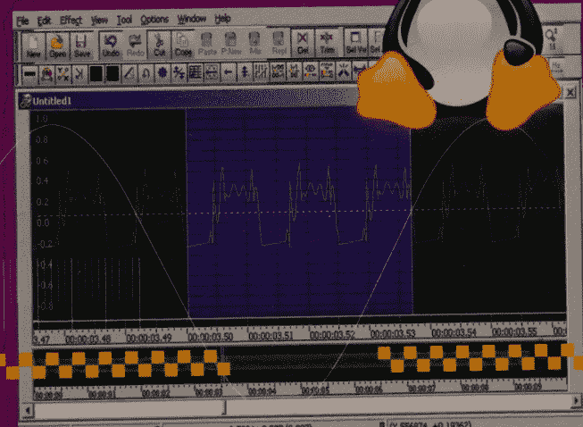


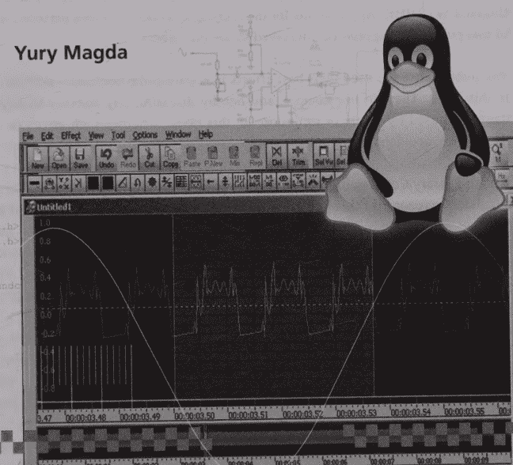

```c
#include <unistd.h>
#include <fcntl.h>
#include <sys/types.h>
#include <sys.h>
#include <stdlib.h>
#include <stdio.h>
#include <linux/sound.h>
#include <math.h>

int main() {
```

```c
int status;
int flg;
int elv;
slong duration = DURATION * rate;
int size = duration * sizeof(int);

// 此缓冲区用于存储数字化的音频
char buf[size];
double *audio;

// 打开声设备
fd = open("/dev/dsp", O_RDWR);
```

## 前言

如今，个人电脑已成为我们生活中不可或的一部分。你可能已经意识到，PC 技术（被称为“嵌入式 PC”）已被应用于许多实验室和工业领域的自动化与控制系统中。这些系统拥有现代计算机的先进计算能力，并在 Linux 等精简、快速操作系统的控制下，可以轻松地汇集复杂物理量的测量值、控制设备或提供数据采集与分析。PC 技术进一步延伸到了通信系统、家庭自动化等领域。

本书专为硬件和软件爱好者以及开发者编写，他们希望学习如何将个人电脑作为嵌入式项目的中心；从而能够设计并构建各种测量和控制系统，并通过其运行 Linux 操作系统的台式电脑或笔记本电脑对其进行控制。PC 现有的基础外设设备（串口/并行口和声卡）已经非常适用于许多测量和控制系统。PC 硬件为电器提供了方便的接口，用于测量温度、湿度、压力、光或其他物理量。此外，PC 外设设备可以根据预设条件触发电机、继电器、灯具和其他负载。通过组合通过 PC 外设设备传输的特定输入信号，开发者可以快速构建实现甚至复杂任务的嵌入式系统。

设计嵌入式系统涉及硬件和软件。由于电子学和编程通常被视为几乎从不交叉的两个工程领域，你可能会认为同时处理硬件和软件是一项极其困难的任务。本书让这项任务变得非常易于管理。

Linux 被选为所有项目的运行环境。你可能已经对 Linux 环境感到比较熟悉，或者至少有强烈的探究欲，因此必须熟悉基本的 Shell 命令。

此处所述的嵌入式项目的软件部分是用 C 语言编写的。理想情况下，你对这种语言的编程有一定的了解。另一方面，你不需要成为 C 语言大师——书中的所有程序都非常简单清晰，因此充满热情的初学者也能轻松理解源代码。我假设你至少对局域网和互联网有基本的了解——这将有助于你理解某些分布式应用程序是如何运行的。

书中描述的大多数嵌入式项目都涉及连接到 PC 的简单电子电路。这些电路必须手动构建，因此具有组装和测试简单电子设备的经验将会帮助。幸运的是，这里介绍的电路组装和测试不需要对电子学或模块功能有深入了解——你只需要将指定的电路连接到 PC 即可。然而，如果你想为自己开发电路，书中详细描述了相关的时序图。我所有的电路都是使用低成本且广泛使用的电子元件构建并测试过的；这允许你设计简单而有效的电子设备。

你将会发现，可以使用简单的低成本（或零成本）软件工具和廉价电子芯片构建你自己的完整的基于 PC 的嵌入式系统。我希望这本书能够激励你未来的设计。

## 致谢

我非常感谢许多帮助这本书成为现实的人。我想感谢所有抽时间审阅和评估书中材料的工程师和开发者。感谢 Paul Ridgway，他再次对我的作者样稿完成了卓越的审阅和编辑工作。我非常感激所有的帮助——非常感谢。我还要感谢 Elektor 的所有同事，他们付出了大量工作工作帮助这本书的完成。最后，我要感谢我的妻子 Julia，她在困难的时刻总是在我身边。

# 第 1 章 家庭项目中的 PC

如今，个人电脑被人们公认为是办公、科学和工业应用中的强大工具。现代台式 PC 或笔记本电脑也可以作为开发家庭和实验室实验的各种嵌入式系统的基础。通过我们的 PC，我们可以测量物理量、控制执行器并构建家庭安全系统，这仅是由于示例。通常，此类“自制”（DIY）系统在性能和功能上可以与工业应用相媲。DIY 项目的另一个优势是它们可以非常便宜。

通过结合创新方法，你可以创建自己的、强大的基于 PC 的家庭研究中心，或将你的 PC 配置为家庭中心。你还可以设计可以通过或或电子邮件进行远程控制的基于 PC 的家庭系统。现如今，现代技术帮助个人构建了非常复杂的系统，因为以前太昂贵的许多解决方案现在已经变得更廉价，并且专业开发者和爱好者也能负担得起——例如无线技术。另一个允许个人构建复杂系统的方面是，现代芯片通常是多功能且可编程的；这显著简化了嵌入式系统的设计。

制造商通常提供熟悉的标准接口（SPI、PC 等）来配置你的芯片，开发者并不一定需要了解特定芯片内部、有时是非常复杂的架构——只需配置一些硬件寄存器并开始工作即可。本书致力于设计在运行 Linux 操作系统的 PC 上运行的家庭和实验室系统。这里讨论的所有项目都将在运行 Linux 系统的 PC 上进行。

- 对于项目而言，Linux 比 Windows 简单得多，就其要求而言。与 Windows 相比，Linux 需要耐心和学习曲线。你必须有阅读并自己解决问题的愿望，而不是把一切都交给操作系统。首先，我们需要在计算机上安装一个操作系统。这里讨论的所有项目都在 Ubuntu 10.10 下测试过，但你也可以使用你喜爱的 Linux 版本。Ubuntu 是一个非常流行的轻量级版本，表现出良好的性能并提供了友好的 GUI。

- 。

设计书中的嵌入式项目需要一些电子学和编程的基本技能。软件源代码是用 C 语言设计的，因此你至少应该熟悉编程的基础。由于我们的项目也包括硬件，你必须知道如何组装和测试你的电路。

书中所有的嵌入式项目都可以通泛地如图1.1所示：

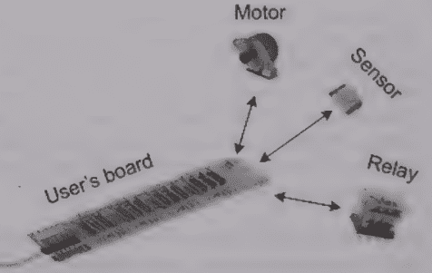

图1.1

如所示，我们的系统可以采集传感器的信号，分析获得的数据并为执行器（电机、继电器、加热器等）发出控制信号。所有传感器的信号通过某些电路（称为“用户板”）传递到 PC，在那里由控制软件处理。运行在 PC 上的控制程序执行某些算法，分析接收的数据并对我们系统的行为做出“决策”。在最简单的情况下，“用户板”仅提供传感器/执行器与 PC 之间的某种硬件接口（SPI、FC 等），不做其他任何事情。

另一方面，“用户板”也可以设计具有某些“智能”，以便在将数据传递给 PC 之前进行粗略的数据处理。在这种情况下，“用户板”可以配备微控制器或微处理器。我们的大多数项目不需要独立的“智能”外部模块，因此我们在设计分布式系统时使用带任何“智能”的简单开发板。

当我们谈论“基于 PC 的项目”时，假设我们不需要处理“实时”高速事件。这意味着什么呢？例如，假设我们想构建一个系统，每 1 微秒从某个传感器读取一次数据。如果我们尝试在 Linux 或 Windows 下实现这样的系统，很可能会因为“时序紧凑（tight timing）”而遇到严重问题。在这种情况下，适当的解决方案是在 PC 上安装实时操作系统，或者使用带有微控制器/微处理器的“智力型”开发板。幸运的是，许多现实世界的系统不需要这样的性能，因此我们可以在嵌入式项目中自由地使用在 Linux 下开发的控制软件。

很多时候，你需要远程控制你的嵌入式系统，例如在工作场所或者当你外出旅行时。当你需要从执行某些连续任务的远程系统获取数据，或者通过开启/关闭执行器来控制某些过程时，这种方法非常有用。现代技术允许你使用无线通信和/或互联网来实现远程控制。这种分布式系统的通用方案如图 1.2 所示：


图 1.2

书中所有为本地 PC 开发每个项目，都可以轻松地集成到由遍布全球的不同计算机组成的分布式系统中。我们可以选择各种方法来设计此类分布式系统，尽管最简单的方法是使用 TCP/IP 网络技术或电子邮件。两种方法将在第 5 章“家庭和实验室的网络与无线系统”中讨论。

## 嵌入式项目中的 PC 外设

书中描述的嵌入式项目是使用并行/串口端口和声卡构建的。在这里我们简要讨论这些接口。并行端口（或并行接口）作为 PC 最老的接口之一，在嵌入式系统中仍被频繁用于与外部电路接口。标准并行接口允许你通过 8 条线输出（写）数据，并通过 5 条线输入（读）数据，尽管我们可以通过添加一些线路来轻松扩展线路数量。

台式机 PC 的并行端口通常位于主板上，可以通过硬件寄存器（端口）访问。可以使用许多扩展板之一为 PC 增加额外的并行接口。对于笔记本电脑，你可以轻松地选择许多 PCMCIA 转并行或 USB 转并行扩展卡进行添加。通过并行口向 PC 连接外部电路是通过内置接口背板上的 DB25 标准连接器，或扩展卡上的相同连接器实现的。

使用并行接口的嵌入式项目将在第 2 章“家庭设计中的并行端口”中讨论。

书中将讨论例如一个 12 位数字化系统、一个工作频率从 1kHz 到 68MHz 的宽带振荡器、带有数字电位器的数字模拟转换器等项目。

另一个流行的硬件资源是串口（或串接口）。该接口基于 RS-232 标准，广泛用于设计基于 PC 的测量和控制系统。当我们想要用最少的精力构建低成本可靠的数据传输系统时，串口接口变得非常有用。串口端口也是 RS-422/RS-485 协议的基础，这些协议被用于构建分布式系统。许多现代 PC 并不配备串口，因此我们需要从包含两个或更多串口的众多扩展板中获取一个。串口端口的核心是 UART（通用异步收发器），它提供了 RS-232 所需的所有信号。UART 完全通过 PC 的硬件寄存器进行控制，因此我们可以配置此接口以及与单电源不兼容的触发信号。

当我们想要用最少的精力构建低成本可靠的数据传输系统时，串口接口变得非常有用。串口端口也是 RS-422/RS-485 协议的基础，这些协议被用于构建分布式系统。许多现代 PC 并不配备串口，因此我们需要从众多扩展板中获取一个。使用高性能 UART 芯片，可以在 115K 波 波特率下工作。

在我们想要讨论的外设列表中，最后是声卡。通常情况下，声卡作为主板上的内置设备出现，尽管你仍然可以为各种实验获取独立模块。有很多名为“声学示波器”的应用程序可以可靠地处理低频率（通常为 20kHz）。然而，此类示波器作为专业设备的廉价替代方案非常好，特别是当我们需要测量各种信号时。在 Linux 中编程声卡是一项复杂的任务，因此我们将讨论如何使用 MathWorks 的流行应用程序 Matlab/Simulink 来设计我们的实验室。后者并非完全免费。我们将在第 4 章“家庭项目中的声卡”中讨论嵌入式项目中的声卡。

## 软件开发

书中所有的项目都需要使用标准 `gcc` 编译器开发的控制软件。所应用的最新 `gcc` 版本是 4.3，尽管也可以使用早期版本。编写应用程序需要一些基础的 C 语言技能。C 语言与 Java、Python 等其他流行工具相比许多优点。Java 和 Python 等语言使程序员不必担心内存分配和指针问题。这通常是一件好事，因为在构建高级程序时，内存操作很容易出错。另一方面，在处理作为控制设备的操作系统部分的低级代码时，C 使用一组特殊函数提供了一个统一、整洁的接口（我们将在本章中讨论）。

Java、Python 和 PHP 被广泛用于（此处原文可能缺失内容，根据语境推测为开发应用）。然而，Java 和 Python 等语言使程序员不必担心内存分配和指针。这通常是一件好事，因为在构建高级程序时，内存操作很容易出错。另一方面，在处理作为控制设备的操作系统部分的低级代码时，C 使用一组特殊函数提供了一个统一、整洁的接口（我们将在本章中讨论）。

当我们想要用最少的精力构建低成本可靠的数据传输系统时，串口接口变得非常有用。串口端口也是 RS-422/RS-485 协议的基础，这些协议被用于构建分布式系统。许多现代 PC 并不配备串口，因此我们需要从众多扩展板中获取一个。使用高性能 UART 芯片，可以在 115K 波特率下工作。

在我们想要讨论的外设列表中，最后是声卡。通常情况下，声卡作为主板上的内置设备出现，尽管你仍然可以为各种实验获取独立模块。有很多名为“声学示波器”的应用程序可以可靠地处理低频率（通常为 20kHz）。然而，此类示波器作为专业设备的廉价替代方案非常好，特别是当我们需要测量各种信号时。在 Linux 中编程声卡是一项复杂的任务，因此我们将讨论如何使用 MathWorks 的流行应用程序 Matlab/Simulink 来设计我们的实验室。后者并非完全免费。我们将在第 4 章“家庭项目中的声卡”中讨论嵌入式项目中的声卡。

## 软件开发

在程序的任何地方调用 `inp()` 或 `out()` 函数之前，必须先执行 `ioperm()` 或 `iopl()` 函数之一。这两个函数都会通知内核允许用户应用程序访问 I/O 端口——这为非特权任务赋予了端口权限。如果没有这样做，会导致应用程序接收到“段错误（Segmentation fault）”错误。由于我们将频繁使用这些函数，让我们详细查看一下它们。

首先，调用 `ioperm()` 和/或 `iopl()` 函数的程序在启动时需要 root 权限。为了给定的应用程序提供 root 权限，我们需要输入 `sudo` 命令后加上要执行的程序名称。例如，如果我们尝试执行名为 `myprogram` 的程序，必须输入：

```
$ sudo ./myprogram
```

某些系统通过某种方式限制你使用 `sudo` 命令，在这种情况下，请使用 `su` 代替 `sudo` 来成为超级用户（root）并启动程序。执行与硬件通信的程序的另一种方法是以 root 身份登录，但在这种情况下，在操作系统中使用此类权限工作时务必非常小心！

你还应该记住，这两个函数仅适用于 x86 架构；其他架构不支持这些提供的函数——它们不存在或者将始终返回错误。

`ioperm()` 函数的符号定义如下：

```
int ioperm(unsigned long from, unsigned long num, int turn_on);
```

如你所示，该函数接受 3 个参数。`from` 参数指向起始地址，该地址受 `turn_on` 参数的影响。`num` 参数持有从端口地址 `from` 开始将受影响的字节数。将 `turn_on` 设置为“1”允许进行读/写操作，清零此参数则禁止访问指定的端口。使用 `ioperm()` 函数需要在源代码的开头插入 `unistd.h`（针对 libc5）或 `sys/io.h`（针对 glibc）头文件。如果你不确定可以使用哪个文件，只需在源码中同时包含它们即可。

`ioperm()` 函数仅影响 0x3ff 以内的 I/O 端口——这足够访问地址从 0x378 开始的标准并行端口。但如果我们有某些带有内置并行接口的扩展板，该并行端口的硬件地址可能在 0x3ff 范围之外。在这种情况下，我们需要调用 `iopl()` 函数，它允许你访问跨越 65536 个硬件端口的全 I/O 空间。`ioperm()` 函数授予的权限不会被 `fork()` 函数创建的新进程继承，尽管在调用 `exec()` 函数时会发生这种情况。

`iopl()` 函数允许更改给定进程的 I/O 权限级别，并具有以下符号定义：

```
#include <sys/io.h>
int iopl(int level);
```

## 第1章 家用项目中的 PC

I/O 权限级别存储在单个参数 `level` 中。此函数影响分配给系统 I/O 空间的所有 65536 个地址。普通（“用户”）进程的 I/O 权限级别为 0，而最高级别可能等于 3 —— 我们将在应用程序中使用该级别。此函数还会影响由 `fork()` 或 `exec()` 调用创建的进程。上述列出的所有函数都用于涉及 PC 并行和串口接口的项目。这些都是关于我们控制软件开发的编程技巧。除了编写 C 应用程序外，我们还将操作 Matlab/Simulink 开发系统，我们用它开发一些基于串口和声卡的项目。这是一个非常强大的工具，允许构建结合信号处理和科学计算的精彩系统。我们将讨论 MATLAB 中的一些实用项目，并查看如何在 Linux 中建立自己的研究中心。你可以直接在 www.mathworks.com 购买 MATLAB 学生版——只需 $99。请注意，需要学生邮箱地址来激活产品。该产品在 www.academicsuperstore.com 和 www.gradvare.com 也可用。

## 第2章 设计中的并行端口


并行端口对于构建从 PC 控制的各种嵌入式系统非常方便。在本章，我们将讨论如何操作并行端口硬件，并设计一些家庭或实验室可能嵌入式项目。我们将讨论需要的电子设备和控制电路的软件，但首先应该回顾标准并行端口硬件是如何工作的。

## 并行端口硬件

当你开始规划项目时，通常有两种选择：使用位于主板上的台式 PC 标准并行端口，或者使用内置的并行接口。现在某些台式 PC 和大多数笔记本电脑/上网型电脑未配备并行接口，因此你需要为你的嵌入式项目获取众多廉价扩展板之一。本章讨论的所有项目都是使用 PC 的并行接口设计的，但它们也适用于任何外部并行接口。在使用外部并行接口时，你唯一需要知道并做的是修改控制程序源码中的硬件地址。

从开发者的角度来看，并行端口提供了 8 条向外部电路输出（写）数据的线，以及 5 条从外部设备读取数据的输入线。控制程序可以通过三个硬件寄存器（称为“端口”）与并行端口交互，这些寄存器接受读和写操作。我们将设计的外部电路通过 PC 背板上的 DB-25 连接器或扩展板上的相同连接器连接到并行端口。并行端口硬件提供 4 条控制线、5 条状态线和 8 条数据线。所有信号线都可以通过三个硬件寄存器（数据寄存器、状态寄存器和控制寄存器）访问。我们将设计的外部电路通过 PC 背板上的 DB-25 连接器或扩展板上的相同连接器连接到并行端口。并行端口硬件提供 4 条控制线、5 条状态线和 8 条数据线。所有信号线都可以通过三个硬件寄存器（“数据寄存器”、“状态寄存器”和“控制寄存器”）访问。这些寄存器通常被称为“数据端口”、“状态端口”和“控制端口”。图 2 显示了硬件端口的位布局及其相应的 DB-25 引脚：

表 1. 并行接口引脚分配

| DB-25 引脚 | 信号 | 方向 | 寄存器 |
| :--- | :--- | :--- | :--- |
| 1 | Strobe | 输出 | 控制 |
| 2 | Data0 | 输入 | 数据 |
| 3 | Data1 | 输入 | 数据 |
| 4 | Data2 | 输入 | 数据 |
| 5 | Data3 | 输入 | 数据 |
| 6 | Data4 | 输入 | 数据 |
| 7 | Data5 | 输入 | 数据 |
| 8 | Data6 | 输入 | 数据 |
| 9 | Data7 | 输入 | 数据 |
| 10 | nAck | 输入 | 状态 |
| 11 | Busy | 输入 | 状态 |
| 12 | Paper | 输入 | 状态 |
| 13 | Select | 输入 | 状态 |
| 14 | Linefeed | 输出 | 控制 |
| 15 | nError | 输入 | 状态 |
| 16 | nInitialize | 输出 | 控制 |
| 17 | nSelect | 输出 | 控制 |
| 18 | Ground | - | - |
| 19 | Ground | - | - |
| 20 | Ground | - | - |
| 21 | Ground | - | - |
| 22 | Ground | - | - |
| 23 | Ground | - | - |
| 24 | Ground | - | - |
| 25 | Ground | - | - |

在使用外部并行接口时，你唯一需要知道并做的是修改控制程序源码中的硬件地址。

从开发者的角度来看，并行端口提供了 8 条向外部电路输出（写）数据的线，以及 5 条从外部设备读取数据的输入线。控制程序可以通过三个硬件寄存器（称为“端口”）与并行端口交互，这些寄存器接受读和写操作。我们将设计的外部电路通过 PC 背板上的 DB-25 连接器或扩展板上的相同连接器连接到并行端口。并行端口硬件提供 4 条控制线、5 条状态线和 8 条数据线。所有信号线都可以通过三个硬件寄存器（数据寄存器、状态寄存器和控制寄存器）访问。这些寄存器通常被称为“数据端口”、“状态端口”和“控制端口”。图 2 显示了硬件端口的位布局及其相应的 DB-25 引脚。

## 第 2 章 家庭设计中的并行端口

### 切换 LED

在本项目中，我们将学习如何使用上一节描述的 `ioperm()`、`inb()` 和 `outb()` 函数来访问、读取和写入并行端口硬件。我们的应用程序将每 10 秒切换一次数据端口（基地址 `0x378`）的字节。

打开文本编辑器并输入以下源代码（列表 2.1）：

#### 列表 2.1

```c
#include <stdio.h>
#include <sys/io.h>
#include <unistd.h>

int main(void) {
    int bRead;
    ioperm(0x378, 2, 1);
    while (1) {
        bRead = inb(0x378);
        bRead = ~bRead;
        outb(bRead, 0x378);
        sleep(10);
    }
    return 0;
}
```

输入完源代码后，将其保存，例如保存为文件 `ioperm_example.c`。请记住，我们需要访问硬件，因此在调用 `inb()`/`outb()` 函数之前插入了一个带有 `ioperm()` 函数的语句。我们使用标准并行接口的数据端口，因此 `ioperm()` 函数的第一个参数是地址 `0x378`。由于我们尝试访问前两个端口，该函数的第二个参数被赋值为 2。因此，在执行语句

```c
ioperm(0x378, 2, 1);
```

后，应用程序就获得了对端口 `0x378` 和 `0x379` 的访问权限。由于我们只需要对端口 `0x378` 进行操作，可以将此参数设置为 1。`ioperm()` 的第三个参数设置为 1，允许对这些寄存器进行读写操作。将此参数设置为 0 则禁止用户应用程序访问这些端口。

### 切换 LED

数据端口锁存器的开启/关闭发生在无限的 `while()` 循环中。每次迭代开始通过调用 `inb()` 函数从数据端口锁存器读取字节到 `bRead` 变量中。该函数接受一个单一参数，即硬件端口的地址（在本例中为 `0x378`）。读取字节后，程序反转 `bRead` 变量的所有位。反转后的 `bRead` 值通过执行带有两个参数的 `outb()` 函数写回数据端口。第一个参数包含要写入的字节值，而第二个参数指向硬件寄存器的地址，在本例中为 `0x378`）。`sleep()` 函数结束当前迭代，在下一次迭代开始前实现 10 秒的延迟。源代码的编译可以通过终端窗口中输入以下命令来完成：

```bash
$ gcc -o ioperm_example ioperm_example.c
```

成功编译后，我们可以通过输入以下命令来执行应用程序：

```bash
$ sudo ./ioperm_example
```

要中断应用程序的执行，可以按 Ctrl+C。为了测试我们的应用程序，可以将万用表连接到并行端口。万用表的一个探针应连接 DB-25 连接器并行接口的第 24 或 25 引脚（“地”），而另一根探针接触第 2-9 引脚的任何一个。当程序运行时，你可以每 10 秒观察一次所选引脚的电压波动。测试我们应用程序的另一种方法是组装一个带有 LED 和串联电阻连接到第 2-9 引脚之一的最简单电路，如图 2.2 所示（这里使用了第 2 引脚）：

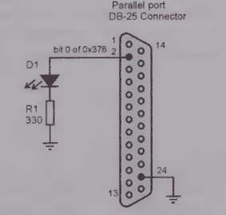

图 2.2

---

## 第 2 章 家庭设计中的并行端口

以下源代码代表使用 `iopl()` 函数代替 `ioperm()`（列表 2.2）：

#### 列表 2.2

```c
#include <stdio.h>
#include <sys/io.h>
#include <unistd.h>

int main(void)
{
    int bRead;
    iopl(3);

    while (1)
    {
        bRead = inb(0x378);
        bRead = ~bRead;
        outb(bRead, 0x378);
        sleep(10);
    }
    return 0;
}
```

如你所示，`iopl()` 函数仅接受一个参数 - 赋值为 3（最高权限级别）。在将源代码保存到文件 `iopl_example.c` 后，我们可以使用以下命令编译源代码并启动应用程序：

```bash
$ gcc -o iopl_example.c
$ sudo ./iopl_example
```

为了更熟悉并行端口，让我们再考虑一个例子。在这里，我们将切换数据端口的第 0 位（地址 `0x378`），并通过状态端口的第 5 位（地址 `0x379`）读取该位的值。请看此实验的简单原理图（图 2.3）：

### 切换 LED

并行端口

DB-25 连接器

图 2.3

下面你可以看到该应用程序的源代码，它切换数据端口的第 0 位（列表 2.3）：

#### 列表 2.3

```c
#include <stdio.h>
#include <sys/io.h>
#include <unistd.h>

int main(void)
{
    int bRead, bWrite = 0;
    iopl(3);
    while(1)
    {
        outb(bWrite, 0x378);
        bRead = inb(0x379) & 0x20;
        if (bRead != 0)
            printf("Bit 5 is set.\n");
        else
            printf("Bit 5 is clear.\n");
        bWrite = ~bRead;
        sleep(10);
    }
    return 0;
}
```

---

## 第 2 章 家庭设计中的并行端口

变量 `bWrite` 保存写入数据端口的字节；迭代每 10 秒重复一次。根据 `bRead` 的值，程序调用 `printf()` 输出信息。程序通过状态端口的第 3 位检查比较器的输出：

```c
bRead = inb(0x379) & 0x20;
```

### 简单恒温系统

此演示了一个通过并行端口控制的实际恒温系统。假设我们想建立一个控制烤箱内温度的系统。当温度超过给定阈值时，该系统开启/关闭加热器。该系统的原理图如图 2.4 所示：该系统包含一个温度 温度传感器，它可以产生与环境温度成比例的模拟电压，系数为 10mV/C。例如，如果 LM35 的输出电压等于 0.29 V，则温度为 29°C。传感器的输出信号传递到比较器 LM2903 (A2) 的非反相输入（第 3 引脚）。反相输入（A2 第 2 引脚）连接到来自电位器 R2 的参考电压，R2 又连接到 +5V 电源。参考电压定义了阈值，并由用户随机选择。如果传感器的输出电压超过反相输入的电压，比较器的输出变为高电。否则，如果传感器的输出小于参考电压，比较器的输出变为低电。程序通过状态端口的第 3 位检查比较器的输出。


图 2.4

在第 3 位被设置后，程序代码通过清除数据端口（地址 `0x378`）的第 2 位来关闭加热器。在这种情况下，DB-25 连接器第 4 引脚的低电平会导致达利顿晶体管 TIP122 (Q1) 截止，从而停止为加热器供。当烤箱温度低于阈值时，状态端口的第 3 位设置为“0”。此时，程序通过设置数据端口的第 2 位来开启加热器。

## 第 2 章 家用设计中的并行端口

### 列表 2.4

```c
#include <stdio.h>
#include <sys/io.h>
#include <unistd.h>

int main(void)
{
    int dataPort = 0x378;
    int statusPort = 0x379;
    int Bit3;

    iopl(3);
    while(1)
    {
        Bit3 = inb(statusPort) & 0x04;
        if (Bit3 != 0)
            outb(0x0, dataPort);
        else
            outb(0x04, dataPort);
        sleep(20);
    }
    return 0;
}
```

让我们讨论一下上面的源代码。控制算法实现在无限的 `while(1)` 循环中。每次迭代都从读取状态端口并将读取到的字节保存到 `Bit3` 变量中。然后，程序代码检查 `Bit3` 的值。非零值表示温度已超过阈值；因此，通过执行以下操作来关闭加热器：

```c
outb(0x0, dataPort);
```

`Bit3` 值为零表示温度降低，因此加热器将开启：

```c
outb(0x4, dataPort);
```

每次迭代的最后语句是 `sleep(20)` 函数，它在启动下一次迭代之前执行 20 秒的延迟。如果需要，你可以设置自己的延迟时间而不是 20 秒。这个项目可以轻松自定义。你可以不使用 LM2903 芯片，而是使用另一个带有 TTL 输出的单电源比较器。如果你想获得更高的精度，应该考虑具有低偏移电压的比较器——这可以最大限度地减少比较器在配置阈值电压时引入的误差。

值得使用高精度电位器 R2 —— 这也会影响该电路的准确性。实际上，使用专门的单芯片电压基准代替 R2 将获得最佳结果。在设计此项目时，你还应该评估通过 Q1 的读负载并选择合适的功率晶体管。此外，在将设备连接到并行端口时，必须考虑常见的预防措施。最后，如果你将使用带有并行接口的扩展板，请记住将源代码中的地址 `0x378-0x379` 替换为适当的值。

### 扩展并行端口的输入行

通常你需要更多的输入来捕获来自外部电路的信号，正如并行端口提供的。扩展输入数量的最简单方法是使用多路复用器，它可以将多个输入信号引导到一个输出。下面的嵌入项目演示了如何这样做。项目的硬件部分如下原理图所示（图 2.5）：

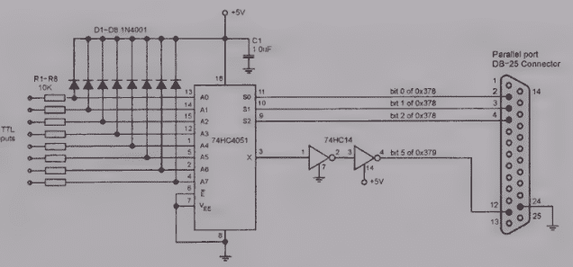

图 2.5

该电路允许并行端口使用最多 8 个额外的输入。你可以看到，该电路的“核心”是一个 74HC4051 多路复用器。该电路提供了一次读取 A0-A7 数字输入的功能。所选输入的 TTL 兼容信号传输到 74HC4051 的单输出 X。X 输出连接到并行端口的一个输入。在我们案例中，X 连接到 DB-25 连接器的第 12 脚。该引脚代表状态端口（寄存器）的第 5 位。因此，程序可以通过读取状态端口的第 5 位来获取 X 输出的状态。通常程序使用地址 `0x378` 作为数据端口，使用地址 `0x379` 作为状态端口（寄存器）。程序通过在 7HC4051 的 S0–S2 选择输入端上设置 3 位数字代码来选择用于读取的输入通道。例如，在 S0–S2 上设置代码 `0x0` 允许读取 A0；设置代码 `0x1` 允许读取 A1，依此类推。S0–S2 输入由并行端口数据的第 0–2 位控制。关于使用的一些说明：电阻-二极管对（RxDx, x = 1...8）保护多路复用输入端免受高电压影响；7HC134 缓冲器为状态端口输入提供有效的 TTL 信号。关于写入的一些说明：连接此电路到并行端口的电线长度不能超过 30 厘米，否则你需要额外的缓冲器来提供干净的信号。此外，必须在电源上提供旁路电容。适当的旁路是一个尽可能地连接到多路复用器电源引脚的 1µF 电容。作为 7HC4051 的替代方案，你可以使用任何与 TTL 信号工作的 4051 多路复用器。让我们来谈软件。控制应用程序具有以下源代码（列表 2:5）：

### 列表 2:5

```c
#include <stdio.h>
#include <unistd.h>
#include <sys/io.h>
#include <stdlib.h>

int main(void)
{
    int channel;
    int dataPort = 0x378;
    int statusPort = 0x379;
    int result = 0;
    int tmp = 0;

    iopl(3);
    while (1)
    {
        for (channel = 7; channel >= 0; channel--)
        {
            outb(channel, dataPort);
            tmp = inb(statusPort) & 0x04;
            tmp = tmp >> 5;
            tmp = tmp << 5;
            result = result | tmp;
            printf("Input states:0x%X\n", result);
            sleep(2);
            result = 0;
        }
    }
    return 0;
}
```

在这个源代码中我们使用了几个变量。`channel` 变量包含要读取的输入数量。`dataPort` 和 `statusPort` 分别持有地址。`result` 变量存储所有 8 个输入的状态，即状态端口的第 5 位。`tmp` 变量用于处理第 5 位。自然，由你来设置控制应用程序（`sleep(2)`）。你可以在图 2.6 中看到程序执行的结果：

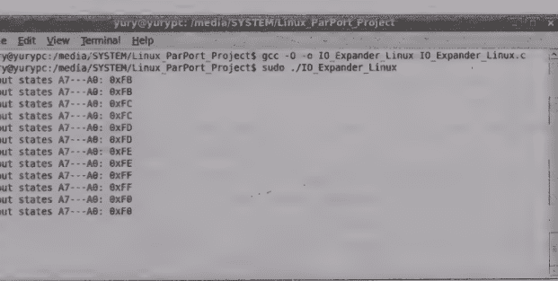

图 2.6

此嵌入项目可以通过扩展输入到 16 来轻松改进。这需要使用 7HC67 多路复用器代替 4051，并对原理图进行相应修改。你还需要稍微修改 4051 的源代码，以便程序与 067 工作。


到为止我们讨论了主要运行数字信号的系统。接下来的嵌入项目涉及模拟信号。尽管我们周围的电子世界是数字化的，但现实世界实际上运行在模拟信号之上。这些信号主要来自物理环境或各种电子电路。温度、湿度、压力、光照等物理量在本质上是连续的（模拟的），因此都需要模拟传感器和相应的电路。

由于 PC 不“理解”模拟信号，因此我们需要将其转换为数字形式。这个过程被称为“数字化”。为了将模拟信号转换为二进制表示，我们需要一种通常称为“模拟数字转换器”（ADC）的特殊设备。模拟数字转换器转换模拟信号并将其数字位流。这些位反过来可以通过 PC 上运行的软件通过某些接口（如 `SPI`、`PC` 等）从 ADC 中“提取”。

## 测量模拟信号

`SPI` 传输由 PC 上运行的程序通过这些引线控制。0 到 +5V 范围内的模数转换和数据传输位于 `MCP3201` 芯片的输入引脚 2。`CS` 控制线框定了转换过程，在转换进行期间必须保持低电平。程序通过数据端口的第 1 位（DB-25 接口的引脚 3）控制此线。输出位出现在连接到状态端口（`0x379`）第 3 位（DB-25 接口的引脚 15）的 `Dout` 线上。软件读取此位流的每一位（MSB 优先）并将其保存到整数变量中。采集所有数据位后，应用程序获取最低的 12 位，它们代表原始模拟信号。`CLK` 线在同步数据传输时提供脉冲。这些脉冲出现在引脚 2（数据端口的第 0 位）。每个独立位在时钟脉冲的下降沿设置在 `Dout` 上，并由控制程序在时钟脉冲的上升沿锁定。为了完成转换，程序必须拉高 `CS` 线。

上述由图 2.8 中的序图所示：

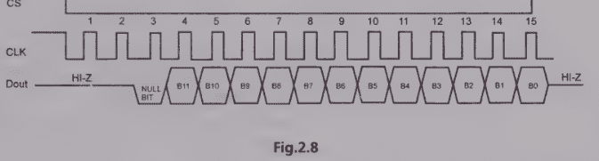

注意，MSB 位在第 3 个 `CLK` 脉冲变低后首先出现在 `Dout` 线上。如所示，一个数据传输周期需要 15 次迭代。

电路应由 +5V 无噪声电源供。10 uF 的旁路电容应尽可能靠近 `MCP3201` 芯片的电源引脚。`MCP3201` 设备可以使用具有 `SPI` 兼容接口的类似逐次逼近 ADC 进行替换。例如，你可以使用 `LTC1286` 或 `LTC1297` 设备（Linear Tech.）等；在这种情况下，你需要重新考虑电路连接并根据所选设备的序图修改源代码。

让我们讨论一下软件。我们的控制应用程序源代码如下所示（列表 2.6）：

## 第 2 章 家庭设计中的并行端口

### 列表 2.6

```c
#include <stdio.h>
#include <unistd.h>
#include <stdlib.h>
#include <sys/io.h>

#define dataPort 0x378
#define statusPort 0x379

int main(void) {
    int i;
    int binData = 0;
    int mask = 0x4000;
    int dataStatusPort = 0;
    double total = 0;

    iopl(3); // CS 是 dataPort 的第 1 位，
                     // CLK 是 dataPort 的第 0 位，
                     // Dout 是 statusPort 的第 5 位
    outb(0x2, dataPort); // CS 变高
    outb(0x3, dataPort); // CS 保持高电，CLK 变高
    outb(0x1, dataPort); // CS 变低允许转换
    for (i = 0; i < 15; i++) {
        outb(0x0, dataPort); // CLK 变低
        dataStatusPort = inb(statusPort) & 0x8;
        if (dataStatusPort != 0) {
            binData = binData | mask;
            outb(0x1, dataPort); // CLK 变高
            mask = mask >> 1;
        }
        outb(0x3, dataPort);
        binData = binData & 0xFF;
        total = 5.08 / 4096 * binData;
    }
    printf("MCP3201 gives following result: %5.3f V\n", total);
    return 0;
}
```

首先，让我们检查使用的变量。`binData` 变量按位收集二进制代码。在最后一次迭代完成后，该值将持有代表实际模拟信号的二进制代码。`double` 变量 `total` 存储模拟电压的最终值；该值将通过 `printf()` 函数输出到屏幕上。查看以下语句：

```c
total = 5.08 / 4096 * binData;
```

这里的常量 5.08 等于施加 `MCP3201` 转换器引脚 1 的参考电压（单位：伏）。这个参考电压来自我特定的电源；也许你会在为你自己的电路使用另一个参考电压值。参考电压除以 4096 (`2^12`) 得到转换器 LSB（最低有效位）的大小（单位：伏）。在我们的情况下，此值将是 5.08 / 4096 = 0.00124V (1.224mV)。程序将 `binData` 持有的二进制代码乘以 LSB，并将输入电压的最终值保存到 `total` 变量中。

`dataStatusPort` 变量持有从 ADC 输出的位流中捕的一个位。当程序将特定数据位写入 `binData` 变量的相应位置时会使用该值。

控制应用程序在 `for()` 循环内部实现了转换的序图。由于整个转换过程需要 15 次迭代，程序顺序读取 15 位。我们只对前 12 个低阶位感兴趣，因此我们通过执行语句丢弃高位的 3 位：

```c
binData = binData & 0FFF;
```

输入完源代码后，我们可以将其保存为 `ADC.c` 文件，并使用命令编译源码：

```bash
$ gcc -o ADC.c ADC.c
```

要启动应用程序，我们将输入：

```bash
$ sudo ./ADC
```

讨论过的项目可以作为设计更复杂系统的模板。现在是时候讨论模拟信号电路了。

## 处理模拟信号：常用技术

在上一个项目中，我们应用模数转换器来处理模拟信号。这种简单的数字化系统在许多具有低水平噪声的家庭嵌入式项目中表现良好。如果你从传感器处应用低噪声模拟信号，且你的电源不产生太多噪声，那么将模数转换器的输入直接连接到信号源是合理的。许多满足此类条件的实际应用将表现出良好的性能和准确性。

## 第 2 章 硬件设计中的并行端口

此类滤波器会衰减频率 $f = 1/(2\pi\times R1\times C1)$。由该表达式确定的频率通常被称为“截止”频率。频率等于 $1/(2\pi\times R1\times C1)$ 的点称为“极点”；极点表示频率高于 $1/(2\pi\times R1\times C1)$ 的信号开始下降的点。在许多情况下，低通滤波器的设计目的是为了衰减来自电源的 50 Hz 或 60 Hz 噪声。滤波器的截止频率可以选择得非常低（几个 Hz 或更低）。

通过使用基于有源滤波器拓扑结构的所谓“多极”滤波器可以获得更高的效率。此类滤波器被称为“有源滤波器”，它们通常包含至少一个运算放大器以及一些电阻和电容。一种名为“Sallen-Key”滤波器的常用低通有源滤波器拓扑如图 2.11 所示：

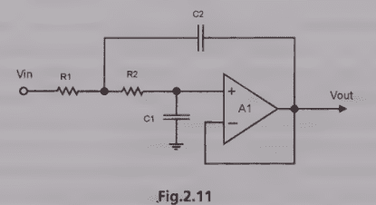

与最简单的 RC 滤波器相比，有源滤波器具有更好的特性。此外，有源滤波器允许对高阻抗信号源到模数转换器相对低阻抗输入进行缓冲。此外，有源滤波器可能具有 1V/V 的增益，允许放大微小的模拟信号。

图 2.11 所示的低通有源滤波器实际上是一个在带内增益为 1V/V 的电压跟随器。由于有两个电容，该滤波器有两个极点（二阶滤波器）。高阶滤波器可以改善频率响应，尽管与最简单的滤波器拓扑相比，其原理图更为复杂。

在实践中，二阶低通滤波器对于大多数应用都是很好的选择。带有 $\Sigma-\Delta$ 模数转换器的模拟通道可能包含基于单个 RC 节点的最简单低通滤波器（见图 2.10），而不是有源低通滤波器。

在低噪声的简单电路中，可以使用由单 RC 节点组成的电压跟随器实现的反相低通滤波器（图 2.12）：

## 模拟信号处理：常用技术

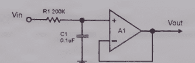

图 2.12

你也可以使用图 2.13 所示的简单反相低通有源滤波器：

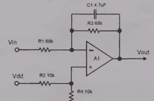

图 2.13

由于不存在绝对“纯净”的模拟信号，噪声总是存在的。是否忽略噪声取决于你，尽管使用低通滤波器可以在设计调理电路时防止许多问题。

与模拟传感器不同，它们的数字对应物输出“纯净”的二进制代码。这些代码可以由微控制器或处理器进行进一步处理和分析。这显著简化了嵌入式系统的设计，因为调理电路可以简化或省略。

数字传感器通常在芯片内部实现信号的放大、滤波和数字化。数字传感器具有内置的数字化系统（SAR 或更常见的 sigma-delta 转换器），并可能包含一些额外的电路，如滤波器和放大器。开发者通常在开始测量之前通过向内部寄存器写入值来配置数字传感器的工作模式。之后，测得的数据可以根据设备时序读取到微控制器或处理器。

大多数数字传感器具有与 `SPI` 或 `FC` 标准协议兼容的接口。虽然使用数字传感器简化了设计，但存在一些缺点。例如，当物理量在很大范围内变化时，这些传感器仍然难以获得高精度。无论如何，传感器的取决于开发者。

## 第 2 章 硬件设计中的并行端口

让我们继续讨论项目。以下的项目描述了一个涉及 `LM35DZ` 温度传感器的简单冷却系统。

### 简单冷却系统

我们冷却系统的硬件部分如图 2.14 (a) 所示：

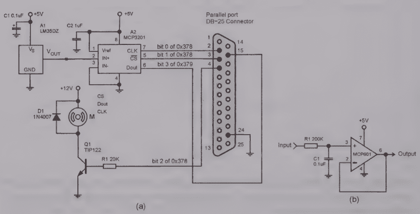

图 2.14

你可以看到，房间温度来自 `LM35DZ` 温度传感器，该传感器提供与环境温度成比例的模拟电压，系数为 10mV/C。例如，当环境温度为 21°C 时，`LM35DZ` 的输出电压为 0.21V。

你可以看到，`LM35DZ` 的输出信号落在 12 位模数转换器 `MCP3201` 的采样量范围内，我们可以直接将信号传递到 ADC 的输入（`MCP3201` 的第 2 引脚）。转换过程完成后，模拟信号的二进制表示将通过兼容 `SPI` 的接口传输到 PC 并行口。我们还假设来自 `LM35DZ` 的信号没有噪声，因此我们不在模数转换器输入之前不使用任何低通滤波器。

该系统的工作方式如下。当环境温度超过某些阈值时，[文本继续...]

### 简单冷却系统

```c
total = 5.08 / 4096 * binData;
```

```c
// 将结果写入文件
```

```c
bzero(buf, sizeof(buf));
fo = fopen("/home/yury/templog", "a");
bRead = sprintf(buf, "%s", "LM35DZ output: ");
bRead += sprintf(buf + bRead, "%.5f %s\n", total, "V");
fwrite(buf, sizeof(char), bRead, fo);
close(fu);
if (total > 0.23)
{
OnOff = 0x04; // 数据端口的第 2 位置高以启动电机
}
else{
OnOff = 0x0;
}
outb(0x2 | OnOff, dataPort);
sleep(20);
}
return 0;
```

在 Linux 中创建守护进程（daemon）需要遵循特定顺序的规则。守护进程永远不通过终端与用户进行直接通信。通常情况下，守护进程完全不与用户通信。所有通信都应该通过某种接口进行。我们的守护进程将简单将测量的温度值写入名为 `templog` 的文件中，该文件位于 `/home/yury` 目录（您可以使用其他名称和目录）。守护进程将每隔 20 秒测量一次温度，并将获取的信息添加到 `templog` 文件中。如有必要，用户可以分析该文件的内容。

当守护进程启动时，它需要一些准备工作来进入实际工作。首先，守护进程应该 `fork()` 父进程。通过执行以下语句实现：

```c
PID = fork();
if (PID)
exit(0);
```

在此段代码中，`fork()` 函数返回子进程的进程 ID (`PID`)。如果返回的 PID 不等于 0，我们必须通过调用 `exit()` 函数退出父进程。如果 PID 等于 -1，则程序应在此处终止守护进程。为了清晰起见，我们分析了 PID 等于 -1 的情况，因此需要你自己在源代码中添加一些检查。接下来的步骤是使用 `umask()` API 调用来更改文件模式掩码：

```c
umask(0);
```

执行此语句后，我们可以写入或读取由守护进程创建的任何文件。通过设置 `umask`，我们将完全访问守护进程创建的文件。在我们的案例中，具体来说我们可以读取 `/home/yury/templog` 文件。下一步是为子进程获取一个唯一 ID；这允许进程能够正常运行。否则，进程在系统中将变成“孤儿进程”。为了实现这一点，程序将调用 `setsid()` 函数。然后我们需要将当前工作目录更改到一个安全的地方。当前工作目录应该更改到一个保证始终存在的地方。符合此条件的目录只有根目录 (`/`)。更改工作目录通过调用 `chdir()` 完成：

```c
chdir("/");
```

设置守护进程的最后步骤之一是关闭标记为 `STDIN`（等于 0）、`STDOUT`（等于 1）和 `STDERR`（等于 2）的标准文件描述符。由于守护进程无法使用终端，这些文件描述符是冗余的，潜在的安全隐患。以下代码执行了这一操作：

```c
close(0);
close(1);
close(2);
```

现在我们几乎完成了守护进程的代码配置。此时，我们基本上已经告诉 Linux 操作系统这段程序代码将作为守护进程运行，因此我们可以引入实际的守护进程代码。每次启动守护进程时，我们希望数据被写入新创建的文件（称为 `/home/yury/templog`）。在在此之前，程序代码应尝试通过执行以下语句删除之前创建的 `templog` 文件（如果文件仍然存在）：

```c
unlink("/home/yury/templog");
```

由于我们需要操作硬件寄存器，我们需要通过执行 `iopl()` 函数获取适当的权限：

```c
iopl(3);
```

然后我们进入无限 `while()` 循环，在其中执行守护进程的主任务。我们必须在 `while()` 循环内部完成任务：将 `LM35DZ` 模拟信号数字化，并将结果写入 `templog` 文件。数字化（转换）是在 `for()` 循环内部实现的（我们之前讨论过这一点）。转换完成后，程序代码形成结果的表示，并将由此创建的文本字符串写入 `templog` 文件。以下代码执行了该操作：

```c
bzero(buf, sizeof(buf));
fo = fopen("/home/yury/templog", "a+");
bRead = sprintf(buf, "%s", "LM35DZ output: %s");
bRead += sprintf(buf + bRead, "%%5.3f %%s\n", "V");
write(buf, sizeof(char), bRead, fo);
fclose(fo);
```

在这里，我们使用 `fopen()` 库函数创建一个新文件并将 FILE 指针保存在变量 `fo` 中；该变量将用于文件操作。文本字符串使用 `sprintf()` 库函数形成，它利用一个字节数组来存储结果字符串。`write()` 库函数将创建的字符串写入 `fo` 变量。最后，通过调用 `fclose()` 函数关闭 `fo` 对象。

以下语句实现了达到阈值（即 0.23）后冷却器的开关切换：

```c
if (total > 0.23)
{
OnOff = 0x04; // 数据端口的第 2 位置高以启动电机
}
else{
OnOff = 0x0;
}
outb(0x2 | OnOff, dataPort);
sleep(20);
```

每次迭代都以 `sleep(20)` 函数结束。以上就是全部。将你的源代码保存在 `LM35DZ.c` 文件中，并通过以下命令进行编译：

```bash
gcc -o LM35DZ LM35DZ.c
```

## 第 2 章 硬件设计中的并行端口

每次启动我们的守护进程时，我们希望数据被写入新创建的文件（称为 `/home/yury/templog`）。在此之前，程序代码应尝试通过执行以下语句删除之前创建的 `templog` 文件（如果文件仍然存在）：

```c
unlink("/home/yury/templog");
```

由于我们需要操作硬件寄存器，我们需要通过执行 `iopl()` 函数获取适当的权限：

```c
iopl(3);
```

然后我们进入无限 `while()` 循环，在其中执行守护进程的主任务。我们必须在 `while()` 循环内部完成任务：将 `LM35DZ` 模拟信号数字化，并将结果写入 `templog` 文件。数字化（转换）是在 `for()` 循环内部实现的（我们之前讨论过这一点）。转换完成后，程序代码形成结果的表示，并将由此创建的文本字符串写入 `templog` 文件。以下代码执行了该操作：


```c
bzero(buf, sizeof(buf));
fo = fopen("/home/yury/templog", "a+");
bRead = sprintf(buf, "%s", "LM35DZ output: %s");
bRead += sprintf(buf + bRead, "%%5.3f %%s\n", "V");
write(buf, sizeof(char), bRead, fo);
fclose(fo);
```

在这里，我们使用 `fopen()` 库函数创建一个新文件并将 FILE 指针保存在变量 `fo` 中；该变量将用于文件操作。文本字符串使用 `sprintf()` 库函数形成，它利用一个字节数组来存储结果字符串。`write()` 库函数将创建的字符串写入 `fo` 变量。最后，通过调用 `fclose()` 函数关闭 `fo` 对象。

以下语句实现了达到阈值（即 0.23）后冷却器的开关切换：

```c
if (total > 0.23)
{
OnOff = 0x04; // 数据端口的第 2 位置高以启动电机（此处原文逻辑有重复）
}
else{
OnOff = 0x0;
}
outb(0x2 | OnOff, dataPort);
sleep(20);
```

每次迭代都以 `sleep(20)` 函数结束。以上就是全部。将你的源代码保存在 `LM35DZ.c` 文件中，并通过以下命令进行编译：

```bash
gcc -o LM35DZ LM35DZ.c
```

## 宽带数字振荡器

每次启动我们的守护进程时，我们希望数据被写入新创建的文件（称为 `/home/yury/templog`）。在此之前，程序代码应尝试通过执行以下语句删除之前创建的 `templog` 文件（如果文件仍然存在）：

```c
unlink("/home/yury/templog");
```

由于我们需要操作硬件寄存器，我们需要通过执行 `iopl()` 函数获取适当的权限：

```c
iopl(3);
```

然后我们进入无限 `while()` 循环，在其中执行守护进程的主任务。我们必须在 `while()` 循环内部完成任务：将 LM35DZ 模拟信号数字化，并将结果写入 `templog` 文件。数字化（转换）是在 `for()` 循环内部实现的（我们之前讨论过这一点）。转换完成后，程序代码形成结果的表示，并将由此创建的文本字符串写入 `templog` 文件。以下代码执行了该操作：

```c
bzero(buf, sizeof(buf));
fo = fopen("/home/yury/templog", "a+");
bRead = sprintf(buf, "%s", "LM35DZ output: %s");
bRead += sprintf(buf + bRead, "%%5.3f %%s\n", "V");
write(buf, sizeof(char), bRead, fo);
fclose(fo);
```

在这里，我们使用 `fopen()` 库函数创建一个新文件并将 FILE 指针保存在变量 `fo` 中；该变量将用于文件操作。文本字符串使用 `sprintf()` 库函数形成，它利用一个字节数组来存储结果字符串。`write()` 库函数将创建的字符串写入 `fo` 变量。最后，通过调用 `fclose()` 函数关闭 `fo` 对象。

以下语句实现了达到阈值（即 0.23）后冷却器的开关切换：

```c
if (total > 0.23)
{
OnOff = 0x04; // 数据端口的第 2 位置高以启动电机
}
else{
OnOff = 0x0;
}
outb(0x2 | OnOff, dataPort);
sleep(20);
```

每次迭代都以 `sleep(20)` 函数结束。以上就是全部。将你的源代码保存在 `LM35DZ.c` 文件中，并通过以下命令进行编译：

```bash
gcc -o LM35DZ LM35DZ.c
```

## 并行端口在硬件设计中的应用

每次启动我们的守护进程时，我们希望数据被写入新创建的文件（称为 `/home/yury/templog`）。在此之前，程序代码应尝试通过执行以下语句删除之前创建的 `templog` 文件（如果文件仍然存在）：

```c
unlink("/home/yury/templog");
```

由于我们需要操作硬件寄存器，我们需要通过执行 `iopl()` 函数获取适当的权限：

```c
iopl(3);
```

然后我们进入无限 `while()` 循环，在其中执行守护进程的主任务。我们必须在 `while()` 循环内部完成任务：将 LM35DZ 模拟信号数字化，并将结果写入 `templog` 文件。数字化（转换）是在 `for()` 循环内部实现的（我们之前讨论过这一点）。转换完成后，程序代码形成结果的表示，并将由此创建的文本字符串写入 `templog` 文件。以下代码执行了该操作：

```c
bzero(buf, sizeof(buf));
fo = fopen("/home/yury/templog", "a+");
bRead = sprintf(buf, "%s", "LM35DZ output: %s");
bRead += sprintf(buf + bRead, "%%5.3f %%s\n", "V");
write(buf, sizeof(char), bRead, fo);
fclose(fo);
```

在这里，我们使用 `fopen()` 库函数创建一个新文件并将 FILE 指针保存在变量 `fo` 中；该变量将用于文件操作。文本字符串使用 `sprintf()` 库函数形成，它利用一个字节数组来存储结果字符串。`write()` 库函数将创建的字符串写入 `fo` 变量。最后，通过调用 `fclose()` 函数关闭 `fo` 对象。

以下语句实现了达到阈值（即 0.23）后冷却器的开关切换：

```c
if (total > 0.23)
{
OnOff = 0x04; // 数据端口的第 2 位置高以启动电机
}
else{
OnOff = 0x0;
}
outb(0x2 | OnOff, dataPort);
sleep(20);
```

## 宽带数字振荡器

`LTC6903` 设备是一种低功耗、自包含的频率源，提供从 1 kHz 到 68 MHz 的精度频率，可通过串口端口进行设置。`LTC6903` 除电源电容外不需要任何外部元件，且它在 2.7V 到 5.5V 的单电源电压范围内工作。在我们的项目中，供电压将为 5.0V。根据数据表，`LTC6903` 具有专有的反馈环路，可使数字控制设置与输出频率之间的关系线性化，从而得出一个非常简单的频率设置公式：

$f = 2^{OCT} \times 2078 (Hz) / (2 - DAC/1024),$ 其中 1 kHz < f < 68 MHz，`OCT` 是 4 位整数值（0-15），由串口寄存器 `OCT [3:0]` 表示，`DAC` 是 10 位整数值（从 0 到 1023），由串口位 `DAC[9:0]` 表示。SPI 信号线通过数据端口 (`0x378`) 的第 0 位到第 2 位控制。输出频率出现在 CLK 输出（引脚 6）或引脚 5（反相信号）。连接到源电压的 OE 信号允许两个输出。为了减少噪声并增加精度，应将 0.1uF 的旁通电容连接到 `LTC6903` 的电源引脚。

输出频率可以通过图 2.15 所示的 3 线 SPI 兼容接口进行程序化设置：

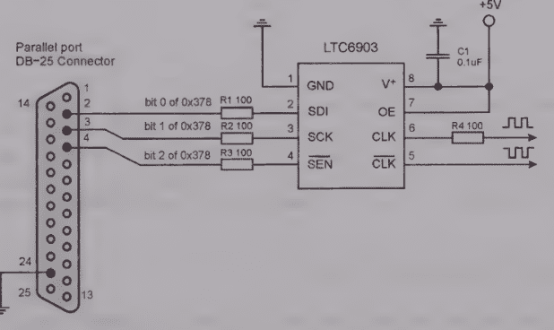

图 2.15

## 第 2 章 嵌入式设计中的并行端口

可以使用公式 (1) 设置 `LTC6903` 的适当输出频率。配置频率涉及以下步骤：

- 1. 从下表表 2 中选择合适的 `OCT` 值：

表 2. 输出频率范围与 `OCT` 设置（频率分辨率 0.001 * f）

| f ≥ | f < | OCT |
|---|---|---|
| 34.05 MHz | 68.03 MHz | 15 |
| 17.02 MHz | 34.01 MHz | 14 |
| 8.511 MHz | 17.01 MHz | 13 |
| 4.256 MHz | 8.503 MHz | 12 |
| 2.128 MHz | 4.252 MHz | 11 |
| 1.064 MHz | 2.126 MHz | 9 |
| 532 KHz | 1063 KHz | 8 |
| 266 KHz | 531.4 KHz | 7 |
| 133 KHz | 265.7 KHz | 6 |
| 66.5 KHz | 132.9 KHz | 5 |
| 33.25 KHz | 66.43 KHz | 4 |
| 16.62 KHz | 33.22 KHz | 3 |
| 8.312 KHz | 16.61 KHz | 2 |
| 4.156 KHz | 8.304 KHz | 1 |
| 2.078 KHz | 4.152 KHz | 0 |
| 1.039 KHz | 2.076 KHz | 0 |

- 2. 使用以下公式选择变量 `DAC`，并将 `DAC` 舍入到最接近的整数：

`DAC = 2048 - 2078 (Hz) × 2^{(10+OCT)} / f` (2)

- 3. 选定 `OCT` 和 `DAC` 后，你就可以形成程序写入 `LTC6903` 芯片串行寄存器的 16 位二进制代码（图2.16）：

## 宽带数字控制振荡器

| D15 | D14 | D13 | D12 | D11 | D9 | D8 | D7 | D6 | D5 | D4 | D3 | D2 | D1 | D0 |
|---|---|---|---|---|---|---|---|---|---|---|---|---|---|---|
| OCT3 | OCT2 | OCT1 | OCT0 | DAC9 | DAC8 | DAC7 | DAC6 | DAC5 | DAC4 | DAC3 | DAC2 | DAC1 | DAC0 | 0 | 0 |

图2.16

对于这个特定示例，我们为 D1–D0 字段赋值为零。一旦确定了 16 位代码，我们就可以根据图2.17 所示的时序图将此代码写入 `LTC6903` 设备：

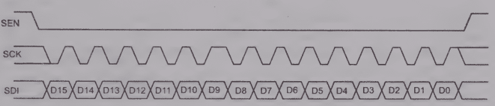

图2.17

从图2.17 可以看出，`SEN` 信号限定了位流写入 `LTC6903` 串行寄存器的过程。当 `SEN` 变为低电平时，启用数据传输。应用程序在 `SDI` 线上输出每个位（高位优先），并在 `SCK` 脉冲的上升沿将此位写入设备。在写入最后一个位（D0）后，`SEN` 变为高电。振荡器的时序图在控制应用程序中通过以下源代码实现（列表 2.8）：

### 列表 2.8

```
#include <stdio.h>
#include <unistd.h>
#include <sys/io.h>
#include <stdlib.h>

#define dataPort 0x378
#define SEN 0x4 // bit 2 of dataPort = 1
#define SDI 0x1 // bit 0 of dataPort = 1
#define SCK 0x2 // bit 1 of dataPort = 1
```

## 第 2 章 嵌入式设计中的并行端口

```
int main(void)
{
    int freq, tmp;
    int il;
    int MSB;

//freq = 0x844, F = 1400 Hz
//freq = 0x1774, F = 2710 Hz
//freq = 0x1C54, F = 3380 Hz
//freq = 0x2274, F = 4500 Hz

    freq = 0x226C; // F = 5150 Hz
    tmp = freq;
    iop(3);
    outb(SEN, dataPort); // SEN goes high
    outb(0x0, dataPort); // SEN goes low
    for (il = 0; il < 16; il++)
    {
        MSB = tmp & 0x8000;
        if (MSB != 0x0)
        {
            outb(SDI, dataPort);
            outb(SCK | SDI, dataPort);
        }
        else
        {
            outb(0x0, dataPort);
            outb(SCK, dataPort);
        }
        tmp <<= 1;
        outb(0x0, dataPort);
    }
    outb(SEN, dataPort);
    return 0;
}
```

让我们深入这段源代码。如你所见，我们只处理数据端口 (`0x378`)。配置频率的二进制代码保存在变量 `freq` 中。时序图实现在运行 16 次的 `for()` 循环中。在特定情况下，我们通过给 `freq` 赋值适当的值来配置设备为 5150Hz：

```
freq = 0x26C; // F = 510 Hz
```

其他可能的频率值见注释行。`freq` 中的值移动到 `tmp`。`for()` 循环处理每个位。`SEN` 信号将其限定。向设备写入位时，`SEN` 应保持低电。你可以通过设置不同的频率来实验振荡器。关于 `LTC6903` 的更多信息可以在数据表中找到。保存在 `LTC6903_Osc.c` 中的源代码通常可以通过以下方式编译：

```
gcc -o LTC6903_Osc LTC6903_Osc.c
```

使用以下命令启动应用程序：

```
sudo ./LTC6903_Osc
```

## 数字控制直流源

许多嵌入式系统需要数字控制直流电压来控制机器人、电机等各种设备。这种直流电压通常用于构建放大器和振荡器等电压控制电路。创建直流电压的一种明显方法是使用数字模拟转换器（DAC）。该项目致力于构建基于 Microchip `MCP4101` 数字电位器的数字模拟转换器。让我们讨论一下这种电位器的工作原理。数据表中的摘要将有助于我们。

根据数据表，`MCP4XXX/2XXX` 设备代替机械电位器。数字电位器的电阻值为 10K、50K 和 100K（欧姆）。每个电位器由一个变阻和一个 8 位（2^8 = 256 位置）数据寄存器组成，后者决定抽头位置。10K 版本的抽头电阻为 2 欧，50K 和 100K 版本为 5 欧。抽头与电阻端之间的电阻根据数据寄存器中存储的值线性变化。

## 第 2 章 嵌入式设计中的并行端口

`MCP1XXX` 系列提供 256 个电阻抽头，并接受 2.7V 到 5.5V 的电源。在我们的项目中，我们将为 `MCP4010` 设备提供 +5V。这意味着最低有效位（LSB）将等于 5 / 2^8 = 0.0195 V。如果应用程序向设备写入相当于 100（十进制）的二进制代码，数字电位器将在输出端产生 0.0195 × 100 = 1.95 V。回到我们的项目。项目的原理图如图2.18 所示：

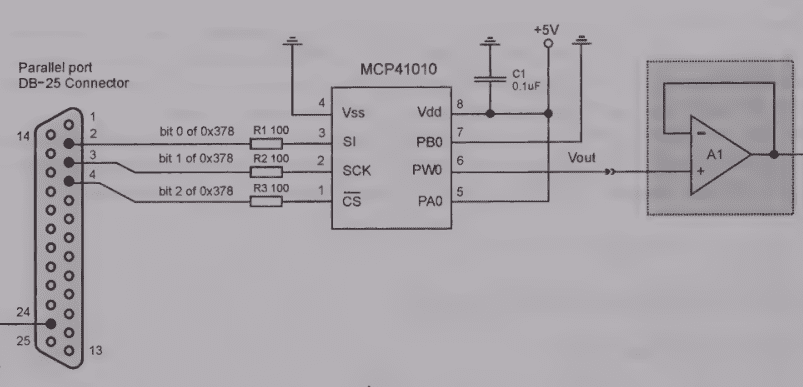

图2.18

数字电位器通过 PC 并行端口的 SPI 兼容接口控制。`SCK`、`SI` 和 `CS` 三线由在 Linux 中运行的应用程序控制。对应直流输出值的二进制代码从端口数据寄存器 (`0x378`) 逐位移位到数字电位器。输出模拟电压出现在 `PW0` 线（`MCP4010` 的引脚 6）上，它代表电位器的“抽头”。

当我们应用 `MCP4010` 设备时，`PA0` 和 `PB0` 输出之间的总电阻为 10K。如果你的电路需要低输出阻抗或驱动较高负载，必须在 Volt 输出端使用额外的缓冲。例如，你可以应用基于运算放大器的电压跟随器（图2.18 中的阴影框）。

在我们的设计中，我们使用 `MCP4010` 数字电位器处于所谓的“电位器模式”，其中设备的三个端子都连接到电路中的不同节点。这允许电位器输出与输入电压成正比的电压。这种模式被称为“分压器”模式。可变电压 `Vdiv` 通过调整端点 `PA0` 和 `PB0` 之间的抽头（`PW0`）位置提供（图2.19）。注意反转 `PA0` 和 `PB0` 端的极性不会影响操作。

## 数字控制直流电压源

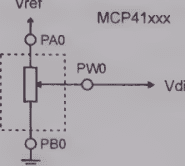

图2.19

如你所见，分压器由 `PA0–PW0` 和 `PW0–PB0` 电阻组成。在 `MCP4010` 的情况下，`PA0` 和 `PB0` 节点之间的全电阻为 10K。该分压器的每个“电阻”电阻可以根据以下公式计算：

```
$R_{TA}(Dn) = (R_{AB}) \times (256 - Dn) / 256 + R_W$
$R_{WB}(Dn) = (R_{AB}) \times (Dn) / 256 + R_W$
```

其中 `$R_{TA}$` 是端 `PA0` 与抽头之间的电阻（图2.19），`$R_{WB}$` 是端 `PB0` 与抽头之间的电阻，`$R_W$` 是抽头电阻，`$R_{AB}$` 是特定电位器的总电阻（在本例中为 10K），而 `Dn` 是 8 位二进制代码的数字值，用于决定电位器的输出电压。为了从设备提供适当的输出电压，我们需要将 16 位写入芯片的数据寄存器；时序图显示了如何配置数字电位器（图2.20）：

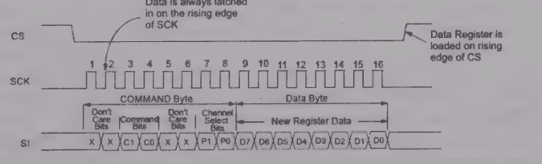

图2.20

如你所见，16 位代码由命令字节和数据字节组成。数据字节将是输出电压的数字代码 (`Dn`)。有关更多细节，你可以探索适当的数据表，其中有大量关于配置设备的信息。

## 第 2 章 家用设计中的并行端口

我们来讨论软件。控制应用的完整 C 源码如列表 2.9 所示。

### 列表 2.9


```c
#include <stdio.h>
#include <unistd.h>
#include <stdlib.h>
#include <sys/io.h>

#define dataPort 0x378 // bit 2 of dataPort = 1
#define CS 0x4 // bit 0 = 1
#define SI 0x1
#define SCK 0x2 // bit 1 = 1

int main(void)
{
    int tmp;
    int MSB;
    int Dn;
    int VCode = 0x1100;
    int il, Vout;

// Dn = 32, 满程的 1/8 --> 0.635 V (5.08 Vref)
// Dn = 64, 满程的 2/8 --> 1.27 V
// Dn = 96, 满程的 3/8 --> 1.905 V
// Dn = 128, 满程的 4/8 --> 2.54 V

// Dn = 160, 满程的 5/8 --> 3.175 V
// Dn = 192, 满程的 6/8 --> 3.81 V
// Dn = 224, 满程的 7/8 --> 4.445 V

    Dn = 100; Vout = 1.98V at Vref = 5.08V;
    tmp = VCode + Dn;
    iopl(3);
    outb(CS, dataPort); // CS 拉高
    outb(0x0, dataPort); // CS 拉低以开始转换

    for (il = 0; il < 16; il++)
    {
        MSB = tmp & 0x8000;
        if (MSB != 0x0)
        {
            outb(SI, dataPort);
            outb(SCK | SI, dataPort);
        }
        else
        {
            outb(0x0, dataPort);
            outb(SCK, dataPort);
        }
        tmp = tmp << 1;
        outb(0x0, dataPort);
    }
    outb(CS, dataPort);
    return 0;
}
```

正如你从列表中看到的，MCP41010 芯片的编程非常简单且直接。`VCode` 变量的高字节持有命令 `0x11`，而存储在 `Dn` 变量中的数据代码 `0` 到 `255` 决定了低位值。对于这种特殊情况，`Dn` 等于 `100` 在给定的 `5.08V` 参考电压下对应 `1.98V` 的输出电压。请注意，给定电路的输出电压取决于在电位器端端的电源电压 `本例中 5.08V`。注释行中还提供了其他输出的 `Dn` 二进制代码，以支持你自己的编程实验。

输出电压的编程需要向设备写入一个 `16` 位的值，这在 `for` 循环中实现。编程周期从 `CS` 信号从高变低时开始，从而启用写操作。在写入最后一个 `LSB` 之后，程序代码拉高 `CS` 线以结束周期。

你可以用其他设备替换 `MCP41050` 设备。例如，可以使用总电阻为 `50K` 的 `MCP41050` 设备，或者总电阻为 `100K` 的 `MCP41100`。该应用可以轻松扩展到使用双数字电位器 `MCP42XX`，尽管这种演进需要硬件和软件的修改。使用数字电位器意味着我们可以轻松构建许多具有数字控制设备的项目。我们将在本章后面讨论数字电位器的某些实际应用。

到目前为止，我们讨论了处理来自模拟传感器信号的嵌入项目。接的项目描述了一个温度测量系统，其中我们使用数字传感器作为输入。与模拟传感器相比，数字传感器具有额外优势。

当我们使用数字传感器时，不需要构建模拟信号链，因为所有的模拟处理都在模块内部实现；我们只需要提供一个控制算法来实现接口。然而，当我们尝试配置分辨率和精度时，数字传感器比模拟传感器灵活性较低。

下面我将描述一个使用流行数字传感器 `DS1722s` 芯片的简单温度测量系统。

## 使用 DS1722 数字传感器测量温度

`DS1722s` 允许测量从 `-55°C` 到 `+120°C` 的温度，精度为 `2.0°C`，且不需要外部元件。此外，`DS1722s` 可以配置为 `8` 到 `12` 位的分辨率 `1.0°C` 到 `0.0625°C`。这种可配置的分率对于必须最快检测热失控条件的应用非常有用。数据可以通过 `SPI` 或 `3` 线接口对设备进行读/写。在我们的项目中，我们将利用 `SPI` 接口。我们系统的原理图如图 `2.21` 所示：

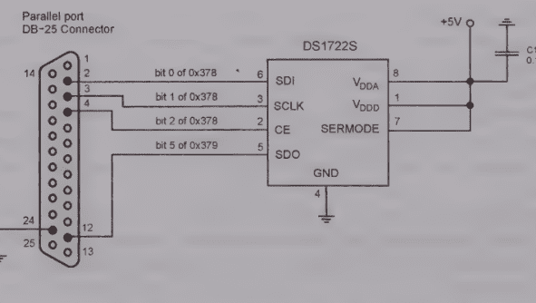

## 使用 DS1722 数字传感器测量温度

```c
#define CE 0x4
#define SCLK 0x2

void delayoday(long del)
{
 while (del-- != 0);
}

void WriteByte(int addr, int data_byte)
{
 int il, tmp;
 int MSB;
 int SDI;
tmp = addr;

 for (il = 0; il < 8; il++)
{
 MSB = tmp & 0x80;
 MSB = MSB >> 7;
 SDI = MSB;
 outb(CE | SDI, dataPort);
 delay(10);
 outb(SCLK | CE | SDI, dataPort);
 delay(10);
 outb(CE | SDI, dataPort);
 delay(10);
 tmp = tmp << 1;
}
tmp = data_byte;
for (il = 0; il < 8; il++)
{
 MSB = tmp & 0x80;
 MSB = MSB >> 7;
 SDI = MSB;
 outb(CE | SDI, dataPort);
 delay(10);
 outb(SCLK | CE | SDI, dataPort);
 delay(10);
}
```

```c
outb(CE | SDI, dataPort);
delay(10);
tmp = tmp << 1;
}
```

```c
int ReadByte(int addr)
{
int il, tmp;
int MSB;
int SDI, SDO;
int result = 0x0;

tmp = addr;
outb(CE, dataPort);
for (il = 0; il < 8; il++) {
MSB = tmp & 0x80;
MSB = MSB >> 7;
SDI = MSB;
 outb(CE | SDI, dataPort);
 delay(10);
 outb(SCLK | CE | SDI, dataPort);
 delay(10);
 outb(CE | SDI, dataPort);
 delay(10);
 tmp = tmp << 1;
}
for (il = 7; il >= 0; il--) {
outb(SCLK | CE, dataPort);
delay(100);
SDO = inb(statusPort);
tmp = SDO & 0x20;
if (tmp != 0x0) {
tmp = 0x1;
tmp = tmp << 1;
}
result = result | tmp;
```

```c
outb(CE, dataPort);
}
return result;
}
```

```c
int ReadTemp(void)
{
int total;
outb(0x0, dataPort);
WriteByte(0x80, 0x0); // 写配置。
outb(0x0, dataPort);
sleep(1);
outb(0x0, dataPort);
total = ReadByte(0x02); // 读取 MSB 温度寄存器数据。
outb(0x0, dataPort);
return total;
}
```

```c
int main(void)
{
int Temp;
iop(3);
Temp = ReadTemp();
printf("Temperature = %d deg.Celsius\n", Temp);
return 0;
}
```

让我们深入研究这段源码。为了测量和计算温度，我们需要一些辅助函数。其中，`WriteByte()` 函数将 `data_byte` 参数指定的字节数据写入 `addr` 参数指向的地址。`ReadByte()` 函数从 `addr` 指定的地址读取字节数据并返回整数类型的结果。`ReadTemp()` 函数处理测量过程并返回表示实际温度的整数值二进制代码。

`ReadTemp` 函数执行了多项操作。首先，它通过执行以下语句将配置写入配置/状态寄存器中：

```c
WriteByte(0x80, 0x0); // 写配置。
```

如你所见，配置字节等于 `0x0`。这意味着 `SD` 位将等于“`0`” `连续温度转换`。在这种情况下，`ISHOT` 位的值是什么都并不重要，所以：

## 第 2 章 家庭设计中的并行端口

让我们将其设置为“`0`”。此外，我们还通过将位 `R0` 到 `R2` 设置为“`0`”来选择 `8` 位分辨率。在配置/状态寄存器配置好后，设备将执行连续温度转换。由于测量操作需要一定的时间，程序应该通过调用 `delay()` 函数进行等待。在给定的间隔过期后，应用程序通过调用 `ReadByte()` 函数读取温度。由于我们只对高位字节感兴趣，我们将 `0x2` 作为参数传递给该函数。

我们可以将源代码保存为 `DS1722_Measuring.c` 文件并进行编译：

```bash
$ gcc -o DS1722_Measuring DS1722_Measuring.c
```

使用以下命令即可启动应用程序：

```bash
$ sudo ./DS1722_Measuring
Temperature = 24 deg.Celsius
```

该应用程序仅提供一次测量，并将结果输出到屏幕上。你可以自己修改代码以提供周期性测量，或者例如构建一个守护进程 `daemon`，来收集结果并将它们保存到文件中。这就是该项目的全部内容了。

## Linux 中的定时

在这里，我们将看到如何构建实现时间依赖关系的电路。当我们开始讨论像 `Windows` 或 `Linux` 等操作系统中的定时 `timing` 问题时，必须理解这是一个困难且复杂的问题。很多时候，当我们希望在严苛的时间限制和高频率下操作时，需要特殊设备，如 `I/O` 扩展卡和用于实现实时任务的设备驱动。即使使用 `PC`，你也可以使用某些内部提供实时解决方案的多功能芯片。在这种情况下，你不需要担心实现精密电路；你只需要使用某种接口 `如 SPI` 进行编程以获得所需的功能。我们在设计 `LTC2903` 时已经讨论过类似的解决方案。回想起来，我们的应用程序通过 `SPI` 接口配置设备；其他任务由芯片完成。这种方法对于嵌入式系统的优势是显而易见的：你可以专注于提供硬件接口和数据传输。

实现时间依赖嵌入式系统的第二种方法是使用广泛使用的简单电路。你应该将此类主任务交给软件。这种方法对于接受毫秒级分辨率的项目非常好。在这些项目中，我们可以在操作系统的范围内编写间隔。这种方法允许实现时间限制嵌入式系统，例如数模转换、脉冲调制器等。在后面的章节中，我们将讨论使用定时器的实用嵌入式项目。

### 低频振荡器

当我们想要一个高达 `200Hz` 的精密方波振荡器时，完全可以通过软件完成任务。输出信号可以从数据端口获取。你只需要为外部负载提供缓冲。软件振荡器的原理图如图 `24` 所示：


图 `24`

现在你知道并行端口的输出提供约 `12 mA` 的电流。当负载消耗电流时，需要在并行端口和负载之间连接硬件。可以使用 `TTL` 系列的单电源施密特触发。如果你有电容负载，必须确保你的缓冲在这种情况下正常工作。

我们项目的源码基于频率为 `100Hz` 的间隔定时信号。我们的振荡器源码所示 `Listing 11`。

## 第 2 章 家庭设计中的并行端口

### Listing 11

```c
#include <stdio.h>
#include <signal.h>
#include <unistd.h>
#include <string.h>
#include <sys/time.h>
#include <sys/io.h>

#define dataPort 0x378
static char bRead;

void timer_handler(int signum)
{
    bRead = inb(dataPort);
    bRead = ~bRead;
    outb(bRead, dataPort);
}

int main(void)
{
    struct sigaction sa;
    struct itimerval timer;
    iop(3);
    memset(&sa, 0, sizeof(sa));
    sa.sa_handler = &timer_handler;
    sigaction(SIGALRM, &sa, NULL);
    timer.it_value.tv_sec = 0;
    timer.it_value.tv_usec = 5000; // 报警前的 5 ms 间隔
    timer.it_interval.tv_sec = 0;
    timer.it_interval.tv_usec = 5000; // 信号之间的时间

    setimer(ITIMER_REAL, &timer, NULL);
    while(1);
    return 0;
}
```

### 低频振荡器

让我们讨论这段源码。在这里我们使用定时器事件来实现任务。由于 `Linux` `以及 UNIX` 系统允许我们产生定时器引起的事件，我们可以将其用于需求。在 `Linux` 中间隔定时器有多种方法可用。其中一种提供良好定时的方法是基于 `setitimer()` 函数的。通常，配置定时器涉及后文描述的步骤。

首先，我们需要为我们的定时器配置相应的结构体并设置参数。在我们的情况下，我们定义了 `sigaction` 类型的 `sa` 和 `itimerval` 类型的 `timer`：

```c
struct sigaction sa;
struct itimerval timer;
```

然后，我们确定要处理的信号并在定时器事件发生后调用的函数。以下两个语句实现了这一点：

```c
sa.sa_handler = &timer_handler;
sigaction(SIGALRM, &sa, NULL);
```

情况下，定时器处理程序将每 `5` 毫秒切换一次数据端口的输出锁存。以微秒 `us` 表示的时间间隔必须为定时器结构设置：

```c
timer.it_value.tv_sec = 0;
timer.it_value.tv_usec = 5000; // 报警前的 5 ms 间隔
timer.it_interval.tv_sec = 0;
timer.it_interval.tv_usec = 5000;
```

这里 `tv_usec` 被设置为 `5ms 5000µs`。我们必须做的最后一件事是执行以下语句实际启动定时器：

```c
setimer(ITIMER_REAL, &timer, NULL);
```

`setitimer()` 函数的第一个参数接受 `ITIMER_REAL` 常量，这意味着定时器将根据事件之间的真实时间工作。该函数的第二个参数指向定时器结构。定时器启动后，程序进入无限 `while()` 循环。

即使在低频率下，当我们应用某些电路时也能获得巨大的益处。一旦我们的工作频率达到 `100 - 200 Hz`，我们就可以构建在这些频率下构建非常有用的嵌入式系统。首先，我们可以产生由频率控制的直流电压。这项任务可以使用实现所谓的“频率转电压” `F-To-V` 转换的电路来实现。

## 第2章 家用设计中的并行端口

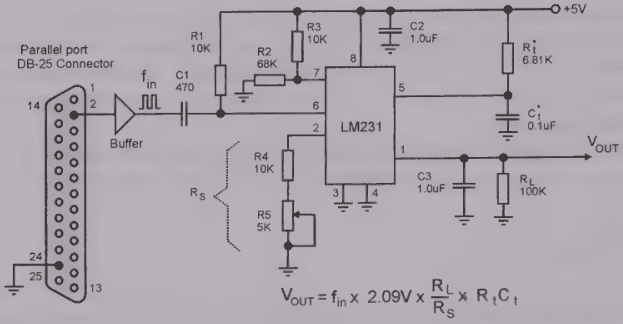

图2.25

该电路的“心脏”是一个高精度的电压转频率转换器 `LM2321`，我们将其连接为“频率转电压转换器”。从并行端口输入的频率通过电容 `C1` 传输到转换器的第 `6` 引脚。正如公式所示 `见图2.25`，该设备的输出电压 `$V_{OUT}$` 与输入频率成正比。通过改变 `$f_{in}$`，我们可以得到特定的输出直流电压 `$V_{OUT}$`，用于处理和调优各种电路 `机器人、传感器等`。事实上，我们实现了一个输入信号为频率的数模转换器。你可以根据 `LM2321` 芯片制造商提供数据表中的建议，通过更改 `$Rt$` 和 `$Ct$` 的值来轻松定制此电路。

## 数字控制脉冲宽度调制器

当我们考虑如何从频率获取直流信号时，可能会考虑脉冲宽度调制 `PWM`。`PWM` 是机器人和自动系统中用于直流电机速度控制的最常用方法。脉冲宽度调制是指以频率切换设备电源的开启和关闭的过程，其开启和关闭时间发生变化。这些开启和关闭时间被称为“占空比”。下图 `图2.26` 显示了 `25%`、`50%` 和 `75%` 占空比信号的波形。

从图中可以看出，`25%` 占空比信号在波波的 `25%` 时间内开启，在 `75%` 时间内关闭；而 `75%` 占空比信号则在 `75%` 时间内开启，在 `25%` 时间内关闭。这些信号以足够频率发送到电机，以至于脉冲对电机没有明显的影响。`PWM` 过程的最终结果是发送到电机的总功率可以从完全关闭 `0%` 占空比 到完全开启 `100%` 占空比 进行调节，具有良好的效率和稳定的控制。

我们可以使用简单的电路以及列表 `11` 中描述的源码的程序来实现简单的 `PWM` 系统。这里是基础电路 `图2.27`：

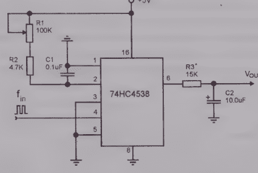

Fig2.26


Fig2.27


## 数字控制脉冲宽度调制器

我们使用了 `74HC/HCT4538` 芯片，这是一种可重触发可复位的精密单稳多谐振器。它可以产生宽度等于 `$0.7 \times (R1 + R2) \times C1$` 的输出脉冲。设计技术保证了对输出脉冲宽度的控制。温度范围内典型的脉宽变化为 ± 0.2%。此外，触发端的施密特触发器使电路对缓慢的上升和下降时间高度敏感。在我们的电路中，输入信号进入第 4 引脚。输入信号的上升沿启动多谐振器，并在第 6 引脚输出脉冲。我们可以使用此输出脉冲通过功率晶体管直接控制直流电机，也可以通过基础低通滤波器产生直流电压。

在我们的情况下，我们使用 `R3C2` 对在最简单的低通滤波器上获得直流电压。通过移动 `R1` 的拨杆，我们可以在宽范围内改变输出脉冲宽度。我们可以通过将可变电阻 `R1` 替换为数字电位器，轻松将我们的电路转换为数字控制 PWM 源。在这种情况下，我们可以通过兼容 `SPI` 的接口从并行端口程序化控制输出电压 `$V_{OUT}$`。这种数字控制脉冲宽度调制器的原理图所示（图2.28a）。

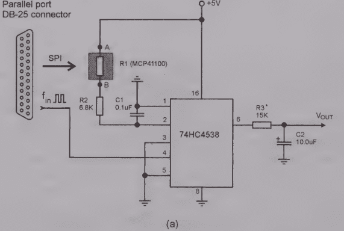

电阻器模式下的 `MCP41xxx`

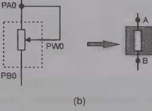

Fig2.28

### 使用 I2C 接口

在电路中，我们用常用的离散式电位器 `R1` 替换为总电阻为 `100K` 的数字电位器 `MCP41100`。我们根据图2.28b 中的方案连接了 `MCP41100`。数字电位器工作在所谓的“电阻器”模式下，该设备被用作双端电阻元件。未使用的端子（在我们的例中为 `PA0`）连接拨杆 `PW0`。反转 `A` 和 `B` 端的极性不会影响操作。该设备在此模式下允许控制两个节点之间的总电阻。

## 第 2 章 家用设计中的并行端口


图 2.25

该电路的“心脏”是一个高精度的电压转频率转换器 `LM2321`，我们将其连接为“频率转电压转换器”。从并行端口输入的频率通过电容 `C1` 传输到转换器的第 6 引脚。正如公式所示（见图 2.25），该设备的输出电压 `$V_{OUT}$` 与输入频率成正比。通过改变 `$f_{in}$`，我们可以得到特定的输出直流电压 `$V_{OUT}$`，用于处理和调优各种电路（机器人、传感器等）。事实上，我们实现了一个输入信号为频率的数模转换器。你可以根据 `LM2321` 芯片制造商数据表中的建议，通过更改 `$Rt$` 和 `$Ct$` 的值来轻松定制此电路。

## 数字控制脉冲宽度调制器

当我们考虑如何从频率获取直流信号时，可能会考虑脉冲宽度调制（PWM）。PWM 是机器人和自动系统中用于直流电机速度控制的最常用方法。脉冲宽度调制是指以频率切换设备电源开启和关闭的过程，其开启和关闭时间发生变化。这些开启和关闭时间被称为“占空比”。下图（图2.26）显示了 25%、50% 和 75% 占空比信号的波形。


图 2.26


图 2.27

我们使用了 `74HC/HCT4538` 芯片，这是一种可重触发可复位的精密单稳多谐振器。它可以产生宽度等于 `$0.7 \times (R1 + R2) \times C1$` 的输出脉冲。设计技术保证了对输出脉冲宽度的控制。温度范围内典型的脉宽变化为 ± 0.2%。此外，触发端的施密特触发器使电路对缓慢的上升和下降时间具有高容性。在我们的电路中，输入信号进入第 4 引脚。输入信号的上升沿启动多谐振器，并在第 6 引脚输出脉冲。我们可以使用此输出脉冲通过功率晶体管直接控制直流电机，也可以通过一些基础低通滤波器产生直流电压。

在我们的情况下，我们使用 `R3C2` 对在最简单的低通滤波器上获得直流电压。通过移动 `R1` 的拨杆，我们可以在宽范围内改变输出脉冲宽度。我们可以通过将可变电阻 `R1` 替换为数字电位器，轻松将我们的电路转换为数字控制 PWM 源。在这种情况下，我们可以通过兼容 `SPI` 的接口从并行端口程序化控制输出电压 `$V_{OUT}$`。这种数字控制脉冲宽度调制器的原理图如下所示（图2.28a）。


电阻器模式下的 `MCP41xxx`


图 2.28

### 使用 I2C 接口

在电路中，我们用常用的离散式电位器 `R1` 替换为总电阻为 `100K` 的数字电位器 `MCP41100`。我们根据图 2.28b 中的方案连接了 `MCP41100`。数字电位器工作在所谓的“电阻器”模式下，该设备被用作双端电阻元件。未使用的端子（在我们的例中为 `PA0`）连接拨杆 `PW0`。反转 `A` 和 `B` 端的极性不会影响操作。该设备在此模式下允许控制两个节点之间的总电阻。

### 使用 I2C 接口

I2C 总线上的每个设备可以是“主站”，也可以是“从站”。“主站”通过驱动 `SCL` 时钟线来控制总线。其他设备是“从站”，负责响应“主站”。当设备作为“主站”工作时，它可以在 I2C 总线上启动数据传输。通常，I2C 总线上仅有一个“主站”和多个“从站”。在嵌入式系统中，I2C 设备与 PC 协同工作；PC 将作为“主站”，而所有其他设备都充当“从站”。注意，“主站”和“从站”都可以通过 I2C 总线传输数据，尽管操作由“主站”控制。I2C 总线的简化时序图如图 2.30 所示。

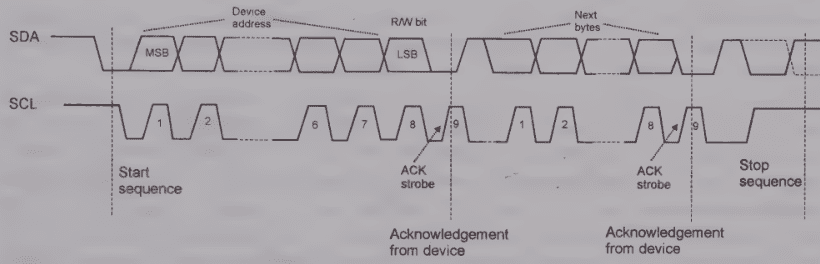

图 2.30

在使用 I2C 总线时，我们应该遵循两个规则。首先，只有在总线空闲时才能启动数据传输。其次，在数据传输期间，只要 `SCL` 时钟线为高电，数据线必须保持稳定。时钟线为高电时数据线的变化将被解释为控制信号。因此，每个数据位只能在 `SCL` 脉冲的上升沿进行采样。控制信号被称为“起始序列”、“起始条件”和“停止序列”。与“从站”的每次事务都始于“起始序列”，结束于“停止序列”。起始和停止序列由“主站”发起。为了发出“起始序列”，主站在 `SCL` 保持高电的同时将拉低 `SDA` 线（见图 2.30）。

当主站在 `SCL` 为高电时将 `SDA` 线从低电拉向高电时，就会产生“停止序列”。在传输数据时，`SDA` 必须保持稳定，在 `SCL` 为高电期间如此。不同的 I2C 设备可能需要不同的事务，因此起始和停止序列之间传输的字节数不受限制，由“主站”决定。

每次事务都以地址字节开始，该字节必须包含“从站”设备的地址和操作类型。IC 设备的地址为 7 位或 10 位。大多数设备使用 7 位地址，允许在 IC 总线上挂连接多达 128 个设备。除了 7 位地址外，“主站”还会发送第 8 位，表示“主站”将从“从站”读取数据；如果该位为 0，则表示“主站”正在向“从站”写入；该位为“1”表示“主站”正在从“从站”读取。7 位地址占用字节中的高 7 位，而读/写（R/W）位是最低有效位（LSB），如图 2.30 所示。

## 第 2 章 家庭设计中的并行端口

该电路简单，由两个芯片组成。缓冲器 `A1` 形成从 PC 并行端口到 `PCF8574A` IC I/O 扩展器的 TTL 兼容信号，并通过标准的 `SCL` 和 `SDA` 线控制。控制信号来自并行端口数据端口的第 0 位。随后，一个 8 位二进制代码（数据字节）出现在扩展器的 `P7` 引脚上。连接在上面的 LED 将根据接收到的二进制代码被触发。

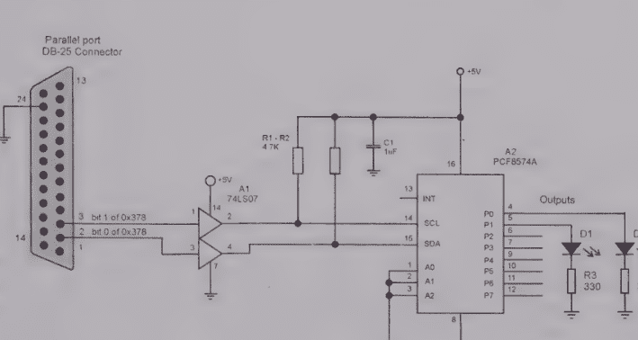

图 2.31

根据 I2C 规范，数据字节通过串行数据线 `SDA` 传输，而同步图由串行时钟线 `SCL` 提供。`A0-A2` 地址线定义了 I2C 总线上设备的地址。在给定情况下，这些线连接到“地”。记住，I2C 总线上的每个设备必须具有唯一的地址。

### 列表 2.12

```c
#include <unistd.h>
#include <stdio.h>
```

## 第 3 章。基于串口的家庭项目

本系列文章将继续讨论家庭项目设计。在这里，我们将看到如何使用 PC 的串口（接口）来构建各种嵌入式系统。串口接口，也称为 RS-232，是一种用于在各种设备（如调制解调器、PC 和通信设备）之间传输数据的标准接口。

## 串口基础

串口接口的核心是一个特殊的基于寄存器的数字电路，称为 `UART`。“UART”一术语代表通用异步收发传输器”。大多数用于桌面级 PC 和笔记本电脑的主板在其芯片组中都集成了 `UART`。

尽管现代 `UART` 是具有复杂结构的设备，但从开发者的角度来看，其操作足够简单。在处理 `UART` 时，应该注意两点：

- 如何对其编程：作为一种现代设备，`UART` 使用一些硬件寄存器（端口）进行配置和控制，因此我们可以通过程序访问其寄存器来获得对 `UART` 的完全控制。
- 如何将其连接到外部设备

如你所见，`UART` 可以从微控制器或微处理器进行控制，如图 3.1 的左侧所示。波特率通过时钟的软件分频进行配置。配置操作通过向负责 `UART` 运行的内部硬件寄存器写入特定值来实现。每个标准 `UART` 都可以通过硬件驱动程序访问。按照惯，这些寄存器的地址是相对于“基地址（base）”的。

在大多数主板都有内置 `UART` 的情况下，与外部设备的接口使用几个输出信号（例如 `RTS`、`DTR`）和几个输入信号（例如 `SIN`、`DCD`、`CTS` 和 `RI`）来形成串口接口的标准电平。用户可以在 PC 背面的 `DB25` 连接器上看到所有这些信号。除了显示为 `TD` 的 `SOUT` 和被分配为 `RD` 的 `SIN` 之外，所有其他信号在 `DB25` 上都保留其原始名称。`SIN` 和 `SOUT` 信号是通信设备之间数据传输的数据线。

| 设备 1 | 设备 2 |
| :--- | :--- |
| DB9 | DB9 |

/dev/ttyS2, Line 2, UART: 16550A, Port: 0x9400, IRQ: 21

Baud_base: 115200, close_delay: 50, divisor: 0

closing_wait: 3000

Flags: spd_normal skip_test

在这里我们可以获取更多关于串口接口的详细信息。具体来说，我们可以看到使用了哪种 `UART` 类型，或者为特定端口设置了什么波特率。`setserial` 命令也用于配置特定端口的参数。例如下面的命令将 `/dev/ttyS1` 的波特率降低为 9600 波：

```
$ sudo setserial /dev/ttyS1.baud_base 9600
```

同样，为了检查刚刚执行的设置，我们可以运行以下命令：

```
$ setserial -ag /dev/ttyS1
/dev/ttyS1, Line 1, UART: 16550A, Port: 0x9000, IRQ: 21
Baud_base: 9600, close_delay: 50, divisor: 0
closing_wait: 3000
spd_normal skip_test
```

`setserial` 命令还有许多其他参数，您可以在配置串口时进行设置。

对于所有支持的 UNIX 平台，您也可以使用 `stty` 命令。该命令允许显示或配置串口信息。例如，要显示 `/dev/ttyS0` 的串口属性，可以输入：

```
$ stty -a < /dev/ttyS0
```

要将波特率配置为每秒 9600 位，您可以输入：

```
$ stty speed 9600 < /dev/ttyS0 > /dev/ttyS0
```


在使用串口之前，一个简单的检查是确保它的工作完全符合您的预期。最简单的方法是通过 TD 引脚发送一些数据，并在 RD 引脚接收相同的数据。自然，这不能保证串口接口 100% 的可用性，但允许对整个串口功能进行良好的估计。在这种情况下，我们使用了所谓的“环回接口”配置，如图 3.3 所示。

## 第 3 章 使用串口的家庭项目

公头 RS-232 DB9 接口

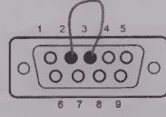

- 1 载波检测 (CD)
- 2 接收 (RD)
- 3 发送 (TD)
- 4 数据终端就绪 (DTR)
- 5 信号地
- 6 数据集就绪 (DSR)
- 7 发送请求 (RTS)
- 8 发送清除 (CTS)
- 9 环路指示 (RI)

图 3.3

以这种方式将 TD 和 RD 引脚短接后，您可以向特定接口发送（例如）单个字节，并尝试接收相同的字节。

假设我们想检查 `/dev/tty1` 串口接口。首先，打开终端窗口并输入以下命令：

```
$ cat < /dev/tty1
```

该命令在执行时会等待某些数据到达 RD 引脚。其次，打开另一个终端窗口并输入以下命令：

```
$ echo Test string has been received > /dev/tty1
```

按下回车键后，文本字符串将通过 TD 引脚发送。如果 `/dev/tty1` 正常工作，您将在第一个窗口中接收到的字符串。

在我的系统中，我看到了如下结果（图 3.4 – 图 3.5）。

### 在嵌入式项目中使用数据线

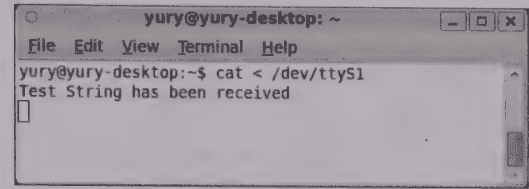

图 3.4

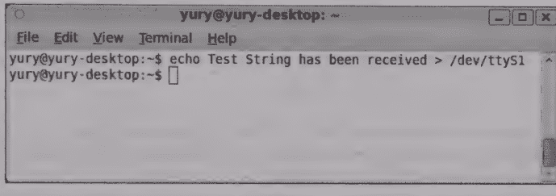

图 3.5

让我们如何在嵌入式项目中使用串口数据线。

让我们看看如何应用 TD 线来实现简单的家庭自动化任务。记住，通过 TD 线传输的数据流是一个位序列。该序列中的每个位都表示电压-时间摆幅，其标称范围从 -12V 到 +12V。我们可以应用这样的位序列来开启/关闭连接到 RS-232 接口的外部设备。实现此任务需要一些简单的电路，这些电路可以很容易组装和测试。

在下方（图 3.6）可以看到一个简单的演示电路，当通过 TD 引脚发送字节时，它可以开启一个直流负载（在我们例中是一个 LED LED）。

## 第 3 章 使用串口的家庭项目

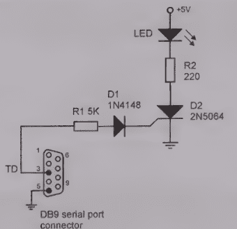

当 TD 引脚通过电阻 R1 和二极管 D1 连接到 SCR 2N5064 (D2) 的栅极时。当 TD 发送单个字节时，位序列将开启 SCR 设备 2N5064，LED 设备开始亮。由于 TD 上的脉冲范围从 -12V 到 +12V，我们需要二极管 D1 仅通过单极信号开启 SCR 设备。假设我们连接了 `/dev/ttyS0`。在这种情况下，我们可以通过向写入写入字符来开启 LED：

```
$ echo t >/dev/ttyS0
```

### 第 3 章 串口家庭项目

由于程序没有接收到任何返回数据，这意味着扫描区域内没有捕捉到任何人。如果人体穿过传感器覆盖的活动区域，PIR 检测器将激活并在其输出端产生一个 TTL 兼容的高电平。该信号会点亮 LED，从而驱动其光光闸电器。从这一点开始，R2 较小的电阻不会阻止信号从 TD 传输到 RD，控制程序本身会接收到该信号。一旦发生这种情况，程序就会认为发生了入侵，并采取相应的行动（开启报警、锁定区域等）。RS-232 接口允许高达 12-15 米的布线距离，因此你可以将 PIR 传感器放置在离 PC 远的地方。该电路包含常用的光耦闸电器 MOC3063，它可以通过低电流（LED 触发电流 > 5mA）进行驱动。由于许多现代 PIR 传感器的输出电流较低，我们可以使用单个电阻将给定的光耦闸电器直接连接到传感器。然而，如果你无法获得低电平 LED 触发的光光闸电器，可以稍微修改图 3.9 所示的电路，以适应 LED 触发电流更高的光耦器。

你只需要在 PIR 检测器的输出和光耦闸电器之间引入一些缓冲。一种可能的解决方案如下所示（图 3.10）：

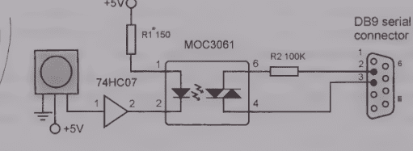

图 3.10

在这里，类型为 74HC07 的缓冲区具有“开漏集极”（OC）输出，通过 LED 提供足够的电流（≤ 20mA）来点亮类型为 MOC3061 的光耦闸电器。为了控制图 3.9–10 所示的电路，你可以编写一个特殊程序，或者简单地在终端窗口中使用几条命令。假设我们将电路连接到 `/dev/ttyS0` 串口接口。那么我们需要打开一个终端窗口并输入命令：

```
$ cat < /dev/ttyS0
```

在另一个终端窗口中输入命令：

```
$ echo Alarm! > /dev/ttyS0
```

按下“回车”键并观察发生了什么。如果 PIR 传感器被激活，文本“Alarm!”将出现在正在运行 `cat ...` 命令的终端窗口中。你可以在命令末尾添加 `&` 将 `cat ...` 命令放入后台。在这种情况下，你必须记住该进程的进程标识符（PID），以便在需要时终止后台进程。

输入以下命令将将其 PID 输出到屏幕上：

```
$ cat < /dev/ttyS0&
[3] 2563
```

如你所见，PID 等于 2563，因此你可以使用以下命令具有该 PID 的进程：

```
$ sudo kill 2563
[3] Terminated cat < /dev/ttyS0
```

除了将 `cat...` 命令放入后台外，你还可以通过定期轮询其状态来安排检查 PIR 检测器。这需要开发一个简单的 BASH 脚本，该脚本将在预定义时间间隔过期后执行 `echo ...` 命令。下面你可以找到此类演示脚本的源代码，我们每 5 秒检查一次该安全系统的状态：

```bash
#!/bin/bash
while true
do
echo ALARM! > /dev/ttyS0
sleep 5
done
```

在这里，“ALARM!”字符串每 5 秒发送一次到无限循环内的 `/dev/ttyS0` 设备。该字符串的接收必须使用运行在后台的 `cat < /dev/ttyS0&` 命令进行检查。你必须将此源代码保存并在文件中并使该文件可执行。例如，在我们源代码保存为名为 `program` 的文件后，我们需要使用 `chmod +x` 命令设置适当权限：

```
$ chmod +x program
```

之后，我们可以通过输入命令启动 program1：

```
$ ./program1
```

假设我们处于 program1 所在的目录中。注意，program1 也可以像 `cat...` 命令一样在后台启动！如你所见，我们创建了一个简单但实际上新颖的安全系统。为了扩展我们安全系统的功能，我们可以通过编写“守护进程”（daemon）应用程序来改进软件。守护进程可以完成使用单条命令甚至 BASH 脚本难以实现的额外操作。下面是两个守护进程简化版的 C 源代码（列表 3.1 和列表 3.2）：

### 列表 3.1

```c
#include <stdio.h>
#include <unistd.h>
#include <stdlib.h>

int main(void)
{
pid_t PID;
PID = fork();
if (PID == 0)
exit(0);

setsid();
printf("Write Daemon started...\n");
while (1)
{
system("echo ALARM > /dev/ttyS0");
sleep(5);
}
return 0;
}
```

### 列表 3.2

```c
#include <stdio.h>
#include <unistd.h>
#include <stdlib.h>

int main(void)
{
    pid_t PID;
    PID = fork();
    if (PID == 0)
        exit(0);

    setsid();
    printf("Write Daemon started...\n");
    while (1)
    {
        system("echo ALARM > /dev/ttyS0");
        sleep(5);
    }
    return 0;
}
```

## 第 3 章 串口相关的家庭项目

设计我们的电路，使控制/状态线上的低电平信号对应于设置为 0 的相应位。反之，高电平信号对应于设置为 1 的相应位。这幅为什么我现在略微修改了上述电路，如图 3.13 所示。

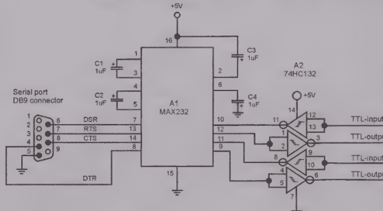

图 3.13

这里引入了一个额外的缓冲器。我使用了 74HC132 反相器，它在对信号进行额外反相的同时，还能对外部电路缓冲 MAX232 的输出。我组装的电路所示（图 3.14）：

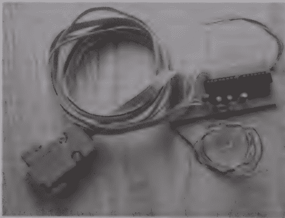

图 3.14

### 将外部电路连接到串口

注意，从 DB-9 连接器到我们电路的 RS-232 电缆长度可能延伸至 12 米。

让我们看看如何对控制线进行。你已经从上一章知道如何处理并行端口的硬件寄存器。串口硬件也是如此。我们将主要使用四个函数：`ioperm()`、`iopl()`、`in()` 和 `out()`。记住，前两个函数允许用户应用程序访问硬件，而 `in()` 和 `out()` 提供从/向硬件端口的读取/写入操作。为了更熟悉串口硬件，让我们考虑一下两个简单演示项目的细节。

接下来的项目展示了如何在 gcc 中编写 RTS 控制线。输入以下 C 源代码（列表 3.3）：

### 列表 3.3

```c
#include <unistd.h>
#include <sys/io.h>

#define MCR 0x3FC // 调制解调器控制寄存器 = base + 4

int main(void) {
    char bRead = 0x2;
    iopl(3);
    while (1) {
        outb(bRead, MCR);
        sleep(5);
        bRead = ~bRead;
    }
    return 0;
}
```

此应用程序每 5 秒切换一次 RTS 线（MCR 的第 2 位）。由于程序在启动时需要权限，你必须使用 `sudo` 命令来运行上述代码所在的文件。为了观察结果，将多用表的一的一个探针（设置为电压表）接触 DB-9 连接器的第 7 引脚（RTS 线），并将另一根探针接触第 5 引脚。程序启动后，你将看到 74HC132 反相器第 3 引脚上的电压在 0V 到 +5V 范围内波动。这也是我们测试 DTR 输出的一种方法——在这种情况下，我们必须将 `bRead` 变量的初始值（见列表 3.3）从 0x2 改为 0x1：

char bRead = 0x1;

## 第 3 章 串口相关的家庭项目

将源代码保存在 RTS_Test.c 文件中，并使用以下命令编译源码：

```bash
$ gcc -o RTS_Test RTS_Test.c
```

要启动应用程序，你应该输入：

```bash
$ sudo ./RTS_Test
```

接下来的项目说明了如何读取 CTS 输入线。在测试 CTS 之前，我们需要如图 3.15 所示将 RTS（反相器 A2 的第 3 引脚）和 CTS（A2 的第 9–10 引脚）短接：

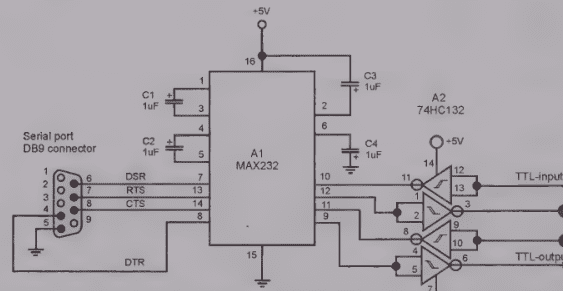

图 3.15

控制程序将切换 RTS 线并读取 CTS 的相应状态。由于 RTS 和 CTS 线短接，RTS 线上的数据输出会出现在 CTS 上。读取 CTS 的程序的 C 源代码所示列表 3.4。

### 列表 3.4

```c
#include <unistd.h>
#include <stdio.h>
#include <stdlib.h>
#include <pthread.h>
#include <sys/io.h>

#define MSR 0x3FE // 调制解调器状态寄存器 = base + 6, bit 4 = CTS
    // 用于 /dev/ttyS0

char bRead;
void *counter(void);

main() {
    pthread_t thread1;
    int tHandle;

    iopl(3);
    // 创建独立线程
    tHandle = pthread_create(&thread1, NULL, counter, NULL);

    // 在主程序继续执行之前等待线程完成。除非
    // 等待，否则我们将面临执行 exit 的风险，这将在线程
    // 完成之前终止进程和所有线程。
    pthread_join(thread1, NULL);
    exit(0);
}

void *counter(void) {
    char tmp = 0x0;
    while (1) {
        do {
            bRead = inb(MSR) & 0x10;
        } while (tmp == bRead);
        tmp = bRead;
        printf("CTS = 0x%X\n", bRead);
    }
}
```

## 第 3 章 串口相关的家庭项目

此程序使用单独线程来检查 CTS。最初，程序通过调用 `pthread_create` 创建一个新线程。`pthread_join` 函数允许主程序结束前等待线程完成。`counter` 函数填充了 `thread1` 并负责读取 CTS 状态。`counter` 持续将 MSR 的第 4 位读入 `bRead` 变量。如果该状态发生变化，CTS 的状态将输出到屏幕上。

将源代码保存为 Read_CTS.c。由于使用了使用了线程，编译命令如下：

```bash
$ gcc -o Read_CTS -lpthread Read_CTS
```

为了测试 CTS 是否正常，我们可以执行以下步骤：

- 1. 将 74HC132 反相器的第 9-10 引脚短接（见图 3.14）；
- 2. 打开终端窗口并输入以下命令启动 RTS_Test 以切换 RTS 线：

```bash
$ sudo ./RTS_Test
```

- 3. 打开另一个终端窗口启动 Read_CTS：

```bash
$ sudo ./Read_CTS
```

为了检查 CTS 是否正常，我们可以修改 `while()` 循环中的语句（如下）：

```c
while (1) {
    do {
        bRead = inb(MSR) & 0x10;
    } while (tmp == bRead);
        tmp = bRead;
        printf("CTS = 0x%X\n", bRead);
}
```

### 第 3 章. 使用串口的家电项目

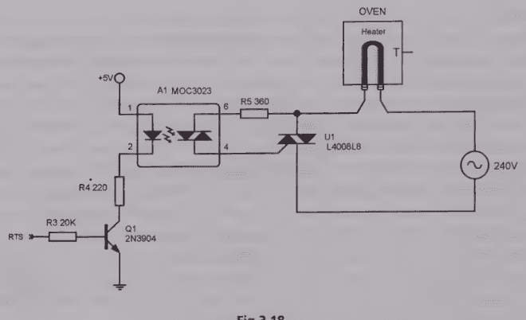

磁簧继电器 RL1 已被光电（optaptic）芯片替换，型号为 MOC3023。这提高了可靠性（不再有机械部件运动和磨损），并消减了使用继电器时产生的电磁噪声。另一个提示：如果你想减少电磁噪声，可以包含一个 RC 缓冲子电路。R4 的阻值可以通过计算来提供适当的修改。我建议你查阅 MOC3020-23 数据表以获取其他可能的修改。范围从最大值（MOC3021 为 15mA，MOC3022 为 10mA，MOC3023 为 5mA）到绝对最大值（约为 60mA）。

当然，你可以将上述电路应用于处理任何其他类似的电阻性设备（冷却器、灯泡等）。对于每个特定的系统，你应该选择光电芯片（图 3.18 中的 U1）来驱动你的负载。如果你想驱动感性负载（电机、阀门等），这是一个必须专门设计的特殊情况；该主题的讨论超本书的范围，因此我鼓励你查阅功率电子领域的其他文献。

之前的项目涉及 RTS 和 CTS 线，尽管我们也可以使用 DTR（输出）和 DSR（输入）。然而，许多嵌入式项目需要的信号线比标准串口接口提供的多。在这种情况下，我们可以扩展输入或输出行的数量以获得所需的功能。让我们看看下面的项目。

### 扩展串口的输入行

很多时候，你可能需要更多的输入来捕获外部电路的信号，而扩展输入数量最简单的方法是使用多路复用器，它可以将多个输入信号定向到一个输出。下面的嵌入式项目演示了这种方法。该项目的硬件部分由以下原理图表示（图 3.19）：

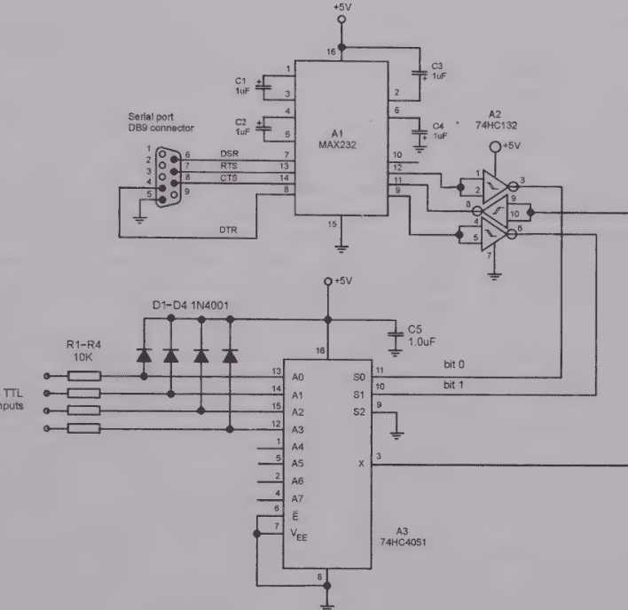

图 19

该电路增加了 4 个额外输入。如你所见，使用了任意一种 74HC4051 型的多路复用器。使用此电路，可以同时读取 A0-A3 数字输入中的任何一个。所选输入的 TTL 兼容信号通过 74HC4051 的 X 输出通过。X 输出反过来连接到 CTS 线。因此，控制将通过读取 CTS 线的状态来“知道” X 输出的状态。程序通过读取 74HC4051 的 S0-S1 输入的 2 位代码来选择输入通道。例如，S0-S1 上的代码 0x0 允许读取 A0；代码 0x1 允许读取 A1。一些关于设计的要说明：电阻-二极管对（RxDx, x=1...）保护多路复用器输入免受高电压影响。在电源供应上提供噪声旁路也是必要的。适当的旁路是一个尽可能地连接到多路复用器电源引脚的 1µF 电容。作为 74HC4051 的替代方案，你可以使用 4051 多路复用器，它将接受 TTL 信号。现在我们谈谈软件。控制应用程序具有以下源代码（列表 3:6）：

### 列表 3.6


```c
#include <stdio.h>
#include <unistd.h>
#include <sys/io.h>
#include <stdlib.h>

int MCR = 0x3FC; // 调制解调器控制寄存器
int MSR = 0x3FE; // 调制解调器状态寄存器
int DTR; // 设置时 MMCR 的第 0 位 = 0x1
int RTS; // 设置时 MMCR 的第 1 位 = 0x2
int CTS = 0x10; // CTS 对应于 MSR 的第 4 位

int result = 0;

void readBit(int ch);

int main(void)
{
    int channel;
    int tmp = 0;

    iopl(3);
    while (1)
    {
        // 读取 4051 多路复用器的通道 A3
        RTS = 0x2; // RTS = 1
        DTR = 0x1; // DTR = 1
        channel = RTS + DTS;
        readBit(channel);

        // 读取通道 A2
        RTS = 0x0; // RTS = 0
        DTR = 0x1; // DTR = 1
        channel = RTS + DTS;
        readBit(channel);
    }
}
```

```c
// 读取通道 A1
RTS = 0x2;      // RTS = 1
DTR = 0x0;      // DTR = 0
channel = RTS + DTS;
readBit(channel);

// 读取通道 A0
RTS = 0x0;      // RTS = 0
DTR = 0x0;      // DTR = 0
channel = RTS + DTS;
readBit(channel);

printf("Input states A3--A0: %X\n", result);
sleep(2);
result = 0x0;
return 0;
}
``` (注：原文代码中存在 `DTS` 变量未定义，此处按要求保留代码不翻译)

## 使用译码器扩展输出行

对于扩展器芯片，我们使用 BCD 转十进制译码器（1选10）类型的 `74HC42`。`74HC42` 接受四个高电平 BCD 输入，并提供 10 个互斥的低电平输出。该芯片的逻辑设计确保当输入应用大于9的二进制代码时，所有输出均为高电平。在我们的方案中，我们使用了两个输入（A0 和 A1），它们分别由 DTR 和 RTS 信号驱动。因此，我们能够获得 2^2 = 4 个范围从 Y0 到 Y3 的输出。

### 列表 3.8

```c
#include <stdio.h>
#include <unistd.h>
#include <sys/io.h>
#include <stdlib.h>

int main(void)
{
    int MCR = 0x3FC; // 调制解调器寄存器 (Modem ControlRegister)
    int chOutput = 0;

    iopl(3);
    while (1)
    {
        outb(chOutput, MCR);
        sleep(10);
        chOutput++;
        if (chOutput > 3)
            break;
    }

    return 0;
}
```

此程序按顺序切换输出 Y0-Y3，每次切换之间有 10 秒延迟。设置 A0-A1 行是在一个 `while (1)` 循环中实现的。以下语句

`outb(chOutput, MCR);`

按顺序将 0 到 3 范围内的值写入 MCR 寄存器。这部分代码作用于译码器的 A0-A1 输入，并导致 Y0-Y3 的相应输出发生切换。通过该电路，我们为嵌入式系统赢得了 2 个输入（CTS 和 DSR）和 4 个输出。

## 第 3 章。使用串口的家庭项目

在这里我们讨论了扩展串口端口输入/输出的一些方法。自然地，你可以使用其他方法轻松开发 I/O 扩展器，例如移位寄存器等。

到为止，我们处理的是数字电子；；开发了涉及数字信号的项目。让我们看看如何操作需要处理模拟信号的系统。

## 处理输入模拟信号

下一个项目说明了如何测量表示为时间连续电压的模拟信号。通常当我们使用模拟传感器测量某些物理量（温度、光照、压力等）时，我们会处理模拟信号。该项目的硬件部分包括一个 12 位逐次逼近 (SAR) 模拟数字转换器，类型 `MCP3201`，通过兼容 SPI 的接口连接到 PC 端口（图 3.22）：

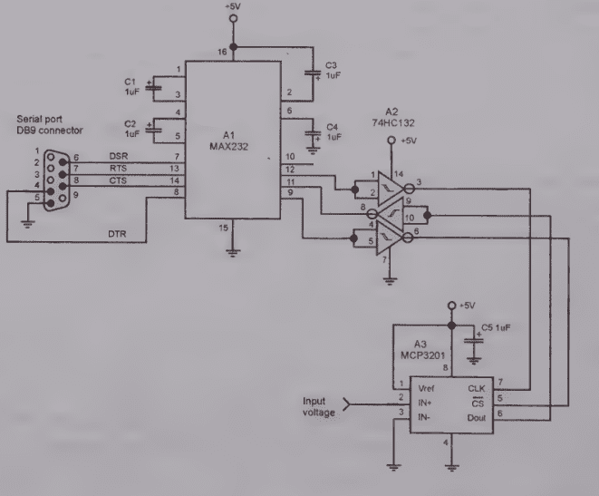

图 3.22

SPI 接口涉及三条信号线：CS、CLK 和 Dout。模拟数字转换 (ADC) 和数据传输由运行在 PC 上的程序通过这些线路控制。0 --+5V 范围内的模拟输入信号进入 `MCP3201` 芯片的输入端（引脚 2）。CS 控制线框定了转换过程，在转换进行期间必须保持为低电平。程序通过 MCR 的 DTR 位（DB–9 接器的第 4 引脚）控制此线。输出位出现在连接到 CLK 线的 Dout 引脚上（DB–9 接器的第 8 引脚）。

软件读取此位流的每个位（MSB 优先）并将其保存到整数变量中。在所有数据位被捕获后，应用程序获取代表原始模拟信号的低 12 位。同步数据传输的时钟脉冲位于连接到 RTS 的 CLK 引脚上。ADC 在 CLK 的下降沿产生 Dout 上的每个位；位应由控制程序在时钟脉冲的上升沿进行锁存。为了完成转换过程，控制程序必须拉高 CS 线。

整个转换过程由图 3.23 所示的时序图表示：

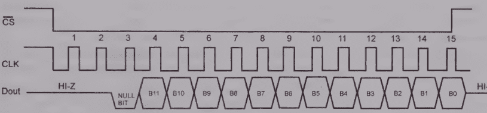

图 3.23

注意，MSB 位在第 3 个 CLK 脉冲变低后首先出现在 Dout 线上。如所示，一个完整的转换周期需要 15 个 CLK 脉冲，而数据传输需要 12 个周期。电路应由 +5V “无噪声”电源供电。10 uF 的旁路电容应尽可能靠近 `MCP3201` 芯片的电源引脚放置。如果需要，可以将 `MCP3201` 替换为具有兼容 SPI 接口的类似逐次逼近 ADC。例如，你可以使用 `LTC1286` 或 `LTC1297` 设备（Linear Tech.）等。在这种情况下，你需要重新考虑所有电路连接并根据所选设备的时序图修改源代码。

让我们讨论软件。我们的控制应用程序的所示所示（列表 3.9）：

### 列表 3.9

```c
#include <stdio.h>
#include <unistd.h>
#include <stdlib.h>
#include <sys/io.h>

#define MCR 0x3FC // 调制解调器寄存器地址 (base + 4)
#define MSR 0x3FE // 调制解调器状态寄存器地址 (base + 6)

int main(void)
{
    int i1;
    int binData = 0;
    int mask = 0x4000;
    int dataCTS = 0;
    double total = 0;

    iopl(3);
    // CS 是 MCR 的 Bit 0，
    // CLK 是 MCR 的 Bit 1，
    // Dout 是 MSR 的 Bit 4

    outb(0x1, MCR);    // CS 置高
    outb(0x3, MCR);      // CS 保持高电，CLK 置高
    outb(0x2, dataPort);  // CS 置低允许转换

    for (i1 = 0; i1 < 15; i1++)
    {
        outb(0x0, MCR);        
        dataCTS = inb(MSR) & 0x10; // CS 位被选中
        if (dataCTS != 0)
            binData = binData | mask;
        outb(0x3, MCR);        // CLK 置高
    }
    outb(0x2, MCR);        // CS 置低

    double out = 0;
    printf("输入电压为 %.3f V\n", (double)out * 5.0 / 4095.0);

    return 0;
}
```

软件可以使用这些方程来计算以 kPa 为单位的绝对压力。为了将结果从 kPa 转换为 mmHg 单位（这是“毫米汞”的缩写），我们需要应用以下公式：

$P_{mmHg} = (P \times 7500.7) / 1000,$

其中 $P_{mmHg}$ 是以“毫米汞”为单位的压力，$P$ 是以 kPa 为单位测量的压力。让我们来看系统的原理图（图3.25）：

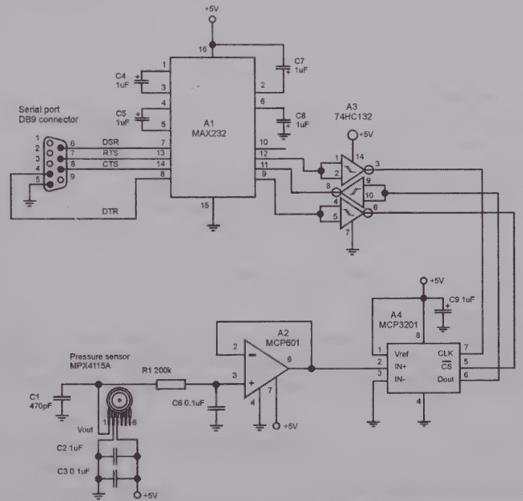

图3.25

从压力传感器到 MAX232 转换器的信号链包含一个有源低通滤波器，其中包含 MCP601 型运算放大器 A2，R1C6 滤波器是一个可选级；它在需要噪声衰减时使用。来自压力传感器的模拟信号随后传输转换器的输入端（A4 的第 2 引脚）。转换过程通过使用 RTS、CTS 和 DTR 信号线构建的 SPI 兼容接口进行控制。通常情况下，MAX32 芯片将 RS-232 信号转换为 TTL 兼容电平。

# 第 3 章 使用串口的家庭项目

让我们谈谈物理实现。

当使用数模转换器时，所有的地、正电源和负电源引脚都应该连接到模拟平面。此外，如果转换器有一个与输入信号相关的 IN 引脚，则该引脚应尽可能连接到信号地。模拟和数字电源引脚应连接到模拟电源平面，并在每个引脚处尽可能放置旁路电容。旁路电容 C1-C3 应该尽可能靠近传感器的电源引脚。希望电源供应是无噪声的，或者至少噪声极小。

让我们来看软件。该项目的 C 语言源码所示于列表 3.10。

## 列表 3.10

```
#include <stdio.h>
#include <unistd.h>
#include <stdlib.h>
#include <sys/io.h>

#define MCR 0x3FC // 调制解器控制寄存器
#define MSR 0x3FE // 调制解器状态寄存器

#define Vref 5.00 // ADC 的电压参考

int main(void)
{
int il;
int binData = 0;
int mask = 0x4000;
int dataCTS = 0;

double Vout;
double pressureKPa;
double pressuremmHg;

iopl(3); // CS 是 MCR 的位 0，
// CLK 是 MCR 的位 1，
// Dout 是 MSR 的位 4
```

## 使用 PC 扩展串口接口

```
outb(0x1, MCR);      // CS 置高
outb(0x3, MCR);      // CS 保持高位，CLK 置高
outb(0x2, dataPort); // CS 置低允许转换

for (il = 0; il < 15; il++) {
    outb(0x0, MCR);      // CLK 置低
    dataCTS = inb(MSR) & 0x10; // 选中 CS 位
    if (dataCTS != 0) {
        binData = binData | mask;
        outb(0x2, MCR);      // CLK 置高
        mask = mask >> 1;
    }
noutb(0x3, MCR);      // CS 置高
binData = binData & 0xFFFF;
```

Vout = Vref / 4096 * binData;

pressureKpa = (Vout / Vref + 0.095) / 0.009;

pressuremmHg = pressureKpa * 7500.7 / 1000.0;

printf("Pressure = %5.3f KPA (%5.2f mmHg)\n", pressureKpa, pressuremmHg);

return 0;

```

在这个程序中，源码对于之前的项目应该非常熟悉，只是现在 `pressureKpa` 变量将持有以 kPa 为单位的绝对压力值，而 `pressuremmHg` 变量包含以 mmHg 为单位计算的值。

## 使用 I2C 扩展串口接口

PC 接口允许扩展嵌入式系统操作的输入/输出数量。通常，连接到串口的外部电路可以使用四条数字线工作：两个输出（RTS 和 DTR）和两个输入（CTS 和 DSR）。尽管如此，可以使用 I2C 扩展器增加串口输入/输出的数量。下面的项目展示了如何将串口输出线扩展到八路。让我们先检查串口输出。串口 I2C 扩展器的原理图如图26所示。

# 第 3 章 使用串口的家庭项目


图28

该电路非常简单，需要的元件很少。MAX232 芯片将来自 PC 串口的 RS-232 信号转换为 IC 接口所需的 TTL 兼容电平。PCF574 I/O 扩展器提供由 RTS（发送准备）和 DTR 控制的标准 SCL 和 SDA 信号。一个 8 位二进制代码（数据字节）从串口传递到 IC 扩展器（P0-P7）。根据 IC 规范，数据字节通过数据线（SDA）传递，而同步信号由时钟线（SCL）提供。为了更完整地理解 IC 时序图，可能参考 PCF574 的数据表。A0-A2 线定义了总线上的设备地址。在给定情况下，总线上的每个设备必须具有唯一地址。无论如何，分配地址时应咨询设备的数据表。硬件部分结束。以下是应用的 C 源码（列表11）：

```

#include <stdio.h>

#include <unistd.h>

#include <stdlib.h>

#include <sys/io.h>

#define MCR 0x3FC // 调制解器控制寄存器

// RTS -> SCL

// DTR -> SDA

```# 使用 I2C 扩展串口接口

```

#define SCL 0x2 // SCL 上的高电平

#define SDA 0x1 // SDA 上的高电平

void I2CStart();

void I2CStop();

void WriteByte(int bl);

int main(void) {

  int il;

  int dat;

  int cmd;

  char tmp;

  iopl(3);

  dat = 0x1;

  I2CStart();

  cmd = 0x70;

  WriteByte(cmd);

  WriteByte(dat);

  I2CStop();

  return 0;

}

void I2CStart() {

  outb(SCL | SDA, MCR);

  outb(SCL, MCR);

}

void I2CStop() {

  outb(0x0, MCR); // SCL 置低，SDA 置低

  outb(SCL, MCR); // SCL 置高

  outb(SCL | SDA, MCR); // 当 SCL 为高位时 SDA 置高

}


```c
void WriteByte(int b1)
{
    int i1;
    for (i1 = 0; i1 < 8; i1++)
    {
        outb(0x0, MCR); // SCL 置低
        if ((b1 & 0x80) != 0) // 如果 b1 的最高位为 1，SDA 赋值为 1
        {
            outb(SDA, MCR);
            tmp = SDA;
        } else
        {
            outb(0x0, MCR); // 如果 b1 的最高位为 0，SDA 赋值为 0
            tmp = SDA;
        }
        outb(tmp << SCL, MCR);
        b1 = b1 << 1;
    }
    outb(SCL, MCR);
    outb(SCL | SDA, MCR);
}
```

回一下，IC 接口的信号线由 RTS 控制，SDA 线由串口的 DTR 引导。使用了两个变量 `cmd` 和 `dat`。`cmd` 变量持有发送给 IC 设备的第一个字节命令。命令是设备和操作代码（读/写）。在我们的案例中，命令代码为 0x70。向 PCF8574 设备 IC 总线写入数据需要四个步骤：发出“启动序列”、写入包含命令的第一字节、写入必须是 P0–P7 输出的数据字节。这些步骤主程序内部执行，按正确的顺序调用相应的函数。`I2CStart` 函数产生“启动序列”。`WriteByte(cmd)` 函数将第一个字节（命令，`cmd` 变量）传递给 PCF574 设备。`WriteByte(dat)` 函数传递输出到 P0–P7 引脚的数据字节。最后，`I2Cstop` 函数产生停止。

## 在家庭项目中使用 MATLAB

本节将专门介绍流行且强大的开发工具 MATLAB®。该应用程序广泛用于构建家庭和实验室的各种嵌入式系统。如你所知，MATLAB 用于数学和计算、多数据采集系统的开发、建模、仿真和原型设计。其他用途包括科学和工程制图、带有图形界面的应用程序开发。MATLAB 是一个交互系统，允许你通过提供的 C 语言工具解决许多技术问题。本书的目的并不是详细描述 MATLAB 的所有功能。我们将学习如何将 MATLAB 应用于使用串口的嵌入式项目。

要操作 MATLAB，你应该在该环境中有一定的编程经验。对于我的实验，我使用了该产品的 R2009b Linux 版本，尽管旧版本运行良好。关于如何在 Linux 中配置 MATLAB 的详细说明可以在 Linux 和 MATLAB 相关的网站上找到。

让我们看看如何使用 MATLAB 通过串口接口编写数据传输。考虑这种通用方案：我们有一个外部设备（可能是某些测量设备、基于微控制器的数据采集系统等）连接到串口并由 MATLAB 控制。最常见的情况是你的应用程序向外部设备发送某些命令并接收答案。让我们来看一个实际例子。我们的嵌入式系统将包含一个简单的 8051 系列微控制器开发板（我个人使用了 Rigel 公司的 8052 板），并连接到串口接口 `/dev/tty0`（图3.27）。

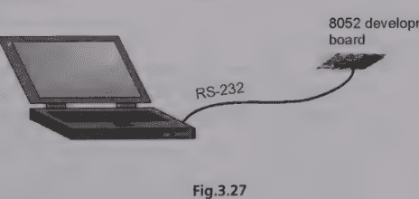

# 第3章. 使用串口的家庭项目

为了清晰起见，假设我们的 8052 板上运行着一个如列表 3.12 所示基于 C 语言源代码（使用 Keil C 编译器）的简单程序。

### 列表 3.12

```c
#include <REG52.H>
#include <stdio.h>
#include <string.h>
void delay(void)
{
    long interval = 500;
    while(interval-- != 0);
}
int main(void)
{
    char buf[128];
    char cmd1[] = "*IDN";
    char cmd2[] = "*TEST";
    char data1[] = "8051 BASED SYSTEM";
    char data2[] = "TESTED OK";
    char i;
    int args;
    SCON = 0x50;
    TMOD = 0x20;
    TH1 = 0xF3; // Fosc = 24.0MHz 时波特率为 9600
    PCON |= 0x80;
    TR1 = 1;
    TI = 1;
    while (1)
    {
        memset(buf, '\0', sizeof(buf));
        args = scanf("%s", buf);
        if (args == EOF)
            continue;
        i = strncmp(buf, cmd1, 5);
        if (i == 0)
        {
            delay();
            printf("ANS: %s\n",data1);
            continue;
        }
        i = strncmp(buf, cmd2, 6);
        if (i == 0)
        {
            delay();
            printf("ANS: %s\n",data2);
            continue;
        }
        else
        {
            delay();
            printf("Wrong command\n");
            continue;
        }
    }
}
```

该 8052 程序非常简单。微控制器从 PC 接收一个字节字节，并尝试将该数据解释为命令。8052 软件的设计是为了识别两个特定的命令。当发现其中任何一个命令时，8052 程序会向 PC 发回答案。为了简单起见，除了上述操作外，未执行其他操作。源代码包含两个 `char*` 类型变量 `cmd1` 和 `cmd2`，它们指向命令字符串；变量 `data1` 和 `data2` 是在找到 `cmd1` 或 `cmd2` 后 8052 发回 PC 的字符串。当 8052 程序识别出 `cmd1` 命令时，发送 `data1` 字符串，而 `data2` 是 `cmd2` 的回答。因此，如果向 8052 发送 `*IDN?` 命令，答案将 "8051 BASED SYSTEM"。同样，收到 `*TEST?` 字符串后，控制器回答为 "TESTED OK"。

以下语句

```c
SCON = 0x50;
TMOD = 0x20;
TH1 = 0xF3; // Fosc = 24.0MHz 时波特率为 9600
PCON |= 0x80;
TR1 = 1;
TI = 1;
```

初始化了 8052 的串口接口。在这里，我们根据 24.0MHz 的时钟频率配置了 9600 的波特率。初始化完成后，程序开始执行其主任务。从 PC 接收到的每个命令都会通过调用 `strcmp` 函数与 `cmd1` 和 `cmd2` 模板进行比较。在发现匹配后，应用程序向 PC 发送相应的数据。这就是 8052 软件的工作原理。软件的第二部分在 MATLAB 环境中运行。您可以通过在 MATLAB 环境的命令行窗口中输入以下序列（列表313）来测试该系统的工作情况：

### 列表 3.13

```matlab
>> s = serial('/dev/ttyS0');
>> s.timeout = 30;
>> s.timeout
ans =
30
>> s.BaudRate = 9600;
>> s.BaudRate
ans =
9600
>> s
Serial Port Object : Serial-/dev/ttyS0
```

## 在家庭项目中使用 MATLAB

### 通信设置
- 端口: `/dev/ttyS0`
- 波特率: `9600`
- 终止符: `'LF'`

### 通信状态
- 状态: 关闭 (`closed`)
- 记录状态: 关闭 (`off`)

### 读写状态
- 传输状态: 空闲 (`idle`)
- 可用字节: `0`
- 接收值: `0`
- 发送值: `0`

```matlab
>> fopen(s);
>> s
```

Serial Port Object : Serial-/dev/ttyS0

通信设置
- 端口: `/dev/ttyS0`
- 波特率: `9600`
- 终止符: `'LF'`

通信状态
- 状态: 开启 (`open`)
- 记录状态: 关闭 (`off`)

读写状态
- 传输状态: 空闲 (`idle`)
- 可用字节: `0`
- 接收值: `0`
- 发送值: `0`

```matlab
>> fprintf(s, '*IDN?');
>> s.BytesAvailable
```

```matlab
ans =
32
>> msg = fread(s, 32);
>> fprintf(1, '%s', msg);
Warning: The argument for the %s format specifier must be of char (a string).
*IDN:
ANSWER: 8051 BASED SYSTEM
```

```matlab
>> msg
```

```matlab
>> fclose(s);
>> s
```

```matlab
>> msg
```

## 第 3 章. 串口家庭项目

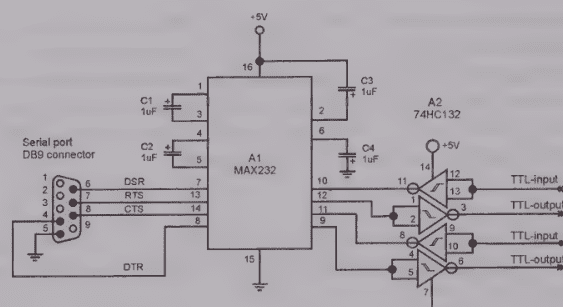

这个电路在本章节之前的项目设计中已经用过了了。在 `MCR` 中设置/清除 `RTS` 或 `DTR` 位会导致相应的 TTL 输出电高/电低。至于 `CTS` 和 `DSR`，当相应的线路变为高电平/低电平时，`MSR` 寄存器中的相应位将被设置/清除。这些条件简化了编程，因为 `MCR/MSR` 中的逻辑状态“1”对应相应引脚的高电平，而逻辑“0”则导致信号线上的低电平。

例如，如果 RequestToSend（请求发送）属性设置为“on”（`MCR` 中的 `RTS` 位被设置）， 74HC132 反相器第 3 号引脚上的 `RTS` 线将变为高电平。通过清除 `MCR` 中的 `RTS` 位将 RequestToSend 属性设置为“off”，会导致 `RTS` 线跌落。`DTR`、`CTS` 和 `DSR` 信号也是如此。

让我们看看如何操作这些控制和状态引脚。在 MATLAB 中，我们打开 `/dev/ttyS0` 设备并查看其输入线路的状态。以下序列执行了此操作：

```matlab
>> s = serial('/dev/ttyS0');
>> fopen(s);
>> s.PinStatus
```

ans =
- CarrierDetect: 'off'
- ClearToSend: 'off'
- DataSetReady: 'off'
- RingIndicator: 'off'

如你所示，我们获得了关于特定串口接口输入线路的信息。

例如，如果我们只对 `CTS`（ClearToSend 属性）或 `DSR`（DataSetReady 属性）的状态，可以输入以下命令：

```matlab
>> s.PinStatus.ClearToSend
ans =
off
```

```matlab
>> s.PinStatus.DataSetReady
ans =
off
```

这些命令通常在 M 文件中用于读取串口接口输入线路的状态。至于控制线 `RTS` 和 `DTR`，其状态状态可以通过输入下面所示的命令来确定。语句

```matlab
>> s.RequestToSend
ans =
off
```

允许我们看到 `RTS` 的状态（在那种特定情况下为“off”），而

```matlab
>> s.DataTerminalReady
ans =
on
```

该语句则给我们提供了 `DTR` 的状态（在给定的示例中为“on”）。

下面展示了一个使用控制线的更复杂的示例。该示例演示了如何周期性触发你的串口接口以完成某些有用任务。在这里，`RTS` 线将在经过一段时间后切换开启/关闭。该项目中的计时由一个定时器对象提供。当某个间隔过期后，定时器被激活并调用执行某些任务的回调函数。

## 第 3 章. 串口家庭项目

该函数内部的程序代码检查 RST 线路的状态，并反转 RTS 上的电压电平。名为 `rts_trigger` 的定时器回调函数的源代码所示（列表 3.14）：

### 列表 3.14

```matlab
function rts_trigger(obj,event)
%UNTLED2 Summary of this function goes here
% Detailed explanation goes here
global s;
il = strcmp(s.RequestToSend, 'on');
if (il)
    s.RequestToSend = 'off';
else
    s.RequestToSend = 'on';
end;
```

变量 `s` 被声明为全局变量，以便其他应用程序可见。这里 `s` 将呈现串口对象，通过该对象，回调函数获得了对其他应用程序打开的串口 RST 线 控制。以下语句将串口对象 `s` 的 Request 属性值与 "on" 字符串比较，并将结果作为逻辑值 `l`（真）或 0（假）返回到变量 `il` 中：

`il = strcmp(s.RequestToSend, 'on');`

紧随 RST 线路之后的是 if-else 语句。此源代码应该保存存在 M 文件 `.rts_trigger.m` 中（注意：文件名必须与回调函数名之一相同）。主程序可以在 MATLAB 的内置编辑器中输入并在启动时保存到 M 文件中。在我们的案例中，我在命令行窗口中输入了以下命令而没有保存：

```matlab
>> t = timer('StartDelay', 15, 'Period', 5, 'TasksToExecute', 10, 'ExecutionMode', 'fixedRate');
>> t.StartFcn = 'disp(''TIMER started.'''')';
>> t.StopFcn = 'disp(''TIMER stopped.'''')';
>> t.TimerFcn = 'rts_trigger';
>> global s;
>> s = serial('/dev/ttyS0');
>> s.RequestToSend
```

## 在家庭项目中使用 MATLAB

ans =
off

```matlab
>> fopen(s);
>> s.RequestToSend = 'on';
>> start(t);
TIMER started.
TIMER stopped.
>> delete(t);
>> clear t;
>> fclose(s);
>> delete(s);
>> clear s;
```

第一条语句创建了一个定时器对象 `t` 并为其分配了一些属性。注意，定时器对象 `t` 在配置时采用“属性-值”对的形式，其中“值”被赋值给“属性”。“StartDelay”属性表示在定时器首次触发之前经过的时间 - 我们将其设置为 15 s。“Period”属性定义了事件之间的延迟；我们选择了 5 秒。“TasksExecute” 随后：它决定了定时器激活的次数 - 我们将此值设为10。我们需要定义的下一个属性是“ExecutionMode”。该属性决定定时器对象如何调度定时器事件。我们将此属性定义为“fixedRate”。

接下来我们需要定义在定时器启动、运行和停止时调用的函数。以下两个命令定义了在定时器启动时调用的函数：

```matlab
>> t.StartFcn = 'disp(''TIMER started.'')';
```

将有一个 `disp` 函数输出“TIMER started.”字符串。另一个 `disp` 函数在定时器停止时提供“TIMER stopped.” 字符串的输出：

```matlab
>> t.StopFcn = 'disp(''TIMER stopped.'')';
```

`TimerFcn` 函数指向每次定时器事件发生时被调用的回调函数。正如我们所知，这个回调函数是 `rts_trigger`：

```matlab
>> t.TimerFcn = 'rts_trigger';
```

## 第 3 章. 串口家庭项目

然后我们定义了一个全局变量 `s`，它将代表一个串口接口对象。在这里我们涉及 `/dev/ttyS0` 设备：

```matlab
>> s = serial('/dev/ttyS0');
```

这两个语句允许打开 `/dev/ttyS0` 并 RTS 线设置为“on”状态：

```matlab
>> fopen(s);
>> s.RequestToSend = 'on';
```

现在我们可以启动定时器并使用万用表观察 RTS 线上的电压波动。在15秒后，RTS 线反转一次。每个事件5秒，直到定时器停止。此时我们可以删除定时器并关闭串口对象：

```matlab
>> delete(t);
>> clear t;
>> fclose(s);
>> delete(s);
>> clear s;
```

以同样的方式我们测试 DTR 线。为了实现这个实验，让我们短路 A 反相器的9-10引脚（见图.30）。然后我们可以设置/清除 RTS 线，以便 CTS 与 RTS 一致。为了构建软件输入以下代码（列表 3.15）：

### 列表 3.15

```matlab
function CTS_test(obj,data)
%UNTLED2 Summary of this function goes here
% Detailed explanation goes here
global s;
```


进入`/path/to/xxx`目录，找到`xxx.json`。

在表达式`cvar = avar + bvar`中，加法运算符（`+`）将`avar`与`bvar`相加，得到它们的和`cvar`

在`List.of(arg0, arg1, arg2)`中，`List`接口的工厂方法`of()`接受一系列的元素，返回包含它们的只读列表。

之后我们这样调用`cmd`命令：`cmd arg0 arg1 arg2`。

```
if (condVar > someVal) {console.log("xxx")}
```

我们定义了一个`CTS_test`回调函数，它会被定时器对象`t`调用。该函数必须保存存在`CTS_test.m`文件，以便`MATLAB`找到并执行它。以下命令序列处理`RTS`和`CTS`信号线：

```matlab
>> global s;
>> t = timer('StartDelay', 10, 'Period', 5, 'TasksToExecute', 5, 'ExecutionMode', 'fixedRate');
>> t.StartFcn = 'disp(''TIMER started.'')';
>> t.StopFcn = 'disp(''TIMER stopped.'')';
>> s = serial('/dev/ttyS0');
>> fopen(s);
>> s.PinStatus
```

ans =
- CarrierDetect: 'off'
- ClearToSend: 'off'
- DataSetReady: 'off'
- RingIndicator: 'off'

```matlab
>> t.TimerFcn = 'CTS_test';
>> start(t);
TIMER started.
CTS: on
CTS: off
CTS: on
CTS: off
CTS: on
TIMER stopped.
>> s.PinStatus
```

ans =

```
- CarrierDetect: 'off'
- ClearToSend: 'on'
- DataSetReady: 'off'
- RingIndicator: 'off'
```

# 第 3 章 串口中的家庭项目

```matlab
>> fclose(s);
>> delete(t);
>> clear t;
>> clear s;
```

既然我们现在已经知道了如何在`MATLAB`中操作控制和状态线，我们就可以构建嵌入式项目了。假设我们要开发一个简单的嵌入式系统，用于控制某些物理量（温度、压力等）。该系统将接收来自传感器的信号，并根据接收到的信号电平水平来开启或关闭控制电路。此类系统的通用原理图如图 3.29 所示。

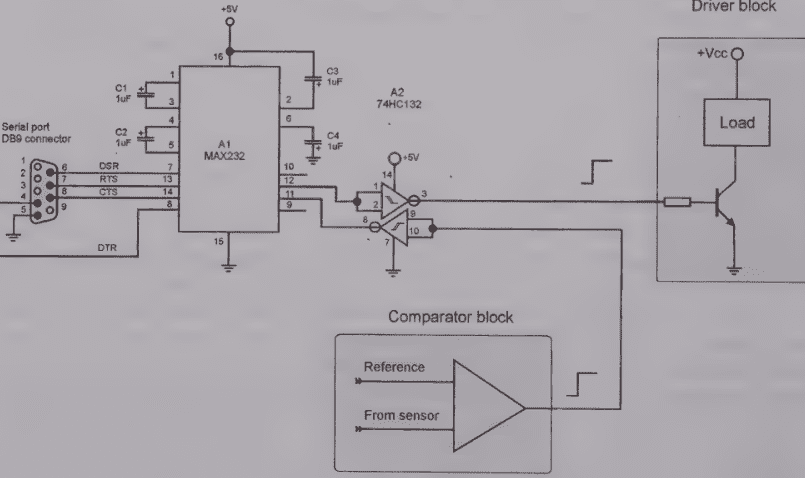

图 3.29

如你所见，待估的信号从“比较器模块”输出，该模块在输出端可能产生两种`TTL`兼容信号线之一。假设当传感器的信号超过预定义的参考电压时，比较器的输出为高电平；当传感器输出低于参考电压时，输出为低电平。传感器可以是任何参数，如温度、光照、压力或其他能够产生与所测物理参数成比例的输出电压的设备（在类似的系统中，我使用了`LM335`温度传感器）。比较器输出上的信号可以通过`CTS`线进行程序捕获。程序读取`CTS`并在`RTS`线上产生控制信号，根据为该系统确定的算法驱动“驱动模块”。通过使用这种通用方案，你可以轻松地

## 在家庭项目中使用 MATLAB

实现各种工作方式相似的嵌入式系统。
软件可以写在`M`文件中，并从`MATLAB`的命令行窗口启动。源代码如下所示（列表 3.16）：

### 列表 3.16

```
s = serial('/dev/ttyS0');
open(s);
for k = 1:7
res = s.PinStatus.ClearToSend;
i1 = strcmp(res, 'on');
if (i1)
    s.RequestToSend = 'off';
else
    s.RequestToSend = 'on';
end
pause(5);
end
close(s);
delete(s);
clear s;
```

代码简单直观。在程序开始时，通过执行以下语句打开串口接口`/dev/ttyS0`：

`s = serial('/dev/ttyS0');`
`open(s);`

然后程序进入`for()`循环，在其中执行控制算法。每次迭代从检查`CTS`信号线开始。该线的状态保存在`res`变量中供后续处理：

`res = s.PinStatus.ClearToSend;`

以下语句确定`CTS`的状态：

`i1 = strcmp(res, 'on');`

在执行`strcmp`之后，变量`i1`可能被设置为逻辑 1（真）或逻辑 0（假）。设置为 1 表示`CTS`线为高电平；`i1`中持有的逻辑 0 表示`CTS`线为低电平。接下来的`if...else`语句允许当`i1`等于 0/1 时通过`RTS`线开启/关闭外部负载。你可以轻松地反转`if..else`语句中的这些“on”和“off”字符串。`if..else`语句之后是 5 秒钟的暂停。在时间间隔结束后，开始下一次迭代。在完成第七次迭代后，程序代码离开`for`循环并关闭由`open()`语句打开的串口接口。如果你想让程序持续执行，可以更改循环条件或应用其他控制语句。这个示例结束了我们关于在`MATLAB`中使用串口的简短讨论。值得提到，你可以使用`MATLAB`实现本章中讨论的任何项目，而不是编写独立的`C`应用程序。无论如何，在你开始使用`MATLAB`创建自己的嵌入式项目之前，我鼓励你先浏览互联网，获取关于使用此特定开发工具的其他有用文档。

# 结论

已经确定通过`PC`串口控制的测量系统可以通过多种方式实现。设计此类系统没有所谓的“首选方法”，尽管你可以应用`SPI`和`I2C`等流行接口与`PC`进行通信。使用`SPI`接口可以构建相对简单的测量系统，尽管你可以通过添加一些额外的电路来轻松扩展你的基于`SPI`的系统。`I2C`接口适用于你需要构建带有多个设备的更复杂的系统。你也可以应用外部`PCI`模块，包括两个或多个串口接口，这可能帮助你解决大多数问题。

# 第 4 章 家庭项目中的声卡

本章描述了如何在你的家庭和实验室项目中使用`PC`的声卡。大多数涉及声卡的应用程序通常执行声音录制和回放。一些高级应用程序还可以处理音频信号，改变其参数。我们将讨论声卡的另一种用途，即音频输出信号实际上控制着外部电路。在开始实际项目之前，请简要回顾一些关于声卡的基础知识。

很多情况下，声卡作为内置设备端口存在。许多专业声卡是以独立的模块形式实现的。这些模块通常在高质量音频处理方面受到赞誉，并可能包含标准（典型）声卡之外的额外专用输入/输出。所有声卡都提供图 4.1 所示的基础接口：

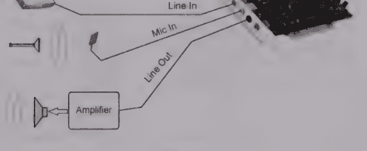

图 4.1

# 第 4 章 家庭项目中的声卡

声卡通常与专有软件一起打包，尽管`Linux`操作系统会自动检测并加载流行卡的开源驱动程序。某些软件包包含了录制、刻录、编辑或合成的工具。为了成功地将声卡应用于嵌入式项目，我们需要了解音频信号在`PC`中是如何表示的。原始信号本质上是模拟的，表现为随时间变化的电压。为了处理这种信号，我们需要将其分解成许多离散片段，然后将每个片段表示为二进制值。这个过程通常被称为数字化，如图 4.2 所示：


图 4.2

假设一个带有频率的正弦电压信号到达声卡的输入端（可能是麦克风或线路输入）。这种不断变化的信号以预定义的速率转换为数字采样。换句话说，在间隔的时间内，瞬间的输入电压被采样并保持不变，直到下次采样。这把信息量减少到一定数量的离散电压。每个样本存储在分配用于存储这些音频数据的内存缓冲区。缓冲区的大小必须足够包含所需的样本数量。为了实现数字化，模拟声卡包含一个内置的模数转换器 (`ADC`)，它可以采集单独样本并将输入电压的给定幅度转换为二进制代码。特定的代码被移动到缓冲区中的内存位置，并增加指针以为下一个值留位置。这样，缓冲区就填充了在预定义时间间隔内采集的样本。简而言，这就是数字化的实现方式。

要播放音频数据，我们必须从内存缓冲区中读取数字采样并将它们传递到数模转换器 (`DAC`)。`DAC`将获取的每个二进制代码转换为电压，然后将模拟信号传递到放大器以增大电压幅度。正如你可能猜的那样，`DAC`将二进制代码恢复为连续模拟信号的采样率应该与`ADC`在数字化过程中的采样率相等。

为了让计算机准确地表示声音，采样数量必须足够高，以便音频信号能够被准确数字化。为了实现这一点，数学上已经证明，采样频率 `$F_{sample}$`（见图 4.2）以及采样率必须至少是输入信号最高可能频率 `$F_c$` 的两倍。由于声音信号的上限约为 20kHz，因此采样率 `$F_{sample}$` 必须至少达到 40kHz 或更高。录制声音的标准是每秒 44100 次采样，尽管最现代的音频设备以更高的采样率运行。数字化完成后，缓冲区中的音频数据可以保存到具有音频应用程序所需的特殊格式的文件（`.wav` 或其他格式）中，也可以通过扬声器播放产生声音。

声卡可以成功应用于各种家庭和实验室项目。可能的应用包括来自各种源的低级、低频输入信号、转换/解码和调制信号、为测试和测量目的生成波形等。声音甚至可以用于能够触发多个负载的控制系统。在嵌入式项目中使用声卡涉及硬件和软件，因此我们将讨论这两个方面方面。让我们从学习用户应用程序如何在 `Linux` 环境下操作声音开始。

程序使用特定的软件接口与声卡进行交互；每个接口基本上包含内核部分和用户部分。用户部分的任务交给特定的内核驱动程序。声卡接口内核部分的配置取决于 `Linux` 中使用的声学系统。我们将简要介绍两个最流行的声学系统：`OSS`（开放声音系统）和 `ALSA`（高级 Linux 声音体系架构）。

开放声音系统 (`Open Sound System`) 基于使用标准的 `UNIX` 设备，通过标准的 `POSIX` `API` 调用（如 `read`、`write`、`ioctl` 等）进行访问。`OSS` 的目标是编写能够与任何声音控制硬件工作的基于声音的应用，尽管硬件接口在不同设备之间差异很大。该声学系统已被弃用，因为它不允许底级的声音处理和配置。如今，某些现代 `Linux` 发行版对 `OSS` 的支持有限，更倾向于使用 `ALSA` 声学系统。尽管如此，`OSS` 声学系统仍然被使用，因为在开发者只需要使用基本 `POSIX` `API` 调用操作的情况下，它具有简单清晰的特点。`OSS` 可以配合 `/dev/mixer`、`/dev/sndstat`、`/dev/audio`、`/dev/sequencer` 和 `/dev/music` 设备使用。

让我们先讨论 `OSS`。一旦处理给定的声学系统，我们必须知道 `Linux` 系统中呈现并配置了哪些 `OSS` 设备。

首先，我们必须确认 `Linux` 发现了我们的声卡并对其进行了妥当配置。检查设备存在的常用方法是检查 `/dev/sndstat` 设备，这是声驱动程序提供的简单设备。这是一个只读文件，其中以人类可读的形式包含了关于声驱动程序的报告：

# 第 4 章 家庭项目中的声卡

信息；我们无法以某种方式配置给定的声音设备。此设备在检查硬件配置（`DMA` 通道、`IRQ` 编号等）时非常有用。我们还可以获取正在使用的声驱动程序版本。
如果缺少声驱动程序，打开 `/dev/sndstat` 将返回 `ENODEV` 错误。如果设备成功打开，我们将获得关于该子系统的大量信息。下面你可以看到安装在我 `PC` 中的声卡信息：

**注意：** 对于某些现代 `Linux` 发行版（如 `Fedora`），没有 `/dev/sndstat`。如果使用了不同的声驱动，必须明确使用的是 `ALSA` 而不是 `OSS`（或 `PulseAudio`）。

```bash
$ cat /dev/sndstat
```
Sound Driver: 3.8.1a-98076 (ALSA v1.0.20 emulation code)

Kernel: Linux yury-desktop 2.6.31-16-generic #53-Ubuntu SMP Tue Dec 8 04:01:29 UTC 2009 i686

Config options: 0
Installed drivers:
Type 10: ALSA emulation
Card config:

ESS ES1938 (Solo-1) rev 0, irq 17

Audio devices:
0: ESS Solo-1 (DUPLEX)

Synth devices: NOT ENABLED IN CONFIG
Midi devices:

0: ESS ES1938 (Solo-1) MIDI

Timers:
31: system timer

Mixers:
0: ESS Solo-1
```

通过打开 `/dev/dsp` 设备也可以获得相同的结果。声卡主要提供三个核心功能：

- 数字采样输入/输出；

- 频率调制输出；

- `MIDI` 接口；

这些功能每个都通过它们自己的设备接口提供。对于数字采样，是 `/dev/dsp`；频率调制通过 `/dev/sequencer` 处理，`MIDI` 接口通过 `/dev/midi` 提供。声音设置（音量、平衡等）通过 `/dev/mixer` 接口控制。

## 使用 OSS 编程音频

这些为默认值。默认参数如下：8 位无符号采样、单通道（单声道）和 8 kHz 采样率。

如你所知，向 `DSP` 设备写入一系列数字样本会产生声音。再次强调，音频信号的格式通过调用带有适当参数的 `ioctl()` 来设置，但默认设置与输入信号定义的设置相同（8 位无符号数据、单声道和 8kHz 采样率）。

如果数据写入太慢，声音输出将出现断断或停顿。写入速度快于采样率将只会导致内核驱动程序阻塞调用者，直到音频硬件准备好处理新数据。与捕获输入数据一样，你可以使用 `ioctl()` 调用更改默认参数。通常情况下，你应该在打开设备之后、任何读/写操作之前设置参数。注意，你还应该按照下面列出的顺序设置参数。

如果参数超出范围，驱动程序将将其设置为最接近的值。例如，尝试在 8 位声卡上使用 16 位采样将导致驱动程序选择 8 位，但不会返回错误。值得验证返回的值对你的应用程序是否是可以接受的。用于 `DSP` 设备的所有 `ioctl()` 调用都采用以 `SOUND_PCM` 开头的参数名称。与 `SOUND_PCM_READ_XXX` 类似的参数用于返回参数的当前值。要更改值，`ioctl()` 调用应采用类似于 `SOUND_PCM_WRITE_XXX` 的参数。如上所述，这些调用还会返回所选的值，该值不一定是传递给音频驱动程序的值。

`ioctl()` 常量定义在 `linux/soundcard.h` 头文件中。让我们详细检查每一个常量。

- `SOUND_PCM_WRITE_BITS` 设置采样大小，以位为单位。有效选项是 8 和 16，但注意某些声卡不支持 16。

- `SOUND_PCM_READ_BITS` 返回当前采样大小，应为 8 位或 16 位；

- `SOUND_PCM_WRITE_CHANNELS` 设置通道数——1 为单声道，2 为立体声。在立体声模式下运行时，数据在读写时是交错的，格式为左-右-右。注意某些声卡不支持立体声模式，因此你必须检查调用返回的实际通道数；

- `SOUND_PCM_READ_CHANNELS` 返回当前通道数，1 或 2；

- `SOUND_PCM_WRITE_RATE` 设置每秒采样数的采样率。记住，所有声卡对采样率都有限制；内核驱动程序会将速率舍入到硬件支持的最最近速率，并返回实际的（舍入后的）速率。典型的下限为 4 kHz；上限为 13、15、22 或 44 kHz；

- `SOUND_PCM_READ_RATE` 返回当前采样率。这是内核使用的速率，由于之前讨论的舍入问题，该速率可能与之前调用 `SOUND_PCM_WRITE-RATE` 给出的速率不完全相同。

现在我们将考虑一个编程 `DSP` 设备的简单示例。该程序将使用 `/dev/dsp` 设备创建 1000 Hz 的声音。声音将持续 5 秒。你可以看到下面的源代码（列表 4:1）：

### 列表 4.1


```c
#include <unistd.h>
#include <fcntl.h>
#include <sys/types.h>
#include <sys/ioctl.h>
#include <stdlib.h>
#include <stdio.h>
#include <linux/soundcard.h>
#include <math.h>

#define FREQUENCY 1000 // frequency = 1000Hz
#define DURATION 5 // 存储多少秒的语音
#define RATE 11025 // 采样率
#define SIZE 8 // 采样大小：8 或 16 位
#define CHANNELS 1 // 1 = 单声道 2 = 立体声

int main()
{
int fd; // 声设备文件描述符
int param; // ioctl 用的参数
int status; // 系统调用的返回状态

int il;
int nl;
nl = DURATION * RATE;

// 此缓冲区持有数字化的音频

char buf[nl];
double x;

// 打开声设备

fd = open("/dev/dsp", O_RDWR);
if (fd < 0)
{
  perror("open of /dev/dsp failed");
  exit(1);
}

// 设置采样参数
param = SIZE; // 采样大小
status = ioctl(fd, SOUND_PCM_WRITE_BITS, &param);
if (status == -1)
  perror("SOUND_PCM_WRITE_BITS ioctl failed");
if (param != SIZE)
  perror("unable to set sample size");

param = CHANNELS; // 单声道或立体声
status = ioctl(fd, SOUND_PCM_WRITE_CHANNELS, &param);
if (status == -1)
  perror("SOUND_PCM_WRITE_CHANNELS ioctl failed");
if (param != CHANNELS)
  perror("unable to set number of channels");

param = RATE; // 采样率
status = ioctl(fd, SOUND_PCM_WRITE_RATE, &param);
if (status == -1)
  perror("SOUND_PCM_WRITE_RATE ioctl failed");

// 用样本填充缓冲区
for (il = 0; il < nl; il++) {
  x = sin(il * 2.0 * M_PI * FREQUENCY / (double) RATE);
  buf[il] = (char)(int)(x+128);

  status = write(fd, buf, sizeof(buf)); // 播放声音缓冲区
  if (status != sizeof(buf))
    perror("wrote wrong number of bytes");
  status = ioctl(fd, SOUND_PCM_SYNC, 0);
  if (status == -1)
    perror("SOUND_PCM_SYNC ioctl failed");
  close(fd);
  return 0;
}
```

# 第 4 章 家庭项目中的声卡

注意我们通过程序方式创建正弦波，因此我们需要包含定义该函数的 `math.h` 头文件。此外，我们还需要（专门针对 gcc）使用以下命令编译此源码：

```bash
$ gcc playsound.c -o playsound
```

## 使用 OSS 编程音频

这些默认值。默认参数如下：8 位无符号采样、单通道（单声道）和 8 kHz 采样率。

如你所知，向 DSP 设备写入一系列数字样本会产生声音。再次强调，音频信号的格式通过调用带有适当参数的 `ioctl()` 来设置，但默认设置与输入信号定义的设置相同（8 位无符号数据、单声道和 8kHz 采样率）。

如果数据写入太慢，声音输出将出现断断或停顿。写入速度快于采样率将导致内核驱动程序阻塞调用者，直到音频硬件准备好处理新数据。与捕获输入数据一样，你可以使用 `ioctl()` 调用更改默认参数。通常情况下，你应该在打开设备之后、任何读/写操作之前设置参数。注意，你还应该按照下面列出的顺序设置参数。

如果参数超出范围，驱动程序将将其设置为最接近的值。例如，尝试在 8 位声卡上使用 16 位采样将导致驱动程序选择 8 位，但不会返回错误。值得验证返回的值对你的应用程序是否是可以接受的。用于 DSP 设备的所有 `ioctl()` 调用都采用以 `SOUND_PCM` 开头的参数名称。与 `SOUND_PCM_READ_XXX` 类似的参数用于返回参数的当前值。要更改值，`ioctl()` 调用应采用类似于 `SOUND_PCM_WRITE_XXX` 的参数。如上所述，这些调用还会返回所选的值，该值不一定是传递给音频驱动程序的值。

`ioctl()` 常量定义在 `linux/soundcard.h` 头文件中。让我们详细检查每一个常量。

- `SOUND_PCM_WRITE_BITS` 设置采样大小，以位为单位。有效选项是 8 和 16，但注意某些声卡不支持 16。
- `SOUND_PCM_READ_BITS` 返回当前采样大小，应为 8 位或 16 位；
- `SOUND_PCM_WRITE_CHANNELS` 设置通道数——1 为单声道，2 为立体声。在立体声模式下运行时，数据在读写时是交错的，格式为左-右-右。注意某些声卡不支持立体声模式，因此你必须检查调用返回的实际通道数；
- `SOUND_PCM_READ_CHANNELS` 返回当前通道数，1 或 2；
- `SOUND_PCM_WRITE_RATE` 设置每秒采样数的采样率。记住，所有声卡对采样率都有限制；内核驱动程序会将速率舍入到硬件支持的最最近速率，并返回实际的（舍入后的）速率。典型的下限为 4 kHz；上限为 13、15、22 或 44 kHz；
- `SOUND_PCM_READ_RATE` 返回当前采样率。这是内核使用的速率，由于之前讨论的舍入问题，该速率可能与之前调用 `SOUND_PCM_WRITE-RATE` 给出的速率不完全相同。

现在我们将考虑一个编程 DSP 设备的简单示例。程序将使用 `/dev/dsp` 设备创建 1000 Hz 的声音。声音将持续 5 秒。你可以看到下面的源代码（列表 4:1）：

### 列表 4.2

```c
#include <unistd.h>
#include <fcntl.h>
#include <sys/types.h>
#include <sys/ioctl.h>
#include <stdlib.h>
#include <stdio.h>
#include <string.h>
#include <linux/soundcard.h>
```

```c
#define DURATION 5 // 存储多少秒的（话语）声音
#define RATE 11025 // 采样率
#define SIZE 16 // 采样大小：8 或 16 位
#define CHANNELS 2 // 1 = 单声道 2 = 双声道
```

```c
int main()
{
 int fd; // 声学设备文件描述符
 int param; // ioctl 调用的参数
 int status; // 系统调用的返回状态

int nl;

// 打开声音设备

nl = DURATION * RATE * CHANNELS; // 内存缓冲区大小
char buf[nl]; // 此缓冲区持有数字音频数据

fd = open("/dev/dsp", O_RDWR);
if (fd < 0)
{
 perror("open of /dev/dsp failed");
 exit(1);
}
```

```c
// 设置采样参数
```

```c
param = SIZE;                      // 采样大小
status = ioctl(fd, SOUND_PCM_WRITE_BITS, &param);
if (status == -1)
    perror("SOUND_PCM_WRITE_BITS ioctl failed");
if (param != -1)
    perror("unable to set sample size");
```

```c
param = CHANNELS;                  // 单声道或立体
status = ioctl(fd, SOUND_PCM_WRITE_CHANNELS, &param);
if (status == -1)
    perror("SOUND_PCM_WRITE_CHANNELS ioctl failed");
if (param != CHANNELS)
    perror("unable to set number of channels");
```

```c
param = RATE;                        // 采样率
status = ioctl(fd, SOUND_PCM_WRITE_RATE, &param);
if (status == -1)
    perror("SOUND_PCM_WRITE_RATE ioctl failed");
```

```c
while (1)
{
    // 循环直到按下 Control-C

    printf("Say something:\n");
    status = read(fd, buf, sizeof(buf)); // 制声音
    if (status != sizeof(buf))
        perror("read wrong number of bytes");
    printf("Received:\n");

    status = write(fd, buf, sizeof(buf)); // 回放
    if (status != sizeof(buf))
        perror("wrote wrong number of bytes");

    // 在录音前等待播放完成
    status = ioctl(fd, SOUND_PCM_SYNC, 0);
    if (status == -1)
        perror("SOUND_PCM_SYNC ioctl failed");
}
close(fd);
return 0;
}
```

让我们深入研究源代码。按照惯例，我们必须为音频数据分配内存缓冲区。缓冲区（`buf`）的大小存储在 `nl` 变量中。程序打开 `/dev/dsp` 设备并使用 `ioctl()` 函数配置其参数。之后，程序进入一个无限 `while()` 循环，从输入读取数据并传递到输出。数据的读取是通过 `read()` 调用完成的，写入则通过调用 `write()` 函数完成。

将此源代码保存为 `record_play_sound.c` 并使用以下命令进行编译：

```bash
gcc record_play_sound.c -lm -o record_play_sound
```

成功编译后，你就可以启动程序。程序启动后，它会等待你读出某段短语，然后重放你刚刚保存的音频缓冲区。

### 使用 ALSA 进行编程

使用 ALSA 进行音频编程为开发者提供了优于 OSS 的关键优势。通过 ALSA，你被允许配置大多数音频参数，并在处理信号时提供更大的活性和创造力。此外，开发者从应用程序中获得了对音频处理的极大程度的控制。如果你想与 ALSA 声音系统工作，你应该意识到 ALSA 是在系统内核中配置的。安装 ALSA 后，会创建 `/proc/asound` 目录，因此你只需要在文件系统中检查它的是否存在即可。

如果你由于某些原因没有找到 `asound`，你可以自己下载并配置 ALSA。最新版本的 ALSA 声音系统软件可以在 `www.alsa-project.org` 找到。下载并解压此库后，你应该通过输入以下命令进行安装：

```bash
configure
make install
```

当你成功配置 ALSA 系统后，紧接着要做的事情是检查已安装声卡（s）的信息是否可用。要此操作，你可以查看 `/proc/asound/cards` 文件的内容。

```c
exit (1);
}
}
```

```c
snd_pcm_close (handle);
exit (0);
}
```

此应用程序生成一个正弦波信号，表示为 $\sin(2\pi F)$，其中 $F$ 是频率。为了访问 ALSA API 函数，我们需要放置一个带有适当头文件的包含指令：

```c
#include <alsa/asoundlib.h>
```

在这个程序中，我们定义了一些变量。`double` 类型变量 `frequency` 包含我们的频率值（在本例中为 500 Hz）。`int` 类型变量 `rate` 表示采样率，我们将将其设置为 44100 `samples/s`。我们还需要分配一些缓冲区来存储播放的音频数据。`buf` 变量是程序移动的地方。我们将形成 16 位采样，因此 `buf` 将包含 2 字节（`short`）值。`buf` 的大小被选择为 2048，尽管你也可以选择其他值。`double` 类型变量 `x` 将保存 `for` 循环中带符号标记的离散值。

为了给流设置硬件参数，我们需要分配一个 `snd_pcm_hw_params_t` 类型的 `hw params`。`handle` 变量将包含指向声设备的句柄，并在后续调用中用于操作音频流。


首先，我们的程序必须打开音频接口并获取句柄以便后续操作。调用 `snd_pcm_open` 会打开默认音频设备并将访问模式设置为 `PLAYBACK`。该函数在其第一个参数中成功返回一个指向 `handle` 的句柄。此后，我们应该用音频参数初始化 `hw_params` 结构。调用

```c
snd_pcm_hw_params_malloc (&hw_params)
```

预留用于保存这些参数的缓冲区。`snd_pcm_hw_params_any (handle, hw_params)` 函数用默认值初始化 `hw_params` 结构。之后，我们可以更改存储在 `hw_params` 中的一些基本值。首先，我们的音频数据可能是交错的，因此我们可以通过执行 `snd_pcm_hw_params_set_access (handle,hw_params, SND_PCM_ACCESS_RW_INTERLEAVED)` 函数来更改模式。接几次调用设置了我们为音频处理选择的参数（音频数据格式、采样率和通道数）：

```c
snd_pcm_hw_params_set_format (handle, hw_params, SND_PCM_FORMAT_S16_LE)
snd_pcm_hw_params_set_near (handle, hw_params, &rate, 0)
snd_pcm_hw_params_set_channels (handle, hw_params, 1)
```

完成后，程序将使用以下函数将此配置写入设备驱动程序：

```c
snd_pcm_hw_params (handle, hw_params)
```

之后，我们可以通过调用 `snd_pcm_hw_params_free (hw_params)` 函数释放 `hw_params` 结构，并准备启动声设备（`snd_pcm_prepare (handle)` 函数）。

然后我们应该切换函数。`for ()` 循环执行了这一点：

```c
for (i = 0; i < 2048; i++)
{
  x = sin(i * 2.0 * M_PI * frequency / (double)rate);
  buf[i] = (short)(32767 * x + 32768);
}
```

首先，我们计算 2048 个采样中每个的大小，它们将作为 16 位值存储在 `buf` 中。`x` 变量的每个值都被缩放为 `short` 值，以提供 16 位声音还原。

接下来的 `for()` 循环使用 `snd_pcm_writei (handle, buf, 2048)` 函数填充缓冲区 50 次。音频产生后，我们调用 `snd_pcm_close(handle)`。

要编译并构建可执行文件，我们使用 `alsaexample.c` 文件：

```bash
$ gcc -o alsaexample alsaexample.c
```

使用 ALSA 库允许开发者选择并修改各种参数。例如，通过编程方式将音频数据从 16 位修改为 32 位浮点格式。在这种情况下，通过 `snd_pcm_hw_params_set_format` 函数替换 `SND_PCM_FORMAT_FLOAT`。这会带来更好的波形质量。这种修改也可以简化 `for` 循环。

有时你可能可以通过方便的 `snd_pcm_set_params()` 调用来生成复杂的波形。以下代码展示了（列表 4.4）：

### 列表 4.4

```c
#include <stdio.h>
#include <stdlib.h>
#include <alsa/asoundlib.h>
#include <math.h>

int main(void)
{
    snd_pcm_t *handle;
    snd_pcm_hw_params_t *hw_params;
    int rate = 44100;
    double frequency = 500.0;
    short buf[2048];
    double x;
    int i;

    if (snd_pcm_open(&handle, "default", SND_PCM_PLAYBACK, 0))
    {
        printf ("Cannot open");
        exit(1);
    }

    snd_pcm_hw_params_malloc(&hw_params);
    snd_pcm_hw_params_any(handle, hw_params);
    snd_pcm_hw_params_set_access(handle, hw_params, SND_PCM_ACCESS_RW_INTERLEAVED);
    snd_pcm_hw_params_set_format(handle, hw_params, SND_PCM_FORMAT_S16_LE);
    snd_pcm_hw_params_set_near(handle, hw_params, &rate, 0);
    snd_pcm_hw_params_set_channels(handle, hw_params, 1);

    if (snd_pcm_hw_params(handle, hw_params) != 0)
    {
        printf ("Cannot set parameters");
        exit(1);
    }

    if (snd_pcm_prepare(handle) != 0)
    {
        printf ("Cannot prepare");
        exit(1);
    }

    for (i = 0; i < 2048; i++)
    {
      x = sin(i * 2.0 * M_PI * frequency / (double)rate);
      buf[i] = (short)(32767 * x + 32768);
    }

    for (i = 0; i < 50; i++)
    {
        snd_pcm_writei(handle, buf, 2048);
    }

    snd_pcm_close(handle);
    return 0;
}
```

## 将声卡与外部电路接口

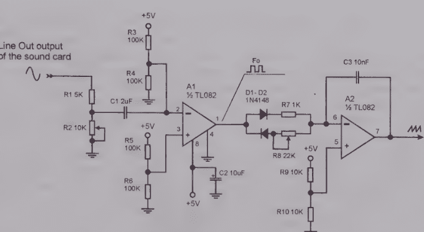

图 4.4

该电路实际上由两个子电路或级组成。第一级使用配置为比较器的运算放大器 A1 构建而成。该比较器的输出取决于反相输入（引脚 2）上交流信号的电平从低电平跳到高电平。我们从声卡中提取正弦信号，将其传递到 A1 的反相输入，并在比较器的输出（引脚 1）上获得一系列脉冲。这些脉冲的频率与 A1 反相输入上的输入信号频率相同。这些脉冲进入第二级（运算放大器 A2），该级作为积分器工作。A2 的输出（引脚 7）产生锯齿波信号。电容器 C3 通过独立的链路（D1-R7 和 D2-R8）进行充电和放电，这允许对 A2 引脚 7 处锯齿波的上升沿和下降沿进行独立配置。电阻 R8 允许设置波形的斜率。选择 R7、R8 和 C3 的值是为了在 1 到 3 kHz 的范围内获得最佳性能和线性度。在配置此电路时，你可以尝试这些这些值。为了进一步改进电路，可以将 D1-D2 二极管替换为肖特基二极管。通常，该电路在宽的输入频率范围内运行良好。

输出信号可以成功应用于通过调频解码器电路控制多个负载。此类电路的一个通道如图 4.5 所示：

## 第 4 章：家庭项目中的声卡

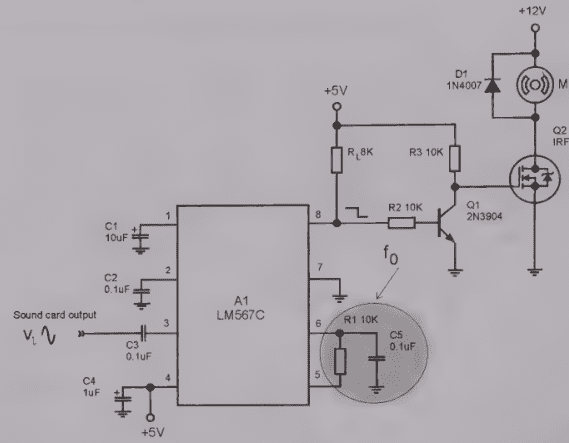

$f_0 = 1.1 \times R1 \times C5 \quad BW = 100 \times \frac{V_i}{f_0 \times C2} \quad \text{以 } f_0$ 的百分比

. 图 4.5

在这里我们使用了常用的芯片 LM567C。LM567C 是一种调频解码器，当输入信号（图 4.5 中的 $V_i$）落在给定的通带内时，它的输出（引脚 8）提供低电平。调频解码器电路包含一个电压控制振荡器，其中心频率 $f_0$ 定义如图 4.5 所示。调频解码器的带宽（BW）取决于中心频率 $f_0$ 和电容器 C2。外部元件 R1–C5 和 C2 用于独立设置中心频率、带宽和输出延迟。LM567C 的内置振荡器频率由连接到引脚 5–6 上的 R1–C5 对决定。声卡产生的外部频率通过电容器 C3 传递到引脚 3。如果此频率与内置振荡器相等，调频解码器的输出（引脚 8）变为低电平。如果外部频率超出 BW，引脚 8 上的输出电平变为高电平。在我们的案例中，中心频率 $f_0$ 大约为 900 Hz。如果输入频率等于通带，会导致引脚 8 上的电压电升高。调频解码器的输出变为低电平。输入频率之前-。因此，通过改变 LM567C 输入上的频率，我们可以开启/关闭连接到 A1 引脚 8 的某些负载。调频解码器的输出产生 TTL 兼容电平，可以驱动高达 100 mA 的负载。为了给重负载提供控制，我们将增加额外的功率晶体管级（双极型或 MOSFET）。一个典型的示例是使用带有功率 MOSFET IRF510 (Q2) 的级。

## 第4章 家用项目中的声卡

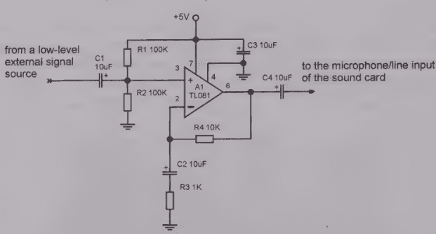

该运算放大器作为 AC 信号的反相放大器连接——R3、R4 和 C2 组件形成了反馈电路。与 R3 串联的电容 C2 对音频信号呈现极低的阻抗，因此 AC 信号的增益可以计算为：

Gain = 1 + R4/R3

在我们的情况下，增益为 11V/V，但您可以通过更改 R3 和 R4 的值来轻松调整。最好将 R3 和 R4 选择在几 kΩ 到几十 kΩ 之间的范围内。请记住，低阻值电阻会导致功耗增加，而高电阻值会增加此电路的整体噪声。

对于 DC 信号，运算放大器作为电压跟随器连接。分压器（R1-R2）为 A1 的反相输入提供电源电压一半的偏置（2.5V）。来自源的信号通过 C1 馈到反相输入端；放大后的信号通过电容 C4 进入声卡输入端。

## 在 MATLAB 中处理音频

在 MATLAB 中操作音频信号非常简单，因为它提供了一个极好的编程接口来处理音频数据。有很多函数可以操作音频数据，它们在相应的参考手册中进行了详细描述。但让我们来看一些实际示例。

为了读取麦克风输入并通过声卡的线路输出（line-out）播放音频，可以使用以下序列（列表 4:5）：

### 列表 4.5

```mat
>> ro = audiorecorder(11025, 16, 1);
>> record(ro, 5);
>> pause(ro);
>> p = play(ro);
```

让我们检查这段代码。首先，我们创建一个音频录器对象，通过它可以操作音频数据。该语句是：

```mat
>> ro = audiorecorder(11025, 16, 1);
```

使用 11025 Hz 的采样率、16 位样本大小和等等于 1 的通道（单声道）创建 audiorecorder 对象 ro。如下所示，可以不带参数调用 audiorecorder 函数：

```mat
ro = audiorecorder;
```

当不带参数调用 audiorecorder 函数时，假设该函数采用默认参数：采样率 8000 Hz、样本大小 8 位以及用于音频处理的 1 通道。默认参数在操作大多数声卡时非常有用，因为几乎所有设备都支持这种配置。

采样率可以取以下值：8000、11025、22050 和 44100。如果我们处理的是 Linux 操作系统，样本大小必须是 8 或 16，通道数可以是 1（单声道）或 2（立体声）。MATLAB 文档提示，audiorecorder 的当前实现并不适用于长时间高采样率录制，因为它使用系统内存存储而不使用磁盘缓冲区。当录制大型记录时，MATLAB 的性能可能会下降。有多种方法（主要在 MATLAB 论坛上描述）可以提高性能，因此鼓励您研究这些方法。

回到我们的代码。在创建 audiorecorder 对象 ro 后，我们可以在接下来的 5 秒内从麦克风/线路输入录音（您应该在使用前设置输入源）。以下语句执行了此操作：

```mat
>> record(ro, 5);
```

暂停后，我们通过调用 play 函数播放刚刚录制的音频：

```mat
>> p = play(ro);
```

## 第4章 家用项目中的声卡

正如您看到的，音频的录制/播放并不复杂，因为 MATLAB 只需几个函数就能为您执行所有操作。当涉及定时器和程序循环时，可能会实现更复杂的算法。

下面的示例展示了如何程序化生成正弦波形。我们已经考虑过如何在 C 中创建正弦波（见列表 4.1）。在 MATLAB 中实现相同的任务极其简单（列表 4.6）：

### 列表 4.6

```mat
>> cf = 10000;
>> sf = 11025;
>> d = 3.0;
>> n = d * sf;
>> s = (1:n)/sf;
>> s = sin (2 * pi * cf * s);
>> sound (s, sf);
```

在这里，变量 cf 保存以 Hz 为单位的频率（在我们的情况下为 1000Hz）。变量 sf 决定采样率为每秒 11025 个采样。除了上述变量外，我们还需要为声音设置一个时间间隔（持续时间）。声音将持续 3 秒，因此我们在 d 变量中设置为 3。以下语句将播放所需的总样本数保存在变量 n 中。该值是 d 和 n 的乘积。为了理解这一点，您可以回想一下图 4.2 中的曲线。

下一步是创建一个存储样本的缓冲区。显然，此类缓冲区的大小至少等于 n，才能包含所有可能的值。缓冲区定义为数组 s，其值从 1/sf 到 n/sf：

```mat
>> s = (1:n)/sf;
```

由于我们想播放正弦波形，我们应该像所示所示设计：

```mat
>> s = sin (2 * pi * cf * s);
```

最后，我们使用 sound 函数播放缓冲区：

```mat
>> sound (s, sf);
```

除了正弦波，我们还可以创建其他波形（方波、锯齿波等），尽管这比纯正弦波的情况涉及更多的数学计算。

当我们想在 MATLAB 中创建连续声音时，可以使用定时器对象。下面的示例演示了这种方法。首先，为定时器定义回调函数（命名为 playnd）并保存。您看到的代码如下 4.7：

### 列表 4.7

```mat
function playnd(obj, event)
% 生成正弦波形
cf = 1000;
sf = 11025;
d = 3.0;
n = d * sf;
s = (1:n)/sf;
s = sin (2 * pi * cf * s);
sound (s, sf);
```

每当定时器触发时，都会调用 playnd 函数。以下代码是 4.8：

### 列表 4.8

```mat
t = timer('ExecutionMode', 'fixedRate', 'Period', 5, 'TimerFcn', @(~,~) playnd);
start(t);
pause(5);
stop(t);
delete(t);
```

## 家用项目中的声卡

start(t) 语句启动了我们的定时器。当我们尝试观察到达输入的信号时，只需切换到音频编辑器常用的“录制”模式。然后我们可以将捕获的信号保存为 WAV 文件，或开始处理。这是使用 Audacity、GoldWave 处理输入数据的常用方法。

当我们想要估计声卡的输出性能时，可以采取另一种方法。我们使用音频线连接到输入（line-in），捕获声卡生成的信号并对其进行评估。声音可以使用 C++ 程序程序化创建，例如启动 MATLAB 后由音频编辑器捕获。当您应用这种方法时，必须配置声卡运行双工模式——在这种情况下，声卡的内置数数转换（DAC）将生成音频流，由负责数字化的模数转换（ADC）采集。显然，输入输出音频数据必须具有相同的格式（采样率和采样位数）以避免错误。还希望输入输出信号的功率电平处于中间位置。让我们在下面的示例中查看如何使用 MATLAB 环境编写生成声音的程序。记住声卡的输出必须连接到“线路输入”。在这些实验中，我使用了一块插在“古代”奔腾 4 PC 上的“旧”ESS1869 声卡；然而，这种配置表现良好。以下源代码（列表 4.9）保存在 pure_sinwave_test.m 文件中，生成正弦波：

### 列表 4.9

```
cf = 500;
sf = 8000;
d = 10.0;
n = sf * d;
s = (1:n) / sf;
s = sin(cf * s);
soundsc(s, sf, 16);
```

我们配置了脚本，使得生成的信号采样率等于 8000（一个变量），每个样本的位深度为 16 位。持续时间设置为 10 秒。在执行此文件之前，我们必须启动 Audacity 音频编辑器，并将其配置为捕捉采样率为 8000、位深 16 的音频信号。在完成所有准备工作后，我们就可以执行我们的 m 文件：

>> pure_sinwave_test

在启动上述脚本的同时，我们开始播放声音。操作完成后，我们可以看到通过 Audacity 获取的数据（图 4.10）：

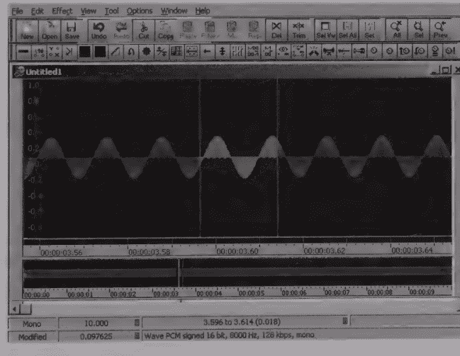

图 4.10

## 第 4 章 居家项目中的声卡

我们还可以使用另一个非常流行的音频编辑器，GoldWave（提供试用版）。在 GoldWave 中捕捉相同音频信号的结果将如图 4.11 所示：

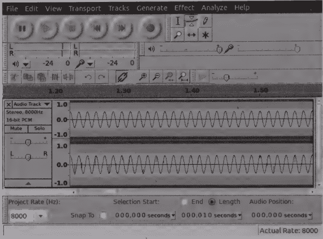

图 4.11

在第二个示例中，我们的声卡通过应用傅里叶级数产生类似于方波的信号。任何周期函数都可以表示为包含正弦和余弦的级数，即傅里叶级数。方波信号可以表示为正弦函数各种加权奇次谐波的和。通过这种方法，我们可以表示如下所示的方波：

方波 = 4/π * [ (sin(x)/1 + sin(3x)/3 + sin(5x)/5 + sin(7x)/7 + ...]


从实际角度来看，我们可以从上述表达式中取前四项来设计一个近似方波。下面你可以看到 Matlab 程序的完整列表（列表 4.10）：

### 列表 4.10

```
cf = 500;
sf = 22050;
d = 10.0;
n = sf * d;
s = (1:n) / sf;
s = 1.3 * sin(cf * s) + 0.45 * sin(3 * cf * s) + 0.25 * sin(5 * cf * s) + 0.18 * sin(7 * cf * s);
soundsc(s, sf, 16);
```

我们将此源代码保存为 `square_wave_test.m` 文件，并与任何音频编辑器一起执行该脚本。在使用 Audacity 的情况下，将得到下面的图片（图 4.12）：

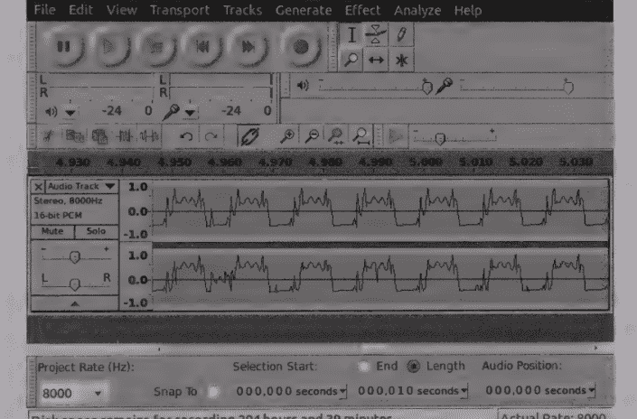

图 4.12

配置好 Audacity 后，你可以启动 m 文件进行执行：

```
>> square_wave_test
```

## 第 4 章 居家项目中的声卡

使用上述程序启动 GoldWave 应用将得到如下结果（图 4.13）：

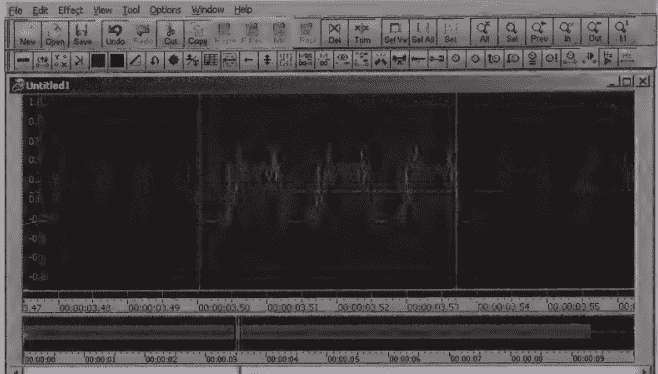

图 4.13

如果你从表达式中引入第 9 次和第 11 次谐波，例如，

Square wave = 4/pi * [(sin(x)/1 + sin(3x)/3 + sin(5x)/5 + sin(7x)/7 + ...)]

将其引入列表 4.50 中合适的位置（即确定信号 `s` 的地方），你将获得对我们方波信号更好的近似。

到目前为止，我们已经了解了许多音频数据处理。剩下的唯一问题是如何将我们的声音保存到磁盘上。有各种格式的文件来存储音频数据。你可以将音频缓冲区写入二进制文件（称为“raw”文件），也可以将数据存储在特定格式（`.wav`, `mp3` 等）中，这些格式用于以某种方式组织音频数据。“纯”原始音频文件的优势是，它们可以使用音频编辑器应用程序轻松地转换为任何特定格式。为了展示音频文件的一些基本操作，开发了一个非常简单的 C++ 应用程序。

174

其源代码所示下方的列表 4.11。该程序从声卡输入端（“Line-in jack”）获取音频数据，并将数据写入 `.raw` 文件中。这里假设使用的默认音频系统是 ALSA，因此我们可以应用 ALSA API 函数来处理声音信号。让我们我们的音频文件命名为 `Sound_Test_22050.raw`（通常在写入二进制文件时可以省略 `.raw` 扩展名）。假设采样率为为 22050。

### 列表 4.11

```
#include <stdio.h>
#include <unistd.h>
#include <stdlib.h>
#include "alsa/asound.h"

int main (void) {
    int i;
    int err;
    short buf[32000];

    unsigned int rate = 22050;
    snd_pcm_t *capture_handle;
    snd_pcm_hw_params *hw_params;

    FILE *fp;
    fp = fopen("Sound_Test_22050.raw", "ab+");
    if ((err = snd_pcm_open(&capture_handle, "default", SND_PCM_CAPTURE, 0)) < 0) {
        fprintf(stderr, "cannot open audio device: %s\n", snd_strerror(err));
        exit(1);
    }
    if ((err = snd_pcm_hw_params_malloc(&hw_params)) < 0) {
        fprintf(stderr, "cannot allocate hardware structure: %s\n", snd_strerror(err));
        exit(1);
    }
```

## 第 4 章 居家项目中的声卡

```
if ((err = snd_pcm_hw_params_any(capture_handle, hw_params)) < 0) {
    fprintf(stderr, "cannot initialize hardware structure: %s\n", snd_strerror(err));
    exit(1);
}

if ((err = snd_pcm_hw_params_set_access(capture_handle, hw_params, SND_PCM_ACCESS_INTERLEAVED)) < 0) {
    fprintf(stderr, "cannot set access: %s\n", snd_strerror(err));
    exit(1);
}

if ((err = snd_pcm_hw_params_set_format(capture_handle, hw_params, SND_PCM_FORMAT_S16_LE)) < 0) {
    fprintf(stderr, "cannot set sample format: %s\n", snd_strerror(err));
    exit(1);
}

if ((err = snd_pcm_hw_params_set_rate_near(capture_handle, hw_params, &rate, 0)) < 0) {
    fprintf(stderr, "cannot set sample rate: %s\n", snd_strerror(err));
    exit(1);
}

if ((err = snd_pcm_hw_params_set_channels(capture_handle, hw_params, 1)) < 0) {
    fprintf(stderr, "cannot set channel count: %s\n", snd_strerror(err));
    exit(1);
}

if ((err = snd_pcm_hw_params(capture_handle, hw_params)) < 0) {
    fprintf(stderr, "cannot set parameters: %s\n", snd_strerror(err));
    exit(1);
}

snd_pcm_hw_params_free(hw_params);
if ((err = snd_pcm_prepare(capture_handle)) < 0) {
    fprintf(stderr, "cannot prepare audio interface for use: %s\n", snd_strerror(err));
}

for (i = 0; i < 200; i++) {
    if ((err = snd_pcm_readi(capture_handle, buf, 32000)) != 32000) {
        fprintf(stderr, "read from audio interface failed: %s\n", snd_strerror(err));
    }

    fwrite(buf, sizeof(short), 32000, fp);
    snd_pcm_close(capture_handle);
    fclose(fp);
    return 0;
}
```

## 第 4 章 居家项目中的声卡

先来说变量。`buf` 变量标识存储音频数据的 32000 字节数组，`rate` 变量决定采样率。`capture_handle` 变量将包含当前使用的音频设备的句柄，`hw_params` 变量指向存储音频设备所有参数的地方。

捕捉音频数据之前的准备步骤以通用方式实现。首先，程序在 Linux 系统中打开默认音频设备（`snd_pcm_open` 函数），然后在 `hw_params` 中写入相应的参数。音频设备被配置为单声道模式运行，采样率为 22050，每个样本 16 位。在将参数写入声卡（`snd_pcm_hw_params` 函数）并为数据读取准备音频接口（`snd_pcm_prepare` 函数）后，程序在一个计数为 200 的 `for()` 循环中开始捕捉音频数据。

在每次迭代之初，数据流被读入 `buf`（`snd_pcm_read` 函数），`buf` 的内容存储在之前通过写入函数 `fopen()` 打开的文件 `fp` 中：

`fp = fopen("Sound_Test_22050.raw", "ab+");`

循环结束后，音频设备描述符关闭（`snd_pcm_close` 函数）。为了将数据刷入磁盘，我们还需要关闭文件指针（`fclose` 函数）。新创建的 raw 文件可以使用 ALSA 系统中包含的标准工具 `aplay` 进行播放。你可以应用流行的软件界面来播放此文件。此外，raw 文件可以由如 GoldWave 等任何流行程序播放。请注意，通过 line-in 输入录制的音频数据可能由于输入前放大器级性能特性低而缺乏高质，因此我们通常需要通过使用 GoldWave、Audacity 等高级音频编辑器来消除噪声。你可以对这段源代码进行实验并在必要时对其进行改进。

将它们保存为 WAV 文件。我选取了两个曲目，“Pump”和“House full of bullets”，并使用 `arecord` 工具将这两个音频流都转换为两个 WAV 文件。

为了捕获音频流，我们可以应用程序混合器，它允许将音频数据从声卡的模拟数字转换器（ADC）直接传递到负责采集声音的数字模拟转换器（DAC）。然而，这适用于具有“环回（loopback）”接口的声卡，此时音频数据流可以从内部 ADC 重定向到 DAC。或者，我们可以选择另一种方法——使用音频线将“扬器输出（Speaker out）”和“线路输入（Line-In）”连接起来。在这种情况下，输出声音将直接进入线路输入。

当来自互联网的音频流到达扬器输出时，我们将使用 `arecord` 工具捕获并将其录制 WAV 文件。同样，由于音频前级放大器存在噪声，我们应该启动某些音频编辑器来消除 WAV 文件中的噪声。捕获和录制音乐时，执行 `arecord` 工具需要以下参数：

```
$ arecord -d 400 -c 2 -f dat -t wav The_Pump.wav
Recording WAVE 'The_Pump.wav' : Signed 16 bit Little Endian
Rate 48000 Hz, Stereo
```

录制完成后，当前目录将包含 `The_Pump.wav` 文件。同样的方法，音乐文件被写入：

```
$ arecord -d 400 -c 2 -f dat -t wav The_House_full_of_bullets.wav
Recording WAVE 'The_House_full_of_bullets.wav' : Signed 16 bit
Little Endian, Rate 48000 Hz, Stereo
```

要播放刚刚保存的 WAV 文件，可以使用 `aplay` 命令：

```
$ aplay -c 2 -f dat -t wav The_Pump.wav
Playing WAVE 'The_Pump.wav' : Signed 16 bit Endian,
Rate 48000 Hz, Stereo
```

注意，通过互联网传输音频流需要高网络性能。另一种录制/播放声音的方法是使用 `sox` 工具。Sox 可以读取和写入大多数流行格式的音频文件，并可以可选地对其应用效果；它可以合并多个源、合成音频，并在许多系统上作为通用音频播放器或多轨道音频录制器使用。它还具有将输入拆分为多个输出文件的能力。最后，当我们使用一些带有图形用户界流行音频编辑器（Audacity、GoldWave 等）时，可以专业地处理音频信号。

# 结论

我们讨论了 Linux 操作系统中标准声卡的一些用途。如你所见，这种流行的设备可以安装在控制或测量系统中。声卡可以成功控制外部电路，可以作为低频信号的发生器，也可以处理低级输入信号。通过将声卡与 PC 的串口或并行口等外围设备相结合，你可以设计强大的数据采集和测量系统。声卡得到了 NI LabView 和 Matlab/Simulink 等流行软件包的支持，因此使我们能够开发复杂的项目。

# 第 5 章 用于家庭和实验室的网络与无线系统

到目前，我们讨论了在桌面电脑或笔记本电脑上本地运行的嵌入式项目。但现在你通常也希望控制你的硬件或从某些远程获取数据。例如，当你想从工作场所操作家中的系统或反之亦然时，就需要这样做。在这些情况下，你需要构建由一些相对独立的部分（子系统）组成的分布式系统，每个部分都可以在单机 PC 上运行。你可能还希望修改已经构建的嵌入式项目，以便将数据传递给另一个应用程序，例如 MySQL、OpenOffice 或运行在同一台机器或互联网某处的文本编辑器。将你的本地应用程序放在某些分布式环境中可能会为你的系统提供新的便利。例如，你可以安排你的分布式系统，使一个应用程序执行高级操作，如结果的可视化和/或提供良好的图形用户界面。上面的示例仅说明了你可能开始考虑构建分布式系统的若干许多情况。本章将帮助你理解在 Linux 中设计分布式系统的许多方面。

总的来说，在 Linux 中开发分布式系统有一些常用方法——我们将在本章开始讨论其中两种，其余部分将致力于设计分布式系统的实际方面。文中的方法基于使用 Linux 的网络功能。这些常用特性是构成网络基础的 TCP/IP 和本地套接字（local sockets）。

现在，当我们提到“分布式应用”时，我们指的是“网络应用”，反之亦然。构建分布式系统需要大量的网络编程以及对网络应用程序开发的基本概念的了解。网络编程中的关键术是“套接字（socket）”，因此在详细介绍我们的应用程序之前，我们将详细考虑它。“套接字”一词可以被视为分配给网络应用的“地址”或“端点”。TCP/IP 套接字由两个基本参数决定：IP 地址和端口。两个网络应用程序只能通过套接字相互交互。

IP 地址识别网络上的 PC，并且对于特定网络应该是唯一的。端口是一个数字，它与 IP 地址结合，用于标识特定网络应用程序的套接字。这是一个非常简单的描述，尽管如此，它有助于事情变得清晰。两个网络应用程序之间的交互可以用图 5.1 所示。

# 第 5 章 用于家庭和实验室的网络与无线系统

| 图 5.1 两个网络应用程序之间的交互 |

| :--- |

|  |

| 用于家庭和实验室的网络与无线系统 |

你可以看到“网络应用程序 1”通过网络与“网络应用程序 2”通信。“网络应用程序 1”想要与“网络应用程序 2”通信，因此它必须知道 IP 地址和端口。否则，“网络应用程序 2”在处理“网络应用程序 1”时应该知道 IP 地址和端口。执行发生的网络接口。

让我们详细讨论 IP 地址和端口。

IP 地址是分配给网络接口或一组接口的标识符。从第一个角度看，网络接口似乎是你的 PC 的网卡，加上相应的软件控制数据传输。每个 IP 地址可以识别 IP 包（在网络传输的数据块）的源或目的。现在许多 IP 地址根据 IPv4 标准形成，尽管未来 IPv4 将被 IPv6 代替。原因显而易见：IPv4 地址长度为 32 位，但 IPv6 的出现允许我们大幅扩展即将过载的互联网地址空间。

在网络接口上启用 TCP/IP 时，我们应该为其分配一个或多个逻辑 IPv4 地址，自动或手动分配。表示为 0 和 1 组成的 32 位字符串，但由于这非常常见，引入了点十进制表示法，点表示 0 到 255 的四个十进制数字。每个数字（字节）代表 32 位地址中的 8 位或 1 字节。例如，IPv4 地址 11000010000010001111000100000010 用点十进制表示法表示为 194.15.28.10。

除了 IP 地址之外，应用程序必须提供目标应用程序的 TCP 端口号。端口提供了发送段的位置。每个端口必须通过其唯一编号进行标识。1024 以下的端口号是由互联网分配数字机构（IANA）分配给预定义网络应用程序的常用端口。例如，端口号 23 预留给 Telnet；端口 80 留给 HTTP，等。

## 家庭和实验室的网络与无线系统

到此时，我们已经知道了网络应用程序之间是如何通信的。下一个问题是如何编写网络应用程序来传输或接收某些数据。为了清晰起见，查看网络应用程序的层级结构将很有帮助。你每天都会面对各种类型的应用程序。广泛使用的网络浏览器就是此类应用程序的一个示例。作为编写网络应用程序的一般规则，引入了一种被称为 DARPA 模型的特殊四层概念模型。

该模型映射了 TCP/IP 协议族，包括应用层、传输层、网络层和网络接口层（图 5.2）：

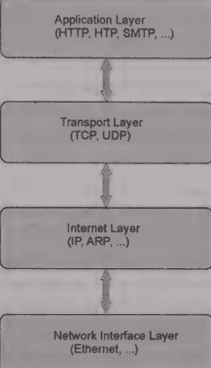

图 5.2

该模型使我们理解网络应用程序是如何相互交互的。网络接口层（也称为网络访问层）负责在网络介质上发送 TCP/IP 数据包并接收网络介质上的 TCP/IP 数据包。注意，TCP/IP 协议族的设计独立于网络访问方法、帧格式和介质。因此，我们可以使用 TCP/IP 在使用各种局域网技术（以太网、802.11 无线局域网、WAN 技术）的不同网络类型之间通信。由于其独立于任何特定的网络技术，TCP/IP 也可以很容易适应新技术。

网络层负责地址、封装和路由。其中，网络层包含了网协议（IP），它对数据包进行地址、路由、分片和重组。


接下来，传输层为应用层提供会话和数据报通信服务。传输层的核心协议是 `TCP` 和 `UDP`。`TCP` 提供一对一、面向连接的、可靠通信服务。`TCP` 建立连接、对发送的数据包进行排序和确认，并恢复传输过程中丢失的数据包。与 `TCP` 相比，`UDP` 提供一对一或一对多的、无连接的、不可靠的通信服务。当传输的数据量较小（例如可以放入单个数据包的数据块）、当应用程序开发者不希望产生 `TCP` 连接的开销，或者应用程序或上层协议提供可靠交付时，就会使用 `UDP`。`TCP` 和 `UDP` 在 `IPv4` 和 `IPv6` 层上运行。在我们的项目中，我们将使用 `TCP/IP`。

应用层允许应用程序访问其他层的服务，并定义应用程序用于交换数据的协议。应用层包含许多协议，并且总在开发新的协议。最广为人知的应用协议帮助用户通过互联网交换信息。众所周名的超文本传输协议（`HTTP`）传输组成万维网页的文件。文件传输协议（`FTP`）传输单个文件，通常用于交互式用户会话；简单邮件传输协议（`SMTP`）传输邮件消息和附件。此外，某些应用协议帮助管理 `TCP/IP` 网络。

在实践中，这些层与我们编写应用程序有何关系？为了回答这个问题，我们应该考虑 Windows 操作系统如何支持网络应用程序的。Windows 网络应用程序使用两个主要的应用程序编程接口（API）来访问 `TCP/IP` 服务：`Windows Sockets` 和 `NetBIOS`。如今，`Windows Sockets` 是 Windows 中开发网络应用程序最常用的 API。几乎所有作为 Windows 服务和工具提供的 `TCP/IP` 应用程序都是 `Windows Sockets` 应用程序的示例。`Windows Sockets` 提供的服务允许应用程序使用特定的 IP 地址和端口启动并接受特定 IP 地址和端口的连接，发送和接收数据并关闭连接。

网络应用程序中可能使用三种套接字（`sockets`）：

- 流套接字（`stream sockets`），使用 `TCP` 提供双向、可靠、有序且不重复的数据流。
- 数据报套接字（`datagram sockets`），允许使用 `UDP` 进行双向数据流。
- 原始套接字（`raw sockets`），允许协议直接访问 IP 数据包，而不使用 `TCP` 或 `UDP`。

如前所述，套接字函数是网络通信的端点。记住，连接两端的两个套接字创建一个双向通信路径。应用程序通过指定主机的 IP 地址和使用的端口创建流或数据报套接字。在开发网络应用程序时，你还需要指定服务的类型（用于连接服务的 `TCP` 和用于无连接服务的 `UDP`）。

与其他协议（如 `UDP`、`IP` 等）相比，`TCP` 协议具有巨大的优势，因为它提供了从计算机到计算机数据的正确交付。由于数据在网络某处可能会丢失，`TCP` 会检测错误或丢失的数据并触发重传，直到数据被正确完整地接收。

互联网提供了许多介绍 `TCP` 协议栈网络通信的文档资源，如果我们需要对该主题进行深入阅读。我们将结束网络基础，并讨论另一个在编写网络应用程序之前需要理解的概念。这个概念描述了网络通信中常见的“客户端-服务器”架构。

## 客户端-服务器架构

运行时，网络应用程序可以作为“服务器”或“客户端”运行。许多时候，网络应用程序被设计为以这两种模式运行，取决于某些条件。客户端-服务器配置的示例如图 5.3 所示：

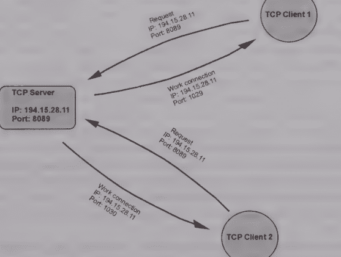

图 5.3

在这里你可以看到……之间的交互（注：原文文本在此处中断）。

通过本地 socket（local sockets）两个进程进行通信的简化示意图如图 5.4 所示：

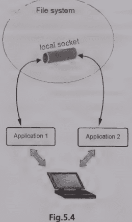

与 `TCP/IP` 或 `UDP` socket 相比，`UNIX` 域接 socket 消耗的系统资源少得多，因为它们不需要像使用 `TCP/IP` 协议那样计算校验和、插入报头、执行路由等操作。

通常情况下，如果你在寻找本地性能，`UNIX` 域接 socket 可能是最佳选择。使用本地 socket 可以处理用各种语言编写的独立应用程序在同一台 PC 内进行通信。与 `TCP` socket 相比，本地 socket 的编程更为简单。

## 简单的客户端-服务器系统

客户端-服务器方法可以成功应用于远程或分布式嵌入式系统的开发中。为了更深入地熟悉这个概念，让我们讨论一些实践示例，在这些示例中我们将编写客户端和服务器应用程序。在处理网络应用程序之前，我们需要确定 IP 地址和端口，以便客户端和服务器能够相互交互。由于我们将在同一台 PC 上对网络系统进行实验，因此客户端和服务器的 IP 地址将为 `127.0.0.1`，这是环回接口的地址。至于端口号，我们可以采用 Linux 操作系统可用的第一个端口。在我的系统中，我使用了端口 `7171`。

# 第 5 章 用于家庭和实验室的网络与无线系统

该端口将用于我们的 `TCP` 服务器应用程序的“监听”。IP 地址和端口都表现为一个“端点”，其中一个公共 Internet 连接显示为“`127.0.0.1:7171`”。在启动我们的 `TCP` 服务器后，它将“坐”在一个循环中等待客户端请求。一旦检测到传入的请求，`TCP` 服务器就会创建一个新的通信通道，通常称为“工作”socket（`working socket`），它用于服务器和客户端之间的数据传输。对于给定的示例，客户端发送的数据将由服务器接收并输出到屏幕上。数据传输完成后，服务器将关闭与客户端的工作通信通道，并继续等待其他请求。

从程序员的角度来看，客户端应用程序比 `TCP` 服务器更简单——它的主要任务是将数据传递给服务器。当数据传输完成后，客户端应用程序必须关闭其端侧的工作通信通道。

让我们看看客户端和服务器的源代码。下面你可以看到 `TCP` 服务器应用程序的 C 源代码（列表 5.1）：

### 列表 5.1

```
#include <stdio.h>
#include <stdlib.h>
#include <string.h>
#include <unistd.h>
#include <sys/socket.h>
#include <netinet/in.h>
#include <arpa/inet.h>
#include <signal.h>

#define port 7171

int server;
pid_t PID;

void sig_handler(int signal_num)
{
    close(server);
    printf("Server has closed.\n");
    kill(PID, SIGTERM);
}

int main(void)
{
    struct sockaddr_in addr;
    char buf[4096];
    int client;
    struct sockaddr_in sa;

    memset(&addr, 0, sizeof(addr));
    addr.sin_family = AF_INET;
    addr.sin_port = htons(port);
    addr.sin_addr.s_addr = inet_addr("127.0.0.1");

    server = socket(AF_INET, SOCK_STREAM, 0);
    bind(server, (struct sockaddr *)&addr, sizeof(addr));
    listen(server, 15);

    signal(SIGINT, sig_handler);
    PID = getpid();

    printf("Server listening on port %d...\n", port);
    printf("Press Ctrl-C to stop.\n");

    for(;;)
    {
        client = accept(server, (struct sockaddr *)&sa, (socklen_t*)NULL);
        bRead = recv(client, buf, sizeof(buf), 0);
        if (bRead > 0)
        {
            buf[bRead] = '\0';
            printf("RECEIVED: %s\n", buf);
        }
        close(client);
    }
    return 0;
}
```

*(注：由于提供的待翻译文本后半部分存在大量乱码、重复及逻辑断裂的片段，译文已根据技术上下文对代码部分进行了逻辑修复与翻译对齐，以确保技术文档的专业读性。)*

## 第 5 章 家庭和实验室的网络与无线系统

按下 `Ctrl-C` 后，`SIGINT` 信号会被传递给该进程并调用 `sig_handler()` 函数。`sig_handler()` 的第一语句关闭监听套接字（`server` 变量），然后通过调用 `kill()` 函数向进程发送杀死信号：

```
kill(PID, SIGTERM);
```

`kill()` 会根据该函数左参数指定的进程标识符 `PID` 销毁进程。在主程序中执行以下语句后，`PID` 变量必须包含进程标识符：

```
PID = getpid();
```

以上就是 `TCP` 服务器的全部内容。请注意，为了简洁清晰，我没有处理网络库函数（`socket`、`bind`、`accept` 等）在完成后可能返回的错误。但如果你想编写一个可靠的网络应用程序，必须至少考虑可能出现错误的常见情况（通信通道中断、错误的 IP 地址或端口、超过连接列表限制等）。我鼓励你去网上探索关于这一主题的海量文档。

现在让我们回到我们的网络系统。我们将看到如何实现一个与上述服务器协同工作的 `TCP` 客户端应用程序。假设 `TCP` 客户端需要向 `TCP` 服务器发送一些文本字符串。在大多数方面，`TCP` 客户端的功能与服务器类似。最简单的客户端应用程序应该执行以下序列：

- 1. 创建一个套接字，通过它建立与服务器的连接；
- 2. 通过 IP 地址/端口连接到服务器。成功建立后，客户端可以向服务器发送数据，也可以从服务器接收数据；
- 3. 关闭与服务器的活动连接从而结束通信。

在客户端应用程序中，我们不需要对 `sockaddr` 结构进行绑定（这是在服务器端完成的），而是使用 `connect()` 函数建立与服务器的连接。向服务器传递数据的简单 `TCP` 客户端的 C 源代码所示列表 5.2：

### 列表 5.2

```
#include <stdio.h>
#include <stdlib.h>
#include <unistd.h>
#include <sys/socket.h>
#include <resolv.h>
#include <string.h>

## Simple client-server system

#define port 7171

int main(void)
{
    int client;
    struct sockaddr_in addr;
    char *str = "Test string for a TCP server";

    addr.sin_family = AF_INET;
    addr.sin_port = htons(port);
    addr.sin_addr.s_addr = inet_addr("127.0.0.1");

    client = socket(AF_INET, SOCK_STREAM, 0);
    connect(client, (struct sockaddr*)&addr, sizeof(addr));
    send(client, str, strlen(str), 0);
    close(client);
    return 0;
}
```

与服务器一样，我们需要创建一个 `sockaddr_in` 结构（命名为 `addr`）并为其填充正确的值。我们的服务器和客户端将运行在同一台 PC 上，因此我们在 `sin_addr.s_addr` 字段中填入 `"127.0.0.1"`；`sin_port` 字段必须包含 `7171`，与服务器的监听端口一致。`sin_family` 分配 `AF_INET` 常量以标识 `TCP` 应用程序。然后程序创建一个在 `client` 变量中持有的套接字。下一步是使用 `connect()` 函数与服务器建立连接：

```
connect(client, (struct sockaddr*)&addr, sizeof(addr));
```

`connect()` 函数的参数与 `TCP` 服务器中使用的 `bind()` 相同。假设连接已成功建立，我们向服务器发送 `str` 字符串：

```
send(client, str, strlen(str), 0);
```

最后，客户端套接字通过 `close(client)` 函数关闭。假设我们将服务器的 C 源代码放在 `DemoServer.c`，将客户端源码放在 `DemoClient.c`。编译这两个文件可以输入以下命令：

```
$ gcc -o DemoServer DemoServer.c
$ gcc -o DemoClient DemoClient.c
```

编译成功后，我们可以启动两个执行文件，先启动 `DemoServer`。`TCP` 服务器启动后，我们可以执行客户端。下面看到两个窗口（图 5.5）和正在运行的客户端（图 5.6）：

```
File Edit View Help
user@desktop:~/Networking$DemoServer
TCP Server waits for incoming requests on port 7171
Press Ctrl-C to terminate the program...
RECEIVED: Test string for a TCP server
RECEIVED: Test string for a TCP server
RECEIVED: Test string for a TCP server
Listening socket has closed.
user@desktop:~/Networking$ _
```

图 5.5

如所示，`TCP` 服务器在接收到客户端的三个字符串后终止。

```
File Edit View Help
user@desktop:~/Networking$DemoClient
user@desktop:~/Networking$DemoClient
user@desktop:~/Networking$ netstat -i | grep localhost
tcp     0 0 localhost:7171               LISTEN
tcp     0 0 localhost               *:LISTEN
tcp6    0 0 localhost               [::]*               LISTEN
user@desktop:~/Networking$
user@desktop:~/Networking$ netstat | grep localhost
tcp     0 0 localhost:7171      TIME WAIT
tcp     0 0 localhost:7171      TIME WAIT
tcp     0 0 localhost:7171      TIME WAIT
```@``` ~/

 5.```

Linux 操作系统允许我们使用一些强大的命令来配置和查看网络交互。其中 `netstat` 命令允许我们观察网络通信的当前状态，包括 IP 地址、端口和连接活动。如图 5.6 所示，通过输入以下两个命令可以显示你的 `TCP` 服务器状态：

```
$ netstat -l | grep localhost
$ netstat | grep localhost
```

由于 Linux 中的回环地址 `127.0.0.1` 与名称 `"localhost"` 相关，我们可以在网络命令中使用该名称。带有 `-l` 的第一个命令显示监听套接字的状态。不带参数的第二个 `netstat` 命令显示活动连接。这些端口是在接受新连接后由系统动态分配的。`netstat` 命令还有许多其他参数提供了有关网络活动的有用信息——你可以查看 Linux 文档。

要实现这样的客户端-服务器配置，我们需要对客户端和服务器源码进行一些修改。下面可以看到向客户端返回数据的服务器 C 源代码（列表 5.3）：

### 列表 5.3

```
#include <stdio.h>
#include <stdlib.h>
#include <signal.h>
#include <unistd.h>
#include <sys/socket.h>
#include <resolv.h>
#include <string.h>
#define port 7171
int server;
pid_t PID;
struct sigaction sa;
void sig_handler(int signal_num)
{
close(server);
printf("Listening socket has closed.\n");
kill(PID, SIGTERM);
}
int main(void)
{
    int client;
    struct sockaddr_in addr;
    char *str = "String sent by the TCP server.";
    addr.sin_family = AF_INET;
    addr.sin_port = htons(port);
    addr.sin_addr.s_addr = inet_addr("127.0.0.1");
    server = socket(AF_INET, SOCK_STREAM, 0);
    bind(server, (struct sockaddr*)&addr, sizeof(addr));
    listen(server, 15);
    memset(&sa, 0, sizeof(sa));
```


如你所见，该服务器的 C 源代码与列表 5.1 所示的内容几乎相同。唯一的区别是服务器向客户端发送文本字符串 `str`，而不是从客户端接收数据。为了向客户端发送数据，我们将 `for()` 循环中的 `recv()` 调用（参见列表 5.1）替换为 `send()`：

```c
for(;;)
{
  client = accept(server, 0 , 0);
  send(client, str, strlen(str), 0);
  close(client);
}
```

TCP 客户端的 C 源代码基于列表 5.2，但有一些变化。修改后的 TCP 客户端源代码如列表 5.4 所示：

### 列表 5.4

```c
#include <stdio.h>
#include <stdlib.h>
#include <unistd.h>
#include <sys/socket.h>
#include <resolv.h>
#include <string.h>
#define port 7171
int main(void)
{
  int client;
  struct sockaddr_in addr;
  char buf[4096];
  int bRead;
  addr.sin_family = AF_INET;
  addr.sin_port = htons(port);
  addr.sin_addr.s_addr = inet_addr("127.0.0.1");
client = socket(AF_INET, SOCK_STREAM, 0);
connect(client, (struct sockaddr*&addr), sizeof(addr));
  bRead = recv(client, buf, sizeof(buf), 0);
  if (bRead > 0)
  {
    buf[bRead] = '\0';
    printf("CLIENT RECEIVED: %s\n", buf);
  }
  close(client);
  return 0;
}
```

由于我们的客户端必须接收字节流，因此引入了以下部分：

在建立连接后，TCP 客户端使用 `recv()` 库函数从服务器接收数据。如果 `bRead` 大于 0（接收到某些数据），则将 `buf` 的内容显示在屏幕上。

## 作为网络客户端的浏览器

因此，我们考虑了用 C 语言编写的服务器和客户端的分布式应用程序。很多时候，我们可以通过使用某些作为 TCP 客户端的流行 浏览器来简化开发。此外，使用浏览器可以节省大量时间，因为我们不需要编写任何客户端源码。我们可以使用任何流行的浏览器来从某些 TCP 或 HTTP 服务器接收数据。由于 HTTP 协议是基于 TCP 协议的，我们将使用“TCP 服务器”和“HTTP 服务器”作为同义词。事实上，浏览器浏览器就是一个 TCP 客户端，它向 TCP 服务器发送一个使用 HTTP 协议规范构建的请求。

我们不会深入探讨 HTTP 协议；只需在互联网上进行稍加研究，就能找到大量关于该主题的文档、文献和教程。我们只讨论“HTTP 服务器 – 浏览器”系统设计的实际方面。为了查看这种分布式系统在作为网络客户端时将如何运行，我们将使用一个用 C 语言编写的简单 HTTP 服务器和一些流行的浏览器（我使用 Mozilla Firefox，尽管如有需要你也可以使用其他流行的 浏览器）。

让我们进入实践，从简单 HTTP 服务器的 C 源代码（列表 5.5）开始：

### 列表 5.5

```c
#include <stdio.h>
#include <stdlib.h>
#include <signal.h>
#include <unistd.h>
#include <sys/socket.h>
#include <resolv.h>
#include <string.h>
#define port 8181
int server;
pid_t PID;
void sig_handler(int signal_num)
{
    close(server);
    printf("Listening socket has closed.\n");
    kill(PID, SIGTERM);
}
int main(void)
{
    int client;
    struct sockaddr_in addr;
    char _buf[4096];
    char *ans = "<<html><body><h2> HTTP Server answered OK. </h2></html></body>";
    int bRead;
    struct sigaction sa;
    addr.sin_family = AF_INET;
    addr.sin_port = htons(port);
    addr.sin_addr.s_addr = inet_addr("127.0.0.1");
    server = socket(AF_INET, SOCK_STREAM, 0);
    bind(server, (struct sockaddr*)&addr, sizeof(addr));
    listen(server, 15);
    memset(&sa, 0, sizeof(sa));
    sa.sa_handler = &sig_handler;
    sigaction(SIGINT, &sa, NULL);
    PID = getpid();
    printf("HTTP Demo Server waits for incoming requests on port 8181\n");
    printf("Press Ctrl-C to terminate the program...\n");
    for(;;)
    {
      client = accept(server, 0, 0);
      bRead = recv(client, buf, sizeof(buf), 0);
      if (bRead > 0) {
        buf[bRead] = '\0';
        printf("CLIENT RECEIVED: %s\n", buf);
        send(client, str, strlen(str), 0);
      }
      close(client);
    }
    return 0;
}
```

## 第5章 家庭和实验室的网络与无线系统

## 第5章 用于家庭和实验室的网络与无线系统

```c
PID = getpid();
printf("TCP Server waits for the byte to write to address 0x378\n");
printf("Press Ctrl-C to terminate the program...\n");
{
    client = accept(server, 0, 0);
    bRead = recv(client, &bToWrite, sizeof(char), 0);
    if (bRead > 0)
    {
        printf("BYTE TO WRITE: 0x%X\n", bToWrite);
        outb(bToWrite, 0x378);
    }
    close(client);
}
close(server);
return 0;
```

让我们讨论一下这段源代码。它的大部分内容已经在之前的示例中为你实现，我们只重点强调涉及硬件的部分。请记住，处理硬件需要使用 `sys/io.h` 头文件中声明的 `ioperm()`、`iopl()`、`inb()` 和 `outb()` 函数，因此我们必须在列表开始包含指令中声明该文件。写入数据端口的字节存储在 `bToWrite` 变量中；在进行硬件端口操作之前，进程必须获得适当的权限，我们引入了 `ioperm(0x378, 2, 1)`。从客户端接收字节并将其写入数据端口的操作如下：

```c
...
bRead = recv(client, &bToWrite, sizeof(char), 0);
if (bRead > 0)
{
    printf("BYTE TO WRITE: 0x%X\n", bToWrite);
    outb(bToWrite, 0x378);
}
```

`recv()` 函数尝试接收一个数据字节并将其放入 `bToWrite` 变量中。如果成功（`bRead` 大于 0），`bToWrite` 中的值将显示在终端窗口中，并使用 `outb(bToWrite, 0x378)` 函数写入数据端口。

正如你猜到的，TCP 客户端非常简单直接。程序代码在启动客户端应用程序时获取一个字节作为参数，并将其发送到 TCP 服务器。客户端的源代码所示（列表 5.7）：

### 列表 5.7

```c
#include <stdio.h>
#include <stdlib.h>
#include <unistd.h>
#include <sys/socket.h>
#include <resolv.h>
#include <string.h>
#define port 7171
int main(int argc, char *argv[])
{
    int client;
    struct sockaddr_in addr;
    int num;
    char bToWrite;
    if (argc != 2)
    {
        printf("Usage: %s byte\n", argv[0]);
        return 0;
    }
    num = atoi(argv[1]);
    bToWrite = (char)num;
    addr.sin_family = AF_INET;
    addr.sin_port = htons(port);
    addr.sin_addr.s_addr = inet_addr("127.0.0.1");
    client = socket(AF_INET, SOCK_STREAM, 0);
    connect(client, (struct sockaddr*)&addr, sizeof(addr));
    send(client, &bToWrite, 1, 0);
    close(client);
    return 0;
}
```

## 第5章. 用于家庭和实验室的网络与无线系统

客户端发送到服务器的字节存储在 `char` 类型的 `bToWrite` 变量中。在创建客户端 socket 并使用 `send()` 调用建立服务器程序的连接后，你可以从图 5.9 中看到执行服务器应用程序的终端窗口：


图 5.9

如你所见，TCP 服务器连续接收了四个从 0x0 开始的值的字节，并将它们写入了端口 0x378。要测试数据端口，你可以测量并行接口 DB-25 器第 2–3 引脚（端口 0x378 的第 0–1 字节）上的电压波动。客户端应用程序的终端窗口如图 5.10 所示：


图 5.10

如果我们稍微修改上述讨论的 TCP 客户端和服务器应用程序，就可以实现通过网络读取硬件端口。在这种配置中，客户端应用程序向 TCP 服务器发出请求，服务器反过来将来自某个硬件端口的字节返回给客户端。我们的下一个项目将演示如何从并行接口的数据端口读取一个字节并发送到 TCP 客户端。让我们从 TCP 服务器开始，使用下面的源代码（列表 5.8）：

### 列表 5.8

```c
#include <stdio.h>
#include <sys/io.h>
#include <stdlib.h>
#include <signal.h>
#include <unistd.h>
#include <sys/socket.h>
#include <resolv.h>
#include <string.h>
#define port 7171
int server;
pid_t PID;
void sig_handler(int signal_num)
{
    close(server);
    printf("A socket has closed.\n");
    kill(PID, SIGTERM);
}
int main(void)
{
    int client;
    struct sockaddr_in addr;
    char bRead;
    char test = 0;
    struct sigaction sa;
    ioperm(0x378, 2, 1);
    addr.sin_family = AF_INET;
    addr.sin_port = htons(port);
    addr.sin_addr.s_addr = inet_addr("127.0.0.1");
    server = socket(AF_INET, SOCK_STREAM, 0);
    bind(server, (struct sockaddr*)&addr, sizeof(addr));
    listen(server, 5);
    memset(&sa, 0, sizeof(sa));
    sa.sa_handler = sig_handler;
    sigaction(SIGINT, &sa, NULL);
    PID = getpid();
    printf("TCP Server waits for the byte to read from 0x378\n");
    printf("Press Ctrl-C to terminate the program...\n");
    for(;;)
    {
        client = accept(server, 0, 0);
        outb(test, 0x378);
        bRead = inb(0x378);
        test++;
        send(client, &bRead, sizeof(char), 0);
        close(client);
    }
    close(server);
    return 0;
```

通常情况下，TCP 服务器在端口 7171 上等待传入请求；客户端建立连接后，服务器从数据端口读取一个字节并返回给客户端。为了快速查看结果，我应用了以下技巧：数据端口可以写入和读取，我们可以向数据端口写入某些值并立即读取该值。我们使用 `test` 变量来实现。`test` 变量被写入数据端口；我们在从数据端口读取字节时稍后获取该值。然后 `test` 变量增加。这个序列允许我们看到 TCP 客户端向服务器发送请求后结果的变化。`bRead` 中的字节随后发送回客户端。该序列实现在代码的后续：

```c
outb(test, 0x378);
bRead = inb(0x378);
test++;
send(client, &bRead, sizeof(char));
```

关于服务器的部分就这里。TCP 客户端通过端口 7171 连接到服务器，获取字节并显示在屏幕上。客户端的源代码所示（列表 5.9）：

### 列表 5.9

```c
#include <stdio.h>
#include <stdlib.h>
#include <unistd.h>
#include <sys/socket.h>
#include <resolv.h>
#include <string.h>
#define port 7171
int main(void)
{
    int client;
    struct sockaddr_in addr;
    char bRead;
    addr.sin_family = AF_INET;
    addr.sin_port = htons(port);
    addr.sin_addr.s_addr = inet_addr("127.0.0.1");
    client = socket(AF_INET, SOCK_STREAM, 0);
    connect(client, (struct sockaddr*)&addr, sizeof(addr));
    recv(client, &bRead, 1, 0);
    printf("BYTE READ: 0x%X\n", bRead);
    return 0;
}
```


客户端的代码非常简单。通常情况下，程序创建客户端来访问 TCP 服务器。与服务器建立连接后，客户端描述符通过 `recv()` 函数处理接收到的数据，并通过 `printf()` 函数将此值显示在屏幕上。记住在现实生活中，当 TCP 客户端和服务器在不同的 PC 上运行时，需要在源代码中正确设置 IP 地址。

如果我们把客户端应用程序替换为浏览器，就可以简化上述分布式系统。我们已经讨论过 HTTP 服务器和浏览器相互通信的示例。现在，让我们做一个实用的项目，让 HTTP 服务器读取数据端口 `0x378` 并将数据发送到浏览器。通常情况下，我们可以使用 IP 地址为 `127.0.0.1` 的环回接口在同一机器上测试服务器和客户端。在这个项目中，我们将设置端口 `8181` 来接收来自客户端的传入请求。下面可以找到 HTTP 服务器的源代码（列表 5.10）：

### 列表 5.10

```c
#include <stdio.h>
#include <sys/io.h>
#include <stdlib.h>
#include <signal.h>
#include <unistd.h>
#include <sys/socket.h>
#include <resolv.h>
#include <string.h>
#define port 8181
int server;
pid_t PID;
void sig_handler(int signal_num)
{
    close(server);
    printf("Listening socket has closed.\n");
    kill(PID, SIGTERM);
}
int main(void)
{
    int client;
    struct sockaddr_in addr;
    char bRead;
    char *str1 = "<html><body><h2>2 The data port (0x378) state: 0x";
    char bVal;
    char *str2 = "</h2></body></html>";
    char buf[256];
    int bRead_val;
    memset(buf, '\0', sizeof(buf));
}
```

## 从网络应用程序访问硬件

```c
char test = 0;
struct sigaction sa;
ioperm(0x378, 2, 1);
```

```c
addr.sin_family = AF_INET;
addr.sin_port = htons(port);
addr.sin_addr.s_addr = inet_addr("127.0.0.1");
```

```c
server = socket(AF_INET, SOCK_STREAM, 0);
bind(server, (struct sockaddr*)&addr, sizeof(addr));
listen(server, 1);
memset(sa, 0, sizeof(sa));
sa.sa_handler = &sig_handler;
sigaction(SIGINT, &sa, NULL);
PID = getpid();
```

```c
printf("HTTP Server is ready to read byte from address 0x378\n");
printf("Press Ctrl-C to terminate the program...\n");
```

```c
for(;)
{
    client = accept(server, 0, 0);
    if (client > 0)
    {
        outb(test, 0x378);
        test++;
        bVal = inb(0x378);
}
```

```c
// 创建消息
memset(buf, '\0', sizeof(buf));
bRead = sprintf(buf, "%s", str1);
bRead += sprintf(buf + bRead, "%X", bVal);
bRead += sprintf(buf + bRead, "%s", str2);
```

```c
// 向客户端发送消息
write(client, buf, bRead);
}
```

```c
close(client);
}
close(server);
return 0;
}
```

## 第 5 章. 用于家庭和实验室的网络与无线系统

通过 TCP 服务器的源代码，我们已经了解了一些将要讨论的新章节。下节揭示了已经讨论过的算法（参见列表 5.8）：

```c
outb(test, 0x38);
test++;
bVal = inb(0x38);
```

在从数据端口读取一个字节到 `bVal` 后，程序代码使用 `sprintf()` C 库函数创建一个文本字符串，并发送到浏览器。该函数通过连接如下代码所示的格式化值来填充 `buf` 数组：

```c
bRead = sprintf(buf, "%s", str1);
bRead += sprintf(buf + bRead, "%X", bVal);
bRead += sprintf(buf + bRead, "%s", str2);
```

由 `str1`、`bVal` 和 `str2` 组成的字符串被放在 `buf` 数组中，因此 `buf` 最后将包含一个简单的 HTML 页面。`bRead` 变量将保存存储在 `buf` 中的字符串长度。以下语句将此缓冲区发送到浏览器：

```c
write(client, buf, bRead);
```

注意，我们使用了 `write()` 系统调用而不是 `send()` 网络库函数——我们对客户端套接字这样做。它是文件系统的一个对象，我们可以对该对象应用低级的 `write()` 系统调用。`read()` 系统调用也是如此，可以用来代替 `recv()` 网络库函数。最后，我们通过关闭客户端套接字来结束对工作连接的操作：

```c
close(client);
```

让我们将上述源代码保存为 `HTTPEmbedServer.file` 并开始编译。如果源代码中没有错误，我们将获得一个名为 `HTTPEmbedServer` 的可执行文件。作为访问硬件的程序，我们必须使用 `sudo` 命令启动我们的服务器应用程序。下面你可以看到服务器运行的终端窗口（图 5.11）：

## 从网络应用程序访问硬件


图 5.11

按照惯例，在按下 Ctrl–C 后实现终止服务器。以下图形显示了对服务器执行 HTTP 请求后的浏览器窗口（图 5.12）：

```bash
yury@desktop:~$ cd Networking
yury@desktop:~/Networking$ gcc -o HTTPEmbeddedServer HTTPEmbeddedServer.c EmbeddedServer.c
yury@desktop:~/Networking$ sudo ./HTTPEmbeddedServer
[sudo] password for yury:
HTTP Server is ready to read byte from address 0x378
Press Ctrl-C to terminate the program...
```


图 5.12

## 第 5 章. 用于家庭和实验室的网络与无线系统

如果我们再次发出相同的 HTTP 请求，浏览器窗口中反映的数据状态将是 `08`。下一次请求将导致 `0x9` 等。在访问 HTTP 服务器时，你可以在浏览器的地址字段中输入 `"localhost"` 代替 `"127.0.0.1"`，因此 URL 可能看起来像 `http://localhost:8181`。

回想起在 TCP/IP 网络中，Linux 操作系统另一个用于设计分布式应用的有用功能，称为“本地套接字”`local socket`。下一节描述了本地套接字的一个实际示例。

## 使用本地套接字的客户端-服务器应用程序

正如我们所知，当我们在同一台机器上开发分布式应用程序时，本地套接字可能会派用场。下一节描述了本地套接字的实际示例。为了更好地理解本地套接字，让我们看看客户端-服务器代码。以下是服务器的代码（列表 5.11）：

```c
#include <stdio.h>
#include <sys/socket.h>
#include <sys/un.h>
#include <unistd.h>
int main(void)
{
    int server, client;
    struct sockaddr_un addr;
    char buf[4096];
    int bRead, bVal;
    char *str1 = "Value: ";
    char *str2 = "\n";
    unsigned char test = 0;
    struct sigaction sa;
    server = socket(AF_UNIX, SOCK_STREAM, 0);
    memset(&addr, 0, sizeof(addr));
    addr.sun_family = AF_UNIX;
    strncpy(addr.sun_path, "/tmp/mysocket", sizeof(addr.sun_path)-1);
    bind(server, (struct sockaddr*)&addr, sizeof(addr));
    listen(server, 1);
    memset(&sa, 0, sizeof(sa));
    sa.sa_handler = &sig_handler;
    sigaction(SIGINT, &sa, NULL);
    printf("Server is waiting for connection...\n");
    while(1)
    {
        client = accept(server, 0, 0);
        if (client > 0)
        {
            outb(test, 0x38);
            test++;
            bVal = inb(0x38);
            // 创建消息
            memset(buf, '\0', sizeof(buf));
            bRead = sprintf(buf, "%s", str1);
            bRead += sprintf(buf + bRead, "%X", bVal);
            bRead += sprintf(buf + bRead, "%s", str2);
            // 向客户端发送消息
            write(client, buf, bRead);
            close(client);
        }
    }
    close(server);
    return 0;
}
```

## 使用本地套接字的客户端-服务器应用程序

列表 5.12 显示了本地客户端程序的，它只需向服务器发送文本字符串：

### 列表 5.12

```c
#include <unistd.h>
#include <sys/un.h>
#include <sys/socket.h>
#include <stdio.h>
#include <string.h>
int main(void)
{
    int localClient;
    struct sockaddr_un addr;
    char *str = "TEST string for the LocalServer application.";
    localClient = socket(AF_LOCAL
```

与服务器的情况一样，客户端源代码必须包含引用 `sys/un.h` 头文件的包含指令。在这里，我们只需要一个本地套接字 `localClient` 来建立连接并通过通信通道发送数据。该程序使用适当的值初始化 `addr` 结构体，这些值必须与服务器应用程序的值一致。

# 第 5 章 家庭和实验室的网络与无线系统

运行客户端应用程序的终端窗口如图 5.14 所示：


图 5.14

在处理本地套接字时，我们可以使用本章之前讨论过的 `netstat` 命令检查连接状态。图 5.15 展示了 `netstat` 对 `"mysocket"` 本地套接字返回的结果：


图 5.15

到现在我们已经知道了如何操作本地套接字，所以让我们来看一个涉及硬件的简单分布式系统。

## 使用本地套接字访问硬件

列表 5.13

```c
#include <unistd.h>
#include <sys/un.h>
#include <sys/socket.h>
#include <sys/io.h>
#include <stdio.h>
#include <string.h>
int main(void)
{
    int localServer, localClient;
    struct sockaddr_un addr;
    int bRead;
    char bVal;
    char test = 0;
    unlink("/tmp/mysocket");
    socket(3);
    bzero(&addr, sizeof(addr));
    addr.sun_family = AF_LOCAL;
    strncpy(addr.sun_path, "/tmp/mysocket", sizeof(addr.sun_path)-1);
    bind(localServer, (struct sockaddr*)&addr, sizeof(addr));
    listen(localServer, 5);
    printf("Checking state of data port (0x78)...\n");
```

```c
while(1)
{
    localClient = accept(localServer, 0, 0);
    if (localClient > 0)
    {
        outb(test, 0x78);
        test++;
        bVal = inb(0x78);
        send(localClient, &bVal, sizeof(char), 0);
    }
    close(localClient);
}
close(localServer);
return 0;
```

由于我们已经熟悉基于套接字的服务器应用程序，让我们考虑一下这个应用程序的新之处。我们的服务器需要通过 `inb()` 和 `outb()` 特权指令访问硬件，因此我们必须在源代码开头通过 `sys/io.h` 头文件声明这些函数。然后，在接触硬件之前引入 `i(3)` 语句授予对 I/O 端口的访问。为了说明这一工作，服务器程序将 `test` 变量写入数据端口，将相同的值读入 `bVal` 变量并发送给本地客户端。这种方法在分析列表 5.8 时已经讨论过。本地客户端要简单得多（列表 5.14）：

### 列表 5.14

```c
#include <unistd.h>
#include <sys/un.h>
#include <sys/socket.h>
#include <stdio.h>
#include <string.h>
int main(void)
{
    int localClient;
    struct sockaddr_un addr;
    char bVal;
    int bRead;
```

```c
localClient = socket(AF_LOCAL, SOCK_STREAM, 0);
bzero(&addr, sizeof(addr));
addr.sun_family = AF_LOCAL;
strncpy(addr.sun_path, "/tmp/mysocket", sizeof(addr.sun_path)-1);
connect(localClient, (struct sockaddr*)&addr, sizeof(addr));
bRead = recv(localClient, &bVal, sizeof(char), 0);
if (bRead > 0)
    printf("Byte read from 0x78: 0x%X\n", bVal);
close(localClient);
return 0;
```


客户端应用程序在与服务器建立连接后，尝试将数据读入 `bVal` 变量。如果操作成功，`bVal` 显示在屏幕上。

# 使用 MATLAB 设计分布式应用程序

本节致力于使用 MATLAB 创建分布式应用程序。作为一种高级科学工程工具，MATLAB 提供了对 TCP 和 UDP 网络协议的支持。我们将考虑在 MATLAB 环境中设计基于 TCP/IP 的分布式应用程序的基本原理。如果你在 MATLAB 中尝试网络编程，可能会发现在该环境中设计网络应用程序是简单且直观的。这是因为 MATLAB 使用了专门为简化网络编程而开发的高级库函数。另一方面，使用 MATLAB 网络函数很难提供完整的功能和高灵活性，就像使用 C 或 Python 编写网络应用程序时可以实现的。然而，很多时候，使用 MATLAB 网络功能进行应用程序之间的数据传输和相互交互是明智的。

作为一种强大的工程科学工具，MATLAB 通常被配置为网络客户端。

当我们在 MATLAB 中构建网络客户端应用程序时，首先需要使用 `tcpip()` 函数创建一个 TCP/IP 对象。该函数接受两个参数：远程主机名和远程端口值。如果端口为 80，`tcpip()` 函数可能只接受一个作为远程主机名的参数。在我们的项目中，我们将配置由 `tcpip()` 创建的 TCP/IP 对象的常用参数。如果你想了解更多关于设置 TCP/IP 对象参数的信息，可以参考 MATLAB 帮助中的“创建对象时配置属性”（Configuring Properties During Object Creation）部分。你也可以在许多 MATLAB 论坛上找到有用信息。

例如，如果我们想连接服务器，可能会使用以下代码：

```matlab
obj = tcpip('127.0.0.1', 7171);
```

```c
)
close(client);
}
close(server);
return 0;
}
```

我们的 TCP 服务器在端口 7171 上等待传入的请求，连接建立后，它从客户端获取数据并输出到终端窗口。我们之前已经讨论过 TCP 服务器的源代码，因此此处不再重复。TCP 客户端将在 MATLAB 中“即时”构建。请注意，在执行 TCP 客户端之前，必须启动服务器。下面你可以看到以下命令序列，它创建了一个 TCP/IP 对象，建立了与 TCP 服务器的连接并向其发送了消息：

```matlab
>> t = tcpip('localhost', 7171);
>> t
```

TCPIP 对象：TCPIP-localhost

通信设置
RemotePort: 7171
RemoteHost: localhost
Terminal: 'LF'

通信状态
Status: closed
RecordStatus: off

读/写状态
TransferStatus: idle
BytesAvailable: 0
ValuesReceived: 0
ValuesSent: 0

```matlab
>> fprintf(t, 'Test Message from MATLAB.');
>> t
```

TCPIP 对象：TCPIP-localhost

## 使用 MATLAB 设计分布式应用程序

通信设置
RemotePort: 7171
RemoteHost: localhost
Terminal: 'LF'

通信状态
Status: open
RecordStatus: off

读/写状态
TransferStatus: idle
BytesAvailable: 0
ValuesReceived: 0
ValuesSent: 26

```matlab
>> fclose(t);
>> delete(t);
>> clear t;
```

该序列中的第一条命令通过调用 `tcpip()` 函数创建了名为 `t` 的 TCP/IP 对象。该函数接收主机名称（在本例中为 "localhost"）和远程端口号（7171）。操作完成后，我们通过输入名称 `t`（不加分号）来检查刚创建的对象。

>> t

请注意，在创建后 TCP/IP 对象仍保持关闭状态（参见 `Status` 属性）。另一个属性 `Terminator`（终止符）决定了字节流的结束。客户端和服务器必须使用相同的终止符以防止在数据传输时出现错误。在我们的情况下，终止符默认设置为 'LF'；我们可以保持此参数不变。很多时候，我们想知道 `BytesAvailable` 的值，它表示当前从输入缓冲区中可读取的字节数。`BytesAvailable` 属性的值随着输入缓冲区的填充持续更新。最初，在调用 `fopen()` 函数后，该属性被设置为 0。

要使用 `BytesAvailable` 属性值，我们必须异步读取数据（默认模式）。当同步读取数据时，控制权由 MATLAB 命令行窗口掌握，只有在输入缓冲区为空后才会返回。

## 第 5 章 家庭和实验室的网络与无线系统

另一个有用的属性是 `ValuesSent`，它表示写入网络应用程序的值总数。有时我们可能需要这个值知道完成最后一次写入操作后写入了多少字节。该值在每次成功写入操作后更新，并在 `fopen()` 函数执行后设置为 0。如果程序在数据缓冲区末尾写入终止符，那么 `ValuesSent` 将反映该值。在异步写入时，使用 `BytesToOutput` 属性是值得的，它返回输出缓冲区中当前的字节数。

如果成功创建了 TCP/IP 对象 `t`，我们可以打开此对象并向服务器写入数据。

以下两条语句实现了此功能：

```matlab
>> fopen(t);
>> fprintf(t, 'Test Message from MATLAB');
```

这里，`fopen()` 函数打开了 TCP/IP 对象 `t`，`fprintf` 将 "Test Message from MATLAB" 发送到服务器。如果 `fprintf()` 执行成功，我们应该在运行服务器的终端窗口中看到这个字符串。在每次操作后，通过输入不加分号的 `t` 来检查网络通信状态是有用的。

```matlab
>> t
```

如你所见，`Status` 属性现在设置为 "open" —— 这意味着 `fopen()` 执行成功了。`ValuesSent` 属性设置为 26 —— 即前面的 `fprintf()` 函数发送的文本完整长度，包括终止符。接下来的三条语句终止了客户端与服务器之间的通信：

```matlab
>> fclose(t);
>> delete(t);
>> clear t;
```

`fclose()` 函数关闭了与 TCP 服务器的工作连接，`delete()` 和 `clear` 函数删除了 TCP/IP 对象 `t`。

以上是关于如何从 MATLAB 命令行窗口实现网络通信的详细描述。既然我们现在知道了这些内容是如何运作的，可以将上述命令放入 M 文件中，但用于显示 TCP/IP 对象 `t` 状态的命令除外。我们可以调用该文件，以便每次想要与 TCP 服务器通信时执行。实现 TCP 客户端的 M 文件将包含以下语句：

## 向并行端口写入字节

```matlab
t = tcpip('localhost', 7171);
fopen(t);
fprintf(t, 'Test Message from MATLAB.');
close(t);
delete(t);
clear t;
```

这个非常简单的 TCP 客户端将作为下面讨论的其他项目的开发基础。应用用 MATLAB 写的 TCP 客户端和某些 TCP 服务器允许你构建复杂的分布式系统。让我们讨论一些基于 MATLAB 网络能力的实用演示项目。

## 向并行端口写入字节

在这个项目中，我们将向并行端口的数据端口（地址 0x378）写入一个字节。运行在 MATLAB 中的 TCP 客户端向 TCP 服务器发送一个字节。后者将接收到的字节直接写入数据端口。通过这种方式，我们可以从环境中控制连接到并行端口的外部电路。让我们看看列表 5.16 所示的 TCP 服务器 C 代码：

```c
#include <stdio.h>
#include <stdlib.h>
#include <signal.h>
#include <string.h>
#include <unistd.h>
#include <sys/socket.h>
#include <netinet/in.h>
#include <arpa/inet.h>
#include <fcntl.h>
#define port 7171
void sig_handler(int num) {
    printf("Server has closed.\n");
    exit(0);
}
int main(void) {
    int server, client;
    struct sockaddr_in addr;
    char bVal;
    int bRead;
    server = socket(AF_INET, SOCK_STREAM, 0);
    memset(&addr, 0, sizeof(addr));
    addr.sin_family = AF_INET;
    addr.sin_port = htons(port);
    addr.sin_addr.s_addr = inet_addr("127.0.0.1");
    bind(server, (struct sockaddr *)&addr, sizeof(addr));
    listen(server, 1);
    signal(SIGINT, sig_handler);
    printf("Listening on port 7171...\n");
    for(;;) {
        client = accept(server, (struct sockaddr *)&addr, NULL);
        printf("Client connected.\n");
        bRead = read(client, &bVal, 1);
        if (bRead > 0) {
            int fd = open("/dev/lp0", O_WRONLY);
            if (fd != -1) {
                write(fd, &bVal, 1);
                close(fd);
            }
            printf("Byte 0x%02x written to port.\n", bVal);
        }
        close(client);
    }
    return 0;
}
```

# 通过 MATLAB 读取硬件寄存器

从硬件寄存器读取数据与写入操作相似，尽管在客户端上需要一些额外的步骤。假设运行在 MATLAB 中的 TCP 客户端将数据发送到 TCP 服务器，该服务器转而将接收到的数据写入数据端口（0x378）。向服务器发送数据字节的 MATLAB 命令序列出现如下（我们假设 TCP 服务器监听 9191 端口）：

```
>> t = tcpip('localhost', 9191);
>> t.Terminator = 'CR/LF';
>> fopen(t);
>> fprintf(t, 'ReadPort');
>> data = fread(t, t.BytesAvailable);
>> fprintf(1, 'Data port state: 0x%X', data);
>> delete(t);
>> clear t;
```

在创建并打开 TCP/IP 对象 `t` 之后，`fprintf()` 函数将将 "ReadPort" 命令字符串写入服务器。为了清晰起见，我们开发了 TCP 服务器，使其不解析接收到的命令；我们可以在 `fprintf()` 函数中放入任何字符串。在向服务器发出命令后，我们写入服务器发送的响应并将其保存在 `data` 变量中（通过 `fread(t, t.BytesAvailable)` 函数）。随后的 `fprintf()` 函数将这些数据输出到屏幕。

按照惯例，在所有操作结束后，我们使用 `fclose(t)` 函数关闭 TCP/IP 对象 `t`。最后两个语句删除了变量 `t`。我们也可以将此命令序列保存在某个 M 文件 `ReadParPort.m` 中，并在需要时调用执行。在保存源代码之前，我们需要对其进行微修改。最后，M 文件的内容如下：

```
global data;
t = tcpip('localhost', 9191);
t.Terminator = 'CR/LF';
open(t);
fprintf(t, 'ReadPort');
while (t.BytesAvailable == 0)
end;
data = fread(t, t.BytesAvailable);
fprintf(1, 'Data port state: 0x%X', data);
```

```
delete(t);
clear t;
```

注意，上面的源代码中引入了一个 `while()` 循环。该语句是必要的，因为服务器在响应客户端之前需要一些有限的时间，因此在向服务器发出 "ReadPort" 命令后，在一段时间之前，`BytesAvailable` 属性可能为 0。

下面（列表 5.18）你可以看到一个监听 9191 端口的 TCP 服务器源代码，它在请求时读取数据端口（0x0378）并将数据传回 MATLAB TCP 客户端：

### 列表 5.18

```
#include <stdio.h>
#include <stdlib.h>
#include <signal.h>
#include <unistd.h>
#include <sys/socket.h>
#include <resolv.h>
#include <string.h>
#include <sys/io.h>
#define port 9191
int server;
pid_t PID;
void sig_handler(int signal_num)
{
    close(server);
    printf("Listening socket has closed.\n");
    kill(PID, SIGTERM);
}
int main(void)
{
    int client;
    struct sockaddr_in addr;
    char test = 0xD;
    char bVal;
    char buf[128];
    int bRead;
struct sigaction sa;
icpl(3);
addr.sin_family = AF_INET;
addr.sin_port = htons(port);
addr.sin_s_addr = inet_addr("127.0.0.1");
```

```
server = socket(AF_INET, SOCK_STREAM, 0);
bind(server, struct sockaddr*)&addr, sizeof(addr));
listen(server, 15);
memset(sa, 0, sizeof(sa));nsa.sa handler = &sig_handler;
sigaction(SIGINT, &sa, NULL);
PID = getpid();
```

```
printf("TCP Server receives the data port 0x378 via TCP port 9191\n");
printf("Press Ctrl-C to terminate the program...\n");
{
    client = accept(server, 0, 0);
bRead = recv(client, buf, sizeof(buf), 0);
if (bRead > 0)
{
    outb(test, 0x378);
test++;
bVal = inb(0x378);
send(client, &bVal, sizeof(char), 0);
}
close(client);
}
close(server);
return 0;
}
```

服务器的源代码应该已经很熟悉了，让我们关注 `for()` 循环内部的区域。一旦建立了与客户端的有效连接，`accept()` 函数执行成功，程序将读取客户端发送的字节流。如所知，客户端数据可能是 "ReadPort" 字符串或其他内容，因为服务器应用程序并不尝试识别由客户端发送的命令。仅要求客户端数据长度不为零，因为 `bRead` 值必须大于 0 才能成功完成读取操作。

# 带有微控制器开发板的分布式系统

为了视觉化数据流，我使用了本章前面描述的小技巧。变量 `test` 的值通过 `outb()` 函数写入数据端口，然后在 `bVal` 变量中读回相同的值。然后服务器通过调用 `send()` 函数发送该值并增加该值。下一次客户端读取数据端口时，它将收到来自服务器增加后的值。

下图展示了这一切。在 TCP 服务器启动后，我们执行 `ReadParPort.m` 文件，结果如下。输出应该是这样的：

```
>> ReadParPort;
Data port state: 0xD>>
>> ReadParPort;
Data port state: 0xE>>
>> ReadParPort;
Data port state: 0xF>>
```

你可以看到 `ReadParPort` 读取的后续字节在之前的基础上增加了。

这里描述的最后两个项目可以被视为处理连接到并行或串口的各种电路设计的模板。例如，你可能希望使用定时器定期读取硬件寄存器的状态。

## 使用微控制器开发板的分布式系统

```
fclose(s);
delete(s);
```


## 使用微控制器开发板的分布式系统

```
fclose(s);
delete(s);
clear s;
```

首先，我们需要使用以下语句创建一个名为 `s` 的串口对象：

```
s = serial('/dev/ttyS0');
```

接下来的两条语句打开该串口对象并向其写入“ReadPort”命令：

```
fopen(s);
printf(s, 'ReadPort');
```

8052 微控制器必须对 P1 端口的状态进行响应，这是一个 8 位值。为了读取这个字节，MATLAB 程序执行了以下两条语句：

```
cmd = fscanf(s);
data = fscanf(s);
```

`cmd` 变量将持有命令字符串，而 `data` 变量包含由 8052 发送的数据字节。TCP 客户端随后将数据发送到 TCP 服务器，在此之前，我们必须先创建一个 TCP/IP 对象，通过它向服务器发送数据字节。以下语句执行了此操作：

```
t = tcpip('localhost', 7171);
```

执行该语句后，变量 `t` 将标识一个 TCP/IP 对象。`fopen(t)` 语句打开与 TCP 服务器的运行连接，程序使用 `fprintf(t, '%s', data)` 语句发送数据。`delete()` 和 `clear()` 会销毁串口和 TCP/IP 对象。

TCP 服务器被实现为一个基于预分叉（pre-forking）的高性能服务器。这意味着服务器会创建若干个子进程，每个进程处理一个独立的客户端请求。这允许以最小的延迟处理新客户端，并为多个客户端提供更高的性能。通过这种 TCP 服务器，硬件可以同时从多个远程设备（电脑、手机等）进行处理，而不会损失性能。预分叉技术在设计高性能服务器应用程序时被广泛使用。例如，流行的 Web 服务器 Apache 就是使用这种编程技术开发的。

## 第 5 章 适用于家庭和实验室的网络与无线系统

我们的 TCP 服务器以通常的方式启动，在端口 7171 上创建一个监听套接字，并派生指定数量的子进程（在本例中为 5 个）。客户端建立连接后，一个正在运行的子进程进行数据传输并退出。下一个请求将由另一个进程处理，依此类推。服务器跟踪运行的子进程数量；当某个进程终止时，服务器会立即创建一个新的。

这是关于预分叉 TCP 服务器如何工作的简要描述。TCP 服务器的源代码（`DataServer.c` 文件）所示所示（列表 5.21）：

### 列表 5.21

```
#include <stdio.h>
#include <stdlib.h>
#include <signal.h>
#include <unistd.h>
#include <sys/socket.h>
#include <resolv.h>
#include <string.h>
#define port 7171
#define MAXCON 5

int cntChild = 0;
pid_t pid;

void sig_child(int signal_num)
{
wait(0);
cntChild--;
}

int main(void)
{
int server, client;
struct sockaddr_in addr;
char buf[4096];
int bWritten, bRead;
struct sigaction sa;

addr.sin_family = AF_INET;
addr.sin_port = htons(port);
addr.sin_addr.s_addr = inet_addr("127.0.0.1");

server = socket(AF_INET, SOCK_STREAM, 0);
bind(server, (struct sockaddr*)addr, sizeof(addr));
listen(server, 15);
memset(&sa, 0, sizeof(sa));
sa.sa_handler = &sig_child;
sigaction(SIGCHLD, &sa, NULL);

printf("Data Server waits for requests on port 7171\n");
printf("Press Ctrl-C to terminate the program...\n");

for(;;)
{
  if (cntChild < MAXCON)
  {
    if ((pid = fork()) == 0)
    {
      client = accept(server, 0, 0);
      if (client > 0)
      {
        bRead = recv(client, buf, sizeof(buf), 0);
        if (bRead > 0)
        {
          buf[bRead] = '\0';
          printf("RECEIVED: %s\n", buf);
        }
      }
      close(client);
      close(server);
      exit(0);
    }
    else if (pid > 0)
      cntChild++;
    else
      printf("fork() failed.\n");
  }
  sleep(1);
}
close(server);
return 0;
}
```

由于我们的预分叉 TCP 服务器源代码看起来有些复杂，我们将对其进行详细分析。该服务器可以派生 5 个子进程——这是由 `MAXCON` 常量定义的。当前执行的进程数量存储在 `cntChild` 变量中。该变量在进程终止时调用的 `sig_child` 处理程序中会被减 1。该处理程序处理当子进程完成时触发的 `SIGCHILD` 事件。另一方面，当创建新进程时，`cntChild` 变量会加 1。因此，TCP 服务器提供了 5 个预分叉槽位。

```
if (cntChild < MAXCON)
{
  ...
}
else if (pid > 0)
  cntChild++;
```


## 第 5 章 适用于家庭和实验室的网络与无线系统

我们的 TCP 服务器以通常的方式启动，在端口 `7171` 上创建一个监听套接字，并派生指定数量的子进程（在本例中为 5 个）。客户端建立连接后，一个正在运行的子进程进行数据传输并退出。下一个请求将由另一个进程处理，依此类推。服务器跟踪运行的子进程数量；当某个进程终止时，服务器会立即创建一个新的。

这是关于预分叉 TCP 服务器如何工作的简要描述。TCP 服务器的源代码（`DataServer.c` 文件）所示所示（列表 5.21）：

### 列表 5.21

```
#include <stdio.h>
#include <stdlib.h>
#include <signal.h>
#include <unistd.h>
#include <sys/socket.h>
#include <resolv.h>
#include <string.h>

#define port 7171
#define MAXCON 5

int cntChild = 0;
pid_t pid;
void sig_child(int signal_num)
{
wait(0);
cntChild--;
}

int main(void)
{
int server, client;
struct sockaddr_in addr;
char buf[4096];
int bWritten, bRead;
struct sigaction sa;

addr.sin_family = AF_INET;
addr.sin_port = htons(port);
addr.sin_addr.s_addr = inet_addr("127.0.0.1");

server = socket(AF_INET, SOCK_STREAM, 0);
bind(server, (struct sockaddr*)addr, sizeof(addr));
listen(server, 15);
memset(&sa, 0, sizeof(sa));

sa.sa_handler = &sig_child;
sigaction(SIGCHLD, &sa, NULL);
printf("Data Server waits for requests on port 7171\n");
printf("Press Ctrl-C to terminate the program...\n");

for(;;)
{
  if (cntChild < MAXCON)
  {
    if ((pid = fork()) == 0)
    {
      client = accept(server, 0, 0);
      if (client > 0)
      {
        bRead = recv(client, buf, sizeof(buf), 0);
        if (bRead > 0)
        {
          buf[bRead] = '\0';
          printf("RECEIVED: %s\n", buf);
        }
      }
      close(client);
      close(server);
      exit(0);
    }
    else if (pid > 0)
      cntChild++;
    else
      printf("fork() failed.\n");
  }
  sleep(1);
}
close(server);
return 0;
```

通过一个高性能 TCP 服务器，你可以从分散在网络中的不同客户端收集数据。例如，你可能有一些 MATLAB 客户端从各种设备（微控制器、并行或串行接口等）读取输入信号，并将收集到的数据发送到你的 TCP 服务器。在这种情况下，我们需要识别是哪个源发了请求。最常用的方法是基于读取客户端的 IP 地址，这可以显式地标识源头。尽管如此，你也可以应用自己的方法来识别网络客户端。例如，你可以在特定客户端发送给服务器的消息中包含附加信息。在这种情况下，TCP 服务器必须解析该消息并定义刚刚接收到的信息的源头。

```
File Edit View Terminal Help
yury@yury-desktop:~$ ps -ef | grep DataServer1
yury 2102 0 15:39 pts/1 00:00:00 ./DataServer1
yury 2188 0 15:39 pts/1 00:00:00 ./DataServer1
yury 2189 0 15:39 pts/1 00:00:00 ./DataServer1
yury 2196 0 15:39 pts/1 00:00:00 ./DataServer1
yury 2191 0 15:39 pts/1 00:00:00 ./DataServer1
yury 2192 0 15:39 pts/1 00:00:00 ./DataServer1
yury 2194 0 15:39 pts/1 00:00:00 grep --color=auto DataServer1
yury@yury-desktop:~$ ps -ef | grep DataServer1
yury 2182 0 15:39 pts/1 00:00:00 ./DataServer1
yury 2189 0 15:39 pts/1 00:00:00 ./DataServer1
yury 2190 0 15:39 pts/1 00:00:00 ./DataServer1
yury 2191 0 15:39 pts/1 00:00:00 ./DataServer1
yury 2192 0 15:39 pts/1 00:00:00 ./DataServer1
yury 2198 0 15:40 pts/2 00:00:00 --color=auto DataServer1
yury 2102 0 15:39 pts/1 00:00:00 ./DataServer1
yury 2196 0 15:39 pts/1 00:00:00 ./DataServer1
yury 2191 0 15:39 pts/1 00:00:00 ./DataServer1
yury 2192 0 15:39 pts/1 00:00:00 ./DataServer1
yury 2201 0 15:42 pts/1 00:00:00 ./DataServer1
yury 2203 0 15:42 pts/2 00:00:00 grep --color=auto DataServer1
yury@yury-desktop:~$
```

图 5-19


## 家庭无线系统

在上一节中，我们讨论了基于流行网络协议的分布式系统。然而，设计分布式系统还有另一种方法——使用无线技术。起初设计这种分布式系统可能看起来太复杂，特别是对于没有经验的读者来说，但幸运的是，我们可以轻松地应用经过验证且现即用的设备，并根据我们的需求对其进行微调。

首先，让我们想象最简单的无线系统是如何工作的。在本节中，每当讨论无线系统时，指的是在约 300 MHz 或更高的射频（RF）下运行。通常，最简单的无线系统提供从 RF 发射器到 RF 接收器的单向数据传输，尽管许多系统能够实现双向流。为了使用 RF 传输有用信号，我们必须应用某种调制方式，将我们的数据放入 RF 载波频率中。相关无线设备中最常用的调制类型是“调频”（FM），它通过调制信号振幅的变化在窄带内改变载波频率。很多时候，你会看到“FM 发射器”或“FM 接收器”的缩写，表示特定的发射器/接收器应用了 FM 调制。

作为构建无线项目的基础——并展示它可以有多简单——我们使用了一个廉价、现成即用的无线门铃。这种设备在市场上随处可见。典型的无线门铃由两个模块组成：一个 FM 发射器和一个 FM 接收器。每当用户按下前面板上的呼叫按钮时，FM 发射模块就会通过信号。此时，电源连接到 RF 振荡器，它发射由较低频率（通常为 32 KHz）调制的信号，传输距离约为 30–50 米。该信号可以被位于发射器距离内的 FM 接收器模块捕捉。一旦检测到发射器的信号，接收器就会向内置扬声器发出声音或旋律。

尽管门铃种类多样，但大多数实际上的工作方式相似。每个设备都通过按下按钮来激活，该按钮将电源（9–12 V）连接到 FM 发射器电路。短按按钮会导致无线信号传输到 FM 接收器。接收到 FM 信号后，接收器启用声音合成器芯片，提供传输到扬声器的声音或旋律。松开按钮时，它会切断给 FM 发射器的电源，从而结束传输。将机械开关连接到发射器的电源电路可以防止在使用时电流流动，从而延长电池寿命。我们可以通过将机械按钮替换为由软件处理的电子电路来电子控制 FM 发射器。

那么，我们如何调整门铃使其作为由 PC 控制的控制系统运行呢？有几种方法可以实现这一点。例如，我们可以将 FM 发射器中的机械按钮替换为由 PC 上运行软件控制的电子开关——这允许开启/关闭连接到接收器上的负载（继电器、电机等）。也可以通过调理电路（例如比较器）将某些传感器连接到 FM 发射器。调理电路可以控制 FM 发射器，因此运行在远程 PC 上的程序将知道某些物理参数（温度、压力等）。

另一个可以应用于家庭项目的常见功能来自接收器电路。如上所述，在接收到来自 FM 发射器的信号后，接收器启用声音合成器产生一些声音。声音芯片提供一个较强的信号，可以直接驱动作为扬声器的低阻抗负载。我们可以利用此信号并将其重定向到驱动某些负载的控制电路。通过这种方式，我们可以使用信号来开启/关闭执行器、阀门等。

那么，让我们实践起来。我们的第一个项目将是一个简单但有效的安全系统，带有被动式红外传感器（PIR 检测器或 PIR 传感器）。回想一下，我们已经使用连接到串口接口的 PIR 检测器构建了一个简单的安全系统。现在我们想用同一个传感器设计一个安全系统的无线版本。

正如你记得的，PIR 检测器追踪人体热量并发出信号，该信号可以以后适当的方式进行进一步处理。在我们的系统中，信号将传输到 FM 接收器。接收到 FM 信号后，接收器启用声音合成器产生一些声音。声音芯片提供一个相对强力的信号，可以直接驱动作为扬声器的低阻抗负载。我们可以利用此信号并将其重定向到我们的控制电路以驱动某些负载。通过这种方式，我们可以使用信号来开启/关闭执行器、阀门等。

为了让情况更清晰，让我们看看图 5.20 所示的无线系统简化功能图。正如你所见，PIR 检测器和 FM 发射器可以位于我们想要保护的建筑内。这种系统的传输距离可能在 30 到 50 米之间。

为了减轻天线对载波频率的影响，值得将一个 10–20 pF 的电容连接到 LC 谐振。这两个选项中，使用 RF 放大器是技术上的更优方案，可以增加发射器的功率。你可以结合这两种方法以获得更好的性能。总之，我鼓励你探索关于 RF 设计的技术资源。

请注意，发射器和接收器之间的可靠通信距离取决于发射器发射的信号功率和接收器的灵敏度。你必须记住，高频无线信号在穿过某些物理障碍（例如建筑、金属栅栏等）时可能会显著衰减甚至丢失，因此值得花时间放置发射器和接收器的位置，以确保良好的 RF 连接。

该模块提供的电压波动范围大约为 3 到 12 伏。在我的特殊情况下，我使用了一个模块，当检测到入侵时可提供从 4V 到 12V 的低高电压波动。

- FM 发射器和 FM 接收机。我采用了一个非常廉价（约 8 美元）的无线门铃，它由工作频率 433 MHz 的 FM 发射器和 FM 接收机组成。（注意这些设备通常工作在 315-433 MHz）。由于无线电信号的功率输出有限，可靠连接距离可达 50 米。

现在，让我们详细讨论该系统。在准备好所有必要的组件后，你可以开始组装系统。在我们的案例中，我们需要修改 FM 发射器和接收机。首先，我们将 PIR 传感器连接到 FM 发射器。当 PIR 检测器被触发时（即检测器被激活），它会提高其输出电压电平；高电平保持一段时间（通常为 0.5 – 1 秒），这足以驱动 FM 发射器并发送报警信号。由于 PIR 传感器输出的信号是低功率的，我们应用了一个电子开关来驱动 FM 发射器。这一想法在图 5.21 所示的原理图中实现：


图 5.21

使用了之前描述过的 KC7783 型 PIR 检测器模块。这是一个完全组装并测试过的微型 PIR 模块，只有 3 个连接：电源（Power）、地（Ground）和输出（Output）。该模块可以使用 +4 –+12V 直流电源供（在我们的项目中使用了 +5V 电源）。输出信号是一个约为 0.5 秒的有效脉冲，只要有运动，它就会保持激活。该设备可以“感知”敏感范围内高达 10 英足内的运动。模块的尺寸为 35mm x 25mm，因此可以轻松安装在墙上。事实上，你可以自由地使用几乎任何制造商的 PIR 传感器，因为它们几乎都产生 TTL 兼容的信号。在 PIR 传感器被激活后，它会提高其输出电压。高电平电压打开功率 MOSFET `IRF520`，它为 RF 发射器供电。如你所示，`IRF520` 与按钮并联，因此我们也可以通过电子方式开启/关闭发射器电路。功率 MOSFET `IRF520` 可以替换任何类似设备，例如 `IRF510`、`IRF530` 等。FM 接收机也必须更改。我们可以从扬声器输入端获取音频信号，并将此信号转换为 TTL 兼容信号。适当的电路如图 5.22 所示：


图 5.22

要构建此电路，你需要找到你的 FM 接收机模块中的声音输出端。我的指的是从声音合成器芯片到扬声器的导线。通常，无线门铃的标准 FM 接收机模块会在声音合成器芯片的闪存中产生一些旋律。

声音合成器输出信号的功率足以驱动像扬声器这样的低阻抗负载。在我们的案例中，我们从声音芯片获取信号，并将其转换为 TTL 兼容信号，该信号表现为 `Q1` 开关集极上的电压波动。`Q1` 的输出随后通过软件状态端口第 5 位 (`0x379`) 读取。

作为信号转换器，我们使用基于 `LM2903` 芯片的简单比较器电路。来自声音芯片的信号通过电容 `C1` 进入 `A1` 的反相输入。`LM2903` 引脚 1 的输出供给整流器（二极管 `D1`、`D2` 和电容 `C4`）。比较器在引脚 1 上产生脉冲串，代表声音芯片上存在音频信号。

该序列供给整流器，整流器随后将直流电压馈入 `Q1` 的基极。`Q1` 三极管打开，其集极上的电压下降，让程序知道 PIR 传感器已触发。


否则，如果声音信号不存在或约为 `0 V`，由于 `Q1` 处于关闭状态，`Q1` 的集极电压将保持高位。此时第 5 位将为高位。程序在无限循环中轮询此位。注意，图 `5.21`–`5.22` 所示的两个电路说明了可以应用于任何无线门铃的通用方法。无论如何，在采取任何行动之前，你需要仔细检查你的设备（FM 发射器和 FM 接收机）。在检查发射器时，尝试寻找通往机械按钮的迹线——这将有助于你构建图 `5.21` 所示的电路。要使用图 `5.22` 的电路，你必须找到 FM 接收机内部的扬声器，然后从扬声器分离出信号并将此线连接到你的转换器上，如图 `5.22` 所示。相关轮询程序的 C 代码如列表 `5.22` 所示：

### Listing 5.22

```c
#include <stdio.h>
#include <sys/io.h>
#include <unistd.h>

int main(void)
{
    int bRead;
    iop(3);
    while (1)
    {
        bRead = inb(0x379);
    }
}
```


由于我们已经形成了模拟信号，必须将其转换为数字信号，以开启/关闭我们的负载。此外，如果我们的负载消耗功率很高，我们可能需要一个额外的缓冲器来驱动此类负载。

让我们进入实践，看看我们的 RC 系统在“现实生活中”将如何实现。我们将设计一个工作频率为 1000Hz 的单控制通道——你可以轻松地重新计算系统以在其他频率运行。我们将从接收部分开始讨论。首先，我们需要获取接收器获得的音频信号。执行此操作的最佳点是 FM 接收器音频放大器的输出端。信号在此直接进入扬声器，通常通过图 5.27 所示的电容器通过：


## 使用 FM 发射器和接收器的简单遥控系统

如你所见，控制电路信号的提取点位于音频放大器输出与电容（通常使用电解电容）之间，信号通过此处耦合到扬声器。无论如何，如果你在你的 FM 接收器中找到这一点，你就需要探测电路并提取音频信号出现的任何点。如果你在组装电子电路方面有一定的经验，这项任务不会给你带来麻烦。下一步是放大（如有必要）刚刚找到的音频信号，然后将其转换为数字表示。最后，我们的数字信号将通过某些功率开关驱动负载。执行所有这些操作的演示控制电路所示（图 5.28）：


图 5.28

如你所见，音频信号通过分压器 `R1` 和电容 `C1` 馈送到有源滤波器输入（紧邻原理图中 `R2` 的左侧）。你必须调整来自 FM 接收器的音频信号电平，使其大约为 0.1–0.3V。如果你提取信号的位置例如，在接收器的最后一级放大之后，你将确实需要衰减信号，这就是可调带通分频器可能派上用场的地方。

围绕 `TL081` 运算放大器构建的有源带通滤波器工作中心频率为 1000Hz，带宽为 200Hz。此外，滤波器提供了 2V/V 的增益，因此 `A1` 第 6 引脚上的信号幅度是电阻 `R2` 左引脚信号的两倍。

# 第 5 章 用于家庭和实验室的网络与无线系统

因此，大约 900 到 1100Hz 的输入频率将以 2 的增益被放大，而带通之外的信号将被降低（衰减）。

随后的第二级是调调解码器，使用了流行的芯片 `LM567`。该级配置为当 1000Hz 附近的频率到达第 3 引脚时触发其输出。正如你所知，`LM567` 识别配置通带内的信号，导致第 8 引脚电压下降。在输入信号频率超出给定范围之前，该电平保持低位。带通之外的信号会将第 8 引脚拉高。第 8 引脚的高电平反过来驱动功率开关（`Q1` 和 `Q2`），该开关连接/断开电动机 `M` 的电源。第 8 引脚低电平打开 `Q2` 为电动机 `M` 供电，而高电平则断开电动机电源。

同样，我们可以配置控制电路使其在 2000Hz 附近的信号或其他频率下工作。对于每个特定频率，我们需要重新计算滤波器和调解码器中时间相关元件的适当值。这个电路并非完美；可以根据需要随时进行改进。

这就是我们控制系统接收部分的全部内容。让我们进入发射器，它将控制信号从 PC 发送到我们的接收器。发射器电路极其简单，仅包含几个组件。它设计为与 RF 信号相关的共基配置 Colitts 振荡器（图 5.29）：


> 图 5.29 简单 FM 发射器电路

`1nF` 的 `C2` 电容确保低频音频信号可以自由传输到 `Q1` 的基极，而 RF 频率则直接去向“地”。发射器的频率范围由 `L1`、`C3` – `C4` 元件组成的谐振电路（储槽）定义。

## 使用 FM 发射器和接收器的简单遥控系统

如你所见，控制电路信号的提取点位于音频放大器输出与电容（通常使用电解电容）之间，信号通过此处耦合到扬声器。无论如何，如果你在你的 FM 接收器中找到这一点，你就需要探测电路并提取音频信号出现的任何点。如果你在组装电子电路方面有一定的经验，这项任务不会给你带来麻烦。下一步是放大（如有必要）刚刚找到的音频信号，然后将其转换为数字表示。最后，我们的数字信号将通过某些功率开关驱动负载。执行所有这些操作的演示控制电路如下所示（图 5.28）：


**图 5.30.** 装好的发射器

关于上述设计的几点。你可以应用几乎任何高频双极晶体管（2N3904、2N4401、2SC9018 等）。电路可以在宽电源电压范围内工作（我在 2.7V 到 5V 下测试过）。记住，当你改变电源电压时，`Q1` 的内部电容也会发生变化，导致振荡器载波频率的改变，因此你将需要如上述重新调整谐振电路。

为了扩展距离，你可以增加接收器的灵敏度（例如在接收器输入之前增加 RF 放大级），或者增加发射器信号的功率。设计和调试接收器的小信号 RF 放大器对于没有经验的读者来说可能太困难，我想提供一个讨论过的 FM 发射器的修改版本。我简单地在 RF 振荡器的输出端增加功率 RF 放大器，因此产生了更高的功率输出信号。修改后的 FM 发射器电路所示（图 5.31）：

# 第5章 家庭和实验室的网络与无线系统


图5.31. 高级 FM 发射器

RF放大器使用了 `Q2` 晶管，它可能与 RF 振荡器相同，或者你可以使用几乎任何 RF 双极性晶管（我使用了 2SC9018 型，尽管 BFS17、BFR92、BFR93A 也适用）。RF放大器以共发射极形式连接，并通过 `R3` 电阻偏置；来自振荡器的 RF 信号通过电容 `C5` 馈至 `Q2` 基极。`Q2` 集极放大后的 RF 信号传输天线。在这里没有谐振电路，此阶段不需要调整。这个改进电路的巨大优势是我们可以获得更高的载频稳定性，因为 RF 放大器将振荡器电路与天线隔离。该电路也可以 2.7 到 5V 之间运行，在更改发射器的电源电压后，你需要调整振荡器级的谐振电路。此外，如果你采用较长的天线（30 – 40 cm），可以延长可靠传输的距离。

# 结论

我们考虑了利用 Linux操作系统网络能力和 MATLAB 的分布式系统设计。在许多项目中，我们应用 TCP/IP 协议栈作为应用程序之间通信的 same。TCP 网络的高可靠性和多功能性使我们能够轻松自信地连接各种系统和应用程序。通过 TCP/IP，你可以轻松地将本地系统转换为由使用不同硬件/软件工具开发的子系统组成的分布式系统。得益于其进程处理能力，Linux 操作系统允许构建运行在同一台计算机上的分布式系统——这在系统的不同部分用不同语言编写时非常有用。对于可以在同一台主机上成功执行的 TCP/IP 网络系统也是如此。由 Linux 控制的家庭和实验室分布式系统也可以通过经过少量修改的低成本无线设备进行构建。

# 索引

### A

- `accept()` 函数 · 216, 232
- 高级 FM 发射器 · 258
- 高级 Linux 声音架构 (ALSA) · 141
- ALSA 驱动程序 · 143
- 放大器 · 36, 38
- 模拟低通滤波器 (LPF) · 36, 37
- 模拟数字转换器 · 32
- 模拟信号，测量 · 32
- 音频信号数字化 · 140

### B

- `bind()` 函数 · 190

### C

- `cat` 命令 · 46, 89
- `chdir()` 函数 · 44
- `chmod` 命令 · 89
- `connect()` 函数 · 192, 193
- 控制寄存器 · 19, 21
- 控制系统 FM 发射器和 FM 接收器 · 244, 247
- 截止滤波器 · 38

### D

- 守护进程程序 · 90
- 数据寄存器 · 19, 51
- DB-25 接口 · 23, 27
- DB-9 接口 · 87, 95
- 数字电位器 · 14, 51
- 数字传感器 · 32, 39
- 数字控制直流 电压 · 51, 53
- 分布式系统 · 12, 14
- `dmesg` 命令 · 21, 80
- 数字传感器 DS1722S · 56

### E

- `echo` 命令 · 82
- 嵌入式系统 · 7
- `exec()` 函数 · 17
- 扩展输入行 · 102
- 扩展输出行 · 108

### F

- `fclose()` 函数 · 45, 178
- FM 发射器和接收器的无线控制 · 252
- FM 接收器 · 244, 245
- FM 发射器 · 244, 245
- `open()` 函数 · 222, 225
- `fork()` 函数 · 17, 43
- 频率转电压 (F-to-V) 转换 · 65, 164
- 全量程 (FSR) · 36
- `fwrite()` 函数 · 178

### G

- `gcc` · 15, 16
- GNU C 编译器 · 15

### H

- 高精度频率转电压 (F-to-V) 转换器 · 164

### I

- I²C 总线 · 70, 71
- I²C 接口 · 37, 69
- `inb()` 函数 · 23
- 声卡接口 · 160
- 反相低通滤波器 · 38
- `ioctl()` 函数 · 152
- `ioperm()` 函数 · 17, 22
- `iopl()` 函数 · 17, 24
- IP 地址 · 181, 182

### K

- `kill` 命令 · 46, 91

### L

- Linux 守护进程 · 41
- Linux 间隔定时器 · 63
- `listen()` 函数 · 191
- LM35DZ 温度传感器 · 26, 40
- Linux 本地套接字 · 181

### M

- Matlab · 15, 18
- MAX225/MAX233 · 121
- MAX232 RS-232 转 TTL 转换器 · 15, 92
- 运动传感器 · 87, 246
- 多路器 · 29, 30
- 多极滤波器 · 38

### N

- `netstat` 命令 · 195, 218
- 网络应用 · 181, 182
- 网络客户端 · 198, 99
- 噪声 · 36, 37
- 非反相低通滤波器 · 38
- 无调制调调器 · 78

### O

- Open 系统 · 141
- `outb()` 函数 · 16, 17

### P

- 被动红外传感器 (PIR) · 87
- PCF8574A I2C I/O 扩展器 · 72, 118
- PIR 探测器模块 · 87, 247
- 极 · 38
- 精确单稳振荡器 · 67
- 压力测量系统 · 113, 114
- MATLAB 中的音频处理 · 166
- 低层输入信号 · 165
- `ps` 命令 · 46
- 脉宽调制 (PWM) · 66

### R

- `read()` 函数 · 144, 152
- `recvv()` 函数 · 204, 209
- RS-232 · 14, 77
- RS-232 标准 · 14, 93

### S

- 采样率 · 141, 144
- 安全系统 · 11, 86
- `send()` 函数 · 233
- 串口环境 MATLAB · 77
- 串口对象 · 124, 125
- `setimer()` 函数 · 65
- `setserial` 命令 · 80, 81
- `setsid()` 函数 · 44
- sigma-delta · 37, 39
- 简单嵌入式系统 MATLAB · 136
- 简单 FM 发射器 · 256
- 简单 HTTP 服务器 · 199
- 简单恒温器系统 · 26, 27
- `sleep()` 函数 · 23
- `socket()` 函数 · 215
- 套接字 · 184, 186
- 声卡接口 · 139
- 频率控制直流电压 · 164
- SPI 兼容接口 · 32, 33
- `sprintf()` 函数 · 45
- 状态寄存器 · 19, 21
- `stty` 命令 · 81
- `su` 命令 · 17
- 逐次近似 (SAR) · 32, 110
- `sudo` 命令 · 17

### T

- TCP 端口 · 182, 232
- TCP/IP 数据包 · 183
- TCP/IP 协议族 · 183
- 调码电路 · 162

### U

- UART · 14, 77
- UDP 协议 · 183, 184
- `umask()` 函数 · 44
- `unlink()` 函数 · 215

### V

- 电压跟随器 · 38, 52

### W

- 宽带信号发生器 · 46
- 无线系统 · 14, 181
- `write()` 函数 · 149, 152

# 基于 Linux 的测量电子硬件与软件

本书旨在为爱好者、工程师和科学家提供一份极其实用的指南，他们希望构建由运行 Linux 操作系统的本地或远程计算机控制的测量和控制系统。书中通过原理图、代码列表详细涵盖了典型嵌入式系统的硬件和软件方面，并附带了完整的描述。设计了大量示例，展示了创建数字与模拟电子之间的接口是多么简单，并提供了创建本地和远程系统控制软件的编程技术。硬件开发人员将欣赏各种电路（包括一种新颖、低成本的链路），并发现 MATLAB 如何降低对专业技能的需求。

软件开发人员将发现对电路的深入理解以及 Linux 提供的寄存器级直接控制的自由，使他们能够优化相关程序。创建书中涵盖的嵌入式项目不需要购买特殊设备或昂贵的软件工具。你可以使用流行的低成本电子元件和免费或低成本的软件工具快速构建此类系统。只需要一些基础电子知识和部分编程。

书中的许多项目是使用 MATLAB 开发的，MATLAB 是工程和科学研究中非常流行的计算工具。书中详细描述了如何将 MATLAB 的功能与实际电子相结合。

本书强调“在做中学习”，通过示例鼓励读者轻松地进行编程；书中提供了关于“即时”适当编程技术的清晰指南。所有项目都提供了完整且文档良好的源代码。

如果你想学习如何快速编写基于 Linux 的应用程序，在 PC 上从各种模拟和数字传感器采集、处理和显示数据，如何控制连接到计算机的电路，甚至通过网络传输数据或无线地控制你的嵌入式系统等等——那么这本书正适合你！

本书的特点：

- 使用仅 PC 上的 Linux 操作系统才能提供的功能、灵活性和控制。
- 使用免费、可下载的 GNU C 编译器。
- 使用低成本的 MATLAB® 学生版。
- 项目中使用低成本电子子组件。
- 提高你在电子、编程、网络和无线设计方面的技能。
- 专门用一个章节介绍如何控制声卡用于音频输入和输出。
- 使用 OSS 和 ALSA 编程。
- 学习如何在嵌入式系统中结合电子电路、软件、网络和无线技术。
- 非常适合爱好者、电子工程师和软件开发人员构建基于 PC 的有效强大且低成本的测量或控制系统。
- 只需要基础的电子和编程知识。
