# Linux 性能调优与容量规划 (Kaleidoscope)

助理出版商

Jeff Koch

采购编辑

William Brown

开发编辑

Mark Renfrow

技术编辑

Kurt Wall

主编

Matt Parcell

项目编辑

Natalie Harris

校对编辑

Rhonda Tinch-Mize

索引员

Erika Millen

校对员

Plan-It Publishing

团队协调员

Vicki Hardy

室内设计

Dan Armstrong

封面设计

Aren Howell

页面布局

Ayanna Lacey

- 总结 ................................................................................................................................ 118

- `make dep`, `make bImage` 以及类似命令 ................................ 183

- 更改驱动配置 ..................................................... 188

- 替代方案 ...................................................................... 209

- 大型企业.................................................................................. 253

- 收集需求....................................................................... 262

确定前行的道路 ....................................................................... 265

处理配置管理迁移 ............................... 267

确定参与人员 ................................................................ 268

- 构建合同 ........................................................ 270

- 总结 ........................................................................ 277

# 关于作者

Jason Fink 自 1984 年起就开始接触计算机，从 Apple II 开始。从那时起，他工作过各种系统，包括 Unix 和 Linux。在宾夕法尼亚州亨廷顿的 Juniata 学院获得计算机科学学位毕业后，他曾在政府部门工作过 Linux 系统。目前，他花费大量时间跟进开源和自由软件。如果他没有坐在显示器后跟进最新动态，你可以在世界的某个偏远角落找到他。

# 关于技术编辑

Kurt Wall 拥有丰富的技术经验，包括 Linux 编程和管理。他是 *Linux Programming Unleashed*、*Linux Programming Unleashed, 2nd Ed.* 以及 *Linux Programming by Example* 的作者。他也是许多书籍的撰稿作者。Kurt 是盐湖 Linux 用户组的副主席，国际 Informix 用户组的前主席，以及 Linux 上 Informix FAQ 的前任维护者。

# 致辞

致我的妻子，感谢她忍受我写作时的抱怨。致我的女儿，感谢幽默调剂。

致 William “这是一个计划，我们会执行到底” Brown，他的指导、耐心、处世智慧、无尽的幽默以及那份真正关心的包裹。

> > 致 Matt，感谢你成为我遇到过的最好的替补击手之一。

最后，感谢编辑团队，感谢他们通常忍受我的各种怪癖。——Jason R. Fink

# 谢谢

这里要列出的人很多。然而，这里有一个短名单：非常感谢 Linus Torvalds 和整个开源社区。——Jason R. Fink

我要感谢 Sams Publishing 的人员考虑了一个无名之辈并加入项目，特别是 William Brown 和 Mark Renfrow，让我了解了整个流程是如何运作的。感谢 Jason Fink 在我加入项目之前完成了大量的准备工作，为我提供了一个可以直接上手投入的框架。——Matt Sherer

# 告诉我们您的想法！

作为本书的读者，您是我们最重要的批评家和评论员。我们非常重视您的意见，并想知道我们做得好的地方、哪些可以改进、您希望看到我们在哪些领域出版书籍，以及您愿意提供给我们的任何建议。

作为 Sams 的副主编，我欢迎您的评论。您可以通过传真、电子邮件或直接写信的方式告诉我，告诉您对这本书的喜欢或不喜欢之处——以及我们可以做哪些来让我们的书籍更强大。

请注意，我无法帮助您解决与本书主题相关的技术问题，而且由于收到的邮件量很大，我可能无法回复每一条信息。

在您写信时，请务必包含书名、作者，以及您的姓名和电话或传真号码。我会仔细审查您的评论，并与参与本书的作者和编辑分享。

传真：317-581-4770

电子邮件：feedback@samspublish.com

邮件：Jeff Koch

sams Publishing

201 West 103rd Street

Indianapolis, IN 46290 USA

# 引言

性能调优的艺术已经存在了很长时间。大多数人都能意识到与赛车驾驶等活动相关的性能调优。赛车手、工程师和整个团队共同努力，使汽车以最高效率和最快速度运行，其唯一目标就是赢得比赛。

请注意，我指的是“性能调优的艺术”，而不是性能调优的方法或程序。有几个原因说明为什么性能调优更多地是一门艺术，而不是硬编码的代码。首先，它很奇特。性能相对于任何任务完成的方式，这意味着人类（以及许多其他物种）会不断改进他们做事的方法。其次，性能调优所需的技能并不总是与计算机相关。例如，当我写这些文字时，我正在使用 Linux 系统上的处理器。这本身就是一个非常机械的程序，不需要大量的技巧。性能调优的实践需要超出仅了解调用特定工具或命令范围的额外技能。它需要一定的直觉和大量的主观性。性能分析师必须理解真正发生了什么以及为什么。

当然，基于 Linux 的系统对于高性能的需求这一规则也不例外。许多组织使用 Linux 的主要原因是为了将在使用很长时间的硬件或已存在的旧硬件上榨取性能提升。

在书中，读者将介绍性能监控和调优背后的概念、性能调优的考量以及监控方法，以便理解结果和要采取的行动。

本书不仅讲解了方法、实践和应用，而且是以紧凑且易于人类阅读的方式进行的，以便性能分析师拥有一本易于获取、易于使用和理解的参考。

此外，本书还研究了几个实际案例研究，解释了性能问题出现时的真实世界情况以及分析师是如何解决这些问题的。

最后但同样重要的是，尽管本书对几乎每个可能的性能问题领域都给强力的行动建议，但它仍然像是一本指南而不是一套规则。本质上，它向读者介绍了带有坚实示例的概念、方法和解决方案。然而，我可以肯定地告诉你，您将会遇到书中没有提到、或者可能在任何地方都没有被记载的情况。希望通过从书中获得的见解，您能够充满信心地应对未知，或者至少有一份非常棒的参考。

## 本部分

| | | |

|---|---|---|

## 什么是性能调优？

从最简单的意义上说，性能调优基本上顾如其名：让某些东西（在本书中是指基于 Linux 的 Unix 机器运行得更高效。这里需要记住的一个短语是“更高效”——在章的后面的部分，我们将认真审视真正的效率。

性能调优无疑足够简单，但调优中的细微差别会让许多人听闻后感到非常惊讶。例如，“快”的定义几乎完全取决于视角。我简要研究过计算机可用性，关于计算机的速度，我学到的第一条课程就是这个简单的黄金法则：

“这取决于具体情况……”

这条规则在性能评估中起着重要作用。一个简单的例子可能是远程网络用户与本地网络用户之间看到的性能差异（特别是当网络流量很大时）。一个更复杂的例子可能是当某人在使用 Web 页面时，而该系统维护的客户端系统比 Web 网站系统更老——在这种情况下，性能肯定会不同。

### 当您进行性能调优时

实际上，性能调优是一个整体过程。可以（有争议地）说有两种类型的性能调优：

也就是说，系统管理员处于两种模式之一：要么仔细地计划并持续监控系统，要么尝试解决眼前的问题。大多数管理员在两种模式下都运行。（这两条规则几乎适用于任何工作。它涉及不断努力让过程变得。在性能调优中，这有非常特殊的含义，因为系统的整体健康非常重要。）

第 1 章

凭其特性，性能调优也是无边际的。它并不局限于特定的系统或具有-通道磁盘接口的系统。再次，问题可能与核心操作系统完全无关。

嗯，除了显而易见的原因（例如系统运行极其缓慢）之外，最重要的提高系统性能并增强效率。从调优良好的系统中获得的奖励是显而易见的。例如，订单输入系统现在可以更快地处理订单，因为系统的部分通过性能调优得到了增强。这意味着可以处理更多的输入，因此产量增加了。在大多数组织中，这意味着金钱的节省。

性能调优也不仅适用于组织。作为一个很好的例子，用户可能处理需要大量磁盘和 I/O 子系统的程序。精简内核和磁盘 I/O 子系统可以帮助程序员加快编译时间。

示例列表可以无止境地列下去，你不调优系统的理由极少。唯一可以想象的情况可能是系统管理员缺乏经验，无法调优系统。其他原因可能包括运行时间要求、公司政策、供应商支持协议或其他外部于系统管理员或整个“部门”的影响。

内核分为称为子系统的部分。大部分，这些子系统都基于输入/输出（I/O）。你会发现调优的主要子系统有：

## 第一部分

这并不是说这些唯一的子系统（例如，还有音频子系统），但这里提到的这三个系统通常是系统管理员在处理系统本身的问题时需要排除故障的子系统。网络子系统对管理员来说也具有重要意义。

这些子系统如何影响用户体验以及相互影响非常重要。例如，一个问题可能会掩盖或隐藏另一个问题。假设系统显示磁盘使用率很高。然而，经过仔细检查，你发现它还在向同一块或几块磁盘进行异常大量的页面交换（paging）。显然，这在正常情况下会导致更频繁的磁盘占用。这并不意味着磁盘 I/O 没有问题；它只意味着某些内存问题可能是罪魁祸首，而不是磁盘 I/O。这就是性能监控和调优的精髓。

内核子系统及其关系将在第10章“针对性能的磁盘配置”中讨论。

如前所述，性能调优最显而易见的原因是为了解决当前的性能问题。然而，拥有长期目标通常是一个好主意。原因很简单：在任何地方都有改进的空间。你可能还有运行时间要求——系统可能必须在一段时间内一直运行，直到系统管理员能够对其进行处理。

这类性能调优属于主动类调优。作为一个很好的例子，假设你希望在一个可以从这种增强中获益的网络架构中，将将 `BIND` 升级到新版本。显然，你不能随心所欲地替换一个组织的 `BIND` 服务。在采取任何行动之前，必须进行某种程度的规划。

长期目标可能很简单：找到加速驱动器的方法，使备份所需的时间减少。其他目标可能极其复杂，例如改进整个网络基础设施，这在第7章“网络性能”中会有更多讨论。

如你所见，即使在主动模式下，性能调优也可能耗时，但回报极其丰厚。性能调优的收益显然包括更快的系统，但通常经过良好调优的系统也会更稳定。例如，只包含系统所需驱动程序的内核比通用安装的内核更不容易出错。

## 第1章

## 识别关键资源

在排除系统问题故障时，了解给定系统的哪些部分最重要通常是一个好主意。这并不一定意味着硬件本身——或者内核也是。了解系统最重要的资源有助于你确定开支优先级（这将在后的“资源分配中的优先级反映”章节中讨论）。

确定什么是重要的可能是困难的。以下是理解关键资源重要性的一个小例子。

我维护很长时间的一个系统是我的互联网网关服务器。这是一个按需拨号系统，我将其配置为家庭网络的路由器、防火墙和名称服务器。显然，我最重要的资源是网络服务和安全性。我没有在磁盘子系统上花费大量时间，因为防火墙真正处理磁盘只是我写日志文件时。我也没有在系统上运行任何额外的应用程序或 X Window。

大多数操作系统都比简单的路由器/防火墙复杂一点，但并不意味着它们不重要。大型数据库服务器有很多需要竞争的地方，特别是当数据库必须进行大量复杂的数字计算时。在这种情况下，所有的内核系统都是同样重要的。

### 最小化关键资源需求

了解系统的关键资源是有帮助的，系统管理员在开始调优系统之前就可以这样做。增强 Linux 系统或任何 Unix 系统性能的最好方法之一是消除在不需要的服务和软件方面所有不需要的内容。

如前所述，系统上可能不需要的显而易见的东西很简单，例如 X Window。一个典型的例子是 FTP 服务器：没有必要在上面加载 X Window，因为该服务器的唯一目的是存储和传输文件。

其他可以删除的项目包括系统不需要的服务。例如，如果一个系统的唯一任务是运行 `MySQL` 服务器，那么像 `sendmail` 和 Web 服务器之类的服务根本不需要运行，因为它们没有被使用。这在第13章“思考容量规划”中会有更详细的讨论。

在关闭不需要的服务软件后，下一步是查看内核中可能不需要的简单项目。内核中的一个很好的例子是你不需要的驱动程序。对于新管理员来说，这看起来可能是困难的，因为内核可能很难理解，但即使在经过一些检查之后，你有时也能找到不需要的整个子系统。我为工作站定制 Linux 内核时，发现了几个我不需要的子系统，例如业余无线和 DSL 子系统。我删除了所有可以识别的无关驱动以精简内核并增强性能。

这一切在关键系统资源方面实现了什么？显然，不运行不需要的服务可以释放资源。精简的内核加载速度更快，在某些情况下，取决于删除了哪些驱动程序，内核运行得更快。

Linux 系统上运行不必要的服务的另一个重要方面是，不必要的服务几乎都是未被监控的服务。这是一个严重的安全威胁。关闭不必要的服务可以提高系统安全性和性能。

前两个部分讨论了如何确定系统的优先级组件以及如何移除或禁用不需要的进程。通过这样做，你可以释放系统以专注于处理重要的进程。不幸的是，有时你必须超越这些步骤，以确保系统按照最佳标准运行。例如，你必须理解哪些资源需要最高优先级。

为了在资源分配中反映，这并不困难。来看一个简单的例子：想象一个系统配置用于以下任务：

这听起来可能很高级，但核心思想是：资源分配应该与优先级成比例。这可能是另一个过度简化，但核心思想保持不变：资源分配应该直接反映了规划。

第一部分

连接。立即的解决方案是告诉特定操作在名称服务器修复之前不要使用 DNS。该特定操作在压力下表现得非常从容，作为长期问题的快速短期解决方案。当然，这并不总是最理想情况下的产物。

在大多数极端情况下，当故障排除过程持续数小时时，系统管理员能做的最重要的事情就是保持冷静并保持合理程度的专注。

当我维护大型机系统时，我完全负责硬件。很多时候，当我面临解决问题的巨大压力时，我正在进行故障排除（特别是接口）。当故障排除处于一般程度的压力之下，客观性可能会受到某种程度的偏差。我发现自己自己在幻思各种奇怪的理论，试图向我的主管解释我所认为的情况。后来我了解到，“我不正是问题所在，但我正在处理它”是采取的最佳路线。（我没有在包括 Linux 在内的任何类 Unix 系统上进行过抓草救稻的行为。）

关于系统问题和修复的文档在压力巨大的环境下非常有用。如果一个问题已被记录，说明它可能已经出现过（特别是在最近部署的 Linux 系统上），那么解决方案并不遥远。

监控系统无疑需要根据不同的情况戴上不同的帽子。任何管理过 Unix（或 Linux 或 BSD）系统的人都非常清楚这一点。作为负责系统健康和性能的人员，你的角色应该让你对“多角色”概念非常熟悉。

你可能会说，角色与问题的范围是匹配的：有时你面对的是更多外交和教育，而不是对系统的调优。当一个程序员写了一个效率低下的程序时，是系统的错之吗？当一个用户在 `.alias` 文件或登录脚本中设置了这么多别名导致了问题时，是他的错之吗？当互联网连接提供商的服务器太慢时，错在你这边吗？当然不是。所有这些情况都需要良好的沟通和理解能力。

除了这些角色之外，性能分析师（通常是系统管理员）还能够区分磁盘 I/O 问题与交换分区抖动（swap thrashing）、网络配置（如命名问题所示）以及本地网络配置之间的区别。

你必须精确了解你正在排除什么故障，然后如何对用户做出反应。在最好的环境下，不受用户的骚扰；在最糟糕的情况下，用户每隔 10 秒就会来找你。找到错误的焦点，并对用户采取恰当（且礼貌）的行为，是成功的关键。

### 用户与性能之间的关系

性能调优中不经常讨论的一个特定实践是用户预期，以及系统管理员将这些预期转化为真实值的能力。有些人甚至建议创建一个书面文档，明确说明用户预期的状态与实际情况之间的差异。由于现代时代系统更具动态特质，这种做法在很大程度上已经被遗弃了。（当然，“现代时代”这个词是相当相对的。）

在现代对利用廉价硬件进行拼凑的狂热之上（Linux 和许多其他自由类 Unix 操作系统非常适合此目的）之上，是新的基础设施使得应用程序数量倍数增长。解释中间层服务器如何与客户端以及顶层数据库服务器通信是一项艰巨的任务。

当然，一个很好的例子是处理 Web 页面。以极简方式设计的静态 Web 页面，其下载到浏览器客户端的速度往往比连接到数据库引擎的动态生成或填充的 Web 页面快。尽管你可能理解这些系统内在的差异，但大多数用户并不理解。管理预期成功的关键在前节已经提到过：外交。

除了外交之外，还必须愿意以一种非居临下的方式教用户——这可能是极其困难的。你必须记住，作为任何组织的系统管理员，如果你服务的对象是你自己以外的人，你就处于一个以客户关系为导向的位置。这可能是一个巨大的麻烦，但请花时间询问用户具体的工作是什么以及它是如何运作的。你可能无法理解用户告诉你的的大部分内容。

我发现最有回报的方法之一是让用户觉得我在某种程度上赋予了他们力量，即使我只是分享关于系统的“部落知识”（tribal knowledge）。有时，这种方法就像用简单的术语解释事物为什么会那样运行一样。此外，一点点自嘲百无害；用户喜欢这种人情味。

本章简要涉及了什么是性能调优以及一些非常宽泛的例子。下一章将更深入、更详细地查看 Linux 性能调优的各个方面。

第二章

# 引言与概述

第一部分

## 操作系统结构


Linux 的整体结构对用户来说是不可见的，但在结构上与其他 Unix 系统相似。系统上的几乎每一个事物都可以被视为一个文件。这种范式贯穿整个系统，从与真实文件的交互到内核调优。在程序上，大部分工作通过文件接口完成。从网络套接字、流、进程间通信、硬件驱动交互到标准文件操作，一切都通过文件接口处理。对于几乎任何操作，工作最可能通过某种文件完成，允许用户和开发者采用一种通用方法与系统交互，而不是为不同方面维护不同的模型。

让我们来看一个例子。在程序上，如果你需要获取内核版本号，可以通过对 `/proc/sys/release` 进行 `open`/`read` 和 `close` 调用来实现（这是一个伪文件系统，后文会讨论）。为了获取 `/etc/hosts` 的内容，你将使用这些调用。同样，如果你需要通过网络套接字与另一台机器通信，可以使用相同的 `read` 和 `write` 调用。无论涉及什么活动，Linux/Unix 模型都可能通过文件接口呈现数据。

后将详细讨论的这些领域之一是缓冲区（cache buffer）。缓冲区和页缓存（page cache）位于文件接口之下，为系统提供了可用内存中缓存尽可能数据的方法。这意味着系统在用户请求时并不总是要使用底层物理存储，无论是网络挂载还是本地磁盘。

在这里应该介绍的另一个概念是 `/proc` 接口。Linux 遵循 Unix 文件系统的概念，即拥有根文件系统 `/`，以及其下方深度不等的各种挂载点和目录。文件系统根下的 `/proc` 目录是一个伪文件系统，它并不位于任何磁盘上；内核通过它呈现其内部某些信息

通过文件系统接口向用户提供子系统状态。这些目录中嵌入了各种内核子系统的数据。其中部分是只读的，因为它们仅提供了内核不同组件当前状态的视图。然而，正如后文将提到的，`/proc` 下的许多文件也可用于修改内核行为。可以将 `/proc` 视为一个充当接口的文件系统，它需要像之前解释过的通用 Unix 模型。例如，你可以通过查看 `/proc/filesystems` 的内容来获取支持的文件系统类型，在本例中：

`nodev smbfs`

`nodev reiserfs`

`nodev nfs`

`nodev devpts`

这是你在标准 Linux 上可能会看到的常见列表。这是在一个可以认为是低端的服务器上执行的测试：一台双路 PIII-600，配备 512MB 内存和几块 20GB 的 SCSI 硬盘。无论大小如何，这个列表（或其他基本概念）都不会发生太大变化，甚至完全不变。在这种情况下，大多数文件系统不需要直接处理。然而，例如，`sockfs` 的编写初衷是为了允许普通用户获得 1024 以下端口的权限。`binfmt` 允许为系统上存在的各种类型的文件指定原生处理程序。例如，你可以配置 Java 安装以原生方式处理 applet，这样 applet 自身就可以运行，而无需为它们指定二进制文件。

在实际上，大多数管理员需要确保存在普通文件系统，以处理来自各种驱动器和网络挂载的格式。在这种情况下，原生文件系统是 `ext2`、`reiserfs`、`NFS`、`SMBFS`、`iso9660`、`autofs` 和 `proc`。传统上，`ext2` 是许多环境中 Linux 机器上使用的原生文件系统。如今，为了最大限度地减少停机时间，日志文件系统正成为关注的重点，因为它们在硬重启期间的恢复时间非常短。由于这个原因，`reiserfs` 正在许多生产系统中发挥作用：它能更有效地处理崩溃，并在许多应用程序（包括许多小文件的存储）中提供更好的性能。`NFS` 和 `SMBFS` 分别允许将网络挂载点挂载到 NFS 服务器以及 Samba 或 Windows 服务器上。`iso9660` 用于与 CD-ROM 驱动器交互。`autofs` 用于根据需要自动挂载各种文件系统。如前所述，`procfs` 允许查看内核内部；尽管它不是传统的文件系统，但它仍然作为一个挂载点存在，因此在内核列表中属于文件系统。

需要注意的是，`/proc` 接口还嵌入了内存子系统运行情况的当前统计数据、`SYS` 设置的当前最大、所有活动进程的环境设置以及关于当前系统负载的其他有用信息。例如，给定一个进程 ID（PID），你可以查看 `/proc` 并确切看到该进程启动了什么、它的环境是什么、链接到了什么、它的进程能力以及更多信息。部分数据的适用性将在稍后出现。

# 第一部分

## 内核架构

本文简要讨论 Linux 内核中存在的技术背后的某些概念，并展示了它们在现实世界中是如何使用的。实际上，几乎这一切都发生在幕后，不需要直接处理。然而，当你考虑调优概念时，记住这些概念是非常重要的。

Linux 调度器的内部机制过于复杂，无法在此描述，但概述可以为底层正在发生的情况提供必要的视角。大多数程序不需要在调度器为它们选择任务之前进行调度，但偶尔需要这样做。与进程调度的交互通过命令行工具或 `nice` 和 `setpriority` 系统调用完成。

调度器将实时时间划分为称为“纪元”（epoch）的单位。在此内部，epoch 分配给需要运行的进程，只要每个进程在其当前量子（quantum）内还有剩余时间，进程就可以在当前 epoch 中展示它们的时间。进程的 CPU 时间被划分为称为“量子”的单位。时间单位被划分为 epoch。当所有可运行的进程完成它们的量子时，调度器确定一个新的 epoch 时间，并将获得量子的时间分配给每个进程。根据每个进程的优先级，它可以获得默认数量的时间，或者在需要时获得更多时间。实时进程（具有非常明确的时间和调度限制的进程）被赋予静态优先级，且永远不会调度器更改。普通进程被赋予动态优先级，这种优先级可以根据它们在当前 epoch 中剩余的时间以及加权优先级发生移动。它们相对于其他待处理进程的值也被考虑在内。

（如果你感兴趣，查看内核调用优劣可以更清晰地描绘出选择进程时考虑的因素。）

量子是可以细分的。如果一个进程正在等待磁盘旋转，它会被放回任务队列，并保留其量子的剩余部分，以便在驱动器返回数据时活动。到那时，该进程会被重新调度，并使用其在该 epoch 中量子的剩余部分。

通常，进程有三种类型：实时、交互式和批处理。如前所述，实时进程具有特定的调度需求。尽管 Linux 不是真正的实时操作系统（RTOS），但它能够容纳一种“软实时”。我们的目标是完善 Linux 的实时操作，由于这通常适用于嵌入式系统，它将在本章中进行介绍。

其他类型——交互式和批处理进程，是用户运行的普通进程，具有多变化的调度需求。交互式进程是用户通常操作的，例如图形应用程序和编辑器。批处理进程可以是从数据库到守护程序的任何程序。尽管内核并不了解应用程序是什么，但它可以判断程序是 I/O 密集还是 CPU 密集。交互式应用程序（如编辑器）是 I/O 密集，因为它们会对键盘中断和鼠标移动等 I/O 操作做出响应。由于这些 I/O 事件在内核看来很少发生，因此优先级通常倾向于 I/O 密集，以便为用户提供更好的可见性能。其余时间留给 CPU 密集型进程。

在 SMP 环境下，每个处理器都运行调度函数的独立实例。调度函数在充分利用所有处理器和使用每个缓存之间寻找平衡。为了实现这一点，运行在特定 CPU 上的进程很可能会留在该 CPU 上，因为 CPU 上的硬件缓存为该进程最需要的数据提供了快速访问。因此，如果 CPU 0 正在运行进程 A 而 CPU 1 空闲了，进程 A 可能不会立即移动到 CPU 1，因为当它调度时，CPU 0 可能会提供更好的结果。硬件缓存越大，将进程保留在特定 CPU 上就越方便——调度器会考虑这一点。

它还提到交互式进程的优先级比批处理进程高，以便与用户的交互更加易接受。由于批处理作业默认会受到轻微惩罚，因此以较高的优先级运行它们可能是有利的。例如，如果你想运行进程 ID 为 4322 的进程的工作，以下命令将将其优先级设置为 5（`nice` 和 `renice` 的值范围从 -20 最高到 19 最低）：

```
# renice 5 -p 4322
```

或者，如果你想以更高的优先级（数值越高）但任务重要性更低的优先级来启动一个进程，可以这样操作：

默认情况下，当使用 `nice` 以较低优先级运行进程时，其值会向上调整 10 位（这是默认值——若不加 10 运行相同命令，优先级将变为 1 而不是默认的 0）。上述操作通过将启动 `tar` 命令的优先级降低了 15 位，意味着它启动时的优先级将比正常情况更高。

如前所述，大多数用户不需要对进程进行调度，特别是当设备没有以满负荷运行时。此外，普通用户无法将优先级调得太高——这一责任交给了 `root` 用户，或者在能力模型下，具有使用 `CAP_SYS_NICE` 权限的用户。通常，普通用户只能在 0 到 20（最大）之间重新调度任务，而 `root` 可以进入 -20 到 0 的范围。不过，这应该仅是为了帮助特定的性能限制，因为调度器会确保所有任务最终获得它们所需的时间。只有当实时处理出现、或者用户想要以更快的速度完成任务，且修改任务优先级的行为不会负面影响系统吞吐量时，才会出现异常情况。

这一过程对用户来说是透明的，除非找不到库，否则永远不需要处理。（在从 shell 或从另一个程序内部执行程序时，此过程是通过通常传递给 `exec1`、`execve` 或类似调用的名称来处理的。有关其工作原理的更多信息，请参阅手册页（man pages）。）shell 处理了这一切的透明性；你可以参考通用的 Unix 编程书籍获取如何使用自己的代码手动进行调用的示例。尽管这对于普通用途来说可能略显深奥，但理解二进制文件、库和其他元素是如何胶合在一起的。。这样，你就能理解当内核进行进程管理时底层到底发生了什么，也可以理解在处理共享库时内存是如何被使用的。

这可以是直接对二进制文件的调用，也可以是对某种脚本的调用。通过 `#` 符号以及运行该脚本所需的解释器路径来调用，例如 Perl 或 `sh`，如 `#!/bin/sh`。内核处理所有的此类系统调用，加载任何共享库，最终在内存中形成二进制文件的可执行镜像（如果是脚本，则是二进制文件或解释器）。命令内部的运行机制超出了本章的范围，但结果是运行了一个执行你请求的命令的进程。

让我们后退一步，看看链接。本质上，这个过程正如其字面意思，这在计算机行业是很罕见的。如果你的二进制文件依赖外部库，系统需要将这些依赖项引入二进制文件的视野中，以便在内存中创建一个完整的镜像。

### 第 2 章

这种依赖关系通过共享库提供，库在可执行文件中被标记为外部，并在运行时汇合。如果链接阶段失败，可能会出现错误。例如，如果你想要运行的程序依赖某些库的存在，而内核不知道去哪里寻找这些库，那么链接将失败，因为二进制文件无无法进行所需的库调用。

在大多数情况下，库安装在如 `/lib`、`/usr/lib`、`/usr/local/lib` 和 `/usr/X11/lib` 等位置，但由于版本原因，你可能会与未将库与系统部分分离的产品合并。请咨询你的供应商文档了解在这种情况下该如何操作，但你通常有两条路线。首先，你可以将目录添加到文件中，并运行链接器的库位置列表：这些内容位于 `/etc/ld.so.conf` 中，并添加以下每一项：

```
# /sbin/ldconfig
```

或

```
# /sbin/ldconfig -v | less
```

你将能够看到系统默认可以看到哪些库（`-v` 标志表示输出）。

另一条路线是在调用进程的环境中定义环境变量 `LD_LIBRARY_PATH`。这用于在不想向整个系统暴露库时，指定用于检查库的额外目录以查找库。如果你想测试产品的新版本，但又不想将新库引入整个系统并破坏现有版本，这是一种非常方便的方法。这里有一个使用 bash shell 的示例：

```
```

现在，当你运行相关程序时，链接器知道去 `/home/user/newlib` 查找库，但系统并不知道新库是一个选项。在实际上，这并不是最优的，因为它依赖于每个用户的特定环境，但对于测试部署来说完全没问题。

另一种给链接过程提供提示的方法是使用环境变量 `LD_PRELOAD`。你可以使用与 `LD_LIBRARY_PATH` 相同的功能，但它允许你指定优先加载的库。如果你有一个库可以拦截文件交互调用并将它们传递给真实的 C 库，你可以通过 `LD_PRELOAD` 变量指定你的库。当程序运行并执行文件操作时，链接器会确保对 `open()`、`close()`、`read()`、`write()` 等调用使用你指定的库，而不是 C 库中指定的普通库。在添加允许你挂钩（hook）程序以查看其正在做什么、观察文件统计或无数其他事情的库时，这可能是无价的。

本质上，这个过程完全正如其字面意思，这在计算机行业是很罕见的。如果你的二进制文件依赖外部库，系统需要将这些依赖项引入二进制文件的视野中，以便在内存中创建一个完整的镜像。

内核通过 glibc 中的 `linux-threads` 组件实现，该组件应该是你发行版的一部分。通过这种方式，用户完全无需担心调度问题。内核将运行的线程视为轻量级进程，并像调度普通运行进程一样对它们进行调度。（在 shell 中，你可以看到单个线程作为普通进程。）在内部，内核知道这些是线程而非进程，因此它不会像线程是完整进程时那样复制通常需要的所有数据。与完整进程模型相比，内核最终在内存开销上节省了大量资源。

另一种方法是使用由 GNU `pth` 实现的用户态线程。对于大多数操作，这个 API 看起来与 POSIX 线程（`pthreads`）几乎完全相同，但线程处理完全是在单个父进程的范围内完成的。在程序内部，调度系统代表进程对所有线程进行评级。内核完全不知道程序中运行着多个线程，它只是将其作为一个普通作业对它们进行调度。

用户态线程通常不是人们的首选方法——POSIX 的可移植性和扩展性好得多。如果你知道数据可能存储在某个 CPU 的硬件缓存中，用户态线程提供了一种很好的方法来确保你的进程留在该 CPU 上，因为调度器会学习运行在另一个可能需要本地硬件缓存中数据的 CPU 上。用户态线程的切换比内核调度更轻量，因此可以获得速度提升。这取决于是否为当前任务选择了正确的工具。

这两个系统之间的另一个区别是，只有 POSIX 线程可以扩展到 SMP（对称多处理）系统。因为用户态线程存在于单个程序的空间内，它们无法同时使用多个 CPU。在单处理器系统上，它们可以产生更好的结果，但在四路系统中，它们最多只能使用一个整个处理器的资源。另一方面，POSIX 线程由内核调度，由于内核知道跨 CPU 进行调度，因此它可以在同一时间使用所有 CPU，但会带来更多的调度开销。在设计系统时考虑这些因素会对系统在实际环境中的表现产生巨大影响。总来说，POSIX 线程是大多数操作的优选。

在如今的内存价格下，拥有大量交换空间（swap）的重要性降低了。当你部署一台可能严重过载的机器时，留出大量的交换空间以防万一总是好的。传统的规则是物理内存数量的倍倍，尽管如果你持续使用它，这通常意味着你需要更多内存。

# 简介与概述

## 第一部分

虚拟内存系统很大程度上由内核处理。在管理方面，你需要做的最多就是添加和删除交换文件。命令行工具是实现此最简单的方法：`swapon` 和 `swapoff` 涵盖了你的需求。处理交换有两种通用方法：一种是通过显式划分硬盘来创建交换分区。这种方法更受青，因为你可以将分区格式化为交换设备，而且它为磁盘提供了最整洁的接口。

但你可能已经分配了硬盘，现在系统过载了。没有空闲空间为交换空间创建新分区。你该怎么办？很简单：你可以使用普通的交换空间，尽管它是分层在你的普通文件系统之上的。这不是首选，但在某些情况下是必须的。以下是在运行的系统上执行此操作的示例：


进入`/path/to/xxx`目录，找到`xxx.json`。

第一行创建一个 100MB 的零填充文件。接下来，`mkswap`将该文件转换为有效的交换文件。最后，`swapon`将其开启，你立即在系统上拥有 100MB 的交换空间。只需确保你将文件添加到留有剩余空间的磁盘上。只需确保你将文件添加到留有剩余空间的磁盘上。（另外，确保你将文件放在一个仍有剩余空间的磁盘上。）

在某些情况下你需要运行`swapon`来启用它。这里是在`/etc/fstab`中添加条目的示例：

请记住，`swapon -a`和`swapoff -a`是启用和禁用所有空间的方便方法。大多数情况下，禁用交换是不需要的，除非你想回收磁盘空间。

关于交换空间的最后一点说明：当程序或数据被换出时，它们会保留，直到系统再次需要它们。如果你的机器启动后似乎有大量的交换使用，不要担心。这只是内核在可用的内存中缓存了尽可能。通常情况下，你并没有在使用它。Linux 激进地缓存文件系统数据，有时会让用户感到惊讶。在 shell 中输入：

在重启时，buffer 仍然存在。

Linux 激进地缓存文件系统数据，有时会让用户感到惊讶。在 shell 中输入`free`你会得到如下内容：

| total | used | shared | buffers | cached |
|---|---|---|---|---|
| Mem: | 387404 | 282288 | 71652 | 166284 | 40364 |
| -/+ buffers/cache: | 801552 | 5576 | 311844 | | |

通过这些指标，你可以猜测系统大约有 378MB 内存，其中 282MB 是已使用的。你会认为这是在内核内部利用空闲内存进行缓存。注意第二行，它是带有缓冲区和页面缓存的系统内存使用——大约 75MB，这符合预期。为了快速理解不同的缓存，将 buffer 缓存视为磁盘上原始块的缓存，将 page 缓存视为系统中各种文件的缓存。物理设备上的连续扇区可能会被 buffer 缓存。page 缓存会处理对同一个文件区域的系列请求，这些部分是从磁盘上不连续的位置组合而成的。

由于内核正在处理各种数据，它会在可用内存中缓存尽可能多的内容以节省访问时间。随着系统负载增加和应用程序请求，缓冲区会缩小，以便为用户态程序提供更多内存。通常情况下，使用这些缓存可以极大提高系统响应速度，而无需特殊代码来利用它。在本章后面，你将看到一个需要在提升性能时如何调优 buffer 缓存的示例。

你的 I/O 子系统在规划阶段和调优过程中都应该受到关注。正确的硬件才能有效处理系统需求。同时，需要对其进行管理，以便未来的配置更改能够以最小或无中断的方式进行。本节将介绍一些需要注意的管理因素。

# I/O 性能管理

I/O 性能管理的细节将在后续章节中介绍，那些章节将讨论用于监控和与不同 I/O 子系统交互的各种实用。但在此时需要一个通用的概述。在管理 I/O 时，最重要的是记住底层架构。确切知道你想从系统中获得什么，并确定系统是否能够承受负载。

例如，如果你想进行视频流传输，不要使用慢速磁盘。如果你想执行可以并行的操作，请获取一个 SMB 节点。这听起来可能很简单，但弄清楚你是在与糟糕的应用程序配置作斗，还是因为硬件的物理限制而“碰壁”是非常重要的。如果 PCI 总线上有太多的设备向其传输过多的数据，延迟和数据丢失可能是可能事件，而且通过不重新配置内核、工具或应用程序是无法解决问题的。确保硬件能够处理你认为的峰值负载。

有时，解决 I/O 瓶颈最简单的方法是改变工作方式。与其在物理磁盘上进行所有工作，不如配置系统使用内存磁盘（ramdisk）并将临时存储存在那里。这可以加快与该数据的交互，同时减轻底层磁盘的压力。

逻辑卷管理器（LVM）在 2.3 开发周期中引入内核，它提供了一种处理分层文件操作的清晰方法。你可以将 LVM 想象为位于文件系统之上。它可以合并多个磁盘以创建单个虚拟磁盘。这可以在运行时完成，而不会中断用户或应用程序正在使用的文件系统的正常工作。如果你的主目录快满了，你可以使用 LVM 为集合添加另一个磁盘分区；随着分区的加入，`/home`分区的的使用率将按比例下降。简单来说，这消除了未来在磁盘满并需要重新配置时进行痛苦重整的需要。

还有其他对文件操作分层的方法。内核内部有一个名为 VFS 层的文件系统接口。它为用户应用程序与挂载点交互提供了一个清晰的接口，无论文件系统是 ext2、nfs、cramfs 还是其他系统。软件 RAID 实现也位于这一层，并可以在没有物理硬件工作的情况下提供跨设备 RAID。

此外，还有如 PerFS 之类的文件系统位于此接口之后，允许在远程 HTTP 站点上执行普通文件操作。例如，你可以使用命令`/mnt/perfs/http://www.com/index.html`，该文件将被检索并分类，就像它是驻留在本地磁盘上的本地文件一样。允许这样的过滤可以开启各种有趣的可能性，而无需在与数据交互时被迫重新发明轮子；它的行为就像一个文件，与其他任何其他东西一样。

从历史上看，Linux 对 NFS 的支持不足。然而，在 2.2 系列后期以及 2.3 到 2.4 开发周期中进行了许多改进。目前提供的 NFS 应该满足大多数用户，因为已经考虑了安全性。通常情况下，通过公共链路使用 NFS 应该通过某种加密隧道进行。如果他们在慢速链路上使用 NFS，某些用户可能希望带有`time=n`选项挂载。该值为 .7 秒，这是在重传请求之前等待的时间。如果你处于慢速链路上，或者你与服务器之间有许多网关，提高此值可能有助于防止重发和重复劳动。最大值为 60 秒。

现在让我们考虑正常情况，即你离服务器很近，且你与服务器之间有一个正常的局域网（LAN）。使用`rsize`和`wsize`参数挂载会有帮助，因为将在推送到网络之前让传输更高效。这是一个示例：

```
# mount rsize=1024,wsize=1024 server:/mnt/nfs /mnt/nfs
```

这会将服务器的`/mnt/nfs`导出挂载到`/mnt/nfs`挂载点，使用 1024 的`rsize`和`wsize`。这将确保传输分组处理。在实际上，大多数用户会将这些值跳到 8192 左右，尽管你的需求可能不同。如果网络不支持指定的缓冲区大小，行为可能不正常。如果是这种情况，减小块大小直到情况再次看起来正常。测试速度的良好方法是进行时间测试——在网络上创建指定大小的文件。这样的命令即可：

```
```

执行多次这样做以获得每次复制经过时间的平均值。还要注意，NFS 确实使用了如前所述的缓冲区缓存，因此增加计数器，直到你推送的数据量大到无法舒适地放入缓冲区缓存中为止。取决于网卡（NIC）和底层网络，可能需要调整`rsize`和`wsize`参数。

在调整参数后，如果你没有得到所需的结果，请考虑替代方案。虽然 NFS 是稳定且常见的，但它已经存在很久，可能不是最佳解决方案。Samba 和全局文件系统（GFS，一种允许多台机器共享同一物理磁盘空间而无需强制用户处理同步问题的机制）是可以考虑的可能性。根据需求，通过远程机器上的 Web 服务器通过 HTTP 访问文件也是一个选项。

第一部分

到目前为止，你已经看到了许多子系统并学习了它们如何与系统的整体性能相关。你学习了不同的 I/O 层、性能问题、内存管理、缓冲、交换分区利用以及系统是如何组合在一起的。（进程可以强制缓冲区缓存收缩或使用交换分区。）正如你将在下一节中看到的，这些因素必须被考虑在内并系统地处理。

系统的决策决策是设计强大系统的关键。如果你用错误的想法构建系统，你无法从从开始做出的决策中恢复。。这些想法适用于你可能构建的任何系统，无论它是否是针对 Linux 构建的。在没有清晰精确目标的情况下进行设计，就像在没有作战计划的情况下进入战斗。你可能会活下来，但不要寄托于此。

性能调优是一个复杂的问题，如果不小心，可能会徒劳无功。确定系统没有以其应的速度运行通常是一个显而易见的结论。确定原因则需要对问题采取严谨的方法。如果系统在访问文件时看起来缓慢，你可能猜测是磁盘或驱动器挂载有问题。提供文件查找的数据库可能已经拥塞。确定问题的根源需要考虑系统的各个方面。如果这还不够，同时记住所有不同的负载因素也有帮助。（如果这真的简单，你为什么还需要一本关于该主题的书？）

了解系统的配置。如果你在跟踪性能问题，却没有意识到问题机器具有驱动器子系统，你将无休地追逐错误目标。Linux 机器可以运行多年，但考虑到领域的发展速度，安装程序往往过时很快。除非机器定期更新，否则对于你想要实现的东西可能过时了。例如，如果机器在过去的两年里一直在服务器房里运行而没有更新，它可能需要一些工作。

与系统配置类似，这在很大程度上取决于具体情况，特别是取决于所讨论的应用程序。假设将应用程序插入到系统中就能获得最佳性能是不明智的。诚然，它可以运行，但在涉及对系统进行性能调优时，充分了解该应用程序以便知道你可以做哪些工作来提升性能，将是有帮助的。Oracle 就是一个完美的例子。任何人都可以顺利地安装 Oracle 并让其运行，但要真正对其速度进行优化，你需要了解如何调优应用程序以及底层操作系统。你需要知道如何将文件分布在不同的驱动器上，如何调整`/proc`接口以确保`SHMMAX`设置恰当等等。重点在于，针对速度的配置是一个比点击“快速启动”向导要复杂得多的问题。你需要尽可能考虑尽可能多的因素，然后在尽可能多种类型的负载下测试你的调优方案。

确保你首先在硬件层面的系统规范中建立预期。一旦硬件到位，如果软件并非开箱即用，那么让软件运行起来所需的速度就是一个专业知识的问题。你能做出的最大局限性就是构建了一个无法胜任的硬件方案。无论你做多少软件方面的工作，你永远无法从系统固有的设计缺陷中恢复。如果可能，请计算你在任何阶段所需的原始数据量。如果你试图确保提供的磁盘阵列足够快，请确定每秒最大吞吐量需要是多少，并将其与阵列的规格进行比较。硬件是否胜任这项任务显而易见。此外，为未来的功能增长留出一些空间。

## 已知高峰期

系统是否能够处理峰值系统负载？始终要构建一个能够处理最重负载的系统，最好性能损失极小。如果能建立足够的余地以假设每秒兆字节的操作是持续的，那就更好。随着系统的增长，能够通过立即更换核心组件（硬件或软件）来应对需求的激增，在生产环境中可能是救命稻草。考虑一个股票交易系统，它在集群中的负载为 50%，在峰值使用时为 85%。在大规模媒体营销活动后，过去的峰值运行率现在已成为常态，并且仍有维持运行，直到所有新硬件到位。

# 引言与概述

第一部分

## 突发变化

如前所述，需求可能会突然激增。系统需要能够处理这种情况。确保有足够的空闲 CPU 功率来处理峰值，并有足够的冗余来处理节点丢失。处理此问题的办法有很多：通过 GFS 集群、Linux 虚拟服务器项目等。理想系统可以拥有离线的空闲节点，可以在需要时自动切入。对于像使用光纤通道并使用 GFS 的 Web 集群之类的系统，特定节点的故障对整个系统并没有太大影响。在数据库环境中，数据库集群是处理此类情况的良好选择。

另一种可能遭遇的突发变化是软件的新发布，无论是你的内部系统还是涉及的新版软件。在将软件投入生产环境之前，对每一个部分进行严格测试的重要性，无论如何强调都不为过。没有什么比试图由于测试不足而从软件安装失败中恢复更浪费的了。对于足够大的系统，由于这种故障导致的一小时停机可能是毁灭性的。如果可能，请增量地工作，并保留旧的软件配置，以防在升级内核时回滚。对于集群，保留旧镜像，以便你可以将其备份到你需要的地方。缓慢地进行升级，并观察过程中的干扰。

当然，环境并不总是允许这种良好、轻松的更改。根据你的需求，你可能被迫在任何时候引入许多修改，其中任何一个都可能导致几十种不同类型的问题。无论如何，备份你所能的一切。没有什么是万无一失的，如果更改失效，一个方便的磁带备份可以救你的命。

如果系统开始发生未计划的更改，除非用清醒头脑处理问题，否则情况可能会变得非常混乱。确定是什么时候。是仅在峰值负载期间症状明显，还是随时间推移保持一致？是否是某个“微不足道”更新被认为对其范围之外没有影响？这通常是最常见的原因。系统的某个小部分经过微调，你认为它不会影响自身以外的任何事情——有时，这会导致严重的问题。

## 问题的引入

如果问题开始以看似随机的序列出现，请不要失去冷静。观察它们发生的时间和地点。再次，是否仅在重负载下发生？是否只在早晨发生？解决这类问题，在很大程度上取决于对相关系统的特定知识。如果每天早上第一个处理的数据类型与一天其余时间处理的数据类型不同，且问题只发生在早上 9:00，那么认为问题出在数据上可能是一个错误的假设。

# 性能调优的方面面 第2 章

## 了解选项

了解你面前的选项。如果可能，在系统设计中内置多个选项。假设 Web 服务器正被淹没，但为该组服务的磁盘阵列仍然良好。如果 Web 服务器设计为可以作为集群中的服务节点被插入，那么这个选项就是很容易采取的。

如果你对问题没有任何解决办法，请仔细观察存在的问题。一切是否已经远远超出了原始规模？可能是时候重新设计某些核心系统以处理新的负载了。问题已经扩大到你需要切换架构。也许这里那里的几次微调（例如调优 Web 服务器或更新具有更好吞吐量的驱动阵列）就能解决问题。

最终，找到正确的解决方案在很大程度上取决于对系统的理解。如果你不熟悉系统如何运作，任何调优都是徒劳。你最好的希望就是随机调优组件，直到击中可以解决问题的那个。对系统如何运作的洞察，结合对你目标地点的清晰理解，应该足以解决大部分问题。本章稍后的“识别瓶颈”部分包含了在尝试识别瓶颈时遵循的大致检查路径。

## 测量

如果你不知道如何解释，任何性能数据都没有意义。给定几个数据点以及如何将它们联系起来，结合系统应运行的基准指标，构建系统当前和预测使用率视图变得很容易。

## 队列与负载平均

队列是进程的运行时队列。负载平均是 5 分、10 分和 15 分间隔的指标测量。运行时队列是任何给定时间就绪运行的进程计数。小于 1 是最佳的。这意味着没有进程坐在队列中等待运行。当负载平均开始超过 1 时，意味着总有一个进程就绪并等待解决问题，并确保有更好的调度时间。有多种方法可以观察这些数据——通过 vmstat、top 和 uptime 等。使用 uptime 获取负载平均数据是最干净的方法：

```
```

## uptime

1:34pm up 61 days, 3:12, 1 user, load average: 0.00, 0.16, 0.19


# 引言与概述

## 第一部分

如你所见，这是一个负载很低的系统。如果第一个数字不是 0.00 而是 5，那么意味着当前有 5 个进程正在等待工作。如果第二个和第三个数字数值相似，则说明存在工作积压和非常明显的瓶颈。在这种情况下，你应该考虑如何将负载分布到不同的机器上，或者升级处理器，亦或是使用 SMP 机器。

## 预处理 CPU 指标

标准工具可以为你获取这些数据。像 itop 这样的图形化工具会在 X 窗口中显示它们，或者通过 shell 登录显示。例如，top 会为你提供每个处理器的系统（system）、nice 和空闲（idle）统计数据，并根据你设置的更新频率进行更新。（按 S 并输入数字可以更改显示更新率。任何数字，包括小数，都是有效的。）可以从 /proc 接口检索每个处理器的信息，

```bash
# /proc/cpuinfo

processor : 1

vendor_id : GenuineIntel

cpu family : 6

model : 8

model name : Pentium III (Coppermine)

stepping : 6

cpu MHz : 863.975

cache_size : 256 KB

flv_bug : no

hit_bug : no

f0f_bug : no

coma_bug : no

fpu : yes

fpu_exception : yes

cpuid level : 2

wp : yes

flags : fpu vme de tsc msr pae cex cx8 ap mtr pge ca
cmov pat pse36 mm fsxr sse

bogomips : 1723.59
```


当在确定硬件具备哪些功能时，这些信息非常有用。如果你正在运行 CPU 密集型工作，且应用程序可以利用如 `MMX` 和 `SSE` 等额外的指令集，那么 `/proc` 接口可以确保 CPU 可以使用这些指令。

## 指标文档

所有提取指标数据的工具在第 3 章“Linux 下常用的 Unix 性能监控工具”中有更深入的介绍。在各个工具自身的 `man` 手页（帮助文档）中也可以获得更深入的数据，包含每个可能的配置开关的数据。

## 性能调优的各个方面

第二章

## 指标准确性

要获得这些统计数据，你需要与运行中的系统进行交互。通过交互（如运行 `top`），你实际上也在改变系统。你可能会向运行队列添加另一个进程，但这会略微改变数字。尽管如此，从整体趋势来看，分析中检索的数据可以进行计数，从而对系统资源使用情况提供良好的概览。

## 定性与定量测量

确保你记录的是相关数据的统计数据。如果你真正感兴趣的是一整天的整体 CPU 使用情况，就不要在一个小时内记录 1000 条 `vmstat` 数据。这样做可以减少你与系统的交互，并只获取你需要的数据。确保在处处寻找有用数据：你可能无法从 `top` 中获得任何有趣的内容，但通过观察系统达到负载状态时的 `/var/log/messages` 文件，你可能会看到某些内核消息传出。一条单行的警告消息（可能是某个内核驱动模块丢出的警告）可能比盯着一小时的 CPU 使用率表更具信息量。

## 解释与分析

如果你正在排查一个问题，请尝试客观地对待它。如果你在进入研究过程之前对你认为的罪魁祸首有了明确的观点，那么你很可能会倾向于只看你想看到的数字，而不是真实的数字。客观性是快速、轻松解决问题的关键。

## 计算密集型对比 I/O 密集型

应用程序通常分为两类：要么受限于 CPU 的速度，要么受限于 I/O 速度（无论是磁盘、多媒体设备、打印机还是其他设备）。可以在任何一方进行调整以帮助问题，并且在处理任一类型时，必须考虑到预期。

## 应用程序架构

应用程序的架构会对其与系统交互的方式以及在更大范围内如何如何扩展产生巨大影响。对于一个数据计算型的科学应用程序，它很可能是 CPU 密集型的。扩展需要多个 CPU 或软件内部的集群能力。像 `MOSIX` 这样的 Linux 项目可以回避这种功能的缺失，但它们并非万无一；取决于应用程序的编写方式，它们可能完全没有帮助。同样，如果应用程序完全是磁盘密集型的（例如电影播放器），分散到不同的机器上没有帮助，但获取更快的磁盘子系统（或多个控制器并分散负载）可以极大提升性能。在为项目选择应用程序时请记住这一点，并使其与你的硬件需求匹配。

## CPU 速度

这听起来可能简单，但可能会以很多方式失控。通常一样，这取决于你的需求。如果你在良好的网络连接（如 T1）上运行静态 Web，那么使用 486 是安全的。如果你正在进行大量的处理，一台双路或四路机器可能适合你的需求，并且比购买一台带有今天最快芯片的单处理器机器要便宜得多。构建一个 Beowulf 风格的机组或带有负载均衡的 Web 农场可能是合适的。这完全取决于你的需求。

如果你正在考虑某些可能被嵌入到某处的东西，`ARM` 架构可能是更好的选择。想看高端的？截至编写本文时，Intel 和 AMD 都在向 64 位架构移动，而 HP 和 Sun 已经实现了这一点。

## 磁盘类型

从历史上看，`SCSI` 用于许多应用程序，但现在 `IDE` 更常见。如果你需要高速访问，光纤通道（Fiber Channel）是更好的选择。它提供了高可用的磁盘空间和高带宽的连接。（注：此处根据逻辑还原了碎片）

## 磁盘空间管理

如前所述，内核 2.4 版本开始集的 `LVM` 是 Linux 磁盘管理的一项伟大改进。它允许易用地将未使用的磁盘空间集成到已挂载的文件系统中。围绕 `LVM` 规划系统是确保系统随增长而扩展的良好方法。

# 引言与概述

第一部分

为了降低成本，获取一个普通的存储阵列（可能带有 `SCSI` 接口），并在其前端放置一台服务器，通过 `NFS` 或 `Samba` 等方式将磁盘组导出到网络的其余其他部分，也是一种可行的方案。这种方法保持了驱动器管理的集中化，但引入了单点故障。使用共享 `SCSI` 系统，两台机器可以直接插入系统，当其中一台发生故障时，另一台可以接管。然而，这仍然是光纤通道（Fiber Channel）交换机的次选方案。如果所有感兴趣的机器都对硬盘有物理访问权限，那么在网络上传输的所有数据负载就会减轻。虽然 `Samba` 功能丰富，但众所周知这是一个相当不稳定的协议，如果所有数据都通过它传输，可能会影响你的网络性能。

这一切的核心在于，存储再次向中心化模型发展。随着系统的增长，管理开销上的节省将开始显现。随着 `SAN`（存储区域网络）概念的真正普及，每台机器都拥有所有硬件并自行管理的时代正在慢慢消失。许多大型供应商都支持带有 Linux 节点的 `SAN`。

## 识别瓶颈

至少可以说，识别瓶颈是一项困难的任务。取决于软件的交互，仅仅查看内存使用情况并找到罪魁祸首通常是不够的。如往常一样，这需要了解系统以及根据系统不同方面的当前负载，可能是什么导致了变慢。如果你在寻找一个检查的粗略顺序，这里的序列可能是一个不错的参考（这不应被视为金科，但它是一个足够好的衡量标准。如果问题的路径相当明显，那么每次都检查所有检查点可能没有意义）。

- CPU——查看是谁在何时占用了 CPU。寻找明显的滥用情况。
- 内存——根据各种使用负载，查看系统上内存的滥用情况。
- 交换分区（Swap）——这无疑与内存相互作用，但务必记录随时间变化的各种交换分区使用水平。
- I/O 子系统——所有涉及的 I/O 子系统的使用水平；例如 `IDE` 和 `SCSI` 总线、应用程序依赖的专有接口等。
- 应用设置——如前提到的，了解环境以及应用程序应该如何运行至关重要。

这一切的核心在于，存储再次向中心化模型发展。随着系统的增长，管理开销上的节省将开始显现。随着 `SAN` 概念的真正普及，每台机器都拥有所有硬件并自行管理的时代正在慢慢消失。许多大型供应商都支持带有 Linux 节点的 `SAN`。

## 识别瓶颈

至少可以说，识别瓶颈是一项困难的任务。取决于软件的交互，仅仅查看内存使用情况并找到罪魁祸首通常是不够的。如往常一样，这需要了解系统以及根据系统不同方面的当前负载，可能是什么导致了变慢。如果你在寻找一个检查的粗略顺序，这里的序列可能是一个不错的参考（这不应被视为金科，但它是一个足够好的衡量标准。如果问题的路径相当明显，那么每次都检查所有检查点可能没有意义）。

- CPU——查看是谁在何时占用了 CPU。寻找明显的滥用情况。
- 内存——根据各种使用负载，查看系统上内存的滥用情况。
- 交换分区（Swap）——这无疑与内存相互作用，但务必记录随时间变化的各种交换分区使用水平。
- I/O 子系统——所有涉及的 I/O 子系统的使用水平；例如 `IDE` 和 `SCSI` 总线、应用程序依赖的专有接口等。
- 应用设置——如前提到的，了解环境以及应用程序应该如何运行至关重要。

这一切的核心在于，存储再次向中心化模型发展。随着系统的增长，管理开销上的节省将开始显现。随着 `SAN` 概念的真正普及，每台机器都拥有所有硬件并自行管理的时代正在慢慢消失。许多大型供应商都支持带有 Linux 节点的 `SAN`。

## 识别瓶颈

至少可以说，识别瓶颈是一项困难的任务。取决于软件的交互，仅仅查看内存使用情况并找到罪魁祸首通常是不够的。如往常一样，这需要了解系统以及根据系统不同方面的当前负载，可能是什么导致了变慢。如果你在寻找一个检查的粗略顺序，这里的序列可能是一个不错的参考（这不应被视为金科，但它是一个足够好的衡量标准。如果问题的路径相当明显，那么每次都检查所有检查点可能没有意义）。

- CPU——查看是谁在何时占用了 CPU。寻找明显的滥用情况。
- 内存——根据各种使用负载，查看系统上内存的滥用情况。
- 交换分区（Swap）——这无疑与内存相互作用，但务必记录随时间变化的各种交换分区使用水平。
- I/O 子系统——所有涉及的 I/O 子系统的使用水平；例如 `IDE` 和 `SCSI` 总线、应用程序依赖的专有接口等。
- 应用设置——如前提到的，了解环境以及应用程序应该如何运行至关重要。

这一切的核心在于，存储再次向中心化模型发展。随着系统的增长，管理开销上的节省将开始显现。随着 `SAN` 概念的真正普及，每台机器都拥有所有硬件并自行管理的时代正在慢慢消失。许多大型供应商都支持带有 Linux 节点的 `SAN`。

## 识别瓶颈

至少可以说，识别瓶颈是一项困难的任务。取决于软件的交互，仅仅查看内存使用情况并找到罪魁祸首通常是不够的。如往常一样，这需要了解系统以及根据系统不同方面的当前负载，可能是什么导致了变慢。如果你在寻找一个检查的粗略顺序，这里的序列可能是一个不错的参考（这不应被视为金科，但它是一个足够好的衡量标准。如果问题的路径相当明显，那么每次都检查所有检查点可能没有意义）。

- CPU——查看是谁在何时占用了 CPU。寻找明显的滥用情况。
- 内存——根据各种使用负载，查看系统上内存的滥用情况。
- 交换分区（Swap）——这无疑与内存相互作用，但务必记录随时间变化的各种交换分区使用水平。
- I/O 子系统——所有涉及的 I/O 子系统的使用水平；例如 `IDE` 和 `SCSI` 总线、应用程序依赖的专有接口等。
- 应用设置——如前提到的，了解环境以及应用程序应该如何运行至关重要。

这一切的核心在于，存储再次向中心化模型发展。随着系统的增长，管理开销上的节省将开始显现。随着 `SAN` 概念的真正普及，每台机器都拥有所有硬件并自行管理的时代正在慢慢消失。许多大型供应商都支持带有 Linux 节点的 `SAN`。

## 资源饱和

饱和可以以多种形式出现。一种是磁盘满了，或者内存耗尽，导致性能下降。另一种是磁盘满了，或者内存耗尽，导致在达到 75% 的情况下，这通常是问题。

# 性能调化的各个方面

第 2 章

在尝试追踪问题时，始终寻找一个可以测试特定组件但不会影响其他组件的简单测试指标。这是你的座右铭。通过与系统交互，你不可避免地受到海森堡的影响，但最小化这种影响对你是有益的。考虑磁盘速度存在疑问的情况：数据库很慢，共识似乎是吞吐量跟不上：

```bash
time dd if=/dev/zero of=/mnt/file bs=1M count=200
```

在磁盘上创建一个 200MB 的文件。确保你使用的文件大于系统内存，以便确定你使用的是磁盘而不是内存。重复此几次，并取平均值。根据你的流逝时间和文件大小计算吞吐量速率，并将其与目标硬盘的标称速度进行比较。匹配吗？如果是，驱动器速度没问题，问题在其他处。针对单个组件对下一个可能的罪魁祸首进行此类测试，最终你将找到它。

## 资源饥饿

饱和和饥饿是相关概念。饱和通常是系统过载，导致系统在等待。在大多数情况下，这可能是由于配置不当，否则这可能导致死锁。

## 不要随机调优

在调优时应始终遵循一些规则。第一也是最重要的一条是，你永远不要同时调优超过一个子系统。必须严格遵守这一点，无论同时应用多个修复方案是多么有诱惑。如果你运气好，它会修复问题并让你知道哪个是真实的；如果你运气不好，这些“修复”可能会以你意想不到的方式破坏某些，导致系统比之前更糟糕。

## 性能调优的方面

# 第二章

这里有一个示例：你需要确保正确地使用缓冲区缓存（buffer cache）。内核允许你通过 `/proc` 接口操作缓冲区缓存。对于几乎所有的用途，默认的内核配置应该是足够了，如下所示：

```
# cat /proc/sys/vm/bdflush
30 64 256 500 3000 60 0 0
#
```

这些值对应于内核中的缓冲区缓存数据。第一个数字 30 代表在刷新缓存之前需要变为“脏”的缓存百分比。你可以通过向其回显新值来更新它。假设你想尝试在刷新之前将该百分比提高到 100%：

# 2
AS性能调优的方面

```
# echo 100 64 64 256 500 3000 20 0 0 > /proc/sys/vm/bdflush
```

如你所见，你做了两件事。首先，我们将百分比设置为 100，这实际上禁用了缓冲区缓存。这可能会帮助性能，因为它会在产生磁盘开销之前使用更多的缓存。如果你在同时还做了另一件事——你将倒数第三个数字设置为 20 而不是 60。这对应于超级块（superblock）两次刷新之间的秒数。一方面，你可能通过提高使用百分比提高了性能，但另一方面，你也可能因为超时强制进行更多刷新而损害了性能。你解决掉原始问题了吗？没有人知道。

注意，这些值记录在 `/usr/src/linux/Documentation/sysctl/vm.txt` 中。此外，这里有一组值被某些人发现对于提高缓冲区缓存的性能有益：

```
# echo 100 5000 640 2560 15800 5000 1884 2 >/proc/sys/vm/bdflush
```

将这些值与你的需求进行比较，并检查每个字段的文档，以查看这是否是适合你的组合。

## 寻找常见原因

这听起来可能是常识，但当你面临瓶颈时，要寻找常见原因。花时间退后一步，问问自己所有问题是什么。如果它们看起来都与磁盘 I/O 有关，检查存储区域。如果你的驱动器托管在 `SAN` 中，且其中一个 `RAID` 已经损坏并正在尝试重建，那么在恢复完成之前，可能会出现明显的性能下降。尝试将自己从问题中抽离出来，专注于可能的原因。许多小时的时间因为对问题感到沮丧而流失，导致解决方案完全被忽略。

## 确定目标优先级

在任何给定时刻，都有多个问题需要解决。确保你系统地权衡这些故障排除因素，看看哪些问题对绝大多数用户影响最大，并据此采取行动。同时，确保不要让问题本身陷入资源匮乏的状态。在高优先级新问题和低优先级旧问题之间找到平衡是困难的，但必须这样做，以确保随着时间的推移，每个待处理的问题都能得到解决。

Linux 在扩展到大小类型系统方面已经取得了巨大的进步，但有时架构和系统并不匹配。在某个时刻，花钱买一台高端 Sun 机器并跳跃到更强大的 `UltraSPARC` 架构可能是有意义的。如果你是一家 Web 托管机构，加入 IBM `S/390` 的行列并集中你所有的服务可能是值得的。Intel 的指令集正在老旧，但它有几个方面可以保持其 64 位系统无处不在。在写本文时，这至少还有一年时间，即使到那时，扩展到当前架构之外也会有优势。

## 风险评估与调优

调优即使在谨慎进行的情况下，也涉及对生产系统进行更改。无论你准备得多么仔细，这总会有风险。在风险与回报之间取得平衡是困难的，但如果方法得当，可以以最小的影响完成。

## 不同级别的风险

根据需要调优的内容，涉及不同程度的风险。这些风险范围可以从完全中断到极少数用户的瞬时故障，再到完全没有影响。

## 内核更改

如果处理得当，内核更改可以无缝进行。如果运行中的内核在构建时支持可加载模块，并为大多数设备启用了核心子系统，那么大多数驱动程序更新可以在不重启的情况下完成。底层的 `SCSI` 子系统需要作为模块启用，以便为控制器动态加载驱动模块。几乎所有的发行版在发布内核时都开启了这些开关，如果你自己构建内核，也可以轻松做到，正如第 9 章“Linux 内核”中所解释的那样。

## 性能调优工具

第二部分

在 Linux 内核出现之前，是 Unix。嗯，好吧，有很多不同版本的 Unix，但大多数 Unix 系统源自惠尔士惠普（Hewlett Packard）的 Unix-UX 到太阳微系统系统的 SunOS 和 Solaris。除了商业版本，还有免费的操作系统。伯克利软件发行版（BSD）是主要的免费 Unix；它后来扩展出三个免费 Unix 版本：OpenBSD、FreeBSD 和 NetBSD。

在不详述过多的历史细节的情况下，可以推认为性能调优艺术已经存在了很长时间。为了让系统管理员能够更好地完成性能调优任务，在 Linux 内核像今天这样流行之前，这些系统上已经创建了许多工具。几乎所有这些工具都已移植或为基于 Linux 的操作系统进行了重写。反之亦然：许多最初在基于 Linux 的系统中开发的较新工具也已移植到其他版本的 Unix。本章将介绍一些已为 Linux 系统移植或重编写的常用 Unix 工具。

有关 Unix 历史的更多信息，请访问并搜索 http://www.yahoo.com/ 或 http://www.google.com/。许多网站都记录了 Unix 和类 Unix 操作系统的历史。

## 这些工具及本章的范围

请听我的：Linux 和 Unix 操作系统还有大量的其他性能监控工具可用。本章将介绍这些工具中的大部分。事实上，关于每一个移植或编写在 Linux 上的性能工具，都可以写一整本书。然而，遗憾的事实是，这本书永远无法保持更新，因为几乎每天都有新工具加入。

本章分为四个通用工具部分：

- 1. 通用工具
- 2. 磁盘基准工具
- 3. 网络监控工具
- 4. 其他工具

## Linux 下常用的 Unix 性能监控工具

第三章

需要注意的是，我们并不仅仅根据子系统对工具进行分类，因为针对特定子系统的工具非常少。许多性能监控工具可以监控所有子系统，或者正如第 1 章“性能调优概述”中提到的，通过三者：CPU、磁盘和内存进行监控。

## 解析结果和其他注意事项

在深入研究每个工具的工作原理以及返回信息的含义之前，我必须给出一个免责声明。大多数以某种随机模式使用的性能监控工具有时会产生随机的结果。工具随附的文档经常说明，使用它进行脚本化可能会产生更好的长期结果。

为了更好地理解这一点，请考虑实际性能和感知性能。即使是系统管理员也可能被性能的快速下降搞得“抓狂”。一个典型的例子是快速编译程序。如果你恰好在程序员运行编译时运行监控工具，系统看起来可能像正处于高负荷状态，但实际上它并没有处于持续负载下。你可能已经意识到，系统偶尔会面临快速的突发负载，这并不会损害系统的整体性能。然而，是否所有用户或员工都意识到了这一点？可能他们并没有——记住，一点用户教育百无无益的。

## 通用工具

Unix 提供了许多工具供系统管理员监控系统。然而，此时值得注意的是，你读关于这些实用程序的内容可能会根据你的 Linux 发行版有所不同。

### top 工具

可以认为，通用 Unix 系统上性能监控最流行的工具之一是 `top` 工具。正如其名称所示，该工具实时显示 最高的 CPU 密集型进程。`top` 显示默认每 5 秒刷新一次，但可以使用 `-s` 选项修改为更或更短的间隔。`top` 工具提供了一个交互模式来修改进程行为。以下是启动 top 的语法：

```
$ top
```


图 3.1 显示了标准终端屏幕上的 `top` 输出示例。


## 性能调优工具

第二部分

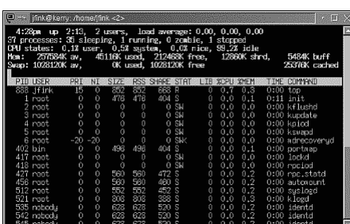

图 3.1

`top` 监控的一个示例。

表 3.1 解释了 `top` 中的监控字段。

### 表 3.1 top 监控字段

| 字段 | 描述 |
| --- | --- |
| up | 系统自上次重启以来已运行的时间。还会显示负载平均值。 |
| processes | 自上一次 `top` 监控检查以来运行的进程总数。此测量值包含了系统上的所有进程。 |
| CPU States | CPU 时间的平均百分比。此字段检查了 CPU 时间的所有方面，包括用户、空闲和需要的任务。由于包含了需要的任务，总和可能会超过 100%，如果出现这种情况，请不要警报（除非是一个离谱的值，例如 160%）。 |
| Mem | 所有内存统计数据，包括总内存、非内核进程的可用内存、使用内存以及共享和缓冲的内存。 |
| Swap | 交换分区统计，包括总分配的交换空间、可用交换空间和已用交换空间。 |

表 3.2 解释了 `top` 中的进程字段。

### 表 3.2 top 进程字段

| 字段 | 描述 |
| --- | --- |
| PID | 每个任务的进程 ID。 |
| USER | 每个任务的用户名。 |

### 表 3.2 top 进程字段（续）

| 字段 | 描述 |
| --- | --- |
| PRI | 每个任务的优先级。 |
| NI | 每个任务的 Nice 值。 |
| SIZE | 每个任务的总大小，包括代码和数据。 |
| RSS | 任务使用的物理内存量。 |
| SHARE | 任务使用的共享内存量。 |
| STATE | 当前状态：S 表示睡眠（sleeping），D 表示不可中断（uninterruptible），R 表示运行（running），T 表示停止（stopped），Z 表示僵尸（zombie）。 |
| TIME | 任务使用的 CPU 时间。 |
| %CPU | 使用 CPU 时间。 |
| %MEM | 任务使用的内存百分比。 |
| COMMAND | 命令名称。 |

### vmstat

`vmstat` 源自“虚拟内存”。`vmstat` 实用程序提供内核统计。

`vmstat` 输出的第一行是自启动以来各项统计数据的平均值，因此不要对高值感到惊。

`vmstat` 的输出实际上分为五个部分：`procs`、`memory`、`swap` 和 `cpu`。

每个部分在下表中列出。

### 表 3.3 procs 部分

| 字段 | 描述 |
|---|---|
| r | 处于等待状态且基本上什么都没做、等待运行的进程数量。 |
| b | 自上次更新以来，处于睡眠模式并被中断的进程数量。 |
| w | 被 mm 和 vm 子系统交换出尚未运行的进程数量。 |

### 表 3.4 memory 部分

| 字段 | 描述 |
|---|---|
| swpd | 使用的物理虚拟内存总量。 |
| free | 空闲或可用的物理内存量。 |
| buff | 测量时正在缓冲的内存。 |
| cache | 正在使用的缓存。 |

## Linux 常用 Unix 性能监控工具
第 3 章

表 3.5 交换（Swap）部分

| 字段 | 描述 |
| :--- | :--- |
| si | 从交换空间传回内存的内存量 |
| so | 交换到磁盘的内存 |

表 3.6 IO 部分

| 字段 | 描述 |
| :--- | :--- |
| bi | 每秒发送到磁盘设备的磁盘块数 |

表 3.7 系统（System）部分

| 字段 | 描述 |
| :--- | :--- |
| in | 每秒中断数，包括 CPU 滴钟中断 |
| cs | 内核内每秒上下文切换次数 |

表 3.8 CPU 部分

| 字段 | 描述 |
| :--- | :--- |
| us | 用于用户进程的 CPU 周期百分比 |
| sy | 用于系统进程的 CPU 周期百分比 |
| id | 当 CPU 基本闲置时，未使用的 CPU 周期或空闲时间百分比 |

解释这些测量结果的输出可以告诉你存在某些输出活动（如 `so` 字段所示）。此外，注意 `vmstat` 启动后系统部分 `in` 字段的增加。这意味着 `vmstat` 增加了中断数量。这里我们回到正确读取输出的观点。当系统空闲时查看本章涵盖的工具是一个好主意，这样你就知道性能监控工具会对系统产生什么影响。

# xload 和 xosview

与 Unix 系统许多命令行驱动工具一起的，还有基于 X11 的工具。本节介绍了其中两个：`xload` 和 `xosview`。它们是两个截然不同的图形化监控工具，提供了观察系统运行情况的快速视图。

## xload

两个中的第一个是 `xload`。简而言之，`xload` 显示系统平均负载。它还带有一个报警条，当平均负载较高时会显示。图 3.2 显示了 `xload` 的典型外观。

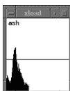

图 3.2
`xload` 示例。

要启动 `xload`，只需在系统上打开终端并输入以下内容：

```
$ xload &
```

系统知道去往哪个显示器，因此它会自动弹出。如果你从远程系统通过你的 X Window 系统运行 `xload`，你可以采取两种操作之一：

- 1. 在你的 `.profile` 中通过输入以下内容设置永久的 `DISPLAY` 变量：
  `DISPLAY=<your_ip_address>:0`
  `EXPORT DISPLAY`
- 2. 直接使用此语法将其指向你的系统：
  `$ xload -display <your_ip_address> &`

`xload` 工具显示系统平均负载的直方图（图表）。它定期更新信息。默认是每 10 秒一次，但可以通过 `-update` 选项进行更改。

## xosview

`xosview` 工具可以近乎实时地显示关于系统性能的详细直方图集合。

当然，你可以使用命令行选项通过 `+` 或 `-`（分别代表真和假）指定子系统，从而轻松在 `xosview` 中过滤你想看的内容。例如，如果不显示 CPU 直方图，语法如下：

```
$ xosview -cpu &
```

`xosview` 工具可以像 `xload` 一样，从远程系统启动到本地 X 服务器。颜色、字体和其他属性可以通过 Xresource 设置来控制。

## Linux 常用 Unix 性能监控工具
第 3 章

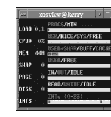

3.3 正在监控所有子系统的 xview。

`xview` 的一个有趣方面是，它将某些直方图合并到一个水平条中。这需要一些解释。

- LOAD——这有两种颜色。第一种颜色是进程的平均负载，第二种颜色（背景色）是相对于平均负载的空闲进程。当平均负载超过 1.0 时，条形将改变颜色。
- CPU——CPU 字段有四种与进程相关的颜色：usr、nice、sys 和 free。
- MEM——在该字段中，显示实际内存的使用量。该字段有四种颜色：用户分配的内存、共享内存、缓冲区（buffers）和空闲内存。
- SWAP——交换有两种颜色；第一种表示正在使用的交换，第二种表示空闲。
- PAGE——这有三种颜色：in（换入）、out（换出）和 idle（空闲）。
- DISK——这有三种颜色：in（传输到磁盘）、out（从磁盘传输）和 idle（空闲）。
- INTS——这是一组代表 IRQ 使用情况的指示。它们从左侧 0 开始编号。

## uptime

`uptime` 命令显示当前时间、系统运行的时间、用户数量以及系统过去 1、5 和 15 分钟的平均负载。它看起来像这样：

```
6:51PM up 2 days, 22:50, 6 users, load averages: 0.18, 0.30, 0.34
```

## 使用 Bonnie 对磁盘进行基准

大多数磁盘性能监控工具都内置在其他性能监控工具中（例如 `vmstat`）。然而，还有另一种方法。基准测试工具可以帮助确定性能瓶颈。

## 性能调优工具

工具如 `Bonnie` 实际上说明了未调优系统和调优系统之间的差异。除了通用工具和子系统特定工具，你还有多种混合工具可用。接下来的章节将详细介绍这些工具。

## ps

`ps` 命令是另一个与性能相关的常用工具。它通常用于隔离特定进程。在不带任何选项调用时，输出如下：

```
$ ps
3220 pts/0 00:00:00 bash
3251 pts/0 00:00:00 ps
```

这基本上告诉你是调用它的用户正在做什么。

要查看其他用户或整个系统，`ps` 需要更多的选项。Linux 上的 `ps` 命令实际上根据选择标准进行分组。

### 简单进程选择

使用简单的进程选择，你可以对你想看的内容进行一些筛选。例如，如果你只想查看连接到当前终端的进程，可以使用 `-T` 选项：

```
[jfink@kerry jfink]$ ps -T
1668 pts/0 S 00:00 login -- jfink
1669 pts/0 S 00:00 -bash
1708 pts/0 R 00:00 ps -T
```

### 按列表选择进程

使用 `ps` 控制显示内容的另一种方法是按列表类型进行查看。例如，如果你想查看所有正在运行的 `ident` 进程，可以使用该组中的 `-C` 选项，它会显示命令：

```
[jfink@kerry jfink$ ps -C ident
PID TTY             TIME CMD
535 ?               00:00:00 ident
542 ?               00:00:00 ident
545 ?               00:00:00 ident
546 ?               00:00:00 ident
550 ?               00:00:00 ident
```

### 输出格式控制

在进程选择之后是输出控制。当你想要以特定的格式查看信息时，这非常有帮助。一个很好的例子是使用 `-j` 选项查看作业（jobs）：

```
[jfink@kerry jfink$ ps -j
PGID SID TTY             TIME CMD
1669 1669 1668 pts/0      00:00:00 bash
1729 1729 1728 pts/0      00:00:00 ps
```

### 输出修饰符

输出修饰符可以对输出进行高级更改。`-e` 选项用于在运行 `ps` 后显示环境：

```
[jfink@kerry jfink$ ps -ae
PID TTY             STAT TIME COMMAND
1668 pts/0        S      00:00 login -- jfink
1669 pts/0        S      00:00 -bash TERM=ansi REMOTEHOST=172.164.102
HOME=/home/j
1754 pts/0        R      00:00 ps ae LESSOPEN|/usr/bin/lessipe sh %s
```

剩余部分是 `INFORMATION`（信息），提供版本信息和帮助，以及 `OBSOLETE`（废）选项。接下来的三个部分给出了使用特定选项运行 `ps` 的一些案例。

### 一些 ps 输出示例

当然，阅读手册页（man page）是必要的，但一些实用的应用示例总是能指明方向。

在 Linux 和 BSD 系统上最常用的 `ps` 是：

```
$ ps aux
USER       PID %CPU %MEM VSZ RSS TTY STAT TIME COMMAND
root         1  0.0  0.0 1116 380 ?        S Jan27 00:01 init [3]
```


# 第 3 章

## Linux Linux Unix 性能监控工具

| USER | PID | %CPU | %MEM | VSZ | RSS | TTY | STAT | TIME | COMMAND |
|---|---|---|---|---|---|---|---|---|---|
| root | 2 | 0.0 | 0.0 | 0 | ? | SW | Jan27 | 0:03 | [kflush] |
| root | 3 | 0.0 | 0.0 | 0 | ? | SW | Jan27 | 0:18 | [update] |
| root | 4 | 0.0 | 0.0 | 0 | ? | SW | Jan27 | 0:00 | [kpiod] |
| root | 5 | 0.0 | 0.0 | 0 | ? | SW | Jan27 | 0:38 | [kswapd] |
| bin | 266 | 0.0 | 0.0 | 1112 | 452 | ? | S | Jan27 | 0:00 | portmap |
| root | 283 | 0.0 | 0.0 | 1292 | 564 | ? | S | Jan27 | 0:00 | syslog -m 0 |
| root | 294 | 0.0 | 0.0 | 1488 | 700 | ? | S | Jan27 | 0:00 | klogd |
| daemon | 308 | 0.0 | 0.0 | 1132 | 460 | ? | S | Jan27 | 0:00 | /usr/sbin/atd |
| root | 322 | 0.0 | 0.0 | 1136 | 460 | ? | S | Jan27 | 0:00 | crond |
| root | 322 | 0.0 | 0.0 | 1136 | 460 | ? | S | Jan27 | 0:00 | crond |
| root | 336 | 0.0 | 0.0 | 1260 | 412 | ? | S | Jan27 | 0:00 | inetd |
| root | 371 | 0.0 | 0.0 | 1096 | 408 | ? | S | Jan27 | 0:00 | rpc.quotad |
| root | 382 | 0.0 | 0.0 | 1464 | 168 | ? | S | Jan27 | 0:00 | [rpc.mount] |
| root | 393 | 0.0 | 0.0 | 0 | ? | SW | Jan27 | 2:15 | [nfsd] |
| root | 394 | 0.0 | 0.0 | 0 | ? | SW | Jan27 | 2:13 | [nfsd] |
| root | 395 | 0.0 | 0.0 | 0 | ? | SW | Jan27 | 2:13 | [nfsd] |
| root | 396 | 0.0 | 0.0 | 0 | ? | SW | Jan27 | 2:12 | [nfsd] |
| root | 397 | 0.0 | 0.0 | 0 | ? | SW | Jan27 | 2:12 | [nfsd] |
| root | 398 | 0.0 | 0.0 | 0 | ? | SW | Jan27 | 2:12 | [nfsd] |
| root | 399 | 0.0 | 0.0 | 0 | ? | SW | Jan27 | 2:11 | [nfsd] |
| root | 400 | 0.0 | 0.0 | 0 | ? | SW | Jan27 | 2:14 | [nfsd] |
| root | 428 | 0.0 | 0.0 | 1144 | 488 | ? | S | Jan27 | 0:00 | gpm -t ps/2 |
| root | 466 | 0.0 | 0.0 | 1080 | 408 | tty1 | S | Jan27 | 0:00 | /sbin/mingetty |
| --tt | 467 | 0.0 | 0.0 | 1080 | 408 | tty2 | S | Jan27 | 0:00 | /sbin/mingetty |
| --tt | 468 | 0.0 | 0.0 | 1080 | 408 | tty3 | S | Jan27 | 0:00 | /sbin/mingetty |
| --tt | 469 | 0.0 | 0.0 | 1080 | 408 | tty4 | S | Jan27 | 0:00 | /sbin/mingetty |
| --tt | 470 | 0.0 | 0.0 | 1080 | 408 | tty5 | S | Jan27 | 0:00 | /sbin/mingetty |
| root | 471 | 0.0 | 0.0 | 1080 | 408 | tty6 | S | Jan27 | 0:00 | /sbin/mingetty |
| --tt | 3326 | 0.0 | 0.0 | 1708 | 892 | ? | R | Jan30 | 0:00 | in. |
| root | 3327 | 0.0 | 0.0 | 2196 | 1090 | pts/0 | S | Jan30 | 0:00 | login |
| jfink | 3328 | 0.0 | 0.0 | 1764 | 1072 | pts/1 | S | Jan30 | 0:00 | bash |
| jfink | 3372 | 0.0 | 0.0 | 2692 | 1080 | pts/2 | R | Jan30 | 0:00 | ps |

### 性能工具

输出中总共显示了六个（get进程）。还有 NFS 进程；如果系统不经常使用，该数字可以减少到合理的范围内。现在你可以看到在哪里可以进行调优。有些进程不需要运行，但那些需要多个实例的（例如 MySQL 或 HTTP）可以减少到最小。

### 进程树

进程树是查看进程之间关系的极佳方法。以下输出与上一个部分的相同：

USER      PID  VSZ RSS TTY STAT TIME COMMAND
root      1  1116 380 ?        S Jan27 00:01 init [3]
root      2    ...  ...  ?   SW  Jan27 0:03 [kflush]
root      3    ...  ...  ?   SW  Jan27 0:18 [update]
root      4    ...  ...  ?   SW  Jan27 0:00 [kpiod]
root      5    ...  ...  ?   SW  Jan27 0:38 [kswapd]
bin       266 1112 452 ?        S Jan27 0:00 portmap
root      283 1292 564 ?        S Jan27 0:00 syslog -m 0
root      294 1488 700 ?        S Jan27 0:00 klogd
daemon    308 1132 460 ?        S Jan27 0:00 /usr/sbin/atd
root      322 1136 460 ?        S Jan27 0:00 crond
root      322 1136 460 ?        S Jan27 0:00 crond
root      336 1260 412 ?        S Jan27 0:00 inetd
root      371 1096 408 ?        S Jan27 0:00 rpc.quotad
root      382 1464 168 ?        S Jan27 0:00 [rpc.mount]
root      393 0      ?   SW  Jan27 2:15 [nfsd]
root      394 0      ?   SW  Jan27 2:13 [nfsd]
root      395 0      ?   SW  Jan27 2:13 [nfsd]
root      396 0      ?   SW  Jan27 2:12 [nfsd]
root      397 0      ?   SW  Jan27 2:12 [nfsd]
root      398 0      ?   SW  Jan27 2:12 [nfsd]
root      399 0      ?   SW  Jan27 2:11 [nfsd]
root      400 0      ?   SW  Jan27 2:14 [nfsd]
root      428 1144 488 ?        S Jan27 0:00 gpm -t ps/2
root      466 1080 408 tty1 S     Jan27 0:00 /sbin/mingetty
--tt      467 1080 408 tty2 S     Jan27 0:00 /sbin/mingetty
--tt      468 1080 408 tty3 S     Jan27 0:00 /sbin/mingetty
--tt      469 1080 408 tty4 S     Jan27 0:00 /sbin/mingetty
--tt      470 1080 408 tty5 S     Jan27 0:00 /sbin/mingetty
root      471 1080 408 tty6 S     Jan27 0:00 /sbin/mingetty
--tt      3326 1708 892 ? | R | Jan30 0:00 in.
root      3327 2196 1090 pts/0 | S | Jan30 0:00 login
jfink    3328 1764 1072 pts/1 | S | Jan30 0:00 bash
jfink    3372 2692 1080 pts/2 | R | Jan30 0:00 ps

进程树是查看进程之间关系的极佳方法。以下输出与上一个部分的相同：

输出中显示了六个。如果系统不经常使用，该数字可以减少到合理的范围内。现在你可以看到在哪里可以进行调优。有些进程不需要运行，但那些需要多个实例的（例如 MySQL 或 HTTP）可以减少到最小。

## free

`free` 命令可以快速获取关于 Linux 系统内存状态的标签。`free` 的语法非常直观：

```
$ free
```

以下是 `free` 命令的输出示例：

| total | used | free | shared | buffers | cached |
| --- | --- | --- | --- | --- | --- |
| Mem: | 1036152 | 1033560 | 2592 | 8596 | 84488 | 932080 |
| + buffers/cache: | | 16632 | 1019520 | | | |
| Swap: | 265064 | 380 | 264684 | | | |

输出的第一行显示物理内存，最后一行显示关于交换分区（swap）的类似信息。表 3.9 解释了 `free` 的输出。

### 表 3.9 free 命令输出字段

| 字段 | 说明 |
| --- | --- |
| total | 用户可用内存总量，不包括内核内存。（当此值低于机器物理内存时请不要惊慌。） |
| used | 已用内存总量。 |
| free | 空闲内存总量。 |
| shared | 使用的共享内存总量。 |
| buffers | 磁盘缓冲区缓存当前的大小。 |
| cached | 从磁盘缓存的内存量。 |

对示例输出的分析显示该系统似乎运行健康。当然，这仅仅是一次测量。如果你想随时间观察内存使用情况怎么办？`free` 命令提供了一个实现该功能的选项：`-s` 选项。`-s` 按指定的间隔激活轮询。以下是一个示例：

```
$ jfink@kerry jfink$ free -s 60
```

```
total used free shared buffers cached

Mem: 257584 65244 192340 12132 40064 4576

+- buffers/cache: 26064 236980

Swap: 1028120 0
```

按下中断键停止 `free` 轮询。

这些测量显示系统相当空闲，但当你想要查看某个特定命令对系统的影响时，`free` 命令就会派上用场。在系统空闲时运行该命令，并使用 `free` 轮询内存。由于输出粒度很高，`free` 非常适合这项工作。

## time

检查系统的一个非常简单的工具是 `time` 命令。`time` 命令对于快速检查调用特定命令时系统的性能非常有用。它的工作原理很简单：`time` 返回一个包含进程信息的字符串值，并以如下方式启动进程的：

```
$ time <command_name> [options]
```

这里是一个示例：

```
$ time cc hello.c -o hello
```

`time` 命令的输出如下：

```
$ cc hello.c -o hello
0.08Buser 0.04system 0.0011elapsed 17%CPU (%avgcpu+0avgdata 0maxresident)
inputs+outputs (985major+522minor)pagefaults0swaps
```

尽管这些输出是底层的，但 `time` 命令可以返回关于特定命令或程序的启发性信息。在操作通常需要很长时间的大型环境中，它变得非常有用。其中一个例子是比较不同机器之间的内核编译时间。

## 某些网络监控工具

许多系统性能可能取决于网络等外部因素。Unix 拥有大量工具来检查网络性能，从单主机监控软件到可以监控和管理大型广域网（WAN）的应用程序。本节介绍了监控网络活动的相对简单的应用程序：

## 性能调优工具
第二部分

- `ping`
- `traceroute`
- `tcpdump`
- `ntop`

### ping

该实用是一个非常简单的程序，最用于简单查看主机在网络上是否活跃。然而，`ping` 的返回信息通常可以告诉你特定到主机连接的性能如何。以下是 `ping` 会话的示例：

```
$ ping tesla
PING tesla.de.asi (192.187.226.6): 56 data bytes
64 bytes from 192.187.226.6: icmp_seq=0 ttl=255 time=6.119 ms
64 bytes from 192.187.226.6: icmp_seq=1 ttl=255 time=0.620 ms
64 bytes from 192.187.226.6: icmp_seq=2 ttl=255 time=3.483 ms
...
```

## Linux 常用 Unix 性能监控工具

第三章

### 表 3.11

| 命令字符串 | 应用场景 |
|---|---|
| tcpdump tcp host <ip_address> | SYN 洪水攻击 |
| tcpdump dst host <ip_address> | 网络协议栈溢出（又称死亡之包） |
| tcpdump icmp dst host <broadcast_address> | Smurf 攻击 |
| tcpdump -e host <ip_address> | 重复 IP 地址 |
| tcpdump arp | ARP 配置错误 |
| tcpdump icmp | 路由问题 |

例如，假设你想查看本地网络上的 ICMP 流量：

```
### [root]@kerry# tcpdump icmp
Kernel filter, protocol ALL, datagram packet socket
tcpdump: listening on all devices
11:48:30.214757 eth1 M 172.16.141.99 > 192.187.225.50: icmp: echo request
11:48:30.215135 eth1 M 172.16.141.99 > router.local.net: icmp: echo request
11:48:32.277764 eth1 M 172.16.141.99 > frame.local.net: icmp: echo request
```


此输出告诉你，有许多来自 `172.16.141.99` 节点的回显请求（echo requests）。事实上，这是一个正在安装的新路由器，管理员正在从路由器对网络探测。

## ntop

对于持续网络监控，一个特别有用的工具是 `ntop` 实用。基本上，`ntop` 显示了网络使用率最高的用户。图 3.5 显示了 `ntop` 在终端中运行的情况。

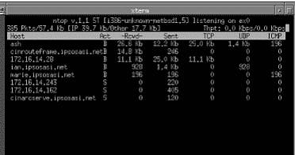

图 3.5

运行中的 `ntop`。

`ntop` 实用具有大量的命令行选项和交互式命令。表 3.12 给出了一些较有趣的选项示例。

- `-r` 更改 `ntop` 更新屏幕显示的刷新率。这对于确定可能发生问题的时间范围非常有帮助。
- `-p` 指定要监控的 IP 协议。如果默认是全部，则此选项可以作为过滤器。
- `-l` 将 `ntop` 捕获的信息记录到 `ntop.log` 中。这里的一个应用是对 `ntop` 结果进行后期分析。

解释 `ntop` 非常直观。Host（主机）字段包含主机名（如果可以解析）或 IP 地址。

### 表 3.13 ntop 输出字段

| 字段 | 说明 |
|---|---|
| Host Act | 包含主机名（如果可以解析）或 IP 地址提供有关主机的更多信息：指示主机已接收和发送了数据。R 表示主机接收了数据。S 表示主机发送了数据。I 表示主机处于空闲状态。 |
| Rcvd Sent <protocol> | 显示主机在更新之间接收的流量量。显示主机在更新之间发送的流量量。提供三列（TCP、UDP 和 ICMP），显示协议类型的变化。 |

为了更好地理解这些，请考虑下面这一行作为示例：`cingwise.ipsosasi.net S 2.2 Kb 4.8 MB 1.8 Kb 420 0 0`

主机名是 `cingwise.ipsosasi.net`，主机最后的操作是发送了流量。在最后一次更新期间，它接收了 2.2Kb 和 4.8MB；更新之间 TCP 协议的流量差异为 420 字节。

`ntop` 实用对于观察通用的网络活动非常有用。

## 总结

本章研究了移植到 Linux 或为 Linux 编写的常用 Unix 工具。它还涵盖了对这些工具输出内容的分析。下一章将转向专门为 Linux 设计的性能监控工具。

# Linux 特有工具

第四章

## 性能调优工具

第二部分

性能监控和调优并不是容易的任务。这两者都需要庞大的工具箱以及准确理解这些许多工具所传达的信息的专业知识。第三章“Linux 常用 Unix 性能监控工具”讨论了如何解释 Unix 操作系统的通用工具。

除了理解通用工具的正常复杂性外，操作系统也有自己的特性或差异。所有的 Unix 或 Unix 类操作系统都有它们自己的不同。在某些情况下，这些差异只体现在系统管理命令中；在其他情况下，性能分析师面临着底层子系统和架构的无数差异。

由于操作系统之间这些底层差异，甚至是这些系统的不同版本，性能监控工具必须针对操作系统进行定制。许多工具（通用工具）是可移植的，或者很容易为 Linux 仿真（`vmstat` 就是一个例子）。然而，并不是所有的工具都易于移植，有时为特定的操作系统专门设计一个工具会更容易。

Linux 内核启发了许多软件作者编写专门针对 Linux 内核及其子系统的工具。这在某种程度上归功于 `ibiblio.org`（前身为 `metalab`，再称为 `synes`）的努力。作者们可以编写自己的工具，将其打包并上传到 `ibiblio.org` 的 FTP 服务器，供 Linux 世界的其他部分免费使用。

本章研究了专门为 Linux 设计的工具，以及适用于 Unix 操作系统的工具。

## 针对 Linux 的 sysstat

在 1999 年，一位名为 Sebastian 的软件作者为 Linux 编写了一系列工具。这部分归功于 `ibiblio.org` 的努力。作者们可以编写自己的工具，将其打包并上传到 `ibiblio.org` 的 FTP 服务器，供 Linux 世界的其他部分免费使用。

本章研究了专门为 Linux 设计的工具，以及适用于 Unix 操作系统的工具。

`sysstat` 软件包可以从 `ftp://ibiblio.org/pub/Linux/system/` 下载，也可以从 `sysstat` 网站下载。

## Linux 下的 iostat

`iostat` 是一种是一个常用的工具。

正如你可能猜到的，`iostat` 监控 I/O。

第一部分报告包含系统启动信息。CPU 利用率报告是第二个。它包含：

- `%user`
- `%nice`
- `%sys`
- `%idle`

表 4.1 说明了每个字段。

### 表 4.1 iostat CPU 利用率字段

| %user | 仅用户进程的 CPU 利用率百分比 |
| %nice | 在 nice 级别下的 CPU 利用率百分比 |
| %sys | 在系统模式下的 CPU 利用率百分比 |
| %idle | CPU 空闲或无操作的百分比 |

值得注意的是这里的一些术语：`%user` 和 `%nice` 字段发生在应用层，或者人们（特别是 BSD 社区）所说的“userland”（用户态）。`%sys` 字段发生在内核层，或特权模式。应用、非特权和用户态（在此语境下）这些术语意思相同——指的是无法直接访问内核的进程。同样，系统、特权和内核（在此语境下）指的是可以直接与内核通信的进程。

`iostat` 的通用语法为：

```
iostat -c -d
```

以下是 `iostat` 的示例：

```
avg-cpu: %user%nice%sys%idle

           0.00  0.00  0.00 100.00

device: tps    kB_read/s  kB_wrtn/s  kB_read  kB_wrtn

sda             1.00      0.00      0.00      0.00      0.00

sdb             0.00      0.00      0.00      0.00      0.00
```

报告的后续部分设备利用率字段。表 4.2 解释了每个字段的含义。

### 表 4.2 iostat 默认设备利用率字段

| tps | 发送到设备的每秒传输详细列表。 |
| kB_read/s | 从设备读取的数据量。对于这些磁盘，这以每秒块数表示。 |
| kB_wrtn/s | 写入设备的数据。同样，这以每秒块数表示。 |
| kB_read | 每秒从设备读取的块数。 |
| kB_wrtn | 每秒写入设备的块数。 |

让我们解释之前所示示例的输出。根据输出的字段，在测量时该系统正在进行大量的写入

# Linux 特有工具
第 4 章

已占用。如果你查看第二组报告，你会发现 `nice` 字段为 0.40。实际上，在两次测量期间都在写入一个大型二进制文件。在第一次运行期间，它以默认优先级运行；当再次运行时，`nice` 值被修改了。

## 额外的 iostat 选项

可以通过几个选项修改 `iostat -u` 的输出和信息。

以下是使用 `-c` 选项仅显示 CPU 利用率报告，并使用 `-d` 饰符显示设备报告的示例输出：

```
[jfink@kerry jfrank] iostat -c 2 2

Linux 2.2.14-5.0s (kerry)	03/09/01

avg-cpu: %user %nice %sys %idle

       0.01 0.00 0.01 9.73

avg-cpu: %user %nice %sys %idle

       0.00 0.00 0.00 100.00

[jfink@kerry jfrank] iostat -d

Linux 2.2.14-5.0s (kerry)	03/09/01

Device:  tps  Blk/read  Blk/wrt/s  Blk_read  Blk_wrt

hdisk0   0.05  0.12       0.24      236966    460096

hdisk1   0.00  0.00       0.00               0         0

hdisk2   0.00  0.00       0.00               0         0

hdisk3   0.00  0.00       0.00               0         0
```

`mstat` 工具提供了另一种查看处理器统计数据的方法。显而易见，Sebastian Godrast 演绎了一句非常古老的 Unix 格言，正如整个 Linux 社区所做的一：做事情绝对不止一种方法。

引用手册页，`mstat` “报告与处理器相关的统计数据”。这意味着默认情况下，`mstat` 以平均值报告支持 SMP（对称多处理）系统的每个处理器的信息。在单处理器（或 UP）机器上，信息始终是平均值。

在最简单的格式下，可以这样调用 `mstat`：

`mpstat`

以下是指定了间隔和计数的 `mpstat` 使用示例：

```
[jfink@kerry sysstat-3.3.6]$ mpstat 10 2

Linux 2.2.14-5.0s (kerry)	05/21/01

09:04:36 AM CPU %user %nice %system %idle  intr/s

09:04:46 AM all      0.50   0.00    1.20    98.30   157.60

09:04:56 AM all      0.50   0.00    0.20    99.30   162.00

Average:  all      0.50   0.00    0.70    98.80   159.80
```


## 性能优化工具

第二部分

表 4.3 描述了 `mpstat` 中的不同字段：

### 表 4.3 mpstat 字段

| CPU | 说明 |
| :--- | :--- |
| CPU | 正在查看的处理器。由 `-P` 选项指定。然而，单处理器机器上不支持 `-P` 选项。 |
| %user | 来自用户态的利用率。 |
| %nice | 使用修改过的 nice 优先的用户进程产生的利用率。 |
| %system | 在特权模式下发生的利用率。 |
| intr/s | CPU 每秒接收到的总数。 |

## htop 和 gtop

除了为 Linux 操作系统开发或最初运行其上的大量命令行工具外，还有 GUI 驱动的实用程序。本节简要查看了其中两个：

- `ktop`，或 KDE top
- `gtop`，或 GNOME top

这些插图是 `ktop` 和 `gtop` 运行时的各种快照。图 4.1 显示了当前用户的运行进程。

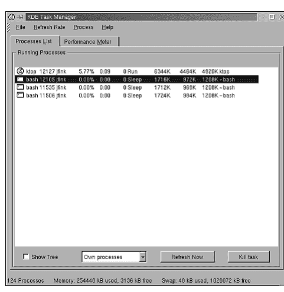

图 4.1 一个 `ktop` 单用户进程列表。

`ktop` 的字段与 `top` 类似。从左到右，字段如表 4.4 所示。

### 表 4.4 ktop 字段

| 名称 | 说明 |
| :--- | :--- |
| PID | 进程 ID |
| Username | 运行进程的用户名 |
| CPU% | CPU 使用率（百分比） |
| Time | 进程使用的 CPU 时间 |
| Priority | 进程优先级 |
| State | 进程的当前状态 |
| Memory | 进程使用的内存量 |
| Resident | 进程使用的驻留内存大小 |
| Shared | 进程使用的共享内存大小 |
| Command Line | 调用进程的命令行 |

图 4.2 显示了系统上的所有进程。

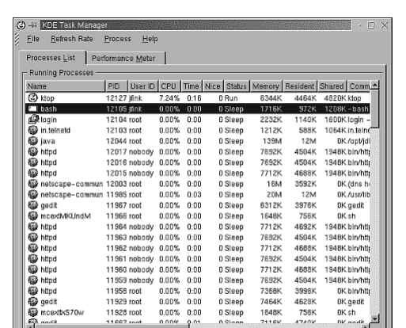

图 4.2 `ktop` 所有用户进程列表。

Linux 特有工具 第二部分

与控制台的 `top` 相比，这提供了更多信息并有一个大优势：你可以滚动整个列表。图 4.3 中的选项卡显示了系统运行情况的性能表。

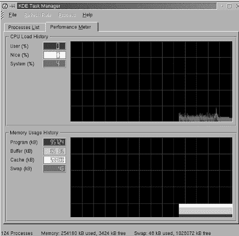

图 4.3 `ktop` 性能表。

性能表一目了然。左侧是图表的精确表示图例。表的上半部分显示 CPU 负载。左侧是三个显示测量百分值的条形；右侧是 CPU 活动直方图。

- User%: 用户进程的百分比
- Nice%: 修改 nice 的进程百分比
- System%: 在特权模式下运行的进程百分比

表的下半部分显示内存直方图。它与大多数监控具有相同的字段，但左侧的值是 KB。字段如下：

- Program: 使用内存的程序
- Buffer: 缓冲区使用量
- Cache: 缓存使用量
- Swap: 交换空间使用量

此特定图显示了一个在使用大量内存时非常安静的系统。然而，在某一点，系统活动上升了；这实际上是由用户运行的大文件引起的。图 4.4 中的 `gtop` 视图显示了所有运行进程。

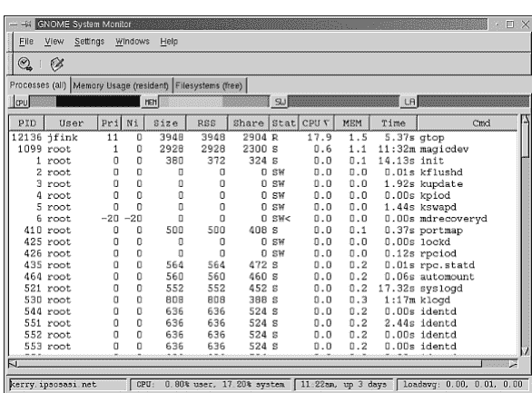

图 4.4 `gtop` 利用所有进程。

`gtop` 工具的功能上与 `ktop` 类似。不过 GUI 有所不同。`gtop` 的进程监控字段一目了然，且与 `ktop` 类似。然而，实际的进程列表是条形图。这些显示了关于 CPU、内存、交换空间和延迟等通用信息的微直方图。

图 4.5 显示驻留内存使用图。左侧的条形是进程使用内存的图形表示，延伸到右侧，由进程名称、特定实例数量及其驻留大小表示。

```
total:    used:    free: buffers: cached:

Mem: 263766016 110858240 152907776 12779520 70127616 18976768

Swap:             0 1052794880

MemTotal:   257584 kB

MemFree:    149324 kB

MemShared:   12480 kB
```

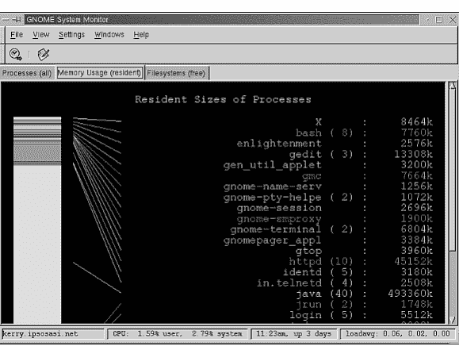

图 4.5 `gtop` 性能指标。

在图 4.6 的 `gtop` 视图中，显示了磁盘使用统计。

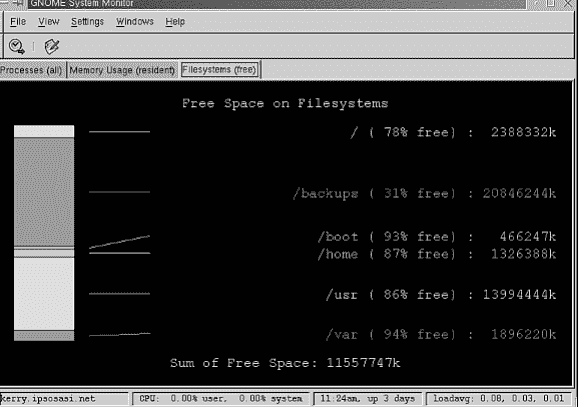

图 4.6 `gtop` 磁盘使用图。

下一个选项卡显示文件系统使用信息。同样，左侧有一个相对图，右侧是匹配的彩色线条。然而，在这种表示文件系统。注意的是，此图没有区分本地和 NFS 挂载的文件系统。

通过 `ktop` 和 `gtop`，性能分析人员都有更改其所访问的进程状态的能力。显然，作为 root，可以更改所有进程。使用它们，可以使用鼠标选择并修改有权更改的进程。例如，在 `ktop` 中，高亮进程名称并点击鼠标右键产生选项列表。

## 使用 /proc 文件系统监控系统活动

早些在 Unix（特别是 Linux）中提到，大量工具本质上收集相似的信息，并以非常不同的方式输出。在 Linux 下获取这些信息非常容易。大多数为 Linux 编写性能监控工具的软件编写人员都使用了 `/proc` 文件系统，性能分析人员也可以利用它。使用 `/proc` 的开发者认为从编程角度来看，它比使用子系统更简单。例如，为了不使用 `/proc` 访问信息，开发者必须使用 C 语言（在某些时候，即使它链接到另一种语言中）来访问信息的子程序。在 `/proc` 接口内部，信息的处理几乎类似于任何其他普通文件操作，因此现在有多种语言供开发者选择。

在最原始的形式中，读取 `/proc` 中的信息只是定期地连接（`cat`）文件。然而，这看起来并不明智。一个更好的解决方案可能是编写一个脚本或程序（使用分析人员偏好的任何语言）来完成这项工作。在有这么多工具可用的情况下，也有非常充分的理由说明为什么人们想这样做。答案很简单：你可以这样做。

在不涉及过多 `/proc` 细节的情况下，一个简单的示例是有帮助的。

在这个示例中，创建一个模仿 `free` 工具某些功能的命令行工具要稍微容易一点。实际数据是 `/proc/meminfo`，检查后看起来如下：

（此处代码块已包含）

## 性能优化工具
第二部分

| 指标 | 值 |
| :--- | :--- |
| 缓冲区 (Buffers) | 68484 kB |
| 缓存 (Cached) | 18532 kB |
| 大总量 (BigTotal) | 0 kB |
| 大空闲 (BigFree) | 0 kB |
| 交换总量 (SwapTotal) | 1028120 kB |
| 交换空闲 (SwapFree) | 1028120 kB |

显然，定期运行达到类似的结果，但无法快速阅读。简单的答案是编写一个脚本。在这种情况下，数据源是固定格式，因此可以使用任何语言。为了原型设计，将使用 Perl。解析文件最简单的方法将其加载到数组中，然后解析为所需的结果。为了简洁，将使用前两行；然而，通过明智地使用 `chop()` 或 `chomp()`，`/proc/meminfo` 文件中的每一行都可以大显身手。还需要注意的是，这是一个本地脚本，而不是发布给公众或另一个服务器的程序。当你向公众发布程序时，必须考虑许多其他因素（例如 `/proc/meminfo` 不同内核版本之间的文件格式）。

脚本名称为 `get_mem`；以下是代码：

```perl
#!/usr/bin/perl

# get_mem:
#   将 /proc/meminfo 文件加载到数组中并
#   默认打印一次前 2 行，或者
## 根据参数定期打印
#
# 这充其量只是个权宜之计，我很惊讶它竟然 true一个函数
## 将 /proc/meminfo 加载到数组中并将数组返回给调用者
sub localfile {
  if (-e "/proc/meminfo") {
    $MEMINFO = "/proc/meminfo";
    open($MEMINFO, "<", $MEMINFO);
    @mem_array = <$MEMINFO>;
    close($MEMINFO);
    return @mem_array;
```


```perl
} else {
    print "no /proc/meminfo found!\n";
    exit 1;
}
```

## 主程序

## 检查输入

```perl
if (@ARGV >= 3) {
    print "too many parameters\n";
}
print "get_mem usage <count>\n";
```

# 检查间隔和计数；否则执行一次

```perl
if (@ARGV > 1) {
    $sec = $ARGV[0];
    $int = $ARGV[1];
}
```

## 读取并打印直到计数为 0

```perl
until ($int == 0) {
    @mem_array = localfile();
    print @mem_array[0..2];
    $int--;
}
```

## 除非是最后一次

```perl
if ($int >= 1) {
    sleep($sec);
}
else
@mem_array = localfile();
print @mem_array[0..2];
```

默认输出如下：

```
jfink@kerry-jfink$ head -3 /proc/meminfo
total: used: free: shared: buffers: cached:
Mem: 263766016 11575048 152199076 1373440 70512192 19509248
Swap: 105279480 0 105279480
```

当提供间隔和计数时，输出如下：

```
jfink@kerry-jfink$ get_mem 5
total: used: free: shared: buffers: cached:
Mem: 263766016 1282102 15083984 1661376 70512192 1951334
Swap: 105279480 0 105279480
total: used: free: shared: buffers: cached:
```

正如源代码所示，`get_mem` 充其量只是个权宜之计，但很容易看到谨慎地使用 `/proc` 对性能分析有益。

同样有趣的是，当不带任何参数运行 `get_mem` 时，输出是相同的：

```
jfink@kerry-jfink$ head -3 /proc/meminfo
total: used: free: shared: buffers: cached:
Mem: 263766016 12412584 152338432 12787712 70152192 19521536
Swap: 105279480 0 105279480
```


进入`/path/to/xxx`目录，找到`xxx.json`。

在表达式`cvar = avar + bvar`中，加法运算符（`+`）将`avar`与`bvar`相加，得到它们的和`cvar`

在`List.of(arg0, arg1, arg2)`中，`List`接口的工厂方法`of()`接受一系列的元素，返回包含它们的只读列表。

之后我们这样调用`cmd`命令：`cmd arg0 arg1 arg2`。

```
if (condVar > someVal) {console.log("xxx")}
```

这对于初学者来说很有启发。

关于`/proc`的更多信息可以在内核在线文档`/usr/src/linux/Documentation/filesystems/proc.txt`中可以找到。

## 其他免费工具

`ibili` FTP 服务器提供了许多用于 Linux 性能监控和调的工具。其他网站也有列表工具，包括：

- Freshmeat: http://www.freshmeat.net/
- Appwatch: http://www.appwatch.com/

除了所有的命令行工具，许多`ibilio`工具是 GUI 驱动的。

## 总结

虽然传统的 Unix 工具是性能分析师和系统管理员工具箱很好的补充，但有时使用专门为 Linux 内核设计的工具是最好的。此外，`/proc`文件系统接口为系统管理员编写自己的脚本和程序来分析内核提供了方便的方法。

# 第三部分：性能监控技术

## 本部分内容

- 5 显性与隐性瓶颈 85
- 6 X Window性能 99
- 7 网络性能 119

## 第 5 章
## 显性与隐性瓶颈

### 总是存在瓶颈

需要记住的是系统中总是存在瓶颈。如果系统过载，瓶颈就是 CPU。如果 CPU 没有被过度使用，瓶颈可能是 I/O 或网络。如果这些都不是瓶颈，那么可能是内存。

瓶颈可以是任何东西，但找到它是什么是关重要的。一旦你确定了它，就可以尝试缓解它。如果瓶颈是 CPU，你可以尝试获取更快的处理器。如果瓶颈是 I/O，你可以尝试使用更快的驱动器。如果瓶颈是网络，你可以尝试使用更快的网络。如果瓶颈是内存，你可以尝试增加更多内存。

## 性能优化工具

### 优化 CPU 瓶颈

解决 CPU 瓶颈的机会取决于你的应用程序。作为开始，假设你的应用程序运行在单处理器机器上。通过对系统使用进行监控，你发现 CPU 与系统其他部分相比被过度使用。你有几个选择。一个显而易见：获取更快的处理器。这将减少你的应用程序对系统造成的压力。

如果你已经在使用可以获取的最快 CPU，仍然存在瓶颈呢？在这种情况下，你可能需要一个 SMP 。取决于应用程序，不同数量的 CPU 可能是合适的。另一个因素是你的应用程序是否会从这种硬件中受益。如果它通过派生独立的进程来工作，它可以受益。更优的方法是线程模型，允许它跨现有的 CPU 扩展计算，但这可能需要比你现有的应用程序更深入的知识。

向你的供应商查询通过使用 SMP 机器将获得哪些处。Linux 可以扩展到许多 CPU，取决于架构。在 32 位系统上，它可以处理 32 个处理器，在 64 位架构上可以管理 64 个。但收益可能没有如

## 性能监控技术

第三部分

当你接近这一限制时，情况会显而易见。实际上，在 32 位系统上，Linux 可以相当顺利地扩展到 2 个、4 个和 8 个 CPU 系统，但在 16 个及以上的 CPU 上会出现一些性能下降。还请记住，当你达到这些限制时，系统极有可能已经过载了其他子系统（例如内存总线），而你的瓶颈已经转移到了其他地方。如果你的需求已经得到满足，那很好，但你可能会在第 2 章简要讨论的“性能调优的方面”中提到的另一个领域遇到性能问题，不过其中一些知识可能是有需要的。考虑这样的情况：你的应用程序正在执行许多计算，其中大多数计算可以独立完成。如果你的应用程序是以线程方式编写的，那么多个 CPU 将允许调度器很不错地运行某些计算。这只有在应用程序使用 POSIX 线程编写时才成立。如果它是使用用户态线程编写的，它就无法利用其他 CPU，除非由于你的负载很高，你可能扩展了架构。Intel 一直不断升级，但它也有其局限性。某些应用程序可能更适合另一种架构，例如 Compaq 的 Alpha，这是一种以快速著称的 64 位架构。

如果你确实在挑战单机性能的极限，那么集群可能是下一个最佳选择。少数应用程序可以开箱即用并使用本地集群。当然这只是一个例子——Linux 已经移植到许多架构上。

另一个可能感兴趣的架构是非均性内存访问 `NUMA`。在这样的系统中，节点维护本地内存并尝试保持数据本地化，因为协调对其他节点内存的访问的成本更高。虽然这通常被认为是内存带宽瓶颈，但它有助于扩展性，因为本地节点可以充分利用 CPU。SGI 为 Linux 支持 `NUMA` 做出了贡献，尽管这不是一个非常常见的选项。有传言说，各种芯片制造商正将未来系统转向 `NUMA`，但效果仍待观察。

## 软件解决方案

硬件问题很难规避，因为你通常受限于系统的物理架构。你可能运行着最先进的硬件，但可能还不够。在这种情况下，你需要准确查看你运行的是哪些软件以及它是如何配置的。虽然这需要对你的问题有深入的了解，但解决方案比硬件便宜得多且更容易部署。

## 通用应用程序调优

在你开始向问题投入硬件之前，请确保你的应用程序配置正确。确保关闭你没有使用的应用程序组件。例如，如果是一个向某些客户端接收流数据的流媒体工具，你可能在传输完成后不再需要这些内容。确保它只做你需要的事情——而不做多余。这听起来可能显而易见，但大部分收益可以通过分析你的系统获得。由于这项任务高度依赖于系统的需求，因此必须根据具体情况进行。

正如在前面的章节“硬件解决方案”中提到的，了解你应用程序的能力可能也是一个好主意。如果你发现你的应用程序无法从更多 CPU 中获益，而且你已经拥有了尽可能快的硬件，那么可能是时候寻找另一种解决方案了——这意味着一个功能更强大的软件。

## 特定的集群解决方案

在科学应用领域，通过编写具有集群感知能力的代码或选择能够利用集群（如果存在的话）的产品，可以实现巨大的性能提升和扩展性。

## Beowulf

当大多数人想到集群和 Linux 时，Beowulf 集群是脑海中首先浮现的系统。通过编写代码来利用这些集群能力，计算可以相对容易地分发到一组机器上。不过，这有几个前提条件。其之一是你的问题必须能够内在并行。如果它依赖于串行计算且不能拆分为独立操作，那么拥有集群将没有任何帮助。此外，代码需要显式地编写以使用集群，而情况可能并非如此。通常，集群应用程序是针对手头问题定制的。

第三，网络基础设施需要非常稳固。因为系统中发生了大量的消息传递，互连需要尽可能快速且强大。这意味着要使用交换机构结构，并且可能涉及第 7 章描述的网络瓶颈。尽管这对应用程序提出了许多前提条件，但它通常被认为是最强大且可扩展的解决方案。访问 http://www.scyl.com 可获取有关部署和使用 Beowulf 集群的更多信息。

尽管它没有 Beowulf 那么有名，但 Unix 的多计算机操作系统 `MOSIX` 可以为你提供集群能力，而无需要求你的应用程序显式为集群编写。`MOSIX` 在透明地将进程迁移到集群中的其他节点，所有这些操作都在内核内部完成。它可以通过将进程从可能正在交换内存的机器迁移到具有空闲内存的机器上来平衡负载。使用直接文件系统访问 `DFSA`，离开家主节点的进程仍然可以执行 I/O 操作，而无需被强制返回家主节点。目前，`GFS` 和 `MFS` 文件系统均符合 `DFSA` 标准，允许这种能力。

由于迁移是在内核内部处理的，该操作对应用程序来说是隐藏的。你的应用程序不需要知道自己正运行在集群内部，也不需要对其配置或代码库进行任何特定的更改。为了确保机器正确平衡且网络能够胜负载，只需要少量的规划。然而，与普通的集群技术相比，`MOSIX` 非常易于部署。`MOSIX` 集群的一些局限性使得它们无法适用于你的特定系统。其之一是共享内存不能在节点之间迁移，使用 `mmap` 调用的进程也不行。存在其他限制，但通常情况下，如果你的应用程序不依赖这些方法，`MOSIX` 可能是适合你的路径。

# 显性与非显性瓶颈

## 第 5 章

芯片中特定硬件扩展的优势。尽管如此，这需要付出微小的代价：如果你为高级架构而非基础的 386 芯片组构建内核，那么你就不能指望内核运行在不同类型的芯片上，因为它们可能并不都具有相同的指令集。大多数发行版都假设以 386 为低基准。然而，通过重新编译以利用你的物理硬件，你可以实现更快的处理速度。除了处理器提供的其他能力之外（例如对不同内存范围进行寻址的能力，这对于当今服务器需要的海量 RAM 可能是必需的）。

总的来说，内核将选择最实用的 GCC 优化方案来构建你的镜像。这些优化方案中的大多数都是都是合理的，你可能会在其他应用程序的构建中发现它们。在 x86 架构上，有几个优化可以产生重大影响：

- `fomit-frame-pointer`——对于不需要帧指针的函数，这可以防止编译器产生处理该指针的指令。这节省了管理的开销，并在过程中释放了一个寄存器。帧指针对于调试目的是无价的，因此如果你以后可能需要调试，则不应使用它。
- `funroll-loops`——该优化会查看在编译时就能确定大小的循环，如果展开循环有助于性能，它就会展开循环。这可能会产生更大的可执行文件，但可能提高执行速度。
- `-ONn`——（此处，N 为 0, 1, 2 或 3，如 `-O1` 等）。这可能是最常见的优化。根据请求的级别，编译器会对生成的代码执行不同层级的优化。它还将函数内联（`inline`）到其调用者中，这可能会导致代码尺寸略微增加，但可以节省运行期间函数调用的开销。

这并不意味着包含或真正代表了内核构建过程中正在发生的全部优化。它只是为了提供一个正在发生什么的视图，如果你感兴趣，也可以作为进入其他领域的跳板。更多信息，请查阅 GCC 页面或任何关于代码优化的书籍。通过对物理硬件的深入了解，你可以完成惊人的工程成就。如今，当 CPU 速度极快且内存廉价时，这些成就被认为是微不足道的，而在过去，它们是真正被需要的。尽管如此，如果你使用正确的方法，正确利用你的硬件可以获得巨大的性能回报。

## 在软件中调整 CPU 相关参数

你的软件可以配置为以与内核几乎相同的方式利用现有硬件。以视频处理为例。虽然执行此操作的应用可以使用基础的 Intel 指令集，但芯片组的扩展是专门为这类工作开发的。确保软件在构建时使用这些指令是至关重要的。如果你开箱即用运行该程序，而不确保它使用了诸如 `MMX`、`SSE` 或其他技术，你很可能无法获得这台机器本应能提供的全部性能。

取决于应用程序，可能有不同的方法来判断哪些内容被构建到了应用程序中，哪些没有。如果你是从源码构建并安装它的，请密切关注它检测到并构建的内容。在某些情况下，如果你在不支持扩展的系统上构建它，构建将无法检测到它并假设它不存在。当你将应用程序移动到具有此能力的机器上时，代码可能没有为了使用该功能而进行构建。这取决于你如何获取应用程序以及它是如何构建的。确保你的应用程序在你的环境中执行正确的操作，其重要性再怎么强调也不为过。

全面提升速度的机制是使用一种在构建包时假设较高基准的发行版。这样，系统上的所有内容都是按照较高标准构建的，你不需要显式地重新编译代码以确保它针对你的处理器进行了优化。虽然这有一定的价值，但在整个系统中这样做的实际收益仍有待商榷。事实上，在整个系统中这样做的大部分收益是存在争议的。实际上，如果你使用正确的方法，正确利用你的硬件可以获得巨大的性能回报。

# 显性与非显性瓶颈
第五章

## 共享库

如今，程序在构建时很少需要与其所有的库进行静态链接。在历史上，代码库被构建为静态的，这意味着当你使用你的库构建执行文件镜像时，所有内容都会被链接回镜像中。虽然这可以消除任何缺失的依赖问题，但会导致二进制文件变大并浪费磁盘空间，因为库代码在所有需要它的二进制文件中都被复制了。

共享库解决了这个问题。当你构建或运行涉及共享库的应用程序时，执行文件在文件中包含了它所需的库名。然后，当运行执行文件时，会找到并链接相应的库，以便程序运行。所有依赖此链接的应用程序都在运行时对其进行链接，从而节省了静态构建中涉及的所有重复。

共享库的另一个优势是它们减少了主内存的负载。通过文件映射，链接过程将镜像链接到库所在的适当页帧。库使用的页面可以被所有使用它的程序共享。如果你有许多进程运行完全相同的共享库，这可以节省在系统 RAM 中复制几十次共享库代码的开销。当代码被配置为共享库且应用程序与其链接时，所有这些管理都由共享场景控制。用户不需要任何交互，除非可能是第 2 章中描述的 `LD_PRELOAD` 钩子。

## 需要注意的因素

当你监控内存时，请记住查看 `top` 命令的输出可能不是获取真实内存使用的最佳方式。虽然它会给你一个大概数字，但实际内存使用可能与此有巨大差异。以下是这些字段的解释：

- `SIZE`—这是进程看到的地址空间。它可能包含 `mmap` 调用，这些调用可以在不分配更多内存的情况下增加表观大小。例如，如果你有一个使用 32MB RAM 的进程，该进程的大小将增加 32MB，即使没有分配额外的内存。
- `RSS`—驻留内存大小（Resident Set Size），简称 `RSS`，是进程在 RAM 中实际使用的内存量。当你寻找基础指标时，被从进程交换到磁盘的内存块是不计在内的。因此，如果你有一个进程使用 32MB RAM 的内存，但系统交换出了 700KB，那么 `RSS` 大约应该是 31MB。

显性与非显性瓶颈

## 性能监控技术

考虑在内的还包括共享库占用的空间。由于共享库使用的内是在进程间共享的，它可能比准确值要高。至少，共享库通常会被包含在内，这可能使得进程在只使用自身的一个副本的情况下看起来更大。

- `SHARE`—这是 `RSS` 中共享的部分内存，例如共享库。总的来说，通过从 `RSS` 值中减去 `SHARE` 值可以获得一个良好的估计。对于大多数用途来说，这是足够的。此外，务必查看进程是如何共享数据的。根据配置，应用程序可能会求助于不同类型的共享段。确保尽可能使用 `SHARE` 可以导致系统内存更高效的利用。

## 分页与交换

通常情况下，分页和交换的机制隐藏在后台，只有当你的机器耗尽物理内存并开始将数据块移动到交换分区时才需要交互。Unix 系统最初通过将进程的整个地址空间移动到磁盘来执行交换。Linux 使用了一种细粒度的方法，按页进行交换。因为 Linux 使用 4KB 页，这是可以移动到磁盘的最细粒度块。通过页表中的某些硬件钩子，对交换出数据的请求会被快速检测并处理。

正如之前提到的，交换可能导致代码块被放在交换区并放置一段时间。如果你有空闲内存但仍使用交换分区，不要惊慌：内核还没有找到将数据带回内存的原因。这是为了需要它的应用程序的通用内存访问考虑。

再次，交换由内核透明地处理，并且只有在系统资源耗尽时才会有帮助。如果你认为系统没有按预期方式处理交换压力，请参阅第 9 章关于在达到交换级别时如何强制执行行为的信息。

## 检查系统完整性

你可以通过多种方式检查系统完整性。根据你的需求，这些方法可以从简单到复杂。你甚至可以通过许多方式检查处理器使用情况，从使用 `vmstat` 到跨网络进行 SNMP 轮询。你可以同样的方法检查瓶颈和交换使用。但在极负载下，你可能需要确保进程不会因为内存分配失败、资源饥饿或空闲而崩溃。这些因素在查看内存使用时可能是不可见的，但失败的进程可能会导致用户丢失数据访问。

如果你想更深入地了解发生的情况，可能涉及自定义方法，取决于涉及的应用程序。在高负载下，内核可能会向日志文件转储，为瓶颈提供宝贵的线索。观察你的单个应用程序日志，寻找可能发生问题的迹象以及系统完整性是否仍然有效。考虑一种情况：你的 Web 服务器在极高负载下运行 Apache。产品正在运行，并对系统应用一组新的压力因素。当 Apache 的子进程达到无法分配更多内存点时，你将在 Apache 日志中看到这种行为的迹象，如果压力在虚拟机内部引起问题，可能在内核日志中看到。在这种情况下，只需增加更多内存、关闭其他服务或重新配置 Apache 使用需要较少内存开销的不同配置。

针对自定义产品存在自定义工具，这些工具可能有助于你查看系统中单个应用程序和组件的健康状况。虽然这不被高度推荐，因为通常会导致供应商提供的详细信息有限，但有时这是唯一的出路。更优的选择是 SNMP 支持，许多供应商都支持它。有了这种支持，你可以计算随时间变化的统计使用情况，并查看通用参数和特定特定的值。如果部署在次级管理网络上，这种方法对生产系统的影响微乎其微。

## 结论

每当你追踪问题时，你可能会在错误的轨道上寻找解决方案。有时这是游戏的本质——如果一切都需要一条简单的路径来解决，我们的生活就会更容易了。但现实中，方程中总会有模糊之处，使得过程变得困难。

与任何其他事物一样，对系统的了解通常会防止你走错路。如果有内存问题，且你有 256 个某些代码的分叉实例，了解如果每个实例都是链接到共享库的微型二进制文件是有帮助的，这并不一定是罪魁祸首。最终，这可能是问题所在，但至少知道如何解释内存使用能够让你最初排除一些

这些因素可能会让环境了解较少的人产生困惑。因此，可以说本章的结论是：知识将带你比其他任何事情都走得远。

# X Window 性能
## 第6 章

## 性能监控技术
第三部分

X Window系统的速度和响应能力（特别是在桌面和工作站上）严重影响了对 Linux 系统整体速度和响应能力的感知。本章讨论了提高 X Window性能的方法。除了描述调优 X 服务器的方法外，还提供了改进 X 性能的建议，解释了如何创建基准性能分析，并展示了如何衡量性能修改的影响。

## 分析 X 服务器的性能

在探索如何调优 X 服务器和客户端之前，评估服务器当前的性能至关重要。这样做可以建立一个客观指标的起点，用以衡量你调优工作的结果。它还可以识别特定问题，使你能够集中精力。要衡量 X 的性能，请使用 `x11perf` 程序，它是 XFree86 发行版的标准部分，通常默认已安装。在建立基准后，基本的调优步骤是应用“本地使用调优 X 服务器”章节中讨论的任一种技巧，运行 `x11perf`，然后用它衡量该技巧的影响。XFree86 发行版中的另一个标准程序是一个用于比较多次 `x11perf` 运行结果并显示结果的实用工具。

在运行测试和应用增强增强的过程中，请记住 X 服务器和客户端并不是孤立运行的。相反，它们运行在负载系统上——即运行着其他服务器和程序的系统。因此，在未加载的、相对静态的系统上进行的测试有时与负载系统上的测试会有巨大差异；在空载系统上有效的技巧在负载系统上可能效果不好或者完全无效。最后，一个在系统上有效的增强，由于每个系统的使用配置不同（程序的混合以及每个系统的正常使用方式不同），在另一个相同的系统上可能无效。

例如，考虑一下用于标准办公任务（如电子邮件、网页浏览和文档准备）的计算机与主要用于计算机辅助设计（CAD）工作站的相同配置计算机的使用配置差异。办公工作站对 CPU、图形硬件、内核和 X 服务器的需求远低于 CAD 工作站，因此对于办公计算机足够的性能增强对于 CAD 工作站来说可能够用。

## 理解 x11perf

`x11perf` 测试 X 服务器的性能。它还测试基本的图形函数，如绘制圆、多边形和线条，以及服务器在执行管理功能（如绘制窗口、滚动和调整窗口大小）时的速度。虽然基本的图形操作很重要，但对于正在写邮件、启动和停止应用程序以及最小化窗口的用户来说，窗口管理功能可能更为重要。

## X Window 性能 第 6 章

在运行测试之前，请重启 X 服务器。这样做可以确保结果的最的一致性。事实上，对于测试和调优，从命令行（运行级别 3）启动 X 可能会比忍受 X 登录（运行级别 5）漫长的关机和重启程序要容易得多。根据你的情况和需求，你可能想要重启整个系统。

`x11perf` 接受超过 280 多个命令行参数，其中大多数参数指定了要执行的测试。其基本语法为：

```


`x11perf` `[-option1]` `[-option2 ..]`

表 6.1 列出了未指定测试的实用用选项。

| 选项 | 描述 |
| --- | --- |
| `-display host:display` | 连接到运行在 `host:display` 上的 X 服务器。 |
| `-repeat n` | 每个测试执行 `n` 次。默认值为 5。 |
| `-time s` | 每个测试执行 `s` 秒。默认值为 5 秒。 |
| `-all` | 执行所有测试。 |
| `-range test1[,test2]` | 执行从 `test1` 到 `test2`（包含在内）的所有测试。 |
| `-labels [test1,test2...]]` | 显示列出的每个测试的描述性标签。如果未指定测试，则显示所有标签。 |
| `-fg color` | 执行测试时使用前景色颜色 `color`。默认为黑色。 |
| `-bg color` | 执行测试时使用背景颜色 `color`。默认为白色。 |
| `-depth n` | 在测试会期间将颜色深度设置为每像素 `n` 位。默认值为当前设备的深度。 |

### 表 6.1 x11perf 非测试命令行选项

当每个测试完成时，结果将写入标准输出（`stdout`），因此你必须将它们重定向到文件进行保存。使用 `-all` 选项时要小心，因为运行超过 260 项测试可能需要很长时间。在之前描述的系统上，仅运行一次所有测试（`-repeat 1`）就花费了超过 35 分钟。`-labels` 选项显示每个测试的描述文本。列表 6.1 中的列显示了这些标签。当使用 `-range` 选项时，如果指定了 `test2`，测试范围将从 `test1` 开始到结束。

要查看测试列表及其执行顺序，请执行未修饰的 `x11perf` 命令，如列表 6.1 所示（输出为了可读性进行了修剪）：

### 列表 6.1 x11perf 测试简略列表

```
$ x11perf

usage: x11perf [-options ...]

where options include:

  -dot      Dot

  -rect1    1x1 rectangle

  -rect10   10x10 rectangle

  -rect100  100x100 rectangle

  -rect500  500x500 rectangle

  -move     Move

  -umove    Moved window

  -movree   Moved window

  -resize   Resize

  -uresize  Resize window

  -circulate Circulate

  -uculate
```

整个序列从 `-dot` 开始到 `-uculate` 结束。如果你对特定类型感兴趣，请考虑使用 `-range` 来选择子集。前几行标识了 `x11perf` 版本、服务器信息以及测试时间。

## 使用 x11perf

### 列表 6.2 来自 x11perf 的结果

```
x11perf performance program, version 1.5

XFree86 Project, Inc. on localhost:0

Fri Apr 27 22:37:27 2001

Sync time adjustment is 0.1980 msecs.

24000 reps @ 0.0215 msec ( 4660.0/sec): Move window via
    parent (4 kids)

24000 reps @ 0.0214 msec ( 4670.0/sec): Move window via
    parent (4 kids)

24000 reps @ 0.0214 msec ( 4670.0/sec): Move window via
    parent (4 kids)

24000 reps @ 0.0215 msec ( 4660.0/sec): Move window via
    parent (4 kids)

24000 reps @ 0.0227 msec ( 44100.0/sec): Move window via
    parent (4 kids)

1200000 trep @ 0.0217 msec ( 4610.0/sec): Move window via
    parent (4 kids)
```

接下来的五行显示了测试结果。每行列出了执行的总重复次数（`reps`），以及时间、每秒重复次数、测试的简要描述以及使用了多少对象。例如，在第五次通过中，总共 24000 次操作移动了 4 个子窗口。每次重复花费了 0.0227 毫秒，这相当于每秒 44100 次。最后一行显示了数据：总重复次数（1,200,000）、每次重复的平均速度（0.0217）以及平均速度（46,100）。

# 测量结果

在实现可能的增强后，你将想要查看它是否有效。`x11perf` 让这项任务变得简单。首先，使用相同的测试重试，并将输出保存到文件中。接下来，使用 `x11perf` 比较结果。好消息是 `x11perf` 比 `x11perf` 简单得多。它的语法如下：

```
x11perf [-r -ro] [-l label_file] file1 file2 [...]
```

在这里，`file1` 和 `file2` 存储了第一次和第二次测试的结果。你也可以指定额外的文件。`-r` 表示输出应包含一列，显示第二次及后续测试相对于第一次测试的性能。`-l label_file` 限制了用于比较的所选测试（使用 `x11perf -labels` 来确定要使用的正确标签）。`file1` 必须统计重试中所有测试的结果，否则程序将失败。列表 6.3 描述了一个典型的 `x11perf` 会话。

## 列表 6.3 x11perf 的输出

```
$ x11perf -r movree.1 movree.2

1: movree.1

2: movree.2
```

| 1 | 2 | 操作 |
|---|---|---|
| 46100.0 | 43100.0 ( 0.93 ) | 通过父级移动窗口（4个子窗口） |
| 105000.0 | 92300.0 ( 0.88 ) | 通过父级移动窗口（16个子窗口） |
| 94700.0 | 123000.0 ( 1.30 ) | 通过父级移动窗口（25个子窗口） |
| 112000.0 | 174000.0 ( 1.55 ) | 通过父级移动窗口（50个子窗口） |
| 115000.0 | 180000.0 ( 1.57 ) | 通过父级移动窗口（75个子窗口） |
| 104000.0 | 184000.0 ( 1.77 ) | 通过父级移动窗口（100个子窗口） |
| 121000.0 | 185000.0 ( 1.53 ) | 通过父级移动窗口（200个子窗口） |

前两列显示了正在比较的测试结果。因为示例使用了 `-r`，第三列以百分比表示第二次测试相对于第一次的性能。最后一列显示了执行的测试。这个示例通常表明，某些因素恶化了服务器在这一特定测试中的性能，因为重试中的两个测试都变慢了。

## 为本地使用调优 X 服务器

本节提供了若干改进本地 X 服务器性能的建议——即对于运行与其客户端运行在同一台机器上的服务器。

# X 窗口性能
第 6 章

### 提示
为了在测试和调优服务器时节省时间，如果你的系统启动到运行级别 5（即 X 登录窗口），请将默认运行级别改为 3（文本登录）。然后使用 `startx` 脚本（或你系统上的等效脚本）启动服务器。

## 提高服务器的优先级

通常情况下，X 服务器是 Linux 系统上最消耗 CPU 的进程之一。然而，很少有 Linux 厂商或 Linux 用户利用提高服务器相对于其他进程优先级的能力。结果是，X 服务器的运行优先级与简单的文本编辑器相同。在许多情况下，仅需提高 X 服务器的优先级就能消除性能缓慢的问题。家用电脑、办公工作站以及主要用于访问互联网的计算机通常对这种简单的方法反应良好。

提高 X 服务器的优先级会赋予它一个较低的 `nice` 值。进程的 `nice` 值是内核用于修改其相对于其他进程分配 CPU 时间比例的数字。`Nice` 值的范围从 -20 到 20。进程的 `nice` 值越低，它对其他进程就越不“友好”——也就是说，内核中断它给其他进程分配 CPU 时间次数就越少。默认值为 0，意味着内核不会根据 `nice` 值修改进程的优先级。因此，假设有两个进程 A 和 B，它们都以 0 的默认 `nice` 值运行，那么将 A 的 `nice` 值改为 -20 将会赋予它比 B 更高的优先级。将 B 的优先级改为 20 则会使它的优先级低于 A。

### 注意
Linux 内核用于进程调的算法和启发式方法比这里解释的要复杂得多。尽管如此，出于本章的目的，这个简单的解释就足够了。

要使用特定的 `nice` 值启动 X 服务器，请使用 `nice` 命令。要调整运行中的服务器的 `nice` 值，请使用 `renice` 命令。普通用户可以降低自己进程的优先级，但只有 root 用户可以更改其他用户的进程或增加进程的优先级。

`nice` 命令的语法如下：

```
nice *[option] [command arguments]*
```

在这里，`command` 和 `arguments` 分别指定要运行的程序及其所需的任何选项。`option` 可以是 `-value` 或 `-n value`，其中 `value` 是你想要的 `nice` 值。如果未指定 `option`，则会启动程序并将其 `nice` 值增加 10。例如，要以 -5 的 `nice` 值启动 X 服务器，以下命令任选其一均可行：

```
# nice -5 /usr/X
# nice -n -5 /usr/X
```

## 性能监控技术
第三部分

在 24bpp 分率下，1280 × 1024 的内存需求如下：

`(1280 × 1024 × 3) / 1024 = 3840KB`

幸运的是，你通常可以用图像清晰度换取色彩丰富度，反之亦然。通过实验和测试可以为你的情况确定最佳组合。

> 提示
> 要将千字节（KB）转换为兆字节（MB），请将千字节值除以 1024。例如，3840KB 等于 3.75MB。即 3840 / 1024 = 3.75。

列表 6.4 中的 `x11perfcomp` 输出说明了更丰富的位深（8、16 和 24bpp）在相同显示分辨率下对服务器性能的影响。

## 列表 6.4 相同分辨率下的位深对比

- 1: 8bit
- 2: 16bit
- 3: 32bit

| 1 | 2 | 3 | 操作 |
|---|---|---|---|
| 4500.0 | 46300.0 | 41100.0 | 填充 10x10 64边形（凸） |
| 13900.0 | 10600.0 | 2530.0 | 填充 100x10 64边形（凸） |
| 33200.0 | 33400.0 | 31600.0 | 填充 10x10 64边形（复杂） |
| 13500.0 | 10600.0 | 2530.0 | 填充 100x10 64边形（复杂） |

这四项测试测量了服务器在 1280 × 1024 像素的恒定显示分辨率以及逐渐增加的 8、16 和 24bpp 位深下，绘制 10 × 10 像素或 100 × 100 像素的64边边形的性能。尽管结果并非完全统一（特别是在 16bpp 位深下），但总体趋势显示性能结果较低，特别是当从 16bpp 变为 24bpp 时。

## 禁用未使用的模块和服务器扩展

如果你不使用 X 模块或服务器扩展，请不要加载它。这将加快服务器的启动速度并减少服务器的内存占用。大多数 Linux 供应商提供的默认配置可能并不理想。要查看服务器加载了哪些模块和扩展，请查找配置文件中的 `Module` 指令部分。列表 6.5 显示了一个示例部分。

## X Window性能

## 第6章

## 列表 6.5 Module 部分指定要加载的 X 模块和扩展

```
Section "Module"
  Load "GLcore"
  Load "dbe"
  Load "extmod"
  Load "fbdevhw"
  Load "dri"
  Load "glx"
EndSection
```

这些模块提供的功能如下列表所示：

- `GLCore`—提供基础 3D 渲染能力
- `dbe`—启用对双缓冲的支持
- `extmod`—加载各种 X 服务器扩展
- `fbdevhw`—为服务器访问硬件帧缓冲区设备提供支持
- `dri`—实现直接渲染基础设施（Direct Rendering Infrastructure），一种直接将 3D 数据发送到显卡硬件的方法
- `glx`—实现核心 3D 渲染到 X11 窗口系统的接口

如果你不需要 3D 渲染能力，可以使用哈希符号 (`#`) 注释加载这些模块的行来禁用 `GLCore` 和 `glx` 模块，或者从配置文件中删除这些行。这样做将为其他用户释放服务器启动时间和内存。

好消息是，XFree86 使用了动态模块加载方案，其原理类似于 Linux 内核。模块即使提供基本功能也是按需加载的。坏消息是，许多模块也内置在服务器中。然而，某些模块仅在启动时使用会被卸载。要识别内置模块，请查看服务器日志文件中类似的条目：

- `(II) Initializing built-in extension MIT-SHM`
- `(II) Initializing built-in extension XInputExtension`
- `(II) Initializing built-in extension XTEST`

XFree86 日志记录了启动加载的模块。要确定服务器启动时加载了哪些模块，请查找日志文件中类似以下的条目：

- `(II) LoadModule: "bitmap"`
- `(II) Loading /usr/X11/lib/modules/fonts/libbitmap.map`
- `(II) Module bitmap="The XFree86 Project"`
  compiled for 4.0.3, module version = 1.0.0
  Module class: XFree86 Font Renderer
  ABI class: XFree86 Font Renderer, version 0.2

在无情禁用某个特定模块之前，请确保服务器会自动卸载它。例如，`scanci` 模块在启动期间会被卸载。查找类似下方的条目：

- `(II) UnloadModule: "scanci"`
- `(II) Unloading /usr/X11/lib/modules/fonts/libscanci.map`

## 使用特定芯片选项

使用特定芯片的配置选项可以提高服务器性能。例如，某些选项针对特定硬件，应谨慎使用。

## 性能监控技术
第三部分

- `xset fp+ fontpath1,fontpath2...`—将 `fontpathN` 添加到服务器当前字体路径的末尾
- `xset fp rehash`—指示服务器根据当前的字体路径重新读取其字体数据库

在更改了运行中的 X 服务器的字体路径后，你必须强制服务器重建其内存中的字体数据库，否则更改将不会生效。要做到这一点，你需要执行命令 `xset fp rehash`。紧接着运行 `xset q` 以确认结果。列表 6.6 展示了如何使用 `xset` 删除字体路径。输出已经过修剪，以节省空间并减少杂乱。

## 列表 6.6 使用 xset 删除字体路径

```
$ xset q

...

Font Path:
/usr/X11R6/lib/X11/fonts/local/
/usr/X11R6/lib/X11/fonts/misc/
/usr/X11R6/lib/X11/fonts/75dpi/:unscaled,
/usr/X11R6/lib/X11/fonts/100dpi/:unscaled,
/usr/X11R6/lib/X11/fonts/CID/
/usr/X11R6/lib/X11/fonts/75dpi/,

/usr/X11R6/lib/X11/fonts/100dpi/

$ xset -fp /usr/X11R6/lib/X11/fonts/local/

$ xset fp rehash

$ xset q
```

Font Path:
/usr/X11R6/lib/X11/fonts/misc/
/usr/X11R6/lib/X11/fonts/75dpi/:unscaled,
/usr/X11R6/lib/X11/fonts/100dpi/:unscaled,
/usr/X11R6/lib/X11/fonts/CID/
/usr/X11R6/lib/X11/fonts/75dpi/,

/usr/X11R6/lib/X11/fonts/100dpi/
```

第一个 `xset` 命令显示了现有的字体路径。第二个 `xset` 命令 `-fp` 从服务器的字体路径中移除 `/usr/X11R6/lib/X11/fonts/local/`。注意，`xset` 需要结尾的 `/` 来正确指定目录路径。如果缺少该斜杠，`xset` 会发出警告，提示字体路径未更改。在使用 `rehash` 选项刷新服务器字体数据库后，最后的 `xset` 调用显示 `/usr/X11R6/lib/X11/fonts/local` 不再是 X 服务器字体路径的一部分。

# X 窗口性能 第 6 章

和通常一样，在更改了加载的字体集后，务必测试服务器的性能并评估结果。在这种情况下，应该进行的测试应包括 `x11perf` 的字符绘制测试，或者至少是其中的某些子集。可以使用命令 `x11perf-range text xfigfonttext` 调用完整的测试。

## 使用字体服务器


使用字体服务器而不是一组字体。字体服务器将字体渲染和管理从 X 服务器转移到另一个进程（即字体服务器），该进程专门为字体管理设计并（可能）经过优化。将字体渲染卸载到独立于 X 服务器的单独服务，可以防止字体管理拖慢 X 服务器。坦率地说，XFree86 版本 4 包含了一个复杂的字体服务器，能够管理标准 X 字体和流行的 TrueType 字体。因此，与其如上一节所示那样在配置文件中指定特定的字体集，不如包含一个指向字体服务器的单一 `FontPath`，如下：

```
FontPath "unix:7100"
```

此条目引导 X 程序与本地系统上端口为 7100（服务器默认端口）的服务器通信以获取字体服务。条目也可以是：

```
FontPath "fontbeat:7101"
```

该指令告诉 X 客户端连接到名为 `fontbeat` 的主机的 7101 端口，获取字体渲染信息和服务。

字体服务器本身可以配置为限制其提供服务的客户端数量，指定 X 客户端可用的备字体大小和分辨率，并仅向 X 程序提供有限的字体选择。单个用户还可以在工作站上运行字体服务器，这种措施将字体渲染卸载到用户的系统中。这减轻了服务器负载，但允许用户使用尽可能多的字体。

# 升级服务器

安装最新、最强大的 XFree86 版本对你 X 服务器性能的影响，可能比目前建议的任何单一技巧都大，除非升级计算机的底层硬件。如果你仍在使用 XFree86 版本 3，这确实如此。

最重要的是，版本 4.0 引了 XFree86 基本设计和架构的巨大变化。它具有更模块化的设计，导致更高效的性能，因为无关的功能被拆分为按需加载的独立模块，而不是单体加载。X 服务器本身（实现核心 X 协议功能的组件）已精简到最基本的程度。非核心功能从模块和扩展中按需加载。

# 性能监控技术

第三部分

同样，驱动程序也被模块化并优化了。总体而言，驱动程序运行更快。核心驱动程序可能实现整个芯片组家族通用的功能，并辅以针对特定set的补充。非核心功能被拆分为按需加载的模块。

> 注意：当本书出版， `XFree86 4.0` 发布时，信息和帮助变得更加容易获得。简而言之，如果你仍在使用 XFree86 版本 3，你应该升级。

# 升级硬件

为了完整性，最后一个建议是升级运行 X 的系统。在某些情况下，你所进行的所有软件调优效果都不如增加内存、大硬盘、更快的 CPU 或具有全功能的显卡。没有什么话可说了。

在转向调试 X 客户端之前，请考虑这最后一点：本节讨论的任何单一调优带来的性能提升可能很小。然而，多个调优的累计效应可能是巨大的。找到最佳组合取决于你自己。祝你好运，调试愉快！

# 6. 调试 X 桌面性能

本节的技巧重点在于从 X 客户端和整个桌面环境中获取更好的性能。以下是对桌面环境的通用观察。

## 关于“桌面环境”

GNOME 和 KDE 是两个最流行的 Linux 界面，它们提供了丰富的功能和视觉视觉效果。它们对主机系统和 X 服务器也有巨大的需求，因为它们不仅仅是管理器。相反，它们是或试图成为桌面环境。管理器和桌面环境之间有什么区别？为什么重要？请记住，X 定义了窗口系统应该提供的核心服务，而不是窗口的外观。定义外观以及对按键或鼠标点击做出响应的是管理器的工作。管理器在很大程度上忽略了底层操作系统，为 X 系统提供用户界面。

另一方面，桌面环境提供的不仅仅是协议的便利界面。除了实现标准的窗口管理功能外，桌面环境对底层操作系统非常敏锐。事实上，它们通过将 OS 特性和服务（如文件管理和互联网访问）封装在吸引且易于使用的界面之下，试图隐藏并扩展 OS。桌面环境还额外提供了：

- 对符合和不符合标准的应用程序强制一致的界面和外观

- 完整的应用程序编程框架

- 统一的帮助系统，整合环境自身的文档以及标准的 man 和 info 页面、LDP FAQs HOWTOs 以及存储在 `/usr/doc` 目录树（LSB 兼容系统为 `/usr/share/doc`）的应用程序文档

## 性能监控技术

第三部分

- 集成实用工具，如图形查看器、文件管理器、Web 浏览器、文本编辑器，以及在许多情况下，甚至是完整的办公生产力套件

- 基于桌面环境 API 构建的大量应用程序和事件

意义何在？桌面环境所需的功能和所谓的便利性消耗的资源远比窗口管理器多。如果你的用户不需要这些额外功能，可以考虑一种简单的替代方案：使用一个窗口管理器，它可以修饰窗口、翻译键盘和鼠标输入，并使用菜单方便访问你喜爱的程序，但在其他情况下不会干扰你的操作，并避免了全方位桌面环境的开销。由于窗口管理器的范围和多样性非常多，本章无法穷尽介绍，请查看 The Window Managers for X 网站（http://xwm.org/index.html），以了解 KDE 和 GNOME 之外的替代方案。

## 提高 X 客户端性能

下是一系列技巧和提示，它们都与你的情况有关。与服务器调优的建议一样，请找到最适合你环境的组合。其意在于提供尽可能多的想法，以便你找到一个或多个能产生实际影响的方法。

- 在桌面上使用简单的纯色或图案背景。纯色和图案背景加载速度快，且比图像背景所需的内存更少。

- 为了提高桌面启动时间，从菜单、工具栏和面板中移除未使用或很少使用的应用程序。

- 考虑你是否真的需要运行邮件通知程序（如 `xbill`）或时钟（如 `xclock`）。大多数客户端都可以配置为定期间隔检查邮件。你的挂钟或手表完全能够向你显示当前时间。

- 评估其他终端模拟器。存在各种令人眼花目的终端模拟器，它们可能适合你，而不会增加不必要的性能开销。（显然是不完全的）替代方案简列表包括 `nxterm`, `rxterm`, `xterm`, `xvrt`, `console`, `kvt`, `color-xterm`, `ansi-xterm`, `dtterm`, `em`, `mterm` 和 `xyterm`。无疑还有更多。

- 在内存有限的系统上，减小终端模拟器历史记录或滚动功能的大小。相反，学习如何利用 shell 的历史和命令召唤功能。

- 使用 `xset`（在“加载加载字体”章节中引入）调整鼠标光标的速度。使用的选项是 `m`。正确的语法如下：

```
xset m accel limit
```

# X 窗口性能

## 第6 章

`accel` 和 `limit` 共同工作，需要一起解释。当鼠标光标在短时间内移动超过 `limit` 像素时，它跨屏幕移动的速度比默认编译的速度快 `accel` 倍。这意味着，如果你快速抖手腕让鼠标光标横跨屏幕（例如在玩游戏时），它的移动速度会比正常情况下（例如移动一个窗口以避开另一个窗口）快得多。单独指定 `m` 应用的是编译速度。为 `m` 指定一个参数则仅设置 `accel`。

自然，鼠标窗口移动会极大影响用户。任何调整初看起来都会很奇怪。随着时间的推移，你的动感将帮助你适应鼠标光标的响应时间。在放弃更改之前，给自己一些调整时间。

- 禁用类似于“移动内容”的窗口选项。屏幕刷新以维持移动窗口狗系统和 X 服务器的外观。如果你只是为了移开它以查看另一个窗口，看到窗口内 4 个文件上的 17 个目录有多重要？

- 减少登录时启动的应用程序数量。许多窗口和桌面环境允许你定义一组应用程序（邮件、Web 浏览器或两个终端、CD 播放器、便签程序等）以便在每次登录时启动。诚实地评估你是否真的需要它们自动启动。

- 配置你最常用的程序使用相同的字体。如果你最常用的五个应用程序使用相同的字体，它们的启动速度会更快，因为它们不需要等待 X 服务器加载额外的字体。

- 同样，运行一个字体服务器并存储你最常用的字体。作为一个进程，并在本地存储了所需的字体（只要你不使用不同的字体），程序启动将快快，因为你不需要等待 X 服务器或远程服务器加载或处理你需要的字体。注意不要让本地系统过载。

- 评估你的屏幕保护程序（如果你在使用话）。诚然很有吸引力，`xscreensaver` 会加载一个守护进程来检测键盘和屏幕活动并启动屏幕保护程序。KDE 和 GNOME 也是这样做。屏幕空白（当使用 `xset` 页面中的选项时，尽管比其他替代方案没趣，但它实现在 X 服务器中，消耗的系统资源少得多）。

任何增强 X 客户端性能的技巧、提示、建议和调整列表都可以写好几页。然而，此类列表背后的想法却简单得惊人。桌面视觉装饰（如令人印象深刻的壁纸或带有壁纸投影的终端模拟器）消耗内存和 CPU 周期，邮件通知程序和时钟等实用工具也是如此。如果 X 客户端的性能不如人，你必须决定外观和便利是否比速度和响应更重要。

# 总结

没有精确的公式可以产生运行效率效率的精调 X 服务器或客户端。相反，为了从 X 窗口系统中挤出最佳性能，适用几条通用原则：减少内存消耗、最小化 CPU 使用并消除未使用的功能。实验、测试和评估性能改进的结果也很重要，以便在服务器和客户端端找到最适合你的调整组合。

# 网络性能

## 第7 章

## 网络性能问题概述

在如今几乎一切都依赖于网络的时代，你需要确保你部署的网络能够处理负载，并且网络上的机器配置正确。通常，有很多方法可以提高性能，通过修改网络、网络上使用的协议、使用这些协议的机器，以及在利用方面的良好策略（无论是物理强制的还是通用程序）。

始终考虑发生在网络上的所有活动、你当前的架构、计划的架构以及计划的用途。确保在操作系统、应用程序端以及网络方面都具备足够的知识。足够的知识应该涵盖你当前的需求，并且足够让你在将来不会因为缺乏专业知识而受到阻碍。如果你只是做基础应用工作，对 TCP/IP 也许还有 DNS 的良好知识可能足够；而如果你在追求极端性能，你可能需要一个了解内核 IP 栈的人。如果你的网络布局不正确，世界上所有的调优专家也无济于。

## 硬件方法

此处描述了一些你可以用来改进物理网络以帮助系统效率的方法。没有哪本书书可以涵盖一切，但本节介绍了你可以对网络进行的某些低级更改。

## 网络性能

第 7 章

这可能帮助你保持管道运行正常。同样，无线协议在大多数情况下并不受青睐，但它们开始在某些环境中占据一席，特别是用于桌面环境。

性能领域的另一个快速见效是复制硬件。如果你能证明带宽的合理性，部署多个交换机（网络流量传输的多个分段或路径）可以极大提高速度。通过多个交换机，你可以将每台机器连接到多个分段，为它们提供更多到网络架构的链路并增加有效带宽。如果机器配有四口网卡且每个连接到不同的物理网络，你的瓶颈将开始从网络转移到其他子系统。否则，交换机之间的链路就是瓶颈。正如第 5 章“可见与不可见的瓶颈”中所述，瓶颈无处不在，但如果你能确保你的网络架构能够胜任，调优问题就会变得简单，因为涉及的变量更少了。

充分利用网络性能取决于找到适合你需求的硬件。作为 Linux 盒的通用调优，你的范围可以延伸到底层硬件。选择正确的框架至关重要，且需要前期的思考；后期实施大规模的网络修改可能会产生很大的破坏性。由于网络极其复杂，最好的办法是确保你准备好引入一位专家，并解释系统对原始数据的需求。围绕此需求构建系统。这迫使网络设计需求实现分离，因为网络硬件只负责传输原始数据，并具有明确定义的限制。根据你预期的吞吐量进行数学计算，并据此构建网络。当然，这不需要是精确的计算，因为需求和因素存在差异，但至少应该做一些预测。这总是会更好，因为一个简单的猜测可以通过计算平均请求大小并乘以给定时间内预测的请求数来实现。这在某些环境中可能变得困难，但对于像 Web 服务这样的操作非常简单。找到平均 HTTP 请求方法的大小（通过编写一些服务器端代码记录这些值，或只需保存响应并查看文件大小），然后乘以每个人的用户数。这应该让你对所需的带宽有一个大致的了解。遵循一个数字可以为你的网络留出很大的增长空间，并且始终假设拥塞会阻止你从硬件中获得全带宽速率。例如，在未交换的 10MB 网络上，假设一个合理值实际上是每块网卡 3.3MB/sec，因为在发生网络冲突时，每个网卡都会显著减慢其传输。当你确定网络架构能够胜任后，就可以考虑调优单机以正确利用网络了。

## 应用网络调优

取决于你使用的应用程序，调优其对网络的使用可能带来的性能提升会比调优内核更大。依赖自身协议的特定应用程序通常支持协议的不同实现以及每种协议的配置，导致截然不同的性能产出。以下是确保应用程序充分利用所提供资源的一些常用手段示例。

## 示例：数据库工作

尽管这个示例模糊了纯网络利用率的界限……（此处原文内容损坏且重复，已截断）。

## 性能监控技术

第三部分

系统中还内置了网络透明性的理念，因此你可以在某一台机器上用一种语言（如 C）运行服务器，而在另一台机器上用另一种语言（如 Java）运行客户端。CORBA 会在后台处理所有的转换，允许开发者专注于问题本身，而无需担心服务器运行在何处或使用何种协议来访问它。（这只是 CORBA 功能的一一小部分——更多细节请参阅 GNOME 项目文档或 CORBA 相关书籍。）

GNOME 出于原因利用此来清晰地定义系统组件。但普通的 GNOME 桌面用户仅在自己的机器上运行代码：至少目前，很少有人会使用由远程机器提供的组件。问题在于，尽管 CORBA 的实现在多年来已经变得快得多，但 CORBA 的运行速度仍然比简单链接到共享库的应用程序要慢。CORBA 固有的过程是：处理服务器绑定的调用、为网络传输准备参数（序列化）、与远程对象通信进行调用、在另一端重构传递的值（反序列化），并根据需要以相同的方式返回数据。无论你的代码写得有多快，这个过程都会比通过链接过程直接跳转到进程内存空间中的函数要慢。

因此，为了在常见情况下获得速度优势，设计人员对 ORBit 进行了修改，ORBit 是 GNOME 使用的 CORBA 实现。当你进行 CORBA 调用时，ORBit 首先尝试像正常操作一样通过共享库进行调用，如果需要，它会诉诸于 CORBA 传输。对于大多数情况，这种到正常链接的“短路”为机器和用户节省了大量时间。这带来了一个响应迅速的桌面系统。

这听起来对你复杂吗？它确实如此——这并不像查看你的系统并玩弄配置文件那么简单。但归底，它带来了巨大的性能提升，同时让系统对大多数人都是可用的。这是一个确保利用每一项可用技术的极佳例子——展示了有时对这些知识的智能利用正是系统正常运行的关键。

## 优化 Samba

了解你的应用程序和领域固然很好，但有时你只是想确保充分利用文件服务器的性能。你没有时间深入查阅文档以寻找涉及每项技术的每一个细节信息。以下是一些关于如何充分利用 Samba 服务器性能的提示。

随着 SMB 协议的变化，无疑会有其他微调可以进行以使你的版本运行更快。在编写本文时，Samba 2.2 刚刚发布，可以理解，它还没有 2.0 系列那样有大量的实地应用。随着 2.2 广泛部署，关于如何优化它的信息将会出现，但针对特定配置指令的重点将主要放在 2.0 系列上。这里描述的内容也适用于 2.2，但如果你正在使用 2.2，可能值得检查用户发现的针对该版本的其他有用技巧。例如，某些选项可以让 Samba 与 Windows NT 客户端协作。你会发现一些可以提供给 Samba 以更好地配合 Windows 2000 客户端。

首先，让我们看看 Samba为你提供了什么以及版本之间的差异，帮助你判断哪一个适合你。它的核心是 SMB 协议，你可以用它管理网络上的设施，如打印机和文件共享。通过身份验证，你可以使用 Samba 替换现有的 Windows 服务器，并节省使用微软版本所需的许可费用。尽管 Samba 2.0 在管理用户方面的可用性有限（受限于 Windows 9 和 NT 客户端），但 2.2 可以处理 Windows 2000 客户端、模拟 DFS 服务器（Windows 2000 分布式文件服务器）、管理域并执行正常的文件和打印服务。此外，2.2 统一了 NFS 和 Samba 文件锁机制。现在，如果你通过 Samba 和 NFS 提供相同的数据，锁定将在两者之间进行协调，而不是拥有两套不同的锁，后者可能导致不安全的操作。Windows 和 Unix 之间一直不同的 ACL（访问控制列表）已经合在一起，因此你可以在 Windows 客户端和 Unix 用户上拥有相同的权限集。Samba 在领域被广泛使用：大多数为 Windows 客户端提供数据的大型服务器运行的并不是 Windows——它们运行的是安装了 Samba 的 Unix 变体。

在开始之前还有一点说明：在 2.2 中，现在有了一个性能分析机制，你可以在套件编译中启用它。如果是带有性能分析编译的，你可以在运行时向服务器守护进程发送信号来开启或关闭分析。通过查看此性能分析操作生成的数据，你可能更深入地了解服务器大部分时间都花在了哪里。这将帮助你快速进入正确的优化操作状态。

## 文件系统缓冲区

Samba 依赖的大部分是系统上使用的缓存。如果请求的数据中大部分是相同的文件，确保它们存在于文件系统缓冲区中将有助于性能。这样，服务器就不需要反复旋转磁盘为客户端获取文件。首要任务是确保你的机器正在利用内存作为文件系统缓冲区。在大多数环境中，运行 Samba 的机器是独立的文件服务器，不会被机器上运行的其他应用程序严度占用资源。在这种情况下，大部分系统内存可以用于缓冲文件系统请求。

## 性能监控技术

第三部分

## 伪锁 (Fake Oplocks)

伪锁（机会性锁）由 Samba 服务器授予客户端。如果服务器判断某个机器是唯一使用某个文件的，它会授予该客户端锁，允许其在本地进行缓存。在本地缓存该操作显然更快，因为机器不需要不断向服务器产生流量来协调它正在执行。通过在服务器上设置伪锁，Samba 会向所有客户端授予锁，无论它们是否是唯一的操作者。这可以带来巨大的性能收益，特别是对于只有单用户的只读文件系统，例如共享光驱。然而，如果允许用户相互干扰，这会导致损坏。Samba 默认关闭此功能。如果你知道你的环境可以忍受歧义，这有助于性能，但不应多用户环境中使用。

如果需要，可以选择特定的文件不允许开启锁。更多信息请参阅 `veto_oplock_files` 参数的文档。注意，这仅适用于旧版本的 Samba（1.9.18 之前）；尽管它有效，但现在已是过弃的行为。

```
fake oplocks = yes # 默认关闭
```

## 缓存 getwd 调用

你可以通过 `getwd cache=yes` 设置来缓存 `getwd()` 调用（该调用返回当前工作目录）。Samba 默认关闭此功能，特别是当结合 `wide links` 参数设置为 `no` 使用时。`wide links` 参数控制用户是否可以通过符号链接获取共享目录树之外的文件。当 `wide links = yes` 时，服务器允许用户访问文件系统中的任何地方，只要符号链接允许他们离开默认树。


通过一个糟糕的符号链接，用户可能会访问他们本不应具有权限的目录。当 `wide links` 设置为 `no` 时，服务器在确保用户没有离开正常树方面会产生巨大的开销；缓存 `getwd()` 调用有助于这一过程。因此，如果你想确保用户无法离开其树，以下是推荐的配置。即使你允许他们离开目录树，`getwd` 缓存也能提高其他领域的性能，因此始终开启它是有是有处的。

```markdown
getwd cache = yes
wide links = no
```

## 隐藏/否决文件

如果你注意到性能变慢且开启了文件隐藏功能，这可能就是原因所在。这里不讨论隐藏文件的机制，因为假设这是由管理员显式开启的。请记住，在提供服务时，确保该文件不在隐藏集中，这部分工作会减慢对该文件的服务处理速度。其原因非常直观易懂——如果服务器只是在提供任何文件（并假设用户拥有访问权限），那么该过程是简单且快速的。隐藏机制越复杂（表达式变得越花哨），逐一检查每个文件是否符合该模式就可能给服务器带来巨大的负载。当存在大量复杂模式且大量用户运行有疑问的目录列表时，服务器可能会承受巨大的负荷。正如此，应该只在需要时才开启隐藏功能；如果应该隐藏文件，最好将它们存储在系统的其他地方，这样它们就不会被看到。

## 2 级乐观锁 (Oplocks)

这是处理通常不会被写入的文件的乐观锁的首选方法。本质上，客户端获得一个乐观锁，当它们是该文件的唯一处理者时，允许进行读/写乐观锁。如果有另一个客户端出现，乐观锁将降级为只读。在此阶段，它仍然可以缓存读取，直到另一个客户端出现并执行写入。到那时，持有（只读）乐观锁的客户端将被指示删除它们的预读缓存。这种类型的乐观锁与伪乐观锁（fake oplocks）的主要区别在于，伪乐观锁会将所有控制权交给多个客户端，并可能允许用户访问文件，而后者则更安全地协调并发工作。在几乎所有情况下，2 级乐观锁都是更得的选择，除非你非常熟悉你的环境，否则应始终优于伪乐观锁。只有当该共享也设置了停战（truce）时，该选项对共享才有效。

```
level2 oplocks = yes
```

## 日志级别

不建议使用高于 2 的日志级别，因为这会导致日志文件不断刷新，从而阻塞系统。日志级别越高，系统运行越慢。请尝试找到一个平衡点，既能获取你需要的信息，又不至于让操作的计数工作影响性能。

## 考虑数据包传输大小

调整此参数可能会带来性能的微小提升，但可能并没有实质性的改进。`max xmit` 控制 Samba 服务器通过网络传输的最大数据包大小（以字节为单位）。默认值为 65536，但降低此值会迫使数据以较小的突发写入线缆。不建议将其降低到 2048 以下。这会导致写入许多数据包，其开销可能并无益。

```
max xmit = 16384
```

## 原始读写 (Raw Reads and Writes)

原始读写允许服务器完全执行其描述的操作：对客户端之间进行低延迟优化的数据读写。这允许对网络进行大型读写，大小可达 64KB。只要你有能够处理它的客户端，此选项的存在可以极大加快操作速度。在某些环境中，客户端无法很好地处理原始操作，尽管现在这种情况已经很少见了。根据读取和写入服务器数据的客户端类型，处理过程可能无法正确执行，因此这取决于你的环境。在部署之前，请针对你的特定客户端进行彻底测试。

```
read raw = yes
write raw = yes
```

## 读预测

这是一个简单的参数，允许 Samba 对等待新请求的文件执行显式预读。由于文件被打开并读取，远程应用程序很可能最终想要文件的大部分内容。虽然这仅对以只读模式打开的文件有效，但如果你有一个应用程序对文件进行大量小规模读取，它可以对你有所帮助。此参数默认禁用。

```
read prediction = yes
```

## 读取大小 (Read Size)

如果你的磁盘速度与网络速度大致相同，且正在读取（或写入）的字节数大于读取大小，则数据将在网络栈组装好整个集合之前开始写入。这取决于所包含的硬件，意味着你机器的网络硬件（以及布线）和磁盘硬件在读写吞吐量上需要相似，并且涉及某些测试以确定两个最大默认值是 16384 字节，这意味着如果网络请求的数据超过该数量，Samba 将开始从网络栈中写入部分数据。……（此处原文存在重复，已按逻辑处理）

```
read size = 8192
```

## 网络性能

第 7 章

这会增加 NFS 守护进程（等）输入队列的大小（请求期间用于套接字处理的可用字节数），但在之后会恢复到正常设置。套接字队列默认为 64KB，如果你正在运行 8 个实例的 NFS 服务守护进程，这将限制每个实例只有 8KB 的空间来缓冲请求。此示例将输入队列的大小增加到 256KB，在有 8 台服务器的情况下，将每个服务器的空间增加到 32KB。（如果你有不同的用途，请务必在最后替换它之前检查原始值。）这有点像是一个“黑客小手段（hack）”，除非你真的丢失了大量数据，否则不应该这样做。如果是这种情况，应该通过你的启动脚本来完成，而不是在所有程序启动后进行。即便如此，略微提高这些值并保持原设置可能是有意义的。在这样做之前，请确保你的机器上确实存在连接失败的问题。在高负载下对其运行端口扫描器，看看它是否会导致连接失败。（使用 Nmap 或 xmap 都能完美胜任，通过针对所有 111 端口，npc 端口运行完整扫描可能会有益，只需查看所有服务是否都获得了所需的网络资源。）如果扫描失败，可能需要这种方法；否则，最好查看其他。

另一个可能的问题源是数据分片溢出。与输入队列问题类似，这并不是专门针对 NFS 的，如果发生这种情况，机器的其他部分可能存在问题。基本上，网络栈试图通过将分片包保存在内存中直到它们可以被重组来跟踪它们。分片发生在传输的数据包被拆分并在终点重组时，在此期间需要进行跟踪，直到收到整个集合并可以重新组合。但由于容量，它没有足够的空间将所有的球保持在空中，直到足够的包到达并完成集合。

如果你修改认为允许的阈值，请查看 `/proc/sys/net/ipv4/` 下的 `ipfrag_high_thresh` 和 `ipfrag_low_thresh`。它们的工作原理如下：如果分片包的数量高于高值，新的包将被丢弃，直到不完整包的数量降到该值以下。要查看是否发生这种情况，在高负载下查看 `/proc/net/snmp`，并仔细注意 `ReasmFails` 字段。

除了这些调整之外，对于 NFS 来说，能做的不多，就是提高硬件门槛，无论是网络、驱动器硬件还是机器组件（如内存）。NFS 是一个旧协议，尽管它已经过更新，但它不像 Samba 等方案那样灵活，而 NIS 相当容易并行部署，并且对你的环境是有意义的。尽管如此，Samba 作为服务器的效果与 NFS 一样甚至更好，因为它在选项上更灵活。它更适合异构环境。根据当前需求以及未来可能需要整合的内容，选择适合环境的方案。

## 调优 NIS

如果你已经部署了 NFS，你很可能使用 NIS 提供登录和其他中心化服务。坦率地说，NIS 的性能调优非常简单。这样做最好的方法是添加从服务器。这种方法相对简单：NIS 需要被配置为从服务器，最好放在物理上与中央服务器隔离的子网上。此过程与中央服务器上原始的 NIS 配置几乎相同。在从服务器上，通过带有超时时的慢链进行 ypbind NIS 认证可能会很痛苦，因此建议在任何无法快速访问服务器的子网上设置从服务器。

从服务器上的后续操作是在根 crontab 中添加更新。推荐的设置如下：

- * 20 * * * /usr/lib/yp/ypxhr_1perhour

- 40 6 * * /usr/lib/yp/ypxhr_1perday

- 55 18 * * /usr/lib/yp/ypxhr_2perday

根据链路上的使用模式和用户映射的大小，你可能想手动重新配置传输的执行方式和时间。如果是一条极其缓慢的链路，请在非高峰期间每天调度一次更新。如果你足够不幸，只有一个通过拨号访问的远程网络，这可能可能是你的最佳选择。通过这样，你减少了中央服务器的负载，复制了你的信息，并让链路另一端用户的生活变得好得多。

还有另一种加速 NIS 操作的选项。通过 GNU C 库，一个名为 `nscd` 的守护进程可以缓存 NIS 操作，大大加快查找速度。通常，在局域网上带有从服务器的 NIS 足够快了。你真正需要调优的最多就是添加新的从服务器，尽管如果你有一个需要许多本地查找的应用程序，`nscd` 守护进程可能会很有用。

## 修改内核以提高性能

在驱动控制的内核侧，通常没有很多可以获得更好性能的方法。有时网上会有可用的驱动程序版本：一个可能侧重于从卡中获得极致性能，而另一个可能侧重于为整个系列卡维护通用驱动程序。有时驱动程序默认不会利用网卡。为了安全起见，某些选项可能会关闭。某些驱动程序的全双工模式默认关闭，检查你的日志文件是一个好主意，以确保驱动程序正在初始化你想要的网卡。如果不是，通常可以向内核或模块传递选项来修改驱动程序的行为。

## 网络性能

第 7 章

## 设备队列

如果你用许多连接严重压网络子系统且机器也在进行其他工作，增加 `/proc/sys/net/core/netdev_max_backlog` 的值可能会帮助。这将在内核处理其他问题时允许更大的缓冲区。这可以帮助防止涉及大量流量的使用模式被丢弃。

## 禁用 ICMP

虽然这是为了防止拒绝攻击，但 `/proc/sys/net/ipv4` `icmp_echo_ignore_all` 和 `icmp_echo_broadcasts` 可用于禁用对 ICMP 请求和广播的响应。这将防止内核浪费时间响应这些消息，并在攻击期间防止负载。这也能更好地利用你的网络，因为 ICMP 广播会产生巨大的流量。虽然拥堵不会直接损坏你的服务器，但它可以让你的网络停滞。尽管但不建议作为预防措施关闭两者，因为可能会让网络管理变得困难。如果你不需要 ICMP ECHO，关闭它是安全的。

## 本地端口范围

对于大型系统很重要的是 `/proc/sys/net/ipv4/ip_local_port_range`。当连接你的机器（例如 HTTP 请求），最初在服务的默认端口建立。但随着套接字协商，服务器实际上会将套接字端口移动到较高的范围直到其生命周期结束。另一个终端用户通过浏览器时更可见的例子是 FTP。连接在标准的 FTP 端口建立，对于实际传输，它在文件传输期间重新协商到较高的端口。过去使用的此默认值是 1024–4999，现在是 32768–61000。很少需要比这更多，如果你正在推挤这个限制，机器通常也处于极端压力之下。尽管如此，尝试一下可能是有帮助的。你应该至少有 128MB 的范围来使用 32768–61000 范围。

## 路径发现

正如之前讨论 NFS 数据包大小时提到的，套字会尝试发现其将要经过路径的 MTU（最大传输单元），并相应调整数据包大小。这在几乎所有情况下都没有问题，但你可以通过设置 `/proc/sys/net/ipv4/ip_no_pmtu_disc` 设置为 `i=1` 来关闭它。如果你知道机器将通过某条路径，且该路径从不涉及可能波动的路径，可以安全地关闭它。不过，你应该采取措施确保仍然使用大数据包，尽管它们还没有回退到 512 字节这样很小的默认值（这会严重损害性能）。此外，如果你在一个禁用了 ICMP 以防止泛洪攻击的网络段上工作，路径发现将失败，此时尝试使用它将完全是浪费时间。然而，ICMP ECHO 用于进行 ping 测试，尽管 ICMP 在网络上有许多有用且无破坏性的用途（例如路径发现），但在许多情况下，只有在应该禁用 ECHO 请求时才会关闭 ICMP。

## 分片阈值

同样，在进行 NFS 调优时，`/proc/sys/net/ipv4/ipfrag_high_thresh` 和 `ipfrag_low_thresh` 的值对于在高分片期间防止数据包丢失很有帮助。在这种情况下，可以提高分片限制，以确保协议栈在这些时间内继续重组数据包。否则，当达到高阈值时，它会静默丢弃分片包，直到达到低阈值。

记住，你不应该将此值调得太高，因为这将增加内核的内存需求。在这种情况下，分片可能会成为针对你系统的攻击，强制使用大量内存处理分片，而系统的其他部分遭受影响。你的底层网络架构可以提供很大帮助。如果你规划架构时确保分片不会成为问题（通过确保所有网络路径都符合你的需求），那么这就不应该是问题。但在现实中，你可能对网络没有完全控制权，或者你可能需要离开网络获取某些数据；在这种情况下，分片是一个可能的情况。

## ECN（拥拥塞通知）

如果你处理的数据对丢包非常敏感（例如视频流），为了系统的性能，研究 `/proc/sys/net/ipv4/tcp_ecn` 是值得的。ECN 是 RFC 2481 指定的一种拥塞通知系统。虽然正常的 TCP 会话可以处理丢包，但丢失数据的恢复通常是在事后完成的。如果路径中的某个路由器发生过载并丢弃数据包，传输层将确保重新请求丢失的数据包。

## 网络性能

第 7 章

某些数据（如我们的视频流示例）并不适用于等待两端机器发现数据已丢失且必须重传。对于像 MPEG 这种时间压缩格式，每一帧都可能依赖于前一帧中的内容。如果你丢失了某帧的一部分，算法可能需要几帧才能完全恢复图像。

内容丢失是一个副作用，但性能也会随之变慢。通过使用 ECN，路由器可以在数据包中设置“拥塞体验（Congestion Experienced）”标记，以便机器知道可能发生了丢包。这可以防止两端的 TCP 栈在丢包发生前不断扩展其窗口，然后可以针对问题立即采取行动。

现阶段 ECN 的问题是路由器会阻塞它，而且某些操作系统尚未理解它。如果你的系统或正在使用的网络路径出现这种情况，你可能想要禁用 ECN。但如果你能说服路径上的任何人（包括网络硬件和系统）启用 ECN，它可以提供一种更好的方法从拥塞中恢复。

## Keepalive 时间

TCP `keepalive_value` 以秒为单位（默认为 7200），控制当套接字上指定 `SO_KEEPALIVE` 时套接字保持开启的时间。这很大程度上取决于你的需求。如果你有需要使用 keepalive 的应用程序但在大多数情况下不需要它，你可能会导致大量旧套接字开启两个小时。减小此值有助于降低所有残留套接字开启的影响。

正如之前描述，Samba 允许指定 `SO_KEEPALIVE`，但为了希望用于 SMB 流量而保持套接字开启两个小时可能太久了。如果机器正在执行其他工作，并且这些资源在其他地方受益，那么缩短保持套接字处于良好状态的时间和开销将节省机器资源。在确保套接字开启一段时间和减少开销之间找到良好的平衡，可能帮助你更好地管理系统负载。

## tcp_sack

当 TCP 传输过程中从单个数据窗口中丢失了多个数据包时，性能可能会大幅下降。发送者每轮往返只能获知一个丢失的数据包。有方法可以解决这个问题，但通常会导致重传已经处理过的数据，浪费网络带宽和处理开销。选择性确认（通过 `/proc/sys/net/ipv4/tcp_sack` 开启）允许接收者向发送者立即发送 SACK 包，告知窗口期间丢失了哪些数据包。由于这可以立即且完整地完成，它节省了等待多个往返时间的开销，发送者可以一次性重传所有丢失的数据包。这样可以获得更快的数据丢失恢复。

默认情况下，该值在接口中是开启的。有些人已经得到了更好的结果。

## 性能监控技术

第三部分

## 紧急指针

`tcp_urgent_on` 以秒为单位指定，控制数据包被标记为紧急的频率。这很大程度上取决于你的需求。你的底层网络架构可以提供很大帮助。如果你规划架构时确保分片不会成为问题（通过确保所有网络路径都符合你的需求），那么这就不应该是问题。但在现实中，你可能对网络没有完全控制权，或者你可能需要离开网络获取某些数据；在这种情况下，分片是一个可能的情况。

## 窗口缩放

TCP 窗口缩放因子允许窗口大小超过原始的 64KB 限制。这对于高延迟高带宽的网络（通常称为长肥链路）至关重要。缩放因子在 TCP 握手期间协商（RFC 7323）。

## TCP 时间戳

TCP 时间戳用于计算往返时间（RTT）并为防止序列号绕回（PAWS）提供保护。它们由 RFC 7323 指定。在现代 Linux 发行版中默认是开启的。

## 性能监控技术

第三部分

绑定（Bonding）技术在设备之间进行故障转移和负载均衡时非常有用。通过确保绑定组中的所有设备都使用相同的硬件地址，内核可以选择性地平衡该组的吞吐量。当数据传输到线路上时，似乎所有传输的数据都来自同一个硬件地址。绑定组的硬件地址是从第一个添加到从设备集（slave set）的网卡获取的。

在负载均衡的情况下，内核使用轮询（round-robin）方法来平衡组内网卡之间的输出。如果你打算将绑定用于故障转移，则一次只会使用一张网卡，但如果其中一张网卡故障，组中的其他网卡将被使用。

到此时，绑定听起来是个好主意，但你实际上应该如何操作呢？首先，如提到的，确保你运行的是兼容的内核，或者通过补丁为内核添加控制绑定组的程序。你可以在 www-maif.li/willy/pub/bonding/ 获取。（Willy Tarreau 和 Constantine Gavril 是绑定功能的当前维护者）。你的供应商可能有获取所需工具的自有方法。请检查供应商通道以获取可能的相关信息。如果你需要手动操作，不要惊慌；这非常简单。下载 `ifensclave.c` 文件后，运行以下命令在系统上进行编译和安装：

```bash
# gcc -02 -s -o ifensclave ifensclave.c
# cp ifensclave /sbin
```

现在，你需要配置模块以为系统加载绑定模块做准备工作。假设绑定已作为模块启用，可以传递一些参数。如果你读完这些并确定你不需要在负载均衡时向绑定模块发送参数，可以自由将其静态编译到内核中。假设你有一个绑定设备，在 `/etc/modules.conf` 中至少需要以下行：

```bash
alias bond0=bonding
```


如果你需要更多绑定设备，请为每个存在的绑定设备添加更多行，并按 `bond1`、`bond2` 等顺序进行命名。现在内核中绑定设备与绑定模块之间的关联已经建立，绑定设备本身也需要配置。这假设你正在使用的机器是 Red Hat 分发发行版，但可以对其进行修改以适应任何供应商处理设备的方法。在 Red Hat 下，每个网络接口都存储在 `/etc/sysconfig/network-scripts` 下。每个 `ifcfg-*` 文件对应你的一个网络设备，无论是以太网 (`eth*`)、`PPP` (`ppp*`) 还是其他。添加一个文件来指定新绑定接口的参数如下：

```bash
DEVICE=bond0
IPADDR=192.168.1.1
NETMASK=255.255.255.0
NETWORK=192.168.1.0
BROADCAST=192.168.1.255
```

## 网络性能

第7章

```bash
ONBOOT=yes
BOOTPROTO=none
USERCTL=no
```

根据需要修改名称和参数，你的第一个绑定设备应命名为 `ifcfg-bond0`。如果你有多个设备，请为每个设备创建一个文件。与其他配置文件一样，`DEVICE` 为系统控制脚本指定设备名称，`USERCTL` 确保普通用户无法进行修改，而 `BOOTPROTO` 意味着它不使用启动协议。如果你想在系统启动时创建绑定组，通常应该指定 `ONBOOT`。`IPADDR` 是设备的地址，所有涉及的网络设备都将附加在此地址。其他参数应根据你的网络进行设置。

在脚本目录下也应该存在你的网络设备的配置文件，这些设备将集成到绑定组中。我们假设有 `ifcfg-eth0` 和 `ifcfg-eth1`，尽管可能更多。如果你向绑定组添加了两个以上的设备，或者机器配置了使用除两个绑定的接口之外的其他以太网接口，就会出现这种情况。这些文件应该如下：

```bash
DEVICE=eth0
USERCTL=no
ONBOOT=yes
MASTER=bond
SLAVE=none
BOOTPROTO=none
```

如你所见，这非常简单。主要区别是现在 `ifcfg-eth*` 文件没有指定 IP 配置，因为配置是在 `bond0` 设备中定义的。此文件足以确保以太网设备被配置为使用 `bond0` 作为主设备，并配置为从设备。这应该对所有涉及的以太网设备进行复制，并根据需要修改 `DEVICE` 名称和 `MASTER` 名称。此外，绑定的以太网设备不需要是相同类型；它们可以是 Linux 支持的任何类型的以太网硬件，尽管有助于你理解 MII 状态监控，以便绑定驱动能够很好地处理从设备状态变坏的情况。请参考网卡硬件厂商的文档查看是否支持此项。

要启动设备，你需要使用系统特定的重启脚本，或者像之前讨论的那样通过 `ifconfig` 和 `ifensave` 来。对于 Red Hat 及其衍生系统，运行 `/etc/rc.d/init.d/network restart` 会关闭网络子系统并带绑定设备启动。如果你运行的不是基于 Red 的系统，或者你不想在此关闭整个网络，你可以轻松地手动操作：


```bash
## /sbin/ifconfig bond0 192.168.0.19 netmask 255.255.255.0 up
# /sbin/ifensave bond eth0
# /sbin/ifensave bond eth1
```

## 性能监控技术

## 性能监控技术
第三部分

部署真正的 QoS（服务质量）和速率限制架构所涉及的影响和工作超出了本书的范畴。大型公司通过将这些能力作为服务来盈利，因此这真的不是通过几页文字就能轻松总结的。与其用所有可能的实现方法充斥文本，这里是对涉及的技术的概述，介绍了在此过程中使用的某些工具，以及如果这对你的情况可行，接下来可以关注的某些建议。请记住，这里的许多概念通常在硬件中实现，而且在最近几年也变得标准软件包可用。通常情况下，部署一台 Linux 机器会比部署昂贵的硬件便宜得多，但这取决于你的具体需求以及此处的工具是否适用。在某些情况下，硬件设备仍然是你的最佳选择。

限制带宽是一种常见的做法。正如上一个示例所示，在许多情况下，限制某些组的带宽对整个网络是有益的。此外，如果你在分段转售带宽，这是一种确保使用你带宽片段的每个人只使用该部分带宽且不会占用他人带宽的整洁方法。市场上某些实现在某些用途上比 Linux 更实惠；在某些情况下，可能允许客户获得比其他人更高的突发速率。

当你处理像你这样的限制规则时，Linux 流量整形器（traffic shaper）可能是你需要的。你需要 `shapecfg` 工具。整形设备连接到你的以太网（或其他）接口，并通过 `shapecfg` 在整形设备上强制带宽限制。由于你需要添加另一个带有带宽限制的整形设备并将其连接到上行链路，对于路由，你可能需要 `iproute2` 工具来充分利用不同的路由表。

QoS 从另一个角度管理带宽。差异服务（Differentiated Services）通常与此术语归类。通常，该概念是通过组管理网络来确保特定水平的质量。带有差异服务的 QoS 已作为 2.2 内核的补丁可用，并集成到你安装的 `iproute2+tc` 软件包中以利用 2.2 内核。要使用整形器，你需要在安装中添加 `iproute2+tc` 软件包。默认情况下，数据包调度器将是先入先（FIFO）机制，以决定先发送。启用 QoS 后，你可以从多种算法中选择排序。QoS 和带宽限制通常是相互相关的，但并非指同一事物。QoS 保证在任何类型的资源负载下提供某些类型的服务，而带宽限制顾顾名义限制了任何组可以拥有的带宽量。通过分段带宽来确保特定水平的 QoS 可以确保没有用户可以使用整个带宽，但带宽限制只是保证 QoS 问题的一小部分。

## 网络性能
第7 章

另一组可能感兴趣的工具是 `iptables` 和 `ipchains`。由于 2.4 内核的存在，`iptables` 工具被认为是过时的，但如果你想在 2.4 广泛使用之前保持安全，它可能是有用的。然而，2.4 中的 `iptables` 提供了许多值得跳跃的优势。这两个工具都处理内核，过滤可以通过不同路由的流量，并决定流量通过机器时会发生什么。这可能不直接适用于调优，但可以作为预防措施大有帮助。如果你有一个不应被某些机器使用的网段，在网段之前放置路由规则可能有助于确保该网段供那些机器保持纯净。

## 新而有趣的功能

由于 Linux 的大部分工作是由世界各地的相关方完成的，其功能集总会有新的添加。其中一些被整合到通用发行版中，而另一些始终存在于正常开发树之外，仅供那些对特定功能集感兴趣的人。以下是 Linux 社区目前的几个新增内容以及它们如何在不同情况下提供帮助。

## TUX

HTTP 服务器已经存在很久了，至少在互联网标准中如此。随着时间的推移，发展出了两个主要家族：像 Apache 那样的，它们可能不是 HTTP 处理程序最快的实现，但最灵活且功能丰富；而另一类可能没有那么多功能，但设计为在提供数据时尽可能快。

TUX 结合了两者。它是一个内核驻 HTTP 服务器，可以极大加快 Web 数据的提供。最初在 1.0 版本中，TUX 被编写在内核中并响应所有的 HTTP 请求。如果请求是静态数据（如 HTML 文件或图像数据），TUX 直接提供请求，而无需将数据传递给像 Apache 那样的用户态 Web 服务器。这意味着 Web 服务器的工作大大减少，转化为性能的巨大提升。使用内核和用户态服务器结合的 Linux 服务器创造了新记录。在 TUX 1.0 中，如果请求是动态内容，它会被交给交给用户态处理程序。

作为 TUX 2.0，甚至动态能力也被纳入了其中。通过用户态或内核态模块，TUX 可以挂钩两个处理器以根据需要生成并缓存内容。对于涉及新动态内容和预生成内容的请求，TUX 可以从缓存中合并它们以获得最佳速度。关键在于对于能从速度提升中获益的 CGI 请求按需执行。2.0 中还集成了基于主机的虚拟托管支持。通过在主 HTTP 根目录下收集不同的主机根目录并启用虚拟服务器支持，一台机器可以作为任意数量的主机服务。

等一下，即使你几乎所有的内容都是动态的，添加 TUX 来提供图像数据也可以减轻用户态的压力。然后它就可以专注于生成

## 零拷贝网络

这是 2.4 系列的一个新添加，当它被集成到内核时引起了轰动。零拷贝网络深入网络系统内部，但被证明非常稳定，并在快速网络上产生巨大的性能收益。这可能会在性能方面提高门槛。

不过，你可能好奇它是什么。本质上，这是一种在不跨系统拷贝的情况下将数据传输到总线的方法。如果你正在使用 FTP 从服务器检索文件，该服务器收集数据（`read()` 调用）并从套接字发送出去（`write()` 调用）。如果没有零拷贝，涉及的数据会被拷贝多次。绝对理想的情况是直接拷贝到内核侧，在那里它被拆分成数据包发送到总线。执行此操作会消耗 CPU 时间并污染缓存。对于大多数工作，还需要对传输的数据计算校验和，这需要对数据进行再次遍历。所有这些工作引入了瓶颈，导致机器无法正确利用其硬件。

随着 2.1 开发系列引入了 `sendfile()` 方式，情况变得好了一些，因为用户态应用程序不需要显式地将数据读入其内存并通过套接字写回内核。你只需要给内核提供输出的套接字文件描述符和要发送的文件描述符。内核处理其余部分，将所有的内存管理保留在墙的那一。

即使使用 `sendfile` 调用，内核中仍然会发生多次拷贝操作。内核仍然至少有从页面到网络栈的拷贝。在数据进一步处理之前，CPU 在对数据进行校验和处理之前，还会执行 DMA 调用将数据推送到网卡。

## 网络性能
第7章

零拷贝网络（Zero-copy networking）通过允许直接从页缓存（page cache）进行 DMA 优雅地解决了这个问题。它还利用了现代网卡中的校验和硬件，避免了在校验通过过程中复制数据产生的开销。这不仅节省了 CPU 开销，还通过不复制数据防止了缓存污染。之处在于，你的网络硬件（以及驱动程序）需要具备执行校验和并执行“离散/聚合”（scatter/gather）操作的能力，以汇编出用于传输的数据。

对于严重依赖网络速度的系统，这可以带来巨大的性能提升。非正式测试显示，一台开启了零拷贝网络的平均 Pentium III 机器可以将数据推送到网络并达到千比特速率，而完全不占用 CPU。随着该技术在领域内得到更多测试，获得了一些有趣的基准测试结果。

之前提到的 TUX 是零拷贝网络应用的完美范例：它的编写理念就是考虑到了系统中已经存在零拷贝网络补丁。由于它是直接从内核提供数据，因此确保内核高效地将文件从磁盘发送到网卡至关重要。在某些地方使用零拷贝网络意味着内核从它处理的少量发送请求中获得了最佳性能。数据直接通过 DMA 从页缓存传输到网卡，因此这些请求对系统的影响微乎其微。

## 高可用性/负载均衡

当你处理高可用性网络时，你主要有两个目标：确保机器始终可用状态，以及确保网络和整体负载在它们之间保持平衡。尽管这受 CPU 和内存性能的影响，但 Linux 高可用性项目在分配网络请求方面也很有用。这些工作由几个中心化小组完成，几家公司在他们工作的基础上构建产品（红帽的 Piranha、VALin 的 UltraMonkey、SGI 的 FailSafe 产品是接近该项目的一些名称）。执行高可用性工作的项目和实现细节可能会变得复杂，但通用概念易于理解。以下是一些基本概念，以及关于它们如何应用到将你的网络负载分配到一组机器上的信息。

关于这种方法有几种处理角度，但涉及两个主要组件：故障转移（failover）和负载均衡（load balancing）。虽然故障转移与调优任务没有直接关系，但它确实适用于容量规划：你需要在任何相当规模的网络中建立冗余。未能这样做是网络设计上的缺陷，可能会导致灾难性的后果。

话虽如此，就高可用性项目而言，故障转移的一般方法主要关注在主机故障时实现快速 IP 地址故障转移。虽然有可以模拟故障转移的硬件解决方案，但它们通常很贵；对于大多数用途，这里描述的方法就足够了。

## 性能监控技术
第三部分

从单机到备用机器的故障转移是通过所谓的“心跳代码”（heartbeat code）完成的。心跳运行在相关的机器上，因此当发生故障时，故障转移机器将知道何时执行转移。心跳默认必须通过至少两个接口进行，例如串口线或 UDP。这样，即使一个连接断开，故障转移机器也不会尝试接管该地址。主机可能可能仍在运行，但服务器机房的某人可能为了移动它而断开了串口线。如果以太网连接仍然有效，机器之间可以通过网络通信，就不会发生故障转移。当备用机器通过所有接口确定主机已宕机，它就会接管主机会。

尽管故障转移涉及的内容比这段短话多得多，但我们这里的重点是网络负载均衡，这是项目的另一面。这由 Linux 虚拟服务器（LVS）项目处理。LVS 允许单台前端机器作为后端机器集群的负载均衡器。（故障转移应该应用于前端服务器，因为失去其连接会导致丢失对整个集群的访问。）如果你正在处理海量数据传输，期望单台机器处理整个网络的负载可能没有意义。通过 LVS，你可以在集群中放置任意数量的机器，取决于你想要将负载分摊到多远。

这可以通过多种方式实现，但并非所有方式都适用于我们的网络负载问题。第一种是通过网络地址转换（NAT）进行虚拟服务。客户端向中心服务器发送请求，服务器透明地将请求转发到集群中的一个服务器来处理响应，然后将给响应返回给客户端，仿佛 NAT 服务器实际上完成了工作。尽管如此，但它在 NAT 集群中无法扩展到 20 台服务器以上，并在 NAT 盒子处产生瓶颈。

第二种解决方案提供了更大的灵活性。作为 IP 隧道（IP tunneling），它要求集群中的所有响应节点都拥有 IP 地址，但它对网络的使用可能比 NAT 方法好得多。在这个系统中，客户端与中心服务器通信（同样具有故障转移功能）。然而，并不是让所有响应通过 NAT 服务器返回，而是 NAT 机器到集群中的一个节点创建一个 IP 隧道。该节点处理请求并直接响应客户端。这减轻了 NAT 盒子的网络压力，并允许处理服务器使用另一个网络段来发送响应。额外的网络段优势可能对通过互联网为 Web 客户端提供服务帮助，因为带宽并不高，但对于工作距离近且有高吞吐需求的机器集群来说可能有用。

第二种解决方案要好得多，但仍有改进空间。第三种解决方案被称为“直接路由”（direct routing），提供了更优扩展性和性能。在这种情况下，中心机器处理初始请求。然而，它并没有隧道到处理服务器，而是由负载均衡器选择将处理请求的机器，修改数据帧的以太地址以匹配请求服务器，然后在本地网络上重广播。这还节省了初始服务器的资源，因为它不需要隧道数据——尽管这种隧道方法可以很好地扩展到 100 多个节点，只是在没有负载均衡器的情况下。

获取高可用性和负载均衡的简单概述可能比了解任何内容都要危险。然而，你应该会有足够的信息判断该解决方案是否适用于你的网络。这是一项相当新的技术，但它正部署在竞争激烈的市场上。它以类似硬件解决方案的一分之一成本实现了几乎所有的需求。

这些只是网络领域应用的一些有趣的进展。几十个其他项目也在寻求确保网络系统尽可能快。随着这些项目得到测试并将其想法引入内核，将会看到更多。

## 工具

如果没有用于监控的工具，你将如何知道网络是否存在瓶颈问题呢？网络分析工具是任何性能分析中最重要的部分：没有它们，你所做的更改可能会帮助或损害操作——但你无法得知。这些工具可能有助于确保你使用了正确的协议，协助排查连接问题，并确保每个协议中使用了正确的内容。

接下来的章节将讨论用于检查网络的一些工具，并解释它们可能如何应用于你的环境。尽管这些是非常强大的工具，但你可能需要引入更多的协议分析仪来获取网络各个角的良好视角。根据你的硬件，邀请供应商使用其硬件检查网络配置可能是值得花费精力和钱的。

## 性能监控技术
第三部分

## Ethereal

在实时网络分析方面，Ethereal 是较好的工具之一。Ethereal 本身用于网络进行图形化分析，而 Wireshark 则用于基于控制台的流量分析。你可以从不同的来源读取捕获文件，例如嗅探器（sniff）、微软网络监器（Network Monitor）、不同的路由器调试工具、netdump 等。通过将数据捕获到文件中，你可以反复重放网络上存在的精确内容，从而深入了解应用程序对网络的使用情况。Ethereal 将流量分为不同的类型和数据集合，并以信息树的形式向你展示。流跟踪（Stream following）是一项功能，意味着你可以挑选会话并查看发生的所有操作。当你使用特定协议调试服务器问题时，这非常有帮助。

如果你正在运行私有协议，可能需要花费更多精力来还原发生的情况。使用其他工具（如 `tcpdump`）捕获原始数据包可能效果更好。如果你使用任何开放协议，Wireshark 可能都支持它。它对 Telnet 到 NetBIOS 以及用于各种现有即时消息系统的许多协议都提供了直接支持。Ethereal 还支持你可能需要的几乎任何类型的接口。

图 7.1 显示来自 www.ethereal.com 项目页面的 Ethereal。它展示了一个带有来自 HTTP 请求 TCP TCP 流的基本捕获会话。

| 序号 | 时间 | 源 | 目的地 | 协议 | 信息 |
| --- | --- | --- | --- | --- | --- |
| 1 | 00:00:00.000 | 192.168.1.105 | 203.0.113.222 | TCP | 1024 > 5432 [seq=1, ack=1]0... |
| 2 | 00:00:00.005 | 203.0.113.222 | 192.168.1.105 | TCP | 5432 > 1024 [seq=1, ack=1]0... |
| 3 | 00:00:00.010 | 192.168.1.105 | 203.0.113.222 | TCP | GET /index.html HTTP/1.1 |
| 4 | 00:00:00.015 | 203.0.113.222 | 192.168.1.105 | TCP | HTTP/1.1 200 OK |

图 7.1
运行中的 Ethereal。

## tcpdump

tcpdump 是较易受攻击的网络分析工具之一，它在网络环境中非常有用。它的目的与 Ethereal 类似，尽管它更倾向于对你的网络进行实时分析。此外，tcpdump 非常易于获取它在网络上看到的原始转储。tcpdump 拥有一种非常生动的表达方式，可以在命令行中定义你想要看到的流量，并且非常容易编写脚本。如果你想在一天中的不同时间捕获流量，使用 `tcpdump` 配合 `cron` 每小时以及达到特定包数量后进行转储，可能是自动获取随时间变化的使用模式的好方法。以下是一个示例会话的开头，它开始捕获网络上看到的所有内容，且不名称解析（使用 -n）：

```
# tcpdump -n

tcpdump: listening on eth0

19:08:17.467729 192.168.50.4000 > 192.168.50.2959:

 P 81164207:811642139(32) ack 131460296 win 43800 (DF)

19:08:17.468071 192.168.50.2959 > 192.168.50.4000: ack 32 62780

-> (DF)

19:08:13.832771 192.168.50.4000 > 192.168.50.2959: P 32(64) ack 1

win 43800 (DF)

19:08:13.833052 192.168.50.2959 > 192.168.50.4000: ack 64 62780

-> (DF)

19:08:12.458322 192.168.50.4000 > 192.168.50.2959: arp

19:08:12.458348 192.168.50.2959 > 192.168.50.4000: arp reply

19:08:12.539192 192.168.50.4000 > 192.168.50.2959: P 32(64) ack 1

win 43800 (DF)

19:08:13.833052 192.168.50.2959 > 192.168.50.4000: ack 64 62780

-> (DF)
```

```java
class Handler implements Runnable
{
    Socket s;
    public Handler(Socket s) {
        this.s = s;
    }
    public void run() {
        //do something here tests the server
    }
}
```


再次，尽管这段代码无法直接使用，但你可以轻松地用它构建一个多线程测试套件。重要的部分是准确地测试你需要的内容。如果你正在尝试调整你的 NFS 实现，可以编写一个在许多机器上运行并派生（`fork`）自身的脚本，以便同时模拟 400 次文件复制，或者模拟向同一台机器尝试 200 次加密登录。根据你的网络和调优任务执行任何合适的操作。

## 结论

查看基准测试中完成的工作并立即将其应用到你的网络中可能很有吸引力，但有几个理由让你应该克制。首先，基准测试结果在实践中很少适用，因为基准测试套件提供的负载类型几乎与真实世界中的情况不符。其次，做出更改意味着多个选项同时发生变化，这很容易就会给系统引入未知因素，并使追踪原始瓶颈的过程变得不可能。确保你选择的选项适合你的环境和你的特定工作负载类型。

同时，确保你的使用策略是合理的。如果你有两个生产系统与你公司的互联网流量默认路径共享一个公共网段，员工的使用模式可能会访问这两个生产系统之间的跨通信。这两个系统之间可能应该保持物理隔离，将大型网络负载推迟到非工作时间段也能确保网络性能在需要时处于正常水平。此类此类考虑了人为因素和通用策略层面的微调，对你系统性能的影响可能比任何细微的内核调优都要。在深入研究内核网络代码解决带宽问题之前，务必假设问题存在于最高层级。

# 第四部分

## 调优与性能机制

### 本部分内容

- 8 任务控制 155
- 9 Linux 内核 163
- 10 针对性能调优的磁盘配置 195
- 11 Linux 与内存管理 211
- 12 禁用不需要的服务和端口 223

## 任务控制

### 第 8 章

## 调优与性能机制

# 第四部分

Linux（类似于 Unix）为系统管理员以及在很大程度上为用户提供了一小组传统的任务控制设施。这些如下：

- “普通”后台模式
- `at` 设施
- `cron`
- `nice` 和 `renice`

任务控制赋予了用户和系统管理员通过更改任务执行方式、更改任务优先级或杀死任务来管理工作负载的能力。这些能力是让 Unix 脱颖而出的早期特性之一。早期的 Unix 系统能够以大多数系统无法实现的方式进行多任务处理。Linux 很好地继续了这种能力。

### 后台模式

将任务放入后台并不一定是一项独立的设施——实际上，它更像是一个 shell 函数（当然，这取决于具体的 shell）。要将任务放入后台，只需输入任务，并在后面加上 shell 用于指定后台作业的任意字符（通常是 `&`）。例如，考虑这个在后台运行的大删除操作（这样你就知道没有权限问题了）：

```bash
# rm -rf /big_dir &
```

监控任务相对容易，与大多数 shell 一样。不同的 shell 报告方式不相同——在某些情况下，它们几乎不告诉用户任何信息。

例如，在 Linux 系统的 bash 中启动了 `vmstat`。当你输入该命令时，看起来如下所示：

```bash
[jfink@kerry jfink]$ vmstat 5 5 >vmstat.out &
1] 123
```

当任务放入后台时显示的立即输出是作业编号（从 1 开始）和任务的 PID。

```bash
[jfink@kerry jfink]$ jobs
1]+ Running vmstat 5 5
```

`jobs` 命令更像是一个设施，因为它是内置在 shell 中的。Linux 上常用的 shell 是 bash，所以我们有不同的处理任务控制的方法。如前所述，只需输入 `jobs` 即可显示所有当前运行的作业。不在后台的任务可以通过某些键盘按键通过任务控制设施进行操作。在大多数 Linux 系统上，如果键盘没有重新映射，`Ctrl+Z` 组合将挂起前台任务，而 `Ctrl+Y` 将停止任务。此外，bash可以通过命令 `%<jobnumber>` 让前台任务移动到后台。例如，要将 `vmstat` 带回前台，你可以输入：

```bash
$ fg %1
```

同样，你输入以下内容将任务发送到后台：

```bash
$ bg %1
```

> 在大多数 Linux 发行版中，bash、tcsh 和 pdkhsh 显示的是相同的信息。

使用后台模式对性能监控的帮助不大（除非，例如，你正在将工具的输出重到文件中），但它属于任务控制的框架，因此值得提及。

# `at` 设施

在 Linux 上，这些设施包含了一系列用于临时调度任务的工具（与 `cron` 不同，`cron` 是定期循环的）、列出队列中的任务以及删除任务。

### 使用 `at`

`at` 工具在指定时间执行命令。

```bash
at [-q queue] [-f file] TIME
```

以下是一个使用文件的示例：

```bash
$ at -f mycommands 2200
```

要查看正在运行的任务列表，使用 `atq` 命令：

```bash
[jfink@kerry jfink]$ atq
```

要从队列中删除任务，使用 `atm` 命令：

```bash
[jfink@kerry jfink]$ atm 10
```

# 使用 `batch`

在过去（你知道的，1970 年代和 1980 年代早期），许多系统几乎以批模式运行用户程序。这是因为处理器时间是昂贵的（考虑到处理器和内存）。`at` 和 `batch` 的区别在于，`batch` 任务只有在处理器可用时才会执行（默认情况下，即系统负载低于 0.8）。

```bash
batch [-q queue] [-f file] TIME
```

以下是一个示例：

```bash
$ batch -f mycommands 200
```

除了调度 `batch` 任务外，任务进入的队列可以通过 `-q` 选项进行修改。

### 使用 `cron`

`cron` 设施以多种方式与性能调优相关。首先，它允许定期执行命令、脚本或程序，这有利于周期性的性能数据采集。其次，它允许在已知系统空闲时定期调度任务。除了恰当地调度任务外，`cron` 足够灵活，可以修改任务以使其不干扰系统（如果有需要）。

`cron` 的访问可以通过 `/etc/cron.allow` 或 `/etc/cron.deny` 进行限制；只需输入用户名即可。Linux 系统的默认设置是没有这两个文件之一，允许全局访问。如果用户名同时出现在两个文件中，`cron.allow` 优先级更高。

要使用 `cron`，你可以编写并提交一个 `crontab` 文件给 `cron`，如下：

```bash
$ crontab mycron
```

或者，你可以简单地隐式编辑 crontab，如下所示：

```bash
$ crontab -e
```

在任何情况下，格式都是完全相同的。

要查看所有当前的 cron 任务，只需输入：

```bash
$ crontab -l
```

要删除所有当前任务，只需输入：

```bash
$ crontab -r
```

> 注意：在有大量用户使用 cron 的系统中，执行 `crontab -r` 不会产生警告，因此应该创建一个包装器来先提示他们。

### `cron` 格式

以下是 cron 条目的一个示例列表：

```
03 02 * * /usr/local/bin/1backup 2>&1
00 03 1 * * /usr/local/bin/monthly 2>&1
```

从左到右，字段如下：

- 分钟：0 到 59
- 小时：0 到 23
- 日期：1 到 31
- 月份：1 到 12
- 星期：0 到 7，其中 0 和 7 都代表周日
- 命令或脚本等

该格式非常简单且易于理解。例如，要在每天早上 3:00 运行 `get_mem`，条目如下：

```
00 3 * * /usr/local/get_mem 2>&1
```

`* *` 表示通配符。除了使用单个数值外，还可以在字段中指定范围，例所示：

```
00 03 1-2 *
```

这表示该任务将在周一和周二的凌晨 3 点运行。也可以使用逗号分隔的列表：

```
0,15,30,45 * * *
```

这表示任务将在每小时开始时以及每隔 15 分钟运行一次。可以使用 `*/N` 形式的间隔指定更简单的版本：

```
*/15 * * * *
```

这同样表示任务将每 15 分钟运行一次。

完全支持命令行选项。实际上，cron 内部也支持标准语法：

在此示例中，FTP 服务器每 15 分钟提供一次其内容的完整列表。

### `nice` 和 `renice`

进程的 nice 值表示该进程对其他进程有多“友好”。nice 优先级越高（或数值越大），进程使用系统资源的速度就越慢，对其他进程也就越“友好”。同样，进程优先级越低意味着进程会“不那么友好”，并且会使用更多的系统资源。这可能有点难以理解，但简而言之，从内核的角度来看，较低的值意味着进程具有更高的优先级（不是优先级——只是 nice 优先级）。大多数人喜欢反过来想这个问题。

`nice` 和 `renice` 命令用于修改进程的 nice 优先级。`nice` 命令用于在调用程序时、关联进程之前对其进行修改。`renice` 命令用于在程序已经运行并附加到进程后进行修改。

默认的 nice 优先级实际上随发行版而异，最常见的是 0。此外，标准范围是 20 到 -20。

#### `nice` 命令

`nice` 命令的语法如下：

```
nice [OPTION]... [COMMAND [ARG]...]
```

例如，要以 5 的 nice 优先级编译任务，命令字符串如下：

```bash
$ nice -n 5 cc mybigprog.c -o myprog
```

这为编译器分配了 5 的 nice 优先级（比标准值 12 小 7）。

#### `renice` 命令

有时必须更改进程的 nice 优先级。最常见的情况是任务在启动后必须运行得更快，或者由于它们使用了大量的系统资源而应该减慢速度。当出现这种情况情况时，可以使用 `renice` 命令来更改运行进程的 nice 优先级。

在最简单的形式中，进程 ID 的 nice 优先级更改如下：

```bash
$ renice 10 1029
1029; old priority 0, new priority 10
```

在这里，10 是新优先级，PID 是 1029。

只有进程的所有者可以分配更高的 nice 优先级，而只有 root 用户可以使用 `renice` 分配较低的优先级。

### `nice` 如何作用

`renice` 命令有时可以帮助系统跳出困境，而无需将其完全杀死。例如，Linux 系统曾经有一个任务干扰了生产环境。然而，该任务恰好是在为生产环境腾出空间。最终的决定是提高几个进程的优先级以平衡负载，这节省了大量时间。

### 总结

Linux 为用户、管理员和工程师提供了许多工具来帮助提高性能并使其更有意义。有用的工具包括 `cron` 和 `nice`。明智地使用它们，并进行推广。

## Linux 内核

Linux 内核是 Linux 系统的核心。从技术上说，Linux 是内核，运行在其上的系统其他部分是工具的集合。有些人认为 Linux 系统应该被视为整体，因为内核只是整个系统的一小部分。这在开源软件人员中很容易引发讨论，但为了本章的目的，请将 Linux 视为内核。对于那些修改操作系统核心部分的想法来说，需要一些背景知识。许多从 Windows 等系统转向 Linux 的人发现替换内核的概念非常突兀。

内核提供了与硬件的接口并管理运行在机器上的进程。它可以执行其他操作，但这是内核职责的核心。图形界面由 Windows 处理，但在大多数情况下，内核并不那么关乎图形交互。同样，几乎所有面向服务器的服务支持都由应用程序提供，而内核只处理用户态。由于其角色定义明确且仅提供硬件接口，因此更换内核通常对用户级应用的影响很小，即使是在需要极少修改的大版本版本更新之间也是如此。

供应商提供的默认内核可能没有针对你机器需要执行的操作进行配置。你可能需要配置一个支持某个不支持的特殊设备的小内核，而供应商的版本可能没有配置好处理它。通常，大多数供应商分发的内核都带有许多类型设备的支持和大量不同的补丁。这可能不是你需要的，但因为你拥有源码，你可以做任何你想做的事。

### 为什么要修改内核？

在开始替换内核之前，请确保你已经知道这样做的原因，并判断这对你的情况是否合理。以下是一些可能的原因：

- 新内核中存在新功能。
- 你使用的版本存在安全漏洞，在较新版本已修复（是的，内核会出现漏洞）。
- 新驱动支持已集成到内核中。有时可以通过补丁添加到现有的内核中。
- 外部软件需要新内核。这种情况很少见，但某些软件确实需要。例如，VPN 软件通过补丁将 IPSec 支持集成到内核，你需要更新内核。
- 通过移除内核中不需要的组件，可以减少内存占用并确保不运行不需要的内容。这将提高你的速度。
- 供应商默认内核可能没有针对你机器需要执行的操作进行配置。你可能需要配置一个支持某个不支持的设备的小内核，而供应商的版本可能没有配置好处理它。通常，大多数供应商分发的内核都带有许多类型设备的支持和大量不同的补丁。这可能不是你需要的，但因为你拥有源码，你可以做任何你想做的事。

### 模块化内核与单内核

Linux 提供了一种简单的加载和卸载内核不同部分的机制。内核本身的核心架构是单内核的，这意味着通常内核的大部分是不可替换的。模块加载器的存在允许驱动、协议和其他组件相对方便地交换。

如果你有一个可能并不总是存在的硬件驱动程序，你可以让系统在大多数情况下运行该驱动，仅在需要时加载它。这避免了处理驱动因硬件不存在而失败报告各种错误的麻烦。一个真实的例子是支持 Zip 驱动器。通过模块化驱动，你可以在需要时将驱动加载到内核中，完成后将其移除。这样你就不会为不总是存在的设备使用内核内存。这里有一个加载了几个模块的系统示例：

```
#lsmod
Module Size Used by
vfat 87520 0
fat 29600 [vfat]
emu0k1 39968 0
```

## 调优与性能机制

# 第四部分

此机器展示了对 vfat 文件系统（以及 vfat 使用的 fat）的模块支持，以及一个 SoundBlaster Live! Value 声卡的模块，由 emu10k1 模块表示。`lsmod` 命令显示所有加载的模块及其依赖关系。以下是将模块加载到第二个板载声卡后的相同机器：

```bash
#modprobe via82cxxx_audio
#lsmod
Module            Size Used by
via82cxxx_audio  17008 0 (unused)
ac97_codec        0 [via82cxxx_audio]
vfat               8752 0
fat                29600 0 [vfat]
emu10k1          39968 0
```

如你所见，现在有两个行——一行用于 ac97 codec 的支持，另一行用于驱动板载声卡的芯片驱动。请注意，即使是 via82cxxx_audio 对 ac97 codec 的依赖关系，也通过 ac97_codec 行显示出来。假设你只想使用 emu10k1/Sound Blaster Live! Value 卡上的唯一音频输入。你只需要删除该设备的模块即可，在本例中如下：

```bash
#rmmod -r via82cxxx_audio
#lsmod
Module            Size Used by
vfat               8752 0
fat                29600 0 [vfat]
emu10k1          39968 0
```

在 `rmmod` 上使用 `-r` 选项将移除请求模块上的任何模块（如果可以的话）。如果任何特定模块仍在使用，`rmmod` 将移除失败。这意味着，如果有两个应用程序触发内核中同一个模块，则该常用模块将不会被移除。如果使用 `-r` 移除两个 via82cxxx_audio 模块，那么 ac97_codec 模块将失败，因为它仍在在使用中。如果所有应用程序都已在使用驱动程序的设备，则模块应该能够干净地卸载。如果没有干净地卸载，可能是驱动代码损坏或设备本身存在问题。

这里必须说明关于模块的另外几点。除了所演示示例外，`depmod` 和 `insmod` 命令执行与 `modprobe` 类似的依赖检查，而 `insmod` 执行单个模块加载。如果你正在安装一组有问题的模块依赖关系，这会非常有用，因为你可以在每个模块加载后查看内核消息。为了安全起见，通常建议在所有交互期间运行一个 `tail -f /var/log/messages` 的根用户登录，以确保一切按计划进行。模块命令还有指向 `syslog` 的选项，这使得在以后出现问题时更容易追踪溯发生了什么。

## Linux 内核

### 第 9 章

你可以配置大量的配置指令来自动加载和卸载驱动程序及其依赖树。某些驱动程序（特别是当你加载了多个硬件实例时）要求你在加载模块时指定选项。（性能可能会受到传递给驱动程序的参数的极大影响，请检查供应商的文档以获取可用选项）。这里是一个带有参数指定 IRQ 5 的 NE2000 网络驱动加载示例：

```bash
#modprobe ne irq5
```

不过你可能不想每次使用驱动时都指定这些参数。通过在 `/etc/modules.conf` 中指定驱动参数和别名，你可以自动化此过程，甚至让驱动程序加载硬件访问权限。此外，你还可以指定在模块加载之前执行的操作。通过将设备别命名为驱动名称，你可以与驱动程序进行简单的交互。这里是一个反映基本能力的 `/etc/modules.conf` 示例文件：

```text
alias net-pf-4 ipx
pre-install pcmia_core /etc/rc.d/init.d/pcmcia
alias usb-lowlevel usb-hci
alias partout_lowlevel portant_pc
pre-install plip modprobe portant_pc ; echo 7 > /proc/parport/0/irq
alias eth0 8139to
```


如你所见，这利用了选项。如果你有设备设置（例如笔记本电脑可能拥有的），你将使用 `pcmia` 核心。配置确保在进行任何模块配置之前运行 `/etc/rc.d/init.d` 中的 `pcmia` 脚本。同样，对于并行端口驱动程序，会运行 `plip` 命令，然后推送到 `/proc` 接口的内核设置。驱动名称的别名也被处理了。在这种情况下，`eth0`（第一个以太网设备）被别命名为由 `8139to` 驱动驱动。你可能还会获得依赖于不同驱动程序的第二个网卡。添加 `eth1` 和第二个卡的模块名称将指示。

## 通过 /proc 接口进行调优

如前所述，`/proc` 文件系统是一个内存文件系统，为内核提供了钩子（hooks）。通过向文件系统中的某些文件写入值，管理员可以在不中断常规使用的情况下修改内核行为。使用 root 登录，只需将特定数据回显到 `/proc/sys` 下的某个文件中即可修改内核行为。然而，需要注意的是，这不能轻率对待。对于几乎所有的应用程序，内核都经过良好平衡，可以处理预期的负载。只有当你知道需要进行特定的更新时，才应该调优内核——即便如此，也要确保你所了解的变化确实发生在内核墙的另一侧。

更多信息（所有这些控制的源码）可以在 `/usr/src/linux/documentation` 下找到。这里介绍了 `/proc` 下包含内容的概述，以及如何与其交互的几个示例。如果你真的想了解这些值在内核内部如何操作的具体细节，源代码是获取可靠细节的最佳地方。然而，这通常需要比管理员愿意投入更多的时间。

请注意，要使用 sysctl 接口，你的内核中必须包含该接口。始终在分发内核时启用该接口，且内核配置（当手动加载时）默认开启 `/proc/sysctl`。区分这一点至关重要；`/proc` 是内核的一个视图，而 sysctl 提供了将新行为数据推入内核的手段。sysctl 通常被关闭的情况仅是在极小的系统中，例如嵌入式架构或需要节省位可用内存的启动磁盘。到为止，我们通常将 `/proc` 视为一个接口，虽然事实如此，但重要的是，sysctl 是 `/proc` (`/proc/sys`) 内部的组件，它允许管理员实际修改系统行为，而不是像其他 `/proc` 接口那样仅仅读取。

### 顶层信息

在 `/proc` 接口顶部，许多文件提供了访问内核视图的便捷方式。大多数文件都可以直接使用 `cat` 命令轻松查看，如下所示：

```
#cat /proc/version

Linux version 2.4.2-ac24 (root@host) (gcc version 2.95.3 19990103

- (prerelease) #10 Fri Apr 6 13:54:00 EDT 2001
```

如你所示，这检索了内核版本、用于构建它的编译器信息以及其他有用数据。以这种方式从内核检索数据是如此简单，以至于某些系统管理工具直接使用 `/proc` 中的数据来获取其使用统计信息。

### 调优与性能机制

与其涵盖 `/proc` 中的每一个条目，这里列是最重要的条目：

- `cpuinfo`——这提供了系统中呈现的每个 CPU 的信息。它显示了 CPU 支持的精确指令集，还报告了内核已知的任何缺陷。
- `devices`——根据你的配置，你可能有一个标准的 `/dev` 文件系统或 devfs，后者允许对设备文件系统进行动态更改。`devices` 列出了它所知道的设备类型。它还列出了它理解的块设备，例如 IDE 或 loop 设备。
- `filesystems`——通过这里，你可以看到内核支持哪些文件系统。它会随着加载到内核中的文件系统驱动程序而随时间波动。可能的类型包括 mbfsfs、`ext2`、`reiserfs` 和 `vfat` 等。
- `interrupts`——这是设备正在使用的中断的简单转储。
- `iomem` 和 `iports`——这两项显示了极硬设备的当前映射。在实践中为了排除故障而需要使用这些项是非常罕见的。
- `kcore`——这提供了你的内存视图。除非你清楚自己在做什么，否则它不会给你提供有用信息。然而，通过配置内核使用可执行和链接格式 (ELF) 格式的 `/proc/kcore` 并使用 `-g` 选项编译，你可以使用 `gdb` 通过这些数据调试活动内核。
- `kmsg`——使用此捕获内核数据。Oops 数据将在本章稍后的“跟踪内核 Oops”部分进行更详细的讨论。
- `ksym`——内核符号位置在此处呈现。这将在后关于内核崩溃（kernel panics）故障的“跟踪内核 Oops”部分进行详细描述。
- `loadavg`——这是 1 分钟、5 分钟和 15 分钟间隔的系统负载数据，与第 2 章“性能调优方面”中对我们的描述类似。
- `meminfo`——通过这里，你可以获得关于内存使用的细粒度数据，类似于 `free` 或 `vmstat` 等命令，但不需要这些工具为你准备好所有数据。
- `modules`——这是当前加载的内核模块列表，类似于运行 `lsmod`。事实上，这里呈现的数据应该是完全相同的，只是没有 lmod 提供的列标题。
- `mounts`——与运行 `mount` 或 `df` 类似，它提供了所有已挂载文件系统的信息，以及它们的类型和其他相关选项。输出类似于你的 `/etc/fstab` 文件中应包含的内容。

#### Linux 内核

- `mtr`——`mtr` 是 Memory Type Range Register（内存范围寄存器）的缩写，允许在 PCI 或 AGP 总线上进行写入。启用此项后，写入可以在冲过总线之前进行合并，这可以大大加快 X 等大量使用总线的应用程序的操作速度。它提供了设备的信息。
- `partitions`——这提供了关于系统物理分区的信息。
- `pci`——与运行 `lspci` 类似，这提供了关于 PCI 设备的信息。
- `slabinfo`——这提供了关于内核分配器使用的信息。
- `uptime`——显示系统运行的时间。
- `swaps`——这提供了关于交换分区的使用信息。
- `vmstat`——提供了虚拟内存使用的统计数据。

#### 进程数据

`/proc/[pid]` 下的目录提供了特定进程的信息。这些大部分对于监控运行应用程序的状态和资源使用非常有用。

- `cmdline`——显示启动进程的命令行参数。
- `cwd`——指向进程当前工作目录的符号链接。
- `status`——提供进程的详细状态，包括内存使用。
- `exe`——指向进程可执行文件的符号链接。
- `maps`——进程使用的内存映射。
- `stack`——进程栈的内核转储（尽管这通常非 root 用户无法访问）。

#### 呈现区域

几个目录提供了有关系统的信息，但它们对你的调优帮助不大，除非能引导你发现负载来源。`bus`、`fs` 和 SysV IPC 目录都属于此类：它们都提供了有关各种子系统的信息，但并非针对调优设计的。例如，`bus` 提供有关每个系统类型、现有设备等的信息。`fs` 目录在启用时提供 NFS 导出数据，而 SysV IPC 可以提供你系统中 SysV 的统计数据。内核对 SysV 的实现具有可调参数，将在内核内核参数部分进行描述。这些值主要用于 Oracle 等应用程序。此外，`net` 层级结构可以让你获取有关网络子系统的有趣数据。

### 文件系统限制

在 `/proc/sys/fs` 下，几个参数影响内核对文件操作的限制。这里是某些相关参数的作用概述。关于每个字段的更多信息可以在内核文档中找到。

- `dentry-state`——项是激进缓存的名称到 inode 的转换结构。此条目可以修改用于缓存的 dentry 数量。
- `file-max`——设置系统可以打开的最大文件数。
- `inode-max`——设置整个系统可以拥有的最大 inode 数。

### 可修改参数

大多数有趣的参数与 `/proc/sys` 目录下的实时调优有关，因为这是内核 sysctl 接口活跃的地方。可以调优的不同领域包括文件限制、通用系统属性和 vm 平衡数据。如果你没有看到这里呈现的值，很可能是你的内核在构建时没有开启 sysctl 控制。有关开启此功能的更多信息，请参考“重新编译内核”部分。

- `quote-max`/`quote-nr`—这两个参数适用于缓存磁盘配额条目的数量，包括最大数量和当前正在使用的数量。在正常情况下这些值足够了，但在存在大量带有配额的用户时，可能需要调高。
- `file-max`/`file-nr`—通过这两个参数，你可以看到系统当前使用的文件句柄（handle）数量。实际上，`file-max` 显示的数字与 `file-nr` 显示的三个数字相同。`file-nr` 的前两个条目分别是当前分配的句柄数和正在使用的句柄数。内核会分配句柄直到达到最大值，但不会释放它们；它会保留它们并重新分配给需要它们的部分。要增加整个系统的文件句柄最大数，可以向 `file-max` 文件写入新值，如下：

```bash
# echo 16384 > /proc/sys/fs/file-max
```


- `inode-nr`/`inode-state`—这些与 `file-max` 和 `file-nr` 类似，但它们适用于文件对应的 inode。一个规则是确保 inode 句柄的最大数量至少是文件句柄数量的三倍。
- `overflowid`/`overflowuid`—如果你正在写入一个使用 16 位 UID 和 GID 而不是 Linux 使用的文件系统，你可以使用这些值强制在写入此类系统时将 UID 和 GID 映射到指定的任何值。
- `super-max`/`super-nr`—虽然这些很少使用，但在大型环境中可能需要修改。这些值跟踪系统使用的超级块（superblocks）的当前数量和最大数量。由于超级块对应挂载点，这实际上决定了你可以拥有的挂载点数量。默认值是 256，但在大型高负载的环境中，此值可能需要调高。

# 内核参数

`/proc/sys/kernel/` 提供了多种与内核处理某些参数交互的方法。大多数参数在调优过程中永远用不上，但某些可能非常有用。

- `Ctrl+Alt+Del`—当设置为 0 时，内核会捕获 ctrl-alt-del 组合键并执行洁净关机。当设置为 1 时，它将强制执行立即且混乱的关机。
- `panic`—当发生内核恐慌（panic）时，系统在重启之前等待的秒数。
- `printk`—这些是内核的调试日志级别，如 syslog 页面所示。如果你正在追踪看似是内核的问题，提高这些级别以生成更多的调试数据可能会为你指明解决问题的方向。

# 调优与性能机制

## 第四部分

- **`threads-max`**—这是系统可以处理的 POSIX 线程的最大数量。默认值对于大多数配置都是足够的。
- **`msgmax`** 和 **`shmall`**—这两个值得特别关注。许多书籍（特别是关于 Oracle 配置的书籍）曾提到，为了将 SHMAX 值提高到适用于数据库的合理水平，你可能需要修改源码中硬编码的值、重新编译内核并重启。这完全是错误的，它仅适用于像 Solaris 等商业 Unix 系统，这些系统需要修改启动文件来配置 SysV 内存的最大值。大多数这些值都可以通过 `/proc` 接口直接修改。例如，你系统的 SHMAX 应该至少等于 Oracle 的 SGA 以及其他池（pools）之和。这不需要花费时间在多个共享段之间拆分数据集。要提高 SHMAX，只需向 `/proc` 中的文件写入你所需的字节（byte）值，内核会立即允许该大小的段存在。在极端负载下，某些值可能需要在源码中调高，但对于所有最大的数据库来说，这些值都是好的，任何动态参数都可以通过 `/proc` 更改。

# 网络操作

网络调优领域在本章的涵盖范围之外。但如果你知道想对内核网络栈行为进行什么种修改，很有可能你可以通过 `/proc` 接口进行更改。取决于你使用的物理网络硬件和传输协议，`/proc/sys/net` 下可能会有不同的条目，但大多数用户至少会看到 IPv4 的条目。为了让你了解在这里可以做些什么，这里给出了一些 IP 的示例。然而，需要一整章或一本书才能涵盖更改参数的所有可能影响。

根据负载，你可能需要增加 socket 的存活时间（keepalive time）。如果存在处理延迟，连接的 socket可能会在等待连接时超时。向 `tcp_keepalive_time` 写入较大的值可以解决此问题。同样，你可能想更改处理分片的参数。尽管对于所有任务，内核的行为对于负载来说绰绰有余。如果你确定需要进行修改，请确保你完全理解了底层技术；否则会导致问题。值得注意的是，这里还有其他参数，虽然与调优无关，但可能有助于配置。例如，如果系统因为网络攻击而遭受性能损失。

# 虚拟内存

虚拟内存（VM）子系统是内核的重要部分。因为它控制内存使用，因此它影响着整个内核。从历史上看，VM 子系统非常擅长自我调优，但在高负载下可能会变得不可预测。如果你需要覆盖默认设置，这里有几个条目。`dirtyflush` 是对性能影响最大的参数。这里显示了一些值，以便你对如何调优机器的参数做出明智的决策。

第一个值（如前所述）是在发生刷回（flush）之前需要变脏（dirty）的缓冲区百分比。这个值应该是 30 左右；虽然将其提高到 100 很有诱惑力，但并不建议这样做。

第二个值是在发生刷回之前允许变脏的内存百分比。这应该是 20 左右；虽然将其提高到 100 很有诱惑力，但并不建议这样做。

（注：由于原文中两处描述略有重复，此处根据逻辑推断对应的是 `_dirty_ratio` 和 `dirty_background_ratio` 的逻辑进行翻译）

## Linux 内核
第 9 章

任何花费的时间都是浪费。第三是 `swap_cluster` 变量，它是 `swapd` 在单次扫描中写入的最大页数。由于这直接与磁盘交互，你应该在聚类请求之间找到良好的平衡，既能节省磁盘旋转，又不会阻塞虚拟机内存（VM）系统过久而产生大量的请求积压。

`max_map_count` 是一个简单的设置，即使在少数情况下，你不应该需要修改它。它是一个进程可以拥有的最大内存映射数量。大多数进程永远不会达到这个值，尽管重量型调试器可能需要达到这个值。

`Overcommit_memory` 是另一个简单的设置，至少在表面上是如此。如果读取值为 0，当发生内存分配时，内核会正确报错，因为已经没有剩余内存。当此值非零时，内核总是倾向于认为内存足够。

听起来不错，对吧？但你为什么要让系统分配它已知并不拥有的内存呢？实际上，内存过度提交（overcommitting）策略在内核开发中引发了许多争议。如前所述，内核使用“写时复制”（copy-on-write）机制来节省内存。当一个进程派生（fork）时，子进程并不真的需要复制所有数据结构。意识到这一点，内核节省了原始进程所需的内存，并允许子进程在不复制的情况下继续。如果子进程请求这些数据，父进程的原始结构将被复制过去，以便它可以正常运行。

问题就在于此。许多应用程序（如 emacs）会派生，但从不请求子进程数据。随着这些程序数量增加，系统实际分配的内存与内核通过所有这些派生承诺分配的内存之间的差距不断扩大。如果所有子进程都在这些承诺的分配中进行缓存，可能真的没有内存来支持它们。

此的替代方案是如果子进程需要，则复制它可以使用的所有数据。在内核内部，有一个内存溢出杀进程（OOM killer），可以在所有这些分配发生时唤醒——root 进程将是唯一的受害者。杀进程可以使用几个指标来确定合适的杀死对象。杀死内存中占用最大的通常是一个坏主意，因为可能导致 X 的死亡。确定安全进程的某些指标是：没有以 root 身份运行、运行时间较短以及没有执行特权 I/O 操作。尽管这种方法看起来很极端，但它防止了系统锁定，并最终表明系统确实需要更多内存来有效处理其预期。

`page_cluster` 和 `pagecache` 相当简单：它们应用于磁盘的分页。`pagecluster` 控制在读取期间从磁盘预读的页数，因为下一个请求很可能会从上一次读取的末尾继续读取数据。`pagecache` 的作用与之前描述的 `buffem` 相同，不同在于它将行为规则应用于页缓存（page cache）以缓存从磁盘的读取内容。

`pagetable_cache` 以每个处理器为基础（per-processor）维护页表。如果你有一个内存小于 16MB 的系统或单处理器系统，你可以将这些值设置为 0 以节省内存。在较大的 SMP 系统上，提高这些值可能会有益。内核将确保页缓存大小在低值和高值之间。益处是，如果 SMP 系统中的 CPU 可以与页缓存而非 VM 系统交互，就可以节省获取内核的开销。

好了，这就是 `/proc` 文件系统中关于系统调优和控制的内容的简单概述。这看起来可能有很多内容需要消化，但大多数情况需要你做比内核已经为你设想的得多的工作。与内核中的其他任何事情一样，变化一直在进行中。如果你系统中的出现的内容与这里描述的差异很大，请确保你获得了关于新接口含义以及如何使用它们的最新信息。

# 重新编译内核

你已经确定想对内核配置进行更改。本章假设你正在获取一个新内核并安装它。这通常并非如此：你可能只想修改现有的内核配置，或者你可能只想将内核绑定到最新版本。在后一种情况下，内核服务器将最新的源代码补丁到你的树中更好。这些示例将在本章稍后的“补丁你的内核”中处理。现在，假设你正在获取最新内核的全新副本。

## 获取源码

首先，你想从镜像获取最新内核。请查看 `http://kernel.org` 获取最新版本。如果你需要旧版本，也可以在镜像中找到它。如果你需要特定版本，可以在镜像中搜索。一旦你获取了源代码，将需要将其提取并编译。这是一个复杂过程，但网上有有许多指南可以帮助你。

（注：第 195 页的 OCR 文本非常破碎；我根据之前页面的上下文重建了逻辑流）。

调优与性能机制

## 配置内核

现在你已经准备好了源代码，需要构建一个配置。像 Linux 中的其他任何东西一样，有几种方法可以完成。`make config`、`menuconfig` 和 `make xconfig` 会让你引导通过决策树。如果你正在运行 X 环境，可以使用 `xconfig` 获取图形化界面。`menuconfig` 将提供一个基于 curses 的界面，虽然是基于控制台，但非常好用。对于大多数用户来说，`menuconfig` 或 `xconfig` 是最佳途径。请记住，在通过配置后，你的选项会被保存并在下次使用。一旦你获取了基础配置，，`make config` 就会变得更容易操作——你只需选择所有预选选项（即默认选项）即可。这使得日后对配置进行微调变得更加容易。

所有内核选项的解释超出了本书的范围，但这里概述了你在配置期间可能想要选择的内容。始终记住，在 `menuconfig` 或 `xconfig` 中选择选项时，按下 `?` 键可以获取有关该选项的帮助。尽管这些指导并非详尽，但它们应该让你对该选项的作用以及在疑问时是否应该选择它有一个基本的了解。

- 代码成熟度（Code maturity-level）：这包含了可能仍被认为是实验性的选项。通常开启它是没问题的，因为大多数选项已经包含在默认内核树中，尽管一些常用的驱动程序被标记为实验性。
- 可加载模块支持（Loadable module support）：启用允许运行时加载和卸载内核模块的开关。即使你没有任何可加载模块，开启它也是一个好主意。启用内核模块加载器也是一个好主：有了它，当你访问硬件设备且驱动未加载到内存时，内核可以决定何时需要将模块加载到内存。
- 处理器类型（Processor type）：此树下的标志处理特定处理器的设置，允许内核利用你拥有的任何 CPU。根据你的 CPU，它可以允许大内存扩展，SMP 支持在此处也会被触发。即使你没有第二个处理器，保持开启也是安全的，这可以避免在你以后需要时再去修复内核以添加支持的麻烦。

## Linux 内核

### 通用设置（General setup）：这可能显而易见。通用系统设置位于此处。你可以控制系统支持的总线、系统理解的二进制文件类型以及电源管理选项。此外，确保在启用 SysV 支持的同时也启用 systemd。如果你有使用该格式的旧二进制文件，请确保你的内核支持 ELF 二进制格式和 a.out。大多数情况下，这是需要的。内核允许为不同类型的二进制文件任意设置处理程序，使得文件被透明地处理为真正的二进制文件。不过，这留给你自己练习。

### 块设备支持（Block device support）：使用此部分允许不同类型块设备的内核驱动程序，例如内存磁盘（ramdisk）、网络块支持和某些 RAID 驱动程序。块设备在某些情况下非常有用，例如当你在通常看起来不是设备的设备上分层文件系统时。内存磁盘是这的一个很好的例子，因为你可以取一段内存并在其上方放置文件系统，使其看起来像是一个真正的磁盘设备。网络块设备允许你将远程服务器挂载为本地设备，并将其用于 I/O 或作为交换设备。

### 网络选项（Networking options）：这是一个广泛的配置选项树，控制内核将与哪些协议工作以及如何工作。例如，你可以在此部分启用网络服务质量（QoS）以及网络数据包过滤。通常，这会开启内核中某些可能的行为，并使用用户工具来精确控制内核应该如何表现。在数据包过滤的例子，你会使用 `iptables` 用户工具来控制内核规则表，以决定对不同的数据包流量进行什么。如果你需要启用特定的协议，在这里进行处理——从 DECnet 支持到 IPv6 和 ATM 等任何内容。

### ATA/IDE/MFM/RLL 和 SCSI 支持：这实现了对 IDE 和 SCSI 等各种子系统的支持，并为每个子系统提供驱动程序。一个好的原则（特别是在服务器环境中）是至少将 SCSI 作为一个模块启用。这样，尽管机器可能正在通过 IDE 驱动器提供 Web 数据，但当高负载需要 SCSI 驱动器时，你可以添加硬件，只需让机器停机足够的时间物理插入卡即可。如果恢复运行，你可以动态地将 SCSI 驱动程序添加到内核中，而不需要再次重启来确保驱动程序被正确构建到内核中。

### 网络设备支持（Network device support）：在此启用各种类型的网卡。支持从 ARCNet 到 FDDI 的所有设备，并且许多驱动程序已集成到内核树中，以应对市场上无数以太网设备。注意，许多类似的网卡被归类在驱动程序下，例如 3COM 硬件。单个驱动程序即可适用于列出的所有类型卡。

## 调优与性能机制

- 字符设备（Character devices）：对于新手来说这可能是一个误导。各种类型的设备都属于字符设备。从鼠标类型到实时时钟到直接视频支持都可以在此处启用。
- 多媒体设备（Multimedia devices）：此处存在的唯一组件是 Video4 Linux，或 V4L。这允许使用 V4L 的应用程序与视频和音频采集硬件工作。显卡已属于其他领域。
- 文件系统（File systems）：如你所猜的，你在此树下启用 Linux 对各种类型的支持，以及分区类型。Ext2 是默认文件系统，尽管 ReiserFS 正迅速成为青睐，因为网络文件系统也在此区域，你可以在此处启用 NTFS 客户端或服务器支持，以及 SMB 文件系统支持，以便你可以挂载远程共享驱动器。你还可以启用在系统中读取 NTFS 驱动器的支持。
- 音频（Sound）：同样，如你所猜的，这是对各种声卡的支持。许多驱动已集成到内核中，但 ALSA 项目（`http://www.alsa-project.org`）也维护了一套独立的驱动程序，这些驱动程序可能对你的硬件效果更好。如果你的硬件在内核中的支持非常有限（要么是因为文档不全，要么是因为它刚上市），你可能想查看一下 ALSA 基准。
- USB：如果你有 USB 设备，这将启用 USB 子系统。结合之前提到的 SCSI 子系统，启用它可能是一个好主意，避免在有设备要时再去停机启用 USB 的麻烦。

## make dep, bzImage 以及类似命令

在构建配置后，你通常需要运行 `make dep`，它会遍历整个内核树并将你的配置应用到构建中。根据你选择的内容，代码中会出现不同的依赖关系，`make dep` 将为你解决这些问题。

运行完依赖检查后，就是构建内核的时间了。此时，执行一个简单的 `make bzImage` 即可完成任务。可以构建多种类型的镜像，但对于几乎所有用户来说，`bzImage` 是默认选择。如果你需要构建不同类型的镜像，你清楚自己需要什么以及如何操作（其原因超出了本章的讨论范围）。在执行 `make bzImage` 后，给机器一些时间来处理源代码。内核非常大，取决于你选择的选项，构建可能花费一些时间。使用现代硬件，构建应该只需要几分钟。构建结束时，你应该看到类似如下的内容：

```
# make bzImage
gcc -D_KERNEL -I/src/linux-2.4.2/include -Wall -Wstrict-prototypes
--O2 -fomit-frame-pointer -no-strict-aliasing -pipe
--preferred-stack-boundary=2 -march=i686 -malign-functions=4
-c o init/main.o init/main.c
```

```
tools/build -b broot bset compressed/bvmlin.out CURRENT > bzImage
Root device is (3, 1)
Boot sector 512 bytes.
Setup is 4500 bytes.
System is 794 KB
make[1]: Leaving directory /usr/src/linux-2.4.2/arch/i386/'
```

这意味着内核已构建，并存在 `/usr/src/linux-2.4.2/arch/i386/` 下名为 `bzImage` 的文件中。它还构建了一个名为 `System.map` 的文件，位于 `/usr/src/linux`，如果需要，它可以用于映射内核符号的位置。

在安装新内核之前，还有一步：如果你开启用了任何内容作为模块，你需要安装该内核版本的模块。这可以通过简单的 `make modules; make modules_install` 命令完成，它将构建所需的模块并将它们安装到正确的位置，即 `/lib/modules/kernel-version` 下。

如果你对已配置的系统进行细微修改，在更新配置后，可以使用类似下面的命令来简化构建过程：

```
# make dep bzImage modules_install
```


## 调优与性能机制

第四部分

在这种情况下，`make`将按顺序处理所有请求的构建，如果过程中遇到错误，将会退出。在大多数情况下，这是一个更简单的解决方案，因为在构建时你可以离开去做些别的事。

## 安装新内核

内核构建完成后，安装是一个相对直接的过程。最终结果是你需要让驱动器准备好以能够启动新的内核镜像。在某些系统中，`make bzimage`命令会直接为你安装新构建的内核，但在大多数情况下，亲自进行修改是值得的。

大多数发行版使用`lilo`引导程序。也可以选择使用统一引导加载程序（GRUB），这是GNU提供的，但它们执行的功能相同：都提供了一种启动多个内核和多个操作系统的洁方法。首先，让我们如何配置`lilo`与旧内核一起使用。

如前所示，你的新内核位于`/usr/src/kernel-name/arch/i386/boot`，如果你在其他平台上构建，则`i386`部分除外。最好的做法是将该文件拷贝到`/boot`并给它一个相关的名称。如果你寻找多个内核或只是进行测试，大多数发行版默认使用如`vmlinuz`的镜像，将其命名为类似`2.4.2`的名称是一个好主意，并带有后缀指定其启用的功能。例如，如果你正在测试RAID选项，命名为`2.4.2-RAID`将是一个好主意。这个想法源于一个前提：在系统上，你不应该同时更改多个组件。

现在文件已经在`/boot`中，你需要向`/etc/lilo.conf`添加一个条目来反映这一点。查看你的默认文件，它应该类似于下面的内容：

```
# /etc/lilo.conf

boot=/dev/hda

map=/boot/map

install=/boot/boot.b

vga=normal

default=linux

keytable=/boot/us.klt

lba32

prompt

timeout=5

message=/boot/message

menu-scheme=wb:bw:bw

image=/boot/vmlinuz

label=linux

root=/dev/hda1

initrd=/initrd.img

read-only
```

```
image=/boot/vmlinuz

label=failsafe

root=/dev/hda1

initrd=/boot/initrd.img

append= failsafe

read-only

other=/dev/fd0

label=floppy

unsafe
```

如你所示，`lilo`理解多个选项，甚至包括启动菜单的颜色方案等细节。通过将引导行指向不同的磁盘，你可以更新每个磁盘的引导扇，尽管你通常只指向其中一个。

## Linux 内核

第9章

你应该对如何操作你的内核有一个良好的了解。在实践中，保留多个版本的能力非常有用的。例如，如果你在你的硬件上测试系列内核，你可以轻松地添加内核源码、配置、启动新内核，并仍然保留旧内核以备万一。如果发生某些错误（例如驱动程序尚未就绪），只需重启即可回到旧内核，系统将恢复到升级前的状态。

在你不完全熟悉新内核之前，将旧内核留为启动默认值项可能是一个好主意。这样，如果机器出现问题并强制重启，当系统重新启动时，旧的、安全的内核将是默认内核。需要注意的是，这两个内核内核都具有相似的功能。如果你使用新内核对ReiserFS的支持添加了带有ReiserFS文件系统的驱动器，但旧内核无法识别该文件系统，那么回退旧内核将不再是一个安全的选项。如果你更改的是内核而不是底层系统（正如你本应该做的那样），这个问题就不应该发生。

### 选择合适的驱动程序

你如何知道应该使用哪些驱动程序？经验法是，对于给定的硬件，通常使用集成在内核中的驱动程序版本是一个好主意。为了进入内核，驱动程序会经过更多人的审查，并获得更广泛的测试，因为人们可以直接访问它。但这条规则也有例外。有时内核驱动程序是稳定的，但开发者已经将驱动程序推得更远，现在可以利用硬件的高级部分——但他们还没有向内核列表提交新版本。有时你需要使用那些额外能力，并需要使用外部版本。（一个很好的例子是`btv`驱动程序，它为电视调谐器卡提供驱动程序。内核版本往往落后于当前的外部版本。在这种情况下，它作为一组外部驱动程序存在于内核中，或者作为内核的补丁以使内核跟上进度。）有时驱动程序的唯一来源是硬件供应商，那就是你唯一的选择。无论情况如何，在内核之外寻找驱动程序可能是合理的。尽管如此，无论驱动程序是在内核中还是外部的，系统都应该经过彻底测试，以确保它能够胜任。

在实际上，拥有多个版本的驱动程序可能是件好事。根据你的需求，你可能会面临一种选择，例如在更稳定但功能较少的内核与一个虽然测试较少但能让你更好地利用硬件的新版本之间做出选择。如果你需要稳定性而非绝对的最新硬件，显而易见的选择是使用内核版本。如果驱动程序作为模块安装，更换驱动程序只需要使用一系列命令来加载和卸载它们。

### 更改驱动程序配置

实际上更改配置需要确切知道你的硬件能做什么以及重新配置驱动程序所需的特定选项。在大多数情况下，几乎所有可用卡都由单个驱动程序支持。当驱动程序加载时，它会探测存在的是什么类型的卡。根据发现的结果设置相应的选项。尽管如此，有时这些选项需要被覆盖。例如，有时网络驱动会将硬件置于全双工模式，导致性能损失。使用驱动程序的特定选项，你可以覆盖默认值并强制它以特定方式使用硬件。每当使用硬件时，参考你的驱动程序文档或供应商获取驱动程序可以处理的特定选项。

### 为内核打补丁

在向内核添加外部源码的情况下，这是通过`diff`完成的，它分别输出文件之间的差异并将这些差异应用到文件中。以下是你可能需要为内核打补丁的原因：

- 供应商以补丁文件的形式提供驱动程序，该文件针对多个版本的内核运行。这种情况比供应商提供源码更少见，但有时需要对内核内部进行微调，以允许驱动程序正常工作。
- 你需要测试不同的方法。如果你正在测试一个子系统的修复方案，`diff`最可能以原始源码的形式存在。通过逐个应用补丁，你可以客观地测试问题的解决方案。
- 你需要整合尚未合并到标准源码树的修复程序。例如，`2.4.3`已经发布了一段时间，开发者正在接受针对它的修复补丁，这些补丁最终将成为`2.4.4`——但`2.4.4`尚未发布。你正处于一个不幸的境地，是经历那些已发现并修复了的问题的人之一，但你无法等到最终的`2.4.4`完成并发布。在这种情况下，每隔几天就会发布一个补丁，针对当前的`2.4.3`基准版本运行。如果你的修复被合并到针对`2.4.3`的第5级补丁中，你可以将修复合并到你的内核中而无需等待最终版本。（当然，你仍然需要小心此补丁还带了其他什么。从作者处获取针对特定问题的单独补丁可能是明智的。）

# 调优与性能机制

第四部分

```
@@ -1,4 +1,4 @@

#include <stdio.h>

int main(int argc, char **argv) {

-    printf("diff testing\n");

    printf("diff testing\n");

}
```

在这个简单的案例中，补丁比涉及的程序要大，但你应该能理解大致的思路。第一个设置`diff`的文件是原始文件，第二个是目标文件。

补丁可以看作是实现第一个文件转换为第二个状态所需的路径反映。正如你所看到的，统一格式（由`-u`开关提供）的输出并不晦涩。它显然在说你需要删除包含拼写错误的行，并将其替换为没有该问题的行。

作为补丁的接收者，你很少需要处理`diff`过程的末端。在大多数情况下，你应用的是别人工作的结果补丁，而且`diff`可能会包含多个文件。通常，内核补丁旨在应用于内核源码树的根目录，因为它们涉及了整个代码库中的许多文件。

接收到补丁文件（如刚才生成的那个）后，可以使用`patch`工具来应用差异并使原始`dtest`达标。这个过程相当简单，尤其是在这种情况下。假设补丁文件保存在本地为`dtestpatch`，可以使用以下命令将其应用到`dtest.c`的本地副本上（假设两个文件都在同一个目录下）：

```
# patch -p0 < dtestpatch
patching file dtest.c
# cat dtest.c
#include <stdio.h>

int main(int argc, char **argv) {
    printf("diff testing\n");
}
```

如你所示，补丁文件中指定的更改已应用到本地文件中。在处理内核补丁时，同样的原理适用，尽管规模更大。

你可能在想补丁究竟是如何工作的。正如你所看到的，它从`stdin`读取补丁数据，这意味着它可以于系统的任何地方应用补丁；补丁不需要直接存在于你的源码树中（总的来说，这本身就是一个坏主意）。指定的`-p0`是一个必须存在的参数，它决定了应该从`diff`文件嵌入的补丁中删除开头的`/`字符数量。在大多数情况下，在内核补丁中，你使用`cd`导航到`/usr/src/linux`目录或任何你想应用补丁的内核树。在之前的示例中，你使用`-p0`指定不删除开头的斜杠（因为原本没有）。这个值在大多数情况下适用。如果你获得的补丁包含了嵌入`diff`路径中文件的完整路径，例如`/usr/src/linux/mm/vmscan.c`，你仍然可以使用该补丁。进入你想应用补丁的树根目录，并带上`-p4`开关运行`patch`。由于你是从树的根目录运行的，你需要确保路径中的`/linux`部分被移除。

打补丁是一个相当直接的操作，但当它执行不正确时就会出现问题。首先，将补丁应用到错误的内核版本会导致源码损坏。通常，应用补丁时带有某些指定，说明它应该针对哪个版本运行——不要期望一个针对`2.4.4`的补丁能干净地再次应用于`2.0.36`。一个好的规则是使用`-dry-run`开关对`patch`进行空运行。这让你看到如果运行补丁会发生什么输出，从而防止它破坏你的源码树。有时，如果补丁的影响大到你可能无法恢复，你应该使用`tar`和`gzip`创建一个基础树的副本。

另一个需要考虑的因素是补丁之间可能会相互冲突。如果补丁存在于通用内核之外，它可能想对内核基准进行更改。你需要添加的另一个补丁可能会冲突同一段代码。在这种情况下，如果你觉得可以自己合并源码更改，请通知维护者。在大多数情况下，这些差异是可以解决的。此外，如果冲突的补丁持续时间过长（因为开发者在内核同一区域工作时通常会有交叉），冲突补丁时`patch`将继续尝试；它会将未匹配的片段保存到以`.rej`结尾的文件中供审查。根据这些文件的内容，你可以推断出补丁的问题并确定合并点。

如前提到的，你可以将针对同一个问题的不同解决方案应用到同一个内核源码上。通过`patch`的`-R`或`--reverse`开关，你可以轻松地从你的树中撤销一个补丁。这是通过反向修改来实现的，为你留下文件的原始版本。所以，如果你有两个补丁要测试，这一系列操作允许你测试每一个：

```
# cd /usr/src/linux
# patch -p0 < /usr/src/patch1
(编译内核，安装，测试)
# patch -p0 -R < /usr/src/patch1
# patch -p0 < /usr/src/patch2
(编译内核，安装，测试)
# patch -p0 -R < /usr/src/patch2
```


在所有这些测试完成后，你客观地测试了每种方法，并且你的源码树和开始时一样干净。

| Linux |
| KERNEL |

# Linux 内核

## 第 9 章

### 调优与性能机制

#### 第四部分

这些补丁从哪里来？这是一个非常好的问题。如既往，这取决于你想做什么。如果一个应用程序尝试修补内核，补丁很可能随软件一起。如果你正在应用补丁来解决内核问题，它可能来自任何地方。对于大多数内核问题，补丁通过编写者并发布到内核邮件列表可用。如果补丁很小，它可能包含在消息中，或者可能在某个网站上被引用。有时，供应商可能会通过该供应商合适的任何渠道提供源码补丁。

通常，如果你正在为内核打补丁，你可能会使用针对当前基准的默认补丁集之一。有两个树正在活跃使用：一个由 Linux Torvalds 控制，另一个一个由 Alan Cox 控制（尽管在工作进入主内核之前还可能出现更多的）。Linux 运行开发树，Alan 运行稳定树。较旧的树继续在使用，但它们上的开发工作已减少到只修复重大 bug 的程度。根据时间，Alan 还维护一个针对当前树（开发树或稳定树）的补丁，这些补丁被认为在没有更多测试的情况下合并到默认线路过于激进。例如，当前树是 2.4；因为正处于稳定测试，Linux 对其维护了一套修复补丁集。同样，Alan 也维护了一套补丁集。Linux 专注于在不产生重大影响的情况下提升重要的补丁。而 Alan 在他的树中是接受的，接受风险的部分进行测试。当它们被证明后，这些部分会被发送给 Linux，Linux 将其保留在自己的补丁集中以滚动到下一个版本（更多信息请参阅 http://kt.zork.net 的内核邮件列表摘要以及对 Linux 和 Alan 工作的深入见解）。

在正常开发周期期间——例如当 2.5 全面启动时——Linux 将改变他的关注点，让 Alan 继续处理 2.4 系列，根据需要集成驱动程序并根据需要合并修复。最终，当 Alan 需要专注于 2.6 稳定树时，领导权将移交。目前，他仍在维护 2.2 树。2. David Weinhall。

现在你可能想知道内核开发过程。名称会随时间变化，整体模型保持有效并可能在可预见的未来持续下去。但你如何知道你的问题的修复程序发布了？最好的方法是关注内核开发列表，但由于邮件量巨大且并非每个人都想过辈子盯着内核开发，像 Linux Weekly News (`http://www.lwn.net/daily`）提供每日公告）或 Kernel Traffic (`kt.zork.net`）提供内核开发每周摘要）的服务可以帮助你保持更新。在两种情况下，当 Alan 或 Linux 发布补丁更新时，都会带一份更改文档，具体说明更新了哪些。如果你看到与你的问题相关的内容，它可能值得打补丁。

补丁通常与源代码的其他部分位于相同的内核服务器上，只不过它们位于制作补丁的人的目录中。这里有几个人的目录；根据他们的关注重点，他们可能拥有你感兴趣的补丁。通常情况下，你需要的补丁位置应在更改文件（changes file）中指定。

当你获取补丁后，需要对其进行应用。假设你正将补丁应用于上一个内核版本的干净拷贝上。例如，如果你正在运行 2.4.4 并需要应用 2.4.5 补丁 2（它最终将变为 2.4.5），则假设你的内核源码是 2.4.4 的干净版本。同样，如果你正在运行 2.3 并想补丁到 2.4.4 的正式发布版，则假设你有一个 2.4.3 的干净拷贝用于补丁。

在现实中，你可能已经对 2.4.3 应用了补丁——这仅仅取决于 2.4.4 中的更改是否与你已应用的补丁发生冲突。如果是这样，你可能需要撤销这些补丁，对 2.4.4 应用补丁，并获取针对 2.4.4 完成的其他补丁的新版本。还要记住，如果你想将基础提升到更大的跨度——从 2.3 到 2.4……——你需要按照顺序应用补丁：在这种情况下，你需要应用 2.1 的补丁来提升基础，使其与真实的 2.4.1 相同。然后，你需要应用 2.2 补丁，将 2.1 基础提升到 2.4.2，以此此类推。根据源码的陈旧程度，获取完整的新版本可能更简单——从旧的 2.2.0 系列到 2.2.19 需要大量的下载和补丁操作。

在离开本节之前，为了总结一下这些内容，我们来看一个例子。假设你正在运行内核 2.4.3，并且你的逻辑代码遇到了问题。查看最新消息，Linus 已经更新到 2.4.4pre4 版本，这意味着自 2.4.3 出版以来已经发布了四个补丁。查看补丁级别 4 的发布情况，你发现逻辑驱动程序的修复程序已集成到 pre3 中。由于这些补丁在 2.4.3 中是累积的，你可以获取 2.4.4pre4 补丁，将其应用于你的系统，并看它是否解决了问题。在你尝试时，查看逻辑代码的源码差异是有意义的，看看它是否能修复你的问题，或者与你完全无关。

跟踪这些补丁听起来是一项艰巨的任务，但在新闻来源、提供修复程序的供应商以及快速发布计划的帮助下，获取最新的并不困难。某个特定补丁在内核或其涉及的任何基础内解决之前需要很长时间的情况是非常少见的。

# 捕获内核错误 (Kernel Oops)

在测试所有这些补丁的过程中，你可能会导致内核崩溃。你如何获取内核 oops 消息并重构有意义的数据来修复问题？完全理解追踪内部数据所需的方法可能需要多年的实践，因此本节将引导你迈向正确的方向，将数据交给能够追踪其含义的人。

### 调优与性能机制

#### 第四部分

在大多数情况下，内核日志守护进程（log daemon）可以像所有内核消息一样捕获数据。如果它有一个有效的 `System.map` 文件，它可以将内存值转换为人类可读的符号值。这就是为什么在配置内核时建议移动并替换当前的 `System.map` 文件。从这些数据中，你可以重构出发生什么的线索并找到解决方案。

在动态加载模块的情况下，内核符号并不存在内核镜像中，因此如果模块发生 oops，则无法翻译。在这种情况下有获取相关数据的方法，但将驱动程序编译进内核更好，这样追踪更容易。如果驱动程序静态编译进内核后问题消失了，那么问题可能不在于驱动程序的通用运行，而在于它作为模块加载时处理内核的方式。

如果你最终遇到了硬崩溃（hard crash），如果中断处理程序在数据写入磁盘之前被杀死，你可能自己留下了 oops 数据并在下次启动时手动输入。在这种特殊情况下，特别是当没有进行符号翻译时，你可能需要从 `ftp.kernel` 镜像系统安装 `kymools`。`kymools` 可以重构相关符号以生成有用的调试信息。`kymools` 的内部在此无法详细描述；请查阅 `kymools` 文档获取有关如何使用的描述。

获取数据后，检查 Linux 源码中的 `MAINTAINERS` 文件，寻找可能能够追踪该问题的人。或者，如果你是因为应用了某人的补丁才开始出现这个问题，请将信息邮件给那个人。如果你无法找到任何认为能解决问题的人，请将你的问题发布到 Linux 内核邮件列表：`linux-kernel@vger.kernel.org`。

## 总结

在一个章节中处理所有这些内容似乎工作量很大，Linux 内核绝不是一个简单的猛兽。现实中，这对你来说是大量的工作，而且它在某些方面并不要求太多。

# 性能优化的磁盘配置

## 第 10 章

### 调优与性能机制

#### 第四部分

# 管理磁盘空间

为了有效管理你的网络，最重要的因素是一致性和可扩展性。从历史上看，机器是逐个管理的，导致部署比其应有的复杂复杂得多。使用以下技术，你的网络管理将变得简单得多，同时提供了更多可能。

# GFS/SAN

SAN 架构由许多供应商提供，并方便地让你的存储位于同一区域。这简化了备份和故障管理等工作。咨询你的硬件供应商，查看 SAN 是否适用于你的环境。在存储区域网络 (`SAN`) 中，你可以划分存储，使不同的机器可以看到磁盘的不同部分。使用类似全局文件系统 (`GFS`)，所有涉及的机器都共享同一区域，并进行所有正常操作。`GFS` 和 `SAN` 技术似乎有重叠，在某种程度上它们确实如此。`GFS` 允许多个机器同时共享相同的物理存储，而 `SAN` 倾向于存储的物理集中化。在某些方面它们是相同的，但并非完全相同。`GFS` 可以在 `SAN` 内使用，但不必非这样——`GFS` 集群可以是一组围绕共享驱动器列协调的小型机器，而 `SAN` 则用于网络上的其他数据。

通常，`GFS` 通过设备内存导出协议 (`DMP`) 服务器来协调文件锁，该服务器可以在软件或硬件中实现，`DMP` 是一种为参与集群文件系统的所有节点提供全局锁空间的协议。当机器运行本地文件系统或连接到共享时，它们可以自由执行所有的锁定操作。

### 性能优化的磁盘配置

# 第 10 章

对于文件本身，或者依赖网络共享服务器来处理锁定机制。但当多台机器共享同一个物理存储时，需要有某种协调机制来确定谁对各个数据具有何种访问权限。`DMEP` 提供了支持此点的机制。由于它是一个相对新的标准，硬件中的 `DMEP` 并不常见，但在软件中通过 `memexpd` 守护进程运行了一段时间，它是 `DMEP` 的软件守护进程实现。必须访问磁盘阵列协调此服务器上 `GFS` 池中所有文件的机器，因此在硬件中拥有此实现对于速度非常有帮助。如果部署在软件中，强烈建议设置备用服务器以便在紧急情况下接管。软件实现需要持久性存储用于锁定数据。因此，备用机器需要直接访问这些数据，以便继续管理集群的职责。锁定数据可能会成为瓶颈；确保存储速度快至关重要。固态硬盘可能适用于这种情况。

在底层，需要大量的协调来维持驱动池的一致性。在 `GFS` 中，没有单台机器是存储空间的主节点，锁定守护进程的软件实现除外。因此，每台机器都必须能够在其他机器未能正确响应时将其从集群中移除。为了实现这一点，所有机器必须对全局锁不断 ping 或执行类似心跳的检查，并检查彼此的顺序。如果机器停止与锁通信并变得无响应，必须将该节点移出集群以防止文件系统损坏——无响应的机器可能持有已失效的锁。将有问题的节点排除在循环之外有许多方法，从使用硬件物理切断机器电源到使用软件方法将其禁用。

`GFS` 在存储集中化且迫切需要大量文件操作、且不会给网络带来沉重负载的环境中非常有用。`GFS` 可以简化 `SAN` 的管理，因为磁盘阵列的一部分可以被视为一个段，而不是将小块分发给每台独立的服务器。共享文件系统与通常的 `NFS` 或 `Samba` 等常规方法一样有帮助，尽管它允许直接访问硬件并节省了通常置于文件服务器上的开销。该实现的硬件侧仍在追赶，但 `GFS` 可以让与集中式文件系统的工作比过去容易得多。目前，Linux 已经有一个 `GFS` 实现存在于 `http://www.sistina.com/gfs`。它是可以工作的；然而，当 `DMEP` 协议在底层硬件中变得更加流行时，`GFS` 集群的管理将变得更简单更快速，减少对 `memexpd` 等软件实现的依赖。在 `SAN` 支持方面，供应商不断推进其 `SAN` 解决方案，您应该参考供应商获取有关其 `SAN` 产品支持 Linux 的最新信息。

## 性能优化的磁盘配置

## LVM

虽然 `SAN` 和 `GFS` 集群的概念通常被大多数中大型网络推荐，但使用 `GFS` 或全功能 `SAN` 可能并不符合您的需求。让我们看看管理集中式存储的另一种方法：`LVM`。`LVM` 是一个允许在运行系统的上下文中，对现有分区进行透明调整大小，并对物理存储进行添加、删除和其他资源分配的组件。目前，假设磁盘的物理管理是以某种集中的方式处理的，无论是真正的 `SAN` 还是仅仅是中央磁盘阵列。在能力强大的主机中集中化存储是适当存储管理的第一步，因为它允许在不重启机器、拆卸生产硬件和导致昂贵的停机时间的情况下，向系统添加和移除存储。通常，当按机器分发存储时，结果是每台机器在 fact存储需求变化时都需要物理重启。对于 `SAN` 或简单的磁盘，通常并非如此，因此可以随时添加和移除存储容量。结合 `LVM` 动态重构您的分区的能力，存储升级的停机时间将大大减少。

现在，所有的存储都在您面前了。无论它是物理上接近还是通过光纤通道链路，它都应该被视为一个硬件存储设备。问题变成了在分配分区、预测使用以及随着使用增长向现有分区添加存储时如何进行它。首先，您将查看实现此点的传统方法，然后将关注如何使用 2.4 内核中的逻辑卷管理器来简化增长。

首先，假设所涉及的系统运行旧的 2.2 系列内核，无法利用 `LVM`。在这种情况下，您需要仔细地分配您的分区方案；在没有调度器的情况下，在生产系统周围管理大量数据将变得困难。假设有以下分区：

| 挂载点 | 设备 | 大小 |
| :--- | :--- | :--- |
| /boot | `/dev/sda1` | 5 megs |
| swap | `/dev/sda2` | 1 gigabyte |
| home | `/dev/sda3` | 12 gigabytes |
| / | `/dev/sda4` | 26 gigabytes |

记住，这绝不是推荐的布局——它仅仅作为一个示例。这种布局占据了磁盘上所有的可用空间。随着时间的推移，磁盘会填满，导致 `/home` 分区写满。此时，有几种选择：管理员可以添加驱动器，或者通过一组杂乱的符号链接从其他驱动器窃取磁盘空间，以便 `/home` 的部分实际上位于根分区上。这会导致每台机器层面的一片混乱。管理员必须始终保持这种设置。

### 性能优化的磁盘配置

## 调优机制

尽管 `SAN` 和 `GFS` 集群的概念通常被大多数中大型网络推荐，但使用 `GFS` 或全功能 `SAN` 可能并不符合您的需求。让我们看看管理集中式存储的另一种方法：`LVM`。`LVM` 是一个允许在运行的系统上下文中，对现有分区进行透明调整大小，并对物理存储进行添加、删除和其他资源分配的组件。目前，假设磁盘的物理管理是以某种集中的方式处理的，无论是真正的 `SAN` 还是仅仅是中央磁盘阵列。在能力强大的主机中集中化存储是适当存储管理的第一步，因为它允许在不重启机器、拆卸生产硬件和导致昂贵的停机时间的情况下，向系统添加和移除存储。通常，当按机器分发存储时，结果是每台机器在存储需求变化时都需要物理重启。对于 `SAN` 或简单的磁盘，通常并非如此，因此可以随时添加和移除存储容量。结合 `LVM` 动态重构您的分区的能力，存储升级的停机时间将大大减少。

现在，所有的存储都在您面前了。无论它是物理上接近还是通过光纤通道链路，它都应该被视为一个硬件存储设备。问题变成了在分配分区、预测使用以及随着使用增长向现有分区添加存储时如何进行它。首先，您将查看实现此点的传统方法，然后将将关注如何使用 2.4 内核中的逻辑卷管理器来简化增长。

首先，假设所涉及的系统运行旧的 2.2 系列内核，无法利用 `LVM`。在这种情况下，您需要仔细地分配您的分区方案；在没有调度器的情况下，在生产系统周围管理大量数据将变得困难。假设有以下分区：

| 挂载点 | 设备 | 大小 |
| :--- | :--- | :--- |
| /boot | `/dev/sda1` | 5 megs |
| swap | `/dev/sda2` | 1 gigabyte |
| home | `/dev/sda3` | 12 gigabytes |
| / | `/dev/sda4` | 26 gigabytes |

记住，这绝不是推荐的布局，以任何方式——它仅仅作为一个示例。这种布局占据了磁盘上所有的可用空间。随着时间的推移，磁盘会填满，导致 `/home` 分区写满。此时，有几种选择：管理员可以添加驱动器，或者通过一组杂乱的符号链接从其他驱动器窃取磁盘空间，以便 `/home` 的部分实际上位于根分区上。这会导致每台机器层面的一片混乱。管理员必须始终保持这种设置。

您可能想知道术语是什么意思。这里是常用术语列表，从高到低：

- **卷组 (Volume group)**：这是 `LVM` 的最高层。
- **逻辑卷 (Logical volume)**：将其类比于分区要灵活得多。在之前的示例中，`/dev/vg0/boot` 是逻辑卷。
- **逻辑区 (Logical extent)**：逻辑卷被分成逻辑区，用于扩展卷。
- **物理卷 (Physical volume)**：这通常是一个硬盘，尽管它可以是系统可以挂载的任何东西。
- **物理区 (Physical extent)**：这是逻辑区的物理对应物。

这可能看起来很混乱，但其实并不难。卷组由逻辑卷组成，就像磁盘上的分区一样。逻辑卷和物理卷都有区，决定了使用哪些块。

现在让我们通过几个任务来帮助理解这些内容。首先，您需要初始化磁盘以具有正确的分区类型以便包含 `LVM` 中。使用 `fdisk`、`cfdisk` 或任何方便的方法，将分区类型设置为 `xe8`。在该分区上，您需要按照如下命令运行 `pvcreate`：

```
# pvcreate /dev/sdb1

# pvcreate /dev/sdc1
```

看到了吗？这并不难。`pvcreate` 在相关的分区上创建了底层物理卷，即第二个和第三个 `SCSI` 磁盘上的第一个分区。磁盘在该分区前端有一个物理卷描述符。现在运行 `vgcreate`，它在已配置为物理卷的两个磁盘上创建一个卷组：

```
# vgcreate test_vg /dev/sdb1 /dev/sdc1
```

我们创建了一个名为 "`test_vg`" 的卷组，其中包含两个卷——之前通过 `pvcreate` 命令创建的两个卷。`vgextend` 和 `vgreduce` 命令以后可以分别添加或移除与该组相关的设备。此时，有一个卷组由几个物理设备组成。在未来，尽管，

## 用于性能的磁盘配置

### 第 10 章

可能需要向集合中添加更多设备。可以使用 `vgxtend` 将此新分区添加到集合中。如果需要将驱动器空间转移到满的分区，且某个设备目前处于未被频繁使用的分区中，可以使用 `vgreduce` 在任何时候将其从集合中移除。你可以运行 `vgdisplay` 来查看集合的内容。下一步是在卷组上分配逻辑卷（或分区）。`lvcreate` 命令负责处理此操作：

```bash
lvcreate -L2G -n test_lv test_vg
```


该语法看起来有点奇怪，但它是在我们创建的卷组上创建一个名为 `test_lv` 的 2GB 逻辑卷。应该会生成 `/dev/vg/test_lv`，这是一个可以被格式化并挂载为文件系统的逻辑卷。移除和扩展逻辑卷还涉及其他工具，但这些已足够演示构建逻辑卷的概念了。现在，你可能在想，这到底意味着什么？结果是一个可以像普通文件系统一样格式化、挂载等操作的设备。你可以通过向卷添加驱动器，随时向集合中注入更多空间。如果你在使用可调整大小的文件系统（如 ReiserFS），你可以在不通知用户的情况下动态扩展分区，更不用尝试调度重启了。因为你可以扩展逻辑集，配置一组大型设备，仅为每个文件系统分配基础数量，并根据需要进行增长。这有助于更容易地监控存储使用，并且可以在任何你需要的地方注入额外的存储。

当你创建卷集时，它们还可以进行条带化（striped），这意味着数据将交替写入不同的驱动器。这可以带来性能提升，尽管在硬件中可能会得到更好的利用。其他优势也有，但对于主要的优势来说，结果是一个更易于管理且管理策略更简单的系统。取决于你发行版的版本，LVM 可能没有默认包含。如果它是基于 2.2 内核且你自行安装了 2.4 内核，你可能需要手动或从供应商那里作为软件包获取这些工具。对于对吞吐量有高要求的高可用机器，底层的总线系统应该被仔细考虑。对于 SCSI-2，可能在同一台机器上放置了多个总线。然而，由于 SCSI-3 或后续标准带来的数据速率，在某些情况下，卡可能会淹没 PCI 子系统，尽管来自单个驱动器的数据量不足以做到这一点。

## 调优与性能

### 第四部分

但正如之前提到的，不建议以这种方式本地化存储。连接到集中存储设施是高度优的，因为你可以对备份和管理进行集中。这还减少了对 RAID 级等故障转移系统的需求。除了卷管理，还有其他方法可以有效管理你的存储，尽管大多数方法依赖于策略而非操作系统。对于网络，高带宽请求应该被推迟。此外，密切监控驱动器使用通常是一个好主意，因为大多数文件系统的性能会随着分区的填充而下降。这取决于你的文件系统，但 75% 的使用率通常是一个值得关注的数字。这可以防止过度使用，并在情况失控之前提醒你存储短缺。正如你在 LVM 中看到的那样，扩展分区非常简单。

## 磁盘 I/O 利用率

对于大多数服务器配置，SCSI 和光纤通道（Fibre Channel）是与存储系统交互的首选方法。即使使用光纤通道，它通常只是驱动器阵列的传输方法。通常，SCSI 以根据使用的网卡类型、总线上存在的设备等产生令人困惑的参数而闻名。通常情况下，你无法对内核做很多优化来超过设置驱动程序时在驱动程序部分所配置的速度。如果你有一个预构建的系统，可能会启用特定选项以提高速度。如果你在自己编译内核，请确保找到这些选项并将它们应用到你的集合中。默认情况下，内核中除了确保队列调试（queue debugging）关闭外，几乎没有有助于性能的内容；这会向 SCSI 子系统中注入一致性检查。几乎所有的性能提升都将通过调优所使用的特定驱动程序的模块设置来实现。

如果你需要测试卡和驱动器的吞吐量，可以采用文中其他地方描述的标准 `dd` 测试。其他测试还包括：

- `dt`: 这类似于 `dd`，但它可以的操作不仅仅是复制数据。它会为你测试所有的 SCSI 设备。
- `lmbd`: 这是 `lmbench` 套件的一部分，也推荐用于测试你的驱动器系统。`lmbench` 是系统各种组件的基准测试套件。
- `sg_dd`: 这是 SCSI generic 工具集的一部分，可用于测试各种类型的 SCSI 设备。`sg_dd` 是 `sg_utils` 套件的一个组件，与之前提到的 `dt` 程序类似。
- `sard`: 它提供挂载分区和其他设备的 I/O 统计信息。它通过内核补丁收集数据，向 `/proc` 接口添加更多信息的统计数据，并比普通的高层工具提供更多关于你系统的深度见解。
- `bonnie`: 它通过各种类型的测试压力你的驱动器系统。它生成总体结果的统计数据，将你的硬件与其他系统进行比较。

在某些情况下，你可能需要调整某些 IDE/UDMA 驱动器。虽然总线能力不如 SCSI，但这些标准已经实现了 33、66 和 100Mbps 的传输速度。然而，如果对硬件能力出现任何问题，Linux 会为其找到的驱动器采用最安全的设置。对于 Linux 中的几乎任何其他东西，如果你知道驱动器物理上可行且启用设置是安全的，就可以覆盖它。你可以通过 `hdparam` 管理器来实现。有关如何使用此工具的完整细节，请查看 `hdparam` 帮助页。以下是几个通常开启的有用参数：

- `d #`: 启用 (1) 或禁用 (0) 驱动器使用 `dma` 标志。这可以极大提高使用 UDMA 驱动器的性能。
- `a #`: 获取预读操作的扇区数。默认是 8，产生 4KB 预读，适用于大多数操作。导致随机寻址的用法倾向不会从中获得太大的性能提升。
- `k/K #`: 获取或设置驱动器的 `keep_sectors_over_reset` 和 `keep_features_over_reset` 标志。并非所有驱动器都支持此项，并且只有在你确定设置对于你的环境正确时才使用。另一个选项是，如果驱动器不支持这些选项，将 `hdparam` 的配置放在初始化脚本中。
- `W #`: 获取或设置驱动器的写入缓存设置。默认关闭。如果使用，请记住它引入了关于发送到磁盘的数据是否已写入的歧义。
- `m #`: 设置在中断期间可以传输的扇区数量。默认是一个扇区，8 是一个常用值。
- `c #`: 启用 (1) 或禁用 (0) 32 位 I/O 突发。特殊值 3 允许特殊的同步序列，但这不是作为 1 的选项，且在你的硬件上可能是不安全的。
- `u #`: 启用 (1) 或禁用 (0) 驱动器的中断掩码标志。这允许在驱动器处理其中断时取消其他中断的掩码，通常情况下可以极大提高响应速度。这应该谨慎使用。
- `r #`: 启用 (1) 或禁用 (0) 设备的只读标志。
- `t/-T`: 启用当前设置的测试。`-t/-T` 应该在更改配置时使用，以便更好地感受调优驱动器时何时处于正确的轨道上。

## 调优与性能机制

### 第四部分

请记住，在处理这些设置时，这些选项正在启用某些你的硬件可能无法妥善处理的功能。这可能导致数据丢失或驱动器完整性受损，最终结果都是同一个问题。尽管如此，有一组常用的选项可以在提供良好性能的同时，不让你的驱动器面临风险。（再次强调，在尝试这些选项之前，请确保你的硬件可以处理这些选项。）

```
# hdparm -d 1 -m 8 -u 1 -c1 /dev/hda1
```

你还应该确保你的驱动器子系统能够处理故障：如果你在 RAID 驱动器上运行所有程序，则必须运行多次测试以确保你能处理任何负载。在驱动器完全运行状态下运行 I/O 测试，并在阵列缺少某块驱动器或正在重建时再次运行测试。性能将会下降，但你仍然需要确保在这些期间的性能足够承担负载。如果不能，RAID 本身并不能阻止系统故障——它只是防止你无法从磁带进行恢复。虽然这比离线备份有所改进，但显然不是最优的。

## 交换策略（Swap Strategies）

虽然交换空间的优先级低于系统的其他部分，但它需要一些规划。如果你最终在激进使用交换空间，这通常表明存在更通用的内存饥饿问题。然而，交换空间确实需要存在，以处理意料之外的高负载。

在某些情况下，在多个驱动器上设置交换可能是有益的，尽管每个驱动器如何以平衡的方式使用尚待观察。在确定需要使用大量交换空间的重负载下，你可能会获得少量的性能提升。

总的来说，在接收系统请求较少的驱动器上添加交换可能是更好的主意。将交换放在与核心文件服务器目录同一块驱动器上将毫无帮助；事实上，它可能会损害额外驱动器的性能。相反，将交换添加到一个可能仅存放半使用数据的驱动器上，并放置在未被频繁使用的 I/O 通道上，例如通常不使用的存储分区。这样，额外驱动器的旋转可能对系统的其他部分影响没那么大。

## 使用 RAID

在大多数情况下，独立（或廉价）磁盘冗余阵（RAID）对性能和数据可靠性都有帮助。你的需求可能有所不同，但通过此，你应该找到一种能够帮助加速你子系统的 RAID 类型。此列表不是完全的，因为某些 RAID 类型从未上市，但它确实涵盖了大多数常见的 RAID 系统类型。

- `RAID 0`——尽管从技术上讲它不是 RAID，因为它不冗余，但 `RAID 0` 将数据跨分布在阵列中的多个驱动器上。通过分布写入（和读取）负载，驱动器可以更快地向总线提供数据，因为每块驱动器都在独立工作。如果你需要速度而不是冗余，这是你应该采取的路径。还要确保使用比平均请求记录更大的条带大小，以便查询针对阵列的一次请求即可完成。
- `RAID 1`——这是一个简单的镜像集。对于每个驱动器，存在一个对应的副本，其数据与主盘同步。在某些情况下，可能有多个镜像驱动器。吞吐量不够快，但保持了冗余。
- `RAID 5`——这是冗余和分布式数据最常见的平衡。在这种情况下，存在一个校验盘，其唯一目的是维护阵列中其他驱动器上数据的校验状态。另外两块驱动器的数据分布在它们之间。虽然可能比条带化慢，但 `RAID 5` 提供了快速读取，并能承受阵列中某块驱动器的损坏。然而，这将影响性能。重建期间的性能会下降，尽管重建是在线完成的。请确保这种性能下降在你的环境中是可以接受的。如果由硬件或软件处理，`RAID 5` 的失败永远不会导致服务中断或数据丢失。
- `RAID 10`——这是 `RAID 0` 和 `1` 的混合体；它在镜像驱动器集上执行执行条带化。在这个系统中，驱动器集被设为彼此镜像，并在它们之间构建条带。这需要更多的驱动器，因为每块驱动器都需要复制。数据可用性很高，且整体交互（如读取、写入和重建）都非常好。如果 `RAID 5` 在重建期间的性能不完全理想，且你有空闲的驱动器，那么 `RAID 10` 可能是正确的选择。

此处未提到的其他 RAID 类型包括 `RAID 2`, `RAID 3`, `RAID 4`, `RAID 6`, `RAID 30` 和 `RAID 50`，以及 `JBOD`（一堆磁盘）配置。这些并不常见，而且通常在性能方面没有提供太多帮助。如果没有任何选项符合你的需求，你可能想查看其他层级。对于大多数用途，如果有可用存储空间，`RAID 5` 和 `RAID 10` 是最推荐的，因为它们同时提供了良好的性能和冗余。

## 软件 RAID

假设 RAID 由硬件处理。通过将操作抽象到硬件上，你减轻了系统的大量负载，并减少了对操作系统的依赖。通常情况下，大多数硬件 RAID 甚至对功率波动具有韧性，因为它们可以使用电池为操作提供备电。本地缓存可以在 RAID 卡上控制，将子系统与箱体的其他部分隔离开。在几乎所有情况下，硬件 RAID 都是首选。

## 调优与性能机制

### 第四部分

尽管偶尔，由于预算限制或仅仅缺乏选项，在软件中实现 RAID 可能是值得的。Linux 提供了对 `RAID 0`, `RAID 1`, `RAID 4` 和 `RAID 5` 的内核支持。根据发行版的不同，你可能需要根据 HOWTO 获取用户工具。RAID 代码默认不包含在内核，大多数供应商可能会随默认发行版提供用户工具版本。RAID 代码经过了良好的测试并在领域中广泛使用。令人惊讶的是，即使在处理阵列时发生硬件故障，软件 RAID 也具有惊人的韧性。尽管如此，进行一些故障测试是值得的。为了测试面对驱动器时的完整性，在电源关机状态下从阵列中拔掉一个驱动器。这将产生预期的结果但不会危及磁盘。取决于驱动器的外，运行时掉掉磁盘可能对驱动器或总线产生产生电气影响。这交由你决定。

## 性能磁盘配置

### 第 10 章

这根据 `/etc/raidtab` 文件创建 RAID 设备。以下是运行中的 `RAID 5` 的输出：

```
# /proc/mdstat

Personalities : [raid5]

read_ahead 1024

md0 : active raid5 35760384 32k [sda1/sdb1/sdc1] [3/2]

  algorithm 2 [3/2] [UU]

unused devices: <none>
```

## 理解总线的局限性

有时，无论你尝试调优什么，你的系统仍然是瓶颈。这可能是因为 SCSI 或 IDE 总线的局限性，以及驱动器的物理结构。众所周知，驱动器速度远落后于系统的其他部分。尽管已经取得了进展，如果你不幸拥有一个磁盘 I/O 限制的架构，这可能会拖慢你的速度。

# 调优与性能机制

## 第四部分

随着进步，IDE 的扩展性并不好，它在处理总线协商方面存在严重问题，并且会占用主机 CPU。虽然 SCSI 要好得多，但它提供的速度会导致系统的其他部分成为瓶颈。Firewire（火线）是为了是为了解决这类问题而设计的——它提供 400Mb/sec 的速率，并旨在处理视频和其他高需求操作的带宽需求。尽管 Linux 对 Firewire 设备有支持，但这种总线从未实现其创造者所希望的通用认可；然而，对于你的需求，它可能值得一试。

这并不是要让你气馁。它只是想指出，在大多数情况下，磁盘系统将是瓶颈。你所做的最好的就是尝试缓解这一事实。

# 替代解决方案

在某些情况下，磁盘优化并不能解决问题，仅仅坐等接受磁盘是瓶颈这一事实是不够的。这里介绍了你可以采取的规避慢速磁盘问题的不同步骤。

首先，考虑使用固态硬盘（SSD）进行高速工作。固态硬盘要快得多，提供的速度远快传统的机械硬盘。固态硬盘没有移动部件，因此没有旋转延迟，允许磁盘以比普通硬盘更高的速度到达总线。虽然成本远高于普通硬盘且容量要低得多，但对固态硬盘进行高活动数据操作，当磁盘等待从磁盘获取大量数据时，可以产生巨大的性能收益。当旋转驱动器减少时，整体速度提高四倍的情况并不少见。

将工作转移到内存磁盘（ramdisk）也可能带来收益。Linux 在可能时会在 RAM 中缓冲你的数据，但在情况下，它不可避免地需要与磁盘交互。如果你处理的是短时间内不需要的易失数据，或者你只是想确保你的部分工作从不进入磁盘，那么内存磁盘可能正是你需要的。记住数据是易失的——机器重启后，任何留在内存磁盘中的数据都将永久消失。不要存储你随时间推需要的数据，除非你设置了一个定期备份到更持久的存储解决方案的任务。

配置内存磁盘相对简单。对于最近的内核，内存磁盘可以通过从缓冲区缓存中“偷取”页面并将其标记为受保护状态来增长。确保你的内核内置了对内存磁盘的支持，或者编译并使用 `insmod` 将内存磁盘支持作为模块加载（`rd.o`）。首先，使用 `dd` 将适当数量的数据挂载到内存磁盘设备；4M 是默认大小。然后在设备上分层建立文件系统并挂载它。从那时起，你可以像使用普通文件系统一样使用该挂载点。完成后，只需卸载即可。记住这个过程需要每次启动都执行。这里有一个示例：

# 用于性能的磁盘配置

```
# insmod rd

# dd if=/dev/zero of=/dev/ramdisk bs=1k count=4096

# mkfs -t ext2 /dev/ramdisk

# mount /dev/ramdisk /mnt/ramstories
```


进入`/path/to/xxx`目录，找到`xxx.json`。

如你所见，这是一个非常的过程。如果你的数据管理系统可以使用内存磁盘，则强烈推荐这种方法。这可能是放置需要通过脚本或管道填充数据的理想场所，因为它带给你了所有的 I/O 操作，而没有任何减速。

总来说，驱动器调优对你系统的整体速度的影响最大。缺点是，你可能无法加速操作，除非使用本节节提出的替代方案。调优你的单个 SCSI 驱动程序或开启 IDE 硬盘的功能可以带来一点额外的速度，但普通磁盘的物理结构仍然会提供一个难以规避的瓶颈。

## 总结

在大多数情况下，瓶颈有两种类型。问题倾向于处理器密集型或 I/O 密集型。取决于问题，向问题应用更多处理器或 Beowulf 集群可能是可行的，每个节点处理问题的一小部分。I/O 问题往往是最难规避的，并在这个过程中引起最令人头疼的问题。在某些情况下，可以通过投入更多硬件或调优来缓解问题。通常情况下，这只是一个受限于物理驱动器技术的简单问题。

如所述，调优可以通过确保内核充分利用底层硬件来证明有效，而正确的选项是确保内核允许将命令发送到硬件以确保有效。如果这些调优操作效果不够理想，其他方法（如内存磁盘或固态硬盘）可能是最佳路线。此外，将你的硬件升级到更强大的总线也可能是答案。旋转驱动器的物理结构仍然存在减速的可能性。但是，这些问题可以通过确保所有其他因素排除在考虑之外，然后确保在磁盘上运行的测试得到能够推向媒体原始吞吐量的数字来缓解。

# Linux 与内存管理

# 第 11 章

# 调优与性能机制
第四部分

系统管理员的职责是决定系统需要什么硬件（如果有的话）。该决策过程的一个方面是内存需求。在性能领域，内存的正确应用和使用是目前最重要（如果不是最重要的）的过程之一。

随机访问内存（RAM）是存储系统操作、进程和任务的地方，直到被 CPU 调用。内核还使用交换空间（在本章中讨论）作为虚拟内存，以备万一。

## RAM 要求

那么，这些是如何计算的呢？很简单。例如，必须设计一个满足以下要求的系统：

- 针对 10 个客户端的 NFS 服务器
- 针对 200 个客户端的 SAMBA 服务器
- mSQL
- Apache Web 服务器
- PHP4

第一步是考虑文件服务器。在章节的前面部分，你已经了解到大约 64MB 对于多达 200 个连续连接就足够了。按照这个逻辑，可以说，为 210 个文件共享连接设计大约 1GB 左右的内存是安全的，只需知道它们不会进行并发读写。接下来，考虑数据库服务器和 Web 服务器。由于两者使用相同的系统且已经有了相当大量的 RAM，增加到 1.5GB 或 2GB 应该是没问题的。实际上，这个测量对于该系统来说相当准确（我有一台几乎完全相同的机器）。

当然，RAM 并不是一刀切的。许多用户的需求超出了正常范围，例如高级用户、管理员和家庭爱好者，他们似乎都有独特的需求。系统管理员在设计系统时需要具有主观性，并（尽可能地）为紧急情况留出余量。

## 获取额外的 RAM

获取额外的 RAM 比为整个新系统决定 RAM 要容易得多。在大多数情况下，购买更多的 RAM 是为了满足特定需求或增强已有的功能（后者始终是最理想的情况）。在获取额外的 RAM 时，很容易知道需要多少——例如，在一个发生“抖动”（thrashing）或偶尔锁定的系统上，增加双倍的 RAM 可能会是一个好主意。同样，如果系统偶尔变慢，且其他其他适当措施都已采取，那么最后的手段就是为问题增加一小增的 RAM。

在你确定了所需的 RAM 数量后，下一步是处理交换空间（swap）。

## 交换空间 (Swap Space)

在 Linux 系统上设置内存时，RAM 并不是唯一的考虑因素。交换空间及其配置方式可能极其重要——或者取决于具体情况，可能并不相关。

# Linux 与内存管理
第 11 章

许多 Unix 专家使用以下“公式”来计算所需的交换空间大小：

`2 × RAM = 交换空间`

随着今天技术的提高，这可以更精确地完成。其背后的想法是所有的 Unix 系统都应该使用 2 × RAM。然而，Linux 系统——以及许多其他 Unix 类和 Unix 系统——已经进步到可以使用远小于 2 × RAM 的空间作为交换空间的程度。

## 计算交换空间

以下是一种在 Linux 系统管理员中很流行的计算交换空间的方法：

- 预估你的总内存需求。考虑你在任何给定时间可能需要的最大空间。考虑哪些程序将同时运行。做到此最简单的方法是设置一个虚假的交换空间，并一次性加载所有将使用的程序。查看使用了多少内存。
- 增加几兆字节的缓冲区空间，以应对任何可能遗漏的内容。从总数中减去物理内存量。剩余量即为最小交换要求。
- 如果第 3 步的所有结果都是物理 RAM 的三倍，那么将会出现问题。考虑获取更多的 RAM。这意味着当内核需要多达两倍的 RAM 作为交换空间时，大多数系统运行良好。然而，如果在正常负载下需要多达三倍的 RAM，则系统的运行效率没有达到理想水平。

显然，这种方法在每个用户维度上扩展得很好。如果一个系统不需要交换空间，为了方便起见，仍然使用虚拟内存。大多数情况下，创建一个与物理内存一样或更小的交换区域就足够了。

当然，就像许多问题一样，当核心系统添加了更多软件系统时，交换空间会变得极其复杂。在处理异常巨大的系统时，与其严格按照给定的公式，不如抛出一个不成比例的曲线值。例如，如果之前的公式证明一个用户每次登录并尽可能同时做很多操作时会使用 6MB，这并不意味着 10 个用户每个一定都需要 64MB。在这种情况下，将结果向上缓冲（sandbag）到 72MB 总是更好的。

## 分配交换空间

在你决定了交换空间的大小后，逻辑上的下一个步骤是创建它。Linux 发行版让管理员在安装期间最初分配交换空间。交换空间的分配有三个步骤：

1. 决定位置。
2. 决定分量。
3. 决定是否应该更改任何优先级。

在运行硬件 RAID (`RAID5+`) 或条带（striping）的系统中，确定将交换空间放在哪里几乎是一个多余的问题……

```
/dev/hda 2GB 硬盘

/dev/hdb 8GB 硬盘

/dev/hdd 12GB 硬盘
```

在这个系统中，三块磁盘都可以用于交换。一种常见的方法可能是为交换空间添加一个安全网……

如果 `/dev/hda` 的型号比另外两个旧，那么将交换空间放在性能更高的磁盘上可能更有意义……

## 管理交换空间

现在你已经知道了设置交换空间的不同方法，是时候查看交换空间的实际机制了……

## 配置交换空间

`swapon` 和 `swapoff` 命令分别用于指定在哪些设备上启用或禁用分页和交换……

```
mkswap -c [ device_name ] [ blocksize ]
```

`mkswap` 命令带有几个实用的选项。在本章所示的示例中……

# Linux 内存管理 第 11 章

在设备可用于交换之前，必须使用 `fdisk` 等工具，或使用更“原始”的 `mkswap` 方法进行标记。例如，将使用大小为 64MB 的设备 `/dev/hda`。要确定分区的块大小，可以使用带有 `-l` 参数的 `fdisk` 工具。例如，这里是一个系统上 `fdisk -l` 的输出：

```
[root@ker]$# fdisk -l
```
Disk `/dev/sda`: ...（此处省略原文中未翻译的 fdisk 输出细节）

在这个系统上，三块磁盘都可以用于交换。一种常见的方法可能是为交换空间添加一个安全网……

如果 `/dev/hda` 的型号比另外两个旧，那么将交换空间放在性能更高的磁盘上可能更有意义……

# Linux 内存管理
第 11 章

交换文件（swap files）有明显的优缺点。例如，如果在一个同样被用户态进程频繁使用的分区上使用交换文件，它显然会干扰这些用户态进程。

## 交换文件

为了简化讨论，最好分别查看各自的优缺点。在 I/O 竞争不是主要问题的低端系统上，交换文件会更有用。此外，在不同的分区上放置少量的交换文件也是一个好主意（尽管并非必须）。交换文件本身没有预定义的限制，因此它们可以很容易地用尽整个分区。需要注意的是（是的，这种现象确实发生过），如果为了使用交换文件而特意创建一个分区、挂载它，然后在上面放置一个交换文件且不将其作他用，这实际上实际上违背了使用交换文件的目的，除非有特殊需求（例如前面提到的为了确定需要多少内存而进行的快速测试）。否则，专门为交换创建一个分区会更具意义。

交换文件的另一个用场景是 Linux 系统的“扁平化安装”。有时，安装 Linux 发行版的人会将所有内容安装到一个驱动器上，并使用交换文件。这种做法是不被鼓励的，除非它绝对不会填满整个分区。这是因为交换文件实际上就是交换空间，当需要时进程会被放入其中。它完全可能填满一个分区。

关于交换文件的最佳用途是不言而喻的：当系统的交换分区发生抖动（thrashing）时，遏制交换使用趋势的一种快速方法是分配一个交换文件，然后对付真正的“罪魁祸首”（无论它是什么）。其他用途还包括尝试确定临时系统对 RAM 的需求。

## 交换分区

使用交换分区带来了两个缺点，尽管对于经验丰富的系统管理员来说这些影响微不足道。首先，交换分区在安装后的设置和管理要稍微困难一点。其次，交换分区在其所在的分区大小上是有限的：它不会占用额外的空间，而且更容易衡量。正如前一节所述，你可以轻松地使用交换文件来帮助处理交换，直到问题解决。

交换分区的的主要优势是性能。由于交换分区位于自己的分区上，不需要与文件系统和缓冲区竞争，它们的运行效果通常比交换文件更好。它们由 Linux 内核的内存子系统直接管理。

## 高级主题

本章早些对内存初始估计的涵盖是非常模糊的（充其量），因为目前没有具体的方法来确定一个系统需要多少 RAM。本节将在系统正在做什么以及管理员可以从哪里获得帮助来确定的背景下，重新探讨这一话题。

## 行业指南

管理员可以使用的第一种工具是行业指南。许多高端应用系统（如数据库）已经发布了文档，管理员可以使用这些文档来确定系统需要多少内存。在大多数极端情况下，应该进行适当的权衡。例如，数据库可能在表 11.1 中提供了针对 Linux 系统的指南。

| 处理器数量 | RAM | 交换 (Swap) | 磁盘 |
| :--- | :--- | :--- | :--- |
| 1 | 1GB | 2GB | 100GB |
| 2 | 3GB | 7GB | 100GB |

显然存在一条上升曲线，但这个特定数据库没有考虑到的一点是并发连接数。例如，一家有 50 名员工的，，其中只有 20 人会使用这个特定的数据库，该数据库也可能是系统上唯一的应用程序。此类指南的准确位置散落在各个供应商页面和以应用程序为中心的网站上。

确定需求最简单的方法是在系统负载最小时获取一组基准需求，然后逐渐增加负载。当系统已经处于生产状态时，情况会完全不同。在这种情况下，估计未来需求的最佳方法是在全天进行测量并采取适当措施。你可能会发现，特定时间运行某些进程似乎是可能的。

管理员的另一个有用工具是理解应用程序是如何使用和管理内存的。某些应用程序会一次性将大量数据加载到内存中。另一些应用程序被编写为尽可能使用内存空间。这有一个很好的例子是特定的窗口管理器，它被设计为功能完备，但利用了软件复用能力，因此比它的兄弟产品使用得更高效。寻找这类细节有时像阅读软件信息一样简单，有时也像探测新闻组（newsgroups）和邮件列表一样困难。分析应用程序如何使用内存的最常见方法是观察它们、编写脚本观察它们，或者使用本书中提到的某些高级工具来跟踪它们所需的资源量。

有时应用程序对系统产生的影响是相当明显的。例如，许多数据库直接将数据库的管理区域加载到内存中。显然，如果这有助于系统实际上将整个镜像保存在内存中。同样，通常可以找到关于该产品的某种文档来详细解释其工作原理。无论如何，在数据库实例启动后，很容易判断它运行需要多少内存，更不用说高效运行了。

## 碰撞测试员

在当今通用硬件的新世界中，对于系统管理员来说，拥有一个测试系统不再是一件如此困难的事。任何基准测试，无论多模糊，都比没有好。能够获取并使用旧系统来观察应用程序如何影响其运行是一项重要且非常推荐的做法。这并不意味着管理员必须一对一地复制环境；相反，简单的比例就能完成他的工作。

例如，必须安装的新系统必须对用户具有最佳的灵活性，以便在涉及界面编辑器时。这意味着安装如 emacs, vim, nvi 等编辑器。在这种情况下，系统会有 80 个并发会话。每个用户 4 个并发会话可能是上限。为了简单起见，每个 emacs 会话占用 1MB 内存。这意味着 80MB 是一个很好的估计值，再加上 10MB 缓冲。

总结

内存很复杂，但通过耐心和思考，良好的管理员可以通过明智的交换分配和测试来最大限度地利用内存。在当今通用和高端环境中，内存定价对于各种规模的系统都至关重要。

# Linux 服务
第 12 章

## “典型的”inetd.conf 文件

Linux 系统运行常驻服务。这些是进程，或者在某些情况下始终可用且工作的设施。例如，`sendmail` 服务可能以后守护模式运行，以方便邮件传递。在某些情况下，服务通过另一个进程来实现。对于，`inetd`（互联网服务器）可以促进许多服务，如 FTP、Telnet、secure 等。

Linux 系统不必运行许多服务。增强 Linux 系统性能的一种方法是关闭不需要的服务。无论 Linux 系统拥有多少磁盘空间、内存大小或处理器，如果运行绝对必要的的服务性能都会更好。

服务通过以下三种方式进行管理和启动：

- 初始化脚本
- 命令行
- 运行级别

初始化脚本可以添加到 `/etc/rc.d/rc.local`（稍后将讨论）并可以直接调用。从命令行启动服务（为了测试某种初始化脚本），用户只需调用它。例如，此命令将用于作为用户和组测试 `sendmail`：

```
$ sendmail -bd -q30m
```

最后，初始化脚本被链接到运行级别目录，并在启动期间被调用。

本章将讨论服务的两个主要方面：

- 互联网服务器 (`inetd`)
- 系统 rc 脚本

# 互联网服务器 inetd

互联网服务器（也称为互联网“超级服务器”）作为守护进程运行并监听某些端口的连接。端口取决于本地配置。当接收到连接时，`inetd` 会调用程序来处理连接。在

# Linux 系统
## 第 12 章

简而言之，`inetd` 将其配置的守护进程（daemons）复用到单个守护进程。这有助于管理并减少系统的整体负载。并不是所有服务都使用 `inetd`；在这些情况下，该服务可能是一个频繁使用的服务，例如 Web 服务器进程。

决定使用哪些服务以及这些服务对应哪些选项的文件位于 `/etc/inetd.conf`。`/etc/inetd.conf` 文件包含几个字段。以下是一个示例：

```bash
# inetd.conf

# 此文件描述了通过 INET TCP/IP 超级服务器提供的服务。

# 若要重新配置正在运行的 INET 进程，请编辑此文件，并然后向

# INETD 进程发送一个 SIGHUP 信号。

# 版本:    (@#)/etc/inetd.conf    3.10    05/27/93

# 作者:    源自 BSD UNIX 4.3-TAHOE。

# Fred N. van Kempen, <waltje@uwa.nl.mugnet.org>

# 由 Ian A. Murdock 为 Debian Linux 修改 <imurdock@shell.portal.com>

# 由 Marc Ewing 为 RHS Linux 修改 <marc@redhat.com>

# <service_name> <sock_type> <proto> <flags> <user> <server_path> <args>

# Echo, discard, datetime, 和 charges 主要用于测试。

# 若要重新读取此文件的更改，只需执行 'killall -HUP inetd'

#echo stream tcp nowait root internal

#echo dgram udp wait root internal

#discard stream tcp nowait root internal

#discard dgram udp wait root internal

#daytime stream tcp nowait root internal

#daytime dgram udp wait root internal

#chargen stream tcp nowait root internal

#chargen dgram udp wait root internal

#time stream tcp nowait root internal

#time dgram udp wait root internal

# 这些是标准服务。
```
```bash
ftp stream tcp nowait root /usr/sbin/tcpd -l -a
telnet stream tcp nowait root /usr/sbin/tcpd in.telnetd
```

# Shell, login, exec, comsat 和 talk 是 BSD 协议。

```bash
shell stream tcp nowait root /usr/sbin/tcpd in.rshd
login stream tcp nowait root /usr/sbin/tcpd in.logind
#exec stream tcp nowait root /usr/sbin/tcpd in.rexecd
#comsat dgram udp wait root /usr/sbin/tcpd in.comsat
talk quite udp wait nobody.tty /usr/sbin/tcpd in.talkd
talk dgram udp wait nobody.tty /usr/sbin/tcpd in.ntalkd
#dhtalk stream tcp wait nobody.tty /usr/sbin/tcpd in.intalkd
```


```bash
# Pop and map 邮件服务

#pop-2 stream tcp nowait root /usr/sbin/tcpd ipop2d
#pop-3 stream tcp nowait root /usr/sbin/tcpd ipop3d
#imap stream tcp nowait root /usr/sbin/tcpd imapd
```

# Internet UUCP 服务。

```bash
#uucp stream tcp nowait uucp /usr/sbin/tcpd
/usr/lib/uucp/uunico -1
```

# Tftp 服务用于启动。大多数站点

# 仅在作为“启动服务器”的机器上运行此服务。除非你“需要它”，否则请不要取消注释。

```bash
#tftp dgram udp wait root /usr/sbin/tcpd in.tftpd
#bootps udp wait root /usr/sbin/tcpd bootpd
```

# Finger, system 和 statd 提供的信息可能对潜在的

“系统破解者”很有价值。许多站点选择禁用

 部分或全部这些服务以提高安全性。

```bash
finger stream tcp nowait nobody /usr/sbin/tcpd in.fingered
#cfinger stream tcp nowait root /usr/sbin/tcpd in.cfingered
#sysstat stream tcp nowait guest /usr/sbin/tcpd /bin/psauwxx
```

```bash
#netstat stream tcp nowait guest /usr/sbin/tcpd /bin/netstat
#-f inet
```

# 认证

```bash
# identd run standalone now root /usr/sbin/in.identd in.identd -e -O
```

# inetd conf 结束

```bash
linuxconf stream tcp wait root /bin/linuxconf linux --http
#swat stream tcp now.400 root /usr/sbin/swat swat
```

每一行都由 shell 读取，因此那些前面带有 `#` 的行均未使用。要激活某项服务，只需删除该行中的 `#` 即可。

以下列表描述了 `/etc/inetd.conf` 文件的布局，从左侧开始：

- **Name（名称）**：这是服务的名称，如 `/etc/services` 文件中所列。`/etc/services` 文件包含了人类可读服务名称到其数字端口的映射。

- **Type（类型）**：此字段包含套接字类型信息，通常为 stream（流），用于字节交付或包交付。

- **Protocol（协议）**：这是所使用的协议名称，如 `/etc/protocols` 所示。`/etc/protocols` 文件将协议名称转换为数字。

- **Wait-status（等待状态）**：此字段为 wait（等待）或 now（立即）。基本上，stream 类型通常是 wait，而基于包的（dgram）是。对于等待服务，inetd 会等待程序。

- **User（用户）**：运行服务的用户名。

- **Server_path（服务器路径）**：执行程序的绝对路径。

- **Args（参数）**：传递给程序的参数。

# Wrappers（包装器）

inetd 使用包装器来提供额外的安全检查。包装器在 `/etc/tcpppers.allow` 和 `/etc/tcpwra.deny` 中配置。格式如下：

```
service: <address>:<port> <options>
```

这可以允许或拒绝特定的主机。

## 调优与性能机制

第四部分

系统定义了 10 个运行级别（run levels），其中两个留留用于关闭系统。系统交互的最低运行级别是运行级别 1（也称为单用户模式）。运行级别 2 允许多个用户访问，并可能包含网络服务；但它可能不具备最佳的网络服务，例如新闻服务器。未运行 X 的系统的默认运行级别是 3，而带有 X Window 的运行级别是 5。要切换运行级别，可以使用 `init` 命令后跟适当的运行级别。例如，要进入单用户模式，可以使用此命令：

```
# init 1
```

除了 `rc` 编号方案外，每个脚本都有一个 `K` 或 `S` 开头的数字。这个数字用于定义启动和杀死进程的顺序。例如，`S00init` 将在 `S20random` 之前启动。其原理很简单：某个特定进程可能有一个必须启动的依赖项。

现在更容易看出运行级别指令与系统状态之间的关系。

有两种永久更改 `init` 脚本状态的方法。一种是简单地删除其在 `/etc/rc.d/init.d` 中的执行权限。另一种是使用前端来管理服务。Linux 实用工具和 `tksys`（一个控制面板程序）可以作为服务的易用前端。

## /etc/rc.d 中其他文件的作用

到目前已经涵盖了 `/etc/rc.d` 运行级别目录和 `/etc/rc.d/init.d` 脚本。`/etc/rc.d` 中还有其他文件也起着重要作用，这些文件在不同的发行版之间有所不同。

### /etc/rc.d/rc 文件

该任务的作用是在运行级别更改时启动或停止服务。它还可以执行一些非常基本的设置函数，这些函数不在自己的 `rc` 脚本中，例如设置主机名。

### /etc/rc.d/rc.local

该脚本在所有其他 `init` 脚本之后执行。如果系统管理员不想安装完整的 Sys 类型 `init` 脚本，可以使用它。

### /etc/rc.d/rc.sysinit

该脚本在启动时运行。它执行几项关键检查和配置操作，例如设置系统路径并通过运行 `bcheckckrc` 和相关任务来确保文件系统正常。

## 启动、停止和重启

系统管理员可能无法确定特定进程或服务是否实际需要（希望这在系统投入生产之前已得到解决）。停止、启动或重启服务的简单方法是直接调用 `/etc/rc.d/init.d` 中的脚本。以下是停止和启动 `dhcpd` 的示例：

```
# /etc/rc.d/init.d/dhcpd stop
# /etc/rc.d/init.d/dhcpd start
```

服务可能还需要为了更改生效而重启。了解如何重启服务是非常重要的，因为在大多数情况下，这是在不重启系统的情况下重新服务配置或设置的唯一方法。一个很好的例子是修改 `inetd.conf` 以允许服务运行：

```
# /etc/rc.d/init.d/inetd restart
```

## 总结

增强 Linux 系统性能的最简单方法之一是仅运行系统完成即将（或正在）执行的任务所绝对必需的服务。完成后，任务就结束了。

## 第五部分

容量规划

## 本部分

- 13 思考容量规划 235

- 14 容量规划方法 261

## 思考容量规划

### 第13 章

## 什么是容量规划？

在深入研究容量规划主题之前，确切了解什么是容量规划可能会有所帮助它是确定系统现在和未来需求计划的过程。无论你是在构建 Web 农场、数据库集群、普通邮件服务器还是事务系统，所涉及系统的容量与其正常运行同样重要。如果系统设计为仅能处理构建时列出的确切需求，请做好系统在现实世界中崩溃的准备。如果你不让系统能够增长，使用率的任何微小波动都可能导致整个停滞。

容量规划意味着后退并审视你所有的需求——过去、现在和未来。可以从增长模式和系统以前过的瓶颈中获得宝贵的数据（更不用说以前维护期间日志中记录的信息了）。如果你有出现处理器瓶颈的历史，这应该为你在规划未来时需要详细处理哪些问题提供一些线索。如果你现在有一个运行中的系统，它可以作为使用统计数据的测试平台，从而驱动你的下一次规划会议。假设有一个类似的系统或基础设施的扩展，当前的布局可以向你展示哪些有效、哪些无效，以及哪些组件过载，哪些是为了爆发性增长而准备的。展望未来，考虑到即将到来的需求以及你想增长的领域，你应该能够确定各种系统方面的增长率并进行相应的规划。

如果你从零开始规划系统，让领域专家参与该过程将很有帮助。否则，系统的规范可能会变得非常糟糕。（注：原文此处包含大量重复的 OCR 错误和内心独白，已按核心内容进行翻译）。

## 容量规划

## 第五部分

快速的解决方案可能是升级站点之间的链路。作为一种短期方案，这可能是行的。但与其简单地将租用线路的速度翻倍，不如退一步，对发生的变化提出一些问题，可能更有益。

首先，将系统现在的运行方式与原始文档中的规范进行对比。如果在原始规划规格中，系统应在两个站点之间是负载平衡的，但现在业务实践已将大部分活动转移到了线路的一端，那么改变架构以反映这一点就是合乎逻辑的。在这种情况下，完全停止同步可能是解决方案。你可能需要租用线路另一端的用户查询主办公室的单台服务器。此产生的影响可能会产生不同的区域，甚至需要进行一些重新培训。然而，你最终将获得一个更集中的数据库管理平台，并更好地利用租用线路——这将让你的用户感到满意。

投入精力重新对齐架构可能需要时间，但从增长潜力的角度来看，你的可能会可能会。由于没有在租用线路上进行同步，你不再受到几乎同样的带宽限制，结果集中式数据库具有更大的增长潜力。但你不能指望在夜之间完成这些调整并推迟到第二天。需要一个退后一步、整体审视问题，并确定如何解决它，以避免其他解决方案中隐藏的任何其他容量问题。根据问题的不同，可能会有很多解决方案——其中一些需要进行原型设计以确定其有效性。你可能会感到快速推出某些东西的压力，但需要花时间确保你正在采取正确的道路。当你的解决方案在未来节省了三个月的网络管理，或者由于正确的资源规划在系统生命周期内节省了数百万美元的开销时，你将会很满意于自己没有做出错误的决定。

## 拥有需求的全局视角

正如你所猜想的那样，全面查看需求是绝对必要的。如果没有关于在更大整体中如何运行的需求，你所有的工作可能都是徒劳无功。在处理集群的情况下，你可能指定了足够的硬件，配置了软件，并且它符合你的需求。然而，作为更大系统的一个组件，你的能力将是不足的。通过了解在本地和全局范围内必须构建的内容，你可以获得更多细节，系统也可以更具智能地构建，从而避免日后的麻烦。否则，随着时间的推移，你了解到更多全局视角，系统的容量将开始出现漏洞。你可以通过预先了解所有范围来避免这种情况。

## 思考容量规划

第13章

一个值得遵循的规则是，在构建你的组件（无论是硬件、软件、产品或它们的任何组合）时，始终根据它们在最大范围内的实现方式来进行。这实际上涉及到了解你的全局范围。尽管这通常更多适用于软件设计，但在这种情况下同样适用。如果你不知道系统在核心范围之外将如何被使用，没有理由相信它能够正常工作。如果你有关于它如何与其他系统交互的细节，你就可以画出一幅更简洁的蓝图，说明该系统在用法、接口、协议以及它需要向所有参与者呈现的其他项目方面究竟需要做什么。

通常，这适用于代码接口，但在系统意义上，它可能意味着基于你小组内部运作的共同知识进行规划。考虑一种情况：你预见到未来通过企业内部不同的小组会有数据库同步的需求。如果企业的其他部分都在使用 Oracle，那么随着系统向前发展，纳入这一需求可能是合理的，因为与系统其余部分的集成将变得容易得多。

通过查看全局计划，你还可以增加功能重叠。如果所有组件系统都由不理解大局的人员存档和开发，那么应用、专业知识、硬件和数据冗余可能会在单元之间发生。通过从全局视角提前看到这些重叠，许多此类冗余可以很容易避免。这导致了领域专业知识的合作和整合，而不是在组件中进行重复工作，还实现了硬件和管理操作的中心化，以及每个组件系统更整洁的需求。当然，最大的益处可能来自于避免重复工作节省的大量时间和金钱。冗余工作应该在功能层面被避免——只有系统定义内的冗余在可以帮助的情况下才不应被剥离。计划的数据库同步是一个很好的冗余示例——它提供了负载均衡、故障转移和其他额外红利。但在企业内部有两个独立运行的客户数据库是一个应该消除的冗余类型示例。

## 双重方法

但不要假设从 10,000 英尺的高度（或管理层视角）来看的一切都能解决你所有的问题。借用软件开发的术语，你需要两种规划视角：自上而下和自底而上。与软件开发一样，自上而下指的是从全局角度确切知道你想让系统做什么的概念。基于这组高级需求，你可以钻取并指定执行你所需工作的子组件。但在过程中涉及的是自底而上的方法，你获取有关涉及系统的最底层组件的细节，并构建出满足要求的子组件。这两种方法在中间汇合。

尽管这听起来很奇怪，但如果你考虑到仅选择一种方法的后果，它的效果会很好。如果你从完全的自上而下方法开始并仅从那个角度进行指定，你可能会忽略通往底层的可行路径。同样，如果你从自底而上的哲学开始，你可能会构建出可能没有你设想的高级目标的子组件。通过将两者结合，设计应该在中间某个处相遇，处于高级指令发布和实际情况落实之间。另一个可能的此类角度是，你可以获得从任何一端都没有预到的结果。例如，从自上而下的方法来看，设计者在尝试满足需求时可能不会考虑技术。但与细节工作可能会带来某些中点的技术应用。这允许产生以前未考虑的高级能力。

这可能仅仅是连接一种新技术，形成两个原先独立系统之间的桥梁。连接后，这为整个业务提供了能力。在最高层进行所有的容量和需求规划可能永远发现这一角度，而且从底层也无法看到。通过让光谱的两端参与，可以在各种地方发现此类协同效应。一个简单的例子是规划报价警报系统。在最高层，管理层知道想稳固地进入现有市场。通过与底层技术人员交流，管理层了解到一两年后将出现新型无线技术，并将这些因素纳入计划中的系统，这样当技术到达时大家就准备好了。另一方面，底层软件人员可能一直在研究使用分发协议传播某些业务智能的新方法。听到这个计划，他们了解到公司正在争取的新市场。因此，他们可以规划代码适应这些需求。

## 在现实世界落实规划可靠性

然而，全局规划可能并不完美。正如之前提到的，总有未知数。如果你尽可能按照符合全局视图的方式开发，并对容量波动做了准备，你无法控制的因素可能会发生。考虑你的业务收购了一些公司的情况，所有这些新公司的系统都将整合到你的系统中以防止重复劳动。尽管你可能考虑了正常的业务增长率，但很有可能系统还没有准备好翻倍或三倍

## 容量规划思考

第 13 章

如果不进行某些严重的重组，无法提高其吞吐量。尽管如此，从全局角度出发并考虑到增长，尽一切努力将为你获得一个你合理预期的具有韧性的系统。

## 经典系统需求

你的系统中可能存在许多不同的因素，但需要首先解决几个核心需求。这听起来可能很基础，但它是专注于规划过程的一种良好方法，可以让你被所有的可能性所淹没。这些领域包括处理器、内存、驱动器、网络，以及程度较小的总线子系统。（它们通常与你正在使用的处理器架构配合使用。）听起来很简单，对吧？确实应该是这样的。

一旦制定了这些核心子系统的需求，其余部分应该就能迎刃解。因为很大程度上取决于这些部分，在这些这些内容后，可以将重点缩小到外围系统的类型规格上，而不会深陷整个系统的迷云中。这并不是说这个过程可以完全拆解——如果特定要求在特定架构上使用一组物理卡，那么在选择 CPU、架构和机器的扩展性水平时必须考虑到这一点。尽管如此，通常关注核心组件可以简化过程。

## 特定应用需求

在对系统进行容量规划时，硬件通常被认为更重要，因为从生产内部很难管理。然而，你应该非常仔细地考虑应用需求。无论是内部应用程序还是大型应用服务器，对硬件提出的要求决定了最终需要什么硬件。

除了列出应用程序功能列表中的项目外，彻底了解内部软件总是好事——特别是当它在你为它准备的负载下将如何表现时。在某种程度上成为该领域的专家，了解其真实系统负载与供应商承诺的比较是有优势的。

关注应用程序的市场走向也是个好主意。如果你知道（或猜测）该应用程序在一年或两年后将处于什么位置。根据行业趋势，你可能希望能够处理其即将到来的容量需求。未来发布的某些产品在上市时可能与你的应用程序契合得很好。然而，这可能会为系统带来一些额外的开销，或者需要你现在就能获得的特定类型的硬件。如果你为此提前了计划，当它出现时，你的硬件已经到位了。此外，你只需要进行正常的软件升级就可以利用新功能。

## 容量规划

第五部分

最终，软件驱动了对硬件的需求。虽然你可以根据目前正在使用的硬件类型来判断硬件需求，但这可能无法让你洞察软件领域即将发生的进展。你不希望在部署六个月后，由于一个你没有考虑过的软件需求而措手不及。这里的教训是，你应该对部署系统的各个方面都做好准备。

## 实际需求与潜在需求

在执行容量规划的过程中，假设规划是为了在考虑当前计划和未来增长潜力的情况下指定系统。如果没有这个过程，很难被称为容量规划。另一个角度也需要考虑清楚：当前的容量规划除了已确定的实际增长率外，是否考虑了潜在需求？

这听起来几乎是同一个问题，起初可能会令人困惑。让我们退一步，更仔细地观察它，确保一切都完全清晰。假设你被要求为某个系统进行容量规划。如前所述，必须考虑各种因素，包括之前的使用统计、当前需求和未来的增长需求。根据这些数字，你可能会规划一个系统，该系统有效性假设带宽使用方面的每年增长潜力为 10%，SAN 架构增长 23%，以及管理开销适度增长以补偿增加的使用。

正如指定的，系统应该在五年内维持这些增长率，届时应根据各种技术的进步重新评估系统组件。此时，可以引入新技术来扩展系统，其成本可能低于为所有设备配置 10 年的成本。可以将新软件注入到流程中，以便更好地使用系统。这就是通过容量评估确定的寻找系统实际需求的过程。最终结果考虑了感知到的系统实际增长。这种确定实际需求的行为是容量规划过程的一个方面。

现在让我们看看评估过程的另一面。这是在寻找系统的潜在增长。尽管 23% 的年增长率对于实际增长看起来可能是有效的，但允许涉及潜在增长的其它因素发挥作用可能会是有益的。对于大多数情况，这需要与公司负责业务发展的人员进行大量互动。这些人极可能参与寻找发展业务的方法，因此他们对业务发展的意见非常重要。如果目前的计划是将现有产品与你的系统合并，或将你的系统应用于不同的市场，则必须进行独立的容量规划以考虑这些额外的增长率。由于它们还没有发生，这些增长率应归类为潜在率。

## 容量规划思考


潜在需求还需要考虑开发一个小型测试系统（包括两者以及可能的组件类型），如果它在测试市场表现良好，它将必须大幅扩展。在这种情况下，系统可能不需要很好地处理增长——相反，应该具有跨越式增长的能力。实际增长率可能是中等的，而潜在率将是巨大的。每个指标都可能有些模糊，所以让我们运行一个在特定情况下应用这两者的示例。作为系统设计人员，你正在开发一个普通的、常见的网站，后端有一个事务服务器和数据库。在设计部署时，假设用户的正常增长率是每年 25%（一个随机数字），一旦消息传开并且初始客户群建立起来。该速率是根据许多因素确定的，基于其他产品以及目标市场在未来几年的发展方向。为了考虑到这一速率，你构建了一个足够强大的 Web 服务器、应用程序服务器和数据库服务器来处理最终的负载。

突然，你的正常增长率保持不变，但你的潜在增长率高得惊人。你如何为此做准备？你需要调整你的初始架构以反映这种潜力的转变。当你只有一个 Web 服务器时，你可能需要一个负载均衡器和一个备用节点来与之对应。你单个 Web 服务器的需求可以加载并分布在负载均衡池的几个节点上。扩展事务系统需要细小的修改；在你有一个数据库的地方，现在安装一个并行集群是有意义的，导致从一台机器变为两台。

现在，由于价格略微上涨，你之前的架构可以负载均衡任意数量的服务器，你的数据库系统具有更高的扩展性。最终，成本可能没有区别，但你的潜在增长能力已经直冲云霄。

在这里学到的教训是，两种方法都需要应用，并且需要预先评估两者之间的风险。如果你绝对为潜在增长进行构建，请考虑这些因素。但如果这些因素对于你的环境来说太高，重点本应放在实际增长上，那么这条路径可能重要得多。两者的某种结合是有益的，允许正常的实际增长，并最大限度地为潜在的大跳跃做好准备。应用到这个示例中，一个很好的中间方案可能是应用数据库集群，在这一点实现增长最大化，因为那里破坏性最大。

# 容量规划

## 第五部分

在系统投入生产后进行部署，与负载均衡的 Web 集群相比。为你的环境找到合适的权衡，并应用适用于你未来需求的措施。

### 关注需求和管理员

指定和构建系统的技术细节通常会留给系统管理员。他们拥有所需的所需的专业知识，可以使用正确的组件构建所有内容，并决定在何种地方使用何种技术。这一过程的缺陷在于，在大多数情况下，这个过程并没有与最终需要系统的人整合在一起，某些需求可能无法传达给设计人员。在理想的世界里，需求文档应该由制定高层系统架构的人来编写。然后将该文档交给系统管理员，以规划单个组件的使用和构建。遗憾的是，这在实践中很少奏效。

在现实世界，在进行高层规划和实施解决方案细节之间，必须进行广泛的沟通。关于如何应用这一点，请参考“具有全局需求视角”和“双重方法”章节获取更多信息。除了为所有涉及的技术找到合适的匹配外，这一过程还确保了需求规范在操作的所有层面都得到了充分理解。

否则，系统管理员可能会得到一些需求文档并在不了解所有手头问题的全局情况的情况下对其进行应用。机房里的人对于业务的成功与高层人员同样重要，他们需要充分了解系统的需求。世界上在没有需求知识的情况下进行容量规划的最优秀系统管理员，可能不如被街上随便找的任何人替换。

为了确保这一点很明确，让我们回到“实际与需求”章节中关于能力规划的示例。如果不与业务开发部门的人进行互动，系统管理员团队可能完全不知道未来系统为他们提供什么。潜在需求可能没有在需求文档中被显式地解决。这导致了业务组织内部出现了一个巨大的沟通鸿沟。

这一过程的重要部分是需要在参与方——甚至是可能受影响的方——之间进行沟通。随着沟通的进行，将在所有层面评估需求，从而产生若干益处：业务受影响领域的各个专业角度都被应用于问题上，待处理的容量需求得到了具体化，并为工作使用了正确的技术。这种沟通是确保全面成功的最有效手段。

### 结构化方法

新兴产品（如原型设计尝试或市场可能性）总是涉及数量数量未知因素。良好的系统容量规划取决于对你的领域和目标有良好的了解，因此这可能会成为一个问题。

在可能的情况下，应该减少规划中涉及的未知因素。理论上，任何未知因素都会对被认为是稳固的容量计划产生灾难性的后果。将几个未知因素加入其中，并在它们之间产生各种互动，可以将任何系统资源规划过程变成一场徒劳的练习。如果正在构建一个新兴系统，在某个时刻需要对过程提出假设。

根据系统的规模，可能适用不同的方法。如果是一个原型设计尝试，可以对设计过程施加较宽松的限制，因为主要关注点是概念。但对于本文考虑的大多数其他项目，需要建立一个正式的流程，以确保每个人都能对系统提供输入，并能够审查容量计划的内容。组织系统差异很大，但该过程在大多数情况下应该遵循相同的步骤，只是根据环境由不同的小组执行。

如果可能，从组织的角度来看，容量规划应该被被视为一个正常的系统来处理。这意味着要说明涉及的系统、变更的需求、推荐的方法以及所选路径的理由。在正常的业务流程内部，这应该由所有参与方进行审查，收集并讨论意见，直到每个方的需求都得到满足。

这对于大多数用户来说听起来太正式了，但否则为什么称之为结构化方法呢？现实中，它并不非要在圆桌会议的形式下进行，只要相关人员都能听到声音。通过审查、修改和重新审查建议，专家可以从所有角度审视。当行业发生变化时，需要对这些问题采取某些措施。对于 Linux 趋势，请参考“从何处开始”，但对于你的特定环境，要跟上趋势。这种结构化方法最终将产生一个深思熟虑的计划，并显示。

### 跳出框架思考

作为前节多维度审查过程的一个副作用，许多参与方将被迫考虑其领域之外的选择。确保人们不要陷入封闭的选择中总是一个好主意。这在技术领域尤其如此，因为范式不断变化，思维定式会导致过时的解决方案。

交叉感染是实施这种行为的一种良好方法，正如其他章节所述。让技术负责人与业务负责人互动将帮助双方更详细理解对方的目标，并由此开启新的机会。技术人员向业务人员解释某项硬件可能会激发新的应用灵感。同样，业务人员对当前市场走向的解释可以给技术团队提供预警。外部群体（如顾问）并不总是必要的，但可以提供想法的良好来源。

# 容量规划

## 关于容量规划的思考

### 第13章

例如一个“中型数据库服务器”，你仍然会得出相似的结论，只是对物理硬件进行一些调整。这恰恰是不应该发生的。规划过程不应该仅仅默认地回到以前的做法，而必须对一切提出质疑。（请注意，这并不是说否定以前经验是有害的——它们是你所拥有的最有价值的信息之一。）

但在这种情况下，你可能希望跳到更昂贵的硬件。在分析了潜在增长率和可能性后，昂贵的硬件解决方案从长远来看会更便宜。随着时间的推移，高端硬件很可能会降低你的维护成本，并能够处理更高的负载。相比之下，前期成本较低的轻量级方案，随着系统的增长，在尝试扩展它时可能会产生更多成本。这是由于停机需要插入冗余、必须更新代码以利用新硬件等原因。此外，当你花费几个月尝试更新现有系统时，宝贵员工的时间被浪费了，而这段时间你本可以追求新的目标。

这只是确保一切都以全新的眼光审视的一个例子。无论是硬件选择、软件技术还是开发心态，每个人都会影响系统的增长。缺乏新鲜视角会导致容量规划走向错误的道路。通过包含这些新视角，新的功能将开始在整个系统中变得清晰。

### 性能调优与容量规划的相互关系

适当规划和调优紧密相连。虽然仔细调优应用程序是有意义的，但如果系统架构中规划了额外的容量，这种需求可能就不会出现。应该在两者之间找到平衡，从而在硬件和软件的使用之间实现健康的平衡。如果有足够的细节，在容量规划中建立特定的调优点是一个好主意。随着时间的推移，该规划将尝试预测硬件变得过载以及调优将成为因素点。通过这样做并在系统使用量增加时观察增长率，你可以在考虑成本分析的情况下决定何时是调优的好时机，何时更改硬件是更经济的选择。

### 规划可以预判调优需求

有了大量的额外容量，可能不需要立即对应用程序或操作系统进行调优。假设有巨大的增长潜力，调优进入视野可能要在很长时间之后。在某些方面，这是一种必要的恶。这并不是说你可以构建一个系统并假设未来两年不需要碰它。它仅仅意味着，调优在初期的优先级不应该随着时间的推移而那么高。如果从第一天起就需要调优才能让系统正常运行，这表明系统随时间推移的扩展性不好。如果系统设计是为了承受数年的正常增长率，除非使用量出现巨大的意外激增，否则调优不应立即开始。这表明系统规划不当，或者大市场方向的变化比预期的快。（尽管这令人压力，但并不是什么坏事）。

幸运的是，如今硬件非常廉价，很容易构建一个可以安全扩展到至少中等水平的系统。考虑到标准的低成本 Intel 硬件，大多数系统都可以构建为处理相对较高的负载，这可以为面对突然增长的需求时留出足够的时间来部署更强大的基础设施。

但通常情况下，如果事情按照计划的速度进行，不要期望在系统当前增量预期寿命的后半部分之前，调优会显著进入视野。当这种情况发生时，将采用调优和硬件升级相结合的方法——硬件可能已经先进，并且已经进行了通用的调优。

由于硬件相对廉价，通常更倾向于进行深度调优。升级驱动阵列或服务器内存将比支付几名员工花费几周时间寻找瓶颈并追求微小的速度提升要便宜得多。只有在系统寿命的末尾才应该采用深度调优，此时大规模部署新硬件的成本将比聘佣员工或专家来调优操作更贵。

通常情况下，因为预期会有增长，买来的时间可以用来为部署基础设施的主要升级做准备。如果系统接近寿命终点，或者未来没有增长潜力，则建议进行软件调优。当性能恢复正常水平时，系统在大多数方面都可以被认为是永久有效的。

### 预测分析与实际结果

如果你的系统经过了仔细规划，它应该是增长的。但随着时间的推移，必须对其健康状况进行持续检查，以查看现有规划是否有效以及增长率是否在轨道上。当你计算系统的增长情况时，应该考虑过去的数据点。随着时间的推移，新的数据点应该始终合并到反映系统随时间变化的的各种数据集中。如果这条曲线领先于计划，可能需要比计划早进行硬件升级或调优。

不断绘制使用趋势可以节省很多烦心。如果系统的内存使用领先于计划，预测转变为重度交换（swap）使用的点可以让你采取规避措施。这可能是简单的调优、内存升级，或者可能是向集群中增加一台备用机器。

记住这一点非常重要：容量规划并不涉及预测使用量、构建系统、部署它，然后等到预定时间。再怎么强调也不过，尽管使用模式可以遵循可预测的模式，但它们也可以在短时间内失控。通过不断监控系统的使用，你将第一个发现新趋势，而不是通过愤怒的用户发现。

希望简单的升级就是你所需的全部。实际监控结果，而不是一年前的预测结果，驱动升级路径。

### 对数据的无尽需求

你可能花费大量时间浸在数据海中，试图理解这一切——而且所有的系统似乎都带给你更多思考。当你的任务是确定系统随时间变化的使用情况并规划其未来的扩展性时，数据没有多少过多的。任何从系统中提取的能为容量规划过程提供见解的数据都是无价之宝。

# 容量规划

## 第五部分

如果你的特定应用程序支持外部统计轮询，则应该跟踪那里出现的值，以确保它在负载下运行正常。

归结底，这都取决于找到你需要监控的数据，并确保它们以适合你环境的间隔进行收集。这可能会随着时间的推移而变化，取决于负载类型的转变，但只要你很好地掌握基础统计集以及感兴趣的特定额外统计集，系统的使用模式就很少失控。

### 收集相关数据的方法

如果你需要收集数据，有很多方法可以实现，从标准手段到黑客技巧（hacks）应有。为止为止最常用的方法是 `SNMP`：它是灵活的，不同的供应商通过接入它来获取特定应用程序的数据。如果你认真的想要从系统中获取真实的统计数据，`SNMP` 可能是你正在寻找的。

你可能对直接来自系统的数据感兴趣，而是对整体架构的元数据感兴趣。在这种情况下，方法涵盖了从网络环路扫描到端口检查器等。大多数此类信息可以通过 `SNMP` 获取，通过挂钩到各种数据点，或通过数据收集中的漏洞判断离群值。

对于实时数据，标准的监控应用程序可能足够了。请参阅“容量规划方法”获取有关使用哪些应用程序收集数据的信息。这些程序可以监控你寻找的大部分数据，或者你可以让一个脚本为你探测各种组件并报告统计数据。不过，这只监控瞬态数据点，而且通常不建议这样做。请记住，跟踪统计数据的过程会对系统本身产生偏移——由于海森堡不性原理——通过引起系统产生活动来检索统计数据，你正在给系统带来额外工作。在 `SNMP` 的情况下，你正在导致内核处理网络中断和堆栈工作以处理请求，并导致 `SNMP` 守护进程产生处理请求的进程开销。此外还有获取统计数据本身涉及的工作。通常，这应该是一个轻量级操作，但关注这一点很重要：你可能会通过监控系统来轻微地偏移系统。

如果你需要查看特定应用程序的状态，但无法通过 `SNMP` 或其他标准获取，可能还有其他方法挂钩到它以获取使用数据。大多数规模较大的应用程序都有自己的监控程序来监控进程健康状况。这种方法的缺点是，取决于数据收集的方式，它可能无法轻松集成到收集设施中。这就是为什么 `SNMP` 访问受到青睐，但有时应用程序生成的原生数据是唯一的途径。

### 思考容量规划

#### 第 13 章

有时你必须拆分并自己做一些工作，通过自定义代码或脚本收集你需要的数据。如果你无法通过其他方式获取内存使用情况，可以设置一个 `cron` 任务从 `vmstat` 收集数据并保存到文件中。这是通过使用简单的脚本实现的，该脚本运行 `vmstat` 几轮并将输出重定向到带有采集日期的文件中。另一个脚本可以解析这些数据并将其注入到数据库或电子表格等收集设施中进行分析。虽然这是一个奇怪的例子——而且绝对不建议——但这些情况确实会发生，并且需要创造性的解决方案。

### 数据存储：何时才足够

你自 1997 年以来一直在每三分钟保存一次使用数据，并从 1998 年初开始记录交换分区使用率。多少才算足够？

通常，这大部分内容都可以被丢弃。该期间的总体统计数据应该保持相关性，但过一段时间，这种程度的粒度数据简直是过剩的。在进行容量规划时，你能够随时间绘制给定类型统计数据的图。然而，在较长跨度内，大多数值可以合并为平均值、最小值、最大值、标准差等。从这些数据点中，可以确定足够的信息来填充该时间范围的图。

如果你的架构已经完全改变，某些数据可能完全不再相关。虽然这并不意味着你应该立即将其丢弃，但意味着你可以不必过度担心就将其离线。如果你正在计划一个纯光纤通道（`Fiber Channel`）互连系统，使用几年前运行在旧窄带 SCSI 驱动器上的半等效系统的使用统计数据，对你规划基于许多新技术的新系统将毫无帮助——它可能会困扰你。

同样，如果你现在的能力与上一个迭代版本完全不同，比较新旧的吞吐率可能就像在比较苹果和橘子。这根本没有价值。在这种情况下，数据可以离线。

只有当系统中的数据来自与你计划的容量相似的系统——或至少是共享属性的系统时，使用统计数据才保持在线并纳入预测模型。如果你正在处理一个 Web 集群，并且拥有上一次迭代的 Web 使用情况和其他项目的带宽率的统计数据，请保留它们。否则，将它们移出视野，以便你关注当前的问题。时间范围完全是主观的，但对你的需求来说是合理的。如果你的系统生命周期为 10 年，且每两年升级一次，那么每隔几年清理一次是有意义的。对于一个更动态的系统，组件每六个月升级一次，那么更频繁地移除无效数据可能更有意义。

### 调整数据收集过程

随着收集的进行，你可能会发现自己在向其中添加更多统计数据，并且可能需要从系统中轮询更多数据。如果不仔细观察，这可能会失控。通过与系统进行微小的交互，你就会影响你的负载。如果你有太多数据在极短间隔内被轮询，可能会影响性能。应该确保只在需要时轮询相关数据。处理器统计数据可能需要频繁检查，但在已负载严重的机器上运行多个实例可能会引起不必要的交换。更好的解决方案是每几分钟进行一次远程轮询并在外部显示结果。（承认，这在所有情况下可能都不可行。如果本地应用程序生成的数据是唯一途径，显然需要考虑这一点。）此外，对于磁盘使用率，除非系统非常动态，否则这些统计可以在更长的间隔内进行轮询。这可以从几天到每周几次不等——仍然能提供你维护计划所需的数据。远程轮询将保持系统平稳，因为它可以为你生成更多数据，但由于负载原因，结果可能不可靠。增加粒度的收益根本无法与其检索成本相平衡。

另一个需要考虑的因素是网络。在大型环境中，首选的管理方法是 `SNMP`。通过网络从所有机器提取可用 `SNMP` 数据可能会给网络带来压力。尽管 `SNMP` 相当轻量，但如果你高度依赖从网络获取每一个比特，这可能会损害你的整体性能。一种解决方案是部署一个绕过生产系统的管理网络。这被称为带外（out of band），因为它位于你的正常运行网络旁边。将其想象为与正常网络并行的兄弟网络，仅用于管理操作。这个网络可以更容易地用于各种任务，从正常的 `SNMP` 监控到自定义内部代码，再到如 `BMC Patrol` 等商业应用程序。参阅章节获取更多应用程序。另一种解决方案是确保你以所需的粒度只提取所需的数据。在后一种情况下，你对网络的影响应该是微乎其微，但确保没有系统受到开销的影响会有帮助。

...你的应用程序，并且你需要将其添加到数据集中。无论何种，监控你的收集过程始终是一个好主意，以确保你尽可能获得系统最准确的图像。

### 如何评估你对容量规划的需求

根据规模的不同，存在不同的规划方法。有些非常容易识别。如果公司大约有 10 人，并计划增长到 20 人，那么可能不需要为了内部使用准备一套所有机器至少拥有八个 CPU 的负载均衡机器系统。另一端，拥有 10,000 名员工的企业，不要计划将人力资源系统集中在一台低端 Intel 机器上，并希望这样能长久经营。在合理的范围内观察你的需求，并看看你现实预期的增长情况。即使现在很难看清远方，但根据你现有的数据，应该能看到一些范围。

### 大型企业

如果你是大型企业的一员，你需要在容量规划计划上投入大量精力。这并不是说如果你在一个小小组中就不需要考虑规划，但对于一个部署的大系统，有更多的架构问题需要明确地思考和实施。事实是，规模越大，跌得也越惨。当你部署一个高成本的大系统时，如果不在事先考虑好，在小规模部署时可能会产生大得的影响。

让我们后退一步，考虑大型组织内部需要解决的因素。这些因素中的每一个都可能对你的部署架构产生巨大影响，因此所有细节都需要详细关注。

### 可扩展性

无论是内部系统还是面向世界的项目，它很可能需要大量的扩展，并且可能在短时间内完成。如果是内部系统，它可能在创办之初就需要立即扩展到公司的规模。在考虑系统随时间推移容量规划时，你需要对公司预期的增长率进行规划。如果是面向客户的外部系统，你可能是在针对一个已经建立起来的基础进行开发。

假设你的公司有一些大型企业合作伙伴和客户，他们倾向于在你的产品线内有很多重叠。如果你打算部署一个新系统，从小规模开始并假设正常增长率可能不是一个好主意，因为你可能从一开始就有大量客户涌入。这会导致你的系统在几周内而不是几年内达到负载。所有的架构规划本质上都需要在容量上扩展，但在大型环境中，增长曲线可能会加速，或者从一个更高的值开始。

### 组间交叉


在大型组织内部，利用你已有的内部人才非常重要。如果另一个小组已经完成了你完成工作所需的 90% 的研究，没有理由重新发明轮子。通过利用这一点，你可以高效地规划你的项目——结果是一个未来出现架构问题的概率要低得多系统。与其花费额外成本引入外部专业知识（他们可能并不完全了解你的业务），内部交叉可以减轻许多风险，同时在组织内部进行思想的“交叉授粉”。这在未来可能会带来有趣的可能性。

组间交叉的另一个因素是防止重复工作。正如之前在“拥有需求的全局视图”章节中所描述的，当人们在构建和规划系统时进行开发时，避免功能重叠是非常重要的，这会浪费大量的硬件资源。对于外部项目，这甚至可能让客户的生活变得困难。

考虑客户信息复制的简单情况。如果你有多个产品线，但客户需要参与多个产品，那么将你的客户数据集中到单一数据库中将是一个好主意。虽然这个组件需要考虑使用它的各种产品，但对客户数据的容量规划可以在很大程度上抽离出来，并进行单独管理。这避免了在你的产品线中的每个产品中都开发客户管理功能的麻烦，从而为你和你客户都减少了额外工作。

## 架构

如果你是大型组织的一员，在支持和可用架构方面，你可能有更多的选择。因为你很可能正在构建大型系统，利用这些企业合作伙伴关系可能是最符合你利益的。如果系统是由一个没有相同可用资源的较小机构构建的，那么该公司在扩展系统部分时将不得不采取不同的方法。

在较大的组织中，运营往往移动得较慢，但你拥有少数者可能无法获悉的合作伙伴关系。较小企业也可以获得供应商支持，尽管这通常是完全不同的支持级别，区别在于可用资金。无论是简单的更强大的架构，还是允许在大批量购买时获得巨额折扣的交易，利用这些选项都可以获得一个扩展性更强、并且更有可能在更长的时间内满足你容量需求的系统。

总来说，当你参与较大的组织时，大多数因素在容量规划方面都是有利的。供应商关系可能很有用，内部专业知识可能是可用的，你的系统使用范围可能更为人知。只要在公司内部进行充分的研究以确保没有发生重复工作，构建一个良好的容量规划应该是可行的。未知因素越少，预测就越准确。通常情况下，大型组织更稳定，这让你的工作变得容易得多。

## 中型企业

在中型企业中，容量规划可能需要比企业投入多一点工作才能有效。可能存在更多未知数，你可能拥有较小的用户群，且员工专业知识可能较低。然而，在可能的方法上你可能有更多的灵活性。在上一节中，听起来在大型结构内工作总是是完美的——现实中可能并非如此。就容量规划而言，大型组织有很多优势，但如果你处于中型企业，不要觉得一切都完了。以下是涉及中型企业的因素。

### 确定较小基础的实际和潜在增长

正如提到的，你的起始用户群可能比大公司小，这会直接影响系统架构和规划增长率。在一个可能一开始就拥有数千用户的大型企业中，你的可能只有几百个或更少。在这种情况下，必须对正常客户之外可能的影响进行广泛研究。如果你根据业务的平均正常增长率构建系统，而产品大获成功，你的系统容量将得到满足。带有额外成本和硬件潜力以处理可能的大众的系统可能符合你的模型，这取决于情况允许的风险量。在中型企业中，更有可能有较大的资金基础在未来构建一个更强大的系统。

### 成本

成本是一个显而易见的因素。大型企业有更多资金投入系统的规划和部署。在中型企业中，其中一些关系可能不会对你开放。然而，许多供应商针对你这种规模的企业有专门的小组和模型，这会对你的事业有所帮助。

## 容量规划

第五部分

成本也是一个因素，因为它决定了你是否有能力承受开发新和系统的风险。根据你的业务规模，你可能没有足够的资源来构建一个配备所有最新硬件的大型、无限扩展的系统。假设会有大量增长，会增加对大容量服务器、网络和其他组件的初期需求。在今天就构建一个在三年后能扩展到任何潜在需求的系统，在贵司的财务模型内是不可行的。必须考虑到这一事实，以便在资金的合理利用与未来可接受的增长潜力之间找到平衡。

## 当前业务模式与重点

除了成本之外，在较小的环境中工作时，你需要确保系统符合你的业务模式。如果你有一组特定的业务需求（大多数小型企业所关注的这些需求），那么它们与其他产品的相似性可能需要非常接近。如果系统超出了核心能力范围，可能会存在一个更大的风险因素，直接影响投入到未来容量规划的资金量。

即使系统在业务的核心竞争力范围内，大规模的容量规划也可能产生企业无法提前负担的过高开销，因此可能需要采用较小规模的。通常情况下，必须在系统上投入大量精力，以确定进行大规模容量预测所涉及的风险是否值得当前现金流面临的风险。你还应该确定扩展预测模型是否会在未来导致重大的增长问题。

对于许多具有核心重点的中型企业来说，新开发和容量规划可能涉及普通团队不擅长的领域。在大多数此类情况下，必须认识这种需求，并引入外部专家来协助规划过程。如果对可能涉及的内容没有清晰的理解，容量规划就是毫无意义的。通过确保合适的人员审查流程并避免可能的瓶颈，可以构建一个容量规划，以确保系统在未来的增长模式下安全地运行。未能考虑到所有因素可能是灾难性的，这一事实再怎么强调都不为过。

总而言之，容量规划在中型企业中可以安全地进行，与大型企业相比并没有多少。虽然成本在这类业务中比大型环境中更具破坏性（因为客户群可能比现有更具预测性），但业务仍应具备核心竞争力，利用领域特定知识来解决当前问题。然后，他们应该构建关于未来如何测试系统容量的可靠模型。任何进一步的未知因素，例如缺乏对新软件技术的内部专家，都可以缓解，从而使对容量规划的影响降至最低。

## 思考容量规划

第 13 章

## 小型技术机构

小型机构内部的容量规划可以采取许多形式，它远不如在大型稳定环境中那样体面和严谨。这并不是说所有企业都是不稳定的且完全无法进行容量规划——尽管做起来要困难得多。这里列出了在规划容量时需要考虑的一些因素。

### 领域专业知识

在小型企业中，在正确规划、构建和部署系统所需的领域知识量方面可能存在巨大缺口。即使业务完全由具有深厚技术背景的人组成，某些领域可能仍覆盖得不足。

你可能有一些代码神童和一些出色的系统管理员，以及一个良好的网络核心。这些人可能在解决某个困难问题上合作过，但当涉及到这个特定问题时，可能没有人在该领域具有特定的背景。尽管你可以构建一个出色的系统，但没有人真正知道问题随着规模扩大未来可能会呈现的确切复杂性。这在其他企业中很容易发生，但通常内部专家有更大的机会解决问题的各个方面。

### 货币因素

在小型企业的规模下，资金尤为重要。很可能，分配给规划和构建系统的资金非常少，更不用说制定详尽计划并构建大量的可扩展性，使其能够增长到任何可能的需要了。不过，财务上有方法规避这一点。在大多数情况下，业务越小，容量增长规模就必须越小。即使对系统腾飞有强烈的愿望（这应该是有的），按较小规模进行预测也是合理的，至少最初，在小公司的预算上部署大型 `SAN`（存储区域网络）可能是不现实的。如果系统腾飞，容量管理时间线可能会缩短，并可能有提前几年部署 `SAN` 的空间，但在现实世界中这种情况很少见。

一切并非不可救，凭借如今的硬件价格和容量，大多数小型企业都可以在低位有效地构建系统，这些系统可以有效扩展到业务应该有足够的资金来部署更重要架构的程度。这意味着系统会有增长阵痛，有时在资金限制下，这种情况是无法避免的。通过正确的预见性，可以在初始系统阶段就考虑到其中一些问题，而不会产生初始成本。例如，某些已知在高端硬件上扩展良好的代码或应用程序。从该应用程序开始系统，可能会随着时间的推移获得更稳定的配置：随着业务的增长，硬件可以进行轮换，而不会导致所有相关组件的大规模重写或重新配置。

### 预测使用情况

对于小型企业，你可能对系统将增长到多大没有清晰的想法。也许你正聚在一起开发一个市场尚未定义的产品，或者该公司是大型市场中的弱势者，很难预测它能迫使多少市场接受其产品。

一个更大的因素可能是你起初没有庞大的客户群。与最初预计相比，架构中必须留出大量增长的余。让我们更仔细地看看最后这句话。如果你假设你最初有一组对你的产品明确感兴趣的客户群，你无法根据这些数字可靠地构建性能预期和增长模式。鉴于客户信息在系统机制中占有很大比例，假设市场正常增长率为 20%。复合这一增长率——想象你的存储需求在四年内翻倍。此时，你的容量允许双倍的用户组。因此，在四年后，你从两组变成了四组。这显然不是一种规划方法。

### 需求沟通

在很大情况下，这会对容量规划过程产生最大的负面影响，而且最可能发生在小群体内部。这听起来可能有些违背直觉，但实际上非常常见。在大型组织中，小组倾向于在逻辑或物理上被划分为不同的区域。在这样规模较大的组织中，对系统需求定义和规划往往有更严格的要求。正式的评审流程是常态，确保了所有受影响方都参与其中。这确保了随着小组规模的扩大，成员之间仍然能够进行沟通。

现在，让我们看看规模较小的小组。假设有几个开发者，并由一些管理人员推动运营。很容易假设，在这种规模下，沟通非常容易，而且每个人对未来应该发生什么都有一个清晰的思路。

在理想的世界里，这种方法可能行得通。但在现实中，较小的小组通常不倾向于僵化的结构和正式流程，沟通很容易崩溃。管理层构思的未来愿景可能与技术人员看到的完全不同，这在架构开发过程中会产生巨大的差异。在缺乏某种需求的情况下，人们认为每个人都会通过组内互动而得出一个共同的愿景。但现实是，每个人往往会对自己应该做什么产生不同的想法。

这种差异必须不惜代价地避免：当每个人对事物应该如何结合都有不同意见时，无法进行任何形式的容量规划，甚至是系统的基础构建。大型企业实施的正式评审流程可能是过头的，并让参与者应应于不堪，但应该提出某种需求定义和未来目标描述，并进行讨论，直到制定出最终计划。当每个人都了解使用率和增长模式时，容量规划才能进行。

尽管这听起来似乎在小团队中工作充满了风险，但并不会吓跑你尝试在那种环境中构建容量计划。唯一的不同之处在于，需要在对描述的领域投入更多关注。

小型机构带来了一个在大多数大型组织中不具备的显著优势：灵活性。在大型组织中，由于规模和管理性质，容量规划涉及的系统规划可能是板上钉钉。很大程度的灵活性在大范围内并不存在。然而在较小的组织中，如果某些事情没有按计划运行，或者发现某个极大简化管理和运营速度的组件，将其引入环境通常比在大范围内更有可行性。因此，作为对容量规划过程本身更多未知性的交换，更多的灵活性在随后的实施中发挥了作用——如果在规划中出现错误或最初没有考虑到某些因素，可以在最终解决方案中轻松地纠正，且影响是极的。

## 总结

当你考虑如何规划系统增长时，确保你充分利用你所获得的所有信息。在任何对未来的预测中，都会存在一些未知因素。但如果你利用了所有的领域知识、所有能获取到的需求数据、所有相关的性能数据以及任何其他可用的研究结果，一个随时间推移的系统清晰蓝图就会形成。通过考虑你个人的业务需求，这些因素将汇聚，允许你制定一个良好的计划，该计划既能充分利用今天的技术，又能为系统的未来提供一条清晰的增长路径。结果是一个能够跟上当前和未来负载的系统，从而随着时间的推移，获得管理层的满意和忠诚的客户群。

## 容量规划方法

### 第 14 章

## 容量规划的蓝图

在上一章中，你研究了进入容量规划的许多因素。根据你所属的企业类型、你遵循的业务模式以及其他因素，在尝试实际制定一个可靠的容量计划时，你可能会面临许多竞争性的压力。要真正有效，你必须考虑你能找到的所有相关内容。正如上一章提到的，你可能有很多数据需要进入你的分析，这些数据来自不同的来源。

### 通用原则

那么，你如何理解这些内容呢？从更高的层次来看，这似乎仅仅是一大堆数据和交织的因素，并带有一些非常复杂的相互关系。这可能不是幻觉——很少有计划是完全独立于集合中的所有事务的。这就是这种野兽的本性。要从中构建一个计划，你应该以结构化的方式处理这一过程。随着你的向前推进，数据的各个组件将变得清晰，计划可以由这些碎片汇而成。以下章节提供了执行有效容量规划时应遵循的一些通用原则。这些原则应该为大多数情况提供可以遵循的蓝图。

### 收集需求

当人们第一次想到需求收集时，通常会与软件开发相关。但在进行容量规划时，你需要确保完全理解涉及系统的每一个需求。

使其具有包性是非常重要的。你需要考虑系统需求的各个方面。这包括现有的数据超时用户协议、预期的网络行为、通过数据库的预期事务率等。考虑现有系统的每个方面，或者对于新系统，考虑它将需要做的一切。追踪系统必须执行的每个微小任务的每一个细微细节。

### 收集统计

原始统计数据在预测系统使用方面可能与描述随时间预期用量的业务计划文档一样有用。尽管文档描述的是可能性，但统计数据是基于实际情况的。你的工作是确保系统能够扩展到未来的需求，因此计划是绝对需要的。然而，关于系统目前运行情况的原始数字对于描绘的的图景同样具有价值。

### 容量规划方法

正如在第 13 章“思考容量规划”中提到的，在处理你的系统时，你需要找到任何稍许相关的数据。当然，“相关”是这里的关键词。你必须确定系统过去处理过什么种负载。这包括磁盘统计、网络使用以及任何指示未来趋势的因素。

务必确定通常收集的内容；多个系统在产生的数据类型上通常有一些相似之处。这不仅可以让你获得更多分析数据，还可能发现系统中的瓶颈。

### 实现全局视图

如前所述，对随时间推移的系统采取全局视图是重要的。你对哪里来以及打算去哪里了解得越多，你的容量计划就越准确。寻找高层视图可能会挖掘某些业务主管希望在未来扩展的方面。如果没有这些知识，当这些计划被提出且系统被期望能够处理它们时，容量计划在未来将会变得盲目。

如果你正在为一个现有系统的未来制定计划，另一个角度会有帮助：关于最初是什么小组构建它的信息，更重要的是系统已经适应了哪些模式。如果你知道系统历史上在驱动利用率上出现过瓶颈，在高增长期间网络下降，你应该绝对考虑到这一点。这表明很大一部分的工作受 I/O ，必须在容量计划中加入额外的容量以确保未来的良好增长模式。

### 使用即将的技术

当你预测系统在可见未来的路径时，了解相关技术市场中可能影响你系统的任何动态很重要。这需要对相关市场深入了解，并对新技术可能如何影响你的系统有一定的理解。你必须从性能提高的角度考虑这一点，并且必须知道实施它们会有多大的破坏性。

## 容量规划

第五部分

让我们来看几个例子。假设你的主要组件之一是应用服务器，考虑这样一个场景：供应商计划在六个月后发布一个版本，该版本通过系统内部的架构更改来提高系统的吞吐量。硬件要求可能会略微提高，但相关的成本节省将极大地改善你的业务，并且你为那些迫切需要功能的用户无缝地引入某些功能。

在这种情况下，假设软件是一次快速升级，对系统的干扰应该降到最低。它只需要执行安装升级所需的时间。通过对后期的代码进行详尽测试，你可以添加额外的功能，而不会严重干扰系统的用户。假设进行了大量的在线测试，这很可能会很好地整合到系统之中。因此，它应该被纳入容量规划中。细微的硬件变化也应该反映出来，以确保在时机到来时一切都准备就绪。

现在看另一种可能性。当你规划系统的存储需求时，你发现某个供应商提供了一种新的 `SAN`。虽然它是新的——因此也是昂贵的——但它将完美符合你的需求，并允许你的系统良好地保持其增长率。但现在可能很难获得该硬件。相反，你有选择通过获取小型存储阵列并与之配合来节省大量资金的方案。这假设在一年左右，其容量将达到最大化，而 `SAN` 硬件将处于特定部门负责人可以接受的价格范围内。当然，选择哪种合适取决于具体情况。在完美的世界里，高端硬件是显而易见的选择。但在现实中，必须对系统的构建设定上限。

这一切的要点在于，在规划系统时，干扰与功能之间存在权衡。因为软件总是在变化的，必须尝试允许范式转移。其中一些需求是让系统增长所必需的，另一些仅仅是为了未来不同的容量，而另一些可能提供深度调优的需求。所有这些都可能在现在或将来对系统造成干扰。决定路线取决于你。

这些是处理该问题时应该遵循的通用原则。尽管它们不一定能按照整洁的顺序执行，但它们在时间顺序上可能是合理的。其中某些原则可能要求你回退起点，并评估你收集的数据。预先理解基本需求集是有意义的。这应该让你清晰地看到系统最初规定要做什么，任何有疑问的需求在与流程的其余部分混合之前都可以被详细细化。

现在你已经理解了自己的需求，必须收集有关系统过去行为的统计数据。这应该是一个直接的过程，因为你已经有了需求，并且知道寻找什么。

## 容量规划方法

## 第 14 章

下一步是事情变得有趣的地方。当你退后一步观察大局是如何结合的时，各种隐藏的需求可能开始浮出水面。突然，原本清澈的水域可能再次变得模糊。有了这些新想法，你可能需要退后并重新组织。这应该涉及为新想法定义需求，这意味着回到第一步。某些新需求可能会在它们上线时对系统的未来施加负载。由于这可能会给系统的不同方面带来压力，你可能需要从按照已实现的当前系统中获取更多统计数据。对于新需求，可能没有相关的统计数据；但总的来说，应该能够从你的现有系统中汲取到更多信息。

接下来，在即将到来的技术中。这一点已经被强调过了，所以我们不再重复解释其重要性。但这些新技术的影响可能会影响你所指定的那些，导致再次回到第一步。当新一组需求在包含新技术后回到全局视图时，你可能会发现对系统能做什么的另一个观察角度。过程就这样持续下去。

正如你所看到的，这是一个高度迭代的过程，但它可以非常有效，且并不一定按照这种严格的顺序使用。相反，多运行几次整个流程；如果你在收集原始需求时发现了一种非常合适的明显技术，务必将其纳入。这样，当你开始寻求实现全局视图时，该技术已经整合在内，不会导致流程额外增加一个循环。

请记住，这里有发挥的空间；你不应该仅仅按照书中呈现给你的方式就遵循严格的程序。每种情况都是不同的，在所有情况下都必须留有余。如果一切都是板上钉钉，容量规划和调优将就像挑选你需要的东西并插上那么简单。

## 确定前进方向

当所有的系统需求都确定后，需要构建一个实际计划，根据需要列出容量规划。所有发现的需求都需要被翻译成现实世界的实现细节。还需要制定一个计划，以确保系统根据增长的需要进行部署，或者根据使用水平来确定如何以及何时将升级插入系统之中。

## 软件和硬件需求

根据具体的每个细节，你对系统功能应该是什么有一个清晰的认识。第一步是获取这些可能以抽象形式表示的笔记，并将它们转化为具体的软件和硬件需求。通常情况下，它们应该是

14

容量规划方法 容量规划

## 容量规划

第五部分

首先翻译成软件需求，因为在大多数情况下，当前的软件产生了底层硬件的需求。

有时区别可能并不完全清晰，需要的软件可能运行在多种架构上。这使你能够根据需求选择最佳的硬件软件组合。最后，这种依赖关系可能会反过来，迫使你根据要使用的集合指定软件。取决于你的需求，这个过程可以以任何方式进行。但最终，有两个简单的问题需要回答，以确保做出了正确的选择：

- 根据提出的需求，产生的硬件和软件是否提供了系统所需的数值能力？
- 这些数值或架构是否允许持续增长？


如果你的需求描述得很详细，大多数情况都能够让你进行计算，并将系统的吞吐量与要求的吞吐量进行比较。最后，有了足够的数据，系统是否能够扩展应该是数据问题，而不是直觉。

# 确定计划组件更新点

当你通过构建硬件软件选择选择了物理和逻辑配置后，你需要确定何时以及如何进行组件升级。这适用于从头开始构建系统，也适用于对现有系统进行规划和分析。

当你从头开始构建系统时，设计过程中的权衡可能会随着需求的出现而被推迟。这种情况之前描述过，当我们争论投入额外资源购买一个完整的 `SAN` 与仅获取一个最小驱动器阵列以后升级的优点时。或者，也许某些组件无法在初始发布前组装。可能组件存在，但驱动程序在启动时尚未准备就绪。当这些组件在以后上线时，它们需要被集成到系统的其他部分，对系统运行的影响要降最低。期间，系统的核心功能可以保持运行，小心添加新部分以防影响现有服务。

在对现有系统进行容量规划和升级路径时，可能会产生额外成本。可能对系统进行了调优修改，以便在执行升级之前性能良好。此外，存在可能从现在开始，系统的增长可能比预期的更容易过载。也就是说，

## 容量规划方法

## 第 14 章

该系统可能设计于多年前，目前的实现可能在使用旧技术，而在面对使用量激增时，这些技术可能无法流畅地处理这种变化。在这种情况下，可能需要制定一个更紧凑的升级计划。

无论何种情况，只要可能，都应该尽早做好升级准备。在对系统需求和增长模式有充分理解的基础上，确定系统何时需要升级应该是基于系统所展示的统计数据做出的客观决策。如果这些升级已经过计划并准备，那么处理系统的增长将是一个相对简单且易于管理的过程。

## 处理配置管理迁移

随着时间的推移，特别是在任何现有系统中，硬件和软件组件的配置都会以某种方式被修改。通常，这是为了处理某个需要关注的调优问题，或者作为对原始规划周期未预测的需求的响应。这种变化在涉及容量管理方面可能没有修改未来的计划，但必须将其纳入考量。

事实上，这独立于简单的配置管理问题之外，但它确实需要与容量规划进行协调。如果一年后某个应用程序需要升级，那绝对是一个容量规划问题。但在这一年中，如果软件发生了更改，导致其偏离了配置规范，那么这些更改本应通过配置管理系统和策略进行跟踪。

在更新期间，这两个计划应该保持协调，否则系统可能会崩溃。随着应用程序的升级，并不是所有的配置更改都能被保留——它们可能不再适用。如果不考虑升级中固有的所有影响，可能会发生服务中断。这就是为什么所有计划的实施都应该有内置的保证，确保配置管理的细节被应用到今后的执行过程中。同样不言而喻的是，为了安全起见，所有这些更改都应该被一套完整的备份方案所包围。

最终，考虑到系统的所有因素，你应该能够制定一个在计划生命周期内指定相当精确指令的计划。对于软件需求，不需要新硬件的转换在数据充足的情况下应该是行的，而随时间推移的应用速率将把系统投向未来。当你有一份关于系统随时间推移处理能力的计划时，你可以以相当准确的度预测组件的更换。虽然协调所有这些更改可能耗时，但如果你在增长周期内考虑了所有因素，就可以像处理系统运行一样有效地处理。

## 如何开发结构

现在你已经有了需求、系统、增长率以及一个管理增长的容量计划。如果在此阶段置不管，流程中仍然存在巨大的漏洞：你需要一个底层的结构来随着系统的增长随时间推移实施这一计划，希望按照计划进行。如果一个计划在写完后被丢进文件柜并遗忘，它对任何人都没有用处。必须组建一个团队并以某种方式将其结合起来，以确保计划得到有效执行。

## 确定参与人员

现在你回到了拥有需求全局视图的想法上。如果你对所有最高层的需求有清晰的视图，那么深入研究这些需求并确定哪些小组将参与系统架构应该是一个相当直接的练习。这个列表应该包括开发系统的人员、维护小组、可能实施使用该系统的业务计划的部门，以及未来可以与之集成的人员。

应用这些数据可能取决于你的基础设施和环境。如果所有事情都在公司内部处理，最佳路线是确定谁参与了、以什么方式参与，并以此构建你的结构——这可以从人力角度考虑，也可以从产生成本的角度考虑。成本分配可以通过内部计费基础设施在任何点设置，以便使管理系统的成本在所有参与方之间取得平衡。

如果系统要被内部和外部小组共同使用，则涉及更复杂的方法。通常，需要服务协议来确保所有参与人员都能获得保证的使用水平。不言而喻，在跨组织协作时，这类保证需要到位，特别是当涉及独立公司时。这就是你的容量计划开始大放异彩的地方。因为考虑了所有这些参与小组及其各自的增长策略，以及规定的系统可用性保证，你可以真正为增长轨迹进行规划并整合管理基础设施。

## 创建小组

很多时候容量规划结构定义的一部分是建立一个新的管理基础设施，以随时间推移实施计划。根据容量计划，你需要确定管理开销，并计算以后管理系统需要多少人员，特别是随着系统的增长。系统可以在不增加员工的情况下处理四倍的负载吗？如果系统设计得当，这对于自给自足的系统来说通常没有问题，但定义的列表仍然必须识别管理员以及在增长周期内执行的服务，即使只是为了最微的组件升级和运行维护（如备份）。通常，计划应该考虑到随着计划的实现，管理工作至少会有最微的增加，硬件容量将需要进行测试，并在管理员实施时需要进行调优。

与任何为此类工作创建的小组一样，选择具有正确领域专业知识的人员非常重要。如果系统连接了内部业务结构，直接从相关小组中招募可能会有所帮助，因为每个参与小组很可能有特定的领域专业知识。通过确保这些专业知识被正确使用，你可以建立一个更高效的团队，从而使计划的实施更加顺利。此外，这可以防止知识重叠，防止引入额外资源，并通常能更好地利用相关组织内部的可用资源。

## 外包

前一节赞扬了确保所有内部人才都用于有效实施容量计划的优点。为什么在这个阶段外包会成为一个问题？简单来说：系统可能仍你的组织无法处理的需求。自己建立内部基础设施来完成它是不合理的。让其他人执行部分操作是有意义的。毕竟，相关方可能已经吸取了相关的教训；在内部重新学习这些教训会带来不应承担的风险。

这方面的经典例子是带宽管理。大多数企业对开发和管理应用程序感兴趣，因为他们拥有与问题相关的领域专业知识。但在确保用户获得应用程序所需的带宽以及引入一组新专家时，如果你正在处理一个客户关系管理项目，你并不一定有一支全职员工了解部署它时可能出现的管理问题。

在这种情况下，应该引入某种托管公司来替你处理这一切，并执行所有的带宽管理、保证电力可靠等工作。这节省了为公司建立带宽管理基础设施、提供 24 小时维护基础设施等麻烦。

例如，考虑为公司铺设提供带宽线路的概念。当这些带宽耗尽时，升级线路可能是一项昂贵的任务。但如果由服务提供商管理，则可以实现显著成本节约。明确哪些工作应该在内部完成，哪些应该外包，并将其应用于容量计划，可以更有效地利用现有的专业知识。

## 容量规划

第五部分

## 确保未来的灵活性

从客观角度来确定这一点可能很困难，但在审查正在构建的结构时，你应该记住此点。如果某些业务系统进行重组，该结构会发生什么变化？现有基础设施能够处理随后的重组吗？这些是非常重要的问题，因为它们直接影响系统的未来可行性。拥有全局视角可以降低风险，因为预测的模式会相对清晰。然而，假设所有因素都能被考虑到是荒谬的。大型的、不可预见的业务重组仍可能产生巨大影响，但在结构中考虑到所有已知的、待定的或可能的组织变化是非常关重要的。

## 构建合同

显然，基于此处介绍的观点制定合同的细节将很大程度上取决于你的需求。合同谈判视因公司而异，你的需求也将是非常独特的。然而，最后，特别是对于跨机构的系统，需要对相关系统履行某种形式的合同义务。通过尽可能地巩固增长模式并明确需求，容量规划考虑了每种已知的突发情况以及所呈现的所有因素。

应该制定一份合同，以确保所需的每项资源都能到位。这可以涵盖有关系统的任何方面，从使用率到管理时长，以及根据需要调用其他部门领域专家知识的能力。通过建立这种具有约束力的合同，你修改了任何阻止系统增长模式的剩余未知因素，进一步确保了你的容量规划的可行性。

## 处理项目管理

容量规划应该被视为普通的项目开发问题。尽管它可以被视为服务合同，但通常将其视为一个正常项目（与组织内的其他项目一样）是合理的。退后一步考虑涉及的因素，这很有意义——它包含了正常项目管理涉及的所有经典因素：员工的消耗率、随着时间推移对个人技术的研究、硬件部署成本、按月的代码更新等。

在你的组织内部作为正常项目实施该计划的细节会有所不同，但你绝对应该将其与任何其他项目无同对待。该计划应该接受定期审查，应该像正常项目一样为其分配内部资源，等等。通过将其视为标准程序，你可以更好地确保它随着时间的推移获得相同程度的内部关注，而不会使计划随着随着时间的流逝和资源重新分配而遭到遗弃。投入特定资源来管理

## 容量规划方法

第14章

确保内置的截止日期在发生时能够以准备充分的方式得到有效处理。当与结构部分列出的具有约束力的合同相结合时，容量规划应该有足够的专用资源，使其持续满足其需求。

## 应对政治因素

现在我们谈到容量规划和部署中阴暗的一面。如果处理得当，政治问题不应影响你推进系统发展的计划。然而，如果你忽视了它们，可能会面临严重的后果。无论何种，了解环境都有助于确保它是为系统服务的，而不是反对它。

让我们看看可能的负面后果。在实施你的时，可能会与其他小组产生显著的重叠。这是一件好事，但对于每个人的观点来说并不一定如此。尽管这对于产品线的整体健康是有意义的，但某些小组可能不想发布他们正在做的工作，以维持他们在基础设施中的现状。如果你部署的系统涉及 `SAN`（存储区域网络）或其他意味着不同来源集中的化的东西，这种情况很可能会发生。另一个小组可能已经拥有这些信息，因此将你的小组的数据库移动到管理基础设施并整合力量是很有意义的。然而，从小组的角度来看，这可能意味着预算中管理成本的损失、员工的流失或其他因素。应该采取措施减少这种中心化的影响，可能通过让员工转向新系统以保持公司内的专业知识，或者简单地在相关小组之间协调运营。

另一个可能出现的陷阱（主要是由于上一个例子）是小组扣留数据。如果一个小组认为该系统对其业务线构成威胁，它可能不会像预期那样坦诚地提供相关数据。如果你试图建立一个有效的容量规划，此类数据的缺乏会导致你的预测模型出现巨大的漏洞，导致产生一个效果差得多的计划。因此，你应该采取一切可能的步骤与这些小组合作，获取你所需的数据。

管理层在查看你提议的系统时也可能产生恐惧。如果你忽略这些恐惧，管理层可能会阻止项目的发生，使你所做的一切工作化为乌有。许多因素都会导致这种情况：也许业务模型并不完全可信，市场并没有想象中那么大。也许管理团队认为不需要该系统，更不用说配套的容量规划了。或者，新产品完全超出了公司的核心能力范围，引发了对其在当前结构中可行性的担忧。无论原因何，这些恐惧都需要被考虑并建立在当前的计划中。如果没有高层的支持，你的计划生存的机会几乎其微，更不用说增长了。

| 14 | |

| :--- | :--- |

| 容量规划方法 | |

## 容量规划

第五部分

这并不是说所有的政治方面都是坏的。如果用心，你就可以避免这些有害因素并发现一些奖励。在更大的基础设施内工作不必是痛苦的——它显然具有某些优点，否则不会有很多人选择这种环境。

许多政治影响基于基于获取项目全局视图的观点，这一观点贯穿全文。尽管你可能需要依赖于高层支持者的帮助来推动运营的实施，但将你的需求向整个企业开放最终可能会带来一些奖励。首先，会有更多眼睛关注你的项目。这意味着来自不同领域人士的见解，进一步有助于底线。此外，你将获得更高效规划的见解。当更多的人分析你的系统时，他们可能会发现整合基础设施的方法，从而减少你的成本。因此，你试图投影到未来的模型被简化了。从规划性的角度以及从关注底线的人的角度来看，变量越少越好。

## 了解你的应用需求

定义容量规划结构的最重要部分是了解你的应用需求。这可以被视为需求规范的另一个角度，但其重要性不言而喻。无论是整个系统还是组成它的应用程序，你几乎所有的容量需求都将由你的需求所驱动。任何可以应用于这里的知识都应该被考虑，任何可以做的以消除歧义的额外研究都应该执行。

软件驱动硬件，硬件驱动系统的能力集。如果软件需求不完全明确，你得到的将无法运行的系统，或者一个无法随着时间推移而扩展的东西。

当你试图为你的容量规划寻找最佳路径时，你可能有许多因素需要考虑，或者潜在增长模式中有太多未知因素，以至于无法确定自己是否处于正确的道路上。有时这是由于需求

## 容量规划方法

第 14 章

规范。在很多情况下，特别是当系统处于一个尚未证明的新市场区域时，你可能面临许多无法预测的未知因素。

在这种情况下你该怎么办？面对完全的未知性，仍然被要求制定一个可靠的容量计划，这可能是令人恐惧的。你可能无法消除所有的未知因素。通过一些软件实用程序，你可能获得足够的数据来消除其中一些因素——或者至少将影响降至最低。特定的软件包可以在这方面为你提供帮助。取决于你选择的路径，这可能会非常昂贵，但做出正确的选择以最大限度地减少未来的风险至关重要。

## 商业产品

在商业产品领域，有一些较大的参与者进入了市场。`BMC` 和 `SAP` 是其中两个较大的公司，它们提供的产品作为企业资源计划。这些产品会测试你的网络以查看其是否能处理计划中的资源压力。许多大型公司正在竞争市场，但它们都关注相同的领域，包括将现有的功能区域整合到单一系统中，以及对你的网络进行预测分析。

这些是非常有效的工具，但它们往往昂贵。在大多数情况下，对于你的需求来说，这些工具过剩了。部署这类系统可能需要投入大量的时间、精力和资金，才能从中获得任何实际价值。产生的开销可能超过你规模所能承受的。如果你正在计划一个非常大的系统，仔细考虑这些选项可能是值得的，因为它们既可以提供软件实现，也可以提供系统领域专家的人约制的人力。

## 网络分析工具

如果你负担不起时间或资源来部署大型企业规划系统，一切也并非没有希望。一些可行的方案可以让你获得完成模型并结束计划实施所需的数据，以便系统能够被构建和部署。

许多分析工具依赖于使用 `SNMP` 来收集数据，然后通过基于这些值计算统计数据来增加价值。（许多工具获取无法通过 `SNMP` 获取的数据，但大部分此类数据可以通过外部软件检索。）有时这种模型对于很多数据来说可能是过头的，因为大部分数据可以通过手动获取；在大多数情况下，粗略的统计也可以起到很大作用，并节省部署大规模产品所涉及的高昂成本。（这并不是说大型产品没有用处；然而，对于小型、中型甚至大型企业来说，成本太高，或者当前的问题太依赖领域，无论如何都需要进行本地分析。）

## 容量规划

所以，只要具备一点如何使用 `SNMP` 的知识，你就可以自己对网络进行预测分析。这消除了对昂贵应用的需求，让你能够获得所需的精确数据，甚至可以根据可能特定的特定需求调整你的统计生成。这种做法的缺点是它需要一些关于该协议的内部知识。不过，这非常简单，而且很容易上手。另一个缺点是，大型应用程序随附的一些自定义统计包你可能无法直接使用，但这种情况在未来可能会改变。

我们在整本书中都提到了 `SNMP`，但它究竟是什么？这个缩写代表简单网络管理协议（Simple Network Management Protocol），它的功能确实如其名称所示。大多数管理应用和服务都暗示这是一个复杂的系统，但实际上它操作起来一点都不困难。

尽管 `SNMP` 在此之外具有不同的功能，但这里是该协议的总体解释：它允许你通过网络查看系统，并以树形格式显示各种使用参数。此树中的每个节点都有一个数字路径，例如 `1.3.6.1`，被称为对象标识符 (`OID`)。这个数字序列由管理信息库 (`MIB`) 映射为有意义的已知名称作为对象标识符。`MIB` 使用 `ASN.1` 表示法定义了这些名称。

数据树中的不同位置被留给不同的类型。这为建立查找特定数据（如运行时间值）的常规位置提供了标准。它为供应商实现提供了特定应用程序的数据树。请记住，这是对 `SNMP` 功能的极其简化的描述；鼓励进行更多研究，以确保你了解如何根据需求正确使用它。

## 轮询器 (Pollers)

有很多应用程序支持 `SNMP` 并为你检索数据供你分析。在基础层，它们只是在定义的间隔内轮询特定资源。为了简单起见，我们将这些称为轮询器。属于这一类的应用包括惠尔士宝的网络节点管理器 (`NNM`，又名 `OpenView`)、`BMC` 的 `PATROL` 软件等。在开源世界，有几种方法使用如 `Big Brother` 等更简单的工具完成相同的工作。尽管 `Big Brother` 在支持各种报告和警报方面远无法比商业应用，但 `OpenNMS` 在不久的将来将提供大部分功能。

由于部署基于 `HP NNM` 等工具的基础设施非常昂贵，`www.opennms.org` 的代码人员一直在编写一个框架程序，该程序提供了许多相同的功能，但外观更加新颖。这在面对网络标准时提供了一个灵活的系统。有些人将网络管理系统视为自动检测网络问题的方法，或作为配置管理的手段，但这也是对你的系统进行预测分析的一种非常有效的方法。假设你所有的机器都安装并运行了 `SNMP` 进程（这应该是事实——许多进程默认开启），你应该能够随着时间的推移使用 `SNMP` 获取价值的数据。

## 示例

关于这应该是怎样的抽象论述就够了。让我们来看几个获取数据并工作的实例。通过分析和关联工具，你可能从不这种方式获取数据，但它是了解操作原理的好方法。为了简单起见，假设 `SNMP` 进程运行在本地机器上（当然，它可以在任何地方），并且你感兴趣的是获取名为 `.iso.org.dod.internet.mgmt.mib-2.ip.ipInDelivers.0` 的值（这对应原始数字树值 `1.3.6.2.1.4.9`，最后带有实例 `0`）。通过读取 `MIB` 文件，你将获得交付给 `IP` 协议（包括 `ICMP`）的输入数据包总数。这个数字可以用于确定网络栈的相对负载（尽管 `SNMP` 树中的其他数据点单独或汇总可能更具指示意义）。看看从命令行是如何操作的：

```
snmpget 127.0.0.1 public ip.ipInDelivers.0
ip.ipInDelivers.0 = 39746134
```

这很简单！这个社区字符串——公共名称——可以参考 `SNMP` 指南以获取更多关于它在你的环境中如何关联的数据。当然，可以使用其他开关，例如 `-o f` 或 `-n` 开关（这假设已安装 `UCD-snmp` 工具集，但你的安装/发行版可能会略有不同）。使用这些开关获取数据将分别通过树的完整名称路径和完整数字路径检索数据，如下所示。

# 容量规划


```
# snmpget -O n 127.0.0.1 public ip.ipInDelivers.0
.1.3.6.1.2.1.4.9.0 = 39746142
# snmpget -O f 127.0.0.1 public ip.ipInDelivers.0 = 39746144
iso.org.dod.internet.mgmt_mib-2.ip.ipInDelivers.0
```

除了普通的命令行 `snmpget` 之外，还有一整族命令，例如 `snmpbulk`，正如你猜的那样，它用于对 SNMP 数据进行批量请求。`snmpwalk` 命令是另一个非常有用的工具，因为它会为你遍历树形结构。通过简单的管道符，你就可以轻松查看整个 SNMP 树。

不过，对于大多数数据收集工作来说，命令行工具可能并不够，尽管有少数例外（某些无法通过常规 SNMP 手段获取的数据，但可以通过命令行获取）。在大多数情况下，你将需要一个至少能为你完成一些分析工作的工具，且工作量极小，例如 NMS 或 OpenNMS。以下是它们显示内容的示例，取自其网站的截图列表（http://www.opnms.org/sections/download/screens/realtime）。（请记住这是一个正在进行的项目，当你看到这张截图时，它可能已经被视为古董了。）

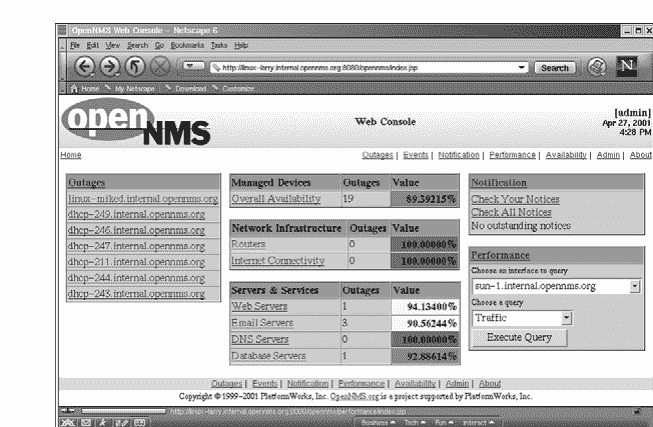

图 14.1

OpenNMS 的运行示例。

## 容量规划方法

第 14 章

尽管这是某些路由器数据的非常高层次视图，但其统计特性应该是相当可见的。如果应用程序能够向你展示这些数据，它也应该能够以其他方式为你准备数据。通过汇编你从 SNMP 中看到的不同组件，你应该对现有系统的情况有一个良好的了解，并根据这些数据决定未来如何规划。通过随时间推记录这些数据，这些数据将为你的容量规划指明清晰的路径。

## 总结

无论这里提出了哪些建议，你个人的容量规划蓝图可能与此模型有所不同。基础知识可能相似，但你可能需要对基本规则的各种组件赋予不同的权重。如果你处于一个非常动态的市场中，你可能会发现所有的容量规划都必须围绕着随时可以加入新组件的能力展开，或者可能你的全局视图需要每月重新审视。你可能需要包含此处甚至没有提到的领域特定因素。

总而言之，在进行容量规划时，你需要一个可靠的蓝图，以防止不同的系统部署重复学习相同的教训。拥有一个符合你需求的良好蓝图，你应该能够生成一个可行的容量规划，从而可靠地决定你系统的未来。

## 14

容量规划方法

# 第六部分

## 案例研究

## 本部分

- 15 案例研究：Web 服务器性能 281
- 16 以后去何方 291

## 案例研究：Web 服务器性能

第 15 章

## 案例研究

第六部分

没有示例的性能调优手册是不完善的。有时，内联示例不足以完全解释解决真实性能问题的排除过程。在本章中，你将看到一些案例研究。将收集症状，快速查找最常见的原因，进行更深入的分析，最后列出可能的解决方案。这些案例不会逐字遵循操作，因为所需的所有工具都在其他地方。然而，这些章节将彻底解释所使用的所有工具以及它们告诉故障排除者的信息。

需要注意的是，这些案例是基于事实的，尽管所有的名字都已省略。

## Web 服务器性能

今天使用的视觉视觉化的服务器系统是 Web 服务器（运行在后台的所有类型文件服务器）。几乎每个 Unix 管理员都以某种程度上维护着 Web 服务器——通常系统管理员兼任 Web Master。在这里，这个特定 Linux 系统的主要功能提供静态 Web 页面、一些 CGI 生成的 Web 页面以及一些通过 PHP 脚本连接到防火墙后数据库服务器生成的页面。

## 症状

症状是模糊的，从任何客户端来看都表现为某种一致的跳跃性能。显然，访问网络内 Web 服务器的任何客户端都会更快，但下载时间仍有近 50% 的明显性能下降。数据库服务器可以很快排除，因为问题同时发生在静态和动态页面上（尽管动态页面的问题要长得多）。

## 快速检查

勤奋的管理员快速运行 `top`，看到几个 `httpd` 进程正在消耗系统。尽管如此，这些信息仍然不够，因为 `httpd` 需要使用许多子系统（尤其是在此系统上）。

下一步是使用粒度更细的工具。在使用 `sar` 和 `vmstat` 后，发现处理器和内存显示为 I/O 密集，但磁盘 I/O 看起来正常。

这告诉管理员问题可能是 CPU 问题。尽管内存的使用量比通常多，但没有出现过度的分页（paging）。

## 一些快速猜测

由于问题直接与 Web 服务器有关而非数据库，这指向了 Web 服务器中唯一可能是罪祸首的部分：普通页面。然而，这并不合理——静态 Web 页面本身几乎不会引起任何开销。

管理员查看了 HTML 文档，发现它们最近都和 Web 服务器的配置文件一起被修改过。

在查看配置文件后，罪祸首终于现身。

## Web 服务器的罪祸首

某人（虚拟人物？）激活了服务器端包含，并添加了一系列 SSI 脚本，这些脚本会被每个文档（甚至是动态生成的文档）调用。脚本范围从日期/时间、最后修改时间、文件大小、所有者名称到每个页面的访问计数器。

## 可能的解决方案

第一个解决方案可能是移除任何不需要的内容。例如，每个页面上的访问计数器有点过度了，而且服务器日志提供了更准确的视图。除了计数器外，当前文档的大小和所有者名称也可以被移除。

如果用户坚持不使用这些脚本，可以提供替代方案。例如，PHP 可以在 PHP 内部完成这些新脚本的大部分功能（而无需依赖于调用外部脚本）。

最终，最好的解决方案是两者的结合：

- 消除不需要的脚本。
- 为剩余的脚本找到更好的运行方式。

## 一个经典的内存问题

任何性能调优示例如果没有内存问题将是不完整的。尽管这次揭露了出现故障的子系统，但解决方案并不是大多数人可能考虑的那样。

## 系统配置

该系统有三个 SCSI 硬盘，大小和型号都相同。此外，系统还有一个磁带备份设备和一个 CD-ROM 器。它被用作编译程序和运行驱动程序的测试服务器。它们都在同一个通道上。

## 问题的产生

在任何开发环境中，最终都会达到临界点。在今天瞬息万变的环境中，每天都有新工具被创建、下载和安装。最终，这个系统变得不堪。不断增长的项目编译时间变得越来越长，测试运行变得越来越慢。这是由于软件不断膨胀导致的。

## 详细分析显示...

发现尽管程序变大了，但仍然不足以填满内存。坚定的管理员再次使用 `sar`，发现交换磁盘处于 I/O 密集。交换磁盘是系统中的第一个磁盘，它还包含了许多编译工具。

## 快速解决方案

明显的快速解决方案是升级系统——首先是内存，然后可能是主板。在 Linux 世界（以及大多数开源社区中），这似乎并不合适。此外，这并不那么容易；管理员很少有资金来解决这类问题。相反，需要更基础的解决方案。

## 修改磁盘配置

你可能已经想出了最可能的解决方案（特别是如果你仔细阅读了第 11 章“Linux 与内存管理”）。

一种方法是将交换分区移动到负载较低的磁盘上，从而分担负载。这种解决方案的优点是不需要停机（希望如此）。这不是最好的解决方案。

可能最好（但最耗时）的方法是备份所有数据文件并重新安装系统。然而，这次要在包括交换分区在内的所有磁盘上使用条带。然后在系统配置完成后重新加载数据。这将均衡分配磁盘资源。

# FTP 服务器的一天

在例例中，一台内部 FTP 服务器是那个“刺头小子”。问题出在文件传输时间上。简而言之，这些时间正在不断变长，尽管增幅几乎难以察觉。只有在几周后，才能注意到明显的差异，而且情况正在恶化。

## 初步观察

最初，管理员查看了 `netstat` 和 `ntop`，发现系统本身似乎丢失了大量的出数据包。管理员尝试调整媒体设置，更改了一些参数等。这些操作似乎都没有起作用，除了让问题发生变异——例如，扩展网卡（NIC）的 MTU 导致了更多数据包丢失。

在进行更深层次分析后，似乎没有发现异常。在经历了几个（不断恶化的）周后，管理员放弃了并安装了一块新网卡。在对接口进行近一周后，问题再次开始抬头出现。

## 答案是……

显而易见，两件事之一出了问题：

- 网络子系统完全搞砸了。
- 存在某种硬件问题。

管理员在备用 PC 上安装了该系统的克隆版本，没有看到类似的结果。管理员将 FTP 服务器中的网卡移动到另一个插槽，它正常运行了几个周。问题出在插槽本身；很可能是由虚焊引起的间歇性故障。

## 另一个内存问题

### 症状

在极高负载下，系统运行异常并变得非常缓慢。这种情况发生在你的数据库服务器上，正值高峰时段。机器仍在运行，但显然出问题了。

### 追踪问题

让我们更仔细地观察这个问题。通过标准工具集观察磁盘 I/O，显然它正处于负荷运转，尽管吞吐量数字对于涉及的用户数量来说是合理的。

## 案例研究

第六部分

接下来，检查 CPU、内核和内存，看看是否有某些部分受到因素限制。通过观察发现，系统运行得相当辛苦，但看起来很好地抵御了风暴。CPU 没有被完全压榨，内存虽然很高，但还没有完全耗尽。

好了。让我们检查数据库日志，以确保问题不是软件配置问题。看起来都不太糟糕，但几份日志存在一些内存错误，它们似乎与峰值使用期紧密吻合。

现在情况变得复杂了。从大多数常规工具来看，系统是正常的，但应用程序日志似乎显示存在内存问题。现在是时候检查内核本身了，因为这个问题已经很难通过常规方式进行检查。

咚。通过 `dmesg` 查看内核环形缓冲区并查看 `/var/log/messages`，有如下格式的消息：

```
# tail /var/log/messages
Apr 22 12:15:07 db kernel: VM: do_try_to_free_pages failed for db...
Apr 22 12:15:07 db kernel: VM: do_try_to_free_pages failed for db...
Apr 22 12:23:52 db kernel: VM: do_try_to_free_pages failed for db...
Apr 22 12:53:58 db kernel: VM: do_try_to_free_pages failed for db...
```

## 寻找解决方案

好了，这显然是个问题，但到底发生了什么？检查内核邮件列表发现，当前内核在重负载下 VM 系统存在问题。由于需要确保系统中构建了什么，内核源码是手动安装的，因此内核源码的状态是已知的。根据 2.4 系列的现状，尚未有 RAID 的驱动支持。它将在一个月左右准备好，届时就可以跳到 2.4 来消除这个问题。但如何立即处理该问题呢？

进一步的研究显示，存在一个针对 2.2.18 pre 的现有补丁，其他人在这种情况下已使用它，并被证明有效。在 kernel.org 的 people 目录中，有一个来自 Andrea Arcangeli 补丁集的 VM 补丁。当前的版本是针对 2.2.18pre25 的，正如内核章节中所描述，它是 Alex Cox 针对 2.2.17 的补丁，该版本最终将成为 2.2.18。该系列中发生了很多变化，有 25 个针对 2.2.17 的补丁，且看不见头。与其等待最终的 2.2.18 出炉（它可能不包含所需的补丁），不如从 Alan 的目录中获取 2.2.18pre25 补丁。

现在，你已经有了 2.2.17 源码基础、Alan 的 2.2.18pre25 补丁，以及针对 2.2.18pre25 制作的 Andrea VM 补丁。因此，将基础内核更新到 pre25，然后应用 VM 补丁并像通常一样构建内核。（配置参数之前已设置过，所以只需构建。）一旦使用新内核重启，系统问题将会消失，它将轻松地处理高负载（以及更高负载的）。

## 结论

虽然这是一个相当复杂的例子，但最困难的部分是诊断问题。最长的路径是寻找解决方案，但实际上，这一切都是必要的。虽然这是一个相当复杂的例子，最困难的部分是诊断问题。最长的路径是寻找解决方案，但实际上，这一切都是必要的。虽然这是一个相当复杂的例子，最困难的部分是诊断问题。最长的路径是寻找解决方案，但实际上，这一切都是必要的。虽然这是一个相当复杂的例子，最困难的部分是诊断问题。最长的路径是寻找解决方案，但实际上，这一切都是必要的。虽然这是一个相当复杂的例子，最困难的部分是诊断问题。最长的路径是寻找解决方案，但实际上，这一切都是必要的。虽然这是一个相当复杂的例子，最困难的部分是诊断问题。最长的路径是寻找解决方案，但实际上，这一切都是必要的。虽然这是一个相当复杂的例子，最困难的部分是诊断问题。最长的路径是寻找解决方案，但实际上，这一切都是必要的。虽然这是一个相当复杂的例子，最困难的部分是诊断问题。最长的路径是寻找解决方案，但实际上，这一切都是必要的。虽然这是一个相当复杂的例子，最困难的部分是诊断问题。最长的路径是寻找解决方案，但实际上，这一切都是必要的。虽然这是一个相当复杂的例子，最困难的部分是诊断问题。最长的路径是寻找解决方案，但实际上，这一切都是必要的。

## Linux 虚拟机 (LVS) 详解

### 概念

如前所述，LVS 是在服务器集群上分配流量的方法。虽然这是一个相当复杂的例子，最困难的部分是诊断问题。最长的路径是寻找解决方案，但实际上，这一切都是必要的。虽然这是一个相当复杂的例子，最困难的部分是诊断问题。最长的路径是寻找解决方案，但实际上，这一切都是必要的。虽然这是一个相当复杂的例子，最困难的部分是诊断问题。最长的路径是寻找解决方案，但实际上，这一切都是必要的。

### 配置

如前所述，LVS 的工作原理是有一个带有故障转移能力的中央服务器来处理接入流量。虽然这是一个相当复杂的例子，最困难的部分是诊断问题。最长的路径是寻找解决方案，但实际上，这一切都是必要的。虽然这是一个相当复杂的例子，最困难的部分是诊断问题。最长的路径是寻找解决方案，但实际上，这一切都是必要的。

### 假设

虽然这是一个相当复杂的例子，最困难的部分是诊断问题。最长的路径是寻找解决方案，但实际上，这一切都是必要的。

集群中连接数少的机器，以及加权最少连接。这仍然是相同的算法，但针对单个机器设置了权重。

如你所见，部署一个集群并没有那么困难，所需的是一个 IP 地址、一个主服务器（以及最好有一个用于它的故障备用机）以及一些执行实际工作的真实服务器。在某些情况下，这可能被用于通过多种协议分发文件访问，或作为分发处理器密集型请求的方法。在某些情况下，如果这是所需的，它可以作为分发集群背后更大系统视图的方法。该系统非常灵活，且设置相当简单。由于它运行在任何通用硬件上，因此部署集群的成本仅取决于硬件成本以及启动节点所需的时间（假设随时间推移对机器进行了正常管理）。

## 总结

尽管本章的案例研究试图涵盖主要的子系统，但在服务器和客户端 Linux 系统上都可能出现许多类型的性能问题。希望本章的案例研究展示了这种渐进式的见解如何帮助管理员。网络以及下一章将讨论的其他出版物中还有许多可用资源。

# 接下来去往何处

# 章节

# 16

本书书并不是 Linux 系统性能调优的终极解决方案。相反，它是一本充满了许多优秀建议、方法论和想法的指南。这是一个很好的起点，并作为 Linux 管理员调优 Linux 系统时可能执行的许多操作的快速参考。

# # 世界维网资源

Linux 催生了惊人的网站数量。大多数是个人网站，但许多是由具有共同兴趣的团体或 Linux 发行版供应商运行的。这些网站的跨度范围从简单的“嘿，我喜欢 Linux”到包含详细信息的巨大在线存档。

在性能调优领域，极少数网站是专门针对此的。许多网站是通用的 Linux 网站，因此多到无法在此列出。以下是几个涵盖性能监控和调优的专用网站：

- *性能调优网站*：http://linuxperf.nl.linux/
- Dan Kegel 的 Web Hostel，一个包含几篇关于 Linux 调优论文的个人网站：http://www.kogel.com/
- Linux.com 的性能调优专目：http://www.linux.com/enhance/tuneup
- Linux 服务器性能检查清单：http://home.att.net/-jageorge/performance.html
- 通用的 Linux 调优：http://www.tunelinux.com/
- 基准测试规则：http://oss.sgi.com/LDP/HOWTO/Benchmarking-HOWTO.html

如你所见，许多网站专门针对 Linux 性能调优，但知识散落在整个网络中。始终记住也要参考你的应用程序发行版以获取准确信息。例如，Samba 在源码中附带了大量的技术文档。

然而，Linux 文档的最终所在地是 Linux 文档项目（Linux Documentation Project，http://www.linuxdoc.org/），它拥有庞大的 HOWTO 风格文档库。你应该注意，LDP 中的许多文档在最新修订发布到官方网站之前，往往会经过长时间的更新，特别是代码通常是同时开发的。这确保了它们所描述的项目是稳固的，且文档是准确的。如果你正在处理某些比文档描述的更前沿性的东西，你可能会发现给作者发送电子邮件或搜索文档的更近期版本是值得的。

# 接下来去往何处

第 16 章

# 杂志、期刊和简报

与仅针对 Linux 性能的网站不同，在线和印刷版上有大量的媒体资源，对管理员来说成本极低或免费。以下列表仅涵盖了最显而见的几个：

- *Linux 杂志*，http://www2.linuxjournal.com/；部分在线和印刷版
- *Linux 公报*，http://www.linuxgazette.com/；仅在线
- *Linux Today*，http://www.linxtoday.com/；仅在线
- *Linux 杂志*，http://www.linux-mag.com/；部分在线和印刷版
- *Linux 每周新闻*，http://www.lnw.net/;仅在线


除了 Linux 相关的网站外，还有诸如 32BitsOnline 等站点，它涵盖了 Linux（以及许多其他系统）。大多数项目都有一个存放项目新闻的个人网站，其中可能包含关于即将出现的功能和使用软件不同方法的宝贵信息。其中许多项目已倾向于 SourceForge.net 等中心化托管站点，尽管许多如 `http://www.freshmeat.net` 的索引网站可以指引你进入项目分类正确的方向，并让你了解发布动态。

# 新闻组和邮件列表

最后但绝对不是最后，如果管理员领域有未解答的问题，尽管去问。最终，某种事件（无论是好的、坏的还是难看的）将会成为一个完全不同的的话题。虽然没有硬性规则，但在向世界发布消息时，有一些可以遵循的准则。大致大纲如下：

- 1. 检查是否有专门你的项目或应用程序的邮件列表，并首先寻找专业知识。这可能是关于该主题最集中的知识。RedHat 托管了许多开发列表，尽管你获取应用程序的地方可能会有你所在小组列表的位置。这些列表的存档可能包含你的问题，如果可能的话，你应该检查它们。如果不检查通常会让你一无所获。
- 2. 订阅你的 Linux 用户组 `LUG`。你可能会找到可以帮助到你的协助。
- 3. 在适当的情况下发布到新闻组。在内核列表的特殊情况下（例如发布 oops 消息），详细描述当前问题以及所有相关因素是非常重要的。（注意，在发送问题之前应该阅读列表规则以确保你没有违反任何规则。）
- 4. 在某些情况下，如果管理员领域有未解答的问题，尽管去问。最终，某种事件（无论是好的、坏的还是难看的）将会成为一个完全不同的的话题。这可能会让你得到答案。

# 案例研究

## 第六部分

# 分析与解读

- 计算密集型与 I/O 密集型应用, 33
- CPU 速度, 34
- 磁盘空间管理, 35-36
- 磁盘类型, 34-35
- 网络分析工具, 273-273
- 操作系统
  - 缓冲区缓存, 16
  - 文件接口, 16
  - 文件系统, 17-18
  - `/proc` 目录, 16-17
- 块设备, 181
- 容量规划蓝图, 273-274
- 资源饱和, 36-37
- 资源状态, 37
- 不满意的响应时间, 272-273
- 特定于特定需求, 272-273
- 容量规划团队, 268-269
- `Arguments` 字段 (`inetd.conf` 文件), 227
- 评估调优需求, 28
- 分配交换空间, 215-216
- 用产品, 273
- 合同, 270
- 示例, 275-277
- 灵活性, 270
- 通用原则
- `Apache Jmeter`, 151
- 应用网络调优, 122-123
- 特定于特定需求 (容量规划), 241-242, 272-273
- 容量规划, 265
- 全局视图, 263
- 需求收集, 262
- 统计数据, 262-263
- 未来技术, 263-265

# B

- 应用网络调优, 122-123
- 架构, 33-34
- 容量规划需求, 241-242, 272-273
- 计算密集型与 I/O 密集型, 33
- 配置, 29
- 对内存的影响, 221
- 加载, 20-22
- `at` 工具, 157-158
- ATA 支持, 181
- `-aux` 选项 (`ps` 命令), 56
- `b` 字段 (`vstat`), 50
- 后台模式, 156-157
- 后台, 发送作业到
- 积压, 133
- 负载均衡, 145-147
- 带宽, 141-143
- 批处理, 19, 158
- 批处理工具, 158
- `dbflush` 文件, 175-176
- 基准测试
  - 硬件和软件 需求, 265-267
  - 网络分析工具, 273-273
  - 政治问题, 271-272
  - `pellers`, 274-275
  - 项目管理, 270-271
- 绑定, 137-141
- `bondnie` 工具, 53-55, 203
- 瓶颈, 86
- 应用补丁, 191-方法
- 容量规划方法, 245-246
- `Appwatch` 网站, 82
- 架构
- 基准测试 HOWOW 网站, 292
- `beow unity`, 53-55
- Beowulf 集群, 88
- Beowulf 项目, 137
- `-bg` 选项 (`x11perf-command`), 101
- Alpha 处理器, 88
- 应用, 33-34
- 容量规划, 254-255
- 内核
  - CPU 调度, 18-20
  - 文件系统，缓存, 25
  - 进程管理, 22-23
  - 程序加载, 20-22
  - 线程管理, 22-23
  - 虚拟内存, 23-24
- NUMA (非统一内存访问), 88
- 集群解决方案
  - Beowulf, 89
  - MOSIX (单元多计算机操作系统), 90
- CPU 相关参数, 90-92
- 通用注意调优, 89
- 硬件解决方案, 87-88
- `ifying`, 36-38
- 内存瓶颈, 92-95
- 分页和交换, 96
- 性能协议, 86-87
- 软件解决方案, 88
- 系统完整性, 97
- `bi` 字段 (`vstat`), 51
- `Blk_read` 文件 (`ioctl`), 72
- `Blk_reads/s` 文件 (`ioctl`), 72
- `Blk_wrtn` 文件 (`ioctl`), 72
- `Blk_wrt/s` 文件 (`ioctl`), 72

# 容量规划

- 系统使用统计数据, 95-96
- 用户期望, 86

# 计算交换空间, 215

## 容量规划

- 预测性分析, 248-249
- 数据收集技术, 250-251
- 数据存储, 251
- 需要数据, 249
- 性能调优, 252-253
- 质量与数量, 249-250

## 自底而上的容量规划方法, 239-240

- `buff` 字段 (`vmtat`), 50
- `buff` 缓存, 16
- `buffermake` 文件, 176
- 缓冲区
- 自底而上的方法, 239-240
- 用产品, 273
- `ract`, 270
- 创造性思维, 246-247
- 定义, 236-238
- 示例, 257-277
- 灵活性, 270
- 通用原则
- 容量位置, 265
- 全局视图, 263
- 需求收集, 262
- 统计数据, 262-263
- 未来技术, 263-265
- 大型企业
  - 架构, 254
  - 组交叉, 254
  - 可扩展性, 253-254
- 防止产生性能调优需求, 247-248
- 与性能调优的关系, 247
- 可靠性, 240-241
- 经典系统需求, 241
  - 特定于特定需求, 241, 272-273
  - 收集, 262
  - 全局视图, 238-239
  - 硬件和软件, 265-267
  - 管理, 270-271
  - 增长, 242
  - 小型企业
  - 领域知识, 257
  - 预计使用, 258
  - 统计数据, 262-263
  - 结构化方法, 245-246
  - `字段 (free 命令)`, 60
  - `缓存字段 (free 命令)`, 60
  - 企业，容量规划
  - 实际和预计, 255
  - 架构, 254-255
  - 核心关注, 256
  - 当前模型, 256
  - 基准测试 HOWOW 网站, 292
  - 字段 (`top` 命令)
- 深度, 107-108

## Common 字段 (`top`)

- 输出格式控制, 56
- 修饰符, 56
- 进程, 58
- 列表选择, 56
- 示例输出, 56-58
- 简单进程选择, 55
- 单用户, 58

## 命令, 46-47, 70

- 前缀, 20
- `at`, 157-158
- 批处理, 158
- `bonnie`, 53-55
- `cron`, 156
- `dd`, 217
- `depd`, 166
- `diff`, 189-190
- `diseg`, 286

## LVS (Linux 虚拟)

- 假设, 287
- 配置, 288
- 网络延迟, 284-285
- Web 服务器性能, 282-283

## 字符设备, 182

- 可用内存, 60
- 驱动程序, 187-188
- 经典系统需求 (容量规划), 116-118
- 芯片组特定配置, 110
- 选择驱动程序, 187
- 熟练度, 180
- 精通, 180
- 收集数据 (容量规划)
- 经典内存分析, 284
- 开发问题, 283
- 磁盘配置, 284
- 解决方案, 284
- 系统配置, 283
- 复杂内存诊断, 285-286
- 解决方案, 287

## 字段 (`free` 命令), 60

- 字段 (`vmtat`), 50
- 确定内存
- 物理内存
- 内存操作, 221
- 立即指南, 220
- 获取额外的内存, 214
- 多用户系统, 213
- 单用户系统, 212-213
- 测试系统, 221
- 规划团队, 268-269
- 政治问题, 271-272
- `pollers`, 274-275
- 激活, 217
- 优势与缺点, 219
- 重新, 217
- 交换空间, 214-215
- 计算, 215
- 配置, 216-217
- 管理, 216
- 交换优先级, 218
- 交换策略, 204
- 自顶向下的方法, 239-240

## 集群解决方案

- `make dep`, 183
- `make meconfig`, 180
- `make modules`, 183
- `make xconfig`, 180
- `mkraid`, 207
- `mkswap`, 24, 216-217
- `mat`, 274
- `Netway`, 149-160
- Beowulf, 89
- MOSIX (Unix 多计算机操作系统), 90
- `ntop`, 65-66
- `patch`, 190-191
- `ping`, 62-63
- `potchers`, 274-275
- 性能调优, 252-253
- 技术, 250-251

## 案例研究

## 目录

- `Daemon` 字段 (`inet.conf`)
- 文件, 227
- 常见原因
- 通信, 244, 259-260
- `tcpd`, 227
- 目录, 299
- 控制作业
- `at` 工具, 157-158
- `iostat` 命令, 203
- `iostat` 命令, 173
- 产品规划, 273

## 商业容量规划

- 后台模式, 156-157
- 批处理工具, 158
- `cron` 工具, 158-160
- `nice` 工具, 161

## 守护进程

- 千字节转兆字节
- 紧凑 Alpha 处理器, 88
- 核心功能 (系统), 256
- 容量规划成本, 255-258
- 数据收集技术, 250-251
- 数据存储, 251
- 数据呈现 (内核), 172
- 迁移, 267

## 配置管理

- 数据库, 122-123
- `dbe` 模块, 109
- `dd` 命令, 217
- 禁用 ICMP, 133
- ATIDE/MFM/RLL 支持
- 块设备支持, 181
- 字符设备, 182
- 显示分辨率, 107-108
- `dentry-state` 参数 (内核), 72
- 文件系统
- 通用设置, 181
- 依赖检查, 166
- 可加载模块, 183
- `depmod` 命令, 166
- 多媒体设备, 182
- 网络设备支持, 115-116, 123-124
- 网络 选项, 181
- 处理器类型
- 设备回调, 163
- 设备文件, 170
- DFSA, 10
- 软件 RAID (冗余), 206-207

## 直接文件系统访问 (DFSA), 90

- 交换空间, 216-217
- 连接，测试, 26
- 指令, 111-113
- 连续内存，空间, 94

## 设备内存导出 (DMEP), 196

- 音频
- USB 设备, 182
- 内存磁盘, 208-209

# 目录

- `inetd.conf` 文件, 224-227
- `raidub` 文件, 206-207
- `rc.d` 脚本, 228-230
- 启动与停止服务, 231
- `proc`, 16-17
- `cpuinfo` 文件, 170
- `devices` 文件, 170
- `filesystems` 文件, 170
- `interrupt` 文件, 170
- `inem` 文件, 170
- `ivports` 文件, 170
- `kmsg` 文件, 170
- `sysym` 文件, 170
- `loadavg` 文件, 170
- `meminfo` 文件, 170
- `modules` 文件, 170
- 使用...监控系统活动, 79-82
- `mounts` 文件, 171
- `partitions` 文件, 171
- `pci` 文件, 171
- 进程数据, 171-172
- `slabinfo` 文件, 170
- 支持, 169
- `upsime` 文件, 171
- 层 10, 205
- 层 5, 205
- 软件 RAID, 205-207
- SANs (存储区域网络), 196-197
- `swag` 策略, 204
- 测试吞吐量, 202-203
- 磁盘，硬盘。见硬盘驱动
- `-display` 选项 (`x11perf` 命令), 101
- 分辨率, 107-108
- 显示统计数据:
  - CPU 占用率, 71-72
  - 设备利用率, 71-73
  - 处理器相关统计数据, 73-74
  - 系统平均负载, 52
  - 系统运行时间, 53
  - CPU 密集型进程, 47-49
  - 虚拟内存统计数据, 50-51
- 驱动器，硬盘。见硬盘驱动
- `-dry-run` 选项 (`patch` 命令), 191
- `tdt` 工具, 202
- 问题持续时间, 30
- 动态缓冲区缓存, 94

# E

- `-e` 选项 (`ps` 命令), 56
- `e-电子邮件邮件列表`, 194, 293-294
- ECN 系统, 134-135
- 强制带宽限制, 141-143
- 环境变量, `LD PRELOAD`, 21
- 时代, 18
- 错误跟踪, 193-194
- `/etc` 目录
- - DMEP (设备内存导出协议), 196
- `dmesg` 命令, 288
- 文档:
  - Linux文档项目, 292
  - 本地文档, 11
- 指标域, 32
- 领域专业知识, 257
- 领域, 123-124
- 下载内核源码, 178-179
- `dquote-max` 参数 (内核), 173
- `dquote-nr` 参数 (内核), 173
- `dri` 模块, 109
- 驱动:
  - `hosts.allow` 文件, 227
  - `hosts.deny` 文件, 227
  - `inetd.conf` 文件, 224-227
  - `raidub` 文件, 206-207
  - `rc.d` 脚本示例, 228-230
  - `rc` 文件, 230
  - `rc.local` 文件, 230
  - `rc.sysinit`, 230
  - 启动与停止服务, 231
  - 禁用 ICMP, 模块, 108-110
  - 端扩展, 108-110
  - 磁盘空间管理, 35-36
  - 备选项, 208-209
  - 灌丛, 207-208
  - GFS (全局文件系统), 196-197
  - `hdparm` 工具, 203-204
  - LVM (逻辑卷管理器), 198-202
  - RAID (独立磁盘冗余阵), 204-205
    - 层 0, 205
    - 层 1, 205
- `Ethereal`, 148
- 评估容量规划的性:
  - 大型企业:
    - 架构, 254-255
    - 组交叉, 254
    - 可扩展性, 253-254
  - 中型企业:
    - 实际和潜在增长, 255
    - 核心关注, 256
    - 成本, 255-256
    - 当前业务模式, 256
  - 小型企业:
    - 文件接口, 16
    - 通信, 259-260
    - 成本, 257-258
    - 运行时间, 171
    - 领域专业知识, 257
    - 否决, 172
    - 管理, 258
    - 预计使用, 258
- `XF86Config-4`, 107

# 执行作业

- 缓冲区, 125
- 在在特定时间, 157-158
- 缓存, 25
- 批量处理, 158
- GFS (全局文件系统), 196-197
- `nice` 优先级, 160-161
- 周期性预期, 158-160
- 用户预期, 86
- NFS (网络文件系统), 27-28, 130-131
- 支持, 42
- 先进先出 (FIFO), 142
- `extmod` 模块, 109
- 在容量规划中的灵活性 (企业), 62-63
- `-f` 选项 (`ping` 命令), 91
- 头部指针 (乐观的), 126
- `fake-devmodule`, 90
- 字体, 111
- 字体服务器, 113


- 前台, 进入, 157
- 碎片化, 134
- `free-alloc`, 228
- `free-inetd.conf` 文件, 227
- `free-field`, 25, 60
- `free-ioctl`, 72-73
- `free-top`, 75
- `free-input`, 74
- `free-vmstat` 命令, 50
- `free-memory`, 69
- `free-pages` 文件, 176
- `free-loops`(参数), 91
- `free-first in, out (FIFO)`, 250-251
- 输入输出 (I/O), 26

# 通用设置

- 通用设置 (内核配置), 181
- 生成补丁, 189-190
- `get-sm`, 70-82
- `getwd()` 函数, 126
- GFS (全局文件系统), 196-197
- `glcore` 模块, 109
- 全局文件系统 (GFS), 196-197
- 容量规划需求的全局视图, 238-239, 263
- GNOME 桌面, 115-116, 123
- 优先级, 70
- Gerard, Sebastian, 70
- 统一引导加载程序 (`GRUB`), 184-186
- 组交叉, 254
- `GRUB` (统一引导加载程序), 184-186
- `gtop` 工具, 74-79

# H

- 硬盘, 34
- 磁盘 I/O 利用率, 202-204
- I/O 密集型应用程序, 33
- 层, 26
- 监控:
  - `gtop` 工具, 74-79
  - `iostat` 工具, 71-73
  - `top` 工具, 74-79
- 输入输出 (I/O), 25
- 瓶颈:
  - alpha 处理器, 88
  - 更快的 CPU, 87
  - 容量规划需求, 265-267
  - 网络性能, 120-121, 104-115
  - SMP 方法, 87-88

# 硬件解决方案

- NUMA (非一致内存访问), 228
- `dporm` 工具, 203-204
- 隐藏文件, 127
- 高可用性网络, 145-147
- 连接, 测试, 62-63
- `host Field` (`ntop` 命令), 6
- `hosts.allow` 文件, 227
- `hosts.deny` 文件, 227
- HTTP (超文本传输协议)
- HTTP 速度, 123
- TUX 服务器, 143-144

# I

- 输入输出 (I/O), 25
- 磁盘 I/O 利用率, 202-204
- I/O 密集型应用程序, 33
- 层, 26
- 监控:
  - `gtop` 工具, 74-79
  - `iostat` 工具, 71-73
  - `top` 工具, 74-79
- 输入输出 (I/O), 25
- 瓶颈:
  - alpha 处理器, 88
  - 更快的 CPU, 87
  - 容量规划需求, 265-267
  - 网络性能, 120-121, 104-115
  - SMP 方法, 87-88

# K

- 内核驱动程序, 187-188
- 模块化驱动, 165-166
- 文件接口, 16
- 交换, 171
- 通信, 259-260
- 成本, 257-258
- 运行时间, 171
- 领域专业知识, 257
- 否决, 172
- 管理, 258
- 预计使用, 258
- `XF86Config-4`, 107

# 执行作业

- 缓冲区, 125
- 在在特定时间, 157-158
- 缓存, 25
- 批量处理, 158
- GFS (全局文件系统), 196-197
- `nice` 优先级, 160-161
- 周期性预期, 158-160
- 用户预期, 86
- NFS (网络文件系统), 27-28, 130-131
- 支持, 42
- 先进先出 (FIFO), 142
- `extmod` 模块, 109
- 在容量规划中的灵活性 (企业), 62-63
- `-f` 选项 (`ping` 命令), 91
- 头部指针 (乐观的), 126
- `fake-devmodule`, 90
- 字体, 111
- 字体服务器, 113
- 前台, 进入, 157
- 碎片化, 134
- `free-alloc`, 228
- `free-inetd.conf` 文件, 227
- `free-field`, 25, 60
- `free-ioctl`, 72-73
- `free-top`, 75
- `free-input`, 74
- `free-vmstat` 命令, 50
- `free-memory`, 69
- `free-pages` 文件, 176
- `free-loops`(参数), 91
- `free-first in, out (FIFO)`, 250-251
- 输入输出 (I/O), 26

# 通用设置

- 通用设置 (内核配置), 181
- 生成补丁, 189-190
- `get-sm`, 70-82
- `getwd()` 函数, 126
- GFS (全局文件系统), 196-197
- `glcore` 模块, 109
- 全局文件系统 (GFS), 196-197
- 容量规划需求的全局视图, 238-239, 263
- GNOME 桌面, 115-116, 123
- 优先级, 70
- Gerard, Sebastian, 70
- 统一引导加载程序 (`GRUB`), 184-186
- 组交叉, 254
- `GRUB` (统一引导加载程序), 184-186
- `gtop` 工具, 74-79

# H

- 硬盘, 34
- 磁盘 I/O 利用率, 202-204
- I/O 密集型应用程序, 33
- 层, 26
- 监控:
  - `gtop` 工具, 74-79
  - `iostat` 工具, 71-73
  - `top` 工具, 74-79
- 输入输出 (I/O), 25
- 瓶颈:
  - alpha 处理器, 88
  - 更快的 CPU, 87
  - 容量规划需求, 265-267
  - 网络性能, 120-121, 104-115
  - SMP 方法, 87-88

# 硬件解决方案

- NUMA (非一致内存访问), 228
- `dporm` 工具, 203-204
- 隐藏文件, 127
- 高可用性网络, 145-147
- 连接, 测试, 62-63
- `host Field` (`ntop` 命令), 6
- `hosts.allow` 文件, 227
- `hosts.deny` 文件, 227
- HTTP (超文本传输协议)
- HTTP 速度, 123
- TUX 服务器, 143-144

# I

- 输入输出 (I/O), 25
- 磁盘 I/O 利用率, 202-204
- I/O 密集型应用程序, 33
- 层, 26
- 监控:
  - `gtop` 工具, 74-79
  - `iostat` 工具, 71-73
  - `top` 工具, 74-79
- 输入输出 (I/O), 25
- 瓶颈:
  - alpha 处理器, 88
  - 更快的 CPU, 87
  - 容量规划需求, 265-267
  - 网络性能, 120-121, 104-115
  - SMP 方法, 87-88

# K

- 内核驱动程序, 187-188
- 模块化驱动, 165-166
- 文件接口, 16
- 交换, 171
- 通信, 259-260
- 成本, 257-258
- 运行时间, 171
- 领域专业知识, 257
- 否决, 172
- 管理, 258
- 预计使用, 258
- `XF86Config-4`, 107

# kernel

- 网络操作, 174
- 网络性能调优, 132-133
- 设备积压, 133
- ECN, 134-135
- 分片阈值, 134
- ICMP, 133
- 存活时间, 135
- 大窗口, 136
- 本地端口范围, 133
- 路径发现, 134
- 选择性包确认, 135-136
- TCP超时, 136-137
- 紧急指针, 176
- 窗口缩放, 136
- 参数, 90-92
- `age_buffer`, 126
- `age_super`, 176
- `bdfsh file`, 175-176
- `buffermem file`, 176
- `dentry-state`, 172
- `dquote-mark`, 173
- `dquote-ntr`, 173
- `fake oplocks`, 126
- `file-mark`, 173
- `file-ntr`, 173
- `fomit-frame-pointer`, 91
- `freepages file`, 176
- `getwal cache`, 126
- `funloops`, 91
- `icmp_echo_ignore_all`, 133
- `icmp_echo_ignore_broadcasts`, 133
- `inode-ntr`, 173
- `inode-state`, 173
- `kkswad file`, 176-178
- `level 2 oplocks`, 127
- `max_part_count`, 177
- `max smit`, 127
- `msg*`, 174
- ON, 91
- `overcommit_memory`, 177
- `overflowid`, 173
- `page-cluster`, 177
- `pagecache`, 177
- `pagetable_cache`, 178
- `panic`, 173
- `printk`, 173
- `read prediction`, 128
- `read raw`, 128
- `read write`, 128
- `shm*`, 174
- `super-max`, 173
- `swap_cluster`, 177
- `treads-max`, 174
- `tries_base`, 176
- `tries_min`, 176
- `wide links`, 126
- 补丁
  - 优点, 188-189
  - 差异工具, 190-191
  - 示例, 193
  - 获取补丁, 192-193
  - 补丁工具, 190-191
  - 潜在问题, 191
  - 测试补丁, 191
- 修改原因, 165
- 重新编译
  - 编译内核, 183
  - 依赖检查, 183
  - 下载源码, 178-179
  - 驱动程序配置, 188
  - 驱动程序选择, 187-188
  - 内核配置, 180-182
  - 内核安装, 184-187
  - 模块安装, 183
  - 补丁, 188-193
- 性能调优的风险, 40-41
- 错误捕获, 193-194
- 虚拟内存
  - `bdflush file`, 175-176
  - `buffermem file`, 176
  - `freepages file`, 176
  - `kswpad file`, 176-178
- `Kernel Traffic` 网站, 192
- 千字节，转换为兆字节, 108
- `kmsg file`, 170
- `KNOWN file(hosts.allow file)`, 228
- 已知峰值, 29
- `kswpad file`, 176-178
- `symym file`, 170
- `ktop` 工具, 74-79

# L

- `-option`
- `ntop` 命令, 66
- `x11perperf` 工具, 104
- `-labels` 选项 (`x11perperf` 命令), 101
- 大型企业，容量规划, 253
- 架构, 254-255
- 组交叉器, 254
- 可扩展性, 253-254
- 延迟状态, 284-285
- 文件 I/O 层（输出）, 26
- `LD_PRELOAD` 环境变量, 21
- 2 级锁（机会性锁）, 127
- RAID 级别（独立磁盘冗余阵）
  - `level 0`, 205
  - `level 1`, 205
  - `level 5`, 205
  - `level 10`, 205
  - 软件 RAID, 205-207
- 责任, 87
- 库
- 本地文档, 11
- GFS (全局文件系统), 瓶颈, 95
- `LOCAL` 字段 (`hosts.allow file`), 196-197
- 链接, 21
- `hdparm` 工具, 203-204
- 性能调优的限制性, 40
- 本地端口范围, 133
- 日志级别, 127
- LVM (逻辑卷管理器), 198-202
- 链接库, 21
- 逻辑区, 200
- RAID (独立磁盘阵列）, 292
- 逻辑卷管理器 (LVM), 26, 198-202
- SANs (存储区域网络), 196-197
- Linux 文档, 292
- Linux 公报, 293
- 逻辑值, 200
- 交换传输, 204
- Linux 内核
- `Ismod` 命令, 166
- 测试吞吐量, 202
- LVM (逻辑卷管理器), 26, 198-202
- 进程, 22-23
- Linux 调优网站, 292
- 服务, 224
- LVS (Linux 虚拟机服务器)
  - `inetd.conf` 文件, 225-228
  - `rd.cd` 脚本, 228-231
- Checklist (web), 292
- 配置, 228-289
- Linux Today, 293
- TCP (传输控制协议)
- 性能调优资源, 293
- 案例研究, 216
- 线程, 22-23
- 假设, 287
- 配置, 228-289
- `-m` 选项 (`hdparm` 命令), 305
- 每周新闻, 192, 293
- 列表, 194-294
- `linux-kernel` 邮件列表, 194
- `linux.com`, 292
- `make bzimage` 命令, 183
- `make bzilio` 命令, 180
- `make config` 命令, 180
- `make menconfig` 命令, 180
- `make modules` 命令, 180
- `make xconfig` 命令, 180
- `x11perfcomp` 工具, 104
- 平均负载, 31-32
- 负载均衡, 145-147
- 可加载模块, 208-209
- `loadagv file`, 170
- 字体, 111-113
- 核心, 255
- 成本, 255-256
- 当前业务模型, 256
- `%MEM` 字段 (`top` 命令), 49
- `max_max计数`, 177
- `max_xmit` 参数 (内核), 127
- 测量, 31-32
- 准确性, 32
- 进程 CPU 指标, 32
- 定性与定量测量, 33
- 队列, 31

# meminfo file

- 瓶颈, 92-95
- 经典内存问题, 228-284
- 复杂内存问题, 228-287
- 性能调优, 228-285
- 空闲内存, 60-91
- NUMA (非统一内存访问), 88
- 获取额外 RAM, 214
- 单用户系统, 212-213
- 激活, 217
- 初始, 217
- 计算, 215
- 配置, 216-217
- 管理, 216
- 交换优先级, 218
- 系统使用统计, 95-96
- SHARE 字段, 96
- SIZE 字段, 95
- 虚拟内存, 23-24
- `bdflush file`, 175-176
- `bufferman file`, 176
- `freepages file`, 176
- `kswap file`, 176-178
- 返回统计信息, 50-51
- 连续内存空间, 94
- 动态缓存, 94
- 共享库, 95
- 虚拟地址空间, 93

# Memory field (`ktop` tool), 75

- 性能方法论，应用配置, 29
- 问题持续, 30
- 已知峰值, 29
- 本地文档, 11
- 性能预期, 29
- 主动/响应, 6-11
- 解决方案选项, 31
- 突然变化, 30
- 系统配置, 28
- 准确性, 32
- 进程 CPU 指标, 32

# MMF 支持 (内核), 181

- 最小化资源需求, 9-10
- `mkn` 命令, 207
- `mkswap` 命令, 24, 216-217
- 模式，后台, 156-157

# modular drivers, 165-166

- 从源码创建的内核模块, 168
- 依赖检查, 166
- 禁用, 108-110
- `dri`, 109
- 驱动程序, 165-166
- `extmod`, 109
- `fbdevhw`, 109
- `GlCore`, 109
- `glx`, 109
- 安装, 183
- 可加载模块支持, 180
- 加载, 166-167
- 移除, 166

# modules file, 170

- 监控字段 (`top` 工具), 48
- 监控性能
  - Linux 工具, 70
  - `gtop`, 74-79
  - `iistat`, 71-73
  - `top`, 74-74
  - `mpstat`, 73-94
  - 在线资源, 82
  - `/proc` 目录, 79-82
  - Unix 工具, 46-47
  - `bonnie`, 53-55
  - `free`, 60-91
  - 结果结果, 47
  - `top`, 65-66
  - `ping`, 62-63
  - `s ps`, 55, 58-59
  - `tctdump, time`, 61
  - `top`, 47-49
  - `traceroute`, 63-64
  - `uptime`, 53
  - `vnstat`, 50-51
  - `xload`, 52


- `xosview`, 52-53

# MOSIX (用于 Unix 操作系统), 90

- 挂载, 170

- `msg*` 参数 (内核), 127

- `mpstat`, 73-94

- 多媒体设备, 182

- 多用户系统, 212-213

- 激活, 217

- 初始, 217

- 计算, 215

- 配置的, 216-217

- 管理, 216

- 交换优先级, 218

- 系统使用统计, 95-96

- SHARE 字段, 96

- SIZE 字段, 95

- 虚拟内存, 23-24

- `bdflush` file, 175-176

- `bufferman` file, 176

- `freepages` file, 176

- `kswap` file, 176-178

- 返回统计信息, 50-51

- 连续内存空间, 94

- 动态缓存, 94

- 共享库, 95

- 虚拟地址空间, 93

# OpenNMS 网站

OpenNMS 网站, 276

操作系统结构, 16

缓冲区缓存, 16

文件接口, 16

文件系统, 17-18

`/proc` 目录, 16-17

`opclocks` (乐观锁), 126-127

优化性能。参阅性能调优

外包, 269

内存过度提交计数器 (内核), 177

溢出参数 (内核), 173

溢流参数 (内核), 173

# P

- `-p` 选项

`stop` 命令, 66

`swapon` 命令, 218

`-p0` 选项 (`patch` 命令), 190

+ 数据包

Samba, 127

选择确认 (select acknowledgement), 135-136

PAE (进程地址扩展), 93-94

`page-cluster` 参数 (内核), 177

`pagecache` 参数 (内核), 177

`pagetable cache` 参数 (内核), 178

分页, 96

`panic` 参数 (内核), 173

参数, 90-92

+ `age_buffer`, 176

`age_super`, 176

`bdflush` 文件, 175-176

`buffem` 文件, 176

`dentry-state`, 172

`dquote-max`, 173

`dquote-nr`, 173

`fake offlocks`, 126

`file-max`, 173

`file-nr`, 173

`format-frame-pointer`, 91

`frepages` 文件, 176

`gewd cache`, 126

`foruoli-loops`, 91

`icmp_echo_ignore_all`, 133

`icmp_echo_ignore_broadcast`,

`inode-nr`, 173

`inode-state`, 173

`ksawad` 文件, 176-178

`level2 offlocks`, 127

`max_map_count`, 177

`max xmit`, 172

`smsg*`, 174

ON, 91

`overcommit_memory`, 177

`overflowed`, 173

`overfluid`, 173

`page-cluster`, 177

`pagecache_table`, 178

`panic`, 173

`printk`, 173

`read prediction`, 128

`read raw`, 126

`read size`, 128

`read write`, 128

`shm*`, 174

`super-max`, 173

`super-nr`, 173

`swap_cluster`, 177

`threads-max`, 174

`tries_base`, 176

`tries_min`, 176

`wide links`, 126

PARANOID 字段 (`hosts.allow` 文件), 228

`partitions` 文件, 171

`partitions`, swap. 参阅空间

`patch` 工具, 190-191

补丁 (patches)

- 应用, 190-191

示例, 193

生成, 189-190

获取, 192-193

潜在问题, 191

测试, 191

内核补丁

- 优势, 188-189

`diff` 工具, 189-190

示例, 193

获取, 192-193

潜在问题, 191

测试, 191

`ntesting`, 191

路径发现, 134

`pci` 文件, 171

峰值时期, 29

每个进程 CPU 指标, 32

每个进程数据, 171-172

性能协议, 86-87

性能监控

- Linux 工具, 70

`gtop`, 74-79

`iostat`, 71-73

`top`, 74-79

`mysat`, 73-74

在线资源, 82

`/proc` 目录, 79-82

`ix` 工具, 44-67

`bonnie`, 53-55

`free`, 60-61

结果的解读, 47

`top`, 65-66

`ping`, 62-63

`ps`, 55-59

`tcpdump`, 64-65

`time`, 61

# 性能调优

`top`, 47-49

`traceroute`, 63-64

`uptime`, 53

`vmstat`, 50-51

`lload`, 52

`xosview`, 52-53

LVM (逻辑卷管理器), 198-202

SANs (存储区域网络), 196-197

文件系统缓存, 25

I/O (输入/输出), 25-26

解释与分析应用架构, 33-34

瓶颈, 36

补丁, 188-193

进程管理, 22-23

程序加载, 20-22

修改原因, 16

线程管理, 22-23

错误捕获, 193

虚拟内存, 175-178

# 性能调优

- 优势, 7

瓶颈

服务集群, 89-90

CPU 相关参数, 90-92

通用应用调优, 1

硬件解决方案, 87-88

内存瓶颈, 92-95

分页与交换, 96

性能参数, 86-87

计算 I/O 密集型应用, 33

CPU 速度, 34

磁盘空间管理, 35-36

磁盘类型, 34-35

资源分配, 36

资源饥饿, 37

满意响应时间, 37

作业控制

Linux 特定工具, 70

`iostat`, 71-73

`top`, 64-79

点, 74

非线性资源, 82

`/proc` 目录, 79-82

负载平均, 31-32

指标准确性, 33

指标文档, 32

系统完整性, 97

系统统计, 95

案例研究, 283-284

复杂内存问题, 285-287

LVS (Linux 虚拟服务器) 导览, 287-289

Web 服务器, 252-285

`at`, 157-158

后台模式, 156-157

批工具, 158

`cron` 工具, 160

`nice` 工具, 160

`renice` 工具, 161

内核-7, 18, 164

`/proc` 文件系统, 169-172

配置, 180-182

CPU 调度, 18-20

数据展示, 172

每个进程 CPU 指标, 32

定性定量指标, 33

队列, 31-32

方法论

应用配置, 25

持续时间, 30

已知峰值时期, 29

本地文档, 11

性能预期, 29

主动的, 6, 11-12

解决方案选项, 31

突发变化, 30

系统配置, 28

通用, 39

识别, 9

最小化需求, 9-10

数据收集, 252

依赖检查, 183

下载源码, 178-179

驱动程序, 187-188

安装, 184-187

模块, 165-168

单内核架构, 165

网络操作, 174

参数, 172-173

磁盘 I/O 利用率, 202-204

GFS (全局文件系统), 196-197

网络

应用调优, 122-123

绑定, 137-141

域, 123-124

# 性能调优

强制带宽限制, 141-143

硬件, 120-121

内核选项, 132-137

负载均衡, 145-147

NFS (网络文件系统), 28-30, 130-131

NIS (网络信息系统),

原始读写, 128

`socket` 选项, 129

写缓存大小, 129

服务

`inet.conf` 文件, 224-222

`rc.d` 脚本, 228-231

启动, 224

TCP (传输控制协议) , 227-228

客户端性能, 116-118

色彩深度, 107-108

桌面环境, 115-116

显示分辨率, 107-108

字体, 111-113

硬件升级, 114-115

重建服务器, 110-111

服务器配置文件, 107

对象, 8

通用 Web 站点, 292

期刊, 293

杂志, 293

邮件列表, 293-294

新闻组, 293-294

时事, 293

操作系统结构, 16-18

性能分析, 12

物理内存需求

应用影响及

内存操作, 221

确定, 214

行业指南, 220

多用户系统, 223

获取额外内存, 214

单用户系统, 212-213

文本系统, 221

防止需求, 247-248

优先考虑目标, 40

用户之间的关系

性能, 13

与容量的关系

规划, 247

资源分配, 110

风险, 40-44

`samba`, 124-125

缓存 (get) 调用, 126

隐藏/否决文件, 127

`noplocks`, 126-127

数据包传输大小, 127

激活, 217

优势, 219

创建, 24

初始化, 217

优势, 215-216

计算, 215

配置, 216

管理, 216

交换空间, 218

交换策略, 204

Unix 性能监控工具, 46

`bonnie`, 53-55

`free`, 60-61

`gop`, 74-77

结果的解读, 47

`ioast`, 71-73

`ktop`, 74-77

`mspstat`, 73-74

`top`, 65-66

`ping`, 62-63

`ps`, 55-59

`time`, 61

`top`, 47-49

`troute`, 63-64

`uptime`, 53

`vmstat`, 50-51

`xload`, 52

`xosview`, 52-53

统计, 262-263

即将出现的技术, 263-265

进程树, 58

按列表选择进程, 56

示例输出, 56-58

简单进程选择, 55

物理内存需求

应用影响及, 221

确定, 214

行业指南, 220

多用户系统, 213

获取额外内存, 214

单用户系统, 212-213

文本系统, 221

防止需求, 247-248

优先考虑目标, 40

用户之间的关系

性能, 13

与容量的关系

规划, 247

资源分配, 110

风险, 40-44

`samba`, 124-125

缓存 (get) 调用, 126

隐藏/被丢弃的文件, 127

`noplocks`, 126-127

数据包传输大小, 127

# 协议

- IP (网协议) 隧道, 146

- `-R` 选项 (`patch` 命令), 191

- 响应性性能优化, 6, 11-12. 另参见性能优化

- NAT (网络地址转换), 146

- RAID (独立磁盘冗余阵列), 204-205

- 读预测, 128

- 原始读取参数, 128

- 读取大小参数, 128

- 读取 (Samba), 128

- 实时进程, 19

- NIS (网络信息系统), 132, Samba, 124-135

- SNMP (简单管理协议), 150

- TCP (传输控制协议)

- TCP wrappers, 227-228

- 时间戳, 126-136

- 层级 0, 205

- 层级 1, 205

- 层级 5, 205

- 层级 10, 205

- 软件 RAID, 205-207

- `raidstorm` 命令, 207

- `raidstop` 命令, 207

- `raidstop` 文件, 206

- 重建 X 服务器

- 重新编译内核构建, 183

- 依赖检查, 83

- 下载源码, 177-179

- `ps` 工具

- 输出格式控制, 56

- 输出修改符, 56

- 进程森林, 58

- 示例输出, 56

- 简单进程选择, 55-56

- 孤立排序, 58-59

- RAM (随机存存储器)

- 应用影响和操作, 221

- 确定, 214

- 行业指南, 220

- 多用户系统, 213

- 获取额外的 RAM, 214

- 单用户系统, 212-213

- 测试系统, 221

- 驱动程序配置, 128

- 驱动选择, 187-188

- 内核配置

- ATA/IDE/MFM/RLL 端口, 181

- 块设备支持, 182

- 集, 180

- 代码成熟度, 180

- 文件系统, 180

- 一般设置, 181

- 可加载模块支持, 180

- 多媒体设备, 182

- 网络设备支持, 181, 180

- 处理器类型, 180

- SCSI 支持, 181, 音频, 182

- USB 设备, 182

- 内核安装, 184-187

- 模块安装, 183

- 补丁

- 优势, 188-189

- `diff` 工具, 189-190

- 示例, 193

- 获取, 192-193

- 补丁工具, 190-191

- 潜在问题, 191

- 测试, 191

## `pvcreate` 命令, 200

# Q-R

- 定性测量, 33

- 数据质量 (容量规划), 249-250

- 定量测量, 33

- 数据数量 (容量规划), 249-250

- 量子, 18, 出队队列

- 内存磁盘, 208-209

- RAM-range 选项 (`x1perf` 命令), 101

- 范围 (opts), 133

- 原始读写 (Samba), 128

- `rc` 文件, 230

- `rc.d` 脚本示例, 228-230

- `rc` 文件, 230

- `rc.local` 文件, 230

- `rc.sysinit` 文件, 230

- 停止和启动服务, 231

- Rcvd 文件 (`ntop` 命令), 66

- "快速修复", 237-238

- `r` 字段 (`vmstat`), 50

- `-r` 选项

- `hdparam` 命令, 203

- `ntop` 命令, 66

- `rmmod` 命令, 166

- `x11perf` 命令, 104

- 独立磁盘冗余阵列。参见 RAID

- 填充 `freellist()` 175

- 容量规划与性能优化的关系, 247

- 用户与依赖之间的关系, 131

- 可靠性, 240-241

- 饱和度, 36-37

- 饥饿, 37

- 响应时间, 37

- 重启服务, 231

- 性能优化的关键, 40-41

- 优先级, 20

- 量子, 18

- 实时进程, 19

- 调度进程, 18-20 脚本

- 移除内核模块, 166

- `renice` 命令, 106,

- `-repeat` 选项 (`x11perf` 命令), 101

- 容量要求

- RLL 支持 (内核), 181

- `rmmod` 命令, 196

- 路由, 追踪, 63-64

- RSS 字段

- `get mem`, 80-82

- `rc` 脚本示例, 228-230

- `rc` 文件, 230

- `rc local` 文件, 230

- `rc.sysinit`, 230

- 启动和停止服务, 231

- 内存使用统计, 95-96

- `top` 命令, 249

- 运行任务

- 特定时间, 157-158

- `nice` 优先级, 160-161

- 周期性执行, 158-160

- 运行时队列, 31

- 规划

- 应用特定, 241-242, 272-273

- 经典系统要求, 241

- 通信, 244

- 全局视图, 238-239, 263

- 硬件和软件, 256

- SCSI (小型计算机系统) 接口, 驱动器, 34, 181

- 选择性数据确认, 135-136

- 发任务到后台/前台, 156-157

- `sent` 字段 (`ntop` 命令), 66

- 配置管理

- 迁移, 267

- 升级, 266-272

- `-s` 选项

- `free` 命令, 60-61

- Samba, 124-125

- `cached getwd()` 调用, 126

- 文件系统, 125

- 隐藏/被丢弃的文件, 127

- 数据包大小, 127

- 原始读写, 128

- `socket` 选项, 129

- 写入缓存, 129

- 扩展, 108-110

- 字体服务器, 113, 219

- `inetd.conf` 文件, 224-227

- LVS (Linux 虚拟服务器), 287-289

- 关键资源

- 最小化要求

- Samba

- `cached getwd()` 调用, 126

- 文件系统, 125

- 隐藏/被丢弃的文件, 127

- 数据包大小, 127

- 原始读写, 128

- `socket` 选项, 129

- 写入缓存

- SAN (存储区域网络) 工作, 196-197

- 资源饱和度, 36-37

- 可扩展性, 90, 253-254

- 调度器

- 日志, 293

- 邮件列表, 293-294

- 新闻组, 293-294

- 通通讯, 293

- 性能优化 Web, 292

- 批处理进程, 19

- 交互式进程, 19

- TUX, 143-144

- 小型计算机系统

- SMP 机器, 87-88

- 系统平均负载, 52

- 系统运行时间, 53

- CPU 密集型进程, 47-49

- 色深, 107-108

- 配置文件, 107

- 分辨率, 107-108

- 虚拟内存统计, 50-51

- 优先级, 105-106

- 内存使用, 95-96

- 重建, 110-111

- 进程状态, 55-56


- 性能测试, 58-59
- 107-104
- 停止服务, 231
- 升级, 113-114
- 存储驱动程序。参见硬盘
- 重启, 231
- SAN (存储区域网络), 35, 196-197
- 嗅探器, 64-65
- 性能优化的风险。
- 存储区域网络 41
- (SAN), 35, 196-197
- 启动, 224,
- 结构化方法
- 停止, 231
- 容量规划, 245-246
- 参见案例研究 (内核), 7-25-26
- SNMP (简单网络) 150
- 突然变化, 30
- `snmpget` 命令, 276
- `snmpwalk` 命令, 276
- `super-max` 参数 (内核), 173
- `so` 字段 (`vmstat`), 51
- `sockets`, 129
- Swap 字段 (`top` 命令), 软件
- `swap` 文件容量规划
- 激活, 217
- 迁移, 265-266
- 创建, 24
- 升级, 266-267
- 初始化, 217
- CPU 相关参数, 91-92
- `swap` 部分 (大多数 `top`, 独立磁盘阵列), 205-207
- 固态硬盘, 35, 58, 219
- 分配, 215-216
- 配置, 216-217
- 加载, 178-179
- 管理, 216
- `SO_KEIVE` 选项, 129
- 加速 (HTTP), 123
- 启动服务, 224, 231
- 饥饿 (资源), 37
- `top` 命令, 75
- 容量规划, 262
- 设备利用率, 71
- 处理器统计, 73
- 空闲内存, 60-61
- `swap` 优先级, 218
- `swapoff` 命令, 216
- `swap` 命令, 24, 216-218
- `swap` 文件, 171
- `swpd` 字段 (`vmstat`), 50
- `swpd` 字段 (`vmstat`), 51
- 同步调整, 103
- `top` 工具, 79
- `iostat`, 71-73
- `top`, 74-79
- `mpstat`, 73-74
- `Netway`, 149
- 网络分析工具, 273-274
- 网络工具, 150-152
- `nice`, 105
- `top`, 65-66
- 补丁, 190-191
- `ping`, 62-63
- 轮询器, 274-275
- 输出格式控制, 56
- 输出修改符, 56
- 进程森林, 58
- 按列表选择进程, 56
- 示例输出, 56
- 简单进程选择, 55
- 孤立排序, 58-59
- `-t` 选项 (`hdparam` 命令), 203
- `-T` 选项 (`ps` 命令), 55
- Tarreau, Willy, 138
- TCP (传输连接协议)
- TCP wrappers, 227-228
- 时间戳, 136-137
- `tcpd` 守护进程, 227-228
- `tctpdump` 工具, 64-65, 149
- `TCP_NODELAY` 选项, 129
- `tcp_sturdy` 值, 136
- `tcp_window_scaling` 值, 136
- `dmesg`, 286
- `dt`, 202
- `Ethereal`, 148
- 执行
- 特定时间, 157-158
- 批处理, 158
- `nice` 优先级, 160-161
- 周期性执行, 158-160
- `pvcreate`, 200
- `raidstart`, 207
- `raidstop`, 207
- `renice`, 106
- `rmmod`, 166
- `sard`, 202

# 工具

`sg_cdd`, 202
SNMP (简单网络管理协议, 150)
`smpbulkget`, 276
`smp2get`, 276
`smpwalk`, 276
`swapoff`, 216-217
`swapon`, 24, 216-218
`tcpdump`, 64-65, 149
`time`, 61
`top`, 47
`traceoute`, 63-64
`uptime`, 53
`vcreate`, 200
`vgetend`, 200
`vngreduce`, 200
`vmstat`, 50-51
`x11perf`, 103
`x11perf`, 104
`nxload`, 52
`xosview`, 52-53
`xset`, 111-112, 116-117

# top CPU 密集型进程, 47-49

`top` 工具, 47-49
自顶向下的容量规划方法, 229-240
Torvalds, 索引, 192
`total` 字段 (`free` 命令), 60
`tps` 字段 (`iotest`), 72
`traceoute`, 63-64
追踪网络路由, 63-64
传输控制协议。参见 `tcp`
捕获内核错误, 193-194
`tries_base_parameter` (内核), 76
`tries_min_parameter` (内核), 176
`troubleshooting_patches`, 191
TuneLinux.com 网站, 292
性能调优。参见 performance tuning
隧道技术 (IP), 146
关闭 ICMP (网控制消息报协议), 133
TUX 服务器, 143-144
Type 字段 (`inetd.config`), 227

# U

- - u 选项
`hdparam` 命令, 203
`ps` 命令, 58-59
Ultra 160 驱动器, 34
Unix 性能监控工具, 46-47
`bonnie`, 53-55
`free`, 60
解释结果的
`ntop`, 65-66
`ping`, 62-63
`ps`, 55-59
`tcpdump`, 64-65
`time`, 61
`top`, 47
`traceoute`, 63-64
`uptime`, 53
`vmstat`, 50-51
`xload`, 52
UNKNOWN 字段 (`hosts.allow` 文件), 228
满意的响应时间, 37
`unwanted_modules`, 禁用, 108-110
`up` 字段 (`top` 命令), 48
即将出现的技术, 263-265
硬件/软件升级, 266-267
X Window 系统硬件, 114-115
服务器, 113-114
`uime` 文件, 171
`uptime` 工具, 53
紧急指针, 136
`us` 字段 (`vmstat`), 51
使用概况, 102
USB 设备, (`free` 命令), 60
Usenet 组, 293-294
`%user` 字段
`iostat`, 72
`mpistat`, 74
用户期望, 86
User 字段
`inetd.conf`, 字段, 227
`ntop` 命令, 48
用户空间线程, 23
用户名 字段 (`kept` 工具), 75
用户期望, 86
与性能的关系, 13
Utilities。参见 tool

# V

变量, `LD_PRELOAD`, 21
Weina, Weiss, 227
验证服务器配置文件, 107
`nnofield`, 127
`vcreate` 命令, 200
`vgetend` 命令, 200
`vreduce` 命令
虚拟地址空间, 93
虚拟内存 (VM), 23-24
`bdflush` 文件, 175-176
`buffemer` 文件, 176
`freespage` 文件, 176
`kkswpad` 文件, 176-178
返回关于统计信息, 50-51
VM。参见 virtual memory

# 零拷贝网络, 317

`vmstat` 工具, 50-51
卷组, 200
色彩深度, 107-108
桌面环境, 115-116
显示分辨率, 107-108
字体, 111-113
硬件升级, 114-115
重建服务器, 110-111
服务器配置文件, 107
服务器扩展, 108-110
服务器优先级, 105-106
服务器升级, 113-114
未使用模块, 108-110

# W

`w` 字段 (`vmstat`), 50
`-W` 选项 (`hdpdarm-command`), 203
Wait-status 字段 (`inetcdf-file`), 227
Web Hostel 网站, 292
Web 服务器案例研究, 282-283
网站
Appwach, 82
Beowulf, 89
`Ethereal`, 148
Freshmeat, 82
ibiblio, 29
日志, 293
Kernel Traffic, 192
杂志, 293
邮件列表, 293-294
新新闻组, 293-294
信件, 293
Open NMS, 276
性能调优资源, 292
测试性能
`x11perf` 工具, 100-103
`x11perf` 工具, 104
`x11perfConfig` 工具, 100-103
`Xf86Config-4` 文件, 107
基于 Xil 的工具, 52-53
`xload` 工具, 52
`xosview` 工具, 52-53
`xset` 命令, 111-112,
116-117
宽链接参数, 126
窗口管理器, 115
窗口缩放, 136
封装器 (TCP), 227-228
写缓存, 129
写原始参数, 128

# X-Z

零拷贝网络, 144-145
X Window 系统, 100
性能调优
芯片组特定配置选项, 110
客户端性能,
116-118
