# Linux 2005 plus 深度剖析

## 致谢

首先，我们要感谢 Course Technology 的职员团队，让我们有一本采用与传统书籍根本不同方法的 Linux 书籍的整体愉快写作体验。具体而言，我们要感谢我们的项目经理 Manya Chylinski 的协调和见解，以及我们的发展编辑 Dave George 和制作编辑 Elena Montillo，感谢他们投入大量时间将所有内容整合在一起，将文本转化为目前的状态。此外，我们要感谢 Digital Content Factory 的 Moirag Haddad 提供的建议和指导，以及 TRIOS College 的 Frank Gerenser，感谢他让我们有时间写这本书，并持续鼓励我们通过写书来补充教学。

`Jason W. Eckert：` 我必须借此机会感谢我的合著者 `M. John Schitka` 在这本书上付出的辛勤工作、长时间的工作和奉献精神。同样，我感谢 `Starbucks Coffee` 让我保持进度，最重要的是感谢我的女儿 `Mackenzie`，她为我提供了本书中使用的许多示例，并教会我打篮球的乐趣比写书更重要。

`M. John Schitka：` 首先，我想感谢我的导师和合著者 `Jason W. Eckert`，感谢他在创作这本书的漫长小时和深夜里给予的见解、耐心和智慧。更重要的是，我必须感谢我的家人，我的妻子 `Jill`，以及孩子们 `Kyra`、`Luke` 和 `Noah`，感谢他们在写这本书期间给予的支持、宽容和耐心。希望读者能发现这本书具有启发性，并在他们的教育旅程中有所受益。

最后，我们要感谢同事 `Mitch Mijailovic` 和 `Tonio Mladine` 的鼓励；如果没有他们，我怀疑我们今天不会像现在这样热爱 `Linux` 操作系统。

读者被鼓励通过电子邮件向作者发送关于 `Linux+ 2005 深入解析` 的评论、问题和建议：

- `Jason W. Eckert`: `jasonec@trios.com`
- `M. John Schitka`: `johnsc@trios.com`

# 引言

> *“……在一个包含开源竞争的未来，我们可以预期，任何软件技术的最终命运要么消亡，要么成为开放基础设施的一部分。”*
>
> `Eric S. Raymond`，《大教堂与集市》

正如 `Eric S. Raymond` 所提醒我们的，开源软件将继续塑造计算机软件行业的动态，在未来很长一段时间内都会如此，正如它在过去十年中所做的那样。由黑客创造并延续下来的开源软件，指的是一种源代码自由提供给任何希望改进它的人（通常通过协作）的软件。当然，在开源软件的核心是 `Linux`——一个其快速增长震惊世界的操作系统，它展示了开源模式的性质和力量。

然而，随着 `Linux` 的持续增长，受过 `Linux` 教育的用户、管理员、开发者和倡导者的数量也必须随之增长。因此，我们发现自己身处一个 `Linux` 教育对信息技术行业至关重要的时代。展示 `Linux` 能力的关键在于认证过程。`Linux+ 2005 In Depth` 使用精心构建的示例、问题以及实用练习，为读者提供获取备受推崇的 `CompTIA`（计算技术行业协会）`Linux+` 认证所需的信息。`Linux+` 认证也可用于满足 `cSAGE` 认证中的 `UNIX` 模块，该认证面向初级系统工程师。一旦考生通过 `Linux+` 考试，他们只需通过 `cSAGE` 核心考试即可获得 `cSAGE` 认证资格。无论你的最终目标是什么，你可以确信，阅读本书并结合学习、创造力和练习，将使开源世界像对许多人一样在你面前鲜活起来。

# 目标受众

简而言之，本书是为那些希望学习 `Linux` 操作系统并通过 `CompTIA Linux+` 认证考试的人编写的。它不假设读者具有任何先前的 `Linux` 或计算机硬件知识。此外，本书中介绍的主题以及认证考试涵盖的内容是针对系统管理，同时也适合那些将使用或开发 `Linux` 系统程序的人员。

`第 1 章，“Linux 简介”` 介绍了操作系统以及 `Linux` 操作系统的功能、优势和使用方法。此外，本章还讨论了 `Linux` 和开源软件的历史和发展。

`第 2 章，“准备安装 Linux”` 介绍了计算机内部的各种硬件组件，以及在安装 `Linux` 操作系统之前可用于收集硬件和软件信息的方法。

`第 3 章，“Linux 安装与使用”` 基于前几章收集的硬件和软件信息，通过典型的 `Linux` 安装流程进行讲解。此外，本章描述了如何通过终端与 `Linux` 系统交互，并向 `Linux shell` 输入基本命令，例如用于获取帮助和正确关闭系统的那些命令。

`第 4 章，“探索 Linux 文件系统”` 概述了 `Linux` 文件系统的结构以及其中包含的文件类型。此外，本章讨论了用于查看和编辑这些文件内容的命令。

`第 5 章，“Linux 文件系统管理”` 介绍了在 `Linux` 文件系统中用于定位和管理文件和目录的那些命令。此外，本章概述了用于链接文件的多种方法，以及如何解释和设置文件和目录权限。

`第 6 章，“Linux 文件系统管理”` 讨论了如何在 `Linux` 中创建、挂载和管理文件系统。本章还讨论了可用于 `Linux` 系统的各种文件系统，以及用于指代可能包含这些文件系统的设备的设备文件。

`第 7 章，“高级安装”` 介绍了在安装 `Linux` 时可能很有用的高级硬件概念和配置。此外，本章讨论了用于安装 `Linux` 的不同方法，安装过程中可能出现的问题及其解决方案。

`第 8 章，“使用 BASH Shell”` 涵盖了 `BASH shell` 的主要特性，包括重定向、管道、变量、别名和环境文件。此外，本章详细说明了基本 shell 脚本的语法。

`第 9 章，“系统初始化与 X 窗口”` 介绍了可用于启动 `Linux` 内核并与 `Windows` 等其他操作系统进行双启动 `Linux` 操作系统的不同引导加载程序。本章还讨论了守护进程在系统初始化期间是如何启动的，以及之后如何启动和停止它们。最后，本章讨论了 `Linux` 图形用户界面的结构及其配置和管理。

`第 10 章，“管理 Linux 进程”` 涵盖了不同类型的进程，以及如何查看它们的属性、更改其优先级和终止它们。此外，本章讨论了如何使用各种实用工具安排进程在未来的某个时间运行。

`第 11 章，“常见管理任务”` 详细介绍了系统管理的三个重要领域：打印机管理、日志文件管理和用户管理。

`第 12 章，“压缩、系统备份和软件安装”` 描述了常用于压缩或备份 `Linux` 文件系统上文件的实用工具。此外，本章讨论了如何从源代码安装软件，以及如何使用 `Red Hat` 软件包管理器（`RPM`）。

`第 13 章，“故障排除与性能”` 讨论了系统维护周期以及解决硬件和软件问题的良好故障排除程序。此外，本章概述了可用于监控和确定性能问题原因的实用工具，以及如何修补和重新编译内核以修复软件、硬件和性能问题。

`第 14 章，“网络配置”` 介绍了网络、网络实用工具和 `TCP/IP` 协议，以及如何在网卡或 `PPP` 接口上配置 `TCP/IP` 协议。此外，本章详细说明了名称解析的配置。

`第 15 章，“配置网络服务与安全”` 介绍了常见的 `Linux` 网络服务及其配置，以及防火墙和路由服务。此外，本章详细说明了可用于在本地和网络范围内保护 `Linux` 计算机的概念和工具。

本书末尾的附录中还包含更多信息。`附录 A` 讨论了认证过程，重点介绍了 `Linux+` 认证以及 `Linux+` 认证的目标列表如何与教科书中的每一章相匹配。`附录 B` 是 `GNU` 通用公共许可证的副本。`附录 C` 解释了如何在互联网上查找 `Linux` 资源，并按类别列出了一些常见资源。`附录 D` 包含每章末尾复习题的答案。

## 特色

为确保良好的学习体验，本书包含以下教学特色：

- **章节目标**：本书的每一章都以详细的概念列表开头，列出该章需要掌握的概念。此列表为您提供该章内容的快速参考，以及有用的学习辅助工具。
- **截图、插图和表格**：在适用之处，使用截图和插图帮助您直观理解常见的安装、管理和操作步骤、理论和概念。此外，许多表格提供了可与正在讨论的特定命令组合使用的命令选项。
- **章节末尾内容**：每章的末尾包含以下特色，以巩固章节中涵盖的内容：
  - 章节总结：简要但完整地总结章节内容
  - 关键术语列表：列出所有新术语及其定义
  - 复习题：测试您对章节中涵盖的最重要概念的理解

## 文本和图形约定

在适当之处，本书添加了额外的信息和练习，以帮助更好地理解章节中讨论的内容。文本中的图标提醒您注意额外资料。本教科书使用的图标如下所示：


**提示**

提示来自作者的经验，提供对所讨论主题的实际见解。


**注意**

注释用于呈现与所描述主题相关的额外有用材料。

### 第 1 章

## Linux 简介

完成本章学习后，您将能够：

- 理解操作系统的目的
- 概述 `Linux` 操作系统的关键特性
- 描述 `Linux` 操作系统的起源


- 识别各种 Linux 发行版的特征及其获取途径
- 解释 Linux 在如今工业中的常见用途

随着越来越多的公司转向使用 Linux 来满足其计算需求，Linux 技术专业知识在计算机工作场所中迅速变得至关重要。因此，今天了解 Linux 如何被使用、Linux 为公司提供的好处以及 Linux 如何发展和继续发展是非常重要的。在本章的前半部分，您将了解操作系统的术语和 Linux 操作系统的特性，以及 Linux 的历史和发展。在本章的后半部分，您将了解各种类型的 Linux 以及使用 Linux 的场景。

## 操作系统

每台计算机都有两种基本类型的组件：硬件和软件。硬件由计算机内部的物理组件组成，具有电气性质；它们包含一系列用于操纵信息流动的电路。计算机可以包含许多不同的硬件部件，包括以下：

- 处理器，用于计算信息（也称为中央处理单元或 `CPU`）
- 物理内存，用于存储处理器所需的信息（也称为随机访问内存或 `RAM`）
- 硬盘驱动器，用于存储您使用的大多数信息
- 软盘驱动器，用于在软盘上存储信息
- `CD-ROM` 驱动器，用于从 `CD-ROM` 读取信息
- 声卡，用于向外部扬声器提供声音
- 显卡，用于在计算机显示器上显示结果
- 电路板，用于保持并提供各种硬件组件之间的电气连接（也称为主板或母板）

另一方面，软件指的是理解如何以有意义的方式使用计算机硬件的指令集或程序；它们允许不同的硬件交互，以及操纵程序常用的数据（或文件）。例如，当银行柜员在银行柜台后的计算机中输入信息时，该银行柜员正在使用一个理解如何处理您银行记录的程序。程序和数据通常存储在硬件介质上，如 `CD-ROM`、硬盘或软盘，尽管它们也可以存储在其他介质上，甚至嵌入计算机芯片中。当您首次打开计算机时，这些程序被加载到计算机硬件的各个部分（如计算机的内存和处理器）中，当您启动额外的软件，如文字处理器或 `Internet` 浏览器时也是如此。当程序在计算机硬件上执行后，该程序被称为进程。因此，区别在于

程序与进程之间的差异很小。程序是存储在计算机上的文件，而进程则是该文件在运行时执行特定任务的状态。

计算机上执行两种不同类型的程序：应用程序，包括专为特定用途设计并供用户日常交互的程序，如文字处理器、电脑游戏、图形处理程序和计算机系统实用工具；以及操作系统（`OS`）软件，它由一系列用于控制计算机硬件的软件组件组成。如果没有操作系统，你将无法使用计算机。打开计算机时，操作系统会被加载到计算机硬件中，随后在后台加载并集中控制所有其他应用软件。应用程序接收用户发送的信息，并将这些信息传递给操作系统。然后，操作系统利用计算机硬件来执行这些请求。用户、应用软件、操作系统软件和计算机硬件之间的关系如图 1-1 所示。

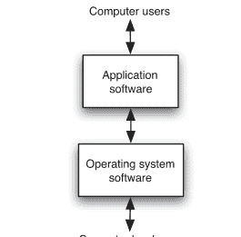

**图 1-1** 操作系统软件的作用

操作系统通过与多种类型的计算机硬件交互来执行许多不同的任务。为了完成这些任务，操作系统必须包含针对计算机中每个硬件设备的相应设备驱动程序。每个设备驱动程序告诉操作系统如何使用该特定设备。操作系统还提供用户界面，这是一个接受用户输入以指示要执行的操作的应用程序，将该输入转发给操作系统以完成任务，并在完成后将结果返回给用户。用户界面可以是命令行提示符，用户必须在此输入命令以告知操作系统要执行的操作；也可以是图形用户界面（`GUI`），它由一系列可视化的任务描绘（称为图标）组成，用户可以使用这些图标来控制操作系统，如图 1-2 所示。

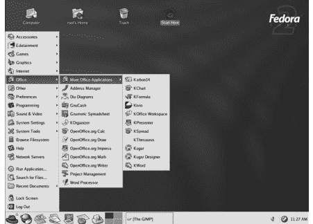

**图 1-2** Linux 图形用户界面

最后，操作系统提供系统服务，这些是处理系统相关任务（如打印、程序调度和网络访问）的应用程序。这些系统服务决定了操作系统中可见的大多数功能。不同的操作系统提供不同的系统服务，许多操作系统还允许用户自定义其提供的服务。

## Linux 操作系统

`Linux`（发音为“Lih-nucks”）是一种操作系统，如今用于在多种不同的硬件上运行各种应用程序。与其他操作系统类似，`Linux` 操作系统在首次开机时加载到计算机内存中，并初始化所有硬件组件。接下来，它加载所需的程序，提供一个界面供你输入命令，指示操作系统和其他应用程序加载以执行特定任务。以通常的方式，操作系统随后使用计算机硬件来执行应用程序所需的任务。

`Linux` 能够同时管理数千个任务，包括允许多个用户同时访问系统。因此，`Linux` 被称为多用户且多任务的操作系统。

#### Linux 操作系统的版本

`Linux` 操作系统的核心组件称为 `Linux` 内核。`Linux` 内核和支持函数库几乎完全用 `C` 编程语言编写，这是软件开发者在创建程序时使用最通用的语言之一。

虽然可以使用多种不同的软件来修改 `Linux` 的外观，但底层内核是所有 `Linux` 共用的。`Linux` 内核在持续开发中，因此了解 `Linux` 内核的不同版本号对于决定哪个内核版本适合特定需求至关重要。由于 `Linux` 内核直接负责控制计算机中的硬件（通过设备驱动程序），升级 `Linux` 内核可能是必要的，以便利用诸如 `IEEE 1394` (`FireWire`) 等新技术，或者修复现有硬件与当前内核之间的问题（也称为错误）。因此，了解系统需要使用的硬件特性对于决定使用哪个内核非常重要。


> **注**
> 可以在互联网上的 `http://www.kernel.org` 找到完整的核心列表、核心版本号及其改进列表。

在某些情况下，可以使用内核模块或内核补丁来提供或修复内核支持的硬件。内核模块和内核补丁将在本书后文讨论。

#### 识别内核版本

`Linux` 内核版本由以下三个组件组成：

- 主版本号
- 次版本号
- 修订号

让我们看一下一个 `Linux` 内核版本的示例，`2.5.9`。在这个例子中，主版本号是数字 2，表示对 `Linux` 内核的主要修订。次版本号由数字 5 表示，指示 `Linux` 内核的次要修订和稳定性。如果次版本号是奇数，则称为开发内核；如果次版本号是偶数，则称为生产内核。开发内核未经完全测试，意味着不稳定；它们由开发 `Linux` 软件的人员进行漏洞测试。生产内核是已经过几位 `Linux` 开发者彻底测试并被宣布为稳定的开发内核。在之前的例子中，内核的主版本号为 2，次版本号为 5。由于次版本号是奇数，这表明它是一个开发内核。这个内核最终会被 `Linux` 开发者改进、测试并被宣布稳定。当这种情况发生时，该内核的版本将变为 `2.6`（表示生产内核）。

`Linux` 内核的变化非常频繁。那些非常微小的变化由修订号表示，指示即将发布的特定内核版本的最新更改。例如，一个 `2.6.12` 内核的主版本号为 2，次版本号为 6，修订号为 12。这个内核是 `2.6` 内核的第 12 个版本。由于开发者不断改进内核代码，某些内核可能拥有超过 100 个不同的修订版。

> **提示**
> 当为关键任务计算机（如邮件服务器）选择内核时，确保次版本号是偶数。这降低了你在内核中遇到错误的可能性，从而节省了你更换内核所需的时间。

表 1-1 显示了自 `Linux` 初始发布以来，每个主要和次要内核的最新修订版。

**表 1-1 常见 Linux 内核的最新修订版**

| 内核版本 | 发布日期 | 类型 |
| :--- | :--- | :--- |
| `0.01` | 1991 年 9 月 | 第一个 `Linux` 内核 |
| `0.12` | 1992 年 1 月 | 生产（稳定） |
| `0.95` | 1992 年 3 月 | 开发版 |
| `0.98.6` | 1992 年 12 月 | 生产（稳定） |
| `0.99.15` | 1994 年 3 月 | 开发版 |
| `1.0.8` | 1994 年 4 月 | 生产（稳定） |
| `1.1.95` | 1995 年 3 月 | 开发版 |
| `1.2.12` | 1995 年 7 月 | 生产（稳定） |
| `1.3.100` | 1996 年 5 月 | 开发版 |
| `2.0.36` | 1998 年 11 月 | 生产（稳定） |
| `2.1.132` | 1998 年 12 月 | 开发版 |
| `2.2.26` | 2004 年 2 月 | 生产（稳定） |
| `2.3.99` | 2000 年 5 月 | 开发版 |
| `2.4.17` | 2001 年 12 月 | 生产（稳定） |
| `2.5.75` | 2003 年 7 月 | 开发版 |
| `2.6.7` | 2004 年 6 月 | 生产（稳定） |

## Linux 的授权


Linux 的授权方式是公司选择 Linux 作为其操作系统的主要原因之一。作为操作系统，与大多数其他操作系统相比，Linux 是独特的，因为它由庞大的软件开发者社区自由开发并持续改进。因此，它被称为**开源软件（OSS）**。要理解什么是 OSS，你必须首先理解如何使用源代码来创建软件程序。**源代码**指的是软件开发者编写以构成程序的指令列表；源代码的示例如图 1-3 所示。

```c
#define MODULE
#include <linux/module.h>
int init_module(void){
    printk("My module has been activated.\n");
    return 0;
}
void cleanup_module(void){
    printk("My module has been deactivated.\n");
}
```


在指令完成后，源代码被编译成一种格式（称为机器语言），只有你的计算机处理器才能理解和执行。要编辑现有程序，你必须编辑源代码然后重新编译它。

源代码的格式和结构遵循由其**编程语言**定义的某些规则。有许多不同的编程语言可用于编写 Linux 的源代码。编译成机器语言后，无论是从哪种编程语言创建的，所有程序在计算机操作系统看来都是一样的。因此，软件开发者根据易用性、功能和熟悉程度选择编程语言来创建源代码。

开源软件的概念使软件开发者能够阅读他人软件的源代码，修改该源代码以使程序更好，并重新分发

## 第 1 章 Linux 简介

开源开发允许开发者将源代码分享给其他可能会进一步改进它的开发者。此外，以这种方式制作的软件必须免费分发，无论对其进行多少修改。开发开源软件的人员通常使用互联网来分享他们的源代码、管理软件项目以及提交关于缺陷的评论和修复。通过这种方式，互联网充当了将开源软件（OSS）开发者绑定在一起的胶水。


开源软件的一些含义如下：

- 通过广泛的协作，软件被非常迅速地开发出来。
- 软件缺陷（错误）被记录并迅速修复。
- 软件功能基于用户的需求快速演变。
- 软件 perceived value 增加，因为它基于实用性而非价格。

不难理解为什么分享想法和源代码对软件开发有益，因为分享对任何类型的项目都有益；然而，商业模式非常不同。开源软件使用非传统的商业模式，因此，许多人发现很难理解一个免费分发的产品如何产生收入。毕竟，没有收入，任何公司都会倒闭。

OSS 产品从未打算直接产生收入；它们的设计初衷仅仅是为了更好地改进软件。软件创作是一门艺术，而非具体的程序。为执行相同任务而制作的程序可能会以几种不同的方式创建；例如，一位软件开发者可能创建使用四页源代码来测量小部件的程序，而另一位开发者可能创建仅用一页源代码完成相同任务的程序。因此，如果管理不善，软件开发就有变得杂乱无章的潜在风险。开源软件消除了与传统软件开发相关的许多问题。汇集众多个人软件开发者的人才，通过想法的免费分享，提高了软件创作的质量和方向。不存在单一的公司目的或截止日期。此外，当开源软件开发者为项目贡献其优势时，他们同时也从其他开发者那里学习新技术。

由于出售软件以获取利润会阻碍源代码的免费分享，开源软件间接产生收入。公司通常通过销售运行开源软件的计算机硬件、销售开源软件的客户服务，或创建运行在 Linux 等开源产品上的闭源软件程序来赚钱。

开源软件的功能可能有益，但必须存在法律许可证以防止 OSS 定义的变更。在学习一些常见可用许可证之前，请查看表 1-2，它定义了一些用于描述现有软件类型的一般术语。

#### 表 1-2 软件类型

| 类型 | 描述 |
| :--- | :--- |
| 开源 | 源代码和软件可以免费获取且可修改的软件 |
| 闭源 | 源代码不可用的软件；虽然这种类型的软件可能免费分发，但通常成本很高 |
| 免费软件 | 免费分发的闭源软件 |
| 共享软件 | 起初免费分发，但在使用一定时间段后需要付费的闭源软件 |

#### 开源许可证的类型

`Linux` 遵循 `GNU` 通用许可证（`GPL`），该许可证由自由软件基金会（`FSF`）开发。`GPL` 规定，在其许可证下发布的任何软件的源代码必须可免费获取。如果有人修改了该源代码，此人还必须免费重新分发该源代码，从而保持源代码永久免费。


**注意**

`GNU` 代表“GNU’s Not UNIX”。`GPL` 可免费在线获取，网址为 `http://www.gnu.org`，也见本书附录 B“`GNU` 通用许可证”。

另一种类型的开源许可证是**艺术许可证**，它确保程序的源代码可免费获取，但允许源代码的原始作者对其所做的一些变更拥有控制权。因此，如果一位开发者获取并改进了程序的源代码，原始作者有权拒绝这些改进。由于这一限制，艺术许可证很少被使用，因为许多开发者不希望从事可能徒劳无功的项目。

除了提到的两种不同的开源许可证外，还有许多类型的开源许可证可用，它们之间仅略有差异。这些许可证必须遵守开源定义，但可能包含开源定义中未有的额外条件。

**注意**

已批准的开源许可证列表可在互联网上找到，网址为 `http://www.opensource.org`。

#### 闭源许可证的类型

闭源软件可以免费或收费分发；无论如何，软件的源代码对原始开发者不可用。大多数闭源软件是商业销售的，并带有其制造商的标签。这些软件包中的每一个都可能包含单独的许可证，以多种不同方式限制程序和源代码的免费分发。

**注意**

闭源软件的示例包括由 `Microsoft`、`Novell` 或 `Electronic Arts` 等公司创建的软件。

另一种类型的闭源软件是免费软件，其中软件程序免费分发，但源代码不可用。免费软件也可能包含限制源代码分发的许可证。这种风格的闭源许可的另一种方法是共享软件，它免费分发，但在一定使用时长后或为获得程序的某些功能时，需要付费。尽管免费软件和共享软件通常不在开源许可证下分发其源代码，但一些人错误地将免费软件称为 `OSS`，假设源代码也是免费的。

#### Linux 的优势

如今有许多操作系统在使用；主要的包括 `Linux`、`Microsoft Windows`、`Novell NetWare`、`UNIX` 和 `Mac OS`。值得注意的是，`Linux` 是迄今为止发布的最快速增长的操作系统。尽管 `Linux` 仅在 1991 年创建，但 `Red Hat` 在 1998 年估计的 `Linux` 用户数为 750 万，而 `Linux Counter Organization` 在 2003 年估计的 `Linux` 用户数为 1800 万。包括 `IBM`、`Hewlett-Packard`、`Intel` 和 `Dell` 在内的许多大型公司已宣布支持 `Linux` 和 `OSS`。在 2000 年，`IBM` 宣布将仅用于 `Linux` 及其开发就投入 10 亿美元。

## Linux 操作系统

有众多原因导致许多人开始使用 `Linux`。以下优势将在后面的章节中探讨：

- 风险降低
- 满足业务需求
- 稳定性和安全性
- 针对不同硬件平台的灵活性
- 易于定制
- 易于获取支持
- 成本降低

### 风险降低

公司投资于软件以执行关键任务，如数据库跟踪、互联网业务（电子商务）和数据操纵。然而，客户需求的变化和市场竞争可能导致公司使用的软件频繁变更。这可能非常昂贵且耗时，但这是公司必须承担的风险。想象一家虚构的公司 `ABC Inc.`，从一家虚构的软件供应商 `ACME Inc.` 购买软件，以便通过互联网整合其销售和会计信息与客户。如果 `ACME` 倒闭或因销售不佳而停止支持该软件，会发生什么？在这两种情况下，`ABC` 将使用没有软件支持的产品，且 `ABC` 之后遇到的任何问题都将无法解决，并可能导致收入损失。此外，所有闭源软件最终都会在一段时间后退役，迫使公司不时购买新软件以获得新功能并维护软件支持。

相反，如果 `ABC` 选择使用 `OSS` 产品，而原始开发者不再可用以维护它，那么 `ABC` 可以自由地获取源代码，为其添加功能并自行维护，前提是源代码被免费重新分发。此外，大多数 `OSS` 不会在短时间内退役，因为协作式开源开发会导致持续的软件改进，以满足用户需求。

### 满足业务需求

回想一下，`Linux` 仅是开源开发的众多产品之一。存在数以万计的 `OSS` 程序，并且世界各地的软件开发者每天都在创建新的程序。大多数开源互联网工具已经开发了一段时间，过去几年 `Linux` 社区的重点一直是为 `Linux` 开发应用软件，如数据库和办公生产力套件。与其他操作系统相比，其中大多数软件是闭源且昂贵的，几乎所有这些软件都是开源且免费可用的。

`OSS` 很容易找到，因为互联网上的几个网站允许 `Linux` 开发者托管其软件供他人下载；例如位于 `http://www.sourceforge.net` 的 `SourceForge`，以及位于


`http://www.freshmeat.net` 和位于 `http://www.ibiblio.org` 的 `Ibiblio` 是最常见的网站之一。这些网站每天都会发布新软件；仅 `SourceForge` 就托管了超过 80,000 个不同的软件开发者。`Linux` 上常见的一些软件包括但不限于以下列表：

- 科学与工程软件
- 软件模拟器
- Web 服务器、Web 浏览器和电子商务套件
- 桌面生产力软件（例如文字处理器、演示文稿软件、电子表格）
- 图形处理软件
- 数据库软件
- 安全软件

此外，运行 `UNIX` 操作系统的公司可能会发现迁移到 `Linux` 很容易。对于这些公司而言，`Linux` 支持大多数 `UNIX` 命令和标准，这使得向 `Linux` 的过渡非常轻松，因为公司可能不需要购买额外的软件或重新培训员工。例如，假设一家测试科学产品的公司花费了大量时间和精力开发运行在 `UNIX` 操作系统上的定制软件。如果该公司过渡到另一种操作系统，员工需要重新培训或招聘，许多定制软件需要重写和重新测试，这可能会导致客户信心下降。然而，如果该公司过渡到 `Linux`，员工只需很少的重新培训，很少的定制软件需要重写和重新测试，从而节省成本并最大限度地减少对客户信心的影响。

对于需要在 `Linux` 使用和管理方面培训员工的公司，存在针对各种 `Linux` 技能级别的教育资源和认证考试。本书附录 A“认证”中讨论了认证的好处和 `CompTIA Linux+` 认证。

此外，对于需要特定开发环境或需要支持过去开发的定制软件的公司，`Linux` 支持大多数编程语言。

### 稳定性和安全性

`OSS` 由那些需要使用它的人开发。这种具有共同需求的多个开发者之间的协作加快了软件开发速度，当软件中的缺陷由这些用户发现时，缺陷修复会迅速生成。通常，识别缺陷的用户可以修复问题，因为他们拥有源代码，或者他们可以提供关于问题的详细描述，以便其他开发者修复它们。

相比之下，使用闭源操作系统的客户必须依赖操作系统厂商来修复任何缺陷。闭源操作系统的用户必须向制造商报告缺陷，并等待制造商开发、测试并发布解决问题的方案，这被称为`热修复`。这一过程可能需要数周甚至数月。对于大多数公司和个人来说，这个过程既慢又昂贵。彻底且协作的开源方法用于测试软件和修复软件缺陷，提高了 `Linux` 的稳定性；发现一个 `Linux` 系统连续运行数月甚至数年而不关机并不罕见。

安全也是许多公司和个人的重要关注点。`Linux` 源代码可自由获取并公开审查。与缺陷类似，安全漏洞会迅速被识别和修复，通常由多个不同的开发者完成。相比之下，闭源操作系统的源代码不向公众开放以供审查，这意味着客户必须依赖该闭源操作系统的厂商来提供安全。因此，如果发现者不正确，安全漏洞可能会未被察觉。可以通过影响闭源操作系统（如 `Windows`）的计算机病毒（利用安全漏洞的破坏性程序）数量与影响 `Linux` 的病毒数量对比来证明这种情况。截至 2004 年 6 月，`Linux` 已知病毒少于 100 个，而 `Windows` 已知病毒超过 70,000 个。


**注意**

> 可以在互联网上 `http://www.viruslist.com` 找到近期计算机病毒列表。

### 针对不同硬件平台的灵活性

`Linux` 的另一个重要特性是它可以在不同公司中常见的各种不同计算机`硬件平台`上运行。虽然 `Linux` 最常安装在 `Intel x86` 平台上，但 `Linux` 也可以安装在其他类型的硬件上，例如 `Alpha`。这意味着公司可以在大型且昂贵的硬件上运行 `Linux`，用于图形渲染或化学分子建模等大型任务，也可以像在旧 `Sun SPARC` 计算机等旧硬件上运行以延长其在公司中的使用寿命。很少有其他操作系统能在两种不同的硬件平台上运行，这使得 `Linux` 成为使用各种不同或专用硬件的公司的理想选择。

以下是 `Linux` 可以运行的硬件平台的部分列表：

- `Intel`
- `Itanium`
- 大型机 (`S/390`)
- `Cirrus Logic ARM`
- `Alpha`
- `MIPS`
- `M68K`
- `PA-RISC`
- `SPARC`
- `Ultra-SPARC`
- `PowerPC (Macintosh)`

除了上述列表中的平台外，`Linux` 可以定制为在大多数硬件上工作，包括嵌入式设备，如手表或微波炉。随着对产品新功能需求的增长，这种嵌入式操作系统技术在未来将变得更加重要。许多高科技公司依靠嵌入式操作系统技术来驱动其系统，例如 `NASA` 航天飞机。目前，超过 100 家不同的公司将 `Linux` 嵌入到他们的产品中。

**注意**

> 可以在互联网上 `http://www.embedded-linux.org` 找到嵌入式 Linux 供应商列表。

### 定制简便性

能够控制 `Linux` 操作系统的内部工作机制是 `Linux` 的另一个吸引人特性，特别是对于那些需要 `Linux` 执行专门功能的公司。如果你希望使用 `Linux` 作为互联网 Web 服务器，你可以简单地重新编译 `Linux` 内核，使其仅包含作为互联网 Web 服务器所需的支持。这将导致一个更小、更快的内核。

**注意**

> 小内核比大内核运行得快，因为处理器在计算机中需要分析的代码更少。通常，你应该去除内核中不必要的支持以提高性能。

如今，定制和重新编译 `Linux` 内核是一个有详细文档记录且容易的过程；然而，这不是定制 `Linux` 的唯一方式。只需要安装执行特定任务所必需的软件包；因此，每个 `Linux` 系统可以拥有独特的配置和一组可供用户使用的应用程序。`Linux` 还支持 `Shell` 和 `PERL` 编程语言，这些语言可用于自动化任务或创建自定义任务，然后根据需要调用。

考虑一家需要应用程序将数据库文件从一台计算机复制到另一台计算机的公司，同时又要求以特定方式操作数据库文件，由另一个程序测试重复记录，总结，最后打印为报告。对于这家公司来说，这似乎是一项需要昂贵软件的任务；然而，在 `Linux` 中，你只需编写一个简短的 `PERL` 脚本，使用常见的 `Linux` 命令和程序组合在一起，在几分钟内完成此任务。这种定制对公司来说是`极其宝贵的`，因为它允许将现有的几个应用程序组合起来执行特定任务，这该任务可能仅针对该公司，因此尚未由其他免费软件开发者开发。大多数 `Linux` 配置提供数百个小工具，结合 `Shell` 或 `PERL` 编程，可以快速轻松地创建满足许多业务需求的新程序。

### 获取支持的简便性

对于 `Linux` 新手，互联网提供了大量的 `Linux` 文档。常见问题（`FAQs`）和易于阅读的指令（称为 `HOWTO` 文档）按主题排列，并且可供任何人使用。`HOWTO` 文档由其作者维护，但由 `Linux` 文档项目（`LDP`）集中收集，该项目在全球拥有超过 250 个网站，允许你搜索或下载 `HOWTO` 文档。

在典型的互联网搜索引擎（如 `http://www.world.google.com`）上搜索“`HOWTO`”一词会显示数千个结果，或者你可以在 `http://www.tldp.org` 下载全球 `HOWTO` 文档集合。

此外，几个互联网新闻组允许 `Linux` 用户发布消息并回复先前发布的消息。如果有人遇到特定的 `Linux` 问题，该人只需在互联网新闻组上发布他的问题，就可以从知道解决方案的人那里获得帮助。`Linux` 新闻组的发布非常频繁；因此，你通常可以在几小时内期望得到问题的解决方案。常见 `Linux` 新闻组的列表可以在互联网上 `http://groups.google.com` 找到。

附录 C“在互联网上查找 Linux 资源”描述了如何导航互联网资源，并列出了一些在整个书中有用的常见资源。

虽然在线支持是获取帮助的最常见方法，但还有其他方法可用。大多数 `Linux` 发行版以适度的费用提供专业电话支持服务，许多组织存在以提供免费支持给寻求帮助的人。这些群体中最常见的是被称为 `Linux` 用户组（`LUGs`），全球大多数大城市至少有一个。`LUGs` 是定期聚会讨论 `Linux` 相关问题和问题 `Linux` 用户群体。一个典型的 `LUG` 会议包括一些新的 `Linux` 用户（也称为 `Linux` 新手）、管理员、开发者和专家（也称为 `Linux GURUs`）。`LUG` 会议是解决问题以及了解当地 `Linux` 社区的地方。大多数 `LUG` 都托管包含多种 `Linux` 资源的互联网网站，包括过去会议的摘要和讨论。`LUG` 会议上常见的活动被称为 `Installfest`；几名成员带来他们的计算机设备来安装 `Linux` 和其他 `Linux` 相关软件。这种知识转移方法对 `LUG` 成员非常宝贵，因为概念可以被演示，问题的解决方案可以由更有经验的 `Linux` 用户进行建模。

要查找您所在区域现有的 `LUG` 列表，请在 `http://www.google.com` 等互联网搜索引擎上搜索 `LUG <cityname>`。在搜索 `LUG` 时，请记住 `LUG` 可能有多个不同的名称；例如，加拿大安大略省汉密尔顿市的 `LUG` 被称为 `HLLUG`（汉密尔顿 `Linux` 用户组）。

### 降低成本


Linux 比 Windows 等其他操作系统便宜，因为获取软件没有相关成本。此外，大量的 `OSS` 可以运行在运行 Linux 的各种不同硬件平台上，并且有一个庞大的开发者社区，可以免费在短时间内诊断和修复 `bug`。然而，尽管 Linux 和 Linux 源代码是免费分发的，但实施 Linux 并非免费。成本包括购买托管 Linux 计算机所需的计算机硬件、聘请人员安装和维护 Linux，以及对 Linux 软件用户进行培训。

企业在 Linux 方面面临的最大成本是用于维护 Linux 系统的人员成本。然而，在使用封闭式源代码操作系统时，除了硬件、操作系统、附加软件和修复 `bug` 的成本外，这种管理成本也是必需的。使用特定操作系统的总体成本被称为`总拥有成本（TCO）`。表 1-3 展示了计算操作系统 `TCO` 时涉及因素的示例。

`表 1-3 计算总拥有成本`

| 操作系统 | Linux | 封闭式源代码操作系统 |
| :--- | :--- | :--- |
| 操作系统成本 | $0 | 大于 $0 |
| 管理成本 | 低：稳定性高，开源开发者能快速修复 `bug`。 | 中/高：`bug` 修复由操作系统供应商创建，这可能导致昂贵的停机时间。 |
| 附加软件成本 | 低/无：大多数可供 Linux 使用的软件也是开源的。 | 高：大多数可供封闭式源代码操作系统使用的软件也是封闭式源代码的。 |
| 软件升级成本 | 低/无 | 中/高：封闭式源代码软件最终会被淘汰，公司必须购买升级或新产品以获得功能并保持竞争力。 |

## Linux 的历史

Linux 基于 `Ken Thompson` 和 `Dennis Ritchie` 在 1969 年为 `AT&T` 贝尔实验室开发的 `UNIX` 操作系统，它是通过许多人的努力开发的，结果是 20 世纪 80 年代形成的“黑客文化”。因此，要理解 Linux 是如何以及为何在操作系统市场上兴起的，首先必须理解 `UNIX` 和黑客文化。图 1-4 展示了一个代表 `UNIX` 和 Linux 操作系统历史的时间线。

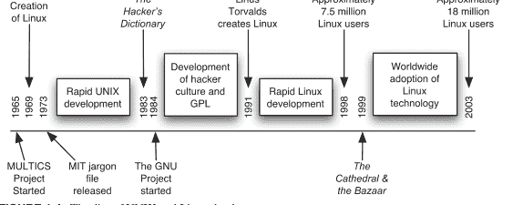

`图 1-4` `UNIX 和 Linux 开发的时间线`

### UNIX

`UNIX` 操作系统的根源可以追溯到 1965 年，当时麻省理工学院（`MIT`）、通用电气和贝尔实验室开始开发一个名为`多路复用信息计算服务（MULTICS）`的操作系统。`MULTICS` 是一个测试项目，旨在揭示开发分时操作系统的更好方法，在该系统中，操作系统调节每个进程使用处理器的时间量；然而，该项目于 1969 年被放弃。

曾参与 `MULTICS` 操作系统工作的 `Ken Thompson`，在项目被放弃后继续尝试操作系统开发，并于 1969 年开发了一个名为 `UNOX` 的操作系统，该系统运行在 `DEC`（数字设备公司）`PDP-7` 计算机上。不久之后，`Dennis Ritchie` 发明了 `C` 编程语言，该语言被用于 `Ken Thompson` 的 `UNOX` 操作系统。`C` 编程语言是一种革命性的语言。当时的大多数程序需要针对计算机硬件专门编写，这涉及到引用大量关于硬件的信息来编写一个简单的程序。然而，`C` 编程语言在编写程序时更容易使用，并且可以在多个不同的机器上运行程序而无需重写代码。`UNIX` 操作系统是用 `C` 编程语言重写的，到 20 世纪 70 年代末，`UNIX` 操作系统可以在不同的硬件平台上运行，这是当时计算界从未见过的。因此，人们称 `UNIX` 为可移植操作系统。

不幸的是，`Ken Thompson` 和 `Dennis Ritchie` 工作的公司（`AT&T` 贝尔实验室）受到联邦法院命令的限制，禁止营销 `UNIX`，`AT&T` 实施的解决方案涉及将 `UNIX` 源代码出售给几家不同的公司，并鼓励它们之间制定标准。这些公司中的每一家都开发了自己版本的 `UNIX`，但都遵守各方达成的一致标准。`AT&T` 还向某些大学免费提供 `UNIX` 源代码副本，以促进 `UNIX` 的广泛开发；加州大学伯克利分校的 `BSD`（伯克利软件发行版）`UNIX` 就是其中的一个结果。它于 20 世纪 80 年代初进入计算领域。1982 年，`AT&T` 将 `UNIX` 源代码出售的公司之一（`Sun Microsystems`）在相对更便宜的硬件上营销 `UNIX`，并向各公司和大学出售了数千台运行 `UNIX` 的计算机。

在整个 20 世纪 80 年代，`UNIX` 主要在企业中有立足之地，这些企业有足够的资金购买运行 `UNIX` 所需的昂贵计算设备（通常是 `DEC` `PDP-11`、`VAX` 或 `Sun Microsystems` 计算机）。20 世纪 80 年代典型的 `UNIX` 系统成本可能超过 100,000 美元，却为客户端计算机或“哑终端”执行数千项任务。如今，`UNIX` 仍然在该环境中发挥作用；大多数大公司为其重型、关键任务（如电子商务和数据库托管）使用不同版本的 `UNIX`。如今常见的 `UNIX` 版本包括 `Sun Microsystems` 的 `Solaris UNIX`、`Hewlett-Packard` 的 `HP-UX` 和 `IBM` 的 `AIX UNIX`。

### 黑客文化

术语 `hacker` 指的是那些通过实验扩展其计算机知识的人。这与术语 `cracker` 不同，后者指的是非法使用计算机以谋取个人利益或造成损害的人。

在 `UNIX` 早期，大多数黑客主要具有工程或科学背景，因为大多数 `UNIX` 开发发生在这些领域。黑客行为的基本思想是分享知识。著名黑客 `Richard Stallman` 在麻省理工学院人工智能实验室工作期间，推广了思想自由共享的理念。他认为，计算行业中所有知识的自由共享将促进发展。在 20 世纪 80 年代中期，`Richard` 成立了自由软件基金会（`FSF`），以鼓励自由软件开发。这一运动很快被全球各地的学术社区接受，许多大学学生和其他黑客参与了自由软件的制作，其中大部分运行在 `UNIX` 上。因此，黑客文化通常与 `UNIX` 操作系统一起被识别。

不幸的是，`UNIX` 不是自由软件，到 20 世纪 80 年代中期，不同 `UNIX` 供应商之间早期看到的协作减弱，`UNIX` 开发分裂成不同的流派。因此，`UNIX` 并不代表 `FSF` 的理想，所以 `Richard Stallman` 于 1984 年创立了 `GNU` 项目，以推广一个不是 `UNIX` 的自由操作系统的自由开发。

> `注意`
>
> `FSF` 和 `GNU` 的描述可以在互联网上的 [http://www.gnu.org](http://www.gnu.org) 找到。

这一开发最终导致了 `GNU` 通用公共许可证（`GPL`）的发布，该许可证使源代码的自由分发合法化，并鼓励协作开发。根据此许可证发布的任何软件必须免费提供其源代码；对源代码所做的任何修改也必须自由重新分发，从而保持软件开发永远免费。

随着越来越多的黑客合作开发软件，形成了一种黑客文化，它具有隐含的规则和约定。大多数开发者在没有见过彼此的情况下合作；他们主要通过新闻组和电子邮件进行交流。此外，《黑客词典》于 1983 年由 `MIT` 出版，详细记录了自 20 世纪 70 年代中期以来收集的关于计算和计算文化的术语。`FSF`、`GNU`、`GPL` 和《黑客词典》都是黑客文化的有形部分，直到黑客 `Eric S. Raymond` 于 1999 年出版了他的书`大教堂与集市`之前，这种文化并没有有形的定义。在这本书中，`Raymond` 描述了黑客文化的几个方面：

-   软件用户被视为共同开发者。
-   软件主要是为了同行认可而开发，而不是为了金钱。
-   软件作品的原作者被视为该软件的拥有者，并协调协作软件开发。
-   软件的使用决定其价值，而非其成本。
-   从不攻击源代码的作者。相反，要么进行 `bug` 修复，要么建议修复。
-   开发者在被接受进入之前必须理解黑客文化的隐含规则。

这种黑客文化被证明非常有成效，在 20 世纪 80 年代制作了几千种免费工具和应用，包括著名的 `Emacs` 编辑器，它是今天 Linux 中常用的工具。在此期间，许多编程函数库和类 `UNIX` 命令也作为 `GNU` 项目工作的结果而出现。黑客们习惯了通过新闻组和电子邮件通信合作。简而言之，这种支持源代码自由共享和协作开发的黑客文化为 Linux 奠定了基础。

### Linux

尽管 `Richard Stallman` 启动 `GNU` 项目旨在制作一个自由操作系统，但 `GNU` 操作系统从未真正起飞。黑客们在开发 `GNU` 项目中获得的许多经验后来被整合到 Linux 中。一名名为 `Linus Torvalds` 的芬兰学生首先

## 第 1 章 LINUX 简介

1991 年，林纳斯在实验如何改进 `MINIX`（`Mini-UNIX`，由 `Andrew Tannenbaum` 开发的一个小型教育版 `UNIX`）使其适用于 `Intel x86` 平台时，开发了 Linux。当时，`Intel x86` 平台正在迅速成为全球家庭和企业的标准，因此是当时进行免费开发的理想选择。吸引黑客文化界开发力量的 Linux 操作系统的关键特性在于，Linux 是在 `GNU` 公共许可协议下发布的。


自 1991 年 `Linux` 源代码发布以来，致力于改进 `Linux` 的软件开发者数量逐年增加。`Linux` 内核是协作开发的，并得到集中管理；然而，许多 `Linux` 附加软件包是由全球范围内对发布感兴趣的黑客文化成员自由开发的。`Linux` 成为免费软件开发者关注的焦点。在 20 世纪 90 年代初期和中期，`Linux` 开发具有激进色彩；黑客们利用这段时间实验这种规模的开发项目。与此同时，出现了多个 `Linux` 发行版。`Linux` 发行版使用通用的 `Linux` 操作系统内核和库，但打包了针对特定用途的附加软件。

形成了许多 `Linux` 发行版，如 `Red Hat`、`Mandrake` 和 `SuSE`，但 `Linux` 的这种品牌化并未导致 20 世纪 80 年代末 `UNIX` 所经历的碎片化。所有 `Linux` 发行版都共享通用的内核和实用工具；它们包含不同的附加软件包这一事实仅仅使它们在表面上看起来有所不同。`Linux` 仍然从协作开发中获益，1998 年，术语“开源软件（OSS）”开发被用于描述这种类型的协作软件开发。OSS 由黑客文化创造并倡导，到 1998 年，全球已有数千名 OSS 开发者。许多提供 `Linux` 企业解决方案的小公司应运而生，人们投资这些公司，许多公司在股票市场上市。不幸的是，这一趋势并未持续太久，到 2000 年，这些公司大多已消失。与此同时，OSS 运动引起了许多大公司（如 `IBM`、`Compaq`、`Dell` 和 `Hewlett-Packard`）的关注和支持，`Linux` 开发的重心转向支持大型计算环境和嵌入式 `Linux`。

值得注意的是，`Linux` 仅仅是 OSS 开发的副产品。回想一下，OSS 开发者仍然是黑客文化的成员，因此，他们内在动机是开发具有重要用途的软件。因此，OSS 开发随时间发生了变化；在 20 世纪 80 年代，黑客文化专注于开发 `Internet` 和编程工具，而在 90 年代，黑客文化则专注于 `Linux` 操作系统开发。自 2000 年以来，开发适用于 `Linux` 操作系统的应用程序备受关注。图形程序、游戏和定制商业工具仅是 OSS 开发者在过去几年中发布的一些热门开发成果。由于 `Linux` 目前开发非常成熟，预计在未来十年 OSS 社区将进行更多的应用开发。

## Linux 发行版

首先下载并安装 `Linux` 内核，然后添加所需的 OSS 软件包，这种方式获取 `Linux` 既耗时又低效。通常，用户下载包含 `Linux` 内核、常用功能库和一系列 OSS 软件包的 `Linux` 发行版。


> 请记住，尽管不同的 `Linux` 发行版在表面上看起来不同，但它们运行相同的内核，并包含许多相同的软件包。

尽管各种 `Linux` 发行版在本质上相同，但它们确实存在重要差异。不同的发行版可能支持不同的硬件平台。此外，`Linux` 发行版预定义了软件集；一些 `Linux` 发行版附带大量与服务器相关的工具，如 Web 服务器和数据库服务器，而另一些则附带大量工作站和软件开发应用程序。还有的是附带一套完整的开源工具，用户可以从这些工具中自定义其 `Linux` 系统；用户只需选择这些开源工具的一个子集进行安装，例如数据库服务器，以执行特定功能。

附带许多专业工具的 `Linux` 发行版可能不包含图形用户界面（`GUI`）；例如，一种可以装入软盘的 `Linux` 发行版可作为`路由器`使用。然而，大多数发行版都附带可进一步定制以适应用户需求的 `GUI`。`Linux` 中 `GUI` 的核心组件被称为 `X Windows`，可通过 Internet 从 `http://www.XFree86.org` 获取。有多种窗口管理器和桌面环境可供选择，它们共同影响该 `GUI` 的外观和感觉，并且这些组件在发行版之间可能有所不同。`X Windows` 与窗口管理器和桌面环境的组合被称为 `GUI 环境`。`Linux` 中有两种竞争的 `GUI` 环境：`GNU 网络对象模型环境（GNOME）` 和 `K 桌面环境（KDE）`。这两种 `GUI` 环境的功能或多或少相当，尽管用户可能更个人偏好其中一种桌面环境。这种情况经常发生，当一家公司希望在 `GUI` 环境中进行大量软件开发时；用 `C` 编程语言编写的 `GNOME` 桌面使用广泛可用的 `gk` 工具包，而用 `C++` 编程语言编写的 `KDE` 桌面使用 `qt` 工具包。哪种语言和工具包最适合需求，哪种就会被优先选择。大多数常见的 `Linux` 发行版都附带 `GNOME` 和 `KDE` `GUI` 环境，而另一些则提供支持，以便可以轻松下载和安装任何 `GUI` 环境。图 1-5 和 1-6 展示了这两种 `GUI` 环境的比较。

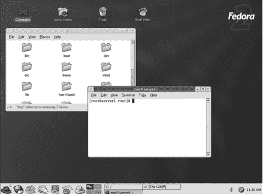

`GNOME 桌面`

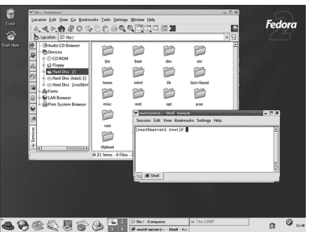

`KDE 桌面`

`Linux` 发行版之间的另一个差异在于语言支持。某些发行版对某些语言的支持比其他发行版更多。两个例子是 `SuSE Linux`，它增加了对德语的支持，以及 `TurboLinux`，它增加了对日语和中文的支持。因此，这两种 `Linux` 发行版在主要人口使用这些语言的国家最为流行。许多 `Linux` 发行版针对不同语言进行了专业化，大多数 `Linux` 文档，如 `HOWTO` 文档，都有多种语言版本。

虽然 `Linux` 发行版之间的这些差异可以帮助缩小要安装的 `Linux` 发行版选择范围，但公司选择某一发行版而非另一发行版的最深刻原因之一是对包管理器的支持。`包管理器` 是一个安装和维护软件的系统。它跟踪已安装的软件，要求标准格式和文档，并可以通过在计算机上的中央软件数据库中记录所有相关软件信息来管理和从系统中移除软件。

### 注意

> `Linux` 中的包管理器类似于 `Windows` 控制面板中的“添加/删除程序”小工具。

最广泛支持的包管理器是 `Red Hat 包管理器（RPM）`。大多数 `Linux` 软件可用 `RPM` 格式，`Red Hat 包管理器` 是许多 `Linux` 发行版的标准。`Debian 包管理器` 提供与 `Red Hat 包管理器` 相同的优势，但很少有发行版提供它。除了以包管理器格式获取软件外，你还可以下载 `tarball` 格式的软件。`tarball` 只是一个压缩的文件归档，类似于 `WinZip` 或 `RAR`，通常包含用于将软件内容安装到系统中正确位置的脚本。不幸的是，`tarball` 不会更新中央软件数据库，因此很难管理、升级或从系统中移除。传统上，大多数 `Linux` 软件可用 `tarball` 格式，但越来越多的人使用包管理器来安装软件。

### 注意

> 完整的 `Linux` 发行版列表可在 Internet 上的 [http://www.linux.org](http://www.linux.org) 找到，并且此列表可以按硬件平台、软件类别或语言进行搜索。

任何人都可以通过将开源软件与 `Linux` 内核打包来创建 `Linux` 发行版，因此，存在超过 250 个公开注册的 `Linux` 发行版。其中许多是小型、专业发行版，旨在满足特定功能，但一些是主流大多数情况下常用的 `Linux` 发行版。每个发行版通常都有一个相关的网站，可以从中免费下载该发行版。此外，大多数 `Linux` 发行版还可以从多个不同的网站获取，例如 `http://www.linuxiso.org`。许多 `Linux` 发行版也可以以少量费用从各个电脑商店和网站购买 `CD-ROM`；不过，从互联网下载是获取 `Linux` 最常见的方法。

表 1-4 简要列出了一些主流的 `Linux` 发行版、其特性以及在互联网上寻找它们的途径。

### 表 1-4 常见的 Linux 发行版

| 发行版 | 特性 | 平台 | 位置 |
| --- | --- | --- | --- |
| `Red Hat Linux` | 当今最常用的 `Linux` 发行版，带有在任何 `Linux` 环境中都有用的工具。有两种 `Red Hat` 发行版可用：企业版（`Enterprise`）和 `Fedora` 版。两个版本都附带 `GNOME`、`KDE` 和 `RPM`。 | `x86` `Itanium` `AMD64` `Alpha` `SPARC` `PPC` `Mainframe` `M68K` `MIPS` `Embedded` | `http://www.redhat.com` |
| `SuSE Linux` | 欧洲最常用的 `Linux` 发行版，也是北美第二大常用的 `Linux` 发行版，`SuSE` 几乎为任何业务需求提供软件包。它附带 `GNOME`、`KDE` 和 `RPM`。 | `x86` `Itanium` `AMD64` `Alpha` `PPC` `SPARC` `Mainframe` `Embedded` | `http://www.suse.com` |
| `Slackware Linux` | 一个具有许多与 `UNIX` 相似特性的发行版，由于其增强了的多处理器支持，常用于多处理器环境。它附带 `GNOME` 和 `KDE`。 | `x86` `Alpha` `SPARC` | `http://www.slackware.com` |


| Debian | 一个提供所有 Linux 中最大数量软件包的发行版，它包含适用于任何用途的软件包，并附带 `GNOME`、`KDE`、Debian 包管理器和 `RPM`。 | x86 Itanium AMD64 Alpha SPARC ARM M68K PPC | http://www.debian.org |
|---|---|---|---|
| TurboLinux | 亚洲最常用的 Linux 发行版，以其集群能力而闻名。它附带 `GNOME`、`KDE` 和 `RPM`。 | x86 Itanium Alpha Mainframe | http://www.turbolinux.com |
|---|---|---|---|
| Mandrake Linux | 一个面向用户的发行版，非常类似于 Red Hat，但增加了易用性方面的改进。它附带 `GNOME`、`KDE` 和 `RPM`。 | x86 Itanium AMD64 PPC | http://www.mandrakelinux.com |

## Linux 的常见用途

如前所述，Linux 的一个重要特性是其多功能性。Linux 可以提供满足各种情况下不同公司需求的服务。此外，鉴于互联网上可自由获取的广泛文档，配置这些服务非常简单；只需选择所需的服务，然后定制 Linux 以提供这些服务。这些服务可以在本地计算机**工作站**上使用，也可以配置为允许其他计算机通过网络连接到它。在本地计算机上使用的服务被称为**工作站服务**，而为网络上其他计算机提供的服务则称为**服务器服务**。


**注意**

托管服务器服务的计算机通常被称为**服务器**。

尽管有数千种不同的服务器和工作站服务可用于定制 Linux，但当今常用的 Linux 配置包括以下几类：

- 互联网服务器
- 文件和打印服务器
- 应用程序服务器
- 超级计算机
- 科学工作站
- 办公工作站

### 互联网服务器

Linux 托管了广泛的互联网服务，Linux 在 20 世纪 90 年代通过在这些服务中的流行而获得了大量知名度。所有这些都是免费提供的，并且像所有开源软件一样不断改进，这使得 Linux 在规划公司使用互联网服务时成为一个有吸引力的选择。使用计算机服务客户端计算机的公司被说拥有互联网服务器。Linux 提供数百种网络服务，为互联网服务器提供框架；其中最常见的服务包括：

- 邮件服务
- 路由
- `FTP` 服务
- 防火墙和代理服务
- Web 服务
- 新闻服务
- `DNS` 服务

本手册的后续章节将详细讨论其中许多应用程序。

### 邮件服务

在 20 世纪 80 年代和 90 年代初，电子邮件（或电子函件）主要是一种在大学中找到的服务。如今，几乎每个互联网用户都有电子邮件账户，并且经常使用电子邮件。电子邮件地址容易获取，且可以免费获得。


**注意**

> 电子邮件地址可以从多个不同的网站获取；其中一个著名的网站是 `http://www.hotmail.com`。

电子邮件通过电子邮件服务器网络分发，也称为**邮件传输代理（MTA）**。Linux 有许多免费可用的 MTA，包括 `sendmail`、`postfix`、`smail` 和 `qmail`。在用户可以访问电子邮件之前，必须从 MTA 下载电子邮件；提供此功能的服务被称为**邮件投递代理（MDA）**。Linux 也提供了一些此类服务；`procmail` 和 `fetchmail` 是两个最常见的。最后，必须使用称为**邮件用户代理（MUA）**的程序来查看电子邮件。Linux 常见的 MUA 包括 `mutt`、`pine`、`printmail`、`elm`、`mail`、`Netscape` 和 `Eudora`。

#### 路由

路由是互联网运行所必需的核心服务。互联网仅仅是一个由互连网络组成的大型网络；换句话说，它将公司网络、家庭网络和机构网络连接在一起，使它们能够相互通信。路由器是提供此互连的计算机或特殊硬件设备；它包含有关互联网结构的信息，并将信息从一个网络发送到另一个网络。公司可以使用路由器将内部网络连接到互联网，也可以将公司内部的网络彼此连接起来。Linux 是这方面的良好选择，因为它提供对路由的支持，并且易于定制；许多可以放在一张软盘上的 Linux 发行版都提供路由功能。

### FTP 服务

在互联网上传输文件最常见和高效的方法是使用文件传输协议（FTP）。此外，在内部公司网络上传输文件时 `FTP` 也很常见，因为它非常快速且稳健。用户只需在其计算机上启动 `FTP` 服务（现在称为 `FTP` 服务器）并允许用户连接；其他计算机上的用户然后使用 `FTP` 客户端程序连接到该服务器并下载所需的任何文件。大多数互联网上可用的 `FTP` 服务器允许任何用户连接，因此被称为匿名 `FTP` 服务器。此外，大多数操作系统，如 Linux、UNIX、Microsoft Windows 和 Macintosh，都附带 `FTP` 客户端程序，使用户可以轻松连接到这些 `FTP` 服务器。

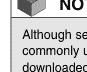

> 虽然 Linux 有多种 `FTP` 服务软件可用，但最常用的是华盛顿大学 `FTP` 服务器（`wu-ftp`），可以从互联网 `http://www.wu-ftp.org` 下载。

### 防火墙和代理服务

“防火墙”一词源于汽车行业；如果发动机舱发生火灾，防火墙保护车内的乘客。正如汽车防火墙保护乘客一样，计算机防火墙保护公司免受互联网上外部入侵者的侵害。

大多数防火墙都是计算机，它们被放置在公司网络与公司连接到互联网的路径之间；因此所有流量都必须通过这台防火墙，从而使公司能够基于复杂的规则集来控制该防火墙上的流量。Linux 在核心中直接内置了防火墙支持，并且其随大多数发行版附带了诸如 `ipchains` 和 `netfilter/iptables` 等实用工具，这些工具可用于配置使系统成为防火墙所需的规则。

> **注意**
>
> 你可以访问互联网上的 `http://www.netfilter.org` 了解有关使用 `netfilter/iptables` 配置 Linux 防火墙的更多信息。

由于防火墙通常位于公司的内部网络和互联网之间，它们通常还提供其他服务，使公司内部计算机能够轻松访问互联网。这些服务中最常见的是代理服务；代理服务器代表公司内部计算机请求互联网资源，例如网站和 `FTP` 站点。换句话说，公司内的工作站计算机只需向连接到互联网的代理服务器发送请求，然后代理服务器获取请求的信息并将其返回给工作站计算机。除此之外，一个代理服务器可以同时允许数千台公司工作站计算机访问互联网，而无需对工作站计算机进行繁琐的配置；代理服务器通过维护网络地址转换（`NAT`）表来跟踪传递给每个客户端的信息。虽然 `ipchains` 和 `netfilter/iptables` 都可以执行一些代理服务器功能，但在 Linux 上最常用的代理服务器是 `Squid`，它还保留任何请求的互联网资源的副本（这一过程称为缓存），以便能够更快地响应针对相同资源的未来请求。

> **注意**
>
> 要获取或查找有关互联网上 `Squid` 代理服务器的信息，请访问 `http://www.squid-cache.org`。

### Web 服务

虽然许多互联网工具和服务可供使用，但最受欢迎的是互联网浏览器，它可以将客户端计算机连接到托管各种类型信息（文本、图片、音乐、二进制数据、视频等）的全球服务器。托管这些信息的服务器的社区被称为万维网（WWW），而托管信息的服务器被称为 Web 服务器。从基本层面来说，Web 服务器只是使用超文本传输协议（HTTP）向运行在客户端计算机上请求信息的 Web 浏览器提供信息的服务器；然而，Web 服务器还可以处理称为通用网关接口（CGI）脚本的程序，并提供诸如安全套接层（SSL）等安全连接。CGI 是在 Web 服务器上运行的程序，它使得能够连接到网络中未连接到互联网的服务器上运行的资源（如数据库）。这非常有用，因为并非所有通过互联网提供的信息都需要驻留在 Web 服务器上。CGI 可以用几种编程语言编写，包括 `C` 和 `C++`，这使得它们与 Linux 具有极好的兼容性。SSL 是一种与 Web 服务器安全通信的方法，其中客户端计算机和 Web 服务器之间传递的信息被加密以确保安全。这种传输形式广泛用于任何需要保密的情况下，例如在互联网银行或电子商务中获取客户的信用卡信息；它通过浏览器地址栏从 `http://` 变为 `https://` 来指示。


> 为了更好地理解 `SSL` 的工作原理，请从 `http://www.hotmail.com/` 获取一个电子邮件地址，并注意在你提供用户名和密码登录以查看你的电子邮件账户时，浏览器地址栏立即发生的变化。

Linux 有许多可用的开源 Web 服务器软件包。最广泛使用的是 `Apache` Web 服务器，在 2003 年占全球所有 Web 服务器的 64% 以上。


> 有关互联网上 Apache Web 服务器的更多信息，请访问`http://www.apache.org`。

### 新闻服务

Web 服务器托管着有价值的信息，但大多数不提供用户相互通信的手段。这种功能由一种新的服务器提供，该服务器允许用户在称为`新闻组`的论坛中发布消息，并允许其他用户阅读和回复这些消息。新闻组有时被称为计算机公告板，类似于在校园和其他公共场所看到的公告板；拥有或需要信息或服务的人发布一则广告来宣传这一点，其他人看到并对此做出回应。新闻组论坛按照主题排列，向新闻组发布消息通常是找到问题解决方案的非常快速的方法，因为阅读该消息的人可能遇到过同样的问题并找到了解决方案。此外，新闻组论坛可以进行管理，其中负责该论坛的人员或组织在消息发布前对其进行编辑，以确保其符合论坛的主题。这确保了适当的新闻组礼仪，规定在发布问题之前，应搜索之前的帖子以确保该问题尚未被提出并回答，并且仅发布与新闻组主题相关的消息。许多开源（OSS）开发人员使用新闻组交换信息并协调软件创作。与电子邮件一样，需要一种称为新闻阅读器的特殊程序才能访问新闻组并阅读托管在新闻服务器上的帖子。常见的 Linux 新闻阅读器包括`Gnews`、`Knews`、`Gnews`、`Netscape`和`pine`。Linux 上可用的最流行的开源新闻服务器软件被称为`InterNetWorks (INN)`；它随大多数常见的 Linux 发行版一起提供，并由一个名为互联网系统协会（Internet Systems Consortium）的开源组织维护，该组织不断开发和改进多种开源互联网技术。


要从互联网获取 Linux 的新闻阅读器，请访问`http://linux.tucows.com/news_default.html`。

有关如何订阅新闻组的互联网更多信息，请访问`http://groups.google.com/`。

要从互联网获取 Linux 的 INN 副本，请访问互联网系统协会的`http://www.isc.org/products/INN/`。

### DNS 服务

在网络上通信的计算机需要被唯一标识。这是通过为每台计算机分配一个称为`互联网协议（IP）地址`的数字来实现的，以便它们能够识别和引用彼此。IP 地址是一长串数字，对用户来说毫无意义且很难记忆；为了使它们更容易记忆，IP 地址被诸如`www.linux.org`等用户友好的名称字符串所掩盖，这些名称被称为`完全限定域名（FQDN）`。当使用互联网 Web 浏览器（如`Internet Explorer`或`Netscape Navigator`）从 Web 服务器请求信息时，输入到浏览器地址栏的地址（例如，`http://www.linux.org`）在发送到互联网之前会被转换为 IP 地址。要将`www.linux.org`这样的计算机名称转换为 IP 地址，会联系托管域名服务（DNS）的服务器。该 DNS 服务器已被提供正确的 FQDN 到 IP 映射，然后返回请求服务器的正确 IP 地址以及互联网 Web 浏览器，然后使用此 IP 地址连接到目标网站。对于想要创建 DNS 服务器的公司来说，Linux 是一种低成本解决方案，因为许多 Linux 发行版都附带一种名为`BIND`（Berkeley Internet Name Daemon，伯克利互联网名称守护进程）的域名服务。

> **注意**
>
> 每个参与互联网的计算机必须有一个 IP 地址。
>
> 诸如`www.linux.org`这样的计算机名称也被称为完全限定域名（FQDN）。
>
> 你可以在互联网上的互联网系统协会网站`http://www.isc.org`找到最新版本的`BIND`。

### 文件和打印服务器

网络被创建是为了共享资源，主要是打印机和信息。在商业环境中，为每个需要打印的用户计算机购买并安装打印机并非成本效益高的选择。在服务器上安装一台中央打印机并让多个用户通过计算机网络向其打印要容易和便宜得多。通常，信息也必须对所有用户通用，以使他们能够合作开展项目或执行日常工作。在每台用户机器上复制数据会消耗过多的硬盘空间，并且协调对此数据的更改几乎是不可能的。通过利用网络，这些信息可以供所有需要的人使用，并且可以轻松地保持最新。这种集中存储信息的另一个好处是，用户可以访问数据，而无需关心他登录的是哪台计算机。集中存储还允许公司通过定期使用设备备份或复制存储的数据来保护其信息，以防发生计算机故障。大多数公司至少每周进行一次数据备份，以确保如果中心服务器上的数据丢失，可以快速从备份副本中恢复。

Linux 非常适合集中共享资源的任务。它本身是一个快速、轻量级的操作系统，并且可以安装适合该任务的发行版在中心服务器上。Linux 不仅能够使用网络文件系统（NFS）等服务与其他 Linux 和 UNIX 机器共享信息，还能够运行其他操作系统（如`Microsoft Windows`、`Apple Macintosh`或`IBM OS/2`）的计算机共享资源。只要服务器提供相应的服务，客户端计算机就能够访问运行 Linux 的服务器上的共享资源。允许客户端连接到 Linux 服务器上的共享信息和打印机的最常用服务是`Samba`，它使 Linux 服务器对 Windows 客户端看起来像 Windows 服务器。

> **注意**
>
> 你可以在互联网上的`http://www.samba.org`找到`Samba`。

### 应用服务器

应用服务器是运行应用程序的服务器，该应用程序作为客户端计算机与通常存储在数据库中的信息之间的中介。

数据库只是一个组织起来的数据集合，相关信息被整理成表格形式。客户端请求更改或显示某些数据，应用服务器与数据库交互以操作和检索所需信息。这通常被描述为前端/后端关系。前端运行在客户端计算机上，是用户看到并与其交互以请求数据的界面。前端接收此请求，将其格式化为服务器能够理解的形式，并将请求传递给运行在服务器上的后端应用程序。然后，该后端应用程序与数据库交互，并将结果返回到客户端计算机上的前端应用程序，前端应用程序随后将其转换为用户友好的格式并显示给用户。随着 20 世纪 90 年代互联网的快速发展，许多公司将其主要软件元素集中在互联网应用服务器上，这些服务器可以为世界各地的客户端计算机提供服务；这种方法在需要修改软件时既节省时间又节省资金。这也意味着只需维护一个中心数据库。数据库管理系统（DBMS）是一组用于创建、修改、操作、维护和访问数据库中信息的程序和工具的集合。

几种免费的开源 DBMS 程序和工具促进了数据库的创建、数据管理以及数据检索，同时也支持与各种闭源数据库（包括`Microsoft`和`Oracle`的数据库）进行交互。

> **注意**：要了解互联网上可供 Linux 使用的开源 DBMS 软件列表，请访问`http://scilinux.sourceforge.net/database.html`。

当今可供 Linux 使用的最受欢迎、使用最广泛的数据库软件是`MySQL`（My Structured Query Language）。它功能强大、速度快且轻量级，可以与`Oracle`等其他数据库交互，并通过`CGI`脚本与大多数 Web 服务器集成，用作互联网上的应用服务器。大多数其他开源技术都支持`MySQL`。

> **注意**：要了解有关互联网上`MySQL`的更多信息，请访问`http://www.mysql.com`。

应用服务器不仅用于与数据库交互，还可以提供管理功能，允许通过互联网在世界各地进行访问和管理。管理界面利用了围绕客户端 Web 浏览器和互联网技术的综合发展，现在可以通过客户端 Web 浏览器舒适且标准的界面提供全面的计算机管理能力。Linux 的一种常见开源管理界面是`Webmin`，它是一个可定制的应用服务器，使用户能够几乎在任何地方通过互联网管理 Linux 中可用的几乎所有服务。

> **注意**：你可以在互联网上的`http://www.webmin.com`找到`Webmin`。

### 超级计算机

许多公司和机构使用计算机进行异常庞大的计算，而这些计算对于大多数计算机来说是不合适的。为了满足这些任务，公司要么购买拥有多个处理器的计算机，要么使用专门的服务将几台较小的计算机组合在一起，使它们能够像一台大型超级计算机一样工作。将几台较小的计算机组合在一起被称为`集群（clustering）`。需要这种类型计算的公司和个人被称为超级计算社区，随着技术向新方向发展，该社区如今正在迅速增长。


虽然购买拥有大量处理器的计算机似乎合乎逻辑，但随着向计算机添加处理器，计算机相对于处理器数量的性能会下降。换句话说，拥有 64 个处理器的计算机处理的 `workload`（工作量）并不是单个处理器的 64 倍，因为计算机硬件本身存在物理限制；一台拥有 64 个处理器的计算机可能仅能处理相当于单个处理器 50 倍的工作量。随着处理器数量增加，计算机增加工作负载的能力被称为 `scalability`（可扩展性），大多数计算机无论使用何种操作系统，在处理器超过 32 个时都无法很好地扩展。由于这种限制，超级计算社区中的许多人 `cluster`（集群）几台较小的计算机，使它们协同工作如同台大型计算机。这种方法具有更好的可扩展性；64 台每台配备一个处理器并朝共同目标工作的计算机，可以处理接近单个处理器 64 倍的工作量。

超级计算社区在开发集群技术时主要专注于 `Linux`；`Linux` 集群最常见的方法被称为 `Beowulf clustering`（Beowulf 集群），它易于配置且文档完善。虽然有许多不同的方法来实现 `Beowulf` 集群，但最常见的方法是让一台主计算机向若干从属计算机发送指令，这些从属计算机并发计算计算任务的一部分，并将结果发送回主计算机。这种类型的超级计算机将任务分解为较小的执行单元，并在许多机器上并行执行；因此，它通常被称为并行超级计算，并且有许多专为并行化计算机编写的免费程序可用。自 20 世纪 90 年代中期以来，`Beowulf` 并行超级计算机技术得到了积极开发，并在各种环境中进行了测试；目前，世界各地各种机构、公司和大学中拥有数千个 `Beowulf` 集群。

> **注意**：你可以在互联网上的`http://www.beowulf.org`找到有关 `Beowulf` 集群的更多信息。

### 科学/工程工作站

`Richard Stallman` 的自由软件基金会的许多开发者来自科学和工程社区，该社区需要开发许多程序来运行分析。在 20 世纪 80 年代和 90 年代初，这个科学和工程社区主要为 `UNIX` 操作系统开发软件，该操作系统在当时世界各地的大学中很常见；然而，如今，该社区正致力于开发用于 `Linux` 的软件。任何之前为 `UNIX` 制作的软件都可以轻松地移植到 `Linux`。科学家和工程师经常使用并行超级计算机来计算大型任务，具有科学计算背景的开源软件（`OSS`）开发者在 `Beowulf` 技术方面做了大量的开发工作。其中一个例子是位于加拿大安大略省的 `SHARNet`（`Shared Hierarchical Academic Research Computing Network`，共享层次学术研究计算网络），其中几所大学开发和测试了用于科学和工程领域的超级计算技术和并行程序。

> **注意**：你可以在互联网上的`http://www.sharcnet.ca`找到有关 `SHARNet` 的更多信息。

通常，科学和工程社区所需的程序必须根据参与人员的需求进行定制开发；然而，许多你可以在许多不同科学和工程领域使用或修改的开源软件（`OSS`）程序均可免费获得，包括但不限于以下列表：

- 物理学、天体物理学和生物物理学

- 流体动力学和地球物理学

- 生物计算

- 材料和聚合物化学

- 一般数学和优化

- 数据采矿

- 数论

- 计算机/线性/阵列代数

- 数学可视化和建模

- 统计和回归分析

- 数据绘图和处理

- 计算机图形生成

- 计算机建模

- 古生物学

- 分子建模

- 电气工程

- 人工智能

- 地理建模和地球科学

- 海洋学

### 办公工作站

在 20 世纪 90 年代，`Linux` 的 `OSS` 开发主要关注于服务器服务，但最近这一重点已扩展到许多其他类型的软件，包括旨在使办公室和家庭环境中的终端用户受益的工作站软件。根据定义，工作站是单用户计算机，比典型的家用系统更强大；然而，人们通常将任何不是服务器的单用户计算机都称为工作站。它是用户工作和交互的地方，运行程序并连接到服务器。如今，你可以找到许多不同的开源软件（`OSS`）包，这些软件包允许创建、组织和操作办公文档和图形艺术，包括但不限于以下列表：

- 文本编辑器（例如 `Nedit`）

- 文字处理器（例如 `Abiword`）

- 图形编辑软件（例如 `Gimp`）

- 桌面出版软件（例如 `LyX`）

- 财务软件（例如 `Gnucash`）

- 办公生产力套件（例如 `StarOffice`）

## 章节总结

- `Linux` 是一个操作系统，其内核和许多附加软件包由大型软件开发者社区通过协作自由开发和改进。它基于 `UNIX` 操作系统，其根源在于由自由软件基金会延续的黑客文化。

- 由于 `Linux` 根据 `GNU` 公共许可证发布，它被称为开源软件。在 `Linux` 上运行的大多数附加软件也是开源软件。

- 公司发现 `Linux` 是其他操作系统的稳定、低风险且灵活的替代方案，可以安装在多种不同的硬件平台上以满足业务需求，并降低总体拥有成本（`TCO`）。

- `Linux` 以不同的发行版形式存在，它们都使用相同的内核，但打包了不同的开源软件（`OSS`）应用程序。

- 存在大量关于 `Linux` 的文档和资源，形式包括互联网网站、`HOWTO` 指南、常见问题解答（`FAQs`）、新闻组（`newsgroups`）和 `Linux` 用户组（`LUGs`）。

- `Linux` 是一个极其通用的操作系统，能够提供广泛的工作站和服务器服务，以满足企业和个人的大多数计算需求。

## 关键术语

- `AIX` — 由 `IBM` 开发的 `UNIX` 版本。

- `应用程序` — 在操作系统上运行并向用户提供特定功能（如文字处理或财务计算）的软件。

- `艺术许可证` — 一种开源许可证，允许源代码自由分发，但修改需经原始作者酌情决定。

- `Beowulf 集群` — 一种流行且广泛使用的将计算机聚集在一起使用 `Linux` 执行有用任务的方法。

- `BSD`（`Berkeley Software Distribution`，伯克利软件发行版） — 基于原始 `UNIX` 源代码开发并由 `AT&T` 免费赠送给加利福尼亚大学伯克利分校的 `UNIX` 版本。

- `闭源软件` — 源代码无法从原始作者处自由获取的软件；例如 `Windows 98`。

- `集群` — 由几台较小的计算机组成的组，它们共同运作如同一台大型超级计算机。

- `集群技术` — 构建集群的过程；另见“集群”。

- `cracker`（黑客攻击者） — 利用计算机软件出于个人私利进行恶意操作的人。

- `数据库` — 一组有组织的数据。

- `DBMS`（`Database Management System`） — 管理数据库的软件。

- `开发内核` — 次要版本号（`minor number`）为奇数的 `Linux` 内核，表示其最近开发但尚未经过彻底测试。

- `设备驱动程序` — 一段包含指令的软件，操作系统的内核利用这些指令来控制并与特定类型的计算机硬件交互。

- `发行版` — 完整的操作系统软件集，包括 `Linux` 内核、支持函数库以及各种可从互联网免费下载的开源软件（`OSS`）包。这些 `OSS` 包是区分各个 `Linux` 发行版的关键。

- `FSF`（`Free Software Foundation`） — 由 `Richard Stallman` 创立的组织，旨在促进和鼓励全球软件开发者的合作，以实现源代码和软件程序的自由共享。

- `免费软件` — 由开发者分发并免费提供给用户的计算机软件程序。

- `FAQs`（`Frequently Asked Questions`） — 网站上提供常见提问答案的区域。

- `FQDN`（`Fully Qualified Domain Name`） — 用于在互联网上标识服务器的字符串。

- `GNU` — 缩写，全称为 `"GNU's Not Unix"`（`GNU` 不是 `Unix`）。

- `GNOME`（`GNU Network Object Model Environment`） — `Linux` 的两个竞争图形用户界面（`GUI`）环境之一。

- `GNU 项目` — 由 `Richard Stallman` 发起的自由操作系统项目。

- `GPL`（`GNU General Public License`） — 一种软件许可证，确保任何开源软件的源代码对希望检查、构建或改进该代码的人保持自由可用。

- `GUI`（`Graphical User Interface`） — 操作系统中提供用户友好界面的组件，由图形或图标表示所需任务。用户可以通过指点操作执行命令，而无需知晓和使用正确的命令行语法。

- `GUI 环境` — 由 `GUI` 核心组件（如 `X Windows`）与窗口管理器及桌面环境结合而成的系统，提供 `GUI` 的外观和感觉。尽管不同 `GUI` 环境的功能可能相似，但用户可能因易用性而偏好某一种环境。

- `hacker`（黑客/极客） — 探索计算机科学以获取知识的人。切勿与 `cracker` 混淆。

- `硬件` — 计算机的有形部分，如网卡、显卡、硬盘驱动器、打印机和键盘。

- `硬件平台` — 特定的计算机硬件配置和分组，通常以处理器类型和架构为中心并由此决定。

- `热修复` — 由闭源软件供应商针对软件缺陷提供的解决方案。

- `HOWTO` — 针对执行各种任务中的某一项的特定任务指导手册；可从 `Linux` 文档项目免费获取，地址为`http://www.linuxdoc.org`。


- **HP-UX** — 由惠普（Hewlett-Packard）开发的 UNIX 版本。

- **互联网** — 一个由相互连接的网络组成的大型网络，将公司网络、家庭计算机和机构网络连接在一起，使它们能够相互通信。

- **互联网协议（IP）地址** — 分配给计算机的唯一数字字符串，用于在互联网上唯一标识该计算机。

- **内核** — 操作系统的核心、中枢程序。内核的共同性是定义 Linux 的关键；能够与该共同内核交互的不同开源软件应用则是区分 Linux 发行版的因素。

- **Kommron 桌面环境（KDE）** — Linux 可用的两个竞争图形用户界面（GUI）之一。

- **Linus Torvalds（林纳斯·托瓦兹）** — 一名芬兰研究生，编写并创建了 Linux 的第一个版本，随后将其在 GNU 通用公共许可证下分发。

- **Linux** — 由 Linus Torvalds 起源的软件操作系统。其共同的核心或内核不断演进和修订。与 Linux 内核捆绑的不同开源软件定义了现在可用的各种发行版。

- **Linux 文档项目（LDP）** — 一个大型 Linux 资源、信息和帮助文件的集合，由 Linux 社区免费供应和维护。

- **Linux 用户组（LUG）** — Linux 用户的开放论坛，成员讨论并相互协助使用和修改 Linux 操作系统及其上运行的开源软件。全球各地都有 LUG。

- **邮件投递代理（MDA）** — 从邮件传输代理下载电子邮件的服务。

- **邮件传输代理（MTA）** — 电子邮件服务器。

- **邮件用户代理（MUA）** — 允许用户阅读电子邮件的程序。

- **主版本号** — 用于标识 Linux 内核版本号的数字中，第一个点前面的数字。用于表示主要变更或修改。

- **Mandrake** — 在北美流行的 Linux 发行版之一，由 MandrakeSoft 分发和支持。

- **MINIX** — 由 Andrew Tannenbaum 创建的迷你 UNIX。该 Unix 操作系统版本的内核编码说明是公开的。以此为起点，Linus Torvalds 针对 Intel 平台改进了这一 UNIX 版本，并创建了 Linux 的第一个版本。

- **次要版本号** — 用于标识 Linux 内核版本号的数字中，第一个点后面的数字，表示次要修改。如果是奇数，则表示该版本处于开发阶段且尚未完全测试。另见“开发内核”和“生产内核”。

- **MULTICS（多路复用信息服务）** — 由 AT&T 贝尔实验室在 20 世纪 60 年代晚期开发的分时操作系统原型。

- **多任务** — 一种具备同时管理多个任务能力的操作系统类型。

- **多用户** — 一种具备同时提供多个用户访问能力的操作系统类型。

- **新闻组** — 通过称为新闻阅读器（newsreader）的应用程序访问的互联网协议服务。此服务允许访问通常按特定主题组织的帖子（集中存放的电子邮件，所有新闻组用户均可访问）。对特定主题有疑问的用户可以发布消息，其他用户也可以回复这些消息。

- **开源软件（OSS）** — 以特定方式分发和授权的程序，使得构成程序的源代码对任何希望检查、利用或改进该程序的人自由可用。

- **操作系统（OS）** — 用于控制和直接与计算机硬件组件交互的软件。

- **包管理器** — 用于安装、维护和删除其他软件程序的软件，通过在计算机上的中央软件数据库中存储所有相关软件信息来实现。

- **进程** — 加载到内存中并在处理器上运行以执行特定任务的程序。

- **生产内核** — 次要版本号（版本号中的点后面的数字）为偶数的 Linux 内核，认为其经过广泛测试后可稳定使用。

- **程序** — 一组知道如何与操作系统和计算机硬件交互以执行特定任务的指令；作为文件存储在某种介质（例如，硬盘驱动器）上。

- **编程语言** — 用于开发程序的语法。不同的编程语言使用不同的语法。

- **Red Hat** — 在北美最流行和最普遍的 Linux 发行版之一，由 Red Hat Inc. 分发和支持。

- **修订号** — Linux 内核版本号中第二个点后面的数字，标识内核的特定发布编号。

- **路由器** — 运行路由软件的计算机或特殊功能硬件设备，提供网络之间的互连；它包含关于网络结构的信息，并将信息从一个组件网络发送到另一个。

- **可扩展性** — 计算机随着处理器数量增加而增加工作负载的能力。

- **搜索引擎** — 如 `http://www.google.com` 之类的互联网网站，您只需输入代表搜索项的短语，即可获得包含相关材料的网站列表。

- **服务器** — 配置为允许其他计算机通过网络连接到的计算机。

## 服务器服务

供网络中的其他计算机使用的服务。

## 共享软件

以最低成本开发并提供给最终用户的程序。这些程序最初是免费的，但在使用一段时间或一定次数后需要付费。

## 软件

存储在计算机存储设备上的程序，在执行时提供特定功能。

## Solaris

由 Sun Microsystems 基于 AT&T 源代码开发的 UNIX 版本。

## 源代码

定义或构成程序的、关于如何运行和执行任务的有组织指令集。

## SuSE

在欧洲最受欢迎和普及的 Linux 发行版之一。

## 系统服务

程序被整合进操作系统并作为其一部分启动后提供的额外功能。

## tarball

包含脚本的压缩文件归档，这些脚本将 Linux 软件安装到计算机系统的正确位置。

## 总拥有成本 (TCO)

除了简单的购买价格之外，利用某产品所累积的所有成本总和。它包括诸如培训、维护、额外硬件和停机时间等杂项。

## UNIX

由 Ken Thompson 和 Dennis Ritchie 开发的首个真正的多任务、多用户操作系统，Linux 即源于此。

## 用户界面

用户看到并用来与操作系统和应用程序进行交互的界面。

### 工作站

用于连接到服务器上服务的计算机。

## 工作站服务

用于访问网络服务器上共享资源的服务。

### X Windows

Linux 中图形用户界面（GUI）的核心组件。

## 复习题

1. `____________` 由一系列称为图标的任务视觉描绘组成，用户可以使用这些图标来控制操作系统。
   - a. 命令提示符
   - b. 图形用户界面
   - c. Windows 界面
   - d. 视觉用户界面

2. `____________` 免费分发，但在使用一定时间或要获得程序的某些功能时，需要付费。
   - a. 共享软件
   - b. 免费软件
   - c. 艺术许可证软件
   - d. GPL 许可证软件

3. Linux 文档以易于阅读的说明形式提供，称为 `____________` 文档，按主题排列，任何人都可以访问。
   - a. Installfest
   - b. LUG
   - c. HOWTO
   - d. MANUAL

4. UNIX 操作系统是用 `____________` 编程语言重写的。
   - a. BSD
   - b. DEC
   - c. C
   - d. Solaris

5. Linux 中 GUI 的核心组件被称为 `____________`，可以从互联网上获取。
   - a. X Windows
   - b. Linux X
   - c. Visual Linux
   - d. Solaris

6. 判断对错？程序是存储在计算机上的文件，而进程是正在执行特定任务的该文件。

7. 判断对错？Linux 内核不再处于开发阶段。

8. 判断对错？在处理 Linux 版本号时，如果次版本号是偶数，则称为开发内核；如果次版本号是奇数，则称为生产内核。

9. 判断对错？运行 UNIX 操作系统的公司可能会发现很难迁移到 Linux。

10. 判断对错？一位名叫 Linus Torvalds 的芬兰学生在 1991 年首次开发了 Linux。

11. 源代码的格式和结构遵循其在编写时所定义的 `____________________` 的某些规则。

12. `____________________` 许可证确保程序的源代码可以自由获取，同时允许源代码的原作者对所做的更改保留一定的控制权。

13. `______` 是一种安装和维护软件的软件系统。

14. 在本地计算机上使用的服务被称为 `____________________` 服务。

15. 最常见的 Linux 集群方法被称为 `____________________` 集群，其配置简单且文档完善。

## 第 2 章

### 准备安装 Linux

完成本章后，您将能够：

- 描述常见类型的硬件及其功能
- 获取安装 Linux 所需的硬件和软件信息

计算机由硬件组成，硬件本质上是一组开关和电路，需要操作系统软件才能以有意义的方式运行。本章介绍了安装 Linux 系统所需的硬件和软件术语，并讨论了如何从多个来源获取这些信息。

### 了解硬件


理解计算机的各种硬件组件是安装 Linux 的基础。这使得用户能够验证安装过程中自动检测到的任何硬件是否被正确检测到，以及硬件是否满足任何安装要求。在安装 Linux 之前需要了解的硬件组件包括以下内容：

- 中央处理单元 (CPUs)
- 物理内存
- 磁盘驱动器
- 主板和外围组件
- 视频适配器卡
- 键盘和鼠标

### 中央处理单元 (CPUs)

任何计算机的核心组件都是 `中央处理单元` (CPU)，也称为微处理器或处理器；它是绝大多数计算和信息处理发生的地方。处理器是由数百万个形成电流通路的晶体管组成的集成电路板，电流通过这些通路传输。它们由两个主要组件组成：`算术逻辑单元` (ALU) 和 `控制单元` (CU)。ALU 是执行所有数学计算和基于逻辑的操作的地方。CU 是加载和执行指令代码或命令的地方，并且通常向算术逻辑单元发送信息以供执行。

处理器的内部电子元件可以以不同的方式排列；这被称为处理器的 `架构` 或平台。回顾第 1 章“Linux 简介”，Linux 操作系统可用于许多不同的平台，包括 SPARC (Scalable Processor Architecture)、Alpha 和 Intel。这些不同的电路排列可能对处理器执行某些类型指令的速度产生特定影响。因此，处理器根据它们执行的指令类型进行分类。处理器架构的两个主要类别是 `复杂指令集计算机 (CISC)` 处理器和 `精简指令集计算机` (RISC) 处理器。CISC 处理器通常执行比 RISC 处理器更复杂的单个命令；然而，由于复杂命令在处理器上执行时间更长，RISC 处理器往往比 CISC 处理器更快。本书其余部分将讨论仅限于 Intel 处理器架构，因为 Intel 是家庭和全球企业中可用的最常见的 CISC 处理器。


英特尔的新 Itanium 处理器是一种具有某些 CISC 功能的 RISC 处理器。由于其设计与大多数 RISC 处理器不同，其架构通常称为显式并行指令计算 (EPIC) 架构。

处理器执行命令的速度与内部时间周期有关，称为 `时钟速度`。类似于石英表计时的方式，处理器有一个晶体，当电流通过时，它会以确定的频率振荡。这是处理器保持时间节奏的鼓点，也是衡量所有动作的标准。时钟速度以兆赫兹 (MHz) 衡量，即每秒百万个周期；以 200MHz 运行的处理器具有 20000 万个周期/秒的时钟速度或振荡频率。处理器可能需要一个周期来完成一条命令，或者可能是超标量的，即能够在任何给定周期内完成多条命令。无论哪种情况，处理器的时钟速度越快，它在给定时间内可以执行的命令数量就越多。

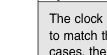

计算机中处理器的时钟速度与其他硬件组件的时钟速度是分开的，也不需要匹配；在大多数情况下，处理器的时钟速度是计算机内部任何硬件组件中最快的。

仅时钟速度并不是决定处理器工作速度的唯一因素。处理器在任一给定时间可以处理或工作的信息量（以二进制位衡量）也是一个重要因素。

因此，处理器也根据其在给定时间内可以处理的信息量进行分类；一次可以移动或处理的信息越多，数据操作的越快。一次能处理 16 位信息的计算机比一次能处理 8 位信息的计算机速度快两倍多；一个以 800MHz 运行的 8 位处理器其性能相当于一个以 350MHz 频率运行的 16 位处理器。如今，处理器通常一次处理 32 或 64 位信息；目前市面上大多数英特尔处理器，例如奔腾处理器系列，都是 32 位处理器，且价格远低于它们的 64 位对应产品，如英特尔安腾、SPARC 和 Alpha 处理器。

除了处理器一次能处理的位数外，计算机的缓存大小和位置也会影响处理器计算大数据量的能力。 `缓存` (cache) 是信息的临时存储区；处理器可以使用缓存来存储最近使用的指令集或信息，以备将来使用。处理器能在其本地电路板的处理器缓存中存储的信息越多，它执行重复或常用指令集的速度就越快。存储在处理器本身的缓存被称为 `一级` (L1) 缓存。并非所有处理器都具有一级缓存，即使有，其大小也不一定相同。作为一级缓存的替代或补充，处理器可以使用 `二级` (L2) 缓存，这是存储在一个通过高速链路连接到处理器的独立计算机芯片中，以便检索的信息。虽然二级缓存的速度不如一级缓存快，但二级缓存是一种成本低得多且更常见的替代方案。较新的处理器通常将二级缓存集成到处理器本身；在这种情况下，会在一个连接至处理器的独立计算机芯片上添加另一个称为 `三级` (L3) 缓存的缓存。三级缓存的功能类似于旧式计算机中的二级缓存。

在需要比单个处理器所能提供的更高处理能力的情况下，你可能会选择在系统中添加多个处理器。多个处理器可以协同工作以分配负载并更快地执行相同的任务；然而，必须在安装时将多处理器支持集成到 Linux 内核中。使用多处理器最通用的内核配置称为 `对称多处理` (SMP)，它允许同时使用两个处理器的相同操作系统和内存来执行任何任务。另一种称为 `非对称多处理` (ASMP) 的配置指的是这样一个系统：每个处理器被赋予特定的角色或一组任务，独立于其他处理器完成这些任务。

### 物理内存

`物理内存` 是一个通过电路板直接连接到处理器的信息存储区域。物理内存分为两大类：`随机存取存储器` (RAM) 和 `只读存储器` (ROM)。RAM 和 ROM 都存储在计算机芯片上，并允许访问信息；然而，RAM 需要持续的电力供应来保持存储的信息，而 ROM 本质上是静态的，即使系统没有通电也能存储信息。因此，RAM 被称为 `易失性` 内存，因为当你关闭计算机时其内容会丢失，而 ROM 则被标记为 `非易失性` 内存。

#### RAM

如第 1 章所述，软件程序是包含处理器将要执行的指令的文件，并在执行时加载到 RAM 物理内存中；然后处理器可以处理内存中的指令。RAM 的数量与计算机性能直接相关，因为更多的 RAM 内存允许系统中同时运行更多的程序。不同的程序执行时需要不同数量的内存；因此，软件程序（包括操作系统）会在其文档中指定最低 RAM 需求量。运行 GNOME 桌面图形用户界面（GUI）环境的 Linux 机器比不使用任何 GUI 环境的 Linux 机器需要更多的内存。

RAM 分为两种主要类型：动态 RAM（DRAM）和静态 RAM（SRAM）。 `动态 RAM` (DRAM) 是这两种类型中较便宜的一种，因此也是最常见的。与 SRAM 相比，它的访问速度较慢，其存储的信息必须每秒刷新数千次，这需要持续、不间断的电力流动。如果通往 DRAM 芯片的电力流动即使在最短时间内中断，存储的信息也会丢失。DRAM 是通常仅被称为“计算机内存”的物理内存类型，它被视为排列在一个称为“内存条”的小电路板上的集成电路（芯片）阵列，该电路板随后通过插槽连接到计算机的主电路板。内存条上组成芯片的晶体管数量决定了可以存储的信息量，以兆字节（MB）衡量。

两根不同的 DRAM 内存条可能具有相同的物理尺寸，但存储的信息量可能大不相同。目前有两种主要的 DRAM 内存条类型：`单列直插式内存模块` (SIMM)、`双列直插式内存模块` (DIMM) 和 `小型双列直插式内存模块` (SODIMM)。SIMM 是较旧的一种，它通过通常只有一侧边缘带有连接器（引脚）的连接将其集成电路阵列连接到主板；SIMM 已不再生产，如今也不常见。DIMM 如今被广泛使用，它们通过两侧边缘都带有连接器（引脚）的连接将集成电路阵列连接到主板，由于拥有更多的连接，DIMM 能够比 SIMM 存储更多的信息并以更快的速度传输。SODIMM 是物理尺寸较小的 DIMM，用于便携式笔记本电脑和 Macintosh 系统。

随着技术的变化，DRAM 的性质及其工作速度也在发生变化。三种较新的 DIMM 技术包括 `同步动态随机存取存储器` (SDRAM)、`双倍速率同步动态随机存取存储器` (DDR SDRAM) 和 `Rambus 动态随机存取存储器` (RDRAM)。DRAM 使用主板上的标准 DIMM 连接器，并以比传统 DRAM 更高的速度分批向存储模块传输数据。DDR SDRAM 是一种增强的 SDRAM，用于较新的计算机以提高速度。RDRAM 是一种专有产品，使用 RIMM 连接器（一种具有不同引脚设置的 DIMM），并以非常高的时钟速度运行，从而以快速速率传输数据。RIMM 不是缩写，而是 Rambus 公司的注册商标词。

RAM 的第二种主要类型，`静态 RAM` (SRAM)，生产成本更高，并且允许对存储信息进行更快的访问，因为信息存储区无需持续刷新，并且可以在短时间内没有电力流动的情况下运行。尽管如此，这种电力流动的中断必须短暂，当计算机断电时，存储的信息会丢失。SRAM 是用于二级处理器缓存和直接连接到计算机主板上的内存芯片的物理内存类型。

#### ROM


只读存储器（`ROM`）是可以读取但不能写入的物理内存，它以永久、非易失性的方式存储在计算机内部的集成电路（计算机芯片）中。与`RAM`不同，这种内存存储区不依赖于电力流动，并且在没有通电的情况下可以无限期地保持完整。由于这一特性，`ROM`通常用于存储启动计算机时用于初始化硬件组件的初始程序；并且被称为`BIOS`（基本输入/输出系统）`ROM`。虽然真正的`ROM`仍在使用，但`ROM`计算机芯片中信息存储区不可更改的事实导致了在缺乏电力流动的情况下得以保持但可以在必要时更改的变体。这些`ROM`变体包括以下内容：

- **可编程只读存储器（`PROM`）**，由一片空白`ROM`计算机芯片组成，可以写入一次但永远无法重写。

- **可擦除可编程只读存储器（`EPROM`）**，其信息内容可以反复擦除和重写。`EPROM`的内容必须整体擦除和重写；单独的部分不能单独修改。`EPROM`内存的一个例子是计算机中的`CMOS`（互补金属氧化物半导体）计算机芯片，它存储系统在首次通电时`BIOS ROM`使用的配置信息。

- **电可擦除可编程只读存储器（`EEPROM`）** 维持的信息存储区不仅可以整体擦除和重写，还可以单独修改，而保持其他部分完好无损。这种在缺乏电力的情况下静态存储信息但如有需要可修改的能力，使得`EEPROM`芯片在许多外围计算机组件中很受欢迎。

#### 注意

用于在数码相机中存储照片的内存类型是`EEPROM`内存的一种。

### 磁盘驱动器

计算机中的大多数信息使用非易失性介质维护，且该介质不是由集成电路组成；如今最常见的此类介质包括**硬盘**，它们存储在**硬盘驱动器**（也称为硬盘或`HDD`）中；插入`CD-ROM`光盘驱动器中的**光盘只读存储器（`CD-ROM`）** 光盘；以及插入软盘驱动器中的**软盘**。**磁盘驱动器**设备的数据传输速度不如`RAM`或`ROM`快，但可以存储大量可修改的信息。

……一种以成本效益高的方式在其包含的磁盘上存储信息以供日后使用的方法。当处理器需要信息时，它将从磁盘驱动器传输到`RAM`，例如在系统启动期间操作系统启动时或在运行中的系统上执行应用程序时。

### 硬盘驱动器

传统上，大多数信息是通过磁带设备存储在磁带上的；这种对磁性介质的使用迅速转移到了今天使用的软盘驱动器和硬盘驱动器上。该过程的工作原理与音频和视频磁带的录制和播放方式类似。表面涂覆有一层铁磁性材料，该铁磁性材料的组成颗粒可以由电磁磁头重新排列以记录数据，然后可以使用相同的设备通过检测排列模式来读取。与必须快进或倒带磁带才能读取或写入数据的磁带设备不同，硬盘驱动器通过快速旋转涂有铁磁性材料的刚性金属盘片，在持有电磁磁头的铰接臂下方读取和写入信息。硬盘驱动器不直接连接到处理器，而必须通过一个控制硬盘驱动器之间信息流的硬盘控制器卡。这些控制器卡分为两种主要类型：**集成驱动电子 (`IDE`)** 和 **小型计算机系统接口 (`SCSI`)**。连接到这些控制器的硬盘必须是相同类型的；您必须在`IDE`控制器卡上使用`IDE`硬盘，并在`SCSI`控制器卡上使用`SCSI`硬盘。

`IDE`控制器，也称为 **高级技术附件 (`ATA`)** 控制器，通常是位于`IDE`硬盘底部的电路板，并通过排线连接到主板。大多数主板包含两个`IDE`排线插槽（主控制器插槽和副控制器插槽），并且每个`IDE`排线可以连接两个`IDE`硬盘；因此，大多数计算机仅限于四个`IDE`硬盘。由于每个`IDE`排线可以连接两个`IDE`硬盘，因此必须有一种方法能够唯一地识别每个`IDE`硬盘。这种方法涉及设置物理`IDE`硬盘上的跳线开关，以便在同一排线上将一个`IDE`硬盘称为“主盘” (`Master`)，另一个`IDE`硬盘称为“从盘” (`Slave`)。因此，连接到主`IDE`控制器插槽的主硬盘可能被称为“主主`IDE`硬盘” (`Primary Master IDE HDD`)**。 **表 2-1** 列出了四种可能的`IDE`硬盘配置及其在`Linux`中的名称。

**表 2-1 IDE 硬盘配置**

| 描述 | Linux 名称 |
| :--- | :--- |
| 主主 IDE 硬盘 | `hda` |
| 主从 IDE 硬盘 | `hdb` |
| 副主 IDE 硬盘 | `hdc` |
| 副从 IDE 硬盘 | `hdd` |

与`IDE`不同，`SCSI`控制器在物理上独立于硬盘，通常通过主板本身的插槽连接到主板。`SCSI`硬盘能够以比`IDE`硬盘快得多的速率传输数据，并且`SCSI`控制器卡可以一次与多个硬盘交互。然而，`IDE`硬盘和控制器比它们的`SCSI`对应产品制造成本更低，因此是家庭和中小型企业中最常见的硬盘技术。出于本章的目的，讨论仅限于`IDE`硬盘。

今天制造的硬盘可以存储超过 160GB 的数据，通常被划分为更小、更易管理的部分，称为 **分区**。然后，每个分区必须被准备好以存储文件。为此，您必须使用 **文件系统** 格式化每个分区，该文件系统指定数据应如何驻留在硬盘本身上。

``

**注意**

> 在 `Windows` 操作系统中，每个驱动器字母（例如，`C:`、`D:`、`E:`）可以对应于驻留在硬盘分区上的单独文件系统。

`HDD` 可以划分的分区数量和类型存在限制。硬盘驱动器最多可以包含四个主要分区（称为 **主分区**）。为了克服这一限制，您可以选择将这些主分区之一标记为“扩展分区”；然后，这个 **扩展分区** 可以包含无限数量的称为 **逻辑驱动器** 的较小分区。扩展分区内的每个逻辑驱动器以及所有其他主分区都可以包含文件系统并用于存储数据。用于特定硬盘的所有分区信息的表格存储在所有分区之外的第一个可读扇区中，称为 **主引导记录 (`MBR`)**。请记住，主主 `IDE` 硬盘在 `Linux` 中被称为 `hda`；该驱动器上的第一个主分区标记为 `hda1`，第二个标记为 `hda2`，等等。由于硬盘上只允许有四个主分区，扩展分区内的逻辑驱动器标记为 `hda5`、`hda6`，等等。这种分区策略的一个例子列在表 2-2 中。

**表 2-2 主主 IDE 硬盘的分区方案示例**

| 描述 | Linux 名称 | Windows 名称 |
| :--- | :--- | :--- |
| 主主硬盘上的第一个主分区 | `hda1` | `C:` |
| 主主硬盘上的第二个主分区 | `hda2` | `D:` |
| 主主硬盘上的第三个主分区 | `hda3` | `E:` |
| 主主硬盘上的第四个主分区（扩展分区） | `hda4` | `F:` |
| 主主硬盘扩展分区中的第一个逻辑驱动器 | `hda5` | `G:` |
| 主主硬盘扩展分区中的第二个逻辑驱动器 | `hda6` | `H:` |
| 主主硬盘扩展分区中的第三个逻辑驱动器 | `hda7` | `I:` |

### 其他信息存储设备

除了硬盘驱动器 (`HDD`) 之外，还有其他信息存储设备可用，包括软盘、`Zip` 磁盘、`DVD` 和 `CD-ROM`。这些通常被称为 *可移动介质*，因为用于存储信息的介质不像 `HDD` 那样固定在计算机中，而是可以移除并在计算机之间传输。

软盘像硬盘一样以电磁方式存储信息，并且传统上是最常见的可移动介质；它被称为软盘，因为用于存储信息的涂有铁磁性材料的介质是 *柔软的*（即软盘），这与 `HDD` 中使用的刚性金属盘片形成对比。软盘驱动器，也称为 3½ 英寸软盘驱动器单元，需要与可移动存储单元的大小匹配，能容纳的数据量远小于硬盘（仅 1.44MB），并且数据传输速率慢得多。

**Zip 磁盘** 是软盘的进化版，虽然在外观上与普通软盘相似，但它们与普通软盘的区别在于可以容纳多得多的信息（高达 750MB）。这些精密的软盘不能使用普通的 3½ 英寸软盘驱动器单元；它们需要使用特殊的 *Zip* 驱动器，但通常用于在许多家庭和小型办公室中传输大文件或创建重要信息的备份副本。

`DVD` 和 `CD-ROM` 与提到的所有其他磁盘介质不同，因为它们不使用铁磁性材料和电磁磁头来存储和检索数据，而是使用激光来读取反射光脉冲。一个凹陷层的反射材料（通常是铝）被夹在透明塑料层之间，激光脉冲从其上反弹。表面上的凹坑使撞击它们的激光脉冲偏折，并且反射激光脉冲中断的模式被读取为存储的信息。这种技术使 `DVD` 和 `CD-ROM` 相比其他可移动存储设备具有一些优势，包括更高的数据传输速度、更大的存储容量以及对数据丢失的更强抵抗力。这使得它们在存储大量数据方面非常有用，因此它们是分发软件（如 `Linux` 操作系统）的首选介质。

`DVD` 和 `CD-ROM` 驱动器根据其从 `CD-ROM` 光盘读取数据的速度与普通音频紧凑型光盘 (`CD`) 的速度之比来评级；在撰写本文时，典型的 `CD-ROM` 可以以超过音频 `CD` 50 倍（`50X`）的速度读取数据，并且

典型的 `DVD` 可以以音频 `CD` 速度的 16 倍以上（`16X`）读取数据。大多数 `DVD` 和 `CD-ROM` 驱动器通过高级技术附加数据包接口（`ATAPI`）连接到计算机的主电路板上，使其能够像 `IDE` 硬盘驱动器一样工作。通常，计算机中四个可能的 `IDE` 设备之一是一个 `DVD` 或 `CD-ROM` 驱动器，并且该驱动器必须使用 `DVD` 或 `CD-ROM` 驱动器本身的跳线开关进行配置，方式与 `IDE` 硬盘驱动器相同。

#### 注意


虽然DVD或CD-ROM驱动器的数据传输速率比软盘驱动器或Zip驱动器快，但它仍然比HDD慢。如果将DVD或CD-ROM驱动器放置在同一个IDE通道上的HDD旁边，它会降低并影响HDD的有效数据传输速率；因此，明智的做法是将DVD和CD-ROM驱动器放在与任何IDE HDD分开的IDE控制器上。

在撰写本文时，许多DVD和CD-ROM驱动器还可以分别向DVD和CD-ROM光盘写入信息。这些设备被称为DVD可重写（DVD-RW）和紧凑碟片可重写（CD-RW）驱动器。

**闪存**驱动器是一种最近出现的媒体类型，使用EEPROM芯片来存储信息。它们通常比软盘和Zip盘存储更多的信息，并且一些闪存驱动器可以存储比CD-ROM更多的信息。此外，闪存驱动器可以在计算机开机时插入，也可以以相同的方式移除；因此，闪存驱动器正迅速成为需要在计算机之间传输文件的用户的常用介质。

## 主板和外围组件

程序被加载到物理内存中并由处理器执行；但是，必须存在某种设备来提供这些硬件设备之间的互连。这种互连（也称为**总线**）由一块称为**主板**或**母板**的电路板提供。总线的作用是连接常见的硬件组件，如处理器、物理内存和磁盘驱动器，但也连接**外围组件**，如显卡、声卡和**网络接口卡**（NIC）。外围组件通常通过输入输出总线（也称为I/O总线或扩展总线）连接到系统的其余部分，该总线通过主板本身的不同插槽或端口表示；外围设备最常见的三个插槽包括以下内容：

- ISA
- PCI
- AGP

行业标准架构（ISA）插槽仅允许外围组件以8MHz的速度传输信息进行互连，并且由于用于连接较旧的组件，它们比其他插槽少见得多。**外围组件互连（PCI）** 是一种较新的总线连接，于1995年引入，是当今计算机中最常见的插槽类型；它可以以33MHz的速度传输信息，并且可以使用**直接内存访问（DMA）**。DMA允许外围设备绕过CPU并直接与其他外围组件通信以提高性能；你可以配置八个DMA通道来允许这种能力。**加速图形端口（AGP）** 专为显卡外围设备设计，允许超过66MHz的传输速度。它的设计目的不是取代PCI，而是增强显卡操作并允许对系统内存更快的图形功能访问。图2-1显示了带有这些插槽的主板。

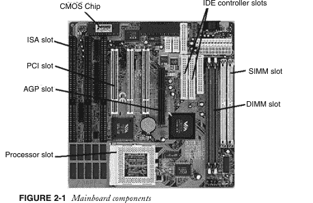

**图 2-1 主板组件**

其他外围可能没有主板上的外围插槽；相反，它们可能通过电缆连接到主板上边缘的端口，该端口从计算机外部可见（因此，在图2-1中难以看到）。这些端口包括以下内容：

- PS/2
- COM（串行）
- LPT
- USB
- IEEE 1394（火线）
- PCMCIA

**PS/2端口**是带有六个针脚的小型圆形连接器，通常用于将键盘和鼠标连接到计算机。一些计算机可能使用较大的五针端口来连接键盘；该端口称为AT端口，在PS/2端口之前使用。

**COM端口**（也称为*串行端口*）是矩形九针连接器，可用于将各种不同外围连接到主板，包括鼠标、串行打印机、扫描仪和数字相机。如今，由于传输速度相当慢，COM端口的使用远少于过去；因此，在通常使用的四个COM端口（COM1、COM2、COM3和COM4）中，如今大多数主板上只有COM1和COM2端口。

过去，打印机通常使用矩形25针**LPT端口**（也称为**并行端口**）连接主板。虽然有两种常用LPT端口（LPT1和LPT2），但大多数计算机通常只在主板上提供LPT1。

大多数外围组件，如键盘、鼠标、打印机、数字相机、闪存驱动器和扫描仪，现在通过**通用串行总线（USB）** 端口而不是串行或并行端口连接到主板。USB 2.0版本允许高达每秒480MB的传输速度（大多数USB支持高达每秒12MB），并且可以与称为USB集线器的设备一起使用，允许最多127个不同设备连接到一个主板上的USB端口。大多数计算机在主板上有两个USB端口，几乎任何USB设备都可以在计算机开机时附加到计算机，由操作系统检测和使用。此功能称为*热插拔*，任何可以在计算机运行时附加到主板的设备被称为*可热插拔*设备。

另一种可热插拔的USB变体是**IEEE 1394（火线）**，由苹果公司于1995年开发。火线2.0版本支持高达每秒800MB的传输速度。由于支持如此高的传输速度，火线通常用于将SCSI硬盘、扫描仪、闪存驱动器、数字相机和CD-RW驱动器连接到计算机。

在考虑便携式笔记本电脑时，大量连接器或端口可能会增加计算机的物理尺寸并降低其便携性。因此，**个人计算机记忆卡国际协会（PCMCIA）** 端口允许将带有提供特定功能所需电子元件的小型卡片插入计算机（通常厚度小于10.5mm）。PCMCIA插槽不需要太多电力，可热插拔，并且常用于网络接口卡、调制解调器和扩展内存。便携式笔记本电脑的另一个特性是**高级电源管理（APM）**，如果组件（如PCMCIA设备）未使用，则会关闭其电源以节省电力。

你可以通过主板上的插槽或端口以多种方式将外围组件连接到计算机；然而，每个外围设备必须与系统中的其他设备分开维护，以便CPU计算信息时不会发生交叉路径。这种分离是通过每个外围组件的两个特性获得的：**IRQ（中断请求）**和**输入/输出（I/O）地址**。IRQ指定到CPU本身的独特通道，这些通道使用数字0到15进行标记。如果两个设备试图使用相同的IRQ，会发生冲突并且两个设备都不工作；然而，如果配置为这样做，某些设备可以共享IRQ。每个设备还必须有一小块RAM工作区，CPU可以在其中向设备传递信息和从设备接收信息；此工作区被称为I/O地址，必须对每个设备唯一。I/O地址以十六进制表示法书写，并指示使用的内存范围；I/O地址的一个例子是`0x300-31F`。

在较旧的设备上（通常是ISA），你必须手动配置IRQ和I/O地址；然而，大多数外围是**即插即用（PnP）**，并且可以自动分配正确的IRQ、I/O地址和DMA通道（如果使用），无需用户干预。为了**即插即用**正常工作，BIOS和操作系统必须支持即插即用配置。如今，大多数计算机和操作系统（如Linux）都标准支持即插即用。

### 显卡和监视器

**显卡**（通常称为视频卡）是计算机中最关键的外围组件之一，因为它们连接到监视器设备时为用户提供图形显示。显卡通常插入主板上的插槽（例如，ISA、PCI、AGP），但也可以是主板本身的一部分；这些称为集成显卡，如今很常见，因为生产成本较低。

每个显示都由微小的点或像素组成；可以显示的像素越多，图像越清晰。典型的系统如今最少水平显示800像素，垂直显示600像素；这称为屏幕的**分辨率**，在我们的示例中可以简化为$800 \times 600$。每个像素还可以代表一种颜色。你可以在屏幕上显示的总颜色集合被称为**颜色深度**，如今大多数系统显示至少1600万种颜色的颜色深度（也称为24位颜色深度）。

颜色深度和分辨率都取决于显卡上的RAM数量。如今大多数显卡本身带有16MB的RAM，足以支持大多数分辨率，但一些显卡配置为从系统主板借用RAM。表2-3列出了特定RAM数量可用的最大分辨率和颜色深度。

**表 2-3 屏幕分辨率和颜色深度的内存要求**

| 视频 RAM | 分辨率 | 颜色深度 |
| :--- | :--- | :--- |
| 1MB | 1024 $\times$ 768 | 256种颜色（8位颜色） |
| | 800 $\times$ 600 | 65,536种颜色（16位颜色） |
| 2MB | 1024 $\times$ 768 | 65,536种颜色（16位颜色） |
| | 800 $\times$ 600 | 1600万种颜色（24位颜色） |
| 4MB | 1024 $\times$ 768 | 1600万种颜色（24位颜色） |

屏幕图像每秒刷新数次，以便允许屏幕上的变化或动画；较高的**刷新率**会降低屏幕图像闪烁的可能性。需要注意的是，设置过高的刷新率可能会损坏显示器本身；因此，务必确保显示器支持视频卡上配置的刷新率。可用的刷新率有两种类型：**HSync（水平刷新）**和 **VSync（垂直刷新）**，其测量单位为赫兹（Hz）。

### 键盘和鼠标

视频卡和显示器提供了查看输出的方法，但必须有一种提供用户输入和指令的方式；键盘和鼠标就是提供此功能的设备。键盘是最古老且最常见的输入设备之一，由标准的打字机按键组合和特殊功能键组成，允许将输入发送到计算机。额外功能键的数量各不相同，使得键盘的总键数从 84 个到超过 104 个不等。大多数键盘遵循标准的 QWERTY 打字机布局，但其他键盘提供另一种称为 Dvorak 的按键排列方式。还有一些键盘提供分体按键布局，每只手对应一组，被称为人体工程学键盘。无论布局或按键数量如何，键盘通过多种方式连接到主板：

- 大型圆形 AT 五针连接器
- 小型圆形 PS/2 六针连接器
- USB 连接
- 无线红外或无线电连接


在大多数计算机系统中使用的相对较新的设备是由 Douglas C. Engelbart 在 1960 年代开发的计算机鼠标。鼠标的普及速度较慢，但现在与键盘一样普遍，在许多情况下，它们提供了更快、更通用的接口，这导致了“指点并点击”（`point and click`）这一短语的出现。如果没有鼠标，你就只能通过键盘设备与计算机通信；你只能通过向命令行接口输入命令来提交任务供计算机执行。鼠标在使用图形化程序时提供了通用性，移动鼠标会在视频屏幕上以相似的路径移动光标，按下其中一个按钮会显示操作选项或执行任务。鼠标可以通过多种方式连接到主板：

- 串行端口
- 小型 `PS/2` 六针连接器
- `USB` 连接
- 无线红外或无线电连接

## 收集预安装信息

所有操作系统都需要一定最低标准的计算机硬件要求才能正常运行，因为操作系统只是一系列与计算机硬件交互并控制硬件的软件程序。虽然大多数最新的硬件足以运行 Linux 操作系统，但确保计算机满足最低硬件要求后再执行安装仍然很重要。

这些最低安装要求可以从几个来源获取。如果操作系统是通过 `CD-ROM` 获取的，印刷的手册或 `CD-ROM` 上的文件可能会指定这些要求，但你也可以在大多数操作系统的供应商网站上找到最低硬件要求。对于 Red Hat Linux Fedora 操作系统，你可以在 `http://www.redhat.com` 或表 2-4 中找到最低硬件要求。

### 表 2-4 Red Hat Fedora 硬件要求

| 组件 | 要求 |
| :--- | :--- |
| 中央处理器 (CPU) | 最低：奔腾级 <br> 推荐：`Pentium II – 400MHz` |
| 物理内存 随机存取存储器 (RAM) | 文本模式最低：`128MB` <br> 图形模式最低：`256MB` <br> 图形模式推荐：`512MB` |
| 磁盘可用空间 (硬盘驱动器) | 最低：`900MB` 可用空间 <br> 推荐：`3.4GB` 可用空间 <br> 完整安装：`7.5GB` 可用空间 <br> *存储文件或安装其他软件程序需要额外的可用空间。* |
| 附加驱动器 | `CD-ROM` 驱动器 <br> `3.5` 英寸软盘驱动器 |
| 外围设备 | 所有外围设备（例如，视频卡、声卡、网卡）必须符合 Red Hat 标准。 |

此外，每个操作系统仅支持特定类型的硬件组件。虽然像 Linux 这样的某些操作系统比其他操作系统支持更多种类的硬件组件，但计算机中的每个单独硬件组件都应对照供应商网站上易于找到的 `硬件兼容性列表 (HCL)` 进行检查。


除了识别硬件组件以确保它们受 Linux 操作系统支持并满足最低要求外，你还应识别将在 Linux 操作系统中使用的软件组件。这些组件包括计算机的主机名、互联网或网络配置参数，以及满足特定用途需要安装的软件包。这些内容将在第 3 章中讨论。

由于需要记录大量的硬件和软件信息，完成包含所有重要安装信息的预安装检查表是很好的做法。至少，预安装检查表应类似于表 2-5。

### 表 2-5 预安装检查表演示

| 组件 | 详情 |
| :--- | :--- |
| CPU (类型和 MHz) | `Intel Pentium III 800MHz` |
| RAM (MB) | `256MB` |
| 键盘型号和布局 | 连接到 `PS/2` 端口的 101 键键盘 |
| 鼠标型号和设备 | 连接到 `COM 1` 端口的双键 `Microsoft Intellimouse` |
| 硬盘类型 (主盘主驱，等等) | 主盘主驱 |
| 硬盘大小 (MB) | `40GB` |
| 主机名 | `localhost.localdomain` |
| 网卡互联网协议配置 (IP 地址、子网掩码、网关、DNS 服务器、DHCP) | `DHCP: 未使用` <br> `IP 地址: 192.168.6.188` <br> `子网掩码: 255.255.255.0` <br> `网关: 192.168.6.1` <br> `DNS 服务器: 200.10.2.1, 200.10.82.79` |
| 待安装包 | `GNOME` 桌面 <br> `Samba` <br> `Squid` <br> `Apache` <br> `GIMP` <br> `Emacs` |
| 视频卡制造商和型号 | `ATI Rage 128` |
| 视频卡 RAM (MB) | `16MB` |
| 显示器制造商和型号 | `Samsung Syncmaster 551s` |
| 显示器 VSync 和 HSync 范围 | `HSync: 30-55KHz` <br> `VSync: 50-120Hz` |

## 收集硬件信息

你可以使用多种工具和资源来填写预安装检查表中的硬件信息部分。随计算机系统附带的计算机手册就是这样的资源之一；大多数计算机手册在书的背面或前封内侧列有表格，其中列出了每个计算机组件的规格。此外，在安装 Linux 之前，计算机上可能已经安装了 Windows 操作系统；在这种情况下，你可以使用常见的 Windows 实用工具来查看硬件信息。这些工具中最全面的是系统信息工具，如图 2-2 所示。

Windows 设备管理器（位于 Windows 控制面板的系统属性中）是另一个可以显示大多数所需硬件信息的实用工具，如图 2-3 所示。


> **注意**：要访问 Windows 系统信息工具，只需导航至“开始”菜单，`所有程序`，`附件`，`系统工具`，`系统信息`。

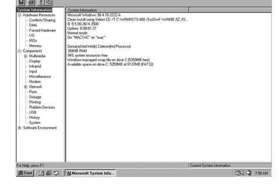

**图 2-2** _Windows 系统信息工具_

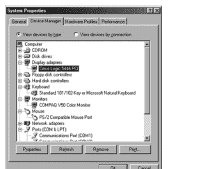

**图 2-3** *Windows 设备管理器*

> **注意**：要访问 Windows 95/98/Me 设备管理器，只需导航至“开始”菜单，`设置`，`控制面板`，`系统`，`设备管理器`。要访问 Windows 2000/XP/2003 设备管理器，只需导航至“开始”菜单，`控制面板`，`系统`，`硬件`，`设备管理器`。

另一个用于获取有关视频卡和显示器硬件信息的实用 Windows 工具是 Windows 控制面板中的显示属性，如图 2-4 所示。

> **注意**：要访问有关视频卡和显示器的 Windows 显示属性信息，只需导航至“开始”菜单，`控制面板`，`显示`，`设置`，`高级`。

虽然系统手册和 Windows 控制面板可用于查找有关计算机的信息，但请记住，每台计算机都在主板上的 `CMOS` 芯片中存储配置信息。`CMOS` 芯片中的信息在计算机首次开机时由 `BIOS ROM` 芯片读取，以初始化外围设备并执行 `加电自检 (POST)`。当你首次给计算机通电时，`POST` 会显示类似于图 2-5 的输出。

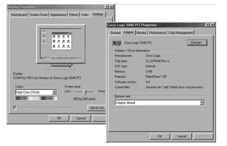

**图 2-4** *Windows 显示小程序*

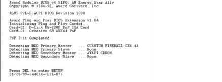

**图 2-5** *系统 POST*

`POST` 完成后，`BIOS` 会在软盘、`CD-ROM` 或硬盘上查找操作系统。`BIOS` 使用的 most 设置都是可配置的，因为它们存储在 `CMOS` 芯片上，并且在 `POST` 完成后，most `BIOS` 允许你通过按下 `Delete` 键来选择这些设置，如图 2-5 所示。如果你进入 `BIOS` 设置实用程序，会出现一个类似图 2-6 的屏幕，你可以在其中配置设备并观察硬件设置。

> **注意**
>
> 系统 `BIOS` 设置实用程序在不同制造商之间看起来非常不同；然而，每个实用程序大致包含相同类型的通用信息和配置。

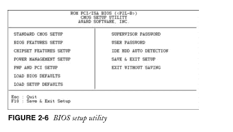

## 收集软件信息

虽然在安装 Linux 之前获取硬件信息很有价值，但 Linux 安装程序也会要求设置几个软件选项，例如时区和语言支持。这些软件设置中的大多数在安装前无需记录，因为它们可以在安装期间由用户酌情添加。然而，某些设置应在开始安装前进行研究；这些设置包括系统网络配置和软件包选择。

如果你安装 Linux 系统以使用或提供网络服务，安装程序会提示输入必要的值以完成计算机中 `NIC` 的配置。这些值通常由公司网络管理员或互联网服务提供商（`ISP`）分配。这些设置的摘要在下述列表中描述：

- **主机名** — 注册在域名服务（`DNS`）中的计算机名称，以便其他人可以通过名称连接它。
- **IP 地址** — 分配给计算机的唯一编号，允许其参与互联网协议（`IP`）网络（如互联网）。
- **子网掩码** — 也称为网络掩码或子网掩码，它指定 `IP` 地址的哪一部分标识计算机所在的逻辑网络。
- **网关** — 也称为默认网关或最后求助网关，它指定一台计算机的地址，该计算机接收本地计算机的信息，并在本地计算机无法发送时将其发送给其他计算机。


- `DNS`服务器—这些服务器将完全限定域名（`FQDNs`）（如 `www.linux.org`）解析为 `IP`地址，以便用户可以通过这些地址在互联网上进行连接。你可以列出多个 `DNS`服务器；如果第一个不可用，本地计算机则会尝试列表中第二个服务器，依此类推。

你可以在安装程序期间手动配置上述设置，或者在网络上存在`动态主机配置协议（DHCP）服务器`的情况下让设置自动配置。如果你在安装期间选择使用 `DHCP`，`Linux`计算机将尝试从网络上的 `DHCP`服务器获取这些设置。你也可以选择在安装完成后稍后配置上述网络设置。

迄今为止，安装前所需的最重要的软件信息来自用于定制 `Linux`系统以执行特定任务的软件包。由于这些软件包需要磁盘空间，因此在选择软件包时，你应该考虑可用磁盘空间。由于在安装过程中你可以从数百个独立软件包中选择，你只能估计常见 `Linux`用途所需的磁盘空间。通常，`Red Hat Linux`安装所需的基础安装软件硬盘空间从 `600MB`到完整安装的软件超过 `6GB`不等。一般经验法则是，你应该保留至少两倍的硬盘空间，以容纳用户文件和未来的软件安装。由于完整安装会在硬盘上放置超过 `6GB`的数据，因此完整安装 `Linux`应该至少有 `12GB`的可用硬盘空间。大多数管理员不会执行完整安装；相反，他们只安装计算机运行所需的软件包。在安装程序期间，会显示按功能分组的软件包集合；然而，你可能会选择自定义此列表并仅选择所需的独立软件包。表 `2-6` 列出了常见软件包及其描述，这在自定义软件包时很有价值。

### 表 2-6 常见 Linux 软件包

| 软件包 | 描述 |
|---|---|
| `X-Windows` | `Linux`图形用户界面（`GUI`）的核心组件，`KDE`和 `GNOME GUI`环境需要它 |
| `GNOME 桌面` | `Linux`可用的 `GUI`环境 |
| `KDE 桌面` | `Linux`可用的 `GUI`环境 |
| `Samba (SMB) 服务器` | 允许轻松集成 `Linux`和 `Windows`以进行文件和打印机共享的程序 |
| `NIS（网络信息服务）服务器` | 集中并协调 `Linux`计算机之间配置文件变更的程序 |
| `NFS（网络文件系统）服务器` | 允许 `Linux`系统通过网络共享文件的程序 |
| `GIMP（GNU 图像处理程序）` | 图形处理程序 |
| `BIND/DNS 服务器` | 包含将 `IP`地址映射到 `FQDN`以供互联网上客户计算机使用的表的程序 |
| `Apache 服务器` | `Linux`最常用的 `Web`服务器 |
| `MySQL 服务器` | 数据库管理系统 |
| `Postgres SQL 服务器` | 数据库管理系统 |
| `TeX` | 处理文本以用于桌面排版的程序。 |
| `Emacs` | 常见的文本编辑器 |
| `Squid 代理服务器` | 允许多台计算机通过一个互联网连接访问互联网的程序 |
| `Mozilla` | 常见的互联网 `Web`浏览器 |
| `FTP 服务器（wu-ftpd）` | 允许独立于操作系统在互联网上快速传输文件的程序 |
| `InterNetworkNews（INN）服务器` | 托管和管理新闻组帖子的程序 |
| `Netfilter/iptables/ipchains` | 允许 `Linux`作为网络防火墙服务器运行的程序 |

## 本章摘要

- 在安装 `Linux`之前了解计算机的各种硬件组件，允许你在安装期间做出适当的选择并验证 `Linux`安装是否成功。

- `CPU`处理计算机中的大多数指令，并采用两种不同的架构：`RISC`和 `CISC`。

- 计算机内存可以是易失性的（`RAM`）或不可易失性的（`ROM`）。

- 大多数信息以非易失性方式存储在硬盘、软盘和 `CD-ROM`上。硬盘主要有两种类型：`SCSI`和 `IDE`。

- 外围组件（如视频适配卡、声卡、鼠标、键盘和 `NIC`）通过扩展插槽或端口连接到主板。

- 常见的扩展插槽包括 `ISA`、`PCI`和 `AGP`。

- 常见的端口包括 `PS/2`、串行、并行、`USB`、`FireWire`和 `PCMCIA`。

- 所有外围组件都必须具有唯一的 `IRQ`和 `I/O`地址才能与处理器通信。它们可以可选地使用 `DMA`来绕过某些处理器操作。

- 硬件信息可以从计算机手册、系统 `BIOS`或 `Windows`等其他操作系统中获取。

- 大多数软件信息可以在安装时指定；然而，网络配置和软件包选择应在安装前仔细规划。

## 关键术语

`加速图形端口（AGP）`— 为视频卡外围设备设计的 `mother board` 连接插槽，允许超过 `66MHz` 的数据传输速度。

`高级电源管理（APM）`— 一种 `BIOS` 功能，切断未使用的外围设备的电源以节省电力；常用于笔记本电脑。

`高级技术附件（ATA）`— 另见集成驱动电子电路。

`架构` — `CPU` 的设计和布局；也称为计算机平台。

`算术逻辑单元（ALU）` — `CPU` 中执行所有数学计算和基于逻辑的操作的部分。

`非对称多处理` — 包含多个处理器的系统，其中每个处理器被赋予特定的角色或任务集，独立于其他处理器完成。

`BIOS（基本输入/输出系统）ROM` — 计算机主板上的计算机芯片，包含在启动时初始化硬件组件的程序。

`位` — 计算机可以计算的最小信息单位。

`总线` — 表示信息通过主板从一个硬件设备到另一个硬件设备的通路的术语。

`缓存` — 处理器使用的临时信息存储。

`中央处理单元（CPU）` — 用于执行计算机系统上大部分计算任务的集成电路板；也称为处理器或微处理器。

`时钟速度` — 处理器（或其他任何硬件设备）能够执行与内部时间周期相关的命令的速度。

`颜色深度` — 可以在计算机视频屏幕上显示的总颜色集合。

`COM 端口` — 矩形九针连接器，可用于将各种不同外围设备连接到主板，包括鼠标、串行打印机、扫描仪和数码相机；也称为串行端口。

`紧凑光盘 - 只读存储器（CD-ROM）` — 物理上耐用、可移除的存储介质，具有抗数据损坏能力，用于 `CD-ROM` 驱动器和 `CD-RW` 驱动器。

## 关键术语

- `互补金属氧化物半导体 (CMOS)` — 一种用于存储 `BIOS ROM` 所使用的可配置信息的计算机芯片。

- `复杂指令集计算机 (CISC)` — 在每次时钟周期内执行复杂指令的处理器。

- `控制单元 (CU)` — 处理器中用于加载和执行指令代码或命令的区域。

- `直接内存访问 (DMA)` — 某些总线架构提供的一种功能，允许外围设备绕过 `CPU` 直接与其他外围组件通信，以提升性能。

- `磁盘驱动器` — 包含硬盘、软盘、`CD-ROM`、`CD-RW` 或 `Zip` 磁盘的设备。

- `DNS 服务器` — 将完全限定域名 (`FQDN`)（例如 `www.linux.org`）解析为 `IP` 地址的服务器，以便用户能够通过网络连接到它们。

- `双倍速率同步动态随机存取存储器 (DDR SDRAM)` — 一种 `SDRAM` 形式，其数据传输速度比传统 `SDRAM` 更快。

- `双列内联内存模块 (DIMM)` — 一种较新的连接插槽，其两侧边缘均有连接器（针脚），允许由 `RAM` 条组成的集成电路阵列连接到主板。

- `动态主机配置协议 (DHCP) 服务器` — 网络中向请求配置的计算机分配互联网协议 (`IP`) 配置的服务器。

- `动态随机存取存储器 (DRAM)` — 一种每秒需要刷新其存储信息数千次的 `RAM` 类型，通常以 `SIMM` 或 `DIMM` 条的形式提供。

- `电子可擦除可编程只读存储器 (EEPROM)` — 一种 `ROM` 类型，其存储的信息不仅可以整体擦除和重写，还可以单独修改而保持其他部分不变。

- `可擦除可编程只读存储器 (EPROM)` — 一种 `ROM` 类型，其存储的信息可以擦除和重写，但仅限整体操作。

- `显式并行指令计算 (EPIC)` — 用于描述 `Itanium` 处理器的 `RISC` 架构。

- `扩展分区` — `HDD` 上的一个分区，可以进一步细分为称为逻辑驱动器的组件。

- `文件系统` — `HDD` 分区格式化以允许数据驻留在物理介质上的方式；常见的 `Linux` 文件系统包括 `ext2`、`ext3`、`REISERFS` 和 `VFAT`。

- `FireWire (IEEE 1394)` — 一种由 `Apple Computer Inc.` 于 1995 年开发的主板连接技术，支持高达每秒 `800MB` 的数据传输速度。

- `闪存驱动器` — 一种使用 `EEPROM` 芯片存储数据的存储介质。

- `软盘` — 一种可移除存储介质，由涂有铁磁性材料的柔性介质组成，通过软盘驱动器读取。

- `完全限定域名 (FQDN)` — 用于在网络和互联网上标识机器的用户友好名称。

- `网关` — 也称为默认网关或最后手段网关，指接受来自本地计算机的信息并在本地计算机无法处理时将其发送至其他计算机的计算机的地址。

- `硬盘驱动器 (HDD)` — 一种用于向硬盘写入和读取数据的设备。


- **硬盘** — 由涂有铁磁性材料的刚性磁盘组成的不可移除介质，用于硬盘驱动器 (`HDD`)。

- **硬件兼容性列表 (`HCL`)** — 经过测试并被判定与特定操作系统兼容的硬件组件列表。

- **主机名** — 用于在网络上唯一标识计算机的用户友好名称。这通常是 `FQDN`。

- **热插拔** — 在计算机和操作系统正常运行的状态下向计算机添加或移除硬件的能力。

- **水平同步 (`HSync`)** — 视频屏幕图像水平元素刷新的速率，允许屏幕上的变化或动画；`HSync` 以赫兹 (`Hz`) 为单位测量。

- **工业标准体系结构 (`ISA`)** — 一种较旧的主板连接插槽，旨在允许外围组件互连，并以 `8MHz` 的速度传输信息。

- **集成驱动电子 (`IDE`)** — 也称为 `ATA`，它包含控制器，用于控制通过扁平电缆连接到主板的多达四个硬盘的信息流。

- **互联网协议 (`IP`) 地址** — 每个参与互联网的计算机必须拥有的唯一数字。

- **中断请求 (`IRQ`)** — 从设备到 `CPU` 的唯一通道。

- **输入/输出 (`I/O`) 地址** — `CPU` 可以传递和接收设备信息的小型 `RAM` 工作区域。

- **一级 (`L1`) 缓存** — 存储在处理器本身的缓存内存。

- **二级 (`L2`) 缓存** — 存储在主板上的计算机芯片中供处理器使用，或存储在处理器内部的缓存内存。

- **三级 (`L3`) 缓存** — 存储在主板上的计算机芯片中供处理器使用的缓存内存。

- **逻辑驱动器** — `HDD` 扩展分区中包含的较小分区。

- **`LPT` 端口** — 一种用于连接打印机等外围设备的 25 针矩形主板连接；也称为并口。

- **主板** — 通过电路板上的插槽或端口将所有其他硬件组件连接在一起的电路板；也称为母板。

- **主引导记录 (`MBR`)** — 硬盘上分区之外的区域，用于存储分区信息和引导加载程序。

- **母板** — 参见主板。

- **子网掩码** — 也称为网络掩码或子网掩码，它指定 `IP` 地址中识别计算机所在逻辑网络的部分。

- **网络接口卡 (`NIC`)** — 用于将计算机连接到其他计算机网络并在此网络中进行通信或交换信息的硬件设备。

- **并口** — 参见 `LPT` 端口。

- **分区** — 为便于使用整个硬盘而创建的小节。分区可以是主分区或扩展分区。

- **外围组件** — 连接到计算机主板并提供特定功能（如显卡、鼠标或键盘）的组件。

- **外围组件互连 (`PCI`)** — 当今计算机中最常见的主板连接插槽，可以以 `33MHz` 的速度传输信息并使用 `DMA`。

- **个人计算机内存卡国际协会 (`PCMCIA`)** — 一种主板连接技术，允许插入包含提供特定功能所需电子元件的小型卡片。

- **物理内存** — 通过电路板直接连接到处理器的信息存储区域。

- **即插即用 (`PnP`)** — 一种允许外围设备在无需用户干预的情况下自动接收正确的 `IRQ`、`I/O` 地址和 `DMA` 设置的技术。

- **开机自检 (`POST`)** — 计算机首次通电时，`ROM BIOS` 对硬件组件进行的初始化。

- **主分区** — `HDD` 可以分割成的独立部分（每个 `HDD` 最多允许四个）。

- **可编程只读存储器 (`PROM`)** — 一种可以写入一次但永远无法再次重写的空白 `ROM` 计算机芯片。

- **`PS/2` 端口** — 由 `IBM` 开发的具有六个引脚的小型圆形主板连接器，通常用于将键盘和鼠标连接到计算机。

- **`Rambus` 动态随机存取存储器 (`RDRAM`)** — 由 `Rambus` 公司开发的一种专有 `RAM` 类型。

- **随机存取存储器 (`RAM`)** — 一种能够存储信息的计算机芯片，当系统断电时信息会丢失。

- **只读存储器 (`ROM`)** — 一种能够以静态、永久方式存储信息的计算机芯片，即使系统断电也是如此。

- **精简指令集计算机 (`RISC`) 处理器** — 理解较小指令集的相对较快的处理器。

- **刷新率** — 视频屏幕上显示的信息刷新的速率；以赫兹 (`Hz`) 为单位测量。

- **可移除介质** — 可以从计算机中移除的信息存储介质，允许在机器之间传输数据。

- **分辨率** — 计算机视频屏幕在水平和垂直方向上可显示的像素总数。

- **串口** — 参见 `COM` 端口。

- **单列内联内存模块 (`SIMM`)** — 一种较旧的内存条类型，仅通过一端的连接器连接到主板。

- **小型计算机系统接口 (`SCSI`)** — 一种由可以连接多个 `SCSI HDD` 到主板并控制 `SCSI HDD` 之间数据流的技术控制器组成。

- **小外形双列内联内存模块 (`SODIMM`)** — 一种物理尺寸小于传统 `DIMM` 模块的 `DIMM` 模块，用于笔记本电脑和 `Macintosh` 计算机。

- **静态 `RAM` (`SRAM`)** — 一种昂贵的 `RAM` 类型，常用于主板上的计算机芯片，具有快速的访问速度。

- **超流水线 (`Superscalar`)** — 计算机处理器在单个周期内完成多个命令的能力。

- **对称多处理 (`SMP`)** — 包含一个以上处理器的系统，其中每个处理器共享任务和内存空间。

- **同步动态随机存取存储器 (`SDRAM`)** — 一种使用标准 `DIMM` 连接器并以非常快的速率传输数据的 `RAM` 形式。

- **通用串行总线 (`USB`)** — 一种主板连接技术，支持高达每秒 `480MB` 的数据传输速度，用于许多外围组件，如鼠标、打印机和扫描仪。

- **视频适配卡** — 用于向计算机显示器显示图形图像的外围组件。

- **易失性（`volatile`）** — 用于描述仅在电流通过时才存储信息的存储设备的术语。相反，非易失性存储设备即使在无电流通过的情况下也能存储信息。

- **垂直同步（`VSync`，垂直刷新）** — 视频屏幕图像中垂直元素刷新的速率，以赫兹（`Hz`）为单位衡量。

- **`Zip` 盘** — 一种类似软盘的 removable（可移除）信息存储单元，能比软盘存储多得多的信息，用于 `Zip` 驱动器中。

## 复习题

- 1. 任何计算机的核心组件是什么？

  - a. 位（`Bits`）
  - b. 时钟速度
  - c. 算术逻辑单元
  - d. 中央处理器

- 2. `________________` 维护一个信息存储区，该存储区可以作为整体擦除和重写，也可以单独修改而不影响其他部分。

  - a. 电可擦除可编程只读存储器（`EEPROM`）
  - b. 可擦除可编程只读存储器（`EPROM`）
  - c. 可编程只读存储器（`PROM`）
  - d. 基本输入/输出系统（`BIOS`）`ROM`

- 3. 当今计算机中最常见的插槽类型是什么？

  - a. 加速图形端口（`AGP`）
  - b. 工业标准架构（`ISA`）
  - c. 外设部件互连（`PCI`）
  - d. 直接内存访问（`DMA`）

- 4. 视频刷新率以 `________________` 衡量

  - a. 千字节
  - b. 兆字节
  - c. 赫兹
  - d. 安培

- 5. 在配置 `NIC` 时，`________________` 是注册在域名服务（`DNS`）中的计算机名称，以便其他计算机可以通过名称连接到它。

  - a. 子网掩码
  - b. 网关
  - c. `IP` 地址
  - d. 主机名

- 6. 判断对错？动态随机存取存储器（Dynamic `RAM`）比静态随机存取存储器（static `RAM`）更昂贵。

- 7. 判断对错？闪存驱动器通常比软盘和 `Zip` 驱动器存储更多的信息。

- 8. 判断对错？显卡通常插入主板上的插槽，但也可以是主板本身的一部分。

- 9. 判断对错？完成一份包含所有重要安装信息的预安装清单是良好的做法。

- 10. 判断对错？无论计算机由哪家制造商生产，系统 `BIOS` 设置实用程序都是相同的。

- 11. 在 `________________` 缓存中，信息存储在一个通过高速链接连接到处理器的独立计算机芯片中，以供检索。

- 12. 硬盘驱动器（`HDD`）通过快速旋转刚性金属盘片，并在 `________________` 臂下利用电磁头读写信息到涂有磁性材料的刚性金属盘片上。

- 13. 今天制造的硬盘可以存储超过 `160GB` 的数据，并且通常被划分为称为 `________________` 的更小、更易管理的部分。

- 14. `________________` 外设可以自动分配正确的 `IRQ`、`I/O` 地址和 `DMA` 通道（如果使用），无需任何用户干预。

- 15. 由于完整安装 `Linux` 会在硬盘上放置超过 `6GB` 的数据，因此对于完整安装，至少应该有 `________________` `GB` 的可用硬盘空间。

### 第 3 章

**`Linux` 安装与使用**

完成本章学习后，您将能够：

- 使用最佳实践安装 `Red Hat Fedora Linux`
- 概述 `Linux` 界面的结构
- 输入基本 shell 命令并查找命令文档


# 正确关闭 Linux 操作系统

本章探索使用您在第 2 章“为 Linux 安装做准备”中获得的硬件和软件信息，在 Red Hat Fedora Linux 安装过程中涉及的步骤。本章的后半部分概述了您在与操作系统交互时将使用的各个组件，以及如何输入基本 shell 命令、获取帮助并正确关闭 Linux 系统。

## 安装 Linux

虽然 Linux 的安装除了收集硬件和软件信息外还需要仔细规划，但它还需要选择安装方法以及通过安装程序配置 Linux 操作系统的各个部分。

### 安装方法

在执行 Linux 安装之前，您必须选择 Linux 软件包的来源以及安装程序本身。尽管使用包含相应软件包的 CD-ROM 或 DVD-ROM 是最常见的安装方法，但为安装 Linux 的人提供了许多不同的安装方法，包括以下内容：

- 通过网络从 FTP 服务器安装
- 通过网络从 HTTP Web 服务器安装
- 通过网络从 NFS 服务器安装
- 通过网络从 SMB 服务器安装
- 通过网络从虚拟网络计算（VNC）服务器安装
- 从位于硬盘上的软件包安装

本章讨论 CD-ROM 安装方法；其他方法在第 7 章“高级安装”中讨论。要从 CD-ROM 安装，您只需将 Linux CD-ROM 放入 CD-ROM 驱动器并打开计算机。大多数计算机在开机后会立即自动搜索 CD-ROM 上的启动程序，然后可以使用它来启动 Linux 安装。

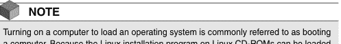

打开计算机以加载操作系统通常被称为启动（booting）计算机。因为 Linux CD-ROM 上的 Linux 安装程序可以在您第一次打开计算机时加载，所以它们被称为可启动 CD-ROM。

### 执行安装

安装 Linux 操作系统涉及与安装程序交互，该程序提示用户输入有关正在安装的 Linux 系统性质的信息。该安装程序还允许用户识别或更改由安装程序自动检测到的硬件组件。更具体地说，Red Hat Fedora Linux 的安装过程包括以下阶段：

- 启动安装
- 选择语言、键盘、鼠标和监视器
- 指定安装类型
- 分区硬盘
- 配置引导加载程序
- 配置网络和防火墙
- 选择系统语言和时间区
- 创建 `root` 用户
- 选择软件包
- 安装软件包
- 完成首次启动向导

### 启动安装

如前所述，要执行基于 CD-ROM 的 Red Hat Fedora Linux 安装，您只需将第一个 Red Hat Fedora Linux CD-ROM 放入 CD-ROM 驱动器并打开计算机。随后，会出现一个初始欢迎屏幕，表明安装程序已加载，如图 3-1 所示。

在此屏幕上按下 Enter 键将执行默认的图形安装，自动检测硬件并适合 HCL（硬件兼容性列表）上存在的多数硬件配置。这就是本章讨论的方法。但是，您还可以向安装程序传递信息以更改安装类型。

到目前为止，安装过程中最大的问题是启动图形安装；不在 HCL 上的某些 LCD 监视器和显卡可能会导致默认图形安装期间屏幕变黑或变形。如果是这种情况，只需重启安装，在 `boot:` 提示符处输入 `linux nofb` 并按 Enter 以禁用图形安装的帧缓冲支持。帧缓冲是视频适配器卡硬件的抽象表示，程序可以使用它代替直接视频适配器卡硬件通信。如果禁用帧缓冲支持仍无法进行图形安装，您可以重启安装并通过在 `boot:` 提示符处输入 `linux text` 并按 Enter 来选择执行基于文本的安装。

#### 图 3-1 Red Hat 安装启动

**注意**

尽管大多数人为了方便使用而倾向于进行图形化安装，但基于文本的安装速度更快，因为它无需加载图形用户界面。基于文本的安装是第 7 章中讨论的硬盘和网络安装的默认方式。

你还可以指定选项以阻止硬件检测、检查介质错误、提供修复实用程序、加载额外的设备驱动程序、测试内存或加载更新的软件。如果在初始欢迎屏幕按 F2，即可看到这些选项，如图 3-2 所示。

无论选择哪种安装选项，在 `boot:` 提示符处按 Enter 后，系统都会要求你在安装前检查介质是否存在错误，如图 3-3 所示。尽管这是可选的安装步骤，但为了确保介质错误不会导致安装后续中止，测试过去未用于安装 Linux 的 CD-ROM 介质是一个好习惯。

#### 安装 LINUX

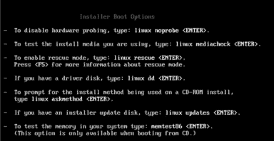

**图 3-2** 查看安装选项

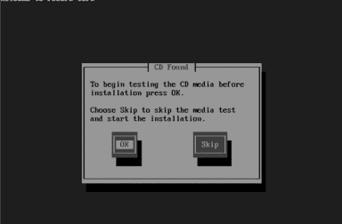

**图 3-3** 测试 CD-ROM 介质

介质测试完成后，将启动图形化安装，并显示图形化欢迎屏幕。在此屏幕之后，系统会提示你回答一系列问题以完成安装。第一个屏幕允许你选择安装语言，如图 3-4 所示。

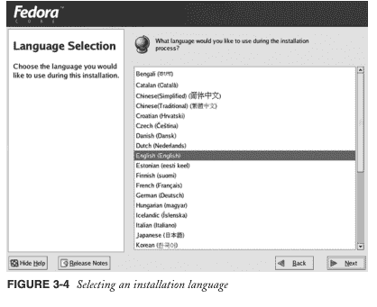

**提示**

大多数 Red Hat 安装屏幕的左侧提供了当前屏幕的说明以及常见选项的描述。

在语言选择屏幕之后，系统会要求你选择键盘布局，如图 3-5 所示。键盘的默认型号和布局会自动检测，因此很少需要更改。然而，在继续之前核实屏幕上的信息是否正确是一个好习惯。如果不确定，请选择美式英语布局，因为它们在大多数情况下都能正常工作。如果鼠标的特定品牌和型号未能自动检测到，安装程序将提示你输入相关信息，如图 3-6 所示。为了兼容能够使用第三个鼠标按钮的程序，如果当前鼠标没有第三个按钮，请确保勾选“`Emulate 3 Buttons`”（模拟 3 个按钮）。如果选中此选项，将通过同时按下两个鼠标按钮来模拟第三个鼠标按钮。

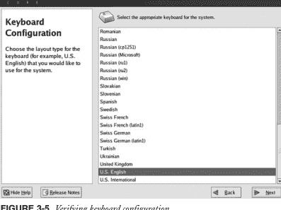

**图 3-5** 验证键盘配置

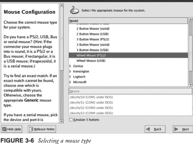

**图 3-6** 选择鼠标类型

选择好键盘和鼠标后，安装程序会提示你选择监视器，如图 3-7 所示。目前大多数可用的监视器都能自动检测；你通常只需在继续之前验证检测到的正确型号以及水平和垂直同步范围即可。然而，如果监视器未自动检测，你应在监视器型号列表中查找它，或使用具有正确水平和垂直同步范围的通用型号。

**警告**

如果你的监视器被自动检测到，系统不会提示你配置其设置。

选择正确的监视器设置非常重要，因为错误的设置可能会损坏监视器。

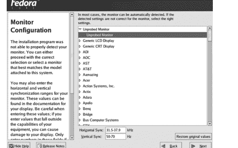

**图 3-7** 验证监视器配置

### 指定安装类型

接下来，安装程序会尝试检测硬盘上之前的 Red Hat Linux 安装。如果检测到之前的 Red Hat 版本，系统将提示你选择升级硬盘上现有的 Red Hat Linux 安装或执行全新安装。通常，只有在之前的 Red Hat Linux 安装中有难以重新创建或备份的数据或配置时，才会执行升级。如果你选择全新安装，或者没有安装之前的 Red Hat 版本，你将看到四种通用的安装类型，它们允许你简化软件包选择，如图 3-8 所示。

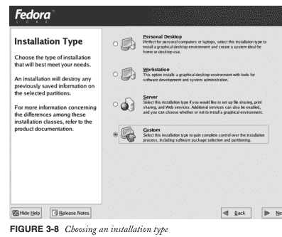

**图 3-8** 选择安装类型

如果你选择执行个人桌面安装，系统将默认安装一组适合家庭或便携式使用的软件包，包括 GUI 环境和常见应用程序。选择工作站安装会安装与个人桌面相同的应用程序，以及管理和网络工具。服务器安装包含较少的软件包，但包括几个服务器服务。尽管这些选择可能简化了软件包的选择，但选择“`Custom`”（自定义）很常见，它允许你完全控制安装的剩余部分，并只选择适合你计算需求的软件包。

**注意**

尽管用户在此处通过选择安装类型来定义一组通用的软件包，但详细的软件包选择将在安装过程中稍后输入。

**提示**

在规划安装类型时，考虑可用的硬盘空间非常重要。自定义安装可能会在硬盘上放置近 7GB 的数据。如果你正在安装大量软件包，请确保硬盘上有足够的空间用于用户数据、未来将生成的日志文件以及已安装软件包的工作空间。

#### 硬盘分区

选择安装类型后显示的下一个屏幕允许你选择分区策略。回想一下，分区将硬盘划分为相邻的部分，其中每个部分都可以包含用于存储数据的独立文件系统。如果这些文件系统被挂载（或附加）到特定目录，Linux 随后可以访问它们。当数据被存储在特定目录中时，它实际上被存储在硬盘上的相应文件系统中。Red Hat 安装程序可以根据常见配置自动创建分区；然而，根据特定 Linux 系统的需求手动分区通常是一个好习惯。


至少，Linux 通常只需要创建两个分区：一个挂载到 Linux 根目录（`/`）的分区，它可以包含操作系统、应用程序和用户使用的文件；以及一个用于`虚拟内存`（也称为`交换内存`）的分区。虚拟内存由硬盘上的一个区域组成，当物理内存（RAM）使用过度时，该区域可用于存储通常驻留在物理内存中的信息。当执行需要计算机大量资源的程序时，信息会在物理内存和硬盘上的虚拟内存之间不断交换，反之亦然。传统上，Linux 交换分区的大小至少与计算机中的物理 RAM 大小相同；然而，`2.4`或更高版本的 Linux 内核需要更多空间。一般而言，`2.4`内核的交换分区至少应为物理 RAM 大小的两倍，但如果 Linux 系统旨在运行大型应用程序，则可以更大。许多用户将交换分区大小设为物理 RAM 的三倍，以避免安装后出现任何问题。交换分区不包含文件系统，也从不挂载到目录，因为 Linux 操作系统最终负责交换信息。

尽管你可能只选择创建根分区和交换分区，但额外的分区可以使 Linux 对文件系统错误更具鲁棒性。例如，如果一个分区上的文件系统遇到错误，只有系统的一部分数据（其他文件系统不受影响）会受到影响，而不是整个系统。由于 Linux 中有一些常用目录被频繁使用，因此更容易出现故障，将这些目录挂载到它们自己的文件系统上是一个好习惯。表 3-1 列出了通常挂载到独立分区的目录，并列出了它们的推荐大小。

这些文件系统中的每一个可能具有不同的类型。目前最常见的类型是`ext2`、`ext3`、`VFAT`和`REISER`文件系统，尽管 Linux 可以支持多达 50 种不同的文件系统。每个文件系统基本上执行相同的功能，即在该分区上存储文件；然而，每个文件系统提供不同的功能，并针对不同的用途进行了专门化。`ext2`文件系统仍然是大多数 Linux 计算机上使用的传统文件系统，而虚拟文件分配表（`VFAT`）文件系统与 Windows 中的 `FAT`文件系统兼容。然而，`ext3`和`REISER`文件系统比`ext2`和`VFAT`文件系统更具鲁棒性，因为它们执行一项称为`日志记录`的功能。日志记录文件系统是一种在日志中记录写入硬盘的信息的文件系统。如果你将硬盘上的文件从一个目录复制到另一个目录，该文件必须进入物理内存，然后写入硬盘上的新位置。如果计算机断电，日志允许文件系统恢复其一致性。

…puter 在此过程中被关闭，信息可能无法按预期传输，数据可能会丢失或损坏。使用日志记录文件系统时，将文件复制到新位置所需的每个步骤都会先写入日志，以便系统在电源故障后可以追溯断电前系统执行的步骤并完成文件复制。与`ext2`和`VFAT`相比，这两种文件系统还包含多种其他改进，包括更快的数据传输和索引，因此如今它们是 Linux 服务器的常见选择。

#### 表 3-1 常见的 Linux 文件系统及其大小

| 目录 | 描述 | 推荐大小 |
|---|---|---|
| `/` | 包含未存在于其他文件系统上的所有目录 | 取决于其他文件系统的大小和数量，但通常至少为 `4GB` |
| `/boot` | 包含 Linux 内核和引导文件 | `50MB` |
| `/home` | 用户主目录的默认位置 | 每个用户 `200MB` |
| `/usr` | 系统命令和实用工具 | 取决于安装的软件包——通常至少为 `3GB` |
| `/usr/local` | 大多数附加程序的位置 | 取决于安装的软件包——通常至少为 `4GB` |
| `/opt` | 附加程序的备用位置 | 取决于安装的软件包——通常至少为 `4GB` |
| `/var` | 包含日志文件和邮件队列 | `2GB` |
| `/tmp` | 保存由程序创建的临时文件 | `500MB` |

在确定安装所需的文件系统数量和类型后，你可以选择让 Red Hat Linux 安装程序根据系统的硬盘总空间自动进行分区，或者使用 `Disk Druid`图形分区工具手动分区，如图 3-9 所示。

`Disk Druid`是一个易于使用的图形分区程序；你可以删除现有分区，创建和编辑新分区，甚至可以创建`冗余独立磁盘阵列 (RAID)`卷，以防止在硬盘故障时数据丢失。`RAID`在第 7 章中讨论。

图 3–10 显示了 `Disk Druid`在创建了两个分区（`/`文件系统 (`ext3`) 和 `swap`）之后的状态。由于磁盘大小和建立的分区数量不同，你的磁盘可能与图 3–10 中描绘的不同。如果首先安装了 Windows，则必须删除该分区后才能添加新分区。只能从可用空间分配新分区。要添加额外的分区和文件系统，只需在 `Disk Druid`中单击“新建”按钮并提供适当的信息，如图 3–11 所示。

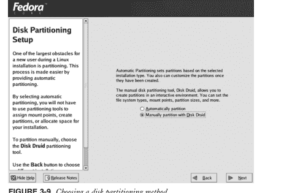

**图 3-9** 选择磁盘分区方法

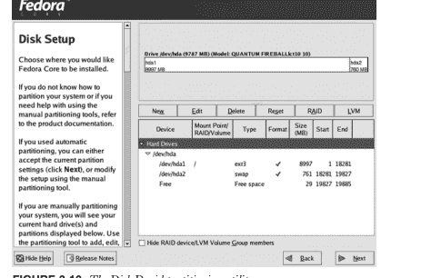

**图 3-10** `Disk Druid`分区工具

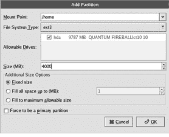

**图 3-11** 创建新分区

### 配置引导加载程序

在安装程序中指定分区和文件系统后，系统会提示你配置引导加载程序，如图 3-12 所示。`引导加载程序`是 `BIOS` ROM 在 `POST`之后启动的一个程序，它从计算机内部的硬盘分区将 Linux 内核加载到内存中，但如果硬盘上存在其他操作系统（如 Windows），也可以用于启动这些操作系统。你在 Red Hat Fedora Linux 安装期间可以配置的引导加载程序是`GRand Unified Bootloader (GRUB)`。引导加载程序在第 8 章“使用 BASH Shell”中讨论。

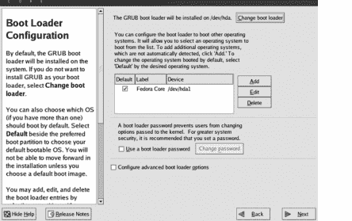

**图 3-12** 配置引导加载程序

Red Hat Linux 会自动检测位于硬盘上的 Windows 操作系统，并设置引导加载程序显示一个屏幕，允许你在系统启动时选择要启动的操作系统；这个过程称为双启动。如果你单击“更改引导加载程序”按钮（如图 3-12 所示），你可以选择安装 `GRUB`或不安装任何引导加载程序。如果你已经在硬盘上安装了 `Windows NT`、`Windows 2000`、`Windows XP`或`Windows Server 2003`，并希望使用 Windows 引导加载程序对两个操作系统进行双启动，通常会这样做。此外，你还可以选择在系统启动时如果在一定时间内未选择操作系统，默认启动哪个操作系统，以及是否使用密码来防止未授权用户启动操作系统。

如果在图 3-12 中选中“配置高级引导加载程序选项”复选框，你可以指定额外的引导加载程序配置，如图 3-13 所示。

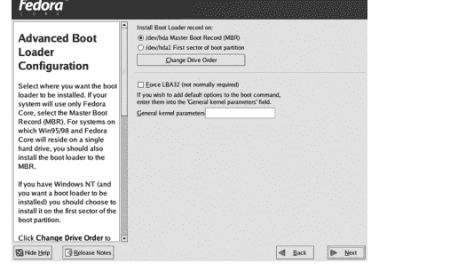

**图 3-13** 配置高级引导加载程序选项

引导加载程序最常见的驻留位置是主引导记录 (MBR)；但是，如果你想使用其他操作系统的引导加载程序来启动 Linux，也可以将其放置在 `/`或`/boot`文件系统分区的第一硬盘扇区。除此之外，你可以通过引导加载程序向 Linux 操作系统内核传递某些信息（称为内核参数），或者强制使用某个称为“32 位大容量块寻址 (LBA32)”的参数。仅当 `/`或`/boot`分区位于硬盘的第 1024 柱面之后（即前 8GB 之后）且系统 BIOS 未向引导加载程序通告此信息时，才需要 `LBA32`。

### 配置网络和防火墙

如果网络接口卡 (NIC) 被 Red Hat 安装程序检测到，你会看到一个类似于图 3-14 所示的网络配置屏幕，该屏幕允许你配置 `NIC`是否在启动时激活以及将使用什么配置信息（手动定义或通过 `DHCP`）。如果你手动配置 `IP`，则需要通过单击图 3-14 中显示的“编辑”按钮输入 `IP`地址和子网掩码。如果你不使用 `DHCP`，至少还应设置主机名、网关（或默认网关）和主要 `DNS`以获得互联网访问权限。次要和第三 `DNS`地址用于在主 `DNS`不可用时作为备份。

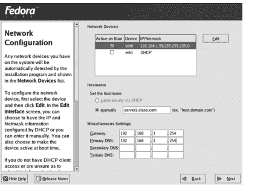

**图 3-14** 配置网络接口

在配置好 `NIC`后，系统会提示你选择允许哪些网络流量进入 Linux 系统（称为防火墙），如图 3-15 所示。通过选择“启用防火墙”选项，你的 Linux 系统会阻止大部分流量进入你的计算机，同时允许你的计算机访问其他网络服务；因此，在互联网等公共网络上使用防火墙是良好的做法。此外，你还可以选择自定义允许通过防火墙的流量。

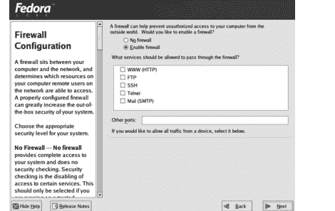

**图 3-15** 配置防火墙

### 选择系统语言时区


在安装过程的早些时候，系统提示你选择安装过程本身使用的语言；然而，安装后 Linux 支持多种语言。因此，你必须选择 Linux 操作系统将支持的语言，如图 3-16 所示。你还必须为你的区域选择合适的时区，如图 3-17 所示。

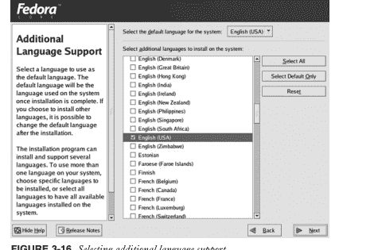

图 3-16：选择附加语言支持

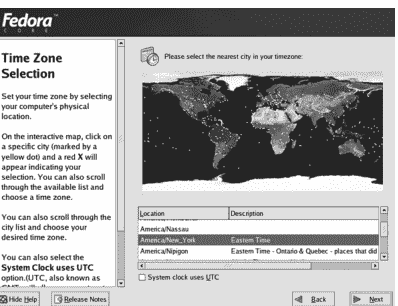

图 3-17：选择时区

### 创建根用户

所有 Linux 系统都需要安全访问权限，这意味着每个用户在访问用户界面之前必须使用有效的用户名和密码登录。此过程称为身份验证。在安装过程中，应配置两个用户帐户：管理员帐户（`root`），它拥有系统的完全权限，以及至少一个普通用户帐户。为此，你需要为 `root` 用户帐户指定一个至少六个字符长的密码，如图 3-18 所示，然后在安装后的首次启动时向系统中添加另一个用户帐户（本章稍后讨论）。

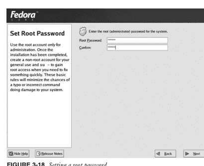

图 3-18：设置根密码

### 选择软件包

接下来，Red Hat 安装程序提供基于图 3-8 中先前选择的安装类型的软件包列表。你可以选择实现特定功能所需的通用软件包，如图 3-19 所示，或者通过单击相应软件包组旁边的“详细信息”链接来细化软件包列表。

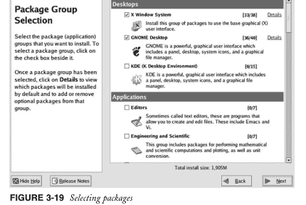

图 3-19：选择软件包

### 安装软件包

选择软件包后，Red Hat 安装程序会提示你开始文件复制过程，其中为安装而选择的软件包将被复制到在硬盘上创建的文件系统，如图 3-20 所示。

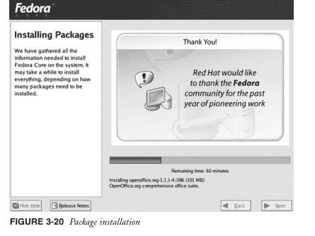

软件包安装完成后，Red Hat 安装程序会显示一个“恭喜”屏幕，从光驱中弹出 `CD-ROM` 光盘，并提示您重启系统。

### 完成首次启动向导

在安装后的第一次启动时，在登录提示出现之前，会出现一个交互式工具（称为 `firstboot` 向导），如图 3-21 所示。完成此工具后，计算机启动时将不再显示它。

如果您点击图 3-21 中显示的“下一步”按钮，您需要接受许可协议。接下来，系统会提示您设置日期和时间，或者选择通过互联网上的可靠时间服务器使用网络时间协议（`NTP`）接收时间，如图 3-22 所示。然后，系统会提示您选择加载图形用户界面（`GUI`）环境时显示的首选分辨率和颜色深度，如图 3-23 所示。接着，系统会提示您创建一个普通用户账户，如图 3-24 所示。对于日常用户任务，应避免以 `root` 用户登录，以最大限度减少无意中更改系统配置设置的可能性。

# 欢迎

- 欢迎
  - 许可协议
  - 日期和时间
  - 显示
  - 用户账户
  - 额外 `CD`
  - 完成设置

在您的系统准备就绪之前，还有几个步骤需要执行。设置代理现在将引导您完成一些基本配置。请点击右下角的 `Next` 按钮继续。

- 返回
- 下一步


图 3-21：首次启动向导

- 欢迎
  - 许可协议
  - 日期和时间
  - 显示
  - 用户账户
  - 额外 `CD`
  - 完成设置

# 日期和时间

请为系统设置日期和时间。

日期: 六月, 2004 | 日 一 二 三 四 五 六

1 2 3 4 5
6 7 8 9 10 11 12
13 14 15 16 17 18 19
20 21 22 23 24 25 26
27 28 29 30

时间: 当前时间: 22:27:09

小时: 22
分钟: 26
秒: 49

网络时间协议：

您的计算机可以使用网络时间协议与远程时间服务器同步时钟。

- [ ] 启用网络时间协议
服务器：

- 返回
- 下一步

图 3-22：设置日期和时间

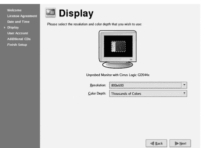

图 3-23：配置屏幕分辨率和颜色深度

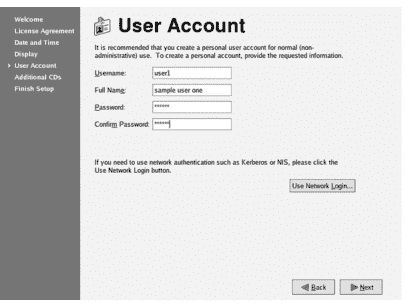

图 3-24：创建普通用户账户

默认情况下，Linux 用户通过本地计算机上的密码数据库进行身份验证。该密码数据库默认使用 `MD5` 影子密码。影子密码是仅存储在独立于用户账户信息的数据库中以提高安全性的密码。`MD5`（消息摘要 5）密码支持长达 256 个字符的长度，并使用 `MD5` 哈希算法加密以增强安全性。您还可以选择基于驻留在网络上另一服务器上的数据库来验证部分或所有用户。`NIS` 在 Linux 系统之间共享密码数据库，而 `LDAP`（轻量级目录访问协议）、`Kerberos`、`SMB`（服务器消息块）和 `Winbind` 代表了可能存在于网络上其他服务器上的身份验证和用户信息服务类型。此外，您可以使用 `Hesiod` 协议将用户信息存储在您的网络中的 `DNS` 服务器上。`Hesiod` 和网络身份验证的详细配置超出了本书的范围。

要配置身份验证选项，请单击图 3-24 中显示的“使用网络登录”按钮，并指定适当的参数，如图 3-25 和 3-26 所示。

配置好用户账户和身份验证后，安装程序会询问您是否要安装额外的软件。然后，它会提示您完成 `firstboot` 向导并继续加载其余操作系统以首次使用 Linux 系统。

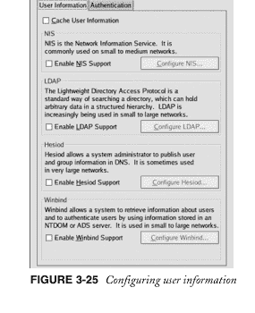

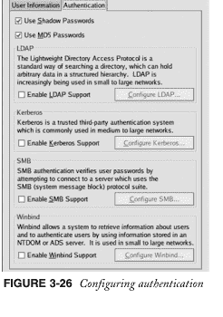


根据您的外围设备，您可能在安装过程中收到额外的屏幕。例如，如果检测到您的声卡，系统可能会提示您配置声音。

## Linux 基本用法

安装 Linux 操作系统后，您必须使用有效的用户名和密码登录系统，并与用户界面交互以执行有用的任务。为此，必须理解不同类型的用户界面，以及基本任务，如命令执行、获取在线帮助和关闭 Linux 系统。

### Shell、终端和内核

请记住，操作系统仅仅是一组软件，允许您以有意义的方式使用计算机硬件。每个操作系统都有一个核心组件，它加载所有其他组件并集中控制计算机的活动。这个组件被称为内核，在 Linux 中，它只是一个通常称为 "vmlinuz" 的文件，位于硬盘上，并在您第一次打开计算机时加载。

当用户与她的计算机交互时，她实际上是在与计算机操作系统的内核交互。然而，这种交互不能直接发生；它必须有一个可以访问内核的通道，以及一个将用户输入传递给内核进行处理的用户界面。允许特定用户登录的通道称为终端，在 Linux 中可以有多个终端，允许您在本地或通过网络登录计算机。用户登录到终端后，她会收到一个称为 shell 的用户界面，该界面接受用户输入并将该输入传递给内核进行处理。Linux 中默认使用的 shell 是 BASH shell（Bourne Again Shell），它是 AT&T 的 Bourne shell 的改进版本，也是全书使用的 shell。整个过程看起来类似于图 3-27。

如前所述，Linux 是一个多用户多任务操作系统，因此可以允许成千上万个终端。每个终端可以代表一个已登录的独立用户，该用户拥有自己的 shell。图 3-27 中显示的四个不同“通道”可以是登录到同一台 Linux 计算机的不同用户。两个用户可以在本地登录到服务器（坐在服务器本身前），另外两个用户可以通过网络（如互联网）登录。

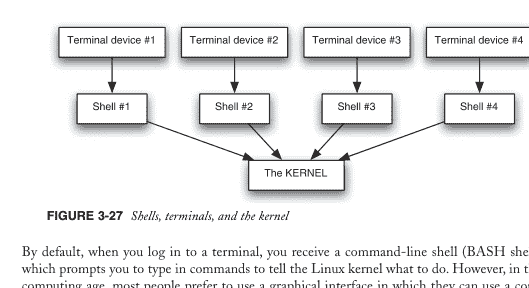

默认情况下，当您登录到终端时，您会收到一个命令行 shell（`BASH` shell），它提示您输入命令以告知 Linux 内核做什么。然而，在这个计算时代，大多数人更喜欢使用图形界面，他们可以使用计算机鼠标来导航和启动任务。在这种情况下，您可以在登录到命令行终端后，选择在 `BASH` shell 之上启动图形用户界面（`GUI`）环境，或者您可以切换到图形终端，允许用户登录并立即获得 `GUI` 环境。典型的命令行终端登录提示如下所示：

```
Fedora Core release 2 (Tettnang)
Kernel 2.6.5-1.358 on an i686

server1 login:
```

Red Hat Linux 典型的图形终端登录（称为 `gdm` 或 `GNOME` 显示管理器）如图 3-28 所示。

要访问本地服务器上的终端设备，您可以按 `Ctrl+Alt+F1` 等按键组合切换到单独的终端。如果您通过网络登录，可以使用各种连接到 Linux 计算机终端的程序。本地 Linux 终端及其名称和类型的列表见表 3-2。


当您登录到命令行终端后，您会收到一个提示符，您可以在其中输入命令。如果您以 `root` 用户（管理员）身份登录，将使用 `#` 提示符：

```
Fedora Core release 2 (Tettnang)
Kernel 2.6.5-1.358 on an i686

server1 login: root
Password:
Last login: Mon Mar @ 09:45:42 on tty2
[root@server1 root]#
```

**图 3-28** `gdm`（GNOME 显示管理器）


**表 3-2** 常见的 Linux 终端

| 终端名称 | 快捷键组合 | 登录类型 |
| :--- | :--- | :--- |
| `tty1` | `Ctrl+Alt+F1` | 命令行 |
| `tty2` | `Ctrl+Alt+F2` | 命令行 |
| `tty3` | `Ctrl+Alt+F3` | 命令行 |
| `tty4` | `Ctrl+Alt+F4` | 命令行 |
| `tty5` | `Ctrl+Alt+F5` | 命令行 |
| `tty6` | `Ctrl+Alt+F6` | 命令行 |
| `tty7` (`/0`) | `Ctrl+Alt+F7` | 图形界面 |

然而，如果您以普通用户身份登录到命令行终端（例如 `user1`），则使用 `$` 提示符：

```
Fedora Core release 2 (Tettnang)
Kernel 2.6.5-1.358 on an i686
server1 login: user1
Password:
Last login: Mon Mar 8 09:45:42 on tty2
[user1@server1 user1]$
```

当您登录到图形终端时，会启动您选择的 `GUI` 环境；`Red Hat Linux` 中默认的 `GUI` 环境是 `GNOME`。`GUI` 环境启动后，您可以通过导航至 `Red Hat` 菜单、`系统工具`、`终端` 来访问命令行 `Terminal` 窗口，如图 3-29 所示。

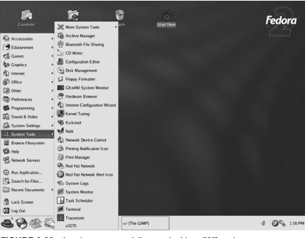

**图 3-29** 在 `GUI` 环境中访问命令行终端

#### 基础 Shell 命令

在使用命令行终端时，`shell` 最终解释用户在命令行输入的所有信息。这些信息包括命令本身，以及选项和参数。命令指示要执行的程序名称，并且区分大小写。选项是以连字符（`-`）开头的特定字母，出现在命令名称之后，用于改变命令的工作方式。选项特定于所讨论的命令；开发该命令的人决定了该命令允许哪些选项。

**注意**

> 有些选项以两个连字符 `--` 开头；这些选项称为 `POSIX` 选项，通常由一个完整的单词组成，而不仅仅是单个字母。

参数也出现在命令名称之后，但不以连字符开头。它们指定命令的工作参数，这些参数并非由命令开发者预先确定。例如，假设您想列出硬盘上 `/etc/ntp` 目录中的所有文件。您可以使用带有 `-a` 选项的 `ls` 命令（告知 `ls` 命令列出所有文件）和 `/etc/ntp` 参数（告知 `ls` 在 `/etc/ntp` 目录中查找），如下例所示：

```
[root@server1 root]# ls -a /etc/ntp
.  ..  keys  ntpservers  step-tickers
[root@server1 root]#
```

在上面的输出中，输入该命令并按下 `Enter` 键后，`ls` 命令向我们显示 `/etc/ntp` 目录中有三个文件，并返回您的命令提示符，以便您可以输入另一个命令。

**注意**

> 命令、选项和参数区分大小写；例如，大写字母 (`A`) 与小写字母 (`a`) 的处理方式不同。

**提示**

> 始终在命令名称、选项和参数之间留出空格；否则，`shell` 不会理解它们是分开的，您的命令可能无法按预期工作。

虽然您可以向命令传递选项和参数，但并非所有命令都需要在命令行上提供参数或选项才能正常工作。`date` 命令就是一个例子，它仅打印当前的日期和时间：

```
[root@server1 root]$ date
Tue Mar 29 08:58:36 EST 2005
[root@server1 root]_
```

表 3-3 列出了一些您可以不使用任何选项或参数即可使用的常见命令。

**表 3-3** 一些常见的 Linux 命令

| 命令 | 描述 |
| :--- | :--- |
| `clear` | 清除终端屏幕 |
| `reset` | 将您的终端重置为使用默认终端设置 |
| `finger` | 显示系统用户的信息 |
| `who` | 显示当前登录的用户 |
| `w` | 显示当前登录的用户及其任务 |
| `whoami` | 显示您的登录名 |
| `id` | 显示与您的用户账户名称和组名称相关的数字；这些通常被称为用户 `ID` (`UID`) 和组 `ID` (`GID`) |
| `date` | 显示当前日期和时间 |
| `cal` | 显示当前月份的日历 |
| `exit` | 退出当前 `shell` |

如果某个命令的输出太大而无法容纳在终端屏幕上，请同时按下 `Shift` 和 `Page Up` 键来查看之前屏幕的信息。同样，当同时按下 `Shift` 和 `Page Down` 时，可以用于朝相反方向导航。

您可以使用键盘光标键（上、下、右和左箭头键）调出在 `BASH` `shell` 中之前输入的命令。因此，如果您想再次输入相同的命令，只需使用键盘光标键循环浏览可用命令列表并按下 `Enter` 键即可重新执行该命令。

#### Shell 元字符

`Shell` 的另一个重要功能包括 `shell` 元字符，它们是具有特殊含义的键盘字符。最常用的元字符之一是 `$` 字符，它告知 `shell` 以下文本引用一个变量。变量只是存储在内存中的一小块信息；变量名称通常是大写单词，大多数变量在您登录时由 `Linux` 系统自动设置。使用 `$` 元字符引用变量的一个例子是使用 `echo` 命令（将文本打印到终端屏幕）：

```
[root@server1 root]# echo Hi There!
Hi There!
[root@server1 root]# echo My shell is $SHELL
My Shell is /bin/bash
[root@server1 root]#
```

注意从前面的输出中可以看到，`$SHELL` 被转换为其内存中的适当值（`/bin/bash`，即 `BASH` `shell`）。`shell` 识别 `SHELL` 为变量，因为它之前有 `$` 元字符前缀。书中讨论的常见 `BASH` `shell` 元字符列表见表 3-4。

**表 3-4** 常见的 `BASH` `shell` 元字符

| 元字符 | 描述 |
| :--- | :--- |
| `$` | `Shell` 变量 |
| `~` | 特殊主目录变量 |
| `&` | 后台命令执行 |
| `;` | 命令终止 |
| `<` `>` `>>` | 输入/输出重定向 |
| `\|` | 命令管道 |
| `*` `?` `[` `]` | `Shell` 通配符 |
| `"` `\` | 元字符引号 |
| ``` | 命令替换 |
| `(` `)` `{` `}` | 命令分组 |

良好的做法是在输入命令时避免使用元字符，除非您需要利用其特殊功能，因为 `shell` 会迅速解释它们，这可能导致意外结果。

**注意**

> 如果您误用了这些字符之一，且您的 `shell` 没有返回正常提示符，只需同时按下 `Ctrl` 和 `c` 键即可取消当前命令。

在某些情况下，您可能需要在命令中使用元字符并防止 `shell` 解释其特殊含义。为此，只需将元字符用单引号 `'` 括起来。单引号保护这些元字符不被 `shell` 特殊解释（即 `$` 被解释为 `$` 字符，而不是变量标识符）。您也可以使用双引号 `"` 执行相同的任务；然而，双引号不保护 `$`、`\` 和 ```。如果只需保护一个字符不被 `shell` 解释，您可以在该字符前加 `\` 而不是将其括在引号内。这类引用的一个例子是：

```
[root@server1 root]# echo My Shell is $SHELL
My Shell is /bin/bash
[root@server1 root]# echo 'My Shell is $SHELL'
My Shell is $SHELL
[root@server1 root]# echo "My Shell is $SHELL"
My Shell is /bin/bash
[root@server1 root]# echo My Shell is \$SHELL
My Shell is $SHELL
[root@server1 root]#
```

如表 3-4 所示，并非所有引号字符都能保护字符免受 `shell` 的解析。反引号 ``` 可用于执行命令替换；反引号之间的任何内容都被 `shell` 视为另一个命令，其输出将替换反引号所在位置。以表达式 `'date'` 为例：


#### 获取命令帮助

大多数 Linux 发行版在大多数配置中包含超过 1000 个不同的 Linux 命令，因此，记住每个命令的语法和用法是不切实际的。幸运的是，Linux 将每个命令的文档存储在中枢位置，以便可以访问方便。Linux 命令最常见的文档形式是**手册页**（通常称为 `man` 页）。只需输入 `man` 命令后跟命令名称，该 Linux 命令的大量信息就会逐页显示在终端屏幕上。这些信息包括命令及其语法的描述，以及可用选项、相关文件和命令。例如，要接收有关 `whoami` 命令格式和用法的信息，可以使用以下命令：

```
[root@server1 root]# man whoami
```

然后，手册页会逐页显示在终端屏幕上。你可以使用键盘上的方向键滚动信息，或按 `q` 键退出。`whoami` 的手册页类似于以下内容：

```
WHOAMI(1)           User Commands           WHOAMI(1)

NAME
       whoami - print effective user id

SYNOPSIS
       whoami [OPTION]...

DESCRIPTION
       Print the user name associated with the current effective
       user id.  Same as id -un.

       --help      display this help and exit

       --version   output version information and exit

AUTHOR
       Written by Richard Mlynarik.

REPORTING BUGS
       Report bugs to <bug-coreutils@gnu.org>.

COPYRIGHT
       Copyright © 2004 Free Software Foundation, Inc.
       This is free software; see the source for copying condi-
       tions.  There is NO warranty; not even for MERCHANTABILITY
       or FITNESS FOR A PARTICULAR PURPOSE.
```

`SEE ALSO`

`whoami` 的完整文档作为 Texinfo 手册维护。如果在你的站点上正确安装了 `info` 和 `who` 程序，命令

```
info coreutils whoami
```

应能让你访问完整手册。

`whoami 5.2.1 May 2004 WHOAMI(1)`

`[root@server1 root]_`

请注意，在上面的手册页输出顶部，`whoami` 命令显示为 `WHOAMI(1)`。`(1)` 表示手册页的一个部分；第 `(1)` 节意味着 `whoami` 是任何用户都可以执行的命令。所有手册页都包含某些部分编号，用于描述手册页数据库中命令的类别；你可以在表 3-5 中找到不同手册页部分编号的列表。

#### 表 3-5 手册页部分编号

| 手册页部分 | 描述 |
| --- | --- |
| 1 | 任何用户都可以执行的命令 |
| 2 | Linux 系统调用 |
| 3 | 库例程 |
| 4 | 特殊设备文件 |
| 5 | 文件格式 |
| 6 | 游戏 |
| 7 | 宏包 |
| 8 | 只有 root 用户可以执行的命令 |
| 9 | Linux 内核例程 |
| n | 尚未分类的新命令 |

有时，不止一个命令、库例程或文件具有相同的名称。如果你运行带有该名称作为参数的 `man` 命令，Linux 将返回最低部分编号的手册页。例如，如果有一个名为 `whoami` 的文件以及一个名为 `whoami` 的命令，而你输入 `man whoami`，则显示 `whoami` 命令（手册页第 1 节）的手册页。如果要显示 `whoami` 文件格式的手册页，只需输入 `man 5 whoami` 以显示 `whoami` 文件格式（手册页第 5 节）。

回想一下，许多命令对 Linux 用户可用；因此，如果不使用 Linux 命令词典，找到执行特定任务所需的命令可能会很麻烦。幸运的是，你可以按关键字搜索手册页。要找到名称或描述中包含“usb”的所有命令，输入以下内容：

```
[root@server1 root]# man -k usb
```

此命令产生以下输出：

| 名称 | 部分 | 描述 |
| --- | --- | --- |
| `energizerups` | `(8)` | 针对使用 USB 转 RS232 接口（V1.0 波特率 2400bps）的 Energizer（Megatec 协议）UPS 设备的驱动程序 |
| `fxlload` | `(8)` | 固件下载到 EZ-USB 设备 |
| `lsusb` | `(8)` | 列出所有 USB 设备 |
| `sane-canon630u` | `(5)` | 适用于 Canon 630u USB 平板扫描仪的 SANE 后端 |
| `sane-find-scanner` | `(1)` | 查找 SCSI 和 USB 扫描仪及其设备文件 |
| `sane-gt68xx` | `(5)` | 适用于基于 GT-68XX 的 USB 平板扫描仪的 SANE 后端 |
| `sane-ma1509` | `(5)` | 适用于 Mustek BearPaw 1200F USB 扫描仪的 SANE 后端 |
| `sane-mustek_usb` | `(5)` | 适用于 Mustek USB 平板扫描仪的 SANE 后端 |
| `sane-plustek` | `(5)` | 适用于基于 LM983(1/2/3) 的平口和 USB 平板扫描仪的 SANE 后端 |
| `sane-sm3600` | `(5)` | 适用于带有 M011 USB 芯片的 Microtek 扫描仪的 SANE 后端 |
| `sane-usb` | `(5)` | 适用于 SANE 的 USB 配置提示 |
| `usbmodules` | `(8)` | 列出可用于已插入 USB 设备的内核驱动程序模块 |

```
[root@server1 root]#
```

找到所需的命令后，你只需对该命令运行不带 `-k` 选项的 `man` 命令，即可查找有关该命令的详细信息。

#### 注意

- 你还可以使用 `apropos usb` 命令来执行与 `man -k usb` 命令相同的功能。两个命令在终端屏幕上产生完全相同的输出。
- 如果在安装 Linux 后你未看到 `man -k` 或 `apropos` 命令的任何输出，你可能需要运行 `makewhatis` 命令来索引手册页数据库。

另一个实用程序，最初旨在替代 Linux 中的 `man` 命令，是 GNU `info` 页。你可以通过输入 `info` 命令后跟相关命令的名称来访问此实用程序。`info` 命令返回每个命令易于阅读的描述，并包含指向其他信息页（称为超链接）的链接。然而，如今，由于手册页自 Linux 构想以来一直被使用，并且在 UNIX 操作系统中已使用了二十多年，因此 `info` 页和手册页都用于查找文档。下面是一个使用 `info` 实用程序查找有关 `whoami` 命令信息的例子：

```
[root@server1 root]# info whoami

info 页随后交互式显示：

File: coreutils.info, Node: whoami invocation, Next: groups invocation, Prev: logname invocation, Up: User information

'whoami': Print effective user id

'whoami' 打印与当前有效用户 ID 关联的用户名。它等效于命令 'id -un'。

 唯一选项是 `--help' 和 `--version'。*注意 通用选项::

 退出状态为 0 表示成功，非零值表示失败。

欢迎使用 Info 版本 4.6。按 ? 获取帮助，按 m 获取菜单项。
[root@server1 root]#
```

``

在 `info` 实用程序中，按 `?` 键或 `Ctrl+h` 组合键可显示描述 `info` 用法的帮助屏幕。与 `man` 命令一样，你可以使用 `q` 键退出。

某些命令没有手册页或 `info` 页。这些命令通常是构建到 BASH shell 本身中的函数。要查找这些命令的帮助，你必须按如下方式使用 `help` 命令：


### 命令帮助：`echo`

```
[root@server1 root]# help echo

echo: echo [-neE] [arg ...]

输出 ARGS。如果指定 -n，则抑制末尾换行符。如果给出 -e 选项，则开启对以下反斜杠转义字符的解释：
```

*   `\a` 警报（铃）
*   `\b` 退格
*   `\c` 抑制末尾换行
*   `\E` 转义字符
*   `\f` 换页符
*   `\n` 换行符
*   `\r` 回车符
*   `\t` 水平制表符
*   `\v` 垂直制表符
*   `\\` 反斜杠
*   `\num` ASCII 代码为 `NUM`（八进制）的字符。

你可以使用`-E`选项显式关闭对上述字符的解释。

```
[root@server1 root]#
```

### 关闭 Linux 系统

由于操作系统负责处理将计算机内存中的数据写入计算机中的磁盘驱动器，因此简单地关闭计算机的电源可能会导致用户和系统文件损坏。因此，在关闭计算机硬件组件的电源之前，准备操作系统进行关机很重要。为此，你可以发出`shutdown`命令，该命令可以在一定时间后停止（`halt`）或重新启动（`reboot`/重启）你的计算机。例如，要在 15 分钟后停止你的系统，可以输入：

```
[root@server1 root] # $shutdown -h +15
```

这将产生类似以下的输出：

```
Broadcast message from root (tty2) (Tue Mar 29 04:08:18 2005):

The system is going DOWN for system halt in 15 minutes!
```

从上面的输出中可以看到，在`shutdown`命令开始后，你不会再收到命令提示符。因此，要停止关机，只需按`Ctrl`和`c`键的组合来取消该命令。或者，你可以登录到另一个终端并发出命令`shutdown -c`来取消关机。

如果要立即停止你的系统，可以输入：

```
[root@server1 root] # $shutdown -h now
```

此命令产生类似以下的输出：

```
Broadcast message from root (tty2) (Tue Mar 29 04:08:18 2005):

The system is going DOWN for system halt NOW!
```

`关闭`命令的其他示例及其描述如表 3-6 所示。

#### 表 3-6 用于停止和重启 Linux 操作系统的命令

| 命令 | 描述 |
| :--- | :--- |
| `shutdown -h +4` | 在四分钟后停止你的系统 |
| `shutdown -r +4` | 在四分钟后重启你的系统 |
| `shutdown -h now` | 立即停止你的系统 |
| `shutdown -r now` | 立即重启你的系统 |
| `shutdown -c` | 取消已调度的关机 |
| `halt` | 立即停止你的系统 |
| `reboot` | 立即重启你的系统 |

## 章节摘要

*   大多数软件信息可以在安装时指定；然而，网络配置和软件包选择应在安装前仔细规划。
*   尽管 Linux 的安装方法有很多种，但基于 `CD-ROM` 的安装是最简单、最常见的方法，而且很少需要创建安装引导磁盘。
*   典型的 Linux 安装会提示用户输入信息，例如语言、引导加载程序、硬盘分区、网络配置、防火墙配置、时区、用户账户、身份验证和软件包选择。
*   用户必须登录到终端并接收一个`shell`才能与 Linux 系统和内核进行交互。一个用户可以同时登录到几个不同的终端，无论是在本地还是通过网络。
*   无论使用哪种类型的终端（图形界面或命令行），你都可以在`shell`提示符下输入命令、选项和参数以执行系统任务、获取命令帮助或关闭 Linux 系统。`shell`区分大小写，并理解一系列称为`shell`元字符的特殊字符，如果不需要其特殊含义，这些字符应加以保护。

`arguments` — 出现在命令名称之后、不以破折号`-`字符开头，并指定命令正常工作所需信息的文本。

`authentication` — 每个用户在对系统用户界面获得访问权限之前，必须使用有效的用户名和密码登录的过程。

`BASH` shell — Bourne 再版 `Shell`；它是 Linux 中的默认命令行界面。

`boot` loader — 由`BIOS` `ROM`启动的小程序，用于在内存中执行 Linux 内核。

`command` — 存在于硬盘上并在命令行输入时执行的程序。

`Disk` `Druid` — 一个易于使用的图形程序，用于对`HDD`上的分区进行划分或修改。

`dual` `booting` — 在计算机上安装多个操作系统的过程。然后用户可以选择在系统启动时加载哪个操作系统。

`ext2` — 一种无日志记录的 Linux 文件系统。

`ext3` — 一种带日志记录的 Linux 文件系统。

`firstboot` wizard — 在 Red Hat Fedora Linux 安装完成后系统启动时立即运行的配置实用程序。

`framebuffer` — 程序的抽象视频硬件表示，使它们无需直接与视频硬件通信。

`GRand` `Unified` `Bootloader` (`GRUB`) — Linux 中常用的引导加载程序。

`info` pages — 一组本地的、易于阅读的命令语法文档，可通过输入`info`命令行实用程序获取。

`journaling` — 一种文件系统功能，在日志中记录需要写入硬盘的信息；常见的 Linux 日志记录文件系统包括`ext3`和`REISER`。

`kernel` parameters — 可以传递给 Linux 内核以改变其工作方式的具体信息片段。

`large` `block` `addressing` `32-bit` (`LBA32`) — 一个可以指定的参数，用于在引导加载程序中启用大块寻址；仅当使用系统 `BIOS` 不完全支持的大硬盘时才需要此参数。

`manual` pages — 最常见的本地命令语法文档集，可通过输入`man`命令行实用程序获取。也称为`man`页。

## 关键术语

*   `metacharacters` — 在 Linux 操作系统中具有特殊含义的关键组合。
*   `options` — 以单个或双破折号`-`开头，出现在命令名称之后，用于更改命令工作方式的具体字母。
*   `redundant` `array` `of` `inexpensive` `disks` (`RAID`) — 一种可用于将硬盘组合在一起以实现容错的存储类型。
*   `REISER` — Linux 中使用的一种日志记录文件系统。
*   `shell` — 一种接受用户输入并将输入传递给内核进行处理的用户界面。
*   `swap` memory — *另见* `virtual` memory。
*   `terminal` — 允许特定用户登录并通过用户界面与内核通信的通道。
*   `VFAT` (`Virtual` `File` `Allocation` `Table`) — 一种可能用于 Linux 的非日志记录文件系统。
*   `virtual` memory — 硬盘上的一个区域（交换分区），如果物理内存（`RAM`）使用过度，可用于存储通常驻留在物理内存（`RAM`）中的信息。

## 复习题

第 3 章 111

1. 在 Linux 安装的图形部分中，第一个屏幕是什么？
    *   a. 配置鼠标
    *   b. 选择键盘
    *   c. 选择安装语言
    *   d. 指定安装类型

2. 一个 `_______________` 由硬盘上的一个区域组成，用于存储通常在物理内存（`RAM`）中使用过度时本应驻留在物理内存（`RAM`）中的信息。
    *   a. 虚拟内存
    *   b. 内存分区
    *   c. 物理 `RAM`
    *   d. Linux 内核

3. 用户主目录默认位置（每个用户）的建议大小是多少？
    *   a. `50` `MB`
    *   b. `100` `MB`
    *   c. `200` `MB`
    *   d. `400` `MB`

4. `______________________` 命令显示系统用户的信息。
    *   a. `clear`
    *   b. `finger`
    *   c. `who`
    *   d. `whoami`

5. 以下哪个命令立即重启系统？
    *   a. `shutdown -r now`
    *   b. `shutdown -r +4`
    *   c. `shutdown -h +4`
    *   d. `shutdown -h now`

6. 判断正误？安装 Linux 操作系统涉及与安装程序交互，该程序会提示用户输入关于正在安装的 Linux 系统性质的信息。

7. 判断正误？如果检测到先前版本的 Red Hat，你必须升级硬盘上存在的先前安装的 Red Hat Linux。

8. 判断正误？在安装过程中，只应配置一个用户账户：具有系统完整权限的管理员账户（`root`）。

9. 判断正误？在 `shell` 中，命令区分大小写。

10. 判断正误？所有命令必须具有手册页或 `info` 页。


11. `________________________` 是视频适配器卡硬件的抽象表示，程序可以使用它们而不是直接与视频适配器卡硬件通信。

12. 一个(n) `________________________` 安装包含很少的工作站软件包，但包含多个服务器服务。

13. `___________` 启动是指引导加载程序允许用户在 Linux 和另一个操作系统（如 Windows）之间进行选择。

14. 用户登录到终端后，她收到一个称为 `___________` 的用户界面，然后该界面接受用户输入并将此输入传递给内核进行处理。

15. Linux 命令最常见的文档形式是 `___________` 页。

### 第 4 章

## 探索 Linux 文件系统

完成本章后，你将能够：

- 使用相对和绝对路径名理解并导航 Linux 目录结构
- 描述各种类型的 Linux 文件
- 查看文件名和文件类型
- 使用 shell 通配符指定多个文件名
- 显示文本文件和二进制文件的内容
- 使用 `grep` 搜索文本文件中的正则表达式
- 识别当今常用的文本编辑器
- 使用 `vi` 编辑器操作文本文件

理解 Linux 文件系统的结构和命令对于有效地使用 Linux 操作数据至关重要。在本章的第一部分中，你将通过更改在文件系统树中的位置并列出不同类型的文件名来探索 Linux 文件系统层级结构。接下来，你将查看用于指定多个文件名的 shell 通配符元字符，并使用标准 Linux 命令查看文件内容。然后，你将学习用于在文件中搜索文本的正则表达式元字符，并了解 `vi` 文本编辑器及其等效工具。

### Linux 目录结构

使用 Linux 操作系统的基础是了解 Linux 如何在硬盘上存储文件。典型的 Linux 系统可能在硬盘上拥有成千上万的数据文件和程序文件；因此，需要一个结构来组织这些文件，以便更容易地找到和操作数据以及运行程序。回顾前一章的内容，Linux 使用逻辑目录树将文件组织到不同的目录（也称为文件夹）中。当用户在某个目录中存储文件时，它们会物理存储在一台计算机内部硬盘的某个分区上的文件系统中。大多数人熟悉图 4-1 中所示的 Windows 操作系统目录树结构；硬盘分区上的每个文件系统都由一个驱动器字母（如 `C:` 或 `D:`）引用，并拥有一个根目录（由 `\` 字符指示），其中包含共同形成层次树状的子目录。

在目录树中正确描述目录很重要；文件或目录的绝对路径名是从根目录开始的特定文件或目录的完整路径名。根据图 4-1，`color` 目录的绝对路径名是 `C:\windows\color`，而 `sue` 目录的绝对路径名是 `D:\home\sue`。换句话说，我们将 `C:\windows\color` 称为 `C:` 驱动器根目录下 `windows` 目录下的 `color` 目录。类似地，我们将 `D:\home\sue` 称为 `D` 驱动器根目录下 `home` 目录下的 `sue` 目录。

Linux 使用类似的目录结构；然而，没有驱动器字母。只有一个根（使用 `/` 字符表示），而硬盘分区上的不同文件系统被挂载到这个目录树的不同目录中，使得文件系统对用户是透明的。与图 4-1 中所示的 Windows 示例目录树等效的 Linux 示例目录树如图 4-2 所示。

根据图 4-2，`color` 目录的绝对路径名是 `/windows/color`，而 `sue` 目录的绝对路径名是 `/home/sue`。换句话说，我们将 `/windows/color` 目录称为系统根（`/` 字符）下 `/windows` 目录下的 `color` 目录。类似地，我们将 `/home/sue` 目录称为系统根下 `home` 目录下的 `sue` 目录。

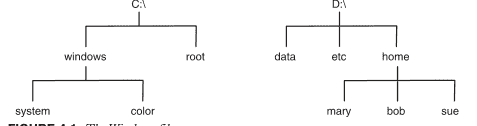

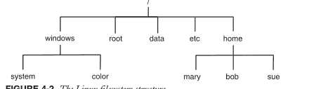

#### 更改目录

当用户登录到他的 Linux 系统时，他会被放置在他的主目录中，这是每个用户存储个人文件的独特位置。普通用户通常拥有一个位于 `/home` 目录之下、以其用户账户命名的主目录，例如 `/home/sue`。然而，`root` 用户在系统根目录（`/root`）下拥有一个名为 `root` 的主目录，如图 4-2 所示。你可以通过观察 shell 提示符末尾的名称或在命令行提示符下输入 `pwd`（print working directory，打印当前工作目录）命令并按 Enter 键来确认你当前所在的系统目录。如果你以 `root` 用户身份登录，终端屏幕上将显示以下输出：

```
[root@server1 root]# pwd
/root

[root@server1 root]#
```

但是，如果你以用户 `sue` 身份登录，你会看到以下输出：

```
[sue@server1 sue]$ pwd
/home/sue

[sue@server1 sue]$
```

要更改目录，你可以发出带有指定目标目录参数的 `cd`（change directory，更改目录）命令。如果你不指定目标目录，`cd` 命令只是将你返回到你的主目录：

```
[root@server1 root]# cd /home/mary
[root@server1 mary]# pwd
/home/mary
```

```
[root@server1 mary]$ cd /etc 
[root@server1 etc]$ pwd 
/etc 
[root@server1 etc]$ cd 
[root@server1 root]$ pwd 
/root 
[root@server1 root]$_ 
```

`~` 元字符也可以用于指代当前用户的主目录。或者，你还可以在 `~` 元字符末尾附加一个用户名，使用该元字符来指定另一个用户的主目录：

```
[root@server1 root]$ cd ~mary 
[root@server1 mary]$ pwd 
/home/mary 
[root@server1 mary]$ cd ~ 
[root@server1 root]$ pwd 
/root 
[root@server1 root]$_ 
```

在之前讨论的许多示例中，`cd` 命令后指定的参数是目录的绝对路径名，这意味着系统拥有查找目标目录所需的所有信息，因为路径名从系统根（`/`）开始。然而，在大多数 Linux 命令中，你还可以使用相对路径名代替绝对路径名以减少输入。相对路径名是目标文件或目录相对于你在树中当前目录的路径名。要指定你当前目录下的一个目录，只需通过名称引用该目录（不要以 `/` 字符开始路径名）。要引用树中更接近根的一个目录（也称为父目录），只需使用两个点（`..`）。下面展示了一个使用相对路径名在目录树中移动的示例：

```
[root@server1 root]$ cd /home/mary 
[root@server1 mary]$ pwd 
/home/mary 
[root@server1 mary]$ cd .. 
[root@server1 home]$ pwd 
/home 
[root@server1 home]$ cd mary 
[root@server1 mary]$ pwd 
/home/mary 
[root@server1 mary]$_ 
```

在上面的示例中，我们使用 `..` 向上移动一个父目录，然后使用单词 `mary` 来指定相对于我们在树中当前位置的 `mary` 子目录；但是，你也可以在目录树中上下移动多层：

```
[root@server1 root]# cd /home/mary
[root@server1 mary]$ pwd
/home/mary
[root@server1 mary]$ cd ../..
[root@server1 /]$ pwd
/
[root@server1 /]$ cd home/mary
[root@server1 mary]$ pwd
/home/mary
[root@server1 mary]$
```


你也可以使用一个点（`.`）来指代当前目录。虽然在使用 `cd` 命令时这并不方便，但你将在本书后面使用一个点。

虽然当指定某个文件或目录的位置时，使用绝对路径名作为命令的参数很直接，但如果当前目录距离根目录较远，相对路径名可以为你节省大量输入并减少出错的可能性。例如，假设当前目录是 `/home/sue/projects/acme/plans`，你需要将其更改为 `/home/sue/projects/acme` 目录。使用绝对路径名，你需要输入 `cd /home/sue/projects/acme`；然而，使用相对路径名，你只需要输入 `cd ..` 就能完成同样的任务，因为 `/home/sue/projects/acme` 目录是目录树中当前位置的一个父目录之上。


在输入命令参数的路径名时节省时间的另一种方法是使用`BASH` shell的Tab补全功能。为此，输入目录中足够独特的字母，然后按`Tab`键，让`BASH` shell找到正在指定的目标文件或目录并填入适当的信息。如果有多个可能的匹配项，Tab补全功能会通过蜂鸣声警告你；在此蜂鸣声后再次按`Tab`键，将向你列出可能的文件或目录。

观察图4-2中的目录结构。要使用Tab补全功能将当前目录更改为`/home/sue`，你只需输入`cd /h`然后按`Tab`键。这将终端屏幕上的前几个字符更改为显示`cd /home/`（`BASH` shell能够填入适当的信息，因为`/home`目录是`/`目录下以字母"h"开头的唯一目录）。然后，你可以向命令添加一个`s`字符，使命令行显示`cd /home/s/`，并再次按`Tab`键让shell填入剩余的字母。这会导致终端屏幕上显示命令`cd /home/sue/`（`sue`目录是`/home`目录下以`s`字符开头的唯一目录）。此时，你可以按`Enter`键执行命令并将当前目录更改为`/home/sue`。


### 注意

> `BASH` shells中的Tab补全功能也可用于指定文件和可执行程序以及目录的路径名。

### 查看文件和目录

当目录结构已建立并将文件组织成易于使用的格式后，你可以列出目录内容以定位需要执行、查看或编辑的文件。在此之前，你应该了解可以列出的各种类型的文件和文件名，以及用于选择文件名以供查看的不同命令。

### 文件类型

查看文件和目录的基础是牢固掌握大多数`Linux`系统上存在的各种类型的文件。`Linux`系统上可以存在几种不同类型的文件，最常见的包括以下几种：

- 文本文件

- 二进制数据文件

- 可执行程序文件

- 目录文件

- 链接文件

- 特殊设备文件

- 命名管道和套接字

`Linux`系统中包含配置信息的大多数文件都是文本文件。程序也是在执行到内存中成为进程之前存在于硬盘上的文件，通常与存储常见功能或图形等信息的几个辅助二进制数据文件相关联。此外，目录本身只是作为占位符来组织其他文件的特殊文件。当你创建一个目录时，硬盘上会放置一个文件来表示该目录。

链接文件是相互之间存在关联的文件；它们可以代表相同的数据，也可以指向另一个文件（也称为快捷方式文件）。与其他已提及的文件类型相比，特殊设备文件不太常见，但对于系统管理员来说很重要，因为它们代表系统中的不同设备，如硬盘和串行端口。这些设备文件与操纵系统中设备的命令配合使用；特殊设备文件通常仅位于`dev`目录中，并将在本书的后续章节中讨论。与特殊设备文件类似，命名管道文件也不常见，主要由管理员使用。命名管道标识一个通道，用于将信息从一个内存中的进程传递到另一个进程，在某些情况下可以通过硬盘上的文件进行中介。写入文件的同时，另一个进程从中读取以实现信息的传递。命名管道文件的另一种变体是套接字文件，它允许另一台计算机上的进程向本地计算机上的文件写入，同时另一个进程从该文件读取。

### 文件名

文件通过其文件名被识别，文件名最多可以包含255个字符，但在大多数`Linux`系统中很少超过20个字符。文件名通常由字母数字字符、下划线（`_`）字符、短横线（`-`）字符和句点（`.`）字符组成。

> **注意**
>
> 在命名文件时，避免使用上一章中讨论过的shell元字符非常重要。如果使用包含shell元字符的文件名作为`Linux`命令的参数，可能会产生意想不到的结果。
>
> 以句点（`.`）开头的文件名称为隐藏文件，需要特殊命令才能看到。该命令将在本章稍后讨论。

尽管`Windows`操作系统使用的文件名通常以句点和三个描述文件类型的字符结尾，如`document.txt`和`server.exe`（可执行程序），但`Linux`系统硬盘上的大多数文件并不遵循这种模式。然而，`Linux`文件系统上的一些文件确实包含文件名末尾表示文件类型的字符。这些字符通常被称为文件扩展名；表4-1列出了常见的文件扩展名示例及其关联的文件类型。

**表 4-1 常见文件扩展名**

| 元字符 | 描述 |
| :--- | :--- |
| .c | C编程语言源代码文件 |
| .cc, .cpp | C++编程语言源代码文件 |
| .html, .htm | HTML（超文本标记语言）文件 |
| .ps | 使用`Postscript`格式打印的文件 |
| .txt | 文本文件 |
| .tar | 归档文件（包含其他文件） |
| .gz, .bz2, .Z | 压缩文件 |
| .tar.gz, .tgz, .tar.bz2, .tar.Z | 压缩归档文件 |
| .conf, .cfg | 配置文件（包含文本） |
| .so | 共享对象（编程库）文件 |
| .o | 编译后的目标文件 |
| .pl | PERL（实用抽取和报告语言）程序 |
| .tcl | Tcl（工具命令语言）程序 |
| .jpg, .jpeg, .png, .tiff, .xpm, .gif | 包含图形图像的二进制文件 |
| .sh | Shell脚本（包含由shell执行的文本） |

### 列出文件

`Linux`提供了多种命令，可用于显示硬盘分区中各个目录下的文件及其类型。迄今为止，显示文件最常见的方法是使用`ls`命令。以下是根用户主目录中文件列表的示例：

```
[root@server1 root]# pwd
/root
[root@server1 root]# ls
current  myprogram  project   project12  project2  project4
Desktop  myscript  project1  project13  project3  project5
[root@server1 root]#
```


> 前面列出的文件以及本章中讨论的文件仅作为示例目的。

`ls`命令以列格式显示当前目录中的所有文件；然而，如果不需要当前目录列表，你也可以向`ls`命令传递参数，指示要列出的目录。在以下示例中，列出了`/home/bob`目录下的文件，而无需更改当前目录。

```
[root@server1 root]# pwd
/root
[root@server1 root]# ls /home/bob
assignment1   file1   letter   letter2   project1
[root@server1 root]#
```

> **提示**
>
> 在运行`ls`命令时，请注意不同类型的文件通常以不同的颜色表示；然而，用于表示特定类型文件的具体颜色可能因终端而异，也可能因发行版而异。因此，不要仅凭颜色来确定文件类型。

> **注意**
>
> `Windows`使用`dir`命令来列出文件和目录；为了简化`Windows`用户学习`Linux`，`Linux`中有一个`dir`命令，它只是指向`ls`命令的指针或快捷方式。

回想上一章所述，你可以使用开关来改变命令的行为。要查看文件列表及其类型，对`ls`命令使用`-F`开关：

```
[root@server1 root]# pwd
/root
[root@server1 root]# ls -F
current@ myprogram* project   project12 project2  project4
Desktop/ myscript* project1  project13 project3  project5
[root@server1 root]#
```

`ls -F`命令在每个显示的文件名末尾附加一个特殊字符，以指示文件类型。在上面的输出中，请注意文件名`current`、`Desktop`、`myprogram`和`myscript`的名称末尾附加了特殊字符。`@`符号表示链接文件，`*`符号表示可执行文件，`/`表示子目录，`=`字符表示套接字，`|`字符表示命名管道。所有其他文件类型都没有附加特殊字符，它们可能是文本文件、二进制数据文件或特殊设备文件。

> **注意**
>
> 以大写开头命名目录是常见的约定，例如前面输出中显示的`Desktop`目录中的`D`。这确保了目录列在`ls`命令输出的开头，并允许你在运行未指定文件类型的任何选项的`ls`命令时，快速确定哪些名称指的是目录。

尽管`ls -F`命令是一种以易读格式快速获取文件类型信息的方式，但有时你需要获取关于每个文件的更详细信息。`ls -l`命令可用于提供特定目录中每个文件的长列表。


```
[root@server1 root]# pwd
/root
[root@server1 root]# ls -l
total 548
lrwxrwxrwx 1 root root     9 Apr  7 09:56 current -> project12
drwx------ 3 root root  4096 Mar 29 10:01 Desktop
-rwxr-xr-x 1 root root 519964 Apr  7 09:59 myprogram
-rwxr-xr-x 1 root root     20 Apr  7 09:58 myscript
-rw-r--r-- 1 root root     71 Apr  7 09:58 project
-rw-r--r-- 1 root root     71 Apr  7 09:59 project1
-rw-r--r-- 1 root root     71 Apr  7 09:59 project12
-rw-r--r-- 1 root root      0 Apr  7 09:56 project13
-rw-r--r-- 1 root root     71 Apr  7 09:59 project2
-rw-r--r-- 1 root root     90 Apr  7 10:01 project3
-rw-r--r-- 1 root root     99 Apr  7 10:01 project4
-rw-r--r-- 1 root root    108 Apr  7 10:01 project5
[root@server1 root]#
```

在前面的示例中列出的每个文件都有八个信息组件，按从左到右的列列出：

- **文件类型字符**
  - `d` 字符代表目录。
  - `l` 字符代表符号链接文件（在第 5 章“Linux 文件系统管理”中讨论）。
  - `b` 或 `c` 字符代表特殊设备文件（在第 6 章中讨论）。
  - `n` 字符代表命名管道。
  - `s` 字符代表套接字。
  - `–` 字符代表所有其他文件类型（文本文件、二进制数据文件）。
- 2. 文件的权限列表（也称为文件的模式）
- 3. 硬链接计数（在第 5 章中讨论）
- 4. 文件的所有者（在第 5 章中讨论）
- 5. 文件的所有组（在第 5 章中讨论）
- 6. 文件大小
- 7. 文件的最近修改时间
- 8. 文件名（某些文件是通往其他文件的快捷方式或指针，如前述输出中名为 `current` 的文件，使用箭头 `->` 表示；这些被称为符号链接，并在第 5 章中讨论）

对于前面示例中名为 `project` 的文件，你可以看到，由于该文件的长列表以 `-` 字符开头，因此它是一个常规文件；该文件的权限为 `rw-r--r--`，硬链接计数为 1，文件的所有者是 `root` 用户，文件的所有组是 `root` 组，文件大小为 71 字节，且该文件最近一次修改时间为 4 月 7 日上午 9:58。

#### 注意

> 在大多数 Linux 系统中，可以使用 `ls` 命令的快捷方式来显示与 `ls -l` 命令相同的列信息。一些用户更喜欢使用这种快捷方式，通常称为别名，当用户在命令提示符下输入 `ll` 时调用。这被称为 `ll` 命令。

`ls -F` 和 `ls -1` 命令对于希望显示文件类型的用户很有价值；然而，这两个命令都无法使用特殊字符显示所有文件类型。要显示任何文件的文件类型，你可以使用 `file` 命令；只需给 `file` 命令提供一个参数，指定要分析的文件。你也可以将多个文件作为参数传递，或使用 `*` 元字符来表示当前目录中的所有文件。在 `root` 用户的家庭目录中使用 `file` 命令的示例如下：

```
[root@server1 root]$ pwd
/root
[root@server1 root]$ ls
current myprogram project project2 project3 project4
Desktop myscript project1 project3 project4 project5
[root@server1 root]$ file Desktop
Desktop: directory
[root@server1 root]$ file project Desktop
project:    ASCII text
Desktop:    directory
[root@server1 root]$ file *
Desktop:    directory
current:     symbolic link to project12
myprogram: ELF 32-bit LSB executable, Intel 80386, version 1, dynamically linked (uses shared libs), stripped
myscript:    Bourne-Again shell script text executable
project:     ASCII text
project1:    ASCII text
project12:   ASCII text
project13: empty
project2:    ASCII text
project3:    ASCII text
project4:    ASCII text
project5:    ASCII text
[root@server1 root]#
```

如前述示例所示，`file` 命令还可以识别不同可执行文件类型之间的差异。`myscript` 文件是一个包含可执行命令的文本文件（也称为 shell 脚本），而 `myprogram` 文件是一个编译后的 32 位可执行程序。`file` 命令还能识别像前一个示例中的 `project13` 这样的空文件。

每个用户家庭目录中的一些文件名代表重要的配置文件或程序目录。由于这些文件很少由用户编辑，并且可能会使文件列表杂乱无章，因此在使用 `ls` 和 `file` 命令时，它们通常会被隐藏。请记住，隐藏文件的文件名以点字符（`.`）开头。要查看它们，只需将 `-a` 选项传递给 `ls` 命令。`root` 用户家庭目录中常见的几个隐藏文件如下所示：

```
[root@server1 root]# ls
current  myprogram  project    project12  project2  project4
Desktop  myscript   project1   project13  project3  project5
[root@server1 root]# ls -a
.                        .gimp-1.2            project
..                       .gnome               project1
.bash_history           .gnome-desktop      project12
.bash_logout            .gnome_private      project13
.bash_profile           .gtkrc               project2
.bashrc                 .ICAuthority        project3
.cshrc                  .kde                 project4
current                  .moc                 project5
.DCOP_server_server1_0  .DCOP-random-seed  .sane
Desktop                  .mocpp               .sawfish
.first_start_kde         .mozilla             .tcshrc
.galeon                  myprogram            .Xauthority
.gconf                  myscript             .Xresources
.gconfd                 .nautilus          .xsession-errors
[root@server1 root]#
```

#### 查看文件和目录

如前所述，`.` 字符指的是当前工作目录，而 `..` 字符指的是相对于你在目录树中当前位置的父目录。在使用 `ls -a` 命令时，每个这样的指针都被视为一个特殊（或虚构的）文件，因为每个都以点开头。

你通常可以在命令行上为大多数命令同时指定多个选项，从而获得所有选项的组合功能。例如，要查看所有隐藏文件及其文件类型，你可以输入：


```
[root@server1 root]# ls -aF
./
../
.bash_history    .gnome-desktop/    project12
.bash_logout     .gnome_private/    project13
.bash_profile    .gtkrc             project2
.bashrc          .ICAuthority       project3
.cshrc           .kde               project4
current          .moc               project5
.DCOP_server_server1_0 .DCOP-random-seed .sane
Desktop/
.first_start_kde .mozilla           .tcshrc
.galeon/         myprogram*         .Xauthority
.gconf/          myscript           .Xresources
.gconfd/         .nautilus/         .xsession-errors
[root@server1 root]#
```

上述 `ls` 命令的选项（`-1`、`-F`、`-a`）是你在浏览 Linux 目录树时会最常用的选项；然而，`ls` 命令中还有许多可用选项，可以改变文件系统在文件列表中的显示方式。表 4-2 展示了其中一些常见选项及其描述。

**表 4-2 `ls` 命令的常见选项**

| 选项 | 描述 |
| :----- | :---------- |
| `-a, --all` | 列出所有文件名 |
| `-A, --almost-all` | 列出大多数文件名（排除 `.` 和 `..` 特殊文件） |
| `-C` | 以列格式列出文件名 |
| `--color=n` | 不带颜色列出文件名 |
| `-d, --directory` | 列出目录名称，而不是它们的内容 |
| `-f` | 不带排序列出所有文件名 |
| `-F, --classify` | 按文件类型分类列出文件名 |
| `--full-time` | 以长格式列出文件名并显示完整的修改时间 |
| `-l` | 以长格式列出文件名 |
| `-lh` | 以长格式列出文件名，并使用人类可读（易读）的文件大小 |
| `-lg, -l --no-group, -o` | 以长格式列出文件名，但省略组信息 |
| `-r, --reverse` | 倒序列出文件名 |
| `-R, --recursive` | 递归列出指定目录及所有子目录中的文件名 |
| `-s` | 列出文件名及其关联的千字节（KB）大小 |
| `-S` | 按文件大小对文件名进行排序 |
| `-t` | 按修改时间对文件名进行排序 |
| `-U` | 不带排序列出文件名 |
| `-x` | 以行而非列的方式列出文件名 |

### 通配符元字符

在上一节中，你看到 `*` 元字符被用来指示或“匹配”当前目录中的所有文件，这很像通配符在纸牌游戏中匹配某些卡牌。因此，`*` 元字符被称为**通配符元字符**。如前文在 `file` 命令中所见，这些字符可以简化在命令行上指定多个文件名的命令。这些通配符元字符由 `shell` 解释，并可与大多数常见的 Linux 文件系统命令一起使用，包括已经提到的一些命令（`ls`、`file` 和 `cd`）。这些元字符匹配文件名的某些部分，或者整个文件名本身。表 4-3 显示了一组通配符元字符及其描述。

**表 4-3 通配符元字符**

| 元字符 | 描述 |
| :----- | :----- |
| `*` | 匹配文件名中的 0 个或多个字符 |
| `?` | 匹配文件名中的 1 个字符 |
| `[aegh]` | 匹配文件名中的 1 个字符——前提是该字符是 `a`、`e`、`g` 或 `h` |
| `[a-e]` | 匹配文件名中的 1 个字符——前提是该字符是 `a`、`b`、`c`、`d` 或 `e` |
| `[!a-e]` | 匹配文件名中的 1 个字符——前提是该字符不是 `a`、`b`、`c`、`d` 或 `e` |

通配符可以通过 `ls` 命令来演示。下面展示了使用通配符元字符来缩小 `ls` 命令输出列表范围的示例。

```
[root@server1 root]$ ls
current  myprogram  project  project12  project2  project4
Desktop  myscript  project1  project13  project3  project5

[root@server1 root]$ ls project*
project  project1  project12  project13  project2  project3  project4  project5

[root@server1 root]$ ls project?
project1  project2  project3  project4  project5

[root@server1 root]$ ls project??
project12  project13

[root@server1 root]$ ls project[135]
project1  project3  project5

[root@server1 root]$ ls project[!135]
project2  project4
```

#### 显示文本文件的内容

到目前为止，本章讨论的命令可用于导航 Linux 目录结构并查看文件名和文件类型；现在通常要显示这些文件的内容。迄今为止，用户显示的最常见文件类型是文本文件。这些文件通常较小，包含由 `shell` 解释的配置信息或指令（称为 `shell` 脚本），但也可以包含其他形式的文本，如电子邮件信件。要在终端屏幕上（也称为**串联**）查看整个文本文件，可以使用 **`cat` 命令**。以下是使用 `cat` 命令显示电子邮件消息（在虚构文件 `project4` 中）内容的示例：

```
[root@server1 root]$ ls
current  myprogram  project  project12  project2  project4
Desktop  myscript  project1  project13  project3  project5

[root@server1 root]$ cat project4
Hi there, I hope this day finds you well.

Unfortunately we were not able to make it to your dining
room this year while vacationing in Algonquin Park - I
especially wished to see the model of the Highland Inn
and the train station in the dining room.

I have been reading on the history of Algonquin Park but
no where could I find a description of where the Highland
Inn was originally located on Cache lake.

If it is no trouble, could you kindly let me know such that
I need not wait until next year when I visit your lodge?

Regards,
Mackenzie Elizabeth
[root@server1 root]#_
```

除了显示内容外，你还可以通过向 **`cat`** 命令传递 `-n` 选项，使用 **`cat` 命令** 显示文件中每行的行号。在以下示例中，显示了 `project4` 文件中的行数：


#### 显示文本文件的内容

```
[root@server1 root]# cat -n project4
     1  Hi there, I hope this day finds you well.
     2
     3  Unfortunately we were not able to make it to your dining
     4  room this year while vacationing in Algonquin Park - I
     5  especially wished to see the model of the Highland Inn
     6  and the train station in the dining room.
     7
     8  I have been reading on the history of Algonquin Park but
     9  no where could I find a description of where the Highland
    10 Inn was originally located on Cache Lake.
    11
    12 If it is no trouble, could you kindly let me know such that
    13 I need not wait until next year when I visit your lodge?
    14
    15 Regards,
    16 Mackenzie Elizabeth
[root@server1 root]#_
```

在某些情况下，你可能希望以反向顺序显示特定文本文件的内容，这在显示由系统服务持续追加文本的文件时很有用。这些文件也称为日志文件，其中最近的条目位于文件的底部。要反向显示文件，请使用 `tac` 命令（`tac` 是 `cat` 的拼写倒序），如下所示，使用文件 `project4`：

```
[root@server1 root]# tac project4
Mackenzie Elizabeth
Regards,

I need not wait until next year when I visit your lodge?
If it is no trouble, could you kindly let me know such that

Inn was originally located on Cache Lake.
no where could I find a description of where the Highland
I have been reading on the history of Algonquin Park but
and the train station in the dining room.
especially wished to see the model of the Highland Inn
room this year while vacationing in Algonquin Park - I
Unfortunately we were not able to make it to your dining

Hi there, I hope this day finds you well.
[root@server1 root]#
```

如果显示的文件非常大，而你只想查看开头几行，可以使用 `head` 命令。`head` 命令将文本文件的前 10 行（包括空行）显示到终端屏幕上，但也可以接受一个数字选项，指定要显示的不同行数。以下示例展示了使用 `head` 命令查看 `project4` 文件顶部的情况：

```
[root@server1 root]# head project4
Hi there, I hope this day finds you well.

Unfortunately we were not able to make it to your dining
room this year while vacationing in Algonquin Park - I
especially wished to see the model of the Highland Inn
and the train station in the dining room.

I have been reading on the history of Algonquin Park but
no where could I find a description of where the Highland
Inn was originally located on Cache lake.
[root@server1 root]# head -3 project4
Hi there, I hope this day finds you well.

Unfortunately we were not able to make it to your dining
[root@server1 root]#
```

正如 `head` 命令显示文本文件的开头一样，`tail` 命令可用于显示文本文件的结尾。默认情况下，`tail` 命令显示文件的最后 10 行，但也可以接受一个数字选项，指定要显示到终端屏幕上的行数，如下例中针对 `project4` 文件的示例所示：

```
[root@server1 root]# tail project4

I have been reading on the history of Algonquin Park but
no where could I find a description of where the Highland
Inn was originally located on Cache lake.

If it is no trouble, could you kindly let me know such that
I need not wait until next year when I visit your lodge?

Regards,
MacKenzie Elizabeth
[root@server1 root]# tail -2 project4
Regards,
MacKenzie Elizabeth
[root@server1 root]#_
```

`tail` 命令还接受另一个选项，指定在将文本显示到终端屏幕时开始显示的行号。例如，要从第 10 行开始显示文本文件的结尾并一直持续到文件末尾，只需使用 `tail` 命令的 `-10` 选项，如下所示：

```
[root@server1 root]# tail -10 project4
Inn was originally located on Cache Lake.

If it is no trouble, could you kindly let me know such that
I need not wait until next year when I visit your lodge?

Regards,
MacKenzie Elizabeth
[root@server1 root]#_
```

虽然一些文本文件可以完全在终端屏幕上显示，但你可能遇到太大的文本文件无法显示。在这种情况下，`cat` 命令会按顺序将文件的全部内容显示到终端屏幕上，由于屏幕区域不足，文件的顶部不会显示。因此，使用 `more` 或 `less` 命令逐页显示文本文件是非常有用的。

`more` 命令得名于曾经在 `UN*X` 系统上使用的 `pg` 命令。`pg` 命令在终端屏幕上从文件开头开始逐页显示文本文件；按下空格键或 `Enter` 键会显示下一页，以此类推。`more` 命令比 `pg` 做得更多，因为如果你按下空格键，它会显示文本文件的下一个完整页面，但如果你按下 `Enter`，它只显示文本文件的下一行。这样，你可以逐页或逐行浏览文本文件的内容。虚构文件 `project5` 是莎士比亚悲剧 *Macbeth* 的摘录，太大，无法使用 `cat` 命令在终端屏幕上完全显示。使用 `more` 命令查看其内容的结果如下输出：

```
[root@server1 root]# more project5
Go bid thy mistress, when my drink is ready,
She strike upon the bell. Get thee to bed.
Is this a dagger which I see before me,
The handle toward my hand? Come, let me clutch thee.
I have thee not, and yet I see thee still.
Art thou not, fatal vision, sensible
To feeling as to sight? or art thou but
```


A dagger of the mind, a false creation,

Proceeding from the heat-oppressed brain?

I see thee yet, in form as palpable

As this which now I draw.

Thou marshall’s me the way that I was going;

And such an instrument I was to use.

Mine eyes are made the fools o’ the other senses,

Or else worth all the rest; I see thee still,

And on thy blade and dudgeon gouts of blood,

Which was not so before. There’s no such thing:

It is the bloody business which informs

Thou to mine eyes. Now o’er the one half-world

Nature seems dead, and wicked dreams abuse

The curtain’d sleep; witchcraft celebrates

Pale Hecate’s offerings, and wither’d murder,

Alarum’d by his sentinel, the wolf.

`--More--(71%)`

注意，在上面的输出中，`more` 命令显示第一页内容后并未返回 shell 提示符。相反，`more` 命令在终端屏幕底部显示一个提示，指示当前屏幕上显示的文件内容占文件总大小的百分比。在上面的示例中，`project5` 文件的 71% 已被显示。在此提示下，您可以按空格键前进一整页，或按 Enter 键前进到下一行。此外，`more` 命令允许在此提示下进行其他用户交互。在提示符处按 `h` 字符会显示如图所示的帮助屏幕，而按 `q` 字符则完全退出 `more` 命令，而不查看文件的其余部分。

`--More--(71%)`

大多数命令可以选择性地前置整数参数 k。默认值在方括号中。星号 (*) 表示参数将成为新的默认值。

- `<space>` 显示接下来的 k 行文本 [当前屏幕大小]
- `z` 显示接下来的 k 行文本 [当前屏幕大小]*
- `<return>` 显示接下来的 k 行文本 [1]*
- `d` 或 `ctrl-D` 滚动 k 行 [当前滚动大小，初始为 11]*
- `q` 或 `Q` 或 `<interrupt>` 退出 `more`
- `s` 向前跳过 k 行文本 [1]
- `S` 向前跳过 k 个屏幕文本 [1]
- `b` 或 `ctrl-B` 向后跳过 k 个屏幕文本 [1]
- `*` 转到上一次搜索开始的位置
- `-` 显示当前行号
- `/正则表达式` 搜索正则表达式的第 k 个出现位置 [1]
- `n` 搜索最后一个正则表达式的第 k 个出现位置 [1]
- `!<cmd>` 或 `:!<cmd>` 在子 shell 中执行 `<cmd>`
- `v` 在当前行启动 `/usr/bin/vi`
- `ctrl-L` 重绘屏幕
- `:n` 转到下一个文件的第 k 个 [1]
- `:p` 转到上一个文件的第 k 个 [1]
- `:f` 显示当前文件名和行号
- `.` 重复上一个命令

`--More--(71%)`

正如 `more` 命令因其允许更多的用户功能而得名，`less` 命令也类似得名，因为它比 `more` 命令能做的事情更多（记住，“less is more”，或多或少）。与 `more` 命令一样，`less` 命令可以通过按空格键逐页浏览文本文件的内容，通过按 Enter 键逐行浏览；但是，您也可以使用键盘上的光标键向上和向下滚动文件内容。使用 `less` 命令查看 `project5` 文件的输出如下：

```
[root@server1 root]$ less project5
```

Go bid thym mistress, when my drinke is ready.

She strike upon the bell. Get thee to bed.

Is this a dagger which I see before me,

The handle towarc my hand? Come, let me clutch thee.

I have thee not, and yet I see thee still.

Art thou not, fatal vision, sensible

To feeling as to sight? or art thou but

A dagger of the mind, a false creation,

Proceeding from the heat-opressed brain?

I see thee yet, in form as palpable

As this which now I draw.

Thou marshall’st me the way that I was going;

And such an instrument I was to use.

Mine eyes are made the fools o’ the other senses,

Or else worth all the rest: I see thee still,

And on thy blade and dudgen gouts of bloud,

Which was not so before. There’s no such thing;

It is the bloody business which informs

Thos to mine eyes. Now o’er the one halfworld

Nature seems dead, and wicked dreams abuse

The curtain’d sleep; witchcraft celebrates

Pale Hecate’s offermgs, and wither’d murder,

Alarum’d by his sentinel, the wolf,

Whose howl’s his watch, thus with his stealthy pace.

`project5`

与 `more` 命令一样，`less` 命令使用 `:` 字符或正在查看的文件名（在我们的示例中为 `project5`）在文件底部显示提示符，但 `less` 命令包含更多用于在文件内搜索文本的键盘快捷键。在提示符处，您可以按 `h` 键获取帮助屏幕，或按 `q` 键退出。`less` 命令的第一个帮助屏幕显示如下：

##### LESS 命令摘要

- 标记为 * 的命令可以前置数字 N。
- 括号中的注释表示如果给出 N 时的行为。
- `h` `H` 显示此帮助。
- `q` `:q` `Q` `:Q` `ZZ` 退出。

##### 移动

- `e` `^E` `j` `^N` `CR` * 前进一行（或 N 行）。
- `y` `^Y` `k` `^K` `^P` * 后退一行（或 N 行）。
- `f` `^F` `^V` `SPACE` * 前进一窗口（或 N 行）。
- `b` `^B` `ESC-\` * 后退一窗口（或 N 行）。
- `z` * 前进一窗口（并将窗口设置为 N）。
- `w` * 后退一窗口（并将窗口设置为 N）。
- `ESC-SPACE` * 前进一窗口，但在文件末尾不停止
- `d` `^D` * 前进半窗口（并将半窗口设置为 N）。
- `u` `^U` * 后退半窗口（并将半窗口设置为 N）
- `ESC-( RightArrow` * 向左 8 个字符位置（或 N 个位置）。
- `ESC-) LeftArrow` * 向右 8 个字符位置（或 N 个位置）。
- `F` * 永久前进；类似 `tail -f`。

HELP -- 按 RETURN 查看更多，完成后按 q

`more` 和 `less` 命令也可以与命令的输出结合使用，如果该输出太大而无法在终端屏幕上显示。要做到这一点，只需在命令后使用 `|` 元字符，然后跟随 `more` 或 `less` 命令，如下所示：

```
[root@server1 root]# cd /etc
[root@server1 etc]# ls -l | more

total 3688

-rw-r--r-- 1 root root 15276 Mar 22 12:20 a2ps.cfg
-rw-r--r-- 1 root root 2562 Mar 22 12:20 a2ps-site.cfg
drwxr-xr-x 4 root root 4096 Jun 11 08:45 acpi
-rw-r--r-- 1 root root 46 Jun 16 16:42 adjtime
drwxr-xr-x 2 root root 4096 Jun 11 08:47 aep
-rw-r--r-- 1 root root 688 Feb 17 00:35 aep.conf
```


```
-rw-r--r-- 1 root root 703 Feb 17 00:35 aeplog.conf

drwxr-xr-x 4 root root 4096 Jun 11 08:47 alchemist

-rw-r--r-- 1 root root 1419 Jan 26 10:14 aliases

-rw-r---r-- 1 root smpmmp 12288 Jun 17 13:17 aliases.db

drwxr-xr-x 2 root root 4096 Jun 11 11:11 alternatives

drwxr-xr-x 3 amanda disk 4096 Jun 11 10:16 amanda

-rw-r--r-- 1 amanda disk 0 Mar 22 12:28 amandates

-rw-r---r-- 1 root root 688 Mar 4 22:34 amd.conf

-rw-r--r-- 1 root root 331 May 5 08:07 ant.conf

-rw-r--r-- 1 root root 317 Feb 15 14:33 anacrontab

-rw-r--r-- 5 root root 331 May 5 08:07 ant.conf

-rw-r---r-- 1 root root 6200 Jun 16 16:42 asound.state

drwxr-xr-x 3 root root 4096 Jun 11 10:37 atalk

-rw-r---r-- 1 root root 1 May 5 13:39 at.deny

-rw-r--r-- 1 root root 325 Apr 14 13:39 auto.master

-rw-r--r-- 1 root root 581 Apr 14 13:39 auto.misc

--More--
```

在上面的示例中，`ls -l` 命令的输出被重定向到 `more` 命令，后者在终端上显示输出的第一页。然后，您可以逐页或逐行前进查看输出。这种类型的重定向在第 8 章“使用 BASH Shell”中讨论。

#### 显示二进制文件的内容

重要的是，仅对包含文本的文件使用文本文件命令，如 `cat`、`tac`、`head`、`tail`、`more` 和 `less`；否则，您可能会在终端屏幕上看到随机输出，甚至导致终端功能失效。要查看二进制文件的内容，您通常使用创建该文件的程序；然而，某些命令可以安全地显示大多数二进制文件的内容。`strings` 命令在二进制文件中搜索文本字符并将它们输出到屏幕上。在许多情况下，这些文本字符可能表明该二进制文件的用途。例如，要逐页查找 `/bin/echo` 二进制可执行程序内部的文本字符，您可以使用以下命令：

`[root@server1 root]# strings /bin/echo | more`

```
//lib/d-linux.so.2

<int<ke

[*.]

[*_]

Try '$s --help' for more information.

Usage: '$s [OPTION]... [STRING]...

## 将字符串（STRING(s)）回显到标准输出

- `-e` 不输出末尾的换行符

- 启用以下列出的反斜杠转义字符的解析

- `-E` 禁用对字符串（STRINGS）中这些序列的解析

- `--help` 显示此帮助并退出

- `--version` 输出版本信息并退出
```

如果没有使用 `-E`，以下序列会被识别并插值：

- `\NNN` ASCII 代码为 NNN（八进制）的字符
- `\\` 反斜杠
- `\a` 警报（BEL）
- `\b` 退格
- `\c` 抑制末尾的换行符
- `\f` 换页符
- `\n` 换行符

虽然这种输出可能不太易读，但它确实包含了有助于用户找到更多有关 `/bin/echo` 命令信息的文本片段。另一个可以安全地用于二进制文件和文本文件的命令是 `od` 命令，它以八进制格式（数值基数 8 格式）显示文件内容。以下示例展示了使用 `od` 命令显示文件 `project4` 的前五行：

```bash
[root@server1 root]# od project4 | head -5
0000000 0704510 072040 062550 062562 020054 020111 067550 062560
0000020 072040 064550 020163 065044 020171 064546 062156 020163
0000040 067571 020165 062567 066154 066456 006412 052412 063156
0000060 071157 072564 065556 062564 074554 073440 020145 062567
0000100 062562 067040 072157 060440 066142 020145 067564 064440
[root@server1 root]#
```

#### 注意

> 你可以使用 `od` 命令的 `-x` 选项以十六进制格式（数值基数 16 格式）显示文件。

### 在文件中搜索文本

回想一下，Linux 是以 UNIX 操作系统为模型建立的。UNIX 操作系统常被称为所有操作系统的“祖父”，因为它已有 30 多年的历史，并且构成了大多数计算技术进步的基础。过去 30 年中，UNIX 操作系统的主要用途是通过数据库应用程序简化商业和科学管理。因此，为 UNIX 操作系统开发了许多命令（称为`文本工具`），这些命令可以通过许多不同且有利的方式搜索和操作文本，例如数据库信息。还开发了一组文本通配符，以简化对特定文本信息的搜索。这些文本通配符被称为`正则表达式 (regexp)`，被多种文本工具和编程语言识别，包括但不限于以下工具：

- `grep`
- `awk`
- `sed`
- `vi`
- `Emacs`
- `ex`
- `ed`
- `C++`
- `PERL`
- `Tcl`

由于 Linux 是 UNIX 操作系统的近亲，这些文本工具和正则表达式也可在 Linux 中使用。通过结合使用文本工具（正如你稍后所见），典型的 Linux 系统几乎可以以任何可能的方式搜索和操作数据。因此，正则表达式和使用它们的文本工具在当今的商业中很常用。

#### 正则表达式

如前所述，正则表达式（也称为“regexp”）允许你在文本文档中指定某种特定的文本模式。它们的工作方式与通配符元字符相似，因为它们都用于匹配字符，但它们有许多不同之处：

- 通配符元字符由 shell 解释，而正则表达式由文本工具程序解释。
- 通配符元字符匹配 Linux 文件系统中文件名（或目录名）中的字符，而正则表达式匹配 Linux 文件系统中`文本文件内`的字符。
- 通配符元字符通常与正则表达式元字符具有不同的定义。
- 可用的正则表达式元字符比通配符元字符更多。

此外，正则表达式元字符分为两类：通用正则表达式和扩展正则表达式。通用正则表达式适用于大多数文本工具；然而，扩展正则表达式不太常见，仅在特定的文本工具中可用。表 4-4 展示了一些通用和扩展正则表达式的定义和示例。

##### 表 4-4 正则表达式

| 正则表达式 | 描述 | 示例 | 类型 |
| :--- | :--- | :--- | :--- |
| `*` | 匹配前一个字符 0 次或多次出现 | `letter*` 匹配 `lette`、`letter`、`letter`、`letterrr`、`letterrrr` 等 | 通用 |
| `?` | 匹配前一个字符 0 次或 1 次出现 | `letter?` 匹配 `lette`、`letter` | 扩展 |
| `+` | 匹配前一个字符 1 次或多次出现 | `letter+` 匹配 `letter`、`letter`、`letterrr`、`letterrrr` 等 | 扩展 |
| `.` (句点) | 匹配任意类型的 1 个字符 | `letter.` 匹配 `lettera`、`letterb`、`letterc`、`letter1`、`letter2`、`letter3` 等 | 通用 |
| `[...]` | 匹配括号内指定范围内的一个字符 | `letter[1238]` 匹配 `letter1`、`letter2`、`letter3`、`letter8`<br>`letter[a-c]` 匹配 `lettera`、`letterb` 和 `letterc` | 通用 |
| `[^...]` | 匹配*不在*括号内指定范围内的一个字符 | `letter[^1238]` 匹配 `letter4`、`letter5`、`letter6`、`lettera`、`letterb` 等（除 1、2、3 或 8 外的任意字符） | 通用 |
| `{ }` | 匹配前一个字符的特定数量或范围 | `letter{3}` 匹配 `letterr`，而 `letter[2,4]` 匹配 `letter`、`letterr` 和 `letterrr` | 扩展 |


| `^` | 如果紧随其后的字符是行首字符，则匹配这些字符 | `^letter` 如果 `letter` 是行中的第一组字符，则匹配 `letter` | 通用 |
| `$` | 如果前一个字母字符是行尾字符，则匹配这些字符 | `$` 如果 `letter` 是行中的最后一组字符，则匹配 `letter` | 通用 |
| `(...\|...)` | 匹配两组字符中的任意一组 | `(mother\|father)` 匹配单词 "mother" 或 "father" | 扩展 |

### grep 命令

允许你使用正则表达式搜索信息的最常用文本工具是 `grep` 命令。`grep` 命令（`glob al regular expression print` 的缩写）用于显示文本文件中匹配特定通用正则表达式的行。要显示匹配扩展正则表达式的文本行，必须使用 `egrep` 命令（或 `grep` 命令的 `-E` 选项）。此外，`fgrep` 命令（或 `grep` 命令的 `-F` 选项）不解释任何正则表达式，因此返回结果的速度要快得多。例如，以之前展示的 `project4` 文件为例：

```bash
[root@server1 root]# cat project4
Hi there, I hope this day finds you well.

Unfortunately we were not able to make it to your dining
room this year while vacationing in Algonquin Park - I
especially wished to see the model of the Highland Inn
and the train station in the dining room.

I have been reading on the history of Algonquin Park but
no where could I find a description of where the Highland
Inn was originally located on Cache lake.

If it is no trouble, could you kindly let me know such that
I need not wait until next year when I visit your lodge?

Regards,
Mackenzie Elizabeth
[root@server1 root]#
```

`grep` 命令至少需要两个参数，第一个参数指定要搜索的文本，其余参数指定要搜索的文件。如果匹配到某种文本模式，`grep` 命令会在终端屏幕上显示整行内容。例如，要仅列出文件 `project4` 中包含单词 “Algonquin Park” 的行，请输入以下命令：

```bash
[root@server1 root]# grep "Algonquin Park" project4
room this year while vacationing in Algonquin Park - I
I have been reading on the history of Algonquin Park but
[root@server1 root]#
```

若要返回不包含文本 “Algonquin Park” 的行，可以使用 `grep` 命令的 `-v` 选项来反转上一条命令的含义：

```bash
[root@server1 root]# grep -v "Algonquin Park" project4
Hi there, I hope this day finds you well.
```

很遗憾，我们无法参加你们的那次用餐，尤其是我们本希望能看到餐厅里高地旅馆（Highland Inn）和火车站的模型。

我到处都找不到关于高地旅馆最初位于 Cache 湖哪个位置的介绍。

如果不麻烦的话，能否请您告知，这样我在明年参观您的小屋时就不必等待了？

此致，

Mackenzie Elizabeth

请记住，被搜索的文本区分大小写；要执行不区分大小写的搜索，请使用 `grep` 命令的 `-i` 选项：

```bash
[root@server1 root]# grep "Algonquin park" project4 
[root@server1 root]# 
[root@server1 root]# grep -i "Algonquin park" project4 
room this year while vacationing in Algonquin Park - I 
I have been reading on the history of Algonquin Park but 
[root@server1 root]#
```

关于 `grep` 等文本工具，还需记住另一个重要事项：它们仅匹配文本模式；除非特别指定，否则它们无法识别单词或短语。例如，如果你想搜索包含单词“we”的行，可以使用以下 `grep` 命令：

```bash
[root@server1 root]# grep "we" project4 
Hi there, I hope this day finds you well. 
Unfortunately we were not able to make it to your dining 
[root@server1 root]#
```

然而，注意前一个输出中显示的第一行并不包含单词“we”；单词“well”包含文本模式“we”，因此作为结果被显示出来。为了仅显示包含单词“we”的行，你可以输入以下内容以匹配由空格字符包围的字母“we”：

```bash
[root@server1 root]# grep " we " project4 
Unfortunately we were not able to make it to your dining 
[root@server1 root]#
```

之前所有的 `grep` 示例都没有使用正则表达式元字符来在 `project4` 文件中搜索文本。本节的其余部分将展示一些在搜索此文件时使用正则表达式（参见表 4-4）的示例。

要查看包含单词“toe”或“the”或“tie”的行，可以输入以下命令：

```bash
[root@server1 root]$ grep " t.e " project4
especially wished to see the model of the Highland Inn
and the train station in the dining room.
I have been reading on the history of Algonquin Park but
no where could I find a description of where the highland
[root@server1 root]
```

要查看以单词“I”开头的行，可以输入以下命令：

```bash
[root@server1 root]$ grep "^I " project4
I have been reading on the history of Algonquin Park but
I need not wait until next year when I visit your lodge?
[root@server1 root]
```

要查看包含文本“lodge”或“lake”的行，你需要使用扩展正则表达式和 `egrep` 命令，如下所示：

```bash
[root@server1 root]$ egrep "(lodge|lake)" project4
Inn was originally located on Cache lake.
I need not wait until next year when I visit your lodge?
[root@server1 root]
```

## 编辑文本文件

回想一下，文本文件是 Linux 用户和管理员最常修改的文件类型。大多数系统配置都存储在文本文件中，电子邮件和程序源代码等常见信息也是。因此，大多数 Linux 发行版都附带了许多文本编辑器，并且通过互联网还可以为 Linux 系统获取更多的编辑器。文本编辑器分为两种类型：可以在命令行下使用的编辑器，包括 `vi` (`vim`)、`mcedit` 和 `Emacs`；以及必须在 GUI 环境中使用的编辑器，包括 `xemacs`、`nedit`、`gedit` 和 `kedit`。

### vi 编辑器


# `vi` 编辑器

`vi` 编辑器（读作“vee eye”）是为 UNIX 操作系统提供的最古老且最受欢迎的可视化文本编辑器之一；其 Linux 对应版本（称为 `vim`——vi improved）因此几乎是每个 Linux 发行版的标准配置。尽管 `vi` 编辑器在编辑文本文件时并不是最容易使用的编辑器，但它具有可移植性的优势。一位精通 `vi` 编辑器的 Red Hat Linux 用户会发现，在所有其他 UNIX 和 Linux 系统上编辑文件都很简单，因为 `vi` 编辑器的界面和功能在 Linux 和 UNIX 系统上几乎完全相同。此外，`vi` 编辑器支持正则表达式，并且可以为用户执行超过 1000 种不同的功能。

## 基本操作

要打开现有文本文件进行编辑，可以输入 `vi filename`（或 `vim filename`），其中 `filename` 指定要编辑的文件。要打开新文件进行编辑，只需在命令行输入 `vi` 或 `vim`：

```
[root@server1 root]# vi
```

然后 `vi` 编辑器将交互式运行，并用以下输出取代命令行界面：

```
~~~
~~~


VIM - Vi Improved

version 6.2.457
by Bram Moolenaar et al.
Vim is open source and freely distributable

Sponsor Vim development!
type :help sponsor<Enter> for information

type :q<Enter> to exit
type :help<Enter> or <F1> for on-line help
type :help version6<Enter> for version info


~~~
~~~

0,0-1 All
```

左侧显示的 `tilde` `~~~` 字符表示文件的结尾；当你输入文本时，它们会被推得更远到屏幕下方。`vi` 编辑器被称为 `bimodal`（双模式）编辑器，因为它在两种模式之一中运行：`command`（命令模式）和 `insert`（插入模式）。当用户首次打开 `vi` 编辑器时，他们处于命令模式，可以使用键盘上的按键执行有用功能，例如删除文本、复制文本、保存更改到文件以及退出 `vi` 编辑器。

要向文档中插入文本，你必须通过输入表 4-5 中列出的字符之一来进入插入模式。进入插入模式的一种方法是在命令模式下在键盘上按 `i` 键；然后 `vi` 编辑器会在屏幕底部显示 `--INSERT--`，并允许用户输入文本。

在插入模式下，你可以使用键盘输入所需的文本，但完成后必须按 `Esc` 键返回命令模式，以便通过键盘上的按键执行其他功能。表 4-6 提供了在命令模式下有用的按键及其相关功能的列表。

当你在命令模式下时，要保存当前目录中名为 `samplefile` 的文件中的文本，你需要按 `:` 字符（通过同时按 `Shift` 和 `;` 键）到达 `:` 提示符，在那里你可以输入命令将当前文档的内容保存到文件中，如以下示例和表 4-7 所示。

```
This is a sample sentence.
~
~
~
~
~
~
~
: w samplefile
```

如表 4-7 所示，可以通过按 `:` 字符并输入 `q` 来退出 `vi` 编辑器，然后会将用户返回到 shell 提示符：

```
This is a sample sentence.
~
~
~
~
~
~
~
:q!
[root@server1 root]#
```

## 常用按键组合

### 表 4-5 用于在插入模式之间切换的常用键盘按键

| 按键 | 描述 |
| :--- | :--- |
| `i` | 切换到插入模式，并将光标定位在当前字符之前以输入文本 |
| `a` | 切换到插入模式，并将光标定位在当前字符之后以输入文本 |
| `o` | 切换到插入模式，并在当前行下方打开新行以输入文本 |
| `I` | 切换到插入模式，并将光标定位在当前行开头以输入文本 |
| `A` | 切换到插入模式，并将光标定位在当前行末尾以输入文本 |
| `O` | 切换到插入模式，并在当前行上方打开新行以输入文本 |
| `Esc` | 在插入模式下切换回命令模式 |

### 表 4-6 在命令模式下常用的按键组合

| 按键 | 描述 |
| :--- | :--- |
| `w`, `W`, `e`, `E` | 分别将光标向前移动一个单词到下一个单词的开头。 |
| `b`, `B` | 将光标向后移动一个单词 |
| `53G` | 将光标移动到第 53 行 |
| `G` | 将光标移动到文档的最后一行 |
| `0`, `^` | 将光标移动到行首 |
| `$` | 将光标移动到行尾 |
| `x` | 删除光标所在的字符 |
| `3x` | 从光标所在的字符开始删除三个字符 |
| `dw` | 从光标所在的字符开始删除一个单词 |
| `d3w`, `3dw` | 从光标所在的字符开始删除三个单词 |
| `dd` | 从光标所在的行开始删除整行 |
| `d3d`, `3dd` | 从光标所在的行开始删除三整行 |
| `d$` | 从光标字符删除到当前行末尾 |
| `d^`, `d0` | 从光标字符删除到当前行开头 |
| `yw` | 复制一个单词（从光标所在的字符开始）到内存中的临时缓冲区以备后用 |
| `y3w`, `3yw` | 将三个单词（从光标所在字符开始）复制到内存中的临时缓冲区，以便后续使用 |
| `yy` | 将当前行复制到内存中的临时缓冲区，以便后续使用 |
| `y3y`, `3yy` | 将三行（从当前行开始）复制到内存中的临时缓冲区，以便后续使用 |
| `y$` | 将当前行从光标位置到行尾的内容复制到内存中的临时缓冲区，以便后续使用 |
| `y^`, `y0` | 将当前行从光标位置到行首的内容复制到内存中的临时缓冲区，以便后续使用 |
| `p` | 将内存临时缓冲区的内容粘贴到当前行下方 |
| `P` | 将内存临时缓冲区的内容粘贴到当前行上方 |
| `J` | 将当前行下方的行合并到当前行 |
| `Ctrl+g` | 显示当前行统计信息 |
| `u` | 撤销上一个操作（撤销） |
| `.` | 重复上一个操作（重复） |
| `/pattern` | 向前搜索模式在正向的第一个出现位置 |
| `?pattern` | 向前搜索模式在反向的第一个出现位置 |
| `n` | 在正向重复上一次的搜索 |
| `N` | 在反向重复上一次的搜索 |
| `:q` | 如果未进行任何更改，则退出 `vi` 编辑器 |
| `:q!` | 退出 `vi` 编辑器且不保存任何更改 |
| `:wq` | 将更改保存到文件并退出 `vi` 编辑器 |
| `:w filename` | 将当前文档保存为名为 `filename` 的文件 |
| `:!date` | 使用 BASH shell 执行 `date` 命令 |
| `:r date` | 读取 `date` 命令的输出并将其插入到当前行下方的文档中 |
| `:r filename` | 读取名为 `filename` 的文本文件的内容并将其插入到当前行下方的文档中 |
| `:set all` | 显示所有 `vi` 环境设置 |
| `:set ......` | 将某个 `vi` 环境设置设置为特定值 |
| `:s/the/THE/g` | 搜索正则表达式 "the" 并全局将当前行中的每个出现替换为单词 “THE” |
| `:1,$ s/the/THE/g` | 搜索正则表达式 "the" 并从文档第 1 行到末尾全局将每个出现替换为单词 “THE” |

## 高级功能示例

`vi` 编辑器还为 Linux 用户提供了一些高级功能，如表 4-7 所示。接下来将讨论其中一些功能的示例，使用本章前面展示的 `project4` 文件。要编辑 `project4` 文件，只需输入 `vi project4` 并查看以下屏幕：

```
Hi there, I hope this day finds you well.

Unfortunately we were not able to make it to your dining room this year while vacationing in Algonquin Park - I especially wished to see the model of the Highland Inn and the train station in the dining room.

I have been reading on the history of Algonquin Park but no where could I find a description of where the Highland Inn was originally located on Cache lake.
```


如果方便的话，请告诉我，这样我下次去你们旅馆时就不必等到明年了。

此致，

Mackenzie Elizabeth

~
~
~
~
~
~
~
~

`*project4*` `17L, 583C`

请注意，屏幕底部显示了文件名以及总行数和字符数（在此示例中，`project4` 有 17 行和 583 个字符）。要在文件底部插入当前的日期和时间，只需将光标移动到文件最后一行，然后在命令模式下的 `:` 提示符处输入以下内容：

```
Hi there, I hope this day finds you well.

Unfortunately we were not able to make it to your dining room this year while vacationing in Algonquin Park - I especially wished to see the model of the Highland Inn and the train station in the dining room.

I have been reading on the history of Algonquin Park but no where could I find a description of where the Highland Inn was originally located on Cache lake.

If it is no trouble, could you kindly let me know such that I need not wait until next year when I visit your lodge?

Regards,
Mackenzie Elizabeth
Sat Apr 30 18:33:10 EDT 2005
~
~
~
~
~
: r !date
```

按下 `Enter` 键后，`date` 命令的输出会插入到当前行下方：

```
Hi there, I hope this day finds you well.

Unfortunately we were not able to make it to your dining room this year while vacationing in Algonquin Park - I especially wished to see the model of the Highland Inn and the train station in the dining room.

I have been reading on the history of Algonquin Park but no where could I find a description of where the Highland Inn was originally located on Cache lake.

If it is no trouble, could you kindly let me know such that I need not wait until next year when I visit your lodge?

Regards,
Mackenzie Elizabeth
Sat Apr 30 18:33:10 EDT 2005
~
~
~
~
~
```

要将单词 “Algonquin” 的所有出现更改为 “ALGONQUIN”，只需在命令模式下的 `:` 提示符处输入以下内容：

```
Hi there, I hope this day finds you well.

Unfortunately we were not able to make it to your dining room this year while vacationing in Algonquin Park - I especially wished to see the model of the Highland Inn and the train station in the dining room.

I have been reading on the history of Algonquin Park but no where could I find a description of where the Highland Inn was originally located on Cache lake.

If it is no trouble, could you kindly let me know such that I need not wait until next year when I visit your lodge?

Regards,
Mackenzie Elizabeth
Sat Apr 30 18:33:10 EDT 2005
~
~
~
~
~
:1,$ s/Algonquin/ALGONQUIN/g
```

输出更改为以下内容：

```
Hi there, I hope this day finds you well.

Unfortunately we were not able to make it to your dining room this year while vacationing in ALGONQUIN Park - I especially wished to see the model of the Highland Inn and the train station in the dining room.

I have been reading on the history of ALGONQUIN Park but no where could I find a description of where the Highland Inn was originally located on Cache lake.

If it is no trouble, could you kindly let me know such that I need not wait until next year when I visit your lodge?

Regards,
Mackenzie Elizabeth
Sat Apr 30 18:33:10 EDT 2005
~
~
~
~
~
~
```

`vi` 编辑器的另一个吸引之处在于它能够通过设置来自定义用户环境，这些设置可以在命令模式下的 `:` 提示符处进行更改。只需在此提示符处输入 `set all`，即可查看可用设置的列表及其当前值：


```
:set all
--- Options ---
aleph=224        fileencoding=      menuitems=25       swapsync=fsync
noarabic         fileformat=unix    modeline          switchbuf=
 arabictabshape   filetype=          modelines=5       syntax=
 noallowrevins    nomap              modifiable       tabstop=8
 noaltkeymap      foldclose=         modified         tagbsearch
 ambiwidth=single foldcolumn=0       more             taglength=0
 n.auaioindent    foldenable=        mouse=           tagrelative
 nautoindent      foldexpr=0        mousemodel=extend tagstack
 nautowrite       foldignore=#      mousetime=500     term=xterm
 nautowriteall    foldlevel=0       number            term=bidi
 background=light foldlevelstart=-1 nopaste          termencoding=
 backspace=2      foldmethod=manual pastetoggle=      term=terse
nobackup        foldminlines=1    patchexpr=      textauto
backupcopy=auto  foldnestmax=20    patchmode=      notextmode
backupext=—     formatoptions=tqc nopreserveindent textwidth=0
backupskip=/tmp/* formatpr=        previewheight=12 thesaurus=
nobinary        nogdgetfault      nopreviewwindow notableop
nobomb          helpheight=20     printdevice=     timeout
bufhidden=—     helplang=en      printencoding=   timelen=1000
buflisted       nohidden         printfont=courier notitle
butfy=—         history=50       printoptions=    titlelen=85
-- More --
```

从上述输出中可以看出，大多数设置都被设置为开或关；那些被关闭的设置带有 `no` 前缀。在前面的示例中，行号显示功能被关闭（前面输出中的 `nonumber`）；但是，你可以通过在命令模式下的 `:` 提示符处输入 `set number` 来开启它。这将在 `vi` 中产生以下输出：

```
1 Hi there, I hope this day finds you well.
2
3 Unfortunately we were not able to make it to your dining
4 room this year while vacationing in ALGONQUIN Park - I
5 especially wished to see the model of the Highland Inn
6 and the train station in the dining room.
7
8 I have been reading on the history of ALGONQUIN Park but
9 no where could I find a description of where the Highland
10 Inn was originally located on Cache Lake.
11
12 If it is no trouble, could you kindly let me know such that
13 I need not wait until next year when I visit your lodge?
14
15 Regards,
16 Mackenzie Elizabeth
17 Sat Apr 30 18:33:10 EDT 2005
18
~
~
~
~
~
~
: set number
```

相反，若要关闭行号显示功能，只需在命令模式下的 `:` 提示符处输入 `set nonumber` 即可。

## 编辑文本文件

尽管 `vi` 编辑器是 `Linux` 和 `UNIX` 系统上最常用的文本编辑器，但市面上还存在其他更易于使用的文本编辑器。

`mcedit` 编辑器（`Midnight Commander` 编辑器）是一个易于使用的文本编辑器，它支持正则表达式，并且允许使用鼠标来高亮文本。要使用 `mcedit` 编辑器编辑 `project4` 文件，只需在命令提示符下输入 `mcedit project4`，终端屏幕上将显示以下内容：

```
project4	[--···] 0 L: 140 1/18 0 1/583b
Hi there, I hope this day finds you well.

Unfortunately we were not able to make it to your dining
room this year while vacationing in Algonquin Park - I
especially wished to see the model of the Highland Inn
and the train station in the dining room.

I have been reading on the history of Algonquin Park but
no where could I find a description of where the Highland
Inn was originally located on Cache Lake.

If it is no trouble, could you kindly let me know such that
I need not wait until next year when I visit your lodge?

Regards,
Mackenzie Elizabeth

1Help 2Save 3Mark 4Replac 5Copy 6Move 7Search 8Delete 9Pulldn 10Quit
```

请注意，你可以通过使用键盘上的功能键来访问 `mcedit` 的大部分功能，如屏幕底部所示（`F1` = 帮助，`F2` = 保存，等等）。

尽管 `mcedit` 是一个简单且直观的文本编辑器，但它缺乏 `vi` 编辑器那样的功能。`vi` 编辑器的一个替代方案是 `GNU Emacs`（`Editor MACros`）编辑器，它提供了与 `vi` 编辑器相当的功能集。要在 `Emacs` 编辑器中打开 `project4` 文件，只需输入 `emacs project4`，终端屏幕上将显示以下内容：


```
File Edit Options Buffers Tools Help
Hi there, I hope this day finds you well.

Unfortunately we were not able to make it to your dining
room this year while vacationing in Algonquin Park - I
especially wished to see the model of the Highland Inn
and the train station in the dining room.

I have been reading on the history of Algonquin Park but
no where could I find a description of where the Highland
Inn was originally located on Cache Lake.

If it is no trouble, could you kindly let me know such that
I need not wait until next year when I visit your lodge?

Regards,
Mackenzie Elizabeth

-uu---\f1 project4 (fundamental)-\|i-All\|-------------------------
```

有关 GNU 项目及其目标的信息，请输入 `C-h C-p`。

Emacs 编辑器使用 **Ctrl** 键与某些字母组合来执行特殊功能，可以配合 LISP（**LISt** Processing）人工智能编程语言使用，并且支持数百个键盘功能，类似于 vi 编辑器。表 4-8 列出了在 Emacs 编辑器中使用的一些常见键盘功能。

##### 表 4-8 GNU Emacs 编辑器中常用的键盘功能

| 按键 | 描述 |
| :--- | :--- |
| `Ctrl+a` | 将光标移动到行首 |
| `Ctrl+e` | 将光标移动到行尾 |
| `Ctrl+h` | 显示 Emacs 文档 |
| `Ctrl+d` | 删除当前字符 |
| `Ctrl+k` | 从光标位置删除到行尾的内容 |
| `Esc+d` | 删除当前单词 |
| `Ctrl+x` + `Ctrl+c` | 退出 Emacs 编辑器 |
| `Ctrl+x` + `Ctrl+s` | 保存当前文档 |
| `Ctrl+x` + `Ctrl+w` | 将当前文档另存为新的文件名 |
| `Ctrl+x` + `u` | 撤销最后一次更改 |

不幸的是，Emacs 编辑器不是一个容易使用的编辑器，因为用户必须记住多个键组合才能有效工作或使用高级功能；一个在 KDE 或 GNOME GUI 环境中运行的 Emacs 版本被称为 `xemacs` 编辑器，它更易于使用，因为许多功能的键组合被图形图标取代。要使用 `xemacs` 编辑器打开 `project4` 文件，只需在 KDE 或 GNOME 桌面中打开一个命令行终端，并输入 `xemacs project4`，如图 4-3 所示。

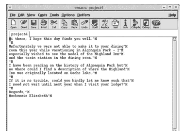

图 4-3 `xemacs` 文本编辑器

尽管 `xemacs` 编辑器可能并非在所有包含 GUI 环境的发行版中都可用，但大多数 Linux 发行版中都有一个源自 UNIX 系统且易于使用的图形化编辑器：**nedit 编辑器**。在 GUI 环境的命令行终端中输入 `nedit project4` 时看到的显示效果示例如图 4-4 所示。


图 4-4 `nedit` 文本编辑器

此外，GNOME 和 KDE GUI 环境现在都自带自己的文本编辑器（`gedit` 编辑器和 `kedit` 编辑器），它们与 `nedit` 相似但提供更多功能。用户在 GUI 环境的命令行终端中输入 `gedit project4` 和 `kedit project4` 时看到的显示效果示例分别如图 4-5 和图 4-6 所示。


图 4-5 `gedit` 文本编辑器


图 4-6 `kedit` 文本编辑器

## 章节总结

- Linux 文件系统采用分层结构，使用一系列目录来存储文件，这些目录和文件的位置可以使用绝对或相对路径名来描述。

- Linux 文件系统中可以存在许多类型的文件，例如文本文件、二进制数据、可执行程序、目录、链接文件和特殊设备文件。

- `ls` 命令可用于查看文件名，并提供广泛选项来修改此视图。

- 通配符元字符可用于在使用常见 Linux 文件命令时简化多个文件的选择。

- 文本文件是最常见的文件类型，其内容可以通过多个实用程序查看，例如 `head`、`tail`、`cat`、`tac`、`more` 和 `less`。

- 正则表达式元字符可用于与某些编程语言和文本工具实用程序（如 `grep`）配合使用，以指定特定的文本模式。

- 尽管存在许多命令行和图形化文本编辑器，`vi`（`vim`）是一个强大的双模文本编辑器，在大多数 UNIX 和 Linux 系统上都是标准配置。

## 关键术语

- **metacharacter**（元字符）— 用于表示用户主目录的元字符。

- **absolute pathname**（绝对路径名）— 从根目录开始指向特定文件或目录的完整路径名。

- **binary data file**（二进制数据文件）— 包含机器语言（二进制 1 和 0）并存储由二进制编译程序使用的信息（如常见功能和图形）的文件。

- **cat command**（`cat` 命令）— 用于在屏幕上显示（或连接）文本文件全部内容的 Linux 命令。

- **cd (change directory) command**（`cd`（更改目录）命令）— 用于在目录树中更改当前目录的 Linux 命令。

- **command mode**（命令模式）— `vi` 中的两种输入模式之一；它允许用户执行任何与向文档插入文本无关的可用文本编辑任务。

- **concatenation**（连接）— 将文本连接在一起以形成一个更大的整体。在 Linux 中，单词和文本字符串被连接在一起以形成显示的文件。

- **directory**（目录）— 文件系统中用于将其他文件组织成逻辑树结构的特殊文件。

- **egrep command**（`egrep` 命令）— `grep` 命令的一个变体，用于使用扩展正则表达式在文件中搜索模式。

- **Emacs (Editor MACroS) editor**（`Emacs`（编辑器宏）编辑器）— 一种流行且广泛使用的文本编辑器，比 `vi` 更适合文字处理；由 Richard Stallman 开发。

- **executable program**（可执行程序）— 可由 Linux 操作系统执行，在内存中作为进程运行并执行有用功能的文件。

- **fgrep command**（`fgrep` 命令）— `grep` 命令的一个变体，不允许使用正则表达式。

- **file command**（`file` 命令）— 用于显示指定文件名的文件类型的 Linux 命令。

- **filename**（文件名）— 赋予文件的用户友好标识符。

- **filename extension**（文件扩展名）— 跟在文件名末尾点（.）后面的一系列标识符，用于表示文件类型；文件扩展名 `.txt` 表示文本文件。

- **gedit editor**（`gedit` 编辑器）— GNOME 桌面的文本编辑器。

- **grep (Global Regular Expression Print) command**（`grep`（全局正则表达式打印）命令）— 使用正则表达式元字符在文件中搜索字符模式的 Linux 命令。

- **head command**（`head` 命令）— 显示文本文件前若干行的 Linux 命令；默认情况下，`head` 命令显示前 10 行。

- **home directory**（主目录）— 文件系统中专供用户存储个人文件和信息的目录。

- **insert mode**（插入模式）— `vi` 中的两种输入模式之一；它允许用户向文档插入文本，但不允许任何其他功能。

- **kedit editor**（`kedit` 编辑器）— KDE 桌面的文本编辑器。

- **less command**（`less` 命令）— 用于在终端屏幕上分页显示文本文件的 Linux 命令；用户可以使用光标键在文件中导航。

- **linked file**（链接文件）— 代表与其他文件相同数据的文件。

- **ll command**（`ll` 命令）— `ls -l` 命令的别名；它提供详细的文件列表。


# 术语表

- `log file`（日志文件）— 包含过去系统事件的文件。

- `ls` 命令 — 用于列出指定目录中文件的 Linux 命令。

- `mcedit` 编辑器（Midnight Commander Editor）— 一个用户友好的终端文本编辑器，支持正则表达式和计算机鼠标。

- `more` 命令 — 用于在终端屏幕上分页逐行显示文本文件的 Linux 命令。

- `named pipe` 文件 — 一个临时连接，将信息从一个内存中的命令或进程发送到另一个命令或进程；它也可以由文件系统上的一个文件来表示。

- `nedit` 编辑器 — 大多数 Linux 发行版中可用的常用图形化文本编辑器。

- `od` 命令 — 用于以八进制格式显示文件内容的 Linux 命令。

- `pwd`（打印当前工作目录）命令 — 用于在目录树中显示当前目录的 Linux 命令。

- 正则表达式（`regex`）— 用于在文本文件中匹配文本模式的特殊元字符；它们常用于许多文本工具命令，如 `grep`。

- 相对路径名 — 目标目录相对于你在目录树中当前目录的路径名。

- 套接字文件 — 连接两台不同计算机上进程的命名管道；它也可以由文件系统中的文件表示。

- 特殊设备文件 — 用于标识硬件设备（如磁盘和串行端口）的文件。

- `strings` 命令 — 用于搜索并显示二进制文件中文本字符的 Linux 命令。

- 子目录 — 位于目录树中另一个目录内部的目录。

- `Tab` 补全功能 — BASH 外壳的一个功能，当用户按下 `Tab` 键时，自动填充唯一文件名或目录名的剩余字符。

- `tac` 命令 — 一个 Linux 命令，从屏幕显示文件的最后一行开始，到文件的第一行结束，从而显示文件内容。

- `tail` 命令 — 用于显示文件中最后特定行数文本的 Linux 命令；默认情况下，`tail` 命令显示文件的最后 10 行。

- 文本文件 — 以可读文本格式存储信息的文件。

- 文本工具 — 允许创建、修改和搜索文本文件的程序。

- `vi` 编辑器 — 一种强大的命令行文本编辑器，在大多数 UNIX 和 Linux 系统上可用。

- 通配符元字符 — 用于匹配文件或目录名称中特定字符的元字符；它们通常用于指定多个文件。

- `xemacs` 编辑器 — Emacs 文本编辑器的图形化版本。

## 复习题

1. 哪个 Linux 命令用于显示当前目录？
   - a. `cd`
   - b. `pwd`
   - c. `~`
   - d. `dir`

2. 哪个文件扩展名用于已编译的对象文件？
   - a. `.o`
   - b. `.so`
   - c. `.Z`
   - d. `.sh`

3. 哪个 `ls` 命令标志用于列出所有文件？
   - a. `-a`
   - b. `-A`
   - c. `-F`
   - d. `-r`

4. 哪个 `vi` 命令切换到插入模式，并将光标置于当前字符之前以输入文本？
   - a. `a`
   - b. `A`
   - c. `i`
   - d. `I`

5. 哪个 Emacs 命令显示文档？
   - a. `Ctrl+a`
   - b. `Ctrl+d`
   - c. `Ctrl+e`
   - d. `Ctrl+h`

6. 对或错？Linux 系统上大多数包含配置信息的文件都是文本文件。

7. 对或错？要查看二进制文件的内容，通常使用创建该文件的程序。

8. 对或错？通配符元字符由文本工具程序解释，而正则表达式由外壳解释。

9. 对或错？虽然 `vi` 编辑器非常容易使用，但它不具有可移植性。

10. 对或错？`mcedit` 编辑器（Midnight Commander Editor）是一个易于使用的文本编辑器，支持正则表达式，并可以使用鼠标高亮文本。

11. BASH 外壳的 `Tab` 补全功能允许你输入目录名的前几个字符，然后按 `Tab` 键让外壳补全该名称。

12. 链接文件之间存在相互关联；它们可以表示相同的数据，或者指向另一个文件。

13. `ls` 命令可用于为特定目录中的每个文件提供长格式列表。

14. `head` 命令在终端屏幕上显示文本文件的前 10 行（包括空行），但也可以接受一个数字选项以指定显示不同的行数。

15. 允许你使用正则表达式搜索信息的最常见的文本工具是 `grep` 命令。

# 第 5 章：Linux 文件系统管理

完成本章后，你将能够：

- 解释文件系统层级标准的功能
- 使用标准 Linux 命令管理文件和目录
- 在文件系统上查找文件和目录
- 理解并创建链接文件
- 修改文件和目录的所有权
- 定义和更改 Linux 文件和目录的权限
- 识别文件和目录上创建的默认权限
- 应用特殊的文件和目录权限

在上一章中，你学习了如何在 Linux 文件系统中导航，以及查看和编辑文件。本章侧重于 Linux 文件系统中文件的组织，以及它们的链接和安全。首先，你使用文件系统层级标准探索标准的 Linux 目录。接下来，你探索用于管理文件和目录的常用命令，接着讨论如何查找文件和目录。最后，你学习描述文件和目录的链接以及文件和目录可用的通用和特殊权限。

## 文件系统层级标准

典型的 Linux 系统上有数千个文件，它们在 Linux 目录树中被逻辑组织到目录中。这种复杂性也使得不同的 Linux 发行版可以将文件放置在不同的位置。因此，在一个陌生的 Linux 系统上寻找常见的配置文件可能会花费大量时间。为了解决这个问题，创建了文件系统层级标准（`FHS`）。

`FHS` 定义了一套标准目录，供所有 Linux 和 UNIX 系统使用，并定义了每个目录的文件和子目录内容。这确保由于文件名和位置遵循标准约定，Red Hat Linux 用户在 SuSE Linux 或惠普 UNIX 计算机上查找正确的配置文件时会非常轻松。`FHS` 还使 Linux 软件开发者能够在任何发行版的 Linux 系统上定位文件，从而允许他们创建非特定发行版的软件。

全面理解 Linux 系统上标准的目录类型，对于定位和管理文件和目录非常有价值；表 5-1 中列出了由 `FHS` 定义的一些标准 UNIX 和 Linux 目录及其描述。这些目录将在本章及后续章节中讨论。


**注意**

> 要阅读完整的文件系统层级标准定义，请访问互联网上的 [http://www.pathname.com/fhs/](http://www.pathname.com/fhs/)

### 表 5-1 由文件系统层级标准定义的 Linux 目录

| 目录 | 描述 |
| :--- | :--- |
| `/bin` | 包含供所有用户使用的二进制命令 |
| `/boot` | 包含 Linux 内核和引导加载程序使用的文件 |
| `/dev` | 包含设备文件 |
| `/etc` | 包含特定于系统的配置文件 |
| `/home` | 是用户主目录的默认位置 |
| `/lib` | 包含共享程序库（供 `/bin` 和 `/sbin` 中的命令使用）以及内核模块 |
| `/mnt` | 是用于访问（挂载）磁盘（如软盘和 CD-ROM）的空目录 |
| `/opt` | 存储额外的软件程序 |
| `/proc` | 包含进程和内核信息 |
| `/root` | 是 `root` 用户的主目录 |
| `/sbin` | 包含系统二进制命令（用于管理） |
| `/tmp` | 保存由程序创建的临时文件 |
| `/usr` | 包含大多数系统命令和实用程序——包含以下目录：<br>`/usr/bin`—用户二进制命令<br>`/usr/games`—教育程序和游戏<br>`/usr/include`—C 程序头文件<br>`/usr/lib`—库<br>`/usr/local`—本地程序<br>`/usr/sbin`—系统二进制命令<br>`/usr/share`—与架构无关的文件<br>`/usr/src`—源代码<br>`/usr/X11R6`—X 窗口系统 |
| `/usr/local` | 是大多数额外程序的位置 |
| `/var` | 包含日志文件和 spool（邮件队列） |

## 管理文件和目录

如前所述，使用 Linux 系统需要在多个目录之间导航并操作其中的文件。因此，高效的 Linux 用户必须了解如何按需创建目录、将文件或目录从一个位置复制或移动到另一个位置，以及删除文件和目录。这些任务通常被称为文件管理任务。

以下是在用户以 `root` 用户身份登录时目录列表的示例：


```
[root@server1 root]# pwd
/root

[root@server1 root]# ls -F
current@  myprogram*  project  project12  project2  project4
Desktop/  myscript  project1  project13  project3  project5
[root@server1 root]#
```

如上所示的输出中，只有一个目录（`Desktop`）、两个可执行文件（`myprogram` 和 `myscript`）以及几个项目相关文件（`project*`）存在。虽然这种目录结构并不杂乱，且在终端屏幕上以易于阅读的格式显示，但 `Linux` 系统上的典型主目录包含更多的文件；典型的 `Linux` 用户在其主目录中可能有超过 100 个文件。因此，根据文件用途将这些文件组织到子目录中是一个良好的实践。由于前面的输出中 `root` 用户的主目录下有几个项目文件，你可以创建一个名为 `proj_files` 的子目录来存放项目相关文件，从而减少目录列表的大小。为此，你需要使用 `mkdir`（创建目录）命令，该命令接受指定要创建的目录的绝对或相对路径名的参数。要在当前目录下方创建 `proj_files` 目录，你可以使用带有相对路径名的 `mkdir` 命令：

```
[root@server1 root]# mkdir proj_files
[root@server1 root]# ls -F
current@  myprogram*  project  project12  project2  project4  proj_files/
Desktop/  myscript*  project1  project13  project3  project5
[root@server1 root]#
```

现在，你可以使用 `mv`（移动）命令 将项目文件移动到 `proj_files` 子目录中。`mv` 命令至少需要两个参数：`源文件/目录` 和 `目标文件/目录`。如果需要移动多个文件，只需指定多个源参数；最后一个参数将成为目标目录。源和目的地都可以是绝对或相对路径名，如果移动多个文件，源还可以包含通配符。例如，要将所有项目文件移动到 `proj_files` 目录，你可以输入 `mv` 命令，源参数为 `project*`（以匹配所有以“`project`”开头的文件），目标参数为 `proj_files`（指向目标目录的相对路径名），如下面的输出所示：

```
[root@server1 root]# mv project* proj_files
[root@server1 root]# ls -F
current@  Desktop/  myprogram*  myscript*  proj_files/
[root@server1 root]# ls -F proj_files
project project1 project12 project13 project2 project3 project4 project5
[root@server1 root]#
```

在上面的输出中，当前目录列表不再显示项目文件，而 `proj_files` 子目录的列表表明它们已成功移动。

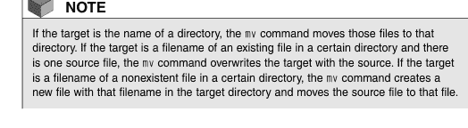

如果目标是目录的名称，`mv` 命令会将这些文件移动到该目录。如果目标是某个目录中现有文件的文件名，且只有一个源文件，则 `mv` 命令会用源文件覆盖目标文件。如果目标是某个目录中不存在的文件的文件名，则 `mv` 命令会在目标目录中创建一个具有该文件名的新文件，并将源文件移动到该文件。

`mv` 命令的另一个重要用途是重命名文件，这仅仅是将文件移动到同一目录但使用不同的文件名。要将前面示例中的 `myscript` 文件重命名为 `myscript2`，你可以使用以下 `mv` 命令：

```
[root@server1 root]# ls -F
current@ Desktop/ myprogram* myscript* proj_files/
[root@server1 root]# mv myscript myscript2
[root@server1 root]# ls -F
current@ Desktop/ myprogram* myscript2* proj_files/
[root@server1 root]#
```

类似地，`mv` 命令也可以重命名目录。如果源是现有目录的名称，它将被重命名为指定为目标的那个目录名称。

`mv` 命令的工作方式类似于“剪切和粘贴”操作，即文件被复制到新目录并从源目录中删除。然而，有时需要保留源目录中的文件；这被称为复制文件，可以使用 `cp`（复制）命令来完成。与 `mv` 命令类似，`cp` 命令至少需要两个参数。第一个参数指定要复制的源文件/目录，第二个参数指定目标文件/目录。如果需要将多个文件复制到目标目录，只需指定多个源参数，命令行的最后一个参数将成为目标目录。每个参数都可以是绝对或相对路径名，并且可以包含通配符或特殊元字符“`.`”（表示当前目录）和“`..`”（表示父目录）。例如，要在当前目录（`/root`）中复制 `/etc/hosts` 文件的副本，你可以指定 `/etc/hosts` 文件的绝对路径名（`/etc/hosts`）以及指示当前目录的相对路径名（`.`）：

```
[root@server1 root]# cp /etc/hosts .
[root@server1 root]# ls -F
current@ Desktop/ hosts myprogram* myscript2* proj_files/
[root@server1 root]#
```

你也可以在相同目录中创建文件的副本。要在当前目录中创建名为 `hosts2` 的 `hosts` 文件的副本，请键入以下命令：

```
[root@server1 root]# cp hosts hosts2
[root@server1 root]# ls -F
current/  Desktop/  hosts  hosts2  myprogram*  myscript2*  proj_files/
[root@server1 root]#
```

除了用途之外，`mv` 和 `cp` 命令之间的一个显著区别在于它们对目录的处理方式不同。`mv` 命令只是重命名目录，而 `cp` 命令会创建目录及其内容的完整新副本。要在 `Linux` 中复制整个充满文件的目录，你必须告诉 `cp` 命令该复制将是递归的（涉及文件和子目录），方法是使用 `-r` 选项。以下示例演示了复制 `proj_files` 目录及其所有内容到 `/home/user1` 目录，分别使用和不使用 `-r` 选项：

```
[root@server1 root]# ls -F
current/  Desktop/  hosts  myprogram*  myscript2*  proj_files/
[root@server1 root]# ls -F /home/user1
Desktop/
[root@server1 root]# cp proj_files /home/user1
cp: omitting directory `proj_files'
[root@server1 root]# ls -F /home/user1
Desktop/
[root@server1 root]# cp -r proj_files /home/user1
[root@server1 root]# ls -F /home/user1
Desktop/  proj_files/
[root@server1 root]#
```

在复制或移动文件时，如果目标是一个存在的文件，`mv` 和 `cp` 命令会警告用户目标文件将被覆盖，并询问是否继续。这不是命令通常调用时的功能，而是 `Red Hat Linux` 中默认配置的功能，因为 `Red Hat Linux` 中的 `BASH` shell 包含了指向 `cp` 和 `mv` 命令的别名。

> **注意**
>
> 别名是内存中指向命令的特殊变量；关于它们的完整讨论请参见第 8 章，“使用 `BASH` Shell”。

当你键入 `mv` 时，实际上运行的是带有 `-i` 选项的 `mv` 命令，该选项交互式地提示用户选择如果目标文件在执行命令时已经存在，是否要覆盖现有文件；这被称为交互模式。类似地，当你键入 `cp` 命令时，运行的是 `cp -i` 命令，以执行相同的功能。要查看当前 shell 中存在的别名，只需键入 `alias`，如下面的输出所示：


```
[root@server1 root]# alias
alias cp='cp -i'
alias l='\ls -d . --color=tty'
alias ll='\ls -l --color=tty'
alias ls='\ls --color=tty'
alias mc='../usr/share/mc/bin/mc-wrapper.sh'
alias mv='mv -i'
alias rm='rm -i'
alias vi='vim'
alias which='alias | /usr/bin/which --tty-only --read-alias --show-dot --show-tilde'
[root@server1 root]#
```

如果你想覆盖这种交互式选项，可以使用`-f`（强制）选项来覆盖选择，如下面的示例中`root`用户尝试将`hosts`文件重命名为已存在的`hosts2`文件，分别使用和不使用`mv`命令的`-f`选项：

```
[root@server1 root]# ls -F
current@  Desktop/  hosts  hosts2  myprogram*  myscript2*  proj_files/
[root@server1 root]# mv hosts hosts2
mv: overwrite 'hosts2'? n
[root@server1 root]# mv -f hosts hosts2
[root@server1 root]# ls -F
current@  Desktop/  hosts2  myprogram*  myscript2*  proj_files/
[root@server1 root]#
```

创建目录、复制和移动文件是保留或创建硬盘数据的管理文件任务。要删除文件或目录，你必须使用`rm`命令或`rmdir`命令。

`rm`（删除）命令接受一个指定要删除的文件的绝对或相对路径名参数的列表。与大多数命令一样，可以使用通配符来简化指定要删除的多个文件。文件从文件系统删除后，无法恢复。因此，`rm`命令在`Red Hat Linux`中被别名为带有`-i`选项的`rm`命令，该选项交互式地提示用户选择是否继续删除。与`cp`和`mv`命令类似，`rm`命令也接受`-f`选项来覆盖此选择并立即删除文件。下面是一个示例，演示了使用`rm`和`rm -f`命令删除`current`和`hosts2`文件：

```
[root@server1 root]# ls -F
current@  Desktop/  hosts2  myprogram*  myscript2*  proj_files/
[root@server1 root]# rm current
rm: remove 'current'? y
```

### 删除文件和目录

```bash
[root@server1 root]# rm -f hosts2
[root@server1 root]# ls -F
Desktop/  myprogram*  myscript2*  proj_files/
[root@server1 root]_
```

要删除目录，可以使用`rmdir`命令；但是，`rmdir`（remove directory）命令只有在目录不包含任何文件时才会将其删除。若要删除目录及其内部的文件，必须使用`rm`命令并指定要删除的是一个包含文件的目录（`-r`）。正如之前所述，在使用`cp`命令复制目录时，需要使用递归选项（`-r`）；同样，若要删除一个装满文件的目录，也可以使用`rm`命令的递归选项（`-r`）。例如，如果`root`用户希望删除`proj_files`子目录及其内部的所有文件，且不希望系统提示确认每个文件的删除，则她必须使用`rm -rf proj_files`命令，如下例所示：

```bash
[root@server1 root]# ls -F
Desktop/  myprogram*  myscript2*  proj_files/
[root@server1 root]# rmdir proj_files
rmdir: `proj_files': Directory not empty
[root@server1 root]# rm -rf proj_files
[root@server1 root]# ls -F
Desktop/  myprogram*  myscript2*
[root@server1 root]_
```

> **提示**
>
> 在大多数命令中，例如`rm`和`cp`，`-r`和`-R`选项的含义相同（递归）。
>
> **注意**
>
> 如果对要递归删除的目录中实际存在哪些文件不确定，`rm`命令的`-r`选项非常危险。因此，`rm`命令的`-r`选项常被称为`-resumé`选项；如果你误用该选项，可能需要准备你的简历了。

需要注意的是，前述的文件管理命令被 Linux 用户、开发人员和系统管理员普遍使用。表 5-2 总结了这些常见的文件管理命令。

表 5-2 常见的 Linux 文件管理命令

| 命令 | 描述 |
| :--- | :--- |
| `mkdir` | 创建目录 |
| `rmdir` | 删除空目录 |
| `mv` | 移动/重命名文件和目录 |
| `cp` | 复制文件和包含大量文件的目录（配合`-r`选项） |
| `alias` | 显示 `BASH` shell 别名 |
| `rm` | 删除文件和包含大量文件的目录（配合`-r`选项） |

### 查找文件

在使用前一节提到的文件管理命令之前，必须知道所涉及文件的位置。在 Linux 目录树中查找文件最快的方法是使用`locate`命令，它是`slocate`（或 `secure locate`）命令的快捷方式。例如，要查看根目录下所有文件名中包含单词“initab”（作为完整名称或一部分）的文件，只需在命令提示符下输入`locate initab`，其输出如下：

```bash
[root@server1 root]# locate initab
/usr/share/terminfo/a/ansi+initab
/usr/share/vim/vim62/syntax/initab.vim
/usr/share/man/ja/man5/initab.5.gz
/usr/share/man/pl/man5/initab.5.gz
/usr/share/man/it/man5/initab.5.gz
/usr/share/man/man5/initab.5.gz
/usr/share/man/fr/man5/initab.5.gz
/usr/share/man/ko/man5/initab.5.gz
/etc/initab
[root@server1 root]# _
```

通常情况下，`locate`命令返回的信息量过大，无法在屏幕上完全显示，因为它搜索的是文件系统上的所有文件。通常，可以使用`more`（或`less`）命令来暂停输出，例如`locate initab | more`，或者确保被搜索的单词非常具体。`locate`命令在一个预制的数据库中查找，该数据库包含系统上所有文件的列表。这个数据库的索引方式类似于教科书，以便于快速搜索，但随着文件的添加和移除（这是经常发生的情况），数据库可能会变得过时。因此，`locate`命令使用的数据库（`/var/lib/locate/locate.db`）每天会自动更新，也可以在命令提示符下通过运行`updatedb`或`slocate -u`命令手动更新。

一种较慢但更通用的文件定位方法是在文件系统上使用`find`命令。`find`命令不使用预制的文件索引，而是从特定目录开始，递归搜索目录树以找到满足特定条件的文件。`find`命令的格式如下：

```text
find <起始目录> -条件 <要查找的内容>
```

例如，要在`/etc`目录下方查找名为"inittab"的任何文件，可以使用命令`find /etc -name inittab`，输出如下：

```bash
[root@server1 root]# find /etc -name inittab
/etc/inittab
[root@server1 root]# _
```

也可以将通配符元字符与`find`命令一起使用；但是，这些通配符必须受到保护，以免被 shell 解释，因为它们只能由`find`命令解释。为此，确保任何通配符元字符都包含在引号字符内。以下是使用`find`命令配合通配符元字符查找`/etc`目录下所有以"host"开头的文件的示例输出：


```bash
[root@server1 root]# find /etc -name "host*"
/etc/hosts.deny
/etc/hosts.canna
/etc/log/scripts/shared/hostlist
/etc/ups/hosts.conf
/etc/hosts.allow
/etc/host.conf
/etc/hosts
[root@server1 root]# _
```

虽然按名称搜索是 `find` 命令最常用的条件，但还可以使用许多其他条件。要查找从 `/var` 目录开始、大小超过 4096K（千字节）的所有文件，可以使用以下命令：

```bash
[root@server1 root]# find /var -size +4096k
/var/log/lastlog
/var/lib/rpm/Packages
/var/lib/rpm/Filemacs
/var/lib/rpm/Basenames
/var/lib/canna/dic/canna.zipcode.ctd
/var/lib/imap/db/_db.004
/var/lib/slocate/slocate.db
[root@server1 root]# _
```

此外，如果只想查找 `/mnt` 目录下的所有目录，可以输入以下命令：

```bash
[root@server1 dev]# find /mnt -type d
/mnt
/mnt/floppy
/mnt/cdrom
[root@server1 root]# _
```

表 5-3 列出了与 `find` 命令配合使用的一些常见条件。

表 5-3 与 `find` 命令配合使用的常见条件

| 条件 | 描述 |
| :--- | :--- |
| `-amin -x` | 搜索 x 分钟前访问过的文件 |
| `-amin +x` | 搜索超过 x 分钟前访问过的文件 |
| `-atime -x` | 搜索 x 天前访问过的文件 |
| `-atime +x` | 搜索超过 x 天前访问过的文件 |
| `-empty` | 搜索空文件或目录 |
| `-fstype x` | 搜索位于特定文件系统 x 上的文件（x 可以是 ext2、ext3 等） |
| `-group x` | 搜索由特定组或 GID (x) 拥有的文件 |
| `-inum x` | 搜索 inode 编号为 x 的文件 |
| `-mmin -x` | 搜索 x 分钟内修改过的文件 |
| `-mmin +x` | 搜索超过 x 分钟内修改过的文件 |
| `-mtime -x` | 搜索 x 天内修改过的文件 |
| `-mtime +x` | 搜索超过 x 天内修改过的文件 |
| `-name x` | 搜索特定文件名 x（x 可以包含通配符） |
| `-regex x` | 使用正则表达式而不是通配符元字符搜索特定文件名 |
| `-size -x` | 搜索大小小于 x 的文件 |
| `-size x` | 搜索大小等于 x 的文件 |
| `-size +x` | 搜索大小大于 x 的文件 |
| `-type x` | 搜索类型为 x 的文件，其中 x 可以是： |
| - | `b` 表示块文件 |
| - | `c` 表示字符文件 |
| - | `d` 表示目录文件 |
| - | `p` 表示命名管道 |
| - | `f` 表示常规文件 |
| - | `l` 表示符号链接（快捷方式） |
| - | `s` 表示套接字 |
| `-user x` | 搜索由特定用户或 UID (x) 拥有的文件 |

虽然 `find` 命令可以根据许多条件搜索文件，但如果被搜索的目录和文件数量很大，完成搜索可能需要几分钟。为了减少搜索所需的时间，尽可能通过指定子目录来缩小搜索范围。与搜索 `/usr` 目录及其所有子目录相比，搜索 `/usr/local/bin` 目录及其子目录所需的时间更短。此外，如果要查找的文件名是可执行文件，那么通常可以使用 `which` 命令更快地找到它。`which` 命令只搜索当前 BASH shell 中名为 `PATH` 变量的特殊变量中列出的目录。在探讨 `which` 命令之前，必须理解 `PATH` 的用法。

可执行文件可以存储在目录树中分散的各个目录中。回顾 FHS 可知，大多数可执行文件存储在名为 `bin` 或 `sbin` 的目录中，但在典型的 Red Hat Linux 安装完成后，目录树中散落着 20 多个 `bin` 和 `sbin` 目录。为了确保用户在执行 `ls` 这样的命令（即可执行文件 `/bin/ls`）时无需指定完整的路径名，存在一个名为 `PATH` 的特殊变量，每当用户登录到 Linux 系统时，该变量会被放入内存中。回顾一下，可以使用 `$` 元字符配合 `echo` 命令来查看内存中某个变量的内容：

```bash
[root@server1 root]# echo $PATH
/usr/kerberos/sbin:/usr/kerberos/bin:/usr/local/sbin:/usr/local/bin:/sbin:/bin:/usr/sbin:/usr/bin:/usr/X11R6/bin:/root/bin
[root@server1 root]# _
```

`PATH` 变量列出了当在命令行执行命令时未指定相对路径或绝对路径的情况下，用于搜索可执行文件的目录。在上面的输出中，当用户在命令行输入 `ls` 命令并按下 Enter 键时，系统会识别出该命令既不是绝对路径名（例如，`/bin/ls`）也不是相对路径名（例如，`../bin/ls`），然后开始在 `/usr/kerberos/sbin` 目录中查找 `ls` 可执行文件，接着在 `/usr/kerberos/bin` 目录中查找，然后是 `/usr/local/sbin` 目录等。如果搜索了 `PATH` 变量中的所有目录但未找到 `ls` 命令，shell 会向用户显示一条错误消息，说明未找到该命令。在上面的输出中，`/bin` 目录包含在 `PATH` 变量中，因此找到了并执行了 `ls` 命令，但在此之前必须先搜索 `PATH` 变量中位于其之前的其他目录。

要在 `PATH` 变量中搜索名为“grep”的文件，你可以将“grep”作为 `which` 命令的参数，并收到以下输出：

```bash
[root@server1 sbin]$ which grep
/bin/grep
[root@server1 root]$ _
```

如果被搜索的文件不存在于 `PATH` 变量指定的目录中，`which` 命令会告知你该文件在哪些目录中未被找到，如下面的输出所示：

```bash
[root@server1 sbin]$ which grepper
/usr/bin/which: no grepper in (/usr/kerberos/sbin:/usr/kerberos/bin:/usr/local/sbin:/usr/local/bin:/sbin:/bin:/usr/sbin:/usr/bin:/usr/X11R6/bin:/root/bin)
[root@server1 root]$ _
```

### 链接文件

回想一下，文件之间可以建立链接。这种链接可以通过两种方式实现：一个文件可能只是指向另一个文件的指针或快捷方式（称为**符号链接**或**软链接**），或者两个文件可能共享相同的数据（称为**硬链接**）。

为了更好地理解文件是如何链接的，你必须了解文件在文件系统上的存储方式。在结构层面，文件系统有三个主要部分：

-   超级块
-   inode 表
-   数据块

超级块是包含文件系统总体信息的部分，例如 inode 和数据块的数量，以及每个数据块存储多少千字节的数据。inode 表由多个 inode（信息节点）组成；每个 inode 描述文件系统上的一个文件或目录，并包含一个唯一的 inode 编号用于识别。更重要的是，inode 存储了文件的大小、数据块位置、最后修改日期、权限和所有权等信息。当文件被删除时，只有其 inode（作为指向实际数据的指针）被删除。构成文件内容的实际数据以及文件名存储在数据块中，这些数据块由 inode 引用。在文件系统通用的术语中，数据块被称为分配单元，因为它们是按此单位分配磁盘存储空间以进行存储的。

#### 注意

每个文件和目录都必须拥有一个 inode。除了特殊设备文件外，所有文件还都有一个与 inode 相关联的数据块。特殊设备文件在第 6 章“Linux 文件系统管理”中讨论。

目录只是用于组织其他文件的文件；它们也有 inode 和数据块，但其数据块包含的是位于该目录内的文件名列表明。

硬链接文件是彼此直接副本，因为它们共享相同的 inode 和 inode 编号。所有硬链接文件具有相同的大小，当其中一个文件被修改时，其他硬链接文件也会随之更新。这种硬链接文件之间的关系可以在图 5-1 中看出。你可以无限制地为一个文件创建硬链接；但是，硬链接文件必须位于同一文件系统上。这是因为 inode 编号仅在相同文件系统中才是唯一的，而硬链接机制通过忽略这一规则来识别链接。


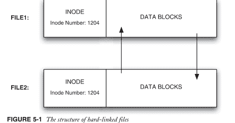

**图 5-1** 硬链接文件的结构

要创建硬链接，你必须使用 `ln` 命令并指定两个参数：要创建硬链接的现有文件以及将作为现有文件的硬链接创建的目标文件。每个参数可以是文件的绝对路径或相对路径。以根用户主目录中的以下内容为例：

```bash
[root@server1 root]$ ls -l
total 520
drwx------ 3 root root 4096 Apr 8 07:12 Desktop
-rw-r--xr-x 1 root root 519964 Apr 7 09:59 file1
-rw-rxr-x 1 root root 1244 Apr 27 18:17 file3
```

如果你想像图 5-1 中那样创建一个名为 `file2` 且指向 `file1` 的硬链接，你可以在命令提示符下输入命令 `ln file1 file2`；这将创建一个名为 `file2` 的文件，并使其硬链接到 `file1`。创建后，你可以使用 `ls -l` 命令查看硬链接的文件名：

```
[root@server1 root]# ln file1 file2
[root@server1 root]# ls -l
total 1032
drw-------   3 root root  4096 Apr 8 07:12 Desktop
-rw-r--r-x   2 root root 519964 Apr 7 09:59 file1
-rw-r--r-x   2 root root 519964 Apr 7 09:59 file2
-rw-r--r-x   1 root root  1244 Apr 27 18:17 file3 [root@server1 root]# _
```

从上述长格式列表中可以看出，`file1` 和 `file2` 共享相同的 inode，因为它们具有相同的大小、权限、所有权、修改日期等。另外请注意，在上述输出中，`file1` 的链接计数（权限集后面的数字）已从数字 `1` 增加到了数字 `2`。链接计数为 `1` 表示只有一个 inode 与该文件共享。硬链接到另一个文件的文件共享两个 inode，因此其链接计数为 `2`。类似地，硬链接到另外三个文件的文件共享四个 inode，因此其链接计数为 `4`。

尽管硬链接共享相同的 inode，但删除一个硬链接文件并不会删除其他所有硬链接文件。通过移除其中一个文件，可以降低链接计数，从而解除一个硬链接。

要查看硬链接文件的 inode 编号以验证它们是否相同，你可以使用 `ls` 命令的 `-i` 选项，并可结合其他任意选项。inode 编号位于目录列表中每行的左侧，如下面的输出所示：

```
[root@server1 root]# ls -li
total 1032
37595 drw-------   3 root root  4096 Apr 8 07:12 Desktop
 1204 -rw-r--r-x   2 root root 519964 Apr 7 09:59 file1
 1204 -rw-r--r-x   2 root root 519964 Apr 7 09:59 file2
17440 -rw-r--r-x   1 root root  1244 Apr 27 18:17 file3 [root@server1 root]# _
```


#### 注意

目录文件通常不进行硬链接，因为结果将是包含相同内容的两个目录。然而，root 用户在某些情况下可以使用 `ln` 命令的 `-f` 或 `-d` 选项对目录进行硬链接。通常只对需要经常添加文件并保持相同文件内容的目录进行硬链接。

符号链接（如图 5-2 所示）与硬链接不同，因为它们不与目标文件共享相同的 inode 和 inode 编号；一个是另一个的指针，因此两个文件具有不同的大小。符号链接文件中的数据块仅包含指向目标文件的路径名。当用户编辑符号链接文件时，实际上是在编辑目标文件。因此，如果目标文件被删除，符号链接将不起作用，因为它指向一个不存在的文件。

#### 注意

符号链接有时被称为“软链接”或“symlinks”。

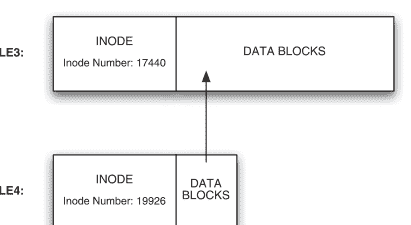

**图 5-2** 符号链接文件的结构

要创建符号链接，你使用 `ln` 命令的 `-s` 选项。要像图 5-2 中那样创建一个名为 `file4` 且指向 `file3` 的符号链接，你可以在命令提示符下输入 `ln -s file3 file4`。与硬链接一样，指定的参数可以是绝对路径名或相对路径名。创建后，你可以使用 `ls -l` 命令查看符号链接的文件名，如下面的示例所示：

```
[root@server1 root]# ln -s file3 file4
[root@server1 root]# ls -l
total 1032
drwx------   3 root     root       4096 Apr 8 07:12 Desktop
-rwxr-xr-x    2 root     root      519964 Apr  7 09:59 file1
-rwxr-xr-x    2 root     root      519964 Apr  7 09:59 file2
-rwxr-xr-x    1 root     root        1244 Apr 27 18:17 file3
lrwxrwxrwx   1 root     root           5 Apr 27 19:05 file4 -> file3 [root@server1 root]# _
```

# **文件和目录权限**

第 5 章 | 175

从前面的输出中可以看出，`file4` 与 `file3` 不共享相同的 inode，因为它的权限、大小和修改日期与 `file3` 不同。此外，符号链接比硬链接更容易识别；文件类型字符（位于权限之前）为 `l`，表示这是一个符号链接，并且文件名通过箭头指向目标。`ls -F` 命令也会通过在末尾添加 `@` 符号来指示符号链接，如下面的输出所示：

```bash
[root@server1 root]# ls -F
Desktop/  file1*  file2@  file3*  file4@
[root@server1 root]#
```

硬链接和符号链接之间的另一个区别在于，符号链接不必与目标位于同一个文件系统上。相反，它们指向目标文件名，并且不需要相同的 inode，如下面的输出所示：

```bash
[root@server1 root]# ls -li
total 1032
37595 drwx------   3 root  root      4096 Apr  8 09:12 Desktop
  1204 -rwxr-xr-x   2 root  root      519964 Apr  7 09:59 file1
  1204 -rwxr-xr-x   2 root  root      519964 Apr  7 09:59 file2
 17440 -rwxr-xr-x   1 root  root       1244 Apr 27 18:17 file3
 19926 lrwxrwxrwx   1 root  root         5 Apr 27 19:05 file4 -> file3
[root@server1 root]#
```


### **注意**

与硬链接不同，符号链接通常用于指向目录，以简化文件系统树的导航。此外，指向目录的符号链接通常用于维护与其他 UNIX 和 Linux 系统的兼容性。在 Red Hat Fedora Linux 中，出于此原因，`/etc/init.d` 目录符号链接到 `/etc/rc.d/init.d` 目录，`/usr/tmp` 目录符号链接到 `/var/tmp` 目录。

### 文件和目录权限

回想一下，所有用户必须使用用户名和密码成功登录才能访问 Linux 系统。登录后，用户通过其用户名和组成员身份进行标识；对所有资源的访问取决于其用户名和组成员身份是否具有所需的权限。因此，要安全地运行 Linux 系统并防止未经授权的用户访问敏感文件、目录和命令，必须牢固理解所有权和权限。

### 文件和目录所有权

当用户创建文件或目录时，该用户的名称和**主组**分别成为该文件的拥有者和组拥有者。这会影响权限结构，正如你在下一节中看到的那样；但它也决定了谁有权修改文件和目录的权限及所有权。文件或目录的拥有者和 root 用户是 Linux 系统中仅有的两个可以修改文件或目录权限或更改其所有权的用户。

要查看当前的用户名，可以使用 `whoami` 命令。要查看组成员身份和主组，可以使用 `groups` 命令。作为 root 用户登录时，这两个命令的示例输出如下：


```bash
[root@server1 root]# whoami
root

[root@server1 root]# groups
root bin daemon sys adm disk wheel

[root@server1 root]#
```

从上述输出中可以看出，`root` 用户是七个组的成员，但 `root` 用户的主组也被称为“root”，因为它是 `groups` 命令输出中提到的第一个组。如果该用户创建一个文件，拥有者是“root”，组拥有者也是“root”。要快速创建一个空文件，可以使用 `touch` 命令：

```bash
[root@server1 root]# touch file1
[root@server1 root]# ls -l
total 4
drwx------   3 root   root    4096 Apr 8 07:12 Desktop
-rw-r--r--   1 root   root      0 Apr 29 15:40 file1
[root@server1 root]#
```

从上述输出中可以看出，`file1` 的拥有者是“root”，组拥有者是 `root` 组。要更改文件或目录的所有权，可以使用 `chown`（更改所有者）命令，该命令至少需要两个参数：新的所有者以及要更改的文件或目录。这两个参数都可以是绝对路径或相对路径名，你还可以使用 `chown` 命令的 `-R` 选项在目录树中递归地更改权限。要将 `file1` 的所有权更改为用户 `user1`，并将目录 `Desktop` 及其所有内容的所有权也更改为 `user1`，可以输入以下命令：

```bash
[root@server1 root]# chown user1 file1
[root@server1 root]# chown -R user1 Desktop
[root@server1 root]# ls -l
total 4
drwx------   3 user1  root   4096 Apr 8 07:12 Desktop
-rw-r--r--   1 user1  root     0 Apr 29 15:40 file1
[root@server1 root]# ls -l Desktop
total 16
-rw-------   1 user1  root   163 Mar 29 09:58 Floppy
-rw-r--r--   1 user1  root   3578 Mar 29 09:58 Home
-rw-r--r--   1 user1  root   1791 Mar 29 09:58 Start Here
drwx------   2 user1  root   4096 Mar 29 09:58 Trash
[root@server1 root]#
```

回想一下，文件或目录的拥有者和 `root` 用户具有更改特定文件或目录所有权的能力。如果普通用户更改了他所拥有的文件或目录的所有权，则该用户无法重新获得所有权。相反，该文件或目录的新拥有者必须将其更改回原始用户。然而，前面的示例涉及 `root` 用户，`root` 用户始终具有重新获得所有权的能力：

```bash
[root@server1 root]# chown root file1
[root@server1 root]# chown -R root Desktop
[root@server1 root]# ls -l
total 4
drwx------   3 root     root      4096 Apr  8 07:12 Desktop
-rw-r--r--   1 root     root         0 Apr 29 15:40 file1
[root@server1 root]# ls -l Desktop
total 16
-rw-r-----   1 root     root      163 Mar 29 09:58 Floppy
-rw-r--r--   1 root     root      3578 Mar 29 09:58 Home
-rw-r--r--   1 root     root      1791 Mar 29 09:58 Start Here
drwx------   2 root     root      4096 Mar 29 09:58 Trash
[root@server1 root]#
```

正如可以使用 `chown`（更改所有者）命令来更改文件或目录的所有者一样，你可以使用 `chgrp`（更改组）命令来更改文件或目录的组所有者。`chgrp` 命令至少需要两个参数：新的组所有者以及要更改的文件或目录。与 `chown` 命令一样，`chgrp` 命令也接受 `-R` 选项，以在目录树中递归地更改组所有权。要将 `file1` 和 `Desktop` 目录的组所有者在整个目录树中递归更改，可以执行以下命令：

```bash
[root@server1 root]# chgrp sys file1
[root@server1 root]# chgrp -R sys Desktop
[root@server1 root]# ls -l
total 4
drwx------   3 root     sys       4096 Apr  8 07:12 Desktop
-rw-r--r--   1 root     sys          0 Apr 29 15:40 file1
[root@server1 root]# ls -l Desktop
total 16
-rw-r-----   1 root     sys        163 Mar 29 09:58 Floppy
-rw-r--r--   1 root     sys        3578 Mar 29 09:58 Home
-rw-r--r--   1 root     sys        1791 Mar 29 09:58 Start Here
drwx------   2 root     sys        4096 Mar 29 09:58 Trash
[root@server1 root]#
```

### 注意

普通用户只能将文件或目录的组更改为他们所属的组。

通常，当文件需要由其他人维护时，你会同时更改文件的所有权和组所有权。因此，你可以使用 `chown` 命令同时更改所有者和组所有者。要将 `file1` 和目录 `Desktop` 的所有者更改为 `user1`，并将组所有者更改为 `root`（在整个目录树中递归进行），可以输入以下命令：

```bash
[root@server1 root]# chown user1.root file1
[root@server1 root]# chown -R user1.root Desktop
[root@server1 root]# ls -l
total 4
drw-------    3 user1    root      4096 Apr  8 07:12 Desktop
-rw-r--r--    1 user1    root          0 Apr 29 15:40 file1

[root@server1 root]# ls -l Desktop
total 16
-rw-------    1 user1    root       163 Mar 29 09:58 Floppy
-rw-r--r--    1 user1    root      3578 Mar 29 09:58 Home
-rw-r--r--    1 user1    root      1791 Mar 29 09:58 Start Here
drw-------    2 user1    root      4096 Mar 29 09:58 Trash

[root@server1 root]#
```

请注意，在前面的输出所示的 `chown` 命令中，`.` 字符前后必须没有空格。

### 注意

你也可以在 `chown` 命令中使用 `:` 字符代替 `.` 字符来同时更改所有者和组所有权（例如，`chown -R user1:root Desktop`）。

位于用户主目录中的大多数文件应属于该用户，以确保良好的安全性；用户主目录中的某些文件（特别是隐藏文件和目录）需要这样做才能正常工作。为了避免将来出现问题，可以将 `file1` 和 `Desktop` 目录的所有权更改回 `root` 用户，可以输入以下内容：

```bash
[root@server1 root]# chown root.root file1
[root@server1 root]# chown -R root.root Desktop
[root@server1 root]# ls -l
total 4
drwx------      3 root      root      4096 Apr 8 07:12 Desktop

-rw-r--r--      1 root      root        0 Apr 29 15:40 file1 

[root@server1 root]# ls -l Desktop
```


### 管理文件和目录权限

Linux 文件系统上的每个文件和目录文件的 inode 中都包含有关权限的信息。inode 中存储权限的部分称为文件的 `mode`（模式），并根据获得该文件或目录权限的用户类型分为三部分：

- 用户（所有者）权限
- 组（组所有者）权限
- 其他（Linux 系统上的所有人）权限

此外，你可以为每个这些用户/组分配三种常规权限：

- 读取
- 写入
- 执行

### 解读模式

请记住，当你执行 `ls -l` 命令时，会看到模式的三个部分以及你可以为每个部分分配的权限；其详细展示如图 5-3 所示。重要的是要注意，`root` 用户超越了所有文件和目录权限；换句话说，无论文件或目录的模式如何指示，`root` 用户都拥有对每个文件和目录的所有权限。

考虑以下示例中显示的 `root` 用户主目录列表：

```
[root@server1 root]# ls -l
total 28
drwx------     3 root     root      4096 Apr 8 07:12 Desktop
-rF---W---X     1 root     root       282 Apr 29 22:06 file1
-------RWX      1 root     root       282 Apr 29 22:06 file2
-rwxrwxrwx      1 root     root       282 Apr 29 22:06 file3
----------      1 root     root       282 Apr 29 22:06 file4
-rw-r--r--      1 root     root       282 Apr 29 22:06 file5
-rw-f--r--      1 user1    sys        282 Apr 29 22:06 file6 
[root@server1 root]# 
```

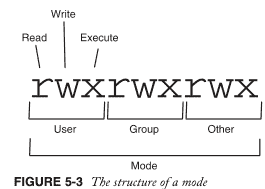

从上述输出中注意，并非所有权限（如图 5-3 所示）都必须存在于文件或目录上；如果权限不可用，一个破折号字符（`-`）将取代其在模式中的位置。务必不要将模式左侧的字符（决定文件类型）与模式本身混淆，因为它与文件或目录上的权限无关。从上述输出中可以看到，`Desktop` 目录赋予该目录的 `user`（用户）或 `owner`（所有者）（即 `root` 用户）读、写和执行权限，然而 `group`（组）（即 `root` 组）的成员并未获得对该目录的任何权限。请注意，`other`（其他人）（系统中的所有人）也未获得此目录的权限。

权限是累加的；`root` 用户也是 `root` 组的成员，并且始终属于“其他”类别，因此 `root` 用户获得所有三个用户类别可用的权限。在上述示例中，这意味着 `root` 用户对 `Desktop` 目录拥有读、写和执行权限。

同理，前次输出中名为 `file1` 的文件赋予该文件或用户（`root` 用户）读权限，赋予组（`root` 组）成员写权限，最后赋予“其他”（系统中的所有人）执行权限。由于权限是累加的，且 `root` 用户匹配所有三个用户类别，`root` 用户将对 `file1` 拥有读、写和执行权限。

由于在 Linux 中权限是累加的，敏感文件上的“其他”类别很少包含条目，因为它适用于所有用户。虽然我们的示例中 `file2` 没有赋予用户或组任何权限，但所有用户都通过“其他”类别获得读、写和执行权限。因此，`file2` 不应包含敏感数据，因为所有用户都有完全访问权限。出于同样的原因，如前例中的 `file3` 所示，将授予包含敏感数据的文件所有权限是不当的。

相反，也有可能拥有未分配任何权限的文件，如前面的 `file4` 所示。在这种情况下，唯一对该文件有权限的用户是 `root` 用户。请记住，文件的所有者在需要时可以更改这些权限。

你为文件或目录选择的权限结构可能会导致权限过少或过多。你可以遵循一些通用准则来避免这些情况。文件或目录的所有者通常是维护它的人；组的成员通常是同一公司部门的用户，必须对文件或目录具有有限的访问权限。因此，你在 Linux 文件系统中找到的大多数文件和目录都分配给文件/目录用户的权限多于分配给文件/目录组的权限，并且“其他”类别的权限与文件/目录组相同或少于文件/目录组，具体取决于该文件或目录的私密程度。前次输出中的 `file5` 描绘了这种常见的权限结构。此外，用户主目录中的文件通常由该用户拥有；然而，你可能会偶尔发现并非如此的文件。对于这些文件，它们的权限定义会发生变化，如前一个文件所示。`file6` 的用户或所有者是 `user1`，拥有该文件的读写权限。`file6` 的组所有者是 `sys` 组；因此，`sys` 组的任何成员都有该文件的读权限。最后，系统中的所有人通过“其他”类别获得该文件的读权限。无论模式如何，`root` 用户都获得该文件的所有权限。

### 解读权限

在你理解了如何识别应用于特定文件或目录的用户、组和其他的权限后，你就可以解读这些权限的功能。文件的权限解读与目录的权限解读不同。此外，如果用户对某个目录具有某种权限，该用户并不拥有该目录内所有文件或子目录的相同权限；Linux 系统将文件和目录权限分开处理。表 5–4 总结了不同的权限及其定义。

**表 5–4 Linux 权限**

| 权限 | 对文件的定义 | 对目录的定义 |
| :--- | :--- | :--- |
| 读取 | 允许用户打开并读取文件内容 | 允许用户列出目录内容（如果他也已被授予执行权限） |
| 写入 | 允许用户打开、读取和编辑文件内容 | 允许用户添加或删除目录中的文件（如果他也已被授予执行权限） |
| 执行 | 允许用户在内存中执行该文件（如果它是程序文件）和 shell 脚本 | 允许用户进入目录并操作目录内容 |

理解表 5–4 中描述的权限定义的隐含意义是很重要的。如果用户对文本文件具有读取权限，那么该用户可以（其中包括）使用 `cat`、`more`、`head`、`tail`、`less`、`strings` 和 `od` 命令查看其内容。该用户还可以使用诸如 `vi` 之类的文本编辑器打开该文件；然而，除非该用户还对该文件具有写入权限，否则他无法保存对该文档的任何更改。

回想之前提到，一些文本文件包含 shell 执行的指令，被称为 shell 脚本。Shell 脚本的执行方式与二进制编译程序非常相似；执行 shell 脚本的用户必须对该文件具有执行权限才能将其作为程序执行。


**提示**

避免向非程序或 shell 脚本的文件授予执行权限很重要。这确保这些文件不会意外被执行，从而导致 shell 解释其内容。

请记住，目录只是具有 inode 和数据区的特殊文件，但数据区的内容是该目录内容的列表。如果你想读取该列表，例如使用 `ls` 命令，你需要对目录具有读取权限。要修改该列表，通过添加或删除文件，你需要对目录具有写入权限。因此，如果你想使用诸如 `vi` 之类的文本编辑器在目录中创建新文件，你必须对该目录具有写入权限。类似地，当源文件通过 `cp` 命令复制到目标目录时，目标目录中会创建一个新文件，你必须对目标目录具有写入权限才能成功复制。相反，要删除特定文件，你必须对包含该文件的目录具有写入权限。也重要的是要注意，对目录具有写入权限的用户能够删除其中的所有文件和子目录。

目录上的执行权限有时被称为搜索权限，其工作方式类似于光开关。当光开关打开时，你可以导航房间并使用其中的物体。然而，当光开关关闭时，你看不见房间里的物体，也不能走动查看它们。没有对目录执行权限的用户，无论其对目录内文件和子目录拥有什么权限，都会被阻止列出目录内容、添加和删除文件以及操作该目录内的文件和子目录。简而言之，在 Linux 中拒绝用户访问目录及其所有内容的快速方法是移除该目录上的执行权限。由于目录上的执行权限对用户访问至关重要，通常通过“其他”类别授予所有用户，除非目录必须保密。

### 更改权限

要更改特定文件或目录的权限，你可以使用 `chmod`（change mode command，更改模式命令）。`chmod` 命令至少接受两个参数；第一个参数指定用于更改权限的标准（见表 5-5），其余参数指示要更改的文件名。

### 文件和目录权限

表 5-5 用于 `chmod` 命令的条件

| 类别 | 操作 | 权限 |
| :--- | :--- | :--- |


| `u` (用户) | `+` (添加权限) | `r` (读取) |
| :--- | :--- | :--- |
| `g` (组) | `-` (移除权限) | `w` (写入) |
| `o` (其他人) | `=` (使权限等于) | `x` (执行) |
| `a` (所有类别) | | |

例如，取前面使用过的目录列表：

```
[root@server1 root]# ls -l
total 28
drwx------ 3 root root 4096 Apr 8 07:12 Desktop
-rw-rw-rw- 1 root root 282 Apr 29 22:06 file1
-rw-rw-rw- 1 root root 282 Apr 29 22:06 file2
-rwxrwxrwx 1 root root 282 Apr 29 22:06 file3
--------- 1 root root 282 Apr 29 22:06 file4
-rw-rw-r- 1 root root 282 Apr 29 22:06 file5
-rw-r-r-r- 1 user1 sys 282 Apr 29 22:06 file6 
[root@server1 root]# 
```

若要更改 `file1` 的模式为 `rw-r--r--`，你必须为该文件的用户添加写入权限，为文件组添加读取权限并移除写入权限，以及为其他人添加读取权限并移除执行权限。

根据表 5-5 中列出的信息，你可以使用以下命令：

```
[root@server1 root]# chmod u+w,g+r,o+x file1
[root@server1 root]# ls -l
total 28
drwx------ 3 root root 4096 Apr 8 07:12 Desktop
-rw-rw-r- 1 root root 282 Apr 29 22:06 file1
-rw-rw-rw- 1 root root 282 Apr 29 22:06 file2
-rwxrwxrwx 1 root root 282 Apr 29 22:06 file3
--------- 1 root root 282 Apr 29 22:06 file4
-rw-rw-r- 1 root root 282 Apr 29 22:06 file5
-rw-r-r-r- 1 user1 sys 282 Apr 29 22:06 file6 
[root@server1 root]# 
```

> **注意**
>
> 应确保在 `chmod` 命令中使用的所有条件之间没有空格，因为所有条件仅组成第一个参数。

你也可以使用表 5-5 中的 `e` 条件来指定要更改的确切权限。要将前面输出中 `file2` 的模式更改为与 `file1` (`rw-r--r--`) 相同，你可以使用以下 `chmod` 命令：

```
[root@server1 root]# chmod u=rw,g=r,o=r file2
[root@server1 root]# ls -l
total 28
drwx------  3 root  root     4096 Apr  8 07:12 Desktop
-rw-r--r--   1 root  root       282 Apr 29 22:06 file1
-rw-r--r--   1 root  root       282 Apr 29 22:06 file2
-rw-rw-rw-   1 root  root       282 Apr 29 22:06 file3
---------- 1 root  root       282 Apr 29 22:06 file4
-rw-r-r--   1 root  root       282 Apr 29 22:06 file5
-rw-f--r--   1 user1 sys      282 Apr 29 22:06 file6
[root@server1 root]#
```

如果用户、组和其他类别要更改的权限相同，你可以使用“`a`”字符来表示表 5-5 和以下示例中所示的所有类别，例如为 `file1` 的用户、组和其他添加执行权限时：

```
[root@server1 root]# chmod a+x file1
[root@server1 root]# ls -l
total 28
drwx------  3 root  root     4096 Apr  8 07:12 Desktop
-rw-rw-rw  1 root  root       282 Apr 29 22:06 file1
-rw-f--r--   1 root  root       282 Apr 29 22:06 file2
-rw-fw-rw-  1 root  root       282 Apr 29 22:06 file3
---------- 1 root  root       282 Apr 29 22:06 file4
-rw-f-r--   1 root  root       282 Apr 29 22:06 file5
-rw-f--r--   1 user1 sys      282 Apr 29 22:06 file6
[root@server1 root]#
```

然而，如果没有指定影响用户的类别的字符，则假定影响所有用户，如以下示例中为 `file2` 的用户、组和其他添加执行权限时所示：

```
[root@server1 root]# chmod +x file2
[root@server1 root]# ls -l
total 28
drwx------  3 root  root     4096 Apr  8 07:12 Desktop
-rw-fw-rw  1 root  root       282 Apr 29 22:06 file1
-rw-fw-rw  1 root  root       282 Apr 29 22:06 file2
-rw-fw-rw  1 root  root       282 Apr 29 22:06 file3
---------- 1 root  root       282 Apr 29 22:06 file4
-rw-f-r--   1 root  root       282 Apr 29 22:06 file5
-rw-f--r--   1 user1 sys      282 Apr 29 22:06 file6
[root@server1 root]#
```

上述所有 `chmod` 示例都使用表 5-5 中列出的符号作为更改文件或目录权限的条件。你或许会选择使用数字条件配合 `chmod` 命令来更改权限。所有权限都以二进制 2 的幂次形式存储在文件或目录的 inode 中：

- 读取 = $2^3 = 4$
- 写入 = $2^1 = 2$
- 执行 = $2^0 = 1$

因此，文件或目录的模式可以使用数字 `421421421` 来表示，而不是 `rwxrwxrwx`。因为权限被归类为用户、组和其他，你可以进一步简化，使用仅三个数字，每个数字代表相应类别权限的总和，如图 5-4 所示。


同样，要表示模式 `rw-r-r--`，你可以使用数字 `644`，因为用户有读取和写入权限 ($4+2=6$)，组有读取权限 ($4$)，其他有读取权限 ($4$)。模式 `rwxr-x---` 也可以表示为 `750`，因为用户有读取、写入和执行权限 ($4+2+1=7$)，组有读取和执行权限 ($4+1=5$)，其他没有权限 ($0$)。表 5-6 提供了不同权限及其对应数字的列表。

要更改前面使用的 `file1` 文件的模式为 `r-xr-----`，你可以使用命令 `chmod 540 file1`，如下例所示：

```
[ root@server1 root]# chmod 540 file1
[ root@server1 root]# ls -l
total 28
drw----- 3 root root 4096 Apr 8 07:12 Desktop
-r-xr---- 1 root root 282 Apr 29 22:06 file1
-rwxr-xr-- 1 root root 282 Apr 29 22:06 file2
-rwxrwxrwx 1 root root 282 Apr 29 22:06 file3
---------- 1 root root 282 Apr 29 22:06 file4
-rw-f--r- 1 root root 282 Apr 29 22:06 file5
-rw-f-r-- 1 user1 sys 282 Apr 29 22:06 file6
[ root@server1 root]# _
```

表 5-6 模式权限的数字表示

| 模式 (仅一个部分) | 对应数字 |
| :--- | :--- |
| `rwx` | `4 + 2 + 1 = 7` |
| `rw-` | `4 + 2 = 6` |
| `r-x` | `4 + 1 = 5` |
| `r--` | `4` |
| `-wx` | `2 + 1 = 3` |
| `-w-` | `2` |
| `--x` | `1` |
| `---` | `0` |


同样，要将目录中所有以单词“file”开头的文件的模式更改为 `644`（这是文件的常见权限），你可以使用以下命令：

```
[root@server1 root]# chmod 644 file*
[root@server1 root]# ls -l
total 28
drw x----- 3 root root 4096 Apr 8 07:12 Desktop
-rw-f--r-- 1 root root 282 Apr 29 22:06 file1
-rw-f--r-- 1 root root 282 Apr 29 22:06 file2
-rw-f--r-- 1 root root 282 Apr 29 22:06 file3
-rw-f--r-- 1 root root 282 Apr 29 22:06 file4
-rw-f--r-- 1 root root 282 Apr 29 22:06 file5
-rw-f--r-- 1 user1 sys 282 Apr 29 22:06 file6
[root@server1 root]# _
```

与 `chown` 和 `chgrp` 命令类似，`chmod` 命令也可以通过使用 `-R` 选项来递归地更改目录及其所有内容的权限，如下例中更改 `Desktop` 目录的模式时所示：

```
[root@server1 root]# chmod -R 755 Desktop
[root@server1 root]# ls -l
total 28
drw x-xr-x 3 root root 4096 Apr 8 07:12 Desktop
-rw-f--r-- 1 root root 282 Apr 29 22:06 file1
-rw-f--r-- 1 root root 282 Apr 29 22:06 file2
-rw-f--r-- 1 root root 282 Apr 29 22:06 file3
-rw-f--r-- 1 root root 282 Apr 29 22:06 file4
-rw-f--r-- 1 root root 282 Apr 29 22:06 file5
-rw-f--r-- 1 user1 sys 282 Apr 29 22:06 file6
```

```
[root@server1 root]# ls -l Desktop
  total 16
  -rw-r-xr-x    1 root root     163 Mar 29 09:58 Floppy
  -rw-r-xr-x    1 root root    3578 Mar 29 09:58 Home
  -rw-r-xr-x    1 root root    1791 Mar 29 09:58 Start Here
  drwxr-xr-x    2 root root    4096 Mar 29 09:58 Trash
  [root@server1 root]# _
```

### 默认权限

回想一下，权限通过仅允许特定用户访问来为文件和目录提供安全性，并且有一些通用的准则来设置文件和目录的权限，使得权限既不会过于严格也不会过于宽松。同样重要的是，在创建新文件和目录后赋予它们的权限。系统在创建新文件时赋予其 `rw-rw-rw-` 权限（除非必要，否则不应赋予执行权限），系统在创建新目录时赋予其 `rwxrwxrwx` 权限。这些默认权限对大多数文件来说过于宽松，因为它们允许其他用户对目录拥有完全访问权限，对文件拥有几乎完全的访问权限。因此，系统中有一个名为 `umask`（用户掩码）的特殊变量，它会在新文件和目录创建后立即移除它们的权限。你会找到的最通用的 `umask` 是 `022`，它指定当新文件和目录在首次由系统赋予权限时，从用户那里不移除任何权限 (`0`)，从组成员那里移除写入权限 (`2`)，从其他用户那里移除写入权限 (`2`)。

> **注意**
>
> 请记住，`umask` 仅适用于新创建的文件和目录；它从不用于修改现有文件和目录的权限。你必须使用 `chmod` 命令来修改现有权限。

图 5-5 展示了如何通过使用 `022` 的 `umask` 在创建新文件或目录后更改其权限的示例。

要验证使用的 `umask`，你可以使用 `umask` 命令并注意输出中的最后三位数字。为了确保 `umask` 如“图 5-5”所示那样工作，只需使用 `touch` 命令创建一个新文件，并使用 `mkdir` 命令创建一个新目录，如下面的输出所示：

```
[root@server1 root]# ls -l
  total 28
  drwx------    3 root root    4096 Apr 8 07:12 Desktop
  [root@server1 root]# umask
  0022
```

```
[root@server1 root]# mkdir dir1
[root@server1 root]# touch file1
[root@server1 root]# ls -1
total 8
drwx------ 3 root root 4096 Apr 8 07:12 Desktop
drwxr-xr-x 2 root root 4096 May 3 21:39 dir1
-rw-r--r-- 1 root root 0 May 3 21:40 file1
[root@server1 root]# _
```

由于 `umask` 是存储在内存中的变量，因此它可以被修改。要更改当前的 `umask`，您可以将新的 `umask` 作为参数指定给 `umask` 命令。例如，假设您希望将 `umask` 更改为 `007`；新文件和目录生成的权限计算结果见图 5-6。


**图 5-5** *执行 `umask 022` 计算*


**图 5-6** *执行 `umask 007` 计算*

### 文件和目录权限

要将 `umask` 更改为 `007` 并查看其效果，您可以在命令行中输入以下命令：

```
[root@server1 root]# ls -l
total 8
drwx------ 3 root root 4096 Apr 8 07:12 Desktop
drwxr-xr-x 2 root root 4096 May 3 21:39 dir1
-rw-r--r-- 1 root root 0 May 3 21:40 file1
[root@server1 root]# umask
007
[root@server1 root]# umask
0007
[root@server1 root]# mkdir dir2
[root@server1 root]# touch file2
[root@server1 root]# ls -l
total 12
drwx------ 3 root root 4096 Apr 8 07:12 Desktop
drwxr-xr-x 2 root root 4096 May 3 21:39 dir1
drwxrwx--- 2 root root 4096 May 3 21:41 dir2
-rw-r--r-- 1 root root 0 May 3 21:40 file1
-rw-rw---- 1 root root 0 May 3 21:41 file2
[root@server1 root]# _
```

### 特殊权限

读、写和执行是用于为文件分配安全的常规文件权限；但是，您可以选择在文件和目录上额外使用三种特殊权限：

- `SUID`（设置用户 ID）
- `SGID`（设置组 ID）
- `Sticky bit`（粘滞位）

#### 定义特殊权限

当 `SUID` 设置在目录上时，它没有特殊功能；然而，如果文件设置了 `SUID`，并且该文件被执行，那么执行该文件的人在执行期间会暂时成为该文件的所有者。在典型的 Linux 系统中，许多命令都设置了这种特殊权限；用于测试网络连接性的 `ping` 命令（`/bin/ping`）就是这样的文件之一。由于该文件归 `root` 用户所有，当普通用户执行 `ping` 命令时，该用户在 `ping` 命令在内存中执行期间会暂时变成 `root` 用户。这确保了任何用户都可以像系统中拥有所有相关权限的人一样测试网络连接性。此外，`SUID` 只能应用于二进制编译程序。Linux 内核不允许您将 `SUID` 应用于 shell 脚本，因为 shell 脚本易于编辑，从而会对系统构成安全隐患。

与 `SUID` 相反，当 `SGID` 应用于文件和目录时，它具有功能。正如 `SUID` 允许普通用户执行二进制编译程序并在执行期间成为文件的所有者一样，`SGID` 允许普通用户执行二进制编译程序并成为附加到该文件的组的成员。因此，如果一个文件归组 `sys` 所有，并且还具有 `SGID` 权限，那么任何执行该文件的用户在执行期间都将是组 `sys` 的成员。如果某个命令或文件要求执行它的用户具有应用于 `sys` 组的相同权限，在该文件上设置 `SGID` 可以简化为用户执行而分配对该文件的权限。


当`SGID`放置在目录上时，它也有一个特殊功能。回想一下，当用户创建文件时，该用户的名称和主组分别成为文件的属主和组属主。然而，如果用户在设置了`SGID`权限的目录中创建文件，那么该用户的名称将变成文件的属主，而该目录的组将变成文件的组属主。

最后，`Sticky bit`过去用于将文件锁定在内存中；但是，如今`sticky bit`仅在目录上执行有用功能。回想之前提到，应用于目录的写权限使您能够向该目录中添加或从中删除任何文件。因此，如果您对某个目录拥有写权限，但没有对其内部文件的权限，您可以删除所有这些文件。考虑一家需要共同目录的公司，该目录赋予所有员工添加文件的能力；此目录必须赋予所有人写权限。

不幸的是，写权限还赋予所有员工删除目录内部所有文件和目录的能力，包括他人添加到目录中的文件。如果在除了写权限之外还在该共同目录上应用`sticky bit`，员工可以向目录中添加文件，但只能删除他们自己添加的文件，而不能删除他人的文件。


请注意，所有特殊权限也需要执行权限才能正常工作；`SUID`和`SGID`作用于可执行文件，而`SGID`和`sticky bit`作用于目录（目录必须具有执行权限才能访问）。

#### 设置特殊权限

使用`ls -l`命令显示的文件模式没有专门用于特殊权限的部分。然而，由于特殊权限需要执行权限，当使用`ls -l`命令显示时，它们会掩盖执行权限，如图 5-7 所示。

系统允许您设置特殊权限，即使文件或目录没有执行权限。但是，这些特殊权限不会执行其功能。如果在不具有执行权限的文件或目录上设置了特殊权限，那么无效的特殊权限会以大写字母显示，如图 5-8 所示。

要设置特殊权限，您可以将其可视化为位于模式的左侧，如图 5-9 所示。


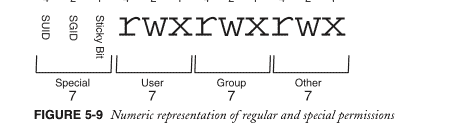

因此，要在某个文件或目录上设置所有特殊权限，您可以使用命令`chmod 7777 name`，如图 5-9 所示。然而，`SUID`和`SGID`位通常设置在文件上。要更改先前使用的文件`file1`的权限，使得“其他”用户能够查看并执行该文件，且身份为所有者和组成员，您可以使用命令`chmod 6755 file1`，如下面的示例所示：

```
[root@server1 root]# ls -l
total 12
drwx------  3 root  root  4096 Apr  8 07:12 Desktop
drwxr-xr-x  2 root  root  4096 May  3 21:39 dir1
```

```
drwx------	3 root	root	4096 May  3 21:41 Desktop
drwxr-xr-x	2 root	root	4096 May  3 21:39 dir1
drwx------	2 root	root	4096 May  3 21:41 dir2
-rw-r--sr-x	1 root	root	 0 May  3 21:40 file1
-rw-------	1 root	root	 0 May  3 21:41 file2
[root@server1 root]# chmod 6755 file1
[root@server1 root]# ls -l
total 12
drwx------	3 root	root	4096 Apr  8 07:12 Desktop
drwxr-xr-x	2 root	root	4096 May  3 21:39 dir1
drwx------	2 root	root	4096 May  3 21:41 dir2
-rwSr-sr-x	1 root	root	 0 May  3 21:40 file1
-rw-------	1 root	root	 0 May  3 21:41 file2
[root@server1 root]# __
```

同样，要在先前使用的目录`dir1`上设置`sticky bit`权限，您可以使用命令`chmod 1777 dir1`，这允许所有用户（包括“其他”）向`dir1`目录中添加文件。这是因为您赋予了写权限；然而，由于您设置了`sticky bit`，用户只能删除他们在`dir1`中拥有的文件。这在下方的示例中显示：

```
[root@server1 root]# ls -l
total 12
drwx------	3 root	root	4096 Apr  8 07:12 Desktop
drwxr-xr-x	2 root	root	4096 May  3 21:39 dir1
drwx------	2 root	root	4096 May  3 21:41 dir2
-rwSr-sr-x	1 root	root	 0 May  3 21:40 file1
-rw-------	1 root	root	 0 May  3 21:41 file2
[root@server1 root]# chmod 1777 dir1
[root@server1 root]# ls -l
total 12
drwx------	3 root	root	4096 Apr  8 07:12 Desktop
drwxrwxrwt	2 root	root	4096 May  3 21:39 dir1
drwx------	2 root	root	4096 May  3 21:41 dir2
-rwSr-sr-x	1 root	root	 0 May  3 21:40 file1
-rw-------	1 root	root	 0 May  3 21:41 file2
[root@server1 root]# __
```

另外，请记住，在不赋予执行权限的情况下分配特殊权限会使这些权限变得无用。如果您忘记给用户、组或其他任何一方授予执行权限，而长列表显示中使用特殊权限覆盖了执行权限的位置。在这种情况下，当模式中表示`sticky bit`(`t`)的位置下没有授予`dir2`执行权限时，特殊权限会像下面示例中那样以大写字母显示：

```
[root@server1 root]# ls -l
total 12
drwx------	3 root	root	4096 Apr  8 07:12 Desktop
drwxrwxrwt	2 root	root	4096 May  3 21:39 dir1
drwx------	2 root	root	4096 May  3 21:41 dir2
```

## 本章总结

- `Linux`目录树遵循文件系统层次结构标准（`FHS`），这使`Linux`用户和开发人员能够在标准目录中定位系统文件。

- 存在许多用于创建、移动或移除文件和目录的文件管理命令。其中最常见的包括`cp`、`mv`、`rm`、`rmdir`和`mkdir`。

- 您可以使用预索引数据库（即`locate`命令）或搜索`PATH`变量中列出的目录（即`which`命令）来查找文件。然而，用于查找文件的最多功能强大的命令是`find`命令，它可以根据广泛的条件搜索文件。

- 文件可以创建为指向另一个文件的指针，或作为另一个文件的链接副本。前者称为符号链接，后者称为硬链接。

- 每个文件和目录都有一个所有者和一个组所有者。文件或目录的所有者有权更改权限并将所有权转让给其他人。

- 可以为用户（文件所有者）、文件的组成员以及系统中的所有人（其他）设置权限。

- 文件和目录有三种常规权限（读、写、执行）和三种特殊权限（`SUID`、`SGID`、粘滞位）。这些权限在文件和目录中的定义是不同的。

- 可以通过指定符号或数字来表示要更改的权限，使用`chmod`命令更改权限。

- 为了确保安全性，新文件和目录从系统获得默认权限，再减去`umask`变量的值。

- `root`用户对`Linux`文件系统上的所有文件和目录拥有所有权限。类似地，`root`用户可以更改`Linux`文件系统上任何文件或目录的所有权。

## 关键术语

- **`/bin`目录** — 包含供所有用户使用的二进制命令的目录。

- **`/boot`目录** — 包含`Linux`内核和启动加载器数据块所使用的文件的目录。

- **`/dev`目录** — 包含设备文件的目录。

- **`/etc`目录** — 包含特定于系统的配置文件的目录。

- **`/home`目录** — 用户主目录的默认位置。

- **`/lib`目录** — 包含共享程序库（供`/bin`和`/sbin`中的命令使用）以及内核模块的目录。

- **`/mnt`目录** — 用于访问（挂载）磁盘（如软盘和`CD-ROM`）的空目录。

- **`/opt`目录** — 存储额外软件程序的目录。

- **`/proc`目录** — 包含进程和内核信息的目录。

- **`/root`目录** — `root`用户的主目录。


- `/sbin` 目录 — 包含系统二进制命令（用于管理）的目录。
- `/tmp` 目录 — 存放程序创建的临时文件的目录。
- `/usr` 目录 — 包含大多数系统命令和实用工具的目录。
- `/usr/local` 目录 — 大多数附加程序的位置。
- `/var` 目录 — 包含日志文件和邮件队列（spools）的目录。
- `chgrp (change group)` 命令 — 用于更改文件或目录的组所有者的命令。
- `chmod (change mode)` 命令 — 用于更改文件或目录模式（权限）的命令。
- `chown (change owner)` 命令 — 用于更改文件或目录的所有者和组所有者的命令。
- `cp (copy)` 命令 — 用于创建文件和目录副本的命令。
- 数据块 — 文件系统分配单元，其中存储构成文件内容的数据以及文件名。
- 文件系统层次结构标准 (FHS) — 规定 Linux 系统上一组文件和目录位置的标准。
- `find` 命令 — 用于根据各种条件在文件系统中查找文件的命令。
- 组 — 当用于特定文件或目录的模式时，指拥有该文件或目录的一组用户。
- 硬链接 — 同一文件系统中与其他文件共享相同 `inode` 的文件。
- `inode` — 文件中存储文件属性、访问权限、位置、所有权和文件类型信息的部分。
- `inode` 表 — 文件系统中所有文件和目录的 `inode` 集合。
- 交互模式 — 当文件可以被覆盖时，文件管理命令使用的模式；系统会与用户交互，要求用户确认操作。
- `ln (link)` 命令 — 用于创建硬链接和符号链接的命令。
- `locate` 命令 — 用于从文件数据库中定位文件的命令。
- `mkdir (make directory)` 命令 — 用于创建目录的命令。
- 模式 — `inode` 中存储访问权限信息的部分。
- `mv (move)` 命令 — 用于移动/重命名文件和目录的命令。
- 其他 — 当用于特定文件或目录的模式时，指 Linux 系统上的所有用户。
- 所有者 — 在文件或目录的长列表显示中出现的用户，并有权更改该文件或目录的权限。
- `PATH` 变量 — 存储目录列表的变量，当执行命令而未指定绝对路径或相对路径名时，系统会按顺序搜索这些目录。
- 权限 — 标识谁可以访问文件或文件夹及其访问级别列表。
- 主组 — 用户所属的默认组。
- 递归 — 指自身及其内容的术语；递归搜索包括目录中的所有子目录及其内容。
- `rm (remove)` 命令 — 用于删除文件和目录的命令。
- `rmdir (remove directory)` 命令 — 用于删除空目录的命令。
- 源文件/目录 — 命令中引用信息源文件或目录的部分。
- 超级块 — 文件系统中存储关键信息（如 `inode` 表和块大小）的部分。
- 符号链接 — 指向同一文件系统或另一文件系统上文件的指针；通常称为快捷方式。
- 目标文件/目录 — 命令中引用信息指向的目标文件或目录的部分。
- `touch` 命令 — 用于创建新文件的命令。它最初用于更新文件的时间戳。
- `umask` — 一种特殊变量，通过去除某些默认文件和目录权限来更改所有新文件和目录的权限。
- `umask` 命令 — 用于查看和更改 `umask` 变量的命令。
- 用户 — 当用于特定文件或目录的模式时，指该文件或目录的所有者。
- `which` 命令 — 用于定位存在于 `PATH` 变量中列出的目录中的文件的命令。

### 复习题

1. 文件系统层次结构中的哪个目录存储额外的软件程序？

   - a. `/var`
   - b. `/sbin`
   - c. `/lib`
   - d. `/opt`

2. 您会使用什么命令来搜索空文件或目录？

   - a. `find -inum 0`
   - b. `find -size -1`
   - c. `find -empty`
   - d. `find -x`

3. `chgrp` 命令最少需要哪些参数？

   - a. 新的组所有者以及要更改的文件或目录
   - b. 用户名、新的组所有者以及要更改的文件或目录
   - c. 旧的组所有者、新的组所有者
   - d. 要更改的文件和目录

4. 用户必须对目录拥有什么权限才能列出其内容？

   - a. 读
   - b. 写
   - c. 执行
   - d. 列表

### 复习题

5. 若要为某个文件或目录设置所有特殊权限，你可以使用命令 `chmod _________________________ name`。

   - a. `0007`
   - b. `0077`
   - c. `0777`
   - d. `7777`

6. 判断对错？`rmdir` 命令用于删除包含文件的目录。

7. 判断对错？`locate` 命令往往返回过多信息以至于无法在屏幕上显示，因为它会搜索文件系统上的所有文件。

8. 判断对错？目录是用于组织其他文件的文件。

9. 判断对错？文件必须至少被分配一个权限。

10. 判断对错？避免向非程序或非 shell 脚本的文件授予执行权限是非常重要的。

11. 使用 `____________________________` 命令可以重命名目录。

12. 在（一个）`______________________________` 链接中，两个文件共享相同的数据。

13. 当用户创建一个文件或目录时，该用户的名称和 `____________________` 组分别成为该文件的所有者和组所有者。

14. `inode` 中存储权限的部分被称为文件的 `___________________`，它根据接收到该文件或目录权限的用户分为三个部分。

15. 系统中一个名为 `____________________________` 的特殊变量会在文件或目录创建后立即剥夺其权限。

### 第 6 章

## Linux 文件系统管理

完成本章后，你将能够：

- 识别 `/dev` 目录中设备文件的结构和类型
- 理解常见的文件系统类型及其特性
- 将软盘挂载到 Linux 目录树以及从 Linux 目录树卸载
- 将 CD-ROM 光盘挂载到 Linux 目录树以及从 Linux 目录树卸载
- 创建硬盘分区
- 将硬盘分区挂载到 Linux 目录树以及从 Linux 目录树卸载
- 监控已挂载文件系统的可用空间
- 检查文件系统错误
- 使用硬盘配额来限制用户空间使用量

导航 Linux 目录树和操作文件是所有用户日常执行的任务。然而，管理员必须为用户提供此目录树，并管理和修复支持它的磁盘设备。在本章中，你将了解代表磁盘设备的各种设备文件，以及可以放置在这些设备上的不同文件系统。接下来，你将学习如何创建和管理软盘和 CD-ROM 光盘上的文件系统，随后讨论硬盘分区和文件系统管理。最后，本章以讨论磁盘使用情况、文件系统错误以及限制用户存储文件的能力作为结束。

### /dev 目录

管理用于存储信息的磁盘的基础，是了解 Linux 操作系统如何指定这些磁盘。Linux 系统中的大多数设备（如磁盘、终端和串行端口）都由硬盘上的一个文件表示，称为**设备文件**。每个设备对应一个文件，这些文件通常位于 `/dev` 目录中。这允许你通过使用该文件在 `/dev` 目录中的路径名来指定系统中的设备。要在 Linux 系统中指定第一个软盘，你可以在命令的适当部分输入路径名 `/dev/fd0`（软盘 0）。此外，为了表示 Linux 系统中的第二个软盘，你可以指定文件的路径名 `/dev/fd1`（软盘 1）。

此外，每个设备文件都指定了数据如何传输到设备以及从设备传输出来。你有两种方法将数据传输到设备以及从设备传输出来。第一种方法涉及将信息逐字符传输到设备以及从设备传输出来。以这种方式传输数据的设备被称为**字符设备**。第二种方法通过使用物理内存来缓冲传输，每次传输信息的一小块或一块。使用这种传输方法的设备称为**块设备**，其传输速度比字符设备快得多。代表磁盘的设备文件，如软盘、CD-ROM 光盘和硬盘，通常是块设备文件，因为更倾向于快速的数据传输速率。然而，磁带驱动器和其他大多数设备通常由字符设备文件表示。

要查看特定设备是逐字符还是逐块传输数据，请记住 `ls -1` 命令在 `type` 列中显示 `c` 或 `b` 字符，指示设备文件的类型。要查看文件 `/dev/fd0` 的类型，你可以使用以下命令：

```
[root@server1 root]# ls -l /dev/fd0
brw-rw---- 1 root  floppy  2,  0 Feb 23 16:02 /dev/fd0
[root@server1 root]#
```

从上述输出最左侧的字符可以看出，`/dev/fd0` 文件是一个块设备文件。表 6-1 提供了一些常见设备文件及其类型的列表。

**表 6-1 常见设备文件**


| 设备文件 | 描述 | 块设备或字符设备 |
| :--- | :--- | :--- |
| `/dev/fd0` | 系统中的第一个软盘 | 块设备 |
| `/dev/fd1` | 系统中的第二个软盘 | 块设备 |
| `/dev/hda1` | 第一个 IDE 硬盘驱动器上的第一个主分区（主盘） | 块设备 |
| `/dev/hdb1` | 第二个 IDE 硬盘驱动器上的第一个主分区（从盘） | 块设备 |
| `/dev/hdc1` | 第三个 IDE 硬盘驱动器上的第一个主分区（主盘） | 块设备 |
| `/dev/hdd1` | 第四个 IDE 硬盘驱动器上的第一个主分区（从盘） | 块设备 |
| `/dev/sda1` | 第一个 SCSI 硬盘驱动器上的第一个主分区 | 块设备 |
| `/dev/sdb1` | 第二个 SCSI 硬盘驱动器上的第一个主分区 | 块设备 |
| `/dev/tty1` | 系统中的第一个本地终端（`Ctrl+Alt+F1`） | 字符设备 |
| `/dev/tty2` | 系统中的第二个本地终端（`Ctrl+Alt+F2`） | 字符设备 |
| `/dev/ttyS0` | 系统中的第一个串行端口（`COM1`） | 字符设备 |
| `/dev/ttyS1` | 系统中的第二个串行端口（`COM2`） | 字符设备 |
| `/dev/psaux` | `PS/2` 鼠标端口 | 字符设备 |
| `/dev/lp0` | 系统中的第一个并行端口（`LPT1`） | 字符设备 |
| `/dev/null` | 表示无任何内容的设备文件；发送到该设备的任何数据都会被丢弃 | 字符设备 |
| `/dev/st0` | 系统中的第一个 SCSI 磁带设备 | 字符设备 |
| `/dev/usb/*` | `USB` 设备文件 | 字符设备 |

在典型的 `Red Hat Fedora Linux` 安装之后，`/dev` 目录中有超过 18,000 个不同的设备文件；其中大多数设备文件代表可能在特定 `Linux` 系统上不存在的设备，因此从未被使用。在 `Linux` 系统上提供如此多的冗余设备文件并不占用大量磁盘空间，因为所有设备文件均由 `inode` 组成，没有数据块；结果，`/dev` 目录的全部内容通常小于 700 千字节，可以轻松放入软盘中。在使用 `ls -1` 命令查看设备文件时，描述文件大小（以千字节为单位）的部分由两个数字取代：主要号和次要号。设备文件的`主要号`指向 `Linux` 内核中该设备的设备驱动程序；如果属于相同的一般类型（即，两个不同的软盘驱动器可能共享相同的主要号），几个不同的设备可以共享相同的主要号。`次要号`指示特定设备本身；计算机中的第一个软盘驱动器将具有与第二个软盘驱动器不同的次要号。在以下输出中，你可以看到 `/dev/fd0` 和 `/dev/fd1` 都共享主要号 2，但 `/dev/fd0` 的次要号为 0，而 `/dev/fd1` 的次要号为 1，这使得它们彼此区分。

```
[root@server1 root]# ls -l /dev/fd0 /dev/fd1
brw-rw---- 1 root floppy 2, 0 Feb 23 16:02 /dev/fd0
brw-rw---- 1 root floppy 2, 1 Feb 23 16:02 /dev/fd1
[root@server1 root]#
```

设备文件类型（块设备或字符设备）、主要号（设备驱动程序）和次要号（具体设备）共同构成了每个设备文件的独特特征。要创建设备文件，你只需要知道这三个信息片段。

如果设备文件损坏，它通常被列示为普通文件，而不是块或字符特殊文件。回忆第 5 章“`Linux` 文件系统管理”的内容，`find /dev -type f` 命令可用于搜索 `/dev` 目录下的普通文件，以确定是否发生了损坏。如果你发现损坏的设备文件，或者意外删除了一个设备文件，如果你知道类型、主要号和次要号，可以使用`mknod`命令重新创建设备文件。以下示例展示了如何重新创建前面使用过的 `/dev/fd0` 块设备文件，其主要号为 2，次要号为 0：

```
[root@server1 root]# ls -l /dev/fd0
brw-rw---- 1 root floppy 2, 0 Feb 23 16:02 /dev/fd0
[root@server1 root]# rm -f /dev/fd0
[root@server1 root]# ls -l /dev/fd0
[root@server1 root]# mknod /dev/fd0 b 2 0
[root@server1 root]# ls -l /dev/fd0
brw-r-r-r-- 1 root root 2, 0 May 8 13:26 /dev/fd0
[root@server1 root]#
```

然而，如果你不知道设备的类型、主要号或次要号，你可以使用 `/dev/MAKEDEV` 程序基于常见名称重新创建设备。

### 文件系统

回顾第 2 章“准备安装 `Linux`”中的内容，文件必须以称为`文件系统`的特定格式存储在硬盘上，操作系统才能处理这些文件。所使用的文件系统类型决定了物理硬盘上文件的管理方式。每种文件系统都可以采用不同的文件存储方法，并具备使其能够抵御错误的功能。虽然有许多不同类型的文件系统可用，但所有文件系统都共享三个常见组件，如第 5 章所讨论：超级块（`superblock`）、`inode` 表和数据块。在结构层面上，这三个组件协同工作以组织文件并允许快速访问和检索数据。所有存储介质，如软盘、硬盘和 `CD-ROM`，在使用前都需要用文件系统进行格式化。

> **注意**  
> 在设备上创建文件系统通常被称为`格式化`。

### 文件系统类型

如前所述，`Linux` 操作系统中可以使用许多文件系统。每种都有其优缺点，因此某些类型更适合某些任务，而不太适合其他任务。`Linux` 的一个好处是你不必在系统中仅使用一种文件系统；你可以在同一个目录树下使用经过不同文件系统格式化的多个不同设备。此外，无论 `Linux` 系统使用的是一个文件系统还是二十个不同的文件系统，文件和目录在整个目录树中看起来都是一样的。表 6-2 列出了 `Linux` 中可用的一些常见文件系统。要查看文件系统类型及其功能的完整列表，可以参考互联网上位于 `http://www.tldp.org/HOWTO/Filesystems-HOWTO.html` 的文件系统 `HOWTO` 文档。

表 6-2 常见的 `Linux` 文件系统

| 文件系统 | 描述 |
| :--- | :--- |
| `bfs` | 引导文件系统——一种小型、可引导的文件系统，用于保存系统启动所需的文件；它常用于 `UNIX` 系统。 |
| `cdroms` | 光盘文件系统——一种用于将 `CD-ROM` 上的所有轨道和数据视为普通文件进行查看的文件系统。 |
| `ext2` | 第二扩展文件系统——`Linux` 使用的传统文件系统，它支持访问控制列表（个别用户权限）。此外，它保留了其名称，源自基于 `Minix` 文件系统的原始扩展文件系统的新版本。 |
| `ext3` | 第三扩展文件系统——`ext2` 的一种变体，允许使用日志功能，因此具有更快的启动和恢复时间。 |
| `hfs` | 分层文件系统——`Apple Macintosh` 计算机原生的文件系统。 |
| `hfs+` | 高性能文件系统——一种 `IBM` 专有 `OS/2` 文件系统，提供长文件名支持，并针对操纵大容量磁盘卷上的数据进行优化。 |
| `iso9660` | `CD-ROM` 文件系统——源自国际标准组织推荐标准 9660 的文件系统，用于访问存储在 `CD-ROM` 上的数据。 |
| `minix` | `MINIX` 文件系统——`Linus Torvalds` 在 `Linux` 开发早期使用的文件系统。 |
| `msdos` | `DOS FAT` 文件系统。 |
| `ntfs` | 新技术文件系统——微软为其 `NT 4.0` 和 `Windows 2000` 操作系统开发的专有文件系统；目前在 `Linux` 下仅可作为只读文件系统使用。 |
| `reiserfs` | `REISERFS` 文件系统——一种日志文件系统，类似于 `ext3`，更适合用于数据库。 |
| `udf` | 通用磁盘格式文件系统——一种由向 `CD-R`、`CD-RW` 或 `DVD` 写入数据的软件程序使用的文件系统。 |
| `vfat` | 支持长文件名的 `DOS FAT` 文件系统。 |
| `xfs` | `Veritas` 文件系统——一种日志文件系统，提供大文件支持，支持访问控制列表（个别用户权限），并常用于主要版本的 `UNIX`。 |

### 挂载

`挂载`这一术语起源于 20 世纪 60 年代，当时信息存储在大磁带卷上，必须将其挂载到计算机上才能访问数据。如今，挂载仍然指使数据可用。更具体地说，它指的是通过逻辑目录树使设备对用户可用的过程。该设备被附加到目录树上的某个特定目录，称为`挂载点`。然后用户可以在该挂载点目录中创建文件和子目录，这些文件和子目录随后存储在挂载到该特定目录的文件系统上。


请记住，目录仅仅是包含文件列表和子目录组织关系的文件，而不直接包含数据。因此，Linux 系统很容易通过覆盖目录来防止用户访问该数据。当设备挂载到某个目录时，本质上发生的就是这种情况；只要设备保持挂载状态，挂载点目录就会被该设备暂时覆盖。挂载前存在于挂载点目录中的任何文件内容都不会丢失；当设备卸载时，挂载点目录会被重新显示，先前的文件内容就会显露出来。

例如，假设你将包含文件系统的软盘设备挂载到 `/mnt` 目录。`/mnt` 目录是一个包含两个子目录的目录，是一个常用于挂载可移动介质设备的方便挂载点。在挂载之前，目录结构类似于图 6-1 中所示。软盘挂载到 `/mnt` 目录后，`/mnt` 目录的内容将被软盘文件系统覆盖，如图 6-2 所示。


**图 6-1** 挂载前的目录结构

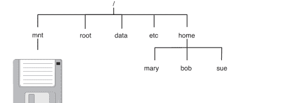

**图 6-2** 挂载软盘设备后的目录结构

如果用户随后在 `/mnt` 目录中存储一个文件，如图 6-2 所示，该文件将存储在软盘设备上。类似地，如果用户在图 6-2 所示的 `/mnt` 目录下创建一个子目录，该子目录将在软盘上创建。

重要的是要注意，任何现有目录都可以用作挂载点。如果用户将软盘设备挂载到 `/bin` 目录，那么在软盘磁盘挂载期间，`/bin` 目录中的所有文件都会被覆盖，包括用于卸载软盘的命令。因此，安全的做法是创建专门用于挂载设备的空目录，以避免使现有文件对用户不可访问。

当 Linux 系统首次启动时，硬盘上存在的文件系统会被挂载到 `/` 目录。这被称为**根文件系统**，并包含大部分操作系统文件。计算机内部硬盘上存在的其他文件系统也可以在启动时挂载到 `/` 目录下的各种挂载点目录，或者通过在前几节中讨论的 `/etc/fstab`（文件系统表）文件中的条目进行挂载。

`mount` 命令用于将设备挂载到挂载点目录，`umount` 命令用于从挂载点目录卸载设备；本章剩余部分将讨论这两个命令。

## 使用软盘

在计算机之间传输少量信息时，使用软盘可移动介质来存储文件是常见做法。但是，软盘在 Linux 中使用前必须经过准备。

回顾一下，每个磁盘设备在使用前必须用文件系统格式化才能存储文件。为此，你可以使用 `mkfs`（制作文件系统）命令，并使用 `-t` 开关指定文件系统类型，以及代表软盘设备的设备文件。要用 `ext2` 文件系统格式化计算机第一个软盘驱动器内的软盘，请将软盘放入软盘驱动器，并输入以下命令：

```text
[root@server1 root]# mkfs -t ext2 /dev/fd0
mke2fs 1.35 (28-Feb-2004)
Filesystem label=
OS type: Linux
Block size=1024 (log=-0)
Fragment size=1024 (log=0)
184 inodes, 1440 blocks
72 blocks (5.00%) reserved for the super user
First data block=1
1 block group
8192 blocks per group, 8192 fragments per group
184 inodes per group
```

写入 inode 表：完成

写入超级块和文件系统记账信息：完成

该文件系统将在每次 28 次挂载或 180 天后（以先到者为准）自动进行检查。使用 `tune2fs -c` 或 `-t` 可覆盖此设置。

```
[root@server1 root]#
```

或者，你可以在 `-t` 选项后指定其他文件系统，例如 DOS FAT 文件系统。这会导致 `mkfs` 命令产生不同的输出，如以下示例所示：

```
[root@server1 root]# mkfs -t msdos /dev/fd0
mkfs.msdos 2.8 (28 Feb 2001)
[root@server1 root]#
```

如果你不使用 `mkfs` 命令指定文件系统，则默认假设为 `ext2` 文件系统，如以下示例所示：

```
[root@server1 root]# mkfs /dev/fd0
mke2fs 1.35 (28-Feb-2004)
Filesystem label:
OS type: Linux
Block size=1024 (log=0)
Fragment size=1024 (log=0)
184 inodes, 1440 blocks
72 blocks (5.00%) reserved for the super user
First data block=1
1 block group
8192 blocks per group, 8192 fragments per group
184 inodes per group

Writing inode tables: done
Writing superblocks and filesystem accounting information: done

This filesystem will be automatically checked every 26 mounts or
180 days, whichever comes first. Use tune2fs -c or -t to override.
[root@server1 root]#
```

虽然创建文件系统最常用的命令是 `mkfs`，但存在其他变体和 `mkfs` 命令的快捷方式。例如，要创建 `ext2` 文件系统，你可以输入 `mke2fs /dev/fd0` 在命令行中。`mkfs` 命令的其他替代方案列在表 6-3 中。

| 命令 | 描述 |
| :--- | :--- |
| `mkfs` | 用于创建大多数类型的文件系统 |
| `mkfs.msdos`, `mkdosfs`, `mkfs.vfat` | 用于创建 DOS FAT 文件系统 |
| `mkfs.ext2`, `mk2fs` | 用于创建 `ext2` 文件系统 |
| `mkfs.ext3`, `mk2fs -j` | 用于创建 `ext3` 文件系统（`-j` 表示日志功能） |
| `mkisofs` | 用于创建 CD-ROM 文件系统 |
| `mkfs.reiserfs`, `mkreiserfs` | 用于创建 REISERFS 文件系统 |

软盘格式化为文件系统后，必须将其挂载到目录树上才能使用。可以通过使用 `mount` 命令且不带任何选项或参数来查看当前已挂载的文件系统列表，该命令读取 `/etc/mtab`（挂载表）文件中列出的信息，如以下输出所示：

```
[root@server1 root]# mount
/ dev/hda1 on / type ext3 (rw)
none on /proc type proc (rw)
none on /sys type sysfs (rw)
none on /dev/pts type devpts (rw,gid=5,mode=620)
usbdevfs on /proc/bus/usb type usbdevfs (rw)
none on /dev/shm type tmpfs (rw)
[root@server1 root]# cat /etc/mtab
/ dev/hda1 / ext3 rw 0 0
none /proc proc rw 0 0
none /sys sysfs rw 0 0
none /dev/pts devpts rw,gid=5,mode=620 0 0
usbdevfs /proc/bus/usb usbdevfs rw 0 0
none /dev/shm tmpfs rw 0 0
[root@server1 root]#
```

从上述输出中可以看出，设备 `/dev/hda1` 已挂载在 `/` 目录上，并包含 `ext3` 文件系统。列出的其他文件系统是系统使用的特殊文件系统，将在本书后续章节中讨论。

要在目录树上挂载设备，可以使用 `mount` 命令并附带选项和参数，以指定文件系统类型、要挂载的设备以及挂载设备所在的目录（挂载点）。重要的是确保当前没有用户正在使用挂载点目录；否则，系统会给出错误消息，并且磁盘不会被挂载。要检查 `/mnt/floppy` 目录是否正被任何用户使用，可以使用带有 `-u` 选项的 `fuser` 命令，如以下输出所示：

```
[root@server1 root]# fuser -u /mnt/floppy
[root@server1 root]#
```

上述输出表明 `/mnt/floppy` 目录未被任何用户进程使用。要将格式化为 `ext2` 文件系统的第一个软盘设备挂载到 `/mnt/floppy` 目录，只需输入以下命令：


```bash
[root@server1 root]# mount -t ext2 /dev/fd0 /mnt/floppy
[root@server1 root]# mount
/dev/hda1 on / type ext3 (rw)
none on /proc type proc (rw)
none on /sys type sysfs (rw)
none on /dev/pts type devpts (rw,gid=5,mode=620)
usbdevfs on /proc/bus/usb type usbdevfs (rw)
none on /dev/shm type tmpfs (rw)
/dev/fd0 on /mnt/floppy type ext2 (rw)
[root@server1 root]#
```

请注意，在之前 `mount` 命令的输出中，`/dev/fd0` 显示为已挂载到 `/mnt/floppy` 目录。现在你可以将 `/mnt/floppy` 目录视为软盘的根目录，以访问和存储软盘设备上的文件。当在磁盘设备上创建 `ext2` 文件系统时，默认会创建一个名为 `lost+found` 的目录。该默认目录由本章稍后讨论的 `fsck` 命令使用。要探索最近挂载的软盘文件系统，可以使用以下命令：

```bash
[root@server1 root]# cd /mnt/floppy
[root@server1 floppy]# pwd
/mnt/floppy
[root@server1 floppy]# ls -F
lost+found/
[root@server1 floppy]#
```

要将文件复制到软盘设备，只需将 `/mnt/floppy` 目录指定为 `cp` 命令的目标，如下所示：

```bash
[root@server1 floppy]# cd /etc
[root@server1 etc]# cat hosts
# Do not remove the following line, or various programs
# that require network functionality will fail.
127.0.0.1    server1.class.com server1
[root@server1 etc]# cp hosts /mnt/floppy
[root@server1 etc]# cd /mnt/floppy
[root@server1 floppy]# ls -F
hosts   lost+found/
[root@server1 floppy]# cat hosts
# Do not remove the following line, or various programs
# that require network functionality will fail.
127.0.0.1      server1.class.com server1
[root@server1 floppy]#
```

同样，你也可以在软盘设备下创建子目录来存储文件；这些子目录在挂载点目录下引用。要在之前示例中挂载的软盘上创建一个名为 `workfiles` 的目录，并将 `/etc/inittab` 文件复制进去，可以使用以下命令：

```bash
[root@server1 floppy]# pwd
/mnt/floppy
[root@server1 floppy]# ls -F
hosts  lost+found/
[root@server1 floppy]# mkdir workfiles
[root@server1 floppy]# ls -F
hosts  lost+found/ workfiles/
[root@server1 floppy]# cd workfiles
[root@server1 workfiles]# pwd
/mnt/floppy/workfiles
[root@server1 workfiles]# cp /etc/inittab .
[root@server1 workfiles]# ls -F
inittab
[root@server1 workfiles]#
```

尽管你可以未经系统许可就将软盘从软盘驱动器弹出，但这可能会导致终端屏幕上出现错误消息。在弹出软盘之前，必须使用 `umount` 命令正确卸载它。`umount` 命令可以接受要卸载的设备名称或挂载点目录作为参数。类似于挂载软盘，卸载软盘也要求挂载点目录没有被任何用户使用。如果你尝试在挂载到 `/mnt/floppy` 目录的软盘正在被使用时将其卸载，你会收到类似以下示例的错误消息：

```bash
[root@server1 floppy]# pwd
/mnt/floppy
[root@server1 floppy]# umount /mnt/floppy
umount: /mnt/floppy: device is busy
[root@server1 floppy]# fuser -u /mnt/floppy
/mnt/floppy:
17368(root)
[root@server1 floppy]# cd /root
[root@server1 root]# umount /mnt/floppy
[root@server1 root]# mount
/dev/hda1 on / type ext3 (rw)
none on /proc type proc (rw)
none on /sys type sysfs (rw)
none on /dev/pts type devpts (rw,gid=5,mode=620)
usbdevfs on /proc/bus/usb type usbdevfs (rw)
none on /dev/shm type tmpfs (rw)
[root@server1 root]#
```

请注意，从上述输出可以看出，你仍然在使用 `/mnt/floppy` 目录，因为它是当前工作目录。`fuser` 命令还表明 `root` 用户有一个进程正在使用该目录。更改当前工作目录后，`umount` 命令能够成功从 `/mnt/floppy` 目录卸载软盘，并且 `mount` 命令的输出显示软盘不再挂载。

回想一下，挂载仅仅是将磁盘设备附加到 Linux 目录树，以便你可以像处理包含文件和子目录的目录一样处理该设备。设备可以挂载到任何现有目录上。然而，如果目录包含文件，那么这些文件在设备被卸载之前将无法访问。例如，假设你创建一个名为 `/flopper` 的目录用于挂载软盘，并在其中创建一个名为 `samplefile` 的文件，如下所示：

```bash
[root@server1 root]# mkdir /flopper
[root@server1 root]# touch /flopper/samplefile
[root@server1 root]# ls -F /flopper
samplefile
[root@server1 root]#
```

如果之前使用的软盘挂载到 `/flopper` 目录，那么使用 `/flopper` 目录的用户实际上是在使用软盘；然而，当没有东西挂载到 `/flopper` 目录时，之前内容的可用性就会恢复：

```bash
[root@server1 root]# mount -t ext2 /dev/fd0 /flopper
[root@server1 root]# mount
/dev/hda1 on / type ext3 (rw)
none on /proc type proc (rw)
none on /sys type sysfs (rw)
none on /dev/pts type devpts (rw,gid=5,mode=620)
usbdevfs on /proc/bus/usb type usbdevfs (rw)
none on /dev/shm type tmpfs (rw)
/dev/fd0 on /flopper type ext2 (rw)
[root@server1 root]# ls -F /flopper
hosts   lost+found/  workfiles/
[root@server1 root]# umount /flopper
[root@server1 root]# ls -F /flopper
samplefile
[root@server1 root]#
```

### 软盘的使用

前文输出中使用的 `mount` 命令指定了文件系统类型、要挂载的设备以及挂载点目录。为了节省在命令行输入的时间，你也可以选择指定一个参数，让系统从 `/etc/fstab`（文件系统表）文件中查找剩余信息。`/etc/fstab` 文件具有双重用途：它用于在启动时挂载设备，并在用户使用 `mount` 命令时未指定足够参数的情况下被查询。

`/etc/fstab` 文件包含六个字段：

`<要挂载的设备> <挂载点> <类型> <挂载选项> <dump#> <fsck#>`


要挂载的设备可以是设备文件的路径，也可以是描述要挂载卷的标签。挂载点指定了设备的挂载位置。类型可以是特定值（如 `ext3`），也可以由系统自动检测。挂载选项是 `mount` 命令在挂载卷时接受的额外选项（如只读，即 `"ro"`）。带有挂载选项 `"noauto"` 的文件系统不会在启动时自动挂载；`mount` 命令接受的所有选项的完整列表可以通过查看 `mount` 命令的手册页找到。

`dump#` 字段由本书第 12 章稍后讨论的 `dump` 命令用于备份文件系统；该字段中的 `1` 表示应该备份该文件系统，而 `0` 表示不需要备份。`fsck#` 字段由本章稍后讨论的 `fsck` 命令用于在启动时检查文件系统错误；该字段中为 `1` 的文件系统会先于该字段为 `2` 的文件系统进行检查，而该字段为 `0` 的文件系统则不被检查。

> **注意**
>
> 若要挂载 `/etc/fstab` 文件中所有计划在启动时挂载的文件系统，只需输入 `mount -a` 命令即可。

以下输出显示了 `/etc/fstab` 文件的内容：

```
[root@server1 root]# cat /etc/fstab
LABEL=/ / ext3 defaults 1 1
none /dev/pts devpts gid=5, mode=620 0 0
none /dev/shm tmpfs defaults 0 0
none /proc proc defaults 0 0
none /sys sysfs defaults 0 0
/dev/hda2 swap swap defaults 0 0
/dev/cdrom /mnt/cdrom udf, iso9660 noauto, owner, kudzu, ro 0 0
/dev/floppy /mnt/floppy auto noauto, owner, kudzu 0 0
[root@server1 root]# _
```

因此，要将第一个软盘设备（`/dev/fd0`）挂载到 `/mnt/floppy` 目录并自动检测设备上的文件系统类型，只需为 `mount` 命令提供足够的信息，以便其在 `/etc/fstab` 文件中找到相应的行：

```
[root@server1 root]# mount /dev/fd0
[root@server1 root]# mount
/dev/hda1 on / type ext3 (rw)
none on /proc type proc (rw)
none on /sys type sysfs (rw)
none on /dev/pts type devpts (rw,gid=5,mode=620)
usbdevfs on /proc/bus/usb type usbdevfs (rw)
none on /dev/shm type tmpfs (rw)
/dev/fd0 on /mnt/floppy type ext2 (rw,nosuid,nodev)
[root@server1 root]# umount /dev/fd0
[root@server1 root]#
```

前文输出中的 `mount` 命令成功执行，是因为 `/etc/fstab` 中存在一行描述了 `/dev/fd0` 设备的挂载信息。

或者，你也可以将挂载点作为 `mount` 命令的参数来指定，从而通过 `/etc/fstab` 中的正确条目挂载相同的设备：

```
[root@server1 root]# mount /mnt/floppy
[root@server1 root]# umount
/dev/hda1 on / type ext3 (rw)
none on /proc type proc (rw)
none on /sys type sysfs (rw)
none on /dev/pts type devpts (rw,gid=5,mode=620)
usbdevfs on /proc/bus/usb type usbdevfs (rw)
none on /dev/shm type tmpfs (rw)
/dev/fd0 on /mnt/floppy type ext2 (rw,nosuid,nodev)
[root@server1 root]# umount /mnt/floppy
[root@server1 root]#
```

表 6-4 列出了在挂载和卸载软盘时有用的命令。

尽管表 6-4 中列出的命令允许用户对挂载过程进行完全控制，但在使用图形用户界面（`GUI`）环境访问软盘时，软盘通常会自动挂载到 `/mnt/floppy` 目录。在 `GNOME` 桌面上，只需双击“计算机”图标，然后双击“软盘”图标，如图 6-3 所示。在 `KDE` 桌面上，你可以双击“从这里开始”图标，选择“设备”，然后双击“软盘”图标，如图 6-4 所示。

在 `GUI` 环境中挂载软盘后，桌面上会出现一个代表软盘的图标。你可以双击软盘图标来打开软盘上的文件列表，或者右键单击软盘图标以打开菜单，通过选择“卸载卷”来卸载软盘。

#### 表 6-4 挂载和卸载文件系统时有用的命令

| 命令 | 描述 |
| :--- | :--- |
| `mount` | 显示已挂载的文件系统 |
| `mount -t <type> <device> <mount point>` | 将指定 `<type>` 类型的 `<device>` 挂载到 `<mount point>` 目录 |
| `fuser -u <directory>` | 显示正在使用特定目录的用户 |
| `umount <mount point>` 或 `umount <device>` | 将 `<device>` 从其 `<mount point>` 目录卸载 |

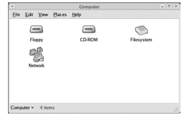

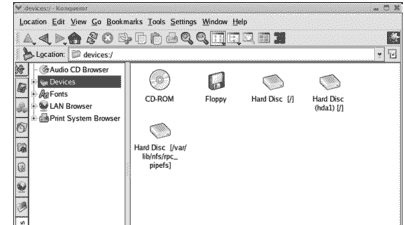

### CD-ROM 光盘的使用

大多数未从互联网下载的软件都包装在 CD-ROM 光盘上，因为它们的存储容量远大于软盘；一张 CD-ROM 光盘可以存储的数据量超过软盘的 500 倍。与软盘类似，CD-ROM 可以使用 `mount` 命令挂载，并使用 `umount` 命令卸载，如表 6-4 所示；但是，这些命令使用的设备文件是不同的。大多数 Linux 系统配备了一个符合 `AtAPI` 标准的 `IDE` CD-ROM 驱动器，它通过 `IDE` 排线连接到主板。这些 CD-ROM 驱动器表现得像一个普通的 `IDE` 硬盘，并且必须按照第 2 章讨论的四种配置之一进行设置。这些配置及其对应的设备文件如下列表所示：

- 主盘 主设备（`/dev/hda`）
- 主盘 从设备（`/dev/hdb`）
- 副盘 主设备（`/dev/hdc`）
- 副盘 从设备（`/dev/hdd`）

因此，如果已知配置，你可以指定你的 CD-ROM 设备文件。然而，在安装过程中，`Red Hat Fedora Linux` 会创建一个名为 `/dev/cdrom` 的符号链接，指向适当的设备；如果系统的 CD-ROM 被配置为副盘从设备，`/dev/cdrom` 的长列表显示如下：

```
[root@server1 root]# ls -l /dev/cdrom
lrwxrwxrwx 1 root    root      8 Jun 11 11:19 /dev/cdrom -> /dev/hdd
[root@server1 root]#_
```

同样，如果 Linux 系统具有 `SCSI` CD-ROM 设备，长列表将指向适当的 `SCSI` 设备，如下所示：

```
[root@server1 root]# ls -l /dev/cdrom
lrwxrwxrwx 1 root    root      8 Jun 11 11:19 /dev/cdrom -> /dev/sdb
[root@server1 root]#_
```

此外，CD-ROM 通常使用 `iso9660` 文件系统类型且不可写入；因此，要将 CD-ROM 挂载到 `/mnt/cdrom` 目录，你应该使用 `iso9660` 文件系统类型，并为 `mount` 命令添加 `-r`（只读）选项。要将示例 CD-ROM 挂载到 `/mnt/cdrom` 并查看其内容，可以使用以下命令：


```bash
[root@server1 root]# mount -r -t iso9660 /dev/cdrom /mnt/cdrom
[root@server1 root]# mount
/dev/hda1 on / type ext3 (rw)
none on /proc type proc (rw)
none on /sys type sysfs (rw)
none on /dev/pts type devpts (rw,gid=5,mode=620)
usbdevfs on /proc/bus/usb type usbdevfs (rw)
none on /dev/shm type tmpfs (rw)
/dev/cdrom on /mnt/cdrom type iso9660 (ro)

[root@server1 root]# ls -1 /mnt/cdrom
autorun.inf* install* graphics/  jungle/  jungle.txt*  joystick/

[root@server1 root]# umount /mnt/cdrom

[root@server1 root]#
```

与软盘类似，你可以仅为 `mount` 命令指定一个参数，通过 `/etc/fstab` 文件中的条目挂载 CD-ROM，并使用 `umount` 命令从目录树中卸载 CD-ROM。请记住，挂载点目录必须未被占用，才能成功挂载或卸载 CD-ROM 光盘；可以使用 `fuser` 命令来验证这一点。

与软盘不同，CD-ROM 在正确卸载之前无法从 CD-ROM 驱动器中弹出，因为 `mount` 命令会作为预防措施锁定 CD-ROM 设备。当你在 GUI 环境中将 CD-ROM 插入驱动器时，它会自动挂载到 `/mnt/cdrom` 目录。或者，你也可以在 GUI 环境中访问 CD-ROM 图标，以挂载未自动挂载的 CD-ROM，如前文图 6-3 和图 6-4 所示。

在 GUI 环境中挂载 CD-ROM 后，桌面上会放置一个图标，可用于访问 CD-ROM 的内容。与软盘类似，你可以右键单击桌面上的 CD-ROM 图标并选择“弹出”，以卸载并弹出 CD-ROM。

### 硬盘的使用

硬盘驱动器有 IDE 和 SCSI 两种类型。IDE 硬盘驱动器通过 IDE 电缆连接到主板，并且必须配置为四种配置之一，每种配置都有不同的设备文件：

*   主盘 主设备 (`/dev/hda`)
*   主盘 从设备 (`/dev/hdb`)
*   副盘 主设备 (`/dev/hdc`)
*   副盘 从设备 (`/dev/hdd`)

SCSI 硬盘驱动器通常具有更快的数据传输速度，并且通常通过插入扩展插槽的控制卡连接到主板。SCSI 驱动器不仅提供更快的访问速度，而且根据类型不同，单个控制器上可能连接 15 个或更多的 SCSI 硬盘。由于这些优势，SCSI 硬盘非常适合需要大量存储空间用于程序和用户文件的 Linux 服务器。然而，SCSI 硬盘有不同的关联设备文件：

*   第一个 SCSI 硬盘驱动器 (`/dev/sda`)
*   第二个 SCSI 硬盘驱动器 (`/dev/sdb`)
*   第三个 SCSI 硬盘（`/dev/sdc`）
*   第四个 SCSI 硬盘（`/dev/sdd`）
*   第五个 SCSI 硬盘（`/dev/sde`）
*   第六个 SCSI 硬盘（`/dev/sdf`）
*   依此类推

#### 硬盘分区

回顾一下，硬盘是常规存储设备中存储容量最大的。这也带来了一些问题；随着磁盘容量的增加，数据组织变得更加困难，且出错的可能性也随之增加。为了解决这些问题，通常将硬盘划分为更小的、更易用的部分，称为**分区**。每个分区可以包含一个独立的文件系统，并且可以挂载到不同的挂载点目录。回顾第 2 章的内容，Linux 系统至少需要两个分区：一个是挂载到根目录的分区（根分区），另一个用于容纳虚拟内存的分区（交换分区）。交换分区不需要文件系统，因为它完全由操作系统写入和维护。然而，在 Linux 系统上仅仅使用两个分区并不是最佳实践，使用更多的分区可能更有用。这种划分可以：

*   隔离不同类型的数据——例如，主目录数据存储在挂载到 `/home` 的独立分区上。
*   允许在一个硬盘驱动中使用多种类型的文件系统——例如，某些文件系统是针对数据库使用进行优化的。
*   降低文件系统损坏导致系统无法使用的可能性；如果挂载到 `/home` 目录的分区损坏，它不会影响系统，因为操作系统文件存储在挂载到 `/` 目录的独立分区上。
*   通过尽可能减小文件系统的大小，来加快对存储数据的访问速度。

将数据隔离到硬盘驱动器中物理上不同的区域在组织方面可能非常有用。将不同类型的数据保留在不同的分区上，使您能够操作一种类型的数据而不影响系统的其余部分。这也降低了文件系统损坏影响目录树中所有文件的可能性。访问速度得到提高，因为在硬盘驱动器中，磁头需要搜索的物理区域更小以定位数据。这个过程类似于在一个 20,000 平方英尺的仓库中寻找一枚硬币。如果该仓库被分成四个独立的部门，每个部门 5,000 平方英尺，并且你知道硬币在哪个部门，那么找到硬币所需的时间要少得多。在较小的指定空间内搜索和操纵比在较大的空间内更快、更容易。

在物理层面，硬盘是旋转速度很快的圆形金属盘片。数据从这些盘中以同心圆的形式读取，这些同心圆被称为**磁道**；每个磁道被划分为称为**扇区**的更小信息单元，扇区结合成更可用的数据**块**，如图 6–5 所示。大多数

**硬盘操作**


**图 6–5** *硬盘的物理区域*

硬盘驱动器内部有几个盘片，它们上下堆叠组织，以便可以同时写入以加快数据传输速度。硬盘驱动器内部所有金属盘片上同一同心磁道组成的序列称为**柱面**。

分区定义存储在硬盘的第一个可读扇区中，该扇区称为主引导记录（MBR）或主引导块（MBB）。如果硬盘的这一区域损坏，硬盘的全部内容都可能丢失。

> **注意**
>
> Linux 服务器拥有多块硬盘很常见。在这种情况下，通常的做法是在每块硬盘上配置一个分区，并将每个分区挂载到目录树中的不同目录上。因此，如果一个分区故障，可以用新硬盘替换整个故障硬盘，并从备份源恢复数据。

回顾第 2 章的内容，硬盘最多可以包含四个主分区；为了克服这一限制，可以使用扩展分区来替代其中一个主分区。扩展分区可以包含许多更多的子分区，称为逻辑驱动器。因为文件系统是放置在这些分区上的，所以存在引用硬盘上不同分区类型的设备文件。这些设备文件以硬盘名称开头（`/dev/hda`、`/dev/hdb`、`/dev/sda`、`/dev/sdb` 等），并附加一个表示该硬盘上分区的数字。第一个主分区编号为 1，第二个主分区编号为 2，第三个主分区编号为 3，第四个主分区编号为 4。如果这些主分区中的任何一个被标记为扩展分区，其中的逻辑驱动器编号从 5 开始。表 6–5 列出了一些常见的硬盘分区名称。

| | **分区** | **IDE 设备名称** | **SCSI 设备名称** |
| :--- | :--- | :--- | :--- |
| | | （假设 `/dev/hda`） | （假设 `/dev/sda`） |
| | 第 1 个主分区 | `/dev/hda1` | `/dev/sda1` |
| | 第 2 个主分区 | `/dev/hda2` | `/dev/sda2` |
| | 第 3 个主分区 | `/dev/hda3` | `/dev/sda3` |
| | 第 4 个主分区 | `/dev/hda4` | `/dev/sda4` |
| | 扩展分区中的第 1 个逻辑驱动器 | `/dev/hda5` | `/dev/sda5` |
| | 扩展分区中的第 2 个逻辑驱动器 | `/dev/hda6` | `/dev/sda6` |
| | 扩展分区中的第 3 个逻辑驱动器 | `/dev/hda7` | `/dev/sda7` |
| | 扩展分区中的第 4 个逻辑驱动器 | `/dev/hda8` | `/dev/sda8` |
| | 扩展分区中的第 5 个逻辑驱动器 | `/dev/hda9` | `/dev/sda9` |
| | 扩展分区中的第 n 个逻辑驱动器 | `/dev/hdan` | `/dev/sdan` |

注意表 6-5 中，任何主分区都可以被标记为扩展分区。另外，对于表 6-5 中未列出的不同磁盘驱动器（例如 `/dev/hdc`），分区编号保持不变（例如 `/dev/hdc1`、`/dev/hdc2` 等）。

可以针对特定的文件系统创建硬盘分区。如果要创建一个稍后将格式化为 `ext2` 或 `ext3` 文件系统的分区，应创建 Linux 分区（也称为类型 83）。类似地，如果该分区打算用作虚拟内存，应创建 Linux 交换分区（也称为类型 82）。这种明确的分区类型选择允许创建更适合文件系统需求的分区。

主 IDE 硬盘（`/dev/hda`）的典型 Linux 硬盘结构可以包含一个用于 `/` 文件系统的分区（`/dev/hda1`）和一个扩展分区（`/dev/hda2`），该扩展分区进一步包含一个交换分区（`/dev/hda5`）和一些空闲空间，如图 6-6 所示。


主 IDE 硬盘更复杂的 Linux 硬盘结构可能涉及保留 Windows 操作系统分区，允许用户启动并使用 Linux 操作系统，或者启动并使用 Windows 操作系统。这被称为双启动，将在下一章中讨论。

在图 6-7 中，Windows 分区被创建为主分区（`/dev/hda1`），而 Linux 分区包含在扩展分区（`/dev/hda2`）中。图 6-7 还为用户主目录创建了一个独立的文件系统，挂载到 `/home`（`/dev/hda6`）。


图 6-6 一个 Linux 分区策略示例


图 6-7 一个双启动 Linux 分区策略示例

#### 处理硬盘分区

回顾一下，可以使用 `Disk Druid` 实用程序在安装过程中完成分区的创建。`Disk Druid` 是一个易于使用的分区工具，专门用于安装过程。要在安装后创建分区，可以使用 `fdisk` 命令。使用 `fdisk` 命令时，只需将要分区的硬盘作为参数指定即可。以下输出展示了使用 `fdisk` 配合次要主 IDE 硬盘（`/dev/hdc`）的示例：

```
[root@server1 root]# fdisk /dev/hdc
```

此磁盘的柱面数设置为 2491。这本身没有错，但大于 1024。

并且可能在某些配置下导致以下问题：

1) 在启动时运行的软件（例如，旧版本的 `LILO`）

2) 来自其他操作系统的启动和分区软件

（例如，`DOS FDISK`、`OS/2 FDISK`）

`Command (m for help):_`

注意上述输出中，`fdisk` 命令显示一个提示，供用户接受 `fdisk` 命令；如果用户在此提示下按下 `m` 键，就可以看到可用的 `fdisk` 命令列表，如下例所示：

```
Command (m for help): m
Command action
 a toggle a bootable flag
 b edit bsd disklabel
 c toggle the dos compatibility flag
 d delete a partition
 l list known partition types
 m print this menu
 n add a new partition
 o create a new empty DOS partition table
 p print the partition table
 q quit without saving changes
 s create a new empty Sun disklabel
 t change a partition's system id
 u change display/entry units
 v verify the partition table
 w write table to disk and exit
 x extra functionality (experts only)

Command (m for help):_
```

要打印出当前设置在 `/dev/hdc` 上的分区列表，可以在 `fdisk` 提示下按下 `p` 键：

```
Command (m for help): p

Disk /dev/hdc: 20.4 GB, 20490559488 bytes
255 heads, 63 sectors/track, 2491 cylinders
Units = cylinders of 16065 * 512 = 8252800 bytes

| Device | Boot | Start | End | Blocks | Id | System |
|---|---|---|---|---|---|---|
| /dev/hdc1 | * | 1 | 510 | 4096543+ | 83 | Linux |
| /dev/hdc2 | | 511 | 561 | 409657+ | 82 | Linux swap |
| /dev/hdc3 | | 562 | 1247 | 5510295 | 83 | Linux |

Command (m for help):_
```

请注意，设备名称出现在上述输出的左侧，包括启动到的分区（`/dev/hdc1`），物理硬盘上分区的起始和结束位置（起始和结束柱面），用于在分区中存储信息的总块数，以及分区类型和描述（`83` 是 Linux 分区，`82` 是 Linux 交换分区）。Linux 分区可以包含 Linux 文件系统，例如 `ext2` 或 `ext3`。

要删除 `/dev/hdc3` 分区及其文件系统中包含的所有数据，可以使用前面提到的 `d` 键：

```
Command (m for help): d
Partition number (1-4): 3

Command (m for help): p

Disk /dev/hdc: 20.4 GB, 20490559488 bytes
255 heads, 63 sectors/track, 2491 cylinders
Units = cylinders of 16065 * 512 = 8252800 bytes

Device Boot      Start   End  Blocks Id System
/dev/hdc1 *   1       510   4096543+ 83 Linux
/dev/hdc2   511     561     409657+ 82 Linux swap

Command (m for help): _
```

要使用第四个主分区（`/dev/hdc4`）创建一个扩展分区，其中包含两个逻辑驱动器（`/dev/hdc5` 和 `/dev/hdc6`），可以使用前面提到的 `n` 键，并指定要创建的分区、硬盘上的起始柱面以及以块为单位的 `size`（`+1000M` 表示创建一个 1000MB 的分区）：

```
Command (m for help): n
Command action
  e  extended
  p  primary partition (1-4)
e

Partition number (1-4): 4
First cylinder (562-2491, default 562): 562
Last cylinder or +size or +sizeM or +sizeK (562-2491, default 2491): 1247

Command (m for help): p

Disk /dev/hdc: 20.4 GB, 20490559488 bytes
255 heads, 63 sectors/track, 2491 cylinders
Units = cylinders of 16065 * 512 = 8252800 bytes

Device Boot      Start   End  Blocks Id System
/dev/hdc1 *   1       510   4096543+ 83 Linux
/dev/hdc2   511     561     409657+ 82 Linux swap
/dev/hdc4   562    1247     5510295  5 Extended
```

## Linux 文件系统管理


```
/dev/hdc2   511     561     409657+ 82 Linux swap
/dev/hdc4   562    1247     5510295 5 Extended

Command (m for help): n
Command action
 l logical (5 or over)
 p primary partition (1-4)
l

First cylinder (562-1247, default 562): 562
Last cylinder or +size or +sizeM or +sizeK (562-1247, default 1247): +1000M

Command (m for help): p
Disk /dev/hdc: 20.4 GB, 20490559488 bytes
255 heads, 63 sectors/track, 2491 cylinders
Units = cylinders of 16065 * 512 = 8252800 bytes

Device Boot      Start   End  Blocks Id System
/dev/hdc1 *   1       510   4096543+ 83 Linux
/dev/hdc2   511     561     409657+ 82 Linux swap
/dev/hdc4   562    1247     5510295 5 Extended
/dev/hdc5   562     689     1028128+ 83 Linux

Command (m for help): n
Command action
 l logical (5 or over)
 p primary partition (1-4)
l

First cylinder (690-1247, default 690): 690
Last cylinder or +size or +sizeM or +sizeK (690-1247, default 1247): +2000M

Command (m for help): p
Disk /dev/hdc: 20.4 GB, 20490559488 bytes
255 heads, 63 sectors/track, 2491 cylinders
Units = cylinders of 16065 * 512 = 8252800 bytes

Device Boot      Start   End  Blocks Id System
/dev/hdc1 *   1       510   4096543+ 83 Linux
/dev/hdc2   511     561     409657+ 82 Linux swap
/dev/hdc4   562    1247     5510295 5 Extended
/dev/hdc5   562     689     1028128+ 83 Linux
/dev/hdc6   690     944     2048256  83 Linux

Command (m for help):_
```

请注意，使用 `fdisk` 创建的新分区的默认类型为 `83`（Linux）；要更改此类型，可以在 `fdisk` 提示下输入 `t` 键。要将 `/dev/hdc6` 分区更改为类型 `82`（Linux 交换分区），可以在 `fdisk` 提示下执行以下操作：

```
Command (m for help): t
Partition number (1-6): 6
Hex code (type L to list codes): L

 0 Empty
 1 FAT12
 2 XENIX root
 3 XENIX usr
 4 FAT16 <32M
 5 Extended
 6 FAT16
 7 HPFS/NTFS
 8 AIX
 9 AIX bootable
 a OS/2 Boot Manag
 b W95 FAT32
 c W95 FAT32 (LBA)
 e W95 FAT16 (LBA)
 f W95 Ext'd (LBA)
10 OPUS
11 Hidden FAT12
12 Compaq diagnostic
14 Hidden FAT16 <32
16 Hidden FAT16
17 Hidden HPFS/NTF
18 AST SmartSleep
1b Hidden W95 FAT3
1c Hidden W95 FAT
1e Hidden W95 FAT
24 NEC DOS
39 Plan 9
40 Venix 80286
41 PPC PReP Boot
42 SFS
4d QNX4.x
4e QNX4.x 2nd pa
4f QNX4.x 3rd pa
50 OnTrack DM
51 OnTrack DM Aua
52 CP/M
53 Hidden DM6 Auu
54 OnTrackDM6
55 EZ-Drive
56 Golden Bow
5c Priam Edisk
61 SpeedStor
63 GNU HURD or Sy
64 Novell Netware
65 Novell Netware
70 DiskSecure Mult
75 PC/IX
80 Old Minix
81 Minix / old Li
82 Linux swap
83 Linux
84 OS/2 hidden C:
85 Linux extended
86 NTFS volume set
87 NTFS volume set
8e Linux LVM
93 Amoeba
94 Amoeba BBT
9f BSD/OS
a0 IBM Thinkpad
a5 FreeBSD
a6 OpenBSD
a7 NetXStep
a8 Darwin UFS
a9 NetBSD
ab Darwin boot
b7 BSDI fs
b8 BSDI swap
bb Boot Wizard hid
be Solaris boot
c1 DRDOS/sec (FAT
c5 DRDOS/sec (FAT
c6 DRDOS/sec (FAT
c7 Syrrinx
da Non-FS data
db CP/M / CTOS / .
df Dell Utility
e0 BootIt
e1 DOS access
e3 DOS R/O
e4 Dell SpeedStor
eb BeOS fs
ee EFI GPT
ef EFI (FAT-12/16/
f0 Linux /Par-RISC b
f1 SpeedStor
f2 DOS secondary
f4 SpeedStor
fd Linux raid auto
fe LANstep
ff BBT

Hex code (type L to list codes): 82
Changed system type of partition 6 to 82 (Linux swap)

Command (m for help): p

Disk /dev/hdc: 20.4 GB, 20490559488 bytes
255 heads, 63 sectors/track, 2491 cylinders
Units = cylinders of 16065 * 512 = 8252800 bytes

Device Boot      Start   End  Blocks Id System
/dev/hdc1 *   1       510   4096543+ 83 Linux
/dev/hdc2   511     561     409657+ 82 Linux swap
/dev/hdc4   562    1247     5510295  5 Extended
/dev/hdc5   562     689     1028128+ 83 Linux
/dev/hdc6   690     944     2048256  82 Linux swap

Command (m for help):_
```

最后，要将分区更改保存到硬盘并尝试将新的分区信息重新加载到内存中，只需在 `fdisk` 提示下使用 `w` 键即可：

```
Command (m for help): w
The partition table has been altered!

Calling ioctl() to re-read partition table.
WARNING: Re-reading the partition table failed with error 16: Device or resource busy.
The kernel still uses the old table
The new table will be used at the next reboot.
Syncing disks.
[root@server1 root]#
```

如果 `fdisk` 命令指示必须手动重新加载新的分区信息（如上述示例所示），只需重新启动您的机器即可。因此，在运行 `fdisk` 后始终重新启动机器是一种良好的做法。


机器重新启动后，您可以使用之前讨论的 `mkfs`、`mount` 和 `umount` 命令，指定分区设备文件作为参数。要在之前创建的 `/dev/hdc5` 分区上创建一个 ext2 文件系统，可以使用以下命令：

```
[root@server1 root]# mkfs -t ext2 /dev/hdc5
mke2fs 1.35 (28-Feb-2004)
Filesystem label=
OS type: Linux
Block size=4096 (log=2)
Fragment size=4096 (log=2)
128768 inodes, 257032 blocks
12851 blocks (5.00%) reserved for the super user
First data block=0
8 block groups
32768 blocks per group, 32768 fragments per group
16096 inodes per group
Superblock backups stored on blocks:
	32768, 98304, 163840, 229376

Writing inode tables: done
Writing superblocks and filesystem accounting information: done
```

此文件系统将自动在挂载 36 次或 180 天（以先发生者为准）时进行检查。请使用 `tune2fs -c` 或 `-i` 来覆盖此设置。

随后，您可以选择使用 `tune2fs` 命令将此文件系统转换为 ext3，以在该文件系统上创建日志文件：

```bash
[root@server1 root]# tune2fs -j /dev/hdc5
tune2fs 1.35 (28-Feb-2004)
Creating journal inode: done
This filesystem will be automatically checked every 36 mounts or
180 days, whichever comes first. Use tune2fs -c or -i to override.
[root@server1 root]#
```

或者，您也可以使用 `mke2fs -j /dev/hdc5` 或 `mkfs.ext3 /dev/hdc5` 命令来创建 ext3 文件系统。要将此 ext3 文件系统挂载到名为 `/data` 的新挂载点目录并查看其内容，您可以使用以下命令：

```bash
[root@server1 root]# mkdir /data
[root@server1 root]# mount -t ext3 /dev/hdc5 /data
[root@server1 root]# mount
/dev/hdc1 on / type ext3 (rw)
none on /proc type proc (rw)
none on /sys type sysfs (rw)
none on /dev/pts type devpts (rw,gid=5,mode=620)
usbdevfs on /proc/bus/usb type usbdevfs (rw)
none on /dev/shm type tmpfs (rw)
/dev/hdc5 on /data type ext3 (rw)
[root@server1 root]# ls -F /data
lost+found/
[root@server1 root]#
```

若要让系统在每次启动时自动挂载此文件系统，只需编辑 `/etc/fstab` 文件，使其针对 `/dev/hdc5` 包含以下条目即可：

```bash
[root@server1 root]# cat /etc/fstab
LABEL=/                    ext3                 defaults    1 1
none                       /dev/pts             gid=5,mode=620 0 0
none                       /dev/shm             defaults    0 0
none                       /proc                proc         defaults 0 0
none                       /sys                 sysfs        defaults 0 0
/dev/hda2                  swap                 defaults     0 0
/dev/cdrom                 /mnt/cdrom           udf,iso9660 noauto,owner,kudzu 0 0
/dev/fd0                   /mnt/floppy          auto         noauto,owner,kudzu 0 0
/dev/hdc5                  /data                ext3         defaults   0 0
[root@server1 root]#
```

### 监控文件系统

在磁盘设备上创建文件系统并将这些磁盘设备挂载到目录树后，应定期检查错误、磁盘空间使用情况和 inode 使用情况。这可以最大程度地减少因文件系统损坏而引发的问题，并降低因磁盘空间不足而导致无法保存文件的可能性。

#### 磁盘使用情况

可以将多个文件系统挂载到目录树上。如前所述，使用的文件系统越多，损坏的文件系统干扰正常系统操作的可能性就越低。相反，更多的文件系统通常意味着每个文件系统的硬盘空间更少，如果某些文件系统被数据填满，可能会导致系统错误。许多用户在安装过程中为 `/`、`/usr` 和 `/var` 目录创建文件系统。`/usr` 目录包含 Linux 系统中大多数实用程序和已安装的程序，并且应为未来的软件安装预留足够的空间。`/var` 目录会随着日志文件的存储而不断增大。应定期删除旧的日志文件，以为新文件腾出空间。在这些文件系统中，`/` 文件系统最为关键，并且始终保留大量空闲空间作为操作系统的临时工作空间。因此，应频繁监控 `/` 文件系统。如果 `/` 文件系统的空闲空间低于 10%，系统可能会出现性能下降或停止运行的问题。

监控已挂载文件系统空闲空间的最简单方法是使用 `df` (disk free space) 命令，如下面的输出所示：

```
[root@server1 root]# df
Filesystem            1k-blocks      Used Available Use% Mounted on
/dev/hdc1               4032092  2848744   978524  75% /
none                     192232        0   192232   0% /dev/shm
[root@server1 root]#
```

从上述输出可以看出，唯一使用的文件系统是 `/` 文件系统；`/usr` 和 `/var` 目录仅仅是 `/` 文件系统上的目录，这增加了监控 `/` 文件系统的重要性。由于上述输出中 `/` 文件系统的已用比例为 75%，因此暂无需立即担心。然而，未来的日志文件和安装软件会增加这一数字，可能需要购买额外的硬盘来存放数据。

或者，您可以使用 `-h` 选项以更方便用户（或人类可读）的格式查看 `df` 命令的输出，该选项会以最合适的格式打印大小（G = 吉字节，M = 兆字节），如下所示：

```
[root@server1 root]# df -h
Filesystem Size Used Avail Use% Mounted on
/dev/hdc1 3.8G 2.8G 958M 75% /
none 188M 0 187M 0% /dev/shm
[root@server1 root]#
```

请记住，`df` 命令仅查看已挂载的文件系统；因此，若要获取软盘文件系统的磁盘空闲空间统计信息，应在查看 `df` 命令输出之前先挂载它：


```
[root@server1 root]# mount /dev/fd0
[root@server1 root]# df
Filesystem             1k-blocks      Used Available Use% Mounted on
/dev/hdc1               4032092    2848756    978512  75% /
none                     192232         0    192232   0% /dev/shm
/dev/fd0                    1412        17      1323   2% /mnt/floppy
[root@server1 root]# umount /dev/fd0
[root@server1 root]# df
Filesystem             1k-blocks      Used Available Use% Mounted on
/dev/hdc1               4032092    2848756    978512  75% /
none                     192232         0    192232   0% /dev/shm
[root@server1 root]#
```

如果文件系统接近满容量，查看该文件系统中哪些目录占用了最多的磁盘空间可能很有用，这样您可以从该目录中删除或移动文件到空间充足的其他文件系统。要查看目录及其内容的大小（以千字节为单位），可以使用`du` (directory usage) 命令。如果目录较大，应使用`more`或`less`命令逐页查看输出，如以下`/usr`目录所示：

```
[root@server1 root]# du /usr | more
4      /usr/local/share/man/man5
4      /usr/local/share/man/man2
4      /usr/local/share/man/man6
4      /usr/local/share/man/man9
4      /usr/local/share/man/man
4      /usr/local/share/man/man8
4      /usr/local/share/man/man4
4      /usr/local/share/man/man7
4      /usr/local/share/man/man3
4      /usr/local/share/man/man1
44     /usr/local/share/man
4      /usr/local/share/info
52     /usr/local/share
4      /usr/local/src
4      /usr/local/bin
4      /usr/local/etc
4      /usr/local/include
4      /usr/local/libexec
4      /usr/local/sbin
4   /usr/local/games
4   /usr/local/lib
88   /usr/local
32   /usr/share/idl/bonobo-activation-2.0
--More--
```

若要仅查看目录总大小的摘要，只需对`du`命令使用`-s`开关，如以下`/usr`目录示例所示：

```
[root@server1 root]# du -s /usr
2633772 /usr
[root@server1 root]#
```

与`df`命令一样，`du`命令也接受`-h`选项以使视图更易于人类阅读；以下表明`/usr`目录的总大小为 2.6 吉字节：

```
[root@server1 root]# du -hs /usr
2.6G /usr
[root@server1 root]#
```

请记住，每个文件系统都有一个 inode 表，其中包含文件系统中文件和目录的 inode；此 inode 表在创建文件系统时生成，通常与文件系统的大小成正比。每个文件和目录使用一个 inode；因此，包含许多小文件的文件系统可能会用尽 inode 表中的所有 inode，从而阻止在文件系统中创建新文件。要查看`ext2`或`ext3`文件系统的 inode 总数和空闲 inode 数，可以使用带有`-h`开关的`dumpe2fs`命令，如下面的输出所示：

```
[root@server1 root]# df
Filesystem 1k-blocks Used Available Use% Mounted on
/dev/hdc1 4032092 2848756 978512 75% /
none 192232 0 192232 0% /dev/shm
[root@server1 root]# dumpe2fs -h /dev/hdc1
dumpe2fs 1.35 (28-Feb-2004)
Filesystem volume name: <none>
Last mounted on: / not available>
Filesystem UUID: 419890df-6ee5-47b1-a891-a84462625e45
Filesystem magic number: 0xEF53
Filesystem revision #: 1 (dynamic)
Filesystem features: has_journal dir_index filetype needs_recovery sparse_super
Default mount options: (none)
Filesystem state: clean
Errors behavior: Continue
Filesystem OS type: Linux
Inode count: 1151904
```

### 监控文件系统

块数量：2303311

保留块数量：115165

空闲块：644098

空闲 Inode：796808

首块：0

块大小：4096

片段大小：4096

每组块数：32768

每组片段数：32768

每组 Inode 数：16224

每组 Inode 块数：507

文件系统创建时间：2004年6月20日 星期日 04:07:03

最后挂载时间：2004年7月12日 星期一 11:49:22

最后写入时间：2004年7月12日 星期一 11:49:22

挂载次数：5

最大挂载次数：-1

最后检查时间：2004年6月20日 星期日 04:07:03

检查间隔：0（无）

保留块 UID：0（用户`root`）

保留块 GID：0（组`root`）

首个 Inode：11

Inode 大小：128

日志 Inode：8

首个孤儿 Inode：309037

默认目录哈希：`tea`

目录哈希种子：`d972eedf-28f8-4cac-9417-039a32206be0`

日志备份：Inode 块

```
[root@server1 root]#
```

在上面的输出中，可以看到 Inode 表中包含 1151904 个 Inode，其中 796808 个在创建新文件和目录时可自由使用。

#### 检查文件系统错误

文件系统本身可能会随着时间积累错误。这些错误通常被称为**文件系统损坏**，且在大多数文件系统中都很常见。经常被访问的文件系统比不常被访问的更容易出现损坏。因此，应定期检查此类文件系统是否存在错误。最常见的文件系统损坏是由于未使用`shutdown`、`halt`或`reboot`命令正常关闭系统而导致的。数据在写入硬盘上的文件之前，会在内存中短暂存储。这种将数据保存到硬盘的过程称为**同步**。如果计算机电源被切断，内存中的数据可能无法正确同步到硬盘，从而导致损坏。如果硬盘频繁用于耗时任务（如数据库访问），也可能发生文件系统损坏。随着任何系统使用量的增加，写入硬盘时发生操作系统错误的可能性也随之增加。同理，物理硬盘本身是机械性质的，会随着时间推移而磨损。如果磁盘的某些区域无法保持磁荷，它们可能会变得不可用；这些区域被称为**坏块**。当操作系统发现坏块时，它会将该坏块的引用放入文件系统的坏块表中。坏块表中的任何条目都不会再用于未来的磁盘存储。

要检查文件系统错误，可以使用`fsck`（文件系统检查）命令，它可以检查许多不同类型的文件系统。`fsck`命令接受一个指定文件系统类型的选项和一个指定要检查设备的参数；如果未指定文件系统类型，则默认假设为`ext2`文件系统。另外需要注意的是，为了让`fsck`命令正常工作，被检查的文件系统必须事先卸载，如下所示：


```
[root@server1 root]# fsck -t ext2 /dev/fd0
Parallelizing fsck version 1.23 (15-Aug-2001)
fsck 1.35 (28-Feb-2004)
e2fsck 1.35 (28-Feb-2004)
/dev/fd0 is mounted.

WARNING!!! Running e2fsck on a mounted filesystem may cause
SEVERE filesystem damage.

Do you really want to continue (y/n)? n

check aborted.
[root@server1 root]# umount /dev/fd0
[root@server1 root]# fsck -t ext2 /dev/fd0
fsck 1.35 (28-Feb-2004)
e2fsck 1.35 (28-Feb-2004)
/dev/fd0: clean, 14/184 files, 45/1440 blocks
[root@server1 root]#
```


> 由于 `/` 文件系统无法卸载，因此只应在单用户模式下对 `/` 文件系统运行 `fsck` 命令，这将在第8章“使用 `Bash Shell`”中详细讨论。

请注意，在前面的输出中，`fsck` 命令在检查文件系统时不会在终端屏幕上产生冗长的输出；这是因为除非使用 `-f` 选项执行完整检查（如下例所示），否则 `fsck` 命令只执行快速错误检查：

```
[root@server1 root]# fsck -f -t ext2 /dev/fd0
fsck 1.35 (28-Feb-2004)
e2fsck 1.35 (28-Feb-2004)
Pass 1: Checking inodes, blocks, and sizes
Pass 2: Checking directory structure
Pass 3: Checking directory connectivity
Pass 4: Checking reference counts
Pass 5: Checking group summary information
/dev/fd0: 14/184 files (0.0% non-contiguous), 45/1440 blocks
[root@server1 root]#
```

表 6-6 列出了与 `fsck` 命令一起使用的常用选项。

| 选项 | 描述 |
| :--- | :--- |
| `-f` | 执行完整的文件系统检查 |
| `-a` | 允许 `fsck` 自动修复任何错误 |
| `-A` | 检查 `/etc/fstab` 中第六字段为 1 或 2 的所有文件系统 |
| `-Cf` | 执行完整的文件系统检查并显示进度行 |
| `-AR` | 检查 `/etc/fstab` 中第六字段为 1 或 2 的所有文件系统，但跳过 `/` 文件系统 |
| `-V` | 显示详细输出 |

如果 `fsck` 命令发现损坏的文件，它会向用户显示一条消息，询问是否修复该错误；为了避免这些消息，可以使用表 6-6 中列出的 `-a` 选项，指定 `fsck` 命令应自动修复任何损坏。如果存在 `fsck` 命令无法修复的文件，它会将其放置在相应文件系统的 `lost+found` 目录中，并将文件重命名为其 Inode 编号。

要查看 `lost+found` 目录的内容，只需挂载该设备，然后查看该挂载点正下方的 `lost+found` 目录内容。由于很难通过 Inode 编号识别丢失的文件，因此大多数用户会定期删除此目录的内容。请记住，当使用 `mkfs` 命令创建 ext2 或 ext3 文件系统时，会自动创建 `lost+found` 目录。

## 第 6 章：Linux 文件系统管理

就像可以使用 `mk2efs` 命令创建 ext2 文件系统一样，也可以使用 `e2fsck` 命令检查 ext2 或 ext3 文件系统。类似地，`reiserfsck` 命令可以检查 reiserfs 文件系统。这些命令接受更多选项，并且可以比 `fsck` 更彻底地检查文件系统。例如，通过使用 `e2fsck` 命令的 `-c` 选项，可以检查硬盘上的坏块并将它们添加到文件系统的坏块表中，以便将来不再使用它们，如下例所示：

```
[root@server1 root]# e2fsck -c /dev/fd0
e2fsck 1.35 (28-Feb-2004)
Checking for bad blocks (read-only test): done
Pass 1: Checking inodes, blocks, and sizes
Pass 2: Checking directory structure
Pass 3: Checking directory connectivity
Pass 4: Checking reference counts
Pass 5: Checking group summary information
/dev/fd0: ***** FILE SYSTEM WAS MODIFIED *****
/dev/fd0: 14/184 files (0.0% non-contiguous), 45/1440 blocks
[root@server1 root]#
```


> **注意**
> `badblocks` 命令可用于执行与 `e2fsck` 命令带有 `-c` 选项相同的功能。

回顾前面提到的，`fsck` 命令在启动时运行，当时文件系统根据 `/etc/fstab` 文件中的条目进行挂载。`/etc/fstab` 中第六字段为 1 的条目首先被检查，然后是第六字段为 2 的条目。然而，通常每 20–40 次挂载 ext2 或 ext3 文件系统（或者每隔 180 天），就会强制进行一次完整的文件系统检查。根据被检查文件系统的大小，这可能会使启动延迟几分钟甚至几个小时。要更改此间隔，可以使用 `tune2fs` 命令的 `-i` 选项，如下所示：

```
[root@server1 root]# tune2fs -i 0 /dev/fd0
tune2fs 1.35 (28-Feb-2004)
Setting interval between check 0 seconds
[root@server1 root]#
```

`e2fsck` 命令可用于在文件系统创建后更改或“调整”文件系统参数。将检查间隔更改为 0 秒（如前例所示）会禁用文件系统检查。

### Linux 文件系统配额

如果一个 Linux 系统上有多个用户，那么必须有足够的硬盘空间来支持每个用户预期存储在硬盘上的文件。然而，如果硬盘空间有限或公司政策限制了磁盘使用，您应该对文件系统的使用施加限制。这些限制被称为`硬盘配额`，可以应用于用户或用户组。此外，`配额`还可以限制用户在特定文件系统上可以创建多少个文件和目录（即限制创建的 inode 数量），或者用户在一个文件系统上拥有的所有文件的总大小。有两种类型的配额限制：软限制和硬限制。`软限制`允许用户在一段时间内（默认为七天）扩展它们，而`硬限制`是刚性的，防止用户超过它们。如果 `/etc/fstab` 中有配额条目，配额通常在启动时启用，但也可以使用 `quotaon` 和 `quotaoff` 命令，分别在此之后开启或关闭它们。

要为 `/` 文件系统设置配额并限制用户 `user1`，您可以执行以下步骤：

- 1. 编辑 `/etc/fstab` 文件，为 `/` 文件系统添加 `usrquota` 和 `grpquota` 挂载选项。结果 `/etc/fstab` 文件应如下所示：


```bash
[root@server1 root]# cat /etc/fstab
LABEL=/              /                 ext3    defaults,usrquota,grpquota 1 1
none                 /dev/pts          devpts  gid=5,mode=620             0 0
none                 /proc             proc    defaults                   0 0
none                 /sys              sysfs   defaults                   0 0
none                 /dev/shm          tmpfs   defaults                   0 0
/dev/hdc2            swap              swap    defaults                   0 0
/dev/cdrom           /mnt/cdrom        iso9660 noauto,owner,kudzu,ro      0 0
/dev/fd0             /mnt/floppy       auto    noauto,owner,kudzu         0 0
[root@server1 root]# _
```

- 2. 以读写模式重新挂载根文件系统，以使用 `/etc/fstab` 中的新选项更新系统。执行此操作的命令是：

```bash
[root@server1 root]# mount / -o remount, rw
[root@server1 root]# _
```

- 3. 在文件系统根目录创建两个名为 `aquota.user` 和 `aquota.group` 的文件。对于 `/` 文件系统，您应该创建文件 `/aquota.user` 和 `/aquota.group`。随后，运行 `quotacheck -mavug` 命令，该命令在系统中查找文件所有权，并更新 `/etc/fstab` 中列有配额选项的所有文件系统的配额数据库（`-a`），为所有用户和组（`-u` 和 `-g`）提供详细输出（`-v`），即使文件系统被其他进程使用（`-m`）。这将把信息放置在 `aquota.user` 和 `aquota.group` 文件中。

```bash
[root@server1 root]# touch /aquota.user
[root@server1 root]# touch /aquota.group
[root@server1 root]# quotacheck -mavug
quotacheck: Scanning /dev/hda1 [/] done
quotacheck: Checked 22249 directories and 337809 files
[root@server1 root]# _
```

- 4. 使用 `quotaon /` 命令为 `/` 文件系统开启配额：

```bash
[root@server1 root]# quotaon /
[root@server1 root]# _
```

或者，您可以使用 `quotaoff /` 命令来关闭它们。

- 5. 使用 `edquota` 命令编辑特定用户的配额，如下所示：`edquota -u <username>`。这会调出 `vi` 编辑器，允许您为用户可以拥有的文件系统块数量（通常，1 块 = 1 千字节）设置软配额和硬配额，以及用户可以拥有的文件系统 `inode`（文件和目录）总数。软限制（和零 (0) 的硬限制）表示没有限制。要设置 20Mb（≈20480Kb）的硬限制和 1000 个 `inode`，以及 18Mb（≈18432Kb）的软限制和 900 个 `inode`，您可以执行以下操作：

```bash
[root@server1 root]# edquota -u user1
Disk quotas for user user1 (uid 500):
  Filesystem    blocks      soft     hard     inodes     soft    hard
  /dev/hda1       1188        0       0       326        0      0
~
~
~
~
"/tmp//EdP.aclps1v" 3L, 216C
```

接下来将适当的值放置在提供的列中，然后保存并退出 `vi` 编辑器：

```bash
Disk quotas for user user1 (uid 500):
  Filesystem    blocks      soft     hard     inodes     soft    hard
  /dev/hda1       1188     18432   20480     326       900    1000
~
```

- 6. 使用 `edquota -u -t` 命令编辑用户可以超出软配额的时间限制。软配额默认的时间限制是七天，但可以按以下方式更改：

```bash
[root@server1 root]# edquota -u -t
Grace period before enforcing soft limits for users:
Time units may be: days, hours, minutes, or seconds

| Filesystem | Block grace period | Inode grace period |
| :--- | :--- | :--- |
| /dev/hda1 | 7days | 7days |
```

- 7. 通过使用 `repquota` 命令收集 `/` 文件系统按用户划分的配额报告，确保配额已正确更新，如下面的输出所示：

```bash
[root@server1 root]# repquota /
*** Report for user quotas on device /dev/hdc1
Block grace time: 7days; Inode grace time: 7days

| User | used | Block limits | | | File limits | | | | |
| :--- | :--- | :---: | :---: | :---: | :---: | :---: | :---: | :---: | :---: |
| | | soft | hard | grace | soft | hard | grace | | |
| root | -- 6420573 | 0 | 0 | 376520 | 0 | 0 | | | |
| bin | -- 14912 | 0 | 0 | 47 | 0 | 0 | | | |
| daemon | -- 16 | 0 | 0 | 5 | 0 | 0 | | | |
| lp | -- 8 | 0 | 0 | 2 | 0 | 0 | | | |
| news | -- 4396 | 0 | 0 | 228 | 0 | 0 | | | |
| uucp | -- 9612 | 0 | 0 | 23 | 0 | 0 | | | |
| games | -- 0 | 0 | 0 | 65 | 0 | 0 | | | |
| rpm | -- 101056 | 0 | 0 | 120 | 0 | 0 | | | |
| vcsa | -- 8 | 0 | 0 | 143 | 0 | 0 | | | |
| rpcuser | -- 32 | 0 | 0 | 8 | 0 | 0 | | | |
```

报告继续包含以下用户：

| User | used | Block limits | | | File limits | | | | |

| :--- | :--- | :---: | :---: | :---: | :---: | :---: | :---: | :---: | :---: |

| | | soft | hard | grace | soft | hard | grace | | |

| pcap | -- 256 | 0 | 0 | 14 | 0 | 0 | | | |

| smsp | -- 12 | 0 | 0 | 3 | 0 | 0 | | | |

| apache | -- 48 | 0 | 0 | 12 | 0 | 0 | | | |

| squid | -- 16 | 0 | 0 | 4 | 0 | 0 | | | |

| webalizer | -- 24 | 0 | 0 | 6 | 0 | 0 | | | |

| xfs | -- 8 | 0 | 0 | 3 | 0 | 0 | | | |

| named | -- 36 | 0 | 0 | 9 | 0 | 0 | | | |


| ntp | -- 12 | 0 | 0 | 3 | 0 | 0 | | | |
| gdm | -- 28 | 0 | 0 | 1 | 0 | 0 | | | |
| pwm | -- 8 | 0 | 0 | 2 | 0 | 0 | | | |
| wmn | -- 4184 | 0 | 0 | 44 | 0 | 0 | | | |
| postfix | -- 88 | 0 | 0 | 22 | 0 | 0 | | | |
| mailman | -- 4 | 0 | 0 | 2 | 0 | 0 | | | |
| amanda | -- 1108 | 0 | 0 | 74 | 0 | 0 | | | |
| netdump | -- 32 | 0 | 0 | 9 | 0 | 0 | | | |
| quagga | -- 32 | 0 | 0 | 8 | 0 | 0 | | | |
| radvd | -- 8 | 0 | 0 | 2 | 0 | 0 | | | |
| radiusd | -- 24 | 0 | 0 | 9 | 0 | 0 | | | |
| ldap | -- 8 | 0 | 0 | 2 | 0 | 0 | | | |
| mysql | -- 16 | 0 | 0 | 5 | 0 | 0 | | | |
| postgres | -- 5352 | 0 | 0 | 279 | 0 | 0 | | | |
| fax | -- 60 | 0 | 0 | 5 | 0 | 0 | | | |
| mut | -- 28 | 0 | 0 | 5 | 0 | 0 | | | |
| privoxy | -- 624 | 0 | 0 | 48 | 0 | 0 | | | |
| tomcat | -- 24 | 0 | 0 | 6 | 0 | 0 | | | |
| cyrus | -- 16808 | 0 | 0 | 34 | 0 | 0 | | | |
| exim | -- 40 | 0 | 0 | 10 | 0 | 0 | | | |
| user1 | -- 1188 | 18432 | 20480 | 326 | 900 | 1000 | | | |

请注意，前面输出中的大多数用户都是系统用户，没有对他们应用配额。这些用户在第 10 章“管理 Linux 进程”中进行了讨论。

上述命令必须由 `root` 用户执行；然而，普通用户可以使用 `quota` 命令查看他们自己的配额。`root` 用户也可以使用 `quota` 命令，还可以用它来查看其他用户的配额：

```bash
[root@server1 root]# quota
Disk quotas for user root (uid 0): none

[root@server1 root]# quota -u user1
Disk quotas for user user1 (uid 500):
Filesystem blocks    quota    limit    grace    files    quota    limit    grace
/dev/hdc1  1188    18432     20480                 326      900     1000

[root@server1 root]# _
```

## 章节摘要

- 磁盘设备由位于 `/dev` 目录中的设备文件表示。这些设备文件指定了数据传输类型、Linux 内核中设备驱动程序的主号以及特定设备的次号。
- 每个磁盘设备必须包含一个文件系统，然后使用 `mount` 命令将其挂载到 Linux 目录树中以供使用。之后可以使用 `umount` 命令卸载文件系统。用于挂载设备的目录在挂载和卸载时不得被任何已登录用户占用。
- 在分区上创建文件系统之前，必须将硬盘划分为不同的部分。可以使用 `fdisk` 命令来划分硬盘。
- Linux 有许多不同的文件系统可用；每个文件系统针对特定目的进行优化，并且可以将多个不同的文件系统挂载到目录树上的不同挂载点。您可以使用 `mksfs` 命令及其变体在设备上创建文件系统。
- 使用 `df`、`du` 和 `dumpe2fs` 命令监控磁盘使用情况以避免存储空间不足非常重要。同样，使用 `fsck` 命令及其变体检查磁盘错误也很重要。
- 如果硬盘空间有限，您可以使用硬盘配额来限制每个用户在文件系统上的空间。

## 关键术语

- `/dev` 目录 — 设备文件通常存储的根目录下的目录。
- `/dev/MAKEDEV` — 如果以下设备信息中的一项或多项未知（主号、次号或类型（字符或块）），则用于重新创建设备文件的命令。
- `/etc/fstab` — 用于指定在启动时自动挂载哪些文件系统的文件；如果向 `mount` 命令指定的参数数量不足，该命令会查询此文件。
- `/etc/mtab` — 存储当前已挂载文件系统列表的文件。
- `/proc/devices` — 包含当前使用设备信息的文件。
- 坏块 — 存储介质中无法正确存储数据的区域。
- 块 — 文件系统命令通常使用的数据单位；一个块可以包含若干扇区。
- 块设备 — 通过将在 RAM 中缓存信息来按多数据位的块进行传输和接收数据的存储设备；它们由块设备文件表示。
- 字符设备 — 每次传输或接收一个数据位的存储设备；它们由字符设备文件表示。
- 柱面 — 硬盘中被硬盘驱动器中的磁头同时写入的一系列磁道。
- 设备文件 — Linux 命令用于表示系统中特定设备的文件；这些文件没有数据区，并使用主设备号和次设备号分别参考系统中适当的驱动程序和特定设备。
- `df` (disk free space) 命令 — 一个显示按文件系统划分的磁盘可用空间的命令。
- `du` (directory usage) 命令 — 一个显示目录使用情况的命令。
- `edquota` 命令 — 一个用于指定用户和组配额限制的命令。
- `fdisk` 命令 — 一个用于在硬盘上创建、删除和操作分区的命令。
- 文件系统 — 强加于物理存储介质上的一种组织方式，用于管理数据的存储和检索。
- 文件系统损坏 — 阻碍检索存储数据的文件系统结构错误。
- 格式化 — 在磁盘设备上放置文件系统的过程。
- `fsck` (filesystem check) 命令 — 一个用于检查文件系统完整性并修复损坏文件的命令。
- `fuser` 命令 — 一个用于识别正在使用特定文件或目录的任何用户或进程的命令。
- 硬盘配额 — 限制用户可使用的文件或硬盘驱动器上的总存储空间数。
- 硬限制 — 一种不可被超过的限制。
- 主设备号 — 内核使用的数字，用于标识要调用哪个设备驱动程序以与给定类别的硬件正确交互；硬盘驱动器、CD-ROM 和视频卡都是硬件类别；类似设备共享一个共同的主设备号。
- 次设备号 — 内核使用的数字，用于标识在给定类别中要使用驱动程序与哪个特定硬件设备通信；参见主设备号。
- `mkfs` (make filesystem) 命令 — 一个用于格式化或创建文件系统的命令。
- `mknod` 命令 — 一个用于重新创建设备文件的命令，前提是已知主设备号、次设备号和类型（字符或块）。
- `mount` 命令 — 一个用于将文件系统挂载到挂载点目录的设备上的命令。
- 挂载点 — 文件结构中被挂载某物的目录。
- 挂载 — 将设备与逻辑目录树中的目录关联起来的过程，使用户可以在该设备上存储数据。
- 分区 — 硬盘驱动器的物理划分。
- `quota` 命令 — 一个用于查看强加于用户的磁盘配额的命令。
- `quotaoff` 命令 — 一个用于停用磁盘配额的命令。
- `quotaon` 命令 — 一个用于启用磁盘配额的命令。
- 配额 — 可以强加于用户和组的文件系统使用限制。
- `repquota` 命令 — 一个用于生成特定文件系统配额报告的命令。
- 根文件系统 — 包含构成操作系统的大部分文件的文件系统；它应有足够的可用空间以防止错误和性能缓慢。
- 扇区 — 硬盘上数据存储的最小单位；扇区排列成称为磁道的同心圆，并可分组为块供系统使用。
- 软限制 — 一种可以被超过一定时间段的限制。
- 同步 — 将存储在 RAM 中的数据写入硬盘驱动器的过程。
- 磁道 — 硬盘上由扇区形成的同心圆区域。
- `tune2fs` 命令 — 一个用于修改 ext2 和 ext3 文件系统参数的命令。
- `umount` 命令 — 一个用于断开逻辑目录树中设备与目录之间关联的命令。

## 复习问题

1. Linux 使用的传统文件系统是什么？
   - a. `bfs`
   - b. `ext2`
   - c. `ext3`
   - d. `hpf`


### 练习题

2. 如果 `CD-ROM` 驱动器被配置为次级从设备，关联的设备文件名称是什么？
   - a. `/dev/hda`
   - b. `/dev/hdb`
   - c. `/dev/hdc`
   - d. `/dev/hdd`

3. 在硬盘中，数据从被称为__________的同心圆中读取。
   - a. 磁道
   - b. 扇区
   - c. 柱面
   - d. 块

4. 要以千字节单位查看目录及其内容的大小，可以使用__________命令。
   - a. `pwd`
   - b. `fdisk`
   - c. `fsck`
   - d. `du`

5. 使用 `fsck` 命令的__________标志执行完整的文件系统检查并显示进度行。
   - a. `-AR`
   - b. `-Cf`
   - c. `-a`
   - d. `-A`

6. 判断正误？所使用的文件系统类型决定了文件在物理硬盘上的管理方式。

7. 判断正误？无法在已挂载的软盘驱动器上创建子目录。

8. 判断正误？硬盘上的所有分区共享单个文件系统。

9. 判断正误？在磁盘设备上创建文件系统并挂载到目录树后，不需要再进行任何维护。

10. 判断正误？配额可以限制用户可以创建的文件和目录数量。

11. `Linux` 系统上的大多数设备（如磁盘、终端和串行端口）由硬盘上称为__________文件来表示。

12. 当 `Linux` 系统首次启动时，硬盘上存在的文件系统会被挂载到 `/` 目录。这被称为__________文件系统，并包含大部分操作系统文件。

13. 硬盘驱动器有两种类型，`IDE` 和__________。

14. 要在安装后创建分区，可以使用__________命令。

15. 将数据从内存保存到硬盘的过程称为__________。

## 第 7 章

### 高级安装

完成本章后，您将能够：

- 描述 `SCSI` 设备的类型和结构
- 识别默认的中断请求号（`IRQ`）、输入/输出地址和数据内存直接访问（`DMA`）
- 解释如何使用即插即用（`Plug-and-Play`）为外围设备分配配置
- 解释如何使用高级配置与电源接口（`ACPI`）和高级电源管理（`APM`）来控制外围设备的电源
- 概述从 `DVD`、硬盘或网络服务器上的源文件安装 `Linux` 的步骤
- 理解用于自动执行 `Linux` 安装的方法
- 使用 `kickstart` 文件安装 `Red Hat Fedora Linux`
- 排除安装过程中的故障

`Linux` 安装是一项庞大且复杂的任务，它需要大量的硬件和软件知识。在第 3 章“`Linux` 安装和使用”中，您检查了使用常见硬件组件和做法的安装过程。本章进一步检查硬件，强调不那么常见且更难以配置的硬件。此外，您还将探索安装 `Linux` 的各种方法和常见的安装问题。

#### 高级硬件配置

您的系统使用的一些硬件外设可能需要专门的设置和配置。第 2 章“为 `Linux` 安装做准备”强调了 `IDE` 硬盘驱动器的配置，因为截至本文撰写时，这是家庭和办公计算机中最常见的配置。第 2 章还介绍了使用 `IRQ`、`I/O` 地址和 `DMA` 配置外围组件。本节探讨 `SCSI` 硬盘、`RAID` 以及大多数计算机中常见的外围配置的配置。

##### `SCSI` 硬盘驱动器配置

小型计算机系统接口 (`SCSI`) 旨在以可扩展、高速的方式将多个外围设备连接到系统。回想一下，`SCSI` 设备通常不直接连接到主板，而是连接到控制器卡，控制器卡反过来将所有附加设备连接到主板。磁盘设备通过具有多个连接器的电缆连接到 `SCSI` 控制器卡，以便设备插入。然后，信息沿着该电缆以菊花链方式从设备发送到设备。为了防止信号在电缆上来回弹射，电缆的每一端必须用终止设备终止，该设备用于阻止信号继续传播。该设备被称为`终端`。通常，一个终端位于控制器卡本身，如图 7-1 上半部分所示。然而，将多个硬盘驱动器附加到一个控制器的某些系统通常将控制器放置在菊花链的中间，如图 7-1 下半部分所示。

必须配置 `SCSI` 磁盘驱动器，以便系统能够唯一地识别每个硬盘驱动器；这是通过为每个设备分配称为`SCSI ID` 或`目标 ID` 的唯一 ID 号来实现的。如今大多数 `SCSI` 控制器支持多达 15 个设备，并使用数字 0–15 识别这些设备（必须预留一个数字给控制器卡本身）。该 `SCSI ID` 还为设备提供优先级。最高优先级的设备被赋予数字 7，依次是 6、5、4、3、2、1、0、15、14、13、12、11、10、9 和 8。


**图 7-1** `连接 SCSI 设备`

> 注意
>
> 与 `IDE` 硬盘类似，`SCSI` 硬盘的 `SCSI ID` 通常是通过硬盘本身的跳线开关进行配置的。
>
> 某些 `SCSI` 设备作为其他设备的网关；在这种情况下，每个设备都与一个唯一的`逻辑单元号 (LUN)` 相关联。

`SCSI` 技术随着时间的推移不断演进；它最初于 1986 年作为一种行业标准被采纳。当时，`SCSI` 使用控制器卡上 8 位宽的数据通道，支持最多七个设备，数据传输速率为每秒 5MB。这通常被称为 `SCSI-1`（`SCSI` 标准 1）。到 1994 年，它已演进为一种使用 16 位宽数据通道的标准，控制器卡可支持最多 15 个设备，传输速率为每秒 20MB。这一进展被称为 `SCSI-2`（`SCSI` 标准 2）。不久之后推出的 `SCSI-3` 提供了超过每秒 160MB 的速度。较新的技术，如 `FireWire`（`IEEE 1394`），可以以超过每秒 800MB 的速度向 `SCSI` 设备传输和接收数据。表 7-1 介绍了各种 `SCSI` 技术。

###### 表 7-1 常见的 `SCSI` 标准

| `SCSI` 类型 | 速度 (MB/s) | 总线宽度 (位) | 连接器 | 支持的设备数量 |
| :--- | :--- | :--- | :--- | :--- |
| `SCSI-1` (窄型，低速) | 5 | 8 | 50 针 `Centronics` 或 50 针 `LPT` (行端口终端) 类型 | 7 |
| `SCSI-2` (快速) | 10 | 8 | 50 针 `LPT` 类型 | 7 |
| `SCSI-2` (宽型) | 20 | 16 | 68 针 `LPT` 类型 | 15 |
| `SCSI-3` (极速) | 40 | 16 | 68 针 `LPT` 类型 | 15 |
| `(Ultra2 宽型)` | 80 | | | |
| `(Ultra3 宽型)` | 160 | | | |

您可以通过观察连接器来识别 `SCSI` 设备的类型。要识别 `SCSI-1` 的 50 针 `Centronics` 或 `LPT` 连接器，可以分别将它们与图 7-2 和图 7-3 进行对比。`SCSI-2` 设备最初使用如图 7-3 所示的 50 针 `LPT` 连接器。然而，较新版本的 `SCSI-2` 和 `SCSI-3` 使用如图 7-4 所示的 68 针 `LPT` 连接器。


#### 高级硬件配置


用于 16 位宽数据通道的 68 针 `LPT` 类型连接器。

**图 7-4** `68 针 LPT SCSI 连接器`

##### 主板流控：`IRQ`、`DMA` 和 `I/O` 地址

回顾上一节内容，连接到单个控制器卡上的多个 `SCSI` 设备需要进行唯一标识，并且其服务请求需优先处理。通过扩展插槽连接到主板上的多个设备也是如此。回顾一下，用于外设组件的唯一标识符是`中断请求 (IRQ)`。

计算机的处理器在物理内存中执行设备的进程。其时间和容量必须在计算机中的所有设备之间共享，这可以通过两种方式实现：轮询或中断。在`轮询`模式下，处理器轮询系统设备以查看是否有需要执行的任务。并非所有设备都有需要运行的进程，因此处理器在轮询它们时浪费时间和资源。此外，使用处理器轮询也没有高效的方法来对任务进行优先级排序。第二种方法是一种更有效的处理器时间共享方式；只有当需要资源时，设备才会中断处理器。`IRQ` 之所以如此命名，是因为它们用于识别设备并提供优先级，这些优先级在设备需要访问处理器时会被考虑在内。如果两个设备同时需要访问处理器，则具有最低 `IRQ`（最高优先级）的设备首先获得访问权。


最初，创建了八个 IRQ 来识别和确定连接到原始 ISA 插槽的设备优先级，这些插槽使用 8 位宽的数据通道，编号为 0 到 7。最高的优先级赋予最低的编号，因此，IRQ 为 0 的设备比分配了 IRQ 4 的设备具有更高的优先级。随着 16 位宽 ISA 扩展插槽的演进，需要增加另外八个 IRQ，在数值上标识为 8 到 15。然而，与 SCSI 不同，这些额外的 IRQ 并未附加到优先级列表的末尾，而是被挤在优先级序列的中部，位于 `IRQ_2` 和 `IRQ_3` 之间。这意味着 IRQ 并不遵循简单的优先级顺序；虽然 `IRQ_10` 的优先级高于 `IRQ_13`，但 `IRQ_10` 的优先级也高于 `IRQ_4`。IRQ 优先级方案如图 7-5 所示。


**图 7-5** IRQ 优先级

增加这八个额外 IRQ 的一个后果是 `IRQ_2` 和 `IRQ_9` 相互链接，系统在视其为单个 IRQ——在任何给定时间只能使用其中一个。这也意味着，尽管编号为 0 到 15，但系统中只有 15 个可用的 IRQ。

虽然 IRQ 用于识别和分配设备优先级序列，但并非所有 15 个 IRQ 都可用，因为系统为某些设备预留了部分 IRQ。在使用 IRQ 并将其分配给设备之前，确保该 IRQ 可用非常重要。将相同的 IRQ 分配给两个设备会导致系统问题，并且其中任意一个设备可能无法正常工作。表 7-2 概述了当前系统使用的常见 IRQ 分配。

##### 表 7-2 默认 IRQ 分配

| IRQ | 描述 |
| :--- | :--- |
| 0 | 系统定时器 |
| 1 | 键盘 |
| 2 | 与 `IRQ_9` 链接——如果 9 未使用则可用 |
| 3 | `COM_2`, `COM_4` |
| 4 | `COM_1`, `COM_3` |
| 5 | 可用（通常用于声卡或 `LPT_2`） |
| 6 | 软盘控制器 |
| 7 | 并行端口 (`LPT_1`) |
| 8 | 实时时钟 |
| 9 | 与 `IRQ_2` 链接——如果 2 未使用则可用 |
| 10 | 可用 |
| 11 | 可用 |
| 12 | 可用 |
| 13 | 数学协处理器 |
| 14 | 主 IDE 硬盘驱动器控制器 |
| 15 | 从 IDE 硬盘驱动器控制器 |

除了识别和优先级控制外，每个外设设备都需要在物理内存中拥有自己的工作空间，以便与其他设备通信。这个工作空间由表示 RAM 特定区域的十六进制数字范围来标识，被称为**输入/输出 (I/O) 地址**。许多 I/O 地址通常预留给系统中的某些设备，如表 7-3 所列。与 IRQ 一样，确保设备的 I/O 地址未被分配给另一个设备非常重要，否则两个设备都无法正常工作。

##### 表 7-3 默认 I/O 地址分配

| I/O 地址 | 设备 |
| :--- | :--- |
| `3F8-3FF` | `COM1` |
| `2F8-2FF` | `COM2` |
| `3E8-3EF` | `COM3` |
| `2E8-2EF` | `COM4` |
| `378-37F` | `LPT1` |
| `278-27F` | `LPT2` |
| `000-01F` | DMA 控制器 |
| `020-03F` | 主中断控制器 |
| `040-05F` | 定时器 |
| `060-06F` | 键盘 |
| `070-07F` | 实时时钟 |
| `0A0-0BF` | 从中断控制器 |
| `0F0-1F7` | 数学协处理器 |
| `1F0-1F7` | 硬盘 |
| `3D0-3DF` | `VGA` |
| `3F0-3F7` | 软盘控制器 |


> **注意**
> 至少，每个设备必须拥有唯一的 IRQ 和 I/O 地址。

直接内存访问 (DMA) 通过允许设备经由有限数量的唯一通道之一直接访问物理内存，提高了系统的效率和性能。通常，只有处理器被允许直接访问物理内存，设备必须通过处理器传递所有调用。如果某个设备大量使用物理内存，例如声卡，对处理器的持续负载会影响系统性能。授予此类设备直接访问物理内存的特权可以提高整体系统性能；声卡、网卡和 SCSI 磁盘控制器因 DMA 通道而受益匪浅，因为它们向物理内存读取和写入大量数据。

同样，DMA 通道也有发展历史。8 位数据总线使用了四个 DMA 通道；随着 16 位数据总线的引入，这一数量扩展到了八个通道。第四个 DMA 通道因扩展而不可用。与 IRQ 和 I/O 地址一样，同一时间只能有一个设备使用 DMA 通道，因此 DMA 分配应该是唯一的。表 7-4 详细说明了默认的 DMA 通道分配。

##### 表 7-4 默认 DMA 分配

| DMA | 设备 | 数据通路宽度 |
| :--- | :--- | :--- |
| 0 | 可用 | 8 位 |
| 1 | 可用 | 8 位 |
| 2 | 软盘驱动器控制器 | 8 位 |
| 3 | 可用 | 8 位 |
| 4 | 不可用，被 DMA 本身使用 | 16 位 |
| 5 | 可用 | 16 位 |
| 6 | 可用 | 16 位 |
| 7 | 可用 | 16 位 |

#### 即插即用

为每个设备分配唯一的 IRQ 和 I/O 地址是一项耗时且易出错的任务；因此，引入了即插即用 (PnP) 技术。即插即用 BIOS 会自动将必要的配置信息（IRQ、I/O 地址和 DMA）分配给设备，并避免冲突。为了让即插即用正常工作，设备、操作系统以及计算机 BIOS 都必须支持该技术。

即插即用以如下描述的方式分配配置信息：

1. 生成一个表，其中包含默认可用的且未被系统使用的所有 IRQ、I/O 地址和 DMA 通道。
2. 系统会探测所有连接的设备，以检查它们是否支持即插即用（PnP）。
3. 系统随后会检索在关机前存储在**互补金属氧化物半导体（CMOS）** 内存芯片上的一个表。该表包含上次启动时连接到系统的设备以及所做的 IRQ、I/O 地址和 DMA 分配。如果该列表未发生变化，启动过程将跳过以下步骤（4–7）；如果检测到变化，系统将继续进行到步骤 4。
4. 系统会在步骤 1 中创建的表中，将分配给非即插即用设备的任何分配标记为不可用。
5. 系统检查 BIOS 设置，查看是否有任何 IRQ、I/O 地址或 DMA 设置被标记为保留或不可用，然后将它们标记为步骤 1 中创建的表中的不可用项。
6. BIOS 随后会为那些具备即插即用能力且所需配置信息已知可用的设备进行分配，这些信息来自在步骤 4 和 5 中更新的表。
7. 当前连接设备及其设置的表将被存储，以便在以后的启动时用于步骤 3。

### APM 和 ACPI

硬盘和外围组件在闲置时消耗大量电力。因此，硬件制造商发布了两个标准，可用于在组件未使用时切断它们的电源：高级电源管理（APM）和高级配置与电源接口（ACPI）。

APM 是这两个标准中较旧的一个，如第 2 章所述，它主要用于切断便携式笔记本电脑上外围组件的电源。不幸的是，APM 仅由计算机的 BIOS 支持，并且必须通过系统 BIOS 设置实用程序进行配置，该实用程序在系统启动时调用。

ACPI 最初于 1996 年由 Compaq、Intel、Microsoft、Phoenix 和 Toshiba 共同开发，旨在取代 APM，因为它允许用户在操作系统内配置电源选项，而不是在 BIOS 设置实用程序中配置。此外，ACPI 还可以用于向操作系统用户提供诸如 CPU 温度和便携式笔记本电脑电池电量等信息。使用 ACPI，您可以指定设置，指示操作系统临时切断整个计算机的电源（称为待机模式）或在一定时间后切断某些外围组件组的电源（称为睡眠状态）。

> **注意**
> APM 和 ACPI 是互斥的；您不能在同一台计算机上同时启用这两个功能。大多数便携式笔记本电脑制造商在 2002 年及以后制造的计算机上已切换到 ACPI。

通常，在 Red Hat Fedora 安装过程中会检测到并启用 ACPI 支持。然而，如果在安装期间未启用 ACPI，只需将字符串 `acpi=off` 添加到 `/boot/grub/grub.conf` 文件中内核行的末尾。如果您的启动引导器是 **Grand Unified Bootloader (GRUB)**，请将 `acpi=off` 追加到内核行的末尾。如果您的启动引导器是 **Linux Loader (LILO)**，请将 `acpi=off acpi1=on` 追加到 `/etc/lilo.conf` 文件中。启动引导器将在第 9 章“系统初始化和 X Windows”中进一步讨论。

启用 ACPI 后，会使用您的硬件支持的默认选项进行配置。您还可以下载和使用某些应用程序或小工具来查看或配置其设置。一个例子是 `headload`，它可以监控 CPU 温度。另一个例子是 **Linux ACPI Client**，这是一个命令行实用工具，您可以下载它来查看 ACPI 设置，如下例所示：


```
[root@server1 root]# acpi -v
Battery 1: discharging, 91%, 02:39:07 remaining
Thermal 1: ok, 44.1 degrees C
AC Adapter 1: off-line
[root@server1 root]#
```

> **注意**
>
> 尽管截至本文撰写时，几乎所有主板和操作系统都支持 `ACPI`，但它仍是一个正在进行中的工作；您应始终确保系统拥有最新的 `ACPI` Linux 内核补丁，可从 `http://acpi.sourceforge.net` 获取。关于修补 Linux 内核的内容将在第 13 章“故障排除和性能”中讨论。

### RAID 配置

回想一下，在安装过程中，您通常会创建多个分区，以降低某个分区上的文件系统故障影响系统其余部分的可能性。这些分区应分布在多个不同的硬盘上，以最小化硬盘故障的影响；如果其中一个硬盘故障，其他硬盘上的数据将不受影响。

如果发生硬盘故障，您必须关闭计算机，更换故障的硬盘驱动器，重新启动计算机，并从备份源（如磁带设备）恢复原本位于该硬盘驱动器上的数据。整个过程可能需要数小时。对于那些必须保持极少或零停机时间的系统（例如数据库服务器），存在可以减少从硬盘故障中恢复时间的硬盘配置。这些配置被称为**容错**，通常通过**独立磁盘冗余阵列（RAID）**实现。`RAID` 配置可以由操作系统上运行的软件处理（基于软件的 `RAID`），但更常见的是由 `SCSI` 硬盘控制器中包含的硬件处理（基于硬件的 `RAID`）。要配置基于硬件的 `RAID`，您必须进入特定 `SCSI` 硬盘控制器的设置实用程序。

然而，您可以通过在之前图 1-10 中显示的基本设置屏幕上选择 `RAID` 按钮，在安装期间配置基于软件的 `RAID`。

目前，有七种基本的 `RAID` 配置可用，标记为第 0 级至第 6 级。`RAID` 第 0 级指的是非容错的 `RAID` 配置。一种 `RAID` 第 0 级类型被称为*跨度（spanning）*，由两个被视为一个大卷的硬盘组成。因此，如果您有两个 `2GB` 的硬盘，您可以创建一个 `4GB` 的分区。另一种 `RAID` 第 0 级类型称为*磁盘条带化（disk striping）*。如果三个硬盘处于此 `RAID` 配置中，保存到硬盘的文件将被分成三部分，每部分并发写入硬盘；这使得文件可以在三分之一的时间内存完。由于相同的原因，该文件也可以在三分之一的时间读取。不幸的是，如果在 `RAID` 第 0 级配置中硬盘发生故障，所有数据都会*丢失*。

`RAID` 第 1 级通常被称为*磁盘镜像（disk mirroring）*，并在硬盘故障的情况下提供容错。在此 `RAID` 配置中，相同的数据同时写入两个单独的硬盘。这导致两个硬盘具有相同的信息。如果其中一个故障，另一个副本可以在短时间内替代故障的硬盘。`RAID` 第 1 级唯一的缺点是成本，因为您需要购买给定计算机所需硬盘空间的两倍。

`RAID` 第 2 级不再使用，它是 `RAID` 0 的一个变体，允许对硬盘驱动器进行错误和完整性检查。现代硬盘驱动器在内部执行此操作。

`RAID` 第 3 级是带有*校验位*或标记的磁盘条带化，该标记指示数据位于何处。它至少需要三个硬盘才能工作，其中其中一个硬盘用于存储校验信息。如果包含数据的一个硬盘故障，您可以更换硬盘驱动器并使用存储在校验盘上的校验信息重新生成数据。如果校验盘故障，系统必须从备份设备恢复。

`RAID` 第 4 级仅是 `RAID` 第 3 级的一点点变体。`RAID` 第 4 级提供了比 `RAID` 第 3 级更高的访问速度，因为它可以按块存储数据，因此不需要同时访问阵列中的所有磁盘来读取数据。

`RAID` 第 5 级取代了 `RAID` 第 3 级和第 4 级，并截至本文撰写时是最常见的 `RAID` 配置。它通常被称为*带校验的磁盘条带化*。与 `RAID` 第 3 级和第 4 级一样，它至少需要三个硬盘驱动器才能实现；然而，校验信息不存储在单独的驱动器上，而是与构成集合的驱动器上的数据混合在一起。这提供了更好的性能和容错性；如果 `RAID` 配置中任何驱动器故障，其他驱动器上的信息可用于在更换故障硬盘后重新生成丢失的信息。如果两个硬盘故障，系统必须从备份设备恢复。图 7-6 展示了如何使用校验信息恢复 `RAID` 第 5 级配置的示例。图 7-6 中显示的校验位是其他两个磁盘信息的总和（`22+12=34`；如果第三个硬盘故障，信息可以被重新生成，因为每个方程中只有一个元素缺失：

```
22 + 12 = 34
68 - 65 = 3
13 - 9 = 4
```

### 安装方法

现代计算机通常内置光驱（`CD-ROM/CD-RW`）或 `DVD/DVD-RW` 设备，可用于启动基于光驱的安装过程，例如第 3 章中讨论的那种。您可以轻松地从几个网站下载**国际标准化组织（ISO）镜像**来获取 Red Hat Fedora Core 2 的四张光盘。然后，您可以使用这些镜像配合可写光驱（`CD-R/CD-RW`）来创建安装光盘，并使用第一张光盘启动计算机以开始安装 Linux。

> **注意**
>
> `RAID` 级别通常可以组合使用；`RAID` 级别 15 指的是带奇偶校验的条带集（`RAID` 级别 5），该条带集又被镜像（`RAID` 级别 1）到另一个带奇偶校验的条带集上。

尽管在撰写本文时，基于光驱的安装是 Linux 计算机最常见的安装方法，但也可以使用其他方法来安装 Linux。例如，您可以从 `DVD` 安装，从硬盘上的 `ISO` 镜像文件安装，或者通过 `NFS`、`FTP` 或 `HTTP` 协议从网络服务器上的源文件安装。

#### DVD 安装

过去，Linux 发行版通常只需一张或两张光盘即可容纳。然而，许多较新的发行版需要多张光盘才能容纳该发行版可用的所有软件包。因此，您可以选择下载包含 Linux 发行版所有软件包的单个 `DVD ISO` 镜像，而不是多张光盘 `ISO` 镜像。这些 `DVD ISO` 镜像通常可以从托管您 Linux 发行版光盘 `ISO` 镜像的同一网站获取。

然后，您可以使用这个 `DVD ISO` 镜像配合可写 `DVD-R/DVD-RW` 设备来创建安装 `DVD`，就像启动光盘镜像一样，使用它启动计算机以开始安装 Linux。

#### 硬盘安装

并非所有人都是从光盘或 `DVD` 安装 Linux。如果您已从互联网下载了 Red Hat Fedora Linux `ISO` 安装镜像，并且除了包含 Linux 操作系统 `ISO` 镜像的分区外，您还有足够的空闲空间，那么您可以直接从硬盘上的已下载 `ISO` 镜像安装 Linux。


> **注意**
>
> 将 `ISO` 镜像复制到格式化为 `FAT`、`ext2` 或 `ext3` 文件系统的硬盘分区后，您可以启动安装并指定目标镜像。由于通过从第一张 Red Hat Fedora Linux 安装光盘启动来开始安装过程，会假设文件源是光盘，因此您应该创建一个安装启动光盘或可引导 `USB` 闪存驱动器（如果您的计算机支持从 `USB` 闪存驱动器启动）来开始安装。
>
> 要创建安装启动光盘，只需导航到第一张 Red Hat Fedora Linux 安装光盘中的 `images` 目录。该目录包含一个 `boot.iso` 镜像文件，可以使用光驱（`CD-R/CD-RW`）和刻录程序来创建安装启动光盘。如果您想创建一个可引导的 `USB` 闪存驱动器，可以使用 `images` 目录中的 `bootdisk.img` 文件。要将 `bootdisk.img` 文件映像到 `USB` 闪存驱动器，您可以在 Linux 中使用 `dd` 命令。只需挂载第一张 Red Hat Fedora 光盘，并使用 `dd` 命令将映像复制到 `USB` 闪存驱动器。（大多数 `USB` 闪存驱动器被识别为第一个 `SCSI` 硬盘的第一个分区，以便于挂载。）如果您的 Red Hat Fedora 光盘挂载在 `/mnt/cdrom`，则将 `bootdisk.img` 文件映像到 `USB` 闪存驱动器的命令为 `dd if=/mnt/cdrom/images/boot-disk.img of=/dev/sda1`。

接下来，您从安装启动光盘或 `USB` 闪存驱动器启动。当出现图 7-7 所示的屏幕时，按 `Enter` 键。在没有 Red Hat Fedora Linux 安装光盘的情况下，基于文本的安装将开始，并要求您输入图 7-8 和图 7-9 中分别所示的语言和键盘信息。然后，安装程序会提示您输入 Red Hat Fedora Linux 的安装源文件，如图 7-10 所示。


**图 7-7** *安装欢迎屏幕*


**图 7-8** *语言选择屏幕*


**图 7-9** *键盘选择屏幕*


**图 7-10** *选择安装方法*


在图 7-10 中选择从硬盘安装后，安装程序会提示您输入包含 `Red Hat Linux` 安装媒体 ISO 镜像的分区和目录，如图 7-11 所示。在指定了正确信息后，将运行图形化安装，您需要提供完成安装所需的信息。


**图 7-11** 指定基于硬盘安装时的源文件位置

#### 基于网络的安装

虽然不如光驱、DVD 或硬盘安装常见，但您也可以选择在另一台机器上存储安装介质，并通过计算机中的网卡（`NIC`）经由网络访问。使用这种安装方法，您必须按照上一节所述创建安装启动光盘或可引导 USB 闪存驱动器；它们包含通用的 `NIC` 驱动程序和程序，允许您通过以下协议之一连接到拥有相应安装文件的服务器：

- 网络文件系统 (`NFS`)

- 文件传输协议 (`FTP`)

- 超文本传输协议 (`HTTP`)


> 第 15 章“`Linux` 网络”中讨论了 `NFS`、`FTP` 和 `HTTP` 的配置。

> `Linux` 也可以通过网络从托管安装文件的 `Windows` 服务器安装。这种方法使用服务器消息块 (`SMB`) 协议，并且必须在 `Red Hat Linux` 中手动设置；因此，这里不予讨论。

在安装启动光盘或可引导 USB 闪存驱动器映像完成后，您只需使用它启动客户端计算机，并选择图 7-7、7-8 和 7-9（前面所示）中的相应选项。

接下来，系统会提示您选择 `NFS`、`FTP` 或 `HTTP` 安装，如前面图 7-10 所示。无论选择哪种安装类型，接下来系统都会提示您配置网络设置，如图 7-12 所示。`IP` 地址和子网掩码的值通常由互联网服务提供商 (`ISP`) 或网络管理员分配，以便使用 `IP` 地址的计算机能够与网络上的正确机器集合进行通信。但是，您可以选择自动从网络上的 `DHCP` 或 `BOOTP` 服务器接收配置。如果手动配置，默认网关和主要 `DNS` 名称服务器是可选的，但如果知道这些值，则应该使用它们。

如果在图 7-10 中选择了 `NFS` 安装，安装程序将提示您输入网络上 `NFS` 服务器的 `DNS` 名称或 `IP` 地址，以及包含安装文件的 `NFS` 服务器上的目录，如图 7-13 所示。

## 第 7 章 高级安装


**图 7-12** 配置本地网络设置


**图 7-13** 指定基于 `NFS` 的安装的源文件位置

或者，如果您选择执行 `FTP` 安装，系统将提示您输入 `FTP` 安装类型（匿名或用户登录）以及 `FTP` 服务器的 `DNS` 名称或 `IP` 地址，如图 7-14 所示。

与 `FTP` 安装类似，`HTTP` 安装需要 `Web` 服务器的 `DNS` 名称或 `IP` 地址，以及 `Web` 服务器内容目录中包含安装源文件的目录名称，如图 7-15 所示。

除非您选择了 `NFS` 安装，否则在定位源文件后，图形化安装将启动，并且系统会提示您输入完成该过程所需的信息。


**图 7-14** 指定基于 `FTP` 的安装的源文件位置


**图 7-15** 指定基于 `HTTP` 的安装的源文件位置

### 自动化 Linux 安装

一些组织部署了多台需要相同配置的 `Linux` 服务器和工作站。对于这些组织而言，逐台回答所有安装问题是耗时费力的。相反，这些组织通常使用磁盘映像软件将一台计算机的硬盘内容复制到下一台，或者使用自动化安装脚本来自动化每次安装。

目前有许多磁盘映像程序可用，例如如图 7-16 所示的 `Symantec Ghost`。这些程序通常从启动软盘加载，并将整个分区或硬盘复制到同一台计算机或其他通过网络连接的硬盘中。磁盘映像程序的主要限制是需要进行映像的所有计算机的硬件必须几乎相同。磁盘映像完成后，当您启动新映像的计算机时，`Linux` 操作系统将使用原始计算机中的设备驱动程序加载。


像 `Red Hat Fedora` 这样的一些 `Linux` 发行版提供了一个安装程序，该程序接受一个脚本文件，用于指定您通常在安装操作系统时会选择的内容。在 `Red Hat` 中，此脚本称为 **`kickstart` 文件**。在正常完成 `Red Hat Fedora Linux` 安装后，安装程序会创建一个示例 `kickstart` 文件（`/root/anaconda-ks.cfg`），其中包含您在安装过程中所做的选择。或者，您可以导航到 `Red Hat` 按钮、系统工具、`Kickstart` 以打开 **`Kickstart` 配置器**并配置新的 `kickstart` 文件，如图 7-17 所示。

要将您在 `Kickstart` 配置器中选择的设置保存到 `kickstart` 文件，只需在图 7-17 中的文件菜单中选择“保存文件”。通常，`kickstart` 文件是文本文件，可以使用文本编辑器进行编辑；以下输出显示了一个示例 `kickstart` 文件：

```
[root@server1 root]# cat ks.cfg
#Generated by Kickstart Configurator
#platform=x86, AMD64, or Intel EM64T
#System language
lang en_US
#Language modules to install
langsupport en_US
#System keyboard
keyboard us
#System mouse
mouse msi$11
#System timezone
timezone America/Toronto
#Root password
rootpw --$sscripted 1s#FDYVuiuo6OWUiTzA2GLxYzzM3Wt3l
#Install OS instead of upgrade
install
#Use CDROM installation media
cdrom
#System bootloader configuration
bootloader --location=mbr
#Clear the Master Boot Record
zerombr yes
#Partition clearing information
clearpart --all --initlabel
#Disk partitioning information
part / --fstype ext3 --size 9000
part swap --size 600
#System authorization information
auth --useshadow --enablemd5
#Network information
network --bootproto=static --ip=192.168.1.88 --netmask=255.255.255.0
    --gateway=192.168.1.254 --nameserver=192.168.1.254 --device=eth0
#Firewall configuration
firewall --disabled
#XWindows configuration information
xconfig --depth=16 --resolution=1024x768 --defaultdesktop=GNOME --startx
#Package install information
%packages --resolvelibs
@ everything
[root@server1 root]# _
```


**图 7-17** `Kickstart` 配置器


**注意**

`kickstart` 文件中以 `#` 符号开头的行是注释行，安装程序会忽略这些行。

要使用前面所示的 `kickstart` 文件，只需使用 `ext2` 文件系统格式化软盘并将 `ks.cfg` 文件复制到软盘上。当您通过从安装 `CD-ROM`、`DVD`、安装启动 `CD-ROM` 或可启动 USB 闪存驱动器启动计算机来开始安装时，您将看到最初 `Red Hat Fedora` 欢迎屏幕和 `boot:` 提示符，如图 7-7 所示。在此提示符下，不要按 Enter，而是输入命令 `linux ks=floppy:/ks.cfg` 并按 Enter。这将强制安装程序在软盘上的 `ks.cfg` 文件中查找配置信息。


在 `kickstart` 安装完成后，不会运行 `firstboot` 向导。

### 安装故障排除

当今计算机通常具有不同的硬件 `BIOS` 配置，在不同计算机上进行安装几乎从不完全相同。因此，您可能在一台计算机上安装 `Linux` 时遇到问题，而在另一台计算机上却没有。这些问题几乎完全与硬件支持或配置有关，通常通过更改系统的硬件配置来解决。此外，您可以将这些问题根据发生时间分为三类：

- 启动安装时的问题
- 安装过程中的问题
- 安装后的问题

#### 启动安装时的问题

您通常通过从 `CD-ROM`、`DVD`、安装启动 `CD-ROM` 或可启动 `USB` 闪存驱动器启动来开始 `Linux` 安装。为了实现这一点，您必须确保 `BIOS` 中的启动顺序设置为在查找硬盘之前先查找 `CD-ROM`、`DVD` 或 `USB` 闪存驱动器上的操作系统。不同计算机的 `BIOS` 可能截然不同；一些 `BIOS` 有标记为“第一启动设备”、“第二启动设备”和“第三启动设备”的部分，而另一些则有一个标记为“启动顺序”的部分。为了确保更改正确的设置，请查阅主板用户手册。

请记住，`BIOS` 设置存储在计算机上的 `CMOS` 内存芯片中，该芯片通过附在主板上的小型锂电池持续供电。如果此电池失效，`BIOS` 设置的任何更改都会丢失，并加载默认值。当这种情况发生时，系统会在系统启动时通过类似“`BIOS` 错误 – 已加载默认值 – 按 `F1` 继续”的消息警告用户。在这种情况下，必须在更改启动顺序之前更换电池；否则，当计算机关闭时，设置将会丢失。

在检查 `BIOS` 启动顺序时，检查 `BIOS` 中任何保留的周边设备配置（`IRQ`、`I/O` 地址、`DMA`）也是良好的做法。请记住，当今系统中的大多数设备都是即插即用设备，并从系统 `BIOS` 接收其配置。一些较旧的 `ISA` 设备必须静态配置这些信息；因此，存在即插即用功能分配给已被旧 `ISA` 设备使用的配置的可能性。如果计算机中有以这种方式静态配置的 `ISA` 设备，您必须确保其配置在 `BIOS` 中保留，使其无法被即插即用功能分配。

#### 安装过程中的问题

安装程序加载后，系统会提示您选择安装方法。对于以图形方式安装 `Linux` 的用户，安装程序必须首先检测计算机中的显卡和鼠标，并将适当的驱动程序加载到内存中。如果在初始欢迎屏幕（图 7-7）之后，图形化安装屏幕未出现，或者在计算机屏幕上显示为乱行，则很可能该显卡不支持图形化安装的模式和分辨率。要解决此问题，您应该重新启动 `instal-lation` 以及在初始欢迎屏幕上，输入 `linux nofb` 并按 `Enter` 键即可启动无帧缓冲支持的安装过程，或者输入 `linux lowres` 并按 `Enter` 键以 640×480 的分辨率启动安装。

如果图形安装成功启动但鼠标无法工作，另一种选择是启动基于文本的安装。只需重新启动安装程序，并在初始欢迎屏幕上输入 `linux text` 然后按 `Enter` 键。

在某些旧系统上，安装过程中可能会随机冻结；这是设备通信不当导致的。要解决此问题，只需在安装前重启计算机，并在计算机的 `BIOS` 中禁用即插即用（`Plug-and-Play`）支持。安装完成后，可以在 `BIOS` 中重新启用即插即用支持。

有时，安装会异常终止，屏幕上显示“`fatal signal 11`”错误消息。这表明发生了称为段错误（`segmentation fault`）的错误；它表示程序访问了未被分配的某块 `RAM` 区域。虽然这可能是软件问题，但在安装过程中，这很可能是硬件问题。不幸的是，这种硬件问题可能出现在计算机的任何地方，但很可能是 `RAM` 本身的问题。通常，可以通过关闭 `CPU` 缓存内存或增加 `BIOS` 中的等待状态数量来修复此错误。如果内存对于主板来说太慢（例如，内存是 `70ns RAM`，而主板需要 `60ns RAM`），则应更换计算机中的 `RAM`。某些 `BIOS` 允许用户更改 `RAM` 和 `CPU` 的电压；不正确的值也可能导致“`fatal signal 11`”错误。其他原因包括有缺陷的内存芯片、`AMD K6` 处理器、笔记本电脑电源管理冲突以及超频的 `CPU`。

#### 注意

`超频` `CPU` 是指运行速度超过处理器原始设计速度的 `CPU`。虽然这可能会提高性能，但它也会使处理器产生更多热量，并可能导致计算机间歇性崩溃。

如果安装失败并出现除 `fatal signal 11` 以外的错误，你应该查阅你的 `Linux` 发行版的支持文档或互联网上的新闻组。此外，某些硬件（如 `Winmodem`）与 `Linux` 不兼容；在安装前，请确保所有硬件都列在你的 `Linux` 发行版的硬件兼容性列表中。

有些安装无法正确地将引导加载器放置在硬盘上；这种情况通常发生在拥有超过 1024 个柱面的大型硬盘驱动器上。为了避免这个问题，请确保 `/` 分区从第 1024 个柱面之前开始（通常是大盘上 `8GB` 标记处），或者创建一个从第 1024 个柱面之前开始的 `/boot` 目录分区。

### 安装故障排除

#### 安装后的问题

虽然 `Red Hat Linux` 安装可能成功完成，但如果安装程序未能正确检测计算机中的硬件，或某些程序安装失败，你可能仍会遇到问题。因此，在安装后检查 `安装日志文件` 并验证系统中的设置以确保所有硬件均以正确值检测到，是一种良好的做法。

`Red Hat` 安装程序会创建两个安装日志文件：`/root/install.log`，其中包含已安装包和未安装包的列表；以及 `/root/install.log.syslog`，其中列出了安装期间发生的所有系统事件，例如用户和组账户的创建。

要验证硬件设置，你可以检查 `/proc` 目录的内容或启动日志文件。`/proc` 目录挂载到一个位于 `RAM` 中的特殊文件系统上，该文件系统列出了由 `Linux` 内核提供的系统信息；由于这是一个管理文件系统，其中的所有文件仅对 `root` 用户可读。`/proc` 目录的列表显示了以下文件和子目录内容：


```text
[root@server1 root]# ls -F /proc
1/          2091/       2381/       3505/       3576/       acpi/
ide/        pci
10/         2110/       2382/       3507/       4/          asound/
interrupts  scsi/
114/        2119/       2383/       3509/       4063/       bluetooth/
iomem       self@10
153/        2131/       2384/       3511/       4064/       buddyinfo
ioports     slabinfo
1631/       2141/       2385/       3513/       4065/       bus/
irq         stat
1655/       2156/       2386/       3515/       4089/       cmdline
kcore       swaps
16725/      2186/       311/        3516/       4093/       cpuinfo
kmsg        sys/
1676/       2187/       311/        3519/       4509/       crypto
loadavg     sysrq-trigger
1696/       2198/       3142/       3542/       5/          devices
locks       sysvipc/
1724/       2211/       3270/       3544/       6/          diskstats
mdstat      tty/
1768/       223/        3333/       3546/       7/          dma
meminfo     uptime
1774/       2259/       3343/       3548/       8/          driver/
misc        version
1781/       2278/       3346/       3555/       8605/       driver/
modules     vmsmart
1840/       2297/       3348/       3563/       8668/       execdomains
mounts@
1850/       2313/       3350/       3566/       8684/       fb
mtrr
2/          2379/       3352/       3568/       8687/       filesystems
net/
2076/       2380/       3359/       3570/       9/          fs/
partitions
[root@server1 root]# _
```

在上述输出中，以数字开头的子目录用于显示进程信息；其他目录可能包含内核参数。上述输出中列出的文件是 Linux 系统各个部分文本表示；它们由 Linux 内核定期更新，并可以使用标准文本命令（如`cat`或`more`）进行查看。

要查看 Linux 检测到的计算机中 CPU 的相关信息，只需查看`/proc`目录中`cpuinfo`文件的内容：

```text
[root@server1 root]# cat /proc/cpuinfo
processor : 0
vendor_id : GenuineIntel
cpu family : 6
model : 8
model name : Pentium III (Coppermine)
stepping : 10
cpu MHz : 800.049
cache size : 256 KB
fdiv_bug : no
hlt_bug : no
f00f_bug : no
coma_bug : no
fpu : yes
fpu_exception : yes
cpuid level : 2
wp : yes
flags : fpu vme de pse tsc msr pae mce cx8 mmtr pge mca cmov pat pse36 mmx fxsr
sse
bogomips : 1585.15
[root@server1 root]#
```

上述输出表明只有一个处理器以 800MHz（大约）运行，并且拥有 256KB 的处理器缓存。例如，如果计算机实际上有两个处理器而不是一个，那么 Linux 未能检测第二个处理器。在这种情况下，你可能需要更改 BIOS 中的设置，或在主板或处理器制造商的网站上研究该问题的解决方案。

确保安装后 Linux 检测到系统中正确数量的 RAM 也很重要。为此，你可以查看`/proc/meminfo`文件的内容，如下面的输出所示：

```text
[root@server1 root]# cat /proc/meminfo
MemTotal: 257108 kB
MemFree: 10116 kB
Buffers: 24668 kB
Cached: 54032 kB
SwapCached: 2876 kB
Active: 164472 kB
Inactive: 27132 kB
HighTotal: 0 kB
HighFree: 0 kB
LowTotal:      257108 kB
LowFree:        10116 kB
SwapTotal:      525160 kB
SwapFree:       513032 kB
Dirty:          4 kB
Writeback:      0 kB
Mapped:         153736 kB
Slab:           40856 kB
Committed_AS:   279444 kB
PageTables:     2708 kB
VmAllocTotal:   3874808 kB
VmAllocUsed:    37772 kB
VmAllocChunk:   3836956 kB
HugePages_Total:  0
HugePages_Free:    0
Hugepagesize:   4096 kB
[root@server1 root]#
```

在上述输出中，内存总量（`MemTotal`）为 257108KB 或 256MB。如果由于计算机有 512MB RAM 而导致此值不正确，如果你的引导加载器是 GRUB，则可以通过在`/boot/grub/grub.conf`文件中的内核行添加`"mem=512M"`来向内核指定正确值；如果引导加载器是 LILO，则可以通过在`/etc/lilo.conf`文件中添加行`append "mem=512M"`来指定正确值。

同样，为了确保 IRQ、DMA 和 I/O 端口以正确的值被识别，你可以查看`/proc`目录中的`dma`、`interrupts`和`ioports`文件，如下面的示例所示：

```text
[root@server1 root]#  cat /proc/dma

4:  cascade

[root@server1 root]#  cat /proc/interrupts

                          CPU0
0:  10934177      XT-PIC  timer
1:      23045      XT-PIC  i8042
2:          0      XT-PIC  cascade
5:          0      XT-PIC  Ensoniq AudioPCI
8:          1      XT-PIC
9:          0      XT-PIC  uhci_hcd, uhci_hcd
10:    232095      XT-PIC  eth0
11:    926055      XT-PIC  acpi, r81280PCI:1:0:0
12:     445114      XT-PIC  i8042
14:    153741      XT-PIC  ide0
15:    110933      XT-PIC  ide1
NMI:          0
ERR:          0
```

### 安装故障排除

就像内存一样，如果前面输出中列出的任何硬件设备的参数值不正确，您可以在`/etc/grub/grub.conf`文件（如果 GRUB 是你的启动加载器）或`/etc/lilo.conf`文件（如果 LILO 是你的启动加载器）中添加正确的参数。这会将正确的设备信息发送给 Linux 内核，以便在系统启动期间使用。


许多设备需要将其驱动程序以模块的形式插入到 Linux 内核中。声卡、网卡和 USB 设备通常会向内核插入模块。要查看当前插入 Linux 内核的模块列表，只需查看 `/proc/modules` 文件，如下面的输出所示：

```text
[root@server1 root]# cat /proc/ioports
0000-001f : dma1
0020-0021 : pic1
0040-005f : timer
0060-006f : keyboard
0070-0077 : rtc
0080-008f : dma page reg
00a0-00a1 : pic2
00c0-00df : dma2
00f0-00ff : fpu
0170-0177 : ide1
01f0-01f7 : ide0
02f8-02ff : serial
0376-0376 : ide1
0378-037a : parport0
037b-037f : parport0
03c0-03df : vga+
03f6-03f6 : ide0
03f8-03ff : serial
0cf8-0cff : PCI conf1
5000-500f : 0000:00:07.4
6000-607f : 0000:00:07.4
9000-9fff : PCI Bus #01
    9000-90ff : 0000:01:00.0
a000-a00f : 0000:00:07.1
    a000-a007 : ide0
    a008-a00f : ide1
a400-a41f : uhci_hcd
a000-a41f : 0000:00:07.2
[root@server1 root]# _
```

```text
[root@server1 root]# cat /proc/modules
snd_mixer_oss 13824 2 - Live 0x14cf2000
snd_ens1371 17120 3 - Live 0x14cd7000
snd_rawmidi 17184 1 snd_ens1371, Live 0x14cd1000
snd_seq_device 6152 1 snd_rawmidi, Live 0x14cd4000
snd_pcm 68872 1 snd_ens1371, Live 0x14ce0000
snd_page_alloc 7940 1 snd_pcm, Live 0x12860000
snd_timer 17156 1 snd_pcm, Live 0x14c90000
snd_ac97_codec 50436 1 snd_ens1371, Live 0x14cb1000
snd 38372 9 snd_mixer_oss,snd_ens1371,snd_rawmidi,snd_seq_device,snd_pcm,snd_timer,snd_ac97_codec, Live 0x14cbf000
gameport 3328 1 snd_ens1371, Live 0x1286e000
soundcore 6112 3 snd, Live 0x128be000
parport_pc 13932 1 - Live 0x14c8a000
lp 8236 0 - Live 0x14c46000
parport 29640 2 parport_pc,lp, Live 0x14c81000
autofs4 10624 0 - Live 0x128ba000
rfdcmm 27164 0 - Live 0x14c79000
l2cap 16004 5 rfcmm, Live 0x1285c000
bluetooth 33636 4 rfcmm,l2cap, Live 0x128a5000
sunrpc 101064 1 - Live 0x14c97000
3c59x 30376 0 - Live 0x14c3d000
floppy 47440 0 - Live 0x14c6c000
sg 27552 0 - Live 0x14c35000
scsi_mod 91344 1 sg, Live 0x14c54000
microcode 4768 0 - Live 0x12868000
dm_mod 33184 0 - Live 0x128b0000
uhci_hcd 23708 0 - Live 0x1289e000
button 4504 0 - Live 0x12865000
battery 6924 0 - Live 0x12857000
asus_acpi 8472 0 - Live 0x12861000
ac 3340 0 - Live 0x1285a000
r128 72368 2 - Live 0x12886000
ipv6 184288 8 - Live 0x128c1000
ext3 102376 1 - Live 0x12871000
jbd 40216 1 ext3, Live 0x12847000
[root@server1 root]#
```

根据前面的输出，`3COM` `590` 网卡（`3c59x`）的模块以及声音支持模块（`soundcore`）已插入内核。如果代表特定硬件设备驱动程序的模块不在内核中，你可能需要手动添加该模块，如第 14 章后面所述。

在 `/proc` 目录中还有许多其他文件比之前讨论的那些在检查安装后的系统时更有用。表 7-5 描述了这些文件。

### 表 7-5：在 /proc 目录中常见的文件

| 文件名 | 描述 |
| :--- | :--- |
| `apm` | 包含关于高级电源管理（Advanced Power Management）的信息 |
| `cmdline` | 包含当前 Linux 内核的位置 |
| `cpuinfo` | 包含有关计算机中处理器的信息 |
| `devices` | 包含当前由 Linux 内核使用的字符设备和块设备列表 |
| `execdomains` | 包含系统上进程的域执行列表；执行域允许进程以特定方式执行 |
| `fb` | 包含在 Linux 系统中使用的帧缓冲设备列表；通常，这些包括视频适配器卡设备 |
| `filesystems` | 包含 Linux 内核支持的文件系统列表 |
| `interrupts` | 包含系统上正在使用的中断请求（IRQ）列表 |
| `iomem` | 包含当前使用的内存地址列表 |
| `ioports` | 包含保留给设备使用的内存地址范围列表 |
| `isapnp` | 包含 Linux 系统中 ISA 插槽上即插即用设备列表 |
| `kcore` | 代表计算机内部的物理内存；不应查看此文件 |
| `kmsg` | 是内核消息的临时存储位置 |
| `loadavg` | 包含处理器性能的统计数据 |
| `locks` | 包含当前由内核锁定的文件列表 |
| `mdstat` | 包含多磁盘 RAID 硬件的配置 |
| `meminfo` | 包含有关 Linux 系统中物理内存和虚拟内存的信息 |
| `misc` | 包含杂项设备列表（主要号 = 10） |
| `modules` | 包含当前加载到 Linux 内核的模块列表 |
| `mounts` | 包含当前挂载的文件系统列表 |
| `partitions` | 包含有关系统中加载在内存中的分区表的信息 |
| `pci` | 包含系统上的 PCI 设备及其配置的列表 |
| `swaps` | 包含虚拟内存使用情况的信息 |
| `scsi` | 包含有关 Linux 系统中 SCSI 设备的信息 |
| `version` | 包含 Linux 内核和库的版本信息 |

硬件在系统启动时由 Linux 内核检测到。然而，这些信息显示得太快，无法阅读。此外，在图形化启动过程中，系统启动时加载的软件程序默认是隐藏的；你必须在图形化启动过程中使用鼠标单击“显示详细信息”才能看到它们。与硬件信息一样，程序信息也显示得太快，无法阅读。幸运的是，系统会将所有关于硬件检测和系统进程启动的信息记录在日志文件中，这些文件可以在稍后查看。

要查看在启动期间检测到的硬件，你可以使用以下输出中显示的 `dmesg` 命令。这些信息还存储在 `/var/log/dmesg` 日志文件中：


```text
[root@server1 root]# dmesg | tail
Bluetooth: RFCOMM socket layer initialized
Bluetooth: RFCOMM TTY layer initialized
parport0: PC-style at 0x378 [PCSPP,TRISTATE,EPP]
parport0: Printer, Brother HL-1440 series
parport_pc: Via 686A parallel port: io:0x378
lp0: using parport0 (polling).
lp0: console ready
agpgart: Found an AGP 2.0 compliant device at 0000:00:00.0.
agpgart: Putting AGP V2 device at 0000:00:00.0 into 1x mode
agpgart: Putting AGP V2 device at 0000:01:00.0 into 1x mode
[root@server1 root]#
```

你还可以通过查看 `/var/log/boot.log` 或 `/var/log/messages` 日志文件的内容来查看在启动期间成功或未能启动的系统进程。`boot.log` 文件仅包含服务启动信息，而 `messages` 包含启动信息以及启动后来自系统的其他消息。以下输出显示了一个 `boot.log` 示例：

```text
[root@server1 root]# tail /var/log/boot.log
Jul 16 08:38:33 server1 privoxy: privoxy startup succeeded
Jul 16 08:38:34 server1 gpm: gpm startup succeeded
Jul 16 08:38:35 server1 11im: 11im startup succeeded
Jul 16 08:38:36 server1 canna: succeeded
Jul 16 08:38:36 server1 crond: crond startup succeeded
Jul 16 08:38:38 server1 xfs: xfs startup succeeded
Jul 16 08:38:38 server1 anacron: anacron startup succeeded
Jul 16 08:38:38 server1 atd: atd startup succeeded
Jul 16 08:38:38 server1 readahead: Starting background readahead:
Jul 16 08:38:39 server1 rc: Starting readahead: succeeded
[root@server1 root]#
```


#### 注意

> `boot.log` 和 `messages` 文件的大小可能随时间变得非常大。因此，系统会在 `/var/log` 目录中归档这些日志文件的旧副本，并在文件后添加一个数字以指示归档的最新程度。例如，要查看 `/var/log/boot.log` 的最新归档，你可以查看 `/var/log/boot.log.1` 文件。类似地，你可以查看 `/var/log/boot.log.2` 来查看 `/var/log/boot.log` 的第二新归档。

## 章节摘要

- 自 1986 年以来，已经开发了多种不同的 SCSI 标准。SCSI 硬盘驱动器通过 `SCSI ID` 进行唯一识别，并通过终结电缆连接到控制器。
- 每个外围设备在使用前必须配置中断请求（IRQ）和输入/输出（I/O）地址，并可选地使用直接内存访问（DMA）通道。如果设备符合即插即用（Plug-and-Play）标准，此配置可以自动分配给设备。
- 便携式笔记本电脑通常使用 `APM` 或 `ACPI` 在外设不使用时关闭其电源，以节省电池电量。
- 需要容错功能的计算机通常采用使用 `RAID` 配置的 SCSI 硬盘驱动器。
- 虽然 Linux 通常从 CD-ROM 介质安装，但也可以使用位于 DVD、硬盘以及 `NFS`、`FTP` 和 `HTTP` 服务器上的文件进行安装。你需要创建一个安装启动 CD-ROM 或可启动 USB 闪存驱动器来执行这些类型的安装。
- 你可以使用磁盘镜像软件或 `kickstart` 文件来简化在多台计算机上安装 Linux。
- 不受支持的显卡、超频 CPU、即插即用支持以及不正确的内存设置都可能导致安装失败。
- `/proc` 目录包含有关系统中检测到的硬件的信息，在验证安装是否成功时很有用。

## 关键术语

- `/proc/cpuinfo` — 包含有关当前系统中 CPU 配置信息的文件。
- `/proc/dma` — 包含有关当前系统中直接内存访问分配信息的文件。
- `/proc/interrupts` — 包含系统当前中断请求（Interrupt Request）分配信息的目录。
- `/proc/ioports` — 包含系统当前输入/输出地址分配信息的目录。
- `/proc/meminfo` — 包含系统当前物理内存和虚拟内存使用情况信息的目录。
- `/proc/modules` — 包含当前已并入内核的模块信息的目录。
- 高级配置和电源接口 (`ACPI`) — 一种允许操作系统控制何时向外围组件供电的标准。
- 高级电源管理 (`APM`) — 一种允许计算机 BIOS 控制何时向外围组件供电的标准。
- 刻录 — 将信息写入 CD-R、CD-RW、DVD-R 或 DVD-RW 的过程。
- 互补型金属氧化物半导体 (`CMOS`) — 主板上的一个存储器，用于存储引导过程期间使用的配置信息；它不是真正的 ROM 芯片，需要来自主板电池的微弱电流来维持存储内容。
- 直接存储器访问 (`DMA`) — 允许硬件设备直接访问物理内存的通道。
- 磁盘映像软件 — 用于制作硬盘或硬盘分区完全相同副本的软件。
- 磁盘镜像 — 一种 RAID 配置，也称为 RAID 1，由两个相同的硬盘组成，这两个硬盘并行写入相同的信息以确保容错能力。
- 磁盘条带化 — 一种 RAID 配置，属于 RAID 0 类型，用于将不同的信息写入不同的硬盘以加快访问时间。
- 带奇偶校验的磁盘条带化 — 一种 RAID 配置，也称为 RAID 5，用于将不同的信息写入硬盘以加快访问时间，并且包含奇偶校验信息以确保容错能力。
- 容错 — 一种在发生故障时表现出最少停机时间的设备。
- 文件传输协议 (`FTP`) — 用于在因特网上传输文件的最常用协议。
- 通用引导加载程序 (`GRUB`) — 一个用于启动 Linux 操作系统的程序。
- 超文本传输协议 (`HTTP`) — 用于在因特网上传输信息的底层协议。
- 输入/输出 (`I/O`) 地址 — 由特定硬件设备使用的物理内存中的地址。
- 安装日志文件 — 在安装过程中创建的文件，用于记录安装期间发生或失败的操作。
- 中断请求 (`IRQ`) — 处理器用于优先处理外围设备同时发出的服务请求的一种共享处理器时间的方法。
- 国际标准化组织 (`ISO`) 映像 — 包含 CD-ROM 或 DVD 上确切信息的大型单文件副本。
- `Kickstart` 配置器 — 一个可用于创建 `kickstart` 文件的图形实用工具。
- `kickstart` 文件 — 一个可以在 Red Hat Fedora Linux 安装开始时指定的文件，用于自动化安装过程。
- Linux 加载器 (`LILO`) — 一个用于启动 Linux 操作系统的程序。
- 逻辑单元号 (`LUN`) — SCSI 链中连接在特定节点上的每个设备的唯一标识符。
- 网络文件系统 (`NFS`) — 由 Sun Microsystems 开发的一种分布式文件系统，允许不同类型的计算机访问网络上共享的文件。
- 超频 — 以高于其额定时钟速度运行的 CPU。
- 即插即用 (`PnP`) — 系统 BIOS 自动允许设备分配所需 `IRQ`、`I/O` 地址和 `DMA` 信息的过程。
- 轮询 — 查询设备以查看是否有需要运行的服务的行为。
- 冗余独立磁盘阵列 (`RAID`) — 将多个硬盘驱动器的存储空间组合成一个更大的逻辑存储单元的过程。
- `SCSI ID` — 一个唯一标识并优先处理连接到 SCSI 控制器的设备的编号。
- 跨接 — RAID 级别 0 的一种类型，允许两个或更多设备表示为单个大容量卷。
- 目标 `ID` — 另请参阅 `SCSI ID`。
- 终端器 — 一种用于终止电气传导介质的设备，以吸收传输信号并防止信号回弹。

## 复习题

1. 系统定时器的默认 `IRQ` 分配是什么？
   - a. 0
   - b. 3
   - c. 5
   - d. 15


2. 目前有多少种基本的 RAID 配置？

   - a. 5
   - b. 6
   - c. 7
   - d. 9

3. 最常用的 Linux 安装方法是什么？

   - a. 基于 DVD
   - b. 基于 ISO 映像
   - c. 基于 CD-ROM
   - d. 通过网络使用源文件

4. 在一些较旧的系统中，安装过程中可能会随机冻结；这是由于________________________。

   - a. 段错误
   - b. 不支持的声音驱动程序
   - c. 不兼容的显卡
   - d. 设备通信不当

5. 在 `/proc` 目录中，哪个文件包含 Linux 系统上 ISA 插槽中即插即用设备列表？

   - a. `execdomains`
   - b. `ioports`
   - c. `isapnp`
   - d. `pci`

6. 判断正误？SCSI 设备通常连接到主板。

7. 判断正误？由于声音卡、网卡和 SCSI 磁盘控制器向物理内存读写大量数据，因此它们从 DMA 通道中受益匪浅。

8. 判断正误？磁盘映像程序的主要限制是，所有需要映像的计算机中的硬件必须几乎相同。

9. 判断正误？安装后，可以通过查看 `/proc/raminfo` 文件的内容来确保 Linux 已检测到系统中的正确 RAM 数量。

10. 判断正误？`boot.log` 文件包含系统启动信息以及启动后与系统相关的消息。

11. 用于外围组件的唯一标识符是 \_\_\_\_\_\_\_\_\_\_\_\_\_\_\_\_\_\_\_\_\_\_\_\_\_\_\_\_\_\_\_\_\_\_\_\_\_\_。

12. RAID 级别 1 通常被称为磁盘 \_\_\_\_\_\_\_\_\_\_\_\_\_\_\_\_\_\_\_\_\_\_\_\_\_\_\_\_\_\_\_\_\_\_\_\_\_\_，并在硬盘发生故障时提供容错能力。

13. Linux 可以从托管安装文件的 Windows 服务器通过网络安装。此方法使用 \_\_\_\_\_\_\_\_\_\_\_\_\_\_\_\_\_\_\_\_\_\_\_\_\_\_\_\_\_\_\_\_\_\_\_\_\_\_\_\_ 协议。

14. BIOS 设置存储在计算机上的 (n) \_\_\_\_\_\_\_\_\_\_\_\_\_\_\_\_\_\_\_\_\_\_\_\_\_\_\_\_\_\_\_\_\_\_\_\_\_ 内存芯片中，该芯片通过连接在主板上的一节小型锂电池获得持续电源。

15. Red Hat 安装程序创建两个安装日志文件：`/root/install.log`，其中包含已安装和未安装的包列表，以及 `/root/` \_\_\_\_\_\_\_\_\_\_\_\_\_\_\_\_\_\_\_\_\_\_\_\_\_\_\_\_\_\_\_\_\_\_\_\_\_\_\_，其中列出了安装期间发生的所有系统事件。

### 第 8 章

## 使用 BASH Shell

完成本章后，您将能够：

- 重定向命令的输入和输出
- 识别和操纵常见的 shell 环境变量
- 创建并导出新的 shell 变量
- 编辑环境文件以在 shell 启动时创建变量
- 描述 shell 脚本的目的和性质
- 创建和执行基本的 shell 脚本
- 有效使用 shell 脚本中常见的决策构造

深入理解 shell 功能对于管理员和用户都至关重要，因为他们每天都在与 shell 交互。本章的第一部分描述了 shell 如何使用重定向和管道 shell 元字符来操纵命令输入和输出。接下来，您将探索登录 BASH shell 后存在的环境变量的不同类型及其用途和使用方法。最后，本章以介绍创建和执行 BASH shell 脚本结束。

### 命令输入和输出

BASH shell 负责提供用户界面并解释在命令行中输入的命令。除此之外，BASH shell 还可以操纵命令输入和输出，前提是用户在命令行上指定某些 shell 元字符与命令一起使用。命令输入和输出由称为`文件描述符`的标签表示。每个命令有三个可被 BASH shell 操纵的文件描述符：

- 标准输入 (`stdin`)
- 标准输出 (`stdout`)
- 标准错误 (`stderr`)

`标准输入 (stdin)` 指的是命令在执行过程中处理的信息，通常以键盘上输入的用户输入形式出现。`标准输出 (stdout)` 指的是命令的正常输出，而`标准错误 (stderr)` 指的是命令生成的任何错误消息。默认情况下，标准输出和标准错误都显示在终端屏幕上。这三个组件在图 8-1 中都有图解。图 8-1 还显示每个文件描述符由一个数字表示；`stdin` 由数字 0 表示，`stdout` 由数字 1 表示，`stderr` 由数字 2 表示。

虽然这三个组件对任何命令都可用，但并非所有命令都使用每个组件。图 8-1 中使用的命令 `/etc/hosts` `/etc/h` 将标准输出（`/etc/hosts` 文件的列表）和标准错误（表示 `/etc/h` 文件不存在的错误消息）输出到终端屏幕，如下面的输出所示：

```
[root@server1 root]# ls /etc/hosts /etc/h
ls: /etc/h: No such file or directory
/etc/hosts
[root@server1 root]# _
```


**图 8-1 三个常见的文件描述符**

#### 重定向

您可以使用 BASH shell 通过 `>` shell 元字符后跟文件的绝对或相对路径名，将标准输出和标准错误从终端屏幕重定向到文件系统上的文件。要将图 8-1 中使用的命令仅重定向标准输出到名为 `goodoutput` 的文件，只需添加文件描述符编号 (1)，后跟 `重定向` 符号 `>` 和要重定向标准输出的文件 (`goodoutput`)，如下面输出的所示：

```bash
[root@server1 root]# ls /etc/hosts /etc/h 1>goodoutput
ls: /etc/h: No such file or directory
[root@server1 root]# 
```

> **注意**
>
> 您可以在 `>` 元字符后面包含一个空格字符，但这不是必需的。

从上面的输出中可以看出，标准错误仍然显示在终端屏幕上，因为它没有被重定向到文件。`/etc/hosts` 的列表没有显示，因为它被重定向到当前目录中名为 `goodoutput` 的文件。如果在运行上述输出中的命令之前 `goodoutput` 文件不存在，它将自动创建。但是，如果在重定向之前 `goodoutput` 文件已存在，BASH shell 会在执行命令之前清除其内容。要查看标准输出是否被重定向到 `goodoutput` 文件，您可以运行以下命令：

```bash
[root@server1 root]# ls -f
Desktop/ goodoutput
[root@server1 root]# cat goodoutput
/etc/hosts
[root@server1 root]# 
```

类似地，您可以将命令的标准错误重定向到文件；只需指定文件描述符编号 2，如下面输出的所示：

```bash
[root@server1 root]# ls /etc/hosts /etc/h 2>badoutput
/etc/hosts
[root@server1 root]# cat badoutput
ls: /etc/h: No such file or directory
[root@server1 root]# 
```

在上面的输出中，仅标准错误被重定向到名为 `badoutput` 的文件；因此，标准输出（`/etc/hosts` 的列表）显示在终端屏幕上。

由于将标准输出重定向到文件以供稍后使用比将标准错误重定向到文件更常见，因此在没有数字文件描述符的情况下，BASH shell 假设是标准输出：

```bash
[root@server1 root]# ls /etc/hosts /etc/h >goodoutput
ls: /etc/h: No such file or directory
[root@server1 root]# cat goodoutput
/etc/hosts
[root@server1 root]# 
```

此外，您可以同时将标准输出和标准错误重定向到单独的文件，如下面输出的所示：

```bash
[root@server1 root]# ls /etc/hosts /etc/h >goodoutput 2>badoutput
[root@server1 root]# cat goodoutput
/etc/hosts
[root@server1 root]# cat badoutput
ls: /etc/h: No such file or directory
[root@server1 root]# 
```

> **注意**
>


> 重定向在命令行上的顺序并不重要；命令`ls /etc/hosts /etc/h >goodoutput 2>badoutput`与`ls /etc/hosts /etc/h 2>badoutput >goodoutput`相同。

使用单独的文件名来保存标准输出和标准错误的内容非常重要；对两者使用相同的文件名会导致数据丢失，因为系统试图同时写入两个内容到文件：

### 命令输入和输出

```bash
[root@server1 root]# ls /etc/hosts /etc/h >goodoutput 2>goodoutput
[root@server1 root]# cat goodoutput
/etc/hosts
: No such file or directory
[root@server1 root]#
```

要将标准输出和标准错误重定向到同一个文件而不丢失任何数据，您必须使用特殊表示法。要指定标准输出发送到文件`goodoutput`且标准错误发送到与标准输出相同的位置，您可以执行以下操作：

```bash
[root@server1 root]# ls /etc/hosts /etc/h >goodoutput 2>&1
[root@server1 root]# cat goodoutput
ls: /etc/h: No such file or directory
/etc/hosts
[root@server1 root]#
```

或者，您可以指定标准错误发送到文件`badoutput`，标准输出发送到与标准错误相同的位置：

```bash
[root@server1 root]# ls /etc/hosts /etc/h 2>badoutput >&2
[root@server1 root]# cat badoutput
ls: /etc/h: No such file or directory
/etc/hosts
[root@server1 root]#
```

在前面使用的所有示例中，用于存储命令输出的文件内容在使用前已被`BASH` shell清除。当将`date`命令的标准输出重定向到文件`dateoutput`时，这一行为的另一个示例显示在下面的输出中：

```bash
[root@server1 root]# date >dateoutput
[root@server1 root]# cat dateoutput
Wed May 25 10:55:18 EDT 2005
[root@server1 root]# date >dateoutput
[root@server1 root]# cat dateoutput
Wed May 25 10:55:30 EDT 2005
[root@server1 root]#
```

为了防止文件被`BASH` shell清除并将输出追加到现有输出，您可以指定两个`>`元字符与文件描述符配合使用，如下面输出的所示：

```bash
[root@server1 root]# date >>dateoutput
[root@server1 root]# cat dateoutput
Wed May 25 10:58:17 EDT 2005
[root@server1 root]# date >>dateoutput
[root@server1 root]# cat dateoutput
Wed May 25 10:58:17 EDT 2005
Wed May 25 10:59:26 EDT 2005
[root@server1 root]# 
```

您还可以使用`<`元字符将文件重定向到命令的标准输入。由于输入只有一个文件描述符，因此`<`元字符表示标准输入时无需指定数字`0`，如下所示：

```bash
[root@server1 root]# cat </etc/hosts
# Do not remove the following line, or various programs
# that require network functionality will fail.
127.0.0.1    server1 localhost.localdomain localhost
[root@server1 root]# 
```

在上面的输出中，`BASH` shell找到`/etc/hosts`文件并将其作为标准输入发送到`cat`命令。由于`cat`命令通常接受要在命令行上作为参数显示的文件名（例如，`cat /etc/hosts`），因此在像上一个例子中那样使用`cat`命令时，无需使用标准输入重定向；然而，`Linux`系统上的某些命令仅在通过 shell 通过标准输入传递时才接受文件。`tr`命令就是这样一个可以用于替换通过标准输入发送的文件中字符的命令。要将`/etc/hosts`文件中的所有小写`l`字符转换为大写`L`字符，您可以运行以下命令：

```bash
[root@server1 root]# tr l L </etc/hosts
# Do not remove the following line, or various programs
# that require network functionality WILL fail.
127.0.0.1    server1 LocalHost.LocalDomain LocalHost
[root@server1 root]# 
```

前面的命令不会修改`/etc/hosts`文件；它只是`/etc/hosts`文件的一个副本，操作它，然后将标准输出发送到终端屏幕。为了保存标准输出的副本以供稍后使用，您可以一起使用标准输入和标准输出重定向：

```bash
[root@server1 root]# tr l L </etc/hosts >newhosts
[root@server1 root]# cat newhosts
# Do not remove the following line, or various programs
# that require network functionality WILL fail.
127.0.0.1    server1 LocalHost.LocalDomain LocalHost
[root@server1 root]# 
```

与在同一命令中重定向标准输出和标准错误一样，在重定向标准输入和标准输出时，您也应该使用不同的文件名。然而，这是因为`BASH` shell在执行重定向前会清除已存在的文件。这方面的一个示例显示在下面的输出中：

```bash
[root@server1 root]$ sort <newhosts >newhosts
[root@server1 root]$ cat newhosts
[root@server1 root]$ 
```

在上面的输出中显示时，`newhosts`文件没有内容。因为`BASH` shell看到命令行上指示了输出重定向，所以它清除了文件`newhosts`的内容，然后对空白文件进行排序并将输出（在我们的示例中为空）保存到文件`newhosts`。由于 shell 重定向的这一特性，`Linux`管理员通常使用命令`>>fileName`在命令提示符下清除文件的内容。

> **注意**
>
> 日志文件的内容通常使用命令`>path/to/logfile`定期清除。

表 8-1 总结了本节中显示的不同类型的重定向。

**表 8-1** 常见的重定向示例

| **命令** | **描述** |
|---|---|
| `command 1>file`<br>`command >file` | 命令的标准输出被发送到文件而不是终端屏幕。 |
| `command 2>file` | 命令的标准错误被发送到文件而不是终端屏幕。 |
| `command 1>fileA 2>fileB`<br>`command >fileA 2>fileB` | 命令的标准输出被发送到`fileA`而不是终端屏幕，命令的标准错误被发送到`fileB`而不是终端屏幕。 |
| `command 1>file 2>&1`<br>`command >file 2>&1`<br>`command 1>&2 2>file`<br>`command >&2 2>file` | 标准输出和标准错误都被发送到同一个文件而不是终端屏幕。 |
| `command 1>>file`<br>`command >>file` | 命令的标准输出被追加到文件而不是发送到终端屏幕。 |
| `command 2>>file` | 命令的标准错误被追加到文件而不是发送到终端屏幕。 |
| `command 0<file`<br>`command <file` | 命令的标准输入从文件中获取。 |

### 管道

注意表 8-1 指出，重定向仅发生在命令与文件之间，反之亦然。你还可以将一个命令的标准输出作为另一个命令的标准输入进行发送。为此，你必须使用管道`|`Shell 元字符，并在其两侧指定命令。然后，Shell 会将左侧命令的标准输出发送到右侧的命令，后者会将该信息解释为标准输入。此过程如图 8-2 所示。

> **注意**
>
> 包含管道`|`元字符的整个命令通常被称为**管道**。


> **提示**
>
> 在大多数键盘上，可以通过按`Shift+\`来创建管道符号。


例如，`ls -l /etc`命令的标准输出太大，无法在一个终端屏幕上显示。要将此命令的标准输出发送到逐页查看标准输入的`less`命令，可以使用以下命令：

```
[root@server1 root]# ls -l /etc | less
total 3564
-rw-r--r--   1 root     root      15276 Mar 22 12:20 a2ps.cfg
-rw-f--r--   1 root     root      2562 Mar 22 12:20 a2ps-site.cfg
drwxr-xr-x   4 root     root      4096 Jun 11 08:45 acpi
-rw-f--r--   1 root     root      46 Jul 16 15:34 adjtime
drwxr-xr-x   2 root     root      4096 Jun 11 08:47 aep
-rw-f--r--   1 root     root      688 Feb 17 00:35 aep.conf
-rw-f--r--   1 root     root      703 Feb 17 00:35 aeplog.conf
drwxr-xr-x   4 root     root      4096 Jun 11 08:47 alchemist
-rw-f--r--   1 root     root      1419 Jan 26 10:14 aliases
-rw-f----.  1 root     smmsp    12288 Jul 19 13:19 aliases.db
drwxr-xr-x   2 root     root      4096 Jun 11 11:11 alternatives
```

```
drwxr-xr-x    3 amanda disk        4096 Jun 11 10:16 amanda
-rw-f--r--    1 amanda disk          0 Mar 22 12:28 amandates
-rw-------    1 root root          688 Mar  4 22:34 amd.conf
-rw-f----s    1 root root         105 Mar  4 22:34 amd.net
-rw-f--r--    1 root root         317 Feb 15 14:33 amacrontab
-rw-f--r--    1 root root         331 May  5 08:07 at.conf
-rw-f--r--    1 root root        6203 Jul 16 15:34 aasound.state
drwxr-xr-x    3 root root        4096 Jun 11 10:37 atalk
-rw-------    1 root root          1 May  5 13:39 at.deny
-rw-f--r--    1 root root         325 Apr 14 13:39 auto.master
-rw-f--r--    1 root root         581 Apr 14 13:39 auto.misc
:
```

#### 注意

在`|`元字符周围不需要空格；命令`ls -l /etc|less`和`ls -l /etc | less`是等价的。

管道的一种常见用法是减少在终端屏幕上显示的信息量，针对那些显示信息过多的命令。请看以下`mount`命令的输出：

```
[root@server1 root]# mount
/dev/hdc2 on / type ext3 (rw)
none on /proc type proc (rw)
none on /sys type sysfs (rw)
/dev/hdc1 on /boot type ext3 (rw)
none on /dev/pts type devpts (rw,gid=5,mode=620)
none on /dev/shm type tmpfs (rw)
none on /proc/sys/fs/binfmt_misc type binfmt_misc (rw)
[root@server1 root]# _
```

为了仅查看包含从辅助主IDE硬盘（`/dev/hdc`）挂载的文件系统信息的那些行，可以将`mount`命令的标准输出作为标准输入发送到`grep`命令，如下面的输出所示：

```
[root@server1 root]# mount | grep /dev/hdc
/dev/hdc2 on / type ext3 (rw)
/dev/hdc1 on /boot type ext3 (rw)
[root@server1 root]# _
```

前一个输出中的`grep`命令接收`mount`命令的完整输出，然后仅包含`/dev/hdc`的那些行。`grep`命令通常接受两个参数；第一个指定要搜索的文本，第二个指定要搜索的文件名。前一个输出中使用的`grep`命令不需要第二个参数，因为要搜索的材料来自标准输入（`mount`命令）而不是来自文件。

此外，你可以使用多个管道`|`元字符在命令行上将信息从一个命令传递到另一个命令，其方式类似于工厂的流水线。制造工厂通常包含几个部门，每个部门都非常出色地完成一项专门任务。例如，一个部门可能组装产品，另一个部门可能涂漆，还有一个部门可能包装产品。每个产品必须经过每个部门才能完成。

同样，Linux拥有许多可以以某种方式操纵数据的命令。这些命令的管道化可以比作制造工厂的流程；信息由一个命令操纵，然后被操纵的信息被发送到另一个命令，该命令进一步操纵它。经过这种方式的几个命令操纵后，信息变成了用户期望的形式。此过程如图8-3所示。


图8-3 多个命令的管道

任何可以从标准输入接收并输出到标准输出的命令都称为过滤器命令。需要注意的是，像`ls`和`mount`这样的命令不是过滤器命令，因为它们不接受来自其他命令的标准输入，而是从系统查找信息并显示给用户。因此，这些命令必须位于管道的开头。其他命令，如`vi`编辑器是交互式的，因此不能存在于管道中，因为它们不能从标准输入接收并输出到标准输出。

Linux用户可以使用数百个过滤器命令；表8-2列出了本书中常用的一些常见过滤器命令。

表8-2 常见过滤器命令

| 命令 | 描述 |
| :--- | :--- |
| `sort` | 按字母数字顺序对文件中的行进行排序 |
| `sort -r` | 按字母数字顺序对文件中的行进行逆序排序 |
| `wc` | 统计文件中的行数、字数和字符数 |
| `wc -l` | 统计文件中的行数 |
| `wc -w` | 统计文件中的字数 |
| `wc -c` | 统计文件中的字符数 |
| `pr` | 为打印格式化文件（有多个可用选项）；它在每页顶部放置日期和页码 |
| `pr -d` | 以双倍行距格式化文件 |
| `tr` | 替换文件文本中的字符 |
| `grep` | 显示文件中匹配正则表达式的行 |
| `nl` | 为文件中的行编号 |
| `awk` | 可以使用模式-动作语句提取、操纵和格式化文本 |
| `sed` | 可以使用搜索和替换表达式操纵文本 |

例如，取莎士比亚《罗密欧与朱丽叶》的序言：


```
[root@server1 root]# cat prologue
Two households, both alike in dignity,
In fair Verona, where we lay our scene,
From ancient grudge break to new mutiny.
Where civil blood makes civil hands unclean.
From forth the fatal loins of these two foes
A pair of star-cross'd lovers take their life;
Whole misadventured piteous overthrows
Do with their death bury their parents' strife.
The fearful passage of their death-mark'd love,
And the continuance of their parents' rage,
Which, but their children's end, no might could remove,
Is now the two hours' traffick of our stage;
The which if you with patient ears attend,
What here shall miss, our toil shall strive to mend.
[root@server1 root]# _
```

如果你想要将前一个文件中的所有小写`a`字符替换为大写`A`字符，按每行第一个字符对内容排序，将输出设为双倍行距，并逐页查看结果，可以使用以下管道：

```
[root@server1 root]# cat prologue | tr a A | sort | pr -d | less
2002-05-30 09:32 Page 1

And the continuance of their parents' rage,
A pair of star-cross'd lovers take their life;
Do with their deAth bury their pARENTs' strife.

From Ancient grudge break to new mutiny.

From forth the fAtAl loins of these two foes

In fAir VeronA, where we lAy our scene,

Is now the two hours' trAffic of our stAge;

The feArfuL pAssAge of their deAth-mark'd love.

The which if you with pAtient eArs Attend,

Two household, both alike in dignity,
:
```

前一个例子中使用的命令通过`less`命令将最终的标准输出显示到终端屏幕。在许多情况下，你可能希望显示管道结果，同时也希望保留硬盘上文件中的副本。因此，存在`tee`命令，它是一个过滤器命令，从标准输入接收信息，并将该信息发送到文件，同时也发送到标准输出。

要在显示到终端屏幕之前保存操纵后的序言副本（使用`less`命令显示），可以使用以下命令：

```
[root@server1 root]# cat prologue | tr a A | sort | pr -d | tee newfile | less
2002-05-30 09:32 Page 1

And the continuAnce of their pARENTs' rAge.

A pAir of stAr-cross'd lovers tAke their life;

Do with their deAth bury their pARENTs' strife.

From Ancient grudge break to new mutiny.

From forth the fAtAl loins of these two foes

In fAir VeronA, where we lAy our scene,

Is now the two hours' trAffic of our stAge;

The feArfuL pAssAge of their deAth-mark'd love.
```

## 2.1 命令输入和输出

此外，您可以将重定向和管道组合使用；但是，输入重定向必须出现在管道的开头，而输出重定向必须出现在管道的末尾。以下输出展示了一个示例，该示例将前一个示例中使用的`prologue`文件中所有小写字母`A`替换为大写字母`A`，然后对文件进行排序，为每一行编号，并将输出保存到名为`newprologue`的文件中，而不是将输出发送到终端屏幕。

```
[root@server1 root]# tr a A <prologue | sort | nl >newprologue
[root@server1 root]# cat newprologue
   1 And the continuance of their parents' rage.
   2 A pair of star-cross'd lovers take their life.
   3 Do with their death bury their parents' strife.
   4 From ancient grudge break to new mutiny.
   5 From forth the fatal loins of these two foes
   6 In fair Verona, where we lay our scene,
   7 Is now the two hours' traffic of our stage;
   8 The fearful passage of their death-mark'd love,
   9 The which if you with patient ears attend,
  10 Two households, both alike in dignity,
  11 What here shall miss, our toil shall strive to mend.
  12 Where civil blood makes civil hands unclean.
  13 Which, but their children's end, nought could remove,
  14 Whole misadventured piteous overthrows
[root@server1 root]# _
```

许多Linux命令可用于提供大量有用的文本信息。因此，Linux管理员经常使用`sed`和`awk`过滤命令与管道配合，以操作从这些命令获取的文本信息。

`sed`命令通常用于搜索特定的字符串，并使用语法`s/search/replace/`将该文本字符串替换为另一个文本字符串。例如，以下输出演示了如何使用`sed`在之前使用的`prologue`文件中搜索字符串 "the" 并将其替换为字符串 "THE"：

```
[root@server1 root]# cat prologue | sed s/the/THE/
Two households, both alike in dignity,
In fair Verona, where we lay our scene,
From ancient grudge break to new mutiny,
Where civil blood makes civil hands unclean.
From forth the fatal loins of these two foes
A pair of star-cross'd lovers take their life;
Whole misadventured piteous overthrows
Do with THEIR death bury their parents' strife.
The fearful passage of THEIR death-mark'd love,
And THE continuance of their parents' rage,
Which, but THEIR children's end, nought could remove,
Is now THE two hours' traffic of our stage;
The which if you with patient ears attend,
What here shall miss, our toil shall strive to mend.
[root@server1 root]# _
```


从上面的输出可以看出，`sed` 仅搜索并替换了每一行中字符串 `"the"` 的第一次出现。若要使 `sed` 全局替换每一行中字符串 `"the"` 的所有出现，只需在搜索和替换表达式后添加 `g`：

```
[root@server1 root]# cat prologue | sed s/the/THE/g
Two households, both alike in dignity,
In fair Verona, where we lay our scene,
From ancient grudge break to new mutiny,
Where civil blood makes civil hands unclean.
From forth THE fatal loins of THESE two foes
A pair of star-cross'd lovers take THEIR life;
Whole misadventured piteous overthrows
Do with THEIR death bury THEIR parents' strife.
The fearful passage of THEIR death-mark'd love,
And THE continuance of THEIR parents' rage,
Which, but THEIR children's end, nought could remove,
Is now THE two hours' traffic of our stage;
The which if you with patient ears attend,
What here shall miss, our toil shall strive to mend.
[root@server1 root]# _
```

您可以通过在搜索和替换表达式前添加前缀，告知 `sed` 要搜索的具体行。例如，若要强制 `sed` 在包含字符串 `"love"` 的行上全局将字符串 `"the"` 替换为 `"THE"`，可以使用以下命令：

```
[root@server1 root]# cat prologue | sed /love/s/the/THE/g
Two households, both alike in dignity,
In fair Verona, where we lay our scene,
From ancient grudge break to new mutiny,
Where civil blood makes civil hands unclean.
From forth the fatal loins of these two foes
A pair of star-cross'd lovers take THEIR life;
Whole misadventured piteous overthrows
Do with their death bury THEIR parents' strife.

The fearful passage of THEIR death-mark'd love,
And the continuance of their parents' rage,
Which, but their children's end, nought could remove,
Is now the two hours' traffic of our stage;
The which if you with patient ears attend,
What here shall miss, our toil shall strive to mend.
[root@server1 root]# _
```

您还可以强制 `sed` 仅对特定行执行搜索和替换。若仅在第 `5` 到第 `8` 行上全局将字符串 `"the"` 替换为 `"THE"`，可以使用以下命令：

```
[root@server1 root]# cat prologue | sed 5,8s/the/THE/g
Two households, both alike in dignity,
In fair Verona, where we lay our scene,
From ancient grudge break to new mutiny,
Where civil blood makes civil hands unclean.
From forth THEe fatal loins of THESE two foes
A pair of star-cross'd lovers take THEIR life;
Whole misadventured piteous overthrows
Do with THEIR death bury THEIR parents' strife.
The fearful passage of their death-mark'd love,
And the continuance of their parents' rage,
Which, but their children's end, naught could remove,
Is now the two hours' traffic of our stage;
The which if you with patient ears attend,
What here shall miss, our toil shall strive to mend.
[root@server1 root]# _
```

您还可以使用 `sed` 删除不需要的文本行。若要删除所有包含单词 `"the"` 的行，可以使用以下命令：

```
[root@server1 root]# cat prologue | sed /the/d
Two households, both alike in dignity,
In fair Verona, where we lay our scene,
From ancient grudge break to new mutiny,
Where civil blood makes civil hands unclean.
Whole misadventured piteous overthrows
The which if you with patient ears attend,
What here shall miss, our toil shall strive to mend.
[root@server1 root]# _
```

与 `sed` 类似，`awk` 命令搜索文本模式并对找到的文本执行某些操作。然而，`awk` 命令将每一行文本视为数据库中的一个记录，将每一行中的每个单词视为数据库中的一个字段。例如，行 `"Hello, how are you?"` 有四个字段：`"Hello,"`、`"how"`、`"are"` 和 `"you"`。这些字段可以在 `awk` 命令中使用 `$1`、`$2`、`$3` 和 `$4` 来引用。例如，要仅在包含单词 `"the"` 的 `prologue` 文件行上显示第一个和第四个单词，可以使用以下命令：

```
[root@server1 root]# cat prologue | awk '/the/ {print $1, $4}'
From fatal
A star-cross'd
Do death
The of
And of
Which, children's
Is two
[root@server1 root]# _
```

默认情况下，`awk` 命令使用空格或制表符字符作为每行中每个字段的分隔符。然而，Linux 系统上的大多数配置文件使用冒号（`:`）字符作为分隔符。若要更改 `awk` 使用的分隔符，您可以为命令指定 `-F` 选项。例如，以下示例列出了冒号分隔文件 `/etc/passwd` 的最后 `10` 行，并仅查看该文件最后 `10` 行中包含单词 `"bob"` 的行的第 `6` 和第 `7` 个字段：


```
[root@server1 root]# tail /etc/passwd
ldap:x:55:55:LDAP User:/var/lib/ldap:/bin/false
mysql:x:27:27:MySQL Server:/var/lib/mysql:/bin/bash
postgres:x:26:26:PostgreSQL Server:/var/lib/pgsql:/bin/bash
fax:x:78:78:mgetty fax spool user:/var/spool/fax:/sbin/nologin
nut:x:57:57:Network UPS Tools:/var/lib/ups:/bin/false
privoxy:x:73:73::/etc/privoxy:/sbin/nologin
tomcat:x:53:53:Tomcat server::/var/lib/tomcat:/sbin/nologin
cyrus:x:76:12:Cyrus IMAP Server::/var/lib/imap:/bin/bash
exim:x:93:93::/var/spool/exim:/sbin/nologin
bob:x:500:500::/home/bob:/bin/bash
[root@server1 root]# tail /etc/passwd | awk -F ':' '/bob/{ print $6, $7}'
/home/bob /bin/bash
[root@server1 root]# _
```

> **注意**

> `awk` 和 `sed` 都允许您在搜索模式中指定正则表达式。

## 2.2 Shell 变量

BASH shell 在任何时候内存中都有几个变量。回想一下，变量只不过是包含可能被访问的信息的保留内存部分。Shell 中的大多数变量被称为环境变量，因为它们通常由系统设置，并包含系统和程序经常访问的信息。用户还可以创建自己的自定义变量。这些变量称为用户定义变量。除了这两种类型的变量外，还有特殊的变量可用于执行命令以及创建新文件和目录时。

### 环境变量

许多环境变量在 BASH shell 中默认已设置。要查看这些变量及其当前值的列表，您可以使用 `set` 命令，如下面的输出所示：

```
[root@server1 root]# set
BASH=/bin/bash
BASH_ENV=/root/.bashrc
BASH_VERSINFO=[0]="2" [1]="05b" [2]="0" [3]="1" [4]="release" [5]="1386-redhat-linux-gnu"
BASH_VERSION='2.05b.0(l) -release'
COLORS=/etc/DIR_COLORS.xterm
COLORTERM=gnome-terminal
COLUMNS=80
DESKTOP_SESSION=default
DESKTOP_STARTUP_ID=
DIRSTACK=()
DISPLAY=:0.0
EUID=0
GDMSESSION=default
GNOME_DESKTOP_SESSION_ID=Default
GNOME_KEYRING_SOCKET=/tmp/keyring-lvr68W/socket
GROUPS=()
GTK_RC_FILES=/etc/gtk/gtkrc:/root/.gtkrc-1.2-gnome2
G_BROKEN_FILENAMES=1
HISTFILE=/root/.bash_history
HISTFILESIZE=1000
HISTSIZE=1000
HOME=/root
HOSTNAME=server1
HOSTTYPE=i386
IFS=$' \t\n'
INPUTRC=/etc/inputrc
KDEDIR=/usr
LANG=en_US.UTF-8
LESSOPEN='|/usr/bin/lesspipe.sh %s'
LINES=24
LOGNAME=root
LS_COLORS='no=00:fi=00:di=00;34:ln=00;36:pi=40;33:so=00;35:bd=40;33;01:cd=40;33;01:or=01;05;37:41:mi=01;05;37;41:ex=00;32:*.cmd=00;32:*.exe=00;32:*.com=00;32:*.btm=00;32:*.bat=00;32:*.sh=00;32:*.*.csh=00;32:*.tar=00;31:*tgz=00;31:*aj=00;31:*tz=00;31:*.lzh=00;31:*zip=00;31:*.z=00:*.Z=00;31:*gz=00;31:*bz2=00;31:*bz=00;31:*taz=00;31:*rpm=00;31:*.cpio=00;31:*.jpg=00;35:*gif=00;35:*.bmp=00;35:*.xbm=00;35:*.xpm=00;35:*.png=00;35:*.tif=00;35: '
MACHTYPE=i386-redhat-linux-gnu
MAIL=/var/spool/mail/root
MAILCHECK=60
OPTERR=1
OPTIND=1
OSTYPE=linux-gnu
PATH=/usr/kerberos/sbin:/usr/kerberos/bin:/usr/local/sbin:/usr/local/bin:/sbin:/bin:/usr/sbin:/usr/bin:/usr/X11R6/bin:/usr/java/j2sdk1.4.2_04/bin:/root/bin
PIPESTATUS=[\[0\]=\"0\"
PPID=3177
PROMPT_COMMAND=\"echo -ne "\"\[\d\]\[\h\]:\[\u\]@\[\H\]:\[\w\]\$\u\$\nPROMPT_COMMAND=\"echo -ne "\"\[\d\]\[\h\]:\[\u\]@\[\H\]$(hostname\$\nPS1=\"\[\e0\[00m \\[W\\\$\] \\[\
PS2=\"\nPS4=\"+
PWD=/root
QTDIR=/usr/lib/qt-3.3
SESSION_MANAGER=local/server1:/tmp/.ICE-unix/2868
SHELL=/bin/bash
SHELLOPTS=braceexpand:emacs:hashall:histexpand:history:interactive:comments:monitor
SHLVL=2
SSH_AGENT_PID=2931
SSH_ASKPASS=/usr/libexec/openssh/gnome-ssh-askpass
SSH_AUTH_SOCK=/tmp/ssh-DuFw2868/agent.2868
SUPPORTED=en_US:UTF-8:en_US:en
TERM=xterm
UID=0
USER=root
USERNAME=root
WINDOWID=41943116
XAUTHORITY=/root/.Xauthority
=\"set\"
\[root@server1 root\] \$
```

上述输出中显示的一些环境变量被那些需要有关系统信息的程序使用；`OSTYPE`（操作系统类型）和 `SHELL`（到 shell 的路径名）变量就是上述输出中的例子。其他变量用于设置用户的工作环境；其中最常见的包括以下几个：

- `PS1`——默认的 shell 提示符
- `HOME`——用户主目录的绝对路径名
- `PWD`——目录树中的当前工作目录
- `PATH`——用于搜索可执行程序的目录列表

`PS1` 变量表示 BASH shell 的提示符。要仅查看此变量的内容，您可以使用 `echo` 命令并指定以 `$` shell 元字符为前缀的变量名，如下面的输出所示：

```
[root@server1 root]# echo $PS1
[\u@\h \W]$ 
[root@server1 root]# _
```

请注意，上述输出中使用了一种特殊记法来定义提示符：`\u` 表示用户名，`\h` 表示主机名，`\W` 表示当前目录的名称。可以通过导航 BASH shell 的手册页找到 BASH 记法的列表。

要更改变量的值，您只需指定变量名，紧接着跟一个等号（`=`）和新值。下面的输出演示了如何更改 `PS1` 变量的值。新提示符立即生效，允许用户输入命令。

```
[root@server1 root]# PS1="This is the new prompt: #"
This is the new prompt: # _
This is the new prompt: # date 
Fri May 27 10:15:56 EDT 2005 
This is the new prompt: # _
This is the new prompt: # who 
root pts/0 May 30 09:58 (3.0.0.2)
This is the new prompt: # _ 
This is the new prompt: # PS1="[\u@\h \W]#"
[root@server1 root]# _
```


`HOME` 变量被那些需要当前用户主目录路径名来存储或搜索文件的程序使用，因此不应更改它。如果 `root` 用户登录到系统，`HOME` 变量设置为 `/root`；或者，如果名为 `user1` 的用户登录到系统，`HOME` 变量设置为 `/home/user1`。请记住，波浪号 `~` 元字符表示当前用户的主目录；如下所示，此元字符是 `HOME` 变量的指针：

```
[root@server1 root]# echo $HOME
/root
[root@server1 root]# echo ~
/root
[root@server1 root]# HOME=/etc
[root@server1 root]# echo $HOME
/etc
[root@server1 root]# echo ~
/etc
[root@server1 root]# _
```

与 `HOME` 变量一样，`PWD`（打印工作目录）变量对用户环境至关重要，也不应更改。`PWD` 存储用户在目录树中的当前位置。它受 `cd` 命令的影响，并在需要识别当前目录时由 `pwd` 等其他命令使用。下面的输出演示了该变量如何工作：

```
[root@server1 root]# pwd
/root
[root@server1 root]# echo $PWD
/root
[root@server1 root]# cd /etc
[root@server1 etc]# pwd
/etc
[root@server1 root]# echo $PWD
/etc
[root@server1 root]#
```

`PATH` 变量是 `BASH` shell 中最重要的变量之一，因为它允许用户仅通过输入命令名称来执行命令。请记住，大多数命令由硬盘上可执行文件表示，这些文件通常组织在名为 `bin` 或 `sbin` 的目录中，遍布整个 Linux 目录树。要执行 `ls` 命令，您可以输入该文件的绝对或相对路径名（即 `/bin/ls` 或 `../bin/ls`），或者简单地输入字母 "ls"，让系统搜索 `PATH` 变量中列出的目录以查找名为 `ls` 的命令。`PATH` 变量的示例内容显示在下面的输出中：

```
[root@server1 root]# echo $PATH
/usr/kerberos/sbin:/usr/kerberos/bin:/usr/local/sbin:/usr/local/bin:
/sbin:/bin:/usr/sbin:/usr/bin:/usr/X11R6/bin:/root/bin
[root@server1 root]#
```

从上述输出中，如果用户仅在命令提示符处输入命令 `ls` 并按下 `Enter`，`shell` 会注意到路径名中没有 `/` 字符，并继续在 `/usr/kerberos/sbin` 目录中查找文件 `ls`，然后是 `/usr/kerberos/bin` 目录、`/usr/local/sbin` 目录、`/usr/local/bin` 目录、`/sbin` 目录，最后是 `/bin` 目录，以找到 `ls` 可执行文件。如果在 `PATH` 变量中的任何目录中都没有找到 `ls` 文件，`shell` 会返回一条错误消息，如下所示，其中使用了拼写错误的命令：

```
[root@server1 root]# lss
bash: lss: command not found
[root@server1 root]#
```

因此，如果某个命令位于 `PATH` 变量中列出的目录内，您可以简单地在命令行输入该命令的名称来执行它，因为 `shell` 将能够找到文件系统中相应的可执行文件。直到本节为止，本书中使用的所有命令都位于 `PATH` 变量中列出的目录中。然而，如果可执行文件不在 `PATH` 变量中列出的目录中，用户必须指定该可执行文件的绝对或相对路径名。下面使用 `/root` 目录（一个未列在 `PATH` 变量中的目录）中的 `myprogram` 文件对此进行了示例说明：

```
[root@server1 root]# pwd
/root
[root@server1 root]# ls -F
Desktop/ myprogram*
[root@server1 root]# myprogram
bash: myprogram: command not found
[root@server1 root]# /root/myprogram
This is a sample program.
[root@server1 root]# ./myprogram
This is a sample program.
[root@server1 root]# cp myprogram /bin
[root@server1 root]# myprogram
This is a sample program.
[root@server1 root]# _
```

在上面的输出中，当 `myprogram` 可执行文件被复制到 `/bin` 目录后，用户只需输入其名称即可执行它，因为 `/bin` 目录列在 `PATH` 变量中。

##### 表 8-3 常见的 BASH 环境变量

| 变量 | 描述 |
| :--- | :--- |
| `BASH` | `BASH` shell 的完整路径 |
| `BASH_VERSION` | 当前 `BASH` shell 的版本 |
| `DISPLAY` | 用于将 `X` `Windows` 输出重定向到另一台计算机或设备的变量 |
| `ENV` | `BASH` 运行时配置文件的位置（通常为 `~/.bashrc`） |
| `EUID` | 当前用户的有效 `UID`（用户 ID） |
| `HISTFILE` | 用于在 `BASH` shell 中存储之前输入命令的文件名（通常为 `~/.bash_history`） |
| `HISTFILESIZE` | 注销时可以在 `HISTFILE` 中存储并在下次登录时使用的之前输入命令的数量；通常是 1000 条命令 |

#### 环境变量

| 变量 | 描述 |
| --- | --- |
| `HISTSIZE` | 在当前登录会话期间将存储在内存中的先前输入命令的数量；通常为 1000 个命令 |
| `HOME` | 当前用户主目录的绝对路径名 |
| `HOSTNAME` | `Linux` 系统的主机名 |
| `LOGNAME` | 登录到 `shell` 时使用的当前用户名称 |
| `MAIL` | 邮箱文件的位置（电子邮件存储位置） |
| `OLDPWD` | 最近的先前工作目录 |
| `OSTYPE` | 当前操作系统 |
| `PATH` | 在不存在包含 `/` 字符的绝对路径或相对路径时，用于搜索可执行程序文件的目录 |
| `PS1` | 当前 `shell` 提示符 |
| `PWD` | 当前工作目录 |
| `RANDOM` | 访问时会生成随机数的变量 |
| `SHELL` | 当前 `shell` 的绝对路径名 |
| `TERM` | 用于确定终端设置的变量；在新版 `Linux` 系统中通常设置为“linux”或“xterm”，在旧版 `Linux` 系统中设置为“console” |
| `TERMCAP` | 用于确定使用 `TERMCAP` 数据库 (`//etc/termcap`) 的旧系统中终端设置的变量 |

#### 用户定义变量

你可以使用前面讨论过的更改现有环境变量内容的相同方法来自定义变量。为此，只需指定变量的名称（称为 `变量标识符`），紧随其后的是等号 (`=`) 和新的内容。在创建新变量时，注意变量标识符具有以下特性：

- 它们可以包含字母数字字符（0–9, A–Z, a–z）、破折号 (`-`) 或下划线 (`_`) 字符。

- 它们不能以数字开头。

- 它们通常大写以遵循惯例（例如，`HOME`, `PATH` 等）。

要创建一个名为 `MYVAR` 且内容为“This is a sample variable”的变量并显示其内容，可以使用以下命令：

```
[root@server1 root]# MYVAR="This is a sample variable"
[root@server1 root]# echo $MYVAR
This is a sample variable
[root@server1 root]# _
```

上述命令创建了一个在当前 `shell` 中可用的变量。由 `shell` 运行的大多数命令都在一个单独的 `子 shell` 中运行，该子 `shell` 由当前 `shell` 创建。在当前 `shell` 中创建的变量在这些子 `shell` 及其内部运行的命令中不可用。因此，如果用户创建了一个要在某个程序（如数据库编辑器）中使用的变量，应使用 `export` 命令将该变量导出到所有子 `shell`，以确保由当前 `shell` 启动的所有程序都能访问该变量。

回想一下前面提到的内容，可以使用 `set` 命令列出 `BASH` shell 中的所有环境变量；用户定义的变量也显示在此列表中。类似地，要查看 `shell` 中所有导出的环境变量和用户定义变量的列表，可以使用 `env` 命令。由于 `set` 和 `env` 的输出通常很大，通常会将这些命令的标准输出重定向到 `grep` 命令，以仅显示特定行。


要查看 `set` 和 `env` 命令之间的区别，并导出前面创建的 `MYVAR` 变量，可以执行以下命令：

```
[root@server1 root]# set | grep MYVAR
MYVAR="This is a sample variable."
[root@server1 root]# env | grep MYVAR
[root@server1 root]# _
[root@server1 root]# export MYVAR
[root@server1 root]# env | grep MYVAR
MYVAR=This is a sample variable.
[root@server1 root]# _
```

并非所有环境变量都被导出；`PS1` 变量就是一个示例，它不需要对子 shell 可用，因此未被导出。但是，导出用户定义变量是一种良好的做法，因为它们很可能被在子 shell 中运行的进程使用。结果，要创建并导出名为 `MYVAR2` 的用户定义变量，可以单独使用 `export` 命令，如下所示：

```
[root@server1 root]# export MYVAR2="This is another sample variable"
[root@server1 root]# set | grep MYVAR2
MYVAR2=$'This is another sample variable.'
__MYVAR2
[root@server1 root]# env | grep MYVAR2
MYVAR2=This is another sample variable.
[root@server1 root]# _
```

### 其他变量

其他变量不会由 `set` 或 `env` 命令显示；这些变量在 shell 中执行专门功能。

前文提到的 `UMASK` 变量是一个特殊变量的示例，它在 `BASH` shell 中执行特殊功能，必须通过 `umask` 命令进行设置。另外回想一下，当你输入 `cp` 命令时，实际上是运行了 `cp -i` 命令的别名。别名是存储在特殊变量中的命令快捷方式，可以使用 `alias` 命令创建和查看。要创建指向命令 `mount -t ext2 /dev/fd0 /mnt/floppy` 的别名为 `mf` 并查看它，可以使用以下命令：

```
[root@server1 root]# alias
[root@server1 root]# alias
    alias cp='cp -i'
    alias l.='ls -d .* --color=ty'
    alias ll='ls -1 --color=ty'
    alias ls='ls --color=ty'
    alias mc='. /usr/share/mc/bin/mc-wrapper.sh'
    alias mf='mount -t ext2 /dev/fd0 /mnt/floppy'
    alias mv='mv -i'
    alias rm='rm -i'
    alias vi='vim'
    alias which='alias | /usr/bin/which --tty-only --read-alias --show-dot --show-tilde'
[root@server1 root]# _
```

现在，你只需运行 `mf` 命令即可将包含 `ext2` 文件系统的软盘设备挂载到 `/mnt/floppy` 目录，如下所示：

```
[root@server1 root]# mf
[root@server1 root]# mount
    /dev/hdc2 on / type ext3 (rw)
    none on /proc type proc (rw)
    none on /sys type sysfs (rw)
    /dev/hdc1 on /boot type ext3 (rw)
    none on /dev/pts type devpts (rw,gid=5,mode=620)
    none on /dev/shm type tmpfs (rw)
    none on /proc/sys/fs/binfmt_misc type binfmt_misc (rw)
    /dev/fd0 on /mnt/floppy type ext2 (rw)
[root@server1 root]# _
```

你也可以为多个命令创建别名，前提是它们由第 2 章“准备安装 Linux”中介绍的 `;` 元字符分隔。要创建并测试一个名为 `dw` 的别名，该别名先运行 `date` 命令然后运行 `who` 命令，可以执行以下操作：

```
[root@server1 root]# alias dw="date;who"
[root@server1 root]# alias
alias cp='cp -i'
alias dw='date;who'
alias l.='ls -d .* --color=tty'
alias ll='ls -l --color=tty'
alias ls='ls --color=tty'
alias mc='. /usr/share/mc/bin/mc-wrapper.sh'
alias mf='mount -t ext2 /dev/fd0 /mnt/floppy'
alias mv='mv -i'
alias rm='rm -i'
alias vi='vim'
alias which='alias | /usr/bin/which --tty-only --read-alias --show-dot --show-tilde'
[root@server1 root]# dw
Sun Jun 5 10:25:45 EDT 2005
  root     pts/0    Jun 1 08:44 (3.0.0.2)
  root     pts/1    Jun 1 11:54 (:0)
[root@server1 root]#
```

> **注意**
>
> 使用唯一的别名名称很重要，因为 shell 在搜索可执行文件之前会先搜索别名；如果你创建一个名为 `who` 的别名，该别名将取代文件系统上的 `who` 命令被使用。

### 环境文件

回想一下，变量存储在内存中。当用户退出 `BASH` shell 时，存储在内存中的所有变量都会随 shell 本身一起销毁。为了确保变量随时可被 shell 访问，你必须将变量放入一个文件中，该文件在每次用户登录并启动 `BASH` shell 时都会执行。这些文件称为**环境文件**。一些常见的 `BASH` shell 环境文件及其执行顺序如下：

1. `/etc/profile`
2. `~/.bash_profile`
3. `~/.bash_login`
4. `~/.profile`

`/etc/profile` 文件在系统上所有用户登录后立即执行，并设置大多数环境变量，如 `HOME` 和 `PATH`。在 `/etc/profile` 执行完毕后，用户的主目录将被搜索以查找隐藏的环境文件 `.bash_profile`、`.bash_login` 和 `.profile`。如果这些文件存在，则执行找到的第一个文件；因此，通常只使用这些文件中的一个。这些隐藏的环境文件允许用户设置自定义变量，独立于系统中其他用户使用的 `BASH` shell；由于执行顺序的原因，在这些文件中分配给变量的值将覆盖 `/etc/profile` 中设置的值。

要向这些文件中的任何一个添加变量，您只需添加一行与命令行中使用的命令格式相同的行。要将前面使用过的 `MYVAR2` 变量添加到 `.bash_profile` 文件中，只需使用 `vi` 等文本编辑器编辑该文件，并将该行 `export MYVAR2="This is another sample variable"` 添加到文件中。

变量并不是可以输入到环境文件中的唯一类型的信息；任何可以在命令行上执行的命令也可以放入任何环境文件中。如果您希望将 `UMASK` 设置为 `077`，在每次登录后显示日期，并创建一个别名，您可以将以下行添加到主目录中的某个隐藏环境文件中：

```
umask 077
date
alias dw="date;who"
```

还存在一种特殊的环境文件，它总是在搜索其他隐藏环境文件之前执行，并在用户登录后启动任何新的 `BASH` shell 时执行；此文件位于当前用户的主目录中，名为 `.bashrc`（`BASH` 运行时配置）。

此外，您可能希望在退出 shell 时执行清理任务；为此，只需将这些清理命令添加到主目录中的 `.bash_logout` 文件即可。

### Shell 脚本


在上一节中，您了解了 `BASH` shell 可以执行环境文件中存在的命令。`BASH` shell 还具有执行包含命令和特殊构造的其他文本文件的能力。这些文件被称为 shell 脚本，通常用于创建在 Linux 系统上执行管理任务的自定义程序。因为解释 shell 脚本内容的本身就是一个 `BASH` shell，所以任何可以在 Linux 命令行上输入的命令都可以输入到 shell 脚本中。最基础的 shell 脚本包含一个命令列表，每行一个命令，由 shell 按顺序执行，如下所示的名为 `myscript` 的文本文件：

```bash
[root@server1 root]# cat myscript
#!/bin/bash
#this is a comment
date
who
ls -F /
[root@server1 root]# _
```

上述 shell 脚本中的第一行 `#!/bin/bash` 被称为 hashpling（哈希尖括/解释器行）；它指定了解释 shell 脚本内容的 shell 的路径名。不同的 shell 可以在其 shell 脚本中使用不同的构造；因此，识别创建特定 shell 脚本所使用的 shell 很重要。hashpling 允许使用 `C` shell 的用户在执行前面显示的 `myscript` shell 脚本时使用 `BASH` shell。shell 脚本的第二行被称为注释，因为它以 `#` 字符开头，并被 shell 忽略；唯一的例外是 shell 脚本第一行上的 hashpling。前面输出中显示的其余 shell 脚本由三个命令组成，shell 将按顺序执行这些命令：`date`、`who` 和 `ls`。

如果您对 shell 脚本具有读取权限，您可以通过启动另一个 `BASH` shell 并将 shell 脚本指定为参数来执行该 shell 脚本。要执行前面显示的 `myscript` shell 脚本，您可以使用以下命令：

```bash
[root@server1 root]# bash myscript
Sat Jun 4 08:46:43 EDT 2005
root 	pts/0 	Jun 1 08:44 (3.0.0.2)
bin/ 	etc/ 	lib/ 	mnt/ 	root/ 	sys/ 	udev/
boot/ 	 home/ 	lost+found/ 	opt/ 	sbin/ 	tftpboot/ 	usr/
dev/ 	intrd/ 	misc/ 	proc/ 	selinux/ 	tmp/ 	var/
[root@server1 root]# _
```

或者，如果您对 shell 脚本具有读取和执行权限，您可以像系统中其他可执行程序一样执行该 shell 脚本，如下所示使用 `myscript` shell 脚本：

```bash
[root@server1 root]# chmod a+x myscript
[root@server1 root]# ./myscript
Sat Jun 4 08:48:56 EDT 2005
root 	pts/0 	Jun 1 08:44 (3.0.0.2)
bin/ 	etc/ 	lib/ 	mnt/ 	root/ 	sys/ 	udev/
boot/ 	 home/ 	lost+found/ 	opt/ 	sbin/ 	tftpboot/ 	usr/
dev/ 	intrd/ 	misc/ 	proc/ 	selinux/ 	tmp/ 	var/
[root@server1 root]# _
```

上述输出难以阅读，因为每个命令的输出没有用空行分隔或由标签标识。利用 `echo` 命令可以得到更用户友好的 `myscript`，如下所示：

```bash
[root@server1 root]# cat myscript
#!/bin/bash
echo "Today's date is:"
date
echo ""
echo "The people logged into the system include:"
who
echo ""
echo "The contents of the / directory are:"
ls -F /
[root@server1 root]# ./myscript
Today's date is:
Sat Jun  4 08:48:56 EDT 2005

The people logged into the system include:
root	pts/0		Jun  1 08:44 (3.0.0.2)

The contents of the / directory are:
bin/	etc/	lib/	mnt/	root/	 sys/	udev/
boot/	 home/	lost+found/	opt/	 sbin/	tftpboot/	usr/
dev/	initrd/	misc/	proc/	 selinux/	tmp/	var/
[root@server1 root]# _
```

### 转义序列

在上面的示例中，您使用 `echo` 命令来处理显示在屏幕上的数据。`echo` 命令还支持几种称为转义序列的特殊记号，您可以使用这些记号进一步操纵文本在终端屏幕上的显示方式，前提是向 `echo` 命令指定了 `-e` 选项。表 8-4 提供了这些 `echo` 转义序列的列表。

| 表 8-4 常见的 echo 转义序列 |  |  |
| :--- | :--- | :--- |
| 转义序列 | 描述 |  |
| `\??` | 插入由三位八进制数 (`\??`) 表示的 ASCII 字符 |  |
| `\\` | 反斜杠 |  |
| `\a` | ASCII 响铃 |  |
| `\b` | 退格 |  |
| `\c` | 防止命令后换行 |  |
| `\f` | 换页 |  |
| `\n` | 开始新的一行 |  |
| `\r` | 回车 |  |
| `\t` | 水平制表符 |  |
| `\v` | 垂直制表符 |  |

表 8-4 中列出的转义序列可用于进一步处理前面使用的 `myscript` shell 脚本的输出，如以下示例所示：

```bash
[root@server1 root]# cat myscript
#!/bin/bash
echo -e "Today's date is: \c"
date

echo -e "\nThe people logged into the system include:"
who
echo -e "\nThe contents of the / directory are:"
ls -F /
[root@server1 root]# ./myscript
Today's date is: Sat Jun  4 08:48:56 EDT 2005

The people logged into the system include:
root	pts/0	Jun  1 08:44 (3.0.0.2)

The contents of the / directory are:
bin/  etc/   lib/    mnt/    root/   sys/    udev/
boot/ home/  lost+found/  opt/   sbin/  tftpboot/  usr/
dev/  initrd/ misc/   proc/  selinux/  tmp/   var/
[root@server1 root]#
```

从上面的输出中可以看到，`\c` 转义序列防止了 `myscript` 执行时输出 "Today's date is:" 末尾的换行符。同样，在显示 "The people logged into the system include:" 和 "The contents of the / directory are:" 之前插入了换行符 (`\n`)，以在命令输出之间创建空行。这消除了使用前面显示的 `echo ""` 命令的需要。

### 读取标准输入

有时，shell 脚本可能需要来自执行程序的用户输入；然后可以将此输入存储在变量中以供稍后使用。`read` 命令从标准输入获取用户输入，并将其由 `read` 命令参数指定的变量中。输入读取到变量后，该变量的内容就可以被使用，如下面的 shell 脚本所示：

```bash
[root@server1 root]# cat newscript
#!/bin/bash
echo -e "What is your name? --\>\c"
read USERNAME
echo "Hello $USERNAME"
[root@server1 root]# chmod a+x newscript
[root@server1 root]# ./newscript
```

What is your name? --> Fred

Hello Fred

```
[root@server1 root]# _
```


从上面的输出中可以看出，用于向用户提出问题的 `echo` 命令以 `-->` 结尾，以模拟屏幕上的箭头提示，并使用 `\c` 转义序列将光标放在箭头提示之后；这是 Linux 管理员在编写 shell 脚本时常见的做法。

#### 决策构造

`决策构造` 是 shell 脚本中使用的最常见的构造类型；它们根据程序中的命令是否成功完成或根据程序提出问题时用户做出的决策来改变程序的流程。这反映在图 8-4 和 8-5 中。


##### if 结构

最常见的决策结构类型称为 `if` 结构；`if` 结构的语法如下所示：

```bash
if this is true
   then
      do these commands
   elif this is true
   then
      do these commands
   else
      do these commands
   fi
```

`if` 结构受一些常见规则约束：

1. `elif`（否则如果）和 `else` 语句是可选的。
2. 你可以有无限数量的 `elif` 语句。
3. `do these commands` 部分可以由多个命令组成，每行一个命令。
4. 为了提高可读性，`do these commands` 部分通常从文本文件的左侧进行缩进，但这并非必需。
5. 语句的末尾必须是一个反向的 “`if`”（`fi`）。
6. 前面所示 `if` 语法中的 `this is true` 部分可以是命令或测试语句：
    *   如果命令正确执行其功能，则返回 true。
    *   测试语句包含在方括号 `[ ]` 内或以单词 “test” 为前缀，用于测试系统中的某些条件。

下面输出展示了一个使用基本 `if` 结构来确保仅在 `/etc/sample` 目录成功创建时，才将 `/etc/hosts` 文件复制到 `/etc/sample` 目录的示例：

```bash
[root@server1 root]# cat testmkdir
#!/bin/bash
if mkdir /etc/sample
then
    cp /etc/hosts /etc/sample
    echo "The hosts file was successfully copied to /etc/sample"
else
    echo "The /etc/sample directory could not be created."
fi
```

```bash
[root@server1 root]# chmod a+x testmkdir
[root@server1 root]# ./testmkdir
The hosts file was successfully copied to /etc/sample
[root@server1 root]#
```

在上面的输出中，`mkdir /etc/sample` 命令始终会执行；如果它运行成功，shell 脚本将继续执行 `cp /etc/hosts /etc/sample` 和 `echo "The hosts file was successfully copied to /etc/sample"` 命令。如果 `mkdir /etc/sample` 命令未成功，shell 脚本将跳过并执行 `echo "The /etc/sample directory could not be created."` 命令。如果在上述 shell 脚本中 `fi` 之后还有更多行文本，无论 `if` 结构的结果如何，它们都将在 `if` 结构之后执行。

通常，使用 `if` 结构根据用户输入来改变程序流程是非常有用的。回顾前面使用的 `myscript` shell 脚本：

```bash
[root@server1 root]# cat myscript
#!/bin/bash
echo -e "Today's date is: \c"
date
echo -e "\nThe people logged into the system include:"
who
echo -e "\nthe contents of the / directory are:"
ls -F /
[root@server1 root]#
```

为了询问用户是否要显示 `/` 目录的内容，你可以在 `myscript` 文件中使用以下 `if` 结构：

```bash
[root@server1 root]# cat myscript
#!/bin/bash
echo -e "Today's date is: \c"
date
echo -e "\nThe people logged into the system include:"
who
echo -e "\nWould you like to see the contents of /?(y/n)...\)\c"
read ANSWER
if [ $ANSWER = "y" ]
then
    echo -e "\nthe contents of the / directory are:"
    ls -F /
fi
[root@server1 root]# ./myscript
Today's date is: Sat Jun  4 09:13:31 EDT 2005

The people logged into the system include:
root  pts/0  Jun  1 08:44 (3.0.0.2)
```

你想查看 `/` 目录的内容吗？(y/n) -> `y`

`/` 目录的内容是：

```
bin/    etc/     lib/    mnt/    root/    sys/    udev/
boot/   home/    lost+found/    opt/    sbin/    tftpboot/   usr/
dev/    initrd/   misc/    proc/    selinux/   tmp/    var/
[root@server1 root]# _
```

从上文的输出中可以看到，测试语句 `[ $ANSWER = "y" ]` 用于测试 `ANSWER` 变量的内容是否等于字母 “y”。该变量中的任何其他字符都会导致这个 `test statement` 返回 false，并完全跳过目录列表。之前使用的比较类型称为字符串比较，因为两个值是按照字符字符串进行比较的；它由测试语句的操作符指示，在本例中是等号（`=`）。表 8-5 列出了测试语句中常用的操作符及其定义。

> **注意**
>
> 测试语句 `[ $ANSWER = "y" ]` 等同于测试语句 `test $ANSWER = "y"`。
>
> 确保在开始方括号之后和结束方括号之前有一个空格字符非常重要；否则，测试语句会产生错误。

**表 8-5 常见测试语句**

| 测试语句 | 返回 true 的条件： |
| :--- | :--- |
| `[ A = B ]` | 字符串 A 等于字符串 B。 |
| `[ A != B ]` | 字符串 A 不等于字符串 B。 |
| `[ A -eq B ]` | A 在数值上等于 B。 |
| `[ A -ne B ]` | A 在数值上不等于 B。 |
| `[ A -lt B ]` | A 在数值上小于 B。 |
| `[ A -gt B ]` | A 在数值上大于 B。 |
| `[ A -le B ]` | A 在数值上小于或等于 B。 |
| `[ A -ge B ]` | A 在数值上大于或等于 B。 |
| `[ -r A ]` | A 是存在且可读（r 权限）的文件/目录。 |
| `[ -w A ]` | A 是存在且可写（w 权限）的文件/目录。 |
| `[ -x A ]` | A 是存在且可执行（x 权限）的文件/目录。 |
| `[ -f A ]` | A 是存在的文件。 |
| `[ -d A ]` | A 是存在的目录。 |

你还可以使用特殊比较操作符 `-o`（OR）和 `-a`（AND）将任何测试语句与另一个测试语句组合，或者使用 `!`（NOT）操作符反转测试语句的含义；在测试语句中使用这些操作符的示例列在表 8-6 中。

> **注意**
>
> 一个测试语句中可以包含多个 `-o`、`-a` 和 `!` 操作符。

**表 8-6 测试语句中的特殊操作符**

| 测试语句 | 返回 true 的条件： |
| :--- | :--- |
| `[ A = B -o C = D ]` | 字符串 A 等于字符串 B 或者 字符串 C 等于字符串 D。 |
| `[ A = B -a C = D ]` | 字符串 A 等于字符串 B 并且 字符串 C 等于字符串 D。 |


`[ ! A = B ]` 表示字符串 `A` 不等于字符串 `B`。

考虑 `myscript` shell 脚本，在下面的示例中，如果用户输入 "y" 或 "Y"，你可以继续进行目录列表：

```bash
[root@server1 root]# cat myscript
#!/bin/bash
echo -e "Today's date is: \c"
date
echo -e "\nThe people logged into the system include:"
who
echo -e "\nWould you like to see the contents of /?([y/n]->)\c"
read ANSWER
if [ $ANSWER = "y" -o $ANSWER = "Y" ]
then
    echo -e "\nThe contents of the / directory are:"
    ls -F /
fi
```

```bash
[root@server1 root]# ./myscript
Today's date is: Sat Jun  4 09:13:31 EDT 2005

The people logged into the system include:
root    pts/0      Jun  1 08:44 (3.0.0.2)

Would you like to see the contents of /?(y/n) -> Y

The contents of the / directory are:
bin/     etc/     lib/      mnt/     root/    sys/       udev/
boot/    home/    lost+found/  opt/     sbin/    tftpboot/  usr/
dev/     initrd/  misc/     proc/    selinux/ tmp/       var/
[root@server1 root]# _
```

### `case` 结构

前面使用的 `if` 结构非常适合于选择有限的情况。但考虑前面使用的 `myscript` 示例，这次带有几个 `elif` 语句，根据用户输入执行不同的任务：

```bash
[root@server1 root]# cat myscript
#!/bin/bash
echo -e "What would you like to see?
Todays date (d)
Currently logged in users (u)
The contents of the / directory (r)"

Enter your choice(d/u/r)->c"
read ANSWER
if [ $ANSWER = "d" -o $ANSWER = "D" ]
then
    echo -e "Today's date is: \c"
    date
elif [ $ANSWER = "u" -o $ANSWER = "U" ]
then
    echo -e "\nThe people logged into the system include:"
    who
elif [ $ANSWER = "r" -o $ANSWER = "R" ]
then
    echo -e "\nThe contents of the / directory are:"
    ls -F /
fi
[root@server1 root]# _
```

```bash
[root@server1 root]# ./myscript
What would you like to see?
Todays date (d)
Currently logged in users (u)
The contents of the / directory (r)

Enter your choice(d/u/r/)-> d
Today’s date is: Sat Jun  4 11:10:03 EDT 2005
[root@server1 root]# _
```

随着可用选择数量的增加，前面的 shell 脚本变得越来越难以阅读。因此，当提供几个选择时，使用 `case` 结构是很常见的。`case` 结构的语法如下所示：

```bash
case variable in
    pattern1 ) do this
              ;;
    pattern2 ) do this
              ;;
    pattern3 ) do this
              ;;
esac
```

`case` 语句将变量的值与几个不同的文本或数字模式进行比较。如果匹配，则执行位于模式右侧的命令（前面语法中的 `do this`）。与 `if` 结构一样，`case` 结构必须由反向的 “case”（`esac`）结束。

下面输出展示了一个使用 `case` 结构简化之前 `myscript` 示例的实例：

```bash
[root@server1 root]# cat myscript
#!/bin/bash

echo -e "What would you like to see?
Todays date (d)
Currently logged in users (u)
The contents of the / directory (r)

Enter your choice(d/u/r/->)c*"
read ANSWER

case $ANSWER in
    d | D )  echo -e "\nToday’s date is: \c"
              date
              ;;
```

```bash
u | U ) echo -e "\nThe people logged into the system include:"
    who
    ;;
    r | R ) echo -e "\nThe contents of the / directory are:"
    ls -F /
    ;;
    * ) echo -e "Invalid choice! \n"
    ;;
esac
```

```text
[root@server1 root]$ ./myscript
What would you like to see?
Todays date (d)
Currently logged in users (u)
The contents of the / directory (r)

Enter your choice(d/u/r)- > d
Today's date is: Sat Jun 4 11:33:23 EDT 2005
[root@server1 root]$ _
```

前述示例通过菜单提示用户，并允许用户选择一项，该项随后被放入 `ANSWER` 变量中。如果 `ANSWER` 变量等于字母 "d" 或 "D"，则执行 `date` 命令；但是，如果 `ANSWER` 变量等于字母 "u" 或 "U"，则执行 `who` 命令，如果 `ANSWER` 变量等于字母 "r" 或 "R"，则执行 `ls` 命令。如果 `ANSWER` 变量包含上述字母以外的内容，则 `*` 通配元字符会匹配它并向屏幕打印错误消息。与 `if` 结构一样，shell 脚本中位于 `case` 结构之后的任何语句都会在 `case` 结构执行完毕后执行。

### `&&` 和 `||` 结构

虽然 `if` 和 `case` 结构非常灵活，但当在执行程序过程中只需要做一个决定时，有一些快捷结构可以节省时间；这些结构就是 `&&` 和 `||`。这些结构的语法如下所示：

```bash
command && command

command || command
```

对于前述 `&&` 语法，`&&` 结构右侧的命令仅当左侧命令成功完成时才执行。对于 `||` 语法则相反；`||` 结构右侧的命令仅当左侧命令未成功完成时才执行。

考虑之前使用过的 `testmkmkdir` 示例：

```bash
[root@server1 root]# cat testmkmkdir
#!/bin/bash
if mkdir /etc/sample
then
    cp /etc/hosts /etc/sample
    echo "The hosts file was successfully copied to /etc/sample"
else
    echo "The /etc/sample directory could not be created."
fi
[root@server1 root]# _
```

你可以考虑使用 `&&` 结构重写上述 shell 脚本如下：

```bash
[root@server1 root]# cat testmkmkdir
#!/bin/bash
mkdir /etc/sample && cp /etc/hosts /etc/sample
[root@server1 root]# _
```


上述 `shell` 脚本创建目录`/etc/sample`，并且只有当`mkdir /etc/sample`命令成功时才将`/etc/hosts`文件复制到其中。相反，你可以使用`||`结构来生成错误消息，以防其中某个命令未能正确执行：

```bash
[root@server1 root]# cat testmkmkdir
#!/bin/bash
mkdir /etc/sample || echo "Could not create /etc/sample"
cp /etc/hosts /etc/sample || echo "Could not copy /etc/hosts"
[root@server1 root]# _
```

## 章节总结

- 命令有三个可用组件：标准输入、标准输出和标准错误。并非所有命令都使用每个组件。

- 标准输入通常是从键盘获取的用户输入，而标准输出和标准错误默认发送到终端屏幕。

- 你可以使用重定向符号将命令的标准输出和标准错误重定向到文件。同样，你也可以使用重定向符号将文件重定向到命令的标准输入。

- 要将一个命令的标准输出重定向到另一个命令的标准输入，你必须使用管道符号。

- `BASH` shell 中可用的大多数变量都是在登录后从环境文件加载到内存中的环境变量。

- 你可以在`BASH` shell 中创建自己的变量并导出它们，使它们可用于由 shell 启动的程序。这些变量也可以放置在环境文件中，以便在每次 shell 登录时加载到内存中。

- `UMASK`变量和命令别名是使用特定命令设置的特殊变量。

- `shell`脚本可用于执行多个 Linux 命令。

- 决策结构可用于`shell`脚本中，根据用户输入或某个命令的结果来执行特定的 Linux 命令。

## 关键词

| 术语 | 定义 |
| :--- | :--- |
| `\|` | 用于将一个命令的标准输出管道传输到另一个命令的标准输入的`shell`元字符。 |
| `<` | 用于从文件获取标准输入的`shell`元字符。 |
| `>` | 用于将标准输出和标准错误重定向到文件的`shell`元字符。 |
| `alias` 命令 | 用于创建作为较长命令字符串快捷方式的特殊变量的命令。 |
| `awk` 命令 | 用于搜索和显示文本的过滤命令。 |
| `decision` 结构 | 在`shell`脚本中使用的特殊结构，根据命令结果或变量内容改变程序流程。常见的决策结构包括`if`、`case`、`&&`和`||`。 |
| `echo` 命令 | 用于在终端屏幕上显示或回显输出的命令。它可能会使用转义序列。 |
| `env` 命令 | 用于显示当前`shell`中存在的已导出变量列表（不包括特殊变量）的命令。 |
| 环境文件 | 登录后立即用于执行命令的文件；通常用于将变量加载到内存中。 |
| 环境变量 | 存储系统或系统上运行的程序通常访问的信息的变量——这些变量共同构成用户环境。 |
| 转义序列 | 在`echo`命令中具有特殊含义的字符序列。它们以`\`字符作为前缀。 |
| `export` 命令 | 用于将变量发送到子`shell`的命令。 |
| 文件描述符 | 用于定义命令输入和命令输出的数字标签。 |
| `filter` 命令 | 可以从标准输入获取数据并发送到标准输出的命令。换句话说，过滤命令是可以存在于管道中间的命令。 |
| `grep` (全局正则表达式打印) 命令 | 用于在一个或多个文本文件中搜索所需字符字符串的程序。 |
| 哈希 | `shell`脚本的第一行，定义了将用于解释脚本文件中命令的`shell`。 |
| 管道 | 由`\|`元字符连接起来的命令字符串。 |
| `read` 命令 | 用于从用户读取标准输入到变量中的命令。 |
| 重定向 | 更改标准输入、标准输出和标准错误的默认位置的过程。 |
| `sed` 命令 | 用于搜索和处理文本的过滤命令。 |
| `set` 命令 | 用于查看`shell`中所有变量（不包括特殊变量）的命令。 |
| `shell` 脚本 | 包含`shell`按顺序执行的命令或结构列表的文本文件。 |
| `sort` 命令 | 用于对文件中行进行排序的命令。 |
| 标准错误 (`stderr`) | 表示命令生成的任何错误消息的文件描述符。 |
| 标准输入 (`stdin`) | 表示执行过程中输入到命令的信息的文件描述符。 |
| 标准输出 (`stdout`) | 表示命令所需输出的文件描述符。 |
| 子`shell` | 由当前`shell`启动的`shell`。 |
| `tee` 命令 | 用于从标准输入获取数据并发送到标准输出和指定文件的命令。 |
| `test` 语句 | 用于测试特定条件并生成`True`/`False`值的语句。 |
| `tr` 命令 | 用于转换或更改从标准输入接收的字符的命令。 |
| 用户定义变量 | 由用户创建且不被系统使用的变量。这些变量通常导出到子`shell`中。 |
| 变量 | 用于存储信息的内存区域。变量在登录后创建`shell`时从环境文件中的条目创建，并在登出时`shell`销毁时被销毁。 |
| 变量标识符 | 变量的名称。 |

## 复习问题

- 1. 在`BASH` shell 中，用于重定向到标准输出的符号是什么？
  - a. `#`
  - b. `?`
  - c. `>`
  - d. `~`

- 2. 管道`shell`元字符是什么？
  - a. `|`
  - b. `>`
  - c. `&`
  - d. `@`

- 3. `shell`中的大多数变量被称为**环境变量**，因为它们通常由系统设置，并且包含系统和程序经常访问的信息。
  - a. `shell`
  - b. 环境
  - c. 系统
  - d. 用户定义

- 4. `PATH`变量是`BASH` shell 中最重要的变量之一，因为它允许用户仅通过输入命令名称来执行命令。
  - a. `BIN`
  - b. `HOME`
  - c. `PWD`
  - d. `PATH`

- 5. `case`语句将变量的值与多个不同的文本或数字模式进行比较。
  - a. `&&`
  - b. `case`
  - c. `||`
  - d. `if`

- 6. 判断正误？输入重定向必须发生在管道的开头，而输出重定向必须发生在管道的末尾。

- 7. 判断正误？`sed`命令只能用于执行全局搜索和替换。

- 8. 判断正误？`awk`命令将文本的每一行视为数据库中的记录，将每一行中的每个单词视为数据库字段。

- 9. 判断正误？要更改变量的值，请指定变量名称，紧接着指定新值。

- 10. 判断正误？你不能为多个命令创建别名。

- 11. 命令输入和输出由被称为文件___________________的标签表示。

- 12. ___________________________ 过滤命令为文件中的行编号。

- 13. 要显示用户的工作目录，会使用命令`echo` _______________________________。

- 14. `shell`运行的大多数命令都在一个独立的 ____________________________ 中运行，该进程由当前`shell`创建。

- 15. 要查看`shell`中所有导出的环境和用户定义变量的列表，可以使用 ________________________ 命令。

# 第 9 章 系统初始化和 X Windows

完成本章后，您将能够：

- 总结启动 Linux 系统所需的主要步骤

- 配置 `LILO` 和 `GRUB` 引导加载程序

- 使用 `LILO`、`GRUB` 和 `NTLOADER` 使 Linux 与 Windows 操作系统双启动

- 了解 `init` 守护进程如何在启动时将系统初始化到不同的运行级别

- 配置系统在启动时启动守护进程

- 解释主要 Linux GUI 组件的用途：`X Windows`、窗口管理器和桌面环境

- 列出 Linux 中常用的窗口管理器和桌面环境

- 使用各种 Linux 实用工具配置 `X Windows` 设置

在本书的早些时候，你在 `Red Hat Fedora` 安装程序安装 Linux 内核时安装了 `GRUB` 引导加载程序。在本章中，你将更详细地研究引导过程。你将探索引导加载程序的不同类型和配置，以及 Linux 操作系统与 Windows 操作系统双启动的过程。在本章的后半部分，你将学习在内核加载后启动守护进程的步骤，以及如何操作此步骤以启动和停止新的守护进程。最后，你将检查 Linux GUI 包含的各种组件，以及如何使用常见的 Linux 实用工具配置 Linux GUI。

## 引导过程


当计算机最初初始化时，主板上的 BIOS 执行开机自检 (POST)。POST 之后，BIOS 检查主板上的 CMOS 芯片中的配置，以查找要搜索的引导设备和要执行的操作系统。通常，计算机首先检查计算机中现存的软盘和 CD-ROM 设备上的操作系统。这确保了可以在启动时从 CD-ROM 或软盘安装操作系统。在检查这两个设备是否存在操作系统后，计算机通常会检查计算机内第一个硬盘上的主引导记录 (MBR)。


**注意**

回想一下，你可以在计算机 BIOS 中更改引导设备的检查顺序。

MBR 上可能有一个**引导加载程序**，它然后可以定位并执行操作系统的内核。或者，主引导记录可能包含一个指向系统上某个分区的指针，该分区的第一个扇区包含引导加载程序；主引导记录所指向的分区被称为**活动分区**。每个硬盘只能有一个活动分区。

无论引导加载程序是从主引导记录加载还是从活动分区的第一个扇区加载，引导过程的其余部分都是相同的。然后，引导加载程序执行包含它的分区中的 Linux 内核。

**注意**

Linux 内核存储在 `/boot` 目录中，命名为 `vmlinuz-<内核版本>`。

Linux 内核加载到内存中后，引导加载程序不再活动；相反，Linux 内核通过加载守护进程到内存中继续初始化系统。守护进程只是一个执行有用任务的系统进程，例如打印、调度和操作系统维护。系统中的第一个守护进程被称为**初始化 (init) 守护进程**；它负责加载系统上所需的所有其他守护进程，使系统处于可用状态，用户可以在该状态下登录并与服务交互。整个过程在图 9-1 中展示。


## 引导加载程序

如前几节所述，引导加载程序在引导过程中的主要功能是将 Linux 内核加载到内存中。然而，引导加载程序也可以执行其他功能，包括在系统启动期间向内核传递信息以及引导硬盘上存在的其他操作系统。使用一个引导加载程序启动多个操作系统之一被称为双启动；引导加载程序仅根据用户输入加载不同的操作系统内核。

虽然你可以使用许多不同的引导加载程序来启动 Linux，但目前 Linux 系统中最常用的两个引导加载程序是 LILO 和 GRUB。

**注意**

任何时间只能有一个操作系统处于活动状态。

### LILO

Linux 加载器 (LILO) 是传统的 Linux 引导加载程序。虽然它可以驻留在活动 Linux 分区的第一个扇区，但它通常位于硬盘的主引导记录上。当计算机完成 POST 并定位 LILO 引导加载程序时，会出现 `LILO boot:` 提示。然后你可以按下 `Tab` 键查看你可以启动的操作系统列表。随后，你可以输入操作系统名称并按 `Enter`，按 `Enter` 以启动默认操作系统（通常是 Linux），或者等待五秒钟让系统自动启动默认操作系统。

操作系统完全加载后，你可以通过编辑 `/etc/lilo.conf` 文件来配置 LILO 引导加载程序；此文件的示例如下所示：

```bash
[root@server1 root]# cat /etc/lilo.conf

prompt
timeout=50
default=linux
boot=/dev/hda
map=/boot/map
install=/boot/boot.b
lba32
image=/boot/vmlinuz-2.6.5-1.358
label=linux
initrd=/boot/initrd-2.6.5-1.358.img
read-only
append="rhgb quiet root=/dev/hda1"

[root@server1 root]# 
```

上面的 `/etc/lilo.conf` 文件表明，如果用户选择操作系统名称 `linux` (`label=linux`)，LILO 将引导 linux 内核 `/boot/vmlinuz-2.6.5-1.358`。此外，如果用户在五秒内 (`timeout=50`) 未输入任何内容，系统将继续启动默认操作系统 (`default=linux`)。而且，LILO 引导加载程序告知 Linux 内核在加载后使用 Red Hat 图形启动 (`rhgb`)，抑制详细内核消息 (`quiet`)，并在 `/dev/hda1` 上挂载根文件系统 (`root=/dev/hda1`)。

**注意**

在前面的示例中，你还可以使用 `root=LABEL=/` 代替 `root=/dev/hda1`，以强制 LILO 从 `/etc/fstab` 文件读取根文件系统的相应条目。

表 9-1 列出了在 `/etc/lilo.conf` 中常用的关键字及其定义。

#### 表 9-1 常见的 /etc/lilo.conf 关键字

| 关键字 | 描述 |
| :--- | :--- |
| `image=` | 指定 Linux 内核的绝对路径名。 |
| `root=` | 指定包含 Linux 根文件系统的设备和分区。 |
| `prompt` | 显示 LILO 启动提示符，前提是没有指定 `message=` 关键字。 |
| `message=` | 指定包含图形化 LILO 屏幕的文件的路径，该屏幕可代替提示符使用。在此图形屏幕上，您可以按下 `Ctrl+x` 切换到 LILO 启动提示符。 |
| `timeout=` | 指定在加载默认操作系统内核前，等待用户输入的十分之一秒数。 |
| `default=` | 指定默认操作系统内核的标签。 |
| `label=` | 指定分配给操作系统内核的友好名称。 |
| `boot=` | 指定应安装 LILO 的位置。如果指定的设备是硬盘上的分区，LILO 将安装在分区的开头。如果指定的设备是磁盘，LILO 将安装到该设备的主引导记录 (MBR) 中。 |
| `linear` | 指定 LILO 使用线性扇区寻址。 |
| `read-only` | 初始时将 Linux 根文件系统挂载为只读，以减少在系统启动期间运行 `fsck` 时可能出现的错误。 |
| `initrd=` | 指定一个 ramdisk 镜像的路径名，该镜像用于在启动时将 Linux 内核所需的模块加载到内存中。 |
| `password=` | 指定启动 Linux 内核所需的密码。 |
| `append=` | 指定加载时传递给 Linux 内核的参数。 |
| `map=` | 指定包含 Linux 内核在硬盘上确切位置的文件。 |
| `install=` | 指定包含磁盘驱动器物理布局的文件。 |
| `lba32` | 为拥有超过 1024 个柱面的硬盘指定大区块寻址（32 位）。 |

**注意**

通过在 `/etc/lilo.conf` 中的行前加上 `#` 符号，可以注释掉这些行。

`/etc/lilo.conf` 中的 `append=` 关键字对于在启动时手动向 Linux 内核传递信息非常有用，如果内核未能检测到正确的系统信息，您可以使用此功能。请记住，系统会将检测到的硬件信息导出到 `/proc` 目录；查看 `/proc` 目录中文件的内容可以指示 Linux 内核是否正确检测到了硬件。如果 Linux 内核未能识别 `/proc/meminfo` 文件中的所有物理内存，您只需向 `/etc/lilo.conf` 添加一行 `append="mem=xxM"`，其中 `xxx` 是以兆字节为单位的正确内存量。此外，如果系统未正确检测所使用的硬盘，您可以在启动时将硬盘正确的柱面、磁头和扇区数发送给内核；为此，您向 `/etc/lilo.conf` 添加一行 `append="hd=C,H,S"`，其中 `C=柱面`，`H=磁头`，`S=扇区`。

**注意**

几乎任何硬件信息都可以通过 `append=` 关键字传递给内核。信息的格式取决于所涉及的硬件类型。

如果您修改了 `/etc/lilo.conf` 文件，必须使用 `/etc/lilo.conf` 中的新信息重新安装 LILO，这些更改才能生效。为此，您可以简单地使用 `lilo` 命令：

```bash
[root@server1 root]# lilo
Added linux *
[root@server1 root]# _
```

**注意**

要从活动分区或 MBR 中卸载 LILO，您可以使用 `lilo -U` 命令。

尽管 LILO 是一个稳健的引导加载器，但它可能会遇到错误并无法正确加载；如果发生这种情况，您将获得一个错误代码，指示问题的性质。表 9-2 列出了常见的 LILO 错误消息及可能的解决方案。

#### 表 9-2 LILO 错误消息

| 错误消息 | 描述 |
| :--- | :--- |
| `L` | LILO 引导加载器的第一部分未能加载，通常是由于硬盘参数不正确所致。有时只需重新启动机器即可解决此问题；然而，您可能还需要在 `/etc/lilo.conf` 中添加单词“linear”。 |
| `LI` | LILO 引导加载器的第二部分未能加载，或者 `/boot/boot.b` 文件丢失。在 `/etc/lilo.conf` 中添加单词“linear”可能会解决此问题。 |


| LIL, LIL-, LIL? | LILO 已正确加载，但无法找到运行所需的一些文件，例如 `/boot/map` 和 `/boot/boot.b` 文件。在 `/etc/lilo.conf` 中添加单词“linear”可能会解决此问题。 |

**注意**

可用于 Intel Pentium 和 Itanium 计算机（使用可扩展固件接口 (EFI)）的 LILO 版本是 `ELILO`，可以从 http://sourceforge.net/projects/elilo/ 下载。

#### GRUB

`GRUB`（统一引导加载程序）类似于常见的 UNIX 引导加载程序，并且比 LILO 引导加载程序更新。GRUB 引导加载器的第一主要部分（称为 Stage1）通常驻留在主引导记录 (MBR) 上；引导加载器的剩余部分（称为 Stage1.5 和 Stage2）驻留在 `/boot/grub` 目录中。GRUB Stage1 仅指向 GRUB Stage1.5，后者加载文件系统支持并继续加载 GRUB Stage2。GRUB Stage2 执行实际的引导加载功能，并显示与图 9-2 中所示类似的图形引导加载程序屏幕。

与 LILO 类似，GRUB 的配置是通过编辑配置文件来完成的；然而，与 LILO 不同，编辑此配置文件后不需要重新安装 GRUB，因为该配置文件（`/boot/grub/grub.conf`）是直接由 Stage2 引导加载器读取的。下面显示了一个示例 `/boot/grub/grub.conf` 文件：

```
[root@server1 root]# cat /boot/grub/grub.conf
# grub.conf generated by anaconda
#
# Note that you do not have to rerun grub after making changes to this # file

# NOTICE: You have a /boot partition. This means that
#		all kernel and initrd paths are relative to /, eg.
#		root (hda,0)
#		kernel /vmlinuz-version ro root=/dev/hda1
#		initrd /initrd-version.img
#boot=/dev/hda
default=0
timeout=10
splashimage=(hd0,0)/boot/grub/splash.xpm.gz
password --md5 $1$*Â_t0.R5W.uLzThpvhCcCfh50iT500
title Fedora Core (2.6.5-1.358)
		root (hda,0)
		kernel /vmlinuz-2.6.5-1.358 ro root=/dev/hda1 rhgb quiet
		initrd /boot/initrd-2.6.5-1.358.img
[root@server1 root]# _
```

**注意**

或者，您可以查看和编辑 `/etc/grub.conf` 文件，它只是 `/boot/grub/grub.conf` 的一个符号链接。


图 9-2 GRUB 引导加载器屏幕

**引导加载器** 第 9 章 333

要理解 `/boot/grub/grub.conf` 文件中的条目，您首先必须了解 GRUB 如何指代硬盘上的分区。硬盘及其上的分区通过以下格式的数字进行识别：`(hd<driver#>,<partition#>)`。因此，前面提到的 `/boot/grub/grub.conf` 文件中的 `(hd0,0)` 表示系统中的第一块硬盘（无论是 SCSI 还是 IDE）以及该硬盘上的第一个分区。同样，第一块硬盘上的第二个分区被称为 `(hd0,1)`，第三块硬盘上的第四个分区被称为 `(hd2,3)`。

此外，GRUB 将包含 GRUB 引导加载器 Stage2 的分区称为 **GRUB 根分区**。通常，GRUB 根分区是包含 `/boot` 目录的文件系统，不应与 Linux 根文件系统混淆。如果您的系统有一个挂载为 `/boot` 的独立分区，GRUB 将文件 `/boot/grub/grub.conf` 称为 `/grub/grub.conf`。如果您的系统没有用于 `/boot` 目录的独立文件系统，此文件在 GRUB 中仅被称为 `/boot/grub/grub.conf`。

因此，前面提到的示例 `/boot/grub/grub.conf` 文件显示一个图形引导屏幕（`splashimage=(hd0,0)/boot/grub/splash.xpm.gz`），并在 10 秒（`timeout=10`）内启动第一块硬盘上的默认操作系统内核（`default=0`）。默认操作系统内核位于 GRUB 根文件系统（`root (hd0,0)`）上，称为 `/boot/vmlinuz-2.6.5-1.358`。

然后，内核将根文件系统初始挂载到 `/dev/hda1` 上作为只读，以避免使用 `fsck` 命令时出现问题，并使用 ramdisk 镜像加载启动时所需的模块（`initrd /boot/initrd-2.6.5-1.358.img`）。

**注意**

要从 GRUB 引导加载器向内核传递信息，只需将适当的关键字添加到 `/boot/grub/grub.conf` 中的 `kernel` 行即可。或者，您也可以使用与 `/etc/lilo.conf` 中 `append=` 关键字相同的语法，添加使用 `append=` 关键字的行。

通常，GRUB 允许用户在系统启动期间操作引导加载器；为防止这种情况，您可以选择在启动时密码保护 GRUB 的修改。前面提到的 `/boot/grub/grub.conf` 文件中的行 `password --md5 $1$*A_$t0.R$W.ulzTPhVhCchf501TTS00` 会在用户试图在系统启动期间修改引导加载器时提示用户输入密码。此外，该文件中指定的密码是加密的，以防止用户在查看文件时看到密码。

**注意**

要为 `/boot/grub/grub.conf` 中使用的密码创建加密版本，您可以使用 `grub-md5-crypt` 命令。

如果启用了密码，而您希望操纵启动过程，则需要在类似图 9–2 的第一个图形化 GRUB 屏幕上按 `p` 键。密码被接受后，您可以按 `e` 键编辑 `/boot/grub/grub.conf` 中使用的配置，如图 9–3 所示，或按 `c` 键获取 `grub>` 提示符。

如果您选择打开 `grub>` 提示符，可以输入多种命令来查看系统硬件配置、查找并显示文件、更改 GRUB 配置或启动操作系统内核。要在 `grub>` 提示符处查看所有可用命令，只需在此屏幕上输入 `help` 即可，如图 9–4 所示。

`grub` 提示符也可以以与 `/boot/grub/grub.conf` 中相同的方式用于启动系统；要启动前面示例中使用的 Linux 操作系统，只需在 `grub>` 提示符下输入 `/boot/grub/grub.conf` 中的 `kernel` 和 `initrd` 行（每行后按 Enter 键），然后输入“boot”一词，再按一次 Enter 键以继续启动过程。


图 9-3 配置 GRUB 引导加载器屏幕

##### 引导加载器


图 9-4 在 GRUB 引导加载器屏幕提示符处查看帮助

请记住，在安装过程中您需要选择 GRUB 引导加载器。无论如何，安装完成后，您随时可以从 GRUB 切换到 LILO，或从 LILO 切换回 GRUB。要安装 LILO，必须在命令提示符处输入 `liloin`，并根据 `/etc/lilo.conf` 文件的配置安装 LILO 引导加载器，如前所述。但是，要安装 GRUB 引导加载器，必须使用 `grub-install` 命令。要在第一个 IDE 硬盘的主引导记录（Master Boot Record）上安装 GRUB Stage1，可以输入以下命令：


#### Linux 双启动

Linux 服务器通常全天专职用于其角色。然而，将 Linux 用作工作站的用户可能只希望在特定时间使用 Linux 操作系统；在其他时间，同一台计算机可以使用不同的操作系统。由于一次只能使用一个操作系统，因此必须存在一种机制，允许您在启动时选择要加载哪个操作系统；这种机制通常由引导加载器处理。

或者，要在同一硬盘的第一个主分区开头安装 GRUB Stage1，可以在命令提示符处输入以下内容：

```
[root@server1 root]# grub-install /dev/hda1
Installation finished. No error reported.
This is the contents of the device map /boot/grub/device.map.
Check if this is correct or not. If any of the lines is incorrect,
fix it and re-run the script `grub-install`.
```

```
# this device map was generated by anaconda
(fd0)   /dev/fd0
(hd0)   /dev/hda
[root@server1 root]#
```

##### 使用 LILO 或 GRUB 双启动其他操作系统

如果您使用 Linux 引导加载器除了 Linux 之外还双启动另一个操作系统，最简单的方法是先安装其他操作系统，然后安装 Linux；这允许安装程序检测磁盘上的其他操作系统，并在引导加载器配置文件中放置相应的条目。

例如，假设在包含已安装 Windows 操作系统的分区（`/dev/hda1`）的硬盘磁盘的空闲空间中创建 Linux 分区的 Linux 安装过程，如图 9-5 所示。

如果 Windows 分区在分区过程中被保留，引导加载器配置选项将包含一个允许您选择使用 GRUB 将 Linux 与 Windows 操作系统双启动的部分，如图 9-6 所示。


> 尽管在 Red Hat Fedora 安装过程中安装了 GRUB，但安装程序会创建一个`/etc/lilo.conf.anaconda`文件。此文件可以重命名为`/etc/lilo.conf`，以便您之后选择使用 LILO，而无需从头创建一个`/etc/lilo.conf`文件。

###### 引导加载器


图 9-5 双启动系统的分区


图 9-6 配置双启动系统的 GRUB

图 9-5 和图 9-6 中所示安装程序生成的`/etc/lilo.conf.anaconda`文件如下所示：

```
[root@server1 root]# cat /etc/lilo.conf.anaconda
prompt
timeout=50
default=linux
boot=/dev/hda
map=/boot/map
install=/boot/boot.b
lba32

image=/boot/vmlinuz-2.6.5-1.358
	label=linux
	initrd=/boot/initrd-2.6.5-1.358.img
	read-only
	append="rhgb quiet root=/dev/hda2"

other=/dev/hda1
	optional
	label=WinXP
[root@server1 root]#
```

由于 LILO 无法直接启动 Windows 内核，前面的`/etc/lilo.conf`中有一个`other=`关键字，用于加载`/dev/hda1`分区上存在的引导加载器。`optional`关键字允许在该操作系统不可用时被忽略，而`label`关键字使用一个名称来标识此操作系统，如果您在 LILO 的`boot:`提示符处按 Tab 键，该名称将被显示。

图 9-5 和图 9-6 中所示安装程序创建的`/boot/grub/grub.conf`文件在以下输出中显示：

```
[root@server1 root]# cat /boot/grub/grub.conf
# grub.conf generated by anaconda
#
# Note that you do not have to rerun grub after making changes to this # file
# NOTICE:  You have a /boot partition.  This means that
#   all kernel and initrd paths are relative to /, eg.
#
   root (hd0,0)
#
   kernel /vmlinuz-version ro root=/dev/hd1
#
   initrd /initrd-version.img
#boot=/dev/hda
default=0
timeout=10
splashimage=(hd0,0)/boot/grub/splash.xpm.gz

title Fedora Core (2.6.5-1.358)
    root (hd0,1)
    kernel /boot/vmlinuz-2.6.5-1.358 ro root=/dev/hda2 rhgb quiet
    initrd /boot/initrd-2.6.5-1.358.img
title WinXP
    rootnoverify (hd0,0)
    chainloader +1
[root@server1 root]#
```

前面输出中的`title`关键字标识了新的操作系统，并在启动时显示在 GRUB 图形屏幕上。`rootnoverify`（`hd0,1`）行表示该操作系统位于第一块硬盘的第一个分区上，并且不应由 GRUB 自动挂载（因为它可能包含外部文件系统）。由于 GRUB 无法直接加载 Windows 内核，GRUB 必须从 Windows 分区加载 Windows 引导加载器；此引导加载器通常从 Windows 分区的第一块开始。`chainloader +1`行允许 GRUB 从分区`（hd0,0）`的第一块开始加载另一个引导加载器。

## 使用 FIPS

在 Windows 安装工作站计算机时，通常会使用硬盘驱动器的所有空间作为 Windows 分区；然而，这样就没有空闲空间来安装 Linux。解决此问题的一种方法是将硬盘重新分区，创建一个较小的 Windows 分区，并在其上重新安装 Windows 操作系统。然后，可以将 Linux 安装在 Windows 分区之外的空闲空间上。另一种解决方案是使用`First nondestructive Interactive Partition Splitter (FIPS)`等实用程序调整 Windows 分区的大小；这保留了 Windows 分区上的 Windows 操作系统，同时允许有空闲空间来安装 Linux。

在使用 FIPS 之前，应满足有关其使用的一些准则。这些限制是：

- FIPS 2.0 版本仅支持 FAT16 和 FAT32 文件系统。FIPS 不支持 NTFS 文件系统。

- FIPS 仅适用于主 Windows 分区，并且不会调整扩展分区内的逻辑驱动器大小。

- FIPS 通过将 Windows 分区拆分为两个主分区来工作。第一个包含原始的 Windows 文件系统，第二个可用于 Linux，或在 Linux 安装过程中安全移除并替换为 Linux 分区。请记住，每个硬盘最多可以有四个主分区；确保有一个空闲的主分区供 FIPS 使用。

- 现有 Windows 分区内必须有足够的空闲空间，以便在调整分区大小后允许安装 Linux。

`/dev/hda1`


FIPS 可以从互联网上的 <http://www.iog.fhg.de/~achafel/fips/> 下载。你应该阅读随程序提供的 `FIPS.doc` 文件，并满足其中概述的要求。使用 FIPS 调整 Windows 分区大小所需步骤的一个示例列表如下：

1. 从要调整大小的 Windows 分区中删除任何旧的、不需要的、未使用的或不必要的文件，以腾出最大空间供 Linux 使用。
2. 使用诸如 `DEFRAG` 之类的磁盘碎片整理程序对要调整大小的 Windows 分区进行碎片整理。
3. 确保 Windows 分区上有足够的空闲空间来安装 Linux。
4. 运行程序以检查硬盘的完整性，并使用诸如 `CHKDSK` 或 `SCANDISK` 之类的程序识别任何坏扇区。备份 Windows 分区上的所有数据，以防 FIPS 过程中发生故障。
5. 获取或创建一个 DOS 或 Windows 9x 启动盘。将文件 `FIPS.exe`、`ERRORS.txt` 和 `RESTORRB.exe` 复制到启动盘上。
6. 使用上一步创建的启动盘启动系统。在 DOS 提示符下，输入 `fips` 以调用 FIPS 程序。
7. 在确定了有多少空闲空间后，FIPS 显示建议的分区划分。调整分区划分以符合所需的硬盘空间划分比例。在你指示 FIPS 可以分割分区后，它会提供创建硬盘上 MBR 的备份副本，扩展名为 `.000`。你将来可以使用 `RESTORRB.exe` 恢复此 MBR 备份副本。
8. FIPS 将原始 Windows 分区缩小，并从上一步原始 Windows 分区上的空闲空间创建一个新的分区。
9. 在原始 Windows 分区上运行 `SCANDISK`，以确保没有错误。
10. 运行 Linux 安装程序；当提示分区时，你可以安全地删除 FIPS 创建的第二个分区，并用 Linux 分区替换它。

如果 FIPS 过程成功完成，在使用 Windows 操作系统时可能存在的一个区别是：Windows 操作系统分配给驱动器（如 CD-ROM）的驱动器字母可能会改变，因为硬盘上现在有不同的分区结构。

#### 使用 Windows 引导加载程序双启动 Linux

你可以选择使用 Windows 引导加载程序来加载 Linux 操作系统；只需在 Windows 引导加载程序配置中指定 `GRUB` 或 `LILO` 的位置即可。类似于 `LILO` 和 `GRUB`，随 Windows NT、Windows 2000、Windows XP 和 Windows Server 2003 提供的 `NTLDR` 引导加载程序可以在启动时显示一个屏幕，提示用户选择要启动的操作系统。因此，如果与 Linux 双启动的操作系统是 Windows NT、Windows 2000、Windows XP 或 Windows Server 2003，你可以使用 Windows `NTLDR` 引导加载程序来加载 `LILO` 或 `GRUB`。

你必须确保首先安装 Windows NT、Windows 2000、Windows XP 或 Windows Server 2003 并将其放置在系统的第一主活动分区上；`NTLDR` 引导加载程序默认放置在硬盘的 MBR 上。接下来，你可以安装 Linux 并指定 `GRUB` 安装在分区的第一扇区，而不是 MBR 上，如图 9-7 所示；否则，`GRUB` 将覆盖硬盘 MBR 上的 `NTLDR`。


**图 9-7 配置 `GRUB` 驻留在 Linux 分区上**

Linux 成功安装后，再次使用第一张 Red Hat Fedora CD-ROM 启动你的电脑。在欢迎屏幕上，在启动提示符处输入 `linux rescue` 并按下 `Enter`。接下来，在“选择语言和键盘类型”屏幕上点击“确定”，在“设置网络”屏幕上选择“否”，并在“救援”屏幕上选择“继续”。当提示位于硬盘上的 Linux 安装系统的 root 文件系统已挂载到 `/mnt/sysimage` 时，点击“确定”，你将获得一个命令提示符。

接下来，你创建一个目录来挂载软盘（`mkdir /mnt/floppy`），在软驱中放入一个格式化为 FAT 文件系统的软盘，并挂载你的软盘（`mount -t vfat /dev/fd0 /mnt/floppy`）。

然后，你可以创建 `GRUB` 的可启动映像文件。假设 `GRUB` 安装到 `/` 分区（`dev/hda2`）的第一扇区，要在软盘设备上创建名为 `inboot.bin` 的 `dev/hda2` 第一扇区映像，你可以在命令提示符下执行以下命令：

```bash
[root@server1 root]# cd /mnt/floppy
[root@server1 floppy]# dd if=/dev/hda2 bs=512 count=1 of=linboot.bin
1+0 records in
1+0 records out
[root@server1 floppy]# cd
[root@server1 root]# umount /mnt/floppy
[root@server1 root]# _
```

成功创建映像后，你可以通过在命令提示符下输入 `exit` 来重启电脑并启动到 Windows 操作系统。将 `linboot.bin` 文件复制到 `C:\`，并配置 `NTLDR` 配置文件（`C:\boot.ini`）以包含一个可用于启动它的部分。下面是一个示例 `boot.ini` 文件：

```ini
[boot loader]
    timeout=30
    default=multi(0)disk(0)rdisk(0)partition(1)WINDOWS
[operating systems]
    multi(0)disk(0)rdisk(0)partition(1)WINDOWS="Microsoft Windows XP Professional" /fastdetect
```

上述 `boot.ini` 文件在 30 秒内（`timeout=30`）从第一个 IDE 硬盘控制器（`multi(0)`）上的第一块硬盘（`disk(0)`）上的第一个分区（`partition(1)`）启动默认的、标签为 "Microsoft Windows XP Professional" 的 Windows 操作系统。

要让 `NTLDR` 启动 Linux 操作系统，你必须指定之前创建的 `linboot.bin` 文件的路径，并指定要在 `NTLDR` 启动屏幕上显示的标签：

```ini
[boot loader]
    timeout=30
    default=multi(0)disk(0)rdisk(0)partition(1)WINDOWS
[operating systems]
    multi(0)disk(0)rdisk(0)partition(1)WINDOWS="Microsoft Windows XP Professional" /fastdetect
    C:\\linboot.bin="Red Hat Fedora Core 2"
```

当系统重启时，`NTLDR` 引导加载程序加载并显示一个操作系统列表供选择，其中包括 Linux，如图 9–8 所示。

> **注意**
>
> 安装后，如果你需要，可以将 `LILO` 安装到分区的第一扇区而不是 `GRUB`，并重新创建一个 `NTLDR` 可以使用的 `linboot.bin` 文件。


## Linux 初始化

回想一下，当引导加载程序将 Linux 操作系统内核加载到内存后，内核恢复控制权并执行系统中第一个名为 `init` 的守护进程。`init` 守护进程随后使用其配置文件 `/etc/inittab`（init 表）来加载系统中提供系统服务的其他守护进程，最终允许用户登录并使用系统。此外，`init` 守护进程还负责在系统停止或重启时卸载加载到内存中的守护进程。

### 运行级别

因为在典型的 Linux 系统上，`init` 守护进程可能需要管理多个守护进程，所以 `init` 守护进程将系统划分为运行级别。运行级别定义了在一个特定系统上加载到内存中并由内核执行的守护进程的数量和类型。在任何时候，Linux 系统可能处于七个标准运行级别中的任何一个；这些运行级别在表 9-3 中定义。

| 运行级别 | 通用名称 | 描述 |
| :--- | :--- | :--- |
| 0 | 关机 | 一个内存中没有活动守护进程的系统，准备断电。 |
| 1, s, S, 单用户 | 单用户模式 | 一个只有足够守护进程的系统，允许一个用户登录并执行系统维护任务。进入单用户模式时，用户会自动以 root 用户身份登录系统。 |
| 2 | 多用户模式 | 一个启动了大多数守护进程的系统，允许多个用户登录并使用系统服务。在此运行级别中，除专门网络服务外，大多数常见网络服务也可用。 |
| 3 | 扩展多用户模式 | 具有与多用户模式相同功能的系统，但启动了所有额外的网络服务（例如，`SNMP`、`NFS`）。 |


## 运行级别 4 至 6

| 4 | 未使用 | 通常不使用，但可以根据你的需求进行自定义。 |
| 5 | 图形模式 | 具有与扩展多用户模式相同功能的系统，但在 `tty7` 上启动了名为 `GNOME` 显示管理器（`gdm`）的图形登录程序，允许进行图形登录。 |
| 6 | 重启 | 一个用于重启系统的特殊运行级别。 |


> **注意**
>
> 由于 `init` 守护进程负责启动和停止守护进程，从而更改运行级别，因此运行级别通常被称为 **`init` 状态**。

要查看系统的当前运行级别和以前的运行级别（如果系统启动以来运行级别已更改），你可以使用 `runlevel` 命令，如下面的输出所示：

```bash
[root@server1 root]# runlevel
N 5
[root@server1 root]# _
```

上述 `runlevel` 命令表明系统处于运行级别 `5`，并且进入此运行级别之前最近的运行级别是不存在的（`N`）。要在正在运行的系统上更改运行级别，你只需指定 `init` 命令后跟新的运行级别；要从运行级别 `5` 更改为运行级别 `1` 以执行系统维护任务，你可以使用以下命令：

### 单用户模式与运行级别

处于单用户模式时，`runlevel` 命令会显示当前运行级别为 `S`（单用户模式），最近一次运行级别为 `1`（单用户模式）；然而，当运行级别切换回运行级别 `5` 时，如下面的输出所示，`runlevel` 命令会正确显示当前和最近的运行级别。

```bash
sh-2.05b# init 5
INIT: Switching to runlevel: 5
INIT: Sending processes the TERM signal
INIT: Sending processes the KILL signal

*系统在进入运行级别 5 期间，由 init 守护进程启动的一组守护进程列表。*

[root@server1 root]# runlevel
S 5
[root@server1 root]#
```

**注意**

`telinit` 命令是 `init` 命令的快捷方式；因此，可以使用命令 `telinit 1` 来切换到单用户模式。

#### `/etc/inittab` 文件

当 `init` 守护进程需要通过启动或停止守护进程来更改系统运行级别时，它会查询 `/etc/inittab` 文件。在启动时将系统引导至特定运行级别时，也会查询此文件。下面是一个 `/etc/inittab` 的示例：

```bash
[root@server1 root]# cat /etc/inittab

#
# inittab          This file describes how the INIT process should set up
#                  the system in a certain run-level.
#
# Author:          Miquel van Smoorenburg, <MiquelS@drinkel.nl.mugnet.org>
#                  Modified for RHS Linux by Marc Ewing and Donnie Barnes
#
# Default runlevel. The runlevels used by RHS are:
#   0 - halt (Do NOT set initdefault to this)
#   1 - Single user mode
#   2 - Multiuser, without NFS (The same as 3, if you do not have networking)
#   3 - Full multiuser mode
#   4 - unused
#   5 - X11
#   6 - reboot (Do NOT set initdefault to this)

id:5:initdefault:

# System initialization.
si::sysinit:/etc/rc.d/rc.sysinit

# Boot-time settings.
l0:0:wait:/etc/rc.d/rc 0
l1:1:wait:/etc/rc.d/rc 1
l2:2:wait:/etc/rc.d/rc 2
l3:3:wait:/etc/rc.d/rc 3
l4:4:wait:/etc/rc.d/rc 4
l5:5:wait:/etc/rc.d/rc 5
l6:6:wait:/etc/rc.d/rc 6

# Trap CTRL-ALT-DELETE
ca::ctrlaltdel:/sbin/shutdown -t3 -r now

# When our UPS tells us power has failed, assume we have a few minutes
# of power left. Schedule a shutdown for 2 minutes from now.
# This does, of course, assume you have power installed and your
# UPS connected and working correctly.
pf::powerfail:/sbin/shutdown -f h +2 "Power Failure; System Shutting Down"

# If power was restored before the shutdown kicked in, cancel it.
pr:12345:powerokwait:/sbin/shutdown -c "Power Restored; Shutdown Cancelled"

# Run gettys in standard runlevels
1:2345:respawn:/sbin/mingetty tty1
2:2345:respawn:/sbin/mingetty tty2
3:2345:respawn:/sbin/mingetty tty3
4:2345:respawn:/sbin/mingetty tty4
5:2345:respawn:/sbin/mingetty tty5
6:2345:respawn:/sbin/mingetty tty6

# Run xdm in runlevel 5
x:5:respawn:/etc/X11/prefdm -nodaemon

[root@server1 root]#
```

**注意**

在系统位于 `LILO` 启动提示符时，您也可以启动到特定的运行级别；只需输入 `Linux` 映像名称后跟随 `1`、`S`、`s` 或 `single` 即可。

`/etc/inittab` 文件中条目的格式如下：

`标签 : 运行级别 : 操作 : 命令`

`标签` 只是一个标识符，允许 `init` 守护进程按字母顺序检查此文件；`运行级别` 指定 `/etc/inittab` 中该行对应的运行级别；`命令` 告诉 `init` 守护进程在进入运行级别时要执行什么；`操作` 告诉 `init` 守护进程如何执行该命令。

因此，`/etc/inittab` 文件中的行 `id:5:initdefault:` 告诉 `init` 守护进程，在系统启动初始化 `Linux` 系统时，运行级别 `5` 是默认的引导运行级别。此外，`si::sysinit:/etc/rc.d/rc.sysinit` 行告诉 `init` 守护进程在系统初始化时进入运行级别之前运行程序 `/etc/rc.d/rc.sysinit`。该程序初始化系统的硬件组件，设置环境变量（如 `PATH` 和 `HOSTNAME`），检查文件系统，并执行守护进程加载所需的系统任务。`/etc/rc.d/rc.sysinit` 程序的输出会在图形化启动开始后立即显示在终端屏幕上；只需在图形化启动屏幕上点击“显示详细信息”即可查看各项操作。

由于默认运行级别是 `5`，因此在之前看到的 `/etc/inittab` 文件的下一部分中，只有行 `l5:5:wait:/etc/rc.d/rc 5` 会被执行。该行执行 `/etc/rc.d/rc 5` 命令，并在继续执行 `/etc/inittab` 文件的其余部分之前等待其完成。`/etc/rc.d/rc 5` 命令执行 `/etc/rc.d/rc5.d/` 目录中所有以 `S` 或 `K` 开头的文件。该目录中的每个文件都是指向启动特定守护进程的脚本的符号链接，并且这些文件按字母顺序执行；`S` 或 `K` 分别表示在进入此运行级别时是启动（`Start`）还是终止（`Kill`）守护进程。`/etc/rc.d/rc5.d` 目录中的一些示例内容如下面的输出所示：


```
[root@server1 root]# ls /etc/rc.d/rc5.d
K01yum            K35cyrus-imapd  K84ospfd        S26apmd
K05innd           K35dhcpd         K84ospfd        S28autofs
K05sathd          K35mb            K84ripd         S40smartd
K10dc_server      K35vncserver     K84ripngd       S44ccpidd
K10ospect         K361isa          K85zebra        S54pnpd
K10rdadusd        K45arwatchd      K89netplugd     S55cups
K12dc_client      K45named         K901sccmd       S55sshd
K12mailman        K46rgadvd        K921sysadm      S56rdevdevices
K15mysql          K50netdump       S00mircocode_ctl S56knetd
K159krel1md       K50smpd          S01sysstat      S80sendmail
K15httd           K50snnmctrpd     S04readhead_early S80spamassassin
K15postqrsq       K505ux           S01sysstat      S84privoxy
K16qrapd          K50vsftp         S06cpuspeed     S85pmm
K20bootparamd     K540devco        S081bootpabled  S8711im
K205ccls          K55outed         S081ptables     S90canna
K20netdump-server K611dgp          S091snd         S90cron
K20nfs            K651dend         S10network      S90FreeWnn
K20rsatd          K65kadmind       S12syslog       S90xf
K20usersd         K65krop          S131portbalance S95asamcron
K20rwalld         K65krb524        S13portmap      S95atd
K20whod           K65krb5dc        S14nflock       S96readahead
K20tomcat         K70aep1000       S19pcpgssd      S97mesagebus
K24irda           K70bcm5B20       S19rpcbind      S97rnsd
K25squad          K74nupd          S19rpcsvcgvssd  S99local
K28amd            K74ups           S20rgmand       S99dmonitor1d
K34hcrelay        K74ypeserv       S24csmcia       S999dmtd
K34ypasssswd      K74xypfrd        S25bluetooth
K35atalik         K84bgpd          S25ntfs
K35atalik         K84bgpd          S25ntfs
[root@server1 root]#
```

根据前面的输出，您可以看到 `init` 守护进程在进入此运行级别时将启动 `cron` 守护进程（`S90cron`），如果内存中存在 `1dapd` 守护进程（`K611dap`），则将其终止。此外，前面目录中的文件按字母顺序执行；文件 `K651dend` 在文件 `K65kadmind` 之前执行。

请记住，运行级别 `1`（单用户模式）仅包含足够让单个用户登录并执行系统任务的守护进程；如果用户使用 `init 1` 命令发现 `init` 守护进程更改为此运行级别，`init` 守护进程会在 `/etc/inittab` 中找到相应的条目（`l1:1:wait:/etc/rc.d/rc 1`），并执行 `/etc/rc.d/rc1.d` 目录中所有以 `S` 或 `K` 开头的文件。由于单用户模式下启动的守护进程较少，该目录中的大多数文件都以 `K` 开头：

```
[root@server1 root]# ls /etc/rc.d/rc1.d
K01yum K20statd K50vsftpd K84ospfd
K03messagesbug K20usersd K50xinetd K84rjpd
K03rhnsd K20wiald K54devcot K84rijngd
K05anacron K20rwhod K56reoute K85zebra
K05atd K20tomcat K56acpid K86ifsqos
K05innnd K24irda K60crond K87rnplance
K05saslauthd K25squid K61hpj3 K87portmap
K09privoxy K25sshd K61ldap K88syslog
K10cups K28amd K65ident K89netplugd
K10dc_server K30sendmail K65admin K90bluetooth
K10psacct K30pamassassin K65kprop K901scom
K10radiusd K34ncrelay K65krb524 K90network
K10xfs K34ypasssswd K65krb5kdc K91lsdn
K12canma K35atalk K68rpcgssd K921ptable
K12dc_client K35cyrus-imapd K692imapd K921ptables
K12FreeWin K35dhcpd K69rpcsvcgssd K921pvsnm
K12mailman K35smb K7000100 K95kduz
K12mysq1d K35vncserver K70bcms820 K96pcmcia
K15kernelmod K361isa K72autofs K99dmodmon
K15pgp K40smartd K74apmd K99dmcpd
K15httpd K44rawdevices K74ntpd K99miscodoc_dctrl
K15postgresql K45erwatch K74ups K99readahead
K16arpd K45named K745pserv K99readahead_early
K1711m K46radvd K74yp K501single
K20bootparam K50netdump K75netfs S011sysd
K201scsi K50smpd K80random S06cpuspeed
K20netdump-server K50smptrapd K840bgpd
K20nfs K501ux K84ospfd
[root@server1 root]#
```

大多数在系统启动时加载的守护进程是从 `/etc/inittab` 中的条目执行的，这些条目在系统启动时运行 `/etc/rc.d/rc` 命令，从适当的 `/etc/rc.d/rc*.d` 目录中以 `S` 开头的文件加载守护进程（其中 `*` 指代默认运行级别）。与 `/etc/rc.d/rc.sysinit` 程序一样，启动时的消息会指示 `/etc/rc/rc*.d` 目录中的每个文件是否成功加载。此列表中的一部分如下所示：

```
Starting up APM daemon: [ OK ]
Starting automount: No Mountpoints Defined [ OK ]
Starting xinetd: [ OK ]
Starting sendmail: [ OK ]
Starting console mouse services: [ OK ]
```

### 启动系统服务

正在启动 `crond`: [ 确定 ]

正在启动 `xfs`: [ 确定 ]

正在启动 `anacron`: [ 确定 ]

正在启动 `atd`: [ 确定 ]

然而，这些消息默认被图形启动屏幕隐藏；若要查看这些消息，必须在图形启动屏幕上点击`显示详细信息`。要在之后查看它们，请记住第 7 章“高级安装”中提到的内容：您可以查看 `/var/log/boot.log` 和 `/var/log/messages` 日志文件的内容。


`/etc/inittab` 文件的其余部分加载可选组件，并允许在终端上运行登录程序。对于终端登录，`mingetty` 程序在 `tty1` 到 `tty6` 上启动，并持续重启（`respawn`），以便允许一次登录后的再次登录。此外，根据 `/etc/inittab` 中的最后一项条目，只有进入运行级别 5 时，`gdm` 才会启动。

在 `/etc/inittab` 中的条目执行完毕后，会执行 `/etc/rc.d/rc.local` 文件以执行必须在系统启动后发生的任务。图 9-9 总结了整个 Linux 初始化过程。


`图 9-9 Linux 初始化过程`

### 配置守护进程启动

回顾上一节可知，大多数守护进程是由 `init` 守护进程根据进入的运行级别，通过 `/etc/rc.d/` 目录中的符号链接启动的。这些链接中的大多数指向 `/etc/rc.d/init.d/` 目录中相应的守护进程可执行文件。以下是 `/etc/rc.d/rc5.d` 目录的部分列表，以此为例进行说明：

```bash
[root@server1 root]# ls -l /etc/rc.d/rc5.d | head
total 0
lrwxrwxrwx 1 root root 13 Jun 11 08:46 K01yum -> ../init.d/yum
lrwxrwxrwx 1 root root 14 Jun 11 10:17 K05innd -> ../init.d/innd
lrwxrwxrwx 1 root root 19 Jun 11 08:45 K05saslauthd -> ../init.d/saslauthd
lrwxrwxrwx 1 root root 19 Jun 11 08:46 K10dc_server -> ../init.d/dc_server
lrwxrwxrwx 1 root root 16 Jun 11 08:45 K10psacct -> ../init.d/psacct
lrwxrwxrwx 1 root root 17 Jun 11 10:16 K10radiusd -> ../init.d/radiusd
lrwxrwxrwx 1 root root 19 Jun 11 08:46 K12dc_client -> ../init.d/dc_client
lrwxrwxrwx 1 root root 17 Jun 11 10:15 K12mailman -> ../init.d/mailman
lrwxrwxrwx 1 root root 16 Jun 11 10:18 K12mysql -> ../init.d/mysql
[root@server1 root]# 
```

此外，大多数守护进程都接受参数 `start`、`stop` 和 `restart`。因此，要在系统启动后操作守护进程，您可以直接从 `/etc/rc.d/init.d` 目录执行它们，如下例中所示，针对 `xinetd` 守护进程：

```bash
[root@server1 root]# /etc/rc.d/init.d/xinetd restart
正在停止 xinetd:                [ 确定 ]
正在启动 xinetd:                [ 确定 ]
[root@server1 root]# 
```


> **注意**
>
> `/etc/init.d` 目录是 `/etc/rc.d/init.d` 目录的符号链接；因此，`/etc/init.d/xinetd restart` 命令将执行与前一个示例中使用的命令相同的功能。

由于大多数守护进程可执行文件集中存储在 `/etc/rc.d/init.d` 目录中，如果您希望添加一个在系统启动进入特定运行级别时由 `init` 守护进程自动启动的守护进程，您可以将该守护进程的可执行文件添加到该目录，并在每个 `/etc/rc.d/rc*.d` 目录中创建适当的链接，以便在进入特定运行级别时启动或终止守护进程。

因此，要配置 `init` 守护进程在运行级别 2、3 和 5 进入时自动启动名为 `test-daemon` 的可执行守护进程文件，您可以执行以下命令：

```bash
[root@server1 root]# cp testdaemon /etc/rc.d/init.d
[root@server1 root]# cd /etc/rc.d/init.d
[root@server1 root]# ln -s testdaemon /etc/rc.d/rc2.d/S99testdaemon
[root@server1 root]# ln -s testdaemon /etc/rc.d/rc3.d/S99testdaemon
[root@server1 root]# ln -s testdaemon /etc/rc.d/rc5.d/S99testdaemon
[root@server1 root]# 
```

类似地，要配置 `init` 守护进程在运行级别 0、1 和 6 进入时自动终止 `testdaemon`，您可以执行以下命令：

```bash
[root@server1 root]# cd /etc/rc.d/init.d
[root@server1 root]# ln -s testdaemon /etc/rc.d/rc0.d/K01testdaemon
[root@server1 root]# ln -s testdaemon /etc/rc.d/rc1.d/K01testdaemon
[root@server1 root]# ln -s testdaemon /etc/rc.d/rc6.d/K01testdaemon
[root@server1 root]# 
```

若要查看守护进程是否在启动时成功加载，只需在系统完全初始化后查看 `/var/log/messages` 文件的内容，如下例所示：

```bash
[root@server1 root]# grep testdaemon /var/log/messages
Jun 15 12:44:34 server1 testdaemon: testdaemon startup succeeded
[root@server1 root]# 
```

为了便于管理，Red Hat Fedora 在大多数 `/etc/rc.d/rc*.d` 目录中放置了以 `K` 开头的大量文件，即使这些文件所代表的守护进程可能不会启动。这允许用户将文件重命名为以 `S` 开头，以便在进入该运行级别时启动守护进程。或者，您可以使用 `ntsysv` 实用程序来修改 `/etc/rc.d/rc*.d` 目录中的文件条目。

如果输入 `ntsysv --level 5` 来修改将在运行级别 5 中启动的守护进程，将显示图 9-10 中描述的屏幕。


## X Windows 系统

直到本节为止，重点一直放在使用 BASH shell 命令行界面执行任务上，这是在登录字符终端后获得的。虽然命令行界面在管理员中最为常见，但图形用户界面（GUI）可用于简化某些管理任务。此外，Linux 用户通常使用图形界面来运行用户程序；因此，了解 Linux GUI 的组成部分以及如何启动、停止和配置它们非常重要。

### Linux GUI 组件

Linux 图形用户界面（GUI）被设计为无论计算机系统的视频硬件如何，都能以相同的方式运行。因此，它由许多组件组成，这些组件与视频硬件（视频适配卡和监视器）独立工作。这些组件在图 9-11 中进行了说明。


`图 9-11 Linux GUI 的组件`

典型的 Linux 安装的大部分包括图 9-11 中列出的所有组件。典型的 Red Hat Fedora Linux 安装通常使用硬盘上 2–4 GB 的数据用于 GUI 和相关程序。

### X Windows

Linux GUI 的核心组件是 `X Windows`。`X Windows` 提供了在显示在终端屏幕上的窗口中绘制图形图像的能力。告知 `X Windows` 如何绘制图形并显示结果的程序被称为 `X 客户端`。`X 客户端` 无需在与 `X Windows` 相同的计算机上运行；您可以通过更改第 8 章“使用 BASH Shell”中讨论的 `DISPLAY` 环境变量，使用一台计算机上的 `X Windows` 将图形图像发送到另一台完全不同计算机上的 `X 客户端`。因此，`X Windows` 有时被称为 `X Windows` 的服务端组件，或简称为 `X 服务器`。


X Windows 于 1984 年由 Digital Equipment Corporation (DEC) 和麻省理工学院 (MIT) 联合开发。随后，该项目被命名为 Project Athena，并于 1985 年作为 X Windows 发布，希望找到一个新名称来取代 X。不久之后，许多 UNIX 供应商争相采用 X Windows，到 1988 年，MIT 发布了 X Windows 的第 11 版第 2 释放版 (`X11R2`)。自 1988 年以来，X Windows 由 The Open Group 维护，该组织于 1995 年发布了 X Windows 的第 11 版第 6 释放版 (`X11R6`)。自 2004 年以来，X Windows 由 X.org 基金会作为开源软件进行维护。


> **注意**
>
> 若想了解有关 X Windows 的更多信息，请访问互联网上的 X.org 基金会，网址为 <http://www.x.org>。

直到最近，X Windows 受 GPL 之外的单独许可证管辖，这限制了 X Windows 及其源代码的使用。结果，开源开发者在 1990 年代创建了 X Windows 的开源版本。这个免费提供的 X Windows 版本用于许多 Linux 发行版，被称为 `XFree86`，因为它最初是针对 Intel x86 平台设计的。


> **注意**
>
> 若想了解有关 `XFree86` 的更多信息，请访问互联网上的 `XFree86` 项目，网址为 <http://www.xfree86.org>。

如今，Linux 发行版提供 X Windows 或 `XFree86` 实现的 X Windows，因为它们都是开源软件。Red Hat Fedora Core 2 使用 X Windows 而不是 `XFree86`。

### 窗口管理器和桌面环境

虽然 X Windows 执行 GUI 中的大多数图形功能，但还存在修改 X Windows 外观和感觉的 **窗口管理器**。因此，要更改 X Windows 的外观和行为，只需更改与 X Windows 一起使用的窗口管理器即可。可选地，您可以使用 **桌面环境** 作为窗口管理器的补充。桌面环境附带一组设计为一起打包的 GUI 工具，包括 Web 浏览器、文件管理器和绘图程序。桌面环境还提供开发“工具包”，允许以与其他环境类似的方式更快速地创建软件。

这就好比工具包让木匠能更快地完成项目一样。正如本书前面所讨论的，Linux 上最常用的两种桌面环境是 **K 桌面环境（KDE）** 和 **GNU 对象模型环境（GNOME）**。

KDE 是 Linux 系统上使用的传统桌面环境；它由 Matthias Ettrich 于 1996 年发起，使用 **K 窗口管理器** (`kwin`) 和用于 C++ 编程语言的 **Qt 工具包**。图 9-12 展示了一个典型的 KDE 桌面屏幕。


#### 图 9-12 KDE 桌面


Qt 工具包由挪威一家名为 Trolltech 的公司创建，不幸的是，直到 1998 年它才作为开源软件发布。在 20 世纪 90 年代中期，大多数开源开发者更喜欢使用 C 编程语言而不是 C++ 进行开发。他们也不喜欢当时 Qt 工具包的源代码可以自由修改这一点。因此，**GNOME 桌面环境** 于 1997 年被创建。GNOME 通常使用 **Metacity 窗口管理器** (`metacity`) 和用于 C 编程语言的 **GTK+ 工具包** (`gtk`)。`GTK+` 工具包最初是为 **GNU 图像处理程序（GIMP）** (`gimp`) 开发的，和 GIMP 一样，它是开源的。GNOME 桌面是 Red Hat Fedora Linux 的默认桌面，如图 9-13 所示。


> 注意
>
> 要了解有关 GNOME 桌面的更多信息，你可以访问互联网上的 <http://www.gnome.org>。

尽管不如 GNOME 和 KDE 常见，但 **Xfce 桌面环境**（图 9-14）是许多 Linux 系统上使用的另一种桌面环境。Xfce 附带了一小组易于使用的工具，并且比 KDE 或 GNOME 消耗更少的硬件资源。因此，Xfce 通常运行在硬件资源有限的 Linux 服务器上。

> 注意
>
> 要了解有关 Xfce 桌面的更多信息，你可以访问互联网上的 <http://www.xfce.org>。

尽管桌面环境对于如今的 Linux 用户来说很普遍，但你可以选择仅使用 **窗口管理器**。Linux 上有许多不同的窗口管理器，例如图 9-15 中所示的 **Tab 窗口管理器** (`twm`)。表 9-4 列出了一些其他常见的窗口管理器。


### 图 9-14 `Xfce` 桌面


### 图 9-15 `Tux` 窗口管理器

##### 表 9-4 常见的窗口管理器

| 窗口管理器 | 描述 |
| :--- | :--- |
| `enlightenment` | 一个高度可配置的窗口管理器，允许使用具有不同设置的多桌面。它通常被 GNOME 桌面使用。 |
| `fvwm` | 虚弱虚拟窗口管理器。它基于 `twm` 窗口管理器，但旨在使用更少的计算机内存并赋予桌面 3D 外观。 |
| `kwin` | 用于 KDE 桌面的窗口管理器。 |
| `metacity` | 用于 Red Hat Fedora Core 2 中 GNOME 桌面的窗口管理器。它允许用户配置自定义主题，以修改桌面的外观和感觉。 |
| `mwm` | Motif 窗口管理器。它是一个基本的窗口管理器，允许用户使用标准 X 实用程序进行配置设置。 |
| `sawfish` | 一个常用于 GNOME 桌面的窗口管理器。它允许用户通过工具或脚本配置其大多数设置。 |
| `twm` | Tab 窗口管理器。它是古老且最基本的窗口管理器之一。 |
| `wmaker` | `window maker` 窗口管理器。它提供拖放鼠标移动功能，并模拟 Apple Computer, Inc. 制作的 `NeXTSTEP` 操作系统界面。 |

> 注意
>
> 窗口管理器和桌面环境不是命令行界面的替代品。因此，几十个终端程序在窗口管理器或桌面环境内部提供命令行界面。这些终端程序通常使用 `termcap` 数据库 (`/etc/termcap`) 或 `terminfo` 数据库 (`/usr/share/terminfo/*`) 中的设置进行配置。GNOME 和 KDE 桌面中的默认终端包含执行管理和用户任务所需的所有功能；然而，其他终端（如之前 Tab 窗口管理器（图 9-15）中显示的 `xterm` 终端）可能需要在某些系统进行特殊配置才能正确显示文本。

### 启动和停止 X Windows

必须存在某种方法来启动 X Windows、窗口管理器以及桌面环境（如果使用）。回想本章前面提到的，运行级别 5 启动 GNOME 显示管理器 (`gdm`) 以显示图 9-16 中描绘的图形登录屏幕。


### 图 9-16 `GNOME` 显示管理器

此登录屏幕允许用户在登录系统并启动 X Windows 之前，从会话菜单中选择使用的桌面环境或窗口管理器。

> 注意
>
> 你可以导航到 GNOME 或 KDE 桌面中的系统设置，登录屏幕，或编辑 `/etc/X11/gdm/gdm.conf` 文件来配置 `gdm` 的外观和行为。

`gdm` 是 **X 显示管理器 (`xdm`)** 的一个变体，它为用户显示基本的图形登录。此外，其他 Linux 发行版可能使用 **KDE 显示管理器 (`kdm`)** 来显示 KDE 风格的图形登录。

然而，如果你使用运行级别 3 而不是运行级别 5，你可以在字符终端中输入 `gdm` 来手动启动 **GNOME** 显示管理器，或者使用 `startx` 命令来启动 X Windows 以及在你的主目录中 `.Xclients` 文件指定的窗口管理器或桌面环境。如果该文件不存在，则默认启动 GNOME 桌面环境。如果该文件存在，它通常指向主目录中的 `.Xclients-default` 文件，如下面的输出所示：


### 配置 X Windows

X Windows 是 `GUI` 中计算机与视频硬件接口的组件。为了使 `X Windows` 执行其功能，它需要有关键盘、鼠标、显示器和视频适配卡的信息。一些 `X Windows` 配置实用程序要求你指定这些组件的具体硬件信息，而其他实用程序自动检测大部分甚至所有组件。因此，在配置 `X Windows` 之前，你应该收集所有这些设备的硬件信息。对于键盘和鼠标，你应该记录其类型和型号。对于视频适配卡，`X Windows` 可能需要以下信息：

- 视频适配卡的型号
- 视频适配卡上的 `RAM` 数量
- 视频适配卡上的`芯片组`（可能与型号相同）

`X Windows` 可能还需要有关连接到视频适配卡的计算机显示器的以下信息：

- 支持的`最大分辨率`
- 水平同步 (`hsync`) 范围
- 垂直同步 (`vsync`) 范围

如果你的系统使用 `X Windows` 的 `X.org` 实现，鼠标、键盘、显示器和视频适配卡的信息以文本格式存储在 `/etc/X11/xorg.conf` 文件中。如果你的系统使用 `X Windows` 的 `XFree86` 实现，此信息则存储在 `/etc/X11/XF86Config` 文件中。你可以手动编辑这些文件，或使用程序间接编辑它们。


如果你计划手动编辑 `X Windows` 配置文件，请确保先阅读其相关手册或 `info` 页。对于 `Red Hat` `Fedora Core 2`，请确保阅读 `xorg.conf` 手册页。

因为 `/etc/X11/xorg.conf` 或 `/etc/X11/XF86Config` 文件中的一个错误可能会阻止 `GUI` 运行，所以使用配置程序编辑这些文件是个好习惯。

要在 `Red Hat Fedora Linux` 中配置鼠标，你可以使用 `GUI` 或终端环境中的 `mouseconfig` 或 `system-config-mouse` 命令。在终端环境中，这些命令显示一个类似于图 9-18 中描绘的屏幕。


图 9-18 使用 `mouseconfig` 配置鼠标

在图 9-18 的菜单中选定鼠标类型后，必须重启 `X Windows` 才能使更改生效。要重启 `X Windows`，只需注销 `X Windows`，然后登录 `gdm` 或在命令行提示符下输入 `startx` 即可重启。另一种用于注销 `X Windows` 的方法是 `Ctrl+Alt+Backspace` 键组合。

类似地，要配置键盘，您可以从 `GUI` 或终端环境使用 `system-config-keyboard` 命令并重启 `X Windows`。在 `GUI` 环境中，该命令会显示一个与图 9-19 类似的屏幕。


图 9-19 使用 `system-config-keyboard` 配置键盘

此外，您可以使用 `system-config-display` 命令来配置 `Red Hat Fedora Core 2` 中 `X.org` 版本的 `X Windows` 的视频适配卡和监视器信息。无论该命令是从 `GUI` 还是终端环境运行，它都会自动检测您的视频和监视器硬件。然后，它会加载一个图形环境（如果尚不存在）和一个配置实用程序，该实用程序可用于设置最大分辨率和颜色深度，如图 9-20 所示。

> **注意**
>
> 或者，您可以导航到 `GNOME` 或 `KDE` 桌面中的 `Red Hat` 按钮、系统设置、显示，以启动图 9-20 中所示的配置实用程序。


尽管您的视频卡和监视器会自动检测和配置，但您可以通过点击配置实用程序的“硬件”选项卡来更改这些设置，如图 9-21 所示。此外，如果您有两块视频卡和两个监视器，您可以通过点击“双头”选项卡将它们配置为作为单个大显示器工作，如图 9-22 所示。

在配置实用程序中点击“确定”后，之前的 `/etc/X11/xorg.conf` 文件会被保存为 `/etc/X11/xorg.conf.backup`，而新设置则写入 `/etc/X11/xorg.conf`。然后，您必须重启 `X Windows` 才能使更改生效。

#### 系统初始化与 X WINDOWS


图 9-21 使用 `system-config-display` 配置视频卡和监视器硬件


图 9-22 使用 `system-config-display` 配置多个显示器


图 9-21 使用 `system-config-display` 配置视频卡和监视器硬件


图 9-22 使用 `system-config-display` 配置多个显示器

配置 `X Windows` 后，您可以使用 `xvidtune` 工具在 `X Windows` 启动后微调视频卡的 `vsync` 和 `hsync`。只需在 `GUI` 中打开一个 `BASH` shell 并输入 `xvidtune` 即可启动该工具，如图 9-23 所示。


尽管当今大多数监视器支持广泛的 `hsync` 和 `vsync` 值，但选择过高的值可能会损坏监视器。此外，选择过低的 `hsync` 或 `vsync` 值可能会导致随着时间的推移出现头痛，因为人眼能看到较低的刷新率。

除了本节讨论的内容外，还有许多可用的 `X Windows` 配置工具。这些配置工具列在表 9-5 中，并根据所使用的 `X.org` 或 `XFree86` 版本以及发行版提供。

#### 表 9-5 常见的 X Windows 配置工具

| 命令 | 描述 |
| :--- | :--- |
| `Xorg -configure` | 当以 `root` 用户运行时，硬件信息会自动检测并写入名为 `/root/xorg.conf.new` 的 `X.org` 配置文件。必须将此文件复制到 `/etc/X11` 目录并重命名为 `xorg.conf` 才能使用它。 |
| `XFree86 -configure` | 当以 `root` 用户运行时，硬件信息会自动检测并写入名为 `/root/XF86Config.new` 的 `XFree86` 配置文件。必须将此文件复制到 `/etc/X11` 目录并重命名为 `XF86Config` 才能使用它。 |
| `XF86Setup` | 旧版本 `XFree86` 中包含的一个基于文本的 `XFree86` 配置工具。 |
| `xf86config` | `XFree86` 版本 4 中包含的一个基于文本的 `XFree86` 配置工具。 |


| `xorgconfig` | 一个基于文本的 X.org 配置工具。 |
| `xf86cfg` | XFree86 版本 4 中包含的一个图形化 XFree86 配置工具。 |
| `xorgcfg` | 一个图形化 X.org 配置工具。 |

## 章节摘要

- 引导加载程序通常由系统 BIOS 从 MBR 或活动分区的第一扇区加载。
- 引导加载程序负责加载 Linux 内核。
- LILO 引导加载程序使用 `/etc/lilo.conf` 配置文件，而 GRUB 引导加载程序使用 `/boot/grub/grub.conf` 配置文件。
- 您可以使用 LILO 或 GRUB 引导加载程序来双启动 Linux 和 Windows 操作系统。或者，可以使用 Windows NTLOADER 引导加载程序完成同样的任务。
- 可以使用 FIPS 工具来分割 FAT 或 FAT32 分区，以创建足够的空间来安装 Linux。
- 使用七个标准运行级别来根据内存中加载的守护程序的数量和类型对 Linux 系统进行分类。
- `init` 守护程序负责使用其配置文件 `/etc/inittab` 加载和卸载守护程序。
- 守护程序通常存储在 `/etc/rc.d/init.d` 目录中，并从 `/etc/rc.d` 目录中的条目在系统启动时加载。
- Linux GUI 有多个可互换的组件，包括 X 服务器、X 客户端、窗口管理器和可选的桌面环境。
- X Windows 是 Linux GUI 的核心组件，用于在终端屏幕上绘制图形。它有两种开源实现之一：X.org 和 XFree86。
- 您可以通过在命令提示符下输入 `startx` 从运行级别 3 启动 Linux GUI，或通过运行级别 5 使用 `gdm` 启动。
- 配置 X Windows 需要深入了解计算机使用的视频硬件。`system-config-mouse`、`mouseconfig`、`system-config-keyboard`、`system-config-display` 和 `xvidtune` 工具可用于配置 X Windows 使用的硬件设置。

## 关键术语

- `/boot` — 包含内核和引导相关文件的目录。
- `/boot/grub/grub.conf` — GRUB 配置文件。
- `/etc/inittab` — `init` 守护程序的配置文件。
- `/etc/lilo.conf` — LILo 配置文件。
- `/etc/rc.d/init.d` — 大多数守护程序所在的目录。
- `/etc/rc.d/rc*.d` — 用于在每个运行级别启动和终止守护程序的目录。
- `/etc/rc.d/rc.local` — 系统启动期间执行最后一个脚本。
- `/etc/rc.d/rc.sysinit` — 系统启动期间执行第一个脚本。
- `/etc/X11/XF86Config` — X Windows 的 XFree86 实现所使用的配置文件。
- `/etc/X11/xorg.conf` — X Windows 的 X.org 实现所使用的配置文件。
- `active partition`（活动分区） — 在 MBR 之后搜索操作系统的分区。
- `boot loader`（引导加载程序） — 用于加载操作系统的程序。
- `boot.ini` — 用于配置 NTLOADER 的文件。
- `chipset`（芯片组） — 外设组件（如视频适配卡）上的一组通用计算机芯片。
- `daemon`（守护程序） — 提供特定服务的 Linux 系统进程。
- `desktop environment`（桌面环境） — 与窗口管理器配合工作的软件，提供使用标准程序和开发工具的标准 GUI 环境。
- `Desktop Switching Tool`（桌面切换工具） — 允许 Red Hat Linux 用户设置默认桌面环境或窗口管理器的图形工具。
- `dual boot`（双启动） — 计算机硬盘上存在两个或更多操作系统的配置；引导加载程序允许用户在启动时选择要加载哪个操作系统。
- `ELILO` — 用于支持 Intel Extensible Firmware Interface (EFI) 技术的计算机的引导加载程序。
- `Extended Multiuser Mode`（扩展多用户模式） — 也称为运行级别 3；提供大多数守护程序和完整的网络守护程序集合的模式。
- `First nondestructive Interactive Partition Splitter (FIPS)`（首次非破坏性交互式分区分割器） — 用于在现有 FAT16 或 FAT32 分区的可用空间上创建新分区的程序。

**GNOME 显示管理器（`gdm`）**——提供图形登录屏幕的图形化登录程序。

**GNU 图像处理程序（`GIMP`）**——使用 `GTK+` 工具包的一个开源图形处理程序。

**GNU 对象模型环境（`GNOME`）**——Red Hat Fedora Linux 中的默认桌面环境；它创建于 1997 年。

**引导加载器（`GRUB`）**——在 Linux 系统中常用的引导加载器。

**`grub-install` 命令**——用于安装 `GRUB` 引导加载器的命令。

**`grub-md5-crypt` 命令**——用于生成加密密码，以便在 `/etc/grub/grub.conf` 文件中使用的命令。

**`GRUB` 根分区**——包含 `GRUB` 引导加载器第二阶段和 `/boot/grub/grub.conf` 文件的分区。

**`GTK+` 工具包**——用于 C 语言编程的开发工具包；它用于 `GNOME` 桌面和 GNU 图像处理程序（`GIMP`）。

**`init` 命令**——用于将操作系统从一个运行级别切换到另一个运行级别的命令。

**初始化（`init`）守护进程**——由 Linux 内核启动的第一个进程；它负责启动和停止其他守护进程。

**`initstate`**——另见运行级别。

**K 桌面环境（`KDE`）**——由 Matthias Ettrich 于 1996 年创建的桌面环境。

**`KDE` 显示管理器（`kdm`）**——一种类似于 `KDE` 桌面的用户图形登录屏幕。

**K 窗口管理器（`kwin`）**——在 `KDE` 桌面环境下工作的窗口管理器。

**`lilo` 命令**——基于 `/etc/lilo.conf` 中的配置信息重新安装 `LILO` 引导加载器的命令。

**Linux 加载器（`LILO`）**——在 Linux 系统中常用的引导加载器。

**主引导记录（`MBR`）**——通常位于第一块硬盘驱动器第一个扇区的一小块区域，用于定义分区和引导加载器。

**最大分辨率**——显示在屏幕上的图像的最佳清晰度；它由组成图像的像素数量决定（例如，640 × 480 像素）。

**`Metacity` 窗口管理器**——Red Hat Fedora Core 2 中 `GNOME` 桌面环境的默认窗口管理器。

**`mingetty`**——用于在基于字符的终端上显示登录提示的程序。

**`mouseconfig`**——用于配置鼠标以便在 X Windows 中使用的命令。

**多用户模式**——也称为运行级别 2；该模式提供大多数守护进程和一组部分网络守护进程。

**`NTLOADER`**——用于启动 Windows NT、Windows 2000 和 Windows XP 操作系统内核的引导加载器。

**`ntsysv`**——可用于更改在每个运行级别中启动的守护进程的工具。

**加电自检（`POST`）**——计算机开机时运行的一系列初始测试，以确保硬件组件功能正常。

**`Qt` 工具包**——与 K 桌面环境一起使用的软件工具包。

**运行级别**——定义 Linux 系统中特定类型和数量守护进程的术语。

**`runlevel` 命令**——用于显示当前和最近（之前）运行级别的命令。

**单用户模式**——也称为运行级别 1；该模式提供单个终端和有限的一组服务。

**`system-config-display`**——用于配置视频适配卡显示器以便在 X Windows 中使用的命令。

**`system-config-keyboard`**——用于配置键盘以便在 X Windows 中使用的命令。

**`system-config-mouse`**——另见 `mouseconfig`。

**Tab 窗口管理器（`twm`）**——在 Linux 系统中使用的最古老的窗口管理器之一。

**`telinit` 命令**——`init` 命令的别名。

**`vmlinuz-<内核版本>`**——Linux 内核文件。

**窗口管理器**——负责确定由 X Windows 在屏幕上绘制的窗口外观的 GUI 组件。

**X 客户端**——X Windows 中请求从 X 服务器绘制图形并在终端屏幕上显示它们的组件。

**X 显示管理器（`xdm`）**——图形登录屏幕。

**`Xfce` 桌面环境**——Linux 系统中常用的桌面环境。


# XFree86
Linux 发行版中常用的 X Windows 实现。

# X.org
Linux 发行版中常用的 X Windows 实现。

# X 服务器
X Windows 中将图形绘制到终端屏幕上窗口的组件。

# xvidtune
用于微调 `vsync` 和 `hsync` 视频卡设置以便在 X Windows 中使用的程序。

# X Windows
Linux GUI 中在终端屏幕的窗口上显示图形的组件。

# 复习题

1. 在计算机启动过程中，以下哪项最先发生？
   - a. `Linux` 内核被加载
   - b. `BIOS` 执行 `POST`
   - c. `BIOS` 检查主板 `CMOS` 芯片中关于引导设备的配置
   - d. 计算机检查主引导记录

2. 使用统一引导加载器（`GRUB`）时，引导过程中的最后一个阶段是什么？
   - a. 1
   - b. 1.5
   - c. 2
   - d. 2.5

3. 引导加载器将 `Linux` 操作系统内核加载到内存后，系统中执行的第一款守护进程名称是什么？
   - a. `shell`
   - b. `proc`
   - c. `main`
   - d. `init`

4. 您可以通过更改 `DISPLAY` 环境变量，在一台计算机上使用 `X Windows` 将图形图像发送到另一台完全不同的计算机上的 `X` 客户端。
   - a. `DISPLAY`
   - b. `HOST`
   - c. `WINDOW`
   - d. `XWINDOW`

5. `Red Hat Fedora Core 2` 中 `GNOME` 桌面使用的窗口管理器是什么？
   - a. `sawfish`
   - b. `kwin`
   - c. `metacity`
   - d. `mwm`

6. 判断对错：`Linux` 引导加载器通常位于活动 `Linux` 分区的第一扇区上。

7. 判断对错：如果您使用 `Linux` 引导加载器双启动除 `Linux` 以外的其他操作系统，如果在安装其他操作系统后安装 `Linux`，操作会最简单。

8. 判断对错：大多数在系统启动时加载的守护进程是从 `/etc/inittab` 中的条目执行的。

9. 判断对错：`Red Hat Fedora Linux` 的典型安装通常在硬盘上使用 1-2GB 的数据用于 GUI 和相关程序。

10. 判断对错：在配置显示器刷新率时，选择过高的 `hsync` 或 `vsync` 值可能会导致随时间推移出现头痛。

11. 要从活动分区或 `MBR` 中卸载 `LILO`，您可以使用 `lilo -u` 命令。

12. `Windows NT`、`Windows 2000`、`Windows XP` 和 `Windows Server 2003` 中可用的 `boot.ini` 引导加载器可用于在启动时显示屏幕，提示用户选择要启动的操作系统。

13. `inittab` 定义了加载到内存并由特定系统中的内核执行的守护进程的数量和类型。

14. `Window` 管理器修改 `X Windows` 的外观和感觉。

15. 要在 `Red Hat Fedora Linux` 中配置鼠标，您可以在 GUI 或终端环境中使用 GUI 或 `system-config-mouse` 命令。

# 第 10 章

# 管理 Linux 进程

完成本章学习后，您将能够：

- 对 `Linux` 系统上不同类型的进程进行分类
- 使用标准 `Linux` 实用程序查看进程
- 阐明常见 `kill` 信号之间的区别
- 描述二进制程序和 `shell` 脚本的执行方式
- 创建和操作后台进程
- 使用标准 `Linux` 实用程序修改进程的优先级
- 使用 `at` 守护进程调度命令在未来的时间执行
- 使用 `cron` 守护进程调度命令定期执行

典型的 `Linux` 系统可以同时运行数千个进程，包括您在前面章节中探索过的进程。在本章中，您将重点了解进程的查看和管理。在章节的第一部分，您将在 `Linux` 系统上查看不同类型的进程以及如何终止它们。然后，您会发现进程如何在系统中执行、在后台运行以及被优先级化。最后，您将了解用于调度命令在未来时间执行的各种方法。

## Linux 进程

在本书之前的章节以及在工作场所中，“程序”和“进程”这两个术语已被并将被互换使用；然而，这两个术语之间存在明确但细微的区别。`程序` 是硬盘上可以在执行时运行的可执行文件。`进程` 指的是在内存和 `CPU` 上运行的程序；换句话说，进程是正在运行的程序。

如果您在登录到终端时启动一个进程，该进程将在该终端中运行，并被标记为 `用户进程`。用户进程的示例包括 `ls`、`grep`、`find` 以及您在本书中执行的大多数其他命令。请记住，与终端不关联的系统进程被称为 `守护进程`；这些进程通常在系统启动时启动，但您也可以手动启动它们。大多数守护进程提供系统服务，如打印、调度和系统维护，以及网络服务器服务，如 Web 服务器、数据库服务器、文件服务器和打印服务器。

每个进程都有一个唯一的 `进程 ID（PID）`，使内核能够唯一地识别它。此外，每个进程可以启动无限数量的其他称为 `子进程` 的进程。相反，每个进程都必须由一个称为 `父进程` 的现有进程启动。因此，每个进程都有一个 `父进程 ID（PPID）`，它标识启动该进程的进程。图 10-1 展示了父进程和子进程之间关系的一个示例。


> `PID` 不一定按顺序分配给新进程；每个 `PID` 都是根据 `Linux` 内核使用的进程表中的空闲条目生成的。
>
> 请记住，虽然每个进程可以拥有无限数量的子进程，但它只能拥有一个父进程。


**图 10-1** 父进程和子进程

回想一下，`Linux` 内核启动的第一个进程是 `init` 守护进程，其 `PID` 为 1，`PPID` 为 0，指的是内核本身。`init` 守护进程随后启动大多数其他守护进程，包括那些允许用户登录的守护进程。当你登录系统后，`login` 程序会启动一个 `BASH` `shell`。`BASH` `shell` 解释用户命令并启动所有用户进程。因此，通过检查 `PPID` 系列，可以将 `Linux` 系统上的每个进程追溯到 `init` 守护进程，如图 10-2 所示。


**图 10-2** 进程谱系

> **注意**
>
> `init` 守护进程常被称为“所有用户进程的祖父”。

## 查看进程

虽然有多个 `Linux` 实用程序可以查看进程，但最通用且常用的是 `ps` 命令。不带参数时，`ps` 命令仅显示当前 `shell` 中正在运行的进程列表。在 `tty2` 上登录时，一个示例输出如下：

```text
[root@server1 root]# ps
  PID TTY          TIME CMD
 3232 tty2     00:00:00 bash
 3271 tty2     00:00:00 ps
[root@server1 root]# _
```

上述输出显示，当 `ps` 命令执行时，终端 `tty2` 中有两个进程正在运行。启动每个进程的命令 (`CMD`) 与其占用 `CPU` 的时间 (`TIME`)、其 `PID` 以及终端 (`TTY`) 一起列出。在这种情况下，该进程运行时间不到一秒，因此经过的时间没有显示。要了解有关这些进程的更多信息，你可以改用 `ps` 命令的 `-f` 或 `full` 选项，如下所示：

```text
[root@server1 root]# ps -f
UID          PID    PPID C STIME TTY          TIME CMD
root       3232   2390 0 08:45 tty2     00:00:00 -bash
root       4414   3232 0 08:54 tty2     00:00:00 ps -f
[root@server1 root]# _
```

此列表提供了关于每个进程的更多信息。它显示启动该进程的用户 (`UID`)、`PPID`、启动时间 (`STIME`)，以及 `CPU` 利用率 (`C`)。`C` 值从 0 开始，并在进程在 `CPU` 上运行的每个处理器周期中递增。

`ps -f` 命令提供的最有价值的信息是每个进程的 `PPID` 和谱系。`bash` 进程 (`PID = 3232`) 显示 `shell` 提示符并解释用户输入；它启动了 `ps` 进程 (`PID = 4414`)，因为 `ps` 进程的 `PPID` 为 3232。

由于守护进程不与终端关联，因此它们不会由 `ps -f` 命令显示。要显示跨所有终端的完整进程列表（包括守护进程），你可以通过在任何 `ps` 命令中添加 `-e` 选项来实现，如下所示的输出：


```text
[root@server1 root]# ps -ef
UID          PID    PPID C STIME TTY          TIME CMD
root           1       0 0 14:26 ?        00:00:05 init [5]
root           2       1 0 14:26 ?        00:00:00 [kscompactd/0]
root           3       1 0 14:26 ?        00:00:00 [events/0]
root           4       3 0 14:26 ?        00:00:00 [kblocks/0]
root           6       3 0 14:26 ?        00:00:00 [khelper]
root           5       1 0 14:26 ?        00:00:00 [khubd]
root           7       3 0 14:26 ?        00:00:00 [pdflush]
root           8       3 0 14:26 ?        00:00:00 [pdflush]
root          10       3 0 14:26 ?        00:00:00 [aio/0]
root           9       1 0 14:26 ?        00:00:00 [kswapd0]
root         114       1 0 14:27 ?        00:00:00 [kseriod]
root         153       1 0 14:27 ?        00:00:00 [kjournal]
root         347       1 0 14:27 ?        00:00:00 udevd
root        1681       1 0 14:27 ?        00:00:00 syslogd -m 0
root        1685       1 0 14:27 ?        00:00:00 rpcierload -x
rpc         1706       1 0 14:27 ?        00:00:00 portmap
rpcuser     1726       1 0 14:27 ?        00:00:00 rpcs.statd
root        1754       1 0 14:27 ?        00:00:00 rpc.idmapd
root        1798       1 0 14:27 ?        00:00:00 hcid: processing events
root        1804       1 0 14:27 ?        00:00:00 /usr/sbin/ssdpd
root        1811       1 0 14:27 ?        00:00:00 [krfcomi]
root        1870       1 0 14:27 ?        00:00:00 /usr/sbin/smartd
root        1880       1 0 14:27 ?        00:00:00 /usr/sbin/acpid
root        1915       1 0 14:28 ?        00:00:00 cupsd
root        2110       1 0 14:28 ?        00:00:00 /usr/sbin/sshd
root        2125       1 0 14:28 ?        00:00:00 xinetd -stayalive -pidfile /var/run/xinetd.pid
root        2144       1 0 14:28 ?        00:00:00 sendmail: accepting connections
root        2165       1 0 14:28 ?        00:00:01 /usr/bin/spam -d -c -a -rs -H
htt         2220       1 0 14:28 ?        00:00:00 /usr/sbin/htt
htt         2221     2220 0 14:28 ?        00:00:00 htt_server -nodaemon
bin         2232       1 0 14:28 ?        00:00:00 /usr/sbin/cannaserver -syslog -u
root        2245       1 0 14:28 ?        00:00:00 crond
wmm         2257       1 0 14:28 ?        00:00:00 /usr/bin/jsserver
xfs         2293       1 0 14:28 ?        00:00:01 xfs -dropfiles -daemon
daemon      2312       1 0 14:28 ?        00:00:00 /usr/sbin/atd
dbus        2331       1 0 14:28 ?        00:00:00 dbus-daemon -1 --system
root        2347       1 0 14:28 ?        00:00:00 mdadm --monitor -1 --scan
root        2389       1 0 14:28 ttyl 00:00:00 /sbin/mingetty ttyl
root        2390       1 0 14:28 ?        00:00:00 login -- root
root        2391       1 0 14:28 tty3 00:00:00 /sbin/mingetty tty3
root        2399       1 0 14:28 tty4 00:00:00 /sbin/mingetty tty4
root        2407       1 0 14:28 tty5 00:00:00 /sbin/mingetty tty5
root        2415       1 0 14:28 tty6 00:00:00 /sbin/mingetty tty6
root        2423       1 0 14:28 ?        00:00:00 /usr/bin/gdm-binary -nodaemon
root        2824     2423 0 14:28 ?        00:00:00 /usr/bin/gdm-binary -nodaemon
root        2839     2824 4 14:28 ?        00:00:38 /usr/X11R6/bin/X :0 -audit 0 -auth /var/gdm/:0.Xauth -nolisten tcp v77
root        2901     2824 0 14:28 ?        00:00:01 gnome-session
root        3193     3192 0 14:29 ?        00:00:00 gnome-pty-helper
root        3194     3192 0 14:29 pts/1 00:00:00 bash
root        3232     2390 0 14:30 tty2 00:00:00 -bash
root        3429     3194 0 14:41 tty2 00:00:00 ps -ef
[root@server1 root]# _
```

如上所示的输出，`init` 守护进程 (PID=1) 启动了大多数其他守护进程，因为这些守护进程的 `PPID` 为 `1`。此外，守护进程的 `TTY` 列中有一个 `?`，因为它们不在终端上运行。

由于 `ps -ef` 命令的输出在 Linux 服务器上可能有数百行长，你通常将其输出管道到 `less` 命令，以便将输出逐页发送到终端屏幕，或者管道到 `grep` 命令，该命令可用于显示仅包含某些信息的行。例如，要仅显示上述输出中的 BASH shell，你可以使用以下命令：


```text
[root@server1 root]# ps -ef | grep bash
root 3194 3192 0 14:29 pts/1 00:00:00 bash
root 3232 2390 0 14:30 tty2 00:00:00 -bash
root 3431 3194 0 14:44 tty2 00:00:00 grep bash
[root@server1 root]# _
```

请注意，`grep bash` 命令也显示在 `BASH` shell 旁边，因为在执行 `ps` 命令时它正在内存中运行。这种情况并不总是会发生，因为 Linux 内核会根据多种不同的因素调度命令执行。

`-e` 和 `-f` 选项是与 `ps` 命令一起使用的最常见选项；然而，还有许多其他选项可用。`ps` 命令的 `-1` 选项比 `-f` 选项列出每个进程的更多信息。使用此选项查看终端 `tty2` 中的进程的一个示例显示在以下输出中：

```text
[root@server1 root]# ps -1
F S UID PID PPID C PRI NI ADDR SZ WCHAN TTY TIME CMD
4 S 0 3232 3192 0 75 0 - 1238 wait4 tty2 00:00:00 bash
4 R 0 3438 3232 0 77 0 - 744 - tty2 00:00:00
[root@server1 root]# _
```

进程标志 (`F`) 指示进程的特定特征；上述输出中的标志 `4` 表示 `root` 用户运行了该进程。`S` 列（进程状态）对系统管理员最有价值，因为它指示进程当前正在做什么。如果进程当前未在处理器上运行，你会在进程状态列中看到 `S`（睡眠）；大多数时间进程都处于这种状态，如上述输出中的 `bash` 所示。如果进程当前在处理器上运行，你会在此列中看到 `R`；如果进程已停止或正被其他进程跟踪，则看到 `T`。除此之外，你可能还会在此列中看到 `Z`，表示一个僵尸进程。当进程完成执行时，父进程必须检查其是否成功执行，然后释放子进程的 `PID`，以便它可以再次使用。当进程等待其父进程释放 `PID` 时，该进程被称为处于僵尸状态，因为它已结束但仍保留 `PID`。在繁忙的 Linux 服务器上，僵尸进程可能会累积并阻止创建新进程；如果发生这种情况，你只需杀死僵尸进程的父进程，如下一节所述。


> **注意**
> 僵尸进程也被称为无效进程。

`PRI`（进程优先级）是内核用于该进程的优先级；其测量范围从 `0`（高优先级）到 `127`（低优先级）。`NI`（nice 值）可用于间接影响进程优先级；其测量范围从 `-20`（高优先级的可能性更大）到 `19`（低优先级的可能性更大）。上述输出中的 `ADDR` 指示进程的内存地址，而 `WCHAN` 指示进程在睡眠时正在等待什么。此外，还列出了进程在内存中的大小 (`SZ`)，以千字节为单位测量；通常，它与文件系统上可执行文件的大小大致相等。

`ps` 命令的某些选项不能用破折号字符前缀；这些被称为 Berkeley 风格选项。其中最常见的是 `o` 选项，它列出所有终端中的所有进程，以及 `x` 选项，它列出不运行在终端上的进程，如下所示的输出：

```text
[root@server1 root]# ps ax
  PID TTY STAT TIME COMMAND
    1 ?  S  0:05 init [5]
    2 ? SW< 0:00 [ksoftirqd/0]
    3 ? SW< 0:00 [events/0]
    4 ? SW< 0:00 [kblockd/0]
    6 ? SW< 0:00 [khelper]
    5 ? SW  0:00 [khubd]
    7 ? SW  0:00 [pdflush]
    8 ? SW  0:00 [pdflush]
   10 ? SW< 0:00 [aio/0]
    9 ? SW  0:00 [kswapd0]
  114 ? SW  0:00 [kseriod]
  153 ? SW  0:00 [kjournald]
  347 ? S<  0:00 udevd
 1681 ? S   0:00 syslogd -m 0
 1685 ? S   0:00 klogd -x
 1706 ? S   0:00 portmap
 1726 ? S   0:00 rpc.statd
 1754 ? S   0:00 rpc.idmapd
 1798 ? S   0:00 hcid: processing events
 1804 ? S   0:00 /usr/sbin/sstp
 1811 ? SW< 0:00 [krfcomd]
 1870 ? S   0:00 /usr/sbin/smartd
 1880 ? S   0:00 /usr/sbin/acpid
 1915 ? S   0:00 cupsd
 2110 ? S   0:00 /usr/sbin/syslog
 2125 ? S   0:00 xinetd -stayalive -pidfile /var/run/xinetd.pid
 2165 ? S   0:01 /usr/sbin/spamd -d -c -a -m5 -H
 2190 ? S   0:00 gpm -m /dev/input/mice -t imps2
 2220 ? S   0:00 /usr/sbin/httpd
 2221 ? S   0:00 httpd -nodeamon
 2232 ? S   0:00 /usr/sbin/crond -syslog -u bin
 2245 ? S   0:00 crond
 2257 ? S   0:00 /usr/bin/sshd
 2293 ? S   0:01 xfs -droppriv -daemon
 2312 ? S   0:00 /usr/sbin/atd
 2331 ? S   0:00 dbus-daemon -1 --system
 2347 ? S   0:00 mdadm --monitor --scan
 2389 tty1 S 0:00 /sbin/mingetty tty1
 2390 ? S   0:00 login -- root
 2391 tty3 S 0:00 /sbin/mingetty tty3
 2399 tty4 S 0:00 /sbin/mingetty tty4
 2407 tty5 S 0:00 /sbin/mingetty tty5
 2415 tty6 S 0:00 /sbin/mingetty tty6
 2423 ? S   0:00 /usr/bin/gdm-binary -nodeamon
 2824 ? S   0:00 /usr/bin/gdm-binary -nodeamon
 2839 ? S   1:21 /usr/X11R6/bin/X :0 -audit 0 -auth /var/gdm/:0.Xauth -nolisten tcp vt7
 2901 ? S   0:01 gnome-session
 2964 ? S   0:00 /usr/bin/ssh-agent /root/.ssh/sockets
 2978 ? S   0:03 /usr/libexec/gconfd-2 5
 2981 ? S   0:00 /usr/bin/gnome-keyring-daemon
 2985 ? S   0:04 /usr/bin/metacity --sm-client-id=default1
 3140 ? S   0:04 gnome-panel --sm-client-id default2
 3142 ? S   0:02 nautilus --no-default-window --sm-client-id default3
 3144 ? S   0:00 gnome-power-manager --sm-client-id default4
 3146 ? S   0:00 e-cups --sm-client-id default6
 3148 ? S   0:00 pam-panel -icon --sm-client-id default0
 3150 ? RN  0:06 /usr/bin/python /usr/bin/rhn-applet-gui
 3151 ? S   0:00 /sbin/fan_timestamp_check -d root
 3192 ? S   0:07 gnome-terminal
 3193 ? S   0:00 gnome-pty-helper
 3194 pts/1 S 0:00 bash
 3232 tty2 S 0:00 -bash
 3545 tty2 R 0:00 ps ax
```

上面列出的各列与之前讨论的列等效；不过，进程状态列被标记为 `STAT`，可能包含 `W` 以表示进程在内存中没有内容，包含 `<` 符号以表示高优先级进程，或者包含 `N` 以表示低优先级进程。

`ps` 命令有几十种选项可用于显示进程及其属性；本节中列出的选项是最常用的，并在表 10-1 中进行了总结。

### 表 10-1 `ps` 命令的常用选项


| 选项 | 说明 |
| :--- | :--- |
| `-e` | 显示在终端上运行的所有进程，以及不在终端上运行的进程（守护进程） |
| `-f` | 显示每个进程的完整信息列表，包括 `UID`、`PID`、`PPID`、`CPU` 利用率、启动时间、终端、处理时间以及命令名称 |
| `-l` | 显示每个进程的长格式信息列表，包括标志、状态、`UID`、`PID`、`PPID`、`CPU` 利用率、优先级、`nice` 值、地址、大小、`WCHAN`、终端以及命令名称 |
| `a` | 显示在终端上运行的所有进程 |
| `x` | 显示不在终端上运行的所有进程 |

`ps` 命令并不是唯一可以查看进程信息的命令。内核将所有的进程信息子目录暴露在 `/proc` 目录下；每个子目录以其所包含信息的进程的相应 `PID` 命名，如下面的输出所示：

```
[root@server1 root]# ls /proc
1 2110 2389 2994 3193 9
10 2125 2390 3 3194 acpi fs net
114 2144 2391 3140 3211 acsound ide partitions
153 2153 2399 3142 3213 bluetooth interrupts pci
1681 2165 2407 3144 3216 buddyinfo iomem scsi
1685 2175 2415 3146 3218 bus ioports self
1706 2190 2423 3148 3220 cmdline irq slabinfo
1726 2220 2824 3150 3232 cpuinfo kcore stat
1754 2221 2839 3151 3427 crypto kms9 swaps
1798 2232 2901 3154 347 devices loadavg sys
1804 2245 2964 3177 3576 diskstats locks sysrq-trigger
1811 2257 2978 3179 4 dma mdsstat systipc
1870 2293 2981 3181 5 dri meminfo tty
1880 2312 2983 3183 6 driver misc uptime
1915 2331 2985 3190 7 execdomains modules version
2 2347 2987 3192 8 mounts wsmaster
[root@server1 root]#
```

因此，任何可以从 `/proc` 目录读取的程序都可以显示进程信息。除了 `ps` 之外，最常用的显示进程的程序是 `top` 命令及其变体。`top` 命令显示一个交互式屏幕，列出的进程按处理器时间组织。使用最多处理器时间的进程列在屏幕的顶部。下面展示了输入 `top` 命令时出现的屏幕示例：

```
top - 15:02:31 up 35 min, 3 users, load average: 0.11, 0.26, 0.25
Tasks: 81 total, 2 running, 79 sleeping, 0 stopped, 0 zombie
Cpu(s): 8.4% us, 3.8% sy, 0.3% ni, 82.1% id, 5.2% wa, 0.3% hi, 0.0% si
Mem: 257100k total, 248228k used, 8880k free, 17416k buffers
Swap: 525160k total, 0k used, 525160k free, 80824k cached

 PID USER PR NI VIRT RES SHR S CPU %MEM TIME+ COMMAND
3601 root 15 0 3216 836 1620 R 3.9 0.3 0:00.02 top
2839 root 15 0 71928 24m 50m S 2.0 9.7 1:50.14 X
1 root 16 0 2028 460 1316 S 0.0 0.2 0:05.45 init
2 root 34 19 0 0 0 S 0.0 0.0 0:00.00 ksoftirqd/0
3 root 5 -10 0 0 0 S 0.0 0.0 0:00.06 events/0
4 root 5 -10 0 0 0 S 0.0 0.0 0:00.00 kblockd/0
6 root 5 -10 0 0 0 S 0.0 0.0 0:00.01 khelper
5 root 15 0 0 0 0 S 0.0 0.0 0:00.00 kthd
7 root 16 0 0 0 0 S 0.0 0.0 0:00.01 pdflush
8 root 15 0 0 0 0 S 0.0 0.0 0:00.03 pdflush
10 root 7 -10 0 0 0 S 0.0 0.0 0:00.00 aio/0
9 root 15 0 0 0 0 S 0.0 0.0 0:00.07 kswapd0
114 root 15 0 0 0 0 S 0.0 0.0 0:00.00 kseriod
153 root 15 0 0 0 0 S 0.0 0.0 0:00.12 kjournald
347 root 6 -10 1736 288 1228 S 0.0 0.1 0:00.02 udevd
1681 root 16 0 2396 624 1296 S 0.0 0.2 0:00.07 syslogd
1685 root 16 0 3024 440 1244 S 0.0 0.2 0:00.01 klogd
1706 rpc 16 0 1656 580 1372 S 0.0 0.2 0:00.00 portmap
1726 rpcuser 23 0 2604 724 1380 S 0.0 0.3 0:00.00 rpc.statd
```

请注意，`top` 命令显示了 `ps` 命令所显示的大多数相同列，但它包含屏幕顶部的摘要段落以及摘要段落和进程列表之间的光标。从上述输出中可以看出，`top` 命令本身使用了最多的处理器时间，其次是 `X Windows` (`X`) 和 `init` 守护进程。

你可能会遇到在执行过程中发生错误并持续占用系统资源的进程。这些进程被称为流氓进程，并出现在由 `top` 命令生成的列表顶部。`top` 命令也可用于更改进程优先级或终止进程；因此，你一旦识别出流氓进程，就可以立即通过 `top` 命令终止它们。进程优先级和终止进程将在本章后续部分讨论。

要在 `top` 实用程序中获取你可以使用的不同命令的完整列表，只需按 `h` 键即可获取帮助屏幕。下面展示了这个帮助屏幕的示例：

```
Help for Interactive Commands - top version 3.2.0
Window 1: Def: Cumulative mode Off. System: Delay 3.0 secs; Secure mode Off.
Z,B		Global: 'Z' change color mappings; 'B' disable/enable bold
1,t,m		Toggle Summaries: '1' load avg; 't' task/cpu stats; 'm' mem info
1,1		Toggle SMP view: '1' single/separate states; 'I' Irix/Solaris mode

f,o		. Fields/Columns: 'f' add or remove; 'o' change display order
F or O	. Select sort field
<,>		. Move sort field: '<' next col left; '>' next col right
R		. Toggle normal/reverse sort
c,i,S	. Toggle: 'c' cmd name/line; 'i' idle tasks; 'S' cumulative time
x,y		. Toggle highlights: 'x' sort field; 'y' running tasks
z,b		. Toggle: 'z' color/mono; 'b' bold/reverse (only if 'x' or 'y')
u		. Show specific user only
n or #	. Set maximum tasks displayed

k,r		. Manipulate tasks: 'k' kill; 'r' renice
d or s	. Set update interval
W		. Write configuration file
q		. Quit

(	commands shown with "." require a visible task display window )

Press 'h' or '?' for help with Windows,
any other key to continue
```

### 终止进程


## 发送终止信号

如前所述，大量的流氓进程和僵尸进程会占用系统资源，并应发送 `kill signal` 以终止它们并提高整体系统性能。用于发送终止信号的最常见命令是 `kill command`。共有 64 种终止信号。

`kill` 命令可以向特定进程发送不同的终止信号，且每种信号的作用方式各不相同。要查看不同的终止信号名称及其对应的编号，可以使用 `kill` 命令的 `-l` 选项，如以下输出所示：

```
[root@server1 root]# kill -l
   1) SIGHUP   2) SIGINT   3) SIGQUIT   4) SIGILL
   5) SIGTRAP   6) SIGABRT   7) SIGBUS   8) SIGFPE
   9) SIGKILL  10) SIGUSR1  11) SIGSEGV  12) SIGUSR2
  13) SIGPIPE  14) SIGALRM  15) SIGTERM  17) SIGCHLD
  18) SIGCONT  19) SIGSTOP  20) SIGTSTP  21) SIGTTIN
  22) SIGTTOU  23) SIGURG  24) SIGXCPU  25) SIGXFSZ
  26) SIGVTALRM  27) SIGPROF  28) SIGWINCH  29) SIGIO
  30) SIGPWR  31) SIGSYS  33) SIGRTMIN  34) SIGRTMIN+1
  35) SIGRTMIN+2  36) SIGRTMIN+3  37) SIGRTMIN+4  38) SIGRTMIN+5
  39) SIGRTMIN+6  40) SIGRTMIN+7  41) SIGRTMIN+8  42) SIGRTMIN+9
  43) SIGRTMIN+10  44) SIGRTMIN+11  45) SIGRTMIN+12  46) SIGRTMIN+13
  47) SIGRTMIN+14  48) SIGRTMIN+15  49) SIGRTMAX-15  50) SIGRTMAX-14
  51) SIGRTMAX-13  52) SIGRTMAX-12  53) SIGRTMAX-11  54) SIGRTMAX-10
  55) SIGRTMAX-9  56) SIGRTMAX-8  57) SIGRTMAX-7  58) SIGRTMAX-6
  59) SIGRTMAX-5  60) SIGRTMAX-4  61) SIGRTMAX-3  62) SIGRTMAX-2
  63) SIGRTMAX-1  64) SIGRTMAX
[root@server1 root]# _
```

前述输出中列出的大多数终止信号对系统管理员来说并非很有用。表 10-2 列出了用于管理操作的五个最常见的终止信号。

### 表 10-2 常见的管理用终止信号

| 名称 | 编号 | 描述 |
| :--- | :--- | :--- |
| `SIGHUP` | 1 | 也称为挂断信号，它会停止一个进程然后以相同的 `PID` 重新启动它。如果您编辑了正在运行的守护进程所使用的配置文件，可能会向该守护进程发送 `SIGHUP` 以重启进程；当守护进程再次启动时，它会读取新的配置文件。 |
| `SIGINT` | 2 | 此信号向进程发送一个中断信号。虽然这是较弱的终止信号之一，但在大多数情况下它都能起作用。当您使用 `Ctrl+C` 组合键来终止当前运行的进程时，实际上就是向该进程发送了 `SIGINT`。 |
| `SIGQUIT` | 3 | 也称为核心转储，退出信号通过获取内存中的进程信息并将其保存到当前工作目录下硬盘中名为 `core` 的文件来终止进程。您可以使用 `Ctrl+\` 组合键向当前正在运行的进程发送 `SIGQUIT`。 |
| `SIGTERM` | 15 | 软件终止信号是程序用来终止其他进程的最常见终止信号。它是 `kill` 命令使用的默认终止信号。 |
| `SIGKILL` | 9 | 也称为绝对终止信号，它迫使 `Linux` 内核停止执行该进程，方法是将其进程的资源发送到名为 `/dev/null` 的特殊设备文件。 |

若要向进程发送终止信号，您需要将要发送的终止信号作为 `kill` 命令的选项指定，随后跟上该进程的适当 `PID`。例如，若要向名为 `sample` 的进程发送 `SIGQUIT`，您可以使用以下命令来定位并终止该进程：

```
[root@server1 root]# ps -ef | grep sample
root        1199     1     0 Jun30 tty3        00:00:00 /sbin/sample
[root@server1 root]# kill -3 1199
[root@server1 root]#
[root@server1 root]# ps -ef | grep sample
[root@server1 root]#
```

**注意**

> 或者，您也可以使用命令 `kill -SIGQUIT 1199` 来执行与前述输出中使用的 `kill -3 1199` 命令相同的功能。
>
> 如果您在使用 `kill` 命令时未指定终止信号，`kill` 命令将使用 `SIGTERM` 信号，因为它是默认的终止信号。

某些进程具有忽略发送给它们的特定终止信号的能力。这被称为**捕获**信号。唯一不能被任何进程捕获的终止信号是 `SIGKILL`。因此，如果 `SIGINT`、`SIGQUIT` 和 `SIGTERM` 无法终止一个顽固的进程，您可以使用 `SIGKILL` 来终止它。然而，由于 `SIGKILL` 会阻止进程正常关闭临时文件和其他资源，因此您应仅将其作为最后的手段使用。

如果您向具有子进程的那个进程发送终止信号，该父进程在终止自身之前会先终止其所有子进程。因此，若要终止几个相关的进程，只需向其父进程发送终止信号即可。此外，若要终止一个僵尸进程，通常有必要向其父进程发送终止信号。

另一个可用于向进程发送终止信号的命令是 `killall` 命令。`killall` 命令与 `kill` 命令的工作方式类似，即以终止信号作为选项；不同之处在于，它使用进程名而不是 `PID` 来进行终止。这使得可以在一条命令中终止多个同名的进程。以下输出展示了使用 `killall` 命令向多个 `sample` 进程发送 `SIGQUIT` 的示例：

```
[root@server1 root]# ps -ef | grep sample
root      1729    1    0 Jun30 tty3    00:00:00 /sbin/sample
root      20198    1    0 Jun30 tty4    00:00:00 /sbin/sample

[root@server1 root]# killall -3 sample
[root@server1 root]#

[root@server1 root]# ps -ef | grep sample
[root@server1 root]#
```

**注意**

> 或者，您可以使用命令 `killall -SIGQUIT sample` 来执行与前述输出中使用的 `killall -3 sample` 命令相同的功能。
>
> 与 `kill` 命令类似，如果您在使用 `killall` 命令时未指定终止信号，它假设使用的是 `SIGTERM` 信号。

除了 `kill` 和 `killall` 命令外，还可以使用 `top` 命令来终止进程。在 `top` 实用程序中，只需按下 `k` 键，并在提示时提供相应的 `PID` 和终止信号即可。

### 进程执行

您可以执行三种主要类型的 `Linux` 命令：

- 二进制程序
- Shell 脚本
- Shell 函数

大多数命令（如 `ls`、`find` 和 `grep`）都是存在于文件系统中的二进制程序，直到被执行。它们是用某种编程语言编写并编译成计算机才能理解的二进制格式的。其他命令（如 `cd` 和 `exit`）则内置于运行在内存中的 `BASH` shell 中，被称为 shell 函数。Shell 脚本也可以包含一系列二进制程序、shell 函数以及供 shell 按顺序执行的特殊结构。

在执行编译后的程序或 shell 脚本时，解释您键入的命令的 `BASH` shell 会创建一个新的 `BASH` shell。这个过程被称为**分支（forking）**，由 `BASH` shell 中的 `fork` 函数执行。这个新的子 shell 随后使用其 `exec` 函数执行二进制程序或 shell 脚本。在二进制程序或 shell 脚本完成后，新的 `BASH` shell 使用其 `exit` 函数终止自身并将控制权交还给原始的 `BASH` shell。原始的 `BASH` shell 使用其 `wait` 函数等待新的 `BASH` shell 完成上述任务，然后再向用户返回提示符。图 10-3 描绘了当用户在命令行输入 `time` 命令时的这一过程。


### 在后台运行进程


如前一节所述，`BASH` shell 会创建一个子 shell 来执行 Linux 系统中的大多数命令。不幸的是，原始的 `BASH` shell 必须等待子 shell 中的命令完成后才能显示 shell 提示符以接受新命令；以这种方式运行的命令被称为**前台进程**。

或者，您可以通过在命令后附加一个 `&` 字符来省略图 10-3 中显示的 `wait` 函数。以这种方式运行的命令被称为**后台进程**。当命令在后台运行时，shell 会立即返回 shell 提示符，以便用户输入另一个命令。要在后台运行 `sample` 命令，您可以输入以下命令：

```bash
[root@server1 root]# sample &
[1] 2583
[root@server1 root]# _
```

> **注意**
>
> 命令与 `&` 符号之间的空格字符是可选的；命令 `sample &` 等价于前面输出中使用的命令 `sample&`。

Shell 会返回 **PID**（在前面的示例中为 2583）以及后台作业 ID（在前面的示例中为 1），以便你可以在后台作业运行后对其进行管理。在进程启动后，你可以使用 `ps` 命令查看 **PID**，或使用 `jobs` 命令查看后台作业 ID，如下面的输出所示：

```bash
[root@server1 root]# jobs
[1]+  Running        sample &
[root@server1 root]# ps | grep sample
2583 tty2    00:00:00 sample
[root@server1 root]# _
```

要终止后台进程，你可以像本章前面所示的那样向 PID 发送 `kill` 信号，或者向后台作业 ID 发送。后台作业 ID 必须以 `%` 字符作为前缀。若要向前面创建的 `sample` 后台进程发送 `SIGINT` 信号，可以使用以下 `kill` 命令：

```bash
[root@server1 root]# jobs
[1]+  Running        sample &
[root@server1 root]# kill -2 %1
[root@server1 root]# jobs
[root@server1 root]# _
```

> **注意**
>
> 你还可以使用 `killall -2 sample` 命令或 `top` 实用工具来终止前面示例中使用的 `sample` 后台进程。

后台进程启动后，可以通过使用 **`fg` 命令** 加上后台作业 ID 将其移至前台。同样，可以使用 `Ctrl+z` 键组合暂停前台进程，并使用 **`bg` 命令** 将其发送到后台。`Ctrl+z` 键组合会为前台进程分配一个后台作业 ID，然后该 ID 用作 `bg` 命令的参数。要在后台启动 `sample` 进程并将其移至前台，然后暂停它并再次将其移至后台，你可以使用以下命令：

```bash
[root@server1 root]# sample &
[1] 7519
[root@server1 root]# fg %1
sample
[Ctrl]-z
[1]+  Stopped                 sample
[root@server1 root]# bg %1
[1] sample &
[root@server1 root]# jobs
[1]+  Running                  sample &
[root@server1 root]# _
```

当 Shell 中正在执行多个后台进程时，**`jobs`** 命令会用 `+` 符号指示最近的进程，用 `-` 符号指示次新的进程。如果在命令中使用 `%` 符号而未指定后台作业 ID，该命令将作用于最近的后台进程。此示例如下面的输出所示，其中启动了四个 `sample` 进程，并使用 `%` 符号发送 **`SIGQUIT`** kill 信号：

```bash
[root@server1 root]# sample &
[1] 7605

[root@server1 root]# sample2 &
[2] 7613

[root@server1 root]# sample3 &
[3] 7621

[root@server1 root]# sample4 &
[4] 7629

[root@server1 root]# jobs
[1]   Running                  sample &
[2]   Running                  sample2 &
[3]-  Running                  sample3 &
[4]+  Running                  sample4 &

[root@server1 root]# kill -3 %
/sbin/sample4: 7629 Quit
[4]+  Exit 131                 sample4

[root@server1 root]# jobs
[1]   Running                  sample &
[2]-  Running                  sample2 &
[3]+  Running                  sample3 &

[root@server1 root]# kill -3 %
/sbin/sample3: 7621 Quit
[3]+  Exit 131                 sample3

[root@server1 root]# jobs
[1]-  Running          sample &
[2]+  Running          sample2 &
[root@server1 root]# kill -3 %
/sbin/sample2: 7613 Quit
[2]+  Exit 131             sample2
[root@server1 root]# jobs
[1]+  Running          sample &
[root@server1 root]# kill -3 %
/sbin/sample: 7605 Quit
[1]+  Exit 131           sample
[root@server1 root]# jobs
[root@server1 root]#
```

### 进程优先级

回想一下，Linux 是一个多任务操作系统；它可以同时执行多个不同的任务。由于大多数计算机只包含一个 CPU，Linux 在处理器上串行执行每个进程的一小部分；这使得用户感觉进程是在同时执行。进程使用 CPU 的时间量被称为**时间片**；进程拥有的时间片越多，它在 CPU 上执行的时间就越长，执行速度也就越快。时间片通常以毫秒为单位衡量；因此，在单秒内可以有数百个进程在处理器上执行。

`ps -l` 命令列出进程的 Linux 内核优先级（**PRI**）；此值直接相关于进程在 CPU 上拥有的时间片数量。PRI 为 0 最有可能获得 CPU 时间片，而 PRI 为 127 则最不可能获得 CPU 时间片。此命令的示例如下：

```bash
[root@server1 root]# ps -l
  F S   UID   PID  PPID  C PRI  NI ADDR SZ WCHAN    TTY          TIME CMD
  4 S     0  3194  3192   0  75   0 -  1238 wait4    pts/1      00:00:00 bash
  4 S     0  3896  3194   0  76   0 -   953 -        pts/1      00:00:00 sleep
  4 S     0  3939  3194  13  75   0 -  7015 -        pts/1      00:00:01 gedit
  4 R     0  3940  3194   0  77   0 -   632 -        pts/1      00:00:00 ps
[root@server1 root]#
```

`bash`、`sleep`、`gedit` 和 `ps` 进程具有不同的 PRI 值，因为内核根据多个因素自动分配时间片。你无法直接更改 PRI，但可以通过为进程分配特定的 `nice` 值来间接影响它。负的 `nice` 值会增加进程获得更多时间片的可能性，而正的 `nice` 值则相反。`nice` 值的范围如图 10-4 所示。

### 进程优先级


所有用户都可以通过提高其 `nice` 值来降低自身进程的优先级，从而对同一台计算机上的其他用户“友好”。然而，只有 `root` 用户有能力通过降低其 `nice` 值来提高进程的优先级。


进程默认以 `0` 的 `nice` 值启动，如之前 `ps -l` 输出的 `NI` 列所示。要以 `+19`（低优先级）的 `nice` 值启动进程，你可以使用 `nice` 命令，并使用 `-n` 选项指定 `nice` 值和要启动的命令。如果省略 `-n` 选项，则默认为 `nice` 值 `+10`。要以 `+19` 的 `nice` 值启动 `ps -l` 命令，可以发出以下命令：

```
[root@server1 root]# nice -n 19 ps -l
F S UID PID PPID C PRI NI ADDR SZ WCHAN TTY TIME CMD
4 S 0 3194 3192 0 75 0 - 1238 wait4 pts/1 00:00:00 bash
4 S 0 3896 3194 0 76 0 - 953 - pts/1 00:00:00 sleep
4 S 0 3939 3194 0 76 0 - 7015 - pts/1 00:00:02 gedit
4 R 0 3946 3194 0 99 19 - 703 - pts/1 00:00:00 ps
[root@server1 root]#
```

从前面的输出可以看出，`ps` 命令的 `NI` 为 `19`，而 `bash`、`sleep` 和 `gedit` 命令的 `NI` 为 `0`。此外，`ps` 命令的 `PRI` 为 `99`，导致其获得的时间片少于 `sleep` 和 `gedit` 命令的 `PRI` `76` 以及 `bash` shell 的 `PRI` `75`。

相反，若要提高 `ps -l` 命令的优先级，可以使用以下命令：

```
[root@server1 root]# nice -n -20 ps -l
F S UID PID PPID C PRI NI ADDR SZ WCHAN TTY TIME CMD
4 S 0 3194 3192 0 75 0 - 1238 wait4 pts/1 00:00:00 bash
4 S 0 3896 3194 0 76 0 - 953 - pts/1 00:00:00 sleep
4 S 0 3939 3194 0 76 0 - 7015 - pts/1 00:00:02 gedit
4 R 0 3947 3194 0 60 -20 - 687 - pts/1 00:00:02 ps
[root@server1 root]#
```

注意前面的输出中，`ps` 命令的 `nice` 值为 `-20`，导致其 `PRI` 为 `60`，这比 `sleep` 和 `gedit` 命令的 `PRI` `76` 以及 `bash` shell 的 `PRI` `75` 更有可能获得时间片。

> **注意**
>
> 在某些 Linux 系统中，后台进程默认会被赋予 `4` 的 `nice` 值，以降低其获得时间片的机会。

进程启动后，你可以使用 `renice` 命令更改其优先级，并指定 `nice` 值的变更以及要更改的进程的 `PID`。例如，假设当前终端上有三个 `sample` 进程正在执行：

```
[root@server1 root]# ps -l
F S  UID   PID  PPID C  PRI  NI ADDR SZ WCHAN TTY            TIME CMD
4 S    0   1229  1228  0   71   0  -  617 wait4 pts/0     00:00:00 bash
4 S    0   1990  1229  0   69   0  -  483 nanosl pts/0     00:00:00 /bin/sample
4 S    0   2180  1229  0   70   0  -  483 nanosl pts/0     00:00:00 /bin/sample
4 S    0   2181  1229  0   71   0  -  483 nanosl pts/0     00:00:00 /bin/sample
4 R    0   2196  1229  0   75   0  -  768 -           pts/0     00:00:00 ps
[root@server1 root]#
```

要将前两个 `sample` 进程的优先级降低（将 `nice` 值从 `0` 更改为 `+15`）并查看新值，你可以执行以下命令：

```
[root@server1 root]# renice +15 1990 2180
1990: old priority 0, new priority 15
2180: old priority 0, new priority 15
[root@server1 root]# ps -l
F S  UID   PID  PPID C  PRI  NI ADDR SZ WCHAN TTY            TIME CMD
4 S    0   1229  1228  0   71   0  -  617 wait4 pts/0     00:00:00 bash
4 S    0   1990  1229  0   73  15  -  483 nanosl pts/0     00:00:00 /bin/sample
4 S    0   2180  1229  0   76  15  -  483 nanosl pts/0     00:00:00 /bin/sample
4 S    0   2181  1229  0   71   0  -  483 nanosl pts/0     00:00:00 /bin/sample
4 R    0   2196  1229  0   75   0  -  768 -           pts/0     00:00:00 ps
[root@server1 root]#
```

> **注意**
>
> 你还可以使用 `top` 实用工具来更改正在运行的进程的 `nice` 值；只需按 `r` 键，并在提示时输入 `PID` 和 `nice` 值即可。

与 `nice` 命令一样，只有 `root` 用户才能使用 `renice` 命令将 `nice` 值更改为负值。

`root` 用户可以使用 `renice` 命令来更改由特定用户或组拥有的所有进程的优先级。要将用户 `mary` 和 `bob` 拥有的所有进程的 `nice` 值更改为 `+15`，可以在命令提示符下执行命令 `renice +15 -u mary bob`。类似地，要将组 `sys` 的成员启动的所有进程的 `nice` 值更改为 `+15`，可以在命令提示符下执行命令 `renice +15 -g sys`。

### 调度命令

尽管大多数进程都是由登录终端并执行命令的用户启动的，但有时你可能希望计划在某个未来的时间点执行某个命令。将系统维护命令安排在非工作时间运行是一种良好的实践，因为这不会干扰正常的业务活动。

可以使用两个不同的守护进程来调度命令：`at` 守护进程（`atd`）和 `cron` 守护进程（`crond`）。`at` 守护进程可用于计划在未来某时执行一次命令，而 `cron` 守护进程则用于计划在未来反复执行命令。

#### 使用 atd 调度命令

若要使用 `at` 守护进程在稍后的时间调度一个或多个命令执行，你可以将时间作为 `at command` 的参数指定；表 10-3 中列出了与 `at` 命令配合使用的一些常见时间格式。

**表 10-3** **常用 at 命令**

| 命令 | 描述 |
| :--- | :--- |
| `at 10:15pm` | 计划在当前日期 `10:15 PM` 运行命令 |
| `at 10:15pm July 15` | 计划于 `7 月 15 日 10:15 PM` 运行命令 |
| `at midnight` | 计划在当前日期的午夜运行命令 |
| `at noon July 15` | 计划于 `7 月 15 日` 中午运行命令 |
| `at teatime` | 计划在当前日期的 `4:00 PM` 运行命令 |
| `at tomorrow` | 计划在第二天运行命令 |
| `at now + 5 minutes` | 计划在五分钟后运行命令 |
| `at now + 10 hours` | 计划在十小时后运行命令 |
| `at now + 4 days` | 计划在四天后运行命令 |
| `at now + 2 weeks` | 计划在两周后运行命令 |
| `at now` | 计划立即运行命令 |
| `at batch` | |
| `at 9:00am 01/03/2006` | 计划于 `2006 年 1 月 3 日 9:00 AM` 运行命令 |
| `at 9:00am 01032006` | |
| `at 9:00am 03.01.2006` | |

调用 `at` 命令后，`at` 命令会显示一个 `at>` 提示符，允许你输入要执行的命令，每行一个。输入完命令后，使用 `Ctrl+D` 键组合即可使用 `atd` 调度这些命令。

> `at` 守护进程在执行调度命令时使用的是当前 `shell` 的环境；`shell` 环境和调度命令存储在 `/var/spool/at` 目录中。
>


> 如果通过`atd`调度的任何命令的标准输出未被重定向到文件，它将通过电子邮件发送给该用户。你可以通过在命令提示符下输入`mail`来查看你的本地邮件。有关`mail`实用程序的更多信息可以在其`man`页面或`info`页面中找到。

若要计划`date`和`who`命令于7月15日10:15 PM运行，你可以使用以下命令：

```
[root@server1 root]# at 10:15pm July 15
at> date > /root/atfile
at> who >> /root/atfile
at> [Ctrl]-d
job 1 at 2004-07-26 22:15
[root@server1 root]#
```

如前面的输出所示，`at`命令返回一个`at`任务ID，以便你随后可以查询或移除已调度的命令。要显示`at`任务ID的列表，你可以为`at`命令指定`-l`选项：

```
[root@server1 root]# at -l
1          2004-07-26 22:15 a root
[root@server1 root]#
```

**注意**

或者，你可以使用`atq`命令来查看已调度的`at`任务；`atq`命令只是`at -l`命令的快捷方式。

运行`at -l`命令时，普通用户只能看到他自己调度的`at`任务；然而，`root`用户可以看到所有已调度的`at`任务。

要查看前面输出中列出的`at`任务的内容以及该`at`任务调度时的`shell`环境，你可以使用`at`命令的`-c`选项并指定相应的`at`任务ID：

```
[root@server1 root]# at -c 1
#!/bin/sh
# atrun uid=0 gid=0
# mail      root 0
umask 22
SSH_AGENT_PID=2964; export SSH_AGENT_PID
HOSTNAME=server1; export HOSTNAME
DESKTOP_STARTUP_ID=; export DESKTOP_STARTUP_ID
HISTSIZE=1000; export HISTSIZE
GTK_RC_FILES=/etc/gtk/gtkrc:/root/.gtkrc-1.2-gnome2; export GTK_RC_FILES
WINDOWID=33354952; export WINDOWID
QTDIR=/usr/lib/qt-3.3; export QTDIR
USER=root; export USER
GNOME_KEYRING_SOCKET=/tmp/keyring-123vC3/socket; export GNOME_KEYRING_SOCKET
SSH_AUTH_SOCK=/tmp/ssh-ce2e290l/agent.2901; export SSH_AUTH_SOCK
KDEDIR=/usr; export KDEDIR
SESSION_MANAGER=local/server1:/tmp/.ICE-unix/2901; export SESSION_MANAGER
USERNAME=root; export USERNAME
PATH=/usr/kerberos/sbin:/usr/kerberos/bin:/usr/local/sbin:/usr/local/bin:/sbin:/bin:/usr/sbin:/usr/bin:/usr/X11R6/bin:/usr/java/j2sdk1.4.2_04/bin:/root/bin; export PATH
DESKTOP_SESSION=default; export DESKTOP_SESSION
MAIL=/var/spool/mail/root; export MAIL
PWD=/root; export PWD
INPUTRC=/etc/inputrc; export INPUTRC
LANG=en_US.UTF-8; export LANG
GDMSESSION=default; export GDMSESSION
SSH_ASKPASS=/usr/libexec/openssh/gnome-ssh-askpass; export SSH_ASKPASS
SHLVL=2; export SHLVL
HOME=/root; export HOME
GNOME_DESKTOP_SESSION_ID=default; export GNOME_DESKTOP_SESSION_ID
BASH_ENV=/root/.bashrc; export BASH_ENV
LOGNAME=root; export LOGNAME
LESSOPEN=\!/usr/bin/lesspipe.sh %s; export LESSOPEN
G_BROKEN_FILENAMES=1; export G_BROKEN_FILENAMES
COLORTERM=gnome-terminal; export COLORTERM
XAUTHORITY=/root/.Xauthority; export XAUTHORITY
cd /root || {
echo 'Execution directory inaccessible' >&2
exit 1
}
$ (SHELL=:/bin/sh) << `(dd if=/dev/urandom count=200 bs=1 2>/dev/null|LC_ALL=C tr -d -c '[ :alnum:]')`
date > /root/atfile
who >> /root/atfile
[root@server1 root]# _
```

要移除前例中使用的`at`任务，只需对`at`命令指定`-d`选项，后跟相应的`at`任务ID，如下面的输出所示：

```
[root@server1 root]# at -d 1
[root@server1 root]# at -l
[root@server1 root]# _
```


或者，你可以使用`atrm 1`命令来移除第一个`at`任务；`atrm`命令只是`at -d`命令的快捷方式。

如果有很多命令需要使用`at`守护进程进行调度，你可以选择将这些命令放在一个`shell`脚本中，并使用`at`命令的`-f`选项在稍后的时间调度该`shell`执行。以下示例展示了使用`at`命令调度名为`myscript`的`shell`脚本的过程：

```
[root@server1 root]# cat myscript
#This is a sample shell script
date > /root/atfile
who >> /root/atfile
[root@server1 root]# at 10:15pm July 16 -f myscript
job 2 at 2004-07-26 22:15
[root@server1 root]# _
```

如果`/etc/at.allow`和`/etc/at.deny`文件不存在，则只允许`root`用户使用`at`守护进程调度任务。要将此功能授予其他用户，只需创建`/etc/at.allow`文件并添加允许使用`at`守护进程的用户名称，每行一个。相反，你可以使用`/etc/at.deny`文件拒绝某些用户访问`at`守护进程；任何未在此文件中列出的用户都可以使用`at`守护进程。如果这两个文件都存在，系统将检查`/etc/at.allow`文件，并且不会处理`/etc/at.deny`文件中的条目。


在`Red Hat Fedora Linux`系统上，默认仅存在`/etc/at.deny`文件。由于此文件初始为空，因此在安装`Red Hat Fedora Linux`之后，所有用户都可以使用`at`守护进程。

### 使用 `crond` 调度命令

`at`守护进程适用于调度在未来某个特定日期发生的任务，但由于每个任务都需要自己的`at`任务ID，因此它不适合调度重复性任务。`cron`守护进程更适合重复性任务，因为它使用称为`cron`表的配置文件来指定何时应执行命令。

`Cron`表有六个字段，由空格或制表符字符分隔。前五个字段指定运行命令的时间，第六个字段是要执行的命令的绝对路径。与`at`命令一样，你可以将命令放在`shell`脚本中并调度该`shell`脚本反复运行；在这种情况下，第六个字段是`shell`脚本的绝对路径。`cron`表中的每个字段如图10-5所示。

因此，要在周一至周五的下午5:20和5:40执行`/root/my`script` `shell`脚本，无论当月日期或当年月份如何，你可以使用图10-6中所示的`cron`表。


图10-5 *用户 `cron` 表格式*


### 图 10-6 用户 cron 表条目示例

图 10-6 中的第一个字段指定小时内的第几分钟。由于命令必须在每小时的第 20 分钟和第 40 分钟运行，因此该字段包含两个由逗号分隔的值。第二个字段指定 24 小时制的时间；下午 5 点即第 17 小时。第三个和第四个字段分别指定运行命令的月份中的第几天和年份中的第几月。由于无论月份中的哪一天，命令都可能在任何月份运行，因此这两个字段都使用`*`通配元字符来匹配所有值。最后一个字段指示运行命令的星期几；与第一个字段一样，命令必须在多天运行，但指定了一个天数范围（第 1 天到第 5 天）。

`cron` 守护进程使用两种不同类型的 `cron` 表。用户 `cron` 表位于`/var/spool/cron`，代表个人用户调度的任务；而系统 `cron` 表包含系统任务，存在于`/etc/cron.d` 目录以及`/etc/crontab` 文件中。

### 用户 Cron 表

在新安装的 Red Hat Fedora Linux 系统上，所有用户都有能力使用 `cron` 守护进程调度任务。但是，你可以创建一个`/etc/cron.allow` 文件来列出有权使用 `cron` 守护进程调度任务的用户。其他所有用户将被拒绝。相反，你可以创建一个`/etc/cron.deny` 文件来列出被拒绝调度任务能力的用户。因此，只有未列在此文件中的用户才被允许调度任务。如果两个文件都存在，则只处理`/etc/cron.allow` 文件。

要创建或编辑用户 `cron` 表，可以使用`crontab` 命令的`-e` 选项，这会打开`vi` 编辑器。然后，你可以输入相应的 `cron` 表条目。例如，假设`root` 用户执行了`crontab -e` 命令。为了安排`/bin/command1` 在每周五上午 4:30 运行，以及`/bin/command2` 在每月 1 日下午 2:00 运行，你可以在`vi` 编辑器中添加以下行：

```
30 4 * * 5 /bin/command1
0 14 1 * * /bin/command2
```

当用户保存更改并退出`vi` 编辑器时，信息将存储在文件`/var/spool/cron/username` 中，其中`username` 是执行`crontab -e` 命令的用户名。在上面的示例中，该文件将命名为`/var/spool/cron/root`。

要列出你的用户 `cron` 表，可以使用`crontab` 命令的`-l` 选项。以下输出列出了之前创建的 `cron` 表：

```
[root@server1 root]# crontab -l
# DO NOT EDIT THIS FILE - edit the master and reinstall.
# (/tmp/crontab.4101 installed on Mon Jul  26 20:31:56 2004)
# (Cron version --;I/d: crontab.c,v 2.13 1994/01/17 03:20:37  vixie Exp)
30 4 * * 5 /bin/command1
0 14 1 * * /bin/command2
[root@server1 root]#
```

此外，要删除 `cron` 表和所有已调度的任务，可以使用`crontab` 命令的`-r` 选项，如下所示：

```
[root@server1 root]# crontab -r
[root@server1 root]# crontab -l
no crontab for root
[root@server1 root]#
```

`root` 用户可以使用`crontab` 命令的`-u` 选项后跟用户名，来编辑、列出或删除其他用户的 `cron` 表。例如，要编辑用户`mary` 的 `cron` 表，`root` 用户可以在命令提示符下使用命令`crontab -e -u mary`。类似地，要列出和删除`mary` 的 `cron` 表，`root` 用户可以分别执行命令`crontab -l -u mary` 和`crontab -r -u mary`。

### 系统 Cron 表

Linux 系统通常被安排在非工作时间运行许多命令。这些命令可能执行系统维护、备份数据或运行 CPU 密集型程序。大多数这些命令由`cron` 守护进程根据系统 `cron` 表`/etc/crontab` 中的条目进行调度，该文件只能由`root` 用户编辑。以下输出显示了一个`/etc/crontab` 文件的示例：

```
[root@server1 root]# cat /etc/crontab
SHELL=/bin/bash
PATH=/sbin:/bin:/usr/sbin:/usr/bin
MAILTO=root
HOME=/

# run-parts
01 * * * * root run-parts /etc/cron.hourly
02 4 * * * root run-parts /etc/cron.daily
22 4 * * 0 root run-parts /etc/cron.weekly
42 4 1 * * root run-parts /etc/cron.monthly
```

`cron` 表的第一部分指定执行命令时使用的环境。文件的其余部分与用户 `cron` 表的格式相似。前五个字段指定运行命令的时间，而第六个字段指定以谁的身份运行命令（在上面的输出中是`root` 用户）。剩余的字段代表要运行的命令；`run-parts` 命令用于执行作为参数列出的某个目录中的所有文件。因此，以下行：

```
01 * * * * root run-parts /etc/cron.hourly
```

在之前列出的`/etc/crontab` 文件中，作为`root` 用户，每小时整点过 1 分钟，每天执行`/etc/cron.hourly` 目录内的所有文件。类似地，以下行：

```
02 4 * * * root run-parts /etc/cron.daily
```

在之前列出的`/etc/crontab` 文件中，作为`root` 用户，每天上午 4:02 执行`/etc/cron.daily` 目录内的所有文件。

之前列出的`/etc/crontab` 文件中的其余行会在每周日上午 4:22 执行`/etc/cron.weekly` 目录中的任何文件，并在每月的 1 日上午 4:42 执行`/etc/cron.monthly` 目录中的任何文件。

由于`/etc/crontab` 文件将任务按每小时、每天、每周和每月组织，因此你只需将脚本文件复制到适当的目录，即可使用系统 `cron` 表对其进行调度。要每天运行一个名为`myscript` 的脚本，你可以将文件复制到`/etc/cron.daily` 目录。或者，你只需在`/etc/cron.daily` 目录中创建一个指向`myscript` shell 脚本的符号链接。

你也可以将具有相同信息的`cron` 表放在`/etc/cron.d` 目录中。在此目录中发现的任何`cron` 表都可以具有与`/etc/crontab` 相同的格式，并由系统运行。如果对于特定任务，每小时、每天、每周和每月的间隔没有用处，这将非常有用。例如，`sa1` 命令由`cron` 守护进程以`root` 用户身份每 10 分钟运行一次，源自文件`/etc/cron.d/sysstat`，如下所示：

```
[root@server1 root]# cat /etc/cron.d/sysstat
# run system activity accounting tool every 10 minutes
*/10 * * * * root /usr/lib/sa/sa1 1 1
# generate a daily summary of process accounting at 23:53
53 23 * * * root /usr/lib/sa/sa2 -A
[root@server1 root]#
```

请注意，在上面的输出中，虽然第二行非注释行使用标准表示法在晚上 11:53 运行，但在第一行非注释行的第一列使用了特殊表示法`*/10`，以指示以 10 分钟为间隔的所有分钟。相反，你可以使用`0-59/10` 来指定从第 0 分钟到第 59 分钟以 10 分钟为间隔运行`sa1` 命令。

## 本章摘要

- 进程是在系统上执行的程序。

- 用户进程在与执行它们的用户相同的终端上运行，而守护进程是系统进程，不在终端上运行。

- 每个进程都有一个关联的父进程，以及可选的多个子进程。

- 进程信息存储在`/proc` 文件系统中；可以使用`ps` 和`top` 命令查看此信息。

- 长期存在的僵尸进程和失控进程会耗尽系统资源，应该被终止以提高系统性能。

- 你可以使用`kill`、`killall` 和`top` 命令向进程发送终止信号。

- BASH shell 分叉一个子 shell 来执行大多数命令。

- 通过在命令名称后添加`&` 可以将进程在后台运行；BASH shell 为每个后台进程分配一个后台作业 ID，以便稍后进行操作。

- 可以通过更改其`nice` 值间接影响进程的优先级；`nice` 值范围从`-20`（高优先级）到`+19`（低优先级）。只有`root` 用户可以增加进程的优先级。


- 可以使用 `at` 和 `cron` 守护进程安排命令在稍后的时间运行。`at` 守护进程安排任务在稍后的时间发生，而 `cron` 守护进程使用 cron 表安排任务在未来重复发生。

## 关键术语

- `/etc/at.allow` — 一个列出所有可以使用 `at` 命令的用户的文件。
- `/etc/at.deny` — 一个列出所有无法访问 `at` 命令的用户的文件。
- `/etc/cron.allow` — 一个列出所有可以使用 `cron` 命令的用户的文件。
- `/etc/cron.d` — 一个包含额外系统 cron 表的目录。
- `/etc/cron.deny` — 一个列出所有无法访问 `cron` 命令的用户的文件。
- `/etc/crontab` — 默认的系统 cron 表。
- `/var/spool/at` — 一个存储使用 `at` 守护进程调度命令所需信息的目录。
- `/var/spool/cron` — 一个存储用户 cron 表的目录。
- `at` 命令 — 用于将命令和任务安排在预设的未来时间运行的命令。
- `at` 守护进程 (`atd`) — 在未来时间执行任务的系统守护进程；它通过 `at` 命令进行配置。
- 后台 (`bg`) 命令 — 用于在后台运行前台进程的命令。
- 后台进程 — 不需要 `BASH` shell 等待其终止的进程；执行后，用户立即收到 `BASH` shell 提示符。
- 子进程 — 由另一个进程（父进程）启动的进程。
- `cron` 守护进程 (`crond`) — 在未来重复执行任务的系统守护进程——它使用 cron 表进行配置。
- `cron` 表 — 指定由 `cron` 守护进程运行的任务的文件；存在用户 cron 表和系统 cron 表。
- `crontab` 命令 — 用于查看和编辑用户 cron 表的命令。
- 守护进程 — 不与终端关联的系统进程。
- 前台 (`fg`) 命令 — 用于在前台运行后台进程的命令。
- 前台进程 — `BASH` shell 执行该进程后必须等待其终止的进程。
- 分叉 — 从父 `BASH` shell 进程创建新的 `BASH` shell 子进程的行为。
- `jobs` 命令 — 用于查看当前 shell 中正在运行的后台进程列表的命令。
- `kill` 命令 — 用于杀死或终止进程的终止命令。
- `kill` 信号 — 由 `kill` 命令发送给进程的信号类型；不同的 `kill` 信号以不同的方式影响进程。
- `killall` 命令 — 根据命令名称杀死进程所有实例的命令。
- `nice` 命令 — 用于在进程启动时更改其优先级的命令。
- `nice` 值 — 间接表示进程优先级的值；值越高，优先级越低。
- 父进程 — 启动了其他进程（子进程）的进程。
- 父进程 ID (`PPID`) — 创建当前进程的父进程的 `PID`。
- 进程 — 当前加载到物理内存中并在系统上运行的程序。
- 进程 ID (`PID`) — 分配给每个进程开始时的唯一标识符。
- 进程优先级 — 分配给进程的一个数字，用于确定该进程在处理器上将接收多少个时间片；数字越高，优先级越低。
- 进程状态 — 进程在处理器上的当前状态；大多数进程处于睡眠或运行状态。
- 程序 — 存储在文件系统中的可执行文件中的结构化命令集合；可以执行以创建进程。
- `ps` 命令 — 用于获取当前系统上运行进程信息的命令。
- `renice` 命令 — 用于更改当前系统上运行进程的 `nice` 值的命令。
- 流氓进程 — 以某种方式发生故障并持续消耗远超正常水平的系统资源的进程。
- 时间片 — 在多处理操作系统中，进程在 `CPU` 上被分配的时间量。
- `top` 命令 — 用于提供系统上最活跃进程实时信息的命令；它还可以用于重新设置 `nice` 值或终止进程。
- 陷阱 — 忽略 `kill` 信号的过程。
- 用户进程 — 由用户启动并在终端上运行的进程。
- 僵尸进程 — 已完成执行，但其父进程尚未释放其 `PID` 的进程；它仍然在内核进程表中占据一个位置。

## 复习题

1. 要显示跨所有终端并包括守护进程的完整进程列表，你可以在任何 `ps` 命令中添加 ___________________ 选项。
   - a. `-a`
   - b. `-c`
   - c. `-f`
   - d. `-o`
2. 最低的进程优先级是多少？
   - a. 0
   - b. 1
   - c. 127
   - d. 255
3. __________________ `kill` 信号也称为挂起信号；它停止一个进程，然后使用相同的 `PID` 重新启动它。
   - a. `SIGHUP`
   - b. `SIGINT`
   - c. `SIGQUIT`
   - d. `SIGTERM`
4. 哪个命令用于初始在后台运行进程？
   - a. `bg`
   - b. `jobs`
   - c. `fg`
   - d. `&`
5. 管理员使用 __________________ 命令安排进程执行系统维护、备份数据或运行 `CPU` 密集型程序。
   - a. `run`
   - b. `cron`
   - c. `crond`
   - d. `atd`
6. 判断对错？进程指的是在内存和 `CPU` 上运行的程序。
7. 判断对错？`PID` 按顺序分配给新进程。
8. 判断对错？`ps` 命令是用于查看进程信息的唯一命令。
9. 判断对错？任何进程都无法捕获的唯一 `kill` 信号是 `SIGKILL`。
10. 判断对错？`at / realtime` 命令安排命令在当前日期的下午 4:00 运行。
11. 每个进程可以启动无限数量的其他进程，称为 __________________ 进程。
12. 在使用 `ps` 命令查看进程信息时，如果某个进程在当前时间未在处理器上运行，你会在进程状态列中看到 __________________。
13. 在执行过程中遇到错误并持续占用系统资源的进程被称为 __________________ 进程。
14. 在执行编译好的程序或 shell 脚本时，解释你输入的命令的 `BASH` shell 会创建一个新的 `BASH` shell。这个过程被称为 __________________。
15. 进程使用 `CPU` 的时间量被称为时间 __________________。

### 第 11 章

## 常见管理任务

完成本章后，您将能够：

- 在 Linux 系统上设置、管理和向打印机打印
- 理解日志文件的目的及其管理方式
- 使用命令行和图形实用程序创建、修改、管理和删除用户和组账户

在之前的章节中，你学习了如何管理文件系统、X 窗口、系统启动和进程。在本章中，你将对 Linux 管理的其他重要领域进行考察。首先，你将了解打印过程以及如何管理并设置打印机，随后讨论如何使用系统日志守护进程和 `logrotate` 实用程序管理日志文件。最后，你将考察存储用户和组信息的系统数据库，以及可用于在 Linux 系统上创建、修改和删除用户和组账户的实用程序。

### 打印机管理

大多数 Linux 系统的用户通常需要打印工作文件，并且在系统故障的情况下，打印日志文件和系统配置信息也是良好的操作规程。因此，对于设置和管理 Linux 服务器的人员来说，牢固理解如何设置、管理和向打印机打印至关重要。

#### 通用 UNIX 打印系统

如今，在 Linux 计算机上最常用的打印系统是 **通用 Unix 打印系统** (CUPS)。在 Linux 系统上使用 CUPS 的基础是理解信息发送到打印机的过程。同一时间发送到打印机的一组信息被称为 **打印任务**。打印任务可以是一个文件、几个文件，或者是命令的输出。要将打印任务发送到打印机，你首先必须使用 `lp` 命令并指定要打印的内容。

接下来，`cups` 守护进程 (`cupsd`) 为打印任务分配一个唯一的 **打印任务 ID**，并将打印任务的一份副本放入文件系统中一个称为 **打印队列** 的临时目录，前提是打印机正在 **接受** 请求。如果打印机正在 **拒绝** 请求，`cups` 守护进程将打印一条错误消息，指出打印机未接受打印任务。


**注意**

> 将打印任务接受到打印队列中通常被称为 **假脱机** 或 **排队**。
>
> 打印机的打印队列通常是 `/var/spool/cups`。无论你的 Linux 系统上有多少台打印机，所有打印任务都发送到同一个目录。

当打印任务进入打印队列后，它就准备就绪等待打印。如果打印机处于**启用**状态并准备好接收打印任务，`cups` 守护程序会将打印任务从打印队列发送到打印机，并移除打印队列中该打印任务的副本。反之，如果打印机处于**禁用**状态，打印任务将保留在打印队列中。


#### 注意

将打印任务从打印队列发送到打印机的过程通常被称为**打印**。

图 11-1 展示了一个名为 `printer1` 的打印机的这一过程示例。


### 图 11-1 打印过程

要查看系统中所有打印机及其状态的列表，可以使用 `lpstat` 命令的 `-t` (total) 选项，如下所示输出：

```bash
[root@server1 root]# lpstat -t
scheduler is running
system default destination: printer1
device for p1: parallel:/dev/lp0
p1 accepting requests since Jan 01 00:00
printer p1 is idle. enabled since Jan 01 00:00
[root@server1 root]# 
```

上述输出表明，系统中只有一个名为 `printer1` 的打印机，它向连接在计算机第一个并口（`//dev/lp0`）上的打印机进行打印，并且其打印队列中没有打印任务。此外，`cups` 守护程序（`scheduler`）正在运行，并正在接受传入此打印机打印队列的任务。另外，由于打印机已启用，`cups` 守护程序会将打印任务从打印队列发送到打印机。

# 第 11 章 常见管理任务

您可以使用 `accept`、`reject`、`enable` 或 `disable` 命令后跟打印机名称来操作打印机的状态。因此，要为打印机 `printer1` 启用假脱机并禁用打印，可以使用以下命令：

```bash
[root@server1 root]# accept printer1
[root@server1 root]# disable printer1
[root@server1 root]# lpstat -t
scheduler is running
system default destination: printer1
device for printer1: parallel:/dev/lp0
printer1 accepting requests since Jan 01 00:00
printer printer1 disabled since Jan 01 00:00 - Paused
[root@server1 root]# 
```

现在发送到打印机 `printer1` 的任何打印任务都会被发送到打印队列，但会保留在打印队列中，直到打印机再次启动。

> **注意**
>
> 如果您想启用打印机，必须指定 `enable` 命令的完整路径（`/usr/bin/enable`），因为还有一个名为 `enable` 的 `BASH` shell 函数。

您还可以使用 `disable` 和 `reject` 命令的 `-r` 选项来指定操作的原因，如下所示输出：

```bash
[root@server1 root]# disable -r "Changing toner cartridge" printer1
[root@server1 root]# lpstat -t
scheduler is running
system default destination: printer1
device for printer1: parallel:/dev/lp0
printer1 accepting requests since Jan 01 00:00
printer printer1 disabled since Jan 01 00:00 - Changing toner cartridge
[root@server1 root]# 
```

### 管理打印任务

回顾一下，您使用 `lp` 命令创建打印任务。要将 `/etc/inittab` 文件打印到前面示例中显示的打印机 `printer1` 的一份副本，可以使用以下命令，该命令将返回一个打印任务 ID，您可以稍后使用它来操作该打印任务：

```bash
[root@server1 root]# lp -d printer1 /etc/inittab
request id is printer1-1 (1 file(s))
[root@server1 root]# 
```

### 打印机管理

`lp` 命令使用 `-d` 选项来指定目标打印机名称。如果省略此选项，`lp` 命令将假设使用系统上的默认打印机。由于 `printer1` 是系统中唯一的打印机，因此也是默认打印机，所以命令 `lp /etc/inittab` 等价于前面输出中使用的命令。


### 注意

> 您可以使用 `lpoptions -d printername` 命令来设置系统中所有用户的默认打印机，其中 `printername` 是默认打印机的名称。此信息存储在 `/etc/cups/lpoptions` 文件中。

> Linux 系统中的每个用户都可以通过在其主目录中的 `.lpoptions` 文件中添加行 `default printername` 来指定自己的默认打印机，其中 `printername` 是默认打印机的名称。或者，您可以使用 `PRINTER` 或 `LPDEST` 变量来设置默认打印机。例如，要将 `printer2` 指定为默认打印机，您可以将行 `export PRINTER=printer2` 或行 `export LPDEST=printer2` 添加到主目录中的环境文件（如 `.bash_profile`）中。

表 11-1 列出了 `lp` 命令的一些常用选项。

**表 11-1 lp 命令的常用选项**

| 选项 | 描述 |
|---|---|
| `-d` `printername` | 指定接收打印任务的打印机名称。 |
| `-i` `print job ID` | 指定要修改的某个打印任务 ID。 |
| `-n` `number` | 打印 `number` 份副本。 |
| `-m` | 通过电子邮件发送打印任务完成的确认信息。 |
| `-o` `option` | 指定某些打印选项。常见的打印选项包括以下项：<br>`cpi = number`—将每英寸字符数设置为 `number`<br>`landscape`—以横向方向打印<br>`number-up = number`—在单页上打印 `number` 页，其中 `number` 为 1、2 或 4<br>`sides = string`—设置双面打印，其中 `string` 为 ‘two-sided-short-edge’ 或 ‘two-sided-long-edge’ |
| `-q` `priority` | 指定打印任务优先级，从 1（低优先级）到 100（高优先级）。默认情况下，所有打印任务的优先级为 50。 |

您可以通过将文件作为参数来指定多个要打印的文件，使用单个 `lp` 命令。在这种情况下，只为所有文件创建一个打印任务。要将文件 `/etc/hosts` 和 `/etc/issue` 打印到打印机 `printer1`，可以执行以下命令：

```bash
[root@server1 root]# lp -d printer1 /etc/hosts /etc/issue
request id is printer1-2 (2 file(s))
[root@server1 root]# 
```

`lp` 命令接受来自标准输入的信息；因此，您可以将 `lp` 命令放在管道末尾以打印信息。要打印已登录用户的列表，可以使用以下管道：

```bash
[root@server1 root]# who | lp -d printer1
request id is printer1-3 (1 file(s))
[root@server1 root]# 
```

要查看 `printer1` 队列中打印任务的列表，可以使用 `lpstat` 命令。在没有参数的情况下，此命令显示您在打印队列中已打印的所有任务：

```bash
[root@server1 root]# lpstat
printer1-1        root            2048  Fri 29 Jul 2005 06:18:22 PM EDT
printer1-2        root            3072  Fri 29 Jul 2005 07:05:49 PM EDT
printer1-3        root            1024  Fri 29 Jul 2005 07:06:50 PM EDT
[root@server1 root]# 
```

表 11-2 列出了您可以与 `lpstat` 命令一起使用的其他选项。

**表 11-2 lpstat 命令的常用选项**

| 选项 | 描述 |
| :--- | :--- |
| `-a` | 显示正在接受打印任务的打印机列表 |
| `-d` | 显示默认目标打印机 |


| `-o` `printername` | 仅显示 `printername` 打印队列中的打印任务 |

| `-P` | 显示已启用打印机的列表 |

| `-r` | 显示 `cups` 守护程序（`scheduler`）是否正在运行 |

| `-t` | 显示关于打印机及其打印任务的所有信息 |

要移除打印队列中的打印任务，可以使用`cancel`命令后跟要移除的任务的打印任务 ID。要移除之前创建的打印任务 ID `printer1-1` 和 `printer1-2`，可以使用以下命令：

```bash
[root@server1 root]# cancel p1 p1-1 p1-2
[root@server1 root]# lpstat
      printer1-3          root          3072     Fri 30 Jul 2005 07:05:49 PM EDT
[root@server1 root]# 
```

您也可以移除由某个特定用户启动的所有任务；只需指定`cancel`命令的`-u`选项后跟用户名。要移除打印队列中的所有任务，可以使用`cancel`命令的`-a`选项，如下例所示：

```bash
[root@server1 root]# cancel -a
[root@server1 root]# lpstat
[root@server1 root]# 
```

并非所有用户都可能被允许访问某个打印机。因此，您可以使用`lpdadmin`命令来限制谁可以打印到特定的打印机。例如，要拒绝除`root`和`user1`之外的所有用户打印到前面创建的`printer1`打印机，可以使用以下命令：

```bash
[root@server1 root]# lpdadmin -u allow:root,user1 -u deny:all -d printer1
[root@server1 root]# 
```

### LPD 打印系统

尽管`CUPS`是当前`Linux`计算机的首选打印系统，但许多较旧的`Linux`计算机使用传统的行式打印机守护程序（`LPD`）打印系统。在此打印系统中，`lpr`命令用于将文档打印到打印队列，类似于`lp`命令；`lpc`命令可用于查看打印机状态；`lpq`命令可用于查看打印队列中的打印任务，类似于`lpstat`命令；`lprm`命令可用于移除打印任务，类似于`cancel`命令。

对于习惯使用`LPD`打印系统的用户，`CUPS`包含了`lpr`、`lpc`、`lpq`和`cancel`命令的版本。以下输出显示系统中所有打印机的状态，将`/etc/inittab`的两份副本打印到`printer1`，查看队列中的打印任务，并移除该打印任务：

```bash
[root@server1 root]# lpc status
printer1:
      printer is on device 'parallel' speed -1
      queuing is enabled
      printing is enabled
      no entries
      daemon present
[root@server1 root]# lpr -#2 -P printer1 /etc/inittab
[root@server1 root]# lpq
printer1 is ready and printing
      Rank Owner Job File(s) Total Size
      active root 1 inittab 2048 bytes
```

### 配置打印机

请记住，打印的核心组件是`cups`守护进程（`cupsd`），它负责将打印作业接收至队列并发送给打印机。包含`cupsd`设置的文件是`/etc/cups/cupsd.conf`，而包含系统中每个已安装打印机配置信息的文件是`/etc/cups/printers.conf`。与其手动编辑这些文件，使用`打印机配置工具`（如图 11-2 所示）更为便捷。要访问此工具，您可以在桌面环境的终端屏幕中输入`system-config-printer-gui`，或者依次导航至`Red Hat`按钮、`系统设置`、`打印`。

> **注意**

> 还有一个终端版本的打印机配置工具；只需在终端命令提示符中输入`system-config-printer-tui`即可。


图 11-2 中所示的打印机配置工具表明系统中没有已配置的打印机。要添加打印机，您可以单击“新建”按钮，然后选择“下一步”，并指定打印队列的名称和描述，如图 11-3 所示。

由于打印过程涉及先发送作业到打印队列再发送到打印机，因此打印机配置工具用于配置队列而非打印机；出于相同原因，打印机名称通常也被称为队列名称。

在图 11-3 中点击“下一步”后，系统会提示您选择打印队列类型。可能会配置几种不同的打印机类型。如果打印机通过串行、并行或`USB`电缆连接到本地计算机（如图 11-4 所示），您可以选择“本地连接”。或者，您可能选择打印到通过运行`CUPS`或`LPD`的网络连接到远程`Linux`计算机的打印机、远程`Windows`服务器、远程`NetWare`服务器，或使用`JetDirect`技术的网络打印机，如图 11-5 所示。


图 11-3 指定新打印机的名称


图 11-4 指定新打印机的队列类型


图 11-5 新打印机可用的不同队列类型

选择打印机类型后，您必须提供关于该打印机的具体信息。对于本地打印机，您必须选择连接打印机的端口，例如前文图 11-4 中显示的`/dev/lp0`。对于远程打印机，您需要指定远程服务器或打印机端口的名称或`IP`地址，以及打印机名称。

接着，系统会提示您选择打印机的型号，如图 11-6 所示，并确认打印机的创建，如图 11-7 所示。创建打印机后，打印机配置工具将提示您打印测试页，并显示一行代表该打印机的信息，如图 11-8 所示。

您可以点击图 11-8 中的“编辑”按钮来修改所有打印机设置，或者通过从“测试”菜单中选择适当的测试页来打印测试页。在添加或修改打印机设置后，您必须选择“应用”以重启`cups`守护进程，使设置生效。此外，从图 11-8 中还可以看到，`printer1`是默认打印机，并且未共享给网络用户。要配置打印机共享，只需在图 11-8 中从“操作”菜单选择“共享”，勾选“此队列对其他计算机可用”，并指定允许打印到该打印机的计算机，如图 11-9 所示。


**图 11-6** *选择新打印机的型号*


**图 11-7** *完成新打印机的创建*


**图 11-8** 查看已配置的打印机


**图 11-9** 将打印机共享给网络用户

如果您点击图 11-9 中的“常规”选项卡，您可以配置`CUPS`自动搜索其他共享的`CUPS`打印机，并允许远程计算机使用`LPD`协议打印到该打印机，如图 11-10 所示。


**图 11-10** 指定共享打印机选项

### 日志文件管理

为了识别和排除`Linux`系统上的故障，您必须查看随时间发生的事件。由于管理员无法观察`Linux`系统上发生的所有事件，大多数守护进程会将信息和错误消息记录到存储在文件系统中的文件中。这些文件被称为**日志文件**，通常存储在`/var/log`目录中。许多程序将它们的日志文件存储在`/var/log`目录的子目录中。例如，`/var/log/samba`目录包含由`samba`文件共享守护进程创建的日志文件。表 11-3 列出了`/var/log`目录中常见的一些日志文件及其描述。

**表 11-3 /var/log 目录中常见的 Linux 日志文件**

| 日志文件 | 描述 |
| :--- | :--- |
| `boot.log` | 包含系统在初始化期间获取的守护进程启动信息 |
| `cron` | 包含由`cron`和`at`守护进程生成的信息和错误消息 |
| `dmesg` | 包含系统启动期间检测到的硬件信息 |
| `mail.log` | 包含由`sendmail`守护进程生成的信息和错误消息 |


| secure | 包含由 `sshd` 和 `xinetd` 等守护进程生成的关于网络访问的信息和错误消息 |

| wtmp | 包含所有登录会话的历史记录 |

| rpm.log | 包含由 Red Hat 包管理器安装的包列表及相关错误消息 |

| xfer.log | 包含由 FTP 守护进程生成的信息和错误消息 |

| Xorg.0.log | 包含由 X Windows 生成的信息和错误消息 |

| XFree86 | |

| lastlog | 包含用户列表及其最后登录时间；必须使用 `lastlog` 命令查看 |

| messages | 包含系统在初始化时获取的守护进程启动信息以及系统初始化后产生的重要系统消息 |

#### 系统日志守护进程

在 Linux 中，大多数事件的记录由`syslogd`（系统日志守护进程）集中处理。当该守护进程在系统启动时加载时，它会创建一个套接字（`/dev/log`）供其他系统进程写入。然后，它会读取写入此套接字的任何信息，并根据 `/etc/syslog.conf` 文件中的条目将信息保存在适当的日志文件中。一个示例 `/etc/syslog.conf` 文件显示在以下输出中：

```
[root@server1 root]# cat /etc/syslog.conf
# Log all kernel messages to the console.
# Logging much else clutters up the screen.
#kern.*		/dev/console

# Log anything (except mail) of level info or higher.
# Don't log private authentication messages!
*.info;mail.none;authpriv.none;cron.none	/var/log/messages

# The authpriv file has restricted access.
authpriv.*		/var/log/secure

# Log all the mail messages in one place.
mail.*		/var/log/maillog

# Log cron stuff
cron.*		/var/log/cron

# Everybody gets emergency messages
*.emerg		*

# Save news errors of level crit and higher in a special file.
uucp,news.crit		/var/log/spooler

# Save boot messages also to boot.log
local7.*		/var/log/boot.log

#
# INN
#
news.=crit		/var/log/news/news.crit
news.=err		/var/log/news/news.err
news.notice		/var/log/news/news.notice
[root@server1 root]#_
```

在 `/etc/syslog.conf` 文件中，以 `#` 字符开头的任何行都是注释。所有其他条目具有以下格式：

```
facility.priority	/var/log/logfile
```

`facility`（设施）是系统需要监听的部分，而`priority`（优先级）指的是信息的重要性。例如，设施为 `kernel`（内核）且优先级为 `warning`（警告）表示系统日志守护进程应监听优先级为 `warning` 及更严重的内核消息。当发现这些消息时，系统日志守护进程会将这些消息放入 `/var/log/logfile` 文件中。前述条目应为：

```
kern.warning    /var/log/logfile
```

> **注意**

> 您还可以将信息发送到远程 Linux 或 UNIX 服务器上的 syslog 守护进程；只需指定符号 `@servername` 代替 `/var/log/logfile`。

如果要仅将内核的警告消息记录到 `/var/log/logfile`，可以使用以下条目代替：

```
kern.-warning    /var/log/logfile
```

或者，您可以使用 `*` 通配符将内核的所有错误消息记录到 `/var/log/logfile`，如下所示：

```
kern.*    /var/log/logfile
```

此外，您可以指定多个设施和优先级；要将内核中除警告以外的所有错误消息记录到 `/var/log/logfile`，可以使用以下条目：

```
kern.*;kern.l-warn    /var/log/logfile
```

要记录内核和新闻守护进程的所有错误消息，可以使用以下条目：

```
kern.news.*    /var/log/logfile
```

要记录除内核外所有设施的所有警告，可以使用 `none` 关键字，如下所示：

```
*.warn;kern.none    /var/log/logfile
```

表 11-4 描述了可用的不同设施及其描述。

**表 11-4 系统日志守护进程使用的设施**

| **设施** | **描述** |
| :--- | :--- |
| `auth`, `or`, `security` | 指定来自登录系统的消息，例如 `login` 程序、`getty` 程序和 `su` 命令 |
| `authpriv` | 指定在通过网络或系统数据库对用户进行身份验证时来自登录系统的消息 |
| `cron` | 指定来自 `cron` 和 `at` 守护进程的消息 |

#### 管理日志文件

尽管日志文件可能包含重要的系统信息，但随着时间的推移，它们可能会占用文件系统中不必要的空间。因此，定期清空日志文件的内容非常重要。

> **提示**

> 不要删除日志文件，因为这也会导致其权限和所有权被移除。

在清空日志文件之前，良好的做法是先打印出来并将其存储在安全的地方以备将来参考。要清空日志文件，请回忆一下，你可以使用 `>` 重定向符号。以下命令显示了 `/var/log/messages` 日志文件在打印并清空前后的文件大小：

```bash
[root@server1 root]# ls -l /var/log/messages
-rw-------  1 root  root      21705 Jul 14 10:52 /var/log/messages
[root@server1 root]# lp -d printer1 /var/log/messages
[root@server1 root]# > /var/log/messages
[root@server1 root]# ls -l /var/log/messages
-rw-------  1 root  root       0 Jul 14 10:52 /var/log/messages
[root@server1 root]# _
```

你还可以使用 `cron` 守护程序按计划反复执行打印和清空日志文件的命令。

或者，你可以计划使用 `logrotate` 实用工具从存储在 `/etc/logrotate.conf` 文件以及 `/etc/logrotate.d` 目录中的文件里备份并清空日志文件。`logrotate` 命令通常按循环方式重命名日志文件；例如，名为 `test.log` 的日志文件在第一次循环时被重命名为 `test.log.1`，然后创建一个新的 `test.log` 来接收系统信息。在第二次循环中，`test.log.1` 被重命名为 `test.log.2`，`test.log` 被重命名为 `test.log.1`，并创建一个新的 `test.log` 文件以接收系统信息。

你可以指定 `logrotate` 保留的日志文件数量。如果 `logrotate` 配置为仅保留两份旧日志文件的副本（例如 `test.log.1` 和 `test.log.2` 文件），那么 `test.log.2` 将在下一个循环中被移除。

`/etc/logrotate.conf` 文件的示例如下所示：


```bash
[root@server1 root]# cat /etc/logrotate.conf
# see "man logrotate" for details
# rotate log files weekly
weekly
# keep 4 weeks worth of backlogs
rotate 4
# create new (empty) log files after rotating old ones
create
# uncomment this if you want your log files compressed
#compress
# RPM packages drop log rotation information into this directory
include /etc/logrotate.d
# no packages own wtmp -- we'll rotate them here
/var/log/wtmp {
    monthly
    create 0664 root utmp
    rotate 1
}
# system-specific logs may be also be configured here.
[root@server1 root]#_
```

在上面的输出中，任何 `#` 字符表示注释，会被忽略。其他行表明，除非另有说明，包含在此文件中以及 `/etc/logrotate.d` 目录中所有其他文件（`include /etc/logrotate.d`）里的日志文件都会按周进行轮转。此外，会保留四份旧日志文件的副本（`rotate 4`）。对于 `/var/log/wtmp` 文件，此轮转是按月而非按周进行的，仅保留一份旧日志文件，并且新创建的日志文件具有权限“0664”（`rw-rw-r--`）、所有者“`root`”和组“`utmp`”。

`/etc/logrotate.conf` 文件指定了 `logrotate` 命令使用的默认参数；然而，关于日志文件的大多数轮转信息存储在 `/etc/logrotate.d` 目录中。以文件 `/etc/logrotate.d/psacct` 为例：

```bash
[root@server1 root]# cat /etc/logrotate.d/psacct
# Logrotate file for psacct RPM

/var/account/psacct {
    prerotate
        /usr/sbin/accton
    endscript
    compress
    notifempty
    daily
    rotate 31
    create 0600 root root
postrotate
   /usr/sbin/accton /var/account/pacct
endscript
}
[root@server1 root]# _
```

刚才展示的文件表明，`/var/account/psacct` 文件应按天进行轮转，新的日志文件由 `root` 拥有且权限为 `0600`（`rw-------`），并且只有在日志文件不为空时才会进行轮转。日志文件在轮转后会被压缩，最多可以存在 `31` 份旧日志文件的副本。此外，在每次轮转之前都会运行 `/usr/sbin/accton` 程序，在每次轮转之后都会运行 `/usr/sbin/accton /var/account/psacct` 程序。

在大多数 Linux 系统中，`logrotate` 实用工具会自动通过文件 `/etc/cron.daily/logrotate` 计划每天运行一次；然而，你可能选择在命令提示符下输入命令 `logrotate /etc/logrotate.conf` 手动运行它。

随着时间的推移，`logrotate` 命令会为每个日志文件生成多个副本，如下面的 `/var/log` 目录列表所示：

```bash
[root@server1 log]# ls /var/log
acpid
httpd
ppsql
secure
amanda
iptraf
ppp
secure.1
boot.log
lastlog
prelink.log
secure.2
boot.log.1
mail
privoxy
spooler
boot.log.2
maillog
quagga
spooler.1
boot.log.3
maillog.1
radius
spooler.2
canna
maillog.2
routed
squid
cron
man
rpmkgs
tomcat
cron.1
messages
rpmkgs.1
ucwp
cups
messages.1
rpmkgs.2
wbox
dmesg
messages.2
rpmkgs.3
wtwp
exim
mysqld.log
sa
Xorg.0.log
fax
mysqld.log.1
samba
Xorg.0.log.old
gdm
news
scrollkeeper.log
Xorg.setup.log
[root@server1 root]# _
```

鉴于上述输出，最近的事件记录在 `boot.log` 文件中，其次是 `boot.log.1` 文件，再其次是 `boot.log.2` 文件，以此类推。

### 管理和用户组

在授予 BASH shell 之前，你必须使用有效的用户名和密码登录到 Linux 系统。这个过程被称为**身份验证**，因为用户名和密码会针对包含所有**用户账户**信息的系统数据库进行验证。经过身份验证的用户随后根据其用户账户获得对系统中文件、目录和其他资源的访问权限。

包含用户账户信息的系统数据库通常由两个文件组成：`/etc/passwd` 和 `/etc/shadow`。每个用户通常都在 `/etc/passwd` 中有一行描述其用户账户，在 `/etc/shadow` 中有一行包含加密的密码和过期信息。

较旧的 Linux 系统将加密的密码存储在 `/etc/passwd` 文件中，并且根本不使用 `/etc/shadow` 文件。如今这被认为是不好的安全性，因为进程通常需要访问 `/etc/passwd` 中的用户信息。将加密的密码存储在一个进程无法访问的独立文件中，可以防止进程获取所有用户账户信息。回想一下，在安装过程中会提示你是否使用“Shadow passwords”；如果没有选择此选项，安装后将仅存在 `/etc/passwd` 文件。要在安装后转换系统以使用 `/etc/shadow` 文件存储加密的密码，你可以运行 `pwconv` 命令。或者，可以使用 `pwunconv` 命令恢复到仅使用 `/etc/passwd` 文件。

`/etc/passwd` 文件的每一行具有以下冒号分隔的格式：

```text
name:password:UID:GID:GECOS:home:directory:shell
```

上述输出中的 `name` 指的是用户的名称。如果未使用 `/etc/shadow`，则 `password` 字段包含该用户的加密密码；否则，它仅包含一个 `x` 字符作为存储在 `/etc/shadow` 中的密码的占位符。

用户标识符 (UID) 指定分配给每个用户的唯一用户 ID。通常，小于 `100` 的 UID 指的是守护进程登录系统时使用的用户账户。`root` 用户的 UID 始终为零。

组标识符 (GID) 是用户的主组 ID。每个用户可以属于多个组，但其中只有一个组可以是主组。用户的主组是用户创建的任何文件或目录的组所有者。类似地，当用户创建文件或目录时，该用户成为该文件或目录的所有者。

`GECOS` 代表用户的文本描述，通常留空；此信息最初用于通用电气综合操作系统 (GECOS)。最后两个字段分别代表用户主目录的绝对路径名和 shell。

以下是 `/etc/passwd` 文件的一个示例：

```bash
[root@server1 root]$ cat /etc/passwd
root:x:0:0:root:/root:/bin/bash
bin:x:1:1:bin:/bin:/sbin/nologin
daemon:x:2:2:daemon:/sbin:/sbin/nologin
adm:x:3:4:adm:/var/adm:/sbin/nologin
lp:x:4:7:lp:/var/spool/lpd:/sbin/nologin
```

## 第11章：常见管理任务


```
sync:x:5:0:sync:/sbin:/bin/sync
shutdown:x:6:0:shutdown:/sbin:/sbin/shutdown
halt:x:7:0:halt:/sbin:/sbin/halt
mail:x:8:12:mail:/var/spool/mail:/sbin/nologin
news:x:9:13:news:/etc/news
uucp:x:10:14:uucp:/var/spool/uucp:/sbin/nologin
operator:x:11:0:operator:/root:/sbin/nologin
games:x:12:100:games:/usr/games:/sbin/nologin
gopher:x:13:30:gopher:/var/gopher:/sbin/nologin
ftp:x:14:50:FTP User:/var/ftp:/sbin/nologin
nobody:x:99:99:Nobody:/:/sbin/nologin
rpm:x:37:37::/var/lib/rpm:/sbin/nologin
vcsa:x:69:69:virtual console memory owner:/dev:/sbin/nologin
ncsd:x:28:28:NSCD Daemon:/:/sbin/nologin
sshd:x:74:74:Privilege-separated SSH:/var/empty:/sshd:/sbin/nologin
ident:x:98:98:pidnet user:/:/sbin/nologin
rpc:x:32:32:Portmapper RPC user:/var/lib/nfs:/sbin/nologin
rpcuser:x:29:29:RPC Service User:/var/lib/nfs:/sbin/nologin
nfsnobody:x:65534:65534:Anonymous NFS User:/var/lib/nfs:/sbin/nologin
pcap:x:77:77::/var/arpcwatch:/sbin/nologin
mailnull:x:47:47::/var/spool/mqueue:/sbin/nologin
smmsp:x:51:51::/var/spool/mqueue:/sbin/nologin
apache:x:48:48:Apache:/var/www:/sbin/nologin
squid:x:23:23::/var/squid:/squid:/sbin/nologin
weblazer:x:67:67:WebLazer:/var/www/usrage:/sbin/nologin
dbus:x:81:81:System message bus:/:/sbin/nologin
xfs:x:43:43:X Font Server:/etc/X11/fs:/sbin/nologin
named:x:25:25:Named:/var/named:/sbin/nologin
ntp:x:38:38::/etc/ntp:/sbin/nologin
gdm:x:42:42::/var/gdm:/sbin/nologin
ht:x:100:101:IIIM Http:/usr/lib/ims:/sbin/nologin
pvm:x:24:24::/usr/share/pvm3:/bin/bash
canna:x:39:39:Canna Service User:/var/lib/canna:/sbin/nologin
wnn:x:49:49:Wnn System Account:/home/wnn:/sbin/nologin
dovecot:x:97:97:dovecot:/usr/libexec/dovecot/:/sbin/nologin
postfix:x:89:89::/var/spool/postfix:/sbin/nologin
mailman:x:41:41:GNU Mail List Manager:/var/mailman:/sbin/nologin
amanda:x:33:6:Amada user:/var/lib/amanda:/bin/bash
netdump:x:34:34:Network Crash Dump user:/var/crash/:/bin/bash
quagga:x:92:92:Quagga routing suite:/var/run/quagga:/sbin/nologin
radvd:x:75:75:radvd user:/:/sbin/nologin
radiusd:x:95:95:radiusd user:/:/bin/false
ldap:x:55:55:LDAP User:/var/lib/ldap:/bin/false
mysql:x:27:27:MySQL Server:/var/lib/mysql:/bin/bash
postgres:x:26:26:PostgreSQL Server:/var/lib/pgsql:/bin/bash
fax:x:78:78:Getty fax spool user:/var/spool/fax:/sbin/nologin
nut:x:57:57:Network UPS Tools:/var/lib/ups:/false
privoxy:x:73:73::/etc/privoxy:/sbin/nologin
tomcat:x:53:53:Tomcat server:/var/lib/tomcat:/sbin/nologin
cyrus:x:76:12:Cyrus IMAP Server:/var/lib/imap:/bin/bash
exim:x:93:93::/var/spool/exim:/sbin/nologin
user1:x:500:500:sample user one:/home/user1:/bin/bash
[root@server1 root]_
```

如前所示，`root` 用户通常列在`/etc/passwd`文件的顶部，其后是守护进程登录系统时使用的用户账户，再后是普通用户账户。上述输出的最后一行表明用户`user1`的`UID`为`500`，主`GID`为`500`，`GECOS`为`"sample user one"`，主目录为`/home/user1`，且使用`BASH` shell。

与`/etc/passwd`类似，`/etc/shadow`文件也是以冒号分隔的，但其格式如下：

```
name:password:lastchange:min:max:warn:disable:
```

尽管`/etc/shadow`文件的前两个字段与`/etc/passwd`中的相同，但密码字段的内容不同；`/etc/shadow`文件中的密码字段包含加密后的密码，而`/etc/passwd`中的密码字段包含一个`x`字符，因为它不再被使用。

`lastchange`字段表示最近一次密码更改的日期；它以自1970年1月1日以来的天数来衡量。例如，数字`10957`代表2000年1月1日，因为2000年1月1日是在1970年1月1日之后的第`10957`天。

> **注意**
>
> 传统上，日历日期由一个表示自1970年1月1日以来天数的数字表示。配置文件中找到的许多日历日期都遵循相同的约定。

为了防止对 Linux 系统的未授权访问，定期更改用户账户的密码是一种良好的做法；因此，可以设置密码在特定间隔后过期。`/etc/shadow`文件的下三个字段指示关于密码过期的信息；`min`表示用户在收到新密码后必须等待多少天才能更改密码，`max`表示用户可以在不更改密码的情况下使用同一密码的天数，`warn`表示在密码过期前多少天用户会收到更改密码的警告。

在 Red Hat Fedora Linux 系统中，默认情况下，`min`等于`0`天，`max`等于`99999`天，`warn`等于`7`天。因此，您可以在收到新密码后立即更改密码，您的密码将在`99999`天后过期，并且您会在密码需要更改前`7`天收到警告。

当密码过期时，用户仍允许在一定时间内登录系统，之后用户将被禁止登录。在`/etc/shadow`中，`disable2`字段表示密码过期后用户账户被禁用的天数。此外，您可以选择在特定日期禁用用户登录，例如在劳动合同结束时。`/etc/shadow`中的`disable2`字段表示自1970年1月1日以来的天数，用户账户将在这一天被禁用。

下面是一个`/etc/shadow`文件的示例：


```
[root@server1 root]# cat /etc/shadow
root:$1$Py5hQF6$Fx9nLNB70kZ.Gm\6lR.F/:0:99999:7:::
bin:*:12617:0:99999:7:::
daemon:!!:12617:0:99999:7:::
adm:!!:12617:0:99999:7:::
lp:!!:12617:0:99999:7:::
sync:!!:12617:0:99999:7:::
shutdown:!!:12617:0:99999:7:::
halt:!!:12617:0:99999:7:::
mail:!!:12617:0:99999:7:::
news:!!:12617:0:99999:7:::
uucp:!!:12617:0:99999:7:::
operator:!!:12617:0:99999:7:::
games:!!:12617:0:99999:7:::
gopher:!!:12617:0:99999:7:::
ftp:!!:12617:0:99999:7:::
nobody:!!:12617:0:99999:7:::
rpm:!!:12617:0:99999:7:::
vcsa:!!:12617:0:99999:7:::
nsccd:!!:12617:0:99999:7:::
sshd:!!:12617:0:99999:7:::
ident:!!:12617:0:99999:7:::
rpc:!!:12617:0:99999:7:::
rpcuser:!!:12617:0:99999:7:::
nfsnobody:!!:12617:0:99999:7:::
pcap:!!:12617:0:99999:7:::
mailnull:!!:12617:0:99999:7:::
smmsp:!!:12617:0:99999:7:::
apache:!!:12617:0:99999:7:::
squid:!!:12617:0:99999:7:::
webalizer:!!:12617:0:99999:7:::
dbus:!!:12617:0:99999:7:::
xfs:!!:12617:0:99999:7:::
named:!!:12617:0:99999:7:::
ntp:!!:12617:0:99999:7:::
gdm:!!:12617:0:99999:7:::
ht:!!:12617:0:99999:7:::
pvm:!!:12617:0:99999:7:::
canna:!!:12617:0:99999:7:::
wnn:!!:12617:0:99999:7:::
dovecot:!!:12617:0:99999:7:::
postfix:!!:12617:0:99999:7:::
mailman:!!:12617:0:99999:7:::
amanda:!!:12617:0:99999:7:::
netdump:!!:12617:0:99999:7:::
quagga:!!:12617:0:99999:7:::
radvd:!!:12617:0:99999:7:::
radiusd:!!:12617:0:99999:7:::
ldap:!!:12617:0:99999:7:::
mysql:!!:12617:0:99999:7:::
postgres:!!:12617:0:99999:7:::
fax:!!:12617:0:99999:7:::
nut:!!:12617:0:99999:7:::
privoxy:!!:12617:0:99999:7:::
tomcat:!!:12617:0:99999:7:::
cyrus:!!:12617:0:99999:7:::
exim:!!:12617:0:99999:7:::
user1:61$AhKhhVrA$Jz2rMs4m5bC/YdIN5$Yyp/:12617:0:99999:7:::
[root@server1 root]# _
```

注意在上述输出中，大多数由守护进程使用的用户账户都没有收到加密密码。

尽管每个用户必须在 `/etc/passwd` 文件中有一个主组，但每个用户可以是多个组的成员。所有组及其成员都列在 `/etc/group` 文件中。`/etc/group` 文件具有以下以冒号分隔的字段：

```
name:password:GID:members
```

第一个字段是组名，随后是组密码。


#### 注意

密码字段通常包含一个 `x`，因为组密码很少使用。如果使用了，您需要指定一个密码来使用本章后面讨论的 `newgrp` 命令更改您的主组成员资格。这些密码使用 `gpasswd` 命令设置，可以存储在 `/etc/gshadow` 文件中以增加安全性。请参考 `gpasswd` 手册或 `info` 页面以获取更多信息。

`GID` 代表组的唯一组 `ID`，而 `members` 字段表示组成员列表。下面展示了一个 `/etc/group` 文件的示例：

```
[root@server1 root]# cat /etc/group
root:x:0:root
bin:x:1:root,bin,daemon
daemon:x:2:root,bin,daemon
sys:x:3:root,bin,adm
adm:x:4:root,adm,daemon
tty:x:5:
disk:x:6:root
lp:x:7:daemon,lp
mem:x:8:
kmem:x:9:
wheel:x:10:root
mail:x:12:mail,postfix,exim
news:x:13:news
uucp:x:14:uucp,nut
man:x:15:
games:x:20:
gopher:x:30:
dip:x:40:
ftp:x:50:
lock:x:54:
nobody:x:99:
users:x:100:
rpm:x:37:
floppy:x:19:
vcsa:x:69:
utmp:x:22:
slocate:x:21:
ncsd:x:28:
sshd:x:74:
ident:x:98:
rpc:x:32:
rcpuser:x:29:
nfsnobody:x:65534:
pcap:x:77:
mailnull:x:47:
smmsp:x:51:
apache:x:48:
squid:x:23:
webalizer:x:67:
dbus:x:81:
xfs:x:43:
named:x:25:
ntp:x:38:
gdm:x:42:
htt:x:101:
pvm:x:24:
canna:x:39:
wnn:x:49:
dovecot:x:97:
postdrop:x:90:
postfix:x:89:
mailman:x:41:
netdump:x:34:
quagga:x:102:
quagga:x:92:
radvd:x:75:
radiusd:x:95:
ldap:x:55:
mysql:x:27:
postgres:x:26:
fax:x:78:
nut:x:57:
proxy:x:73:
tomcat:x:53:
exim:x:93:
user1:x:500:
[root@server1 root]# _
```

从上述输出可以看出，`bin` 组的 `GID` 为 `1`，并且包含三个成员：`root`、`bin` 和 `daemon`。

#### 创建用户账户

你可以使用 `useradd` 命令在 Linux 系统上创建用户账户，并将用户名作为参数指定，如下所示：

```
[root@server1 root]# useradd bobg
[root@server1 root]# _
```

在这种情况下，`UID`、`Shell` 以及主目录位置等所有其他信息都取自包含用户账户创建默认值的两个文件。

第一个文件 `/etc/login.defs` 包含设置邮件默认位置、密码过期信息、最小密码长度、可用 `UID` 和 `GID` 范围以及是否默认创建主目录等参数。

一个 `/etc/login.defs` 文件的示例如以下例所示：


```
[root@server1 root]# cat /etc/login.defs
# "REQUIRED"
# Directory where mailboxes reside, or name of file, relative to the
# home directory. If you_do_ define both, MAIL_DIR takes precedence.
#       OMAIL_DIR is for Qmail
#
#OMAIL_DIR        Maildir
MAIL_DIR           /var/spool/mail
#MAIL_FILE        .mail


# Password aging controls:
#
#	PASS_MAX_DAYS	Maximum number of days a password may be used.
#	PASS_MIN_DAYS	Minimum number of days allowed between password
#				changes.
#	PASS_MIN_LEN	Minimum acceptable password length.
#	PASS_WARN_AGE	Number of days warning given before a password
#				expires.
#
PASS_MAX_DAYS		99999
PASS_MIN_DAYS		0
PASS_MIN_LEN		5
PASS_WARN_AGE		7


#
#	Min/max values for automatic uid selection in useradd
#
UID_MIN			500
UID_MAX			60000


#
#	Min/max values for automatic gid selection in groupadd
#
GID_MIN			500
GID_MAX			60000


#
#	If defined, this command is run when removing a user.
#	It should remove any at/cron/print jobs etc. owned by
#	the user to be removed (passed as the first argument).
#
#USERDEL_CMD		/usr/sbin/userdel_local
```

第二个文件`/etc/default/useradd`包含关于默认主组、主目录位置、禁用密码过期账户的默认天数、禁用用户账户的日期、使用的Shell以及使用的骨架目录的信息。大多数Linux系统上的`skeleton directory（骨架目录）`是`/etc/skel`，其中包含在创建主目录时复制到所有新用户主目录中的文件。这些文件大多是环境文件，例如`.bash_profile`和`.bashrc`。

`/etc/default/useradd`文件的一个示例显示在以下输出中：

```
[root@server1 root]# cat /etc/default/useradd
# useradd defaults file
GROUP=100
HOME=/home
INACTIVE=-1
EXPIRE=
SHELL=/bin/bash
SKELETON=/etc/skel
[root@server1 root]#
```

若要覆盖`/etc/login.defs`和`/etc/default/useradd`中用户的任何默认参数，可以在创建用户账户时为`useradd`命令指定选项。例如，要创建一个`UID`为`762`的用户`mary`，可以使用`useradd`命令的`-u`选项，如以下示例所示：

```
[root@server1 root]# useradd -u 762 mary
[root@server1 root]#
```

表 11-6 列出了`useradd`命令的一些常用选项及其描述。

| 选项 | 描述 |
| :--- | :--- |
| `-c "description"` | 在`/etc/passwd`的`GECOS`字段中为用户添加描述。 |
| `-d home/directory` | 指定用户主目录的绝对路径名。 |
| `-e expiry/date` | 指定禁止账户登录的日期。 |
| `-f days` | 指定密码过期的用户账户在禁用前的天数。 |
| `-g group` | 指定用户账户的主组。在`Red Hat Fedora Linux`中，默认情况下会创建一个与用户同名的组，并将其作为该用户的主组。 |
| `-G group1, group2,etc.` | 指定用户账户的其他所有组成员身份。 |
| `-m` | 指定应为用户账户创建主目录。在`Red Hat Fedora Linux`中，默认情况下通过`/etc/login.defs`文件中的条目为所有用户创建主目录。 |
| `-k directory` | 指定在将文件复制到新主目录时使用的骨架目录。 |
| `-s shell` | 指定用户账户使用的`Shell`的绝对路径名。 |
| `-u UID` | 指定用户账户的`UID`。 |

添加用户账户后，`/etc/shadow`文件中的密码字段包含两个`!`字符，表示未为用户账户设置密码。要设置密码，只需输入`passwd`命令，在命令提示符处输入新用户账户的名称，然后在提示时提供适当的密码。为`bob`用户设置密码的示例如下：

```
[root@server1 root]# passwd bobg
Changing password for user bobg.
New UNIX password:
Retype new UNIX password:
passwd: all authentication tokens updated successfully.
[root@server1 root]#
```

**注意**

如果没有参数，`passwd`命令会更改当前用户的密码。

所有用户账户在登录系统之前必须设置密码。

`root`用户可以使用`passwd`命令为任何用户账户设置密码；但是，普通用户只能使用此命令更改其密码。

#### 修改用户账户

要在创建后修改用户账户的相关信息，你可以编辑`/etc/passwd`或`/etc/shadow`文件；但这并不是推荐的做法，因为这些文件中的拼写错误可能会导致系统无法正常工作。`usermod`命令可用于修改有关用户账户的大多数信息。例如，要将用户`bob`的登录名称更改为`barb`，可以使用`usermod`命令的`-l`选项：

```
[root@server1 root]# usermod -l barb bobg
[root@server1 root]#
```

表 11-7 列出了使用`usermod`命令修改用户账户的完整选项列表。

**表 11-7 usermod 命令的常用选项**

| 选项 | 描述 |
| :--- | :--- |
| `-c "description"` | 在`/etc/passwd`的`GECOS`字段中指定用户的新描述 |
| `-d homedirectory` | 指定新主目录的绝对路径名 |
| `-e expirydate` | 指定禁止账户登录的日期 |
| `-f days` | 指定密码过期的用户账户在禁用前的天数 |
| `-g group` | 指定用户账户的新主组 |
| `-G group1, group2, etc.` | 指定用户账户的其他所有组成员身份 |
| `-l name` | 指定新的登录名称 |
| `-s shell` | 指定用户账户使用的新`Shell`的绝对路径名 |
| `-u UID` | 指定用户账户的新`UID` |

#### 管理用户账户

`usermod`命令唯一无法修改的用户账户信息是存储在`/etc/shadow`中的密码过期信息（最小值、最大值、警告天数），这在前面已经讨论过。若要更改此信息，您可以使用带有适当选项的`chage`命令。例如，要指定用户`bob`在获得新密码后必须等待`2`天才能更改密码，同时指定其密码每`50`天过期一次，并在过期前`7`天发出警告，您可以使用`chage`命令的以下选项：

```
[root@server1 root]# chage -m 2 -M 50 -W 7 bob
[root@server1 root]#
```

在某些情况下，可能需要临时禁止用户登录，这通常被称为锁定账户。要锁定账户，您可以在命令提示符下使用命令`usermod -L username`。这会在`/etc/shadow`文件中的加密密码字段开头放置一个`!`字符。要解锁账户，只需在命令提示符下输入`usermod -U username`，这会移除`/etc/shadow`文件中密码字段中的`!`字符。


或者，您可以使用`passwd -L username`命令来锁定用户账户，并使用`passwd -U username`命令来解锁用户账户。

另一种常用于锁定用户账户的方法是改变`/etc/passwd`中指定给某用户账户的shell，从`/bin/bash`更改为无效的shell，例如`/bin/false`。如果没有有效的shell，用户就无法使用系统。要通过这种方式锁定用户账户，您可以编辑`/etc/passwd`文件并进行相应的更改。要解锁用户，只需输入`usermod`命令，或使用`chsh`命令。以下示例使用`chsh`命令将用户`bob`的shell更改为`/bin/false`：

```
[root@server1 root]# chsh -s /bin/false bob
Changing shell for bob.
Warning: "/bin/false" is not listed in /etc/shells
Shell changed.
[root@server1 root]# _
```

#### 删除用户账户

要删除用户账户，您可以使用`userdel`命令，并将用户名作为参数指定；这会移除`/etc/passwd`和`/etc/shadow`中与该用户账户对应的条目。此外，您可以为`userdel`命令指定`-r`选项，以删除该用户的家庭目录及其所有内容。

当删除一个用户账户时，之前属于该用户的任何文件都会变为由代表已删除用户UID的数字所有。未来任何被分配相同UID的用户账户将成为这些文件的所有者。

**管理用户和组**

假设，例如，用户`bobg`离开了公司。要删除`bobg`的用户账户并显示其旧文件的所有权，您可以使用以下命令：

```
[root@server1 root]# userdel bobg
[root@server1 root]# ls -la /home/bobg
total 52
drwx------   4 502      502      4096 Jul 17 15:37 .
drwxr-xr-x   5 root     root      4096 Jul 17 15:37 ..
-rw-r--r--    1 502      502        24 Jul 17 15:37 .bash_logout
-rw-r--r--    1 502      502       191 Jul 17 15:37 .bash_profile
-rw-r--r--    1 502      502       124 Jul 17 15:37 .bashrc
-rw-r--r--    1 502      502      5542 Jul 17 15:37 .canna
-rw-r--r--    1 502      502       820 Jul 17 15:37 .emacs
-rw-r--r--    1 502      502       118 Jul 17 15:37 .gtkrc
-rw-r--r--    3 502      502      4096 Jul 17 15:37 .kde
drwxr-xr-x   2 502      502      4096 Jul 17 15:37 .xemacs
-rw-r--r--    1 502      502      3511 Jul 17 15:37 .zshrc
[root@server1 root]#
```

从上述输出中，您可以看到`bobg`用户的UID为502。如果公司雇佣用户`sueb`来替代`bobg`，您可以将UID 502分配给她的用户账户，以便她可以拥有并`reuse`bobg的所有旧文件。

要创建一个UID为502的用户`sueb`并列出`bobg`家庭目录中文件的所有权，您可以使用以下命令：

```
[root@server1 root]# useradd -u 502 sueb
[root@server1 root]# ls -la /home/bobg
total 52
drwx------   4 sueb     sueb     4096 Jul 17 15:37 .
drwxr-xr-x   5 root     root     4096 Jul 17 18:56 ..
-rw-r--r--    1 sueb     sueb       24 Jul 17 15:37 .bash_logout
-rw-r--r--    1 sueb     sueb      191 Jul 17 15:37 .bash_profile
-rw-r--r--    1 sueb     sueb      124 Jul 17 15:37 .bashrc
-rw-r--r--    1 sueb     sueb     5542 Jul 17 15:37 .canna
-rw-r--r--    1 sueb     sueb      820 Jul 17 15:37 .emacs
-rw-r--r--    1 sueb     sueb      118 Jul 17 15:37 .gtkrc
-rw-r--r--    3 sueb     sueb     4096 Jul 17 15:37 .kde
drwxr-xr-x   2 sueb     sueb     4096 Jul 17 15:37 .xemacs
-rw-r--r--    1 sueb     sueb     3511 Jul 17 15:37 .zshrc
[root@server1 root]#
```

#### 管理组

迄今为止，向系统添加组的最简单方法是使用文本编辑器编辑`/etc/group`文件。另一种方法是使用`groupadd`命令。要向系统添加一个名为`group1`的组并将其GID设置为492，您可以使用以下命令：

```
[root@server1 root]# groupadd -g 492 group1
[root@server1 root]# _
```

然后，您可以使用`usermod`命令的`-G`选项向该组添加成员。要将用户`mary`添加到该组并查看添加结果，您可以使用以下`usermod`命令：

```
[root@server1 root]# usermod -G group1 mary
[root@server1 root]# tail -1 /etc/group
group1:x:492:mary
[root@server1 root]# _
```

还存在`groupmod`命令，可用于修改组名和GID，以及`groupdel`命令，可用于从系统中删除组。

要查看您所属的组列表，只需运行`groups`命令；要查看每个组的GID，只需运行`id`命令。每个命令都会首先列出主组。以下输出显示了`root`用户执行这些命令时的输出：

```
[root@server1 root]# groups
root bin daemon sys adm disk wheel
[root@server1 root]# id
uid=0(root) gid=0(root) groups=0(root),1(bin),2(daemon),3(sys),4(adm),6(disk),10(wheel)
[root@server1 root]# _
```

从上述输出中，您可以看到`root`用户的主组是`root`组。该组作为由`root`用户创建的所有文件的组所有者附加，如下面的输出所示：

```
[root@server1 root]# touch samplefile1
[root@server1 root]# ls -1 samplefile1
-rw-r--r--    1 root     root       0 Jul 17 19:22 samplefile1
[root@server1 root]# _
```

要将主组临时更改为`groups`和`id`命令输出中列出的其他组，您可以使用`newgrp`命令。之后创建的任何新文件都将具有新的组所有者。以下输出演示了更改`root`用户的主组如何影响文件所有权：

```
[root@server1 root]# newgrp sys
[root@server1 root]# id
uid=0(root)  gid=3(sys)
groups=0(root),1(bin),2(daemon),3(sys),4(adm),6(disk),10(wheel)
[root@server1 root]# touch samplefile2
[root@server1 root]# ls -1 samplefile2
-rw-r--r--    1 root     sys        0 Jul 17 19:28 samplefile2
[root@server1 root]#
```

#### 注意


如果您使用本节前面描述的组密码，您可以使用 `newgrp` 命令将您的主组更改为您不是其成员的组，前提是在提示时提供适当的密码。

虽然命令行实用程序通常用于管理用户和组，但您也可以使用图形化实用程序在系统上创建、修改和删除用户和组账户。这些实用程序在后台运行相应的命令行实用程序。要在桌面环境中创建和管理 Red Hat Fedora Core 2 中的用户和组，您需要导航到 Red Hat 按钮，系统设置，用户和组，如图 11-11 所示。或者，您可以在桌面环境中的终端使用 `system-config-users` 命令来获取图 11-11 中的屏幕。


**图 11-11** *在桌面环境中配置用户和组*

## 章节总结

- 打印任务在发送到打印机之前会先被送入打印队列（spooled）。

- 你可以使用 `accept`、`reject`、`enable` 和 `disable` 命令来配置打印机的接收/拒绝或启用/禁用状态。

- 使用 `lp` 命令创建打印任务，使用 `lpstat` 命令查看打印队列中的任务，使用 `cancel` 命令从打印队列中移除任务。

- 你可以使用打印机配置工具或通过修改 `/etc/cups/printers.conf` 文件来创建本地和远程打印机。

- Linux 系统上的大多数日志文件都存储在 `/var/log` 目录中。

- 系统事件通常由系统日志守护进程（System Log Daemon）记录到文件中。

- 为了节省磁盘空间，日志文件应定期清除或轮转；可以使用 `logrotate` 工具来轮转日志文件。

- 用户和组账户信息通常存储在 `/etc/passwd`、`/etc/shadow` 和 `/etc/group` 文件中。

- 你可以使用 `useradd` 命令创建用户，使用 `groupadd` 命令创建组。

- 所有用户在登录 Linux 系统之前必须拥有有效的密码。

- 可以使用 `usermod`、`chage`、`chsh` 和 `passwd` 命令修改用户，使用 `groupmod` 命令修改组。

- 可以分别使用 `userdel` 和 `groupdel` 命令从系统中移除用户和组。

## 关键术语

- `/etc/cups/cupsd.conf` — 保存 `cups` 守护进程配置的文件。

- `/etc/cups/printers.conf` — 保存 `cups` 守护进程打印机配置的文件。

- `/etc/default/useradd` — 包含用户创建默认值的文件。

- `/etc/group` — 包含组定义和组成员关系的文件。

- `/etc/login.defs` — 包含用户创建默认值的文件。

- `/etc/logrotate.conf` — `logrotate` 工具用于指定日志文件轮转参数的文件。

- `/etc/passwd` — 包含用户账户信息的文件。

- `/etc/shadow` — 包含加密密码以及每个用户账户的密码和账户过期参数的文件。

- `/etc/skel` — 包含在创建新用户时复制到所有新用户主目录中的文件的目录。

- `/etc/syslog.conf` — 指定系统日志守护进程监听的事件及其保存这些事件的日志文件的文件。

- `/var/log` — 包含 Linux 系统上大多数日志文件的目录。

- 接收打印机的状态 (accepting printer) — 接受打印任务进入打印队列的打印机。

- 身份验证 (authentication) — 通过将用户名和密码与系统数据库（`/etc/passwd` 和 `/etc/shadow`）进行比较来验证用户身份的过程。

- `cancel` 命令 — 在 CUPS 打印系统中用于从打印队列中移除打印任务的命令。

- `chage` 命令 — 用于修改用户账户密码过期信息的命令。

- `chsh` 命令 — 用于将有效 shell 更改为无效 shell 的命令。

- 通用 Unix 打印系统 (Common Unix Printing System, CUPS) — 在 Linux 计算机上常用的打印系统。

- `cups` 守护进程 (cups daemon, `cupsd`) — CUPS 打印系统中负责打印的守护进程。

- 禁用打印机的状态 (disabled printer) — 不从打印队列向打印机发送打印任务的打印机。

- 启用打印机的状态 (enabled printer) — 从打印队列向打印机发送打印任务的打印机。

- 设施 (facility) — 记录系统事件时收集信息的系统区域。

- 通用全面操作系统 (General Electric Comprehensive Operating System, GECOS) — `/etc/passwd` 文件中包含用户账户描述信息的字段。

- 组标识符 (Group Identifier, GID) — 分配给每个组的唯一数字。

- `groupadd` 命令 — 用于向系统添加组的命令。

- `groupdel` 命令 — 用于从系统删除组的命令。

- `groupmod` 命令 — 用于修改系统中组的名称或 GID 的命令。

- 行打印机守护进程 (Line Printer Daemon, LPD) — 通常在传统 Linux 计算机上使用的打印系统。

- 锁定账户 (locking an account) — 通过修改存储在该系统上的账户密码信息，使账户暂时不可用的操作。

- 日志文件 (log file) — 包含关于 Linux 系统信息的文件。

- `logrotate` 命令 — 用于轮转日志文件的命令；通常使用存储在 `/etc/logrotate.conf` 中的配置信息。

- `lp` 命令 — 在 CUPS 打印系统中用于在打印队列中创建打印任务的命令。

- `lpadmin` 命令 — 在 CUPS 打印系统中用于执行打印机管理的命令。

- `lpc` 命令 — 在 LPD 打印系统中用于查看打印机状态和控制打印机的命令。

- `lpq` 命令 — 在 LPD 打印系统中用于查看打印队列内容的命令。

- `lpr` 命令 — 在 LPD 打印系统中用于在打印队列中创建打印任务的命令。

- `lprm` 命令 — 在 LPD 打印系统中用于从打印队列中移除打印任务的命令。

- `lpstat` 命令 — 在 CUPS 打印系统中用于查看打印队列内容和打印机信息的命令。

- `newgrp` 命令 — 用于临时更改用户主组的命令。

- `passwd` 命令 — 用于修改与用户账户关联的密码的命令。

- 主组 (primary group) — 在 `/etc/passwd` 文件中为用户指定的组，也是用户创建的所有文件的属组。

- 打印任务 (print job) — 发送到打印机以进行打印的信息。

- 打印任务 ID (print job ID) — 用于标记和区分每个打印任务的唯一数字标识符。

- 打印队列 (print queue) — 文件系统中存储等待打印的打印任务的目录。

- 打印机配置工具 (Printer Configuration tool) — 用于配置系统打印机的图形工具。

- 打印 (printing) — 将打印任务从打印队列发送到打印机的过程。

- 优先级 (priority) — 记录系统事件时系统信息的重要性。

- `pwnconv` 命令 — 用于启用使用 `/etc/shadow` 文件的命令。

- `pwnunconv` 命令 — 用于禁用使用 `/etc/shadow` 文件的命令。

- 排队 (queuing) — 另见 暂存（Spooling）。

- 拒绝打印机的状态 (rejecting printer) — 不接受打印任务进入打印队列的打印机。

- 骨架目录 (skeleton directory) — 包含在创建新用户时复制到所有新用户主目录中的文件的目录；Linux 系统上的默认骨架目录是 `/etc/skel`。

- 暂存 (spooling) — 接受打印任务进入打印队列的过程。

- 系统日志守护进程 (System Log Daemon, `syslogd`) — 通过 `/etc/syslog.conf` 中存储的信息将系统事件记录到各种日志文件中的守护进程。

- 用户账户 (user account) — 存储在系统数据库（`/etc/passwd` 和 `/etc/shadow`）中的用户信息，可用于登录系统并访问系统资源。

- 用户标识符 (User Identifier, UID) — 分配给每个用户账户的唯一数字。

- `useradd` 命令 — 用于向系统添加用户账户的命令。


- `userdel` 命令 — 用于从系统移除用户账户的命令。
- `usermod` 命令 — 用于修改系统中用户账户属性的命令。

## 复习题

1. 哪个 `lp` 命令标志用于设置打印任务优先级？
   a. `-d`
   b. `-m`
   c. `-n`
   d. `-q`

2. 打印的核心组件是 `cups` 守护进程，它接受打印任务进入队列并将它们发送到打印机。
   a. `cups`
   b. `print`
   c. `lpt`
   d. `queue`

3. 大多数日志文件在哪个目录中找到？
   a. `/logs`
   b. `/dev/logs`
   c. `/var/log`
   d. `/sys/log`

4. 在现代 Linux 系统中，哪个文件保存加密的用户密码？
   a. `/etc/passwd`
   b. `/etc/password`
   c. `/etc/auth`
   d. `/etc/shadow`

5. 哪个 `useradd` 命令选项指定用户的主组？
   a. `-g`
   b. `-m`
   c. `-s`
   d. `-u`

6. 判断正误？由于打印过程涉及在将任务发送到打印机之前先将其发送到打印队列，因此打印机名称通常被称为队列名称。

7. 判断正误？为了识别和排查 Linux 系统上的问题，管理员通常会查看系统上的所有事件。

8. 判断正误？清除日志文件的内容并不重要，因为 Linux 会自动删除超过一个月的日志文件。

9. 判断正误？通常，小于 100 的 `UID` 指的是守护进程登录系统时使用的用户账户。

10. 判断正误？当密码过期时，用户立即被禁止使用系统。

11. Linux 计算机上最常用的打印系统是 `Common Unix Printing System (CUPS)` 打印系统。

12. 要移除打印队列中的打印任务，你可以使用 `cancel` 命令后跟要移除的任务的打印任务 ID。

13. `auth` 设施指定来自登录系统的消息。

14. 使用用户名和密码登录 Linux 系统的过程称为 `authentication`（身份验证）。

15. 要查看你所属的组列表，只需运行 `groups` 命令。

## 第12章：压缩、系统备份与软件安装

完成本章学习后，您将能够：

- 概述常用压缩工具的功能
- 使用常用压缩工具压缩和解压缩文件
- 使用 `tar`、`cpio` 和 `dump` 命令执行系统备份
- 使用 `tar`、`cpio` 和 `restore` 命令查看和提取归档
- 使用光盘刻录软件将文件备份到 `CD-RW` 和 `DVD-RW`
- 描述常见的 Linux 软件类型
- 从源代码编译和安装软件包
- 使用 `Red Hat` 包管理器安装、管理和卸载软件包

在上一章中，您研究了定期执行的常见管理任务。在本章中，您将学习经常执行的任务，但重点在于与文件和软件相关的管理。您将从学习文件系统上常用于压缩文件的工具开始，随后讨论系统备份和归档工具。最后，您将了解适用于 Linux 系统的不同形式的软件，如何编译源代码以生成可用的程序，以及 `Red Hat` 包管理器的特性和使用方法。

## 压缩

有时，由于磁盘空间有限，您可能希望减小文件或一组文件的大小。您可能还希望压缩通过计算机网络（如互联网）发送的文件，以缩短传输时间。在这两种情况下，都有若干工具可以对文件执行一组标准指令以减小其大小，方法是剥离字符。此过程称为**压缩**，用于压缩文件的标准指令集被称为**压缩算法**。要解压缩文件，您只需反向运行压缩算法即可。

由于压缩工具使用不同的压缩算法，它们对类似类型的文件实现了不同的压缩率。压缩率被称为**压缩比**；如果一个压缩工具将文件压缩到其原始大小的 52%，则其压缩比为 48%。

Linux 用户有许多可用的压缩工具；本节考察了其中最常见的三个：

- `compress`
- `gzip`
- `bzip2`

### compress 工具

`compress` 工具是大多数 UNIX 和 Linux 系统中常见的最古老的压缩工具之一。它使用的压缩算法称为自适应 Lempel-Ziv 编码（LZW），其平均压缩比为 40–50%。

要使用 `compress` 工具压缩文件，您可以将要压缩的文件作为 `compress` 命令的参数指定。每个文件都会被重命名并加上 `.Z` 文件扩展名，以指示其已被压缩。此外，您可以使用 `compress` 命令的 `-v`（详细）选项在压缩期间显示压缩比。以下输出显示了 `samplefile` 和 `samplefile2` 文件在压缩前后的文件名和大小：

```text
[root@server1 root]# ls -1
total 28
drwx-- --- - 3 root root 4096 Jul 21 08:15 Desktop
-rw-r--r-- 1 root root 20239 Jul 21 08:15 samplefile
-rw-rw-r-- 1 root root 574 Jul 21 08:15 samplefile2
[root@server1 root]# compress -v samplefile samplefile2
samplefile: -- replaced with samplefile.Z Compression: 48.06%
samplefile2: -- replaced with samplefile2.Z Compression: 26.13%
[root@server1 root]# ls -1
total 20
drwx-- --- - 3 root root 4096 Jul 21 08:15 Desktop
-rw-rw-r-- 1 root root 424 Jul 21 08:18 samplefile2.Z
-rw-r--r-- 1 root root 10512 Jul 21 08:15 samplefile.Z
[root@server1 root]#
```


`compress` 工具保留其压缩的每个文件的原始所有权、修改时间和访问时间。

默认情况下，`compress` 工具不压缩符号链接或非常小的文件；若要强制 `compress` 工具压缩这些文件，您必须使用 `-f` 选项。您可以使用 `-r` 选项并指定目录名作为 `compress` 命令的参数，来压缩某个目录中的所有文件。

压缩后，可以使用 `zcat` 命令来显示压缩文件的内容，如下面的输出所示：

```text
[root@server1 root]# zcat samplefile2.Z
Hi there, I hope this day finds you well.

Unfortunately we were not able to make it to your dining
room this year while vacationing in Algonquin Park - I
especially wished to see the model of the Highland Inn
and the train station in the dining room.

I have been reading on the history of Algonquin Park but
no where could I find a description of where the Highland
Inn was originally located on Cache lake.

If it is no trouble, could you kindly let me know such that
I need not wait until next year when I visit your lodge?

Regards,
Mackenzie Elizabeth
[root@server1 root]#
```


要解压缩使用 `compress` 工具压缩的文件，只需使用 `uncompress` 命令后跟要解压缩的文件名。这将恢复原始文件名。以下输出解压缩并显示前面创建的 `samplefile.Z` 和 `samplefile2.Z` 文件的文件名：


```bash
[root@server1 root]# uncompress -v samplefile.Z samplefile2.Z
samplefile.Z: -- replaced with samplefile
samplefile2.Z: -- replaced with samplefile2
[root@server1 root]# ls -l
total 28
drwx------     3 root  root    4096 Jul 21 08:15 Desktop
-rw-r--r--     1 root  root    20239 Jul 21 08:15 samplefile
-rw-rw-p--     1 root  root      574 Jul 21 08:18 samplefile2
[root@server1 root]#
```


使用 `uncompress` 命令时，您可以省略 `.Z` 扩展名；命令 `uncompress -v samplefile samplefile2` 将取得与前面输出中所示命令相同的结果。

此外，`compress` 工具是一个过滤器命令，它可以从标准输入获取信息并将其发送到标准输出。例如，要将 `who` 命令的输出发送到 `compress` 工具并将压缩后的信息保存为名为 `file.Z` 的文件，您可以执行以下命令：

```bash
[root@server1 root]# who | compress -v > file.Z
Compression: 21.35%
[root@server1 root]#
```

随后，您可以使用 `zcat` 命令显示 `file.Z` 的内容，或使用 `uncompress` 命令对其进行解压缩，如下面的输出所示：

```bash
[root@server1 root]# zcat file.Z
root pts/1 Jul 20 19:22 (3.0.0.2)
root tty5 Jul 15 19:03
root pts/1 Jul 17 19:58
[root@server1 root]# uncompress -v file.Z
file.Z: -- replaced with file
[root@server1 root]#
```

表 12-1 总结了 `compress` 工具常用选项。

**表 12-1 compress 工具常用选项**

| 选项 | 描述 |
| :--- | :--- |
| `-c` | 与 `uncompress` 命令一起使用时，它将压缩文件的内容显示到标准输出（功能与 `zcat` 命令相同）。 |
| `-f` | 与 `compress` 命令一起使用时，可用于压缩符号链接。与 `uncompress` 命令一起使用时，它会在不提示用户的情况下覆盖现有文件。 |
| `-r` | 指定递归地压缩或解压缩指定目录内的所有文件。 |
| `-v` | 在压缩和解压缩期间显示详细输出（压缩比和文件名）。 |

### `gzip` 工具

GNU zip（`gzip`）工具使用 Lempel-Ziv 压缩算法（LZ77），该算法与 `compress` 工具使用的算法略有不同。通常，该算法比 `compress` 使用的算法提供更高的压缩率；`gzip` 的平均压缩比为 60–70%。

与 `compress` 工具类似，除非提供 `-f` 选项，否则 `gzip` 工具不会压缩符号链接，并且可以使用 `-r` 选项压缩某个目录中的所有文件。此外，压缩文件的所有权、修改时间和访问时间默认都会保留，并且可以使用 `gzip` 命令的 `-v` 选项来显示压缩比和文件名。然而，`gzip` 默认使用 `.gz` 文件扩展名。

要压缩前文所示的 `samplefile` 和 `samplefile2` 文件并查看压缩率，您可以使用以下命令：

```bash
[root@server1 root]# gzip -v samplefile samplefile2
samplefile:	56.8% -- replaced with samplefile.gz
samplefile2:	40.7% -- replaced with samplefile2.gz
[root@server1 root]#_
```

您也可以使用 `zcat` 和 `zmore` 命令将压缩文件的内容输出到标准输出（Standard Output）。同样，`gzip` 命令也可以通过标准输入（Standard Input）接收信息。因此，若要压缩 `date` 命令的输出并将其保存为名为 `file.gz` 的文件，随后查看其内容，您可以使用以下命令：

```bash
[root@server1 root]# date | gzip -v >file.gz
 - 6.8%
[root@server1 root]# zcat file.gz
Mon Jul 25 19:24:56 EDT 2005
[root@server1 root]#_
```

要解压缩前文输出中的 `file.gz` 文件，您可以使用 `gzip` 命令的 `-d` 选项，或者使用 `gunzip` 命令，如下所示：

```bash
[root@server1 root]# gunzip -v file.gz
file.gz:	 - 6.8% -- replaced with file
[root@server1 root]#_
```

与 `uncompress` 命令类似，除非指定了 `-f` 选项，否则 `gunzip` 命令会提示您是否覆盖现有文件。此外，在解压缩文件时，您可以省略 `.gz` 扩展名，如下例所示：

```bash
[root@server1 root]# ls -1
total 20
drwx------	3 root	root	4096 Jul 21 08:15 Desktop
-rw-rw-r--	1 root	root	370 Jul 21 08:18 samplefile2.gz
-rw-r-r--	1 root	root	8763 Jul 21 08:15 samplefile.gz
[root@server1 root]# gunzip -v samplefile samplefile2
samplefile.gz:	56.8% -- replaced with samplefile
samplefile2.gz:	40.7% -- replaced with samplefile2
[root@server1 root]# ls -1
total 28
drwx------	3 root	root	4096 Jul 21 08:15 Desktop
-rw-r-r--	1 root	root	20239 Jul 21 08:15 samplefile
-rw-rw-r--	1 root	root	574 Jul 21 08:18 samplefile2
[root@server1 root]#_
```

`gzip` 工具相比 `compress` 工具的一个最大优势，是它能够通过数值选项来控制压缩级别。`-l` 选项也被称为快速压缩（fast compression），其结果是压缩率较低。或者，`-9` 选项被称为最佳压缩（best compression），它以耗费更多时间为代价，获得最高的压缩率。如果未指定压缩级别，`gzip` 命令默认使用数字 6。

以下命令使用前文所示的 `samplefile` 文件进行快速压缩，并显示压缩率：

```bash
[root@server1 root]# gzip -v -1 samplefile
samplefile:  51.3% -- replaced with samplefile.gz
[root@server1 root]# 
```

注意，从上述输出中可以看出，`samplefile` 的压缩率为 51.3%，这远低于之前使用默认级别 6 压缩 `samplefile` 时获得的 36.8% 的压缩率。

> **注意**
>
> 解压缩文件时，无需指定压缩级别，因为压缩级别已内置于压缩文件本身中。

`gzip` 工具比 `compress` 工具提供了更多的选项，其中许多选项都有相应的 POSIX 选项等效项。表 12-2 列出了这些选项。

### 表 12-2 `gzip` 工具常用选项

| 选项 | 描述 |
|---|---|
| `-#` | 指定压缩的彻底程度，其中 `#` 可以是 1–9 之间的数字。选项 `-1` 代表快速压缩，压缩所花时间较少但压缩率较低。选项 `-9` 代表彻底压缩，花费时间较多但压缩率较高。 |
| `--best` | 获得更高的压缩率；等同于 `-9` 选项。 |
| `-c`<br/>`--stdout`<br/>`--to-stdout` | 当与 `gunzip` 命令一起使用时，将压缩文件的内容显示到标准输出（功能与 `zcat` 命令相同）。 |


| `-d`<br/>`--decompress`<br/>`--uncompress` | 当与 `gzip` 命令一起使用时，解压缩指定的文件（等同于 `gunzip` 命令）。 |

| `-f`<br/>`--force` | 当与 `gzip` 命令一起使用时，压缩符号链接。当与 `gunzip` 命令一起使用时，在不提示用户的情况下覆盖任何现有文件。 |

| `-fast` | 获得较低的压缩率；等同于 `-1` 选项。 |

| `-h` | 显示 `gzip` 和 `gunzip` 命令的语法和可用选项。 |

| `-help` | |

| `-l` | 列出使用 `gzip` 压缩的文件的压缩率。 |

| `-list` | |

| `-n` | 不允许 `gzip` 和 `gunzip` 保留文件的原始修改时间和访问时间。 |

| `-no-name` | |

| `-q` | 抑制所有警告消息。 |

| `-quiet` | |

| `-r` | 指定递归压缩或解压缩指定目录内的所有文件。 |

| `-recursive` | |

| `-S *.suffix*` | 在压缩或解压缩文件时，指定除 `*.gz` 以外的文件后缀。 |

| `-suffix *.suffix*` | |

| `-t` | 当与 `gunzip` 命令一起使用时，执行测试解压缩，使用户可以在解压缩前查看任何错误消息；它不会实际解压缩文件。 |

| `-test` | |

| `-v` | 在压缩和解压缩过程中显示详细输出（压缩率和文件名）。 |

| `-verbose` | |

## `bzip2` 工具

`bzip2` 工具与之前讨论的 `compress` 和 `gzip` 工具的不同之处在于，它在压缩文件时使用了 **Burrows-Wheeler 块排序 Huffman 编码** 算法。此外，`bzip2` 工具不能用于压缩整个目录中的文件，`zcat` 和 `zmore` 命令不能用于查看使用 `bzip2` 压缩的文件，并且平均压缩率为 **50-75%**。

与 `compress` 和 `gzip` 工具类似，仅当使用 `-f` 选项时，符号链接才会被压缩，并且可以使用 `-v` 选项显示压缩率。同样，压缩期间会保留文件的所有权、修改时间和访问时间。

使用 `bzip2` 压缩的文件给定的文件扩展名是 `.bz2`。要压缩 `samplefile` 和 `samplefile2` 文件并查看它们的压缩率和文件名，您可以使用以下命令：

```
[root@server1 root]# bzip2 -v samplefile samplefile2
samplefile1: 2.63f:1, 3,034 bits/byte, 62.08% saved, 20239 in,7675 out.
samplefile2: 1.463:1, 5,394 bits/byte, 32.58% saved, 574 in,387 out.
[root@server1 root]# ls -1
total 16
drwx------ 3 root root 4096 Jul 21 08:15 Desktop
-rw-rw-r-- 1 root root 387 Jul 21 08:18 samplefile2.bz2
-rw-r-r-- 1 root root 7675 Jul 21 08:15 samplefile.bz2
[root@server1 root]# _
```

由于压缩算法不同于 `compress` 和 `gzip` 工具使用的算法，您必须使用 `bcat` 命令 将压缩文件的内容显示到标准输出，如下例所示：

```
[root@server1 root]# bcat samplefile2.bz2
Hi there, I hope this day finds you well.

Unfortunately we were not able to make it to your dining room this year while vacationing in Algonquin Park - I especially wished to see the model of the Highland Inn and the train station in the dining room.

I have been reading on the history of Algonquin Park but no where could I find a description of where the Highland Inn was originally located on Cache lake.

If it is no trouble, could you kindly let me know such that I need not wait until next year when I visit your lodge?

Regards,
Mackenzie Elizabeth

[root@server1 root]# _
```

> **注意**
>
> 还存在 `bzmore` 命令 和 `bless` 命令，可用于逐页查看 `bzip2` 压缩文件的内容。

# 压缩、备份和软件安装

要解压缩文件，您可以使用 `bunzip2` 命令后跟要解压缩的文件名；与 `compress` 和 `gzip` 不同，解压缩文件时必须包含文件扩展名。要解压缩本文件中之前创建的 `samplefile` 和 `samplefile2` 文件，您可以使用以下命令：

```
[root@server1 root]# bunzip2 -v samplefile.bz2 samplefile2.bz2
samplefile.bz2: done
samplefile2.bz2: done
[root@server1 root]#
```

如果任何文件将被覆盖，`bunzip2` 命令会提示用户确认，除非指定了 `-f` 选项。表 12-3 列出了 `bzip2` 工具的其他常用选项。

##### 表 12-3 bzip2 工具常用选项

| 选项 | 描述 |
|---|---|
| `-#` | 指定压缩期间使用的块大小；`-1` 表示 100K 的块大小，而 `-9` 表示 900K 的块大小。 |
| `-c`<br/>`--stdout` | 当与 `bunzip2` 命令一起使用时，将压缩文件的内容显示到标准输出。 |
| `-d`<br/>`--decompress` | 当与 `bzip2` 命令一起使用时，解压缩指定的文件（等同于 `bunzip2` 命令）。 |
| `-f`<br/>`--force` | 当与 `bzip2` 命令一起使用时，压缩符号链接。当与 `bunzip2` 命令一起使用时，在不提示用户的情况下覆盖任何现有文件。 |
| `-k`<br/>`--keep` | 在压缩期间保留原始文件；创建一个带有 `.bz2` 扩展名的新文件。 |
| `-q`<br/>`--quiet` | 抑制所有警告消息。 |
| `-s`<br/>`--small` | 最小化压缩期间的内存使用量。 |
| `-t`<br/>`--test` | 当与 `bunzip2` 命令一起使用时，执行测试解压缩，使用户可以在解压缩前查看任何错误消息；它不会实际解压缩文件。 |
| `-v`<br/>`--verbose` | 在压缩和解压缩过程中显示详细输出（压缩率）。 |

### 系统备份

### 系统备份

可以将文件和目录定期复制到备用位置。这些备份副本随后可以分发到其他计算机，或在发生导致信息丢失的系统故障时用于恢复文件。这一整个过程被称为**系统备份**，文件和目录的备份副本称为**存档**。

可以在许多不同类型的介质上创建存档，例如磁带、Zip 磁盘、软盘、CD-RW/DVD-RW 光盘或硬盘。在 Linux 系统上备份数据最常用的介质是**磁带**；然而，CD-RW/DVD-RW 备份正迅速变得比磁带备份更受欢迎。将数据备份到 CD-RW/DVD-RW 需要特殊的刻录软件；因此，将在本节的稍后部分对其进行讲解。

表 12-4 列出了一些用于不同磁带设备的常见设备文件。

#### 表 12-4 常见的磁带设备文件

| 设备文件 | 描述 |
| :--- | :--- |
| `/dev/st0` | 第一个 SCSI 磁带设备（卷回） |
| `/dev/st1` | 第二个 SCSI 磁带设备（卷回） |
| `/dev/st2` | 第三个 SCSI 磁带设备（卷回） |
| `/dev/ntst0` | 第一个 SCSI 磁带设备（非卷回） |
| `/dev/ht0` | 第一个 ATAPI IDE 磁带设备（卷回） |
| `/dev/nht0` | 第一个 ATAPI IDE 磁带设备（非卷回） |
| `/dev/ftape` | 第一个软盘磁带设备 |

> **注意**
>


> 可以使用 `mt` 命令来操作磁带设备或为系统备份准备磁带。例如，要卷回系统上的第一个 SCSI 磁带设备，可以使用命令 `mt -f /dev/st0 rewind`。

典型的 Linux 系统可能包含数十万个文件，但并非所有这些文件都需要包含在存档中。`/tmp` 和 `/var/tmp` 目录中的临时文件无需包含在内，用户主目录下的 `.netscape`（如果使用 Netscape Navigator Web 浏览器）或 `.mozilla`（如果使用 Mozilla Web 浏览器）目录中发现的任何缓存互联网内容也无需包含。

作为一个一般经验法则，你应该备份主目录中的用户文件以及重要的系统配置文件，例如 `/etc/passwd`。除此之外，你可能还想备份系统服务使用的文件。例如，如果 Linux 计算机用作 Web 服务器，你需要备份网站文件。诸如 `grep` 和 `vi` 之类的程序不需要备份，因为在系统故障时可以从原始安装介质中恢复它们。

选择好用于系统备份的文件后，可以使用备份实用程序将文件复制到适当的介质上。Linux 管理员可以使用几种备份实用程序；最常见的是：

- `tar`
- `cpio`
- `dump/restore`
- 刻录软件

### `tar` 实用程序

`tar` 实用程序是最古老且最常用的备份实用程序之一；它可以在文件系统中的文件或直接在设备上创建存档。

与前面讨论的压缩实用程序类似，`tar` 实用程序接受选项来确定存档的位置以及对存档执行的操作；为 `tar` 命令指定的任何参数都列出了要放入存档的文件。表 12-5 展示了与 `tar` 命令一起使用的常见选项列表。

#### 表 12-5 与 `tar` 实用程序一起使用的常见选项

| 选项 | 描述 |
| :--- | :--- |
| `-A` `--catenate` `--concatenate` | 将完整的存档附加到另一个存档 |
| `-c` `--create` | 创建新存档 |
| `--exclude` `FILENAME` | 在创建存档时排除 `FILENAME` |
| `-f` `FILENAME` `--file` `FILENAME` | 指定存档的位置（`FILENAME`）；它可以是文件系统中的文件或设备文件 |
| `-h` `--dereference` | 阻止 `tar` 备份符号链接；相反，`tar` 备份符号链接的目标文件 |
| `-j` `--bzip2` | 使用 `bzip2` 实用程序压缩/解压缩存档 |
| `-P` `--absolute-paths` | 使用绝对路径名将文件名存储在存档中 |
| `-r` `--append` | 将文件追加到现有存档中 |
| `--remove-files` | 在将文件添加到存档后删除这些文件 |
| `-t` `--list` | 列出现有存档的文件名内容（目录） |
| `-u` `--update` | 仅当它们比存档中相同文件名的文件更新时，才将文件追加到现有存档中 |
| `-v` `--verbose` | 在操作存档时显示详细输出（文件和目录信息） |
| `-w` `--interactive` `--confirmation` | 提示用户确认每个操作 |
| `-W` `--verify` | 在创建后验证每个存档的内容 |
| `-x` `--extract` `--get` | 提取存档的内容 |
| `-z` `--gzip` `--ungzip` | 使用 `gzip` 实用程序压缩/解压缩存档 |
| `-Z` `--compress` `--uncompress` | 使用 `compress` 实用程序压缩/解压缩存档 |

> **注意**
>
> 由于 `tar` 是一个广泛使用的实用程序，表 12-5 中显示的选项也常常用于其他类似的实用程序。一个例子是 `jar` 实用程序，它归档 Java 编程语言使用的可复用类文件。

要创建一个名为 `/backup.tar` 的存档，其中包含当前目录的内容并查看结果，可以使用以下命令：

```bash
[root@server1 root]# tar -cvf /backup.tar *
Desktop/
Desktop/starthere.desktop
samplefile1
samplefile2
[root@server1 root]# ls -l /backup.tar
-rw-r--r--   1 root     root     40960 Jul 27 10:49 /backup.tar
[root@server1 root]# _
```

注意前面的命令中，`-f` 选项后面跟着存档的路径名，并且 `*` 元字符符表示当前目录中的所有文件都将添加到此存档中。还请注意，文件默认递归备份并使用相对路径名存储；要在创建存档时强制使用绝对路径名，只需在 `tar` 命令中使用 `-P` 选项即可。


> 用于存档的文件名不需要扩展名；然而，给存档文件命名时带上扩展名以标识其内容是一种良好的做法，例如前例中的 `/backup.tar`。

> `tar` 实用程序无法备份设备文件或文件名超过 255 个字符的文件。

在创建存档后，可以通过指定 `tar` 命令的 `-t`（目录）选项和要查看的存档来查看存档的详细内容。例如，要查看前面创建的 `/backup.tar` 存档的详细内容，可以发出以下命令：

```bash
[root@server1 root]# tar -tvf /backup.tar
drwx------   root/root         0 2005-07-21 08:15:09 Desktop/
-rw-r--r--   root/root        3595 2005-06-21 20:32:48 Desktop/starthere.desktop
-rw-r--r--   root/root       20239 2005-07-21 08:15:35 samplefile1
-rw-rw-r--   root/root         574 2005-07-21 08:18:08 samplefile2
[root@server1 root]# _
```

可以使用 `tar` 命令的 `-x` 选项来提取指定的存档。要将 `/backup.tar` 文件的内容提取到名为 `/tarfest` 的新目录并查看结果，可以发出以下命令：

```bash
[root@server1 root]# mkdir /tarfest
[root@server1 root]# cd /tarfest
[root@server1 tarfest]# tar -xvf /backup.tar
Desktop/
Desktop/starthere.desktop
samplefile
samplefile2
[root@server1 tarfest]# ls -F
Desktop/ samplefile samplefile2
[root@server1 tarfest]# _
```

在文件系统中的文件创建存档后，该文件可以通过诸如互联网等网络发送到其他计算机。不幸的是，`tar` 实用程序不会压缩存档内的文件；因此，通过网络传输存档所需的时间较长。为了减少传输时间，你可以在传输前使用压缩实用程序压缩存档。由于这是一项常见任务，`tar` 命令接受选项，允许你在创建存档后立即使用 `compress`、`gzip` 或 `bzip2` 实用程序对存档进行压缩。

要创建一个名为 `/backup.tar.gz` 的 `gzip` 压缩存档，其中包含当前目录的内容并查看结果，可以使用以下命令：

```bash
[root@server1 root]# tar -czcvf /backup.tar.gz * 
Desktop/
Desktop/starthere.desktop
samplefile
samplefile2
[root@server1 root]# ls -l /backup.tar*
-rw-r--r-- 1 root root 40960 Jul 27 10:49 /backup.tar
-rw-r--r-- 1 root root 12207 Jul 27 11:18 /backup.tar.gz
[root@server1 root]# _
```

注意前面的输出，`-z` 选项表示使用 `gzip` 实用程序进行压缩，并且我们选择以 `.tar.gz` 扩展名结束文件名。此外，`/backup.tar.gz` 文件的大小比之前创建的 `/backup.tar` 文件小得多。

> **注意**
>
> 以 `.tar.gz` 或 `.tgz` 扩展名结尾的文件通常被称为 `tarballs`（tar 包），代表经过 gzip 压缩的 tar 存档。

### 数据备份与恢复

若要查看 `gzip` 压缩归档的内容，除了使用 `-t` 选项并在其后跟随归档名称以进行查看外，还必须使用 `-z` 选项。可以使用以下命令查看 `/backup.tar.gz` 文件的详细内容：


#### 操作示例

```bash
[root@server1 root]# tar -ztvf /backup.tar.gz
drwx----- root/root 0 2005-07-21 08:15:09 Desktop/
-rw-r--r root/root 3595 2005-06-21 20:32:48 Desktop/starthere.desktop
-rw-r--r- root/root 20239 2005-07-21 08:15:35 samplefile
-rw-r--r- root/root 574 2005-07-21 08:18:08 samplefile2
[root@server1 root]#
```

类似地，在解压 `gzip` 压缩归档时，必须向 `tar` 命令提供 `-z` 选项。要将 `/backup.tar.gz` 文件的内容提取到一个名为 `/tartest2` 的新目录并查看结果，可以执行以下命令：

```bash
[root@server1 root]# mkdir /tartest2
[root@server1 root]# cd /tartest2
[root@server1 tartest2]# tar -zxvf /backup.tar.gz
Desktop/
Desktop/starthere.desktop
samplefile
samplefile2
[root@server1 tartest2]# ls -F
Desktop/ samplefile samplefile2
[root@server1 tartest2]#
```

将文件备份到文件系统上的压缩归档在通过网络传输数据时很有用，但并不适合备份大量数据用于系统恢复。磁带等设备更适合此任务。要将文件备份到设备，可以使用 `tar` 命令的 `-f` 选项来指定相应设备文件的路径名。然后，文件将直接传输到设备，覆盖可能存在的任何其他数据或文件系统。

例如，要在第一个倒带 SCSI 磁带设备上创建一个包含当前目录内容的归档，可以使用以下命令：

```bash
[root@server1 root]# tar -cvf /dev/st0 *
Desktop/
Desktop/starthere.desktop
samplefile
samplefile2
[root@server1 root]#
```

然后，可以使用命令 `tar -tvf /dev/st0` 查看前例中使用的磁带设备上归档的内容，或者使用命令 `tar -xvf /dev/st0` 提取磁带设备上归档的内容，其方式与前面示例所示类似。

由于磁带设备可以存储大量信息，您可能希望向磁带设备上已存在的 `tar` 归档中添加内容。为此，只需在使用 `tar` 实用程序时，将 `-c` 选项替换为 `-r` 选项即可。例如，要将名为 `samplefile3` 的文件附加到前一次输出中创建的归档并查看结果，可以使用以下命令：

```bash
[root@server1 root]# tar -rvf /dev/st0 samplefile3
samplefile3
[root@server1 root]# tar -tvf /dev/st0
drw------- root/root        0 2005-07-21 08:15:09 Desktop/
-rw-r--r-- root/root     3595 2005-06-21 20:32:48 Desktop/starthere.desktop
-rw-r--r-- root/root    20239 2005-07-21 08:15:35 samplefile
-rw-r--r-- root/root      574 2005-07-21 08:18:08 samplefile2
-rw-r--r-- root/root      147 2005-07-27 16:15:16 samplefile3
[root@server1 root]#
```

##### `cpio` 实用程序

另一种常见的备份实用程序是 **复制进/出（copy in/out，cpio）**。虽然该实用程序使用的选项与 `tar` 实用程序类似，但 `cpio` 具有一些附加功能，包括支持长文件名以及备份设备文件的能力。

由于其主要用途是在系统故障时备份文件，因此 `cpio` 在归档时默认使用绝对路径名。此外，`cpio` 通常从标准输入获取要归档的文件列表，并通过 `-o` 选项指定的归档将文件“输出”到该归档。相反，在提取归档时，必须指定 `-i` 选项以指示要从哪个归档“读取”文件。

表 12-6 列出了 `cpio` 命令的常用选项及其描述。

**表 12-6 `cpio` 实用程序常用选项**

| 选项 | 描述 |
| :--- | :--- |
| `-A, --append` | 将文件追加到现有归档 |
| `-B` | 将默认块大小从 512 字节更改为 5 Kibytes，从而加快信息传输速度 |
| `-c` | 使用一种存储格式（SVR4），该格式被 UNIX 和 Linux 的不同版本 `cpio` 广泛识别 |
| `-d, --make-directories` | 在提取过程中根据需要创建目录 |
| `-i, --extract` | 从归档中读取文件 |
| `-i FILENAME` | 表示输入归档；它是查看或提取文件时使用的归档文件/设备文件 |
| `-L, --reference` | 防止 `cpio` 备份符号链接；相反，`cpio` 备份符号链接的目标文件 |
| `--no-absolute-filenames` | 在归档中使用相对路径名存储文件名 |
| `-o, --create` | 创建新归档 |
| `-O FILENAME` | 表示输出归档；它是备份文件时目标归档的文件/设备文件 |
| `-t, --list` | 列出现有归档的文件名内容（目录） |
| `-u, --unconditional` | 在提取过程中覆盖现有文件，而无需提示用户确认 |
| `-v, --verbose` | 在处理归档时显示详细输出（文件和目录信息） |

要使用 `cpio` 创建归档，必须首先生成文件列表；这可以使用 `find` 命令完成。要列出 `/root/sample` 目录下的所有文件名，可以使用以下命令：

```bash
[root@server1 root]# find /root/sample
/root/sample
/root/sample/samplefile1
/root/sample/samplefile2
[root@server1 root]#
```

现在，您可以通过标准输入将此列表发送到 `cpio` 命令。例如，要使用 5 Kilobytes 的块大小和通用格式详细备份 `/root/sample` 中的所有文件到第一个 SCSI 磁带设备，可以使用以下命令：

```bash
[root@server1 root]# find /root/sample | cpio -vocB -O /dev/st0
/root/sample
/root/sample/samplefile1
/root/sample/samplefile2
5 blocks
[root@server1 root]#
```

要查看此归档的详细目录，可以使用以下命令：

```bash
[root@server1 root]# cpio -vit0 -i /dev/st0
drwxr-xr-x  2 root  root  0 Jul 27 13:40 /root/sample
-rw-r--r--  1 root  root  20239 Jul 21 08:15 /root/sample/samplefile
-rw-rw-rw-  1 root  root  574 Jul 21 08:18 /root/sample/samplefile2
5 blocks
[root@server1 root]#
```

接着，您可以使用以下命令提取 `/dev/st0` 上的归档，并根据需要创建目录和覆盖文件：

```bash
[root@server1 root]# cpio -vicDu -i - /dev/st0
/root/sample
/root/sample/samplefile
/root/sample/samplefile2
5 blocks
[root@server1 root]#
```

与 `tar` 类似，`cpio` 命令可用于在文件系统上的文件上创建归档；为此，只需在 `-o` 选项后指定文件名即可。要创建一个名为 `/root/sample.cpio` 的归档，该归档包含目录 `/root/sample` 中的文件，并使用 5 Kilobytes 的块大小以及通用头，并查看结果，可以发出以下命令：


```bash
[root@server1 root]# find /root/sample | cpio -vcoB -o /root/sample.cpio
/root/sample
/root/sample/samplefile
/root/sample/samplefile2
5 blocks
[root@server1 root]# ls -l sample.cpio
-rw-rw-rw-  1 root  root  25600 Jul 27 13:45 sample.cpio
[root@server1 root]#
```

与`tar`实用程序一样，`cpio`归档的文件名无需扩展名即可识别其内容。但是，如前例中`/root/sample.cpio`所示，使用扩展名是一种良好的实践。

### dump/restore 实用程序

与`tar`和`gzip`实用程序一样，`dump`/`restore`实用程序可用于将文件和目录备份到设备或文件系统上的文件。然而，`dump`/`restore`实用程序仅能处理`ext2`和`ext3`文件系统上的文件。

虽然`dump`/`restore`实用程序可用于备份某些文件和目录，但它旨在将整个文件系统备份到归档，并跟踪这些文件系统到一个名为`/etc/dumpdates`的文件中。由于对文件系统上的所有数据进行归档（称为**完整备份**）可能需要很长时间，因此您可以选择仅在周末执行完整备份，并在每周的晚上执行增量备份。**增量备份**仅备份

（此段文本开头似乎缺失了部分句子，根据语境推测是在描述增量备份只备份自上次备份以来已更改的数据）

自上次备份以来，只有被更改的数据会被备份。在系统故障的情况下，您可以先从完整备份中恢复信息，然后按顺序从所有后续的增量备份中恢复信息。您可以使用`dump/restore`实用程序执行多达九种不同的增量备份；编号`0`代表完整备份，而编号`1`到`9`代表增量备份。

例如，假设您在周日对`/dev/hda3`文件系统执行完整备份，在周一至周三执行增量备份，然后在周四时`/dev/hda3`文件系统损坏，如图 12-1 所示。


在文件系统重建后，您应该先恢复完整备份（`0`），然后依次恢复第一个增量备份（`1`）、第二个增量备份（`2`）和第三个增量备份（`3`），以确保数据已正确恢复。

`dump/restore`实用程序有许多可用的选项，`tar`和`cpio`实用程序也是如此。表 12-7 列出了这些选项。

**表 12-7 与 dump/restore 实用程序配合使用的常用选项**

| 选项 | 描述 |
| --- | --- |
| `#` | 与`dump`命令配合使用时指定备份类型；如果`#`为`0`，则执行完整备份。如果`#`为`1`到`9`，则执行相应的增量备份。 |
| `-b NUM` | 指定以千字节为单位的特定块大小；默认块大小为`10`千字节。 |
| `-i FILENAME` | 指定存档的路径名；`FILENAME`可以是文件系统上的文件或设备文件。 |
| `-u` | 指定在备份成功后更新`/etc/dumpdates`文件。 |
| `-n` | 如果发生任何错误或备份完成时通知用户。 |
| `-r` | 与`restore`命令配合使用时提取整个存档。 |
| `-x FILENAME` | 与`restore`命令配合使用时提取由`FILENAME`表示的特定文件。 |
| `-i` | 与`restore`命令配合使用时交互式恢复文件，提示用户确认所有操作。 |
| `-t` | 与`restore`命令配合使用时列出现有存档的文件名内容（目录）。 |
| `-v` | 在操作存档时显示详细输出（文件和目录信息）。 |

例如，考虑以下`df`命令的输出：

```bash
[root@server1 root]# df
Filesystem            1K-blocks     Used Available Use% Mounted on
/dev/hda3               4032124  2840560    986736   75% /
/dev/hda2                10107    10550     85336  12% /boot
none                    192232       0    192232   0% /dev/shm
[root@server1 root]# 
```

要将`/boot`分区（`/dev/hda2`）完整备份到第一个回绕 SCSI 磁带设备，并在完成后更新`/etc/dumpdates`文件，您可以发出以下命令：

```bash
[root@server1 root]# dump -0uf /dev/st0 /dev/hda2
DUMP: Date of this level 0 dump: Sat Jul 23 16:43:09 2005
DUMP: Dumping /dev/hda2 (/boot) to /dev/st0
DUMP: Excluding ext3 journal inode 8
DUMP: Label: /boot
DUMP: mapping (Pass I) [regular files]
DUMP: mapping (Pass II) [directories]
DUMP: estimated 6485 tape blocks.
DUMP: Volume 1 started with block 1 at: Sat Jul 23 16:43:10 2005
DUMP: dumping (Pass III) [directories]
DUMP: dumping (Pass IV) [regular files]
DUMP: Closing /dev/st0
DUMP: Volume 1 completed at: Sat Jul 23 16:43:11 2005
DUMP: Volume 1 6470 tape blocks (6.32MB)
DUMP: Volume 1 took 0:00:01
DUMP: Volume 1 transfer rate: 6470 kB/s
DUMP: 6470 tape blocks (6.32MB) on 1 volume(s)
DUMP: finished in 1 seconds, throughput 6470 kB/bytes/sec
DUMP: Date of this level 0 dump: Sat Jul 23 16:43:09 2005
DUMP: Date this dump completed: Sat Jul 23 16:43:11 2005
DUMP: Average transfer rate: 6470 kB/s
DUMP: DUMP IS DONE
[root@server1 root]# 
```


**注意**

或者，在使用`dump`命令时，您可以指定文件系统的挂载点；命令`dump -0uf /dev/st0 /boot`与前面示例中使用的命令等效。

`/etc/dumpdates`文件的内容现在表明已发生完整备份：

```bash
[root@server1 root]# cat /etc/dumpdates
/dev/hda2 0 Sat Jul 23 16:43:09 2005
[root@server1 root]# 
```

要执行第一个增量备份并查看`/etc/dumpdates`文件的内容，您可以将新磁带放入 SCSI 磁带驱动器并执行以下命令：


```bash
[root@server1 root]# dump -1uf /dev/st0 /dev/hda2
DUMP: Date of this level 1 dump: Sat Jul 23 16:50:57 2005
DUMP: Date of last level 0 dump: Sat Jul 23 16:43:09 2005
DUMP: Dumping /dev/hda2 (/(boot)) to /dev/st0
DUMP: Exclude ext3 journal inode 8
DUMP: Label: /boot
DUMP: mapping (Pass I) [regular files]
DUMP: mapping (Pass II) [directories]
DUMP: estimated 21 tape blocks.
DUMP: Volume 1 started with block 1 at: Sat Jul 23 16:50:58 2005
DUMP: dumping (Pass III) [directories]
DUMP: dumping (Pass IV) [regular files]
DUMP: Closing /dev/st0
DUMP: Volume 1 completed at: Sat Jul 23 16:50:58 2005
DUMP: Volume 1 20 tape blocks (0.02MB)
DUMP: 20 tape blocks (0.02MB) on 1 volume(s)
DUMP: finished in less than a second
DUMP: Date of this level 1 dump: Sat Jul 23 16:50:57 2005
DUMP: Date this dump completed: Sat Jul 23 16:50:58 2005
DUMP: Average transfer rate: 0 kB/s
DUMP: DUMP IS DONE
[root@server1 root]# 
```

要查看存档的内容，您可以指定 `-t` 选项给 `restore` 命令，后跟存档信息。要查看先前执行的完整备份的内容，您可以将相应的磁带放入磁带驱动器并执行以下命令：

```bash
[root@server1 root]# restore -tf /dev/st0
Dump   date: Sat Jul 23 16:43:09 2005
Dumped from: the epoch
Level 0 dump of /boot on localhost.localdomain:/dev/hda2
Label: /boot
  2               .
 11              ./lost+found
4033             ./. grub
4035             ./grub/grub.conf
4034             ./grub/splash.xpm.gz
4036             ./grub/menu.lst
4037             ./grub/device.map
4038             ./grub/stage1
4039             ./grub/stage2
4040             ./grub/e2fs_stage1_5
4041             ./grub/fat_stage1_5
4042             ./grub/ffs_stage1_5
4043             ./grub/reiserfs_stage1_5
4044             ./grub/vstafs_stage1_5
4045             ./grub/xfs_stage1_5
 12              ./boot.b
 13              ./chain.b
 14              ./config-2.6.5-1.358
 15              ./initrd-2.6.5-1.358.img
 17              ./memtest86+-1.11
 19              ./os2_d.b
 22              ./System.map-2.6.5-1.358
 20              ./vmlinuz-2.6.5-1.358
[root@server1 root]# 
```

要提取前面输出中显示的完整备份，您可以指定 `-r` 选项给 `restore` 命令，后跟存档信息。此外，您可以指定 `-v` 选项来列出恢复的文件名，如下例所示：

```bash
[root@server1 root]# restore -vrf /dev/st0
Verify tape and initialize maps
Input is from file/pipe
Input block size is 32
Dump date: Sat Jul 23 16:43:09 2005
Dumped from: the epoch
Level 0 dump of /boot on localhost.localdomain:/dev/hda2
Label: /boot
Begin level 0 restore
Initialize symbol table.
Extract directories from tape
Calculate extraction list.
restore: ../lost+found: File exists
restore: ../grub: File exists
Extract new leaves.
Check pointing the restore
extract file ./.boot.b
extract file ./.chain.b
extract file ./.config-2.6.5-1.358
extract file ./.initrd-2.6.5-1.358.img
extract file ./.mtemtest86+-1.11
extract file ./.os2_d.b
extract file ./.System.map-2.6.5-1.358
extract file ./.vmlinuz-2.6.5-1.358
extract file ./.grub/grub.conf
extract file ./.grub/splash.xpm.gz
extract file ./.grub/menu.lst
extract file ./.grub/device.map
extract file ./.grub/stage1
extract file ./.grub/stage2
extract file ./.grub/e2fs_stage1_5
extract file ./.grub/fat_stage1_5
extract file ./.grub/ffs_stage1_5
extract file ./.grub/reiserfs_stage1_5
extract file ./.grub/vstafs_stage1_5
extract file ./.grub/xfs_stage1_5
Add links
Set directory mode, owner, and times.
Check the symbol table.
Check pointing the restore
[root@server1 root]# 
```

### 软件刻录

`tar`、`cpio` 和 `dump` 实用程序以逐字符或逐块格式将数据复制到备份介质上。因此，它们通常用于创建磁带、软盘和硬盘介质上文件的备份副本，因为这些介质接受该格式的数据。要将文件写入 CD-RW 和 DVD-RW 介质，你必须使用一个允许你选择要复制的数据、组织这些数据、构建 CD 或 DVD 文件系统，并将整个文件系统（包括数据）写入 CD-RW 或 DVD-RW 的程序。可以执行此操作的程序统称为 **刻录软件**。

尽管一些 CD-RW 和 DVD-RW 驱动器基于 SCSI，但大多数通常符合 ATAPI 标准并连接到计算机的 IDE 控制器；因此，它们的配置方式与硬盘非常相似。不幸的是，CD-RW 和 DVD-RW 驱动器的数据写入方式与硬盘不同，并且由于它们仍然相对较新，Linux 内核中尚未为它们提供标准的驱动程序实现。因此，你必须确保你的刻录软件支持你的 CD-RW 或 DVD-RW 驱动器的特定品牌和型号。


Linux 上有许多不同的刻录软件包可用。`Red Hat Fedora Core 2` 附带了 `X-CD-Roast` 刻录软件，如图 12-2 所示。要启动 `X-CD-Roast`，只需在桌面环境中导航至 `Red Hat` 按钮下的“系统工具”（System Tools），然后选择“CD Writer”即可。`X-CD-Roast` 会在系统启动时尝试确定你的 CD-RW 或 DVD-RW 驱动器的型号；如果失败，你可以使用图 12-2 中显示的“设置”（Setup）按钮手动选择型号。


**图 12-2** `X-CD-Roast` 程序

### 软件安装

大多数 Linux 管理员的主要职责通常包括软件包的安装和维护。Linux 的软件可以是由二进制文件组成的，这些文件已被预编译以在特定的硬件架构（例如 32 位 Intel (i386)）上运行；或者可以是源代码，必须先在当地架构上编译后才能使用。获取并编译源代码的最大优势在于，源代码并非为特定的硬件架构创建。编译完成后，程序将在其被编译的架构上执行。


获取 Linux 软件最常见的方法是通过互联网。附录 C，“在互联网上查找 Linux 资源”，列出了一些提供 Linux 开源软件下载的常见网站。


从互联网下载软件文件时，许多互联网网站列出了该文件的校验和（checksum）值，该值是根据确切的文件内容计算得出的。几乎所有校验和值都是使用消息摘要 5 (MD5) 算法计算的。为确保在下载后文件已完整接收，你应该使用 `sum` 命令验证 MD5 校验和值是否仍然相同。只需运行 `sum filename` 命令，其中 `filename` 是已下载文件的名称。

程序源代码通常以 tarball 格式分发；然后可以解压 tarball 并提取源代码，以便进行编译。预编译的二进制程序也可以以 tarball 格式分发，但通常是以软件包管理器可用的格式分发的。

回忆一下第 1 章“Linux 简介”，软件包管理器提供了一种标准格式用于分发程序，以及一个中央数据库用于存储有关系统上已安装的软件包的信息；这使得软件包可以被查询并轻松卸载。当今 Linux 系统最常用的软件包管理器是 `Red Hat` 软件包管理器 (RPM)。

#### 将源代码编译为程序

如今，在大多数开源软件开发者中，将源代码编译为二进制程序的过程已经标准化。由于大多数源代码都以 tarball 格式提供，你必须解压并提取文件。这会在当前目录下创建一个包含源代码的子目录。此外，该目录通常还包含一个 `README` 文件，其中有关于程序的信息，以及一个 `INSTALL` 文件，其中包含安装说明。

在源代码目录内部，安装的第一步是运行 `configure` 程序。这会执行系统要求的初步检查，并在当前目录中创建一个名为 `Makefile` 的文件，其中列出了需要编译的内容列表。

接下来，你可以输入 `make` 命令，该命令会查找 `Makefile` 并使用其中的信息，使用 `GNU C` 编译器 (`gcc`) 针对本地硬件架构将源代码编译为二进制程序。完成此过程后，程序包含的二进制文件仍然存储在源代码目录中。要将这些文件复制到文件系统中的适当位置（例如 `PATH` 变量中列出的目录），你必须输入 `make install`。


> 大多数 Linux 程序安装到 `/usr/local` 目录的子目录中。

在程序编译并复制到文件系统上的正确位置后，可以删除该源代码目录及其内容。

例如，假设你从 `http://www.sourceforge.net` 互联网下载了 `rdesktop`（远程桌面协议客户端）1.3.1 版本的源代码。

```bash
[root@server1 root]# ls -f
Desktop/  rdesktop-1.3.1.tar.gz
[root@server1 root]# _
```

安装此程序的第一步是解压并提取 tarball，如下所示的输出。这将创建一个名为 `rdesktop-1.3.1` 的目录，其中包含源代码和支持文件。

```text
[root@server1 root]# tar -zxvf rdesktop-1.3.1.tar.gz
rdesktop-1.3.1/COPYING
rdesktop-1.3.1/README
rdesktop-1.3.1/configure
rdesktop-1.3.1/Makefile
rdesktop-1.3.1/rdesktop.spec
rdesktop-1.3.1/bitmap.c
rdesktop-1.3.1/cache.c
rdesktop-1.3.1/channels.c
rdesktop-1.3.1/clipprd.c
rdesktop-1.3.1/ewmhints.c
rdesktop-1.3.1/iso.c
rdesktop-1.3.1/licence.c
rdesktop-1.3.1/mcs.c
rdesktop-1.3.1/orders.c
rdesktop-1.3.1/printer.c
rdesktop-1.3.1/rdesktop.c
rdesktop-1.3.1/rdp.c
rdesktop-1.3.1/rdp5.c
rdesktop-1.3.1/rdpdr.c
rdesktop-1.3.1/rdpsnd.c
rdesktop-1.3.1/rdpsnd_oss.c
rdesktop-1.3.1/rdpsnd_sun.c
rdesktop-1.3.1/secure.c
rdesktop-1.3.1/serial.c
rdesktop-1.3.1/tcp.c
rdesktop-1.3.1/xclip.c
rdesktop-1.3.1/xkeymap.c
rdesktop-1.3.1/xwin.c
rdesktop-1.3.1/constants.h
rdesktop-1.3.1/orders.h
rdesktop-1.3.1/parse.h
rdesktop-1.3.1/proto.h
rdesktop-1.3.1/rdesktop.h
rdesktop-1.3.1/scancodes.h
rdesktop-1.3.1/types.h
rdesktop-1.3.1/xproto.h
rdesktop-1.3.1/crypto/README
rdesktop-1.3.1/crypto/md32_common.h
rdesktop-1.3.1/crypto/md5.h
rdesktop-1.3.1/crypto/rc4_loc.l
rdesktop-1.3.1/crypto/rc4.h
rdesktop-1.3.1/crypto/sha.h
rdesktop-1.3.1/crypto/sha_loc.l
rdesktop-1.3.1/keymaps/common
rdesktop-1.3.1/keymaps/modifiers
rdesktop-1.3.1/keymaps/convert-map
rdesktop-1.3.1/doc/HACKING
rdesktop-1.3.1/doc/AUTHORS
rdesktop-1.3.1/doc/TODO
rdesktop-1.3.1/doc/ChangeLog
rdesktop-1.3.1/doc/keymapping.txt
rdesktop-1.3.1/doc/keymap-names.txt
rdesktop-1.3.1/doc/ipv6.txt
rdesktop-1.3.1/rdesktop.l
[root@server1 root]# _
```

接下来，你可以进入该目录并查看文件内容，如下所示的输出：


```text
[root@server1 root]# cd rdesktop-1.3.1
[root@server1 rdesktop-1.3.1]# ls -F
bitmap.c       crypto/     mcs.c       rdesktop.h    rdpsnd_sun.c  xclip.c
cache.c        doc/        orders.c    rdesktop.spec README         xkeymap.c
channels.c     ewmhints.c  orders.h    rdp5.c       scancodes.c    xproto.c
clipprd.c      iso.c       parse.h     rdp.c        secure.c       xwin.c
configure*     keymaps/    printer.c   rdpdr.c      serial.c
constants.h    licence.c   proto.h     rdpsnd.c     tcp.c
COPYING        Makefile    rdesktop.c  rdpsnd_oss.c types.h
[root@server1 rdesktop-1.3.1]# _
```

注意，从上述输出中可以看出，存在一个 `README` 和一个 `configure` 文件，并且 `configure` 文件是可执行的。要在不使用 `PATH` 变量的情况下执行此文件，你可以输入以下命令：

```text
[root@server1 rdesktop-1.3.1]# ./configure
rdesktop build configuration script

X Window System:
  includes    /usr/X11R6/include
  libraries   /usr/X11R6/lib

OpenSSL:
  includes    /usr/include
  libraries   /usr/lib

Sound support enabled: Open Sound System

configure complete - now run make
[root@server1 rdesktop-1.3.1]# _
```

运行 `configure` 脚本后，当前目录中存在一个 `Makefile`，如下所示的输出：

```text
[root@server1 rdesktop-1.3.1]# cat Makefile
# rdesktop: A Remote Desktop Protocol client
# Makefile
#
# Copyright (C) Matthew Chapman 1999-2004
#
# Configuration defaults
prefix       = /usr/local
exec_prefix  = ${prefix}
bindir       = ${exec_prefix}/bin
mandir       = ${prefix}/man
datair       = ${prefix}/share/rdesktop
```

## 476 第 12 章 压缩、备份和软件安装

```text
VERSION                 = 1.3.1

KEYMAP_PATH           = $(datadir)/keymaps/
RDPOBJ                = tcp.o iso.o mcs.o secure.o licence.o rdp.o orders.o bitmap.o cache.o rdp5.o
            channels.o rdpdr.o serial.o printer.o
X11OBJ                = rdesktop.o xwin.o xkeymap.o ewmhints.o xclip.o cliprdr.o
VNCOBJ                = vnc/rdp2vnc.o vnc/vnc.o vnc/xkeymap.o vnc/x11stubs.o
CRYPTOBJ              = crypto/rc4_enc.o crypto/rc4_skey.o crypto/md5_dgst.o crypto/sha1dgst.o
            crypto/bn_exp.o crypto/bn_mul.o crypto/bn_div.o
            crypto/bn_sqr.o crypto/bn_add.o crypto/bn_shift.o crypto/bn_asm.o
            crypto/bn_ctx.o crypto/bn_lib.o
```


```makefile
include Makeconf  # configure-generated

all: $(TARGETS)

rdesktop: $(X11OBJ) $(SOUNDOBJ) $(RDPOBJ) $(CRYPTOBJ)
    $(CC) $(CFLAGS) -o rdesktop $(X11OBJ) $(SOUNDOBJ) $(RDPOBJ)
    $(CRYPTOBJ) $(LDFLAGS) -lX11

rdp2vnc: $(VNCOBJ) $(SOUNDOBJ) $(RDPOBJ) $(CRYPTOBJ)
    $(CC) $(CFLAGS) -o rdp2vnc $(VNCOBJ) $(SOUNDOBJ) $(RDPOBJ) $(CRYPTOBJ)
    $(LDFLAGS) $(LDVNC)

vnc/rdp2vnc.o: rdesktop.c
    $(CC) $(CFLAGS) $(VNCINC) -DRDP2VNC -o vnc/rdp2vnc.o -c rdesktop.c

vnc/vnc.o: vnc/vnc.c
    $(CC) $(CFLAGS) $(VNCINC) -DRDP2VNC -o vnc/vnc.o -c vnc/vnc.c

vnc/xkeymap.o: xkeymap.c
    $(CC) $(CFLAGS) $(VNCINC) -DRDP2VNC -o vnc/xkeymap.o -c xkeymap.c

vnc/x11stubs.o: vnc/x11stubs.c
    $(CC) $(CFLAGS) $(VNCINC) -o vnc/x11stubs.o -c vnc/x11stubs.c

Makeconf:
    ./configure

install: installbin installkeymaps installman

installbin: rdesktop
    mkdir -p $(DESTDIR)/$(bindir)
    $(INSTALL) rdesktop $(DESTDIR)/$(bindir)
    strip $(DESTDIR)/$(bindir)/rdesktop
    chmod 755 $(DESTDIR)/$(bindir)/rdesktop

installman: doc/rdesktop.1
    mkdir -p "${DESTDIR}/${mandir}/man"
    cp doc/rdesktop.1 "${DESTDIR}/${mandir}/man1"
    chmod 644 "${DESTDIR}/${mandir}/man1/rdesktop.1"

installkeymaps:
    mkdir -p "${DESTDIR}/${KEYMAP_PATH}"
# Prevent copying the CVS directory
    cp keymaps/?\ keymaps/l?\-?\ ? "${DESTDIR}/${KEYMAP_PATH}"
    cp keymaps/common "${DESTDIR}/${KEYMAP_PATH}"
    cp keymaps/modifiers "${DESTDIR}/${KEYMAP_PATH}"
    chmod 644 "${DESTDIR}/${KEYMAP_PATH}"/*

proto:
    cproto -DMAKE_PROTO -DWITH_OPENSSL -o proto.h *.c

clean:
    rm -f *.o crypto/*.o *~ vnc/*.o vnc/*~ rdesktop rdp2vnc

dist:
    mkdir -p /tmp/rdesktop-make-dist-dir
    ln -sf /pwd /rdesktop-make-dist-dir/rdesktop-${VERSION}
    cd /tmp/rdesktop-make-dist-dir;
    tar zcfv /tmp/rdesktop-${VERSION}.tar.gz \
        rdesktop-${VERSION}/COPYING \
        rdesktop-${VERSION}/README \
        rdesktop-${VERSION}/configure \
        rdesktop-${VERSION}/Makefile \
        rdesktop-${VERSION}/rdesktop.spec \
        rdesktop-${VERSION}/*.c \
        rdesktop-${VERSION}/*.h \
        rdesktop-${VERSION}/crypto/README \
        rdesktop-${VERSION}/crypto/*.c \
        rdesktop-${VERSION}/crypto/*.h \
        rdesktop-${VERSION}/keymaps/?\ \
        rdesktop-${VERSION}/keymaps/l?\-?\ ? \
        rdesktop-${VERSION}/keymaps/common \
        rdesktop-${VERSION}/keymaps/modifiers \
        rdesktop-${VERSION}/keymaps/convert-map \
        rdesktop-${VERSION}/doc/HACKING \
        rdesktop-${VERSION}/doc/AUTHORS \
        rdesktop-${VERSION}/doc/TODO \
        rdesktop-${VERSION}/doc/ChangeLog \
        rdesktop-${VERSION}/doc/keymapping.txt \
        rdesktop-${VERSION}/doc/keymap-names.txt \\
        rdesktop-${VERSION}/doc/ipv6.txt \\
        rdesktop-${VERSION}/doc/rdesktop.l) \\
rm -rf /tmp/rdesktop-make-dist-dir

.SUFFIXES:

.SUFFIXES: .c .o

.c.o:

    $(CC) $(CFLAGS) -o $@ -c $<
```

```
[root@server1 rdesktop-1.3.1]$ _
```

该`Makefile`包含了编译程序所需的大部分信息和命令。您下载的一些程序源代码可能包含被注释掉的行，为了启用程序的某些功能或允许程序在您的计算机架构上编译，可能需要取消这些行的注释。关于这些注释区域的说明记录在`Makefile`本身中；因此，在运行`configure`脚本后阅读`Makefile`是一种良好的做法。如果您想更改程序安装的位置，也可以编辑`Makefile`。对于`rdesktop`，只需将前面输出中显示的`prefix=/usr/local`行更改为反映新目录即可。

接下来，您必须在源代码目录中输入`make`命令，根据存储在`Makefile`中的设置编译程序。这将使用`gcc`程序来编译源文件，如下面的输出所示：


```bash
[root@server1 rdesktop-1.3.1]$ make
gcc -DKEYMAP_PATH="/usr/local/share/rdesktop/keymaps/\*" -Wall -O2 -I/usr/X11R6/include -
DWITH_OPENSSL -DWITH_RPSND -o rdesktop.o -c rdesktop.c
gcc -DKEYMAP_PATH="/usr/local/share/rdesktop/keymaps/\*" -Wall -O2 -I/usr/X11R6/include -
DWITH_OPENSSL -DWITH_RPSND -o xwin.o -c xwin.c
gcc -DKEYMAP_PATH="/usr/local/share/rdesktop/keymaps/\*" -Wall -O2 -I/usr/X11R6/include -
DWITH_OPENSSL -DWITH_RPSND -o xkeymap.o -c xkeymap.c
gcc -DKEYMAP_PATH="/usr/local/share/rdesktop/keymaps/\*" -Wall -O2 -I/usr/X11R6/include -
DWITH_OPENSSL -DWITH_RPSND -o xkeymap.o -c xkeymap.c
gcc -DKEYMAP_PATH="/usr/local/share/rdesktop/keymaps/\*" -Wall -O2 -I/usr/X11R6/include -
DWITH_OPENSSL -DWITH_RPSND -o ewmhinit.o -c ewmhinit.c
gcc -DKEYMAP_PATH="/usr/local/share/rdesktop/keymaps/\*" -Wall -O2 -I/usr/X11R6/include -
DWITH_OPENSSL -DWITH_RPSND -o xclip.o -c xclip.c
gcc -DKEYMAP_PATH="/usr/local/share/rdesktop/keymaps/\*" -Wall -O2 -I/usr/X11R6/include -
DWITH_OPENSSL -DWITH_RPSND -o clipboard.o -c clipboard.c
gcc -DKEYMAP_PATH="/usr/local/share/rdesktop/keymaps/\*" -Wall -O2 -I/usr/X11R6/include -
DWITH_OPENSSL -DWITH_RPSND -o rdpstd.o -c rdpstd.c
gcc -DKEYMAP_PATH="/usr/local/share/rdesktop/keymaps/\*" -Wall -O2 -I/usr/X11R6/include -
DWITH_OPENSSL -DWITH_RPSND -o rdpstd.osc.o -c rdpstd.osc.c
gcc -DKEYMAP_PATH="/usr/local/share/rdesktop/keymaps/\*" -Wall -O2 -I/usr/X11R6/include -
DWITH_OPENSSL -DWITH_RPSND -o tcp.o -c tcp.c

gcc -DKEYMAP_PATH="/usr/local/share/rdesktop/keymaps/" -Wall -O2 -I/usr/X11R6/include -
DWITH_OPENSSL -DWITH_RPSND -o iso.o -c iso.c
gcc -DKEYMAP_PATH="/usr/local/share/rdesktop/keymaps/" -Wall -O2 -I/usr/X11R6/include -
DWITH_OPENSSL -DWITH_RPSND -o mcs.o -c mcs.c
gcc -DKEYMAP_PATH="/usr/local/share/rdesktop/keymaps/" -Wall -O2 -I/usr/X11R6/include -
DWITH_OPENSSL -DWITH_RPSND -o secure.o -c secure.c
gcc -DKEYMAP_PATH="/usr/local/share/rdesktop/keymaps/" -Wall -O2 -I/usr/X11R6/include -
DWITH_OPENSSL -DWITH_RPSND -o licence.o -c licence.c
gcc -DKEYMAP_PATH="/usr/local/share/rdesktop/keymaps/" -Wall -O2 -I/usr/X11R6/include -
DWITH_OPENSSL -DWITH_RPSND -o rdp.o -c rdp.c
gcc -DKEYMAP_PATH="/usr/local/share/rdesktop/keymaps/" -Wall -O2 -I/usr/X11R6/include -
DWITH_OPENSSL -DWITH_RPSND -o orders.o -c orders.c
gcc -DKEYMAP_PATH="/usr/local/share/rdesktop/keymaps/" -Wall -O2 -I/usr/X11R6/include -
DWITH_OPENSSL -DWITH_RPSND -o bitmap.o -c bitmap.c
gcc -DKEYMAP_PATH="/usr/local/share/rdesktop/keymaps/" -Wall -O2 -I/usr/X11R6/include -
DWITH_OPENSSL -DWITH_RPSND -o cache.o -c cache.c
gcc -DKEYMAP_PATH="/usr/local/share/rdesktop/keymaps/" -Wall -O2 -I/usr/X11R6/include -
DWITH_OPENSSL -DWITH_RPSND -o rdp5.o -c rdp5.c
gcc -DKEYMAP_PATH="/usr/local/share/rdesktop/keymaps/" -Wall -O2 -I/usr/X11R6/include -
DWITH_OPENSSL -DWITH_RPSND -o channels.o -c channels.c
gcc -DKEYMAP_PATH="/usr/local/share/rdesktop/keymaps/" -Wall -O2 -I/usr/X11R6/include -
DWITH_OPENSSL -DWITH_RPSND -o rdpdr.o -c rdpdr.c
gcc -DKEYMAP_PATH="/usr/local/share/rdesktop/keymaps/" -Wall -O2 -I/usr/X11R6/include -
DWITH_OPENSSL -DWITH_RPSND -o serial.o -c serial.c
gcc -DKEYMAP_PATH="/usr/local/share/rdesktop/keymaps/" -Wall -O2 -I/usr/X11R6/include -
DWITH_OPENSSL -DWITH_RPSND -o printer.o -c printer.c
gcc -DKEYMAP_PATH="/usr/local/share/rdesktop/keymaps/" -Wall -O2 -I/usr/X11R6/include -
DWITH_OPENSSL -DWITH_RPSND -o rdesktop rdesktop.o xwin.o xkeymap.o emm386.o xclip.o
cliprd.o rpsnd.o rpsnd_os5.o tcp.o iso.o mcs.o secure.o licence.o rdp.o orders.o
bitmap.o cache.o rdp5.o channels.o rdpdr.o serial.o printer.o -L/usr/X11R6/lib -lX11
```

编译完成后，可以通过输入以下命令将这些二进制程序复制到文件系统中的正确位置：


# 压缩、备份和软件安装

```
[root@server1 rdesktop-1.3.1]# make install
mkdir -p /usr/local/bin
install rdesktop /usr/local/bin
strip /usr/local/bin/rdesktop
chmod 755 /usr/local/bin/rdesktop
mkdir -p /usr/local/share/rdesktop/keymaps/
cp keymaps/? keymaps/?-?? /usr/local/share/rdesktop/keymaps/
cp keymaps/common /usr/local/share/rdesktop/keymaps/
cp keymaps/modifiers /usr/local/share/rdesktop/keymaps/
```

```
chmod 644 /usr/local/share/rdesktop/keymaps/*
mkdir -p /usr/local/man/man1
cp doc/rdesktop.1 /usr/local/man/man1
chmod 644 /usr/local/man/man1/rdesktop.1
[root@server1 rdesktop-1.3.1]# _
```

在编译并复制到适当目录后（`README`文件通常包含程序的位置），你可以删除源代码和`tar`包，并找到程序的主二进制文件，如下例所示：

```
[root@server1 rdesktop-1.3.1]# cd ..
[root@server1 root]# rm -rf rdesktop-1.3.1
[root@server1 root]# rm -f rdesktop-1.3.1.tar.gz
[root@server1 root]# which rdesktop
/usr/local/bin/rdesktop
[root@server1 root]# _
```

接下来，你可以查看`rdesktop`手册页，然后切换到桌面环境并运行命令`rdesktop remote_server_name`连接到运行远程桌面协议的远程Windows服务器，如图12-3所示。


### 使用 RPM 安装程序

红帽软件包管理器（Red Hat Package Manager）格式是通过互联网分发Linux软件最广泛使用的格式。该格式的软件包文件名表明软件编译所针对的硬件架构，并以`.rpm`扩展名结尾。以下输出表明`bluefish`RPM软件包（一种网页编辑器）版本`0.1.13-1.1`是为`Fedora Core 2 (fc2)`在`Intel i386`平台上编译的：

```
[root@server1 root]# ls -F
Desktop/ bluefish-0.1.13-1.1.fc2.i386.rpm
[root@server1 root]# _
```

要安装RPM软件包，你可以使用`rpm`命令的`-i`选项。此外，你可以使用`-v`和`-h`选项分别在安装过程中打印详细信息和哈希标记。以下命令使用这些选项安装`bluefish`RPM软件包：

```
[root@server1 root]# rpm -ivh bluefish-0.1.13-1.1.fc2.i386.rpm
Preparing... ################################################ [100%]
1:bluefish ################################################ [100%]
[root@server1 root]# _
```


#### 注意

某些RPM软件包要求先在你的系统上安装其他RPM软件包；这些被称为**软件包依赖项**。如果你尝试安装具有软件包依赖项的RPM软件包，你会收到一条错误消息，指示需要先安装哪些RPM软件包。安装这些先决软件包后，你可以成功安装所需的RPM软件包。

安装完成后，RPM数据库（存储在`/var/lib/rpm`目录中的文件中）包含关于软件包及其包含文件的信息。要在安装后查询完整的软件包名称，你可以使用`rpm`命令的`-q`（查询）选项后跟软件包的通用名称：

```
[root@server1 root]# rpm -q bluefish
bluefish-0.1.13-1.1.fc2
[root@server1 root]# _
```

此外，你可以向上述命令添加`-i`（信息）选项以显示`bluefish`软件包的详细软件包信息：

```
[root@server1 root]# rpm -qi bluefish
Name : bluefish Relocations: (not relocatable)
Version : 0.13 Vendor: http://dag.wieers.com/apt/
Release : 1:1. fc2.dag Build Date: 15 May 2004 07:57:46 AM
Install Date: 01 Aug 2005 08:56:44 PM Build Host: localhost
Group Development/Tools Source RPM: bluefish-0.13-1.1.fc2.dag.src.rpm
Size : 5883879 License: GPL
Signature: DSA/SHA1, 15 May 2004 08:13:04 AM, Key ID a20e52146b8d79e6
Packager : Dag Wieers <dag@wieers.com>
URL : http://bluefish.openoffice.nl/
Summary : Graphical Web development application for experienced users
Description :
Bluefish is a GTK+ HTML editor for the experienced Web designer or programmer. It is not finished yet, but already a very powerful site-creating environment. Bluefish has extended support for programming dynamic and interactive Web sites. There is, for example, a lot of PHP support.
[root@server1 root]# _
```

由于红帽软件包管理器会跟踪所有已安装的文件，因此你可以使用`-q`和`-l`（列表）选项后跟软件包名称来列出软件包中包含的所有文件，从而找到`bluefish`程序的可执行文件：


# 第12章

## 软件安装

```
[root@server1 root]# rpm -ql bluefish
/usr/bin/bluefish
/usr/share/application-registry/bluefish.applications
/usr/share/applications/bluefish.desktop
/usr/share/bluefish
/usr/share/bluefish/bluefish_splash.png
/usr/share/bluefish/custom_menu.default
/usr/share/bluefish/encodings.default
/usr/share/bluefish/filetypes.default
/usr/share/bluefish/funcref_css.xml
/usr/share/bluefish/funcref_html.xml
/usr/share/bluefish/funcref_php.xml
/usr/share/bluefish/funcref_python.xml
/usr/share/bluefish/highlighting.default
/usr/share/bluefish/icon_c.png
/usr/share/bluefish/icon_cfm.png
/usr/share/bluefish/icon_dir.png
/usr/share/bluefish/icon_html.png
/usr/share/bluefish/icon_image.png
/usr/share/bluefish/icon_java.png
/usr/share/bluefish/icon_pascal.png
/usr/share/bluefish/icon_php.png
/usr/share/bluefish/icon_python.png
/usr/share/bluefish/icon_r.png
/usr/share/bluefish/icon_unknown.png
/usr/share/bluefish/icon_xml.png
/usr/share/doc/bluefish-0.13
/usr/share/doc/bluefish-0.13/AUTHORS
/usr/share/doc/bluefish-0.13/COPYING
/usr/share/doc/bluefish-0.13/README
/usr/share/doc/bluefish-0.13/TODO
/usr/share/locale/bg/LC_MESSAGES/bluefish.mo
/usr/share/locale/cs/LC_MESSAGES/bluefish.mo
/usr/share/locale/da/LC_MESSAGES/bluefish.mo
/usr/share/locale/de/LC_MESSAGES/bluefish.mo
/usr/share/locale/el/LC_MESSAGES/bluefish.mo
/usr/share/locale/es/LC_MESSAGES/bluefish.mo
/usr/share/locale/fi/LC_MESSAGES/bluefish.mo
/usr/share/locale/fr/LC_MESSAGES/bluefish.mo
/usr/share/locale/hu/LC_MESSAGES/bluefish.mo
/usr/share/locale/it/LC_MESSAGES/bluefish.mo
/usr/share/locale/ja/LC_MESSAGES/bluefish.mo
/usr/share/locale/nl/LC_MESSAGES/bluefish.mo
/usr/share/locale/no/LC_MESSAGES/bluefish.mo
/usr/share/locale/pl/LC_MESSAGES/bluefish.mo
/usr/share/locale/pt/LC_MESSAGES/bluefish.mo
/usr/share/locale/pt_BR/LC_MESSAGES/bluefish.mo
/usr/share/locale/ro/LC_MESSAGES/bluefish.mo
/usr/share/locale/ru/LC_MESSAGES/bluefish.mo
/usr/share/locale/sr/LC_MESSAGES/bluefish.mo
/usr/share/locale/sv/LC_MESSAGES/bluefish.mo
/usr/share/locale/ta/LC_MESSAGES/bluefish.mo
/usr/share/locale/zh_CN/LC_MESSAGES/bluefish.mo
/usr/share/mime-info/bluefish.keys
/usr/share/mime-info/bluefish.mime
/usr/share/pixmaps/bluefish-icon.png
/usr/share/pixmaps/gnome-app-list-bluefish.png
[root@server1 root]#
```

从上面的输出中，你可以看到可执行文件的路径名是 `/usr/bin/bluefish`，它位于我们 `PATH` 变量中的某个目录中。在桌面环境中执行时，你会看到图 12-4 中描绘的屏幕。


相反，你可以使用 `rpm` 命令的 `-q` 和 `-f`（文件）选项后跟文件名来查找某个文件属于哪个软件包：

```
[root@server1 root]# rpm -qf /usr/bin/bluefish
bluefish-0.13-1.1.fc2
[root@server1 root]#
```

要从系统中删除软件包，你可以使用 `rpm` 命令的 `-e` 选项；属于该软件包的所有文件也将被删除。要删除 `bluefish` 软件包并验证其删除，你可以使用以下命令：

```
[root@server1 root]# rpm -e bluefish
[root@server1 root]# rpm -q bluefish
package bluefish is not installed
[root@server1 root]# _
```

表 12-8 显示了与 `rpm` 实用程序一起使用的常见选项列表。

**表 12-8 与 `rpm` 实用程序一起使用的常见选项**

| 选项 | 描述 |
| :--- | :--- |
| `-a`, `--all` | 显示系统上安装的所有软件包名称（与 `-q` 选项一起使用时） |
| `-e`, `-erase` | 从系统中删除指定的软件包 |
| `-F`, `--freshen` | 仅当系统上存在旧版本时，升级指定的软件包 |
| `-f`, `--file` | 显示指定文件所属的软件包（与 `-q` 选项一起使用时） |
| `-h`, `--hash` | 在屏幕上打印哈希标记以指示安装进度（与 `-i` 选项一起使用时） |
| `-i`, `--install` | 安装指定的软件包（前提是使用 `-q` 选项时） |

表 12-8 `rpm` 实用程序常用选项（续）

| 选项 | 说明 |
| :--- | :--- |
| `-i`, `--info` | 显示指定包的完整信息（需与 `-q` 选项一起使用） |
| `-l`, `--list` | 列出指定包包含的文件名（需与 `-q` 选项一起使用） |
| `-q`, `--query` | 查询系统中包的信息 |
| `--test` | 仅执行测试安装（需与 `-i` 选项一起使用） |
| `-U`, `--upgrade` | 升级指定包；即使系统中不存在旧版本，也会安装该包 |
| `-V`, `--verify` | 验证属于指定包的所有文件的位置 |
| `-v` | 在安装或操作包时打印详细信息 |

大多数 `Linux` 发行版在 `Linux` 安装过程中会从安装介质上的 `RPM` 文件安装软件包。如果您在 `Fedora Core 2 Linux` 发行版安装过程中忘记安装某个可用的 `RPM`，或者想要移除安装期间加载的一些软件包，您可以运行 `system-config-packages` 命令，如图 12-5 所示。您可以通过单击 `Red Hat` 图标、系统设置、添加/删除应用程序来打开此对话框。


图 12-5 安装后配置 `Fedora Core` 软件包

## 章节总结

- `Linux` 系统中有许多可用的压缩工具；每个工具使用不同的压缩算法并产生不同的压缩率。

- 可以使用备份工具将文件备份到归档中。磁带设备是用于归档的最常见介质。

- 要将文件备份到 `CD-RW` 或 `DVD-RW`，您必须使用刻录软件而不是备份工具。

- `tar` 实用程序是当今最常用的备份工具；它通常用于创建称为 `tarball` 的压缩归档。


- 可以获取 Linux 软件的源代码，并使用 `GNU C` 编译器进行编译；大多数源代码以 tarball 格式通过互联网提供。

- 包管理器安装和管理格式相同的已编译软件。

- Red Hat 包管理器是当今 Linux 系统中最常见的包管理器。

## 关键术语

- `/etc/dumpdates` - 用于存储增量和完全备份信息的文件，供 `dump`/`restore` 实用程序使用。

- `archive`（归档） - 包含文件副本的位置（文件或设备）；通常由备份工具创建。

- `bunzip2` 命令 - 用于解压缩由 `bzip2` 命令压缩的文件。

- `burning software`（刻录软件） - 能够将文件写入 CD 和 DVD 的软件。

- `bcat` 命令 - 用于查看使用 `bzip2` 创建的归档内容并输出到标准输出的命令。

- `bzless` 命令 - 用于逐页查看使用 `bzip2` 创建的归档内容并输出到标准输出的命令。

- `bzip2` 命令 - 使用 Burrows-Wheeler 块排序哈夫曼编码压缩算法压缩文件的命令。

- `checksum`（校验和） - 针对文件的大小和内容计算出的唯一值。

- `compress` 命令 - 使用 Lempel-Ziv 压缩算法压缩文件的命令。

- `compression`（压缩） — 通过压缩算法减小文件大小的过程。

- `compression algorithm`（压缩算法） — 用于系统地减少文件内容的一组指令。

- `compression ratio`（压缩率） — 压缩过程中发生的压缩程度。

- `copy in/out (cpio) command`（`cpio` 命令） — 一种常见的备份工具。

- `dump` 命令 — 用于创建完全备份和增量备份的工具。

- `full backup`（完全备份） — 整个文件系统的归档。

- `GNU C Compiler (gcc) command`（`gcc` 命令） — 用于将源代码编译为二进制程序的命令。

- `GNU zip (gzip) command`（`gzip` 命令） — 使用 Lempel–Ziv 压缩算法压缩文件的命令。

- `gunzip` 命令 — 用于解压缩由 `gzip` 命令压缩的文件的命令。

- `incremental backup`（增量备份） — 仅包含自上次创建归档以来已修改文件的文件系统归档。

- `magnetic tape (mt) command`（`mt` 命令） — 用于控制磁带设备的命令。

- `package dependencies`（包依赖项） — 当前正在系统中安装的包的前置条件包列表。

- `package manager`（包管理器） — 定义标准包格式并可用于安装、查询和移除包的系统。

- `Red Hat Package Manager (RPM)` — Linux 中最常用的包管理器。

- `restore` 命令 — 用于提取由 `dump` 命令创建的归档的命令。

- `rpm` 命令 — 用于安装、查询和移除 RPM 包的命令。

- `sum` 命令 — 可以从文件内容生成 MD5 校验和的命令。

- `system backup`（系统备份） — 将文件复制到归档的过程。

- `system-config-packages` 命令 — 可用于从 Red Hat Fedora Core 安装介质安装或移除 RPM 的工具。

- `tape archive (tar) command`（`tar` 命令） — 创建归档最常用的工具。

- `tarball` — `gzip` 压缩的 `tar` 归档。

- `uncompress` 命令 — 用于解压缩由 `compress` 命令压缩的文件的命令。

- `X-CD-Roast` — Linux 中常用的刻录软件。

- `zcat` 命令 — 用于查看使用 `compress` 或 `gzip` 创建的归档内容并输出到标准输出的命令。

- `zless` 命令 — 用于逐页查看使用 `compress` 或 `gzip` 创建的归档内容并输出到标准输出的命令。

- `zmore` 命令 — 用于逐页查看使用 `compress` 或 `gzip` 创建的归档内容并输出到标准输出的命令。

## 复习题

1. 以下哪一个是大多数 UNIX 和 Linux 系统中最古老的常见压缩工具之一？

   - a. `bzip2`

   - b. `lzip`

   - c. `gzip`

   - d. `compress`

2. `tar` 命令的哪个选项可以防止 `tar` 备份符号链接，而是备份符号链接的目标文件？

   - a. `-A`

   - b. `-c`

   - c. `-h`

   - d. `-u`

3. `cpio` 实用程序的 ____________ 选项将默认块大小从 512 字节更改为 5 千字节，从而加快信息传输速度。

   - a. `-A`

   - b. `-B`

   - c. `-c`

   - d. `-d`

4. 从互联网下载文件时，管理员可以使用 ____________ 命令来验证文件的校验和。

   - a. `sum`

   - b. `check`

   - c. `checksum`

   - d. `verify`

5. _________________________ 格式是通过互联网分发 Linux 软件最广泛使用的格式。

   - a. Red Hat 软件分发器

   - b. Red Hat 包管理器

   - c. Bluefish

   - d. Gnu 包管理器

6. 判断正误？要解压缩使用 `compress` 实用工具压缩的文件，请使用 `decompress` 命令，后跟要解压缩的文件名。

7. 判断正误？`gzip` 实用工具相对于 `compress` 实用工具最大的优势之一是其通过数字选项控制压缩级别的能力。

8. 判断正误？典型的 Linux 系统上可以有数十万个文件，所有这些文件都需要包含在归档中。

9. 判断正误？大多数 Linux 管理员的主要职责通常包括软件包的安装和维护。

10. 判断正误？将源代码编译为二进制程序的流程在大多数开源软件开发者之间完全没有标准化。

11. 文件的压缩速率被称为压缩 _________________________。

12. 使用 `bzip2` 压缩的文件的文件扩展名是 _________________________。

13. 以 `.tar.gz` 或 `.tgz` 扩展名结尾的文件通常被称为 _________________________，代表 `gzip` 压缩的 `tar` 归档。

14. (n) _________________________ 备份仅备份自上次备份以来已更改的数据。

15. 在源代码目录中，您可以通过输入 _________________________ 命令根据存储在 `Makefile` 中的设置来编译程序。

# 第13章

## 故障排除与性能

完成本章学习后，您将能够：

- 描述并概述常见的故障排除程序

- 识别良好的故障排除实践

- 有效地排除常见的硬件相关问题

- 有效地排除常见的软件相关问题

- 使用命令行和图形工具监控系统性能

- 识别并修复常见的性能问题

- 理解内核模块的用途和使用方法

- 重新编译并打补丁以更新Linux内核

在本教材中，您已经检查了Linux系统的各个领域。在本章中，您专注于解决影响这些领域的常见问题。首先，您将探索系统维护和故障排除程序。接下来，您将学习常见的硬件相关和软件相关问题及其解决方案，随后讨论与性能相关的问题以及可用于监控性能的工具。最后，您将学习如何使用模块为硬件和内核特性提供支持，以及如何将该支持直接编译到新的内核中。

### 故障排除方法

成功安装Linux、配置系统服务并记录设置后，您必须随着时间推移维护系统的完整性。这包括监控、主动维护和被动维护，如图13-1所示。


`监控`是Linux管理员花费时间最多的活动；它涉及定期检查日志文件和运行性能工具，以识别问题及其原因。`主动维护`涉及采取必要的措施来最小化未来问题的发生几率及其影响。定期执行系统备份和识别潜在问题领域是主动维护的例子。所有主动维护任务都应记录在案以供将来参考；如果系统遭受灾难性故障，这些信息和任何数据备份对于重建您的系统至关重要。

`被动维护`用于在监控过程中出现问题时纠正问题。当问题解决后，需要对其进行记录，并主动调整系统，以降低相同问题在未来发生的可能性。此外，记录问题的解决方案可以创建操作模板，从而能够更快地解决后续或类似的问题。

> **注意**
>
> 任何系统`文档`都应打印出来并保存在日志书中，因为如果将这些信息仅保留在Linux系统本身上，在系统故障期间可能会丢失这些信息。

`被动维护`由许多被称为`故障排除程序`的步骤组成，这些步骤可以以系统化的方式高效地解决问题。


当出现问题时，您需要尽可能多地收集关于该问题的信息；这可能包括检查系统日志文件、查看 `/proc` 文件系统的内容，以及运行信息工具，如 `ps` 或 `mount`。此外，您可能还需要在互联网上研究该问题的症状；网站和新闻组通常会列出可用于检查特定问题的日志文件和命令。

> **注意**
>
> `tail -f *name_of_log_file*` 命令打开日志文件以进行连续查看；这允许您在条目被添加时看到它们，这对于收集关于系统问题的信息非常有用。

在此之后，您需要通过检查收集到的信息来尝试隔离问题。确定问题是持续性的还是间歇性的，以及它是影响所有用户还是仅影响其中一个用户。

根据这些信息，您可能随后会生成一个可能的原因和解决方案列表，并将最可能的解决方案放在列表的顶部，最不可能的解决方案放在列表的底部。在这个阶段使用互联网是有益的，因为许多 `Linux` 问题的解决方案都发布在网站上或新闻组中。此外，在当地 `Linux` 用户组中提出问题很可能会产生许多可能的解决方案。

接下来，您需要实施并测试每个可能的解决方案以获得结果，直到问题得到解决。在实施可能的解决方案时，一次只应用一个更改是非常重要的。如果您进行多项修改，将不清楚哪一项起作用了以及为什么起作用。

问题解决后，记录该解决方案以供将来参考，并继续采取主动维护措施，以降低相同问题在未来再次发生的可能性。这些故障排除程序在图 13-2 中概述。


**图 13-2 常见的故障排除程序**

图 13-2 中列出的故障排除程序仅作为指南；它们可能需要根据某些问题进行调整，因为故障排除是一门艺术，您会随着时间的推移而改进。然而，有两条黄金法则应在任何故障排除过程中引导您：

- 对问题进行优先级排序——如果有多个需要解决的问题，根据严重程度对问题进行优先级排序，并针对其优先级在每个问题上花费合理的时间。执着于小问题而忽略大问题会导致生产力大大降低。如果某个问题在给定期限内太难解决，寻求帮助是很好的做法。

- 尝试解决问题的根源——一些解决方案可能在短期内看似成功，但由于问题可能存在根本原因，问题会再次发生。有效的故障排除在很大程度上还依赖于直觉，这来自于对系统硬件和配置的扎实知识。为了避免遗漏任何问题的根本原因，请尝试证明某种解决方案成功的原因。如果不清楚某种解决方案为何成功，那么问题很可能存在一个根本原因，可能需要在未来加以解决，以防止相同问题再次发生。

### 解决常见系统问题

在不同类型的 `Linux` 系统上可能会发生许多可能的问题。这些问题数量太多，无法在此逐一提及；然而，本节中检查的一些问题在许多 `Linux` 系统中是常见的。所有 `Linux` 问题可以分为两类：硬件相关和软件相关。

#### 硬件相关问题

虽然硬件问题可能是硬件损坏的结果，但许多硬件相关问题涉及不正确的硬件或软件配置。如果硬件问题在 `Linux` 安装后立即出现，这种情况最有可能发生。

如前几章所述，确保所有 `SCSI` 驱动器正确终止、视频卡和监视器设置正确配置，以及所有硬件都在硬件兼容性列表上，可以最大限度地减少后续问题。此外，如果系统启动时 `POST`（加电自检）未完成，或者通过两个或更多蜂鸣声向用户发出警报，则计算机内部可能有松动的或连接不当的外设卡、电缆或内存条。

一些硬件相关问题妨碍在 `Linux` 操作系统中使用硬件。这可能是由于两个不同设备使用了同一个 `IRQ` 或 `I/O` 地址；在这种情况下，两个设备都无法正常工作。指示这些 `IRQ` 和 `I/O` 地址冲突的错误消息通常在启动期间以及应用程序随后尝试访问该设备时写入日志文件。查看 `dmesg` 命令的输出或 `/var/log/boot.log` 和 `/var/log/messages` 日志文件的内容可以隔离具有冲突参数的设备。

> 如第 7 章“高级安装”中所述，从 `/proc` 目录中的相应文件验证计算机中的每个硬件设备及其检测到的资源（`IRQ`、`I/O` 地址、`DMA` 通道）是良好的做法。这些信息也有助于缩小资源冲突以及其他硬件相关问题的范围。

在识别 `IRQ` 或 `I/O` 地址冲突后，您可以采取必要的步骤来解决它。许多冲突是由 `PnP` 为设备选择参数，而另一个非 `PnP` 设备已经配置了相同的参数导致的；为防止这种情况，请在计算机 `BIOS` 中保留所有非 `PnP` 设备使用的参数。或者，您可以手动更改非 `PnP` 设备上的参数，因为许多设备都配有允许它们更改 `CMOS` 芯片（存储在外设卡本身）上的 `IRQ` 和 `I/O` 地址参数的配置程序。

缺失的设备驱动程序也会阻止操作系统使用相关的硬件设备。通常，`kudzu` 程序会在每次启动时运行，检测新的硬件设备，并自动为其配置设备驱动程序。例如，如果你向系统中添加一块以太网网卡，只需启动计算机，屏幕上就会显示图 13–3 所示的内容。在此屏幕上按下 `Enter` 键，即可配置新硬件，如图 13–4 所示。

如果 `kudzu` 未能检测到某个硬件设备，则必须手动配置其设备驱动程序。设备驱动程序可以作为模块插入内核，也可以直接编译进内核。这些主题将在本章稍后讨论。


图 13–3 `kudzu` 欢迎屏幕


图 13–4 使用 `kudzu` 配置新硬件

尽管不如其他硬件问题常见，但硬件故障也可能导致设备不可用。在这种情况下，你必须更换硬件并允许 `kudzu` 检测它，或者手动配置其设备驱动程序。由于硬盘使用频繁且包含运动部件，它是 `Linux` 系统中最容易出现故障的硬件组件。如果 `Linux` 系统使用硬件 `RAID` 级别 1 或 5，可以使用 `RAID` 控制器的配置实用程序重新生成硬盘上的数据。大多数 `SCSI` `RAID` 控制器允许你在系统启动时按照提示按下如 `Ctrl+a` 等键组合进入此实用程序。

然而，如果 `Linux` 系统未使用硬件 `RAID`，且发生故障的硬盘中包含了挂载在非必要目录（如 `/home` 或 `/var`）上的分区，则你可以执行以下步骤：

1. 关闭计算机电源并更换发生故障的硬盘。

2. 启动 `Linux` 系统。

3. 使用 `fdisk` 在更换后的硬盘上创建分区。

4. 使用 `mkfs` 在这些分区上创建文件系统。

5. 使用备份实用程序恢复原始数据。

6. 确保 `/etc/fstab` 中包含适当的条目，以便在系统启动时挂载这些文件系统。

或者，如果包含 `/` 文件系统的硬盘发生故障，你可以执行以下步骤：

1. 关闭计算机电源并更换发生故障的硬盘。

2. 在新硬盘上重新安装 `Linux`（你可以选择保留其他硬盘上的分区，并将它们挂载到相应的目录）。

3. 使用备份实用程序恢复原始配置文件和数据文件。

#### 软件相关问题

软件相关问题通常比硬件相关问题更难识别和解决。因此，你应该判断该软件相关问题是与应用程序相关，还是与操作系统软件相关。

#### 应用相关问题

应用程序在执行期间可能会因多种原因失败，包括缺少程序库和文件、进程限制或应用程序冲突。

如第 12 章“压缩、系统备份和软件安装”中所讨论，当使用 `Red Hat Package Manager` 安装软件时，它会进行初步检查，以确保应用程序正常运作所需的所有共享程序库和先决条件软件包（软件包依赖项）都已安装。如果缺少这些项，`Red Hat Package Manager` 会在屏幕上打印错误信息并退出安装。同样，如果正在卸载的软件是另一个软件包的依赖项，使用 `Red Hat Package Manager` 卸载软件也会失败。此外，在编译源代码时，`configure` 脚本会检查所需的共享程序库和程序是否存在，如果不存在，则无法创建 `Makefile`。因此，在安装大多数软件包之前，你必须下载并安装必要的共享库和/或软件包。

然而，某些程序在安装期间可能未能检查依赖项，或者属于软件包依赖项的文件可能随着时间推移从系统中被意外移除。如果发生这种情况，某些程序将无法正常运行。

要识别软件包或软件包依赖项中缺失的文件，请记住你可以使用 `rpm` 命令的 `-V` 选项，后跟软件包名称。以下输出表明 `bash` 软件包中有两个缺失的文件：

```text
[root@server1 root]# rpm -V bash
missing /usr/share/doc/bash-2.05b/NEWS
missing /usr/share/doc/bash-2.05b/NOTES
[root@server1 root]#
```

要识别某个程序需要哪些共享库，你可以使用 `ldd` 命令。例如，以下输出显示了 `/bin/bash` 程序所需的共享库：


```text
[root@server1 root]# ldd /bin/bash
    linux-gate.so.1 => (0x004c8000)
    libtermcap.so.2 => /lib/libtermcap.so.2 (0x00c23000)
    libdl.so.2 => /lib/libdl.so.2 (0x00a07000)
    libc.so.6 => /lib/tls/libc.so.6 (0x00805000)
    /lib/ld-linux.so.2 => /lib/ld-linux.so.2 (0x00a80000)
[root@server1 root]#
```

如果 `ldd` 命令列出的任何共享库缺失，你可以从互联网下载相应的库并将其安装在正确的位置，通常是 `/lib` 或 `/usr/lib` 目录下。在下载安装任何共享库后，运行 `ldconfig` 命令是一个良好的实践，以确保共享库目录列表（`/etc/ld.so.conf`）和共享库列表（`/etc/ld.so.cache`）得到更新。

最近，播放声音和视频的多媒体应用在 Linux 平台上很受欢迎。有多种不同的格式用于存储和检索多媒体信息；因此，多媒体程序通常处理多种不同类型的多媒体数据。此外，由于多媒体数据通常体积较大，它们通常使用 MP3 或 DivX 等格式进行压缩。对于多媒体程序解压缩多媒体文件，它需要适当的 `compressor`/`decompressor`（编解码器），这通常是一个共享库文件。大多数多媒体程序的编解码器可以从互联网上获取 tarball 格式。下载后，大多数编解码器包含共享库文件以及一个脚本（`install.sh`），执行该脚本时会将这些共享库复制到适当的目录，并运行 `ldconfig` 命令以更新 `/etc/ld.so.conf` 和 `/etc/ld.so.cache` 文件。如果没有脚本，你必须手动将共享库文件复制到适当的位置，并更新 `/etc/ld.so.conf` 和 `/etc/ld.so.cache` 文件。

### 解决常见系统问题

进程受到多种约束的限制，这些限制也可能阻止它们正常执行。请记住，所有进程都需要从系统进程表中获取一个 `PID`。系统中运行的进程过多可能会用尽进程表中所有可用的 `PID`；这通常是由大量僵尸进程造成的。终止僵尸进程的父进程将释放进程表中的多个条目。

此外，除了标准输入、标准输出和标准错误之外，进程还可以发起对文件系统中文件的许多连接。这些连接被称为 `文件句柄`。默认情况下，`shell` 限制程序可以打开的文件句柄数量为 1024；若要增加文件句柄的最大数量至 5000，你可以运行命令 `ulimit -n 5000`。`ulimit` 命令也可以用于增加用户在 `shell` 中可以启动的进程数量；这对于启动大量子进程的程序可能是必需的。例如，若要增加用户进程的最大数量至 8000，你可以使用命令 `ulimit -u 8000`。

为了隔离与缺失依赖项或限制无关的应用程序问题，你应首先检查由应用程序生成的日志文件。大多数应用程序日志文件存储在 `/var/log` 目录或 `/var/log` 目录中以应用程序命名的子目录中。例如，要查看 Apache Web Server 守护程序的错误，你可以查看文件 `/var/log/httpd/error_log`。

应用程序在执行期间可能会在获取资源时遇到困难并停止工作。通常，使用 `SIGHUP` 重启进程可以解决此问题。这种情况也可能是由于系统中另一个进程试图使用相同的资源造成的。为了确定这一点，请尝试在加载较少进程的情况下启动该应用程序，例如在单用户模式下。如果资源冲突似乎是导致问题的原因，请检查互联网上是否有该应用程序的更新版本或应用程序修复补丁。

#### 操作系统相关问题

许多软件相关问题与操作系统本身有关。这些通常包括引导加载程序、文件系统和串行设备的问题。

如第 9 章“系统初始化和 X Windows”中所讨论，引导加载程序在尝试加载操作系统内核时可能会遇到麻烦。对于 `LILO` 引导加载程序，在 `/etc/lilo.conf` 文件中放置单词 `linear` 并移除单词 `compact` 通常可以解决该问题。对于 `GRUB` 引导加载程序，错误通常是由于 `/boot` 目录中缺少文件造成的。此外，确保 Linux 内核位于硬盘的 1024 柱面之前，并在引导加载程序配置文件中指定 32 位大磁盘地址寻址（`LBA32`），可以消除大硬盘的 `BIOS` 问题。

安装后创建引导盘是一种安全的做法；如果引导加载程序无法加载内核，你可以使用引导盘上的引导加载程序和内核来挂载根文件系统

并继续启动过程。安装完成后，可以使用 `mkbootdisk` 命令创建引导盘；要在其中包含 2.6.5-1.358 内核的引导盘，您可以在命令提示符下输入命令 `mkbootdisk 2.6.5-1.358`，并在提示时插入一张空白软盘。然后，可以使用该引导盘启动系统，以便修复引导加载程序。

由于操作系统频繁地向硬盘传输数据，文件系统可能会随时间推移而损坏；损坏的文件系统可以通过非常缓慢的写入请求、打印到控制台的错误或挂载失败来识别。如果挂载到非关键目录（例如 `/home` 或 `/var`）的分区的文件系统发生损坏，您应该执行以下故障排除步骤：

-   1.  如果已挂载，请卸载该文件系统。

-   2.  在该文件系统设备上运行带有 `-f`（完整）选项的 `fsck` 命令。

-   3.  如果 `fsck` 命令无法修复文件系统，请使用 `mkfs` 命令重新创建文件系统。

-   4.  使用备份实用程序恢复该文件系统的原始数据。


> **注意**
>
> 请勿将数据恢复到已损坏的文件系统；请确保首先已重新创建文件系统。

如果 `/` 文件系统发生损坏，系统将不稳定，必须关闭。此后，您可以使用安装介质上的 Linux 副本，通过以下故障排除步骤来解决问题：

-   1.  将第一张 Red Hat Fedora 安装光盘放入光盘驱动器并开启计算机。

-   2.  在图 13-5 所示的欢迎屏幕上，输入 `linux rescue` 并按 `Enter`。当提示选择语言和键盘布局时，分别选择英语和美国（`us`）。当提示是否启动网络时，选择 No（否）。

-   3.  在图 13-6 所示的屏幕上，选择“Skip”（跳过）以进入 CD-ROM 上 Linux 系统的 `shell`，如 图 13-7 所示。该系统在 `/usr/bin` 和 `/usr/sbin` 目录中包含可恢复硬盘上文件系统的实用工具。

-   4.  在 CD-ROM 上的 Linux 系统中使用 `mkfs` 命令在硬盘上的相应分区上创建一个新的 `/` 文件系统。

-   5.  使用 CD-ROM 上的 Linux 系统中的备份实用程序（`tar`、`dump` 或 `cpio`）将原始数据恢复到重新创建的 `/` 文件系统。

-   6.  在 `shell` 提示符处输入 `exit` 以重启系统。


图 13-5 Red Hat Fedora Linux 安装欢迎屏幕


图 13-6 在救援模式下获取 shell


```bash
bash-2.05b# cd /usr/sbin
-bash-2.05b: cd: /usr/sbin: No such file or directory
-bash-2.05b# ls
arp                 c2label             ifconfig          mke2fs            modinfo           restore
badblocks           fdisk             insmod            mkfs.ext2         modprobe          sfdisk
fsck                fsck.ext2         jfs_fsck          mknod             mount           trace
fsck.jfs            load_policy        mkfs.jfs          mdev              tune2fs
fsck.reiserfs       lsvfs             mkfs.vfat         reiserfsck        xfs_check
fsck.xfs            lvm               mkfs.xfs          resize2fs         xfs_db
antiqq              lvs.static        mfs.xfs           restore           xfs_repair
dump                hdmv              mknod             rmmod
dump                lock              mkdosfs           mkswap
route
-bash-2.05b#
```

**图 13-7** 救援模式下使用的命令行 shell

一些 Linux 管理员更喜欢下载基于 CD 的可启动 Linux 发行版，其中包含比第一张 Red Hat Fedora 安装光盘更多的文件系统修复实用程序。互联网上有很多小型 Linux 发行版是为这种目的设计的；两个例子是 `Knoppix Linux`（http://www.knoppix.org）和 `BBC Linux`（http://www.lnx-bbc.org）。只需下载该 Linux 发行版的 ISO 镜像，并使用刻录软件将镜像刻录到 CD-ROM。之后，您可以使用此基于 CD 的 Linux 发行版启动计算机，并使用其上的实用程序修复文件系统并从备份恢复文件。

在 Linux 系统中遇到的另一个常见问题是不当的串行端口配置。调制解调器设备被系统识别为串行设备；然而，许多调制解调器使用了与连接到计算机主板上的串行端口相同的 IRQ 和 I/O 地址设置，这导致参数冲突。此外，某些串行设备（如串行打印机和终端站）需要以特定速度进行通信，而不是大多数串行端口的默认速度 115 KB/s。为了解决这些问题，您可以使用 `setserial` 命令的关键字参数来设置指定串行设备的 IRQ、I/O 地址和速度。例如，要将第一个串行端口（`/dev/ttyS0`）的 IRQ 设置为 11，I/O 地址设置为 `0x03F8`，并查看结果，可以使用以下命令：

```bash
[root@server1 root]# setserial /dev/ttyS0 irq 11 port 0x03F8
[root@server1 root]# setserial /dev/ttyS0
/dev/ttyS0, UART: 16550A, Port: 0x03F8, IRQ: 11
[root@server1 root]#
```

表 13-1 列出了可以与 `setserial` 命令一起使用的其他关键字。

### 性能监控

表 13-1 `setserial` 实用程序常用的关键字

| 选项 | 描述 |
| :--- | :--- |
| `port n` | 将串行设备的 I/O 地址设置为 `n` |
| `irq n` | 将串行设备的 IRQ 设置为 `n` |
| `auto_irq` | 尝试自动检测串行设备的 IRQ 设置 |
| `spd_hi` | 将串行端口的速度设置为 56KB/s |
| `spd_vhi` | 将串行端口的速度设置为 115KB/s |
| `spd_normal` | 将串行端口的速度设置为 38.4KB/s |

您在 Linux 系统中遇到的一些问题不像前一节中讨论的那些那么明显；这类问题会影响 Linux 系统的整体性能。与之前讨论的问题一样，性能问题可能由软件、硬件或两者结合引起。

配置不当的硬件可能仍然可以工作，但速度较慢。此外，随着硬件老化，它可能会开始发生故障，并在未使用时向 CPU 发送大量信息；这一过程被称为**乱发**（jabbering），会减慢 CPU 的速度，进而减慢整个 Linux 系统的速度。为避免这种硬件故障，大多数公司会在计算机设备使用两三年后将其退役。

软件也会影响系统的整体性能；需要过多系统资源的软件会独占 CPU、内存和外围设备。性能低下也可能是由于计算机上运行了过多的进程、大量向硬盘发出读/写请求的进程（例如数据库），或流氓进程所致。为了解决大多数软件性能问题，您可以从系统中移除软件以释放系统资源；如果此软件对业务活动是必需的，您可以选择将软件迁移到拥有更多空闲系统资源的另一台 Linux 系统上。

软件性能问题有时也可以通过更改硬件来解决。升级或添加另一个 CPU 可使 Linux 系统更快地执行进程，并减少在 CPU 上并发运行的进程数量。或者，某些外围设备可以执行通常由 CPU 执行的大量处理；这被称为**总线主控**（bus mastering）。使用总线主控外围组件减少了 CPU 必须执行的处理量，从而提高了系统速度。

向计算机添加 RAM 也会提高系统速度，因为进程在内存中将拥有更多的工作空间，并且系统在硬盘和内存之间交换的信息会大大减少。由于操作系统、外围组件和所有进程不断使用 RAM，向任何系统添加 RAM 通常会对系统性能产生深远影响。

此外，用更快的硬盘驱动器替换较慢的硬盘驱动器，或使用磁盘条带化 RAID，可以提高需要频繁访问文件系统的程序的性能。回想一下前面提到的内容，SCSI 硬盘通常比 IDE 硬盘具有更快的访问速度；许多 Linux 服务器出于这个原因使用 SCSI 硬盘。此外，CD-ROM 的访问速度比硬盘慢；因此，将 CD-ROM 驱动器和硬盘驱动器放在不同的控制器上也能提高硬盘性能。

Linux 内核本身的大小会影响系统性能；较小的内核在 CPU 上的执行速度比大型内核更快。因此，重新编译内核（本章稍后讨论），以删除不必要的组件并减小其大小，可以提高整体系统性能。

为了便于识别性能问题，你应定期在正常工作时间在一个健康的 Linux 系统上运行性能实用工具，并将结果记录在系统日志簿中。这些性能实用工具的平均结果被称为**基线**值，因为它们代表正常的系统活动。当出现性能问题时，你可以将性能实用工具的输出来与系统日志簿中的基线值进行比较；与基线值发生显著变化的数值可能表明性能问题的来源。

尽管 Linux 管理员可以使用许多性能实用工具，但其中最常见的属于 `sysstat` 包。

#### 使用 sysstat 实用工具监控性能

**系统统计（`sysstat`）包**包含一系列使用 `/proc` 目录和系统设备信息来监控系统状态的实用工具。

为了监控 CPU 性能，你可以使用**多处理器统计（`mpstat`）实用工具**。不带参数时，`mpstat` 实用工具提供自上一次系统启动以来系统上所有处理器的平均 CPU 统计数据，如下面的输出所示：

```
[root@server1 root]# mpstat
Linux  2.6.5-1.358 (server1)   07/14/2005

02:35:10 PM  CPU  %user  %nice  %system  %iowait  %irq  %soft  %idle  intr/s
02:35:10 PM all   17.53   1.48   6.21   11.73   0.19   0.00  62.85  1042.90
[root@server1 root]# _
```

> **注意**
>
> 如果你的系统有多个 CPU，你可以通过指定 `mpstat` 命令的 `-P #` 选项来测量单个 CPU 的性能，其中 `#` 代表从零开始的处理器编号。因此，命令 `mpstat -P 0` 显示系统上第一个处理器的统计数据。

前面输出中显示的 `%user` 值表示处理器花费在执行用户程序和守护程序上的时间量，而 `%nice` 值表示处理器花费在执行具有非默认 `nice` 值的用户程序和守护程序上的时间量。这两个数字的总和应大于 `%system` 的值，后者表示系统维护自身以执行用户程序和守护程序所花费的时间。

如果一个系统的 `%system` 相对于 `%user` 和 `%nice` 较高，很可能正在执行过多的资源密集型程序。


`%iowait` 值表示当存在未处理的磁盘 I/O 请求时，CPU 处于空闲状态的百分比时间。`%irq` 和 `%soft` 值分别表示 CPU 用于响应普通中断和跨越多个 CPU 的中断的百分比时间。如果这些值随时间快速增加，说明 CPU 无法跟上它从软件收到的请求数量。

`%idle` 值表示 CPU 未花费在执行任务上的时间的百分比。虽然在短时间内它可能为零，但长时间来看，`%idle` 应该大于 25%。

如果一个系统在长时间内的 `%idle` 小于 25%，可能需要更快的或额外的 CPU。

`intr/s` 是 CPU 从外围设备平均每秒接收的中断或请求数量；与平均基线值相比，极高的值可能是由不断发出响应（jabbering）的外围设备造成的。

虽然 `mpstat` 命令给出的平均值对于确定 Linux 系统的 CPU 健康状况非常有用，但你可能会选择使用 `mpstat` 进行当前测量。为此，只需将秒数间隔和测量次数作为参数指定给 `mpstat` 命令；例如，以下命令进行五次当前测量，每秒一次：

```
[root@server1 root]# mpstat 1 5
  Linux 2.6.5-1.358 (server1)    01/14/2005

02:46:10 PM  CPU  %user  %nice  %system  %iowait  %irq  %soft  %idle  intr/s
02:46:11 PM  all   8.91   1.98    0.00     0.00   0.99   0.00  88.12  1013.86
02:46:12 PM  all   7.07   2.02    0.00     0.00   0.00   0.00  90.91  1011.11
02:46:13 PM  all   7.92   1.98    0.99     0.00   0.00   0.00  89.11  1011.88
02:46:14 PM  all   7.07   2.02    0.00     0.00   0.00   0.00  90.91  1013.13
02:46:15 PM  all   6.93   2.97    0.99     0.00   0.00   0.00  89.11  1011.88
Average:     all   7.58   2.20    0.40     0.00   0.20   0.00  89.62  1012.38
[root@server1 root]#
```

前面的输出必须谨慎使用，因为它是在短时间内收集的；例如，如果 `%idle` 值的平均值低于 25%，它们并不一定异常，因为系统在收集统计数据的短时间内可能正在执行 CPU 密集型任务。

sysstat 包中的另一个实用工具是`iostat`；此实用工具测量磁盘设备之间的信息流动。不带任何参数时，`iostat` 命令显示类似 `mpstat` 的 CPU 统计数据，随后显示系统中每个磁盘设备的统计数据。如果你的 Linux 系统有一个 IDE 硬盘驱动器 (`/dev/hda`)，`iostat` 命令产生的输出类似以下内容：

```
[root@server1 root]# iostat
Linux 2.6.5-1.358 (server1)    07/14/2005

avg-cpu:  %user  %nice  %sys  %iowait  %idle
             6.98   1.78    2.05     3.26  85.92

Device:      tps  Blk_read/s  Blk_wrtn/s  Blk_read  Blk_wrtn
hda        8.34      248.19        43.43    536458    93864
[root@server1 root]# _
```

`iostat` 的输出显示每秒传输次数 (`tps`) 以及每秒读取的块数 (`Blk_read/s`) 和写入的块数 (`Blk_wrtn/s`)，随后是该设备自上次启动以来读取的总块数 (`Blk_read`) 和写入的总块数 (`Blk_wrtn`)。这些值随时间的增加表明进程对磁盘使用的增加。如果这种增加导致性能缓慢，则应更换为更快的硬盘或采用 RAID 磁盘条带。与 `mpstat` 类似，`iostat` 命令可以对系统进行当前测量。只需将秒数间隔和测量次数作为参数指定给 `iostat` 命令。

虽然 `iostat` 和 `mpstat` 可用于快速获取系统状态信息，但它们的能力有限。sysstat 包中包含的`sar` 命令可以显示比 `iostat` 和 `mpstat` 多得多的信息；因此，它是 UNIX 和 Linux 系统上最广泛使用的性能监控工具。

默认情况下，在 Red Hat Fedora Linux 中，`sar` 命令使用 `cron` 守护进程调度，每 10 分钟运行一次；所有获得的性能信息都会记录到 `/var/log/sa` 目录下一个名为 `sa#` 的文件中，其中 `#` 代表当月的日期。如果今天是本月 14 日，每 10 分钟运行一次的 `sar` 命令的输出将被记录到文件 `/var/log/sa/sa14`。下个月，该文件将在 14 日被覆盖；因此，`/var/log/sa` 目录中任何时间只保留一个月的记录。

> **注意**
>
> 你可以通过编辑 cron 表 `/etc/cron.d/sysstat` 来更改 `sar` 的日志记录间隔。

不带参数时，`sar` 命令显示当天每 10 分钟收集的 CPU 统计数据，如下面的输出所示：

```
[root@server1 root]# sar
Linux 2.6.5-1.358 (server1)   07/14/2005

09:00:00 AM     CPU     %user   %nice   %system   %iowait   %idle
09:10:00 AM     all      13.95    0.04     1.78      0.33    83.90
09:20:00 AM     all       5.67    0.64     1.51      1.44    90.74
09:30:00 AM     all       6.73    0.03     1.18      0.44    91.61
09:40:00 AM     all      17.73    0.04     3.34      5.33    73.55
09:50:00 AM     all       1.32    0.03     0.15      1.87    96.63
10:00:01 AM     all       1.33    0.03     0.14      0.00    98.46
10:10:00 AM     all      14.56    0.04     2.01      5.82    77.57
10:20:00 AM     all       1.30    0.03     0.15      0.04    98.48

10:20:00 AM     CPU     %user   %nice   %system   %iowait   %idle
10:30:01 AM     all       1.32    0.03     0.16      0.05    98.44
10:40:00 AM     all       1.33    0.03     0.17      0.05    98.43
10:50:00 AM     all       1.29    0.03     0.15      0.04    98.49
11:00:00 AM     all       1.31    0.03     0.15      0.05    98.46
11:10:00 AM     all       1.37    0.03     0.17      0.04    98.39
11:20:00 AM     all       1.32    0.03     0.16      0.04    98.45
11:30:00 AM     all       1.30    0.03     0.15      0.04    98.47
11:40:01 AM     all       1.32    0.03     0.16      0.04    98.45
11:50:00 AM     all       1.29    0.03     0.17      0.04    98.46
Average:        all       5.94     0.15     0.97      1.20    91.73
[root@server1 root]#
```

注意，从前面的输出中可以看到，每次计算机重启时都会打印一组新的列标题。


要查看本月 10 日的 CPU 统计数据，你可以使用 `-f` 选项向 `sar` 命令指定文件路径名：

```
[root@server1 root]# sar -f /var/log/sa/sa10
Linux 2.6.5-1.358 (server1)   07/10/2005

07:40:01 AM     CPU     %user   %nice   %system   %iowait   %idle
07:50:00 AM     all       1.44    0.00     0.11      0.01    98.43
08:00:00 AM     all       1.47    0.00     0.12      0.01    98.40
08:10:01 AM     all       1.51    0.00     0.14      0.04    98.31
08:20:00 AM     all       1.47    0.00     0.11      0.02    98.41
08:30:01 AM     all       1.47    0.00     0.11      0.01    98.40
08:40:00 AM     all       2.23    1.47     3.94     22.86    58.00
08:50:00 AM     all       1.52      2.56     4.38     29.00    62.54
```

```
09:00:01 PM all 1.40 0.00 0.11 0.02 98.47

09:10:00 PM all 1.32 0.00 0.12 0.04 98.52

Average: all 1.54 1.72 1.02 5.78 89.94

[root@server1 root]#
```

你必须使用 `sar` 命令的 `-f` 选项来查看 `/var/log/sa` 目录中上述文件名的文件，因为它们包含二进制信息。

与 `iostat` 和 `mpstat` 命令一样，`sar` 命令也可用于获取当前系统测量数据。若每两秒获取一次 CPU 统计信息，共获取四次，可以使用以下命令：

```
[root@server1 root]# sar 2 4
Linux 2.6.5-1.358 (server1) 07/14/2005

12:29:40 PM CPU %user %nice %system %iowait %idle
12:29:42 PM all 10.05 2.51 3.52 0.00 83.92
12:29:44 PM all 6.50 2.00 1.00 0.00 90.50
12:29:46 PM all 5.45 2.48 0.99 0.50 90.59
12:29:48 PM all 5.00 2.00 1.00 0.00 92.00
Average: all 6.74 2.25 1.62 0.12 89.26
[root@server1 root]#
```

虽然 `sar` 命令默认显示 CPU 统计信息，但你可以通过为 `sar` 命令指定选项来显示不同的统计信息。表 13-2 列出了与 `sar` 命令配合使用的常见选项。

##### 表 13-2 sar 命令的常见选项

| 选项 | 描述 |
|:---|:---|
| `-A` | 显示最完整的信息；此选项等效于所有选项 |
| `-b` | 显示 I/O 统计信息 |
| `-B` | 显示交换统计信息 |
| `-c` | 显示每秒创建进程的数量 |
| `-d` | 显示系统中每个块设备的输入/输出统计信息 |
| `-i FILENAME` | 显示指定文件中的信息；这些文件通常位于 `/var/log/sa` 目录中 |
| `-n FULL` | 报告完整的网络统计信息；网络监控在第 14 章中讨论 |
| `-o FILENAME` | 将输出以二进制格式保存到文件中 |
| `-q` | 显示处理器队列的统计信息 |
| `-r` | 显示内存和交换统计信息 |
| `-R` | 显示内存统计信息 |
| `-u` | 显示 CPU 统计信息；这是未指定选项时的默认操作 |
| `-v` | 显示内核相关的文件系统统计信息 |
| `-W` | 显示交换统计信息 |

从表 13-2 可以看出，`sar` 命令的 `-b` 和 `-d` 选项显示的信息类似于 `iostat` 命令的输出。此外，`-u` 选项显示与 `mpstat` 命令输出等效的 CPU 统计信息。

`sar` 命令的另一个重要选项是 `-q`，它显示处理器队列统计信息。回想一下，队列（也称为缓存）用于临时存储某些设备的信息；围绕 CPU 的队列被称为 L1、L2 和 L3 缓存。若要每五秒查看一次处理器队列统计信息，可以执行以下命令：

```
[root@server1 root]# sar -q 1 5
Linux 2.6.5-1.358 (server1)          07/14/2005

12:31:10 PM runq-sz plist-sz ldavg-1 ldavg-5 ldavg-15
12:31:11 PM    0      82    0.45    0.36    0.21
12:31:12 PM    0      82    0.45    0.36    0.21
12:31:13 PM    0      82    0.45    0.36    0.21
12:31:14 PM    0      82    0.41    0.35    0.21
12:31:15 PM    0      82    0.41    0.35    0.21
Average:        0      82    0.43    0.36    0.21
[root@server1 root]#
```

`runq-sz`（运行队列大小）表示在处理器运行队列中等待执行的进程数量；对于大多数 Intel 架构，这个数值通常平均为两个或更少。

> **注意**
>
> 如果在长时间内 `runq-sz` 远大于 2，则表明 CPU 过慢，无法响应系统请求。

`plist-sz`（进程列表大小）值表示当前在内存中运行的进程数量，而 `ldavg-1`（1 分钟平均负载）、`ldavg-5`（5 分钟平均负载）和 `ldavg-15`（15 分钟平均负载）值分别表示最近 1 分钟、5 分钟和 15 分钟内的平均 CPU 负载。这四个统计数据显示了处理器活动的整体情况。这些数值的快速增加通常是由正在系统上运行的软件引起的。

回想一下，所有 Linux 系统都使用交换分区来存储无法放入物理内存的信息；这些信息以称为页面的单位在交换分区之间发送和接收。发送到交换分区的页面数量（`pswpin/s`）和从交换分区取出的页面数量（`pswpout/s`）可以使用 `sar` 命令的 `-W` 选项来查看，如下面的输出所示：

```
[root@server1 root]# sar -W 1 5
Linux 2.6.5-1.358 (server1)    07/14/2005

12:32:06 PM  pswpin/s  pswpout/s
12:32:07 PM       0.00       0.54
12:32:08 PM       1.32       1.93
12:32:09 PM       0.38       0.90
12:32:10 PM       0.00       0.00
12:32:11 PM       0.00       0.00
Average:          0.00       0.00
[root@server1 root]#
```

如果有大量页面被发送到交换分区或从交换分区取出，系统的性能将会下降。为了解决这个问题，你可以为系统添加更多的物理内存（`RAM`）。

#### 其他性能监控实用工具

`sysstat` 包中的实用工具并不是 `Red Hat Fedora Linux` 中可用的唯一性能监控实用工具。第 10 章“管理 Linux 进程”中讨论的 `top` 实用工具也显示屏幕顶部的 CPU 统计信息、内存使用量、交换空间使用量以及平均 CPU 负载，如下所示：


```
top - 12:33:49 up  1:00,  2 users,  load average: 0.04, 0.22, 0.17
Tasks:  77 total,   2 running,  75 sleeping,   0 stopped,   0 zombie
Cpu(s): 23.5% us,  5.0% sy,  2.6% ni, 68.2% id,  0.0% wa,  0.7% hi,  0.0% si
Mem:  387172k total,  377176k used,  9996k free,  38896k buffers
Swap:  614368k total,        0k used,  614368k free,  200636k cached

  PID USER   PR  NI  VIRT  RES   SHR S  CPU %MEM   TIME+ COMMAND
2929 root    15   0 20992 14m 9.8m S 14.8  3.8    1:44.77 X
3488 root    15   0 26156 12m  20m S  12.8  3.2    0:17.30 gnome-terminal
3424 root    25  10 33244 18m  22m R   3.0   5.0    1:16.75 rhn-applet-gui
3643 root 17 0 3400 900 1620 R 1.0 0.2 0:00.10 top
3208 root 15 0 14412 7020 11m S 0.3 1.8 0:04.47 xmetacity
3453 root 16 0 19204 8216 16m S 0.3 2.1 0:01.51 clock-applet
1 root 16 0 2540 460 1316 S 0.0 0.1 0:04.89 init
2 root 34 19 0 0 0 S 0.0 0.0 0:00.00 ksoftirqd/0
3 root 5 -10 0 0 0 S 0.0 0.0 0:00.03 events/0
4 root 5 -10 0 0 0 S 0.0 0.0 0:00.00 kblockd/0
7 root 5 -10 0 0 0 S 0.0 0.0 0:00.03 khelper
5 root 15 0 0 0 0 S 0.0 0.0 0:00.11 kthd
6 root 15 0 0 0 0 S 0.0 0.0 0:00.00 kmpd
8 root 15 0 0 0 0 S 0.0 0.0 0:00.00 pdflush
9 root 15 0 0 0 0 S 0.0 0.0 0:00.10 pdflush
11 root 14 -10 0 0 0 S 0.0 0.0 0:00.00 aio/0
10 root 15 0 0 0 0 S 0.0 0.0 0:00.05 kswapd0
```

此外，`free` 命令可用于显示物理内存和交换内存的总量（以 KB 为单位）及其使用率，如下面的输出所示：

```
[root@server1 root]# free
             total       used       free     shared    buffers     cached
Mem:       387172     376432      10740          0      39092     198140
-/+ buffers/cache:     139200     247972
Swap:      614368          0     614368
[root@server1 root]#
```

Linux 内核保留部分内存供自身使用（`cached`）以存储来自硬件设备的请求（`buffers`）；前文中输出的 `total`（总计）内存是在考虑和不考虑这些值的情况下计算得出的，以指示系统保留了多少内存。前文 `free` 命令的输出表明系统内存充足，因为没有使用交换空间，且有大量可用的物理内存。

与 `free` 实用工具一样，`vmstat` 实用工具也可通过测量交换性能来指示是否需要更多的物理内存：

```
[root@server1 root]# vmstat
procs -----------memory---------- ---swap-- -----io---- -system-- ------cpu-----
 r  b   swpd   free   buff  cache   si   so    bi    bo   in   cs us sy id wa
 2  0      0  10756  39128 198160    0    0    73    18 1030  186 10 12 87  2
[root@server1 root]#
```

前面显示的 `vmstat` 命令比之前使用的 `free` 命令提供了更多信息，包括以下内容：

- 等待运行的进程数量（`r`）
- 睡眠进程的数量（`b`）
- 已使用的交换内存量（以 KB 为单位）（`swpd`）
- 空闲物理内存的量（`free`）
- 缓冲区使用的内存量（以 KB 为单位）（`buff`）
- 作为缓存使用的内存量（`cache`）
- 每秒换入磁盘的内存量（以 KB 为单位）（`si`）
- 每秒换出到磁盘的内存量（以 KB 为单位）（`so`）
- 每秒发送到块设备的块数（`bi`）
- 每秒从块设备接收的块数（`bo`）
- 每秒发送给 CPU 的中断次数（`in`）
- 每秒发送给 CPU 的上下文切换次数（`cs`）
- CPU 用户时间（`us`）
- CPU 系统时间（`sy`）
- CPU 空闲时间（`id`）
- 等待 I/O 的时间（`wa`）

因此，前面显示的 `vmstat` 输出表明没有使用交换内存，因为 `swpd`、`si` 和 `so` 均为零；然而，这也表明原因是当前系统没有运行大量进程（`r=2, id=87`）。

### 自定义内核

由于 Linux 内核与计算机硬件接口交互，您可以通过改变内核的工作方式提供额外的硬件支持或更改现有的硬件支持。这可以通过向内核插入模块或重新编译内核以整合不同功能来实现。或者，可能需要下载并编译一个新的内核以获得当前版本中不可用的某些硬件支持。此外，Linux 内核也会影响性能；重新编译内核以移除不必要内核特性会减小其大小并提高其速度。

#### 内核模块

许多设备驱动和内核特性被编译进内核中；然而，这些也可以作为模块插入内核以减小内核的大小。将标准设备支持编译进内核，并将其他设备和特性的支持保留为模块是一种良好的做法。由于存在各种各样的声卡和网卡制造商，这些组件的驱动程序通常由可以插入内核的模块表示，而 IDE 硬盘支持则通常被编译进内核，因为它是如此经常被需要。

一些内核特性可以作为模块提供；这些模块必须手动插入内核。此外，如果 `kudzu` 未能正确检测新硬件，你需要将适当的模块加载到内核中以提供必要的硬件支持。

模块通常存储在 `/lib/modules/<kernel-version>` 目录的子目录中。例如，要查看 `2.6.5-1.358` 内核的网卡驱动模块的部分列表，你可以列出 `/lib/modules/2.6.5-1.358/kernel/drivers/net` 目录的内容。


```
[root@server1 root]# ls -F /lib/modules/2.6.5-1.358/kernel/drivers/net/
3c593.ko  r44.ko  forcethink.ko  ppp_async.ko  starfire.ko
3c503.ko  bonding/  hamachi.ko  ppp_deflate.ko  sundance.ko
3c505.ko  c899x0.ko  hpp100.ko  ppp_generic.ko  sungem.ko
3c507.ko  de600.ko  irda/  pppoe.ko  sungeem_phy.ko
3c509.ko  de620.ko  ixgb/  pppox.ko  sunhme.ko
3c515.ko  deppca.ko  lance.ko  ppp_synctty.ko  tg3.ko
3c59x.ko  dgns.ko  mii.ko  r8169.ko  tlan.ko
8139cp.ko  d12x.ko  natsemi.ko  rcp1.ko  tulip/
8139too.ko  dummy.ko  ne2k-pcl.ko  s2io.ko  tun.ko
82596.ko  e1000/  netconsole.ko  sk1000.ko  typhoon.ko
8390.ko  el100.ko  ni52.ko  sis900.ko  via-rhine.ko
ac3200.ko  epci100.ko  ni65.ko  sk98lin/  wd.ko
acenic.ko  eprol0.ko  ns83820.ko  skfp/  wireless/
amd8111e.ko  eql.ko  pcmcia/  slhc.ko  yellowfin.ko
appletalk/  ethertap.ko  pnetc32.ko  smc91.ko
atp.ko  fealnx.ko  plip.ko  smc-ultra.ko
```

前面输出显示的大多数文件具有 `.ko` 扩展名，这表明它们已编译并准备插入内核。

> **注意**
>
> 较旧内核中的模块，例如 2.4 内核，使用 `.o` 扩展名。

如果你的计算机中有一个 `PCI NE2000` 网卡，你可以使用 `insmod ne2k-pci` 命令将模块插入内核。`insmod` 命令不需要 `/lib/modules/<kernel-version>` 目录下模块的完整路径，因为它默认在那里搜索并找到 `ne2k-pci.ko` 文件，如前面输出所示。

或者，你可以使用 `modprobe ne2k-pci` 命令将模块插入内核。`modprobe` 命令检查并确保任何先决模块已首先加载，并在需要时加载它们，然后再加载指定的模块。

某些模块在插入内核时可能需要额外参数。例如，非 `PnP` `ISA` 网卡需要在模块名称旁边指定 `IRQ` 和 `I/O` 地址；要将此模块插入用于使用 `IRQ` `10` 和 `I/O` 地址范围 `0x300-31F` 的网卡的内核中，你可以使用命令 `insmod module_name irq=10 io=0x300`。

> **注意**
>
> 如果关联设备不存在，`insmod` 和 `modprobe` 命令都会失败插入驱动模块。

要查看已插入 `Linux` 内核的模块列表，你可以使用 `lsmod` 命令：

```
[root@server1 root]# lsmod
Module Size Used by
nls_utf8 1536 0
nls_cp437 5376 0
vfat 10496 0
fat 33472 1 vfat
snd_mixer_oss 13824 0
snd 38372 1 snd_mixer_oss
soundcore 6112 1 snd
parport_pc 19392 1
lp 8236 0
parport 29640 2 parport_pc,lp
autofs4 10624 0
rfcomm 27164 0
l2cap 16004 5 rfcomm
bluetooth 33636 4 rfcomm,l2cap
sunrpc 101064 1
tulip 36256 0
floppy 47440 0
sg 27552 0
scsi_mod 91344 1 sg
microcode 4768 0
dm_mod 33184 0
cpia2_usb 5892 0
cpia2 36356 1 cpia2_usb
videodev 6656 1 cpia2
uhci_hcd 23708 0
ipv6 184288 8
ext3 102376 1
jbd 40216 1 ext3
[root@server1 root]# _
```

`lsmod` 命令也可以用于显示模块依赖关系；从前面输出中，`snd_mixer_oss` 模块需要 `snd` 模块，因为 `snd` 模块被 `snd_mixer_oss` 使用。

要从内核中移除模块，你可以使用 `rmmod` 命令。要移除前面输出中显示的 `snd_mixer_oss` 模块，你可以在命令提示符下使用命令 `rmmod snd_mixer_oss`。

通常，模块在启动时通过 `/etc/modprobe.conf` 文件中的条目使用 `modprobe` 命令自动插入内核；此文件的一个示例显示在以下输出中：

```
[root@server1 root]# cat /etc/modprobe.conf
alias eth0 tulip
alias usb-controller usb-uhci
[root@server1 root]# _
```


> **注意**
>
> 较旧的 `Linux` 发行版通常在启动时从 `/etc/modules.conf` 或 `/etc/conf.modules` 文件中的条目加载模块。

前面的输出在启动时为 `PnP Macronix` 网卡加载 `tulip` 模块，并给予其 `eth0` 的别名。如果网卡不是 `PnP`，你还需要指定 `IRQ` 和 `I/O` 地址选项，如以下输出所示：

```
[root@server1 root]# cat /etc/modprobe.conf
alias eth0 tulip
options tulip irq=10 iO=0x300
alias usb-controller usb-uhci
[root@server1 root]# _
```

你可以编辑 `/etc/modules.conf` 文件并添加一行以在系统启动时加载特定模块，如果硬件未被正确检测或需要某些内核特性。或者，你可以将适当的 `insmod` 或 `modprobe` 命令放在 `/etc/rc.d/rc.local` 文件中，该文件在系统启动结束时执行，如第 9 章所述。

#### 编译新的 `Linux` 内核

为了获得某些硬件或内核支持，可能需要重新编译当前内核以包含不同功能，或下载更新内核的源代码并编译它。

内核源代码存储在 `/usr/src/<kernel-version>` 目录下。当前内核版本的源代码存在于此目录下。你可以选择下载更新内核的 `tarball` 格式源代码，并将 `tarball` 放置在 `/usr/src` 目录中。提取后，会在 `/usr/src` 下创建相应的 `<kernel-version>` 目录。无论你重新编译的是当前内核版本还是新版本，剩余步骤是相同的。下一步是创建一个名为 `/usr/src/linux` 的符号链接，指向正确的内核版本目录 `/usr/src/<内核版本>`。接下来，切换到该目录并执行众多 `make` 命令中的一个。

如果源代码之前已编译过，你可以选择使用 `make mproper` 命令删除由先前内核编译创建的文件；这将加速新内核的编译过程。此外，如果你正在编译正在使用的相同内核版本，可以使用 `make oldconfig` 命令记录当前的内核特性和设置，这些设置随后可以作为进一步配置的起点。

接下来，你必须选择内核所需的特定特性；这可以通过以下四个命令之一完成：

- `make config` —— 提供一个基于文本的界面，以逐题形式提示用户有关内核配置的信息，如下面的输出所示：


```bash
root@server1 linux]# make config
HOSTCC  scripts/basic/fixdep
HOSTCC  scripts/basic/split-include
HOSTCC  scripts/basic/docproc
SHIPPED scripts/kconfig/zconf.tab.h
SHIPPED scripts/kconfig/zconf.tab.c
SHIPPED scripts/kconfig/lex.zconf.c
HOSTCC  -fPIC scripts/kconfig/zconf.tab.o
HOSTLDD -shared scripts/kconfig/libkconfig.so
HOSTCC  scripts/kconfig/conf.o
HOSTCC  scripts/kconfig/mconf.o
HOSTLD  scripts/kconfig/conf
scripts/kconfig/conf arch/i386/Kconfig
#
# using defaults found in /boot/config-2.6.5-1.358
#
*
* Linux Kernel Configuration
*
*
* Code maturity level options
*
*
Prompt for development and/or incomplete code/drivers
(EXPERIMENTAL) [Y/n/?]
```

- `make menuconfig` —— 提供一个基于文本的菜单，允许轻松导航以配置内核特性，如图 13-8 所示。

- `make xconfig` 或 `make gconfig` —— 允许通过图形界面最轻松地导航内核特性，如图 13-9 中所示的 `make gconfig`。`make xconfig` 必须在 KDE（基于 Qt）的图形用户界面环境中运行，而 `make gconfig` 必须在 GNOME（基于 GTK）的图形用户界面环境中运行。

## 定制内核


**图 13-8** `make menuconfig` 界面


**图 13-9** `make gconfig` 界面

如果在图 13-9 中展开电源管理选项（`ACPI`, `APM`），你可以配置内核以支持 `ACPI`，如图 13-10 所示。

注意图 13-10 中，软件挂起（`Software Suspend`）特性是实验性的；如果你正在构建生产服务器，避免设置任何实验性选项是一个良好的实践。此外，选项旁边的 `Y` 列中的 `Y` 表示支持将被编译到内核中，而 `M` 列中的 `M` 表示支持将被编译为一个可以插入到 Linux 内核中的模块。`N` 列中的 `N` 禁用了对某个内核特性的支持。

### 第 13 章：故障排除和性能


**图 13-10** 在 Linux 内核中配置电源选项

> **注意**
>
> 对于某些特性，可能不会提供全部三种选择（`Y`, `M`, `N`）。
>
> 你应该禁用在 Linux 内核中未使用的特性支持，以减少 Linux 内核的大小并提高其速度。出于同样的原因，你应该将很少使用的特性编译为模块。

在你为内核配置了所需的选项后，可以选择图 13-10 中显示的保存按钮，退出程序并返回到命令提示符。

在内核特性选定之后，你应该运行 `make clean` 命令来删除编译内核不需要的文件；这会加快编译内核所需的时间。

接下来，你可以通过输入 `make bzipImage`（或仅输入 `make`）来编译内核。完成此操作后，你将得到一个名为 `/usr/src/linux/arch/i386/boot/bzImage` 的 bzip2 压缩内核，然后可以将其复制到 `/boot` 目录并重命名为 `vmlinuz-<内核版本>`。在此之后，你还应将 `/usr/src/linux/System.map` 文件复制到 `/boot` 目录。

然后，为了编译必要的模块并将其复制到 `/lib/modules` 下的适当位置，你可以在命令提示符下输入 `make modules_install`。


由于在启动时加载 Linux 内核需要许多内核特性和设备支持，你应该创建一个内核 ramdisk 映像。为此，只需使用命令 `mkinitrd -v /boot/initrd-<内核版本>.img <内核版本>`。

最后，你可以通过在 `/etc/lilo.conf`（如果 `LILO` 是你的引导加载程序）或 `/boot/grub/grub.conf`（如果 `GRUB` 是你的引导加载程序）中添加针对内核和 ramdisk 映像的相应行来配置引导加载程序，以启动新内核，如第 9 章中所述。

#### 修补 Linux 内核

为了安装更新的 Linux 内核版本，你通常下载该内核的源代码并将其放入一个将由 `/usr/src/linux` 引用的目录中。如果 `/usr/src/linux` 目录已经包含当前内核的源代码，你可以选择下载补丁并将其应用到该源代码，以将其更改为所需的版本。补丁不是累积性的；要将 Linux 内核版本 `2.6.7` 修补到 `2.6.9`，你必须应用 Linux 内核补丁 `2.6.8` 和 `2.6.9`。

补丁通常以压缩形式分发；要应用补丁，只需下载补丁文件并将其解压到 `/usr/src/linux` 目录中，然后执行 `patch` 命令。要执行内核补丁，你可以输入 `patch < patchfile`。当所有补丁都应用完毕后，你可以如前一部分所述编译内核。

## 本章小结

- 安装后，Linux 管理员监控系统，执行主动和被动维护，并记录重要的系统信息。

- 常见的故障排除程序包括收集数据以隔离并确定系统问题的原因，以及实施和测试可用于将来记录的解决方案。

- 系统问题可以归类为硬件相关或软件相关。

- `IRQ` 冲突、无效的硬件设置、缺少内核支持和硬盘故障是 Linux 系统上常见的硬件相关问题。

- 软件相关问题可以进一步归类为应用程序相关或操作系统相关。

- 缺少程序依赖项或共享库、程序限制和资源冲突是常见的应用程序相关问题，而启动失败、文件系统损坏和串行设备配置错误是常见的操作系统相关问题。

- 系统性能受多种硬件和软件因素影响，包括 `RAM` 容量、`CPU` 速度、内核大小和进程负载。

- 使用性能监控工具创建基线有助于诊断将来的性能问题。`sysstat` 软件包包含许多有用的性能监控命令。

- 系统特性和硬件支持可以编译到 Linux 内核中或由内核模块提供。

- 你可以编译仅包含必要特性和支持的 Linux 内核，以提高系统性能。

## 关键术语

- **`/etc/ld.so.cache` 文件** — 包含共享库文件位置的文件。

- **`/etc/ld.so.conf` 文件** — 包含包含共享库的目录列表的文件。

- **`/etc/modprobe.conf` 文件** — 用于在系统初始化时加载和别名模块的文件。

- **`/usr/src/linux` 目录** — 在编译期间通常包含 Linux 内核源代码的目录。

- **`/var/log` 目录** — 包含大多数系统日志文件的目录。

- **基线** — 正常系统活动的度量。

- **`BBC Linux`** — 基于 CD 的 Linux 发行版。

- **总线主控（bus mastering）** — 外围组件执行通常由 `CPU` 执行的任务的过程。

- **压缩器/解压器 (codec)** — 包含用于压缩或解压缩多媒体信息的规则的文件。

- **文档** — 存储在日志簿中供将来参考的系统信息。

- **文件句柄（filehandles）** — 程序与文件系统上的文件建立的连接。

- **`free` 命令** — 用于显示内存和交换统计信息的命令。

- **输入/输出统计（iostat）命令** — 显示块设备输入/输出统计信息的命令。

## 关键术语

- **`insmod` 命令** — 用于将模块插入 Linux 内核的命令。

- **jabbering（硬件刷屏/故障数据流）** — 故障硬件组件向 `CPU` 发送大量信息的过程。

- **`Knoppix Linux`** — 基于 CD 的 Linux 发行版。

- **`kudzu` 程序** — 用于检测新硬件并安装支持程序的程序。

- **`ldconfig` 命令** — 用于更新 `/etc/ld.so.conf` 和 `/etc/ld.so.cache` 文件的命令。

- **`ldd` 命令** — 用于显示特定程序所使用共享库的命令。

- **`lsmod` 命令** — 列出当前由 Linux 内核使用的模块的命令。

- **`mkbootdisk` 命令** — 用于创建启动软盘的命令。


- `modprobe` 命令 — 用于将模块及其所有必要的前置模块插入 Linux 内核的命令。

- monitoring（监控） — 观察系统区域以查找问题或不规则现象的过程。

- `mpstat` 命令 — 显示 CPU 统计信息的命令。

- `patch` 命令 — 用于将补丁应用到 Linux 内核源代码的命令。

- proactive maintenance（主动维护） — 为减少未来系统问题而采取的措施。

- reactive maintenance（被动维护/响应式维护） — 在出现系统问题时采取的措施。

- `rmmod` 命令 — 用于从 Linux 内核中移除模块的命令。

- `setserial` 命令 — 用于设置串行设备参数的命令。

- `sar` 命令 — 显示各种系统统计信息的命令。

- `sysstat` 软件包 — 包含常见性能监控工具的软件包，如 `mpstat`、`iostat`、`sar` 和 `isag`。

- troubleshooting procedures（故障排除程序） — 在解决系统问题时执行的任务。

- `ulimit` 命令 — 用于修改当前 shell 中进程限制参数的命令。

- `vmstat` 命令 — 用于显示内存、CPU 和交换区统计信息的命令。

## 复习题

1. 校验计算机中的每个硬件设备及其检测到的资源（`IRQ`、`I/O` 地址、`DMA` 通道）是否良好，应从 `/__________________` 目录中的适当文件进行。

    a. `dev`
    b. `proc`
    c. `device`
    d. `irq`

2. 要识别软件包中缺失的文件或软件包依赖项，可以使用 `___________________` 选项跟在 `rpm` 命令之后，然后输入软件包名称。

    a. `-A`
    b. `-m`
    c. `-P`
    d. `-V`

3. 默认情况下，`shell` 将程序可打开的文件句柄数量限制为 `__________________`。

    a. 100
    b. 512
    c. 1024
    d. 5000

4. 要监控 CPU 性能，可以使用 `_____________________` 实用工具。

    a. `mpstat`
    b. `psstat`
    c. `cpuhealth`
    d. `iostat`

5. 编译 2.6 版本的 Linux 内核及相关模块，根据所选选项和计算机硬件的不同，通常需要 `______________________`。

    a. 10 到 30 分钟
    b. 1 到 2 小时
    c. 2 到 6 小时
    d. 1 到 2 天

6. 判断题：主动维护涉及采取必要的步骤，以最大程度地减少未来问题发生的可能性及其影响。

7. 判断题：最常见的硬件问题是设备变得不稳定。

8. 判断题：与硬件相关问题相比，软件相关问题通常更难识别和解决。

9. 判断题：`IDE` 硬盘通常比相应的 `SCSI` 硬盘具有更快的访问速度。

10. 判断题：`sysstat` 软件包中的实用工具是 Red Hat Fedora Linux 中唯一可用的性能监控工具。

11. `___________________________` 是 Linux 管理员执行的最大活动；它涉及定期检查日志文件并运行性能实用工具，以识别问题及其原因。

12. `___________________________` 程序在每次启动时运行，检测新的硬件设备，并自动配置其设备驱动程序。

13. 当硬件老化时，它可能会开始发生故障，并在未使用时向 `CPU` 发送大量信息；此过程称为 `__________________________`，它会降低 `CPU` 的速度，从而降低整个 Linux 系统的速度。

14. `________________________` 命令可用于显示物理内存和交换内存的总数量（以千字节为单位）及其使用情况。

15. 要查看已插入 Linux 内核的模块列表，可以使用 `______________________` 命令。

### 第 14 章

## 网络配置

完成本章后，您将能够：

- 描述网络、协议和媒体访问方法的目的和类型

- 理解 `TCP/IP` 的基本配置

- 配置 `NIC` 接口以使用 `TCP/IP`

- 配置调制解调器、`ISDN` 和 `DSL` 接口以使用 `PPP` 和 `TCP/IP`

- 理解主机名的目的以及它们如何解析为 `IP` 地址

- 使用常见的网络实用工具与网络服务进行交互

在整个书中，您研究了本地 Linux 服务的安装和管理；本章重点介绍如何配置 Linux 以加入网络。首先，您将熟悉一些常见的网络术语，然后了解 `TCP/IP` 以及配置网络接口的程序。接下来，您将了解域名空间以及主机名解析为 `IP` 地址的过程。最后，您将了解可用于 Linux 系统的各种网络实用工具。

### 网络和 TCP/IP

如今计算机执行的大多数功能都涉及计算机之间信息的共享。信息通常通过光纤、电话线、同轴电缆或非屏蔽双绞线 (`UTP`) 电缆等介质从一台计算机传输到另一台计算机，但也可以通过无线电波、微波或红外线等无线介质进行传输。这种介质通常连接到计算机上的外围卡，如网络接口卡 (`NIC`) 或调制解调器设备。

两个或更多通过能够交换信息的介质连接的计算机称为网络。连接近距离内计算机的网络称为局域网 (`LAN`)，而连接远距离计算机的网络称为广域网 (`WAN`)。

许多公司使用局域网让员工能够连接数据库和其他共享资源，如打印机。家庭用户也可以使用局域网将几台家用计算机连接在一起。或者，家庭用户可以使用广域网将计算机连接到互联网服务提供商 (`ISP`)，以便访问称为互联网的全球公共网络中的资源，如网站。

> **注意**
>
> 互联网（Internetwork）仅仅是几个相互连接的公共网络；家庭和公司网络都可以是互联网的一部分。称为路由器的特殊计算机负责将信息从一个网络传输到另一个网络。

通过网络介质连接的计算机仍然需要一种方法来发送和接收来自网络上其他计算机的信息。这是通过使用网络协议将信息格式化为称为数据包的信息包，以及一种可以将这些数据包发送到介质本身的媒体访问方法来实现的。

您可以在 Linux 中配置许多不同的网络协议，包括但不限于以下列表：

- `TCP/IP`（传输控制协议/互联网协议）
- `UDP/IP`（用户数据报协议/互联网协议）
- `IPX/SPX`（互联网包交换/序列包交换）
- `AppleTalk`
- `DLC`（数据链路控制）
- `DECnet`（数字设备公司网络）


**注意**

今天最常用的局域网协议是 `TCP/IP`。它是用于通过互联网传输信息的标准协议，也是本章讨论的内容。

在通过广域网传输信息时，除了特定的局域网协议外，您还可能使用广域网协议来格式化数据包，以便更安全的传输。两种最常见的广域网协议是串行线互联网协议 (`SLIP`) 和点对点协议 (`PPP`)。

虽然有许多媒体访问方法可用，但用于将 `TCP/IP` 数据包发送到网络介质上的最常见方法称为 `Ethernet`（以太网）。它确保如果发生网络错误，任何 `TCP/IP` 数据包都会重新传输到网络上。另一种流行的媒体访问方法称为 `Token Ring`（令牌环网），它赋予拥有特殊令牌的计算机在网络上传输信息的能力；令牌在计算机之间传递，以允许多台计算机通信。媒体访问方法通常包含在 `NIC` 或调制解调器内的硬件中。

### TCP/IP 协议

要参与 `TCP/IP` 网络，您的计算机必须有一个有效的 `IP` 地址和子网掩码。可选地，您可以配置默认网关以参与更大的网络，如互联网。

##### IP 地址

`IP` 地址是分配给计算机的唯一数字，用于在网络上标识自己，类似于标识您在世界位置的唯一邮政地址。如果两台计算机具有相同的 `IP` 地址，则无法正确地向它们传递信息。使用 `TCP/IP` 从一台计算机定向通信到另一台单台计算机被称为 `unicast`（单播）。

`IP` 地址最常见的格式是由点号分隔的四个数字，称为**八位组**。每个八位组代表一个 8 位二进制数（0–255）。该表示法的一个 `IP` 地址示例为 `192.168.5.69`。

你可以通过识别 8 位二进制数代表以下顺序中的十进制二进制 2 的幂来在十进制和二进制之间进行转换：

128 64 32 16 8 4 2 1

因此，数字 `255` 的二进制形式是 `11111111`（128+64+32+16+8+4+2+1），数字 `69` 的二进制形式是 `01000101`（64+4+1）。当计算机查看 `IP` 地址时，这些数字会被转换为二进制。


所有 IP 地址均由两部分组成：网络 ID 和主机 ID。`网络 ID` 代表计算机所在的网络，而 `主机 ID` 代表该网络中的单台计算机。同一网络中的两台计算机不能有相同的主机 ID；然而，不同网络中的两台计算机可以拥有相同的主机 ID。

你可以将网络 ID 和主机 ID 类比为邮政邮寄地址。邮政邮寄地址由两部分组成：街道名称和门牌号。街道名称类似于网络 ID。就像没有两条街道可以有相同的名称一样，也没有两个网络可以有相同的网络 ID。主机 ID 类似于门牌号。只要位于不同的街道，两栋房子就可以有相同的门牌号，就像只要位于不同的网络，两台计算机就可以有相同的主机 ID。

只有在拥有相同网络 ID 的计算机之间才能在不使用路由器的情况下相互通信。这允许管理员在逻辑上隔离网络中的计算机；会计部门的计算机可以使用一个网络 ID，而销售部门的计算机可以使用另一个网络号。如果这两个部门通过路由器连接，会计部门的计算机就可以与销售部门的计算机通信，反之亦然。


## 注意

如果你的 `TCP/IP` 网络未连接到互联网，IP 地址的选择完全由你决定。然而，如果你的网络连接到互联网，你可能需要使用预选的 IP 地址用于网络中的计算机。可用于互联网的 IP 地址由你的互联网服务提供商分配。

IP 地址 `127.0.0.1` 被称为环回 IP 地址；它始终指代本地计算机。

### 子网掩码

每个拥有 IP 地址的计算机还必须配置子网掩码，以定义其 IP 地址的哪部分是网络 ID，哪部分是主机 ID。子网掩码由四个八位组组成，就像 IP 地址一样。最简单的子网掩码仅使用 0 和 255 这两个值。凡是子网掩码中出现 255 的地方，该八位组属于网络 ID 部分。凡是子网掩码中出现 0 的地方，该八位组属于主机 ID 部分。你的计算机使用 `AND` 运算二进制过程来查找网络 ID。这是一种数学运算，用于比较两个二进制位并给出 1 或 0 的结果。如果正在比较的两个二进制位的值都为 1，结果为 1。如果一位是 0 而另一位是 1，或者两位都是 0，结果为 0。

当 IP 地址与子网掩码进行 `AND` 运算时，结果即为网络 ID。图 14-1 展示了一个示例，说明如何使用子网掩码计算 IP 地址的网络 ID 和主机 ID。


因此，图 14-1 中显示的 IP 地址标识了 `192.168` 网络（网络部分 `192.168`）上的第一台计算机（主机部分 `0.1`）。

> **注意**
>
> IP 地址及其子网掩码通常使用 `CIDR`（无类别域间路由）表示法书写。例如，表示法 `172.11.4.66/16` 指的是 IP 地址 `172.11.4.66` 以及一个 16 位子网掩码（`255.255.0.0`）。

IP 地址 `0.0.0.0` 和 `255.255.255.255` 不允许分配给主机计算机，因为它们分别指代所有网络和所有网络上的所有计算机。同样，在 IP 地址中使用数字 255（二进制格式下全为 1）可以指定许多主机。例如，IP 地址 `192.168.255.255` 指代 `192.168.0.0` 网络上的所有主机；该 IP 地址也被称为 `192.168` 网络的广播地址。

> **注意**
>
> 计算机使用其 IP 地址和子网掩码来确定其所在的网络。如果两台计算机位于同一网络上，它们可以直接向彼此传送数据包。如果两台计算机位于不同网络上，它们必须使用路由器进行通信。

### 默认网关

通常，`LAN` 上的所有计算机都配置有相同的网络 ID 和不同的主机 ID。`LAN` 可以通过路由器连接到另一个 `LAN`，路由器拥有两个 `LAN` 的 IP 地址，并能够在每个网络之间转发数据包。`LAN` 上的每台计算机都可以指定其 `TCP/IP` 配置中路由器的 IP 地址；任何并非发给本地 `LAN` 的数据包都会被发送到路由器，路由器随后可以将数据包转发到适当的网络或另一个路由器。你向其发送数据包的路由器网络接口的 IP 地址称为默认网关。

路由器通常是来自 `Cisco`、`D-Link` 或 `Linksys` 等供应商的专用硬件设备。有时，路由器实际上是一台拥有多个网卡的计算机。无论制造商是谁，路由器都有一个共同的特点，即它们能够区分不同的网络，并在它们之间移动（或路由）数据包。路由器在其连接的每个网络上都有一个 IP 地址。当计算机向默认网关发送数据包以便进一步投递时，路由器的地址必须与计算机位于同一网络上，因为计算机只能向其自身网络中的设备直接发送数据包。

### TCP/IP 类别与子网划分

IP 地址被划分为不同的类别以便于管理。IP 地址的类别定义了使用该地址的设备的默认子网掩码。根据表 14-1 所示，所有 IP 地址类别都可以通过地址的第一个八位组来识别。

**表 14-1 IP 地址类别**

| 类别 | 子网掩码 | 第一个八位组 | 最大网络数 | 最大主机数 | 示例 IP 地址 |
| :--- | :--- | :--- | :--- | :--- | :--- |
| A | 255.0.0.0 | 1–127 | 127 | 16,777,214 | 3.4.1.99 |
| B | 255.255.0.0 | 128–191 | 16,384 | 65,534 | 144.129.188.1 |
| C | 255.255.255.0 | 192–223 | 2,097,152 | 254 | 192.168.1.1 |
| D | 不适用 | 224–239 | 不适用 | 不适用 | 224.0.2.1 |
| E | 不适用 | 240–254 | 不适用 | 不适用 | 不适用 |

A 类地址使用 8 位作为网络 ID，24 位作为主机 ID。你可以从子网掩码 `255.0.0.0` 中识别出这一点。第一个八位组的值总是在 1 到 127 的范围内。这意味着整个互联网只有 127 个潜在的 A 类网络可供使用。A 类网络仅分配给非常大的公司和互联网服务提供商。

B 类地址使用 16 位作为网络 ID，16 位作为主机 ID。子网掩码 `255.255.0.0` 定义了这一点。第一个八位组的值范围从 128 到 191。有 16,384 个 B 类网络，每个网络有 65,534 个主机。B 类网络分配给许多大型组织，例如政府、大学和拥有数千名用户的企业。

C 类地址使用 24 位作为网络 ID，8 位作为主机 ID。这是由子网掩码 `255.255.255.0` 定义的。第一个八位组的值范围从 192 到 223。有 2,097,152 个 C 类网络，每个网络有 254 个主机。尽管 C 类网络数量众多，但它们的主机数量相对较少，因此仅适用于小型组织。

D 类地址不划分为网络，也不能作为 IP 地址分配给计算机；相反，D 类地址用于组播。组播地址被计算机组使用。发往组播地址的数据包会被传递到组播组中的每台计算机。这比广播消息更好，因为可以配置路由器以允许组播流量从一个网络移动到另一个网络。此外，网络上的所有计算机都会处理广播，而只有属于该组播组的计算机才会处理组播。流媒体和网络会议软件通常使用组播同时与多台计算机通信。

与 D 类地址类似，E 类地址通常也不分配给计算机。E 类地址被视为实验性的，并保留供将来使用。

注意表 14-1 中，A 类和 B 类网络可以在单个网络上容纳数千甚至数百万个主机。由于这在实践中难以管理，A 类和 B 类网络通常会被进行子网划分。子网划分是将单个大型网络细分为多个较小网络的过程，以控制流量并提高可管理性。在网络进行子网划分后，需要路由器来在子网之间移动数据包。

> 你可以对任何 A 类、B 类或 C 类网络进行子网划分。

要对网络进行子网划分，你需要从主机 ID 中取一些位并赋予网络 ID。例如，假设你想将 `3.0.0.0/8` 网络划分为 17 个子网。该网络的二进制表示为：

```
3.0.0.0    -     00000001.00000000.00000000.00000000

255.0.0.0  -     11111111.00000000.00000000.00000000
```

然后，你需要从子网掩码的主机部分借用一些位。由于二进制数字组合的数量可以用 2 的幂次方来表示，且有效的子网掩码不会包含全 0 或全 1，你可以使用公式 `2^n - 2` 来表示所需的最小划分子网数量，其中 `n` 是从子网掩码主机部分借用的二进制位数。在我们的示例中，这表示为：

```
2^5 - 2 ≥ 15
2^5 ≥ 17
```

因此，`n = 5`（因为 `2^5 = 16` 小于 17，但 `2^6 = 32` 大于 17）。

注：原文此处存在数学逻辑矛盾（`2^5` 实际等于 32，而非 16），但作为翻译仅保留原文表述。

```
255.248.0.0 =       11111111.11111000.00000000.00000000
```

同样，由于前一个子网掩码中有 19 个零，你可以使用之前提到的 `2^n - 2` 公式来确定每个子网的主机数量：


```
2^19 - 2        =    每个子网的主机数
        =    每个子网有 524,286 台主机
```

然后，你可以计算每个网络范围的 IP 地址范围。由于子网划分过程中第二八位组中有 3 位没有被借用，因此可以分配给每个子网的 IP 地址范围必须是 `2^3 = 8` 的倍数。因此，在 `3.0.0.0/8` 网络中，使用子网掩码 `255.248.0.0` 时，可以分配给不同子网的前五个范围如下：

- `3.0.0.1` - `3.7.255.254`

- `3.8.0.1` - `3.15.255.254`

- `3.16.0.1` - `3.23.255.254`

- `3.24.0.1` - `3.31.255.254`

- `3.32.0.1` - `3.39.255.254`

从上述范围可以看出，IP 地址为 `3.34.0.6/13` 的计算机无法与计算机 `3.31.0.99/13` 通信，因为它们位于不同的子网上。为了实现通信，它们之间必须有一个路由器。


> **注意**
>
> 在对 C 类网络进行子网划分时，请确保丢弃每个范围中的第一个和最后一个 IP 地址，以预留广播地址和子网网络地址。

### 配置网络接口卡（NIC）

在商业环境中，Linux 计算机通常通过网络接口卡（NIC）连接到公司网络。在家用环境中，越来越多的人通过 NIC 接入互联网，使用的技术包括数字用户线（DSL）和宽带电缆网络（BCN）。

如果在安装过程中检测到 NIC，Red Hat Fedora Linux 会自动配置相应的驱动程序模块，并在安装过程中提示用户输入商业或家庭网络所需的 TCP/IP 配置，如第 3 章“Linux 安装与使用”中之前所示。然而，有些 NIC 在安装时未被检测到；这些 NIC 要么在安装后由 `kudzu` 检测和配置，要么由用户手动配置。

NIC 驱动程序通常包含在可以插入 Linux 内核的模块中；你可以查阅计算机手册、互联网或其他信息源，找到 `/lib/modules` 目录下用于特定 NIC 的 Linux 模块。如果在 `/lib/modules` 下找不到该 NIC 的模块，你可能需要从互联网下载一个模块。在识别或下载模块后，可以使用上一章讨论的 `insmod` 或 `modprobe` 命令将该模块插入内核。要在启动时加载此模块，你应该编辑 `/etc/modprobe.conf` 文件。

`/etc/modprobe.conf` 文件还为模块分配别名，因为模块在 `/dev` 目录下没有对应的文件，所以在配置命令中引用模块时可以使用该别名。第一个以太网 NIC 的别名为 `eth0`，第二个以太网 NIC 的别名为 `eth1`，依此类推。因此，要加载第一个 PCI NE2000 NIC 的驱动程序模块，你可以在 `/etc/modprobe.conf` 中放置以下行：

```
alias eth0 ne2k-pci
```

同样，要加载第二个类型为 DEC Tulip 的 NIC 的驱动程序模块，你可以在 `/etc/modules.conf` 中放置以下行：

```
alias eth1 tulip
```

当 NIC 的驱动程序模块加载到 Linux 内核后，你可以将其配置为使用 TCP/IP。`ifconfig` 命令可用于为 NIC 分配 TCP/IP 配置，以及查看计算机中所有网络接口的配置。要为 `eth0` 分配 IP 地址 `3.4.5.6`，子网掩码 `255.0.0.0` 和广播地址 `3.255.255.255`，你可以在命令提示符下使用以下命令：

```
ifconfig eth0 3.4.5.6 netmask 255.0.0.0 broadcast 3.255.255.255
```

或者，你可以从网络上的动态主机配置协议（DHCP）或引导协议（BOOTP）服务器接收 TCP/IP 配置。要为第一个以太网适配器从网络上的服务器获取并配置 TCP/IP 信息，你可以在命令提示符下使用命令 `dhclient eth0`。

要查看所有接口的配置，你可以使用不带任何参数的 `ifconfig` 命令，如下面的输出所示：

```
[root@server1 root]# ifconfig

eth0
    Link encap:Ethernet  HWaddr 00:80:C6:F9:1B:8C
    inet addr:3.4.5.6  Bcast:3.255.255.255  Mask:255.0.0.0
    inet6 addr: fe80::280:c6ff:fe9:1b8c/64  Scope:Link
    UP BROADCAST RUNNING MULTICAST  MTU:1500  Metric:1
    RX packets:47 errors:0 dropped:0 overruns:0 frame:0
    TX packets:13 errors:5 dropped:0 overruns:0 carrier:5
    collisions:0 txqueuelen:1000
    RX bytes:5560 (5.4 Kb)  TX bytes:770 (770.0 b)
    Interrupt:10 Base address:0x8000

lo
    Link encap:Local Loopback
    inet6 addr: ::1/128  Scope:Host
    UP LOOPBACK RUNNING  MTU:16436  Metric:1
    RX packets:3142 errors:0 dropped:0 overruns:0 frame:0
    TX packets:3142 errors:0 dropped:0 overruns:0 carrier:0
    collisions:0 txqueuelen:0
    RX bytes:3443414 (3.2 Mb)  TX bytes:3443414 (3.2 Mb)

[root@server1 root]#_  
```

`ifconfig` 命令的输出还显示了接口统计信息以及具有 IP 地址 `127.0.0.1` 的特殊回环适配器（`lo`）；该 IP 地址代表本地计算机，并且是所有使用 TCP/IP 的计算机所必需的。

> **注意**
>
> 也可以使用 `netstat -i` 命令来显示接口统计信息。

如果你重新启动计算机，为 `eth0` 配置的 TCP/IP 信息将丢失。为了让系统在每次启动时激活并配置接口的 TCP/IP 信息，只需在 `/etc/sysconfig/network-scripts/ifcfg-eth0` 文件中放置条目即可。第一个以太网接口（`eth0`）的配置文件示例如下所示：

```
[root@server1 root]# cat /etc/sysconfig/network-scripts/ifcfg-eth0
DEVICE=eth0
BOOTPROTO=none
HWADDR=00:80:C6:F9:1B:8C
IPADDR=3.4.5.6
NETMASK=255.0.0.0
GATEWAY=3.0.0.1
ONBOOT=yes
IPV6INIT=no
[root@server1 root]# _
```

上述输出中的条目表明，第一个以太网适配器（`eth0`）的 TCP/IP 配置将在启动时激活（`ONBOOT=yes`）。该 NIC 不从 DHCP 或 BOOTP 服务器获取信息（`BOOTPROTO=none`）；相反，它使用 IP 地址 `3.4.5.6`、子网掩码 `255.0.0.0` 和默认网关 `3.0.0.1` 进行配置。广播地址不需要包含在此文件中，因为给定子网掩码时系统可以很容易地计算出来。此外，你可以将 `BOOTPROTO=none` 行更改为 `BOOTPROTO=dhcp` 或 `BOOTPROTO=bootp`，以分别从网络上的 DHCP 或 BOOTP 服务器获取所有 TCP/IP 配置信息。

> **注意**
>
> `/etc/sysconfig/network-scripts/ifcfg-eth0` 还可以包含有关其他网络协议（如 IPX/SPX）配置的信息。

编辑 `/etc/sysconfig/network-scripts/ifcfg-eth0` 文件后，你无需重新启动系统即可使新的 TCP/IP 配置生效；只需运行命令 `ifdown eth0` 以取消配置 `eth0` 接口，然后运行 `ifup eth0` 以使用 `/etc/sysconfig/network-scripts/ifcfg-eth0` 文件中的设置来配置 `eth0` 接口。

NIC 配置为使用 TCP/IP 后，你应该使用包互联网探测程序（`ping`）命令来测试配置。`ping` 命令向另一个 IP 地址发送一个小的 TCP/IP 数据包并等待响应。默认情况下，`ping` 命令每秒持续发送数据包，直到按下 `Ctrl+c` 键组合；如果只向回环接口发送五个 `ping` 请求，只需使用 `ping` 命令的 `-c` 选项，如下例所示：


```
[root@server1 root]# ping -c 5 127.0.0.1
PING 127.0.0.1 (127.0.0.1) 56(84) bytes of data.
64 bytes from 127.0.0.1: icmp_seq=0 ttl=64 time=0.154 ms
64 bytes from 127.0.0.1: icmp_seq=1 ttl=64 time=0.109 ms
64 bytes from 127.0.0.1: icmp_seq=2 ttl=64 time=0.110 ms
64 bytes from 127.0.0.1: icmp_seq=3 ttl=64 time=0.119 ms
64 bytes from 127.0.0.1: icmp_seq=4 ttl=64 time=0.111 ms

--- 127.0.0.1 ping statistics ---
5 packets transmitted, 5 received, 0% packet loss, time 3999ms
rtt min/avg/max/mdev = 0.109/0.120/0.154/0.020 ms, pipe 2
[root@server1 root]# _
```

此外，要向之前配置的IP地址发送五个`ping`请求，可以使用以下命令：

```
[root@server1 root]# ping -c 5 3.4.5.6
PONG 3.4.5.6 (3.4.5.6) 56(84) bytes of data.
64 bytes from 3.4.5.6: icmp_seq=0 ttl=64 time=0.157 ms
64 bytes from 3.4.5.6: icmp_seq=1 ttl=64 time=0.113 ms
64 bytes from 3.4.5.6: icmp_seq=2 ttl=64 time=0.106 ms
64 bytes from 3.4.5.6: icmp_seq=3 ttl=64 time=0.107 ms
64 bytes from 3.4.5.6: icmp_seq=4 ttl=64 time=0.115 ms

--- 3.4.5.6 ping statistics ---
5 packets transmitted, 5 received, 0% packet loss, time 4000ms
rtt min/avg/max/mdev = 0.106/0.119/0.157/0.022 ms, pipe 2
[root@server1 root]# _
```

接下来，您需要测试该`Linux`计算机是否可以对同一网络中的其他计算机执行`ping`操作；可以使用以下命令向已配置IP地址为`3.0.0.2`的计算机发送五个`ping`请求：

```
[root@server1 root]# ping -c 5 3.0.0.2
PONG 3.0.0.2 (3.0.0.2) 56(84) bytes of data.
64 bytes from 3.0.0.2: icmp_seq=0 ttl=128 time=0.448 ms
64 bytes from 3.0.0.2: icmp_seq=1 ttl=128 time=0.401 ms
64 bytes from 3.0.0.2: icmp_seq=2 ttl=128 time=0.403 ms
64 bytes from 3.0.0.2: icmp_seq=3 ttl=128 time=0.419 ms
64 bytes from 3.0.0.2: icmp_seq=4 ttl=128 time=0.439 ms

--- 3.0.0.2 ping statistics ---
5 packets transmitted, 5 received, 0% packet loss, time 4001ms
rtt min/avg/max/mdev = 0.401/0.422/0.448/0.018 ms, pipe 2
[root@server1 root]# _
```

### 配置PPP接口

除了配置`TCP/IP`在网卡（`NIC`）上运行以获得网络访问权限外，您也可以使用`WAN`协议（例如`SLIP`或`PPP`）通过串行线路运行`TCP/IP`。`PPP`是一种比`SLIP`更新的技术，它包含了`SLIP`的所有功能；因此，`PPP`是当今通过串行线路连接远程网络的标准协议。

当今有三种常用技术使用`PPP`将计算机连接到诸如`Internet`等网络：

- 调制解调器（Modems）
- 综合业务数字网（ISDN）
- 数字用户线路（DSL）

调制解调器（调幅-解幅器，modulator-demodulator）设备使用`PPP`通过普通电话线发送`TCP/IP`信息；在过去十年中，它们是家庭用户获得`Internet`访问的最常见方法。与大多数其他技术相比，调制解调器连接在当今被认为速度较慢；大多数调制解调器只能以`56KB/s`的速率传输数据。调制解调器通常在安装过程中或由`kudzu`程序进行检测和配置。由于调制解调器在串行端口上传输信息，系统通常会创建一个名为`/dev/modem`的符号链接，指向正确的串行端口设备，例如`COM1`对应的`/dev/ttyS0`。

综合业务数字网（`ISDN`）最初旨在替代普通电话线，并允许以`128KB/s`的速率传输数据。`ISDN`使用`ISDN`调制解调器设备连接到与普通电话线不同的介质。尽管`ISDN`在欧洲很流行，但它在北美并没有很大的市场占有量。与调制解调器类似，`ISDN`调制解调器通常由`kudzu`或安装过程进行检测和配置。

北美最流行的连接技术之一是`DSL`。`DSL`有许多变体，例如非对称`DSL`（`ADSL`），这是北美家庭中最常见的`DSL`，以及高比特率`DSL`（`HDSL`），在商业环境中很常见；为了简化，所有`DSL`变体都被统称为`xDSL`。您使用以太网网卡通过`TCP/IP`和`PPP`连接到`DSL`调制解调器；然后，`DSL`调制解调器通过普通电话线以超过`8Mb/s`的速度传输信息。由于`DSL`调制解调器通过某种介质连接到网卡，它们通常不会在安装过程中或由`kudzu`程序自动配置；相反，它们通常需要手动配置。

配置`PPP`连接需要内核中编译了`PPP`支持或可用模块、`PPP`守护进程（`pppd`）以及一系列支持工具，例如用于与调制解调器通信的`chat`程序。过去配置`PPP`非常繁琐；您需要创建一个包含建立`PPP`连接所需信息（用户名、密码等）的`chat`脚本，一个包含`PPP`守护进程使用的设备参数的连接脚本，并使用如`minicom`等程序发起网络通信。由于`TCP/IP`配置通常由所连接的`Internet`服务提供商分配，因此在配置过程中很少需要手动设置。

如今，各种图形程序可以配置必要的文件并启动必要的工具，以允许`PPP`网络通信。在`Red Hat Fedora Linux`中，您只需导航到`Red Hat`按钮、系统设置、网络（如前文图 14-2 所示），然后单击“新建”按钮并指定要添加的设备类型，如图 14-4 所示。


**图 14-4** **添加网络接口**

如果选择从图 14-4 中配置调制解调器连接或`ISDN`连接，您首先会被要求输入如图 14-5 和图 14-6 所示的设备信息。


**图 14-5** **选择调制解调器硬件**


**图 14-6** **选择 ISDN 硬件**

无论您配置的是调制解调器还是`ISDN`连接的硬件，接下来您都会被要求输入`ISP`和`TCP/IP`信息，如图 14-7 和图 14-8 所示。


**图 14-7** **指定 ISP 设置**


**图 14-8** **指定 TCP/IP 设置**

或者，如果您选择从图 14-4 中设置`xDSL`连接，系统会提示您选择连接到`DSL`调制解调器的以太网接口以及`ISP`信息，如图 14-9 所示。


**图 14-9** **配置 xDSL 连接**

与配置网卡一样，每个`PPP`设备的信息都存储在名为`ifcfg-InternetServiceProviderName`的文件中，这些文件位于`/etc/sysconfig/network-scripts`目录下。例如，先前配置的`xDSL`连接信息存储在`/etc/sysconfig/network-scripts/ifcfg-isp`文件中，如下面的输出所示：


```bash
[root@server1 root]# cat /etc/sysconfig/network-scripts/ifcfg-isp
# Please read /usr/share/doc/initscripts-*/sysconfig.txt
# for the documentation of these parameters.

IPV6INIT=no
ONBOOT=yes
USERCTL=yes
PEERDNS=yes
TYPE=xDSL
DEVICE=ppp0
BOOTPROTO=dialup
PIDFILE=/var/run/pppoe-ads1.pid
FIREWALL=NONE
PING=.
PPPOE_TIMEOUT=80
LCP_FAILURE=3
LCP_INTERVAL=20
CLAMPMS=1412
CONNECT_POLL=6
CONNECT_TIMEOUT=60
PERSIST=no
SYNCHRONOUS=no
DEFRROUTE=yes
USER=user1
ETH=eth0
PROVIDER=isp
DEMAND=no
[root@server1 root]# _
```

PPP 守护进程使用的其他配置存储在 `/etc/ppp` 和 `/etc/isdn` 目录中。由于不正确的密码是 PPP 连接中最常见的问题，因此最好重新检查用于连接 ISP 的密码。这些密码存储在两个文件中：`/etc/ppp/pap-secrets`（密码认证协议秘密）和 `/etc/ppp/chap-secrets`（质询握手认证协议秘密）。如果 ISP 接受通过网络以文本形式发送的密码，则参考 `/etc/ppp/pap-secrets` 文件以获取正确的密码；然而，如果 ISP 要求使用更安全的身份验证方法来验证用户身份，则使用 `/etc/ppp/chap-secrets` 文件中的密码。配置 PPP 连接时，此信息会自动添加到这两个文件中，如下面的输出所示：

```
[root@server1 root]# cat /etc/ppp/pap-secrets
# Secrets for authentication using PAP
# client      server    secret                  IP addresses
##### redhat-config-network will overwrite this part!!! (begin) #####
"user1"     "isp"      "secret"
##### redhat-config-network will overwrite this part!!! (end) #####

[root@server1 root]# cat /etc/ppp/chap-secrets
# Secrets for authentication using CHAP
# client      server    secret                  IP addresses
##### redhat-config-network will overwrite this part!!! (begin) #####
"user1"     "isp"      "secret"
##### redhat-config-network will overwrite this part!!! (end) #####
[root@server1 root]#
```

配置完 PPP 设备后，必须通过连接（或拨打）ISP 来激活该设备。您可以通过在命令提示符下使用 `ifup InternetServiceProviderName` 命令来完成此操作，或者导航到 Red Hat 按钮、系统设置、网络，并单击 PPP 连接相应行的“激活”按钮，如图 14-10 所示。


**图 14-10** *激活 PPP 连接*

激活后，`ifconfig` 命令将使用适当的名称（如第一个调制解调器或 xDSL 设备为 `ppp0`，或第一个 ISDN 设备为 `ippp0`）指示该接口。

以及从 ISP 获得的 IP 配置。当 xDSL 接口激活时，以下输出展示了 `ifconfig` 命令的输出结果：

```
[root@server1 root]# ifconfig
eth0
  Link encap:Ethernet  HWaddr 00:80:6C:F9:1B:8C
  inet addr:3.4.5.6  Bcast:255.255.255.255  Mask:255.0.0.0
  inet6 addr: fe80::280:6cff:fe9:1b8c/64 Scope:Link
  UP BROADCAST RUNNING MULTICAST  MTU:1500  Metric:1
  RX packets:47 errors:0 dropped:0 overruns:0 frame:0
  TX packets:13 errors:5 dropped:0 overruns:0 carrier:5
  collisions:0 txqueuelen:1000
  RX bytes:5560 (5.4 Kb)  TX bytes:770 (770.0 b)
  Interrupt:10 Base address:0x8000

lo
  Link encap:Local Loopback
  inet addr:127.0.0.1  Mask:255.0.0.0
  inet6 addr: ::1/128 Scope:Host
  UP LOOPBACK RUNNING  MTU:16436  Metric:1
  RX packets:3457 errors:0 dropped:0 overruns:0 frame:0
  TX packets:3457 errors:0 dropped:0 overruns:0 carrier:0
  collisions:0 txqueuelen:0
  RX bytes:3528110 (3.3 Mb)  TX bytes:3528110 (3.3 Mb)

ppp0
  Link encap:Point-to-Point Protocol
  inet addr:65.95.13.21  P-t-P:65.95.13.1  Mask:255.255.255.255
  UP POINTOPOINT RUNNING NOARP MULTICAST  MTU:1492  Metric:1
  RX packets:15 errors:0 dropped:0 overruns:0 frame:0
  TX packets:31 errors:0 dropped:0 overruns:0 carrier:0
  collisions:0 txqueuelen:3
  RX bytes:1448 (1.4 Kb)  TX bytes:3088 (3.0 Kb)
[root@server1 root]#
```

### 名称解析

在 TCP/IP 网络上通信的计算机使用唯一的 IP 地址来标识自身；然而，这种标识方案对人类使用来说不切实际，因为 IP 地址难以记忆。因此，计算机通过名称进行标识；由于网络上的每台计算机通常被称为主机（host），因此计算机名称被称为主机名（host names）。

对于参与互联网通信的计算机，很少使用简单的主机名；相反，它们被赋予一个名为**完全限定域名 (FQDN)**的主机名，这是根据一种称为**域名空间 (DNS)**的层次化命名方案命名的。域名空间由一个虚拟的根组成，根下有几个顶级域名，这些域名标识了运行你所在网络的机构类型。每个顶级域名下面存在若干二级域名，用于标识机构的名称，而简单的主机名列在二级域名之下，如 14-11 图所示。


**图 14-11** *域名空间*

因此，14-11 图中所示的主机计算机的 FQDN 为 `www.linux.org`。

你可以使用 `hostname` 命令来查看或设置 Linux 计算机的主机名，如下面的输出所示：

```text
[root@server1 root]# hostname
server1
[root@server1 root]# hostname computer1.sampledomain.com
[root@server1 root]# hostname
computer1.sampledomain.com
[root@server1 root]#
```

要在每次启动时配置前文中输出的主机名，只需修改 `/etc/sysconfig/network` 文件中的 `HOSTNAME` 行，如下例所示：

```text
[root@server1 root]# cat /etc/sysconfig/network
NETWORKING=yes
HOSTNAME=server1
[root@server1 root]#
```

# **注意**


在安装前规划合适的主机名是一种良好的实践，因为许多应用程序在安装过程中会在其配置文件中记录该主机名。如果在安装后更改主机名，你可能需要修改这些文件。

虽然主机名在指定网络上的计算机时比 IP 地址更容易使用，但 `TCP/IP` 无法使用它们来标识计算机。因此，你必须将主机名映射到其关联的 IP 地址，以便通过网络联系其他计算机的应用程序能够找到特定主机名对应的合适 IP 地址。

将主机名映射到 IP 地址最简单的方法是向`/etc/hosts`文件中添加条目，如下例所示：

```
[root@server1 root]$ cat /etc/hosts
# Do not remove the following line, or various programs
# that require network functionality will fail.
127.0.0.1	server1 localhost.localdomain localhost
3.0.0.2	ftp.sampledomain.com fileserver
192.168.0.1	alpha
[root@server1 root]$ _
```

上述输出中的条目通过主机名`server1`、`localhost.localdomain`和`localhost`标识本地计算机`127.0.0.1`。同样，你可以使用主机名`ftp.sampledomain.com`或`fileserver`来引用 IP 地址为`3.0.0.2`的计算机。此外，IP 地址为`192.168.0.1`的计算机被映射到主机名`alpha`。


> 你可以使用网络信息服务 (NIS) 在网络中的多台 Linux 计算机之间共享`/etc/hosts`配置文件。NIS 在第 15 章“配置网络服务和安全”中进行了讨论。

由于在互联网上的所有主机名称都列入`/etc/hosts`文件会非常繁琐，ISP 可以在互联网上的 DNS 服务器中列出 FQDN。应用程序随后可以向 DNS 服务器查询与特定 FQDN 关联的 IP 地址。要配置系统通过联系 DNS 服务器来将名称解析为 IP 地址，只需在`/etc/resolv.conf`文件中指定 DNS 服务器的 IP 地址即可。该文件最多可以包含三个 DNS 服务器；如果第一个 DNS 服务器不可用，系统将尝试联系文件列出的第二个 DNS 服务器，然后是第三个 DNS 服务器。以下输出展示了一个`/etc/resolv.conf`文件示例：

```
[root@server1 root]$ cat /etc/resolv.conf
nameserver 209.121.197.2
nameserver 192.139.188.144
nameserver 6.0.4.211
[root@server1 root]$ _
```


## 注意

要通过将名称解析为 IP 地址来测试 DNS 配置，你可以在命令提示符下输入`nslookup name`、`dig name`或`host name`，其中`name`是远程主机的主机名或 FQDN。

当使用某个应用程序并指定主机名时，该应用程序必须通过搜索本地`/etc/hosts`文件、DNS 服务器或 NIS 服务器来将该主机名解析为合适的 IP 地址。应用程序解析主机名的方法由`/etc/nsswitch.conf`文件中的`hosts`行决定；该文件的一个示例如下所示：

```
[root@server1 root]# grep hosts /etc/nsswitch.conf
hosts:      files dns nis
[root@server1 root]# _
```

上述输出表明，应用程序首先使用`/etc/hosts`文件（`files`）来解析主机名。如果失败，应用程序将联系`/etc/resolv.conf`（`dns`）中列出的 DNS 服务器，随后如果配置了 NIS 服务器，则联系 NIS 服务器（`nis`）。

在较旧的 Linux 编译器上，使用`/etc/host.conf`文件代替`/etc/nsswitch.conf`；`/etc/host.conf`文件至今仍存在，以支持较旧的应用程序，并且应包含与`/etc/nsswitch.conf`相同的名称解析顺序。以下输出展示了一个`/etc/host.conf`文件示例，它指示应用程序先搜索`/etc/hosts`文件，然后搜索 DNS 服务器（`bind`）和 NIS 服务器：

```
[root@server1 root]# cat /etc/host.conf
order hosts,bind,nis
[root@server1 root]# _
```

### 连接网络资源

在配置了网络接口后，Linux 计算机可以使用网络上的资源，例如共享打印机、应用程序和文件。要使用网络资源，你首先必须拥有能够连接到该资源的合适网络工具。一些网络工具易于使用，例如使用 Web 浏览器访问网络上的 Web 服务器上的 Web 页面，而其他网络工具如 FTP 要求你在使用前学习特定命令。

本节介绍了用于在系统上执行各种网络任务的最常见的网络工具。

#### 使用 FTP 下载文件

跨互联网传输文件最常用的方法是使用文件传输协议 (FTP)，如第 1 章“Linux 简介”中所述。大多数 Web 浏览器内置了 FTP 工具，允许你输入形如`ftp://ftp.sampledomain.com`的 FQDN，并使用 Web 浏览器屏幕查看远程计算机上公开可用的文件和目录，如 14-12 图所示。


> 你也可以使用`ftp://IP_address`连接公共 FTP 服务器，而无需进行名称解析。


**图 14-12** *使用 Web 浏览器 FTP 客户端*

使用鼠标点击 14-12 图中显示的文件，会出现一个对话框，允许你将文件保存到本地文件系统的适当位置。

或者，你可以将运行 FTP 服务的计算机的主机名或 IP 地址作为参数指定给`ftp utility`，以打开一个允许向该计算机传输文件或从该计算机传输文件的连接。随后，你可以以该计算机上的有效用户身份登录，并被放置在该计算机的主目录中，或者以用户`anonymous`登录，并

放置在公共可访问的 FTP 目录中（通常是`/var/ftp`）。登录后，您会收到接受 FTP 命令的`ftp>`提示符；表 14-2 展示了常见的 FTP 命令列表。

## 注意

大多数 FTP 服务器要求用户在以匿名用户身份登录时输入密码；此密码通常是您的电子邮件地址。

### 表 14-2 常见的 FTP 命令

| **命令** | **描述** |
| :--- | :--- |
| `help` | 显示命令列表 |
| `pwd` | 显示远程计算机上的当前目录 |
| `dir, ls` | 显示远程计算机上的目录列表 |
| `cd directory` | 将远程计算机上的当前目录更改为`directory` |
| `lcd directory` | 将本地计算机上的当前目录更改为`directory` |
| `get filename` | 将`filename`下载到本地计算机的当前目录 |
| `ascii` | 指定文本文件下载（默认） |
| `binary` | 指定二进制文件下载 |
| `mget filename` | 将`filename`下载到本地计算机的当前目录；它还允许使用通配符元字符来指定`filename` |
| `put filename` | 将`filename`从本地计算机的当前目录上传到远程计算机的当前目录 |
| `mput filename` | 将`filename`从本地计算机的当前目录上传到远程计算机的当前目录；它还允许使用通配符元字符来指定`filename` |
| `!` | 在本地计算机上运行`shell` |
| `close` | 关闭与远程计算机的 FTP 连接 |
| `open hostname or IP` | 打开到指定`hostname or IP`地址的 FTP 连接 |
| `bye, quit` | 退出 FTP 实用程序 |

在 FTP 会话期间显示的确切输出因 FTP 服务器上使用的 FTP 软件版本不同而略有差异。以下输出示例是使用`ftp`实用程序以`root`用户身份连接到名为`ftp.sampledomain.com`的 FTP 服务器：


```
[root@server1 root]# ftp ftp.sampledomain.com
Connected to ftp.sampledomain.com.
220 www.sampledomain.com FTP server (Version wu-2.6.1-18) ready.
331 Please login with USER and PASS.
530 Please login with USER and PASS.
KRB5ERROR_W4 rejected as an authentication type
Name (ftp.sampledomain.com:root): root
331 Password required for root.
Password:
230 User root logged in.
Remote system type is UNIX.
Using binary mode to transfer files.
ftp>
```

在上述输出中，远程计算机上的当前目录是 `root` 用户的主目录。要验证此信息并查看要下载的文件列表，您可以在 `ftp>` 提示符下使用以下命令：

```
ftp> pwd
257 "/root" is current directory.
ftp> ls
227 Entering Passive Mode (192,168,0,1,56,88)
150 Opening ASCII mode data connection for directory listing.
total 2064
-rw-r--r--    1 root     root      1756 Aug 14 08:48 file1
-rw-r--r--    1 root     root       160 Aug 14 08:48 file2
-rw-r--r--    1 root     root    1039996 Aug 14 08:39 file3
drwxr-xr-x    2 root     root      4096 Aug 14 08:50 stuff
226 Transfer complete.
ftp>
```

上述输出显示有三个文件和一个子目录。要将 `file3` 下载到本地计算机的当前目录，您可以使用以下命令：

```
ftp> get file3
local: file3 remote: file3
227 Entering Passive Mode (192,168,0,1,137,37)
150 Opening BINARY mode data connection for file3 (1039996 bytes).
226 Transfer complete.
ftp>
```


### 注意

如果您的 Internet 连接速度较慢，您可以改为使用 `get file3.gz` 命令。FTP 服务会自动使用 `gzip` 实用程序对 `file3` 进行压缩，然后再进行传输。

同样，要将远程计算机上的当前目录更改为 `/root/stuff`，并将本地计算机当前目录中 `file4` 的副本上传到该目录，同时查看结果并退出 `ftp` 实用程序，您可以在 `ftp>` 提示符下使用以下命令：

```
ftp> cd stuff
250 CWD command successful.
ftp> pwd
257 "/root/stuff" is current directory.
ftp> mput file4
mput file4? y
227 Entering Passive Mode (192,168,0,1,70,109)
150 Opening BINARY mode data connection for file4.
226 Transfer complete.
929 bytes sent in 0.00019 seconds (4.8e+03 Kbytes/s)
ftp> ls
227 Entering Passive Mode (192,168,0,1,235,35)
150 Opening ASCII mode data connection for directory listing.
total 8
-rw-r--r--    1 root    root        929 Aug 14 09:26 file4
226 Transfer complete.
ftp> bye
[root@server1 root]#
```

#### 使用 NFS 访问文件

尽管不如 FTP 常见，但网络文件系统（NFS）是另一种在 UNIX 和 Linux 计算机之间传输文件的常用方法。要使用 NFS 访问文件，您只需将网络中已启动 NFS 守护进程的远程计算机上的某个目录挂载到本地目录即可。只需将 `nfs` 文件系统类型、服务器名称或 IP 地址、远程目录和本地目录作为 `mount` 命令的参数即可。例如，要使用 NFS 将名为 `nfs.sampledomain.com`（IP 地址 192.168.0.1）的远程计算机上的 `/var` 目录挂载到本地计算机上的 `/mnt` 目录并查看结果，您可以使用以下命令：

```
[root@server1 root]# mount -t nfs nfs.sampledomain.com:/var /mnt
[root@server1 root]# mount
/dev/hda1 on / type ext3 (rw)
none on /proc type proc (rw)
none on /sys type sysfs (rw)
usbdevfs on /proc/bus/usb type usbdevfs (rw)
none on /dev/pts type devpts (rw,gid=5,mode=620)
none on /dev/shm type tmpfs (rw)
sunrpc on /var/lib/nfs/rpc_pipefs (rw)
nfsd on /proc/fs/nfsd type nfsd (rw)
192.168.0.1:/var on /mnt type nfs (rw,addr=192.168.0.1)
[root@server1 root]# ls /mnt
arpwatch ftp kerberos lock mailman nis run tux
cache gdm lib log mars_nwe opt spool www
db iptraf local mail named preserve tmp yp
[root@server1 root]#
```

现在，您可以像使用其他任何本地目录一样使用 `/mnt` 目录；所有文件操作都是在远程计算机上的 `/var` 目录中执行的。随后可以使用 `umount` 命令正常卸载 NFS 文件系统。

#### 访问 Windows 文件

NFS 是将信息传输到 Linux 和 UNIX 计算机及从它们传输信息的常用方法；但是，很难找到适用于 Microsoft Windows 操作系统的 NFS 软件。要将信息传输到共享的 Windows 目录及从该目录传输，您可以像 NFS 一样将该目录挂载到本地 Linux 目录；但是，文件系统类型必须是 `smbfs`。

> **注意**
>
> `SMB` 代表 `Server Message Block`（服务器消息块）。它定义了 Microsoft 计算机用于跨网络传输信息的格式。

例如，要将名为 `accounting` 的共享目录从名为 `windowxsp` 的 Windows 计算机挂载到 `/mnt` 目录并查看结果，您可以使用以下命令：

```
[root@server1 root]# mount -t smbfs //windowxsp/accounting /mnt
[root@server1 root]# mount
/dev/hda1 on / type ext3 (rw)
none on /proc type proc (rw)
none on /sys type sysfs (rw)
usbdevfs on /proc/bus/usb type usbdevfs (rw)
none on /dev/pts type devpts (rw,gid=5,mode=620)
none on /dev/shm type tmpfs (rw)
sunrpc on /var/lib/nfs/rpc_pipefs (rw)
//windowxsp/accounting on /mnt type smbfs (0)
```

```
[root@server1 root]# ls /mnt
Final Exam.doc Part 0.DOC Part 2.doc Part 4.doc Part 6.doc
homework questions.doc Part 1.DOC Part 3.DOC Part 5.DOC TOC.doc [root@server1 root]#
```


# 注意

> `smbmount` 命令也可以用于挂载 Windows 共享目录。命令 `smbmount //windowsxp/accounting /mnt` 等同于前文输出中用于挂载 `accounting` 目录的命令。

与 NFS 一样，可以使用 `umount` 命令从本地 `/mnt` 目录卸载 Windows 共享目录。

在 Linux 和 Windows 计算机之间共享文件时，另一个有用的实用程序是 `smbclient` 实用程序。要查看之前使用的 `windowsxp` 计算机的信息，您可以使用以下命令：

```
[root@server1 root]# smbclient -L windowsxp
added interface ip=192.168.0.1 bcast=192.168.255.255 nmask=255.255.0.0
Got a positive name query response from 192.168.0.1 ( 192.168.0.1 65.95.133.77 )
Password:
Domain=[HOME] OS=[Windows 5.1] Server=[Windows 2000 LAN Manager]
```

| 共享名 | 类型 | 注释 |
| --- | --- | --- |
| `IPC$` | IPC | 远程 IPC |
| `print$` | 磁盘 | 打印机驱动 |
| `movies` | 磁盘 | |
| `My Jams` | 磁盘 | |
| `HPLaserJ` | 打印机 | HP LaserJet 6P/6MP PostScript |
| `accounting` | 磁盘 | |
| `ADMIN$` | 磁盘 | 远程管理 |
| `C$` | 磁盘 | 默认共享 |

| 服务器 | 注释 |
| --- | --- |
| `WINDOWSXP` | |

| 工作组 | 注释 |
| --- | --- |
| `HOME` | `WINDOWSXP` |

```
[root@server1 root]#
```

`smbclient` 工具还提供了类似于 FTP 的接口，用于在 Windows 计算机的共享目录之间传输文件，如下面连接到前面提到的会计共享目录时输出的结果所示：

```
[root@server1 root]# smbclient //windowsxp/accounting
Password:
Domain=[HOME] OS=[Windows 5.1] Server=[Windows 2000 LAN Manager]
smb: \> dir
.
  D         0  Wed Aug 14 22:28:12  2005
..        D         0  Wed Aug 14 22:28:12  2005
 Final Exam.doc          A      26624  Tue Aug  6 23:17:30  2005
 homework questions.doc  A      46080  Tue Aug  6 23:33:03  2005
 Part 0.DOC              A      13312  Tue Aug  6 23:27:51  2005
 Part 1.DOC              A      35328  Tue Aug  6 23:24:44  2005
 Part 2.doc              A      70656  Tue Aug  6 23:25:28  2005
 Part 3.doc              A      38912  Tue Aug  6 23:26:07  2005
 Part 4.doc              A      75776  Tue Aug  6 23:26:57  2005
 Part 5.doc              A      26624  Tue Aug  6 23:27:23  2005
 Part 6.doc              A      59904  Tue Aug  6 23:05:32  2005
 TOC.doc                 A      58880  Tue Aug  6 23:09:16  2005
               39032 blocks of size 262144.  14180 blocks available

smb: \> help
 ?
 cd
 du
 history
 mask
 mput
 prompt
 quit
 reput
 tar
 !
          altname        archive
          chmod          chown
          exit           get
          lcd            link
          md             mget
          mnewer         open
          put            pwd
          rd             recurse
          rm             rmdir
          tarmode        translate
          blocksize      del
          hardlink       help
          lowercase      ls
          mkdir          more
          print          printmode
          q              queue
          regret         rename
          setmode        symlink
          vuid           logon

smb: \> get TOC.doc
smb: \> exit
[root@server1 root]# 
```

### 运行远程应用程序

在大型 Linux 系统中，用户通常通过使用通过网络连接到服务器的工具来获取 `BASH Shell`。用于从网络上的远程 Linux 计算机获取 `BASH Shell` 的传统工具是 `telnet`；当今几乎所有操作系统（如 Windows、Macintosh 和 UNIX）都自带 `telnet` 工具。只需向 `telnet` 命令指定目标计算机的主机名或 IP 地址，并以适当用户和密码登录即可。`telnet` 会话期间获取的 Shell 运行在伪终端而非本地终端上，其工作方式与正常 Shell 非常相似：你可以执行命令，并使用 `exit` 命令终止 `BASH Shell` 并结束会话。使用一台主机名为 `appserver` 的计算机进行的示例 `telnet` 会话如下所示：

```
[root@server1 root]# telnet appserver
Trying 192.168.0.1....
Connected to appserver (192.168.0.1).
Escape character is '^]'.
Fedora Core release 2 (Tettnang)
Kernel 2.6.5-1.358 on an i686
login: root
Password:
Last login: Tue Aug 10 14:14:27 from server1
You have new mail.
[root@server1 root]# who
root :0 Aug 10 14:13
root pts/8 Aug 10 14:14 (:0.0)
root pts/10 Aug 10 14:17 (server1)
[root@server1 root]# exit
Connection closed by foreign host.
[root@server1 root]#
```

尽管 `telnet` 是一个常用工具，但它不会加密从你的计算机传输到 `telnet` 服务器的通信。因此，组织通常使用安全 Shell（`ssh`）工具代替 `telnet`。示例 `ssh` 会话如下所示：

```
[root@server1 root]# ssh appserver
root@appserver's password:
Last login: Tue Aug 10 14:13:22 2005
[root@server1 root]# who
root :0 Aug 10 14:13
root pts/8 Aug 10 14:14 (:0.0)
root pts/9 Aug 10 14:14 (server1)
[root@server1 root]# exit
Connection to appserver closed.
[root@server1 root]#
```


从前面的输出中可以看出，在 `appserver` 计算机上提示输入 `root` 用户的密码，是因为你在本地计算机上是以 `root` 用户身份登录的。如果你需要在远程 `appserver` 计算机上使用不同的用户名登录，可以使用 `ssh -l username appserver` 命令。

#### 注意

网络管理员通常使用 `telnet` 和 `ssh` 远程管理和监控公司内部服务器。

大多数基于硬件的网络设备（如 `Cisco` 路由器）都可以使用 `telnet` 和 `ssh` 工具进行连接、管理或监控。然而，许多组织使用通过简单网络管理协议（`SNMP`）或远程监控（`RMON`）协议来监控这些设备的工具。`Linux` 上有几种不同的商业和开源 `SNMP` 及 `RMON` 软件包可用。

另一种可用于从网络上的远程计算机获取 `Shell` 的工具是 `rlogin`。该工具是多个“`r`”工具之一，这些工具允许用户在网络上访问远程系统而无需指定密码；`rcp` 工具可用于在计算机之间复制文件，而 `rsh` 工具可用于在远程计算机上执行命令。

“`r`”工具允许在不指定密码的情况下访问远程计算机，前提是远程计算机已设置了`受信任访问`。设置受信任访问的一种方法是将计算机的主机名添加到远程计算机上的 `/etc/hosts.equiv` 文件中；下面的 `/etc/hosts.equiv` 文件允许已登录到计算机 `www.sampledomain.com` 和 `www.sampledomain2.com` 的用户使用 `rlogin`、`rcp` 和 `rsh` 工具以相同用户身份连接到该计算机，而无需指定密码：

```bash
[root@server1 root]# cat /etc/hosts.equiv
www.sampledomain.com
www.sampledomain2.com
[root@server1 root]# 
```

因此，如果用户 “`mary`” 登录到计算机 `www.sampledomain.com` 并使用“`r`”工具连接到本地计算机，她将自动使用本地 “`mary`” 账户登录到系统，而无需指定密码。使用 `/etc/hosts.equiv` 文件时，唯一不能信任的用户是 `root` 用户。在拥有多个具有相同用户账户的 `Linux` 服务器的公司中，受信任访问很常见；设置受信任访问允许登录到一台 `Linux` 计算机的用户访问其他计算机，而无需重新输入密码。

设置受信任访问的另一种方法是在每个希望使用受信任访问连接的用户的主目录中创建一个 `.rhosts` 文件。考虑以下 `/home/marry/.rhosts` 文件：

```bash
[root@server1 root]# cat /home/marry/.rhosts
www.sampledomain.com
www.sampledomain2.com
[root@server1 root]# 
```

#### 连接到网络资源

这允许计算机 `www.sampledomain.com` 和 `www.sampledomain2.com` 上的用户 “`mary`” 使用“`r`”工具连接到本地 `Linux` 计算机，作为用户 “`mary`”，而无需指定密码。此外，`/root/.rhosts` 文件可用于允许其他受信任计算机上的 “`root`” 用户使用“`r`”工具连接到本地计算机，而无需指定密码。


较新版本的“`r`”工具尝试使用 `Kerberos` 协议验证受信任用户，这可以防止其他网络用户查看“`r`”工具生成的流量。要将 `Kerberos` 与“`r`”工具一起使用，你的主目录中必须有一个 `.k5login` 文件，或者有一个列出了允许的用户和 `Kerberos` 区域的 `/etc/krb5.equiv` 文件。如果这些文件不存在，则将检查前面讨论过的 `/etc/hosts.equiv` 和 `~/.rhosts` 文件。

假设有一台名为 `remoteserver` 的远程计算机已设置好受信任访问；你可以使用以下命令获取一个 `Shell`：

```
[root@server1 root]# rlogin remoteserver
Last login: Thu Aug 15 13:16:51 from 100.6.6.0
You have new mail.
[root@server1 root]# 
```

类似地，你可以使用以下命令将 `remoteserver` 计算机上的 `/etc/hosts` 文件复制到本地计算机的 `/root` 目录中：

```
[root@server1 root]# rcp remoteserver:/etc/hosts localhost:/root
[root@server1 root]# ls -F /root
Desktop/ hosts
[root@server1 root]# 
```

此外，要在 `remoteserver` 计算机上运行 `who` 命令并将结果显示在本地终端上，可以使用以下命令：

```
[root@server1 root]# rsh remoteserver who
root tty2 Aug 15 12:26
root pts/0 Aug 15 13:16 (100.6.6.0)
[root@server1 root]# 
```

#### 访问电子邮件

回顾第 1 章可知，你可以使用各种邮件用户代理（`MUA`）程序从邮件服务器获取电子邮件。电子邮件通常通过称为邮局协议（`POP`）或互联网消息访问协议（`IMAP`）的协议从邮件服务器下载。`POP` 通常将电子邮件消息从邮件服务器下载到客户端计算机，而 `IMAP` 通常将电子邮件消息存储在邮件服务器上，并通过网络查看它们。无论使用何种方法将邮件从邮件服务器发送到邮件用户代理，邮件都是从邮件用户代理通过简单邮件传输协议（`SMTP`）发送到邮件服务器的。必要的 `POP`、`IMAP` 和 `SMTP` 服务器地址应在邮件用户代理程序中配置为适当的值。

在 `Red Hat Fedora Linux` 中，最常用的邮件用户代理是 `Mozilla`，它还可以作为 Web 浏览器、`FTP` 客户端和新闻/`Usenet` 阅读器使用。只需导航到 `Red Hat` 按钮，互联网，`Mozilla` 邮件。当您第一次打开这个实用程序时，您可以创建一个包含 `POP/IMAP` 服务器名称或 `IP` 地址、`SMTP` 服务器名称或 `IP` 地址以及账户信息的邮件账户，如图 14-13 所示。在配置好服务器和账户信息后，`Mozilla` 允许您发送和查看电子邮件，如图 14-14 所示。

`Mozilla` 非常适合公共电子邮件账户，因为它拥有大量面向用户的功能。然而，`Linux` 系统通常使用专为管理设计的内部邮件系统；大多数守护程序在重要事件或问题发生时都会向 `root` 用户发送电子邮件。对于这些电子邮件，使用命令行邮件用户代理更为高效，可以使用 `telnet` 或 `ssh` 远程查看。大多数 `Linux` 发行版提供的基本电子邮件阅读器是 `mail`。如果您调用 `mail` 实用程序，您将在以下输出中看到您的邮件队列（`/var/spool/mail/username`）的内容：


```
[root@server1 root]# mail
Mail version 8.1 6/6/93. Type ? for help.
"/var/spool/mail/root": 27 messages 27 unread
>U 1 root@localhost.local Sat Jul 24 00:24 22/850 "Anacron job `cron.daily'"
U 2 root@localhost.local Sat Jul 24 04:02 108/3362 "LogWatch for server1"
U 3 root@localhost.local Sat Jul 24 04:08 26/977 "Cron `root@server1'"
U 4 root@localhost.local Wed Jul 28 20:43 22/850 "Anacron job `cron.daily'"
U 5 root@localhost.local Thu Jul 29 13:59 63/1795 "LogWatch for server1"
U 6 root@localhost.local Thu Jul 29 14:06 22/850 "Anacron job `cron.daily'"
U 7 root@localhost.local Fri Jul 30 19:17 1123/3686 "LogWatch for server1"
U 8 root@localhost.local Fri Jul 30 19:25 22/850 "Anacron job `cron.daily'"
U 9 root@localhost.local Sat Jul 31 10:28 121/3509 "LogWatch for server1"
U 10 root@localhost.local Sat Jul 31 10:35 22/850 "Anacron job `cron.daily'"
U 11 root@localhost.local Sun Aug 1 08:17 138/4319 "LogWatch for server1"
U 12 root@localhost.local Sun Aug 1 08:25 22/847 "Anacron job `cron.daily'"
U 13 root@localhost.local Mon Aug 2 04:02 105/2949 "LogWatch for server1"
U 14 root@localhost.local Mon Aug 2 04:08 26/974 "Cron `root@server1'"
U 15 root@localhost.local Tue Aug 2 11:07 499/36033 "server1 08/02/04:11.0"
U 16 root@localhost.local Tue Aug 3 12:40 111/3310 "LogWatch for server1"
U 17 root@localhost.local Tue Aug 3 12:48 22/847 "Anacron job `cron.daily'"
U 18 root@localhost.local Mon Aug 9 13:17 21/793 "Low disk space warning"
U 19 root@localhost.local Mon Aug 9 14:01 21/793 "Low disk space warning"
U 20 root@localhost.local Mon Aug 9 14:33 22/847 "Anacron job `cron.daily'"
```

接下来，您只需在 `&` 提示符下输入适当的编号即可阅读消息。类似地，您可以通过使用 `d` 命令后跟消息编号来删除消息，或者在 `&` 提示符下输入 `q` 命令退出 `mail` 实用程序。

另一种可以在终端中运行的流行邮件用户代理是 `mutt`，它在屏幕顶部显示常用功能列表，并允许您使用键盘上的光标键显示电子邮件消息。`mutt` 实用程序的一个示例如图 14-15 所示。


图 14-13 在 Mozilla 邮件中配置邮件账户


图 14-14 使用 Mozilla 邮件


## 本章小结

- 网络是相互连接并共享信息的计算机的集合。
- 协议定义了通过网络传输的信息格式。互联网和大多数网络使用的协议是 `TCP/IP`。
- 每个 `TCP/IP` 网络上的计算机都必须拥有一个有效的 `IP` 地址和子网掩码。
- `/etc/sysconfig/network-scripts` 目录包含 `NIC` 和 `PPP` 接口的配置。
- 网络接口的 `TCP/IP` 配置可以手动指定，也可以从 `DHCP` 或 `BOOTP` 服务器自动获取。
- 主机名用于轻松识别网络上的计算机；遵循域名空间的主机名称称为完全限定域名。
- 在进行网络通信之前，必须将主机名解析为 `IP` 地址。
- 文件、应用程序和电子邮件可以通过相应的网络实用程序跨网络访问。

## 关键术语

**与运算（ANDing）** — 通过比较二进制位来从 `IP` 地址和子网掩码计算网络 `ID` 和主机 `ID` 的过程。

**广播** — 发送给网络上所有计算机的 `TCP/IP` 通信。

**无类域间路由（CIDR）表示法** — 一种常用于表示 `IP` 地址及其子网掩码的表示法。

**默认网关** — 用于向远程网络发送数据包的路由器的 `IP` 地址。

**域名空间（DNS）** — 用于主机名的分层命名空间。

**以太网** — 当今网络中最常见的媒体访问方法。

**完全限定域名（FQDN）** — 遵循 `DNS` 约定的主机名。

**ftp 实用程序** — 一种可用于从 `FTP` 服务器下载文件的实用程序。

**主机 ID** — `IP` 地址中标识主机的部分。

**主机名** — 分配给计算机的用户友好名称。

**hostname 命令** — 用于显示和更改计算机主机名的命令。

**ifconfig 命令** — 用于显示和修改网络接口 `TCP/IP` 配置信息的命令。

**互联网协议（IP）地址** — 由四个 8 位数字组成的序列，表示网络上的计算机。

**互联网服务提供商（ISP）** — 提供互联网接入的公司。

**局域网（LANs）** — 计算机在物理上彼此接近的网络。

**mail 实用程序** — 一种常见的 Linux 邮件用户代理。

**媒体访问方法** — 定义网络上计算机如何共享访问物理介质的系统。

**组播** — 发送给特定计算机组的 `TCP/IP` 通信。

**mutt 实用程序** — 一种常见的 Linux 邮件用户代理。

**网络** — 通过网络介质连接在一起并能够交换信息的两台或多台计算机。

**网络 ID** — `IP` 地址中标识网络的部分。

**八位组** — `IP` 地址中表示八个二进制位的部分。

**包互联网寻呼机（ping）命令** — 用于检查网络上 `TCP/IP` 连接性的命令。

**数据包** — 由网络协议格式化的数据包。

**协议** — 网络上计算机之间使用的通信规则集。

**路由器** — 能够将数据包从一个网络传输到另一个网络的设备。

**安全外壳（ssh）** — 一种可用于在 Linux 计算机上运行远程应用程序的实用程序；它加密所有客户端-服务器流量。

**smbclient 实用程序** — 一种用于连接到 Windows 系统共享的实用程序。

**smbmount 命令** — 一种用于将 Windows 计算机上的目录挂载到 Linux 计算机上挂载点的命令。

**子网掩码** — 由四个 8 位数字组成的序列，确定 `IP` 地址的网络部分和主机部分。

**子网划分** — 将单个大型网络细分为几个较小的网络以控制数据流的过程。

**telnet** — 一种可用于在 Linux 计算机上运行远程应用程序的实用程序。

**令牌环** — 一种流行的媒体访问方法。

**可信访问** — 一种配置，允许计算机在无需首先提供密码的情况下访问给定计算机。

**单播** — 发送给单台计算机的 `TCP/IP` 通信。

**广域网（WANs）** — 计算机在地理上被大距离分隔开的网络。

## 复习题

1. 目前最常用的局域网（`LAN`）协议是什么？
   a. `DLC`
   b. `AppleTalk`
   c. `IPX/SPX`
   d. `TCP/IP`

2. `C` 类 `IP` 地址的子网掩码是什么？
   a. `0.0.0.0`
   b. `255.0.0.0`
   c. `255.255.0.0`
   d. `255.255.255.0`

3. 以下哪一种是北美地区常用的高速连接技术？
   a. 调制解调器 (modems)


- 数字用户线路 (DSL)
- 综合业务数字网 (ISDN)
- 点对点协议 (PPP)

- 哪个 `FTP` 命令用于更改远程计算机上的目录？
    - `lcd`
    - `rcd`
    - `cd`
    - `remcd`

- `Red Hat Fedora Linux` 中常用的邮件用户代理（MAU）是___________。
    - `Mozilla`
    - `Exchange`
    - `POP`
    - 简单邮件传输协议 (Simple Mail Transfer Protocol)

- 判断题：与（ANDing）运算是一种数学运算，它比较两个二进制位，并给出 1 或 0 的结果。

- 判断题：`IP` 地址 `255.255.255.255` 指的是所有网络。

- 判断题：所有路由器都是专用硬件设备。

- 判断题：在 `Linux` 安装过程中，所有网卡（NIC）都会被检测到。

- 判断题：`PPP` 是如今用于通过串行线路连接远程网络的标准协议。

- 两台或多台通过能够交换信息的介质连接的计算机被称为\_\_\_\_\_\_\_\_\_\_\_\_\_\_\_\_\_\_\_\_\_\_。

- 若要参与 `TCP/IP` 网络，您的计算机必须拥有有效的互联网协议（`IP`）地址和\_\_\_\_\_\_\_\_\_\_\_\_\_\_\_\_\_\_\_\_\_\_掩码。

- \_\_\_\_\_\_\_\_\_\_\_\_\_\_\_\_\_\_\_\_\_\_ 命令用于向另一个 `IP` 地址发送一个小 `TCP/IP` 数据包，并等待响应。

- 将主机名映射到 `IP` 地址的最简单方法是将条目放入\_\_\_\_\_\_\_\_\_\_\_\_\_\_\_\_\_\_\_\_\_\_文件中。

- 传统的用于从网络上的远程 `Linux` 计算机获取 `BASH` shell 的工具是\_\_\_\_\_\_\_\_\_\_\_\_\_\_\_\_\_\_\_\_\_\_。

### 第 15 章

## 配置网络服务与安全

完成本章后，您将能够：

- 识别并配置常见的网络服务
- 配置路由和防火墙
- 描述 `Linux` 安全的各个方面
- 提高 `Linux` 计算机的安全性
- 概述可用于检测 `Linux` 安全漏洞的措施

在上一章中，您考察了网络接口的配置以及使用网络实用程序与网络上的网络服务进行交互。在这一章中，您将考察常见网络服务、路由和防火墙的配置。随后，您将了解本地和网络安全概念、良好的安全实践，以及您可以用于保护 `Linux` 计算机和检测入侵者的实用程序。

### 网络服务

回顾第 1 章“`Linux` 简介”，`Linux` 提供了大量可供网络中用户使用的服务。在您能够组织适当的网络服务以满足组织的需求之前，您必须先识别网络服务的类型和功能。在此之后，您可以按需配置这些网络服务，以及配置额外的网络相关服务，例如路由和防火墙。

#### 识别网络服务

网络服务是在您的计算机上运行的进程，为网络上的客户端计算机提供某种有价值的服务。它们通常由一系列守护进程（`daemon`）表示，这些进程监听网络上的特定请求。守护进程通过仅监听具有特定编号的数据包来确定应该响应哪些数据包。这个编号被称为端口，并唯一标识特定服务。端口号就像用于投递邮件的公寓号。`IP` 地址的网络 ID 确保数据包被投递到正确的街道（网络）；主机 ID 确保数据包被投递到正确的建筑物（主机）；传输层协议和端口号确保数据包被投递到正确的公寓（服务）。

端口及其相关协议定义在 `/etc/services` 文件中。要查看 `telnet` 守护进程监听哪个端口，您可以使用以下命令：

```bash
[root@server1 root]# grep telnet /etc/services
    telnet          23/tcp
    telnet          23/udp
    rttelnet      107/tcp             # Remote Telnet
    rttelnet      107/udp
    telnets        992/tcp
    telnets        992/udp
[root@server1 root]#
```

上述输出表明，`telnet` 守护进程同时使用 `TCP/IP` 和 `UDP/IP` 监听端口 23。

端口的编号范围从 0 到 65534。端口 0–1023 被称为知名端口，因为它们代表常用的服务。表 15–1 提供了一份常见知名端口的列表。

**注意**

`用户数据报协议/互联网协议 (UDP/IP)` 是 `TCP/IP` 的一个更快、因此可靠性更低的版本。

**表 15–1 常见知名端口**

| 服务 | 端口 |
|---|---|
| `FTP` | TCP 20, 21 |
| `Telnet` | TCP 23 |
| `SMTP` | TCP 25 |
| `HTTP` | TCP 80 |
| `DNS` | TCP 53, UDP 53 |
| 普通 `FTP (TFTP)` | UDP 69 |
| `POP3` | TCP 110 |
| `NNTP` | TCP 119 |
| `IMAP` | TCP 143 |
| 安全 `HTTP` | TCP 443 |

此外，如上一章所示，网络实用程序可以直接连接到提供网络服务的守护进程，也可以通过**互联网超级守护进程 (Internet Super Daemon, `xinetd`)** 连接到网络守护进程，如图 15–1 所示。


服务器计算机

客户端计算机

**图 15–1** *与网络服务交互*

互联网超级守护进程通常用于启动和管理较小网络守护进程（如 `telnet`、`rlogin` 和 `FTP` 守护进程）的连接。它在系统启动时自动启动，并使用配置文件 `/etc/xinetd.conf`。通常，该文件还包含 `/etc/xinetd.d` 目录中的所有文件。大多数由互联网超级守护进程管理的守护进程都由 `/etc/xinetd.d` 目录下以守护进程命名的文件进行配置。

例如，`telnet` 守护进程通过互联网超级守护进程使用 `/etc/xinetd.d/telnet` 文件进行配置，如下所示：

```bash
[root@server1 root]# cat /etc/xinetd.d/telnet
# default: on
# description: The telnet server serves telnet sessions; it uses \
# unencrypted username/password pairs for authentication.

service telnet
{
    flags         = REUSE
    socket_type   = stream
    wait          = no
    user          = root
    server        = /usr/sbin/in.telnetd
    log_on_failure += USERID
    disable       = yes
}

[root@server1 root]#
```

上述输出显示了 `telnet` 守护进程的完整路径（`/usr/sbin/in.telnetd`）。此外，`/etc/xinetd.d/telnet` 文件中的 `disable = yes` 行表明 `telnet` 守护进程当前已被禁用。

> **注意**
>
> 在安装 `Red Hat Fedora Core 2 Linux` 之后，`/etc/xinetd.d` 目录中的大多数文件都包含 `disable = yes` 行，以防止它们被使用。
>
> 较旧的 `Linux` 系统使用互联网超级守护进程的一个版本，称为 `inetd`，它使用配置文件 `/etc/inetd.conf`。

大型网络守护进程很少由互联网超级守护进程启动，因此被称为**独立守护进程 (stand-alone daemons)**。独立守护进程通常从 `/etc/rc/rc*.d` 目录中的文件在系统启动时启动；第 9 章“系统初始化与 `X Windows`”中讨论的 `ntsysv` 实用程序可用于配置大多数独立守护进程，使其在各种运行级别启动。此外，大多数独立守护进程可以手动从 `/etc/init.d` 或 `/etc/rc.d/init.d` 目录中的文件启动。

### 网络服务


许多独立守护进程和由 `xinetd` 管理的守护进程也有控制其操作方式的配置文件，并指示守护进程使用的其他重要文件的路径名。为简单起见，许多此类守护进程仅在一个包含注释的存储所有信息的配置文件中指示每行句法和目的。结果，这些配置文件可能非常大；Apache Web 服务器使用的配置文件超过 1000 行。除此之外，大多数独立网络守护进程不使用 `syslog` 守护进程来记录与其操作相关的信息。相反，它们自行将此类信息记录到 `/var/log` 目录下与其同名的子目录中。例如，`Samba` 守护进程的日志文件位于 `/var/log/samba` 目录中。

> **注意**
>
> 不同 Linux 发行版中网络守护进程的配置文件和日志文件位置可能不同；本章讨论的位置仅适用于 `Red Hat Fedora Core 2`。

### 配置常见网络服务

要在 Linux 系统上配置大多数网络服务，您必须首先识别网络服务的功能，包括其目的、配置文件、端口号以及该服务是独立服务还是由互联网超级守护进程管理。表 15-2 列出了参与网络环境的 Linux 计算机上常见的网络服务的名称和功能。

**表 15-2 常见网络服务**

| 网络服务 | 类型 | 端口 | 描述 |
|---|---|---|---|
| Apache Web 服务器 (`httpd`) | 独立 | 80, 443 | 使用 `HTTP` 向网络中拥有 Web 浏览器的其他计算机提供 Web 页面。<br>配置文件：`/etc/httpd/conf/httpd.conf` |
| BIND / DNS 服务器 (`named`) | 独立 | 53 | 解析互联网特定命名空间中的完全限定域名到 IP 地址。<br>配置文件：`/etc/named.conf` |
| DHCP 服务器 (`dhcpd`) | 独立 | NA | 为网络中的计算机提供 IP 配置。 |

#### 表 15-2 常见网络服务（续）

| 网络服务 | 类型 | 端口 | 描述 |
|---|---|---|---|
| FTP 服务器 (`in.ftpd`) | xinetd | 20 | 使用 `FTP` 实用工具向网络中的其他计算机传输文件并从其接收文件。 |
| | | 21 | 配置文件：`/etc/ftaccess` |
| | | | 被拒绝 FTP 访问的主机：`/etc/ftphosts` |
| | | | 被拒绝 FTP 访问的用户：`/etc/ftpusers` |
| | | | FTP 数据压缩：`/etc/ftpconversions` |
| IMAP 服务器 (`imapd`) | xinetd 或独立 | 143 | 允许使用电子邮件阅读器（邮件用户代理）的用户通过互联网消息访问协议（`IMAP`）从服务器获取电子邮件。 |
| 新闻组服务器 (`innd`) | 独立 | 119 | 接收并管理新闻组帖子，并将其传输到其他新闻服务器。配置文件：`/etc/news/inn.conf` |
| NFS 服务器 (`rpc.nfsd`) | 独立 | 2049 | 向网络中具有 `NFS` 客户端实用工具的其他计算机共享文件。配置文件：`/etc/exports` |
| NIS 服务器 (`ypserv` & `ypbind`) | 独立 | 111 | 向属于 `NIS` 域的 `NIS` 客户端共享配置信息。配置文件：`/etc/ypserv.conf` |
| POP3 服务器 (`pop3d`) | xinetd 或独立 | 110 | 允许使用电子邮件阅读器（邮件用户代理）的用户通过邮局协议版本 3（`POP3`）从服务器获取电子邮件。 |
| rlogin 守护进程 (`in.rlogind`) | xinetd | 513 | 允许使用 `rlogin` 和 `rcp` 实用工具的用户通过受信任访问权限将文件复制到其他计算机，并在网络中的其他计算机上获取 `Shell`。 |
| rsh 守护进程 (`in.rshd`) | xinetd | 514 | 允许使用 `rsh` 实用工具的用户通过受信任访问权限在网络中的其他计算机上运行命令。 |
| Samba 服务器 (`smbd` & `nmbd`) | 独立 | 137 | 允许 `Windows` 用户查看 Linux 服务器上的共享文件和打印机。 |
| | | 138 | |
| | | 139 | 配置文件：`/etc/samba/smb.conf` |
| Secure Shell 守护进程 (`sshd`) | 独立 | 22 | 通过使用加密通信，为 `telnet`、`rlogin` 和 `rsh` 实用工具提供安全的替代方案。配置文件：`/etc/ssh/sshd_config` |
| Sendmail 邮件服务器 (`sendmail`) | 独立 | 25 | 使用简单邮件传输协议（`SMTP`）接收电子邮件，并将其发送给用户或互联网上的其他邮件服务器。配置文件：`/etc/sendmail.cf` |
| Squid 代理服务器 (`squid`) | 独立 | 3128 | 允许网络中的计算机共享一条互联网连接。这也称为代理服务器。配置文件：`/etc/squid/squid.conf` |
| telnet 守护进程 (`in.telnetd`) | xinetd | 23 | 允许拥有 `telnet` 实用工具的用户从网络的另一端登录系统并获取 `Shell`。 |
| 非常安全的 FTP 服务器 (`vsftpd`) | 独立 | 20, 21 | 使用 `FTP` 实用工具向网络中的其他计算机传输文件并从其接收文件。配置文件：`/etc/vsftpd/vsftpd.conf`<br>被拒绝 FTP 访问的用户：`/etc/vsftpd/ftpusers` 和 `/etc/vsftpd.user_list` |
| X 服务器 | 独立 | 0 | 使用 X 服务器上的 `DISPLAY` 变量，生成将在具有 X 客户端的网络中某台计算机上显示的图形。 |

> **注意**
>
> 默认情况下，由于 `/etc/security` 文件中的条目，你被禁止以 `root` 用户身份登录某些网络服务（如 `telnet`）并获取 `Shell`。此文件列出了 `root` 用户允许访问的终端。删除或重命名此文件后，`root` 用户即可通过网络登录并获取 `Shell`。

表 15-2 中的一些网络服务如今已成为许多网络的关键组件；这些服务包括 `DNS`、`DHCP`、`Apache`、`Samba`、`NFS`、`FTP`、`NIS` 和 Secure Shell 守护进程。

### 配置 DNS

回想一下，DNS 是一个层次化的命名空间，用于识别大型 TCP/IP 网络（如互联网）上的计算机。此命名空间的每个部分都称为一个 **区域**，DNS 服务器包含该区域的所有主机名信息。DNS 服务器通常将 `FQDN` 解析为 IP 地址（称为 **正向查找**），但也可以将 IP 地址解析为 `FQDN`（称为 **反向查找**）。

当你使用 Web 浏览器访问互联网上的 Web 服务器时，Web 浏览器会对 `FQDN` 执行正向查找，以便能够联系到该 Web 服务器的 IP 地址。此正向查找可以由一个 DNS 服务器或一系列 DNS 服务器执行。图 15-2 说明了用于解析 `FQDN` `www.linux.org` 的整个过程。


在图 15-2 的第一步中，Linux 计算机向在 `/etc/resolv.conf` 中配置的 DNS 服务器发送针对 `www.linux.org` 的正向查找请求；这通常是你的 ISP 的 DNS 服务器。如果 ISP 的 DNS 服务器最近已解析了该 `FQDN` 并将结果放入其本地 DNS 缓存中，你会立即收到响应（称为 **迭代查询**）。如果没有，ISP 的 DNS 服务器通常会联系 `.org` 顶级区域（步骤 2）的 DNS 服务器，并重复针对 `www.linux.org` 的正向查找请求（称为 **递归查询**）。`.org` DNS 服务器在其区域中不会包含 `www.linux.org` 计算机的 IP 地址，但会回复 `linux.org` 区域的 DNS 服务器的 IP 地址（步骤 3）。

> **注意**
>
> 所有 DNS 服务器都包含一个 **DNS 缓存文件**，其中保存了持有顶级 DNS 区域的 DNS 服务器的 IP 地址。

然后，你的 ISP DNS 服务器联系 `linux.org` 区域的 DNS 服务器（步骤 4），并重复针对 `www.linux.org` 的正向查找请求（另一次递归查询）。`linux.org` 域的 DNS 服务器包含一条记录，列出了 `www.linux.org` 计算机的 IP 地址，并将此 IP 地址返回给 ISP DNS 服务器（步骤 5）。本地 DNS 服务器随后将结果返回给客户端 Web 浏览器（步骤 6），该浏览器随后使用该 IP 地址连接到 Web 服务器（步骤 7）。


> **注意**
>


> 每个区域通常有多个 DNS 服务器，以确保当一个服务器不可用时仍可解析名称。区域中的第一个 DNS 服务器称为 **主 DNS 服务器或主服务器**，所有额外的 DNS 服务器称为 *从 DNS 服务器或辅助服务器*。新的区域信息被添加到主 DNS 服务器；从 DNS 服务器通过称为 **区域传输** 的过程定期从主 DNS 服务器复制新记录。

要将你的 Linux 计算机配置为 DNS 服务器，你必须为特定区域配置名称守护进程（`named`），并添加资源记录，列出该区域中计算机的 FQDN 及其关联的 IP 地址。表 15-3 列出了可用于配置此区域信息的文件。

###### 表 15-3 常见区域配置文件

| 文件 | 描述 |
|---|---|
| `/etc/named.conf` | 包含名称守护进程将管理的 DNS 区域列表及其类型（主/从）。 |
| `/var/named/zone name.zone` | 包含用于执行特定 `zone name` 正向查找的资源记录。此文件中的行具有决定资源记录类型的类型：<br> - A（添加主机）记录将 FQDN 映射到 IP 地址。<br> - CNAME（规范名称）记录为 A 记录提供额外的别名。<br> - NS（名称服务器）记录提供该区域的 DNS 服务器名称。<br> - MX（邮件交换）记录提供该区域邮件服务器的 IP 地址。 |
| `/var/named/in-addr.arpa` | 包含类型为 PTR（指针）的资源记录，这些记录列出用于特定网络反向查找的名称。网络本身被纳入文件名中；例如，包含 192.168.1.0 网络 PTR 记录的文件名将被称为 1.168.192.in-addr.arpa。 |
| `/var/named/named.local` | 包含用于标识回环适配器（127.0.0.1）的 PTR 记录。 |
| `/var/named/named.ca` | 包含顶级 DNS 服务器的 IP 地址；通常称为 DNS 缓存文件。 |

在创建包含区域信息的文件后，你可以简单地使用命令 `/etc/rc.d/init.d/named start` 启动名称守护进程，以在网络中提供 DNS 服务。如果你修改了与名称守护进程相关的任何文件，例如添加额外的资源记录，你必须重启名称守护进程才能使这些更改生效。为此，你可以简单地使用命令 `/etc/rc.d/init.d/named restart`。

##### 配置 DHCP

回想一下，前一章中提到，你的网络接口可以手动配置，也可以使用 DHCP 自动配置。如果你的网络接口使用 DHCP 配置，它会在网络上发送 DHCP 广播，请求 IP 配置信息。如果网络上有一个具有 IP 地址范围的 DHCP 服务器，它会向客户端计算机租借一个 IP 地址，租期为特定时间段；此租期过期后，客户端计算机必须发送另一个 DHCP 请求。由于 DHCP 服务器跟踪它们租借给客户端计算机的 IP 地址，因此可以确保没有两台计算机收到相同的 IP 地址。如果两台计算机意外地被手动配置为具有相同的 IP 地址，那么它们都无法使用 IP 协议进行通信。

此外，DHCP 服务器还可以向客户端计算机发送其他 IP 配置信息，例如网络中应使用的默认网关和 DNS 服务器。

要将你的 Linux 计算机配置为 DHCP 服务器，只需创建一个 `/etc/dhcpd.conf` 文件，列出适用于你网络的适当 IP 地址范围，以及租约信息和其他 IP 配置选项。下面显示了一个在 192.168.1.0/24 网络上租借 IP 地址的示例 `/etc/dhcpd.conf` 文件：

```bash
[root@server1 root]# cat /etc/dhcpd.conf
default-lease-time 36000;
ddns-update-style ad-hoc;
option routers 192.168.1.254;
option domain-name-servers 192.168.1.200;
subnet 192.168.1.0 netmask 255.255.255.0 {
    range 192.168.1.1 192.168.1.100
}
[root@server1 root]# ~
```

请注意，根据上述输出，DHCP 服务器为客户端分配了介于 192.168.1.1 和 192.168.1.100 之间的 IP 地址，租约时间为 36,000 秒。此外，DHCP 服务器还将客户端的默认网关配置为 192.168.1.254，DNS 服务器配置为 192.168.1.200。

在 `/etc/dhcpd.conf` 文件配置了相应信息后，您可以使用命令 `/etc/rc.d/init.d/dhcpd start` 启动 DHCP 守护进程，并通过检查 `/var/lib/dhcpd/dhcpd.leases` 文件来查看当前的 DHCP 租约。与 `daemon` 的名称类似，如果您修改了 `/etc/dhcpd.conf` 配置文件，必须重新启动 DHCP 守护进程。

##### 配置 Apache

Apache 是世界上最常见的 Web 服务器。回顾一下，Web 服务器使用超文本传输协议 (HTTP) 从目录树中的特定目录分发 HTML 文件和其他 Web 内容。此目录称为文档根目录，其中包含服务器上使用的默认网站。在 Red Hat Fedora Core 2 中，默认的文档根目录是 `/var/www/html`，从此目录分发的默认文档是 `index.html`。Apache 的大多数配置选项都在一个大型配置文件中设置；默认情况下，该配置文件是 `/etc/httpd/conf/httpd.conf`。`httpd.conf` 文件中的每一行都称为指令。表 15-4 列出了一些常见指令。

###### 表 15-4 常见的 `httpd.conf` 指令

| 指令 | 描述 |
| :--- | :--- |
| `Listen 80` | 指定 Apache 守护进程将在端口 80 上监听 HTTP 请求 |
| `ServerName server1.class.com` | 指定本地服务器的名称为 server1.class.com |
| `DocumentRoot "/var/www/html"` | 指定本地计算机的文档根目录为 /var/www/html |
| `DirectoryIndex index.html` | 指定将发送 `index.html` 文件给请求 HTML 文档的客户端 |
| `ErrorLog /var/log/httpd/error_log` | 指定所有 Apache 守护进程消息将写入 /var/log/httpd/error_log 文件 |
| `MaxClients 150` | 将最大同时请求数设置为 150 |
| `User apache` | 指定 Apache 守护进程将作为 "apache" 本地用户账户运行 |
| `Group apache` | 指定 Apache 守护进程将作为 "apache" 本地组账户运行 |
| `<Directory /var/www/html>`<br>`Order allow,deny`<br>`Allow from all`<br>`Deny from 192.168.1.51`<br>`</Directory>` | 指定除 IP 地址为 192.168.1.51 的计算机外，所有主机都允许访问 /var/www/html 目录中的 HTML 文件和其他 Web 内容 |

`httpd.conf` 文件中的默认设置对于大多数简单的 Web 服务器来说已经足够；因此，您只需要将相应的 HTML 文件（包括 `index.html` 文件）复制到 `/var/www/html` 目录，并启动 Apache Web 服务器守护进程（`/etc/rc.d/init.d/httpd start`），即可在网络上托管 Web 内容。如果您更改文档根目录内的 HTML 内容，无需重新启动 Apache 守护进程。但是，如果您更改了 `httpd.conf` 的内容，则需要重新启动 Apache 守护进程以激活这些更改。

##### 配置 Samba

目前网络上最常见的客户端计算机操作系统是 Windows。回顾前一章，Windows 计算机使用服务器消息块 (SMB) 格式化 TCP/IP 数据。因此，为了向 Windows 客户端计算机共享信息，您可以使用 Samba 守护进程，它模拟了 SMB 协议。此外，Windows 计算机使用 NetBIOS 协议广播其计算机名称；因此，您可以使用 NetBIOS 名称守护进程来创建和广播 Windows 计算机可以使用的 NetBIOS 名称，以便连接到您的 Linux 服务器。

当 Windows 客户端计算机使用 SMB 访问共享目录时，Windows 用户名和密码会随访问该共享目录的请求一起传输，该请求仅允许特定用户访问。因此，您应为每个 Windows 用户创建本地 Linux 用户账户，并使用 `smbpasswd` 命令为他们创建 Samba 密码，该密码应与他们在 Windows 计算机上使用的密码匹配，如下面的输出所示：


```
[root@server1 root]# useradd mary
[root@server1 root]# passwd mary
Changing password for user mary.
New UNIX password: ******
Retype new UNIX password: ******
passwd: all authentication tokens updated successfully.
[root@server1 root]# smbpasswd -a mary
New SMB password: ******
Retype new SMB password: ******
Added user mary.
[root@server1 root]# _
```

接下来，您可以编辑 Samba 的主配置文件；在 Red Hat Fedora Core 2 中，此文件默认为`/etc/samba/smb.conf`。与 Apache 的`httpd.conf`文件一样，`smb.conf`包含可用于设置 NetBIOS 名称、服务器设置、共享目录和共享打印机的指令。默认情况下，`smb.conf`文件共享所有打印机和主目录（针对经过重新识别的 Windows 用户）；但是，您需要在此文件的`[global]`部分下添加一行以设置您的 NetBIOS 名称。例如，要将 NetBIOS 名称设置为`server1`，您可以将指令`netbios name = server1`添加到`smb.conf`文件中。

最后，您可以使用命令`/etc/rc.d/init.d/smb start`启动 Samba 和 NetBIOS 名称守护进程。与 Apache 一样，如果您修改了`smb.conf`文件，必须重新启动 Samba 和 NetBIOS 名称守护进程。

> **注意**
>
> 已经开发了许多用于修改`smb.conf`文件并简化使用 Samba 共享资源的工具。例如，在 Red Hat Fedora Core 2 中，您可以在桌面环境中使用`system-config-samba`命令。

### 配置 NFS

网络文件系统 (NFS) 允许 UNIX 和 Linux 计算机透明地共享文件。在 NFS 中，一台计算机通过将该目录的名称放入`/etc/exports`文件来共享目录树中的某个目录（这一过程称为*导出*），另一台计算机可以使用`mount`命令在本地计算机上挂载该远程目录，从而通过网络访问该目录，如第 14 章“网络配置”中所述。要配置 NFS 服务器，您可以执行以下步骤：

1. 创建一个目录，其中包含要共享给客户端计算机的信息。虽然您可以使用现有目录，但尽量避免这样做，以免意外允许客户端计算机查看或修改现有系统文件。

2. 接下来，编辑`/etc/exports`文件并添加一行，列出要共享的目录和适当的选项。例如，`/etc/exports`文件中的以下行将`/source`目录共享给计算机`server1`，允许用户读写数据，并确保 root 用户在 NFS 服务器上被视为匿名用户，同时将`/admin`目录共享给所有用户，允许用户读写数据：

```
/source    server1(rw,root_squash)
/admin     (rw)
```

保存对文件的更改并返回命令提示符。

3. 运行命令`exportfs -a`以从`/etc/exports`文件更新内存中的导出文件系统列表。

4. 在命令提示符处输入以下命令并按`Enter`键来重启 NFS 进程：

```
/etc/rc.init.d/nfs restart
/etc/rc.init.d/nfslock restart
```

### 配置 FTP

当今在公共网络上用于传输文件的最常见协议是文件传输协议 (FTP)。大多数操作系统都附带一个 FTP 客户端程序，它可以连接到 FTP 服务器，该服务器为主目录提供文件目录供用户下载到他们的计算机，如第 14 章所述。FTP 托管文件的方式与 NFS 不同。可以为任何希望连接的用户（称为匿名访问）提供特殊的目录，或者只要用户在 FTP 客户端程序中输入有效的用户名和密码，用户就可以连接到 FTP 服务器上的其主目录。最常见的 FTP 服务器程序是华盛顿大学 FTP 守护进程 (wu-ftpd)。要配置 wu-ftpd 为其他计算机托管文件供下载，前提是他们以用户 "user1" 的身份登录并使用有效的密码，您可以执行以下步骤：

1. 在 user1 的主目录下创建一个目录来托管文件，并确保 user1 拥有此目录。

2. 接下来，编辑`/etc/xinetd.d/wu-ftpd`文件并更改以下行：

   ```text
   disable  =  yes
   ```

   使其读作：

   ```text
   disable  =  no
   ```

3. 保存对文件的更改并返回命令提示符。

4. 在命令提示符处，运行命令`/etc/init.d/xinetd restart`以重启 Internet 超级守护进程。

接下来，您可以运行`ftp`客户端实用程序以`user1`的身份登录 FTP 服务器，并进入`/home/user1`目录。默认情况下，您被阻止以 root 用户身份登录 wu-ftpd。要更改此设置，只需从`/etc/ftpusers`文件中删除 root 行，并从`/etc/ftpaccess`文件中删除`deny-uid % 99 %65534-`和`deny-gid % 99 %65534-`行；这允许名为 root 的用户以及 UID 小于 99 的用户通过 FTP 登录。

默认授予匿名 FTP 访问权限；任何使用`ftp`客户端实用程序以用户 "anonymous" 身份登录的用户将被放置在`/var/ftp`目录中。只需执行之前显示的第 2 步和第 3 步，以确保 FTP 守护进程已启动。

不幸的是，您必须从互联网下载 wu-ftpd 软件包，因为 Red Hat Fedora Core 2 不包含它。相反，Fedora Core 2 提供了 Very Secure FTP 守护进程 (vsftpd)；它是一个独立的守护进程，比……

### 配置 NIS

网络信息服务（NIS）可用于协调组织内多台 Linux 计算机上的公共配置文件，例如`/etc/passwd`和`/etc/hosts`。参与 NIS 的每台计算机都属于一个 NIS 域，并使用 NIS 映射来访问特定信息，而不是使用本地配置文件。此外，你可以配置主 NIS 服务器，将所有的 NIS 映射配置发送到 NIS 从服务器，然后由从服务器将这些 NIS 映射分发给所有其他 Linux 计算机，这些计算机被称为 NIS 客户端。

公司使用 NIS 协调的最常见配置文件是密码数据库（`/etc/passwd`和`/etc/shadow`），这样用户就可以使用相同的用户名和密码登录到多台不同的 Linux 服务器。为此设置 NIS 服务器和 NIS 客户端所需的步骤如下：

-   1. 在命令提示符下输入命令`domainname NIS_domain_name`来定义 NIS 域名。

-   2. 将以下行添加到`/etc/sysconfig/network`中，以便在每次启动时配置第 1 步中的 NIS 域：

    ```
    NISDOMAIN="NIS_domain"
    ```

-   3. 编辑文件`/var/yp/Makefile`，导航到以`all`开头的行，并编辑要制成映射的文件列表。如果你没有从服务器，也请确保该文件中的`NOPUSH=true`为 true。如果你有从服务器，它们必须列在`/var/yp/yppervers`文件中。

-   4. 将允许客户端的名称或 IP 地址添加到`/var/yp/securenets`文件中。

-   5. 在`/etc/ypserv.conf`文件中，允许第 4 步中的客户端访问相应的映射。

-   6. 在命令提示符下输入`/usr/sbin/ypserv`来启动 NIS 服务器守护进程。

-   7. 在命令提示符下输入`/etc/init.d/ypasswdd`来启动 NIS 密码服务器守护进程。

-   8. 在命令提示符下输入`/usr/lib/yp/ypinit -m`来生成配置文件映射。

-   9. 在命令提示符下输入`ypbind`来允许客户端连接。

设置 NIS 客户端：

-   1. 在命令提示符下输入命令`domainname NIS_domain_name`来定义 NIS 域名。

-   2. 将以下行添加到`/etc/sysconfig/network`中，以便在每次启动时配置第 1 步中的 NIS 域：

    ```
    NISDOMAIN="NIS_domain"
    ```

-   3. 编辑`/etc/yp.conf`文件，并添加以下行以查询特定的 NIS 服务器：


```
domain NIS_domain server NIS_server
```

或者，你可以添加以下行以监听网络上的 NIS 广播：

```
domain NIS_domain broadcast
```

4. 在命令提示符下输入 `ypbind` 来启动 NIS 客户端程序。
5. 在命令提示符下输入命令 `ypwhich` 来定位 NIS 服务器。
6. 将以下行添加到 `/etc/passwd` 中，以将所有请求重定向到 NIS 服务器：

```
+:::0:0:::
```

在设置好 NIS 服务器和客户端后，请确保 NIS 客户端上的所有用户都使用 `ypasswd` 命令更改其 NIS 密码；使用 `passwd` 命令只会修改本地密码数据库。


> NIS 最初被称为黄页（Yellow Pages）；因此，许多配置命令和文件都以字母 `yp` 为前缀。

### 配置 Secure Shell 守护进程

Secure Shell 守护进程（`sshd`）允许你使用 `ssh` 工具以安全的方式通过网络登录到服务器，并接收一个可用于运行应用程序或监控服务器的 `BASH` shell。指定 `ssh` 守护进程使用选项的配置文件名为 `/etc/ssh/ssh_config`。该文件的大部分内容被注释掉了，应仅编辑以更改 `ssh` 守护进程在处理 `ssh` 客户端请求时使用的默认设置。此文件中经常更改的最常见选项是那些涉及身份验证和加密的选项。

默认情况下，`sshd` 使用安全的质询-响应身份验证方法，确保密码不在网络上传输，但这可以更改为 Kerberos 身份验证或基于 `~/.rhosts` 或 `/etc/hosts.equiv` 文件的身份验证。

组织使用多种类型的加密来保护网络上的通信。每种加密类型在加密方法和用于加密数据的加密密钥长度上有所不同；密钥长度越长，恶意用户解码数据就越困难。`sshd` 支持的主要加密类型如下：

*   三重数据加密标准（3DES），使用 168 位密钥长度分三个阶段加密数据块
*   高级加密标准（AES），这是对 3DES 加密的改进，提供 128 位、192 位和 256 位密钥长度
*   雪崩算法（Blowfish），这是一种比 3DES 快得多的加密算法，可以使用长达 448 位的密钥
*   Carlisle Adams Stafford Tavares（CAST），这是一种类似于 3DES 的通用加密，通常使用 128 位密钥长度
*   ARCFour，这是一种快速加密算法，处理数据流而不是数据块，并使用长度不超过 2048 位的可变长度密钥

此外，除 ARCFour 外，上述所有类型的加密通常都使用密码分组链接模式（CBC），该模式可用于加密更大量的数据。


> 客户端计算机可以使用 `/etc/ssh/ssh_config` 或 `$HOME/ssh/ssh_config` 文件来设置与其 `ssh` 客户端工具配合使用的 `ssh` 选项。客户端计算机上的身份验证和加密设置必须与服务器配置文件（`/etc/ssh/sshd_config`）中的设置匹配，连接才能成功。

## 路由和防火墙服务

某些网络服务并非完全由网络守护进程提供；相反，这些服务由 Linux 内核提供，并不监听特定端口。这两种最常见的服务类型是路由和防火墙服务。

### 路由

网络上的每台计算机都维护一个 TCP/IP 网络列表，以便将数据包发送到适当的位置；此列表称为**路由表**，并存储在系统内存中。要查看路由表，你只需使用 `route` 命令，如下面的输出所示：

```
[root@server1 root]# route
Kernel IP routing table
Destination     Gateway         Mask            Flags Metric Ref    Use Iface
192.168.0.0     *               255.255.0.0     U     0      0      0     eth0
127.0.0.0       *               255.0.0.0       U     0      0      0     lo
default         192.168.0.1     0.0.0.0         UG    0      0      0     eth0
[root@server1 root]#
```


> **注意**
>
> `netstat -r` 命令等同于 `route` 命令。

前面输出中显示的路由表表明，所有目的地为 `192.168.0.0` 网络的数据包都将发送到设备 `eth0`。同样，所有目的地为 `127.0.0.0` 网络的数据包都将发送到环回适配器（`lo`）。必须发送到其他任何网络的数据包将被发送到默认网关；前面输出的最后一行表明默认网关是 IP 地址为 `192.168.0.1` 的计算机，它与 `eth0` 设备位于同一网络中。

如果你的计算机配置了多个网络接口，路由表将有更多条目来定义可用的 TCP/IP 接口；拥有多个网络接口的计算机被称为**多宿主主机**。可以配置多宿主主机，将一个接口的数据包转发到另一个接口，以协助数据包到达目的地；这个过程通常被称为**路由**或**IP 转发**。要在你的 Linux 计算机上启用路由，只需在文件 `/proc/sys/net/ipv4/ip_forward` 中放置数字 1，如下面的输出所示：

```
[root@server1 root]# cat /proc/sys/net/ipv4/ip_forward
0
[root@server1 root]# echo 1 > /proc/sys/net/ipv4/ip_forward
[root@server1 root]# cat /proc/sys/net/ipv4/ip_forward
1
[root@server1 root]#
```

要在每次启动时启用路由，请确保 `/etc/sysctl.conf` 文件中存在 `net.ipv4.ip_forward = 1` 这一行。

如果你的计算机有多个网络接口并且启用了路由，你的计算机只会将数据包路由到拥有相应网络接口的网络。然而，在更大的网络中，你可能有多个路由器；数据包可能需要通过多个路由器才能到达目的地。因为路由器只知道它们直接连接的

相连时，您可能需要在路由器的路由表中添加条目，以便它知道将数据包发送到哪个远程网络。例如，假设您的组织有三个 TCP/IP 网络（`1.0.0/8`、`2.0.0/8` 和 `3.0.0/8`），由两个路由器分隔，如图 15-3 所示。


**图 15-3** 一个路由网络的示例

`RouterA` 在其路由表中有一个条目，表明它通过 IP 地址为 `1.0.0.1` 的网络接口连接到 `1.0.0/8` 网络，并通过 IP 地址为 `2.0.0.1` 的网络接口连接到 `2.0.0/8` 网络。当配置 TCP/IP 时，这两个路由会自动创建。如果 `RouterA` 收到一个目的为 `3.0.0/8` 网络的数据包，它不知道将其转发到哪里，因为它的路由表中没有通往 `3.0.0/8` 网络的路由。要在 `RouterA` 上添加通往 `3.0.0/8` 网络的适当路由，您可以在 `RouterA` 上运行以下命令：

```
[root@server1 root]# route add net 3.0.0.0 mask 255.0.0.0 2.0.0.2
[root@server1 root]# 
```

现在，`RouterA` 将任何目的为 `3.0.0/8` 网络的数据包发送到计算机 `2.0.0.2`（即 `RouterB`）。由于 `RouterB` 的路由表中有一个条目表明它通过 IP 地址为 `3.0.0.1` 的网络接口连接到 `3.0.0/8` 网络，因此 `RouterB` 会将这些数据包转发到 `3.0.0/8` 网络。

类似地，为了让 `RouterB` 转发它收到的目的为 `1.0.0/8` 网络的数据包，它必须有一条路由，将这些数据包通过接口 `2.0.0.1` 发送到 `RouterA`：

```
[root@server1 root]# route add net 1.0.0.0 mask 255.0.0.0 2.0.0.1
[root@server1 root]# 
```

由于像互联网这样的大型网络上所有路由的列表太大，无法存储在路由器的路由表中，因此大多数路由器都配置了默认网关。任何地址不在路由表中列出的目的地的数据包都会发送到默认网关，默认网关是一个可以将数据包转发到相应网络或其默认网关的路由器，依此类推，直到数据包到达目的地。

### 注意


您可以使用 `route del <route>` 命令从路由表中删除条目。

也可以使用 `ip command` 来操作路由表。命令 `ip route add 1.0.0.0/8 via 2.0.0.1` 可用于向路由表添加与上述输出相同的路由。

路由表的内容在计算机断电时丢失；要在每次启动时都将通往远程网络的路由加载到路由表中，只需将适当的 `route` 或 `ip` 命令放入 `/etc/rc.d/rc.local` 文件中即可。

您还可以在网络内的路由器上使用路由协议，以自动化向路由表添加路由的过程。两种常见的路由协议是路由信息协议 (RIP) 和开放最短路径优先 (OSPF)。

如果您网络上的计算机无法连接到远程网络上的其他计算机，问题很可能与路由有关。用于排查路由问题的常用工具是 `traceroute` 命令；它显示当前计算机与远程计算机之间的所有路由器。要追踪从本地计算机到 IP 地址为 `3.4.5.6` 的计算机的路径，您可以使用以下命令：

```
[root@server1 root]# traceroute 3.4.5.6
traceroute to 3.4.5.6 (3.4.5.6), 30 hops max, 38 byte packets
 1 server1 (192.168.0.1) 2.048 ms 0.560 ms 0.489 ms
 2 pbn.pso.com (7.43.111.2) 2.560 ms 0.660 ms 0.429 ms
 3 tfs.nhfcid.net (3.0.0.1) 3.521 ms 0.513 ms 0.499 ms
 4 sri.lala.com (3.4.5.6) 5.028 ms 0.710 ms 0.554 ms
[root@server1 root]# 
```

#### 防火墙服务

另一个没有直接由守护进程提供的网络服务是 `netfilter/iptables`，它可以用于在您的 Linux 计算机上创建防火墙。回想一下第 1 章的内容，防火墙可用于在您的组织中阻止不需要的网络流量；因此，防火墙通常在路由器接口上启用。

`netfilter/iptables` 根据存储在计算机内存中的 `rules` 丢弃某些网络数据包。默认情况下，您可以为三种类型的链指定某些规则：

- `INPUT` 链，用于目的地为您的计算机的网络数据包
- `FORWARD` 链，用于必须通过您计算机转发的网络数据包（如果您是路由器）
- `OUTPUT` 链，用于源自您计算机的网络数据包

在 Red Hat Fedora Core 2 安装后，默认情况下，`INPUT`、`FORWARD` 或 `OUTPUT` 链不存在任何规则。要创建用于每个链的规则，您必须使用 `iptables` 命令。规则可以基于源 IP 地址、目的 IP 地址、使用的协议（`TCP`、`UDP`、`ICMP`）或数据包状态。例如，要清除内存中所有先前的规则，指定默认情况下丢弃转发的数据包，并且只有源自 `192.168.1.0` 网络的数据包才被转发，您可以使用以下命令：

```
[root@server1 root]# iptables -F
[root@server1 root]# iptables -P FORWARD DROP
[root@server1 root]# iptables -A FORWARD -s 192.168.1.0/24 -j ACCEPT
[root@server1 root]#
```

然后，您可以使用以下命令验证内存中每个链的规则列表：

```
[root@server1 root]# iptables -L
Chain INPUT (policy ACCEPT)
target     prot opt source		destination

Chain INPUT (policy DROP)
target     prot opt source		destination
ACCEPT    all  --  192.168.1.0/24	anywhere

Chain INPUT (policy ACCEPT)
target     prot opt source		destination
[root@server1 root]#
```


#### 注意

由于链和规则存储在内存中，当计算机关机时它们会丢失；为了确保它们在每次启动时都加载，只需将适当的 `iptables` 命令放入 `/etc/rc/rc.local` 文件中即可。或者，您可以向 `/etc/sysconfig/iptables` 文件中添加条目。

表 15–5 列出了 `iptables` 命令的常用选项。


#### 注意

较旧的 Linux 内核使用 `ipchains` 实用程序提供防火墙服务；Red Hat Fedora Core 2 中的 Linux 内核默认不支持此实用程序。

| 选项 | 描述 |
| :--- | :--- |
| `-s address` | 指定规则的数据包源地址。 |
| `-d address` | 指定规则的数据包目的地址。 |
| `-p protocol` | 指定规则的协议类型。 |
| `-j action` | 指定规则的采取的动作。 |
| `-L chain` | 列出特定链的规则。如果未指定链，则列出所有链。 |
| `-P chain policy` | 指定特定链类型的默认策略。 |
| `-D number` | 删除由附加参数指定的链的规则。规则从编号 1 开始。 |
| `-R number` | 替换由附加参数指定的链的规则。规则从编号 1 开始。 |
| `-F chain` | 删除特定链的所有规则。如果未指定链，则删除所有链的所有规则。 |

### 安全性

在过去十年中，已有数百种新服务向 Linux 系统提供，Linux 用户的数量也增加到了数百万。此外，当今的 Linux 系统通常通过互联网等网络提供。因此，当今的 Linux 更容易受到本地和跨网络的安全漏洞和攻击。为了保护您的 Linux 计算机，您应该采取措施提高本地和网络安全性，并了解如何检测设法突破您的 Linux 系统的入侵者。

#### 保护本地计算机

最重要的安全相关实践之一是限制对物理 Linux 计算机本身的访问。如果恶意用户能够访问 Linux 计算机，该用户可以通过包含小型操作系统的软盘、USB 闪存驱动器或 CD-ROM 引导计算机，并利用它访问 Linux 计算机硬盘分区上的文件，而无需登录到安装在硬盘上的操作系统。为了防止这种情况，您应该将重要的计算机（例如 Linux 服务器）锁定在一个只有 Linux 管理员或受信任用户有钥匙访问权限的特定房间内；这个房间通常被称为 `server rack`。不幸的是，某些 Linux 计算机，例如 Linux 工作站，必须放置在公共区域。对于这些计算机，您应该从计算机中移除软盘和 CD-ROM 设备。此外，您应该确保 `BIOS` 中列出的启动顺序中的 `com`

## 安全

请确保您的计算机 `BIOS` 阻止从 USB 端口启动，并且设置系统 `BIOS` 密码，以防止其他用户更改启动顺序。

基于同样的思路，任何能够物理接触 Linux 计算机的人都可能启动该计算机并与 `LILO` 或 `GRUB` 引导加载器进行交互。这允许用户指定选项，以单用户模式启动系统，从而在不输入密码的情况下获得系统的 `root` 访问权限。为了防止这种情况，只需确保在 `LILO` 或 `GRUB` 配置文件中设置引导加载器密码，如第 9 章所述。

对于 Linux 计算机，另一个重要的安全考量是限制对图形桌面和 shell 的访问。如果您离开工作站几分钟而仍保持登录状态，其他用户可以在您离开期间使用您的计算机。因此，在离开计算机之前锁定您的桌面环境或退出命令行 shell 是一个良好的安全实践。要锁定 `GNOME` 或 `KDE` 桌面，只需导航至 Red Hat 按钮并选择“锁定屏幕”；您需要输入密码才能再次使用您的桌面。退出命令行 shell 也会终止所有后台进程，因为这些进程的父进程是您的 shell。如果您运行需要较长时间完成的后台进程，可以使用 `nohup command` 运行它们；这样可以让您退出命令行 shell 而不会终止任何后台进程。例如，要运行 `updatedb` 命令并在之后退出系统，以便您可以离开工作站，只需执行以下命令：

```bash
[root@server1 root]# nohup updatedb &
[1] 3773
nohup: appending output to 'nohup.out'
[root@server1 root]# exit

Fedora Core release 2 (Tettnang)
Kernel 2.6.5-1.358 on an i686

server1 login:
```


如果您对 Linux 系统拥有 root 访问权限，重要的是要尽量减少以 root 用户登录的时间，以降低其他用户在您意外离开系统（未锁定桌面或未退出 shell）时访问您终端的机会。最佳实践是创建一个普通用户账户，用于检查电子邮件和执行其他日常任务。然后，您可以使用 `su` 切换用户 命令仅在需要执行管理任务时获取 root 访问权限。完成后，您可以使用 `exit` 命令返回到之前的 shell，此时您登录的是普通用户账户，如下面的输出所示：

```bash
[user1@server1 user1]$ su - root
Password: ****
[root@server1 root]# _
[root@server1 root]# rm -f /etc/security
[root@server1 root]# exit
[user1@server1 user1] _
```

前面输出中 `su` 命令的 `-` 选项会加载 root 用户的环境变量。此外，您可以省略前面输出中 root 用户的名称；如果未指定名称作为 `su` 命令的参数，则默认假设为 root 用户。

如果您只打算以 root 用户运行一条命令，可以选择使用 `su` 命令的 `-c` 选项；这会让您自动返回当前 shell。以下演示了如何使用 `su` 命令的 `-c` 选项运行前面输出中显示的 root 命令：

```bash
[user1@server1 user1]$ su -c "rm -f /etc/security" root
Password: *****
[user1@server1 user1]$
```

然而，某些用户，如软件开发者，在某些情况下需要以 root 用户运行某些命令。与其提供 root 密码，不如通过 `sudo` 命令授予他们以 root 用户运行某些命令的能力。`sudo` 命令检查 `/etc/sudoers` 文件，查看您是否有权限以不同用户身份运行特定命令。下面的 `/etc/sudoers` 文件允许软件开发者 `mary` 和 `bob` 在计算机 `server1` 和 `server2` 上以 root 用户身份运行 `kill` 和 `killall` 命令：

```bash
[root@server1 root]$ cat /etc/sudoers
User_Alias SD = mary, bob
Cmd_Alias KILL = /bin/kill, /usr/bin/killall
Host_Alias SERVERS = server1, server2

SD   SERVERS = (root) KILL
[root@server1 root]$
```

现在，如果 `mary` 需要终止 `server1` 上的 `cron` 守护进程（该进程是以 root 用户身份启动的）以测试她编写的程序，她需要使用 `sudo` 命令，如下面的输出所示，并提供她自己的密码：

```bash
[mary@server1 mary]$ ps -ef | grep crond
root    2281    1    0 21:20 ?    00:00:00 crond
[mary@server1 mary]$ kill -9 2281
-bash: kill: (2281) - Operation not permitted
[mary@server1 mary]$ sudo kill -9 2281

We trust that you have received the usual lecture from the local System Administrator. It usually boils down to these two things:

#1) Respect the privacy of others.
#2) Think before you type.
Password: *****
[mary@server1 mary]$
```

#### 防御网络攻击

回顾本章早些时候的内容，网络服务在特定端口号上监听网络流量并与之交互。只要计算机上存在网络服务，就始终存在攻击者通过以异常方式交互来操纵网络服务的可能性。此类网络攻击的一个例子是 `缓冲区溢出`，它可以用新的程序信息替换网络服务在内存中使用的程序信息，从而改变网络服务的操作方式。

保护计算机免受网络攻击（如缓冲区溢出）的第一步是最小化运行的网络服务数量。如果您只运行组织所需的最少网络服务，可以大大降低遭受网络攻击的可能性。要查看网络上正在运行哪些网络服务，您可以运行 `nmap`（网络映射器） 命令。下面的输出演示了如何使用 `nmap` 来确定 `server1` 计算机上运行的服务数量：

```bash
[root@server1 root]# nmap -sT server1
Starting nmap 3.5 (http://www.insecure.org/nmap/) at 2005-09-05 9:29 EDT
Interesting ports on server1 (127.0.0.1):
(The 1648 ports scanned but not shown below are in state: closed)

| PORT      | STATE  | SERVICE       |
|:----------|:-------|:--------------|
| 22/tcp    | open   | ssh           |
| 25/tcp    | open   | smtp          |
| 80/tcp    | open   | http          |
| 111/tcp   | open   | rpcbind       |
| 139/tcp   | open   | netbios-ssn   |
| 443/tcp   | open   | https         |
| 445/tcp   | open   | microsoft-ds  |
| 631/tcp   | open   | ipp           |
| 783/tcp   | open   | hp-almgr      |
| 32770/tcp | open   | sometimes-rpc3|
| 32771/tcp | open   | sometimes-rpc5|

Nmap run completed - 1 IP address (1 host up) scanned in 0.928 seconds
[root@server1 root]#
```

根据前面的输出，您可以通过在 `/etc/services` 文件或互联网上搜索端口号的描述来确定计算机上正在运行哪些服务。对于不需要的服务，确保它们不会通过 `/etc/rc.d/rc*.d` 目录中的条目或其他启动脚本（如 `/etc/rc.d/rc.local`）中的行被 Internet 超级守护进程自动启动。

对于因对组织至关重要而必须使用的服务，您可以采取某些步骤以确保它们尽可能安全。例如，您可以为支持加密通信的网络服务启用加密（例如，`sshd`），并使用 `netfilter/iptables` `INPUT` 链规则仅允许所需的网络流量到达您的网络服务。同样重要的是，确保网络服务守护进程尽可能不以系统上的 root 用户身份运行。如果攻击者通过以 root 用户身份运行的网络服务守护进程获得系统访问权限，那么攻击者也将拥有 root 访问权限。许多网络守护进程（如 `Apache`）在其配置文件中设置执行它们的用户账户。

此外，由于网络攻击在开源社区中有报道，网络服务的新版本通常包含针对已知网络攻击的修复。因此，这些新版本对网络攻击具有更强的抵抗力。基于此，定期查看网络服务的新版本、安装它们，并检查相关文档中可在配置文件中设置的与安全相关的新参数是良好的做法。

如果您使用由 Internet 超级守护进程启动的网络服务，可以使用 `TCP wrappers` 提供额外的安全性。`TCP wrapper` 是一个可以启动网络服务的程序（`/usr/sbin/tcpd`）。要启用 `TCP wrappers`，您必须修改 `/etc/xinetd.d` 目录中的适当文件，并将网络守护进程作为 `TCP wrapper` 的参数启动。对于 `telnet` 守护进程，您修改 `/etc/xinetd.d/telnet` 文件，如下面的示例所示：


```bash
[root@server1 root]# cat /etc/xinetd.d/telnet
# default: on
# description: The telnet server serves telnet sessions; it uses \n#
uncrypted username/password pairs for authentication.

service telnet
{
    flags            = REUSE
    socket_type    = stream
    wait           = no
    user           = root
    server         = /usr/sbin/tcpd
    server_args    = /usr/sbin/in.telnetd
    log_on_failure += USERID
    disable        = yes
}
[root@server1 root]# _
```

现在，telnet 守护进程（`/usr/sbin/in.telnetd`）将由 TCP wrapper（`/usr/sbin/tcpd`）启动。在 TCP wrapper 启动网络守护进程之前，它首先检查 `/etc/hosts.allow` 和 `/etc/hosts.deny` 文件。这允许您限制网络服务，使其只能被组织内的特定主机访问。下面的 `/etc/hosts.allow` 和 `/etc/hosts.deny` 文件仅允许计算机 `client1` 和 `client2` 使用 telnet 工具连接到您的 telnet 服务器。

```bash
[root@server1 root]# cat /etc/hosts.deny
in.telnetd: ALL
[root@server1 root]# _
```

### 安全性

```bash
[root@server1 root]# cat /etc/hosts.allow
in.telnetd: client1, client2
[root@server1 root]# _
```

网络安全的另一个重要组成部分涉及本地文件权限。如果每个用户对 `/etc/shadow` 文件都有读取权限，那么任何用户都可以读取所有用户账户的加密密码，包括 `root` 用户，并可能使用解密程序解密这些密码。幸运的是，`/etc/shadow` 的默认权限仅允许 `root` 用户读取，并且在安装期间启用 `MD5` 密码加密将最小化这种可能性。然而，许多其他重要文件也存在类似的权限问题，黑客通常利用这些文件进行攻击。因此，您需要仔细检查与系统和网络服务相关的文件和目录的权限。

以本章前面讨论的 Apache Web 服务器为例。默认情况下，Apache 守护进程以用户 `apache` 和组 `apache` 身份运行。这些守护进程从文档根目录读取 HTML 文件，以便向客户端 Web 浏览器提供信息。以下来自示例文档根目录的目录列表显示，Apache 守护进程还拥有写权限，因为它们拥有 `index.html` 文件：

```bash
[root@server1 root]# ls -l /var/www/html
total 64
-rw-r--r-- 1 apache apache 61156 Sep 5 08:36 index.html
[root@server1 root]# _
```

因此，如果黑客能够操纵 Apache 守护进程，他们将对 `index.html` 文件具有写访问权限并能够对其进行修改。安全的做法是确保 `index.html` 由 Web 管理员 `webma`（需要修改该文件）所有，并且通过属于“其他”类别的组成员身份授予 Apache 守护进程仅读取权限，如下例所示：

```bash
[root@server1 root]# chown webma:webma /var/www/html/index.html
[root@server1 root]# ls -l /var/www/html
total 64
-rw-r--r-- 1 webma webma 61156 Sep 5 08:36 index.html
[root@server1 root]# _
```

#### 检测入侵

尽管您可以在 Linux 计算机上采取许多安全措施，但总有可能有人通过本地或通过您的网络访问您的系统。日志文件通常包含表明已发生入侵的信息或不规则之处。因此，最好定期分析计算机上运行的与网络服务相关的 `/var/log` 目录中的日志文件。此外，您还应该审查与身份验证相关的系统日志文件，以检测是否有未经授权的用户登录到系统。对用户进行身份验证的网络应用程序通常通过可插拔身份验证模块（`PAM`）执行此操作。`PAM` 将信息记录到 `/var/log/secure` 文件及其变体中；因此，您应定期检查此文件是否有 `PAM` 错误和警报。您还应检查 `/var/log/wtmp` 日志文件，该文件列出了登录系统并获得 `BASH` shell 的用户。由于此文件采用二进制格式，您必须使用 `who /var/log/wtmp` 命令来查看它，如下面的输出所示：

```bash
[root@server1 root]# who /var/log/wtmp
root    pts/2      Sep  4 15:35
root    tty2       Sep  4 18:22
bob     tty3       Sep  4 21:14
root    tty2       Sep  4 22:00
root    :0         Sep  5 08:35
root    pts/1      Sep  5 09:24 (:0.0)
root    pts/2      Sep  5 09:29 (:0.0)
:0       :0         Sep  5 11:02
root    pts/1      Sep  5 15:31 (:0.0)
mary    pts/2      Sep  5 15:35 (192.168.1.66)
[root@server1 root]# _
```

如果黑客已获得对您系统的访问权限，他们很可能已更改硬盘上的某些文件以获取更多访问权限、修改敏感数据或破坏服务。要检测黑客是否已修改系统中的文件，您可以使用检查重要文件和目录完整性的程序。回想第 12 章“压缩、系统备份和软件安装”中提到的，`sum` 命令可用于生成校验和，以确定文件内容是否已更改。然而，手动使用 `sum` 命令为文件系统上的每个重要文件生成并记录校验和是极其困难的。相反，大多数管理员使用 `Tripwire` 等程序来跟踪文件和目录的修改。

要配置 `tripwire` 以检查已更改的文件和目录，您可以执行以下步骤：

1. 下载并安装最新的 `tripwire` RPM 或源代码 tar 包。

2. 编辑 `/etc/tripwire/twpol.txt` 文件，并将行 `HOSTNAME=localhost;` 更改为 `HOSTNAME=yourhostname;`

3. 运行程序 `/etc/tripwire/twinstall.sh`，并在提示时输入密码。此密码用于稍后管理 `tripwire`，并且在运行任何 `tripwire` 相关程序时都需要。将使用默认的 `tripwire` 设置创建 `/etc/tripwire/tw.cfg` 二进制文件以监视您的系统。相同的设置也存在于 `/etc/tripwire/tw.cfg.txt` 文本文件中；您可以选择修改这些设置，并使用 `twadmin` 程序将这些设置保存到 `/etc/tripwire/tw.cfg` 文件。

4. 运行 `tripwire --init` 命令，根据 `/etc/tripwire/tw.cfg` 中指定的文件和目录的设置创建 `tripwire` 数据库。

5. 定期运行 `tripwire --check` 命令，将 `/etc/tripwire/tw.cfg` 文件中的文件和目录与 `tripwire` 数据库中的设置进行比较，以查看是否有文件被修改。

由于 `tripwire` 可用于检测 Linux 系统中的入侵者，因此被称为 `入侵检测系统（IDS）`。有多个可用于 Linux 的 `IDS` 程序，可用于检测试图获得对您系统的访问权限或已经获得访问权限的黑客。表 15-6 列出了一些常见的 `IDS` 程序。

##### 表 15-6 常见的 Linux 入侵检测系统

| 名称 | 描述 |
| :--- | :--- |
| 高级入侵检测环境 (AIDE) | `Tripwire` 的一种替代方案，具有检查文件和目录完整性的附加功能。 |
| 完整性检查实用程序 (ICU) | 基于 `PERL` 的程序，旨在与 `AIDE` 配合工作，以通过网络远程检查 Linux 计算机的完整性。 |
| PortSentry | 一种监视端口流量的 `IDS`，允许您检测黑客是否使用 `nmap` 等端口扫描实用程序探测您的端口。 |
| Snort | 一种复杂的 `IDS`，可用于捕获和监视网络数据包。它可以用于检测广泛网络攻击和端口探测。 |


| Linux 入侵检测系统 (LIDS) | 一种通过修改 Linux 内核来提高进程和文件安全性以及检测安全违规的 IDS。 |
|---------------------------|---------------------------------------------------------------------------|
| Simple WATCHer (SWATCH) | 一种监视日志文件并在检测到入侵时向管理员发出警报的 IDS。 |

## 章节总结

- 大多数网络服务要么由 Internet Super Daemon 启动，要么作为独立守护进程运行，并在特定端口上监听请求。
- 通常配置的网络服务包括 NIS、DNS、DHCP、Samba、Apache、NFS、FTP 和 Secure Shell。
- 路由和防火墙服务由 Linux 内核提供，分别用于提供网络间连接性和网络安全。
- 保护 Linux 计算机涉及改进本地和网络安全，以及监控以检测入侵者。
- 通过限制对 Linux 计算机的访问，并仅通过 `su` 和 `sudo` 命令在必要时使用 root 账户，可以极大地提高本地 Linux 安全性。
- 减少网络服务的数量、实施防火墙、防止服务以 root 用户身份运行、限制关键文件的权限以及使用 `tcp_wrappers`，可以大大减少网络攻击的可能性。
- 日志文件以及诸如 `tripwire` 等 IDS 应用程序可用于检测 Linux 网络上的入侵者。

## 关键术语

- **缓冲区溢出 (buffer overrun)** — 一种攻击，其中网络服务在内存中被修改。
- **链 (chains)** — 防火墙的组件，指定规则适用的网络流量的通用类型。
- **指令 (directive)** — 配置文件中的一行。
- **DNS 缓存文件 (DNS cache file)** — 包含顶级 DNS 服务器 IP 地址的文件。
- **文档根目录 (document root)** — 存储 Web 服务器默认 HTML 内容的目录。
- **正向查找 (forward lookup)** — 一种 DNS 名称解析请求，其中 FQDN 被解析为 IP 地址。
- **Internet Super Daemon (xinetd)** — 负责在 Linux 计算机上初始化和配置许多网络服务的守护进程。
- **入侵检测系统 (IDS)** — 可用于检测对 Linux 系统的未经授权访问的程序。
- **ip 命令** — 可用于操作路由表的命令。
- **IP 转发 (IP forwarding)** — 将 TCP/IP 数据包从一个网络转发到另一个网络的行为。另请参阅 Routing。
- **iptables 命令** — 用于在 Red Hat Fedora 中配置防火墙的命令。
- **迭代查询 (iterative query)** — 一种未经过顶级 DNS 服务器即已解决的 DNS 解析请求。
- **主 DNS 服务器 (master DNS server)** — 包含区域的可读写副本的 DNS 服务器。另请参阅 Primary DNS server。
- **多宿主主机 (multihomed hosts)** — 具有多个网络接口的计算机。
- **nmap (网络映射器) 命令** — 可用于扫描网络计算机端口的命令。
- **nohup 命令** — 防止其他命令在父进程被杀死时退出的命令。
- **可插入认证模块（PAM）** — 处理Linux系统上守护进程认证请求的组件。
- **端口** — 唯一标识网络服务的数字
- **主DNS服务器** — 包含区域只读/可写副本的DNS服务器。
- **递归查询** — 利用顶级DNS服务器解析完成的DNS解析请求。
- **反向查找** — 将IP地址解析为完全限定域名（FQDN）的DNS名称解析请求。
- **route 命令** — 可用于操作路由表的命令。
- **路由表** — 用于指示哪些网络连接至网络接口的信息表。
- **路由** — 将数据报文从一个网络转发到另一个网络的行为。
- **规则** — 防火墙中匹配特定允许或丢弃的指定网络流量的组成部分。
- **从DNS服务器** — 包含区域只读副本的DNS服务器。*另见* **从DNS** 服务器。
- **服务器机房** — 组织内用于存放服务器的安全房间。
- **从DNS服务器** — 包含区域只读副本的DNS服务器。
- **smbpasswd 命令** — 用于为用户生成Samba密码的命令。
- **独立守护进程** — 在引导时自行配置，无需Internet超级守护进程协助的守护进程。
- **su（切换用户）命令** — 可用于将当前用户账户切换到另一个账户的命令。
- **sudo 命令** — 用于通过 `etc/sudoers` 文件中的条目以另一用户身份执行命令的命令。
- **system-config-samba 命令** — 可用于简化 `etc/samba/smb.conf` 文件编辑的工具。
- **TCP 封装** — 可通过 `etc/hosts.allow` 和 `etc/hosts.deny` 文件为网络守护进程提供额外安全的程序。
- **traceroute 命令** — 用于跟踪数据包通过路由器到达目标主机的路径的命令。
- **Tripwire** — 一种常用于Linux的入侵检测系统（IDS），监控文件和目录。
- **用户数据报协议/互联网协议（UDP/IP）** — TCP/IP 的更快但不可靠的版本。
- **知名端口** — 在 65,535 个可能的端口中，由常见网络服务使用的 0 到 1024 端口。
- **区域** — 由一个或多个DNS服务器管理的域名空间的一部分。
- **区域传输** — 将区域的资源记录从主DNS服务器复制到从DNS服务器的过程。

## 复习题

1. 如今最常用的局域网协议是什么？

   - a. DLC
   - b. AppleTalk
   - c. IPX/SPX
   - d. TCP/IP

2. C类IP地址的子网掩码是什么？

   - a. 0.0.0.0
   - b. 255.0.0.0
   - c. 255.255.0.0
   - d. 255.255.255.0

3. 以下哪项是北美使用的一种流行的高速连接技术？

   - a. 调制解调器
   - b. DSL
   - c. ISDN
   - d. PPP

4. 使用哪个`ftp`命令来更改远程计算机上的目录？

   - a. `lcd`
   - b. `rcd`
   - c. `cd`
   - d. `remcd`

5. 红帽Fedora Linux中常用的邮件用户代理是_。

   - a. Mozilla
   - b. Exchange
   - c. POP
   - d. 简单邮件传输协议

6. 判断题：AND操作是一种数学运算，比较两个二进制位并给出1或0的结果。

7. 判断题：IP地址 255.255.255.255 指向所有网络。

8. 判断题：所有路由器都是硬件设备。

9. 判断题：所有网卡在Linux安装过程中都会被检测到。

10. 判断题：PPP是目前用于通过串行线路连接到远程网络的标准协议。

11. 通过能够交换信息的介质连接起来的两个或多个计算机被称为_。

12. 要参与TCP/IP网络，您的计算机必须具有有效的互联网协议（IP）地址和掩码。

13. _命令向另一个IP地址发送一个小TCP/IP数据包并等待响应。

14. 将主机名映射到IP地址的最简单方法是向文件_中放入条目。

15. 用于从网络上的远程Linux计算机获取BASH shell的传统实用程序是_。

---

# 附录A

## 认证

随着技术的进步，对于受过教育的人来管理技术的需求也在不断增长。公司承担的主要风险之一是雇用合格的人员来管理、使用或开发Linux程序。为了降低这种风险，公司寻求在特定技术领域已证明具备专业能力的人员。尽管这种专业能力可以以实践经验的形式体现，但在某些技术岗位的招聘中，仅凭实践经验往往是不够的。认证测试已成为衡量技术能力的标准基准，并受到许多公司的青睐。认证测试可能因技术认证的不同而有所不同，但通常由经批准的测试中心进行多项选择计算机测试。每年全球会撰写数十万份计算机相关认证测试，随着技术的进步，认证流程的重要性在未来可能会进一步增加。


### 提示

> 重要的是要认识到，认证并不能取代能力，而是证明了能力。雇主可能会收到30名合格申请者的简历，招聘过程的一部分可能包括对能力的展示。雇主不太可能承担测试所有30名申请者所需的成本和时间。相反，雇主更有可能寻找具有基准认证的申请人，这表明具备基本能力，然后对该子群体进行测试。

此外，认证是一种国际管理和认可的标准。尽管雇主可能对在加拿大某所大学或德克萨斯州某所学院获得计算机科学学位的标准并不熟悉，但认证考试标准在网站上广泛公布，因此广为人知。此外，认证考试的地点并不重要，因为考试是标准化的，并由相同的认证机构使用共同规则进行管理。


认证分为两大类：特定供应商和中立供应商。特定供应商认证是指特定操作系统或程序的供应商制定达标标准并创建考试。获得此类认证表明对特定产品或操作系统具有专业知识。例如，`Microsoft`、`Novell` 和 `Oracle` 均对其产品设有特定供应商认证。中立供应商考试，如 `CompTIA` 提供的考试，表明在特定领域具有专业知识，但不涉及任何特定产品或品牌。无论哪种情况，创建认证考试和制定标准的组织都努力确保其具有最高的质量和完整性，以在全球范围内作为真正的基准使用。业界使用的一种全球认可的、中立供应商的 `Linux` 认证是 `CompTIA` 的 `Linux+` 认证。

### `Linux+` 认证

`Linux` 是操作系统软件的一个通用类别，共享通用的操作系统内核和实用程序。将一种 `Linux` 发行版与另一种区分开来的是各种随附软件应用，这些应用会改变操作系统的外观和感觉。中立供应商认证非常适合 `Linux`，因为没有特定的供应商；`Linux` 发行版可以附带不同的品牌，但本质上工作方式相同。对某一特定发行版进行认证，表明能够移植到另一发行版并良好工作的能力，但由于发行版种类繁多，展示大多数发行版共享的最常见 `Linux` 功能的熟练度可能是最佳选择。`CompTIA` `Linux+` 认证考试很好地实现了这一点，并测试关于 `Linux` 各种分发和安装方式的广泛知识体系，以及常见命令、流程和用户界面。考试可以在全球任何参与 `VUE` 或 `Sylvan` `Prometric` 测试中心进行，包含 95 道题目，需在一小时内完成。


### 注释

要了解更多关于 `Linux+` 认证考试以及如何预约的信息，请访问 `CompTIA` 网站 [http://www.comptia.org/certification/linux/](http://www.comptia.org/certification/linux/)。

#### `Linux+` 认证目标

下表指出了本书中涵盖这些主题的位置。每个表格代表一个由考试衡量的独立领域或技能集。

##### 领域 1：安装 19%

| 目标 | 章节 |
| :---------- | :----- |
| 1.1 识别所有必需的系统硬件并检查其与 `Linux` 发行版的兼容性 | 2 |
| 1.2 根据环境确定适当的安装方法 | 7 |
| 1.3 安装多媒体选项 | 13 |
| 1.4 根据预定的客户要求确定 `Linux` 机器的目的 | 1 |
| 1.5 确定应安装哪些软件和服务 | 1, 2 |
| 1.6 使用 `fdisk` 按照预安装计划进行分区 | 3, 6 |

## 领域 1：安装（续）

| 目标 | 章节 |
| :--- | :--- |
| 1.7 配置文件系统 | 6 |
| 1.8 配置启动管理器 | 9 |
| 1.9 在安装操作系统后管理软件包 | 12 |
| 1.10 选择合适的网络配置和协议 | 14, 15 |
| 1.11 为 `Linux` 安装选择合适的参数 | 2, 3 |
| 1.12 根据需要配置外设 | 2, 11 |

##### 领域 2：管理 26%

| 目标 | 章节 |
| :--- | :--- |
| 2.1 使用 `CLI` 命令管理本地存储设备和文件系统 | 6 |
| 2.2 使用 `CLI` 命令挂载和卸载各种文件系统 | 6, 14 |
| 2.3 使用 `CLI` 命令创建文件和目录以及修改文件 | 4, 5 |
| 2.4 使用 `find` 和 `grep` 执行内容和目录搜索 | 4, 5 |
| 2.5 使用 `CLI` 命令创建链接文件 | 5 |
| 2.6 使用 `CLI` 命令修改文件和目录的权限和所有权 | 5 |
| 2.7 使用 `CLI` 命令识别和修改文件和目录的默认权限 | 5 |
| 2.8 执行和验证备份与恢复 (`tar`, `cpio`) | 12 |
| 2.9 访问并写入可记录介质的数据 | 7, 12 |
| 2.10 从 `CLI` 和配置文件管理运行级别和系统初始化 | 9 |
| 2.11 识别、执行、管理和终止进程 | 10 |
| 2.12 区分核心进程和非关键服务 | 10 |
| 2.13 修复软件包和脚本 | 12 |
| 2.14 监控和排除网络活动故障 | 14, 15 |
| 2.15 执行文本操作 | 4, 8 |
| 2.16 管理打印任务和打印队列 | 11 |
| 2.17 执行远程管理 | 14, 15 |
| 2.18 执行 `NIS` 相关域管理 | 15 |
| 2.19 创建、修改和使用基本 `shell` 脚本 | 8 |
| 2.20 使用 `CLI` 实用程序创建、修改和删除用户和组账户 | 6, 11 |
| 2.21 使用 `CLI` 实用程序管理邮件队列 | 14, 15 |
| 2.22 使用“`at`”和“`cron`”守护程序调度未来执行的任务 | 10 |
| 2.23 重定向输出 | 8 |

##### 领域 3：配置 20%

| 目标 | 章节 |
| :--- | :--- |
| 3.1 配置客户端网络服务和设置 | 14 |
| 3.2 配置基本服务器网络服务 | 15 |
| 3.3 实现基本路由和子网划分 | 14, 15 |
| 3.4 配置系统并执行基本 `makefile` 更改以支持编译应用程序和驱动程序 | 12, 13 |
| 3.5 配置用于挂载驱动器或分区的文件 | 6, 14 |
| 3.6 实施 `DNS` 并描述其工作原理 | 14, 15 |
| 3.7 从命令行配置网络接口卡 (`NIC`) | 14 |
| 3.8 配置 `Linux` 打印 | 11, 15 |
| 3.9 应用基本打印机权限 | 11 |
| 3.10 配置日志文件 | 11 |
| 3.11 配置 `X` 窗口系统 | 8, 9 |
| 3.12 设置环境变量 | 8 |

##### 领域 4：安全 21%

| 目标 | 章节 |
| :--- | :--- |
| 4.1 配置安全环境文件 | 14, 15 |
| 4.2 删除账户同时保留该用户主目录中存储的数据 | 11 |
| 4.3 根据安全要求，实施适当的加密配置 | 15 |
| 4.4 检测表明机器安全已受到损害的症状 | 11, 15 |
| 4.5 使用适当的访问级别进行登录 | 15 |
| 4.6 设置进程和特殊权限 | 5 |
| 4.7 识别不同的 `Linux` 入侵检测系统 (`IDS`) | 15 |
| 4.8 根据安全要求，实施基本 `IP` 表/链 | 15 |
| 4.9 实施文件和身份验证的安全审计 | 15 |
| 4.10 识别软件包或文件是否已损坏/被篡改 | 12, 15 |
| 4.11 根据一组安全要求，设置匹配（复杂性/老化/影子密码）的密码策略 | 11 |
| 4.12 识别 `Linux` 服务中的安全漏洞 | 15 |
| 4.13 设置用户级安全 | 11, 13 |

##### 领域 5：文档 6%

| 目标 | 章节 |
| :--- | :--- |
| 5.1 建立并监控系统性能基线 | 13 |
| 5.2 为安装、配置、安全和管理创建书面程序 | 1–15 |
| 5.3 记录已安装的配置 | 2, 3, 12, 13, 15 |
| 5.4 使用系统日志排除错误故障 | 4, 7, 11, 13 |
| 5.5 使用应用程序日志排除应用程序错误故障 | 4, 11, 13 |
| 5.6 访问系统文档和帮助文件 | 1, 3 |

##### 领域 6：硬件 8%

| 目标 | 章节 |
| :--- | :--- |
| 6.1 描述常见的硬件组件和资源 | 2, 7 |
| 6.2 使用 `Linux` 工具诊断硬件问题 | 7, 13, 14 |
| 6.3 识别并配置可移除系统硬件 | 2 |
| 6.4 配置高级电源管理和高级配置和电源接口 (`ACPI`) | 7 |
| 6.5 识别并配置大容量存储设备和 `RAID` | 2, 6, 7, 12 |

*此页故意留白*

# 附录 B

`GNU` 通用许可协议

第 1 章中提到的 `GNU` 通用许可协议副本在此图 B-1 中显示。它也可以在 `http://www.gnu.org` 的互联网上找到。

## `GNU` 通用许可协议

# 第 2 版，1991 年 6 月

版权所有 (C) 1989, 1991 自由软件基金会 (`Free Software Foundation, Inc.`)

59 Temple Place, Suite 330, Boston, MA 02111-1307 美国

每个人都被允许逐字复制和分发此许可协议文档，但不允许修改它。

## 前言

大多数软件的许可旨在剥夺您共享和修改它的自由。相比之下，`GNU` 通用许可协议旨在保证您共享和修改自由软件的自由——确保软件对所有用户都是自由的。本通用许可协议适用于自由软件基金会的大多数软件，以及其他作者承诺使用它的任何程序。（自由软件基金会的一些其他软件则由 `GNU` 库通用许可协议涵盖。）您也可以将其应用于您的程序。


当我们谈论自由软件时，我们指的是自由，而不是价格。我们的通用许可协议旨在确保您有分配合同免费软件副本的自由（如果您愿意，可以为此服务收费），您获得源代码或如果您想要可以获得它，您可以修改软件或在新自由程序中使用其部分；并且您知道您可以做到这些事情。

为了保护您的权利，我们需要制定禁止任何人否认您这些权利或要求您放弃权利的限制。如果您分配合同软件副本或修改它，这些限制将转化为您的某些责任。

例如，如果您分发此类程序的副本，无论是免费还是收费，您必须向接收者提供您所拥有的所有权利。您必须确保他们也能获得源代码。并且您必须向他们展示这些条款，以便他们了解他们的权利。

**GNU 通用许可协议**

我们通过两个步骤保护您的权利：(1) 对软件进行版权保护，以及

(2) 向您提供此许可协议，该许可协议给予您复制、分发和/或修改软件的法律许可。

此外，为了保护每位作者以及我们自己，我们希望确保每个人都明白此免费软件没有保修。如果软件由其他人修改并传递，我们希望其接收者知道他们所拥有的是原版，因此其他人引入的任何问题都不会反映在原版作者的名声上。

最后，任何免费程序都不断受到软件专利的威胁。我们希望避免免费程序的再分发者单独获得专利许可证的危险，从而实际上使程序成为专有软件。为了防止这种情况，我们明确表示，任何专利要么免费供所有人使用，要么完全不授权。

复制、分发和修改的确切条款和条件如下。

## GNU 通用许可协议

复制、分发和修改的条款和条件

`0.` 本许可适用于包含由版权持有人放置的通知的任何程序或其他作品，该通知声明其可根据本通用许可协议的条款进行分发。“程序”一词指此类任何程序或作品，而“基于程序的作品”指程序或版权法下的任何衍生作品：也就是说，包含程序或其部分的作品，逐字复制或经修改和/或翻译成另一种语言。（此处，翻译包括在术语“修改”中，没有限制。）每个被许可人都被称为“您”。

除复制、分发和修改以外的活动不受本许可协议涵盖；它们在其范围之外。运行程序的行动不受限制，程序产生的输出仅在其内容构成基于程序的作品（独立于通过运行程序制作）时才受涵盖。是否如此取决于程序的功能。

`1.` 您可以逐字复制和分发您收到的程序源代码副本，通过任何媒体，前提是您必须在每个副本上显著且适当地发布适当的版权声明和保修免责声明；保持所有完整的

### GNU 通用公共许可证

提及本许可证以及免除所有保证的声明；并向其他接收者提供本许可证和程序的副本。

你可以为转移副本的物理行为收取费用，并且你可以自行选择以收取费用为代价提供保修保护。

## `2.`

你可以修改你的一份或多份程序副本，或者其任何部分，从而形成一个基于程序的作品，并在上述第`1`节条款下复制和分发这些修改或作品，前提是你也满足所有这些条件：

- `a)` 你必须使被修改的文件附带显著声明，说明你已更改文件以及任何更改的日期。
- `b)` 你分发的任何作品或发表的作品，若全部或部分包含或源自程序或其任何部分，都必须作为整体，根据本许可证的条款免费授权给所有第三方。
- `c)` 如果被修改的程序在运行时通常以交互方式读取命令，你必须在通过这种方式（以最普通的方式）开始交互式运行时，使其打印或显示一段公告，包括适当的版权声明和声明没有保证（或者说明你提供保证），以及用户可以根据这些条件重新分发程序，并告诉用户如何查看本许可证的副本。（例外：如果程序本身是交互式的，但通常不打印这样的公告，则基于程序的作品不要求打印公告。）

这些要求适用于整个被修改的作品。如果该作品中可识别的部分并非源自程序，并且可以合理地被视为独立且各自为体的作品，那么当你将这些部分作为单独作品分发时，本许可证及其条款不适用于这些部分。但是，当你将这些部分作为基于程序的整个作品的一部分进行分发时，整个作品的分发必须符合本许可证的条款，本许可证对其他被许可人的许可扩展到整个作品，因此扩展到每个部分，无论由谁编写。

因此，本节的意图并不是主张权利或挑战你完全由你编写的作品的权利；相反，其意图是行使控制基于程序的衍生或集体作品的分发的权利。

此外，仅仅将另一个未基于程序的作品与程序（或基于程序的作品）聚合在一个存储或分发介质的卷上，并不会使该其他作品进入本许可证的范围。

## `3.`

你可以以目标代码或可执行形式复制和分发程序（或在第`2`节下的基于它的作品），条件是你也执行以下任一操作：

- `a)` 附带完整的相应机器可读源代码，该源代码必须按照上述第`1`节和第`2`节的条款，在通常用于软件交换的介质上分发；或者，
- `b)` 附带一份书面要约，有效期至少为三年，向任何第三方提供以不超过你物理执行源代码分发的成本收取的费用，提供完整的机器可读的相应源代码副本，该副本将按照上述第`1`节和第`2`节的条款，在通常用于软件交换的介质上分发；或者，
- `c)` 附带你收到的关于分发相应源代码要约的信息。（此替代方案仅允许在非商业分发中使用，且仅当你收到以目标代码或可执行形式、带有上述`b`款所述要约的程序时。）

作品的源代码是指修改该作品的优先形式。对于可执行作品，完整源代码意味着其包含的所有模块的所有源代码，加上相关的接口定义文件，加上用于控制可执行文件的编译和安装的脚本。然而，作为特别例外，分发的源代码无需包含通常与可执行文件运行的操作系统的主要组件（编译器、内核等）一起分发的任何内容（无论源代码还是二进制形式），除非该组件本身伴随可执行文件分发。

如果通过提供从指定位置复制的访问权限来分发的可执行文件或目标代码，那么提供从同一位置复制源代码的同等访问权限视为源代码的分发，即使第三方未被强制将源代码与目标代码一起复制。

## `4.`

除了本许可证明确规定外，你不得复制、修改、再许可或分发程序。任何试图复制、修改、再许可或分发程序的行为均无效，并将自动终止你根据本许可证享有的权利。然而，只要你从你这里根据本许可证收到副本或权利方继续完全遵守，他们的许可证不会终止。

## `5.`

你不需要接受本许可证，因为你没有签署它。但是，其他任何东西都不授予你修改或分发程序或其衍生作品的许可。如果你不接受本许可证，这些行为在法律上是禁止的。因此，通过修改或分发程序（或基于程序的任何作品），你表示你接受本许可证来执行此操作，以及复制、分发或修改程序或基于它的作品的所有条款和条件。

## `6.`

每次你重新分发程序（或基于程序的任何作品）时，接收者自动获得原始许可人授予的许可，允许其根据这些条款和条件复制、分发或修改程序。你不得对接收者行使本许可证授予的权利施加任何额外限制。你对第三方遵守本许可证不承担责任。

## `7.`

如果，由于法院判决或专利侵权指控，或出于其他任何原因（不限于专利问题），对你施加的条件（无论是通过法院命令、协议或其他方式）与本许可证的条件相矛盾，这些条件并不免除你遵守本许可证的条件。如果你无法同时满足本许可证下的义务和其他相关义务进行分发，那么结果是你可能完全不能分发程序。例如，如果专利许可证不允许所有直接或通过你间接收到副本的人免费重新分发程序，那么满足两者和该许可证的唯一方法就是完全停止分发程序。

如果本节的任何部分在特定情况下被认定为无效或不可执行，则本节其余部分旨在适用，且本节整体旨在在其他情况下适用。

本节的目的并不是诱导你侵犯任何专利或其他财产权主张，或挑战任何此类主张的有效性；本节唯一的目的是保护自由软件分发系统的完整性，该完整性通过公共许可实践来实现。许多人通过信赖该系统的一致应用，对通过该系统分发的广泛软件做出了慷慨贡献；是否愿意通过其他系统分发软件由作者/捐赠者决定，被许可人不能强加这一选择。

本节旨在彻底阐明，据信是许可证其余部分的后果。

## `8.`

如果程序的分发和/或使用在某些国家受到专利或受版权保护的接口的限制，将程序置于本许可证下的原始版权持有人可以添加明确的地理分发限制，排除这些国家，使得分发仅在未被如此排除的国家之间或内部允许。在这种情况下，本许可证将该限制视为如同写在本许可证正文中一样纳入其中。

## `9.`

自由软件基金会不时发布修订和/或新的通用公共许可证版本。这些新版本在精神上与本版本相似，但可能在细节上有所不同，以解决新问题或关注点。

每个版本都有一个区分版本号。如果程序指定了适用于它的本许可证版本编号以及“任何后续版本”，你可以选择遵循该版本或自由软件基金会发布的任何后续版本的条款和条件。如果程序未指定本许可证的版本编号，你可以选择自由软件基金会发布的任何版本。

## `10.`

如果你希望将程序的部分并入分发条件不同的其他自由程序中，请写信给作者请求许可。对于受自由软件基金会版权保护的软件，请写信给自由软件基金会；我们有时会对此做出例外。我们的决定将受两个目标指导：保持我们所有自由软件衍生品的自由状态，以及促进软件的普遍共享和重用。

## 附录 B GNU 通用公共许可证

### 无担保

`11.` 由于该计划免费授权，在适用法律允许的范围内，该计划不提供任何担保。除非另有书面说明，版权持有人和/或其他方以“原样”提供该计划，不提供任何形式的明示或暗示担保，包括但不限于关于适销性和特定用途适用性的暗示担保。有关该计划质量和性能的全部风险均由你承担。如果该计划被证明有缺陷，你承担所有必要的维修、修复或纠正的成本。


### 12. 免责声明条款
除非适用法律要求或经书面协议约定，在任何情况下，任何版权持有人，或任何根据上述规定修改和/或重新分发该计划的其他方，均不对你承担损害赔偿责任，包括因使用该计划或无法使用该计划（包括但不限于数据丢失或数据不准确，或你或第三方遭受的损失，或该计划无法与其他程序协同工作）而引起的一般、特殊、附带或后果性损害，即使该持有人或其他方已被告知此类损害的可能性。

条款和条件结束

### 如何将这些条款应用于你的新计划
如果你开发了一个新计划，并希望它对公众尽可能有用，实现这一点的最佳方式是使其成为自由软件，让每个人都可以按照这些条款重新分发和修改它。

为此，请将这些通知附加到该计划中。最安全的做法是将它们附加到每个源文件的开头，以最有效地传达免责声明；并且每个文件至少应包含“版权”行以及指向完整通知位置的指针。

> ，1989 年 4 月 1 日

> Ty Con，Vice 总裁

本通用公共许可证不允许将你的计划并入专有程序中。如果你的计划是一个子程序库，你可能认为允许专有应用程序与该库链接会更有用。如果你想这样做，请改用 `GNU` 库通用公共许可证，而不是本许可证。

# 附录 C

## 在互联网上查找 Linux 资源
`开源开发`使 `Linux` 成为一个强大且多功能的操作系统；然而，这种发展也增加了 `Linux` 及其互联网上可用资源的复杂性。对于 `Linux` 的新手来说，面对如此丰富的资源可能会感到不知所措，但有一些简单的规则可以使查找特定类型的 `Linux` 资源变得更加容易。了解如何浏览互联网以查找这些资源是一项宝贵的技能。

迄今为止，在任何主题上查找资源最简单的方法是使用搜索引擎，例如 `http://www.google.com`，你只需输入一个代表你要搜索内容的短语，即可获得包含相关材料的网站列表。然而，由于互联网上存在大量与 `Linux` 相关的网站，搜索“Linux”一词会产生数千个结果。你可能需要对搜索引擎的请求更具体，以获得可能包含你所寻求信息的网站列表。因此，按主题接近 `Linux` 文档非常重要；否则，你可能需要在几个网站上花费几个小时才能找到你需要的资源。

许多网站描述了 `Linux` 和 `开源软件` 的功能。其中许多网站包含按主题组织的其他 `Linux` 资源的链接，因此，对于 `Linux` 新手来说，如果希望了解一些背景知识或术语，这是一个很好的起点。不幸的是，许多网站不遵循共同的命名方案。表 C-1 是一个部分列表，列出了一些提供通用 `Linux` 信息的宝贵网站。

### 表 C-1 通用 Linux 和开源网站

| 描述 | 网站 |
|---|---|
| Linux Online | `http://www.linux.org` |
| Linux International | `http://www.linux.org` |
| Linux Jargon File (Terminology) | `http://catb.org/~esr/jargon/html/` |
| The Cathedral and the Bazaar (History of Open Source) | `http://www.catb.org/~esr/writing/cathedral-bazaar/` |
| The Free Software Foundation | `http://www.gnu.org` |

对于缺乏经验的 `Linux` 用户和专家用户来说，其他重要的信息来源是 `Linux` 新闻网站。其中一些网站由出版行业杂志的组织托管，因此，由于它们以 `.com` 后缀与杂志同名，使得网站更容易查找。一个例子是 `Linux Journal`，可以在 `http://www.linuxjournal.com` 找到。通常，这些网站不仅包含 `Linux` 新闻；还包含教程、常见问题解答（`FAQs`）以及其他 `Linux` 资源的链接。表 C-2 列出了一些常见的 `Linux` 新闻网站。

### 表 C-2 常见 Linux 新闻网站

| 描述 | 网站 |
| --- | --- |
| Linux Journal (magazine) | `http://www.linuxjournal.com` |
| Linux Today (magazine) | `http://www.linuxtoday.com` |
| Slashdot | `http://www.slashdot.org` |
| Linux Weekly News | `http://www.lwn.net` |
| Linux News | `http://www.linuxnews.com` |
| Linux Gazette (magazine) | `http://www.linuxgazette.com` |
| Linux Focus | `http://www.linuxfocus.org` |
| Linux Magazine (magazine) | `http://www.linux-mag.com` |
| SysAdmin Magazine (magazine) | `http://www.sysadmin.com` |

虽然许多网站提供关于 `Linux` 和 `开源软件` 的一般信息和新闻，但互联网提供的最重要资源是帮助文件和产品文档。这些资源采取多种形式，包括完成任务的说明（`HOWTO` 文档）、常见问题解答（`FAQs`）、支持文档（`文本文件` 和 `HTML` 文件）以及新闻组帖子（`Usenet`）。几乎所有包含某种 `Linux` 信息的网站都至少提供这些资源中的一种；然而，许多集中的网站使查找这些信息变得更加容易。表 C-3 列出了一些使查找文档和帮助文件变得更加容易的常见网站。

### 表 C-3 集中的文档和帮助资源

| 描述 | 网站 |
| --- | --- |
| Linux Documentation Project (HOWTOs) | `http://www.tldp.org` |
| Linux Help Network | `http://www.linuxhelp.net` |
| Google Newsgroups (formerly Deja News) | `http://groups.google.com` |

在许多情况下，你可以通过访问其开发网站来查找有关特定 `Linux` 开源软件组件的帮助。大多数大型开源软件项目，如 `KDE` 项目，都有自己的网站，在那里可以找到关于该软件的信息和新闻，并且可以下载最新版本。这些网站通常遵循命名约定 `http://www.projectname.org`，其中“projectname”是项目名称，因此，无需使用搜索引擎即可轻松定位。表 C-4 是一个部分列表，列出了互联网上可用的常见开源软件项目网站。

### 表 C-4 开源软件项目网站

| 描述 | 网站 |
| --- | --- |
| The Apache Web Server | `http://www.apache.org` |
| The KDE Desktop | `http://www.kde.org` |
| The GNOME Desktop | `http://www.gnome.org` |
| The Xfree86 Project (X Windows) | `http://www.xfree86.org` |
| The X.org Project (X Windows) | `http://www.x.org` |
| The Linux Kernel | `http://www.kernel.org` |

较小的开源软件包和项目很少拥有托管开发的网站。相反，它们列在 `开源软件存储库` 网站上，也称为 `开源软件存档`，其中包含数千个可供下载的软件包。通常，这些网站还提供多种不同的 `Linux` 发行版，方便地节省了访问发行版网站以获取发行版的过程。有许多存储库网站，其中一些样品列在表 C-5 中。

### 表 C-5 常见开源软件存档

| 描述 | 网站 |
| --- | --- |
| Freshmeat | `http://www.freshmeat.net` |
| SourceForge | `http://www.sourceforge.net` |
| Tucows | `http://linux.tucows.com` |
| Linux Online | `http://www.linux.org/apps/` |
| Ibiblio | `http://www.ibiblio.org/pub/Linux/` |

# 附录 D

## 章节复习题答案

### 第 1 章

- 1. `b`
- 2. `a`
- 3. `c`
- 4. `c`
- 5. `a`
- 6. `真`
- 7. `假`
- 8. `假`
- 9. `假`
- 10. `真`
- 11. `编程语言`
- 12. `艺术性的`
- 13. `包管理器`
- 14. `工作站`
- 15. `Beowulf`

### 第 2 章

- 1. `d`
- 2. `a`
- 3. `c`
- 4. `c`
- 5. `d`
- 6. `假`
- 7. `真`
- 8. `真`
- 9. `真`
- 10. `假`
- 11. `二级（L2）`
- 12. `铰接的`
- 13. `分区`
- 14. `即插即用（PnP）`
- 15. `12`

### 第 3 章

- 1. `c`


### 第 3 章
- 2. `a`
- 3. `c`
- 4. `b`
- 5. `a`
- 6. 真
- 7. 假
- 8. 假
- 9. 真
- 10. 假
- 11. 帧缓冲区
- 12. 服务器
- 13. 双通道
- 14. `shell`
- 15. 手动

### 第 4 章
- 1. `b`
- 2. `a`
- 3. `a`
- 4. `c`
- 5. `d`
- 6. 真
- 7. 真
- 8. 假
- 9. 假
- 10. 真
- 11. 制表符补全
- 12. 链接
- 13. `ls -l`
- 14. `head`
- 15. `grep`

### 第 5 章
- 1. `d`
- 2. `c`
- 3. `a`
- 4. `c`
- 5. `d`
- 6. 假
- 7. 真
- 8. 真
- 9. 假
- 10. 真
- 11. `mv`
- 12. 硬
- 13. 主
- 14. 模式
- 15. `umask`

### 第 6 章
- 1. `b`
- 2. `d`
- 3. `a`
- 4. `d`
- 5. `b`
- 6. 真
- 7. 假
- 8. 假
- 9. 假
- 10. 真
- 11. 设备
- 12. `root`
- 13. `SCSI`
- 14. `fdisk`
- 15. 同步

### 第 7 章
- 1. `a`
- 2. `c`
- 3. `c`
- 4. `d`
- 5. `c`
- 6. 假
- 7. 真
- 8. 真
- 9. 假
- 10. 假
- 11. 中断请求（`IRQ`）
- 12. 镜像
- 13. 服务器消息块（`SMB`）
- 14. `CMOS`
- 15. `install.log` `syslog`

### 第 8 章
- 1. `c`
- 2. `a`
- 3. `b`
- 4. `d`
- 5. `b`
- 6. 真
- 7. 假
- 8. 真
- 9. 假
- 10. 假
- 11. 描述符
- 12. `nl`
- 13. `$PWD`
- 14. 子 `shell`
- 15. `env`

### 第 9 章
- 1. `b`
- 2. `c`
- 3. `d`
- 4. `a`
- 5. `c`
- 6. 假
- 7. 真
- 8. 真
- 9. 假
- 10. 假
- 11. `U`
- 12. `NTLOADER`
- 13. 运行级别
- 14. 窗口
- 15. `mouseconfig`

### 第 10 章
- 1. `b`
- 2. `c`
- 3. `a`
- 4. `d`
- 5. `b`
- 6. 真
- 7. 假
- 8. 假
- 9. 真
- 10. 真
- 11. 子进程
- 12. `S`
- 13. 恶作剧/流氓（指恶作剧进程）
- 14. 分叉
- 15. 切片

### 第 11 章
- 1. `d`
- 2. `a`
- 3. `c`
- 4. `d`
- 5. `a`
- 6. 假
- 7. 假
- 8. 假
- 9. 真
- 10. 假
- 11. 通用 `Unix`
- 12. 取消
- 13. 授权（安全）
- 14. 身份验证
- 15. 组

### 第 12 章
- 1. `d`
- 2. `c`
- 3. `b`
- 4. `a`
- 5. `b`
- 6. 假
- 7. 真
- 8. 假
- 9. 真
- 10. 假
- 11. 比率
- 12. `bz2`
- 13. `tar` 包
- 14. 增量
- 15. `make`

### 第 13 章
- 1. `b`
- 2. `d`
- 3. `c`
- 4. `a`
- 5. `c`
- 6. 真
- 7. 假
- 8. 真
- 9. 假
- 10. 假
- 11. 监控
- 12. `kudzu`
- 13. 聊天/吹牛
- 14. `free`
- 15. `lsmod`

### 第 14 章
- 1. `d`
- 2. `d`
- 3. `b`
- 4. `c`
- 5. `a`
- 6. 真
- 7. 假
- 8. 假
- 9. 假
- 10. 真
- 11. 网络
- 12. 子网
- 13. `ping`
- 14. `/etc/hosts`
- 15. `telnet`

### 第 15 章
- 1. `c`
- 2. `b`
- 3. `d`
- 4. `b`
- 5. `a`
- 6. 真
- 7. 假
- 8. 真
- 9. 假
- 10. 真
- 11. 端口
- 12. 反向
- 13. `Apache`
- 14. 网络信息服务（`NIS`）
- 15. `su`（切换用户）

## 术语表
- `<` — 用于从文件获取标准输入的 `shell` 元字符。
- `>` — 用于将标准输出和标准错误重定向到文件的 `shell` 元字符。
- `|` — 用于将一个命令的标准输出通过管道传输到另一个命令的标准输入的 `shell` 元字符。
- `~` *元字符* — 用于表示用户主目录的元字符。
- `/bin` 目录 — 包含所有用户都可使用的二进制命令的目录。
- `/boot` — 包含内核和启动相关文件的目录。
- `/boot` 目录 — 包含 `Linux` 内核和启动加载器数据块使用的文件的目录。
- `/boot/grub/grub.conf` — `GRUB` 配置文件。
- `/dev` 目录 — 通常存储设备文件的根目录下的目录。
- `/dev/MAKEDEV` — 如果以下设备信息之一未知（主要编号、次要编号或类型（字符或块）），用于重新创建设备文件的命令。
- `/etc` 目录 — 包含系统特定配置文件的目录。
- `/etc/at.allow` — 列出所有可以使用 `at` 命令的用户的文件。
- `/etc/at.deny` — 列出所有无法访问 `at` 命令的用户的文件。
- `/etc/cron.allow` — 列出所有可以使用 `cron` 命令的用户的文件。
- `/etc/cron.d` — 包含额外系统 `cron` 表的目录。
- `/etc/cron.deny` — 列出所有无法访问 `cron` 命令的用户的文件。
- `/etc/crontab` — 默认系统 `cron` 表。
- `/etc/cups/cupsd.conf` — 存储 `cups` 守护进程守护程序配置的文件。
- `/etc/cups/printers.conf` — 存储 `cups` 守护进程打印机配置的文件。
- `/etc/default/useradd` — 包含用户创建默认值的文件。
- `/etc/dumpdates` — 用于存储增量和完全备份信息，供 `dump/restore` 实用程序使用的文件。
- `/etc/fstab` — 用于指定在启动时自动挂载哪些文件系统的文件；如果指定的参数数量不足，`mount` 命令也会查询此文件。
- `/etc/group` — 包含组定义和成员关系的文件。
- `/etc/inittab` — `init` 守护进程的配置文件。
- `/etc/ld.so.cache` 文件 — 包含共享库文件位置的文件。
- `/etc/ld.so.conf` 文件 — 包含包含共享库的目录列表的文件。
- `/etc/lilo.conf` — `LILO` 配置文件。
- `/etc/login.defs` — 包含用户创建默认值的文件。
- `/etc/logrotate.conf` — `logrotate` 实用程序使用的用于指定日志文件轮换参数的文件。
- `/etc/modprobe.conf` — 用于在系统初始化时加载和别名模块的文件。
- `/etc/mtab` — 存储当前挂载文件系统列表的文件。
- `/etc/passwd` — 包含用户账户信息的文件。
- `/etc/rc.d/init.d` — 大多数守护进程所在位置的目录。
- `/etc/rc/rc*.d` — 用于在每个运行级别启动和终止守护进程的目录。
- `/etc/rc.d/rc.local` — 系统启动期间执行的最后一个脚本。
- `/etc/rc.d/rc.sysinit` — 系统启动期间执行的第一脚本。
- `/etc/shadow` — 包含每个用户账户的加密密码以及密码和账户过期参数的文件。
- `/etc/skel` — 包含在创建时复制到所有新用户主目录中的文件的目录。
- `/etc/syslog.conf` — 指定系统日志守护进程监听的事件以及保存事件的目标日志文件的文件。
- `/etc/X11/XF86Config` — `X Windows` 的 `XFree86` 实现使用的配置文件。
- `/etc/X11/xorg.conf` — `X Windows` 的 `X.org` 实现使用的配置文件。
- `/home` 目录 — 用户主目录的默认位置。
- `/lib` 目录 — 包含共享程序库（供 `/bin` 和 `/sbin` 中的命令使用）以及内核模块的目录。


- `/mnt`目录 — 用于访问（挂载）磁盘（如软盘和 CD-ROM）的空目录。

- `/opt`目录 — 存储额外软件程序的目录。

- `/proc`目录 — 包含进程和内核信息的目录。

- `/proc/cpuinfo` — 包含系统当前 CPU 配置信息的文件。

- `/proc/devices` — 包含当前使用设备信息的文件。

- `/proc/dma` — 包含系统当前直接内存访问分配信息的文件。

- `/proc/interrupts` — 包含系统当前中断请求分配信息的文件。

- `/proc/ioports` — 包含系统当前输入/输出地址分配信息的文件。

- `/proc/meminfo` — 包含系统当前物理内存和虚拟内存使用情况信息的文件。

- `/proc/modules` — 包含当前集成到内核中的模块信息的文件。

- `/root`目录 — `root`用户的主目录。

- `/sbin`目录 — 包含系统二进制命令（用于管理）的目录。

- `/tmp`目录 — 存放程序创建的临时文件的目录。

- `/usr`目录 — 包含大多数系统命令和实用程序的目录。

- `/usr/local`目录 — 大多数额外程序的位置。

- `/usr/src/linux`目录 — 编译期间通常包含 Linux 内核源代码的目录。

- `/var`目录 — 包含日志文件和队列的目录。

- `/var/log` — 包含 Linux 系统上大多数日志文件的目录。

- `/var/log`目录 — 包含大多数系统日志文件的目录。

- `/var/spool/at` — 存储使用 `at`守护进程调度命令所用信息的目录。

- `/var/spool/cron` — 存储用户 `cron`表的目录。

- **绝对路径名** — 从根目录开始到特定文件或目录的完整路径名。

- **加速图形端口（AGP）** — 设计用于视频卡外围设备的 `motherboard` 连接插槽，允许数据传输速度超过 `66MHz`。

- **接受打印机的** — 接受打印作业到打印队列的打印机。

- **活动分区** — 在 `MBR` 之后搜索操作系统的分区。

- **高级配置和电源接口（ACPI）** — 一种允许操作系统控制何时向外围组件供电的标准。

- **高级电源管理（APM）** — `BIOS` 功能，切断未使用的外围设备的电源以节约电力；常用于笔记本电脑。

- **高级技术附件（ATA）** — 另见集成驱动器电子设备。

- **AIX** — `IBM` 开发的一个 `UNIX` 版本。

- **alias 命令** — 用于创建特殊变量（作为较长命令字符串的快捷方式）的命令。

- **与操作（ANDing）** — 通过比较二进制位来计算 IP 地址和子网掩码中的网络 ID 和主机 ID 的过程。

- **应用程序** — 在操作系统上运行并提供特定功能（如文字处理或财务计算）的软件。

## 体系结构

`CPU` 的设计和布局；也称为计算机平台。

## 归档

包含文件副本的位置（文件或设备）；它通常由备份工具创建。

## 参数

出现在命令名称后面的文本；不以连字符“-”开头，并指定命令正常运行所需的信息。

## 算术逻辑单元 (ALU)

`CPU` 中执行所有数学计算和基于逻辑的操作的部分。

## 艺术许可

一种允许源代码自由分发的开源许可，但修改需由原作者酌情决定。

## 非对称多处理

包含多个处理器的系统，其中每个处理器被分配特定的角色或一组任务，独立于其他处理器完成。

## at 命令

用于将命令和任务安排在将来预定时间运行的命令。

## at 守护进程 (atd)

在将来时间执行任务的系统守护进程；它通过 `at` 命令进行配置。

## 身份验证

通过将用户名和密码与系统数据库（`/etc/passwd` 和 `/etc/shadow`）进行比较来验证用户身份的行为。

## awk 命令

用于搜索和显示文本的过滤命令。

## 后台 (bg) 命令

用于在后台运行前台进程的命令。

## 后台进程

不需要 `BASH` shell 等待其终止的进程；执行时，用户立即收到 `BASH` shell 提示符。

## 坏块

存储介质中无法正确存储数据的区域。

## 基准

正常系统活动的度量。

## BASH shell

`Bourne Again Shell`；它是 Linux 中的默认命令行界面。

## BBC Linux

基于 `CD` 的 Linux 发行版。

## Beewolf 集群

一种流行且广泛采用的计算机集群方法，使用 Linux 执行有用的任务。

## 二进制数据文件

包含机器语言（二进制 1 和 0）并存储由二进制编译程序使用的信息（如常见函数和图形）的文件。

## BIOS (基本输入/输出系统) ROM

计算机主板上的芯片，包含启动时用于初始化硬件组件的程序。

## 位

计算机可以计算的信息最小单位。

## 块

文件系统命令常用的数据单位；一个块可以包含几个扇区。

## 块设备

通过将在 `RAM` 中缓存信息以多个数据块的形式将数据传输到系统和从系统传输的存储设备；它们由块设备文件表示。

## 引导加载程序

由 `BIOS` `ROM` 启动的小型程序，在内存中执行 Linux 内核。

## boot.ini

用于配置 `NTCI OADER` 的文件。

## 广播

`destined` 给网络上所有计算机的 `TCP/IP` 通信。

## BSD (伯克利软件发行版)

由 `AT&T` 免费提供加州大学伯克利分校，基于原始 `UNIX` 源代码开发的一个 `UNIX` 版本。

## 缓冲区溢出

一种攻击，其中网络服务在内存中被修改。

## bunzip2 命令

用于解压缩由 `bzip2` 命令压缩的文件的命令。

## 刻录

将信息写入 `CD-R`、`CD-RW`、`DVD-R` 或 `DVD-RW` 的过程。

## 刻录软件

可以将文件写入 `CD` 和 `DVD` 的软件。

## 总线

表示信息通过主板从一个硬件设备传输到另一个硬件设备的通道的术语。

## 总线主控

外围组件执行通常由 `CPU` 执行的任务的过程。

## bcat 命令

用于将使用 `bzip2` 创建的归档的内容显示到标准输出的命令。

## bzip2 命令

用于使用 `Burrows-Wheeler` 块排序哈夫曼编码压缩算法压缩文件的命令。

## bzless 命令

用于以分页方式将使用 `bzip2` 创建的归档的内容显示到标准输出的命令。

## bzmore 命令

用于以分页方式将使用 `bzip2` 创建的归档的内容显示到标准输出的命令。

## 缓存

处理器使用的信息临时存储区。

## cancel 命令

用于从 `CUPS` 打印系统的打印队列中移除打印任务的命令。

## cat 命令

用于将文本文件的全部内容显示（或拼接）到屏幕的 Linux 命令。

## cd (更改目录) 命令

用于在目录树中更改当前目录的 Linux 命令。

## 中央处理单元 (CPU)

用于执行计算机系统上大多数计算的集成电路板；也称为处理器或微处理器。

## chage 命令

用于修改用户账户密码过期信息的命令。

## 链

防火墙中指定规则适用的网络流量一般类型的组件。

## 字符设备

逐位将数据传输到系统和从系统传输的存储设备；它们由字符设备文件表示。

## 校验和

针对文件大小和内容计算出的唯一值。

## chgrp (更改组) 命令

用于更改文件或目录的组所有者的命令。

## 子进程

由另一个进程（父进程）启动的进程。

## 芯片组

外围组件（如视频适配器卡）上常见的计算机芯片集。

## chmod (更改模式) 命令

用于更改文件或目录的模式（权限）的命令。

## chown (更改所有者) 命令

用于更改文件或目录的所有者和组所有者的命令。

## chsh 命令

用于将有效 shell 更改为无效 shell 的命令。

## 无类域间路由 (CIDR) 表示法

通常用于表示 IP 地址及其子网掩码的表示法。

## 时钟速度

处理器（或其他硬件设备）执行与内部时间周期相关的命令的速度。

## 闭源软件

其源代码不能从原始作者那里自由获取的软件；例如 `Windows 98`。

## 集群

几台小型计算机的分组，它们作为一个大型超级计算机运行。

## 集群化

构建集群的行为；另见 集群。

## 颜色深度

可以在计算机视频屏幕上显示的颜色的完整集合。

## COM 端口

可用于将各种不同外设（包括鼠标、串行打印机、扫描仪和数码相机）连接到主板的矩形九针连接器；也称为串行端口。

## 命令

存在于硬盘上并在命令行输入时执行的程序。

## 命令模式

`vi` 中两种输入模式之一；它允许用户执行与向文档插入文本无关的任何可用文本编辑任务。

## 通用 Unix 打印系统 (CUPS)

当今 Linux 计算机上常用的打印系统。

## 只读光盘 (CD-ROM)

物理耐用、可移除的存储介质，具有抗数据损坏能力，用于 `CD-ROM` 驱动器和 `CD-RW` 驱动器。


## 互补金属氧化物半导体 (CMOS)

主板上用于在启动过程中存储配置信息的存储器；它不是真正的 `ROM` 芯片，需要来自板载电池的低电平电流来维持存储器内容。

## 复杂指令集计算机 (CISC)

在每个时间周期执行复杂指令的处理器。

## 压缩命令

用于使用 `Lempel-Ziv` 压缩算法压缩文件的命令。

## 压缩

通过压缩算法减小文件大小的过程。

## 压缩算法

用于系统地减少文件内容的一组指令。

## 压缩率

压缩过程中发生的压缩量。

## 压缩器/解压缩器 (编解码器)

包含压缩或多媒体信息解压缩规则的文件。

## 拼接

将文本连接在一起以形成一个更大的整体。在 `Linux` 中，单词和文本字符串连接在一起以形成显示的文件。

## 控制单元 (CU)

处理器中加载和执行指令代码或命令的区域。

## 复制输入/输出 (cpio) 命令

常见的备份工具。

## cp (复制) 命令

用于创建文件和目录副本的命令。

## 黑客

恶意使用计算机软件谋取个人利益的人。

## cron 守护进程 (crond)

重复执行未来任务的系统守护进程——它使用 `cron` 表进行配置。

## cron 表

指定由 `cron` 守护进程运行的任务的文件；有用户 `cron` 表和系统 `cron` 表。

## crontab 命令

用于查看和编辑用户 `cron` 表的命令。

## cups 守护进程 (cupsd)

负责 `CUPS` 打印系统打印的守护进程。

## 柱面

硬盘上由硬盘驱动器中的磁头同时写入的一系列磁道。

## 守护进程

提供特定服务的 `Linux` 系统进程。

## 守护进程

与终端不相关的系统进程。

## 数据块

存储构成文件内容的文件数据以及文件名的文件系统分配单元。

## 数据库

一组有组织的数据。

- **桌面环境**——与窗口管理器协同工作，提供使用标准程序开发工具的标准 `GUI` 环境的软件。
- **桌面切换工具**——允许红帽 `Linux` 用户设置默认桌面环境或窗口管理器的图形工具。
- **开发版内核**——次版本号（minor number）为奇数且近期开发但尚未经过全面测试的 `Linux` 内核。
- **设备驱动程序**——包含操作系统内核用于控制和与特定类型计算机硬件交互的指令的软件部件。
- **设备文件**——由 `Linux` 命令使用的、代表系统中特定设备的文件；这些文件没有数据段，并使用主设备号（major number）和次设备号（minor number）分别引用系统中正确的驱动程序和特定设备。
- **df (磁盘空闲空间) 命令**——按文件系统显示磁盘空闲空间的命令。
- **直接内存访问 (DMA)**——某些总线架构提供的一种能力，允许外设绕过 `CPU` 直接与其他外围组件通信，以增强性能。
- **指令**——配置文件中的一行内容。
- **目录**——文件系统中用于将其他文件组织成逻辑树结构的特殊文件。
- **禁用的打印机**——不将打印队列中的打印作业发送到打印机的打印机。
- **磁盘驱动器**——包含硬盘、软盘、`CD-ROM`、`CD-RW` 或 `Zip` 磁盘的设备。
- **磁盘工具 (Disk Druid)**——一种易于使用的图形程序，用于对硬盘进行分区或修改分区。
- **磁盘镜像软件**——用于创建硬盘或硬盘分区完全副本的软件。
- **磁盘镜像 (Disk mirroring)**——一种 `RAID` 配置，也称为 `RAID 1`，由两个相同的硬盘组成，它们并行写入相同的信息以确保容错性。
- **磁盘条带化 (Disk striping)**——一种 `RAID 0` 类型的 `RAID` 配置，用于将不同信息写入不同的硬盘以加快访问时间。
- **带有奇偶校验的磁盘条带化**——一种也称为 `RAID 5` 的 `RAID` 配置，用于将不同信息写入硬盘以加快访问时间，并且包含奇偶校验信息以确保容错性。
- **发行版**——完整的操作系统软件套件，包括 `Linux` 内核、支持功能库以及可以从互联网免费下载的各种开源软件（OSS）包。这些 `OSS` 包是区分各种 `Linux` 发行版的特征。
- **DNS 缓存文件**——包含顶级 `DNS` 服务器 `IP` 地址的文件。
- **DNS 服务器**——将完全限定域名 (FQDN)（例如 `www.linux.org`）解析为 `IP` 地址的服务器，以便用户通过互联网连接到它们。
- **文档根目录**——存储 `Web` 服务器默认 `HTML` 内容的目录。
- **文档**——存储在日志中供以后参考的系统信息。
- **域名空间 (DNS)**——用于主机名的分层命名空间。
- **双数据率同步动态随机存取存储器 (DDR SDRAM)**——一种比传统 `SDRAM` 传输速度更快的 `SDRAM` 形式。
- **du (目录使用量) 命令**——显示目录使用量的命令。
- **双启动**——计算机硬盘上存在两个或更多操作系统的配置；引导加载程序允许用户在启动时选择要加载哪个操作系统。
- **双列直插式内存模块 (DIMM)**——一种较新的连接插槽，其两侧边缘均有连接器（引脚），使组成 `RAM` 条的集成电路阵列能够连接到主板。
- **dump 命令**——用于创建完全备份和增量备份的工具。
- **动态主机配置协议 (DHCP) 服务器**——向请求它的计算机分配互联网协议 (IP) 配置的网络服务器。
- **动态 RAM (DRAM)**——一种需要每秒刷新数千次其存储信息的 `RAM` 类型，可用作 `SIMM` 或 `DIMM` 条。
- **echo 命令**——用于在终端屏幕上显示或回显输出的命令——它可能使用转义序列。
- **edquota 命令**——用于指定用户和组配额限制的命令。
- **egrep 命令**——使用扩展正则表达式在文件中搜索模式的 `grep` 命令变体。
- **可电擦除可编程只读存储器 (EEPROM)**——一种 `ROM`，其存储的信息不仅可以整体擦除和重写，还可以单独修改，而其他部分保持不变。
- **ELILO**——用于支持英特尔可扩展固件界面 (EFI) 技术的计算机的引导加载程序。
- **Emacs (Editor MACroS) 编辑器**——一种流行且广泛使用的文本编辑器，比 `vi` 更利于文字处理；由 `Richard Stallman` 开发。
- **启用的打印机**——将打印队列中的打印作业发送到打印机的打印机。
- **env 命令**——用于显示当前 `shell` 中存在的已导出变量列表（特殊变量除外）的命令。
- **环境文件**——登录后立即用于执行命令的文件；它们通常用于将变量加载到内存中。
- **环境变量**——存储由系统或系统中运行的程序经常访问的信息的变量——这些变量共同构成用户环境。
- **可擦除可编程只读存储器 (EPROM)**——一种 `ROM`，其信息存储可以被擦除和重写，但只能整体进行。
- **转义序列**——在 `echo` 命令内部具有特殊含义的字符序列——它们以 `\` 字符作为前缀。
- **以太网**——当今网络中最常用的媒体访问控制方法。
- **可执行程序**——可以由 `Linux` 操作系统执行，在内存中作为进程运行并执行有用功能的文件。
- **显式并行指令计算 (EPIC)**——用于描述 `Itanium` 处理器的 `RISC` 架构。
- **export 命令**——用于将变量发送到子 `shell` 的命令。
- **ext2**——非日志记录 `Linux` 文件系统。
- **ext3**——日志记录 `Linux` 文件系统。
- **扩展多用户模式**——也称为运行级别 3；提供大多数守护进程和完整网络守护进程集的模式。
- **扩展分区**——可以进一步细分为称为逻辑驱动器组件的 `HDD` 分区。
- **设施**——记录系统事件时收集信息的系统区域。
- **容错**——在发生故障时表现出最少停机时间的设备。
- **fdisk 命令**——用于在硬盘上创建、删除和操作分区的命令。
- **fgrep 命令**——不允许使用正则表达式的 `grep` 命令变体。
- **file 命令**——显示指定文件名文件类型的 `Linux` 命令。
- **文件描述符**——用于定义命令输入和命令输出的数字标签。
- **文件传输协议 (FTP)**——用于在互联网上跨域传输文件的最常见协议。
- **文件句柄**——程序与文件系统上的文件建立的连接。
- **文件名**——赋予文件的用户友好标识符。
- **文件扩展名**——位于文件名末尾的点 (.) 之后的一系列标识符，用于指示文件类型；文件扩展名 `.txt` 表示文本文件。
- **文件系统**——强加于物理存储介质上的组织形式，用于管理数据的存储和检索。
- **过滤命令**——可以从标准输入读取并发送到标准输出的命令——换句话说，过滤命令是可以在管道中间存在的命令。
- **find 命令**——使用各种标准在文件系统上查找文件的命令。
- **火线 (IEEE 1394)**——1995 年由苹果电脑公司开发的主板连接技术，支持高达每秒 `800MB` 的数据传输速度。
- **首个非破坏性交互式分区分割器 (FIPS)**——用于在现有 `FAT16` 或 `FAT32` 分区的空闲空间上创建新分区的程序。
- **首次启动向导**——在红帽 `Fedora Linux` 安装后立即在系统启动时运行的配置实用程序。
- **闪存驱动器**——使用 `EEPROM` 芯片存储数据的存储介质。
- **软盘**——由涂有铁磁性材料的柔性介质组成的可移动存储介质，通过软盘驱动器读取。
- **前台 (fg) 命令**——用于在前台运行后台进程的命令。
- **前台进程**——执行它的 `BASH` `shell` 必须等待其终止的进程。


- 分支——从父 `BASH` shell 进程创建新的 `BASH` shell 子进程的行为。

- 格式化——在磁盘设备上放置文件系统过程。

- 正向查找——将 `FQDN` 解析为 `IP` 地址的 `DNS` 名称解析请求。

- 帧缓冲——视频硬件的抽象表示，程序使用它而不需要直接与视频硬件通信。

- `free` 命令——用于显示内存和交换统计信息的命令。

- 自由软件基金会 (`FSF`)——由 Richard Stallman 创立的组织，旨在促进和鼓励全球软件开发人员的协作，以便自由共享源代码和软件程序。

- 免费软件——由开发者分发并向用户免费提供成本的计算机软件程序。

- 常见问题解答 (`FAQs`)——网站上可以找到常见提问答案的区域。

- `fsck` (文件系统检查) 命令——用于检查文件系统完整性并修复损坏文件的命令。

- `ftp` 实用程序——可用于从 `FTP` 服务器下载文件的实用工具。

- 完全备份——整个文件系统的归档。

- 完全限定域名 (`FQDN`)——用于标识网络和中互联网上机器的用户友好名称。

### 术语定义

- `fuser` 命令 — 用于识别正在使用特定文件或目录的用户或进程的命令。

- `gateway`（网关）— 也称为默认网关或最后手段网关，指接受来自本地计算机的信息并将其发送到其他计算机的计算机地址，前提是本机无法完成此操作。

- `gedit` 编辑器 — `GNOME` 桌面上的文本编辑器。

- `General Electric Comprehensive Operating System` (`GECOS`) — `/etc/passwd` 文件中包含用户账户描述信息的字段。

- `GNOME Display Manager` (`gdm`) — 提供图形登录界面的图形化登录程序。

- `GNU` — 一个首字母缩略词，代表 “`GNU's Not Unix`”。

- `GNU C Compiler` (`gcc`) 命令 — 用于将源代码编译成二进制程序并执行的命令。

- `GNU Image Manipulation Program` (`GIMP`) — 使用 `GTK+` 工具包的开源图形处理程序。

- `GNU Network Object Model Environment` (`GNOME`) — `Linux` 中两个竞争性的图形用户界面 (`GUI`) 环境之一。

- `GNU Object Model Environment` (`GNOME`) — `Red Hat Fedora Linux` 的默认桌面环境；创建于 1997 年。

- `GNU Project` — 由 Richard Stallman 发起的自由操作系统项目。

- `GNU Public License` (`GPL`) — 一种软件许可协议，确保任何开源软件的源代码对任何想要检查、在其基础上构建或改进它的人保持自由可用。

- `GNU zip` (`gzip`) 命令 — 使用 Lempel-Ziv 压缩算法压缩文件的命令。

- `Grand Unified Bootloader` (`GRUB`) — 用于启动 `Linux` 操作系统的程序。

- `graphical user interface` (`GUI`) — 操作系统中提供用户友好接口的组件，使用图形或图标来表示所需任务。用户只需点击和单击即可执行命令，而无需知道或使用正确的命令行语法。

- `grep` (`Global Regular Expression Print`) 命令 — 使用正则表达式元字符在文件中搜索字符模式的 `Linux` 命令。

- `group` — 当用于特定文件或目录的模式时，指拥有该文件或目录的一组用户。

- `Group Identifier` (`GID`) — 分配给每个组的唯一编号。

- `groupadd` 命令 — 用于向系统添加组的命令。

- `groupdel` 命令 — 用于从系统中删除组的命令。

- `groupmod` 命令 — 用于修改系统上组名或 `GID` 的命令。

- `GRUB` root partition — 包含 `GRUB` 引导加载器第二阶段和 `/boot/grub/grub.conf` 文件的分区。

- `grub-install` 命令 — 用于安装 `GRUB` 引导加载器的命令。

- `grub-md5-crypt` 命令 — 用于生成 `/etc/grub/grub.conf` 文件中使用的加密密码的命令。

- `GTK+` 工具包 — 用于 `C` 编程的开发工具包；用于 `GNOME` 桌面和 `GNU Image Manipulation Program` (`GIMP`)。

- `GUI` 环境 — 由 `X Windows` 等 `GUI` 核心组件，结合窗口管理器和桌面环境，提供 `GUI` 的外观和感觉。尽管不同 `GUI` 环境的功能可能相似，但用户可能因易用性而偏好某一种环境。

- `gunzip` 命令 — 用于解压缩由 `gzip` 命令压缩的文件。

- `hacker` — 探索计算机科学以获取知识的人。不要与 `cracker`（破解者）混淆。

- `hard disk drive` (`HDD`) — 用于向硬盘读写数据的设备。

- `hard disk quotas` — 分配给用户的硬盘上文件或总存储空间的数量限制。

- `hard disks` — 由涂有铁磁性材料的刚性磁盘组成的不可移动媒体，用于硬盘驱动器 (`HDD`)。

- `hard limit` — 强加且不可超过的限制。

- `hard link` — 与同一文件系统上的其他文件共享相同 `inode` 的文件。

- `hardware` — 计算机的有形部分，如网卡、显卡、硬盘驱动器、打印机和键盘。

- `Hardware Compatibility List` (`HCL`) — 经过测试并认定与特定操作系统兼容的硬件组件列表。

- `hardware platform` — 特定的计算机硬件配置和分组，通常以处理器类型和架构为中心并由此决定。

- `hot-swappable` — 在计算机和操作系统处于工作状态时向计算机添加或移除硬件的能力。

- `HOWTO` — 执行各种任务的特定任务指南；可从 `http://www.linuxdoc.org` 的 `Linux Documentation Project` 免费获取。

- `HP-UX` — `Hewlett-Packard` 开发的 `UN*X` 版本。

- `HSync (horizontal refresh)` — 视频屏幕图像水平元素刷新的速率，允许屏幕上的变化或动画；`HSync` 以赫兹 (`Hz`) 为单位衡量。

- `Hypertext Transfer Protocol (HTTP)` — 用于通过互联网传输信息的底层协议。

- `I/O (Input/Output) address` — `CPU` 可以向设备传递信息和从设备接收信息的小块 `RAM` 工作区。

- `ifconfig` 命令 — 用于显示和修改网络接口 `TCP/IP` 配置信息的命令。

- `incremental backup` — 仅包含自创建上一个存档以来被修改的文件的文件系统存档。

- `Industry Standard Architecture (ISA)` — 一种较旧的主板连接插槽，旨在允许外围组件互连，并以 `8MHz` 的速度传输信息。

- `info pages` — 通过输入 `info` 命令行实用程序可用的本地、易读的命令语法文档集。

- `init` 命令 — 用于将操作系统从一个运行级别变更到另一个运行级别的命令。

- `initialize (init)` 守护进程 — 由 `Linux` 内核启动的第一个进程；它负责启动和停止其他守护进程。

- `initstate` — 参见 `Runlevel`。

- `inode` — 存储文件属性、访问权限、位置、所有权和文件类型信息的文件部分。

- `inode` 表 — 文件系统上所有文件和目录的 `inode` 集合。

- `Input/Output (I/O) address` — 特定硬件设备使用的物理内存中的地址。

- `Input/Output Statistics (iostat)` 命令 — 显示块设备输入/输出统计信息的命令。

- `insert` 模式 — `vi` 中的两种输入模式之一；它允许用户向文档插入文本，但不允许任何其他功能。

- `insmod` 命令 — 用于向 `Linux` 内核插入模块的命令。

- `installation log files` — 在安装过程中创建以记录发生或失败的操作的文件。

- `Integrated Drive Electronics (IDE)` — 也称为 `ATA`，由控制通过排线电缆连接到主板的最多四个硬盘之间信息流的控制器组成。

- `interactive` 模式 — 当文件可以被覆盖时，文件管理命令使用的模式；系统与用户交互，要求用户确认操作。

- `International Standards Organization (ISO)` images — `CD-ROM` 或 `DVD` 上所含信息的精确副本的大型单个文件。

- `Internet` — 一个由互连网络组成的大型网络，将公司网络、家庭计算机和机构网络连接在一起，使它们能够相互通信。


- `IP` 地址 — 表示网络上计算机的一系列四个 8 位数字组成的唯一字符串。

- `ISP` — 提供互联网接入的公司。

- `xinetd` — 负责在 `Linux` 计算机上初始化和配置许多网络服务的守护进程。

- `IRQ` — 处理器用于对来自外围设备的同时服务请求进行优先级排序的一种共享处理器时间的方法。

- `IDS` — 可用于检测对 `Linux` 系统未经授权访问的程序。

- `ip` 命令 — 可用于操作路由表的命令。

- `IP` 转发 — 将一个网络的 `TCP/IP` 数据包转发到另一个网络的行为。*另见* `Routing`。

- `iptables` 命令 — 用于在 `Red Hat Fedora` 中配置防火墙的命令。

- `iterative query` — 未使用顶级 `DNS` 服务器解决的 `DNS` 解析请求。

- `jabbering` — 故障硬件组件向 `CPU` 发送大量信息的过程。

- `jobs` 命令 — 用于查看当前 `shell` 中正在运行的后台进程列表的命令。

- `journaling` — 一种文件系统功能，在日志中跟踪需要写入硬盘的信息；常见的 `Linux` 日志记录文件系统包括 `ext3` 和 `REISER`。

- `KDE` — 由 `Matthias Ettrich` 于 1996 年创建的桌面环境。

- `kwin` — 在 `KDE` 桌面环境下工作的窗口管理器。

- `kdm` — 类似于 `KDE` 桌面的用户图形登录界面。

- `kedit` 编辑器 — `KDE` 桌面上的文本编辑器。

## 术语表

- `kernel` — 操作系统中核心的核心程序。内核的共同性定义了 `Linux`；能够与该共同内核交互的不同开源应用程序则区分了不同的 `Linux` 发行版。

- `内核参数` — 可以传递给 `Linux` 内核以改变其工作方式的具体信息片段。

- `Kickstart 配置工具` — 一种用于创建 `Kickstart` 文件的图形实用程序。

- `Kickstart 文件` — 在 `Red Hat Fedora Linux` 安装开始时指定的文件，用于自动化安装过程。

- `kill` 命令 — 用于终止或结束进程的命令。

- `kill 信号` — 由 `kill` 命令发送给进程的信号类型；不同的 `kill` 信号对进程的影响各不相同。

- `killall` 命令 — 根据命令名称终止该进程所有实例的命令。

- `Knoppix Linux` — 基于 `CD` 的 `Linux` 发行版。

- `KDE` — `Linux` 可用的两种竞争图形用户界面（`GUI`）之一。

- `kudzu` 程序 — 用于检测并安装新硬件支持的程序。

- `LBA32` — 一个可指定的参数，用于在引导加载程序中启用大区块寻址；仅当使用系统 `BIOS` 不完全支持的大容量硬盘时才需要此参数。

- `ldconfig` 命令 — 用于更新 `/etc/ld.so.conf` 和 `/etc/ld.so.cache` 文件的命令。

- `ldd` 命令 — 用于显示特定程序所使用的共享库的命令。

- `less` 命令 — 一种用于在终端屏幕上逐页显示文本文件的 `Linux` 命令；用户随后可以使用光标键浏览文件。

- `L1` — 存储在处理器本身的缓存内存。

- `L2` — 存储在主板上的计算机芯片中供处理器使用，或存储在处理器内部的缓存内存。

- `L3` — 存储在主板的计算机芯片中供处理器使用的缓存内存。

- `lilo` 命令 — 基于 `/etc/lilo.conf` 中的配置信息重新安装 `LILO` 引导加载程序的命令。

- `LPD` — 传统 `Linux` 计算机上通常使用的打印系统。

- `链接文件` — 代表与其他文件相同数据的文件。

- `Linus Torvalds` — 一位芬兰研究生，编写并创建了 `Linux` 的第一个版本，随后在 `GNU` 公共许可证下分发。

- `Linux` — 由 `Linus Torvalds` 起源的软件操作系统。其共同的核心，即内核，仍在不断演进和修订。与 `Linux` 内核捆绑的不同开源软件定义了如今可用的众多发行版。

- `LDP` — 一个庞大的 `Linux` 资源、信息和帮助文件集合，由 `Linux` 社区免费提供并维护。

- `LILO` — 用于启动 `Linux` 操作系统的程序。

- `LUG` — `Linux` 用户的公开论坛，他们在其中讨论并互助使用及修改 `Linux` 操作系统及其运行的开源软件。世界各地都有 `LUG`。

- `ll` 命令 — `ls -l` 命令的别名；它提供长文件列表。

- `ln` 命令 — 用于创建硬链接和符号链接的命令。

- `LAN` — 计算机在物理上紧密相邻的网络。

- `locate` 命令 — 从文件数据库中查找文件的命令。

- `锁定账户` — 通过更改系统中存储的密码信息，使账户暂时不可用的行为。

- `日志文件` — 包含 `Linux` 系统信息的文件。

- `逻辑驱动器` — `HDD` 扩展分区中包含的较小分区。

- `LUN` — 在 `SCSI` 链中连接到任何给定节点的设备唯一标识符。

- `logrotate` 命令 — 用于轮换日志文件的命令；通常使用存储在 `/etc/logrotate.conf` 中的配置信息。

- `lp` 命令 — 在 `CUPS` 打印系统的打印队列中创建打印任务的命令。

- `lpadmin` 命令 — 在 `CUPS` 打印系统中执行打印机管理的命令。

- `lpc` 命令 — 在 `LPD` 打印系统中查看打印机状态和控制打印机的命令。

- `lpq` 命令 — 在 `LPD` 打印系统中查看打印队列内容的命令。

- `lpr` 命令 — 在 `LPD` 打印系统的打印队列中创建打印任务的命令。

- `lprm` 命令 — 在 `LPD` 打印系统中从打印队列中移除打印任务的命令。

- `lpstat` 命令 — 在 `CUPS` 打印系统中查看打印队列内容和打印机信息的命令。

- `LPT` 端口 — 主板上的矩形 25 针连接器，用于连接打印机等外围设备；也称为并口。

- `ls` 命令 — 用于列出给定目录中文件的 `Linux` 命令。

- `lsmod` 命令 — 列出当前由 `Linux` 内核使用的模块的命令。

- `mt` 命令 — 用于控制磁带设备的命令。

- `MDA` — 从邮件传输代理下载电子邮件的服务。

- `MTA` — 电子邮件服务器。

- `MUA` — 允许用户读取电子邮件的程序。

- `mail` 实用程序 — 常见的 `Linux` 邮件用户代理。

- `mainboard` — 通过电路板上的插槽或端口将所有其他硬件组件连接在一起的电路板；也称为主板。

- `主设备号` — 内核用于识别调用哪个设备驱动程序以正确操作特定类别硬件的数字；硬盘驱动器、`CD-ROM` 和视频卡都是硬件类别；相似的设备共享相同的主设备号。

- `Mandrake` — 北美流行的 `Linux` 发行版，由 `MandrakeSoft` 分发和支持。

- `手动页面` — 最常见的本地命令语法文档集合，可通过输入 `man` 命令实用程序获取。也称为 `man` 页面。

- `MBR` — 通常位于第一个硬盘驱动器第一个扇区的一小区域，用于定义分区和引导加载程序。

- `主 DNS 服务器` — 包含区域可读/写副本的 `DNS` 服务器。*另见* `主 DNS 服务器`。

- `最大分辨率` — 显示在屏幕上的图像的最佳清晰度；由组成图像的像素数决定（例如，640 x 480 像素）。

- `mcedit` 编辑器 — 一种用户友好的终端文本编辑器，支持正则表达式和计算机鼠标。

- `介质访问方法` — 定义网络上计算机如何共享物理介质访问权限的系统。

- `元字符` — 在 `Linux` 操作系统中具有特殊含义的关键组合键。

- `Metacity` 窗口管理器 — `Red Hat Fedora Core 2` 中 `GNOME` 桌面环境的默认窗口管理器。

- `mingetty` — 用于在基于字符的终端上显示登录提示的程序。


- **MINIX**——由 Andrew Tanenbaum 创建的 Mini-UNIX。关于如何为此版本的 UNIX 操作系统编码内核的说明是公开的。以此为起点，林纳斯·托瓦兹针对 Intel 平台改进了此版本的 UNIX，并创建了 Linux 的第一个版本。

- **次设备号**——在用于标识 Linux 内核版本的编号中，第一个小数点后的数字，表示次要修改。如果是奇数，则表示该版本正在开发中且尚未完全测试。*另见 主设备号，开发版内核，和生产版内核。*

- `mkbootdisk` 命令——用于创建启动软盘命令。

- `mkdir` (make directory) 命令——用于创建目录的命令。

- `mkfs` (make filesystem) 命令——用于格式化或创建文件系统的命令。

- `mknod` 命令——如果已知主设备号、次设备号和类型（字符或块），则用于重新创建设备文件的命令。

- **模式**——inode 中存储访问权限信息的部分。

- `modprobe` 命令——用于将模块及所有必要的前置模块插入到 Linux 内核的命令。

- **监控**——观察系统区域以发现问题的过程。

- `more` 命令——用于在终端屏幕上逐页和逐行显示文本文件的 Linux 命令。

- `motherboard`——*另见* 主电路板。

- `mount` 命令——用于将文件系统挂载到挂载点目录的设备上的命令。

- **挂载点**——文件结构中挂载某物的目录。

- **挂载**——将设备与逻辑目录树中的目录关联起来的过程，以便用户可以在该设备上存储数据。

- `mouseconfig`——用于配置鼠标以在 X Windows 中使用的命令。

- **组播**——发送给特定计算机组的 TCP/IP 通信。

- **多宿主主机**——拥有多个网络接口的计算机。

- 多处理器统计 (`mpstat`) 命令——显示 CPU 统计信息的命令。

- 多路复用信息计算服务 (`MULTICS`)——AT&T 贝尔实验室在 20 世纪 60 年代末开发的分时操作系统原型。

- **多任务处理**——一种能够同时管理多个任务的操作系统的类型。

- **多用户**——一种能够同时为多个用户提供访问权限的操作系统的类型。

- **多用户模式**——也称为运行级别 2；提供大多数守护进程和部分网络守护进程的模式。

- `mutt` 实用程序——常见的 Linux 邮件用户代理。

- `mv` (move) 命令——用于移动/重命名文件和目录的命令。

- **命名管道文件**——将信息从内存中的一个命令或进程发送到另一个的临时连接；它也可以在文件系统中表示为文件。

- `Nedit` 编辑器——大多数 Linux 发行版中可用的常用图形文本编辑器。

- `netmask`——也称为网络掩码或子网掩码，它指定 IP 地址中哪一部分标识计算机所在的逻辑网络。

- **网络**——通过网络介质连接在一起并能交换信息的两台或多台计算机。

-   网络文件系统 (`NFS`)—Sun Microsystems 开发的一种分布式文件系统，允许不同类型的计算机访问网络上共享的文件。

-   **网络 ID**—IP 地址中表示网络的那部分。

-   网卡 (`NIC`)—一种用于将计算机连接到其他计算机网络，并在该网络上进行通信或交换信息的硬件设备。

-   `newgrp` 命令—用于临时更改用户主组的命令。

-   **新闻组**—一种通过称为新闻阅读器（`newsreader`）的应用程序访问的 Internet 协议服务。此服务允许访问通常按特定主题组织的帖子（即可被所有新闻组用户访问的中心位置的电子邮件）。对特定主题有疑问的用户可以发布消息，其他用户可以回答这些消息。

-   `nice` 命令—用于在启动进程时更改其优先级的命令。

-   `nice` 值—间接表示进程优先级的数值；值越高，优先级越低。

-   `nmap`（网络映射器）命令—可用于扫描网络计算机端口的命令。

-   `nohup` 命令—一种防止在父进程被终止时其他命令退出的命令。

-   `NTLOADER`—用于启动 Windows NT、Windows 2000 和 Windows XP 操作系统内核的引导加载程序。

-   `ntsysv`—一种可用于更改在每个运行级别中启动的守护进程的实用工具。

-   **八位组**—代表八位二进制位的 IP 地址的一部分。

-   `od` 命令—一种用于以八进制格式显示文件内容的 Linux 命令。

-   开源软件 (`OSS`)—分发和许可方式使得构成该程序的源代码可供任何想要检查、使用或改进该程序的人免费获取的程序。

-   操作系统 (`OS`)—用于控制并直接与计算机硬件组件交互的软件。

-   **选项**—以连字符“-”或两个连字符开头，并出现在命令名称之后，用于更改命令工作方式的特定字母。

-   **其他**—当用于特定文件或目录的模式时，它指的是 Linux 系统上的所有用户。

-   **超频**—运行时钟速度高于其额定值的 CPU。

-   **所有者**—在文件或目录的详细列表中显示其名称，并且有权更改该文件或目录权限的用户。

-   **软件包依赖项**—系统上正在安装的当前软件包所先决的一系列软件包。

-   **软件包管理器**—用于安装、维护和删除其他软件程序的软件，它将所有相关软件信息存储在计算机上的中央软件数据库中。

-   Packet Internet Groper（`ping`）命令—用于检查网络上 TCP/IP 连接性的命令。

-   **数据包**—由网络协议格式化的数据包。

-   **并口**—*另见 LPT 端口。*

-   **父进程**—启动了其他进程（子进程）的进程。

-   父进程 ID (`PPID`)—创建当前进程的父进程的 PID。

-   **分区**—为使硬盘驱动器更易于使用而创建的整个硬盘驱动器的一小部分。分区可以是主分区或扩展分区。

-   `passwd` 命令—用于修改与用户帐户关联的密码的命令。

-   `patch` 命令—用于将补丁应用到 Linux 内核源代码的命令。

-   `PATH` 变量—存储目录列表的变量，当在不使用绝对路径或相对路径的情况下执行命令时，这些目录将按顺序进行搜索。

-   **外设组件**—连接到计算机主板并提供特定功能（如视频卡、鼠标或键盘）的组件。

-   外设组件互连 (`PCI`)—当今计算机中最常见的主板连接插槽，其传输速度可达 33MHz 并使用 DMA。

-   **权限**—标识谁可以访问文件或文件夹及其访问级别的列表。

-   个人计算机存储卡国际协会 (`PCMCIA`)—一种主板连接技术，允许插入具有提供特定功能所需电子组件的小型卡片。

-   **物理内存**—通过电路板直接连接到处理器的信息存储区域。

-   **管道**—由 `|` 元字符连接的一组命令。

-   即插即用 (`PnP`)—一种允许外围设备自动接收正确的 `IRQ`、`I/O` 地址和 `DMA` 设置而无需用户干预的技术。

-   可插拔身份验证模块 (`PAM`)—处理 Linux 系统上守护进程身份验证请求的组件。

-   **轮询**—查询设备以确定它们是否有需要运行的服务的操作。

-   **端口**—唯一标识网络服务的编号。

-   加电自检 (`POST`)—计算机开机时运行的一系列初始测试，以确保硬件组件功能正常。

-   **主 DNS 服务器**—包含区域可读/可写副本的 DNS 服务器。

-   **主组**—在 `/etc/passwd` 文件中为用户指定的组，并指定为用户创建的所有文件的属主组。

-   **主分区**—HDD 可以被划分的独立部分（每个 HDD 最多允许四个）。

-   **打印任务**—发送到打印机以进行打印的信息。

-   **打印任务 ID**—用于标记和区分每个打印任务的唯一数字标识符。

-   **打印队列**—文件系统中持有等待打印的打印任务的目录。

-   **打印机配置工具**—用于配置系统中打印机的图形实用工具。

-   **打印**—将打印任务从打印队列发送到打印机的过程。

-   **优先级**—记录系统事件时系统信息的重要性。

-   **主动维护**—为减少未来系统问题而采取的措施。

-   **进程**—加载到内存中并在处理器上运行以执行特定任务的程序。

-   进程 ID (`PID`)—分配给每个进程启动时的唯一标识符。

-   **进程优先级**—分配给进程的数值，用于确定其在处理器上获得多少个时间片；数值越高，优先级越低。

-   **进程状态**—进程在处理器上的当前状态；大多数进程处于睡眠或运行状态。

-   **生产内核**—其小版本号（版本号中点后面的数字）为偶数并通过广泛测试被认为稳定可用的 Linux 内核。

-   **程序**—知道如何与操作系统和计算机硬件交互以执行特定任务的指令集；作为文件存储在某种介质上（例如，硬盘驱动器）。


# 术语表

-   **可编程只读存储器 (PROM)** — 一种可以写入一次但永远无法再次写入的空白 ROM 计算机芯片。
-   **编程语言** — 用于开发程序的语法。不同的编程语言使用不同的语法。
-   **协议** — 网络上计算机之间使用的通信规则集。
-   **`ps` 命令** — 用于获取系统中当前运行进程信息的命令。
-   **PS/2 端口** — 由 IBM 开发的带有六个针脚的小型圆形主板连接器，通常用于将键盘和鼠标连接到计算机。
-   **`pwcov` 命令** — 用于启用 `/etc/shadow` 文件使用的命令。
-   **`pwd`（打印工作目录）命令** — 一种用于显示目录树中当前目录的 Linux 命令。
-   **`pwnconv` 命令** — 用于禁用 `/etc/shadow` 文件使用的命令。
-   **Qt 工具包** — 与 K 桌面环境一起使用的软件工具包。
-   **排队** — 另见假脱机（Spooling）。
-   **`quota` 命令** — 用于查看对用户施加的磁盘配额的命令。
-   **`quotaoff` 命令** — 用于停用磁盘配额的命令。

-   **`quotaon` 命令** — 用于激活磁盘配额的命令。
-   **配额（quotas）** — 可以施加给用户和组以限制文件系统使用量的限制。
-   **随机动态随机存储器 (RDRAM)** — 由 Rambus 公司开发的一种专有类型的 RAM。
-   **随机存取存储器 (RAM)** — 一种能够存储信息的计算机芯片，当系统断电时信息会丢失。
-   **响应式维护 (reactive maintenance)** — 当系统出现问题时采取的措施。
-   **`read` 命令** — 用于将标准输入从用户读取到变量中的命令。
-   **只读存储器 (ROM)** — 一种能够以静态、永久方式存储信息的计算机芯片，即使系统断电信息也不会丢失。
-   **递归 (recursive)** — 指代自身及其内容术语；递归搜索包括目录中的所有子目录及其内容。
-   **递归查询 (recursive query)** — 使用顶级 DNS 服务器解决的 DNS 解析请求。
-   **红帽 (Red Hat)** — 北美地区最流行和最普遍的 Linux 发行版之一，由红帽公司分发和支持。
-   **红帽包管理器 (RPM)** — Linux 上最常用的包管理器。
-   **重定向 (redirection)** — 更改标准输入、标准输出和标准错误默认位置的过程。
-   **精简指令集计算机 (RISC) 处理器** — 理解小型指令集的相对快速的处理器。
-   **独立磁盘冗余阵列 (RAID)** — 将多个硬盘驱动器的存储空间组合成一个较大的逻辑存储单元的过程。
-   **刷新率 (refresh rate)** — 视频屏幕上显示信息刷新的速率；以赫兹 (Hz) 衡量。
-   **正则表达式 (regexp)** — 用于匹配文本文件中文本模式的特殊元字符；它们常被许多文本工具命令（如 `grep`）使用。
-   **REISER** — Linux 中使用的一种日志文件系统。
-   **拒绝打印的打印机 (rejecting printer)** — 不接受将打印任务放入打印队列的打印机。
-   **相对路径名 (relative pathname)** — 相对于树中当前目录的目标目录的路径名。
-   **可移动介质 (removable media)** — 可以从计算机中移除的信息存储介质，允许在机器之间传输数据。
-   **`renice` 命令** — 用于更改系统中当前运行进程的 `nice` 值的命令。
-   **`requota` 命令** — 用于生成特定文件系统配额报告的命令。
-   **分辨率 (resolution)** — 计算机视频屏幕上可水平垂直显示的像素总数。
-   **`restore` 命令** — 用于提取使用 `dump` 命令创建的归档文件的命令。
-   **反向查找 (reverse lookup)** — 一种 DNS 名称解析请求，其中 IP 地址被解析为 FQDN。
-   **修订版本号 (revision number)** — Linux 内核版本号中第二个点后的数字，用于标识内核的某个发布号。
-   **`rm` (remove) 命令** — 用于删除文件和目录的命令。
-   **`rmdir` (remove directory) 命令** — 用于删除空目录的命令。
-   **`rmmod` 命令** — 从 Linux 内核中移除模块的命令。
-   **流氓进程 (rogue process)** — 以某种方式出现故障并继续消耗远超其应有系统资源的进程。
-   **根文件系统 (root filesystem)** — 包含组成操作系统的大多数文件的文件系统；它应该有足够 `free` 空间以防止错误和性能变慢。
-   **`route` 命令** — 可用于操作路由表的命令。
-   **路由表 (route table)** — 用于指示哪些网络连接到网络接口的信息表。
-   **路由器 (router)** — 运行路由软件的计算机，或提供网络间互连的专用功能硬件设备；它包含有关网络结构的信息，并将信息从一个计算机网络发送到另一个。
-   **路由设备 (routers)** — 能够将数据包从一个网络传输到另一个网络的设备。
-   **路由 (routing)** — 将数据包从一个网络转发到另一个网络的行为。
-   **`rpm` 命令** — 用于安装、查询和删除 RPM 包的工具。
-   **规则 (rules)** — 防火墙中匹配特定允许或丢弃网络流量的组件。
-   **运行级别 (runlevel)** — 定义 Linux 系统上特定类型和数量守护进程的术语。
-   **`runlevel` 命令** — 用于显示当前和最近一次之前运行级别的命令。
-   **可扩展性 (scalability)** — 随着处理器数量增加，计算机增加工作负荷的能力。
-   **SCSI ID** — 唯一标识和优先级排序连接到 SCSI 控制器的设备的编号。
-   **搜索引擎 (search engine)** — 如 `http://www.google.com` 等互联网网站，您只需输入代表搜索项的短语，即可获得包含相关材料的网站列表。
-   **次要 DNS 服务器 (secondary DNS server)** — 包含区域只读副本的 DNS 服务器。另见从属 DNS 服务器。
-   **扇区 (sector)** — 硬盘上数据存储的最小单位；扇区排列成同心圆，称为磁道，并且可以被分组为块供系统使用。
-   **安全 shell (`ssh`)** — 一种用于在 Linux 计算机上运行远程应用程序的工具；它加密所有客户端-服务器流量。
-   **`sed` 命令** — 用于搜索和处理文本的过滤器命令。
-   **串行端口 (serial port)** — 另见 COM 端口。
-   **服务器 (server)** — 配置为允许其他计算机通过网络连接的计算机。
-   **服务器柜 (server closet)** — 组织内存储服务器的安全房间。
-   **服务器服务 (server services)** — 通过网络提供给其他计算机的服务。
-   **`set` 命令** — 用于查看 `shell` 中除特殊变量外所有变量的命令。
-   **`setserial` 命令** — 用于设置串行设备参数的命令。
-   **共享软件 (shareware)** — 以最低成本开发并提供给最终用户的程序。这些程序最初免费，但一段时间后或使用一段时间后需要付费。
-   **`shell`** — 接受用户输入并将输入传递给内核进行处理的用户界面。
-   **`shell` 脚本 (`shell` scripts)** — 包含 `shell` 按顺序执行的命令或构造列表的文本文件。
-   **单列内存模块 (SIMM)** — 一种较旧类型的内存条，仅使用一侧边缘的连接器连接到主板。
-   **单用户模式 (Single User Mode)** — 也称为运行级别 1；提供单个终端和有限服务集的模式。
-   **骨架目录 (skeleton directory)** — 包含在创建新用户的家目录时复制到所有新用户的家目录中的文件的目录；Linux 系统上的默认骨架目录是 `/etc/skel`。
-   **从属 DNS 服务器 (slave DNS server)** — 包含区域只读副本的 DNS 服务器。
-   **小型计算机系统接口 (SCSI)** — 一种技术，包括可以连接多个 SCSI 硬盘到主板并控制数据流入流出 SCSI 硬盘的控制器的技术。
-   **小型双列内存模块 (SODIMM)** — 物理尺寸小于传统 DIMM 模块的 DIMM 模块，用于笔记本电脑和 Macintosh 计算机。
-   **`smbclient` 实用程序** — 用于连接到 Windows 系统共享资源的实用程序。
-   **`smbmount` 命令** — 用于将 Windows 计算机上的目录挂载到 Linux 计算机挂载点的命令。
-   **软件 (software)** — 存储在计算机存储设备上的程序，在执行时提供特定功能。


- **Solaris** — 由 `Sun Microsystems` 基于 `AT&T` 源代码开发的 `UNIX` 版本。

- **`sort` 命令** — 用于对文件中的行进行排序的命令。

- **源代码 (source code)** — 定义或构成程序的如何功能和执行任务的有序指令集。

- **源文件/目录 (source file/directory)** — 命令中引用从中获取信息的文件或目录的部分。

- **跨接 (spanning)** — 一种允许两个或多个设备表示为单个大容量卷的 `RAID` 级别 `0` 类型。

- **特殊设备文件 (special device file)** — 用于标识硬盘和串行端口等硬件设备的文件。

- **`spooling`** — 将打印任务接受到打印队列的过程。

- **独立守护进程 (stand-alone daemons)** — 在没有 `Internet` 超级守护进程协助的情况下在启动时自行配置的守护进程。

- **标准错误 (`stderr`)** — 表示命令生成的任何错误消息的文件描述符。

- **标准输入 (`stdin`)** — 表示执行期间输入到命令的信息的文件描述符。

- **标准输出 (`stdout`)** — 表示命令期望输出的文件描述符。

- **静态 RAM (`SRAM`)** — 一种昂贵的 `RAM` 类型，常用于主板上的计算机芯片，具有快速的访问速度。

- **`strings` 命令** — 用于搜索并显示二进制文件中文本字符的 `Linux` 命令。

- **`su` (switch user) 命令** — 可用于将当前用户帐户切换到另一个帐户的命令。

- **子目录 (subdirectory)** — 位于目录树中另一个目录内的目录。

- **子网掩码 (subnet mask)** — 四个 8 位数字序列，确定 `IP` 地址的网络部分和主机部分。

- **子网划分 (subnetting)** — 将单个大型网络划分为多个较小网络以控制流量流动的过程。

- **子 shell (subshell)** — 由当前 `shell` 启动的 `shell`。

- **`sudo` 命令** — 用于通过 `/etc/sudoers` 文件中的条目以其他用户身份执行命令的命令。

- **`sum` 命令** — 可以从文件内容生成 `MDS` 校验和的命令。

- **超级块 (superblock)** — 存储关键信息（如 `inode` 表和块大小）的文件系统部分。

- **超标量**—指计算机处理器在单个周期内执行多条指令的能力。

- **SuSE**—欧洲最受欢迎和普遍使用的 `Linux` 发行版之一。

- **交换内存**—参见 虚拟内存。

- **符号链接**—指向同一文件系统或另一个文件系统中的另一个文件的指针；通常称为快捷方式。

- **对称多处理 (`SMP`)**—一种包含多个处理器，且每个处理器共享任务和内存空间的系统。

- **同步动态随机存取存储器 (`SDRAM`)**—一种使用标准 `DIMM` 连接器并以极快速率传输数据的 `RAM` 形式。

- **同步**—将存储在 `RAM` 中的数据写入硬盘驱动器的过程。

- **系统活动报告器 (`sar`) 命令**—用于显示各种系统统计信息的命令。

- **系统备份**—将文件复制到存档中的过程。

- **系统日志守护进程 (`syslogd`)**—通过 `/etc/syslog.conf` 中存储的信息，将系统事件记录到各种日志文件中的守护进程。

- **系统服务**—由已集成并作为操作系统一部分启动的程序提供的额外功能。

- **系统统计信息 (`sysstat`) 包**—包含常用性能监控工具（如 `mpstat`、`iostat`、`sar` 和 `isag`）的软件包。

- **`system-config-display`**—用于配置视频适配卡和监视器供 `X` `Windows` 使用的命令。

- **`system-config-keyboard`**—用于配置键盘供 `X` `Windows` 使用的命令。

- **`system-config-mouse`**—参见 `Mouseconfig`。

- **`system-config-packages` 命令**—可用于从红帽 `Fedora` 核心安装介质中安装或移除 `RPM` 的工具。

- **`system-config-samba` 命令**—可用于简化编辑 `/etc/samba/smb.conf` 文件的工具。

- **Tab 窗口管理器 (`twm`)**—在 `Linux` 系统上使用的最古老的窗口管理器之一。

- **Tab 补全功能**—`BASH` `shell` 的一项功能，当用户按下 `Tab` 键时，会填入唯一文件名或目录名的剩余字符。

- **`tac` 命令**—一个 `Linux` 命令，从文件的最后一行开始显示文件内容到屏幕上，并以文件的第一行结束。

- **`tail` 命令**—用于显示文件中最后若干行文本的 `Linux` 命令；默认情况下，`tail` 命令显示文件的最后 `10` 行。

- **磁带归档 (`tar`) 命令**—用于创建存档的最常用工具。

- **`tar` 包**—包含用于将 `Linux` 软件安装到计算机系统正确位置脚本的压缩文件归档。

- **目标文件/目录**

- **目标 ID**

- **TCP 包装器**

- **`tee` 命令**

- **`telinit` 命令**

- **`telnet`**

- **终端**

- **终止符**

- **`test` 语句**

- **文本文件**

- **文本工具**

- **时间片**

- **令牌环**

- **`top` 命令**

- **拥有总成本 (`TCO`)**

- **`touch` 命令**

- **`tr` 命令**

- **`traceroute` 命令**

- **磁道**

- **陷阱**

- **天网 (`Tripwire`)**

- **故障排除程序**

- **受信任访问**

- **`tune2fs` 命令**—用于修改 `ext2` 和 `ext3` 文件系统参数的命令。

- **`ulimit` 命令**-用于修改当前 `shell` 中进程限制参数的命令。

- **`umask`** 一个特殊变量，用于通过移除选定的默认文件和目录权限来改变所有新文件和目录的权限。

- **`umask` 命令**—用于查看和更改 `umask` 变量的命令。

- **`umount` 命令**-用于断开逻辑目录树中设备与目录之间关联的命令。

- **`uncompress` 命令**-用于解压缩由 `compress` 命令压缩的文件。

- **单播**-指向单台计算机的 `TCP/IP` 通信。

- **通用串行总线 (`USB`)**-一种主板连接技术，允许高达每秒 `480MB` 的数据传输速度，并用于许多外围组件，如鼠标、打印机和扫描仪。

- **`UNIX`**-由 `Ken` `Thompson` 和 `Dennis` `Ritchie` 开发的第一个真正的多任务、多用户操作系统，`Linux` 即源于此。

- **用户**-当以特定文件或目录的模式使用时，指该文件或目录的所有者。

- **用户帐户**-存储在系统数据库（`/etc/passwd` 和 `/etc/shadow`）中的用户信息，可用于登录系统并获取系统资源访问权限。

- **用户数据报协议/互联网协议 (`UDP/IP`)**-比 `TCP/IP` 更快但不可靠的版本。

- **用户标识符 (`UID`)**-分配给每个用户帐户的唯一编号。

- **用户界面**-用户看到并用于与操作系统和应用程序交互的界面。

- **用户进程**-由用户在终端上启动并运行的进程。

- **用户定义变量**-由用户创建且不被系统使用的变量——这些变量通常导出到子 `shell`。

- **`useradd` 命令**-用于向系统添加用户帐户的命令。

- **`userdel` 命令**-用于从系统移除用户帐户的命令。

- **`usermod` 命令**-用于修改系统中用户帐户属性的命令。

- **变量**-用于存储信息的内存区域——变量在登录后 `shell` 首次创建时从环境文件条目中创建，并在注销时 `shell` 销毁时随之销毁。

- **变量标识符**-变量的名称。

- **`VFAT` (虚拟文件分配表)**-一种可能用于 `Linux` 的非日志文件系统。

- **`vi` 编辑器**-一种强大的命令行文本编辑器，存在于大多数 `UNIX` 和 `Linux` 系统上。

- **视频适配卡**-用于向计算机显示器显示图形图像的外围组件。

- **虚拟内存**-硬盘上（交换分区）的一个区域，如果物理内存 (`RAM`) 使用过度，可用于存储通常驻留在物理内存中的信息。

- **`vmlinuz` - 内核版本**-`Linux` 内核文件。

- **`vmstat` 命令**-用于显示内存、`CPU` 和交换统计信息的命令。

- **易失性**-用于描述仅在有电流通过时存储信息的存储设备的术语。相反，非易失性存储设备即使在无电流通过时也能存储信息。

- **垂直同步 (`VSync`)**-视频屏幕图像垂直元素刷新的速率，以赫兹 (`Hz`) 衡量。

- **知名端口**-在 `65,535` 个可能的端口中，由常用网络服务使用的 `0` 到 `1024` 之间的端口。


- `which` 命令：用于定位存在于 `PATH` 变量列出的目录中的文件的命令。
- 广域网 (`WANs`)：计算机在地理上被长距离分隔开的网络。
- 通配符元字符：用于匹配文件或目录名称中特定字符的元字符；通常用于指定多个文件。
- 窗口管理器：负责确定 `X Windows` 在屏幕上绘制的窗口外观的 GUI 组件。
- 工作站：用于连接到服务器上的服务的计算机。
- 工作站服务：用于访问网络服务器上共享资源的服务。
- `X` 客户端：`X Windows` 中请求从 `X` 服务器绘制图形并在终端屏幕上显示它们的组件。
- `X` 显示管理器 (`xdm`)：图形登录屏幕。
- `X` 服务器：`X Windows` 中在终端屏幕上的窗口绘制图形的组件。
- `X Windows`：`Linux` GUI 中在终端屏幕上的窗口显示图形的组件。
- `X-CD-Roast`：`Linux` 中常用的刻录软件。
- `X.org`：`Linux` 发行版中常用的 `X Windows` 实现。
- `xemacs` 编辑器：`Emacs` 文本编辑器的图形版本。
- `Xfce` 桌面环境：`Linux` 系统常用的桌面环境。

# 索引

## 数字和符号
- `&`（`&`符号），387
- `:`（冒号），297
- `&&`（构建），318–319
- `||`（构建），318–319
- `.`（点字符），116–117, 119, 124–125
- `-`（破折号），119, 303
- `=`（等号），300
- `|`（管道符），121
- `/`（斜杠），116
- `_`（下划线），119, 303
- `3DES`（三重数据加密标准），579

## A
- `-A` 选项
  - `cpio` 命令，461
  - `ls` 命令，125
  - `sar` 命令，506
  - `tar` 命令，456
- `-a` 选项
  - `lpstat` 命令，412
  - `ls` 命令，125
  - `rpm` 命令，482
- `a` 选项，`ps` 命令，381
- 绝对路径名，114
- 加速图形端口 (`AGP`)，53
- 高级配置和功率接口 (`ACPI`)，253–254
- 活动分区，326
- 地址
  - 广播，527
  - I/O（输入/输出），54, 251
  - IP（互联网协议），30, 525–526
  - `LBA32`（大扇区寻址 32 位），86
  - 组播，529
- 管理任务
  - 组账户，438–439
  - 日志文件
    - 设施，420
    - 管理，422–424
    - 优先级，420
  - `syslog` 命令，418–421
- 打印机
  - `cancel` 命令，412
  - 配置，414–417
  - `CUPS`（通用 Unix 打印系统），408
  - 禁用，408
  - 启用，408
  - `LPD`（行式打印守护程序），413–414
  - 打印作业，408, 410–413
  - 打印队列，408
  - 拒绝请求，408
  - 预印（暂存），408
- 用户账户
  - 创建，431–434
  - 删除，436–437
  - 锁定，436
  - 修改，435–436
- `ADSL`（非对称数字用户线路），536
- 高级配置和功率接口 (`ACPI`)，253–254
- 高级加密标准 (`AES`)，579
- 高级电源管理 (`APM`)，54, 253–254
- 高级技术附件 (`ATA`)，49
- Linux 的优势
  - 满足商业需求，11–12
  - 降低成本，16
  - 易于定制，14–15
  - 对其他硬件平台的灵活性，13–14
  - 概述，10
  - 安全性，12–13
  - 稳定性，12–13
  - 支持案例，15
- `AES`（高级加密标准），579
- `AGP`（加速图形端口），53
- `AIX UNIX`，18
- `alert` 命令，421
- `alias` 命令，305
- 别名，165, 167
- `--all` 选项，`ls` 命令，125
- `--almost` 选项，`ls` 命令，125
- `ALU`（算术逻辑单元），44
- `&`符号 (`&`)，387
- `ANDring`，527
- `Apache`
  - 配置，573–574
  - 网站，616
- `APM`（高级电源管理），54, 253–254
- `apm` 文件，274
- `append=` 关键字，330
- 应用服务器，32–33
- 应用程序
  - 讨论，3
  - 问题，故障排除，495–497
  - 远程，552–555
- `ARCFour`，579
- 架构，处理器，44
- 归档，455, 616
- 参数，99
- 算术逻辑单元 (`ALU`)，44
- 艺术家授权，9
- `asci` 命令，547
- `ASMP`（非对称多处理），46
- 非对称数字用户线路 (`ADSL`)，536
- `at` 命令，393–397
- `ATA`（高级技术附件），49
- 攻击，安全性，587–589
- 身份验证
  - 定义，424
  - `Linux` 安装过程，94
  - `PAM`（可插拔认证模块），589
- 自动化，`Linux` 安装，263–266
- `awk` 命令，291, 294, 296

## B
- `-B` 选项
  - `cpio` 命令，461
  - `sar` 命令，506
- `-b` 选项，`dump` 命令，464
- 后台进程，387–390
- 备份
  - 归档，455
  - 刻录软件，469
  - `cpio` 命令，461–463
  - 完全备份，463
  - 增量备份，463
  - `tar` 命令，456–461
- 坏块，232
- 基准值，性能监控，502
- `BASH`（Bourne 再次 Shell）
  - `BASH` 变量，302
  - `BASH_VERSION` 变量，302
  - 讨论，95–96
  - 元字符，101
- 基本输入/输出系统 (`BIOS`)，48
- `BBC Linux`，500
- `BCN`（宽带电缆网络），531
- `Beowulf` 集群，33
- `Berkeley Internet Name Daemon` (`BIND`)，30
- `Berkeley` 软件分发 (`BSD`)，18
- `--best` 选项，`gzip` 命令，451
- `bfs` 文件系统，204
- `bg` 命令，388
- `binary` 命令，547
- 二进制数据文件
  - 内容，显示，134–135
  - 讨论，118
- 二进制位 (位)，45
- `BIND`（伯克利互联网名称守护程序），30
- `BIOS`（基本输入/输出系统），48
- 位 (二进制数字)，45
- 块设备，200–201
- 块，坏，232
- `Blowfish`（吹鱼密码），579
- 引导
  - 活动分区，326
  - 引导加载程序，85–86, 327–335
  - 引导提示符，`Linux` 安装，75–76
  - `boot.ini` 文件，342
  - 双重启动，336–342
  - `GRUB`（通用引导加载程序），85, 254, 331–339
  - `LILO`（`Linux` 加载器），328–331
  - `MBB`（主引导块），219
  - `MBR`（主引导记录），50, 219, 326
  - `NTLOADER`，340–342
  - `POST`（加电自检），326
- Bourne 再次 Shell (`BASH`)
  - `BASH` 变量，302
  - `BASH_VERSION` 变量，302
  - 讨论，95–96
  - 元字符，101
- 宽带电缆网络 (`BCN`)，531
- 广播地址，527
- 浏览器，2
- `BSD`（伯克利软件分发），18
- 缓冲区溢出，587
- `bunzip2` 命令，454
- 刻录软件，469
- 总线主控，501
- 商业需求，`Linux` 优势，11–12
- `bye` 命令，547
- `.bz2` 扩展名，120


- `bzcac` 命令，453

- `bzip2` 命令，452–453, 455

## C

- `.c` 扩展名，119

- `-c` 选项

  - `compress` 命令，449

  - `cpio` 命令，461

  - `gzip` 命令，451

  - `sar` 命令，506

  - `tar` 命令，456

  - `useradd` 命令，433

  - `usmmod` 命令，435

- `-C` 选项，`ls` 命令，125

- 缓存

  - 定义，28, 46

  - L1（一级），46

  - L2（二级），46

  - L3（三级），46

- `cal` 命令，100

- `cancel` 命令，412

- Carlisle Adams Stafford Tavares (CAST)，579

- `case` 结构，316–318

- 大小写敏感性，99

- CAST（Carlisle Adams Stafford Tavares），579

- `cat` 命令，127–128, 134

- 大教堂与市集网站，614

- CBC（密码分组链接），579

- `.cc` 扩展名，119

- `cd` 命令，115, 547

- CD-ROM（只读光盘）

  - 配置，216–217

  - 讨论，48

  - Linux 安装，74

- `cdfs` 文件系统，204

- 中央处理器 (CPU)，44–46

- 认证

  - CompTIA Linux+ 认证考试，599

  - 配置目标，601

  - 文档目标，602

  - 硬件目标，602

  - 安装目标，599–600

  - 管理目标，600–601

  - 原因，598

  - 安全目标，602

  - 厂商中立，598

  - 厂商特定，598

- `.cfg` 扩展名，120

- CGI（通用网关接口），29

- `chage` 命令，436

- 链，防火墙服务，582

- 字符

  - 字符设备，200–201

  - 元字符

    - 列表，101

    - 通配符，126–127, 136–137, 168

- 校验和值，470

- `chgrp` 命令，177

- 子进程，374

- `chmod` 命令，182–184

- `chown` 命令，176–178

- `chsh` 命令，436

- 密码分组链接 (CBC)，579

- CISC（复杂指令集计算机），45

- `--classify` 选项，`ls` 命令，125

- 类，TCP/IP，528–530

- `clear` 命令，100

- 时钟速度，45–46

- `close` 命令，547

- 闭源软件，9–10

- 集群，33

- `cmlline` 文件，274

- 编解码器（压缩器/解压器），496

- 冒号 (`:`)，297

- 颜色深度，55, 91

- COM 端口，54

- 命令行终端，96, 98

- 命令模式，`vi` 编辑器，141, 143–145

- 命令

  - `at`，393–397

  - `alert`，421

  - `alias`，305

  - `ascii`，547

  - `awk`，291, 294, 296

  - `bg`，388

  - `binary`，547

# 索引

- `find`，168-170

- `finger`，100

- `free`，509

- `fsc k`，213，232-234

- `fuser`，210，212，215

- `get`，547

- `grep`，138-140，289，291

- `groupadd`，439

- `groupdel`，439

- `groupmod`，439

- `grub-install`，335

- `gzip`，449-452

- `halt`，108

- `head`，128，134

- `help`，106，547

- `hostname`，543

- `id`，100

- `ifconfig`，531-532

- `info`，106，421

- `info pages`，106

- `init`，344

- `insmod`，511

- `iosstat`，504

- `ip`，582

- `ip tables`，583

- `jobs`，388

- `kill`，383-386

- `killall`，386

- `kudzu`，494

- `ld`，547

- `ldconfig`，496

- `l dd`，496

- `less`，130，132-134，288

- `lflo`，330

- `list of`，100

- `ll`，123

- `ln`，172-173

- `locate`，167

- `logrotate`，422-424

- `lp`，408，411

- `lpadm in`，412

- `lpc`，413

- `lpq`，413

- `lpr`，413，421

- `lprm`，413

- `lpstat`，409，412

- `ls`，120-124，134，547

- `lsof`，512

- `mail`，421，556

- `make config`，514

- `make config`，514

- `make menuconfig`，514

- `make xconfig`，514

- `man`，103-106

- `mark`，421

- `metacharacters in`，102

- `wget`，547

- `mgetty`，350

- `mkb ootdisk`，498

- `mkdir`，162，167

- `mkfis`，207-208

- `mkmod`，202

- `modprobe`，511

- `more`，130-132，134

- `mount`，207，209，214-217

- `mouseconfig`，361-362

- `mstat`，502

- `mput`，547

- `mutt`，558

- `mw`，162-164，167

- `newgr p`，429

- `news`，421

- `nice`，391-392

- `nl`，291

- `nmap`，587

- `nohup`，585

- `notic e`，421

- `ntsysv`，352

- `od`，135

- `open`，547

- `passwd`，434

- `patch`，517

- `ping`，189，533

- `port`，564

- `pr`，291

- `ps`，381

- `put`，547

- `pwconv`，425

- `pwd`，115，547

- `pwunconv`，425

- `quit`，547

- `quota`，239

- `quotan`，235

- `quotaoff`，235

- `rcp`，554

- `rdesktop`，478

- `read`，310–311

- `reboot`，108

- `redirection examples`，287

- `reiserfsck`，234

- `renice`，392–393

- `repquota`，237

- `reset`，100

- `restore`，463–468

- `rologin`，554

- `rm`，165–167

- `rmdir`，165–167

- `rmmod`，513

- `route`，579–582

- `rpm`，479，482–483

- `rsh`，554

- `runlevel`，344–345

- `sar`，504–508

- `sed`，291，294–296

- `set`，298

- `set all`，148

- `set number`，149

- `setserial`，500–501

- `shutdown`，107–108

- `smbclient`，551

- `smbpas swd`，574

- `sort`，290

- `ssh`，553

- `sshd`，578–579

- `startx`，359

- `std err`，282

- `stdin`，282

- `stdout`，282

- `strings`，134

- `su`，585

- `sudo`，586

- `sum`，470

- `syslogd`，418–421

- `syslog`，421

- `sysstat`，502–508

- `system-config-display`，363

- `system-config-keyboard`，362

- `system-config-mouse`，361

- `system-config-packages`，483

- `tac`，128，134

- `tail`，128–129，134

- `tar`，456–461

- `tee`，292

- `telnet`，552

- `top`，383

- `touch`，176

- `tr`，286，291

- `traceroute`，582

- `tune2fs`，227

- `ulimit`，497

- `umask`，187–189


- `umount`，207，211，215，217
- `uncompress`，448–449
- `user`，421
- `useradd`，431，433–434
- `userdel`，436–437
- `usermod`，435
- `ucmp`，421
- `vmtstat`，509–510
- `w`，100
- `ward`，421
- `wc`，290
- `which`，170–171
- `who`，100
- `whoami`，100，103–104
- `xdm`，359
- `xinetd`，565
- `xvidtune`，365
- `zcat`，447
- 通用网关接口 (CGI)，29
- 通用单元打印系统 (CUPS)，408
- 紧凑磁盘只读存储器 (CD-ROM)
    - 配置，216–217
    - 讨论，48
    - Linux 安装，74
- 复杂指令集计算机 (CISC)，45
- `compress` 命令，446–449
- 压缩
    - `bzip2` 命令，452–453，455
    - `compress` 命令，446–449
    - 压缩算法，446
    - 压缩比，446
    - `dump` 命令，463–468
    - `gzip` 命令，449–452
    - `restore` 命令，463–468
    - `uncompress` 命令，448–449
- 压缩器/解压缩器 (codec)，496
- CompTIA Linux+ 认证考试，599
- 连接，127
- `.conf` 扩展名，120
- 配置
    - ACPI（高级配置和电源接口），253–254
    - Apache，573–574
    - CD-ROM，216–217
    - 认证目标，601
    - 守护进程启动，350–352
    - DHCP，572–573
    - DNS（域名命名服务），570–572
    - 容错，254
    - FTP，576–577
    - 网络
        - 电子邮件访问，555–558
        - 文件访问，549–550
        - FTP 连接，546–549
        - 名称解析，542–545
        - 网络服务，567–568
        - NFS，575–576
        - NIC 接口，531–535
        - NIS，577–578
    - PPP，535–542
    - 打印机，414–417
    - RAID，254–256
    - 远程应用程序，运行，552–555
    - Samba，574–575
    - Secure Shell 守护进程，578–579
    - TCP/IP 及，524–530
    - Windows 文件访问，550–552
    - X Windows，361–366
    - 区域配置文件，571–572
- 构造
    - `&&`，318–319
    - `||`，318–319
    - `case`，316–318
    - `if`，312–316
- 控制面板（Windows），60
- 控制单元（CU），44
- `--color` 选项。`Is` 命令，125
- 复制
    - 目录，164
    - 文件，163–164
    - 文件到软盘，210
- 损坏，文件系统，231
- 成本降低，Linux 优势，16
- 成本，TCO（总拥有成本），16
- `cp` 命令，163–165，167，210
- `.cpp` 命令，461–463
- `.cpp` 扩展名，119
- `qpinfo` 文件，274
- CPU（中央处理单元），44–46
- 破解者，18
- `crit` 命令，421
- `cron` 命令，348
- `cron` 表，397–401
- CU（控制单元），44
- CUPS（通用单元打印系统），408
- 自定义安装，81
- 自定义案例，Linux 优势，14–15
- 柱面，219

## D

- `d` 选项
    - `cpio` 命令，461
    - `gzip` 命令，451
    - `lp` 命令，411
    - `lptest` 命令，412
    - `ls` 命令，125
    - `sar` 命令，506
    - `useradd` 命令，433
    - `usermod` 命令，435
- 守护进程
    - 守护进程设施，421
    - 定义，326
    - 进程，374
    - 独立，566
    - 启动配置，350–352
- 短横线 (`-`)，119，303
- 短横线数据块，171
- 数据库管理系统 (DBMS)，32
- 数据库
    - 定义，32
    - 软件，12
- `date` 命令，100，146–147
- DBMS (数据库管理系统)，32
- DDRSDRAM (双倍数据率同步动态随机存取存储器)，47
- Debian 发行版，25
- `debug` 命令，421
- DEC (数字设备公司)，17，354
- 决策构造，311
- 默认网关，525，528
- 默认权限，187–189
- 删除
    - 目录，165–166
    - 文件，165–166
    - 组账户，439
    - 用户账户，436–437
- 桌面
    - 桌面环境 (X Windows)，354
    - 桌面切换工具，359
    - 生产力软件，12
- 开发内核，5
- 设备驱动程序，3
- 设备文件，200–202，274
- 设备
    - 块，200–201
    - 字符，200–201
    - 终止符，246
- `df` 命令，228–230
- DHCP (动态主机配置协议)，62，572–573
- 数字设备公司 (DEC)，17，354
- 数字用户线 (DSL)，531
- DlMI (双列直插式内存模块)，47
- `dir` 命令，121，547
- 直接内存访问 (DMA)
    - 默认分配，252
    - 讨论，53
    - 主板流量控制，252
- 指令，573
- 目录。参见 文件
    - 复制，164
    - `/dev`，200–203
    - `/etc/cron.d`，398
    - FHS（文件系统层次标准），161
    - 管理，162–167
    - 权限
        - 更改，182–187
        - 默认，187–189
        - 讨论，175
        - 解释，181–182
        - 模式解释，179–181
        - 数字表示，186
        - 所有者，180
        - 特殊，189–193
        - 用户，180
- `/proc`，274
- 项目文件，162

### 目录结构

- 移除，165–166
- 重命名，163
- 骨架，433
- `/var/log`，497
- `/var/spool/at`，394
- `目录` 选项，`ls` 命令，125

### 磁盘驱动器

- CD-ROM（紧凑磁盘只读存储器），48
- 闪存驱动器，52
- 软盘，48
- 逻辑驱动器，50
- 存储设备，51–52
- `Disk Druid` 分区实用程序，83–84
- 磁盘映像软件，263
- 磁盘镜像，255
- 磁盘条带化，255
- 磁盘使用，监控，228–231
- `DISPLAY` 变量，302

### 发行版

- Debian，25
- 讨论，20
- 语言支持差异，22
- 列表，23–24
- Mandrake，20，25
- Red Hat，20，24
- Slackware，24
- SuSE，20，24
- TurboLinux，25

### DMA（直接内存访问）

- 默认分配，252
- 讨论，53
- 主板流量控制，252
- `dmesg` 命令，275
- DNS（域名命名服务），30，542，570–572
- 文档根，573
- 文档目标，认证，602
- 文档资源，615
- 域名命名服务（DNS），30，542
- 点 (`.`) 字符，116–117
- 双倍数据率同步动态随机存取存储器（DDRDRAM），47
- 下载文件，FTP 连接，546–549
- DRAM（动态随机存取存储器），47
- DSL（数字用户线），531
- `du` 命令，229–230
- 双启动，86，336–342
- 双列直插式内存模块（DIMM），47
- `dump` 命令，213，463–468
- `DVD`，高级安装，257
- 动态主机配置协议（DHCP），62，572–573
- 动态随机存取存储器（DRAM），47

## E

### 电子邮件

- 访问，555–558


- IMAP（互联网消息访问协议），555
- `mail` 命令，421，556
- MDA（邮件投递代理），27
- MTA（邮件传输代理），27
- MUA（邮件用户代理），555
- POP（邮局协议），555
- SMTP（简单邮件传输协议），556
- 文本文件及，127

### -e 选项

- `ps` 命令，381
- `rpm` 命令，482
- `useradd` 命令，433
- `usermod` 命令，435
- `echo` 命令，170，300

# 索引

## 编辑文本文件

- 日期和时间，插入，146–147
- Emacs 编辑器，150–151
- `gedit` 编辑器，153
- `kedit` 编辑器，153
- `mcedit` 文件，150
- `nedit` 编辑器，152
- `vi` 编辑器，140–149
- `xemacs` 编辑器，151–152

## `edquota` 命令，236–237

## EEPROM（电可擦除可编程只读存储器），48

## `e2egrep` 命令，138

## `elif` 语句，316

## Emacs 编辑器，150–151

## `emerg` 命令，421

## 模拟器，软件，12

## 加密，334, 579

## 恩格尔巴特，道格拉斯·C·，56

## 工程软件，12

## `enlightenment` 窗口管理器，358

## `env` 命令，304

## `ENV` 变量，302

## 环境变量，298–303

## EPIC（显式并行指令计算），45

## EPROM（可擦除可编程只读存储器），48

## 等号（=`-`），300

## 可擦除可编程只读存储器（EPROM），48

## 错误

- 错误检查文件系统，231–234
- `error` 命令，421
- 错误消息，L10, 331
- 转义序列，309–310
- `/etc/dumpdates` 文件，463
- `/etc/group` 文件，429
- `/etc/inittab` 文件，346–350
- `/etc/lilo.conf` 文件，328–329
- `/etc/login.defs` 文件，431–432
- `/etc/logrotate.conf` 文件，422
- `/etc/modprobe.conf` 文件，513
- `/etc/rc.d/init.d` 文件，350
- `/etc/rc.d/rc.local` 文件，350
- `/etc/rc.d/rc.sysinit` 文件，347
- `/etc/skel` 文件，433
- `/etc/syslog.conf` 文件，419
- `/etc/X11/xorg.conf` 文件，361
- `/etc.crontab` 文件，398

## 以太网，525

## `EUID` 变量，302

## 考试，CompTIA Linux+ 认证，599

## `execdemo.s` 文件，274

## 可执行程序，119

## 执行，进程，386–387

## `exit` 命令，100, 553

## 显式并行指令计算（EPIC），45

## `export` 命令，304

## 表达式，正则，136–137

## `ext2` 文件系统，82, 204

## `ext3` 文件系统，82, 205

## 扩展分区，50, 223–224

## 扩展名，文件名，119–120

## F

## -F 选项

- `ls` 命令，125
- `rpm` 命令，482

## -o 选项

- `compress` 命令，449
- `dump` 命令，465
- `gzip` 命令，451
- `ls` 命令，125
- `ps` 命令，381
- `rpm` 命令，482
- `sar` 命令，506
- `tar` 命令，456
- `useradd` 命令，434
- `usermod` 命令，435

`设施`，日志文件，420

FAQs（常见问题），15

`--fast` 选项，`gzip` 命令，452

容错配置，254

`fb` 文件，274

`fdisk` 命令，221–222

`fg` 命令，388

`fgrep` 命令，138

FHS（文件系统层级标准），160–161

`file` 命令，124

文件描述符，282

文件句柄，497

文件服务器，31

文件传输协议（FTP）

- 配置，576–577
- 使用其下载文件，546–549
- 概述，27, 261

`文件。另见目录`

- 访问，NFS，549–550
- 别名，165
- 二进制数据文件
  - 显示内容，134–135
  - 讨论，118
- `boot.ini`，342
- 复制，163–164, 210
- 设备，200–202
- 下载，FTP 连接，546–549
- 环境，306–307
- `/etc/at.allow`，396
- `/etc/at.deny`，396
- `/etc/cups/cupsd.conf`，414
- `/etc/cups/printers.conf`，414
- `/etc/default/useradd`，433
- `/etc/dumpdates`，463
- `/etc/group`，429
- `/etc/inittab`，346–350
- `/etc/lilo.conf`，328–329
- `/etc/login.defs`，431–432
- `/etc/logrotate.conf`，422
- `/etc/modprobe.conf`，513
- `/etc/rc.d/init.d`，350
- `/etc/rc.d/rc.local`，350
- `/etc/skel`，433
- `/etc/syslog.conf`，419
- `/etc/X11/xorg.conf`，361
- `/etc.crontab`，398
- `/etc.rc.d/rc.sysinit`，347
- 可执行程序，119
- 文件名扩展名，119–120
- 查找，167–171
- 安装日志文件，269
- `kickstart`，264
- 链接文件
  - 数据块，171
  - 讨论，118
  - 硬链接，171–173
  - `inode` 表，171
  - 超级块，171
  - 符号链接，171, 174–175
- 列表，120–126
- 日志文件
  - 讨论，128
  - 设施，420
  - 管理，422–424
  - 优先级，420
  - `syslog` 命令，418–421
- 管理，162–167
- 移动，162
- 命名管道文件，118
- 命名，163
- 权限
  - 更改，182–187
  - 默认，187–189
  - 讨论，175
  - 解释，181–182
  - 模式解释，179–181
  - 数字表示，186
  - 所有者，180
  - 特殊，189–193
  - 用户，180
- 移除，165
- 重命名，163
- 套接字文件，119
- 特殊设备文件，118

`文本文件`

- 显示文件的开头或结尾，128–129
- 串联，127
- 显示内容，127–134
- 讨论，118
- 电子邮件消息，127
- 编辑，140–148
- 打开，141
- 逐页显示，130, 132
- 正则表达式，136–137
- 反向顺序，128
- 内部搜索，135–140
- 文本工具，136
- 整页显示，131
- 通配符元字符，126–127

`文件系统层级标准（FHS），160–161`

`文件系统`

- `/ boot`，204
- `bfs`，82
- `cdfs`，204
- 损坏，231
- `ext2`，82
- `ext2`，204
- `ext3`，82, 205
- 硬盘配额，235–239
- `hfs`，205
- `/home`，83
- HOWTO 文档，204
- `hpfs`，205
- `iso9660`，205
- 日志记录，82–83
- `minix`，205
- 监控
  - 磁盘使用情况，228–231
  - 错误检查，231–234
- 挂载，205–207, 210
- `msdos`，205
- `ntfs`，205
- `/opt`，83
- 分区及，50
- `REISER`，82
- `reiserfs`，205
- `root`，207
- `udf`，205
- `/usr`，83
- `/var`，83
- `vfat`，205
- `VFAT`（虚拟文件分配表），82
- `vfat`，205

`filter` 命令，290–291

`find` 命令，168–170

查找文件，167–171

`finger` 命令，100

FIPS（首个非破坏性交互式分区拆分器），339–340

`防火墙`

- 配置，Linux 安装，87
- 概述，27–28
- 服务，582–584

`Firewire` 端口，54

首个非破坏性交互式分区拆分器（FIPS），339–340

`firstboot` 向导，91–94

闪存驱动器，52

灵活性，Linux 优势，13–14

`软盘`


# 索引

## 复制

- 复制文件到，210

## 讨论

- 讨论，48

## 格式化

- 格式化，207–208

## 挂载

- 挂载，209, 213–215

## 存储文件于

- 存储文件于，210

## 其中的子目录

- 其中的子目录，211

## 卸载

- 卸载，211–212

## 前台进程

- 前台进程，387

## forking 进程

- `forking` 进程，386–387

## 格式化软盘

- 格式化软盘，207–208

## 正向查找

- 正向查找，570

## FQDNs

- FQDNs（完全限定域名），30, 62, 542

## 帧缓冲

- 帧缓冲，图形化安装支持，75

## free 命令

- `free` 命令，509

## 自由软件基金会（FSF）

- 自由软件基金会（`FSF`），9, 18, 614

## 自由软件

- 描述，9
- 许可，10

## 常见问题（FAQs）

- 常见问题（`FAQs`），15

## FreshMeat 网站

- `FreshMeat` 网站，11–12, 616

## fsc 命令

- `fsc` 命令，213, 232–234

## FSF（自由软件基金会）

- `FSF`（自由软件基金会），9, 18, 614

## FTP（文件传输协议）

- 配置，576–577
- 使用其下载文件，546–549
- 概述，27, 261

## 完整备份

- 完整备份，463

## --full 选项

- `--full` 选项，`ls` 命令，125

## 完全限定域名（FQDNs）

- 完全限定域名（`FQDNs`），30, 62, 542

## fuser 命令

- `fuser` 命令，210, 212, 215

## fvwm 窗口管理器

- `fvwm` 窗口管理器，358

## G

### -G 选项

- `useradd` 命令，434
- `usermod` 命令，435

### -g 选项

- `useradd` 命令，434
- `usermod` 命令，435

## 网关

- 网关，62

## gcc 命令

- `gcc` 命令，471

## GEOS

- `GEOS`（通用电气综合操作系统），425

## gedit 编辑器

- `gedit` 编辑器，153

## get 命令

- `get` 命令，547

## GID

- `GID`（组标识符），425

## .gif 扩展名

- `.gif` 扩展名，120

## GIMP

- `GIMP`（`GNU` 图像处理程序），355

## GNOME

- `GNOME`（`GNU` 网络对象模型环境），21, 355, 616

## Google 网站

- `Google` 网站，615

## GPL

- `GPL`（`GNU` 通用公共许可证），9, 19, 606–612

## GRUB

- `GRand` `Unified` `Bootloader`（`GRUB`，`GRand` 统一引导加载程序），85, 254, 331–339

## 图形操作软件

- 图形操作软件，12

## 图形化安装

- 图形化安装，75

## GUI

- 图形用户界面（`GUI`），3

## grep 命令

- `grep` 命令，138–140, 289, 291

## 组账户

- 组账户，438–439

## 组标识符（GID）

- 组标识符（`GID`），425

## groupadd 命令

- `groupadd` 命令，439

## groupdel 命令

- `groupdel` 命令，439

## groupmod 命令

- `groupmod` 命令，439

## GRand 统一引导加载程序

- `GRUB`（`GRand` `Unified` `Bootloader`，`GRand` 统一引导加载程序），85, 254, 331–339

## grub-install 命令

- `grub-install` 命令，335

## GUI 环境

- `GUI` 环境，21

## .gz 扩展名

- `.gz` 扩展名，120

## gzip 命令

- `gzip` 命令，449–452

## H

### -h 选项

- `gzip` 命令，452
- `rpm` 命令，482
- `tar` 命令，456

## 黑客

- *黑客词典*，19
- `Linux` 历史，18–19

## halt 命令

- `halt` 命令，108

## 硬盘驱动器

- 高级安装，257–259, 262
- 配置，246–248
- 讨论，48–50
- 硬盘分区，`Linux` 安装，82–84
- 硬盘配额，235
- 分区，50, 218–227
    - 扩展，223–224
    - 打印列表，222–223
    - 移除，223
    - 更改类型，225
- 硬限制，235

## 硬链接

- 硬链接，171-173

## 硬件

- 认证目标，602
- 组件，2
- `CPU`（中央处理器），44-46
- 磁盘驱动器，48-52
- 硬件相关问题，故障排除，493-495
- 键盘和鼠标，56
- 主板和外围组件，52-55
- 物理内存，46-48
- 平台，13-14
- 预安装，`Linux`，59-61
- 视频适配器和监视器，55-56

## 哈希

- 哈希，`Shell`脚本，308

## HCL

- `HCL`（硬件兼容性列表），57

## HDSL

- `HDSL`（高速率`DSL`），536

## head 命令

- `head` 命令，128, 134

## 帮助选项

- 文档和帮助资源，615
- 常见问题解答（`FAQs`），15
- `help` 命令，106, 547
- `HOWTO` 文档，15
- `LDP`（`Linux`文档项目），15
- `LUGs`（`Linux`用户组），15-16
- 新闻组，15
- 搜索引擎，15

## hfs 文件系统

- `hfs` 文件系统，205

## 高速率 DSL

- 高速率`DSL`（`HDSL`），536

## HISTFILE 变量

- `HISTFILE` 变量，302

## HISTFILESIZE 变量

- `HISTFILESIZE` 变量，302

## Linux 的历史

- `Linux` 的历史，17-20

## HISTSIZE 变量

- `HISTSIZE` 变量，303

## 主目录

- 主目录，115

## HOME 变量

- `HOME` 变量，303

## 水平刷新

- 水平刷新（`HSync`），56

## 主机 ID

- 主机`ID`，526

## hostname 命令

- `hostname` 命令，62, 543

## HOSTNAME 变量

- `HOSTNAME` 变量，303

## 热修复

- 热修复，13

## HOWTO 文档

- `HOWTO` 文档，15, 204

## HP-UX

- `HP-UX`，18

## hpf5 文件系统

- `hpf5` 文件系统，205

## HSync

- `HSync`（水平刷新），56

## .htm 扩展名

- `.htm` 扩展名，119

## .html 扩展名

- `.html` 扩展名，119

## HTTP

- `HTTP`（超文本传输协议），28, 261

## I

### -i 选项

- `cpio` 命令，461
- `dump` 命令，465
- `lp` 命令，411
- `rpm` 命令，482-483

## I/O 地址

- `I/O`（输入/输出）地址
    - 地址分配，251
    - 讨论，54
    - 主板流控制，251

## Ibiblio 网站

- `Ibiblio` 网站，12, 616

## id 命令

- `id` 命令，100

## IDE

- `IDE`（集成硬盘电子接口），49

## IDS

- `IDS`（入侵检测系统），591

## IEEE 1394

- `IEEE` 1394（火线/`IEEE` 1394），54

## if 结构

- `if` 结构，312-316

## ifconfig 命令

- `ifconfig` 命令，531-532

## IMAP

- `IMAP`（互联网消息访问协议），555

## 增量备份

- 增量备份，463

## ISA

- 工业标准架构（`ISA`），53

## in 命令

- `in` 命令，106, 421

## info 页命令

- `info` 页命令，106

## init 命令

- `init` 命令，344

## 初始化

- `/etc/initab` 文件，346-350
- 守护进程启动配置，350-352
- 运行级别，343-345

## INN

- `INN`（`InterNetwerkNews`），30

## inode 表

- `inode` 表，171

## 输入

- 重定向，283-286
- 标准输入，读取，310-311

## 输入/输出（I/O）地址

- 地址分配，251
- 讨论，54
- 主板流控制，251

## 插入模式

- 插入模式，`vi` 编辑器，141, 143

## insmod 命令

- `insmod` 命令，511

## 安装，Linux

- `ACPI`（高级配置和电源接口），253–254
- `APM`（高级电源管理），253–254
- 身份验证选项，94
- 自动化，263–266
- 引导加载器配置，85–86
- 引导提示符，75–76
- 认证目标，599–600
- 自定义安装，81
- 默认分辨率和颜色深度，91
- `DVD` 安装，257
- 防火墙配置，87
- `firstboot` 向导，91–94
- 图形化安装，75
- 硬盘安装，257–259, 262
- 硬盘分区，82–84
- 安装日志文件，269
- 查看安装选项，77
- 安装类型选择，80–81
- 键盘选择，78–79
- 语言选择，78, 87–88
- 许可协议，91
- 主板流控制，249–252
- 方法，74
- 监视器选择，80
- 鼠标类型选择，78–80
- 基于网络的安装，261–263
- 网络配置，87
- 软件包安装，89–91
- 软件包选择，89
- 个人桌面安装，81
- 即插即用技术，252–253
- 预安装
    - 硬件信息，59–61
    - `HCL`（硬件兼容性列表），57
- 最低安装要求，57
- `Red` `Hat` `Fedora` 硬件要求，57
- 示例检查清单，58
- 软件信息，62–64
- `Raid` `H` 配置，254–256
- `Red` `Hat` 安装，75–76, 80
- 根用户，89
- `SCSI` 硬盘驱动器配置，246–248
- 基于文本的，76
- 时区选择，87
- 故障排除
    - 安装后问题，269–275
    - 讨论，266
    - 安装期间问题，267–268
    - 安装启动问题，267
- 用户任务设置，91
- 欢迎屏幕，75
- 工作站安装，81

## 安装，软件

- 源代码，编译为程序，470–478


- 使用 `RPM`，**479–483**

**集成硬盘电子接口（IDE）**，**49**

**综合业务数字网（ISDN）**，**536**

**交互模式**，**164**

**国际标准化组织（ISO）**，**256**

**互联网**

- 浏览器，**2**
- 服务器
  - `DNS`服务，**30**
  - 防火墙，**27–28**
  - `FTP`服务，**27**
  - 邮件服务，**26–27**
  - 新闻服务，**29–30**
  - 代理服务，**27–28**
  - 路由，**27**
  - `Web`服务，**28–29**

**互联网消息访问协议（IMAP）**，**555**

**互联网协议（IP）地址**，**30, 525–526**

- 互联网服务提供商（`ISP`），261
- `InterNetworkNews`（`INN`），30
- 中断请求（`IRQ`）
  - 默认分配，250
  - 讨论，54
  - 主板流控制，249, 252
- 中断文件，274
- 入侵检测，589–591
- `iomem`文件，274
- `iports`文件，274
- `iostat`命令，504
- `ip`命令，582
- `IP`转发，580
- `IP`（互联网协议）地址，30, 525–526
- `iptables`命令，583
- `IRQ`（中断请求）
  - 默认分配，250
  - 主板流控制，249, 252
  - 概述，54
- `ISA`（工业标准架构），53
- `isapnp`文件，274
- `ISDN`（综合业务数字网），536
- `ISO`（国际标准化组织），256
- `iso9660`文件系统，205
- `ISP`（互联网服务提供商），261
- 迭代查询，570

## J

- 八卦闲谈，501
- `jobs`命令，388
- 日志记录，82–83
- `.jpeg`扩展名，120
- `.jpg`扩展名，120

## K

- `K`桌面环境（`KDE`），21, 355, 616
- `K`窗口管理器（`kwin`），355, 358
- `Kcore`文件，274
- `KDE`（`K`桌面环境），21, 355, 616
- `kedit`编辑器，153
- `kern`设施，421
- `kernel`
  - 编译新版，513–517
  - 定义，5
  - 开发，5
  - 主版本号，5
  - 次版本号，5
  - 模块，510–513
  - 参数，86
  - 打补丁，517
  - 生产版，5
  - 修订号版本，5
  - 版本，5–7
- 键盘
  - 连接，56
  - 键盘选择，`Linux`安装，78–79
  - `keymap-config-keyboard`命令，362
- `kickstart`文件，264–265
- `kill`命令，383–386
- `killall`命令，386
- 终止进程，383–386
- `kmsg`文件，274
- `Knoppix Linux`，500
- `kudzu`命令，494
- `kwin`（`K`窗口管理器），355, 358

## L

- `-l`选项
  - `gzip`命令，452
  - `ls`命令，126
  - `ps`命令，381
  - `rpm`命令，483
  - `usermod`命令，435
- `L1`（一级）缓存，46
- `L2`（二级）缓存，46
- `L3`（三级）缓存，46
- 语言选择，`Linux`安装，78, 87–88
- 局域网（`LANs`），524
- 32位大容量块寻址（`LBA32`），86
- `LBA32`（32位大容量块寻址），86
- `lcd`命令，547
- `LDAP`（轻量级目录访问协议），94
- `ldconfig`命令，496
- `ldd`命令，496
- `LDP`（`Linux`文档项目），15
- `less`命令，130, 132–134, 288
- 一级（`L1`）缓存，46
- 二级（`L2`）缓存，46
- 三级（`L3`）缓存，46
- 许可
  - 艺术许可，9
  - 闭源，10
  - `FSF`（自由软件基金会），9
  - `GPL`（`GNU`通用公共许可证），9, 19, 606–612
  - `Linux`安装过程，91
  - 源代码，7
- 轻量级目录访问协议（`LDAP`），94
- `lilo`命令，330
- `LILO`（`Linux`引导加载程序），254, 328–331
- 行打印守护进程（`LPD`），413–414
- 链接文件
  - 数据块，171
  - 讨论，118
  - 硬链接，171–173
  - `inode`表，171
  - 超级块，171
  - 符号链接，171, 174–175
- `Linux`文档项目（`LDP`），15
- `Linux Focus`网站，615
- `Linux International`网站，614
- `Linux Journal`网站，615
- `Linux`引导加载程序（`LILO`），254, 328–331
- `Linux Online`网站，614, 616
- `Linux Today`网站，615
- `Linux`用户组（`LUGs`），15–16
- `Linux Weekly News`网站，615
- `--list`选项，`gzip`命令，452
- 文件列表，120–126
- `ll`命令，123
- `ln`命令，172–173
- `lo`（回环适配器），580
- `loadavg`文件，274
- 局域网（`LANs`），524
- 本地计算机安全，584–586
- `locate`命令，167
- 锁定用户账户，436
- `locks`文件，274
- 日志文件
  - 定义，128
  - 设施，420
  - 安装，269
  - 管理，422–424
  - 优先级，420
  - `syslog`命令，418–421
- 逻辑驱动器，50
- 逻辑单元号（`LUN`），247
- `LOGNAME`变量，303
- `logrotate`命令，422–424
- 回环适配器（`lo`），580
- `lp`命令，408, 411
- `lpadmin`命令，412
- `lpq`命令，413
- `lpr`命令，413, 421
- `lpstat`命令，413, 412
- `LPT`端口，54
- `ls`命令，120–124, 134, 547
- `lsmod`命令，512
- `LUGs`（`Linux`用户组），15–16
- `LUN`（逻辑单元号），247

## M

- `mail`命令，421, 556
- 邮件传递代理（`MDA`），27
- 邮件服务，26–27
- 邮件传输代理（`MTA`），27
# 邮件

- 邮件用户代理（`MUA`），27，555
- `MAIL`变量，303
- 主板流控
  - `DMA`（直接内存访问），252
  - `I/O`（输入/输出）地址，251
  - `IRQ`（中断请求），249-250
- 主板与外围组件，52-55
- 主要版本号
  - 设备文件，202
  - 内核，5
- `make config`命令，514
- `make gconfig`命令，514
- `make menuconfig`命令，514
- `make xconfig`命令，514
- `man`命令，103-106
- 管理目标，认证，600-601
- 管理日志文件，422-424
- `Mandrake`发行版，20，25
- 手册页，103
- `mark`命令，421
- 麻省理工学院（`MIT`），17
- `MBB`（主引导块），219
- `MBR`（主引导记录），50，219，326
- `mcedit`编辑器，150
- `MDA`（邮件传递代理），27
- `mdstat`文件，274
- 媒体访问方法，524
- `meminfo`文件，274
- 内存
  - `DDR SDRAM`（双数据率同步动态随机存取存储器），47
  - `DIMM`（双列直插内存模块），47
  - `DMA`（直接内存访问），53
  - `DRAM`（动态随机存取存储器），47
  - `EEPROM`（电子可擦除可编程只读存储器），48
  - `EPROM`（可擦除可编程只读存储器），48
  - 闪存驱动器，52
  - `PROM`（可编程只读存储器），48
  - `RAM`（随机存取存储器），46-48
  - `RDRAM`（`Rambus`动态随机存取存储器），47
  - `ROM`（只读存储器），48
  - `SDRAM`（同步动态随机存取存储器），47
  - `SIMM`（单列直插内存模块），47
  - `SODIMM`（小型双列直插内存模块），47
  - `SRAM`（静态随机存取存储器），47
- 系统需求，55
- 虚拟内存，82
- 元字符
  - `BASH shell`，101
  - 在命令中，102
  - 定义，101
- 通配符


- 文件名，126–127
- 查找文件，168
- 正则表达式，136–137
- `MetaCity` 窗口管理器，355，358
- `mget` 命令，547
- `mingetty` 命令，350
- 最小安装需求，57
- `MINIX`，20
- `minix` 文件系统，205
- 次要版本号
  - 设备文件，202
  - 内核，5
- `misc` 文件，274
- `MIT`（麻省理工学院），17
- `mkbootdisk` 命令，498
- `mkdir` 命令，162，167
- `mkfs` 命令，207–208
- `mknode` 命令，202
- 模式解释，权限，179–181
- `mprofile` 命令，511
- 模块，内核，510–513
- `modules` 文件，274

## 监控

- 文件系统
  - 磁盘使用率，228–231
  - 错误检查，231–234
- 性能
  - 基线值，502
  - 总线主控，501
  - `free` 命令，509
  - `iostat` 命令，504
  - 日志记录（`jabbering`），501
  - `mpstat` 命令，502
  - `sar` 命令，504–508
  - `sysstat` 命令，502–508
  - `vnstat` 命令，509–510

## 监视器

- 颜色深度，55
- 监视器选择，`Linux` 安装，80
- 分辨率，55

## 更多

- `more` 命令，130–132，134

## 主板

- 主板，52–55

### 挂载

- 命令，205–207
- 文件系统，205–207，210
- 软盘，209，213–215
- `mount` 命令，207，209，214–217
- 挂载点，205–206
- `mounts` 文件，274

## 鼠标

- 鼠标连接，56
- 鼠标类型选择，`Linux` 安装，78–80
- `mouseconfig` 命令，361–362

## 移动文件

- 移动文件，162

## MPstat

- `mpstat` 命令，502

## Mput

- `mput` 命令，547

## MS-DOS 文件系统

- `msdos` 文件系统，205

## MTA

- `MTA`（邮件传输代理），27

## MUA

- `MUA`（邮件用户代理），27，555

## 多播地址

- 多播地址，529

## MULTICS

- `MULTICS`（多路复用信息和服务系统），17
- 多宿主主机，580
- 多路复用信息和服务系统（`MULTICS`），17
- 多任务操作系统，4
- 多用户操作系统，4
- `mutt` 命令，558
- `mv` 命令，162–164，167
- `mwm` 窗口管理器，358
- `MySQL`（`My` 结构化查询语言），32

## N

- `n` 选项
  - `dump` 命令，465
  - `gzip` 命令，452
  - `lp` 命令，411
  - `sar` 命令，506
- 名称解析，542–545
  - 命名管道文件，118
  - 目录命名，163
  - 文件命名，163
- `NAT`（网络地址转换），28
- `nedit` 编辑器，152
- 子网掩码，62
- 网络地址转换（`NAT`），28
- 网络文件系统（`NFS`），31，261，549–550，575–576
- 网络 `ID`，526
- 网络接口卡（`NIC`），52，87
- 网络
  - 配置
    - 电子邮件访问，555–558
    - 文件访问，通过 `NFS`，549–550
    - `FTP` 连接，546–549
    - `Linux` 安装，87
    - 名称解析，542–545
    - `NIC` 接口，531–535
    - `PPP`，535–542
    - 运行远程应用程序，552–555
    - `TCP/IP` 及，524–530
    - `Windows` 文件访问，550–552
  - 基于网络的安装，261–263
  - 网络服务
    - 配置，567–568
    - 识别，564–567
    - 路由服务，579–582
- `newgrp` 命令，429
- `news` 命令，421
- 新闻资源，615
- 新闻服务，29–30
- 新闻组，15，29
- 新闻阅读器，30
- `NFS`（网络文件系统），31，261，549–550，575–576
- `NIC` 接口，网络配置，531–535
- `nice` 命令，391–392
- `nice` 值，查看进程，379
- `NIC`（网络接口卡），52，87
- `NIS` 配置，577–578
- `nl` 命令，291
- `nmap` 命令，587
- `nohup` 命令，585
- `notic` 命令，421
- `ntfs` 文件系统，205
- `NTLOADER` 引导加载程序，340–342
- `ttsssv` 命令，352
- 数字表示法，权限，186

## O

- `.o` 扩展名，120
- `o` 选项
  - `cpio` 命令，462
  - `lp` 命令，411
  - `lptest` 命令，412
  - `sar` 命令，506
- 八位组（`octets`），526
- `od` 命令，135
- 办公工作站，35
- `OLDPWD` 变量，303
- `open` 命令，547
- `OSPF`（开放最短路径优先），582
- 开源软件（`OSS`），7–9，616
- `OSTYPE`（操作系统类型），299，303
- 操作系统
  - 设备驱动程序，3
  - 硬件，2
  - 内核版本，5
  - 多任务，4
  - 多用户，4
  - 软件，2–4
  - 系统服务及，4
  - 用户界面，3
  - 版本，5
- 选项
  - 大小写敏感性，99
  - 定义，99
  - `ls` 命令选项，125–126
- `OSPF`（开放最短路径优先），582
- `OSS`（开源软件），7–9，616
- `OSTYPE`（操作系统类型），299，303
- 所有者权限，180

## P

- 包管理器，22，470
- 软件包
  - 安装，89–91
  - 选择，`Linux` 安装，89
  - `system-config-packages` 命令，483
- 数据包（`packets`），524
- 逐页显示
  - 二进制文件，134
  - 文本文件，130，132
- `PAM`（可插拔认证模块），589
- 并行端口，54
- 父目录，116
- 父进程 `ID`（`PPID`），374
- 分区
  - 活动分区，326
  - 分区方案示例，50–51
  - 扩展分区，50
  - 文件系统，50
  - 硬盘
    - 扩展分区，223–224
    - 打印列表，222–223
    - 删除，223
    - 更改类型，225
  - 分区工具，82–84
  - 主分区，50
- `partitions` 文件，274
- 密码
  - 加密，334
  - `passwd` 命令，434
- `patch` 命令，517
- `PATH` 变量，170–171，303
- `pci` 文件，274
- `PCI`（外设组件互连），53
- `PCMCIA`（个人电脑存储卡国际协会），54
- 性能监控
  - 基线值，502
  - 总线主控，501
  - `free` 命令，509
  - `iostat` 命令，504
  - 日志记录（`jabbering`），501
  - `mpstat` 命令，502
  - `sar` 命令，504–508
  - `vmstat` 命令，502–508
  - `vnstat` 命令，509–510
- 句号（`.`），119，124–125
- 外设与主板组件，52–55
- 外设组件互连（`PCI`），53
- 权限
  - 更改，182–187
  - 默认，187–189
  - 讨论，175
  - 文件和目录所有权，176–179
  - 解释，181–182
  - 模式解释，179–181
  - 数字表示法，186
  - 所有者，180
  - 主组，176–177
  - `SGID`（设置组 `ID`），190
  - 特殊权限，189–193
  - 粘滞位（`sticky bit`），190–192
  - `SUID`（设置用户 `ID`），189–190
  - 用户，180
- 个人电脑存储卡国际协会（`PCMCIA`），54
- 个人桌面安装，81
- 物理内存
  - `DDR SDRAM`（双数据率同步动态随机存取存储器），47
  - `DIMM`（双列直插内存模块），47
  - `DRAM`（动态随机存取存储器），47
  - `EEPROM`（电子可擦除可编程只读存储器），48
  - `EPROM`（可擦除可编程只读存储器），48
  - `PROM`（可编程只读存储器），48
  - `RAM`（随机存取存储器），46–48
  - `RDRAM`（`Rambus` 动态随机存取存储器），47


## Q

- `-q` 选项
  - `gzip` 命令，452
  - `lp` 命令，411
  - `rpm` 命令，483
  - `sar` 命令，507
- 排队，打印机，408
- `quit` 命令，547
- `quota` 命令，239
- `quotaoff` 命令，235
- `quotaon` 命令，235
- 配额，硬盘，235

## R

- `-R` 选项
  - `ls` 命令，126
  - `sar` 命令，507
- `-r` 选项
  - `compress` 命令，449
  - `dump` 命令，465
  - `gzip` 命令，452
  - `lstat` 命令，412
  - `ls` 命令，126
  - `sar` 命令，507
  - `tar` 命令，457
- `RAID`（独立磁盘冗余阵列），83, 254–256
- `RAM`（随机访问存储器），46–48
- `Rambus` 动态随机访问存储器 (`RDRAM`)，47
- `RANDOM` 变量，303
- Raymond, Eric S.（《大教堂与集市》），199
- `rcp` 命令，554
- `redscript` 命令，478
- `RDRAM`（`Rambus` 动态随机访问存储器），47
- `read` 命令，310–311
- 只读存储器 (`ROM`)，48
- `reboot` 命令，108
- 递归查询，570
- `Red Hat` 发行版，24
  - 讨论，20
- `Red Hat` 安装，75–76, 80
- `Red Hat` 包管理器 (`RPM`)，22, 470, 479–483
- 重定向，输入，283–286
- 精简指令集计算机 (`RISC`)，45
- 独立磁盘冗余阵列 (`RAID`)，83, 254–256
- 刷新率，56
- 正则表达式 (`regexp`)，136–137
- `REISER` 文件系统，82
- `reiserfs` 文件系统，205
- `reiserfsck` 命令，234
- 拒绝请求，打印，408
- 相对路径名，116
- 远程应用程序，552–555
- 可移动介质，51
- 删除
  - 文件和目录，165–166
  - 分区，223
- 重命名目录和文件，163
- `renice` 命令，392–393
- `requota` 命令，237
- `reset` 命令，100
- 分辨率，55, 91
- 资源
  - 归档，616
  - 文档和帮助，615
  - 通用 `Linux` 和开源，614
  - 新闻来源，615
  - 开源软件，616
- `restore` 命令，463–468
- 反向查找，570
- 逆序，文本文件，128
- 修订号版本，内核，5
- `RIP`（路由信息协议），582
- `RISC`（精简指令集计算机），45
- 风险降低，`Linux` 优势，11
- Ritchie, Dennis，18
- `rlogin` 命令，554
- `rm` 命令，165–167
- `rmdir` 命令，165–167
- `rmmod` 命令，513
- 失控进程，383
- `ROM`（只读存储器），48
- 根文件系统，207
- 根用户创建，`Linux` 安装过程，89
- `route` 命令，579–582
- 路由表，579–582
- 路由器，21, 27
- 路由信息协议 (`RIP`)，582
- `rpm` 命令，479, 482–483
- `RPM`（`Red Hat` 包管理器），22, 470, 479–483
- `rush` 命令，554
- 规则，防火墙服务，582
- 运行级别
  - 初始化，343–345
  - `runlevel` 命令，344–345

## S

- `-S` 选项，`ls` 命令，126
- `-s` 选项
  - `ls` 命令，126
  - `usradd` 命令，434
  - `usermod` 命令，435
- `Samba` 配置，574–575
- `sar` 命令，504–508
- `sawfish` 窗口管理器，358
- 可扩展性，超级计算机，33
- 进程调度
  - `at` 命令，393–397
  - `cron` 表，397–401
- 科学与工程软件，12
- 科学服务器，34–35
- 脚本
  - `&&` 结构，318–319
  - `||` 结构，318–319
  - `case` 结构，316–318
  - 决策结构，311
  - 讨论，307
  - 转义序列，309–310
  - 井号感叹号（`hashbang`），308
  - `if` 结构，312–316
  - 标准输入，读取，310–311
- `seci` 文件，274
- `SCSI`（小型计算机系统接口）
  - 讨论，49
  - 硬盘驱动器配置，246–248
  - 标准，248


- `SDRAM`（同步动态随机访问存储器），47

- 搜索引擎，15

- 搜索

  - 文件，167–171

  - 文本文件内，135–140

- 从设备，`CD-ROM` 配置，216

- 从设备，`CD-ROM` 配置，216

- 扇区，218

- `SSL`（安全套接字层），29

- 安全性

  - 认证目标，602

  - 热修复，13

  - 入侵检测，589–591

  - `Linux` 优势，12–13

  - 本地计算机，584–586

  - 网络攻击，587–589

  - 软件，12

  - `Tripwire` 程序，590

  - 病毒，13

- `sed` 命令，291, 294–296

- 串行端口，54

- 服务器机房，584

- `SMB`（服务器消息块），574

- 服务器服务，25

- 服务器

  - 应用，32–33

  - 定义，25

  - 文件，31

  - 互联网

    - `DNS` 服务，30

    - 防火墙，27–28

    - `FTP`，27

    - 邮件服务，26–27

    - 新闻服务，29–30

    - 代理服务，27–28

    - 路由，27

    - `Web` 服务，28–29

  - 办公工作站，35

  - 打印，31

  - 科学与工程，34–35

  - 超级计算机，33

  - 类型，26

- `set all` 命令，148

- `set` 命令，298

- `SGID`（设置组 `ID`），190

- `set number` 命令，149

- `SUID`（设置用户 `ID`），189–190

- `setserial` 命令，500–501

- `SGID`（设置组 `ID`），190

- `.sh` 扩展名，120

- `SHArCNet`（共享分层学术研究计算网络），34

- 共享软件，9–10

- `Shell` 脚本

  - `&&` 结构，318–319

  - `||` 结构，318–319

  - `case` 结构，316–318

  - 决策结构，311

  - 讨论，307

  - 转义序列，309–310

  - 井号感叹号（`hashbang`），308

  - `if` 结构，312–316

  - 标准输入，读取，310–311

- `SHELL` 变量，303

- `Shell`

  - 参数，99

  - `BASH`（Bourne Again Shell）

    - `BASH` 变量，302

    - `BASH_VERSION` 变量，302

  - 讨论，95–96

  - 命令，99–100

  - 定义，95

  - 元字符，101–102

  - 选项，99

  - 子 `Shell`，304

- `shutdown` 命令，107–108

- `SIGUP` 终止信号，384

- `SIGINT` 终止信号，384

- `SIGKILL` 终止信号，385

- `SIGQUIT` 终止信号，384

- `SIGTERM` 终止信号，385

- `SIMM`（单列直插式内存模块），47

- `SMTP`（简单邮件传输协议），556

- 站点。参见 `Web` 站点

- 骨架目录，433

- `Slackware` 发行版，24

- 斜杠 (`/`)，116

- `Slashdot` 网站，615

- `SCSI`（小型计算机系统接口）

  - 讨论，49

  - 硬盘驱动器配置，246–248

  - 标准，248

- `SODIMM`（小间距双列直插式内存模块），47

- `SMB`（服务器消息块），574

- `smbclient` 命令，551

- `smbpasswd` 命令，574

- `SMP`（对称多处理），46

- `SMTP`（简单邮件传输协议），556

## S

- `.so` 扩展名，120

- `socket` 文件，119

- `SODIMM`（小外形双列直插内存模块），47

- 软限制，235

- 软件

  - 刻录，469

  - 闭源，9–10

  - 数据库，12

  - 桌面生产力，12

  - 磁盘映像，263

  - 模拟器，12

  - 免费软件，9–10

  - `FSF`（自由软件基金会），9, 18

  - 图形处理，12

  - 安装

    - 源代码，编译为程序，470–478

    - 使用 `RPM`，479–483

  - 互联网浏览器，2

  - `OSS`（开源软件），7–9

  - 包管理器，22

  - 预安装，`Linux`，62–64

  - 程序，2–3

  - 科学与工程，12

  - 安全性，12

  - 共享软件，9–10

  - 软件相关问题，故障排除，495–501

- `Solaris UNIX`，18

- `sort` 命令，290

- 源代码

  - 编译为程序，470–478

  - 许可，7

  - 编程语言，7

- `SourceForge` 网站，11, 616

- 跨度，255

- 特殊设备文件，118

- 特殊权限

  - 定义，189–190

  - 设置，190–193

- 打印（`spooling`），408

- 弹簧夹，248

- `SRAM`（静态随机存取存储器），47

- `ssh` 命令，553

- `sshd` 命令，578–579

- `SSL`（安全套接层），29

- 稳定性，`Linux` 优势，12–13

- `Stallman, Richard`（理查德·斯通曼），18–19

- 独立守护进程，566

- 标准输入，读取，310–311

- 启动

  - 进程，376

  - `X Windows`，359–360

- `startx` 命令，359

- 静态随机存取存储器（`SRAM`），47

- `stderr` 命令，282

- `stdin` 命令，282

- `stdout` 命令，282

- `sticky bit` 权限，190–192

- 停止 `X Windows`，359–360

- 存储设备，51–52

- `strings` 命令，134

- `su` 命令，585

- 子目录，116, 211

- 子网划分，`TCP/IP` 协议，528–530

- 子 `shell`，304

- `sudo` 命令，586

- `SUID`（设置用户 `ID`），189–190

- `sum` 命令，470

- 超级 `BIOS`，171

- 超级计算机，33

- 超标量，45

- 支持便利性，`Linux` 优势，15

- `SuSE` 发行版，20, 24

- 交换内存，82

- `swaps` 文件，274

- 符号链接，171, 174–175

- 对称多处理（`SMP`），46

- 同步动态随机存取存储器（`SDRAM`），47

- 同步，231

- `SysAdmin Magazine` 网站，615

- `syslogd` 命令，418–421

- `syslog` 命令，421

- `sysstat` 命令，502–508

## System

### system backup

- 归档，455

- 刻录软件，469

- `cpio` 命令，461–463

- 完整备份，463

- 增量备份，463

- `tar` 命令，456–461

- `system-config-display` 命令，363

- `system-config-keyboard` 命令，362

- `system-config-mouse` 命令，361

- `system-config-packages` 命令，483

- 系统信息工具（`Windows`），59

- 系统相关问题，故障排除，497–501

- 系统服务，4

## T

- `-t` 选项

  - `cpio` 命令，462

  - `dump` 命令，465

  - `gzip` 命令，452

  - `ipstat` 命令，412

  - `ls` 命令，126

- `tar` 命令，457

- `Tab` 补全功能，117

- `Tab` 窗口管理器，356

- 表格

  - `cron`，397–401

  - `inode`，171

  - 路由，579–582

- `tac` 命令，128, 134

- `tail` 命令，128–129, 134

- `tar` 命令，456–461

- `.tar` 扩展名，119–120

- `tarball`，23

- `.tar.bz2` 扩展名，120

- `.tar.Z` 扩展名，120

- `.tcl` 扩展名，120

- `TCO`（总拥有成本），16

### TCP/IP 协议

- 类别和子网划分，528–530

- 默认网关，528

- `IP` 地址，525–526

- 子网掩码，527


## U

- `U` 选项
    - `ls` 命令，126
    - `rpm` 命令，483
- `-u` 选项
    - `cpio` 命令，462
    - `dump` 命令，465
    - `sar` 命令，507
    - `tar` 命令，457
    - `useradd` 命令，434
    - `usermod` 命令，435
- `udf` 文件系统，205
- `UID`（用户标识符），425
- `ulimit` 命令，497
- `umask` 命令，187–189
- `umount` 命令，207, 211, 215, 217
- `uncompress` 命令，448–449
- 下划线 (`_`)，119, 303
- 单播，525

### UNIX

- `AIX`，18
- `HP-UX`，18
- Linux 历史，17–18
- `MINIX`，20
- `Solaris`，18
- 卸载软盘，211–212
- 非屏蔽双绞线（`UTP`），524

### 用户账户

- 认证，425–426
- 创建，431–434
- 删除，436–437
- 锁定，436
- 修改，435–436
- `user` 命令，421
- 用户定义变量，303–304
- 用户组，15–16
- 用户标识符（`UID`），425
- 用户界面，3
- 用户权限，180
- 用户进程，374
- 用户任务设置，Linux 安装，91
- `useradd` 命令，431, 433–434
- `userdel` 命令，436–437
- `usermod` 命令，435–436
- `/usr` 目录，161
- `/usr` 文件系统，83
- `/usr/local` 目录，161
- `/usr/src/linux` 文件，513
- `UTP`（非屏蔽双绞线），524
- `uucp` 命令，421

## versions

- 内核，5–7
- 主版本号，5, 202
- 次版本号，5, 202
- 修订号，5
- 垂直同步（`VSync`），56
- `vfat` 文件系统，205
- `VFAT`（虚拟文件分配表），82
- `vi` 编辑器，140–149
- 视频适配卡，55–56
- 虚拟文件分配表（`VFAT`），82
- 虚拟内存，82
- 病毒，13
- `vmstat` 命令，509–510
- `VSync`（垂直同步），56
- `vxfs` 文件系统，205

## V

- `-V` 选项，`rpm` 命令，483
- `-v` 选项
    - `compress` 命令，449
    - `cpio` 命令，462
    - `dump` 命令，465
    - `gzip` 命令，452
    - `rpm` 命令，483
    - `sar` 命令，507
    - `tar` 命令，457
- `/var` 目录，161
- `/var` 文件系统，83
- `/var/log` 目录，497
- `/var/spool/at` 目录，394

### 变量

- 定义，297
- 环境变量，298–303
- 环境文件，306–307
- `PATH`，170–171
- 用户定义变量，303–304
- 厂商中立认证，598
- 厂商特定认证，598
- `version` 文件，274

## W

- `w` 命令，100
- `WANs`（广域网），524
- `warn` 命令，421
- `wc` 命令，290
- `Web` 服务，28–29

### Web 网站

- 归档资源，616
- 文档和帮助资源，615
- `FreshMeat`，11–12
- 一般 Linux 和开源资源，614
- `Ibiblio`，12
- Linux 周刊，615
- 新闻来源，615
- 开源软件资源，616
- `SourceForge`，11
- 欢迎屏幕，Linux 安装，75
- 知名端口，565
- `which` 命令，170–171
- `who` 命令，100
- `whoami` 命令，100, 103–104
- 广域网（`WANs`），524

### 通配符元字符

- 文件名，126–127
- 查找文件，168
- 正则表达式，136–137

## 窗口管理器，354–358

### Windows

- 控制面板，60
- 文件访问，550–552
- 系统信息工具，59

## `wmaker` 窗口管理器，358

### 工作站

- 定义，25
- 安装，81
- 类型，35
- 工作站服务，25–26

## `WWW`（万维网），28

## X

## `X-CD-Roast` 刻录软件，469

## `x` 选项，`ps` 命令，381

### `-x` 选项

- `dump` 命令，465
- `ls` 命令，126
- `tar` 命令，457

### `X Windows`

- 配置，361–366
- 定义，21
- 桌面环境，354
- 启动和停止，359–360
- 窗口管理器，354–358
- `X` 客户端，353
- `X` 服务器，354

## `xdm` 命令，359

## `Xfce` 桌面环境，356

## `Xfree86` 项目网站，616

## `xinetd` 命令，565

## `X.org` 项目网站，616

## `.xpm` 扩展名，120

## `xvidtune` 命令，365

## Z

## `.Z` 扩展名，120

## `zcat` 命令，447

## `zip` 磁盘，51

## 僵尸进程，379

## 区域配置文件，571–572

# 课程技术 PTR……

满足您所有认证需求的终极资源。

通过逐步说明和大量的章末复习题、项目和练习，这些学习解决方案完全符合 `CompTIA` 认证考试。内容深入且组织有序——没有比这更好的备考方式了！


`A+` 深入解析


## A+ 问答

**ISBN:** 1-59200-017-7 ● $19.99


## HTI+ 深入解析

**ISBN:** 1-59200-157-2 ● $39.99


## Linux+ 2005 深入解析

**ISBN:** 1-59200-728-7 ● $39.99


## Network+ 2005 深入解析

**ISBN:** 1-59200-792-9 ● $39.99


## Network+ 2005 问答

**ISBN:** 1-59200-794-5 ● $19.99


## Security+ 深入解析

**ISBN:** 1-59200-064-9 ● $39.99


如需了解更多信息及订购，请拨打 `1.800.354.9706`，前往您喜爱的书店，或访问 `www.courseptr.com`。
