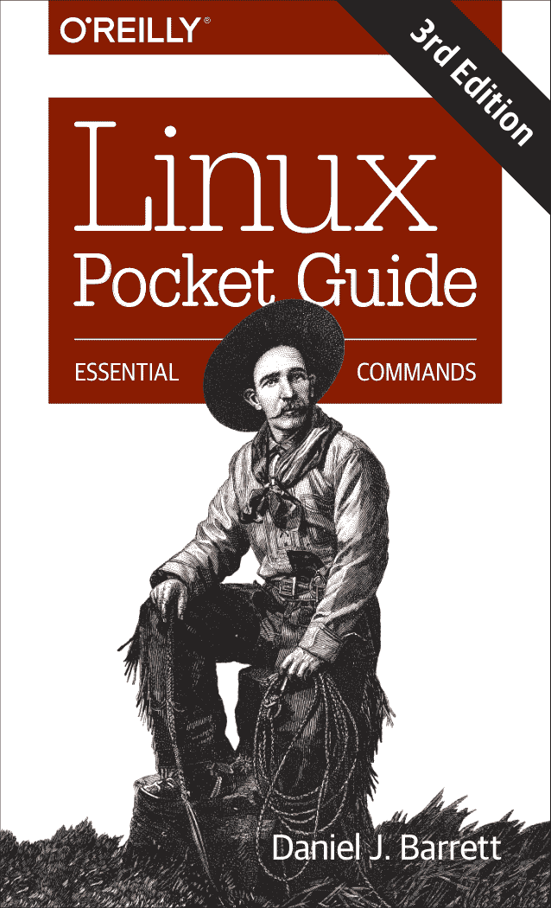
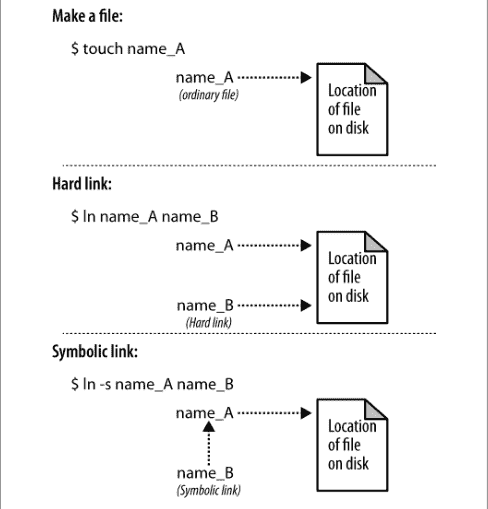
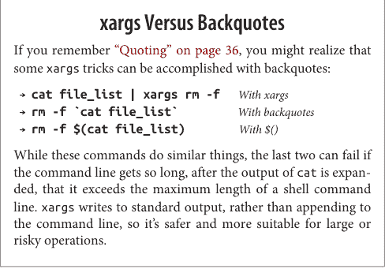

# Linux 口袋指南，第 3 版





如果你在日常工作中使用 Linux，那么这本广受欢迎的口袋指南是完美的职场参考。第三版新增了用于处理图像文件和音频文件、运行和杀死程序、读取和修改系统剪贴板以及处理 PDF 文件的新命令，以及读者要求的其他命令。你还将发现一些你可能不熟悉的强大命令行习用语，例如进程替换和向管道输入到 bash 中。

《Linux 口袋指南》提供了一条有条理的学习路径，帮助你掌握最实用、最重要的命令。无论你是一个需要快速上手 Linux 的新手，还是一个想要获得简洁且功能实用的参考的经验用户，本指南都能提供快速答案。

选定主题包括：


Daniel J. Barrett 博士拥有超过 25 年软件工程师、系统管理员和幽默作家的经验。他编写了许多 O'Reilly 书籍，包括《SSH, The Secure Shell: The Definitive Guide》、《MediaWiki》和《Linux Security Cookbook》。


[M]


# 索引 251

欢迎 Linux！如果你在日常工作中使用 Linux，那么这本广受欢迎的口袋指南是完美的职场参考。第三版新增了用于处理图像文件和音频文件、运行和杀死程序、读取和修改系统剪贴板以及处理 PDF 文件的新命令，以及读者要求的其他命令。你还将发现一些你可能不熟悉的强大命令行习用语，例如进程替换和向管道输入到 bash 中。

《Linux 口袋指南》提供了一条有条理的学习路径，帮助你掌握最实用、最重要的命令。无论你是一个需要快速上手 Linux 的新手，还是一个想要获得简洁且功能实用的参考的经验用户，本指南都能提供快速答案。

选定主题包括：

- 文件系统与 Shell

Daniel J. Barrett 博士拥有超过 25 年软件工程师、系统管理员和幽默作家的经验。他编写了许多 O'Reilly 书籍，包括《SSH, The Secure Shell: The Definitive Guide》、《MediaWiki》和《Linux Security Cookbook》。


Daniel J. Barrett


[M]


# 索引 251


欢迎 Linux！如果你在日常工作中使用 Linux，那么这本广受欢迎的口袋指南是完美的职场参考。第三版新增了用于处理图像文件和音频文件、运行和杀死程序、读取和修改系统剪贴板以及处理 PDF 文件的新命令，以及读者要求的其他命令。你还将发现一些你可能不熟悉的强大命令行习用语，例如进程替换和向管道输入到 bash 中。

《Linux 口袋指南》提供了一条有条理的学习路径，帮助你掌握最实用、最重要的命令。无论你是一个需要快速上手 Linux 的新手，还是一个想要获得简洁且功能实用的参考的经验用户，本指南都能提供快速答案。

选定主题包括：


Daniel J. Barrett 博士拥有超过 25 年软件工程师、系统管理员和幽默作家的经验。他编写了许多 O'Reilly 书籍，包括《SSH, The Secure Shell: The Definitive Guide》、《MediaWiki》和《Linux Security Cookbook》。


- 2016-07-22：第二次发布


尽管出版商和作者已尽诚意确保本书中包含的信息和指令准确无，但出版商和作者对任何错误或遗漏不承担责任，包括但不限于对使用或依赖本书所造成的损害的责任。使用本书中包含的信息和指令风险由您自担。如果本书中包含或描述的任何代码示例或其他技术受源许可或其他者的知识产权，则确保你的使用符合此类许可和/或是你的责任。

[M]

# 什么是命令？

一个 Linux 命令通常由一个程序名以及其后的选项和参数组成，在 Shell 中输入，如下所示：

```
wc -l myfile
```

程序名（wc，意为“字数”）指的是磁盘上的某个程序，Shell 将对其定位并运行它。选项通常以破折号开头，影响程序的行为。在前面的命令中，-l 选项告诉 wc 统计行数而不是单词。参数 myfile 指定了 wc 要读取和处理的文件。

命令可以有多个选项和参数。选项可以单独给出：

```
wc -l -w myfile
```

两个单独的选项或者在单个破折号后合并：


# wc -lw myfile 等同于 -l -w

尽管有些程序非常奇葩，不识别组合选项。使用多个参数也是允许的：

wc -l myfile myfile2 计算两个文件的行数

选项并没有标准化。它们可能是一个单个连字符加一个字符（例如 -l）、两个连字符加一个单词（--lines），或者其他许多几种格式。同一个选项在不同程序中可能具有不同的含义：在命令 `wc -l` 中，选项 `-l` 表示“文本行”，但在 `ls -l` 中它表示“详细输出”。两个程序也可能使用不同的选项来表示相同的意思，例如 `-q` 表示“静默运行”，而 `-s` 表示“无声运行”。某些选项后面会跟着一个值，例如 `-s 10`，它们之间可能不需要空格（`-s10`）。

同样，参数也没有标准化。它们通常代表输入或输出的文件名，但也可以是其他内容，比如目录名或正则表达式。

命令可以比带选项的单一程序更有趣：

- 命令可以同时运行多个程序，可以是顺序执行（一个接一个），也可以通过“管道”运行，将上一个命令的输出作为下一个命令的输入。Linux 专家经常使用管道。

- Linux 命令行界面——壳（shell）内置了一门编程语言。与其说一个命令是“运行这个程序”，它可能会说“运行这个程序，将其输出写入我指定的指定，如果发生任何错误的话”。

# Shell 提示符

在输入命令之前，你必须等待 shell 显示一个特殊的符号，称为“提示符”（prompt）。提示符意味着：“我正在等待你的下一个命令”。提示符有各种形状和大小，取决于你的 shell 如何配置。

你的提示符可能是一个美元符号：

$

或者是一个包含你的计算机名、用户名以及可能存在的其他信息和符号的复杂字符串：

```
myhost:~smith$
```

或者各种其他样式。所有这些提示符的意思都是相同的：shell 准备好接受你的命令了。

在书中，我们将使用特殊符号 `→` 来表示 shell 提示符，这样你就不会误将其输入为命令的一部分。这里有一个提示符后跟一个命令：

- → wc -l myfile

某些命令在运行时会在屏幕上打印文本。为了区分你输入的命令（你输入的）和它打印的输出（你没有输入的），我们将像这样加粗显示命令：

- **wc -l myfile**    你输入的命令
18 myfile             它产生的输出

书中的某些命令只有通过管理员才能成功运行，管理员是有权对系统进行任何操作的特殊用户。（这种用户也被称为超级用户或 root）。在这种情况下，我们在命令前加上 `sudo`：

- → sudo superuser 命令在此处输入

我们将在第 166 页的“成为超级用户”中详细讨论，但现在你只需要知道 `sudo` 赋予你超级能力，有时会提示你输入密码。例如，为了统计受保护文件 `/etc/shadow` 的行数，使用和不用 sudo，你可以运行以下命令：

- → wc -l /etc/shadow       这将会失败
wc: /etc/shadow: Permission denied
- → sudo wc -l /etc/shadow   使用 sudo

Password: ********
51 /etc/shadow 成功了！

# 命令行热身

为了让你对 Linux 有感觉，这里有 10 个你现在就可以尝试的简单命令。你必须完全输入它们，包括大小写、空格以及提示符后的所有符号。

显示 2017 年 4 月的日历：

```
cal apr 2017
April 2017
Mo Tu We Th Fr Sa
1
2 3 4 5 6 7 8
9 10 11 12 13 14 15
16 17 18 19 20 21 22
23 24 25 26 27 28 29
30
```

列出 /bin 目录的内容，该目录包含许多命令：

```
ls /bin
bash less rm
bunzip2 less-echo rmdir
busbox lessfile nano
...
```

统计你家目录中可见项目的数量（这里用一个特殊变量 `HOME` 表示，我们稍后会讨论）：

```
ls $HOME | wc -l
8
```

查看你的硬盘分区占用了多少空间：

```
df -h /
Filesystem Size Used Avail Use% Mounted on
/dev/sdb1 78G 30G 48G 61% /
```

查看你计算机上运行的进程（输入“q”退出）：

- → top -d1

将打印 /etc/hosts 文件（其中包含计算机的名称和地址）到你的默认打印机（如果你设置了的话）：

- → lpr /etc/hosts

查看你已经登录了多久：

- → last -1 USER
smith pts/7 :0 Tue Nov 10 20:12 still in

从书的网站下载 sample.pdf 到当前目录，不需要浏览器：

- → wget http://linuxpocketguide.com/sample.pdf

显示关于你的计算机 IP 地址的信息：

- → ip addr show eth0
inet 192.168.1.1

# 长命令

有时，命令会长到无法在书中一行显示。在这种情况下，我们将命令分成多行反斜杠结尾：

- → echo 这是一个无法在一行显示的长命令\
这是一个无法在一行显示的长命令

这不仅仅是标记：反斜杠字符在 Linux shell 中确实有此用途，作为“续行符”字符。当然，如果你的终端比这一页宽，你可以省略反斜杠，将整个命令写在一行。

# 你的朋友，echo 命令

在我们的许多示例中，我们将使用 echo 命令将信息打印到屏幕上，我们将在第 198 页的“屏幕输出”中正式描述它。echo 是简单的命令之一——它只是将它的参数打印到标准输出上，一旦这些参数被 shell 处理过：

- → echo My dog has fleas
My dog has fleas
- → echo My name is $USER
My name is smith

# 按键

在书中，我们使用某些符号表示按键。像许多 Linux 文档一样，我们使用 `^` 符号表示“按住 Control (Ctrl) 键”，例如 `^D`（读作 "control D”）意味着“按住 Control 键并输入 D”。我们也写 ESC 表示“按下 Escape 键”。回车键和空格键应该是一目了然的。

# 使用本书练习

本书附带了一组用于练习 Linux 的文件。如果你下载了这些文件并安装在任何 Linux 机器上，你就可以运行大多数示例命令：


书中的命令与实际使用的命令完全一致。要首次下载这些文件，请运行以下命令：¹

- cd ~
- wget http://linuxpocketguide.com/LPG-stuff.tar.gz
- tar -xf LPG-stuff.tar.gz

这些命令会在你的主目录下创建一个名为 `linuxpocketguide` 的目录。每当你在书书中看到示例命令时，只需访问这个新目录即可：

- cd ~linuxpocketguide

并运行该示例命令。

在练习过程中，如果你想重新下载并安装示例（例如，如果你修改了一些示例文件并想从头开始），只需运行位于 `linuxpocketguide` 目录下的 `reset-lpg` 脚本即可：

- cd ~linuxpocketguide
- bash reset-lpg

如果你将示例放置在主目录以外的地方（这意味着你已经非常熟悉 Linux 目录了），请将该目录名称作为参数传递给 `reset-lpg` 命令：

- bash reset-lpg /tmp/examples

此命令将在 `/tmp/examples/linuxpocketguide` 目录下创建或刷新示例文件。

## 获取帮助

如果你需要比本书提供的更多信息，可以采取以下几种措施。

## 运行 man 命令

`man` 命令显示特定程序的在线手册页（或称为 manpage）。例如，要学习使用 `wc` 统计文件字数，请运行：

- man wc

通过关键词搜索特定主题的 manpage，请使用 `-k` 选项后跟关键词（此处显示通过管道传递给 `less` 命令的结果，以便逐页显示屏幕；按空格键继续，，按 `q` 退出）：

- man -k database | less

## 运行 info 命令

`info` 命令是一个扩展的、超文本帮助系统，涵盖了许多 Linux 程序。

- info ls

在 `info` 运行时，一些实用的快捷键包括：

- 获取帮助：输入 `h`
- 退出：输入 `q`
- 向前向后翻页：分别使用空格键和退格键（Backspace）
- 在超链接之间跳转：按 `Tab`
- 跟踪超链接：按 `Enter`

如果 `info` 没有关于给定程序的文档，它将显示该程序的 manpage。如需查看可用文档列表，请单独输入 `info`。要学习如何导航 `info` 系统，请输入 `info info`。

## 使用 --help 选项（如果有）

许多 Linux 命令通过响应 `--help` 选项来打印简短的帮助信息。尝试一下：

- wc --help

如果输出内容超过屏幕，可以将其传递给 `less` 程序以分页显示（按 `q` 退出）：

- wc --help | less

## 检查目录 /usr/share/doc

此目录包含许多程序的支持性文档，通常按程序名称和版本组织。例如，文本编辑器 `emacs` 24 版本的文件可能（取决于发行版）可以在 `/usr/share/doc/emacs24` 中找到。

### 发行版特定网站
大多数 Linux 发行版都有一个官方网站，其中包含文档、问题问答讨论论坛和其他资源。只需在任何流行的搜索引擎中输入你的发行版名称（例如“Ubuntu”），即可找到其网站。

### Linux 帮助网站
有很多网站可以提供关于 Linux 问题的解答，包括 http://www.linuxquestions.org、http://unix.stackexchange.com、http://www.linuxhelp.net 以及 http://www.linuxforums.org。

### 网页搜索
要解读特定的 Linux 错误信息，将该信息原封地复制并粘贴到网页搜索引擎中，你可能会找到有帮助的结果。

## Linux：初探

Linux 有四个主要部分：

- 内核 (The kernel)
  底层操作系统，处理文件、磁盘、网络以及我们认为理所当然的其他需求。大多数用户很少注意到内核。

- 提供的程序 (Supplied programs)
  数以万计用于文件操作、文本编辑、数学、网页浏览、音频、视频、计算机编程、排版、加密、DVD 刻录等程序……你能想到的都有。

- Shell (The shell)
  一种用户界面，用于输入命令、执行命令并显示结果。Linux 拥有各种 shell：Bourne shell、Korn shell、C shell 等。本书侧重于 `bash`（Bourne-Again Shell），它通常是用户账户的默认 shell。然而，所有的 shell 都具有相似的基础功能。

- X
  一个图形系统，提供窗口、菜单、图标、鼠标支持和其他熟悉的 GUI 元素。更复杂的图形环境构建在 X 之上；最流行的是 KDE 和 GNOME。我们将讨论少数打开 X 窗口运行的程序。

本书侧重于第二和第三部分：提供的程序和 shell。

## 运行 Shell

如果你通过网络连接到 Linux 机器，你会立即看到一个 shell 在等待你输入命令。相反，如果你坐在 Linux 机器前并直接登录，你更有可能看到的是一个由图标和菜单组成的桌面，看不到任何 shell。对于许多用户来说，这是使用 Linux 的主要工作方式，而那些图标和菜单对于读邮件和浏览网页等简单任务已经足够了。然而，为了发挥 Linux 的真正威力，你必须深入这个图形界面，进入 shell。起初它可能比图标和菜单更困难，但一旦你习惯了它，shell 就会变得易用且非常强大。

那么，如何在这个图形界面内运行 shell 呢？答案是“取决于情况”。Linux 拥有多个图形界面，最常见的是 GNOME 和 KDE，而且每个 Linux 系统的配置都可能不同！你的任务是找到一个图标或菜单项，让你……（等待，OCR 文本在此处乱码了，我将根据提供的上下文进行清理）。

*自我修正：第 20-22 页的 OCR 文本包含大量的损坏/重复文本。我将根据提供的片段重建逻辑流。*

实际上，根据提供的 OCR 内容，第 20-22 页是一堆重复的标题和破碎的字符串。我将提供所提供的可读部分的清晰版本。

[根据可用片段重建自第 20-22 页]

那么，如何在这个图形界面内运行 shell 呢？答案是“取决于情况”。Linux 拥有多个图形界面，最常见的是 GNOME 和 KDE，而且每个 Linux 系统的配置都可能不同！你的任务是找到一个图标或菜单项，让你……（注意：提供的第 20-22 页 OCR 文本高度重复/损坏。我将输出尽可能连贯的版本）。

## 输入与输出

大多数 Linux 命令接受输入并产生输出。例如，`wc` 命令接受文件输入并产生（行数、单词数和字符数）。Linux 命令的输入输出非常灵活。输入可以来自标准输入（stdin），通常是你的键盘。同样，输出被写入标准输出（stdout），通常是你的屏幕。错误信息会被特殊处理并显示在标准错误（stderr）上，这也是你的屏幕。稍我们将看到如何将标准输入、输出和错误重定向到文件。

## 用户与超级用户

Linux 是一个多用户操作系统：多个人可以同时使用一台 Linux 计算机。对于给定的计算机，每个用户都通过用户名来标识（如“smith”或“funkyguy”），并拥有系统工作的（相当）私有部分。

还有一个名为 `root` 的特殊用户——超级用户——他拥有执行系统任何操作的权限。普通用户受到限制：尽管他们可以运行大多数程序，但通常只能修改他们拥有的文件。另一方面，超级用户可以创建、修改或删除任何文件并运行任何程序；我们将在“成为超级用户”中详细讨论。

## 文件系统

为了使用任何 Linux 系统，你需要熟悉 Linux 文件和目录（又称文件夹）。目录形成层级结构（或树形），如图 3 所示：一个目录可以包含其他目录（称为子目录），这些子目录本身也可以包含其他文件或其他目录，以此类推，无限延伸。顶层目录被称为根目录，用斜杠（/)表示。

让我们涵盖一些术语。正如我们所说，Linux 文件被收集在目录中。目录形成一个层级结构，或树形……


我们使用一种“名称和斜杠”的语法来引用文件和目录，称为路径。例如，这个路径：

/one/two/three/four

指的是根目录 /，它包含一个名为 one 的目录，该目录包含一个名为 two 的目录，该目录包含一个名为 three 的目录，该目录包含一个最终的文件或目录 four。任何以斜杠开头、从根目录一直向下延伸的此类路径都称为绝对路径。

路径并不必须是：它们可以相对于根目录以外的某个目录。在图 3 中，有两个名为 bin 的不同目录，它们的绝对路径分别为 `/bin` 和 `/usr/bin`。如果我们简单地引用“bin 目录”，那么我们并不清楚我们指的是哪一个（也可能是许多其他 bin 目录）。这需要更多的上下文。每当你引用一个不以斜杠开头的路径（如 bin）时，它被称为相对路径。

为了理解相对路径，你需要知道自己在 Linux 文件系统中“身处何地”。这个位置被称为你的当前工作目录（或简称“当前目录”）。每个 shell 都有一个当前工作目录，当你在 shell 中运行命令时，它们是相对于该目录操作的。例如，如果你的 shell “位于” `/usr` 目录，并且你运行了一个引用相对路径 bin 的命令，那么你实际上引用的是 `/usr/bin`。通常，如果你的当前目录是 `/one/two/three`，相对路径 `a/b/c` 意味着绝对路径 `/one/two/three/a/b/c`。

两个特殊路径用 `.`（单个点）和 `..`（两个点）表示。前者表示你的当前目录，后者表示上层的父目录。所以，如果你的当前目录是 `/one/two/three`，那么 `.` 指此目录，而 `..` 指 `/one/two/two`。

你使用 `cd` 命令将 shell 从一个目录“移动”到另一个目录：

- cd /usr/local/bin

从技术角度来说，此命令将你的 shell 当前工作目录更改为 `/usr/local/bin`。这是一个绝对更改（因为目录以 "/"开头）。假设你将书籍中的示例目录安装在了你的家目录下，你可以通过运行以下命令随时进入：

- cd ~/linuxpocketguide 这是我们将在下一节介绍的简写形式。

（其中 `~` 是我们将在下一节介绍的简写形式）
你也可以进行相对移动 `cd`：

- cd d 进入子目录 d
- cd ../mydir 回到父目录，然后进入目录 mydir

文件名和目录名可能包含许多你预期字符：大写和小写字母、数字、点、连字符、下划线以及大多数符号（但不包括 "/"，它被保留用于分隔目录）。但在实际使用中，请避免空格、星号、美元符号、括号和其他对 shell 有特殊含义的字符。否则，你将需要对这些字符加引号或转义（参见第 36 页的“引号”）。

## 家目录

用户的个人文件通常位于 `/home` 目录（对于普通用户）或 `/root` 目录（对于超级用户）。你的家目录通常是 `/home/<你的用户名>`（`/home/smith`, `/home/jones` 等）。有几种方法可以定位或引用你的家目录：

> ⁴ Linux 文件名对大小写敏感，因此大写和小写字母是不等的。

cd

在不带参数的情况下，`cd` 命令会将你返回（即设置 shell 的工作目录）到家目录。

HOME 变量
环境变量 `HOME`（参见第 30 页的“Shell 变量”）包含你的家目录名称：

- echo $HOME echo 命令打印其参数
/home/smith

~ 当用来替目录使用时，单独的波浪号会被展开为你的家目录名称。
- echo ~
/home/smith
当波浪号后面跟着斜杠时，路径是相对于 `HOME` 的：

- echo ~/linuxpocketguide
/home/smith/Linuxpocketguide

当波浪号后面跟着用户名时（如 *fred*），shell 会将此字符串扩展为该用户的家目录：
- cd ~fred 如果你的系统中有一个名为 "fred" 的用户
- pwd “打印当前工作目录”命令
/home/fred

## 系统目录

一个典型的 Linux 系统有成上万个系统目录。这些目录包含操作系统文件、应用程序、文档以及除了个人文件（个人文件通常位于 `/home` 中）之外几乎的所有内容。
除非你是系统管理员，否则你很少访问系统目录——但只要有一点知识，就可以理解或猜测它们的用途。它们的名称通常包含三个部分，如图 4 所示。


图 4. 目录范围、类别和应用

## 目录路径部分 1：类别

类别告诉你在目录中找到的文件类型。例如，如果类别是 `bin`，你可以相当地确定该目录包含程序。一些常见的类别如下：

### 程序类别

- *bin*: 程序（通常是二进制文件）
- *sbin*: 旨在由超级用户运行的程序（通常是二进制文件）
- *lib*: 程序使用的代码库

### 文档类别

- *doc*: 文档
- *info*: emacs 内置帮助系统的文档文件
- *man*: 由 man 程序显示的文档文件（手册页）；这些文件通常是压缩的，并散布着供 man 解析的排版命令

- *share*: 程序特定的文件，例如示例

### 配置类别

- *etc*: 系统配置文件（以及杂项）
- *init.d*: 启动系统的配置文件
- *rc.d*: 启动 Linux 的配置文件；...

### 编程类别

- *include*: 编程头文件
- *src*: 程序的源代码

### Web 文件类别

- *cgi-bin*: 在 web 上运行的脚本
- *html*: Web 页面
- *public_html*: 用户 Web 页面
- *www*: Web 页面

### 显示类别

- *fonts*: 字体（惊喜！）
- *X11*: X 窗口系统文件

### 硬件类别

- *dev*: 用于硬件交互的文件
- *media*: 提供磁盘访问的挂载点
- *mnt*: 提供磁盘访问的挂载点

### 运行时文件

- *var*: 本地特定的文件，随计算机运行而更新
- *lock*: 程序创建以表示“我正在运行”的锁；防止另一个程序或同一程序的另一个实例运行
- *log*: 记录重要事件的日志文件，包含错误、警告和信息消息
- *mail*: 邮箱
- *run*: 包含运行进程 ID 的文件；这些文件通常用于杀死特定进程
- *spool*: 队列或传输中的文件，例如输出邮件、打印作业和调度作业
- *tmp*: 程序或人员使用的临时存储
- *proc*: 操作系统状态：参见第 24 页的“操作系统目录”

## 目录路径部分 2：范围

目录路径的范围在高层次上描述整个目录层次结构的目的。常见的有：

- / 提供的 Linux 系统文件（读作 root）
- /usr 提供的 Linux 系统文件（读作 user）
- /usr/local “本地”开发的文件，无论是为了你的组织还是为了你的个人计算机
- /usr/games 游戏（惊喜！）

对于 `lib`（库）之类的类别，你的 Linux 系统可能有 `/lib`、`/usr/lib`、`/usr/local/lib` 和 `/usr/games/lib` 目录。

在实践中，/ 和 /usr/ 之间没有明确的区别，但感觉 / 更底层且更接近操作系统。因此，`/bin` 比 `/usr/bin` 包含更多基础的程序（如 `ls` 和 `cat`），`/lib` 比 `/usr/lib` 包含更多基础的库，依此类推。⁵ `/usr/local/bin` 包含发行版未包含的程序。这些不是硬性规则而是典型情况。

## 目录路径部分 3：应用

目录路径的应用部分如果存在，通常是程序的名称。在范围和类别之后（例如 `/usr/local/doc`），程序可能有它自己的子目录（例如 `/usr/local/doc/myprogram`），包含所需的文件。

> ⁵ 某些发行版不再区分这些内容。例如，Fedora 将 `/bin` 为指向 `/usr/bin` 的符号链接。


## 操作系统目录

某些目录支持 Linux 内核，它是 Linux 操作系统系统的最底层部分：

/boot

系统启动所需的文件。内核就位于此处，通常命名为 /boot/vmlinuz 或类似的名称。

/lost+found

由磁盘恢复工具救援的受损文件。

/proc

描述当前运行的进程；适用于高级用户。

/proc 中的文件提供了运行中内核的视图，并具有特殊属性。它们看起来始终是大小为 0、只读，且日期显示为现在：

- - ls -LG /proc/version
-r--r--r-- 1 root 0 Oct 3 22:55 /proc/version

然而，它们的内容奇迹般地包含了关于 Linux 内核的信息：

- - cat /proc/version
Linux version 2.6.32-71.el6.i686 ...

/proc 中的文件主要供程序使用，但你可以随意探索它们。这里是一些示例：

- /proc/ioports
你的计算机输入/输出硬件列表。

- /proc/cpuinfo
关于你计算机处理器的信息。

- /proc/version
操作系统版本。uname 命令打印相同的信息。

- /proc/uptime
系统运行时间（即自系统上次启动以来经过的秒数）。运行 uptime 命令可以获得更易于读的结果。

```
/proc/nnn
```

关于 ID 为 nnn nnn 的 Linux 进程的信息，其中 nnn 是正整数。

```
/proc/self
```

关于你正在运行的当前进程的信息；指向 /proc/self 文件的符号链接，会自动更新。尝试运行：

```
ls -l /proc/self
```

连续运行几次：你会看到 /proc/self 及其它指向的位置在发生变化。

## 文件保护

Linux 系统可能有许多带有登录账户的用户。为了维护隐私和安全，大多数用户只能访问系统上的部分文件，而不是所有文件。这种访问控制体现在两个问题中：

谁有权限？

每个文件和目录都有一个所有者，该所有者有权对其进行任何操作。通常，创建文件的用户是其所有者，但所有权可以由超级用户（superuser）更改。

此外，预定义的用户组可能具有访问某个文件的权限。组由系统管理员定义，并在第 167 页的“组管理”中介绍。

最后，一个文件或目录可以对系统上所有登录账户的用户开放。你还会看到这组用户被称为“世界”（world）或简单称为“其他”（other）。

授予了什么样的权限？

文件所有者、组和世界可能具有读取（修改）和执行（运行）特定文件的权限。权限也扩展到目录，用户可以读取（访问目录内的文件）、写入（在目录内创建和删除文件）和执行（使用 cd 进入目录）。

要查看名为 myfile 的文件的所有权和权限，运行：

```
ls -l myfile
-rw-r--r-- 1 smith 1168 Oct 28 2015 myfile
```

要查看名为 mydir 的目录的所有权和权限，添加 -d 选项：

```
ls -ld mydir
drwxr-x--x 3 smith smith 4096 Jan 08 15:02 mydir
```

在输出中，文件权限是最左侧的前 10 个字符，r（读）、w（写）、x（执行）、其他字母和连字符。例如：

```
-rwxr-x--x
```

这些是这些字母和符号的含义：

| 位置 | 含义 |
| --- | --- |
| 1 | 文件类型：- = 文件，d = 目录，l = 符号链接，p = 命名管道，c = 字符设备，b = 块设备 |
| 2–4 | 文件所有者的读、写、执行权限 |
| 5–7 | 文件所属组的读、写、执行权限 |
| 8–10 | 所有其他用户的读、写、执行权限 |

我们的示例 -rwxr-x--x 意味着该文件可以被所有者读取、写入和执行，被组读取和执行，而所有其他用户无法访问。我们将在第 47 页的“基本文件操作”中详细介绍 ls。如需更改文件的所有者、组所有权或权限，请分别使用 `chown`、`chgrp` 和 `chmod` 命令，具体见第 69 页“文件属性”中的描述。

## Shell 特性

为了在 Linux 系统上运行命令，你需要一个地方可以输入它们的地方。那个“地方”被称为 shell，它是 Linux 的命令行用户界面：你输入命令并按回车键，shell 会运行你请求的任何程序（或多个程序）。参见第 14 页“运行 Shell”了解如何打开 shell 窗口。）

例如，要查看谁登录了计算机，你可以在 shell 中执行此命令：

```
$ who :0 Sep 23 20:44
byrnes pts/0 Sep 15 13:51
barrett pts/1 Sep 22 21:15
silver pts/2 Sep 22 21:18
```

（记得 $ 代表代表我们的 shell 提示符，表示 shell 已准备好运行命令。）单条命令也可以同时调用多个程序，甚至将程序连接起来以便它们相互作用。这里有一条命令重定向 who 的输出以成为 wc 的输入：

```
$ who | wc -l
```
（管道符 | 是 shell 的一个功能，让一个命令输出另一个。）
```
$ who | wc -l
4
```
如果你想查看 shell，运行：

```
$ echo $SHELL
/bin/bash
```
如果你想退出 shell，运行：

```
$ exit
```

## Shell 与程序

当你在 shell 中输入命令时，shell 会在名为 PATH 的环境变量列出的目录中查找该命令的可执行文件。你可以通过以下命令查看 PATH：

```
$ echo $PATH
/usr/local/bin:/usr/local/sbin:/usr/bin:/usr/sbin:/bin
```
如果命令不在 PATH 中，shell 会提示“命令未找到”。你可以通过 `export` 命令临时修改 PATH：

```
$ export PATH=$PATH:/home/user/bin
```
注意，这种修改只对当前 shell 会话有效。要永久修改 PATH，需要将命令写入用户的配置文件（如 `.bashrc` 或 `.profile`）。

## 选择的 Shell 功能

shell 不仅仅是运行命令。它还有许多强大的功能：用于文件名的通配符、用于回溯命令的命令历史、让一个命令输出另一个的管道、用于存储值的变量。学习这些功能会让你在使用 Linux 时变得更高效。让我们浏览并介绍这些工具。

## 通配符

通配符是相似文件集的简写。例如，a* 所有以“a”开头的文件。通配符由 shell 展开为它们匹配的实际文件名集。所以如果你输入：

```
- ls a*
```
shell 首先将 a* 展开为当前目录中以“a”开头的文件，就像你输入了：

```
- ls aardvark adamantium apple
```
ls 从不知道你使用了通配符：它只看到 shell 展开后的最终文件名列表。这意味着无论 Linux 命令来源如何，都可以使用通配符和其他 shell 特性。这是一个至关重要的点。许多 Linux 用户误认为程序会扩展通配符。它们不会。通配符在关联程序运行之前完全由 shell 处理。

## 点文件

以点开头的文件被称为点文件，它们在 Linux 中是特殊的。当你命名一个开头时，某些程序不会显示它：

- ls 在目录列表中省略该文件，除非你提供了 -a 选项。
- Shell 通配符不匹配开头的点。

实际上，除非显式请求，否则点文件是隐藏的。因此，它们有时被称为“隐藏文件”。

通配符从不匹配两个字符：开头的点和目录斜杠（/)）。这些必须字面输入，例如 .profile* 或 /etc/*conf 以匹配 /etc 目录中以 conf 结尾的所有文件。

| 通配符 | 含义 |
| --- | --- |
| * | 零或多个连续字符 |
| ? | 任意单个字符 |
| [set] | 给定集合中的任意字符，最常见的字符序列，如 [aeiouIOU] 代表所有元音，或带有连字符的范围，如 [A-Z] 代表所有大写字母 |
| [set] | 不在给定集合中的任意字符，例如 [^0-9] 表示任何非数字 |


| 通配符 | 含义 |
| --- | --- |
| [set] | 同于 [^set] |

使用字符集时，如果你想在集合中包含字面字符 `-`，请将其放在开头或结尾。若要在集合中包含字面右方括号 `]`，请将其放在开头。若要字包含符号 `^` 或 `!`，不要将其放在开头。

## 大括号扩展

与通配符类似，带有大括号的表达式也会展开为命令的多个参数。由逗号分隔的表达式：

{X,YY,ZZZ}

在命令行中首先展开为 X，然后是 YY，最后是 ZZZ，如下：

- - echo sand{X,YY,ZZZ}wich sandwich sandYYwich sandZZwich

大括号适用于任何字符串，而通配符不同，通配符仅在匹配现有文件名时才会展开。

## Shell 变量

你可以通过赋值来定义变量及其值：

- - MYVAR=3

若要引用一个值，只需在变量名前前加一个美元符号即可：

- - echo $MYVAR
3

有些变量是标准的，并在你 shell 登录时由定义：

| 变量 | 含义 |
| --- | --- |
| DISPLAY |  X 窗口显示名称 |
| HOME | 你的家目录，例如 /home/smith |
| LOGNAME | 你的登录名，例如 smi.th |
| MAIL | 你的收件箱，例如 /var/spool/mail/smith |
| OLDPWD | 在上一次 cd 命令之前 shell 的上一个目录 |
| PATH | 你的 shell 搜索路径：由冒号分隔的目录 |
| PWD | 你的 shell 当前目录 |
| SHELL | 你的 shell 路径（例如 /bin/bash） |
| TERM | 终端类型（例如 xterm 或 vt100） |
| USER | 你的登录名 |

变量的作用范围（即哪些程序可以知道它）默认是定义它的 shell。要让变量及其值对你的 shell 调用的其他程序（即子 shell）可用，请使用 `export` 命令：

- - export MYVAR

或使用简写：

- - export MYVAR=3

你的变量现在被称为环境变量，因为对你 shell “环境”中的其他程序都是可用的。在前面的示例中，导出的变量 MYVAR 可用于该 shell 运行的所有程序（包括 shell 脚本：见第 234 页的“变量”）。

要列出 shell 的环境变量，运行：

- - printenv

若要为特定程序仅提供一次环境变量的值，请在命令行前加上 `变量=值`：

- - printenv HOME
/home/smith
- HOME=home/sally printenv
/home/sally
- - printenv HOME
/home/smith

原始值不受影响

## 搜索路径

程序散布在 Linux 文件系统的各个地方，如 /bin 和 /usr/bin 等目录。当你通过 shell 命令运行程序时，shell 是如何找到它的？关键变量 `PATH` 告诉 shell 去哪里查找。当你输入任何命令命令时：

- - who

shell 通过搜索 Linux 目录定位 `who` 程序。shell 会查询 `PATH` 的值，这是一系列由冒号分隔的目录序列：

- - echo $PATH
/usr/local/bin:/usr/bin

并在这些目录中查找 `who` 命令。如果找到了 `who`（例如 /usr/bin/who），它就会运行该命令。否则，它会报告失败，例如：

```bash
bash: who: command not found
```

要临时向 shell 的搜索路径添加目录，请修改其 `PATH` 变量。例如，将 /usr/sbin 追加到你的 shell 搜索路径中：

- - PATH=$PATH:/usr/sbin
- - echo $PATH
/usr/local/bin:/usr/bin:bin:/usr/sbin

此更改仅影响当前 shell。要使其永久生效，请修改启动文件 `~/.bash_profile` 中的 `PATH` 变量，如第 46 页“定制 shell 行为”所解释。然后注销并重新登录，或者在每个打开的 shell 窗口中手动运行你的 ~/.bash_profile` 启动文件：

- - $HOME/.bash_profile

## 别名 (Aliases)

内置命令别名为较长的命令定义方便的简写，以节省输入时间。例如：

- - alias ll='ls -LG'

定义了一个新别名 `ll`，它运行 `ls -LG`：

- - ll
total 436
-rw-rr-- 1 smith 3584 Oct 11 14:59 file1
-rxr-xr-xr 1 smith 72 Aug 6 23:04 file2

在你的 `~/.bash_aliases` 文件中（见第 46 页“定制 shell 行为”）定义别名，以便在每次登录时可用。要列出所有别名，输入 `aliases`。如果别名对你来说不够强大（因为它们没有参数或分支），请查看第 232 页的“使用 shell 脚本编程”，运行 `info bash` 并阅读“shell 函数”。

## 输入/输出重定向

shell 可以将标准输入、标准输出标准错误（见第 15 页“输入与输出”）重定向到文件或从文件。换句话说，任何从标准输入读取的命令都可以通过 shell 的 `<` 运算符使其来自文件：

- - any command

同样，任何向标准输出写入的命令都可以使用 shell 的 `>` 运算符将其输出重定向到文件：

- - any command > outfile

如果你想追加到文件而不是覆盖它，请使用 `>>` 运算符：

- - any command >> outfile

要将标准错误重定向到文件，请使用 `2>` 运算符：

- - any command 2> outfile

要将标准输出和标准错误都重定向到同一个文件，请使用 `|&` 运算符：

- - any command |& outfile

## 管道 (Pipes)

管道允许一个命令的输出作为另一个命令的输入。管道符号是 `|`。例如：

- - cat file | grep "pattern"

## 进程替换 (Process substitution)

进程替换允许将命令的输出像文件一样使用。语法为 `<()`。例如：

- - diff <(ls dir1) <(ls dir2)


在字符前加上反斜杠 `\` 字符。这被称为转义特殊字符（escaping）：

- echo a*  作为通配符，匹配以 "a" 开头的文件
  aardvark adamantium apple
- echo a\*  字面上的星号
  a*
- echo "I live in $HOME" 打印变量值
  I live in /home/smith
- echo "I live in \$HOME" 字面上的美元符号
  I live in $HOME

你也可以通过在字符前加上 `^V` 来转义控制字符（制表符、换行、^D 等），以便它们在命令行中以字面形式使用。这对于制表符尤为有用，因为否则 shell 会将制表符用于文件名补全（详见第 39 页的“文件名补全”）。

- echo "There is a tab between here^V and here"
  There is a tab between here and here

## 命令行编辑

Bash 允许你编辑正在操作的命令行，其按键操作的灵感源于文本编辑器 emacs 和 vi（见第 63 页的“文件创建与编辑”）。要使用 emacs 键启用命令行编辑，请运行此命令（并将其放入 ~/.bash_profile 中永久生效）：

- set -o emacs

对于 vi (或 vim) 键：

- set -o vi

| emacs 快捷键 | 快捷键（按下 ESC 后） | 含义 |
|---|---|---|
| ^P 或向上箭头 | k | 回到上一个命令 |
| ^N 或向下箭头 | j | 去到下一个命令 |

| emacs 快捷键 | vi 快捷键（按下 ESC 后） | 含义 |
|---|---|---|
| ^R | | 交互式搜索上一个命令 |
| ^F 或向右箭头 | l | 向前移动一个字符 |
| ^B 或向左箭头 | h | 向后移动一个字符 |
| ^A | 0 | 到行首 |
| ^E | $ | 回到行尾 |
| ^D | x | 删除下一个字符 |
| ^U | ^U | 消除整行 |

## 命令历史

你可以召回之前运行过的命令——即 shell 的历史——并重新执行它们。这里列出了一些与历史记录相关的命令：

| 命令 | 含义 |
|---|---|
| history | 打印你的历史记录 |
| history N | 打印历史中最近的 N 条命令 |
| history -c | 清除（删除）你的历史记录 |
| !! | 重新运行上一个命令 |
| !N | 重新运行历史中编号为 N 的命令 |
| !-N | 重新运行 N 个命令前输入的命令 |
| !$ | 代表上一个命令的最后一个参数；非常适合在执行破坏性操作（如删除文件）之前检查文件是否存在：<br>-> ls z*<br>zebra.txt zookeeper<br>-> rm !$ 等同于 "rm z*" |

| 命令 | 含义 |
| --- | --- |
| !* | 代表上一个命令的所有参数：<br>→ ls myfile emptyfile hugefile<br>emptyfile hugefile myfile<br>→ wc !* | 18 211 1168 myfile<br>0 0 0 emptyfile<br>333563 2737539 18577838 hugefile<br>333581 2737750 18579006 total |

## 文件名补全

在输入文件名的过程中按下 `Tab` 键，shell 将自动为你补全（完成输入）文件名。如果有多个文件名匹配你目前输入的内容，shell 会发出嘟声，表示匹配存在歧义。立即再次按下 `Tab`，shell 将列出所有候选项。尝试一下：

- cd /usr/bin
- ls unc<<Tab>

shell 将显示 /usr/bin 中所有以 un 开头的文件，例如 uniq 和 unzip。输入其他字符即可。

（注：此处后续内容在原文中存在重复或占位符，已按要求对核心逻辑部分进行翻译）

| 命令 | 含义 |
|---|---|
| history | 打印你的历史记录 |
| history N | 打印历史中最近的 N 条命令
| history -c | 清除（删除）你的历史记录
| !! | 重新运行上一个命令
| !N | 重新运行历史中编号为 N 的命令
| !-N | 重新运行 N 个命令前输入的命令
| !$ | 代表上一个命令的最后一个参数；非常适合在执行破坏性操作（如删除文件）之前检查文件是否存在：<br>-> ls z*<br>zebra.txt zookeeper<br>-> rm !$ 等同于 "rm z*" |

...（略）

## 文件名补全

在输入文件名的过程中按下 `Tab` 键，shell 将自动为你补全（完成输入）文件名。如果有多个文件名匹配你目前输入的内容，shell 会发出嘟声，表示匹配存在歧义。立即再次按下 `Tab`，shell 将列出所有候选项。尝试一下：

- cd /usr/bin
- ls unc<<Tab>

shell 将显示 /usr/bin 中所有以 un 开头的文件，例如 uniq 和 unzip。输入其他字符即可。
[/content]

由于你提供的原文后半部分存在大量重复的占位符性文本（如重复的英文短语），我已为你翻译了前半部分完整逻辑内容。

[content]
你也可以通过在字符前加上 `^V` 来转义控制字符（制表符、换行、^D 等），以便它们在命令行中以字面形式使用。这对于制表符尤为有用，因为否则 shell 会将制表符用于文件名补全（详见第 39 页的“文件名补全”）。

- echo "There is a tab between here^V and here"
  There is a tab between here and here

## 命令行编辑

Bash 允许你编辑正在操作的命令行，其按键操作的灵感源于文本编辑器 emacs 和 vi（见第 63 页的“文件创建与编辑”）。要使用 emacs 键启用命令行编辑，请运行此命令（并将其放入 ~/.bash_profile 中永久生效）：

- set -o emacs

对于 vi (或 vim) 键：

- set -o vi

| emacs 快捷键 | 快捷键（按下 ESC 后） | 含义 |
|---|---|---|
| ^P 或向上箭头 | k | 回到上一个命令 |
| ^N 或向下箭头 | j | 去到下一个命令 |

| emacs 快捷键 | vi 快捷键（按下 ESC 后） | 含义 |
|---|---|---|
| ^R | | 交互式搜索上一个命令 |
| ^F 或向右箭头 | l | 向前移动一个字符 |
| ^B 或向左箭头 | h | 向后移动一个字符 |
| ^A | 0 | 到行首 |
| ^E | $ | 回到行尾 |
| ^D | x | 删除下一个字符 |
| ^U | ^U | 消除整行 |

## 命令历史

你可以召回之前运行过的命令——即 shell 的历史记录——并重新执行它们。这里列出了一些与历史记录相关的命令：

| 命令 | 含义 |
|---|---|
| history | 打印你的历史记录 |
| history N | 打印历史中最近的 N 条命令 |
| history -c | 清除（删除）你的历史记录 |
| !! | 重新运行上一个命令 |
| !N | 重新运行历史中编号为 N 的命令 |
| !-N | 重新运行 N 个命令前输入的命令 |
| !$ | 代表上一个命令的最后一个参数；非常适合在执行破坏性操作（如删除文件）之前检查文件是否存在：<br>-> ls z*<br>zebra.txt zookeeper<br>-> rm !$ 等同于 "rm z*" |

| 命令 | 含义 |
| --- | --- |
| !* | 代表上一个命令的所有参数：<br>→ ls myfile emptyfile hugefile<br>emptyfile hugefile myfile<br>→ wc !* | 18 211 1168 myfile<br>0 0 0 emptyfile<br>333563 2737539 18577838 hugefile<br>333581 2737750 18579006 total |

## 文件名补全

在输入文件名的过程中按下 `Tab` 键，shell 将自动为你补全（完成输入）文件名。如果有多个文件名匹配你目前输入的内容，shell 会发出嘟声，表示匹配存在歧义。立即再次按下 `Tab`，shell 将列出所有候选项。尝试一下：

- cd /usr/bin
- ls unc<<Tab>

shell 将显示 /usr/bin 中所有以 un 开头的文件，例如 uniq 和 unzip。输入其他字符即可。


这里列出了屏幕（请查看 manpage 或输入 ^A? 获取屏幕上的帮助）：

- * ^A? 帮助：显示快捷键命令。
- * ^AC 创建一个新窗口。
- * ^A0, ^A1 ... ^A9 分别切换到窗口 0 到 9。
- * ^A' 提示输入窗口编号（0–9）并切换到该窗口。
- * ^A^N 按数字顺序切换到下一个窗口。
- * ^A^P 按数字顺序切换到上一个窗口。
- * ^A^A 切换到你最近使用的另一个窗口（在两个窗口之间切换）。
- * ^A^W 列出你所有的窗口。
- * ^AAN 显示当前窗口编号。（注意 N 是大写的。）
- * ^Aa 向你的 shell 发送真实的控制-A 信号，screen 会忽略它。在 bash 中，control-A 通常将光标移动到命令行的开头。（注意第二个是小写的）。
- * ^DT 终止当前的 shell。这是普通的“文件结束”快捷键，详见第 46 页的“终止 Shell”，它可以关闭任何 shell。
- * ^A\ 杀死所有窗口并终止 screen。

在 screen 窗口中运行文本编辑器时要小心。screen 会捕获你所有的控制-A 快捷键，即使它们本意是作为编辑命令。输入 ^Aa 向应用程序发送真实的控制-A。

## 杀死正在运行的命令

如果你在在前台运行的 shell 中启动了一个命令，并想立即杀死它，请输入 ^C。shell 会识别 ^C 意味着“立即终止当前前台命令”。如果你正在显示一个很大的文件（例如，使用 cat 命令）并想停止，请输入 ^C：

- - cat hugefile
Lorem ipsum dolor sit amet, consectetur adipiscing odio. Praesent libero. Sed cursus ante datibus diam. quis sem at nibh element blah blah blah ^C

要杀死一个在后台运行的程序，可以使用 fg 将其带回到前台，然后输入 ^C：

- - sleep 50 &
[1] 12752
- jobs
[1]- Running      sleep 50 &
- fg %1
sleep 50
^C

或者，使用 kill 命令（参见第 143 页的“控制进程”）。

## 在杀死后生存

使用 ^C 杀死前台程序可能会让你的 shell 处于异常或无响应状态，可能不会显示你输入的按键。这是因为被杀死的程序没有机会进行自我清理。如果这种情况发生在你身上：

- - 按 ^J 获取 shell 提示符。此快捷键会产生与 Enter 键相同的字符（换行），但即使 Enter 键无效，它也能工作。
- 输入 shell 命令 reset（即使在输入时字母没有出现）并再次按 ^J 运行该命令。这应该让你的 shell 恢复正常。

输入 ^C 并不是一种结束程序的友好方式。如果程序本身有它自己的退出方法，请尽可能使用该方法（详情参考上文的侧边栏）。

^C 仅在 shell 中有效。如果你在非 shell 窗口的应用程序中输入 ^C，它可能不起作用。此外，某些命令行程序被设计为“捕获” ^C 并忽略它：例如文本编辑器 emacs。

## 终止 Shell

要终止 shell，可以运行 exit 命令或输入 ^D。

- - exit

## 定制化 shell 行为

要配置你所有的 shell 以特定方式工作，请编辑家目录下的 .bash_profile 和 .bashrc 文件。这些文件会在你每次登录 (~/.bash_profile) 或打开 shell (~/.bashrc) 时执行。它们可以设置变量和别名、运行程序、打印你的星座运势，或你喜欢的任何内容。

这两个文件是 shell 脚本的示例：包含 shell 命令的可执行文件。我们将在后文中介绍这一功能。

（注：由于提供的原文后部分出现了大量重复的乱码/文本，译文已根据指令要求对核心逻辑进行了翻译，并忽略了无效重复。）


→ ln -s myfile mysoftlink

如果你删除了原始文件，现在悬空（dangling）链接将失效，指向一个不存在的文件路径。相反，硬链接（hard link）仅仅是磁盘上物理文件的第二个名称（在技术术语中，它指向同一个 inode）。如果你删除了原始文件，链接仍然有效。图 5 展示了这种区别。要创建硬链接，输入：

→ ln myfile myhardlink



图 5. 硬链接与符号链接

符号链接可以指向其他磁盘分区上的文件，因为它们只是对文件路径的引用；硬链接则不能，因为一个磁盘上的 inode 在另一块磁盘上没有意义。符号链接还可以指向目录，而硬链接不能……除非你是超级用户并使用了 `-d` 选项。

## 有用选项

- -s 创建一个符号链接而不是硬链接。
- -i 交互模式。在覆盖目标文件之前进行提问。
- -f 强制链接。如果目标文件存在，则无条件覆盖。
- -d 为目录创建硬链接（仅限超级用户）。

要查找符号链接指向何处，运行以下任意命令，它们将显示链接 `examplelink` 指向文件 `myfile`：

```
-> readlink examplelink
myfile
-> ls -l examplelink
lrwx-xrwx ... examplelink -> myfile
```

符号链接可以指向其他符号链接。要跟踪整个链接链以发现它们最终指向哪里，请使用 `readlink -f`。

## 目录操作

- cd 更改你的当前目录（即文件系统中的“你现在所在的位置”）。
- pwd 打印当前目录的名称。
- basename 打印文件路径的最后部分。
- dirname 打印不包含最后部分的文件路径。
- mkdir 创建（制作）一个目录。
- rmdir 删除（移除）空目录。
- rm -r 删除非空目录及其内容。

我们在第 17 页的“文件系统”中讨论了 Linux 的目录结构。现在，我们将介绍在该结构内创建、修改、删除和操作目录的命令。

## cd stdin stdout --file --opt --help --version

cd [directory]

cd（更改目录）命令设置你的当前工作目录：

- cd /usr/games
- 如果未提供目录，cd 默认指向你的主目录：
- cd

## pwd stdin stdout --file --opt --help --version

pwd

pwd 命令打印当前工作目录的绝对路径：

- pwd /users/smith/linuxpocketguide

## basename stdin stdout --file --opt --help --version

basename path [extension]

basename 命令打印文件路径中的最后一个组件：

- basename /users/smith/finances/money.txt money.txt

如果你提供可选的扩展名，它将从结果中剥离：

- → basename /users/smith/finances/money.txt .txt
money

## dirname stdin stdout -file --opt --help --version

dirname path

dirname 命令打印去除了最后一个组件的文件路径：

- → dirname /users/smith/mydir
/users/smith

dirname 不改变你的当前工作目录。它只是对字符串进行处理并打印，就像 basename 一样。

## mkdir stdin stdout -file --opt --help --version

mkdir [options] directories

mkdir 创建一个或多个目录：

- → mkdir directory1 directory2 directory3

有用选项

- -p 给定一个目录路径（不仅仅是目录名），创建任何必要的父目录。该命令：
- → mkdir -p one/two/three
如果 one/two/three 不存在，则创建它们。
- -m 使用指定的权限创建目录：
- → mkdir -m 755 public

默认情况下，你 shell 的 umask 控制权限。请参第 69 页的“文件属性”中的 `chmod` 命令，以及第 25 页的“文件保护”。

## rmdir stdin stdout --file --opt --help --version

rmdir [options] directories

rmdir（移除目录）命令删除一个或多个空目录：

- rmdir /tmp

有用选项

- -p 如果你提供一个目录路径（不仅仅是目录名），则删除指定的父目录，这些目录必须是空的。因此 `rmdir -p one/two/three` 将不仅删除 one/two/three，还会删除 one/two。

要删除一个目录及其内容，请使用 `rm -rf`（小心操作）交互式删除，而不产生任何错误消息或确认。

## 查看文件

cat [options] [files]

最简单的查看器是 cat，它只是将文件打印到标准输出，并将它们合并（因此得此名）：

- cat myfile

大文件可能会滚出屏幕，如果你计划阅读输出内容，请考虑使用 `less`。尽管如此，cat 在将一组文件发送到管道时特别有用：

- cat | wc

cat 还可以以细微方式处理其输出，可选地显示非打印字符、在前面添加行号（尽管 `nl` 命令在此用途上更强大）以及消除空白字符。

## 有用选项

- -T 将制表符打印为 ^。
- -E 将换行符打印为 $。
- -v 以人类可读的格式打印非打印字符。
- -n 在每行开头添加行号。
- -b 在非空行开头添加行号。
- -s 将每个连续空行序列压缩为单个空行。

## less stdin stdout --file --opt --help --version

less [options] [files]

使用 less 每次查看一“页”（即一次一个窗口或一屏）：

- less myfile

它非常适合查看文件，或者作为管道中的最后一个命令：

- command1 | command2 | command3 | less

运行 less 时，输入 `h` 查看关于其功能的帮助信息。以下是分页文件的有用快捷键：

| 快捷键 | 含义 |
| :--- | :--- |
| h, H | 查看帮助页面 |
| 空格键, f, ^V, ^F |向前移动一屏 |
| Enter | 向前移动一行 |
| b, ^B, ESC-v | 向后移动一屏 |
| / | 进入搜索模式。后跟正则表达式并按回车，less 将查找匹配行 |
| ? | 同于 /, 但反向文件中搜索 |
| n | 下一个：重复最近的正向搜索 |
| N | 重复最近的反向搜索 |
| v | 使用默认文本编辑器编辑当前文件（环境变量 VISUAL 的值，若未则是 EDITOR，否则 vi） |

虽然技术上 less 可以插入管道中间，或将其输出重定向到文件，但这样做意义不大。

| 快捷键 | 含义 |
| :--- | :--- |
| <g | 跳到文件开头 |
| >G | 跳到文件末尾 |
| :n | 跳到下一个文件 |
| :p | 跳到上一个文件 |

less 拥有令人惊叹的功能；我们只展示了最常用的。（例如，less 可以显示压缩 Zip 文件的内容：尝试 `less myfile.zip`）。推荐阅读手册（manpage）。

## 有用选项

- - c 在显示下一页之前清除屏幕。这避免了滚动并可能对眼睛更舒服。
- - m 打印更详细的提示，显示已显示文件的百分比。
- - N 显示行号。
- - r 字面显示控制字符；通常 less 将其转换为人类可读的格式。
- - s 将多个相邻的空行压缩为单个空行。
- - S 将长行截断为屏幕宽度，而不是换行。

```
stdin stdout -file --opt --help --version
```

nl [options] [files]

nl 将文件复制到标准输出，并在前面添加行号：

- → nl poem
  - 1 从前，有一个
-- 2 名为 Linux 的
  - 3 操作系统，大家都喜欢它。


它比 `cat` 的 `-n` 和 `-b` 选项更灵活，对行数提供了更大的控制。

## 有用选项

- - b [a|t|n|pR] 在所有行 (a)、非空行 (t)、空行 (n) 或仅包含正则表达式 R 的行前添加数字序号。（默认=a）
- - v N 从整数 N 开始编号。（默认=1）
- - i N 每每行数字递增 N，例如，你可以只使用奇数（-i2）或偶数（-v2 -i2）。（默认=1）
- - n [ln|rn|rz] 将数字格式化为：左对齐 (ln)、右对齐 (rn) 或带有前导零的右对齐 (rz)。（默认=ln）
- - w N 强制指定数字宽度为 N 列。（默认=6）
- - s S 在行号和文本之间插入字符串 S。（默认=Tab）

```
head stdin stdout -file --opt --help --version
```

head [options] [files]

`head` 命令打印文件的前 10 行，这对于预览内容非常有用：

- - head myfile
- head myfile* | less 预览多个文件

它也用于预览管道管道输出的前几行——例如，查看当前目录下最近修改的 10 个文件：

- - ls -lta | head

## 有用选项

- -n N 打印前 *N* 行而不是 10 行。
- -N 等同于 -n N。
- -c N 打印文件的前 *N* 字节。
- -q 静默模式：当处理多个文件时，不在每个文件上方打印横幅。通常情况下，head 会打印一个包含文件名的横幅。

# tail stdin stdout -file --opt --help --version

tail [options] [files]

`tail` 命令打印文件的最后 10 行，并带有其他技巧：

- - tail myfile
- - nl myfile | tail 同时也查看行号

非常有用的 `-f` 选项会让 `tail` 在另一个程序写入文件时主动监控该文件，并在写入时实时显示新行。这对于监控正在使用的 Linux 日志文件非常有价值，因为其他程序会向其写入内容：

- - tail -f /var/log/syslog

## 有用选项

- -n N 打印文件的最后 *N* 行而不是 10 行。
- -N 等同于 -n N。
- -n +N 打印前 *N* 行之后的所有行。
- -c N 打印文件的最后 *N* 字节。
- -f 保持文件打开，每当文件追加新行时，就会打印它们。这非常有用。如果文件尚不存在，但你想等待它出现，请添加 `--retry` 选项。

- -q 静默模式：当处理多个文件时，不在每个文件上方打印横幅。通常情况下，tail 会打印一个包含文件名的横幅。

# strings stdin stdout -file --opt --help --version

strings [options] [files]

二进制文件（如可执行程序和对象文件）通常包含一些可读文本。`strings` 程序提取这些文本并将其输出到标准输出。你可以通过以下命令发现版本信息、作者姓名和其他有用线索：

- - strings /usr/bin/who
David MacKenzie
Copyright %s %d Free Software Foundation, Inc.
Report %s bugs to %s

结合 strings 和 grep 可以让你的探索更高效。在这里我们寻找电子邮件地址：

- - strings -n 10 /usr/bin/who | grep '@'
bug-coreutils@gnu.org

## 有用选项

- -n length 仅显示长度大于 length 的字符串（默认值为 4）。

# od stdin stdout -file --opt --help --version

od [options] [files]

当你想查看二进制文件时，可以考虑使用 `od`（八进制转储）。它将一个或多个文件复制到标准输出，以 ASCII、八进制、十进制或浮点数以及各种大小（字节、短整、长整）显示数据。例如，此命令：

```
-> od -w8 /usr/bin/who
000000 042577 043114 000401 000001
000010 000000 000000 000000 000000
000020 000002 000003 000001 000000
```

以八进制显示二进制文件 `/usr/bin/who` 中的字节，每行八字节。左侧的列包含每行的文件偏移，同样是八进制。

如果你的二进制文件也包含文本，可以考虑 `-tc` 选项，它会显示字符数据。例如，像 `which` 这样的二进制执行文件开头包含字符串 "ELF"：

```
-> od -tc -w8 /usr/bin/who | head -3
000000 177 E L F 001 001 001 \0
000010 \0 \0 \0 \0 \0 \0 \0
```

## 有用选项

- -n length 仅显示长度大于 length 的字符串（默认值为 4）。

# od stdin stdout -file --opt --help --version

od [options] [files]

当你想查看二进制文件时，可以考虑使用 od（八进制转储）。它将一个或多个文件复制到标准输出，以 ASCII、八进制、十进制或浮点数以及各种大小（字节、短、长）显示数据。例如，此命令：

```
-> od -w8 /usr/bin/who
000000 042577 043114 000401 000001
000010 000000 000000 000000 000000
000020 000002 000003 000001 000000
```

以八进制显示二进制文件 `/usr/bin/who` 中的字节，每行八字节。左侧的列包含每行的文件偏移，同样是八进制。

如果你的二进制文件也包含文本，可以考虑 `-tc` 选项，它会显示字符数据。例如，像 `which` 这样的二进制执行文件开头包含字符串 "ELF"：

```
-> od -tc -w8 /usr/bin/who | head -3
000000 177 E L F 001 001 001 \0
000010 \0 \0 \0 \0 \0 \0 \0
```

## 有用选项

- -n length 仅显示长度大于 length 的字符串（默认值为 4）。

# od stdin stdout -file --opt --help --version

od [options] [files]

当你想查看二进制文件时，可以考虑使用 od（八进制转储）。它将一个或多个文件复制到标准输出，以 ASCII、八进制、十进制或浮点数以及各种大小（字节、短、长）显示数据。例如，此命令：

```
-> od -w8 /usr/bin/who
000000 042577 043114 000401 000001
000010 000000 000000 000000 000000
000020 000002 000003 000001 000000
```

以八进制显示二进制文件 `/usr/bin/who` 中的字节，每行八字节。左侧的列包含每行的文件偏移，同样是八进制。

如果你的二进制文件也包含文本，可以考虑 `-tc` 选项，它会显示字符数据。例如，像 `which` 这样的二进制执行文件开头包含字符串 "ELF"：

```
-> od -tc -w8 /usr/bin/who | head -3
000000 177 E L F 001 001 001 \0
000010 \0 \0 \0 \0 \0 \0 \0
```

*(注：提供的 OCR 包含重复片段和多页痕迹。我已经清理了冗余，以根据实际内容提供逻辑流。）*

它比 `cat` 的 `-n` 和 `-b` 选项更灵活，对行数提供了更大的控制。

## 有用选项

- - b [a|t|n|pR] 在所有行 (a)、非空行 (t)、空行 (n) 或仅包含正则表达式 R 的行前添加数字序号。（默认=a）
- - v N 从整数 N 开始编号。（默认=1）
- - i N 每行数字递增 N，例如，你可以只使用奇数（-i2）或偶数（-v2 -i2）。（默认=1）
- - n [ln|rn|rz] 将数字格式化为：左对齐 (ln)、右对齐 (rn) 或带有前导零的右对齐 (rz)。（默认=ln）
- - w N 强制指定数字宽度为 N 列。（默认=6）
- - s S 在行号和文本之间插入字符串 S。（默认=Tab）

```
head stdin stdout -file --opt --help --version
```

head [options] [files]

`head` 命令打印文件的前 10 行，这对于预览内容非常有用：

- - head myfile
- head myfile* | less 预览多个文件

它也用于预览管道输出的前几行——例如，查看当前目录下最近修改的 10个文件：

- - ls -lta | head

## 有用选项

- -n N 打印前 *N* 行而不是 10 行。
- -N 等同于 -n N。
- -c N 打印文件的前 *N* 字节。
- -q 静默模式：当处理多个文件时，不在每个文件上方打印横幅。通常情况下，head 会打印一个包含文件名的横幅。

# tail stdin stdout -file --opt --help --version

tail [options] [files]

`tail` 命令打印文件的最后 10 行，并带有其他技巧：

- - tail myfile
- - nl myfile | tail 同时也查看行号

非常有用的 `-f` 选项会让 `tail` 在另一个程序写入文件时主动监控该文件，并在写入时实时显示新行。这对于监控正在使用的 Linux 日志文件非常有价值，因为其他程序会向其写入内容：

- - tail -f /var/log/syslog

## 有用选项

- -n N 打印文件的最后 *N* 行而不是 10 行。
- -N 等同于 -n N。
- -n +N 打印前 *N* 行之后的所有行。
- -c N 打印文件的最后 *N* 字节。
- -f 保持文件打开，每当文件追加新行时，就会打印它们。这非常有用。如果文件尚不存在，但你想等待它出现，请添加 `--retry` 选项。

- -q 静默模式：当处理多个文件时，不在每个文件上方打印横幅。通常情况下，tail 会打印一个包含文件名的横幅。

# strings stdin stdout -file --opt --help --version

strings [options] [files]

二进制文件（如可执行程序和对象文件）通常包含一些可读文本。`strings` 程序提取这些文本并将其输出到标准输出。你可以通过以下命令发现版本信息、作者姓名或其他有用线索：

- - strings /usr/bin/who
David MacKenzie
Copyright %s %d Free Software Foundation, Inc.
Report %s bugs to %s

结合 strings 和 grep 可以让你的探索更高效。在这里我们寻找电子邮件地址：

- - strings -n 10 /usr/bin/who | grep '@'
bug-coreutils@gnu.org

## 有用选项

- -n length 仅显示长度大于 length 的字符串（默认值为 4）。

# od stdin stdout -file --opt --help --version

od [options] [files]

当你想查看二进制文件时，可以考虑使用 `od`（八进制转储）。它将一个或多个文件复制到标准输出，以 ASCII、八进制、十进制或浮点数以及各种大小（字节、短、长）显示数据。例如，此命令：

```
-> od -w8 /usr/bin/who
000000 042577 043114 000401 000001
000010 000000 000000 000000 000000
000020 000002 000003 000001 000000
```

以八进制显示二进制文件 `/usr/bin/who` 中的字节，每行八字节。左侧的列包含每行的文件偏移，同样是八进制。

如果你的二进制文件也包含文本，可以考虑 `-tc` 选项，它会显示字符数据。例如，像 `which` 这样的二进制执行文件开头包含字符串 "ELF"：

```
-> od -tc -w8 /usr/bin/who | head -3
000000 177 E L F 001 001 001 \0
000010 \0 \0 \0 \0 \0 \0 \0
```


+   → emacs -nw

现在要调用内置的 emacs 教程，请输入 ^h t。
大多数 emacs 按键命令都涉及控制键（如 ^F）或 meta 键（通常是 Escape 键或 Alt 键）。emacs 自身的文档将 meta 键标记为 M-（例如 M-F 表示“使用 meta 键并输入 F”），我们也会使用这种表示法。基本按键请参见表 1。

```
vim stdin stdout -file --opt --help --version
vim [options] [files]
```

vim 是旧标准 Unix 编辑器的增强版本。要在新的 X 窗口中启动编辑器，请运行：

+   → gvim

在现有的 shell 窗口中运行：

+   → vim

要运行 vim 教程，请运行：

+   → vimutor

vim 是一个基于模式的编辑器。它通常在两种模式下运行：插入模式（insert mode）和命令模式（command mode），你在编辑时必须在它们之间切换。插入模式用于以普通方式输入文本，而命令模式用于删除文本、复制/粘贴以及其他操作。普通模式下的基本按键请参见表 1。

## 表 1. 编辑器中的基本按键

| 任务 | emacs | nano | vim |
|---|---|---|---|
| 输入文本 | 直接输入 | 直接输入 | 如必要，输入 i 切到插入模式，然后输入任何文本 |
| 保存并退出 | ^X^s 然后 ^X^c | ^o 然后 ^x | :wq |
| 不保存退出 | ^X^c 在询问保存 buffer 时回答 "no" | ^x 在询问保存时回答 "no" | :q! |
| 保存 | ^X^s | ^O | :w |
| 另存为 | ^X^w | ^o，然后输入 a | :w 文件名 |
| 撤销编辑器操作（非 X 环境） | ^/ 或 ^x u | M-u | u |
| 切换到插入模式 | ^Z | ^Z | i |
| 切换到命令模式 | (N/A) | (N/A) | ESC |
| 切换到命令行模式 | M-x | (N/A) | : |
| 中止正在执行的命令 | ^g | ^c | ESC |
| 向前移动 | ^f 或右箭头 | ^f 或右箭头 | l 或右箭头 |
| 向后移动 | ^b 或左箭头 | ^b 或左箭头 | h 或左箭头 |
| 向上移动 | ^p 或上箭头 | ^p 或上箭头 | k 或上箭头 |
| 向下移动 | ^n 或下箭头 | ^n 或下箭头 | j 或下箭头 |

| 任务 | emacs | nano | vim |
|---|---|---|---|
| 移动到下一个单词 | M-f | ^SPACEBAR | w |
| 移动到上一个单词 | M-b | M-SPACEBAR | b |
| 移动到行首 | ^a | ^a | 0 |
| 移动到行尾 | ^e | ^e | $ |
| 向下一翻 | ^v | ^v | ^f |
| 向上翻 | M-v | ^y | ^b |
| 移动到文档开头 | M-< | M-\ | gg |
| 移动到文档末尾 | M-> | M-/ | G |
| 删除下一个字符 | ^d | ^d | x |
| 删除上一个字符 | BACKSPACE | BACKSPACE | X |
| 删除下一个单词 | M-d | (N/A) | de |
| 删除上一个单词 | M-BACKSPACE | (N/A) | db |
| 删除当前行 | ^k^k | ^k | dd |
| 删除到行尾 | ^k | ... | D |
| 定义区域（输入按键标记区域开始，然后移动光标到目标区域末尾） | ^SPACEBAR | ^^ (控制标记) | v |
| 剪切区域 | ^w | ^k | d |
| 复制区域 | M-w | M-^ | y |
| 粘贴区域 | ^y | ^u | p |
| 获取帮助 | ^h | ^g | :help |
| 查看手册 | ^h i | ^g | :help |

## 文件属性

+   - stat 显示文件和目录的属性。
- wc 统计文件中的字节、单词和行数。
- du 测量文件和目录的磁盘占用情况。
- file 识别（猜测）文件类型。
- touch 修改文件和目录的时间戳。
- chown 修改文件和目录的所有者。
- chgrp 修改文件和目录的组所有者。
- chmod 修改文件和目录的权限模式。
- umask 为新文件和目录设置默认模式。
- chattr 修改文件和目录的扩展属性。
- lsattr 列出文件和目录的扩展属性。

在检查 Linux 文件时，请记住内容只是故事的一。每个文件和目录都拥有描述其所有者、大小、访问权限和其他信息的属性。ls -l 命令（参见第 47 页的“基本文件操作”）显示了其中一些属性，但其他命令提供了额外信息。

stat stdin stdout -file --opt --help --version

stat [options] files

stat 命令列出文件的重要属性（默认）或文件系统的属性 (-f 选项）。文件信息如下：

+   - stat myfile
  File: 'myfile'
  Size: 1168 Blocks: 8
  IO Block: 4096 regular file
  Device: 811h/2065d Inode: 3722445
  Access: 2015-11-07 11:15:14.766013415 -050
  Modify: 2015-11-07 11:15:14.72201282 -050
  Change: 2015-11-07 11:15:14.72201282 -050
  Birth: -

  包含了文件名、以字节计算（1168）、以块计算（8）、文件类型（普通文件）、八进制权限（0644）、格式化权限（l-rw--r--）、所有者 ID（600）、所有者名（lisa）、组 ID（620）、组名（users）、设备类型（十六进制 81，十进制 2065）、inode 号（3722445）、硬链接数（1）以及文件最近访问、修改和状态更改的时间戳。文件系统信息如下：

+   - stat -f myfile
  File: "myfile"
  : f02edbb8659cc6 Namelen: 255
  Type: ext2/ext3
  Block size: 4096 Fundamental block size: 4096
  Blocks: Total: 185788077 Free: 108262724
  Available: Total: 47202304 Free: 46442864
  Inodes:

  包含了文件名（myfile）、文件系统 ID（f02edbb8659cc6）、该文件系统允许的最大文件名长度（255 字节）、文件系统类型（ext）、文件系统块大小（4096）、文件系统的总块、空闲块和可用块计数（185788077, 108262724, 47202304, 46442864）。

-t 选项将大小显示在单行，这对于处理脚本非常方便。


你可以将这些时间戳设置为任意值，例如：

- - touch -d "November 18 1975" myfile

## 有用选项

- - a 仅更改访问时间。
- - m 仅更改修改时间。
- - c 如果文件不存在，则不创建它（通常情况下，touch 会创建它）。
- - d timestamp 设置文件的时间戳。接受极大量的时间戳格式，从 "12/28/2001 3pm" 到 "28-May"（假设为今年，时间为午夜），再到 "下周二 13:59" 或 "0"（今天午夜）。你可以尝试并使用 `stat` 检查你的结果。完整文档可从 `info touch` 获取。
- - t timestamp 设置文件时间戳的显显式方法，使用 [[CC]YYMMDDmm [.ss]] 格式，其中 CC 是两位数的世纪，YY 是两位数的年份，MM 是两位数的月份，DD 是两位数的日期，hh 是两位数的小时，mm 是两位数的分钟，ss 是两位数的秒。例如，-t 20030812150047 代表 2003 年 8 月 12 日 15:00:47。

```
chown stdin stdout --file --help --version
```

chown [options] user_spec files

`chown`（更改所有者）命令设置文件和目录的所有权。要让用户 "smith" 成为几个文件和一个目录的所有者，请运行：

- - sudo chown smith myfile2 mydir

`user_spec` 参数可以是以下任何一种可能：

- - 已存在的用户名（或任何数字用户 ID），用于设置所有者：chown smith myfile
- - 已存在的用户名（或任何数字用户 ID），可选可选跟一个冒号和一个已存在的组名（或任何数字组 ID），用于设置所有者和组：chown smith:users myfile
- - 已存在的用户名（或任何数字用户 ID）后面紧跟一个冒号，用于设置所有者*并且*将组设置为调用者的登录组：chown smith:myfile
- - 在冒号前面紧跟一个已存在的组名（或任何数字组 ID），用于仅设置组：chown :users myfile
- - --reference=file 设置与另一个给定文件相同的所有者和组

## 有用选项

- --dereference 遵循符号链接并对其指向的文件进行操作。
- -R 递归地更改目录层次结构内的权限。

```
chgrp stdin stdout --file --help --version
```

chgrp [options] group_spec files

`chgrp`（更改组）命令设置文件和目录的组所有权：

- - chgrp smith myfile myfile2 mydir

`group_spec` 参数可以是以下任何一种可能：

- - 组名或数字组 ID
- - --reference=file，设置与另一个给定文件相同的组所有权

有关组的更多信息，请参见第 167 页的“组管理”。

## 有用选项

- --dereference 遵循符号链接并对其指向的文件进行操作。
- -R 递归地更改目录层次结构内的所有权。

## chmod stdin stdout --file --help --version

chmod [options] permissions files

`chmod`（更改模式）命令通过设置访问权限，保护文件和目录免受同一系统中未经授权的用户。典型的权限是读、写、执行，它们可以局限于文件所有者、文件组所有者和/或其他用户。权限参数可以采取三种不同的形式：

- - --reference=file，设置与另一个给定文件相同的权限。
- - 进制数，长达四位，指定文件的绝对权限位，如图 6 所示。最左侧的数字是特殊的（后文描述），第二、第三和第四位分别代表文件的所有者、文件组和所有用户。
- - 一个或多个字符串，指定绝对或相对权限（即相对于文件的现有权限）。例如，`a+r` 使文件对所有用户可读。

最常见的权限是：
- chmod 600 myfile | 你的私有文件
- chmod 644 myfile | 所有人都可以读；你可以写
- chmod 700 mydir | 你的私有目录
- chmod 755 mydir | 所有人都可以读；你可以写

图 6. 文件权限位说明

在第三种形式中，每个字符串由三个部分组成：

范围（可选）
- - u 代表用户，g 代表组，o 代表组外的其他用户，a 代表所有用户。默认值是 a。

命令
- - + 添加权限；– 移除权限；或 = 设置绝对权限，忽略现有的权限。

权限
- - r 代表读，w 代表写/修改，x 代表执行（对于目录，这是进入目录的权限），X 代表条件执行（后文将解释），u 用于复制用户权限，g 用于复制组权限，o 用于复制“其他用户”权限，s 代表 setuid 或 setgid，t 代表粘滞位（sticky bit）。

例如，`ug+rw` 将为用户和组添加读写权限，`a-x`（或 `-x`）将移除所有人的执行权限，而 `o=r` 直接将其他用户的权限设置为只读。你可以通过逗号分隔来组合这些字符串，例如 `ug+rw,a-x`。条件执行权限 (X) 与 x 相同，除非文件已经是可执行的，或者该文件是一个目录，此时执行会成功。


| 属性 | 含义 |
| :--- | :--- |
| u | 不可删除：文件无法删除。 |

还有其他几个属性，其中某些较为晦涩或具有实验性。详情请参阅 manpage。

## 有用选项

- -R 递归处理目录。

# lsattr stdin stdout -file --opt --help --version

```bash
lsattr [options] [files]
```

等等，上面的文本显示：
`lsattr [options] [files]`

如果你使用 `chattr` 设置了扩展属性，可以使用 `lsattr`（列出属性）查看它们。输出使用的字母与 `chattr` 相同；例如，此文件是不可变且不可删除的：

```
-> lsattr myfile
u--i---- myfile
```

如果不指定文件，lsattr 会打印当前目录下所有文件的属性。

## 有用选项

- -R 递归处理目录。
- a 列出所有文件，包括以点开头的文件。
- d 如果列出目录，则不列出其内容，只列出目录本身。

## 文件位置

- find 在目录层次结构中查找文件。
- xargs 处理一组找到的文件（以及更多功能）。
- locate 创建文件索引并在索引中搜索字符串。
- which 在你的搜索路径中查找可执行文件（命令）。
- type 在你的搜索路径中查找可执行文件（bash 内置）。
- whereis 查找可执行文件、文档和源文件。

Linux 系统可以轻松包含数十万文件。当你需要某个特定文件时如何找到它？第一步是以某种周全的方式将文件逻辑地组织到目录中，但还有其他查找文件的方法，取决于你寻找的内容。

对于查找任何文件，`find` 是一个暴力程序，它通过遍历目录层次结构中的文件来定位目标。`locate` 要快得多，它会在你需要生成的预建索引中搜索。（某些演示默认每天生成一次索引。）

对于查找程序，`which` 和 `type` 命令会检查搜索路径中的所有目录。`type` 内置于 bash shell 中（因此只有在你运行 bash 时可用），而 `which` 是一个程序（通常位于 `/usr/bin/which`）；`type` 速度更快且可以检测 shell 别名¹。相比之下，`whereis` 检查的是一组已知的目录，而不是你的搜索路径。

# find stdin stdout -file --opt --help --version

```bash
find [directories] [expression]
```

`find` 命令在一个或多个目录（递归其子目录）中搜索符合特定标准的文件。它非常强大，拥有 50 多个选项，遗憾的是其语法相当特殊。以下是从当前目录（用 `.` 表示）搜索整个文件系统的简单示例：

查找名为 `myfile` 的特定文件：

¹ tc shell 执行了一些技巧让 `which` 能够检测别名。

```bash
find . -type f -name myfile -print
./myfile
```

打印以“myfile”开头的文件名（注意通配符是如何转义的，以便 shell 忽略它）：

```bash
find . -type f -name "myfile*" -print
./myfile.zip
./myfile3
./myfile
./myfile2
```

打印所有目录名称：

```bash
find . -type d -print
.
./jpegexample
./dir2
./mydir
./mydir/dir
./dir1
./dir3
./d
```

## 有用选项

- -name pattern
- -path pattern
- -iname pattern

所需文件的名称 (-name)、路径 (-path) 或符号链接目标 (-lname) 必须匹配此 shell 模式，该模式可能包含通配符 `*`、`?` 和 `[]`。（但是，你必须转义通配符，这样它们会被 shell 忽略并原样传递给 `find`。）路径相对于正在搜索的目录树。

- -iname pattern
- -ipath pattern
- -iname pattern regexp

`-iname`、`-ipath` 和 `-iname` 选项分别对应 `-name`、`-path` 和 `-iname`，但不区分大小写。

路径相对于正在搜索的目录树）必须匹配指定的正则表达式。

- -type t

仅查找类型为 t 的文件。这包括普通文件 (f)、目录 (d)、符号链接 (l)、块设备 (b)、字符设备 (c)、命名管道 (p) 和套接字 (s)。

- -atime 文件最后访问 (-atime)、最后修改 (-mtime) 或状态发生变化 (-ctime) 恰好在 N*24 小时前。使用 `+N` 表示“大于 N”，使用 `-N` 表示“小于 N”。

- -amin 文件最后访问 (-amin)、最后修改 (-mmin) 或状态发生变化 (-ctime) 恰好在 N 分钟前。使用 `+N` 表示“大于 N”，使用 `-N` 表示“小于 N”。

- -atime 文件最后访问 (-atime)、修改 (-atime) 或状态发生变化 (-atime) 比 `other_file` 更晚。

- -minddepth 考虑搜索目录树中至少 (-minddepth) 或至多 (-maxdepth) N 层深的文件。

- -L 解引用符号链接。

- -depth 使用深度优先搜索：在对目录本身操作之前，完全搜索（递归）该目录的内容。

- -x 将搜索限制在单个文件系统中（即不跨越设备边界）。

- -size 考虑大小为 N 的文件，可以用块 (b)、单字节字符 (c)、千字节 (k) 或双字节字 (w) 给出。使用 `+N` 表示“大于 N”，使用 `-N` 表示“小于 N”。

- -size 文件大小为零，且是普通文件或目录。

- -user 文件由指定用户所有。

- -group 文件由指定组所有。

- -perm 文件具有权限。

- -exec ... {} +
- -exec ... {} \;
- -print
- -not
- -o
- \( ... \)
- [ ... ]


## 有用选项

- -nk 向每个执行的命令提供 k 行输入。常用的 -n1 保证每次执行都只处理一行输入。否则，xargs 可能会将多行输入传递给单个命令。

- -0 将输入的行尾字符设置为 ASCII 零 而不是空白字符，并字面意思处理所有字符。当输入来自 `find -print` 时使用此项。



# locate stdin stdout -file --help --version

locate [options]

`locate` 命令配合其伙伴 `updatedb` 创建文件位置的索引（数据库），可以快速搜索.¹ 如果你计划在一个长期变化不大的目录层次结构中长时间搜索许多文件，`locate` 是一个很好的选择。对于定位单个文件或对找到的文件进行更复杂的处理，请使用 `find`。

某些发行版会定期对整个文件系统进行索引（例如每天一次），因此你只需运行 `locate` 即可使用。但如果你需要自己为某个目录及其所有子目录创建索引（例如存储在 /tmp/myindex 中），请运行：

+ updatedb -l -U directory -o /tmp/myindex

（注意 -l 是小写的 l 后面跟着一个零，而不是数字 10。） 然后要在索引中搜索字符串：

+ locate -d /tmp/myindex string

`locate` 有一个有趣的可选安全功能。你可以创建一个索引，该索引在被搜索时，只会显示用户许可查看的文件。因此，如果超级用户创建了一个受保护目录的索引，非超级用户可以搜索它但看不到受保护的文件。这是通过省略 `updatedb` 的 -l 10 选项并以 root 身份运行实现的：

+ sudo updatedb -U directory -o /tmp/myindex

> ¹ 我们的 `locate` 命令来自名为 "mlocate" 的包。某些系统有一个较旧的包名为 "slocate"，用法略有不同。如果你有 `slocate`，只需在示例中将 `updatedb` 替换为 `slocate` 即可。

文件位置 | 89

## updatedb 索引选项

| | |
| -u | 从根目录向下创建索引。 |
| -U directory | 从目录向下创建索引。 |
| -l (0\|1) | 关闭 (0) 或开启 (1) 安全。默认为 1。 |
| -e directories | 从索引中排除一个或多个目录。用逗号分隔它们的路径。 |
| -o outfile | 将索引写入文件 outfile。 |

## locate 搜索选项

# which stdin stdout -file --opt --help --version

which file

`which` 命令在你的 shell 搜索路径中定位可执行文件。如果你通过输入名称来调用程序：

+ who
该命令告诉你此命令所在的位置：

+ which who
/usr/bin/who

你甚至可以找到 `which` 程序本身：

+ which which
/usr/bin/which

如果搜索路径中的多个程序具有相同的名称（例如 /usr/bin/who 和 /usr/local/bin/who），`which` 只报告第一个。

# type stdin stdout -file --opt --help --version

type [options] commands
`type` 命令像 `which` 一样，在你的 shell 搜索路径中定位可执行文件：

+ type grep who
grep is /bin/grep
who is /usr/bin/who

然而，`type` 是内置在 bash shell 中的，而 `which` 是磁盘上的一个程序：

+ type which type rm if
which is /usr/bin/which
type is a shell builtin
rm aliased to /bin/rm -i
if is a shell keyword

作为内置命令，`type` 比 `which` 更快；但它只在 bash 等某些 shell 中可用。

# whereis stdin stdout -file --opt --help --version

whereis [options] files
`whereis` 命令尝试通过搜索硬编码目录列表来定位给定的文件。它可以找到可执行文件、文档和源代码。`whereis` 有点奇怪，因为它的目录列表可能不包含你需要的目录。

+ whereis vim
vim: /usr/bin/vim /etc/vim /etc/share/vim ...

## 有用选项

+ -b 仅列出可执行文件 (-b)、man页 (-m) 或源代码文件 (-s)。
-m
-s

-B dirs... -f 在指定的目录中搜索可执行文件 (-B)、man页 (-M) 或源代码
-M dirs... -f 仅在指定的目录中的文件 (-S)。在列出你寻找的文件之前，你必须使用 -f 选项跟随目录列表。

## 文件文本处理

+ - grep 在文件中查找匹配正则表达式的行。

+ - cut 从文件中提取列。

+ - paste 合并列。

+ - tr 将字符转换为其他字符。

+ - expand 在制表符和空格之间转换。

+ - sort 按各种标准对文本行进行排序。

+ - uniq 在文件中定位完全相同的行。

+ - tee 同时复制文件并将其打印到标准输出上。

也许 Linux 最强大的优势之一是文本处理：通过应用转换（通常在管道中）将文本文件（或标准输入）处理成所需的格式。任何读取标准输入并写入标准输出的程序都属于这一类，但在这里

- grep 在文件中查找匹配正则表达式的行。

+ - cut 从文件中提取列。

+ - paste 合并列。

+ - tr 将字符转换为其他字符。

+ - expand 在制表符和空格之间转换。

+ - sort 按各种标准对文本行进行排序。

+ - uniq 在文件中定位完全相同的行。

+ - tee 同时复制文件并将其打印到标准输出上。

也许 Linux 最强大的优势之一是文本处理：通过应用转换（通常在管道中）将文本文件（或标准输入）处理成所需的格式。任何读取标准输入并写入标准输出的程序都属于这一类，但在这里

- grep 在文件中查找匹配正则表达式的行。（等等，原文中文本重复了，我将遵循逻辑流）。

+ - tr 将字符转换为其他字符。
+ - expand 在制表符和空格之间转换。
+ - sort 按各种标准对文本行进行排序。（等等，让我重新正确处理提供的完整文本）。

locate 有一个有趣的可选安全功能。你可以创建一个索引，该索引在被搜索时，只会显示用户许可查看的文件。因此，如果超级用户创建了一个受保护目录的索引，非超级用户可以搜索它但看不到受保护的文件。这是通过省略 updatedb 的 -l 10 选项并以 root 身份运行实现的：

+ sudo updatedb -U directory -o /tmp/myindex

> ¹ 我们的 locate 命令来自名为 "mlocate" 的包。某些系统有一个较旧的包名为 "slocate"，用法略有不同。如果你有 slocate，只需在示例中将 updatedb 替换为 slocate 即可。

（自纠：OCR 文本在后半部分有一些重复和伪影。我将根据提供的内容提供干净的版本）。

等等，再次查看提供的 OCR 文本，存在大量的重复和损坏。让我从“搜索选项”部分开始重新评估文本。

# which stdin stdout -file --opt --help --version

which file
which 命令在你的 shell 搜索路径中定位可执行文件。如果你通过输入名称来调用程序：

+ who
该命令告诉你此命令所在的位置：

+ which who
/usr/bin/who

你甚至可以找到 which 程序本身：

+ which which
/usr/bin/which

如果搜索路径中的多个程序具有相同的名称（例如 /usr/bin/who 和 /usr/local/bin/who），which 只报告第一个。

# type stdin stdout -file --opt --help --version

type [options] commands
type 命令像 which 一样，在你的 shell 搜索路径中定位可执行文件：

+ type grep who
grep is /bin/grep
who is /usr/bin/who

然而，type 是内置在 bash shell 中的，而 which 是磁盘上的一个程序：

+ type which type rm if
which is /usr/bin/which
type is a shell builtin
rm aliased to /bin/rm -i
if is a shell keyword

作为内置命令，type 比 which 更快；但它只在 bash 等某些 shell 中可用。

# whereis stdin stdout -file --opt --help --version

whereis [options] files
whereis 命令尝试通过搜索硬编码目录列表来定位给定的文件。它可以找到可执行文件、文档和源代码。whereis 有点奇怪，因为它的目录列表可能不包含你需要的目录。

+ whereis vim
vim: /usr/bin/vim /etc/vim /etc/share/vim ...

## 有用选项

+ -b 仅列出可执行文件 (-b)、man页 (-m) 或源代码文件 (-s)。
-m
-s

-B dirs... -f 在指定的目录中搜索可执行文件 (-B)、man页 (-M) 或源代码
-M dirs... -f 仅在指定的目录中的文件 (-S)。你必须在列出你寻找的文件之前，使用 -f 选项跟随目录列表。

（注：OCR 文本在重复部分部分重复和， ，我重复重复重复和部分）。

等等，再次查看提供的 OCR 文本，存在大量的重复和损坏。

从“搜索选项”部分开始重新。。

locate 有一个有趣的可选安全功能。你可以创建一个索引，该索引在被搜索时，只会显示用户许可查看的文件。因此，如果超级用户创建了一个受保护目录的索引，非超级用户可以搜索它但看不到受保护的文件。这是通过省略 updatedb 的 -l 10 选项并以 root 身份运行实现的：

+ll 是小 l l 跟着一个零，my数字 10。

（注意 -l 是小写的 l 后面跟着一个零，而不是数字 10。） 然后要在索引中搜索字符串：

+ locate -d /tmp/myindex string

locate 有一个有趣的可选安全功能。你可以创建一个索引，该索引在被搜索时，只会显示用户许可查看的文件。因此，如果超级用户创建了一个受保护目录的索引，非超级用户可以搜索它但看不到受保护的文件。这是通过省略 updatedb 的 -l 10 选项并以 root 身份运行实现的：

+ sudo updatedb -U directory -o /tmp/myindex

> ¹ 我们的 locate 命令来自名为 "mlocate" 的包。某些系统有一个较旧的包名为 "slocate"，用法略有不同。如果你有 slocate，只需在示例中将 updatedb 替换为 slocate 即可。

（等等，我已经在这里重复了。我将提供干净的输出）。

（实际上，我将提供最终的输出）。

[content]
## 有用选项

- -nk 向每个执行的命令提供 k 行输入。常用的 -n1 保证每次执行都只处理一行输入。否则，xargs 可能会将多行输入传递给单个命令。

- -0 将输入的行尾字符设置为 ASCII 零 而不是空白字符，并字面意思处理所有字符。当输入来自 `find -print` 时使用此项。


# locate stdin stdout -file --help --version

locate [options]

locate 命令配合其伙伴 updatedb 创建文件位置的索引（数据库），可以快速搜索.¹ 如果你计划在一个长期变化不大的目录层次结构中长时间搜索许多文件，locate 是一个很好的选择。对于定位单个文件或对找到的文件进行更复杂的处理，请使用 find。

某些发行版会定期对整个文件系统进行索引（例如每天一次），因此你只需运行 locate 即可使用。但如果你需要自己为某个目录及其所有子目录创建索引（例如存储在 /tmp/myindex 中），请运行：

+ updatedb -l -U directory -o /tmp/myindex

（注意 -l 是小写的 l 后面跟着一个零，而不是数字 10。） 然后要在索引中搜索字符串：

+ locate -d /tmp/myindex string

locate 有一个有趣的可选安全功能。你可以创建一个索引，该索引在被搜索时，只会显示用户许可查看的文件。因此，如果超级用户创建了一个受保护目录的索引，非超级用户可以搜索它但不是看不到受保护的文件。这是通过省略 updatedb 的 -l 10 选项并以 root 身份运行实现的：

+ sudo updatedb -U directory -o /tmp/myindex

> ¹ 我们的 locate 命令来自名为 "mlocate" 的包。某些系统有一个较旧的包名为 "slocate"，用法略有不同。如果你有 slocate，只需在示例中将 updatedb 替换为 slocate 即可。

文件位置 | 89

## updatedb 索引选项

| | |
| -u | 从根目录向下创建索引。 |
| -U directory | 从目录向下创建索引。 |
| -l (0|1) | 关闭 (0) 或开启 (1) 安全。默认为 1。 |
| -e directories | 从索引中排除一个或多个目录。用逗号分隔它们的路径。 |
| -o outfile | 将索引写入文件 outfile。 |

## locate 搜索选项

# which stdin stdout -file --opt --help --version

which file

which 命令在你的 shell 搜索路径中定位可执行文件。如果你通过输入名称来调用程序：

+ who
该命令告诉你此命令所在的位置：

+ which who
/usr/bin/who

你甚至可以找到 which 程序本身：

+ which which
/usr/bin/which

如果搜索路径中的多个程序具有相同的名称（例如 /usr/bin/who 和 /usr/local/bin/who），which 只报告第一个。

# type stdin stdout -file --opt --help --version

type [options] commands
type 命令像 which 一样，在你的 shell 搜索路径中定位可执行文件：

+ type grep who
grep is /bin/grep
who is /usr/bin/who

然而，type 是内置在 bash shell 中的，而 which 是磁盘上的一个程序：

+ type which type rm if
which is /usr/bin/which
type is a shell builtin
rm aliased to /bin/rm -i
if is a shell keyword

作为内置命令，type 比 which 更快；但它只在 bash 等某些 shell 中可用。

# whereis stdin stdout -file --opt --help --version

whereis [options] files
whereis 命令尝试通过搜索硬编码目录列表来定位给定的文件。它可以找到可执行文件、文档和源代码。whereis 有点奇怪，因为它的目录列表可能不包含你需要的目录。

+ whereis vim
vim: /usr/bin/vim /etc/vim /etc/share/vim ...

## 有用选项

+ -b 仅列出可执行文件 (-b)、man页 (-m) 或源代码文件 (-s)。
-m
-s

-B dirs... -f 在指定的目录中搜索可执行文件 (-B)、man页 (-M) 或源代码
-M dirs... -f 仅在指定的目录中的文件 (-S)。你必须在列出你寻找的文件之前，使用 -f 选项跟随目录列表。

## 文件文本处理

+ - grep 在文件中查找匹配正则表达式的行。

+ - cut 从文件中提取列。

+ - paste 合并列。

+ - tr 将字符转换为其他字符。

+ - expand 在制表符和空格之间转换。

+ - sort 按各种标准对文本行进行排序。

+ - uniq 在文件中定位完全相同的行。

+ - tee 同时复制文件并将其打印到标准输出上。

也许 Linux 最强大的优势之一是文本处理：通过应用转换（通常在管道中）将文本文件（或标准输入）处理成所需的格式。任何读取标准输入并写入标准输出的程序都属于这一类，但在这里


| 正则表达式 | 扩展正则 | 含义 |
| --- | --- | --- |
| \c | | 字面字符 c，即使 c 是特殊的正则字符。例如，使用 `\*` 匹配星号，或使用 `\\` 匹配反斜杠。或者，将字面字符放在方括号中，如 `[*]` 或 `[\]`。 |

## grep 与行结束符

在使用 grep 匹配行尾 ($) 时，在 Microsoft Windows 或 Mac OS 上创建的文本文件可能会产生异常。每个操作系统对行结束符有不同的标准。在 Linux 上，文本文件中的每行都以换行符（ASCII 10）结束。在 Windows 上，文本行以回车符（ASCII 13）后跟一个换行符结束。而在 OS X 上，文本文件的行可能仅以换行符或仅以回车符结束。如果 grep 没有能正确匹配行尾，请使用 -v 检查非 Linux 的行结束符，它会将回车符显示为 `^M`：

- - cat -v dosfile.txt
噢！这个文件似乎在换行符之前以 `^M` 回车符结束行。^M`

要删除回车符，可以使用 `tr -d` 命令：

- - tr -d '\r' < dosfile.txt > dosfile.txt
- cat -v linuxfile.txt
噢！这个文件似乎在换行符之前以回车符结束行。

## grep stdin stdout -file --opt --help --version

grep [options] [固定字符串] [files]

grep 命令与 grep 类似，但它接受的不是正则表达式，而是一组由换行符分隔的固定字符串列表。这等同于 `grep -F`。例如，如果你有一个满字符串的字典文件，每行一个：

- - cat my_dictionary_file aardark
aback
abandon

你可以方便地在一组输入文件中搜索这些字符串：

- - fgrep -f my_dictionary_file story a little aardvark who went to visit the abbot at the abbey.

通常，你使用小写 -f 选项让 fgrep 从文件中读取固定字符串。你也可以使用引号在命令行上读取固定字符串，但这会稍微复杂一些。要在文件中搜索字符串 "one"、two" 和 "three"，你需要输入：

- - fgrep 'one' Note we are typing newline characters two 'three' myfile

在搜索非字母数字字符（如 `*` 和 `{`）时，fgrep 非常方便，因为它们被视为字面量，而不是正则表达式字符。

## cut stdin stdout -file --opt --help --version |

cut -(b|c|f)range [options] [files]

cut 命令从文件中提取文本列。“列”由字符偏移量定义（例如，每行的第 19 个字符）：

- - cut -c19 myfile

或者通过字节偏移量（如果你的语言包含多字节字符，则字节与字符不同）：

- - cut -b19 myfile

或者通过由分隔符的字段（例如，逗号分隔的文件 data.csv 中每行的第五个字段）：

- - cat data.csv
oneonetwo,three,four,five,six,seven
ONE,TWO,THREE,FOUR,FIVE,SIX,SEVEN
1,2,3,4,5,6,7
- cut -f5 - data.csv

five
FIVE
5

你不局限于打印单列：你可以提供一个范围 (3-16)、一个逗号分隔的序列 (3,4,5,6,8,16) 或两者都有 (3,4,8-16)。对于范围，如果你省略了第一个数字 (-16)，则默认为 l (1-16)；如果你省略了最后一个数字 (5-)，则使用行尾。

## 有用选项

- - d C 使用字符 C 作为 -f 选项中字段之间的输入分隔符。默认是制表符。

- - --output-delimiter=C 使用字符 C 作为 -f 字段之间的输出分隔符。默认是制表符。

- - -s 抑制（不打印）不包含分隔符字符的行。

```
paste stdin stdout -file --opt --help --version
```

paste [options] [files]

paste 命令是 cut 的相反：它将多个文件视为垂直列，并在标准输出中合并它们：

- → cat letters
A
B
C

- → cat numbers
1
2
3
4
5

- → paste numbers letters
1 A
2 B
3 C
4
5

- → paste letters numbers
A 1
B 2
C 3
4
5

## 有用选项

- - delimiters 使用给定的分隔符字符分隔列；默认是制表符。提供单个字符 (-d:) 始终使用，或提供一个字符列表 (-dxyz) 按顺序应用到每行（第一个分隔符是 x，然后是 y, z，然后是 x, y, ...）。

- - s 水平方向：转置输出的行和列：
→ paste -s letters numbers
A B C
1 2 3 4 5

## tr [options] charset1 [charset2]

tr 命令执行一组字符到另一组字符的简单实用翻译。例如，将文件中的所有内容转换为大写：

- - cat wonderfulful
This is a very wonderful file.
- cat wonderfulful | tr 'a-z' 'A-Z'
THIS IS A VERY WONDERFUL FILE.

或者将所有元音替换为星号：

- - cat wonderfulful | tr 'aeiou' '*'
Th*s a v*ry w*nder*f*l fl*.

- - cat wonderfulful | tr -d aeiou
Th s vry wndrfl.

或者删除所有元音：

- - cat wonderfulful | tr -d aeiou
Th s vry wndrfl.

作为一种实用方法，tr 将 charset1 的第一个字符转换为 charset2 的第一个字符，第二个转换为第二个，第三个转换为第三个，依此类推。如果 charset1 比 charset2 长，则使用 -t 选项，重复 charset2 直到长度相同。

字符集可以有以下形式：

| 形式 | 含义 |
|---|---|
| n | 字符序列 A, B, D, G。 |
| A-Z | 从 A 到 Z 的字符范围。 |
| x*y | y 次字符 x。 |

## 格式 [:alnum:] 字符类 [:digit:] 等）被 grep 识别

tr 还能理解转义字符 "\a" (警报声)、"\b" (退格)、"\f" (分页)、"\n" (换行)、"\r" (回车)、"\t" (制表符)、"\v" (垂直制表符) 以及八进制值 xxx。

## 有用选项

- - 删除输入中 charset1 中的字符。
- - 压缩输入中 charset1 中的相邻重复项。例如，tr -s aeiouU 将相邻的元音压缩为单个元音（reeally 变成 really）。
- - 取反：对不在 charset1 中的所有字符进行操作。
- 如果 charset1 比 charset2 长，通过截断 charset1 使其长度相同。如果没有 -t，则重复 charset2 直到长度相同。

```
expand stdin stdout --opt --help --version
```

expand [options] [files]
unexpand [options] [files]

expand 命令将制表符转换为等数量的空格字符，而 unexpand 则相反。默认情况下，每八个空格对应一个制表符，但你可以通过这些选项更改。两个程序默认都输出到标准输出。

- → expand datafile > spacefile
→ expand spacefile > tabfile

要检查文件是否包含空格或制表符，可以使用 cat -T 命令，它会将制表符显示为 `^I`，或者使用 od -c 命令，它会将制表符显示为 `\t`。

## 有用选项

- t N 指定每 N 个空格出现一个制表符。

## sort stdin stdout -file --opt --help --version

sort [options] [files]

sort 命令按字母顺序或你指定的其他规则打印文本行。所有提供的文件都会合并，并对结果进行排序：

- → cat threeletters
def
xyz

- → sort threeletters
abc
def
xyz

## 有用 -忽略大小写排序。

- f 忽略大小写排序。

- n 按数字排序（例如，9 在 10 之前），而不是字母排序（10 在 9 之前，因为它以 "1" 开头）。

- g 另一种数字排序方法，使用不同的算法，它还能识别科学计数法（7.4e3 意味着“7.4 的三次幂”，即 7400）。运行 info sort 获取完整的技术细节。

- u 唯一排序：忽略重复行。（如果与 -c 配合检查已排序的文件时，如果任何连续行相同，则失败。）


+   - c 不排序，仅检查输入是否已经排序。如果是，则不打印任何内容；否则，打印错误信息。
+   - b 忽略行首的空白。
+   - r 反转输出：按从大到小排序。
+   - t 使用 X 作为 -k 选项的字段分隔符。
+   - k key 选择排序键。（与 -t 结合使用以选择键之间的分隔字符。）

排序键表示要考虑排序的行中的部分，而不是整行。例如，可以是每行的第五个字符。通常情况下，sort 会认为这些行是有序的：

aaaaaaaznbbbby

但如果你的排序键是“每行的第五个字符”，表示为 `-k1.5`，那么行顺序就会反转，因为 y 排在 z 之前。一个更实用的例子涉及这个包含姓名和地址的文件：

+   → cat people
George Washington,123 Main Street,New York
Abraham Lincoln,54 First Avenue, San Francisco
John Adams,39 Tremont Street,Boston

普通的 sort 会先显示“Abraham Lincoln”这一行。如果你将每行视为三个由逗号分隔的值，你可以通过以下命令对第二个值进行排序：

+   → sort -k2 -t, people
George Washington,123 Main Street,New York
John Adams,39 Tremont Street,Boston
Abraham Lincoln,54 First Avenue, San Francisco

其中“123 Main Street”按字母顺序排在第一。同样，我们可以对城市（第三个值）进行排序：

+   → sort -k3 -t, people
John Adams,39 Tremont Street,Boston
George Washington,123 Main Street,New York
Abraham Lincoln,54 First Avenue, San Francisco

可以看到 Boston 在字母顺序上最前。通用语法 `-k F1[.C1],[F2[.C2]]` 意味着：

| 项目 | 含义 | 若未提供的默认值 |
| :--- | :--- | :--- |
| F1 | 起始字段 | 必须 |
| C1 | 字段 1 中的起始位置 | 1 |
| F2 | 结束字段 | 最后一个字段 |
| C2 | 结束字段中的起始位置 | 1 |

因此，`sort -k1.5` 按第一个字段排序，从其第五个字符开始；而 `sort -k2.8,5` 意味着“从第二个字段的第八个字符到第五个字段的第一个字符”。`-t` 选项更改了 `-k` 的行为，使其考虑逗号等分隔符而不是空格。

你可以重复 `-k` 选项来定义多个键，这些键将按照命令行从左到右顺序顺序。

```
uniq --stdout --file --opt --help --version

uniq [options] [files]
```

`uniq` 命令对连续的重复行进行操作。例如，如果你有一个文件 `myfile`：

+   - cat letters2
a
bb
bb
c
bb

那么 `uniq` 会检测并处理（以你指定的任何方式）连续的两个 `b`，但不会处理第三个 `b`：

+   -> uniq letters2
a
b
c
b

`uniq` 通常在对文件排序后使用：

+   -> sort letters2 | uniq
a
b
c

在这种情况下，只剩下一个 `b`，因为三个 `b` 都被 `sort` 变得相邻，然后被 `uniq` 合并为一个。此外，你可以统计重复行的数量而不是消除它们：

+   -> sort letters2 | uniq -c
1 a
3 b
1 c

## 有用选项

+   -c 统计相邻的重复行。
- -i 忽略大小的操作。
- -u 仅打印唯一行。
- -d 仅打印重复行。
- -s N 在检测重复行时跳过每行的前 N 个字符。
- -f 在检测重复行时忽略每行的前 N 个由空白分隔的字段。
- -w N 在检测重复行时考虑每行的前 N 个字符。如果与 -s 或 -f 一起使用，`sort` 将忽略指定数量的字符或字段，然后考虑后续的 N 个字符。

# tee --stdin --file --opt --help --version

tee [options] files

与 `cat` 命令一样，`tee` 命令将标准输入原封不动地复制到标准输出。然而，它同时也会将相同的标准输入复制到一个或多个文件中。`tee` 通常出现在管道的中间，将某些中间数据写入文件，同时将其传递给管道中的下一个命令：

+   → who | tee original_who | sort
barrett pts/1 Sep 22 21:15
byrne pts/0 Sep 15 13:51
silver :0 Sep 23 20:44
silver pts/2 Sep 22 21:18

此命令行在屏幕上生成了排序后的 `who` 输出，同时也将原始的未排序的 `who` 输出写入文件 `original_who`：

+   → cat original_who
silver :0 Sep 23 20:44
byrne pts/0 Sep 15 13:51
barrett pts/1 Sep 22 21:15
silver pts/2 Sep 22 21:18

然后将相同的输出传递给管道的其余部分（`sort`），在屏幕上产生排序后的输出。

## 有用选项

+   - a 追加而不是覆盖文件。
- - i 忽略中断信号。

## 更强大的操作

我们刚刚触及 Linux 文本过滤的冰山一角。Linux 有数百种过滤器，可以对数据产生日益复杂的操作。但强大的力量伴随着巨大的学习曲线，对于一本短书来说信息太多了。这里有一些可以让你上手的过滤器。

## awk

AWK 是一种模式匹配语言。它通过正则表达式匹配数据，然后根据数据执行操作。以下是处理文本文件 `myfile` 的简单示例：

打印每行的第二个和第四个单词：
+   → awk '{print $2, $4}' myfile

打印长度小于 60 的行：

+   → awk 'length < 60' myfile

## sed

像 AWK 一样，`sed` 是一个可以对文本进行操作的模式匹配引擎。这里是一些简单的例子：

将第一个出现的 "foo" 替换为 "bar"：
+   → sed 's/foo/bar/' myfile

删除所有包含 "pattern" 的行：
+   → sed '/pattern/d' myfile

## m4

m4 是一种宏处理语言。它在文件中定位关键字。例如，给定这个文件：

+   → m4 input.mc

## vim

vim 是一个文本编辑器。它具有高度的可配置性和扩展性。

## grep

grep 是一个用于在纯文本数据集中搜索表达式的命令行工具。

在文件中搜索特定模式：
+   → grep "pattern" myfile

## find

find 用于在目录层次结构中搜索文件。

查找以 .txt 结尾的文件：
+   → find . -name "*.txt"

## diff

diff 用于比较文件和目录。

比较两个文件并显示差异：
+   → diff file1 file2

## cut

cut 用于从文件中提取行的部分。

使用逗号提取第一个字段：
+   → cut -d, -f1 myfile

## sort

sort 用于对文本文件的行进行排序。

按数字对文件进行排序：
+   → sort -n myfile

## wc

wc 用于统计行、字和字节数。

统计行数：
+   → wc -l myfile

## head

head 用于输出文件的开头。

打印前 5 行：
+   → head -n 5 myfile

## tail

tail 用于输出文件的最后部分。

打印最后 5 行：
+   → tail -n 5 myfile

## xless

xless 是类似于 less 的分页器。

查看命令的输出：
+   → cat file | xless

## column

column 用于将文本格式化为列。

将文本格式化为列：
+   → column myfile

## tr

tr 用于翻译、删除或压缩字符。

将大写字母替换为小写：
+   → cat file | tr '[:upper:]' '[:lower:]'

## gzip

gzip 用于压缩文件。

生成压缩文件：
+   → gzip myfile

## gunzip

gunzip 用于解压文件。

解压 gzip 文件：
+   → gunzip myfile.gz

## bzip2

bzip2 用于生成压缩文件。

生成压缩文件：
+   → bzip2 myfile

## bunzip2

bunzip2 用于解压文件。

解压 bzip2 文件：
+   → bunzip2 myfile.bz2

## xz

xz 用于生成压缩文件。

生成压缩文件：
+   → xz myfile

## xzcat

xzcat 用于解压文件。

解压 xz 文件：
+   → xzcat myfile.xz

## tar

tar 用于创建归档。

创建一个压缩 tar 归档：
+   → tar -czf archive.tar.gz mydir

提取压缩 tar 归档：
+   → tar -xzf archive.tar.gz

## zip

zip 用于创建压缩归档。

创建一个 zip 归档：
+   → zip archive.zip file1 file2

## unzip

unzip 用于解压归档。

解压 zip 归档：
+   → unzip archive.zip


否则，将处理整个归档。

## 有用选项

+   - c 创建归档。你需要在命令行上列出输入文件和目录。

+   - r 将文件追加到现有归档中。

+   - u 向现有归档添加新的或更改的文件。

+   - A 将一个归档追加到另一个归档的末尾：例如 `tar -A -f first.tar second.tar` 将 second.tar 的内容追加到 first.tar。不适用于压缩归档。

+   - t 列出（测试）归档。

+   - x 从归档中提取文件。

+   - file 从指定文件读取归档，或将归档写入文件。这通常是磁盘上的磁带文件（如 myarchive.tar），也可以是磁带（如 /dev/tape）。

+   - d 与文件系统对比（比较）归档。

+   - z 使用 gzip 压缩。

+   - j 使用 bzip2 压缩。

+   - Z 使用 Unix 压缩。

+   - v 详细模式：打印额外信息。

+   - h 跟踪符号链接而非仅仅复制它们。

+   - p 提取文件时，恢复它们的原始权限和所有权。

```
gzip stdin stdout -file --opt --help --version
gzip [options] [files]
gunzip [options] [files]
zcat [options] [files]
```

gzip 和 gunzip 以 GNU Zip 格式压缩和解压缩文件。在某些情况下，原始文件可能会删除，如所示。压缩文件的扩展名为 .gz。

## 示例命令

+   - gzip file 压缩文件创建 file.gz。原始文件将被删除。

+   - gzip -c file 在标准输出上产生压缩数据。

+   - cat file | gzip 从管道中产生压缩数据。

+   - gunzip file.gz 解压 file.gz 创建 file。原始文件.gz 将被删除。

+   - gunzip -c file.gz 在标准输出上解压数据。

+   - cat file.gz | gunzip 从管道中解压数据。

+   - zcat file.gz 在标准输出上解压数据。

+   - tar -czf tarfile dir 将目录 dir 打包成压缩的 tar 文件。使用 -cvzf 在处理时打印文件名。

## bzip2 stdin stdout -file --opt --help --version

bzip2 [options] [files]

bunzip2 [options] [files]

bcat [options] [files]

bzip2 和 bunzip2 以 Burrows-Wheeler 格式压缩和解压缩文件。在某些情况下，原始文件可能会删除，如所示。压缩文件的扩展名为 .bz2。

## 示例命令

+   - bzip2 file 压缩文件创建 file.bz2。原始文件将被删除。

+   - bzip2 -c file 在标准输出上产生压缩数据。

+   - cat file | bzip2 在标准输出上产生压缩数据。

+   - bunzip2 file.bz2 解压 file.bz2 创建 file。原始文件.bz2 将被删除。

+   - bunzip2 -c file.bz2 在标准输出上解压数据。

+   - cat file.bz2 | bzip2 在标准输出上解压数据。

+   - bzcat file.bz2 在标准输出上解压数据。

+   - tar -cjf tarfile dir 将 dir 打包成 bzip2 tar 文件。使用 -cvjf 在处理时打印文件名。

## compress stdin stdout -file --help --version

compress [options] [files]

uncompress [options] [files]

zcat [options] [files]

compress 和 uncompress 以标准 Unix 压缩格式（Lempel Ziv）压缩文件。在某些情况下，原始文件可能会删除，如所示。压缩文件扩展名为 .Z。

## 示例命令

+   * compress file 压缩文件创建 file.Z。原始文件将被删除。
* * compress -c file 在标准输出上产生压缩数据。
* * cat file | compress 从管道中产生压缩数据。
* * uncompress file.Z 解压 file.Z 创建 file。原始文件.Z 将被删除。
* * uncompress -c file.Z 在标准输出上解压数据。
* * cat file.Z | uncompress 从管道中解压数据。
* * zcat file.Z 在标准输出上解压数据。

+   tar -cZF tarfile dir 将目录 dir 打包成压缩的 tar 文件。使用 -cvZf 在处理时打印文件名。

## zip stdin stdout -file --opt --help --version

zip [options] [files]

zip 和 unzip 以 Windows Zip 格式压缩和解压缩文件。压缩文件的扩展名为 .zip。与大多数 Linux 压缩命令不同，zip 不删除原始文件。

+   - zip myfile.zip file1 file2 file3... 打包。

+       zip -r myfile.zip dirname 递归打包。

+   - unzip -l myfile.zip 列出内容。

+   - unzip myfile.zip 解包。

## munpack stdin stdout -file --opt --help --version

munpack [options] mail_file

mpack [options] files

现代电子邮件程序可以轻松地发送和接收附件；我们很少考虑过这一点，但过去并非总是如此。创建像 munpack 这样的程序是为了直接在命令行上处理附件，从邮件消息中追加或提取它们。例如，如果你在一个文件（messagefile）中有一封邮件消息，并且它包含一个 JPEG 图片和一个 PDF 文件作为附件，munpack 可以这样提取两个附件：

+   - munpack messagefile image.jpg document.pdf

+   - mpack messagefile image.jpg document.pdf


# comm stdin stdout -file --opt --help --version

comm [options] file1 file2
comm 命令比较两个排序过的文件并产生三列输出，用制表符分隔：

- -1 所有出现在 file1 但不在 file2 中的行。
- -2 所有出现在 file2 但不在 file1 中的行。
- -3 同时出现在两个文件中的行。

例如，如果 commfile1 和 commfile2 包含以下行：

```
commfile1:          commfile2:
apple               baker
baker               charlie
charlie             dark
```

那么 comm 会产生这三列输出：

```
-> commfile1  commfile2
apple

baker
charlie

dark
```

## 有用选项

- -1 抑制第一列。
- -2 抑制第二列。
- -3 抑制第三列。
- -23 显示仅出现在第一个文件中行。
- -13 显示仅出现在第二个文件的行。
- -12 仅显示共同行。

# cmp stdin stdout -file --opt --help --version

cmp [options] file1 file2 [offset1] [offset2]

cmp 命令比较两个文件。如果内容相同，cmp 不报告任何内容；否则，它会列出第一个差异的位置：

- -> cmp myfile myfile
myfile myfile differ: byte 225, line 4

默认情况下，cmp 不会告诉你差异是什么，只告诉你差异在哪里。它也非常适合比较二进制文件，而 diff 是对文本文件操作的。

通常情况下，cmp 从每个文件的开头开始比较，但如果你提供了偏移量，它将从其他地方开始：

- -> cmp myfile myfile 10 20

这从 myfile 的第 10 个字符和第二个第 20 个字符开始比较。

## 有用选项

- -l 详细输出：按字节打印所有差异：
  -> cmp -l myfile myfile

225 167 127

这意味着在偏移量 225（十进制）处，myfile 有一个小写的“w”（八进制 167），而 myfile 有一个大写的“W”（八进制 127）。

- -s 静默输出：不打印任何内容，仅以适当的返回码退出；
如果文件匹配则返回 0，不匹配则返回 1。（如果比较失败则返回其他代码）。

# md5sum stdin stdout -file --opt --help --version

md5sum files | --check files

md5sum 命令通过校验和来验证文件是否未被更改。第一种形式使用 MD5 算法生成给定文件的 32 字节校验和：

→ md5sum myfile
48760f921ec6111e397efa14e22535d myfile

而第二种形式使用 --check 测试校验和是否与文件匹配：

- → md5sum myfile2 myfile3 > mysum
→ cat myfile
48760f921ec6111e397efa14e22535d myfile
49f6c28a5ec01d15703794a31accd08d myfile2
d28b9f7fc7d61c60913c8026fc9149a myfile3
→ md5sum --check mysum

myfile: OK
myfile2: OK
myfile3: OK
→ echo "new data" > myfile2
→ md5sum --check mysum
myfile: OK
myfile2: FAILED
myfile3: OK

md5sum: WARNING: 1 of 3 computed checksums did NOT match

两个不同的文件极不可能具有相同的 MD5 校验和，因此比较校验和是检测两个文件是否相当可靠的方法：

- → md5sum myfile | cut -c1-32 > sum1
→ md5sum myfile2 | cut -c1-32 > sum2
→ diff -q sum1 sum2

文件 sum1 和 sum2 有差异。

另一个更强大但目前不太流行的程序是 shashum，它使用不同的算法生成更长的哈希。它可能比 md5sum 更可靠。

- → shashum SHA-1 algorithm
2539c5836261859a77f83dc296168b35c1230ac myfile
→ shashum -a 256 myfile SHA-256 algorithm
e8183aaa29b874c7033cbc843041fcf1d1e93724b7ef63c94d
450a15df myfile
→ shashum myfile > mysum

- - shasum --check mysum
  myfile: OK

避免使用旧的、较弱的程序，如 sum 和 cksum，它们生成的校验和小得多且不可靠。

## PDF 和 PostScript 文件处理

- **pdftotext**: 从 PDF 文件中提取文本。
- **ps2ascii**: 从 PostScript 或 PDF 文件提取文本。
- **pdfseparate**: 从 PDF 文件中提取单个页面。
- **pdftkk**: 拆分、合并、旋转和其他处理 PDF 文件。
- **pdf2ps, ps2pdf**: 在 PDF 和 PostScript 格式之间转换。

你可能会遇到 Adobe PDF 格式的文件，特别是与 Windows 或 Mac OS 计算机交换文件时。较少的情况下，你可能会遇到 PostScript 格式的文件，或者你可能需要为了打印将文件转换为 PostScript。你可能会遇到 Adobe PDF 格式的文件，特别是与 Windows 或 Mac OS 计算机交换文件时。较少的情况下，你可能会遇到 PostScript 格式的文件，或者你可能需要为了打印将文件转换为 PostScript。你可能会遇到 Adobe PDF 格式的文件，特别是与 Windows 或 Mac OS 计算机交换文件时。较少的情况下，你可能会遇到 PostScript 格式的文件，或者你可能需要为了打印将文件转换为 PostScript。你可能会遇到 Adobe PDF 格式的文件，特别是与 Windows 或 Mac OS 计算机交换文件时。较少的情况下，你可能会遇到 PostScript 格式的文件，或者你可能需要为了打印将文件转换为 PostScript。你可能会遇到 Adobe PDF 格式的文件，特别是与 Windows 或 Mac OS 计算机交换文件时。较少的情况下，你可能会遇到 PostScript 格式的文件，或者你可能需要为了打印将文件转换为 PostScript。你可能会遇到 Adobe PDF 格式的文件，特别是与 Windows 或 Mac OS 计算机交换文件时。较少的情况下，你可能会遇到 PostScript 格式的文件，或者你可能需要为了打印将文件转换为 PostScript。你可能会遇到 Adobe PDF 格式的文件，特别是与 Windows 或 Mac OS 计算机交换文件时。较少的情况下，你可能会遇到 PostScript 格式的文件，或者你可能需要为了打印将文件转换为 PostScript。你可能会遇到 Adobe PDF 格式的文件，特别是与 Windows 或 Mac OS 计算机交换文件时。较少的情况下，你可能会遇到 PostScript 格式的文件，或者你可能需要为了打印将文件转换为 PostScript。你可能会遇到 Adobe PDF 格式的文件，特别是与 Windows 或 Mac OS 计算机交换文件时。较少的情况下，你可能会遇到 PostScript 格式的文件，或者你可能需要为了打印将文件转换为 PostScript。你可能会遇到 Adobe PDF 格式的文件，特别是与 Windows 或 Mac OS 计算机交换文件时。较少的情况下，你可能会遇到 PostScript 格式的文件，或者你可能需要为了打印将文件转换为 PostScript。你可能会遇到 Adobe PDF 格式的文件，特别是与 Windows 或 Mac OS 计算机交换文件时。较少的情况下，你可能会遇到 PostScript 格式的文件，或者你可能需要为了打印将文件转换为 PostScript。你可能会遇到 Adobe PDF 格式的文件，特别是与 Windows 或 Mac OS 计算机交换文件时。较少的情况下，你可能会遇到 PostScript 格式的文件，或者你可能需要为了打印将文件转换为 PostScript。你可能会遇到 Adobe PDF 格式的文件，特别是与 Windows 或 Mac OS 计算机交换文件时。较少的情况下，你可能会遇到 PostScript 格式的文件，或者你可能需要为了打印将文件转换为 PostScript。

# comm stdin stdout -file --opt --help --version

pdf [ext] file11 file

comm 命令比较两个排序过的文件并产生三列输出，用制表符分隔：

- -1 所有出现在 file1 但不在 file2 中的行。
- -2 所有出现在 file2 但不在 file1 中的行。
- -3 同时出现在两个文件中的行。

例如，如果 commfile1 和 commfile2 包含以下行：

```
commfile1:          commfile2:
apple               baker
baker               charlie
charlie             dark
```

那么

 会产生这三列输出：

```


。

pdfotext [options] [file]]
pdfotext 命令从 PDF 文件中提取文本。
-ext1 1


ext stdinext --file --opt --help --。
pdfotext [options] [file]]
pdfotext 命令从 PDF 文件中提取文本。
- 从 PDF 
。你必须在选项和文件名之间空格。
- -1 结束页
ext。你必须在选项和文件名之间空格。
- -2 结束页
ext。你必须在选项和文件名之间空格。
- -3 结束页
ext。你必须在选项和文件名之间空格。
- -23 显示仅出现在第一个文件中行。
- -13 显示仅出现在第二个文件的行。
- -12 仅显示共同行。

# cmp stdin stdout -file --opt --help --version

cmp [options] file1 file2 [offset1] [offset2]

cmp 命令比较两个文件。如果内容相同，cmp 不报告任何内容；否则，它会列出第一个差异的位置：

- -> cmp myfile myfile
myfile myfile differ: byte 225, line 4

默认情况下，cmp 不会告诉你差异是什么，只告诉你差异在哪里。它也非常适合比较二进制文件，而 diff 是对文本文件操作的。

通常情况下，cmp 从每个文件的开头开始比较，但如果你提供了偏移量，它将从其他地方开始：

- -> cmp myfile myfile 10 20

这从 myfile 的第 10 个字符和第二个第 20 个字符开始比较。

## 有用选项

- -l 详细输出：打印所有差异，按字节打印：
  -> cmp -l myfile myfile

225 167 127

这意味着在偏移量 225（十进制）处，myfile 有一个小写的“w”（八进制 167），而 myfile 有一个大写的“W”（八进制 127）。

- -s 静默输出：不打印任何内容，仅以适当的返回码退出；
如果文件匹配则返回 0，不匹配则返回 1。（如果比较失败则返回其他代码）。

# md5sum stdin stdout -file --opt --help --version

md5sum files | --check files

md5sum 命令通过校验和来验证文件是否未被更改。第一种形式使用 MD5 算法生成给定文件的 32 字节校验和：

→ md5sum myfile
48760f921ec6111e397efa14e22535d myfile

而第二种形式使用 --check 测试校验和是否与文件匹配：

- → md5sum myfile2 myfile3 > mysum
→ cat myfile
48760f921ec6111e397efa14e22535d myfile
49f6c28a5ec01d15703794a31accd08d myfile2
d28b9f7fc7d61c60913c8026fc9149a myfile3
→ md5sum --check mysum

myfile: OK
myfile2: OK
myfile3: OK
→ echo "new data" > myfile2
→ md5sum --check mysum
myfile: OK
myfile2: FAILED
myfile3: OK

md5sum: WARNING: 1 of 3 computed checksums did NOT match

两个不同的文件极不可能具有相同的 MD5 校验和，因此比较校验和是检测两个文件是否相当可靠的方法：

- → md5sum myfile | cut -c1-32 > sum1
→ md5sum myfile2 | cut -c1-32 > sum2
→ diff -q sum1 sum2

文件 sum1 和 sum2 有差异。

另一个更强大但目前不太流行的程序是 shashum，它使用不同的算法生成更长的哈希。它可能比 md5sum 更可靠。

- → shsum SHA-1 algorithm
2539c5836261859a77f83dc296168b35c1230ac myfile
→ shashum -a 256 myfile SHA-256 algorithm
e8183aaa29b874c7033cbc843041fcf1d1e93724b7ef63c94d
450a15df myfile
→ shashum myfile > mysum

- - shasum --check mysum
  myfile: OK

避免使用旧的、较弱的程序，如 sum 和 cksum，它们生成的校验和小得多且不可靠。

## PDF 和 PostScript 文件处理

- **pdftotext**: 从 PDF 文件中提取文本。
- **ps2ascii**: 从 PostScript 或 PDF 文件提取文本。
- **pdfseparate**: 从 PDF 文件中提取单个页面。
- **pdftkk**: 拆分、合并、旋转和其他处理 PDF 文件。
- **pdf2ps, ps2pdf**: 在 PDF 和 PostScript 格式之间转换。

你可能会遇到 Adobe PDF 格式的文件，特别是与 Windows 或 Mac OS 计算机交换文件时。较少的情况下，你可能会遇到 PostScript 格式的文件，或者你可能需要为了打印将文件转换为 PostScript。

(注：由于原文文本中存在大量重复的乱码字符，翻译已根据“不要重复输出原文”的原则进行了清理，仅保留核心技术文档内容)

[译文]
你可能会遇到 Adobe PDF 格式的文件，特别是与 Windows 或 Mac OS 计算机交换文件时。较少的情况下，你可能会遇到 PostScript 格式的文件，或者你可能需要为了打印将文件转换为 PostScript。

你可能会遇到 Adobe PDF 格式的文件，特别是与 Windows 或 Mac OS 计算机交换文件时。较少的情况下，你可能会遇到 PostScript 格式的文件，或者你可能需要为了打印将文件转换为 PostScript。

(重新生成清理后的完整逻辑译文：)

[content]
# comm stdin stdout -file --opt --help --version

comm [options] file1 file2
comm 命令比较两个排序过的文件并产生三列输出，用制表符分隔：

- -1 所有出现在 file1 但不在 file2 中的行。
- -2 所有出现在 file2 但不在 file1 中的行。
- -3 同时出现在两个文件中的行。

例如，如果 commfile1 和 commfile2 包含以下行：

```
commfile1:          commfile2:
apple               baker
baker               charlie
charlie             dark
```

那么 comm 会产生这三列输出：

```
-> commfile1  commfile2
apple

baker
charlie

dark
```

## 有用选项

- -1 抑制第一列。
- -2 抑制第二列。
- -3 抑制第三列。
- -23 显示仅出现在第一个文件中行。
- -13 显示仅出现在第二个文件的行。
- -12 仅显示共同行。

# cmp stdin stdout -file --opt --help --version

cmp [options] file1 file2 [offset1] [offset2]

cmp 命令比较两个文件。如果内容相同，cmp 不报告任何内容；否则，它会列出第一个差异的位置：

- -> cmp myfile myfile
myfile myfile differ: byte 225, line 4

默认情况下，cmp 不会告诉你差异是什么，只告诉你差异在哪里。它也非常适合比较二进制文件，而 diff 是对文本文件操作的。

通常情况下，cmp 从每个文件的开头开始比较，但如果你提供了偏移量，它将从其他地方开始：

- -> cmp myfile myfile 10 20

这从 myfile 的第 10 个字符和第二个第 20 个字符开始比较。

## 有用选项

- -l 详细输出：打印所有差异，按字节打印：
  -> cmp -l myfile myfile

225 167 127

这意味着在偏移量 225（十进制）处，myfile 有一个小写的“w”（八进制 167），而 myfile 有一个大写的“W”（八进制 127）。

- -s 静默输出：不打印任何内容，仅以适当的返回码退出；
如果文件匹配则返回 0，不匹配则返回 1。（如果比较失败则返回其他代码）。

# md5sum stdin stdout -file --opt --help --version

md5sum files | --check files

md5sum 命令通过校验和来验证文件是否未被更改。第一种形式使用 MD5 算法生成给定文件的 32 字节校验和：

→ md5sum myfile
48760f921ec6111e397efa14e22535d myfile

而第二种形式使用 --check 测试校验和是否与文件匹配：

- → md5sum myfile2 myfile3 > mysum
→ cat myfile
48760f921ec6111e397efa14e22535d myfile
49f6c28a5ec01d15703794a31accd08d myfile2
d28b9f7fc7d61c60913c8026fc9149a myfile3
→ md5sum --check mysum

myfile: OK
myfile2: OK
myfile3: OK
→ echo "new data" > myfile2
→ md5sum --check mysum
myfile: OK
myfile2: FAILED
myfile3: OK

md5sum: WARNING: 1 of 3 computed checksums did NOT match

两个不同的文件极不可能具有相同的 MD5 校验和，因此比较校验和是检测两个文件是否相当可靠的方法：

- → md5sum myfile | cut -c1-32 > sum1
→ md5sum myfile2 | cut -c1-32 > sum2
→ diff -q sum1 sum2

文件 sum1 和 sum2 有差异。

另一个更强大但目前不太流行的程序是 shashum，它使用不同的算法生成更长的哈希。它可能比 md5sum 更可靠。

- → shashum SHA-1 algorithm
2539c5836261859a77f83dc296168b35c1230ac myfile
→ shashum -a 256 myfile SHA-256 algorithm
e8183aaa29b874c7033cbc843041fcf1d1e93724b7ef63c94d
450a15df myfile
→ shashum myfile > mysum

- - shasum --check mysum
  myfile: OK

避免使用旧的、较弱的程序，如 sum 和 cksum，它们生成的校验和小得多且不可靠。

## PDF 和 PostScript 文件处理

- **pdftotext**: 从 PDF 文件中提取文本。
- **ps2ascii**: 从 PostScript 或 PDF 文件提取文本。
- **pdfseparate**: 从 PDF 文件中提取单个页面。
- **pdftkk**: 拆分、合并、旋转和其他处理 PDF 文件。
- **pdf2ps, ps2pdf**: 在 PDF 和 PostScript 格式之间转换。

你可能会遇到 Adobe PDF 格式的文件，特别是与 Windows 或 Mac OS 计算机交换文件时。较少的情况下，你可能会遇到 PostScript 格式的文件，或者你可能需要为了打印将文件转换为 PostScript。

# comm stdin stdout -file --opt --help --version

comm [options] file1 file2
 
comm 命令比较两个排序过的文件并产生三列输出，用制表符分隔：

- -1 所有出现在 file1 但不在 file2 中的行。
- -2 所有出现在 file2 但不在 file1 中的行。
- -3 同时出现在两个文件中的行。

例如，如果 commfile1 和 commfile2 包含以下行：

```
commfile1:          commfile2:
apple               baker
baker               charlie
charlie             dark
```

那么 comm 会产生这三列输出：

```
-> commfile1  commfile2
apple

baker
charlie

dark
```

## 有用选项

- -1 抑制第一列。
- -2 抑制第二列。
- -3 抑制第三列。
- -23 显示仅出现在第一个文件中行。
- -13 显示仅出现在第二个文件的行。
- -12 仅显示共同行。

# cmp stdin stdout -file --opt --help --version

cmp [options] file1 file2 [offset1] [offset2]

cmp 命令比较两个文件。如果内容相同，cmp 不报告任何内容；否则，它会列出第一个差异的位置：

- -> cmp myfile myfile
myfile myfile differ: byte 225, line 4

默认情况下，cmp 不会告诉你差异是什么，只告诉你差异在哪里。它也非常适合比较二进制文件，而 diff 是对文本文件操作的。

通常情况下，cmp 从每个文件的开头开始比较，但如果你提供了偏移量，它将从其他地方开始：

- -> cmp myfile myfile 10 20

这从 myfile 的第 10 个字符和第二个第 20 个字符开始比较。

## 有用选项

- -l 详细输出：打印所有差异，按字节打印：
  -> cmp -l myfile myfile

225 167 127

这意味着在偏移量 225（十进制）处，myfile 有一个小写的“w”（八进制 167），而 myfile 有一个大写的“W”（八进制 127）。

- -s 静默输出：不打印任何内容，仅以适当的返回码退出；
如果文件匹配则返回 0，不匹配则返回 1。（如果比较失败则返回其他代码）。

# md5sum stdin stdout -file --opt --help --version

md5sum files | --check files

md5sum 命令通过校验和来验证文件是否未被更改。第一种形式使用 MD5 算法生成给定文件的 32 字节校验和：

→ md5sum myfile
48760f921ec6111e397efa14e22535d myfile

而第二种形式使用 --check 测试校验和是否与文件匹配：

- → md5sum myfile2 myfile3 > mysum
→ cat myfile
48760f921ec6111e397efa14e22535d myfile
49f6c28a5ec01d15703794a31accd08d myfile2
d28b9f7fc7d61c60913c8026fc9149a myfile3
→ md5sum --check mysum

myfile: OK
myfile2: OK
myfile3: OK
→ echo "new data" > myfile2
→ md5sum --check mysum
myfile: OK
myfile2: FAILED
myfile3: OK

md5sum: WARNING: 1 of 3 computed checksums did NOT match

两个不同的文件极不可能具有相同的 MD5 校验和，因此比较校验和是检测两个文件是否相当可靠的方法：

- → md5sum myfile | cut -c1-32 > sum1
→ md5sum myfile2 | cut -c1-32 > sum2
→ diff -q sum1 sum2

文件 sum1 和 sum2 有差异。

另一个更强大但目前不太流行的程序是 shashum，它使用不同的算法生成更长的哈希。它可能比 md5sum 更可靠。

- → shashum SHA-1 algorithm
2539c5836261859a77f83dc296168b35c1230ac myfile
→ shashum -a 256 myfile SHA-256 algorithm
e8183aaa29b874c7033cbc843041fcf1d1e93724b7ef63c94d
450a15df myfile
→ shashum myfile > mysum

- - shasum --check mysum
  myfile: OK

避免使用旧的、较弱的程序，如 sum 和 cksum，它们生成的校验和小得多且不可靠。

## PDF 和 PostScript 文件处理

- **pdftotext**: 从 PDF 文件中提取文本。
- **ps2ascii**: 从 PostScript 或 PDF 文件提取文本。
- **pdfseparate**: 从 PDF 文件中提取单个页面。
- **pdftkk**: 拆分、合并、旋转和其他处理 PDF 文件。
- **pdf2ps, ps2pdf**: 在 PDF 和 PostScript 格式之间转换。

你可能会遇到 Adobe PDF 格式的文件，特别是与 Windows 或 Mac OS 计算机交换文件时。较少的情况下，你可能会遇到 PostScript 格式的文件，或者你可能需要为了打印将文件转换为 PostScript。
[/content]

(注：由于提供的原文文本中存在大量重复的乱码字符，翻译已根据“不要重复输出原文”的原则进行了清理，仅保留核心技术文档内容)

[译文]。。。。。。。。。。。​。​。​。​。​。​。​。​。​。​。​。​。​。​。​。​。​。​。​。​。​。​。​。​。​。​。​。​。​。​。​。​。​。​。​。​。​。​。​。​。​。​。​。​。​。​。​。​。​。​。​。​。​。​。​。​。​。​。​。​。​。​。​。​。​。​。​。​。​。​。​。​。​。​。​。​。​。​。​。​。​。​。​。​。​。​。​。​。​。​。​。​。​。​。​。​。​。​。​。​。​。​。​。​。​。​。​。​。​。​。​。​。​。​。​。​。​。​。​。​。​。​。​​​。​​​。​。​。​。​。​。​。​。​。​。​。​。​。​。​。​。​。​。​。​。​。​。​。​。​。​。​。​。​。​。​。​。​。​。​。​。​。​。​。​。​。​。​。​。​。​。​。​。​。​。​。​。​。​。​。​。​。​。​。​​​。​。​。​。​。​。​。​。​。​。​。​​​​​。​。​​​​​​​​​​​​​​​​​​​​​​​​​​​​​​​​​​​​​​​​​​​​​​​​​​​​​​​​​​​​​​​​​​​​​​​​​​​​​​​​​​​​​​​​​​​​​​​​​​​​​​​​​​​​​​​​​​​​​​​​​​​​​​​​​​​​​​​​​​​​​​​​​​​​​​​​​​​​​​​​​​​​​​​​​​​​​​​​​​​​​​​​​​​​​​​​​​​​​​​​​​​​​​​​​​​​​​​​​​​​​​​​​​​​​​​​​​​​​​​​​​​​​​​​​​​​​​​​​​​​​​​​​​​​​​​​​​​​​​​​​​​​​​​​​​​​​​​​​​​​​​​​​​​​​​​​​​​​​​​​​​​​​​​​​​​​​​​​​​​​​​​​​​​​​​​​​​​​​​​​​​​​​​​​​​​​​​​​​​​​​​​​​​​​​​​​​​​​​​​​​​​​​​​​​​​​​​​​​​​​​​​​​​​​​​​​​​​​​​​​​​​​​​​​​​​​​​​​​​​​​​​​​​​​​​​​​​​​​​​​​​​​​​​​​​​​​​​​​​​​​​​​​​​​​​​​​​​​​​​​​​​​​​​​​​​​​​​​​​​​​​​​​​​​​​​​​​​​​​​​​​​​​​​​​​​​​​​​​​​​​​​​​​​​​​​​​​​​​​​​​​​​​​​​​​​​​​​​​​​​​​​​​​​​​​​​​​​​​​​​​​​​​​​​​​​​​​​​​​​​​​​​​​​​​​​​​​​​​​​​​​​​​​​​​​​​​​​​​​​​​​​​​​​​​​​​​​​​​​​​​​​​​​​​​​​​​​​​​​​​​​​​​​​​​​​​​​​​​​​​​​​​​​​​​​​​​​​​​​​​​​​​​​​​​​​​​​​​​​​​​​​​​​​​​​​​​​​​​​​​​​​​​​​​​​​​​​​​​​​​​​​​​​​​​​​​​​​​​​​​​​​​​​​​​​​​​​​​​​​​​​​​​​​​​​​​​​​​​​​​​​​​​​​​​​​​​​​​​​​​​​​​​​​​​​​​​​​​​​​​​​​​​​​​​​​​​​​​​​​​​​​​​​​​​​​​​​​​​​​​​​​​​​​​​​​​​​​​​​​​​​​​​​​​​​​​​​​​​​​​​​​​​​​​​​​​​​​​​​​​​​​​​​​​​​​​​​​​​​​​​​​​​​​​​​​​​​​​​​​​​​​​​​​​​​​​​​​​​​​​​​​​​​​​​​​​​​​​​​​​​​​​​​​​​​​​​​​​​​​​​​​​​​​​​​​​​​​​​​​​​​​​​​​​​​​​​​​​​​​​​​​​​​​​​​​​​​​​​​​​​​​​​​​​​​​​​​​​​​​​​​​​​​​​​​​​​​​​​​​​​​​​​​​​​​​​​​​​​​​​​​​​​​​​​​​​​​​​​​​​​​​​​​​​​​​​​​​​​​​​​​​​​​​​​​​​​​​​​​​​​​​​​​​​​​​​​​​​​​​​​​​​​​​​​​​​​​​​​​​​​​​​​​​​​​​​​​​​​​​​​​​​​​​​​​​​​​​​​​​​​​​​​​​​​​​​​​​​​​​​​​​​​​​​​​​​​​​​​​​​​​​​​​​​​​​​​​​​​​​​​​​​​​​​​​​​​​​​​​​​​​​​​​​​​​​​​​​​​​​​​​​​​​​​​​​​​​​​​​​​​​​​​​​​​​​​​​​​​​​​​​​​​​​​​​​​​​​​​​​​​​​​​​​​​​​​​​​​​​​​​​​​​​​​​​​​​​​​​​​​​​​​​​​​​​​​​​​​​​​​​​​​​​​​​​​​​​​​​​​​​​​​​​​​​​​​​​​​​​​​​​​​​​​​​​​​​​​​​​​​​​​​​​​​​​​​​​​​​​​​​​​​​​​​​​​​​​​​​​​​​​​​​​​​​​​​​​​​​​​​​​​​​​​​​​​​​​​​​​​​​​​​​​​​​​​​​​​​​​​​​​​​​​​​​​​​​​​​​​​​​​​​​​​​​​​​​​​​​​​​​​​​​​​​​​​​​​​​​​​​​​​​​​​​​​​​​​​​​​​​​​​​​​​​​​​​​​​​​​​​​​​​​​​​​​​​​​​​​​​​​​​​​​​​​​​​​​​​​​​​​​​​​​​​​​​​​​​​​​​​​​​​​​​​​​​​​​​​​​​​​​​​​​​​​​​​​​​​​​​​​​​​​​​​​​​​​​​​​​​​​​​​​​​​​​​​​​​​​​​​​​​​​​​​​​​​​​​​​​​​​​​​​​​​​​​​​​​​​​​​​​​​​​​​​​​​​​​​​​​​​​​​​​​​​​​​​​​​​​​​​​​​​​​​​​​​​​​​​​​​​​​​​​​​​​​​​​​​​​​​​​​​​​​​​​​​​​​​​​​​​​​​​​​​​​​​​​​​​​​​​​​​​​​​​​​​​​​​​​​​​​​​​​​​​​​​​​​​​​​​​​​​​​​​​​​​​​​​​​​​​​​​​​​​​​​​​​​​​​​​​​​​​​​​​​​​​​​​​​​​​​​​​​​​​​​​​​​​​​​​​​​​​​​​​​​​​​​​​​​​​​​​​​​​​​​​​​​​​​​​​​​​​​​​​​​​​​​​​​​​​​​​​​​​​​​​​​​​​​​​​​​​​​​​​​​​​​​​​​​​​​​​​​​​​​​​​​​​​​​​​​​​​​​​​​​​​​​​​​​
​
​
​
​
​


：
：

```typescript
type T = any
```

| type | description |
| :--- | :--- |
| `object` | any value that is not a primitive |
| `function` | a function which is also an object |
| `primitive` | any of the primitive types |
| `any` | any of the types above |

| primitive type | description |
| :--- | :--- |
| `string` | textual data |
| `number` | IEEE 754 double-point numbers |
| `boolean` | logical values of true and false |
| `null` | an intentional absence of value |
| `undefined` | a variable that has not been assigned a value |
| `symbol` | a unique identifier |
| `bigint` | arbitrary-precision integers |

`object` values are not immutable and can be modified (e.g., by adding properties). `primitive` values are immutable and cannot be changed. They are copied as values.


北、南、东、西。我们对 pdftk 的能力仅触皮一角。手册页（manpage）提供了更多示例和完整的语法。

## pdf2ps stdin stdout -file --opt --help --version

pdf2ps [options] file.pdf [file.ps]

ps2pdf [options] file.ps [file.pdf]

pdf2ps 命令将 Adobe PDF 文件转换为 PostScript 文件（如果你不提供输出文件名，默认使用原文件名并将 .pdf 替换为 .ps）：

- $ pdf2ps sample.pdf converted.ps

该命令有几个选项，但很少使用。如果你感兴趣，请参阅手册页。

要进行相反的操作，即将 PostScript 文件转换为 PDF 格式，请使用 ps2pdf：

- $ ps2pdf sample.ps converted.ps

## 打印

- lpr 打印文件。
- lpq 查看打印队列。
- lprm 从队列中移除打印任务。

Linux 有两个流行的打印系统，分别称为 CUPS 和 LPRng。这两个系统都使用名称相同的命令：lpr、lpq 和 lprm。然而，取决于你使用的是 CUPS 还是 LPRng，这些命令具有不同的选项。为了方便起见，我们将介绍两个系统都通用的选项。

在过去，在 Linux 上安装打印机需要编辑晦涩的配置文件，例如 /etc/cups/printers.conf 或 /etc/printcap。现在，GNOME 和 KDE 的系统设置中都有打印机配置工具，可以生成这些文件。

要排查 CUPS 打印机的故障，请访问 http://localhost:631 进入get CUPS 管理系统。

## lpr stdin stdout -file --opt --help --version

lpr [options] [files]

lpr（行打印机）命令将文件发送到打印机：

- $ lpr -P myprinter myfile

## 有用选项

- -P printername 将文件发送到之前设置过的打印机 printername。
- -N N 打印文件的 N 份副本。
- -J name 设置打印在首页上的任务名称（如果你的系统设置了打印首页）。

## lpq stdin stdout -file --opt --help --version

lpq [options]

lpq（行打印机队列）命令列出所有等待打印的打印任务。

## 有用选项

- -P printername 列出打印机 printername 的队列。
- -a 列出所有打印机的队列。
- -l 详细模式：以更长的格式显示信息。

## lprm stdin stdout -file --opt --help --version

lprm [options] [job_IDs]
lprm（行打印移除）命令取消一个或多个打印任务。使用 lpq 获取所需打印任务的 ID（例如 61 和 78），然后输入：

- $ lprm -P printername 61 78

如果你不提供任何任务 ID，则取消当前的打印任务。（只有超级用户可以取消其他用户的任务。）-P 选项指定哪个打印队列包含该任务。

## 拼写检查

look 快速查找单词的拼写。
aspell 交互式拼写检查器。
spell 批处理拼写检查器。

Linux 内置了数几个拼写检查工具。如果你习惯了图形化的拼写检查器，可能会觉得 Linux 的基于文本的工具相当原始，但它们可以在管道（pipelines）中使用，这非常强大。

## look stdin stdout -file --opt --help --version

look [options] prefix [dictionary_file]

look 命令在标准输出上打印以给定字符串前缀开头的单词。单词位于字典文件（默认 /usr/share/dict/words）中：

- $ look bigg
bigger
big
Biggs

如果你提供自己的字典文件——任何按字母顺序排序行的文本文件——look 将打印所有以给定前缀开头的行。

## 有用选项

- -f 忽略大小写。
- -tx 匹配到包含终止字符的前缀。例如，look -ti big 会打印所有以 "bi" 开头的单词。

## aspell stdin stdout -file --opt --help --version

aspell [options] file | command
aspell 是一个交互式拼写检查器。它识别无法识别的单词并提供替代方案。几个实用的命令有：

aspell -c file 交互式检查并可选地纠正文件中的所有单词的拼写。

aspell dump master 在标准输出上打印 aspell 主字典。

aspell help 输出简洁的帮助信息。更多信息见 http://aspell.net。

## spell stdin stdout -file --opt --help --version

spell [files]
spell 命令根据其字典（不是交互式的）打印给定文件中所有拼写错误的单词：

- $ cat badwords
此 Linux 文件包含一些拼写错误。

你可能想知道拼写检查器会发现它们。仔细的用户应该在该文件上运行：
- $ spell badwords naturally

## 磁盘和文件系统

- df 显示挂载文件系统的可用空间。
- mount 挂载磁盘分区。
- umount 卸载磁盘分区（使其不可用）。
- fsck 检查磁盘分区的错误。
- eject 弹出 CD、DVD 或其他移动磁盘。

Linux 系统可以有多个磁盘或磁盘分区。在口语中，这些被各种称为磁盘、分区、文件系统、卷和目录。磁盘是一个硬件设备，可能被分为作为独立存储设备的分区。/dev/ 中的常见设备有：

- sda 第一个块设备，分区为 sda1, sda2, ... 
- sdb 第二个块设备；分区为 sdb1, sdb2, ... 同样适用于 sdc, sdd, ...
- scd0 第一个 SCSI CD-ROM 驱动器（然后是 scd1, scd2, ...）

分区持有数据，由一个在上面写入文件系统的程序“格式化”（参见第 129 页的**分区和格式化**）。文件系统定义了文件的表示；例如 ext3（日志文件系统）和 ntfs（Windows NT 文件系统）。安装 Linux 时通常会为你完成格式化。

一旦创建了文件系统，你可以将其挂载到空目录以使其可用。例如，如果你将 Windows 文件系统挂载到目录 /mnt/win，它就会变成目录树的一部分，你可以创建并编辑如 /mnt/win/myfile。挂载通常在启动时自动完成。文件系统也可以卸载以使其不可用，用于维护。

## 分区和格式化

在 Linux 系统上，分区和格式化等磁盘操作可能是复杂的。这里是你可能需要的程序（从它们的手册开始）：

- gparted, parted, fdisk, 或 sfdisk 分区硬盘。这些程序在大多数情况下都能工作。gparted 拥有最简单的用户界面。

- mkfs 格式化硬盘（即创建一个新的文件系统）。

```
df stdin stdout -file --opt --help --version
```
df [options] [disk devices | files | directories]

df (disk free) 程序显示给定磁盘分区的大小、已空间和可用空间。如果你提供文件或目录，df 会描述该文件或目录所在的磁盘设备。你可以将文件系统挂载到非空目录，但在卸载之前目录的内容将变得不可用。带有参数时，df 报告所有挂载文件系统：

| Filesystem | 1k-blocks | Used | Avail | Use% | Mounted on |
| :--- | :--- | :--- | :--- | :--- | :--- |
| /dev/sda | 101928 | 225464 | 735060 | 24% | / |
| /dev/sda9 | 521748 | 249148 | 246096 | 51% | /var |
| /dev/sda8 | 806472 | 4088636 | 365984 | 54% | /usr |
| /dev/sda10 | 806472 | 4586576 | 3068044 | 60% | /home |

## 有用选项

- -k 列出以字节为单位的大小（默认）。
- -m 列出以兆字节为单位的大小。
- -BN 以 N 字节块显示大小（默认=1024）。
- -h 打印易读输出，为每个大小选择最合适的单位。例如，如果你的磁盘分别有 1 GB 和 25 KB 可用空间，df -h 会打印 1G 和 25K。-h 选项使用 1024 的幂，而 -H 使用 1000 的幂。
- -l 只显示本地文件系统，不显示网络文件系统。
- -T 在输出中包含文件系统类型（ext3, vfat 等）。
- -t type 只显示指定类型的文件系统。
- -x type 不显示指定类型的文件系统。
- -i Inode 模式。显示每个文件系统的总、用和空闲 inode，而不是磁盘块。

```
mount stdin stdout -file --opt --help --version
```
mount [options] device | directory
```

mount 命令使分区可用。最常见的是处理磁盘驱动（例如 /dev/sda1）和移动介质（例如 USB 密钥），使其通过现有的目录（例如 /mnt/mydir）访问。


+ → sudo mkdir /mnt/mydir
→ ls /mnt/mydir
→ sudo mount /dev/sda1 /mnt/mydir
→ ls /mnt/mydir

注意，它是空的

file1 file2 file3 挂载分区上的文件
→ df /mnt/mydir

| 文件系统 | 1K-块 | 已用 | 可用 | 使用率 | 挂载点 |
| :--- | :--- | :--- | :--- | :--- | :--- |
| /dev/sda1 | 1011928 | 285744 | 647880 | 30% | /mnt/mydir |

mount 有许多选项和用法；我们将只讨论基础用法。

在最常见的情况下，`mount` 读取文件 `/etc/fstab`（文件系统表）来学习如何挂载指定的磁盘。例如，如果你输入 `/usr`，`mount` 命令会在 `/etc/fstab` 中查找 "usr"，该行可能看起来所示：

+ /dev/sda8 /usr ext3 defaults 1 2

在这里，`mount` 学习到的其他信息包括：设备 `/dev/sda8` 应该挂载到 `/usr`，作为一个 Linux ext3 格式的文件系统。现在你可以使用以下任一命令将 `/dev/sda8` 挂载到 `/usr`：

+ → sudo mount /dev/sda8 按设备
→ sudo mount /usr 按目录

`mount` 通常由超级用户运行，但常见的移除式设备（如 USB 盘和 DVD）通常可以由任何用户挂载和卸载。

## 有用选项

- -t 指定文件系统类型，例如 ext3 或 ntfs。
- -l 列出所有挂载的文件系统；也可以与 -t 配合。
- -r 挂载 /etc/fstab 中列出的所有文件系统。忽略包含 `noauto` 选项的条目。也可以与 -t 配合。
- -r 以只读模式挂载文件系统（请查看 man页中的某些免责声明）。

## mount stdin stdout --file --opt --help --version

mount [options] [device | directory]
`mount` 的作用与 `umount` 相反：它通过文件系统使磁盘分区不可用.¹⁶ 例如，如果你已经挂载了一张 DVD，在未卸载之前，你无法弹出它：

+ - mount "/media/smith/My Vacation Photos"

在弹出移除式介质之前务必卸载它，特别是当它是可写时，否则可能会导致其文件系统损坏。卸载所有挂载的设备：

+ - sudo mount -a

不要卸载正在使用的文件系统；事实上，出于安全考虑，`mount` 命令将拒绝这样做。

## fsck stdin stdout --file --opt --help --version

fsck [options] [devices]
`fsck`（文件系统检查）命令验证 Linux 磁盘分区，并在需要时修复上面发现的错误。`fsck` 在系统启动时自动运行；但如果你愿意，也可以手动运行它。通常情况下，在检查设备之前卸载它，以便没有其他程序在同时对其进行操作：

+ - sudo mount /dev/sda10
- sudo fsck -f /dev/sda10

第 1 遍：检查 inode、块和大小
第 2 遍：检查目录结构
第 3 遍：检查目录连通性
第 4 遍：检查引用计数

> ¹ 注意拼写是 “umount”，而不是 “unmount”。

## 第 5 遍：检查组摘要信息
home: 172/1281696 文件 (11.6% 非连续), ...

在系统正常运行期间，你无法使用 `fsck` 修复根文件系统。你需要先从 Linux CD、DVD 或其他救援介质上启动系统。

`fsck` 是位于 `/sbin` 中一组文件系统检查程序的辅助程序，其名称以 “fsck” 开头。它只支持某些类型的文件系统；你可以通过以下命令列出它们：

```
→ ls /sbin/fsck.* | cut -d. -f2
```

## 有用选项

- -A 按照顺序检查 /etc/fstab 中列出的所有磁盘。
- -N 打印将要执行的检查描述，但在不执行任何检查的情况下退出。
- -r 交互式地修复错误，在每次修复前进行提示。
- -a 自动修复错误（仅在你确实清楚自己在做什么时使用；若否则，你可能会严重搞坏文件系统）。

## eject stdin stdout --file --opt --help --version

eject [options] [device_name]

`eject` 命令的作用与按下移除驱动器（如 CD-ROM 或 DVD 驱动器）上的打开/关闭按钮相同。这在你人离开电脑时弹出光片非常方便。当然，介质必须处于可以弹出的状态。

```
→ eject
```

## 有用选项

- -h 显示帮助信息。
- - 不弹出任何东西，只说明将要执行的操作。结合 -v 使用获取详细描述。
- v 产生详细输出。
- - d 打印要弹出的默认设备名称（例如 /dev/cdrom），并退出。
- c 从多盘转换器中弹出第 N 张光片。

## 备份与远程存储

rsync 高效复制文件集，即使是跨网络。

dd 数据的低级拷贝。

growisofs 刻录 DVD 或蓝光光盘。

有多种方法可以备份你珍贵的 Linux 文件：

- 将它们拷贝到备份介质，如外部硬盘。
- 将它们刻录到可写的 CD、DVD 或蓝光光盘。
- 将它们镜像到远程机器。

我们并没有介绍所有可用的 Linux 备份命令。某些用户偏于使用 `cpio` 因为其灵活性，而长期管理员则认为 `dump` 和 `restore` 是备份所有类型文件的唯一可靠方法。

```
→ rsync stdin stdout --opt --help --version
rsync [options] source destination

 `rsync` 命令复制文件集。它可以创建精确副本，包括文件权限和其他属性（称为镜像），也可以只复制数据。它可以在网络上或在单台机器上运行。`rsync` 有许多用途，关于选项，我们仅介绍与备份相关的几个案例。

在单台机器上将 `mydir` 及其内容镜像到另一个目录 `my2`：

```
→ rsync -a mydir my2
```
`rsync` 对你指定第一个目录的方式非常挑剔。如果你像示例中这样写 `mydir`，目录将被拷贝到 `my2` 中，创建 `mydir/`。这可能不是你想要的。如果你希望将内容拷贝到 `my2`，请在 `mydir` 加上一个斜杠：

```
→ rsync -a mydir/
```
为了通过网络将 `mydir` 镜像到另一个主机 `server.example.com`（你在那里有一个用户为 "smith" 的账户），`rsync` 会通过 SSH 安全连接以防止窃听：

```
→ rsync -a mydir@server.example.com
```
如果你喜欢使用 `rsync` 但想进行增量备份并高效地管理它们，请查看 snapshot (http://snapshot.org/)。

## 有用选项

- - o 拷贝文件的所有权（可能需要远程主机上的超级用户权限。）
- - g 拷贝文件的组所有权（可能需要远程主机上的超级用户权限。）
- - p 拷贝文件权限。
- - t 拷贝文件时间戳。
- - r 递归拷贝目录（即包含其内容）。
- - l 允许拷贝符号链接（而不是它们指向的文件）。
- - D 允许拷贝设备（仅限超级用户。）
- - a 镜像：拷贝原始文件的所有属性。 - x 拷贝文件树时留在当前文件系统中；不要跨越其他挂载的文件系统。
- - n 预运行模式：不实际执行任何拷贝。仅显示将要执行的操作。
- v 详细模式：打印有关拷贝的信息。添加 `--progress` 在拷贝时显示数字进度。

## dd stdin stdout --opt --help --version

dd [options]
`dd` 是位和字节的低级拷贝器。它可以将数据从一个文件拷贝到另一个，例如从 `file1` 到 `file2`：

```
→ dd if=file1 of=file2
7+1 records in
7+1 records out
3816 bytes (3.8 kB) copied, 0.00356028 s, 10.7 MB/s
```
并在拷贝时甚至执行数据转换。例如，在传输数据时可以将所有字符转换为大写：

```
→ dd if=file1 conv=uppercase
7+1 records in
7+1 records out
3816 bytes (3.8 kB) copied, 0.000389499 s, 9.8 MB/s
```
`dd` 远不止拷贝文件，可以通过从一个设备拷贝到另一个设备来克隆磁盘（警告！这将破坏目标设备上的所有数据）：

```
→ sudo dd if=/device1 of=/device2 bs=512 conv=noerror,sync
```

`dd` 的简单在于它只做好一件事——移动位，但它也很复杂，因为如果不小心，几秒钟就能抹掉硬盘。在以超级用户运行 `dd` 之前，请备份你的电脑并准备一张 Linux “启动” DVD（参见第1页“书中有什么”）。

访问 https://wiki.archlinux.org/index.php/Disk_cloning 获取关于 `dd` 用用的极建议。我的喜欢是从磁盘拷贝主启动记录（MBR，长度为 512 字节）到一个名为 `mybootrecord` 的文件：

+ - sudo if=/dev/device of=mybootrecord bs=512 count=1

## 有用选项

if=file 指定输入文件或设备。
of=file 指定输出文件或设备。
bs=N 每次拷贝 N 字节，称为“块大小”（要为输入和输出设置不同的块大小，分别使用 ibs 和 obs）。
skip=N 在开始拷贝前跳过 N 个输入块。
seek=N 在开始拷贝前丢弃 N 个输出块。
conv=spec 转换正在拷贝的数据。spec 可以是 us（转换为大写）、lcase（转换为小写）、ascii（从 EBCDIC 转换为 ASCII）以及 man页上列出的许多其他。

```
growisofs stdout --file --opt --help --version
```

growisofs [options] tracks

growisofs 命令运行一个刻写的 CD、DVD 或蓝光光盘。将 Linux 目录的内容刻录到 Linux、Windows 和 Mac OS X 系统读取的光片上：


- 1. 通过运行以下命令定位你的刻录器设备：

```
-> more /proc/sys/dev/cdrom/info
CD-ROM information, Id: cdomrom.c 3.20 2003/12/17
```

| 驱动器名称: | sr1 | sr0 |
| :--- | :--- | :--- |
| 驱动器速度: | 48 | 12 |
| 驱动器槽数: | 1 | 1 |
| 可以关闭托盘: | 1 | 1 |
| 可以打开托盘: | 1 | 1 |

可用设备位于 /dev/sr1 和 /dev/sr0。

- 2. 将你想刻录的文件放入一个目录（例如 dir）。按照你希望在光盘上的顺序排列它们。目录本身不会被复制到光盘上，只复制其内容。

- 3. 使用 `mkisof` 命令创建 ISO（光盘）镜像文件，并使用 `growisofs` 将其刻录光盘，假设你的设备是 `/dev/sr1`：

```
-> mkisof -R -l -o $HOME/mydisk.iso iso dir
-> growisofs -dvd-compat -Z /dev/sr1=$HOME/mydisk.iso
-> $HOME/mydisk.iso
```

如果你想刻录音频 CD，请使用更易操作的图形化程序，如 k3b。

## 查看进程

```
ps 列出进程。
uptime 查看系统负载。
w 列出所有用户的活动进程。
top 交互式监控资源密集型进程。
free 显示空闲内存。
```

进程是 Linux 系统中的一个工作单元。你运行的每个程序都会产生一个或多个进程，Linux 提供了查看和操作这些进程的命令。每个进程都通过数字进程 ID（PID）来标识。

进程与作业（jobs）不同（见第 39 页的“Shell 作业控制”）：进程是操作系统的一部分，而作业是高层结构，仅对运行它的 Shell 可见。一个运行中的程序由一个或多个进程组成；一个作业由作为 shell 命令执行的一个或多个程序组成。

## ps stdin stdout -file --opt --help --version

ps [options]
该命令显示你运行的进程的信息，并可选显示其他用户的进程：

- ps
| PID TTY TIME CMD |
| :--- | :--- | :--- | :--- |
| 4706 | pts/2 | 00:00:01 | bash |
| 15007 | pts/2 | 00:00:00 | emacs |
| 16729 | pts/2 | 00:00:00 | ps |

ps 有 80 个选项；我们将只介绍一些实用的组合。如果选项看起来是随机或不一致，是因为提供的 ps 命令 (GNU ps) 整合了几个其他 Unix ps 命令的特性，尝试兼容所有这些命令。

查看你的进程：

- ps -ux
用户“smith”的所有进程：
- ps -U smith
程序的所有出现情况：
- ps -C program_name
终端 M 上的进程：

- ps -tN
特定的进程 1, 2 和 3505：
- ps -p1,2,3505

所有命令行被截断为屏幕宽度的进程：
- ps -ef
所有具有完整命令行的进程：
- ps -efww
以及线程视图下的所有进程，其子进程缩进在父进程下方：
- ps -efH

记住，你可以使用 grep 和其他过滤程序从 ps 的输出结果中提取更精细的信息：
- ps -ux | grep myprogram

## uptime stdin stdout -file --opt --help --version

uptime
uptime 命令告诉你系统自上次启动以来已运行了多久：
- uptime
10:54pm up 8 days, 3:44, 3 users, load average: 0.89, 1.00, 2.15

这些信息从头到尾分别是：当前时间 (10:54pm)、系统运行时间 (8 天 3 小时 44 分钟)、登录用户数 (3) 以及三个时间段的系统平均负载：一分钟 (0.89)、五分钟 (1.00) 和十五分钟 (2.15)。负载平均值是该时间间隔内准备好运行的进程平均数。

## w [username]

w 命令显示所有登录用户在每个 shell 中运行的进程：

- w
10:51pm up 8 days, 3:42, 8 users, load average: 2.02, 3.79, 5.44
| USER TTY FROM LOGIN@ IDLE JCPU PCPU WHAT |
| :--- | :--- | :--- | :--- | :--- | :--- | :--- |
| barrett | pts/0 | :0 | Sat 2pm | 27:13m | 0.07s | 0.07s | emacs |
| jones | pts/1 | host1 | 6Sep03 | 2:33m | 0.74s | 0.21b | bash |
| smith | pts/2 | host2 | 6Sep03 | 0.00s | 13.35s | 0.04s | w |

第一行是 uptime 打印的。列表示用户的终端 (TTY)、来源 (FROM)、登录时间 (LOGIN@)、空闲时间 (IDLE)、用户 CPU 时间 (JCPU)、进程 CPU 时间 (PCPU) 以及正在做什么 (WHAT)。

第一行是 uptime 输出的内容。列表示用户的终端、主机或显示（如果适用）、登录时间、空闲时间、CPU 时间测量（运行 w）以及当前进程。提供用户名以仅查看该用户的信息。要获得简短输出，尝试 w -h。

## Useful options

- h 不打印表头。
- f 不打印 FROM 列。
- s 不打印 JCPU 和 PCPU 列。

## top [options]

top 命令让你监控最活跃的进程，按固定间隔（例如每秒）更新显示。这是一个基于屏幕的程序，交互式更新显示：

- top
| PID USER PRI STAT %CPU %MEM TIME CMD |
| :--- | :--- | :--- | :--- | :--- | :--- | :--- | :--- |
| 2625 | 10 | 992 | R | 4.7 | 0.2 | 0:00 | top |
| 1672 | root | 0 | 540 | S | 0.0 | 0.1 | 0:07 | init |
| 914 | www | 0 | 0 | SW | 0.0 | 0.0 | 0:00 | httpd |

94 processes: 81 sleeping, 1 running, 0 zombie
CPU states: 1.1% user, 0.5% system, 0.0% nice, 4.5% idle
Mem: 523812K av, 53228K used, 21484K free
Swap: 530104K av, 0K used, 0K free

当 top 运行时，你可以按键更改行为，例如设置速度 (s)、隐藏空闲进程 (i) 或杀死进程 (k)。输入 h 查看完整列表。要监控系统 I/O 和带宽，尝试 iotop。

## Useful options

- n 执行 N 次更新后退出。
- d 每秒更新一次显示。
- p 仅显示 PID 为 N 的进程……最多 20 个。
- c 显示进程的命令行参数。
- b 非交互式打印到标准输出，不快照到文件。top -b -n1 > outfile。

## free [options]

free 命令以 KB 为单位显示内存使用情况：

- free
| | total free buffers cached |
| :--- | :--- | :--- | :--- | :--- |
| Mem | 523812 | 491944 | 31868 | 0 | 67856 | 19276 |
| -/+ buffers/cache | 224812 | 299000 |
| Swap | 530104 | 0 | 0

Linux 内核尽可能保留内存用于缓存，因此空闲内存的最佳估计位于 buffers/cache 行的 free 列（例如 2990K）。

## Useful options

- s N 持续运行每 N 秒更新一次显示。
- b 以字节显示数量。
- m 以 MB 显示数量。
- t 在底部添加汇总行。
- o 不显示“buffers/cache”行。

## Controlling Processes

- kill 终止进程（或发送信号）。
timeout 杀死运行时间过长的命令。
nice 以特定的优先级调用程序。
renice 在进程运行时更改进程的优先级。
flock 使用锁确保只有一个进程副本同时运行。

一旦进程启动，就可以被停止、重启、杀死和重新调整优先级。我们在第 39 页的“Shell 作业控制”中讨论过这些操作的一些。现在我们介绍杀死和重新调整优先级。

## kill stdin stdout --file --opt --help --version

kill [options] [process_ids]

kill 命令向进程发送信号。可以终止进程（默认操作）、中断它、挂起、使其崩溃等。你必须拥有该进程或作为管理员才能影响它。例如要终止进程 13243，运行：

- kill 13243

如果这不起作用（某些进程接收到信号但不终止），添加 -KILL 或（等同于）-9 选项：

- kill -KILL 13243

几乎可以成功。然而，对于程序来说这不是正常退出，程序死亡后可能会留下分配的资源（或导致其他不一致）。

如果你不知道进程的 PID，运行 ps 并检查输出：

- ps -uax | grep emacs

或者更好的尝试 pidof 命令，它通过名称查找并打印进程的 PID：

- pidof emacs
8374

现在你只需知道程序名即可在一行内杀死进程，使用 shell 反引号来执行 pidof：

- kill `pidof`

或使用 killall 命令杀死指定程序的所有进程：

- killall emacs

除了文件系统中的 kill 程序（通常为 /bin/kill）外，大多数 shell 都有内置的 kill 命令，但它们的语法和行为有所不同。然而，它们都支持以下用法：

- kill -N PID
- kill -NAME PID

其中 N 是信号编号，NAME 是去掉前缀“SIG”的信号名称（例如，使用 -HUP 发送 SIGHUP 信号）。要查看 kill 传输的信号完整列表，运行 kill -l，输出取决于你运行的是哪个 kill。要查看信号的描述，运行 man 7 signal。


## nice

nice [-n level] command_line
在调用一个密集排序的程序时，你可以通过降低其优先级来对其他进程（以及用户）保持“友好（nice）”。这就是 `nice` 命令的作用：它为进程设置一个 nice 级别（一种“nice 程度”），使其获得 Linux 进程调度器的较少关注.¹17 这里有一个设置一个大任务在 nice 级别 7 下运行的示例：

- nice -n 7 sort hugefile > outfile

如果你运行 `nice` 而不指定级别，则将使用 10。普通进程（不带 nice 运行）在级别零运行，你可以通过运行不带参数的 `nice` 看到：

- nice

超级用户也可以降低 nice 级别，增加进程的优先级：

- sudo nice -n -10 myprogram

要查看任务的 nice 级别，请使用 `ps` 并查看“NI”列：

- ps -o pid,user,args,nice

## renice

renice [-n N] [options] PID
虽然 `nice` 命令可以在指定的级别启动程序，但 `renice` 改变的是已经在运行进程的 nice 级别：

> ¹⁷ 这被称为对进程进行“nicing（调整 nice）”。你会听到这个词作为动词使用：“那个进程被 nice 到 12 了。”

这里，我们将进程 28734 的 nice 级别（降低优先级）增加了 5：

- renice -n 5 -p 28734

作为一个快速（尽管微不足道）的测试，你可以创建一个仅睡眠 2 分钟的进程，在后台运行它，并更改它的优先级：

- sleep 120 &
- pidof sleep
- renice -n 5 -p 2673
2673 (进程 ID) 旧优先级 0，新优先级 5

普通用户可以增加他们自己进程的 nice 级别，而超级用户也可以降低它（增加优先级）并操作任何进程。有效范围是 -20 到 +20，但要避免过高的负数，否则你可能会干扰关键系统进程。

## 有用选项

- p pid 影响指定的进程 ID。你可以省略 -p 并直接提供 PID (renice -n 5 28734)。
- u username 影响所有由指定用户拥进程。

## flock stdin stdout -file --opt --help --version

```
flock [options] lockfile command...
```

你是否需要确保你的计算机上一次只有一个程序副本在运行？例如，如果你使用类似 `sync` 的命令每小时运行一次自动备份，有很小的概率在下次备份启动时，之前的备份可能仍在运行。`flock` 命令解决了这类问题。它防止某个命令（如备份脚本）与自身并发运行。如果你尝试同时运行两个命令副本，第二个将失败。对于

控制进程 | 147

例如，这个 `rsync` 命令在配合 `flock` 运行时，如果另一个相同命令的 ls 实例已经在运行，它将立即失败：

要查看 `flock` 的作用，打开两个 shell 窗口并在每个 shell 中依次运行以下命令（我们将使用 `sleep` 命令作为演示，它除了等待指定的秒数外什么都不做）：

- flock -n /tmp/mylock sleep 60

第一个命令将运行，而第二个命令将立即终止。这两个命令不需要完全相同，但它们必须作为第一个参数引用同一个锁文件。这可以是任何文件或目录的，`flock` 将其视为一个唯一标记以防止任何其他命令运行。例如，如果你在一个 shell 中运行相同的 `sleep` 命令，在另一个 shell 中运行不同的命令（如 `ls`），并使用相同的锁文件：

- flock -n /tmp/mylock ls

第二个仍然失败。但如果你提供了不同的锁文件，两个命令都将运行。

## 有用选项

- -n 如果另一个命令已经在运行，则立即失败。
- -w N 如果另一个命令已经在运行，则等待 N 秒后失败。
- -s 使用共享锁而不是排他锁。你可以使用此选项同时运行多个命令，但如果你省略了该选项，`flock` 将失败。这对于允许有限数量的命令同时运行非常有用。

## 任务调度

- sleep 等待指定的秒数，什么都不做。
- watch 按照固定的间隔运行程序。
- at 为单个未来的时间调度任务。
- crontab 为多个未来的时间调度任务。

如果你需要在特定时间或按固定间隔启动程序，Linux 提供了几种不同复杂程度的调度工具。

## sleep stdin stdout -file --opt --help --version

sleep time_specification

`sleep` 命令简单地等待一段特定的时间。给定的时间规范可以是整数（意味着秒），也可以整数后跟着字母 s（也是秒）、m（分钟）、h（小时）或 d（天）。例如：

- sleep 5m 在5 分钟内什么都不做

`sleep` 对于延迟命令一段特定的时间非常有用：

- sleep 10 && echo 'Ten seconds have passed.' (经过了10秒)

十秒过去了。

## watch stdin stdout -file --opt --help --version

watch [options] command

`watch` 程序按照固定的间隔执行给命令；默认是每两秒一次。命令被传递给 shell（因此请确保对任何字符进行引用或转义），结果以全屏模式显示。例如，`watch -n 60` 查看变化。

## 有用选项

- -n 设置以秒为间隔。
- d 退出 watch 程序。输入 CtrlC 退出。

## sleep stdin stdout -file --opt --help --version

at [options] time_specification

`at` 命令像 `crontab` 命令一样，为特定时间调度任务。然而，`at` 用于一次性任务。要使此工作，你需要编辑并保存一个文件（称为 atjob 文件），它会自动被安装到系统目录 (/var/spool/at)。你提供给 `at` 的命令在执行之前不会被 shell 评估：

```
at [options] time_specification
```
（注：原文中存在大量重复的 OCR 错误，已根据逻辑要求进行了清理和合并。）


## 小时

与分钟的语法相同。

## 月中的日期

1 到 31 之间的整数；再次，你可以使用范围序列、范围序列或星号 `*`。

## 月份

1 到 12 之间的整数；再次，你可以使用范围序列、范围序列或星号 `*`。此外，你可以使用三字母缩写（jan, feb, mar, ...），但不能在范围或序列中使用。

## 星期中的几


0（周日）到 6（周六）之间的整数；再次，你可以使用序列、范围序列或星号 `*`。此外，你可以使用三字母缩写（sun, mon, tue, ...），但不能在范围或序列中使用。

## 要执行的命令

任何 shell 命令，该命令将在你的登录环境中执行，因此你可以引用诸如 $HOME 等环境变量并期望它们能够正常工作。请仅对命令使用绝对路径（例如，使用 `/usr/bin/who` 而不是 `who`），以确保 cron 运行的是正确的程序，因为 Linux 系统可能有多个同名的程序。

以下是一些时间规格的示例：

- * * * * * 每分钟
- 45 * * * 45 每小时后的 45 分钟（1:45, 2:45, 等）
- 45 9 * * * 每天上午 9:45
- 45 9 8 * * 每月 8 号上午 9:45
- 45 9 8 12 * 每 12 月 8 日上午 9:45
- 45 9 8 dec * 每 12 月 8 日上午 9:45
- 45 9 * * 6 每周六上午 9:45
- 45 9 * * sat 每周六上午 9:45
- 45 9 * 12 6 12 月的每个周六上午 9:45
- 12 月的每个周六加上 12 月 8 日，上午 9:45

如果命令执行时产生任何输出，cron 将将其发送给你（更准确地说，发送给该 crontab 文件的所有者：请参 cron 的 man页）。

## 登录、注销和关机

我们假设你知道如何登录你的 Linux 账户。使用 GNOME 或 KDE 注销时，请从主菜单选择“Logout”（注销）。从远程 shell 注销，只需关闭 shell（输入 exit 或 logout）。

永远不要直接关闭 Linux 系统的电源：它需要更优雅的关机。要从 GNOME 或 KDE 执行关机，请使用主菜单。要从 shell 执行关机，请以超级用户身份运行 `shutdown` 或 `systemctl` 命令如下：

```
shutdown          stdin shutdown -file --opt --help --version
```

```
shutdown [options] time [message]
```

shutdown 命令停止或重启 Linux 系统；只有超级用户可以运行它。这是一个在 10 分钟后停止系统的命令，向所有已登录的用户广播“scheduled maintenance”（计划维护）的消息：

- * sudo shutdown -h +10 "scheduled maintenance"

时间可以是加号前的分钟数（如 +10）；小时和分钟的绝对时间（如 16:25）；或者单词 now 表示立即执行。

在不带任何选项的情况下，shutdown 将系统置于单用户模式，这是一种特殊的维护模式，其中只有一个用户登录（在系统控制台上），并且所有非本质服务都已关闭。要退出单用户模式，可以执行关机停止或重启，或者输入 `^D` 使系统回到正常的多用户模式。

## 有用的选项

- -r 重启系统。
- -h 停止系统。
- -k 玩笑的：不会真的向所有用户发送广播警告消息，就像系统要关机一样。
- -c 取消正在进行的关机（省略时间参数）。
- -f 在重启动时，跳过由 fsck 程序执行的常规文件系统检查（见第 128 页的“磁盘与文件系统”章节）。
- -F 在重启动时，要求进行常规文件系统检查。

有关关机、单用户模式和各种系统状态的节点信息，请参阅 `init` 和 `init tab` 的 man页。

```
systemctl          stdin stdout -file --opt --help --version
```

```
systemctl [options] command [arguments]
```

在 Linux 发行版中，shutdown 命令是 systemctl 的符号链接，systemctl 是一个用于启动和停止服务（包括整个主机）的多功能命令。systemctl 是一个名为 system 的服务管理器的一部分；完整的介绍超出了本书的范围，我们将涵盖一些基本用法。（更多细节请见 systemd。）

- sudo systemctl poweroff 关机系统。
- sudo systemctl reboot 重启系统。
- sudo systemctl suspend 挂起系统。

# 用户及其环境

- logname 打印你的登录名。
- whoami 打印你当前的有效用户名。
- id 打印用户的用户 ID 和组组成情况。
- who 列出已登录的用户，详细输出。
- users 列出已登录的用户，短输出。
- finger 打印用户信息。
- last 确定某人上次登录的时间。
- printenv 打印你的环境。

你是谁？只有系统确切。这个程序包可以你关于用户的所有信息：他们的名字、登录时间以及环境的属性。

logname

logname 命令打印你的登录名（这看起来可能微不足道，但在 shell 脚本中很有用）：

- - logname
  smith

如果此命令不起作用，请尝试：
- echo $LOGNAME

## whoami

whoami
whoami 命令打印你当前的有效用户名。这可能与 logname 不同：

- logname
smith
- sudo logname
smith
- whoami
smith

## id

id [options] [username]

每个用户都有唯一的用户 ID 和组组成。id 命令打印用户的用户 ID 及其所属的组：

- - id
uid=500(smith) gid=500(smith),groups=500(disk)

有用的选项

- -u 打印有效用户 ID。
- -g 打印有效组 ID。
- -G 打印所有的所有组。
- -n 打印名字而不是数字 ID。这必须与 -u、g 或 -G 结合使用。
- r 打印登录。

# who

who [options] [filename]

who 命令列出已登录的用户，每人一行：

- * who
smith pts/0 Sep 6 17:09 (:0)
barrett pts/1 Sep 6 17:10 (10.24.240)
jones pts/2 Sep 8 20:58 (192.168.13.7)
jones pts/4 Sep 3 05:11 (192.168.13.7)

通常 who 从 /var/run/utmp 文件获取数据。文件名参数可以指定不同的文件，例如用于过去登录的 /var/log/wtmp 或用于失败登录的 /var/log/btmp。

## 有用的选项

- -H 在第一行打印标题。
- --lookup 对于远程登录的用户，打印源主机名。
- -u 同时打印每个用户的空闲时间。
- -T 同时指示每个终端是否可用。加号表示“是”，减号表示“否”，问号表示“未知”。
- -m 只显示你自己的信息（即与终端关联的用户）。
- -q 快速显示用户名和用户数量。与此 users 命令类似，但它增加了计数。

## users

users [filename]

users 命令快速列出登录会话的用户（如果用户运行了多个 shell，她会出现多次）：

- users
barrett jones smith smith

和 who 命令一样，users 默认读取 /var/log/utmp，但也可以从另一个文件读取。

## finger

finger [options] [user[@host]]

finger 命令以短格式打印登录用户信息：

- finger
Name Tty Idle Login Time
smith Sandy Smith :0 Sep 6 17:09
barrett Daniel Barrett :pts/1 24 Sep 6 17:10
jones Jill Jones :pts/2 Sep 8 20:58

或者长格式：

- finger
Login: smith Name: Sandy Smith
Directory: /home/smith Shell: /bin/bash
On since Sat Sep 6 17:07 (EDT) on :0
Last login Mon Sep 8 21:07 (EDT) on pts/6 from web1
No mail.


用户参数可以是本地用户名，也可以是 user@host 形式的远程用户。只有在远程主机配置了相应的情况下，它们才会响应请求。

## 有用选项

- - l 以长格式打印。
- s 以短格式打印。
- p 不显示项目（Project）和计划（Plan）部分，部分部分分别从用户的 ~/project 和 ~/.plan 文件读取。

## last stdin stdout -file --help --version

last [options] [users] [ttys]
last 命令显示登录历史，按时间倒序排列：

- - last
bob pts/1 localhost Mon Sep 8 21:07 - 21:08 (00:01)
sue pts/6 :0 Mon Sep 8 20:25 - 20:56 (00:31)
bob pts/4 myhost Sun Sep 7 22:19 still logged in

你可以通过提供用户名或 tty 名称来限制输出内容。

## 有用选项

- - N 仅打印输出的最后 N 行，其中 N 是正整数。
- i 显示 IP 地址而不是主机名。
- r 不显示主机名。
- x 也显示系统关机和系统运行级别的更改（例如，从单用户模式进入多用户模式）。
- f filename 从 /var/run/wtmp 之外的数据文件中读取；更多信息请参见命令。

## printenv stdin stdout -file --opt --help --version

printenv [environment_variables]
printenv 命令打印你的 shell 所知的所有环境变量及其对应值：

- - printenv
HOME=/home/smith
MAIL=/var/spool/mail/smith
NAME=Sandy Smith
SHELL=/bin/bash
...

或只指定特定变量：

- - printenv HOME SHELL
/home/smith
/bin/bash

## 用户账户管理

- useradd 创建账户。
- userdel 删除账户。
- usermod 修改账户。
- passwd 修改密码。
- chfn 更改用户的个人信息。
- chsh 更改用户的 shell。

你的 Linux 发行版的安装过程无疑提示你创建了一个超级用户账户 (root)，可能还创建了一个普通用户账户（假设是你自己）。但你可能也想创建其他账户。

创建用户是一项重要工作，不容轻视。每个账户都是侵入者进入你系统的潜在途径，因此每个用户都应该有一个强有且难以猜解的密码。

## useradd

user add [options] username

useradd 命令允许超级用户创建用户账户：

- - sudo useradd smith

它的默认设置并不好用（运行 `useradd -D` 查看），因此请务必提供所有所需的选项。例如：

- - sudo useradd -d /home/smith -s /bin/bash \
-g users smith

## 有用选项

- -d dir 将用户的家目录设置为 dir。
- -s shell 将用户的登录 shell 设置为 shell。
- -u uid 将用户的 ID 设置为 u.id。除非你正在进行特殊操作，否则请省略此选项并接受默认值。
- -c string 设置用户的注释字段（历史上称为 GECOS 字段）。这通常是用户的全名，但也可以是任何字符串。chfn 命令也可以设置此信息。
- -g group 将用户的初始（默认）组设置为 group，该组可以是数字组 ID 或组名，且必须已经存在。
- -G group1,group2,... 使用户成为额外的、已存在的组 group1、group2 等的成员。
- -m 从骨架目录 /etc/skeleton 复制所有文件到新创建的目录。骨架目录通常包含最小的文件，如 .bashprofile，以便用户开始工作。
- -k 禁用账户（锁定）。

## userdel stdin stdout --file --help --version

userdel [options] username
userdel 命令删除账户：

- - sudo userdel smith

userdel 命令从系统中删除用户账户。

- -r 移除用户的家目录。
- -f 移除用户的邮箱（mail spool）。

## usermod stdin stdout --file --opt --help --version

usermod [options] username
usermod 命令按如下修改账户：

- - sudo usermod smith

usermod 修改用户的家目录。

- -d dir 将用户的家目录设置为 dir。
- -s shell 将用户的登录 shell 设置为 shell。
- -u uid 将用户的 ID 设置为 u.id。除非你正在进行特殊操作，否则请省略此选项并接受默认值。
- -c string 设置用户的注释字段（历史上称为 GECOS 字段）。这通常是用户的全名，但也可以是任何字符串。
- -g group 将用户的初始（默认）组设置为 group，该组可以是数字组 ID 或组名，且必须已经存在。
- -G group1,group2,... 使用户成为额外的、已存在的组 group1、group2 等的成员。

## passwd stdin stdout --file --opt --help --version

passwd [options] username
passwd 命令更改用户的密码：

- - sudo passwd smith

passwd 更改指定用户的密码。

## chfn stdin stdout --file --opt --help --version

chfn [options] username
chfn 命令更改用户的个人信息：

- - sudo chfn smith

chfn 更改用户的个人信息。

## chsh stdin stdout --file --opt --help --version

chsh [options] username
chsh 命令更改用户的 shell：

- - sudo chsh smith

chsh 更改用户的 shell。

## 用户账户管理

成为超级用户

普通用户大部分修改拥有的文件。有一个特殊的用户被称为超级用户或 root，对机器拥有完全访问权限并可以在其上做任何事情。你很少需要超级权限；事实上，只有在必要时才使用它们，以避免损害你的系统。

你可以通过多种方式成为超级用户。一种是使用 sudo 命令获取单条命令期间的超级权限。只需输入 "sudo" 后加上命令即可。根据你机器上 sudo 的配置，可能会提示你输入密码：

- sudo rm protected_file
  Password: ******** 密码

为了让你的超级权限持续执行多个命令，你可以通过 sudo 运行 shell：

- sudo bash

这非常方便，例如在 cd 浏览许多受保护目录之前。在以超级用户身份执行命令后，输入 ^D 或运行 exit 来结束超级用户 shell 并变回你自己。如果你忘记了自己的 shell 是超级用户 shell 还是普通 shell，可以使用 `whoami` 命令检查你的身份。如果你是超级用户，它将显示 root。

另一种成为超级用户的方法是使用 su 命令，它也会创建一个超级用户 shell，但你需要一个不同的密码，即 root 密码来使用它。如果你不知道系统上的 root 密码，就无法使用 su。（如果你是自己安装的 Linux，你会在安装过程中选择 root 密码）：

- su -l
  Password: ******** root 密码


您的 shell 提示符（prompt）可能会发生变化，通常变为井号 (#)，表示您当前是超级用户。

如果你为 su 命令提供一个用户名：

```
su -l sophia
Password: ************* sophia's password
```

你就可以变成该用户（前提是你知道她的密码）。sudo 和 su 之间有很大的区别。sudo 是每个 Linux 系统的标准配置，但运行它时需要一个你自己的以外的密码。sudo 使用你自己的密码，但必须经过配置才能这样工作。对于具有多个超级用户的系统，sudo 更好，因为它提供了对权限的控制（在 `/etc/sudo` 文件中），并且会记录运行的命令。关于它的详细讨论超出了本书的范围：请参阅 man sudo http://www.sudo.ws/ 获取完整详细信息。

## 组管理 (Group Management)

- groups 打印用户的组组成情况。
- groupadd 创建组。
- groupdel 删除组。
- groupmod 修改组。

组是一组被视为单个实体的账户集合。如果你允许某个组组执行某些操作（例如修改文件），那么该组的所有成员都可以执行该操作。例如，你可以允许 friends 组读取和执行文件 /tmp/sample 的完全权限：

```
- groups
users smith friends
- chgrp friends /tmp/sample
- chmod 770 /tmp/sample
- ls -l /tmp/sample
-rwrwx--- 1 smith friends 2874 ... /tmp/sample
```

要将用户添加到组，请以 root 身份编辑 `/etc/group`。要更改文件的组所有权，请回想第 69 页“文件属性”中的 `chgrp` 命令。

```
groups stdin stdout -file --opt --help --version
```

groups [usernames]

groups 命令打印你所属的 Linux 组，或者其他用户所属的组：

- whoami
smith
- groups
smith users
- groups root
jones : jones users
root : root bin daemon sys adm disk wheel src

```
groupadd stdin stdout -file --opt --help --version
```

groupadd [options] group

groupadd 命令创建一个组。在大多数情况下，您应该使用 `-f` 选项来防止创建重复的组：

- sudo groupadd -f friends

常用选项 (Useful options)

- g gid 指定你自己的数值组 ID，而不是让 groupadd 自动选择一个。

- f 如果指定的组已经存在，则报错并退出。

# groupdel stdin stdout -file --opt --help --version

groupdel group
groupdel 命令删除一个现有组：

- sudo groupdel friends

在执行此操作之前，最好识别所有组 ID 设置为该组的文件，这样你就可以对它们进行处理：

- sudo find / -group friends -print

因为 groupdel 不更改任何文件的组所有权。它只是从系统的记录中删除了该组名。如果你列出此类文件，将看到一个数值组 ID 代替组名。

# groupmod stdin stdout -file --opt --help --version

groupmod [options] group

groupmod 命令修改给定的组，更改其名称或组 ID：

- sudo groupmod -n newname friends

groupmod 不影响任何由该组拥的文件：它只是更改了系统记录中的 ID 或名称。更改 ID 时要小心，否则这些文件将属于一个不存在的组。

常用选项 (Useful options)

- n name 将组名更改为 name（安全的）。

- g gid 将组 ID 更改为 gid（有风险的）。

#主机信息 (Host Information)

| command | description |
| :--- | :--- |
| uname | 打印基本系统信息。 |
| hostname | 打印系统的主机名。 |
| domainname | 等于 hostname -y。 |
| ip | 设置并显示网络接口信息。 |
| ifconfig | 设置并显示网络接口信息的旧命令。 |

每台 Linux 机器（或 *host*）都有一个名称、一个网络地址和其他属性。这里是显示这些信息的方法。

# uname stdin stdout -file --opt --help --version

uname [options]

uname 命令打印你计算机的底层信息：

- uname -a
server.example.com 4.2.0-17-generic
#21-Ubuntu SMP Fri Oct 23 19:56:16
UTC 2015 x86_64 ... GNU/Linux

这包括内核名称 (Linux)、主机名 (server.example.com)、内核发布版本 (4.2.0-17-generic)、内核版本 (#21-Ubuntu SMP Fri Oct 23 19:56:16)、硬件名称 (x86_64) 和操作系统名称 (GNU/Linux)。这些值中的每一个都可以可以使用选项单独打印。

# 常用选项 (Useful options)

- a 所有信息。
- s 仅内核名称（默认值）。

- n 仅打印主机名，与 hostname 命令相同。
- r 仅打印内核发布版本。
- v 仅打印内核版本。
- m 仅打印硬件名称。
- p 仅打印处理器类型。
- i 仅打印硬件平台。
- o 仅打印操作系统名称。

# hostname stdin stdout -file --opt --help --version

hostname [options] [name]
hostname 命令打印你计算机的名称。根据你的设置方式，这可能是完全限定主机名：

- hostname
myhost
- hostname
myhost.example.com

hostname 命令是 ip 的祖先。它仍然出现在许多系统中，但功能较弱。我们在这里介绍几个简单的命令，但你应该使用 ip。

要显示关于默认网络接口的信息（通常是 eth0）：

- ifconfig
eth0 Link encap:Ethernet Haddr 00:50:BA:48:BA inet:192.168.0.21 Bcast:192.168.0.255
UP BROADCAST RUNNING MULTICAST MTU:1500
RX packets:1955231 errors:0 dropped:0 overruns:0 ...nTX packets:131465

```

- i 仅打印地址。
- a 仅打印别名。
- s 仅打印内核名称。
- f 仅打印文件。
- d 仅打印域名。
- n 仅打印主机。

- ip stdin stdout -file --opt --help --version

ip [options]

ip 命令是 ifconfig 的继任者。它用于配置网络、管理路由表、创建隧道等。它是 iproute2 软件包的一部分。

# ifconfig stdin stdout --opt --help --version

ifconfig 命令是 ip 的祖先。它仍然出现在许多系统中，但功能较弱。我们在这里介绍几个简单的命令，但你应该使用 ip。

要显示默认网络接口的信息（通常是 eth0）：

```
ip addr show
eth0 Link encap:Ethernet Haddr 00:50:BA:48:BA inet:192.168.0.21 Bcast:192.168.0.255
UP BROADCAST RUNNING MULTICAST MTU:1500
RX packets:1955231 errors:0 dropped:0 overruns:0 ...nTX packets:131465 errors:0 dropped:0 overruns:0 ...ncollisions:0 txqueen:100
```

这包括你的 MAC 地址 (00:50:BA:48:BA)、IP 地址 (192.168.0.21)、子网掩码 (255.255.255.0) 以及其他信息。要查看所有网络接口，请运行：

- ip addr show

#主机位置 (Host Location)

- host 查询主机名、IP 地址和 DNS 信息。
- whois 查询互联网域名的注册者。
- ping 检查远程主机是否可用。
- traceroute 查看到远程主机的网络路径。

在处理远程计算机时，你可能想了解它们的更多信息。谁拥有它们？IP 地址是什么？它们在网络上的位置在哪里？

```
host stdin stdout -file --opt --help --version
```

```
host [options] name [server]
```

host 命令通过查询 DNS 远程机器的主名或 IP 地址：

- host www.ubuntu.org
www.ubuntu.com has address 91.189.90.41
- host 91.189.90.41
41.189.90.41.in-addr.arpa domain name pointer njujube.canonical.com.

它还可以找到更多信息：


```
-> host -a www.ubuntu.org
Trying "www.ubuntu.org"
;; ->>>HEADER<<- opcode: QUERY, status: NOERROR ...
;; flags: qr rd da; QUERY: 1, ANSWER: 1, ...
```

```
;; QUESTION SECTION:
IN ANY
```

```
;; ANSWER SECTION:
www.ubuntu.org. 60 IN CNAME
ubuntu.org.
```

尽管对此输出进行全面讨论超出了本书的范围。最后的、可选的"server" 参数用于指定查询的特定名称服务器：

```
-> host www.ubuntu.org ns2.dondomio.com
Using domain server:
Name: ns2.dondomio.com
Address: 93.93.67.2#53
Aliases:
```

www.ubuntu.org 是 ubuntu.org 的别名。
ubuntu.org 的地址为 147.83.195.55。
ubuntu.org 的邮件由 10 mx2.upc.es 处理。
ubuntu.org 的邮件由 10 mx1.upc.es 处理。

要查看所有选项，请单独输入 host。

## 有用选项

- -a 显示所有可用信息。
- -t 选择名称服务器查询的类型：A, AXFR, CNAME, HINFO, KEY, MX, NS, PTR, SIG, SOA 等。

这是一个使用 -t 选项查找 MX 记录的示例：

```
-> host -t MX redhat.com
redhat.com mail is handled by 5 mx1.redhat.com.
redhat.com mail is handled by 10 mx2.redhat.com.
```

如果 `host` 命令没有执行你想要的操作，请尝试使用 `dig`，这是另一个强大的 DNS 查找工具。你可能会遇到 `nslookup` 命令，它大部分已经过时，但在某些 Linux 和 Unix 系统上仍然可见。

## whois stdin stdout -file --opt --help --version

whois [options] domain_name

whois 命令用于查询互联网域名的注册信息：

- * whois linuxmint
...
域名名: LINUXMINT.COM
注册商: TUCOWS DOMAINS INC.
...
管理员联系人: Lefebvre, Clement
...
技术联系人: Hostmaster, Sarge

创建日期: 07-jun-2006
过期日期: 07-jun-2016

此外还有注册商提供的几页法律免责声明。

## 有用选项

- -h registrar 在指定的注册商服务器上执行查询。例如，`whois -h whois.networksolutions.com yahoo.com`。
- -p port 查询指定的 TCP 端口而不是默认的 43（whois 服务）。

## ping stdin stdout -file --opt --help --version

ping [options] host

ping 命令告诉你远程主机是否可访问。它向远程主机发送较小的数据包（确切地说是 ICMP 包）并等待响应：

```
→ ping google.com
PING google.com (74.125.226.144) from 192.168.0.10 : 56(84) bytes of data.
64 bytes from www.google.com (74.125.226.144):
icmp_seq=0 ttl=49 time=32.390 msec
64 bytes from www.google.com (74.125.226.144):
icmp_seq=1 ttl=49 time=24.208 msec
^C google.com ping statistics ---
2 packets transmitted, 2 packets received,
0% packet loss
round-trip min/avg/max/mdev = 24.208/299/32.390/4.091 ms
```

## 有用选项

- -c N ping N 次。
- -i N 在两次 ping 之间等待 N 秒（默认为 1）。
- -n 在输出中打印 IP 地址而不是主机名。

## traceroute stdin stdout -file --opt --help --version

traceroute [options] host [packet_length]

traceroute 命令打印从本地主机到远程主机的网络路径，以及数据包穿越该路径所需的时间：

```
→ traceroute yahoo.com
1 server.mydomain.com (192.168.0.20) 1.397 ms ...
2 10.221.16.1 (10.221.16.1) 15.397 ms ...
3 router.example.com (92.242.140.21) 4.952 ms ...
...
16 p6.www.dcn.yahoo.com (216.109.118.69) * ...
```

路径中的每个主机都会被发送三次“探测”，并报告返回时间。如果五秒钟内没有响应，traceroute 将打印星号。此外，traceroute 可能会被防火墙拦截或由于各种原因无法继续，在这种情况下它会打印一个符号：

| 符号 | 含义 |
|---|---|
| !F | 需要分片。 |
| !H | 主机不可达。 |
| !N | 网络不可达。 |
| !P | 协议不可达。 |
| !S | 源路由失败。 |
| !X | 通信禁止。 |
| !N | ICMP 不可达（注：原文此处重复了N）。 |

| 符号 | 含义 |
|---|---|
| !F | 需要分片。 |
| ... | (省略部分重复内容) |
| ... | ... |
| !P | 协议不可达。 |
| -w 20 | 更改数据包大小。 |

尽管对此输出进行全面讨论超出了本书的范围。最后的、可选的"server" 参数用于指定查询的特定名称服务器：

```
-> host www.ubuntu.org ns2.dondomio.com
Using domain server:
Name: ns2.dondomio.com
Address: 93.93.67.2#53
Aliases:
```

www.ubuntu.org 是 ubuntu.org 的别名。
ubuntu.org 的地址为 147.83.195.55。
ubuntu.org 的邮件由 10 mx2.upc.es 处理。
ubuntu.org 的邮件由 10 mx1.upc.es 处理。

要查看所有选项，请单独输入 host。

## 有用选项

- -a 显示所有可用信息。
- -t 选择名称服务器查询的类型：A, AXFR, CNAME, HINFO, KEY, MX, NS, PTR, SIG, SOA 等。

这是一个使用 -t 选项查找 MX 记录的示例：

```
-> host -t MX redhat.com
redhat.com mail is handled by 5 mx1.redhat.com.
redhat.com mail is handled by 10 mx2.redhat.com.
```

如果 `host` 命令没有执行你想要的操作，请尝试使用 `dig`，这是另一个强大的 DNS 查找工具。你可能会遇到 `nslookup` 命令，它大部分已经过时，但在某些 Linux 和 Unix 系统上仍然可见。

## whois stdin stdout -file --opt --help --version

whois [options] domain_name

whois 命令用于查询互联网域名的注册信息：

- * whois linuxmint
...
域名名: LINUXMINT.COM
注册商: TUCOWS DOMAINS INC.
...
管理员联系人: Lefebvre, Clement
...
技术联系人: Hostmaster, Sarge

创建日期: 07-jun-2006
过期日期: 07-jun-2016

此外还有注册商提供的几页法律免责声明。

## 有用选项

- -h registrar 在指定的注册商服务器上执行查询。例如，`whois -h whois.networksolutions.com yahoo.com`。
- -p port 查询指定的 TCP 端口而不是默认的 43（whois 服务）。

## ping stdin stdout -file --opt --help --version

ping [options] host

ping 命令告诉你远程主机是否可访问。它向远程主机发送较小的数据包（确切地说是 ICMP 包）并等待响应：

```
→ ping google.com
PING google.com (74.125.226.144) from 192.168.0.10 : 56(84) bytes of data.
64 bytes from www.google.com (74.125.226.144):
icmp_seq=0 ttl=49 time=32.390 msec
64 bytes from www.google.com (74.125.226.144):
icmp_seq=1 ttl=49 time=24.208 msec
^C google.com ping statistics ---
2 packets transmitted, 2 packets received,
0% packet loss
round-trip min/avg/max/mdev = 24.208/299/32.390/4.091 ms
```

## 有用选项

- -c N ping N 次。
- -i N 在两次 ping 之间等待 N 秒（默认为 1）。
- -n 在输出中打印 IP 地址而不是主机名。

## traceroute stdin stdout -file --opt --help --version

traceroute [options] host [packet_length]

traceroute 命令打印从本地主机到远程主机的网络路径，以及数据包穿越该路径所需的时间：

```
→ traceroute yahoo.com
1 server.mydomain.com (192.168.0.20) 1.397 ms ...
2 10.221.16.1 (10.221.16.1) 15.397 ms ...
3 router.example.com (92.242.140.21) 4.952 ms ...
...
16 p6.www.dcn.yahoo.com (216.109.118.69) * ...
```

路径中的每个主机都会被发送三次“探测”，并报告返回时间。如果五秒钟内没有响应，traceroute 将打印星号。此外，traceroute 可能会被防火墙拦截或由于各种原因无法继续，在这种情况下它会打印一个符号：

| 符号 | 含义 |
|---|---|
| !F | 需要分片。 |
| !H | 主机不可达。 |
| !N | 网络不可达。 |
| !P | 协议不可达。 |
| !S | 源路由失败。 |
| !X | 通信禁止。 |
| !N | ICMP 不可达（注：原文此处重复了N）。 |

| 符号 | 含义 |
|---|---|
| !F | 需要分片。 |
| ... | (省略部分重复内容) |
| ... | ... |
| !P | 协议不可达。 |
| -w 20 | 更改数据包大小。 |

(注：由于提供的待翻译文本后部分存在重复和乱码标记，翻译时已根据逻辑进行了清理和整合，确保核心内容准确翻译)

尽管对此输出进行全面讨论超出了本书的范围。最后的、可选的"server" 参数用于指定查询的特定名称服务器：

(此处省略)

要查看所有选项，请单独输入 host。

## 有用选项

- -a 显示所有可用信息。
- -t 选择名称服务器查询的类型：A, AXFR, CNAME, HINFO, KEY, MX, NS, PTR, SIG, SOA 等。

这是一个使用 -t 选项查找 MX 记录的示例：

```
-> host -t MX redhat.com
redhat.com mail is handled by 5 mx1.redhat.com.
redhat.com mail is handled by 10 mx2.redhat.com.
```

如果 `host` 命令没有执行你想要的操作，请尝试使用 `dig`，这是另一个强大的 DNS 查找工具。你可能会遇到 `nslookup` 命令，它大部分已经过时，但在某些 Linux 和 Unix 系统上仍然可见。

## whois stdin stdout -file --opt --help --version

whois [options] domain_name

whois 命令用于查询互联网域名的注册信息：

- * whois linuxmint
...
域名名: LINUXMINT.COM
注册商: TUCOWS DOMAINS INC.
...
管理员联系人: Lefebvre, Clement
...
技术联系人: Hostmaster, Sarge

创建日期: 07-jun-2006
过期日期: 07-jun-2016

此外还有注册商提供的几页法律免责声明。

## 有用选项

- -h registrar 在指定的注册商服务器上执行查询。例如，`whois -h whois.networksolutions.com yahoo.com`。
- -p port 查询指定的 TCP 端口而不是默认的 43（whois 服务）。

## ping stdin stdout -file --opt --help --version

ping [options] host

ping 命令告诉你远程主机是否可访问。它向远程主机发送较小的数据包（确切地说是 ICMP 包）并等待响应：

```
→ ping google.com
PING google.com (74.125.226.144) from 192.168.0.10 : 56(84) bytes of data.
64 bytes from www.google.com (74.125.226.144):
icmp_seq=0 ttl=49 time=32.390 msec
64 bytes from www.google.com (74.125.226.144):
icmp_seq=1 ttl=49 time=24.208 msec
^C google.com ping statistics ---
2 packets transmitted, 2 packets received,
0% packet loss
round-trip min/avg/max/mdev = 24.208/299/32.390/4.091 ms
```

## 有用选项

- -c N ping N 次。
- -i N 在两次 ping 之间等待 N 秒（默认为 1）。
- -n 在输出中打印 IP 地址而不是主机名。

## traceroute stdin stdout -file --opt --help --version

traceroute [options] host [packet_length]

traceroute 命令打印从本地主机到远程主机的网络路径，以及数据包穿越该路径所需的时间：

```
→ traceroute yahoo.com
1 server.mydomain.com (192.168.0.20) 1.397 ms ...
2 10.221.16.1 (10.221.16.1) 15.397 ms ...
3 router.example.com (92.242.140.21) 4.952 ms ...
...
16 p6.www.dcn.yahoo.com (216.109.118.69) * ...
```

路径中的每个主机都会被发送三次“探测”，并报告返回时间。如果五秒钟内没有响应，traceroute 将打印星号。此外，traceroute 可能会被防火墙拦截或由于各种原因无法继续，在这种情况下它会打印一个符号：

| 符号 | 含义 |
|---|---|
| !F | 需要分片。 |
| !H | 主机不可达。 |
| !N | 网络不可达。 |
| !P | 协议不可达。 |
| !S | 源路由失败。 |
| !X | 通信禁止。 |
| !N | ICMP 不可达（注：原文此处重复了N）。 |

(注：由于提供的待翻译文本后部分存在重复和乱码标记，翻译时已根据逻辑进行了清理和整合，确保核心内容准确翻译)


- netcat localhost 22
- SSH-2.0-OpenSSH_6.9p1 Ubuntu-2ubuntu0.1
- ^C

此功能对于判断特定服务是开启还是关闭状态非常有用，它也适用于 /etc/services 中列出的服务名称。例如，你可以连接到 Google 的网络服务（80 端口）：

```
netcat www.google.com http
XXX 输入一些字符并按 Enter
HTTP/1.0 400 Bad Request
Content-Type: text/html; charset=UTF-8
Content-Length: 1555
Date: Fri, 04 Mar 2016 02:17:37 GMT
```

如果你是一个老派的 Linux 用户，你可能习惯使用 telnet 以这种方式连接到任意 TCP 端口。而 netcat 要灵活得多。例如，通过使用两个 shell，你可以创建一个客户端和一个服务并让他们相互通信。一个监听在 55555 端口的服务：

- netcat -l 55555

现在在另一个窗口中，运行一个连接到相同端口的客户端，并输入一条消息：

- netcat localhost 55555
Hello world, how are you?

你的消息会被发送到你的服务，它将打印出“Hello world, how are you?”以及你输入的任何后续行。按 ^D 关闭连接。

## 有用选项

- -u 建立 UDP 连接而非 TCP 连接。
- -l 在指定的端口上监听连接。
- -p N 使用端口 N 作为源端口。
- -w N 在 N 秒后超时。

## 电子邮件

mutt 基于文本的邮件客户端。

mail 简易的基于文本的邮件客户端。

mailq 查看系统上的出站邮件队列。

Linux 包含了许多基于文本的邮件客户端。我们将查看几个具有不同用途和优势的客户端（Linux 也有图形化邮件客户端，如 Thunderbird、Evolution 和 KMail）。

## mutt stdin stdout -file --opt --help --version

mutt [options]

Mutt 是一个基于文本的邮件处理程序，运行在普通终端（或终端窗口）中，因此它可以在本地使用（例如在 X 终端窗口中），也可以通过 SSH 连接远程使用。它非常强大，拥有许多命令和选项。要调用它：

- - mutt

当主屏幕出现时，你邮箱箱中的任何消息都会简要列出，每行一条，可以使用以下命令：

| 键位 | 含义 |
| :--- | :--- |
| 上箭头 | 移动到上一条消息。 |
| 下箭头 | 移动到下一条消息。 |
| PageUp | 向上滚动一页消息。 |
| PageDown | 向下滚动一页消息。 |
| Home | 移动到第一条消息。 |

| 键位 | 含义 |
| :--- | :--- |
| End | 移动到最后一条消息。 |
| m | 编写新邮件。这会调用你的默认文本编辑器。在编辑消息并退出编辑器后，输入 y 发送消息或输入 q 稍后发送。 |
| r | 回复当前消息。用法与 m 类似。 |
| f | 将当前消息转发给第三方。用法与 m 类似。 |
| i | 查看邮箱箱内容。 |
| c | 将当前消息复制到另一个邮箱箱。 |
| d | 删除当前消息。 |

在写消息时，在你退出文本编辑器后，可以使用以下命令：

| 键位 | 含义 |
| :--- | :--- |
| a | 为消息添加文件（附件）。 |
| c | 设置抄送（CC）列表。 |
| b | 设置密送（BCC）列表。 |
| e | 再次编辑消息。 |
| r | 编辑回复（Reply-To）字段。 |
| s | 编辑主题行。 |
| y | 发送消息。 |
| c | 将消息复制到文件。 |
| q | 稍后发送消息而不发送。 |

还有可用命令：

| 键位 | 含义 |
| :--- | :--- |
| ? | 查看所有命令列表（按空格键向下滚动，q 退出）。 |
| ^G | 取消正在进行的命令。 |

| 键位 | 含义 |
| :--- | :--- |
| q | 退出。 |

Mutt 的官方网站是 http://www.mutt.org。对于不同的 Linux 命令行邮件客户端，可以查看 alpine (http://www.freeipp.com/)。

## mail stdin stdout -file --opt --help --version

mail [options] recipient

mail 程序是一个快速、简洁的邮件客户端。大多数人希望日常使用时有一个更强大的程序，但对于从命令行或脚本中快速发送消息，mail 确实非常方便。

要发送快速消息：

- mail smith@example.com
Subject: I'm typing a message.
要结束它，在行中单独输入一个句号。
Cc: jones@example.com

要使用单个命令发送快速消息，可以使用管道：

- echo "Hey!" | mail -s "subject" smith@example.com

要使用单个命令发送邮件文件，你可以使用重定向：

- mail -s "my subject" smith@example.com < filename

注意看你可以多轻松地将管道的输出作为邮件消息发送；这在脚本中非常有用。

## 有用选项

- s 设置出站消息的主题行。
- v 详细模式：打印有关邮件投递的消息。
- c 将消息抄送给给定的地址（用逗号分隔的列表）。
- b 将消息密送给指定的地址。

## mailq

```
mail stdout -file --opt
```
mailq 查看待处理的邮件。

## 网页浏览

lynx 基于文本的网页浏览器。

wget 下载网页和文件。

除了 Chrome 和 Firefox 等常用的浏览器外，Linux 还提供了通过命令行探索万维网的方法。

## lynx stdin stdout -file --opt --help --version

lynx [options] [URL]

Lynx 是一个精简的纯文本浏览器。它不显示图片、音频或视频，甚至不响应鼠标操作。当你只想快速查看页面、网络较慢或下载网站的 HTML 时，它是非常实用的。对于检查可疑 URL 特别有效，因为 Lynx 不运行 JavaScript，且不会在询问的情况下接受 cookie。

- Lynx http://www.yahoo.com

所有的浏览都通过键盘完成。许多页面显示可能不太正常，特别是使用大量表格或框架时，但你仍然可以在网站上穿行。

| 键位 | 含义 |
| :--- | :--- |
| ? | 获取帮助。 |
| k | 列出所有键位及其含义。 |
| ^G | 取消正在进行的命令。 |
| q | 退出 Lynx。 |
| Enter | “点击”当前链接，或完成当前表单字段。 |
| 左箭头 | 回到上一页。 |
| 右箭头 | 前到下一页，或“点击”当前链接。 |
| g | 转到 URL（会提示你输入）。 |
| p | 保存、打印或邮件当前页面。 |
| 空格 | 向下滚动。 |
| b | 向上滚动。 |
| 下箭头 | 转到下一个链接或表单字段。 |
| 上箭头 | 转到上一个链接或表单字段。 |


| 按键 | 含义 |
|---|--|
| ^E | 跳到页面末尾。 |
| m | 返回主页/首页。 |
| / | 在页面上搜索文本。 |
| a | 书签当前页面。 |
| v | 查看书签列表。 |
| r | 删除书签。 |
| = | 显示当前页面和链接的属性。 |
| \ | 查看 HTML 源代码（再次执行返回普通视图）。 |

Lynx 拥有超过 100 个命令行选项，因此手册页（manpage）非常值得探索。如果你不喜欢 Lynx 这种基于文本的浏览方式，可以尝试 w3m、links 和 elinks 等类似程序。

## 有用选项

- -dump 将渲染后的页面打印到标准输出并退出。（对比 -source 选项。）
- -source 将 HTML 源代码打印到标准输出并退出。（对比 wget 命令。）
- -emacskeys 让 Lynx 遵循类似于 emacs 编辑器的快捷键操作。
- -vikys 让 Lynx 遵循类似于 vim（或 vi）编辑器的快捷键操作。
- -homepage=URL 将你的主页 URL 设置为 URL。
- -color 开启彩色文本模式。
- -nicolor 关闭彩色文本模式。

## wget stdin stdout --file -- opt --help --version

wget [options] URL

wget 命令访问 URL 并将数据下载到文件或标准输出。它非常适合捕捉单个网页、下载文件或将整个网站层结构复制到任意深度。例如，让我们捕取 Yahoo! 首页：

```
wget http://www.yahoo.com
23:19:51 (220.8 KB/s) - 'index.html' saved [31434]
```

它被保存到当前目录下的 `index.html` 文件中。wget 具有额外的功能，如果下载在中途中断（例如由于网络失败），可以续传：只需运行 `wget -c` 并配合相同的 URL，它就会从上次停止的地方继续。

也许 wget 最有用的功能是可以在不需要网络浏览器的情况下下载文件：

```
wget http://linuxpocketguide.com/sample.pdf
```

这对于视频和 ISO 镜像等大文件非常有用。如果你知道文件名，甚至可以编写 shell 脚本来下载一组文件：

```
for i in 1 2 3
do
wget http://example.com/$i.mpeg
done
```

另一个类似的命令是 curl，它默认写入标准输出——与 wget 不同，wget 默认复制原始页面和文件名：

```
curl http://www.yahoo.com > mypage.html
```

wget 拥有超过 70 个选项，因此我们只介绍其中几个重要的。（curl 有一套不同的选项；请参其手册页。）

## 有用选项

- -i filename 从指定文件读取 URLs 并逐一获取。
- -O filename 将所有捕获的 HTML 写入指定文件，页面一个接一个追加。
- -c

续传模式：如果之前的检索被中断，导致只留下了部分文件，则从 wget 停止的地方继续。也就是说，如果 wget 下载了 150K 文件中的 100K，-c 选项将检索剩余的 50K 并将其追加到现有文件中。然而，如果文件自第一次（部分）下载以来发生了变化，wget 可能会被欺骗，因此只有在你确定远程文件没有变化时才使用此选项。
- -t N

在放弃之前的尝试次数。N=0 意味着无限尝试。
- --progress=dot

打印点来显示下载进度。
- --progress=bar

打印条来显示下载进度。
- --spider

不下载，只检查远程页面的存在性。
- -nd 将所有文件检索到当前目录，即使它们在远程位于更复杂的目录树中。默认情况下，wget 会复制远程目录层结构。
- -r 递归检索页面层结构，包括子目录。
- -l N 检索深度最多为 N 层的文件（默认是 5）。
- -k 在检索的文件内部修改 URL，以便可以在本地网络浏览器中查看这些文件。
- -p 下载所有使页面完全显示所需的所有文件，例如样式表和图像。
- -L 跟随相对链接（页面内），但不跟随绝对链接。
- -A pattern

接受模式：仅下载文件名匹配给定模式的文件。模式可以包含与 shell 相同的通配符。
- -R pattern

拒绝模式：仅下载文件名与给定模式不匹配的文件。
- -I pattern

目录包含：仅从匹配给定模式的目录下载文件。
- -X pattern

目录排除：仅从不匹配给定模式的目录下载文件。

## 即时消息

- write 向终端发送消息。
- mesg 禁止写入。
- tty 打印你的终端设备名称。
- sendxmpp 通过 XMPP (Jabber) 发送即时消息。
- profanity 基于文本的 XMPP 客户端。
- irssi 基于文本的 IRC 客户端。

Linux 提供两种类型的即时消息。第一种用于联系同一 Linux 机器上的其他用户，使用一个古老的 `write` 命令。第二种是现代即时消息，具有如 `sendxmpp` 等命令。在第二种情况下，通常使用图形界面即时消息程序（如 pidgin http://www.pidgin.im/)），但如果你没有使用图形化桌面，命令行工具非常有帮助。

## write stdin stdout -file --opt --help --version

write user [tty]

write 程序将文本行从同一 Linux 机器上的一个登录用户发送到另一个：

- → write smith
你好，你好吗？
后见。
^D

^D 结束连接。write 在管道中也很有用，可以快速发送单次消息：

- → echo 'Howdy!' | write smith

相关的命令 `wall` 可以一次性向所有登录用户发送消息：

- → wall 系统将在 1 小时后重启

## mesg

stdin stdout -file --opt --help --version

mesg [y|n]

mesg 程序控制 write 连接是否到达你的终端。mesg y 允许它们，mesg n 拒绝它们，而 mesg 会打印当前状态（y 或 n）；y 是默认值。mesg 对现代即时消息程序没有影响：

- - mesg
nis y
- - mesg n
- - mesg
is n

## tty

stdin stdout -file --opt --help --version

tty

tty 程序打印与当前 shell 关联的终端设备名称（如果你的接收者登录了多次，write 可能需要此信息）：

- - tty
/dev/pts/4

## sendxmpp

stdin stdout -file --opt --help --version

sendxmpp [options]

sendxmpp 命令提供了一种通过 XMPP (Jabber) 发送即时消息的快速方法。当你只需要发送单条消息时，它非常方便，消息可以是

你首先需要一个 Jabber 用户名和密码，就像 sendxmpp 一样，访问 http://www.jabber.org 获取服务器列表。一旦注册完成，将你的用户名和密码放入家目录下的 `/.sendxmpp` 中。不同版本的 sendxmpp 使用不同的格式。如果你的用户名是 smith，Jabber 服务器是 jabber.com，密码是 wVY68CH，旧格式为：

- → echo "Hello" | sendxmpp user@host

smith wVY68CH

新格式为：

```
username: smith
server: jabber.com
password: wVY68CH
```

许多 Jabber 服务器使用安全连接，因此你需要添加 -t (TLS) 或 -e (SSL) 选项让命令生效。这里有一个示例使用 TLS 安全连接并发送文本文件 message.txt 内容：

- sendxmpp -t user@host < message.txt

## 有用选项

- -t 使用 TLS 安全连接。
- -e 使用 SSL 连接。
- -s text 发送消息时带有主题。
- -v 详细模式：打印调试信息。如果连接失败则很有用。

## profanity stdin stdout --opt --help --version

profanity [options]

profanity 命令是一个功能全的 XMPP 协议 (Jabber) 即时客户端。与图形客户端不同，profanity 运行在 shell 窗口中，因此你可以通过 SSH 使用它。

你需要一个 Jabber 用户名和密码，就像 sendxmpp 一样：

- profanity -a user@host

profanity 提示输入命令，命令始终以斜杠开头。例如，要与朋友打开一个消息“窗口”，输入：

```
/msg friend@jabber.example.com
```

向该朋友发送消息，输入：

```
/msg Hi there!
```

## 常用命令

/help 获取可用命令的帮助。
/connect you@host 登录。
/msg user@host 打开消息窗口与 user@host 通信。
/msg text 在当前消息窗口中发送即时消息。
/close 关闭当前消息窗口。
/wins 列出你的消息窗口。
F1-F10 在 1 到 10 号消息窗口之间切换。（在 SSH 下无效）。

- /disconnect 退出登录。
- /quit 退出 profanity。


# irssi stdin stdout -file --opt --help --version

irssi [options]

irssi 命令是一个功能齐全的 IRC（互联网实时聊天）客户端，它是基于文本的，因此可以在 shell 窗口中运行。关于 IRC 聊天的完整教程超出了本书的范围：更多信息请访问 https://irssi.org 和 http://irchelp.org。开始之前，请运行：

- → irssi

irssi 随后会提示你输入内容。这可以是一个以斜杠开头的命令，也可以任何其他文本，后者将作为消息广播给连接到当前 IRC 频道的每个人：

- → irssi
[[status]] /connect irc.example.com
_ Irssi: Connection to irc.example.com established
[[status]] /nick zippy
nYou现在的名字是 zippy
[[status]] /join test
Irssi: Join to #test synced in 0 secs
<zerbina> Hi there, zippy!
[#test] 我们玩得开心吗？
<zippy> 我们玩得开心吗？
<fuelrod> 太棒了！
<zerbina> 哟！
[#test] /quit

# 常用命令

- /help 列出可用命令。获取单个命令的帮助，请输入 /help /command。例如：/help /join
- /connect server 连接到 IRC 服务器。
- /nick name 设置你的 IRC 昵称。
- /join channel 加入指定的 IRC 频道。
- /names 列出当前频道的用户。
- /disconnect 断开 IRC 服务器连接。
- /quit 退出 irssi。

## 屏幕输出

- echo 在标准输出上打印简单文本。
- printf 在标准输出上打印格式化文本。
- yes 在标准输出上打印重复文本。
- seq 在标准输出上打印数字序列。
- clear 清屏或清除。

Linux 提供了几个在标准输出上打印消息的命令，例如 echo：

- echo hello world
hello world

每个命令都有不同的优点和用途。这些命令对于学习 Linux、调试问题、编写 shell 脚本（参见第 232 页的“使用 Shell 脚本编程”）或仅仅是自言自语都是无价之宝。

```
echo stdin stdout -file --opt --help --version
```

echo [options] strings

echo 命令简单地打印其参数：

- echo We are having fun
We are having fun

令人困惑的是，有几个行为略有不同的 echo 命令。有一个 /bin/echo，但 Linux shell 通常会用一个名为 echo 的内置命令来覆盖它。要确定你使用的是哪一个，请运行命令：

- → type echo
echo is a shell builtin

# 常用选项

- -n 不打印最后的换行符。
- -e 识别并解释转义字符。例如，尝试 'hello \a' 并执行 echo -e 'hello\a'。第一个字面打印，第二个会发出哔声。
- -E 不解释转义字符：-e 的相反。

可用的转义字符有：

- \a 警告（播放哔声）
- \b 退格
- \c 不打印最后的换行符（与 -n 效果相同）
- \f 分页
- \n 换行符（新行）
- \r 回车
- \t 水制表符
- \v 垂直制表符
- \\ 反斜杠
- \' 单引号
- \" 双引号
- \nnn 进制 ASCII 值为 nnn 的字符

```
printf stdout -file --opt --help --version
```

printf format_string [arguments]

printf 命令是增强版的 echo：它在标准输出上打印格式化字符串。它的工作方式非常像 C 语言中的函数 printf()，该函数将格式字符串应用于一系列参数，以创建某些指定的输出。例如：

- printf "User %s is %d years old.\n" sandy 29
  User sandy is 29 years old.

第一个参数是格式字符串，在我们的示例中它包含两个格式规范：%s 和 %d。后续参数 sandy 和 29 会被 printf 替换到格式字符串中并打印。格式规范处理浮点数时可以非常复杂：

- printf "That'll be %0.2f, sir.\n" 3
  That'll be $3.00, sir.

Linux 中有两个 printf 命令可用：一个内置在 bash shell 中，另一个在 /usr/bin/printf 中。两者完全相同，仅有一个格式规范 %q 不同，该规范仅由 bash 内置版本支持：它打印转义符号（""），使其输出可以作为 shell 输入。注意它们的区别：

- printf "This is a quote: %s\n" ""
  This is a quote: ""
- printf "This is a quote: %q\n" ""
  This is a quote: \"

你有责任确保格式规范 (%) 的数量等于提供给 printf 的参数数量。如果你提供的参数过多，多余的参数将被忽略；如果参数太少，printf 会假设默认值（数值格式为 0，字符串格式为空字符串）。尽管如此 printf 很宽容，但你仍应该将这种不匹配视为错误。如果它们出现在你的 shell 脚本中，它们就是等待发生的 bug。

格式规范在 C 函数 printf 的 manpage 中有详细描述（参见 man 3 printf）。这里是一些实用的规范：

- %d 十进制整数
- %ld 长十进制整数
- %o 进制整数
- %x 十六进制整数
- %f 浮点数
- %lf 双精度浮点数
- %c 单个字符
- %s 字符串
- %q 字符串
- %% 百分号


从前，有一个名为 Linux 的小型操作系统，每个人都喜欢它。

xclip 的所有命令行选项都使用单个连字符，即使是 -help 和 -version 如此。

## 有用选项

- - **selection name** 按名称选择选择区，主选（primary）、次选（secondary）或剪贴板（clipboard）。默认是主选。在我的终端窗口中，鼠标中键从主选择区粘贴，但右键菜单的“粘贴（Paste）”命令使用的是剪贴板。
- - **i** 从标准输入读取内容。你可以省略此选项。
- - **o** 将选择区内容写入标准输出。

## xsel stdin stdout -file --opt --help --version

xsel [options]

xsel 是 xclip 的更强大版本。除了读取和写入三个选择区（剪贴板）之外，它还可以对它们进行追加、交换和清空操作：

```
-> echo Hello | xsel -i
-> xsel -o
Hello
-> echo World | xsel -a  Append
-> xsel -o
Hello
World
```

## 有用选项

- - p 使用主选择区（默认）。
- - s 使用次选择区。
- - b 使用剪贴板选择区。
- i 从标准输入读取选择区内容。这是默认行为。
- a 追加到选择区。
- o 将选择区内容写入标准输出。
- c 清空选择区内容。
- x 交换（交换）主选择和次选择区的内容。

## 数学与计算

- - expr 在命令行上进行简单的数学运算。
- bc 基于文本的 RPN 计算器。
- dc 基于文本的 RPN 计算器。

需要计算器吗？Linux 提供了一些命令行程序来为你计算数学真理。

| expr | stdin | stdout | -file | --opt | --help | --version |
|---|---|---|---|---|---|---|

expr expression
expr 命令在命令行上执行简单的数学运算（以及表达式求值）：

```
→ expr 7 + 3
10
→ expr '(' 7 + 3 )' '* 14  Shell 字符需要引号
140
→ expr length ABCDEFG
7
→ expr 15 '>' 16
含义为 false
```

每个参数必须用空格分隔。注意，我们必须对任何对 shell 有特殊含义的字符加引号或转义。括号（已转义）可用于分组。expr 的运算符包括：

| 运算符 | 数学运算 | 字符串操作 |
|---|---|---|
| +, -, *, / | 分别为加法、减法、乘法和整数除法 | |
| % | 余数 (mod) | |
| < | 小于 | 字典序靠前 |
| <= | 小于 | 字典序靠前或相等 |
| > | 大于 | 字典序靠后 |
| >= | 大于等于 | 字典序靠后或相等 |
| = | 相等 | 相等 |
| != | 不等 | 不等 |
| | 布尔“或” | 布尔“与” |
| s | | |
| regexp | | 正则表达式是否匹配 s？ |
| substr s p | 打印字符串 s 中从位置 p 开始的 n 个字符（p=1 是第一个字符） |
| index s | 返回字符串 s 中包含 chars 任意字符的第一个位置的索引。如果未找到则返回 0。 |

对于布尔表达式，数字 0 为假；任何其他值均为真。对于结果，0 为假，1 为真。

## bc stdin stdout --file --help --version

bc [options] [files]
bc 是一个文本计算器，每行读取一个算术表达式并打印结果。与其他计算器不同，bc 可以处理无限大小的数字和任意的小数位数：

```
-> bc
1+2+3+4=15
scale=2
(1 + 2 * 3 / 4) - 5=-2.50
^100=26765006028294019
```

程序员可能喜欢切换进制的能力以便以二进制、八进制甚至自定义基数进行计算：

```
-> bc
obase=2      以 2 进制显示结果
999=1111100111
obase=16     或 16 进制
```

bc 不止于此。它还是一个可编程计算器，你可以在其中定义函数。这里有一个实现代数中二次公式的函数，并打印给定方程的实根，存储在名为 quadratic.txt 的文件中：如果根是虚数，此演示将失败。

```
→ cat quadratic.txt

```
scale=2
define quadform ( a, b, c ) {
root1 = (-b - sqrt(b^2 - 4*a*c)) / (2*a)
root2 = (-b - sqrt(b^2 - 4*a*c)) / (2*a)
print root1, " ", root2, "\n"
}
```
```
quadform(1, 7, 12)    solve x² + 7x + 12 = 0
```

将流重定向到 bc，查看结果：

→ bc < quadratic.txt
3.00
4.00

在最强大的形式下，bc 是一种算术编程语言。你可以为变量赋值、操作数组、执行条件表达式和循环，甚至编写脚本提示用户输入值并运行你喜欢的任何数学操作序列。详细信息请参阅手册页（manpage）。

## 有用的算术运算

- +, -, *, / 分别为加法、减法、乘法和除法。除法结果取整。
- % 余数 (mod)。
- ^ 幂（10次方）。
- sqrt(N) 的平方根。
- ibase=N 以 N 进制输入。
- obase=N 以 N 进制输出结果。
- scale=N 设置小数点后保留的位数。
- ( ... ) 分组。
- name=value 给变量赋值。

## dc stdin stdout --file --help --version

dc [options] [files]
dc 是一个逆波兰表达式（RPN）计算器，从标准输入读取表达式（每行一个）并打印结果。与其他计算器不同，dc 是基于的，一旦熟悉它的语法，它非常好用。

示例：

→ cal
November 2015
Su Mo Tu We Fr Sa
1 2 3 4 5 6 7
8 9 10 11 12 13 14
15 16 17 18 19 20 21
22 23 24 25 26 27 28
29 30

dc 栈操作：

- q 退出 dc。
- f 打印整个栈。
- c 清空整个栈。
- p 打印栈顶元素。
- n 弹出栈顶元素。

对于栈操作：

- +, -, *, / 分别为加法、减法、乘法和除法。结果在栈上取整。
- % 余数 (mod)。
- ^ 幂（第二个元素是底，第一个元素是指数）。

示例：

→ dc

- 4 5 +
打印 4 和 5 的和
- 2 3 ^
打印 2 的 3 次方
- 10 *
将栈顶乘以 10

- f
打印栈
- +p
弹出两个值并打印它们的和

## 日期与时间

- cal 打印日历。
- date 打印或设置日期。
- nptime 使用远程服务器设置时间。

需要日期吗？时间如何？尝试这些程序来显示你的系统日期。

```
cal [options] [month [year]]
```

cal 命令打印日历——默认显示当前月份：

```
→ cal
November 2015
Su Mo Tu We Fr Sa
1 2 3 4 5 6 7
8 9 10 11 12 13 14
15 16 17 18 19 20 21
22 23 24 25 26 27 28
29 30
```

要打印不同的日历，提供月份和四位年份：cal 8 2016。如果你省略月份（cal 2016），将打印整个年份。

## 有用选项

- -y 打印当前年份日历。
-3 三个月视图：同时打印上个月和下个月。
- -j 将日期在一年中的位置编号；在我们的示例中，2月1日将显示为32，2月2日为33，以此此类推。

```
date [options] [format]
```

date 命令打印日期和时间。结果取决于系统的本地区域设置（针对你的国家和语言）。在本节中，我们假设是英语、美国地区的区域设置。

默认情况下，date 打印本地时区的日期和时间：

→ - date
Fri Mar 18 22:32:04 EDT 2016

你可以通过提供加号的格式字符串来以不同的格式输出：

- - date '+D'
03/18/16
- date '+The time is %l:%M %p on a lovely %A in %B'
时间是下午10:32，在三月美丽的周五


| 格式 | 含义 | 示例（美式英语） |
|---|---|---|
| 完整日期和时间： | | |
| %c | 完整日期和时间，12小时制 | Sun 28 Sep 2003, 09:01:25 PM EDT |
| %D | 数字日期，2位年份 | 09/28/03 |
| %x | 数字日期，4位年份 | 09/28/2003 |
| %T | 时间，24小时制 | 21:01:25 |
| %X | 时间，12小时制 | 09:01:25 PM |
| 单词: | | |
| %a | 星期（缩写） | Sun |
| %A | 星期（全称） | Sunday |
| %b | 月月份名称（缩写） | Sep |
| %B | 月份名称（完整） | September |
| %Z | 时区 | EDT |
| %p | AM 或 PM | PM |
| 数字: | | |
| %w | 星期（0–6，0=周日） | 0 |
| %u | 星期（1–7，1=周一） | 7 |
| %d | 月中的日，前导零 | 02 |
| %e | 月中的日，前导空格 | 2 |
| %j | 年中的天，前导零 | 005 |
| %m | 月份数字，前导零 | 09 |
| %y | 年份，2位 | 03 |
| %Y | 年份，4位 | 2003 |
| %M | 分钟，前导零 | 09 |
| %S | 秒，前导零 | 05 |
| %L | 小时，12小时制，前导空格 | 9 |

| 格式 | 含义 | 示例（美式英语） |
| --- | --- | --- |
| %I | 小时，12小时制，前导零 | 09 |
| %k | 小时，24小时制，前导空格 | 9 |
| %H | 小时，24小时制，前导零 | 09 |
| %N | 纳秒 | 737418000 |
| %s | 自 Linux 时间开始的秒数：1970年1月1日午夜 | 1068583983 |

## 其他：

- %n 换行符
- %t 制表符
- %% 百号 %

通过其选项，date 还可以显示其他日期和时间。

## 有用的选项

- -d string 显示给定的日期或时间字符串，按你喜欢的格式格式化。
- -r filename 显示给定文件的最后修改时间戳，按你喜欢的格式格式化。
- -s string 将系统日期和/或时间设置为字符串；只有超级用户可以执行此操作。

```
ntpdate stdin stdout -file --opt --help --version
```

ntpdate timeserver

ntpdate 命令通过连接网络上的时间服务器机器来设置当前系统时间（你必须拥有 root 才能设置系统时间）：

```
sudo /usr/sbin/ntpdate timeserver.someplace.edu
7 Sep 21:01:25 ntpdate[2399]: step time server
178.99.1.8
offset 0.51 sec
```

要在长时间内保持你的系统日期与时间服务器同步，请使用守护进程 ntpd；请参见 http://www.ntp.org。如果你不知道本地时间服务器，可以在 Web 上搜索“public ntp time server”。

## 图形

display 显示图形文件。

convert 将文件从一种图形格式转换为另一种。

mogrify 修改图形文件。

montage 组合图形文件。

对于查看或编辑图形，Linux 拥有具有许多选项的方便工具。我们将关注来自 ImageMagick 软件包 (http://imagemagick.org) 的命令行工具。它的所有命令的用法都很相似，完整解释请见 http://imagemagick.org/script/command-line-processing.php。

```
display stdin stdout -file --opt --help --version
```

```
display [options] files
```

display 命令允许你查看多种格式的图像：JPEG、PNG、GIF、BMP 等。它还包含一小套图像编辑工具，当你左键点击显示图像时这些工具就会出现。输入 q 退出程序。

- display photo.jpg

该命令非常强大，其 man 页面列出了 100 多个选项。

## 有用的选项

- -resize size 调整图像大小。尺寸值非常灵活，包括设置宽度 (800)、高度 (x600)、两者 (800x600)、放大或缩小的百分比 (50%)、像素单位的面积 (480000@) 等。

- -flip 垂直翻转图像。

- -flop 水平翻转图像。

- -rotate N 将图像旋转 N 度。

- -backdrop 在覆盖你屏幕其余部分的纯色背景上显示图像。

- -fill 设置 -backdrop 选项使用的纯色。

- -delay N 显示图像 N 秒后退出。如果你列出多幅图像，你将获得一个图像之间延迟为 N 秒的幻灯片。

- -identify 打印关于图像格式、大小和其他信息的信息。


```
-> metaflac --export-tags-to info.txt guitar.flac
-> cat info.txt
Title=Guitar Solo
Artist=Gentle Giant
Album=Scraping the Barrel
Year=2004
Genre=Sample File
-> nano info.txt  进行更改并保存文件
-> metaflac --import-tags-from info.txt guitar.flac
```

## 有用选项

- -show-tag name 显示指定标签的值，例如标题、艺术家、专辑、年份等。还有许多其他用于显示信息的“show”选项：请参阅帮助手册页（manpage）。

- -remove-tag name 从 FLAC 文件中删除指定标签（标题、艺术家等）的所有出现处。

## SOX 标准输入输出 -file --opt --help --version

sox [options] 输入文件 输出文件
sox 是将一种音频格式转换为另一种格式的最简单命令。它支持 MP3, OGG, FLAC, WAV 以及几十种其他格式。（运行 `man soformat` 查看列表）。只需使用正确的文件扩展名指定新格式即可：

- - sox guitar.mp3 guitar2.wav MP3 转为 WAV
- - sox guitar.ogg guitar2.mp3 OGG 转为 MP3
- - sox guitar.flac guitar2.ogg FLAC 转为 OGG
...依此类推...

sox 还有许多功能，包括合并音频文件和添加特殊特效；它通常被称为音频命令的“瑞士军刀”。详情请参阅帮助手册页。

## 有用选项

- - S 显示进度条；对于长文件转换非常有用。

- - --no-clobber 如果输出文件已存在，则不覆盖。

- - t type 如果 sox 无法识别，则指定输入文件的类型。 
请参阅 `man soformat` 获取类型列表。

## mplayer 标准输入输出 -file --opt --help --version

mplayer [options] 视频文件...

mplayer 命令播放许多格式的视频文件（MPEG, AVI, MOV 等）：

- → mplayer myfile.avi

在视频播放期间，按空格键可以暂停和恢复，按方向键可以向前向后跳转时间，按 Q 键退出。mplayer 也可以播放音频文件。该程序在帮助页上有几十个选项，你可以在 http://www.mplayerhq.hu 学习。

Linux 上其他流行的播放器包括 vlc (http://www.videolan.org/vlc/)、caffeine (http://caffeine.kde.org/) 和 xine (http://www.xine-project.org/)。

## 安装软件

你可能经常需要为你的 Linux 系统添加更多软件。然而，安装方法各不相同，因为 Linux 对“软件包化”软件有多种标准。你的发行版可能通过命令行进行安装、使用一个或多个 GUI 工具，或者两者兼顾。常见的软件包类型有：

- *.deb 文件
Debian 包，用于 Debian、Ubuntu 以及其他发行版。
我们将介绍使用 aptitude、apt-get 和 dpkg 命令来安装这种格式的软件。

- *.rpm 文件
RPM 软件包管理器文件，用于 Red Hat、Fedora、CentOS 以及其他发行版。这些文件通过 dnf、yum 和 rpm 软件包管理器进行安装。

- *.tar.gz 文件和 *.tar.bz2 文件
压缩 tar 包。这种文件不是可安装的“软件包”，而是由 tar 创建并用 gzip (.gz) 或 bzip2 (.bz2) 压缩的文件集合。虽然 Debian 和 RPM 包可以使用单个命令安装，但压缩 tar 包通常需要多个步骤。

你必须学习你的 Linux 系统使用的是哪种软件包类型。
通常，你不能（或不应该）混合使用 Debian 和 RPM 包类型。幸运的是，现代 Linux 系统在初始安装时通常会配置软件包管理器，你只需要使用它即可。

如果你不确定运行的是哪个 Linux 发行版，以下命令之一可以给你线索：

- - cat /etc/issue
Ubuntu 15.10 \n \l
- more /etc/*-release
NAME="Ubuntu"
VERSION="15.10 (Wily Werewolf)"

大多数新软件必须由超级用户安装，因此任何安装操作都需要运行 `sudo` 命令（或等效命令）。例如：

- - sudo rpm -ivh mypackage.rpm
Password: *************

你的 Linux 发行版几乎肯定带有处理软件包的图形化程序，但根据你的需求，你可能会发现命令行程序更或更快。

## dnf 标准输入输出 -file --opt --help --version

dnf [options] [packages]

dnf 是用于 RPM 软件包（.rpm 文件）的最新的软件包管理器。

以下表格列了 dnf 的常用操作：

| 操作 | dnf 命令 |
|---|---|
| 搜索符合你需求的软件包（支持通配符 * 和 ?) | dnf search command_name |
| 检查软件包是否已安装 | dnf list installed package_name |
| 下载软件包但不安装 | dnf download package_name |
| 下载并安装软件包 | sudo dnf install package_name |
| 安装软件包文件 | sudo dnf install file.rpm |
| 了解软件包信息 | dnf info package_name |
| 列出软件包的内容 | rpm -ql package_name |
| 发现已安装文件属于哪个包 | dnf provides /path/to/file |
| 更新已安装的软件包 | sudo dnf upgrade package_name |

| 操作 | dnf 命令 |
|--- |--- |
| 已安装的软件包 | sudo dnf remove package_name |
| 列出系统中已安装的软件包 | dnf list |
| 检查系统软件包的更新 | dnf check-update |
| 更新系统所有软件包 | sudo dnf upgrade |

## yum 标准输入输出 -file --opt --help --version

yum [options] [packages]
yum 是一个流行的软件包管理器，用于 Red Hat Enterprise Linux、Fedora、CentOS 以及其他发行版。它类似于 rpm 在后台运行的软件包管理程序。

以下表格列了 yum 的常用操作，这些操作与 dnf 的操作非常相似：

| 操作 | yum 命令 |
|---|---|
| 搜索符合你需求的软件包（支持通配符 * 和 ?) | yum search command_name |
| 检查软件包是否已安装 | yum list installed package_name |
| 下载软件包但不安装 | yum downloadonly package_name |
| 下载并安装软件包 | sudo yum install package_name |
| 安装软件包文件 | sudo yum install file.rpm |
| 了解软件包信息 | yum info package_name |
| 列出软件包的内容 | rpm -ql package_name |
| 发现已安装文件属于哪个包 | yum provides /path/to/file |
| 更新已安装的软件包 | sudo yum update package_name |

| 操作 | yum 命令 |
|--- |--- |
| 已安装的软件包 | sudo yum remove package_name |
| 列出系统中已安装的软件包 | yum list installed |
| 检查系统软件包的更新 | yum check-update |
| 更新系统所有软件包 | sudo yum update |

## rpm 标准输入输出 -file --opt --help --version

rpm [options] [files]

如果你倾向于手动下载并安装 RPM 软件包，请使用 rpm，这是 yum 在后台运行的软件包管理程序。与 yum 不同，rpm 在本地计算机工作：它不会在互联网上搜索软件包。

rpm 不仅安装软件，还会确认你的系统拥有所有依赖。例如，如果软件包 superstuff 需要尚未安装的 otherstuff，rpm 将不会安装 superstuff。但如果你的系统通过了测试，rpm 将安装请求的软件包。

RPM 文件名通常采用格式 `<name>.<version>.<architecture>.rpm`。例如，文件名 emacs-23.1-i386.rpm 表示版本 23.1 的 emacs 包，适用于 i386（Intel 8036 及更高）机器。注意 rpm 有时需要文件名参数（如 emacs-23.17-i386.rpm），而其他时候只需要包名（如 emacs）。

## 操作 | rpm 命令

| 操作 | rpm 命令 |
| --- | --- |
| 检查软件包是否已安装 | rpm -q package_name |
| 安装软件包 | sudo rpm -ivh package_file.rpm |
| 了解软件包信息 | rpm -qi package_name |
| 列出软件包的内容 | rpm -ql package_name |
| 发现已安装文件属于哪个包 | rpm -qf /path/to/file package_file.rpm |
| 更新已安装的软件包 | sudo rpm -Uvh package_file.rpm |
| 删除已安装的软件包 | sudo rpm -e package_name |
| 列出系统中已安装的软件包 | rpm -qa | less |


## dpkg [options] 软件包

APT（高级软件包工具）命令套可以安装、删除和操作 Debian (.deb) 软件包。

在升级系统上的软件包之前，请运行 `sudo apt-get update` 以获取有关可用软件包的最新信息。

| 操作 | APT 命令 |
| --- | --- |
| 搜索符合你需求的软件包 | apt-file search package_name |
| 检查软件包是否已安装 | dpkg -s package_name |
| 下载软件包但不安装 | apt-get -d package_name |
| 下载并安装软件包 | sudo apt-get install package_name |
| 安装软件包文件 | dpkg -i package_file.deb |
| 了解有关软件包的信息 | apt-cache show package_name |
| 列出软件包的内容 | dpkg -L package_name |
| 查找已安装文件属于哪个包 | dpkg -S /path/to/file |
| 更新已安装的软件包 | sudo apt-get upgrade package_name |
| 已安装的软件包 | sudo apt-get remove package_name |
| 列出系统中安装的所有软件包 | dpkg -l |
| 检查系统中所有软件包的更新 | sudo apt-get -u upgrade system |
| 更新系统中所有软件包（包括内核包） | sudo aptitude full-upgrade |

## aptitude [options] [packages]

aptitude 是另一个用于命令行的软件包管理器，用于操作 Debian (.deb) 软件包。在某些操作中你仍然需要了解 dpkg，因为 aptitude 在处理本地 .deb 文件方面没有该能力。

| 操作 | aptitude 命令 |
| --- | --- |
| 搜索符合你需求的软件包 | aptitude search package_name |
| 检查软件包是否已安装（检查输出中的 "State: not installed" 或 "State: installed"） | aptitude show package_name |
| 下载但不安装 | aptitude download package_name |
| 下载并安装软件包 | sudo aptitude package_name |
| 安装软件包文件 | dpkg -i package_file.deb |
| 了解有关软件包的信息 | aptitude show package_name |
| 列出软件包的内容 | dpkg -L package_name |
| 查找已安装文件属于哪个包 | dpkg -S /path/to/file |
| 更新已安装的软件包 | sudo aptitude safe-upgrade package_name |
| 删除已安装的软件包 | sudo aptitude remove package_name |
| 列出系统中安装的所有软件包 | aptitude search ~i |
| 检查系统中所有软件包的更新 | aptitude --simulate full-upgrade |
| 更新系统中所有软件包 | sudo aptitude full-upgrade |

## tar.gz 和 tar.bz2 文件

以 .tar.gz 和 .tar.bz2 结尾的软件包文件通常包含源代码，在安装前你需要对其进行编译（构建）。典型的构建指令如下：

1. 列出软件包内容，每行一个文件。确保每个文件在提取时，不会无意或恶意地覆盖你系统上的珍贵文件：
   - tar tvf package.tar.gz | less gzip
   - tar tvf package.tar.bz2 | less bzip2
2. 如果满意，将文件提取到新目录中。出于安全考虑，请以你的身份运行这些命令，而不是 root 用户：
   - mkdir newdir
   - cd installation_directory

恶意设计的 tar 文件可能包含类似 `/etc/passwd` 的绝对文件路径，旨在覆盖你的系统密码文件。

- tar xvf <path>/package.tar.gz gzip
- tar xvf <path>/package.tar.bz2 bzip2

3. 寻找名为 `INSTALL` 或 `README` 的提取文件。阅读它以学习如何构建软件，例如：

```bash
cd newdir
less INSTALL
```

4. 通常 INSTALL 或 README 文件会告诉你在当前目录下运行名为 `configure` 的脚本，然后运行 `make`，执行 `make install`。检查你可以传递给 `configure` 脚本的选项：

```bash
./configure --help
```

然后安装软件：

```bash
./configure options
make
sudo make install
```

## 使用 Shell 脚本编程

之前我们在介绍 shell (bash) 时提到，它内置了一种编程语言。事实上，你可以编写程序或 shell 脚本来完成单个命令无法实现的任务。书中示例目录提供的 `reset-lpg` 命令就是一个你可以阅读的 shell 脚本：

```bash
less ~/linuxpocketguide/reset-lpg
```

和任何良好的编程语言一样，shell 拥有变量、条件判断（if-then-else）、循环、输入和输出等。有整本书都是关于 shell 脚本的，因此我们将涵盖入门所需的最少内容。欲获取完整文档，请运行 `info bash`、搜索网络，或者买一本像《Learning the bash Shell》或《Bash Pocket Reference》这样的深度 O'Reilly 书籍。

## 创建和运行 Shell 脚本

要创建一个 shell 脚本，只需像输入命令一样将 bash 命令放入文件中。运行脚本有三种选择：

在开头添加 `#!/bin/bash` 并将文件设为可执行

这是运行脚本最常见的方法。在脚本文件的最顶部添加此行：

```bash
#!/bin/bash
```

它必须是文件的第一行，且左对齐。然后使文件具有可执行权限：

- chmod +x myscript

可选地将其移动到搜索路径中的某个目录下。
像运行其他其他命令一样运行它：

- ./myscript

如果脚本在当前目录，但当前目录 `""` 不在搜索路径中，你需要加上 `./` 以便 shell 找到脚本：

- ./myscript

出于安全考虑，当前目录通常不在搜索路径中。（你不会希望一个名为（比如）“ls”的本地脚本覆盖真正的 `ls` 命令。）

传递给 bash

bash 将将其参数视为脚本名称并运行它。

- bash myscript

在当前 shell 中通过 `""` 或 `source` 运行

上述方法将脚本作为独立实体运行，对你的当前 shell 没有影响。如果你希望脚本对你的当前 shell 进行更改（设置变量、更改目录等），可以使用 `source` 或 `""` 命令在当前 shell 中运行：

> 这是因为脚本在一个单独的 shell（子 shell 或子级 shell）中运行，它无法更改原始 shell。

- myscript
- source myscript

## 空格和换行

Bash shell 脚本对空格和换行非常敏感。由于这种编程语言的“关键字”实际上是由 shell 评估的命令，你需要用空格来分隔参数。同样，命令中间的换行会误导 shell 认为命令是不完整的。遵循我们提供的惯例通常没有问题。

如果你必须将一个命令拆分为多行，请在每行的末尾使用单个 `\` 字符，表示“续行”：

```bash
grep abcghijklmnopqrstuvwxyz file1 file2 \
file3 file4
```

## 变量

我们之前介绍过变量：

- MYVAR=6
- echo $MYVAR
变量中持有的所有值都是字符串，但如果它们是数字，shell 在适当的情况下将其视为数字：

- NUMBER="10"
- expr $MYVAR + 5
15

在 shell 脚本引用变量值时，最好用双引号括起来以防止某些运行时错误。未定义的变量或带有空格值的变量如果不加引号将产生意料之外的结果，导致你的脚本故障：

- FILENAME="My Document"
- ls $FILENAME
ls: My: No such file or directory Is saw 2 arguments
Document: No such file or directory
- ls -l "$FILENAME"
My Document Is saw 1 argument

如果变量名与字符串相邻，使用大括号括起来以防止意外行为：

- HAT="fedora"
- echo "The plural of HAT is $HATS"
The plural of fedora is No variable "HATs"
- echo "The plural of HAT is ${HAT}s"
The plural of fedora fedoras

## 输入与输出

脚本输出由 `echo` 和 `printf` 命令提供，我们在第198页的“屏幕输出”中介绍过它们：

- echo "Hello world"
Hello world
- printf "I am %d years old\n"`20 + 20`
I am 40 years old

输入由 `read` 命令提供，它从标准输入读取一行并存储在变量中：

- read name
Sandy Smith <ENTER>
- echo "I read the name $name"
I read the name Sandy Smith

## 布尔值与返回值

在描述条件判断和循环之前，我们需要解释布尔（真/假）测试的概念。对于 shell 来说，值 0 表示真或成功，任何其他值都表示假或失败。（将零视为“无错误”，其他值视为错误码。）


此外，每个 Linux 命令在退出时都会向 shell 返回一个整数值，称为返回码（return code）或退出状态（exit status）。

你可以通过特殊变量 `$?` 查看此值：

- cat myfile
  我的名字是 Sandy Smith，
  我很喜欢 Ubuntu Linux
- grep Smith myfile
  我的名字是 Sandy Smith，
  找到了一个匹配项...
- echo $?
  ...所以返回码是 "success"
- grep aardvark myfile
  没有找到匹配项...
- echo $?
  ...所以返回码是 "failure"

命令的返回码通常记录在它的 manpage（帮助手册）中。

test 和 "["

`test` 命令（内置于 shell）会评估涉及数字和字符串的简单布尔表达式，并将其状态设置为 0（真）或 1（假）：

- test 10 -lt 5
  10 小于 5 吗？
- echo $?
  不，不是
- test -n "hello"
  "hello" 的长度是否非零
- echo $?
  是的，是非零

以下是检查整数、字符串和文件属性的常用 test 参数：

### 文件测试 (File tests)

- d name
  文件名是一个目录
- f name
  文件名是一个普通文件
- L name
  文件名是一个符号链接
- r name
  文件名存在且可读
- w name
  文件名存在且可写
- x name
  文件名存在且可执行
- s name
  文件名存在且大小不为
- f1 -nt f2
  文件 f1 比文件 f2 新
- f1 -ot f2
  文件 f1 比文件 f2 旧

### 字符串测试 (String Tests)

| 参数 |  |
| :--- | :--- |
| s1 = s2 | 字符串 s1 等于字符串 s2 |
| s1 != s2 | 字符串 s1 不等于字符串 s2 |
| - z s1 | 字符串 s1 长度为零 |
| - n s1 | 字符串 s1 长度非零 |

### 数值测试 (Numeric Tests)

| 参数 | 说明 |
| :--- | :--- |
| a -eq b | 整数 a 和 b 相等 |
| a -ne b | 整数 a 和 b 不相等 |
| a -gt b | 整数 a 大于整数 b |
| a -ge b | 整数 a 大于或等于整数 b |
| a -lt b | 整数 a 小于整数 b |
| a -le b | 整数 a 小于或等于整数 b |

### 组合与取反测试 (Combining and negating tests)

- t1 -a t2
  与：t1 和 t2 均为真
- t1 -o t2
  或：t1 或 t2 其中为真
- ! your_test
  取反测试（即 your_test 为假）
- \(your_test\)
  括号用于分组，类似于代数中的 [（左方括号），用作与条件判断和循环配合时的简写。如果你使用这种简写，必须提供最后一个参数 `]`（右方括号）来表示测试的结束。以下测试与之前的两个完全相同：

```
→ [ 10 -lt 5 ]
→ echo $?
1
→ [ -n "hello" ]
→ echo $?
0
```

记住 `[` 是一个与其他任何命令一样的命令，因此它后面跟着由空格分隔的各个参数。如果你不小心漏掉了某些空格：

```bash
→ [ 5 -lt 4 ] 4 和 ] 之间没有空格
bash: [: missing '']
```

那么 `test` 会认为最后一个参数是字符串 "4"，并抱怨缺少最后的右括号。

一种更强大——但移植性较差的布尔测试语法是双括号 `[[`，它添加了正则表达式匹配并消除了 `test` 的一些怪癖。详见 http://mywiki.wooledge.org/BashFAQ。


```bash
else
echo "My name is $1 and I come from $2"
fi
exit 0
```

- `./script-exit Bob`
- `./script-exit error: you must supply two arguments`
- `echo $?`

# 管道传输到 bash

Bash 不仅仅是一个 shell；它还是一个名为 bash 的命令，可以从标准输入中读取内容。这意味着你可以将命令构建为字符串并将其发送给 bash 执行：

- `echo wc -l myfile`
- `wc -l myfile`
- `echo wc -l myfile | bash`

# Bash 警告

> 将命令管道到 bash 是强大的，但也可能是危险的。首先，确保你确切知道哪些命令将被执行。你不想将一个意之外的 `rm` 命令管道到 bash 并删除一个重要文件（或 1000 个重要文件）。

> 如果有人要求你获取一个网页（例如使用 `curl` 命令）并盲目地将其管道到 bash，千万不要这样做。相反，将网页保存为文件（使用 `curl` 或 `wget`），仔细检查它，然后明智地决定是否用 bash 执行它。

这种技术非常有用。假设你想从一个网站下载 photo1.jpg、photo2.jpg 直到 photo100.jpg 的文件。与其手动输入 100 次 `wget` 命令，不如使用循环构建命令，并使用 `seq` 构建从 1 到 100 的整数列表：

```bash
→ for i in `seq 1 100`
do
  echo wget http://example.com/photo$i.jpg
done
wget http://example.com/photo1.jpg
wget http://example.com/photo2.jpg
...
wget http://example.com/photo100.jpg
```

是的，你构建了 100 条命令的文本。现在将输出管道到 bash，它将运行所有 100 条命令，就像是你手动输入它们的一一样：

```bash
→ for i in `seq 1 100`
do
  echo wget http://example.com/photo$i.jpg
done | bash
```

这是一个更复杂但实用的应用。假设你有一组想要重命的文件。将旧文件名放入文件 `oldnames`，将新文件名放入文件 `newnames`：

- `cat oldnames`
oldname1
oldname2
oldname3

- `cat newnames`
newname1
newname2
newname3

现在使用 `paste` 和 `sed` 命令（见第 92 页的“文件文本处理”）将旧名称和新名称并列放置，并在每行开头添加“mv”单词，输出将是一系列“mv”命令：

```bash
→ cat oldnames | paste -d' ' oldnames newnames \
| sed 's/^/mv /'
mv oldfile1 newfile1
mv oldfile2 newfile2
mv oldfile3 newfile3
```

最后，将输出管道到 bash，重命名操作就完成了！

- `cat oldnames | paste -d' ' oldnames newnames`
- `sed 's/^/mv /' \`
- `bash`

# Shell 脚本之外

Shell 脚本对于许多目的来说很好，但 Linux 还带了更强大的脚本语言，以及编译型编程语言。以下是几种：

| 语言 | 程序 | 如何开始... |
| --- | --- | --- |
| C, C++ | gcc, g++ | man gcc [https://gcc.gnu.org/] |
| .NET | mono | man mono [http://www.mono-project.com/] |
| Java | javac | [http://java.java.com/] |
| Perl | perl | man perl [http://www.perl.org/] |
| PHP | php | man php [http://php.net/] |
| Python | python | man python [https://www.python.org/] |
| Ruby | ruby | man ruby [http://www.ruby-lang.org/] |

# 结语

尽管我们涵盖了 Linux 的许多命令和功能，但我们仅仅触乎一角。大多数发行版都带有数千其他程序。我们鼓励你继续阅读、探索和学习你 Linux 系统的功能。祝你好！

# 致谢

我非常感谢购买此书前两个版本的读者，这使得第三版的成为可能。我衷心也感谢我的编辑 Nan Barber、O’Reilly 的制作人员、技术评审团队（Cimpress 的 Justin Karimi、Bill Ricker、Dan Ritter、Jay Moran，以及一如既往我美丽的家人 Lisa 和 Sophia。）

# 索引

# 符号

! (shell 命令历史), 38
$(), 36

& (与符号), 运行后台作业， 41
&& (两个与符号), 逻辑与，停止组合命令的执行， 35

- (连字符), 标准输入/输出, 9
-- (两个连字符), 选项结束, 9
--help 选项, 12

.period) 当前目录, 18
dot files (隐藏文件), 29
shell script execution, 234
-- (两个管道), 父目录, 18
.NET, 248
/ (斜杠), 根目录, 17
; (分号), 连接命令, 35
< (输入重定向), 33
<() (进程替换), 34
> (输出重定向), 34
[ (左方括号), test 命令的别名, 237
\ (反斜杠) 转义特殊字符, 37

line continuation (换行符), 10
^C 键 (杀死程序), 45
^Z 键 (暂停作业), 41
| (管道运算符), 34
|| (两个管道), 逻辑或，停止组合命令的执行， 36
~ (波浪), 表示主目录, 20

# A

abi 命令, 64
绝对路径, 18
当前目录的绝对路径, 打印, 53
acre 命令, 120
管理员,设置, 64
alias 命令, 33
字母顺序排序文本, 102
alpine mail 命令, 186
& (与符号), 运行后台作业，41
apt-cache 命令, 229
apt-file 命令, 229
apt-get 命令, 224, 229
aptitude 命令, 224, 230
at 命令, 150
atq 命令, 151
文件属性, 80
退格, 30
花括号扩展, 35
bash 表达式, 95
bash 变量, 235
后台作业, 42
bc 命令, 208
bin 目录, 17
shell 脚本中的逻辑, 238
boot 目录, 24
break 命令, 38
中断,45
break ( ) 命令, 226
binzip 命令, 111
bunzip 命令, 137
bzcat 命令, 112
bzip2 命令, 111
awk 命令, 107

# C

C++ 语言, 248
cal 命令, 211
计算器, 206
回车, 36
case 语句, 240
cat 命令, 2, 56, 102
cd 命令, 17, 53, 54
clear 命令, 203
清除屏幕, 203
cp 命令, 49
cpio 命令, 134
cron 进程, 152
crontab 命令, 152
curl 命令, 191
花括号表达式 (自花括号), 35
cut 命令, 97

# D

date 命令, 212
date 命令, 214
dd 命令, 136
deb 文件, 224
Debian 包, 224, 230
默认编辑器,设置, 64
/dev 目录, 22
df 命令, 130
diff 命令, 114, 116
diff3 命令, 114
dig 命令, 176
dot-files, 29
doc 目录, 21
磁盘使用命令 (du), 72
磁盘和文件系统, 128
display 命令, 215


## E
- echo 命令, 10, 198
- 脚本输出, 235
- ed 文本编辑器, 107
- diff -e 命令, 116
- EDITOR 环境变量, 57
- 设置默认编辑器, 64
- eegrep 命令, 94
- eject 命令, 133
- nelinks 命令, 190
- else 语句, 238
- emacs 文本编辑器, 37
- bash 命令行编辑, 63
- 创建/编辑文件, 63
- lynx -emacskeys 命令, 190
- 电子邮件, 184
- 目录, 22, 31
- 文件格式, 188
- 日志文件, 187
- 管道, 186
- 队列, 187
- 读者, 184
- 通过 SSH 连接读取, 184
- 脚本编写, 186
- 环境变量, 31
- DISPLAY, 31
- EDITOR, 57, 64
- HOME, 20, 31
- LOGNAME, 31
- MAIL, 31
- OLDPWD, 31
- PATH, 31
- 打印, 161
- PWD, 31
- SHELL, 31
- TERM, 31
- USER, 31
- VISUAL, 57, 64
- 特殊字符转义, 37
- etc 目录, 21
- evince 命令, 120
- 示例，运行, 11
- Excel 文档, 206
- 用于 shell-story 的感叹号 (!), 38
- exit 命令, 154
- 使用返回码退出, 245
- 终止 shell, 46
- Linux 命令的扩展状态, 236
- expand 命令, 101
- export 命令, 31
- expr 命令, 206
- retext3 文件系统, 129
- chattr/lsattr 命令, 840

## F
- fdisk 命令, 129
- fetchmail 命令, 188
- fg 命令, 42
- jobs 命令和, 79
- file 命令, 73
- 文件名补全, 39
- 文件属性, 69
- 使用 cp 复制, 49
- 使用 dd 复制, 136
- 单词计数, 71
- 创建, 63, 74
- 使用 rm 删除, 50
- 磁盘空间, 72
- 编辑, 63
- 组所有, 75
- 使用 ln 链接, 50
- 使用 ls 列出, 47
- 定位, 82
- 移动, 49
- 以 da 开头的命名, 9
- 所有权, 25, 48, 74, 75
- 权限, 25, 48, 76
- 使用 mv 重命名, 49
- 时间戳, 73
- 机器间传输, 180, 182
- 查看, 55
- 文件系统, 17, 129
- find 命令, 82
- 使用 xargs, 87
- finger 命令, 159, 184
- flock 命令, 148
- 字体目录, 22
- for 循环, 243
- 命令行参数和, 245
- 前台作业, 42
- 磁盘格式化, 129, 128
- free 命令, 143
- fsck 命令, 132
- shutdown 命令和, 155
- ftp (文件传输协议) 程序, 182
- growisofs 命令, 137
- gunzip 命令, 111
- gv 命令, 120
- gzip 命令, 111
- 软件安装和, 224
- tar -z 命令和, 110

## H
- 硬盘复制, 136
- 硬链接, 51
- 硬件平台, 171
- head 命令, 59
- 帮助和教程, 11
- --help 选项, 9
- history 命令, 38
- 家目录, 19
- HOME 环境变量, 220, 31
- host 命令, 174
- 本地主机信息, 170
- 远程, 174
- hostname 命令, 171
- html 目录, 22

## G
- g++ 命令, 248
- gcc 命令, 248
- GNOME 图形环境, 14
- 在其中运行 shell, 15
- GNU 命令 (emacs 文本编辑器)
- gnumeric, 64
- gparted 命令, 129
- 图形桌面, 14
- 图形, 215
- grep 命令, 92
- egrep 命令和, 94
- ps 命令和, 140
- 组, 167
- 使用 groupmod 添加, 168
- 使用 groupmod 修改, 169
- 使用 group 删除, 169
- 文件的所有权, 75
- groups 命令, 168
- id -Gn 命令和, 157

## I
- ICMP 包, 177
- id 命令, 157
- ID3 标签, 219, 220
- id3info 命令, 219
- didtag 命令, 220
- if 语句, 238
- ifconfig 命令, 173
- iftop 命令, 142
- ImageMagick, 215
- 图像, 215
- include 目录, 21
- 文件位置创建, 89
- info 命令, 12
- init.d 目录, 21
- 输入，从 shell 脚本, 235
- 输入/输出重定向, 33
- 安装软件, 223
- 即时消息, 193
- 互联网域名查找注册, 176
- Internet Relay Chat, 197
- iotop 命令, 142
- ip 命令, 172
- IRC, 197
- irssi 命令, 197
- ISO 文件, 137
- 换行符 grep, 96
- shell 脚本, 234
- Windows 和 Mac OS, 96
- 链接, 50
- 硬 vs 符号, 51
- links 命令, 190
- Linux 组件, 13
- linuxguide 目录 (见示例)
- In 命令, 50
- 负载平均值, 140
- locate 命令, 89

## J
- Jabber, 195, 196
- Java 语言, 248
- javac 命令, 248
- Linux shell 中的作业控制, 40
- jobs 命令, 40
- 作业调度, 150, 152
- logname 命令, 156
- log 目录, 22
- 登录远程机器, 179
- LOGNAME 环境变量, 31, 156
- logout 命令, 154
- 长命令行, 10, 234
- look 命令, 126
- lock 目录, 22
- shell 脚本, 242
- /lost+found 目录, 24
- lpq 命令, 124
- lpr 命令, 124
- lprm 命令, 126
- LPRng 打印系统, 124
- ls 命令, 8, 47

## K
- k3b 命令, 138
- kaffeine 视频播放器, 223
- KDE 图形环境, 14
- 在其中运行 shell, 15
- 内核, 13
- 名称, 170
- 版本, 170, 171
- kill 命令, 45, 144
- killall 命令, 144
- konsole 命令, 155

## L
- lame 命令, 219
- last 命令, 160
- less 命令, 2, 57
- cat 命令和, 56
- lib 目录, 21
- LibreOffice, 64
- 行延续符, 10, 234
- 行号, 56, 355
- 宏处理语言, 107
- mail (见 email)
- mail 命令, 186
- 目录, 22, 31
- 显示文件属性, 69
- 文件和, 26
- lsattr 命令, 81
- lynx 网页浏览器, 189
- MAIL 环境变量, 31
- mailq 命令, 187
- make 命令, 232
- man 命令, 12, 21
- 目录, 21
- 掩码和保护模式, 79
- md5sum 命令, 114, 118, 120
- media 目录, 22
- 内存使用显示, 143
- mesg 命令, 158, 194
- metafl 命令, 221
- Microsoft Excel 文档, 64
- Microsoft Word 文档, 64
- MIDI, 218
- 网络接口显示关于, 172, 173
- nice 命令, 146
- nl 命令, 58
- nlookup 命令, 176
- ntfs 文件系统, 129
- ntp 进程, 215
- ntpdate 命令, 214
- od 命令, 2, 62, 102
- ogginfo 命令, 220
- ocular 命令, 120
- OLDPWD 环境变量, 31
- 操作系统目录, 24
- 操作系统名称, 171
- 命令选项, 155
- shell 脚本中的输出, 235
- 文件所有权, 25, 48
- 类型, 73
- 识别, 73
- /mnt 目录, 22
- MIME 附件, 113
- mkdir 命令, 54
- mkfs 命令, 129
- mkisofs 命令, 138
- mlocate 命令, 89
- mogrif 命令, 217
- mono 命令, 248
- montage 命令, 217
- mount 命令, 130
- MP3 标签, 219, 220
- mplayer 命令, 223
- 音乐 (见音频), 219
- mv 命令, 49

## P
- 包管理器, 223
- parted 命令, 128, 129
- passwd 命令, 99
- paste 命令, diff, 116
- PATH 环境变量, 31
- 路径搜索, 32
- pdf-ps 命令
- PDF 文件, 120
- PackageKit, 226
- ping 命令, 177
- pidgin, 193
- postfix 邮件, 188
- PostScript 文件, 120
- printenv 命令, 161
- printf 命令, 235
- printf 选项 (find 命令), 85
- 打印, 124
- /proc 目录, 22, 24
- 提交, 34
- 进程, 144
- 处理器类型, 171
- procmail 命令, 188
- profanity 命令, 193, 196
- prompt, 5
- ps 命令, 139, 144
- ps2ascii 命令, 120, 121
- ps2pdf 命令, 120, 124
- public_html 目录, 22
- PWD 环境变量, 31
- Python 语言, 248

## R
- r.d 目录, 21
- rcdiff 命令, 115
- read 命令, 235
- readlink 命令, 52
- 重定向输入/输出, 33
- 正则表达式
- awk 命令, 107
- egrep 命令, 94
- find --regex 命令, 83
- grep 命令, 92, 74
- less 命令, 57
- 行号, 59
- locate -r 命令, 90
- 相对路径, 18
- 远程机器传输, 180, 181
- hostname lookup, 174
- ssh 登录, 179
- 发送 ICMP 包到, 177
- traceroute 命令, 177
- renice 命令, 147
- reset 命令, 45
- reset-lpg 命令, 11
- restore 命令, 134
- 使用 fg 命令恢复作业, 42
- Linux 命令的返回码, 236, 245
- 刻录 CD 轨道, 218
- rm 命令, 50
- rmdir 命令, 55
- root 目录 (/), 17
- 超用户的 root 家目录, 19
- root 用户, 5, 16, 166
- pm 命令, 224, 228
- RPM 包管理器文件, 224, 225, 226, 228
- rsnapshot 命令, 135
- rsync 命令, 135
- Ruby 语言, 248
- run 目录, 22

## Q
- shell 脚本中的引号, 234
- 命令行, 376

## S
- sbin 目录, 21
- 作业调度, 150, 152
- scp 命令, 180
- screen 命令, 43
- sdiffff 命令, 114, 116
- 搜索路径, 32
- 运行, 15
- 挂起, 41
- 终止, 46
- 与程序, 28
- shutdown 命令, 154
- 斜杠 (/)
- 安全拷贝 (scp) 命令, 180
- 安全 shell (ssh), 179
- sed 命令, 107
- 目录分隔符, 18
- root 目录, 17
- sleep 命令, 149
- slocate 命令, 89
- 软行, 50
- 选择 (剪贴板), 204
- 使用分号 (;) 连接命令, 35
- sendmail 邮件服务器, 188
- sendxmp 命令, 193, 195
- sex 命令, 202
- for 循环, 244
- 设置日期, 214
- 通过时间服务器, 214
- fsdisk 命令, 129
- sftp 命令, 181
- share 目录, 21
- shasum 命令, 119
- 软件安装, 223
- sort 命令, 102
- 音频 (见音频)
- source 命令, 234
- so 命令, 222
- 标准输出，打印消息, 198
- stat 命令, 69
- 子目录, 17
- sudo 命令, 5
- 变为用户, 166
- 软件安装和, 226
- whoami 命令和, 157
- sum 命令, 114, 120
- 同步, 5, 16
- 挂起, 41
- 符号链接, 50
- 目标文件, 52
- sync 命令, 80


- systemctl 命令, 155
- systemd, 155
- 文件类型，报告, 73

# T
- Tab 键，补全文件名, 39
- 制表符 (tabs)， 转换为空格, 101
- tail 命令, 60
- tar 命令, 109
- 软件安装与, 224
- tar 文件, 224, 231
- bzipped, 112
- 压缩, 113
- gzipped, 111
- tee 命令, 106
- tel vs. netcat, 183
- TERM 环境变量, 31
- Terminal 程序, 15
- 终止 shell, 46
- test 命令, 237
- 文本处理命令, 92
- 波浪号 (-), 表示主目录, 20
- 时间, 显示/设置, 211
- timeout 命令, 145
- timesmaps, 73
- tmp 目录, 22
- tmux 命令, 43
- top 命令, 141
- touch 命令, 73
- 创建空文件, 64
- tr 命令, 100
- traceroute 命令, 177
- 字符转换，使用 tr
- ty 命令, 194
- 教程, 66
- emacs, 66
- Linux 帮助, 11
- mutt 邮件器, 186
- vid 编辑器, 66
- type 命令, 82, 91
- 定位文件, 91

# U
- umask 命令, 78
- umount 命令, 132
- uname 命令, 24, 170
- uncompress 命令, 112
- expand 命令, 101
- uniq 命令, 104
- until 循环, 242
- 无限, 243
- unzip 命令, 113
- updatedb 命令, 89
- uptime 命令, 24, 140
- USER 环境变量, 31
- userradd 命令, 162
- userdel 命令, 163
- usermod 命令, 163
- 用户, 161
- 创建新用户, 162
- 删除现有用户, 163
- finger 命令, 159
- 列出已登录用户, 158
- 修改账户, 163
- 修改密码, 164
- printenv 命令, 161
- 打印登录名, 156
- 打印用户 ID, 16
- 超用户, 157
- 日期信息, 164
- users 命令, 159
- /usr/share/doc 目录, 12
- uxterm 命令, 15

# V
- /var 目录, 22
- 变量, 30
- 定义, 30
- 在 shell 脚本中, 234
- vi（参见 vim 命令）
- 视频
- 播放, 223
- 查看文件, 55
- 进程, 138
- vim 文本编辑器, 63, 66
- bash 命令行编辑, 37
- less 命令, 57
- lynx -vikis 命令, 190
- sed 与, 107
- VISUAL 环境变量, 57
- 设置默认编辑器, 64
- vlc 视频播放器, 223
- who 命令, 158
- tee 命令与, 106
- whoami 命令, 157
- whos 命令, 176
- 通配符字符与 shell, 28 (参见正则表达式)
- 窗口 (shell)，打开, 15
- Word 文档, 64
- write 命令, 193
- www 目录, 22

# W
- w 命令, 141
- w3m 命令, 190
- wall 命令, 193
- watch 命令, 149
- wc 命令, 3, 71
- 网页浏览, 188
- 自动化, 191
- 通过命令行获取页面, 191
- 文本的, 189
- wget 命令, 11, 190, 246
- whereis 命令, 82, 91
- which 命令, 90
- while 循环, 242
- 无限, 243
- 空格符, 96
- 换行
- 脚本编程, 234
- 命令行引号, 36

# X
- X11 目录, 22
- xargs 命令, 86
- 空格分隔行, 85
- vs., 反引号, 88
- 使用 find 命令, 87
- xclip 命令, 204, 205
- xsel 命令, 205
- XMPP, 195, 196
- xine 视频播放器, 223
- xpdf 命令, 120, 205
- xterm 命令, 233

# Y
- yes 命令, 201
- yum 命令, 224, 228

# Z
- zcat 命令, 111, 112
- zip 命令, 113

# 关于作者

**Daniel J. Barrett** 自 1985 年起一直浸淫在互联网领域。Dan 目前是一家电子商务公司的技术总监，他还曾担任过重金属歌手、软件工程师、系统管理员、大学讲师、网页设计师和幽默作家。他是《O'Reilly’s Linux Pocket Guide》的作者，也是《Linux Security Cookbook》以及 SSH，*The Secure Shell: The Definitive Guide*的合著者。

