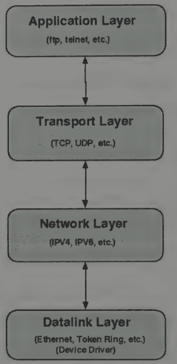
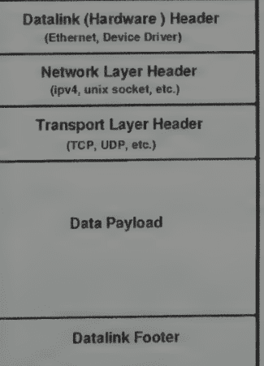

# Linux 程序开发：带练习指南


- 11.6 创建临时文件 ............ 83

- 12.6 实验 ................. 97

22.3 实验 ................................................................................................................................................................................ 173

- 28.8 实验 ................................................................................................................................................................................................................................................................................................................................................................................................................................................................ 229

- 29.3 Posix IPC ................................................................................................................................................................................................................................................................................................................................................................................................ 237

- 30.4 实验 ... 246

| 20.1 | `connect()` 返回值 | 182 |

| 20.1 | 关闭方法 | 183 |

| 20.1 | `shutdown()` 返回值 | 183 |

| 24.1 | `bind()` 返回值 | 190 |

| 24.2 | `listen()` 错误返回值 | 191 |

| 24.3 | `accept()` 返回值 | 192 |

| 25.1 | `send()` 标志 | 199 |

| 25.2 | `send()` 标志 | 200 |

| 25.3 | `sendmsg()` 标志 | 202 |

| 25.5 | `sendfile()` 错误返回值 | 204 |

| 26.1 | `fcntl()` 参数 | 208 |

| 26.2 | Socket ioctl 命令 | 209 |

| 26.3 | Socket 选项 | 210 |

| 27.1 | Netlink 族 | 214 |

| 27.2 | Netlink 消息类型 | 216 |

| 27.3 | Netlink 宏 | 216 |

| 28.1 | Select 集合宏 | 221 |

| 28.2 | 轮事件 | 223

28.3 轮询返回事件 . . . . . . . . . . . . . . . . . . . . . . . . . . . 223

28.4 epoll 操作 . . . . . . . . . . . . . . . . . . . . . . . . . . . 226

28.5 并发服务器结果 . . . . . . . . . . . . . . . . . . . . . . . . . . . 231

30.1 System V 共享内存 `shmctl()` 参数 . . . . . . . . . . . . . . . . . . . 243

30.2 System V 共享内存限制 . . . . . . . . . . . . . . . . . . . . . . . 243

31.1 System V 信号量 `semctl()` 参数 . . . . . . . . . . . . . . . . . . 250

31.2 System V 信号量限制 . . . . . . . . . . . . . . . . . . . . . . . 250

32.1 System V 消息队列消息类型 . . . . . . . . . . . . . . . . . . . . 256

32.2 System V 消息队列消息标志 . . . . . . . . . . . . . . . . . . . . 257

32.3 System V `msgctl()` 标志 . . . . . . . . . . . . . . . . . . . . . . . . . 257

32.4 System V 消息队列限制 . . . . . . . . . . . . . . . . . . . . . . . . . 258

# 前言


# 目标

《Linux 程序开发》旨在让经验程序员快速适应 Linux 环境。

你将学习在 Linux 下开发 C 程序和进行系统编程的工具和方法，包括：

- 编译器、编译、链接和程序加载。

- 构建和使用静态库与共享库。

- 使用 `make` 和编写 Makefiles。

- 版本控制。

- 调试技术。

- 系统调用的实现原理以及与普通库函数的区别。

- Linux 系统的结构。

- 文件 I/O 函数，涵盖系统级调用和标准库调用。

- 高级文件操作，包括目录和 `stat` 函数以及文件锁。

- 进程管理，包括 `fork` 和退出、进程组和等待。

- 管道，匿名管道和命名管道 (FIFO)。

- 信号分发与处理。

- 使用 `pthreads`（Posix Threads）库和 API 编写多线程应用程序。

- 网络套接编程简介。

- System V 和 POSIX IPC，包括共享内存、信号量消息队列。

掌握这些内容后，你将拥有在 Linux 系统上开发高级应用程序所需的工具。

# 目标读者

你对学习如何为 Linux 环境编写应用程序或将其迁移到该环境感兴趣。也许你只是出于兴趣，但更有可能是因为这是工作的一部分。这里的目的是为你扫清道路，并可能缩短达到该领域基础能力水平所需的时间。

你从中获得多少收获，以及你的驱动程序有多少无 Bug、多高效和优化，取决于你在开始学习本书内容之前的编程水平。本书并无打算教教你良好编程的要素或详尽讲解 Linux 操作系统的设计。

你应当：

- 精通 C 编程语言。（如果你愿意，可以使用 C++ 完成编程练习，但所有示例答案都是 C 语言编写。）

- 熟悉基础 Linux (Unix) 工具，如 `ls`, `rm`, `grep`, `tar`。

- 熟练使用任何可用文本编辑器（如 emacs, vi 等）。

- 接触过 X-Window 系统。

拥有任何主流 Linux 发行版的经验会有帮助，但并非严格要求。同样，读者在上述领域除了熟悉 C 编程语言外都可能较弱。

关于编程方法的书籍和课程并不缺少。对于 Linux 操作系统，选择可能较少，但确实存在。

特别值得提到的是 W. Richard Stevens 著、Addison Wesley 出版的《UNIX 环境高级编程》，它应该是每个开发者书架上的必备品，且几乎每本关于该主题的书都将其作为主要参考。

所有主流 Linux 发行版都带有详尽的文档，包括函数、数据结构在内的编程主题都由 man pages（手册）覆盖。你可以从命令行访问它们（例如通过 `man 2 open` 获取系统调用 `open()` 的文档，它位于手册的第 2 章），或通过大多数发行版安装的图形界面访问。

有些粗制的 Linux 教程仅仅是转述 man 页，甚至是复制、粘贴并倒倒重述。我试图避免这种情况，并将建议查阅 man 页以获取更多细节。

# xviii

虽然我们的内容不会非常高级，但将力求详尽和完整。值得重复的是，我们的目标不是专家读者，而是有能力且有积极性的读者。

我们讨论的大部分内容适用于任何类 Unix 风格并努力符合 Posix 标准的操作系统。然而，我们将讨论许多 Linux 特有的主题。这在大多数情况下意味着为 Linux 编写且尚未移植到其他操作系统的特性和 API。有时意味着 Linux 对标准的解释可能与其他标准产生冲突。

我们将指出 Linux 特有的内容，并提醒你开发这些特性时可能遇到的。

# 关于作者

虽然我们的内容不会非常高级，但将力求详尽和完整。值得重复的是，我们的目标不是专家读者，而是有能力且有积极性的读者。

我们讨论的大部分内容适用于任何类 Unix 风格并努力符合 Posix 标准的操作系统。然而，我们将讨论许多 Linux 特有的主题。这在大多数情况下意味着为 Linux 编写且尚未移植到其他操作系统的特性和 API。有时意味着 Linux 对标准的解释可能与其他标准产生冲突。

我们将指出 Linux 特有的内容，并提醒你开发这些特性时可能遇到的。

1994 年，我离开了学术界进入商业。在接后的 15 年里，我为各种公司担任顾问。2009 年 Axian 与 Red Hat 的合作结束，我也离开了 Axian。在 Axian 慷慨许可下，我决定重新整理这些材料并出版。

这就是我们来到这里的原因。这不是之前营销和交付课程的简单包装。它经过了大量的重写、新练习的开发、新内容的添加以及旧内容的删除。

# 现提供的 Linux 开发者课程

我不指通过出版这本书来发富。但我希望如果你有 Linux 培训需求，可以将此视为聘请我们提供现场培训服务的广告。

目前提供课程：

- Linux 程序开发

- Linux 设备驱动

- Linux 内核原理

每门课程为期五天。提供定制和组合方案。在需求失控之前，预计作者将担任讲师。

有关详细描述、大纲、定价和物流信息请访问 `coopj.com` 并联系 `coop@coopj.com`。

# 致谢

首先，我必须感谢我任职 15多年的公司 Axian Inc (`http://www.axian.com`)，位于俄勒冈州比弗顿，许可我使用原属于 Axian 版权且由其经费开发的材料。Frank Rolle 和 Steve Bible 不仅慷慨授予我这些权利，而且在我所做的一切中都是真正的朋友和支持。

在为 Axian 监督 Linux 开发者课程的多年里（大部分通过 Red Hat 培训部门交付），我与大量使用我负责材料的讲师交流。他们提出了许多建议，修复了错误并在某些情况下进行了改进。我要向这些同事表示衷心的感谢 Marc Curry, Dominic Duval, Terry Griffin, George Hacker, Tatsuo Kawasaki, Richard Kee 和 Bill Kerr。

我还想感谢 Alessandro Rubini，在我开始教授设备驱动程序和 Linux 不久，我带着家人拜了他的家，受到了他热情慷慨的待。感谢他向我介绍了 O'Reilly 出版社那些友善的人，他们让我有机会帮助评审他们的 Linux 内核相关书籍，这极大地扩展了我的知识，并让我结识了许多关键人物。

我必须给予的最大感谢是给学生们，他们通过提问、暴露弱点、要求新材料以及提供生活经验为本教材做出了贡献，这希望让这些内容避免说教化，并变得更加实用。没有他们（以及他们付了钱来听课并被迫听我说话），这份演示文稿将不复存在。我还要感谢我的家人忍受了这一切，尤其是我频繁的旅行。最后，我想致敬已故的 Hans Bethe，他教会了我永远不要因为别人在某项任务上更有经验就畏惧它。

## 第 1 章 准备工作

我们将讨论相关流程，并对 Linux 发行版进行一些说明。我们还将考虑如 POSIX 和 Linux 标准基础 (LSB) 等标准。

### 1.1 流程

你需要一台安装了当前 Linux 发行版的计算机，并妥善部署了重要的开发工具（用于编译等）。重点将放在实操编程上，大多数章节都有实验室练习。在可行的情况下，实验将基于之前的作业构建。解决方案集可以从 `http://www.example.com/LPD` 获取。错误列表和更新后的解决方案将在可用后发布在该处。此外，在讲解过程中展示的示例将作为 EXAMPLES 子目录的一部分提供。一旦你获得了解决方案，可以使用以下命令解压：

```bash
tar xvf LPD*.tar.gz
```

请替换为实际文件名。在主目录下，有一个 Makefile，它可以递归编译所有子目录。默认情况下所有子目录都会被编译，但可以缩小目录范围：

```bash
make SDIRS=all
make SDIRS="dir1 dir2"
```

主目录下的 `genmake` 脚本对于自动生成 Makefile 非常有用，值得读一读。应该注意的是，我们在解决方案中强调的是清晰和简洁，而非严谨；例如，我们并没有尝试捕捉每一个可能的错误，也没有考虑到每一个系统选项。代码并不是万无一失的；它是为了教学而设计的。如果你对这些材料有任何问题或反馈，请通过 `example@example.com` 联系我们。

- 提供的解决方案有时包含正文中未讨论的函数和特性。

- 这样做是为了说明如何完成比解决问题最少工作更多的，并教授额外的材料。

- 如果有任何必须使用但在材料中未涵盖的内容，其遗漏是一个 bug（错误），而不是特性，并应该向我们反映。

### 1.2 Linux 发行版

有许多 Linux 发行版，从非常流行到冷门不等。它们在预期用途、硬件、受众以及支持水平方面有所不同。可以在 `http://lwn.net/Distributions/` 找到非常全面的列表。

我们努力让这些材料尽可能与发行版无关。对于除最专业的发行版之外，这不会带来任何不便。偶尔你正在使用的哪种发行版是重要的，但这只会在我们（不情愿地）深入系统管理时，例如当我们描述特定文件和目录的位置或如何安装所需的软件包时发生。幸运的是，现代发行版在这些方面的差异比 Linux 早期要小得多，我们很少需要处理这些不便。

这些材料主要在基于 Red Hat 的系统上开发，主要是 64 位版本，并在 32 位系统上进行了测试。但它也已经在许多其他发行版上进行过测试。

### 1.3 标准与 LSB

显式地，我们使用了：

- Red Hat Enterprise Linux 5.4

- Fedora 12

- CentOS 5.4

- Scientific Linux 5.4

- OpenSUSE 11.1

- Debian Lenny

- Ubuntu 9.10

- Gentoo

在软件安装和控制方面，发行版倾向于使用基于 RPM 的或基于 deb包 (deb-based) 的包管理。在上述列表中，Red Hat、Fedora、CentOS、Scientific Linux 和 OpenSUSE 是基于 RPM 的；Debian 和 Ubuntu 是基于 deb 的。必要时，我们将为这两个大类提供所需的说明。

Gentoo 并不基于上述任何软件包系统，而是使用 portage/emerge 系统，这涉及到直接从源码编译。如果你是 Gentoo 用户，并且已经成功完成了功能完备的安装（通常不是初学者的任务），你不需要关于如何安装和查找物品的详细说明，因此我们不会通过提供这些内容来侮辱你。

如果你运行任何其他发行版，你不应该在将我们做的内容适应到你的安装时遇到任何困难。

有许多与在 Unix 类系统上工作相关的不同标准（规范）。例如，LSB 力求符合 POSIX 标准，并整合了后来的标准：

```c
#define _POSIX_C_SOURCE 200809
```

LSB 的主页位于 `http://linuxbase.org`，由 Linux基金会管理。

## 第 2 章 编译器

我们将学习 Linux 下可用的各种编译器，重点是 `gcc`。学生将学习可用的重要优化技术以及预处理器的使用。我们将简要考虑其他语言（C 之外）。我们将提供指向可用 IDE（集成开发环境）的提示。

### 2.1 GCC

`gcc` 是 GNU C 编译器。（它的正式名称是 GNU 编译器集合。）它也可以作为 `cc` 调用。`gcc` 可以编译用 C、C++ 和 Objective-C 编写的程序。

`g++` 是 C++ 编译器。（它也可以作为 `c++` 调用）。

`gcc` 与 GNU libc、`glibc` 以及调试器 `gdb` 紧密结合。

## 第 2 章 编译器

你所想到的几乎每一个操作系统都包含一个版本的 `gcc`，并且它可以用于交叉编译。

`gcc` 同时也作为 Ada95（`gcc-gnat` 包）、Fortran（`gcc-gfortran` 包）和 Pascal（`gcc-prc` 包）编译器前端的后端支持；即：首先将代码翻译成 C 语言，然后由后端（在静默地）调用 `gcc`。

在 `gcc` 的主页 `http://gcc.gnu.org` 上可以找到大量文档，包括完整的手册、常见问题解答（FAQ）以及针对特定平台的信息。此外，执行 `info gcc` 可以为你提供详细的在线文档。

注意，调用 `gcc` 实际上涉及许多不同的程序或阶段，每个阶段都有自己的 man 页（帮助手册），并且可以被独立调用：

# 表 2.1：编译阶段


| 阶段 | 命令 | 默认输入 | 默认输出 | -W 选项 |
|---|---|---|---|---|
| 预处理 | `cpp` | `.c` | `.i` | `-W...` |
| 编译 | `gcc` | `.i` | `.s` | N/A |
| 汇编 | `as` | `.s` | `.o` | `-Wa...` |
| 链接 | `ld` | `.o` | `a.out` | `-Wl...` |

取决于你使用的 Linux 发行版，关于 `gcc` 安装和默认值的细节可以在 `/usr/lib/gcc`、`/usr/lib64/gcc` 和/或 `/usr/libexec/gcc` 目录下找到。

- *Intel 拥有一套成熟的编译器，详见 http://software.intel.com/en-us/intel-compilers/。可以免费下载评估版，并为了学习目的获取免费的非商业许可（参见 http://software.intel.com/en-us/articles/non-commercial-software-faq/）。*
- Intel C 编译器非常适合编译 Linux 下的应用程序。它可以用于编译内核，但这不是一项轻而易的任务，而且怀疑是否有人在生产环境中因此此目的。

### 2.2 主要 gcc 选项

可执行文件的输出格式将是 ELF（可执行和链接格式），这使得使用共享库变得简单；旧的 `.so` a.out 格式虽然已经过时（尽管名称如此），但如果内核已配置为支持它，则仍然可以使用。

以下是提供给 `gcc` 的一些主要选项列表：

#### 表 2.3：编译器路径选项
| 选项 | 说明 |
|---|---|
| `-Idir` | 搜索包含文件时的包含目录。累积的。 |
| `-Ldir` | 库搜索目录。累积的。 |
| `-l` | 链接到 lib；`-lfoo` 如果存在则链接到 `libfoo.so`，其次链接到 `libfoo.a`。 |

#### 表 2.4：编译器预处理器选项
| 选项 | 说明 |
|---|---|
| `-M` | 不编译。为 Make 提供依赖关系。 |
| `-H` | 打印包含文件的名称。 |
| `-E` | 仅预处理 |
| `-Ddef` | 定义 def |
| `-Udef` | 取消 def |
| `-d` | 打印 #defines |

#### 表 2.5：编译器警告选项
| 选项 | 说明 |
|---|---|
| `-v` | 详细模式，给出版本号 |
| `-pedantic` | 极其详细地发出警告 |
| `-w` | 抑制警告 |
| `-W` | 更详细的警告 |
| `-Wall` | 启用一组重要的警告 |

#### 表 2.6：编译器调试和性能分析选项
| 选项 | 说明 |
|---|---|
| `-g` | 包含调试信息 |
| `-pg` | 为 gprof 提供分析信息 |

#### 表 2.7：编译器输入和输出选项
| 选项 | 说明 |
|---|---|
| `-c` | 创建对象文件后停止，不链接 |
| `-ofile` | 输出为文件；默认是 a.out |
| `-xlang` | 期望输入为 lang，lang 可以 c、objective-c、c++（以及其他一些）。否则，通过输入文件扩展名进行推测 |

#### 表 2.8：编译器控制选项
| 选项 | 说明 |
|---|---|
| `-ansi` | 强制完全符合 ANSI 标准 |
| `-pipe` | 在阶段之间使用管道 |
| `-static` | 抑制与共享库的链接 |
| `-O[lev]` | 优化级别；0, 1, 2, 3。默认为 1。 |
| `-Os` | 针对大小进行优化；使用所有 -O2 选项但增加大小的选项除外。 |

一组良好的选项组合是：

`-O2 -Wall -pedantic`

确保你理解任何警告，如果你忽略了它们，将为你节省大量的调试工作。然而，在为 Linux 内核编译代码时不要使用 `-pedantic`，因为内核使用了许多 `gcc` 扩展。

### 2.3 预处理器

预处理器可以通过直接调用 `cpp` 或执行 `gcc -E . .` 来独立运行。可以通过执行以下操作列出预加载定义：

```
touch foo.h; gcc -E -dM foo.h; rm foo.h
```

并包含：

#### 表 2.9：预加载的编译器定义
| | | |
|---|---|---|
| `-D_GNUC_=4` | `-D_GNUC_MINOR_=1` | `-D_GNUC_PATCHLEVEL_=2` |
| `-Dunix` | `-D_unix` | `-D_unix_` |
| `-Di386` | `-D_i386_` | `-D_i386_` |
| `-Dlinux` | `-D_linux` | `-D_linux_` |
| `-D_GNUC_` | | |

## 2.4 其他 语言

预处理器可以通过直接调用 `cpp` 或执行 `gcc -E . . .` 来独立运行。可以通过执行以下操作列出预加载定义：

- *Intel 拥有一套成熟的编译器，详见 http://software.intel.com/en-us/intel-compilers/。可以免费下载评估版，并为了学习目的获取免费的非商业许可（参见 http://software.intel.com/en-us/articles/non-commercial-software-faq/）。*
- *Intel C 编译器非常适合编译 Linux 下的应用程序。它可以用于编译内核，但这不是一项轻而易的任务，而且怀疑是否有人在生产环境中因此此目的。*

### 2.5 集成开发环境 (IDE)


我们将学习如何在 `Linux` 下使用库。将考虑静态库和共享库的构建，以及将应用程序链接到这些库。我们还将考虑如何使用 `libdl` 在运行时选择性地添加库。

- 3.1 静态库 . . . . . . . . . . . . . . . . . . . . . . . . . . . 13

- 3.2 共享库 . . . . . . . . . . . . . . . . . . . . . . . . . . . . 14

- 3.3 链接到库 . . . . . . . . . . . . . . . . . . . . . . . . . . . 16

- 3.4 动态链接 . . . . . . . . . . . . . . . . . . . . . . . . . . . 17

- 3.5 实验 . . . . . . . . . . . . . . . . . . . . . . . . . . . . . . 19

## 3.1 静态库

静态库具有 `.a` 扩展名。当编译程序时，库会被包含进去。使用了以下工具：

- `ar` 创建、更新和提取归档文件

- `ranlib` 从归档生成调试信息

- `nm` 列出归档中的符号

## 3.2 共享库

共享库具有 `.so` 扩展名。在很多情况下，库同时存在共享和静态版本，这种情况下可以通过 `-static` 选项对链接器进行覆盖。然而，如果你这样做，所有的库包括 `libc` 都将被静态链接，因此生成的执行文件会很大。

要创建共享库，必须在编译时使用 `-shared` 选项，并且必须为库指定 `soname`。

`GNU libtool` 脚本可以协助提供共享库支持，用于编译和链接库以及执行文件，对于分应用程序和软件包特别有用。可以通过 `info libtool` 获取完整文档。

### 查找共享库

使用共享库的程序需要在运行时找到它们。可以使用 `ld` 来确定可执行文件所需的共享库。它会显示库的 `soname` 及其指向的内容：

```bash
$ ld /bin/bd
```

```
linux-vdso.so.1 -> (0x0000fffd7e2000)
librt.so.1 => /lib64/librt.so.1 (0x0000003f16c00000)
ibc.so.6 -> /lib64/libc.so.6 (0x0000003f14400000)
libthread.so.0 -> /lib64/libthread.so.0 (0x0000003f15000000)
lib64/ld-linux-x86-64.so.2 (0x0000003f14000000)
```

`ldconfig` 通常在启动时运行（但也可以随时运行），并使用 `/etc/ld.so.conf` 文件，该文件列出了搜索共享库的目录。`ldconfig` 必须以 `root` 权限运行，且共享库只有在稳定且有用时才应该存储在系统目录中。

除了由 `ldconfig` 构建的数据库外，链接器会首先搜索环境变量 `LD_LIBRARY_PATH` 中指定的任何目录，这是一个由冒号分隔的目录列表，类似于 `PATH` 变量。执行以下操作非常重要：

```bash
export LD_LIBRARY_PATH=$HOME/foo/lib
```

而不是：

```bash
LD_LIBRARY_PATH=$HOME/foo/lib
```

你明白为什么了吗？

## 3.3 链接到库

无论库是静态的还是固定的，执行文件都通过以下命令链接到库：

```bash
gcc -o foo foo.c -L/mypath/lib -lfoolib
```

这将在链接 `/mypath/lib/libfoolib.so`（如果存在），否则链接 `/mypath/lib/libfoolib.a`。

命名规范是 `-what` 指向库 `libwat.so.(a)`。如果同时存在 `libwat.so` 和 `libwat.a`，则将使用共享库，除非在编译行使用了 `-static`。

可能会出现循环库依赖，由于加载器仅对请求的库进行一次扫描，你可以拥有如下内容：

```bash
gcc ... -1A -1B -1A ..
```

如果 `lib` 指向 `libA` 中一个未在其他地方引用的符号。虽然有一个选项可以让加载器进行多次扫描（详情请参见 `info gcc`），但它的运行速度非常慢，而且良好的、分层的库架构应该避免这种循环。

默认的库搜索路径将始终包含 `/usr/lib` 和 `/lib`。要查看确切搜索了哪些内容，可以执行 `gcc --print-search-dirs`。用户指定的库路径排在默认路径之前，`gcc` 提供了扩展选项来反转这一模式。

### 获取调试信息

可以使用环境变量 `LD_DEBUG` 获取有用的调试信息。例如，执行：

```bash
LD_DEBUG=help
```

然后输入一个命令，将给出：

## 3.4 动态链接加载器

`LD_DEBUG` 环境变量的有效选项有：

- `libs` 显示库搜索路径

- `reloc` 显示重定位处理

- `files` 显示输入文件的进度

- `symbols` 显示符号表处理

- `bindings` 显示符号绑定的信息

- `versions` 显示版本依赖

- `all` 所有之前选项的组合

- `statistics` 显示重定位统计

- `help` 显示此帮助信息并退出

要将调试输出重定向到文件而不是标准输出，可以使用 `LD_DEBUG_OUTPUT` 指定文件名。

你可以显示符号在程序执行时如何解析，并帮助发现如链接到错误版本的库等问题。尝试：

```bash
LD_DEBUG=all ls
```

查看示例。

### 剥离执行文件

命令

```bash
strip foobar
```

其中 `foobar` 是可执行程序、对象文件或库存档，该命令用于减小文件大小并节省磁盘空间。符号表将被丢。此步通常在生产版本上完成。

不要对 `Linux` 内核或内核模块使用 `strip`，因为两者都需要符号信息！

## 3.4 动态链接加载器

可以避免在运行时（实际上是在二进制文件执行后）才选择动态库。

虽然运行共享库的选择可以通过环境变量控制，但可以在程序执行期间动态地加载、卸载和替换。

实现这些功能的函数是：

```c
#include <dlfcn.h>
```

## 第 3 章 库

```c
void *dlopen(const char *filename, int flag);
const char *dlerror(void);
void *dlsym(void *handle, char *symbol);
int dlclose(void *handle);
```

函数 `dlopen()` 打开 `filename` 指向的共享库；否则，如果以 `/` 开头，则被理解为绝对路径；或者在系统的常规列表或 `LD_LIBRARY_PATH` 环境变量中查找。

`flag` 控制符号何时解析。仅在需要时；当使用 `RTLD_NOW` 时，解析是立即的。此外，这些标志可以与 `RTLD_GLOBAL` 进行或运算，使得符号对所有随后加载的库可见。

函数 `dlsym()` 在 `handle` 指向的共享库（它是 `dlopen()` 的返回值）中查找 `symbol` 指向的函数或变量。它返回一个指向该符号的指针以便使用。

函数 `dlclose()` 卸载动态库。

函数 `dlerror()` 如果自上次调用这些函数之一以来没有发生错误，则返回 `NULL`；否则返回一个指向描述错误字符串的指针。

一个简短的示例展示了它们是如何结合在一起的：

```c
#include <stdio.h>
#include <stdlib.h>
#include <dlfcn.h>

int main (int argc, char *argv[])
{
    void *handle;
    void (*function)(void);

    handle = dlopen("./libshared.so", RTLD_LAZY);
    if (handle) {
        fprintf(stderr, "error opening library is %s\n", dlerror());
        exit(-1);
    }

    function = dlsym(handle, "lib_function");
    function();
    dlclose(handle);
    exit(0);
}
```

这假设库 `./libshared.so` 存在且包含一个函数 `lib_function()`，并且生成的可执行文件已链接到 `libdl`；即我们拥有如下内容

```bash
gcc -O2 -Wall -pedantic -fPIC -shared -o libshared.so libshared.c
gcc -O2 -Wall -pedantic -o testit.c -ldl
```

这假设库 `./libshared.so` 存在且包含一个函数 `lib_function()`，并且生成的可执行文件已链接到 `libdl`；即我们拥有如下内容

## 3.5 实验

### 实验 1：库

使用 `make` 构建的库。

### 实验 2：动态加载

使用 `make` 构建的。

## 4.3 更复杂的规则

- 可能有多个目标（targets）。

我们将在练习中解决，但处理这些问题的某些方法涉及注意：

- `make` 可以递归的（调用自身）并在子目录中执行。

- 输出文件可以放置在其他目录中。

- 宏和环境变量可以在命令行上被重写。

- 可以使用多个 `Makefile`；可以根据命令行规范和环境变量进行选择。

## 4.3 更复杂的规则

在 `Makefile` 中，字符串变量可以通过简单地使用 `=` 号来设置；赋值不是粘性的（not sticky），这意味着空格没有影响。

在 `Makefile` 内部，这些变量通过在变量名前面加上 `$` 并在周围括上括号来使用，例如：

```
MYOBJS = a.o b.o c.o
...
$(CC) -o foobar $(MYOBJS)
```

这些变量中的某些是预定义的，如 `$(CC)` 和 `$(CFLAGS)`，但它们的值可以在 `Makefile` 中替换，或在 `make` 命令行中给出。默认情况下，优先级是：命令行优先，`Makefile` 中的赋值其次，`Shell` 环境中的赋值第三。如果你有如下情况：

```
export CFLAGS='Wall'
make foobar CFLAGS="-pedantic"
```

那么 `-pedantic` 标志将是有效的。

在 `Makefile` 中你可以做很多事情；我们绝不是试图告诉你所有事情。可以通过执行 `info Make` 获取完整的文档。

稍微复杂一点的例子：

```
foobar: main.o sub1.o sub2.o
gcc -0 -o foobar main.o sub1.o sub2.o
main.o: main.c defs.h
gcc -0 -c -I. main.c
sub1.o: sub1.c sub1.h
gcc -0 -c -I. sub1.c
sub2.o: sub2.c sub2.h
gcc -0 -c -I. sub2.c
```

一个稍微高级且更容易修改的例子是：

```
OBJJS= main.o sub1.o sub2.o
INCS=- -l/include
DEFS=-Ddeff1 -Udef2 -DHaives
CFLAGS=$( $(INCS) $(DEFS)
等，让我仔细重读一遍文本。
OBJJS= main.o sub1.o sub2.o
INCS=- -l/include
DEFS=-Ddeff1 -Udef2 -DHaives
CFLAGS=$( $(INCS) $(DEFS)
CFLAGS=-0 -g -Wall -pedantic
LOADLIBES = -L $(HOME)/mylib
LDLIBES = -tfoobarrou
TARGET= foobar

$(TARGET): $(OBJJS)
$(CC) $(DEFS) $(CFLAGS) -o $(TARGET) $(OBJJS) \
	$(LOADLIBES) $(LDLIBES)

main.o: main.c def.h
sub1.o: sub1.c sub1.h
sub2.o: sub2.c sub2.h
```

`.PHONY` 目标可以用来指示目标不应被解释为文件名；例如，如果正好有一个名为 `install` 的文件，`make install` 将失效。

一个展示递归、`.PHONY` 使用以及变量操作（追加内容）的示例：

```
CFLAGS=- -0 $(CFLAGS)
CFLAGS+= -0
CFLAGS?=O2 -Wall -pedantic
```

```
all: dir1 dir2
```

```
.PHONY: dir1 dir2

dir1:
	cd dir1 ; make

dir2:
	make -C dir2
```

注意，每个动作行都在其自己的 `Shell` 下运行。因此，这两个片段是不等价的：

```
cd dir1 ; ls

cd dir1
ls
```

在第二个示例中，`ls` 命令将在根目录下运行，因为目录更改只对第一个动作行有效。

注意在追加 `CFLAGS` 的值时使用 `:=` 代替 `=`；使用 `:=` 意味着简单赋值，而使用 `=` 函数是递归的。后者方法非常强大，但可能会导致无限循环（`make` 通常会捕获）并且执行较慢。

注意：输入 `make -p` 将给出所有隐含规则和预定义变量的列表。

## 4.5 实验

### 实验 1: Make（简单）

为上一节的练习构建 `Makefile`。它应该包含多个目标，包括使用静态库或共享库构建的应用程序。

### 实验 2: Make（复杂）

构建具有以下属性的程序：

- 应该有许多不同的函数或源文件。

- 它们需要使用若干头文件。

- 源文件应该在多个目录中，例如，一个主目录和一个或多个子目录。

- 应该至少有一个包含多个子程序的库。

实验内容（除了编写代码外）是构建完成该项目所需的 `Makefile(s)`。然后你将编译并执行它。在这一过程中，你将获得关于只更改一个文件会发生什么、依赖关系是如何设置的等经验。注意，由于内置的 `Makefile` 规则，你可能不需要（如果你不想的话）具体指定如何编译等或制作库等。

## 第 5 章

## 版本控制


我们将学习 `RCS`、`CVS` 和 `Subversion`。我们还将关注 `git`。

| 节内容 | 页码 |

| :--- | :--- |

| 5.1 版本控制 | 27 |

| 5.2 RCS 和 CVS | 28 |

| 5.3 Subversion | 29 |

| 5.4 git | 30 |

| 5.5 实验 | 31 |

为了保持平稳过渡，`Subversion` 的界面类似于其前身，并且很容易将 `CVS` 仓库迁移到它。

开源 `Subversion` 项目旨在设计为 `CVS` 的继承者，并正在许多领域取代它。

## 5.4 git

`Linux` 内核开发系统有特殊需求，因为它在全球范围内广泛分布，拥有数百（甚至数千）名开发者。此外，所有工作都是在公开状态下，并遵循 `GPL` 协议。

在很一段时间内，并没有真正的源码版本控制系统。后来，主要的内核开发者开始使用 `BitKeeper`（参见 http://www.bitkeeper.com），虽然它是一个商业项目，但为 `Linux` 内核开发提供了受限的许可。

然而，在 2005 年春天的一场关于许可限制的公开纠纷中，`BitKeeper` 的免费使用权不再适用于 `Linux` 内核开发。

作为回应，`git` 诞生了，其主要作者是 `Lin Torvalds`。`git` 的源代码可以从 http://www.kernel.org/pub/software/scm/git/ 获取；完整的文档可以在 http://www.kernel.org/pub/software/scm/git/docs 找到。

解释 `git` 内部原理的文章可以在 http://lnw.net/Articles/130865/ 找到。

查看《内核黑客 git 指南》（地址为 http://linux.yyz.us/git-howto.html），可以看出该源码管理系统被许多高级内核开发者所使用。

从技术上讲，`git` 并不是通常意义上的源码控制系统，它处理的基本单元不是文件。它有两个重要的数据结构：对象数据库和目录缓存。

对象数据库包含三类类型的对象：

- Blobs（二进制大对象）：包含文件内容的二进制数据块。

- Trees（树）：包含文件名和属性的 bs 集合，构成了目录结构。

- Commits（提交）：描述树快照的变更集。

目录缓存捕捉了目录树的状态。

通过让控制系统脱离基于文件的系统，人们可以更好地处理涉及许多文件的变更集。

`git` 正在快速发展中，其图形化界面也在快速构建中。例如，参见 http://www.kernel.org/git/。人们可以轻松浏览特定的更改以及源码树。

## 5.5 实验 (LABS)

## 5.5 Labs (实验)

### 实验 1：使用 Subversion 进行版本控制

首先，你需要创建一个中央仓库：

```bash
$ svadmin create my_repos
```

在最后一个参数处输入你任何路径。查看在该处创建的目录树。注意，永远不应该手动编辑仓库的内容，而应该依赖 `Subversion` 软件包中的工具。

现在你必须创建一个项目，它由文件和目录组成，你将它们导入到 `Subversion` 仓库。例如：

```bash
$ mkdir my_project
$ cp -a [你需要的任何文件和目录] my_project
```

注意，我们保持了简单；推荐的做法是创建三个子目录（branch, tags, trunk）并将你的文件放在 trunk 子目录中，因为遵循这一惯例；然而，`Subversion` 并不强制要求。

现在是时候通过以下命令将数据导入仓库了：


```bash
$ svn import my_project file:///tmp/SVN/my_repos -m "Original Import"
```

其中最后一个参数只是一个标识字符串。它将告诉你关于你添加的所有文件信息，如果你检查仓库，将看到这些文件去了哪里，以及其他一些创建和修改的文件是什么样子的。

现在让我们检出该项目，以便对其进行操作和修改。执行以下命令：

```bash
$ svn checkout file:///tmp/SVN/my_repos/ my_project_work
```

比较工作副本与原始项目的内容。你会注意到每个子目录都有一个带有版本控制信息的 `.svn` 子目录。

现在对工作副本中的文件内容做一些更改。执行

```bash
$ svn diff
```

在你的主源码目录下以查看更改。运行

```bash
$ svn commit -m "I made some changes"
```

将你的更改存入仓库。如果你想将你的副本更新到仓库中的最新版本，可以执行：

```bash
$ svn update
```

我们还可以做更多，但这些应该足够让你入门了。

### 实验 2：使用 git 进行版本控制

你的系统可能已经安装了 `git`。运行 `git --version` 可以让你看到它是否已经存在。如果没有，虽然你可以获取源码并编译它，但通常安装相应的预编译二进制包要简单得多。

对于基于 RHEL 的系统，包括 CentOS，最简单的方法是使用 EPEL 仓库。从 http://fedaproject.org/wiki/EPEL 获取安装仓库的 rpm 包。然后运行 `yum install git` 即可完成安装。对于基于 Fedora 的系统，相同的命令也有效，且不需要使用 EPEL。

对于基于 Debian 的系统，包括 Ubuntu，执行 `apt-get install git-core` 就足够了。

对于基于 Suse 的系统，可以执行 `zypper install git-core`。

现在我们可以继续了，首先我们必须创建一个用于工作的目录，然后初始化 `git`：

```bash
$ mkdir git-test; cd git-test
$ git init
```

接下来，我们必须向项目添加一些文件：

```bash
$ git update-index --add [你需要的任何文件]
```

现在我们修改项目中的其中一个文件；可能如下：

```bash
$ echo "An extra line" >> [项目中的某个文件]
```

并通过以下命令查看与原始仓库的差异：

```bash
$ git diff
```

要完成仓库设置，我们执行：

```bash
$ tree=$(git write-tree)
$echo 'Initial Commit'
```

完成仓库设置，我们执行：

```bash
$ tree=$(git write-tree)
$echo 'Initial Commit'
```

完成仓库设置，我们执行：

```bash
$ tree=$(git write-tree)
$echo 'Initial Commit'
```

## 第 6 章 调试 (DEBUGGING)

## 6.

### 6.1 gdb (ddd, kdbg, Insight)

`gdb` 是 GNU 调试器。`gdb` 允许你单步执行 C 和 C++ 程序、设置断点、显示变量等，实际上对使用 `gcc` 作为后端的语言都有效。此外，`gdb` 可以正确地调试多线程程序。

程序编译时加上 `-g` 选项才能获得符号和行号信息。注意，即使没有这样做，仍然可以使用 `gdb` 获取某些信息。

`gdb` 有许多图形化界面使其变得更容易使用；我们将提到三个：`ddd`、`kdbg` 和 `Insight`。

- `ddd` 的主页是：http://www.gnu.org/software/ddd。你的发行版可能将其作为标准包提供。

- `kdbg` 图形界面是 KDE 桌面系统的一部分，但在其他桌面管理器如 Gnome 下也可以运行。如果只安装 `kdbg` 包，调试器可以工作，但必须安装 `kdebase` 包才能使帮助系统运行。

- `Insight` 图形界面用 T/Tk 编写，由 Red Hat 及其子公司 Cygnus Solutions 根据 GPL 提供。文档、功能和二进制文件可以从 http://sources.redhat.com/insight/ 下载。

```
如果调用了 fork()，gdb 的默认行为是跟随该进程。这可以通过命令控制：

set-fork-mode child

```

以便在 `fork()` 调用后调试子进程。

可以恢复默认行为：

```bash
set-fork-mode parent
```

### 6.2 Electric Fence

Electric Fence 是一个内存分配调试器，由 Bruce Perens 编写。它是一个相当老旧的项目，但仍然具有非常有的功能。可以通过输入 `man fence` 或访问 http://perens.com/FreeSoftware 获取文档。

该工具可以检测 `malloc()` 内存分配的溢出或对已通过 `free()` 释放的内存的访问。它可以处理读取和写入。为了实现这一点，Electric Fence 使用专门版本的 `malloc()` 和 `free` 函数，以及相关函数来替换动态分配和释放。

要使用 Electric Fence，你只需要在编译时链接其库 `-lefence` 即可。

### 6.3 获取时间

可以设置许多环境变量来影响它的运行方式。你必须阅读 `man` 手页，`man efence` 来获取详细信息。

### 6.3 获取时间

人们需要知道时间，无论是绝对时间，还是用于测量间隔的相对时间。可以使用以下方法获取高达微秒精度的当前时间：

```c
#include <sys/time.h>
int gettimeday(struct timeval *, struct timezone tz);

struct timeval {
    time_t tv_sec; /* 秒 */
    susecond_t tv_usec; /* 微秒 */
};

struct timezone {
    int tz_minutes; /* 格林威治以西分钟数 */
    int tz_dsttime; /* 夏令时修正类型 */
};
```

该函数返回的时间是自纪元，Epoch，1970 年 1 月 1 日午夜以来的秒。如果你只想知道时间，可以为第三参数传递 `NULL`。

通过了解封装任务的 `timeval` 结构体，你可以使用宏来计算流时间：

```c
#define CET_ELAPSED_TIME(tv1,tv2) ((double)(tv2.tv_sec - tv1.tv_sec) + .000001 * (tv2.tv_usec - tv1.tv_usec))
```

两个相关的函数 `time()` 和 `ftime()` 以不同的格式返回相同的信息，并为了与其他 Unix 类操作系统的后兼容性而可用。

为了设置和使用间隔定时器，还可以系统调用 `setimer()` 和 `alarm()`。

### 6.4 剖析与性能

Linux 预装了许多性能和剖析工具。还有许多其他工具可用，它们来自专有的、通常是昂贵的商业供应商，或者来自免费的开源替代方案。

`gprof` 可用于执行分析。它将收集有关每个函数消耗的时间、每个函数被调用的次数等信息。你无法获得逐行的信息。

使用 `gprof` 非常简单。你只需要：

- 使用 `-pg` 选项编译你的代码。你需要编译所有要运行分析的例程；其他例程将无法获取时间信息。

- 然后像往常运行它，这将生成一个名为 `gmon.out` 的文件。这是一个二进制文件，所以你无法直接查看。

- 输入 `gprof foo` 以获取关于程序 `foo` 的报告。使用 `-b` 选项使其输出不那么详细。

输入选项精确控制报告的内容，以及剖析数据文件和二进制程序的位置。

开源剖析项目，http://oprofile.sourceforge.net 不需要重新编译即可重新生成剖析信息。它在大多数主流 Linux 发行版中都应该已安装。包括安装说明和示例在内的完整文档可以在项目网站找到。

Intel 提供了 VTune，http://developer.com/software/products/vtune 性能分析器。它可以执行基于时间和基于事件的采样，获取各种性能统计和源码级调优。在 Linux 上使用 VTune，目前需要使用 Windows 计算机运行用户界面，配合目标 Linux 系统。

TAU，调优与分析工具项目，http://www.cuoregon.edu/research/paracom/tau/ 为多种语言，包括 C、C++，Java、Fortran 提供了完整的性能分析环境。TAU 使用 PAPI，性能应用接口，http://itcs.utk.edu/projects/papi/，该接口提供了监控硬件计数器的钩子。

你的 Linux 发行版上应该使用许多小型工具，它们构成了一套非常强大的性能监控能力。其中一些是：

### 表 6.2: 性能监控工具

| 工具 | 包 | 用途 |
|---|---|---|
| `ps` | proccs | 关于进程的信息。 |
| `top` | procs | 运行任务和系统的动态视图。 |
| `vmstat` | procs | 关于内存分页、I/O、交换等信息。 |
| `free` | procs | 内存统计。 |
| `netstat` | net-tools | 网络连接、路由、统计等。 |
| `iostat` | sysstat | 监控 I/O 负载。 |
| `mpstat` | sysstat | 处理器相关的统计数据。 |
| `sar` | sysstat | 收集、报告、保存系统活动信息。 |

你可以查看这些工具的 `man` 手页以获取更多信息，并注意纯文本形式的工具可以通过桌面环境下的 GUI 访问。你可以通过查看各种软件包来了解系统上的其他工具。例如，在基于 RPM 的系统上：

```bash
rpm -q proccs sysstat net-tools | grep bin
```

## 5.5 VALGRIND

所有这些工具都通过读取 `/proc` 伪文件系统的条目获取信息。一旦熟悉了各种条目的格式，你就可以不使用特殊程序直接检查条目。

### 6.5 valgrind

`valgrind` 是一组集成工具，适用于 Linux 下的剖析和调试。三个主要工具涉及内存错误检测、缓存剖析和堆剖析。完整文档和最新版本可以在 http://valgrind.org 获取。

要在名为 `foobar` 的可执行文件上调用 `valgrind`，只需：

```bash
valgrind --tool=<toolname> [options] foobar [arguments]
```

其中 `toolname` 可以是以下之一：

- lackey
- memcheck
- corecheck
- helgrind
- drcheck
- massif
- cachegrind
- callgrind
- nif

输入选项精确控制报告的内容，以及剖析数据文件和二进制程序的位置。

开源剖析项目，http://oprofile.sourceforge.net 不需要重新编译即可重新生成剖析信息。它在大多数主流 Linux 发行版中都应该已安装。包括安装说明和示例在内的完整文档可以在项目网站找到。

Intel 提供了 VTune，http://developer.com/software/products/vtune 性能分析器。它可以执行基于时间和基于事件的采样，获取各种性能统计和源码级调优。在 Linux 上使用 VTune，目前需要使用 Windows 计算机运行用户界面，配合目标 Linux 系统。

TAU，调优与分析工具项目，http://www.cuoregon.edu/research/paracom/tau/ 为多种语言，包括 C、C++，Java、Fortran 提供了完整的性能分析环境。TAU 使用 PAPI，性能应用接口，http://itcs.utk.edu/projects/papi/，该接口提供了监控硬件计数器的钩子。

你的 Linux 发行版上应该使用许多小型工具，它们构成了一套非常强大的性能监控能力。其中一些是：

### 表 6.2: 性能监控工具

| 工具 | 包 | 用途 |
|---|---|---|
| `ps` | proccs | 关于进程的信息。 |
| `top` | procs | 运行任务和系统的动态视图。 |
| `vmstat` | procs | 关于内存分页、I/O、交换等信息。 |
| `free` | proccs | 内存统计。 |
| `netstat` | net-tools | 网络连接、路由、统计等。 |
| `iostat` | sysstat | 监控 I/O 负载。 |
| `mpstat` | sysstat | 处理器相关的统计数据。 |
| `sar` | sysstat | 收集、报告、保存系统活动信息。 |

你可以查看这些工具的 `man` 手页以获取更多信息，并注意纯文本形式的工具可以通过桌面环境下的 GUI 访问。你可以通过查看各种软件包来了解系统上的其他工具。例如，在基于 RPM 的系统上：

```bash
rpm -q proccs sysstat net-tools | grep bin
```

### 6.5 valgrind

`valgrind` 是一组集成工具，适用于 Linux 下的剖析和调试。三个主要工具涉及内存错误检测、缓存剖析和堆剖析。完整文档和最新版本可以在 http://valgrind.org 获取。

要在名为 `foobar` 的可执行文件上调用 `valgrind`，只需：

```bash
valgrind --tool=<toolname> [options] foobar
```

其中 `toolname` 可以是以下之一：

- lackey
- memcheck
- corecheck
- helgrind
- drcheck
- massif
- cachegrind
- callgrind
- nif

开源剖析项目，http://oprofile.sourceforge.net 不需要重新编译即可重新生成剖析信息。它在大多数主流 Linux 发行版中都应该已安装。包括安装说明和示例在内的完整文档可以在项目网站找到。

Intel 提供了 VTune，http://developer.com/software/products/vtune 性能分析器。它可以执行基于时间和基于事件的采样，获取各种性能统计和源码级调优。在 Linux 上使用 VTune，目前需要使用 Windows 计算机运行用户界面，配合目标 Linux 系统。

TAU，调优与分析工具项目，http://www.cuoregon.edu/research/paracom/tau/ 为多种语言，包括 C、C++，Java、Fortran 提供了完整的性能分析环境。TAU 使用 PAPI，性能应用接口，http://itcs.utk.edu/projects/papi/，该接口提供了监控硬件计数器的钩子。

你的 Linux 发行版上应该使用许多小型工具，它们构成了一套非常强大的性能监控能力。其中一些是：

### 表 6.2: 性能监控工具

| 工具 | 包 | 用途 |
|---|---|---|
| `ps` | proccs | 关于进程的信息。 |
| `top` | procs | 运行任务和系统的动态视图。 |
| `vmstat` | procs | 关于内存分页、I/O、交换等信息。 |
| `free` | proccs | 内存统计。 |
| `netstat` | net-tools | 网络连接、路由、统计等。 |
| `iostat` | sysstat | 监控 I/O 负载。 |
| `mpstat` | sysstat | 处理器相关的统计数据。 |
| `sar` | sysstat | 收集、报告、保存系统活动信息。 |

你可以查看这些工具的 `man` 手页以获取更多信息，并注意纯文本形式的工具可以通过桌面环境下的 GUI 访问。你可以通过查看各种软件包来了解系统上的其他工具。例如，在基于 RPM 的系统上：

```bash
rpm -q proccs sysstat net-tools | grep bin
```

### 6.6 调试

Valgrind 是一个调试 Linux 程序的强大工具。虽然它最著名的是内存错误检测，但它还提供了其他不同类型的分析工具。

### Memcheck

`Memcheck` 是 Valgrind 中最常用的工具。它检测内存错误，例如使用未分配的内存、释放后读写、内存泄漏和使用未初始化的值。

使用 `memcheck`，请运行：

```bash
valgrind --tool=memcheck ./your_program
```

输出将提供发现的内存错误摘要，包括它们发生的堆栈跟踪。

### Helgrind

`Helgrind` 是多线程 Linux 程序的线程检测器。它可以检测潜在的数据竞态和锁顺序违规。

使用 `helgrind`，运行：

```bash
valgrind --tool=helgrind ./your_program
```

### Massif

`Massif` 是一个堆分析器。它可以帮助你理解程序如何使用内存并识别峰内存使用情况。

使用 `massif`，运行：

```bash
valgrind --tool=massif ./your_program
```

### Cachegrind

`Cachegrind` 模拟 CPU 缓存并提供有关缓存缺失和命中的详细信息。它还可以生成程序执行的调用图。

使用 `cachegrind`，运行：

```bash
valgrind --tool=cachegrind ./your_program
```

### Callgrind

`Callgrind` 是一个调用图分析器。它记录程序的调用历史，包括每个函数的成本。


使用 `callgrind`，运行：

```bash
valgrind --tool=callgrind ./your_program
```

## 6.5. VALGRIND

额外的选项从 `./valgrind`, `$VALGRIND_OPTS`, `./valgrind` 读取。

`Valgrind` 版权所有 (C) 2000-2005 Julian Seward 等，

并根据 GNU 通用公共许可协议第 2 版授权。

错误报告、反馈、赞赏、滥用等请发送至：`www.valgrind.org`。

工具的版权由其作者拥有并授权。更多信息请查看每个工具的启动信息。

学习 `valgrind` 的最佳方法是通过不同的工具进行实验，但让我们先概览一下主要的工具：

### memcheck

- 检测对未初始化内存的使用。
- 检测访问超出 `malloc` 区域末尾的内存，或访问已释放的内存。
- 检测对不当堆栈区域的使用。
- 检测内存泄漏（从未被重用或释放的分配缓冲区）。
- 精确定位其他与内存相关的错误。

### addrcheck

与 `memcheck` 相同，但不检查对未初始化内存的使用；因此运行速度快得多。

### cachegrind

剖析缓存的使用情况。

模拟 L1、L2、D1 CPU 缓存，并记录每行程序代码的缓存命中和缺失次数、内存引用和指令数。

可能会使程序变慢达 100 倍。

辅助程序 `callgrind` 是一个包装器，可以提供更多信息。KDE 应用 `cachegrind` 提供了一个高级图形化界面。

### helgrind

线程调试器，用于查找多线程竞态条件。

识别由多个一个线程使用但未通过互斥锁原语的内存位置。

### massif

堆剖析器，可生成随时间变化的堆使用图表。

## 6.6 实验

### 实验 1: 调试内存溢出

考虑以下测试程序，它有一个内存溢出错误：

```c
#include <stdio.h>
#include <stdlib.h>
#include <unistd.h>
#include <malloc.h>

int main(int argc, char *argv[])
{
    char *buf;
    int size = 800, index = 801;
    if (argc > 1)
      index = atoi(argv[1]);
    if (argc > 2)
      size = atoi(argv[2]);
    buf = malloc(size);

    printf("allocated %d bytes, I'm going to use the %d element\n",
      size, index);
    buf[index] = 1;
    printf("buf[index] = %d\n", buf[index]);
    exit (0);
}
```

如果无带参数运行，它会尝试在分配数组的边缘写入 1 字节；如果带参数运行，你可以指定要写入的字节数和数组的大小。

使用 `-g` 选项编译，并在 `gdb` 下运行（你可能想使用 `kdb` 或 `ddd` 作为图形化前端）。

你可以通过尝试基本操作来熟悉调试器，例如基本的导航，如单步执行、使用 `next`、设置断点、查看源码等。

如果使用标准的 `malloc()` 函数编译，对于轻微的溢出你可能不会得到任何错误。

使用 `ElectricFence` (`-fence`) 同样的相同操作。

现在在 `valgrind` 下运行，看看可以获取哪些信息。

### 实验 2: 调试内存泄漏

考虑以下应用，它引入了内存泄漏（在这种情况下，是分配的数组在不再需要之前从未被释放）。

```c
#include <stdio.h>
#include <stdlib.h>
#include <unistd.h>
#include <malloc.h>

void doit (void)
{
    char *buf;
    buf = malloc(1000);
}

int main(int argc, char *argv[])
{
    int j;
    for (j = 0; j < 10; j++) {
        doit();
        printf("I allocated %3d buffer\n", j);
    }
    exit (0);
}
```

启动 `valgrind` 并追踪内存泄漏。

## 第 7 章

## 系统调用


我们将考虑在 `Linux` 下如何执行**系统调用**，以及高层库函数调用与底层系统调用之间的区别。

- 7.1 系统调用 vs 库函数 . . . . . . . . . . . . . . . . . . . 45
- 7.2 系统调用是如何执行的 . . . . . . . . . . . . . . . . . . . . . 46
- 7.3 返回值与错误代码 . . . . . . . . . . . . . . . . . . . 46
- 7.4 实验 . . . . . . . . . . . . . . . . . . . . . . . . . 47

### 7.1 系统调用 vs 库函数

程序可以通过一组定义良好的**系统调用**向 `Linux` 内核请求操作或服务。这是因为所有与硬件（包括内存）的交互都需要内核权限。

从用户程序访问的还有许多其他函数并不是系统调用，但它们可能会自己调用系统调用。例如 `fopen()`。从原理上说，应用程序不知道自己正在执行系统调用。

通常，应用程序并不知道自己正在执行系统调用。当用户执行系统调用时（例如 `0x80` 指令，它会产生异常并导致 CPU 进入内核模式），库会将参数传递给内核。

从原理上说，应用程序不知道自己正在执行系统调用。在执行系统调用时，库会将任何参数传递给内核。

### 7.2 系统调用是如何执行的

在 32 位 `Linux` 中，用户通过 `0x80` 指令执行系统调用，该指令产生异常并导致 CPU 进入内核模式。库会将参数传递给内核。

用户执行系统调用（例如 `0x80` 指令，它会产生异常并导致 CPU 进入内核模式），库会将参数传递给内核。

### 7.3 返回值与错误代码

`ps aux | grep ls`

以查找与进程相关的进程 ID（PID）。然后你可以查看伪文件

`/proc/<pid>/fd/*`

以查看文件描述符是如何映射到底层文件（或管道）等的。

# 实验 2：使用 syscall()。

间接系统调用函数：

```c
#include <unistd.h>
#include <sys/syscall.h>
```

```c
int syscall(int call_number, ... );
```

可以用于调用系统的中的任何系统调用。第一个参数 `call_number` 可以从 `/usr/include/bits/syscall.h` 的列表中读取：

```c
...
#define SYS_sysctl __NR_sysctl
#define SYS_access __NR_access
#define SYS_acct __NR_acct
#define SYS_add_key __NR_add_key
#define SYS_adjtimex __NR_adjtimes
#define SYS_afs_syscall __NR_afs_syscall
#define SYS_alarm __NR_alarm
#define SYS_brk __NR_brk
#define SYS_capget __NR_capget
...
```

剩余的变长参数（由 `....` 表示）是实际系统调用的参数。

该函数并非旨在广泛使用；它是供库的编写者使用的，因此除非绝对必要，否则不要在普通程序中使用它。

编写一个调用 `syscall()` 来运行一些常用系统调用的程序。例如你可能会这样做：

```c
pid = syscall(_SYS_getpid);
```

# 第 8 章

# 内存管理与分配


我们将研究如何在 `Linux` 中管理和分配内存。我们将看到如何调整分配方法，以及如何考虑对齐考量。

- 8.1 内存管理 . . . . . . . . . . . . . . . . . . . . 49
- 8.2 动态分配 . . . . . . . . . . . . . . . . . . . . 50
- 8.3 调整 malloc() . . . . . . . . . . . . . . . . . . . . 52
- 8.4 实验 . . . . . . . . . . . . . . . . . . . . . . . 53

## 8.1 内存管理

`Linux` 内核管理直接用于自身目的的内存，也管理进程使用的内存。进程在内存方面拥有有限的权限，并且在请求内存时被赋予较低的优先级。

每个进程都存在于自己的**地址空间**中，该空间由**虚拟内存区域**列表组成，每个区域都是一段连续的**虚拟**地址。这些地址之所以是虚拟的是因为

## 第 8 章 内存管理与分配

它们并不直接对应于硬件使用的物理地址；内核维护着这两种地址之间的连接。

事实上，给定虚拟地址所指的物理内存可能会随着时间改变，因为内存会根据系统需要换入或换出。

内存的基本单位是页（page），其大小取决于架构。对于大多数架构，页的长度为 4 KB，尽管它会有所不同，且某些架构实际上可以使用更大的尺寸。访问权限、许可、交换、共享等都是在页级别完成的。获取页大小只需使用函数：

```c
#include <unistd.h>
getpagesize(void);
```

这是一个用于各种缓冲器的良好尺寸，因为它是对齐的。

内存管理在 32 位和 64 位架构上非常不同，当使用大量内存时，32 位架构需要更具复杂性。

此外，Linux 将这 4 GB 的地址空间分为内核使用的部分和用户空间使用的部分。通常这会将低 3 GB 留给应用程序，将高 1 GB 留给内核。因此，在不进行“杂技之术”的特殊操作的情况下，Linux 在 32 位系统上无法提供超过 3 GB 的内存供使用。

这并不意味着内核只能使用 1 GB 内存而应用程序总共只能使用 3 GB；它的意思是内核必须执行更复杂的操作来使用超过此的内存（即使用所谓的的高内存），并且每个应用程序被限制在 3 GB。

在 64 位系统上，没有高内存的概念，所有内存访问都是平坦的。对于应用程序或内核可以使用多少内存没有直接限制。

由于内存价格持续下降且 64 位 CPU 成为常态，让 32 位平台具有真正大量内存的所付出的额外工作确实不再值得了。

### 8.2 动态分配

变量可以静态地分配（在主内存中，贯穿程序的生命周期），也可以自动地分配（在栈上，仅在其所属的代码块生命周期内持续）。

这两种方法都是高效且快速的，但在两种方法中，分配对象的大小必须在编译时已知。此外，静态变量的长寿命可能会导致浪费。而且，自动变量可能会导致栈溢出，因为栈的大小并不一定提前已知。

栈的大小可以通过内核从命令行进行控制：

# 2. 动态分配

`ulimit -s 1024`

这会将栈限制为 1 MB，或者从程序内部使用：

```c
struct rlimit rl = {1024,1024};
setrlimit(RLIMIT_STACK, &rl);
```

（参阅 `setrlimit()` 的 man页。）普通用户只能减小栈的大小，在 Linux 系统上默认大小为 8 MB。

因此，动态内存分配极其有用，因为可以分配任意大小（仅限于系统可用的总内存甚至更多）的对象，并在不再需要时释放。内存来自堆，其大小可以根据需要弹性修改。

使用动态分配时，在不再需要时释放内存以避免产生内存泄漏。然而，许多程序依赖程序终止来处理释放。

标准函数是：

```c
#include <stdlib.h>

void *malloc(size_t size);
void *calloc(size_t nmemb, size_t size);
void *realloc(void *ptr, size_t size);
void free(void *ptr);
```

`size` 是要分配的字节数。`calloc()` 函数等同于调用 `malloc()` 然后清空内存。（注意它调用的是 `nmemb*size`，即元素个数乘以每个的大小，因此在这种情况下参数 `size` 有不同。）

`realloc` 函数将执行缓冲区调整；如果可以在原地完成则进行，但如果有必要，将分配新内存并将原始缓冲区的内容复制过去。

旧版本的 `libc` 要求对 `malloc()` 返回的指针进行显式强制转换，但在原型中使用 `void` 消消了这种需求。不应使用此类转换。（注意，C++ 需要。）


内存分配如何工作显式取决于 `libc` 和操作系统内核。特别是，它遵循了一种非重置（non-unget）且乐观的策略。

通过“非重置”，意味着从 `malloc()` 返回的合法地址作为返回值可能尚未实际与该地址关联的物理内存。例如，并非所有内存都可能被实际使用，内核可能通过请求缺页中断将物理内存映射到虚拟地址。也可能该页已被换出，导致了正常的缺页中断。

通过“乐观”，意味着允许系统过度提交（overcommit）内存，这可能导致极其可怕的 OOM killer（内存溢出杀手）被调用，它尝试丢弃候选。可以通过：

## 第 8 章 内存管理与分配

```
$ echo 2 > /proc/sys/overcommit_memory
```

有许多 `malloc()` 实现，取决于程序如何链接，可以在运行时通过强制某些库选择选择不同的实现；这通常是为了调试目的示例。也可以调整分配例程的行为，正如我们将讨论的那样。

### 8.3 调整 malloc()

`libc` 中的 `malloc()` 实现允许大量的调整，以及获取有关正在分配的信息的能力。

对于小分配，`malloc()` 使用 `brk()` 和 `sbrk()` 系统调用，重置并调整进程的数据段。对于较大的分配，`malloc()` 使用 `mmap()` 系统调用，它总是提供页的倍数（x86 上为 4 KB）。

`sbrk()` 和 `mmap()` 之间的竞争可以通过使用以下影响：

```
int mallopt(int param, int value);
```

传递给 `malloc()` 的参数含义如下：

#### 8.1：malloc() 参数

| 参数 | 值 |
| :--- | :--- |
| `M_MMAP_THRESHOLD` | 任何提供的内存请求都使用 `mmap()` 而不是 `sbrk()`。较小的块仍可能使用 `malloc()`。 |
| `M_MMAP_MAX` | 使用 `malloc()` 分配的最大块数；设置为 0 可禁用所有 `mmap()` 使用。 |
| `M_TRIM_THRESHOLD` | 导致 `sbrk()` 调用负参数的最小字节数，将内存返回给系统。 |
| `M_TOP_PAD` | 调用 `sbrk()` 时获取额外内存量，也是保持缩小堆的字节数。这为堆大小提供了滞后以避免频繁的系统调用。 |

有关当前分配的统计数据可以使用以下函数获取：

```
struct mallinfo mallinfo (void);
void malloc_stats (void);

struct mallinfo {
  int arena;      /* 从系统分配的未映射空间 */
  int ordblks;   /* 空闲块的数量 */
};
```

```c
/* fastbin 块的数量 */
int hblks; /* mmapped 区域的数量 */
int hblhd; /* mmapped 区域中的空间 */
int smblks; /* 最大总分配空间 */
int fsmblks; /* 已释放的 fastbin 块中的可用空间 */
int uordblks; /* 总分配空间 */
int forblks; /* 总空闲空间 */
int keepcost; /* 顶部、可释放（通过 malloc_trim）的空间 */
};
```

`mallinfo()` 函数返回一个包含信息的 `mallinfo` 结构体。（注意 Linux 中使用了 `smblks`, `usmblks`, `fsmblks`）。易用的函数 `malloc_stats()` 以人类易读的形式返回主要信息。

有时需要强制对分配的内存进行对齐。分配此类内存的函数是：

```c
#include <malloc.h>
```

```c
int posix_memalign(void **memptr, size_t alignment, size_t size);
```

分配的内存长度为 `size` 字节，返回给 `*memptr` 的地址将是 `alignment` 的倍数。`alignment` 的值必须是 2 的幂，并且是指针大小的倍数（例如，`sizeof(void*)`）。

不应使用旧函数 `malloc()` 和 `valloc()`，因为它们没有正确检查提供的值是否合理。

### 8.4 实验

#### 实验 1：检查 malloc() 行为

编写一个使用 `mallinfo()` 和/或 `malloc_stats()` 的程序来检查系统的分配行为。

尝试分配少量、中量大量的内存，并查看如何根据内存映射调整数据段大小来分配多少内存。

尝试使用 `mallopt()` 完全关闭内存映射，或者更改这两种技术之间的阈值。

#### 实验 2：内存耗尽

编写一个短程序，分块分配内存，直到系统无法再获取更多内存为止。

最终会调用 OOM 杀死。查看 `/var/log/messages` 以查看它对终止哪些进程做出了什么决定。

尝试在关闭和开启交换的情况下进行操作，你可以通过 root 身份使用 `swapoff -a` 和 `swap -a` 完成。

## 第 9 章 Linux 中的文件和文件系统

我们将考虑在 `Linux` 下如何管理文件、目录和设备。我们将学习虚拟文件系统 `VFS`、`ext2/ext3` 文件系统的结构，以及日志文件系统。我们将检查新的 `ext4` 文件系统。

- 9.1 文件、目录和设备
- 9.2 虚拟文件系统
- 9.3 ext2/ext3 文件系统
- 9.4 日志文件系统
- 9.5 ext4/ 文件系统
- 9.6 实验

### 9.1 文件、目录和设备

人们经常说在 `Unix` 中一切皆为文件（或表示为文件）：

#### 表 9.1：一切皆为文件

| 类型 | 路径 |
|---|---|
| 可执行文件： | `/bin/ls` |
| 目录 | `/usr/local` |
| 软件或伪设备 | `/dev/kmem` |
| 硬件设备 | `/dev/fd0` |

这并不完全正确，因为某些重要的接口（如网络）并不是通过文件系统访问的，尽管它们可以通过套字使用类文件 I/O。

文件是指向 inode 的符号引用：

```bash
$ ls -li
total 32
80928 -rw-rw-r-- 1 coop 5919 May 28 17:09 ext2.html
80924 -rw-rw-r-- 1 coop 3608 May 28 17:09 files.html
80904 -rw-rw-r-- 2 coop 1566 May 28 17:09 index.html
80904 -rw-rw-r-- 2 coop 1566 May 28 17:09 index_ln.html
80987 -lrwxrxr-x 1 coop 10 May 28 17:12 index_ln-s -> index.html
80938 -rw-rw-r-- 1 coop 2888 May 28 17:09 journal.html
80944 -rw-rw-r-- 1 coop 1057 May 28 17:09 summary.html
80902 -rw-rw-r-- 1 coop 217 May 28 17:09 TOC
```

这两个链接是通过以下命令创建的：

```bash
ln index.html index_ln.html
ln -s index.html index_ln-s
```

注意 `index_ln.html` 与 `index.html` 同名，而软链接 `index_ln-s` 指向 `index.html`。


注意 `index_ln.html` 与 `index.html` 同名，而软链接 `index_ln-s` 指向 `index.html`。

由于某些重要的接口（如网络）并不是通过文件系统访问，尽管它们可以使用套接字进行类文件 I/O，这并不完全正确。

文件是指向 inode 的符号引用：

（此处省略重复的 ls 输出部分）

# 日志文件系统

以及极少数数量（单位）。请注意，设备节点需要少量的磁盘空间来存储节点（inode），但不操作任何数据块。

**预留空间：** 通常，5% 的块（通常大小为 4 KB）预留给 root 用户，以防止用户导致文件系统满而产生故障（此分配可以通过 `tune2fs` 工具更改，而无需重新格式化文件系统）。

**状态：** 超级块（superblock）中的一个字段指示“干净”（Clean）、“非干净”（Not Clean）或“错误”（Erroneous）。用于判断启动时是否应该运行 `fck`。

**物理结构：** 使用 `dumpe2fs` 工具查看磁盘结构的细节。结构如下：

- 引导扇 — 块组 1 — 块组 2 — ... 块组 N —

每个块组看起来如下：

| 超级块 | 组描述符 | 数据块位图 | 节点位图 | 索引节点表 (n 块) | 数据块 (n 块) |
| --- | --- | --- | --- | --- | --- |

图 9.1: ext3 文件系统布局

超级块和文件系统描述符在多个块组中冗冗的，这对于安全性非常有益。（注意：块组可能与磁盘的物理布局绑定）

`mkfs.ext2`、`mkfs.ext3` 创建文件系统。使用 `fck.ext2`、`fck.ext3` 检查文件系统。通常不需要`去碎片`，也不建议进行。`fdisk` 是分区程序；请慎重使用！

你可以使用 `resize2fs` 缩小或扩展分区，但要小心因为它不会更改实际的分区表；请查看 `man` 手页了解如何与 `fdisk` 配合操作的细节。有很多良好的图形化工具，例如 `gparted`，它们可以可靠地处理这些复杂问题。此外，在创建文件系统后，可以使用 `tune2fs` 程序重置或调整许多参数。

## 9.4 日志文件系统

`Journaling` 文件系统可以在系统崩溃或非正常关机后恢复，产生很少或没有损坏，而且恢复速度很快。虽然这是以增加一些操作为代价，但额外的增强可以完全抵消这一代价。

在日志文件系统中，操作被分组为`transactions`。一个事务必须无错误地`原子性地`完成；否则文件系统不会发生改变。系统会维护一个事务日志文件。当发生错误时，通常只需要检查最后一个事务。

以下五个日志文件系统在 Linux 下免费可用：

- ext3 文件系统是 ext2 文件系统的扩展。
- ext4 文件系统是 ext3 文件系统的扩展，已作为实验分支包含在主内核，并在内核 2.6.28 中作为稳定功能引入。特性包括范围（extents）、48 位块号和高达 16 TB 的容量。
- Reiser 文件系统是 Linux 中第一个日志实现，但它已失去领先地位，且开发已停滞。
- JFS 文件系统是 IBM 的产品，已从 IBM 的 AIX 操作系统移植。
- XFS 文件系统是 SGI 的产品，已从 SGI 的 IRIX 操作系统移植。主主页为 http://www.sgi.com/projects/xfs。

## 9.5 ext4 文件系统

ext4 文件系统从 2.6.28 内核发布时引入了实验性设计。现有的 ext3 分区可以无风险地迁移到 ext4；新功能只会在后续的文件操作中使用。然而，以后无法安全地退回到 ext3。最大文件系统大小已从 16 TB 增加到 1 EB，最大文件大小增加到 16 TB。这些限制源于使用的 48 位寻址；未来可能会使用全 64 位寻址，但目前并不真正需要。以前限制 32 K 的子目录数量现在没有限制了。大文件现在被分成尽可能大的范围（extents），而不是使用间接映射。此外，多块分配可以一次分配空间，而不是一个块一个。延迟分配（Delayed allocation）也可以提高性能。

一个显而易见的改进是快速 fsck。速度可以轻松提高一个数量级或更多。其他功能的介绍文档可以在 http://newbies.org/ 找到。要使用 ext4，你需要一个编译了它的内核，以及较新版本的 e2fsgs 以便获得包括 `mkfs.ext4`、`fsck.ext4`、`label`、`tune2fs` 等的工具。大多数 Linux 发行版已经迈出了这一步。根据发行版的不同，可能需要安装已更新以处理 ext4 的 e2fspro 程序包。

## 9.6 实验

### 实验 1：使用环回文件系统

环回文件系统（loopback filesystem）可以用于挂载一个文件作为硬盘镜像使用。这对于将 CD 或 DVD 镜像挂载为文件系统以及学习各种类型的文件系统非常有用。

首先，你必须创建一个供使用的文件，最好用零填充它：

```
# 创建一个 200 MB 的环回文件
$ dd if=/dev/zero of=/tmp/fsimage bs=1024 count=204800
```

然后我们可以在上面创建一个 ext3 文件系统：

```
mkfs.ext3 /tmp/fsimage
```

并（以 root 身份）挂载它：

```
$ mkdir /tmp/mnt
$ mount -o loop /tmp/fsimage /tmp/mnt
```

并可以使用以下命令验证挂载情况并检查容量：

```
$ df /tmp/mnt
```

| 文件系统 | 类型 | 块 | 已用 | 可用 | 用率 | 挂载点 |
| --- | --- | --- | --- | --- | --- | --- |
| ext3 | 204800 | 0 | 0 | 204800 | 0% | /tmp/mnt |

# 第 10 章：I/O

## 10.1 Unix I/O

基础文件操作包括打开和关闭、读取和写入以及在文件内定位。只有几个函数可以执行这些基础 I/O 操作，在 Linux 下：`open()`, `close()`, `read()`, `write()`, 和 `lseek()`. 这些基础操作是`无缓冲的`，与标准 I/O 不同。Unix I/O 不属于 ANSI 规范，有时教科书会忽略它或建议不要使用。然而，它是任何类 Unix 操作系统的编程的基础，这种建议应该被忽略。

文件通过文件描述符引用，它们是简单的非整数，而不是标准 I/O 中使用的 FILE 流。

默认创建三个文件描述符，不需要打开和关闭。

表 10.1：预定义的 Unix I/O 描述符

| 名称 | 符号名称 | 值 |
|---|---|---|
| 标准输入 | `STDIN_FILENO` | 0 |
| 标准输出 | `STDOUT_FILENO` | 1 |
| 标准错误 | `STDERR_FILENO` | 2 |

完全符合 POSIX 标准要求使用符号名称，但许多程序使用实际值，这些值总是可用的。

## 10.2 打开和关闭

以下函数用于打开和关闭 I/O 文件：

```
#include <unistd.h>
#include <fcntl.h>
#include <sys/types.h>
#include <sys/stat.h>

int open (const char *pathname, int flags, mode_t mode);
int create (const char *pathname, mode_t mode);
int close (int fd);
```

成功时，`open(pathname)` 返回一个指向 pathname 所引的文件（或设备）的文件描述符。第三个参数 mode 仅在创建新文件时需要。

`flags` 参数必须包含强制性值之一：

表 10.2：主要的 `open()` 标志

| 标志 | 含义 |
|---|---|
| `O_RDONLY` | 只读访问 |
| `O_WRONLY` | 只写访问 |
| `O_RDWR` | 读写访问 |

### 打开与关闭

这可以与以下一个或多个可选值进行按位或（OR）操作：

## 表 10.3: 额外的 `open()` 标志

| Flag | 含义 |
| --- | --- |
| `O_CREAT` | 如果文件不存在则创建文件。 |
| `O_EXCL` | 与 `O_CREAT` 用，如果文件已存在则失败。 |
| `O_NOCTTY` | 如果路径是终端设备，它将不会成为进程的控制终端。 |
| `O_TRUNC` | 如果文件已存在，将其长度截断为 0。 |
| `O_APPEND` | 每次写入时追加到末尾。 |
| `O_NONBLOCK` | 调用进程不会等待。 |
| `O_SYNC` | 每次 `write()` 都会等待物理 I/O 完成。 |
| `O_NOFOLLOW` | 如果文件是符号链接，则失败。 |
| `O_DIRECTORY` | 如果文件不是目录，则失败。 |

此外，还可以应用额外的非标准标志（例如 `O_DIRECT`）。

旧的函数 `create()` 等同于调用标志设置为 `O_CREAT | O_WRONLY | O_TRUNC` 的 `open()`。

当创建文件时，权限由 mode 参数设置。（权限可能会被进程的 umask 修改；即，权限将为 `mode & umask`）。可以使用以下值：

## 表 10.4: `open()` 的文件权限

| Mode | 数值 | 含义 |
| --- | --- | --- |
| `S_IRWXU` | 00700 | 所有者可以读/写/执行。 |
| `S_ISUSR` (S_IREAD) | 00400 | 所有者可以读。 |
| `S_IWUSR` (S_IWWRITE) | 00200 | 所有者可以写。 |
| `S_IXUSR` (S_IEXEC) | 00100 | 所有者可以执行。 |
| `S_IRWXG` | 00070 | 组可以读/写/执行。 |
| `S_IRGRP` | 00040 | 组可以读。 |
| `S_IWGRP` | 00020 | 组可以写。 |
| `S_IXGRP` | 00010 | 组可以执行。 |
| `S_IRXO` | 00007 | 其他人可以读/写/执行。 |
| `S_IROTH` | 00004 | 其他人可以读。 |
| `S_IWOTH` | 00002 | 其他人可以写。 |
| `S_IXOTH` | 00001 | 其他人可以执行。 |

`open()` 成功时返回新的文件描述符，失败时返回 -1（设置 errno）。可能的错误返回：

## 表 10.5: `open()` 错误返回值

| Value | 含义 |
| --- | --- |
| `EEXIST` | 路径已存在；使用了 `O_CREAT` 和 `O_EXCL`。 |
| `EISDIR` | 路径是目录且请求了写访问。 |
| `EACCES` | 访问权限被拒绝。 |
| `ENAMOOLONG` | 路径太长。 |
| `ENOENT` | 路径部分不存在，或悬空符号链接。 |
| `ENOTDIR` | 路径部分不是目录，或请求了 `O_DIRECTORY` 但其不是目录。 |
| `ENXIO` | `O_NONBLOCK` | `O_WRONLY`，设置文件为 FIFO 但未打开读读模式。或者特殊设备文件不存在。 |
| `ENODEV` | 路径是不存在的设备文件。 |
| `ENOFS` | 路径在只读文件系统上且请求了写访问。 |
| `ETMXTBSY` | 路径是一个可执行镜像，且请求了写权限。 |
| `EFAULT` | 路径指向非法地址。 |
| `ELOOP` | 符号链接过多，或遇到 `O_NOFOLLOW` 标志。 |
| `ENOSPC` | 无空间创建路径。 |
| `ENOMEM` | 可用内核内存。 |
| `EMPFILE` | 已打开的文件达到最大数量。 |
| `ENFILE` | 系统达到文件限制 |


`close()` 释放描述符使其失去与文件的关联。如果对文件使用了 `unlink()` 且它是当前使用该文件的最后一个描述符，则文件将被删除。成功时 `close()` 返回 0；失败返回 -1 并设置 `errno` 为 `EBADF`，意味着描述符无效。进程终止会隐式对所有打开的文件描述符调用 `close()`。

### 10.3 读取、写入与寻道

这三个函数通过 `open()` 获取文件描述符：

```
#include <unistd.h>
#include <sys/types.h>
```

```
size_t read (int fd, void *buf, size_t count);
size_t write (int fd, const void *buf, size_t count);
off_t lseek (int fd, off_t offset, int whence);
```

`read()` 从文件描述符 `fd` 获取字节并将放入 `buf` 中。成功时，`read()` 返回读取的字节数并相应移动文件位置。如果结果是非负但小于 `count`，意味着当前可用字节少于

## 10.4 读取、写入与寻道

成功时，`read()` 返回读取的字节数并相应移动文件位置。如果结果是非负但小于 `count`，意味着当前可用字节少于

## 表 10.6: read() 错误值

| Value | 含义 |
| --- | --- |
| `EINTR` | 被信号中断。 |
| `EAGAIN` | 指定了 `O_NONBLOCK` 但无数据。 |
| `EIO` | I/O 错误。 |
| `EISDIR` | 是目录。 |
| `EBADF` | 无效的文件描述符。 |
| `EINVAL` | 对象无效。 |
| `EFAULT` | `buf` 不在地址空间。 |

## 表 10.7: write() 错误值

| Value | 含义 |
| --- | --- |
| `EINTR` | 被信号中断。 |
| `EAGAIN` | 指定了 `O_NONBLOCK` 但无数据。 |
| `EIO` | 低级错误。 |
| `EBADF` | 无效的文件描述符。 |
| `EINVAL` | 对象不可写入。 |
| `EFAULT` | `buf` 不在进程空间。 |

## 表 10.8: whence 的值

| Value | 含义 |
| --- | --- |
| `SEEK_SET` | 从开始。 |
| `SEEK_CUR` | 从当前位置。 |
| `SEEK_END` | 从结束。 |

## 表 10.9: seek() 错误值

| Value | 含义 |
| --- | --- |
| `EBADF` | 无效的文件描述符。 |
| `ESPIPE` | 文件或套接字。 |
| `EINVAL` | 值不当。 |

### 10.5 偏移与向量 I/O

除了常规的 I/O 外，`read()` 和 `write()` 函数还需要一个 I/O 开始的偏移量。我们将这些称为偏移 I/O（positional I/O）：

```
#define _XOPEN_SOURCE 500

#include <unistd.h>

size_t tread (int fd, void *buf, size_t count);
size_t pwrite (int fd, const void *buf, size_t count);
```

这些函数在一个调用中对缓冲区链执行聚集/分散（gather/scatter）I/O 操作，而不是对每个缓冲区进行一系列调用，从而提高效率。向量 I/O（Vector I/O）函数是：

```
#include <sys/uio.h>
size_t readv (int fd, struct iovec *vector, size_t count);
size_t writev (int fd, struct iovec *vector, size_t count);
```

```
struct iovec {
    void *iov_base;      /* 起始地址 */
    size_t iov_len;      /* 字节数 */
};
```

标准 I/O 库是 ANSI 标准的一部分，允许格式化 I/O。我们不会详细讨论这些特性，因为它们作为 ANSI C 的一部分很容易记录。

文件被表示为 I/O 流。三个流被预打开并定义对应文件描述符：

## 表 10.10: 预标准 I/O 流

| Name | 符号名 | 文件描述符 |
| --- | --- | --- |
| 标准输入 | `stdin` | 0 |
| 标准输出 | `stdout` | 1 |
| 标准错误 | `stderr` | 2 |

基础函数是：

```
#include <stdio.h>

FILE *fopen(char *path, char *mode);
FILE *fdopen(int fildes, char *mode);
FILE *freopen(char *path, char *mode, FILE *stream);
int fileno(FILE *stream);

int fclose(FILE *stream);

fseek(FILE *stream, long offset, int whence);
long ftell(FILE *stream);

int fprintf(FILE *stream, const char *format, ...);
int printf(const char *format, ...);
int scanf(const char *format, ...);
 fcanf(FILE *stream, const char *format, ...);

size_t read(void *ptr, size_t size, size_t nmemb, FILE *stream);
size_t fwrite(void *ptr, size_t size, size_t nmemb, FILE *stream);

int fflush(FILE *stream);
```

```c
int feof (FILE *stream);
int ferror (FILE *stream);
void clearerr (FILE *stream);
```

`FILE` 结构不应被直接修改。

所有的 I/O 都是缓冲的；缓冲区取决于 `glibc` 和文件实用工具的实现。在 Linux 系统上，缓冲区大小为 512 字节；在较旧系统上，它等于页大小（x86 上为 4 KB）。

注意，你可以混合使用 Unix 和标准 I/O 函数。`fdopen()` 函数可以根据整数文件描述符提供一个文件流指针，而 `fileno()` 函数则执行相反的操作。

### 10.6 大文件支持 (LFS)

通常情况下，32 位系统无法处理大于 2 GB 的文件（64 位系统不受此限制）。

Linux 允许使用 LFS 系统（大文件支持），这需要内核（特别是每种文件系统）以及 `libc` 的配合。现在 Linux 中所有主要的现代文件系统都支持这一点。

使用 LFS 有多种方法：

- 如果你使用以下命令编译程序：

  `gcc -D_FILE_OFFSET_BITS=64 -D_LARGEFILE_SOURCE ...`

  所有的文件访问都是 64 位的。你需要对此小心，因为所有标准的系统调用都迁移到了它们的 64 位变体（例如，`open()` 变为 `open64()`）。此外，类型也发生了变化，例如 `off_t` 变为 `off64_t`。这意味着最好不要在任何地方用 `int` 代替 `off_t` 类型。

- 你可以使用以下命令编译程序：

  `gcc -D_LARGEFILE_SOURCE -D_LARGEFILE64_SOURCE ...`

  然后你就可以直接使用 LFS 函数，例如针对每个文件使用 `open64`。

- 你可以逐个文件使用 `O_LARGEFILE` 标志打开文件。这种方法并不推荐，因为它的移植性较差。

注意，第一方法不需要修改程序源代码。

虽然文件偏移量大于 2 GB，但请注意 I/O 函数返回的 `size_t` 数据类型仍然是 32 位数值。因此，你无法仅通过一个系统调用完成巨大的读取或写入，但当然，也没有这样做这样做。

可以通过执行 `info libc` 获取详细文档。

### 10.7 实验

### 实验 1: 文件

编写一个程序，只读模式打开一个现有文件并以十六进制格式显示。

使用 Unix API（而不是 ANSI C）进行文件 I/O。

你可以使用 `hexdump` 检查结果，但要小心字节序问题；尝试 `hexdump -C`。

### 实验 2: 带偏移的文件

修改实验 1，从指定的指定的文件偏移处开始十六进制显示。

### 实验 3: 使用标准 I/O 库

使用标准 I/O 库代替 Unix I/O 实现之前的实验，以查看差异。

### 实验 4: 使用 pread() 和 write()

编写一个使用 `pread()` 和 `write()` 的程序。在每次 I/O 操作后使用 `seek` 获取文件内的偏移量并验证它没有改变。

使用 `write()` 根据位置用可区分的值填充文件。然后读取它们并验证其内容。

### 实验 5: 使用 readv() 和 writev()

编写一个使用 `readv()` 和 `writev()` 的程序。用一系列缓冲区填充可区分的值并将其写入文件。然后读取它们并验证其内容。

## 第 11 章

## 高级文件操作

我们将学习使用各种高级文件操作函数，包括如何获取文件的详细信息、目录的读取和操作以及通过 **notify** 监控文件变化。我们还将讨论文件锁定、使用 `fcntl()` 和 `ioctl()` 函数以及 `dup()` 函数，以及创建和查询符号链接。我们还会讨论临时文件。

- 11.1 Stat 函数 ................................................................................................................... 73
- 11.2 目录函数 ...................................................................................................... 76
- 11.3 Notify ................................................................................................................................... 77
- 11.4 内存映射 ................................................................................................................... 79
- 11.5 flock() 和 fcntl() ................................................................................. 80
- 11.6 创建临时文件 ................................................................................ 83
- 11.7 其他系统调用 ................................................................................................ 84
- 11.8 实验 ................................................................................................ 87

### 11.1 Stat 函数

有几个相关函数用于收集指定文件的信息：

```c
#include <sys/stat.h>
#include <unistd.h>
```

```c
int stat (const char *file, struct stat *buf);
int lstat (const char *file, struct stat *buf);
int fstat (int fd, struct stat *buf);
```

`stat()` 在 `buf` 参数指向的结构体中填充文件信息。

`lstat()` 与 `stat()` 相同，区别在于只查看链接。

`fstat()` 与 `stat()` 相同，它使用文件描述符而不是文件名。

获取文件状态不需要访问权限，但目录需要权限。`stat` 结构体包含以下字段：

```c
struct stat {
    dev_t st_dev;          /* 设备 */
    ino_t st_ino;          /* inode */
    mode_t st_mode;        /* 模式 */
    link_t st_nlink;      /* 链接数 */
    uid_t st_uid;          /* 所有者 ID */
    gid_t st_gid;          /* 组 ID */
    off_t st_size;         /* 大小 */
    long st_blocks; /* 块 */
    time_t st_atime;       /* 访问时间 */
    time_t st_mtime;       /* 修改时间 */
    time_t st_ctime;       /* 更改时间 */
};
```

该结构中的某些字段对于某些文件。`st_mtime` 字段是文件修改的时间，而 `st_ctime` 字段是更改的时间。文件类型可以通过以下 POSIX 宏进行检查：

| 宏 | 含义 |
| :--- | :--- |
| `S_ISLK(st_mode)` | 符号链接 |
| `S_ISREG(st_mode)` | 普通文件 |
| `S_ISDIR(st_mode)` | 目录 |
| `S_ISCHR(st_mode)` | 字符设备 |
| `S_ISBLK(st_mode)` | 块设备 |
| `S_ISIFO(st_mode)` | FIFO |
| `S_ISSOCK(st_mode)` | 套接字 |

例如，如果对象是一个目录，你可能想执行某些操作：

```c
#include <sys/stat.h>
#include <unistd.h>
...
struct stat filest;
rc = stat(argv[1], &filest);
if ( S_ISDIR(filest.st_mode)) {
  /* 目录操作 */
}
```

`stat` 结构中的 `st_mode` 字段定义了以下标志：

| 符号名称 | 值 | 含义 |
| :--- | :--- | :--- |
| `S_IFMT` | 017000 | 文件类型的掩码 |
| `S_ISSOCK` | 014000 | 套接字 |
| `S_IFNLK` | 012000 | 符号链接 |
| `S_IFREG` | 010000 | 普通文件 |
| `S_IFBLK` | 006000 | 块设备 |
| `S_IFDIR` | 004000 | 目录 |
| `S_IFCHR` | 002000 | 字符设备 |
| `S_IFIFO` | 001000 | FIFO |
| `S_ISUID` | 0004000 | 设置 UID 位 |
| `S_ISGID` | 0002000 | 设置 GID 位 |
| `S_ISVTX` | 0001000 | 粘性位 |
| `S_IRWX` | 0007000 | 用户（所有者）的读、写、执行权限 |
| `S_IRUSR` | 0004000 | 用户有读权限 |
| `S_IWUS` | 0002000 | 用户有写权限 |
| `S_IXUS` | 0001000 | 用户有执行权限 |
| `S_IRWX` | 0000700 | 组有读、写、执行权限 |
| `S_IRGRP` | 0000400 | 组有读权限 |
| `S_IWGRP` | 0000200 | 组有写权限 |
| `S_IXGRP` | 0000100 | 组有执行权限 |
| `S_IRXO` | 0000070 | 其他用户有读、写、执行权限 |
# 76 第 11 章 高级文件操作

| `S_IROTH` | 00004 | 其他用户具有读取权限 |
| `S_IWOTH` | 00002 | 其他用户具有写入权限 |
| `S_IXOTH` | 00001 | 其他用户具有执行权限 |

执行成功时，函数返回 0。出错时，它们返回 -1 并设置 `errno`。可能的错误返回值为：

# 表 11.3：stat() 错误返回值

| 值 | 含义 |
| :--- | :--- |
| `EBADF` | 错误的的文件描述符 fd。 |
| `ENOENT` | 无效的文件名。 |
| `ENOTDIR` | 路径的一部分不是目录。 |
| `ELOOP` | 遇到的符号链接过多。 |
| `EFAULT` | 无效地址。 |
| `EACCES` | 权限被拒绝。 |
| `ENAMETOOLONG` |文件名过长。 |

### 11.2 目录函数

以下函数对目录进行操作：

```c
#include <unistd.h>
#include <sys/stat.h>
#include <sys/types.h>
#include <dirent.h>
#include <fcntl.h>
```

```c
DIR *opendir(const char *name);
int closedir(DIR *dir);
struct dirent *readdir(DIR *dir);
void rewinddir(DIR *dir);
```


```c
int mkdir(const char *pathname, mode_t mode);
int rmdir(const char *pathname);
int chdir(const char *path);
char *getcwd(char *buf, size_t size);
```

```c
struct dirent {
  long d_ino; /* inode 节点 */
  off_t d_off; /* 到此目录的偏移量 */
  unsigned short d_reclen; /*此 d_name 的长度 */
  char d_name[NAME_MAX+1];/*文件名（null 终止）*/
};
```

其中 `NAME_MAX=255`。`dirent` 结构在不同的 Unix 实现之间差异很大。你唯一依赖的元素是 `d_name`；建议不要使用其他元素。

`opendir()` 打开目录并建立一个目录流，返回其指针。该流指向目录中的第一个条目。

`closedir()` 关闭目录并释放与其相关的资源。

`readdir()` 返回目录流中下一个目录条目的指针。连续调用将返回更多条目。注意，没有顺序顺序，当目录中没有更多条目时将返回 `NULL`。

`rewinddir()` 将目录流重置为开头。

`mkdir()` 创建目录并通过 `mode` 参数指定权限。

`rmdir()` 删除目录，该目录必须是空的。

`chdir()` 更改工作目录。相关函数是 `fchdir(int fd)`，它与此相同，但目录是以打开的文件描述符给出的。

`getcwd()` 获取工作目录并将其放入 `buf` 中，其长度为 `size`。备选函数 `char *get_current_dir_name(void)` 仅在定义了 `__USE_GNU` 时有原型。替代函数 `char *getwd(char *buf)` 仅在定义了 `__USE_BSD` 时有原型。它们在如何 `malloc()` 名称缓冲区方面有所不同。

有关这些函数的返回值和可能错误的信息，请查看 man 手页，这些函数非常直接。

### 11.3 Inotify

Inotify 提供了一种监控文件和目录变化的简单方法。它是一个发布事件通知的内核子系统。

通过 inotify，感兴趣的程序可以在文件或目录被创建、删除、写入、属性更改等时进行注意，而无需诉助于通过某种轮询机制实际查询目录和文件。

API 非常简单，包含以下函数：

```c
#include <sys/inotify.h>
```

```c
int inotify_init(void);
inotify_add_watch(int fd, const char *pathname, uint32_t mask);
inotify_rm_watch(int intfd, uint32_t wd);
```

首先调用 `inotify_init()` 返回一个整数文件描述符，然后将其作为第一个参数传递给 `inotify_add_watch()`。`pathname` 指向目录或文件名；如果是目录，inotify 系统将监控该目录中的所有条目。

`mask` 参数指定要监控的种类的事件。可以设置的主要位包括：

# 表 11.4：notify() 掩码位

| 位 | 含义 |
| :--- | :--- |
| IN_ACCESS | 文件被访问。 |
| IN_ATTRIB | 文件元数据已更改（属性、时间戳等）。 |
| IN_CLOSE_WRITE | 用于写入的文件已关闭。 |
| IN_CLOSE_NOWRITE | 未以写入打开的文件已关闭。 |
| IN_CREATE | 文件/目录被创建。 |
| IN_DELETE | 文件/目录被删除。 |
| IN_OPEN | 文件被打开。 |
| IN_MOVE | 文件/目录被移动。 |

此外，可以使用值 `IN_ALL_EVENTS` 开启所有事件位。

`inotify_add_watch` 的返回值是非负的监听描述符，它标记了被监控的条目。

`inotify_rm_watch()` 函数移除 `inotify_add_watch()` 返回的监听描述符的监听。

在事件发生时获取事件：

```c
struct inotify_event {
    int32_t  wd;
    uint32_t mask;
    uint32_t len;
    char name[NAME_MAX];
};
```

*(注：结构定义在源码中被裁剪/损坏，但根据标准头文件已恢复逻辑）。*

### 11.4 内存映射

`mmap()` 允许进程将文件或设备映射到其内存空间。映射有几种类型：文件和匿名。

```c
#include <sys/mman.h>
#include <unistd.h>
#include <fcntl.h>

void *mmap(void *addr, size_t length, int prot, int flags, int fd, off_t offset);
int munmap(void *addr, size_t length);
```

`mmap()` 的参数为：

- `addr`: 映射的起始地址。通常为 NULL 让内核选择地址。
- `length`: 映射的大小（字节）。
- `prot`: 保护位（PROT_READ, PROT_WRITE, PROT_EXEC）。
- `flags`: 标记（MAP_SHARED, MAP_PRIVATE, MAP_ANONYMOUS）。
- `fd`: 文件描述符（匿名忽略）。
- `offset`: 文件中映射开始的偏移量。

# 表 11.5：mmap() 保护

| 值 | 含义 |
| :--- | :--- |
| PROT_READ | 映射页面可以被读取。 |
| PROT_WRITE | 映射页面可以被写入。 |
| PROT_EXEC | 映射页面可以被执行。 |
| PROT_NONE | 映射页面不可被访问。 |

# 表 11.6：mmap() 标记

| 标记 | 含义 |
| :--- | :--- |
| MAP_FIXED | 如果指定的地址无法使用则失败。 |
| MAP_SHARED | 与其他进程共享。写入写回文件。 |
| MAP_PRIVATE | 创建写时拷贝。 |
| MAP_ANONYMOUS | 仅在内存中映射，无文件。 |

### 11.5 flock() 和 fcntl()

这两个函数 `flock()` 和 `fcntl()` 可用于对文件或文件区域应用锁定机制。此外，`fcntl()` 可用于其他用途。

锁定可以是强制的或建议的；前者会阻止对文件或区域的所有读写访问，除非是锁的所有者。后种锁仅在两个用户都同意检查文件锁时有效，并且只要设置并释放了适当的锁，就允许读写操作。

默认情况下，锁是建议的。更改锁为强制的一种方法是设置文件的组 ID（sgid）同时清除其执行位。由于这种组合没有意义，内核使用该组合作为使用强制锁的指示。

如果想让给定文件系统的所有锁变为强制，可以在挂载（或重新挂载）文件系统时使用 `MS_MANDLOCK` 标记。然而，这需要超级用户权限。

## 15. FLOCK() 和 FCNTL()

`flock()` 可以应用或移除建议性锁：

```c
#include <sys/file.h>
```

```c
int flock (int fd, int operation)
```

由 fd 指定的文件必须是打开状态，且 operation 的值可以是以下内容：

表 11.7: fcntl() flock 操作

| 值 | 含义 |
|---|---|
| LOCK_SH | 多个进程可以共享该锁。 |
| LOCK_EX | 仅有一个进程可以持有该锁。 |
| LOCK_UN | 解锁文件。 |
| LOCK_NB | 加锁时不阻塞。可以与其他操作进行位或（OR）组合。 |

成功时返回 0；出错时返回 -1 并设置 errno。目前唯一的错误 EWOULDBLOCK 表示文件被锁定且指定了 LOCK_NB。

`fcntl()` 可以以多种方式使用，来影响或修改文件描述符的状态：

```c
#include <unistd.h>
#include <fcntl.h>
```

```c
int fcntl (int fd, int cmd);
int fcntl (int fd, int cmd, long arg);
int fcntl (int fd, int cmd, struct flock * lock);
```

`fcntl()` 的行为取决于 cmd 的值：

表 11.8: fcntl() 命令

| 值 | 含义 |
|---|---|
| F_DUPFD | arg 将是 fd 的拷贝，必要时可以先关闭它（等同于 dup2()）。成功时返回新的文件描述符。 |
| F_GETFD | 获取 close-on-exec 标志；如果低位为 0，则在 exec() 后保持打开；否则关闭。 |
| F_SETFD | 将 close-on-exec 标志设置为 arg 的最低位。 |
| F_GETFL | 读取文件描述符的所有标志。 |
| F_SETFL | 将文件描述符的标志设置为 arg；仅可以设置 0_APPEND, 0_NONBLOCK, 0_ASYNC。 |
| 文件锁 | |
| F_GETLK | 如果文件未锁定，则将 flock 结构的 l_type 设置为 F_UNLCK。如果文件已锁定，则用值填充整个 flock 结构，而不只是 l_type 元素。 |
| F_SETLK | 如果 l_type 为 F_RDLCK 或 F_WRLCK，则设置锁；否则清除锁（F_UNLCK）。如果有人已经持有锁，则立即返回并设置 errno 为 ACCES 或 EAGAIN。 |
| F_SETLKW | F_SETLK 的阻塞版本。调用进程将睡眠直到锁可用或捕获到信号。 |

此外，命令 F_GETOWN, F_SETOWN, F_GETSIG 和 F_SETSIG 可用于控制信号，控制输入或输出是可可能的；关于这些许多错误代码的详情，请参阅 man 手。

`flock` 结构如下：

```c
struct flock {
    short l_type;     /* 请求的锁类型 */
    short l_whence;   /* SEEK_SET, SEEK_CUR, SEEK_END */
    off_t l_start;    /* 相对于 l_whence 的字节偏移量 */
    off_t l_len;      /* 要锁区域的长度；0 表示文件末尾 EOF */
    pid_t l_pid;      /* 使用 F_GETLK 时，返回锁所有者的 pid */
};
```

`l_type` 可以是 F_RDLCK（共享读锁）、F_WRLCK（排斥写锁）或 F_UNLCK（解锁区域）。

`l_whence`, `l_start` 和 `l_len` 这三组元素的工作方式与 `lseek()` 函数的参数类似。

如果一个文件（或其某个区域）没有锁，则请求读锁或写锁是可以的。如果一个文件有任何读锁，则不能请求写锁。如果一个文件有任何写锁，则不能请求任何类型的锁。强制性锁定通过一种技巧以文件为基础强制执行：设置 setuid 位但不设置执行位。一旦这样设置：

- 如果一个进程获取了读锁（使用 `fcntl()`），其他进程可以从该区域读取，但没有一个可以写入。
- 如果一个进程获取了写锁，其他进程既不能从该区域读取也不能写入。请注意，其他进程不需要请求锁就会受到影响。要检查你系统上所有当前的文件锁，可以查看 `/proc/locks`，注意打印的第一个数字是进程 ID。

### 11.6 创建临时文件

通常人们需要生成一个供应用程序使用的临时文件。该文件名的唯一性非常重要，以防止发生冲突。另一个考虑可能是文件名不可轻易预测，这样任何在系统中窥探的人都不会破坏其完整性或安全性。基于进程 ID 生成文件名的古老做法存在此漏洞。Linux 提供了多种函数来实现这一目标。它们在对安全性的严谨程度、对于竞态条件的安全性以及与旧 Unix 类型系统的历史兼容性方面不同：

```c
#include <stdlib.h>

char *template;
mkstemp(char *template);
FILE *tmpfile(void);
```

`mkstemp()` 从 `template` 构建一个唯一文件名，`template` 必须包含 XXXXX。此函数还会用 O_EXCL 标志打开文件，保证它是唯一的打开者。它的返回值是临时文件的文件描述符。

以下函数是过时的：

```c
char *tmpnam(char *s);
char *tempnam(const char *s);
```

```c
int link (const char *oldpath, const char *newpath);
int symlink (const char *oldpath, const char *newpath);
int readlink (const char *path, char *buf, size_t bufsize);
int unlink (const char *pathname);
```

这些函数在成功时返回 0，在失败时返回 -1 并设置 errno。

### 11.7 其他系统调用

- `tmpfs`（挂载在 `/tmp`）提供创建临时文件的简单方法，不需要磁盘操作。
- 内存文件系统（`/dev/shm`）可以控制文件描述符。


| `LOCK_NB` | 加锁时不阻塞。可以与其他操作进行位或（OR）组合。 |

成功时返回 `0`；出错时返回 `-1` 并设置 `errno`。目前唯一的错误 `EWOULDBLOCK` 表示文件被锁定且指定了 `LOCK_NB`。

`fcntl()` 可以以多种方式使用，来影响或修改文件描述符的状态：

```c
#include <unistd.h>
#include <fcntl.h>
```

```c
int fcntl (int fd, int cmd);
int fcntl (int fd, int cmd, long arg);
int fcntl (int fd, int cmd, struct flock * lock);
```

`fcntl()` 的行为取决于 `cmd` 的值：

### 表 11.8: fcntl() 命令

| 值 | 含义 |
|---|---|
| `F_DUPFD` | `arg` 将是 `fd` 的拷贝，必要时可以先关闭它（等同于 `dup2()`）。成功时返回新的文件描述符。 |
| `F_GETFD` | 获取 close-on-exec 标志；如果低位为 0，则在 `exec()` 后保持打开；否则关闭。 |
| `F_SETFD` | 将 close-on-exec 标志设置为 `arg` 的最低位。 |
| `F_GETFL` | 读取文件描述符的所有标志。 |
| `F_SETFL` | 将文件描述符的标志设置为 `arg`；仅可以设置 `0_APPEND`, `0_NONBLOCK`, `0_ASYNC`。 |
| 文件锁 | |
| `F_GETLK` | 如果文件未锁定，则将 `flock` 结构的 `l_type` 设置为 `F_UNLCK`。如果文件已锁定，则用值填充整个 `flock` 结构，而不只是 `l_type` 元素。 |
| `F_SETLK` | 如果 `l_type` 为 `F_RDLCK` 或 `F_WRLCK`，则设置锁；否则清除锁（`F_UNLCK`）。如果有人已经持有锁，则立即返回并设置 `errno` 为 `ACCES` 或 `EAGAIN`。 |
| `F_SETLKW` | `F_SETLK` 的阻塞版本。调用进程将睡眠直到锁可用或捕获到信号。 |

此外，命令 `F_GETOWN`, `F_SETOWN`, `F_GETSIG` 和 `F_SETSIG` 可用于控制信号，控制输入或输出是可能的；关于这些许多错误代码的详情，请参阅 `man` 手。

`flock` 结构如下：

```c
struct flock {
    short l_type;     /* 请求的锁类型 */
    short l_whence;   /* SEEK_SET, SEEK_CUR, SEEK_END */
    off_t l_start;    /* 相对于 l_whence 的字节偏移量 */
    off_t l_len;      /* 要锁区域的长度；0 表示文件末尾 EOF */
    pid_t l_pid;      /* 使用 F_GETLK 时，返回锁所有者的 pid */
};
```

`l_type` 可以是 `F_RDLCK`（共享读锁）、`F_WRLCK`（排斥写锁）或 `F_UNLCK`（解锁区域）。

`l_whence`, `l_start` 和 `l_len` 这三组元素的工作方式与 `lseek()` 函数的参数类似。

如果一个文件（或其某个区域）没有锁，则请求读锁或写锁是可以的。如果一个文件有任何读锁，则不能请求写锁。如果一个文件有任何写锁，则不能请求任何类型的锁。强制性锁定通过一种技巧以文件为基础强制执行：设置 `setuid` 位但不设置执行位。一旦这样设置：

- 如果一个进程获取了读锁（使用 `fcntl()`），其他进程可以从该区域读取，但没有一个可以写入。
- 如果一个进程获取了写锁，其他进程既不能从该区域读取也不能写入。请注意，其他进程不需要请求锁就会受到影响。要检查你系统上所有当前的文件锁，可以查看 `/proc/locks`，注意打印的第一个数字是进程 ID。

### 11.6 创建临时文件

通常人们需要生成一个供应用程序使用的临时文件。该文件名的唯一性非常重要，以防止发生冲突。另一个考虑可能是文件名不可轻易预测，这样任何在系统中窥探的人都不会破坏其完整性或安全性。基于进程 ID 生成文件名的古老做法存在此漏洞。Linux 提供了多种函数来实现这一目标。它们在对安全性的严谨程度、对于竞态条件的安全性以及与旧 Unix 类型系统的历史兼容性方面不同：

```c
#include <stdlib.h>

char *template;
mkstemp(char *template);
FILE *tmpfile(void);
```

`mkstemp()` 从 `template` 构建一个唯一文件名，`template` 必须包含 `XXXXX`。此函数还会以 `O_EXCL` 标志打开文件，保证它是唯一的打开者。其返回值是临时文件的文件描述符。要将目录作为模板参数，使用方法完全相同。

| Value | Meaning |
|---|---|
| `EPERM` | 包含 `newpath` 的文件系统不支持符号链接（仅限 `symlink`）。 |
| `EFAULT` | 路径之一是无效内存引用。 |
| `EACCES` | 对 `newpath` 目录没有写权限。 |
| `ENAMETOOL` | `newpath` 目录无效或悬空，或 `oldpath` 为空字符串。 |
| `ENOTDIR` | `newpath` 不是目录。 |
| `ENOMEM` | 可用内存不足。 |
| `EROFS` | `newpath` 在只读文件系统上。 |
| `EXIST` | `newpath` 已存在。 |
| `E` | 符号链接过多。 |
| `ENOSPC` | 设备上没有空间存放目录项。 |
| `EIO` | 发生 I/O 错误。 |
| `EXDEV` | `oldpath` 和 `newpath` 不在同一个文件系统上（仅限 `link()`）。 |
| `EMLINK` | `oldpath` 指向的文件链接过多（仅限 `link()`）。 |

`readlink` 将符号链接路径的内容放入 `buf` 中，并返回放入 `buf` 的字符数。错误返回与 `symlink()` 类似。

`unlink` 删除一个文件。如果名称是符号链接，则删除链接但不删除底层文件。如果名称指向一个正在使用的文件，则在最后一个引用它的文件描述符关闭之前，文件不会被删除。成功时返回 `0`，错误返回 `-1` 并设置 `errno`。错误返回与 `link()` 类似。

## chmod(), chown()

这些函数更改文件系统节点的所有者和权限。

```c
#include <sys/types.h>
#include <sys/stat.h>
#include <unistd.h>
```

```c
int chmod (const char *path, mode_t mode);
int chown (const char *path, uid_t owner, gid_t group);
```

`chmod()` 根据 `mode` 更改路径的权限，请参考 `stat()` 函数中讨论的可能值。

`chown()` 更改路径的所有者。超级用户可以更改所有者；任何用户都可以更改其所属的组。对所有者或组 ID 使用 `-1` 则不更改。

还可以使用 `fchmod (int fd, mode_t mode)` 和 `fchown (int fd, uid_t owner, gid_t group)`，它们区别在于使用的是文件描述符而非路径名。`lchown()` 的区别在于它不跟随符号链接。

### 1.8 实验

#### 实验 1：目录

编写一个搜索目录并打印内容的程序。（换句话说，写一个 `ls` 程序。）可选：增强你的代码以八进制显示文件权限、十进制显示用户/组信息以及文件大小；你需要使用 `stat()` 来实现这一点。

#### 实验 2：内存映射

编写一个使用 `mmap` 访问文件的程序。使用内存访问而非 `read/write` 函数来读写文件。（确保不要在你不感兴趣的文件上！）

#### 实验 3：符号链接

编写一个在目录中搜索符号链接的程序。如果找到了，检查链接是否有效或已损坏。

#### 实验 4：文件锁

编写一个检查文件锁的程序。参数可以通过命令行或输入文件指定，说明锁是否应该是排他的、锁应该是读还是写，以及应用于文件的哪个区域（或整个文件）。同时运行多个程序实例以观察发生了什么。

#### 实验 5：临时文件

编写一个使用 `mkstemp()` 和 `tmpfile()` 创建并打开临时文件的程序，并使用 `mktemp()` 处理目录。在程序运行时（你可以使用 `sleep()` 来引入延迟），验证文件已创建并检查它们的名称相对于 `mkstemp()`, `tmpfile()`。你可能想在 `strace` 下运行程序以查看真实情况。

#### 实验 6：使用 inotify 监控目录

使用 `inotify` 监控 `/tmp` 目录的变化。在读取事件时检查返回的掩码以查看发生了哪些事件（当你创建、删除、读取、更改属性等时）。想要获取完整的事件列表。

## 第12 章 进程 - I

我们将学习什么是**进程**以及如何对它们施加限制。我们将理解父进程和子进程之间的关系以及进程组。我们将检查 **proc** 伪文件系统。最后，我们将进程通信的方法。

- 12.1 什么是进程？................................................................................................ . . . . . . . . . . . . . . . . . . . . 89
- 12.2 进程限制.................................................................................................... . . . . . . . . . . . . . . . . . . . 90
- 12.3 进程组....................................................................................................... . . . . . . . . . . . . . . . . 94
- 12.4 proc 文件系统......................................................................................................................... 94
- 12.5 进程间通信方法............................................................................................................... 95
- 12.6 实验......................................................................................................................................... 99

### 12.1 什么是进程？

进程是执行中的一个程序实例。它可能处于不同的状态，如运行、睡眠等。每个进程都有一个 **pid**（进程 ID）、**ppid**（父进程 ID）和一个 **pgid**（进程组 ID）。此外，每个进程都有代码、数据、变量、文件描述符和环境变量。

## CHAPTER 进程 - I

`init` 通常是系统上运行的第一个进程，因此是所有直接从内核启动的后续进程的祖先（在 `ps` 列表中显示为名称 `[] init`）。如果父进程在子进程之前死亡，没有等待其退出代码被称为僵尸（`defunct`）进程。僵尸进程释放了所有资源，仅保留状态。`init` 进程的功能之一是检查其收养的子进程并让它们优雅地退出。因此它被称为僵尸杀手，或更形象地称为僵尸收割者。我们将讨论如何等待进程并解释其状态。进程由调度控制，是完全抢占式的。只有内核有权抢占进程；它们不能相互抢占。以下函数用于获取 `pid`、`ppid` 和 `pgid`：

```c
#include <unistd.h>

pid_t getpid(void);
pid_t getppid(void);
pid_t getpgid(void);
```

由于历史原因，最大的 PID 被限制为 16 位数字，`32768`。

### 12.2 进程限制

每个进程的使用、资源限制由 `rlimit` 结构体数组描述：

```c
struct rlimit {
    unsigned long rlimit_cur;
    unsigned long rlimit_max;
};
```

定义在 `/usr/src/linux/include/resource.h` 中。`rlim_cur` 字段是资源的当前使用限制，`rlim_max` 字段是可以设置的最大值。只有超级用户可以将 `rlim_cur` 更改为大于 `rlim_max` 的值，或者更改 `rlim_max` 字段。这些使用限制大多初始化为 `RLIM_INFINITY`，这意味着没有实施有效限制。

对于 x86，以下资源限制在 `/usr/src/linux/include/resource.h` 中定义：

### 表 12.1：资源限制

| 限制 | 默认 rlim_cur | 默认 rlim_max | 含义 |
| --- | --- | --- | --- |
| `RLIMIT_CPU` | `RLIM_INFINITY` | `RLIM_INFINITY` | 最大毫秒 CPU 时间。如果进程超过，将获得 `SIGCPU` 然后不终止。 |
| `RLIMIT_SIZE` | `RLIM_INFINITY` | `RLIM_INFINITY` | 最大大小。尝试超过此限制生成 `SIGFSZ` 信号。 |
| `RLIMIT_DATA` | `RLIM_INFINITY` | `RLIM_INFINITY` | 最大（堆）数据大小。当内核扩展进程的堆时检查此限制。 |
| `RLIMIT_STACK` | `_STK_LIM=8M` | `RLIM_INFINITY` | 最大栈大小。每当内核扩展进程的用户栈时，都会检查此限制。 |
| `RLIMIT_CORE` | `0` | `RLIM_INFINITY` | 最大核心转储大小。如果设置为 0 则不产生核心转储。 |
| `RLIMIT_RSS` | `RLIM_INFINITY` | `RLIM_INFINITY` | 最大驻留大小（进程拥有的页帧数） |
| `RLIMIT_NPROC` | `0` | `0` | 用户可以拥有的最大进程数。两个值在初始化期间重置为最大线程数。 |
| `RLIMIT_NOFILE` | `INR_OPEN=1024` | `INR_OPEN=1024` | 最大打开文件数。 |
| `RLIMIT_MEMLOCK` | `RLIM_INFINITY` | `RLIM_INFINITY` | 最大锁定（不可交换）地址空间。 |
| `RLIMIT_AS` | `RLIM_INFINITY` | `RLIM_INFINITY` | 最大地址空间大小。当使用类似 `malloc()` 的函数时检查。 |
| `RLIMIT_LOCKS` | `RLIM_INFINITY` | `RLIM_INFINITY` | 进程持有的文件锁最大数量。 |
| `RLIMIT_SIGPENDING` | `0` | `0` | 可能队列的信号最大数量。 |
| `RLIMIT_MSGQUEUE` | `MQ_BYTES_MAX=819200` | `MQ_BYTES_MAX` | 为 POSIX 消息队列可以分配的最大字节数。 |
| `RLIMIT_NICE` | `0` | `0` | 进程 `nice` 值可以提高的上限。 |
| `RLIMIT_RTRIO` | `0` | `0` | 进程可以拥有的实时优先级上限。 |

从用户空间可以访问以下函数，用以获取和设置使用限制，并报告当前使用总额：

```c
#include <sys/time.h>
#include <sys/resource.h>
```

```c
int getrlimit(int resource, struct rlimit *rlim)
setrlimit(int resource, const struct rlimit *rlim);
```

`getrlimit()` 和 `setrlimit()` 函数用法非常直观，用于获取或设置由 `resource` 参数引用的特定限制；例如，语句

`setrlimit(RLIMIT_CORE, &rlim)`

将最大核心转储大小设置为 8 MB。

人们还可以使用 bash shell 中的 `ulimit` 命令来检查和调整值：

```
$ ulimit -a
core file size (blocks, -c) 0
data seg size (kbytes, -d) unlimited
scheduling priority (-e) 0
file size (blocks, -f) unlimited
pending signals (-i) 38912
max locked memory (kbytes, -l) 64
max memory size (kbytes, -m) unlimited
open files (-n) 1024
pipe size (512 bytes, -p) 8
POSIX message queues (bytes, -p) 819200
real-time priority (-r) 0
stack size (kbytes, -s) 8192
```

## 2. 进程限制

```
cpu time (seconds, -t) unlimited
max user processes (-u) 38912
virtual memory (kbytes, -v) unlimited
file locks (-x) unlimited
```

（注意：`ulimit -p` 提供的管道大小无法更改，且不属于 `RLIMIT` 集合的一部分。）

人们还可以检查 `/proc/[pid]/limits` 来读取特定进程 ID 的值。

通过编辑 `/etc/security/limits.conf` 文件可以设置单独用户和组的值以及系统默认值。


需要注意的是，子进程会继承父任务结构中的 `rlim` 字段，因此它们从相同的限制开始运行。

还可以使用系统调用：

```
int getrusage(int who, struct rusage *usage);
```

`getrusage()` 函数使用一个额外的数据结构

```c
struct rusage {
    struct timeval ru_utime;      /* 用户态消耗时间 */
    struct timeval ru_stime;      /* 系统态消耗时间 */
    long ru_maxrss;               /* 最大驻存集大小 */
    long ru_irrss;                /* 积分共享内存大小 */
    long ru_idrss;                /* 积分不共享数据大小 */
    long ru_issrss;               /* 积分不共享栈大小 */
    long ru_minflt;               /* 页回收 */
    long ru_majflt;               /* 页缺异常 */
    long ru_nswap;                /* 交换 */
    long ru_inblock;              /* 块输入操作 */
    long ru_outblock;             /* 块输出操作 */
    long ru_msgsnd;               /* 发送的消息数 */
    long ru_msgrcv;               /* 接收的消息数 */
    long ru_nsignals;             /* 接收的信号 */
    long ru_nvcsw;                /* 自愿上下文切换 */
    long ru_nivcsw;               /* 非自愿切换 */
};
```

并获取有关当前使用总额的一些详细信息。`who` 参数可以是 `USAGE_SELF` 或 `USAGE_CHILDREN`。

Linux 中并不是所有字段都得到了良好的维护。特别是文档指出，只有

```
ru_utime, ru_stime
ru_minflt, ru_majflt
ru_nvcsw, ru_nivcsw
```

在 Linux 下可以被认为是有意义的。

### 12.3 进程组

除了拥有 `pid` 之外，每个进程也是进程组的成员。进程组 ID `pgid` 也是一个正整数，用 `pid_t` 类型表示。进程可以加入或离开进程组。

进程组有一个领导者，其 `pid = pgid`。即使组领导者终止，组也会继续存在，直到所有成员都终止时才会结束。

使用以下函数来操作进程组：

```c
#include <unistd.h>

int setpgid(pid_t pid, pid_t pgid);
pid_t getpgid(pid_t pid);
int setpgrp(void);
pid_t getpgrp(void);
```

`setpgid()` 函数将进程 `pid` 的 `pgid` 设置为 `pgid`。如果 `pid = 0`，则使用当前进程 `pid`。

`getpgid()` 函数返回进程 `pid` 的 `pgid`。如果 `pid = 0`，则使用当前进程 `pid`。

`setpgrp()` 函数等于 `setpgid(0,0)`。

`getpgrp()` 函数等于 `setpgid(0)`。

`setpgrp()` 函数成功时返回 0。失败时返回 -1 并设置 `errno`。可能的错误值如下：

表 12.2 信号错误返回值

| 值 | 含义 |

|---|---|

| `EINVAL` | `pgid < 0` |

| `EPERM` | 权限违规。 |

| `ESRCH` | 未匹配到任何进程。 |

### 12.4 proc 文件系统

`proc` 是一个伪文件系统，只存在于内存中，只有在读取时才会生成；`/proc` 中的条目可以用于获取系统信息。写入条目可以设置各种系统参数。

`proc` 是 `process` 的缩写，因此不要奇怪它包含了关于系统中进程的丰富信息。系统中的每个进程都有以 `pid` 命名的目录。例如：

```bash
$ ls -LF /proc
```

这些条目中的许多非常有用。例如，`/proc/[pid]/maps` 显示与进程相关的内存映射，`/proc/[pid]/stat` 提供调度信息，`/proc/[pid]/fd` 提供关于打开的文件描述的信息。然而，`proc` 的具体内容会随着内核版本而变化，随着新信息的添加和旧条目的移除的。

## 15. 进程间通信方法

有很多技术，我们将详细讨论。这里是简述：

### 信号

信号可以用于在两个进程之间发送短消息，无论它们的关系如何，只要权限适当。这是最老的方法之一。通常只传递信号，但通过 `siginfo` 接口可以提供包括发送者身份在内的更多信息。接收信号后，进程会暂停正常操作，调用处理程序，然后返回。

### 管道

管道（通过 `popen()` 或 `pipe()` 函数创建）在两个可能没有亲缘关系的进程之间创建数据流。只有当同时存在写入者时，数据流才能进行。

### 命名管道 (Fifos)

命名管道 `fifos` 在两个可能没有亲缘关系的进程之间创建数据流。设置一个文件系统条目，并通过 `fifo` 进行正常 I/O 调用完成管道流。只有当同时存在读取和写入者时，数据流才能进行。

### Unix 域套接字

Unix 域套接字在两个进程之间创建数据流。设置一个文件系统条目，并通过打开套接字描述符进行读写来完成套接流，与 `fifo` 类似。与 `fifo` 不同，通信是真正的复用且双向的。可以有多个读取者和写入者。

### 网络套接字

网络套接字在位于不同机器的两个进程之间创建数据流。它们没有与之关联的文件系统条目。通过打开套接字描述符进行读写来完成套接字流，与 Unix 域套接字一样。再次，通信是真正的复用且双向的。可以有多个读取者和写入者。

## 12.6. 实验 (LABS)

### System V IPC

System V IPC 由三种方法组成：共享内存、信号量和消息队列。

所有能够访问相应标识符的进程都可以使用这些方法，无论它们之间是否存在祖先关系。

这些方法容易发生泄漏，并且接口显得有些过时。它们在遗留代码中被广泛使用，但在新程序中可以避免。

### POSIX IPC

POSIX IPC 包含与 System V IPC 相同的三个方法，但接口和实现得到了极大改进。

共享资源以特殊文件系统条目的形式出现。

这些方法不容易发生泄漏，是比 System V IPC Better选择。

## 多线程

多线程应用程序具有多个一个执行线程。它们通过内存和文件描述符等共享资源进行相互通信。

需要细致的协调来保持共享资源的完整性和顺序。

## 进阶现代技术

桌面应用程序通常通过各种与其窗口环境紧密相关的 IPC 协议进行通信。

DCOP 紧密集成在 KDE 桌面环境以及 QT 对象**库中。

基于 CORBA 的 Bonabo 在 Gnome 桌面和 GTK 图形工具包中被广泛使用。

SOAP 和 XML-RPC 是为 Web 服务设计的，并使用 `http` 作为传输协议。

这些方法通常绑定到底层框架，最好作为这些环境的一部分进行研究。它们可以协同工作实现统一的“拖放”协议等。

## 12.6 实验

### 实验 1：获取和设置限制

编写一个用户空间程序，用于检查和设置使用限制，并报告总用量的统计数据。

该程序应首先获取并打印当前的使用限制。

然后它应该修改其中一个或多个限制，并打印出新的限制。

程序应该使用 `fork()` 产生几个子进程，每个子进程都应该打印它们的使用限制，与父进程的限制进行比较，然后睡眠一段时间。父进程应使用 `wait()` 或 `waitpid()` 等子进程。

让父进程使用 `getrusage()` 函数获取自身及其子进程的统计。

### 实验 2：进程组

编写一个程序，首先使用 `getpid()` 和 `getpgid()` 打印它的进程组。

然后将当前运行进程的 ID 作为参数传递给程序（你可以简单执行 `cat &` 并使用回显的进程 ID 作为参数），打印出进程的 `pgid`。

现在尝试使用 `setpgid()` 设置为你的程序相同。阅读 `man` 手页以理解你的结果。

### 实验 3：proc 文件系统

在你的系统中找到一个使用多个线程的进程。一个很好的候选者是 `firefox`。为了获取有关进程的信息，你可以执行：

```
$ ps -eLF | grep - PID -e firefox SZ RSS PSR TIME TTY TIME CMD
UID PID PPID LWP C NLWP RSP TIME
coop 4894 4889 4914 2 1 15970 1228 1 07:16 ? 00:00:00 /bin/sh /usr/lib64/run-moz-3.0.15/firefox-
coop 4914 4889 4948 0 7 185029 257084 0 07:16 ? 00:11:38 /usr/lib64/firefox-
coop 4914 4889 4948 0 7 185029 257084 0 07:16 ? 00:00:02 /usr/lib64/firefox-
coop 4914 4894 4949 0 7 185029 257084 0 07:16 ? 00:00:17 /usr/lib64/firefox-
coop 4914 4894 4963 0 7 185029 257084 3 07:16 ? 00:00:00 /usr/lib64/firefox-
coop 4914 4894 4963 0 7 185029 257084 3 07:16 ? 00:00:00 /usr/lib64/firefox-
coop 4914 4894 4965 0 7 185029 257084 3 07:16 ? 00:00:00 /usr/lib64/firefox-
coop 4914 4889 16800 0 7 185029 257084 2 09:42 ? 00:00:00 /usr/lib64/firefox-
coop 25769 4567 25769 0 1 15302 808 3 16:27 pts/1 00:00:00 grep -e PID -e firefox
```

注意列出的第二个进程有 7 个与其关联的 `LWP`（轻量级进程，或线程）。如果你检查 `proc` 文件系统中的关联子目录 `/proc/4914`，你可以看到更多信息。

## 进程 - II

System V IPC 由三种方法组成：共享内存、信号量和消息队列。

所有能够访问相应标识符的进程都可以使用这些方法，无论它们之间是否存在祖先关系。这些这些方法容易发生泄漏，并且接口显得有些过时。它们在遗留代码中被广泛使用，但在新程序中可以避免。

### POSIX IPC

POSIX IPC 包含与 System V IPC 相同的三个方法，但接口和实现得到了极大改进。

共享资源以特殊文件系统条目的形式出现。

这些方法不容易发生泄漏，是比 System V IPC Better的选择。

## 多线程

多线程应用程序具有多个执行线程。它们通过内存和文件描述符等共享资源进行相互通信。

需要细致的协调来保持共享资源的完整性和顺序。

## 进阶现代技术

桌面应用程序通常通过各种与其窗口环境紧密相关的 IPC 协议进行通信。

DCOP 紧密集成在 KDE 桌面环境以及 QT 对象库中。

基于 CORBA 的 Bonabo 在 Gnome 桌面和 GTK 图形工具包中被广泛使用。

SOAP 和 XML-RPC 是为 Web 服务设计的，并使用 `http` 作为传输协议。

这些方法通常绑定到底层框架，最好作为这些环境的一部分进行研究。它们可以协同工作实现统一的“拖放”协议等。

## 12.6 实验

### 实验 1：获取和设置限制

编写一个用户空间程序，用于检查和设置使用限制，并报告总用量的统计数据。

该程序应首先获取并打印当前的使用限制。

然后它应该修改其中一个或多个限制，并打印出新的限制。

程序应该使用 `fork()` 产生几个子进程，每个子进程都应该打印它们的使用限制，与父进程的限制进行比较，然后睡眠一段时间。父进程应使用 `wait()` 或 `waitpid()` 等子进程。

让父进程使用 `getrusage()` 函数获取自身及其子进程的统计。

### 实验 2：进程组

编写一个程序，首先使用 `getpid()` 和 `getpgid()` 打印它的进程组。

然后将当前运行进程的 ID 作为参数传递给程序（你可以简单执行 `cat &` 并使用回显的进程 ID 作为参数），打印出进程的 `pgid`。

现在尝试使用 `setpgid()` 设置为你的程序相同。阅读 `man` 手页以理解你的结果。

### 实验 3：proc 文件系统

在你的系统中找到一个使用多个线程的进程。一个很好的候选者是 `firefox`。为了获取有关进程的信息，你可以执行：

```
$ ps -eLF | grep - PID -e firefox SZ RSS PSR TIME TTY TIME CMD
UID PID PPID LWP C NLWP RSP TIME
coop 4894 4889 4914 2 1 15970 1228 1 07:16 ? 00:00:00 /bin/sh /usr/lib64/run-moz-3.0.15/firefox-
coop 4914 4889 4948 0 7 185029 257084 0 07:16 ? 00:11:38 /usr/lib64/firefox-
coop 4914 4889 4948 0 7 185029 257084 0 07:16 ? 00:00:02 /usr/lib64/firefox-
coop 4914 4894 4949 0 7 185029 257084 0 07:16 ? 00:00:17 /usr/lib64/firefox-
coop 4914 4894 4963 0 7 185029 257084 3 07:16 ? 00:00:00 /usr/lib64/firefox-
coop 4914 4894 4963 0 7 185029 257084 3 07:16 ? 00:00:00 /usr/lib64/firefox-
coop 4914 4894 4965 0 7 185029 257084 3 07:16 ? 00:00:00 /usr/lib64/firefox-
coop 4914 4889 16800 0 7 185029 257084 2 09:42 ? 00:00:00 /usr/lib64/firefox-
coop 25769 4567 25769 0 1 15302 808 3 16:27 pts/1 00:00:00 grep -e PID -e firefox
```

注意列出的第二个进程有 7 个与其关联的 `LWP`（轻量级进程，或线程）。如果你检查 `proc` 文件系统中的关联子目录 `/proc/4914`，你可以看到更多信息。

## 进程 - II

System V IPC 由三种方法组成：共享内存、信号量和消息队列。

所有能够访问相应标识符的进程都可以使用这些方法，无论它们之间是否存在祖先关系。这些这些方法容易发生泄漏，并且接口显得有些过时。它们在遗留代码中被广泛使用，但在新程序中可以避免。 (注：由于原文中存在大量重复和乱码片段，此处已根据逻辑进行清理性翻译)

102 第 13 章 进程 - II

各种函数在表示要执行的程序、传递参数以及环境变量方面有所不同。

`path` 是一个完整的路径名，而使用 `file` 则意味着将使用当前变量。如果 `file` 包含斜杠，它被解释为完整路径；即与 `path` 相同。

参数列表必须以 NULL 指针结束，无论它是以列表形式还是使用 `argv` 数组。

**可以直接操作 environ 来修改环境。**

注意，第一个参数必须是命令名称，这看起来似乎是重复的。

一些示例：

```
const char *ps_argv[] = {"ps", "-ax", NULL};
const char *ps_envp[] = {"PATH=/bin:/usr/bin", "TERM=console", NULL};

excl("/bin/ps", "ps", "-ax", NULL);
exclp("ps", "-ax", NULL);
exclle("/bin/ps", "ps", "-ax", NULL, ps_envp);
execv("/bin/ps", ps_argv);
execvp("ps", ps_argv);
execve("/bin/ps", ps_argv, ps_envp);
```

## 13.4 使用 clone()

除了传统的 `fork()` 调用（生成一个与父进程完全对等的子进程，即重量级进程）外，Linux 还允许创建所谓的轻量级进程，父子进程之间共享许多内核数据结构（包括内存区域）；这是 Linux 下多线程编程实现的基础。

Linux 下所有创建进程的方法都调用同一个基础函数，其不同的行为受传递的参数和所选标志的影响。从用户空间来看，有一个 Linux 特有的系统调用名为 `clone()`，可以通过执行 `man clone` 获取文档。

```
#include <sched.h>
```

```
int clone (int (*fn)(void *arg), void *child_stack, int flags, void *arg);
```

Linux 内核中有一个相应的 `sys_clone()` 函数。

第一个参数 `fn` 指向进程启动时将执行的函数。最后一个参数 `arg` 指向的任何内容将传递给此函数。函数的整数返回值包含子进程的退出状态。


进入`/path/to/xxx`目录，找到`xxx.json`。

在表达式`cvar = avar + bvar`中，加法运算符（`+`）将`avar`与`bvar`相加，得到它们的和`cvar`

在`List.of(arg0, arg1, arg2)`中，`List`接口的工厂方法`of()`接受一系列的元素，返回包含它们的只读列表。

之后我们这样调用`cmd`命令：`cmd arg0 arg1 arg2`。

```
if (condVar > someVal) {console.log("xxx")}
```

`child_stack`参数指向子进程使用的栈。如果给定值为`0`，子进程将获得与父进程相同的栈指针。然而，一旦其中任何一个修改了栈，写时拷贝（copy-on-write）技术将确保它们获得自己的副本。

然而，如果子进程和父进程共享同一内存区域（即它们是轻量级进程或线程），则该值必须不为空。父进程必须为子栈设置内存并传递指针。（注意，栈是向下增长的，因此该指针应指向子栈的最顶地址。）

`flags`参数有多个用途。它的低字节应包含子进程死亡时发送给父进程的信号数量（例如`SIGCHLD`）。这是与以下值的任何组合进行按位或操作的结果，用于控制父子进程之间的共享内容：

### 表 13.2: `clone()` 标志

| 标志 | 已设置 | 未设置 |
|---|---|---|
| `CLONE_VM` | 父进程和子进程共享内存；一个进程对内存的写入对另一个进程以及两个进程都可见。 | 每个进程拥有自己的内存空间，受`fork()`的写时拷贝行为影响。 |
| `CLONE_FS` | 父子进程共享文件系统信息，包括根挂载点、当前工作目录、umask。注意，这意味着如果子进程执行了`chdir()`等调用，也会影响父进程！ |  |
| `CLONE_FILES` | 父子进程共享文件描述符表，该表引用每个进程中的文件。如果任何一个进程打开或关闭文件描述符，另一个将受到影响。 | 它们从相同的表开始，但随后随着打开和关闭操作可能会发生分离。 |
| `CLONE_SIGAND` | 父子进程共享相同的信号处理器。任何一个进程调用`sigaction()`都会影响另一个。另一方面，每个进程都有自己的信号掩码和挂起信号，一个进程可以阻塞或取消某个信号而不影响另一个。 | 子进程获得父进程的信号处理器，但随后的更改不会影响另一个进程。 |
| `CLONE_PID` | 子进程与父进程具有进程 ID。这只在线程中允许。 | 子进程获得新的进程 ID |
| `CLONE_TRACE` | 如果父进程正在被`ptrace()`系统调用追踪，则子进程也将追踪。 | 即使父进程正在被追踪，也不追踪子进程。 |
| `CLONE_VFORK` | 系统调用使用。如果父进程要求子进程在释放其内存区域时唤醒它。 |  |
| `CLONE_PARENT` | 克隆进程将具有克隆者相同的父进程。 |  |
| `CLONE_THREAD` | 克隆进程将具有克隆者相同的线程组。 |  |

还有其他可以使用的特殊标志：请咨询`clone()`的手册页。

因此，`fork()`系统调用的标志为`SIGCHLD`，`vfork()`的标志为`SIGCHLD | CLONE_VM | CLONE_FORK`。

### 13.5 退出

以下函数会导致进程终止：

```c
#include <unistd.h>
void _exit(int status);

#include <stdlib.h>
void exit(int status);
```

正常终止可以通过三种方式发生：

- 从`main()`返回；这等同于调用`exit()`。
- 调用`exit()`。刷新流。
- 调用`_exit()`。关闭流。

异常终止可以通过两种方式发生：

- 被未捕获的信号终止。
- 调用`abort()`。

以下函数是异常的：

```c
#include <stdlib.h>
void abort(void);
```

`on_exit()`与`atexit()`类似，但它传递参数。

也可以使用析构方法，正如我们在文中所述。

### 13.6 构造函数和析构函数

编译器允许使用特殊的构造和析构函数。

构造函数在`main()`程序之前被调用。

析构函数在调用`exit()`后被调用；如果没有显式调用`exit()`或`return()`，析构函数仍会被调用。

我们在讨论中已经见过这些方法用法，这里重复示例：

```c
/* 使用属性声明它们 */
void init_fun(void) __attribute__ ((constructor));
void exit_fun(void) __attribute__ ((destructor));
/* 定义它们 */
void init_fun(void) { ... whatever };
void exit_fun(void) { ... whatever };
```

### 13.7 等待

父进程可以等待（挂起执行）直到一个子进程死亡或停止，或者被信号中断。

```c
#include <sys/types.h>
#include <sys/wait.h>

pid_t wait(int *status);
pid_t waitpid(pid_t pid, int *status, int options);
```

`wait()`在任何子进程返回；`waitpid()`在特定的进程或进程集返回。

`status`包含进程的退出状态，除非将其设置为`NULL`。可以使用以下查询宏：

### 表 13.3: 等待状态查询宏

| 宏 | 含义 |
|---|---|
| `WIFEXITED(status)` | 如果子进程正常退出。 |
| `WEXITSTATUS(status)` | 如果`WIFEXITED`为非零，返回进程退出码。 |
| `WIFSIGNALED(status)` | 被未捕获的信号终止。 |
| `WTERMSIG(status)` | 如果`WIFSIGNALED`为非零，返回信号号。 |
| `WIFSTOPPED(status)` | 如果子进程因信号停止。 |
| `WSTOPSIG(status)` | 如果`WIFSTOPPED`为非零，返回信号号。 |

宏`WIFSTOPPED()`和`WSTOPSIG()`只有在给出`WUNTRACED`标志时才有意义。

`pid`可以取以下值：

### 表 13.4：`pid`值及等待对象

| 值 | 含义 |
|---|---|
| `pid < -1` | 等待进程组 ID 等于`pid`的任何子进程 |
| `pid = -1` | 等待任何子进程。（与使用`wait()`相同） |
| `pid = 0` | 等待进程组 ID 与调用进程相同的任何子进程 |
| `pid > 0` | 等待 ID 等于`pid`的子进程 |

`options`标志用于修改行为，它是`0`与以下一个或多个（或两者）的逻辑或（OR）结果：

### 表 13.5：等待选项标志

| 标志 | 含义 |
|---|---|
| `WNOHANG` | 如果没有子进程退出，则立即返回 |
| `WTRACED` | 为状态尚未报告的停止状态子进程返回 |

这些函数在成功时返回退出的子进程的`pid`，失败时返回`-1`（并设置`errno`）。可能的错误返回值为：

### 表 13.6：Wait 函数错误返回值

| 值 | 含义 |
|---|---|
| `EINVAL` | `options`参数无效 |
| `ECHILD` | `pid`不存在或它不是调用进程的子进程 |
| `ERESTARSYS` | 未设置`WNOHANG`且捕获了未阻塞的信号或`SIGCHLD`。在这种情况下可能会实际返回`EINTR` |

### 13.8 守护进程 (Daemon Processes)

守护进程在后台运行，不直接受用户控制。按照惯例，守护进程的名称通常以字母`d`结尾；例如`klogd`、`cupsd`、`nfsd`、`xinetd`等。

创建守护进程的基本步骤是`fork()`出一个子进程并终止父进程；然后子进程将由进程 ID 为`1`的`init`进程接纳。

还会采取其他步骤，包括：

- 关闭所有文件描述符，然后将`stdin`、`stdout`和`stderr`重定向到`/dev/null`，从而切断与与控制终端的任何关联。
- 成为会话组和进程组组长。
- 将根目录设置为`/`。这使得进程可能会卸载其启动时所在的文件系统，同时也避免了依赖于进程启动位置的安全或其他错误。

人们可以手动构建这一切，但为了方便，可以使用该函数：

```c
#include <unistd.h>
int daemon (int nochdir, int noclose);
```

如果`nochdir`不为零，则根目录不会重置为`/`。

如果`noclose`不为零，则标准输入、输出和错误将不会重定向到`/dev/null`。

### 13.9 实验

### 实验 1：Fork

编写一个简单的`fork`示例：

父进程和子进程必须能够识别自己是谁。

父进程应该等待子进程终止。

### 实验 2：僵尸 (Zombie Limescale)

修改之前的`fork`程序，使子进程快速终止，而父进程使用`sleep()`休眠一段时间。

在一个终端窗口中运行该进程（或使用`&`在后台运行），同时使用`ps ux`监控你的活动进程，注意子进程的状态。当父进程退出时，子进程应该消失。

### 实验 3：更多的 Fork 和等待

修改上一节中的`ls`，使得对于发现的子目录（可以使用`stat()`和`S_ISDIR()`检测目录），都会`fork()`出一个子进程来处理该子目录（你可能想跳过`.`和`..`）。

如果输出变得太混乱，可以让父进程`wait()`等待每个子进程完成。

`108`第`13`节 进程 - II

创建过多的进程可能会导致机器挂起。查看`help ulimit`并输入`ulimit -a`获取当前限制。将最大进程数设置为合理的值。

### 实验 4：克隆 (Cloning)

编写一个短程序，使用`clone()`系统调用创建共享所有内存资源的主线程和从线程。

设置一个全局变量，并证明任何一个线程都可以修改它，另一个线程可以看到该值。

创建从线程栈指针时要小心，使其指向栈顶，因为栈是向下增长的。

如果从线程在主线程之前死亡会发生什么？

注意，你可以将此作为你自己不使用标准线程库的多线程编程方法的核心。你也可以尝试共享文件描述符或等。

### 实验 5：退出 (Exiting)

让程序使用`aexit()`（或`on_exit()`），或使用构造/析构方法来处理退出。

注册至少两个在退出期间处理的句程序。

你能让发生的情况取决于你的主例程返回的退出代码吗？

### 实验 6：内存映射 (Memory Mapping)

编写一个使用匿名内存映射进行父子通信的程序。

让子进程写入内存映射区域，并让父进程从中读取。

### 实验 7：守护进程 (Daemons)

编写一个启动守护进程的简单程序。它可以简单到只需调用`pause()`休睡眠直到接收到信号。

程序运行后，输入`ps 1x`以验证它是否在后台运行以及其进程是否为`init`。

向守护进程发送信号以中断休眠；例如，可以使用`kill -SIGUSR1 <pid>`。该进程应该消失。

## 第 14 章

## 管道 (Pipes) 和命名管道 (Fifos)

我们将学习更通用地创建和使用命名管道 (`FIFOs`)。我们还将学习`splice()`、`vmsice()`和`tee()`。

- `14.1`管道和进程间通信 ...... `109`
- `14.2` `popen()`和`pclose()` ...... `110`
- `14.3` `pipe()` ...... `111`
- `14.4`命名管道 (`FIFOs`) ...... `113`
- `14.5` `splice()`, `vmsice()` and `tee()` ...... `114`
- `14.6`实验 ...... `116`

### 14.1 管道和进程间通信

管道允许进程交换数据，而不只是信号。这些进程可以是相互独立的，也可以是父子关系。

进程也可以使用管道从命令接收输入或直接输出到命令。

人们经常通过`|`符号从命令行调用管道；例如：

`133`第`14`章 管道和命名管道

`$ ls -l | sort | tail -20`

三个独立的进程（`ls`、`sort`和`tail`）将同时运行，并通过管道传递数据，无需临时文件。

在下文中，我们将关注能够高效实现此点的编程接口。

### 14.2 popen() 和 pclose()

这些函数使用标准 I/O 库打开和关闭管道：

```c
#include <stdio.h>

FILE *popen(const char *command, const char *mode);
int pclose(FILE *stream);
```

`popen()`通过创建管道、`fork`和调用`shell`（使用`system()`调用）来启动进程。

`mode`参数与`popen`相同。但它只能取`"r"`或`"w"`。不允许`"r+"`或`"w+"`以及追加模式。

`command`参数指向一个非终止字符串，该字符串包含传递给`/bin/sh`的命令行（使用`-c`标志读取但不进行任何解释）。

- 向流写入写入命令的`stdin`；命令的`stdout`与调用`popen()`的进程相同。
- 同样，从流读取的是命令的`stdout`，而命令的`stdin`与调用`popen()`的进程相同。

`popen()`返回正常的 I/O，但必须使用`pclose()`而不是`fclose()`关闭。如果底层的`pipe()`或`fork`调用或内存无法分配，将返回`NULL`且不设置`errno`。如果参数无效，`errno`将设置为`EINVAL`。

`pclose()`等待关联进程终止并返回命令的退出状态。如果检测到错误，则返回`-1`。

例如：

```c
#include <stdio.h>
#include <stdlib.h>
#include <unistd.h>

int main ( {
    FILE *fp;
    int nbytes, BSIZE=getpagesize();
```

# PIPE()

```
char *buffer = malloc(BSIZE);
fp = open("finger", "r");
while ((bytes = read(buffer, 1, BSIZE, fp)) > 0) {
    fwrite(buffer, bytes, stdout);
}
printf("EOF = %d and Error = %d\n", feof(fp), ferror(fp));
close(fp);
exit(EXIT_SUCCESS);
```

### 14.3 pipe

低级函数`pipe()`在两个进程之间传递数据，而无需经过调用`shell`的开销，并提供了更多的控制：

```c
#include <unistd.h>
```

```c
int pipe(int filefds[2]);
```

父进程和子进程可以建立连接，甚至一个进程可以连接到自己。

管道有一个读端和一个写端；任何写入`filefds[1]`的数据都可以从`filefds[0]`回。数据按照先入先出（FIFO）的原则处理。

`filefds`是文件描述符；因此必须使用`read()`和`write()`，而不是`read()`和`write()`。

这些管道的具体工作方式在不同的 Unix 变体之间略有不同。在 System V 中，管道是全双工的；两个描述符都可以读和写。在 Posix 标准中，每个进程在用另一端之前必须关闭管道的一端。在 Linux 下，每个管道的通信仅是单向的，不需要执行关闭操作。在编写代码时请记住这些考虑。

成功时返回`0`，出错时返回`-1`（并设置`errno`）。可能的错误返回值为：

### 表 14.1：`pipe()`错误返回值

| own | 含义 |
|---|---|
| `ENFILE` | 进程使用的文件描述符过多，或系统文件表已满。 |
| `EFAULT` | `filefds`无效。 |

一个简单的`pipe()`示例：

```c
#include <unistd.h>
#include <stdio.h>
#include <stdlib.h>
#include <string.h>
```

```c
int main ()
{
    int rc, filep[2], length;
    char *in_data = "data";
    char *out_data;
    length = strlen(in_data) + 1;
    out_data = malloc(length);
    memset(out_data, 0, length);

    if (pipe(filep) == 0) {
        rc = write(filep[1], in_data, 4);
        printf("wrote %d bytes\n", rc);
        rc = read(filep[0], out_data, 4);
        printf("read %d bytes which were %s\n", rc, out_data);
        exit (EXIT_SUCCESS);
    }
    exit (EXIT_FAILURE);
}
```

子进程和父进程之间的简单管道示例：

```c
#include <unistd.h>
#include <stdio.h>
#include <stdlib.h>
#include <string.h>
#include <errno.h>
#include <sys/wait.h>
```


```c
#define SIZE 1024
int main ()
{
    int rc, status, filedes[2];
    pid_t pid;
    char buffer[SIZE];
    if (pipe(filedes) != 0)
        exit (EXIT_FAILURE);
    memset(buffer, 0, SIZE);
    pid = fork();

    if (pid > 0) { /* 父进程 */
        memset(buffer, 'X', SIZE);
        close(filedes[0]);
        rc = write(filedes[1], buffer, SIZE);
        printf("\nParent wrote %d bytes\n", rc);
        (void)wait(&status);
        printf("\nParent now exiting\n\n");
        exit (EXIT_SUCCESS);
    }
    if (pid == 0) { /* 子进程 */
        close(filedes[1]);
        rc = read(filedes[0], buffer, SIZE);
        printf("\nChild read %d bytes \n", rc);
        write (STDOUT_FILENO, buffer, SIZE);
        exit (EXIT_SUCCESS);
    }
    printf("fork failed");
    exit (EXIT_FAILURE);
}
```

## 14. 命名管道 (FIFOS)

### 14.4 命名管道 (FIFOs)

命名管道（或 FIFOs）允许你在两个进程之间创建管道，这两个进程可能具有或没有共同祖先。**FIFO** 代表 *先入先出*（First In, First Out）。

你可以创建一个命名管道，并等待另一个进程与之建立通信链接。

与管道不同，命名管道会在文件系统中创建一个条目，随后另一个进程可以访问该条目。

在读取者和写入者都存在之前（即发生* rendezvous*），无法进行任何数据传输。

FIFO 既可以通过命令行创建，也可以通过系统调用创建。从命令行尝试：

```bash
cd /tmp
mkfifo afifo
cat < afifo &
ls -l -1 afifo
```

注意 `&` 的使用。如果没有它，你将无法输入下一行，因为 `cat` 会阻塞等待输入。

作为系统调用：

```c
#include <sys/types.h>
#include <sys/stat.h>

int mkfifo(const char *pathname, mode_t mode);
```

例如：

```c
rc = mkfifo("/tmp/afifo", 0666);
```

FIFOs 可以以只读或写入的方式打开，但不能同时以读写方式打开（`O_RDONLY` 或 `O_WRONLY`）。实际上 `ORDWR` 是允许的。对于非阻塞管道，`write()` 可能会阻塞直到管道缓冲区满，而 `read()` 会阻塞直到有数据。对于非阻塞管道，`write()` 可能会返回 `EAGAIN`，`read()` 可能会返回 `EAGAIN` 或 `EPIPE`。在编写代码时请记住这些考虑。

成功时返回 0，出错时返回 -1（并设置 `errno`）。

可能的错误返回值为：

表 14.1：pipe() 错误返回值

| 数值 | 含义 |

| --- | --- |

| ENFILE | 进程使用的文件描述符过多，或系统文件表已满。 |

| EFAULT | `filefds` 无效。 |

| EDIR | 路径不是目录。 |

| EIO |  I/O 错误。 |

| ENOTDIR | 路径不存在。 |

| EPIPE | 管道已关闭。 |

| EACCES | 权限不足。 |

| EIS | 资源已用。 |

| EINVAL | 无效参数。 |

| ENOPC | 磁盘空间不足。 |

| ENODATA | 数据不存在。 |

| EEXIST | 文件已存在。 |

一个简单的 `pipe()` 示例：

```c
#include <unistd.h>
#include <stdio.h>
#include <stdlib.h>
#include <string.h>
```

（此处代码与上文相同）

### 14.5 splice(), msplice() and tee()

在查看标志位之前，我们考虑为什么它们存在以及它们做了什么。一个可以使用普通的 `read()` 和 `write()` 来实现相同的功能，但这会产生开销：

- 必须进行多次系统调用。

- 必须创建一个缓冲区来存储从 `read()` 获取的数据，然后进行 `write()`。

当然，可以通过分块来保持缓冲区较小，但这增加了系统调用的次数。

我们将看到 `sendfile()` 系统调用在输出文件描述符为套时具有某些目标，实际上目标是通过 `splice()` 来实现 `sendfile()`。

#### SPLICE(), VMSPLICE AND TEE

`splice()` 允许在两个文件描述符之间移动数据，而无需将其拷贝到用户空间。一个或两个文件描述符必须是管道，否则将返回错误。执行成功后 `splice()` 返回传输的字节数。

`splice()` 的输入输出参数 `off_in` 和 `off_out` 需要注意。如果文件描述符是 `NULL`，`read` 或 `write` 不移动文件位置。如果 `offset` 不是 `NULL`，`read` 或 `write` 将从偏移量开始。对于非阻塞管道，这种操作是非阻塞的。

`splice()` 将最多 `len` 字节从 `fd_in` 传输到 `fd_out`。

这些考虑并不是全貌。本质上，`splice()` 将内核缓冲区提供给用户空间。这样做不涉及数据移动，只需传递指针。内核通过将管道缓冲区实现为指向页面的引用指针来实现这一点。拷贝不涉及页面，只需传递指针。

第二个系统调用 `tee(int fd_in, int fd_out, size_t len, unsigned int flags)`：` 将最多 `len` 字节通过管道 `fd_in` 拷贝到 `fd_out`，但不消耗数据；即在 `tee()` 之后 `splice()` 仍然可以看到这些数据。它的功能类似于命令行中的 `tee` 工具，可以将输出流分流到两个不同的目的地。

第三个系统调用 `msplice(int fd_in, const struct iovec *iov, int fd_out, struct iovec *ovov, unsigned int nr_segs, unsigned int flags)`：将 `nr_segs` 个用户内存（每个由 `iovec` 结构体描述）映射到 `fd`（`fd` 必须是管道描述符）。对管道的操作因此在缓冲区上工作。

# 表 14.3: splice() 标志

| 标志 | 含义 |

|---|---|

| SPLICE_F_MOVE | 尝试移动页面以避免拷贝。这只是一个提示，如果缓冲区未引用完整的内存页，或者内核由于其他原因无法移动缓冲区，仍然会发生拷贝。对于 tee(), vmsplice()，此标志无效。 |

| SPLICE_F_NONBLOCK | 使 I/O 设置为非阻塞。然而，如果被拆接的文件没有设置 O_NONBLOCK 且发生了阻塞，阻塞仍然可能发生。 |

| SPLICE_F_MORE | 提示后续还有更多数据。对于 tee(), vmsplice()，此标志无效。 |

| SPLICE_F_GIFT | 对于 splice(), tee() 未使用。对于 vmsplice()，用户页面将交给内核，应用程序可能永远不会修改它们。 |

这些系统调用是 Linux 特有的，不能在可移植的程序中使用。

### 14.6 实验

#### 实验 1: pipe - 带 exec 的父/子进程

修改父子进程实验示例，让子进程执行 `exec()` 命令（例如 `-l /usr/bin`）并将其输出推入管道，让父进程从管道读取输出并显示。

请仅使用 `pipe()` 调用完成此任务，不要使用 `popen()` 调用。

#### 实验 2: popen/pclose

修改上一个实验，让子进程使用 `popen()/pclose()`。

#### 实验 3: FIFO

让你的程序使用 `mkfifo()` 或 `mknode()` 函数在 fork 之后创建一个节点。然后让子进程向 FIFO 写入消息，让父进程读取并打印出来。

#### 实验 4: 使用 splice()

编写一个程序，从输入文件读取数据并使用 `splice()` 将传输到输出管道。

默认情况下，程序应该在一个系统调用中完成。作为一个可选参数，提供每次传输的字节数，并循环直到耗尽总数。

创建一个 fifo 作为输出管道，然后在一个窗口中运行你的程序，同时在另一个窗口执行 `cat < afifo`。尝试在程序运行之前和之后启动 `cat`。

## 第 15 章

### 异步 I/O


我们将讨论异步 I/O、它的功能接口以及在 Linux 下的实现方法。

- 15.1 什么是异步 I/O? ................................................ 117

- 15.2 Posix 异步 I/O API ............................................ 118

- 15.3 Linux 实现 ................................................................ 119

- 15.4 实验 ................................................................................. 122

### 15.1 什么是异步 I/O?

通常情况下，所有的 I/O 操作都是同步执行的；应用程序将阻塞直到读或写完成（无论成功或失败）。

请注意，这并不意味着所有等待中的写入都会立即刷新到磁盘，仅意味着与虚拟文件系统的交互已经完成。

但如果 I/O 请求可以被队列，并且程序执行与 I/O 请求的完成并行进行呢？这在 SMP（对称多处理）系统和使用 DMA（不涉及 CPU）的系统中特别有用。在这种情况下，它被称为异步 I/O，或 AIO。

为了使其正常工作，当 I/O 请求完成时必须有通知，并且代码必须包含同步点或完成屏障。

此外，必须设置关于队列请求如何序列化的策略，特别是当它们引用文件描述符时。

你可以通过在打开文件时使用 `ASYNC` 标志，或使用 `mount` 命令的 `-o async` 选项来请求异步 I/O，但这不会产生真正的异步 I/O。

### 15.2 Posix 异步 I/O API

POSIX 1.b 标准定义了一个基础数据结构 `aiocb`，代表 AIO 控制块（AIO control block），以及一组可以在其上执行的基函数。这些函数在 `/usr/include/aio.h` 中定义并给出了原型，并由 glibc 提供。

该数据结构如下：

```c
struct aiocb
{
    int aio_fildes;             /* 文件描述符。 */
    int aio_lio_opcode;        /* 要执行的操作。 */
    int aio_reqrio;            /* 请求优先级偏移。 */
    volatile void *aio_buf;     /* 缓冲区的位置。 */
    size_t aio_nbytes;          /* 传输长度。 */
    struct sigevent aio_sigevent;/* 信号编号和值。 */
    __off64 t aio_offset;       /* 文件偏移量 */
};
```

这里我们省略了数据结构中纯内部成员。

`aio_fildes` 可以是任何有效的文件描述符，但它允许使用 `lseek()` 调用。

`aio_lio_opcode` 由 `aio_listio()` 函数使用，并存储要执行的操作类型的信息。

`aio_reqrio` 可用于控制调度优先级。

`aio_buf` 指向要写入或从中读取数据的缓冲区。

`aio_nbytes` 是缓冲区的长度。

`aio_sigevent` 控制当操作完成时向调用进程发送任何信号。

`aio_offset` 给出了应执行 I/O 的文件偏移量；这是必要的，因为并行执行 I/O 操作会消消除“当前位置”的概念。

基础函数实际上并不属于 glibc 本身，而是属于另一个库 `librt`。

这些函数是：

```c
#include <aio.h>

void aio_init(const struct aioint *init);
int aio_read(struct aiocb *cb);
```

### 15.3 Linux 实现

```c
int aio_write(struct aiocb *cb);
int aio_listio(int mode, struct aiocb *const cblist[], int nent, struct sigevent *sig);
int aio_error(const struct aiocb *cb);
size_t aio_return(int op, struct aiocb *cb);
int aio_fsync(int op, struct aiocb *cb);
int aio_suspend(struct aiocb *cb, const cblist[], int nent,
               const struct timespec *timeout);
int aio_cancel(int fd, struct aiocb *cb);
```

典型的代码片段可能如下：

```c
struct aiocb *cb = malloc(sizeof struct aiocb);
char *buf = malloc(nbytes);

fd = open(..., fileedes);
cb->aio_fileid = fd;
cb->aio_nbytes = nbytes;
cb->aio_offset = offset;
cb->aio_buf = buf;
...
rc = aio_read(cb);
...
while (aio_error(cb) == EINPROGRESS){
...
```

在这里我们使用 `aio_error()` 函数来等待控制块上等待请求的完成。

### 15.3 Linux 实现

Linux 原始的 AIO 实现是由 glibc 完全在用户空间完成的。对于每个有等待 AIO 请求的文件描述符都会启动一个线程。

这种方法是昂昂的，如果请求数量很大（甚至是数千个）；内核真正的支持可以带来好得性能。因此，glibc 也允许将实现的重要部分交给内核，并在内核空间中更高效地处理。

2.6 内核包含了对 AIO 的完整支持：事实上，所有的 I/O 都通过异步方法完成，如果没有设置标志，则是普通的 I/O 操作。

描述此实现细节的文档可以在 [man aio] 中找到。

然而，Linux 中有一个不可移植的原生用户空间 API。要使用它需要 `libaio-dev` 包。

```c
#include <aio.h>
```

## 15. 异步 I/O

```c
int aio_setup(unsigned n_events, aio_context_t *ctx);
int aio_submit(aio_context_t ctx, long nr, struct iocb **iocb);
int aio_getevents(aio_context_t ctx, long nr, struct io_event *events, struct timespec *timeout);
int aio_destroy(aio_context_t *ctx);
int aio_cancel(aio_context_t ctx, struct iocb *iocb, struct io_event *result);
```

这些函数内容较多，所以我们不再详细描述它们。

在进行任何 I/O 工作之前，必须设置一个队列所属的上下文；否则内核可能不知道它们与谁关联。这是通过调用 `io_setup()` 完成的，其中上下文必须初始化；例如：

```c
aio_context_t ctx = 0;
rc = io_setup(maxevents, &ctx);
```

其中 `maxevents` 是可以接收到的异步事件的最大数量。返回的句柄随后作为参数传递给其他函数。当你完成后后，`io_destroy()` 函数将清除上下文。

`io_submit()` 函数用于提交异步请求，这些请求已正确设置了 `iocb` 结构。

`io_getevents()` 函数用于检查状态，`io_cancel()` 可用于尝试取消等待中的请求。（注意：`events` 必须指向一个至少与你查看的最大事件数量相同的结构数组。文档关于这一点并不明确，忽略这一点是导致段错误的好方法。）

控制 `iocb` 结构本身定义如下：


```c
struct iocb {
 void *data;        /* 在 io 完成事件中返回 */
 unsigned key;      /* 用于识别 io 请求 */

 short aio_lio_opcode;
 short aio_reqprio;
 int    aio_fildes;

 union {
struct iocb_common  c;
struct iocb_vector   v;
struct iocb_poll    poll;
struct iocb_sockaddr saddr;
 } u;

struct io_iocb_poll {
 int events;
}; /* 结果代码为结果标志集或 -ve errno */

struct io_iocb_sockaddr {
 struct sockaddr *addr;
 int    len;
}; /* 结果代码为 sockaddr 的长度，或 -ve errno */
```

## 15.3. LINUX 实现

```c
struct io_iocb_common {
    void            *buf;
    unsigned long nbytes;
    long long offset;
}; /* 结果码是读取字节数或负的 errno */
```

```c
struct io_iocb_vector {
    const struct iovec *vec;
    int nr;
    long long         offset;
}; /* 结果码是读取字节数或负的 errno */
```

虽然你可以仅通过这些函数和结构体完成工作，但在提交请求之前，在正确的位置插入所有正确的值可能会非常繁琐。头文件中有很多辅助函数，它们可以为你完成大部分工作。遗憾的是，手册页（man pages）并没有提到它们。你绝对想要用上的两个特定函数是：

```
void io_prep_pread (struct iocb *iocb, int fd, void *buf, size_t count, long long offset);
void io_prep_write (struct iocb *iocb, int fd, void *buf, size_t count, long long offset);
```

以显而易见的方式调用这些函数后，你只需调用 `io_submit()` 即可启动 I/O 操作。

最终，glibc 维护者会完成必要的封装，以允许使用 Posix API。到那个时候，如果需要移植性，那么使用 AIO 的原生 Linux 应该以一种直接的方式实现移植。

## 15.4 实验

### 实验 1：使用 POSIX 和 Linux API 测试异步 I/O

编写一个使用原生 Linux API 的程序。让它发送若干写入和读取请求并进行正确的同步。你可以使用一个临时文件。

我们还提供了一个使用 Posix API 实现应用程序的解决方案。

确保在编译时链接了正确的库；Linux API 使用 `-laio`，Posix API 使用 `-lrt`。（在任何情况下你都可以使用两者，因为它们不会冲突。）

# 第 16 章

# 信号 - Ⅰ

我们将学习 Linux 如何使用信号、有哪些可用信号，以及如何分发和处理它们。我们将学习闹钟、挂起和睡眠。我们将讨论信号集和 `sigaction()` 接口。

- 16.1 什么是信号？ ................................................................................................................................................. . . . . . . . . . . 123

- 16.2 可用信号 ................................................................................................................................... 124

- 16.3 分发信号 ................................................................................................................................... 125

- 16.4 闹钟、挂起和睡眠 .......................................................................................................................... 126

- 16.5 设置信号处理器 .......................................................................................................................... 127

- 16.6 信号集 ....................................................................................................................................... 129

- 16.7 sigaction() ................................................................................................................................... 131

- 16.8 实验 ....................................................................................................................................... 133

### 16.1 什么是信号？

信号是软件中断，提供了一种处理异步事件的方法。它们提供了一种进程间通信的基本方法，通信进程可能并不相关，在大多数情况下，发送的信息是信号类型。

## 第 16 章，信号 - Ⅰ

进程只能向具有相应权限的进程发送信号。信号可以用于通知进程采取某些操作或优雅地终止。对于大多数信号，如果进程接收到信号，执行将返回到备选位置。

使用 `setjmp()`、`longjmp()`、`siglongjmp()` 函数是可能的，以避免损坏。早期的 `signal()` 实现不可靠；因为无法保证信号不会丢失。在 Linux 下，使用了更可靠的 `sigaction()` 接口，它是 `signal()` 接口的封装。信号 API 追溯到 Unix 早期，特别是在多线程出现之前。它还包含了很多包袱，在某种意义上是过时的。如果你正在开发一个大量使用信号的新应用程序，你需要考虑设计模型是否合理，以及是否使用线程更好。

### 16.2 可用信号

`kill -1` 命令将列出可用信号，`man 7 signal` 提供更多文档。给出定义的文件是 `/usr/include/asm-x86_64/signal.h`。这是 x86 的信号列表，在其他架构上可能会不同：

| 信号 | 值 | 默认操作 | Posix? | 含义 |

| :--- | :--- | :--- | :--- | :--- |

| SIGHUP | 1 | 终止 | 是 | 控制终端挂断或控制进程死亡 |

| SIGINT | 2 | 终止 | 是 | 键盘中断 |

| SIGQUIT | 3 | 核心转储 | 是 | 键盘退出 |

| SIGILL | 4 | 核心转储 | 是 | 非法指令 |

| SIGTRAP | 5 | 核心转储 | 是 | 调试跟踪/断点 |

| SIGABRT | 6 | 核心转储 | 是 | 异常终止 |

| SIGBUS | 7 | 核心转储 | 是 | 总线错误 |

| SIGFPE | 8 | 核心转储 | 是 | 浮点异常 |

| SIGKILL | 9 | 终止 | 否 | 杀死信号（无法捕获或忽略） |

| SIGUSR1 | 10 | 终止 | 是 | 用户定义信号 |

| SIGSEGV | 11 | 核心转储 | 是 | 无效内存引用 |

| SIGUSR2 | 12 | 终止 | 是 | 用户定义信号 |

| SIGPIPE | 13 | 终止 | 是 | 管道破：无读者写入 |

| SIGALRM | 14 | 终止 | 是 | 闹钟定时信号 |

| SIGTERM | 15 | 终止 | 是 | 进程终止 |

| SIGFLT | 16 | 终止 | 否 | 数学协处理器栈溢出 |

| SIGCHLD | 17 | 忽略 | 是 | 子进程停止或终止 |

| SIGCONT | 18 | 继续 | 是 | 停止后继续 |

| SIGSTOP | 19 | 停止 | 是 | 停止进程（无法捕获或忽略） |

| SIGUSP | 20 | 停止 | 是 | 在 tty 处停止 |

| SIGTTIN | 21 | 停止 | 是 | 后台进程需要 tty 输入 |

| SIGTOU | 22 | 停止 | 是 | 后台进程需要 tty 输出 |

| SIGURG | 23 | 忽略 | 否 | Socket 紧急情况 (4.2 BSD) |

| SIGXPCU | 24 | 核心转储 | 是 | CPU 时间超时 (4.2 BSD) |

| SIGXFSZ | 25 | 核心转储 | 是 | 文件大小限制超时 (4.2 BSD) |

| SIGVALRM | 26 | 终止 | 否 | 虚拟闹钟 (4.2 BSD) |

| SIGPROF | 27 | 终止 | 否 | 性能分析闹钟 (4.2 BSD) |

| WINCH | 28 | 忽略 | 否 | 窗口调整信号 (4.3 BSD, Sun) |

| SIGIO | 29 | 终止 | 否 | 现在支持 I/O (4.2 BSD) (System V) |

| SGPWR | 30 | 终止 | 否 | 故障 (System V) |

| SIGSYS | 31 | 终止 | 否 | 错误的系统调用。未使用信号 |

| SIGUNUSED | | | |

## 16.3 分发信号

分发（发送）信号很容易；正确处理（捕获）并避免竞态条件则较困难。有两个函数用于产生信号：

```c
#include <sys/types.h>
#include <signal.h>

int kill(pid_t pid, int sig);
int raise(int sig);
```

`kill()` 可以向任何进程组或进程发送任何信号。注意，发送进程必须具有向另一个进程发送信号的权限。

`raise()` 用于进程向自身发送信号；在单线程进程中，`raise(sig)` 等于 `kill(getpid(),sig)`。在多线程进程中，它只向当前线程发送信号。

`kill()` 的 `pid` 参数有多种用法：

## 表 16.2: kill() 进程选择

| Value | 含义 |

|---|--|

| pid > 0 | 信号发送给进程 ID 为 pid 的进程。 |

| pid = 0 | 信号发送给所有进程组 ID 与发送者相同且发送者对这些进程具有权限的进程。 |

| pid < -1 | 信号发送给所有进程组 ID 为 pid 绝对值且发送者对这些进程具有权限的进程。 |

| pid = -1 | 信号发送给进程表中第一个进程以外的所有进程，按照从进程表中从高到低的顺序。 |

这些函数在成功时返回 0，错误时返回 -1（并设置 errno）。可能的错误返回值为：

## 表 16.3: kill() 错误返回值

| Value | 含义 |

|---|--|

| EINVAL | 指定的信号值无效。 |

| ESRCH | pid 或进程组不存在。 |

| EPERM | 权限被拒绝 |

## 16.4 闹钟、暂停与睡眠

该函数：

```c
#include <unistd.h>
unsigned int alarm (unsigned int seconds);
```

设置一个定时器在 seconds 秒后过期并引发 SIGALRM 信号。如果 seconds = 0，任何待处理的请求都会被取消。

每个进程只能有一个闹钟；如果之前已注册了闹钟，则返回剩余的秒数，并将定时器重置为新值。成功时，新闹钟的返回值为 0。

暂停和睡眠通过以下函数完成：

```c
#include <unistd.h>
int pause (void);
unsigned int sleep (unsigned int seconds);
```

### 设置信号处理程序

pause() 使进程进入睡眠，直到接收到信号。只有当执行信号处理程序且该程序返回时，函数才会返回。在这种情况下，pause() 返回 -1 并设置 errno 为 EINTR。

sleep() 让当前进程睡眠，直到通过秒数或到达未被忽略的信号。如果请求的时间已过去，函数返回 0，否则返回剩余的睡眠秒数。

为了对睡眠间隔进行更精细的控制，可以使用以下函数：

```c
#include <unistd.h>
void usleep(usec);

#include <time.h>
int nanosleep(const timespec *req, struct timespec *rem);

struct timespec {
    time_t tv_sec;
    long tv_nsec;
```

其中 usleep() 挂起执行指定的微秒，而 nanosleep() 则挂起 tv_sec 秒和 tv_nsec 纳秒。请查看 man 页面以获取其参数的完整描述以及对精度的讨论（该精度可能小于请求的值）。

还可以使用带有 `NULL` 文件描述符集合的 `select()` 函数来请求微秒级的睡眠：

```c
select(1, NULL, NULL, NULL, struct timeval *timeout);
struct timeval {
    long tv_sec;
    long tv_usec
}
```

## 16.5 设置信号处理程序

signal() 函数是处理信号的最简单方法；正如我们将看到的，sigaction() 更好，并且在 Linux 下，signal() 底层实际上也是使用它。

```c
#include <signal.h>
void (*signal(int signum, void (*handler)(int)))(int);
```

signal() 系统调用为编号为 signum 的信号安装一个新的信号处理程序。信号处理程序被设置为 handler()，它可以是一个用户指定的函数，也可以是以下之一：

## 表 16.4: 默认信号处理程序

| Value | 含义 |

|---|---|

| SIG_IGN | 忽略信号。 |

| SIG_DFL | 将信号重置为默认行为 |

传递给信号处理例程的整数参数是信号值。这使得使用一个信号处理程序处理多个信号成为可能。

无法为 SIGKILL 或 SIGSTOP 设置信号处理程序。

信号处理程序不能为 SIGKILL 或 SIGSTOP 设置。原型具有误导性。在实践中，它的原型看起来像：

```c
typedef void (*sighler_t)(int);
sighler_t signal (int signum, sighler_t handler);
```

signal() 返回处理程序的值，错误时返回 SIG_ERR。

根据 man 页面，当信号被阻塞时，signal() 会返回不同的值。实际上，如果想重置为默认行为，需要调用 signal() 并传入 SIG_DFL。当信号被阻塞时，signal() 实际上被调用。如果想确保信号被重置，需要调用 signal()

当信号被阻塞时，signal() 实际上被调用。如果想确保信号被重置，需要调用 signal()

以下是信号用例：

```c
#include <signal.h>
#include <stdio.h>
#include <unistd.h>

void ouch (int sig)
{
    printf("OUCH! %d\n", sig);
}

int main (int argc, char *argv[])
{
    signal(SIGINT, ouch);
    while (1) {
        sleep(1);
    }
}
```

### 16.6 信号集

可以使用带有 `NULL` 文件描述符集合的 `select()` 函数来请求微秒级睡眠。以下三个函数允许对信号集进行复杂的操作：

```c
#include <signal.h>

int sigempty(sigset_t *set);
int sigfillset(sigset_t *set);
int sigaddset(sigset_t *set, int sig);
int sigdelset(sigset_t *set, int sig);
int sigismember(const sigset_t *set, int sig);
```

sigprocmask() 更改阻塞信号列表，取决于 how 的值：

## 表 16.5: 信号掩码选择

| Value | 含义 |

|---|---|

| SIG_BLOCK | 阻塞信号集为当前集与 set 参数的并；即 set 是要阻塞的额外信号。 |

| SIG_UNBLOCK | 阻塞信号集为当前集与 set 参数补集的交集；即 set 中指定的信号从当前集中移除。 |

| SIG_SETMASK | 阻塞信号集设置为参数。 |

如果 offset 不为 `NULL`，之前的信号集值将检索到其中。


如果 `set` 为 `NULL`，值保持不变，无论如何；即可以只检索信号集。

`sigpending()` 允许检查在阻塞期间触发的信号，阻塞掩码将存储在 `set` 中。

`sigprocmask()` 在成功时返回 `0`，错误时返回 `-1`。

```c
#include <signal.h>

int sigprocmask(int how, const sigset_t *set, sigset_t *oldset);
int sigpending(sigset_t *set);
int sigsuspend(const sigset_t *set);
```

`sigset_t` 类型定义如下：

- `sigempty()` 将信号集初始化为空（排除信号）。
- `sigfillset()` 将信号集初始化为全。
- `sigaddset()` 将信号添加到信号集中。
- `sigdelset()` 从信号集中删除信号。
- `sigismember()` 测试信号是否在信号集中。

这五个函数在成功时返回 `0`，错误时返回 `-1`（并设置 `errno`）。可能的错误返回值为：

### 表 16.6: 信号掩码函数返回值

| Value | 含义 |
|---|---|
| `EINVAL` | 指定的信号无效（包括尝试更改 `SIGKILL` 或 `SIGSTOP`）。 |
| `EFAULT` | `set` 或 `oldset` 的内存引用无效。 |
| `EINTR` | 系统调用被中断。 |

示例：

以下代码将阻塞所有信号 5 秒，然后恢复默认信号处理程序。

```c
#include <stdio.h>
#include <unistd.h>
#include <signal.h>
#include <stdlib.h>

int main (int argc, char *argv[])
{
    int rc;
    sigset_t sigsus, oldset;

    /* 阻塞所有信号 */
    rc = sigempty(&sigsus);
    rc = sigprocmask(SIG_SETMASK, &sigsus, &oldset);

    printf(" going to sleep 5 seconds, try-C!\n");
    sleep(5);
    printf(" going ahead\n");

    /* 恢复原始掩码 */
    rc = sigprocmask(SIG_SETMASK, &oldset, NULL);

}
```

# 16. SIGACTION()

```
printf("This is a pointless message.\n");
sleep(1);

return 0;
```

- 你可以使用以下命令检查系统中所有进程的挂起、阻塞、忽略和捕获信号的掩码：

| ps axs | PENDING | BLOCKED | IGNORED | CAUGHT |
| :--- | :--- | :--- | :--- | :--- |
| UID STAT TYY | TIME COMMAND | | | |
| 0 | 10000000000000000000000000000000 | ffffffe57fd08bfc | | |
| 0000000280b2603 Ss | ? | | 0:00 init [5] | | |
| 68 | 3684 | 000000000000000000000000000000001000 | | |
| 0000000180001400 Ss | ? | | 0:03 halt | | |
| 500 | 4250 | 000000000000000000000000000000002384004 | | |
| 000000048b13efb Ss | pts/0 | | 0:00 bash | | |
| 500 | 4427 | 0000000000000000000000000000001000000000200000004 | | |
| 00000000000001002 | | | 0:00 /bin/sh /usr/lib64/firefox-3. | | |
| 500 | 9638 | 0000000000000000000000000000000000000000 | | |
| 000000051b817ef Sd | pts/1 | 0:01 emacs -bg black -fg white -ge | | |
| 500 | 9663 | 0000000000000000000000000000000000000000 | | |
| 0000000073d3fef9 R+ | pts/1 | 0:00 ps axs | | |

### 16.7 sigaction()

`sigaction()` 函数可用于更改（或检查）进程在接收到特定信号时所采取的操作。它取代了 `signal()` 函数调用：

```c
#include <signal.h>
```

```c
int sigaction(int sign, const struct sigaction *act, struct sigaction *oldact);
struct sigaction {
    void (*sa_handler)(int);
    void (*sa_sigaction)(int, siginfo_t *, void *);
    sigset_t sa_mask;
    int sa_flags;
    void (*sa_restorer)(void);
};
```

任何有效的信号都可以用于 `signum`（当然，`SIGKILL` 和 `SIGSTOP` 除外）。

当 `act` 为 `NULL` 时，将为 `signum` 设置一个新的处理程序。当 `oldact` 不为 `NULL` 时，会将之前的 `act()` 检索到其中。

`sa_handler()` 可以是 `SIG_DFL`（默认动作）、`SIG_IGN`（忽略信号）或指向信号处理函数的指针。

`sa_sigaction()` 是另一种信号处理函数，用来替代 `sa_handler()`，并具有一些其他功能。我们将在后续讨论 `siginfo` 时详细介绍其用法。

你不能同时使用 `sa_sigaction()` 和 `sa_handler()`；它们之间涉及一个联合体（union），你需要在两者中二其一。如果你选择了后者，将覆盖前者。

`sa_mask` 是在处理函数执行期间要阻塞的信号掩码。（注意，触发处理函数的信号本身也会被阻塞，除非在 `sa_flags` 中使用了 `SA_NODEFER` 和 `SA_NOMASK`）。

`sa_restorer()` 是历史遗留，不应使用。它不是 POSIX 标准的一部分。过去曾讨论过将此字段用于各种目的，但目前似乎已作废弃。

`sigaction()` 的错误码与其他操作信号集合的函数相同。

`sa_flags` 字段用于修改信号处理行为。它由以下标志的任意组合（或一个都不使用）通过位按或运算组成：

### 表 16.8：信号处理函数标志

| 标志 | 含义 |
| :--- | :--- |
| `SA_NOCLDSTOP` | 如果 `signum` 是 `SIGCHLD`，则当子进程停止时不发送通知。 |
| `SA_ONESHOT` | 处理函数完成后，将信号恢复到其默认状态。 |
| `SA_RESTART` | 返回 `EINTR` 的系统调用将在信号处理完毕后重启。这里有一些例外，如 `sleep()` 和 `pause()`，重启可能会导致无限循环。返回 `-ERTS` 的系统调用总是会重启。 |
| `SA_NOMASK` | 不要阻止信号接收。如果使用了 `SA_NOMASK`，信号 (`sa_mask`) 将被完全忽略；处理函数执行期间，阻塞信号列表保持不变。 |
| `SA_NODEFER` | (空) |
| `SA_SIGINFO` | 使用 `sa_sigaction()` 函数代替 `sa_handler()`。指定了三个参数而不是一个。 |

### 16.8 实验

### 实验 1：信号

使用 `signal()` 接口安装信号处理器，编写一个简单的程序进行无意义的循环（例如每秒打印相同的消息）。收到 `CTRL-C` (`SIGINT`) 时，程序打印消息但不退出。收到 `CTRL-\` (`SIGQUIT`) 时，应调用 `abort()` 导出转储。将 core dump 大小设置为 0。使用 `ulimit -c` 查看。

### 实验 2：sigaction()

调整之前的实验（或重新开始）使用 `sigaction()` 接口。设置信号集和掩码。让 `SIGINT` 处理函数睡眠几秒钟；在睡眠期间发送 `SIGQUIT` 会发生什么？

### 实验 3：阻塞信号

调整之前的实验，使得在 `SIGINT` 处理函数运行时，`SIGQUIT` 被阻塞。

### 实验 4：检查信号优先级

在下方，不要发送 `SIGKILL` 或 `SIGSTOP` 任一信号。编写一个 C 程序，包含一个可以处理任何信号的信号处理器。处理函数应避免进行系统调用（例如在 I/O 期间）。处理函数应按进入顺序存储信号，并为每个信号更新一个指示处理次数的计数器。程序应首先通过 `procmask()` 挂起所有信号。然后使用 `sigaction()` 安装新的信号处理器（对于所有信号可以是相同的）。程序应使用 `raise()` 向自身发送所有可能的信号。再次使用 `procmask()` 恢复信号处理。在完成之前，程序应打印统计信息：

- 每个信号接收的总次数。
- 信号接收的顺序，并注意在该点该信号被接收的次数。

# 第 16 章信号 - I

注意以下事项：

- 如果在进程阻塞信号时触发某个信号，进程会被多次接收吗？还是在到达它之前就被处理了？
- 信号接收的顺序是什么？
- 一个信号 `SIGCONT`（x86 上为 18）可能无效；你能找出原因吗？
- 似乎在 2.6 内核中，信号 32 和 33 不能阻塞，会导致程序失败。尽管头文件指示 `SIGRTMIN=32`，但命令显示为 34。
- 注意应该始终使用信号名称而不是数字，因为后者完全取决于实现。
- 避免发送这些信号。

# 第 17 章信号 - II


我们将讨论重入性和信号处理函数的问题。我们还将学习涉及跳转返回和 `sigqueue` 函数的高级信号操作。最后，我们将讨论实时信号。

- 17.1 重入性和信号处理函数 . . . . . . . . . . . 135
- 17.2 跳转与非局部返回 . . . . 136
- 17.3 `siginfo` 和 `sigqueue()` . . . . . . . . . . . 138
- 17.4 实时信号 . . . . 139
- 17.5 实验 . . . . . . . . . . . . . . . 140

## 17.1 重入性和信号处理函数

信号处理函数何时被调用无疑是不可预测的。因此，必须对信号处理函数使用的各种资源格外小心。在实践中，这意味着必须担心重入性和线程安全；它们不是一回事。

对重入保持小心意味着对可以直接或间接调用自身的函数保持小心。

线程安全意味着任何可以在多个线程访问的数据区域都必须由适当的锁定机制保护。

目前我们将集中在重入性上。关于信号处理函数中这一问题的优秀文章，请参阅 http://www.ibm.com/developerworks/linux/library/l-reent.html。

如果函数满足以下条件，则它是重入的：

- 不在连续调用中持有静态数据。
- 不返回指向静态数据的指针；所有数据由函数调用者提供。
- 使用局部数据，或通过创建本地副本来确保全局数据的安全。
- 不调用任何非重入函数。

在实践中，如果函数满足以下条件，则不是重入的：

- 调用 `malloc()` 或 `free()`。
- 使用静态数据结构。
- 使用标准 I/O 库。

这并不意味着你不能信号处理函数中使用重入函数。这意味着，如果你对代码的理解不够充分，无法确保可能导致问题的函数永远不会在可能接收信号并在信号处理函数本身中调用的环境中被调用，你最好要小心。

注意代码可以是重入的但线程安全的。这是两个独立的概念。

## 17.2 跳转与非局部返回

通常在非致命信号处理函数执行后，执行将从接收信号的代码点继续。

以下函数允许在调用处理器后进行替代的非局部跳转：

```c
#include <setjmp.h>

int setjmp(jmp_buf env);
void longjmp(jmp_buf env, int val);

sigsetjmp(jmp_buf env, int savesigns);
void siglongjmp(jmp_buf env, int val);
```

首次调用 `setjmp()` 或 `sigsetjmp()` 将栈上下文和环境保存到第一个参数 `env` 中，以便稍后恢复。首次调用将返回 `0`。

# 跳转与非局部返回

后续调用 `longjmp()` 或 `siglongjmp()` 将将指令流重新定位到调用 `setjmp()` 或 `sigetjmp()` 的地方，且第二个参数 `val` 将提供这些设置函数的返回值。

这两组函数之间的区别在于它们处理信号环境的方式。如果 `savesigs` 参数为非零，则信号阻塞的掩码将由 `sigetjmp()` 保存，并在调用 `siglongjmp()` 时恢复。

较简单的函数其信号行为，这种行为在 Posix 标准中是未定义的，并且在不同的 Unix 实现中可能会有所不同。因此，如果涉及信号，应该避免使用这些函数。

以下是一个使用这些函数从信号处理程序中实现备选返回的程序示例：

```c
#include <stdio.h>
#include <unistd.h>
#include <signal.h>
#include <stdlib.h>
#include <errno.h>
#include <string.h>
#include <setjmp.h>

#define DEATH(mess) { perror(mess); exit(errno); }

sigjmp_buf senv;

void sig_int (int what)
{
    static int counter = 0;
    printf("We have received SIGINT\n");
    siglongjmp(senv, ++counter);
}

int main(int argc, char *argv[])
{
    int savesigs = 1;
    struct sigaction act;
    memset(&act, 0, sizeof(act));
    act.sa_handler = sig_int;
    if (sigaction(SIGINT, &act, NULL) < 0) /* 用于 CTRL-C */
        DEATH("sigaction");
    printf("Successfully installed signal handler for SIGINT\n");
    printf("returning from setjmp/longjmp, rc=%d\n",
        setjmp(senv, savesigs));
    /* 在 sleep 期间按下 Ctrl-C */
    sleep(10);
    DEATH("returned to the wrong place!\n");
}
```

这些方法可能会导致微妙的问题，并使程序难以维护和理解。因此，不建议在新代码中使用它们，但在处理以前编写的程序时可能会遇到。

## 17.3 siginfo 和 sigqueue()

当使用 `SA_SIGINFO` 时，增强型信号处理程序的函数原型为：

`void (*sa_sigaction)(int sig, siginfo_t *si, void *ctx);`

其第二个参数是一个指向类型为以下结构的指针：

这些参数的解释是非常显而易见的。`sigaction()` 的手册页（man）提供了字段 `si_code` 的详细可能值。通过使用该结构，可以获取关于信号是如何发送的以及由哪个进程发送的信息，例如。

`sa_sigaction()` 函数的第三个参数指向一个类型为 `ucontext_t` 的对象，引用接收进程在被中断时的上下文 `context`。

可以通过使用 `sigqueue()` 函数发送信号来利用这些增强功能：

```c
#include <signal.h>

int sigqueue(pid_t pid, int *sig, const union sigval value);

union sigval {
    int  sival_int;
    void *sival_ptr;
}
```

第二个参数将出现在 `siginfo` 结构的 `si_value` 字段中，但也可以直接使用 `si_int` 和 `si_ptr` 字段直接指向联合体的成员。

并不是所有其他字段都是有效的，因为该结构的布局方式非常复杂，且内容取决于信号的类型。

以下是一个向自己发送信号的简单程序示例：


```c
#include <stdio.h>
#include <unistd.h>
#include <signal.h>
#include <stdlib.h>
#include <errno.h>
#include <string.h>

#define DEATH(mess) perror(mess); exit(errno);

/* 我们的信号处理程序 */

void sig_sigact(int sig, siginfo_t * si, void *a) {
    printf("in handler pid=%d, SIGNAL = %d\n", getpid(), sig);
    printf("si_signo = %d\n", si->si_signo);
    printf("si_code = %t\n", si->si_code);
    printf("si_pid = %d\n", si->si_pid);
    printf("si_uid = %d\n", si->si_uid);
    printf("si_value = %ld\n", si->si_value.sival_int);
    printf("si_int = %d\n", si->si_int);
}

int main(int argc, char *argv[]) {
    struct sigaction act;
    int j;
    union sigval sv;

    memset(&act, 0, sizeof(act));
    act.sa_handler = sig_act;
    act.sa_flags = SA_RESTART;
    if (sigaction(SIGINT, &act, NULL) < 0) /* 用于 CTRL-C */
        DEATH("sigaction failed");

    printf("pid=%d Successfully installed signal handler for SIGINT\n", getpid());

    for (j = 0; j < 3; j++) {
        printf("This is a pointless message\n");
        sv.sival_int = j * 100;
        printf("sigqueue returns %d\n", sigqueue(getpid(), sv));
        sleep(1);
    }
    exit(0);
}
```

### 17.4 实时信号

实时信号与普通信号的区别在于它们可以被队列起来；也就是说，如果接收到多个给定类型的信号，则信号处理程序可以被调用多次。命令 `kill -1` 列出了可用的信号：

| 序号 | 信号 | 序号 | 信号 |
| :--- | :--- | :--- | :--- |
| 1 | SIGHUP | 32 | SIGMIN |
| 2 | SIGINT | 33 | SIGMIN+1 |
| 3 | SIGQUIT | 34 | SIGMIN+2 |
| 4 | SIGILL | 35 | SIGMIN+3 |
| 5 | SIGTRAP | 36 | SIGMIN+4 |
| 6 | SIGABRT | 37 | SIGMIN+5 |
| 7 | SIGBUS | 38 | SIGMIN+6 |
| 8 | SIGFPE | 39 | SIGMIN+7 |
| 9 | SIGKILL | 40 | SIGMIN+8 |
| 10 | SIGUSR1 | 41 | SIGMIN+9 |
| 11 | SIGUSR2 | 42 | SIGMIN+10 |
| 12 | SIGPIPE | 43 | SIGMIN+11 |
| 13 | SIGALRM | 44 | SIGMIN+12 |
| 14 | SIGTERM | 45 | SIGMIN+13 |
| 15 | SIGRT | 46 | SIGMIN+14 |
| 16 | SIGCHLD | 47 | SIGMIN+15 |
| 17 | SIGCONT | 48 | SIGMIN+16 |
| 18 | SIGSTOP | 49 | SIGMIN+17 |
| 19 | SIGTSTP | 50 | SIGMIN+18 |
| 20 | SIGTTIN | 51 | SIGMIN+19 |
| 21 | SIGTO | 52 | SIGMIN+20 |
| 22 | SIGURG | 53 | SIGMIN+21 |
| 23 | SIGCPU | 54 | SIGMIN+22 |
| 24 | SIGFS | 55 | SIGMIN+23 |
| 25 | SIGVL | 56 | SIGMIN+24 |
| 26 | SIGPROF | 57 | SIGMIN+25 |
| 27 | SIGWINCH | 58 | SIGMIN+26 |
| 28 | SIGCD | 59 | SIGMIN+27 |
| 29 | SIGIO | 60 | SIGMIN+28 |
| 30 | SIGWPR | 61 | SIGMIN+29 |
| 31 | SIGSYS | 62 | SIGMIN+30 |

实时信号与普通信号的区别在于，它们可以被队列起来；也就是说，如果接收到多个给定类型的信号，则信号处理程序可以被调用多次。如果有多个相同的实时信号，按照 FIFO 顺序传递。

### 17.5 实验

- 使用 `sigjmp` 和 `sigqueue()`：使用 `sigqueue()` 扩展示例，将结构传递到增强型信号处理程序。
- 使用 `sigjmp()` 和 `longjmp()`：编写一个带有 SIGINT 信号处理程序的简单程序。使用 `longjmp()` 回到调用 `setjmp()` 的主程序中的。前四次命中时让程序继续；第五次使其退出。

# 第 18 章

# POSIX 线程 - I

我们将学习 Linux 如何实现 POSIX 线程 `pthreads` 用于多线程编程。我们将学习基础程序结构、如何创建和销毁线程。我们将看到多线程如何处理信号。我们将讨论分支 `fork` 和线程的相对优缺点。

- 18.1 Linux 下的多线程处理 ... 141
- 18.2 基础程序结构 ... 142
- 18.3 创建与销毁线程 ... 142
- 18.4 信号与线程 ... 145
- 18.5 分支与线程 ... 146
- 18.6 实验 ... 147

## 18.1 Linux 下的多线程处理

线程被称为轻量级进程，是因为它们共享同一个内存空间和环境，与普通的 Unix 进程大不同。

多线程方法将进程划分为多个执行路径，这些路径可以并行执行；并行进程之间需要仔细的同步。

在多处理器 `SMP` 机器上，多线程可以用于划分工作；在单处理器上这样做是适得其反的。在任何机器上，多线程都可以用于处理并发任务，例如等待窗口操作、服务器请求等。

用户程序通过使用正确的编译选项并链接到 `glibc` 发行版包含的线程库来访问多线程。这实现了“共享一切”的方法；所有数据和程序代码对线程都是可见的。

## 3. 创建与销毁线程

`pthread_create()` 创建一个新的控制线程，该线程与调用线程并行运行。它启动 `start_routine()` 并向其传递 `arg`。

线程通过显式调用 `pthread_exit()` 终止，或者通过隐式从 `start_routine()` 返回来终止。

`attr` 参数指定线程属性：完整的属性列表请参见 `pthread_attr_init()` 页面。如果它为 `NULL`，则使用默认属性：线程是可汇的 `joinable`，非分离，并且具有默认的调度策略。

一个可能需要的特殊属性是栈大小。在大多数 Linux 系统上，默认栈大小被设置为 8 MB `每个线程`；如果你开始创建数千个线程，可能会轻易超过内存资源。设置栈大小可以使用以下代码：

```c
#define STACK_SIZE 128 * 1024
pthread_attr_t thread_attr;
rc = pthread_attr_init(&thread_attr);
rc = pthread_attr_setstacksize(&thread_attr, STACK_SIZE);
rc = pthread_create(&thread, &thread_attr, myfun, myarg);
```

成功时，`thread` 指向的位置将接收新线程的标识符，返回值为0。失败时，可能的错误有：

| 表 18.1: `pthread_create()` 错误返回值 |
| Value | 含义 |
| :--- | :--- |
| EAGAIN | 创建线程的系统资源不足，或者活动线程数超过了 `PTHREAD_THREADS_MAX`。 |

一个示例：

```c
if ( pthread_create(&thread0, NULL, process, "0") ||
    pthread_create(&thread1, NULL, process, "1") ) {
    fprintf(stderr, "%s: cannot make thread\n", argv[0]);
    exit(1);
}
```

`pthread_join()` 挂起调用线程的执行，直到线程终止 `通过调用 pthread_exit() 或被取消`。如果 `thread_return` 不为 `NULL`，则线程的返回值将存储在所指向的位置。

被汇合的线程在另一个线程与其汇合之前不能被释放；因此，必须对所有可汇线程调用 `pthread_join()` 以避免内存泄漏。

成功时返回 0。失败时，可能的错误有：

## 表 18.2: `pthread_join()` 错误返回值

| Value | 含义 |
| :--- | :--- |
| ESRCH | 找不到线程。 |
| EINVAL | 线程已分离，或者另一个线程正在等待其终止。 |
| EDEADLK | 线程引用了调用线程本身。 |

一个示例：

```c
void *retval;
if ( pthread_join(thread0, &retval) ||
    pthread_join(thread1, &retval) ) {
    fprintf(stderr, "%s: thread join failed\n", argv[0]);
    exit (1);
}
```

`pthread_detach()` 分离线程，这意味着资源将在终止时立即释放；即不需要汇合。分离后，其他线程无法通过 `pthread_join()` 与该线程进行同步。

也可以使用 `PTHREAD_CREATE_DETACHED` 属性创建处于分离状态的线程。

成功时返回 0。失败时，可能的错误有：

## 表 18.3: `pthread_detach()` 错误返回值

| Value | 含义 |
| :--- | :--- |
| ESRCH | 找不到线程。 |
| EINVAL | 线程已分离。 |

`pthread_cancel()` 允许一个线程向另一个线程发送取消请求。目标线程可以忽略该请求、立即执行，或推迟到到达取消点 `如 pthread_join()`。

线程总是被创建为允许取消且延迟执行的。可以使用辅助函数 `pthread_setcancelstate()`、`pthread_setcanceltype()`、`pthread_testcancel()` 来改变 `或查询` 这种行为。

### 18.4 信号与线程

成功时返回 0。失败时，可能的错误有：

## 表 18.4: `pthread` 取消错误返回值

`pthread_exit()` 终止调用线程的执行，且永不返回。`retval` 是线程的值。

执行时，由调用线程通过 `pthread_cleanup_push()` 预先注册的清理**清理处理程序 `Cleanup handlers`** 将按照注册的反向顺序执行。

注意，还有许多其他相关函数，我们不会详细讨论，例如：

## 表 18.5: 额外的 `pthread` 函数

| Value | 含义 |
| :--- | :--- |
| pthread_self() | 返回当前线程的标识符 |
| pthread_equal() | 比较两个线程标识符 |

查看 `man -k pthread` 获取所有可用函数的列表。

### 18.4 信号与线程

信号处理程序在多线程应用程序的所有线程之间共享。然而，每个线程可以有自己独特的待处理信号和阻塞信号掩码。

终止信号必须终止所有线程；然而，Linux 特有的 `tkill()` 系统调用可以向单个线程发送信号。

当使用 `kill()` 发送信号时，任何线程都可能接收它。内核将选择任何没有阻塞该信号的线程，且无法控制哪个线程接收该分配。

注意，对于多线程进程，`raise(sig) = kill(getpid(),sig)` 是错误的；事实上，`raise()` 会将信号发送给当前线程，而不是像 `kill()` 那样发送给所有线程。

到目前为止，让应用程序除一个作为信号处理器的线程外阻塞所有可抛出信号 `throwable signals` 是不常见的做法。

实现此点的两个函数调用是：

```c
#include <signal.h>
```

```c
int pthread_sigmask(int how, const sigset_t *set, sigset_t *oldset);
int sigwait(const sigset_t *set, int *sig);
```

第一个函数的参数与 `procmask()` 相同，但只影响当前线程。第二个函数 `sigwait()` 的第一个参数是描述等待的信号掩码；第二个参数包含导致返回的信号。使用这些函数可以在不使用处理程序的情况下处理信号。

## 18.5 Fork 与多线程

在开发应用程序时，至少采取三种基本方法：

- 使用线程。
- 使用父子进程 `fork`。
- 直接使用 `clone` 调用。

一些优缺点如下：

- 使用线程的方法符合 POSIX 标准，且最近的改进了兼容性。
- 父子进程模型直观且具有良好的移植性。然而，创建进程开销较大，为什么不使用更现代的多线程方法呢？
- `clone` 调用在 Linux 下被用于实现上述两种方法。但它非常不可移植。

对于 对于短暂的任务，应该避免 `fork`；创建新进程的开销很大，而线程廉得多。相反，如果新任务不需要与父进程有太多交互，`fork` 是更好的解决方案。

因此，每个应用程序都需要评估哪种编程框架合适；没有一刀切的方案。

### 18.6 实验

### 实验 1：线程

编写一个计数程序，应该有两个线程。

一个线程循环并尽可能地增加计数器，另一个线程偶尔查看计数器并打印其值。

### 实验 2：信号与线程

编写一个启动多个线程的程序，预留一个线程专门处理信号，使用 `sigwait()`、`pthread_sigmask()`。

通过命令行 `可以使用 Ctrl+C 发送 SIGINT` 或使用 `kill()` 向进程发送一个或多个信号。使用 `pthread_self()` 打印线程 ID 以验证哪个线程处理了信号。

### 实验 3：信号、线程与处理程序

不要专门用线程处理信号，而是安装一个信号处理程序。

在启动若干线程后，在主线程中阻塞该信号。

通过命令行 `可以使用 Ctrl+C 发送 SIGINT` 或使用 `kill()` 向进程发送一个或多个信号。使用 `pthread_self()` 打印线程 ID 以验证哪个线程处理了信号。

### 实验 4：线程的初始化与退出处理程序

扩展计数练习，增加构造函数和析构函数。

它们是每个线程都运行吗？还是只在主线程运行？

# 第 19 章

## POSIX 线程 - II

我们将继续讨论 Linux 如何实现用于多线程编程的 `pthreads` 标准。我们将考虑一些常见问题。学习互斥锁 `mutex` 操作、信号量 `semaphores`、`futex` 以及条件操作的使用。

- 19.1 死锁与竞态条件 . . . . . . . . . . . . . . . . . . . . . 149
- 19.2 互斥锁操作 . . . . . . . . . . . . . . . . . . . . 150
- 19.3 信号量 . . . . . . . . . . . . . . . . . . . . 151
- 19.4 Futex . . . . . . . . . . . . . . . . . . . . 152
- 19.5 条件操作 . . . . . . . . . . . . . . . . . . . . 152
- 19.6 锁 . . . . . . . . . . . . . . . . . . . . 154

### 19.1 死锁与竞态条件

多线程程序容易发生死锁和竞态条件。这在多处理器系统上尤其如此 `但并非仅如此`，因为线程可以在不同的 CPU 上同时运行。以下是一个显示此类问题代码片段：

```c
void *fun1(void *arg) {
    pthread_mutex_lock(&lockA);
    do_something();
    pthread_mutex_lock(&lockB);
    do_something();
    pthread_mutex_unlock(&lockB);
    pthread_mutex_unlock(&lockA);
}
```

```c
void *fun2(void *arg) {
    pthread_mutex_lock(&lockB);
    do_something();
    pthread_mutex_lock(&lockA);
    do_something();
    pthread_mutex_unlock(&lockA);
    pthread_mutex_unlock(&lockB);
}
```


这类程序很难调试，因为它们在大多数时候都能“正常工作”。在将非线程程序适配多线程模型时，必须小心。如果设计时没有考虑到这一点，很容易产生问题。

### 19.2 互斥锁操作

*互斥锁*（mutex）是一种用于保护共享数据结构免受并发修改并保护代码临界区的设备。互斥锁可以被*解锁*（不被任何线程所有）或*锁定*（被某个线程所有）。通常情况下，尝试锁定已锁定的互斥锁的线程会被挂起。

```c
#include <pthread.h>

int pthread_mutex_init(pthread_mutex_t *mutex, const pthread_mutexattr_t *attr);
int pthread_mutex_lock(pthread_mutex_t *mutex);
int pthread_mutex_trylock(pthread_mutex_t *mutex);
int pthread_mutex_unlock(pthread_mutex_t *mutex);
int pthread_mutex_destroy(pthread_mutex_t *mutex);
```

- `pthread_mutex_lock()` 的功能正如其名。如果互斥锁已被锁定，线程将挂起，直到它被解锁（默认情况下），但可以通过更改属性来修改此行为。

- `pthread_mutex_trylock()` 与 `pthread_mutex_lock()` 相同，区别在于如果互斥锁已被另一个线程锁定，它不会进行阻塞。

- `pthread_mutex_destroy()` 销毁互斥锁对象并释放任何资源。它只是检查互斥锁是否已解锁。

可以使用宏在未解锁状态下初始化互斥锁：

```c
pthread_mutex_t my_mutex = PTHREAD_MUTEX_INITIALIZER;
```

如需更多控制，请使用 `pthread_mutex_init()` 函数，该函数根据指向 `mutexattr` 字段的属性初始化互斥锁对象。如果为 NULL，则使用默认值（man 手页包含对可能属性的扩展讨论）。

互斥锁可以是快速的、递归的或错误检查的；默认是快速的。这些描述了当线程尝试使用 `pthread_mutex_lock()` 锁定互斥锁时发生的情况：

表 19.1：Posix 线程类型

| 类型 | 符号名称 |  |

| :--- | :--- | :--- |

| fast | PTHREAD_MUTEX_FAST_NP | 永久挂起调用线程。 |

| recursive | PTHREAD_MUTEX_RECURSIVE_NP | 立即返回成功返回码。 |

| error checking | PTHREAD_MUTEX_ERRORCHECK_NP | 立即返回错误代码 EDEADLK。 |

 _NP_ 后缀表示这些是 POSIX 标准的非可移植扩展，不应在可移植性代码中使用。

### 19.3 信号量

也可以使用 POSIX 信号量操作来控制对资源的访问。虽然在这里可以进行充分讨论，但我们将推迟，留在讨论 POSIX IPC 时再进行详述。

以下函数用于 POSIX 1003.1b 信号量（而非 System V），是线程间共享资源的计数器：

```c
#include <pthread.h>
#include <semaphore.h>

int sem_init(sem_t *sem, int shared, unsigned int value);
int sem_wait(sem_t *sem);
int sem_trywait(sem_t *sem);
int sem_post(sem_t *sem);
int sem_getvalue(sem_t *sem, int *sval);
int sem_destroy(sem_t *sem);
```

结构体 `sem_t *sem` 指向一个信号量对象。用户无需担心该结构的内部细节。

`sem_init()` 初始化指向 `sem` 的信号量。`sem_wait()` 挂起线程直到信号量解锁。`sem_trywait()` 是 `sem_wait()` 的非阻塞版本。`sem_post()` 原子地增加信号量计数。`sem_getvalue()` 获取当前计数。`sem_destroy()` 销毁信号量。

### 19.4 Futex

在 Linux 中，互斥锁和信号量构建在 futex 之。futex 是一种快速的用户空间锁，只有在存在竞争时才涉及内核。futex 是一个可以增加和减少的用户空间原语。

### 19.5 条件操作

可以使用条件变量允许线程为了某些条件暂停执行。以下函数在成功时返回 0：

```c
#include <pthread.h>

int pthread_cond_init(pthread_cond_t *cond, pthread_condattr_t *attr);
int pthread_cond_wait(pthread_cond_t *cond, pthread_mutex_t *mutex);
int pthread_cond_timedwait(pthread_cond_t *cond, pthread_mutex_t *mutex, struct timespec *abstime);
int pthread_cond_signal(pthread_cond_t *cond);
int pthread_cond_broadcast(pthread_cond_t *cond);
int pthread_cond_destroy(pthread_cond_t *cond);
```

`pthread_cond_wait()` 解锁互斥锁并等待条件变量被信号。`pthread_cond_timedwait()` 给出了一个最大等待时间。`pthread_cond_signal()` 重启等待 cond 的一个线程；`pthread_cond_broadcast()` 唤醒所有等待线程。

`pthread_cond_wait()` 要求调用线程必须已锁定互斥锁。它在返回之前会重新获取互斥锁。可以使用条件变量来等待特定条件。当条件满足时，应使用 `pthread_cond_signal()` 或 `pthread_cond_broadcast()`。

### 19.6 实验

## 实验 1：带互斥的线程

扩展上一节的计数器练习，使用互斥锁（mutex）保护计数器变量。

如果计数线程在持有互斥锁的情况下退出会发生什么？它会释放锁吗？

## 实验 2：POSIX 信号量与线程

修改线程练习（该可能已经增强为使用互斥锁），使用 POSIX 信号量来保护计数器变量。

## 实验 3：条件变量

编写一个创建四个线程和一个计数器的程序。

让一个线程等待输入，使用 `scanf("%d", &val)`。在获取值后，它应该（安全地）将该值加到计数器。

同时，另外三个线程应该在一个循环中。每次循环中，它们应该：

- 等待计数器大于零。

- 递减计数器；打印它们的线程 ID（通过 `pthread_self()` 获取）和计数器值。

- 睡眠一秒。

在查看或更改计数器时你应该持有锁，但在任何其他时间不要——特别是在睡眠或等待输入时！

如果你想让它做得更完美，尝试在打印时甚至不要持有锁。但确保你不要在锁之外引用计数器。

## 实验 4：生产者/消费者

编写一个多线程程序，包含一个或多个生产者和一个或多个消费者，每个生产者和消费者由一个线程表示。

生产者创建一个数据事件，可以简单地在结构中存储一个索引，而消费者使用该事件。

在消费者消除事件之前，生产者可以缓存的最大事件数量。

解决方案是基于条件变量实现的；你可能会找到其他方法，例如使用信号量。

# 第 20 章

# 网络与套接字


我们将介绍如何使用套接字进行进程间通信，无论是在单台机器上还是跨网络。我们将讨论 Linux 下的基础网络层以及如何使用套接字。我们将区分不同类型的套接字及其用法，并涉及使用正确字节序的问题。

- 20.1 网络层 ................................................................................................................................................. . . . 155

- 20.2 什么是套接字？ ................................................................................................................................. . . . . . . . . . . . 158

- 20.3 流式套接字 ................................................................................................................................................. . . . . . . . . . . . . . . 159

- 20.4 数据报套接字 ................................................................................................................................................. . . . . . . . . . . . . . . 159

- 20.5 原始套接字 ................................................................................................................................................. . . . . . . . . . . . . . . . 160

- 20.6 字节序 ................................................................................................................................................. . . . . . . . . . . . . . . . . . . 160

- 20.7 实验 ................................................................................................................................................. ................................. . . . . . . . . . . . . . . 161

### 20.1 网络层

网络应用与服务器和客户端通信，这些本身也是网络应用。这些应用（或守护进程）可能位于远程主机上，也可能位于本地机器上。

大多数情况下，这些应用的设计是独立于实际硬件和类型的

# 网络层



因此，网络始终被看作是由许多堆叠的层组成的。这种栈可以通过多种方式分类，但适用于 Linux（流量双向移动）的简单描述应为：

- **应用层：** 这可以是如 ftp、http 和 smtp 等在互联网上通信的熟悉程序，也可以是跨越互联网或本地机器通信的 X 客户端和服务器，以及任何自定义的网络应用。

- **传输层：** 这是数据封装、错误检查协议等方法。最常见的两个例子是流式（通常是 TCP，传输控制协议）面向连接的；以及数据报（通常是 UDP，用户数据报协议）无连接的。其他例子包括 SLIP 和 PPP。

- **网络层：** 它描述了数据如何在网络中发送，包含路由信息等。最常见的协议是 IPv4（网际版本4）或较新的 IPv6，以及用于本地机器通信的 Unix。其他例子包括 ARP 和 ICMP

# 网络层

- 数据链路层：这是硬件部分。它包括设备类型（以太网、令牌环网等）以及用于网卡的实际设备驱动程序。

网络应用通过创建和连接到套接字来发送和接收信息，套接字的端点可能在任何地方。数据作为流向套接字发送并从套接字接收。无论底层传输层处理的是无连接无序数据（如 UDP）还是面向连接有序数据（如 TCP），情况都是如此。注意，这些层的不同组合是可能的，例如 TCP/IP 或 UDP/IP。

在层间移动的基本数据单元“包”通常被称为数据（packet）。然而，术语取决于所在的层。在传输层，单元是段（segment）或数据报（datagram）；在网络层是包（packet）；在数据链路层是帧（frame）；而在物理层是位（bits）。

在每一层为从上层接收的数据添加自己的头部（有时还有尾部）的过程被称为封装。当数据在接收端向上栈移动时，过程相反：被称为解封装。每一层移除自己的头部和尾部并将数据传递给上层。

# 数据封装



图 20.2：数据封装

# 20. 网络与套接字

通过套接字进行通信通常是双向的，并且是可以复用的；即多个进程可以访问该套接字。通信的进程可能是相关的（父子或兄弟），也可能完全无关。它们可能位于同一台机器上，也位于网络任何地方。许多 Unix 函数（如 ftp、finger、telnet 或 lpr）使用套接字。

创建一个套接字时，它与一个所谓的通信域或协议族相关。例如，Unix 套接字使用管道（fifo），并绑定到文件节点。它们仅用于本地通信。互联网套接字属于 IPv4 或 IPv6 通信域，没有关联的文件系统项，绑定（命名）涉及将套接字绑定到特定的互联网地址。

每个通信域都有其指定地址的方法，无论是文件系统上的本地节点还是网络地址。

通信类型描述了数据如何在套接字之间进行封装和发送；尽管某些域和类型的组合更为常见，而其他并非。

两种基本类型是流式套接字（描述为 `SOCK_STREAM`）和数据报套接字（描述为 `SOCK_DGRAM`）。这些也可以被视为面向连接与无连接。我们稍后详细描述它们。

最后，每个套接字关联一个协议。例如，IP 域套接字通常与流式传输控制协议 (TCP) 使用，这就是常用短语 TCP/IP 的来源。

创建一个套接字并不能做什么，也不建立任何通信。为了使用套接字，必须向其插入东西并建立连接，这需要

## 20.3 流套接字 (STREAM SOCKETS)

协议上的握手和约定。

可以通过执行 `man 7 socket` 和 `man 7 unix` 获取基础文档。

## 20.3 流套接字

流套接字是面向连接的；两个套接字相互连接，数据可以双向流动，必须建立连接。

最常见的流套接字类型是 `SOCK_STREAM`。

此外，Linux 还支持名为 `SOCK_SEQPACKET` 的类型，它类似于：数据包具有固定长度，当从此类套接字读取时，仅返回请求的数据量，其余部分被丢弃。

流套接字是可靠的：会检查数据包的完整性，如果发生任何损坏将将其丢弃。在实现重试之前，数据包不会成功发送和确认。

通过流套接字发送的数据是有序的；虽然数据包到达目的地的时间可能不同导致乱序，但内核会在到达时对其进行排序。

通信是全双工的；只要权限适当，连接的每个端都可以自由地读取和写入。

## 20.4 数据报套接字 (Datagram Sockets)

数据报套接字是无连接的；在传输开始之前两个端并没有连接。最常见的数据报套接字类型是 `SOCK_DGRAM`。

此外，Linux 还支持名为 `SOCK_RAW`（用于原始消息）的类型，它类似于：保证数据包到达。

数据报套接字是不可靠的：不检查数据包的完整性，如果发生任何损坏将将其丢弃。由接收应用程序自行维护自身的流量控制。

通过数据报套接字发送的数据是非序的；如果数据包到达目的地的时间不同导致乱序，内核不会对其进行排序。

通信是全双工的；只要权限适当，连接的每个端都可以自由地读取和写入。连接的套接字可能在同一台机器上，或网络的任意两点；这将改变通信域，但不会改变类型。

## 20.5 原始套接字 (Raw Sockets)

原始套接字允许在用户空间实现 IPv4 协议。它绕过了 IP 栈，套接字直接发送和接收数据报（不包括链路层头部）。只有超级用户才能访问原始设施。虽然许多 Unix 类操作系统都有原始套接字的实现，但由于缺乏标准，其移植性较低。原始套接字被 `traceroute` 和 `ping` 等网络工具使用，在开发新协议时也有用。

### 20.6 字节序 (Byte Ordering)

当多字节值通过网络发送时，所有节点必须对字节（在网络术语中通常称为八字节单元）的排序达成一致。高位字节位于起始地址的网络顺序也称为大端序（Big-endian），它在许多架构（如 Sun）上被原生使用。

在小端序（Little-endian）中，低位字节位于起始地址。这也是许多平台（包括 x86 机器）的架构。举例，考虑存储在内存单元 1000-1001 中的数字 `0x02BC` 的 16 位 `short int` 表示，我们发现：

表 20.1：字节序

| 顺序 | 1000 | 1001 |

| :--- | :--- | :--- |

| 小端 (Little Endian) | BC | 02 |

| 大端 (Big Endian) | 02 | BC |

注意，甚至有些架构可以以任意字节序运行，尽管不能运行时更改。字节序错误非常常见，某些错误在应用程序移植到另一个具有两种字节序的平台之前可能无法被检测。例如，虽然为了建立连接正确转换 32 位网地址（Internet address）是必要的，此类错误会被捕获；而未能转换 16 位端口分配则可能无法被检测，因为该错误会在客户端和服务器端同时出现（双倍错误）。


即使在本地地址结构中存储多字节值时，也有必要进行字节交换转换；虽然可以对应用程序透明地完成此操作，但在内核网络层，这将违背 Posix 规范，该规范要求某些字段必须以网络字节序维护。

完成字节交换的函数是：

```c
#include <netinet/in.h>
uint32_t htonl(uint32_t hostlong);
uint16_t htons(uint16_t hostshort);
uint32_t ntohl(uint32_t netlong);
uint16_t ntoohs(uint16_t netshort);
```

注意，位长度在类型中已显式指定。在 Linux 上，这些都被编码为快速内联汇编指令。在大端架构上，这些操作将变为无操作（no-ops）。

### 20.7 实验

### 实验 1：使用 netstat 检查连接。

命令行工具 `netstat` 是一个用于检查系统中各种各种套接字和接口状态的通用工具，也可以用于其他用途，例如检查路由。输入 `netstat -h` 将给出可能性的简要摘要。

输入 `netstat -ie` 将给出所有信息的快速摘要。输入 `netstat -i` 将按接口给出摘要：

```
$ netstat -i
Kernel Interface table
Iface MTU Met RX-OK RX-ERR RX-DRP RX-OVR TX-OK TX-ERR TX-DRP TX-OVR Flg
eth0 1500 0 98577 0 0 0 83195 0 0 0 BMRU
eth1 1500 0 11560 0 0 0 13574 0 0 0 BMRU
lo 16436 0 106 0 0 0 106 0 0 0 LRU
```

注意，输入 `netstat -ie` 将得到与 `ifconfig` 相同的输出。

输入：

```
$ netstat -i
```

## 21.2. 转换 IP 地址

```c
struct sockaddr_in;
...
struct in_addr x = addr.sin_addr;  /* 结构体引用 */
in_addr_t y = addr.sin_s_addr;  /* 整数引用 */
```

我们将处理如何将传统的“点分十进制”表示法（例如 192.168.1.100）以及域名格式（例如 www.coop.com）与实际的 32 位整数进行连接；这需要许多转换函数来涵盖所有可能的方向。

如前所述，每个协议族都有自己的地址结构，如果你翻阅系统头文件，会发现像 `sockaddr_in6`、`sockaddr_ipx`、`sockaddr_rose`、`sockaddr_ax25` 等结构类型的定义。但正如提到的，在任何情况下，第一个元素都是族名，且多字节值必须是网络序。

### 21.2 转换 IP 地址

IP 地址包含 `s_addr` 字段，它是 32 位网络序的 IP 地址。地址通常以所谓的“点分十进制”表示法作为字符串给出，每个字节之间用点分隔，如 192.168.1.1。以下例程用于转换这些名称：

```c
#include <sys/socket.h>
#include <netinet/in.h>
#include <arpa/inet.h>
#include <netdb.h>
```

```c
struct in_addr {
  unsigned long s_addr;
}
```

```c
int inet_aton(const char *cp, struct in_addr *inp);
char *inet_ntoa(struct in_addr in_addr);
in_addr_t inet_addr(const char *cp);
```

函数 `inet_aton()` 的第一个参数接收一个包含点分十进制表示法的字符串指针，并将其转换为第二个参数所指向的 `in_addr` 类型的结构。有效地址产生非零返回值，而无效地址返回零。

`inet_ntoa()` 函数本质上做的是相同的事情，将网络序的二进制地址作为返回值。无效输入将导致返回 `INADDR_NONE`。然而，该函数已弃用，不应在新的代码中使用。当输入有效地址 255.255.255.255 时，它的行为并不异常，因为它在这种情况下会返回 -1。

`inet_ntoa()` 函数执行相反的操作，将网络序的网络地址转换为点分十进制格式的字符串。注意，返回的字符串在一个静态分配的缓冲区中，该缓冲区在任何后续调用中都会被重写，因此如果需要保留其值，应该对其进行覆盖。

注意，你不能向这些函数输入字母数字形式的形式（如 `coop.com`）。接下来我们将展示如何处理这些情况。

# 主机信息

到为止，我们已经统一了数值型 Internet 地址或其在点分十进制中的表示法；例如 0x0CA80100 或 192.168.1.0。然而，在许多（如果大部分）情况下，我们更倾向于使用名称（如 `coop.com`）而不是数字，原因有三：

- 它们更容易记忆。
- 数字可能会改变，而名称表示应该是持久的。
- 迁移到 IPv6 将保留名称，同时让数字（长格式）变得更难正确输入。

服务器和客户端都通过解析器库与 DNS 交互，该库的核心函数定义为：

```c
#include <sys/socket.h>
#include <netdb.h>

struct host *gethostbyname(const char *name);
struct host *gethostbyaddr(const void *addr, int len, int type);
```

`gethostbyname` 接收一个输入主机名（可以是名称或标准点表示法的 IP 数字），并在其返回值指向的 `host` 结构中返回其 IP 地址。

`gethostbyaddr` 执行相反的过程。它的第一个参数指向包含二进制地址的 `in_addr` 结构。该结构的长度由第二个参数给出，第三个参数指定地址族，即 `AF_INET` 或 `AF_INET6`。

成功完成后返回一个指向 `host` 结构的指针，定义如下：

```c
struct host {
    char *h_name;               /* 主机的官方名称 */
    char **h_aliases;          /* 别名列表 */
    int h_addrtype;             /* 主机地址类型 */
    int h_length;               /* 地址长度 */
    char **h_addr_list;         /* 地址列表 */
}
#define h_addr h_addr_list[0]  /* 为了后兼容 */
```

`h_name` 元素包含一个指向主机所谓“规范名称”的指针；这可能与实际移动到另一个主机的主机不同，这种方式对用户是透明的；例如，可能是 `ftp.coop.com` 而不是 `coop.com`。

`h_aliases` 参数包含一个以 NULL 结尾的备用名称（或别名）数组。

# HOST 信息

`h_addrtype` 元素可以是 IPv4 的 `AF_INET` 或 IPv6 的 `AF_INET6`。

`h_addr_length` 元素给出以字节为单位地址长度。

最后一个元素 `h_addr_list` 是一个以 NULL 结尾的网络地址数组。注意，返回的字符串在一个静态分配的缓冲区中，该缓冲区在任何后续调用中都会被重写，因此如果需要保留其值，应该对其进行覆盖。

（注：原文第190-191页的 OCR 文本存在大量重复和错误。我将根据可用片段提供清理后的版本。）

## 21.4. 实验

为了加深练习，请使用点分四位表示法打印地址，且**不要**使用辅助函数。

所有的主机都填满了别名数组吗？

将你的结果与输入以下命令得到的结果进行比较：

```
host <address>
```

## 第22 章

## 套接字 - 端口与协议


我们将考虑套接字中**端口**和**协议**的使用，重点关注它们是如何使用的以及如何获取它们的信息。

- 22.1 服务端口信息 . . . . . . . . . . . . . . . . . . . . . . . . . . . 171
- 22.2 协议信息 . . . . . . . . . . . . . . . . . . . . . . . . . . . 173
- 22.3 实验 . . . . . . . . . . . . . . . . . . . . . . . . . . . . . 174

### 22.1 服务端口信息

在给定时刻，多个进程可能会使用特定的传输协议（通常是 UDP 或 **TCP**）。为了区分并发运行的各种服务，每个服务分配了唯一的**端口号**。

端口号是一个 16 位整数；我们已经已经在套接字地址结构的 **sin_port** 元素中见过它了，那里始终以**网络字节序**存储。

强调这一点听起来可能很愚蠢，但端口并没有物理层面，没有可以插电缆的地方，就像套接字没有物理表现一样。然而，它是一个方便的概念，人们可以对其进行机械上的类比，就像套接字一样。

## 第 22 章：套接字 - 端口与协议

所有网络程序必须对哪些端口号与特定服务关联达成共识，这是重要的。互联网数字分配机构（IANA）维护着中央注册表。http://www.iana.org/assignments/port-numbers

端口 0-1023 正式称为“良好端口”（Well Known Ports）。例如，ftp 被分配到端口 21，而 http 被分配到端口 80。

这些良好端口是预留的，意义上是只有超级用户进程才能将它们分配给套接字。这防止了恶意服务器伪装成服务。然而，超级用户客户端完全有能力连接到此类套接字。

端口 1024-49151 被称为“注册端口”（Registered Ports）。IANA 不控制这些端口，但会对它们进行注册并列出其用途。例如，quake 被分配到端口 26000，traceroute 被分配到端口 3344。

端口 49152-65535 被称为“临时端口”（Ephemeral Ports）、动态端口或私有端口。IANA 对这些值没有发表意见。

临时端口由客户端使用。它们的设计是短命的（最多持续到整个进程的生命周期）。客户端从不在乎实际值是什么，只在乎它是唯一的。这一点由相关的传输协议保证，该协议负责分配和释放这些动态对象。

当前的端口分配列表维护在 `/etc/services` 文件中。（在其他操作系统上，该文件可能在其他位置，但在 Linux 下它位于此位置。）查看顶部的几行，我们看到：

```
# service-name port/protocol [aliases ...] [# comment]

tctpmux   1/tcp               # TCP port service multiplexer
tctpmux   1/udp               # TCP port service multiplexer
rje      5/tcp               # Remote Job Entry
rje      5/udp               # Remote Job Entry
echo     7/tcp
echo     7/udp
discard   9/tcp               sink null
discard   9/udp               sink null
....
```

并注意以下几点：

- 对于给定的服务，UDP 和 TCP 传输协议分配了相同的端口号。这是官方政策，除了某些历史例外外，是不寻常的。
- 即使服务只使用一个特定的协议，端口对两者的委托方式也是完全相同的。
- 服务名也可以有别名；因此，对 discard、sink 和 null 服务的引用被视为等同。
- 文件中条目的出现并不意味着服务实际上正在运行。

所有网络程序都应该引用此服务列表（通过库函数）来确定

## 2.2. 协议信息

给定服务的端口号和协议。如果端口号发生变化，程序将无需重新编译。

访问 `/etc/services` 文件的系统调用为：

```
#include <netdb.h>

struct servent *getservbyname(const char *name, const char *proto);
struct servent *getservbyport(int port, const char *proto);

struct servent *getservent(void);
void endserv(int stayopen);
void endservent(void);

struct servent {
char *s_name; /* 服务名 */
char **s_aliases; /* 别名列表 */
int s_port; /* 端口号 */
char *s_proto; /* 使用的协议 */
}
```

因此调用

```
serv_entry = getservbyname("ftp", "udp");
```

返回描述使用 UDP 协议的 ftp 服务结构，以及

```
serv_entry = getservbyport(80, "tcp");
```

返回描述使用 TCP 协议的 http 。

函数 `getservent()` 打开 `/etc/services`；如果 `stayopen` 为非零，则文件不会关闭。

## 2.2 协议信息

另一个文件 `/protocols` 将各种协议与其编号连接起来。其内容由 IANA 维护，可以在 http://www.iana.org/assignments/protocols 找到。处理此文件的函数非常简单，如下：

```
#include <netdb.h>

struct proto *protobname(const char *name);
struct proto *protynumber(int port);

struct proto *getproto(void);
void endproto(int stayopen);
void endprotoent(void);

struct proto {
char *p_name; /* 协议名 */
char **p_aliases; /* 别名列表 */
int p_proto;      /* 协议号 */
};
```

`getproto()` 打开 `/etc/protocols`；如果 `stayopen` 为非零，则文件不会关闭。

。

## 2.3 实验

### 实验 1：地址、服务与协议

编写一个程序接收三个参数：

- 点分四位表示法的 IP 地址或主机名
- 服务名或端口号
- 协议名（tcp 或 udp）

根据这些信息配置 `sockaddr_in` 结构。使用 localhost、www 和 tcp 进行测试。你应该得到：

```
sin_family = 2
sin_addr = 213706433 (127.0.0.1)
sin_port = 80 (0x0050)
```

### 实验 2：获取服务

编写一个接收服务和端口号作为参数的程序；例如，你可以这样测试程序：

```
lab finger 80
```

（注意：服务和端口不需要一致。）

使用 `getservbyname()`查找服务的端口号。对 TCP 和 UDP 都如此。

使用 `getservbyport()`查找端口的服务。对 TCP 和 UDP 都如此。

两种情况下都打印服务的任何别名。

### 实验 3：获取所有服务

编写一个程序列出本地机器所有的服务及其端口号、可能的协议和别名。

## 第23 章

## 套接字 - 客户端


我们将描述使用套接字的网络客户端结构。我们将描述所调用的系统调用，并展示如何创建、连接和关闭套接字。我们将给出 Unix 域接字和 Internet 套接字的客户端程序示例。

- 23.1 基础客户端序列 ................................................................... 177
- 23.2 socket() ................................................................................ 178
- 23.3 connect() .............................................................................. 181
- 23.4 close() 和 shutdown() ................................................. 182
- 23.5 Unix 客户端 ............................................................................ 184
- 23.6 Internet 客户端 .......................................................... 184
- 23.7 实验 ................................................................................186

### 23.1 基础客户端序列

客户端要做的第一件事是创建一个套接字：

```
sd = socket (domain, type, protocol);
```

指定域、套接字类型和协议。

## 第 23 章 套接字 - 客户端

随后它连接到套接字：

```
connect(sd, serv_addr, addrlen);
```

指定它想要通信的地址。

随后它可以通过套接字发送或接收信息：


```
read(sd, buf, nbytes);
write(sd, buf, nbytes);
```

使用标准的 Unix 读写操作，以及我们稍后将讨论的发送和接收函数。

最后，在完成后它应该使用以下函数释放套接字：

```
close(sd);
shutdown(sd, how);
```

图 23.1：基本套接字客户端序列

注意：对于无连接协议（如 UDP 数据报），不需要 `connect()` 步骤；

输入/输出操作将使用 `sendto()` 和 `recvfrom()`

### 23.2 `socket()`

所有的网络活动都始于调用 `socket()` 函数：

```c
#include <sys/types.h>
#include <sys/socket.h>
```

```c
int socket(int domain, int type, int protocol);
```

成功时返回一个非负整数，称为套接字描述符，它在许多方面与文件描述符相似。

然而，与 `open()` 调用返回的文件描述符不同，成功获取套接字描述符并不就意味着已经准备好进行输入/输出操作。对于典型的网络客户端，需要紧接着调用 `connect()`。对于典型的服务器，则需要执行 `bind()`、`listen()`、`accept()` 序列，并且会先生成另一个描述符。

`socket()` 函数接受三个整数参数。第一个是域 `domain`，它指定了协议族，或通信域，决定了数据在网络上应如何布局。允许的值定义在 `/usr/include/bits/socket.h` 中，从 `/usr/include/sys/socket.h` 包含，如下所示：

#### 表 23.1：套接字域

| 域 Domain | 值 | 含义 |
| :--- | :--- | :--- |
| PF_UNSPEC | 0 | 未指定 |
| PF_LOCAL | 1 | PF_UNIX 的 POSIX 命名 |
| PF_UNIX, PF_FILE | PF_LOCAL | 域套接字 Domain Sockets |
| PF_INET | 2 | 互联网协议 IPv4, 版本 4 |
| PF_AX25 | 3 | 业余无线 AX.25 协议 |
| PF_IPX | 4 | Novell IPX |
| PF_APPETALK | 5 | Appletalk |
| PF_NETROM | 6 | 业余无线 NetROM |
| PF_BRIDGE | 7 | 多协议网桥 |
| PF_ATMPVC | 8 | 原始 ATM PVC |
| PF_X25 | 9 | ITU-T X.25 / ISO-8208 协议 |
| PF_INET6 | 10 | 互联网协议 IPv6, 版本 6 |
| PF_ROSE | 11 | 业余无线 X.25 PLP |
| PF_DECnet | 12 | DECnet |
| PF_NETBEUI | 13 | 为 802.2C 项目预留 |
| PF_SECURITY | 14 | 安全回调伪 AF |
| PF_KEY | 15 | PF_KEY 密钥管理 API 用于加密 |
| PF_NETLINK | 16 | 内内核-用户接口伪代码 |
| PF_ROUTE | PF_NETLINK | 模拟 4.4BSD 的别名 |
| PF_PACKET | 17 | 低层数据包接口 |
| PF_ASH | 18 | Ash |
| PF_ECONET | 19 | Acorn 以太网 |
| PF_ATMSVC | 20 | ATM SVCs |
| PF_SNA | 22 | Linux SNA 项目 |
| PF_IRDA | 23 | IRDA 套接字 |
| PF_PPPoX | 24 | PPPoX 套接字 |
| PF_WANPIPE | 25 | Wanpipe 套接字 |
| PF_BLUETOOTH | 31 | 蓝牙套接字 |
| PF_MAX | 32 | 最大值 |

某些情况下，上述协议在 Linux 下没有完全实现，但在通信域表中为它们预留了空间。

最重要的我们将重点关注的是：`PF_LOCAL` `PF_UNIX`，用于本地的 Unix 域套接字；以及 `PF_INET`、`PF_INET6`，用于 IP 互联网协议版本 4 和 6。

注意，所有这些域都可以用 `AF_` 前缀代替 `PF_`，其中 `AF` 代表地址族 Address Family，而 `PF` 代表协议族 Protocol Family。从历史上看，预留了支持多个地址的协议族的可能性。然而，这种情况从未发生过，因此你可以使用任一种形式，严格来说，在 `socket()` 函数中你应该使用 `PF-` 前缀的值。

`socket()` 调用的第二个参数是套接字类型，它与名称一样在同一个头文件中列出：

#### 表 23.2：套接字类型

| 类型 Type | 值 | 含义 |
| :--- | :--- | :--- |
| SOCK_STREAM | 1 | 基于字节流的顺序化、可靠、双向连接，如 TCP。可能支持带外数据传输。 |
| SOCK_DGRAM | 2 | 无连接不可靠域：固定长度的消息，不保证送达。 |
| SOCK_RAW | 3 | 原始协议接口，仅限超级用户。 |
| SOCK_DGRAM | 4 | 可靠送达的消息，但保证顺序。 |
| SOCK_SEQPACK | 5 | 基于最大长度的顺序化、可靠、双向连接数据报。每个数据包必须通过每次系统调用进行读取。 |
| SOCK_PACKET | 6 | Linux 特有；在设备级获取数据包，用于其他用途。 |

并不是所有域和类型的组合都是有效的。最常用的是 `SOCK_STREAM` 用于 TCP 和 `SOCK_DGRAM` 用于 UDP，它们可以与 `PF_INET` 结合使用。

`socket()` 的第三个参数 `protocol` 指定了要使用哪种协议；通常每个族只提供一种协议类型，向 `socket()` 传递值 `0` 会选择默认值。然而，原始套接字 raw sockets 具有一些可能性。一个常见的误解是简单地将 `SOCK_STREAM` 等同于 TCP，将 `SOCK_DGRAM` 等同于 UDP。虽然在实践中这种假设通常是好的，但 `socket()` 的参数实际上指定了这种选择。`socket()` 可能返回的错误有：

#### 表 23.3：`socket()` 错误值

| 错误 Error | 含义 |
| :--- | :--- |
| EPRONOSUPPORT | 类型或协议不支持。 |
| EAFNOSupport | 指定的族不支持。 |
| ENFILE | 文件描述符过多。 |
| ENOBUFS | 缓冲区不足。 |
| EACCES | 拒绝访问。 |
| ENOMEM | 内存不足。 |
| EINVAL | 参数无效。 |

### 23.3 `connect()`

对于无连接协议如 UDP 数据报，不需要 `connect()` 步骤；

输入/输出操作将使用 `sendto()` 和 `recvfrom()`。

对于典型的网络客户端，需要紧接着调用 `connect()`。对于典型的服务器，需要执行 `bind()`、`listen()`、`accept()` 序列，并且会先生成另一个描述符。

无连接协议可以使用 `connect()` 来建立一个新的地址关联，其中数据报将发送到该地址，并从那里接收。

如果上面的示例使用的是 `SOCK_DGRAM`，它将与指定地址建立连接关联：

```c
struct sockaddr_in addr;
...
sd = socket(AF_INET, SOCK_DGRAM, 0);
if (connect(sd, (struct sockaddr *)&addr, sizeof(addr))) {
    perror("Client connection");
    exit(EXIT_FAILURE);
}
```

每个协议都以自己的方式处理地址。

成功时，`connect()` 返回 `0`，失败时返回 `-1` 并相应设置 `errno`。`connect()` 可能返回的错误有：

此处重复表 23.4 内容，根据要求不重复输出原文

一旦建立连接，`getsockname()` 函数将提供有关连接的地址和端口号的信息：

```c
int getsockname(int sd, struct sockaddr *addr, socklen_t *addrlen);
```

### 23.4 `close()` 和 `shutdown()`

终止套接字简单的方法是使用标准的 `close()` 函数：

# CLOSE `<unistd.h>` AND SHUTDOWN

```c
#include <unistd>
int close(int sd);
```

在这种情况下，参数是一个套接字描述符，而不是通常的文件描述符，但 `close()` 的用法与它用于文件时是完全相同的。

在调用 `close()` 之后，对套接字进行任何远程读取或写入尝试将导致错误。然而，仅使用 `close()` 可能会有些问题。

第一个局限性是，`close()` 在任何描述符上的工作方式是递减与其关联的引用计数，使用该描述符的进程数，在计数达到零之前不执行实际的关闭。一个例子是，在 `fork()` 之前创建了套接字描述符，这意味着父进程和子进程都需要在释放它之前将其关闭。

这种释放在进程结束时无论是正常结束还是异常结束可能是隐式发生的，因为退出处理程序总是关闭所有已打开的描述符。延迟释放可能是所愿的的，但通过这个简单的 `close()` 函数你无法控制它。

第二个局限性源于连接的全双工性质。通过 `close()` 会同时终止两个方向，但可能用户想要完成向套接字的写入，但想在一段时间内接收待处理的数据。

通过 `shutdown()` 函数可以获得更多的控制：

```c
#include <sys/socket.h>
int shutdown(int sd, int how);
```

参数 `how` 可以有以下值：

#### 表 23.5: 套接字关机方法

| 值 | 含义 |
| :--- | :--- |
| SHUT_RD | 不再接收数据。套接字缓冲区中当前的任何数据都将被丢弃。 |
| SHUT_WR | 不再传输数据。套接字发送缓冲区中当前的任何数据都将被发送。 |
| SHUT_RDWR | 不再接收或传输数据。 |

注意 `shutdown()` 不关闭套接字。它成功时返回 `0`，并返回以下可能的错误：

#### 表 23.6: `shutdown()` 错误返回值

| 错误 | 含义 |
| :--- | :--- |
| EBADF | `sd` 不是有效的描述符。 |
| ENOTSOCK | `sd` 描述的是文件，而不是套接字。 |
| ENOTCONN | 套接字未连接 |

注意，还可以使用我们将讨论的 `setsockopt()` 函数在套接字上设置 `SO_LINGER` 选项。这为 `close()` 方法提供了更多控制，允许在实际释放之前刷新套接字的接收和发送缓冲区。在这种情况下，检查 `close()` 的返回值是非常重要的，而这一步往往被忽视了。

### 23.5 Unix 客户端

这是一个简单的 `PF_UNIX` 套接字客户端示例。

它从标准输入读取一行，将其发送到本地套接字 `/tmp/mysock`，然后终止。

```c
#include <stdlib.h>
#include <stdio.h>
#include <unistd.h>
#include <sys/socket.h>
#include <sys/un.h>

#define MSG_LEN 1024

int main (void) {
    struct sockaddr_un uaddr;
    int msg_len, sd;
    char message[MSG_LEN];

    uaddr.sun_family = AF_UNIX;
    strcpy(uaddr.sun_path, "/tmp/mysock");

    sd = socket(PF_UNIX, SOCK_STREAM, 0);
    connect(sd, (struct sockaddr *)&uaddr, sizeof(uaddr));

    msg_len = strlen(fgets(message, MSG_LEN, stdin));
    write(sd, message, msg_len);

    close(sd);
    exit(EXIT_SUCCESS);
}
```

注意，除非你先安装一个服务器来创建套接字，否则你无法真实测试此程序。

### 23.6 Internet 客户端

这是一个简单的 `PF_INET` 套接字客户端示例，在这种情况下这是一个 echo 回显客户端，其服务端口 = 7。echo 服务协议只需要将发送的任何内容回显即可。

该程序将 IP 地址名称或点分引用格式作为参数，然后连接到它。它从终端读取一行并发送到服务器。然后它从服务器读取回显的输出并打印出来。

## 2.6. INTERNET 客户端

```c
/*
* 简单的 echo 确保 echo 服务器已开启
* 以 root 身份：检查：chconfig --list | grep echo
* 使用 chconfig echo on 开启
* 用法：输入某个地址，然后输入要发送的消息
 */
```

```c
#include <stdio.h>
#include <stdlib.h>
#include <errno.h>
#include <unistd.h>
#include <string.h>
#include <sys/types.h>
#include <sys/socket/in.h>
#include <netinet/in.h>
#include <netdb.h>
#define MSG_LEN 1024
#define PORT_NUMBER 7
```

```c
int main (int argc, char **argv) 
{
    int sd, msg_len;
    char message[MSG_LEN];
    struct sockaddr_in hostaddr;
    struct hostent *hostent;

    sd = socket(PF_INET, SOCK_STREAM, 0);

    hostent = gethostbyname(argv[1]);
    addr.sin_family = AF_INET;
    addr.sin_port = htons(PORT_NUMBER);
    memcpy(&addr.sin_addr, hostent->h_addr, hostent->h_length);

    msg_len = strlen(fgets(message, MSG_LEN, stdin));
    write(sd, message, msg_len);

    close(sd);
    exit(EXIT_SUCCESS);
}
```

注：原文示例代码中存在变量名不一致如 `addr` 应为 `hostaddr` 以及 `h_addr` 应为 `h_length` 的错误，翻译时保持了逻辑结构，仅根据上下文微调了明显的拼写错误

随后，它将一个地址和一个协议绑定到套接字 `socket`：

```c
bind (sd, &serv_addr, addrnlen);
```

接着它开始监听尝试连接的客户端：

```c
listen (sd, backlog);
```

当它注意到有客户端尝试连接它时，它必须接受连接：


```c
confd = accept (sd, &client_addr, addrnlen);
```

然后它就可以通过套接字发送或接收信息：

```c
read (confd, buf, nbytes);
write (confd, buf, nbytes);
```

使用标准的 Unix 读写以及稍将讨论的发送和接收函数。

完成客户端连接后，应该通过以下方式释放它：

```c
close (confd);
```

最后，在完成所有连接后，它应该使用其中之一释放套接字：

```c
close (sd);
shutdown (sd, how);
```

图 24.1：基础 Socket 服务器序列

注意：对于无连接的协议（如 UDP），不需要 `listen()` 和 `accept()` 步骤；输入/输出操作将使用 `sendto()` 和 `recvfrom()`。

## 24.2 bind()

`socket()` 函数创建一个套接字，但它本身不会与任何地址或在需要时与服务端口关联。因此，这些服务器需要使用 `bind()` 函数；而对于客户端，地址关联通常从 `connect()` 开始（它在底层实际上执行了类似于 `bind()` 的操作）。

`bind()` 的原型为：

```c
#include <sys/types.h>
#include <sys/socket.h>

int bind(int sd, struct sockaddr *my_addr, socklen_t addr);
```

其中参数与 `connect()` 函数相同，但地址结构不同，这通常意味着它的值可能会改变。然而，在这种情况下，Linux 似乎与其它操作系统上使用的通常函数原型不一致，事实上，你可以检查到该地址没有发生变化。

产生困惑的一个来源是，`bind()` 函数通常被描述为为套接字“分配名称”。实际上，该函数与“名称”（如 `cooj.com`）无关；它分配的是地址和协议。

如果想将一个 IP 地址和服务端口绑定到 Internet 服务器套接字，代码应该如下：

```c
int sd;
short int port = 50000;
struct sockaddr_in addr;
struct in_addr inaddr;

s = socket(PF_INET, SOCK_STREAM, 0);
memset(addr, 0, sizeof(addr));
addr.sin_family = AF_INET;
addr.sin_port = htons(port);
addr.sin_addr.s_addr = inet_addr("192.168.1.1");
```

```c
bind(sd, (struct sockaddr *)&addr, sizeof(struct sockaddr));
```

在这里为了简洁起见，我们使用了旧式的 `inet_addr` 函数而不是 `inet_aton()`。还要注意，我们在使用该地址结构之前仔细地对其进行了清零，并确保服务端口被放在正确的网络字节序中。

然而，内核可能会自动选择服务端口和 IP。如果我们选择端口 0 作为服务端口，内核将从可用选项中选择一个临时（动态）端口。如果我们想知道被选择了哪个，我们不能在调用 `bind()` 之后检查地址结构，因为正如我们所指出的，它不会改变。要做到这一点，我们需要类似下面的代码：

```c
struct sockaddr_in check;
...
int check_len;

bind(sd, (struct sockaddr*)&check, &check_len);
printf("selected port %d\n", ntohs(check.sin_port));
```

# 第 24 章 节接字 - 服务器

然而，服务器很少想这样做，因为客户端也必须知道服务端口才能连接。另一方面，客户端也可以调用 `bind()`；事实上，`connect()` 函数本质上在执行此操作时隐式地做了这件事，并且在此过程中它选择了一个动态端口，该具体值很少需要检查。

IP 地址也可以自动方式分配，但这里的规则要复杂一些。如果我们这样操作：

```c
my_addr.sin_addr.s_addr = htonl(INADDR_ANY);
```

内核将填充服务器运行所在机器的 IP 地址。但请注意，一台机器可能有多个 IP 地址。例如，服务器可能使用多个地址来处理不同的子网络。这些地址是别名。或者，该机器可能有多个网卡，每个网卡都有自己的 IP 地址。

在 Unix 域套接字（Unix Domain Sockets）的情况下，使用 `bind()` 将套接字与文件系统项关联，你会看到类似这样的代码：

```c
struct sockaddr_un addr;
...
s = socket(PF_UNIX, SOCK_STREAM, 0);
addr.sun_family = AF_UNIX;
strcpy(addr.sun_path, "/tmp/mysock");
bind(sd, (struct sockaddr *)&addr, sizeof(addr));
```

如果成功，`bind()` 返回 0。可能的错误返回值为：

### 表 24.1：bind() 错误返回值

| 错误 | 含义 |
| --- | --- |
| `EBADF` | 无效的描述符。 |
| `EINVAL` | 套接字已绑定到某个地址。对于 `AF_UNIX`，可能意味着地址错误或不属于 `AF_UNIX` 族。 |
| `EACCES` | 地址受保护；不是超级用户。对于 `AF_UNIX`，可能意味着对路径部分没有权限。 |
| `ENOTSOCK` | 第一个参数是文件描述符。 |
| `EROFS` | 文件系统只读。 |
| `EFAULT` | 指针无效。 |
| `EMSGSIZE` | 消息缓冲区过大。 |
| `ENOENT` | 文件（套接字）不存在。 |
| `NOMEM` | 内存不可用。 |
| `ENOTDIR` | 不是目录。 |
| `ELOOP` | 符号链接过多。 |
| `ETIMEDOUT` | 超时。 |
| `EADDRINUSE` | 地址已被占用。 |
| `EADDRNOTAVAIL` | 地址不可用。 |
| `EBADADDR` | 地址格式错误。 |

一个常见的困惑是，`bind()` 函数经常被描述为为套接字“分配名称”。实际上，这个函数与“名称”（如 `cooj.com`）无关；它分配的是地址和协议。

## 24.5 Unix 服务器

这是一个简单的 `PF_UNIX` 套接字服务器示例。

它会无限循环地等待新客户端的连接。当连接到来时，它将从本地套接字 `./tmp/mysock` 读取一行输入，然后将其回显到标准输出。

连接已被接受后，函数

```c
int getpeername(int sd, const struct sockaddr *addr, socklen_t addrlen);
```

将提供关于连接到该套接字的远程对端（peer）的地址和端口号的信息。


```c
#include <stdlib.h>
#include <stdio.h>
#include <unistd.h>
#include <sys/socket.h>
#include <sys/un.h>

#define MSG_LEN 1024

int main(void)
{
    struct sockaddr uaddr;
    int rc, sd, cd;
    socklen_t len = sizeof(struct sockaddr);
    char message[MSG_LEN];

    uaddr.sun_family = AF_UNIX;
    strncpy(uaddr.sun_path, "/tmp/mysock");

    sd = socket(PF_UNIX, SOCK_STREAM, 0);
    unlink("/tmp/mysock");
    bind(sd, (struct sockaddr*)uaddr, sizeof(uaddr));
    listen(sd, 5);

    for(;;) {
        cd = accept(sd, NULL, &len);
        rc = read(cd, message, sizeof(message));
        write (STDOUT_FILENO, message, rc);
        close(cd);
    }
    close (sd);
    exit (EXIT_SUCCESS);
}
```

### 24.6 互联网网服务器

这是一个简单的 `PF_INET` 套接字服务器示例，在本例中是一个回显服务器。

记住，回显服务器协议仅要求任何发送的内容都被原样回显。它会无限循环地等待新客户端连接。

你可以使用我们展示的简单回显客户端对其进行测试，只需将端口号从“官方”值 7 改为下方使用的值 `PORT_NUMBER=7177` 即可。

```c
#include <stdlib.h>
#include <stdio.h>
#include <unistd.h>
#include <string.h>
#include <sys/socket.h>
#include <netinet/in.h>
#include <netdb.h>
#include <arpa/inet.h>

#define MSG_LEN 1024
#define PORT_NUMBER 7177

int main (void) {
    struct sockaddr_in addr, con_addr;
    int rc, sd, cd, yes = 1;
    socklen_t alen = sizeof(struct in_addr);
    char message[MSG_LEN];
    addr.sin_family = AF_INET;
    addr.sin_addr.s_addr = htonl(INADDR_ANY);
    addr.sin_port = htons(PORT_NUMBER);

    sd = socket (PF_INET, SOCK_STREAM, 0);

    setsockopt (sd, SOL_SOCKET, SO_REUSEADDR, &yes, sizeof(yes));
    bind (sd, (struct sockaddr *)&addr, sizeof(addr));
    listen (sd, 5);

    for (;;) {
        printf("\nAccepting input on port %%d\n", PORT_NUMBER);
        cd = accept (sd, (struct sockaddr *)&con_addr, &alen);
        rc = read (cd, message, sizeof(message));
        write (STDOUT_FILENO, message, rc);
        write (cd, message, rc);

        printf("Received the end of input\n\n");
        close (cd);
    }
    close (sd);
    exit (EXIT_SUCCESS);
}
```

### 24.7 实验

### 实验 1：使用 UDP 的 Unix 客户端/服务器。

参考给出的简单的 Unix 域接字 TCP 客户端和服务器程序示例（可以在 `SOLUTIONS/EXAMPLES` 子目录树中找到），并将它们转换为与 UDP 一工作。

一旦服务器运行，输入到客户端的任何行输入都仅仅会被服务器原样回显，然后客户端终止。

通过在一个窗口中启动服务器，然后在另一个窗口中运行客户端来测试这一点。先尝试未修改的 TCP 程序，然后尝试你修改后的 UDP 程序。

现在通过启动两个客户端实例进行测试，先从后启动的第二个实例发送输出，再从第一个实例发送。服务器以什么种顺序获取输入？

对 TCP 服务器示例进行相同的测试。结果相同吗？还是说顺序反过来了？请解释原因。

### 实验 2：使用 UDP 的互联网客户端/服务器。

现在获取互联网客户端和服务器示例程序并将它们从 TCP 转换为 UDP。按照你测试 Unix 域套接字程序的方法进行测试。

你的客户端程序能从套接字读回它写入的内容吗？尝试使用 `strace` 跟踪你的客户端：

```bash
strace client localhost
```

并尝试详细查看发生了什么。

## 第25 章：套接字 - 输入/输出操作

我们将考虑如何使用套接字来发送和接收数据。我们将考虑如何使用套接字来发送和接收数据。我们将考虑如何使用套接字来发送和接收数据。我们将考虑如何使用套接字来发送和接收数据。我们将考虑如何使用套接字来发送和接收数据。我们将考虑如何使用套接字来发送和接收数据。我们将考虑如何使用套接字来发送和接收数据。我们将考虑如何使用套接字来发送和接收数据。我们将考虑如何使用套接字来发送和接收数据。我们将考虑如何使用套接字来发送和接收数据。我们将考虑如何使用套接字来发送和接收数据。我们将考虑如何使用套接字来发送和接收数据。我们将考虑如何使用套接字来发送和接收数据。我们将考虑如何使用套接字来发送和接收数据。我们将考虑如何使用套接字来发送和接收数据。我们将考虑如何使用套接字来发送和接收数据。我们将考虑如何使用套接字来发送和接收数据。我们将考虑如何使用套接字来发送和接收数据。我们将考虑如何使用套接字来发送和接收数据。我们将考虑如何使用套接字来发送和接收数据。我们将考虑如何使用套接字来发送和接收数据。我们将考虑如何使用套接字来发送和接收数据。我们将考虑如何使用套接字来发送和接收数据。我们将考虑如何使用套接字来发送和接收数据。我们将考虑如何使用套接字来发送和接收数据。我们将考虑如何使用套接字来发送和接收数据。我们将考虑如何使用套接字来发送和接收数据。我们将考虑如何使用套接字来发送和接收数据。我们将考虑如何使用套接字来发送和接收数据。我们将考虑如何使用套接字来发送和接收数据。我们将考虑如何使用套接字来发送和接收数据。我们将考虑如何使用套接字来发送和接收数据。我们将考虑如何使用套接字来发送和接收数据。我们将考虑如何使用套接字来发送和接收数据。我们将考虑如何使用套接字来发送和接收数据。我们将考虑如何使用套接字来发送和接收数据。我们将考虑如何使用套接字来发送和接收数据。我们将考虑如何使用套接字来发送和接收数据。我们将考虑如何使用套接字来发送和接收数据。我们将考虑如何使用套接字来发送和接收数据。我们将考虑如何使用套接字来发送和接收数据。我们将考虑如何使用套接字来发送和接收数据。我们将考虑如何使用套接字来发送和接收数据。我们将考虑如何使用套接字来发送和接收数据。我们将考虑如何使用套接字来发送和接收数据。我们将考虑如何使用套接字来发送和接收数据。我们将考虑如何使用套接字来发送和接收数据。我们将考虑如何使用套接字来发送和接收数据。我们将考虑如何使用套接字来发送和接收数据。我们将考虑如何使用套接字来发送和接收数据。我们将考虑如何使用套接字来发送和接收数据。我们将考虑如何使用套接字来发送和接收数据。我们将考虑如何使用套接字来发送和接收数据。我们将考虑如何使用套接字来发送和接收数据。我们将考虑如何使用套接字来发送和接收数据。我们将考虑如何使用套接字来发送和接收数据。我们将考虑如何使用套接字来发送和接收数据。我们将考虑如何使用套接字来发送和接收数据。我们将考虑如何使用套接字来发送和接收数据。我们将考虑如何使用套接字来发送和接收数据。我们将考虑如何使用套接字来发送和接收数据。我们将考虑如何使用套接字来发送和接收数据。我们将考虑如何使用套接字来发送和接收数据。我们将考虑如何使用套接字来发送和接收数据。我们将考虑如何使用套接字来发送和接收数据。我们将考虑如何使用套接字来发送和接收数据。我们将考虑如何使用套接字来发送和接收数据。我们将考虑如何使用套接字来发送和接收数据。我们将考虑如何使用套接字来发送和接收数据。我们将考虑如何使用套接字来发送和接收数据。我们将考虑如何使用套接字来发送和接收数据。我们将考虑如何使用套接字来发送和接收数据。我们将考虑如何使用套接字来发送和接收数据。我们将考虑如何使用套接字来发送和接收数据。我们将考虑如何使用套接字来发送和接收数据。我们将考虑如何使用套接字来发送和接收数据。我们将考虑如何使用套接字来发送和接收数据。我们将考虑如何使用套接字来发送和接收数据。我们将考虑如何使用套接字来发送和接收数据。我们将考虑字使用套接字来发送和接收数据。我们将考虑如何字套接字来发送和接收数据。我们将考虑如何如何套套字字字字字字字字字字字字字字字字字字字字字字字字字字字字字字字字字字字字字字字字字字字字字字字字字字字字字字字字字字字字字字字字字字字字字字字字字字字字字字字字字字字字字字字字字字字字字字字字字字字字字字字字字字字字字字字字字字字字字字字字字字字字字字字字字字字字字字字字字字字字字字字字字字字字字字字字字字字字字字字字字字字字字字字字字字字字字字字字字字字字字字字字字字字字字字字字字字字字字字字字字字字字字字字字字字字字字字字字字字字字字字字字字字字字字字字字字字字字字字字字字字字字字字字字字字字字字字字字字字字字字字字字字字字字字字字字字字字字字字字字字字字字字字字字字字字字字字字字字字字字字字字字字字字字字字字字字字字字字字字字字字字字字字字字字字字字字字字字字字字字字字字字字字字字字字字字字字字字字字字字字字字字字字字字字字字字字字字字字字字字字字字字字字字字字字字字字字字字字字字字字字字字字字字字字字字字字字字字字字字字字字字字字字字字字字字字字字字字字字字字字字字字字字字字字字字字字字字字字字字字字字字字字字字字字字字字字字字字字字字字字字字字字字字字字字字字字字字字字字字字字字字字字字字字字字字字字字字字字字字字字字字字字字字字字字字字字字字字字字字字字字字字字字字字字字字字字字字字字字字字字字字字字字字字字字字字字字字字字字字字字字字字字字字字字字字字字字字字字字字字字字字字字字字字字字字字字字字字字字字字字字字字字字字字字字字字字字字字字字字字字字字字字字字字字字字字字字字字字字字字字字字字字字字字字字字字字字字字字字字字字字字字字字字字字字字字字字字字字字字字字字字字字字字字字字字字字字字字字字字字字字字字字字字字字字字字字字字字字字字字字字字字字字字字字字字字字字字字字字字字字字字字字字字字字字字字字字字字字字字字字字字字字字字字字字字字字字字字字字字字字字字字字字字字字字字字字字字字字字字字字字字字字字字字字字字字字字字字字字字字字字字字字字字字字字字字字字字字字字字字字字字字字字字字字字字字字字字字字字字字字字字字字字字字字字字字字字字字字字字字字字字字字字字字字字字字字字字字字字字字字字字字字字字字字字字字字字字字字字字字字字字字字字字字字字字字字字字字字字字字字字字字字字字字字字字字字字字字字字字字字字字字字字字字字字字字字字字字字字字字字字字字字字字字字字字字字字字字字字字字字字字字字字字字字字字字字字字字字字字字字字字字字字字字字字字字字字字字字字字字字字字字字字字字字字字字字字字字字字字字字字字字字字字字字字字字字字字字字字字字字字字字字字字字字字字字字字字字字字字字字字字字字字字字字字字字字字字字字字字字字字字字字字字字字字字字字字字字字字字字字字字字字字字字字字字字字字字字字字字字字字字字字字字字字字字字字字字字字字字字字字字字字字字字字字字字字字字字字字字字字字字字字字字字字字字字字字字字字字字字字字字字字字字字字字字字字字字字字字字字字字字字字字字字字字字字字字字字字字字字字字字字字字字字字字字字字字字字字字字字字字字字字字字字字字字字字字字字字字字字字字字字字字字字字字字字字字字字字字字字字字字字字字字字字字字字字字字字字字字字字字字字字字字字字字字字字字字字字字字字字字字字字字字字字字字字字字字字字字字字字字字字字字字字字字字字字字字字字字字字字字字字字字字字字字字字字字字字字字字字字字字字字字字字字字字字字字字字字字字字字字字字字字字字字字字字字字字字字字字字字字字字字字字字字字字字字字字字字字字字字字字字字字字字字字字字字字字字字字字字字字字字字字字字字字字字字字字字字字字字字字字字字字字字字字字字字字字字字字字字字字字字字字字字字字字字字字字字字字字字字字字字字字字字字字字字字字字字字字字字字字字字字字字字字字字字字字字字字字字字字字字字字字字字字字字字字字字字字字字字字字字字字字字字字字字字字字字字字字字字字字字字字字字字字字字字字字字字字字字字字字字字字字字字字字字字字字字字字字字字字字字字字字字字字字字字字字字字字字字字字字字字字字字字字字字字字字字字字字字字字字字字字字字字字字字字字字字字字字字字字字字字字字字字字字字字字字字字字字字字字字字字字字字字字字字字字字字字字字字字字字字字字字字字字字字字字字字字字字字字字字字字字字字字字字字字字字字字字字字字字字字字字字字字字字字字字字字字字字字字字字字字字字字字字字字字字字字字字字字字字字字字字字字字字字字字字字字字字字字字字字字字字字字字字字字字字字字字字字字字字字字字字字字字字字字字字字字字字字字字字字字字字字字字字字字字字字字字字字字字字字字字字字字字字字字字字字字字字字字字字字字字字字字字字字字字字字字字字字字字字字字字字字字字字字字字字字字字字字字字字字字字字字字字字字字字字字字字字字字字字字字字字字字字字字字字字字字字字字字字字字字字字字字字字字字字字字字字字字字字字字字字字字字字字字字字字字字字字字字字字字字字字字字字字字字字字字字字字字字字字字字字字字字字字字字字字字字字字字字字字字字字字字字字字字字字字字字字字字字字字字字字字字字字字字字字字字字字字字字字字字字字字字字字字字字字字字字字字字字字字字字字字字字字字字字字字字字字字字字字字字字字字字字字字字字字字字字字字字字字字字字字字字字字字字字字字字字字字字字字字字字字字字字字字字字字字字字字字字字字字字字字字字字字字字字字字字字字字字字字字字字字字 注意事项

-   粗体（**bold**）和斜体（*itatic*）需要翻译翻译内容并保留符号。

-   内联代码（`code`）和代码块不需要翻译。

-   链接（[link](https://example.org））翻译其内容，但保留网址。

-   列表，表格，引用块保留格式，翻译内容

-   原文可能有多行，不要漏掉任何一行，并注意一定不要重复输出原文！！！

-   输出应包含在“[content]...[/content]中

## 示例

原文：

[content]

-   [Feynman's learning method](https://wiki.example.org/feynmans_learning_method) is inspired by **Richard Feynman**, the Nobel Prize winner in physics. 

1.  With Feynman's skills, you can understand the knowledge points in depth in just `20 min`, and it is memorable and *hard to forget*. 

```
if (condVar > someVal) {console.log("xxx")}
```

[/content]

译文：

[content]

-   [费曼学习法](https://wiki.example.org/feynmans_learning_method)的灵感源于诺贝尔物理奖获得者**理查德·费曼**。

1.  运用费曼技巧，你只需花上`20 min`就能深入理解知识点，而且记忆深刻，*难以遗忘*。

```
if (condVar > someVal) {console.log("xxx")}
```

# 第 25 章. 套接字 - 输入/输出操作

| 标志 | 含义 |

| --- | --- |

| MSG_DONTWAIT | I/O 操作不阻塞；如果操作将阻塞，则返回 EAGAIN。这等同于通过 `fcntl(2)` 设置了 `0_NONBLOCK`，但仅对本次操作有效。 |

| MSG_NOSIGNAL | 当对方断开连接时，不要在流式套接字上发送 SIGPIPE 信号；然而，仍会作为错误返回 EPIPE。 | |

| MSG_CONFIRM | 通知链路层对方已回传了成功的响应。这仅适用于 SOCK_DGRAM 和 SOCK_RAW 套接字，且仅用于 TCP。这是 Linux 的扩展。 |

`recv()` 的标志位 `flags` 的值可以是以下值的位掩码：

表 25.2：`send()` 标志

| 标志 | 含义 |

| --- | --- |

| MSG_OOB | 发送带外数据；类型（例如 SOCK_STREAM）和协议（例如 TCP）都必须支持此项。对于 TCP，它应该根据长度只有一个，被视为紧急请求。 |

| MSG_DROUT | 目标位于局域网内，不通过网关路由。通常仅由诊断或路由程序使用。等同于设置套接字选项 SO_DROUT。 |

| MSG_DONTWAIT | I/O 操作不阻塞；如果操作将阻塞，则返回 EAGAIN。这等同于通过 `fcntl(2)` 设置了 `0_NONBLOCK`，但仅对本次操作有效。 |
[/content]


| `MSG_NOSIGNAL` | 当对方断开连接时，不要在流式套接字上发送 `SIGPIPE` 信号；然而，仍会作为错误返回 `EPIPE`。 |

| `MSG_CONFIRM` | 通知链路层对方已回传了成功的响应。这仅适用于 `SOCK_DGRAM` 和 `SOCK_RAW` 套接字，且仅用于 TCP。这是 Linux 的扩展。 |

`send()` 和 `recv()` 的错误返回主要包含套接字和所用协议的标准错误。详细信息可以参考帮助页（`man` pages）。

### 25.3 `sendto()`, `recvfrom()`

`sendto()` 和 `recvfrom()` 函数提供了另一种在套接字描述符上进行写和读取的方法：

```
#include <sys/types.h>
#include <sys/socket.h>

int sendto (int sd, const void *buf, size_t len, int flags,
const struct sockaddr *to, socklen_t len;
int recvmsg(int sd, void *buf, size_t len, int flags,
       struct sockaddr *from, socklen_t *fromlen);
```

执行成功时，这些函数返回发送或接收的字节数。

前四个参数与 `send()` 和 `recv()` 相同，`flags` 也可以取相同的值。

最后两个参数在 `sendto()` 中指定目标地址，在 `recvmsg()` 中指定接收数据的地址。在发送情况下中，这些值是不被修改的；在接收情况下，它们将像 `accept()` 一样被填充地址。

注意，在 `recvmsg()` 中，最后一个参数是指向地址长度的指针；在调用函数之前，它应该被设置为传递的地址结构体的大小；返回时，它包含实际长度。

在客户端中，使用这些函数时不需要对套接字进行 `connect()`；例如，`sendto()` 和 `send()` 的组合调用。

在服务器中，不需要 `listen()` 和 `accept()`；`recvmsg()` 函数取代了这些函数以及随后的 `recv()`。

这些函数通常不用于 TCP，尽管从原理上讲，没有理由不可以使用它们。

`sendto()` 和 `recvmsg()` 的错误返回包含了大多数套接字和所用协议的标准错误。详细信息可以参考帮助页。

### 25.4 `sendmsg()`, `recvmsg()`

在套接字上进行写和读的最通用的函数是 `sendmsg()` 和 `recvmsg()`。`send()` 和 `recv()` 是这些函数的封装。

在 `sendmsg()` 中，这些函数的原型如下：

```
#include <sys/types.h>
#include <sys/socket.h>

int sendmsg(int sd, struct msghdr *msg, int flags);
int recvmsg(int sd, struct msghdr *msg, int flags);
```

在 `recvmsg()` 中，第三个参数是指向地址长度的指针；在调用函数之前，它应该被设置为传递的地址结构体的大小；返回时，它包含实际长度。

```
struct msghdr {
    struct iovec *msg_iov;
    size_t msg_iovlen;
    struct sockaddr *msg_name;
    socklen_t msg_namelen;
    void *msg_control;
    size_t msg_controllen;
};
```

`msghdr` 结构体中的 `msg_iov` 指向 `iovec` 数组，`msg_iovlen` 是该数组的长度。`msg_name` 是目标地址，`msg_namelen` 是该地址的大小。`msg_control` 指向辅助数据，`msg_controllen` 是辅助数据的长度。

在 `sendmsg()` 中，这些值是不被修改的；在 `recvmsg()` 中，它们将像 `accept()` 一样被填充。

`iovec` 结构体允许分散/聚集操作：

```
struct iovec {
    void *iov_base;
    size_t iov_len;
};
```

`msg_iov` 指向 `iovec` 数组，`msg_iovlen` 是该数组的长度。`msg_name` 是目标地址，`msg_namelen` 是该地址的大小。`msg_control` 指向辅助数据，`msg_controllen` 是辅助数据的长度。

在 `sendmsg()` 中，这些值是不被修改的；在 `recvmsg()` 中，它们将像 `accept()` 一样被填充。

辅助数据（control data）通常用于传递特殊信息，如文件描述符（ancillary data）。

在 `sendmsg()` 中，这些值是不被修改的；在 `recvmsg()` 中，它们将像 `accept()` 一样被填充。

在 `recvmsg()` 中，`msg_control` 缓冲区会被填充辅助数据，`msg_controllen` 包含辅助数据的长度。

### 25.5 `sendfile`

假设你想从一个文件拷贝数据到另一个文件。简单的方法如下：

```
rc = read (fd1, buf, NBUF);
rc = write (fd2, buf, rc)
```

然而，这在两个两个上并不高效：

- 它需要两个系统调用，每次调用都需要内核和用户态之间切换。
- 它需要在缓冲区中临时存储，然后被清空，这需要额外的复制操作并浪费内存。

`sendfile()` 函数提供了一种更高效的处理方式：

```
#include <sys/sendfile.h>
ssize_t sendfile (int out_fd, int in_fd, off_t offset, size_t count);
```

数据将直接从文件描述符 `in_fd` 拷贝到文件描述符 `out_fd`，从输入文件的 `offset` 开始，计数 `count` 字节。

虽然 `offset` 的值会根据读取的字节数而增加，但文件位置不会改变；在此 `sendfile()` 的操作类似于 `pread()` 和 `write()` 系统调用。

因此，上面的代码段现在变成了：

```
rc = sendfile (fd2, fd1, NBUF);
```

虽然任何文件描述符都可以指向套接字，但从套接字拷贝到文件很困难且很少需要；相反操作将文件发送到套接字更有用。

在这种情况下，Linux 在使用 `sendfile()` 时利用了零拷贝网络。这意味着文件被直接发送到网络，内核内部也没有进行任何复制。


- 在 2.6 内核中，如果输出描述符没有描述 TCP 套接字，则 `sendfile()` 将无法工作。

# 第 25 章 套接字 - 输入/输出操作

`sendfile()` 执行成功时，返回写入输出描述符的字节数。失败时，可能的错误代码有：

表 25.5: `sendfile()` 返回值

| 错误 | 含义 |

| --- | --- |

| `EBADF` | 输入文件未打开读取，或输出文件未打开写入。 |

| `EINVAL` | 无效或锁定的描述符。 |

| `ENOMEM` | 内存不足无法从输入描述符读取。 |

| `EIO` | 读取输入描述符时发生未指定的错误。 |

### 25.6 `socketpair()`

`socketpair()` 函数创建一对连接的套接字。

```c
#include <sys/types.h>
#include <sys/socket.h>

int socketpair(int domain, int type, int protocol, int sv[2]);
```

其中 `domain` 必须为 `PF_LOCAL`，`type` 可以是 `SOCK_DGRAM` 或 `SOCK_STREAM`，且 `protocol` 必须为 0；即必须使用 Unix 域套接字。这对套接字通过最后一个参数返回。

该函数的工作原理与处理无名管道的 `pipe()` 命令非常相似。写入其中一个的内容可以从另一个中读出。与 `pipe()` 命令创建的端点不同，`socketpair()` 创建的端点是全双工的；可以对两个描述符同时进行读写。

### 25.7 实验

### 实验 1：使用 `send()` 和 `recv()`

参考给出的简单 Unix 域客户端和服务器示例，将它们转换为使用 `send()` 和 `recv()` 的版本。按常进行测试。这看起来可能比需要的多了一点，但我们将在后续实验中使用这些代码。

### 实验 2：使用 `sendto()` 和 `recvfrom()` 处理 TCP

取你上一个问题的解决方案，将其转换为使用 `sendto()` 和 `recvfrom()` 的版本，并按常进行测试。作为额外作业，对 Unix 域套接字执行相同的操作。这能行吗？

### 实验 3：使用 `sendto()` 和 `recvfrom()` 处理数据报

现在为 Unix 域和互联网套接字分别提供支持 `sendto()` 和 `recvfrom()` 的解决方案，并按常进行测试。

### 实验 4：使用 `sendfile()`

编写一个程序，打开文件并通过互联网上的 TCP 将其复制到套接字。为了实现这一点，你还需要一个接收数据的服务器程序。你只需要进行一些修改，将数据读取到输出文件，而不是写回客户端。输入文件（默认名为 `infile`）可以先用命令填充零，例如：

```
dd if=/dev/zero of=infile bs=1024 count=8192
```

这会创建一个 8 MB 的文件。你可以分若干块进行 I/O（由第三个参数给出，默认认为 1），并通过第四个参数（可能默认为 10）重复整个操作多次，以产生更好的平均信息。现在对程序进行微调，使用 `sendfile()` 替替换第一个程序中的 `read()`/`write()` 组合。在我们的示例解决方案中，我们将其合并为一个程序，该程序接受 `off` 或 `on` 作为参数。你可以通过启动服务器程序并执行以下操作来比较两种方法的性能：

```
time lab4_sendfile off [infile] [hostname] [nchunks]
time lab4_sendfile on [infile] [hostname] [nchunks]
```

并比较结果。你可能想这样做几次，确保你的系统处于轻负载状态。`time` 命令将运行实际时间（或时钟时间）、用户时间和系统时间。系统时间可能不可靠，所以为了粗略估计，请关注时钟时间。如果你想做得更复杂些，可以使用 `gettimeofday()` 或类似的函数在代码中加入计时插桩。

注意：你的计时很可能会限于磁盘 I/O 而非网络传输。为了避免这种情况，请使用内存磁盘（ram disk）。你可以通过以下方法实现：

```
mkdir ramdisk
mount -t tmpfs ./ramdisk
```

然后确保你的数据文件在内存磁盘上。

### 实验 5：在套接字上使用 `socketpair()`

使用 `socketpair()` 编写一个简单的程序创建一对连接的套接字。向每个套接字写入一条识别消息，将其清除，然后从套接字中读取。打印发送和从套接字中读取的内容。你得到的是全双工操作吗？

# 第 26 章 套接字 - 选项

我们将展示如何通过对打开的套接字描述符使用 `fcntl()` 和 `ioctl()` 系统调用来修改套接字行为。我们还将直接检查和修改套接字选项。

- 26.1 获取和设置套接字选项 ... 207
- 26.2 `fcntl()` ... 208
- 26.3 `ioctl()` ... 209
- 26.4 `getsockopt()` 和 `setsockopt()` ... 209
- 26.5 实验 ... 209

### 26.1 获取和设置套接字选项

有很多方法使用 `getsopt()` 和 `setsockopt()` 获取和设置选项。设置选项最通用的形式是使用 `fcntl()` 和 `ioctl()`。

### 26.2 `fcntl()`

`fcntl()` 函数（名称代表文件控制）用于影响描述符。对于套接字，`fcntl()` 的原型为：

```c
#include <unistd.h>
#include <fcntl.h>

int fcntl(int fd, int cmd, ...);
```

其中第三个参数是可选的，取决于 `cmd` 的值。对于套接字，标志如下：

表 26.1: `fcntl()` 参数

| 标志 | 操作 |

| --- | --- |

| `F_GETFL` | 读取套接字的标志。 |

| `F_SETFL` | 设置套接字的标志。 |

| `F_GETOWN` | 获取套接字的所有者。 |

| `F_SETOWN` | 设置套接字的所有者。 |

| `F_GETSIG` | 获取套接字的信号。 |

| `F_SETSIG` | 设置套接字的信号。 |

### 26.3 `ioctl()`

`ioctl()` 函数（名称代表输入输出控制）几乎可以用于任何设备和内核设施，并设置行为。该函数的原型为：

```c
#include <sys/ioctl.h>
int ioctl(int sd, int command, char *arg);
```

其中第三个参数是可选的，取决于 `command` 的值。限制在对套接字感兴趣的命令，我们有：

表 26.2: 套接字 `ioctl` 命令

| 命令 | 含义 |

| --- | --- |

| `SIOCGSTAMP` | 返回第三参数一个上一次传递给用户的时间戳。 |

| `SIOCSPGRP` | 设置接收信号的进程（或组）；在这种情况下第三参数指向进程 ID。等同于使用 `fcntl()` 的 `F_SETOWN`。 |

| `FIOCASYNC` | 重置 `O_ASYNC` 标志的值；第三参数是标志。等同于使用 `fcntl()` 的 `F_SETFL` 和 0。 |

| `SIOCGPGRP` | 获取当前接收信号的进程（或组）。等同于使用 `fcntl()` 的 `F_GETOWN`。 |

## 26.4 `getsockopt()` 和 `setsockopt()`

为了检查或修改套接字的特性，使用 `getsopt()` 和 `setsockopt()` 函数。设置选项最通用的形式是使用 `getsopt()` 和 `ioctl()`。对于套接字，以下标志如下：

- `O_NONBLOCK`：非阻塞套接字。
- `O_ASYNC`：输入变为可用时的信号。

## 第 26 章 套接字 -set

`level` 参数表示所操作选项的通用类型。值 `SOL_SOCKET` 在套接字级别，值 `IPPROTO_IP` 在 IPv4 级别，以此此类推。

检查或设置的特定选项由 `name` 参数定义，`optval` 指向一个缓冲区，该缓冲区包含要设置的选项值，或返回当前值。缓冲区的长度通过函数的最后一个参数返回，并在函数调用时提供。（注意在 `setsockopt()` 中，这最后一个参数不是指针！）

对于大多数套接字级选项，`optval` 往往是一个整数值，在布尔类型的开启/关闭情况下，值为 `1` 表示开启，值为 `0` 表示关闭。记住我们通过以下代码启用了套接字的立即重用功能：

```c
int yes=
setsockopt(sd, SOL_SOCKET, SOL_REUSEADDR, &yes, sizeof(yes));
```

这是一个典型的示例。

Linux 理解的套接字级选项由 `man 7 socket` 列出，我们有：

表 26.3：套接字选项

| Value | Type | Meaning |

| --- | --- | --- |

| `SO_KEEPALIVE` | int | 定期检查连接是否仍然活跃。带外数据应保留在队列中。 |

| `SO_ADDRADDRIN` | int | |

| `SO_RCVLOWAT` | int | 接收和发送缓冲区的低水位标记，在数据传递给协议栈或用户之前缓冲区中保留的最小字节数。在 Linux 下，此值始终为 1 |

| `SO_SNDLOWAT` | int | |

| `SO_RCVTIMEO` | struct timeval | 接收和发送超时时间，在报告错误之前进行的等待。在 Linux 下，这些值无法被修改 |

| `SO_SNDTIMEO` | int | |

| `SO_BSDCOMPAT` | int | 启用 BSD 错误兼容性；已弃且仅用于 UDP |

| `SO_PASSCRED` | int | 启用接收 `S_CREDENTIALS` 控制消息。 |

| `SO_PEERCRED` | struct ucred | 返回连接到套接字的远程进程的凭据。只能通过 `PF_UNIX` 检查，不能设置。 |

| `SO_BINDTODEVICE` | char * | 绑定到特定设备（如 `eth0`）。传递空字符串将创建绑定。 |

| `SO_DEBUG` | int | 启用跟踪。用于超级用户。 |

| `SO_REUSEADDR` | int | 允许重用本地地址 |

| `SO_TYPE` | int | 获取套接字类型（例如 `SOCK_STREAM`）。 |

| `SO_DONTROUTE` | int | 绕过路由表；仅用于直接连接的主机。 |

| `SO_BROADCAST` | int | 启用接收或发送广播数据报。 |

| `SO_SNDBUF` | int | 获取或设置最大发送缓冲区。参见 `/proc/sys/net/core/wmem_default` 和 `/proc/sys/net/core/wmem_max`。 |

| `SO_RCVBUF` | int | 获取或设置最大套接字接收缓冲区。参见 `/proc/sys/net/core/rmmem_default` 和 `/proc/sys/net/core/rmmem_max`。 |


| `SO_LINGER` | `struct linger` | 启用时，关闭套接字将延迟返回，直到所有队列中的消息已发送或超时。该结构包含超时值。 |

| `SO_PRIORITY` | `int` | 为套接字上的所有数据设置优先级。 |

| `SO_ERROR` | `int` | 获取并清除悬挂的套接字错误。 |

关于各种 `TCP` 套接字选项（`level=SOL_TCP`）的信息可以通过查看 `man 7 tcp` 获取。关于各种 `IP` 套接字选项（`level=SOL_IP`）的信息可以通过查看 `man 7 ip` 获取。

某些套接字选项也可以通过 `fcntl()` 或 `ioctl()` 函数设置，或者在各种发送和接收函数中设置标志。

## 26.5 实验

### 实验 1：检查套接字选项

编写一个程序使用 `getsockopt()` 来检查 `TCP/IP` 套接字的默认选项。

只需打开套接字（不需要对其进行任何操作，如连接），然后使用 `/usr/src/linux/arch/x86/include/asm/socket.h` 中可用的选项名称获取它们的值。

注意，大多数选项具有整数值，但某些不是，例如那些在 `timeval` 数据结构中的选项。

打印符号名称以及对应的整数选项编号。

对于上述内容，你将在 `level` 参数处使用 `SOL_SOCKET`。你也可以尝试其他值，如 `SOL_IP`。查看 `socket(7)`、`tcp(7)`、`ip(7)`、`unix(7)` 等等的 `man` 手页以获取灵感。

## 第 27 章

## Netlink 套接字

我们将讨论 `netlink` 套接字的使用，解释它们是什么、如何连接它们以及如何通过它们发送消息。

- 27.1 什么是 netlink 套接字？ . . . . . . . . . . . . . . . . . . . . . . . . . . . 213
- 27.2 打开 netlink 套接字 . . . . . . . . . . . . . . . . . . . . 214
- 27.3 netlink 消息 . . . . . . . . . . . . . . . . . 215
- 27.4 实验 . . . . . . . . . . . . . . . . . . . . . . . . . . . 217

### 27.1 什么是 netlink 套接字？

`Netlink` 套接字提供了一种在内核和用户空间之间、或在内核子系统之间传输信息的方便方法。由于它们使用了成熟的套接字基础设施，因此提供了一个相对安全且已知的接口，这比旧的方法（如 `ioctl` 命令或使用 `proc` 或 `sysfs` 等各种文件系统）更优。`Netlink` 套接字通常用于网络管理和监控。例如，它们提供了控制防火墙和路由的灵活方法。


`Netlink`套接字提供了一种在内核和用户空间之间、或在内核子系统之间传输信息的方便方法。由于它们使用了成熟的套接字基础设施，因此提供了一个相对安全且已知的接口，这比旧的方法（如`ioctl`命令或使用`proc`或`sysfs`等各种文件系统）更优。`Netlink`套接字通常用于网络管理和监控。例如，它们提供了控制防火墙和路由的灵活方法。

### Netlink 套接字 - 描述的特性
`Netlink`套接字提供了一种在内核和用户空间之间、或在内核子系统之间传输信息的方便方法。由于它们使用了成熟的套接字基础设施，因此提供了一个相对安全且已知的接口，这比旧的方法（如`ioctl`命令或使用`proc`或`sysfs`等各种文件系统）更优。`Netlink`套接字通常用于网络管理和监控。例如，它们提供了控制防火墙和路由的灵活方法。

### Netlink 套接字 - 什么是 Netlink 套接字 描述的特性
`Netlink`套接字提供了一种在内核和用户空间之间、或在内核子系统之间传输信息的方便方法。由于它们使用了成熟的套接字基础设施，因此提供了一个相对安全且已知的接口，这比旧的方法（如`ioctl`命令或使用`proc`或`sysfs`等各种文件系统）更优。`Netlink`套接字通常用于网络管理和监控。例如，它们提供了控制防火墙和路由的灵活方法。

### Netlink 套接字 - 什么是打开 Netlink 套接字
`Netlink`套接字提供了一种在内核和用户空间之间、或在内核子系统之间传输信息的方便方法。由于它们使用了成熟的套接字基础设施，因此提供了一个相对安全且已知的接口，这比旧的方法（如`ioctl`命令或使用`proc`或`sysfs`等各种文件系统）更优。`Netlink`套接字通常用于网络管理和监控。例如，它们提供了控制防火墙和路由的灵活方法。

### Netlink 套接字 - 什么是 Netlink 套接字 描述
`Netlink`套接字提供了一种在内核和用户空间之间、或在内核子系统之间传输信息的方便方法。由于它们使用了成熟的套接字基础设施，因此提供了一个相对安全且已知的接口，这比旧的方法（如`ioctl`命令或使用`proc`或`sysfs`等各种文件系统）更优。`Netlink`套接字通常用于网络管理和监控。例如，它们提供了控制防火墙和路由的灵活方法。

### Netlink 套接字 - 什么是 Netlink 消息
`Netlink`套接字提供了一种在内核和用户空间之间、或在内核子系统之间传输信息的方便方法。由于它们使用了成熟的套接字基础设施，因此提供了一个相对安全且已知的接口，这比旧的方法（如`ioctl`命令或使用`proc`或`sysfs`等各种文件系统）更优。`Netlink`套接字通常用于网络管理和监控。例如，它们提供了控制防火墙和路由的灵活方法。

### Netlink 套接字 - 实验
`Netlink`套接字提供了一种在内核和用户空间之间、或在内核子系统之间传输信息的方便方法。由于它们使用了成熟的套接字基础设施，因此提供了一个相对安全且已知的接口，这比旧的方法（如`ioctl`命令或使用`proc`或`sysfs`等各种文件系统）更优。`Netlink`套接字通常用于网络管理和监控。例如，它们提供了控制防火墙和路由的灵活方法。

### Netlink 套接字 - 实验：检查套接字选项
`Netlink`套接字提供了一种在内核和用户空间之间、或在内核子系统之间传输信息的方便方法。由于它们使用了成熟的套接字基础设施，因此提供了一个相对安全且已知的接口，这比旧的方法（如`ioctl`命令或使用`proc`或`sysfs`等各种文件系统）更优。`Netlink`套接字通常用于网络管理和监控。例如，它们提供了控制防火墙和路由的灵活方法。

### Netlink 套接字 - 什么是 Netlink 套接字
`Netlink`套接字提供了一种在内核和用户空间之间、或在内核子系统之间传输信息的方便方法。由于它们使用了成熟的套接字基础设施，因此提供了一个相对安全且已知的接口，这比旧的方法（如`ioctl`命令或使用`proc`或`sysfs`等各种文件系统）更优。`Netlink`套接字通常用于网络管理和监控。例如，它们提供了控制防火墙和路由的灵活方法。

### 什么是 Netlink 套接字
`Netlink`套接字提供了一种在内核和用户空间之间、或在内核子系统之间传输信息的方便方法。由于它们使用了成熟的套接字基础设施，因此提供了一个相对安全且已知的接口，这比旧的方法（如`ioctl`命令或使用`proc`或`sysfs`等各种文件系统）更优。`Netlink`套接字通常用于网络管理和监控。例如，它们提供了控制防火墙和路由的灵活方法。

### 打开一个 Netlink 套接字
`Netlink`套接字提供了一种在内核和用户空间之间、或在内核子系统之间传输信息的方便方法。由于它们使用了成熟的套接字基础设施，因此提供了一个相对安全且已知的接口，这比旧的方法（如`ioctl`命令或使用`proc`或`sysfs`等各种文件系统）更优。`Netlink`套接字通常用于网络管理和监控。例如，它们提供了控制防火墙和路由的灵活方法。

### Netlink 消息
`Netlink`套接字提供了一种在内核和用户空间之间、或在内核子系统之间传输信息的方便方法。由于它们使用了成熟的套接字基础设施，因此提供了一个相对安全且已知的接口，这比旧的方法（如`ioctl`命令或使用`proc`或`sysfs`等各种文件系统）更优。`Netlink`套接字通常用于网络管理和监控。例如，它们提供了控制防火墙和路由的灵活方法。

### 实验
`Netlink`套接字提供了一种在内核和用户空间之间、或在内核子系统之间传输信息的方便方法。由于它们使用了成熟的套接字基础设施，因此提供了一个相对安全且已知的接口，这比旧的方法（如`ioctl`命令或使用`proc`或`sysfs`等各种文件系统）更优。`Netlink`套接字通常用于网络管理和监控。例如，它们提供了控制防火墙和路由的灵活方法。

### 实验 1：检查套接字选项
`Netlink`套接字提供了一种在内核和用户空间之间、或在内核子系统之间传输信息的方便方法。由于它们使用了成熟的套接字基础设施，因此提供了一个相对安全且已知的接口，这比旧的方法（如`ioctl`命令或使用`proc`或`sysfs`等各种文件系统）更优。`Netlink`套接字通常用于网络管理和监控。例如，它们提供了控制防火墙和路由的灵活方法。

### 27.1 什么是 Netlink 套接字？
`Netlink`套接字提供了一种在内核和用户空间之间、或在内核子系统之间传输信息的方便方法。由于它们使用了成熟的套接字基础设施，因此提供了一个相对安全且已知的接口，这比旧的方法（如`ioctl`命令或使用`proc`或`sysfs`等各种文件系统）更优。`Netlink`套接字通常用于网络管理和监控。例如，它们提供了控制防火墙和路由的灵活方法。


`Netlink`套接字提供了一种在内核和用户空间之间、或在内核子系统之间传输信息的方便方法。由于它们使用了成熟的套接字基础设施，因此提供了一个相对安全且已知的接口，这比旧的方法（如`ioctl`命令或使用`proc`或`sysfs`等各种文件系统）更优。`Netlink`套接字通常用于网络管理和监控。例如，它们提供了控制防火墙和路由的灵活方法。

# Netlink 套接字

## Netlink 套接字 - 什么是 Netlink 消息

`Netlink`套接字提供了一种在内核和用户空间之间、或在内核子系统之间传输信息的方便方法。由于它们使用了成熟的套接字基础设施，因此提供了一个相对安全且已知的接口，这比旧的方法（如`ioctl`命令或使用`proc`或`sysfs`等各种文件系统）更优。`Netlink`套接字通常用于网络管理和监控。例如，它们提供了控制防火墙和路由的灵活方法。

## Netlink 套接字 - 实验

`Netlink`套接字提供了一种在内核和用户空间之间、或在内核子系统之间传输信息的方便方法。由于它们使用了成熟的套接字基础设施，因此提供了一个相对安全且已知的接口，这比旧的方法（如`ioctl`命令或使用`proc`或`sysfs`等各种文件系统）更优。`Netlink`套接字通常用于网络管理和监控。例如，它们提供了控制防火墙和路由的灵活方法。

## Netlink 套接字 - 什么是 Netlink 套接字

`Netlink`套接字提供了一种在内核和用户空间之间、或在内核子系统之间传输信息的方便方法。由于它们使用了成熟的套接字基础设施，因此提供了一个相对安全且已知的接口，这比旧的方法（如`ioctl`命令或使用`proc`或`sysfs`等各种文件系统）更优。`Netlink`套接字通常用于网络管理和监控。例如，它们提供了控制防火墙和路由的灵活方法。

## 什么是 Netlink 套接字

`Netlink`套接字提供了一种在内核和用户空间之间、或在内核子系统之间传输信息的方便方法。由于它们使用了成熟的套接字基础设施，因此提供了一个相对安全且已知的接口，这比旧的方法（如`ioctl`命令或使用`proc`或`sysfs`等各种文件系统）更优。`Netlink`套接字通常用于网络管理和监控。例如，它们提供了控制防火墙和路由的灵活方法。

## 打开一个 Netlink 套接字

`Netlink`套接字提供了一种在内核和用户空间之间、或在内核子系统之间传输信息的方便方法。由于它们使用了成熟的套接字基础设施，因此提供了一个相对安全且已知的接口，这比旧的方法（如`ioctl`命令或使用`proc`或`sysfs`等各种文件系统）更优。`Netlink`套接字通常用于网络管理和监控。例如，它们提供了控制防火墙和路由的灵活方法。

## Netlink 消息

`Netlink`套接字提供了一种在内核和用户空间之间、或在内核子系统之间传输信息的方便方法。由于它们使用了成熟的套接字基础设施，因此提供了一个相对安全且已知的接口，这比旧的方法（如`ioctl`命令或使用`proc`或`sysfs`等各种文件系统）更优。`Netlink`套接字通常用于网络管理和监控。例如，它们提供了控制防火墙和路由的灵活方法。

## 实验

`Netlink`套接字提供了一种在内核和用户空间之间、或在内核子系统之间传输信息的方便方法。由于它们使用了成熟的套接字基础设施，因此提供了一个相对安全且已知的接口，这比旧的方法（如`ioctl`命令或使用`proc`或`sysfs`等各种文件系统）更优。`Netlink`套接字通常用于网络管理和监控。例如，它们提供了控制防火墙和路由的灵活方法。

## 实验 1：检查套接字选项

`Netlink`套接字提供了一种在内核和用户空间之间、或在内核子系统之间传输信息的方便方法。由于它们使用了成熟的套接字基础设施，因此提供了一个相对安全且已知的接口，这比旧的方法（如`ioctl`命令或使用`proc`或`sysfs`等各种文件系统）更优。`Netlink`套接字通常用于网络管理和监控。例如，它们提供了控制防火墙和路由的灵活方法。

## 27.1 什么是 Netlink 套接字？

`Netlink`套接字提供了一种在内核和用户空间之间、或在内核子系统之间传输信息的方便方法。由于它们使用了成熟的套接字基础设施，因此提供了一个相对安全且已知的接口，这比旧的方法（如`ioctl`命令或使用`proc`或`sysfs`等各种文件系统）更优。`Netlink`套接字通常用于网络管理和监控。例如，它们提供了控制防火墙和路由的灵活方法。

## Netlink 套接字 - 描述的特性

`Netlink`套接字提供了一种在内核和用户空间之间、或在内核子系统之间传输信息的方便方法。由于它们使用了成熟的套接字基础设施，因此提供了一个相对安全且已知的接口，这比旧的方法（如`ioctl`命令或使用`proc`或`sysfs`等各种文件系统）更优。`Netlink`套接字通常用于网络管理和监控。例如，它们提供了控制防火墙和路由的灵活方法。

# 表 27.2: Netlink 消息类型

| 消息类型 | 描述 |
|---|---|
| `NLMS_NOOP` | 忽略该消息。 |
| `NLMS_ERROR` | 消息信号错误；负载包含一个描述该错误的 `nlmsgerr` 数据结构。 |
| `NLMS_DONE` | 消息是多部分消息的终止符。 |
| `NLMS_OVERRUN` | 信号数据丢失。 |

此外，每个 netlink 族（或协议）都具有其他仅与其相关的相关的类型。

`nlmsg_flags` 还可以包含依赖于协议的值，以及以下标准值的位位掩码：

```c
#define NLM_F_REQUEST 1  /* 这是一个请求消息。 */
#define NLM_F_MULTI 2  /* 多部分消息，
  由 NLMS_DONE 终止 */
#define NLM_F_ACK 4      /* 使用 ack 响应，错误码为零或错误
  code */
#define NLM_F_ECHO 8    /* 回显此请求 */
```

```c
/* GET 请求的修饰符 */
#define NLM_F_ROOT 0x100  /* 指定树根 */
#define NLM_F_MATCH 0x200  /* 返回所有匹配项 */
#define NLM_F_ATOMIC 0x400  /* 原子 GET */
#define NLM_F_DUMP (NLM_F_ROOT|NLM_F_MATCH)
```

```c
/* NEW 请求的修饰符 */
#define NLM_F_REPLACE 0x100  /* 覆盖现有项 */
#define NLM_F_EXCL 0x200  /* 如果存在则不处理 */
#define NLM_F_CREATE 0x400  /* 如果不存在则创建 */
#define NLM_F_APPEND 0x800  /* 添加到列表末尾 */
```

`nlmsg_seq` 应该是一个序列消息计数器，用于辅助关联确认。`nlmsg_pid` 字段在之前已讨论过。

从 netlink 套字传递的数据应仅使用以下宏访问：

# 表 27.3: Netlink 宏

| 宏 | 描述 |
|---|---|
| int `NLMS_ALIGNTO` | 对齐值（设置为 4）。 |
| int `NLMS_ALIGN(size_t len)` | 对消息长度进行舍入以对齐。内部使用。 |
| int `NLMS_LENGTH(size_t len)` | 给定辅助数据的长度，返回负载加头部的大小，并向上取整对齐。用于设置 `nlmsg_len`。 |
| int `NLMSG_SPACE(struct size_t len)` | 返回传递长度的对齐大小。类似于 `NLMSG_LENGTH` 但不包含消息头部的大小 |
| void *`NLMSG_DATA(struct nlmsghdr *nlh)` | 提供结构中包含的辅助数据的指针。 |
| struct `nlmsghdr` *`NLMSG_NEXT(struct nlmsghdr *nlh)` | 针对多个响应消息，指向下一条消息。 |
| int `NLMSG_OK(struct nlmsghdr *nlh, int len)` | 用于确保正确接收到多个消息中的一个。 |
| int `NLMSG_PAYLOAD(struct nlmsghdr *nh1, int len)` | 返回辅助数据的负载长度。 |

## 27.4 实验

### 实验 1：使用 Netlink 监控路由变化。

我们为你提供了一个程序，能够（通过 netlink）监控路由表操作：`lab1_nl_routing.c`。编译并执行。

在你的系统上添加、删除和修改路由，并观察程序的响应。如果你停止并重启网络（使用 `service network restart`），你应该看到一些消息。或者你也可以尝试一些命令，例如

```
route add -net 192.56.76.0 mask 255.255.255.0 dev eth0
route add -host 123.213.221.231 eth0
route add -net 10.13.21.0 mask 255.255.255.0 gw 192.168.1.254 eth0
```

如果你很有野心，可以修改代码以获取更多关于请求的信息。

### 实验 2：使用 Netlink 向应用程序发送内核消息。

我们为你提供了一个内核模块（`lab2_nl_sender.c`），它向 netlink 套接字发送消息，供用户应用程序（`lab2_nl_receive.test.c`）监控。

编译并测试这两个程序。尝试通过简单的修改发送多条消息。

# 第 28 章

## Socket - 多路复用与并发

我们将讨论如何使用 socket 进行多路复用异步 I/O。我们将考虑使用 `select()`、`poll()`、`pselect()`、`epoll()` 来同时处理一组 socket 文件描述符。我们将展示如何有效使用信号驱动的 I/O。最后我们将考虑如何编写并发服务器。

- 28.1 多路复用异步 Socket I/O ... 220
- 28.2 `select()` ... 220
- 28.3 `poll()` ... 223
- 28.4 `pselect()` and `poll()` ... 225
- 28.5 `epoll` ... 225
- 28.6 信号驱动和异步 I/O ... 227
- 28.7 并发服务器 ... 228
- 28.8 实验 ... 229

## 28.1 多路复用异步 Socket I/O

应用程序可能需要同时处理来自多个不同源的输入/输出。这些源可能对应于文件描述符、socket 文件描述符或两者的结合。例如，专注于读取：

- 客户端或服务器可能正在等待来自终端或文件管道的输入。
- 服务器可能正在监听它可以通过 `accept()` 接收的新连接。
- 客户端或服务器可能准备好从已连接的 socket 或无连接的 socket 接收输入。

在大多数情况下，默认的 I/O 是一个阻塞操作：在数据出现之前，应用程序不会从读取调用返回，无论数据多少，或者直到通过低水位。在应用程序阻塞期间，它无法做任何事情。

应用程序可以执行非阻塞操作，但通常需要它频繁地轮询以获取输入。这可能会浪费大量的 CPU 周期。应用程序可以选择以下几种方法来满足这两点：

- 可以使用 `select()`、`pselect()` 或 `poll()` 进行多路复用。`epoll` 是一种可以扩展到大量文件描述符的 Linux 特有方法。

应用程序可以使用信号驱动的 I/O。`timeval` 参数给出 `select()` 等待文件描述符指示状态变化的最大时间。如果在该时期结束前有一个或多个已就绪，函数将在那时返回。结构体的两个元素以秒和微秒给出过期时间。

- 应用程序可以使用异步 I/O。如果 `timeval = NULL`，等待期为无限，尽管它可以被信号中断。如果 `tv_usec = 0`，则是立即返回；即函数执行非阻塞调用。

- 在 Linux 下，`timeout` 参数被修改为返回睡眠的时间。大多数操作系统并不这样做，因此为了安全，不要在函数返回后使用此变量。请记住，描述符集本身在系统调用期间会被修改，因此每次调用 `select()` 时都需要重新初始化。

## 28.2 select()

`select()` 函数工作于一组文件描述符：

```c
#include <sys/types.h>
#include <sys/time.h>
#include <unistd.h>
```

```c
int select(int n, fd_set *readfds, fd_set *writefds, fd_set *exceptfds, struct timeval *timeout);
```

```c
struct timeval {long tv_sec; long tv_usec};
```

参数 `n` 给出要检查的文件描述符数量，应该是最高文件描述符加一（从 0 开始）。参数 `readfds`、`writefds`、`exceptfds` 是调用者描述符集的指针，存储在 `fd_set` 类型中，告知内核监控哪些类型的操作。

当数据可以从描述符上读取时，会在 `readfds` 中设置相应的位。当描述符准备好写入时，会在 `writefds` 中设置位。当发生 socket 错误时，两个位都可能被设置。异常集中的位表示带外数据到达。

可以通过以下宏操作这些集合：

| `FD_ZERO(fd_set *set)` | 清空集合中的位。 |
|---|---|
| `FD_CLR(int fd, fd_set *set)` | 关闭 fd 在集合中的位。 |
| `FD_SET(int fd, fd_set *set)` | 开启 fd 在集合中的位。 |
| `FD_ISSET(int fd, fd_set *set)` | 测试 fd 在集合中的位。 |

成功时，`select()` 返回准备好进行某种操作的描述符数量；如果一个文件描述符准备好读和写，在 Linux 下其返回值会加 2；某些操作系统仅加 1，所以再次强调，不要以任何重要方式使用此值。返回 0 表示在任何文件描述符就绪之前时间限制已过期。返回

## 第 28 章 套接字 - 多路复用与并发服务器

-1 表示发生错误。请注意，如果在文件描述符状态改变之前捕获到信号，可能会发生这种情况。

注意，在超时后文件描述符集会被清空。在超时后需要调用 `select()`，并且需要另一个 `FD_SET` 操作。这种方法适用于输入可能是事件驱动的（通过文件输入）并部分进行轮询的（通过定期超时）。

`select()` 函数通常用于管道和套接字，而不是普通文件。对于这些类型的文件系统 inode，`read` 和 `write` 调用可能会在等待其他进程完成某些操作时阻塞。该函数在构建事件驱动代码时非常有用。

### 示例：

```c
#include <stdio.h>
#include <unistd.h>
#include <stdlib.h>
#include <fcntl.h>
#include <sys/time.h>
#include <sys/types.h>
#include <sys/select.h>

int main(void) 
{
    fd_set fd_rset;
    struct timeval timeout = { 8, 5000 };
    int rc, fd;

    fd = open("./afio", O_RDONLY | O_NONBLOCK);

    FD_ZERO(&fd_rset);
    FD_SET(fd, &fd_rset);

    if ((rc = select(fd + 1, &fd_rset, NULL, NULL, &timeout)) < 0) {
        printf("error in select()\n");
        exit (EXIT_FAILURE);
    }
    printf("select returned with rc=%d\n", rc);

    if (rc > 0 && FD_ISSET(fd, &fd_rset)) {
        printf("Data ready for reading on fd=%d\n", fd);
    } else if (rc == 0) {
        printf("No data found\n");
    }
    exit (EXIT_SUCCESS);
}
```

随着描述符数量的增加，`select()` 函数的扩展性并不良好（稍后我们会详细介绍）。我们接下来讨论的方法 `poll()` 更新，表现也好一些，但也有局限性。

### 表 28.3：轮询返回事件

| 值 | 含义 |
|---|---|
| `POLLERR` | 发生了错误。 |
| `POLLUP` | 套接字已挂起。 |
| `POLLINVAL` | 无效描述符 |

`poll()` 的返回值是在 `revents` 元素中具有非零值的结构体数量。值为 0 表示调用超时，值为 -1 表示错误（包括 `EINTR`，意味着发生了信号）。

### 示例：


```c
#include <stdio.h>
#include <unistd.h>
#include <stdlib.h>
#include <fcntl.h>
#include <sys/poll.h>

int main (void) {
    struct pollfd udfs[1];
    int timeout = 8050, rc, fd;

    /* 监听 stdin 的输入，stdout 的输出。 */
    fd = open("/dev/afio", O_RDONLY | O_NONBLOCK);

    udfs[0].fd = fd;
    udfs[0].events = POLLIN;

    if ((rc = poll(udfs, 1, timeout)) < 0) {
        printf("error in poll()\n");
        exit (EXIT_FAILURE);
    }

    printf("poll returned with rc=%d\n", rc);

    if (rc > 0 && (udfs[0].revents & POLLIN)) {
        printf("Data ready for reading on fd=%d\n", fd);
    }
    if (rc == 0) {
        printf("No data found\n");
    }

    exit (EXIT_SUCCESS);
}
```

使用 `poll()` 调用相比于 `select()` 有一些优点。特别是对于被监听的描述符数量没有固定限制（尽管进程可以拥的文件描述符数量仍有限制，但我们不需要担心描述符集的大小）。

## 28.4 pselect() 和 poll()

事实上，在 Linux 下，自 2.2 内核开始，`select()` 已经在内部实现为对 `poll` 的封装。

`pselect()` 函数提供了对 `select()` 函数的增强：

```c
#include <sys/select.h>
#include <sys/time.h>
#include <sys/types.h>
#include <unistd.h>
```

```c
int pselect (int n, fd_set *readfds, fd_set *writefds, fd_set *exceptfds,
const struct timespec *timeout, const sigset_t *sigmask);
```

与 `select()` 相比有三个不同：

- 它使用的不是 `struct timeval`，而是

```c
struct timespec {
  long tv_sec;      /* 秒 */
  long tv_nsec;     /* 纳秒 */
};
```

具有纳秒级分辨率（并不意味着你的系统可以正确解析它）。

- 函数不会改变超时参数。

- `sigmask` 参数可以在调用 `pselect()` 时设置临时的信号掩码（即哪些信号应该被阻塞）。你可以查看 `sigprocmask` 以了解如何处理信号掩码）。

同样，对于 `poll()`，可以使用替代的增强型函数：

```c
#include <poll.h>
```

```c
int poll(struct pollfd *fds, int nfds, const struct timespec *timeout);
```

其中 `timeout` 参数是 `struct timespec`。当描述符数量很大时，`select()` 和 `poll()` 都会出现问题。因此，所需时间随 $N$ 增长。

## 28.5 epoll

`epoll` 引入了一组新函数，应该使用。`epoll_wait()` 的返回值是就绪描述符的数量，`events` 参数指向描述每个事件的结构体数组。

```c
#include <sys/epoll.h>

struct epoll_event {
    uint32_t events;
    union {
        void *ptr;
        int fd;
    } data;
};
```

`int epoll_create(int size);`

`int epoll_ctl(int epfd, int op, int fd, struct epoll_event *event);`

`int epoll_wait(int epfd, struct epoll_event *events, int maxevents, int timeout);`

### 表 28.4：epoll 操作

| 操作 | 说明 |
|---|---|
| EPOLL_ADD | 添加文件描述符 |
| EPOLL_DEL | 删除文件描述符 |
| EPOLL_MOD | 修改描述符 |

`epoll_ctl()` 函数用于管理感兴趣的集合。`epoll_wait()` 函数将等待直到 `maxevents` 可用。如果 `timeout = NULL`，则阻塞；如果 `timeout = -1`，则无限等待。

算法复杂度为 $O(1)$。

示例：

```c
#include <stdio.h>
#include <unistd.h>
#include <stdlib.h>
#include <fcntl.h>
#include <sys/epoll.h>

int main (void) {
    int timeout = 8050, rc, epfd, maxevents = 1;
    struct epoll_event ep_sd, ep_event;

    /* 监听 stdin 的输入，stdout 的输出。 */
    fd = open("/dev/afio", O_RDONLY | O_NONBLOCK);
    ep_sd.data.fd = fd;
    ep_sd.events = EPOIN;

    epfd = epoll_create(1);
    epoll_ctl(epfd, EPOLL_ADD, fd, &ep_sd);

    if ((rc = epoll_wait(epfd, &ep_event, maxevents, timeout)) < 0) {
        printf("error in epoll()\n");
        exit (EXIT_FAILURE);
    }

    printf("epoll returned with rc=%d\n", rc);

    if (rc > 0 && (ep_event.events & EPOIN)) {
        printf("Data ready for reading on fd=%d\n", ep_event.data.fd); // 注意: 原文逻辑处
    }
    // (此处保持结构)
}
```

## 28.6 信号驱动与异步 I/O

信号驱动 I/O 可用于避免阻塞和轮询，作为 `select()`、`poll()` 和 `epoll()` 的替代方案。

首先必须为套接字启用信号驱动 I/O；这意味着设置套接字的所有者；即

# 第 28 章 套接字 - 多路复用与并发服务器

确定当套接字活动时，由哪个进程接收 `SIGIO` 信号。

请记住我们可以通过 `fcntl()` 或 `setsockopt()` 设置此项。在 Linux 下，我们也可以设置信号处理程序本身。

信号处理程序必须被安装，最好使用 `sigaction()` 系统调用（而不是较弱且较不可靠的 `signal()` 系统调用）。

信号处理程序可以读取数据（例如使用 `recvfrom()`），并可能通知主程序数据可用，或者它可以通知主程序去读取数据。与此同时，主程序进入一个循环。

在真正的异步 I/O 下，操作方式在某种程度上是相反的。启动 I/O 操作后，程序继续执行。当 I/O 操作完成后，会产生一个信号来表示已完成。

这可以通过显式地使用信号来实现，但更高级的实现是使用 AIO 接口，其函数定义在 `/usr/include/aio.h` 中。有专门用于读取、写入和其他必需的特殊函数。

## 28.7 并发服务器

并发服务器模型允许服务器同时处理多个请求，同时防止其中一个请求的阻塞导致整个操作停滞。

基本思想是让主进程监听连接，每当接受一个连接时，创建一个子进程来处理该连接。当客户端没有更多工作需要做时，子进程终止。

这产生的代码看起来如下：

```c
sd = socket(...);
...
listen(...);
...
for ( ; ; ) {
  cd = accept(...);
  pid = fork();
  if (pid==0) { /* 子进程 */
    close(sd);
    handle_the_client(cd);
    close(cd);
    exit(0);
  }
  close(cd);
}
```

所有的实际工作将由 `handle_the_client()` 函数完成。

注意，子进程通过 `fork` 继承了所有文件（以及套接字）描述符的副本，因此在处理由 `accept()` 返回的描述符时，应该关闭套接字描述符。

## 28.8 实验

这是一个非常常见且成熟的模型；它允许服务器一次处理许多客户端。

然而，创建一个进程并不是一项廉价的操作。当每个客户端需要执行大量工作，和/或客户端进程可能需要服务器的时间很长时，这种做法是有意义的。通常客户端请求可能是短命的或微不足道的。

在这种情况下，并发服务器可以用多线程模型来实现，其中子进程是所谓的轻量级进程，即 LWPs。

在这种类多线程并行实现中，兄弟进程共享共享相同的文件描述符空间、内存、信号处理程序和其他属性。当子进程在处理请求后需要与父进程通信（例如通过使数据可用）时，这种多线程可能是可行的方案。

下面是一个显示使用 Posix Threads 库的多线程并发服务器可能样子的代码片段：

```c
/* 不要忘记在编译时加上 -pthread 参数 */

#include <pthread.h>

s = socket(...);
...
listen(...);
for ( ; ; ) {
  cd = accept(...);
  pthread_create(&thr[cd], NULL, handle_the_client, &Data[cd]);
  pthread_detach(&thr[cd]);
}
...
```

当线程启动时，它将执行 `handle_the_client()` 函数。注意它没有对套接字描述符执行 `close()`；线程共享它们的描述符空间，也会在服务器中将其关闭！显然，需要小心确保线程不会互相干扰。

## 28.8 实验

### 实验 1：I/O 多路复用与 select()

编写一个接受文件名作为参数的程序。它应该打开每个文件，然后扫描每个文件以获取输入数据。

当任何文件有就绪数据读取时，它应该打印文件名以及数据。无限循环，随着数据的产生打印来自每个文件的数据。

通过使用 `mkfifo` 命令创建两个命名管道来测试该程序：

```bash
mkfifo file1
mkfifo file2
```

（我们将在讨论管道时讨论这一点）并打开三个 shell 窗口（如果你没有运行 X，则使用三个终端）。

在两个窗口中，输入 `cat > file1` 和 `cat > file2`；在第三个窗口中，运行你的程序。你应该能够在第一个窗口中输入 "Hello"，并看到你的测试程序输出 "file1 says Hello"，然后在第二个窗口中输入 "Goodbye" 并看到 "file2 says Goodbye"，以此此类推。

一些提示：

- 在打开每个文件时打印出它的文件名。记住，如果你想打开一个 fifo 进行读取，而没有人打开它进行写入，你就会停滞在那里！这是一个很容易犯的错误，当发生这种情况时，打印每个文件名会让这个问题显而易见。

- 如果你不想，不需要担心文件被关闭。为了获得额外积分，你的程序在听到文件被关闭时会“忘记”已关闭的文件，但这可能很复杂，所以如果你不想做，就不要管它。

- 不要忘记 `select()` 的第一个参数应该是文件描述符集中设置的最高文件描述符加 1，而不是设置的文件数量！这非常重要！

使用 `select()` 实现程序。

使用 `epoll` 实现程序。

### 实验 2：并发服务器

采用你简单的 TCP 程序，将其适配为能够处理多个连接。

如果你尝试打开超过限制的连接会发生什么？

使用 `select()` 实现程序。

使用 `epoll` 实现程序。

## 28.8 实验

- 你需要 `waitpid()` 并为 `SIGCHLD` 安装信号处理程序。

- 否则它们会变成僵尸进程，并且你会限制连接数。

- 为了这一点，你可能需要在它们终止时回收它们。

- `pthread` 库。

- 创建多个线程，使用 `pthread_create()` 为每个新连接创建轻量级进程。

- 确保在创建线程时分离它，要么使用 `pthread_detach()` 或者通过 `pthread_attr_init()`、`pthread_attr_setstate()` 设置属性。或者，你可以通过 `pthread_join()` 等线程。

- 注意任何受多个线程影响的全局变量，在需要时使用 `mutex_lock()`。

- 确保编译时加上 `-pthread`。

比较结果，你可能需要在客户端程序中插入一些计时函数。如果你这样做了，在所有客户端都打开后启动计时器，在它们关闭之前停止计时器，这对于打开和关闭的时间。

用你的计时结果填写下表。你可能尝试 1000 个连接和 10000 次随机访问。

表 28.5：并发服务器结果

| 方法 | 时间 |
| --- | --- |
| select | |
| poll | |
| fork | |
| epoll | |

警告：你可能会遇到打开的文件描述符限制和最大内存使用的问题。这些可以通过 `ulimit` 命令修改（尽管只有 root 可以增加限制）。可以通过限制堆栈大小来减少内存使用。

# 第 29 章 进程间通信

# 进程间通信

我们将学习三种 IPC 方法：共享内存、信号量和消息队列，以及它们的 System V 和 POSIX 实现。

## 29.1 IPC 方法

广义上，进程间通信 `IPC` 术语包括任何交换信息或促进多个进程间协作的方法。

这包括管道、网络。Unix 域套接字等，以及以下三种机制，它们都只连接本地机器上的进程，且可能可能没有父子关系：

- 共享内存允许一个进程分配内存，其他进程可以挂载和卸载内存。进程通过这种共享直接通信。这是最快的 IPC 方法。仔细的同步对于维护完整性并避免竞态条件至关重要。

- 信号量 `Semaphores` 用于进程之间相互信号，告知资源由于并发使用而可用或不可用。进程通过调用 `down` `P` 操作获取访问，通过 `up` `V` 操作让其他进程访问。信号量与其他锁定设备的区别在于，它们是计数器而不是二进制的；这意味着多个（但受限于某个限制数量）进程可以同时共享访问。

- 消息队列 `Message Queues` 用于在进程之间交换数据，而无需使用管道。根据实现的不同，消息可以根据优先级、类型和/或先进先出 `FIFO` 顺序进行检索。

Linux 系统提供了两种标准的 IPC `进程间通信` 实现方式：System V IPC 和 POSIX IPC。我们将详细讨论这两种并进行对比。

在这两种实现中，这三种机制都是紧密关联的。例如，一个基础系统调用 `ipc()` 可以用于调用所有三种 System V 方法。此外，所有的 POSIX IPC 方法都是使用伪文件系统（在 Linux 上）实现的，并可以使用普通文件工具进行检查和修改。

当使用不当时，IPC 方法可能会导致内存等资源泄漏。根据设计，即使使用该 IPC 对象的进程已经终止，该 IPC 对象仍可能存在。System V 的实在这方面特别为笨拙，移除不同类型对象的方法之间存在的不一致会导致进一步的编程错误，因为移除正在使用的对象会损坏或终止使用这些对象的进程。

IPC 方法相对较旧，并且是目前正在使用的大规模多线程编程以及许多网络编程方法的基础。如果你需要大量的 IPC 使用，转到多线程（或网络）设计可能是一个更整洁、更高效的选择。

System V IPC 和 POSIX IPC 可以在 Linux 内核配置期间配置开启或禁用；它们不是强制性的。

## 9.2 System V IPC

System V IPC 的实现不是 POSIX 标准的一部分，也不是 ANSI C 的一部分。然而，一个操作系统要被认证为 Unix，这些实现是强制性要求的。

虽然这些机制可能不是现代应用程序的最佳选择，但如果你必须维护或迁移任何遗留程序，你可能非常需要 System V IPC。

所有 System V IPC 方法共享某些结构和标志，并还有其他与之密切相关的标志。这些特性包括使用唯一键 `unique key` 来识别共享资源（由输入提供），以及使用内核生成的唯一标识符 `unique identifier` 作为句柄 `handle`。

## 2.2 SYSTEM IPC

### 标识符

每个 IPC（一个共享内存段、信号量集或消息队列）都关联有一个唯一的标识符，这是一个基于用户提供的键由系统生成的非负整数。

两个不同类型的 IPC 对象可以具有相同的 ID（例如，消息队列和一个信号量集），但两个相同类型的对象永远不能共享同一个 ID。

访问结构的第一个进程（可能是服务器）根据键创建 ID；随后的进程（可能是客户端）在连接到 IPC 结构时使用该键获取它。

### 键 Keys

获取唯一 ID 需要使用唯一的键 `key`。所有访问 IPC 结构的进程必须对该键达成一致。

可以通过以下多种方式获取键：

- 它可以硬编码在应用程序中。这可能导致冲突和安全漏洞。

- 第一个进程可以使用 `IPC_PRIVATE` 键初始化一个新的 IPC 结构，并将返回的 ID 存储在其他进程可以读取的文件中。一个缺点是需要进行文件操作。


- 如果进程之间存在父子关系，父进程可以使用 `IPC_PRIVATE`，子进程将在 `fork()` 之后获得标识符。子进程可以在 `exec()` 新程序时将 ID 作为参数传递。

- 可以使用 `flock()` 函数生成键。它需要路径名和项目 ID 作为参数。这与其它方法相比并没有特别优势。同样，任何通约的算法也可以。这是一种古老的方法，很难解释。

创建（或连接到）新 IPC 对象的函数（`shmget()`、`semget()`、`msgget()`）都有一个标志参数。只有当键为 `IPC_PRIVATE`，或者键未被现有的 IPC 对象使用，且标志的 `IPC_CREAT` 位被设置时，才能创建新的 IPC 对象。

如果 IPC 已存在，当提供正确的键时将赋予访问权限，如果设置了 `IPC_CREAT` 标志，则不会生成新的 IPC。然而，如果也设置了 `IPC_EXCL` 标志，当对象已存在会导致错误。

### 权限结构

每个 IPC 对象都有一个 `ipc_perm` 结构，定义如下：

```c
struct ipc_perm
{
    key_t key;      /* IPC 键 */
    uid_t uid;      /* 所有者用户 ID */
    gid_t gid;      /* 所有者组 ID */
    uid_t cuid; /* 创建者用户 ID */
    gid_t cgid; /* 创建者组 ID */
    mode_t mode; /* 访问模式 */
    unsigned short seq; /* 槽使用序列号 */
};
```

可以定义结构的所有者和创建者；因此，组和用户识别字段都出现了。

访问模式控制是否允许不读取和/或写入（修改）。

`seq` 是一个计数器，每当一个 IPC 对象释放时，它就会按允许的最大 IPC 对象数量递增；它可以安全地忽略。

当创建 IPC 结构时，除 `seq` 之外的所有字段都会被初始化。

其次，`uid`、`gid`、`cuid`、`cgid` 和 `mode` 字段可以通过相应的函数调用修改：`shmctl()`、`semctl()` 或 `msgctl()`。当然，调用者必须是对象的创建者或超级用户。

## 第 29 章 进程间通信

### ipcs

该命令报告所有 System V IPC 对象的状态。输入 `ipcs -h` 显示以下内容：

资源规格：

- m : 共享内存
- q : 消息
- s : 信号量
- a : 所有（默认）

输出格式：

- t : 时间
- p : PID
- c : 创建者
- l : 限制
- u : 摘要
- i : 根据 ID 标识的详情

注意键列表：

```bash
$ ipcs -m
```

| key | shmid | owner | perms | bytes | nattach | status |
|---|---|---|---|---|---|---|

| 0x7b056858 | | coop | 600 | 1024 | 3 | dest |

注意系统限制由 `ipcs -l` 生成。你可以通过检查 `/proc/sysipc` 下的文件直接从内核获取类似的信息。

## 29.3. POSIX IPC

### ipcrm

`ipcrm` 可以移除 IPC 对象。其用法如下：

```bash
ipcrm [ shm | msg | sem ] id
```

可以使用 `ipcs` 获取。

必须拥有正确的权限。

如果尝试移除正在使用的共享内存对象，它将被标记为销毁但在其他引用消失之前可能存在。如果尝试移除信号量或消息队列对象，移除是实时的。

POSIX IPC 的实现比 System V IPC 更新。事实上，直到 Linux 2.6 内核增加了 POSIX 消息队列，它是不完整的。

它仔细避免其旧竞争对手设计中的某些不一致性并不意外。例如，每个机制移除对象的函数（`shm_unlink()`、`mq_unlink()`、`sem_unlink()`）仅将对象标记为删除，只有在对象的使用消失后才能发生删除。

每个对象都使用打开函数（`shm_open()`、`sem_open()`、`mq_open()`）创建，该函数接受名称而非键。该名称应以斜杠开头（且不包含其他斜杠），命名 IPC 对象是否具有文件系统表示取决于实现。

Linux 选择这种路线，所有的共享内存和信号量对象都可以在 `/dev/shm` 下找到。消息队列需要使用 mqueue 文件系统挂载到某处，例如在

```bash
mount -t mqueue /dev/mqueue
```

注意共享接口还允许使用未命信号量，但它们旨在用于多线程应用程序的线程之间。

## 29.4 实验

### 实验 1：检查 System V IPC 活动

要获取系统上 System V IPC 活动的总体摘要，请执行：

```bash
$ ipcs
```

------ 共享内存段 -------

| key | shmid | owner | perms | bytes | natch | status |
| :--- | :--- | :--- | :--- | :--- | :--- | :--- |
| 0x00000000 | 0 | root | coop | 777 | 135168 | 1 |
| 0x00000000 | 393217 | coop | 600 | 393216 | 2 | dest |
| 0x00000000 | 425986 | coop | 600 | 393216 | 2 | dest |
| 0x00000000 | 262147 | coop | 600 | 393216 | 2 | dest |
| 0x00000000 | 294916 | coop | 600 | 393216 | 2 | dest |
| 0x00000000 | 327685 | coop | 600 | 393216 | 2 | dest |
| 0x00000000 | 360454 | coop | 600 | 393216 | 2 | dest |
| 0x00000000 | 458759 | coop | 600 | 393216 | 2 | dest |
| 0x00000000 | 491528 | coop | 600 | 393216 | 2 | dest |
| 0x00000000 | 525297 | coop | 600 | 393216 | 2 | dest |
| 0x00000000 | 557066 | coop | 600 | 393216 | 2 | dest |
| 0x00000000 | 819211 | coop | 600 | 393216 | 2 | dest |
| 0x00000000 | 622604 | coop | 600 | 393216 | 2 | dest |
| 0x00000000 | 655373 | coop | 600 | 393216 | 2 | dest |
| 0x00000000 | 3833870 | coop | 600 | 393216 | 2 | dest |
| 0x00000000 | 753679 | coop | 600 | 393216 | 2 | dest |
| 0x00000000 | 786448 | coop | 600 | 12288 | 2 | dest |
| 0x00000000 | 950289 | coop | 600 | 393216 | 2 | dest |
| 0x00000000 | 983058 | coop | 600 | 12288 | 2 | dest |
| 0x00000000 | 3866644 | coop | 600 | 393216 | 2 | dest |
| 0x00000000 | 3407893 | root | 644 | 790528 | 2 | dest |
| 0x00000000 | 3440862 | root | 644 | 790528 | 2 | dest |
| 0x00000000 | 3473431 | root | 644 | 790528 | 2 | dest |

```bash

$ ipcs

```

------ 信号量数组 -------
| key | semid | owner | perms | nse |
| :--- | :--- | :--- | :--- | :--- |

------ 消息队列 -------
| key | msqid | owner | perms | used-bytes | messages |
| :--- | :--- | :--- | :--- | :--- | :--- |

注意，当前运行的共享内存段的键值均为 0，这意味着 `IPC_PRIVATE`，且所有这些段都被标记为在没有进一步连接时销毁。稍后在你进行练习时，应该重复此命令以查看结果。

可以获取关于创建这些段并最后连接到这些段的进程更多信息：

```bash

$ ipcs -p

```

------ 共享内存创建者/最后操作 -------
| shmid | owner | cpid | lpid |
| :--- | :--- | :--- | :--- |
| 0 | root | 3867 | 31573 |
| 393217 | coop | 4076 | 19499 |
| 425986 | coop | 4074 | 3867 |
| 262147 | coop | 4076 | 19499 |
| 294916 | coop | 4073 | 3867 |
| 327685 | coop | 4075 | 3867 |
| 360454 | coop | 4074 | 3867 |
| 458759 | coop | 4383 | 5516 |
| 491528 | coop | 4070 | 3867 |
| 524297 | coop | 4070 | 3867 |
| 557066 | coop | 4738 | 3867 |
| 819211 | coop | 5012 | 3867 |
| 622604 | coop | 4835 | 3867 |
| 383373 | coop | 21958 | 3867 |
| 753679 | coop | 4987 | 4466 |
| 786444 | coop | 5012 | 3867 |
| 950289 | coop | 4070 | 3867 |
| 983058 | coop | 4073 | 3867 |
| 1015827 | coop | 21958 | 3867 |
| 386644 | coop | 3867 | 3867 |
| 3407893 | root | 3867 | 17031 |
| 3440862 | root | 3867 | 17031 |
| 3474331 | root | 3867 | 17031 |

------ 消息队列 ------
| msqid | owner | lpid | lrpid |
| :--- | :--- | :--- | :--- |
| 3867 | tty | Ss+ | 0 |
| 3867 | audit | 0 | 0 |
| 3867 | pts | S+ | 0 |
| 3867 | gdm/ | 0 | 0 |
| 3867 | /auth | 0 | 0 |
| 3867 | /bin | 0 | 0 |

通过执行以下操作：
```bash

$ ps ax | grep -e

```
看到由服务器创建的共享内存段。系统中是否存在任何内存泄漏？

## 第 30 章 共享内存

我们将学习如何在 Linux 下使用共享内存；如何创建和连接（分离）共享内存区域，以及如何控制操作。

### 30.1 什么是共享内存？

共享内存是三种 IPC 方法中最常用且最快的。一个进程分配一个内存区域，然后其他进程连接并分离。同步是重要的，并且可能需要各种锁定机制，例如信号量。

该区域通常充当服务器，随后的连接是只读访问。在这种情况下，同步变得简单。必须特别小心在进程不再需要共享内存时将其移除，这可能不会自动完成，并会导致内存泄漏。

注意，分离不等同于移除。当进程具有父子关系时，使用共享内存的另一种方法是匿名映射，当所有进程取消映射或退出时，共享段将被移除。事实上，System V 和 POSIX 共享内存的 Linux 内实现都是基于内存映射。

### 30.2 System V 共享内存

处理 System V 共享内存函数的有：

```include <sys/types.h>

#include <sys/ipc.h>

#include <sys/shm.h>

int shmget(key_t key, int size, int shmflg)

void *shmat(int shmid, void *shmaddr, int shmflg)

int shmdt(int shmid, void *shmaddr)

int shmctl(int shmid, int cmd, struct shmid_ds *buf);

```

`shmget()` 的 `shmflg` 参数包含通常权限位（如 064），在创建新对象时可以与 `IPC_CREAT` 结合。如果指定了 `IPC_EXCL`，如果对象已存在则失败。如果没有指定 `IPC_CREAT`，则整个参数被忽略。

如果键提供了 `IPC_PRIVATE`，可以创建一个新段。如果未指定 `IPC_CREAT` 或 `IPC_PRIVATE`，则连接到之前存在的段。

`size` 参数向上取整为内存大小的倍数（可以通过 `getpagesize()` 获取，x86 上为 4 KB）。`shmget()` 的成功返回值是一个有效的共享内存标识符（由键参数生成），作为其他函数的参数。

为了使用共享内存段，必须通过 `shmat()` 和 `shmdt()` 对其连接和分离。除了共享内存标识符，`shmat()` 还接收一个参数 `shaddr`，作为段的首选地址。通常对该值使用 `NULL`，允许系统选择共享内存地址。另一个参数 `shmflag` 与传递给 `shmat()` 的那个不同，可以是 `SH_RM` 或 `SH_RDONLY`。

```c

struct shmid_ds {

  ipc_perm shm_perm;    /* 操作权限 */

  long shm_sz;             /* 大小（字节） */

  time_t shm_atime;      /* 最后连接时间 */

  time_t shm_dtime;      /* 最后分离时间 */

  time_t shm_ctime;      /* 最后修改时间 */

  unsigned short shm_cpid;  /* 创建者 pid */

  unsigned short shm_lpid;  /* 最后操作者 pid */

  short shm_nattch;        /* 当前连接数 */

  unsigned short shm_pages;  /* 大小（页） */

  struct shm_desc *attaches;  /* 连接的描述符 */

};

```

cmd 具有以下值：

# 表 30.1：System V 内存 shmctl 参数

| 值 | 含义 |
| :--- | :--- |
| IPC_STAT | 获取 shmid_ds 结构并放入 buf。 |
| IPC_SET | 将 shmid_ds 结构中 shm_perm 成员的值设置为 buf 中的值。 |
| IPC_RMID | 将共享内存段标记为待移除。 |
| SHM_LOCK | 防止段被交换到磁盘（仅限超级用户）。 |
| SHM_UNLOCK | 允许段被交换到磁盘（仅限超级用户）。 |

注意使用 `IPC_RMID` 不会真正移除段；这只有在所有进程都从其分离后才会发生。这与其他 System V IPC 机制不同，后者的移除是即时的。

与共享内存段相关的限制如下：

# 表 30.2：System V 共享内存限制

| 参数 | 值 |
| :--- | :--- |
| SHMMAX | 32 MB | 段的最大大小 |
| SHMIN | 1 B | 段的最小大小 |
| SHMNI | 4096 | 范围最大段数 |
| SHSEG | SHMNI | 进程的最大段数 |
| SHMALL | (SHMMAX/PAGE_SIZE)*(SHMNI/16) = 2 M (8 GB) | 范围最大内存页总数 |

这是一个极简程序示例，它设置了共享内存段、连接到它、分离并将共享内存段标记为待移除：

```c

#include <unistd.h>

#include <stdlib.h>

#include <sys/ipc.h>

#include <sys/shm.h>

#include <string.h>

int main (int argc, char *argv[]) {

    int shmid;

    void *shared_mem;

    shmid = shmget((key_t) 89, pagesize (), 0666 | IPC_CREATE);

    shared_mem = shmat(shmid, (void*)0, 0);

    strcpy(shared_mem, "a string");

    /* do something */ sleep (5);

    shmdt(shared_mem);

    shmctl(shmid, IPC_RMID, 0);

    exit (0);

}

```

# 30.3 POSIX 共享内存

POSIX 共享内存对象的创建、打开和移除可以使用：

```c

#include <sys/types.h>

#include <sys/mman.h>

```

```c


`int shm_open(const char *name, int oflag, mode_t mode);`

`shm_unlink(const char *name);`

虽然 Linux 不强制，但名称应该以 `/` 开头且不包含其他路径。当共享内存段存在时，它将在 `/dev/shm` 下可见。

`shm_open()` 的标志参数必须包含 `O_RDONLY` 或 `O_RDWR`，并与以下标志组合：

- `O_CREAT`: 如果共享内存对象不存在，则创建它。在这种情况下，`mode` 参数包含用户权限位。如果未设置此标志，则像通常的 `open()` 一样忽略 `mode` 参数。
- `O_EXCL`: 如果指定了 `O_CREAT` 且已存在同名名称的对象，则返回错误。
- `O_TRUNC`: 如果对象已存在，将其截断为零长度。

`shm_open()` 的成功返回值为有效描述符。

当共享内存对象不再需要时，可以使用 `shm_unlink()` 移除。注意，这只有在所有进程都调用了 `munmap()` 或已终止时才会发生。也可以从命令行从 `/dev/shm` 移除该对象。

# 3.3. POSIX 共享内存

虽然 `shm_open()` 创建（或附加）共享内存对象，但在创建时必须设置其大小：

```c
#include <unistd.h>
#include <sys/types.h>
```

```c
int truncate(const char *path, off_t length);
int truncate(int fd, off_t length);
```

为了使用共享内存段，必须使用以下函数映射：

```c
#include <sys/mman.h>
```

```c
void *mmap(void *start, size_t length, int prot, int flags, int fd, off_t offset);
int munmap(void *start, size_t length);
```

根据你的 Linux 安装情况，使用 `shm_open()` 的程序必须与 Posix 实时库链接；例如：

```bash
gcc -o shm_example shm_example.c -lrt
```

这是一个程序示例，它创建一个共享内存对象并让其留在内存中供其他进程附加。（请确保在完成后移除该段以避免内存泄漏。）

```c
/* compile with -lrt */
```

```c
#include <unistd.h>
#include <stdlib.h>
#include <fcntl.h>
#include <sys/mman.h>
int main(int argc, char *argv[]) {
    int shm_fd;
    void *shm_area;
    size_t size = 8192;
    shm_fd = shm_open("/my_shm", O_CREAT | O_RDWR | O_EXCL, 0666);
    truncate(shm_fd, size);
    shm_area = mmap(NULL, size, PRO_READ | PRO_WRITE, MAP_SHARED, shm_fd, 0);
    /* Do something with it now */
    munmap(shm_area, size);
    /* shm_unlink("/my_shm"); */
    exit(0);
}
```

# 30.4 实验

## 实验 1: 共享内存

构建一个或多个程序在共享内存中相互传递消息。

接收程序在接收到发送程序的消息后可以终止。

确保在不再需要时释放共享内存。

你可以写多个程序，也可以写一个可以根据参数执行多个动作的程序。

这里给出了两种解决方案：一个用于 System V IPC，另一个用于 POSIX IPC。

解决方案的编写方式为接受一个参数，该参数可以是创建、移除、发送或接收，以控制它们的行为。

不要忘记为 POSIX IPC 解决方案使用 `-lrt` 进行编译。

# 第 31 章

# 信号量

我们将学习如何创建和使用信号量来保护代码的关键区域免受多个进程的并发访问。我们将学习如何控制信号量的操作。

- 31.1 什么是信号量？...... 247
- 31.2 System V 信号量 ...... 248
- 31.3 POSIX 信号量 ...... 251
- 31.4 实验 ...... 253

## 31.1 什么是信号量

信号量被进程用于相互信号，并避免共享资源的任务之间的竞态条件。信号量通常用于控制共享资源或保护代码的关键区域，并可以实现建议性锁定机制。

信号量变量 (`sv`) 只有两种操作：

- 等待 (`P`) (向下)
- 信号 (`V`) (向上)

它们的工作如下：

- 当关键区域可用时，`sv` 为真。
- `P(sv)` 递减计数器直到变为零，这通常被称为向下（down）。
- `V(sv)` 增加计数器，这通常被称为向上（up）。

信号量变量是一个计数器，可以有任何非负值，而不只是 1 和 0。例如，假设你想允许 `n` 个用户同时访问。将计数器初始化为 `n`，每当有新用户加入时就减少它。当信号量达到 0 时，不再添加用户，直到一个用户释放。System V 的实现很复杂，因为它处理的是信号量集而不是单个对象。因此，信号量函数比其他 IPC 机制更痛苦。此外，在多线程程序永远应使用 System V 信号量，除非显式移除。可以使用从 `/dev/shm` 目录移除 System V 信号量。

## 31.2 System V 信号量

处理 System V 信号量的函数是：

```c
#include <sys/types.h>
#include <sys/ipc.h>
#include <sys/sem.h>
int semget(key_t key, int nms, int semflg);
int semop(int semid, struct sembuf *ops, unsigned nsops);
int semctl(int semid, int cmd, union semun *arg);
```

`nms` 是信号量的数量（通常为 1）。如果正在访问信号量，其值被忽略。`semget()` 的参数包含权限位（如 0644），可以与创建新对象结合。如果指定了 `IPC_EXCL`，如果对象已存在则失败。如果未指定 `IPC_CREAT`，则整个参数被忽略。如果 `key` 使用 `IPC_PRIVATE`，则创建一个新段。如果指定了 `IPC_CREAT` 或 `IPC_PRIVATE`，则附加到之前存在的段。`semget()` 的返回信号量标识符（由 `key` 生成），作为其他函数的参数。新信号量集的成员未初始化；这必须通过 `semctl()` 完成。`semop` 可以更改信号量的值，但不能将其设置为特定值。

### 3.2 SYSTEM V 信号量

信号量的值可以使用 `semop()` 函数更改，它使用类型数据结构：

```c
int semop (int semid, struct sembuf *sops, unsigned nsops);
```

```c
struct sembuf {
    short sem_num;    /* 信号量编号：0 =第一个 */
    short sem_op;      /* 信号量操作 */
    short sem_flg;     /* 操作标志 */
}
```

`sops` 是指向操作操作数组的指针，维度为 `nsops`（通常为 1）。对于向下操作，`sem_op = -1`；对于向上操作，`sem_op = +1`。`sem_op = 0` 的值意味着必须等待信号量的值变为 0，且对于正值返回。

`sembuf` 结构中的最后一个元素 `sem_flg` 是 `IPC_NOWAIT`（如果资源不可用返回 `EAGAIN`）或 `SEM_UNDO`（如果进程终止则释放信号量）。这意味着进程对信号量做的任何操作都会撤销。

对信号量队列的进一步控制通过 `semctl()` 函数完成，它影响使用 `cmd` 参数的数组的 `semnum` 成员，通过最后一个参数进行操作：

```c
#if defined(__GNU_LIBRARY__) && defined(SEM_SEMUN_UNDEFINED)
/* union semun 通过包含 <sys/sem.h> 定义 */
#else
/* 根据 X/OPEN，我们必须自己定义 */
union semun {
    int val;                /* SETVAL 的值 */
    struct sem_ds *buf;     /* IPC_STAT, IPC_SET 的缓冲区 */
    unsigned short array[];  /* GETALL, SETALL 的数组 */
                            /* Linux 特定部分： */
    struct seminfo *_buf;   /* IPC_INFO 的缓冲区 */
};
struct sem_ds {
    struct ipc_perm *sem_perm;  /* 权限 - 见 ipc.h */
    time_t sem_stime;         /* 上次信号时间 */
    time_t sem_ctime;         /* 上次更改时间 */
    struct sem *base;         /* 指向数组中第一个信号量的指针 */
    struct sem *sem_pending;  /* 等待处理的操作 */
};
struct sem_queue **sem_pending_last; /* 上一个待处理操作 */
struct sem_undo *undo;                /* 此数组上的撤销请求 */
unsigned short sem_nsops;             /* 数组中信号量的数量 */
};
#endif
```

注意：`semun` 结构可能需要也可能不需要在代码中显式定义，这取决于你使用的 `glibc` 版本，因为库维护者曾尝试移除此功能，但遭到了受其影响的人的反对，并将其放了回来。其意图是让参数的使用更加灵活。

`cmd` 可以有以下值：

# 表 31.1: System V 信号量 semctl() 参数

| Value | 含义 |
|---|---|
| `IPC_STAT` | 获取 `semid_ds` 结构并放入 `buf` 中。 |
| `IPC_SET` | 将 `semid_ds` 结构中 `sem_perm` 成员的值设置为 `buf` 中的值。 |
| `IPC_RMID` | 移除信号量（立即移除）。 |
| `GETALL` | 获取集合中的信号量值并放入 `arg.array` 指向的数组中。 |
| `GETNCNT` | 返回成员 `semnum` 的 `semcnt` 值。 |
| `GETPID` | 返回成员 `semnum` 的 `semid` 值。 |
| `GETVAL` | 返回成员 `semnum` 的 `semval` 值。 |
| `GETZCNTC` | 将集合中的所有信号量值设置为 `arg.array` 指向的值。 |
| `SETVAL` | 设置成员 `semnum` 的 `semval` 值。用于初始化为已知值，通过 `val` 传递。 |

注意，`IPC_RMID` 实际上会立即移除信号量集！任何后续访问该信号量集的进程将返回并设置 `errno` 为 `EIDRM`。
`semctl()` 成功返回 0，错误返回 -1（设置 `errno`）。
以下是信号量集相关的限制：

# 表 31.2: System V 信号量限制

| Parameter | Value | 含义 |
|---|---|---|
| `SEMMNI` | 128 | 系统范围内信号量集的最大数量。 |
| `SEMSSL` | 250 | 每个 ID 的信号量最大数量。 |
| `SEMNS` | 32000 | 系统范围内信号量的最大数量， = `SEMNI*SEMMSL`。 |
| `SEMVMX` | 32767 | 信号的最大值。 |
| `SEMOPM` | 32 | 每次 `semop()` 调用的最大操作数。 |

这是一个极简程序示例，它设置信号量、初始化它、进入代码临界区，并在标记信号量对象移除：

```c
#include <stdio.h>
#include <sys/ipc.h>
#include <sys/sem.h>
#include <unistd.h>
#include <stdlib.h>
```

## 31.3. POSIX 信号量

```c
/* 数据类型 */
union semun
{
  int val;                    /* SETVAL 的值 */
  struct semid_ds *ds;        /* IPC_STAT, IPC_SET 的缓冲区 */
  unsigned short int *array;  /* GETALL, SETALL 的数组 */
  struct seminfo *_buf;         /* IPC_INFO 的缓冲区 */
};
```

```c
int main(int argc, char *argv[])
{
  int semid;
  union semun sem_union;
  struct sembuf buffer;
  semid = semget((key_t) 261, 1, 0666 | IPC_CREAT);
  /* 初始化信号量 */
  sem_union.val = 1;
  semctl(semid, 0, SETVAL, sem_union);
  buffer.sem_num = 0;
  buffer.sem_flg = SEM_UNDOG;
  printf("Entering critical section\n");
  buffer.sem_op = -1;
  semop(semid, &buffer, 1);
  /* 执行某些操作 */ sleep(5);
  printf("Leaving critical section\n");
  buffer.sem_op = 1;
  semop(semid, &buffer, 1);
  /* 最后一个使用信号量的进程应该执行此操作 */
  semctl(semid, 0, IPC_RMID, sem_union);
  exit(0);
}
```

## 31.3 POSIX 信号量

**POSIX** 信号量通过以下方式创建、打开和移除：

```c
#include <semaphore.h>
sem_t sem_open(const char *name, int oflag, ...);
int sem_unlink(const char *name);
int sem_close(sem_t *sem);
```

## 第 31 章 信号量

虽然 Linux 没有强制，但名称应该以 `/` 开头且不包含其他字符。当信号量存在时，它将在 `/dev/shm` 下可见。

`sem_open()` 的 `oflag` 参数仅在创建信号量时使用；连接到已存在的信号量会被忽略。

如果指定了值 `O_CREAT`，如果信号量不存在则创建它。当结合 `O_EXCL` 使用时，如果已存在同名对象则返回错误。

当指定了 `O_CREAT` 时，`mode` 参数包含通常的权限位，第四个参数包含初始信号量值（通常为 1）。如果未设置此标志，则第三和第四个参数都会忽略。

如果 `sem_open()` 失败，它返回值 `SEM_FAILED`。

当信号量不再需要时，可以使用 `sem_unlink()` 移除。注意，这只有在所有进程都调用了 `sem_close()` 或终止时才会发生。也可以从命令行从 `/dev/shm` 移除该对象。

到为止，我们有了命名信号量。也可以使用无名信号量，它们通常局部于进程（该进程可以有多个线程）。为此，你声明（或分配）一个 `sem_t` 结构体，然后使用

```c
int sem_init(sem_t *sem, int pshared, unsigned int value);
int sem_destroy(sem_t *sem);
```

来初始化和销毁信号量对象，而不是之前的函数。如果 `pshared` 为 0，则信号量局部于当前进程；否则，它可以被共享。

信号量控制通过以下函数完成：

```c
int sem_wait(sem_t *sem);
int sem_trywait(sem_t *sem);
int sem_timedwait(sem_t *sem, const struct timespec *abs_timeout);
int sem_post(sem_t *sem);
int sem_getvalue(sem_t *sem, int *sval);
```

其中：

`sem_wait()` 是 `P` 操作，如果信号量计数器为零，调用者将挂起，直到 `V` 操作给它一个非零值。然后计数器原子递减。该函数返回 .

`sem_trywait()` 是 `sem_wait()` 的非阻塞版本。如果信号量计数器为 0，返回 `EAGAIN`。

`sem_timedwait()` 为 `P` 操作阻塞多久设置了上限，时间值使用以下结构：

```c
#include <time.h>
struct timespec {
long tv_sec;    /* 秒 */
long tv_nsec; /* 纳秒 */
};
```

## 31.4 post

`sem_post()` 是 `V` 操作；原子地增加信号量计数器。该函数永远不会阻塞。

`sem_getvalue()` 获取当前信号量值并将其放入 `*sval*` 中。

取决于你的 Linux 安装，使用这些信号量函数的程序必须与 Posix 实时库链接；例如：

```bash
gcc -o sem_examp sem_examp.c -lrt
```


这是一个程序示例，它创建一个信号量并保护临界区，并在标记信号量对象移除：

```c
/* 编译 -lrt */

#include <stdio.h>
#include <stdlib.h>
#include <unistd.h>
#include <semaphore.h>
#include <fcntl.h>
int main (int argc, char *argv[])
{
    sem_t *mysem;
    int i;
    mysem = sem_open("/my_sem", O_CREAT | O_EXCL, 0666);
    for (i = 0; i < 4; i++) {
        sem_wait(mysem);
        printf("Entering critical section\n");
        /* 执行某些操作 */ sleep(5);
        printf("Leaving critical section\n");
        sem_post(mysem);
    }
    /* 最后一个使用信号量的进程应该执行此操作 */
    sem_unlink("/my_sem");
    exit(0);
}
```

## 31.4 实验

实验 1：信号量
编写一个程序，设置信号量、初始化它、进入代码临界区，并在标记信号量对象移除。

# 第 32 章 消息队列

### 32.1 什么是队列？
消息队列构成了一种 IPC 方法，其中消息列表用于发送。

在 System V 中，消息可以根据类型发送；在 POSIX。

### 32.2 System V 消息队列
处理 System V 消息队列的函数有：

```c
#include <sys/types.h>
#include <sys/ipc.h>
#include <sys/msg.h>
int msgget(key_t key, int msgflg);
int msnd(int msqid, void *msg, int mgsz, int msgflg);
int msgrcv(int msqid, void *msg, long mgsz, long msgtyp, int msgflg);
int msgrctl(int msqid, int cmd, struct msqid_ds *buf);
```

`msgget()` 的 `msgflg` 参数包含通常的权限位（如 `0644`），在创建新对象时与 `IPC_CREAT` 结合。如果指定了 `IPC_EXCL`，如果对象已存在则返回失败。如果没有指定 `IPC_CREATE`，该参数被忽略。

如果给出 `IPC_PRIVATE`，可以创建一个段。如果既没有指定 `IPC_CREATE` 或 `IPC_PRIVATE`，则连接到现有段。

`msgget()` 的成功返回值是一个有效的消息标识（由 key 生成），作为其他函数的参数。

向消息队列添加或检索消息通过 `msnd()` 和 `msgrcv()` 完成。

在这些函数中的第二个参数（`msgp`）指向消息本身，它必须以长非负整数开始，用于消息选择，并传递给接收函数的 `msgtyp` 参数。

`msgsnd()` 成功返回 `0`，错误返回 `-1`（设置 `errno`）。

`msgrcv()` 成功返回接收到的字节数，错误返回 `-1`（设置 `errno`）。

在旧版实现中，第二个参数并不是空指针，而是被要求这样使用：

```c
int msnd (..., struct msqbuf *msgp, ...)
int msgrcv (..., struct msqbuf *msgp, ...)
struct msqbuf {
  long mtype;      /* 消息类型，必须 > 0 */
  char mtext[1];   /* 消息数据 */
};
```

如果使用了预处理器定义 `__USE_GNU`，则可以恢复这个旧原型。

消息接收选择由 `msgtyp` 的值控制：

表 32.1: System V 消息队列消息类型

# 3.2. SYSTEM V 消息队列

| msgtyp = 0 | 获取第一条可用消息。 |
| msgtyp > 0 | 获取相同消息类型的第一条消息。 |
| msgtyp < 0 | 获取类型小于或等于 msgtyp 绝对值的第一条消息。 |

通过使用 `msgflg` 可以获得进一步的控制，它可能由以下部分组成：

表 32.2：System V 消息队列消息标志

| Flag | 含义 |
| :--- | :--- |
| IPC_NOWAIT | 如果队列上没有该类型的消息，则立即返回。 |
| MSG_EXCEPT | 如果 msgtyp < 0，则读取第一个不同类型的消息。 |
| MSG_NOERROR | 如果消息文本大于 msgsz，则进行截断。 |

通过 `msgctl()` 函数对消息队列进行进一步控制，该函数对 `cmd` 参数或 `msqid_ds` 结构体应用指令：

```
struct msqid_ds {
    struct ipc_perm msg_perm;   /* 队列上的第一条消息 */
    struct *msg_first;          /* 队列中的最后一条消息 */
    struct *msg_last;           /* 最后 msgsnd 时间 */
    time_t msg_stime;           /* 最后 msrcv 时间 */
    time_t msg_rime;           /* 最后修改时间 */
    struct wait_queue *qwait;  /* *等待 */
    unsigned short msg_cbytes;  /* 队列上的当前字节数 */
    unsigned short msg_qnum;    /* 队列中的消息数量 */
    unsigned short msg_qbytes;  /* 队列的最大字节数 */
    pid_t msg_lspid;            /* 最后 msgsnd 的 pid */
    pid_t msg_lrpid;            /* 最后接收的 pid */
};
```

`cmd` 可以具有以下值：

表 32.3：System V msgctl() 标志

| Value | 含义 |
| :--- | :--- |
| IPC_STAT | 获取 msqid_ds 结构并放入 buf 中。 |
| IPC_SET | 将 msqid_ds 结构中 msg_perm 成员的值设置为 buf 中的值。 |
| IPC_RMID | 立即删除消息队列。 |

# 第 32 章 消息队列

注意，使用 `IPC_RMID` 将实际上立即删除队列！任何读取或写入队列的进程都将返回 `errno EIDRM`。

以下限制与消息队列相关，并设置在 `/usr/include/linux/msg.h` 中：

表 32.4：系统消息队列限制

| 参数 | 值 | 含义 |
| :--- | :--- | :--- |
| MSGMNI | 128 | 最大 ID 数量 |
| MSGMAX | 8192 | 消息的最大大小（字节）。 |
| MSGMNB | 16384 | 消息队列的默认最大大小。 |

这是一个极简程序示例，它设置消息队列、发送消息、清除缓冲区、然后接收它，并在完成后将消息队列标记为删除：

```
#include <stdlib.h>
#include <stdio.h>
#include <string.h>
#include <unistd.h>
#include <sys/ipc.h>
#include <sys/msg.h>
#define BUFSIZE 132
int main (int argc, char *argv[]) {
    int msgid;
    struct
    {
        long my_msg_type;
        char some_text[BUFSIZE];
    } some_data;
    some_data.my_msg_type = 1;
    msgid = msggetget((key_t)1234, 0666 | IPC_CREAT);
    strcpy(some_data.some_text, "A MESSAGE");
    printf("You are sending: %s\n", some_data.some_text);
    msgsnd(msgid, (void*)&some_data, BUFSIZE, 0);
    memset(some_data.some_text, 0, BUFSIZE);
    printf("Message is cleared, is now: %s\n", some_data.some_text);
    sleep(5);
    msgrcv(msgid, (void*)&some_data, BUFSIZE, 0);
    printf("You received: %s\n", some_data.some_text);
    msgctl (msgid, IPC_RMID, 0);
    exit (0);
}
```

## 32.3 POSIX 消息队列

**POSIX** 消息队列通过以下方式创建、打开和删除：

```
#include <mqueue.h>
```

```
mq_t mq_open(const char *name, int oflag, ...);
int mq_close(mq_t mq_des);
int mq_unlink(const char *name);
```

虽然 **Linux** 没有强制，但名称应以 / 开头且不包含其他字符。当消息队列存在时，如果挂载了 **mqueue** 文件系统（必须由 root 执行），它将可见可见：

```
$ mkdir /dev/mqueue
$ mount -t mqueue none /dev/mqueue
$ ls -1 /dev/mqueue
```

```
drwxrwxrwt 2 root root 60 Feb 09 05:56 ./
drwxr-xr-x 13 root 5900 Feb 09 05:56 ../
-rw-rw-r-- 1 root 80 Feb 09 05:56 my_mq
```

`mq_open()` 的 `oflag` 参数必须包含 `O_RDONLY`、`O_WRONLY` 或 `O_RDWR`，并可以与其他标志组合：

- **O_CREATE**: 如果不存在则创建消息队列。如果未设置此标志，mode 参数在 `open()` 系统调用中被忽略。
- **O_EXCL**: 如果指定了 `O_CREATE` 且同名对象存在，则返回错误。
- **O_NONBLOCK**: 如果设置此标志，当资源或消息不可用，`mq_send()` 和 `mq_receive()` 将返回 `EAGAIN` 而不是阻塞。

`mq_open()` 的成功返回值是一个有效的队列描述符，本质上是一个文件描述符。当不再需要消息队列时，可以使用 `mq_unlink()` 删除。注意，只有当所有进程都调用 `mq_close()` 或退出后，才会从 `/dev/mqueue` 删除。当创建消息队列时，必须给 `mq_open` 一个额外的参数，指向结构体的指针：

```
struct mq_attr {
  long mq_flags;      /* 消息队列标志 */
  long mq_maxmsg;      /* 最大消息数量 */
  long mq_msgsize;     /* 最大消息大小 */
  long mq_curmsgs;     /* 当前队列的消息数量 */
  long mq_reserved[4]; /* 预留 */
};
```

如果传递 `NULL`，则建立默认属性：`mq_maxmsg=10`, `mq_msgsize=8192`。可以使用 `mq_getattr(mq_t mqdes, struct mq_attr *attr)` 检查，可以使用 `mq_setattr(mq_t mqdes, const struct mq_attr *newattr)` 设置。

然而，可以通过 `setattr` 修改的结构体成员只有；最大消息数量和消息大小一旦消息队列建立就无法更改。属性位于新值和旧值的参数中。因此，覆盖默认属性必须在创建对象的第一次 `mq_open()` 调用之前完成。系统级限制暴露在 `/proc` 文件系统中：

```
$ ls -1 /proc/sys/fs/mqueue
total 0
dr-xr-xr-x 0 root 0 Jun 19 22 ../
dr-xr-xr-x 0 root 0 Jun 19 07:50 ../
-rw-rw-r-- 1 root 0 Jun 19 22 msg_max
-rw-rw-r-- 1 root 0 Jun 19 22 msgsize_max
-rw-rw-r-- 1 root 0 Jun 19 22 queues_max
```

只有 root 用户可以修改这些硬限制。

发送和接收消息的方法：

```
#include <mqueue.h>
```

```
int mq_send(mq_t mqdes, const char *msg_ptr, size_t msg_len, unsigned int msg_prio);
size_t mq_receive(mq_t mqdes, char *msg_ptr, size_t msg_len, unsigned int *msg_prio);
```

发送 `msg_ptr` 指向的缓冲区，其长度 (`msg_len`) 不能大于消息大小；否则会导致失败而不是截断。接收时，缓冲区必须大于等于消息大小。`mq_send()` 成功时返回 `0`；`mq_receive()` 返回接收到的消息字节数，该消息会从队列中移除。

参数 `msg_prio` 是消息的优先级，值越大表示优先级越高（最大小于 `MQ_PRIO_MAX = 32768`）。发送时，消息根据优先级插入队列。接收时，总是接收优先级最高的消息，该优先级值将返回在 `msg_prio` 中。

消息按 FIFO 顺序接收，无法接收比可用最高优先级低的消息。

发送和接收的超时可以通过强制执行：

```
#include <mqueue.h>
#include <time.h>
int mq_timedsend(mq_t mqdes, const char *msg_ptr, size_t msg_len,
               unsigned msg_prio, const struct timespec *abs_timeout);
size_t mq_timedreceive(mq_t mqdes, char *restrict msg_ptr, size_t msg_len,
                        unsigned *restrict msg_prio, const struct timespec *restrict abs_timeout);
struct timespec {
    long tv_sec; /* 秒 */
    long tv_nsec; /* 纳秒 */
};
```

取决于你的 Linux 安装，`mq_open()` 必须链接 Posix 实时库；例如：

```
gcc -o mq_example mq_example.c -lrt
```

这是一个如何创建消息队列并等待其他进程附加并发送消息的示例。（完成后请务必删除消息队列以避免内存泄漏）。

```
/* 使用 -lrt 编译 */
```

```
#include <stdlib.h>
#include <stdio.h>
#include <fcntl.h>
#include <mqueue.h>
int main (int argc, char *argv[]) {
    struct mq_attr attr = {
        .mq_maxmsg = 10,
        .mq_msgsize = 4096,
    };
    mqd_t msg_fd;
    char buffer[4096];
    msg_fd = mq_open("/my_mq", O_RDWR | O_CREAT | O_EXCL, &attr);
    while (1) {
        if (mq_receive(msg_fd, buffer, attr.mq_msgsize, NULL) == -1) {
            exit (-1);
        }
        printf("Message Received %s\n", buffer);
    }
}
```

```c
}
  mq_close (msg_fd);
  exit (0);
}
```


## 32.4 实验

### 实验 1：消息队列

编写一个或多个通过消息队列相互通信的程序。在不同的窗口中运行它们。

发送程序应该不断读取输入行，直到接收到字符串“end”为止。

接收程序应该打印出所发送的消息。

你可以编写多个程序，也可以编写一个可以根据参数执行多个动作的程序。

这里提供了两种解决方案：一个用于 System V IPC，另一个用于 POSIX IPC。

这些解决方案的编写方式是：它们会接收一个参数，该参数可以是 `create, remove, send, or receive` 之一，用于控制它们的行为。

编译 POSIX IPC 解决方案时，忘记加上 `-lrt` 选项。

# 索引

- `/etc/protocols`, 173
- `/etc/security/limits.conf`, 93
- `/etc/services`, 172
- `/proc`, 39, 94
- `/proc/[pid]/maps`, 80
- `/proc/filesystems`, 61
- `/proc/locks`, 82
- `/proc/self/limits`, 93
- `/exit()`, 104
- `abort()`, 104
- `accept()`, 188, 192, 199, 228
- Ada, 9
- addrcheck, 41
- address space, 49
- advise file locking, 80
- `aioerror()`, 118
- `aioinit()`, 118
- `aioread()`, 118
- `aiowrite()`, 118
- iaocb, 118
- `alarm()`, 37, 126
- alalarms, 126
- ar, 13
- Arch, 27
- asynchronous I/O, 117, 228
- `atexit()`, 104
- autoconf, 22
- automake, 22
- Basic, 9
- big-endian, 160
- `bind()`, 187, 189, 199, 228
- BitKeeper, 30
- Bonobo, 97
- byte ordering, 160
- cachegrind, 41
- callgrind, 44
- `calloc()`, 51
- `chdir()`, 76
- child reaper, 90
- children, 36, 100
- `chmod()`, 86
- `chown()`, 86
- `clone()`, 102, 146
- `close()`, 178, 182, 188
- `closedir()`, 76
- CMake, 21
- cmsghdr, 202
- compiler, 5
- options, 6
- preprocessor, 8
- concurrent servers, 192, 220, 228
- condition variables, 152
- CONFIG_SYN_COOKIES, 191
- configure, 22
- `connect()`, 177, 181, 199, 201, 228
- constructors, 18, 105
- copy-on-write, 100
- CORBA, 97
- CVS, 27, 29
- D-BUS, 97
- demon(), 107
- daemons, 106
- DCOP, 97
- ddd, 36
- deadlocks, 149
- debugging, 35
- destructors, 18, 104, 135
- directories, 76
- direct, 76
- dclclose(), 17
- dlerror(), 17
- lopen(), 17
- dlsym(), 17
- domain name system, 166
- `dup()`, 84
- `dup2()`, 84
- dynamical memory allocation, 51
- echo, 185, 194
- Electric Fence, 36
- emacs, 9, 28
- endprotoent(), 173
- endservant(), 173
- epoll, 220, 257
- epoll_create(), 226
- epoll_ctl(), 226
- epoll_data, 226
- epoll_wait(), 226
- execcl(), 101
- execle(), 101
- execlp(), 101
- execv(), 101
- execve(), 100, 101
- execvp(), 101
- exit(0), 104
- getprotoent(), 173
- getgrlim(), 92
- getservage(), 93
- getservbyname(), 173
- getservbyport(), 173
- getservent(), 173
- getsockname(), 182, 189
- getsockopt(), 207, 209
- gettimeofday(), 37
- git, 27, 30
- glibc, 5
- gprof
- fchmod(), 86
- fchown(), 86
- fcntl(), 80, 207, 211
- FD_SIZE, 221
- ifos, 96, 113
- file locking, 80
- flock, 82
- fork(), 36, 100, 146, 183, 228
- Fortran, 9
- free(), 36, 51
- fstat(), 73
- ftime(), 37
- truncate, 244
- futexes, 152
- helgrind, 41
- host(), 167
- high memory, 50
- hostent, 166
- hostentry, 167
- hstrror(), 167
- hnl(), 190
- htonl, 160
- htons, 160
- IANA, 171, 173
- imake, 21
- INADDR_ANY, 190
- inet_addr(), 165
- inet_aton(), 165
- inet_ntoa(), 165
- init, 89, 106
- integrated environments, 9
- inter process communication, 95, 233
- io_getevents(), 119
- io_prep_read(), 121
- io_prep_write(), 121
- io_setup(), 119
- io_submit(), 119
- niocb, 120
- ioctl(), 84, 207, 209, 211
- ivec, 115
- Java, 9
- kdbg, 36
- kill(), 125, 139
- lchown(), 86
- ld, 15
- LD.DEBUG, 16
- LD.LIBRARY_PATH, 15
- ldconfig, 15
- libao, 119
- libnl, 241
- libraries, 13
- debug information, 16
- dynamic, 17
- finding, 15, 16
- shared, 14
- soname, 15
- static, 13
- libtool, 15
- light weight processes, 141, 229, 90, 102
- limits, 90
- link(), 85
- lisp, 9
- listen(), 188, 199, 201, 228
- little-endian, 160
- longjmp(), 124, 136
- loopback filesystem, 61
- stat(), 73
- memory overcommit, 51
- message queues, 234, 255
- mkdir(), 76
- mktemp(), 83
- mkfifo, 113
- mkfifo(), 113
- mknod(), 114
- mkstemp(), 83
- map(), 52, 79, 245
- Monotone, 27
- msghdr, 201
- multi-threading, 97, 141, 229
- munmap(), 79, 245
- mutex, 150
- initialization, 150
- locking, 150
- types, 151
- named pipes, 113
- nanosleep(), 127
- netlink, 213
- netlink_family, 214
- netstat, 161
- network layers, 155
- network order, 171
- network packets, 157
- lmsghdr, 215
- tnhol, 160
- tohs, 160
- main(), 104
- make, 21, 28
- makefiles, 21
- mallinfo, 52
- malloc(), 36, 41, 51, 52
- malloc_stats, 52
- mallopt(), 52
- mandatory file locking, 80
- massiv, 42
- memalign(), 53
- memcheck, 41
- memory leaks, 41
- memory alignment, 53
- memory allocation, 50
- memory management, 47
- 32-bit vs 64-bit, 50
- memory mapping, 79, 80
- anonymous, 80, 242
- on_exit(), 104
- OOM killer, 51
- opendir(), 76
- profile, 38
- page, 50, 52, 113
- page faulting, 51
- API, 38
- parents, 36, 100
- Pascal, 9
- pause(), 126
- pclose(), 110
- PCRS, 27
- pgid, 89, 94
- pid, 105, 90
- pid.t, 94
- pipes(), 111, 204
- pmap, 80
- poldfd, 223
- poll(), 192, 220, 227
- preemption, 90
- proc, 94, 213
- process groups, 94
- processes, 89
- profiling, 37
- ps, 89
- select(), 127, 192, 220, 227
- thread_attr_init(), 143
- thread_attr_setsize(), 143
- thread_attr.t, 143
- thread_cleanup.push(), 145
- thread_cond_broadcast(), 152
- thread_cond_destroy(), 152
- thread_cond_init(), 152
- thread_cond_signal(), 152
- thread_cond.t, 152
- thread_cond_timedwait(), 152
- pthread_cond_wait(), 152
- pthread_create(), 142, 229
- pthread_detach(), 229
- pthread_exit(), 145
- pthread_join(), 142
- pthread_mutex_cancel(), 142
- pthread_mutex_create(), 142
- pthread_mutex_destroy(), 150
- pthread_mutex_detach(), 142
- pthread_mutex_exit(), 142
- pthread_mutex_init(), 142, 150
- pthread_mutex_join(), 142
- pthread_mutex_lock(), 142, 149, 150
- pthread_mutex.t, 142
- pthread_mutex_trylock(), 150
- pthread_mutex_unlock(), 142, 149, 150
- pthread_setcancelstate(), 144
- pthread_setcanceltype(), 144
- pthread_sigmask(), 145
- pthread.t, 142
- pthread_testcancel(), 144
- pthreads, 141, 142, 266
- attributes, 143
- cancelling, 144
- cleaning up, 145
- creating, 142
- race conditions, 149
- raise(), 125
- ranlib, 14
- RCS, 27, 89
- read(), 178, 188, 197, 199, 203
- readdr(), 76
- readlink(), 85
- readv(), 202
- realloc(), 51
- recv(), 199, 201, 214
- recvfrom(), 178, 188, 200, 201, 214
- recvmsg(), 201
- return(), 104
- rewindr(), 76
- rlimit, 90
- rmdir(), 76
- rusage, 93
- destroying, 142
- detaching, 144
- exiting, 143, 145
- joining, 143
- signal handling, 145
- stack size, 143
- sa_handler, 132
- sasigaction, 132, 138
- sbrk(), 52
- SCCS, 28
- scheduling, 90
- select(), 127, 192, 220, 227
- sem_destroy(), 151
- sem_getvalue(), 151
- sem_init(), 151
- sem_post(), 151
- sem_timedwait(), 152
- sem_wait(), 152
- semaphores, 151, 234
- send(), 199, 201
- sendfrom(), 178, 188, 200, 201, 214
- sendmsg(), 201
- shutdown(), 181
- servent, 173
- sigprocmask(), 129
- siguspend(), 129
- sigval(), 129
- sigwait(), 129
- sleep(), 126
- sleep, 126
- SMP, 141
- SO_LINGER, 84
- SO_DGRAM, 158, 159
- SOCK_RAW, 214
- SOCK_SDM, 159, 191
- SOCK_PACKET, 159, 192
- SOCK_STREAM, 158, 189, 180, 191, 192
- sockaddr, 163, 181
- sockaddr_in, 164
- sockaddr_nl, 215
- sockaddr_un, 164, 181, 190

# 268
# 索引

选项, 207
轮询, 220
端口, 171, 189
协议, 171, 180
原始，160
注册端口, 172
预留端口, 172
服务器, 187
服务, 171
流, 158, 159
类型, 180
unix 域接, 96, 114, 158, 164, 190, 233
unix 域接客户端, 184
unix 域接服务器, 193

权限结构, 235
信号量集, 248
信号量, 248
sembuf, 248
semctl(), 236
semget(), 235
semid.ds, 249
semun, 249
共享内存, 242
shmctl(), 236
shmget(), 235
open(), 100
system(), 99, 110

# TAU, 38

socklen.t, 181
slice(), 114
栈指针, 102
栈大小, 50
stat, 74
stat(), 73
tee(), 115
tempnam(), 83
临时文件, 83
ithreads, 90, 102
时间测量, 37
time(), 37
timespec, 127, 225
timeval, 37, 120
时区, 37

Subversion, 27, 29
symlink(), 85
sysfs, 213

### System V IPC
标识符, 234
msgctl(), 256
msgget(), 256
msrcv(), 256
msgsnd(), 256
信号量, 248
semctl(), 248
semget(), 248
semop(), 248
shmat(), 242
shmctl(), 242
shmdt(), 242
shmget(), 242
System V IPC, 97, 234

tmpfile(), 83
tmpfs, 84
tmpnam(), 83
truncate, 244
ulimit(), 50, 92
unlink(), 85, 114
usleep(), 127

ftok(), 235
ipc(), 234
ipc.perm, 235
ipcrm, 237, 248
ipcs, 236
键, 234, 235
消息队列, 256
msubuf, 256
msgctl(), 236
msgget(), 235
msqid.ds, 257

valgrind, 39
valloc(), 53
版本控制系统, 27
vfork(), 100, 104
虚拟地址, 49
虚拟内存区域, 49
vmslice(), 115

# Vtune, 38

wait(), 105
等待, 105
waitpid(), 105
write(), 178, 188, 197, 199, 203
ritev(), 202

xinetd, 185
XML-RPC, 97
零拷贝, 203
僵尸进程, 90

美国制造
肯塔基州，列星顿
2012年5月14日

# Linux 程序开发
带有练习的指南旨在让有经验的编程人员快速上手 Linux 环境。

学生将学习在 Linux 环境下开发 C 程序和进行系统编程的工具和方法。

讲解和练习设计用于最新的内核版本（2.6.32）以及所有主要的 Linux 发行版。涵盖了许多主题的练习，包括编译、库、版本控制、内存管理、调试、多线程、信号、网络和套接字以及进程间通信方法。

在掌握这些内容后，你将具备在 Linux 系统上开发高级应用程序所需的工具。

Jerry Cooper 自 1969 年起就开始与计算机打交道。他拥有理论天体物理博士学位，并自 1994 年起使用 Linux。自 1998 年以来一直在开发和教授 Linux 设备驱动程序、内核原理和系统编程课程。

有关获取这些主题的培训课程信息，包括详细大纲和定制化方案，请访问 http://www.coopj.com，或发送电子邮件至 coop@coopj.com。

```
