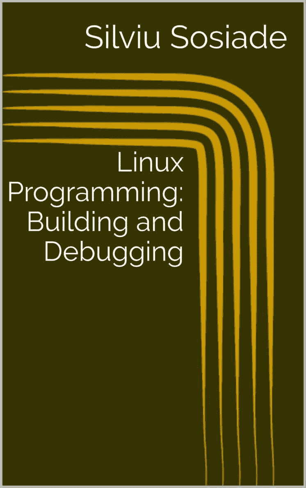
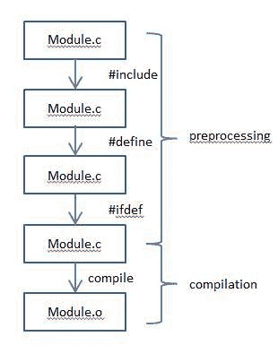
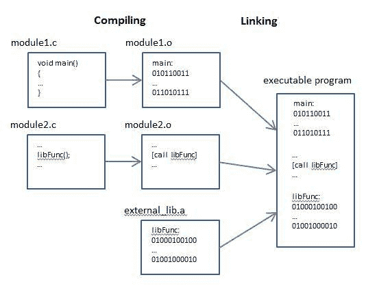
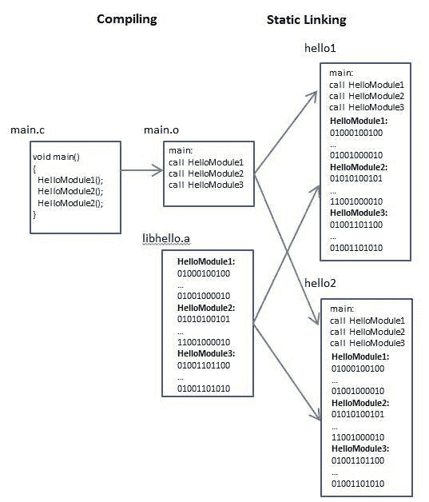
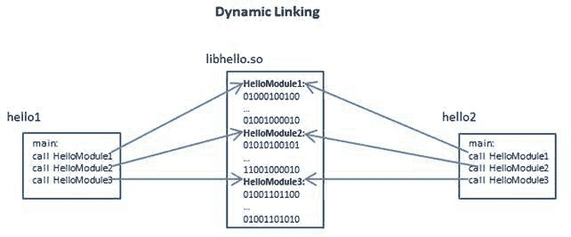
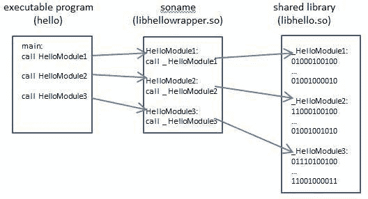
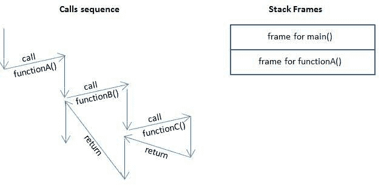
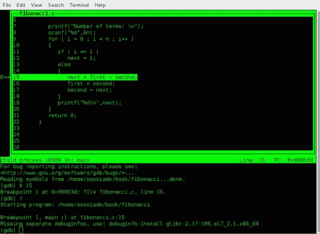

# Linux 编程：构建与调试指南



## 引言

Linux 已经很久了。它最初只是一个非常聪明的学生的学术项目，而现在代表了全球许多企业服务器的主要解决方案。此外，Linux 操作系统作为终端用户桌面的解决方案正在赢得越来越多的追随者。凭借专门为 Linux 构建的视觉界面（`KDE`、`GNOME`），该系统的操作变得像 `Windows` 或 `MacOS` 一样简单，并且越来越不再被认为仅仅是供学术界或程序员使用的操作系统。

此外，如果你为数字电视使用 `set-topbox`，或者你家里有智能报警器，这些设备可能也使用了 Linux 操作系统。这是因为 Linux 操作系统已被移植到各种类型的处理器或设备，变成了我们现在所说的“嵌入式 Linux”。

尽管市场份额很小，但目前已经有使用 `Ubuntu` Linux 版本的手机。Linux 未来是否会在手机市场占据重要份额还有待待观察。但已经有手机在使用该操作系统的这一事实证明了 Linux 解决方案如今已变得多功能且灵活。

Linux 的第一个程序编写于 `1991` 年。这已经是 25 年前的事了，对于软件市场以及整个 IT 市场来说，这是一个相当漫长的年代。在过去的 25 年里，我们看到了许多经历过辉煌时期后被其他产品取代的软件。我们还看到曾经声誉巨大的公司现在处于辉煌的黄昏或已经倒闭。

但这种情况没有发生在 Linux 身上。随着时间的推移，Linux 变得越来越强大。它“永葆青春”的秘密似乎在于使用了 `GNU GPL` 许可证，这种许可证允许任何人免费使用该操作系统。此外，这种许可证的使用在“免费”的含义上具有更广泛的范围。这是运行、复制、分发、研究、修改和改进软件的自由。

这种“自由”的方面吸引了世界各地大量的爱好者和程序员，他们热衷于为 Linux 的开发贡献力量。这最终创造了一种难以复制的协同效应，而对于一个代码对普通公众不可见、且仅由一家或一组公司开发和维护的软件系统来说，这是很难做到的。

如果你还不知道这一点，这里需要注意：Linux 并不是 `UNIX`。但存在一个互换使用这些术语的趋势。这是因为 Linux 和 `UNIX` 在用法方面有许多共同点。

## 编译 vs 解释执行

如果你买了这本书，你可能对开发计算机程序感兴趣，或许对如何开发程序已经有一些想法。如果我告诉你，计算机编程意味着编写无尽的 0 和 1 序列，你可能就会放弃进一步探索这个话题的主意了！但在计算机早期，现实情况确实如此，那时“软件”和“硬件”之间没有区别，程序需要直接使用“机器语言”来编写——即由 CPU 执行的低级指令。

那个时代的程序员必须制作出大量的打孔卡，其中包含了微处理器最终执行的指令序列。在那种条件下，即使是编写一个微不足道的程序，也需要付出巨大的努力。如果不进行简化并让计算机编程更加高效，编写能够允许飞机自动飞行的程序将是不可能的。

简化编程工作有两种方法：`解释`（interpreting）和 `编译`（compiling）。这两种方法的共同点是都使用比 CPU 指令集更复杂的指令序列来编写程序。随着编程效率的提高，可以用更少的代码编写更多的功能，编写更复杂的程序也变得可能。

### 解释（Interpretation）

每一行代码都会被解释并转换为 CPU 可执行的等效指令序列。这些指令随后会被执行。然后，下一行代码被解释并以同样的方式执行。程序的执行就一直持续，直到程序的最后一行被执行。以这种方式运行程序需要使用“解释器”，它允许对程序的每一行进行连续的解释和执行。

老牌程序员可能还记得 `BASIC`，这是一种很大程度上基于解释的编程语言。然而，程序解释即使在今天仍然存在且非常流行的概念，特别是对于程序员所谓的“脚本型编程”（shell 脚本、`perl`、`python`、`javascript` 等等）……。

### 编译（Compiling）

程序首先被翻译成另一种低级的中间语言。翻译后的程序既可以直接执行，也可以被解释。将高级语言翻译成更低级的语言的过程被称为`编译`。为此，程序员需要使用该特定语言的“编译器”。`C` 或 `C++` 语言就是使用编译的编程语言示例。

`Java` 是一种同时使用上述这两个概念的编程语言。一个 `Java` 程序首先被“编译”成 `Java 字节码`。这个过程由 `Java 编译器` 完成。接下来，当执行字节码程序时，字节码程序中的每条语句随后都会被“解释”。解释过程由 `Java 虚拟机`（`JVM`）执行，它在不同的主机机器上为字节码执行充当解释器的角色。

通常情况下，编译后的程序比解释型程序快。因此，如果执行速度至关重要，那么最好使用编译型语言。另一方面，解释型语言具有更简单、易用的声誉，从而提供了更高的生产力。

## 构建可执行文件：编译与链接

构建（可执行文件）代表了从源代码到实际可执行文件的过程。虽然某些程序员倾向于口语化将“构建”称为“编译”，但实际上构建可执行文件是通过两个不同的步骤完成的：

1. `编译`（compilation）
2. `链接`（linking）

### 编译（Compilation）

从概念上说，这就是我在上一章描述的内容。在 `Linux` 中编译 `C/C++` 源代码代表了从编程语言翻译源代码并创建“目标文件”的过程，目标文件是源代码的机器语言表示。对于 `C/C++` 语言，编译通常分两个阶段完成：

**步骤 1 – 预处理（preprocessing）**：这一步涉及通过以下操作对原始源文件进行预处理：

- 包含来自 `#include` 指令的源代码。
- 展开宏并对 `#define` 指令进行替换。
- 根据 `#if`、`#ifdef` 和 `#ifndef` 指令选择原始源代码的部分。



**步骤 2 – 编译本身（compilation itself）**：这一步代表对预处理后生成的纯代码进行解析以及目标文件的创建。

我刚刚提到编译的输出是机器语言格式。那么，为什么我们不能直接执行编译的输出，而还需要链接阶段呢？

这里有两个主要原因：

- 一个可执行文件可以从多个源代码文件（模块）创建。每个源代码文件被单独翻译成等效的目标文件。然而，只有一个文件包含 `main 方法` 的定义，它代表了可执行文件的主入口。因此，我们无法执行不包含主入口的模块。
- 源代码可能包含对其他模块中定义的函数或在外部库中实现的函数的引用。编译本身并不处理这些类型的依赖关系。

### 链接（Linking）

这是将所有目标文件汇成代表最终可执行文件的过程。外部符号的依赖关系在这个阶段得到解决。

如果引用的函数定义在外部静态库中，那么该函数的完整实现也将被添加到最终的可执行文件中。



我简要强调了外部库在构建最终可执行文件的作用。分两步构建可执行文件的优势开始显现：构建过程提供了在多个程序和产品之间复用各种预编译代码部分（库）的能力。另一个优势是代码可以构造成特定的结构，使得代码部分在每次构建程序时不需要重新编译。但关于库的更多内容将在单独的章节中。

## GNU C/C++ 编译器：GCC

为 `C/C++` 编程语言选择编译器有多种选项，如下表所示。

| 编译器 | 许可证 |
| :--- | :--- |
| Ch | 免费软件 |
| [CodeWarrior](http://en.wikipedia.org/wiki/CodeWarrior) | 专有 |
| [GCC](http://en.wikipedia.org/wiki/GNU_Compiler_Collection) | GPL |
| [Digital Mars](http://en.wikipedia.org/wiki/Digital_Mars) | 专有 |
| [LabWindows/CVI](http://en.wikipedia.org/wiki/LabWindows/CVI) | 专有 |
| [Lattice C](http://en.wikipedia.org/wiki/Lattice_C) | 专有 |
| [lcc](http://en.wikipedia.org/wiki/LCC_(compiler)) | 免费软件 |
| [Open Watcom](http://en.wikipedia.org/wiki/Open_Watcom) | 专有 |
| [Portable C Compiler](http://en.wikipedia.org/wiki/Portable_C_Compiler) | BSD |
| [Smaller C](https://github.com/alexfru/SmallerC) | BSD |
| [Wind River (Diab) Compiler](http://en.wikipedia.org/wiki/Wind_River_Systems#Wind_River_.28Diab.29_Compiler) | 专有 |
| [XL C](http://en.wikipedia.org/wiki/IBM_XL_C%2B%2B) | 专有 |
| [HP aC++](http://en.wikipedia.org/wiki/HP_aC%2B%2B) | 专有 |
| [Intel C++ Compiler](http://en.wikipedia.org/wiki/Intel_C%2B%2B_Compiler) | 专有 |
| [VisualAge C++](http://en.wikipedia.org/wiki/IBM_VisualAge) | 专有 |

对于 Linux 而言，`GCC`（GNU 编译器集合）代表了构建 `C/C++` 编写程序最流行的选项。只要想想 `GCC` 是用于编译 Linux 内核本身的编译器这一事实，足以说明该工具链的稳健性和可靠性。而且更棒的一点是：它是免费的！

因此，将使用 `GCC` 编译器来构建本书中介绍的所有示例。

如果你是 Fedora、Red Hat 或 CentOS 用户，可以使用以下命令在你的 Linux 机器上安装 GNU C/C++ 编译器：

```bash
sudo yum groupinstall 'Development Tools'
```

或者，如果你是 Debian 或 Ubuntu 用户，可以使用以下 `apt-get` 命令进行安装：

```bash
sudo apt-get install build-essential manpages-dev
```

假设安装成功，运行以下命令将显示新安装编译器的版本：

```bash
gcc --version
```

```text
gcc (GCC) 4.4.7 20120313 (Red Hat 4.4.7-11)
Copyright (C) 2010 Free Software Foundation, Inc.
```

让我们使用这个编译器来编译早已著名的“Hello World”程序，该程序是由 C 语言的父辈丹尼斯·里奇（Dennis Ritchie）和布莱恩·柯尼根（Brian Kernighan）提出的。

假设以下 C 程序存在于名为 `hello.c` 的文件中：

```c
#include <stdio.h>
void main()
{
    printf("Hello world!\n");
}
```

我可以通过执行以下命令编译这个 C 程序：

```bash
gcc -g hello.c -o hello_c
```

在上面的 `gcc` 命令中，我使用了 `-o` 选项来指定生成的可执行文件的名称（`hello_c`），并使用 `-g` 选项指示编译器在输出中包含调试信息。在开发期间带有调试信息进行编译是一个良好的习惯，这样可以使用调试器的更多功能来修复可能的问题。

上述命令的输出是一个名为 `hello_c` 的 Linux 可执行文件，我可以尝试执行它：

```bash
./hello_c
Hello world!
```

上面的 `gcc` 命令一次性完成了构建、编译和链接这三个步骤。

如果我想从源代码构建并仅生成对象文件，我可以使用以下命令：

```bash
gcc -c hello.c
```

`-c` 选项代表“编译（compile）”，并指示 `gcc` 只运行预处理器和编译器。该命令的输出将是一个位于相同文件夹下的 `hello.o` 对象文件。该对象文件随后可以使用以下命令进行链接：

```bash
gcc hello.o -o hello_c
```

这里 `gcc` 足够智能可以检测到传入了对象文件并仅执行链接器。生成的输出与第一个示例创建的 `hello_c` 可执行文件相同，但这次是通过运行编译和链接器两个独立步骤构建的。

当需要时，可以使用 `-E` 选项仅运行 `gcc` 进行预处理：

```bash
gcc -E hello.c
```

运行上述命令后，你会发现微小的 `hello.c` 程序的体积会显著增加。这是由于 `#include <stdio.h>` 指令，它会引导预处理器将头文件的全部以及所有其他依赖项包含在预处理后的 C 文件输出中。

也可以在预处理后停止编译并检查生成的输出。

让我们看看如何构建“Hello World”示例的 C++ 版本。我将从包含以下内容的 `hello.cpp` 文件开始：

```cpp
#include "iostream"
int main(void)
{
    std::cout << "Hello world from C++.\n";
    return 0;
}
```

我可以使用以下命令行构建它：

```bash
g++ -g -Wall hello.cpp -o hello_cpp
```

其中 `g++` 是 GNU C++ 编译器，`-g` 和 `-o` 的含义与之前提供的 `gcc` 命令行相同。

一旦上述命令成功完成，我可以尝试执行生成的可执行文件：

```bash
./hello_cpp
Hello world from C++.
```

本章旨在让你对如何从命令行安装和使用 GNU C/C++ 编译器有一个初步感受。我可以在本书的后续章节中转向稍微复杂一点示例。

## 从多个源模块构建程序

程序内容完全位于单个源文件的情况是非常罕见的。良好的软件开发实践要求使用多个源文件来实现产品的各个部分。

从 C/C++ 源代码构建 Linux 程序涉及处理几种类型的文件：

- **源文件（`*.cpp` 或 `*.c`）**：包含主函数实现以及程序使用的其他函数或类实现的文本文件。
- **头文件（`*.h`）**：包含函数或类原型以及其他处理器语句的文本文件。本章稍后将展示源文件头文件的示例。
- **对象文件（`*.o`）**：编译器的输出。
- **二进制文件**：可执行文件、静态库（`*.a`）或动态库（`*.so`）。目前我们可以将库视为对象文件的预构建仓库。

从 C/C++ 源代码构建 Linux 程序涉及处理几种类型的文件：

- **源文件（`*.cpp` 或 `*.c`）**：包含主函数实现以及程序使用的其他函数或类实现的文本文件。
- **头文件（`*.h`）**：包含函数或类原型以及其他处理器语句的文本文件。本章稍后将展示源文件头文件的示例。
- **对象文件（`*.o`）**：编译器的输出。
- **二进制文件**：可执行文件、静态库（`*.a`）或动态库（`*.so`）。目前我们可以将库视为对象文件的预构建仓库。

从 C/C++ 源代码构建 Linux 程序涉及处理几种类型的文件：

- **源文件（`*.cpp` 或 `*.c`）**：包含主函数实现以及程序使用的其他函数或类实现的文本文件。
- **头文件（`*.h`）**：包含函数或类原型以及其他处理器语句的文本文件。本章稍后将展示源文件头文件的示例。
- **对象文件（`*.o`）**：编译器的输出。
- **二进制文件**：可执行文件、静态库（`*.a`）或动态库（`*.so`）。目前我们可以将库视为对象文件的预构建仓库。

从 C/C++ 源代码构建 Linux 程序涉及处理几种类型的文件：

- **源文件（`*.cpp` 或 `*.c`）**：包含主函数实现以及程序使用的其他函数或类实现的文本文件。
- **头文件（`*.h`）**：包含函数或类原型以及其他处理器语句的文本文件。本章稍后将展示源文件头文件的示例。
- **对象文件（`*.o`）**：编译器的输出。
- **二进制文件**：可执行文件、静态库（`*.a`）或动态库（`*.so`）。目前我们可以将库视为对象文件的预构建仓库。

从 C/C++ 源代码构建 Linux 程序涉及处理几种类型的文件：

- **源文件（`*.cpp` 或 `*.c`）**：包含主函数实现以及程序使用的其他函数或类实现的文本文件。
- **头文件（`*.h`）**：包含函数或类原型以及其他处理器语句的文本文件。本章稍后将展示源文件头文件的示例。
- **对象文件（`*.o`）**：编译器的输出。
- **二进制文件**：可执行文件、静态库（`*.a`）或动态库（`*.so`）。目前我们可以将库视为对象文件的预构建仓库。

从 C/C++ 源代码构建 Linux 程序涉及处理几种类型的文件：

- **源文件（`*.cpp` 或 `*.c`）**：包含主函数实现以及程序使用的其他函数或类实现的文本文件。
- **头文件（`*.h`）**：包含函数或类原型以及其他处理器语句的文本文件。本章稍后将展示源文件头文件的示例。


从 C/C++ 源代码构建 Linux 程序涉及处理几种类型的文件：

- **源文件（`*.cpp` 或 `*.c`）** – 包含主函数实现以及程序使用的其他函数或类实现的文本文件。
- **头文件（`*.h`）** – 包含函数或类原型以及其他处理器语句的文本文件。本章稍后将展示源文件头文件的示例。
- **对象文件（`*.o`）** – 编译器的输出。
- **二进制文件** – 可执行文件、静态库（`*.a`）或动态库（`*.so`）。目前我们可以将库视为对象文件的预构建仓库。

本章将从 C/C++ 源代码构建 Linux 程序的基本文件类型开始介绍。

# Make 和 Makefile

我们刚刚从上一章学习了如何从多个源文件构建程序。这看起来简单直接。但如果不是三个模块，而是要处理成百个源文件（这对于大型项目很常见）呢？构建这么多文件的 `gcc` 命令行显然不是选择。我们该怎么办？

首先想到的创建一个程序或脚本来尝试自动化构建过程，并使过程变得简单可重复。好消息是你不需要编写任何内容，因为这样的程序已经存在了。这是一个名为 `make` 的 GNU 工具。`make` 程序理解并执行在名为 `Makefile` 的输入文件中指定的规则。因此，虽然 `make` 工具是通用的，但 `Makefile` 包含了构建特定程序的规则。

展示一个 `Makefile` 示例，其功能等同于上一章用于构建 `hello` 可执行文件的 shell 命令。此示例的目标是对 `Makefile` 的语法和用法进行简要概述。

开始，假设我的当前工作目录中有以下文件：

```bash
ls
main.c Makefile module1.c module1.h module2.c module2.h module3.c module3.h
```

头文件和源文件与上一个示例使用的文件相同。makefile 文件的内容如下：

```bash
cat Makefile
```

```makefile
module1.o: module1.c module1.h
	gcc -c module1.c

module2.o: module2.c module2.h
	gcc -c module2.c

module3.o: module3.c module3.h
	gcc -c module3.c

main.o: main.c
	gcc -c main.c

hello: module1.o module2.o module3.o main.o
	gcc module1.o module2.o module3.o main.o -o hello
```

在解释 `Makefile` 语法之前，让我先向你们展示我是如何构建 `hello` 可执行文件的：

```bash
$ make hello
gcc -c main.c
gcc -c module1.c
gcc -c module2.c
gcc -c module3.c
gcc module1.o module2.o module3.o main.o -o hello
```

仅通过探索此命令的输出，我们就可以对 `make` 工具的作用产生一些理解。它首先编译源代码，然后将对象文件链接成最终的可执行文件。

如果我再次列出相同目录的内容，现在就能看到生成的对象文件和可执行文件。

```bash
$ ls
```

`hello` `main.c` `main.o` `Makefile` `module1.c` `module1.h` `module1.o` `module2.c` `module2.h` `module2.o` `module3.c` `module3.h` `module3.o`

如果运行该可执行文件，我将得到与我之前从命令行构建可执行文件时相同的输出：

```bash
$ ./hello
Hello from module 1
Hello from module 2
Hello from module 3
```

但如果我尝试再次执行 `make` 命令会发生什么？

```bash
$ make hello
make: `hello' is up to date.
```

看来 `make` 以某种方式知道自上次构建以来没有发生变化。因此，它不会重新编译和链接任何内容。`make` 通过检查它所使用或生成的各种文件的时间戳来检测这一点。如果二进制产物比源代码旧，那么它就会执行编译；否则不执行。

为了证明这一点，我将修改 `module2.c` 的时间戳：

```bash
$ ls -l module2
-rw-rw-r--. 1 ssosiade ssosiade 103 Jul 30 07:29 module2.c
-rw-rw-r--. 1 ssosiade ssosiade 70 Jul 29 07:56 module2.h
-rw-rw-r--. 1 ssosiade ssosiade 1512 Jul 30 07:30 module2.o
```

```bash
$ touch module2.c
$ ls -l module2
-rw-rw-r--. 1 ssosiade ssosiade 103 Jul 30 07:32 module2.c
-rw-rw-r--. 1 ssosiade ssosiade 70 Jul 29 07:56 module2.h
-rw-rw-r--. 1 ssosiade ssosiade 1512 Jul 30 07:30 module2.o
```

现在 `module2.c` 看起来比 `module2.o` 新。如果我再次运行 `make hello`，那么只有 `module2.c` 将被重新编译，可执行文件将被重新创建。

```bash
$ make hello
gcc -c module2.c
gcc module1.o module2.o module3.o main.o -o hello
```

这一特性通过只构建自上次构建以来受最新代码更改影响的系统部分，缩短了总构建时间。这一特性确实带来了显著差异，特别是对于大型系统，从零开始的构建（清洁构建）可能需要几个小时。

现在让我们回到 `Makefile`，解释 `make` 工具是如何根据 `Makefile` 的内容理解要执行什么以及构建什么的。

## Makefile 规则结构

`Makefile` 中的关键元素由 `rule`（规则）表示。`make` 规则以 `target`（目标）开始，并如下格式：

`target: dependencies`

`<TAB> command1`

`<TAB> command2`

`<TAB> commandN`

请注意，`<TAB>` 必须是 TAB 字符，不能用一系列空格来替换以达到相同的缩进级别。这是 `Makefile` 中最常见的错误之一。类似下面的信息：

`“Makefile:11: *** missing separator (did you mean TAB instead of 8 spaces?). Stop.”`

将指示第 11 行缺少一个 `TAB`。

当调用一个目标时，`make` 将先处理依赖项，然后按顺序执行目标体中指定的所有命令（`“command1”`、`“command2”`……`“commandN”`）。

目标可以通过以下方式之一调用：

1. 从命令行使用 `make <target>`
2. 作为另一个目标处理过程的一部分

为了更好地理解这一点，让我们分析我的示例中 `Makefile` 给出的一些规则：

`module3.o: module3.c module3.h`

`  gcc -c module3.c`

对于上面的规则，`module3.o` 依赖于 `module3.c` 和 `module3.h`。当调用时，`make` 工具将检查 `module3.o` 是否存在以及其时间戳是否比 `module3.c` 和 `module3.h` 新。如果任何一个不满足，它就会执行 `gcc -c`。

目标 `module3.o` 可以如下所示从命令行独立调用：

```bash
$ make module3.o
gcc -c module3.c
```

让我们探索这条规则：

`hello: main.o module1.o module2.o module3.o`

`  gcc module1.o module2.o module3.o main.o -o hello`

在这个规则中，`hello` 依赖于 `main.o`、`module1.o`、`module2.o` 和 `module3.o`。

## 内置规则与默认规则

`make` 工具包含了所谓的 `builtin rules`（内置规则）或 `default rules`（默认规则）。如果我从 `Makefile` 中删除目标 `module1.o` 并尝试从命令行调用 `make module1.o`，你认为会发生什么？你可能会倾向于认为该命令会失败。事实并非如此：

```bash
$ make module1.o
cc -c -o module1.o
```

为什么？首先不要忘记 `make` 特别是为了控制和自动化构建过程而编写的。为了方便，许多流行语言（C、C++、Fortran、Modula-2 等）的默认规则已集成到 `make` 中。如果没有找到匹配规则，根据 `.o` 后缀，`make` 工具能够确定目标指向 C（或 C++）对象文件，因此会在当前文件夹中查找 `module1.c`（或 `module1.cpp`）文件。

我个人并不确定这些内置规则有多用。内置规则有时会引起微妙的问题，并且很难检测。例如，用于 C 的内置规则使用标准 C 编译器 `cc`，而 `Makefile` 使用 GNU C 编译器 `gcc`。

## 模式规则

`make` 工具通过 `pattern based rules`（模式规则）来理解。以下是之前的 `Makefile` 在使用单个规则指定所有对象文件（`*.o`）都应从相应的 `.c` 文件创建，并使用 `gcc` 编译器的样子：

```bash
$ cat Makefile
%.o: %.c
	gcc -c $^

hello: main.o module1.o module2.o module3.o
	gcc main1.o module2.o module3.o main.o -o hello

clean:
	rm -rf hello *.o
```

人们很容易发现，使用模式规则使 `Makefile` 看起来更整洁、更紧凑。

在继续下去之前，我需要对上面写的基于模式的规则进行快速解释。`“%.o: %.c"` 表示，对于任何给定的 `<file name>.o`，`make` 工具必须在当前文件夹中寻找 `<file name.c>` 文件。在某种程度上，这与在 Linux 中使用 `"*"` 通配符相似，但有一个限制：对象文件和源文件的文件名必须完全匹配。

上一个 `Makefile` 中的 `“$^"` 是什么意思？它指的是一个内部变量，展开为依赖项 `<file name.c>` 的名称。同样，`"$@"` 包含目标文件 `<file name.o>` 的名称。

我刚刚提到 `$^` 指的是一个`变量`。是的，我们在编写 `Makefile` 时可以使用变量。


我将给你一个快速的示例，让你理解变量在 Makefile 中为什么很有用。假设我想更改编译器，因此不再使用`gcc`编译器，而是想使用另一个编译器。在我目前介绍的所有 Makefile 中，如果我想更改 GNU 编译器，我需要修改多处出现`"gcc"`字符串的 Makefile。如果我使用一个变量（我们称之为`CC`）来存储编译器的名称，并在 Makefile 的其余部分使用该变量而不是硬编码编译器名称呢？现在，我只需要更改此变量的`"value"`，这个更改将传播到 Makefile 中的所有地方。请下面的示例 Makefile：

```make
cat Makefile
CC=gcc
%.o: %.c
	${CC} -c $^
hello: main.o module1.o module2.o module3.o
	${CC} module1.o module2.o module3.o main.o -o hello
clean:
	rm -rf hello *.o
```

同样，编译器参数代表了程序开发过程中甚至之后可能需要经常更改的内容。这是 Makefile 变量有用的另一个很好的例子：

```make
cat Makefile
CC=gcc
CCFLAGS=-Wall -g
%.o: %.c
	${CC} ${CCFLAGS} -c $^
hello: main.o module1.o module2.o module3.o
	${CC} module1.o module2.o module3.o main.o -o hello
clean:
	rm -rf hello *.o
```

Makefile 还支持条件语句（if-then-else）。我将引用另一个常见用例来引入 Makefile 的条件语句。我想扩展我之前示例中的 Makefile，以便当我想要构建带有调试信息（`-g`）的程序时，可以从命令行通过`make DEBUG=true`来调用它。

以下是使用 Makefile 条件语句实现此方法：

```make
cat Makefile
CC=gcc
ifeq ($(DEBUG),true)
	CCFLAGS=-Wall -g
else
	CCFLAGS=-Wall
endif
hello: main.o module1.o module2.o module3.o
	${CC} module1.o module2.o module3.o main.o -o hello
%.o: %.c
	${CC} ${CCFLAGS} -c $^
clean:
	rm -rf hello *.o
```

关于 Makefile 语法我想要讨论的最后一个主题是函数。在 Makefile 语法中，函数调用在某种程度上类似于变量引用。

```make
$(function arguments)
```

你可能在左侧有一个或没有变量来存储函数的返回值：

```make
var := $(function arguments)
```

下面是一个函数调用的示例，它将所有扩展名为`txt`的文件名存储在变量`ALL_TEXT_FILES`中。这是通过调用`shell`函数并传入`"ls *.txt"`作为输入参数实现的。

```make
ALL_TEXT_FILES:=$(shell ls *.txt)
```

Make 拥有大量的函数，可以在不同的情况下有用。列表太长了，本书无法涵盖。但我强烈建议收藏并查看官方的 make 文档（[`www.gnu.org/software/make/manual`](https://www.gnu.org/software/make/manual)）来了解各种可用函数。使用函数可以实现更大的灵活性，因此函数在几乎任何构建稍微复杂的软件产品的 Makefile 中都会被广泛使用。

也许是时候一个我在在本章中逐渐完善的 Makefile 使用函数的示例了。我之前介绍的最后一个 Makefile 的局限性是，每当我添加一个新的 C 模块时，我都需要手动更新`hello`目标的依赖列表。我想某种方式实现自动化，并能够只需在该文件夹中放入一个 C 源文件，让 Makefile 能够识别构建可执行文件需要哪些对象文件。

这就是函数可以大作用的地方。看下面的 Makefile 如何实现这一点：

```make
SOURCE_FILES = $(wildcard *.c)
OBJECT_FILES = $(SOURCE_FILES:.c=.o)
CC=gcc
ALL_TEXT_FILES:=$(shell ls *.txt)
ifeq ($(DEBUG),true)
	CCFLAGS=-Wall -g
else
	CCFLAGS=-Wall
endif
hello: ${OBJECT_FILES}
	${CC} ${OBJECT_FILES} -o $@
%.o: %.c
	${CC} ${CCFLAGS} -c $^
clean:
	rm -rf hello *.o
```

以上就是对 Makefile 语法的简要介绍。

```makefile
LNK_OPTS=-L. -lhello

ifeq ($(DEBUG),true)
  CCFLAGS=-Wall -g
else
  CCFLAGS=-Wall
endif

hello: main.o libhello.a
	${CC} main.o -o $@ ${LNK_OPTS}

libhello.a: ${LIB_OBJECT_FILES}
	${AR} r $@ ${LIB_OBJECT_FILES}

%.o: %.c
	${CC} ${CCFLAGS} -c $^*

clean:
	rm -rf hello libhello.a *.o
```

以下是使用上述 Makefile 运行`make`的示例：

```bash
make
gcc -Wall -c main.c
gcc -Wall -c module1.c
gcc -Wall -c module2.c
gcc -Wall -c module3.c
ar r libhello.a module1.o module2.o module3.o
ar: creating libhello.a
gcc main.o -o hello -L. –lhello
```

使用静态库的缺点是，当静态库更新时，所有使用该库的程序都需要重新链接，以获取库的最新更改。

# 共享库

尽管静态库的使用非常简单，但它们有一个明显的缺点：从库中使用的代码段会被复制到每个可执行文件中，因此当这些程序执行时，系统在磁盘和内存中都会存在相同二进制数据的多个副本。

例如，如果我们有两个链接到同一个静态库的可执行文件`hello1`和`hello2`，那么可执行文件的二进制布局大致如下：



共享库通过为所有可执行文件仅使用一个版本的公共代码来解决这一缺陷。其实现方式如图所示：



其工作原理如下：

1. 第一个需要共享库的程序在启动的同时将库加载到内存中。
2. 第二个、第三个等需要相同库的程序将重用已经加载到内存中的库。系统会维护使用该库的程序引用计数。
3. 当程序结束时，引用计数递减。
4. 当引用计数达到零时，意味着没有活跃的程序在使用该库，该库将从内存中卸载。

为了实现上述功能，链接过程的责任现在由程序加载器共同承担。在构建可执行文件时，链接器仅会插入从共享库中使用的部分的符号。程序加载器实际上会在运行时为已加载到内存的库解析这些符号的精确地址。这一步被称为“符号重位”（symbol relocation）或“运行时链接”，负责此任务的程序加载器部分称为`动态链接器`（dynamic linker）。事实上，动态链接器本身是一个 Linux 共享库（`/lib/ld-linux*.so`）。

由于符号重位，加载使用共享对象的程序会比使用静态库的类似程序慢。

共享库可以加载到 Linux 虚拟内存的任何位置。可以加载到内存任何位置的代码被称为“位置无关代码”（position-independent code）。因此，在生成共享对象时，需要指示编译器生成位置无关代码。`gcc`的`-fPIC`选项用于生成此类输出。参见示例：

```bash
gcc -c -fPIC module1.c module2.c module3.c
```

链接共享对象需要使用`-shared`选项：

```bash
gcc -shared -o libhello.so module1.o module2.o module3.o
```

执行上述命令后，当前目录下会创建一个`libhello.so`文件。使用`libhello.so`共享库构建 hello 可执行文件的 Makefile 如下所示：

```makefile
LIB_SOURCE_FILES = $(wildcard *.c)
LIB_OBJECT_FILES = $(LIB_SOURCE_FILES:.c=.o)
CC=gcc
LNK_OPTS=libhello.so
SOLNKFLAGS=-shared -o

ifeq ($(DEBUG),true)
  CCFLAGS=-Wall -g
  SOCCFLAGS=-Wall -g -fPIC
else
  CCFLAGS=-Wall
  SOCCFLAGS=-Wall -fPIC
endif

hello: main.o libhello.so
	${CC} main.o -o $@ ${LNK_OPTS}

libhello.so: ${LIB_OBJECT_FILES}
	${CC} ${SOLNKFLAGS} $@ ${LIB_OBJECT_FILES}

%.o: %.c
	${CC} ${CCFLAGS} -c $^*

clean:
	rm -rf hello libhello.so *.o
```

如果我尝试执行由上述 Makefile 生成的 hello 可执行文件，将得到以下输出：

```bash
./hello
./hello: error while loading shared libraries: libhello.so: cannot open object file: No such file or directory
```

这里哪里错了或缺少了什么？失败发生在动态链接器尝试将`libhello.so`加载到内存但未找到它的。这是因为动态链接器在某些预定义的路径（例如：`/lib`、`/usr/lib`、`/usr/local/lib`）查找共享库，而我的共享库位于当前目录，该目录并不是动态加载器路径的一部分。我有几个选项可以修复：

- **选项 1**：将共享对象拷贝到动态加载器搜索路径包含的目录。
- **选项 2**：使用`LD_LIBRARY_PATH`为动态加载器搜索路径添加额外目录。例如：

  ```bash
  LD_LIBRARY_PATH=. ./hello
  ```

- **选项 3**：使用`ldconfig`为动态加载器搜索路径添加额外目录。例如，编辑`/etc/ld.so.conf`：

  ```bash
  sudo ldconfig
  ./hello
  ```

请注意，需要超级用户权限编辑`/etc/ld.so.conf`并允许执行`ldconfig`。可以使用`ldconfig -v`查看动态链接器正在搜索哪些共享库以及发现了哪些库。`man ldconfig`将提供有关如何使用该工具详细信息。

可以使用工具`ldd`（列出动态依赖）查找特定程序的所有动态依赖。对 hello 可执行文件运行此工具将产生以下输出：

```bash
ldd hello
linux-vdso.so.1 => (0x00007ffff7000)
libhello.so => /home/samples_book/dynamic_lib/libhello.so (0x00007fb06a752000)
libc.so.6 => /lib64/libc.so.6 (0x00007fb8a7c0000)
/lib64/ld-linux-x86-64.so.2 (0x00007fb8a780000)
```

从输出可以看出，除了依赖我的共享库外，hello 程序还需要 C 库（`libc.so`）、Linux 动态加载器（`ld-linux*.so`）以及一个用于进入内核空间的的库（`linux-vdso.so`）。这三个最新的库包含在几乎任何使用共享库的 Linux 可执行文件中。

使用共享库消除了库更改或更新时重新链接可执行文件的需要。例如，我应该可以将`libhello.so`更新到新版本（`libhello.so.2`），而所有依赖该共享库的程序都可以最新版本，而无需重新构建或链接任何可执行文件。

然而，从输出可以看出，hello 可执行文件严格依赖名为`libhello.so`的二进制文件。因此，重命名共享库会破坏可执行文件吗？答案是肯！那么 Linux 如何解决这个问题呢？

解决方案是使用“封装库”（soname）而不是共享库的实际名称。`Sonames`代表了一种间接层，允许可执行文件使用共享库的不同版本而不是链接时使用的版本。这允许在不需要重新链接可执行文件的情况下更新库，因为可执行文件将继续引用 soname 库。

我可以这样修改命令行以使用 soname：

```bash
gcc -shared -Wl,-soname,libhellowrapper.o -o libhello.so module1.o module2.o module3.o
```

如果我列出文件夹的内容，看到只有`libhello.so`被生成了。然而，在这种情况下的主要区别是新的共享库内部也包含了`soname`库。

```bash
strings libhello.so | grep libhellowrapper.so
```

`libhellowrapper.so`

使用带有`soname`的共享对象进行链接基本上与使用任何共享对象都是样的：

```bash
gcc -g -Wall -o hello main.c libhello.so
```

然而，区别在于链接器会识别嵌入在共享库中的`soname`并使用这一个。



通过使用`ldd`，我现在可以看到`hello`二进制文件引用的是`soname`包装库，而不是共享库本身：

```bash
ldd hello
linux-vdso.so.1 => (0x00007fffaffff000)
libhellowrapper.so => not found
libc.so.6 => /lib64/libc.so.6 (0x0000003c87c0000)
/lib64/ld-linux-x86-64.so.2 (0x0000003c87800000)
```

在磁盘上，`soname`必须是一个指向库本身的软链接。因此，使用`soname`的最后一步是创建这个软链接：

```bash
ln -s libhello.so libhellowrapper.so
ls -lrt libhellowrapper.so
```

```text
lrwxrwxrwx. 1 ssosiade ssosiade 11 Aug 5 06:50 libhellowrapper.so -> libhello.so
```

在所有工作都就绪后，我现在可以尝试运行可执行文件，我预计看到与第一次执行`hello`可执行文件相同的输出，因为源代码没有改变，改变的代码构建的方式：

```bash
./hello
./hello: error while loading shared libraries: libhellowrapper.so: cannot open shared object file: No such file or directory
LD_LIBRARY_PATH=. ./hello
Hello from module 1
Hello from module 2
Hello from module 3
```

然而，现在如果我想更改共享库，我只需要更改软链接以指向新的二进制文件即可。不需要重新构建或重新链接。

例如，如果可用较新版本的`libhello.so.2`，我只需通过以下操作将旧的替换为新的：

```bash
ln -s libhello.so.2 libhellowrapper.so
```

现在`hello`将使用新库进行执行。

# 调试 Linux 程序

GNU 工具链中附带的最有用工具之一是`gdb`（GNU 调试器）。在尝试理解程序为何崩溃或程序为何没有按照设计意工作时，这个工具可以提供极具价值的帮助。

为了解释`gdb`工具的主要功能，我需要一个比“hello world”稍微复杂的 C 程序。因此，我将使用一个非递归版本的程序，该程序显示给定项数的斐波那契数列。

这是该程序的列出：

```bash
cat fibonacci.c
#include<stdio.h>
int main() {
    int n, first = 0, second = 1, next, i;
    printf("Number of terms: \n");
    scanf("%d",&n);
    for ( i = 0 ; i < n ; i++ ) {
        if ( i <= 1 )
            next = i;
        else {
            next = first + second;
            first = second;
            second = next;
        }
    }
    printf("%d\n",next);
    return 0;
}
```

这里关于如何使用`gcc`构建此程序的快速提示：

```bash
gcc -g fibonacci.c -o fibonacci
./fibonacci
Number of terms: 6
```

**注意**：使用`-g`（带有调试符号）对于充分利用`gdb`工具的能力至关重要。让我们看看如何使用这个程序来探索 GNU 调试器的以下功能：

- 在调试器下运行程序
- 设置断点
- 单步执行
- 设置观察点
- 检查变量内容


- 设置变量和调用函数
- 回溯和切换堆栈帧
- 处理信号
- 切换线程
- 处理崩溃
- 使用文本界面运行`gdb`

如果你以前用过任何调试工具，可能已经在`gdb`中看到许多可用功能。如果是第一次使用调试器，请担心。

## 在调试器下运行

为了调试程序，该程序必须在调试器环境中执行。有几种方法可以实现：

### 方法 1：将程序作为参数运行`gdb`

```bash
gdb ./fibonacci
gdb (GDB) Red Hat Linux (7.2-64.el62)
Copyright (C) 2010 Free Software Foundation, Inc.
License GPL3+: GNU 3 or later <http://gnu.org/licenses/gpl.html>
This is free software: you are free to change and redistribute it.
There is NO WARRANTY, to the extent permitted by law. Type "show copying" and "show warranty" for details.
This GDB was configured as "x86_64-redhat-gnu".
For bug reporting instructions, please see: http://www.gnu.org/software/gdb/...
Reading symbols
```

一旦程序加载，我可以使用命令`r`（或`run`）运行可执行文件：

```bash
(gdb) run
Starting program: /home/ssosiade/tmp_books/gdb/fibonacci
Number of terms: 2...
```

### 方法 2：先运行`gdb`然后从调试器命令行加载并执行程序

```bash
gdb
gdb ( Red Hat Linux (7.2-64.el62)
Copyright (C) 2010 Free Software Foundation, Inc.
License GPL3+: GNU 3 or later <http://gnu.org/licenses/gpl.html>
This is free software: you are free to change and redistribute it.
There is NO WARRANTY, to the extent permitted by law. Type "show copying" and "show warranty" for details.
This GDB was configured as "x86_64-redhat-gnu".
For bug reporting instructions, please see: http://www.gnu.org/software/gdb/.
(gdb) exec-file ./fibonacci
(gdb) r
Starting program: /books/gdb/fibonacci
Number of terms:
```

### 方法 3：附加调试器到运行程序

为了将`gdb`附加到正在运行的程序，必须先知道该程序的`PID`。我可以使用以下 Linux 命令找到我的`fibonacci`程序的`PID`：

```bash
ps -a | grep fibonacci
38532 pts/0 00:00:00 fibonacci
```

现在有了此进程的`PID`（`38532`），我可以向此进程附加调试器：

```bash
gdb attach 38532
gdb (GDB) Red Hat Linux (7.2-64.el62)
Copyright (C) 2010 Free Software Foundation, Inc.
License GPL3+: GNU 3 or later <http://gnu.org/licenses/gpl.html>
This is free software: you are free to change and redistribute it.
There is NO WARRANTY, to the extent permitted by law. Type "show copying" and "show warranty" for details.
This GDB was configured as "x86_64-redhat-gnu".
For bug reporting instructions, please see: http://www.gnu.org/software/gdb/bugs/...
attach: No such file or directory.
Attaching to process 38532
Reading symbols from /books/fibonacci...done.
Reading symbols from /lib64/libc.6...(no debugging symbols)...done.
Loaded symbols for /lib64/libc.6
Reading symbols from /lib64/ld-linux-x86-64.so.2...(no debugging symbols)...done.
Loaded symbols for /lib64/ld-linux-x86-64.so.2
0x0000003c87cdb520 in __write_nocancel () from /lib64/libc.6
```

```bash
(gdb) list
1 #include<stdio.h>
2 int main() {
    int n, first = 0, second = 1, next, i;
    printf("Number of terms: \n");
    scanf("%d",&n);
    for ( i = 0 ; i < n ; i++ ) {
        if ( i <= 1 )
            next = i;
        else {
            next = first + second;
            first = second;
            second = next;
        }
    }
    printf("%d\n",next);
    return 0;
}
```

我可以随时使用`q`（`quit`）命令退出调试会话：

```bash
(gdb) q
A debugging session is active.
Inferior 1 [process 38532] will be detached.
Quit anyway? (y or n) y
Detaching from program: /books/gdb/fibonacci, process 38532
```

## 设置断点

断点用于在程序的特定位置停止程序的执行。设置断点的`gdb`命令是`b`（`break`），并且它有多种语法：

- `b module:line` - 在特定模块的特定行设置断点
- `b symbol` - 在特定符号处设置断点
- `b line` – 在当前模块的特定行设置断点
- `b +lines` – 在当前执行点之后若干行处设置断点
- `b -lines` – 在当前执行点之前若干行处设置断点
- `b module:function` – 为不同模块中的特定函数设置断点
- `b` – 在下一行设置断点
- `b address` – 在特定地址设置断点

以下是在`fibonacci.c`文件中第 10 行设置断点的示例：

```gdb
(gdb) b fibonacci.c:10
Breakpoint 1 at 0x4005ad: file fibonacci.c, line 10.
```

以下是在第一次调用`printf`时设置断点的示例：

```gdb
(gdb) b printf
Breakpoint 2 at 0x400450
```

可以使用以下命令查看所有正在使用的断点：

```gdb
(gdb) info break
Num Type Disp Enb Address What
1 breakpoint keep y 0x00000000004005ad in main at fibonacci.c:10
2 breakpoint keep y 0x0000000000400450 <printf@plt>
```

断点可以被删除或禁用。禁用的断点的行为与删除的断点类似。唯一的区别是，如果需要，禁用的断点可以在以后的时间点重新使用（重新启用）。

可以使用`gdb`命令`enable`和`disable`来启用或禁用断点：

```gdb
(gdb) disable 1
(gdb) info break
Num Type    Disp Enb Address What
1 breakpoint keep n 0x00000000004005ad in main at fibonacci.c:10
2 breakpoint keep y 0x0000000000400450 <printf@plt>

(gdb) enable 1
(gdb) info break
Num Type    Disp Enb Address     What
1 breakpoint keep y 0x00000000004005ad in main at fibonacci.c:10
2 breakpoint keep y 0x0000000000400450 <printf@plt>
```

同样，可以使用`delete`gdb命令来删除断点。以下是例如从上述列表中删除第二个断点的示例：

```gdb
(gdb) delete 2
(gdb) info break
Num Type Disp Enb Address What
1 breakpoint keep y 0x00000000004005ad in main at fibonacci.c:10
```

一旦设置了断点，我就可以开始执行程序。程序一旦遇到第一个断点，执行就会停止：

```gdb
(gdb) r
Starting program: /books/gdb/fibonacci
Number of terms:
5
Breakpoint 1, main () at fibonacci.c:10
10 for ( i = 0 ; i < n ; i++ )
```

## 单步执行代码

一旦程序执行停止，我可以选择“单步执行”继续执行程序。单步执行对于以下情况特别有用：

- 查看程序是否遵循了其设计意图
- 跟踪程序每条指令中变量的值。

单步调试的命令是`s`（`step`）和`n`（`next`）。它们之间的区别如下：`step`继续执行，直到遇到同一模块的程序下一行。这意味着如果当前行需要调用不同模块的函数，这些调用将会被完全执行。

当需要进入嵌套调用时，可以使用`next`命令。该命令将使调试器停止在程序的下一行，无论该行是否在当前模块中。以下是从程序第 10 行开始单步执行代码的示例：

```gdb
(gdb) b 10
Breakpoint 1 at 0x400626: file fibonacci.c, line 10.
(gdb) r
Starting program: /books/linux/fibonacci
Number of terms:
4
Breakpoint 1, main () at fibonacci.c:10
10 for ( i = 0 ; i < n ; i++ )
(gdb) n
12 if ( i <= 1 )
(gdb) s
13 next = i;
(gdb) n
20 printf("%d\n",next);
(gdb) s
10 for ( i = 0 ; i < n ; i++ )
(gdb) s
12 if ( i <= 1 )
(gdb) s
13 next = i;
```

## 设置观察点（Watchpoints）

观察点在某些方面类似于断点。主要区别在于观察点设置在变量上而不是代码位置。因此，通过使用观察点，可以指示调试器在“变量发生变化时”或“变量`x`值等于 5 时”停止。

在查看观察点的示例之前，必须告诉你编译器有时会对处理变量的方式进行优化。编译器可能会将变量存储在 CPU 寄存器而不是内存中。这将显著加快对这些变量的访问，但代价是当使用寄存器时无法使用观察点。典型的`gdb`消息是：`No symbol "foo" in current context.`

避免使用寄存器持有变量的方法是强制编译器不进行优化（使用`-O0`），如下所示：

```bash
gcc -O0 -g fibonacci.c -o fibonacci
```

现在我可以确保每个变量都有相应的符号，并可以使用任何变量设置观察点。以下是设置观察点在每次变量`next`被修改时停止程序执行的示例：

```gdb
(gdb) watch next
Hardware watchpoint 2: next
```

所有的观察点都可以与断点一起列出：

```gdb
(gdb) info break
Num Type Disp Enb Address What
2 hw watchpoint y next
```

还可以以类似于操作断点的方式通过`gdb`命令`enable`、`disable`和`delete`操作观察点。如果使用上述观察点运行程序，调试器的执行如下：

```gdb
(gdb) c
Continuing.
Number of terms:
4
0
Hardware watchpoint 2: next
Old value = 0
New value = 1
0x0000000000405c2 in main () at fibonacci.c:13
13 next = i;
```

从上面的输出可以看到，程序在执行语句`next = i;`时停止在第 13 行。

如果我只想在计数器`i`的值变为 5 时停止程序呢？这是我这样做：

```gdb
(gdb) watch i=5
Hardware watchpoint 2: i=5
(gdb) c
Continuing.
Number of terms:
10
Hardware watchpoint 2: i=5
Old value = <unreadable>
New value = 5
0x0000000000405b4 in main () at fibonacci.c:10
10 for ( i = 0 ; i < n ; i++ )
```

## 检查变量的内容

我如何检查上一个示例中的程序是否在应该停止时停止？我们如何检查变量`i`的内容并确保在程序执行停止时它的值为 5？

可以使用`print`命令检查变量的内容。

```gdb
(gdb) print i
$1 = 5
```

所以我可以看到观察点确实触发了，且程序执行停止时变量`i`的值为 5。我可以继续查看其他变量的值：

```gdb
(gdb) print first
$5 = 0
(gdb) print second
$6 = 1
(gdb) print n
$7 = 10
```

`print`允许指定几种输出格式：

- `x`: 以十六进制整数打印。
- `d`: 以有符号十进制整数打印。
- `u`: 以无符号十进制整数打印。
- `o`: 以八进制整数打印。
- `t`: 以二进制整数打印。
- `a`: 打印地址。
- `c`: 打印字符常量。
- `f`: 使用典型的浮点数语法打印。

以下是使用上述每格式显示变量`n`的示例：

```gdb
(gdb) print/x n
$8 = 0xa
(gdb) print/d n
$9 = 10
(gdb) print/u n
$10 = 10
(gdb) print/o n
$11 = 12
(gdb) print/t n
$12 = 1010
```

```gdb
(gdb) print/a n
$13 = 0xa
(gdb) print/c n
$14 = 10 '\n'
(gdb) print/f n
$15 = 1.40129846e-44
```

在调试会话中的任何时刻，如果我不确定变量的类型，可以使用`whatis`命令来实现此目的：

```gdb
(gdb) whatis i
type = int
```

```gdb
(gdb) whatis next
type = int
```

### 使用`display`监控变量

如果我需要持续监控某些变量，可以使用`display`命令，它会在每个后续`gdb`命令执行时自动打印变量。以下示例展示了如何在程序的每一步中检查后续程序变量`i`、`first`、`second`和`next`的内容：

```gdb
(gdb) display n
1: n = 0
(gdb) display first
2: first = -7568
(gdb) display second
3: second = 32767
(gdb) display i
4: i = 0
```


```gdb
(gdb) watch i
Hardware watchpoint 2: i
(gdb) c
Continuing.
Number of terms:
4
0
Hardware watchpoint 2: i
Old value = 0
New value = 1
0x00000000004005f7 in main () at fibonacci.c:10
10 for ( i = 0 ; i < n ; i++ )
4: i = 1
3: second = 1
2: first = 0
1: n = 4
(gdb) c
Continuing.
1
Hardware watchpoint 2: i
Old value = 1
New value = 2
0x00000000004005f7 in main () at fibonacci.c:10
10 for ( i = 0 ; i < n ; i++ )
4: i = 2
3: second = 1
2: first = 0
1: n = 4
(gdb) c
Continuing.
1
Hardware watchpoint 2: i
Old value = 2
New value = 3
0x00000000004005f7 in main () at fibonacci.c:10
10 for ( i = 0 ; i < n ; i++ )
4: i = 3
3: second = 1
2: first = 1
1: n = 4
(gdb) c
Continuing.
2
Hardware watchpoint 2: i
Old value = 3
New value = 4
0x00000000004005f7 in main () at fibonacci.c:10
10 for ( i = 0 ; i < n ; i++ )
4: i = 4
3: second = 2
2: first = 1
1: n = 4
(gdb) c
Continuing.
```

我可以使用`undisplay`命令关闭对变量的监控。

## 设置变量和调用函数

有时，在调试会话期间，我们可能需要更改程序的执行流或数据。这意味着在运行时“动态”更改变量的值，或者强制程序执行并非预定执行的指令。

我们该如何强制调试器修改变量的值？可以通过下方示例中的调试器`set`命令来实现：

```gdb
(gdb) print i
$1 = 0
(gdb) set var i=5
(gdb) print i
$2 = 5
```

为了在`gdb`中演示调用函数，我需要对现有示例进行微调，添加一个新函数（`foo`），并在调试会话期间调用它。查看修改后的程序：

```c
#include <stdio.h>

void foo() {
    printf("foo called!\n");
}

int main() {
    int n, first = 0, second = 1, next;
    printf("Number of terms: \n");
    scanf("%d",&n);
    for ( i = 0 ; i < n ; i++ ) {
        if ( i <= 1 )
            next = i;
        else {
            next = first + second;
            second = next;
        }
        printf("%d\n",next);
    }
    return 0;
}
```

请观察程序上下文中的函数`foo`。该函数在任何地方都没有调用。正常情况下它不会被执行。以下是在执行第 9 行之前如何强制调用该函数的示例：

```gdb
(gdb) b 9
Breakpoint 1 at 0x40058c: file fibonacci.c, line 9.
(gdb) r
Starting program: /books/gdb/fibonacci
Breakpoint 1, main () at fibonacci.c:9
int n, first = 0, second = 1, next, i;
(gdb) call foo()
foo called!
(gdb) n
printf("Number of terms: \n");
```

另一个常见的用例是更改程序的执行流，强制函数在执行剩余函数体之前返回。可以使用`return`命令来实现此目的。`return` `gdb`命令的语法取决于函数是否被设计为返回值：

## 回溯与栈帧切换

许多程序的嵌套调用深度可能很深。这意味着函数 A 是因为被 B 调用而执行的，函数 B 是因为被 C 调用而执行的……每次进行新的函数调用，函数都会堆叠在一起。一个新的函数调用由一个新的`frame`（或`stack frame`）表示。该帧通常包含返回地址、函数变量以及函数参数。

可以使用调试器检查当前的栈帧：

```gdb
(gdb) info frame
```

对于执行中的每个程序，都有一个可以使用调试器检查的调用帧栈。该栈从程序的入口点（`main()`）开始，在进行新调用时添加新帧，在函数执行完成后移除帧。

```text
rip = 0x400540 in functionC (crashy.c:5);
source language c.
Args at 0x7ffd0a1c, args:
Locals at 0x7ffd0a1c, Previous frame's sp is 0x7ffd0a1d
Saved registers:
rbp at 0x7ffd0a1c, rip at 0x7ffd0a18
```

我另一个简单的程序来为`gdb`提供的栈检查和导航功能提供有意义的示例。在下面的程序中，`functionA()`调用`functionB()`，然后`functionB()`调用`functionC()`，最后`functionC()`调用`functionD()`。

```c
#include <stdio.h>

void functionA();
void functionB();
void functionC();
void functionD();

void functionA() {
    int a;
    a = 1;
    printf("functionA called!\n");
    functionB();
}

void functionB() {
    int b;
    b = 2;
    printf("functionB called!\n");
    functionC();
}

void functionC() {
    int c;
    c = 3;
    printf("functionC called!\n");
    functionD();
}

void functionD() {
    int d;
    d = 4;
    printf("functionD called!\n");
}

int main() {
    functionA();
    return 0;
}
```

让我们先不使用调试器构建并执行上述程序：

```bash
$ gcc -O0 -g backtrace_demo.c -o backtrace_demo
$ ./backtrace_demo
functionA called!
functionB called!
functionC called!
functionD called!
```

我现在将运行相同的程序，并在执行第 36 行`printf("functionD called!\n");`时设置一个断点。我们已经知道如何设置断点了：

```bash
$ gdb ./backtrace_demo
GNU gdb (GDB) Red Hat Enterprise Linux (7.2-64.el6_5.2)
Copyright (C) 2010 Free Software Foundation, Inc.
License GPLv3+: GNU GPL version 3 or later <http://gnu.org/licenses/gpl.html>.
Reading symbols from /books/gdb/backtrace_demo...done.
(gdb) b backtrace_demo.c:36
Breakpoint 1 at 0x400542: file backtrace_demo.c, line 36.
(gdb) r
Starting program: /books/gdb/backtrace_demo
functionA called!
functionB called!
functionC called!
Breakpoint 1, functionD () at backtrace_demo.c:36
36 printf("functionD called!\n");
```

我从输出中可以看到程序分别调用了函数 A、B 和 C。但如果程序没有输出，我该如何知道这些？`gdb`提供了`backtrace`命令来实现此目的：

```gdb
(gdb) backtrace
#0 functionD () at backtrace_demo.c:36
#1 0x0000000000400531 in functionC () at backtrace_demo.c:29
#2 0x000000000040050c in functionB () at backtrace_demo.c:21
#3 0x00000000004004e7 in functionA () at backtrace_demo.c:13
#4 0x000000000040055c in main () at backtrace_demo.c:42
```

帧`#0`包含了调用栈的顶端，我看到`gdb`正准备执行`backtrace_demo.c`模块中`functionD`函数的第 36 行。但这并不意外，因为这正是我设置断点的地方。

在上一个帧（last frame）的上下文中，如果存在任何局部变量，我可以检查它们的内容。`functionD`有一个变量`d`，让我们检查一下它的值：

```gdb
(gdb) print d
$1 = 4
```

我可以使用`info local`命令来“一次性”检查所有局部变量的值：

```gdb
(gdb) info local
d = 4
```

那么来自`functionC`的局部变量`c`呢？

```gdb
(gdb) print c
No symbol "c" in current context.
```

运气不好吗？完全不是！我仍然可以通过以下方式通过限定名限定名来访问该变量：

```gdb
(gdb) print functionC::c
$2 = 3
```

我还可以使用`up`和`down` `gdb`命令切换当前帧并在帧之间导航：

```gdb
(gdb) up
#2 0x000000000040050c in functionB () at backtrace_demo.c:21
21 functionC();

(gdb) info local
b = 2

(gdb) down
#1 0x0000000000400531 in functionC () at backtrace_demo.c:29
29 functionD();

(gdb) info local
c = 3
```

以下是`functionB()`和`functionC()`返回后的调用栈：



```gdb
(gdb) backtrace
#0 functionA () at backtrace_demo.c:14
#1 0x000000000040055c in main () at backtrace_demo.c:42
```

检查任何调用帧以及在调用栈中导航的能力，对于调试处理程序执行流的某些类问题是非常强大的调试功能。

## 处理信号

Linux 信号是发送一个进程到一个或多个进程的异步通知，用于告知特定事件的发生。

接收到的进程可以处理或忽略传入的信号。所有信号都可以被忽略，除了其中一个（`SIGKILL`）。`SIGKILL`是 Linux 用于强制关闭行为异常程序的信号，或者当 Linux 在关闭操作期间需要释放内存或强制关闭正在运行的应用程序时。

以下是所有 Linux 信号列表以及每个信号的简短描述：

| Sig # | Sig name | 备注 |
| :--- | :--- | :--- |
| 1 | SIGHUP | 如果进程从终端运行且该终端关闭，则进程将接收此信号。 |
| 2 | SIGINT | 进程被“中断”。这发生在按下 Control+C 时。 |
| 3 | SIGQUIT | |
| 4 | SIGILL | 非法指令。程序包含了 CPU 无法执行的某些机器码。 |
| 5 | SIGTRAP | 此信号主要用于调试器和程序跟踪器内部。`gdb`在底层使用此信号来实现断点或单步执行。 |
| 6 | SIGABRT | 程序调用了`abort()`函数。这是一种比程序正常终止更紧急停止。 |
| 7 | SIGBUS | 这是由尝试错误访问内存引起的。 |
| 8 | SIGFPE | 这是由程序中发生的浮点异常引起的。 |
| 9 | SIGKILL | 进程被某个意图停止程序的人显式杀死。 |
| 10 | SIGUSR1 | 可供程序员使用。 |
| 11 | SIGSEGV | 这是由尝试访问无效内存引起的。 |
| 12 | SIGUSR2 | 可供程序员使用。 |
| 13 | SIGPIPE | 由向关闭的管道写入引起。 |
| 14 | SIGALRM | 由程序中发生的定时器超时引起。 |
| 15 | SIGTERM | 终止信号，用于请求程序正常退出。 |
| 16 | SIG | |
| 17 | SIGCHLD | 当子进程创建、停止或终止时触发。 |
| 18 | SIGCONT | 用于恢复停止的进程。 |
| 19 | SIGSTOP | 强制停止进程。 |
| 20 | SIGTSTP | 用户按下 Control+Z 时触发的停止信号。 |
| 21 | SIGIN | 当终端有输入就绪时。 |
| 22 | SIGTOU | 当终端有输出就绪时。 |
| 23 | SIGURG | 紧急数据可用。 |
| 24 | SIGXCPU | CPU 资源限制超出。 |
| 25 | SIGXFS | 文件大小超出限制。 |
| 26 | SIGVTALRM | 虚拟定时器超时。 |
| 27 | SIGPROF | 用于性能分析的信号。 |
| 28 | SIGWINCH | 窗口大小发生变化时。 |
| 29 | SIGIO | I/O 操作就绪时。 |
| 30 | SIGPWR | 电源切换。 |
| 31 | SIGSYS | 系统调用异常。 |

`gdb`也具有向被调试程序发送信号的能力。这可以通过使用`signal`或`queue-signal`命令来实现。这两个命令之间存在非常微小的区别：

- `signal signal`：恢复程序并立即递送信号。
- `queue-signal signal`：在程序恢复后递送信号。

## 修改执行线程

复杂的 Linux 程序通常由多个执行线程组成。因此，一个强大的 Linux 调试工具必须能够处理多线程程序。`gdb`正好满足这一要求。

为了理解`gdb`的多线程能力，让我们考虑`fibonnaci.c`程序的一个多线程版本，它并行计算三个斐波那契数列。请参下方的程序列表。请注意，为了保持示例简洁，没有提供错误处理：

```c
1: #include <stdio.h>
2: #include <pthread.h>
3:
4: #define NUM_THREADS 3
5: void* fibonacci(void *arg)
6: {
7: int n, first = 0, second = 1, next, i;
8:
9: n = (int)arg;
10:
11: for ( i = 0 ; i < n ; i++ )
12: {
13: if ( i <= 1 )
14: next = i;
15: else
16: {
17: next = first + second;
18: first = second;
19: second = next;
20: }
21: sleep(5);
22: }
23:
24: printf("Fib(%d)=%d\n", n, next);
25: return NULL;
26: }
27:
28: int main()
29: {
30: pthread_t tid[NUM_THREADS];
31: int n[NUM_THREADS];
32: int i;
33:
34: /* read input data */
35: for ( i = 0; i < NUM_THREADS; i++ )
36: {
37: printf("Thread %d: Number of terms: \n", i);
38: scanf("%d",&n[i]);
39: }
40:
41: /* start computation threads */
42: for ( i = 0; i < NUM_THREADS; i++ )
43: {
44: pthread_create(&(tid[i]), NULL, &fibonacci, (void*)n[i]);
45: }
46:
47: /* wait for threads to finish */
48: for ( i = 0; i < NUM_THREADS; i++ )
49: {
50: pthread_join(tid[i], NULL);
51: }
52: printf("Game over!\n");
53: }
```

可以使用以下命令从命令行构建该程序：


```bash
$ gcc -g fibonacci_threads.c -lpthread -o fibonacci_threads
```

上述命令的输出是一个名为`fibonacci_threads`的可执行文件。在用调试器探索之前，让我们看看程序是如何执行的：

```bash
$fibonacci_threads
Thread 0: Number of terms:
6
Thread 1: Number of terms:
4
Thread 2: Number of terms:
2
Fib(2)=1
Fib(4)=2
Fib(6)=5
Game over!
```

现在是时候看一个如何在`gdb`下运行此程序的示例了。我在书中到为止介绍的每个命令也适用于多线程程序。因此，在调试器下启动程序并在第 48 行设置断点应该是你已经熟悉的：

```bash
$ gdb fibonacci_threads
GNU gdb (GDB) Red Hat Linux 7.6-1
Copyright (C) 2013 Free Software Foundation, Inc.
License GPL3 version 3 or later <http://gnu.org/licenses/gpl.html>
Reading symbols from /home/books/fibonacci_threads...done.
(gdb) b 48
Breakpoint 1 at 0x4008bc: file fibonacci_threads.c, line 48.
```

我可以运行程序直到遇到断点：

```bash
(gdb) r
Starting program: /home/books/fibonacci_threads [Thread debugging using libthread_db]
Using host libthread_db "/lib64/libthread_db.1".
Thread 0: Number of terms:
4
Thread 1: Number of terms:
5
Thread 2: Number of terms:
8
[New Thread 0x7ffff7fe00 (LWP 3325)]
[New Thread 0x7ffff6ffd00 (LWP 3326)]
[New Thread 0x7ffff6fc00 (LWP 3327)]
Breakpoint 1, main () at fibonacci_threads.c:49
49 for ( i = 0; i < NUM_THREADS; i++ )
```

从上面的输出可以看出，`gdb`已经发现了额外的线程（`New Thread 0x7fff...`）。我们已经安全地假设这些线程是程序的工作线程。但如何检查这些线程确实是我们要找的呢？这种情况下第一个命令是`info threads`：

```bash
(gdb) info threads
Id   Target                                Frame 
4    0x7ffff6fc00 (LWP 3194) "fibonacci_threa"  0x00007ffff78f5a1 in clone () from /lib64/libc.6
3    0x7ffff6ffd00 (LWP 3193) "fibonacci_threa"  0x00007ffff8bcad in nanosleep () from /lib64/libc.6
2    0x7ffff7fe00 (LWP 3192) "fibonacci_threa"  0x00007ffff8bcad in nanosleep () from /lib64/libc.6
*1    0x7ffff7fdf40 (LWP 3188) "fibonacci_threa"  main () at fibonacci_threads.c:49
```

从`info threads`的输出可以看到`fibonacci_thread`包含四个线程。这是我在第 48 行预期创建的线程数量。一个线程（id 1）是应用程序的主线程。其他三个线程（id 2,3 和 4）是在第 44 行创建的工作线程。线程 id 1 处有一个`*`标记，这意味着线程 id 1 是当前焦点。所有的`gdb`命令都针对具有焦点的线程执行。

```bash
(gdb) bt
#0 main () at fibonacci_threads.c:49
(gdb) info local
tid = {140737345742592, 140737337349888, 140737328957184}
n = {4, 5, 8}
i = 3
```

注意，一旦多线程遇到断点，所有线程的执行都会停止，而不只是触发断点的线程。这允许对其他线程进行检查。

`t`命令允许将焦点切换到一个停止的线程。以下是切换到该线程的示例：

```bash
(gdb) t 3
(gdb) bt
#0 0x00007ffff7bcad in nanosleep () from /lib64/libc.6
#1 0x00007ffff78c4 in sleep () from /lib64/libc.6
#2 0x00007ffff78fe in fibonacci (arg=0x5) at fibonacci_threads.c:22
#3 0x00007ffff7df3 in start_thread () from /lib64/libpthread.so
#4 0x00007ffff78f53dd in clone () from /lib64/libc.6
```

但如果我将断点设置在一个只由工作线程执行的行会怎样？比如第 11 行。这个断点会被命中吗？让我们尝试这种场景：

```bash
(gdb) b 11
Breakpoint 2 at 0x4007c1: fibonacci_threads.c, line 11.
(gdb) r
Starting program: /home/books/fibonacci_threads [Thread debugging using libthread_db]
Using host libthread_db "/lib64/libthread_db.1".
Thread 0: Number of terms:
4
Thread 1: Number of terms:
5
Thread 2: Number of terms:
8
[New Thread 0x7ffff7fe00 (LWP 3325)]
[New Thread 0x7ffff6ffd00 (LWP 3326)]
[New Thread 0x7ffff6fc00 (LWP 3327)]
Breakpoint 1, main () at fibonacci_threads.c:49
49 for ( i = 0; i < NUM_THREADS; i++ )
```

即使第 11 行在三个工作线程中都是通用的，其中一个线程也会先命中此断点。在我的示例中，线程 2 首先命中了断点，这在某种程度上是意之中的，因为这是程序创建的第一个工作线程。然而，准确预测哪个线程会先到达该行是困难的，因为这完全取决于多个其他因素（内核调度策略、系统中的线程总数、其他线程的优先级等）。

如果我从命中断点的地方继续执行程序，可以看到断点将由第二个工作线程（线程 ID 3）第二次命中。而且该线程也获得了焦点：

```bash
(gdb) c
Continuing.
[Switching to Thread 0x7ffff6ffd700 (LWP 3340)]
Breakpoint 1, fibonacci (arg=0x5) at fibonacci_threads.c:12
12      for ( i = 0 ; i < n ; i++ )
(gdb) info threads
[New Thread 0x7ffff67fc700 (LWP 3418)]
 Id Target Id Frame
4 Thread 0x7ffff67fc700 (LWP 3418) "fibonacci_threa" 0x00007ffff78f53a1 in clone () from /lib64/libc.so.6
 3 Thread 0x7ffff6ffd700 (LWP 3340) "fibonacci_threa" fibonacci (arg=0x5) at fibonacci_threads.c:12
2 Thread 0x7ffff77fe700 (LWP 3339) "fibonacci_threa" 0x00007ffff78bc8ad in nanosleep () from /lib64/libc.so.6
1 Thread 0x7ffff7fdf740 (LWP 3335) "fibonacci_threa" 0x00007ffff78f53a1 in clone () from /lib64/libc.so.6
```

简而言之，这些是在`gdb`下处理多线程 Linux 程序的基础：检测哪些线程是程序的一部分，并在它们之间切换上下文，以便探索每个线程的内部状态。

## 处理崩溃

`gdb`最强大的功能之一是调查传统上难以处理的问题：程序崩溃。一个在没有任何明显原因的情况下随机发生的崩溃，如果没有一种方法获取导致程序崩溃的上下文信息，调查起来将是极其困难的。这正是`gdb`可以派上用场的地方，它可以提供崩溃发生处的回溯轨迹（backtrace），并提供导致崩溃的每个调用栈帧的上下文信息。

下面是一个程序，其编写方式故意会在执行期间发生崩溃。

```c
#include<stdio.h>

void functionC() {
    int *p = NULL;
    p = 25;
}

void functionB() {
    functionC();
}

void functionA() {
    functionB();
}

int main() {
    printf("Program started\n");
    functionA();
    printf("Program finished\n");
    return 0;
}
```

假设上述源代码位于名为`crashy.c`的文件中，可以使用以下命令编译此程序：

```bash
$ gcc -g crashy.c -o crashy
```

接下来，我将假装不知道是什么导致了程序崩溃，并将使用`gdb`来帮助我确定位崩溃的根源。

为了能够调查程序崩溃，我需要指示操作系统保存崩溃数据。可以通过执行以下命令来实现：

```bash
$ ulimit -c unlimited
```

崩溃数据存储在特定的 Linux 文件中：`core file`（核心转储文件）。core 文件本质上是系统的一个快照，包括崩溃发生瞬间的内存和 CPU 寄存器。上面的命令将启用无限制大小的 core 文件。默认情况下 core 大为零，这意味着不会产生 core 文件。core 文件可以设置为特定的最大大小，但这里的风险是生成的 core 文件可能不包含足够的信息来辅助调试。因此，在假设没有存储空间严格限制的情况下，建议将 core 文件大小设置为`unlimited`。

让我们运行`crashy`程序，现在已经启用了 core 文件的生成。这将产生以下输出：

```bash
$ ./crashy
Program started
Segmentation fault (core dumped)
```

我可以在输出中看到生成 core 文件的迹象。如果我列出文件夹的内容，就可以看到 core 文件确实已生成：

```bash
$ ls -lrt
-rw-rw-r--. 1 ssosiade ssosiade 256 Feb 23 12:07 crashy.c
-rwxrwxr-x. 1 ssosiade ssosiade 9830 Feb 23 12:08 crashy
-rw-------. 1 ssosiade ssosiade 253952 Feb 23 12:20 core.4890
```

```bash
$ file core.4890
core.4890: ELF 64-bit LSB core x86-64, version 1 (SYSV), from './crashy'
```

注意，core 文件的命名约定是`core.<pid>`，我们可以使用`gdb`打开该文件来调查崩溃：

```bash
$ gdb crashy core.4890
```

编译目录为`/home/ssosiade/book`

位于`/home/ssosiade/book/crashy.c`

包含 22 行。

源语言为`c`。

使用`DWARF 2`调试格式编译。

不包含预处理器宏信息。

在尝试诊断随机崩溃的根源时，以上所有内容都是无与伦比的价值。`gdb`解码核心转储（core dumps）并提供崩溃上下文信息的能力是一项强大的功能。试想一下，如果没有`gdb`提供的崩溃信息，调查崩溃将有多么困难。

## 使用文本用户界面运行 gdb

“TUI”代表“Text User Interface”（文本用户界面），它代表了`gdb`的一项功能，允许在文本模式下使用多个窗口进行调试。

在 TUI 模式下，可以使用以下窗口：

- `Command` - 代表`gdb`命令窗口，可以在其中发布`gdb`命令。此窗口始终可见。

- `Source` - 显示程序的源文件。

- `Assembly` - 显示程序的汇编语言。

- `Register` - 显示处理器寄存器及其内容。

要用文本用户界面模式启动`gdb`，请使用以下命令：

```
gdb fibonacci –tui
```

默认情况下显示命令窗口和源窗口，如下所示：



源窗口和汇编窗口通过`>`标记显示正在执行的程序行。

如果设置了断点，则会按照以下命名约定在程序的每行上显示这些断点：`<breakpoint_type><breakpoint_status>`。

其中`<breakpoint_type>`可以有以下表示之一及其含义：

- B - 断点至少命中过一次。

- B - 断点到为止未被命中。

- H - 硬件断点至少命中过一次。

- h - 硬件断点到为止未被命中。

`<breakpoint_status>`表示断点是否启用，其值有以下内容之一：

- + - 断点已启用。

- - - 断点已禁用。

要查看当前正在使用哪些窗口，请在命令窗口中输入以下命令：

```bash
(gdb) info win
```

`SRC (29 lines) <has focus>`

`CMD (14 lines)`

要显示特定的窗口，请使用以下“layout”命令之一：

```bash
(gdb) layout asm
(gdb) layout src
(gdb) layout reg
```

在可以同时显示的多个窗口中，只有一个窗口可以拥有焦点（focus）。拥有焦点的窗口可以上下滚动。可以使用“focus”命令将焦点设置到特定窗口：

```bash
(gdb) focus src
Focus set to SRC window.
(gdb) focus reg
Focus set to REGS window.
(gdb) focus cmd
Focus set to CMD window.
(gdb) focus asm
Focus set to ASM window.
```

最后，使用“refresh”命令来刷新所有当前正在使用的窗口。

```bash
(gdb) refresh
```

在调试会期间，可以在命令窗口中发布多个`gdb`命令。这些命令可以改变程序的内部状态，而不一定会将所有的内部变化都反映在屏幕上启用的窗口中。因此，我建议在根据文本窗口中的数据做出任何决策之前，使用“refresh”命令。

## 调试内存访问问题。`Valgrind`

尽管它不属于 GNU 工具链，但`valgrind`可能是 Linux 中检测内存相关问题常用的工具。出于这个原因，我决定为这个工具专门一个小章节。某些 Linux 发行版通常在安装操作系统时包含或允许用户包含此包。为了检查你的机器上是否安装了`valgrind`，请执行：

```bash
which valgrind
```

如果你没有它，可以简单地安装它：

```bash
sudo apt install valgrind
```

```
valgrind --tool=memcheck --leak-check=full ./leaky
```

==20156== Memcheck, a memory error detector

==20156== Copyright (C) 2002-2012, and GNU GPL'd, by Julian Seward et al.

==20156== Using Valgrind-3.8.1 and LibVEX; rerun with -h for copyright info

==20156== Command: ./leaky

==20156==

Memory allocated succesfuly

==20156==

==20156== HEAP SUMMARY:

==20156== in use at exit: 0 bytes in 0 blocks

==20156== total heap usage: 1 allocs, 1 frees, 12 bytes allocated

==20156==

==20156== All heap blocks were freed -- no leaks are possible

==20156==

==20156== For counts of detected and suppressed errors, rerun with: -v

==20156== ERROR SUMMARY: 0 errors from 0 contexts (suppressed: 6 from 6)


内存泄漏并不是`valgrind`能够检测的唯一问题类型。该工具在检测以下其他内存访问问题方面非常强大：

- 访问并非属于程序的内存（例如溢出堆块、在栈顶之外写入内存或在内存释放后访问该内存）。
- 使用未初始化的值。
- 多次释放动态内存，或者在`malloc`与`free`或`new`与`Delete`的使用上不匹配。
- 在字符串或内存操作函数中使用重叠的“源”指针和“目标”指针。
