# Linux 编程示例

# 关于作者

Kurt Wall 自 1993 年起开始使用 UNIX，并且几乎同样长久地沉迷于 Linux。他目前维护着 Informix on Linux FAQ，并担任国际 Informix 用户组 Linux SIG 的主席。他还是 Salt Lake Linux 用户组的副主席。

没有特定的顺序，他喜欢咖啡、猫、编码、烹饪、熬夜，以及睡得更晚。他讨厌用第三人称写关于自己的内容。

Kurt 曾在 USWest 工作，现在全职写作和编辑。他最近完成了他的第一本书，*Linux Programming Unleashed*。

# 献词

*致妈妈（Eleanor Claire Fleming Wall）：玩得开心，真希望你也在场。*

# 致谢

Ashleigh Rae 和 Zane Thomas 勇敢而镇定地满足于玩 Nintendo 和看卡通片，让我能专心完成这本书。当我的想象力枯竭时，他们还帮我给一些示例程序起了名字。爸爸没有特别做什么，但如果没有他的信心、支持和鼓励，我就没有勇气去写一本书。妈妈，我想念你，真希望你在场，这样我就能和你分享这一切。但不知怎的，我知道你是知道的。Rick、Amy、Morgan Leah 和年幼的 Master Isaac Benjamin 是任何人所能拥有的最好的兄弟、嫂子、侄女和侄子。感谢 El Paso 帮会通过电子邮件陪我解闷，以及在我需要喘息时允许我介入他们的生活。Marty 通过询问进展来促使我继续工作。Nudge 名副其实（这个名字的意第绪语含义），他在凌晨 4:00 陪在我身边，温暖我的膝盖，帮我打字，并在完全错误的时间坚持要求我关注他。最后，Bill Wilson 的朋友们帮助我保持足够的理智来写作；如果要归功于谁，那就是上帝。

我的技术编辑 Cameron Laird 提出了改进手稿整体质量的建议，指出了大量令人震惊的愚蠢错误，阻止我听起来像手册页，并通常让我避免看起来像个彻底的傻瓜。谢谢你，Cameron。

Macmillan 的团队非常棒。Gretchen Ganser 功不可没，这本书的存在要归功于她——我*仍然*欠你一顿午餐，Gretchen，谢谢你没有因为进度落后而惊慌失措。Gretchen 和我的发展编辑 Sean Dixon 都努力帮助我赶上进度（谢谢，大家！）。我甚至*不想*知道他们打破了多少规则。如果 Sean 将来来 Salt Lake，他也值得吃顿午餐。Kezia Endsley 在校对和我写晦涩难懂的文字时读取我的心思方面做得非常出色。Sara Bosin，另一位编辑，在编辑阶段表现得令人愉快且有耐心，特别是当我拼错她的名字时。这次我对了吗？感谢 Sara，我才知道破折号（em dash）和短破折号（en dash）之间的区别。Tonya Simpson，Sara 的接替者，因对我的耐心而值得额外加分。


感谢所有网民和 Linux 社区的成员，他们耐心而慷慨地回答了我的问题并提供了建议。特别是 ncurses 软件包当前的维护者 Thomas Dickey，审阅了 ncurses 章节的早期版本，并纠正了几个愚蠢的错误和大量的拼写错误。Sleepycat Software（Berkeley DB 的制造者）的 Michael Olson 友善地审阅了关于数据库 API 的章节——如果没有他的审阅，这一章节的质量本不会如此之高。linux-sound 邮件列表帮助完善了关于声音 API 的章节。我特别感谢该 API 的原作者 Hannu Savolainen 提供的协助。

在 Linux 社区从事业务的或为 Linux 社区服务的公司也提供了支持。Red Hat Software 和 Caldera Systems 提供了带有完整支持的它们的 Linux 发行版副本，节省了大量的下载时间，甚至减少了更多的挫折感。Metro Link Incorporated 的 Holly Robinson 愉快地赠送了该公司的 Motif 和 OpenGL 产品副本——Holly，我们将在下一本书中涵盖这些内容。VA Research 的助理高级主管 Chris Dibona（或者无论他们本周自称什么头衔），借给我一台优秀的系统，用于开发书中使用的代码——当我解释说，我更喜欢让别人的系统崩溃，而不是将我的系统暴露在流氓指针的不可预测性中时，Chris 并没有退缩，甚至没有眨眼。Linux 令人难以置信的稳定性和鲁棒性得到了证明，我实际上从未那样做过（让别人的系统崩溃），尽管我非常厌倦检查核心文件——我的键盘上的 "g"、"d" 和 "b" 键现在已经被磨得光滑且空白了。

如果我遗漏了某个人，请接受我最诚挚的歉意，并发送电子邮件至 kwall@xmission.com，以便我弥补这一疏忽。尽管我收到了大量的协助，但对于任何剩余的Errors和疏忽，我都承担全部责任。

# Linux 编程实例

欢迎来到*Linux 编程实例*！似乎无论打开电视、听收音机、浏览万维网，还是阅读报纸或杂志，都会听到或看到关于“由 Linus Torvalds 创建的免费类 UNIX 操作系统 Linux . . .”的一些提及。尽管世界其他地区似乎刚刚发现 Linux，但自 1991 年 Linus 首次公开发布 Linux 早期版本以来，Linux 在互联网上就已经广为人知。

我在 1993 年初首次发现 Linux，当时我正在寻找一个我可以在家使用的 UNIX 版本，以学习足够的 UNIX 知识来提升我的职业前景。它的能力让我震惊，我立刻患上了“Linux 瘾”。然而，我的电脑又度过了两年的双重生活，我在 Windows 和 Linux 之间切换。最终，在 1995 年，我对 Windows 感到极度厌恶，将其从系统中完全清除，并开始全职使用和编程 Linux。从那以后，我再也没有回头。看到 Linux 走向成熟是有趣、激动人心、有益且令人满足的。

# 关于本书

那么，*Linux 编程实例*为何存在？简而言之，答案是填补一个明确的需求。Linux 起初是黑客的爱好。在其最初三四年里，Linux 的用户群体在技术上精通，精通编程，并且熟悉 UNIX。鉴于这样的用户群体，不需要一本介绍性的 Linux 编程书籍，因为通常的假设（也许正确地）是，普通的 Linux 用户已经知道如何在类 UNIX 环境中编程。

随着 Linux 流行度的增长，其用户社区发生了巨大变化。大量对 UNIX 环境下的软件开发不熟悉，但希望在 Linux 上以及为 Linux 进行编程的新用户涌入了这一领域。不幸的是，面向初学 Linux 程序员的资料明显缺乏。当然，有教您如何使用个别工具并涵盖个别主题的书，但*Linux 编程实例*将所有相关材料收集在一本书中。读完这本书后，您将牢固掌握 Linux 编程基础，包括编译器、gcc、make 等工具，基本的 Linux/UNIX 编程习惯用法（如进程、信号、系统调用、文件处理），常见的编程接口（如 ncurses、进程间通信和网络编程）。

# 谁应该读这本书？

本书假定您知道如何使用 Linux，并且知道如何使用 C 语言进行编程。您应该能够在文件系统中找到方向，阅读手册页，使用文本编辑器并执行命令。如果您有互联网连接会很有帮助，但不是必需的。作为 C 程序员，您必须知道如何编写可编译的程序，理解基本指针的使用，并熟悉 C 语言的惯用法。不需要高级知识。

我在写这本书时脑海中想着两组人。第一组是我在 1993 年所处位置的人。我使用并编程过各种 DOS 和 Windows，但当我试图在 Linux 上编译一个程序时，我迷失了。大量的工具让我不知所措，术语以及某种程度上整个 UNIX 哲学——万物皆文件，将许多小工具连接起来以创建更大的程序，命令行是一件快乐的事情——也是如此。因此，如果您知道如何使用 C 语言编程，但对可用的工具和实用程序一无所知，并且被 Linux 编程环境简约的复杂性所压倒，那么这本书就是为您写的。

下一组读者是希望了解如何编写与 Linux 环境无缝契合的应用程序的 Linux 用户。这一组人已经弄清楚如何编写和编译程序，并且实际上能够理解一些手册页，但不知道进程是什么、如何编写信号处理程序，甚至不明白为什么要关心这些。如果这一段描述的是您，那么这本书也是为您写的。

然而，所涵盖的主题应该对这两组人之外的读者也有吸引力。有能力的 Linux 用户可以扩展他们的知识，并深入了解 Linux 是如何工作的。如果您曾好奇过“这是如何工作的？”，那么这本书应该能回答这个问题。

另一方面，如果您想挖掘内核（kernel），这绝对不是一本合适的书，因为这里的所有材料都是位于内核之上的应用程序代码，并使用内核提供的服务。本书未涵盖的另一个主题是 X Window 编程。GUI 编程是一个复杂的主题，超出了本书的范围，本书主要面向初学者。X Window 编程值得一本书专门讨论；即使是入门材料也很容易达到几百页。

# Linux 编程实例，章节概览

本书的第一部分向您介绍 Linux 编程环境。第 1 章“编译程序”教您如何使用 GNU C 编译器 gcc。您将探索其选项和功能，并学习 gcc 支持的 C 语言的一些扩展。下一章探讨 make 程序，它自动化了软件构建过程。本书该部分的最后一章讨论了您在本书末尾将构建的程序，一个音乐 CD 数据库管理器。这个编程项目将使用书中涵盖的许多技术和工具。

> **本书代码**
> 
> 要查看本书的代码，请访问 [www.mcp.com/info](http://www.mcp.com/info) 并输入 **0 7 8 9 7 2 2 1 5 1**（本书的 ISBN）以进入 Linux Programming by Example 网站。

第二部分“系统编程”专门用五章来讲解低级别 Linux 编程。进程是第一个主题，因为它们是理解任何 Linux 程序如何工作的关键。您将学习进程是什么，如何创建、操作和杀死进程，以及进程如何与文件所有权和系统资源访问相互作用。下一章（第 5 章）解释了什么是信号，如何创建自定义信号处理程序，以及如何忽略信号。

系统编程通常涉及与内核交互以及请求内核提供的服务。系统调用提供了您的应用程序代码与内核之间的接口，因此这在第 6 章中有所涉及。第 7 章和第 8 章专门用于 Linux 文件处理。Linux 中的一切（几乎）都是文件，因此除了最简单的程序外，都需要文件服务。这些章节中的第一章节（第 7 章）提供了有关文件权限的基本信息，包括创建、打开、关闭和删除文件，以及获取文件信息。

第 8 章深入探讨了高级文件处理主题，例如与 Linux 文件系统 ext2 的交互、使用内存映射的高速 I/O 以及文件锁定。结束这一部分的是关于编写*守护进程*（daemons）的章节，这些是在后台非交互运行并提供按需服务或执行其他任务的程序。守护进程有特殊要求，第 9 章向您展示了这些要求以及如何满足它们。

本书的第三部分“Linux API”带您了解 Linux 上可用的几个关键应用程序编程接口（API）。数据库 API 是第一个主题，因为大多数应用程序需要以某种有序且易于检索的方式存储数据。Berkeley DB 数据库满足了这一需求。

第 11 章和第 12 章专注于使用 ncurses API 操作字符模式屏幕。第 11 章查看基本的 ncurses 用法：初始化、终止、输出和输入。第 12 章查看 ncurses 提供的高级功能，例如使用颜色、窗口管理、与鼠标交互以及创建和使用表单和菜单。

第 13 章涵盖了集成到 Linux 内核中的声音 API。最后，第 14 章“创建和使用编程库”结束了本书的这一部分。所讨论的所有 API 都是通过库实现的，因此知道如何


使用它们是至关重要的。此外，随着你编写更多的 Linux 程序，你会发现自己在重复编写相同的代码——解决办法是将这些代码放入你自己的库中。

本书第四部分涵盖了 Linux 提供的各种进程间通信手段。管道是本节第一章的主题，随后是关于共享记忆的一章，以及关于信号量和消息队列的一章。由于 Linux 是互联网时代的产物，并具备复杂的网络功能，因此你不会感到惊讶，本节的最后一章专门讲述使用 TCP/IP 进行网络编程的基础知识。

本书的最后一部分“Linux 编程工具”涵盖了随着你 Linux 编程经验增加而会发现有用的工具。第 19 章介绍了使用久负盛名的版本控制系统进行源代码控制。你的代码会有 bug，因此第 20 章教你如何使用 g*d*b 源代码调试器，以及如何使用两个内存调试工具包——Electric Fence 和 m*p*r*。

当你最终完成那个杀手级应用程序时，你会想要分发它。第 21 章涵盖了分发软件的两种主要方法——*t*a*r 和 Red Hat 包管理器，RPM。

本书的最后一章是一个完整的、现实世界的程序，一个音乐 CD 数据库管理器。除了列出该项目的完整源代码外，本章还解释了所有部分如何协同工作。

编程项目结束了这本书，也结束了你的 Linux 编程入门。如果你还想知道更多，两个附录中的第一个提供了参考文献和额外的 Linux 编程信息指引。第二个附录指引你寻找更多的“资料”——语言、工具、公司和认证计划。到这本书结束时，你将拥有扎实的 Linux 编程基础。经验，这位最终的老师通过示例教导，将进一步提高你的技能。

## 接下来是什么？

第 1 章“编译程序”向你展示了如何使用 GNU C 编译器 g*c*c，从而开启你 Linux 编程的旅程。当你学会了如何使用编译器后，你将遇到 m*a*k*e，它在某种程度上自动化了 g*c*c 的使用。它努力工作，这样你就不用那么辛苦了。

# 第一部分

## Linux 编程环境

- 1. 编译程序
- 2. 控制构建过程
- 3. 关于该项目

# 1— 编译程序

GNU cc (*gcc*) 是 GNU 项目的编译器套件。它编译用 C、C++ 或 Objective C 编写的程序。*gcc* 还编译 FORTRAN（在 *g77* 的主持下）。本章关注 C 编译器，因为 C 是 Linux 的*通用语言*。本章还涵盖了 *gcc* 与 *egcs* 版本 1.1.2（实验性 GNU 编译器套件）之间的差异。

本章涵盖的主题包括

- 调用 *gcc*
- 控制 *gcc* 行为的选项和参数
- 编译多个源文件
- 使用 *gcc* 的优化功能
- 使用 *gcc* 的调试功能
- 处理编译错误
- C 语言的 GNU 扩展
- 新的 C 编译器，*egcs*

## 使用 GNU cc (gcc)

`gcc` 给予程序员对编译过程的广泛控制。编译过程包括多达四个阶段：**预处理、编译、汇编** 和 **链接**。你可以停止过程在任何这些阶段之后，以检查编译器在该阶段的输出。`gcc` 还可以处理各种 C 方言，如 ANSI C 或传统（Kernighan 和 Ritchie）C。你可以控制嵌入到最终二进制文件中的调试信息的数量和类型（如果有），并且像大多数编译器一样，`gcc` 也可以执行代码优化。

`gcc` 包含超过 30 个单独的警告和三个“通用”警告级别。`gcc` 也是一个**交叉编译器**，因此你可以在一种处理器架构上开发将在另一种架构上运行的代码。交叉编译很重要，因为 Linux 在如此多不同类型的系统上运行，例如 Intel x86、PowerPC、Amiga 和 Sun Sparc。每个处理器芯片都有不同的物理架构，因此在每个系统上二进制文件的构建方式是不同的。当用作交叉编译器时，`gcc` 使你可以编译一个在例如 Intel x86 系统上编写的程序，该程序旨在 PowerPC 上运行。

最后，`gcc` 拥有长长的 C 语言扩展列表。这些扩展中的大多数增强了性能，协助编译器进行代码优化，或使作为程序员的你工作更轻松。然而，代价是可移植性。我会提到一些最常见的扩展，因为你会在内核头文件中遇到它们，但我建议你在自己的代码中避免使用它们。

## 调用 gcc

要使用 `gcc`，提供 C 源文件的名称并使用其 `-o` 选项指定输出文件的名称。`gcc` 将预处理、编译、汇编和链接程序，生成可执行文件，通常称为 **二进制文件**。最简单的语法在这里说明：

```text
gcc infile.c [-o outfile]
```

`infile.c` 是一个 C 源代码文件，`-o` 表示将输出文件命名为 `outfile`。书中的 `[ ]` 表示可选参数。如果没有指定输出文件的名称，`gcc` 默认将输出文件命名为 `a.out`。

## 示例

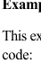

此示例使用 `gcc` 从源文件 `hello.c` 创建 `hello` 程序。首先，源代码：

```c
/*
 * Listing 1.1
 * hello.c – 规范的 "Hello, world!" 程序
 */
#include <stdio.h>

int main(void)
{
    puts( "Hello, Linux programming world!");
    return 0;
}
```

要编译和运行此程序，请输入

```
$ gcc hello.c -o hello
```

如果一切顺利，gcc 默默地完成其工作并返回到 shell 提示符，gcc 编译并链接源文件 hello.c，创建一个二进制文件，该二进制文件使用 -o 参数指定为 hello。

ls 命令显示一个新的程序 hello 存在。最后一个命令执行程序，结果产生以下输出：


输出

```
$ ls
hello.c    hello*
$ ./hello
Hello, Linux programming world!
```

> **注意**
> 执行 hello 程序的命令明确包含了当前目录，用 . 表示，因为将当前目录包含在你的路径中是一个安全风险。也就是说，应该使用 /bin:/usr/bin:/usr/local/bin 而不是类似于 /bin:/usr/bin:/usr/local/bin:.* 的 $PATH 语句，以便破解者不能将一条危险命令放在你的当前目录中，该命令恰好匹配你真正想要执行的更良性命令的名称。

gcc 如何处理文件？它依赖于文件扩展名来确定如何正确处理文件。最常见的扩展名及其解释列在表 1.1 中。

**表 1.1 gcc 如何解释文件名扩展名**

| 扩展名 | 类型 |
|:---|:---|
| .c | C 语言源代码 |
| .C, .cc | C++ 语言源代码 |
| .i | 预处理 C 源代码 |
| .ii | 预处理 C++ 源代码 |
| .S, .s | 汇编语言源代码 |
| .o | 编译对象代码 |
| .a, .so | 编译库代码 |

## 逐步调用 gcc

在第一个示例中，幕后发生了很多你没有看到的事情。`gcc` 首先通过预处理器 `cpp` 运行 `hello.c`，以扩展任何宏并插入 `#include` 文件的内容。接下来，它将预处理后的源代码编译为对象代码。最后，链接器 `ld` 创建 `hello` 二进制文件。整个编译过程在图 1.1 中说明。

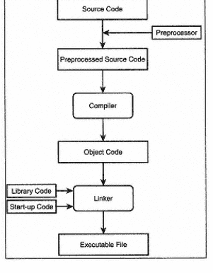

编译程序由许多步骤组成。

你可以手动重现这些步骤，逐步执行编译过程。要告诉 `gcc` 在预处理后停止编译，请使用 `gcc` 的 `-E` 选项，如下所示：

```
$ gcc -E infile.c -o outfile.cpp
```


下一步是将预处理后的文件编译为对象代码，使用 `gcc` 的 `-c` 选项。此步骤的正确语法是

```
$ gcc -x infile-type -c infile.cpp -o outfile.o
```

最后，链接对象文件生成二进制映像。链接步骤的命令应类似于以下形式：

```
$ gcc infile.o -o outfile
```

## 示例


回到上一个示例中的 `hello` 程序，按照以下示例演示的编译过程逐步执行。首先，对 `hello.c` 进行预处理：

```
$ gcc -E hello.c -o hello.cpp
```

如果你用文本编辑器查看 `hello.cpp`，你会发现 `stdio.h` 的内容确实已被插入到文件中，以及其他预处理符号。以下摘录来自 `hello.cpp`：


### 输出

```
extern int fgetpos (FILE * stream, fpos_t *__pos)       ;

extern int fsetpos (FILE *__stream, const fpos_t *__pos)   ;
# 519 "/usr/include/stdio.h" 3
# 529 "/usr/include/stdio.h" 3

extern void clearerr (FILE *__stream)       ;

extern int feof (FILE *__stream)       ;

extern int ferror (FILE *__stream)       ;

extern void clearerr_unlocked (FILE *__stream);
extern int feof_unlocked (FILE *__stream)       ;
extern int ferror_unlocked (FILE *__stream)       ;

extern void perror (_const char *__s)       ;

extern int sys_errr;
extern __const char *__const sys_errlist[];
```

下一步是将 `hello.cpp` 编译为对象代码：

```
$ gcc -x c++-output -c hello.cpp -o hello.o
```

你必须使用 `-x` 选项告知 `gcc` 从特定步骤开始编译，在此情况下，是从预处理后的源代码开始。最后，链接对象文件生成二进制文件：

```
$ gcc hello.o -o hello
```

希望你现在能明白，使用简写语法 `gcc hello.c -o hello` 要简单得多。分步示例表明，如果有需要，你可以随时停止并在任何步骤重新开始编译。

一种需要逐步执行编译的情况是当你创建库时。在这种情况下，你只需要创建对象文件，因此最后的链接步骤是不必要的。另一种需要逐步执行编译过程的情况是当某个 `#include` 文件引入了与你自己的代码或另一个 `#include` 文件的冲突时。逐步执行过程将使引入冲突的文件更加清晰。

## 使用多个源代码文件

大多数 C 程序由多个源文件组成，因此在最终的链接步骤之前，每个源文件都必须被编译为对象代码。这个要求很容易满足。只需向 `gcc` 提供它需要编译的每个源代码文件的名称即可。其余部分由它处理。`gcc` 的调用方式应类似于：

```
$ gcc file1.c file2.c file3.c -o progname
```

`gcc` 首先创建 `file1.o`、`file2.o` 和 `file3.o`，然后将它们全部链接在一起以创建 `progname`。

## 示例


假设你正在开发 `newhello`，它使用了来自 `showit.c` 和 `msg.c` 的代码：

```c
// showit.c
/* showit.c _ Display driver */
#include <stdio.h>
#include "msg.h"

int main(void)
{
    char msg_hi[] = {"Hi there, programmer!"};
    char msg_bye[] = {"Goodbye, programmer!"};
    printf("%s\n", msg_hi);
    prmsg(msg_bye);
    return 0;
}
```

```c
// msg.h
/*
* msg.h Header for msg.c
*/

#ifndef MSG_H
#define MSG_H

void prmsg(char *msg);

#endif /* MSG_H */
```

```c
// msg.c
/*
* msg.c - Define function from msg.h
*/
#include <stdio.h>
#include "msg.h"

void prmsg(char *msg)
{
    printf("%s\n", msg);
}
```

编译这些程序并从而创建 `newhello` 的命令是

```
$ gcc msg.c showit.c -o newhello
```

运行此程序，输出为


### 输出

```
$ ./newhello
Hi there, programmer!
Goodbye, programmer!
```

`gcc` 执行与之前相同的预处理、编译和链接步骤，这次在为每个源文件创建对象文件后创建二进制文件 `newhello`。然而，键入这样长的命令确实*会变得*乏味。在第 2 章“控制构建过程—GNU *make*”中，你将看到如何解决这个问题。下一节将向你介绍 *gcc* 的众多命令行选项。

## 选项和参数


## 示例

*gcc* 接受的命令行选项列表长达好几页，因此表 1.2 仅列出了最常用的选项。

**表 1.2 gcc 命令行选项**

| 选项 | 用途 |
| :--- | :--- |
| `-o file` | 将输出文件命名为 *file*（编译对象代码时不需要指定）。如果未指定文件，默认值为 `a.out`。 |
| `-c` | 编译但不链接。 |
| `-Dfoo=bar` | 在命令行上定义一个值为 *bar* 的预处理器宏 *foo*。 |
| `-Idirname` | 将 *dirname* 中指定的目录放置在 *gcc* 搜索包含文件的目录列表的开头。 |
| `-ldirname` | 将 *dirname* 中指定的目录放置在 *gcc* 搜索库文件的目录列表的开头。默认情况下，*gcc* 链接共享库。 |
| `-static` | 链接静态库。 |
| `-lfoo` | 链接到 *foo* 库。 |
| `-g` | 在二进制文件中包含标准调试信息。 |
| `-ggdb` | 在二进制文件中包含大量调试信息，这些信息只能被 GNU 调试器 *gdb* 理解。 |
| `-O` | 优化编译后的代码。这相当于指定 `-O1`。 |
| `-On` | 指定优化级别 *n*，0<=*n*<=3。 |
| `-ansi` | 将编译器置于 ANSI/ISO C 模式，禁止与标准冲突的 GNU 扩展。 |
| `-pedantic` | 显示 ANSI/ISO C 标准要求的所有警告。 |
| `-pedantic-errors` | 显示 ANSI/ISO C 标准要求的所有错误。 |
| `-traditional` | 启用对 Kernighan 和 Ritchie C 语法的支持（如果你不懂这是什么意思，不用担心）。 |
| `-W` | 抑制所有警告消息。 |
| `-Wall` | 显示 *gcc* 可以提供的所有一般适用的警告。要查看特定警告，请使用 `-Wwarning`。 |

| **选项** | **用途** |
| :--- | :--- |
| `-Werror` | 不生成警告，而是 `gcc` 将警告转换为错误，从而停止编译。 |
| `-MM` | 输出与 `make` 兼容的依赖列表。对于创建复杂项目中的 `makefile` 很有用。 |
| `-v` | 显示编译每个步骤中使用的命令。 |

你已经看到了 `-c` 和 `-o` 是如何工作的。但是，如果你没有指定 `-o`，对于名为 `file.suffix` 的输入文件，`gcc` 的默认行为是将可执行文件命名为 `a.out`，将对象文件命名为 `file.o`，将汇编语言文件命名为 `file.s`。预处理器输出到标准输出。

## 库文件和包含文件

如果你的库文件或包含文件位于非标准位置，`-Ldirname` 和 `-Idirname` 选项允许你指定这些位置，并确保在标准位置之前搜索它们。例如，如果你将自定义包含文件存储在 `/usr/local/myincludes` 中，为了让 `gcc` 找到它们，你的 `gcc` 调用应该是类似

```
$ gcc infile.c -I/usr/local/myincludes
```

同样，假设你正在测试一个新的编程库 `libnew.a`，它目前存储在 `/usr/local/mylibs` 中，等待安装为标准系统库。假设头文件也存储在 `/usr/local/myincludes` 中。因此，为了链接到 `libnew.so` 并帮助 `gcc` 找到头文件，你的 `gcc` 命令行应类似于以下形式：

```
$ gcc myapp.c -I/usr/local/myincludes -L/usr/local/mylibs -lnew
```

`-l` 选项告诉链接器从指定的库中提取对象代码。上述示例链接到了 `libnew.so`。

> **提示**
> 一项长期的 UNIX 约定是库文件命名为 `lib(something)`，`gcc` 像大多数 UNIX 和 Linux 编译器一样依赖于这一约定。如果你在链接库时不使用 `-l` 选项，或者未提供要链接的库的路径名，链接步骤将失败，并且 `gcc` 会发出关于“函数名”未定义引用的抱怨。

默认情况下，`gcc` 使用共享库，因此如果你必须链接静态库，你必须使用 `-static` 选项。这意味着将仅使用静态库。以下示例创建一个链接到静态 `ncurses` 库的可执行文件：

```
$ gcc cursesapp.c -Lncurses -static
```

- 要了解如何使用 `ncurses` 进行编程，请参阅“A 文本模式用户界面 API”，第 219 页。


当你针对静态库进行链接时，生成的二进制文件比使用共享库时要大得多。那么，为什么要使用静态库呢？一个常见的原因是保证用户能够运行你的程序——在共享库的情况下，你的程序运行所需的代码是在运行时动态链接的，而不是在编译时静态链接的。如果你的程序所需的共享库没有安装在用户的系统上，她将遇到错误，无法运行你的程序。

Netscape 浏览器就是这个问题一个完美的例子。Netscape 严重依赖于 Motif，这是一种昂贵的 X 编程语言工具包。大多数 Linux 用户无法负担在系统上安装 Motif，因为它花费太多钱，所以 Netscape 实际上在你的系统上安装了浏览器的两个版本；一个是针对共享库链接的，`netscape-dynMotif`，另一个是静态链接的，`netscape-statMotif`。`netscape` 可执行文件本身实际上是一个 shell 脚本，它确定你是否安装了 Motif 共享库，并必要的话启动其中一个二进制文件。

## 示例

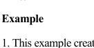

## 示例

1. 这个示例创建一个静态库，`libmsg.a`。执行此操作所需的命令是

```
$ gcc -c msg.c -o libmsg.o
$ ar rcs libmsg.a libmsg.o
```

回想本章前文，`-c` 告诉 `gcc` 创建一个名为对象文件，在本例中为 `libmsg.o`。第二行使用 `ar` 命令从对象模块 `libmsg.o` 创建名为 `libmsg.a` 的静态库。下一个示例使用此库。

- 要了解有关 `ar` 命令的更多信息，请参见第 299 页的“ar 命令”。

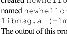

## 示例

2. 现在你有一个库可以针对其进行链接。你需要告诉 `gcc` 在哪里找到包含文件（使用 `-I`），在哪里找到库（使用 `-L`），以及库的名称（使用 `-l`），如下所示：

```
$ gcc showit.c -o newhello-lib -I. -L. -lmsg
```

之前的示例通过一起编译 `showit.c` 和 `msg.c` 创建了 `newhello`。这一次，我们通过针对静态库 `libmsg.a` 进行链接来创建 `newhello-lib`。该示例通过链接位于当前工作目录（`-L.`）中的 `libmsg.a`（`-lmsg`）创建了一个名为 `newhello-lib` 的二进制文件（选择此名称是为了将其与其他示例区分开）。`.` 指的是当前目录。此程序的输出如下所列：


**输出**

```
$ ./newhello-lib
Hi there, programmer!
Goodbye, programmer!
```

## 错误检查和警告

`gcc` 拥有一整套错误检查、生成警告的命令行选项。这些包括 `-ansi`、`-pedantic`、`-pedantic-errors` 和 `-Wall`。首先，`-pedantic` 告诉 `gcc` 发出严格 ANSI/ISO 标准 C 要求的所有警告。任何使用被禁止的扩展（如 `gcc` 支持的扩展）的程序都将被拒绝。`-pedantic-errors` 行为类似，只是它发出的是错误而不是警告。`-ansi` 关闭不符合标准的 GNU 扩展。然而，这些选项没有一个能保证你的代码即使在使用这些选项中的一个或全部进行编译时无错，也是 100% 符合 ANSI/ISO 标准的。

`-Wall` 选项指示 `gcc` 显示与正在编译的代码相关的所有通常相关的警告。`-Wall` 会对大多数程序员认为可疑和/或易于修改以防止生成的警告的代码发出警告。一个不良编程习惯的例子是声明一个变量但未在其他地方使用它。另一个例子是声明变量时未明确指定其类型。

## 示例

考虑以下示例，它展示了非常糟糕的编程形式。它将 `main` 声明为返回 `void`，而实际上 `main` 返回 `int`，并且它使用 GNU 扩展 `long long int` 来声明一个 64 位整数。

```
pedant.c
/*
 * pedant.c - use -ansi, -pedantic or -pedantic-errors
 */
#include <stdio.h>

void main(void)
{
 long long int i = 01;
 puts("This is a non-conforming C program");
}
```

## 示例

1. 首先，尝试使用无一致性检查进行编译：

**输出**

```
$ gcc pedant.c -o pedant
pedant.c: In function 'main':
pedant.c:8: warning: return type of 'main' is not 'int'
```

2. 接下来，使用 `-ansi` 开关进行编译：

**输出**

```
$ gcc -ansi pedant.c -o pedant
pedant.c: In function 'main':
pedant.c:8: warning: return type of 'main' is not 'int'
```

这里的教训是，`-ansi` 强制 `gcc` 发出标准要求的诊断消息。它并不确保你的代码符合 ANSI C。尽管 `main` 的声明不正确，但程序仍然编译通过了。

3. 现在，使用 `-pedantic`：

**输出**

```
$ gcc -pedantic pedant.c -o pedant
pedant.c: In function 'main':
pedant.c:9: warning: ANSI C does not support 'long long'
pedant.c:8: warning: return type of 'main' is not 'int'
```

同样，尽管发出了警告，代码仍然编译通过。

4. 最后，使用 `-pedantic-errors`：

**输出**

```
$ gcc -pedantic-errors pedant.c -o pedant
pedant.c: In function 'main':
pedant.c:9: ANSI C does not support 'long long'
pedant.c:8: return type of 'main' is not 'int'
```

程序编译失败。`gcc` 在显示所需的错误诊断后停止。

重申一下，`-ansi`、`-pedantic` 和 `-pedantic-errors` 编译器选项并不能确保符合 ANSI/ISO 标准的代码。它们只是帮你走在这条路上。指出 `gcc` 文档中关于使用 `-pedantic` 的备注是有启发性的：

> “该选项并不旨在实用；它存在的唯一目的是取悦那些声称 GNU CC 不支持 ANSI 标准的挑剔者。一些用户试图使用 `-pedantic` 来检查程序是否严格符合 ANSI C。他们很快发现，它并没有完全做到他们想要的；它发现了一些非 ANSI 的做法，但不是所有——只有那些 ANSI C 要求进行诊断的做法。”

## 优化选项

代码优化旨在提高性能。其权衡是更长的编译时间、编译期间增加的内存使用量，以及或许更大的代码大小。

目前，`gcc` 有三个优化级别。单纯的 `-O0` 选项告诉 `gcc` 同时减小代码大小和执行时间。它等同于 `-O1`。此级别执行的优化类型取决于目标处理器，但总是至少包括线程跳转和延迟栈弹出。*线程跳转优化*旨在减少跳转操作的数量。*延迟栈弹出发生在编译器允许参数在函数返回时在栈上累积，然后同时弹出，而不是在每个被调用函数返回时逐个弹出参数时。*

`-O2` 级别的优化包括所有第一级优化以及涉及处理器指令调度的额外调整。在此级别，编译器试图确保处理器在等待其他指令结果时有指令可以执行。编译器还试图补偿*数据延迟*，即从缓存或主存获取数据造成的延迟。实现高度依赖于特定的处理器。`-O3` 选项包括所有 `-O2` 优化、循环展开和其他特定于处理器的功能。

根据你对特定 CPU 系列的低级知识的多少，你可以使用 `-fflag` 选项请求你希望执行的具体优化。这三个标志值得考虑：`-ffastmath`、`-finline-functions` 和 `-funroll-loops`。`-ffastmath` 生成增加速度但违反 IEEE 和/或 ANSI 标准的浮点数学优化，`-finline-functions` 就地展开所有“简单”函数，很像预处理器宏替换。不过，编译器决定什么构成简单函数。

`-funroll-loops` 指示 `gcc` 展开所有具有固定迭代次数的循环，前提是迭代次数可以在编译时确定。*循环展开*意味着循环的每次迭代将变成单独的语句。因此，一个具有例如 100 次迭代的循环变成了 100 个顺序代码块，每个块执行相同的语句。图 1.2 以图形方式说明了循环展开。

注意，该图只是说明循环展开的一般原理。`gcc` 使用的实际方法可能差异很大。

`-finline-functions` 和 `-funroll-loops` 启用的优化可以极大地提高程序的执行速度，因为它们避免了函数调用和变量查找的开销，但代价通常是巨大的


可执行文件或对象文件的尺寸增加。你需要通过实验来判断速度的提升是否值得付出文件尺寸增加的代价。关于 `-f` 处理器标志的更多详细信息，请参阅 `gcc` 的信息页。

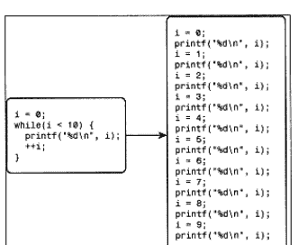

图 1.2：循环展开器就像预处理器一样展开循环。

> **提示**
>
> 通常，`-O2` 优化级别就足够了。即使对于像本章开头第一个“示例”部分中那样的小型程序，你也会看到代码尺寸略有减小，运行时间略有增加。

## 示例

本示例使用最高优化级别 `-O3` 来编译清单 1.2、1.3 和 1.4。请将优化后的程序大小与非优化程序的大小进行对比。

### 输出

```
$ gcc -O3 msg.c showit.c -o newhello
$ ls -l newhello
-rwxr-xr-x   1 kwall    users      12091 Jul 13 21:06 newhello*
$ gcc -O0 msg.c showit.c -o newhello
$ ls -l newhello
-rwxr-xr-x   1 kwall    users      12107 Jul 13 21:07 newhello*
```

`-O0` 选项关闭所有优化。虽然差异很小，仅 16 字节，但你应该很容易理解，较大的程序将看到更大的节省。

## 调试选项

错误（Bugs）像死亡和税收一样不可避免。为了适应这一令人遗憾的现实，请使用 `gcc` 的 `-g` 和 `-ggdb` 选项将调试信息插入到编译后的程序中。这些选项有助于调试会话。

`-g` 选项可以用 `1`、`2` 或 `3` 进行限定，以指定要包含多少调试信息。默认级别是 `2`（`g2`），它包含大量的符号表、行号以及关于局部变量和外部变量的信息。级别 `3` 的调试信息包含所有级别 `2` 的信息以及所有现有的宏定义。级别 `1` 生成的信息仅足以创建回溯和堆栈转储。它不会为局部变量或行号生成调试信息。

如果你打算使用 GNU 调试器 `gdb`（在第 20 章“调试工具包”中介绍），使用 `-ggdb` 选项会创建额外的信息，从而简化 `gdb` 下的调试工作。`-ggdb` 接受与 `-g` 相同的级别规范，它们对调试输出的影响也相同。然而，使用这两个启用调试选项中的任何一个都会显著增加二进制文件的大小。


## 示例

本示例向你展示了如何带调试信息进行编译，并说明了调试符号对二进制文件大小可能产生的影响。在我的系统上，仅仅编译和链接清单 1.1 就生成了一个 4089 字节的二进制文件。当我使用 `-g` 和 `-ggdb` 选项编译它时，结果的大小可能会让你感到惊讶：


### 输出

```
$ gcc -g hello.c -o hello_g
$ ls -l hello_g
-rwxr-xr-x 1 kwail users 6809 Jul 13 21:09 hello_g*
$ gcc -ggdb hello.c -o hello_ggdb
$ ls -l hello_ggdb
-rwxr-xr-x 1 kwail users 354867 Jul 13 21:09 hello_ggdb*
```

正如你所见，`-g` 选项使二进制文件的大小增加了 50%，而 `-ggdb` 选项则使二进制文件增加了近 900%！尽管尺寸增加了，但如果有人遇到问题并试图调试你的代码，你应该在二进制文件中提供标准的调试符号（使用 `-g` 创建）。

> **提示**
> 一般规则是，先调试，后优化。然而，不要将“后优化”理解为“在设计过程中忽视效率”。在此上下文中，优化指的是本节中讨论的编译器魔法。好的设计和高效的算法对整体性能的影响远大于任何编译器优化魔法。事实上，如果你花时间提前创建清晰的设计并使用快速的算法，你可能不需要进行优化，尽管尝试一下也无妨。

## GNU C 扩展

GNU 的 C 实现以多种方式扩展了标准 ANSI C。如果你不介意编写公然非标准的代码，其中一些扩展可能非常有用。关于 GNU 项目扩展的完整讨论，有兴趣的读者可参阅 `gcc` 的信息页（特别是尝试命令 `info gcc "C Extensions"`）。本节涵盖的扩展是在 Linux 内核头文件和源代码中经常看到的扩展。

> **注意**
> 非标准代码的问题有两方面。首先，如果你使用 GNU 扩展，你的代码只能在 `gcc` 下正常编译（如果它甚至能编译的话）。另一个问题是非标准代码不符合 ANSI/ISO 标准。许多用户在使用编译器时使用尽可能严格的编译开关，因此非标准代码将无法编译。如果你希望在自己的代码中包含非 ANSI 特性，最明智的政策是使用 `#ifdefs` 将其包围，以实现条件编译。在 comp.lang.c 新闻组中，如果你使用非标准代码，你会被猛烈抨击。

例如，为了提供 64 位存储单元，`gcc` 提供了 `long long int` 类型，如清单 1.5 中所示：

```c
long long long_int_var;
```

> **注意**
> `long long int` 类型是新的 ISO C 标准草案的一部分。然而，它仍然是一个草案标准，很少有编译器（如果有的话）支持它。

在 x86 平台上，此定义结果是一个名为 `long_int_var` 的 64 位内存位置。你在 Linux 头文件中遇到的另一个 `gcc` 扩展是内联函数的使用。只要它足够短，内联函数在你的代码中展开，就像宏一样，从而消除了函数调用的成本。然而，内联函数比宏要好，因为编译器会在编译时进行类型检查。要使用内联函数，你必须至少以 `-O` 优化级别进行编译，并在函数定义前加上 `inline` 关键字，如下所示：

```c
inline int inc(int *a)
{
    (*a)++;
}
```

`attribute` 关键字告诉 gcc 更多关于你的代码的信息，并帮助代码优化器发挥作用。要使用函数属性，一般规则是在函数声明的右括号后附加 `__attribute__` (`(attribute_name)`)。

例如，标准库函数，如 `exit` 和 `abort`，从不返回，因此如果编译器知道函数不返回，它可以生成稍微高效的代码。当然，用户级程序也可能定义不返回的函数；gcc 允许你为此类函数指定 `noreturn` 属性，这作为提示编译器优化该函数。

因此，假设你有一个名为 `die_on_error` 且从不返回的函数。其声明看起来像这样：

```c
void die_on_error(void) __attribute__ ((noreturn));
```

你会像往常一样定义它：

```c
void die_on_error(void)
{
    /* 你的代码在这里 */
    exit(1);
}
```

你也可以将属性应用于变量。`aligned` 属性指示编译器将变量的内存位置对齐到指定的字节边界。相反，`packed` 属性告诉 gcc 使用变量或 `structs` 所需的最小空间。与 `structs` 一起使用时，`packed` 会删除 gcc 通常用于对齐目的而插入的任何填充。

一个非常实用的扩展是案例范围（case ranges）。其语法如下：

```c
case LOWVAL ... HIGHVAL:
```

注意，省略号前后都需要空格。案例范围用于 `switch` 语句中，以指定落在 `LOWVAL` 和 `HIGHVAL` 之间的值，如下面的代码片段所示：

```c
switch(int_var) {
    case 0...2:
        /* 你的代码在这里 */
        break;
    case 3...5:
...
}
```

该片段等效于：

```c
switch(int_var) {
    case 0:
    case 1:
    case 2:
        /* 你的代码在这里 */
        break;
    case 3:
    case 4:
    case 5:
...
}
```

显然，案例范围只是传统 `switch` 语句语法的简写，但它非常方便。

## 示例


## 示例

1. 本示例说明了如何使用 `inline` 关键字。该程序循环 10 次，在每次迭代中递增一个变量。

```c
inline.c
/*
 * inline.c
 */
#include <stdio.h>

inline int inc(int *a)
{
```


    (*a)++;
}

int main(void)
{
    int i = 0;
    while(i < 10) {
        inc(&i);
        printf("%d", i);
    }
    printf("\n");

    return 0;
}

在这个简单的示例中，你不太可能看到速度或代码大小的显著增加或减少，但这应该说明了如何使用 `inline` 关键字。

2. 本示例展示了如何使用 `attribute` 关键字和 `noreturn` 属性，以及如何用例范围（case ranges）。


## 示例

noreturn.c

```c
/*
 * noreturn.c
 */
#include <stdio.h>

void die_now(void) __attribute__ ((noreturn));

int main(void)
{
    int i = 0;

    while(1) {
        switch(i) {
        case 0 ... 5:
            printf("i = %d\n", i);
            break;
        default:
            die_now();
        }
        ++i;
    }
    return 0;
}

void die_now(void)
{
    printf("dying now\n");
    exit(1);
}
```

请注意，在编写包含如本程序中 `while` 循环那样的无限循环代码时，要确保存在一个逃生出口，例如当循环计数器达到特定值时跳出循环。不过，对于我们的目的而言，它完美地说明了用例范围扩展是如何工作的。该程序的输出为


### 输出

```
$ ./noreturn
i = 0
i = 1
i = 2
i = 3
i = 4
i = 5
dying now
```

用例范围扩展的行为与普通 case 语句完全相同。当 `i` 变为 6 时，程序流到达 `default` 块，执行 `die_now`，程序终止。

3. 最后一个示例说明了在结构体上使用 packed 属性的效果。程序仅打印结构体及其组成成员的大小。


## 示例

packme.c

```c
/*
 * packme.c Using gcc's packed attribute
 */
#include <stdio.h>

/* a "packed" structure */
struct P {
    short s[3];
    long l;
    char str[5];
} __attribute__ ((packed));

/* a normal unpacked structure */
struct UP {
    short s[3];
    long l;
    char str[5];
};

int main(void)
{
    struct P packed;
    struct UP unpacked;

    /* print the size of each member for comparison */
    fprintf(stdout, "sizeof char str[5] = %d bytes\n", sizeof(char) * 5);
    fprintf(stdout, "    sizeof long = %d bytes\n", sizeof(long));
    fprintf(stdout, " sizeof short s[3] = %d bytes\n", sizeof(short) * 3);

    /* how big are the two structures */
    fprintf(stdout, "    sizeof packed = %d bytes\n", sizeof packed);
    fprintf(stdout, "    sizeof unpacked = %d bytes\n", sizeof unpacked);

    return 0;
}
```

使用 GNU 扩展 C 语言的任何功能都不需要特殊的编译命令。编译并执行后，该程序的输出为


### 输出

```
$ gcc packme.c -o packme
$ ./packme
sizeof char str[5] = 5 bytes
        sizeof long = 4 bytes
sizeof short s[3] = 6 bytes
        sizeof packed = 15 bytes
        sizeof unpacked = 20 bytes
```

这两个元素被定义为具有相同的成员。唯一的区别是结构体 P 添加了 packed 属性。输出清楚地表明，每个结构体的成员都需要 15 字节的存储。在 x86 架构上，普通的未打包结构体 UP 多占了五个字节，而打包结构体 P 的大小是其成员大小之和。虽然节省的 5 字节内存看起来不多，但想象一下如果你有一个包含 1,000,000 个这样的元素的数组（在某些应用中并非不切实际）——这将意味着节省了将近 5 兆字节的 RAM。这是一个巨大的差异！

> **注意**
> 普通结构体中的填充（padding）很可能是为了使 str 和 s 在适当的边界上对齐的结果，分别为它们的“实际”大小增加了三和两个字节。ANSI 允许 C 语言的实现者将结构体填充到主机架构的自然字长。因此，尽管 packed 属性有一些明显的好处，但其代价是牺牲了可移植性。

## 使用 egcs

egcs 是实验性（或增强型）GNU 编译器套件。它最初是 gcc 开发的一个实验性步骤，旨在加速 gcc 的开发并开放 gcc 的开发环境。egcs（发音为 eggs，c 发哑音）项目的其他目标包括为 gcc 添加新语言、新优化和新目标（主机处理器架构）。

1999 年 4 月，GNU 项目正式任命 egcs 指导委员会为 gcc 的官方维护者。gcc 自那以后被重命名为 GNU 编译器集合。这段历史教训的要点在于，在某个时间点，egcs 很可能会与 gcc 合并。然而，在此期间，egcs 是一个独立的产品。它也是至少两个发行版中默认的 C/C++ 编译器，因此了解它与 gcc 的区别及增强功能非常重要。有关 egcs 的更多信息，请访问网站 http://egcs.cygnus.com/。

**注意**
*egcs* 当前发布的 1.1.2 版本似乎是 *egcs* 本身的最后一个版本。根据 *egcs* 的网站，下一个发布版本将是 *gcc* 的 *2.95* 版本。

*egcs* 与 *gcc* 完全向后兼容，因此本章关于 *gcc* 的所有内容也适用于 *egcs*。事实上，尽管内核开发团队并未正式认可这样做，你可以使用 *egcs* 无故障地编译 *Linux* 2.2.x 内核，并且它应该能运行得非常好。*egcs* 代表了相对于标准 *gcc* 编译器 2.7.2.3 的重大改进。下一节介绍了其中一些改进。

### 对 *gcc* 的增强

*egcs* 相对于 *gcc* 的大多数增强功能影响的是编译器本身的操作，而非其命令行接口，因此它们远远超出了本书的范围。然而，命令行接口中发生了一些变化，本节将涵盖这些变化。

添加了几个新的警告。`-Wundef` 和 `-Wno-def` 在 `#if` 预处理器指令尝试评估未定义的标识符时生成警告。`-Wsign-compare` 使 *egcs*（和 *gcc*）在代码比较有符号和无符号值时发出警告。`-Wall` 标志已被扩展，用于使 *egcs* 在整数被隐式声明时发出警告。类似地，警告标志 `-Wimplicit-function-declarations` 捕获函数的隐式声明。

调试和优化改进也已进行。例如，除了优化开关 `-O` 的数值参数外，你现在可以使用 `-Os` 来选择代码大小优化而非代码速度优化。选择 *大小* 或 *速度* 优化主要取决于你需要高性能还是节省磁盘空间。如今，既然 RAM 和磁盘空间都相当便宜，选择速度而非 *大小* 很容易。然而，程序的 *大小* 必须从磁盘占用以及执行时所需的内存量来考虑。在磁盘和 RAM 紧张的情况下，选择减小大小而不是提高速度，因为如果程序无法放入磁盘或内存中，那么世界上最快的程序也是无用的。

`-fstack-check` 开关在缺乏此功能的系统上检查栈溢出。为了增强调试能力，添加了新的 *性能分析* 标志。性能分析使你能确定代码执行得有多快，最频繁调用哪些函数，最频繁使用哪些变量，并识别未使用的代码部分（通常称为 *死代码*）或变量。利用这些信息，你可以修改源代码以使程序 *更高效*；*egcs* 还具有对 Checker 内存检查工具的内建支持。此处列出了额外的处理器特定标志：

- `-fprofile-arcs`—使 *egcs* 能够统计函数执行的次数。
- `-ftest-coverage`—为 *gcov* 代码覆盖率分析工具创建数据文件。
- `-fbranch-probabilities`—改进 *egcs* 对代码分支的预测。

最后，`--help` 选项的输出得到了显著改进。

## 接下来是什么

在本章中，你学习了如何使用 GNU C 编译器 *gcc*，以及由于其与 *gcc* 的相似性，如何学习 *egcs*。你构建的大多数程序，即使是单文件程序，都需要很长的编译器调用命令。这种灵活性可能会让你手指疲惫，且输入起来繁琐，因此下一章将向你展示如何使用另一个出色的 UNIX/Linux 工具 *make* 来自动化软件构建过程。在基本理解这两个工具后，你就准备好进入系统编程主题，通过实例开始编程 Linux。


## 控制构建流程 — GNU make

make 是一个用于控制软件构建和重新构建过程的工具。make 自动化了构建什么软件、如何构建以及何时构建，从而让你能够专注于编写代码。由于它包含用于以适当的选项和参数调用 C 编译器的逻辑，它还节省了大量的输入工作。

在本章中，你将学习以下内容：

- 如何调用 make
- make 的命令行选项和参数
- 创建 makefile
- 编写 make 规则
- 使用 make 变量
- 处理 make 错误

### 为什么使用 make？

除了最简单的项目之外，make 对于所有软件项目都是必不可少的。首先，由多个源文件组成的项目需要漫长且复杂的编译器调用。make 通过将这些困难的命令行存储在一个 makefile 中来简化这一过程，该 makefile 是一个包含构建软件项目所需的所有命令的文本文件。

make 对你以及其他任何想要构建你程序的人都很方便。当你修改程序时，无论是添加新功能还是整合 bug 修复，make 允许你使用一条简短的命令进行重新构建，或者仅重新构建单个组件（例如库文件），或者根据情况定制你想要的构建类型。make 对于可能构建你程序的其他人也很方便。你不需要创建解释如何构建程序的详尽文档，只需指示他们输入 make 即可。你会感激于需要编写更少的文档，而他们也会感激于简单的构建指令带来的便利。

- 有关分发软件的更多信息，请参阅第 443 页的“软件分发”。

最后，make 加速了编辑-编译-调试过程。因为它足够智能，能够确定哪些文件已更改，从而仅重新构建组件已更改的文件，所以它将重新构建时间降至最低。makefile 还构成了项目依赖信息数据库，允许你每次开始构建时自动验证构建程序所需的所有文件是否可用。随着你在 Linux 编程方面获得更多经验，你会越来越欣赏 make 的这一特性。

### 使用 make

本节解释了如何使用 make。特别是，它解释了如何创建 makefile，如何调用 make，如何理清其众多的选项、参数和开关，以及如何处理过程中不可避免的

### 创建 Makefile

那么，`make` 是如何完成其神奇功能的呢？通过使用 makefile。*makefile* 是一个文本文件数据库，其中包含规则，告诉 `make` 要构建什么以及如何构建。一个 *rule*（规则）由以下部分组成：

- 一个 *target*（目标），即 `make` 最终试图创建的“事物”
- 一个或多个 *dependencies*（依赖项）的列表，通常是构建目标所需的文件
- 一个 *commands*（命令）的列表，用于从指定的依赖项创建目标

当调用时，GNU `make` 会按顺序查找名为 `GNUmakefile`、`makefile` 或 `Makefile` 的文件。出于某种原因，大多数 Linux 程序员使用最后一种形式，即 `Makefile`。

Makefile 规则具有以下一般形式：

```
target: dependency [dependency] [ ... ]
	command
	[command]
	[ ... ]
```

> **注意**
> 命令的第一个字符必须是制表符；八个空格是不够的。这经常让人措手不及，如果你首选的编辑器“好心”地将制表符转换为八个空格，这可能会成为一个问题。如果你尝试使用空格代替制表符，`make` 将显示消息 “Missing separator” 并停止。

`target` 通常是你想要创建的二进制文件或目标文件。`dependency` 是创建 `target` 所需的一个或多个输入文件的列表。`commands` 是创建 `target` 所需的步骤，例如编译器调用或 shell 命令。除非另有说明，`make` 会在当前工作目录中执行所有工作。

你可能在想：“一切看起来都很不错，但是 `make` 如何知道何时重新构建文件？” 答案简单得惊人：如果指定的目标在 `make` 能够找到的位置不存在，`make` 就会（重新）构建它。如果目标存在，`make` 会将目标的时间戳与依赖项的时间戳进行比较。如果至少有一个依赖项比目标更新，`make` 将重新构建目标，假设更新的依赖项意味着某些代码更改必须整合到目标中。

## 示例


这个示例 makefile 将使讨论更加具体。它是用于构建一个名为 editor 的文本编辑器的 makefile。

```makefile
# Makefile.1
#

clean:
	rm editor *.o

editor: editor.o screen.o keyboard.o
	gcc -o editor editor.o screen.o keyboard.o

editor.o: editor.c editor.h keyboard.h screen.h
	gcc -c editor.c

screen.o: screen.c screen.h
	gcc -c screen.c

keyboard.o: keyboard.c keyboard.h
	gcc -c keyboard.c
```

要编译 *editor*，你只需在包含 makefile 的目录中输入 *make*。就是这么简单。

这个 makefile 有 *五个* 规则。第一个目标 *editor* 被称为 *default*（默认）目标——这是 *make* 最终试图创建的文件。*editor* 有三个依赖项：*editor.o*、*screen.o* 和 *keyboard.o*；为了构建 *editor*，这三个文件必须存在。下一行是 *make* 执行的用于创建 *editor* 的命令。正如你在第 1 章“编译程序”中回顾的那样，这个编译器调用从三个目标模块 *editor.o*、*screen.o* 和 *keyboard.o* 构建名为 *editor* 的可执行文件。接下来的三个规则告诉 *make* 如何构建各个目标模块。

这里可以看到 *make* 的价值所在：通常，如果你尝试使用第 2 行的命令构建 *editor*，如果依赖项不存在，*gcc* 会大声抱怨并退出。另一方面，*make* 在确定 *editor* 需要这些文件后，首先验证它们是否存在，如果不存在，则执行创建它们的命令。然后，它返回到第一个规则以创建 *editor* 可执行文件。当然，如果组件的依赖项（例如 *keyboard.c* 或 *screen.h*）不存在，*make* 也会放弃，因为它缺少名为 *keyboard.c* 和 *screen.h* 的目标。

### 调用 make

调用 *make* 就像在包含 makefile 的目录中输入 *make* 一样简单。当然，像大多数 GNU 程序一样，*make* 接受众多的命令行选项。最常用的选项列在表 2.1 中。

**表 2.1 常见的 *make* 命令行选项**

| 选项 | 用途 |
| :--- | :--- |
| -f file | 使用名为 *file* 的 makefile，而不是标准名称之一（*GNUmakefile*、*makefile* 或 *Makefile*）。 |
| -n | 显示 *make* 将要执行的命令，但不实际执行。用于测试 makefile。 |
| -Idirname | 将 *dirname* 添加到 *make* 应搜索包含的 makefile 的目录列表中。 |
| -s | 静默执行，不打印 *make* 执行的命令。 |
| -w | 当 *make* 更改目录时，打印目录名称。 |
| -Wfile | 假设 *file* 已被*修改*来执行 *make*。与 -n 类似，对于测试 makefile 非常有用。 |
| -r | 禁用 *make* 的所有内置规则。 |
| -d | 打印大量调试信息。 |
| -i | 通常，如果*命令*返回非零错误代码，*make* 会停止。此选项禁用此行为。 |
| -k | 即使有一个目标构建失败，也继续执行。通常，*make* 会在目标构建失败时终止。 |
| -jN | 并行运行 N 个*命令*，其中 N 是一个小的非零整数。 |

*make* 可以产生大量输出，所以如果你对查看它不感兴趣，请使用 -s 选项来限制 *make* 的输出。-w 和 -n 选项允许你询问“如果文件 X 改变了会怎样？”。-i 选项的存在是因为并非所有程序在成功时都返回 0。如果你使用这样的命令作为 makefile 规则的一部分，你需要使用 -i 才能使构建继续。

-k 选项在你第一次构建程序时特别有用。因为它告诉 *make* 即使一个或多个目标构建失败也要继续，所以 -k 选项可以让你看到哪些目标构建成功，哪些不成功，从而允许你将调试工作集中在那些“问题儿童”上。

如果你的构建特别长，-jN 选项指示 *make* 同时执行 N 个命令。虽然这可能会减少整体构建时间，但它也会给系统带来沉重的负载。这在...上是

独立系统或单个工作站上，但在需要快速响应时间的生产系统（例如 Web 服务器或数据库服务器）上则是绝对不可接受的。

## 示例

这些示例均使用以下 makefile，它是第 1 章中大多数程序的 makefile。相关源代码也取自第 1 章。如果不完全理解 makefile 中的某些特性，请不要担心，因为它们将在本章后面进行讲解。

```
#
# Makefile
#
LDFLAGS :=
# Switch the comment characters on the next two lines if
# you want to optimize
CFLAGS := -g $(CPPFLAGS)
#CFLAGS := -O2 $(CPPFLAGS)
PROGS =\
    hello \
    pedant \
    newhello \
    newhello-lib \
    noret \
    inline \
    packme

all: $(PROGS)

.c.o:
    $(CC) $(CFLAGS) -c $*.c

.SUFFIXES: .c .o

hello: hello.c
pedant: pedant.c
newhello: showit.c msg.c
    $(CC) $(CFLAGS) $^ -o $@

newhello-lib: showit.c libmsg.a
    $(CC) $(CFLAGS) $< -o $@ -I. -L. -lmsg

libmsg.a: msg.c
    $(CC) $(CFLAGS) -c $< -o libmsg.o
    $(AR) rcs libmsg.a libmsg.o

noret: noret.c

inline: inline.c
    $(CC) -O2 $< -o $@

packme: packme.c

.PHONY : clean zip

clean:
    $(RM) $(PROGS) *.o *.a *~ *.out

zip: clean
    zip 215101cd.zip *.c *.h Makefile
```


## 示例

1. 第一个示例展示了如何使用 `-W` 和 `-n` 选项模拟构建过程。


### 输出

```
$ make -Wmsg.c -Wshowit.c -n newhello-lib
cc -g -o msg.o msg.c
ar rcs libmsg.a libmsg.o
cc -g showit.c -o newhello-lib -I. -L. -lmsg
```

`-f` 选项让 `make` 表现得像 `file` 已更改一样，而 `-n` 则显示将要执行的命令但实际并不执行它们。从输出可以看出，`make` 将首先构建库文件 `libmsg.a`，然后编译 `showit.c` 并将其与该库链接以创建 `newhello-lib`。这是一种测试 makefile 规则的极佳方法。

## 示例

2. 此示例将 make 的常规输出与使用 `-s` 选项抑制 make 输出后得到的结果进行比较。

### 输出

```
$ make all
cc -g hello.c -o hello
cc -g pedant.c -o pedant
cc -g showit.c msg.c -o newhello
cc -g -c msg.c -o libmsg.o
ar rcs libmsg.a libmsg.o
pedant.c: In function 'main':
pedant.c:8: warning: return type of 'main' is not 'int'
cc -g noret.c -o noret
cc -O2 inline.c -o inline
cc -g packme.c -o packme
cc -g showit.c -o newhello-lib -I. -L. -lmsg
```

```
$ make -s all
pedant.c: In function 'main':
pedant.c:8: warning: return type of 'main' is not 'int'
```

如你所见，`-s` 抑制了 make 的所有输出。关于 main 返回值的警告是 gcc 的诊断输出，make 当然无法抑制这种输出。

## 创建规则

本节详细讲解编写 makefile 规则。特别是讨论虚假目标（phony targets）、makefile 变量、环境变量、预定义变量、隐式规则和模式规则。

## 虚假目标

除了常规的文件目标外，make 允许你指定虚假目标。之所以称为“虚假”目标，是因为它们不对应实际的文件。与常规目标一样，虚假目标也有规则，列出了 make 应执行的命令。上一个示例 makefile 中的最终目标 `clean` 就是一个虚假目标。然而，由于 `clean` 没有依赖项，其命令并未自动执行。

这种行为源于对 make 工作机制的解释：当遇到 `clean` 目标时，make 会判断依赖项是否存在，由于 `clean` 没有依赖项，make 便假设该目标是最新的。为了构建此目标，你必须键入 `make clean`。在我们的例子中，`clean` 删除可执行文件及其组成部分目标文件。如果你想创建一个源代码 *tar 包*（使用 `tar` 命令创建的归档文件），或者想在一个干净的构建树中开始构建，你可能会创建这样的目标。

- 关于 `tar` 命令的详细讨论，请参见第 444 页的“*tar 用法*”。

但是，如果碰巧存在一个名为 `clean` 的文件，`make` 就会检测到它。同样，由于它缺乏依赖项，`make` 会假设它是最新的，并且不会执行与 `clean` 目标相关的命令。为了处理这种情况，使用特殊的 `make` 目标 `.PHONY`。`.PHONY` 目标的任何依赖项都会照常评估，但 `make` 将忽略与 `.PHONY` 依赖项之一名称匹配的文件的存在，并仍然执行相应的命令。

## 示例


## 示例

1. 参考本示例中的前一个 makefile。如果没有 `.PHONY` 目标，如果当前目录中存在名为 `clean` 的文件，`clean` 目标将不能正常工作。


### 输出

```
$ touch clean
$ make clean
make: 'clean' is up to date.
```

如你所见，在没有 `.PHONY` 目标的情况下，`make` 评估了 `clean` 目标的依赖项，发现它没有任何依赖项，并且当前目录中已存在名为 `clean` 的文件，因此得出结论该目标是最新的，并且未执行规则中的命令。


## 示例

2. 然而，使用 `.PHONY` 特殊目标后，`clean` 目标完美运行，如下所示：


### 输出

```
$ make clean
rm -f hello pedant newhello newhello-lib noret inline packme *.o *.a *~
```

`.PHONY` 目标使 `make` 强制忽略名为 `clean` 的文件的存在。通常情况下，最好不要在源代码树中拥有这样命名不幸的文件。然而，由于错误和巧合总会发生，`.PHONY` 可以成为救命稻草。

### 变量

为简化 makefile 的编辑和维护，`make` 允许你创建和使用变量。*变量* 只是在 makefile 中定义的、代表一串文本的名称；该文本被称为变量的*值*。`make` 区分四种类型的变量：用户定义的变量、环境变量、自动变量和预定义变量。它们的用法完全相同。

## 用户定义的变量

使用以下通用形式定义变量：

```
VARNAME = value
```

按照惯例，makefile 变量全大写，但这并非强制要求。要获取 VARNAME 的值，将其括在括号内并加上前缀 $：

```
$(VARNAME)
```

VARNAME 会展开为存储在 value 中的文本，即赋值右侧的值。变量通常在 makefile 的顶部定义。

使用 makefile 变量主要是为了方便。如果值发生更改，你只需修改一处，而不是多处，从而简化 makefile 的维护。

## 示例


此 makefile 展示了用户定义变量如何工作。它使用 shell 的 echo 命令来演示变量如何展开。

```
PROGS = prog1 prog2 prog3 prog4

.PHONY : echoit

echoit :
	echo $(PROGS)
```

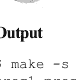

### 输出

```
$ make -s echoit
prog1 prog2 prog3 prog4
```

如你所见，当 PROGS 传递给 echo 命令时，它展开为其值。此示例还说明，规则中的命令可以是任何有效的 shell 命令、系统实用程序或程序，而不仅仅是编译器调用。使用 `-s` 选项是必要的，因为 make 在执行命令时会回显它们。如果没有 `-s`，输出将是：

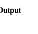

### 输出

```
$ make echoit
echo prog1 prog2 prog3 prog4
prog1 prog2 prog3 prog4
```


## 递归展开变量与简单展开变量

*make* 实际上使用两种类型的变量：递归展开变量和简单展开变量。*递归展开*变量在引用时会原样展开，也就是说，如果展开结果包含另一个变量引用，该变量也会被展开。展开过程将持续进行，直到没有更多可展开的变量为止，因此得名“递归展开”。例如，考虑以下定义的变量 `TOPDIR` 和 `SRCDIR`：

```
TOPDIR = /home/kwall/myproject
SRCDIR = $(TOPDIR)/src
```

因此，`SRCDIR` 的值将是 `/home/kwall/myproject/src`。这符合预期和期望。然而，你不能将文本追加到之前定义的变量末尾。考虑下一个变量定义：

```
CC = gcc
CC = $(CC) -g
```

显然，你最终想要的是 `CC = gcc -g`。但事实并非如此。当引用 `$(CC)` 时，它是递归展开的，因此会导致无限循环：`$(CC)` 会不断展开为 `$(CC)`，而你永远无法获取 `-g` 选项。幸运的是，*make* 会检测到这种情况并报告错误：

```
*** Recursive variable 'CC' references itself (eventually). Stop.
```

图 2.1 说明了递归变量展开中的问题。


如图所示，当你试图向之前定义的变量追加内容时，递归展开会启动无限循环。带框的文本表示前一次展开的结果，而递归元素则通过在前一次展开的前面加上 `$(CC)` 来表示。显然，`CC` 变量永远无法解析。

为了避免这种困难，make 还使用简单展开变量。简单展开变量不是在引用时展开，而是在定义时被扫描一次；所有嵌入的变量引用都会立即解析。定义语法略有不同：

```
CC := gcc
CC += -g
```

第一个定义使用 `:=` 将 `CC` 设置为 `gcc`，第二个定义使用 `+=` 将 `-g` 追加到第一个定义中，因此 `CC` 的最终值为 `gcc -g`（在 make 中，`+=` 的使用方式与在 C 中相同）。图 2.2 直观地展示了简单展开变量是如何工作的。如果你在使用 make 变量时遇到困难，或者收到“VARIABLE references itself”错误消息，是时候使用简单展开变量了。一些程序员只使用简单展开变量以避免意外问题。由于这是 Linux，你可以自由选择！

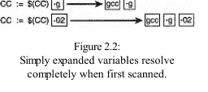

图 2.2 表明，每次引用变量时，它都会被完全展开。左侧的变量赋值具有右侧所示的值，且这些值不包含任何变量引用。

## 示例

## 示例 1

此 Makefile 使用递归展开变量。因为它反复引用 CC 变量，make 将会失败。文件 hello.c（在本章光盘源代码目录中）取自第 1 章。

```
CC = gcc
CC = $(CC) -g

hello: hello.c
      $(CC) hello.c -o hello
```


**输出**

```
$ make hello
Makefile:5: *** Recursive variable 'CC' references itself (eventually). Stop.
```

正如所料，make 检测到 CC 的递归使用并停止了。

## 示例 2

此 Makefile 使用简单展开变量代替第一个示例中的递归展开变量。

```
CC := gcc
CC += -g

hello: hello.c
      $(CC) hello.c -o hello
```


**输出**

```
$ make hello
gcc -g hello.c -o hello
```

这次，程序正常编译。

## 环境变量

*环境变量*是 make 对 shell 所有环境变量的副本。当 make 启动时，它会读取环境中定义的每个变量，并创建具有相同名称和值的变量。但是，Makefile 中同名变量会覆盖环境变量，因此请注意。

## 示例

此 Makefile 使用从 shell 继承的 $HOME 变量作为构建 foo 目标的规则的一部分。

```
foo: $(HOME)/foo.c
      gcc $(HOME)/foo.c -o $(HOME)/foo
```


**输出**

```
$ make all
make: *** No rule to make target '/home/kwall/foo.c', needed by 'foo'.  Stop.
```

显示的错误消息有点误导。当 `make` 未能找到列为 `foo` 目标依赖项的 `/home/kwall/foo.c` 时，它假设需要先以某种方式构建 `foo.c`。然而，它找不到用于此的规则，因此发出抱怨并退出。重点在于，这证明了 `make` 从 shell 环境继承了 `$HOME` 变量（在此情况下为 `/home/kwall`）。

## 自动变量

*自动变量*是每次执行规则时，根据该规则的目标和依赖项进行值评估的变量。自动规则用于创建模式规则。模式规则是通用指令，例如指定如何编译任意 `.c` 文件为其对应 `.o` 文件的规则。自动变量的外观相当晦涩难懂。表 2.2 列出了部分自动变量。

> 欲了解更多模式规则的详细信息，请参阅第 49 页的“模式规则”。

### 表 2.2 自动变量

| 变量 | 描述 |
|:---|:---|
| $@ | 表示规则中的目标文件名 |
| $* | 表示文件名的基本名称（或词干） |
| $< | 表示规则第一个依赖项的文件名 |
| $^ | 展开为规则所有依赖项的空间分隔列表 |
| $? | 展开为比目标新的规则所有依赖项的空间分隔列表 |
| $(@D) | 如果命名的目标位于子目录中，这表示目标路径名的目录部分 |
| $(@F) | 如果命名的目标位于子目录中，这表示目标路径名的文件名部分 |

## 示例

以下 Makefile 片段（取自第 4 章“进程”的 Makefile）使用了 `$*`、`$<` 和 `$@` 自动变量。

```
CFLAGS = -g
CC := gcc

.c.o:
    $(CC) $(CFLAGS) -c $*.c

prpids: prpids.c
    $(CC) $(CFLAGS) $< -o $@

ids: ids.c
    $(CC) $(CFLAGS) $< -o $@
```


**输出**

```
$ make prpids ids
gcc -g prpids.c -o prpids
gcc -g ids.c -o ids
```

第一个目标是隐式规则。（隐式规则将在本章后文详细解释。）它表示，对于每个以 `.c` 结尾的文件名，使用命令 `$(CC) $(CFLAGS) -c $*.c` 创建以 `.o` 结尾的目标文件。在此情况下，`*` 匹配当前目录中以 `.c` 结尾的任何文件名，即 `prpids.c` 和 `ids.c`。

正如输出中显示的 `echoed` 命令所示，`make` 将 `$<` 替换为每个规则的第一个依赖项，即 `prpids.c` 和 `ids.c`。同样，构建 `prpids` 和 `ids` 的命令中的自动变量 `$@` 分别被替换为这些规则的目标名称，即 `prpids` 和 `ids`。

## 预定义变量

除了表 2.2 中列出的自动变量外，GNU `make` 还预定义了许多其他变量，这些变量用作程序名称或向这些程序传递标志和参数。表 2.3 列出了 `make` 最常用的预定义变量。你已经在本章的示例 Makefile 中看到过其中一些。

### 表 2.3 程序名称和标志的预定义变量

| 变量 | 描述 | 默认值 |
| :--- | :--- | :--- |
| AR | 存档维护程序的文件名 | `ar` |
| AS | 汇编器的文件名 | `as` |
| CC | C 编译器的文件名 | `cc` |
| CPP | C 预处理器（C Preprocessor）的文件名 | `cpp` |
| RM | 删除文件的程序 | `rm -f` |
| ARFLAGS | 存档维护程序的标志 | `rv` |
| ASFLAGS | 汇编器的标志 | 无默认值 |
| CFLAGS | C 编译器的标志 | 无默认值 |
| CPPFLAGS | C 预处理器的标志 | 无默认值 |
| LDFLAGS | 链接器的标志 | 无默认值 |

最后一个 Makefile 示例使用了其中几个预定义变量。你可以重新定义 Makefile 中的这些变量，尽管在大多数情况下，它们的默认值是合理的。当默认行为无法满足你的需求，或者你知道给定系统上的某个程序没有相同的调用语法时，请重新定义它们。

## 示例

此示例中的 Makefile 重写了上一个示例中的 Makefile，尽可能仅使用自动变量和预定义变量，并且不重新定义 `make` 提供的预定义变量的默认值。


prpids: prpids.c
    $(CC) $(CFLAGS) $< -o $@ $(LDFLAGS)

ids: ids.c
    $(CC) $(CFLAGS) $< -o $@ $(LDFLAGS)

该 Makefile 生成的输出与上一个示例略有不同：


### 输出

```
$ make
cc prpids.c -o prpids
cc ids.c -o ids
```

输出显示 make 使用了 CC 的默认值 `cc`，而不是 `gcc`。然而，在大多数 Linux 系统中，`cc` 是 `gcc`（或 `egcs`）的符号链接，因此编译正确执行了。

## 隐式规则

到目前为止，本章中的 Makefile 都使用了显式规则，即你自己编写的规则。make 还附带了一组全面的隐式（或预定义）规则。其中许多是专门用途且使用有限的，因此本章仅介绍几种最常用的隐式规则。隐式规则简化了 Makefile 的维护。

假设你有以下两条 Makefile 规则：

```
prog : prog.o

prog.o : prog.c
```

这两条规则列出了依赖项，但没有构建目标的规则。然而，make 不会失败，而是会尝试查找并使用隐式规则来构建目标（你可以通过使用 `-d` 选项时观察生成的调试输出来验证 make 是否在搜索隐式规则）。

## 示例


下面这个看起来非常简朴的 Makefile 将使用 make 的两个隐式规则来创建 `prpids`。第一个规则定义了如何从 C 源代码文件创建目标文件。第二个规则定义了如何从目标文件创建二进制文件。

```
prpids : prpids.o

prpids.o : prpids.c
```

输出

```
$ make
cc       -c prpids.c -o prpids.o
cc       prpids.o     -o prpids
```

make 调用了两个隐式规则来构建 `prpids`。第一个规则表明，本质上，对于每个目标文件 `somefile.o`，查找相应的源文件 `somefile.c`，并使用命令 `cc -c somefile.c -o somefile.o` 构建目标文件。因此，make 查找了一个名为 `prpids.c` 的 C 源文件，并将其编译为目标文件 `prpids.o`。为了构建默认目标 `prpids`，make 使用了另一个隐式规则，该规则表示对于每个目标文件 `somefile.o`，使用命令链接最终的可执行文件

```
cc somefile.o -o somefile
```

## 模式规则

模式规则提供了一种定义自己隐式规则的方法。模式规则看起来与普通规则相似，除了目标中包含恰好一个字符（`%`），它匹配任何非空字符串。此类规则的依赖项也使用 `%` 以匹配目标。例如，规则

```
%.o : %.c
```

告知 make 从相应的名为 `somename.c` 的源文件构建任何目标文件 `somename.o`。这个模式规则恰好也是 make 预定义的模式规则之一，但正如预定义变量一样，你可以重新定义它们以满足自己的需求。

```
%.o : %.c
  $(CC) -c $(CFLAGS) $(CPPFLAGS) $< -o $@
```

## 示例


下面的 Makefile 是上一个 Makefile 的一个版本，区别在于它使用模式规则为编译和链接 C 源代码创建自定义的、用户定义的隐式规则，并使用预定义的隐式规则链接目标文件以创建二进制文件。

```
CFLAGS := -g -O3 -c
CC := gcc

# 重新定义默认模式规则
%.o : %.c
	$(CC) $(CFLAGS) $< -o $@

#
# 这是一个完全多余的注释
#
prpids : prpids.o
```


**输出**

```
$ make
gcc -g -O3 -c prpids.c -o prpids.o
gcc  prpids.o  -o prpids
```

用户定义的模式规则做了几件事：

- 将 `CC` 更改为 `gcc`
- 在 `CFLAGS` 中添加了 `gcc` 的调试开关 `-g` 和优化开关 `-O3`
- 使用自动变量 `$<` 和 `$@` 在每次应用规则时替换第一个依赖项和目标的名字

正如你从 `make` 的输出中看到的，自定义规则按照 Makefile 中指定的方式应用，创建了一个高度优化的二进制文件，其中嵌入了调试信息。

**_注释_**

你可以在 Makefile 中通过在注释前加上井号（#）来插入注释。当 `make` 遇到注释时，它会忽略井号及其后面整行的其余部分。注释可以放在 Makefile 的任何位置。必须特别注意出现在命令中的注释，因为大多数 shell 将 `#` 视为*元字符*（通常作为注释分隔符）。就 `make` 而言，仅包含注释的行，在实际目的上等同于空白行。前面的示例说明了注释的使用，`make` 完全忽略了仅由注释分隔符组成的四行和包含无用文本的两行。

**_有用的 Makefile 目标_**

除了本章前面介绍的 `clean` 目标外，Makefile 中通常还包含其他几个目标。名为 `install` 的目标将最终二进制文件、支持库或 shell 脚本以及文档移动到文件系统中的最终位置，并适当设置文件权限和所有权。

`install` 目标通常还会编译程序，并可能运行简单的测试以验证程序是否正确编译。`uninstall` 目标删除由 `install` 目标安装的文件。

`dist` 目标是准备分发包的便捷方式。至少，`dist` 目标会从构建目录中删除旧的二进制文件和目标文件，并创建一个归档文件，例如 `gzipped`（压缩的）tarball，以便上传到万维网页面和 FTP 站点。

> **注意**
> `gzip` 程序是一种通用文件压缩和解压缩工具，与经典的 UNIX `compress` 工具兼容。它是 GNU 项目中最受欢迎的程序之一，几乎适用于所有可用的操作系统。


## 示例

以下 Makefile 说明了如何使用非常过劳的 `hello.c` 程序创建 `install`、`dist` 和 `uninstall` 目标。

```
hello : hello.c

install : hello
	install $< $(HOME)

.PHONY : dist uninstall
dist :
	$(RM) hello *.o core
	tar czvf hello.tar.gz hello.c Makefile

uninstall :
	$(RM) $(HOME)/hello
```


### 输出

```
$ make install
cc	hello.c	-o hello
install hello /home/kwall
$ make dist
rm -f hello *.o core
tar czvf hello.tar.gz hello.c Makefile
hello.c
Makefile
$ make uninstall
rm -f /home/kwall/hello
```

`make install` 首先编译 `hello` 并将其安装到指定目录。这说明了使用 make 变量的好处之一：`$HOME` 在 `make` 运行的任何系统上都评估为正确的值，因此无需在 Makefile 中硬编码。`make dist` 清理构建产生的残留物，如目标模块和其他临时文件，并创建一个相当于源代码分发的包，准备上传到互联网。最后，`uninstall` 目标默默地删除刚安装的程序。

## 处理错误

当使用 make 遇到问题时，`-d` 选项会告诉 make 除了正在执行的命令外，打印大量额外的调试信息。调试转储将显示 make 内部做了什么以及原因，因此输出可能会令人难以承受。调试选项的输出包括以下信息：

- make 评估哪些文件以进行重建
- 哪些文件正在比较以及比较结果是什么
- 哪些文件实际上需要重新制作
- make 认为它将使用哪些隐式规则
- make 决定使用哪些隐式规则，以及它实际执行的命令

以下列表包含使用 make 时遇到的最常见错误消息，并建议如何解决它们。完整文档请参阅 make 手册或更好的是 make 的信息页（使用命令 `info "GNU make"`）。

- **没有规则制作目标 'target'。** 停止——make 无法在 Makefile 中找到合适的规则来构建命名目标，且没有默认规则适用。解决方法是找到导致问题的目标，添加一个规则来创建它或修复现有规则。
- **'target' 是最新的**——命名目标的依赖项没有改变（比目标旧）。这实际上不是一个错误消息，但如果你想强制重新制作目标，只需使用 `touch` 实用程序更改文件的时间戳。这将导致 make 重建相关目标。


- `目标 'target' 因错误未被重新生成`——在构建指定的目标时发生错误。此消息仅在使用 `make` 的 `-k` 选项时出现，该选项强制 `make` 即使在发生错误时也继续执行（参见第 37 页的表 2.1）。当出现此错误消息时，有多种可能的解决方案。第一步是尝试仅构建有问题的目标，然后根据生成的错误确定下一步 appropriate 步骤。

- `make` 的 `-k` 选项在第 37 页的表 2.1“常见的 make 命令行选项”中进行了更详细的介绍。

- `progname: 命令未找到`——`make` 无法找到 `progname`。这通常是因为 `progname` 拼写错误或不在 `PATH` 环境变量中。要么使用该命令的完整文件名，要么将 `progname` 的路径添加到 Makefile 的 `PATH` 变量中。

- `非法选项 - option`——调用 `make` 时包含了一个它无法识别的选项。不要使用导致问题的选项，或者检查语法。

## 接下来要做什么？

本章向你介绍了 `make` 命令，解释了它为何有用以及如何使用它。你现在已经具备了足够的基础知识，可以在 Linux 开发环境中开始编写和构建简单的程序。在预览了你在完成本书后将构建的程序（第 3 章，“关于项目”）之后，第二部分将通过教你如何在系统级别上编程 Linux，引导你进入*真正的*编程领域。你将从 Linux 进程模型开始，这部分内容在第 4 章“进程”中进行了阐述。

# 3— 关于项目

在书的末尾，有一个功能齐全、完全可用的音乐 CD 数据库程序的完整源代码。它旨在将你在书中学习到的许多技术联系起来，以便你可以看到文件处理、字符模式屏幕绘制和数据库 API 等许多主题是如何结合成一个连贯的整体并协同工作的。

许多入门级编程书籍的一个缺点是，尽管它们出色地展示了各种技术、工具、提示和技巧，但并没有展示所有材料是如何结合在一起的。这不是作者的错，而是材料本身的必然结果，因为它们不可避免地要涵盖广泛的领域。这也反映了该体裁的格式，这种格式理所当然地认为你希望学习如何执行 X、Y 和 Z，但由于图书出版的经济规律，通常忽视了将所有材料连接在一起的必要性。我希望这个编程项目能弥补这一潜在缺陷。

# 音乐 CD 数据库程序

你将完成的项目是一个音乐 CD 数据库程序。实际上，它已经完成了。你将一步步通过其设计和创建过程，一个模块一个模块，甚至一块一块地进行分析，以深入了解你在本书中学到的知识是如何结合在一起的。

我力求使该程序尽可能模块化，从而将用户界面与数据库管理器分离，并将非可移植代码隔离到尽可能少的模块中。此外，库代码（如来自 ncurses 和数据库库的代码）被应用程序代码包装，因此可以在保持接口不变的情况下更改实现。

至少从我的角度来看，这个项目是一个非常个性化的项目。市面上已经有许多这样的程序，其中一些在功能和*视觉吸引力*（或称“眼糖”）方面比这个程序更丰富。但它们没有按照我想要的方式做到我想要它们做到的事。也就是说，这个程序解决了一个痛点，这是整个开源事业背后的动机之一，正如 Eric Raymond 在他出色的论文《大教堂与市集》（***The Cathedral and the Bazaar***）中所论述的那样。有关这篇开创性作品的完整文本，请参阅 http://www.tuxedo.org/~esr/writings/cathedral-bazaar/cathedral-bazaar.html。

## 组件和子系统

在最简单的层面上，该项目由一个适合在 shell 脚本中使用的命令行程序 `mcddcli.c`、一个交互式 GUI 客户端 `mccui.c` 以及三个辅助模块 `mcdscr.c`、`mcddb.c` 和 `mcctil.c` 组成。这些模块之间的关系如图 3.1 所示。

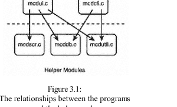

如图 3.1 所示，客户端程序依赖于 `mcdscr.c`、`mcddb.c` 和 `mcctil.c` 提供的例程或*服务*。

`mcddli.c` 解析命令行选项及其关联参数，以添加、删除、获取和搜索 CD 数据库中的记录。其整个设计都围绕着作为一个适用于 shell 脚本的命令行实用工具。它是非交互式的，并返回可在 shell 脚本中使用的适当错误代码。`mcddli.c` 调用在 `mcddb.c` 中定义的例程来执行访问数据库和在数据库中移动的工作。

除了使用数据库管理器 `mcddb.c` 和 `mcctil.c` 中的实用函数外，`mcddui.c` 还调用 `mcdscr.c` 中的函数。`mcdscr.c` 封装了由 ncurses 屏幕处理库提供的功能，赋予 `mcddui.c` 绘制屏幕、解释按键和显示数据库中数据的能力。

辅助模块反过来 heavily 依赖系统调用和其他支持库。`mcddb.c` 抽象（或封装）了 `mcddli.c` 所需的所有数据库功能。数据库模块由与数据库交互的高级函数包装器组成。然而，除了使用一些特定的数据库声明外，`mcddli.c` 无需了解底层数据库接口的任何细节即可使用数据库的 API。通过在一个单独的模块中实现琐碎的数据库功能，实际实现可以在不更改应用程序代码的情况下改变。这种模块化对于编写易于维护的程序至关重要。

`mcdscr.c` 中的屏幕处理代码为 GUI 客户端 `mcddui.c` 执行类似的功能。它将应用程序代码与底层屏幕处理库（即 ncurses）的细节隔离开来，这使得屏幕操作的实现可以在不影响应用程序的情况下改变。`mcdscr.c` 还允许 `mcddui.c` 专注于将数据从数据库传输到屏幕（这是它的目的），而不是担心重绘屏幕或显示对话框。

## 接下来要做什么？

本章为你简要介绍了你在书末将遇到的编程项目。

- 该编程项目的完整源代码以及说明性文本，见第 461 页的“编程项目：音乐 CD 数据库”。

在此之前，你还有很多内容要覆盖。第二部分“系统编程”从讨论 Linux 进程开始，随后是关于信号和信号处理的一章。很少有应用程序能够在无法操纵进程和处理信号的情况下完成很多工作，因此这些材料是构建你 Linux 编程知识的良好基础。

# 第二部分— 系统编程

- 4 进程
- 5 信号
- 6 系统调用
- 7 基本的 Linux 文件处理
- 8 高级的 Linux 文件处理
- 9 守护进程

# 4— 进程

理解 Linux 进程模型对于理解 Linux 的大多数底层行为至关重要。进程的概念是大多数文件访问权限、信号和作业控制的基础。本章涵盖以下主题：

- 什么是进程？
- 进程信息
- 进程标识符
- 创建进程
- 终止进程
- 操纵进程

## 什么是进程？

*进程*是正在运行的程序的实例，也是操作系统的基本调度单位。进程被视为正在运行的程序，由以下元素组成：

- 程序当前的*上下文*，即程序的当前执行状态
- 程序当前的工作目录
- 程序可访问的文件和目录
- 程序的*凭据*或访问权限，如其文件模式和所有权
- 分配给进程的内存和其他系统资源

进程也是 Linux 的基本调度单位。内核使用进程来控制对 CPU 和其他系统资源的访问。Linux 进程确定哪些程序在 CPU 上运行、运行多长时间以及具有什么特性。内核的调度程序在所有进程之间分配 CPU 执行时间（称为*时间片*），并在其时间片结束时依次抢占每个进程。

时间片足够小，以至于在单处理器系统上，似乎有多个进程在同时运行。每个进程还包含关于自身足够的信息，以便内核可以必要时将其切换进或切换出执行状态。

## 进程属性

进程具有标识其并定义其行为属性或特征。内核还在内部维护有关每个进程的大量信息，并提供了*接口*或一组函数调用来获取这些信息。以下部分讨论这些信息是什么以及获取和操纵这些信息的接口。

## 进程标识符

进程的基本属性是其进程 ID，*PID*，及其父进程 ID，*PPID*。PID 和 PPID 都是正的非零整数。PID 唯一地标识一个进程。创建一个新进程的过程被称为创建了*子进程*。相反，创建子进程的过程被称为*父进程*。

所有进程最终都将其血统追溯到 PID 为 1 的进程，即 `init` 进程。`init` 是在内核启动后启动的第一个进程。`init` 启动系统、启动守护进程并运行其他程序


必要时使用。虽然启动过程的内部细节超出了本书的范围，但指出 *init* 是所有进程的父进程这一点很重要。

允许进程获取其 PID 和 PPID 的函数是 `getpid` 和 `getppid`。它们声明在系统头文件 `<unistd.h>` 中，其原型为

```
pid_t getpid(void);
pid_t getppid(void);
```

`getpid` 返回调用者（即调用进程）的 PID，而 `getppid` 返回调用者的 PPID，即其父进程的 PID。

进程为什么需要知道其 PID 或其父进程的 PID？PID 的一个常见用途是创建唯一的文件名或目录。例如，在对 `getpid` 调用之后，进程可以使用 PID 来创建临时文件。另一个典型的任务是作为日志消息的一部分，将 PID 写入日志文件，以明确记录该日志消息的是哪个进程。进程可以使用其 PPID 向其父进程发送信号或其他消息。

### **示例**


这个短程序打印其 PID 和 PPID：

```
/*
 * prpids.c - Print PID and PPID
 */
#include <stdio.h>
#include <unistd.h>
#include <stdlib.h>

int main(void)
{
 printf("PID = %d\n", getpid());
 printf("PPID = %d\n", getppid());
 exit(EXIT_SUCCESS);
}
```

该程序在作者的系统上运行输出如下：


### **输出**

```
$ ./prpids
PID = 15249
PPID = 15214
```

当然，在你的系统上显示的值会不同。

> **注意**
> 
> <unistd.h> 声明了许多属于 POSIX 标准的函数。简而言之，*POSIX*（Portable Operating System Interface，可移植操作系统接口）是一组标准，它定义了如果要被视为“符合 POSIX”，操作系统必须提供的服务和能力。然而，*POSIX* 只定义标准接口，而不定义实现。许多非 UNIX 操作系统，如 Microsoft 的 Windows NT，都声称符合 *POSIX*。
> 
> *POSIX* 兼容性很重要，因为至少在理论上，这使得在一类系统上编写的应用程序很容易移植到另一类系统。例如，通过使用标准 *POSIX* 接口获取用户 ID，程序在另一系统上运行时就不必重写。相反，只需在另一系统上重新编译该程序即可。最后，由于 *POSIX* 是普遍接受的标准，许多公司要求其购买的软件符合 *POSIX*。

## *实际 ID 和有效 ID*

除了 PID 和 PPID，每个进程还有几个其他标识属性，它们与相应的 C 语言类型及返回它们的函数一起列在表 4.1 中。要使用表 4.1 第三列中列出的函数，你的代码中必须包含 <sys/types.h> 和 <unistd.h>。

表 4.1：进程属性

| 属性 | 类型 | 函数 |
| :--- | :--- | :--- |
| 进程 ID | pid_t | getpid(void); |
| 父进程 ID | pid_t | getppid(void); |
| 实际用户 ID | uid_t | getuid(void); |
| 有效用户 ID | uid_t | geteuid(void); |
| 实际组 ID | gid_t | getgid(void); |
| 有效组 ID | gid_t | getegid(void); |

每个进程有三个用户 ID (UID) 和三个组 ID (GID)。它们主要用于安全目的，例如分配文件访问权限和限制谁可以运行某些程序。实际用户 ID 和实际组 ID 是你真正的身份。它们在你登录时从 /etc/passwd 读取。它们是你的登录名和主要组成员资格的数字表示。

例如，在我的系统上，我的 UID 是 500，对应 kwall，即我的登录名。我的 GID 是 100，对应名为 users 的组。getuid 和 geteuid 函数分别返回调用它们的进程的实际 UID 和有效 UID。类似地，getgid 和 getegid 函数返回调用进程的实际 GID 和有效 GID。有效用户 ID 和组 ID 主要用于安全目的，但在大多数情况下，它们与实际用户 ID 和组 ID 相匹配。实际 ID 和有效 ID 之间的差异主要与 setup 或 setgid 程序有关，这是一个在下一节中讨论的主题。

## 示例

- 1. 使用表 4.1 中列出的函数，此程序显示进程的实际和有效 UID 和 GID。

```
/*
 * ids.c - Print UIDs and GIDs
 */

#include <stdio.h>
#include <unistd.h>
#include <stdlib.h>

int main(void)
{
    printf("Real user ID: %d\n", getuid());
    printf("Effective user ID: %d\n", geteuid());
    printf("Real group ID: %d\n", getgid());
    printf("Effective group ID: %d\n", getegid());
    exit(EXIT_SUCCESS);
}
```

在作者的系统上运行此程序的输出为：

### 输出

```
$ ./ids
Real user ID: 500
Effective user ID: 500
Real group ID: 100
Effective group ID: 100
```

- 2. 如前所述，在正常情况下，实际 UID 和有效 UID 以及实际 GID 和有效 GID 是匹配的，上面的输出说明了这一点。为了确认这确实是这种情况，请使用 su 变成另一个用户并执行该程序。UID 和 GID 仍然匹配，如下例所示：

### 输出

```
$ su dummy
Password:
$ id
uid=502(dummy) gid=100(users) groups=100(users)
```

```
$ ./ids
Real user ID: 502
Effective user ID: 502
Real group ID: 100
Effective group ID: 100
```

id 命令打印执行它的用户的实际和有效 UID 和 GID（有关更多信息，请参阅 man id）。当用户 dummy 执行 ids 时，输出与系统的 id 命令的输出相匹配。更重要的是，尽管 ids 具有用户和组所有权，但有效和实际 UID 和 GID 是执行该程序的用户的那些 ID。

第三组 ID 是保存的 UID 和保存的 GID。它们被称为保存的 ID，是因为它们在“操纵进程”部分介绍的 exec 函数执行程序时被保存。通常，程序员只需要关心实际 ID 和有效 ID。

## setuid 和 setgid 程序

如前所述，进程的 实际 ID 和有效 ID 不同的情况之一是，正在执行的程序是 setuid 或 setgid。setuid 和 setgid 程序之所以这样命名，是因为有效 UID 或 GID 被设置为文件的 UID 或 GID，而不是执行该程序的用户的属主或组 ID。setuid 和 setgid 程序的目的 是授予执行该程序的用户特殊权限。

例如，考虑 passwd 程序，用于更改密码。大多数 Linux 系统将密码存储在 /etc/passwd 中。该文件对所有用户可读，但仅对 root 用户可写。当你运行 ls -l /etc/passwd 时，可以非常清楚地看到这一点，如下所示：

```
$ ls -l /etc/passwd
-rw-r-r-r- 1 root bin 703 Aug 10 16:44 /etc/passwd
```

因此，passwd 程序必须 由 root 用户拥有。然而，由于任何用户都可以执行 passwd，因此它通常无法更新 /etc/passwd 文件。解决这一困境的办法是 passwd 是一个 setuid root 程序；也就是说，当它执行时，其有效 UID 被设置为 root UID，从而允许它更新 /etc/passwd。

> 注意
> 实际上，大多数现代 Linux 系统使用 shadow passwords，因此实际密码存储在 /etc/shadow 中，该文件仅对 root 用户可读可写。/etc/passwd 中的密码字段是字母 x。

setuid 程序在属主的执行位中有一个 s 而不是 x，如下面的列表所示：

```
$ ls -l /usr/bin/passwd
-rwxr-xr-x 1 root bin 703 Aug 10 16:44 /etc/passwd
```

类似地，setgid 程序在其组执行位中有一个 s。要使程序成为 setuid，请执行以下命令：

```
$ chmod u+s mybinary
```

下一条命令使程序成为 setgid：

```
$ chmod g+s mybinary
```

> **警告**
> 
> setuid 或 setgid root 程序是安全风险，因为虽然普通用户可以执行它们，但它们以超级用户权限运行，因此对系统拥有完全访问权限。它们可以破坏任何东西。执行或创建 setuid root 程序时请格外小心。

## 用户信息

虽然机器使用数字工作得很好，但人类使用名称工作得更好。幸运的是，有两种方法可以将 UID 转换为人类可读的名称。getlogin 函数返回执行进程的用户登录名。当你有了登录名，你可以将它传递给 getpwnam 函数，该函数返回 /etc/passwd 中对应于该登录名的完整条目。另一种方法是将进程的 UID 传递给 getpwuid 函数，该函数也返回 /etc/passwd 中的相应条目。

getlogin 声明在 <unistd.h> 中，其原型如下：

```
char *getlogin(void);
```

它返回指向包含正在运行进程的用户的登录名的字符串的指针，如果此信息不可用，则返回 NULL。getpwnam 声明在 <pwd.h> 中。其原型是

```
struct passwd *getpwnam(const char *name);
```

name 必须是包含感兴趣的登录名的字符串的指针。getpwnam 返回指向 passwd 结构体的指针。指向返回的 passwd 结构体的指针指向静态分配的内存，该内存将被下一次调用 getpwnam 时覆盖，因此如果你稍后需要此信息，请在再次调用 getpwnam 之前保存结构体信息。

### **示例**


### **示例**

此示例说明了 getlogin 和 getpwname 的行为：

```
/*
 *getname.c -- Get login names
 */
```


#include <stdio.h>
#include <stdlib.h>
#include <sys/types.h>
#include <unistd.h>
#include <pwd.h>

int main(void)
{
    char *login;
    struct passwd *pentry;

    /* Get the login name */
    if((login = getlogin()) == NULL) { /* oops */
        perror("getlogin");
        exit(EXIT_FAILURE);
    }
    printf("getlogin returned %s\n", login);

    /* get the password entry for login */
    if((pentry = getpwnam(login)) == NULL) {
        perror("getpwnam");
        exit(EXIT_FAILURE);
    }
    /* display the full name */
    printf("gecos: %s\n", pentry->pw_gecos);

    exit(EXIT_SUCCESS);
}

### 输出

```
$ ./getname
getlogin returned kwall
gecos: Kurt Wall
```

`if` 语句用于防范 `getlogin` 或 `getpwnam` 返回 `NULL` 的可能性。如果任一函数返回 `NULL`，`perror` 将打印错误消息，并且程序将退出。首先，该程序使用 `getlogin` 来检索并显示运行程序的登录名。然后，它使用此名称检索密码条目并显示用户的全名（存储在 `/etc/passwd` 的 GECOS 字段中——更多信息请参见 man 5 passwd）。

## 附加进程信息

除了进程、用户和组 ID 之外，还可以获取有关进程的其他信息，例如它们的资源使用和运行时间。请注意，我写的是运行 *times*（复数），而不是 *time*（单数）。这是因为 Linux 内核为进程维护三个独立的时间值，如下所示：

- *墙上时钟时间* 是已经过去的时间。
- *用户 CPU 时间* 是处理器执行用户模式（非内核模式）代码所花费的时间。
- *系统 CPU 时间* 是执行内核代码所花费的时间。

> • 用户模式和内核模式之间的区别在第 120 页的“什么是系统调用？”中进行了讨论。

你可以通过调用 `times` 或 `getrusage` 来获取这些信息。然而，进程的资源使用只能从 `getrusage` 调用中获得。这些资源都与内存访问统计有关。本节首先讨论获取计时信息，然后介绍资源使用。

> **提示**
> 为了获取计时信息，你应该使用哪个调用，`times` 还是 `getrusage`？嗯，Linux 从 BSD 和 SVR4 UNIX 继承了功能，而它们都有这两个函数。POSIX（Linux 试图遵循的标准）只强制要求 *times*。然而，至少在理论上，`getrusage` 为程序员提供了关于进程资源使用情况的更完整的图片。它是理论性的，因为 Linux（截至 2.2.10 版本）只实现了 *rusage* 结构中定义的十六个资源中的五个。最后，*times* 返回的计时信息比 *getrusage* 返回的更精细。因此，如果你只需要计时信息或希望遵守 POSIX 标准，请使用 `times`。如果你不关心 POSIX 兼容性，或者如果你需要 `getrusage` 提供的额外信息，则使用它。

## 进程计时

`times` 函数在 `<sys/times.h>` 中的原型如下：

```
clock_t times(struct tms *buf);
```

*times* 返回自系统启动以来经过的时钟滴答数，也称为墙上时钟时间。*buf* 是指向 *tms* 结构的指针，该结构存储当前进程 *times*。

## 示例


该程序使用 *system* 函数执行外部命令，然后使用 *times* 调用打印结果计时信息。

```c
/* resusg1.c - 获取进程时间和资源使用情况
 */
#include <stdio.h>
#include <stdlib.h>
#include <sys/times.h>
#include <time.h>
#include <unistd.h>

void doit(char * , clock_t);

int main(void)
{
    clock_t start, end;
    struct tms t_start, t_end;

    start = times(&t_start);
    /* 重定向输出以防止屏幕杂乱 */
    system("grep the /usr/doc/*/* > /dev/null 2> /dev/null");
    end = times(&t_end);

    doit("elapsed", end - start);

    fputs("Parent times\n", stdout);
    doit("  tuser CPU", t_end.tms_utime);
    doit("  tsys CPU", t_end.tms_stime);

    fputs("Child times\n", stdout);
    doit("  tuser CPU", t_end.tms_cutime);
    doit("  tsys CPU", t_end.tms_cstime);

    exit(EXIT_SUCCESS);
}

void doit(char *str, clock_t time)
{
    /* 获取每秒时钟滴答数 */
    long tps = sysconf(_SC_CLK_TCK);

    printf("%s: %6.2f secs\n", str, (float)time/tps);
}
```

在某个系统上，一次示例运行产生了以下输出：


### 输出

```
$ ./resusql
elapsed time: 19.91 secs
Parent times
  user CPU time: 0.00 secs
  sys CPU time: 0.00 secs
Child times
  user CPU time: 2.34 secs
  sys CPU time: 1.10 secs
```

首先值得注意的是，父进程中似乎没有积累任何时间。虽然这在后面本章的“创建进程”部分有更详细的覆盖，但发生的情况是，当程序调用 *system* 函数时，它生成了一个子进程，而执行所有工作并积累 CPU 时间的是子进程，而不是父进程。

第二个值得注意的观察结果是，进程的经过时间，19.91 秒，并不等于用户和系统 CPU 时间之和，即 3.44 秒。造成这种表面差异的原因是，子进程执行的 *grep* 操作比 CPU 密集型更具 I/O 密集型。它必须扫描相关系统上的 2331 个头文件，超过 10 兆字节文本。缺失的 16 秒都用于读取硬盘。当然，在你的系统上，计时结果会不同。

*times'* 的返回值是相对时间，而不是绝对时间（自系统启动以来的时钟滴答数），因此要使其有用，你必须进行两次测量并使用它们的差值。这就得出了经过时间，或称为墙上时钟时间。*resusql* 通过将开始和结束的时钟滴答数分别存储在 *start* 和 *end* 中来实现这一点。其他进程计时值取自头文件 <sys/times.h> 中定义的 *tms* 结构。tms 结构存储进程及其子进程使用的当前 CPU 时间。它定义为

```
struct tms {
    clock_t tms_utime;     /* 用户 CPU 时间 */
    clock_t tms_stime;     /* 系统 CPU 时间 */
    clock_t tms_cutime;    /* 子进程的用户 CPU 时间 */
    clock_t tms_cstime;    /* 子进程的系统 CPU 时间 */
};
```

同样，这些值是时钟滴答数，而不是秒数。要将时钟滴答数转换为秒，使用 *sysconf* 函数，该函数将其参数转换为在运行时定义系统限制或选项的值。`_SC_CLK_TCK` 是一个宏，定义每秒有多少个时钟滴答数；`sysconf` 以 `long` 类型返回该值，程序使用它来计算进程运行所花费的秒数。该程序真正的核心是 `doit` 函数。它接受一个字符串指针和一个 `clock_t` 值，然后计算并打印进程每个部分的实际计时信息。

## 资源使用情况

进程的资源使用情况不仅仅涉及 CPU 时间。你还需要考虑进程的内存足迹，内存的结构，进程进行的内存访问类型，它执行的 I/O 数量和类型，以及它生成的网络活动数量和类型（如果有的话）。内核跟踪每个进程的所有这些以及更多这样的信息。至少，它具备执行此操作的能力。获取此信息的结构是一个 `rusage` 结构，定义在 <sys/resource.h> 头文件中。该结构定义如下：

```
struct rusage {
    struct timeval ru_utime;     /* 使用的用户时间 */
    struct timeval ru_stime;     /* 使用的系统时间 */
    long ru_maxrss;             /* 最大驻留集大小 */
    long ru_ixrss;              /* 共享内存大小 */
    long ru_idrss;              /* 非共享数据大小 */
    long ru_isrss;              /* 非共享栈大小 */
    long ru_minflt;             /* 页面回收 */
    long ru_majflt;             /* 页面错误 */
    long ru_nswap;              /* 交换 */
    long ru_inblock;            /* 块输入操作 */
    long ru_oublock;            /* 块输出操作 */
    long ru_msgsnd;             /* 发送的消息 */
    long ru_msgrcv;             /* 接收的消息 */
    long ru_nsignals;           /* 接收的信号 */
    long ru_nvcsw;              /* 自愿上下文切换 */
    long ru_nivcsw;            /* 非自愿上下文切换 */
};
```

不幸的是，Linux 只跟踪表 4.2 中列出的资源。


### 表 4.2：跟踪的系统资源

| 资源 | 描述 |
| :----- | :----- |
| `ru_utime` | 执行用户模式（非内核）代码所花费的时间 |
| `ru_stime` | 执行内核代码（来自用户代码的系统服务请求）所花费的时间 |
| `ru_minflt` | 次要缺页中断的数量（未导致磁盘访问的内存访问） |
| `ru_majflt` | 主要缺页中断的数量（导致磁盘访问的内存访问） |
| `ru_nswap` | 因主要缺页中断而从磁盘读取的内存页数量 |

如表 4.2 所示，内存缺页中断分为两种类型：次要缺页中断和主要缺页中断。*次要缺页中断*发生在 CPU 必须访问主内存（RAM）时。这种缺页中断发生的原因是 CPU 所需的代码或数据不在其寄存器或缓存中。*主要缺页中断*发生在进程必须从磁盘读取数据时，因为所需的代码或数据不在 RAM 中。`ru_nswap` 成员存储了因主要缺页中断而从磁盘读取的内存页数量。

要获取这些信息，请使用在 `<sys/resource.h>` 中声明的 `getrusage` 调用。`ru_utime` 和 `ru_stime` 成员存储进程累积的用户 CPU 时间和系统 CPU 时间。`getrusage` 提供的新信息只有内存缺页中断的次数以及与缺页中断相关的磁盘访问次数。与 `times` 函数不同，如果要获取父进程和子进程两者的信息，必须调用两次 `getrusage`。`getrusage` 的原型如下：

```c
int getrusage(int who, struct rusage *usage);
```

`usage` 是函数填充的 `rusage` 结构的指针。`who` 参数确定返回的资源使用情况是调用进程的还是其子进程的。`who` 必须是 `RUSAGE_SELF` 或 `RUSAGE_CHILDREN`。如果 `getrusage` 成功，返回 0；如果发生错误，返回 -1。

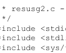

## 示例

此程序重写了之前的示例，使用 `getrusage` 代替 `times`：

```c
/*
 * resusg2.c - 获取进程时间和资源使用情况
 */
#include <stdio.h>
#include <stdlib.h>
#include <sys/times.h>
#include <sys/resource.h>
#include <time.h>
#include <unistd.h>

void err_quit(char *);
void doIt(char *, long);

int main(void)
{
    struct rusage usage;

    /* 重定向输出以防止屏幕杂乱 */
    system("grep the /usr/doc/*/* > /dev/null 2> /dev/null");

    /* 获取父进程的资源结构 */
    if((getrusage(RUSAGE_SELF, &usage)) == -1)
        err_quit("getrusage");

    puts("Parent times");
    doIt("\tuser CPU", usage.ru_utime.tv_sec);
    doIt("\tsys CPU", usage.ru_stime.tv_sec);

    fputs("Parent memory stats");
    doIt("\tminor faults", usage.ru_minflt);
    doIt("\tmajor faults", usage.ru_majflt);
    doIt("\tpage swaps", usage.ru_nswap);

    /* 获取子进程的资源结构 */
    if((getrusage(RUSAGE_CHILDREN, &usage)) == -1)
        err_quit("getrusage");

    puts("Child Times");
    doIt("\tuser CPU", usage.ru_utime.tv_sec);
    doIt("\tsys CPU", usage.ru_utime.tv_sec);

    puts("Child memory stats");
    doIt("\tminor faults", usage.ru_minflt);
    doIt("\tmajor faults", usage.ru_majflt);
    doIt("\tpage swaps", usage.ru_nswap);

    exit(EXIT_SUCCESS);
}

void doIt(char *str, long resval)
{
    printf("%s: %ld\n", str, resval);
}

void err_quit(char *str)
{
    perror(str);
    exit(EXIT_FAILURE);
}
```

此程序执行与之前相同的 `grep` 命令。但是，除了计时信息外，它还显示父进程和子进程的内存使用情况。一次示例运行产生了以下输出：


### 输出

```
$ ./resusg2
Parent times
    user CPU: 0
    sys CPU: 0
Parent memory stats
    minor faults: 18
    major faults: 66
    page swaps: 0
Child Times
    user CPU: 2
    sys CPU: 2
Child memory stats
    minor faults: 2585
    major faults: 21412
    page swaps: 0
```

正如示例运行的输出所示，`getrusage` 产生的计时信息不如 `times` 产生的精确。另一方面，使用 `getrusage` 可以获得对进程内存使用情况的非常清晰的视图。实际上，示例运行中主要缺页中断的数量证实了之前关于程序所需磁盘 I/O 量的讨论。进程从磁盘读取了 21,412 次，因为必要的数据不在内存中。然而，没有发生页面交换。

## 会话和进程组

在某些情况下，简单的父/子模型不足以描述进程之间的关系。例如，考虑一个打开的 xterm 窗口。假设你在 xterm 中单独执行三条命令：ls、cat 和 vi。是 xterm 还是运行在 xterm 中的 shell 是父进程？显然，这三条命令彼此相关，但不是作为父子关系。相反，它们都是同一个会话的一部分。

另一个例子是在管道中执行的命令集，例如 `ls -1 | sort | more`。同样，这些命令彼此相关，不是作为父子关系，而是作为同一个进程组的成员。图 4.1 说明了进程、会话和进程组之间的关系。

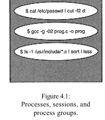

### 进程组

进程组是一组相关进程，通常是管道中的一系列命令。进程组中的所有进程具有相同的进程组 ID（PGID）。进程组的目的是方便作业控制。例如，假设你运行命令管道 `ls -1 /usr/include | sort | wc -1`。如果它在执行过程中被杀死（使用 Ctrl+C），shell 必须能够终止所有进程。它通过杀死进程组而不是每个单独的进程来实现这一点。

### 会话

会话由一个或多个进程组组成。会话领导者是创建该会话的进程。每个会话都有一个唯一的标识符，称为*会话 ID*，它仅仅是会话领导者的 PID。会话对于进程组的作用与进程组对于单个进程的作用相同。

假设你在后台执行之前提到的同一管道命令（即 `ls -l /usr/include | sort | wc -l &`），并在前台执行其他命令。现在，如果你正在 X Window 终端中运行这些命令，并在所有这些进程运行时关闭终端窗口，内核会向控制进程（会话领导者）发送信号，进而如上一段所述，杀死每个进程组。

操作进程组和会话是一个高级主题，超出了本书的范围。然而，理解这些概念和术语很重要，因为它们对第 5 章“信号”中涵盖的信号有重要影响。

## 操作进程

本节讨论创建新进程、终止现有进程以及对进程进行等待和监控。`system`、`fork` 和 `exec` 调用创建新进程。`kill` 函数可用于终止其他进程，进程可以调用 `exit` 或 `abort` 来终止自身。良好的资源管理要求父进程等待其子进程终止。各种 `wait` 函数处理这一要求。

### 创建进程

程序员经常需要在其程序内部创建新进程。例如，假设你创建了一个管理 CD-ROM 标题数据库的程序。你希望使用 `sort` 程序来完成排序工作，而不是自己创建排序例程。Linux 提供了三种方法来实现这一点。由标准 C 库提供的 `system` 调用是一种方法。然而，`fork` 和 `exec` 调用是“Linux 的方式”。本节查看这三种调用。

### 使用 system

`system` 函数执行传入的 shell 命令。其原型声明在 `<stdlib.h>` 中，如下所示：

```c
int system(const char *string);
```

`system` 通过将 `string` 传递给 `/bin/sh` 来执行 shell 命令，并在命令完成后返回。前面的示例已经展示了它的使用。如果由于某种原因，`system` 无法调用 `/bin/sh`，它返回 `127`。如果发生其他错误，`system` 返回 `-1`。`system` 的常规返回值是在 `string` 中传入的命令的退出代码。如果 `string` 为 `NULL`，如果 `/bin/sh` 可用，`system` 返回 0；如果不可用，则返回非零值。


## 使用 fork

`fork` 调用会创建一个新的进程。新的子进程将是调用它的父进程的副本。`fork` 声明在 `<unistd.h>` 中，其语法为 `pid_t fork(void);`

如果成功，`fork` 会向父进程返回子进程的 PID，并向子进程返回 0。这意味着，尽管你只调用了一次 `fork`，但它会返回两次。

`fork` 创建的新进程是父进程的一个精确副本，除了 PID 和 PPID 之外。`fork` 会完全复制父进程，包括实际用户 ID 和有效用户 ID、进程组 ID 和会话 ID、环境变量、资源限制、打开的文件以及共享内存段。

父进程和子进程之间的差异很少。子进程不会继承父进程中设置的闹钟（使用 `alarm` 调用）、父进程创建的文件锁或挂起的信号。需要理解的关键概念是，`fork` 创建了一个与父进程完全相同的新进程。


## 示例

下面是一个使用 `fork` 的简单示例：

```c
/*
 *  child.c - Simple fork usage
 */
#include <unistd.h>
#include <stdio.h>
#include <stdlib.h>

int main(void)
{
    pid_t child;

    if ((child = fork()) == -1) {
        perror("fork");
        exit(EXIT_FAILURE);
    } else if (child == 0) {
        puts("in child");
        printf("\tchild pid = %d\n", getpid());
        printf("\tchild ppid = %d\n", getppid());
        exit(EXIT_SUCCESS);
    } else {
        puts("in parent");
        printf("\tparent pid = %d\n", getpid());
        printf("\tparent ppid = %d\n", getppid());
    }
    exit(EXIT_SUCCESS);
}
```

该程序的输出应该类似于以下内容：


### 输出

```
$ ./child
in parent
in child
	child pid = 1150
	child ppid = 1149
	parent pid = 1149
	parent ppid = 706
```

从输出中可以看出，子进程的 PPID（父进程 ID）与父进程的 PID 相同，都是 1149。输出还说明了关于 *fork* 使用的一个关键点：你无法预测父进程是在子进程之前还是之后执行。这可以从输出中奇怪的顺序看出。输出的第一行来自父进程，第二到第四行来自子进程，第五和第六行再次来自父进程。它是乱序执行的，也就是说，是*异步*的。

*fork* 行为的异步性意味着，你不应该在子进程中执行依赖于父进程中代码执行的代码，反之亦然。这样做会产生潜在的*竞争条件*，这种情况发生在多个进程想要使用共享资源，但使用时机取决于进程执行顺序时。竞争条件可能很难捕捉，因为产生它们的代码“大多数时候”都能正常工作。竞争条件的潜在影响很难预测，但其症状可能包括不可预测的程序行为、看似系统挂起、在通常负载较轻的系统上响应缓慢，或者系统彻底崩溃。

*fork* 调用可能会失败，原因是系统中已经有太多进程在运行，或者尝试 fork 的 UID 超出了其允许执行的进程数量限制。如果失败，*fork* 会向父进程返回 -1，并且不会创建子进程。示例程序通过检查 *fork* 的返回值来防范这种可能性。此检查还允许程序确定它是在子进程还是父进程中。

**注意**
*forking* 过程涉及将父进程的整个内存映像复制到子进程。这是一个本质上较慢的过程，因此 UNIX 的设计者创建了 `vfork` 调用。`vfork` 也创建一个新进程，但它不会复制父进程。相反，在调用 `exec` 或 `exit` 之前，新进程在父进程的地址空间中运行——如果它访问父进程的任何内存，该部分内存就会被复制到子进程。此功能称为写时复制（copy-on-write）。

`vfork` 背后的原理是加速新进程的创建。此外，`vfork` 具有保证子进程在父进程之前执行的额外功能，从而消除了竞争条件的威胁。然而，在 Linux 下，`vfork` 仅仅是 `fork` 的包装器，因为 Linux 一直使用写时复制机制。因此，Linux 的 `fork` 和 UNIX 的 `vfork` 一样快，但 Linux 的 `vfork`，因为它是 `fork` 的别名，无法保证子进程会在父进程之前执行。

## 使用 exec

`exec` 函数实际上是一组六个函数，每个函数都有不同的调用约定和用途。尽管有多个函数，它们通常被统称为“`exec` 函数”。与 `fork` 一样，`exec` 也声明在 `<unistd.h>` 中。它们的原型如下：

```c
int execl(const char *path, const char *arg, ...);
int execlp(const char *file, const char *arg, ...);
int execle(const char *path, const char *arg, char *const envp[]);
int execv(const char *path, char *const argv[]);
int execvp(const char *file, char *const argv[]);
int execve(const char *path, char *const argv[], char *const envp[]);
```

`exec` 会完全用被*execed*（执行）程序的映像替换调用进程的映像。虽然 `fork` 创建一个新进程并生成新的 PID，但 `exec` 启动新程序，替换原始进程。因此，*execed* 进程的 PID 不会改变。

`execve` 接受三个参数：`path`、`argv` 和 `envp`。`path` 是要执行的二进制文件或脚本的完整路径。`argv` 是要传递给程序的完整参数列表，包括 `argv[0]`，传统上这是要执行的程序的名称。`envp` 是指向被 *execed* 程序（如果有）的特定环境变量的指针（在示例程序中为 NULL）。


## 示例

在此示例中，使用 `execve` 在当前目录执行 `ls` 命令。

```c
/*  execs.c - Illustrate execve */
#include <unistd.h>
#include <stdlib.h>
#include <stdio.h>

int main(void)
{
    char *args[] = {"/bin/ls", NULL};

    if (execve("/bin/ls", args, NULL) == -1) {
        perror("execve");
        exit(EXIT_FAILURE);
    }

    puts("shouldn't get here");
    exit(EXIT_SUCCESS);
}
```

对该程序的一次测试运行产生了以下输出：


### 输出

```
$ ./execve
Makefile  execve    getname.c  prprids.c   resusg2.c
child.c   execve.c   ids.c      resusg1.c
```

从输出中可以看出，`puts` 语句没有执行。为什么？如果 `exec` 成功，它不会返回给调用者。这是合理的，因为如前所述，`exec` 完全用新程序替换了调用者，因此没有留下任何痕迹。也就是说，不再有调用者可以返回！但是，如果 `exec` 失败，它会返回 -1 并设置全局变量 `errno`。`errno` 可以通过标准 I/O 库中的 `strerror` 转换为有意义的错误消息（有关使用此变量的详细信息，请参阅 `man errno`）。

## 深入探讨 exec

由于 `exec` 系列中六个函数之间令人困惑的相似性，以下将完整讨论它们的语法、行为、相似点和不同点。

四个函数——`execl`、`execv`、`execle` 和 `execve`——接受路径名作为第一个参数。`execlp` 和 `execvp` 接受文件名，如果文件名不包含斜杠，它们会模拟 shell 的行为并搜索 `$PATH` 以定位要执行的二进制文件。

包含 `l` 的三个函数期望一个由逗号分隔的、以 `NULL` 指针结尾的参数列表，这些参数将传递给被 `execed` 的程序。然而，包含 `v` 的函数接受一个向量，即一个指向以空字符结尾的字符串的指针数组。该数组必须以 `NULL` 指针结尾。例如，假设你要 `exec` 命令 `/bin/cat /etc/passwd /etc/group`。使用其中一个 `l` 函数，你只需将这些值作为参数依次传递，并用 `NULL` 终止列表，如下所示：

```c
execl("/bin/cat", "/bin/cat", "/etc/passwd", "/etc/group", NULL);
```

但是，如果你更喜欢使用其中一个 `v` 函数，你首先需要构建 `argv` 数组，然后将该数组传递给 `exec` 函数。你的代码可能如下所示：

```c
char *argv[] = {"/bin/cat", "/etc/passwd", "/etc/group", NULL};
execv("/bin/cat", argv);
```

最后，以 `e` 结尾的两个函数——`execl` 和 `execle`——允许你为被 `execed` 的程序创建特定的环境变量。此环境存储在 `envp` 中，它也是一个指向以空字符结尾的字符串数组的指针，该数组本身也以 `NULL` 结尾。每个字符串采用 `name=value` 对的形式，其中 `name` 是环境变量的名称，`value` 是其值。例如：

```c
char *envp[] = {"PATH=/bin:/usr/bin", "USER=joeblow", NULL};
```

在此示例中，`PATH` 和 `USER` 是名称，而 `/bin:/usr/bin` 和 `joeblow` 是值。

其他四个函数通过一个名为 `environ` 的全局变量隐式获取环境，该变量指向包含调用进程环境的字符串数组。要操作这些函数继承的环境，请使用 `putenv` 和 `getenv` 函数。它们声明在 `<stdlib.h>` 中，原型如下：

```c
int putenv(const char *string);
char *getenv(const char *name);
```

`getenv` 查找名为 `name` 的环境变量并返回指向其值的指针，如果没有匹配项则返回 `NULL`。`putenv` 添加或更改 `string` 中指定的 `name=value` 对。如果成功，它返回零。如果失败，它返回 -1。使用 `getenv` 和 `putenv` 的代码类似于以下片段。


## 示例


## 示例

以下程序演示了 `getenv` 的行为：

```c
/*
 * testenv.c - 测试环境变量
 */
#include <unistd.h>
#include <stdlib.h>
#include <stdio.h>

int main(void)
{
    char envval[] = {"MYPATH=/usr/local/someapp/bin"};

    if(putenv(envval))
        puts("putenv failed");
    else
        puts("putenv succeeded");

    if(getenv("MYPATH"))
        printf("MYPATH=%s\n", getenv("MYPATH"));
    else
        puts("MYPATH unassigned");

    if(getenv("YOURPATH"))
        printf("YOURPATH=%s\n", getenv("YOURPATH"));
    else
        puts("YOURPATH unassigned");

    exit(EXIT_SUCCESS);
}
```

运行该程序会产生以下输出：


### 输出

```
$ ./testenv
putenv succeeded
MYPATH=/usr/local/someapp/bin
YOURPATH unassigned.
```

## 等待进程

在你 `fork` 或 `exec` 一个新进程后，父进程应该等待其终止，以便收集其退出状态并防止僵尸进程的产生。与 `exec` 一样，你有多种函数可以使用。然而，为了避免完全混乱，本节仅关注 `wait` 和 `waitpid` 函数。

什么是僵尸进程？*僵尸进程*是指在父进程有机会使用 `wait` 或 `waitpid` 收集其退出状态之前终止的子进程。父进程通过使用 `wait` 系列函数之一从内核的进程表中获取退出状态来*收集*子进程的退出状态。之所以称其为僵尸，是因为它已经“死亡”但仍保留在进程表中。子进程已退出，分配给它的内存和其他资源已被释放，但它仍然在内核的进程表中占据一个槽位。内核会维护子进程的退出状态，直到父进程将其收割。

一两个僵尸进程不是问题，但如果程序不断 `fork` 和 `exec` 且未能收集退出状态，进程表最终会填满，从而阻碍性能并导致系统需要重启——这在任务关键的生产环境中并不是一种理想的情况！

另一方面，*孤儿进程*是指在其父进程调用 `wait` 或 `waitpid` 之前终止的子进程。在这种情况下，`init` 进程成为该子进程的父进程并收集退出状态，从而防止僵尸进程的产生。

要收集子进程的退出状态，请使用 `wait` 或 `waitpid` 调用。你必须包含头文件 `<sys/types.h>` 和 `<sys/wait.h>`。它们的原型如下：

```c
pid_t wait(int *status);
pid_t waitpid(pid_t pid, int *status, int options);
```

`status` 参数存储子进程的退出状态。`pid` 是你想要等待的进程的 PID。它可以取表 4.3 中列出的四个值之一。

### 表 4.3：*`pid` 的可能值*

| 值 | 描述 |
| :--- | :--- |
| `< -1` | 等待任何 `PGID` 等于 `PID` 绝对值的子进程 |
| `-1` | 等待任何子进程 |
| `0` | 等待任何 `PGID` 等于调用进程 `PGID` 的子进程 |
| `> 0` | 等待 `PID` 等于 `pid` 的子进程 |

options 指定了 wait 调用应该如何行为。它可以是 `WNOHANG`，这会导致 `waitpid` 在没有子进程退出的情况下立即返回；`WUNTRACED`，这意味着它应该为那些状态尚未报告的子进程返回；或者你可以对它们进行逻辑或运算以获得两种行为（即，将 `WNOHANG | WUNTRACED` 作为 options 参数传递）。

## 示例


## 示例

`waiter.c` 演示了如何使用 `waitpid`。

```c
/*
 * waiter.c - 简单的 wait 用法
 */
#include <unistd.h>
#include <sys/types.h>
#include <sys/wait.h>
#include <stdio.h>
#include <stdlib.h>

int main(void)
{
    pid_t child;
    int status;

    if((child = fork()) == -1) {
        perror("fork");
        exit(EXIT_FAILURE);
    } else if(child == 0) {
        puts("in child");
        printf("\tchild pid = %d\n", getpid());
        printf("\tchild ppid = %d\n", getppid());
        exit(EXIT_SUCCESS);
    } else {
        waitpid(child, &status, 0);
        puts("in parent");
        printf("\tparent pid = %d\n", getpid());
        printf("\tparent ppid = %d\n", getppid());
        printf("\tchild exited with %d\n", status);
    }
    exit(EXIT_SUCCESS);
}
```

一次示例运行产生了以下输出：


### 输出

```
$ ./waiter
in child
    child pid = 4502
    child ppid = 4501
in parent
    parent pid = 4501
    parent ppid = 4429
    child exited with 0
```

该程序与之前的 `child.c` 类似，只是增加了一条 `waitpid` 语句。它专门等待由 `child` 指定的子进程返回，并显示该子进程的退出状态。请注意，父进程和子进程的输出不再像 `child.c` 中那样混合在一起。父进程的执行会停止，直到子进程退出。`waitpid`（和 `wait`）返回已退出的子进程的 PID，如果 `options` 中指定了 `WNOHANG` 则返回 0，如果发生错误则返回 -1。

## 终止进程

进程终止的原因有五种：

- 其 `main` 函数调用 `return`
- 它调用 `exit`
- 它调用 `_exit`
- 它调用 `abort`
- 它被信号终止

前三种原因是正常终止，后两种是非正常终止。尽管进程终止的原因可能不同，但最终执行的内核代码是相同的，它会关闭打开的文件，释放内存资源，并执行其他必要的清理工作。由于本书假定读者具备 C 编程能力，因此希望 `return` 函数无需过多解释。

## `exit` 函数

你已经见过 `exit` 函数，它是 C 标准库的一部分，在本章的程序中都有使用。而不是提供另一个示例，下面列出了它的原型，如 `<stdlib.h>` 中声明的那样：

```c
int exit(int status);
```

`exit` 导致程序正常终止并向父进程返回 `status`。通过 `atexit` 注册的函数将被执行。

`_exit` 函数在 `<unistd.h>` 中声明。它立即终止调用进程；通过 `atexit` 注册的函数不会执行。

## 使用 `abort`

如果需要非正常终止程序，请使用 `abort` 函数。在 Linux 下，`abort` 还有额外的副作用，即导致程序转储核心文件（core dump），大多数调试器使用核心文件来分析程序崩溃时的状态。尽管任何打开的文件都会被关闭，但 `abort` 是一个严厉的调用，应该仅在最后手段时才调用，例如当你遇到无法以编程方式处理的错误时，如严重的内存短缺。`abort` 也是一个标准库函数（在 `<stdlib.h>` 中声明）。其原型是

```c
void abort(void);
```


## 示例

以下程序展示了 `abort` 函数的行为：

```c
/*
 * abort.c - 演示 abort 系统调用
 */
#include <stdlib.h>
#include <stdio.h>

int main(void)
{
    abort();

    /* 不应该到达这里 */
    exit(EXIT_SUCCESS);
}
```


### 输出

```
$ ./abort
Aborted
$ ulimit -c unlimited
$ ./abort
Aborted (core dumped)
```

请注意，你的系统可能不会生成核心文件。如果没有，请使用 shell 的 `ulimit` 命令，如输出中所示。核心文件在调试程序时非常有用。

> • 有关使用核心文件调试的更多信息，请参阅第 426 页的 “Starting gdb”。

### 使用 `kill` 函数

前两节关注的是进程如何终止自身。那么，一个进程如何终止另一个进程？使用 `kill` 函数，其原型如下：

```c
int kill(pid_t pid, int sig);
```

要使用它，你必须在程序中包含 `<sys/types.h>` 和 `<signal.h>`。`pid` 参数指定你要终止的进程，`sig` 是你想要发送的信号。由于本节涉及终止进程，目前你只需要关心 `SIGKILL` 信号。第 5 章将扩展对信号的讨论。现在，请暂且相信这一点。


## 示例

该程序展示了如何终止一个进程：

```c
/*
 * killer.c - 终止其他进程
 */
#include <sys/types.h>
#include <sys/wait.h>
#include <signal.h>
#include <stdlib.h>
#include <stdio.h>

int main(void)
{
    pid_t child;
    int status, retval;

    if((child = fork()) < 0) {
        perror("fork");
        exit(EXIT_FAILURE);
    }
    if(child == 0) {
        /* sleep long enough to be killed */
        sleep(1000);
        exit(EXIT_SUCCESS);
    } else {
        /* use WNOHANG so wait will return */
```


## 4. 进程（续）

```c
if(waitpid(child, &status, WNOHANG) == 0) {
    retval = kill(child, SIGKILL);
    if(retval) {
        /* kill failed, so wait on child to exit */
        puts("kill failed\n");
        perror("kill");
        waitpid(child, &status, 0);
    } else
        printf("%d killed\n", child);
}
exit(EXIT_SUCCESS);
```

该程序的输出应类似于以下内容：


### 输出

```
$ ./killer
4511 killed
```

在确认 `fork` 成功后，子进程将休眠 1000 秒，然后退出。与此同时，父进程对子进程调用 `waitpid`，但使用 `WNOHANG` 选项，以便调用立即返回。随后，它会终止该进程。如果 `kill` 失败，它将返回 −1；否则返回 0。如果 `kill` 失败，父进程将第二次调用 `waitpid`，确保执行停止，直到子进程退出。否则，父进程显示一条成功消息并退出。`kill` 通常用于终止进程或进程组，但也可用于向进程或进程组发送任何信号。第 5 章将详细讨论信号。

### 何时操纵进程

本章讨论的进程操纵适用于哪些情况？其中一种情况已经提到过：当你在自己的代码中想要或需要使用外部程序的功能时。假设你正在创建（又一个）文件管理器。虽然自己实现 `ls` 命令可能很理想，但从开发时间来看，使用现有的 `ls` 命令并将编程精力集中在利用 `ls` 命令的输出上会快得多。

如果你使用 `fork` 或 `exec` 创建新进程，至关重要的是使用其中一种 `wait` 函数收集它们的退出码，以维持系统的平稳运行。同样，你应该始终确保你的程序调用 `return` 或 `exit`，以便其他程序能够收集它们的退出码。重点是，负责任的进程管理需要使用本章讨论的一些技术。

最后，当你开发程序，无论是供自己使用还是供他人使用，都不可避免地会遇到问题。解决代码问题的最佳工具之一是核心转储文件，它是写入磁盘的运行中程序的映像。因此，如果你能将问题隔离到程序的特定部分，明智地使用中止（abort）将生成一个核心转储文件，你可以在调试时使用它（调试在第 20 章“调试工具包”中介绍）。毫无疑问，随着你成为一名熟练的 Linux 程序员，你会发现许多情况，本章讨论的进程管理技术在其中被证明是必不可少的。

## 接下来是什么？

本章详细审视了 Linux 进程。下一章涵盖一个互补的主题：信号，并加深你对进程以及 Linux 系统编程的总体理解。

# 5. 信号

信号是 Linux 中最简单的进程间通信形式。进程使用它们相互通信，内核使用它们与进程通信。信号也是 *作业控制* 的关键促进者，作业控制是指在后台运行作业或暂时停止它们的能力。如果你正在编写一个非平凡的应用程序，你将使用信号。本章涵盖的主题包括：

- * 什么是信号？
- * 信号术语
- * 早期信号 API 及其问题
- * POSIX 和 Linux 信号 API
- * 发送和接收信号
- * 操纵信号集

## 信号概念

在讨论信号时，几个术语和概念不断出现。本节定义这些术语并解释这些概念。此时，基本掌握这些术语和概念就足够了；本章的其余部分将详细解释它们。

### 什么是信号？

*信号* 是硬件中断的软件类似物，是在进程执行期间几乎任何时刻都可能发生的事件。这种不可预测性意味着信号是 *异步* 的。不仅信号可以在任何时间发生，接收信号的进程也无法控制信号发送的 *时间*。每个信号都有一个名称，以 `SIG` 开头，例如 `SIGTERM` 或 `SIGHUP`。这些名称对应于正整型常量，称为 *信号编号*，在系统头文件 `<signal.h>` 中定义。

信号在许多情况下发生。硬件异常，如非法内存引用，会产生信号。软件异常，例如尝试向没有读者的管道写入数据（"`SIGPIPE`"），也会产生信号。第 4 章“进程”中讨论的 `kill` 函数向 *被终止* 的进程发送信号，`kill` 命令也是如此。最后，终端生成的操作，如输入 `Ctrl+Z` 挂起前台进程，也会产生信号。

> 关于写入管道的完整讨论，请参见第 323 页的“读取和写入管道”。

当进程接收到信号时，它可以对其执行以下三种操作之一：

- 它可以忽略该信号。
- 它可以捕获或 *捕获* 该信号，这将导致称为 *信号处理函数* 的特殊代码片段执行。这被称为 *处理信号*。
- 它可以允许信号的默认操作发生。

本章将详细讨论这些选项中的每一种。

### 信号术语

当导致信号发生的事件发生时，例如硬件异常，进程会被 *生成* 一个信号。相反，当被发送该信号的进程对该信号采取行动时，信号就被视为 *已递送*。在信号生成和递送之间，它被视为 *待处理*。信号的递送可以被 *阻塞* 或延迟。它将保持延迟，直到它被 *解除阻塞* 或接收进程将信号的处置方式更改为 `ignore`。信号的 *处置* 是进程对该信号的响应方式。进程可以忽略信号、允许其默认操作发生，或者 *处理* 它，这意味着执行自定义代码以响应该信号。被阻塞的信号也被视为待处理。

*信号集* 是一种 C 数据类型 `sigset_t`，定义在 `<signal.h>` 中，能够表示多个信号。最后，进程的 *信号掩码* 是进程当前正在阻塞其递送的信号集。

在这本书中，你会反复读到，Linux 虽然旨在符合 POSIX 标准，但确实从其 UNIX 前辈的两大分支 AT&T 和 BSD UNIX 中采纳了功能。这种继承在信号中体现出来。恰巧，AT&T 和 BSD UNIX 也采纳了符合 POSIX 的信号 API，因此它们之间的差异并不重要（只要每个人都编写符合 POSIX API 的代码！）。在对信号 API 的发展历程进行简要回顾后，下一节将向你展示如何发送、捕获和操纵信号。

### 信号历史

信号几乎是自 UNIX 一开始就存在的组成部分，但 UNIX 的设计者花了两次尝试才将其正确实现。不进入所有血腥的细节，早期信号实现出现了三个主要问题。第一个问题是，信号处理函数在每次被触发时都必须重新安装，从而导致可能（或很可能）的 *竞态条件*。如果在处理第一个信号时，且在信号处理函数重新安装之前，第二个信号被递送，那么第二个信号要么丢失，要么会发生原始的未处理行为。

早期信号实现的第二个问题是，它们没有提供一种简单的方法来暂停进程，直到信号到达。因此，信号可能会被递送到进程，但它并没有意识到这一点。最后，如果系统调用被信号 *中断*，它们不会自动重启。结果是给程序员带来了巨大的负担。在每个系统调用之后，他们必须检查 `errno` 变量，如果 `errno` 是 `EINTR`，则重新发出系统调用。*遭受* 这些缺陷的信号实现被归类为 *不可靠信号*。

本章涵盖的 POSIX 信号 API 被视为 *可靠信号* API，因为它弥补了这些缺陷。在 POSIX 下，信号处理函数保持安装状态，避免了竞态条件及其后果。某些系统调用会自动重启，减轻了编程负担，POSIX 还提供了一种可靠的方法来暂停进程，直到信号被递送，从而消除了错过信号的问题。

### 可用信号

表 5.1 列出了 Linux 支持的所有信号。


## 表 5.1: Linux 信号

| 信号 | 描述 | 默认操作 |
| :--- | :--- | :--- |
| SIGABRT | 由 abort 系统调用（POSIX）生成 | 进程终止并转储核心 |
| SIGALRM | 由 alarm 系统调用（POSIX）生成的计时器信号 | 进程终止 |
| SIGBUS | 进程尝试使用错误对齐或未对齐的内存（4.2 BSD） | 进程终止并转储核心 |
| SIGCHLD | 子进程停止或终止（POSIX） | 忽略 |
| SIGCONT | 如果进程已停止，则继续执行（POSIX） | 继续（如果进程未停止则忽略） |
| SIGEMT | 总线（硬件）错误 | 进程终止并转储核心 |
| SIGFPE | 浮点异常（POSIX） | 进程终止并转储核心 |
| SIGHUP | 进程在其控制终端上接收到挂起信号，或其控制进程终止 | 进程终止 |
| SIGILL | 非法指令（POSIX） | 进程终止并转储核心 |
| SIGINFO | 与 SIGPWR 相同 | 忽略 |
| SIGINT | 用户生成了键盘中断（POSIX） | 进程终止 |
| SIGIO | 收到异步 I/O（4.2 BSD） | 忽略 |
| SIGIOT | I/O 陷阱。与 SIGABRT 相同（4.2 BSD） | 进程终止并转储核心 |
| SIGKILL | 终止（POSIX） | 进程终止，不可捕获或忽略 |
| SIGLOST | 进程丢失了文件锁 | 进程终止 |
| SIGPIPE | 进程尝试向没有读取者的管道写入（POSIX） | 进程终止 |
| SIGPOLL | 可轮询事件发生（System V） | 进程终止 |
| SIGPROF | 设置为代码片段的剖析闹钟到期（4.2 BSD） | 进程终止 |
| SIGPWR | 系统检测到电源故障（System V） | 忽略 |
| SIGQUIT | 用户生成了键盘退出（POSIX） | 进程终止并转储核心 |
| SIGSEGV | 进程尝试引用不可访问的内存（POSIX） | 进程终止并转储核心 |
| SIGSTKFLT | 进程生成了堆栈故障（“栈溢出”） | 进程终止 |
| SIGSTOP | 停止信号（POSIX） | 停止，不可捕获或忽略 |
| SIGSYS | 例程的无效参数 | 进程终止并转储核心 |
| SIGTERM | 进程接收到终止信号（POSIX） | 进程终止 |
| SIGTRAP | 进程命中跟踪或断点陷阱（通常在调试期间）（POSIX） | 进程终止并转储核心 |
| SIGTSTP | 用户从键盘生成停止（POSIX） | 停止 |
| SIGTTIN | 进程在后台运行时尝试从 stdin 读取（POSIX） | 停止 |
| SIGTTOU | 进程在后台运行时尝试向 stdout 写入（POSIX） | 停止 |
| SIGUNUSED | 未使用的信号 | 进程终止 |
| SIGURG | 套接字上的紧急状况（4.2 BSD） | 忽略 |
| SIGUSR1 | 用户定义信号 1（POSIX） | 进程终止 |
| SIGUSR2 | 用户定义信号 2（POSIX） | 进程终止 |
| SIGVTALRM | 间隔闹钟到期（4.2 BSD） | 进程终止 |
| SIGWINCH | 终端窗口大小改变（4.3 BSD, Sun） | 忽略 |
| SIGXCPU | 进程超过了其可用的 CPU 时间额度（4.2 BSD） | 进程终止并转储核心 |
| SIGXFSZ | 进程试图访问或操作大于系统文件大小限制的文件（4.2 BSD） | 进程终止并转储核心 |

正如表 5.1 所示，Linux 识别的信号是源自 BSD、System V 或 AT&T，当然还有 POSIX 的信号的杂烩。然而，列表中的一些信号，包括 SIGEMT、SIGCHLD、SIGINFO 和 SIGLOST，并未实现（它们之所以仍被记录在 signal(7) 手册页中，确实是个谜！）。接下来的几段将更详细地讨论其中大部分信号。

SIGABRT 由第 4 章中讨论的 abort 函数生成。SIGALRM 和 SIGVTALRM 分别在由 alarm 和 setitimer 调用设置的计时器到期时生成。alarm 调用将在本章稍后的“设置闹钟”一节中讨论。SIGBUS 在 Linux 系统中实际上并不会发生——当进程尝试使用未对齐的内存时，内核会修复对齐问题并继续执行，而不是生成 SIGBUS。当子进程终止或停止时，SIGCHLD 发送给父进程，允许父进程调用其中一个 wait 函数来收割退出状态。

- wait 函数在第 84 页的“等待进程”中详细讨论。

当会话领导者终止或控制终端关闭时，会发生 SIGHUP。对于任何算术异常，如溢出、下溢或除以零，都会发送 SIGFPE。SIGILL 是另一种硬件异常，即执行非法指令。SIGINT 导致前台进程组中的所有进程终止，因为用户输入了键盘中断，通常是 Ctrl+C。

类似地，当通常的退出字符（通常是 Ctrl+\）从键盘发出信号时，会生成 SIGQUIT。另一个键盘信号，Ctrl+Z，生成 SIGTSTP。SIGKILL 和 SIGTERM 由 kill 函数生成。请注意，SIGKILL 不能被捕获或忽略——这种安排允许超级用户使用一种明确的方法终止行为异常的进程。

SIGSTOP 停止进程，并且像 SIGKILL 一样，不能被捕获或忽略。然而，与 SIGKILL 不同，SIGSTOP 仅仅是停止正在运行的进程。通过向其发送 SIGCONT 可以重新启动它。不幸的是，没有 SIGRESURRECT 来复活已终止的进程。当后台进程尝试从控制终端读取输入或写入输出时，会发生 SIGTTIN 和 SIGTTOU。当终端窗口大小改变时，所有前台进程都会收到 SIGWINCH 信号。SIGUSR1 和 SIGUSR2 信号保留用于进程定义的目的。最后，`SIGXCPU` 和 `SIGXFSZ` 分别在进程超出其 CPU 时间或文件大小限制时生成。

### 发送信号

在编程上，向正在运行的进程发送信号有两种方法：使用 `kill` 命令（`kill(1)`）和使用 `kill(2)` 函数。`kill` 命令实际上是 `kill` 函数的用户界面。

- 关于 `kill` 函数的详细讨论，请参见第 86 页的“终止进程”。

### 使用 `kill` 命令

要在程序中使用 `kill` 命令，你必须调用 `system`、`fork` 或 `exec` 中的一个。正如你在上一章所学到的，前两个调用会生成一个新进程来执行 `kill`，而 `exec` 会在运行 `kill` 之前替换调用进程。然而，结果是一样的：目标进程被终止。

## 示例


这个示例首先生成一个新进程，该进程除了睡眠什么也不做。然后，`exec` 调用在程序终止前杀死子进程。

```c
/*
 * pkill.c - 使用 kill(1) 发送信号
 */
#include <sys/types.h>
#include <wait.h>
#include <unistd.h>
#include <stdio.h>
#include <stdlib.h>

int main(void)
{
    pid_t child;
    char *str;

    if((child = fork()) < 0) {
        perror("fork");
        exit(EXIT_FAILURE);
    } else if(child == 0) { /* 在子进程中 */
        sleep(30);
    } else {
        /* 在父进程中，因此杀死子进程 */
        sprintf(str, "%d", child);
        printf("killing %s\n", str);
        if((execl("/bin/kill", "/bin/kill", str, NULL)) < 0) {
            /* exec 失败，因此等待并收割状态 */
            perror("execl");
            waitpid(child, NULL, 0);
            exit(EXIT_FAILURE);
        }
    }
    exit(EXIT_FAILURE); /* 不应该到达这里 */
}
```

在确保 fork 成功后，子进程睡眠 30 秒，这足以让父进程杀死它。如果由于某种原因 exec 调用失败，等待子进程退出以收割其退出状态是很重要的。回想一下，上一章提到 exec 函数除非发生错误，否则永远不返回给调用者。程序还使用 sprintf 函数将数字 PID（child）转换为 null 终止的字符串，以便安全地传递给 execl 函数。运行程序时，输出仅仅表明父进程正在杀死其子进程：


### 输出

```
$ ./pkill
killing 759
```

当然，实际 PID 在你的系统中会不同。

### 使用 `kill` 函数

使用 `kill` 函数比 exec 执行 `kill` 命令更简单，因为你不需要采取额外的步骤来准备 exec 字符串。你所需要的只是 PID 和你想要使用的信号。在示例中使用 `execl` 的理由只是为了说明在运行程序中 `/bin/kill` 的用法。

你可能已经注意到，没有信号的值是 0。这是空信号，它起到特殊目的。如果你向 `kill` 传递空信号，它根本不会发送信号，但它会执行正常的错误检查。如果你想通过查找其 PID 来确定某个进程是否仍在运行，这可能会很有用。但请记住，PID 会定期循环；因此，在繁忙的机器上，这不是测试特定进程存在的可靠方法。


## 示例


下一个示例使用 `kill` 函数向一个休眠的子进程发送两个信号，其中一个会被忽略，另一个则会终止该进程。

```c
/*
 * fkill.c - Send a signal using kill(2)
 */
#include <sys/types.h>
#include <wait.h>
#include <unistd.h>
#include <signal.h>
#include <stdio.h>
#include <stdlib.h>

int main(void)
{
    pid_t child;
    int errret;

    if((child = fork()) < 0) {
        perror("fork");
        exit(EXIT_FAILURE);
    } else if(child == 0) { /* in the child process */
        sleep(30);
    } else { /* in the parent */
        /* send a signal that gets ignored */
        printf("sending SIGCHLD to %d\n", child);
        errret = kill(child, SIGCHLD);
        if(errret < 0)
            perror("kill:SIGCHLD");
        else
            printf("%d still alive\n", child);

        /* now murder the child */
        printf("killing %d\n", child);
        if((kill(child, SIGTERM)) < 0)
            perror("kill:SIGTERM");
        /* have to wait to reap the status */
        waitpid(child, NULL, 0);
    }
    exit(EXIT_SUCCESS);
}
```

以下是该程序运行两次的输出结果：


### 输出

```
$ ./fkill
sending SIGCHLD to 871
871 is still alive
killing 871
$ ./fkill
sending SIGCHLD to 879
879 is still alive
killing 879
```

首先要注意的是，尽管看似奇怪，`kill` 可用于发送除用于终止进程（`SIGKILL`、`SIGTERM`、`SIGQUIT`）之外的其他信号。其次，子进程确实忽略了 `SIGCHLD`。最后，由于我的系统相对不活跃，我可以使用空信号来确认被发送信号的进程仍然存活。最后，`SIGTERM` 终止了子进程。

再次强调，`waitpid` 调用是一种安全措施，以防 `kill` 失败。如上一章所述，无法预先知道子进程是在父进程之前还是之后终止。如果父进程先退出，子进程将成为孤儿进程并被 `init` 接管，`init` 将回收子进程的退出状态。然而，如果子进程先死亡，父进程必须回收其退出状态，以防止其成为无谓地占用内核进程表槽位的僵尸进程。

## 捕获信号

捕获和处理信号是发送信号的另一面。除 `SIGSTOP` 和 `SIGKILL` 外，每个进程都可以决定如何应对所有其他信号，正如你在表 5.1 中看到的那样，这两个信号不能被捕获或忽略。捕获信号的最简单方法实际上并不是捕获它们，而是简单地等待信号被发送。`alarm` 函数设置一个计时器，当计时器过期时发送 `SIGALRM` 信号。`pause` 函数的行为类似，不同之处在于它挂起进程，直到该进程接收到*任何*信号。

## 设置闹钟

`alarm` 函数在 `<unistd.h>` 中定义原型，它在调用进程中设置一个计时器。当计时器过期时，它会向调用者发送 `SIGALRM`。除非调用者捕获了该信号，否则 `SIGALRM` 的默认操作是终止进程。`alarm` 的原型是：

```
unsigned int alarm(unsigned int seconds);
```

`seconds` 是计时器过后的时钟秒数。如果没有设置其他闹钟，返回值为 0；如果有之前调度的闹钟，则返回该闹钟剩余的二秒数。一个进程只能有一个闹钟。将 `seconds` 设置为 0 会取消之前设置的任何闹钟。

## 示例

1. 此程序设置了一个五秒的闹钟，之后终止。

```c
/*
 * mysleep.c - Naive implementation of sleep(1)
 */
#include <unistd.h>
#include <stdio.h>
#include <stdlib.h>

int main(void)
{
    /* Set the alarm */
    if((alarm(5)) > 0)
        puts("an alarm was already set");
    /* Sleep long enough for the alarm to expire */
    sleep(30);

    /* shouldn't get here */
    puts("how did we get here?");
    exit(EXIT_FAILURE);
}
```

### 输出

```
$ ./mysleep
Alarm clock
```

此程序设置了一个五秒的闹钟，如果之前已设置过闹钟则记录下来，然后休眠 30 秒，以确保闹钟有充足的时间过期。在繁忙的系统上，在生成 `SIGALRM` 和交付信号之间可能会经过额外的时间（希望不会是 25 秒！）。当 `SIGALRM` 信号到达时，`mysleep` 终止。“Alarm clock” 消息是由内核生成的，而不是由 `mysleep` 生成的。

## 示例

2. 此示例设置两个闹钟，并第三次调用 `alarm` 来取消第二个闹钟。

```c
/*
 * 2alarm.c - Cancelling alarms
 */
#include <sys/types.h>
#include <unistd.h>
#include <stdio.h>
#include <stdlib.h>

int main(void)
{
    long int errret;

    /* Set the alarm */
    if((alarm(15)) > 0)
        puts("an alarm was already set");

    /* Set a new one */
    sleep(3);
    errret = alarm(5);
    if(errret > 0)
        printf("%d seconds left in first alarm\n", errret);

    /* Cancel the second alarm */
    sleep(2);
    printf("%d seconds left on second alarm\n", alarm(0));

    exit(EXIT_FAILURE);
}
```


### 输出

```
$ ./2alarm
12 seconds left in first alarm
3 seconds left in second alarm
```

由于程序在第二个闹钟有机会过期之前通过传递 `0` 作为 `alarm` 的 `seconds` 参数取消了它，因此程序没有显示 “Alarm clock” 消息。同样，在负载较重的系统上，闹钟可能会比预期更晚送达。你想使用闹钟的一个原因是为了对可能很长的操作设置上限，例如对非常大的文件进行排序或等待用户对提示的响应。大多数设置闹钟的程序也会捕获它们，而不是允许它们终止进程。

## 使用 pause 函数

`pause` 函数挂起调用进程，直到*任何*信号到达。调用者必须具备处理已交付信号的能力，否则信号的默认处置将发生。`pause` 也在 `<unistd.h>` 中定义原型：

```
int pause(void);
```

只有当进程捕获了信号时，`pause` 才返回到调用进程。如果交付的信号调用了处理程序，该处理程序将在 `pause` 返回之前执行。`pause` 总是返回 -1，并将 `errno` 设置为 `EINTR`。

## 示例


这个简单的程序只是等待信号被交付，然后退出。

```c
/*
 * pause.c - Pause then exit
 */
#include <unistd.h>
#include <stdlib.h>

int main(void)
{
    pause();
    exit(EXIT_SUCCESS);
}
```


### 输出

```
$ ./pause
[Ctrl+z]
[1]+  Stopped              ./pause
fg
./pause
[Ctrl+\]
Quit (core dumped)
$ ./pause
User defined signal 1
```

在第一次运行中，`pause` 只是进入了一种永恒的挂起状态。首先，`Ctrl+Z`（从键盘输入）挂起程序；`fg` 命令再次将其带回前台，此时 `Ctrl+\`（`SIGQUIT`）将其终止并导致转储核心文件。如果你没有终止它，它将在 `pause` 中继续，直到接收到另一个信号或系统重启。

在第二次运行中，程序在一个窗口中运行。在第二个窗口中，使用 `ps` 获取了 PID，然后发出 `kill -USR1 <PID>`。由于没有为 SIGUSR1 信号建立信号处理程序，其默认操作——终止——发生了。

## 定义信号处理程序

在某些情况下，信号的默认操作是期望的行为。在其他情况下，可能大多数情况下，你希望改变该行为或执行额外的任务。在这些情况下，你必须定义并安装一个自定义的信号处理程序以覆盖默认操作。

考虑一个生成多个子进程的父进程的情况。当子进程终止时，父进程接收 SIGCHLD 信号。为了跟踪其子进程并监控它们的退出状态，父进程可以在生成每个子进程后立即调用 `wait`，或者更有效地，建立一个信号处理程序，每次接收到 SIGCHLD 时都调用 `wait`（或 `waitpid`）。

POSIX 定义了一组用于创建和操作信号的函数。一般程序是创建信号集，设置你想要捕获的信号，在内核中注册信号处理程序，并等待捕获信号。

## 信号处理 API

要创建、设置和查询信号集，请使用以下五个函数，它们都定义在 `<signal.h>` 中：

- `int sigemptyset(sigset_t *set);`
- `int sigfillset(sigset_t *set);`
- `int sigaddset(sigset_t *set, int signum);`
- `int sigdelset(sigset_t *set, int signum);`
- `int sigismember(const sigset_t *set, int signum);`

`set` 是类型 `sigset_t` 的信号集，如章节开头所解释的那样。`sigemptyset` 初始化信号集 `set`，使所有信号都排除在该集合之外。相反，`sigfillset` 初始化 `set`，使所有信号都包含在内。`sigaddset` 将信号 `signum` 添加到 `set` 中。`sigdelset` 从 `set` 中删除 `signum`。

这四个函数成功时返回 0，发生错误时返回 -1。最后，`sigismember` 测试 `signum` 是否在 `set` 中，如果在则返回 1（真），如果不在则返回 0（假）。


## 创建信号集

因此，要创建信号集，请使用 `sigemptyset` 或 `sigfillset` 来初始化一个信号集。如果创建一个空的信号集，您需要使用 `sigaddset` 添加感兴趣的信号。如果创建一个完整的信号集，请使用 `sigdelset` 从信号掩码中移除信号。

## 示例


1. 此程序向空信号集中添加一个信号，然后使用 `sigismember` 确认该信号在集合中。

```c
/*
 * mkset.c -- 创建一个信号集
 */
#include <signal.h>
#include <stdlib.h>
#include <stdio.h>

void err_quit(char *);

int main(void)
{
    sigset_t newset;

    /* 创建集合 */
    if((sigemptyset(&newset)) < 0)
        err_quit("sigemptyset");
    /* 向集合中添加 SIGCHLD */
    if((sigaddset(&newset, SIGCHLD)) < 0)
        err_quit("sigaddset");

    /* 检查信号掩码 */
    if(sigismember(&newset, SIGCHLD))
        puts("SIGCHLD is in signal mask");
    else
        puts("SIGCHLD not in signal mask");
    /* SIGTERM 不应该存在 */
    if(sigismember(&newset, SIGTERM))
        puts("SIGTERM in signal mask");
    else
        puts("SIGTERM not in signal mask");

    exit(EXIT_SUCCESS);
}

void err_quit(char *msg)
{
    perror(msg);
    exit(EXIT_FAILURE);
}
```


### 输出

```bash
$ ./mkset
SIGCHLD is in signal mask
SIGTERM not in signal mask
```

`mkset` 首先创建一个空的信号集，将 `sigset_t` 结构的地址传递给 `sigemptyset`。接下来，它向进程的**信号掩码**中添加 `SIGCHLD`。最后，使用 `sigismember`，它确认 `SIGCHLD` 是集合的一部分，而 `SIGTERM` *不是* 掩码的一部分。


## 示例

2. 此示例演示了从进程的信号掩码中移除信号的过程。

```c
/*
 * rmset.c - 从集合中移除信号
 */
#include <signal.h>
#include <stdlib.h>
#include <stdio.h>

void err_quit(char *);

int main(void)
{
    sigset_t newset;

    /* 创建集合 */
    if((sigfillset(&newset)) < 0)
        err_quit("sigfillset");
    /* 从集合中移除 SIGALRM */
    if((sigdelset(&newset, SIGALRM)) < 0)
        err_quit("sigdelset");

    /* SIGALRM 应该已经不存在了 */
    if(sigismember(&newset, SIGALRM))
        puts("SIGALRM is in signal mask");
    else
        puts("SIGALRM not in signal mask");
    /* SIGTERM 应该仍然在那里 */
    if(sigismember(&newset, SIGTERM))
        puts("SIGTERM in signal mask");
    else
        puts("SIGTERM not in signal mask");

    exit(EXIT_SUCCESS);
}

void err_quit(char *msg)
{
    perror(msg);
    exit(EXIT_FAILURE);
}
```


### 输出

```bash
$ ./rmset
SIGALRM not in signal mask
SIGTERM in signal mask
```

`rmset` 的行为与上一个示例相反，它创建了一个完整的信号集，其中包含所有信号。然后它移除了 `SIGALRM`。同样，`sigismember` 调用确认被移除的信号确实被移除了，而其他信号未被移除。

## 注册处理器

然而，仅仅创建一个信号集并添加或删除信号，并不能创建信号处理器，也不能让你捕获或阻止信号。还需要采取更多步骤。首先，你必须使用 `sigprocmask` 来设置或修改（或两者兼有）当前的信号掩码——如果尚未设置信号掩码，所有信号都将具有其默认处置方式。一旦设置了信号掩码，你需要使用 `sigaction` 为你想要捕获的信号或信号注册一个信号处理器。

正如你可能已经预料的那样，`sigaction` 和 `sigprocmask` 在 `<signal.h>` 中声明了原型。它们的原型如下：

```c
int sigprocmask(int how, const sigset_t *set, sigset_t *oldset);
```

`sigprocmask` 根据 `how` 的值设置或检查当前的信号掩码，`how` 可以是以下值之一：

-   `SIG_BLOCK`—集合包含要阻止的附加信号
-   `SIG_UNBLOCK`—集合包含要解除阻止的信号
-   `SIG_SETMASK`—集合包含新的信号掩码

如果 `how` 为 `NULL`，则忽略它。如果 `set` 为 `NULL`，当前掩码存储在 `oldset` 中；如果 `oldset` 为 `NULL`，则忽略它。`sigprocmask` 成功时返回 0，出错时返回 -1。

```c
int sigaction(int signum, const struct sigaction *act, struct sigaction *oldact);
```

`sigaction` 为 `signum` 中指定的信号设置信号处理器。结构体 `struct sigaction` 描述了信号的处置方式。其完整定义来自 `<signal.h>`，如下所示：

```c
struct sigaction {
    void (*sa_handler)(int);
    sigset_t sa_mask;
    int sa_flags;
    void (*sa_restorer)(void);
};
```

`sa_handler` 是一个指向函数的指针，该函数指定了在生成 `signum` 信号时调用的处理器或函数。该函数必须被定义为返回类型 `void` 并接受一个 `int` 参数。或者，`sa_handler` 参数也可以是 `SIG_DFL`，这将导致 `signum` 的默认动作发生，或者是 `SIG_IGN`，这将导致此信号被忽略。

在信号处理器执行期间，触发该处理器的信号会被阻止。`sa_mask` 定义了处理器执行期间应被阻止的一组附加信号的信号掩码。`sa_flags` 是一个掩码，用于修改 `sa_handler` 的行为。它可以是以下选项的一个或多个：

-   `SA_NOCLDSTOP`—进程将忽略子进程生成的任何 `SIGSTOP`、`SIGTSTP`、`SIGTTIN` 和 `SIGTTOU` 信号。
-   `SA_ONESHOT` 或 `SA_RESETHAND`—注册的自定义信号处理器只执行一次。执行后，信号的默认动作将被恢复。
-   `SA_RESTART`—启用可重启的系统调用。
-   `SA_NOMASK` 或 `SA_NODEFER`—不防止在其自身的处理器中接收该信号。

请忽略 `sa_restorer` 元素；它已过时，不应使用。

综上所述，`sigprocmask` 操作你想要阻止的信号集合并查询当前的信号掩码。函数 `sigaction` 为内核注册一个或多个信号的信号处理器，并设置处理器的确切行为。

## 示例


## 示例

1. 第一个示例仅阻止 SIGALRM 和 SIGTERM，而无需安装处理器来采取特殊操作。

```c
/*
 * blkset.c - 创建信号集
 */
#include <signal.h>
#include <stdlib.h>
#include <stdio.h>

void err_quit(char *);

int main(void)
{
    sigset_t newset;

    /* 创建集合 */
    if((sigemptyset(&newset)) < 0)
        err_quit("sigemptyset");
    /* 添加 SIGTERM 和 SIGALRM */
    if((sigaddset(&newset, SIGTERM)) < 0)
        err_quit("sigaddset:SIGTERM");
    if((sigaddset(&newset, SIGALRM)) < 0)
        err_quit("sigaddset:SIGALRM");

    /* 阻止信号而不处理它们 */
    if((sigprocmask(SIG_BLOCK, &newset, NULL)) < 0)
        err_quit("sigprocmask");

    /* 等待信号 */
    pause();

    exit(EXIT_SUCCESS);
}

void err_quit(char *msg)
{
    perror(msg);
    exit(EXIT_FAILURE);
}
```


### 输出

此程序的测试产生了以下输出。该程序在一个窗口中运行，并使用 `kill` 命令从另一个窗口发送信号（从第二个窗口发送的命令用括号表示）。

```bash
$ ./block
[$ kill -TERM $(pidof ./block)]
[$ kill -ALRM $(pidof ./block)]
[$ kill -QUIT $(pidof ./block)]
Quit (core dumped)
```

你可以从输出中看到，向进程发送 `SIGTERM` 和 `SIGALRM` 没有产生任何影响，尽管这两个信号的默认动作都是终止进程。命令 `pidof ./block` 返回与 `./block` 关联的 PID，而 `$( . . . )` 构造用于替换命令的结果并将其传递给 `kill` 命令。当进程接收到 `SIGQUIT` 时，它退出，如输出所示。请注意，因为程序阻止了 `SIGTERM` 和 `SIGALRM`，所以进程不会接收到信号，`pause` 永远不会返回。


## 示例

2. 此程序为 `SIGUSR1` 建立了一个处理器。`SIGUSR1` 的默认动作是终止进程。自定义处理器只是说明它被调用了。

```c
/*
 * blkusr.c - SIGUSR1 的自定义处理器
 */
#include <unistd.h>
#include <signal.h>
#include <stdio.h>
#include <stdlib.h>

void err_quit(char *);  /* 错误处理函数 */
void hndl_usr1(int);    /* 信号处理器 */

int main(void)
{
```


### struct sigaction action;

/* 设置处理程序 */
action.sa_handler = hndl_usr1;
sigemptyset(&action.sa_mask);
action.sa_flags = SA_NOCLDSTOP;

/* 注册处理程序 */
if((sigaction(SIGUSR1, &action, NULL)) < 0)
    err_quit("sigaction");
/* 预留足够的时间以发送信号 */
sleep(60);

exit(EXIT_SUCCESS);

void err_quit(char *msg)
{
    perror(msg);
    exit(EXIT_FAILURE);
}
void hndl_usr1(int signum)
{
    if(signum == SIGUSR1)
        puts("caught USR1");
    else
        printf("caught %d\n", signum);
}

`hndl_usr1` 是一个简单的信号处理程序，除了报告它捕获了 `SIGUSR1` 这一事实外，什么也不做。由于 `action`（即 `sigaction` 结构体）的 `sa_mask` 成员应包含在信号处理程序运行期间需要阻塞的额外信号，因此你只需通过将其直接传递给 `sigemptyset` 来将其初始化为空集。在处理程序设置完成后，`sigaction` 会为 `SIGUSR1` 注册该处理程序。由于我们不关心处理程序原有的处置方式，因此将 `oset` 的值传递为 `NULL`。最后，程序休眠 60 秒，以便给你足够的时间向其发送信号。在一个窗口中运行此程序，然后在另一个窗口中向其发送 `SIGUSR1`，如图所示：

### 输出

$ ./blkusr
[kill -USR1 $(pidof ./blkusr)]
caught SIGUSR1

输出结果表明处理程序已成功注册。在其执行后，程序退出。

> **提示**
> 
> SIGUSR1 和 SIGUSR2 已被专门保留为可由程序员定义信号。你应当使用它们来启用特殊行为，例如重新读取配置文件，而不是使用信号处理程序来重新定义某个标准信号（其语义已经定义良好）。

## 检测待处理信号

sigpending 允许进程检测待处理信号（即在信号被阻塞期间触发的信号），然后决定是否忽略它们或允许它们被递送。为什么要查明哪些信号是待处理的？假设你要写入一个文件，并且为了维护文件的完整性，写入操作不得被打断。因此，在写入期间，你想阻塞 SIGTERM 和 SIGQUIT，但通常你希望要么处理这些信号，要么允许它们的默认动作。所以，在开始写入操作之前，你阻塞 SIGTERM 和 SIGQUIT。一旦写入成功完成，你检查待处理信号，如果 SIGTERM 或 SIGQUIT 处于待处理状态，则解除对它们的阻塞。或者，你可以直接解除阻塞，而不必费心检查它们是否处于待处理状态。是否检查待处理信号由你决定。如果你想为某个处于待处理状态的特定信号执行一段特殊的代码块，就检查它。否则，只需解除其阻塞即可。

与其他信号函数一样，sigpending 在 <signal.h> 中声明，其原型为

int sigpending(sigset_t *set);

待处理信号的集合返回在 set 中。该调用本身在成功时返回 0，在出错时返回 -1。使用 sigismember 来确定你感兴趣的信号是否处于待处理状态，即它们是否在 set 中。

## 示例


## 示例

为了演示目的，此程序阻塞 SIGTERM，判断其是否处于待处理状态，然后忽略它并正常终止。

/*
* pending.c - sigpending 的用法
*/
#include <sys/types.h>

#include <unistd.h>
#include <signal.h>
#include <stdio.h>
#include <stdlib.h>

int main(void)
{
	sigset_t set, pendset;
	struct sigaction action;

	sigemptyset(&set);

	/* 添加感兴趣的信号 */
	sigaddset(&set, SIGTERM);
	/* 阻塞该信号 */
	sigprocmask(SIG_BLOCK, &set, NULL);

	/* 向自己发送 SIGTERM */
	kill(getpid(), SIGTERM);

	/* 获取待处理信号 */
	sigpending(&pendset);
	/* 如果 SIGTERM 处于待处理状态，则忽略它 */
	if (sigismember(&pendset, SIGTERM)) {
		sigemptyset(&action.sa_mask);
		action.sa_handler = SIG_IGN; /* 忽略 SIGTERM */
		sigaction(SIGTERM, &action, NULL);
	}

	/* 解除对 SIGTERM 的阻塞 */
	sigprocmask(SIG_UNBLOCK, &set, NULL);

	exit(EXIT_SUCCESS);
}

为了简洁起见，省略了错误检查。代码很直观。它创建一个阻塞 SIGTERM 的信号掩码，然后使用 kill 向自身发送 SIGTERM。由于该信号被阻塞，因此不会被递送。你使用 sigpending 和 sigismember 来判断 SIGTERM 是否处于待处理状态，如果是，则将其处置方式设置为 `SIG_IGN`。当你解除阻塞时，SIGTERM 不会被递送，程序正常终止。

## 接下来是什么？

在对进程管理和信号处理有了基本理解后，你准备好进入更高级的话题，例如基本的文件 I/O 以及更复杂的文件处理，如多路复用和文件锁。*I/O 多路复用*，即同时从多个输入和输出源进行读写操作的过程，需要很好地理解信号。*守护进程*（在没有用户干预的情况下运行的后台进程）既依赖于创建子进程并监控多个进程的能力，也依赖于捕获来自子进程的有趣信号并相应采取动作的能力。然而，首先，下一章将解释*系统调用*，即应用程序与内核提供的服务之间的编程接口。

# 6—

## 系统调用

在本章中，你将接触*系统调用*，它是你的程序与内核之间的接口。具体来说，你将学习

- 什么是系统调用？
- 为什么以及何时使用系统调用
- 常见的系统调用
- 系统调用产生的错误
- 错误处理

# 理解系统调用

在本节中，你将学习系统调用是什么、用途是什么，以及为什么要使用它们。

## 什么是系统调用？

显然，一个正在运行的 Linux 系统由数以百计的代码片段组成，例如实用程序和应用程序、库、设备驱动程序、文件系统、编译器、GUI 接口、窗口管理器，以及当然，内核本身。然而，所有这些代码都在两种模式之一中执行：用户模式或内核模式。

除非你成为内核黑客或编写设备驱动程序，否则你编写的所有代码都将在**用户模式**下运行。在用户模式下运行的程序利用软件和处理器功能来保护自己免受其他行为不良的应用程序的影响——通常，分配给应用程序 A 的内存和资源不能被应用程序 B 访问。同时，用户模式程序被严格禁止损坏系统本身。

**内核模式**代码虽然在受到编写不佳的用户模式程序破坏的威胁下受到保护，但拥有对整个系统的完全访问权限。它可以利用或破坏任何东西。内核模式代码的例子包括设备驱动程序、文件系统，以及当然，内核本身。例如，考虑一个设备驱动程序。为了正常工作，它需要对其控制的物理设备（如磁盘驱动器）以及与该设备相关的代码和数据拥有完全访问权限。然而，同时，设备还必须受到保护，以防止心理变态的程序可能会破坏这些代码和数据，甚至以某种方式损坏物理设备。因此，设备驱动程序必须在内核模式下运行。

简而言之，Linux 内核的任务是在维护系统完整性的同时为应用程序提供多种服务。换句话说，用户模式代码（应用程序）向内核模式代码（内存管理器、设备驱动程序等）请求各种服务。系统调用是代码向运行在内核模式中的受保护代码请求这些服务的方法。

在設計上，系统调用看起来像标准的 C 函数。由于在内核模式和用户模式之间建立的屏障，允许用户代码跨越这一屏障的接口相当丑陋。标准 C 库中的函数隐藏了这一丑陋、笨拙的接口。用户代码调用库函数，而这些函数实际上是围绕真正系统调用的封装。


## 系统调用限制

  实际的系统调用经过速度优化，为了保持内核模式代码的完整性，存在三个主要限制：

- 从用户模式传递到内核模式的每个参数的长度都相同，通常为主机处理器架构的本机字长。
- 系统调用始终返回有符号整数。
- 为了最小化内核的规模并保持其快速响应，传递给内核模式的所有数据都通过引用传递。这在处理潜在的大型数据结构时尤为重要。

  实际上，前两个限制对您编写的程序影响甚微。第三个限制仅意味着在调用系统调用时，您必须使用指向结构体的指针，而不是结构体本身。

## 为什么使用系统调用？

  如前文所述，使用系统调用的主要原因是请求内核提供用户代码无法自行提供的服务。有哪些系统服务可用？截至内核版本 2.2.5，文件 `/usr/include/asm/unistd.h` 中列出了 190 个系统调用，该文件包含所有系统调用，并定义了使用它们的相关函数调用和宏。可用服务列表包括以下内容：

- 进程管理，例如 `fork`、`exec`、`setgid`、`getuid` 等
- 完整的信号处理接口，例如 `sigaction`、`sigsuspend`、`sigprocmask` 和 `sigreturn`
- 文件系统服务，例如 `mkdir`、`chdir`、`fstat`、`read`、`write`、`open` 和 `close`
- 内存管理，例如 `mmap`、`munmap`、`sbrk`、`mlock` 和 `munlock`
- 网络服务，包括 `sethostname` 和 `setdomainname`
- 进程调度，普通程序员根本无需使用

  您可能希望使用系统调用的一个原因是为了为您的应用程序实现自己的内存管理方案。众所周知，标准 C 库提供了 `malloc` 用于向操作系统请求内存。然而，您可能没有意识到的是，您可以使用 `brk` 和 `sbrk` 系统调用来创建自己的 `malloc`（`brk` 和 `sbrk` 用于操作程序的数据空间）。这或许可以弥补标准库 `malloc` 的一些缺点，例如内存碎片或无法自动释放未使用的内存（垃圾回收）。您在不知情的情况下也会使用系统调用。几乎每个系统调用在标准 C 库中都有同名函数。此外，标准库中的许多函数都会调用系统调用；例如，`printf` 使用了 `write` 系统调用。您也可以直接调用 `write`。

  > 若要查找关于 write 系统调用的详细覆盖内容，请参见“文件和读写”，第 141 页。

## 使用系统调用

  使用系统调用就像调用函数一样简单。从应用程序程序员的角度来看，系统调用和普通库函数之间的区别并不重要。接口是相同的。要使用它们，您只需要在代码中包含头文件 `<unistd.h>`。

  当然，您需要理解系统调用执行什么操作。其行为、参数和返回值记录在第 2 卷手册页中。由于系统调用具有同名库函数，这些函数记录在第 3 卷手册页中，因此通常建议查看这两卷手册页以全面了解其行为。

### 常见系统调用

  由于有 190 多个系统调用，本书无法讨论每一个。不过，您将在其他章节中学习其中许多。本节介绍最常见的系统调用，并引导读者查阅讨论每组调用的相应章节。

### 进程管理

  进程管理在第 4 章“进程”中有详细讲解。这组系统调用处理程序的创建和操作。`fork`、`vfork` 和 `execve` 调用创建新进程。类似地，`kill` 和 `exit` 终止进程。进程具有唯一的 PID、所有者、创建者及其他标识符，可以通过此处列出的系统调用获取：

- `getpid` 返回调用进程的进程 ID
- `getuid` 返回创建进程的用户 ID
- `getgid` 返回创建进程的组 ID
- `getppid` 返回调用进程的父进程 ID
- `geteuid` 返回调用进程的有效用户 ID
- `getegid` 返回调用进程的有效组 ID

  `wait` 和 `waitpid` 系统调用允许父进程等待其子进程退出并收集它们的退出状态。进程可以使用 `ulimit` 和 `getrlimit` 系统调用发现它可以消耗多少系统资源，以及其他它必须遵守的限制。

### 文件 I/O

  Linux 的许多系统调用涉及文件输入和输出。第 7 章“Linux 基本文件处理”和第 8 章“Linux 高级文件处理”详细涵盖了这些例程中的许多内容。例如，创建、打开和关闭文件的调用分别是 `create`、`open` 和 `close`。类似地，要读取和写入文件，请使用 `read` 和 `write` 函数。

  `unlink` 系统调用删除文件。`symlink` 调用创建指向文件的符号链接。设置和更改文件权限的系统调用是 `chmod`，而 `chown` 更改所有权，与其同名用户命令一样。通过 `select` 和 `poll` 调用启用多路复用输入和输出。如果您想缩短文件而不进行读取或写入，`truncate` 是您需要使用的调用。要获取文件信息，如其大小、创建日期等，`stat`、`lstat` 和 `fstat` 调用获取文件状态数据。最后，文件锁定，控制对文件或其内容的同时访问，是通过 `flock` 或 `fcntl` 调用实现的。

### 内存管理

  内存管理超出了标准 C 库的 `malloc` 和 `calloc` 例程。事实上，`malloc` 和相关内存分配例程是通过 `brk` 和 `sbrk` 调用实现的。除了这两个函数外，还有一系列系统调用提供高速文件 I/O 的形式，即内存映射文件。这些函数的名称是 `mmap`、`munmap`、`mlock`、`munlock`、`munlockall`、`msync`、`mremap` 和 `mprotect`。

  > 要了解内存映射文件，请参见“文件内存映射”，第 174 页。

### 信号处理

  在第 5 章“信号”中讨论的信号处理系统完全作为内核级系统调用实现，并由以下函数组成：

- `sigaction` 更改进程接收到特定信号时采取的动作
- `sigsuspend` 临时用新掩码替换进程的信号掩码，然后暂停该进程，直到收到信号
- `sigpending` 返回一个信号掩码，其中包含所有被阻塞、等待交付给调用进程的信号
- `sigprocmask` 设置或修改进程想要阻塞的信号列表

## 系统调用返回代码

  系统调用成功时几乎总是返回 0，发生错误时返回负数（几乎总是 -1），因此有（至少）两种方法检查返回值。

## 示例


## 示例 1

此代码片段将系统调用返回代码与 0 进行比较。

```c
if(open("/usr/src/linux/Makefile", O_RDONLY)) {
    /* 发生错误，在此处处理 */
} else {
    /* 成功打开文件 */
}
```

  此示例利用了成功的系统调用返回 0 这一事实。如果 `open` 调用失败，`if` 条件将测试为真，因此适当的错误处理代码将执行。

## 示例 2

此片段专门评估系统调用是否返回负值，并相应采取行动。


## 示例 2

```c
if(open("/usr/src/linux/Makefile", O_RDONLY) < 0) {
    /* 发生错误，在此处处理 */
} else {
    /* 成功打开文件 */
}
```

  第二个示例显式测试 `open` 的负返回值。除了不同的 `if` 条件外，这两个示例的行为完全相同。第一个是常见的 C 语言习惯用法，因此您会经常遇到它。我更喜欢第二个示例，因为它对初学者来说更容易理解，但选择权在您（毕竟这是 Linux）。

## 系统调用错误代码表

  表 6.1 包含系统调用通常返回的错误注释列表。由于您正在学习在 Linux 环境中编程，您可能不会理解其中的许多错误。通读列表以获得一般概念，然后，在阅读本书其余部分并练习示例程序时，回顾该列表。

  每个系统调用的手册页记录了它产生的所有错误代码。此外，POSIX 定义的所有错误代码，


标准 Linux 最紧密遵循的内容，记录在第 3 部分手册页 `errno` 中（执行 `man 3 errno` 即可查看）。

## 表 6.1：*系统调用错误代码*

| 错误 | 描述 |
| :---- | :---------- |
| EPERM | 进程权限不足，无法执行其试图执行的操作。 |
| ENOENT | 进程试图访问一个不存在的文件或目录。 |
| ESRCH | 不存在这样的进程。 |
| EINTR | 系统调用被中断。 |
| EIO | 发生了某种（通常与硬件相关的）I/O 错误。 |
| ENXIO | I/O 设备或地址不存在。 |
| E2BIG | 传递给 `exec` 调用的参数列表过长。 |
| ENOEXEC | 进程试图执行的二进制文件格式不正确（例如，试图在 x86 处理器上运行 SPARC 二进制文件）。 |
| EBADF | 向打开/关闭/读取/写入文件的函数传递了无效的文件号。 |
| ECHILD | 进程没有可供 `wait` 的子进程。 |
| EAGAIN | 进程在无可用的输入时试图执行非阻塞 I/O。 |
| ENOMEM | 没有足够的内存用于所请求的操作。 |
| EACCSS | 对文件或*其他*资源的访问*将被*拒绝。 |
| EFAULT | 向系统调用传递了一个无效的指针（指向不可访问内存的指针）。 |
| ENOTBLK | 进程试图挂载一个不是块设备的设备。 |
| EBUSY | 进程试图挂载一个已挂载的设备，或试图卸载一个当前正在使用的文件系统。 |
| EEXIST | 在试图创建一个已存在的文件时返回。 |
| EXDEV | 如果源文件和目标文件不在同一文件系统上，则 `link` 调用返回此错误。 |
| ENODEV | 进程试图使用内核不支持的文件系统类型。 |
| ENOTDIR | 路径名中的目录组件实际上不是一个目录。 |
| EISDIR | 路径名中的文件名组件是一个目录，而不是文件名。 |
| EINVALL | 进程向系统调用传递了无效参数。 |
| ENFILE | 系统已达到其支持的最大打开文件数。 |
| EMFILE | 调用进程无法再打开更多文件，因为它已经打开了允许的最大数量。 |
| ENOTTY | 进程试图在非终端的设备或文件上执行终端样式的 I/O。此错误就是著名的“不是打字机”消息。 |
| ETXTBSY | 进程试图打开一个当前正在使用的二进制或库文件。 |
| EFBIG | 调用进程试图写入的文件长度超过了系统最大限制或进程资源限制所允许的范围。 |
| ENOSPC | 文件系统或设备已满。 |
| ESPIPE | 进程试图对一个不可寻址的文件执行 lseek 操作。 |
| EROFS | 进程试图在一个只读文件系统上写入。 |
| EMLINK | 被链接的文件已达到允许的最大链接数。 |
| EPIPE | 管道的读端已关闭，且 SIGPIPE 信号被忽略或被捕获。 |
| EDOM | 当数学函数的参数超出函数的定义域时，由数学函数设置。 |
| ERANGE | 当数学函数的结果无法用函数的返回类型表示时，由数学函数设置。 |
| ENAMETOOLONG | 路径或文件名过长。 |
| ENOSYS | 调用的系统调用尚未实现。 |
| ENOTEMPTY | 对其调用 rmdir 的目录非空。 |
| ELOOP | 路径涉及太长的符号链接链。 |

## 错误处理

在使用系统调用时，你有两种方法来测试和处理错误。一种是测试上一节中讨论的返回值并编写代码来处理它们。另一种是使用在 `<errno.h>` 中声明的全局变量 `errno`。所有系统调用以及许多库函数在发生错误时会设置 `errno`。使用这个变量有两种方法。第一种依赖于 `perror` 函数调用，该函数在 `<stdio.h>` 中声明，其原型如下：

```c
void perror(const char *s);
```

`perror` 显示字符串 *s*，然后是 `,`、一个空格以及与 *errno* 关联的错误消息。

## 示例


## 示例

1. 使用 `perror` 是显示错误代码最常见的方法。

```c
/*
 * oops.c
 */
#include <stdio.h>
#include <stdlib.h>
#include <errno.h>

int main(void)
{
    FILE *pfile;

    if((pfile = fopen("foobar", "r")) == NULL) {
        perror("fopen");
        exit(EXIT_FAILURE);
    } else {
        fprintf(stdout, "how did that happen!\n");
        fclose(pfile);
    }

    exit(EXIT_SUCCESS);
}
```

该程序试图打开一个（希望是）不存在的文件，*foobar*。如果失败，它调用 `perror` 并退出。如果 somehow 成功了，程序关闭文件并退出。该程序的输出如下：


### 输出

```text
$ ./oops
fopen: No such file or directory
```

正如你所见，传递给 `perror` 的字符串 `fopen` 被打印出来，随后是与 *errno* 关联的错误消息。`perror` 使在程序中实现基本但信息丰富的错误处理变得非常简单。你将在本书中看到的大多数程序都使用 `perror`。


## 示例

2. 使用 `errno` 的第二种方法是通过 `strerror` 调用，它在 `<string.h>` 中的原型如下：

```c
char *strerror(int errnum);
```

`strerror` 返回一个描述错误代码 `errnum` 的字符串。返回的字符串只能在下次调用 `strerror` 之前使用。你可以使用 `strerror` 来实施你自己的 `perror` 函数，如下所示：

```c
/*
 * merror.c
 */
#include <stdio.h>
#include <stdlib.h>
#include <string.h>
#include <errno.h>


void merror(const char *msg, int errnum);

int main(void)
{
	FILE *pfile;


	if(((pfile = fopen("foobar", "r")) == NULL) {
		merror("fopen", errno);
		exit(EXIT_FAILURE);
	} else {
		fprintf(stdout, "how did that happen!\n");
		fclose(pfile);
	}


	exit(EXIT_SUCCESS);
}

void merror(const char *msg, int errnum)
{
	fprintf(stderr, "%s: %s\n", msg, strerror(errnum));
}
```

该程序定义了一个函数 `merror`，以模拟 `perror` 的行为。它使用全局变量 `errno` 作为 `strerror` 的参数。该程序的输出与上一个示例的输出完全相同。

## 接下来是什么？

在本章中，你学习了系统调用，它是用户模式和内核模式代码之间的接口。随着你对 Linux 编程越来越熟练，你会发现越来越多有利的或方便使用内核提供的服务而不是自己实现的情况。在接下来的两章中——第 7 章，“基本 Linux 文件处理”和第 8 章，“高级 Linux 文件处理”——你将看到内核提供的服务的优秀示例，以及为什么你可能会发现它们优于用你自己的代码重新发明轮子。

# 7—

# **基本 Linux 文件处理**

在 Linux 中，几乎一切都是文件，至少是抽象上如此。这一事实是 Linux 最巧妙的设计特征之一，因为它使得能够以一种统一的编程接口访问一系列令人眼花缭乱且差异巨大的资源，如内存、磁盘空间、设备、进程间通信通道、网络通信通道，甚至是正在运行的进程！本章涵盖 Linux 文件处理接口的基本特征，包括以下内容：

- Linux 文件处理的基本概念
- 文件权限
- 文件类型
- 打开和关闭文件
- 读取和写入文件
- 获取和更改文件信息

## **特征和概念**

在开始使用文件处理接口之前，你需要理解文件概念背后的概念和核心功能。本节在进入实际编程之前，详细讨论了这些想法和概念。

如前所述，大多数 Linux 资源可以文件的形式访问。因此，存在许多不同类型的文件。Linux 系统中存在的文件类型部分列表包括以下内容：

- 常规文件
- 匿名和命名管道
- 目录
- 设备
- 符号链接
- 套接字

*常规文件*被称为磁盘文件，定义为允许随机访问的数据存储单元。它们是*面向字节*的，这意味着用于从中读取和写入的基本单位是单个字节，这也对应于单个字符。当然，你可以并且通常一次读取或写入多个字节，但基本单位仍然是单个字符或字节。

*管道*（在第 15 章“管道和 FIFO”中更详细地讨论）名字的含义就是那样——一种数据通道，在一端接收数据并在另一端传输。一端被写入，另一端被读取。有两种类型的管道：命名管道和匿名管道。*匿名管道*之所以这样命名，是因为它们永远不会以名称出现在系统的硬盘上，例如 `/home/kwall/somefile`。相反，匿名管道在内存中（严格来说，在内核中）按需创建和销毁。此外，正如你将在本章后面的“文件处理接口”一节中看到的那样，匿名管道仅通过数字引用，从不通过文件名引用。然而，你使用与读取和写入常规基于磁盘的文件相同的接口来读取和写入匿名管道。

匿名管道通常是 shell 命令行（如所示）的结果创建的：


### **示例**

```bash
$ cat /etc/passwd | cut -f1 -d: | head -5
```


### 输出

```
root
bin
daemon
adm
lp
```

该示例 shell 命令创建了两个匿名管道，如图 7.1 中的箭头所示。

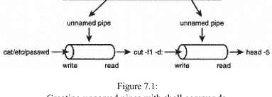

### 图 7.1：使用 shell 命令创建匿名管道。

如您在图 7.1 中看到的，内核创建一个匿名管道来接收 `cat` 命令的输出，该命令通常将其输出写入标准输出（屏幕）。`cut` 命令从第一个管道的读取端接收输入，对数据执行其自身的转换，然后输出到第二个匿名管道。与此同时，在 `cut` 接收到 `cat` 的所有输出后，内核销毁第一个管道，因为它不再需要。最后，`head` 命令显示从管道读取的输入的前五行。在 `head` 从第二个匿名管道接收到所有数据后，内核也销毁第二个管道。然而，在任何时候，这两个管道都没有名称，也不存在于磁盘上。

相比之下，命名管道具有文件名。当两个进程需要共享数据但不共享文件描述符时（详见本章稍后的“文件处理接口”部分），它们通常用于此目的。

目录，也称为目录文件，仅仅是包含目录中存储的文件列表的文件。

设备文件，也称为特殊文件，是提供大多数物理设备接口的文件。它们可以是字符特殊文件或块特殊文件。字符特殊文件是按字节（或字符）为单位写入和读取的。字符设备的示例包括调制解调器、终端、打印机、声卡和鼠标。另一方面，块特殊文件必须以某个块大小的倍数进行读取和写入（*块*是任意大小的数据块，例如 512 字节或 1 千字节）。块设备包括 CD-ROM 驱动器、RAM 驱动器和磁盘驱动器。一般来说，字符设备用于传输数据，而块设备用于存储数据。设备文件存储在 /dev 目录中。

*符号链接*是包含指向另一个文件路径的文件。从功能上讲，它们的行为非常类似于命令别名。大多数文件处理调用处理的是链接指向的真实文件，而不是链接本身（这称为*跟随链接*）。最后，*套接字*的行为与管道非常相似，但允许位于不同机器上的进程进行通信。

然而，无论文件类型如何，Linux 的文件抽象——即几乎将所有内容都视为文件的习惯——允许你使用相同的接口来打开、关闭、读取和写入。也就是说，文件抽象为你提供了一致、统一的接口，用于与所有可用的设备类型和文件类型进行交互，从而让你无需记住写入块设备、符号链接或目录的不同方法。

## 文件模式

文件的*模式*是一个 16 位八进制数，表示文件的类型及其访问权限。访问权限及其修饰符（如果有）占据模式的低 12 位。四个高位表示文件的类型。图 7.2 说明了文件模式及其组成部分。

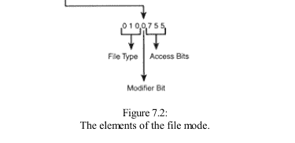

### 访问位

最低三位表示文件的访问权限。当你查看图 7.2 并从右向左读取八进制模式时，这些位指定了对其他用户、组和所有者的访问权限。值为 1 对应执行权限；值为 2 对应读取权限；值为 4 对应写入权限。图 7.2 中的文件对组和其他用户具有可读和执行权限，对所有者 root 具有可读、可写和执行权限。

## 修饰位

文件模式中的第四位是文件模式修饰符；它指示文件是否为 setuid、setgid 或 sticky（粘滞）。正如第 4 章“进程”中讨论的，当进程执行 setuid 或 setgid 文件时，其有效 UID 或 GID 分别设置为文件的所有者或组。当文件的粘滞位被设置（由第四位的大写字母 S 指示）时，它迫使内核尽可能长时间地将文件保留在内存中（因此得名粘滞），即使它没有被执行，因为这可以减少执行时间。图 7.2 中文件的修饰位未被设置，因此该文件既不是 setuid，也不是 setgid，也不是 sticky。

> **注意**
> 文件的修饰位和权限位是位掩码，或者说是使用 C 的位操作函数（如 <<（左移）、~（按位取反）和 &（按位与））在位级别进行操纵和评估的整数。幸运的是，Linux 提供了一组宏和符号常量（见表 7.1），使解码文件模式变得容易。

**表 7.1：文件访问和修饰位掩码宏**

| 名称 | 掩码 | 描述 | POSIX |
| :--- | :--- | :--- | :--- |
| S_ISUID | 0004000 | 设置 UID 位 | 是 |
| S_ISGID | 0002000 | 设置 GID 位 | 是 |
| S_ISVTX | 0001000 | 粘滞位 | 否 |
| S_IRWXU | 00700 | 用户（所有者）具有读/写/执行权限 | 是 |
| S_IRUSR | 00400 | 用户具有读权限 | 是 |
| S_IWUSR | 00200 | 用户具有写权限 | 是 |
| S_IXUSR | 00100 | 用户具有执行权限 | 是 |
| S_IRWXG | 00070 | 组具有读/写/执行权限 | 是 |
| S_IRGRP | 00040 | 组具有读权限 | 是 |
| S_IWGRP | 00020 | 组具有写权限 | 是 |
| S_IXGRP | 00010 | 组具有执行权限 | 是 |
| S_IRWXO | 00007 | 其他人具有读/写/执行权限 | 是 |
| S_IROTH | 00004 | 其他人具有读权限 | 是 |
| S_IWOTH | 00002 | 其他人具有写权限 | 是 |
| S_IXOTH | 00001 | 其他人具有执行权限 | 是 |

## 文件类型

*文件类型*是一个简单的数值，代表它是哪种类型的文件。以下是 Linux 的文件类型：

- Socket
- Symbolic link
- FIFO
- Regular file
- Directory
- Block device
- Character device

表 7.2 列出了你可以用于确定文件类型的符号常量。

**表 7.2：文件类型常量**

| 名称 | 掩码 | 描述 | POSIX |
| :--- | :--- | :--- | :--- |
| S_IFMT | 00170000 | 所有文件类型字段的位掩码 | 否 |
| S_IFSOCK | 0140000 | 文件是套接字 | 否 |
| S_IFLNK | 0120000 | 文件是符号链接 | 否 |
| S_IFREG | 0100000 | 文件是常规文件 | 否 |
| S_IFBLK | 0060000 | 文件是块设备 | 否 |
| S_IFDIR | 0040000 | 文件是目录 | 否 |
| S_IFCHR | 0020000 | 文件是字符设备 | 否 |
| S_IFIFO | 0010000 | 文件是 FIFO | 否 |

本章稍后“获取文件信息”一节说明了如何使用符号常量来推断文件的类型。

本节的内容可能看起来令人望而生畏。放松！虽然它是本章其余部分的基础，但你目前真正需要理解的只是 Linux 有许多不同的文件类型，并且你可以使用表 7.2 中列出的常量来确定文件的类型。在你阅读完本章的其余部分并完成示例程序后，请回顾表 7.1 和 7.2。

> **提示**
> 有关从用户角度（而非程序员角度）操纵文件模式的信息，请参阅 *Sams Teach Yourself Linux in 24 Hours*（作者 Bill Ball）、*Linux Unleashed*（作者 Tim Parker）或 *Special Edition Using Linux*（作者 Jack Tackett 和 Steven Burnet）。

## umask

你将在下一节“文件处理接口”中发现，你可以创建新的文件和目录，并在创建时设置它们的权限。然而，在系统和用户级别，你请求的权限将由进程的*umask* 修改，该 umask 包含用于关闭新创建文件和目录的权限位的位图。umask 仅影响文件的权限位；你无法通过 umask 更改修饰符和文件类型。

你可以更改进程的 umask，但只能使其更严格，而不能使其更宽松。启用此功能的调用是*umask* 调用，其原型在 `<sys/stat.h>` 中定义如下：

```
mode_t umask(mode_t newmask);
```

此函数将进程的新 umask 设置为 `newmask`，无论调用是否成功更改了 umask，都会返回旧的 umask。

## 示例

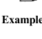

示例程序调用 `umask` 来设置更严格的 umask。

```
/**
 * newmask.c -- Reset the umask
 */
#include <sys/stat.h>
#include <sys/types.h>
#include <stdio.h>
#include <stdlib.h>

int main(void)
{
 mode_t newmask = 0666, oldmask;

 oldmask = umask(newmask);
 printf("old umask is %o\n", oldmask);
 printf("new umask is %o\n", newmask);
}
```


### 输出

```
$ ./newmask
old umask is 022
new umask is 0666
$ ls -l foo
---------- 1 kwall users 0 Jul 24 10:03 foo
```

如程序输出所示：新的 umask 被设置为 0666。`touch` 实用程序通常创建的文件权限模式为 666。然而，0666 的 umask 要求所有新建文件均不设置任何权限位。结果是，`foo` 文件被创建时没有任何权限位，这正是 `ls` 报告的内容。

## 文件处理接口

大多数文件处理选项都有两种形式：一种基于文件名，另一种基于文件描述符。*文件描述符* 是小的正整数，充当内核为每个进程维护的打开文件数组的索引。例如，`stat` 和 `fstat` 函数返回文件信息。它们在 `<unistd.h>` 中的原型定义如下：

```c
int stat(const char *filename, struct stat *buf);
int fstat(int fildes, struct stat *buf);
```

如您所见，`stat` 期望通过 `filename` 传入文件名，而 `fstat` 期望通过 `fildes` 传入文件描述符。

每个进程始终拥有三个打开的文件：标准输入、标准输出和标准错误。它们分别对应文件描述符 0、1 和 2。但是，应该使用 `<unistd.h>` 中定义的三个宏，而不是直接使用数字：`STDIN_FILENO`、`STDOUT_FILENO` 和 `STDERR_FILENO`。建议您使用这些宏而不是硬编码 0、1 或 2，因为您的程序可能在标准输入、标准输出和标准错误不对应整数 0、1 和 2 的系统上编译。

> **注意**
> 本章其余部分关于文件处理例程的讨论不包含标准库例程，如 `open`、`fclose` 等，因为假定您已知晓这些内容。如果您需要快速回顾，请参阅 Brian Kernighan 和 Dennis Ritchie 著的 *《The C Programming Language, Second Edition》*（*《C 程序设计语言（第二版）》*），*Greg Perry’s C by Example*（*《Greg Perry 的 C 语言实例》*），或 Peter Aitken 和 Brad Jones 著的 *《Sams Teach Yourself C in 21 Days, Fifth Edition》*（*《Sams 21 天学会 C 语言（第五版）》*）。

### 打开和关闭文件

打开文件有两种方式：`open` 和 `creat`。它们在 `<unistd.h>` 中有原型定义，但您还必须包含 `<fcntl.h>` 头文件。

### open 系统调用

```c
int open(const char *pathname, int flags);
int open(const char *pathname, int flags, mode_t mode);
```

`open` 尝试打开 `pathname` 指定的文件，并按 `flags` 中指定的访问方式打开。如果文件正在被创建，`mode` 参数包含文件模式。您必须将 `flags` 设置为 `O_RDONLY`、`O_WRONLY` 或 `O_RDWR`，分别指定只读、只写或读写访问。此外，您还可以设置表 7.3 中列出的零个或多个值。（如果使用多个值，必须使用按位或运算将它们组合在一起。）如果默认文件模式适合您的需求，请使用第一种形式的 `open`。如果您希望设置特定的文件模式（该模式会受到进程 umask 的影响），请使用第二种形式的 `open`。`open` 的两种形式在成功时都返回文件描述符。失败时，它们返回 -1 并设置 `errno`。

表 7.3：open 和 creat 的访问标志

| 标志 | 描述 |
| :--- | :--- |
| O_CREAT | 如果文件不存在则创建该文件 |
| O_EXCL | 仅与 O_CREAT 一起使用，如果文件已存在则打开失败 |
| O_NOCTTY | 如果文件是终端设备，它将不会成为进程的控制终端 |
| O_TRUNC | 将文件的大小设置为 0 |
| O_APPEND | 写入操作发生在文件末尾 |
| O_NONBLOCK | 以非阻塞模式打开文件，因此读取将返回零字节而不是阻塞 |
| O_SYNC | 在调用返回之前，文件的所有写入操作都已写入磁盘 |

### creat 系统调用

`creat` 也用于打开文件，如果文件不存在则创建它。其原型定义为：

```c
int creat(const char *pathname, mode_t mode);
```

它等同于以下代码：

```c
open(pathname, O_CREAT | O_TRUNC | O_WRONLY, mode);
```

本书中的程序不使用 `creat`，原因有二。首先，它的拼写有误。其次，`open` 调用更通用，只要使用 `O_CREAT` 标志，就能达到相同的结果。`creat` 成功时返回文件描述符，失败时则设置 `errno` 并返回 -1。

### close 系统调用

要关闭文件，请使用 `close` 调用，其在 `<unistd.h>` 中的原型定义如下：

```c
int close(int fd);
```

`close` 关闭与 `fd` 关联的文件，成功时返回 0，出错时返回 -1。

## 示例

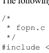

以下程序简单地打开并关闭名为 `hello` 的文件：

```c
/*
* fopn.c - Opening/closing files
*/
#include <fcntl.h>
#include <unistd.h>
#include <stdlib.h>
#include <stdio.h>

int main(void)
{
  int fd;
  char path[] = "hello";

  if((fd = open(path, O_CREAT | O_TRUNC | O_WRONLY, 0644)) < 0) {
    perror("open");
    exit(EXIT_FAILURE);
  } else
    printf("Opened %s\n", path);

  if(close(fd) < 0) {
    perror("close");
    exit(EXIT_FAILURE);
  } else
    printf("Closed %s\n", path);

  exit(EXIT_SUCCESS);
}
```

`open` 语句尝试以只读模式打开文件 `hello`。`O_CREAT` 会导致如果文件不存在则创建该文件，但如果文件存在，`O_TRUNC` 会将文件长度设置为零，仿佛它是新创建的。当文件打开时，`fopen` 会立即关闭它。

特别需要注意的是，源代码检查了 `close` 的返回值。虽然通常不这样做，但这是一个严重的编程错误，原因有二。首先，在网络文件系统（如 NFS）上，`close` 调用可能因网络延迟而失败。其次，许多系统配置了写后缓存（write-behind caching），意味着 `write` 调用会成功返回，但操作系统会等待一个更合适的时间才执行实际的磁盘写入。正如 `close(2)` 手册页所述：

> “错误状态可能在后续的写入操作中报告，但保证在关闭文件时会报告。在关闭文件时不检查返回值可能导致数据静默丢失。”

## 读写文件

您可能希望从文件中读取、向文件写入以及在文件中移动。为了读写文件，`unistd.h` 中提供了以下两个函数：

```c
ssize_t read(int fd, void *buf, size_t count);
ssize_t write(int fd, const void *buf, size_t count);
```

`read` 尝试从文件描述符 `fd` 打开的文件中读取最多 `count` 个字节，并将读取的数据存储到由 `buf` 指定的缓冲区中。成功时返回读取的字节数（0 表示文件末尾条件），该数值可能小于请求的字节数；如果发生错误，则返回 -1，并设置 `errno`。在 `read` 成功执行后，文件指针会向前移动所读取的字节数，不一定是 `count`。

类似地，`write` 从由 `buf` 指向的缓冲区向文件描述符 `fd` 写入最多 `count` 个字节。成功的 `write` 返回写入的字节数（0 表示未写入任何内容）。发生错误时，`write` 返回 -1 并设置 `errno`。

## 示例

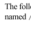

以下程序读取其自身的源代码，然后将其写入 `/dev/null` 以及名为 `/tmp/foo.bar` 的文件：

```c
/*
 * fread.c - The read and write system calls
 */
#include <fcntl.h>
#include <unistd.h>
#include <stdlib.h>
#include <stdio.h>

int main(void)
{
  int fdsrc, fdnull, fdtmp, nbytes;
  char fname[] = "fread.c";
  char buf[10];

  /* open the source file, /dev/null, and /tmp/foo.bar */
  if((fdsrc = open(fname, O_RDONLY)) < 0) {
    perror("open fdsrc");
    exit(EXIT_FAILURE);
  }
  if((fdnull = open("/dev/null", O_WRONLY)) < 0) {
    perror("open fdnull");
    close(fdsrc); /* close this since we've opened it */
    exit(EXIT_FAILURE);
  }
  if((fdtmp = open("/tmp/foo.bar",
    O_CREAT | O_TRUNC | O_WRONLY,
    0644)) < 0) {
    perror("open fdtmp");
    close(fdsrc); /* have to close both of these now */
    close(fdnull);
    exit(EXIT_FAILURE);
  }

  /* read up to 10 bytes, write up to 10 bytes */
  while((nbytes = read(fdsrc, buf, 10)) != 0) {
    if(write(fdnull, buf, 10) < 0) /* the null device */
      perror("write /dev/null");
    if(write(fdtmp, buf, nbytes) < 0) /* a temporary file in /tmp */
      perror("write /tmp/foo.bar");
  }
}
```


/* 关闭文件并退出 */
close(fdsr c);
close(fdnull);
close(fdtmp);

exit(EXIT_SUCCESS);}

该程序打开了三个文件，一个用于读取，两个用于写入。文件 /tmp/foo.bar 相对不那么有趣，但请注意，该程序打开设备文件 /dev/null，就好像它是一个普通文件一样。因此，你应该能够看到，你可以将大多数设备作为文件来处理。适用于普通文件的标准文件处理语义同样适用于设备和其他特殊文件。该程序的另一个特点是，在写入磁盘文件 /tmp/foo.bar 时，它只写入 numbytes 个字符，这防止了空字节被写入文件末尾。在到达文件结尾前的最后一次读取可能不会读满 10 个字节，但写入操作会按照指示写入相应数量的字节。通过仅写入 numbytes，该程序不会在文件末尾追加额外的字符。

## 定位文件指针

如果你希望从文件中的随机位置进行读写，你必须能够确定文件指针的当前位置，并能够将指针定位到特定位置。lseek 调用就是为此目的而设计的工具。它在 <unistd.h> 中的原型如下：

```c
int lseek(int fd, off_t offset, int whence);
```

lseek 根据 whence 的值，将打开在文件描述符 fd 上的文件的文件指针定位到 offset 位置。whence 可以是以下三个常量之一：

- SEEK_SET 将指针设置到文件中的 offset 字节处。
- SEEK_CUR 将指针的位置设置为相对于当前指针位置的文件中的 offset 字节处，offset 可以是负数。
- SEEK_END 将位置设置为距文件末尾 offset 字节处。

在成功时，lseek 返回新的指针位置；出错时返回 off_t 类型的 -1，并相应地设置 errno。

## 示例


## 示例

此示例在将光标定位到文件中的各个位置后，从输入文件中读取 10 个字节。

```c
/*
 * seek.c - 使用 lseek
 */
#include <stdio.h>
#include <stdlib.h>
#include <fcntl.h>
#include <unistd.h>

int main(void)
{
  char ftmp[] = "tmpXXXXXX";
  char buf[10];
  int i, infd, outfd;

  /* 打开输入文件 */
  if((infd = open("devices.txt", O_RDONLY)) < 0) {
    perror("open devices.txt");
    exit(EXIT_FAILURE);
  }
  /* 创建用于输出的临时文件 */
  if((outfd = mkstemp(ftmp)) <0) {
    perror("mkstemp");
    exit(EXIT_FAILURE);
  }
  fprintf(stdout, "Output file is %s\n", ftmp);

  /* 设置文件中的初始位置 */
  lseek(infd, 100, SEEK_SET);
  /*
  * 将每 100 字节中的前 10 个字节
  * 复制到输出文件
  */
  for(i = 0; i < 10; ++i) {
    read(infd, buf, 10);
    write(outfd, buf, 10);
    lseek(infd, 90, SEEK_CUR); /* 向前跳转 90 字节 */
  }
  close (infd);
  close (outfd);
  exit (EXIT_SUCCESS);
}
```

输入文件 devices.txt 包含在本书网站本章的源代码目录中。为了避免硬编码输出文件名，该程序使用 mkstemp 调用在当前目录中打开一个具有唯一名称的文件。在将文件指针设置在文件中的第 100 字节处之后，程序然后读取 10 个字节，将它们写入输出文件，然后再向前搜索 90 个字节。输出文件的名称每次运行时会不同。一次测试运行产生了以下输出：


**输出**

```
$ ./seek
output file is ttmpjtQXQN
$ cat ttmpjtQXQN
sed: Augusnumbers an included om
ftp://fteX versionunix Files/linux-stanly.        Alloc in the puributed wi
```

**截断文件**

显然，要延长文件，你只需要向其中写入更多数据或 lseek 越过末尾。那么，你如何截断文件呢？当然，使用 truncate 或 ftruncate 调用。它们在 <unistd.h> 中声明，原型如下：

```
int truncate (const char *pathname, off_t length);
int ftruncate (int fd, off_t length);
```

这两个调用都将它们的文件（pathname 或 fd）缩短到 length 长度，成功时返回 0。请记住，许多文件 I/O 系统调用有两种形式，一种接受标准的空终止字符串（truncate），另一种以 f_ 为前缀，接受文件描述符而不是路径名（ftruncate）。如果发生错误，它们返回 -1 并设置 errno。如果你使用 ftruncate，文件必须以写入模式打开。

为什么你想使用这些调用之一来缩短文件？一个典型的原因是删除文件末尾不需要保留的数据，同时保留文件的其余部分。将文件截断到所需长度比创建新文件、从旧文件中读取想要的数据、将其写入新文件，然后删除旧文件要简单得多。单一的 truncate 或 ftruncate 调用取代了至少四个调用：一个 open、一个 read、一个 write 和一个 unlink。

## 示例


## 示例

接下来的 `trunc` 程序是一个缩短文件的实用工具。它期望在命令行上依次传入要缩短的文件名和新长度。

```c
/*
 * trunc.c - 将命名文件缩短到指定长度：
 */
#include <stdio.h>
#include <stdlib.h>
#include <unistd.h>
#include <fcntl.h>

int main(int argc, char **argv)
{
    long len;

    if (argc != 3)
        exit(EXIT_FAILURE);
    len = (long) strtol(argv[2], NULL, 10);
    if (truncate(argv[1], len)) {
        perror ("truncate");
        exit(EXIT_FAILURE);
    }

    exit(EXIT_SUCCESS);
}
```

在当前目录下对 `test.txt` 运行此程序产生了以下结果：


**输出**

```
$ ls -l test.txt
-rw-r--r-- 1 kwall users 56561 Jul 24 15:56 test.txt
$ trunc test.txt 2000
$ ls -l test.txt
-rw-r--r-- 1 kwall users 2000 Jul 24 15:58 test.txt
```

在确认传入了两个参数后，`trunc` 使用 `strtol` 将传入的长度参数从字符串转换为 long 型。然后它立即使用传入的文件名和请求的长度调用 `truncate`。如果 `truncate` 调用失败，程序打印错误消息并退出。如果成功，程序安静退出，向操作系统返回零。

虽然功能上可行，但 `trunc` 程序还不够健壮，因为它假设收到的参数是有效的。生产质量的程序应该确认命中的文件存在，并且传入的文件名是有效的文件名。为了简洁起见，忽略了这些元素。

## 获取文件信息

现在，你可以打开、关闭、读取、写入和截断文件了。然而，你可以获取关于文件的许多有趣信息，正如 `stat (1)` 命令所示：

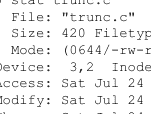

### 输出

```
$ stat trunc.c

File: "trunc.c"

Size: 420
Filetype: Regular File

Mode: (0644/-rw-r--r--)

Uid: (500/kwall)

Gid: (100/users)

Device: 3,2

Inode: 534555

Links: 1

Access: Sat Jul 24 16:02:50 1999(00000.00:15:56)

Modify: Sat Jul 24 16:04:29 1999(00000.00:14:17)

Change: Sat Jul 24 16:04:29 1999(00000.00:14:17)
```

`stat` 命令从文件的信息节点（称为 inode）中读取信息，并将其显示给用户。虽然它们的细节超出了本书的范围，但*inode* 是内核为文件系统中的每个文件维护的数据结构。除了其他内容，它们包含诸如文件名称、大小、所有权、最后修改、访问和更改日期、类型以及指向它的符号链接数量等信息。示例中的 `stat` 列出了所有这些详细信息。

获取此信息有三种方法：`stat`、`lstat` 和 `fstat`。要使用它们，必须在代码中包含 `<sys/stat.h>` 和 `<unistd.h>`。它们的原型如下：

```c
int stat(const char *filename, struct stat *buf);

int fstat(int fd, struct stat *buf);

int lstat(const char *filename, struct stat *buf);
```

所有的 `stat` 函数都会用指定由 `filename` 或文件描述符 `fd` 的文件的信息来填充 `buf`。成功时，它们返回 `0`；如果发生错误，它们返回 `-1` 并设置 `errno`。它们之间唯一的实际区别在于 `lstat` 不跟随符号链接，而 `stat` 和 `fstat` 会跟随。`stat` 结构的定义如下：


```c
struct stat {
dev_t st_dev; /* device */
ino_t st_ino; /* inode number */
mode_t st_mod; /* file mode */
nlink_t st_nlink; /* number of hard links */
uid_t st_uid; /* owner's GID */
gid_t st_gid; /* owner's GID */
dev_t st_rdev; /* device type */
off_t st_size; /* total size in bytes */
unsigned long st_blksize; /* preferred blocksize */
unsigned long st_blocks; /* number of 512-byte blocks */
time_t st_atime; /* time last accessed */
time_t st_mtime; /* time last modified */
time_t st_ctime; /* time last changed */
};
```

st_blksize 成员指明了文件系统 I/O 的首选块大小。使用更小的数据块可能会导致对磁盘的 I/O 操作效率低下。最后访问时间（atime）会在调用 mknod、utime、read、write 和 truncate 时改变。mknod、utime 和 write 调用也会改变最后修改时间，即 mtime。ctime（最后改变时间）存储了 inode 信息最后一次被修改的时间，包括所有者、组、链接数和模式信息的变更。

利用 stat 结构中的信息，你可以实现自己的 stat 函数，如下节中的示例程序所示。

你还需要使用几个宏来理解文件模式。POSIX 标准定义了七个宏，用于解码文件的模式以推断其类型。它们列在表 7.4 中。

表 7.4：文件类型宏

| 宏 | 描述 |
| --- | --- |
| S_ISLNK(mode) | 如果文件是符号链接，则返回 true |
| S_ISREG(mode) | 如果文件是普通文件，则返回 true |
| S_ISDIR(mode) | 如果文件是目录，则返回 true |
| S_ISCHR(mode) | 如果文件是字符设备，则返回 true |
| S_ISBLK(mode) | 如果文件是块设备，则返回 true |
| S_ISFIFO(mode) | 如果文件是 FIFO（命名管道），则返回 true |
| S_ISSOCK(mode) | 如果文件是套接字，则返回 true |

要使用这些宏，需将 `stat` 结构体的 `st_mode` 成员作为 `mode` 参数传递给上述宏。下面提供的示例程序展示了其用法。

## 示例


要运行此程序，请传入你感兴趣的文件名作为参数。

```c
/*
 * mstat.c = 朴素的 stat(1) 程序
*/
#include <unistd.h>
#include <sys/stat.h>
#include <stdlib.h>
#include <stdio.h>

int main(int argc, char **argv)
{
  struct stat buf;
  mode_t mode;
  char type[80];
  if(argc != 2) {
    puts("用法: mstat 文件名");
    exit(EXIT_FAILURE);
  }

  if((lstat(argv[1], &buf)) < 0) {
    perror("lstat");
    exit(EXIT_FAILURE);
  }
  mode = buf.st_mode;
  printf("   文件: %s\n", argv[1]);
  printf("   INODE: %d\n", buf.st_ino);
  printf("   设备: %d, %d\n",
         major(buf.st_dev), minor(buf.st_dev));

  printf(" 模式: %o\n", buf.st_mode & ~(S_IFMT));

  printf("   链接数: %d\n", buf.st_nlink);
  printf("   UID: %d\n", buf.st_uid);
  printf("   GID: %d\n", buf.st_gid);
  
  if (S_ISLNK (mode))
    strcpy(type, "符号链接"),
  else if (S_ISREG (mode))
    strcpy(type, "普通文件");
  else if (S_ISDIR (mode))
    strcpy(type, "目录");
  else if (S_ISCHR (mode))
    strcpy(type, "字符设备");
  else if (S_ISBLK (inode))
    strcpy(type, "块设备");
  else if (S_ISFIFO (mode))
    strcpy(type, "FIFO");
  else if (S_ISSOCK (mode))
    strcpy(type, "套接字");
  else
    strcpy(type, "未知类型");
    printf("类型: %s\n", type);
    printf("大小: %ld\n", buf.st_size);
    printf("块大小: %d\n", buf.st_blksize);
    printf("块数: %d\n", buf.st_blocks);
    printf("访问于: %s", ctime(&buf.st_atime));
    printf("修改于: %s", ctime(&buf.st_mtime));

    printf(" 变更于: %s", ctime(&buf.st_ctime));

  exit(EXIT_SUCCESS);
}
```

该程序运行后的输出示例如下：

### 输出

```
$ ./mstat /bin/ls
文件: /bin/ls
INODE: 26740
设备: 3,1
模式: 0755
链接数: 1
UID: 0
GID: 0
类型: 普通文件
大小: 50148
块大小: 4096
块数: 100
访问于: Sat Jul 24 16:18:15 1999
修改于: Tue Mar 23 19:34:26 1999
变更于: Sun Jun 27 16:22:29 1999
```

诚然，这段代码看起来很丑陋，但它也说明了如何使用 stat 系列函数。在列出文件后，该程序显示 stat 结构中每个成员的值。在显示文件类型时，代码费了一番功夫将一个无意义的数字转换为可读形式，因此使用了 `if...else if` 结构（实际上这部分逻辑应该封装在一个函数中）。`mstat` 使用了表 7.1 中介绍的 `S_IFMT` 常量，以屏蔽文件模式中的文件类型位，从而使显示的文件模式仅包含权限和修饰符位。

该代码还使用了 ctime 函数，将 atime、mtime 和 ctime 值转换为用户易于理解的字符串。同样，这个程序还需要改进，但它展示了可能性，是一个进一步开发的良好起点。特别是，可以添加代码来验证传入的文件名是否为有效的文件名。

## 更改文件特性

在本章的这一节中，你将遇到各种用于更改 inode 信息的函数。这些例程中的许多都有对应的 Linux 命令。这些命令通常作为 GNU fileutils 包的一部分分发，该包在几乎每个 Linux 系统上都是标准的。

## 更改访问权限

chmod 和 fchmod 系统调用用于更改文件的权限，当然前提是调用进程的 UID 和 GID 具有足够的权限。只有 root 用户和文件所有者可以更改文件的权限。chmod 和 fchmod 在 `<unistd.h>` 中的原型定义如下：

```c
int chmod(const char *pathname, mode_t mode);
int fchmod(int fd, mode_t mode);
```

这些例程尝试将 pathname 所指示的以 null 结尾的字符串或文件描述符 fd 指定的文件的权限更改为 mode。如果尝试成功，它们返回 0。如果失败，它们返回 -1 并将 errno 设置为适当的值。要使用这些函数，必须同时包含 `<sys/types.h>` 和 `<sys/stat.h>`。

## 示例

在这个程序中，我们创建一个拥有一组权限的空文件，然后使用 `fchmod` 来更改权限。

```c
/*
 * chgmod.c - 创建一个文件并更改其模式
 */
#include <stdlib.h>
#include <stdio.h>
#include <sys/stat.h>
#include <sys/types.h>
#include <fcntl.h>

int main(void)
{
    mode_t mode = 0755;
    int fd;
    /* 创建文件 */
    if((fd = open("empty.file", O_CREAT, 0644)) < 0) {
        perror("open");
        exit (EXIT_FAILURE);
    }
    /* 列出文件 */
    system("ls -l empty.file");
    /* 更改其权限 */
    if((fchmod(fd, mode)) < 0) {
        perror("fchmod");
        exit(EXIT_FAILURE);
    }
    /* 再次列出文件 */
    system("ls -l empty.file");
    exit(EXIT_SUCCESS);
}
```

该程序的输出应类似于以下内容：

### 输出

```
$ ./chgmod
-rw-r--r--  1 kwall  users       0 Jul 24 20:47 empty.file
-rwxr-xr-x  1 kwall  users       0 Jul 24 20:47 empty.file
```

你可以清楚地看到，文件创建后拥有一组权限，而在调用 fchmod 后拥有另一组权限。创建文件后，程序使用 system 函数显示文件的权限，调用 fchmod 进行更改，然后使用另一个 system 调用显示更改后的权限。

## 更改所有权

更改文件的所有权与更改其权限类似。chown 和 fchown 调用完成了这项任务。它们在 <unistd.h> 中的原型定义如下：

```c
int chown(const char *pathname, uid_t owner, gid_t group);
int fchown(int fd, uid_t owner, gid_t group);
```

这两个调用将 pathname 中 null 结尾字符串或文件描述符 fd 指定的文件的所有者和组更改为 owner 和 group。与本章讨论的所有函数一样，这两个调用在成功时返回 0；失败时返回 -1 并将 errno 设置为适当的值。决定使用 chown 还是 fchown 取决于几个因素。如果你知道文件名，你可能希望使用 chown。如果你已经使用 open 或 creat 打开或创建了文件（这些函数返回文件描述符），你可能希望使用 fchown，因为你已知文件描述符。如果你同时知道文件名和文件描述符，使用哪一个则相当于掷硬币。在这种情况下，我倾向于使用 fchown，因为它需要的输入更少。

## 示例


这个程序创建一个文件，然后更改其所有权。请注意，为了正确运行，它必须由 root 用户执行。此外，你必须将分配给 owner 和 group 的值替换为对你系统有意义的值。最简单的方法是使用 id 命令获取你的 UID 和 GID，然后将这些值代入源代码中。

```c
/*
 * chgown.c - 创建一个文件并更改其模式
 */
#include <stdlib.h>
#include <stdio.h>
#include <sys/stat.h>
#include <sys/types.h>
#include <fcntl.h>
```


int main(void)
{
    uid_t owner = 500;
    gid_t group = 100;
    int fd;

    /* create the file */
    if((fd = open("some.file", 0_CREAT, 0644)) < 0) {
        perror("open");
        exit(EXIT_FAILURE);
    }
    /* ls the file */
    system("ls -l some.file");
    /* change its ownership */
    if((fchown(fd, owner, group)) < 0) {
        perror("fchown");
        exit(EXIT_FAILURE);
    }
    /* ls it again */
    system("ls -l some.file");
    exit(EXIT_SUCCESS);
}

以下是执行此程序的结果：

$ su
Password:
$ ./chgmod
-rw-r--r--    1 root    root         0 Jul 24 21:11 some.file
-rw-r--r--    1 kwall   users        0 Jul 24 21:11 some.file
$ exit

如您所见，该程序首先创建了文件。在示例运行中，我首先使用`su`命令成为超级用户，因此文件是以 root 用户和组的所有权创建的。`fchown` 命令将所有者和组更改为指定的值，即 500 和 100，在我的系统中它们分别对应 kwall 和 users。第二个 ls 命令确认所有权已成功更改。

## 接下来是什么？

在本章中，您了解了许多关于使用 Linux 基本文件处理调用的知识。下一章将延伸讨论这些内容，涵盖更高级的主题，例如 ext2 文件系统、复用（multiplexing）、非阻塞 I/O、内存映射文件以及文件和记录锁定。这将完成对 Linux 文件处理接口的讨论，为您学习数据库 API 和共享内存做好准备。

# 8—高级 Linux 文件处理

本章继续讨论上一章开始的 Linux 文件处理接口，但涵盖了更多高级功能，例如以下内容：

- 操作文件时间戳
- Linux ext2 文件系统的特性
- I/O 复用（multiplexing）
- 使用内存映射文件的高速 I/O
- 文件锁定

## 更改文件时间戳

回想第 7 章“基本 Linux 文件处理”中提到的内容，内核为每个文件保留三个时间戳：其最后访问时间（*atime*）、最后修改时间（*mtime*）和最后更改时间（*ctime*）。POSIX 标准提供了 *utime* 例程来更改 *atime* 和 *mtime*。没有用户级的编程接口来更改 *ctime*，但更改 *atime* 或 *mtime* 的操作会导致 *ctime* 发生变化，所以这应该不成问题。

*utime* 函数在 `<utime.h>` 中声明为：

int utime(const char *pathname, struct utimbuf *buf);

您可能还需要包含 `<sys/types.h>` 头文件，因为它包含由 POSIX 定义的基本系统数据类型。旧版本的 *gcc* 和 Linux 并不总是在 `<utime.h>` 中包含 `<sys/types.h>`，因此如果您的编译器在编译程序时报告未定义的值，请添加该类型头文件，但仅当它声明了编译器所抱怨的那个类型时才添加。*utime* 将 *pathname* 指定的文件的访问时间和修改时间分别更改为存储在 *buf* 中的 *actime* 和 *modtime*。如果 *buf* 为 NULL，则 *actime* 和 *modtime* 设置为当前时间。通常，*utime* 成功时返回 0。出错时，它设置 *errno* 并返回 -1。当然，调用 *utime* 的进程必须对该文件具有适当的访问权限，或者正以 root 权限运行。

*utimbuf* 结构定义如下：

struct utimbuf {
    time_t actime;  /* access time */
    time_t modtime; /* modification time */
};

*time_t* 类型是一种 POSIX 标准类型，通常是长整数，用于存储自纪元（Epoch）以来经过的秒数。而 *Epoch* 由 POSIX 定义为 1970 年 1 月 1 日 00:00:00 UTC（协调世界时，过去曾被称为格林尼治标准时间）。

> **注意** 有趣的是，由于 Linux 许多与时间相关的功能基于纪元（Epoch），因此备受关注的 2000 年问题对 Linux 的影响并不像 2038 年问题那么大。由于 *time_t* 是长整数，它将在 2038 年溢出。也就是说，*time_t* 最多可以容纳 2^31-1 秒，即 2,147,483,647 秒。忽略闰年，每年有 365*24*60*60，即 31,536,000 秒。因此，*time_t* 最多可以表示大约 68 年（2,147,483,647 / 31,536,000）。由于纪元始于 1970 年，加上 68 年即得到 2038 年。*time_t* 溢出的确切日期和时间会有所不同，这取决于闰年中有多少秒。

## 示例


下面的程序创建一个文件，并将其 atime 和 mtime 值设置为 2001 年 9 月 8 日。为了简洁起见，省略了错误检查。

/*
 * chgttime.c - Using the utime routine
 */
#include <sys/types.h>
#include <sys/stat.h>
#include <utime.h>
#include <unistd.h>
#include <stdlib.h>
#include <fcntl.h>

int main(void)
{
    time_t now = 1000000000;
    struct utimbuf buf;
    int fd;

    buf.actime = now;
    buf.modtime = now;

    fd = open("foo.bar", O_CREAT, 0644);
    utime("foo.bar", &buf);
    close(fd);

    exit(EXIT_SUCCESS);
}

运行程序后列出当前目录，结果如下：


### 输出

$ ls -l foo.bar
-rw-r--r--  1 kwall users      0 Sep  8  2001 foo.bar

如您所见，foo.bar 的时间戳为 2001 年 9 月 8 日。在将 utimbuf 结构的 atime 和 mtime 成员设置为 1,000,000,000（对应于 2001 年 9 月 8 日）之后，chgttime 打开文件，然后对其调用 utime，传入修改后的结构体的地址和文件名。这会导致最后一次访问时间和最后一次修改时间（分别为 *actime* 和 *modtime*）更改为指定的（且极不可能出现的）日期和时间。

## ext2 文件系统的特性

ext2 文件系统允许您在文件上设置多达四个特殊属性：

- **不可修改（Immutable）**—`EXT2_IMMUTABLE_FL`
- **仅追加（Append-only）**—`EXT2_APPEND_FL`
- **不转储（No-dump）**—`EXT2_NODUMP_FL`
- **同步（Sync）**—`EXT2_SYNC_FL`

只有 root 用户可以设置或移除不可修改和仅追加标志，但文件的所有者可以设置或清除不转储和同步标志。这些标志意味着什么？以下列表详细说明了它们：

- **不可修改**的文件完全不能被修改：您可以向其中添加数据、移除或重命名它们，或者为它们添加链接。即使是超级用户也不能做这些事情——必须先清除不可修改标志。
- **仅追加**的文件只能以追加模式写入，且不能以其他方式移除、重命名或链接。
- **不转储**属性使常用于创建备份的 `dump` 命令忽略某个文件。
- **同步**属性使文件同步写入；也就是说，对文件的所有*写入*必须在返回到调用进程之前完成（这与使用 `O_SYNC` 选项调用 `open` 完全相同）。

为什么要使用这些属性？使文件不可修改可以防止其被意外（或故意）删除或修改，因此对于关键文件来说，这是一种方便的安全措施。仅追加标志在保留文件当前内容的同时，仍允许您向其中添加数据——同样，这也是一种方便的安全预防措施。

不转储标志只是一个便利功能，在备份系统时可以为您节省宝贵的空间和时间。最后，同步标志对于确保关键文件（如数据库）在请求时确实被写入特别有用。使用同步选项可以防止在缓存数据物理写入磁盘之前系统宕机而导致的数据丢失。然而，同步标志的缺点是它可能会显著降低程序的性能。

要获取或设置这些属性，请使用在 `<sys/ioctl.h>` 中声明的 `ioctl` 调用。其原型如下：

int ioctl(int fd, int request, void *arg);


这些标志定义在 `<linux/ext2_fs.h>` 中。为了获取文件描述符 `fd` 所指定的文件的属性，必须将 `request` 设置为 `EXT2_IOC_GETFLAGS`；或者将其设置为 `EXT2_IOC_SETFLAGS` 以设置这些属性。在这两种情况下，`arg` 都持有所操作的标志。

> **警告**
> 本节的材料高度特定于 Linux 的主要文件系统 ext2，正式名称为第二扩展文件系统。其他版本的 UNIX 可能具有我们将讨论的函数和结构，但它们的行为肯定不会如这里所述。如果你在计划可移植的程序中使用这些调用，必须用 `#ifdefs` 将它们包围起来，以便你的代码能在非 Linux 系统上正确编译和运行。

## 示例


下面的示例程序将同步（sync）和禁止转储（no-dump）属性设置在作为其唯一参数传入的文件上。

```c
/*
 * setext2.c - Set ext2 special flags
*/
#include <sys/types.h>
#include <unistd.h>
#include <stdlib.h>
#include <stdio.h>
#include <fcntl.h>
#include <linux/ext2_fs.h>
#include <sys/ioctl.h>
#include <errno.h>

int main(int argc, char *argv[])
{
    int fd;
    long flags;

    /* Remind the user how to call us */
    if(argc != 2) {
        puts("USAGE: setext2 {filename}");
        exit(EXIT_FAILURE);
    }

    if((fd = open(argv[1], O_RDONLY)) < 0) {
        perror("open");
        exit(EXIT_FAILURE);
    }

    /* These are the flags we'll set on the file */
    flags = EXT2_SYNC_FL | EXT2_NODUMP_FL;
    /* Set the flags, bail out gracefully if it fails */
    if(ioctl(fd, EXT2_IOC_SETFLAGS, &flags)) {
        perror("ioctl");
        close(fd);
        exit(EXIT_FAILURE);
    }

    if(flags & EXT2_SYNC_FL)
        puts("SYNC flag set");

    if(flags & EXT2_NODUMP_FL)
        puts("NODUMP flag set");

    close(fd);
    exit(EXIT_SUCCESS);
}
```

setext2 的一次示例运行输出如下：


**输出**

```bash
$ touch foo
$ lsattr foo
------- foo
$ ./setext2 foo
SYNC flag set
NODUMP flag set
$ lsattr foo
--S--d- foo
```

`ioctl` 例程的语义要求被修改的文件必须是打开状态，因此调用了 `open`。在将属性 `EXT2_SYNC_FL` 和 `EXT2_NODUMP_FL` 赋值给 `flags` 变量后，`ioctl` 调用尝试设置它们，并在调用失败时确保关闭打开的文件。最后一个代码块确认所请求的属性（同步和禁止转储）确实已被设置。示例运行中使用的 `lsattr` 命令进一步证实了这一点。

**提示**
Linux 有两个命令，`chattr` 和 `lsattr`，用于设置和查询本节讨论的 ext2 特殊属性。简而言之，`chattr` 允许你设置特殊属性，而 `lsattr` 显示已设置的特殊 `ext2` 属性（如果有）。在示例运行中，大写字母 S 表示 `EXT2_SYNC_FL`（同步）属性已设置，小写字母 d 表示 `EXT2_NODUMP_FL`（禁止转储）属性已设置。有关更多详细信息，请参阅 `man chattr` 和 `man lsattr`。

## 目录操作

尽管目录只是包含其所存储文件列表的文件，但它们拥有用于操作目录的特殊编程接口。

### 更改目录

查找当前工作目录的调用是 `getcwd`，声明在 `<unistd.h>` 中。其原型如下：

```c
char *getcwd(char *buf, size_t size);
```

`getcwd` 将当前工作目录的绝对路径名复制到 `buf` 中，其长度为 `size` 字节。如果 `buf` 不足以容纳路径名，`getcwd` 返回 `NULL` 并将 `errno` 设置为 `ERANGE`。如果发生这种情况，请增加 `buf` 的大小并再次尝试。作为替代，如果 `buf` 为 `NULL` 且 `size` 小于 0，`getcwd` 将使用 `malloc` 为 `buf` 动态分配足够的内存。如果你利用此扩展功能，必须记得释放缓冲区以防止内存泄漏。

要更改当前目录，请使用 `chdir` 或 `fchdir` 例程，它们在 `<unistd.h>` 中原型化为：

```c
int chdir(const char *path);
int fchdir(int fd);
```

`chdir` 将当前目录更改为 `path` 中包含的目录。`fchdir` 工作方式相同，但它必须传入一个打开的文件描述符 `fd`。

## 示例


## 示例

1. 这个程序 `cwd` 使用 `getcwd`，采用之前讨论的两种分配存储以容纳目录名的方法来返回其当前工作目录。

```c
/*
 * cwd.c - Print the current working directory
 */
#include <unistd.h>
#include <stdlib.h>
#include <stdio.h>
#include <errno.h>

#define BUFSZ 10

int main(void)
{
    char *statbuf = malloc(BUFSZ);
    char *nullbuf = NULL;
    int i = 1;
    /* Statically allocate the buffer */
    while((getcwd(statbuf, i * BUFSZ)) == NULL) {
        ++i;
        statbuf = realloc(statbuf, i * BUFSZ);
    }
    fprintf(stdout, "%d calls to realloc\n", i - 1);
    fprintf(stdout, "current dir is %s\n", statbuf);
    free(statbuf);

    /* Let getcwd allocate the memory */
    printf("current dir is %s\n", getcwd(nullbuf, -1));
    /* Have to free nullbuf to prevent a memory leak */
    free(nullbuf);
    exit(EXIT_SUCCESS);
}
```


**输出**

该程序的输出应类似于以下内容：

```bash
$  ./cwd
3 calls to realloc
current dir is /usr/local/newprojects/lpe/08/src
current dir is /usr/local/newprojects/lpe/08/src
```

while 循环持续增加分配给 `statbuf` 的内存，直到 `getcwd` 返回 `NULL`。第二个代码块展示了使用 `getcwd` 的替代行为。通过使用 -1 的缓冲区大小并使缓冲区本身为 `NULL`，调用仍然成功，因为它动态地将 `nullbuf` 扩大到足以容纳路径。由于 `statbuf` 和 `nullbuf` 都是从堆上分配的，`free` 正确地释放了它们的内存资源。

## 示例

2. 这个程序模拟了 `cd` 命令。

```c
/*
 * chdir.c - Change to a new directory
 */
#include <unistd.h>
#include <stdlib.h>
#include <stdio.h>
#include <errno.h>

int main(int argc, char *argv[])
{
    if(chdir(argv[1]) < 0) {
        perror("chdir");
        exit(EXIT_FAILURE); 
    }
    system("ls");

    exit(EXIT_SUCCESS);
}
```

**输出**

```bash
$ ./chdir $HOME
Mail/  Xwp  bin/  doc/  etc/  log/  projects/  src/  tmp/
$ pwd
/home/kwall/projects/lpe/08/src
```

该程序的输出仅仅表明 `chdir` 调用成功了。请注意，当程序退出时，你仍然在原始目录中。这是因为程序在子 shell 中执行，而在子 shell 中更改目录不会影响父 shell 的当前目录。

## 创建和删除目录

幸运的是，创建和删除目录的函数名称与对应的命令名称相同：`mkdir` 和 `rmdir`。要使用 `mkdir`，需包含 `<fcntl.h>` 和 `<unistd.h>`；`rmdir` 仅需 `<unistd.h>`。它们的原型为：

```c
int mkdir(const char *pathname, mode_t mode);
int rmdir(const char *pathname);
```

`mkdir` 尝试创建 `pathname` 中指定的目录，权限由 `mode` 指定，并受 `umask` 修改。`rmdir` 删除 `pathname` 中指定的目录，该目录必须为空。两个调用在成功时返回 0，或在失败时设置 `errno` 并返回 -1。

## 示例


## 示例

1. 第一个程序创建一个目录，其名称作为程序的唯一参数传入。

```c
/*
 * newdir.c - Create a directory
 */
#include <unistd.h>
#include <fcntl.h>
#include <stdlib.h>

int main(int argc, char *argv[]) 
{
   if (mkdir (argv[1], 0755)) {
      perror ("mkdir");
      exit (EXIT_FAILURE);
   }
   exit (EXIT_SUCCESS);
}
```

这是一个简单的程序。它对目录使用标准权限 0755（用户可读/写/执行，其他人可读/执行）。如果调用失败，程序在打印错误消息后直接退出。否则，为了可读性，省略了错误检查。以下输出表明该程序有效：


**输出**

```bash
$ ./newdir foo
$ ls -ld foo
drwxr-xr-x 2 kwall users 1024 Jul 25 23:46 foo
```


## 示例

2. 下一个程序删除一个目录，其名称作为程序的唯一参数传入。

```c
/*
 * deldir.c - Delete a directory
 */
#include <unistd.h>
```


### 输出

```c
#include <fcntl.h>
#include <stdlib.h>
#include <stdio.h>

int main(int argc, char *argv[]) {
    if(rmdir(argv[1])) {
        perror("rmdir");
        exit(EXIT_FAILURE);
    }
    exit(EXIT_SUCCESS);
}
```

这甚至比第一个示例更简单。它尝试删除指定的目录，如果失败则立即退出。如果目录不为空、目录不存在，或者运行该程序的用户缺乏删除目录所需的足够权限，该调用可能会失败。

```
$ ./deldir foo
$ ls -ld foo
ls: foo: No such file or directory
```

## 列出目录

列出目录仅仅意味着读取目录的内容。基本过程并不复杂：

- 1. 使用 *opendir* 打开目录。
- 2. 使用 *readdir* 读取其内容，并可能使用 *rewinddir* 将文件指针重新定位到目录的开头（如果你已经读到了末尾并希望重新开始）。
- 3. 使用 *closedir* 关闭目录。

所有这些函数都在 `<dirent.h>` 中声明。它们的原型如下：

```c
DIR *opendir(const char *pathname);
struct dirent *readdir(DIR *dir);
int rewinddir(DIR *dir);
int closedir(DIR *dir);
```

*opendir* 打开由 *pathname* 指定的目录（毕竟它只是一个文件），并返回指向 *DIR* 流的指针。否则，如果发生错误，它返回 *NULL* 并设置 *errno*。流指针定位在流的开头。*closedir* 显然关闭流 *dir*，成功时返回 0，出错时返回 -1；*rewinddir* 将流指针移回流的开头。它同样在成功时返回 0，在失败时返回 -1。

*readdir* 承担了读取目录的大部分工作。它返回指向 *dirent* 结构体的指针，该结构体包含来自 *dir* 的下一个目录项。每次后续调用 *readdir* 都会用新数据覆盖返回的 *dirent* 结构体。当到达文件末尾或发生错误时，*readdir* 返回 *NULL*。要获取文件名，请使用 *dirent.d_name[]* 成员，它返回指向文件名的指针。

> **注意**
> *dirent* 结构中只有一个成员的使用是移植的（即 POSIX 定义其具有可预测的行为，适用于所有符合 POSIX 的系统）：*d_name[]*。所有其他成员都是系统定义且依赖系统的，因此它们的名称和/或包含的数据类型可能因系统而异。例如，某些文件系统仍然将文件名限制为 14 个字符，而其他文件系统（如 Linux）则允许多达 256 个字符。

## 示例


接下来的程序 *listdir* 列出命令行中传递的目录名称的内容：

```c
/*  * listdir.c - Read a directory file */
#include <stdio.h>
#include <stdlib.h>
#include <dirent.h>

void err_quit(char *msg);

int main(int argc, char *argv[])
{
    DIR *dir;
    struct dirent *mydirent;
    int i = 1;

    if(argc != 2) {
        puts("USAGE: listdir {pathname}");
        exit(EXIT_FAILURE);
    }

    if((dir = opendir(argv[1])) == NULL)
        err_quit("opendir");
    while((mydirent = readdir(dir)) != NULL)
        printf("%3d : %s\n", i++, mydirent->d_name);

    closedir(dir);
    exit(EXIT_SUCCESS);
}

void err_quit(char *msg)
{
    perror(msg);
    exit(EXIT_FAILURE);
}
```

*while* 循环是这段代码的核心。它反复调用 *readdir* 遍历目录流，直到其返回 *NULL* 并退出循环。在每次迭代中，它打印文件名（*mydirent->d_name*）。以下输出说明了 *listdir* 的行为：


```
$ ./listdir
  1: .
  2: ..
  3: listdir
  4: Makefile
  5: chgtime.c
  6: 08cd.zip
  7: cwd.c
  8: out
  9: setext2.c
 10: deldir.c
 11: newdir.c
 12: chdir.c
 13: listdir.c
```

## I/O 多路复用

*多路复用*（Multiplexing）是一个价值五美元的词汇，意思是同时从多个文件描述符读取或写入。多路复用的例子包括打开多个网络连接以尽可能多地同时下载网页内容的 Web 浏览器，以及同时为数十或数百名用户提供服务的客户端/服务器应用程序。虽然从概念上理解起来很容易，但高效实现多路复用可能很困难。

幸运的是，Linux 提供了 `select` 调用以使多路复用更容易。`select` 是一种非资源密集型的手段，用于等待许多文件描述符的状态发生变化。其在 `<unistd.h>` 中的原型如下：

```c
int select(int n, fd_set *readfds, fd_set *writefds, 
       fd_set *exceptfds, struct timeval *timeout);
```

`select` 监视以下文件描述符集合：

- `readfds` 中的描述符集合，用于检查是否有可读字符。
- `writefds` 中的集合，用于检查是否可以写入。
- `exceptfds` 中的集合，用于检查异常情况。

自然地，如果你只对写入大量文件感兴趣，你可能并不关心那些有字符准备就绪的文件描述符集合。事实上，你的程序甚至可能根本不做任何读取。如果情况如此，你可以向该参数传递 `NULL`。例如，要忽略可读的文件描述符和具有某些异常条件（如错误）的文件描述符，你可以按以下方式调用 `select`：

```c
fd_set *writeable_fds;
select(maxfds, NULL, writefds, NULL, 10);
```

`timeout` 参数决定了 `select` 将*阻塞*（或等待）多长时间，直到它将控制权返回给调用进程。如果 `timeout` 设置为 0，`select` 将立即返回。当 I/O 操作立即返回，而无需等待时，它被称为*非阻塞* I/O 调用。如果你想等待直到 I/O 操作可以执行（即，直到 `readfds` 或 `writefds` 发生变化）或发生错误，请向 `timeout` 传递 `NULL` 值，使用与前面示例中显示的相同语法。

第一个参数 `n` 包含被监视的任何集合中编号最高的文件描述符加 1（示例程序展示了一种确定此值的方法）。如果发生错误，`select` 返回 -1 并将 `errno` 设置为适当的值。在发生错误时，`select` 还会使所有描述符集合和 `timeout` 无效，因此你需要在重新使用它们之前将它们重置为有效值。如果 `select` 调用成功，它返回被监视的（非 NULL）描述符集合中包含的描述符总数，或者 0。返回值为 0 意味着没有发生“有趣”的事情，即没有描述符在 `timeout` 过期之前改变状态。

*select* 的实现还包括四个用于操作描述符集合的例程：

```c
FD_ZERO(fd_set *set);
FD_SET(int fd, fd_set *set);
FD_CLR(int fd, fd_set *set);
FD_ISSET(int fd, fd_set *set);
```

它们的操作如下：

- `FD_ZERO` 清除集合 *set*。
- `FD_SET` 将描述符 *fd* 添加到 *set*。
- `FD_CLR` 将 *fd* 从 *set* 中移除。
- `FD_ISSET` 确定 *fd* 是否在 *set* 中。`FD_ISSET` 是在 *select* 返回后使用的例程，用于确定是否有任何事情发生需要采取行动。如果 *fd* 被设置，则表示其状态在 *select* 调用期间发生了变化（它有字节可读、可写入或发生错误）。

## 示例


以下示例 *mplex* 监视两个命名管道，以获取准备读取的数据（示例程序使用管道，因为它们是在短程序中演示多路复用 I/O 的最简单方式）。

> **注**
> 改编自 *m*px-*select*. c，最初发表于 *Linux Application Development*，作者 Michael K. Johnson 和 Erik W. Troan（Addison Wesley, 1998），第 213–214 页。

- 命名管道在第 330 页的 "Understanding FIFOs" 中有详细解释。

使用 *mplex* 的最简单方法可能是使用本书网站提供的 makefile 来构建它，其中包含了创建管道的规则。否则，首先构建程序，然后使用以下命令创建两个命名管道（在 *mplex* 二进制文件所在的同一目录中）：

```
$ mknod pipe1 p
$ mknod pipe2 p
```

接下来，启动 *mplex*。打开另外两个终端窗口。在第一个窗口中，输入 `cat > pipe1`，在第二个窗口中，输入 `cat > pipe2`。之后你在任一窗口中输入的任何内容都将被排队等待 *mplex* 读取。代码如下：


## 示例

```c
/*
 * mp1ex.c - 使用 select 从 pipe1 和 pipe2 读取输入
 *
 * 改编自 mpx-select.c，作者是 Michael Johnson 和 Erik Troan。经原作者
 * _Linux Application Development_ 的 authors Michael Johnson 和
 * Erik Troan 允许使用。
 */
#include <fcntl.h>
#include <stdio.h>
#include <unistd.h>
#include <stdlib.h>

#define BUFSZ 80

void err_quit(char *msg);

int main(void)
{
    int fds[2];
    char buf[BUFSZ];
    int i, rc, maxfd;
    fd_set watchset;              /* 读取此文件描述符集合 */
    fd_set inset;                 /* watchset 的副本，供 select 更新 */

    /* 打开管道 */
    if((fds[0] = open("pipe1", O_RDONLY | O_NONBLOCK)) < 0)
        err_quit("open pipe1");
    if((fds[1] = open("pipe2", O_RDONLY | O_NONBLOCK)) < 0)
        err_quit("open pipe2");

    /* 使用文件描述符初始化 watchset */
    FD_ZERO(&watchset);
    FD_SET(fds[0], &watchset);
    FD_SET(fds[1], &watchset);
    /* select 需要知道最大的文件描述符 */
    maxfd = fds[0] > fds[1] ? fds[0] : fds[1];

    /* 循环监视管道，以读取输出 */
    while(FD_ISSET(fds[0], &watchset) || FD_ISSET(fds[1], &watchset)) {
        /* 确保 select 有一个当前的描述符集合 */
        inset = watchset;
        if(select(maxfd + 1, &inset, NULL, NULL, NULL) < 0)
            err_quit("select");

        /* 哪个文件描述符准备好读取？ */
        for(i = 0; i < 2; ++i) {
            if(FD_ISSET(fds[i], &inset)) {
                rc = read(fds[i], buf, BUFSZ - 1);
                if(rc > 0) { /* 读取了一些数据 */
                    buf[rc] = '\0';
                    printf("read: %s", buf);
                } else if(rc == 0) { /* 此管道已关闭 */
                    close(fds[i]);
                    FD_CLR(fds[i], &watchset);
                } else
                    err_quit("read"); /* 糟糕 */
            }
        }
    }
    exit(EXIT_SUCCESS);
}

void err_quit(char *msg)
{
    perror(msg);
    exit(EXIT_FAILURE);
}
```

图 8.1 展示了 `mplex` 运行时的样子。

这个程序有点复杂。在打开两个命名管道后，它使用 `FD_ZERO` 初始化一个文件描述符集合，然后添加两个管道的描述符。`mplex` 的核心是 `while` 循环。在每次迭代中，它使用 `FD_ISSET` 查看任一管道是否有可读的数据。如果有，它首先将 `watchset` 复制到 `inset`，因为 `watchset` 可能由于其中一个管道关闭而发生了变化。

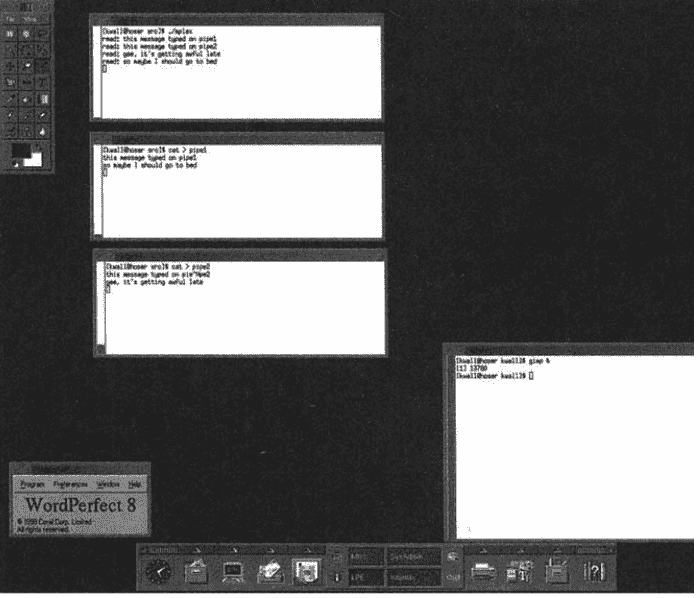

图 8.1：*mplex* 复用来自两个管道的输入。

接下来是 *select* 调用，随后是一个 *for* 循环，用于确定哪个描述符准备好被读取（超时值为 *NULL*，因此 *select* 会阻塞直到数据准备好被读取）。然后 *for* 循环读取管道并显示数据。如果 *read* 返回 0，表示管道已关闭，因此 *mplex* 关闭该文件并将其从监视集合中移除。当最后一个管道关闭时，*mplex* 终止。

## 内存映射文件

*内存映射文件* 是磁盘文件在内存中的相同副本。*inode* 映像与磁盘文件逐字节对应。内存映射文件有两个主要优点。第一个优点是更快的文件 I/O。普通的 I/O，如 *read* 和 *write* 系统调用以及 *fputs* 和 *fgets* 库调用，会通过内核缓冲区复制数据。尽管 Linux 使用快速、复杂的磁盘缓存算法，但最快的磁盘访问始终会比最慢的内存访问慢。对内存映射文件的 I/O 操作绕过内核缓冲区，因此速度要快得多。它们使用起来也更简单，因为你可以使用指针而不是通常的文件操作函数来访问映射文件。

内存映射文件的第二个优点是数据共享。如果多个进程需要访问相同的数据，可以将数据存储在一个内存映射文件中。这实际上是一种共享内存模型（参见第 16 章“共享内存”），使数据独立于任何单个进程，可供任何进程访问，并将区域的内容存储在磁盘文件中。

管理内存映射的函数调用定义在 `<sys/mman.h>` 中。它们包括以下调用：

- `mmap`—将磁盘文件映射到内存
- `munmap`—解除文件映射，删除内存映像
- `msync`—使用内存映像中的数据更新磁盘文件
- `mprotect`—限制对内存映像的访问
- `mlock`—防止映射的一部分交换到磁盘
- `munlock`—移除之前设置的锁定
- `mlockall`—防止内存映像的任何部分交换到磁盘
- `munlockall`—移除由 mlockall 设置的锁定

这些函数调用将在下面的章节中详细讨论。

## 创建内存映射

要创建一个内存映射文件，请调用 `mmap`。使用完毕后，调用 `munmap` 将映射从内存中删除并将内存返回给操作系统。

## 映射文件

`mmap` 函数将磁盘文件映射到内存。其原型如下：

```c
void *mmap(void *start, size_t length, int prot, int flags,
       int fd, off_t offset);
```

`mmap` 创建由文件描述符 `fd` 引用的文件的内存映像。内存映像将从文件的 `offset` 字节处开始。参数 `length` 指示应将文件的多少内容读取到内存中。为了限制对内存映射的访问，可以使用 `prot` 参数设置不同的保护级别。它可以是表 8.1 中一个或多个值的逻辑或。`flags` 参数为内存映射设置若干额外属性。它可以是表 8.2 中列出的一个或多个值的逻辑或。`mmap` 返回指向内存区域的指针，失败时返回 -1。

### 表 8.1：mmap 保护参数的值

| 保护 | 描述 |
| :--------- | :--------- |
| PROT_NONE  | 不允许访问 |
| PROT_READ  | 映射区域可读 |
| PROT_WRITE | 映射区域可写 |
| PROT_EXEC  | 映射区域可执行 |

> **注意** 在 x86 架构上，PROT_EXEC 隐含 PROT_READ，因此 PROT_EXEC 等同于指定 PROT_EXEC|PROT_READ。

### 表 8.2：mmap 标志参数的值

| 标志 | 描述 |
| :----- | :----- |
| MAP_ANONYMOUS | 创建匿名映射，忽略 fd |
| MAP_FIXED | 如果地址无效或已被使用则失败 |
| MAP_PRIVATE | 对区域的写入是进程私有的 |
| MAP_SHARED | 对区域的写入会被复制到文件 |
| MAP_DENYWRITE | 禁止对文件进行正常写入 |
| MAP_GROWSDOWN | 内存向下增长 |
| MAP_LOCKED | 将页锁定在内存中 |

`offset` 通常为 0，表示应将整个文件映射到内存中。内存区域必须标记为私有（使用 `MAP_PRIVATE`）或共享（使用 `MAP_SHARED`）；其他值是可选的。私有映射使对该区域的任何修改都成为进程私有的，因此这些修改不会反映在底层文件中，也不对其他进程可用。相反，共享映射使得对内存区域的任何更新都会立即映射了同一文件的其他进程可见。

为了防止对底层磁盘文件的写入，请指定 `MAP_DENYWRITE`（但请注意，这不是 POSIX 值，因此不具有可移植性）。使用 `MAP_ANONYMOUS` 创建的匿名映射不涉及物理文件，仅为进程的专用用途分配内存，例如自定义的 `malloc` 实现。`MAP_FIXED` 使内核在特定地址处放置映射。如果该地址已被使用或不可用，`mmap` 将失败。如果没有指定 `MAP_FIXED` 且地址不可用，内核将尝试在内存的其他位置放置该区域。`MAP_LOCKED` 允许具有 root 特权的进程将区域锁定在内存中，使其永远不会交换到磁盘。


**注意**
用户程序不能使用 `MAP_LOCKED`。这是一个安全特性，防止未授权的进程锁定所有可用内存，从而导致系统停滞（也称为*拒绝服务*攻击）。

## 解除文件映射

当你使用完内存映射文件后，调用 `munmap` 解除该区域的映射并将内存返回给操作系统。该函数的原型如下：

```c
int munmap(void *start, size_t length);
```

`start` 参数是指向要解除映射的区域起始位置的指针，`length` 指示要解除映射的区域大小。在一个内存块被解除映射后，进一步尝试访问 `start` 指向的内存将导致段错误（信号 `SIGSEGV`）。当进程终止时，所有内存映射都会解除。`munmap` 函数成功时返回 0。失败时返回 -1 并设置 `errno`。

尽管可能看似奇怪，`munmap` 可能因两种原因失败。最常见的原因是 `start` 未指向映射的内存。`munmap` 失败的另一个原因是 `length` 过长，结果导致溢出到未映射的内存。

## 示例


这个程序 `mkmap` 映射并解除命令行中指定的文件的映射。

```c
/*
 * mkmap.c 创建一个内存映射文件
 */
#include <sys/types.h>
#include <sys/mman.h>
#include <sys/stat.h>
#include <unistd.h>
#include <fcntl.h>
#include <stdlib.h>
#include <stdio.h>

void err_quit(char *msg);

int main(int argc, char *argv[])
{
```


```c
int fd;
void *map;
struct stat statbuf;

/* Open the file to map */
if (argc != 2) {
    puts ("USAGE: mkmap [file]");
    exit(EXIT_FAILURE);
}
if ((fd = open (argv[1], O_RDONLY)) < 0)
    err_quit ("open");

/* Get the file's length for mmap */
fstat (fd, &statbuf);

/* Map the input file */
if ((map = mmap (0, statbuf.st_size, PROT_READ,
        MAP_SHARED, fd, 0)) == MAP_FAILED)
    err_quit ("mmap");
printf ("map created at %p\n", &map);

/* Close and unmap the file */
close (fd);
munmap (map, statbuf.st_size);
exit (EXIT_SUCCESS);
}

void err_quit (char *msg)
{
    perror (msg);
    exit (EXIT_FAILURE);
}
```

`mkmap` 的唯一输出是映射文件的起始地址。虽然这个程序没有实际功能，但它应明确地展示如何映射和取消映射文件。`fstat` 调用使得确定文件大小变得容易，该尺寸随后被作为 `mmap` 调用的长度参数传入。

## 使用映射文件

当然，映射和取消映射文件是一回事，但核心思想是*使用*并操作该文件。本节讨论的调用——`msync`、`mprotect`、`mlock` 系列以及 `mremap`——能够使你完成这些操作。

## 将映射写入磁盘

`msync` 函数将映射文件写入磁盘。其原型如下：

```c
int msync(const void *start, size_t length, int flags);
```

`msync` 将映射中从内存地址 `start` 开始的数据刷新 `length` 字节到磁盘。`flags` 参数是以下一项或多项标志的按位或运算结果：

- `MS_ASYNC` — 安排写入并返回
- `MS_SYNC` — 在 `msync()` 返回前写入数据
- `MS_INVALIDATE` — 使同一文件的其他映射失效，以便它们用新数据更新

## 更改映射保护

`mprotect` 函数修改内存映射的保护标志。其原型如下：

```c
int mprotect(const void *addr, size_t len, int prot);
```

`mprotect` 设置或更改从 `addr` 开始区域的保护级别为 `prot` 中指定的保护级别。`prot` 可以是表 8.1 中列出的一个或多个标志的按位或运算结果。成功时返回 0。如果失败，`mprotect` 返回 −1 并设置 `errno`。

## 锁定映射内存

*内存锁定*是指防止内存区域被交换到磁盘。在 Linux 这样的多任务、多用户系统中，未活跃使用的系统内存（RAM）区域可能会被临时写入磁盘（交换出），以便内存可用于其他用途。锁定内存会设置一个标志，防止其被交换出。有四个函数用于锁定和解锁内存：`mlock`、`mlockall`、`munlock` 和 `munlockall`。它们的原型如下列出：

```c
int mlock(const void *addr, size_t len);
int munlock(void *addr, size_t len);
int mlockall(int flags);
int munlockall(void);
```

要锁定或解锁的内存区域的起始位置由 `addr` 指定。`len` 指示要锁定或解锁该区域的多少部分。`flags` 的值可以是以下一个或两个：

- `MCL_CURRENT` 请求在调用返回前锁定所有页面。
- `MCL_FUTURE` 请求锁定后续添加到进程地址空间的所有页面。

正如在 `mmap` 讨论中提到的，只有具有 root 权限的进程才能锁定或解锁内存区域。

## 调整映射文件大小

你偶尔需要调整内存区域的大小。使用 `mremap` 函数来实现。其原型如下：

```c
void *mremap(void *old_addr, size_t old_len, size_t new_len,
       unsigned long flags);
```

作为 `realloc` 库调用的类似物，`mremap` 将起始于 `old_addr` 的内存区域（原始大小为 `old_len`）调整为 `new_len`。`flags` 指示如果需要，该区域是否可以在内存中移动。`MREMAP_MAYMOVE` 允许地址改变；如果未指定，调整大小操作将失败。`mremap` 返回调整大小后的区域的地址，失败时返回 `NULL`。

## 示例


## 示例

下面的程序 `mmcat` 使用内存映射实现了 `cat` 程序。尽管这是一个朴素的实现，但它清楚地展示了如何使用内存映射文件执行文件 I/O。

```c
/*
 * mmcat.c cat(1) implemented with memory maps
 */

#include <sys/types.h>
#include <sys/mman.h>
#include <sys/stat.h>
#include <unistd.h>
#include <fcntl.h>
#include <stdlib.h>
#include <stdio.h>

void err_quit(char *msg);
```

```c
int main(int argc, char *argv[])
{
    int fd;
    char *src;
    struct stat statbuf;

    /* Open the source file */
    if (argc != 2) {
        puts("USAGE: mmcat (file)");
        exit(EXIT_FAILURE);
    }
    if ((fd = open(argv[1], O_RDONLY)) < 0)
        err_quit("open");

    /* Get the file length for mmap */
    fstat(fd, &statbuf);

    /* map the input file */
    if ((src = mmap(0, statbuf.st_size, PROT_READ,
            MAP_SHARED, fd, 0)) == MAP_FAILED)
        err_quit("mmap");

    /* write it out */
    write(STDOUT_FILENO, src, statbuf.st_size);

    /* clean up */
    close(fd);
    munmap(src, statbuf.st_size);

    exit(0);
}

void err_quit(char *msg)
{
    perror(msg);
    exit(EXIT_FAILURE);
}
```

文件映射到内存后，`mmcat` 在 `write` 调用中使用字符指针 `src`，就像它是由 `read` 或 `fgets` 填充的一样。我们通过调用 `mmap` 回到内核的内存区域。

> **提示**
> 从实际角度看，在这个例子中使用内存映射文件有些大材小用，因为它在性能或代码长度方面提供的益处很少。然而，在性能至关重要或处理时间敏感操作的情况下，内存映射文件可能是一个明显的优势。内存映射在高度安全的环境下也很有价值。以 root 权限运行的进程可以将映射文件锁定在内存中，防止它们被 Linux 的内存管理器交换到磁盘。结果是，敏感数据（如密码文件或工资数据）就不太容易被扫描程序检测到。当然，在这种情况下，必须将该内存区域设置为 `PROT_NONE`，以便其他进程无法读取该区域。

## 文件锁

文件锁是一种方法，使多个进程能够以安全、合理且可预测的方式同时访问同一个文件。每个锁定文件的进程这样做是为了防止其他进程在它处理文件时修改数据。没有固有的理由阻止两个进程同时从同一文件读取，但想象一下，如果两个进程同时向同一文件写入会发生什么混乱。它们很可能会覆盖彼此的数据，或者在某些情况下完全损坏文件。

如果你想要访问已锁定的文件，一般程序如下列出：

1. 检查锁。
2. 如果文件未锁定，建立你自己的锁。
3. 打开文件。
4. 根据需要处理文件。
5. 关闭文件。
6. 解锁文件。

注意，进程在开始任何 I/O 之前锁定文件，并在解锁文件之前完成所有处理。这种程序确保你的程序执行的所有处理不会受到其他进程的干扰。如果你在建立锁之前打开文件，或者在读取锁之后关闭文件，另一个进程可能会在锁定/解锁操作与打开/关闭操作之间流逝的短暂时间内访问该文件。

如果文件已锁定，你必须做出决定。许多文件 I/O 操作最多只需几秒钟。你可以等待几秒钟——也许使用 `sleep` 调用——然后再试一次，或者放弃并报告给你正在运行该程序的用户，由于另一个进程正在使用该文件，因此无法打开它。

文件锁有两种形式：建议性锁和强制性锁。**建议性锁**，也称为协作性锁，依赖于一种约定，即每个使用锁定文件的进程都会检查锁的存在并尊重该锁。内核或整个系统都不强制实施建议性锁；它们依赖程序员遵守约定。另一方面，**强制性锁*由内核强制执行。内核会阻止对已加写锁文件的读或写访问，直到加锁进程释放锁。然而，强制性锁所付出的代价是显著的性能惩罚，因为每个读或写操作都必须检查锁的存在。

正如文件锁有两种类型，其实现也有两种：锁文件和记录锁定。

### 锁文件

锁文件是长度为零的文件，形式为 `filename.lck`，其中 `.lck` 附加到文件末尾，通常创建在与进程想要打开的文件名相同的目录中。它们很容易实现。为此，你需要一个类似于以下伪代码片段的代码块：

```text
使用 O_EXCL 标志打开锁文件
如果打开失败且 errno == EEXIST
  另一个进程已锁定该文件
否则
  你已锁定该文件
  打开文件本身
  执行额外处理
  关闭文件
  删除（unlink）锁文件
结束 if
```

在打开锁文件时使用 `O_EXCL` 保证 `open` 调用是*原子的*，即 `open` 调用不会在内核中被中断。这很重要，因为当两个进程试图打开同一文件时存在潜在的竞态条件。第二个进程可能会在第一个进程的 `open` 调用被内核中断时打开该文件。使用 `O_EXCL` 可以避免这种情况。如前所述，按照惯例，锁文件命名为 `somefile.lck`，其中 `somefile` 是你正在锁定的文件的名称。


> 关于竞态条件的详细讨论，请参阅“使用 fork”一章，第 78 页。

## 示例


此程序创建一个锁文件，然后尝试再次锁定它。第二次尝试将会失败。该程序旨在说明使用锁文件的正确逻辑。

```c
"""
 * lockit.c - 使用锁文件
 */
#include <unistd.h>
#include <fcntl.h>
#include <errno.h> /* for EEXIST */
#include <stdlib.h>
#include <stdio.h>

int main(int argc, char *argv[])
{
    int fd, newfd;

    /* Open the lockfile */
    fd = open(argv[1], O_CREAT | O_EXCL, 0644);
    if(fd < 0 && errno == EEXIST) { /* lockfile exists */
        puts("file already locked");
        close(fd);
    } else if(fd < 0) /* some other error we don't test */
        puts("unknown error");
    else { /* file is now locked */
        puts("lock established");

        /* Additional processing would take place here */

        /* repeat the process, this time it will fail */
        newfd = open(argv[1], O_CREAT | O_EXCL, 0644);
        if(newfd < 0 && errno == EEXIST) {
            puts("file already locked");
            close(newfd);
        } else if(newfd < 0)
            puts("unknown error");
    }
    close(fd);
    unlink(argv[1]);
    exit(EXIT_SUCCESS);
}
```

运行 lockit 示例的输出如下：

```bash
$ ./lockit lockit.c.lck
lock established
file already locked
```

除非发生意外，否则 lockit 会在第一个 open 语句中成功锁定文件（文件名作为唯一的命令行参数传入）。然后，在第二个 open 语句中，lockit 通过创建相同的锁文件尝试第二次锁定该文件。在 open 调用中指定 O_CREAT 以及 O_EXCL，意味着如果文件已经存在，open 调用将失败。换句话说，使用所示语法创建或打开锁文件等同于锁定文件；删除锁文件等同于解锁文件。由于该测试失败，程序报告该文件已被锁定。返回到外层代码块，程序关闭文件描述符并取消链接（删除）该文件，从而移除锁。

### 记录锁定

虽然锁文件易于使用，但它们存在显著缺点：

- 当文件被锁定时，对于仅希望读取该文件的其他进程来说，该文件不可用。
- O_EXCL 标志仅在本地文件系统中可靠，在网络文件系统（如 NFS）上则不可靠。
- 这些锁仅是建议性的；进程可以忽略它们。
- 如果进程在移除锁文件之前终止，锁文件将保留在原处，其他进程没有可靠的方法来判定该文件是否为陈旧锁，即由过早死亡的进程遗留下来的锁。

这些缺点促成了记录锁定的发展，它赋予程序员锁定文件特定区域（称为记录）的能力。记录锁，有时称为 POSIX 锁，允许多个进程锁定同一文件的不同部分，甚至读取同一文件的相同片段。记录锁在 NFS 及其他网络文件系统中也能正常工作。最后，由于记录锁由内核持有，当进程终止时，其锁会自动释放。

POSIX 锁有两种类型：*读锁或共享锁* 以及 *写锁或排他锁*。读锁被称为共享锁，因为许多进程可以持有同一文件区域的读锁。然而，排他锁在写锁生效期间防止对锁定区域的访问。此外，当同一文件区域存在读锁时，无法创建写锁。

> **注意**
> 回顾第 4 章“进程”中的内容，子进程在 *fork* 后不会继承文件锁，尽管通过 exec 的进程会继承其父进程的文件锁。

*fcntl* 调用在 `<fcntl.h>` 中声明，用于管理记录锁。它有以下原型：

```c
int fcntl(int fd, int cmd, struct flock *lock);
```

*fd* 是要锁定的文件描述符。*cmd* 必须是 *F_GETLK*、*F_SETLK* 或 *F_SETLKW* 之一。*F_GETLK* 检查文件是否可以被锁定。如果可以锁定，*struct flock* 的 *l_type* 成员将被设置为 *F_UNLCK*；如果不能锁定，*struct flock* 的 *l_pid* 成员将被设置为持有锁的进程的 PID。*F_SETLK* 设置锁。*F_SETLKW* 也设置锁，但 *fcntl* 会等待直到成功设置锁后才返回。

*lock* 是指向 *flock* 结构的指针，该结构描述锁及其行为。*struct flock* 定义如下：

```c
struct flock {
    short l_type; /* Type of lock */
    short l_whence; /* Beginning of lock */
    off_t l_start; /* Starting offset of lock */
    off_t l_len; /* Number of bytes to lock */
    pid_t l_pid; /* Process holding lock */
};
```

*l_type* 可以是 *F_RDLCK*（读锁）、*F_WRLCK*（写锁）或 *F_UNLCK*（释放锁）。*l_whence* 是 *SEEK_SET*、*SEEK_CUR* 或 *SEEK_END* 之一，其语义与 *lseek* 调用相同。*l_start* 指示相对于 *l_whence* 的锁起始偏移量，而 *l_len* 指定要锁定的字节数。最后，*l_pid* 是持有锁的进程的 PID。

> * lseek 系统调用在第 143 页的“定位文件指针”一节中有介绍。

## 示例


下面的程序 _reclck_ 在文件的一部分设置写锁，在另一部分设置读锁。如果在两个终端窗口中运行此程序，你可以清楚地看到记录锁是如何工作的。

```c
/*
 * reclck.c - 设置读写锁
 */
#include <unistd.h>
#include <fcntl.h>
#include <stdlib.h>
#include <stdio.h>
#include <errno.h>

int main(void)
{
    int fd;
    struct flock lock;

    if ((fd = open("test.dat", O_RDWR)) < 0) {
        perror("open");
        exit(EXIT_FAILURE);
    }

    /*
     * Set up a write lock on the last 100
     * bytes of the file
     */
    lock.l_type = F_WRLCK;
    lock.l_whence = SEEK_END;
    lock.l_start = 0;
    lock.l_len = 100;

    /* set the lock */
    if (!fcntl(fd, F_SETLK, &lock))
        puts("write lock established");
    else {
        fcntl(fd, F_GETLK, &lock);
        printf("write locked by PID %d\n", lock.l_pid);
    }

    /* Now do a read lock */
    lock.l_type = F_RDLCK;
    lock.l_whence = SEEK_END;
    lock.l_start = 0;
    lock.l_len = 100;

    if (!fcntl(fd, F_SETLKW, &lock))
        puts("read lock established");
    else {
        fcntl(fd, F_GETLK, &lock);
        printf("read locked by PID %d\n", lock.l_pid);
    }

    getchar();
    exit(EXIT_SUCCESS);
}
```

该程序在两个 xterm 窗口中运行的输出如图 8.2 所示。

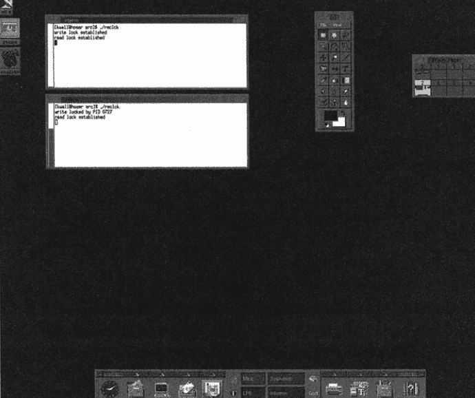

写锁是排他的；读锁是共享的。

首先，`reclck` 在文件的最后 100 字节上设置写锁。如果无法建立锁，它会调用 `fcntl` 并使用 `F_GETLK` 命令来获取锁定进程的 PID。下一个锁是文件前 100 字节上的读锁。读锁是共享的，因此多个进程可以锁定文件的同一区域，如图 8.2 所示。

## 接下来是什么？

本章扩展了关于文件 I/O 的讨论，重点关注目录操作、内存映射和文件锁定等高级特性。下一章“守护进程”将介绍如何创建后台进程，从而完成对系统编程的综述。

# 9—守护进程

在本章中，你将学习如何创建*守护进程*，发音类似 *demon*。守护进程是非交互式运行的后台进程。它们通常提供某些服务，要么服务于整个系统，要么服务于用户程序。特别是，本章涵盖以下内容：

- 守护进程的特性
- 创建守护进程的规则
- 编程守护进程时使用的函数调用
- 如何使用 syslog 设施
- 守护进程应如何处理运行时错误


## 理解守护进程

通常，守护进程在系统启动时启动，除非被强制终止，否则会一直运行到系统关机。它们也没有控制终端，因此其产生的任何输出都必须进行特殊处理。

守护进程还具有若干区别于 `ls` 和 `cat` 等普通程序的特征。首先，它们几乎总是以超级用户权限运行，因为它们为用户模式程序提供系统服务。由于它们是非交互式的，即没有用户输入即可运行，因此它们没有控制终端。守护进程通常是进程组和会话的领导者。它们常常充当其所在进程组和会话中的进程。最后，守护进程的父进程是 `init` 进程，其 PID 为 1。这是因为其真实的父进程在子进程之前 `fork`（创建子进程）并 `exit`（退出），因此它们成为被 `init` 继承的孤儿进程。

- 控制终端和会话领导者的讨论见第 76 页的“会话”一节。
- 进程组和进程领导者是第 76 页“进程组”一节的主题。

## 创建守护进程

要创建守护进程程序，你必须遵循几条简单的规则并调用几个函数，这些函数在前面的章节中都已介绍过。然而，错误处理对守护进程提出了特殊的困难，要求程序使用系统日志设施 `syslog` 将消息发送到系统日志（通常是文件 `/var/log/messages`）。这个主题将在本章后面的“错误处理”一节中介绍。

创建既能正常工作又能与系统良好协作的守护进程，需要遵循以下几个简单步骤。

首先，`fork`（创建子进程）并让父进程退出。像大多数程序一样，守护进程是从 shell 脚本或命令行启动的。然而，守护进程与应用程序不同，因为它们不是交互式的——它们在后台运行，因此没有控制终端。作为摆脱控制终端的第一步，父进程 `fork` 并退出。仔细想想，这完全合情合理。守护进程既不从标准输入读取，也不向标准输出或标准错误写入，因此除了启动时之外，它们根本不需要终端接口。

第二步是使用 `setsid` 调用创建一个新的会话。调用 `setsid` 将进程与任何终端分离。换句话说，这导致子进程没有控制终端。当然，程序会继续执行。

下一步是将根目录设为进程的当前工作目录。这是必要的，因为任何当前目录位于已挂载文件系统上的进程都会阻止该文件系统被卸载。通常，这种行为是可取的，但如果系统因某种原因必须进入单用户模式，运行在已挂载文件系统上的守护进程进程充其量是监控者的麻烦（因为她必须找到并终止这个棘手的进程），或在紧急情况下是对系统完整性的真实威胁（因为它阻止了坏磁盘上的文件系统被卸载）。将 `/` 设为守护进程的工作目录是避免这两种可能性的安全方式。

将 umask 设为 0。这一步是必要的，以防止守护进程继承的 umask 干扰文件和目录的创建。考虑以下场景：一个守护进程继承了 umask 055，这会屏蔽组和其他用户的读和执行权限。如果守护进程随后创建一个文件，例如数据文件，创建的文件对用户将是可读、可写和可执行的，但对组和其他用户仅可写。将守护进程的 umask 重置为 0 可以防止这种情况。它还赋予守护进程在创建文件时更大的灵活性，因为当 umask 为 0 时，守护进程可以精确设置所需的权限，而不是接受系统默认值。

最后，关闭子进程继承但不需要的文件描述符。这只是一个常识步骤。子进程没有理由保留从父进程继承的打开的描述符。需要关闭的潜在文件描述符列表至少包括 stdin、stdout 和 stderr。其他打开的文件描述符，例如那些引用配置或数据文件的描述符，可能也需要关闭。这一步取决于特定守护进程的需求和要求，因此很难更精确地陈述这条规则。

## 函数调用

为了满足第一项要求，调用 fork 派生一个子进程，并让父进程调用 exit。为了消除控制终端，通过调用 setsid 创建一个新的会话，setsid 在 `<unistd.h>` 中声明，格式如下：

```c
pid_t setsid(void);
```

setsid 创建一个新的会话和一个新的进程组。然后，守护进程将成为新会话的会话领导者和新进程组的进程组领导者。setsid 调用还保证新会话将没有控制终端。然而，如果调用进程已经是进程组领导者，setsid 调用将失败。setsid 成功时返回新的会话 ID（SID）。出错时，它返回 -1 并设置 errno。

`umask` 调用将守护进程的 `umask` 更改为 0。这撤销了任何可能干扰文件或目录创建的继承 `umask`，如前所述。要关闭不需要的文件描述符，调用 `close`。

## 示例


以下守护进程创建一个新的日志文件 `/var/log/lpdated.log`，并每分钟向其写入一个时间戳。为了使其工作，它必须由 root 用户启动。

```c
/*
 * lpdated.c - 简单的时间戳守护进程
 */
#include <sys/types.h>
#include <sys/stat.h>
#include <stdio.h>
#include <stdlib.h>
#include <fcntl.h>
#include <errno.h>
#include <unistd.h>
#include <time.h>
#include <string.h>

int main(void)
{
    pid_t pid, sid;

    int fd, len;
    time_t timebuf;

    pid = fork();
    if (pid < 0) {
        perror("fork");
        exit(EXIT_FAILURE);
    }
    if (pid > 0)
        /* 在父进程中，让我们退出 */
        exit(EXIT_SUCCESS);

    /* 在子进程中 . . . */
    /* 首先，启动一个新会话 */
    if((sid = setsid()) < 0) {
        perror("setsid");
        exit(EXIT_FAILURE);
    }
    /* 接下来，将 / 设为当前目录 */
    if((chdir("/")) < 0) {
        perror("chdir");
        exit(EXIT_FAILURE);
    }
    /* 重置文件模式 */
    umask(0);

    /* 关闭 stdin 等 */
    close(STDIN_FILENO);
    close(STDOUT_FILENO);
    close(STDERR_FILENO);

    /* 最后，做我们的工作 */
    len = strlen(ctime(&timebuf));
    while(1) {
        char *buf = malloc(sizeof(char) * (len + 1));

        if(buf == NULL) {
            exit(EXIT_FAILURE);
        }
        if((fd = open("/var/log/lpdated.log",
                O_CREAT | O_WRONLY | O_APPEND, 0600)) < 0) {
            exit(EXIT_FAILURE);
        }
        time(&timebuf);
        strncpy(buf, ctime(&timebuf), len + 1);
        write(fd, buf, len + 1);
        close(fd);
        sleep(60);
    }
    exit(EXIT_SUCCESS);
}
```

lpdated 使用 open 和 write 系统调用，提醒你 Linux 提供了标准库 fopen 和 fwrite 流 I/O 函数的替代方案。记住，你必须以 root 身份运行此程序，因为普通用户对 /var/log 目录没有写访问权限。如果你尝试以非 root 用户运行，什么都不会发生。守护进程会在尝试打开其日志文件失败后简单地终止。几分钟后，由守护进程维护的日志文件 /var/log/lpdated.log 应类似于以下内容：


### 输出

```
$ su -c "tail -5 /var/log/lpdated.log"
Wed Jul 28 01:35:41 1999
Wed Jul 28 01:36:41 1999
Wed Jul 28 01:37:41 1999
Wed Jul 28 01:38:41 1999
Wed Jul 28 01:39:41 1999
```

注意，lpdated 在调用 setsid 后不再将错误消息写入 stderr。子进程不再具有控制终端，因此输出无处可去。无限的 while 循环执行程序的工作：打开日志文件，输出时间戳，关闭日志文件，然后休眠 60 秒。要终止该程序，成为 root 用户，获取 lpdated 的 PID，并发出 kill <lpdated 的 PID>。

## 错误处理

守护进程调用 setsid 后，不再具有控制终端，因此它没有地方发送通常去往 stdout 或 stderr 的输出（例如错误消息）。幸运的是，此目的的标准实用程序是由系统日志守护进程 syslogd 提供的源自 BSD 的 syslog 服务。

相关接口在 `<syslog.h>` 中定义。API 很简单。openlog 打开日志；syslog 向其写入消息；closelog 关闭日志。它们的原型如下所示：

```c
void openlog(char *ident, int option, int facility);
void closelog(void);
void syslog(int priority, char *format, ...);
```

openlog 发起与系统日志记录器的连接。ident 是添加到每条消息的字符串，通常设置为程序名称。option 参数是下列值中的一个或多个的逻辑或：

- LOG_CONS—如果系统日志记录器不可用，写入控制台。
- LOG_NDELAY—立即打开连接。通常，连接直到第一条消息发送之前都不会打开。


- LOG_PERROR—打印到标准错误（stderr）。
- LOG_PID—在每条消息中包含进程的 PID。

facility 指定发送消息的程序类型，可以是表 9.1 中列出的值之一。

### 表 9.1：系统日志记录器设施值

| 设施 | 描述 |
| :--- | :--- |
| LOG_AUTHPRIV | 安全/授权消息 |
| LOG_CRON | 时钟守护进程；cron 和 at |
| LOG_DAEMON | 其他系统守护进程 |
| LOG_KERN | 内核消息 |
| LOG_LOCAL[0-7] | 保留供本地使用 |
| LOG_LPR | 行打印机子系统 |
| LOG_MAIL | 邮件子系统 |
| LOG_NEWS | Usenet 新闻子系统 |
| LOG_SYSLOG | 由 syslogd 生成的消息 |
| LOG_USER | 默认值 |
| LOG_UUCP | UUCP 系统 |

priority 指定消息的重要性。其可能的值列于表 9.2。

### 表 9.2：系统日志记录器优先级值

| 优先级 | 描述 |
| :--- | :--- |
| LOG_EMERG | 系统不可用 |
| LOG_ALERT | 立即采取行动 |
| LOG_CRIT | 严重情况 |
| LOG_ERR | 错误情况 |
| LOG_WARNING | 警告情况 |
| LOG_NOTICE | 正常但重要的情况 |
| LOG_INFO | 信息性消息 |
| LOG_DEBUG | 调试消息 |

严格来说，使用 `openlog` 和 `closelog` 是可选的，因为 `syslog` 会在第一次被调用时自动打开日志文件。

## 示例


以下程序是 `lpdated` 的重写版本，该程序使用系统日志记录器：

```c
/*
 *  lpdated.c  - 简单的时间戳守护进程
 */
#include <sys/types.h>
#include <sys/stat.h>
#include <stdio.h>
#include <stdlib.h>
#include <fcntl.h>
#include <errno.h>
#include <unistd.h>
#include <time.h>
#include <string.h>
#include <syslog.h>

int main(void)
{
      pid_t pid, sid;

      int fd, len;
      time_t timebuf;

      /* Open the system log */
      openlog("lpdated", LOG_PID, LOG_DAEMON);

      pid = fork();
      if (pid < 0) {
            syslog(LOG_ERR, "%s\n", "fork");
            exit(EXIT_FAILURE);
      }
      if (pid > 0)
      /* In the parent, let's bail */
      exit(EXIT_SUCCESS);

      /* In the child . . . */
      /* First, start a new session */
      if ((sid = setsid()) < 0) {
            syslog(LOG_ERR, "%s\n", "setsid");
            exit(EXIT_FAILURE);
      }
      /* Next, make / the current directory */
      if((chdir("/")) < 0) {
            syslog(LOG_ERR, "%s\n", "chdir");
            exit(EXIT_FAILURE);
      }
      /* Reset the file mode */
      umask(0);

      /* Close stdin, etc. */
      close(STDIN_FILENO);
      close(STDOUT_FILENO);
      close(STDERR_FILENO);

      /* Finally, do our work */
      len = strlen(ctime(&timebuf));
      while(1) {
            char *buf = malloc(sizeof(char) * (len + 1));
            if(buf == NULL) {
                  exit(EXIT_FAILURE);
            }
            if((fd = open("/var/log/lpdated.log",
                  O_CREAT | O_WRONLY | O_APPEND, 0600)) < 0) {
                  syslog(LOG_ERR, "%s\n", "open");
                  exit(EXIT_FAILURE);
            }
            time(&timebuf);
            strncpy(buf, ctime(&timebuf), len + 1);
            write(fd, buf, len + 1);
            close(fd);
            sleep(60);
      }
      closelog();
      exit(EXIT_SUCCESS);
}
```

在添加了 `syslog` 的日志记录功能后，如果您尝试以普通用户身份执行程序，`lpdated` 将会向系统日志（在 Linux 系统上通常是 `/var/log/messages`）写入一条类似于以下内容的条目：

> Sep 14 21:12:04 hoser lpdated[8192]: open

此日志条目表明，在指定的日期和时间，在名为 `hoser` 的主机上，一个名为 `lpdated` 的进程（PID 为 8192）向系统日志中写入了文本 `open`。参考 `lpdated` 的源代码，您将能够看到错误发生的位置。

尽管时间戳本身仍会写入 `/var/log/lpdated.log`，但 `lpdated` 生成的所有错误消息都会记录到系统日志中。以下的输出取自系统日志，它是在非 root 用户尝试运行该程序时生成的。方括号中的数字是 `lpdated` 的 PID。


### 输出

> Jul 28 11:34:06 hoser lpdated[8895]: open

## 接下来是什么？

本章讨论了创建*守护进程*，即始终在后台运行且通常提供某种服务的程序。这标志着本书对系统编程主题的介绍结束。凭借第一部分“Linux 编程环境”中涵盖的基本开发工具知识，以及对底层系统编程（在第二部分“系统编程”中涵盖）的扎实理解，您已准备好在第三部分“Linux API”中学习 Linux 最常用的一些 API，即应用程序编程接口。

# 第三部分—LINUX API（应用程序编程接口）

- 10 数据库 API
- 11 使用 ncurses 进行屏幕操作
- 12 高级 ncurses 编程
- 13 声音 API：OSS/Free
- 14 创建和使用编程库

# 10—数据库 API

应用程序员通常需要在不要求（或不想承担）像 Informix 或 Oracle 这样全功能关系数据库的所有服务（或开销）的情况下，将数据存储在数据库中。本章将教您如何使用 Berkeley 数据库，这是一个嵌入式数据库库，在主要的 Linux 发行版中都很常见。本章讨论的版本是 2.7.7，但讨论内容适用于任何 2.x 版本。请注意，2.x API 包含了 1.x API 的所有功能，但也添加了许多新元素。本章涵盖以下主题：

- 创建新数据库
- 打开现有数据库
- 添加和删除记录
- 检索记录
- 搜索记录
- 在数据库中移动
- 关闭数据库

> **注意**
> Berkeley 数据库 2.7.5 版本的完整源代码分发可在随书网站获取。本书中的所有示例均使用章节源代码目录中的头文件和库副本构建。

## Berkeley 数据库

Berkeley 数据库，通常称为 Berkeley DB 或简称 DB，使用键值对来处理数据库中的元素。键是标识元素；值是数据元素。要找到你想要的数据，向 DB 呈现一个键，DB 将返回与之关联的值。键值对存储在一个称为 DBT（一个数据库对象）的简单结构中，它由一个内存引用（即一个指针）和以字节为单位的内存引用长度组成。键和值可以是任何类型的数据。存储数据的长度实际上没有限制——单个键或值必须适合系统的可用内存（物理 RAM）。

例如，如果您想创建一本关于本书章节的数据库，键值对可能如下所示：

| 键 | 值 |
| :--- | :--- |
| One | 编译程序 |
| Two | 控制构建过程：GNU make |
| Three | 关于项目 |
| Four | 进程 |
| Five | 信号 |

DB 数据库支持三种存储和访问方法：B+树、哈希和记录。基于记录的数据库按顺序存储固定或可变长度的数据；新记录可以插入到现有记录之间，或追加到一系列现有记录的末尾。基于哈希的数据库将记录存储在哈希表中以进行快速搜索。哈希函数可以由程序员提供，也可以使用内置的默认例程。B+树数据库按排序顺序存储数据。排序顺序由程序员提供的函数或按字典顺序对键进行排序的默认函数确定。图 10.1 展示了这三种存储和访问方法之间的关系。

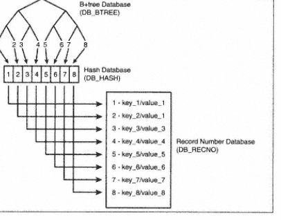

**图 10.1**
记录在 Berkeley DB 数据库中的存储方式。

DB 支持的存储和访问方法的具体实现超出了本书的范围（事实上，许多计算机科学家将他们的整个职业生涯都致力于研究排序和搜索算法），但其基本原理很简单。图 10.1 假设数据库包含八条记录，用数字一到八表示。B+树数据库将数据存储在与图 10.1 所示类似的结构中，使得定位特定记录极其快速且高效。基于哈希的数据库将数据存储在表中。表中单个记录的位置取决于基于记录键计算得出的任意值。基于记录编号的数据库按顺序存储记录。它们通过其记录编号进行访问和操作。

## 创建、打开和关闭数据库

要使用 DB，请在源代码中包含 `<db.h>` 并链接 libdb。a (-ldb)。每个 DB 函数在成功时返回零，在任何失败时返回非零值。在发生系统错误（如非法参数或磁盘错误）时，DB 返回可用于 `perror` 函数的 `errno` 值。其他返回代码将在讨论生成它们的函数时进行说明。


## 创建和打开数据库

  创建数据库的函数与打开数据库的函数相同，均为 `db_open`。如果指定的数据库不存在，它将先被创建，然后被打开。`db_open` 的语法如下：

```c
int db_open(const char *file, DBTYPE type, u_int32_t flags, int mode,
        DB_ENV *dbenv, DB_INFO *dbInfo, DB **dbpp);
```

  `file` 是要打开的数据库的文件路径名。`type` 表示访问方法，可以是 `DB_BTREE`、`DB_HASH` 或 `DB_RECNO`。如果你不知道现有数据库的类型，可以使用 `DB_UNKNOWN` 来打开它。`flags` 会修改 `db_open` 的行为。如果必要的文件尚不存在，`DB_CREATE` 会创建这些文件。`DB_RDONLY` 以只读方式打开数据库（任何写入尝试都会失败），而 `DB_TRUNCATE` 如果数据库存在，会将其逻辑清零。`mode` 参数是一个八进制值，指定数据库文件的访问权限。它与 `open` 系统调用所需的 `mode` 参数类似。

- "open 系统调用及其 mode 参数"在“文件模式”一节第 134 页中有详细介绍。

  `dbenv` 和 `dbInfo` 参数控制 DB 行为的先进功能，这些功能超出了本书的范围，因此不在这里讨论。将这两个参数设置为 `NULL` 即可获取 DB 的默认行为。最后，`dbpp` 是已打开数据库的句柄，它是 DB（数据库）结构体指针的指针。它会被初始化为适当的值，或者在失败时初始化为 `NULL`。

  `db_open` 初始化的句柄是所有后续数据库操作的关键，因为几乎所有的 Berkeley DB 接口操作都通过句柄中包含的函数指针进行。

## 关闭数据库

  要关闭数据库，请使用 `close` 函数。其原型如下：

```c
int DB->close(DB *db, u_int32_t flags);
```

  `db` 是先前由 `db_open` 调用返回的句柄。`flags` 应为 0 或 `DB_NOSYNC`。`DB_NOSYNC` 指示 DB 在关闭数据库之前不同步或刷新缓存中的数据库数据到磁盘。如果 `flags` 为 0，缓存的数据将被写入磁盘。

> 注意
> `DB_NOSYNC` 是一个不好的选项！Berkeley DB 在自己的缓存中维护信息，并独立于内核将其写出。不同步缓存信息会导致数据不可靠、不一致或损坏。

## 示例


  该程序 *opendb* 在当前工作目录中打开并关闭一个数据库。

```c
/*
 * opendb.c 打开一个 Berkeley DB 数据库
 */
#include <stdlib.h>
#include <stdio.h>
#include <errno.h>
#include "db.h"

int main(void)
{
    DB *db;
    int ret;

    ret = db_open("test.db", DB_BTREE,
                   DB_CREATE, 0600, NULL, NULL, &db);
    if (ret) {
        perror("db_open");
        exit(EXIT_FAILURE);
    }

    db->close(db, 0);
    exit(EXIT_SUCCESS);
}
```

  `db_open` 调用尝试在当前目录中打开一个名为 `test.db` 的 B+树数据库。如果数据库尚不存在，`DB_CREATE` 标志会指示 DB 创建该文件。在打开（或在必要时创建）数据库后，`db_close` 调用关闭数据库。*opendb* 没有输出，但在当前工作目录中快速运行 `ls` 命令会揭示 `test.db` 已被创建。虽然 `test.db` 文件中不会存储任何记录，但 Berkeley DB 在创建文件时会写入一些管理信息。你不需要担心这一点，因为这些是 DB API 使用的信息。

## 在数据库中存储项目

  要向数据库中添加数据，请使用 `put` 函数，其原型如下：

```c
int DB->put(DB *db, DB_TXN *txnid, DBT *key, DBT *data, u_int32_t flags);
```

  `db` 是先前由 `db_open` 返回的数据库句柄；`txnid` 是事务 ID，这是一个这里未涵盖的先进功能，因此将其设置为 `NULL`。`flags` 必须是 `0`（允许覆盖具有相同键的现有记录）、`DB_NOOVERWRITE`（如果已存在具有相同键的键/值对，则禁止 `put` 操作）或 `DB_APPEND`（仅适用于类型为 `DB_RECNO` 的数据库）之一。如果键已存在，`put` 返回 `DB_KEYEXIST`；标准的返回码也适用。

  为了确保与未来版本的 Berkeley DB 兼容，你在使用 `key` 和 `value` 参数之前应始终先初始化它们。最简单的做法是使用标准 C 库中的 `memset` 调用。例如，假设你需要在程序中使用一个名为 `dbkey` 的键。在使用之前，按照以下代码片段所示对其进行初始化：

```c
DBT dbkey;
memset (&dbkey, 0, sizeof (DBT *));
```

  在此示例中，`memset` 将 `DBT` 关联的所有内存块的值设置为零。

## 示例


  下一个示例向由 `opendb` 创建的数据库中添加了记录：

```c
/*
* adddb.c - 向 Berkeley DB 数据库中添加记录
*/
#include <stdlib.h>
#include <stdio.h>
#include <errno.h>
#include "db.h"

int main(void)
{
DB *db;
int ret, i = 0;
DBT key, value;

ret = db_open("test.db", DB_BTREE,
DB_CREATE, 0600, NULL, NULL, &db);
if(ret) {
    perror("dbopen");
    exit(EXIT_FAILURE);
}

/* 首先初始化键/值对 */
memset(&key, 0, sizeof(key));
memset(&value, 0, sizeof(value));
/* 设置 key, value 的值 */

key.data = "one";
key.size = sizeof("one");
value.data = "Compiling Programs";
value.size = sizeof("Compiling Programs");
/* 存储它 */
ret = db->put(db, NULL, &key, &value, DB_NOOVERWRITE);
if(ret == DB_KEYEXIST) {
    fprintf(stderr, "key %s exists\n", (char *)key.data);
    exit(EXIT_FAILURE);
} else {
    perror("put");
    exit(EXIT_FAILURE);
}

db->close(db, 0);
exit(EXIT_SUCCESS);
}
```

  同样，此示例没有输出。但是，如果你连续执行两次，第二次运行将失败，因为 flags 值 `DB_NOOVERWRITE` 禁止在指定的键已存在于数据库中时执行 put 操作。在这种情况下，输出将如下所示：


**输出**

```
$ ./adddb
key one exists
```

  特别需要注意的是，在此示例中，字符串 one 和 Compiling Programs 的空终止符也被存储在数据库中，因此 key 和 value 的 size 成员必须是字符串的长度 *包括末尾的空字符*。这解释了为什么代码在计算字符串长度时使用了 sizeof 而不是 `strlen`（当然，`strlen+1` 也足够了）。

> **提示**
> 通常，使用 Berkeley DB 的程序不会向数据库添加静态数据或编译到程序中的数据。相反，记录是在运行时动态添加的。示例程序使用 `sizeof` 是因为它对静态数据（one 和 Compiling Programs）效果很好。然而，在运行时，你应该使用 `strlen` 调用来确定字符串的长度，并将其返回值加 1 以存储终止空字符。你不需要将终止空字符作为字符串的一部分存储，但这样做可以让你使用标准库的流输出函数，如 `puts` 和 `printf`，这些函数需要空终止符才能正确工作（或根本无法工作）。

## 删除数据库中的项目

  要从 DB 数据库中删除数据，请使用 `del` 函数。它接受 `put` 函数所需的五个参数中的四个。`del` 的原型如下：

```c
int DB->del(DB *db, DB_TXN *txnid, DBT *key, u_int32_t flags);
```

  参数的含义也与 `put` 函数相同。因为你只关心键而不关心数据，所以不需要指定要删除的值。删除键会删除其关联的值。目前，`flags` 没有指定值，因此应为 0。如果找不到指定的键，`del` 返回 `DB_NOTFOUND`；否则，适用标准返回码。

## 示例


  以下程序从数据库中删除记录：

```c
/*
 * deldb.c - 从 Berkeley DB 数据库中删除记录
 */
#include <stdlib.h>
#include <stdio.h>
#include <errno.h>
#include <string.h>
#include "db.h"

int main(void)
{
    DB *db;
    int ret;
    DBT key;
```


## 输出结果

```c
ret = db_open("test.db", DB_BTREE, DB_CREATE, 0600, NULL, NULL, &db);
if(ret) {
    perror("db_open");
    exit(EXIT_FAILURE);
}

/* Initialize the key first */
memset(&key, 0, sizeof(key));
/* The key we want to find */
key.data = "one";
key.size = strlen("one") + 1;
/* Delete it */
ret = db->del(db, NULL, &key, 0);
if(ret == DB_NOTFOUND) {
    /* The key does not exist */
    fprintf(stderr, "key %s not found\n", (char *)key.data);
    exit(EXIT_FAILURE);
} else if(ret) {
    /* Some other error occurred */
    perror("del");
    exit(EXIT_FAILURE);
}

db->close(db, 0);
exit(EXIT_SUCCESS);
```

如果运行此程序两次，第二次运行时它会报告：未找到期望的键 `one`：


```
$ ./deldb
$ ./deldb
key one not found
```

打开数据库后，`deldb` 试图删除键为 `one` 的记录。如果该键存在，`del` 调用将删除该记录及其关联值。`del` 调用可能失败，原因可能是键不存在（此时 `del` 返回 `DB_NOTFOUND`），或者发生了某种系统错误。另外请注意，该程序使用 `strlen("one") + 1` 来设置键的大小，而不是像上一个示例中使用 `sizeof` 运算符那样。

## 从数据库中检索项目

`get` 函数是从数据库中获取记录的最简单方式。它要求你知道想要获取的数据的键。其原型如下：

```c
int get(DB *db, DB_TXN *txnid, DBT *key, DBT *data, u_int32_t flags);
```

`get` 参数的含义和用法与 `put` 调用完全相同，不同之处在于 `get` 会填充 `data` 所引用的结构。如果找不到指定的键，`get` 将返回 `DB_NOTFOUND`。`flags` 可以是 `0` 或 `DB_GET_BOTH`，在后者情况下，只有当键和值都匹配提供的值时，`get` 才会检索该键/值对。

## 示例

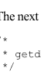

接下来的程序从数据库中检索一个值并显示出来。

```c
/*
 * getdb.c -- Get a record from a Berkeley DB database
 */
#include <stdlib.h>
#include <stdio.h>
#include <errno.h>
#include <string.h>
#include "db.h"

int main(void)
{
    DB *db;
    int ret;
    DBT key, value;

    ret = db_open("test.db", DB_BTREE,
                  DB_CREATE, 0600, NULL, &db);
    if(ret) {
        perror("db_open");
        exit(EXIT_FAILURE);
    }

    /* Initialize the key/value pair first */
    memset(&key, 0, sizeof(key));
    memset(&value, 0, sizeof(value));

    /* Set the values for key, value */
    key.data = "one";
    key.size = strlen("one") + 1;
    /* Store it */
    ret = db->get(db, NULL, &key, &value, 0);
    if(ret == DB_NOTFOUND)
        fprintf(stderr, "key %s not found\n", (char *)key.data);
    else if(ret)
        perror("get");
    else
        printf("data is %s\n", (char *)value.data);

    db->close(db, 0);
    exit(EXIT_SUCCESS);
}
```

此程序的输出结果如下：

```
$ ./getdb
data is Compiling Programs
```

为了确保 `get` 操作成功，该程序首先添加它将要获取的记录。同样，如果未找到指定的键，或者发生其他错误，程序将显示适当的错误信息并退出。否则，`get` 调用会将与 `key` 对应的数据填入 `value` 结构体中，程序随后显示该信息。

## 导航数据库

在之前的示例中，你看到了给定键值如何查找特定记录。然而，通常情况下，你不知道要查找的键是什么，或者你想遍历数据库并依次访问每个记录。Berkeley DB 维护一个逻辑指针，称为游标（cursor），你可以用它向前或向后遍历数据库。

在执行游标操作之前，你必须创建一个与数据库关联的游标。用于此目的的调用是 `cursor`，其原型如下：

```c
DB->cursor(DB *db, DB_TXN *txnid, DBC **cursorp, u_int32_t flags);
```

`cursor` 创建一个名为 `cursorp` 的游标，它引用数据库 `db`。`cursorp` 就像 `db_open` 返回的句柄一样，是一个数据库句柄，区别在于它仅用于游标相关操作。通常，`txnid` 应为 NULL。`flags` 必须始终为 0。`cursor` 返回章节开头讨论的标准 DB 错误码。

遍历数据库以及获取游标当前指向的记录，是通过 `c_get` 调用完成的，其原型如下：

```c
DBCursor->c_get(DBC *cursor, DBT *key, DBT *data, u_int32_t flags);
```

`c_get` 使用游标 `cursor` 从数据库中检索键/值对 `key/data`。该游标必须通过之前对 `DB->cursor` 的调用进行初始化。`c_get` 的常用标志列于表 10.1 中。

### 表 10.1：c_get 的常用标志

| 标志 | 含义 |
| :----- | :-------- |
| DB_FIRST | 返回数据库中的第一条记录 |
| DB_LAST | 返回数据库中的最后一条记录 |
| DB_NEXT | 返回数据库中的下一条记录（如果游标刚刚打开，则返回第一条记录） |
| DB_NEXT_DUP | 返回下一条作为当前记录重复项的记录 |
| DB_PREV | 返回数据库中的上一条记录 |
| DB_CURRENT | 返回数据库中的当前记录 |
| DB_SET | 返回数据库中匹配所提供键的记录 |
| DB_SET_RANGE | 返回大于或等于所提供键的最小记录 |

你还可以通过 `c_put` 函数使用游标向数据库添加键/值对。其原型如下：

```c
DBCursor->c_put(DBC *cursor, DBT *key, DBT *data, u_int32_t flags)
```

`c_put` 将在 `cursor` 指向的位置将 `key` 和 `value` 分别引用的键/值对存储在数据库中。`c_put` 的具体行为由 `flags` 控制，它可以是 `DB_AFTER`（在当前记录之后立即添加记录）、`DB_BEFORE`（在当前记录之前立即添加记录），或 `DB_CURRENT`（替换当前记录）。`flags` 也可以是 `DB_KEYFIRST` 或 `DB_KEYLAST`，用于创建重复键集合的第一个或最后一个键（如果数据库被配置为允许重复）。将数据库配置为允许重复键是一个高级主题，超出了本书的范围。

正如你可能预料的那样，`c_del` 调用会删除当前记录。其原型如下：

```c
DBCursor->c_del(DBC *cursor, u_int32_t flags);
```

`c_del` 从数据库中删除当前记录，返回标准错误代码；如果记录已被删除，则返回 `DB_KEYEMPTY`。

在你完成所有游标操作后，但在关闭数据库本身之前，使用 `c_close` 丢弃该游标。其原型如下：

```c
DBCursor->c_close(DBC *cursor);
```

调用 `c_close` 之后，就不能再使用该句柄。

## 同步数据库

当数据库关闭时，内存中持有的所有数据都会自动刷新到磁盘。在处理数据库期间，你可能还希望将内存中的缓存数据刷新到磁盘。用于此目的的调用是 `sync`，其原型如下：

```c
int DB->sync(DB *db, u_int32_t flags);
```

`db` 是先前调用 `db_open` 返回的数据库句柄。`flags` 当前未使用，必须设置为 0。

为什么要使用 `sync`？假设你添加和删除了大量记录。在负载较重的系统上，你应该定期调用 `sync`，以确保数据库被写入磁盘，从而防止数据丢失。将缓存数据刷新到磁盘也是防止系统崩溃或突然断电等极端情况下发生数据丢失或数据库损坏的极好方法。同样，如果你的程序为 `SIGTERM` 安装了信号处理程序，你应该调用 `sync`（可能还有 `db_close`）将数据库刷新到磁盘。

## 示例


程序 `cursor.c` 演示了简单的游标操作以及使用 `sync` 调用的过程。

```c
/*
 * cursor.c - Using a cursor in a Berkeley DB database
 */
#include <stdlib.h>
#include <stdio.h>
#include <errno.h>
#include <string.h>
#include "db.h"
```


# 第 10 章 — 使用 db 进行 C 语言编程

```c
int main(void)
{
	DB *db;
	DBC *dbc;
	DBT key, value;
	int ret;

	ret = db_open("test.db", DB_BTREE,
			DB_CREATE, 0600, NULL, NULL, &db);
	if(ret) {
		perror("dbopen");
		exit(EXIT_FAILURE);
	}

	/* Create a cursor */
	ret = db->cursor(db, NULL, &dbc, 0);
	if(ret) {
		perror("cursor");
		exit(EXIT_FAILURE);
	}
	memset(&key, 0, sizeof(key));
	memset(&value, 0, sizeof(value));

	/* Move sequentially through the database */
	while((ret = dbc->c_get(dbc, &key, &value,
		DB_NEXT)) != DB_NOTFOUND) {
		printf("key/value is %s/%s\n", (char *)key.data,
			(char *)value.data);
	}

	/* Sync the database */
	db->sync(db, 0);

	/* Close the cursor */
	dbc->c_close(dbc);

	db->close(db, 0);
	exit(EXIT_SUCCESS);
}
```

该程序的输出如下所示：


### 输出

```
$ ./cursor
key/value is five/Signals
key/value is four/Processes
key/value is one/Compiling Programs
key/value is three/About the Project
key/value is two/Controlling the Build Process
```

正如你所见，按顺序遍历数据库时，记录实际上是根据记录键排序存储的。在打开数据库并创建游标后，程序不断调用 `c_get` 从数据库中获取下一条记录，然后显示该键及其关联的值。当 `c_get` 返回 `DB_NOTFOUND` 时，表示没有更多可获取的记录。实际上并不需要调用 `sync`，因为数据没有发生任何更改，但这里包含它是为了展示其用法。请注意，在 `cursor` 关闭数据库之前，先关闭了数据库游标 `dbc`。虽然不是严格要求，但养成一种良好的习惯，确保 DB 接口分配的所有资源都正确返回给操作系统，是非常重要的。

> **注意**
> 虽然未在文中详细讨论，但我使用了该网站上提供的 addmore.c 程序向数据库中添加记录。它是本章 makefile 的一部分，因此你可以构建它以完成此示例。它会提示你每次输入五条记录。

## 接下来是什么？

本章向您介绍了 Berkeley 数据库，这是您将学习的一系列 Linux API 中的第一个。接下来的两章将展示如何使用 ncurses 控制字符模式屏幕的外观。您还将学习如何与鼠标交互、创建菜单以及绘制表单。

# 11 — 使用 ncurses 进行屏幕操作

本章介绍 ncurses（读音为“en-curses”），它是经典 UNIX 屏幕处理库 curses 的自由实现。ncurses 提供了用于屏幕控制和操作的简单高级接口。它还包含用于处理键盘和鼠标输入、创建和管理多个窗口，以及使用菜单、表单和面板的强大例程。本章的主题包括以下内容：

- ncurses 功能
- 术语和概念
- 初始化和终止例程
- 字符和字符串输出
- 字符和字符串输入

## ncurses 特性

ncurses 是“new curses”的缩写，是 Bell Labs 发行的 UNIX System V Release 4.0 (SVR4) 中附带的 curses 库的自由可再分发克隆版。“curses”这个名字源自短语“cursor optimization”，简明扼要地描述了 curses 的作用。

## 终端独立性

ncurses 概括了应用程序与其运行的屏幕或终端之间的接口。鉴于终端和屏幕有成百上千种变体，特别是它们拥有的不同功能以及调用这些功能的命令，UNIX 程序员需要一种方法来抽象屏幕操作。与其编写大量额外的代码来考虑不同的终端类型，不如说 ncurses 为程序员提供了统一且通用的接口。ncurses API 将程序员与底层硬件隔离开来。

## 能力

ncurses 为基于字符的应用程序提供了许多与图形 X Window 应用程序中发现的功能相似的特性：多个窗口、表单、菜单和面板。ncurses 的窗口可以独立管理，可以包含相同或不同的文本，可以滚动也可以不滚动，并且可以被隐藏。vi 编辑器和流行的文件管理器 Midnight Commander 都是使用 ncurses 编写的。

表单使程序员能够创建易于使用的数据输入和显示窗口，从而简化了通常困难且具有特定应用性质的编码任务。面板扩展了 curses 处理重叠和堆叠窗口的能力。通过调用应用程序选项为用户提供简单接口的菜单，可以很容易地使用 ncurses 简单通用的菜单编程接口来实现。本书使用的版本是 4.2，尽管 5.0 版本目前正处于 beta 阶段。

## 使用 ncurses 编译

要使用 ncurses 编译程序，您需要它的函数和变量定义，因此在源代码中包含 `<curses.h>`：

```c
#include <curses.h>
```

许多 Linux 系统将 `/usr/include/curses.h` 设置为指向 `/usr/include/ncurses.h` 的符号链接，因此理论上您可以包含 `<ncurses.h>`。但是，为了获得最大的可移植性，请使用 `<curses.h>`，因为尽管难以置信，但 ncurses 并不适用于所有 UNIX 和类 UNIX 平台。您还需要链接 ncurses 库，因此在链接时使用 `-lcurses` 选项，或者将 `-lncurses` 添加到 make 变量 `LDFLAGS` 或环境变量 `LDFLAGS` 中：

```
$ gcc curses_prog.c -o curses_prog -lcurses
```

默认情况下，ncurses 程序中的调试跟踪是禁用的。要启用调试，请链接 ncurses 的调试库 `libncurses_g.a`，并在代码中调用 `trace(N)` 或将环境变量 `$NCURSES_TRACE` 设置为 N，其中 N 是一个正的非零整数。这样做会将调试输出强制写入当前目录下名为 `trace` 的文件。N 的值越大，调试输出越详细，体积也就越大。`<ncurses.h>` 中记录了 N 的有用值。例如，标准跟踪级别 `TRACE_ORDINARY` 为 31。

## 示例


## 示例

1. 这是最简单的 ncurses 程序。它只是启动和停止 ncurses 子系统；不生成任何输出。

```c
/*
 * simple.c Simple ncurses program
 */
#include <curses.h>

int main(void)
{
	initscr();
	endwin();
	return 0;
}
```


### 输出

要编译并运行它，请键入以下内容：

```
$ gcc simple.c -o simple -lncurses
$ ./simple
```

2. 下一个示例使用了调试库，并进行了几次额外的函数调用来生成输出：


## 示例

```c
/*
 * debugit.c ncurses program calling trace()
 */
#include <curses.h>

int main(void)
{
	initscr();
	trace(TRACE_CALLS);
	printw("set debug level to TRACE_CALLS");
	refresh();
	endwin();
	return 0;
}
```

编译此程序的命令行如下：

```
$ gcc debugit.c -o debugit -lncurses_g
$ ./debugit
```

如果您速度真的很快，可能会看到消息在屏幕上闪烁！*trace* 调用会导致所有 ncurses 函数调用被写入当前目录中的 *trace* 文件。此处摘录了该文件的一部分：


### 输出

```
TRACING NCURSES version 4.2 (990213)
printw("set debug level to TRACE_CALLS", ...) called
called waddnstr(0x80675f8,"set debug level to TRACE_CALLS",-1)
..., current (A_NORMAL)
return 0
called wrefresh(0x80675f8)
clearing and updating from scratch
ClrDate() called
ClearScreen() called
screen cleared
updating screen from scratch
return 0
TransformLine(0) called
TransformLine(1) called
...
TransformLine(24) called
return 0
called endwin()
return 0
```

> **提示**
> ncurses 软件包附带一个名为 *tracemunch* 的脚本，可将调试信息压缩并总结为更易于阅读、对人类更友好的格式。


## 术语与概念

本节解释了在讨论 ncurses 时反复出现的一些术语和概念。

### *术语*

*屏幕*（*screen*）指的是字符或控制台模式下的物理终端屏幕。在 X Window 系统中，屏幕指的是终端模拟器窗口。*窗口*（*Window*）用于指代显示在屏幕上的一个独立矩形区域。它可能与屏幕大小相同，也可能不同。

ncurses 编程依赖于两个指向名为 WINDOWS（即 `struct WINDOW *`）数据结构的指针：`stdscr` 和 `curscr`。`stdscr` 代表你当前在屏幕上看到的内容。它可能是一个窗口，也可能是一组窗口，但它填充了整个屏幕。你可以将其视为你使用 ncurses 例程进行绘制的调色板；而 `curscr` 则包含 ncurses 对当前屏幕外观的认知。与 `stdscr` 类似，其*大小*（*size*）也是屏幕的宽度和高度。`curscr` 和 `stdscr` 之间的差异就是显示在屏幕上的变化。

*刷新*（*Refresh*）既指 ncurses 的一个函数调用，也指一个逻辑过程。*刷新*（*refresh*）函数将 `curscr`（ncurses 对当前屏幕外观的认知）与 `stdscr` 进行比较，将 `stdscr` 和 `curscr` 之间的任何差异复制到光标处，然后将这些更新显示在屏幕上。刷新也指更新屏幕的过程。

*光标*（*Cursor*）与刷新类似，具有两个相似的含义，但始终指下一个字符将要显示的位置。在屏幕上（物理屏幕），光标指的是物理光标的位置。在窗口中（一个 ncurses 窗口），光标指的是下一个字符将要显示的逻辑位置。在本章中，通常适用第二种含义，ncurses 使用一个 $(\mathrm{x}, \mathrm{y})$ 有序对在窗口上定位光标。

### *窗口布局*

ncurses 合理且可预测地定义了窗口布局。窗口的排列方式是：左上角的坐标为 $(0,0)$，右下角的坐标为 (LINES-1, COLUMNS-1)，如图 11.1.1 所示。

ncurses 维护两个全局变量 LINES 和 COLS，它们分别包含 ncurses 认为当前窗口大小的行数和列数。然而，最好使用函数调用 `getmaxyx` 来获取你当前正在处理的窗口的大小，而不是使用这些全局变量。


图 11.1：ncurses 的窗口布局。

### *示例*


本示例使用 `getmaxyx` 来显示当前窗口有多少行和列。

```c
/*
 * cols.c 有多少行和列？
 */
#include <curses.h>

int main(void)
{
   int x, y;

   initscr();
   getmaxyx(stdscr, y, x);
   printf("最大行数 = %d\n", y);
   printf("最大列数 = %d\n", x);
   refresh();
   sleep(3);
   endwin();
   return 0;
}
```

该程序创建的窗口如图 11.2 所示。

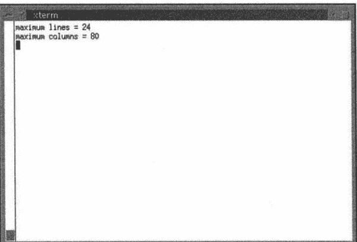

图 11.2：getmaxyx 返回窗口的最大行数和列数。

## 函数命名约定

虽然许多 `ncurses` 函数被定义为默认使用 `stdscr`，但会有许多情况你希望操作除了 `stdscr` 以外的窗口。`ncurses` 对可以应用于任意窗口的例程使用了一套系统化且一致应用的命名约定。可以操作任意窗口的函数以字符 'w' 为前缀，并取一个 (WINDOW *) 变量作为其第一个参数。

例如，`move` 调用是在 `stdscr` 上移动光标，可以用 `wmove` 替代，后者是在特定窗口上移动光标。

> **注意**
> 实际上，大多数适用于 `stdscr` 的函数都是伪函数。它们是 `#defined` 预处理宏，在调用特定窗口函数时将 `stdscr` 作为默认窗口。这是一个实现细节，你无需为此费心，但它可能帮助你更好地理解 `ncurses` 库。快速执行 `grep '#define' /usr/include/ncurses.h` 将揭示 `ncurses` 使用宏的范围，并且也是预处理器用法的良好示例。

同样，许多 `ncurses` 输入和输出函数具有结合移动和 I/O 操作于单一调用的形式。这些函数在函数名称前加上 `mv`，并在参数列表前加上所需的 (y, x) 坐标。因此，例如，`move` 后接 `addchstr` 可以结合创建为 `mvaddchstr`。

你此时可能已经猜到，也存在将 I/O 和针对特定窗口的移动相结合的函数。因此，`wmove` 和 `waddchstr` 等同于 `wvwaddchstr`（注：原文此处逻辑可能有误，通常 `wmove`+`waddchstr` 对应 `mvwaddchstr`，但此处依原文直译其表述意图：即这些缩写形式在 ncurses 中很常见）。

这种简写形式渗透在 `ncurses` 中。该约定很简单，并且使得代码行数更少。

## 示例


1. 第一个示例展示了作用于 `stdscr` 的 `move` 如何变成作用于任意窗口的 `wmove`。函数

   ```c
   move(y, x);
   ```

   等同于

   ```c
   wmove(stdscr, y, x);
   ```

   

2. 此示例展示了 `move` 和 `addchstr` 如何变为一个单一函数。两个调用

   ```c
   move(y, x);
   addchstr(str);
   ```

   等同于单个调用：

   ```c
   mvaddchstr(y, x, str);
   ```

   

3. 以下代码片段演示了 `wmove` 和 `waddchstr` 的组合。两个调用

   ```c
   wmove(some_win, y, x);
   waddchstr(some_win, str);
   ```

   等同于单个调用

   ```c
   mvwaddchstr(some_win, y, x, str)
   ```

## **初始化和终止**

在使用 ncurses 之前，你必须正确初始化 ncurses 子系统，设置各种 ncurses 数据结构，并查询底层终端的显示能力和特性。

**ncurses 初始化**

`initscr` 和 `newterm` 函数处理 ncurses 的初始化需求。`initscr` 有两个任务：创建并初始化 `stdscr` 和 `curscr`，以及通过查询 terminfo 或 termcap 数据库来了解终端的能力和特性。如果它无法完成其中一项任务，或者发生其他错误，`initscr` 会显示有用的诊断信息并终止应用程序。例如，如果 `$TERM` 环境变量未设置为 ncurses 识别的终端类型，`initscr` 将会失败。在这种情况下，`initscr` 会以错误消息“Error opening terminal: unknown.”中止。

在使用任何操纵 `stdscr` 或 `curscr` 的其他例程之前调用 `initscr`。这样做失败会导致你的应用程序以段错误中止。然而，仅在确定你需要它时才调用 `initscr`，例如在检查程序启动错误的其他例程之后。改变终端状态的函数，如 *cbreak* 或 *noecho*，应在 *initscr* 返回后调用。*initscr* 返回后对 *refresh* 的第一次调用将清除屏幕。如果调用成功，*initscr* 返回指向 *stdscr* 的指针，你可以保存以便日后使用；否则，调用返回 NULL 并退出程序，同时在显示上打印有用的错误消息。

如果你的程序将向多个终端发送输出或从多个终端接收输入，请改用 *newterm* 函数调用代替 *initscr*。对于每个预期交互的终端，调用一次 *newterm*。

*newterm* 返回指向类型为 *SCREEN* 的 C 数据结构的指针（另一种由 ncurses 定义的类型），该指针在引用该终端时使用。在你能够向此类终端发送输出或从该类终端接收输入之前，你必须将其设为当前终端。*set_term* 调用实现了这一点。将 *SCREEN* 的指针（由之前的 *newterm* 调用返回）作为 *set_term* 的参数传入，该 *SCREEN* 是你想要设为当前终端的那个。

## 示例


此程序 *initcurs* 展示了使用 *initscr* 和 *endwin* 的标准 ncurses 初始化和终止惯例。图 11.3 显示了该程序创建的窗口。

```c
/*
 * initcurs.c curses 初始化和终止
 */
#include <stdlib.h>
#include <curses.h>

int main(void)
{
    if ((initscr() == NULL)) {
        perror("initscr");
        exit(EXIT_FAILURE);
    }
    printw("这是一个 ncurses 窗口\n");
    refresh();
    sleep(3);

    printw("现在要告别了\n");
    refresh();
    sleep(3);
}
```


### **输出**

必要的函数声明和变量定义在 <curses.h> 中声明。由于没有启动代码，需要通过调用 initscr 来初始化 ncurses 的数据结构。（通常，你会希望保存它返回的 WINDOW * 以便后续使用。）使用 printfw 函数（将在下一节中详细介绍），程序在调用 refresh 之后会向窗口显示一些输出，这样输出才会实际显示在屏幕上。经过三秒的暂停后，将在下一节“ncurses 终止”中介绍的 endwin 调用将终止程序并释放 initscr 分配的资源。

```
endwin();
exit(0);
}
```


```
$ ./initcurs
```


### ncurses 终止

在退出基于 ncurses 的应用程序之前，您需要返回 ncurses 分配的内存资源，并将终端重置为其原始的、非 ncurses 状态。初始化函数会分配内存资源，并将终端状态重置为对 ncurses 友好的模式。

相应地，您需要释放已分配的内存，并将终端重置为 pre-ncurses 模式。终止函数 endwin 和 delscreen 完成了这项工作。当您使用完一个 SCREEN 后，在将另一个终端设置为当前终端之前，请调用 endwin，然后调用 delscreen 以释放分配给该终端的 SCREEN 资源，因为 endwin 不会释放由 newterm 创建的屏幕的内存。

然而，如果您没有调用 *newterm*，而只使用了 *curscr* 和 *stdscr*，那么在退出前只需调用一次 *endwin* 即可。*endwin* 将光标移动到屏幕的左下角，并将终端重置为非可视化的、pre-*ncurses* 状态。分配给 *curscr* 和 *stdscr* 的内存没有被释放，因为您的程序可以通过调用 *endwin* 暂时挂起 *ncurses*，执行其他处理，然后调用 *refresh* 来恢复屏幕。

## 示例


下面这个示例程序 *newterm* 演示了使用 *newterm* 和 *delscreen* 进行 *ncurses* 初始化和终止。

```
/*
 * newterm.c -curses initialization and termination
 */
#include <stdlib.h>
#include <curses.h>

int main(void)
{
    SCREEN *scr;

    if((scr = newterm(NULL, stdout, stdin)) == NULL) {
        perror("newterm");
        exit(EXIT_FAILURE);
    }

    if(set_term(scr) == NULL) {
        endwin();
        delscreen(scr);
        perror("set_term");
        exit(EXIT_FAILURE);
    }

    printf("This curses window created with newterm\n");
    refresh();
    sleep(3);

    printf("Going bye-bye now\n");
    refresh();
}

    sleep(3); 
    endwin(); 
    delscreen (scr); 
    exit(0);
```

该程序的输出与图 11.3 非常相似。在这个程序中，newterm 初始化了 curses 子系统，假装正在与另一个终端交互。然而，输入和输出仍然会来自并去往标准位置，因此 stdout 和 stdin 分别是 outfd 和 infd 的 FILE 指针。

但是，在程序使用 scr 之前，必须先将其设置为当前终端，因此需要调用 set_term。如果调用失败，您必须确保调用 endwin 和 delscreen 以释放与 scr 相关的内存，因此在调用 err_quit 之前增加了相应的代码。在向“终端”发送一些输出后，程序使用必需的 delscreen 调用关闭 curses 子系统。

### 输出

ncurses 有许多用于向屏幕和窗口发送输出的函数。重要的是要理解，C 语言的标准输出例程不能与 ncurses 的窗口一起使用，因为 ncurses 接管了终端上的输出。幸运的是，ncurses 的 I/O 例程与标准 I/O（<stdio.h>）例程的行为非常相似，因此学习曲线相对平缓。就本讨论而言，ncurses 的输出例程被分为字符、字符串和杂项类别。以下各节将详细讨论这些类别中的每一个。

## 字符输出

ncurses 的核心字符输出函数是 addch，其原型在 <ncurses.h> 中定义为 int addch (chtype ch);

几乎所有其他输出函数都通过调用 addch 来完成工作。它在当前窗口（通常是 stdscr）的光标当前位置显示字符 ch，并将光标推进到下一个位置。如果这样做会导致光标越过右边界，光标会自动换行到下一行的开头。如果光标位于窗口的底部，它会向上滚动一行。如果 ch 是制表符、换行符或退格符，光标会相应移动。其他控制字符使用 ~X 符号表示，其中 X 是该字符，插入符（~）表示它是一个控制字符。如果您需要发送字面控制字符，请使用函数 `echochar(ctype ch)`。

> **注意**
> ncurses 文档将在 `ctype` 格式中键入的字符称为“伪字符”。ncurses 将伪字符声明为无符号长整数，利用这些字符的高位来携带附加信息，例如视频属性。伪字符和普通 C 字符（char 类型）之间的区别意味着处理每种类型的函数在行为上存在细微差异。本章在适当的时候和地点会指出这些差异。

如前所述，`mvaddch` 在将光标移动到所需位置后向指定窗口添加一个字符；`mvwaddch` 结合了针对特定窗口的移动和输出操作，`waddch` 在用户指定的窗口中显示一个字符。`echochar` 函数及其针对特定窗口的对应函数 `wechochar` 将一次 `addch` 调用与一次 `refresh` 或 `wrefresh` 调用结合在一起。当与非控制字符一起使用时，这种组合可以带来显著的性能提升。

使用 `ctype` 字符和字符串（接下来讨论）的 ncurses 例程的一个特别有用的功能是，在显示之前，可以逻辑“或”（OR）各种视频属性与要输出的字符或字符串。这些属性的部分列表包括：

- `A_NORMAL`—正常显示模式
- `A_STANDOUT`—使用终端的最佳突出显示模式
- `A_UNDERLINE`—下划线
- `A_REVERSE`—使用反视频
- `A_BLINK`—闪烁文本
- `A_DIM`—半强度显示
- `A_BOLD`—额外强度显示
- `A_INVIS`—字符将不可见
- `A_CHARTEXT`—创建一个位掩码来提取字符

然而，取决于终端模拟器或屏幕的硬件功能，并非所有属性都可能可行或一定会正确显示。有关更多详细信息，请参阅 `curs_attr(3)` 手册页。

除了控制字符和增强了视频属性的字符外，字符输出函数还显示行图字符（来自 ASCII 字符集高半部分的字符，128–255），例如绘框字符和各种特殊符号。完整的列表可在 `curs_addch(3)` 手册页中找到。这里列出了几个常见的行图字符：

- `ACS_ULCORNER`—左上角
- `ACS_LLCORNER`—左下角
- `ACS_URCORNER`—右上角
- `ACS_LRCORNER`—右下角
- `ACS_HLINE`—水平线
- `ACS_VLINE`—垂直线

到目前为止描述的函数有效地向窗口“追加”字符，而不扰乱已存在其他字符的位置。另一组例程将字符插入现有窗口文本中的任意位置。这些函数包括 `insch`、`winsch`、`mvinsch` 和 `mvwinsch`。

遵循本章前面讨论的命名约定，这些函数中的每一个都在光标下方的字符之前（前面）插入一个字符，并将后续字符向右移动一个位置。如果最右边的字符位于右边界上，它将丢失。然而，请注意，插入操作后光标位置不变。插入操作在 `curs_insch(3)` 手册页中有完整记录。上述函数的原型如下列表所示：

```
int addch ( chtype ch );
int waddch ( WINDOW *win, chtype ch );
int mvaddch ( int y, int x, chtype ch );
int mvwaddch ( WINDOW *win, int y, int x, chtype ch );
int echochar ( chtype ch );
int wechochar ( WINDOW *win, chtype ch );
int insch ( chtype ch );
int winsch ( chtype ch );
int mvinsch ( int y, int x, chtype ch );
int mvwinsch ( WINDOW *win, int y, int x, chtype ch );
```

除非另有说明，所有返回整数的函数在成功时返回 OK，在失败时返回 ERR（OK 和 ERR 分别是定义在 `ncurses.h` 中的常数之一）。参数 win、y、x 和 ch 分别是显示字符的窗口、定位光标的 y 和 x 坐标，以及要显示的字符（包括可选属性）。


提醒一下，以“w”为前缀的例程会接受一个指针参数 `win`，用于指定目标窗口；“mv”前缀则将向 `(y, x)` 位置移动的运算与输出运算组合在一起。

## 示例


## 示例

下面的程序演示了 ncurses 中一些字符输出函数的用法。图 11.4 展示了 ncurses 的字符输出效果。

接下来的程序展示了本节讨论的许多例程可能的使用方式。为了简略示例，初始化和终止代码被移入了单独的文件 `utilfcns.c`。包含接口的头文件 `utilfcns.h` 也被包含进来。（这两个文件都位于伴随本书的网站中。）

```c
/*
 * curshar.c - ncurses character output functions
 */
#include <stdlib.h>
#include <curses.h>
#include <errno.h>
#include "utilfcns.h"

int main(void)
{
    app_init();

    addch('X');
    addch('Y' | A_REVERSE);
    mvaddch(2, 1, 'Z' | A_BOLD);
    refresh();
    sleep(3);

    clear();
    waddch(stdscr, 'X');
    waddch(stdscr, 'Y' | A_REVERSE);
    mvwaddch(stdscr, 2, 1, 'Z' | A_BOLD);
    refresh();
    sleep(3);

    app_exit();
}
```

### 输出

```bash
$ ./cursechar
```

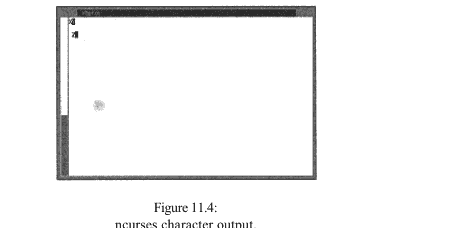

`addch` 例程会输出所需的字符并推进光标。这两个 `waddch` 调用示例展示了如何将视频属性与字符结合进行显示。代码还演示了典型的带“mv”前缀的函数。刷新屏幕后，短暂的停顿以便查看输出。程序的后半部分展示了如何使用针对特定窗口的例程，其中使用 `stdscr` 作为目标窗口。

## 字符串输出

ncurses 的字符串例程通常与字符例程的行为相似，除了它们处理的是伪字符字符串或标准的以空字符终止的字符串。同样，ncurses 的设计者创建了一套标准命名法，以帮助程序员区分这两类函数。函数名中包含 `cstr` 的函数操作伪字符字符串，而仅包含 `str` 的函数使用标准 C 风格（空字符终止）字符串。操作伪字符字符串的函数的部分列表包括：

```c
int addchstr(const chtype *chstr);
int addchnstr(const chtype *chstr, int n);
int waddchstr(WINDOW *win, const chtype *chstr);
int waddchnstr(WINDOW *win, const chtype *chstr, int n);
int mvaddchstr(int y, int x, const chtype *chstr);
int mvaddchnstr(int y, int x, const chtype *chstr, int n);
int mvwaddchstr(WINDOW *win, int y, int x, const chtype *chstr);
int mvwaddchnstr(WINDOW *win, int y, int x, const chtype *chstr, int n);
```

列出的所有函数都将 `chstr` 复制到指定窗口，起始位置为当前光标处，但光标不会前进（这与字符输出函数不同）。如果字符串无法放入当前行，它会在右边缘处被截断。那四个接受 `int n` 参数的例程——`addchnstr`、`waddchnstr`、`mvaddchnstr` 和 `mvwaddchnstr`——复制的字符数量上限为 `n`，并在右边缘处停止。如果 `n` 为 -1，则复制整个字符串，但如有必要，会在右边缘处截断。

下一组字符串输出函数操作空字符终止的字符串。与上一组不同，这些函数会使光标前进。此外，字符串输出会在右边缘处换行，而不是被截断。除此之外，这些调用与同名对应的 `chstr` 函数行为类似。

```c
int addstr(const char *str);
int addnstr(const char *str, int n);
int waddstr(WINDOW *win, const char *str);
int waddnstr(WINDOW *win, const char *str, int n);
int mvaddstr(int y, int x, const char *str);
int mvaddnstr(int y, int x, const char *str, int n);
int mvwaddstr(WINDOW *win, int y, int x, const char *str);
int mvwaddnstr(WINDOW *win, int y, int x, const char *str, int n);
```

请记住，在这些例程中，`str` 是一个标准的、C 风格的、以空字符终止的字符数组。

## 示例


## 示例

该示例程序演示了字符串输出函数的使用。

```c
/*   cursstr.c - ncurses string output functions   */
#include <stdlib.h>
#include <curses.h>
#include <errno.h>
#include "utilfcns.h"

int main(void)
{
    int xmax, ymax;
    WINDOW *tmpwin;

    app_init();
    getmaxyx(stdscr, ymax, xmax);

    addstr("Using the *str() family\n");
    hline(ACS_HLINE, xmax);
    mvaddstr(3, 0, "This string appears in full\n");
    mvaddnstr(5, 0, "This string is truncated\n", 15);
    refresh();
    sleep(3);

    if((tmpwin = newwin(0, 0, 0, 0)) == NULL)
        err_quit("newwin");

    mvwaddstr(tmpwin, 1, 1, "This message should appear in a new window");
    wborder(tmpwin, 0, 0, 0, 0, 0, 0, 0);
    touchwin(tmpwin);
    wrefresh(tmpwin);
    sleep(3);

    delwin(tmpwin);
    app_exit();
}
```

`getmaxyx` 调用获取 `stdscr` 的列数和行数——该例程通常以宏形式实现，因此其调用语法不要求 `ymax` 和 `xmax` 为指针。`mvaddnstr` 调用中取 `n=15` 的值，强制使打印的字符串在“truncated”一词的字母 "l" 之前被截断。接下来，程序创建一个新窗口 `tmpwin`，其尺寸与当前屏幕相同。然后在新窗口中写入一条消息，在其周围绘制边框，并调用刷新将其显示在屏幕上。在退出之前，对窗口调用 `delwin` 可释放其资源。

该程序的输出效果如图 11.5 和 11.6 所示。

### 输出

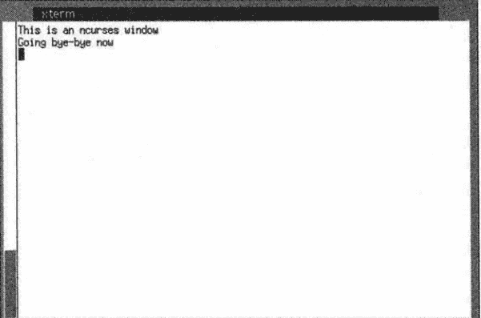

图 11.5：ncurses 的 *str() 输出函数。


图 11.6：窗口中的字符串输出。

## 其他输出

下一组也是最后一组需要讨论的输出例程，包含了一堆用于绘制边框和线条、清除和设置背景、控制输出选项、移动光标以及向 ncurses 窗口发送格式化输出的调用。ncurses 的“其他”输出例程涵盖各种调用。本节讨论其中最常用的那些。

首先，要设置窗口的背景属性，请使用设置背景调用 `bkgd`，其原型如下：

```c
int bkgd(const chtype ch);
```

`ch` 是你想显示的字符与之前列出的一个或多个视频属性的逻辑或组合。要获取当前背景设置，请调用：

```c
chtype getbkgd(WINDOW *win);
```

其中 `win` 是指定的窗口。有关设置和获取窗口背景的函数的完整说明，可在 `curs_bkgd(3)` 手册页中找到。

至少有 11 个 ncurses 函数在 ncurses 窗口中绘制方框、边框和线条。`box` 调用最简单；它使用一个字符绘制垂直线，另一个字符绘制水平线，从而围绕指定窗口绘制一个方框。其原型列于此：

```c
int box(WINDOW *win, chtype verch, chtype horch);
```

`verch` 设置用于绘制垂直线的伪字符，`horch` 则设置用于绘制水平线的伪字符。

`box` 调用实际上是一个宏，是更通用的 `wborder` 函数的简写：

```c
int border(WINDOW *win, chtype ls, chtype rs, chtype ts, chtype bs,
           chtype tl, chtype tr, chtype bl, chtype br);
```

参数如下：

- `ls`—左侧
- `rs`—右侧
- `ts`—顶部
- `bs`—底部
- `tl`—左上角
- `tr`—右上角
- `bl`—左下角
- `br`—右下角

`box` 和 `wborder` 调用都会在窗口左侧、右侧、顶部和底部边缘绘制轮廓。

使用 `hline` 函数在当前窗口上绘制任意长度的水平线；`vline` 类似地绘制任意长度的垂直线。

```c
int hline(chtype ch, int n);
int vline(chtype ch, int n);
```

遵循 ncurses 的函数命名惯例，你还可以使用此处列出的函数指定绘制线条的窗口：

```c
int whline(WINDOW *win, chtype ch, int n);
int wvline(WINDOW *win, chtype ch, int n);
```


如果需要，你可以在绘制线条前使用以下函数将光标移动到特定位置：

```c
int mvhline(int y, int x, chtype ch, int n);
int mvwline(int y, int x, chtype ch, int n);
```

你甚至可以指定一个窗口，并使用这两个函数请求移动操作：

```c
int mvwhline(WINDOW *win, int y, int x, chtype ch, int n);
int mvwvline(WINDOW *win, int y, int x, chtype ch, int n);
```

与往常一样，这些例程成功时返回 OK，失败时返回 ERR；win 指示目标窗口；n 指定最大线条长度，垂直或水平方向上不超过窗口最大尺寸。线条、边框和边框绘制函数不会改变光标位置。后续的输出生成操作可能会覆盖边框，因此你必须确保包含维护边框完整性的调用，或者设置输出生成调用，使其不覆盖边框。

未明确设置光标位置的函数（line、vline、whline 和 wvline）会从当前光标位置开始绘制。记录这些例程的手册页是 curs_border(3)。curs_outopts(3) 页面也包含相关信息。

最后一组需要考虑的杂项函数用于清除屏幕的全部或部分。与往常一样，它们既有普通版本，也有窗口特定版本：

```c
int erase(void);
int werase(WINDOW *win);
int clear(void);
int wclear(WINDOW *win);
int clrtobot(void);
int wclrtobot(WINDOW *win);
int clrtoeol(void);
int wclrtoeol(WINDOW *win);
```

erase 向窗口中的每个位置写入空白；clrtobot 清除屏幕从当前光标位置到窗口底部的区域（包括底部）；最后，clrtoeol 擦除从光标位置到右边距的当前行（包括右边距）。

如果你使用过 bkgd 或 wbkgd 来设置将被清除或擦除的窗口背景属性，那么该属性集（在 ncurses 文档中称为“显示属性”）将应用于每个生成的空白字符。这些调用的相关手册页是 `curs_clear(3)`。

## 示例


此程序展示了如何使用线条图形字符以及 `box` 和 `wborder` 调用。有些 ncurses 输出生成例程在输出后会移动光标，有些则不会。注意，线条绘制函数族（如 `vline` 和 `hline`）按从上到下、从左到右的顺序绘制，因此在使用时需注意光标位置。

```c
/*
 * cursbox.c - ncurses box drawing functions
 */
#include <stdio.h>
#include <curses.h>
#include <errno.h>
#include "utilfcn.h"

int main(void)
{
    int ymax, xmax;

    app_init();
    getmaxyx(stdscr, ymax, xmax);

    mvaddch(0, 0, ACS_ULCORNER);
    hline(ACS_HLINE, xmax - 2);
    mvaddch(ymax - 1, 0, ACS_LLCORNER);
    hline(ACS_HLINE, xmax - 2);
    mvaddch(0, xmax - 1, ACS_URCORNER);
    vline(ACS_VLINE, ymax - 2);
    mvvline(1, xmax - 1, ACS_VLINE, ymax - 2);
    mvaddch(ymax - 1, xmax - 1, ACS_LRCORNER);
    mvprintw(ymax / 3 - 1, (xmax - 30) / 2, "border drawn the hard way");
    refresh();
    sleep(3);

    clear();
    box(stdscr, ACS_VLINE, ACS_HLINE);
    mvprintw(ymax / 3 - 1, (xmax - 30) / 2, "border drawn the easy way");
    refresh();
    sleep(3);

    clear();
    wborder(stdscr, ACS_VLINE | A_BOLD,
ACS_VLINE | A_BOLD, ACS_HLINE | A_BOLD,
ACS_HLINE | A_BOLD, ACS_ULCORNER | A_BOLD,
ACS_URCORNER | A_BOLD, ACS_LLCORNER | A_BOLD,
ACS_LRCORNER | A_BOLD);
    mvprintw(ymax / 3 - 1, (xmax - 25) / 2, "border drawn with wborder");
    refresh();
    sleep(3);

    app_exit();
}
```

图 11.7 和图 11.8 展示了此程序的输出。


### 输出


图 11.7：使用线条绘制的边框。

正如你可能预期的那样，`mvvline` 调用在绘制垂直线之前会移动光标。在经历了一番绘制简单边框的复杂操作后，box 例程使用起来轻而易举。`wborder` 函数比 `box` 更冗长，但它允许对用于绘制边框的字符进行更细致的控制。示例展示了每个参数的默认字符，但任何字符（和可选的视频属性）都可以，只要底层仿真器或视频硬件支持即可。

### 输出


## 输入例程

ncurses 输入例程与输出生成例程类似，也分为若干组。然而，本章侧重于简单的字符和字符串输入，原因有两个。首先且最重要的是，本节讨论的例程将满足你 90% 的需求。其次，ncurses 输入与 ncurses 输出紧密对应，因此前一节的内容应能作为一个坚实的基础。

### 字符输入

核心输入功能可简化为三个：`getch`、`getstr` 和 `scnwin`。`getch` 的原型是

```c
int getch(void);
```

`getch` 从键盘获取单个字符，成功时返回该字符，失败时返回 `ERR`。它是否将获取的字符回显到 `stdscr` 取决于回显功能是启用还是禁用（因此，`wgetch` 及其变体也从键盘获取单个字符，并根据情况回显到程序指定的窗口）。若要回显字符，首先调用 `echo`；若要禁用回显，调用 `noecho`。注意，当回显启用时，字符使用 `waddch` 在当前光标位置显示在窗口上，然后光标位置前进一位。

当前输入模式使事情变得更加复杂，该模式决定了内核在程序接收字符之前对输入进行多少处理。在 ncurses 程序中，通常希望自行处理大部分按键。这样做需要 `c` 模式或 raw 模式。（ncurses 以默认模式开始，这意味着内核通过等待换行符来缓冲文本，然后再将按键传递给 ncurses——你很少需要这种模式。）

在 *raw 模式*中，内核不对输入进行缓冲或其他处理；而在 *cormode*中，内核处理终端控制字符，如 ^S、^Q、^C 或 ^Y，并将其他字符未经修改地传递给 ncurses。在某些系统上，字面上的“下一个字符”^V 可能需要重复。根据你的应用程序需求，*cormode* 应该就足够了。在下面的示例程序中，有一个使用了 *cormode* 并启用/禁用 *回显*，以模拟隐藏密码输入。

## 示例


此程序使用 *cormode* 和 *noecho* 来模拟密码检查程序。

```c
/*
 * cursinch.c - ncurses character input functions
 */
#include <stdlib.h>
#include <curses.h>
#include <errno.h>
#include "utilfcns.h"

int main(void)
{
    int c, i = 0;
    int xmax, ymax;
    char str[80];
    WINDOW *pwin;

    app_init();
    cormode();
    getmaxyx(stdscr, ymax, xmax);
    if((pwin = subwin(stdscr, 3, 40, ymax / 3,
        (xmax - 40) / 2 )) == NULL)
        err_quit("subwin");
    box(pwin, ACS_VLINE, ACS_HLINE);
    mvwaddstr(pwin, 1, 1, "Password: ");

    noecho();
    while((c = getch()) != '\n' && i < 80) {
        str[i++] = c;
        waddch(pwin, '*');
        wrefresh(pwin);
    }
    echo();
    str[i] = '\0';
    wrefresh(pwin);

    mvwprintw(pwin, 1, 1, "You typed: %s\n", str);
    box(pwin, ACS_VLINE, ACS_HLINE);
    wrefresh(pwin);
    sleep(3);

    delwin(pwin);
    app_exit();
}
```

此程序创建的屏幕如图 11.9 和 11.10 所示。

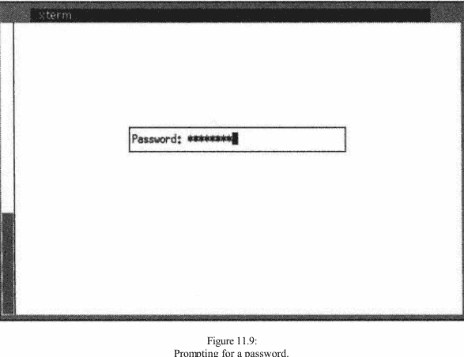

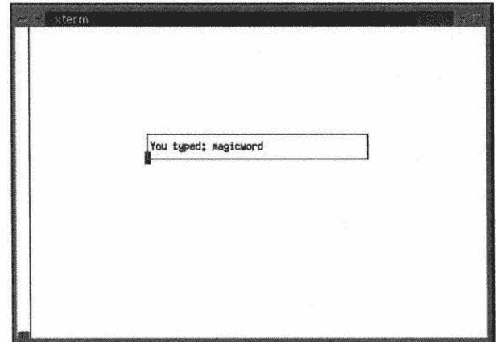

图 11.10 ncurses 的 noecho 模式。

### 字符串输入

`getstr` 函数声明为

```c
int getstr(char *str);
```

反复调用 `getch`，直到遇到换行符或回车符（这部分不会包含在返回的字符串中）。输入的字符存储在 `str` 中。由于 `getstr` 不进行边界检查，你应该使用 `getnstr`，它接受一个额外参数，指定要存储的最大字符数。无论使用 `getstr` 还是 `getnstr`，接收缓冲区 `str` 必须足够大，以容纳接收到的字符串加上一个终止空字符（必须通过编程添加）。`getnstr` 的原型如下：

```c
int getnstr(char *str, int n);
```

`getnstr` 最多从 `stdscr` 复制 `n` 个字符到 `str` 指向的缓冲区。超过 `n` 个字符的输入会发出蜂鸣声。

`scanw` 以 `scanf(3)` 及其家族的方式从键盘获取格式化输入。事实上，ncurses 将接收到的字符作为输入传递给 `sscanf(3)`，因此不匹配格式字段中可用参数的输入会被丢弃。与往常一样，`scanw` 有用于移动操作的变体（"mv" 前缀）和适用于特定窗口的变体（"w" 前缀）。此外，`scanw` 函数族包含一个处理可变长度参数列表的成员，即 `vwscanw`。相关原型如下：

```c
int scanw(char *fmt [, arg] . . . );
int vwscanw(WINDOW *win, char *fmt, va_list varglist);
```

手册页 `curs_getch(3)`、`curs_getstr(3)` 和 `curs_scanw(3)` 完整记录了这些例程及其各种变体。

## 示例


```c
/*
 * cursgstr.c - ncurses string input functions
 */
#include <stdlib.h>
#include <curses.h>
#include <errno.h>
#include <string.h>
#include "utilfcns.h"

#define BUFSSZ 20
```


```c
int main(int argc, char *argv[])
{
    int c, i = 0;
    char str[20];
    char *pstr;

    app_init();
    crmode();

    printw("File to open: ");
    refresh();
    getnstr(str, BUFSZ);
    printw("You typed: %s\n", str);
    refresh();
    sleep(3);

    if((pstr = malloc(sizeof(char) * BUFSZ + 1)) == NULL)
        err_quit("malloc");

    printw("Enter your name: ");
    refresh();
    getnstr(pstr, 20);
    printw("You entered: %s\n", pstr);
    refresh();
    sleep(3);

    free(pstr);
    app_exit();
}
```

图 11.11 展示了该程序的运行效果。

在本程序中，Echong（回显）功能保持启用状态，因为用户通常希望看到自己正在输入的内容。该程序首先使用 `getstr` 来获取要打开的文件名。在一个“真实的”程序中，你会尝试打开用户输入名称对应的文件。`getnstr` 展示了当你尝试输入的字符串长度超过指定的长度限制 n 时，ncurses 的行为。在这种情况下，ncurses 会在用户输入 20 个字符后停止接受并回显输入，并发出蜂鸣声。

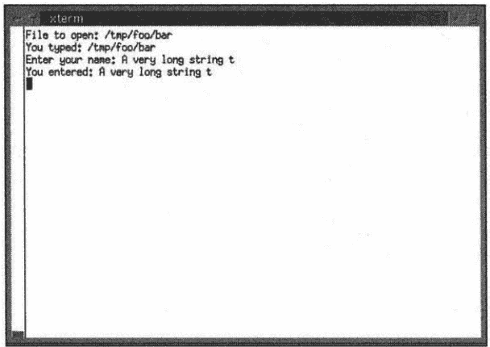

图 11.11：使用 ncurses 的字符串输入例程。

## 接下来是什么？

本章向你介绍了 ncurses API，这是一个用于控制字符模式程序屏幕的接口。尽管 Linux 是一个先进且复杂的操作系统，但它仍然有许多非常流行的基于字符的（非 GUI）应用程序，因此理解如何编写操作文本模式屏幕的应用程序非常重要。下一章将继续深入探讨 ncurses，重点介绍使用颜色、创建菜单、接收鼠标输入以及绘制表单和面板。

## 12—高级 ncurses 编程

本章承接上一章的内容。它探索了 ncurses 的许多高级功能，使你能够为你的字符模式程序创建更具吸引力和易用性的界面。本章涵盖的主题包括以下内容：

- 使用 ncurses 的颜色子系统
- 创建和操作窗口
- 与鼠标交互
- 处理菜单
- 在 ncurses 程序中使用表单

### 使用颜色

你已经看到 `ncurses` 支持各种高亮模式。有趣的是，它也以相同的方式支持颜色；也就是说，你可以将期望的颜色值逻辑或到 `addch` 调用或其他任何接受伪字符（`chtype`）参数的输出例程的字符参数中。然而，这种方法很繁琐，因此 `ncurses` 还有一套例程，用于以每个窗口为基础设置显示属性。

在使用 `ncurses` 的颜色功能之前，你必须确保当前终端支持颜色。`has_colors` 调用根据当前终端是否具有颜色能力返回 `TRUE` 或 `FALSE`。`has_colors` 的语法如下：

```c
bool has_colors(void);
```

`bool` 返回值的定义位于 `<curses.h>` 中。

`ncurses` 的默认颜色如下：

- COLOR_BLACK
- COLOR_RED
- COLOR_GREEN
- COLOR_YELLOW
- COLOR_BLUE
- COLOR_MAGENTA
- COLOR_CYAN
- COLOR_WHITE

在确定终端支持颜色后，调用 `start_color` 函数以启动 `ncurses` 的颜色子系统。其原型为：

```c
int start_color(void);
```

> **注意**
> 使用 `ncurses` 颜色例程的程序必须运行在支持颜色的终端模拟器上，例如彩色的 `xterm`、`rxvt` 或 `nxterm`。

但是，在使用颜色之前，你必须初始化一组颜色对。这样做会将颜色关联到前文列表中的颜色对。执行此操作的功能是 `init_pair`，其原型如下：

```c
int init_pair(short pair, short f, short b);
```

这将 `pair` 与前景色 `f` 和背景色 `b` 关联，成功时返回 `OK`，失败时返回 `ERR`。

与其繁琐地将颜色值或入 chtype 调用，不如使用 attron 和 attroff 调用。这两个函数的原型如下：

```c
int attron(int attrs);
int attroff(int attrs);
```

attrs 可以是颜色和视频属性的一个或多个逻辑或组合。它们都在成功时返回 OK，出错时返回 ERR。

## 示例

以下程序在屏幕上绘制彩色的线条：

```c
/*
 * color.c - curses color management
 */
#include <stdlib.h>
#include <curses.h>
#include <errno.h>
#include <unistd.h>
#include "utilcfns.h"

int main(void)
{
    int n, maxx, maxy;
    char *str;

    app_init();

    if(!has_colors()) {
        prntw("Terminal does not support color\n");
        refresh();
        sleep(3);
        exit(EXIT_FAILURE);
    }
    if(start_color() == ERR)
        err_quit("start_color");

    /* Set up some simple color assignments */
    init_pair(1, COLOR_BLACK, COLOR_BLACK);
    init_pair(2, COLOR_GREEN, COLOR_BLACK);
    init_pair(3, COLOR_RED, COLOR_BLACK);
    init_pair(4, COLOR_CYAN, COLOR_BLACK);
    init_pair(5, COLOR_WHITE, COLOR_BLACK);
    init_pair(6, COLOR_MAGENTA, COLOR_BLACK);
    init_pair(7, COLOR_BLUE, COLOR_BLACK);
    init_pair(8, COLOR_YELLOW, COLOR_BLACK);

    getmaxyx(stdscr, maxy, maxx);
    if((str = malloc(sizeof(char) * maxx)) == NULL)
        err_quit("malloc");

    for(n = 1; n <= 8; n++) {
        memset(str, ACS_BLOCK, maxx);
        attron(COLOR_PAIR(n));
        printw("%s", str);
        refresh();
    }
    sleep(3);

    app_exit();
    exit(EXIT_SUCCESS);
}
```

第一个条件确保在继续之前终端支持颜色；如果没有颜色支持，它将优雅地退出。在初始化颜色系统后，它使用 `init_pair` 进行一些简单的颜色分配。在颜色分配之后，该程序使用 `memset` 和 `attron` 设置当前窗口（在此情况下为 `stdscr`）的当前显示属性，在终端上绘制由块填充的线条。`attroff` 在移动到下一个颜色对之前关闭突出显示模式。

通常情况下，ncurses 附带了一组用于操作窗口显示属性的广泛函数。它们在 `curs_attr` 手册页中得到了完整记录。`curs_color` 手册页详细讨论了 ncurses 的颜色操作接口。

该程序的输出如图 12.1 所示。遗憾的是，图中的颜色仅显示为灰色色调。


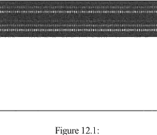

图 12.1：ncurses 在支持颜色的终端上使用颜色。

### 窗口管理

除了完全摆脱依赖终端的代码外，ncurses 的一个主要优势是能够创建和管理多个窗口，而不仅仅是 ncurses 提供的 stdscr。这些由程序员定义的窗口有两种类型：子窗口和独立窗口。本节中讨论的所有窗口操作例程都记录在 curs_window 手册页中。

> **提示**
> 除特别说明外，ncurses 处理返回代码非常一致：返回整数的函数在成功时返回 OK，失败时返回 ERR；返回指针的函数在失败时返回 NULL。

子窗口使用 *subwin* 函数调用创建。之所以称为*子窗口*，是因为它们基于现有窗口创建一个窗口。在 C 语言层面上，子窗口是指向现有 WINDOW 数据结构子集的指针的指针。该子集可以包含整个窗口，也可以仅包含部分。子窗口也称为*子*或*派生*窗口，可以独立于其父窗口进行管理，但对子窗口所做的更改会反映在父窗口中。

使用 *newwin* 调用创建新的或独立的窗口。此函数返回一个新的 WINDOW 结构体的指针，该结构体与其他窗口没有连接。对独立窗口所做的更改不会显示在屏幕上，除非明确请求。*newwin* 函数为你的编程库增添了强大的屏幕操作能力，但正如增加力量往往带来的那样，它也带来了额外的复杂性。你被要求跟踪窗口并明确地将其显示在屏幕上，而子窗口则自动在屏幕上更新。


## 子窗口

ncurses 提供了两个用于创建子窗口的函数：`subwin` 和 `derwin`：

```c
WINDOW *subwin(WINDOW *orig, int nlines, int ncols, int begin_y, int begin_x);
WINDOW *derwin(WINDOW *orig, int nlines, int ncols, int begin_y,
               int begin_x);
```

`subwin` 和 `derwin` 创建并返回一个指向窗口的指针，该窗口包含 `ncols` 列和 `nlines` 行，定位在父窗口 `orig` 的中心区域。子窗口的左上角相对于屏幕定位在 `begin_y, begin_x`，而不是相对于父窗口。`derwin` 的行为与 `subwin` 类似，只是子窗口的左上角是相对于父窗口 `orig` 定位在 `begin_y, begin_x`，而不是相对于屏幕。

## 示例


该程序创建一个子窗口，向其中写入一些文本，然后将其在父窗口上移动，从而说明子窗口如何可以独立于其父窗口进行管理。

```c
/*
 * subwin.c - curses utility routines
 */
#include <stdlib.h>
#include <curses.h>
#include <errno.h>
#include <unistd.h>
#include "utilfcn.h"

int main(void)
{
    WINDOW *win;
    int ymax, xmax, n = 0;

    app_init();

    wbkgd(stdscr, 'X');
    wrefresh(stdscr);
    if ((win = subwin(stdscr, 10, 10, 0, 0)) == NULL)
        err_quit("subwin");
    wbkgd(win, ' ');
    wprintw(win, "\n#SUBWINDOW\n");
    wrefresh(win);
    sleep(1);

    getmaxyx(stdscr, ymax, xmax);
    while(n < xmax - 10) {
        mvwin(win, ((ymax - 10) / 2), n);
        refresh();
        sleep(1);
        n += 7;
    }

    delwin(win);
    app_exit();
    exit(EXIT_FAILURE);
}
```

首先，父窗口被绘制为 X，然后创建一个空白的 10x10 子窗口。在子窗口中打印 SUBWINDOW 后，代码的最后部分将其在父窗口上移动。请注意，由于子窗口的内容从未改变，因此只需刷新父窗口即可。由于其动态特性，图 12.2 仅显示了该程序输出的一部分。

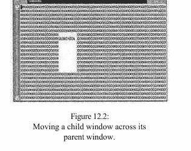

## 新窗口

如前所述，`newwin` 创建一个与其他窗口没有连接的窗口，必须独立管理。

```c
WINDOW *newwin(int nlines, int ncols, int begin_y, int begin_x);
```

`newwin` 创建并返回一个指向新窗口的指针，该新窗口包含 `ncols` 列和 `nlines` 行。新窗口的左上角定位在 `begin_y, begin_x`。如果您想复制一个现有窗口，请使用 `dupwin`，其原型如下：

```c
WINDOW *dupwin(WINDOW *win);
```

`dupwin` 返回一个指向由 `win` 指向的窗口的精确副本的指针。

## 示例


该程序的行为与上一个程序类似，只是它使用 `newwin` 而不是 `subwin` 来创建窗口。

```c
/*
 * newwin.c - curses utility routines
 */
#include <stdlib.h>
#include <curses.h>
#include <errno.h>
#include <unistd.h>
#include "utilfcn.h"

int main(void)
{
    WINDOW *win;
    int ymax, xmax;

    app_init();

    if((win = newwin(15, 30, 1, 1)) == NULL)
        err_quit("newwin");
    mvwprintw(win, 1, 1, "NEW WINDOW");
    box(win, ACS_VLINE, ACS_HLINE);
    wrefresh(win);
    sleep(1);

    mvwin(win, 5, 10);
    werase(stdscr);
    refresh();
    wrefresh(win);
    sleep(2);

    getmaxyx(stdscr, ymax, xmax);
    mvwin(win, ymax - 16, xmax - 31);
    werase(stdscr);
    refresh();
    wrefresh(win);
    sleep(2);

    delwin(win);
    app_exit();
    exit(EXIT_FAILURE);
}
```

该程序与上一个程序的主要区别在于，它创建的是新窗口，而不是派生子窗口。因此，代码必须小心确保每个窗口，即 `stdscr` 和 `win`，都得到刷新，并且按顺序刷新。代码稍微复杂一些，但也提供了更多的灵活性，因为你可以先准备一个窗口，然后通过一次 `wrefresh` 调用将其放置到位。屏幕在执行过程中会变化多次，因此图 12.3 显示了其中一个执行状态。


### 输出


图 12.3：
将一个窗口移动到另一个窗口之上。

## 使用鼠标

鼠标支持严格来说是 ncurses 对标准 curses API 的扩展。鉴于此，本节向您展示如何在 ncurses 代码中捕获和使用鼠标事件。

**提示**
由于除 ncurses 之外的环境不支持 rodent 接口，您应该确保将鼠标相关代码封装在 `#ifdef` 结构中，以便它不会在非 ncurses 系统上编译。实际上，最佳设计是将鼠标相关代码隔离在尽可能少的条件编译模块中（最好是一个）。例如，要条件编译鼠标代码，请使用类似以下结构：

```c
#ifdef NCURSES_MOUSE_VERSION
/*
 * Mouse support is available
 * Mouse code would go here
 */
#else
/*
 * Mouse support not available
 * Come up with a work-around
 */
#endif
```

如果鼠标支持可用，`ifdef` 将求值为 1（真），并且 `#ifdef` 后的代码段将执行。如果不可用，则 `#else` 后的代码块将执行。

### 鼠标接口概述

使用鼠标接口的基本程序相当简单。要启用鼠标事件报告，请调用函数 `mousemask`。在鼠标处于活动状态时，您程序的命令循环或循环应监控来自 `wgetch` 的 `KEY_MOUSE` 返回值，这表明已排队了一个鼠标事件。要从队列中拾取事件，请在下一次调用 `wgetch` 之前使用 `getmouse` 调用。

根据环境不同，您可以捕获的鼠标事件包括按键和释放；单击、双击和三击；以及可能包括 Shift、Alt 和 Ctrl 键的状态。要接收鼠标事件，您必须正在运行 `gpm(1)`（Alessandro Rubin 为 Linux 控制台编写的鼠标服务器）或 `xterm` 及类似程序（如 `rxvt`），它们通过 X 服务器报告鼠标事件。

**注意**
不幸的是，大多数随系统发行的 `gpm`（使 ncurses 的鼠标驱动程序工作的控制台鼠标驱动程序）版本都链接到了 BSD curses (`libcurses.so`)。因此，鼠标处理代码默认无法正常工作。要使其正常工作，您必须下载并重编译 ncurses 源代码发行版，然后重建 `gpm` 守护程序和库 (`libgpm`)，从而将其链接到您新构建的 ncurses。

### 检测鼠标事件

表 12.1 列出了您可以捕获的最常见的鼠标事件。完整列表可在 `curs_mouse(3)` 手册页中找到。

**表 12.1：ncurses 报告的鼠标事件**

| 事件名称 | 事件描述 |
| :--- | :--- |
| `BUTTON1_PRESSED` | 鼠标按钮 1 按下 |
| `BUTTON1_RELEASED` | 鼠标按钮 1 释放 |
| `BUTTON1_CLICKED` | 鼠标按钮 1 单击 |
| `BUTTON1_DOUBLE_CLICKED` | 鼠标按钮 1 双击 |
| `BUTTON1_TRIPLE_CLICKED` | 鼠标按钮 1 三击 |
| `BUTTON2_PRESSED` | 鼠标按钮 2 按下 |
| `BUTTON2_RELEASED` | 鼠标按钮 2 释放 |
| `BUTTON2_CLICKED` | 鼠标按钮 2 单击 |
| `BUTTON2_DOUBLE_CLICKED` | 鼠标按钮 2 双击 |
| `BUTTON2_TRIPLE_CLICKED` | 鼠标按钮 2 三击 |
| `BUTTON3_PRESSED` | 鼠标按钮 3 按下 |
| `BUTTON3_RELEASED` | 鼠标按钮 3 释放 |
| `BUTTON3_CLICKED` | 鼠标按钮 3 单击 |
| `BUTTON3_DOUBLE_CLICKED` | 鼠标按钮 3 双击 |
| `BUTTON3_TRIPLE_CLICKED` | 鼠标按钮 3 三击 |
| `BUTTON_SHIFT` | 在按钮状态改变期间 Shift 处于按下状态 |
| `BUTTON_CTRL` | 在按钮状态改变期间 Control 处于按下状态 |
| `BUTTON_ALT` | 在按钮状态改变期间 Alt 处于按下状态 |
| `ALL_MOUSE_EVENTS` | 报告所有按钮状态改变 |
| `REPORT_MOUSE_POSITION` | 报告鼠标移动 |

鼠标按钮 1 是左鼠标按钮；鼠标按钮 2 是双键鼠标的右鼠标按钮或三键鼠标的中鼠标按钮；鼠标按钮 3 是双键或三键鼠标的右鼠标按钮。


## 示例

该程序说明了在 ncurses 程序中捕获和解释鼠标事件的基本过程。

```c
/*
 * usemouse.c - Simple mouse-aware ncurses program
 */
```


## 检测鼠标位置

```c
#include <curses.h>
#include <stdlib.h>
#include <errno.h>
#include <ctype.h>
#include "utilfctns.h"

int main(void)
{
    mmask_t mask;
    MEVENT event;
    int ch;

    app_init();
    cbreak();
    keypad(stdscr, TRUE);
    mask = mousemask(ALL_MOUSE_EVENTS, NULL);
    while((toupper(ch = getch())) != 'Q') {
        if(ch == KEY_MOUSE) {
            getmouse(&event);
            switch(event.bstate) {
            case BUTTON1_CLICKED :
                printf("button 1 clicked\n");
                break;
            case BUTTON2_CLICKED :
                printf("button 2 clicked\n");
                break;
            case BUTTON3_CLICKED :
                printf("button 3 clicked\n");
                break;
            default :
                printf("untrapped mouse event\n");
            }
            refresh();
        }
    }
    noreturn();
    app_exit();
    exit(EXIT_FAILURE);
}
```

该程序设置 `cbreak` 模式，使得大多数按键序列未经内核终端驱动修改即可通过。`keypad` 为你解释由鼠标点击和其他事件生成的转义序列，而不需要你自己解码这些序列并用许多类似于 `^[(M#1)` 的符号填满你的代码。

在将鼠标事件掩码设置为捕获所有鼠标事件后，程序进入循环并等待鼠标事件的发生。仅仅按下三个按钮中的任意一个就会生成相应的消息；否则，程序将打印未捕获的鼠标事件消息。输入 q 或 Q 以关闭 `cbreak` 模式并退出。

图 12.4 显示了依次按下每个鼠标按钮，然后双击右按钮和左按钮后的输出结果。


### 输出

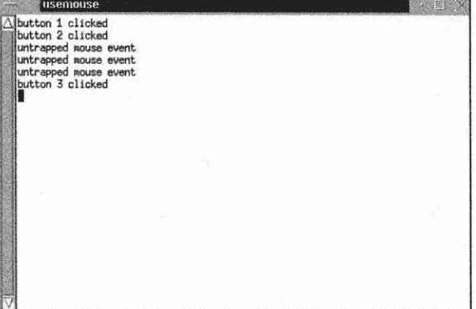

图 12.4：使用 ncurses 的鼠标接口捕获鼠标事件。

除了解释诸如单击和双击等单个鼠标事件外，ncurses 的鼠标 API 还允许你确定鼠标位于哪个窗口上方以及光标当前的坐标。

`wenclose` 函数允许你确定哪个窗口包含了鼠标事件的位置。其原型如下：

```c
bool wenclose (WINDOW *win, int y, int x);
```

如果相对于屏幕的坐标 *y* 和 *x* 位于 *win* 指定的窗口内部，**wenclose** 返回 **TRUE**；否则返回 **FALSE**。

要确定鼠标事件的坐标，请检查 MEVENT 结构体中的 x、y 和 z 成员。完整的结构体定义如下：

```c
typedef struct { 
    short id; 
    int x, y, z; 
    mmask_t bstate; 
} MEVENT;
```

根据 ncurses 文档（特别是 man curs_mouse），z 成员旨在用于触摸屏（可能具有压力敏感功能）、3D 鼠标、轨迹球和力量手套。因此，在仅处理普通鼠标的程序中使用它是不可取的。


## 示例

本示例创建了两个支持鼠标的窗口。当你在其中一个窗口中点击时，程序会显示鼠标事件发生在哪个窗口，并在相应的窗口中显示事件的坐标。

```c
/** 
 * usemouse.c - 一个简单的支持鼠标的 ncurses 程序 
 */
#include <curses.h>
#include <stdlib.h>
#include <errno.h>
#include <unistd.h>
#include <ctype.h>
#include "utilfctns.h"

int main(void)
{
    mmask_t mask;
    MEVENT event;
    WINDOW *win;
    int ch;

    app_init();

    cbreak();

/* 设置 stdscr */
mvwprintw(2, 1, "*** 窗口 1 ***\n\n");
keypad(stdscr, TRUE);
box(stdscr, ACS_VLINE, ACS_HLINE);
refresh();

/* 设置新窗口 */
if((win = newwin(10, 40, 10, 10)) == NULL) {
    perror("newwin");
    exit(EXIT_FAILURE);
} else {
    keypad(win, TRUE);
    mvwprintw(win, 2, 1, "*** 窗口 2 ***\n\n");
    box(win, ACS_VLINE, ACS_HLINE);
    wrefresh(win);
}

/* 设置捕获所有事件的事件掩码 */
mask = mousemask(ALL_MOUSE_EVENTS, NULL);
/* 解码事件直到用户按下 [q/Q] */
while((toupper(ch = getch())) != 'Q') {
    if(ch == KEY_MOUSE) {
        getmouse(&event);
        if(wenclose(win, event.y, event.x)) {
            mvwprintw(win, 3, 1,
                "在窗口 2 中检测到事件\n");
            mvwprintw(win, 4, 1,
                "坐标为 (%d,%d)\n", event.y, event.x);
        }
        else if(wenclose(stdscr, event.y, event.x)) {
            mvwprintw(3, 1,
                "在窗口 1 中检测到事件\n");
            mvwprintw(4, 1,
                "坐标为 (%d,%d)\n", event.y, event.x);
        }
    }
    box(stdscr, ACS_VLINE, ACS_HLINE);
    box(win, ACS_VLINE, ACS_HLINE);
    refresh();
    wrefresh(win);
    sleep(2);
}

nobreak();
app_exit();
exit(EXIT_FAILURE);
}
```

图 12.5 显示了该程序短暂运行后的输出结果。


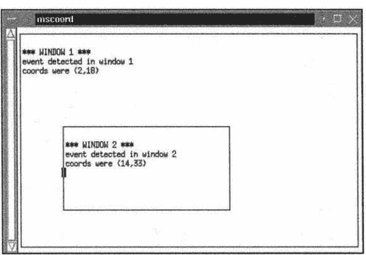

图 12.5：定位鼠标所在的窗口及坐标。

如示例程序所示，使用鼠标需要比平时稍多的设置，但实际的检测代码非常简单，其回报是一个即使在控制台窗口中也接受鼠标输入的程序。`event` 结构体对于整个程序是全局的，如两次调用 `wenclose` 所示，解除结构体成员引用以获取鼠标事件坐标非常容易。

请注意，程序还使用了前面讨论过的函数简写形式，`mvprintw` 和 `mvwprintw`，以减少必须编写的代码行数。请注意，第二个窗口中列出的坐标是相对于原始屏幕的，在程序中被称为*窗口 1*。

## 使用菜单

ncurses 的菜单库提供了在字符模式终端上创建菜单系统的与终端无关的功能。它包含用于创建和修改菜单项的调用，以及将项目分组为菜单、在屏幕上显示菜单和处理其他用户交互的调用。与几乎所有 ncurses 例程一样，在使用任何菜单代码之前，你必须调用 `initscr`。要使用菜单库，你必须在代码中包含 `<menu.h>` 并使用链接选项 `-lmenu -lncurses` 链接该库。

*菜单*是帮助用户从一组操作或项目中选择某个操作或项目的屏幕显示。ncurses 菜单库通过创建项目集来工作，这些项目随后被组合在一起并附加到一个窗口上，然后被发布（即在该窗口上显示）。你导入或分离菜单，最终释放其资源。

从高层次来看，创建和使用菜单的过程类似于以下流程：

- 1. 初始化 ncurses。
- 2. 使用 `new_item` 创建菜单项。
- 3. 使用 `new_menu` 创建菜单本体。
- 4. 使用 `post_menu` 发布菜单。
- 5. 刷新。
- 6. 在命令循环中处理用户输入。
- 7. 使用 `unpost_menu` 取消发布菜单。
- 8. 使用 `free_menu` 释放其资源。
- 9. 使用 `free_item` 释放它们的资源。
- 10. 终止 ncurses。

创建菜单的主要函数和宏如下。它们在接下来的几段中详细解释。

```c
ITEM *new_item(const char *name, const char *description);
int free_item(ITEM *item);
MENU *new_menu(ITEM **items);
int free_menu(MENU *menu);
int set_menu_format(MENU *menu, int rows, int cols);
int post_menu(MENU *menu);
int unpost_menu(MENU *menu);
int menu_driver(MENU *menu, int c);
```

`new_item` 分配一个新的菜单条目并通过传入的 *name* 和 *description* 进行初始化。它返回指向新 `ITEM` 的指针，或在失败时返回 `NULL`。`free_item` 释放已分配的存储，如果成功则返回 `E_OK`，如果发生系统错误则返回 `E_SYSTEM_ERROR`（在这种情况下，评估 `errno`），如果检测到某个参数因某种原因无效则返回 `E_BAD_ARGUMENT`，或者如果 `item` 仍然连接到菜单（即，尚未调用与该项目关联的菜单的 `free_menu`）则返回 `E_CONNECTED`。

`new_menu` 创建一个新的包含通过 `items` 传入的 `menu` 的 `menu`。注意 `items` 必须以 NULL 结尾（参见下面的示例程序）。它返回指向新创建的 `menu` 结构体的指针，如果发生错误则返回 NULL。相应地，`free_menu` 释放已分配的资源并将其与 `items` 解耦，后者然后可以用于另一个 `menu`。`free_menu` 的返回值与 `free_item` 相同，只是 `E_CONNECTED` 被 `E_POSTED` 取代，这意味着你试图释放一个尚未取消发布的 `menu`。

函数 `post_menu` 和 `unpost_menu` 显示和擦除与其关联窗口中的 `menu`。发布 `menu` 时，需要调用 `refresh` 或某些类似函数。成功时，两个函数都返回 `E_OK`。表 12.2 列出了除 `free_item` 和 `free_menu` 中已提到的那些之外的错误条件。

### 表 12.2：post_menu 和 unpost_menu 返回的错误

| 返回值 | 描述 |
| :--- | :--- |
| E_BAD_STATE | 从初始化或例程调用中调用 |
| E_NO_ROOM | 菜单对于其窗口来说太大 |
| E_NOT_POSTED | 在已取消发布的窗口上调用 unpost_menu |
| E_NOT_CONNECTED | 没有项目连接到菜单 |

`set_menu_format` 建立 `menu` 的最大显示大小。它不超过 `rows` 行和 `cols` 列。默认值为 16 行和 1 列。通常，它在成功时返回 `E_OK`，或者在发生错误时返回 `E_SYSTEM_ERROR`、`E_BAD_ARGUMENT` 或 `E_POSTED` 之一。

`menu_driver`，`menu` 库的核心部分，根据 `c` 的值处理所有输入到 `menu` 的内容。你的责任是将所有与 `menu` 相关的输入引导到 `menu_driver`。参数 `c` 接收与输入相关的操作或请求。菜单驱动器请求属于以下三类之一：

- 一个 `menu` 导航请求
- 来自鼠标事件的 `KEY_MOUSE` 特殊键
- 一个可打印的 ASCII 字符

导航请求对应光标移动键，例如向上或向下箭头键。`KEY_MOUSE` 请求是前文所涉及的鼠标事件。


## 使用鼠标

本章前文“使用鼠标”一节。可打印的 ASCII 字符会在菜单中上下进行渐进式搜索，以匹配相应的菜单项，这与 Microsoft Windows 的行为类似。完整的菜单驱动请求列表记录在 `menu_driver` 手册页中。以下示例程序中给出了几个例子。

## 示例


此程序创建一个包含啤酒列表的简单菜单。它演示了如何上下导航菜单。

```c
/*
 * usemenu.c Using ncurses menus
 */
#include <curses.h>
#include <menu.h>
#include <stdlib.h>
#include <ctype.h>
#include "utilfns.h"

int main(void)
{
    static const char *beers[] =
    {
        "Budweiser", "Miller", "Pabst", "Schlitz", "MGD", "Coors",
        "Shiner", "Pearl", "Lone Star", "Rainer", "Carlson", NULL
    };
    const char **bp;
    int ch;
    ITEM *items[sizeof(beers)];
    ITEM **ip = items;
    MENU *mymenu;

    /* initialize ncurses */
    app_init();

    /* interpret cursor/function key input */
    keypad(stdscr, TRUE);

    /* create menu items */
    for(bp = beers; *bp; bp++)
        *ip++ = new_item(*bp, "");
    *ip = NULL;

    /* create the menu and set its format */
    mymenu = new_menu(items);
    set_menu_format(mymenu, 5, 1);

    /* post the menu and refresh */
    post_menu(mymenu);
    refresh();

    /* loop until user presses q or Q */
    while(toupper(ch = getch()) != 'Q') {
        if(ch == KEY_DOWN || ch == KEY_NPAGE)
            menu_driver(mymenu, REQ_DOWN_ITEM);
        else if(ch == KEY_UP || ch == KEY_PPAGE)
            menu_driver(mymenu, REQ_UP_ITEM);
    }

    /* unpost the menu */
    unpost_menu(mymenu);

    /* free menu and menu items */
    free_menu(mymenu);
    for(ip = items; *ip; ip++)
        free_item(*ip);

    /* terminate ncurses */
    keypad(stdscr, FALSE);
    app_exit();
    exit(EXIT_FAILURE);
}
```

示例运行的输出如 12.6 图所示。

### 输出


这段代码做的第一件事是创建一个静态文本数组，它将成为菜单的一部分，以及一些它将使用的其他变量。它使用 `keypad` 函数来解释功能键和光标键。接着，它遍历静态文本数组，逐个提取字符串并将其添加到 `ITEM` 向量 `items` 中。为了创建菜单，必须将 `items` 传递给 `new_menu`，它返回指向正确初始化的菜单结构的 `mymenu` 指针。

`set_menu_format` 调用：

```c
set_menu_format(mymenu, 5, 1);
```

创建一个长五行的菜单，宽度为一列，以便程序可以演示如何在菜单上下移动。菜单创建并格式化后，`post_menu` 将 `mymenu` 与 `stdscr` 关联，并处理所有刷新和更新。最后，刷新屏幕使菜单可见。此时，你可以使用上下方向键以及 Page Up 和 Page Down 键在菜单中上下滚动。

示例程序的主力是 `while` 循环。它从键盘获取输入并将其传递给 `menu_driver` 函数，该函数处理所有菜单操作。例如，按下向下箭头键会生成一个 `KEY_DOWN` 信号，`menu_driver` 将其接收为 `REQ_DOWN_ITEM`，从而告知 `menu_driver` 在菜单中突出显示下一个向下的菜单项。

`unpost_menu`、`free_menu` 以及释放单个菜单项的 `for` 循环将分配的资源返回给内核。最后，程序通过调用 `app_exit` 和 `exit` 终止。

## 使用表单

表单库使你在字符模式程序中能够创建与终端无关的表单。该库的设计与菜单库类似：Field（字段）例程创建和修改表单字段。Form（表单）例程将字段分组为表单，将表单显示到屏幕上，并处理用户交互。字段例程相当于菜单库中的项例程，而表单调用对应于菜单调用。

要使用表单库，请在你的源代码中包含 `<form.h>` 头文件，并链接 `libform`，正如这个 gcc 调用所建议的那样：

```bash
$ gcc -g formprog.c -o formprog -lform -lcurses
```

创建和使用表单的一般步骤类似于以下内容：

- 1. 初始化 ncurses。
- 2. 使用 `new_field` 创建新字段。
- 3. 使用 `new_form` 创建表单。
- 4. 使用 `post_form` 提交表单。
- 5. 刷新。
- 6. 在命令循环中处理用户输入。
- 7. 使用 `unpost_form` 取消提交表单。
- 8. 使用 `free_form` 释放其资源。
- 9. 使用 `free_field` 释放每个字段的资源。
- 10. 终止 ncurses。

显然，表单库的设计遵循菜单库确立的模式。然而不幸的是，`form_driver` 命令循环必须处理比菜单库的输入循环稍多一点的内容。与编写自己的表单处理库相比，这种额外的复杂性是值得的。

此处列出并在以下段落中解释的例程足以让你开始创建简单、可用的表单：

- `FIELD *new_field (int height, int width, int toprow, int leftcol, int offscreen, int nbufers);`
- `int free_field(FIELD *field);`
- `int set_field_buffer(FIELD *field, int buf, const char *value);`
- `int set_field_opts(FIELD *field, int opts);`
- `int set_field_userptr(FIELD *field, void *userptr);`
- `void *field_userptr(FIELD *field);`
- `FORM *new_form(FIELD **fields);`
- `int free_form(FORM *form);`
- `int post_form(FORM *form);`
- `int unpost_form(FORM *form);`
- `int form_driver(FORM *form, int c);`

`new_field` 调用创建一个具有 `height` 行和 `width` 列的新字段。此调用将左上角放置在 (y,x) 坐标 (`toprow`, `leftcol`)。如果字段的任何行应被隐藏，请在 `offscreen` 中传入该数字。`nbufers` 是要与字段关联的额外缓冲区数量。`new_field` 返回指向新字段的指针，如果发生错误则返回 NULL。`free_field` 解除分配与 `field` 相关的资源。成功时返回 `E_OK`，失败时返回 `E_SYSTEM_ERROR` 或 `E_BAD_ARGUMENT`。

`new_form` 创建新表单，将 `fields` 中的字段与其关联并返回指向新表单的指针（如果发生错误则返回 NULL）。同样，`free_form` 释放分配给 `form` 的资源并将其与字段分离。如果 `free_form` 成功，它返回 `E_OK`。发生错误时，它返回 `E_SYSTEM_ERROR`、`E_BAD_ARGUMENT` 或 `E_POSTED`。

`post_form` 在强制 `refresh` 或类似调用后，在其窗口上显示 `form`，而 `unpost_form` 从窗口中擦除表单。`unpost_form` 成功时返回 `E_OK`。如果发生错误，它将返回 `E_SYSTEM_ERROR`、`E_BAD_ARGUMENT`、`E_BAD_STATE`、`E_NO_ROOM`、`E_NOT_POSTED` 或 `E_NOT_CONNECTED` 之一。

`set_field_buffer` 将与 `field` 关联的、由 `buf` 指示的缓冲区设置为字符串 `value`。这些缓冲区由传递给 `new_field` 的 `nbufers` 参数创建。缓冲区 0 是菜单库操纵的那个。其他所有缓冲区都必须由程序员管理。可以通过 `set_field_opts` 设置各种行为选项。字段的所有选项默认都是开启的，因此 `opts` 包含要禁用的选项。表 12.3 列出了可用的选项。

| **选项** | **描述** |
| :--- | :--- |
| `O_VISIBLE` | 显示该字段。 |
| `O_ACTIVE` | 该字段在处理过程中将被访问。不可见的字段不能被访问。 |
| `O_PUBLIC` | 在数据输入期间显示字段内容。 |
| `O_EDIT` | 该字段可被编辑。 |
| `O_WRAP` | 不适合一行显示的单词换行到下一行。 |
| `O_BLANK` | 当在第一个位置输入字符时，该字段将被清空。 |
| `O_AUTOSKIP` | 当一个字段填满时，自动跳过到下一个字段。 |
| `O_NULLOK` | 允许空白字段。 |
| `O_STATIC` | 字段缓冲区固定为字段的原始大小。 |
| `O_PASSOK` | 只有当该字段被修改时才进行验证。 |

`set_field_userptr` 将通过 `userptr` 传递的应用数据关联到 `field`。由于 `userptr` 是一个 void 指针，它可以指向任何类型的指针。要检索此数据，请使用 `field_userptr` 调用，它返回指向 `field` 的指针。

## 示例


以下示例展示了这些调用的大部分用法：

```c
/*
 * useform.c - Simple form usage demo
 */
#include <curses.h>
#include <form.h>
#include <stdlib.h>
#include <ctype.h>     /* for isprint() */
#include "utilfns.h"

int main(void)
{
    FORM *form;
    FIELD *fields[5];
    int ch, i = 0;

    /* start curses */
    app_init();
    cbreak();
    keypad(stdscr, TRUE);

    /* create the form fields */
    fields[0] = new_field(1, 12, 1, 1, 0, 0);
    set_field_buffer(fields[0], 0, "First Name: ");
    set_field_opts(fields[0], field_opts(fields[0]) & ~O_ACTIVE);

    fields[1] = new_field(1, 20, 1, 14, 0, 0);
}
```


```cpp
set_field_userptr(fields[1], NULL);

fields[2] = new_field(1, 12, 2, 1, 0, 0);
set_field_buffer(fields[2], 0, "Last Name : ");
set_field_opts(fields[2], field_opts(fields[2]) & ~O_ACTIVE);

fields[3] = new_field(1, 20, 2, 14, 0, 0);
set_field_userptr(fields[3], NULL);

fields[4] = NULL;

/* create and post the form */
form = new_form(fields);
post_form(form);
refresh();

/* start the command loop */
form_driver(form, REQ_OVL_MODE);
while(toupper(ch = getch()) != KEY_F(10)) {
    if(ch == KEY_UP || ch == KEY_PPAGE)
        form_driver(form, REQ_PREV_FIELD);
    else if(ch == '\n' || ch == KEY_DOWN || ch == KEY_NPAGE)
        form_driver(form, REQ_NEXT_FIELD);
    else if(ch == KEY_BACKSPACE)
        form_driver(form, REQ_DEL_PREV);
    else if(isprint(ch))
        form_driver(form, ch);
    else
        form_driver(form, E_UNKNOWN_COMMAND);
}

unpost_form(form);
free_form(form);
for(i = 0; i < 5; i++)
    free_field(fields[i]);

keypad(stdscr, FALSE);
nocbreak();

app_exit();
exit(EXIT_FAILURE);
}
```

在学习代码中的具体内容之前，请先查看图 12.7，该图展示了该程序的运行效果。不过，如果你编译并运行该程序，会对它的工作原理有更直观的感受。使用下箭头键或 Page Down 键移动到下一个字段，使用上箭头键或 Page Up 键移动到上一个字段，按 F10 键退出。要填写字段，只需输入内容并按 Enter 键即可。


### 输出

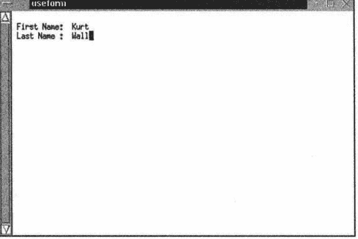

图 12.7：使用 ncurses 表单库构建的数据输入屏幕。

ncurses 的初始化包括设置 *cbreak* 模式，以便内核允许大部分击键操作直接传递给应用程序而不经过处理。下一个代码块创建了五个字段、两个标签和两个文本输入字段，以及一个 `NULL` 字段来终止字段向量。`fields` 向量是 `post_form` 的参数，该函数创建表单并在调用 `refresh` 后将其显示在屏幕上。

在进入处理所有用户输入的 *while* 循环之前，`form_driver` 为输入字符设置了覆盖模式。除非用户按下 F10，否则应用程序会处理所有输入。按下上箭头键或 Page Up 键（解释为 `KEY_UP` 或 `KEY_PPAGE`）将映射为移动到上一个字段的请求（`REQ_PREV_FIELD`）。类似地，下箭头键和 Page Down 键映射为 `REQ_NEXT_FIELD` 事件请求。该程序还通过将其映射到 `REQ_DEL_PREV` 启用了退格键，该键用于删除前一个字符。按下 F10 时，程序会进行清理并终止。

## 下一步是什么？

在本章中，你完成了对 ncurses 一些高级功能的入门介绍。下一章，“音频 API：OSS/Free”，将继续带你了解 Linux 编程接口的其余部分。

# 13— 音频 API：OSS/Free

直到不久之前，声卡还只能作为附加设备在 PC 购买后安装。如今，即使是所谓的“商务 PC”也在主板上配备了某种形式的最低限度音频硬件。本章将教你声卡编程的基础知识。它简要概述了声卡技术，然后开始讨论 Linux 的音频 API。本章讨论的主题如下：

- 描述音频硬件
- 音频硬件编程的一般准则
- 操纵混音器设备
- 编程 MIDI 硬件
- 编写音频播放程序
- 介绍高级音频功能

## 发声原理

声卡不是单一的硬件设备。相反，它们由几个组件组成。尽管制造商之间，甚至同一制造商的声卡之间都存在相当大的差异，但大多数声卡都拥有 MIDI 接口、数字语音设备、混音器设备和合成器。Linux 对这些设备的支持是通过 /dev 文件系统下的条目启用的：

`/dev/mixer`, `/dev/dsp`, `/dev/audio`, `/dev/sequencer` 和 `/dev/midi`。

## 音频硬件

MIDI（*Musical Instrument Digital Interface*，乐器数字接口）接口是连接外部设备（特别是合成器，但也包括灯光设备和其他舞台道具）到计算机的端口。混音器是一个控制设备，用于控制输入和输出的音量水平，并切换可用的输入设备，例如麦克风和 CD。数字语音设备用于录制和播放数字化语音数据。它们通常根据用于录制和编码采样的 *codecs*（编解码器）或算法来命名。

合成器设备用于播放音乐并产生各种各样的声音和音效。通常，合成器分为两类。一类基于 Yamaha OPL2 和 OPL3 芯片，这些芯片在大多数声卡上很常见。第二类是波表合成器——它们通过存储在声卡芯片中录制的乐器采样来产生声音。在这两种类型中，波表合成器能产生丰富得多的、更逼真的声音。

## 音频设备

Linux 的 /dev 文件系统包含与可用音频硬件大致一一对应的设备文件。所有设备都以数字 *N*（通常为 0、1 或 2）结尾，设备名称通过符号链接指向它们。例如，在我的系统中，`/dev/mixer` 是指向 `/dev/mixer0` 的符号链接。本章的其余部分都指代符号链接，除非有必要指代特定的设备文件。

`/dev/mixer` 是混音器硬件的接口，而 `/dev/dsp` 和 `/dev/audio` 是数字语音设备的主要接口。这两者之间的唯一区别在于 `/dev/audio` 默认使用 µLaw（µ 是希腊字母 *mu*，发音为 "mew"）编码，该编码使用 8 位表示 12 或 16 位样本，而 `/dev/dsp` 使用 8 位无符号线性编码。`/dev/sequencer` 是用于电子音乐和游戏发出的声音的设备。它是声卡上合成器芯片的接口，也可以用于访问外部 MIDI 设备和波表。最后，`/dev/midi` 用于低级 MIDI 输出。

## 音频编程准则

以下准则摘自 OSS 程序员指南，该指南由 Linux 音频 API 的原作者 Hamu Savolainen 编写。可以在万维网 http://www.4front-tech.com/gguide/intro.html 上找到完整文档。

首先，音频 API 旨在使针对其编写的应用程序能够在不同的操作系统和音频硬件之间移植。为此，该 API 依赖于在 `<sys/soundcard.h>` 中定义的宏。尽管实现会随着音频驱动的发展而变化，但宏将保持一致。此外，不要编写使用编号设备的应用程序代码。相反，请使用上一节“音频设备”中描述的符号链接。用户可能拥有多个音频设备或有其他原因使用不同的设备编号，但符号链接始终指向用户想要用于特定目的的设备。

避免“功能狂热”，即给你的应用程序加上许多与其主要目的次要的花哨功能的过程。例如，如果你在写一个 CD 播放器，它不需要录音功能。类似地，不要假设每个人都在使用最新的高科技声卡。相反，请编写最低公分母，即 Sound Blaster，并添加检测和使用高级或高端功能的代码（参见“高级音频编程”部分，了解如何做到这一点）。

## 使用音频 API

要使用音频 API，请在源代码中包含 `<sys/soundcard.h>`。不需要特殊的链接器命令，但当然，你必须有一张工作正常的声卡。在详细讨论音频 API 之前，你必须了解 `ioctl` 调用，即输入/输出控制，它用于通过文件描述符操纵字符设备。其原型在 `<ioctl.h>` 中声明，如下所示：

```c
int ioctl(int fd, int request, ...);
```

`ioctl` 控制打开在文件描述符 `fd` 上的设备，并执行 `request` 中包含的命令。第三个参数约定为 `char *argp`，通常携带大小参数。`ioctl` 是一个针对不适合 Linux 流 I/O 模型的通用命令。`ioctl` 请求（通常称为 `ioctls`）的部分列表可以在 `ioctl_list(2)` 手册页中找到，但它已经过时了。

混音器的 `ioctl` 分为三类：音量控制、输入源和查询函数。查询能力特别重要。例如，有些声卡没有混音器，或者它们没有主

音量控制。通常，你应该先使用查询宏来确定声音设备的功能，或者仅仅是确认其是否存在，然后再开始对其进行操作。

关于混音器，声音 API 将其功能抽象为一组通道，因此你要做的第一件事是找出有多少个可用通道以及它们是什么。表 13.1 提供了最常见通道的部分列表（完整列表包含在 `<sys/soundcard.h>` 中）。

## 表 13.1：常见混音器通道

| 通道 | 描述 |
|---|---|
| SOUND_MIXER_VOLUME | 主输出电平 |
| SOUND_MIXER_BASS | 所有输出通道的低音电平 |
| SOUND_MIXER_TREBLE | 所有输出通道的高音电平 |
| SOUND_MIXER_SYNTH | 所有合成器输入的音量控制，例如 FM 芯片或波表 |
| SOUND_MIXER_PCM | 音频设备 /dev/audio 和 /dev/dsp 的输出电平 |
| SOUND_MIXER_SPEAKER | PC 扬声器的输出电平（如果它直接连接到声卡） |
| SOUND_MIXER_LINE | 线路输入插孔的音量电平 |
| SOUND_MIXER_MIC | 麦克风输入的音量电平 |
| SOUND_MIXER_CD | 音频 CD 输入的音量电平 |
| SOUND_MIXER_ALTPCM | 备用音频设备（例如 Sound Blaster 对 PAS16 卡组的仿真）的音量电平 |
| SOUND_MIXER_RECLEV | 主录音音量电平控制 |

宏 SOUND_MIXER_NRDEVICES 报告在任意给定时刻声音驱动所知道的设备最大数量；SOUND_MIXER_READ_DEVMASK 设置一个位掩码，指示可用的通道。

SOUND_MIXER_READ_RECMASK 设置一个位掩码，指示可用的录音设备。SOUND_MIXER_READ_STEREODEVS 设置一个位掩码，指示哪些通道支持立体声输出。这些信息使你能够独立设置每个通道的音量，从而提供一种类型的平衡控制。另一个调用，SOUND_MIXER_READ_CAPS，设置一个位掩码，描述混音器的一般功能。

声音 API 的混音器部分还提供两个宏，包含可供人类阅读的字符串：SOUND_DEVICE_LABELS 和 SOUND_DEVICE_NAMES。这两者之间的唯一区别在于，SOUND_DEVICE_NAMES 中的标签没有嵌入空格或大写字母。

最后，要获取和设置混音器音量，请使用 `SOUND_MIXER_READ`(channel) 和 `SOUND_MIXER_WRITE`(channel) 宏。例如，下面的代码片段将当前混音器设备的音量设置为其最大范围的 50%：

```c
int vol = 50;

if((ioctl(fd, SOUND_MIXER_WRITE(SOUND_MIXER_MIC), &vol)) < 0)
	/* 调用失败，因此优雅地降级处理 */
else
	/* 调用成功，此处有更多代码 */
```

vol 存储要设置的音量电平（通常称为增益），而 SOUND_MIXER_MIC 则是正在设置音量的通道。第一个字节包含左通道的音量，而右通道的音量则设置在第二个字节中。调用之后，vol 包含新的值，由于硬件特性，该值与设置的音量电平略有不同。

## 示例


## 示例 1

下面的程序 `mixer_status` 查询混音器设备可用的通道并显示它们的当前设置：

```c
/*
 * mixer_status.c - 显示混音器设置的示例程序。
 * 版权所有 (c) 1994-96 Jeff Tranter (jeff_tranter@xmission.com)
 * 由 Kurt Wall (kwall@xmission.com) 大幅修改
 */

#include <unistd.h>
#include <stdlib.h>
#include <stdio.h>
#include <sys/ioctl.h>
#include <fcntl.h>
#include <sys/soundcard.h>

/* 用于打印状态的实用函数 */
void prn_stat(int condition);

int main(void)
{
    int fd;                        /* 混音器设备的文件描述符 */
    int level;                     /* 音量设置 */
    char *device = "/dev/mixer";

    /* 设备设置的位掩码 */
    int recsrc, devmask, recmask, stereodevs, caps;
    /* 混音器通道的名称 */
    const char *labels[] = SOUND_DEVICE_LABELS;
    int i;

    /* 只读方式打开混音器设备 */
    if((fd = open(device, O_RDONLY)) < 0) {
        perror("open");
        exit(EXIT_FAILURE);
    }

    /* 获取混音器信息 */
    if((ioctl(fd, SOUND_MIXER_READ_RECSRC, &recsrc)) < 0)
        perror("SOUND_MIXER_READ_RECSRC");
    if((ioctl(fd, SOUND_MIXER_READ_DEVMASK, &devmask)) < 0)
        perror("SOUND_MIXER_READ_DEVMASK");
    if((ioctl(fd, SOUND_MIXER_READ_RECMASK, &recmask)) < 0)
        perror("SOUND_MIXER_READ_RECMASK");

    if((ioctl(fd, SOUND_MIXER_READ_STEREODEVS, &stereodevs)) < 0)
        perror("SOUND_MIXER_READ_STEREODEVS");
    if((ioctl(fd, SOUND_MIXER_READ_CAPS, &caps)) < 0)
        perror("SOUND_MIXER_READ_CAPS");

    /* 打印混音器信息 */
    printf("Status of %s:\n\n", device);
    printf("Mixer         Recording Active    Stereo\nCurrent\n");
    printf("Channel       Source    Source    Device\nLevel\n");
    printf("-----------------------------------------------------------------\n");
    printf("---------------------------\n");

    /* 遍历所有设备 */
    for (i = 0; i < SOUND_MIXER_NRDEVICES; ++i) {
        /* 只关心可用的设备 */
        if((1 << i) & devmask) {
            /* 打印通道号和名称 */
            printf("%2d %-8s", i, labels[i]);
            /* 它是录音源吗？ */
            prn_stat((1 << i) & recmask);
            /* 它是活动的吗？ */
            prn_stat((1 << i) & recsrc);
            /* 它支持立体声吗？ */
            prn_stat((1 << i) & stereodevs);
            /* 如果是立体声，显示两个电平 */
            if ((1 << i) & stereodevs) {
                if((ioctl(fd, MIXER_READ(i, &level)) < 0)
                    perror("SOUND_MIXER_READ");
                else
                    printf(" %3d%% %3d%%", level & 0xff, (level & 0xff00) >> 8);
            } else { /* 只有一个通道 */
                if((ioctl(fd, MIXER_READ(i, &level)) < 0)
                    perror("SOUND_MIXER_READ");
                else
                    printf("    %3d%%", level & 0xff);
            }
        }
        printf("\n");
    }

    /* 录音源是排他的吗？ */
    printf("\nNote: Choices for recording source are ");
    if (!(caps & SOUND_CAP_EXCL_INPUT))
        printf("not ");
    printf("exclusive.\n");

    /* 关闭 */
    close(fd);
    return 0;
}

void prn_stat(int condition)
{
    condition ? printf("  YES  ") : printf("  NO  ");
}
```

前五个 `ioctl` 调用在相应的整型参数（`recsrc`、`devmask`、`recmask`、`stereodevs` 和 `caps`）中设置了位掩码。在打印表格头之后，`mixer_status` 循环遍历可用的混音器通道。如果混音器具有该特定通道，则条件块执行并显示该通道的一些可用信息。

特别注意的是位掩码的测试方式：

`(1 << channel) & bitmask;`

括号内的表达式将通道号左移作用于 1，然后将结果与 `bitmask` 进行按位与运算。如果给定的通道存在，该表达式计算结果为 1。如果通道不可用，则计算结果为 0。因此，例如，如果一个通道，比如 `SOUND_MIXER_VOLUME` 支持立体声，`(1 << SOUND_MIXER_VOLUME) & stereodevs`（如程序中设置的那样）计算结果为 1。

在我拥有一块正宗 Sound Blaster 的系统中，`mixer_status` 生成了以下输出：


### 输出

```
$ ./mixer_status
Status of /dev/mixer:
```

|   | 混音器通道 | 录音源 | 活动源 | 立体声设备 | 当前电平 |
|---|---|---|---|---|---|
| 0 | Vol | NO | NO | YES | 90% 90% |
| 1 | Bass | NO | NO | YES | 75% 75% |
| 2 | Trebal | NO | NO | YES | 75% 75% |
| 3 | Synth | YES | NO | YES | 75% 75% |
| 4 | pcm | NO | NO | YES | 100% 100% |
| 5 | Spkr | NO | NO | NO | 75% |
| 6 | Line | YES | NO | YES | 75% 75% |
| 7 | Mic | YES | YES | NO | 0% |
| 8 | CD | YES | NO | YES | 75% 75% |
| 9 | Mix | NO | NO | NO | 0% |
| 12 | IGain | NO | NO | YES | 75% 75% |
| 13 | OGain | NO | NO | YES | 75% 75% |

注意：录音源的选择不是排他的。

如你所见，该混音器设备缺少几个通道，例如备用音频设备（`SOUND_MIXER_ALTPCM`）。


## 示例 2

下一个程序 `setvol` 允许你交互式地设置音量电平。

```c
/*
 * setvol.c - 交互式设置混音器设备的音量电平
 * 版权所有 (c) 1994-96 Jeff Tranter (jeff_tranter@mitel.com)
 * 由 Kurt Wall (kwall@mission.com) 大幅修改
 */
#include <unistd.h>

#include <stdlib.h>
#include <stdio.h>
#include <sys/ioctl.h>
#include <fcntl.h>
#include <sys/soundcard.h>

int main(int argc, char *argv[])
{
    int left, right, level;          /* 音量设置 */
    int device;                     /* 要设置的哪个混音器设备 */
    int i;                          /* 混音器的文件描述符 */
    int fd;
    /* 混音器信息的位掩码 */
    int devmask, stereodevs;
    char *dev = "/dev/mixer";
    char buf[5];

    /* 以读写方式打开混音器 */
    if((fd = open(dev, O_RDWR)) < 0) {
        perror("open");
        exit(EXIT_FAILURE);
    }

    /* 获取关于混音器的信息 */
    if((ioctl(fd, SOUND_MIXER_READ_DEVMASK,
             &devmask)) < 0)
        perror("SOUND_MIXER_READ_DEVMASK");
    if((ioctl(fd, SOUND_MIXER_READ_STEREODEVS,
```


➢ &stereodevs)) < 0)
```c
    perror("SOUND_MIXER_READ_STEREODEVS");
```

```c
/* 设置要修复的通道 */
device = SOUND_MIXER_VOLUME;
```

```c
/* 获取新的音量级别 */
do {
    fprintf(stdout, "新的音量级别 [0-100]: ");
    fgets(buf, 5, stdin);
    right = atoi(buf);
} while(right < 0 || right > 100);
/* 将左右通道设置为相同级别 */
left = right;
```

```c
/*
 * 将两个通道编码为一个值。左通道
 * 存储在最低有效字节中；右通道
 * 存储在第二个字节中，因此我们需要向左
 * 移动 8 位。
 */
level = (right << 8) + left;
```

```c
/* 设置新的级别 */
if((ioctl(fd, MIXER_WRITE(device), &level)) < 0) {
    perror("MIXER_WRITE");
    exit(EXIT_FAILURE);
}
```

```c
/* 解码声音驱动程序返回的级别 */
left = level & 0xff;
right = (level & 0xff00) >> 8;
```

```c
/* 显示实际设置 */
printf("%s 级别设置为 %d%% / %d%%\n",
    dev, left, right);
```

```c
/* 关闭混音器设备并退出 */
close(fd);
return 0;
}
```

该程序的输出如下：


### 输出

```bash
$ ./setvol
新的音量级别 [0-100]: 75
/dev/mixer 级别设置为 75% / 75%
```

在变量声明之后，`setvol` 以读写方式打开混音器，然后使用 `ioctl` 和 `SOUND_MIXER_READ_DEVMASK` 以及 `SOUND_MIXER_READ_STEREODEVS` 宏来确定混音器的特性。下一步是获取用户偏好的音量级别。请注意，do–while 循环将继续执行，直到输入有效的音量级别（介于 0 和 100 之间）。

设置音量级别有点敏感。如前所述，你必须使用 C 的左移运算符将右声道的音量编码到 `level` 的高位（或最高有效位）中。该表达式为 `level = (right << 8) + left;`

括号内的表达式将右声道的值向左移动八位，将其所有位移到高字节，然后加上 `left` 的值，并将结果赋值给 `level`。声音 API 会适当地解码 `level`，以获得右声道和左声道所需的音量。

## 音频编程

本节将向你介绍如何进行简单的音频编程，重点在于播放而忽略录音，这主要是由于篇幅限制（当然，还有一个微不足道的小细节，即我的系统没有任何录音方式）。然而，录音的技术本质上是一样的。如果播放涉及对音频设备文件描述符的 `write` 调用，那么录音则需要 `read` 调用。

> **注意**
>
> 在简单情况下，要在半双工声卡上录音，你只需将麦克风连接到 MIC_IN 插孔并开始录音即可。另一方面，全双工声卡在这方面功能更强大，因为你可以在录音的同时进行播放。因此，除了使用麦克风录音外，全双工声卡还允许你记录当前正在播放的内容，并对数据应用各种转换。

> **提示**
>
> 如需了解有关在 Linux 上多媒体（尤其是声音）编程的更多信息，请参阅 Jeff Tranter 的 *Linux Multimedia Guide*。

## 理解声音编程

在深入声音播放器编程之前，你需要一些技术背景来理解所涉及的概念和术语。

计算机将声音表示为在精确控制的时间间隔内采集的音频信号样本序列。*样本* 是音频信号在被测量时刻的音量。最简单的数字音频形式是*未压缩*的，其中每个样本按接收到的顺序存储在一个或多个字节中。另一方面，*压缩*音频将音频信号的 N 位编码为 N×x 位，以节省空间。

有几种样本格式，最常见的是 8 位、16 位和 μ-Law（一种对数格式）。这种样本格式，结合通道数量——即信号是单声道还是立体声——决定了*采样率*，进而控制每个样本所需的存储空间字节数。典型的采样率从低质量的 8 kHz 到 48 kHz 不等。

由于声音是一种物理属性，因此存在一些必须应对的限制。由于计算机是数字设备，而声音是模拟属性，声卡具有模数转换器（ADC）和数模转换器（DAC），用于在两种形式之间进行转换。转换会影响信号的质量。其他物理属性也会影响声音的质量。

最基本的限制是，可记录的最高频率是采样率的一半，因此，例如，在 16 kHz 的采样率下，你能记录的最高频率不超过 8 kHz。高于 8 kHz 的频率必须在信号馈送到 DAC 或 ADC 之前被去除，否则你只会听到响亮的噪声。不幸的是，为了提高声音的质量，你必须提高采样率，这也增加了传输时间的长度，同时减少了信号的*持续时间*，即播放时长。

## 设置设备参数

要播放声音，基本的过程流如下：

1. 选择要使用的设备。
2. 打开设备。
3. 设置设备格式。
4. 设置通道数量（单声道或立体声）。
5. 设置样本播放速度。
6. 从你要播放的文件中读取一个块。
7. 将该块写入已打开的设备。
8. 重复步骤 4 和 5，直到文件结尾（EOF）。
9. 关闭设备。

在回放声音时，有几个约束需要注意。首先，选择适当的设备。对于所有数据（Sun 音频（μ-Law 样本）除外），使用 `/dev/dsp`；对于 μ-Law，使用 `/dev/audio`。在打开设备进行播放时，除非你既需要读取又需要写入设备，否则使用 `O_WRONLY`。接下来，确保设备的默认参数是正确的。如果并非如此，请按以下顺序设置它们：样本格式、通道数量（单声道或立体声）以及采样速度。这种顺序对于回放而言不如对于录音重要，但仍然值得检查。

要获取和设置样本格式，请使用命令 `SNDCTL_DSP_GETFMTS` 和 `SNDCTL_DSP_SETFMT`，并配合表 13.2 中列出的其中一个值。

表 13.2：音频格式宏

| 宏 | 描述 |
|---|---|
| AFMT_QUERY | 用于查询当前音频格式（`SNDCTL_DSP_GETFMTS`） |
| AFMT_MU_LAW | 对数 μ-Law 编码 |
| AFMT_A_LAW | 对数 A-Law 编码 |
| AFMT_IMA_ADPCM | 标准 ADPCM 编码（与 Creative 在 Sound Blaster 16 中使用的格式不兼容） |
| AFMT_U8 | 标准 8 位无符号编码 |
| AFMT_S16_LE | 有符号 16 位无符号小端（s86）格式 |
| AFMT_S16_BE | 有符号 16 位无符号大端（M68k, PPC, Sparc）格式 |
| AFMT_S8 | 有符号 8 位格式 |
| AFMT_U16_LE | 无符号 16 位小端格式 |
| AFMT_U16_BE | 无符号 16 位大端格式 |
| AFMT_MPEG | MPEG (MPEG2) 音频格式 |

要获取设备当前支持的音频格式，请使用命令 `SNDCTL_DSP_GETFMTS` 和参数 `AFMT_QUERY` 调用 `ioctl`。此调用会用代表设备当前支持的所有音频格式的一个位掩码填充 `AFMT_QUERY`。表 13.2 中的其他值是作为参数传递给 `SNDCTL_DSP_SETFMT` 的值。例如，考虑以下代码片段：

```c
int format;
ioctl(fd, SNDCTL_DSP_GETFMTS, &format);
```

```c
format = AFMT_U16_LE;
ioctl(fd, SNDCTL_DSP_SETFMT, &format);
if(format != AFMT_U16_LE)
    printf("AFMT_U16_LE 不支持\n");
```

第一个 `ioctl` 调用会用当前支持的所有音频格式的位掩码填充 `format`。下一个 `ioctl` 尝试将格式设置为 `AFMT_U16_LE`。它实际设置的值返回在 `format` 中，因此条件语句确认它是否确实成功。

要设置通道数量，请使用 `SNDCTL_DSP_STEREO` 宏调用 `ioctl`：

```c
int channels = 1; /* 立体声 = 1，单声道 = 0 */
ioctl(fd, SNDCTL_DSP_STEREO, &channels);
```

类似地，要设置样本速度，请使用 `SNDCTL_DSP_SPEED`：

```c
int speed = 11025;
ioctl(fd, SNDCTL_DSP_SPEED, &speed);
```

一如既往，你必须检查 `ioctl` 的返回码，以确保系统调用成功或处理错误。


## 示例

以下程序是一个较长的、相当全面的程序，用于说明本节中关于音频播放的内容：

```c
/*
 * lpeplay.c - 音频播放
 */
#include <sys/ioctl.h>
#include <unistd.h>
#include <fcntl.h>
#include <sys/soundcard.h>
#include <stdlib.h>
#include <stdio.h>
#include <string.h>                  /* 用于 strerror */
#include <errno.h>                   /* 用于 errno */

#define BUFSZ 4096

int main(void)
{
```


## 代码示例与说明

```c
int devfd, sampfd;  /* 文件描述符 */
int len; /* read 的返回值 */
int format, speed, stereo; /* ioctl 的参数 */
char *dev = "/dev/dsp";
unsigned char sampbuf[BUFSZ]; /* 用于采样的缓冲区 */

/* 设置一些参数 */
speed = 8000;
stereo = 0;
format = AFMT_QUERY;

/* 打开 /dev/dsp */
if((devfd = open(dev, O_WRONLY)) < 0) {
    if(errno == EBUSY) {
        fprintf(stderr, "%s 正在使用中\n", dev);
    }
    fprintf(stderr, "%s: %s\n", dev, strerror(errno));
    exit(EXIT_FAILURE);
}

/* 当前支持哪些格式？ */
if(ioctl(devfd, SNDCTL_DSP_GETFMTS, &format) < 0) {
    fprintf(stderr, "SNDCTL_DSP_GETFMTS");
    exit(EXIT_FAILURE);
}

/*
* 列出当前可用的格式。
* 是的，这看起来很丑，但能完成任务。
*/
puts("当前 /dev/dsp 支持的格式：");
if (format & AFMT_MU_LAW) puts("\tAFMT_MU_LAW");
if (format & AFMT_A_LAW) puts("\tAFMT_A_LAW");
if (format & AFMT_IMA_ADPCM) puts("\tAFMT_IMA_ADPCM");
if (format & AFMT_U8) puts("\tAFMT_U8");
if (format & AFMT_S16_LE) puts("\tAFMT_S16_LE");
if (format & AFMT_S16_BE) puts("\tAFMT_S16_BE");
if (format & AFMT_S8) puts("\tAFMT_S8");
if (format & AFMT_U16_LE) puts("\tAFMT_U16_LE");
if (format & AFMT_U16_BE) puts("\tAFMT_U16_BE");
if (format & AFMT_MPEG) puts("\tAFMT_MPEG");

/* 设置声道数 */
if((ioctl(devfd, SNDCTL_DSP_STEREO, &stereo)) < 0) {
    perror("SNDCTL_DSP_STEREO");
    exit(EXIT_FAILURE);
}
printf("\t设置 %s 模式\n", stereo ? "STEREO" : "MONO");

/* 设置采样率 */
if((ioctl(devfd, SNDCTL_DSP_SPEED, &speed)) < 0) {
    perror("SNDCTL_DSP_SPEED");
    exit(EXIT_FAILURE);
}
printf("\tSPEED %d Hz\n", speed);

/* 现在读取采样文件以进行播放 */
if((sampfd = open("8000.wav", O_RDONLY)) < 0) {
    perror("open 8000.wav");
    exit(EXIT_FAILURE);
}

/* 读一块，写一块 */
while((len = read(sampfd, sampbuf, BUFSZ)) > 0)
    write(devfd, sampbuf, len);

/* 关闭描述符并退出 */
close(devfd);
close(sampfd);
exit(EXIT_SUCCESS);
}
```

尽管这里看起来操作很多，`lpeplay` 实际上相当直观。`BUFSZ` 宏只是为读写设置了一个块大小。在标准的变量声明之后，`lpeplay` 打开 `/dev/dsp` 设备文件并开始确定和设置其特性。第一个 `ioctl` 在 `format` 中设置了一个位掩码，该掩码包含设备当前支持的音频格式。这可以改为其他格式，但可用的格式之一，`AFMT_S16_LE`，就足够了。接下来的一大段代码只是向 `stdout` 显示 `/dev/dsp` 当前支持的格式。

按代码所写，`lpeplay` 播放一个 8 位单声道采样。相应地，代码将声道数设置为 1（虽然反直觉的是，你通过传递 0 来设置为单声道输出——我认为这是反直觉且不一致的，因为在一种情况下使用 0 而在另一种情况下使用 1 违背直觉）并将输出速度设置为 8 kHz（8000 Hz）。最后，`lpeplay` 打开采样文件并反复从文件中读取一个块并将其写入输出设备，直到到达 EOF，此时它关闭文件描述符并终止。

在你的系统上运行样本的输出应类似于以下内容，随后是一段几秒钟的声音：


### 输出

```
$ ./lpeplay
Current settings for /dev/dsp:
	AFMT_MU_LAW
	AFMT_U8
	AFMT_S16_LE
Set MONO mode
SPEED 8000 Hz
```

> **注意**
> 本书的网站提供了几个样本声音，包括 8000.wav。为了让 `lpeplay` 正常工作，8000.wav 必须与二进制文件位于同一目录中。

## 高级音频编程

到目前为止讨论的大多数功能和特性在声卡中是通用的。本节探讨声卡中可能存在或可能不存在的特性。

存在一个用于检查某些高级声音硬件特性可用性的 `ioctl` 调用：`SNDCTL_DSP_GETCAPS`。其使用方式如下：

```
int caps;
ioctl(fd, SNDCTL_DSP_GETCAPS, &caps);
```

`caps` 将被设置为描述可用特性的位掩码。可能的位列于表 13.3 中。

表 13.3. SNDCTL_DSP_GETCAPS 报告的位

| 能力 | 描述 |
| --- | --- |
| DAP_CAP_REVISION | 设置为 SNDCTL_DSP_GETCAPS 的版本号；保留供将来使用 |
| DAP_CAP_DUPLEX | 如果设备可以全双工模式运行则设置；如果为半双工模式则未设置 |
| DAP_CAP_REALTIME | 如果设备支持高精度报告输出指针位置则设置 |
| DAP_CAP_BATCH | 如果设备具有用于记录和播放的本地存储则设置 |
| DAP_CAP_COPROC | 如果设备具有可编程处理器或 DSP 则设置；保留供将来使用 |
| DAP_CAP_TRIGGER | 如果设备具有触发式播放或记录则设置 |
| DAP_CAP_MMAP | 如果可以直接访问设备的硬件级播放或记录缓冲区则设置 |

*全双工* 仅仅意味着设备可以同时执行输入和输出。遗憾的是，大多数声音设备都是*半双工*。它们可以记录和播放，但不能同时进行。如果设置了 `DAP_CAP_REALTIME` 位，则表明你可以非常精确地跟踪已记录或播放的数据量。

对于使用内部缓冲区的设备，通常并非如此，而 `DAP_CAP_BATCH` 位会报告这一情况。*触发*，由 `DAP_CAP_TRIGGER` 位报告，是一项允许需要紧密定时开始和停止记录或播放功能的程序的特性。特别是游戏需要这种能力。

你还可以通过将 `/dev/sequencer` 与 `/dev/dsp` 配合使用来同步记录和播放。对于具有能够直接访问（由 `DAP_CAP_MMAP` 位报告）的硬件级缓冲区的设备，你可以将这些缓冲区映射到你的程序地址空间中。不幸的是，执行此操作的方法取决于操作系统，因此具有使程序不可移植的遗憾副作用。

**注意**
除了展示如何确定硬件设备的高级能力外，本章不涵盖这些能力。


### 输出

以下输出显示了 Sound Blaster 16 相当有限的能力：

```
$ ./getcaps
/dev/dsp capabilities:
  Has triggering
  Direct hardware access possible
```

## 接下来是什么？

在本章中，你学习了使用内核声音驱动程序编写声卡程序的基础知识。不幸的是，这是一个足以独立成书的大型主题，所以你只触及了表面。下一章，“创建和使用编程库”，向你展示了如何在程序中使用现有的编程库以及如何创建自己的库。由于库通常实现本书此部分讨论的 API，因此全面理解创建和使用库所涉及的问题和技术是至关重要的。

# 14—— 创建和使用编程库

本章探讨了创建和使用编程库，这些是可以在多个软件项目中重用的代码集合。库是软件开发“圣杯”——代码重用的经典例子。它们将常用编程例程和实用代码收集到一个位置。

标准 C 库是代码重用的例子。它们包含数百个常用例程，如输出函数 `printf` 和输入函数 `getchar`，每次创建新程序时重写它们会很繁琐。然而，除了代码重用和程序员便利性之外，库还提供了大量经过彻底调试和测试的实用代码，如网络编程、图形处理、数据操作和系统调用例程。

本章涵盖以下主题：

- 获取库信息
- 操纵库
- 创建和使用静态库
- 创建和使用共享库
- 使用动态加载对象


## **库工具**

在深入探讨库的创建和使用之前，您必须了解可用于创建、维护和编程库的管理工具。有关更详细的信息，可以在手册页和 `tex-info` 文档中找到，这些文档涵盖了后续章节中讨论的每个命令和程序。

### ***nm 命令***

`nm` 命令列出对象文件或二进制文件中编码的所有符号。它用于查看程序使用哪些函数，或查看库或对象文件是否提供所需的函数。`nm` 的语法如下：

```
nm [options] file
```

`nm` 列出存储在 `file` 中的符号。`options` 控制 `nm` 的行为。表 14.1 列出了 `nm` 的有用选项。

**表 14.1：nm 命令的选项**

| 选项 | 描述 |
| :--- | :--- |
| `-C` | 将符号名称转换为用户级名称。这对于使 C++ 函数名称更易读特别有用。 |
| `-S` | 当用于存档文件（.a）时，除了存档包含的符号外，`nm` 还会打印将符号名称映射到定义该符号的模块或成员名称的索引。 |
| `-u` | 仅显示未定义的符号（在正在检查的文件中未定义，但可能定义在其他库或存档中的符号）。 |
| `-l` | 使用调试信息打印每个符号定义的所在行号，或者如果符号未定义，则打印重定位项。 |

### ***示例***


以下示例使用 `nm` 显示库 `/usr/lib/libdl.a` 中包含的符号：


**输出**

```
$ nm /usr/lib/libdl.a | head -10
dlopen.o:
00000000 T _dlopen_check
    U _dl_open
    U _dterror_run


00000000 W dlopen
0000002c T dlopen_doit
d1close.o:
  _ U_dl_close
```

输出的第一列是成员 `dlopen.o` 中各个符号的位置（十六进制字节偏移量），这些符号列在输出的第三列。第二列是一个单字母，表示每个符号的状态。`U` 表示列出的符号在成员中未定义，尽管它可能在另一个文件中定义。`T` 表示相应的符号定义在成员的文本（代码）区域中。`W` 指定一个符号，如果在一个文件中找到同名符号，则该符号将被覆盖；或者如果未找到同名符号，它将被替换为 0。

### `ar` 命令

`ar` 创建、修改或提取存档。它最常用于创建静态库，静态库是包含一个或多个对象文件的文件。静态库是对象文件，其代码设计为在编译时链接到程序中，而不是在运行时动态链接到程序中。静态库在概念上是 Windows 动态链接库（DLL）的反面。组成对象文件被称为成员。`ar` 还创建和维护一个表，将符号名称交叉引用到定义它们的成员中。使用 `ar` 命令的示例将在本章稍后的“创建静态库”部分中给出。`ar` 命令的语法如下：

```
ar [dmptrx] [options] [member] archive_file file [ . . . ]
```

`ar` 从 `file` 中列出的文件创建名为 `archive_file` 的存档。必须使用 `d`、`m`、`p`、`q`、`u`、`r` 或 `x` 选项中的至少一个。您通常使用 `r`。表 14.2 描述了最常用的 `ar` 选项。

**表 14.2：ar 命令的选项**

| 选项 | 描述 |
| :----- | :---------- |
| `-c` | 如果存档不存在则创建它，并抑制如果存档不存在时 `ar` 会发出的消息。无论是否指定 `-c`，存档仍将被创建。 |
| `-s` | 创建或更新将符号链接到其定义所在的成员的映射。 |
| `-r` | 将文件插入存档，并替换任何名称与新添加名称匹配的现有成员。新成员将添加到存档的末尾。 |
| `-q` | 将文件追加到存档末尾，而不检查是否有替换。 |

### `ldd` 命令

虽然 `nm` 列出了库中定义的符号，但除非您知道程序需要哪些库，否则它并不是特别有用。这正是 `ldd` 的用武之地。它列出了程序运行所需的共享库。其语法如下：

```
ldd [options] file
```

`ldd` 打印 `file` 所需的共享库的名称。`ldd` 的两个最有用选项是 `-d`，它报告缺失的函数，以及 `-r`，它报告缺失的函数*和*缺失的数据对象。`ldd` 识别的另外两个选项是 `-v`，它报告 `ldd` 的版本号，以及 `-V`，它报告动态链接器 `ld.so` 的版本号。

### *示例*


`ldd` 报告电子邮件客户端 `mutt`（可能已安装也可能未安装在您的系统上）需要五个共享库。


**输出**

```
$ ldd /usr/bin/mutt
libnsl.so.1 => /lib/libnsl.so.1 (0x40019000)
libslang.so.1 => /usr/lib/libslang.so.1 (0x4002e000)
libm.so.6 => /lib/libm.so.6 (0x40072000)
libc.so.6 => /lib/libc.so.6 (0x4008f000)
/lib/ld-linux.so.2 => /lib/ld-linux.so.2 (0x40000000)
```

请注意，`ldd` 的输出在您的系统上可能不同。输出指示 `mutt` 二进制文件运行所需的库。第一列显示库名称，它通常是列表在第二列中的库完整路径名的符号链接。

### `ldconfig` 命令

`ldconfig` 确定位于 `/usr/lib` 和 `/lib` 中、在命令行中指定的 `libs` 中、以及存储在 `/etc/ld.so.conf` 中的共享库所需的运行时链接。它与动态链接器/加载器 `ld.so` 协同工作，创建和维护到系统上可用的最新共享库版本的链接。`ld.so` 的工作是完成使用共享库中函数的程序与定义这些函数的共享库之间的最终链接。它的语法如下：

```
ldconfig [options] [libs]
```

单独的 `ldconfig` 仅更新缓存文件 `/etc/ld.so.cache`。`options` 控制 `ldconfig` 的行为。`-p` 选项告诉 `ldconfig` 列出 `ld.so` 存储在缓存中的所有共享库，而不进行任何更改。`-v` 选项指示 `ldconfig` 更新 `ld.so` 的缓存并列出找到的库。如果您编译的程序因找不到必需库而运行失败，请执行 `ldconfig -p` 以列出已知库。要实际更新库缓存文件，您必须以 root 身份执行 `ldconfig`。

> **注意**
> 如您所见，管理共享库可能既复杂又令人困惑。使用定义在共享库中的函数的程序只知道函数的名称，这通常被称为*存根*。该程序不知道函数是如何定义的，也不知道在运行时如何访问函数的代码。`ld.so` 的功能是将存根（函数名称）连接到实现该函数的实际代码（位于共享库中）。`ld.so` 实现这一功能的方法远远超出了本书的范围。作为应用程序程序员，您只需关心将您的程序链接到适当的库即可。您可以放心地认为 Linux 会为您处理繁琐的细节。

### *环境变量和配置文件*

动态链接器/加载器 `ld.so` 使用两个环境变量来自定义其行为。第一个是 `$LD_LIBRARY_PATH`，这是一个冒号分隔的目录列表，`ld.so` 将在运行时除了默认目录 `/lib` 和 `/usr/lib` 之外搜索共享库。第二个变量 `$LD_PRELOAD` 是一个由空白符分隔的额外用户指定共享库列表，这些库在所有其他库之前加载。它用于选择性地覆盖可能由其他共享库定义的函数。

`ld.so` 还使用两个配置文件，其目的与上文中提到的环境变量并行。`/etc/ld.so.conf` 包含一个目录列表，链接器/加载器应在此搜索程序所需的共享库。这是在 `ld.so` 始终搜索的标准目录 `/usr/lib` 和 `/lib` 之外的补充。`/etc/ld.so.preload` 是 `$LD_PRELOAD` 环境变量的基于磁盘的版本：它包含一个在执行程序之前要加载的由空白符分隔的共享库列表。

## 静态库

*静态库*（当然还有*共享库*）是由包含可重用预编译代码的一个或多个对象文件组成的集合。每个组成对象文件也称为*模块*或*成员*。静态库以一种特殊格式存储，并带有一个将符号名称链接到定义这些符号的成员的表或*映射*。映射加速了编译和链接过程。静态库通常以 `.a`（代表*存档*）扩展名命名。回想一下，静态库中的代码在编译时链接到程序中，而共享库中的代码由 `ld.so` 在运行时链接到程序中。


## 创建静态库

要使用库代码，请在源代码中包含静态库的头文件，并链接到相应的库。要创建自己的库，请将最常用的例程收集到一个文件中，然后创建一个头文件来声明函数和数据结构。头文件包含库的接口。接下来的示例创建了一个错误处理库，你可能会发现它很有用。

> **注意**
>
> 理查德·史蒂文斯的*《UNIX 环境高级编程》*的读者会认出这段代码。我使用这段代码好几年了，因为它巧妙地满足了我对一个简单、功能完善的错误处理库的需求。我要感谢史蒂文斯的大度，允许我在这里重现这段代码。
>
> 1999 年 9 月初得知他的死讯时，我也深感悲痛。理查德·史蒂文斯是一位优秀的程序员，也是 UNIX 和 TCP/IP 编程细节的杰出阐释者。他带来的表达清晰度，以及他对 UNIX 和 TCP/IP API 细节的阐述，将令人深感怀念。

关于代码的几点说明可能很有帮助。头文件包含 `<stdarg.h>`，因为它使用了 ANSI C 的变长参数列表机制（如果你不熟悉变长参数列表，请查阅你喜欢的 C 参考手册）。为了防止头文件被多次包含，它被包裹在一个预处理器宏 LIBERR_H_ 中。由于该库会写入 stderr，因此不应在守护进程中使用该库。守护进程通常没有控制终端，因此不连接到 stderr（有关创建守护进程程序的更多信息，请参见第 9 章“守护进程”）。

## 示例


下面第一个列表，*liberr.h*，是一个简单错误处理库的头文件，第二个列表是头文件中定义的接口的实现。

```c
/**
 * liberr.h
 * Declarations for simple error-handling library
 */
#ifndef LIBERR_H_
#define LIBERR_H_

#include <stdarg.h>

#define MAXLINELEN 4096

/*
 * Print an error message to stderr and return to caller
 */
void err_ret(const char *fmt, ...);

/*
 * Print an error message to stderr and exit
 */
void err_quit(const char *fmt, ...);

/*
 * Print an error message to logfile and return to caller
 */
void log_ret(char *logfile, const char *fmt, ...);

/*
 * Print an error message to logfile and exit
 */
void log_quit(char *logfile, const char *fmt, ...);

/*
 * Print an error message and return to caller
 */
void err_prn(const char *fmt, va_list ap, char *logfile);

#undef LIBERR_H_
#endif /* LIBERR_H */

/*
 * liberr.c - Implement the error-handling library
 */
#include <errno.h> /* for definition of errno */
#include <stdarg.h> /* for the vararg declarations */
#include <stdlib.h>
#include <stdio.h>
#include "liberr.h" /* our own header */

void err_ret(const char *fmt, ...)
{
    va_list ap;

    va_start(ap, fmt);
    err_prn(fmt, ap, NULL);
    va_end(ap);
    return;
}

void err_quit(const char *fmt, ...)
{
    va_list ap;

    va_start(ap, fmt);
    err_prn(fmt, ap, NULL);
    va_end(ap);
    exit(1);
}

void log_ret(char *logfile, const char *fmt, ...)
{
    va_list ap;

    va_start(ap, fmt);
    err_prn(fmt, ap, logfile);
    va_end(ap);
    return;
}

void log_quit(char *logfile, const char *fmt, ...)
{
    va_list ap;

    va_start(ap, fmt);
    err_prn(fmt, ap, logfile);
    va_end(ap);

    exit(1);
}

extern void err_prn(const char *fmt, va_list ap, char *logfile)
{
    int save_err;
    char buf[MAXLINELEN];
    FILE *p1f;

    save_err = errno; /* value caller might want printed */
    vsprintf(buf, fmt, ap);
    sprintf(buf + strlen(buf), ": %s\n", strerror(save_err));
    fflush(stdout); /* in case stdout and stderr are the same */
    if(logfile != NULL)
    {
        if((p1f = fopen(logfile, "a")) != NULL)
        {
            fputs(buf, p1f);
            fclose(p1f);
        }
        else
        {
            fputs("failed to open log file\n", stderr);
        }
    }
    else
    {
        fputs(buf, stderr);
    }
    fflush(NULL); /* flush everything */
    return;
}
```

要创建静态库，首先必须将代码编译为对象形式。接下来，使用 ar 实用程序创建一个归档。如果一切按计划进行（如果你的代码没有拼写错误，并且你没有在命令中手指滑错），你将创建静态库 liberr.a。


### 输出

```
$ gcc -c liberr.c -o liberr.o
$ ar rcs liberr.a liberr.o
$ nm liberr.a

liberr.o:
U __errno_location
000000a4 T err_prn
00000024 T err_quit
00000000 T err_ret
U exit
U fclose
       U fflush
       U fopen
       U fputs
00000000 t gcc2_compiled.
00000078 T log_quit
00000054 T log_ret
       U sprintf
       U stderr
       U stdout
       U strcat
       U strerror
       U strlen
       U vsprintf
```

第二个命令从编译器创建的对象文件中创建 `liberr.a`。第三个命令，`nm liberr.a`，列出归档的成员及其包含的函数。如 nm 的输出所示，归档包含 `liberr.c` 对象文件中定义的函数。它们在列表中由 T 前缀标记。

### 使用静态库

现在归档已创建完毕，你需要一个驱动程序来测试它。测试程序是下一个示例的一部分。同样，要使用库，请在代码中包含其头文件，使用 gcc 的 `-l` 开关进行链接，并使用 `-L` 选项帮助 gcc 找到库文件。

## 示例


下面的程序 `errtest` 试图四次打开一个不存在的文件，每次对应库中的四个错误处理函数中的一个。

```c
/*
 * errtest.c - Test program for error-handling library
 */
#include <stdio.h>
#include <stdlib.h>
#include "liberr.h"

#define ERR_QUIT_SKIP 1
#define LOG_QUIT_SKIP 1

int main(void)
{
    FILE *pf;

    fputs("Testing err_ret . . . \n", stdout);
    if((pf = fopen("foo", "r")) == NULL)
        err_ret("%s %s", "err_ret", "failed to open foo");

    fputs("Testing log_ret . . . \n", stdout);
    if((pf = fopen("foo", "r")) == NULL)
        log_ret("errtest.log", "%s %s", "log_ret", "failed to open foo");

#ifdef ERR_QUIT_SKIP
    fputs("Testing err_quit . . . \n", stdout);
    if((pf = fopen("foo", "r")) == NULL)
        err_quit("%s %s", "err_quit", "failed to open foo");
#endif /* ERR_QUIT_SKIP */

#ifdef LOG_QUIT_SKIP
    fputs("Testing log_quit . . . \n", stdout);
    if((pf = fopen("foo", "r")) == NULL)
        log_quit("errtest.log", "%s %s", "log_quit", "failed to open foo");
#endif /* LOG_QUIT_SKIP */

    exit(EXIT_SUCCESS);
}
```

编译并运行 `errtest` 将产生以下输出：


### 输出

```
$ gcc -g errtest.c -o errtest -L . -lerr
$ ./errtest
Testing err_ret . . .
  err_ret failed to open foo: No such file or directory
Testing log_ret . . .
$ cat errtest.log
  log_ret failed to open foo: No such file or directory
```

两个 `#ifdef` `#endif` 结构阻止了 `*_quit` 函数的执行。为了测试它们，注释掉其中一个宏并重新编译，然后注释掉另一个宏并重新编译。尝试将测试 `*_quit` 函数作为一项练习。

## 共享库

共享库比静态库有几个优势。首先，它们需要更少的系统资源。它们使用更少的磁盘空间，因为共享库代码没有被编译到每个二进制文件中，而是在运行时从单个位置动态链接和加载。它们使用更少的系统内存，因为内核将库占用的内存分配给使用该库的所有程序共享。

共享库的另一个优势是它们稍快，因为它们只需加载到内存中一次。最后，共享库简化了代码和系统维护。随着 bug 被修复或功能被添加，用户只需获取更新的库并安装即可。使用静态库时，每个使用该库的程序都必须重新编译。

如前所述，动态链接器/加载器 `ld.so` 在运行时将符号名称链接到定义它们的相应共享库。共享库有一个特殊的名称，即 *soname*，由库名和主版本号组成。例如，我的一个系统上 C 库的全名是 `libc.so.5.4.46`。库名是 `libc.so`；主版本号是 5；次版本号是 4；46 是发布或补丁级别。因此，C 库的 soname 是 `libc.so.5`。

新 C 库 `libc6` 的 soname 是 `libc.so.6`——主版本号的变更表明发生了重大变化，以至于这两个库在（很大程度上！）是不兼容的。次版本号和补丁级别编号会随着 bug 的修复而变化，但 soname 保持不变，因此新版本通常与旧版本兼容。

了解 soname 很重要，因为应用程序是链接到 soname 的。它是如何工作的？`ldconfig` 实用程序从实际库（例如 `libc.so.5.4.46`）创建到 soname（`libc.so.5`）的符号链接，并将此信息存储在 `/etc/ld.so.cache` 中。在运行时，`ld.so` 扫描缓存文件，找到所需的 soname，并由于符号链接的存在，将实际库加载到内存中，并将应用程序函数调用链接到已加载库中的适当符号。

在以下情况下，库版本变得不兼容：

- 导出的函数接口发生变化
- 添加了新的函数接口
- 函数行为偏离了原始规范
- 导出的数据结构发生变化


* 导出的数据结构已添加

为了维护库的兼容性，请遵循以下准则：

* 使用新名称向您的库中添加函数，而不是修改现有函数或更改其行为。
* 仅将项目添加到现有数据结构的末尾，并使它们可选或在库内部初始化它们。
* 不要扩展数组中使用的数据结构。

## 构建共享库

构建共享库的过程与构建静态库的过程略有不同。以下列表概述了构建共享库所需的步骤：

1. 在编译对象文件时，使用 gcc 的 -fPIC 选项，该选项生成位置无关代码（PIC），可以在任何地址链接和加载。
2. 不要使用 gcc 的 -fomit-frame-pointer 选项——这样做可能会使调试变得不可能。
3. 使用 gcc 的 -shared 和 -soname 选项。
4. 使用 gcc 的 -Wl 选项向链接器 ld 传递参数。
5. 通过使用 gcc 的 -l 选项显式链接 C 库。这确保如果您的程序缺少正确版本的 C 库，程序将无法编译，因为对新函数或修改后函数的引用会导致编译器错误。

## 示例


## 示例

此示例将错误处理库构建为共享库。它首先构建对象文件，然后链接该库。然后它从完整的库名称到 soname 创建符号链接，并从完整的库名称到共享库的名称（仅以 .so 结尾）创建符号链接。

```bash
$ gcc -fPIC -g -c librerr.c -o librerr.o
$ gcc -g -shared -Wl,-soname,liberr.so -o librerr.so.1.0.0 librerr.o -lc
$ ln -s librerr.so.1.0.0 librerr.so.1
$ ln -s librerr.so.1.0.0 librerr.so
```

由于您不会将此库作为系统库安装在 /usr 或 /usr/lib 中，因此必须创建两个链接：一个用于 soname，另一个用于共享库。链接器在链接 librerr 时会使用共享库名称；也就是说，当使用 -lerr 时。

## 使用共享库

现在，为了使用新的共享库，重新查看上一节中介绍的测试程序 `errtest.c`。同样，您需要告诉链接器使用哪个库以及在哪里找到它，因此请使用 `-l` 和 `-L` 选项。最后，为了执行程序，您需要告诉动态链接器/加载器 `ld.so` 在哪里找到共享库，因此请使用 `$LD_LIBRARY_PATH` 变量。

## 示例


## 示例

此示例将 `errtest` 链接到 `liberr` 的共享库版本，然后运行 `errtest`。

```bash
$ gcc -g errtest.c -o errtest -L. -lerr
$ LD_LIBRARY_PATH=.$(pwd) ./errtest
```


### 输出

```text
Testing err_ret . . .
err_ret failed to open foo: No such file or directory
Testing log_ret . . .
```

正如前面所指出的，环境变量 `$LD_LIBRARY_PATH` 将其中包含的路径添加到受信任的库目录 `/lib` 和 `/usr/lib` 中。`ld.so` 将首先搜索环境变量中指定的路径，并确保找到您的库。使用笨拙的命令行的一种替代方法是，将您的库的路径名添加到 `/etc/ld.so.conf` 中，并通过运行（以 root 身份）`ldconfig` 更新缓存（`/etc/ld.so.cache`）。

另一种替代方法是安装您的库作为系统库。为此，成为 root 用户，将其放置在 `/usr/lib` 中，并运行 `ldconfig` 以更新缓存文件。这种最后方法的优点是，您不需要使用 `gcc` 的 `-L` 选项添加库搜索路径。

## 动态加载对象

使用共享库还有另一种方法：在运行时动态加载它们，而不是作为自动链接和加载的库，而是作为您使用 `dl`（动态加载）接口显式加载的完全独立的模块。您可能希望使用 `dl` 接口，因为它为程序员和最终用户提供了更大的灵活性，并且它是代码重用问题的更通用解决方案。

## 它们是什么？

动态加载对象是专门在运行时加载的代码模块，目的是使用其提供的功能，而不需要应用程序与包含已加载代码的模块进行链接。假设您正在编写下一个杀手级图形程序。在您的应用程序中，您以一种专有但易于使用的方式处理图形数据。

然而，您希望能够从现有图形文件格式中的任何一个导入和导出，实际上有数百种可用格式。

实现这一点的一种方法是编写一个或多个库来操作各种格式。尽管这是一种模块化方法，但每次库更改都需要重新编译或至少重新链接您的程序，新格式的添加和现有格式的变化也是如此。添加库的效果如图 14.1 所示。

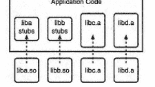

**图 14.1：**  
向程序添加的每个库模块都会增加其大小并强制重新编译。

如您图 14.1 所示，每次向程序添加另一个库时，程序的大小（和复杂性）都会增加。当使用静态库进行链接时，这种增长尤为迅速，图中由 `libc.a` 和 `libd.a` 表示。

`dl` 接口启用了一种不同的方法：您为读取、写入和操作任何格式的图形文件设计一个通用的、格式中立的接口。要向您的应用程序添加新的或修改后的图形格式，您只需编写一个新模块来处理该格式，并让您的应用程序知道它的存在，也许通过修改配置文件或将新模块放置在预定义的目录中（增强 Netscape Web 浏览器功能的插件使用了这种方法的一种变体）。

要扩展您应用程序的功能，用户只需通过编辑配置文件或将模块复制到预设目录来获取新模块。无需重新编译。您应用程序中的现有代码加载新模块，然后，瞧，您可以导入和导出新的图形格式。这种方法如图 14.2 所示。

每次您需要来自不同库的代码时，您只需使用 `dl` 接口加载您需要的函数，图中由指向各种库的箭头所示。应用程序的整体资源需求保持较低状态，其磁盘占用空间与链接静态或共享库相比大幅减少。

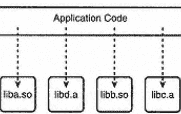

**图 14.2：**  
dl 接口减少了代码大小和复杂性。

dl 接口（本身实现为库 libdl）包含用于加载、搜索和卸载共享对象的函数。要使用这些函数，请在源代码中包含 `<dlfcn.h>` 并链接到 libdl。您不需要链接到您要使用的库——这就是 dl 接口旨在消除的那种必要性。尽管您使用的是标准共享库，但您并不是以正常方式使用它。链接器从未了解共享对象，事实上，在您构建应用程序时，这些模块甚至不需要存在。

## dl 接口

dl 接口提供四个函数来处理加载、使用和卸载共享对象所需的所有任务：dlopen, dlclose, dlsym, 和 dlerror。使用 dlopen 函数加载共享对象。其原型如下：

```c
void *dlopen(const char *filename, int flag);
```

dlopen 使用 flag 指定的模式加载 filename 中的共享对象。filename 可以是绝对路径名、裸文件名或 NULL。如果是 NULL，dlopen 打开当前正在执行的程序——即您的程序。如果 filename 是绝对路径名，dlopen 打开该文件。如果是裸文件名，dlopen 按给定顺序在以下位置查找文件：

* $LD_ELF_LIBRARY_PATH, $LD_LIBRARY_PATH, /etc/ld.so.cache, /usr/lib, 和 /lib。

flag 可以是 RTLD_LAZY，这意味着加载对象中的符号将在调用时解析，或者是 RTLD_NOW，这意味着加载对象中的所有符号将在 dlopen 返回之前解析。任何标志，如果逻辑 OR 与 RTLD_GLOBAL，都会导致所有符号被导出，就像它们被直接链接一样。如果找到 filename，dlopen 返回加载对象的句柄，否则返回 NULL。

在您能够使用动态加载库中的任何代码之前，您必须知道您在寻找什么并且能够访问它。dlsym 函数满足了这两个需求。其原型如下：

```c
void *dlsym(void *handle, char *symbol);
```


dlsym 在 handle 所引用的已加载对象（由 dlopen 加载的对象）中查找 symbol 参数指定的符号或函数。handle 必须是 dlopen 返回的句柄；symbol 是一个标准的 C 风格字符串。dlsym 返回指向该符号的 void 指针，如果失败则返回 NULL。

健壮的代码会检查并处理尽可能多的错误。dlerror 函数可以让你了解使用动态加载对象时发生的错误详情。其原型如下所示：

```c
const char *dlerror(void);
```

如果其他 dl 接口函数调用失败，dlerror 会返回一个描述错误的字符串。调用 dlerror 还会将错误字符串重置为 NULL。因此，紧接着的第二次 dlerror 调用将返回 NULL。dlerror 返回描述最近错误的字符串，否则返回 NULL。

为了节约系统资源，特别是内存，在使用完共享对象中的代码后，请务必将其卸载。然而，由于加载和卸载共享对象会带来一定的开销，在卸载前请确定你不再需要它。dlclose 的原型如下，用于卸载共享对象：

```c
int dlclose(void *handle);
```

dlclose 卸载 handle 所引用的对象。该调用同时会使 handle 失效。由于 dl 库为动态加载的对象维护链接计数，只有当对一个对象调用 dlclose 的次数与其成功调用 dlopen 的次数相同时，该对象才会被释放和卸载。

### 使用 dl 接口

为了演示如何使用 dl 接口，让我们再次回到本章一直在使用的可靠的错误处理库。不过这次，我们将使用一个新的驱动程序，如下例所示。

**示例**

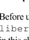

**示例**

在使用此示例之前，请确保已按照本章前面“创建共享库”一节中的说明，构建了 librerr 的共享库版本 librerr.so。

```c
/*
 * dltest.c - 动态加载 librerr.so 并调用 err_ret
 */
#include <stdio.h>
#include <stdlib.h>
#include <dlfcn.h>

int main(void)
{
    void *handle;
    void (*errfcn)(); /* 指向要使用的已加载代码的指针 */
    const char *errmsg;
    FILE *pf;

    /* 加载我们想要的对象 */
    handle = dlopen("liberr.so", RTLD_NOW);
    if (handle == NULL) {
        printf("failed to load liberr.so: %s\n", dlerror());
        exit(EXIT_FAILURE);
    }

    /* 清除错误字符串，如果有 */
    dlerror();
    errfcn = dlsym(handle, "err_ret");
    if ((errmsg = dlerror()) != NULL) {
        printf("didn't find err_ret(): %s\n", errmsg);
        exit(EXIT_FAILURE);
    }

    /* 现在使用已加载的符号，err_ret */
    if ((pf = fopen("foobar", "r")) == NULL)
        errfcn("couldn't open foobar");

    /* 做个好公民，卸载该对象 */
    dlclose(handle);
    exit(EXIT_SUCCESS);
}
```


**输出**

```bash
$ gcc -g -Wall dltest.c -o dltest -ldl
$ LD_LIBRARY_PATH=$(pwd) ./dltest
couldn't open foobar: No such file or directory
```

正如你所见，你无需链接 liberr，也无需在源代码中包含 liberr.h。对 liberr.so 的所有访问都通过 dl 接口进行。dltest 对 dlerror 调用的使用展示了正确的用法。调用一次 dlerror 以将错误字符串重置为 NULL，调用 dlsym，然后再调用一次 dlerror 将其返回值保存在另一个变量中，以便稍后使用该字符串。像平常调用该函数一样调用 errfcn，即调用其指向的函数。最后，卸载共享对象并退出。

**接下来是什么？**

本章描述了编程库的使用和创建。这也结束了对编程 API 的介绍。第四部分“进程间通信”探讨了程序之间通信的多种方式。特别是，你将学习管道和 FIFO、共享内存和消息队列，以及套接字。

# 第四部分——进程间通信

- 15 管道和 FIFO
- 16 共享内存
- 17 信号量和消息队列
- 18 TCP/IP 和套接字编程

## 15——管道和 FIFO

这是四个章节中关于 Linux 各种*进程间通信*（IPC）方法介绍的第一章。IPC 是一个通用术语，指的是进程之间相互通信的方法。如果没有 IPC，进程只能通过文件系统，或者——在具有共同祖先的进程（例如 `fork` 之后的父子关系）的情况下——通过继承的文件描述符来交换数据或其他信息。本章讨论管道和 FIFO，这是 UNIX 及类 UNIX 系统中最古老的 IPC 形式。涵盖的主题包括以下内容：

- 匿名管道
- 打开和关闭匿名管道
- 读写匿名管道
- 使用 `popen` 和 `pclose`
- 理解 FIFO
- 创建、打开和关闭 FIFO
- 读写 FIFO

> 继承文件描述符在“使用 fork”第 78 页中有讨论。

### 管道

*管道*仅仅是一个进程的输出连接到另一个进程的输入。与它们的物理类比相似，Linux 管道（通常）是单向的或半双工的；数据仅流向一个方向。本章讨论两种类型的管道：匿名和命名。命名管道通常被称为 *FIFO*（先进先出）。*匿名管道*之所以匿名，是因为它们从未拥有路径名，因此它们不会存在于文件系统中。严格来说，它们只是在核心 inode 关联的两个文件描述符。最后一个关闭这些文件描述符之一的进程会导致该 inode，从而导致该管道消失。另一方面，*命名管道*确实拥有路径名，并且确实存在于文件系统中。它们被称为 FIFO，因为数据是按写入顺序读取的，所以先进入 FIFO 的数据也是第一个从 FIFO 中读出的数据。图 15.1 说明了匿名管道和 FIFO 之间的区别和相似之处。

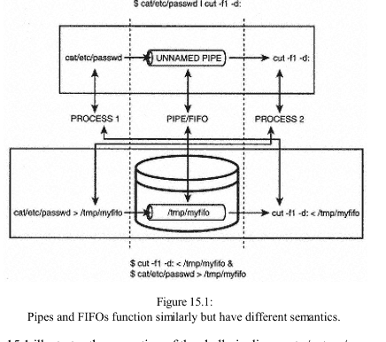

图 15.1 的上半部分说明了 shell 管道 `cat /etc/passwd | cut -f1 -d:` 的执行过程。图 15.1 的下半部分显示了如果使用命名管道而不是匿名管道，图中上半部分的管道将如何执行。垂直虚线表示数据正在写入或从管道读取的时间点。

双向箭头展示了两种类型管道的输入和输出如何对应。所有细节都将在后续章节中解释，因此当你阅读本章时，不妨参考此图。在图的上半部分，`cat` 命令的输出通过内核中创建的匿名管道传输。其输出成为 `cut` 的输入。这是 shell 管道的典型用法。

特别要注意的是，使用命名管道时，`cat` 和 `cut` 命令的顺序是相反的。出于稍后解释的原因，必须先执行 `cut` 命令（并在后台运行），这样你才能在同一个终端或从同一个控制台发出提供命名管道输入的 `cat` 命令。

命名管道 `/tmp/myfifo` 和匿名管道起到相同的作用，将它们的输入输送到它们的输出。真正不同的只是命令执行的顺序，以及处理命名管道时使用 shell 重定向运算符 > 和 < 的方式。

> **注意**
> 也许 FIFO 之所以这样命名，是因为它们也是使用 `mkfifo` 函数创建的！

大多数 Linux 用户都熟悉匿名管道，尽管他们可能并未意识到这一点。诸如以下每个命令都使用了匿名管道：

```bash
$ cat /etc/passwd | cut -f1 -d: | sort
```

在这个例子中，`cat` 命令的输出成为 `cut` 命令的输入，而 `cut` 的输出随后成为 `sort` 的输入。你知道，`|` 是管道符号。你可能没有意识到的是，你的 shell 可能使用你即将见到的 `pipe` 函数来实现 `|`。希望这样就很清楚了，实际上从未有磁盘文件与 `|` 相关联。

> **警告**
> 关于术语的快速提示：除非需要明确区分，本章中的 `pipe` 指的是匿名管道，而 `FIFO` 指的是命名管道。然而，管道和 FIFO 都是`半双工的；`即，数据仅流向一个方向，就像排水管道中的水仅流向一个方向一样。管道和 FIFO 也是`不可寻址的；`即，你不能使用像 `lseek` 这样的调用定位文件指针。

匿名管道有两个缺点。首先，如上所述，它们是半双工的，因此数据只能在一个方向上传输。其次，更重要的是，管道只能用于相关进程之间，即具有共同祖先的进程。如第四章“进程”中所述，由 `fork` 或 exec 创建的子进程继承其父进程的文件描述符。

图 15.2 展示了数据如何通过管道流动。


## 打开和关闭管道

如图所示，数据由写入方写入管道的一端，并由读取方在另一端读取。

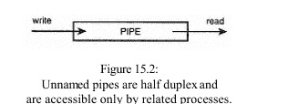

自然，在你能够从管道读取或向管道写入数据之前，管道必须先存在。创建管道的调用是 `pipe`。它的原型在 `<unistd.h>` 中声明如下：

```c
int pipe(int filedes[2]);
```

如果 `pipe` 成功，它会打开两个文件描述符并将其值存储在整数数组 `filedes` 中。第一个描述符 `filedes[0]` 用于读取，因此 `pipe` 使用 `O_RDONLY` 标志来打开它。第二个文件描述符 `filedes[1]` 用于写入，因此 `pipe` 使用 `O_WRONLY` 标志来打开它。如果成功，`pipe` 返回 0；如果发生错误，则返回 -1，同时设置全局错误变量 `errno`。

> `open` 和 `close` 系统调用的语法在第 139 页的“打开和关闭文件”一节中有介绍。

可能的错误条件是 `EMFILE`，意味着调用进程已经打开了太多的文件描述符；`EFAULT`，意味着 `filedes` 数组无效；或者 `ENFILE`，当内核的文件表已满时发生（这绝对是个不好的信号！）。再次强调，文件描述符并不对应于磁盘文件，而是对应于内核中的一个 inode。图 15.3 说明了这一点。

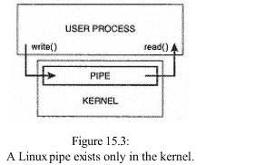

要关闭管道，使用 `close` 系统调用关闭其相关的文件描述符即可。

## 示例

以下示例展示了如何打开和关闭一个管道：

```c
/*
 * pipopn.c 打开和关闭一个管道
 */
#include <unistd.h>
#include <stdio.h>
#include <stdlib.h>

int main(void)
{
    int fd[2];

    if((pipe(fd)) < 0) {
        perror ("pipe");
        exit(EXIT_FAILURE);
    }
    printf("descriptors are %d, %d\n", fd[0], fd[1]);

    close(fd[0]);
    close(fd[1]);
    exit(EXIT_SUCCESS);
}
```

该程序的输出显示 `pipe` 调用成功（描述符值在你的系统中可能不同）。程序调用 `pipe` 函数，并传入文件描述符数组 `fd`。如果 `pipe` 调用成功，程序会打印文件描述符的整数值，关闭它们，然后退出。

### 输出

```
$ ./pipopn
descriptors are 3, 8
```

## 读取和写入管道

要从管道读取和写入数据，只需使用 `read` 和 `write` 调用。记住，`read` 从 `filedes[0]` 读取，而 `write` 写入到 `filedes[1]`。

> 关于 `read` 和 `write` 系统调用的快速复习，请参阅第 141 页的“读取和写入文件”一节。

话虽如此，一个进程为自己打开管道并没有什么意义。管道用于交换数据。因为进程已经可以访问它将通过管道共享的数据，所以把自己数据共享给自己没有意义。通常，一个进程调用 `pipe`，然后调用 `fork` 生成一个子进程。由于子进程会继承父进程打开的任何文件描述符，因此已经建立了一个 IPC 通道。下一步取决于哪个进程是读取者，哪个是写入者。一般规则是：读取进程关闭管道的写入端，写入进程关闭管道的读取端。以下各项使这一过程更加清晰：

- 如果父进程正在向子进程发送数据，父进程关闭 `filedes[0]` 并写入 `filedes[1]`，而子进程关闭 `filedes[1]` 并从 `filedes[0]` 读取。
- 如果子进程向父进程返回数据，子进程关闭 `filedes[0]` 并写入 `filedes[1]`，而父进程关闭 `filedes[1]` 并从 `filedes[0]` 读取。

图 15.4 应该有助于你可视化正确的程序并记住这条规则。

> **注意**
> 试图同时读写单个管道的两端是一个严重的编程错误。如果两个进程需要全双工管道的功能，父进程必须在 fork 之前打开两个管道。

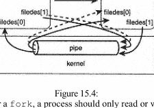

图 15.4 的上半部分显示了在 `fork` 后立即出现的文件描述符状态：父进程和子进程都打开了这两个文件描述符。图 15.4 假设父进程将是写入者，子进程将是读取者。图的下半部分说明了在父进程关闭其读取描述符且子进程关闭其写入描述符后，文件描述符的状态。

> **注意**
> 在管道的写入端被关闭后，从该管道读取将返回 0 以表示文件结束。但是，如果读取端已被关闭，任何试图向管道写入的操作都会为写入者生成 `SIGPIPE` 信号，并且 write 调用本身将返回 -1，并将全局变量 `errno` 设置为 `EPIPE`。如果写入进程没有捕获或忽略 `SIGPIPE`，写入进程将会终止。

> 要回顾捕获和忽略信号的方法，请参阅第 102 页的“捕获信号”一节。

## 示例

以下程序 `piperw` 展示了在相关进程之间打开管道的正确步骤。

```c
/**
 * piperw.c - 正确打开管道并
 *        fork 子进程的方式。
 */
#include <unistd.h>
#include <stdio.h>
#include <stdlib.h>

#include <fcntl.h>
#include <limits.h>

#define BUFSZ PIPE_BUF

void err_quit(char *msg);

int main(int argc, char *argv[])
{
  int fd[2];      /* 管道的文件描述符数组 */
  int fdin;       /* 输入文件的描述符 */
  char buf[BUFSZ];
  int pid, len;

  /* 创建管道 */
  if(pipe(fd) < 0)
    err_quit("pipe");

  /* Fork 并关闭适当的描述符 */
  if((pid = fork()) < 0)
    err_quit("Fork");
  if (pid == 0) {
    /* 子进程是读取者，关闭写入描述符 */
    close(fd[1]);
    while((len = read(fd[0], buf, BUFSZ)) > 0)
      write(STDOUT_FILENO, buf, len);
    close(fd[0]);
  } else {
    /* 父进程是写入者，关闭读取描述符 */
    close(fd[0]);
    if((fdin = open(argv[1], O_RDONLY)) < 0) {
      perror("Open");
      /* 既然无法打开输入，就发送一些内容 */
      write(fd[1], "123\n", 4);
    } else {
      while((len = read(fdin, buf, BUFSZ)) > 0)
        write(fd[1], buf, len);
      close(fdin);
    }
    /* 关闭写入描述符 */
    close(fd[1]);
  }
  /* 回收退出状态 */
  waitpid(pid, NULL, 0);

  exit(EXIT_SUCCESS);
}

void err_quit(char *msg)
{
    perror(msg);
    exit(EXIT_FAILURE);
}
```

`piperw` 期望一个输入文件的名称，否则它会向读取者发送 `123\n`。使用 `pipopn.c` 作为输入的示例运行产生了以下输出（为了简洁进行了截断）：

### 输出

```
$ ./piperw pipopn.c
/*
 * pipopn.c - 打开和关闭一个管道
 */
#include <unistd.h>
#include <stdio.h>
#include <stdlib.h>
```

从输出可以看出，`piperw` 的行为很像 `cat` 命令，只是它使用管道而不是简单地将输入显示到 `stdout`。在 `fork` 之后，子进程关闭它继承的写入描述符，因为它只从管道读取。同样，父进程是写入者，所以它关闭其读取描述符。

如果父进程无法打开其输入文件（`argv[1]`），它不会终止程序，而是在关闭之前通过管道发送字符串 `123\n`。当父进程完成向子进程通过管道传输数据后，它会关闭其写入描述符。当子进程从管道读取到 0 个字节时，它会关闭读取描述符。最后，虽然不清楚父进程还是子进程先退出，但父进程调用 `waitpid` 来回收子进程的退出状态，以防止僵尸进程或孤儿进程的产生。

> **注意** 如果多个进程正在向同一个管道写入，每个进程的写入量必须小于 `PIPE_BUF` 字节（这是定义在 `<limits.h>` 中的一个宏），以确保原子写入；也就是说，确保一个进程写入的数据不会与另一个进程的数据混合。作为一条规则陈述，为了确保原子写入，限制每次 write 调用写入的数据量小于 `PIPE_BUF` 字节。

## 更简单的方法

`piperw` 程序做了大量工作只是为了 `cat` 一个文件：创建管道，fork，在父进程和子进程中关闭不需要的描述符，打开输入文件，向管道写入和从管道读取，关闭打开的文件和描述符，然后回收子进程的退出状态。这一系列操作非常常见，因此 ANSI/ISO C 已在标准库函数 `popen` 和 `pclose` 中对其进行了编码，它们在 `<stdio.h>` 中的原型如下：

```c
FILE *popen(const char *command, const char *mode);
int pclose(FILE *stream);
```

`popen` 创建一个管道，然后 fork 一个子进程并随后执行 `exec`，调用 `/bin/sh -c` 来执行 `command` 中包含的命令字符串。`mode` 参数必须是 `r` 或 `w` 之一，其语义与标准 I/O 库中的相同。也就是说，如果 `mode` 是 `r`，则 `FILE`


`popen` 返回的流指针以只读方式打开，这意味着该流连接到命令的标准输出；从该流读取数据等同于读取命令的标准输出。同样地，如果 `mode` 为 `w`，则该流连接到命令的标准输入，因此向该流写入数据就如同向命令的标准输入写入一样。如果 `popen` 调用失败，它会返回 `NULL`。导致失败的错误条件会被设置在错误变量 `errno` 中。

要关闭该流，必须使用 `pclose` 而非标准的 `fclose` 调用。`pclose` 会关闭 I/O 流，等待命令执行完毕，并将退出状态返回给调用进程。如果 `pclose` 调用失败，则返回 -1。

## 示例


以下程序将 `piperw` 重写为使用 `popen` 和 `pclose`：

```c
/*
 * piperw.c – The correct way to open a pipe and fork
 *           a child process.
 */
#include <unistd.h>
#include <stdio.h>
#include <stdlib.h>
#include <fcntl.h>
#include <limits.h>

#define BUFSZ PIPE_BUF

void err_quit(char *msg);

int main(void)
{
  FILE *fp;                    /* FILE stream for popen */
  char *cmdstring = "cat piperw.c";
  char buf[BUFSZ];             /* Buffer for "input" */

  /* Create the pipe */
  if((fp = popen(cmdstring, "r")) == NULL)
    err_quit("popen");
  /* Read cmdstring's output */
  while((fgets(buf, BUFSZ, fp)) != NULL)
    printf("%s", buf);

  /* Close and reap the exit status */
  pclose(fp);
  exit(EXIT_SUCCESS);
}

void err_quit(char *msg)
{
    perror(msg);
    exit(EXIT_FAILURE);
}
```

正如代码清单所示，`popen` 和 `pclose` 使得管道操作所需的代码量大大减少。代价是放弃了一定程度的控制权。例如，你被迫使用 C 流库而不是低级别的 read 和 write I/O 调用。此外，`popen` 强制你的程序执行 exec，而你可能并不一定想要或需要这样做。最后，用于回收子进程退出状态的函数调用 `pclose` 可能不符合你的程序要求。尽管存在这种灵活性上的损失，`popen` 本身节省了 10–15 行代码；而处理读写操作的代码相比 `piperw` 的代码也显著简化了。输出结果（部分如下所示）保持不变。模式语义可能看起来有些奇怪，所以请记住 `r` 表示你从 `stdout` 读取，而 `w` 表示你向 `stdin` 写入。


### 输出

```text
$ ./newrw
/*
 * pipopn.c - Open and close a pipe
 */
#include <unistd.h>
#include <stdio.h>
#include <stdlib.h>
...
```

## FIFO

如前所述，FIFO 也称为命名管道，因为它们具有持久性，即存在于文件系统中。FIFO 特别有用，因为它们允许互不相关的进程交换数据。

## 理解 FIFO

使用 shell 命令的一个简单示例可以帮助你理解 FIFO。`mkfifo(1)` 命令用于创建 FIFO：

```text
mkfifo [option] name [ . . . ]
```

该命令创建一个名为 `name` 的 FIFO。`option` 通常是 `-m mode`，其中 `mode` 指示新创建的 FIFO 的八进制模式，该模式会受到 umask 的修改。创建 FIFO 后，你可以像使用常规 shell 管道的一部分一样使用它。

## 示例


下面的示例将 `newrw` 的输出通过一个富有想象力的名为 `fifo1` 的 FIFO 传递，该 FIFO 进而将其输出通过 `cut` 命令传递。

首先，使用以下命令创建 FIFO：

```shell
$ mkfifo -m 600 fifo1
```

接下来，执行以下两个命令：

```shell
$ cat < fifo1 | cut -c1-5 &
$ ./newrw > fifo1
```

这些 shell 命令的输出如下：


### 输出

```c
/*
 * piperw.c
 */
#include <unistd.h>
#include <stdio.h>
#include <stdlib.h>
int main(void)
{
    int ...
    if((...
        per ...
    Exit ...
    }
    fpri ...
    clos ...
    exit
}
```

在后台运行的 `cat` 命令从 FIFO（`fifo1`）读取输入。`cat` 的输入是 `cut` 命令的输出，而 `cut` 命令会修剪掉每一行输入中除前五个字符以外的所有字符。`cut` 的输入，最终来自 `newrw` 程序的输出。

这些 shell 命令的实际输出是看似奇怪、被截断的代码，以完成代码清单。如果 `fifo1` 是常规文件，结果将是一个填充了 `newrw` 输出的常规文件。

> **提示**
>
> `ls` 命令的输出确认 `mkfifo` 创建了所请求的 FIFO。它在文件模式的设备类型字段中显示为 `p`（代表 pipe），并且由于 `-F` 开关，它在文件名末尾显示为 `|`。

## 创建 FIFO

创建 FIFO 的函数调用名称与 shell 接口相同，即 `mkfifo`。其语法类似于 `open`：

```c
int mkfifo(const char *pathname, mode_t mode);
```

要使用此函数，请在你的程序中包括 `<sys/types.h>` 和 `<sys/stat.h>`。`mkfifo` 创建一个名为 `pathname` 的 FIFO，其权限位由 `mode` 指定（以八进制表示）。通常，`mode` 中的值会受到进程 `umask` 的修改。

> **注意**
>
> `umask` 影响大多数创建具有特定权限的文件或目录的调用。要提前确定文件或目录在经 `umask` 修改后的模式，只需将你要使用的模式与 `umask` 值的按位补数进行按位与运算即可。在代码中，这看起来像这样：
>
> mode_t mode = 0666;
> mode & ~umask;
>
> 因此，给定 `umask` 为 `022`，`mode & ~umask` 返回 `0644`。

如果成功，`mkfifo` 返回 0；否则，它将错误变量 `errno` 的值设置好并返回 -1 给调用者。潜在的包括 `EACCES`、`EEXIST`、`ENAMETOOLONG`、`ENOENT`、`ENOSPC`、`ENOTDIR` 和 `EROFS`。

- **表 6.1** “系统调用错误代码”（第 125 页）列出了系统调用生成的返回代码。

## 示例


以下程序在当前目录中创建一个 FIFO：

```c
/*
 * newfifo.c – Create a FIFO
 */
#include <sys/types.h>
#include <sys/stat.h>
#include <errno.h>
#include <stdio.h>
#include <stdlib.h>

int main(int argc, char *argv[])
{
	mode_t mode = 0666;

	if (argc != 2) {
		puts("USAGE: newfifo <name>");
		exit(EXIT_FAILURE);
	}
	if ((mkfifo(argv[1], mode)) < 0) {
		perror("mkfifo");
		exit(EXIT_FAILURE);
	}
	exit(EXIT_SUCCESS);
}
```

该程序的几次示例运行产生了以下输出：


### 输出

```text
$ ./newfifo
USAGE: newfifo <name>
$ ./newfifo fifo1
$ ./newfifo fifo1
mkfifo: File exists
```

第一次运行时，`newfifo` 发出警告，因为它没有被正确调用；它期望将 FIFO 的名称作为唯一的参数传递。第二次运行提供了文件名，`newfifo` 默默地创建了它。由于文件已经存在，第三次运行中的 `mkfifo` 调用失败，`errno` 被设置为 `EEXIST`。`EEXIST` 的设置对应于 `perror` 打印的字符串：`File exists`。

## 打开和关闭 FIFO

打开、关闭、删除、读取和写入 FIFO 的过程分别使用你之前已经见过的 open、close、unlink、read 和 write 系统调用——这是 Linux “一切皆文件” 抽象的一个优点。由于打开和关闭 FIFO 与打开和关闭管道相同，你可能需要回顾本章前面列出的“打开和关闭管道”中的程序。

然而，在读取和写入 FIFO 时，你必须牢记一些细微之处。首先，FIFO 的两端都必须打开后才能使用。其次，更重要的是，如果 FIFO 使用 O_NONBLOCK 标志打开时的行为。回想一下，O_WRONLY 或 O_RDONLY 标志可以逻辑或与 O_NONBLOCK。如果 FIFO 使用 O_NONBLOCK 和 O_RDONLY 打开，调用会立即返回；但如果它使用 O_NONBLOCK 和 O_WRONLY 打开，如果该 FIFO 尚未同时被打开用于读取，则 open 返回错误并将 errno 设置为 ENXIO。

另一方面，如果 open 的标志中没有指定 O_NONBLOCK，O_RDONLY 会导致 open 阻塞（不返回），直到另一个进程以写模式打开该 FIFO。同样，O_WRONLY 会阻塞，直到该 FIFO 被打开用于读取。

与管道一样，向未打开用于读取的 FIFO 写入数据会向写入进程发送 SIGPIPE，并将 errno 设置为 EPIPE。在最后一个写入者关闭 FIFO 后，读取进程在其下一次读取时会检测到文件末尾。如前关于管道所述，为了确保多个进程向单个 FIFO 写入时的原子性写入，每个进程的写入大小必须小于 PIPE_BUF 字节。

## 读取和写入 FIFO

在考虑了上一节末尾讨论的事项后，读取和写入 FIFO 与读取和写入管道及常规文件类似。

## 示例


此示例稍显复杂。一个程序 `rdfifo` 创建并打开一个 FIFO 用于读取，并将 FIFO 的输出显示到 stdout。另一个程序 `wrffifo` 打开该 FIFO 用于写入。特别有趣的是运行多个写入者实例在不同窗口中，并在运行读取者的窗口中观察它们的输出的过程。

```c
/*  rdfifo.c  Create a FIFO and read from it */
#include <sys/types.h>
```


```c
#include <sys/stat.h>
#include <errno.h>
#include <stdio.h>
#include <stdlib.h>
#include <fcntl.h>
#include <limits.h>

int main(void)
{
    int fd;                                      /* Descriptor for FIFO */
    int len;                                     /* Bytes read from FIFO */
    char buf[PIPE_BUF];
    mode_t mode = 0666;

    if ((mkfifo("fifo1", mode)) < 0) {
        perror("mkfifo");
        exit(EXIT_FAILURE);
    }
    /* Open the FIFO read-only */
    if ((fd = open("fifo1", O_RDONLY)) < 0) {
        perror("open");
        exit(EXIT_FAILURE);
    }
    /* Read and display the FIFO's output until EOF */
    while ((len = read(fd, buf, PIPE_BUF - 1)) > 0)
        printf("rdfifo read: %s", buf);
    close(fd);

    exit(EXIT_SUCCESS);
}

/*
 * wrfifo.c - Write to a "well-known" FIFO
 */
#include <sys/types.h>
#include <sys/stat.h>
#include <errno.h>
#include <stdio.h>
#include <stdlib.h>
#include <fcntl.h>
#include <limits.h>
#include <time.h>

int main(void)
{
    int fd;                       /* Descriptor for FIFO */
    int len;                     /* Bytes written to FIFO */
    char buf[PIPE_BUF];          /* Ensure atomic writes */
    mode_t mode = 0666;
    time_t tp;                   /* For time call */

    /* Identify myself */
    printf("I am %d\n", getpid());

    /* Open the FIFO write-only */
    if ((fd = open("fifo1", O_WRONLY)) < 0) {
        perror("open");
        exit(EXIT_FAILURE);
    }
    /* Generate some data to write */
    while (1) {
        /* Get the current time */
        time(&tp);
        /* Create the string to write */
        len = sprintf(buf, "wrfifo %d sends %s",
                      getpid(), ctime(&tp));

        /*
         * Use (len + 1) because sprintf does not count
         * the terminating null
         */
        if ((write(fd, buf, len + 1)) < 0) {
            perror("write");
            close(fd);
            exit(EXIT_FAILURE);
        }
        sleep(3);
    }
    close(fd);
    exit(EXIT_SUCCESS);
}
```

这些程序的输出如**图 15.5**所示。读者 `rdfifo` 运行在大型 xterm 中。三个较小的 xterm 各自运行写入者 `wrfifo` 的一个实例。每个写入者的 PID 都显示在它们的屏幕上。每隔三秒钟，写入者会将一条包含其 PID 和当前时间的消息推送到命名管道 `fifo1` 中。如你所见，读者显示收到的消息，并在其前面加上 `rdfifo read` 前缀，以将其输出与从命名管道读取的输入区分开来。

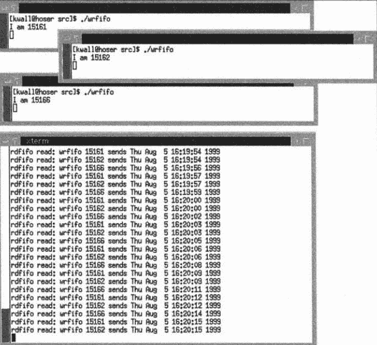

**图 15.5**：多个进程向同一个命名管道写入。

值得注意的是，这些程序构成了一个原始的，尽管相对无用的，客户端/服务器应用程序。服务器是 `rdfifo`；它处理通过命名管道发送给它的数据。客户端是每个 `wrfifo` 进程，其唯一目的是向服务器发送消息。

更复杂的客户端/服务器应用程序会对接收到的数据执行某种处理，并向客户端发送某种通知或数据。关于客户端/服务器应用程序的深入讲解远远超出了本书的范围，但请感到满意，因为你刚刚编写了一个！

## 接下来是什么？

本章介绍了最简单形式的进程间通信：管道和命名管道。下一章将继续讨论进程间通信方法，重点讲解共享内存。虽然共享内存 IPC 比管道和命名管道更复杂，但它功能更强大且更灵活，常用于更大、更复杂的应用程序，如 *RDBMS*（关系数据库管理系统），例如 Informix 和 Oracle。

## 16— 共享内存

共享内存是你将要学习的三种进程间通信（IPC）类型中的第一种。其他两种风格是信号量和消息队列，它们是下一章的主题。综合起来，这三种类型通常被称为 System V IPC，因为它们源自 System V UNIX，最初由 AT&T 发布。基于 BSD 的 UNIX 实现以及其他类 UNIX 操作系统，包括 Linux，也支持它们。

> * 关于信号量和消息队列的全面讲解将在第 17 章“信号量和消息队列”中提供。

本章涵盖的主题包括

- System V IPC 的一般描述
- System V IPC 的问题
- 共享内存的使用

## 介绍 System V IPC

这是两章讨论 System V IPC 机制中的第一章。System V IPC 很少用于新应用程序，因为它已被 POSIX IPC 取代。然而，本书之所以涵盖它，是因为你很可能会在早于 POSIX IPC 标准提出之前编写的旧程序遇到它。所有三种类型具有相同的基本接口和相同的一般设计。本节介绍了 System V IPC 的基本概念，并查看了信号量、消息队列和共享内存共有的特性和编程习惯。

IPC 结构（信号量、消息队列和共享内存段）存在于内核中，就像管道一样，而不是像命名管道那样存在于文件系统中。IPC 结构有时统称为 *IPC 对象*，以避免说或写“信号量、消息队列和共享内存段”时的繁琐。类似地，术语 *IPC 对象* 用于指代这些结构类型中的一种，而不具体指明是哪种类型。**图 16.1** 展示了无关进程如何通过 IPC 对象相互通信。

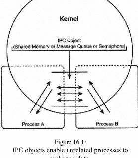

正如**图 16.1** 所示，IPC 对象由内核维护（实际上是在内核内存中），使得原本无关的进程（没有共同父进程的进程）能够使用 IPC 机制（共享内存、信号量或消息队列之一）相互通信。数据使用 IPC 机制在进程之间自由流动。

每个对象都通过其 *标识符*进行引用和访问，这是一个唯一标识该对象及其类型的正整数。每个标识符对于其类型是唯一的，但相同的标识符值可能同时用于消息队列、信号量和共享内存段。该标识符成为对该结构进行所有其他操作的手柄。

> **注意**
> IPC 结构标识符不是像文件描述符那样被使用和重复使用的小正整数。事实上，随着结构的创建和删除，标识符编号，正式称为 *槽位使用序列号*，会递增直到达到最大值，此时它会回绕到 0 并重新开始。最大值取决于操作系统和底层硬件。在 Linux 中，标识符被声明为整数，因此可能的最大值是 65,535。

每个 IPC 结构都通过一个 `get` 函数创建：信号量使用 `semget`，消息队列使用 `msgget`，共享内存使用 `shmget`。每次使用其中一个 `get` 函数创建对象时，调用进程必须指定一个类型为 `key_t`（在 `<sys/types.h>` 中声明）的 `key`，内核使用它来生成标识符。Linux 2.2.x 内核将 `key_t` 定义为整数。

在创建 IPC 结构后，后续使用相同 key 调用 `get` 函数的操作不会创建新的结构，而只是返回与现有结构关联的标识符。因此，两个（或更多）进程可以调用带有相同 key 的 `get` 函数，以建立 IPC 通道。

那么，挑战就在于如何确保所有希望使用同一 IPC 结构的进程都使用相同的 key。在一种方法中，实际创建结构的进程将 `IPC_PRIVATE` key 传递给 `get` 函数，这保证会创建一个新的结构。IPC 结构的创建者随后将返回的标识符存储在文件系统中，以便其他进程可以访问它。当父进程 `forks` 并 `execs` 一个新进程时，父进程将返回的标识符作为创建子进程的 `exec` 函数的参数之一传递给其子进程。

另一种方法是在公共头文件中存储一个标准的 key，以便所有包含该头文件的程序都能访问相同的 key。这种方法的一个问题是，没有任何进程知道它是在创建一个新的结构，还是仅仅在访问由另一个进程已经创建的结构。这种方法的另一个问题是，该 key 可能已经被无关的程序使用。因此，使用该 key 的进程必须有代码来处理这种可能性。


第三种方法涉及使用 `ftok` 函数，该函数接受一个路径名和一个称为项目标识符的单个字符，并返回一个键，然后将其传递给相应的 get 函数。你需要确保所有进程预先知晓该路径名和项目标识符。你可以通过之前提到的方法之一来实现这一点：将路径名和项目标识符包含在一个公共头文件中，或者将它们存储在一个预定义的配置文件中。不幸的是，`ftok` 存在一个严重缺陷：它无法保证生成唯一的键，这就产生了与前面讨论的第二种方法相同的问题。由于使用 `ftok` 可能存在的问题，本章忽略该函数。

> **注意**
> 直白地说，Linux 的 `ftok` 实现是有缺陷的。在以下情况下，它会生成非唯一的键：
> 
> - 当两个不同的符号链接指向同一个文件时。
> 
> - 当路径名 inode 号的前 16 位具有相同值时。
> 
> - 当系统中存在两个具有相同次设备号的磁盘设备时，这种情况出现在拥有多个磁盘控制器的系统中。主设备号会不同，但次设备号可以相同。
> 
> 鉴于 Linux 的 `ftok` 实现的弱点，强烈建议读者将其视为禁忌并忽略它。

除了指定键之外，get 函数还接受一个控制 get 行为的 flags 参数。如果指定的键尚未被用于期望类型的结构，且 flags 中设置了 `IPC_CREAT` 位，则将创建一个新的结构。

每个 IPC 结构都有一个模式，一组权限的行为类似于文件的模式（如传递给 open 的模式），不同之处在于 IPC 结构没有执行权限的概念。在创建 IPC 结构时，你必须使用 open 和 creat 系统调用中定义的八进制表示法，将特定的权限按位或运算合并到 flags 参数中，否则可能无法访问已创建的结构。稍后你将遇到关于此的具体示例。正如你所料，System V IPC 包含一个用于更改 IPC 结构的访问权限和所有权的调用。

- 若需快速回顾文件模式，请参见第 134 页的“文件模式”。

### System V IPC 的问题

System V IPC 存在几个缺点。首先，与它提供的益处相比，其编程接口很复杂。其次，IPC 结构是比系统可支持的文件数或系统允许的活动进程数等资源限制更严格的资源。第三，尽管是有限资源，IPC 结构并不维护引用计数，而引用计数是一个记录使用该结构的进程数的计数器。因此，System V IPC 没有自动回收被遗弃的 IPC 结构的机制。

例如，如果一个进程创建了一个结构，向其中放置数据，然后终止而未正确删除该结构及其关联数据，该结构将保持原样，直到发生以下情况之一：

- 系统重启
- 使用 `ipcrm(1)` 命令特定删除
- 另一个具有适当访问权限的进程读取数据或删除数据，或两者兼有

这一缺点构成重大的设计缺陷。

最后，如前所述，IPC 结构仅存在于内核中；文件系统并不知道它们。因此，对它们的 I/O 操作需要学习另一个编程接口。由于缺乏文件描述符，你不能使用通过 select 系统调用实现的多路复用 I/O。如果一个进程必须等待 IPC 结构的 I/O，它必须使用某种忙等待循环。忙等待循环——一个持续检查某个变化条件的循环——几乎在任何时候都是糟糕的编程实践，因为它不必要地消耗 CPU 周期。在 Linux 下，忙等待循环尤其有害，因为 Linux 有多种实现非忙等待的方法，如阻塞 I/O、select 系统调用和信号。

- 若要回顾多路复用 I/O 和 select 系统调用，请参见第 169 页的“I/O 多路复用”。

## 理解共享内存

共享内存是内核预留的一块内存区域（段），用于多个进程之间的信息交换。只要段的权限设置得当，每个希望访问该段的进程都可以将该段映射到其自己的私有地址空间中。如果一个进程更新了段中的数据，该更新对其他进程立即可见。由一个进程创建的段可以被其他进程读取或写入（或两者兼有）。共享内存这一名称传达了多个进程可以共享访问该段及其包含的信息这一事实。

每个进程接收其共享内存映射到其地址空间的一个副本。事实上，共享内存在概念上类似于内存映射文件。图 16.2 展示了共享内存。

- 内存映射文件的创建和使用在“内存映射文件”（第 174 页）中有详细讨论。

图 16.2 在某些方面过于简化了共享内存的问题，因为共享内存段可能由物理 RAM 中的数据以及已被交换到磁盘的内存页组成。同样的注意事项也适用于附加到共享内存段的进程的地址空间。

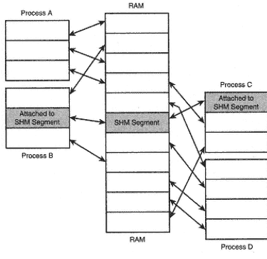

图 16.2：
进程将共享内存段映射到它们自己的地址空间。

尽管如此，该图展示了一个创建在主内存中的共享内存（SHM）段（显示为阴影框）。进程 B 和 C 中的阴影框说明了这两个进程已将此段映射到它们自己的地址空间。该图还显示每个四个进程都有自己的地址空间，映射到物理 RAM 的某些部分。然而，一个进程的地址空间对另一个进程不可用。

当然，因为数据传输严格在内存中进行（忽略一个或多个页已被交换到磁盘的可能性），共享内存是两个进程通信的快速方式。它具有与内存映射文件许多相同的优点。

## 创建共享内存段

创建共享内存段的调用是 `shmget`。要使用与共享内存相关的任何调用，必须在源代码中包含 <sys/types.h>、<sys/ipc.h> 和 <sys/shm.h>。`shmget` 的原型如下：

```c
int shmget (key_t key, int size, int flags);
```

`flags` 可以是 `IPC_CREAT`、`IPC_EXCL` 和一组通过按位或运算合并的权限位（模式）中的一个或多个。权限位以八进制指定。`IPC_EXCL` 确保如果段已存在，该调用会失败，而不是返回现有段的标识符。

> **提示**
> 本章示例的 Makefile（在配套网站上）包含一个预处理器宏 -D _XOPEN_SOURCE。该宏是必需的，因为所有程序都包含 <ipc.h>，这需要定义 _XOPEN_SOURCE。
> 
> 奇怪的是，当我在默认的 Red Hat 6.0 安装上编译这些程序时，不需要定义该宏，但在 OpenLinux 2.3 上编译时需要定义该宏。

`IPC_CREAT` 表明如果尚不存在与 `key` 关联的段，则应创建一个新的段。`key` 是 `IPC_PRIVATE` 或 `ftok` 函数返回的键。`size` 参数指定段的大小，但这将向上舍入为 `PAGE_SIZE` 的值，即给定处理器的页的自然大小（当前 Intel 处理器为 4k，Alpha 为 8k）。`shmget` 成功时返回段标识符，出错时返回 -1。

## 示例


## 示例

本示例 mkshm 创建一个共享内存段，并显示 `shmget` 返回的标识符。

```c
/*
 * mkshm.c - 创建和初始化共享内存段
 */
#include <sys/types.h>
#include <sys/ipc.h>
#include <sys/shm.h>
#include <stdio.h>
#include <stdlib.h>

#define BUFSZ 4096
```


```
int main(void)
{
    int shmid;
    if((shmid = shmget(IPC_PRIVATE, BUFSZ, 0666)) < 0) {
        perror("shmget");
        exit(EXIT_FAILURE);
    }
    printf("segment created: %d\n", shmid);
    system("ipcs -m");
    
    exit(EXIT_SUCCESS);
}
```


### 输出

```
$ ./mkshm
segment created: 40833

---- Shared Memory Segments ----
key    shmid  owner   perms  bytes  nattch  status
0x00000000 40705  kwall   666    4096   0
```

如输出所示，mkshm 成功创建了一个共享内存段。`ipcs -m` 输出的倒数第二列 `nattach` 显示了已*附加*到该段上的进程数量（即已将共享内存段映射到自身地址空间的进程）。请注意，目前没有进程附加到该段。`shmget` 唯一的作用就是创建共享内存段；想要将共享内存段映射到自身地址空间的进程（即*附加到该段*），必须显式地使用下一节中讨论的 `shmat` 调用来完成。

## 附加共享内存段

在您*附加*共享内存段（即将其地址映射到进程地址空间）之前，无法使用该段。同样，当您完成对共享内存段的操作后，必须将其从您的地址空间中*分离*。附加使用 `shmat` 调用来完成，而分离则需要使用 `shmdt` 调用。这些例程的原型如下：

```
char *shmat(int shmid, char *shmaddr, int flags);
int shmgt(char *shmadr);
```

`shmid` 是您想要附加的段的标识符。在 `shmat` 中，如果 `shmaddr` 为 0，内核会将该段映射到调用进程地址空间中由内核选择的地址。如果 `shmaddr` 不为 0，则指定内核应将段映射到的地址——显然这样做存在很大的不确定性，因此始终将 `shmaddr` 设置为 0。`flags` 可以是 `SHM_RDONLY`，这意味着该段将以只读方式附加。默认情况下，段以读写方式附加。如果 `shmat` 调用成功，它将返回附加段的地址。否则，它将返回 -1 并设置 `errno`。
`shmdt` 将位于 `shmaddr` 处附加的段从调用进程的地址空间中分离；该地址必须之前由 `shmat` 调用返回。

## 示例

## 示例 1

此示例 `atshm` 附加并分离了一个共享内存段。

```
/*
 * atshm.c - 附加到共享内存段
 */
#include <sys/types.h>
#include <sys/ipc.h>
#include <sys/shm.h>
#include <stdio.h>
#include <stdlib.h>

int main(int argc, char *argv[])
{
    int shmid;          /* 段标识符 */
    char *shmbuf;       /* 进程中的地址 */

    /* 期望命令行传入段标识符 */
    if(argc != 2) {
        puts("USAGE: atshm <identifier>");
        exit(EXIT_FAILURE);
    }
    shmid = atoi(argv[1]);

    /* 附加该段 */
    if((shmbuf = shmat(shmid, 0, 0)) < (char *)0) {
        perror("shmat");
        exit(EXIT_FAILURE);
    }
    /* 它被附加在哪里？ */
    printf("segment attached at %p\n", shmbuf);

    /* 看，我们确实附加了！ */
    system("ipcs -m");

    /* 分离 */
    if(shmdt(shmbuf) < 0) {
        perror("shmdt");
        exit(EXIT_FAILURE);
    }
    puts("segment detached\n");
    /* 是的，我们确实分离了它 */
    system("ipcs -m");

    exit(EXIT_SUCCESS);
}
```

`shmat` 返回指向 `char` 的指针，因此在检查其返回值时，`atshm` 将零强制转换为 `char *` 以烦人的编译器警告。该示例还使用 `ipcs` 命令来确认调用进程确实成功地附加和分离了内存段。下面的输出示例说明了这一点。请注意，已附加的进程数量 `nattch` 会递增和递减。


### 输出

```
$ ./atshm 40833
segment attached at 0x40014000


----- Shared Memory Segments -------
key     shmid   owner   perms   bytes   nattch  status
0x00000000 40833  kwall   666     4096    1

segment detached

----- Shared Memory Segments -------
key     shmid   owner   perms   bytes   nattch  status
0x00000000 40833  kwall   666     4096    0
```


## 示例 2

下一个示例附加到一个段，向其写入数据，然后将缓冲区输出到文件 `opshm.out`。

```
/*
 * opshm.c - 附加到共享内存段
 */
#include <sys/types.h>
#include <sys/ipc.h>
#include <sys/shm.h>
#include <stdio.h>
#include <stdlib.h>
#include <fcntl.h>

#define BUFSZ 4096

int main(int argc, char *argv[]) {
    int shmid;             /* 段 ID */
    char *shmbuf;         /* 进程中的地址 */
    int fd;                /* 文件描述符 */
    int i;                 /* 计数器 */

    /* 期望命令行传入段标识符 */
    if(argc != 2) {
        puts("USAGE: opshm <identifier>");
        exit( EXIT_FAILURE);
    }
    shmid = atoi(argv[1]);

    /* 附加该段 */
    if((shmbuf = shmat(shmid, 0, 0)) < (char *)0) {
        perror("shmat");
        exit(EXIT_FAILURE);
    }

    /* 为 shmbuf 分配存储空间 */
    if((shmbuf = malloc(sizeof(char) * BUFSZ)) == NULL) {
        perror("malloc");
        exit(EXIT_FAILURE);
    }
    for (i = 0; i < BUFSZ; ++i)
        shmbuf[i] = i % 127;
    fd = open("opshm.out", O_CREAT | O_WRONLY, 0600);
    write(fd, shmbuf, BUFSZ);
    exit(EXIT_SUCCESS);
}
```

此示例附加到一个先前创建的段，在内存区域中设置值，然后将整个缓冲区写入磁盘文件。该程序没有可视输出，但以下列表是从输出文件 *opshm.out* 中摘录的：


### 输出

```
$ ./opshm 40833
~@A^B^C^D^E^F^i
K^L*M^N^O^P^Q^R^S^T^U^V^W^X^Y^ZESC^\]^^^
"#$%&'() *+,-./0123456789:;<=>?@ABCDEFGHIJKLMNOPQRSTUVWXYXZ
[\]_^_abcdefghijklmnopqrstuvwxyz{|}~^@A^B^C^D^E^F^^
```

## 接下来是什么？

本章探讨了 System V IPC 共享内存。下一章“信号量与消息队列”将继续深入探讨 System V IPC，随后在第 18 章中，我们将进入 TCP/IP 和套接字编程。

# 17— 信号量与消息队列

本章继续讨论上一章开始的 System V IPC。对消息队列和信号量的讲解将完整梳理 System V IPC。本章涵盖以下内容：

- 理解消息队列
- 创建消息队列
- 附加到现有的消息队列
- 发送和获取消息
- 删除消息队列
- 理解信号量
- 创建和移除信号量
- 更新信号量
- 使用共享内存 IPC 对象在第 16 章“共享内存”第 339 页中讨论。

## Linux 与 System V IPC

System V IPC 广为人知且常用，但正如本章和上一章所指出的，其在 Linux 中的实现存在严重缺陷。Linux 的版本早于 POSIX IPC，尽管 2.2.x 内核中已提供 POSIX IPC，但很少有 Linux 程序实际实现它。POSIX IPC 具有与本章和上一章讨论的早期 System V 版本相似的接口，但它消除了 System V 存在的某些问题，并简化了接口。问题在于，尽管 System V IPC 是标准，但它在 Linux 中的实现方式古怪且不良，其原因过于深入，不在本文讨论范围内。

这种情况的结果是，Linux 努力（并且主要成功）符合 POSIX 标准，同时实现了 POSIX IPC 的早期版本和 System V 版本。困难在于 System V 更成熟且更常见，但 POSIX 版本更好用、更易于使用，并且对于通过编程方式与三种类型的 IPC 对象交互具有更统一的接口。结果呢？我选择打破自己的规则，决定涵盖您在现有和新程序中可能遇到的内容，而不是讨论“正确的事”（即 POSIX IPC）。

处理信号量时还会出现另一个问题。System V 信号量产生于远古时期，旨在解决多个执行线程（在单个进程中以及在多个进程中）需要大致同时访问相同系统资源时产生的一系列问题。尽管我认为编写良好的多线程程序是任何 Linux 系统必不可少的（甚至不可或缺的）组成部分，但我强调的是“编写良好”。编写多线程程序远远超出了本书的范围；这不是初学者程序员该涉足的地方。即使是经验丰富的程序员，甚至是超级程序员，在求助于多线程之前也会寻找其他解决方案，因为正确实现多线程非常困难。

我的观点是什么？我简化了对信号量的讨论，因为 System V 版本是为多线程进程设计的。尽管如此，在标准的单线程程序中，信号量仍然非常有用，您将在本章中看到。POSIX 信号量接口更简单，但目前尚未在 Linux 程序中广泛使用。

## 消息队列

消息队列是内核中存储的消息链表，用户进程通过消息队列标识符来识别该队列，这种标识符类似于上一章讨论的标识符。为简洁和方便起见，本章使用术语 queue 和 queue ID 来指代消息队列和消息队列标识符。如果您向队列添加消息，它看起来像是 FIFO，因为新消息被添加到队列末尾的


队列。然而，你不必按 FIFO 顺序检索消息。消息队列也可以被视为一种简单的关联内存形式，因为稍后你将看到，可以利用消息类型按非顺序检索消息。消息队列与 FIFO 之间的区别如图 17.1 所示。

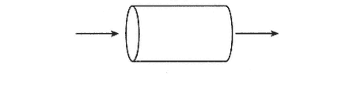

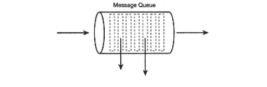

图 17.1：与 FIFO 不同，可以从队列中按任意顺序读取消息。

如你所知，数据从 FIFO 中读取的顺序与其写入顺序相同。这在图 17.1 的上半部分中有所说明。然而，如果你知道消息的消息类型，就可以从队列中提取给定的消息。如图中的箭头所示（指向队列外部和离开队列的消息），消息通常按先进先出顺序读取。消息队列上带有向外箭头的两个虚线矩形说明了消息可以按任意顺序读取。

所有队列操作函数都在 `<sys/msg.h>` 中声明，但你还必须包含 `<sys/types.h>` 和 `<sys/ipc.h>`，以访问其中包含的类型和常量声明。要创建新队列或打开现有队列，请使用 `msgget` 函数。要向队列底部添加新消息，请使用 `msgsnd`。要从队列中获取消息，请使用 `msgrecv` 调用。`msgctl` 允许你操作队列特性并删除队列，前提是调用进程是队列的创建者或具有超级用户权限。

### 创建和打开队列

`msgget` 函数用于创建新队列或打开现有队列。其原型如下：

```
int msgget(key_t key, int flags);
```

如果调用成功，它将返回与 `key` 中包含的值对应的新队列或现有队列的队列 ID。如果 `key` 为 `IPC_PRIVATE`，则使用底层实现生成的键值创建新队列；只要未超过系统对队列数量或所有队列总字节数的限制，使用 `IPC_PRIVATE` 保证会创建一个新队列。

同样，如果 `key` 不是 `IPC_PRIVATE`，且 `key` 不对应于具有相同 `key` 的现有队列，并且 `flags` 参数中设置了 `IPC_CREAT` 位，则会创建一个新队列。否则——即如果 `key` 不是 `IPC_PRIVATE` 且 `flags` 中未设置 `IPC_CREAT` 位——`msgget` 返回与 `key` 关联的现有队列的队列 ID。如果 `msgget` 失败，它返回 -1 并设置 `errno` 错误变量。

## 示例


下面的示例程序 `mkcq` 创建一个新的消息队列。如果你第二次运行它，它不会创建指定的队列，而是简单地打开现有的队列。

```c
/**
 * mkcq.c – 创建 SysV IPC 消息队列
 */
#include <sys/types.h>
#include <sys/ipc.h>
#include <sys/msg.h>
#include <stdio.h>
#include <stdlib.h>

int main(int argc, char *argv[]) {
    int qid;         /* 队列标识符 */
    key_t key;      /* 队列键 */

    key = 123;

    /* 创建队列 */
    if((qid = msgget(key, IPC_CREAT | 0666)) < 0) {
        perror("msgget:create");
        exit(EXIT_FAILURE);
    }
    printf("created queue id = %d\n", qid);

    /* 再次打开队列 */
    if((qid = msgget(key, 0)) < 0) {
        perror("msgget:open");
        exit(EXIT_FAILURE);
    }
    printf("opened queue id = %d\n", qid);

    exit (EXIT_SUCCESS);
}
```

该程序在我的系统上产生的输出如下所示：


### 输出

```
$ ./mkq
created queue id = 384
opened queue id = 384
```

如果第一个 msgget 调用成功，mkq 将显示新创建的队列 ID，然后第二次调用 msgget。如果第二个调用成功，mkq 也会报告这一点，但第二个调用只是打开现有队列，而不是创建新队列。注意，第一个调用使用标准八进制表示法指定了所有用户的读写权限。

> **注意**
> 与 open 函数的行为不同，创建 System V IPC 结构时，进程的 umask 不会修改结构的访问权限。如果你未设置访问权限，默认模式为 0，这意味着甚至结构的创建者都没有读或写访问权限！

### 向队列写入消息

如前所述，要向队列底部添加新消息，请使用 msgsnd 函数，其原型如下：

```
int msgsnd(int msgid, const void *ptr, size_t nbytes, int flags);
```

如果成功，msgsnd 返回 0；如果失败，它返回 -1 并将全局错误变量 errno 设置为以下值之一：

- `EAGAIN`
- `EACCES`
- `EFAULT`
- `EIDRM`
- `EINTR`
- `EINVAL`
- `ENOMEM`

> `errno` 值的值和解释列于表 6.1 “系统调用错误代码”，第 125 页。

`msgid` 参数必须是之前调用 `msgget` 返回的队列 ID。`nbytes` 是发布消息中的字节数，该消息不应以空字符结尾。`ptr` 是指向 `msgbuf` 结构的指针，该结构由消息类型和构成消息的数据字节组成。`msgbuf` 在 `<sys/msg.h>` 中定义如下：

```c
struct msgbuf {
    long mtype;
    char mtext[1];
};
```

这个结构声明实际上只是一个模板，因为 `mtext` 的大小必须调整为所存储数据的长度，这对应于传递给 `nbytes` 参数的值，减去任何终止空字符。`mtype` 可以是任何大于零的 `long` 整数。调用进程还必须对队列具有写访问权限。最后，`flags` 变量为 0 或 `IPC_NOWAIT`。`IPC_NOWAIT` 导致行为类似于传递给 `open` 系统调用的 `O_NONBLOCK` 标志：如果队列中单个消息的总数或队列的字节大小等于系统指定的限制，`msgsnd` 立即返回并将 `errno` 设置为 `EAGAIN`。因此，直到至少读取一个消息之前，你将无法向队列中添加更多消息。

如果 `flags` 为 0，并且队列中的最大消息数已达上限或已写入队列的数据总字节数已达上限，则 `msgsnd` 调用将阻塞（不返回），直到该条件清除为止。要清除该条件，必须从队列中读取消息，队列必须被删除（这将 `errno` 设置为 `EIDRM`），或者捕获信号且处理程序返回（这将 `errno` 设置为 `EINTR`）。

> **提示**
> 可以根据应用需求扩展 `msgbuf` 结构模板。例如，如果你想传递一个由整型和 10 字节字符数组组成的消息，只需按如下方式声明 `msgbuf`：

```c
struct msqbuf {
    long mtype;
    int i;
    char c[10];
};
```

`msqbuf` 只是一个 *long* 后跟消息数据，你可以按自己的意愿进行格式化。此示例中声明的结构大小为 `sizeof(msqbuf) – sizeof(long)`。

## 示例


此程序 `qsnd` 向已存在的队列底部添加消息。将队列 ID 作为程序唯一的命令行参数传递。

```c
/*
 * qsnd.c - 向先前打开的队列发送消息
 */
#include <sys/types.h>
#include <sys/ipc.h>
#include <sys/msg.h>
#include <stdio.h>
#include <stdlib.h>
#include <string.h>
#include <unistd.h>

#define BUFSZ 512

struct msg {                        /* 消息结构 */
    long msg_type;
    char msg_text[BUFSZ];
};

int main(int argc, char *argv[])
{
    int qid;                        /* 队列标识符 */
    int len;                        /* 发送数据的长度 */
    struct msg pmsg;                /* 指向消息结构的指针 */

    /* 期望在命令行上传递队列 ID */
    if(argc != 2) {
        puts("USAGE: qsnd <queue ID>");
        exit(EXIT_FAILURE);
    }
    qid = atoi(argv[1]);

    /* 获取要添加到队列的消息 */
    puts("Enter message to post:");
    if(fgets(pmsg.msg_text, BUFSZ, stdin) == NULL) {
        puts("no message to post");
        exit(EXIT_SUCCESS);
    }

    /* 将消息与此进程关联 */
    pmsg.msg_type = getpid();
    /* 将消息添加到队列 */
    len = strlen(pmsg.msg_text);
    if(msgsnd(qid, &pmsg, len, 0) < 0) {
        perror("msgsnd");
        exit(EXIT_FAILURE);
    }
    puts("message posted");

    exit(EXIT_SUCCESS);
}
```

该程序的一次示例运行产生了以下输出。注意，该程序使用 `mkq` 返回的队列 ID。

### 输出

```
$ ./mkq
created queue id = 640
opened queue id = 640
$ ./qsnd 640
Enter message to post:
**this is test message number one**
message posted
```

回忆一下，第一个命令创建了一个队列 ID 为 640 的新队列。第二个命令 `qsnd 640` 提示输入要发布的消息


将键入的响应（以**粗体**显示）直接存储到之前声明的 msgstructure 中。如果 `msgsnd` 成功完成，它会显示一条确认消息。请注意，`qsnd` 将消息类型设置为调用进程的 PID。这使得你稍后可以使用 `msgrcv` 仅检索该进程发布的那些消息。

### 读取排队消息

要从队列中拉取一条消息，请使用 `msgrcv`，其语法如下：

```c
int msgrcv(int msqid, void *ptr, size_t nbytes, long type, int flags);
```

如果成功，`msgrcv` 会从队列中移除返回的消息。参数与 `msgsnd` 接受参数相同，不同之处在于 `msgrcv` 会用消息类型和最多 `nbytes` 的数据填充 `ptr` 结构体。额外的参数 `type` 对应于前面讨论的 msg 结构体中的 `msg_type` 成员。`type` 的值决定了返回哪条消息，如以下列表所示：

- 如果 `type` 为 0，则返回队列中的第一条消息（最顶层的消息）。
- 如果 `type` 大于 0，则返回第一条 `msg_type` 等于 `type` 的消息。
- 如果 `type` 小于 0，则返回第一条 `msg_type` 为小于或等于 `type` 绝对值的最小值的消息。

`flags` 的值也控制着 `msgrcv` 的行为。如果返回的消息大于 `nbytes`，且 `flags` 中设置了 `MSG_NOERROR` 位，则消息会被截断为 `nbytes`（但不会产生消息已被截断的通知）。否则，`msgrcv` 返回 -1 以指示错误，并将 `errno` 设置为 `E2BIG`。消息也保留在队列中。

如果 `flags` 中设置了 `IPC_NOWAIT` 位，`msgrcv` 立即返回，如果没有指定类型的消息可用，则设置 `errno` 为 `ENOMSG`。否则，`msgrcv` 阻塞，直到之前为 `msgsnd` 描述的相同条件之一发生。

> **注意**
> `type` 参数的负值可用于创建 LIFO（后进先出）类型的队列，通常称为堆栈。传入负值使您可以按与放入队列顺序相反的顺序检索给定类型的消息。

## 示例


以下程序 `qrd` 从一个已创建并填充的队列中读取一条消息。要读取的队列 ID 作为命令行参数传入。

```c
/*
 * qrd.c - Read all message from a message queue
 */
#include <sys/types.h>
#include <sys/ipc.h>
#include <sys/msg.h>
#include <stdio.h>
#include <stdlib.h>

#define BFSZ 512

struct msg { /* Message structure */
    long msg_type;
    char msg_text[BFSZ];
};

int main(int argc, char *argv[]) {
    int qid; /* The queue identifier */
    int len; /* Length of message */
    struct msg pmsg; /* Pointer to a message structure */

    /* Expect the queue ID passed on the command-line */
    if (argc != 2) {
        puts("USAGE: qrd <queue ID>");
        exit(EXIT_FAILURE);
    }
    qid = atoi(argv[1]);

    /* Retrieve and display a message from the queue */
    len = msgrcv(qid, &pmsg, BFSZ, 0, 0);
    if (len > 0) {
        printf("reading queue id: %05d\n", qid);
        printf("\tmessage type: %05d\n", pmsg.msg_type);
        printf("\tmessage text: %s\n", pmsg.msg_text);
    } else {
        perror("msgrcv");
        exit(EXIT_FAILURE);
    }

    exit(EXIT_SUCCESS);
}
```

该程序的一次运行输出如下。与之前一样，它使用由 `mkq` 创建的队列 ID，并读取由 `qsnd` 示例发布的那条消息。


**输出**

```
$ ./mkq
created queue id = 640
opened queue id = 640
$ ./qsnd 640
Enter message to post:
this is test message number one
message posted

$ ./qrd 640
reading queue id: 00640
message type: 14308
    message text: this is test message number one
```

从代码列表中可以看出，从消息队列中读取比写入更容易，并且需要更少的代码。示例程序中特别值得注意的是，它从队列顶部获取第一条消息，因为它传递了 `type` 为 0。在这种情况下，由于消息写入进程的 PID 是已知的或可以轻易发现（`14308`），`qrd` 本可以传递 `type` 为 14308 并从队列中获取相同的消息。

## 删除消息队列

`msgctl` 函数提供了对消息队列的一定控制。其原型如下：

```c
int msgctl(int msqid, int cmd, struct msqid_ds *buf);
```

通常，`msqid` 是现有队列的队列 ID。`cmd` 可以是以下之一：

- `IPC_RMID` — 移除队列 `msqid`。
- `IPC_STAT` — 用队列的 `msqid_ds` 结构体填充 `buf`。`IPC_STAT` 允许你查看队列的内容而不移除任何消息。由于这是一种非破坏性读取，你可以将其视为类似于 `msgrcv`。
- `IPC_SET` — 允许你更改队列的 UID、GID、访问模式以及队列允许的最大字节数。

## 示例


以下程序使用 `msgctl` 调用删除命令行传入其 ID 的队列。

```c
/*
 * qctl.c - Remove a message queue
 */
#include <sys/types.h>
#include <sys/ipc.h>
#include <sys/msg.h>
#include <stdio.h>
#include <stdlib.h>
#include <string.h>
#include <unistd.h>

int main(int argc, char *argv[])
{
    int qid;
    struct msqid_ds dsbuf;

    if(argc != 2) {
        puts("USAGE: qctl <qid>");
        exit(EXIT_FAILURE);
    }
    qid = atoi(argv[1]);

    if((msgctl(qid, IPC_RMID, NULL)) < 0) {
        perror("msgctl");
        exit(EXIT_FAILURE);
    }

    printf("queue %d removed\n", qid);
    exit(EXIT_SUCCESS);
}
```

### 输出

```
$ ./mkq
created queue_id = 1280
opened queue_id = 1280
$ ipcs -q
------- Message Queues -------
key        msqid   owner perms   used-bytes messages
0x0000007b 1280    kwall 666     0          0

$ ./qctl 1280
queue 1280 removed
$ ipcs -q
------- Message Queues -------
key        msqid   owner perms   used-bytes messages

```

程序输出显示指定的队列已被删除。`mkq` 创建队列。`ipcs` 调用确认队列已创建。使用 `mkq` 显示的队列 ID，`qctl` 调用 `msgctl`，指定 `IPC_RMID` 标志以删除队列。再次运行 `ipcs` 确认 `qctl` 已移除队列。

在几个示例程序中使用的 `ipcs` 命令显示了系统执行时所有现有的 System V IPC 结构的数量和状态。`ipcrm` 命令将删除在命令行上指定类型和 ID 的 IPC 结构。更多信息请参阅手册页。图 17.2 显示了 `ipcs` 命令的输出。

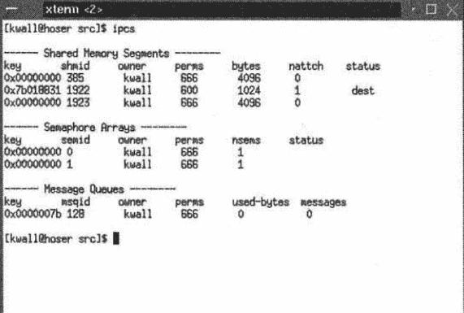

图 17.2：`ipcs` 显示当前存在的所有 System V IPC 对象。

图 17.2 显示至少每个类型的 IPC 对象都存在一个。当前正在使用三个共享内存段、一个消息队列和两个信号量（信号量将在下一节讨论）。每个对象的关键值、标识符、所有者/创建者以及权限都清晰列出。相对于每种对象类型的统计数据显示在输出的最后之一或两列中，具体取决于对象类型。

## 信号量

信号量控制对共享资源的访问。它们与你目前看到的其他 IPC 手段大不相同，因为它们不使进程间共享信息，而是同步访问那些不应同时被访问的共享资源。在这方面，信号量操作更接近文件或记录锁定，但应用于比文件更多的资源。本节只讨论最简单的信号量类型，即二元信号量。二元信号量取两个值之一：当资源被锁定且其他进程不应访问时为 0，当资源未锁定时为 1。

- 有关文件和记录锁定的更多信息，参见第 182 页的"文件锁定"。

信号量的工作原理非常像繁忙路口的交通灯。当一个进程需要访问受控资源（如文件）时，它首先检查信号量的值，就像司机检查交通灯是否变绿一样。如果信号量值为零，对应红灯，则表示资源正在使用中，因此进程阻塞，直到资源变得可用（即，信号量的值变为非零）。在 System V IPC 的术语中，这种阻塞被称为等待。如果信号量为正值，对应路口的绿灯，则表示相关资源可用，因此进程递减信号量，对资源执行操作，然后递增信号量以释放"锁"。

## 创建信号量

当然，在你能够递增或递减信号量之前，它必须存在。创建新信号量或访问现有信号量的函数调用是 `semget`，在 `sys/sem.h` 中定义原型如下（你还需要包含 `sys/ipc.h` 和 `sys/types.h`）：

```c
int semget(key_t key, int nsems, int flags);
```

`semget` 返回与 `nsems` 个信号量集合相关联的信号量标识符。如果 `key` 为 `IPC_PRIVATE`，或者 `key` 尚未被使用且 `flags` 中设置了 `IPC_CREAT` 位，则创建一个新的信号量集合。与共享内存段和消息队列一样，`flags` 也可以与权限位（八进制）进行按位或运算，以设置信号量的访问模式。然而请注意，信号量具有读和修改权限，而不是读和写权限。信号量使用"修改"的概念而不是


### 备注

> System V 信号量调用实际上是对信号量数组（或集合）进行操作，而不仅仅是单个信号量。然而，这里的目的是为了简化讨论并引导你了解相关内容，而不是详尽介绍信号量的所有复杂性。无论是处理单个还是多个信号量，基本方法是相同的，但你必须明白 System V 信号量是以集合的形式存在的。就我个人而言，我认为该接口过于复杂且不必要，而 POSIX IPC 标准定义了一个更简单但同样具备能力的信号量接口。
>
> 本章关于信号量的讨论还忽略了其在具有多个执行线程的流程中的应用情况。多线程进程及其在该上下文中的信号量使用超出了本书的范围。

write 是因为你实际上并不向信号量写入数据，只是通过增加或减少其值来更改（或调整）其状态。如果发生错误，semget 返回 -1 并设置 errno，否则返回与 key 值相关联的信号量标识符。

semop 函数是信号量例程的主力。它对由 semget 调用创建或访问的一个或多个信号量执行操作。其原型如下：

```c
int semop(int semid, struct sembuf *semps, unsigned nops);
```

semid 是先前由 semget 返回的信号量标识符，指向要操作的信号量集合。nops 是 semops 指向的 sembuf 结构体数组中的元素数量。而 sembuf 具有如下结构：

```c
struct sembuf {
 short sem_num; /* 信号量编号 */
 short sem_op; /* 要执行的操作 */
 short sem_flg; /* 控制操作的标志 */
};
```

在 sembuf 结构中，sem_num 是从 0 到 nsems - 1 的信号量编号，sem_op 是要执行的操作，而 sem_flg 修改 semop 的行为。sem_op 可以是负数、零或正数。如果是正数，则由信号量控制的资源被释放，并且信号量的值会增加。

如果 sem_op 为负数，则表示调用进程希望等待受控资源可用，届时信号量将减少，并且资源被调用进程锁定。

最后，如果 sem_op 为零，调用进程将阻塞（等待），直到信号量变为零；如果它已经是零，则调用立即返回。sem_flg 可以是 IPC_NOWAIT，其行为如前所述，或者是 SEM_UNDO，这意味着当调用 semop 的进程退出时，所执行的操作将被撤销。

## 示例


以下程序 mksem 创建一个信号量并使其自增，从而将假想的资源设置为解锁或可用状态：

```c
/*
 * mksem.c - 创建并递减一个信号量
 */
#include <sys/types.h>
#include <sys/ipc.h>
#include <sys/sem.h>
#include <stdio.h>
#include <stdlib.h>

int main(void)
{
    int semid;                 /* 信号量标识符 */
    int nsems = 1;            /* 要创建多少个信号量 */
    int flags = 0666;         /* 全局可读可改模式 */
    struct sembuf buf;

    /* 以全局可读可改权限创建信号量 */
    semid = semget(IPC_PRIVATE, nsems, flags);
    if(semid < 0) {
        perror("semget");
        exit(EXIT_FAILURE);
    }
    printf("semaphore created: %d\n", semid);

    /* 设置 semop 的结构体 */
    buf.sem_num = 0;          /* 单个信号量 */
    buf.sem_op = 1;          /* 递增信号量 */
    buf.sem_flg = IPC_NOWAIT; /* 阻塞操作 */

    if((semop(semid, &buf, nsems)) < 0) {
        perror("semop");
        exit(EXIT_FAILURE);
    }
    system("ipcs -s");
    exit(EXIT_SUCCESS);
}
```

`mksem` 的一次运行输出如下。显示的标识符值在你的系统上可能不同。


**输出**

```
semaphore created: 512
------- Semaphore Arrays ---------
 key          semid   owner    perms    nsems    status
0x00000000    512     kwall     666      1
```

示例使用 `IPC_PRIVATE` 以确保信号量按请求创建，然后显示 `semget` 的返回值以展示信号量标识符。`semop` 调用适当初始化了信号量：由于只创建了一个信号量，因此 `sem_num` 为零。由于假想资源未在使用中（实际上，信号量在程序层面并未与任何特定资源关联），`mksem` 将其值初始化为 1，相当于解锁状态。由于不需要阻塞行为，信号量的 `sem_flg` 设置为 `IPC_NOWAIT`，因此调用立即返回。最后，示例使用 `system` 调用启动用户级 `ipcs` 命令，以再次确认所需的 IPC 结构确实存在。

### 控制和移除信号量

你之前已经见过 `msgctl` 和 `shmctl`，即用于操作消息队列和共享内存段的调用。正如你所料，信号量的等效函数是 `semctl`，其原型如下：

```c
int semctl(int semid, int semnum, int cmd, union semun arg);
```

`semid` 标识你要操作的信号量集合，`semnum` 指定你感兴趣的特定信号量。本书忽略集合中存在多个信号量的情况，因此 `semnum`（实际上是信号量数组的索引）始终为零。

`cmd` 参数可以是以下列表中的任一值：

- **GETVAL**——返回信号量的当前状态（锁定或解锁）。
- **SETVAL**——将信号量的当前状态设置为 `arg.val`（`semun` 参数稍后将讨论）。
- **GETPID**——返回最后调用 `semop` 的进程的 PID。
- `GETNCNT`——使 `semctl` 的返回值为等待信号量增加的过程数；即等待该信号量的过程数。
- `GETZCNT`——使 `semctl` 的返回值为等待信号量变为零的过程数。
- `GETALL`——返回与 `semid` 相关联的集合中所有信号量的值。
- `SETALL`——将与 `semid` 相关联的集合中所有信号量的值设置为 `arg.array` 中存储的值。
- `IPC_RMID`——移除具有 `semid` 的信号量。
- `IPC_SET`——设置信号量的模式（权限位）。
- `IPC_STAT`——每个信号量都有一个数据结构 `semid_ds`，完全描述其配置和行为。`IPC_STAT` 将此配置信息复制到 `sems` 结构体的 `arg.buf` 成员中。

如果 `semctl` 调用失败，它返回 -1 并适当设置 `errno`。否则，根据 `cmd` 的值，它返回 `GETNCNT`、`GETPID`、`GETVAL` 或 `GETZCNT` 的整数值。

正如你可能推测的那样，`sems` 参数在 `semctl` 例程中起着至关重要的作用。你必须根据以下模板在你的代码中定义它：

```c
union semun {
    int val;                    /* SETVAL 的值 */
    struct semid_ds *buf;       /* IPC_STAT 的缓冲区 */
    unsigned short int *array;  /* GETALL 和 SETALL 的缓冲区 */
};
```

## 示例


此时，你应该开始理解为什么我抱怨 System V 信号量接口对于普通用户来说过于复杂。尽管存在这种困难，下一个示例 `sctl` 使用 `semctl` 调用从系统中移除一个信号量。为此，你需要运行 `mksem` 创建一个信号量，然后使用该信号量标识符作为 `sctl` 的参数。

```c
/*
 * sctl.c - 操作并删除一个信号量
 */
#include <sys/types.h>
#include <sys/ipc.h>
#include <sys/sem.h>
#include <stdio.h>
#include <stdlib.h>

int main(int argc, char *argv[])
{
    int semid; /* 信号量标识符 */

    if(argc != 2) {
        puts("USAGE: sctl <semaphore id>");
        exit(EXIT_FAILURE);
    }
    semid = atoi(argv[1]);

    /* 移除信号量 */
    if((semctl(semid, 0, IPC_RMID)) < 0) {
        perror("semctl IPC_RMID");
        exit(EXIT_FAILURE);
    } else {
        puts("semaphore removed");
        system("ipcs -s");
    }

    exit(EXIT_SUCCESS);
}
```

以下列表说明了 sctl 在我的系统上的输出操作：


**输出**

```
$ ./mksem
semaphore created: 640
------- Semaphore Arrays --------
key semid owner perms nsems status
0x00000000 640 kwall 666 1
```

```
$ ./sctl 640
semaphore removed
```


# 18— TCP/IP 和套接字编程

随着互联网在社会中，尤其是在计算机领域中扮演着越来越核心的角色，几乎每一个非琐碎的应用程序都需要包含某种形式的基本网络支持。本章讨论的主题包括：

- 网络概念和术语概述
- Berkeley 套接字 API
- 基本套接字操作
- UNIX 域套接字
- TCP/IP 编程基础
- 网络名称和数字
- TCP/IP 套接字

## 网络概念和术语

对于大多数人来说，网络似乎像电话一样工作。当你拨打电话时，你会拨一个号码并直接到达你想要联系的人。你所说的句子会按你说话的顺序传输和接收，其他人无法收听你的对话或插到中间。因此，电话提供消息的可靠传输，按顺序传输，并且在传输过程中不会篡改消息。类似地，当你点击网页上的链接时，它会几乎立即把你带到链接页面。没有中间停留；页面不会乱码或中断。

然而，实际上，计算机网络并不像这样整洁地工作。与提供两个位置之间直接电路连接的电话系统不同，计算机网络基于存储转发（通常称为*分组交换*）。发送者将数据分成固定大小的包，称为*数据包*，并将其发送到最近的中继器，称为*路由器*。路由器检查每个传入的数据包以确定是否保留它。路由器将其应保留的数据包传输到自己的网络中，并将其不应保留的数据包转发到线路上下一个路由器，此时存储转发过程重复进行。图 18.1 说明了分组交换的工作方式。

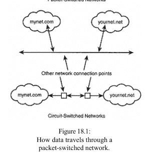

图 18.1 对比了数据在分组交换网络（图的顶部部分）和电路交换网络（图的底部部分）中的传输方式。mynet.com 和 yournet.net 代表两个连接到互联网的局域网。如图所示，在分组交换网络中，mynet.com 和 yournet.net 的路由器将其本地网络的数据传输到网络中。这由连接互联网数据流和连接局域网的垂直线及两端的箭头表示。传输到其他网络的数据只是简单地转发到下一个路由器。然而，电路交换网络会在 mynet.com 和 yournet.net 之间创建连接。

尽管可能存在中间网络连接点（如图中的小方框所示），但它们更像铁路道口而非汽车交叉路口。数据（火车）在前往目的地的途中畅通无阻。然而，在分组交换网络中，如互联网，数据必须经过几个交叉路口（路由器）的协调。每个数据包通过互联网的路径由路由器控制，就像汽车在拥挤的街道上的路径至少部分由它遇到的交叉路口控制一样。

除了操作上的差异之外，分组交换网络还有其他缺点。首先，一些数据包会丢失。其次，长消息被拆分为多个数据包，它们可能以与发送时不同的顺序到达，任何人都可以拦截数据包并更改其内容。尽管存在这些缺陷，计算机网络运作得非常好，因为设计硬件和软件的（非常聪明的）人们想出了绕过或解决所有这些问题的方案。

**注**

短短三段话甚至无法描述计算机网络的复杂操作。讨论大大简化了，目的是提供足够信息让你将网络编程放在有意义的背景下，而不被细节淹没。所以，阅读时请牢记这一点。

类似地，一章只能对网络编程主题进行浅尝辄止的讨论。这是一个复杂的话题，需要数百页才能完整解决。

在讨论网络*协议*（数据在网络上传输的约定规则）时，经常会用到几个术语。如果一个协议有两个明确的端点，其他用户不能侵入连接，并且在通信开始之前两个端点之间必须存在连接，则称该协议为*面向连接的*。缺乏这些特征的协议被认为是*无连接的*。

*排序*意味着协议保证数据以发送时的相同顺序到达。如果协议能检测损坏、丢弃损坏消息并安排重传数据，则该协议具有*错误控制*。

网络以两种方式传输数据：使用单个数据字节和使用数据包。基于字节的传输描述了*流式协议*，因为它们只处理字节流，类似于 Linux 的字符设备。流式协议可以将长字节序列分解，但它们有顺序，所以按发送顺序到达。流式协议也称为可靠协议，因为它们努力确保网络消息完整传输，或者通知发送者发生了一个或多个错误，消息应重发。

另一方面，基于数据包的协议创建人为定尺寸（固定大小）的数据包。这些协议不分解数据包进行发送，只传输完整的数据包。

考虑到这些术语，对大多数网络协议进行分类相对简单，包括 TCP/IP（互联网的基础）和局部 IPC（以前称为 UNIX 域套接字），可以归入两类之一。如 UDP（用户数据报协议）这样的数据报协议，是基于数据包的、无连接的、无排序的，并且不提供错误控制。相反，流协议是面向字节的，并提供排序和错误控制。TCP，即传输控制协议，是流协议的典型例子。

### Berkeley 套接字 API

鉴于网络协议种类多样，每次想要学习或使用新协议时都需要学习新的编程接口，这一前景无疑是令人望而却步的。幸运的是，Berkeley 套接字 API（通常称为 Berkeley 套接字，因在 UNIX 的 BSD 版本中推广而得名）旨在封装多种网络协议，并为网络程序员提供单一的编程接口。

这种通用性引入了额外的复杂性，但与学习 AppleTalk、AX.25、IPX、NetRom、局部 IPC 和 TCP/IP 的低层接口相比，复杂性是一个小代价。本章使用 Berkeley 套接字来编程 POSIX 局部 IPC（只能在单台机器上工作）和 TCP/IP（使互联网上的计算机能够相互通信）。

套接字 API 的基本数据结构是 sockaddr 结构，它存储网络地址，这是任何网络协议最基本的特性。它在 <sys/socket.h> 中声明如下：

```c
struct sockaddr {
  unsigned short int sa_family;
  char sa_data[14];
};
```

## 接下来是什么？

本章通过介绍消息队列和信号量完成了你对 System V IPC 的介绍。在下一章“TCP/IP 和 Socket Programming”中，你将学习网络编程的基础。TCP/IP 和套接字协议是不同主机之间 IPC 最知名和最广泛使用的方法。学完下一章后，你将掌握足够的信息，能够做出明智的决定，选择最适合你需求的多种 IPC 机制。


sa_family 描述存储的地址类型，而 sa_data 包含实际的地址数据。sa_family 通常是表 18.1 中列出的值之一。

### 表 18.1：套接字地址族

| 地址族 | 协议族 | 描述 |
|---|---|---|
| AF_UNIX | PF_UNIX | UNIX 域套接字 |
| AF_INET | PF_INET | TCP/IP（第 4 版） |
| AF_AX25 | PF_AX25 | AX.25 业余无线电协议 |
| AF_IPX | PF_IPX | Novell IPX 协议 |
| AF_APPLETALK | PF_APPLETALK | AppleTalk DDS 协议 |

> **注意**
> 支持的协议族和地址族的完整列表列在 <sys/socket.h> 中。

### 套接字基础

基本的套接字操作包括创建、打开、关闭、读取和写入它们。得益于 Linux 将所有事物都视为文件的独特习惯，你可以像对常规文件那样，使用相同的 I/O 函数对套接字进行操作。

> 关于 Linux 文件抽象的简要讨论，请参见第 132 页的“特性与概念”。

当应用于套接字时，I/O 函数（read、write 等）具有独特的语义，本章将对此进行覆盖，但除此之外，接口是完全相同的。所有套接字函数都需要包含 <sys/socket.h> 以及适用于每个协议的标头文件。

#### 创建套接字

唯一独特的基本套接字操作是 socket 函数，它用于创建套接字。其原型如下：

```c
int socket(int domain, int type, int protocol);
```

socket 调用创建用于在两个希望交换数据的过程或系统之间建立通信信道的至少两个套接字之一。domain 指定要使用的网络协议。它将是表 18.1 第二列中的某个协议族。type 确立协议的类别，例如流协议或数据报协议。并非所有协议族都支持所有通信类别。

`protocol` 指示基于给定的 `domain`（协议族）和 `type`（流、数据报等）所使用的默认协议。就本书而言，此参数的值始终为 0，表示默认协议。当前支持的类型列表在表 18.2 中给出，但本章仅讨论 `SOCK_STREAM`。

#### 表 18.2：Berkeley 套接字类型

| **套接字类型** | **描述** |
|---|---|
| `SOCK_STREAM` | 支持面向连接的、有序的、受错误控制的全双工字节流。 |
| `SOCK_DGRAM` | 支持无连接的、无序的、面向包的具有固定大小的消息。 |
| `SOCK_SEQPACKET` | 支持有序的、全双工的、面向连接的包传输，但包的接收方必须通过单个 read 系统调用读取整个包。 |
| `SOCK_RAW` | 旨在提供低级别的、协议级的访问。必须编写代码以根据协议规范处理数据。不适合胆小者！ |
| `SOCK_RDM` | 支持面向连接的包传输，但不保证数据顺序。 |

如果套接字创建成功，`socket` 将返回一个有效的文件描述符，用于后续的 I/O 操作。否则，它返回 -1 并设置 `errno` 的值以指示问题。可能的错误值包括以下项：

-   `EACCES`—调用进程缺乏创建请求套接字的权限。如果进程没有足够的目录权限，或者用户级进程（相对于 root 进程）不被允许创建指定 `type` 或 `protocol` 的套接字时，会发生此错误。
-   `EINVAL`—此错误发生是因为调用进程请求了未知的协议，或者内核不支持在 `domain` 中指定的协议族。这通常是打字错误造成的。
-   `EMFILE`—当进程文件表已满且无法再创建更多进程时生成。此错误指示系统负载过重。
-   `ENFILE`—内核缺乏足够的内存来创建支持另一个套接字所需的必要支持结构。`ENFILE` 通常指示系统存在严重问题。
-   `ENOBUFS` 或 `ENOMEM`—系统（而非内核）没有足够的内存来创建请求的结构。虽然不如 ENFILE 严重，但当此错误发生时，系统通常状况不佳。
-   `EPROTONOSUPPORT`—在 domain 中指定的协议族不支持请求的类型或协议（或两者）。

#### 连接套接字

尽管套接字已经创建，但如果没有与其建立的打开连接，它是无用的。此外，对于服务器进程和客户端进程来说，连接过程是不同的。服务器进程是接收信息、数据请求，或授予请求者某种对能力或设施访问权限的进程。因此，服务器进程通常创建一个套接字，然后等待来自客户端或请求者的连接请求。同样，客户端进程也会通过套接字请求服务器提供信息或数据，或者再次通过套接字发送请求，以访问服务器提供的某些服务。

因此，服务器要做的工作比客户端更多。首先，在创建套接字后，它必须绑定到该套接字，这在套接字和地址之间建立关联。对于 UNIX 域套接字，此地址仅仅是路径名和文件名（在下一节中详述）。对于常规 TCP/IP 套接字，地址是标准的互联网地址（在本章后面的“TCP/IP 编程”一节中讨论）。

在绑定地址之后，服务器必须监听连接，这意味着它必须等待客户端请求连接到套接字。收到连接请求后，服务器通常接受该请求；也就是说，它正式为请求的客户端打开连接，并开始通过套接字与其交换信息。服务器每个任务对应的函数调用名称都非常直观：bind、listen 和 accept。

另一方面，客户端只需要请求连接到服务器打开的套接字。同样直观的是，客户端使用 connect 系统调用请求连接到它感兴趣的套接字。图 18.2 说明了客户端和服务器创建并连接套接字的过程。

如图 18.2 所示，服务器通过 accept 调用控制客户端对套接字的访问。没有要求服务器必须接受客户端的连接请求。

连接套接字的四个调用原型如下：

```c
int bind(int sockfd, struct sockaddr *addr, int addrlen);
int listen(int sockfd, int backlog);
int accept(int sockfd, struct sockaddr *addr, int *addrlen);
int connect(int sockfd, struct sockaddr *addr, int addrlen);
```

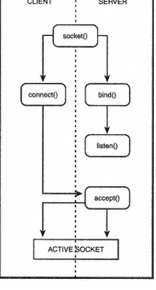

客户端和服务器连接套接字。

对于每个调用，`sockfd` 是先前 `socket` 调用返回的文件描述符，`sockaddr` 是指向套接字地址结构的指针，`addrlen` 是 `sockaddr` 的大小（注意 `accept` 调用在返回时可能会更改此值）。

`listen` 的 `backlog` 参数定义了允许在特定套接字上排队等待的最大连接数，超过此数量后，额外的连接请求将被直接拒绝。历史上，此值为 5，但可以更改。

`bind`、`listen` 和 `connect` 成功时返回零。通常，如果失败，它们返回 -1 并设置 `errno` 以反映发生的错误。然而，`accept` 调用返回一个新的文件描述符，接受进程（通常是服务器）可以使用它通过 `write` 和 `read` 系统调用进行文件 I/O 操作。失败时，`accept` 返回 -1 并设置 `errno`。

> **注意**
> 虽然 POSIX 套接字 API 支持某些安全功能（即，凭据）相对于套接字，但我这里没有涵盖它们，因为 Linux 对 POSIX 套接字的支持处于变化之中。Linux 对 POSIX 本地 IPC 的实现是不完整的。POSIX 规范中的许多材料存在，但在许多情况下，支持新规范的调用似乎只是围绕实现“经典”、前 POSIX 规范的旧调用的包装器。更糟糕的是，手册页严重过时。
> POSIX IPC 规范的权威编程参考是 Richard Stevens 的 *Network Programming* 系列。如果你尝试使用 POSIX IPC，你必须意识到它可能不会按你预期的方式工作。

## 示例


## 示例

以下示例程序 `mksock` 和 `sockconn` 演示了基本的套接字操作。UNIX 域套接字的细节将在下一节“UNIX 域套接字”中介绍。

1. `mksock`
    在 UNIX 域套接字上创建、绑定、监听并接受连接。

```c
/*
* mksock.c - 创建并绑定到套接字
*/
#include <sys/socket.h>
#include <sys/un.h>
#include <stdlib.h>
#include <stdio.h>
#include "helper.h"

int main(int argc, char *argv[])
{
    int sockfd;              /* 套接字的文件描述符 */
    struct sockaddr_un srv; /* 服务器的套接字结构 */
    socklen_t socklen;

    /* 期望在命令行提供套接字名称 */
    if(argc != 2) {
        puts("USAGE: mksock <filename>");
        exit(EXIT_FAILURE);
    }

    /* 创建套接字 */
```


```c
if ((sockfd = socket(PF_UNIX, SOCK_STREAM, 0)) < 0)
    err_quit("socket");

/* Initialize and set up the server structure */
memset(&srv, 0, sizeof(srv));
srv.sun_family = AF_UNIX;
strncpy(srv.sun_path, argv[1], sizeof(srv.sun_path));

/* Bind the socket to an address */
if ((bind(sockfd, (struct sockaddr *) &srv, SUN_LEN(&srv))) < 0)
    err_quit("bind");

/* Wait for incoming connections */
if (listen(sockfd, 5) < 0)
    err_quit("listen");
printf("socket available: %s\n", srv.sun_path);

/* Loop forever, accepting all connections */
while (accept(sockfd, (struct sockaddr *) &srv, &socklen) >= 0)
    puts("new connection granted");

exit(EXIT_SUCCESS);
}
```

`mksock` 接受一个参数，即要创建的套接字地址。它首先调用 `socket` 创建一个面向流的（协议类型为 `SOCK_STREAM`）UNIX 域套接字（协议族为 `PF_UNIX`），并使用默认协议。在初始化 `srv` 结构体后，`mksock` 接着将套接字族设置为 `AF_UNIX`，并将套接字地址复制到 `sun_path` 成员中。然后，`bind` 调用将文件描述符 `sockfd` 与由 `srv` 描述的套接字关联起来。

请注意，`srv` 被声明为 `struct sockaddr_un`，这是 UNIX 域套接字的套接字结构体。为了消除编译器警告，将其强制转换为 `struct sockaddr *` 以匹配 `bind` 的原型。最后，`listen` 调用表示服务器正在该套接字上接受连接，而 `accept` 调用持续允许新的连接，直到 `accept` 返回错误或者程序被其他方式终止。

`helper.h` 及其实现文件 `helper.c` 是本章中所有程序使用的实用函数。它们*存在的目的*是缩短代码列表。`mksock` 和 `sockconn` 使用 `err_quit` 函数，该函数使用指定的消息调用 `perror`，然后退出。`err_quit` 定义如下：

```c
void err_quit(char *msg)
{
    perror(msg);
    exit(EXIT_FAILURE);
}
```

2. `sockconn` 连接到由 `mksock` 服务的套接字。


## 示例

```c
/*
 * sockconn.c - Connect to a socket
 */
#include <sys/socket.h>
#include <sys/un.h>
#include <stdlib.h>
#include <stdio.h>
#include "helper.h"

int main(int argc, char *argv[])
{
    int sockfd;        /* File descriptor for socket */
    struct sockaddr_un cli; /* Client's socket structure */
    socklen_t socklen;      /* Size of sockaddr */

    /* Expect the socket name on the command-line */
    if (argc != 2) {
        puts("USAGE: sockconn <filename>");
        exit(EXIT_FAILURE);
    }

    /* Create a socket */
    if ((sockfd = socket(PF_UNIX, SOCK_STREAM, 0)) < 0)
        err_quit("socket");

    /* Set up the client */
    memset(&cli, 0, sizeof(cli));
    cli.sun_family = AF_UNIX;
    strncpy(cli.sun_path, argv[1], sizeof(cli.sun_path));

    /* Connect to the socket */
    socklen = SUN_LEN(&cli);
    if(connect(sockfd, (struct sockaddr *)&cli, socklen) < 0)
        err_quit("connect");
    printf("connected to socket %s\n", cli.sun_path);

    exit(EXIT_SUCCESS);
}
```

`sockconn` 的设置与 `mksock` 相同：创建一个套接字并设置套接字的一些值。实际上，也可以使用 `bind` 调用绑定本地地址，但这是可选的，因为客户端希望连接到远程服务器。通常，客户端会丢弃本地地址。`connect` 调用将客户端的文件描述符 `sockfd` 绑定到由服务器打开的套接字，该套接字作为 `sockconn` 的命令行参数传递。这两个程序的输出如图 18.3 所示。

### 输出

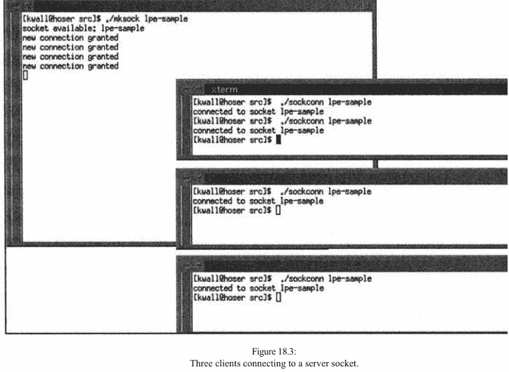

在图 18.3 中，左侧的 xterm 正在运行服务器程序 `mksock`，并监听名为 `lpe-sample` 的套接字。客户端程序 `sockconn` 在右侧三个较小的 xterm 中分别执行，它通过每次接受新连接时显示“new connection granted”来报告每个连接。同样，`sockconn` 通过显示套接字的地址（名称）来报告成功连接到服务器。

### UNIX 域套接字

UNIX 域套接字仅在单个机器上工作，因此它们更像命名管道而非网络协议。UNIX 域套接字绑定的地址是文件系统中的实际文件名。然而，套接字不能被打开；必须使用套接字接口进行访问。

### 创建 UNIX 域套接字

早些时候，你了解到 `socket_addr` 结构体包含网络地址。这在某种程度上是一种过度简化。实际上，那个 `socket_addr` 结构体是通用格式。所有协议族（域）都有自己特定协议的 `socket_addr` 版本。UNIX 域套接字的 `socket_addr` 结构体在 <sys/un.h> 中定义如下：

```c
struct sockaddr_un {
    unsigned short int sun_family;  /* AF_UNIX */
    char sun_path[108];     /* pathname */
};
```

要创建 UNIX 域套接字，必须将 `sun_family` 设置为 `AF_UNIX`。`sun_path` 包含用作套接字的文件名称。如你所预期的那样，使用 `bind` 调用将套接字绑定到该文件，但该文件是在调用 `bind` 时创建的。如果文件已存在，`bind` 将失败，将 `errno` 设置为 `EADDRINUSE`，并向调用进程返回 -1。同样定义在 <sys/un.h> 中的 `SUN_LEN` 宏返回 `sockaddr_un` 结构体的大小。

`sockconn` 程序展示了客户端程序连接到服务器套接字的正确方法，因此不再重复该示例。但是，请密切注意 `sockconn` 和 `mksock` 如何将其协议的 `sockaddr_un` 结构体强制转换为通用的 `socket_addr` 结构体，以便进行 API 接口的每次调用。

## 示例

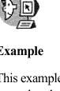

## 示例

本示例展示了尝试打开一个正在被使用的套接字时会发生什么。它假设你已经通过运行前两个示例程序创建了套接字文件 `lpe-sample`。

```bash
$ ls -l lpe-sample
srw-r-xr-x 1 kwall users 0 Aug 17 18:29 lpe-sample
$ ./mksock lpe-sample
bind: Address already in use
$ rm lpe-sample
$ ./mksock lpe-sample
socket available: lpe-sample
```

`bind` 调用失败，因为套接字已在被使用；但在删除套接字文件后，`bind` 调用成功，服务器开始了无限 `accept` 循环。

### 读取和写入 UNIX 域套接字

如本章开头所述，可以使用标准系统 I/O 调用从套接字读取和写入数据。程序很简单。调用 `accept` 的进程使用 `accept` 返回的文件描述符进行 I/O。调用 `connect` 的进程（通常是客户端进程）使用 `socket` 调用返回的文件描述符进行 I/O。

## 示例

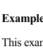

## 示例

本示例展示了读写 UNIX 域套接字的一种方法。简而言之，写入进程将其标准输入复制到套接字，而读取进程将从套接字读取的数据复制到其标准输出。`wrsock` 是写入进程，或客户端进程；`rdsock` 是读取进程，或服务器进程。为了保持代码相对简单且易于理解，`helper.c` 定义了一个函数 `xfer_data`，用于在两个文件描述符之间复制数据。它在本地头文件 `helper.h` 中声明。以下列表显示了 `xfer_data` 的定义：

```c
void xfer_data(int srcfd, int tgtd)
{
    char buf[1024];
    int cnt, len;

    /* Read from the input fd and write to the output fd */
    while ((cnt = read(srcfd, buf, sizeof(buf))) > 0) {
        if ((len = write(tgfd, buf, cnt)) != cnt)
            err_quit("helper.c:xfer_data:write");
    }
}
```

此函数从输入文件描述符 `srcfd` 读取任何输入，然后立即将其写入输出文件描述符 `tgtd`。如果 `read` 或 `write` 遇到错误，函数将退出。要使用此函数，请在源代码中添加行 `#include "helper.h"`。

以下两个代码片段展示了将服务器程序 `mkssock` 和客户端程序 `sockconn` 分别修改为读取器和写入器所需的修改。首先，在 `mkssock` 的顶部添加以下声明：


然后，将 `mksock.c` 中的第 40–45 行替换为以下代码：

```c
/* Accept the first connection that comes in */
if ((infd = accept(sockfd, (struct sockaddr *)&srv, &socklen)) >= 0)
      puts("new connection granted");

/* Read from the socket and write to stdout */
xfer_data(infd, fileno(stdout));
```

新代码不再简单地接受每一个传入的连接，而是仅接受第一个连接，然后调用 `xfer_data` 从套接字的文件描述符 `infd` 读取传入的数据，并将其写入 `stdout`。

最后，在 `sockconn.c` 的 `exit` 语句上方添加以下代码：

```c
/* Copy stdin to the socket file descriptor */
xfer_data(fileno(stdin), sockfd);
```

这段额外的代码从 `stdin` 读取输入，并将其写入绑定到套接字的文件描述符。修改后的文件可从本书的网站下载，文件名为 `rdsock.c` 和 `wrsock.c`。

要运行这些程序，请在另一个 xterm 或虚拟控制台窗口中启动 `wrsock`，先在其中一个窗口运行 `rdsock`。每次按下回车键时，输入的行文本会显示在 `rdsock` 的窗口中。这些程序的示例输出如图 18.4 所示。


图 18.4：
读取和写入 UNIX 域套接字。

在图 18.4 中，读取端/服务器端 `rdsock` 在左侧的 xterm 窗口中运行，写入端/客户端 `wrsock` 在右侧的 xterm 窗口中运行。如图所示，在按下回车键后，输入到写入端中的每一行文本都会出现在读取端。

## TCP/IP 编程

TCP/IP 是运行互联网（世界上最大的互连机器网络）的协议（实际上是协议族）。当前版本的协议是版本 4（IPv4），但向版本 6（IPv6）的过渡已经开始。当前 IPv6 提案中现有的规范已整合到 2.2.x 内核中。不过，由于新协议尚未广泛使用，本节介绍的是 IPv4。正如本章开头所述，网络编程是一个很大的话题，有很多整本书都在论述它。但是，你实际上可以使用不到 10 个函数调用来编写具备网络功能的程序。

## 网络数字

在深入网络编程本身之前，重要的是要指出 TCP/IP 协议是大端（big-endian）的；也就是说，它将多字节数字的最高有效位存储在最低的内存地址中。许多计算机同样是大端。

然而，其他计算机，例如 Intel 的 x86 处理器，是小端（little-endian）的，这意味着多字节数字的最低有效位存储在最低的内存地址中（内存中值的排列的通用术语是字节序）。这意味着当向 TCP/IP 函数提供数值时，必须将它们从主机的字节序转换为网络的字节序。

幸运的是，协议实现提供了四个专门执行此功能的函数。它们在 `<netinet/in.h>` 中声明如下：

```c
unsigned long int htonl(unsigned long int hostlong);
unsigned short int htons(unsigned short int hostshort);
unsigned long int ntohl(unsigned long int netlong);
unsigned short int ntohs(unsigned short int netshort);
```

`htonl` 将长整型整数 `hostlong` 从主机系统的字节序转换为网络字节序。类似地，`htons` 将短整型整数 `hostshort` 从主机字节序转换为网络字节序。另外两个调用 `ntohl` 和 `ntohs` 是反向过程，因此将网络字节序转换为主机系统的字节序。

## 网络地址

与 UNIX 域套接字一样，TCP/IP 网络地址存储在 `sockaddr` 结构体 `struct sockaddr_in` 中，它定义在 `<netinet/in.h>` 中，如下所示：

```c
struct sockaddr_in {
    short int sin_family;      /* AF_INET */
    uint16_t sin_port;        /* Port number */
    struct in_addr sin_addr;  /* IP address */
};
```

你还需要包含 `<sys/socket.h>` 以获取完整的套接字定义。对于 TCP/IP（至少是版本 4），`sin_family` 必须是 `AF_INET`。`sin_port` 是要连接的端口号，`sin_addr` 是 IP 地址。`sin_port` 和 `sin_addr` 都必须是网络字节序。然而，`sin_addr` 是一个二进制结构，因此要将其转换为标准的点分十进制形式，请使用 `inet_ntoa` 函数；反之，要将点分十进制地址转换为 `sin_addr` 的二进制格式，请使用 `inet_aton`。这些调用在 `<arpa/inet.h>` 中的原型如下：

```c
char *inet_ntoa(struct in_addr addr);
int inet_aton(const char *daddr, struct in_addr *ipaddr);
```

`inet_ntoa` 将存储在 `addr` 中的二进制 IP 地址转换并返回为字符串（返回的字符串是一个静态分配的缓冲区，会被后续调用 `inet_ntoa` 覆盖）。`inet_aton` 将存储在 `daddr` 中的点分十进制地址转换为正确的二进制格式，然后存储在 `ipaddr` 中。如果地址是有效地址，`inet_aton` 返回非零，否则返回零。

> **注意**
>
> 几个 TCP/IP API 函数在失败时返回零，在成功时返回非零。这种行为与你之前看到的几乎所有库和系统调用的行为完全相反。

> **提示**
>
> 你偶尔会遇到一个名为 `inet_addr` 的函数。它执行与 `inet_aton` 相同的功能。它的原型是 `unsigned long int inet_addr(const char *daddr)`。它是一个过时的调用，因为它不识别 `255.255.255.255` 为有效的 IP 地址。如果你遇到使用此函数的代码，请做件好事，将其更改为使用 `inet_aton`。

TCP/IP 网络地址是 32 位数字，通常表示为 *点分十进制* 形式，例如 www.xxx.yyy.zzz。由于它们是 32 位数字，潜在的唯一网络地址有 4,294,967,295 个（从 0 开始计数）。然而，由于每个唯一地址可能需要或需要同时运行多个 TCP/IP 应用程序，因此每个地址还有多达 65,535 个用于连接的端口。

*端口* 是 16 位数字，代表特定系统上的连接或端点（端口 0-1024 保留给以 root 权限运行的进程使用）。因此，一个系统上的唯一连接点由主机的 IP 地址和端口号的组合定义。两个系统之间完整且唯一的网络连接由两个这样的连接点定义。图 18.5 直观地说明了这一点。


如图所示，HOST1 和 HOST2 之间有四个完整连接：HOST1:PORT1 到 HOST2:PORT2，HOST1:PORT2 到 HOST2:PORT3，HOST2:PORT1 到 HOST1:PORT3，以及 HOST2:PORT4 到 HOST1:PORT4。

在查看示例程序之前，你必须了解最后一个函数 *setsockopt*。关闭套接字后，其地址（IP 和端口号的组合）在一段时间内不可用。若要重用此地址，必须设置套接字的选项以允许重用。它在 `sys/socket.h` 中声明如下：

```c
int setsockopt(int sockfd, int level, int optname,
               const void *optval, socklen_t optlen);
```

*setsockopt* 将存储在 *optname* 中的选项设置为 *optval*，适用于在文件描述符 *sockfd* 上打开的套接字。对于套接字，*level* 必须是 *SOL_SOCKET*。

将 *optname* 设置为 *SO_REUSEADDR*，将 *optval* 设置为 *1*。也就是说，*setsockopt* 调用应类似于以下形式：

```c
int i = 1;
setsockopt(sockfd, SOL_SOCKET, SO_REUSEADDR, &i, sizeof(i));
```

## 示例


## 示例

1.  下面的示例 *mynet* 创建一个 *TCP/IP* 套接字，然后等待并接受所有连接。它使用端口号 *50000*，该端口不太可能被其他程序使用。

```c
/*
 * mynet.c - Bind to and wait on a TCP/IP socket
 */
#include <sys/socket.h>
#include <netinet/in.h>

#include <arpa/inet.h>
#include <unistd.h>
#include <stdlib.h>
#include <stdio.h>
#include "helper.h"

int main(void)
{
    int sockfd;
    struct sockaddr_in srv; /* Server's socket structure */
    socklen_t socklen;
    int i = 1;               /* For setsockopt */

    /* Create the socket */
    if ((sockfd = socket(PF_INET, SOCK_STREAM, 0)) < 0)
        err_quit ("socket");

    /* Want to reuse the local address */
    setsockopt (sockfd, SOL_SOCKET, SO_REUSEADDR, &i, sizeof (i));

    /* Initialize and set up the server structure */
    memset (&srv, 0, sizeof (srv));
    srv.sin_family = AF_INET;
    srv.sin_port = htons (50000); /* Don't forget network byte order */
```


### 代码示例

```c
/* Bind the socket to an address */
socklen = sizeof(srv);
if (bind(sockfd, (struct sockaddr *)&srv, socklen) < 0)
    err_quit("bind");

/* Wait for incoming connections */
if (listen(sockfd, 5) < 0)
    err_quit("listen");
puts("TCP/IP socket available");
printf("\tport %d\n", ntohs(srv.sin_port));
printf("\taddr %s\n", inet_ntoa(srv.sin_addr));

/* Loop forever, accepting all connections */
while ((accept(sockfd, (struct sockaddr *)&srv, &socklen)) >= 0)
    puts("new connection granted");

exit(EXIT_SUCCESS);

}
```

`mknet` 与之前介绍的 `mksock` 程序类似。唯一的区别在于，它将专门用于使用 UNIX 域套接字的调用和数据结构替换为 TCP/IP 套接字的对应部分。请注意，由于 `mknet` 指定了一个零 IP 地址，内核将分配一个默认地址。该程序的一次示例运行输出应类似于以下内容：


### 输出

```bash
$ ./mknet
TCP/IP socket available
    port 50000
    addr 0.0.0.0
```


## 示例

- 下一个程序 `netconn` 是将 `sockconn` 重写为使用 TCP/IP 套接字的版本。

```c
/**
 * netconn.c - Connect to a TCP/IP socket
 */
#include <sys/socket.h>
#include <netinet/in.h>
#include <arpa/inet.h>
#include <stdlib.h>
#include <stdio.h>
#include "helper.h"

int main(int argc, char *argv[])
{
    int sockfd;              /* File descriptor for socket */
    struct sockaddr_in cli;  /* Client's socket structure */
    socklen_t socklen;       /* Size of sockaddr */

    /* Expect the IP address on the command-line */
    if(argc != 2) {
        puts("USAGE: netconn <ip address>");
        exit(EXIT_FAILURE);
    }

    /* Create a socket */
    if((sockfd = socket(PF_INET, SOCK_STREAM, 0)) < 0)
        err_quit("socket");

    /* Set up the client */
    memset(&cli, 0, sizeof(cli));
    cli.sin_family = AF_INET;
    cli.sin_port = htons(50000); /* Don't forget network byte order */
    /* This will self-destruct if the IP address is invalid */
    if(!(inet_aton(argv[1], &cli.sin_addr)))
        herr_quit("inet_aton");

    /* Connect to the socket */
    socklen = sizeof(cli);
    if(connect(sockfd, (struct sockaddr *)&cli, socklen))
        err_quit("connect");
    puts("connected to socket");

    exit(EXIT_SUCCESS);
}
```

除了处理 TCP/IP 套接字的代码外，`netconn.c` 还包含一个新函数 `herr_quit`，它定义在 `helper.c` 中，并调用了一个专用于 TCP/IP 的错误处理函数 `herror`。它的行为与 `perror` 调用完全相同。要执行 `netconn`，请传递你想连接的主机的 IP 地址（点分十进制格式），如下列列表所示（在一个窗口中运行 `netconn`，在另一个窗口中运行 `mknet`）：


### 输出

```bash
$ ./netconn 0
connected to socket
$ ./mknet
TCP/IP socket available
port 50000
addr 0.0.0.0
new connection granted
```

再次强调，向 `netconn` 传递零会让内核使用其自行选择的地址。你可以用 `0.0.0.0` 或你系统的 IP 地址（如果有的话）来代替零。图 18.6 表明 `mknet` 能够与互联网通信。我从另一台系统使用 telnet 连接到运行 `mknet` 的系统，使用了指定替代端口的 telnet 语法（telnet 的默认端口是 23）。


### 输出


## 读取和写入 TCP/IP 套接字

读取和写入 TCP/IP 套接字与读取和写入 UNIX 域套接字完全相同。再一次，Linux 的抽象机制证明了一项真正的福音。对 `wrsock` 和 `rdsock` 进行几处简单的修改，如下面的示例所列，表明这有多简单。

## 示例


```c
/*
 * rdnet.c - Make and bind to a TCP/IP socket, then read it
 */
#include <sys/socket.h>
#include <netinet/in.h>
#include <arpa/inet.h>
#include <stdlib.h>
#include <stdio.h>
#include "helper.h"

int main(void)
{
    int sockfd, infd; /* File descriptors for socket */
    struct sockaddr_in srv; /* Server's socket structure */
    socklen_t socklen;

    /* Create the socket */
    if((sockfd = socket(PF_INET, SOCK_STREAM, 0)) < 0)
        err_quit("socket");

    /* Initialize and set up the server structure */
    memset(&srv, 0, sizeof(srv));
    srv.sin_family = AF_INET;
    srv.sin_port = htons(50000);

    /* Bind the socket to an address */
    socklen = sizeof(srv);
    if((bind(sockfd, (struct sockaddr *)&srv, socklen)) < 0)
        err_quit("bind");

    /* Wait for incoming connections */
    if((listen(sockfd, 5)) < 0)
        err_quit("listen");
    puts("TCP/IP socket available");
    printf("\tport %d\n", ntohs(srv.sin_port));
    printf("\taddr %s\n", inet_ntoa(srv.sin_addr));

    /* Accept the first connection that comes in */
    if((infd = accept(sockfd, (struct sockaddr *)&srv, &socklen)) >= 0)
        puts("new connection granted");

    /* Read from the socket and write to stdout */
    xfer_data(infd, fileno(stdout));

    exit(EXIT_SUCCESS);
}
```

```c
/*
 * wrnet.c - Write to an open TCP/IP socket
 */
#include <sys/socket.h>
#include <netinet/in.h>
#include <arpa/inet.h>
#include <stdlib.h>
#include <stdio.h>
#include "helper.h"

int main(int argc, char *argv[])
{
    int sockfd;/* File descriptor for socket */
    struct sockaddr_in cli;/* Client's socket structure */
    socklen_t socklen;/* Size of sockaddr */

    /* Expect the IP address on the command-line */
    if(argc != 2) {
        puts("USAGE: wrnet <ip address>");
        exit(EXIT_FAILURE);
    }

    /* Create a socket */
    if((sockfd = socket(PF_INET, SOCK_STREAM, 0)) < 0)
        err_quit("socket");

    /* Set up the client */
    memset(&cli, 0, sizeof(cli));
    cli.sin_family = AF_INET;
    cli.sin_port = htons(50000);
    /* This will blow up if an invalid address is passed */
    if(!(inet_aton(argv[1], &cli.sin_addr)))
        herr_quit("inet_aton");

    /* Connect to the socket */
    socklen = sizeof(cli);
    if (connect(sockfd, (struct sockaddr *)&cli, socklen) == -1)
        err_quit("connect");
    puts("Connected to TCP/IP socket");
    printf("\tport %d\n", ntohs(cli.sin_port));
    printf("\taddr %s\n", inet_ntoa(cli.sin_addr));

    /* Copy stdin to the socket file descriptor */
    xfer_data(fileno(stdin), sockfd);

    exit(EXIT_SUCCESS);
}
```

这些程序所做的修改非常少。在这两个程序中，协议和地址族分别更改为 `AF_INET` 和 `AF_INET`，并且将套接字特殊文件的字符串复制更改为简单的端口号赋值。在 `wrnet.c` 中，添加了额外的代码，将命令行上指定的 IP 地址复制到 `cli.sin_addr` 结构中。这两个程序的行为完全相同，将 `wrnet` 的标准输入发送到 `rdnet` 的标准输出，如图 18.7 所示。

### 输出


图 18.7：使用 TCP/IP 套接字将 wrnet 的标准输入复制到 rdnet 的标准输出。

## 使用主机名

到目前为止的所有讨论都集中在如何使用 IP 地址。这没问题，因为计算机使用 IP 地址和使用文本信息的效率一样高。但对于普通人来说并非如此，他们更喜欢文本而不是数字字符串。

幸运的是，TCP/IP 协议族包括 *域名系统*（DNS），这是一个分布式数据库，它除了其他功能外，还将名称（如 `www.netscape.com`）映射到 IP 地址，在本例中为 `205.188.247.73`。虽然 DNS 包含许多功能，但这里涉及的是如何将主机名转换为地址，反之亦然。你需要了解一个结构体 `struct hostent` 和两个函数 `gethostbyname` 和 `gethostbyaddr`。它们在 `<netdb.h>` 中的声明如下：

```c
struct hostent {  
    char *h_name;                 /* Canonical machine name */
    char **h_aliases;            /* List of aliases */
    int h_addrtype;              /* AF_INET */
    int h_length;                /* sizeof(struct in_addr) */
    char **h_addr_list;          /* List of IP addresses */
};  
struct hostent *gethostbyname(const char *name);  
struct hostent *gethostbyaddr(const char *addr, int len, int type);
```

`gethostbyname` 接受一个主机名 `name`（例如 `ftp.netscape.com`），并返回一个指向 `hostent` 结构体的指针，其中包含来自 DNS 的相关信息。类似地，`gethostbyaddr` 接受存储在 `addr` 中的地址结构体 `struct in_addr`（您之前已经见过）、存储在 `len` 中的长度以及其 `type`（始终为 `AF_INET`），并返回一个指向 `hostent` 结构体的指针。这两个调用返回的指针都指向一个静态分配的缓冲区，该缓冲区每次调用任一函数时都会被覆盖。因此，如果你需要保存 `hostent` 结构体指针中的任何信息，请将其保存在局部变量中。

关于 `hostent` 结构体本身，`h_name` 是规范的或“官方的”（即已注册的）机器名称，`h_addrtype` 始终是 `AF_INET`，而 `h_length` 是地址结构体的大小，目前是 `sizeof(struct in_addr)`。`h_aliases` 和 `h_addr_list` 分别是包含机器可能拥有的所有名称和 IP 地址的字符串指针。

“等等！”我听到你在想。“你是什么意思，‘一台机器可能拥有的所有名称和 IP 地址’？”简而言之，DNS 并不是主机名到 IP 地址的一一映射。一台机器可能有多个 IP 地址或多个主机名有很多原因。对于多个 IP 地址的情况，请考虑 *路由器*，一种拥有多个网卡的系统。每张网卡都有一个不同的 IP 地址，用于将传入的数据包路由到适当的位置，例如不同的网络或不同的系统。


另一方面，一个拥有多个名称（实际上，它有一个规范名称和一个或多个别名）的系统，通常用于让一台物理机器提供多种服务，例如 Web 服务器和 FTP 服务器。该机器拥有一个 IP 地址，但有两个名称。

无论系统拥有多个主机名或 IP 地址的原因是什么，`gethostbyname` 和 `gethostbyaddr` 会分别在 `struct hostent` 的 `h_aliases` 和 `h_addr_list` 成员中返回完整的名称和地址列表。如果传递给这些函数的 IP 地址或主机名无效，或者发生其他错误，它们将返回 `NULL`。

## 示例


## 示例

下面的示例程序 `hostinfo` 接受一个主机名作为其命令行参数，并显示其对应的 `hostent` 结构的内容。

```c
/*
 *  hostinfo.c -- Show the hostent structure for a hostname
 */
#include <sys/socket.h>
#include <netinet/in.h>

#include <arpa/inet.h>
#include <netdb.h>
#include <stdlib.h>
#include <stdio.h>
#include "helper.h"

int main(int argc, char *argv[])
{
   struct hostent *buf;
   struct in_addr **paddr;
   char **palias;

   /* Expect the IP addresses on the command-line */
   if(argc != 2) {
       puts("USAGE: hostinfo <host name>");
       exit(EXIT_FAILURE);
   }

   /* Do the lookup */
   if((buf = gethostbyname(argv[1])) == NULL)
       herr_quit("gethostbyname");
   /* Valid hostname, so . . . */
   printf("host info for %s\n", argv[1]);
   /* The canonical hostname */
   printf("name: %s\n", buf->h_name);
   /* All of the aliases */
   puts("aliases:");
   palias = buf->h_aliases;
   while(*palias) {
       printf("\t%s\n", *palias);
       palias++;
   }
   /* h_addrtype better be AF_INET */
   if(buf->h_addrtype == AF_INET)
       puts("type: AF_INET");
   else
       puts("type: unknown");
   printf("length: %d\n", buf->h_length);
   /* All of the IP addresses */
   puts("addresses:");
   paddr = (struct in_addr **)buf->h_addr_list;
   while(*paddr) {
       printf("\t%s\n", inet_ntoa(**paddr));
       paddr++;
   }
}
```

下面的列表显示了该程序的输出：


### 输出

```
host info for ftp.redhat.com
name: ftp.redhat.com
aliases:
type: AF_INET
length: 4
addresses:
    199.183.24.205
    208.178.165.228
    206.132.41.212
```

在对主机名执行 DNS 查找后，它显示了 `hostent` 结构的每个成员。打印 IP 地址的那段看似复杂的代码是必要的，因为 `buf->h_addr_list` 退化为一个裸指针，但 `inet_ntoa` 需要一个 `struct in_addr` 参数。

## 接下来是什么？

本章带你快速浏览了套接字和 TCP/IP 编程。它也结束了书中对进程间通信的覆盖。下一部分“Linux 编程实用工具”将向你介绍几种可减轻程序员部分繁重工作的工具和实用程序。你将从第 19 章“跟踪源代码更改”开始，该章教你如何使用 RCS（修订控制系统）。RCS 是一个自动执行大多数与跟踪源代码文件更改相关的任务的工具。为什么要跟踪源代码更改？请继续阅读，你会发现答案！

# 第五部分 — Linux 编程实用工具

- 19 跟踪源代码更改：修订控制系统
- 20 调试工具包
- 21 软件分发
- 22 编程项目：音乐 CD 数据库

# 第 19 章 — 跟踪源代码更改：修订控制系统

版本控制是一种记录和管理对源代码文件所做更改的过程。为什么要这样做？因为总有一天你会对源文件进行那一次致命的编辑，删除其先前版本，并且忘记你具体“修复”了哪一行或几行代码。因为手动同时跟踪当前版本、下一个版本以及八个错误修复**将**变得过于繁琐和混乱。因为在你的同事第五次覆盖源文件后，疯狂地寻找备份磁带**将**让你崩溃。因为，有一天，在你喝着早晨的卡布奇诺咖啡时，你会对自己说：“版本控制，这是正确的做法。”

本章探讨 RCS（修订控制系统），这是解决版本控制问题的常见方案。RCS 之所以是常见方案，是因为它几乎在所有 UNIX 系统上都有，而不仅仅是在 Linux 上。RCS 由 GNU 项目维护。RCS 的两个替代方案是 CVS（并发版本系统），也由 GNU 项目维护，以及 SCCS（源代码控制系统），这是一种专有产品。本章涵盖的主题包括以下内容：

- 版本控制术语
- 创建源代码存储库
- 将文件签入和签出存储库
- RCS 关键字和 *ident* 命令
- RCS 更改日志
- 其他 RCS 命令和实用工具

## 为什么使用 RCS？

更有经验的程序员，特别是熟悉其他版本的 UNIX 或 UNIX 兼容系统的程序员，可能会问：“当 CVS 更受欢迎、功能更多，并且更适合用于大型编程项目时，为什么要讨论 RCS？”首先，我认为 RCS 是介绍版本控制概念的最简单途径。很少有初学程序员听说过版本控制，更不用说使用版本控制软件了。RCS 易于学习，需要的设置或配置很少，且命令集较小。这使它成为向人们介绍版本控制概念的理想载体。尽管如此，由于 CVS 是基于 RCS 构建的并且与 RCS 兼容，向 CVS 的过渡将是平滑的。

此外，尽管 CVS 确实拥有比 RCS 丰富得多的功能集，但这些功能对于新手的 Linux 程序员来说益处甚微。例如，很少有初级的黑客需要能够使用 Web 浏览器浏览他们的源代码，或者使存储库可供匿名读写访问。

最后，大多数初学程序员不会在一个正在开发多个项目的环境中工作，或者在一个具有存储多个项目源代码的单一源代码存储库的环境中工作，这些正是 CVS 被设计用于处理的环境。

## 版本控制术语

然而，在继续之前，表 19.1 列出了本章中将要使用的一些术语。由于它们经常使用，理解它们在 RCS 和版本控制上下文中的含义很重要。

**表 19.1：版本控制术语**

| 术语 | 描述 |
| :--- | :--- |
| RCS 文件 | 位于 RCS 目录中的任何文件，由 RCS 控制并使用 RCS 命令访问。RCS 文件包含特定文件的所有版本。通常，RCS 文件具有 .v 扩展名。 |
| 工作文件 | 从 RCS 源代码存储库（RCS 目录）检索到当前工作目录的一个或多个文件，可用于编辑。 |
| 锁定 | 为编辑而检索的工作文件，因此其他人不能同时编辑它。工作文件由第一个用户锁定，以防止其他用户编辑。 |
| 修订 | 源文件的特定编号版本。修订从 1.1 开始并依次递增，除非强制使用特定的修订号。 |

修订控制系统管理文件的多个版本，通常是但不限于源代码文件。RCS 自动化了文件版本存储和检索、更改日志、访问控制、释放管理以及修订标识和合并。作为额外的好处，RCS 最小化磁盘空间需求，因为它只跟踪文件更改。

> **注意**
>
> 本章使用的示例假设你正在使用 RCS 版本 5.7。要确定你正在使用的 RCS 版本，请输入 `rcs -V`。

然而，RCS 可以用于不仅仅是源代码文件。它能够跟踪任何类型文本文件的更改，例如报告、书章节或 HTML 代码。但是，它不能处理二进制文件。CVS（并发版本系统）可以处理二进制文件，这就是为什么许多人使用 CVS 而不是 RCS。

### 使用 RCS

RCS 的一个吸引力在于其简单性。通过最少的设置和少量命令，你可以完成很多工作。本节讨论 `ci`、`co` 和 `ident` 命令以及 RCS 关键字。

### 将文件签入和签出

你只需使用两个命令 `ci` 和 `co`，以及一个名为 RCS 的目录，就可以使用 RCS 完成很多工作。`ci` 代表 *签入*，意思是将工作文件存储在 RCS 目录中；`co` 意思是 *签出*，指从 RCS 存储库中检索 RCS 文件。

要开始使用，你必须创建一个 RCS 目录。默认情况下，所有 RCS 命令都假设当前工作目录中有一个名为 RCS 的目录。因此，你的第一步是创建这个目录。假设你在 `/home/gomer/editor` 中有几个源文件。将其设为你当前的目录并创建目录 RCS，如下所示：

```
$ cd /home/gomer/editor
$ mkdir RCS
```

在 `/home/gomer/editor` 中执行的所有 RCS 命令都将使用此目录。RCS 目录也称为 *存储库*。

> **提示**
>
> RCS 的默认行为是在每个工作目录中使用一个存储库。这通常对于小项目来说足够了。这凸显了 RCS 的一个缺点：它不容易处理具有多个工作目录的项目。再次说明，这是许多人偏好 CVS 的原因之一。


在创建 RCS 仓库之后，下一步是将所有现有的源代码文件检入其中。首次检入文件时，RCS 会要求提供文件的描述，将其复制到 RCS 目录，并删除原始文件。“删除原始文件？天哪！”别担心，你可以使用检岀命令 `co` 来恢复它。但首先，我们按步骤来。以下示例创建一个仓库、一个用于存储的源文件，然后使用 `ci` 将该文件检入。

## 示例


首先，创建一个 RCS 目录，如下所示：

```
$ mkdir RCS
```

接下来，在你创建 RCS 目录的同一目录中创建源文件 `howdy.c`。

```
/*
   $ Id $
   howdy.c - 演示 RCS 用法的示例
   */
#include <stdio.h>

int main(void)
{
    printf("Howdy, Linux programmer!");
    return EXIT_SUCCESS;
}
```


### 输出

```
$ ci howdy.c
RCS/howdy.c,v <--> howdy.c
enter description, terminated with single '.' or end of file:
NOTE: This is NOT the log message!
>> Simple program to illustrate RCS usage

>> .
initial revision: 1.1
done
$ co -l howdy.c
RCS/howdy.c,v <-->  howdy.c
revision 1.1 (locked)
done
```

请注意，如果你不使用 `co` 的 `-l` 选项，刚刚检出的工作文件将是只读的；如果你想编辑它，必须锁定它。为此，请在 `co` 中使用 `-l` 选项（`co -l howdy.c`）。`-l` 表示锁定（锁定的概念在表 19.1 中定义）。输出中由 `>>` 开头的那两行是你需要输入的行。

## 修改仓库文件

为了了解版本控制的实际运作，对工作文件进行一些更改。如果尚未这样做，请检出并锁定该文件（`co -l howdy.c`）。你可以随意更改任何内容，但我建议在 `printf` 的字符串参数末尾添加 `\n`，因为与 DOS 和 Windows 不同，Linux（和 UNIX）不会在控制台输出末尾自动添加换行符。

然后，将该文件重新检入。当你重新检入时，RCS 将执行以下步骤：

- 1. 将修订号递增至 1.2
- 2. 询问你所做更改的描述
- 3. 将你做的更改合并到 RCS 文件中
- 4. （令人恼火地）删除原始文件

为防止在检入操作期间删除你的工作文件，请在 `ci` 中使用 `-l` 或 `-u` 选项。

## 示例


本示例进行了前一段中讨论的更改，然后更新了仓库文件。


### 输出

```
$ ci -l howdy.c
RCS/./howdy.c,v <-- howdy.c
new revision: 1.2; previous revision: 1.1
enter log message, terminated with single '.' or end of file:
>> Added newline
>> .
done
```

当与 `ci` 一起使用时，`-l` 和 `-u` 选项都会在检入流程完成后隐含地执行文件的检出。`-l` 锁定文件，以便你可以继续编辑；而 `-u` 检出一个未锁定或只读的工作文件。

## 额外的命令行选项

除了 `-l` 和 `-u` 之外，`ci` 和 `co` 还接受另外两个非常实用的选项：`-r`（用于修订）和 `-f`（用于强制）。使用 `-r` 告诉 RCS 你要操作哪个文件修订版本；RCS 默认假设你想处理最新修订版本；`-r` 会覆盖此默认值。`-f` 选项强制 RCS 覆盖当前的工作文件。默认情况下，如果你的工作目录中已存在同名工作文件，RCS 将中止检岀操作。因此，如果你真的弄糟了你的工作文件，请使用 `-f` 选项配合 `co` 以获得全新的开始。

RCS 的命令行选项是累积的，正如你预期的那样，并且它能很好地禁止不兼容的选项组合。要检出并锁定 `howdy.c` 的特定修订版本，你可以使用类似 `co -l -r2.1 howdy.c` 的命令。同样，`ci -u -r3 howdy.c` 将 `howdy.c` 检入，为其分配修订号 3.1，并将只读修订 3.1 的工作文件存回你当前的工作目录。

## 示例


1. 本示例创建 `howdy.c` 的修订 2.1。在执行此命令之前，请确保你已经以某种方式检出并修改了 `howdy.c`。

```
$ ci -r2 howdy.c
```


### 输出

```
RCS/howdy.c,v <-- howdy.c
new revision: 2.1;  previous revision: 1.2
enter log message, terminated with single '.', or end of file
>> Added something
>> .
done
```

此命令等同于 `ci -r2.1 howdy.c`。


2. 此命令检出 `howdy.c` 的修订 1.2，并忽略工作目录中编号更高的修订版本。

```
$ co -r1.2 howdy.c
```


### 输出


3. 这里有一个方便的命令，它丢弃你所做的所有更改，并从一个已知的良好源文件开始：

```
$ co -l -f howdy.c
```

### 输出

```
RCS/howdy.c,v  -->  howdy.c
revision 2.1 (locked)
done
```

当与 `ci` 一起使用时，`-f` 强制 RCS 即使文件没有更改也将其检入。

## RCS 关键字

RCS 关键字是特殊的类宏令牌，用于在源文件、对象文件和二进制文件中插入和维护标识信息。这些令牌的形式为 `$KEYWORD$`。当包含 RCS 关键字的文件被检出时，RCS 将 `$KEYWORD$` 扩展为 `$KEYWORD: VALUE$`。

### $Id$

howdy.c 列表顶部那个特殊的字符串 `$ Id $` 是一个 RCS 关键字。当你第一次检出 `howdy.c` 时，RCS 将其扩展为类似以下内容：

```
$ Id: howdy.c,v 1.1 1999/07/20 04:56:08 kwall Exp kwall $
```

`$ Id $` 字符串的格式如下：

```
$KEYWORD: FILENAME REV_NUM DATE TIME AUTHOR STATE LOCKER $
```

在你的系统中，这些字段的大多数值都会不同。如果你带锁检出文件，你还会在 Exp 条目之后看到你的登录名。

### $Log$

RCS 将 `$ Log $` 关键字替换为你在检入时提供的日志消息。然而，RCS 并不是替换之前的日志条目，而是将新的日志消息插入到最后一个日志条目上方。

## 示例


此代码列表展示了经过多次检入后 `$ Log $` 关键字的扩展情况。


### 输出

```
/*
 * $ Id: howdy.c,v 1.4 1999/07/20 05:00:56 kwall Exp kwall $
 * howdy.c - 演示 RCS 用法的示例
 *
 * **************** Revision History ****************
 * $ Log: howdy.c,v $
 * Revision 1.4 1999/07/20 05:00:56 kwall
 * Added pretty stuff around the log keyword
 *
* Revision 1.3 1999/07/20 04:59:17 kwall
* Changed "return" to "exit"
*
* Revision 1.2 1999/07/20 04:58:25 kwall
* Added newline
* ***************************************************/
#include <stdio.h>
#include <stdlib.h>
int main(void)
{
    printf("Howdy, Linux programmer!\n");
    exit(EXIT_SUCCESS);
}
```

`$Log$` 关键字使得在操作特定文件时查看该文件所做的更改变得方便。从上到下阅读时，更改历史列表将最近的更改排在最前面。

## 其他 RCS 关键字

表 19.2 列出了其他 RCS 关键字以及 RCS 如何扩展它们。

**表 19.2: RCS 关键字**

| 关键字 | 描述 |
|---|---|
| `$Authors$` | 检入该修订版本的用户登录名 |
| `$Date$` | 修订版本被检入的日期和时间，采用 UTC 格式 |
| `$Header$` | RCS 文件的完整路径名，修订号、日期、时间、作者、状态以及锁定者（如果已锁定） |
| `$Locker$` | 锁定该修订版本的用户登录名（如果未锁定，字段为空） |
| `$Name$` | 如果有的话，用于检出该修订版本的符号名称 |
| `$RCSfile$` | 不含路径的 RCS 文件名 |
| `$Revision$` | 分配给该修订版本的修订号 |
| `$Source$` | 指向 RCS 文件的完整路径名 |
| `$State$` | 修订版本的状态：`Exp`（实验性）是默认值；`Stab`（稳定）；`Rel`（已发布） |


`$Date$` 的值以 UTC（协调世界时）格式出现，该格式以前被称为格林尼治平均时间。`$Name$` 所代表的符号名称是一个别名，您可以使用它来引用特定的修订版本。要将符号名称与特定的修订号关联起来，请在检入文件时使用 `-n<name>` 开关。`$State$` 字段默认为实验（Exp），因为 RCS 将所有检入视为试运行，直到使用 `-s<state>` 开关明确将其标记为稳定（Stab）或发布（Rel）为止。

## 使用 ident 命令

`ident` 命令在所有类型的文件中定位 RCS 关键字并将其显示到标准输出。此功能使您能够查明给定程序版本中使用了哪些模块的哪些修订版本。`ident` 通过从源代码、目标文件和二进制文件中提取 `$KEYWORD: VALUE $` 形式的字符串来工作。它甚至适用于原始二进制数据文件和核心转储。事实上，由于 `ident` 会查找 `$KEYWORD: VALUE $` 模式的任何实例，您也可以使用非 RCS 关键字的单词。

这使得您能够将附加信息嵌入到程序中，例如公司名称。嵌入式信息是隔离特定代码模块问题的宝贵工具。此功能的巧妙之处在于 RCS 会自动更新标识字符串——这对程序员和项目经理来说是一个真正的额外收益。

## 示例


为了说明如何使用 `ident`，请创建以下源文件，将其检入（使用 `-u`），编译并链接它，忽略可能出现的关于 `rcsid` 已定义但未使用的警告，然后在该文件上运行 `ident` 命令。

```c
/*
 * $Id$
 * prnenv.c - 显示环境变量的值。
 */
#include <stdio.h>
#include <stdlib.h>
#include <unistd.h>

static char rcsid[] = "$ Id $\n";

int main(void)
{
    extern char **environ;
    char **my_env = environ;
    while(*my_env) 
       printf("%s\n", *my_env++);
    return EXIT_SUCCESS;
}
```

### 输出

```bash
$ gcc prnenv.c -o prnenv
$ ident prnenv
prnenv:
   $ Id: prnenv.c,v 1.1 1999/07/20  05:57:59  kwall  Exp  $
```

语句 `static char rcsid[] = "$ Id \n";` 利用了 RCS 的关键字扩展功能，在编译后的程序中创建了一个静态文本缓冲区，用于保存 `$ Id $` 关键字的值，而 `ident` 可以提取该值。

发生了什么？`$ Id $` 关键字如前所述进行了扩展，并且 `gcc` 将扩展后的文本编译到了二进制文件中。为了确认这一点，请浏览源代码文件，并将源代码中的 `$ Id $` 字符串与 `ident` 的输出进行比较。这两个字符串完全匹配。

## 使用 rcsdiff

如果您需要查看修改后的工作文件与仓库中原始副本之间的差异，请使用 `rcsdiff` 命令。`rcsdiff` 比较文件修订版本。在 simplest 形式下，`rcsdiff filename` 将仓库中 `filename` 的最新修订版本与 `filename` 的工作副本进行比较。您可以使用 `-r` 选项来比较特定的修订版本。使用 `rcsdiff` 比较特定文件修订版本的一般格式如下：

```
rcsdiff [ -rfIes [ -rfIe2 ] ] filename
```

> **提示**
>
> `diff(1)` 命令比 `rcsdiff` 更强大且更通用。`rcsdiff` 仅设计用于与 RCS 配合使用。如果您需要比较两个（或更多）文本文件，请使用 `diff` 命令。

## 示例

## 示例

1. 对于基本的 `rcsdiff` 使用，请考虑示例程序 `prnenv.c`。检出一个加锁的版本，并删除静态 char 缓冲区。结果应非常类似于以下内容：

```c
/*
 * $Id: prnenv.c,v 1.1 1999/07/20  05:22:42  kwall  Exp  kwall $
 * prnenv.c - 显示环境变量的值。
*/
#include <stdio.h>
#include <stdlib.h>
#include <unistd.h>

int main(void)
{
    extern char **environ;
    char **my_env = environ;
    while(*my_env)
        printf("%s\n", *my_env++);
    return EXIT_SUCCESS;
}
```


### 输出

```bash
$ rcsdiff prnenv.c
=====
RCS file: RCS/prnenv.c,v
retrieving revision 1.1
diff -rl.1 prnenv.c
9d8
< static char rcsid[] = "$ Id: prnenv.c,v 1.1 \
1999/07/20 05:57:59 kwall Exp
kwall $\n";
```

此输出意味着，如果在修订版本 1.1 中第 **9** 行没有被删除，它将出现在 `prnenv.c` 的第 8 行。


## 示例

2. 要使用 `-r` 选项比较特定修订版本，请将 `prnenv.c` 检入仓库，立即以加锁形式重新检出，在 `return` 上方立即添加一条 `sleep(5)` 语句，最后使用 `-u` 选项将此第三修订版本重新检入。现在，您应该在仓库中有 `prnenv.c` 的三个修订版本。首先，将修订版本 1.1 与工作文件进行比较：

```bash
$ rcsdiff -r1.1 prnenv.c
2c2
< * $ Id: prnenv.c,v 1.1 1999/07/20 05:57:59 kwall Exp $
--
> * $ Id: prnenv.c,v 1.2 1999/07/20 06:00:47 kwall Exp $
9d8
< static char rcsid[] = "$ Id: prnenv.c,v 1.1 1999/07/20 05:57:59 kwall
Exp $\n";
17a17
<
---
>
sleep(5);
```

接下来，将修订版本 1.2 与修订版本 1.3 进行比较：

```bash
$ rcsdiff -r1.2 -r1.3 prnenv.c
==========================================================
RCS file: RCS/prnenv.c,v
retrieving revision 1.2
retrieving revision 1.3
diff -r1.2 -r1.3
2c2
< * $Id: prnenv.c,v 1.2 1999/07/20 06:00:04 kwall Exp $
---
> * $ Id: prnenv.c,v 1.3 1999/07/20 06:00:47 kwall Exp $
16a17
>
sleep(5);
```

`rcsdiff` 是一个有用的实用工具，可用于查看 RCS 文件的更改，或为将多个修订版本合并到单个修订版本做准备。

## 其他 RCS 命令

除了 `ci`、`co`、`ident` 和 `rcsdiff` 之外，RCS 套件还包括 `rlog`、`rcsclean` 以及当然的 `rcs`。这些附加命令允许您合并或删除 RCS 文件、审查日志条目并执行其他管理功能，从而扩展了您对源代码的控制能力。

## 使用 rcsclean

`rcsclean` 如其名称所暗示的那样工作：它清理 RCS 工作文件。基本语法是 `rcsclean [options] [file . . . ]`。单独的 `rcsclean` 命令将删除自检出以来未更改的所有工作文件。`-u` 选项告知 `rcsclean` 解锁任何加锁文件并删除未更改的工作文件。您可以使用 `-rM.N` 格式指定要删除的修订版本。例如，以下命令删除 `foobar.c` 的 2.3 修订版本：

```bash
$ rcsclean -r2.3 foobar.c
```

## 示例


## 示例

以下命令删除 `prnenv.c` 的一个未加锁且未更改的修订版本：

```bash
$ co -u -r1.1 prnenv.c
RCS/prnenv.c prnenv.c
revision 1.1 (unlocked)
```


### 输出

```bash
done
$ rcsclean -r1.1 prnenv.c
rm -f prnenv.c
```

第一条命令检出了一个 `prnenv.c` 的未加锁版本，以便拥有一个可以工作的版本。第二条命令立即清理（即删除）了它。

## 使用 rlog

`rlog` 打印存储在 RCS 仓库中的文件的日志消息和其他信息。`-R` 选项告知 `rlog` 仅显示文件名。例如，要查看仓库中所有文件的列表，`rlog -R RCS/*` 是正确的命令（当然，您始终可以输入 `ls -1 RCS`）。如果您只想查看加锁文件的列表，请使用 `-L` 选项。要查看所有由名为 Gomer 的用户加锁的文件的日志信息，请使用 `-l` 选项。

## 示例


## 示例

此示例显示 `prnenv.c` 所有修订版本的所有日志信息：


### 输出

```bash
$ rlog prnenv.c

RCS file: RCS/prnenv.c,v
Working file: prnenv.c
head: 1.3
branch:
locks: strict
access list:
symbolic names:
keyword substitution: kv
total revisions: 3; selected revisions: 3
description:
ew

--------------------------

revision 1.3
date: 1999/07/20 06:00:47; author: kwall; state: Exp; lines: +2 -1
added sleep

revision 1.2
date: 1999/07/20 06:00:04; author: kwall; state: Exp; lines: +1 -2
deleted buffer

revision 1.1
date: 1999/07/20 05:57:59; author: kwall; state: Exp;
Initial revision
```

## 使用 rcs

`rcs` 命令主要是一个管理命令。不过，在正常使用时，它在两种情况下非常有用。如果您以只读方式检出了一个文件，然后进行了不愿丢失的更改，`rcs -l filename` 将以加锁方式检出 `filename`，同时不会覆盖工作文件。如果您需要解除由其他人检出的文件上的锁，请使用 `rcs -u filename` 命令。文件将被解锁，并且会向原始锁持有者发送一条包含您关于为何破坏锁的解释的消息。

请记住，每次检入文件时，您都可以输入一条检入消息，解释发生了什么变化或您做了什么。如果您在检入消息中犯有拼写错误或其他错误，或者只是想添加更多信息，您可以使用以下 `rcs` 命令：

```bash
$ rcs -mrev:msg
```

`rev` 是想要更正或修改其消息的修订版本，`msg` 是您想要添加的更正或附加信息。

## 示例


## 示例

此示例使用 `rcs` 更改 `prnenv.c` 修订版本 1.2 的检入消息：

```bash
$ rcs -m1.2:"Deleted static buffer 'rcsid[]'" prnenv.c
RCS file: RCS/prnenv.c,v
done
```


### 输出

```bash
$ rlog -r1.2 prnenv.c
RCS file: RCS/prnenv.c,v
Working file: prnenv.c
head: 1.3
```


分支：
锁：strict
访问列表：
符号名称：
关键字替换：kv
总修订版本数：3；    所选修订版本数：1
描述：
ew
-------------------
修订版本 1.2
日期：1999/07/20 06:00:04；作者：kwall；状态：Exp；行数：+1 -2
删除静态缓冲区 'rcsid[]'

第一条命令执行了变更。`rlog` 命令显示了日志信息，以确认变更已发生。在 `rlog` 输出的底部，你可以看到更新后的日志消息。

有关 RCS 的更多信息，请参阅以下 man 页面：`rcs(l)`、`ci(l)`、`co(l)`、`rcsintro(l)`、`rcsdiff(l)`、`rsrclean(l)`、`rsrcmerge(l)`、`rlog(l)`、`rcsfile(l)` 以及 `ident(l)`。

## 接下来是什么？

在本章中，你学习了 RCS，即修订控制系统。下一章“A 调试工具包”将继续讨论你在 Linux 编程时需要的一些基本工具。Bug（缺陷）是不幸的现实，因此下一章将帮助你开始培养调试技能。在调试好软件、应用补丁和修复 bug，并使用 RCS 记录所有这些变更之后，你需要分发软件，这将在第 21 章“软件分发”中介绍。

# 20— 调试工具包

尽管我们都不愿承认，软件总会有 bug。本章帮助你使用 `gdb`（Gnu DeBugger）以及一些更专业的工具和技术来调试你的程序。你将在本章中学到以下内容：

- 使用 `gdb`
- 内存 bug 的类型
- 使用 Electric Fence 进行调试
- 使用 `m_pr` 和 `m_check`

## 使用 gdb

要有效地使用 *gdb*，你只需要知道几条命令。如果你编译了一个带有支持调试的特殊符号表的调试版本，那会非常有帮助。*gdb* 还接受多个命令行选项和参数以自定义其行为。花时间学习 *gdb* 会在更快、更高效的调试会话中得到回报。

但等等！什么是*调试版本*？什么是*符号表*？符号表是一个列表，包含函数、变量及相关信息，存储在二进制文件或目标文件中，C 运行时环境、链接器和加载器都使用它来正确加载和执行你的程序。增强调试功能的符号表会增加额外的信息，例如行号以及函数和变量之间更多的交叉引用，供调试器使用以简化调试。关于 *gdb* 的部分将向你展示如何使用这些功能。

## 使用调试支持编译

正如你在第 1 章“编译程序”中学到的，你需要使用 -g 开关进行编译，以创建增强符号表。因此，以下命令：

```
$ gcc -g file1.c file2.c -o prog
```

会导致创建的 *prog* 在其符号表中包含调试符号。你可以使用 gcc 的 -ggdb 选项来生成更多（gdb 特定的）调试信息。然而，为了使其最有效，此选项要求你拥有链接的所有库的源代码访问权限。虽然在某些情况下这可能非常有用，但它在磁盘空间方面可能代价很高。在大多数情况下，你应该能够仅使用普通的 -g 选项。

同样，正如第 1 章所提到的，同时使用 -g 和 -O（优化）选项也是可能的。然而，优化会以通常混淆你的源代码和调试器中可见内容之间关系的方式转换目标代码。变量或代码行可能会消失，或者变量赋值可能在你意想不到的时间发生。我的建议是，在开始优化代码之前，先尽可能彻底地调试好代码。从长远来看，这会简化你的生活，特别是你花在调试上的部分，使其不那么令人压力山大。

> **警告**
> 如果你以二进制形式分发程序，不要剥离你的二进制文件。这是对用户的礼貌，甚至可能对你也有帮助。如果你从获得二进制唯一版本的用户那里收到 bug 报告，如果你使用 *strip* 丢弃二进制文件中的所有符号以减小二进制文件的大小，她将无法提供有用的信息。

## 示例


本章使用以下程序作为许多示例：

```
/**
* debugme.c Poorly written program to debug
*/

#include <stdio.h>
#include <stdlib.h>

#define BIGNUM 5000

void index_to_the_moon(int ary[]);

int main(void)
{
   int intary[10];

   index_to_the_moon(intary);

   exit(EXIT_SUCCESS);
}

void index_to_the_moon(int ary[])
{
   int i;
   for(i = 0; i < BIGNUM; ++i)
      ary[i] = i;
}
```

我编译了这个程序，然后尝试运行它，如图所示：


### 输出

```
$ gcc -g debugme.c -o debugme
$ ./debugme
Segmentation fault (core dumped)
```

输出在你的系统上可能略有不同。

## 基本命令

使用 gdb 需要完成的大部分工作都可以用一组令人惊讶地小的命令来完成。

### 启动 gdb

要启动调试会话，只需键入 `gdb` `progname`[`corefile`]，将 `progname` 替换为你想要调试的程序名称。使用 core 文件是可选的，但会增强 `gdb` 的调试能力。第一步是使用程序名称 `debugme` 和 core 文件 `core` 作为参数来启动 `gdb`。要退出 `gdb`，在 `(gdb)` 提示符下键入 `quit`。

```
$ gdb -q debugme core
```

在 `gdb` 初始化后，屏幕应与图 20.1 类似。


### 输出


**图 20.1：** `gdb` 启动屏幕。

`-q` 选项抑制了烦人的许可信息。另一个有用的命令行选项是 `-d` `dirname`，其中 `dirname` 是目录的名称。这告诉 `gdb` 在哪里查找源代码（默认情况下它在当前工作目录中查找）。正如你在图 20.1 中看到的那样，`gdb` 显示生成 core 文件的可执行文件以及程序终止的原因。在这种情况下，程序导致了信号 11，即段错误。它还帮助性地显示它正在执行的函数以及它认为导致故障的行。

### 在调试器中运行程序

你首先想要在调试器中运行程序。执行此操作的命令是 `run`。你可以向 `run` 命令传递你的程序通常接受的任何参数。此外，程序将接收由环境变量 `$SHELL` 的值确定的正确设置的 shell 环境。不过，如果你愿意，可以在启动调试会话后使用 `gdb` 命令来设置或取消设置参数和环境变量。为此，键入 `set args arg1 arg2` 来设置命令行参数。

> **提示**
> 如果你忘记了 `gdb` 命令或其确切语法，`gdb` 有一个丰富的帮助系统。在 `gdb` 提示符下键入单独的 `help` 命令将给出可用命令类别的简短列表，而 `help` [*topic*] 将打印 *topic* 的帮助信息。一如既往，`gdb` 有完整的帮助系统、TeXinfo 文档以及一本优秀的手册 *Debugging with GDB*，可在线获取或通过邮件订购从 FSF 获取。

## 示例

当你尝试在调试器中运行此程序时，它在接收到 `SIGSEGV` 信号后停止：

```
(gdb) run
Starting program: /usr/local/newprojects/lpe/20/src/debugme
```

### 输出

```
Program received signal SIGSEGV, Segmentation fault.
0x8048420 in index_to_the_moon (ary=0xbffff8c0) at debugme.c:24
    24      ary[i] = i;
(gdb)
```

### 检查代码

然而，问题是函数 `index_to_the_moon` 中发生了什么？你可以执行 `backtrace` 命令来生成导致段错误的函数树。了解导致错误的代码行所在的上下文也很有帮助。为此，使用 `list` 命令，其一般形式为 `list [m, n]`。m 和 n 是你想要显示的起始和结束行号。单独的 `list` 命令将显示周围 10 行代码。

## 示例

函数跟踪看起来如下：

```
(gdb) backtrace
#0  0x8048420 in index_to_the_moon (ary=0xbffff8c9) at debugme.c:24
#1  0x80483df in main () at debugme.C:15
#2  0xb in ?? ()
```

### 输出


```
(gdb) list
19
20 void index_to_the_moon(int ary[])
21 {   int i;
22
23     for(i = 0; i < BIGNUM; ++i)
24 ary[i] = i;
25 }(gdb)
```

> **提示**
> 在使用 gdb 时，无需输入完整的命令名称。任何唯一的缩写都可以。例如，使用 `back` 即可代替 `backtrace`。

正如你在输出中看到的那样，问题出在 `index_to_the_moon` 中，该函数是从 main 函数调用的。你还能看到问题发生在文件 `debugme.c` 的第 24 行附近。当你清楚地了解代码正在发生什么以及发生的位置后，你就可以确定出了什么问题并修复它。

## 检查数据

gdb 最有用的功能之一是它几乎可以显示正在调试的程序中任何表达式、变量或数组的类型和值。它会打印出以你程序编写语言为合法语法的任何表达式的值。该命令是 `print`。`print varname` 会打印 `varname` 的值。

你也不局限于使用离散值，因为 gdb 可以显示任意内存区域的值。要打印与数组关联的前几个内存位置，请使用以下类似的语法：

```
(gdb) print array@number
```

其中 `array` 是数组或内存区域的名称，`number` 是你希望打印的值的数量。相反，假设你想打印名为 `myarray` 的数组中从第 71 个元素开始存储的五个值。该命令如下：

```
(gdb) print myarray[71]@5
```

括号表示法表示你希望从特定的内存位置开始。

gdb 还可以使用 `whatis` 命令告诉你变量的类型。`whatis` 命令的一个缺点是它只给出变量或函数的类型。如果你想要结构的定义，请使用 `ptype` 命令。


## 示例

以下示例展示了各种打印命令及其结果：


### 输出

```
(gdb) print i
$1 = 464
(gdb) print ary[i]
cannot access memory at address 0x00000000.
(gdb) print ary[i-1]
$2 = 463
(gdb) print $1-1
$3 = 463
(gdb) print ary@10
$4 = {0xbffff8c0, 0x0, 0x1, 0x2, 0x3, 0x4, 0x5, 0x6, 0x7, 0x0x8}
(gdb) print ary[7]@5
$5 = {71, 72, 73, 74, 75}
(gdb) print ary[0]@10
$6 = {0, 1, 2, 3, 4, 5, 6, 7, 8, 9}

(gdb) whatis i
type = int
(gdb) whatis ary
type = int *
(gdb) whatis index_to_the_moon
type = void (int *)
```

尽管在这个例子中程序在 `i=464` 处崩溃，但程序在你的系统上崩溃的位置取决于其内存布局。第二个命令 `print ary[i]` 清楚地表明程序无法访问指定的内存位置，尽管它确实可以合法访问前一个位置。以 $1、$2 等开头的行指的是 gdb 值历史记录中的条目。如果你想在将来访问这些值，请使用这些别名，而不是重新输入命令。

为什么第一个 `print ary` 命令显示十六进制值，而第二个显示十进制值？首先，请记住 C 语言中的数组是零基的。还要记住，裸数组名 `ary` 是指向数组基址的指针。因此，gdb 查看了 `ary`，发现它是数组基址的地址，并以其内存地址形式显示了它及后续九个值。内存地址通常以十六进制格式显示。如果你想显示存储在 `ary` 中的值，请使用索引运算符 `[ ]`，如第二个 `print ary` 命令所示。

> **提示**
>
> gdb 通常编译时支持 GNU `readline` 库，这意味着它支持 bash shell 的命令行编辑和历史记录功能。例如，要回忆以前的命令，请用上箭头键滚动回命令历史。
>
> - Ctrl+A 移动到当前行的开头。
> - Ctrl+D 删除光标下的字符。
> - Ctrl+E 移动到当前行的末尾。
> - Ctrl+K 删除光标当前位置到行末尾之间的所有内容。

有关命令行编辑的更多详细信息，请参阅 `readline` 手册页。

## 设置断点

在调试有问题的代码时，在某点暂停执行通常很有用，gdb 允许你在几种不同的代码结构上设置断点，包括行号和函数名。你还可以设置条件断点，即只有当满足特定条件时代码才会停止。

要在行号上设置断点，请使用以下语法：

```
(gdb) break linenum
```

要在函数名上设置断点，请使用

```
(gdb) break funcname
```

gdb 将在执行指定的行号或进入指定的函数之前暂停执行。然后你可以使用 `print` 显示变量值，或者使用 `list` 审查即将执行的代码。如果你有一个多文件项目，并且想在当前源文件中不存在的某行代码或函数中暂停执行，请使用以下形式之一：

```
(gdb) break filename:linenum
(gdb) break filename:funcname
```

条件断点通常更有用。它们允许你在满足特定条件时临时暂停程序执行。设置条件断点的正确语法如下：

```
(gdb) break linenum or funcname if expr
```

`expr` 可以是任何求值为 `TRUE`（非零）的表达式。要在命中断点后恢复执行，请输入 `continue`。如果你设置了很多断点并且忘记了设置了哪些以及哪些已被触发，你可以使用 `info breakpoints` 命令来刷新记忆。`delete` 命令允许你删除断点，或者你可以使用 `disable` 命令暂时禁用它们，并使用 `enable` 命令重新启用它们。

## 示例


## 示例


### 输出

以下会话输出展示了断点的使用：

```
(gdb) break 24 if i == 15
Breakpoint 1 at 0x8048410: file debugme.c, line 24.
(gdb) run
The program being debugged has been started already.
Start it from the beginning? (y or n) y
Starting program: /usr/local/newprojects/lpe/20/src/debugme

Breakpoint 1, index_to_the_moon (ary=0xbfffffa08) at debugme.c:25
24  ary[i] = i;
(gdb) print i
$7 = 15

(gdb) info breakpoints
Num  Type     Disp Enb  Address            What
1    breakpoint   keep y   0x08048410 <index_to_the_moon+0> at debugme.c:24
                  Stop only if i == 15
                  Breakpoint already hit 16 times
(gdb) delete 1
(gdb)
```

如你所见，gdb 在程序的第 24 行停止了。快速的打印命令确认它在 i 的请求值 15 处停止。如果你输入 run 命令时程序已经在运行，gdb 会提示程序已经启动，并询问你是否想从头开始重新启动它。输入 yes 并按 Enter。最后两个命令查找现有断点的信息并按编号删除它们。

## 更改运行中的代码

如果你使用 `print` 和 `whatis` 命令显示表达式的值，并且该表达式修改了程序使用的变量，那么你正在更改运行中程序的值。这并不一定是坏事，但你需要理解你正在做的事情具有副作用。

如果你想更改变量的值（请记住，此更改将影响正在运行的代码），gdb 命令是 `(gdb) set variable varname = value`，其中 `varname` 是你想更改的变量，`value` 是 `varname` 的新值。

## 示例

删除你设置的所有断点和观察点，然后设置断点 `break 25 if i == 15`。然后运行程序。当变量 `i` 等于 15 时，它将临时暂停执行。中断后，发出命令 `set variable i = 10` 将 `i` 重置为 10。执行 `print i` 命令以确认该变量的值已被重置，然后发出 `step` 命令，该命令一次执行一条语句，执行三次，随后再执行一次 `print i`。你会发现每次循环遍历 `for` 循环后，`i` 的值都会增加一。

> **提示**
>
> 无需输入三次 `step`。gdb 会记住最后执行的命令，所以你只需按 Enter 键即可重新执行最后一条命令，这是一种真正的“手指节省器”。这对大多数 gdb 命令都有效。有关更多详细信息，请参阅文档。

## 变量作用域和上下文

在任何给定时间，变量要么在作用域内，要么不在作用域内，这会影响你可以访问、检查和操作的变量。你无法访问作用域外的变量。有几条规则控制变量的作用域，即变量是否处于活动或非活动状态：

- 任何函数中的局部变量在该函数正在运行或控制权已传递给由控制函数调用的函数时处于活动状态。假设函数 `foo` 调用函数 `bar`；只要 `bar` 正在执行，`foo` 和 `bar` 中所有局部变量都处于活动状态。在 `bar` 返回后，只有 `foo` 中的局部变量处于活动状态。
- 全局变量始终处于活动状态，无论程序是否正在运行。
- 非全局变量在程序运行之前处于非活动状态。

这就是变量作用域的全部内容。gdb 对变量上下文的看法是什么？复杂性源于静态变量的使用，静态变量是文件局部的；也就是说，你可以在几个文件中拥有同名静态变量，它们不会冲突，因为它们在对它们定义的文件外部不可见。幸运的是，gdb 有一种方法来确定你指的是哪个变量。它类似于 C++ 的作用域解析运算符。语法如下：

```
file_or_funcname::varname
```

其中 `varname` 是你想要引用的变量的名称，`file_or_funcname` 是它出现的文件或函数的名称。


因此，例如，假设有两个源代码文件 `foo.c` 和 `bar.c`，每个文件都包含一个名为 `baz` 且被声明为静态的变量。要引用 `foo.c` 中的该变量，你可以编写如下命令：

```
(gdb) print 'foo.c':baz
```

文件名周围的单引号是必需的，这样 `gdb` 才知道你正在引用一个文件名。同样地，假设有两个函数 `blat` 和 `splat`，每个函数都有一个名为 `idx` 的整型变量，以下命令将打印这两个函数中 `idx` 的地址：

```
(gdb) print &blat::idx
(gdb) print &splat::idx
```

## 查找和修复内存问题

本章的主题是*捕获错误*。在逻辑错误和拼写错误之后，最常见的错误类型是内存相关的错误。在这一节中，你将了解通常会发生哪些类型的内存错误，并认识几个帮助你追踪这些错误的工具。

### 内存错误类型

内存错误大致分为三类：泄漏、损坏和非法访问。内存*泄漏*发生在程序从堆中分配内存但未能正确将其归还给内核时，无论是通过调用 `free` 还是使用 API 定义的终止例程，例如 ncurses API 中的 `endwin` 调用。内存*损坏*发生在你试图使用未初始化或未分配（或分配不正确）的内存时，如下面的代码片段所示：

```
char *str;
char *msg;
strcpy(str, "some static text");      /* str 未分配 */
printf("%s\n", msg);                   /* msg 未初始化 */
```

- 关于 `endwin` 调用的讨论见“ncurses 终止”，第 228 页。

这个片段会导致分段错误，因为在第二行中，`str` 没有通过 `malloc` 正确分配来容纳任何内容；而在第四行中，当 `msg` 在 `printf` 语句中使用时尚未初始化。

*非法内存访问*错误发生在程序试图访问不属于它的内存时。这通常表现为某种*差一错误*的变体，即程序不小心访问了数组末尾之前或之后的内存。

## 示例


下面的程序是一个问题重重、饱受内存错误困扰的“问题儿童”，其中包括以下问题：

- 存在内存泄漏
- 超出了动态分配的堆内存的末尾
- 下溢了一个内存缓冲区
- 两次释放同一个缓冲区
- 访问已释放的内存
- 覆盖了静态分配的栈和全局内存

```
/*
 * badmem.c-- 演示内存调试工具的使用
 */
#include <stdlib.h>
#include <stdio.h>
#include <string.h>

char g_buf[5];                       /* 全局缓冲区 */

int main(void)
{
   char *buf;
   char *leak;
   char l_buf[5];                   /* 局部缓冲区 */

   /* 不会释放这个 */
   leak = malloc(10);

   /* 稍微超出 buf 的范围 */
   buf = malloc(5);
   strcpy(buf, "abcde");
   printf("LITTLE : %s\n", buf);
   free(buf);

   /* 大量超出 buf 的范围 */
   buf = malloc(5);
   strcpy(buf, "abcdefgh");
   printf("BIG : %s\n", buf);

   /* 下溢 buf */
   *(buf - 2) = '\0';
   printf("UNDERRUN: %s\n", buf);

   /* 释放 buf 两次 */
   free(buf);
   free(buf);

   /* 访问已 free() 的内存 */
   strcpy(buf, "This will blow up");
   printf("FREED : %s\n", buf);

   /* 破坏全局变量 */
   strcpy(g_buf, "global boom");
   printf("GLOBAL : %s\n", g_buf);

   /* 破坏局部变量 */
   strcpy(l_buf, "local boom");
   printf("LOCAL : %s\n", l_buf);

   exit(0);
}
```
`badmem` 程序在你的系统上可能运行也可能不运行，并且可能在不同的点失败。在我系统上，`badmem` 的输出如下：


### 输出

```
$ ./badmem
LITTLE : abcde
BIG : abcdefgh
UNDERRUN: abcdefgh
Segmentation fault (core dumped)
```

## 内存调试器

由于内存错误非常常见，程序员们开发了多种工具来帮助发现它们。与 gdb 等调试器配合使用，这些工具无疑让程序员们避免了脱发。这里讨论的两个工具是 Electric Fence 和 mcheck。

### 使用 Electric Fence

介绍的第一种工具是 Electric Fence，由 Bruce Perens 编写。Electric Fence 无法捕获内存泄漏，但在检测缓冲区溢出方面表现出色。你可以从以下地址获取它：

```text
ftp://metalab.unc.edu/pub/Linux/devel/lang/c,
```
尽管许多 Linux 发行版也附带了它。

Electric Fence 使用 CPU 的虚拟内存硬件来检测非法内存访问，并在执行第一条违反内存边界指令时中止程序。它通过用其自身的 `malloc` 替换普通的 `malloc` 来实现这一点，并且在请求分配的内存之后分配一小段进程无权访问的内存。结果是，缓冲区溢出会导致内存访问违规，从而通过 `SIGSEGV` 中止程序。如果系统配置为允许生成核心文件（执行 `ulimit -c` 以获取和设置允许的核心文件大小），然后你可以使用调试器来定位溢出的位置。

要使用 Electric Fence，你必须将程序链接到一个特殊的库 `libefence.a`，然后只需运行该程序。它会在第一次内存违规时转储核心文件。

## 示例

此示例展示了如何使用 Electric Fence。

```
$ gcc -g badmem.c -o badmem -lefence
$ ./badmem
```

### 输出

```
Electric Fence 2.0.5 Copyright (C) 1987-1995 Bruce Perens.
LITTLE : abcde
Segmentation fault (core dumped)
$ gdb -g badmem core
(gdb) run
Starting program: /usr/local/newprojects/lpe/14/src/badmem

Electric Fence 2.0.5 Copyright (C) 1987-1998 Bruce Perens.
LITTLE : abcde
Segmentation fault (core dumped)
$ gdb -g badmem
(gdb) run
Starting program: /usr/local/newprojects/lpe/20/src/badmem

Electric Fence 2.0.5 Copyright (C) 1987-1998 Bruce Perens.
LITTLE : abcde
```

```
Program received signal SIGSEGV, Segmentation fault.
strcpy (dest=0x4010aff8 "abcdefgh", src=0x80495fc "abcdefgh")
at ../../../sysdeps/generic/strcpy.c:38
../sysdeps/generic/strcpy.c:38: No such file or directory
(gdb) where
#0 strcpy (dest=0x4010aff8 "abcdefgh", src=0x80495fc "abcdefgh")
    at ../../../sysdeps/generic/strcpy.c:38
#1 0x8048905 in main () at badmem.c:27
#2 0x40030cb3 in __libc_start_main (main=0x8048890 <main>, argc=1,
    argv=0xbffff944, init=0x8048680 <init>, fini=0x80495ac <fini>,
    rtld_fini=0x4000a350 <dl_fini>, stack_end=0xbffff93c)
    at ../sysdeps/generic/libc-start.c:78
(gdb)
```
编译命令使用了 `-g` 选项以生成额外的调试符号。列表从底部数的第二行清楚地表明 `badmem.c` 主函数第 27 行存在问题。修复此问题后，重新编译并重新运行程序，再次链接到 `libefence`；如果它再次中止，请重复调试/修复/重新编译的过程。彻底调试程序后，在不链接 Electric Fence 的情况下重新编译，你就大功告成了。

## 自定义 Electric Fence

但请等等，Electric Fence 捕获了第 27 行的大溢出，却漏掉了小溢出。这怎么可能呢？这种特殊行为源于 CPU 对齐分配内存的方式。大多数现代 CPU 要求内存块按其固有字大小进行对齐。

例如，Intel x86 CPU 要求内存区域从能被四整除的地址开始，因此 `malloc` 调用通常返回相应对齐的内存片段。Electric Fence 也是如此。因此，请求五个字节实际上会导致分配八个字节以满足内存对齐要求！结果，小的缓冲区溢出溜过了围栏。幸运的是，Electric Fence 允许你使用环境变量 `$EF_ALIGNMENT` 来控制其对齐行为。其默认值是 `sizeof(int)`，但如果将其设置为零，Electric Fence 将检测更小的溢出。

Electric Fence 还识别其他三个控制其行为的环境变量：
`EF_PROTECT_BELOW=1` 用于检测缓冲区下溢；`EF_PROTECT_FREE=1` 用于检测访问已释放内存；以及 `EF_ALLOW_MALLOC_0=1`，允许程序 `malloc` 零字节的内存。


## 示例

在将 $EF\_ALIGNMENT 设置为 0，重新编译并重新运行程序后，Electric Fence 捕获了程序中的小量越界。

```
$ export EF_ALIGNMENT=0
$ gcc -g badmem.c -o badmem -lfence
$ ./badmem
```


### 输出

```
Electric Fence 2.0.5 Copyright (C) 1987-1998 Bruce Perens
Segmentation Fault (core dumped)
$ gdb badmem
(gdb) run
Starting program: /usr/local/newprojects/lpe/20/src/badmem
Electric Fence 2.0.5 Copyright (C) 1987-1998 Bruce Perens.

Program received signal SIGSEGV, Segmentation fault.
strcpy (dest=0x4010affb "abcde", src=0x80495e8 "abcde")
    at ../sysdeps/generic/strcpy.c:38
../sysdeps/generic/strcpy.c:38: No such file or directory.
(gdb) where
#0 strcpy (dest=0x4010affb "abcde", src=0x80495e8 "abcde")
    at ../sysdeps/generic/strcpy.c:38
#1 0x80488c2 in main () at badmem.c:21
#2 0x40030cb3 in __libc_start_main (main=0x8048890 <main>, argc=1,
    argv=0xbffff934, init=0x8048860 <int>, fini=0x80495ac <_fini>,
    rtld_fini=0x4000a350 <dl_fini>, stack_end=0xbffff92c)
    at ../sysdeps/generic/libc-start.c:78
(gdb)
```

从输出中可以看到，Electric Fence 现在捕获了较小的越界。我建议您始终将 EF\_ALIGNMENT 环境变量设置为 0，并使用本文讨论的其他变量，以尽可能多地捕获内存错误。

> **提示**
> 在开发阶段，一种良好的做法是始终将程序链接到 libfence 以捕获可能未被发现的内存错误，而这恰恰是因为之前讨论的内存对齐问题。

## 使用 mpr 和 mcheck

另一个值得考虑的内存调试工具是 Taj Khattria 的 mpr 包，可以从您喜欢的 Metalab 镜像站点获取（ftp://metalab.unc.edu/pub/Linux/devel/lang/c/mpr-1.9.tar.gz）。它可以用于查找内存泄漏，但不能发现内存损坏错误。此外，mpr 还生成分配统计信息和模式，但这些功能在本节中不予讨论。mpr 的方法采用简单的暴力手段：它将所有分配和释放请求记录到一个外部日志文件中，然后使用包中附带的一些实用程序来处理该文件。

### 使用 mpr

要使用 mpr，请下载并编译它。该包包含几个实用程序和一个静态库 libmpr.a，你需要将你的程序链接到该库上。务必使用 -g 开关生成调试符号，因为 mpr 的某些程序需要这些符号。

回顾第 1 章“编译程序”中的内容，-lmpr 将 badmem 链接到 libmpr.a，而 -L $ HOME//lib 将 $ HOME//lib 添加到库搜索路径的前面。程序编译和链接完成后，设置环境变量 $ MPRPC 为 'mprpc badmem'，$ MPRFI 为 "cat > badmem.log"。mpr 使用 $ MPRPC 遍历并显示每个分配和释放请求的调用链，而 $ MPRFI 定义了一个用于记录 mpr 输出的管道命令，可选地还可以过滤 mpr 的输出。

完成这些初步步骤后，运行程序。如果一切按计划进行，你应该会在当前目录中看到一个名为 badmem.log 的文件。它看起来像这样：

```
m:134522506:134516229:134514813:10:134561792
m:134522506:134516229:134514826:5:134565888
f:134522614:134520869:134514880:134565888
m:134522506:134516229:134514890:5:134565888
f:134522614:134520869:134514975:134565888
f:134522614:134520869:134514987:134565888
```

这些日志信息本身并没有多少信息量（如果你对格式感兴趣，文档中对此有说明）；它只是为 mpr 的实用程序提供原始材料，这些程序会对日志进行解析、切片和处理，以创建有意义的信息。要查看泄漏，请按照以下示例使用 mpr 和 mprlk。


## 示例

此示例编译 badmem 以使用 mpr 定位内存泄漏。

```
$ gcc -g badmem.c -o badmem -Impr -L/usr/local/lib
$ export MPRPC='mprpc badmem'
$ export MPRFI="cat > badmem.log"
$ ./badmem
```


### 输出

```
LITTLE : abcde
mcheck: memory clobbered past end of allocated block
Aborted (core dumped)
$ mpr -f badmem < badmem.log | mprkl
m:main(badmem.c,18):10:13456992
```

-f 选项报告 mpr 检测到泄漏的文件名和行号。输出表明，badmem.c 文件第 18 行（在 main 函数中）分配了 10 字节的内存，但从未释放（mpr 及其工具使用长十进制数来跟踪每次分配和释放请求）。参考代码列表，你会发现这是正确的。

### 使用 mcheck

如前所述，mpr 本身无法检测内存损坏错误。尽管事实如此，mpr 包含了来自 GNU malloc 库的 mcheck 功能，这使得您可以检测缓冲区溢出、缓冲区下溢以及对同一内存块多次释放的情况。事实上，mpr 默认将 mcheck 编译到 libmpr.a 中。

因此，好消息是，除非您明确指示 mpr 不使用 mcheck，否则缓冲区溢出和下溢会导致其中止运行。坏消息是，mcheck 提供的信息并不太详细——它只是抱怨存在问题，而让程序员去确定问题发生的位置。编译时带有 mcheck 的示例程序每次破坏内存时都会中止。


## 示例

此示例展示了使用 mcheck 编译的 badmem 的几次运行，每次运行都修复了上一次运行中遇到的错误：


### 输出

```
$ ./badmem
LITTLE : abcde
mcheck: memory clobbered past end of allocated block
* . . .
$ ./badmem
LITTLE : abcde
BIG : abcdefgh
UNDERRUN: abcdefgh
mcheck: memory clobbered before allocated block
[ . . . ]
$ ./badmem
LITTLE  : abcde

BIG     : abcdefgh
UNDERRUN:
mcheck: block freed twice
```

修复其余的错误留作给您的练习。

## 接下来是什么？

本章中你开始培养你的调试技能。在下一章“软件分发”中，你将学习几种分发你新开发且无 bug 的软件的方法。在那一章结束时，你将整合所有技能并构建一个编程项目，即音乐 CD 数据库。

# 21—软件分发

即使拥有世界上最快、最酷的代码，如果安装极其困难或在安装后使用户系统变得无用，它也只会成为搁置的软件。通常在编程教科书中被忽视，本章涵盖了软件分发这一复杂的过程。你将学到以下内容：

-   使用 `tar` 命令
-   使用 `gzip` 命令
-   使用 `install` 命令
-   使用 Red Hat 软件包管理器

*软件分发* 是指以源代码和二进制形式创建、分发、安装和升级软件的过程。本章将探讨 GNU 项目的 `tar`、`gzip` 和 `install` 工具以及 Red Hat 的 Red Hat 软件包管理器，RPM。

## 使用 tar 和 gzip

`tar` 和 `gzip` 多年来一直是创建和分发源代码的标准 UNIX 工具。对许多人来说，它们现在依然如此。然而，在维护系统完整性方面它们存在局限性，特别是因为它们没有内置的版本控制或软件依赖项检查机制。不过，这不应被视为 `tar` 或 `gzip` 的缺点。使用 `tar`、`gzip` 和 `install` 进行软件分发的前提是，用户或系统管理员将负责处理版本控制和依赖项。

## tar 的使用

`tar` 代表 *Tape ARChiver*（磁带归档器），用于创建、管理和提取多文件归档，称为 *tarfiles*，或者更亲切和习惯地称为 *tarballs*。`tar` 是用于创建归档的传统工具。`tar` 拥有（或者你可以说是被困扰）令人眼花缭乱的命令行选项和开关。

> **注意**
> 长期以来的 UNIX 用户会注意到缺少 `cpio` 命令。为什么？Linux 的习惯用法是使用 `tar`（和 `gzip`）创建多文件归档以分发软件。`cpio` 如果使用，则用于创建和管理系统备份。事实上，在我使用 Linux 的七年中，我从未遇到过任何使用 `cpio` 打包的软件。这并不意味着它从未发生过，当然，只是我还没有碰到过。

本章试图通过专注于与软件分发创建和管理相关的简单、典型用法来管理这种混乱。表 21.1 列出了 `tar` 的一些命令行选项，后续部分将更详细地讨论这些选项。

表 21.1：`tar` 命令行选项

| 选项 | 描述 |
| :----- | :---------- |
| c | 创建一个归档 |
| f *archive_name* | 一个必需的参数，f *archive_name* 告诉 tar 要处理的 tarball 的名称 |
| r | 将文件追加到归档中 |
| u | 更新归档中现有的文件 |
| t | 列出归档的内容 |
| v | 生成详细输出 |
| z | 创建或处理压缩归档（`gzip` 是默认压缩工具） |


## 调用 tar

最简单的形式下，创建 tar 归档包的命令是

```
$ tar cf archivename filelist
```

`c` 表示从 `filelist` 指定的文件创建 tar 归档包。`f` 表示将 tar 归档包命名为 `archivename`。通常，你需要压缩 tar 归档包以节省磁盘空间并减少下载时间。使用 GNU 的 `tar` 时，最简单的压缩方法是在选项列表中添加 `z`，这将使 `tar` 调用另一个 GNU 工具 `gzip` 对 tar 归档包进行压缩。在这种情况下，调用方式如下所示：

```
$ tar czf archivename filelist
```


## 示例

- 1. 以下 `tar` 调用将 `/etc` 目录中所有以 `.conf` 结尾的文件打包成一个名为 `mytar.tar` 的 tar 归档包：


### 输出

```
$ tar cf mytar.tar /etc/*.conf
tar: Cannot add file /etc/amd.conf: Permission denied
tar: Removing leading '/' from absolute path names in the archive
tar: Cannot add file /etc/quota.conf: Permission denied
tar: Error exit delayed from previous errors
```

你可能会遇到错误，因为普通用户没有权限访问某些文件。在这种情况下，`tar` 不会将该文件添加到归档包中，但归档包仍然会被创建。


## 示例

- 2. 要列出归档包的内容，请使用以下命令：


### 输出

```
$ tar tf mytar.tar
etc/dosemu.conf
etc/gpm-root.conf
etc/host.conf
etc/inetd.conf
etc/issapnp.conf
etc/ld.so.conf
etc/lilo.conf
etc/logrotate.conf
etc/named.conf
etc/nscd.conf
etc/nsswitch.conf
etc/ntp.conf
etc/pwdb.conf
etc/resolv.conf
etc/smb.conf
etc/syslog.conf
```

请注意，`tar` 不会删除任何原始文件，只是创建一个新 tar 归档包。


## 示例

- 3. 要创建压缩归档包，只需在选项列表中添加 `z` 即可。传统上，压缩 tar 归档包（通常称为*gzip 压缩 tar 包*）的命名方式是在文件名末尾添加 `.gz`。它们也常使用扩展名 `.tgz`。两者都可以接受。为了保持一致性，本章将在文件名末尾添加 `.gz`。


### 输出

```
$ tar czvf mytar.tar.gz /etc/*.conf
etc/dosemu.conf
etc/gpm-root.conf
etc/host.conf
etc/inetd.conf
etc/isapnp.conf
etc/ld.so.conf
etc/lilo.conf
etc/logrotate.conf
tar: Cannot add file /etc/quota.conf: Permission denied
tar: Error exit delayed from previous errors
etc/smb.conf
etc/syslog.conf
```

`v` 选项指示 `tar` 显示详细信息，即列出正在添加到归档包中的文件。同样，可以安全地忽略因文件访问权限不足而产生的错误。

> **提示**
> 使用 `z` 选项压缩 tar 归档包会稍微减慢 `tar` 的操作速度，但它节省了输入工作，因为你不需要再发出第二个 shell 命令使用 `gzip` 来压缩 tar 归档包。另一方面，直接调用 `gzip` 会产生更好的压缩效果，但你必须输入额外的命令来为分发准备你的软件包。由于程序员通常是懒散的生物，makefile 通常包含一个名为 `dist` 的目标，用于创建 gzip 压缩的 tar 归档包。这减少了你需要输入的内容，非常方便：只需输入 `make dist`，你的软件包就可以上传，供全世界下载。

确保你理解 `gzip`、`zip` 和 `compress` 之间的区别。`gzip` 是 Linux 系统上的标准文件压缩工具。当使用 `tar` 的 `z` 选项时，它也是默认的压缩工具。使用 `gzip` 创建的压缩归档文件通常带有 `.gz` 扩展名。`zip` 创建 PKZIP 兼容文件，是 PKZIP 工具的自由替代品。使用 `zip` 压缩的文件带有 `.zip` 扩展名。最后，`compress` 是 UNIX 系统上最初用于压缩文件的实用工具之一。使用 `compress` 压缩的文件通常带有 `.Z` 扩展名。

## 更新 tar 文件

现在，你拥有一个打包良好且已压缩的 tar 归档包。但突然，你意识到你忘记包含文档了。你确实写了文档，不是吗？别担心，你可以使用 tar 的 `append`（追加）或 `update`（更新）选项轻松地向 tar 归档包中添加新文件（或更新归档包中的现有文件）。

要将你新写的文档追加到上一系列示例末尾创建的压缩 tar 归档包中，你可以使用 `r` 选项或 `u` 选项。`r` 指示 tar 将指定文件追加到 tar 归档包的末尾。而 `u` 则简单地用较新的版本更新归档包中现有的文件。当然，如果该文件不存在于归档包中，它将被添加进去。


## 示例

此命令使用 `u` 来用较新的副本更新文件。

```
$ tar uvf mytar.tar /etc/*.conf
```

输出与你创建 tar 归档包时生成的输出相同，因此此处不再重复。注意该命令没有使用压缩选项 `z`。这是因为至少截至 1.12 版本，GNU tar 无法更新压缩文件。因此，必须首先使用 `gunzip mytar.tar` 解压缩 tar 归档包。

## 从 tar 归档包中删除文件

要从 tar 归档包中删除文件，你必须使用长选项 `--delete` 并指定要删除的文件名称。与更新选项一样，你无法从压缩的 tar 归档包中删除文件。


## 示例

此示例从先前示例创建的 tar 归档包中删除 `isapp.conf` 和 `host.conf`。

```
$ tar --delete -f=mytar.tar isapp.conf host.conf
```

注意，文件删除操作没有方便的单字母选项；你*必须*使用 `--delete`。

## 使用 install 命令

可以将 `install` 视为增强版的 `cp` 命令。除了复制文件外，它还会设置文件的权限，并在可能的情况下设置其所有者和组。如果目标目录尚不存在，它还可以创建目标目录。

### 调用 install

install 通常在 makefile 中作为名为 install（或类似名称）的目标规则的一部分使用。它也可以在 shell 脚本中使用。install 命令的一般语法是

```
$ install [option[...]] source[... ] dest
```

其中 source 是一个或多个要复制的文件，dest 是目标文件的名称，或者如果 source 中指定了多个文件，则是一个目录。option 可以是表 21.2 中列出的一个或多个值。

**表 21.2: install 命令行选项**

| 选项 | 参数 | 描述 |
| :----- | :------- | :---------- |
| -g     | group    | 将文件的所有者组设置为 group 中指定的 GID 或组名。默认 GID 是调用 install 的父进程的 GID。 |
| -o     | owner    | 将文件的所有者设置为 owner 中指定的 UID 或用户名。默认所有者是 root。 |
| -m     | mode     | 将文件模式（权限）设置为 mode 中指定的八进制或符号值。默认文件模式是 755，即所有者为读/写/执行，组和其他为读/执行。 |

要将 dest 指定为目录，请使用以下语法：

```
$ install -d [option[...]] dir[... ]
```

`-d` 开关指示 install 创建目录 dir，包括任何父目录，使用表 21.2 中列出的任何属性或默认属性。

## 示例


## 示例

1. 此示例取自 gdbm 的 makefile（GNU 数据库库）。展开一些 make 变量后，install 目标如下：

```
install: libgdbm.a gdbm.h gdbm.info
install -c -m 644 libgdbm.a $(libdir)/libgdbm.a
install -c -m 644 gdbm.h $(includedir)/gdbm.h
install -c -m 644 $(srcdir)/gdbm.info $(infodir)/gdbm.info
```

make 变量 libdir、includedir、srcdir 和 infodir 分别对应 /usr/lib、/usr/include、/usr/src/build/info 和 /usr/info。因此，libgdbm.a 和 gdbm.h 对 root 用户为读/写权限，对其他人则为只读权限。文件 libgdbm.a 会被复制到 /usr/lib；gdbm.h（头文件）最终会位于 /usr/include。Texinfo 文件 gdbm.info 会从 /usr/src/build/info 复制到 /usr/info/gdbm.info。install 会覆盖同名的现有文件。`-c` 选项是为兼容性而包含的。


与其他 UNIX 版本的旧版本 install 一起使用。你应该包含它，但在大多数情况下，它会被忽略。


## 示例

此示例在 /tmp 下创建一组目录，并为安装的文件设置了一些奇异的文件权限。除非你对 /tmp 有特殊权限限制，否则它应该能无问题地执行。该脚本使用了一些来自本书配套网站中 fileutils 源代码发行版的文件。完成后，在检查完其内容后，请随意删除整个 /tmp/lpe-install 目录。

```sh
#!/bin/sh
# lpe-install.sh - 演示（怪异的）install 用法
# ####################################################
INSTALL=$(which install)
LPE=/tmp/lpe-install
SRC=./src

for DIR in 10 20 30
do
    $INSTALL -c -d -o $USER $LPE/$DIR
    $INSTALL -c -m 111 -o $USER $SRC/*.c $LPE/$DIR
done
if [ $USER = root ]; then
    for GRP in $(cut -f1 -d: /etc/group)
    do
        $INSTALL -c -d -o $USER -g $GRP $LPE/$GRP
        $INSTALL -c -m 400 -g $GRP *.po $LPE/$GRP
    done
    echo "This part won't work if you're not root!"
fi
```


### 输出

```sh
$ ./lpe-install.sh
This part won't work if you're not root!
$ ls -l /tmp/lpe-install/10
total 388
drwxr-xr-x   2 kwall users            1024 Jul 20 04:14 ./
drwxr-xr-x   5 kwall users            1024 Jul 20 04:14 ../
---x--x--x   1 kwall users            15723 Jul 20 04:14 ansi2knr.c*
--x--x--x    1 kwall users            10045 Jul 20 04:14 chgrp.c*
--x--x--x    1 kwall users             9522 Jul 20 04:14 chmod.c*
---x---x---x  1 kwall   users        11121 Jul 20 04:14 chown.c*
---x---x---x  1 kwall   users        24645 Jul 20 04:14 copy.c*
---x---x---x  1 kwall   users         6354 Jul 20 04:14 cp-hash.c*
---x---x---x  1 kwall   users        21121 Jul 20 04:14 cp.c*
---x---x---x  1 kwall   users        30694 Jul 20 04:14 dd.c*
---x---x---x  1 kwall   users        20320 Jul 20 04:14 df.c*
.
$ su -
Password:
# cd /home/kwall/projects/lpe/21/src
# ./lpe-install.sh
# ls -l /tmp/lpe-install
.
..,
drwxr-xr-x   2 root    xfs          1024 Jul 20 04:21 xfs
# ls -l /tmp/lpe-install/xfs
total 1002
-rw-r--x---   1 root    xfs          67312 Jul 20 04:21 cs.po
-rw-r--x---   1 root    xfs          75552 Jul 20 04:21 de.po
-rw-r--x---   1 root    xfs          74117 Jul 20 04:21 el.po
-rw-r--x---   1 root    xfs          99148 Jul 20 04:21 es.po
-rw-r--x---   1 root    xfs          77667 Jul 20 04:21 fr.po
-rw-r--x---   1 root    xfs          65223 Jul 20 04:21 ko.po
-rw-r--x---   1 root    xfs          70329 Jul 20 04:21 nl.po
-rw-r--x---   1 root    xfs          67108 Jul 20 04:21 no.po
-rw-r--x---   1 root    xfs          67227 Jul 20 04:21 pl.po
-rw-r--x---   1 root    xfs          70748 Jul 20 04:21 pt.po
-rw-r--x---   1 root    xfs          68834 Jul 20 04:21 ru.po
-rw-r--x---   1 root    xfs          68908 Jul 20 04:21 sk.po
-rw-r--x---   1 root    xfs          65714 Jul 20 04:21 sl.po
-rw-r--x---   1 root    xfs          66882 Jul 20 04:21 sv.po
```

这里的兴趣点在于 install 的行为，所以不必费心去理解 shell 语法。但请注意，第二个代码块如果非 root 用户运行将会失败。第一个代码块创建三个根目录分别为 /tmp/、/tmp/lpe-install/10、/tmp/lpe-install/20 和 /tmp/lpe-install/30，并将当前工作目录的 src 子目录中所有的 C 源文件复制到这三个子目录中。-o 选项设置用户所有权，在此例中这是冗余的，因为默认所有者就是执行脚本的用户。

第二个代码块创建了一组以系统中定义的每个组命名的目录。每个目录的拥有者是默认用户，但组所有权与目录名相同。所有以 `*.po` 结尾的文件从 `src` 复制到相应的目录，再次将组所有权设置为目录名，并使文件对所有者/用户只读。其他用户或组对这些文件没有任何权限。

这种对 *install* 的使用方式很奇怪，且如列表所示，文件权限也很不寻常，但该示例确实说明了 *install* 为何是一个比 *cp* 命令更好的工具，以及如何使用它。

## 使用 RPM

Red Hat Package Manager（RPM），尽管冠以 Red Hat 之名，却是一个强大、通用且开放的软件打包系统，被许多 Linux 发行版使用，包括（但不限于）Caldera 的 OpenLinux、S.u.S.E.，以及当然的 Red Hat。它最常用于 Linux，但其版本也可用于许多 UNIX 版本，包括 Solaris、SunOS、HP-UX、SCO、AIX 和 Digital UNIX。

本章对 RPM 的讨论重点在于创建源代码软件包。如果你感兴趣的是诸如安装、升级和移除 RPM 等平淡无奇的问题，请阅读 Ed Bailey 的优秀书籍 *Maximum RPM*。将浏览器指向 http://www.rpm.org/ 可下载最新版本的 RPM，获取完整文档、FAQ 和 HOWTO，甚至可以下载该书的电子版。

> 注意
> 强烈建议购买 *Maximum RPM*，以奖励作者和出版社免费提供的贡献。你可能会发现拥有纸质版比查看电子版更合适。

### 最低要求

要创建 RPM，你需要 RPM 本身、想要编译的源代码、一个 *rpmlc* 文件（用于设置一些 RPM 默认值并控制其行为），以及一个 spec 文件（用于控制软件包构建过程）。你应该已经拥有一个可用的开发环境（编译器、工具、编辑器、冷披萨、Jolt 可乐、咖啡等），并且你的源代码应能成功编译。

然而，在继续之前，传达 RPM 背后的思维模式至关重要。RPM 始终从原始源代码开始。在此上下文中，*原始*（pristine）指开发者提供的、未经修补的原始代码。RPM 旨在允许你向原始源代码应用补丁。此功能使你能够使用 RPM 来为特定系统定制软件或应用错误修复。

强调未修改的源代码允许你或你的用户始终从一个已知的基准开始构建，并根据特定情况进行定制。作为开发者，这为你在创建有用且可靠的软件方面提供了相当大的灵活性，同时也赋予了对软件如何编译和安装的可贵控制级别。

将其概括为两条简单规则：

- 1. 始终使用未修改的源代码开始创建 RPM。
- 2. 根据需要应用补丁以适应构建环境。

### 创建 RPM

第一次创建 RPM 可能会有些令人望而却步。幸运的是，大部分工作在前期完成。创建 RPM 最重要的部分——生成 spec 文件——只需执行一次。在创建 spec 文件后，你大部分时间将用于做你想做的事，即维护代码。只需对 spec 文件进行少量修改即可。

#### 配置 RPM

`rpmrc` 文件控制 RPM 行为的几乎每个元素。你的系统管理员可能拥有一个全局 `rpmrc` 文件位于 `/etc`。如果你想要覆盖一个或多个全局设置，请创建一个包含你首选设置的 `~/.rpmrc`。但在开始之前，你可能希望查看 RPM 的当前配置。`rpm --showrc` 可以实现这一点。


## 示例

- 1. 这是 Red Hat 6.0 上 RPM 版本 3.0.2 的默认配置：


### 输出

```bash
$rpm --showrc
ARCHITECTURE AND OS:
build arch          : i386
compatible build archs: i686 i586 i486 i386 noarch
build os            : Linux
compatible build os's: Linux
install arch        : i686
install os          : Linux
compatible archs    : i686 i586 i486 i386 noarch
compatible os's     : Linux

RPMRC VALUES:
macrofiles        : /usr/lib/rpm/macros
: /usr/lib/rpm/i686-linux/macros : /etc/rpm/macros
```


### /etc/rpm/i686-linux/macros & ~/.rpmmacros

optflags: -O2

#### 14: GNUconfigure(MC:)

```
$(libtoolize) --copy --force
${_aclocal}
${_autoheader}
${_automake}
${_autoconf}
${-C:_mydir="${pwd}"; ${-M:${_mkdir} -p ${-C*}}; cd ${-C*}; }
...
```

您的系统可能具有略微不同的设置。如您所见，输出分为两部分：架构和操作系统设置，用于定义构建和安装环境；以及 `rpmmrc` 值，用于控制 RPM 的行为。全局配置文件 `/etc/rpmmrc` 应用于系统范围的设置。本地文件 `$HOME/.rpmmrc` 包含构建 RPM 的特定用户值。在大多数情况下，`rpmmrc` 文件中的少量设置需要修改。

> **提示**
>
> `$HOME/.rpmmrc` 中更改最常见的值是打包者名称。
>
> 然而，由于您也可以直接在 spec 文件中指定此值，因此使用此值的理由很少。使用个人 `.rpmmrc` 文件的问题在于，您可能会忘记其中包含的内容，并将错误的构建信息传播给使用您 RPM 的人员。最好坚持使用 `/etc/rpmmrc` 中的全局设置。

### Spec 文件的结构

Spec 文件是 RPM 中仅次于源代码本身最重要的元素，因为它定义了要构建什么、如何构建、安装在哪里以及包含哪些文件。您创建的每个 spec 文件都应遵循标准命名约定 `pkgname-version-release.spec` 进行命名，其中 `pkgname` 是包名称，`version` 是版本号，通常采用 x.y.z 格式，`release` 是当前版本的发布编号。

例如，名称 `ncurses-4.2-18.spec` 分解为版本 4.2，发布编号 18，表明这是 ncurses 4.2 版本的第十八次“版本”（不要被 ncurses 4.2 版本的“版本”搞糊涂了）。软件供应商使用发布编号来指示他们构建特定包的次数。另一方面，版本号由包的维护者设置。

每个 spec 文件有八个部分：

- **Header**—Header 部分包含由 RPM 查询返回的信息，例如描述、版本、源代码位置、补丁名称和位置以及图标文件名。
- **Prep**—Prep 部分包括在实际构建过程开始之前必须进行的任何准备工作。通常，这仅限于解包源代码并应用任何补丁。
- **Build**—如您所料，Build 部分列出了编译软件所需的命令。在大多数情况下，这是一个单一的 make 命令，但它也可以是您想要的复杂和晦涩程度。
- **Install**—同样，名称不言自明。Install 部分列出了命令的名称，例如 `make install`，或者在构建成功完成后执行软件安装的 shell 脚本的名称。
- **Install/Uninstall 脚本**—这些脚本是可选的，在包被移除或安装时会在用户系统上运行。
- **Verify 脚本**—通常，RPM 的验证例程就足够了，但如果它们不满足您的需求，此部分列出了弥补 RPM 缺点的任何命令或 shell 脚本。
- **Clean**—此部分处理构建后的清理工作，但由于 RPM 在自我清理方面做得非常出色，因此很少需要。
- **File List**—一个必不可少的组件（没有它 RPM 无法构建），此部分包含组成包的的文件列表，设置其文件属性，并标识文档和配置文件。

### 分析 Spec 文件

以下 spec 文件取自 Red Hat 6.0 附带的 xearth 包，`/usr/src/redhat/SPECS/xearth.spec`。Spec 文件的第一部分是头部：

```
Summary: An X display of the Earth from space.
Name: xearth
Version: 1.0
Release: 12
Copyright: MIT
Group: Amusements/Graphics
Source: ftp://cag.lcs.mit.edu/pub/tuna/xearth-1.0.tar.gz
Patch: xearth-1.0-redhat.patch
BuildRoot: /var/tmp/xearth-root
```

### %description

Xearth 是基于 X Window System 的图形界面，显示地球的全景图，包括主要城市和 Red Hat 软件的标记。地球根据太阳的当前位置正确着色，并且显示的图像每五分钟更新一次。

这是 header 部分的结尾。如您所见，提供了大量信息，这些信息可以通过 RPM 强大的查询功能从 RPM 数据库中检索。名称、版本和发布信息直接影响构建过程，但其余信息纯属参考信息。

Spec 文件的下一部分是 prep 部分。它定义了准备包以进行构建所需的步骤。

```
%prep
%setup -q
%patch -p0
```

Prep 部分相当简单：它将一个补丁应用于原始源代码，在本例中是 `/usr/src/redhat/SOURCES/xearth-1.0-redhat.patch`。就是这样。搞定。

嗯，实际情况实际上要复杂一点。`%setup` 行是一个 RPM 宏。它完成了几项任务，在本例中是进入 BUILD 目录，删除以前构建尝试的残留物（如果有），解压缩并提取源代码，一个 gzip 压缩的 tarball，`/usr/src/redhat/SOURCES/xearth-1.0.tar.gz`，进入提取的目录，并递归地更改提取目录及其文件的拥有者和权限。这是使用 `%setup` 宏的最简单方式。它接受一系列修改其行为参数的实参，但在大多数情况下，默认行为是您需要的，也是您唯一需要的。

在 prep 部分之后是 build 部分。它详细说明了如何构建包。

```
%build
xmkmf
make
```

Build 部分相当直观。实际上，这两个命令是一个传递给 `/bin/sh` 以构建包的脚本。RPM 检查每个步骤的返回码，如果发生错误，则中止构建并显示有用的消息。

包构建完成后，您可能希望安装它。Install 部分提供了完成此操作所需的信息。

```
%install
rm -rf $RPM_BUILD_ROOT
mkdir -p $RPM_BUILD_ROOT/etc/X11/wmconfig
make DESTDIR=$RPM_BUILD_ROOT install install.man
cat > $RPM_BUILD_ROOT/etc/X11/wmconfig/xearth <<EOF
xearth name "xearth"
xearth description "xearth"
xearth group Amusements
xearth exec "xearth -fork"
EOF
```

就像 prep 和 build 部分一样，RPM 将 install 部分中的每一行传递给 `/bin/sh` 作为脚本执行。Red Hat 的 xearth 包既包含标准的 make 目标 `install` 和 `install.man`，又包含用于微调安装过程的自定义 shell 代码。

包成功构建和安装后，RPM 将移除构建和安装过程留下的残留物。Spec 文件的 clean 部分管理此过程。

```
%clean
rm -rf $RPM_BUILD_ROOT
```

更简单的是，clean 部分只是确保完全删除 xearth 构建目录，公然暗示如果出现问题，问题在于 spec 文件（实际上是它的命令）。如果您坚持使用 RPM 的默认构建树，通常不需要此部分。

下一部分是文件部分：

```
%files
%defattr(-,root,root)
/usr/X11R6/bin/xearth
/usr/X11R6/man/man1/xearth.1x
%config /etc/X11/wmconfig/xearth
```

如上所述，文件部分由组成包的的文件列表组成。如果文件不在此列表中，它将不会包含在包中。但是，您仍然必须自己创建文件列表。尽管 RPM 功能强大，但它无法读心术并创建文件列表。创建列表最简单的方法是使用 makefile 生成的文件，并向该列表添加所需的任何文档或配置文件。

### 构建包

创建 spec 文件后，您已准备好构建包。如果您确信 spec 文件是正确的，只需转到存放 spec 文件的目录并发出“构建视野中所有内容”命令 `rpm -ba`。

## 示例


以下命令构建 xearth 的二进制和源 RPM：

```
$ cd /usr/src/redhat/SPECS
$ rpm -ba xearth-1.0-12.spec
```


### 输出

```
+ umask 022
+ cd
+ Patch #0:
Executing: %build
make -DUseInstalled -I/usr/X11R6/lib/X11/config
gcc -O2 -fno-strength-reduce -I/usr/X11R6/include \
    -Dlinux -D_i386__ -D_POSIX_C_SOURCE=199309L \
    -D_POSIX_SOURCE -D_XOPEN_SOURCE=500L -D_BSD_SOURCE \
    -D_SVID_SOURCE -DFUNCPROTO=15 -DNARROWPROTO \
    -c xearth.c -o xearth.o
...
Processing files: xearth
Finding provides ...
Finding requires ...
Requires: ld-linux.so.2 libICE.so.6 libSM.so.6
          libX11.so.6 libXext.so.6 libXt.so.6 libc.so.6
          libm.so.6
          libc.so.6(GLIBC_2.0) libc.so.6(GLIBC_2.1)
          libm.so.6(GLIBC_2.1)
Wrote: /usr/src/redhat/SRPMS/xearth-1.0-12.src.rpm
Wrote: /usr/src/redhat/RPMS/i386/xearth-1.0-12.i386.rpm
Executing: %clean
```

由于输出量大，列表已简略。

如果一切正常，您将获得一个二进制包 `/usr/src/redhat/RPMS/i386/xearth-1.0-12.i386.rpm` 和一个新的源 rpm `/usr/src/redhat/RPMS/i386/xearth-1.0-12.src.rpm`。此时，安排将二进制包复制到新机器上，安装并测试它。


如果软件包安装并运行正常，请将你的源码 RPM 上传到你常用的软件仓库，然后就大功告成了。

如果，令人遗憾地，你遇到了问题，RPM 的 build 命令接受几个选项，这些选项允许你逐步执行构建过程，以便识别并（希望）修复问题。以下列表简要描述了这些选项：

- `-bp`—验证 spec 文件的**prep** 部分
- `-bl`—验证 `%files` 中的文件列表
- `-bc`—执行**prep** 和**compile**
- `-bi`—执行**prep**、**compile** 和**install**
- `-bb`—执行**prep**、**compile**、**install**，并且仅构建**build**二进制包
- `--short-circuit`—添加此参数可直接跳到指定的构建步骤（`p`、`l`、`c`、`i`、`b`）
- `--keep-temp`—保留构建过程中创建的临时文件和脚本
- `--test`—执行模拟构建以查看将要执行的操作（也会执行 `--keep-temp`）

在解决错误后，使用 `-ba` 重新构建，上传你的杰作，然后等待赞誉（以及补丁和错误修复）纷至沓来。

## 接下来是什么？

在本章中，你查看了两种不同的软件分发方式：一种是使用 tar、gzip 和 install，另一种是使用 Red Hat Package Manager。这标志着本书的结束。你已学会如何编译程序，涵盖了许多系统编程主题，接触了许多应用程序接口，并简要介绍了网络编程这一庞大领域。你还被介绍了几种基本的编程实用工具，例如 RCS 和 gdd。为了将这些技能融会贯通，下一章将引导你构建一个音乐 CD 数据库。

# 22— 编程项目：音乐 CD 数据库

第 3 章“关于项目”曾带你快速浏览了你在本书末尾完成的编程项目。恭喜！你到了这里！说真的，在前 21 章中你学到了大量关于编程的知识，所以现在该把这些知识付诸实践了。本章将带你通过一个小程序——音乐 CD 数据库——使你学到许多内容变得切实可感（或者至少在一零数字所能表达的范围内可感）。具体而言，本章包含以下内容：

- 音乐 CD 数据库程序的完整源代码。
- 对程序的彻底解释，逐模块说明。
- 关于如何改进和扩展程序的建议。

# 代码，逐模块解析

如第 3 章所述，用户级程序 `mcdcli.c` 和 `mcdui.c` 严重依赖于辅助模块 `mcddb.c`。因此，花些时间研究一下这个辅助模块似乎是合理的，因为它实现了用户程序的大部分功能。我将其称为数据库管理器，因为它处理与底层数据库和 Berkeley 数据库 API 的大部分交互。以下是头文件和源文件：

```c
/*
 * mcddb.h - Database module for Music CD database
 */
#ifndef MCDB_H_
#define MCDB_H_

#include <db.h>

/*
 * Open the database named in dbpath, or, if it is NULL, assume that
 * we want PWD/mcd.db. Return 0 on success, errno or -1 on failure.
 */
int open_db(char *dbpath);

/*
 * Sync and close the currently open database. Always returns 0.
 */
int close_db(void);

/*
 * Add the record with a key of kbuf and a value of vbuf to the
 * currently opened database. Returns 0 on success, 1 if the key
 * already exists, and errno otherwise.
 */
int add_rec(char *kbuf, char *vbuf);

/*
 * Delete the record whose key matches kbuf. On success, syncs the
 * database to disk and returns 0; on failure, returns 1 if a key
 * matching kbuf was not found or errno otherwise.
 */
int del_rec(char *kbuf);

/*
 * Iterate through the database, searching for a key matching kbuf.
 * On success, returns 0 and stores the data corresponding to kbuf
 * in value. On failure, returns DB_NOTFOUND or errno.
 */
int find_rec(char *kbuf, DBT *value);

/*
 * Retrieve the record matching key from the database. Returns 0 on
 * success and stores the corresponding value in value, 1 if the
 * indicated key is not found, and errno otherwise.
 */
int get_rec(char *kbuf, DBT *value);

/*
 * Count the number of records in the database by iterating through it
 * with a cursor. Returns the number of records if successful or 0 if
 * the database is empty or an error occurs.
 */
int count_recs(void);

/*
 * Iterate through the entire database, listing each record consecutively
 * and alphabetically by key. Returns number of records stored in kbuf and
 * vbuf on success. Returns 0 if no records available. On failure, returns
 * errno.
 */
int list_recs(char **keys, char **values);

#endif /* MCDB_H_ */
```

`#ifdef/#endif` 条件保护头文件免受多次包含的影响，这会导致 `gcc` 发出关于变量或函数被重新定义的警告或错误。该头文件声明了用于打开和关闭数据库的函数，以及用于访问和操作数据库中记录的各种函数。

当前定义的接口有一个缺点，即它假设访问的是 Berkeley db 数据库。`find_rec` 和 `get_rec` 函数期望一个指向 DBT 结构的指针；这种依赖可以通过将这些参数改为简单的字符字符串指针来解决。

接下来是数据库管理器的实现：

```c
/*
 * mcddb.c - Database manager for music CD database
 */
#include <db.h>
#include <stdlib.h>
#include <stdio.h>
#include <string.h>
#include "mcddb.h"

static DB *db;          /* Global database pointer */

int open_db(char *dbpath)
{
    int ret;
    char *defpath = "./mcd.db";

    /*If dbpath is NULL, assume the current dir name the DB mcd.db */
    if(!dbpath) {
        if ((dbpath = malloc(strlen(defpath) +1)) != NULL) {
            strcpy(dbpath, defpath);
        } else {
            return -1;
        }
    }

    ret = db_open(dbpath, DB_BTREE, DB_CREATE, 0600, NULL, NULL, &db);
    if(ret != 0) {
        return ret; /* Fatal */
    }
    return 0;
}

int close_db(void)
{
    /* db->close should force a sync, but just in case */
    db->sync(db, 0);
    db->close(db, 0);
    return 0;
}

int add_rec(char *kbuf, char *vbuf)
{
    DBT key, value;
    int ret;

    /* Initialize the DBTs */
    memset(&key, 0, sizeof(DBT));
    memset(&value, 0, sizeof(DBT));

    /* This looks perverse, but it works */
    key.data = kbuf;
    key.size = strlen(kbuf);
    value.data = vbuf;
    value.size = strlen(vbuf);

    /* Store the record */
    ret = db->put(db, NULL, &key, &value, DB_NOOVERWRITE);
    if(ret == DB_KEYEXIST) /* Key already exists */
        return 1;
    else if(ret != 0) /* Some other error occurred */
        return ret;
    /* Sync the database */
    db->sync(db, 0);
    return 0; /* Success! */
}

int del_rec(char *kbuf)
{
    int ret;
    DBT key;
    memset(&key, 0, sizeof(DBT));
    key.data = kbuf;
    key.size = strlen(kbuf);

    ret = db->del(db, NULL, &key, 0);
    if(ret != 0) {
        if (ret == DB_NOTFOUND) { /* Key not found */
            return 1;
        } else {
            return ret;
        }
    }
    /* Sync the database */
    db->sync(db, 0);
    return 0;
}

int find_rec(char *kbuf, DBT *value)
{
    int ret;
    DBT key; /* Copy kbuf here */
    DBC *dbc = NULL; /* A database cursor */

    /* Create the cursor */
    ret = db->cursor(db, NULL, &dbc);
    if (ret != 0) { /* Something went wrong */
        return ret;
    }

    /* Initialize DBT key; assume 'value' is already init'ed */
    memset (&key, 0, sizeof(DBT));
    key.data = kbuf;
    key.size = strlen(kbuf);

    /* Iterate through the database, looking for a match */
    while((ret = dbc->c_get(dbc, &key, value, DB_NEXT)) != DB_NOTFOUND) {
        /*
         * This is tricky, db does not store null-terminated strings,
         * so use strncmp to limit the bytes compared to the length
         * of the search string. To make sure the match is legitimate,
         * compare the length of the search string to key.size. If they
         * are equal, assume the match is good.
         */
        if(!strncmp(key.data, kbuf, strlen(kbuf))) {
            if(key.size == strlen(kbuf)) { /* Found a match */
                break;
            }
        }
    }
    /* Did we fall through or find a match? */
    if(ret == DB_NOTFOUND) {
        return 1;
    }
    return 0;    /* Happy, happy, joy, joy */
}

int get_rec(char *kbuf, DBT *value)
{
    int ret;
    DBT key;

    /* Initialize the key DBT; assume value init'ed by caller */
    memset(&key, 0, sizeof(DBT));
    key.data = kbuf;
    key.size = strlen(kbuf);

    /* See if we can get the record */
    ret = db->get(db, NULL, &key, value, 0);
    switch(ret) {
        case 0:        /* Bliss */
            return 0;
        case DB_NOTFOUND:        /* Key not found */
            return 1;
        default:        /* Unknown error */
            return ret;
    } /* end switch */
}
```


## 第 15 章

```c
}

int count_recs(void) {
  int ret, cnt = 0;
  DBT key, value;
  DBC *dbc = NULL;

  /* Create the cursor */
  ret = db->cursor(db, NULL, &dbc);
  if(ret != 0)
    return ret;

  /* Initialize the DBTs */
  memset(&key, 0, sizeof(DBT));
  memset(&value, 0, sizeof(DBT));

  while((dbc->c_get(dbc, &key, &value, DB_NEXT)) != DB_NOTFOUND) {
    ++cnt;
  }
  return cnt;
}

int list_recs(char **keys, char **values)
{
  int ret, cnt = 0;
  DBT key, value;
  DBC *dbc = NULL;                   /* Database cursor */

  /* Create the cursor */
  ret = db->cursor(db, NULL, &dbc);
  if(ret != 0) {
    fprintf(stderr, "mccdb.c: db->cursor: %s\n", strerror(ret));
    return 0;
  }

  /* Initialize the DBTs */
  memset(&key, 0, sizeof(DBT));
  memset(&value, 0, sizeof(DBT));

  /* Move sequentially through the database */
  while (db->xc_get (dbc, &key, &value, DB_NEXT) != DB_NOTFOUND) {
    db->get (db, NULL, &key, &value, DB_DBT_MALLOC);
    memcpy (keys[ cnt], key.data, key.size);
    memcpy (values[ cnt], value.data, value.size);
    ++cnt;
  }
  return cnt;
}
```

这段代码定义了 `mcddb.h` 中声明的数据库接口。通常，所有函数在成功时返回零，如果发生某种系统错误则返回正整数，如果发生其他（非系统）错误（通常情况）则返回负整数（通常为 -1）。若有例外情况，将在文中注明。

`open_db` 打开 `dbpath` 中指定的数据库。如果 `dbpath` 为 NULL，则会在当前工作目录中打开一个名为 `mcd_db` 的默认数据库。`DB_CREATE` 标志会在数据库不存在时创建该数据库。数据库也没有被设置为处理重复键。

`close_db` 关闭数据库。正如注释所述，`db->close` 调用应该会强制数据库将任何数据刷新到磁盘，但为了安全起见，`close_db` 仍显式调用了 `db->sync` 以防万一。事实上，作为一种预防措施，两个实际上会更改数据库中数据的函数 `add_rec` 和 `del_rec` 也会调用 `db->sync`。

`add_rec` 函数使用 `DB_NOOVERWRITE` 标志来防止覆盖现有的键/值对。因此，若要修改数据库中的现有记录，必须先删除该记录，然后在做出必要修改后再次添加它。一个能够更新现有记录的函数将是数据库接口的绝佳补充。

尽管 `find_rec` 和 `get_rec` 看起来相似，但它们截然不同。`get_rec` 搜索具有特定键的记录。另一方面，`find_rec` 是一个查询函数。它搜索整个数据库以查看给定的键是否存在。也就是说，`get_rec` 假设键存在并简单地检索对应的值，而 `find_rec` 询问键是否存在并返回对应的值。`find_rec` 在找到可能的匹配项后必须执行额外的工作。

`strncmp` 函数仅适用于以 null 终止的字符串，但存储在数据库中的值不是以 null 终止的。因此，`find_rec` 使用 `strncmp` 来限制比较的字符数。找到可能的匹配项后，下一步是比较搜索字符串的长度与数据库中数据的长度，该长度存储在 DBT 结构的 `size` 成员中。如果这两个值相等，`find_recs` 得出结论认为该键是有效匹配。

`count_recs` 简单地遍历数据库，并为其遇到的每个记录递增一个计数器。它是成功时返回非零正整数的函数之一。Berkeley db API 不跟踪 B 树数据库中有多少记录存在。`count_recs` 使得实现 `list_recs` 函数变得更加容易，因为它使您可以创建一个包含正确数量的键/值对指针的表。在此表的指针创建之后，正确初始化每个键/值对就变得很简单。

必须提及传递给 `db->get` 的 `DB_DBT_MALLOC` 标志。通常，当您调用 `db->get` 时，`&key` 和 `&value` 指向的内存在使用 db 句柄的任何 Berkeley db 函数的下一次调用之前都保持有效。然而，`DB_DBT_MALLOC` 改变了这种行为。当此标志传递给 `db->get` 和 `dbc->c_get`（游标函数）时，Berkeley db 会为 `key` 和 `value` 分配内存以使存储永久化。因此，释放此内存成为应用程序的责任。

`list_recs` 需要此功能，因为如果没有 `DB_DBT_MALLOC`，与 `key` 和 `value` 相关的存储会在退出函数后消失，因为它们是自动变量，在右括号处超出作用域。与 `count_recs` 类似，`list_recs` 在成功时返回非零正整数。

```c
/*
 * mcdutil.h - Utility functions for music CD database program,
 */
#ifndef MCDUTIL_H_  /* Guard against multiple inclusion */
#define MCDUTIL_H_

/*
 * Get a string to plug into a 'key' or a 'value'
 */
int mcd_getstr(char buf[], int len);

#endif  /* MCDUTIL_H_ */
```

这段代码声明了一个用于从用户那里获取字符串的简单函数。其定义位于 `mcdutil.c` 中：

```c
/*
 * mcdutil.c Utility functions for music CD database program
 */
#include <string.h>
#include <stdio.h>
#include <stdlib.h>
#include "mcdutil.h"

#define BUFSZ 1024

int mcd_getstr(char buf[], int len)
{
   int c, i = 0;

   while((c = getchar()) != '\n' && i < len) {
      buf[i] = c;
      ++i;
   }
   buf[i] = '\0';
   return i;
}
```

这里没有什么特别之处。我更喜欢自己编写从键盘读取字符的函数，因为这样做让我对如何处理输入有更大的控制权。例如，像 `mcd_getstr` 这样的自定义输入函数可以很容易地修改为拒绝无效输入或将有效输入转换为应用程序可以处理的格式。接下来是客户端程序 `mccli.c`。

> **提示**
>
> 自定义输入函数是编程库的理想候选者，因为它们可以在许多项目中复用。
>
> **第 14 章“创建和使用编程库”中详细讨论了编程库的创建。**

```c
/*
 * mccli.c - Command-line driver for music CD database. Suitable
 * for use in shell scripts.
 */
#include <stdlib.h>		/* For 'exit' */
#include <unistd.h>
#include <getopt.h>		/* For 'getopt' */
#include <string.h>		/* For 'memcpy' in glibc 2.1.1 */
#include "mcddb.h"		/* Database management */

#define BUFSZ 1024

void usage(void);

int main(int argc, char **argv)
{
	int ret, op, cnt, i;
	extern char *optarg;	/* From <getopt.h> */
	extern int optind;	/* From <getopt.h> */
	DBT value;
	char **keys, **values;

	if (argc < 2 || argc > 4) {
		usage();
	}

	op = getopt(argc, argv, "a:d:f:g:l");

	if(open_db(NULL) == 1) {	/* Open the database */
		puts("Error opening database");
	}

	switch(op) {
	case 'a':			/* Add a record */
	/* But don't add an empty record or a zero-length key */
	if (argc == 4 &&
	    (optarg != NULL) &&
	    (strlen(optarg) >= 1) &&
	    (argv[optind] != NULL)) {
		ret = add_rec(optarg, argv[optind]);
		if(ret == 1) {
			printf("Key '%s' exists\n", optarg);
			exit(EXIT_FAILURE);
		} else if (ret < 0) {
			perror("mcdcli.c: add_rec");
			exit(EXIT_FAILURE);
		}
		break;
	} else {
		usage();
	}
	case 'd':                  /* Delete a record */
		if(argc == 3) {
			if(optarg != NULL) {
				ret = del_rec(optarg);
				if(ret == -1) {
					printf("Key '%s' not found\n", optarg);
					exit(EXIT_FAILURE);
				} else if(ret < 0) {
					perror("mcdcli.c: del_rec");
					exit(EXIT_FAILURE);
				}
			}
			break;
		} else {
			usage();
		}
	case 'f':                  /* Find a record */
		if(argc == 3) {
			if(optarg != NULL) {
				memset(&value, 0, sizeof(DBT));
				ret = find_rec(optarg, &value);
				if(ret == 1) {
					printf("Key '%s' not found\n", optarg);
					exit(EXIT_FAILURE);
				} else if(ret < 0) {
					perror("mcdcli.c: find_rec");
					exit(EXIT_FAILURE);
				}
			}
			printf("%s:%.*s\n", optarg,
				   (int)value.size, (char *)value.data);
			break;
		}
```


```c
} else {
    usage();
}
case 'g':                 /* Get a record */
    if (argc == 3) {
        if (optarg != NULL) {
            memset(&value, 0, sizeof(DBT));
            ret = get_rec(optarg, &value);
            if (ret == 1) {
                printf("Key '%s' not found\n", optarg);
                exit(EXIT_FAILURE);
            } else if (ret < 0) {
                perror("mcdbcli.c: get_rec");
                exit(EXIT_FAILURE);
            }
            printf("%.*s:%.*s\n", (int)strlen(optarg), optarg,
                (int)value.size, (char *)value.data);
            break;
        }
    } else {
        usage();
    }
case 'l':                 /* List all records */
    if (argc == 2) {
        if ((cnt = count_recs()) == 0) {
            puts("No records in database");
            exit(EXIT_FAILURE);
        }
        /* Size the pointer pointers */
        if ((keys = malloc(sizeof(DBT *) * cnt)) == NULL) {
            puts("mcdbcli.c: malloc keys");
            exit(EXIT_FAILURE);
        }

        if ((values = malloc(sizeof(DBT *) * cnt)) == NULL) {
            puts("mcdbcli.c: malloc values");
            exit(EXIT_FAILURE);
        }
        /* Size each element */
        for(i = 0; i < cnt; ++i) {
            if((keys[i] = malloc(BUFSZ)) == NULL) {
                puts("mcdbcli.c: malloc keys[i]");
                exit(EXIT_FAILURE);
            }
            if((values[i] = malloc(BUFSZ)) == NULL) {
                puts("mcdbcli.c: malloc values[i]");
                exit(EXIT_FAILURE);
            }
        }
        ret = list_recs(keys, values);
        if (ret == 0) {
            perror("mcdbcli.c: list_recs");
            exit(EXIT_FAILURE);
        }
        for(i = 0; i < cnt; ++i) {
            printf("%.*s|%.*s\n",
                (int)strlen(keys[i]), keys[i],
                (int)strlen(values[i]), values[i]);
        }
        break;
    } else {
        usage();
    }
default: /* Bad keystroke, show the menu */
    usage();
    break;
} /* switch */

close_db(); /* Close the database */
exit(EXIT_SUCCESS);
}

void usage(void)
{
    puts("USAGE: mcdbcli \\
    \n\t{-a <key> <value>}\\
    \n\t{-d <key>}\\
    \n\t{-f <key>}\\
    \n\t{-g <key>}\\
    \n\t{-l}");
    exit(EXIT_FAILURE);
}
```

用户程序 `mcdbcli.c` 适用于 shell 脚本。它期望在命令行上提供五个选项之一：`-a` 用于添加记录，`-d` 用于删除记录，`-f` 用于查找记录，`-g` 用于获取记录，或者 `-l` 用于列出所有记录。`-a` 选项需要两个参数，即要添加到数据库的键和值。`-d`、`-f` 和 `-g` 需要一个参数，即键。`-l` 选项不需要任何参数，因为它只是转储数据库中的所有记录。

一个有用的增强是移除记录列表操作的静态缓冲区大小限制。按照目前的写法，键和记录表中的每个指针都限制为 1024 字节。为了方便，相关的代码在此重新展示如下：

```c
/* Size each element */
for(i = 0; i < cnt; ++i) {
    if((keys[i] = malloc(BUFSZ)) == NULL) {
        puts("mcdbcli.c: malloc keys[i]");
        exit(EXIT_FAILURE);
    }
    if((values[i] = malloc(BUFSZ)) == NULL) {
        puts("mcdbcli.c: malloc values[i]");
        exit(EXIT_FAILURE);
    }
}
```

目前，这段代码是可以接受的，因为很难想象会有音乐家的名字或 CD 标题超过 `BUFSZ` 字节（`BUFSZ` 被 `#defined` 为 1024 字节）。尽管如此，所涉及的原则是避免此类任意限制，无论它们看起来多么合理。

为了解析命令行，该程序使用 POSIX `getopt` 函数，该函数声明在 `<getopt.h>` 中（你还必须 `#include <unistd.h>`），如下所示：

```c
int getopt(int argc, char *const argv[], const char *optstring);
```

`argc` 和 `argv` 是 `main` 的 `argc` 和 `argv` 参数。`getopt` 期望每个选项前都有一个破折号（`-`）。`optstring` 包含有效选项字符的列表。如果 `optstring` 中的某个字符后面跟着冒号（`:`），则它必须在命令行上由一个参数跟随。

因此，`mcdbcli.c` 中的 `optstring` `"a:d:f:g:l"` 意味着 `-a`、`-d`、`-f` 和 `-g` 选项必须跟随一个参数，但 `-l` 没有参数。`getopt` 遍历命令行中存在的每个选项，并返回对应的字符（a、d、f、g 或 l），或者如果不存在更多选项则返回 EOF。如果选项需要参数，指针 `optarg` 指向该参数。

因此，`mcdbcli.c` 首先验证它接收的命令行参数的数量，然后使用 `getopt` 来确定要执行的操作以及该操作对应的参数（如果有）。当验证命令行时，它会打开数据库，然后进入一个很长的 `switch` 语句，该语句实际执行请求的操作。

每个操作都有其自身的代码用于验证它所操作之参数的数量和值。例如，如果你正在添加记录，你需要两个参数：一个非空、非空字符串的键，以及要与该键关联的值。另一方面，`del_rec` 只需要一个非空的键。相同的要求也适用于 `find_rec` 和 `get_rec`。请注意，三个案例——`f`、`g` 和 `l`——使用了以下不寻常的 `printf` 语句的变体：

```c
printf("%.*s\n", (int)numeric_value, (char *)string_value);
```

再次说明，这是必要的，因为当打印字符串时，`printf` 通常期望空终止字符串，但 Berkeley db 并不存储空终止字符串。此外，类型转换是必要的，因为 DBT 结构体的 `size` 成员实际上定义为 `ulen32_t`，而不是 `int`，而 DBT 结构体中 `data` 成员的类型是 `void *`。

格式说明符 `%. *s` 意味着下一个参数将被打印为字符串。`.` 指定字符串参数应以 X 个字符的精度或字段宽度打印。如果 X 是数字，字段宽度为 X。然而在这种情况下，字段宽度是 `*`，这意味着必须指定一个整数参数，并且 `printf` 将写入那么多字符。例如，行

```c
printf("%.*s\n", (int)strlen(str), str);
```

打印字符串中 `str` 所指向的前 `strlen(str)` 个字符，而语句

```c
printf("%.5s\n", 5, str);
```

打印 `str` 的前五个字符。

`mcdbcli.c` 做了大量的工作来调整用于存储并随后打印数据库整个内容的字符串数组的大小。在调用 `count_recs` 后，它首先分配正确数量的字符指针来存储 `data` 值，然后调整存储在指针指针中的每个字符串的大小。对 `list_recs` 的调用初始化这些值，然后，使用刚才讨论的 `printf` 语义，`mcdbcli.c` 将每个键/值对写入标准输出。

如前所述，`mcdbcli.c` 旨在从 shell 脚本中使用，因此它执行单个操作并简单显示其输出。需要适当的 shell 代码来格式化其输入或输出。还要注意，包含空格的输入必须用强引号或弱引号括起来。例如，要添加键 "Joan Armatrading" 和值 "Greatest Hits"，正确的调用将是

```bash
$ ./mcdbcli -a "Joan Armatrading" "Greatest Hits"
```

在执行请求的操作后，`mcdbcli.c` 关闭数据库并退出。`usage` 函数提醒用户如何正确调用该程序。

基于 ncurses 的用户界面的支持例程定义在 `mcdbscr.h` 中。它列在这里：

```c
/*
 * mcdbscr.h - Screen-handling for music CD database
 */
#ifndef MCDBSCR_H_          /* Guard against multiple inclusion */
#define MCDBSCR_H_

#include <curses.h>

/*
 * Initialize the curses subsystem. Return 0 if successful or -1
 * on error.
 */
int init_scrn(void);

/*
 * Shut down the curses subsystem. No return value.
 */
void close_scrn(void);

/*
 * (Re)Draw the main screen. No return value.
 */
void draw_scrn(void);

/*
 * Print a message to the status line.
 */
void status(char *msg);

/*
 * Prepare a window for input and output.
 */
void prep_win(WINDOW *win);

/*
 * Prepare a window to be redisplayed.
 */
void show_win(WINDOW *win);

/*
 * Get a key/value pair to add to the database.
 */
void add(char *kbuf, char *vbuf);

/*
 * Get the key of a record to delete.
 */
void del(char *kbuf);

/*
 * Get the key of a record to find.
 */
void find(char *kbuf);

/*
 * Display a key/value pair
 */
void show(char *kbuf, char *vbuf);

/*
 * Get a specified key/value pair
 */
```


## mcddscr.h 接口

```c
void get(char *kbuf);

/*
 * List all records real purty-like
 */
void list(char *kbuf, char *vbuf, int cnt);
#endif /* MCDSCR_H_ */
```

`mcddscr.h` 中定义的接口既是一种便利，也是维护系统模块化的努力。作为一种便利，它极大地减少了全屏驱动程序 `mcdsui.c` 中的代码量。它提高了模块化程度，因为正如前面提到的，只要头文件中定义的接口不变，实现该接口的代码就可以根据需要重写。说到实现，接下来你将看到它。

## mcddscr.c 实现

```c
/*
 * mcddscr.c - Screen handling for music CD database
 */
#include <curses.h>
#include <form.h>
#include "mcddscr.h"

WINDOW *mainwin;        /* Primary window */
WINDOW *menuwin;        /* Menu bar at top of mainwin */
WINDOW *statuswin;      /* Status line at bottom of mainwin */
WINDOW *workwin;        /* Input/output area of mainwin */

int init_scrn(void)
{
  int maxy, maxx;

  if((mainwin = initscr()) == NULL) {
    perror("mcddscr.c: mainwin");
    return -1;
  }
  getmaxyx(stdscr, maxy, maxx);

  /* Subwindow to write a "menu" on */
  if((menuwin = derwin(stdscr, 1, maxx, 0, 0)) == NULL) {
    perror("mcddscr.c: menuwin");
    return -1;
  }

  /* Subwindow to write status messages on */
  if((statuswin = derwin(stdscr, 1, maxx, maxy - 1, 0)) == NULL) {
    perror("mcddscr.c: statuswin");
    return -1;
  }

  /* Subwindow where input and output occurs */
  if((workwin = derwin(stdscr, maxy - 2, maxx, 1, 0)) == NULL) {
    perror("mcddscr.c: workwin");
    return -1;
  }

  /* Set up the keyboard */
  if(cbreak() == ERR) /* Process input ourselves */
    return -1;
  if(keypad(stdscr, TRUE) == ERR) /* Enable use of F-keys */
    return -1;
  if(noecho() == ERR) /* Control output ourselves */
    return -1;

  return 0;
}

void close_scrn(void)
{
  nocbreak(); /* Restore cooked mode */
  delwin(menuwin);
  delwin(statuswin); /* Free subwindows */
  delwin(workwin);
  endwin(); /* Restore terminal state */
}

void draw_scrn(void)
{
  char *menu = "F2-Add F3-Delete F4-Find F5-Get F6-List F10-Quit";

  mvwprintw(menuwin, 0, 0, "%s", menu);
  wrefresh(menuwin);
  refresh();
}

void status(char *msg)
{
  werase(statuswin);
  mvwprintw(statuswin, 0, 0, "%s", msg);
  wrefresh(statuswin);
  refresh();
}

void prep_win(WINDOW *window)
{
  werase(window);
  echo();
}

void show_win(WINDOW *window)
{
  noecho();
  wrefresh(window);
  refresh();
}

void add(char *kbuf, char *vbuf)
{
  prep_win(workwin);
  mvwprintw(workwin, 1, 0, "ARTIST : ");
  status("Enter key");
  wgetstr(workwin, kbuf);
  mvwprintw(workwin, 2, 0, "TITLE : ");
  status("Enter value");
  wgetstr(workwin, vbuf);
  show_win(workwin);
}

void del(char *kbuf)
{
  prep_win(workwin);
  mvwprintw(workwin, 1, 0, "ARTIST : ");
  status("Enter key");
  wgetstr(workwin, kbuf);
  show_win(workwin);
}

void find(char *kbuf)
{
  prep_win(workwin);
  mvwprintw(workwin, 1, 0, "ARTIST : ");
  status("Enter key");
  wgetstr(workwin, kbuf);
  show_win(workwin);
}

void show(char *kbuf, char *vbuf)
{
  werase(workwin);
  mvwprintw(workwin, 1, 0, "ARTIST : %s", kbuf);
  mvwprintw(workwin, 2, 0, "TITLE  : %s", vbuf);
  show_win(workwin);
}

void list(char *kbuf, char *vbuf, int cnt)
{
  int maxx, maxy, nexty;

  getmaxyx(workwin, maxy, maxx);
  if(cnt == 0) {
    werase(workwin);
    mvhline(workwin, cnt, 0, ACS_HLINE, maxx);
    mvwprintw(workwin, cnt + 1, 0, "ARTIST");
    mvwprintw(workwin, cnt + 1, maxx / 2, "TITLE");
    mvhline(workwin, cnt + 2, 0, ACS_HLINE, maxx);
  }
  nexty = cnt + 3;
  mvwprintw(workwin, nexty, 0, "%s", kbuf);
  mvwprintw(workwin, nexty, maxx / 2, "%s", vbuf);
  show_win(workwin);
}

void get(char *kbuf)
{
  prep_win(workwin);
  mvwprintw(workwin, 1, 0, "ARTIST : ");
  status("Enter key");
  wgetstr(workwin, kbuf);
  show_win(workwin);
}
```

这段代码中发生了很多事情，但并不像乍一看那么多。`init_scrn` 初始化 ncurses 子系统，创建程序全程使用的三个子窗口，并设置适合 ncurses 的键盘状态。如第 11 章和第 12 章所述，大多数 ncurses 程序必须直接解释键盘输入，因此调用了 `cbreak`。`keypad` 调用启用了易于解释的光标和功能键调用。`noecho` 防止任何按键击打到屏幕上，除非特别启用。创建的三个子窗口简化了屏幕管理。你将在稍后的屏幕驱动程序中看到，通过分离的窗口处理输入和输出使重绘屏幕变得简单得多。

`close_scrn` 将键盘输入恢复为标准熟模式（cooked mode），并释放分配给三个子窗口的内存资源。最后，它调用 `endwin` 以允许 ncurses 执行清理。这些步骤将终端状态恢复到使用 ncurses 之前的状态。`draw_scrn` 只是显示用户在首次启动程序时将看到的初始屏幕。

`status` 例程更新屏幕底部维护的状态行。状态行用于向用户提供额外信息并显示错误消息。`status` 和其他例程使用两个实用例程 `prep_win` 和 `show_win` 来简化窗口管理。`prep_win` 擦除一个窗口并开启回显模式，使数据输入屏幕易于阅读。`show_win` 更新你一直在操作的窗口以及 `stdscr`，以便所做的任何更改都能显示在用户屏幕上。

`mcddscr.c` 中的 `add`、`del`、`find`、`show` 和 `get` 函数分别实现了添加、删除、查找、显示和获取单个记录的功能。它们将数据库检索的数据传输到 ncurses 屏幕。`list` 函数值得特别评论。它设计用于显示数据库中的所有记录（类似于 `mcdcli.c` 的 −1 选项）。它试图在屏幕上以美观的方式安排输出。`cnt` 参数是关键。当 `cnt` 为 0 时，尚未显示任何记录，因此 `list` 首先创建一个标题，然后显示记录。此后，`list` 用下一条记录更新工作窗口 `workwin`。该函数的一个有用改进是，如果要显示的记录总数超过 `workwin` 拥有的行数，则允许在工作窗口中滚动。

交互式界面的真正核心位于 `mcdsui.c` 中，接下来将展示该文件。

## mcdsui.c 驱动程序

```c
/*
 * mcdsui.c - Ncurses-based driver for music CD database.
 */
#include <stdlib.h> /* For 'exit' */
#include <unistd.h>
#include <getopt.h> /* For 'getopt' */
#include <string.h> /* For 'memcmp' in glibc 2.1.1 */
#include "mcdh.h" /* Database management */
#include "mcddscr.h" /* Screen handling */

#define BUFSZ 1024

void usage(void);

int main(int argc, char **argv)
{
  int ret, opt, fkey, cnt, i;
  extern char *optarg; /* From <getopt.h> */
  char kbuf[BUFSZ], vbuf[BUFSZ];
  char **keys, **values;
  DBT value;

  /* Parse the command line */
  switch(argc) {
  case 3: /* Use the specified database */
    opt = getopt(argc, argv, "f:");
    if(opt == 'f') {
      if(optarg == NULL) {
        usage();
      } else {
        if(open_db(optarg)) {
          fprintf(stderr, "Error opening database %s\n", optarg);
          exit(EXIT_FAILURE);
        }
      }
    }
    break;
  case 1: /* Use the default database */
    if(open_db(NULL)) {
      puts("Error opening database");
      exit(EXIT_FAILURE);
    }
    break;
  default: /* Malformed command-line */
    usage();
    break;
  } /* end switch */

  /* Start ncurses */
  if(init_scrn() < 0) { /* Bummer, ncurses didn't start */
    puts("Error initializing ncurses");
    close_db();
    exit(EXIT_FAILURE);
  }

  /* Draw the initial screen */
  draw_scrn();

  /* The primary command loop */
  while((fkey = getch()) != KEY_F(10)) {
    switch(fkey) {
    case KEY_F(2): /* F2 - Add a record */
      add(kbuf, vbuf);
      ret = add_rec(kbuf, vbuf);
      if(ret > 0)
        status("Key already exists");
      else if(ret < 0)
        status("Unknown error occurred");
```


```c
else
    status("Record added");
    break;
case KEY_F(3): /* F3 - Delete a record */
    del(kbuf);
    ret = del_rec(kbuf);
    if (ret > 0)
        status("Key not found");
    else if (ret < 0)
        status("Unknown error occurred");
    else
        status("Record deleted");
    break;
case KEY_F(4): /* F4 - Find a record */
    find(kbuf);
    memset(&value, 0, sizeof(DBT));
    ret = find_rec(kbuf, &value);
    if (ret > 0)
        status("Key not found");
    else if (ret < 0)
        status("Unknown error occurred");
    else {
        status("Record located");
        sprintf(vbuf, "%.*s",
                (int)value.size, (char *)value.data);
        show(kbuf, vbuf);
    }
    break;
case KEY_F(5): /* F5 - Get a record */
    get(kbuf);
    memset(&value, 0, sizeof(DBT));
    ret = get_rec(kbuf, &value);
    if (ret > 0)
        status("Key not found");
    else if (ret < 0)
        status("Unknown error occurred");
    else {
        status("Record located");
        sprintf(vbuf, "%.*s",
                (int)value.size, (char *)value.data);
        show(kbuf, vbuf);
    }
    break;
case KEY_F(6): /* F6 - List all records */
    if ((cnt = count_recs()) == 0) {
        status("No records in database");
        break;
    }
    /* Size a table of pointers */
    if ((keys = malloc(sizeof(DBT *) * cnt)) == NULL)
        status("Memory error");
    if ((values = malloc(sizeof(DBT *) * cnt)) == NULL)
        status("Memory error");
    /* Size each pointer in the table */
    for (i = 0; i < cnt; ++i) {
        if ((keys[i] = malloc(BUFSZ)) == NULL) {
            status("Memory error");
            break;
        }
        if ((values[i] = malloc(BUFSZ)) == NULL) {
            status("Memory error");
            break;
        }
    }
    /* Get all of the records */
    ret = list_recs(keys, values);
    if (ret == 0) {
        status("Problem with database manager");
        break;
    }
    /* Show 'em on the screen */
    for (i = 0; i < cnt; ++i) {
        sprintf(kbuf, "%.*s", (int)strlen(keys[i]), keys[i]);
        sprintf(vbuf, "%.*s", (int)strlen(values[i]), values[i]);
        list(kbuf, vbuf, i);
    }
    status("Last record displayed");
    break;
default: /* Bad keystroke, nag user */
    status("Key not defined");
    break;
} /* End switch(fkey) */

close_db(); /* Close the database */
close_scrn(); /* Close curses subsystem */
exit(EXIT_SUCCESS);
}

/*
 * Simple usage nag
 */
void usage(void)
{
    puts("USAGE: mcdui [-f database]");
    exit(EXIT_FAILURE);
}
```

`mcdui.c` 看起来应该很熟悉。其整体流程以及大量代码与 `mcddcli.c` 中的代码非常相似。这是有意为之。数据库接口的设计使得命令行客户端与交互式客户端之间唯一的实质区别在于，从数据库检索的数据必须以对 ncurses 友好的方式进行格式化。

当然，也存在一些差异。`mcdui.c` 的调用方式要简单得多。它接受一个命令行选项 `-f`，允许用户使用除默认的 `mcd.db` 之外的其他数据库。无效的参数或选项会导致显示用法消息，如下例所示：


## 示例

```
$ mcdui -f some database
USAGE: mcdui [ -f database]
```

接下来的几个代码块打开数据库、启动 ncurses 子系统并绘制初始屏幕。`init_scrn` 和 `draw_scrn` 创建的初始屏幕如图 22.1 所示。


所有操作都在 `while` 循环中进行。`switch` 语句处理键盘输入，调用相应的例程。有效的输入包括以下之一：

- F2—添加记录
- F3—删除记录
- F4—查找记录
- F5—获取记录
- F6—列出所有记录
- F10—退出程序

在此屏幕状态下按下其他任何键，都会在状态区域显示消息 `Key not defined`。每个操作的成功或失败都会使用 `status` 函数显示在状态行上。你可以轻松地扩展程序，以接受其他按键作为当前定义命令的别名。例如，输入 `a` 或 `A` 允许用户添加记录，而输入 `l` 或 `L` 则会列出数据库中当前所有记录。

当你按下 F2 时，首先被要求输入音乐家的名字，然后是 CD 标题。完成添加操作后的屏幕显示如图 22.2 所示。

如果该键已存在于数据库中，数据库会显示相应的错误消息。

要从数据库中删除记录，请按下 F3。删除记录后的屏幕显示如图 22.3 所示。


图 22.2：
向数据库添加新 CD 后的 *mcdui*。


图 22.3：
从数据库删除 CD 后的 *mcdui*。

查找操作（通过按下 F4 触发）会在整个数据库中搜索与用户输入的键匹配的键。与 `mccli.c` 类似，它能预先知道键是否存在。图 22.4 显示了输入要搜索的键后的屏幕，图 22.5 显示了搜索成功后的屏幕。`mcdui` 使用 `show` 函数显示其找到的记录。图 22.6 说明了搜索失败时的屏幕状态。


图 22.4：
输入要搜索的键后的 mcdui。


图 22.5：
显示成功搜索结果的 mcdui。


图 22.6：
搜索失败后 mcdui 的状态。

正如在讨论 `mccli` 时提到的，获取（get）操作是查找特定的键，而不是在整个数据库中搜索匹配项。从用户的角度来看，产生的屏幕显示是完全相同的。

列出数据库中所有记录的代码是 `mcdui.c` 中最有趣的代码。再次，它在交互式应用程序中的功能与命令行客户端中的对应功能几乎相同。它首先获取数据库中记录的数量。如果数量为零，程序会在状态行上写入相应消息。否则，`mcdui.c` 首先调整指向键和值的指针表的大小，然后调整两个表中每个指针的大小。

> **提示**
> 同样，一种有价值的改进是动态调整每个表元素的大小，而不是静态调整它们的大小。

`list_recs` 调用填充 `keys` 和 `values` 表。下一个代码块使用 `list` 辅助例程将数据库中的所有 CD 显示在屏幕上。图 22.7 显示了 `list` 更新状态行以指示已显示最后一条记录后的屏幕状态。


列出 CD 数据库中的所有记录。

`mcdui.c` 的 `list` 操作在列出数据库中的所有 CD 方面做得不错。如果你想增强其功能，请修改它以允许在列表中前后滚动。

## 接下来是什么？

接下来是什么？当然是合上书，成为一名著名的 Linux 程序员！严肃地说，你在本书中已经涵盖了大量材料，并为进一步的编程打下了坚实的基础。剩下的只是编写许多使用你所学知识的程序。除了通过实践，并没有其他途径能成为熟练的 Linux 黑客。虽然书籍可以向你展示基本原理和惯用法，但经验才是最好的老师。去编程吧！

# 第六部分—附录

- A **额外资源**
- B **额外的编程工具**

# A—额外资源

## 参考书目注释

*Advanced Programming in the UNIX Environment*（UNIX 环境高级编程），W. Richard Stevens（Addison-Wesley，1993），ISBN 0-201-56317。这是 UNIX 编程的经典著作。虽然它不专门针对 Linux（事实上，它甚至从未提及 Linux），但它完全涵盖了关于 POSIX 合规性的所有问题。由于 Linux 是 UNIX 的克隆，其中提到的大多数技术也适用于 Linux。Stevens 目前正在修订 APUE（它的常规名称）。

*The Art of Computer Programming, Volume 1: Fundamental Algorithms*（计算机程序设计艺术，第 1 卷：基本算法），第 3 版，Donald Knuth（Addison-Wesley，1997），ISBN 0-201-89683-4。

*The Art of Computer Programming, Volume 2: Seminumerical Algorithms*（计算机程序设计艺术，第 2 卷：半数值算法），第 3 版，Donald Knuth（Addison-Wesley，1998），ISBN 0-201-89684-2。

*The Art of Computer Programming, Volume 3: Sorting and Searching*（计算机程序设计艺术，第 3 卷：排序与搜索），第 3 版，Donald Knuth（Addison-Wesley，1998），ISBN 0-201-89685-0。这三卷是软件开发领域的经典著作。它们与工具和语言无关，但其中蕴含的 30 年编程的精华知识以及数千种算法非常值得投入（三卷套装的价格超过 125.00 美元）。

*Beginning Linux Programming*（Linux 编程入门），Neil Matthewes 和 Rick Stones（Wrox Press，1996）。这本书虽然现在已经过时，但涵盖了基本的 Linux/UNIX 编程技术。然而，它的标题有些误导，因为它也涵盖了 UNIX 编程。

*The C Answer Book: Solutions to Exercises in the C Programming Language*（C 语言参考答案：C 语言程序设计习题解答），第 2 版，Clovis L. Tondo，Scott E. Gimpel（Prentice Hall，1989），ISBN 0-13-109653-2。这本书包含了 Kernighan 和 Ritchie 在其著作 *The C Programming Language*（C 编程语言）中提出的每个练习的解答。不幸的是，这些解答假设读者已经掌握了尚未介绍的语言特性。


*《C 程序设计：现代方法》*，K. N. King（W. W. Norton and Company, 1996）。King 的这本书通常被推荐给那些觉得 *《C 程序设计语言》* 过于简略的初学者，作为 C 语言的教程入门读物。

*《C 程序设计语言》*，第二版，Brian W. Kernighan, Dennis M. Ritchie（Prentice Hall, 1988），ISBN 0-393-96945-2。这是一本关于 C 语言的简明但完整的参考手册，符合 ANSI 和 ISO 标准，由 C 语言的两位创造者撰写。

*《使用 GTK+ 和 GDK 开发 Linux 应用程序》*，Eric Harlow（New Riders, 1999），ISBN 0-7357-0021-4。GTK+ 和 GDK 提供了位于 GNOME、Enlightenment 窗口管理器以及流行的 GIMP 图像编辑程序（Adobe PhotoShop 的克隆版）下方的工具包和库。

*《GNU Make：用于指导重新编译的程序》*，Richard M. Stallman 和 Roland McGrath（Free Software Foundation, 1998），ISBN 1-882114-80-9。本书由 GNU make 的创造者撰写，全面涵盖了 make 的所有内容。如果这本书没有涵盖某项内容，你就得去查看源代码了。

*《计算机图形学导论》*，James D. Foley, Andries van Dam, Steven K. Feiner, John F. Hughes, Richard L. Phillips（Addison-Wesley, 1993），ISBN 0-201-60921-5。这是计算机图形学的经典之作。实际上，这一版本是 *《Computer Graphics: Principles and Practice》* 的删节版。如果你想理解计算机图形学，这本书或者它更庞大的姊妹篇是你必须拥有的。

*《学习 bash Shell》*，第二版，Cameron Newham, Bill Rosenblatt（O'Reilly, 1998），ISBN 1-56592-347-2。这是一本关于 bash shell 的教程入门书，包含若干专门介绍 bash shell 脚本编程的章节。

*《学习 Korn Shell》*，Bill Rosenblatt（O'Reilly, 1993），ISBN 1-56592-054-6。这是一本关于 Korn shell 的教程入门书，包含若干关于 Korn shell 脚本编程的章节。书中所有内容都应适用于 pdksh，即 Korn shell 的公共领域版本。

*《学习 Perl》*，第二版，Randal L. Schwartz & Tom Christiansen（O'Reilly, 1997），ISBN 1-56592-284-0。如果你想学习 Perl，这就是你要读的书。

*《Linux 应用程序开发》*，Michael K. Johnson, Erik W. Troan（Addison-Wesley, 1998），0-201-30821-5。本书由 Red Hat Software 的两位顶级应用程序程序员编写，出色地解释了编写 Linux 应用程序的细微之处。不过，它没有涵盖内核开发。

*《Linux 设备驱动程序》*，Alessandro Rubini（O'Reilly, 1998），ISBN 1-56592-292-1。这是关于如何为 Linux 编写设备驱动程序的*那本*书；它包含几个完整的实用示例。

*《Linux 内核书》*，Remy Card, Eric Dumas, Franck Mével（John Wiley and Sons, 1998），ISBN 0-471-98141-0。该书由法语翻译而来，Card 和他的合著者解释了 2.0.x 内核中几乎每一行代码。当然，由于 2.2 内核的发布，现在它已经过时了，但它仍然是一个极佳的入门读物。翻译质量粗糙且不均匀。这本书只知树木，不见森林。

*《Linux 内核内幕》*，第二版，Michael Beck, Harald Böhme, Mirko Dziadzka, Ulrich Kuntz, Robert Magnus, Dirk Verworner（Addison-Wesley, 1998），ISBN 0-201-33143-8。篇幅仅为 *《Linux 内核书》* 的三分之一，Beck 等人提供了对 Linux 内核好得多的介绍。

*《Linux 编程》*，Patrick Vollerding, Eric Foster-Johnson, Kevin Reichard（MIS Press, 1997），ISBN 1-55828-507-5。Vollerding 是流行的 Slackware 发行版的创造者，他在短时间内概览了广阔的 Linux 编程领域，涵盖了大量内容。

*《Linux 编程揭秘》*，Kurt Wall, Mark Watson, Mark Whitis（Macmillan Computer Publishing, 1999），ISBN 0-672-31607-2。这是一本中级至高级书籍，涵盖了 Linux 编程的许多方面。

*《Tcl 和 Tk 实用编程》*，第二版，Brent B. Welch（Prentice Hall, 1997），ISBN 0-13-616830-2。Tcl/Tk 是 UNIX/Linux 脚本语言中功能最完备的。Tcl 是字符模式部分，而 Tk 添加了 X Window 接口。本书是学习 Tcl/Tk 的推荐教材。

*《编程 Perl》*，第二版，Larry Wall, Tom Christiansen, Randal L. Schwartz（O'Reilly, 1996），ISBN 1-56592-149-6。本书由三位 Perl 权威撰写，其中包括该语言的创造者 Larry Wall，涵盖了 Perl 5 编程的全部广度。

*《使用 GNU 软件编程》*，Mike Loukides, Andy Oram（O'Reilly, 1997），ISBN 1-56592-112-7。本书由 Cygnus Solutions 的成员撰写，该机构是 GNU 工具的支持和商业版本的供应商。这是一本关于使用 GNU 开发工具（如 `gcc`、Emacs、`make` 和 GNU 调试器 `gdb`）的优秀书籍。

*《使用 Qt 编程》*，Matthias Kalle Dalheimer（O'Reilly, 1999），ISBN 1-56592-588-2。目前，这是唯一已出版的关于使用 Qt 编程的书籍。如果你打算使用 Qt 工具包进行严肃的编程，这本书是必备的。

*《24 小时精通 Linux 编程》*，Warren W. Gay（Macmillan Computer Publishing, 1999），ISBN 0-672-31582-3。良好的 Linux 编程入门读物。

## 互联网资源

互联网上充满了关于 Linux 的信息。本附录仅略微触及可用信息的表面。

### 通用

- 计算机协会
  - [http://www.acm.org/](http://www.acm.org/)
- 自由软件基金会
  - [http://www.fsf.org/](http://www.fsf.org/)
- GNU 项目
  - [http://www.gnu.org/](http://www.gnu.org/)
- 电气和电子工程师协会
  - [http://www.ieee.org/](http://www.ieee.org/)
- Linux.com
  - [http://www.linux.com/](http://www.linux.com/)
- Linux 文档项目
  - [http://metalab.unc.edu/LDP](http://metalab.unc.edu/LDP)
- *《Linux 杂志》*
  - [http://www.ssc.com/1g/](http://www.ssc.com/1g/)
- *《Linux 月刊》*
  - [http://www.linuxjournal.com/](http://www.linuxjournal.com/)
- *《Linux 内核》*
  - [http://www.kernel.org/](http://www.kernel.org/)
  - [http://www.linuxhq.com/guides/TLK/index.html](http://www.linuxhq.com/guides/TLK/index.html)
- *《Linux 内核黑客指南》*
  - [http://www.redhat.com:8080/HyperNews/get/khg.html](http://www.redhat.com:8080/HyperNews/get/khg.html)
- Linux Online
  - [http://www.linux.org/](http://www.linux.org/)
- Linux 程序员跳板站
  - [http://www.cc.mn.u.oz/linux/programming/](http://www.cc.mn.u.oz/linux/programming/)
- **《Linux 程序员指南》**
  - [http://linuxwww.db.erau.edu/LPG/](http://linuxwww.db.erau.edu/LPG/)
- Linux 杂志
  - [http://www.linux-mag.com/](http://www.linux-mag.com/)
- LinuxToday
  - [http://www.linuxtoday.com/](http://www.linuxtoday.com/)
- Linux 周报
  - [http://www.lwn.net/](http://www.lwn.net/)
- LinuxWorld
  - [http://www.linuxworld.com/](http://www.linuxworld.com/)
- Linux WWW 邮件列表存档
  - [http://linuxwww.db.erau.edu/mail_archives](http://linuxwww.db.erau.edu/mail_archives)
- 邮件列表存档
  - [http://www.mail-archive.com/](http://www.mail-archive.com/)
- UNIX 编程常见问题解答
  - [http://www.landfield.com/faqs/unix-faq/programmer/faq/](http://www.landfield.com/faqs/unix-faq/programmer/faq/)
- Usenet 常见问题解答
  - [http://www.landfield.com/faqs/](http://www.landfield.com/faqs/)
  - [http://www.faq.org/](http://www.faq.org/)
- Usenix - 先进计算系统协会
  - [http://www.usenix.org/](http://www.usenix.org/)
- Linux 中心：开发
  - [http://www.linuxcenter.org/en/development/](http://www.linuxcenter.org/en/development/)

### 游戏

- Linux 游戏开发者网络环
  - [http://www.kc.net/~mack-10/LGD%20Ring.htm](http://www.kc.net/~mack-10/LGD%20Ring.htm)
- Linux GSDK
  - [http://sunsite.auc.dk/penguinplay/index.html](http://sunsite.auc.dk/penguinplay/index.html)

## 图形

- 图形文件格式
  - [http://www.cis.ohio-state.edu/hypertext/faq/usenet/graphics/](http://www.cis.ohio-state.edu/hypertext/faq/usenet/graphics/)
  - [http://fileformats-faq/top.html](http://fileformats-faq/top.html)
- Mesa
  - [http://www.ssec.wisc.edu/~brianp/Mesa.html](http://www.ssec.wisc.edu/~brianp/Mesa.html)

### 网络编程

- Beej 的网络编程指南
  - [http://www.ecst.csuchico.edu/~beej/guide/net/](http://www.ecst.csuchico.edu/~beej/guide/net/)
- Spencer 的套接字站点
  - [http://www.lowtek.com/sockets/](http://www.lowtek.com/sockets/)
- UNIX 套接字常见问题解答
  - [http://www.landfield.com/faqs/unix-faq/socket/](http://www.landfield.com/faqs/unix-faq/socket/)

### 操作系统开发

- 操作系统开发网页
  - [http://www.effect.net.au/os-dev/osdev/index.html](http://www.effect.net.au/os-dev/osdev/index.html)
- 编写 Linux 设备驱动程序
  - [http://www.redhat.com/~johnsonm/devices.html](http://www.redhat.com/~johnsonm/devices.html)

### 安全

- 设计安全软件
  - [http://www.sun.com/swworld/online/swol-04-1998/swol-04-security.html?040198](http://www.sun.com/swworld/online/swol-04-1998/swol-04-security.html?040198)
- 安全的 UNIX 编程常见问题解答
  - [http://www.whitefang.com/sup/](http://www.whitefang.com/sup/)

## 软件分发

- 构建 RPM 软件包
  - [http://www.rpm.org/](http://www.rpm.org/)

### 多媒体

- Linux CD-ROM 驱动器编程
  - [http://www.ce.mu.oz.au/linux/cdrom/](http://www.ce.mu.oz.au/linux/cdrom/)
- 开放声音系统程序员指南
  - [http://www.4front-tech.com/pguide/](http://www.4front-tech.com/pguide/)

### GUI 工具包

- GTK
  - [http://www.gtk.org/](http://www.gtk.org/)


# B— 附加编程工具

## 认证

- Caldera Systems Linux 培训
  <http://www.calderasystems.com/education/>
- Linux 专业协会
  <http://www.lpi.org/>
- Red Hat 软件开发培训
  <http://www.redhat.com/about/1999/press_dev_training.html>
- Red Hat 软件 Linux 认证
  <http://www.redhat.com/products/training.html>

## 编译器与语言

- Allegro CL，一种 LISP/Common LISP 快速应用开发系统
  <http://www.franz.com/dload/dload.html>
- CINT，一种 C/C++ 解释器
  <http://root.cem.ch/root/Cint.html>
- EGCS
  <http://egcs.cygnus.com/>
- FORTRAN90
  <http://www.tools.fujitsu.com/download/index.html>
- FreeBuilder，一种基于 Java 的 IDE
  <http://members.xoom.com/_XOOM/ivelin/FreeBuilder/index.html>
- JDK，Java 开发工具包 1.2
  <http://www.blackdown.org/java-linux/mirrors.html>
- PGCC，Pentium GCC
  <http://www.gcc.ml.org/>
- PGCC 工作站
  <http://www.pgroup.com/>
- Tcl/TK
  <http://www.scriptcs.com/products/tcltk/index.html>

## 数据库软件

- DISAM96，ISAM（索引顺序访问方法）数据库
  <http://www.bytedesigns.com/disam/register.htm>
- Informix
  <http://www.Informix.com/linux/>
- MySQL，一种流行的 Linux SQL 数据库
  <http://www.mysql.com/>
- Oracle
  <http://platforms.oracle.com/linux/>
- PostgreSQL
  <http://www.postgresql.org/>

## 编辑器

- Cforge，一种集成 C/C++ 开发环境
  <http://www.codef.org/cg-bin/Custom/NewInKaplan/Register.cgi?Register=Free>
- C Meister，一种平台/编译器无关的 IDE
  <http://www.cmeister.com/>
- Code Crusader
  <http://www.coo.caltech.edu/jaff/jcc/>
- GNUPro，GNU 开发工具的商业版本
  <http://www.cygnus.com/gnupro>
- Jessie，由 Silicon Graphics 开发的跨平台 IDE
  <http://oss.sgi.com/projects/jessie/>

## 图形

- General Graphics Interface（GGLI），一种跨平台图形系统
  <http://www.ggi-project.org/>
- MESA，SGI OpenGL 工具包的克隆版
  <http://www.mesa3d.org/>

## 库

- Epeios，大部分 UNIX API 的 C++ 封装
  <http://www.epeios.org/>
- LibWWW，一种通用的客户端和服务器 Web 库
  <http://www.w3.org/pub/WWW/Distribution.html>
- Sfio，标准 I/O 库的一种健壮实现
  <http://www.research.att.com/sw/tools/sfio/>

## 应用框架

- JX 应用框架
  <http://www.coo.caltech.edu/-jatfl/jx/>
- Lesstif，Motif 的克隆版
  <http://www.lesstif.org>
- Xforms，一种高级 X Window 工具包
  <http://bragg.phys.uwm.edu/xforms/>
- Crystal Space，用 C++ 编写的 3D 引擎
  <http://crystal.linuxgames.com/>

## 其他

- Insure++，一种静态代码验证工具（类似 LCLint）
  <http://www.parasoft.com/products/insure/index.htm>
- PowerRPC，一种远程过程调用快速开发工具
  <http://www.netbula.com/products/powerrpc/download/v1.1.port.html>
- Xaudio SDK，一种用于构建 MP3 软件的工具包
  <http://www.xaudio.com/downloads/#linux>
- Wotsit's Format，包含数百种文件格式的资源
- Willows API，用于将 Windows 应用程序移植到 Linux
  <http://www.willows.com/>
- Code Medice，基于 X 的 GNU 调试器 (gdb) 接口
  <http://www.its.caltech.edu/~glenn/medic.html>
- 在线 C 库参考
  <http://www.dinkumware.com/htm_cl/index.html>

## 科学和数学软件

- DISLIN 数据绘图
  (LIBC5/GLIBC1)
  <http://www.lnmp1.mpg.de/disl/in/libc5.html>
  (LIBC6/GLIBC2)
  <http://www.lnmp1.mpg.de/dislin/libc6.html>
- PV-WAVE/JWAVE，可视化数据分析工具
  <http://www.vni.com/products/wave/wave62/register.html>
- VARKON，工程和 CAD 库
  <http://www.microform.se/sources.htm>

## 软件分发

- Red Hat 软件包管理器主页
  <http://www.rpm.org/>

### 工具

- LCLint，一种静态代码验证工具
  <http://www.sds.lcs.mit.edu/lclint>
- Checker，用于定位运行时内存错误
  <http://www.gnu.org/software/checker/checker.html>
- CCMalloc，另一种内存分析器
  <http://iseran.irai.ika.de/~armim/ccmalloc/>


## 索引

### 符号
- #ifdef 文件，22
- #include 文件，12
- S 变量，46
- S 关键字，413-415
- 'target' 是最新的错误消息，52
- -ansi 选项，14, 17-18
- -b 选项，458
- -c 选项，11, 14, 298-299
- -d 选项，37, 52, 300, 426
- -D XOPEN SOURCE 宏，345
- --delete 选项，447
- -Dfoo=bar 选项，14
- -E 选项，10
- -f 选项，19, 37, 412-413
- -f 标志，19, 30
- -fstack-check 开关，29
- -g 选项，14, 21, 448
- -help 选项，30
- -i 选项，37
- -ldirname 选项，14-15
- -jN 选项，37
- -k 选项，37, 53
- -l 选项，14, 220, 298, 411, 419
- -Ldirname 选项，14-15
- -m 命令行选项，448
- -MM 选项，15
- -n 选项，37-39
- -o 选项，14, 448
- -O 选项，14, 19-20, 23, 29
- -On 选项，14
- -p 选项，300
- -pedantic 选项，14, 17-18
- -q 选项，299, 426
- -r 选项，37, 299-300, 411-413, 416-419
- -s 选项，37, 40-42, 298-299
- -static 选项，14-15
- -traditional 选项，14
- -u 选项，298, 411, 418
- -v 选项，15, 300
- -W 选项，14, 29, 37, 39
- -Wall 标志，29
- -Wall 选项，14, 17
- -werror 选项，15
- -Wfile 选项，37
- -Wimplicit-function 标志，29
- -x 选项，12
- -a 扩展，10, 301
- .C 扩展，9
- .cc 扩展，9
- .i 扩展，9
- .ii 扩展，10
- -o 扩展，10
- -S 扩展，10
- .so 扩展，10
- /dev 文件系统，84, 278
- < -1 值，84

## A

- abort 函数，23, 87
- 抽象，57
- 接受连接请求，381-385
- 访问
    - 位，134
    - 标志，open 和 create 系统调用，139
    - 非法访问，433
    - 权限，修改，151-153
- 访问
    - 文件信息，147-148
    - 锁定文件，182
    - 作用域外变量，432
- ADC（模拟数字转换器），288
- addch 函数，ncurses 字符输出，230-234
- 添加
    - Berkeley 数据库，205-207
    - 颜色，ncurses，250-253
    - 注释，Makefile，50
    - 压缩归档，446
    - 光标，213
    - 守护进程，191-200
    - 目录，165-167
    - FIFO，330-332
    - 表单，ncurses，270-274
    - 将图形格式添加到应用程序，311
    - 进程间通信（IPC）结构，341
    - Makefile，35-36
    - 内存映射，175-177
    - 菜单，ncurses，265-269
    - 新的和独立的窗口，253-257
    - 进程，77-83
    - 编程库，297-314
    - 队列，356-357
    - Red Hat 软件包管理器（RPM），451-457
    - 修订控制系统（RCS）目录，409
    - 规则，GNU make 工具，40-52
    - 信号量，366-369
    - 会话，193
    - 共享内存（SHM）段，107, 345-346
    - 信号集，107
    - 套接字，379-381, 393-396
    - 子窗口，253-255
    - tar 包，445-447
    - UNIX 域套接字，387-388
- 地址
    - 绑定到套接字，381-385
    - 族，Berkeley 套接字，379
    - 网络，存储，391-393
- 《UNIX 环境高级编程》，302
- 咨询锁，183
- AFMT 宏，289
- Aitken, Peter，139
- alarm 函数，设置用于捕获信号，102-105
- aligned 属性，23
- 模拟数字转换器（ADC），频率记录限制，288
- 分析 spec 文件，454-457
- API。参见 应用程序编程接口
- 仅追加文件，160
- 追加 tar 包，447

### 应用程序编程接口 (API)
- Berkeley 套接字，378-380
- 信号处理，106
- 声音，编程，277-294

### 应用程序
- 向其添加图形格式，311
- 编译，7-30, 424-425
- 为其创建库，298-301
- 创建守护进程，191-200
- 数据库，资源，508
- 调试，424-433, 436-441
- 分发，443-451, 502, 510
- 扩展功能，311
- 框架，资源，509
- GNU make，33-53
- gzip，51
- Ipedata，198-200
- 音乐 CD 数据库，源代码，462-493
- passwd，66
- 扩展后重新编译，311
- 在 Gnu DeBugger (gdb) 中运行，426-427
- 科学和数学，资源，510
- setgid 和 setuid，66-67
- ar 命令，299
- AR 变量，47
- 归档，使用 tar 工具列出内容，445-447
- ARFLAGS 变量，47

### 参数
- box 调用，238
- cmd，369-370
- facility 和 priority，197
- flags，179
- GNU cc (gcc)，14-22
- key，初始化，208
- length 和 start，177
- option，196
- type，361
- value，初始化，208

### 数组
- 打印与之关联的第一个内存位置，428
- 信号量，367
- AS 变量，47
- ASFLAGS 变量，47

### 异步行为
- 描述，94
- fork 调用，79
- AT&T，95
- 原子，183
- 附加共享内存 (SHM)
- noreturn，23-26
- packed，23, 26-28
- 进程，62-77
- attron 和 attroff 调用，251
- 音频。参见 声卡
- 自动变量，Makefile，45-47

## B
- B+树 数据库，205
- backtrace 命令，427-428
- badmem 函数，439-441
- Bailey, Ed，451
- Ball, Bill，137
- Berkeley 数据库，203-217
- Berkeley 套接字应用程序编程接口 (API)，378-380
- Berkeley 套接字，378-380
- 大端计算机，390
- 二进制文件，并发版本系统 (CVS)，409
- 二进制信号量，366
- 绑定套接字和地址，381-385
- 位掩码，135

### 位
- 访问，134
- 修饰符，135-136
- 由 SNDCTL DSP GETCAPS 命令报告，294
- bkgd 调用，237-239
- 块特殊文件，133
- 阻塞信号，94
- 块，134
- 程序员书籍，497-504
- border 函数，239
- box 调用，238
- box 函数，239
- 解开已检出文件的锁，420
- 断点，使用 Gnu DeDebugger (gdb) 设置，430-431
- brk 系统调用，123
- BSD curses，258
- BSD UNIX，95

### 错误
- 内存，类型，433-435
- 故障排除，GNU cc (gcc)，21-22

### 构建部分，454-455

### 构建
- 编程库，297-314
- Red Hat 软件包管理器 (RPM)，457-458

### 构建，GNU make 工具，33-53

### Burnett, Steven，137

### 忙等待循环，343
- 字节排序，390
- 基于字节的传输，377
- 面向字节的文件，132

## C
- *C by Example*，139
- c close 函数，215
- c 命令行选项，444
- C 编译器。参见 GNU cc; gcc
- c del 调用，215
- C 扩展，GNU cc (gcc)，22-24
- c get 调用，214
- *C Programming Language, Second Edition, The*，139
- c put 函数，141, 214
- calloc 例程，123

### 调用
- attron 和 atrof，251
- bkgd，237-239
- box，238
- c，214-215
- chown，153-154
- close，322
- closelog，196
- cursor，213
- derwin，254
- fchown，153-154
- fcntl，186
- fork，78-80
- function，126, 193-194
- getrusage，69, 73-76
- has colors，250
- ioctl，279-280, 293
- Iseek，143
- malloc，436-437
- 内存管理
- 映射，175
- mlock，175
- mmap，175-176
- mprotect，175, 179
- mremap，180
- msync，175, 179
- munlock，175
- munmap，175-177
- new field 和 new form，271
- newmask，137
- newwin，253-257
- 非阻塞 I/O，170
- openlog，196
- pipe，322
- post form，271
- read，323
- select，170
- set field，271-272
- setxid，192-196
- shmat，346
- subwin，253-255
- sync，215
- system，120-127, 139-141, 151-153, 343
- times，69, 71-72
- umask，137-138, 193-194
- vfork，80
- wbkgd，239-241
- wborder，238
- write，323
- 参见 函数

### 用例范围，语法，23

### cat 命令，321-322

### 捕获
- 鼠标事件，259-261
- 信号，102-114

### 《大教堂与集市》，56

### CC 变量，47

### 认证，资源，507

### CFLAGS 变量，47

### ch 函数，237

### 修改


## 索引

## A

访问权限, 151-153

目录, 163-165

文件

- *所有权*, 153-154
- *时间戳*, 158-160

在不改变代码的情况下实现, 57

映射保护, 179

运行代码, 431-432

工作文件, 411

**通道**, 280-284, 290

**字符特殊文件**, 133

**字符**, ncurses

- 输入, 243-244
- 输出, 230-234

**chdir 例程**, 163

**检查**

- 错误, GNU cc (gcc), 17-18
- 输入和输出文件, 修订控制系统 (RCS), 409-411, 420-421

**子进程**, 62

**子进程**, 收集退出状态, 84

**chmod 系统调用**, 123, 151-153

**选择**

- 信号处理器, 106-114
- 窗口, ncurses, 238-239

**chown 调用**, 123, 153-154

**chstr 字符串**, 234

**ctype 字符、格式和字符串**, 231

**ci 命令**, 409-413

**电路交换网络**, 377

**clean 部分**, 454-456

**clean 目标**, 40

## C

客户端，连接到套接字, 381-386

close 调用, 123, 140-141, 322

close 函数, 206

closedir 函数, 167

closelog 调用, 196

**关闭**

- 数据库, 205-207, 215
- FIFO, 333
- 文件描述符, 194
- 文件, 139, 141
- Gnu DeBugger, 426
- 管道, 322-323

clrt 函数, 239

cmd 参数, 369-370

co 命令, 409-413

**代码**

- 更改实现, 57
- 死代码, 29
- 检查, Gnu DeBugger (gdb), 427-428
- 鼠标, 编译, 258
- 优化, GNU cc (gcc), 19-20
- 复用, 297
- 运行, 更改, 431-432
- 源代码
  - *音乐 CD 数据库程序*, 462-493
  - *追踪更改, 修订控制系统 (RCS)*, 407-421

**编解码器**, 278

**代码**

- 错误代码, 124-128
- 返回代码, ncurses, 253

**收集子进程退出状态**, 84

**颜色, 在 ncurses 中添加**, 250-251, 253

**命令行选项**

- GNU cc (gcc), 14-22
- GNU make 工具, 37
- install 命令, 448
- tar 实用程序, 444-446

**命令**

- ar, 299
- backtrace, 427-428
- cat, 321-322
- ci 和 co, 409-413
- cpio, 444
- cut, 321-322
- delete, 430
- disable, 431
- echo, 42
- enable, 431
- Gnu DeBugger (gdb), 425-426
- help, 427
- id, 66
- ident, 415-416
- info breakpoints, 430
- install, 447-451
- kill, 发送信号, 99-100
- ldconfig, 300-301
- ldd, 300
- list, 427, 430
- ls, 9, 331
- makefiles, 35
- mkfifo, 330-331
- nm, 298-299
- print, 428-431
- rcs, 416-421
- 调用上一个, 430
- rlog, 419-420
- run, 426
- SNDCTL DSP GETCAPS, 由该命令报告位, 294
- stat, 147-151
- step, 432
- 什么是, 431

**注释, Make 文件**, 50

**通信, 进程间通信 (IPC)**

- 描述, 319
- 共享内存 (SHM), 339-372

**比较工作文件**, 416-418

**库的兼容性, 维护**, 309

**编译器, 下载位置**, 507-508

**编译**

- 鼠标代码, 258
- 程序, 7-30, 424-425
- 使用 ncurses, 220-222

**compress 实用程序**, 446

**创建压缩存档**, 446

**压缩音频**, 288

**压缩 tar 包**, 446

**并发版本系统 (CVS)**, 407-409

**条件断点**, 430

**配置文件**, 301

**配置, Red Hat 包管理器 (RPMs)**, 452-453

**连接套接字**, 381-386

**面向连接的协议**, 377

**无连接协议**, 377

**连接, 网络**, 392

**常量**

- 文件类型, 136
- lseek 调用, 143

**上下文**

- 描述, 62
- 变量, 432-433

**控制, 错误**, 377

**控制**

- 构建过程, 33-53
- 信号量, 369-372

**控制, 输入/输出**。*参见* ioctl 调用

**转换器, 频率录制限制**, 288

**写时复制**, 80

**损坏, 内存**, 433

**计数, 引用**, 343

**cpio 命令**, 444

**CPP 变量**, 47

**CPPFLAGS 变量**, 47

**creat 系统调用**, 123, 139

## C (续)

**创建**

- Berkeley 数据库, 205-207
- 颜色, ncurses, 250-253
- 注释, Make 文件, 50
- 压缩存档, 446
- 光标, 213
- 守护进程, 191-200
- 目录, 165-167
- FIFO, 330-332
- 表单, ncurses, 270-274
- 图形格式到应用程序, 311
- 进程间通信 (IPC) 结构, 341
- Make 文件, 35-36
- 内存映射, 175-177
- 菜单, ncurses, 265-269
- 新的和独立的窗口, 253-257
- 进程, 77-83
- 编程库, 297-314
- 队列, 356-357
- Red Hat 包管理器 (RPMs), 451-457
- 修订控制系统 (RCS) 目录, 409
- 规则, GNU make 工具, 40-52
- 信号量, 366-369
- 会话, 193
- 共享内存 (SHM) 段, 107, 345-346
- 信号集, 107
- 套接字, 379-381, 393-396
- 子窗口, 253-255
- tar 包, 445-447
- UNIX 域套接字, 387-388

**凭据**, 62

**crmode 函数**, 242, 244

**交叉编译, 在 Linux 中的重要性**, 8

**当前混合器设置, 显示**, 281-284

**当前记录, 从数据库中删除**, 215

**curs 窗口手册页**, 253

**光标指针**, 223

**cursor 调用**, 213

**cursor 函数**, ncurses, 223

**光标**

- 创建, 213
- 移动, ncurses, 239
- 使用导航数据库, 213-215

**自定义 Electric Fence**, 437-438

**cut 命令**, 321-322

**CVS**. *参见* 并发版本系统

## D

**DAC**. *参见* 数模转换器

**守护进程**

- 创建, 191-200
- 包含静态库, 302

**数据**

- 延迟, 19
- 静态数据, Berkeley 数据库, 210

**数据库神物 (Data Base Thang)**, 204

**数据库**

- B+树, 205
- Berkeley, 203-217
- 基于哈希的, 204-205
- 音乐 CD, 源代码, 462-493
- 基于记录的, 204
- 软件资源, 508

*另请参阅* 域名系统 (DNS)

**数据报协议**, 378

**DB 标志**, 214

**db 函数和参数**, 206

**DBT**. *参见* 数据库神物

**死代码**, 29

**调试**

- 编译的程序, GNU cc (gcc), 21-22
- 启用, ncurses, 221
- 内存, 433-441
- 使用 Electric Fence, 436-438
- 使用 Gnu Debugger (gdb), 424-433
- 使用 mcheck, 440-441
- 使用 mpr, 439-440

*另请参阅* 故障排除

**使用 GDB 调试**, 427

**默认目标**, Make 文件, 36

**延迟堆栈弹出**, 19

**定义**

- 信号处理器, 106-114
- 变量, 42

**del 函数**, 210

**delete 命令**, 430

**删除**

- 从数据库中删除当前记录, 215
- 光标, 215
- 目录, 165-167
- 从 tar 包中删除文件, 447
- Berkeley 数据库中的项, 210-211
- 消息队列, 363
- 信号量, 369-372
- 工作文件, 防止在签入期间删除, 411

**已交付信号**, 94

**delscreen 函数**, ncurses 终止, 228-230

**拒绝服务**, 177

**依赖关系**, Make 文件, 35

**derwin 调用**, 254

**描述符, 关闭**, 194

**检测**

- 鼠标事件, 259-264
- 待处理信号, 114-116

**设备文件**, 133

**die on error 函数**, 23

**数模转换器 (DACs), 频率录制限制**, 288

**目录**

- 更改, 163-165
- 创建和删除, 165-167
- 描述, 133
- 列出, 167-169
- 修订控制系统 (RCS), 创建, 409

**目录文件**. *参见* 目录

**dirent 函数**, 168

**disable 命令**, 431

**磁盘, 将映射写入**, 179

**显示**

- 工作文件之间的差异, 416-418
- 混合器设置, 当前, 281-284


### 修订控制系统 (RCS) 关键词，415-416

-   变量值，430
-   处置，信号，94
-   分发目标，makefile，51-52
-   软件分发，443-458, 502, 510
-   dl 接口，311-314
-   DNS。参见 域名系统
-   doit 函数，72
-   域名系统 (DNS)，383-390, 399-403.
-   另见 数据库 点分十进制表示法，391
-   下载
    -   从互联网获取编译器，507-508
    -   Red Hat Package Manager (RPM)，451
-   绘制线条
    -   彩色，屏幕显示，251-253
    -   指定窗口，ncurses，238
-   由 SNDBCTL DSP GETCAPS 命令报告的 DSP CAP 位，294
-   dupwin 函数，256
-   持续时间，信号，288
-   动态链接器/加载器，301, 308
-   动态加载对象，310-314

## E

-   E 错误代码，125-126, 322, 380-381
-   echo 命令，42
-   echo 函数，231, 242
-   编辑
    -   访问权限，151-153
    -   目录，163-165
    -   文件
        -   所有权，153-154
        -   时间戳，158-160
    -   不修改代码的实现，57
    -   映射保护，179
    -   运行代码，431–432
    -   工作文件，411
-   编辑器
    -   makefiles，36
    -   资源，508–509
-   有效 ID，64
-   egcs，28–30
-   Electric Fence，使用其进行调试，436–438
-   enable 命令，431
-   启用调试
    -   *ncurses*，221
    -   *鼠标事件*，258
-   封装。参见 抽象
-   结束进程，86–89
-   endwin 函数，
    -   ncurses 终止，228–230
-   增强型 GNU 编译器套件，28–30
-   环境变量，45, 301
-   Epoch（纪元时间），158
-   erase 函数，239

### 擦除

-   数据库和光标中的当前记录，215
-   目录，165-167
-   来自 tar 归档包的文件，447
-   Berkeley 数据库中的项，210-211
-   消息队列，363
-   信号量，369-372
-   工作文件，在检入期间防止擦除，411
-   errno 全局变量，126-128

### 错误

-   检查，GNU cc (gcc)，17-18
-   代码，124-128
-   控制，377
-   处理
    -   守护进程，196-197
    -   GNU make 工具，52-53
    -   系统调用，126-127
-   差一错误（off-by-one），433
-   pipe 调用，322
-   由 post 和 unpost 菜单函数返回，266
-   值，socket 函数，380-381

-   事件，鼠标，258-264
-   独占锁，186
-   EXDEV 错误代码，125
-   exec 函数，80-83
-   exit 函数，23, 86
-   子进程退出状态，84

### 退出

-   数据库，205-207, 215
-   FIFO，333
-   文件描述符，194
-   文件，139, 141
-   Gnu 调试器，426
-   管道，322-323

### 实验性 GNU 编译器套件，28-30

-   显式规则，48
-   ext2 文件系统，160-163
-   扩展应用程序功能，311
-   扩展
    -   C，22-24
    -   GNU cc 对其的解释，9-10
    -   静态库，301

## F

-   f 归档名称命令行选项，444
-   facility 参数，值，197
-   family 地址，Berkeley sockets，379
-   故障，次要和主要，73
-   fchdir 例程，163
-   fchmod 系统调用，151-153
-   fchown 调用，153-154
-   fcntl 调用，123,186
-   field 函数，271-272
-   FIFO，319-336.
    > *另见* 命名管道
-   文件列表部分，454
-   文件模式，134-137

### 文件

-   #ifdef，22
-   #included，12
-   仅追加，160
-   二进制文件，并发版本系统 (CVS)，409
-   块特殊、字符特殊和设备文件，133
-   检入和检出，修订控制系统 (RCS)，409-411
-   关闭，139, 141
-   配置，301
-   从 tar 归档包中删除，447
-   描述符，关闭，194
-   目录。参见 目录
-   扩展，GNU cc 对其的解释，9-10
-   图形，格式，501
-   处理，131-189
-   不可变，160
-   include，选项和参数，15-16
-   输入/输出 (I/O)，系统调用，123
-   library，选项和参数，15-16
-   锁定
    -   *检入和检出*，420-421
    -   *描述*，408
-   日志，创建，194-196
-   make
    -   *创建*，35-36
    -   *创建规则*，40-52
    -   *描述*，34
    -   *多个源代码，使用其编译程序*，12-14
-   打开，139-141
-   打印有关信息，rlog 命令，419-420
-   修订控制系统 (RCS)，408
-   读取，141-143
-   常规文件，132
-   修订，408
-   rpmrc，452-453
-   spec，453-457
-   特殊文件。参见 设备文件
-   工作文件，408, 411, 416-419
-   写入，141-143

> 另见 符号链接；tar 归档包

-   files 部分，456-457

### 查找

-   帮助，Gnu Debugger (gdb) 命令，427
-   内存问题，433-441
-   修订控制系统 (RCS) 关键词，415-416

-   先进先出 (First In First Out)。参见 FIFO
-   修复。参见 调试
-   flag 变量，312
-   flags，19, 29-30,139, 214
-   flags 参数，179
-   flags 参数，值，176
-   flock 系统调用，123
-   跟踪链接，134
-   fork,324
-   fork 调用，78-80

### 格式

-   ctype，伪字符，231
-   图形，311, 501
-   示例，获取和设置，289-290

-   表单，创建，269-274
-   框架，应用程序，509
-   频率，记录中的限制，288
-   flock 函数，342

### 全双工声卡

-   描述，294
-   在其上录制声音，287

-   函数调用，**126, 193–194**

### 函数

-   abort，23, 87
-   addch，ncurses 字符输出，230-234
-   alarm，用于捕获信号的设置，102-105
-   badmem，439-441
-   border，239
-   box，239
-   c，214-215
-   ch，237
-   close，206
-   closedir，167
-   clrtoeol，239
-   crlf，242-244
-   cursor，223
-   DB NOSYNC，206
-   db open，206
-   del，210
-   delscreen，ncurses 终止，228-230
-   die on error，23
-   dirent，168
-   dl 接口，312
-   dlclose，313
-   dlerror，313
-   dlsym，312-313
-   doit，72
-   dupwin，256
-   echo，242
-   echochar，231
-   endwin，ncurses 终止，228-230
-   *erase*，239
-   exec，80-83
-   exit，23, 86
-   field，271-272
-   ftok，342
-   get，63-64, 67-68, 212,223, 245-246, 341-342
-   hline，238
-   horch，238
-   inet，391
-   init，226-228, 250, 265
-   insch，232
-   key，356
-   kill，88-89, 101-102
-   libefence，438
-   line，239
-   menu driver，266-267
-   mk，165,321,331-332
-   mousemask，258-259, 261
-   msgbuf，341, 356-358, 361-366
-   mv，231-232
-   命名约定，ncurses，225-226
-   new item 和 new menu，265-266
-   newterm，ncurses 初始化，226-230
-   noecho，242-244
-   opendir，167
-   pause，捕获信号，105-106
-   pclose 和 popen，327-329
-   post menu，266
-   pseudo，225
-   readdir，168
-   refresh，223
-   rmdir，165
-   sa\_, 110
-   scanw，245-246
-   sem，341, 366-367, 369-372
-   set menu format，266
-   setsockopt，392-393
-   shmget，341, 345-346
-   shmld，346
-   设置名称，430
-   sig，109-110, 114
-   socket，379-381
-   start color，250
-   sysconff，71
-   system，69-72, 77
-   traces，427
-   unpost menu，266
-   utimbuf，158
-   utime，158
-   verch，238
-   vwsclnw，245
-   waddch，231, 242
-   wait，84-86
-   wechochar，231
-   wenclose，261
-   wgetch，242
-   win，238-239
-   winsch，232

> 另见 调用

-   functions put，208

## G

-   增益，281
-   游戏
    -   程序员资源，501
    -   触发，294
-   gcc。参见 GNU cc
-   gdb。参见 Gnu Debugger (gdb)
-   生成的信号，94
-   生成警告，
-   get 函数，212, 341-342
-   GET ALL 值，370
-   get 函数，63-64, 67-68, 73-76, 223, 242, 245-246
-   get 系统调用，122-123
-   GET 值，369-370
-   GIDs (组 ID)，64-66

-   全局变量，126
-   GNU cc (gcc)，7-30
    -   与 egs 的比较，29-30
    -   编译程序，7-21
    -   C 扩展，22-24
    -   示例，24-28
    -   选项和参数，14-22
    -   包含多个源代码文件，12-14
-   Gnu Debugger (gdb)，424-433
-   GNU make 工具，33-53, 430
    -   优点，34
    -   错误处理，52-53
    -   调用，37-40
    -   创建 makefiles，35-36
    -   创建规则，40-52
-   图形用户界面 (GUIs)，工具包，502-503
-   图形
    -   向应用程序添加格式，311
    -   字符，232
    -   文件格式，501
-   组 ID (GIDs)，64-66
-   组，进程，76-77
-   gzip 工具，软件分发，444-447
-   压缩的 tar 归档包，446

## H

-   半双工，321
-   半双工声卡
    -   描述，294
    -   在其上录制声音，287
-   handle 变量，313
-   处理器，信号，106-114


## H

- 处理
  - 错误
  - *守护进程*，[196-197](http://www.example.com/196-197)
  - *GNU make 工具*，[52-53](http://www.example.com/52-53)
  - *系统调用*，[126-127](http://www.example.com/126-127)
  - 文件，[131-189](http://www.example.com/131-189)
  - 返回码，[253](http://www.example.com/253)
  - 信号，[94](http://www.example.com/94)，[102-114](http://www.example.com/102-114)，[123-124](http://www.example.com/123-124)
- **has_colors 调用**，[250](http://www.example.com/250)
- **基于哈希的数据库**，[204-205](http://www.example.com/204-205)
- 头部部分，[454-455](http://www.example.com/454-455)
- **help 命令**，[427](http://www.example.com/427)
- **HIVAL**，[24](http://www.example.com/24)
- **hline 和 hch 函数**，[238](http://www.example.com/238)
- 主机名，域名系统（DNS），[400-403](http://www.example.com/400-403)

## I

- *I/O。参见输入/输出*
- *ident 命令*，[415-416](http://www.example.com/415-416)
- *ident 字符串*，[196](http://www.example.com/196)
- *标识符*，[341](http://www.example.com/341)
  - 消息队列，[354](http://www.example.com/354)
  - 进程，[62-63](http://www.example.com/62-63)
  - 项目，[342](http://www.example.com/342)
- *识别变量*，[432](http://www.example.com/432)
- 非法访问，内存，[433,436](http://www.example.com/433,436)
- 非法选项 - 选项错误消息，[53](http://www.example.com/53)
- **不可变文件**，[160](http://www.example.com/160)
- **实现**
  - 在不改变代码的情况下更改，[57](http://www.example.com/57)
  - 进程，[61](http://www.example.com/61)
- **隐式规则，Makefile**，[48-49](http://www.example.com/48-49)
- 改进性能，优化代码，19-20
- 包含文件，选项和参数，15-16
- 不兼容性，库版本，308
- 独立窗口，创建，253-257
- inet 函数，391
- info 断点命令，430
- init pair 函数，250
- init 进程，62
- 初始化
  - 颜色配对集，250
  - 键和值参数，208
  - ncurses，226-228
- initscr 函数，226-228, 265
- inline 关键字，23-24
- inode，147
- 输入例程，ncurses，242-246
- 输入/输出（I/O）
  - 文件，系统调用，123
  - 多路复用，169-174
- 输入/输出控制，279-280, 283
- insch 函数，232
- 插入注释，Makefile，50
- 检查代码，Gnu Debugger (gdb)，427-428
- install 命令，447-451
- install 部分，454-456
- install 目标，Makefile，51-52
- install/uninstall 脚本部分，454
- 接口
  - 应用程序编程接口（API）
    - 信号处理，106
    - 声音，编程，277-294
    - dl，311-314
    - 文件处理，138-154
    - 图形用户界面（GUI），工具包，502-503
    - 鼠标，258
    - 乐器数字接口（MIDI），278
    - 声音，编程，272-294

## J

- Internet，面向编程人员的资源，500-510
- 文件扩展名的解释，GNU cc，9-10
- 进程间通信（IPC）
  - 描述，319
  - 共享内存（SHM），339-372
- 调用
  - *GNU make 工具*，37-40
  - install 命令，448-451
  - tar 实用程序，445-447
- ioctl 调用，279-280, 293
- IPC 对象，340
- IPC 值，370
- IPC。参见进程间通信

## K

- 作业控制，93
- Jones, Brad，139

## K

- 内核模式，120
- Kernighan, Brian，139
- key 参数，初始化，208
- key 函数，356
- 键/值对，204
- 键，204, 341
- 关键字，23-26, 413-415
- Khatri, Taj，439
- kill 命令，发送信号，99-100
- kill 函数，88-89, 101-102
- 终止进程，86-89

## L

- L 选项，[419](#page-419)
- 语言，相关资源，[507-508](#page-507)
- 后进先出队列，[361](#page-361)
- 延迟数据，[19](#page-19)
- 在 Gnu Debugger (gdb) 中启动程序，[426-427](#page-426)
- 布局，ncurses，[223-225](#page-223)
- ld.so，[300-301](#page-300)，[308](#page-308)
- ldd 命令，[300](#page-300)
- LDFLAGS 变量，[47](#page-47)
- 泄漏，内存，[433](#page-433)，[439-440](#page-439)
- length 参数，[177](#page-177)
- lseek 函数，[438](#page-438)
- 库
  - GNU readline，[430](#page-430)
  - 命名约定，[15](#page-15)
  - ncurses，[220-240](#page-220)
  - 编程，创建，[297-314](#page-297)
  - 相关资源，[509](#page-509)
  - 静态，链接，[15-17](#page-15)
- 库文件，选项和参数，[15-16](#page-15)
- LIFO 队列，[361](#page-361)
- line 函数，[239](#page-239)
- 行
  - 绘制，[238](#page-238)，[251-253](#page-251)
  - 设置行数，[430](#page-430)

## L

- 链接静态库，15-17
- 链接，符号链接，134
  - *另见文件*
- **Linux 多媒体指南**
- **Linux Unleashed（Linux 终极指南）**，137
- list 命令，427, 430
- 监听连接，381-385
- 列出
  - 归档内容，tar 实用程序，445-447
  - *目录*，167-169
- 小端计算机，390
- 锁文件，183-185
- 锁定文件
  - 检出和签入，420-421
  - 描述，408
- 锁定
  - 文件，182-189
  - 内存，179-180
  - 记录，185-189
- 锁，183-186
- LOG 值，196-197
- 日志文件，守护进程，194-196
- long long int 类型，22
- 循环
  - 忙等待，26
  - 展开，19
  - while，危险，26
- LOWVAL，24
- lpdated 程序，198-200
- ls 命令，9, 331

## L

- lseek 调用，143
- lstat 系统调用，123

## M

- 宏
  - -D XOPEN SOURCE，345
  - AFMT，289
  - 文件访问和修饰符，135-136
  - 文件类型，148
  - 面向编程人员的资源，504
- 维护库兼容性，309
- 主要错误，73
- make 工具，*参见 GNU*
- make 工具
- Makefile，34-36, 40-52
- malloc 调用，436-437
- malloc 例程，123
- 管理，进程和内存，122-123
- 管理
  - 内存映射，调用，175
  - 窗口，ncurses，253-257
- 强制锁，183
- 操作进程，77-90
- MAP 标志，176
- 映射内存文件，174-182
- maps，301
- 掩码，信号，95
- Maximum RPM，451
- mcheck，使用它调试，440-441
- 成员
  - 描述，299-301
  - st blksize，148

## M

- 内存
  - 调试，433-441
  - 管理，系统调用，123
  - 映射，174-182
  - 打印与数组关联的首地址，428
  - 共享（SHM），339-372
- menu driver 函数，266-267
- 菜单，ncurses，264-269
- 消息队列，354-366
- 元字符，注释，50
- MIDI（乐器数字接口），278
- 次要错误，73
- 其他输出，ncurses，237-240
- 混音器，编程，279-287
- mk 函数，165, 321, 331-332
- mkfifo 命令，330-331
- mlock 调用，123, 175
- mmap 调用，123, 175-176
- mode 参数，139

## M

- 模式
  - cmode，243-244
  - 描述，342
  - 文件，134-136
  - 内核和用户，120
  - raw，243
  - 修饰位，135-136
- 修改
  - 访问权限，151-153
  - 目录，163-165
  - 文件
    - 所有权，153-154
    - 时间戳，158-160
- 模块，301
- 鼠标支持，ncurses，257–264
- mousetask 函数，258–261
- move 操作请求，指定窗口，239
- 移动光标，ncurses，239
- mpr，使用它调试，439–440
- mprotect 调用，123, 175, 179
- mremap 调用，123, 180
- msg 函数，341, 356–358, 361–366
- msync 调用，123, 175, 179
- 多媒体，面向编程人员的资源，502
  - *另见* 声卡
- 多个源代码文件，编译程序，12–14
- 多路复用，I/O，169–174
- mun 调用，123, 175–177
- 音乐 CD 数据库程序，源代码，462–493
- Musical Instrument Digital Interface（MIDI），278
- my 函数，231–232

## N

- 命名管道，133
  - *另见* FIFO
- 名称
  - 函数，设置，430
  - 主机，域名系统（DNS），400–403
  - 共享库，308
  - 信号，94
- 命名约定
  - 库，15


## 索引

## N
- ncurses 函数，225–226
- 导航 Berkeley 数据库，213–215
- ncurses，220–274
- Netscape，链接静态库，16
- 网络编程系列，383

### 网络
- 地址存储，传输控制协议/互联网协议 (TCP/IP)，391
- 电路交换，377
- 连接，392
- 数值存储，传输控制协议/互联网协议 (TCP/IP)，390
- 分组交换，376–377
- 编程资源，502
- 协议，377–378

- 新字段和新表单调用，271
- 新项函数，265
- 新菜单函数，266
- 新窗口，创建，253–257
- newmask 调用，137
- newterm 函数，ncurses 初始化，226–230
- newwin 调用，253–257
- nm 命令，298–299
- “No rule to make target 'target'”错误消息，52
- no-dump 属性，160
- noecho 函数，242–244
- 非阻塞 I/O 调用，170
- 不可定位的，321
- noreturn 属性，23–26
- 空信号，100

### 数字
- 文件修订，408
- 行，设置，430
- 网络，存储，390
- 信号，94
- 插槽使用序列，341

## O
- O 标志，139
- O 选项，271–272

### 对象
- 动态加载，310–314
- 进程间通信 (IPC)，340
- 差一错误 (off-by-one errors)，433
- open 系统调用，123, 139, 141
- opendir 函数，167

### 打开
- Berkeley 数据库，205–207
- FIFO，333
- 文件，139, 141
- GNU 调试器 (gdb)，426
- 管道，322–323
- 在 GNU 调试器 (gdb) 中运行程序，426–427
- 队列，356–357

- openlog 调用，196
- 操作系统，开发资源，502
- 优化，线程跳转，19
- 代码优化，GNU C 编译器 (gcc)，19–20
- 选项参数，值，196

### 选项
- -ansi，14, 17–18
- -c，11, 14
- -d，37, 52
- -d dirname，426
- --delete，447
- -Dfoo=bar，14
- -E，10
- -f，412–413
- -f file，37
- -fflag，19
- -g，21
- -ggdb，14, 21
- -help，30
- -i，37
- -ldirname，14–15
- -jN，37
- -k，37, 53
- -l，411, 419
- -lcurse，编译，220
- -ldimame，14–15
- -ifoo，14
- -MM，15
- -n，37–39
- -O，14, 19–20, 23, 29
- -o file，14
- -On，14
- -pedantic，14, 17–18
- -q，426
- -r，37, 411–413, 416–419
- -s，37, 40–42
- -static，14–15
- -traditional，14
- -u，411, 418
- -v，15
- -W，14, 37–39
- -Wall，14, 17
- -werror，15
- -Wfile，37
- -Wno-def，29
- -Wsign-compare，29
- -Wundef，29
- -x，12
- ar 命令，299
- build 命令，458
- field 函数，271–272
- GNU C 编译器 (gcc)，14–22
- GNU make 工具，37
- install 命令，448
- ldconfig 命令，300–301
- ldd 命令，300
- nm 命令，298
- tar 实用工具，444

- 排序，字节，390
- 孤儿进程，84
- 访问作用域外的变量，432
- 输出。参见 输入/输出 输出例程，ncurses，230–240
- 所有权，文件，153–154

## P
- 打包系统，443–451, 502, 510
- packed 属性，23, 26–28
- 分组交换，376–377
- 基于分组的协议，378

### 对
- 颜色，初始化集合，250
- 键/值，204

### 参数
- db，206
- 设备，设置播放声音，288–293
- 标志，值，176
- 模式，139
- pid，88
- 保护，值，176
- sig，88
- timeout，170

- 父进程，84
- 父进程 ID (PPID)，62–64
- Parker, Tim，137
- passwd 程序，66
- 路径名，命名和未命名管道，320
- 模式规则，Makefile，49–50
- pause 函数，捕获信号，105–106
- pclose 函数，327, 329
- 待处理信号，94, 114–116
- Perens, Bruce，436

### 性能
- 改进，代码优化，GNU C 编译器 (gcc)，19–20
- 性能分析，29

- 权限，访问，151–153
- perror 函数调用，126–128
- Perry, Greg，139
- 持久性，329
- 伪目标，Makefile，40–41
- pid 参数，88
- PID (进程 ID)，62–64
- pipe 调用，322
- 管道行，Shell，320
- 管道，132–133, 319–329
- 播放，编程，287–294

### 指针
- curscr 和 stdscr，223
- 文件，定位，143–145

- poll 系统调用，123
- popen 函数，327, 329
- pops，延迟栈，19

### 端口
- 描述，392
- 乐器数字接口 (MIDI)，278

- 定位文件指针，143–145
- POSIX 进程间通信，340, 354
- POSIX 锁，185, 383
- post form 调用，271
- post menu 函数，266
- PPID。参见 父进程 ID
- 预定义变量，Makefile，47–48
- prep 部分，454–455
- print 命令，428–431

### 打印
- 文件信息，rlog 命令，419–420
- 与数组关联的首个内存位置，428

- 优先级参数，值，197
- 进程 ID (PID)，62–64

### 进程
- 作为僵尸进程，84
- 属性，62–77
- 客户端，381
- 创建，77–83
- 终止，86–89
- 管理，系统调用，122–123
- 操作，77–90
- 服务器，381

- 性能分析，性能，29
- "progname: Command not found"错误消息，53
- 程序员，资源，497–510

### 编程
- 声卡，277–294
- 传输控制协议/互联网协议 (TCP/IP)，390–403

- 编程库，创建，297–314

### 程序
- 添加图形格式，311
- 编译，7–30, 424–425
- 创建库，298–301
- 守护进程，创建，191–200
- 数据库，资源，508
- 调试，424–433, 436–441
- 分发，443–451, 502, 510
- 扩展功能，311
- 框架，资源，509
- GNU make，33–53
- gzip，51
- lpdated，198–200
- 音乐 CD 数据库，源代码，462–493
- passwd，66
- 扩展后重新编译，311
- 在 GNU 调试器 (gdb) 中运行，426–427
- 科学和数学，资源，510
- setgid 和 setuid，66–67

- 项目标识符，342
- 保护参数，值，176
- 映射保护，更改，179

### 协议
- 网络，377–378
- 传输协议/互联网协议 (TCP/IP)，390–403

- prpids，48–49
- 伪字符字符串，234
- 伪字符，231
- 伪函数，225
- put 函数，208

## Q
- 查询混音器设备的可用通道，281–284
- 队列，消息，354–366

### 退出
- 数据库，205–207, 215
- FIFO，333
- 文件描述符，194
- 文件，139, 141
- GNU 调试器，426
- 管道，322–323

## R
- r 命令行选项，444

### 竞态条件
- 描述，79
- 信号，95

- 原始模式，243
- Raymond, Eric，56
- rcs 命令，420–421
- RCS。参见 修订控制系统
- rsclean 命令，418–419
- rcsdiff 命令，416–418
- read 调用，323
- 读锁，186
- read 系统调用，123
- readdir 函数，168

### 读取
- FIFO，333–336
- 文件，141–143
- 消息到队列，361–363
- 管道，323–329
- 传输控制协议/互联网协议 (TCP/IP) 套接字，396–399
- UNIX 域套接字，388–390

- readline 库，GNU，430
- 真实 ID，64
- 召回之前的命令，430
- 扩展后重新编译应用程序，311
- 记录锁，185–187, 189
- 基于记录的数据库，204
- 录音，287–288
- 记录，从数据库中删除当前记录，215
- 递归展开变量，Makefile，43–45
- Red Hat 包管理器 (RPM)，451–458
- 引用计数，343
- refresh 函数，ncurses，223
- 注册信号处理程序，109–111
- 常规文件，132
- 可靠协议，377–378
- 可靠信号，95

### 移除
- 从数据库中移除当前记录，215
- 光标，215
- 目录，165–167
- 从 tarball 中移除文件，447
- Berkeley 数据库中的项，210–211
- 消息队列，363
- 信号量，369–372
- 工作文件，防止在检入时生成，411

- 报告鼠标事件，258
- 仓库文件。参见 工作文件仓库，409

### 请求
- 连接请求，接受，381–385


move operation, specifying windows for, 239

resizable memory-mapped files, 180

resolving bugs, GNU cc (gcc), 21-22

### 资源

- 供 Linux 程序员参考，497-510
- 用途，进程，72

从 Berkeley 数据库中检索项，412-413

返回代码，在 ncurses 中的处理，253

重用代码，297

修订控制系统 (RCS)，跟踪源代码变更，407-421

### 修订

- 显示工作文件之间的差异，416-418
- 文件，408

Ritchie, Dennis, 139

rlog 命令，419-420

RM 变量，47

rmdir 函数，165

路由器，分组交换，376-377

例程，chdir 和 fchdir，163

RPM (Red Hat 软件包管理器)，451-458

rpmrc 文件，452-453

ru 成员，73

Rubini, Alessandro, 258

规则，35, 40-52

run 命令，426

在 Gnu DeBugger (gdb) 中运行程序，426-427

运行代码，更改，431-432

rusage 结构，72-73

## S

示例，288-290

*Sams Teach Yourself C in 21 Days*（Sams 自学 C 语言 21 天教程），第五版，139

*Sams Teach Yourself Linux in 24 hours*（Sams 自学 Linux 24 小时教程），137

Savolainen, Hannu, 279

sa_functions, 110

sbrk 系统调用，123

scanf 函数，245-246

SCCS (源代码控制系统)，407

作用域，变量，432-433

屏幕

- 在其上绘制彩色线条，251-253
- ncurses，223

搜索

- 帮助，Gnu DeBugger (gdb) 命令，427
- 内存问题，433-441
- 修订控制系统 (RCS) 关键字，415-416

节，规范文件，453-457

安全性，供程序员参考的资源，502

SEEK 常量，143

段，343

select 调用，170

select 系统调用，123, 343

### 选择

- 信号处理程序，106-114
- 窗口，ncurses，238-239

信号量，System V IPC，366-372

sem 函数，341, 366-372

发送信号，99-102

排序，377

### 服务器

- 连接到套接字，381-386
- 拒绝服务，177
- syslog，196
- 系统调用，121

### 会话

- 创建，193
- 进程，76-77

set field buffer 调用，271

set field userptr 调用，272

set menu format 函数，266

SETALL 值，370

setgid 程序，66-67

集合，信号，95, 107

setsid 调用，192-196

setsockopt 函数，392-393

### 设置

- 用于捕获信号的闹钟函数，102-105
- 断点、函数名和行号，430-431
- 用于播放声音的设备参数，288-293
- 混音器音量，281
- 通道，290

采样格式和速度，289-290

umask 调用，193-194

交互式音量级别，285-287

混音器设置，显示当前值，281-284

setuid 程序，66-67

SETVAL 值，369

共享库，308-310

共享锁，186

共享内存 (SHM)，339-372

- 附加段，346-350
- 创建段，345-346
- System V IPC，353-354
- *消息队列*，354-366
- *信号量*，366-372

Shell 管道，320

sh 函数，341, 345-346

sig 参数，88

SIG 信号，97-99

sig 函数，109-110, 114

sig 系统调用，123-124

信号，93-116

- 持续时间，288
- 系统调用，123-124

简单展开变量，Makefile，43-45

大小，ncurses 窗口，223

插槽使用序列号，341

SNDCtl DSP GETCAPS 命令，报告位数，294

sockaddr 结构，387

socket 函数，379-381

套接字，379-399

### 软件

- 为其添加图形格式，311
- 编译，7-30, 424-425
- 为其创建库，298-301
- 守护进程，创建，191-200
- 数据库，供参考的资源，508
- 调试，424-433, 436-441
- 分发，443-451, 502, 510
- 扩展其功能，311
- 框架，供参考的资源，509
- GNU make，33-53
- gzip，51
- Ipedated, 198-200
- 音乐 CD 数据库，源代码，462-493
- passwd, 66
- 扩展后重新编译，311
- 在 Gnu Debugger (gdb) 中运行，426-427
- 科学和数学，供参考的资源，510
- setgid 和 setuid, 66-67

soname, 308

排序顺序，204

声卡，编程，277-294.

*另见* 多媒体 SOUND MIXER 通道，280-281

### 源代码

- 文件，使用其编译程序，12-14
- 音乐 CD 数据库程序，462-493
- 跟踪变更，修订控制系统 (RCS)，407-421

源代码控制系统 (SCCS)，407

规范文件，453-457

*Special Edition Using Linux*（使用 Linux 特别版），137

特殊文件，133

### 指定

- 窗口，ncurses，238-239

速度，290

SRCDIR 变量，43

st blksize 成员，148

栈，361

start 参数，177

start color 函数，250

在 Gnu DeBugger (gdb) 中启动程序，426-427

stat 命令，147-151

stat 系统调用，123

语句，switch，24

静态数据，Berkeley 数据库，210

静态库，15-17, 301-308

状态，退出，84

stdscr 指针，223

step 命令，432

Stevens, Richard, 302, 383

停止进程，86-89

存储，网络，390-393

将项存储在 Berkeley 数据库中，208-210

流协议，377-378

字符串输入，ncurses，245-246

字符串输出，ncurses，234-237

### 字符串

- chstr, 234
- chtype, 231
- ident, 196

### 结构体

- packed 属性，23, 28

桩，301

subwin 调用，253-255

创建子窗口，253-255

支持，鼠标，257-264

switch 语句，24

开关，-fstack, 29

切换，分组，376-377

符号表，424

符号链接，134.

*另见* 文件

sync 属性，160

sync 调用，215

同步 Berkeley 数据库，215-217

symlink 系统调用，123

### 语法

- $ld$ 关键字，413
- ar 命令，299
- attron 和 atloff 调用，251
- c 调用和函数，214-215

case 范围，23

close 函数，206

连接到套接字，381

cursor 调用，213

db open 函数，206

定义变量，42

del 函数，210

dl 函数，312-313

exec 函数，80

exit 函数，86

fork 调用，78

get 函数，212

has colors 调用，250

标识变量，432

init pair 函数，250

install 命令，448

调用 GNU cc (gcc)，8

ioctl 调用，279

kill 函数，88

ld 命令，300

Makefile 规则，35

mkfifo 命令和函数，330-331

msg 函数，356-357, 361-363

nm 命令，298

pipe 调用，322

popen 和 pclose 函数，327

put 函数，208

resclean 命令，418

递归展开变量，43

sem 函数，366-369

设置断点、函数名和行号，430

shmat 调用，346

shmgct 函数，345

简单展开变量，44, 387

socket 函数，379

start color 函数，250

switch 语句，24

sync 调用，215

system 函数，77

VARNAMAE 变量，42

wenclose 函数，261

合成器，278

sysconf 函数，71

syslog 服务，196

系统调用，120-127

- chmod 和 fchmod, 151-153
- close, 140-141
- creat, 139
- open, 139-141
- select, 343

系统 CPU 时间，69

system 函数，69-72, 77

System V IPC, 340-372

## T

t 命令行选项，444

表，符号，424

Tackett, Jack, 137

Tape ARchiver（磁带归档），444-447

tar 实用程序，分发软件，444-447

tarballs（tar 归档文件），444-447.

*另见* 文件

tarfiles（tar 文件），444-447

Target 'target' not remade because of errors 消息，53

目标，Makefile，35-36, 40-41, 51-52

TCP/IP (传输控制协议/互联网协议)，390-403

终端独立性，ncurses，220

### 终止

- ncurses, 228-230
- 进程，86-89

测试库，306-310

线程跳转优化，19

时间片，62

timeout 参数，170

times 调用，69, 71-72

时间戳，更改文件时间戳，158-160

计时进程，69-72

工具包，图形用户界面 (GUI)，502-503

### 工具

- 为其添加图形格式，311
- 编译，7-30, 424-425
- 为其创建库，298-301
- 守护进程，创建，191-200
- 数据库，供参考的资源，508
- 调试，424-433, 436-441
- 分发，443-451, 502, 510
- 扩展其功能，311


### 框架
- 资源，509

### GNU make
- 优势，34
    - 错误处理，52-53
    - 调用，37-40
    - makefile，创建，35-36
    - 规则，创建，40-52
- gzip，51
- 循环，198-200
- 音乐 CD 数据库，源代码，462-493
- passwd，66
- 扩展后重新编译，311
- 在 GNU 调试器 (gdb) 中运行，426-427
- 科学和数学，资源，510
- setgid 和 setuid，66-67
- *另请参阅* 资源
- **TOPDIR 变量，43**
- traces，函数，427
- 跟踪源代码更改，修订控制系统 (RCS)，407-421
- 培训，资源，507
- 传输控制协议/互联网协议 (TCP/IP)，编程，390-403
- 传输，基于字节，377
- 传输信号，99-102
- Tranter, Jeff，287
- 触发，294

### 故障排除
- 错误，GNU cc (gcc)，21-22
    - 内存问题，434-441
- *另请参阅* 调试

### truncate 系统调用，123
- 截断文件，145-147
- 类型参数，361

## U
- u 命令行选项，444
- UID（用户标识符），64-66
- ulimit 系统调用，123
- umask 调用，137-138，193-194
- umasks，331，357
- 未阻塞信号，94
- 未压缩音频，288
- 卸载目标，makefile，51-52

### UNIX
- 域套接字，383-390
- 编程资源，503
- unlink 系统调用，123
- 取消映射文件，177-178
- 匿名管道，132-133，320-321
- unpost 菜单函数，266

### 不可靠信号
- 描述，95
- 循环展开，19
    - 描述，19
- 更新 tar 包，447
- Usenet，程序员资源，504
- 用户 CPU 时间，69
- 用户标识符 (UIDs)，64-66
- 用户模式，120
- 用户定义变量，makefile，42
- ustat 系统调用，123

### 实用工具
- 创建库，298-301
- 调试
    - *Electric Fence*，436-438
    - *Gnu 调试器 (gdb)*，424-433
    - *mcheck*，440-441
    - *mpr*，439-440
- 分发软件，444-447
- GNU make，33
    - *优势*，34
    - *创建 makefile*，35-36
    - *创建规则*，40-52
    - *错误处理*，52-53
    - *调用*，37-40
- gzip，51
- utimbuf 函数，158
- utime 函数，158

## V
- v 命令行选项，444
- 值参数，初始化，208

### 值
- AFMT，289
- cmd 参数，369-370
- 描述，204
- 错误，套接字函数，380-381
- 设施和优先级参数，197
- 标志和保护参数，176
- option 参数，196
- 变量，更改和显示，430–431
- wait 和 waitpid 函数，84

### 变量
- 环境变量，45，301
- 标志，312
- 全局，126
- 句柄，313
- 标识，432
- LDFLAGS，47
- makefile，41–48
- 超出作用域，432
- packed 属性，23
- 作用域和上下文，432–433
- VARNAME 变量，42
- 供应商，分发，503–504
- verch 函数，238
- 验证脚本部分，454

### 版本
- 控制，修订控制系统 (RCS)，407–421
- 库，不兼容性，308
- vfork 调用，80

### 查看
- 工作文件之间的差异，416–418
- 混音器设置，当前，281–284
- 修订控制系统 (RCS) 关键字，415–416
- 变量值，430

### 卷
- 混音器，设置，281
- 交互式设置电平，285–287
- wvscanw 函数，245

## W
- waddch 函数，231，242
- wait 函数，84–86
- wait 系统调用，123
- waitpid 函数，84–86
- waitpid 系统调用，123
- 挂钟时间，69
- 生成警告，使用 GNU cc (gcc)，17–18
- 波表合成器，278
- wbkgd 调用，239–241
- wborder 调用，238
- wechochar 函数，231
- wenclose 函数，261
- wgetch 函数，242
- whatis 命令，431
- while 循环，危险，26
- win 函数，238–239
- 窗口，ncurses
    - 布局，223–225
    - 管理，253–257
    - 指定绘制线条和移动操作请求，238–239
- winsch 函数，232
- 工作文件
    - 更改，411
    - 清理，418–419
    - 描述，408
    - 查看之间的差异，416–418
- 万维网，程序员资源，500–510
- write 调用，123，323
- 写后缓存，141

### 写作
- FIFO，333-336
- 文件，141-143
- 映射到磁盘，179
- 向队列发送消息，357-360
- 管道，323-329
- 规则，GNU make 工具，40-52
- 传输控制协议/互联网协议 (TCP/IP) 套接字，396-399
- UNIX 域套接字，388-390

## X
### X 窗口
- 编程资源，503
- x86 平台，扩展，22

## Z
- 命令行选项，444-446
- zip 实用工具，446
- 僵尸进程，84

### 重要的 Linux 编程任务

| 任务 | 页码 |
|---|---|
| 编译多个程序 | 12 |
| 编写 makefile | 35 |
| 使用 `fork` 调用 | 78 |
| 避免僵尸进程 | 84 |
| 创建信号处理程序 | 106 |
| 评估系统调用返回代码 | 124 |
| 读写文件 | 141 |
| 锁定文件 | 182 |
| 向系统日志写入消息 | 196 |
| 创建 Berkeley 数据库 | 205 |
| 启动和停止 ncurses | 226 |
| 创建 ncurses 窗口 | 237 |
| 捕获和使用鼠标事件 | 257 |
| 编程声卡 | 279 |
| 创建共享库 | 309 |
| 打开和关闭管道 | 322 |
| 读写管道 | 323 |
| 创建共享内存段 | 345 |
| 访问消息队列 | 356 |
| 使用信号量 | 369 |
| 连接到 Berkeley 套接字 | 381 |
| 向 TCP/IP 套接字写入 | 396 |
| 将主机名转换为网络地址 | 399 |
| 将文件检入源代码控制系统 | 409 |
| 编译具有调试支持的程序 | 21, 424 |
| 使用 Electric Fence | 436 |
| 使用 `install` 安装软件 | 448 |
| 创建 RPM spec 文件 | 453 |

