# Linux 编程白皮书：程序员技术文档汇编

Eric Raymond 撰写序言


David A. Rusling + Ori Pomerantz + Sven Goldt

Sven van der Meer + Scott Burkett + Matt Welsh

Ivan Bowman + Saheem Siddiqi + Meyer C. Tanuan


# 总裁、首席执行官

Keith Weetskamp

Steve Saye

内核内核

1996-1998 David A. Rushing

David A. Rushing

# 征书编辑

Stephanie Wall

1999 On Pomerantz

# 营销专家

Tracy Schofield

1994, 1995 由 Sven Gold 著

Sven Gold, Sachsendamm 47, 10829 Berlin, Germany (`goldr@math.tu-berlin.de`)

第 6 章共 15 页由 Scott Burnett 编写 (`scottb@itnert.net`)

第 8 章共 14 页由 Sven van der Meer 编写 (`vdmeer@cs.tu-berlin.de`)

第 10 章共 14 页由 Mark Weish 编写 (`mweish@linux-kernel.org`)

# 项目编辑

Sharon Sanchez Carson

特别版第 1 版由 Henry Smith 制作 (`hsmith@linux-kernel.org`) 用于校对本指南。

# 制作协调员

Jon Gabriel

# 封面设计

June Dunn

# 版式设计

Nielsen Nielsen

`pcm.`

2. Linux: 操作系统（计算机）。I. Rushing, David A.


CIP

亲爱的读者：

CoriolisOpen™ Press 的成立是为了创建一个极精良的书籍：即那些你离电脑最近的书。诚然，每个人都希望美国国会图书馆触手可及，但在现实世界中，你必须非常仔细地选择每天阅读的书。

为了让我们的书在你 `PC` 旁那个梦寐以求的书架占有一席，我们保证出版的每本书都具有几个重要品质。这些品质是：

- 技术准确性——如果不起作用就没用。每本 CoriolisOpen™ Press 的书都经过该领域技术专家的评审，并经过几轮编辑和校对，才形成了你现在手中的这部作品。
- 创新的编辑设计——我们在书中呈现信息的方式上投入了多年的研究和完善。我们的编辑方法设计独特，反映了我们呈现信息的方式。
- 实用性重点——我们只在书中放入相关信息。
- 可检索性——如果你无法快速找到书中的信息，那么它就是毫无价值的。我们在索引上花费了大量精力，以便你查找。

CoriolisOpen™ Press 的成立是为了创建一个极精良的书籍：即那些你离电脑最近的书。诚然，每个人都希望美国国会图书馆触手可及，但在现实世界中，你必须非常仔细地选择每天阅读的书。

Keith Weetskamp

Jeff Duntemann

编辑总监

## 第一部分 Linux 内核 David A. Rusling 著

- 9.5 设备特殊文件 139
- 11.4 等待队列 165
- 11.6 信号量 166
- 12.2 卸载模块 173
- 14.3 从哪里开始查找 179

引言 227

半双工管道 227

命名管道 (`FIFOs`) 327

`System V IPC` 339

`termcap` 仿真 418

`ncurses` 功能概览 400

打印机编程 433

摇杆编程 433

进程信息与控制 439

# 前言

埃里克·雷蒙德 (Eric Raymond) 著

计算机行业中有一种未经经验证实的说法，认为程序员讨厌写文档。但事实证明，这并非如此——许多程序员会乐意为他们真正关心的程序编写文档。没有比你即将读到的这本书更能说明这一点的例子了。

对于开发 `Linux` 的人们来说，这是一项充满爱的事业。`Linux` 取得了惊人的成功，在三年内从无人问津变为一个主要的竞争者，这证明了在激励高质量创意工作方面，爱比金钱更有力量。但印刷书籍和 `CD` 需要金钱，因此 `Linux` 世界正在演变为与市场合作，并围绕他们的操作系统建立繁荣的发行行业。这本书也是这一趋势的有力写证。

`Coriolis Group` 正在探索与 `Linux` 文档项目（`LDP`）合作的办法，以帮助 `Linux` 开发者专注于他们最擅长的领域（编码和技术参考文档），同时由 `Coriolis` 提供其最擅长的专业服务（编辑、制作、出版和营销）。其结果将是为 `Coriolis` 带来丰厚的利润，并为 `Linux` 社区提供更高质量的在线文档。所有 `LDP` 文档将继续根据支持免费分发的开放内容许可进行发行，`Coriolis` 的改进将捐回社区。

## 引言

《Linux 编程白皮书》是托管在 `Linux` 文档页面（`LDP`）网站（`https://metalab.unc.edu/LDP`）上的五本在线书籍（共八八本）的印刷版。`Coriolis Group` 正在探索各种支持 `Linux` 和开源软件开发模式的方法。我们认为实现这一目标的方法之一是将 `LDP` 分为两卷出版：本本以及另一卷侧重于名为《Linux 编程白皮书》的行政问题书籍。请务必查看 `LDP` 提供的其他 `Linux` 资源。在本引言中，你将看到 `LDP` 宣言。请仔细阅读它，它将为你提供更多关于 `LDP` 的信息。

根据本材料作者版权声明中概述的资助，我们能够以纸质形式出版它。这也意味着，只要书中包含的内容可以自由分发，作者设立的版权条款就能得到维护。请参阅附录 A 中的 `Linux` 文档项目版权许可，该许可明确说明了这些版权条款。此外，请参阅附录 B 中的 `GNU` 公用许可证，这是 `Linux` 所遵循的许可。如果你有任何问题，请参考 `www.gnu.org` 的 `GNU` 项目网站。

阅读此书，你会发现某些内容有些过时，某些示例可能具有误导性。这是因为在遵守管理 `LDP` 使用的版权条款时，我们不允许更改作者的内容，即使是纠正错误和遗漏；然而，我们确实对发现缺失或错误内容的地方进行了标记。请务必参考在线 `LDP` 以获取书中文档的更新版本。

`Coriolis Group` 一直在寻找进一步支持 `Linux` 的方法。如果你想在这里与我们分享关于如何做的想法，请直接通过 `ctp@coriolis.com` 联系我们。我们期待你的反馈。

`Coriolis Group`

# Linux 文档项目“宣言”

最后修订：1998年9月21日，Michael K. Johnson 修订

此文件描述了 `Linux` 文档项目的目标和现状，包括项目名称、志愿者、`FTP` 站点等。

## 概述

`Linux` 文档项目正致力于为 `Linux` 系统开发良好的文档。`LDP` 的总体目标是涵盖从在线文档（页、`texinfo` 等）到纸质手册的范围。`LDP` 本质上是一个松散的志愿者团队，致力于解决各种问题。任何对加入感兴趣的人都欢迎。我们认为，通过 `GPL` 许可的文档可以自由分发，这允许创建更多样化的输出。

# 参与

如果你对参与 `LDP` 的任何项目感兴趣，请向 `how@metalab.unc.edu` 发送邮件。

# 当前项目

对于当前项目的列表，可以访问 `http://metalab.unc.edu/LDP`。如果你对编写另一个手册感兴趣，请先告知我们你的计划。

# FTP 站点

`LDP` 的作品可以在 `metalab.unc.edu/LDP` 目录下找到。

# 文档规范

这里是 `LDP` 手册目前使用的规范。如果你想使用不同的规范编写手册，请务先告知我们。

`man` 页（在线手册的 `Unix` 标准）是使用 `Unix` 标准 `man` 或 `BSD mdoc` 宏创建的。

指南（由 `LDP` 制作的完整书籍）历史上一直使用 `LaTeX`，因为它们的首要目标是纸质文档。然而，指南作者一直在转向 `SGML` 和 `DocBook DTD`，因为这允许他们创建更多类型的打印和在线输出。如果你使用 `LaTeX`，我们有一个样式文件供你使用，以保持外观与其他 `LDP` 文档一致。

`HOWTO` 文档均采用 `SGML` 格式。目前它们使用 `linux DTD`，这非常简单。目前正逐渐转向 `DocBook DTD`。

`LDP` 文档必须能够免费分发给作者。不要求文本是可修改的，但鼓励这样做。你可以提出自己的满足这一限制的许可，也可以使用以前准备的许可。`LDP` 提供了一个你可以使用的模板许可，有些人喜欢使用 `GPL`，而其他人则编写自己的。

每本手册的版权应属于项目的首席作者或协调员。“`Linux` 文档项目”并不是一个正式实体，不应被用于直接复制版权。

# 版权与许可

这里有一个可以应用于你工作的“模板”许可。它没有经过律师审查；可以由你的律师对其（或你的修改）进行审查以适用于你的需求。请记住，为了让你的文档成为 `LDP` 的一部分，你可以允许无限复制和分发。


本手册可以免费全部或部分复制和分发，但须以下条件：

- 所有完整或部分副本都必须保留上述版权声明和本许可。
- 任何翻译或衍生作品在发行前必须获得作者的书面批准。
- 如果你部分发行此作品，必须包含获取完整版本的说明，并提供获取完整版本的方法。
- 在给予适当引用的情况下，可以复制小部分内容作为其他作品中的插图或引用，而无需此许可通知。

对于学术目的，可能会授予这些规则的例外：请写信向作者询问。这些限制是为了保护我们这些作者，而不是为了限制您作为学习者和教育者。

本文中的所有源代码均采用 GNU 通用公共许可证（GNU General Public License），可以通过匿名 FTP [https://prep.ai.mit.edu/pub/gnu/COPYING](https://prep.ai.mit.edu/pub/gnu/COPYING) 获取。

如果您是想要分发任何 LDP 手册的出版社，请继续阅读。

根据此前提供的许可要求，任何人允许出版和分发 Linux 文项目（Linux Documentation Project）手册的逐字副本。您不需要我们的许可。然而，如果您想分发基于任何 LDP 手册的翻译版本或衍生作品，如果许可协议要求，您可能可能在在此之前获得作者的书面许可。

当然，您可以为了利润出售 LDP 手册。我们鼓励您这样做。但请记住，LDP 手册是允许免费分发的，如果他们愿意，任何人都可以复印或免费分发副本。

我们不需要为销售 LDP 手册所获得的任何利润支付版税。然而，我们建议，如果您为了利润出售 LDP 手册，要么向作者支付版税，要么将部分收益捐赠给作者、LDP 整体或 Linux 开发社区。您可能还希望将正在分发的若干或多份 LDP 手册分享给作者。您对 LDP 和 Linux 社区的支持我们将不胜感激。

我们希望获任何出版或分发 LDP 手册的计划，以便我们了解它们是如何提供的。如果您正在出版或计划出版任何 LDP 手册，请发送邮件至 `ldp@linux.org.au`。知道是谁在做什么是一件好事。

我们鼓励 Linux 软件发行商在分发软件的同时分发 LDP 手册（如《安装与入门指南》）。LDP 手册旨在作为“官方”Linux 文档，我们很高兴看到邮购发行商将 LDP 手册与软件捆绑。随着 LDP 手册的日益成熟，希望它们能越来越充分地实现这一目标。

# 关于作者

**David A. Rusling**

本书是给想要了解 Linux 内核如何工作的 Linux 爱好者的。它不是一本内部原理手册。相反，它描述了 Linux 使用的原理和机制，以及 Linux 内核如何以及为何这样工作。

Linux 是一个不断变化的目标；本书基于当前的稳定 `2.6.33` 源码，因为这些是大多数个人和公司正在使用的版本。

版本 `0.8.3`

David A. Rusling (`david.rusling@arm.com`)

我出生于 1957 年，在斯普尼克号发射几周后，位于英国北部。我第一次在大学接触到 Unix，当时一位讲师在教授内核、调度和其他操作系统精要知识时用它作为例子。我热爱使用新交付的 PDP-11 来完成我的毕业年设计。在 1982 年以计算机科学一等等等荣誉学位（First Class Honours degree）毕业后，我曾在 Prime Computers（Ptoimos）工作，几年后又在 Digital（VMS, Ultrix）工作。在 Digital，我做过很多事情，但在最后五年里，我在半导体小组负责 Alpha 和 StrongARM 评估板。1998 年，我搬到了 ARM，在那里我有一小组工程师编写低级固件并移植操作系统。我的孩子们（Esther 和 Stephen）描述我为一个极客（geek）。

人们经常在工作和家里问我关于 Linux 的问题，我非常乐意配合。我在职业和个人生活中越使用 Linux，我就越成为一个 Linux 狂热者。您可能会注意到我使用了“狂热者”（zealot）一词而不是“偏执者”（bigot）；我将 Linux 狂热者定义为承认其他操作系统存在但倾向于不使用的爱好者。正如我的妻子 Gill（她使用 Windows 95）曾经评论过的：“我从未意识到我们会有他的和她的操作系统。”对我来说，作为一名工程师，Linux 完美符合我的需求。它是一个卓越、灵活且适应性强的工程工具，我在工作和家里都使用。大多数免费提供的软件都构建在 Linux 之上，我通常可以简单地下载预编译的可执行文件或从 CD-ROM 安装它们。我还能用什么来免费学习 C++、Perl 编程，或者学习 Java 呢？

David A. Rusling
3 Foxglove Close,
Wokingham,
Berkshire RG41 3NF,

## 致谢

我必须感谢许多花时间通过邮件给我写关于本书的意见的人。我已尝试在我制作的每一个新版本中整合这些意见，并非常乐意收到意见；但是，请注意我的新邮箱地址。

一些讲师写信给我，询问他们是否可以使用本书的部分或全部内容来教授计算。我的回答是坚定的可以；这是我特别希望的用途之一。谁知道呢，教室里可能坐着另一个林纳斯·托瓦尔斯（Linus Torvalds）。

特别感谢 John Rigby 和 Michael Bauer，他们为我提供了完整且详细的整体评审意见。这不是一项轻松的任务。Alan Cox 和 Stephen Tweedie 耐心地回答了我的问题——感谢。我使用了 Larry Ewing 的企鹅来丰富章节。最后，感谢 Greg Hankins 接受本书进入 Linux 文项目并在他们的网站。

Linux 是互联网的一个现象。它诞生于一个学生的业余项目，现已比任何免费操作系统都更受欢迎。对许多人来说，Linux 是一个谜团。一个免费的东西怎么可能有价值呢？在一个由少数大公司主导的世界，一个由一群“黑客”编写的东西如何能竞争？一个由世界各地不同的人贡献的东西如何可能保持稳定高效？然而，它确实稳定且高效。许多大学和研究机构使用它处理日常计算需求。大多数公司在他们的个人电脑上使用它，我敢打赌他们甚至可能没有意识到这一点。Linux 用于浏览网页、托管网站、撰写论文、电子邮件，以及像往常使用计算机一样玩游戏。Linux 绝不是一个玩具；它是一个全球爱好者使用的完全开发且专业的操作系统。

本书并不打算作为 Linux 的内部手册。它是对通用操作系统的介绍，特别是对 Linux 的介绍。每一章都遵循我“从通用到具体的子系统”的规则。它们在进入具体的细节之前，首先对其要描述的内核子系统给出概述。

我刻意没有用内核的算法、其处理问题的方法，例如通过 `routine_X()` 调用 `routine_Y()`，而后者增加了 `bar` 数据结构中的 `foo` 字段来进行描述。你可以通过阅读代码来发现这些内容。每当我需要理解一段代码或向他人描述它时，我从在白板上画出它的数据结构开始。因此，我详细地描述了许多相关的内核结构及其相互关系。每一章都是相当独立的，就像它们各自描述的 Linux 内核一样。然而，有时例如，你无法在理解虚拟内存如何工作的情况下描述一个进程。

## 前言 (Preface)

硬件基础章节（第 1 章）对现代 PC 进行了简要介绍。操作系统必须与其硬件紧密工作。操作系统需要某些只有硬件才能提供的服务。为了充分理解 Linux 操作系统，你需要理解底层硬件。

软件基础章节（第 2 章）介绍了基本的软件原理，并探讨了汇编和 C 语言。它介绍了构建类 Linux 操作系统所使用的工具，并对操作系统的目标和功能给出了概述。

内存管理章节（第 3 章）描述了 Linux 处理系统物理和虚拟内存的方式。

进程之间通过通信来协调活动。Linux 支持多种进程间通信（IPC）机制。信号和管道是其中两个，但 Linux 还支持根据首次出现的 Linux 版本命名的系统 IPC 机制。这些进程间通信机制将在第 5 章描述。

外围部件连接（PCI）标准已稳固成为 PC 低成本、高性能数据总线。PCI 章节（第 6 章）描述了 Linux 内核如何初始化并使用系统的 PCI 总线和设备。

中断及其处理章节（第 7 章）探讨了 Linux 内核如何处理中断。虽然内核有通用的处理机制和接口，但某些中断处理细节取决于特定的硬件。

Linux 的优势之一在于支持现代 PC 的许多可用硬件设备。驱动程序章节（第 8 章）描述了 Linux 内核如何控制系统的物理设备。

文件系统章节（第 9 章）描述了 Linux 内核如何维护其支持的文件系统中的文件。它描述了虚拟文件系统（VFS）以及 Linux 内核真实文件系统是如何支持的。

网络和 Linux 词几乎是同义词。从非常现实的角度上说，Linux 是互联网或万维网（WWW）的产物。它的开发者和用户使用 Web 交换信息和代码，而 Linux 本身经常被用于支持组织的网络需求。第 10 章描述了 Linux 如何支持统称为 TCP/IP 的网络协议。

# 前言

内核机制章节（第 11 章）探讨了 Linux 内核需要提供的一些通用任务和机制，以便内核的其他部分能够有效协同工作。

模块章节（第 12 章）描述了 Linux 内核如何在需要时才动态加载函数（例如文件系统）。

处理器章节（第 13 章）简要描述了 Linux 所移植的某些处理器。


源码章节（第 14 章）描述了在 Linux 内核源码的什么位置开始查找特定的函数。

## 本书使用的惯例

以下是书中使用的排版惯例列表。

- `无衬线字体（sans serif font）`：标识用户需要逐字输入的命令或其他文本

- `等宽字体（type font）`：指代数据结构或数据结构中的字段

在正文中，会引用 Linux 源码树中的某些代码段（例如本文旁边的框注注释）。提供这些内容是为了您可能想查看源代码本身，且所有文件路径均为 `/usr/src/linux`。以 `/foo/bar.c` 为例，完整的文件名为为 `/usr/src/linux/foo/bar.c`。如果你正在运行 Linux（你本应该运行），那么查看代码是一次非常有意义的经历，你可以将本书作为理解代码的辅助工具以及其数据结构的指南。

`ARM` 是 `ARM Holdings PLC` 的商标。

`Caldera`、`OpenLinux` 和“`C`”标志是 `Caldera, Inc.` 的商标。

`Caldera OpenDOS` © 1997 `Caldera, Inc.`

`DIGITAL` 是 `Digital Equipment Corporation` 的商标。

`Motif` 是 `Open System Foundation, Inc.` 的商标。

`MS-DOS` 是 `Microsoft Corporation` 的商标。

`Red Hat`、`glint` 和 `Red Hat` 标志是 `Red Hat Software, Inc.` 的商标。

`Unix` 是 `X/Open` 的注册商标。

`XFree86` 是 `XFree86 Project, Inc.` 的商标。

`X Window System` 是 `X Consortium` 和马萨诸理工学院的商标。

`HOWTO` 正如其名：一份描述如何做某事的文档。已经有很多针对 Linux 的 `HOWTO`，而且都非常有用。

操作系统让我们能够与作为基础的硬件系统紧密工作。操作系统需要某些只有硬件才能提供的服务。为了在家里充分理解 Linux 操作系统，你需要理解底层硬件的基础知识。本章简要介绍了这些硬件：现代 PC。

当 1975 年 1 月份的《流行电子》（`Popular Electronics`）杂志封面印有 `Altair 8080` 的插图时，一场革命就开始了。`Altair 8080` 以《星际迷航》早期一集中的地地命名，家用电子爱好者仅需 397 美元即可组装。它拥有 `Intel 8080` 处理器和 256 字节内存，但没有屏幕或键盘，按今天的标准来看，它非常简陋。它的发明者 `EJ Roberts` 创造了“个人计算机”一词来描述他的新发明；`PC` 一词现在被指代任何你不需要帮助就能拿起的计算机。根据这个定义，即使是一些非常强大的 `Alpha XP` 系统也是 `PC`。

热情的黑客看中了 `Altair` 的潜力，并开始为它编写软件和构建硬件。对于这些早期的先驱来说，它代表了自由：摆脱了由精英阶层运行和守护的庞大批处理系统的自由。一夜之间，对这种新现象着迷的大学辍学者们投入了战斗——这是一种你可以放在家里厨房桌子上拥有的计算机。许多硬件出现了，它们在某种程度上各不相同，而软件黑客们乐于为这些新机器编写软件。讽刺的是，是 `IBM` 在 1981 年发布 `IBM PC` 并在 1982 年初发货给客户，坚定地确立了现代 `PC` 的模版。它配备 `Intel 8088` 处理器、64K 内存（可扩展到 256K）、两块软盘驱动器和一个 80 列 25 行的彩色图形适配器（`CGA`），按今天的标准来看它并不强大，但非常畅销。随后在 1983 年，推出了 `IBM PC-XT`，它拥有 10MB 硬盘的豪华配置。不久后，`Compaq` 等大量公司开始生产 `IBM PC` 的克隆机，`PC` 架构成为了事实标准。

这一事实标准帮助许多硬件公司在不断增长的市场中共同竞争，这对消费者来说是幸运的，因为它保持了低价格。这些早期 `PC` 的许多系统架构特征一直延续到了现代 `PC` 中。例如，基于 `Intel Pentium Pro` 的最强大的系统从 `Intel 8086` 寻址模式开始运行。当 `Linus Torvalds` 开始编写后来的 `Linux` 时，他选择了最普及且价格合理的硬件——一台 `Intel 8086 PC`。

`CPU`（或微处理器）是任何计算机的心脏。微处理器通过读取内存来计算、执行操作并管理数据流。在计算早期，`CPU`、微处理器和处理器这些术语是分开的。现代微处理器将这些组件集成在电路中。

微处理器在二进制数据上运行：即数据由 1 和 0 组成。这些 1 和 0 对应电气开关的开启或关闭。二进制数是一系列数字，每个数字代表 2 的幂。在这种背景下，幂意味着数字乘以自身的次数。表示幂 1 次（10¹）是 10，幂 2 次（10²）是 `10x10`，幂 3 次（10³）是 `10x10x10`，以此类推。二进制 `0001` 是十进制 1，二进制 `0010` 是十进制 2，二进制 `0011` 是 3，二进制 `0100` 是 4 等。因此，二进制 `10110` 是十进制 22（即 `2+4+16`）。计算机程序中通常不使用二进制表示数字，而是使用另一种进制——十六进制。

在这个进制位中，每个数字代表 16 的幂。从 0 到 9，10 到 15 的数字用单个字母 `A`、`B`、`C`、`D`、`E`、`F` 表示。例如，十六进制 `E` 是 14，十六进制 `2A` 是十进制 42。使用 C 语言表示法（我在书中这样做），十六进制数前加 `0x`；十六进制 `2A` 写为 `0x2A`。

微处理器执行算术运算（如加、乘、除）和逻辑运算（如“`X` 是否大于？”）。

处理器的执行由外部时钟控制。这个时钟（系统时钟）为处理器产生规律的时钟脉冲，在每个脉冲处，处理器都会完成一些工作。处理器的速度通过系统时钟频率描述。`100MHz` 的处理器每秒接收 1 亿次时钟脉冲。通过时钟频率来描述 `CPU` 的性能是误导性的，因为不同的处理器在每个时钟周期内执行的工作不同。然而，在相同的情况下，更高的速度意味着更强大的处理器。

指令在执行时必须从内存中取出。指令本身引用内存中的数据，而这些数据必须在适当的时候从内存中取出并保存在该处。

微处理器中寄存器的大小、数量和类型完全取决于其类型。`Intel 486` 处理器的寄存器组与 `Alpha AXP` 不同，原因在于：`Alpha AXP` 的宽度为 64 位。但通常情况下，任何给处理器都有若干个通用寄存器和少量的专用寄存器。大多数处理器具有以下特殊用途寄存器：

- `程序计数器 (PC)`——此寄存器包含下一个要执行指令的地址。每当取出指令时，`PC` 的内容就会自动递增。

- `栈指针 (SP)`——处理器必须能够访问大量的外部读写内存（`RAM`），这便于数据的临时存储。栈是一种在外部内存中方便地保存和恢复值的方法。通常，处理器具有特殊指令，允许你将值推入栈中并在稍后将其弹出。栈基于“后进先出”（`LIFO`）原则工作。换句话说，如果你向栈中推入两个值 `x` 和 `y`，然后从栈中弹出一个值，你得到的是后入的值 `y`。

- `处理器状态 (PS)`——指令可能会产生结果；例如，“寄存器 `X` 的内容大于 `Y`？”的结果将为真或假。`PS` 寄存器持有这些以及关于处理器当前状态的其他信息。例如，大多数处理器至少有两种运行模式：内核模式（或监管模式）和用户模式。`PS` 寄存器将持有标识当前模式的信息。

所有系统都有一个内存层次结构，层次结构中具有不同速度和大小的内存。最快的内存被称为缓存内存（`cache memory`），顾名其义——用于临时存放或缓存主内存内容的内存。这种内存非常快但价格昂贵；因此，大多数处理器拥有少量的片上缓存内存和更多的系统级（板载）缓存内存。大多数处理器拥有一个同时包含指令和数据的缓存，但另一些处理器拥有两个：一个用于指令，另一个用于数据。`Alpha` 处理器有两个内部缓存：一个用于数据（`D-Cache`），一个用于指令（`I-Cache`）。外部缓存（或 `B-Cache`）将两者混合在一起。最后是主内存，相对于外部缓存内存，它是慢的。而相对于 `CPU` 内部缓存，主内存的运行简直像是在爬。

缓存和主内存必须保持同步（一致）。换句话说，如果主内存的一个字存储在缓存中的一个或多个位置，那么系统必须确保缓存和内存的内容是一致的。缓存一致性工作部分由硬件完成，部分由操作系统完成。这对于许多主要的系统任务也是如此，硬件和软件紧密合作以实现其目标。

系统板的各个组件通过多个被称为“总线”的连接系统相互连接。系统总线分为三个逻辑功能：地址总线、数据总线和控制总线。地址总线指定数据传输的内存位置（地址）。数据总线传输数据。数据总线是双向的；它允许数据读 `CPU` 并写入 `CPU`。控制总线包含用于整个系统路由和控制信号的各种线路。存在多种类型的总线；例如，`ISA` 和 `PCI` 总线是连接外设设备到系统的流行方式。

外设设备是真实的设备，例如显卡或磁盘，由系统板或插入系统板的卡上的控制器芯片控制。`IDE` 磁盘由 `IDE` 控制器芯片控制，`SCSI` 磁盘由 `SCSI` 控制器控制，依此类推。这些控制器通过各种总线连接到 `CPU` 并相互连接。现在构建大多数系统使用 `PCI` 和 `ISA` 总线来连接主系统组件。控制器是 `CPU` 本身那样的处理器；它们可以被视为 `CPU` 的智能助手。`CPU` 对系统拥有整体控制权。


所有控制器都是不同的，但它们通常具有控制它们的寄存器。运行在 CPU 上的软件必须能够读写这些寄存器。其中一个寄存器可能包含描述错误的状态。另一个寄存器可能用于控制目的：更改控制器的模式。总线上的每个控制器都可以被 CPU 独立寻址；这样软件设备驱动程序就可以向其寄存器写入内容并从而控制它。IDE 软排线就是一个很好的例子，因为它提供了单独访问总线上的每个驱动驱动器的能力。另一个很好的例子是 `PCI` 总线，它允许独立访问每个设备（例如，显卡）。

系统总线连接 `CPU` 和主内存，并与连接 `CPU` 和系统硬件外设的总线分开。硬件外设所处的内存空间统称为 `I/O` 空间。`I/O` 空间本身可以进一步细分，但我们暂时不会过多考虑这一点。`CPU` 可以访问系统内存和 `I/O` 空间内存，而控制器本身只能间接访问系统内存，且只有在 `CPU` 的帮助下才能访问。从设备的角度来看（例如软磁盘控制器），它只会看到其寄存器所在的地址空间（`ISA`），而看不到系统内存。通常，`CPU` 会有用于访问内存和 `I/O` 空间的独立指令。例如，可能有一条指令是“从 `I/O` 地址 `0x3f0` 读取一个字节到寄存器 `X`”。这正是 `CPU` 控制系统硬件的方式，通过读写位于 `I/O` 空间中的寄存器来实现。在 `I/O` 空间中，通用外设（`IDE` 控制器、串口、软磁盘控制器等）的寄存器位置是随着 `PC` 架构的发展确定的。`I/O` 空间地址 `0x3f0` 正好是串口（`COM1`）控制寄存器的地址。

所有操作系统都需要时间，因此现代 `PC` 包括一个名为实时时钟（`RTC`）的特殊外设。它提供了两个东西：可靠的时间和精确的时间间隔。`RTC` 拥有自己的电池，因此在 `PC` 断电时也能继续运行；这就是你的 `PC` 始终“知道”正确日期和时间的原因。间隔定时器允许操作系统准确地调度工作。

程序是执行特定任务的计算机指令集。该程序可以用汇编（一种非常低级的计算机语言）编写，也可以用高级的、无关无关语言（如 `C` 语言语言）编写。操作系统是一种特殊的程序，允许用户运行如电子表格和文字处理器之类的应用程序。本章介绍了基本的编程原理，并概述了操作系统的目标和功能。

### 2.1 语言

`CPU` 从内存取出并执行的指令并不是人类都能理解的。它们是告诉计算机精确操作的机器码。十六进制数 `0x89E5` 是 `Intel` `8086` 指令，将 `ESP` 寄存器的内容复制到 `EBP` 寄存器。最早计算机软件工具之一是汇编器，它将人类可读的源代码文件汇成机器码。以下 `Alpha` `AXP` 汇编代码显示了程序可以执行的操作类型：

第一条语句（第 1 行）从寄存器 15 所持有的地址加载寄存器 16。下一条指令从内存中的下一个位置加载寄存器 17。第 3 行比较寄存器 16 和 17 的内容，如果它们相等，则跳转到标签 100。如果寄存器包含的值不相同，程序将继续执行到第 4 行，在该处 `r17` 的内容被保存到内存中。如果寄存器包含相同的值，则不需要保存任何数据。汇编层级程序的编写非常繁琐且复杂，并且容易出错。`Linux` 内核中极少部分是用汇编语言编写的，而那些部分仅是为了效率且针对特定微处理器的编写。

### 2.1.2 C 编程语言与编译器

用汇编语言编写大型程序是一项困难且耗时的任务。它很容易出错，而且生成的程序不具有移植性，因为它绑定了特定的处理器家族。使用像 `C` 这样与机器无关的语言要好得多。`C` 允许你根据逻辑算法和它们操作的数据来描述程序。称为编译器的特殊程序会读取 `C` 程序并将其翻译成汇编语言，据此生成特定机器的代码。良好的编译器可以生成汇编指令，其效率几乎与优秀的汇编程序员编写的指令一样。`Linux` 内核的大部分是用 `C` 语言编写的。以下片段：

```
if (x != y)

{
```

执行的操作与之前的示例代码完全相同。如果变量 `x` 的内容与变量 `y` 的内容不同，则会将 `y` 的内容复制到 `x`。`C` 被组织成许多例程（`routines`），每个例程执行一个任务。例程可以返回 `C` 支持的任何值或数据类型。像 `Linux` 内核这样的大型程序由许多 `C` 源模块组成，每个模块都有自己的例程和数据结构。这些 `C` 源模块将逻辑函数组合在一起，例如文件系统处理代码。

指针是包含其他数据地址（即内存中的位置）的变量。考虑一个名为 `x` 的变量，它可能位于内存地址 `0x8010000` 处。你可以有一个指针 `px`，它指向 `x`，`px` 可能位于地址 `0x8010030`。`px` 的值将是 `0x8010000`：变量 `x` 的地址。

允许你将相关的变量汇组合成数据结构。例如。

这是一个名为 `my_struct` 的数据结构，它包含两个元素：一个名为 `i` 的整数（32 位数据存储）和一个名为 `b` 的字符（8 位数据）。

链接器是将多个对象模块和库链接在一起以形成一个单一、连贯程序的程序。对象模块是汇编器或编译器输出的机器码，包含了可执行的机器码和数据，这些数据附带了允许链接器组合这些模块以形成程序的信息。例如，一个模块可能包含程序的所有数据库函数，另一个另一个模块包含其命令行参数处理函数。链接器修复这些模块之间的引用，即在一个模块中被引用的例程或数据结构实际上存在另一个模块中。`Linux` 内核是一个单一的大型程序，由它的组成对象模块链接而成。

没有软件，计算机只是一堆散发热量的电子设备。如果说计算机的心是硬件，那么操作系统就是它的灵魂。操作系统是系统程序的集合，允许用户运行应用程序。操作系统抽象化了系统的真实硬件，并向用户呈现一个虚拟机。在非常真实的意义上，软件提供了系统的特征。大多数 `PC` 运行着一个或多个操作系统，且每个操作系统都可能有非常不同的外观和感受。`Linux` 由若干个功能独立的部分组成，这些部分共同构成了操作系统。`Linux` 的一个显而易见的事实是内核本身；但如果没有库或 `shell`，内核也将是毫无用处。

为了开始理解什么是操作系统，请考虑当你输入一个看似简单的命令时发生了什么：

`$` 是由登录 `shell`（在此例中 `bash`）输出的提示符。这意味着它正在等待你（用户）输入某些命令。输入 `ls` 会导致键盘驱动程序识别出

已经输入了字符。键盘驱动程序将它们传递给 `shell`，`shell` 通过查找同名的可执行镜像来处理命令。它找到了该镜像，`/bin/ls/`。调用内核服务将 `ls` 可执行镜像拉入虚拟内存并开始执行它。`ls` 镜像会调用内核的文件系统，以查找哪些文件可用。文件系统可能会使用缓存的文件系统信息，或使用磁盘驱动程序从磁盘读取这些信息。它甚至可能导致网络驱动程序与远程机器交换信息，以查找该系统可以访问的远程文件（文件系统可以通过网络文件系统 `NFS` 进行远程挂载）。无论信息位于何处，`ls` 都会将该信息写入，视频驱动程序将其显示在屏幕上。

所有这些看起来都相当复杂，但它表明即使是最简单的命令也揭示了操作系统实际上是一组协作的函数，为你提供了一个系统的连贯视图。

如果有无限的资源（例如内存），操作系统做的许多事情将是多余的。任何操作系统的基本技巧之一是能够让少量的物理内存表现得像更多的内存。这种表面上巨大的内存被称为虚拟内存。其思想是运行在系统中的软件被欺骗，认为自己运行在大量的内存中。系统将内存划分为易于处理的页面，并在系统运行时将这些交换到硬盘上。软件并没有注意到这一点，因为有另一个技巧：多任务处理。

进程可以被看作运行中的程序，每个进程都是运行特定程序的独立实体。如果你查看你的 `Linux` 系统上的进程，你会发现有很多个。例如，输入 `ps` 显示了我的系统上的以下进程：

```
$ ps
| :--- | :--- | :--- | :--- |
| 158 | pRe | 1 0 | |
```

（注：原文在此处截断，根据上下文推断后续为“调度”章节）

## Linux 内核：第 2 章

例如，对于软盘设备，512 字节是常见的，而对于 `IDE` 设备，1,024 字节是常见的，再次，这对于系统用户是隐藏的。无论由何种设备承载，`EXT2` 文件系统看起来都是样的。

操作系统必须保存大量关于系统当前状态的信息。当系统内部发生变化时，这些数据结构必须发生更改以反映当前状况。例如，当用户登录系统时，可能会创建一个新进程。内核必须创建一个表示新进程的数据结构，并将其与系统中的其他进程链接起来。

大多数情况下，这些数据结构存在于物理内存中，并且只有内核及其子系统可以访问。数据结构包含数据和指针、数据结构的地址或例程的地址。考虑到所有的数据结构，`Linux` 内核可能看起来非常混乱。每个数据结构都有其用途，尽管某些数据结构被多个内核子系统使用，但它们比初看起来要简单。

理解 `Linux` 内核的关键在于理解它的数据结构，以及 `Linux` 内核利用这些结构构建的各种函数。本书基于数据结构对 `Linux` 内核进行描述。它从算法、实现方法以及对内核数据结构的使用方面讨论了每个内核子系统。


Linux 使用了许多软件工程技术将其数据结构连接在一起。在很多情况下，它使用链式或链式数据结构。每个数据结构描述某事的单个实例或发生情况，例如一个进程或网络设备，内核必须找到所有实例。在链表中，根指针包含一个指向列表中下一个元素的指针。最后一个元素的下一个指针将为 `0` 或 `NULL`，表示它是列表的末尾。在双向链表中，每个元素既包含一个指向列表中下一个元素的指针，也包含一个指向列表中上一个元素的指针。使用双向链表可以更容易从列表中间添加或删除元素，尽管这需要更多的内存访问。这是一个典型的操作系统权衡：内存访问与 `CPU` 周期之间的权衡。

### 2.3.2 哈希表

链表是将数据结构连接在一起的方便方法，但遍历链表可能效率很低。如果你正在搜索某个特定元素，你可能在找到所需的元素之前必须查看整个列表。Linux 使用了另一种技术——哈希（Hashing）来绕过这一限制。哈希表是一个指针的数组或向量。数组或向量仅仅是内存中一个接一个的一组事物。书架可以被认为是书的数组。数组通过索引访问，索引是数组中的偏移量。进一步利用书架的类比，你可以通过书在架子上的位置来描述每本书；你可能会请求第一本书。

哈希表是一个指向数据结构的指针数组，其索引源自这些数据结构中的信息。如果你有描述村庄人口的数据结构，那么你可以使用人的年龄作为索引。要找到特定人的数据，你可以使用年龄作为进入人口哈希表的索引，然后通过指针找到包含该人详情的数据结构。遗憾的是，村里的许多人可能具有相同的年龄，因此哈希表变成了一个指向描述该年龄段人员的数据结构链或列表的指针。然而，搜索这些较短的链仍然比搜索所有数据结构要快。

Linux 内核经常对其接口进行抽象。接口是一组以特定方式运行的例程和数据结构集合。例如，所有网络设备驱动程序都必须提供对特定数据结构进行操作的例程。通过这种方式，可以有通用的代码层来使用特定代码底层的服务（接口）。网络层是通用的，它由符合标准接口的特定设备代码提供支持。

通常，这些底层结构会在启动时向上层注册自己。这种注册通常涉及将一个数据结构添加到链表中。例如，构建在内核中的每个文件系统都会在启动时向内核注册，或者如果你在使用模块，则在文件系统第一次被使用时注册。你可以通过查看文件 `/proc/filesystems` 来查看哪些文件系统已经注册了自己。注册数据结构通常包含指向函数的指针。这些是执行特定任务的软件函数的地址。再次，以文件系统注册为例，每个文件系统传递给 Linux 内核的数据结构包含了文件系统特定例程的地址，每当该文件系统挂载时，必须调用该地址。

内存管理子系统是操作系统最重要的部分之一。从计算早期开始，一直存在比实际内存更多的的需求。内存管理子系统通过虚拟内存使系统看起来拥有更多内存。内存管理子系统提供：

- 公平物理分配：内存管理子系统为每个进程分配公平的物理内存。

### 虚拟内存抽象模型

在考虑 Linux 支持虚拟内存的方法之前，考虑一个不被细节困扰的抽象模型是有用的。当处理器执行程序时，它从内存中读取指令并进行解码。在解码指令时，它可能需要获取或存储内存中位置的内容。

在虚拟内存系统中，所有这些地址都是虚拟地址而非物理地址。处理器根据操作系统维护的一组表将这些虚拟地址转换为物理地址。

为了实现这种翻译，虚拟和物理内存被划分为方便大小的页。这些页的大小是相同的，如果不是，系统将非常难以管理。`Alpha` 系统上的 Linux 使用 `8K` 页，而在 `Intel x86` 系统上，它使用 `4K` 页。这些页都被赋予一个唯一的数字：页帧数（`PFN`）。

在分页模型中，虚拟地址由两部分组成：偏移量和虚拟页号。如果页大小为 `4K`，虚拟地址的 `11:0` 位包含偏移量，`12` 位以上是虚拟页号。每当处理器遇到虚拟地址时，它必须提取偏移量和虚拟页帧。处理器必须将虚拟页帧转换为物理页帧，然后到物理页中正确偏移量的位置。

`3.1` 显示了两个进程（进程 `X` 和 `Y`）的虚拟地址空间，它们有自己的页表。这些页表将每个进程的虚拟页映射到内存中的物理页。这显示 `X` 的虚拟页帧 `0` 映射到内存中的物理页 `1`，而进程 `Y` 的虚拟页帧 `1` 映射到物理页帧 `4`。

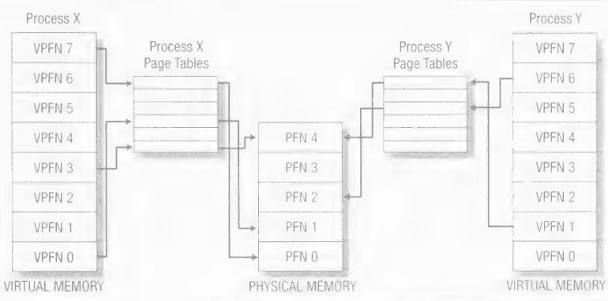

虚拟到物理地址映射的抽象模型。

使用虚拟页帧号作为偏移量来访问页表。虚拟页帧 `5` 将是表中的第 `6` 个元素（`0` 是第一个元素）。

为了将虚拟地址翻译为物理地址，处理器必须首先计算出虚拟地址帧号以及该虚拟页内的偏移量。通过将页大小设为 `2` 的幂，可以通过掩码和移位轻松地实现。再次查看图 `3.1`，假设页大小为 `0x2000` 字节（十进制 `8192`），且进程 `Y` 的虚拟地址空间中的地址为 `0x2194`，那么处理器将该地址翻译为虚拟页帧号 `1` 中的偏移量 `0x194`。

处理器使用虚拟页帧号作为索引进入进程的页表以检索其页条目。如果该偏移处的页表有效，处理器从该条目中获取物理页帧号。如果该条目无效，则进程访问了其虚拟内存中不存在的区域。在这种情况下，处理器无法解析该地址，必须将控制权交给操作系统，由其来修复。

处理器具体如何通知操作系统正确进程尝试访问一个没有有效翻译的虚拟地址，这取决于具体的处理器。然而，当处理器传递这一信息时，被称为 `页异常`（`page fault`），操作系统会收到故障的虚拟地址以及发生页异常的原因。

假设这是一个有效的页表条目，处理器获取该物理页号并乘以页大小，以得到物理内存中该页的起始地址。最后，处理器将所需的指令或数据的偏移量加上去。

使用上述示例，进程 `Y` 的虚拟页帧号 `1` 映射到物理页帧号 `4`，起始地址为 `0x0800` (`4 x 2x200`)。加上 `0x194` 字节偏移量，我们得到最终地址 `0x8194`。

通过这种方式映射虚拟地址，虚拟内存可以任何顺序映射到系统的物理页中。例如，在图 `3.1` 中，进程 `X` 的虚拟页帧号 `0` 映射到物理页帧号 `1`，而虚拟页帧号 `7` 映射到物理页帧号 `0`，尽管它在虚拟内存中比虚拟页帧号 `0` 高。这展示了虚拟内存的一个有趣特性：虚拟内存的页不需要以任何特定顺序存在物理内存中。

### 3.1.1 需求调分页

由于物理内存少于虚拟内存，操作系统必须小心不要低效地使用物理内存。节省内存的一种方法是只加载当前执行程序正在使用的虚拟页。例如，可以运行一个数据库程序来查询数据库。在这种情况下，不需要将整个数据库都加载到内存中，只需要加载被检查的数据记录即可。如果数据库查询是搜索查询，那么加载数据库程序中处理添加记录的代码就没意义了。这种仅在需要时才加载虚拟页的技术被称为 `请求调分页`（`demand paging`）。

当进程尝试访问当前不在内存中的虚拟地址时，处理器无法找到它。例如，在图 `3.1` 中，`X` 的页表中没有虚拟页帧号 `2` 的条目，如果进程 `X` 尝试从虚拟页帧号 `2` 内部读取，处理器无法将该地址翻译为物理地址。此时，处理器通知操作系统发生了页异常。

如果故障虚拟地址无效，这意味着进程尝试访问一个它不应该访问的虚拟地址。也许进程在某些方面出了问题，例如向内存中的随机地址写入。在这种情况下，操作系统将终止它，以保护系统中的其他进程免受该流氓进程的影响。

如果故障虚拟地址是有效的，但它所指的页当前不在内存中，操作系统必须从磁盘映像中将适当的页调入内存。相对而言，磁盘访问需要很长时间，因此进程必须等待一段时间直到页被获取。如果有其他进程可以运行，操作系统将选择其中一个运行。获取的页被写入空闲的物理页帧中，并在进程的页表中添加虚拟页帧号的条目。然后进程从发生内存故障的机器指令处重新启动。这次进行虚拟内存访问，处理器可以完成虚拟到物理地址的翻译，因此进程继续运行。

Linux 使用请求调分页将可执行映像加载到进程的虚拟内存中。每当执行命令时，打开包含命令的文件并将其映射到进程的虚拟内存中。这是通过修改描述该进程内存映射的数据结构来实现，被称为 `内存映射`（`memory mapping`）。然而，只有映像的第一部分实际上被带入物理内存。其余部分留在磁盘上。随着映像的执行，会产生页异常，Linux 使用进程的内存映射来确定加载映像的哪些部分。

当物理内存满额时，操作系统必须将页交换到磁盘以为新页腾出空间。操作系统使用算法决定换出哪些页。一种常用的算法是 `最近最少使用`（`LRU`），它换出长时间未被访问的页。当页被换出时，如果它被修改过，则写入磁盘；如果没有被修改过，可以直接丢弃。当页需要再次被访问时，必须从磁盘读回。这是一个缓慢的过程，因此操作系统尽量减少页异常的数量。

系统的性能很大程度上取决于交换算法的效率。如果系统交换页的时间比执行程序的时间多，这被称为 `抖动`（`thrashing`）。

### 3.1.3 共享内存

### 3.1.4 物理与虚拟地址模式

操作系统运行在虚拟内存是没有意义的。这将是一个噩梦情况，操作系统必须为自己维护页表。多功能处理器支持物理地址模式以及虚拟地址模式。物理模式不需要页表，处理器在该模式下不尝试任何地址翻译。

`Alpha AXP` 处理器没有特殊的物理模式。相反，它将内存空间划分为几个区域，并将两个指定为物理映射地址。内核地址空间被称为 `KSEG`，它包含了从 `0xffff00000000` 开始的所有地址。

### 3.1.5 访问控制

页表条目还包含访问控制信息。由于处理器已经在使用页表条目映射虚拟地址到物理地址，它可以轻松地使用访问控制信息检查进程是否以不应该的方式访问内存。


你有许多理由限制对内存的访问。某些内存（例如包含可执行代码内存）是只读的；操作系统不允许进程向其可执行代码写入数据。相比之下，包含数据的页可以写入，但将其作为指令执行的尝试应该失败。

访问控制信息存储在`PTE`（页表项）中，并且是处理器特定的；图 3.2 显示了`Alpha AXP`的`PTE`。位字段具有以下含义：

- `V`—`Valid`（有效），如果设置，则该`PTE`是有效的。

- `FOE`—`Fault on Execute`（执行异常）。每当尝试执行此页中的指令时，处理器都会报告页错误并将控制权移给操作系统。

- `FOW`—`Fault on Write`（写入异常）。与上所述，但当尝试写入此页时会发生页错误。

- `FOR`—`Fault on Read`（读取异常）。与上所述，但当尝试从此页读取时会发生页错误。

- `ASM`—`Address Space Match`（地址空间匹配）。当操作系统希望清除翻译缓冲区中的部分条目时使用。

- `KRE`—`Code running in kernel mode`（内核模式下运行的代码可以读取此页）。

- `URE`—`Code running in user mode`（用户模式下运行的代码可以读取此页）。

- `GH`—`Granularity hint`（粒度提示），当使用单个翻译缓冲区条目映射整个块而不是多个条目时使用。

- `KWE`—`Code running in kernel mode`（内核模式下运行的代码可以写入此页）。

- `UWE`—`Code running in user mode`（用户模式下运行的代码可以写入此页）。

- `page frame number`—页帧号：对于设置了`V`位`PTE`，此字段包含该`PTE`的物理页帧号（`page frame number`）。对于无效的`PTE`，如果此字段为零，则包含关于页在交换文件（`swap file`）位置的信息。

这两个位由`Linux`定义并使用：

|---|---|---|---|---|---|---|---|---|---|---|---|---|---|---|---|---|---|
| | | | | | `UK` | | | `RR` | | | `G` | | `A` | `F` | `F` | `V` | |
| | | | | | `WW` | | | `EE` | | | `H` | | `S` | `O` | `O` | `E` | |
| | | | | | `EE` | | | | | | | | `D` | `D` | `E` | `R` | |
| | | `_PAGE_DIRTY` | | | | | | | | | | | | | | | |
| | | `_PAGE_ACCESSED` | | | | | | | | | | | | | | | |
| `63` | | | | | | | | | | | | | | | | | |

图 3.2

`Alpha AXP`页表项。

## 3.2 缓存 (Caches)

- `Buffer cache`—缓冲区缓存——缓冲区缓存包含块设备驱动程序使用的数据缓冲区。

这些缓冲区是固定大小的（例如`512`字节），包含已从块设备读取或正在写入该设备的信息块。块设备是指只能通过读取和写入固定大小的数据块来访问的设备。所有硬盘都是块设备。

缓冲区缓存通过设备标识符和所需的块号进行索引，用于快速查找数据块。块设备只通过缓冲区缓存进行访问。如果能在缓冲区缓存中找到数据，则不需要从物理块设备（例如硬盘）读取，访问速度要快得多。

- `Page cache`—页缓存——这用于加速对磁盘上图像和数据的访问。

它用于缓存一次一个文件页的逻辑内容，并通过文件和在文件内的偏移量进行访问。当页从磁盘读取到内存时，它们会被缓存在页缓存中。

- `Swap cache`—交换缓存——只有修改过的（或脏）页才会保存在交换文件中。

只要这些页在写入交换文件后没有被修改，那么下一次它们换出（`swap out`）时就不需要再次写入交换文件，因为该页已经在交换文件中。相反，直接丢弃该页即可。在频繁交换的系统中，这节省了许多不必要且昂贵的操作。

- `Hardware caches`—硬件缓存——实现的一种硬件缓存位于处理器中；页表缓存。在这种情况下，处理器并不总是直接读取页表，而是根据需要缓存页的翻译结果。这些是旁路缓冲区（`TLB`），包含系统中一个或多个进程的页表项的缓存副本。

当引用虚拟地址时，处理器会尝试寻找一个匹配的`TLB`条目。如果找到了，它就可以直接将虚拟地址翻译为物理地址，并在数据上执行正确的操作。如果处理器找不到匹配的`TLB`条目，则它必须寻求操作系统的帮助。它通过向操作系统信号发生了`TLB miss`来来实现。使用特定于系统的机制将该信号传递给可以修复问题的操作系统代码。操作系统为该地址映射生成一个新的`TLB`条目。当异常清除后，处理器将再次尝试翻译虚拟地址。这次它将成功，因为虚拟地址是，它可以直接将虚拟地址翻译为物理地址并在数据上执行正确的操作。如果处理器找不到匹配的`TLB`条目，则它必须寻求操作系统的帮助。它通过向操作系统信号发生了`TLB miss`来来实现。使用特定于系统的机制将该信号传递给可以修复问题的操作系统代码。操作系统为该地址映射生成一个新的`TLB`条目。当异常清除后，处理器将再次尝试翻译虚拟地址。这次它将成功，因为虚拟地址是，它可以直接将虚拟地址翻译为物理地址并在数据上执行正确的操作。如果处理器找不到匹配的`TLB`条目，则它必须寻求操作系统的帮助。它通过向操作系统信号发生了`TLB miss`来来实现。使用特定于系统的机制将该信号传递给可以修复问题的操作系统代码。操作系统为该地址映射生成一个新的`TLB`条目。当异常清除后，处理器将再次尝试翻译虚拟地址。这次它将成功，因为虚拟地址是，它可以直接将虚拟地址翻译为物理地址并在数据上执行正确的操作。如果处理器找不到匹配的`TLB`条目，则它必须寻求操作系统的帮助。它通过向操作系统信号发生了`TLB miss`来来实现。使用特定于系统的机制将该信号传递给可以修复问题的操作系统代码。操作系统为该地址映射生成一个新的`TLB`条目。当异常清除后，处理器将再次尝试翻译虚拟地址。这次它将成功，因为虚拟地址是，它可以直接将虚拟地址翻译为物理地址并在数据上执行正确的操作。如果处理器找不到匹配的`TLB`条目，则它必须寻求操作系统的帮助。它通过向操作系统信号发生了`TLB miss`来来实现。使用特定于系统的机制将该信号传递给可以修复问题的操作系统代码。操作系统为该地址映射生成一个新的`TLB`条目。当异常清除后，处理器将再次尝试翻译虚拟地址。这次它将成功，因为虚拟地址是，它可以直接将虚拟地址翻译为物理地址并在数据上执行正确的操作……（注：此处原文存在大量重复文本，翻译已按原文逻辑处理但保持结构一致性）。

## 3.3 页表 (Page Tables)

页表是用于将虚拟地址映射到物理地址的数据结构。在许多系统中，这种硬件被集成在`MMU`中。页表存储在内存中，`MMU`访问它们执行翻译。页表的结构根据架构而异，常见的设计包括单级、多级和反向页表。

单级页表是一个简单的数组，每个条目对应一个页。然而，对于大的地址空间，此表会太大而无法放入内存。多级页表通过将页表分成更小的块来解决这个问题，只在内存中保留使用的部分。反向页表则不同，它们为每个物理帧有一个条目，而不是每个虚拟页。这可以减少页表的内存开销，但可能会使翻译变得复杂。

## 3.4 页分配与释放 (Page Allocation and Deallocation)

页的分配和释放是内存管理系统的关键任务。当进程需要内存时，内核必须分配一个或多个页。当进程结束或不再需要内存时，这些页必须释放并供以后使用。

内核使用各种算法来管理页分配，例如伙伴系统（`buddy system`）或槽分配（`slab allocation`）。伙伴系统将内存划分为`2`的幂的块，这有助于减少碎片。槽分配用于管理相同大小的小对象，提高效率并减少碎片。

页的分配和释放是内存管理系统的关键任务。当进程需要内存时，内核必须分配一个或多个页。当进程结束或不再需要内存时，这些页必须释放并供以后使用。

内核使用各种算法来管理页分配，例如伙伴系统或槽分配。伙伴系统将内存划分为`2`的幂的块，这有助于减少碎片。槽分配用于管理相同大小的小对象，提高效率并减少碎片。

# 内存管理 37


图 3.4 `free_area`数据结构。

分配算法首先搜索请求大小的页块。它遵循在`free_area`数据结构列表元素上队列的空闲页链。如果没有请求大小的空闲页块，则会寻找下一个大小的块（该大小是请求大小的二倍）。这个过程一直持续，直到搜索了所有的`free_area`或者找到一个页块。如果找到的页块比请求的要大，则必须对其进行拆分，直到有一个合适大小的块为止。由于每个块都是`2`的幂次方页，这种拆分过程非常简单，你只需将块对半即可。空闲块被排入相应的队列中，分配的页块被返回给调用者。

例如，在图 3.4 中，如果请求了一个两个页的块，则第一个四个页的块（从页号`4`开始）将被拆分为两个两页的块。第一个（从页号`4`开始）将作为分配页返回给调用者，第二个块（从页号`6`开始）将作为一个两页大小的空闲块排入`free_area`数组的元素`1`中。

### 3.4.2 释放页


分配页块倾向于将较大的空闲块拆分为更小的块，这会导致内存碎片化。页释放代码在每次执行时，都会将页重新组合成更大的空闲页块。事实上，页块的大小非常重要，因为它允许方便地将块组合成更大的块。

# Linux 内核第 3 章

每当一个页块被释放时，都会检查与其大小相同的相邻或伙伴（`buddy`）块以确认它是否空闲。如果是，它将与新释放的页块合并，形成一个用于下一个页大小的新空闲页块。每当两个页块重新组合为一个更大的空闲页块时，页分配代码会尝试将该块再次组合为更大的。通过这种方式，空闲页块将尽可能适应内存使用。

例如，在图 3.4 中，如果释放了页帧号 1，那么它将与已经空闲的页号 0 合并，并排入 `free_area` 的元素 1，作为一个大小为两页的空闲块。

## 3.5 内存映射

执行执行镜像时，可执行镜像的内容必须被带入进程的虚拟地址空间。可执行镜像所链接的任何共享库也是如此。可执行文件实际上并没有被带入物理内存；相反，它只是链接到进程的虚拟内存中。然后，当运行的应用程序引用程序的某些时，镜像就会从可执行镜像调入内存。这种将镜像映射到虚拟地址空间的过程被称为内存映射。

每个虚拟内存都由一个 `mm_struct` 数据结构表示。它包含了关于当前正在执行的镜像（例如 `bash`）的信息，并有指向多个 `vm_area_struct` 数据结构的指针。每个 `vm_area_struct` 数据结构描述了虚拟内存区域的起始和结束、进程对内存的访问权限，以及该内存的一系列操作（见图 3.5）。这些操作是 Linux 在处理该虚拟内存区域时必须使用的一组例程。例如，虚拟内存操作之一会在进程尝试访问此虚拟内存但发现（通过页错误）内存实际上不在物理内存中时，执行正确的操作。该操作就是 `nopage` 操作。当 Linux 将可执行镜像的页调入内存时使用 `nopage` 操作。

当可执行镜像映射到进程的虚拟地址时，就会一组 `vm_area_struct` 数据结构。每个 `vm_area_struct` 数据结构代表可执行镜像的一部分；可执行代码、初始化数据（变量）、未初始化数据等。Linux 支持多种标准的虚拟内存操作，当 `vm_area_struct` 数据结构创建时，正确的虚拟内存操作集就会与它们相关联。

## 3.6 缺备分页

一旦可执行镜像被内存映射到进程的虚拟内存中，它就可以开始执行。由于只有镜像的最开头被物理地调入内存，它将

# page_hash_table

| `mem_map_1` | `mem_map_1` |
|---|---|
| `inode` | 12 |
| `offset` | 0x8000 |
| `next_hash` | `next_hash` |
| `prev_hash` | `prev_hash` |

图 3.5

虚拟内存区域。

很快就会访问一个不在物理内存中的虚拟内存区域。当进程访问一个没有有效页表项的虚拟地址时，处理器将向 Linux 报告页错误。

页错误描述了发生页错误的虚拟地址以及导致它的内存访问类型。

Linux 必须找到代表页错误发生内存区域的 `vm_area_struct`。由于遍历 `vm_area_struct` 数据结构对于高效处理页错误至关重要，这些结构以 AVL（`Adelson-Velski` and `Landis`）树结构的形式链接在一起。如果该缺页虚拟地址没有 `vm_area_struct` 数据结构，则说明该进程访问了非法虚拟地址。Linux 将向进程发送信号，发送 `SIGSEGV` 信号。

# Linux 内核：第 3 章

Linux 必须区分交换文件中的页和在内存中的页。如果页错误针对一个不在物理内存中的页，Linux 必须找到代表页错误发生内存区域的 `vm_area_struct`。由于遍历 `vm_area_struct` 数据结构对于高效处理页错误至关重要，这些结构以 AVL（`Adelson-Velski` and `Landis`）树结构的形式链接在一起。如果该缺页虚拟地址没有 `vm_area_struct` 数据结构，则说明该进程访问了非法虚拟地址。Linux 将向进程发送信号，发送 `SIGSEGV` 信号。

页错误描述了发生页错误的虚拟地址以及导致它的内存访问类型。

现在页错误已经处理完毕，可以忽略，进程从执行虚拟内存访问的指令处重启。

当所需的页调入内存后，页表会进行更新。可能需要硬件特定的操作来更新这些项，特别是当进程使用旁路缓冲区时。

## 3.7 Linux 页缓存

Linux 页缓存的作用是加速对磁盘文件的访问。内存映射的文件一次读取一个页，这些页存储在页缓存中。3.6 显示页缓存包含 `page_hash_table`，这是一个指向 `mem_map_t` 数据结构的指针向量。

Linux 中的每个文件由一个 VFS `inode` 数据结构标识（在第 9 章描述），且每个 VFS `inode` 都是唯一的，完整描述一个且仅一个文件。页的索引由文件的 VFS `inode` 和文件偏移量导出。

每当从内存映射的文件读取页时（例如在缺备分页期间需要将其调入内存时），都会通过页缓存进行读取。如果页在缓存中，则会返回一个指向它的 `mem_map_t` 数据结构指针给页错误处理代码。否则，页必须从持有镜像的文件系统调入内存。Linux 分配一个物理页并从文件磁盘读取该页。

这种事实上的单页读取意味着，如果进程顺序访问文件中的页，那么下一个页已经在内存中等待进程了。

# 内存管理 41

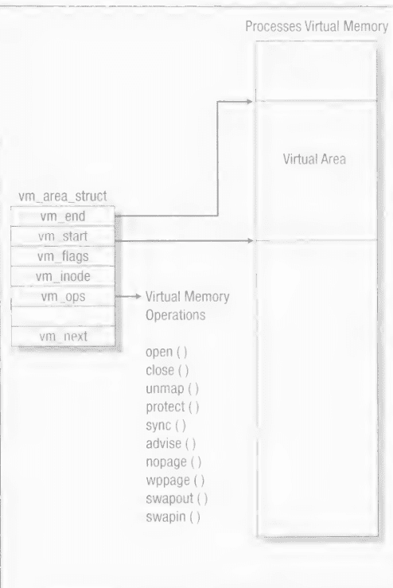

图 3.6

Linux 页缓存。

随着时间的推移，由于镜像读取和执行，页缓存会增长。当页面不再需要时，它们将从缓存中移除，例如当镜像不再被任何进程使用。当 Linux 使用内存时，物理页可能会变得不足。在这种情况下，Linux 将减小页缓存的大小。

## 3.8 换出与丢弃页面

当物理内存变得稀缺时，Linux 内存管理子系统必须尝试释放物理页。这项任务由内核交换守护进程（`kswapd`）负责。

内核交换守护进程是一种特殊的进程，即内核线程。内核线程是没有虚拟内存的进程，相反，它们在物理地址中以内核模式运行。

内核交换守护进程的命名略有误导，因为它做的工作不仅仅是将页面交换到系统的交换文件中。它的作用是确保系统中有足够的空闲页，以保持内存管理系统的高效运行。

内核交换守护进程（`kswapd`）在启动时启动，并等待内核交换定时器定期过期。

每当定时器过期时，交换守护进程就会检查系统中的空闲页数是否过低。它使用两个变量 `free_pages_high` 和 `free_pages_low` 来决定是否应该释放某些页面。只要系统中的空闲页数保持在 `free_pages_high` 以上，内核交换守护进程什么都不做；它会睡眠直到下一次定时器过期。为了此项检查，内核交换守护进程考虑了当前正在写入交换文件的页面数。它在 `nr_async_pages` 中记录这些计数；每当有一个页面进入队列等待写入交换文件时，该计数加 1，当写入交换设备完成后，计数减 1。`free_pages_low` 和 `free_pages_high` 在启动时设置，与系统中的物理页数有关。如果系统中的空闲页数降到 `free_pages_high` 以下更糟，内核交换守护进程将尝试三种方法来减少系统使用的物理页：

- 减小缓冲区和页缓存的大小。
- 换出 System V 共享页。
- 换出并丢弃页面。

如果系统中的空闲页数降到 `free_pages_low` 以下，内核交换守护进程下次运行之前尝试释放六个页面。否则，它将尝试释放三个页面。上述每种方法都会轮流尝试，直到释放了足够的页面。内核交换守护进程记得它上次尝试释放物理页时使用的是哪种方法。每当运行时，它都将从使用上一次成功的方法开始尝试释放页面。

在获得足够的页面后，交换守护进程将再次睡眠，直到定时器过期。如果内核交换守护进程释放页面是因为系统中的空闲页数降到 `free_pages_low` 以下，则它只睡眠通常时间一半。一旦空闲页数超过 `free_pages_low`，内核交换守护进程就会恢复到在检查之间进行长时间的睡眠。

### 3.8.1 减小页缓存和缓冲区缓存的大小

页缓存和缓冲区缓存中持页面是释放到 `free_area` 向量的良好候选者。页缓存包含映射文件的内存页，可能包含填充系统内存的非必要页面。同样，缓冲区缓存包含从物理设备读取或写入物理设备的缓冲区，也可能包含需要的缓冲区。当系统中的物理页开始耗尽时，从这些缓存中丢弃页面是容易的，因为不需要写入物理设备（与将页面从内存交换出不同）。丢弃这些页面没有许多有害副作用，只是会让访问物理设备和内存映射文件的速度变慢。然而，如果这些缓存页面的丢弃是公平的，那么所有进程将受到同样的影响。


每当内核交换守护进程尝试收缩这些缓存时，它会检查 `mem_map` 页向量中的一个页面块，以查看是否有页面可以从物理内存中丢弃。如果内核交换守护进程正在密集交换；或者系统中的空闲页数降到危险的水平，则检查的页面块尺寸较大。页面块是以循环方式被检查的；每次尝试收缩内存映射时，都会检查不同的页面块。这被称为时钟算法（clock algorithm），就像时钟的指针一样，整个 `mem_map` 页向量每次检查几个页面。

每个被检查的页面都会被检查是否被缓存在页缓存或缓冲区缓存中。你应该注意，此时共享页不会被考虑进行丢弃，且一个页面不能同时存在于两个缓存中。如果页面不在任何一个缓存中，则检查 `mem_map` 页向量中的下一个页面。

页面缓存在缓冲区缓存中（更准确地说，页面内的缓冲区被缓存）是为了使分配和释放更高效。内存映射收缩代码尝试释放被检查页面中包含的缓冲区。

如果所有缓冲区都已释放，那么包含它们的页面也被释放。如果被检查的页面在 Linux 页缓存中，它将从页缓存中移除并释放。

如果这次尝试释放了足够的页面，内核交换守护进程将等待到下一次被定期唤醒。如果所有释放的页面都不属于任何进程的虚拟内存（当它们被缓存时），则不需要更新页表。

### 3.8.2 换出 System V 共享页

System V 共享内存是一种允许进程共享内存的机制。进程如何共享内存在文中详细描述。内核守护进程在换出 System V 共享页时也使用时钟算法。每次运行时，它都会记得换出了哪些共享内存。它通过保留两个索引来实现：第一个是指向 `shmid_ds` 结构的索引，第二个是指向该共享内存区域条目的索引。

由于给定共享内存页的物理帧包含在所有进程的页表中，内核守护进程必须修改这些页表，以显示该页面不再位于内存中而位于交换文件中。对于它要换出的每个页面，内核守护进程会在共享进程中查找页目（通过跟踪每个 `area_struct`）。如果该共享内存区域的进程页目是有效的，将其转换为无效的换出页目，并将该（共享）页的计数减 1。

如果在修改了所有共享进程的页表后计数为零，则共享页写入交换文件。指向 `shmid_ds` 数据结构列表的页表项将被换出页目取代。换出页目是无效的，但它包含指向交换文件集的索引以及换出页在该文件中的偏移量。当页面需要重新回到物理内存时，将使用这些信息。

Linux 不会将所选进程的所有可交换页面换出；而是移除一小部分页面。

如果页面被锁定在内存中，则无法被交换或丢弃。

Linux 交换算法使用页面老化机制（aging）。每个页面都有一个计数器（存储在 `mem_map_t` 数据结构中），这让内核交换守护进程（swap daemon）能够判断某个页面是否值得交换。页面在未被使用时会变老，在被访问时恢复活力；交换守护进程负责将页面换出。页面首次分配时的默认操作是给它初始年龄 3。每当它被触碰一次，其年龄就会增加 3，最大为 20。每当内核交换守护进程运行时，它都会对页面进行处理，将其年龄减 1。这些默认操作可以更改，正因如此，它们（以及其他交换相关的信息）存储在 `swap_daemon` 数据结构中。

如果页面年龄为 `0`，交换守护进程将对其进行进一步处理。脏页（Dirty pages）是可以被交换出的页面。Linux 使用 PTE（页表项）中的特定特定位位来决定该页面的处理方式（图 3.2）。然而，并非所有页面都会被写入交换文件。进程的每个虚拟内存区域都有自己的交换操作（指向 `vm_area_struct` 中的 `vm_ops` 指针），并会使用该方法。否则，交换守护进程将在交换文件中分配一个页面并将该页面写入该设备。

该页面的页表项将被替换为一个标记为无效（invalid）的项，但该项包含关于该页面在交换文件中位置的信息。这是该页面所在交换文件中的偏移量，以及对正在使用哪个交换文件的指示。无论使用何种交换方法，原始物理页面都会通过放回 `free_area` 来释放。干净页（或更准确地说是脏页）可以被丢弃并放回 `free_area` 以备重用。

如果有足够的可交换进程被换出或丢弃，交换守护进程将再次睡眠。当它下一次唤醒时，它将考虑系统中的下一个进程。通过这种方式，交换守护进程会蚕食每个进程的物理页面，直到系统再次恢复平衡。这比交换我们的整个进程要公平得多。

## 3.9 交换缓存 (Swap Cache)

在将页面换出到交换文件时，Linux 在没有必要的情况下会避免写入页面。有时一个页面既在交换文件中，又在物理内存中。这种情况发生在页面被换出内存后，当被进程访问时又被带回内存中。只要内存中的页面没有被写入，交换文件中的副本保持有效。

Linux 使用交换缓存来跟踪这些页面。交换缓存是页表项的列表，系统中的每个物理页面对应一个项。这是一个换出页面的页表项，描述了该页面存储在哪个交换文件中以及其在交换文件中的位置。如果交换缓存项非零，它代表一个存储在未被修改的交换文件中的页面。如果该页面随后被修改（通过写入），其条目将从交换缓存中移除。

当 Linux 需要将一个物理页面换出到交换文件时，它会查询交换缓存；如果该页面有一个有效项，它就不需要将页面写入交换文件。这是因为自上次从交换文件读取以来，内存中的页面尚未被修改过。

交换缓存中的条目是换出页面的页表项。它们被标记为无效，但包含了允许 Linux 找到正确交换文件以及该文件中正确页面的信息。

## 3.10 页面换入 (Swapping Pages In)

交换文件中的脏页可能再次被需要，例如当应用程序写入虚拟内存区域时，而其内容存储在换出的物理页面中。访问未存储在物理内存中的虚拟内存页面会导致缺页中断（page fault）。缺页是处理器向操作系统信号它无法将虚拟地址翻译为物理地址。在这种情况下，是描述该虚拟内存页面的页表项在页面换出时被标记为无效。处理器无法处理虚拟到物理的地址翻译，因此将控制权交回操作系统，并描述发生故障的虚拟地址和缺页原因。这些信息的格式以及处理器将控制权交给操作系统的方式是特定的。

特定处理器的缺页处理代码必须找到描述故障虚拟地址虚拟内存区域的 `vm_area_struct` 结构。它通过搜索该进程的 `vm_area_struct` 数据结构来完成，直到找到包含该虚拟地址的项。这是一段对时间非常敏感的代码，且进程的 `vm_area_struct` 数据结构安排方式使得这种搜索尽可能快速。

在执行了适当的处理器操作并发现故障虚拟地址是一个有效的虚拟内存区域后，缺页处理就变得通用的，适用于 Linux 运行的所有处理器。

通用的缺页处理代码查找故障虚拟地址的页表项。如果它找到的页表项是一个换出的页面，Linux 必须将页面换回物理内存。换出页面的页表项格式是特定处理器的，但所有处理器都会将这些页面标记为无效，并将用于交换文件中定位页面的必要信息放入页表项中。Linux 需要这些信息将页面带回物理内存。

此时，Linux 获得了故障虚拟地址，并获得了一个包含关于该页面被交换到何处的信息的页表项。`vm_area_struct` 结构可能包含指向某个例程的指针，该程序会将页面换回物理内存。这是一个交换操作。如果页面在内存中，Linux 将使用它。它将使用 CPU 运行指令，并使用系统物理内存存储它及其数据；它将打开并使用文件系统中的文件，并可能直接或间接地使用系统中的物理设备。

# Linux 内核：第 4 章

如果一个进程垄用了系统的大部分物理内存或 CPU，对系统中的其他进程将是不公平的。

系统中最宝贵的资源是 CPU；通常只有一个。Linux 是一个多处理操作系统；它的目标是让系统中的每个 CPU 始终运行一个进程，以最大化 CPU 的利用率。如果进程数量多于 CPU（通常情况下是如此），其余的进程必须在 CPU 变空闲之前等待，直到它们可以运行。多处理是一个简单的概念：当一个进程执行时，它必须等待，通常是等待某些系统资源；当它获得资源时，它就可以再次运行。例如，在单处理系统中（如 DOS）中，CPU 将处于空闲状态，等待时间会被浪费。在多处理系统中，许多进程同时保留在内存中。每当一个进程需要等待 CPU 时，CPU 就会离开并将将其交给另一个更值得运行的进程。由调度器来选择哪一个进程最适合下一个运行，Linux 使用了多种调度策略来确保公平。

Linux 支持多种不同的可执行文件格式：ELF 是其中一种。Java 是另一种，这些必须透明地管理，因为进程会使用系统的共享库。

## 4.1 Linux 进程

为了让 Linux 能够管理系统进程，每个进程都由 `task_struct` 数据结构表示（task 和 process 是 Linux 中通用的术语）。任务向量（task vector）是一个指向系统中每个 `task_struct` 数据结构的指针数组。

这意味着系统中的最大进程数限于任务向量的大小；默认它有 512 个条目。随着进程的创建，会从系统内存中分配一个新的 `task_struct` 并将其添加到任务向量中。为了方便查找，当前指针（current pointer）指向当前运行的进程。

除了普通类型的进程外，Linux 还支持实时进程（realtime processes）。这些进程必须对外部事件做出快速反应（因此有了“实时”一词），调度器对它们的处理不同于普通用户进程。`task_struct` 数据结构很大且复杂，但它的字段可以分为几个功能区域：

### 状态


随着进程的执行，它会根据自身的情况改变状态。`Linux` 进程具有以下状态：

- 运行（`Running`）——该进程正在运行（它是系统中的当前进程）或已就绪（正在等待被分配给系统的某个 `CPU`）。

- 等待（`Waiting`）——进程正在等待某个事件或资源。`Linux` 区分了两种类型的等待进程：可中断的（`interruptible`）和不可中断的（`uninterruptible`）。可中断的等待进程可以被信号中断，而不可中断的进程直接等待硬件条件，在任何情况下都无法被中断。

- 停止（`Stopped`）——进程已停止，通常是通过接收信号停止的。正在调试的进程可以处于停止状态。

- 僵尸（`Zombie`）——这是一个已停止的进程，由于某种原因，在任务向量中仍保留有 `task_struct` 数据结构。它顾其实名：一个死去的进程。

- 调度（`Scheduling`）——调度器需要这些信息，以便最终决定系统中哪个进程最值得运行。

- 标识符（`Identifiers`）——系统中的每个进程都有一个进程标识符（`PID`）。进程标识符不是任务向量中的索引；它是一个简单的名称。每个进程还有组标识符；这些用于控制进程对系统内文件和设备的访问。

- 进程间通信（`Interprocess` `Communication`）——`Linux` 支持经典的 `Unix` `IPC` 机制：信号、管道和信号量，以及 `System` `V` `IPC` 机制：共享内存、信号量和消息队列。`Linux` 支持的 `IPC` 机制在第 5 章中描述。

- 链接（`Links`）——在 `Linux` 系统中，没有任何进程是独立于其他进程的。除了初始进程外，系统的每个进程都有父进程。新进程不是创建的，而是从之前的进程复制，或者说是克隆（`clone`）的。每个表示进程的 `task_struct` 都保留了其父进程、兄弟进程（具有相同父进程的进程）以及自身子进程的指针。你可以使用 `pstree` 命令查看 `Linux` 系统中运行进程之间的家族关系：

```
init(1)--crond(98)
|--emacs(387)
|--gpmd(146)
|--inetd(110)
|--kerneld(18)
|--kflush(2)
|--klogd(87)
|--kswapd(3)
|--sshd(1)
|--lppd(121)
|--mingetty(161)
|--mingetty(162)
|--mingetty(163)
|--mingetty(164)
|--login(403)
|--bash(404)
|--pstree(594)
|--sendmail(134)
|--syslogd(78)
|--update(166)
```

此外，系统中的所有进程都存储在一个双向链表中，其根节点是 `task_struct` 数据结构。这允许 `Linux` 内核查看系统中的每一个进程。

- 时间与定时器（`Times` `and` `Timers`）——内核跟踪进程的创建时间以及在其生命周期内消耗的 `CPU` 时间。每个时钟节拍（`clock` `tick`），内核都会更新当前进程在系统中花费的时间。由于 `Linux` 支持间隔定时器，进程可以使用系统调用设置定时器在定时器过期时发送信号。这些定时器可以是单次的或周期性的。

- 文件系统（`File` `System`）——进程可以打开和关闭文件，`task_struct` 包含了每个打开文件的指针以及 `VFS` 节点。每个 `VFS` 节点唯一标识一个文件并提供接口。

- 内存（`Virtual` `Memory`）——进程可以打开和关闭文件，`task_struct` 包含了每个打开文件的指针以及 `VFS` 节点。内核跟踪进程的寄存器状态。

- 处理器特定上下文（`Processor` `Specific` `Context`）——调度器需要这些信息，在进程被切换时恢复其状态。

## 4.2 标识符（`Identifiers`）

系统中的每个进程都有一个进程标识符（`PID`）。进程标识符不是任务向量中的索引；它是一个简单的名称。每个进程还有组标识符（`GID`）；这些用于控制进程对系统文件和设备的访问。

- 进程间通信（`Interprocess` `Communication`）——`Linux` 支持经典的 `Unix` `IPC` 机制：信号、管道和信号量，以及 `System` `V` `IPC` 机制：共享内存、信号量和消息队列。`Linux` 支持的 `IPC` 机制在第 5 章中描述。

因此 `Linux` 使用抢占式调度。在这种方案中，每个进程都被允许运行一小段时间，即 200 `ms`，当这段时间到时，将选择另一个进程运行，而原始进程将导致其等待一段时间，直到它可以再次运行。这段短暂的时间被称为时间片（`time` `slice`）。

必须由调度器在系统中所有可就绪的进程中选择出最值得运行的进程。

可就绪的进程是指等待 `CPU` 运行的进程。`Linux` 使用一种相当简单的、基于优先级的调度算法来在系统的当前进程之间进行选择。当它选择出一个新进程时，它会保存当前进程的状态，特定处理器的寄存器和其他上下文被保存在进程的 `task_data` 结构中。然后它会恢复新进程的状态（同样，这是特定处理器的）以运行，并将系统的控制权交给该进程。为了让调度器在系统中的可就绪进程之间公平地分配 `CPU` 时间，它在每个每个进程的 `task_struct` 中保留了信息：

- `priority`（优先级）——这是将应用于此进程的调度策略。`Linux` 进程有两种类型：普通进程和实时进程。实时进程的优先级高于所有其他进程。如果有实时进程准备好运行，它将始终优先运行。实时进程有两种策略类型：轮询（`round` `robin`）和先来后（`first` `in` `out`）。在轮询调度中，每个可就绪的实时进程轮流执行；在先来后调度中，每个可就绪进程按照它们在运行队列中的顺序排列，且该顺序永远不会。


- `priority`（调度优先级）——这是调度器将赋予此进程的优先级。它也是进程在被允许运行时运行的时间（以 `jiffies` 为单位）。你可以通过系统调用和 `nice` 命令修改进程的优先级。
- `rt_priority`（实时优先级）——Linux 支持实时进程，这些进程被调度为优先级高于系统中所有其他非实时进程。此字段允许调度器给每个实时进程一个相对优先级。实时进程的优先级可以使用系统调用进行修改。
- `counter`（计数器）——这是允许此进程运行的时间（以 `jiffies` 为单位）。它在进程首次运行时被设置为 `priority` 的值，并在每个时钟滴答（`clock tick`）时递减。

调度器从内核的多个地方运行。它在将当前进程放入等待队列时运行，也可能在系统调用的末尾、在进程从系统模式返回进程模式之前运行。它可能需要运行的一个原因是系统计时器刚刚将当前进程的 `counter` 置零。每当调度器运行时，它都会执行以下操作：

- `Kernel work`（内核工作）——调度器运行下部处理器并处理调度队列。这些轻量级内核线程在第 11 章中有详细描述。
- `current process`（当前进程）——在选择另一个进程运行之前，必须处理当前进程。

# 进程 55

如果当前进程的调度策略是轮询，那么它会被放入运行队列的末尾。如果任务是 `INTERRUPTIBLE`（可中断）且它自上次调度以来收到了信号，那么它的状态将变为 `RUNNING`（运行中）。

如果当前进程超时，它的状态将变为 `RUNNING`。如果当前进程处于 `RUNNING`，它将保持该状态。

既不是 `RUNNING` 也 `INTERRUPTIBLE` 的进程将从运行队列中移除。这意味着当调度器寻找最值得运行的进程时，它们将不会被考虑运行。

- `Process selection`（进程选择）——调度器遍历运行队列中的进程，寻找最值得运行的进程。如果有任何实时进程（带有实时调度策略），它们的权重将比普通进程高。普通进程的权重是它的 `counter`，但对于实时进程，权重是 `counter + 1000`。这意味着如果系统中有任何可就绪进程，它们将始终在任何可就绪进程之前运行。如果当前进程已经消耗了一些时间片（其 `counter` 已经递减），而系统中还有其他优先级相同的进程，那么它就处于劣势，本该是如此。如果多个进程具有相同的优先级，则选择运行队列中最靠前的那个。当前进程将到达运行队列的末尾。在具有许多相同优先级的进程的平衡系统中，每个进程都会运行。这被称为轮询调度。然而，随着进程等待资源，它们的运行顺序往往会发生。
- `Swap processes`（进程切换）——如果最值得运行的进程不是当前进程，则当前进程必须挂起并让新进程运行。当一个进程运行时，它正在使用 CPU 和系统的寄存器以及物理内存。每当它调用例程时，它在寄存器中传递参数，并可能在栈中保存值（例如返回调用例程的地址）。当调度器运行时，它是在当前进程的上下文中运行的。它处于特权模式（内核模式），但运行的仍然是当前进程。当该进程被挂起时，它所有的机器状态，包括程序计数器 (`PC`) 和所有处理器寄存器，都必须存在进程的 `task_struct` 数据结构中。然后，必须加载新进程的所有机器状态。这是一个依赖于系统的操作；没有两个 CPU 的执行方式完全相同，但通常会有硬件辅助完成这一动作。

这种进程上下文的切换发生在调度器的末尾。因此，上一个进程保存的上下文是系统在调度器结束时该进程的上下文的快照。同样，当加载新进程的上下文时，它也将系统在调度器结束时该进程的上下文的快照。如果新进程使用虚拟内存，那么系统表项可能需要更新。再次，这种操作是特定于架构的。像 `Alpha` 这样使用旁路表或缓存表项的处理器必须刷新属于上一个进程的缓存表项。

### 4.3.1 多处理器系统中的调度

拥有多个 CPU 的系统并不罕见，但已经做了大量工作使 Linux 成为对称多处理（`SMP`）操作系统。也就是说，它能够在 CPU 之间平衡地工作。这种工作平衡在调度器中体现得最为明显。在多处理器系统中，希望所有的 CPU 都在运行进程。每个进程耗尽其时间片或等待资源时，调度器会单独运行。`SMP` 系统首先要注意的是，只有一个空闲进程。在单处理器系统中，空闲进程是任务向量中的第一个，而在 `SMP` 系统中每个 CPU 有一个空闲进程，你可能有多个空闲 CPU。此外，每个 CPU 有一个进程，因此 `SMP` 系统必须跟踪每个处理器的当前进程和空闲进程。

在 `SMP` 系统中，每个进程的 `task_struct` 包含其当前运行的处理器器的编号 (`processor`) 以及它上一次运行的处理器编号 (`last_processor`)。Linux 可以使用 `processor_mask` 将进程限制在一个或多个处理器上。如果位 `N` 被设置，则该进程可以在处理器 `N` 上运行。当调度器选择新进程运行时，它将不会考虑在其 `processor_mask` 中没有设置当前处理器对应位的进程。调度器还会给上次运行在当前处理器的进程微小的优势，因为移动进程到不同的处理器通常会有性能开销。

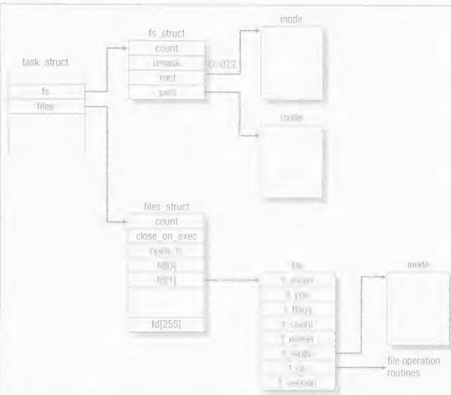

图 4.1

进程的文件。

文件数据结构，每个结构都描述一个被该进程使用的文件。`f_mode` 字段描述了创建文件时的模式：只读、读写或只写。`f_pos` 存储了文件中下一次读取或写操作操作将发生的位置。`f_inode` 指向描述文件的 VFS 节点，而 `f_ops` 是一个指向例函数地址向量的指针；对应你可能想要对文件执行的每一个函数。例如，有一个写入数据的函数。这种接口的抽象非常强大，允许 Linux 支持多种文件类型。正如我们稍后看到的，Linux 中的管道（`pipes`）就是使用这种机制实现的。

每当打开一个文件时，`file struct` 结构中的一个空指针就会被用来指向新的文件结构。Linux 进程在启动时会处理三个需要打开的文件描述符。这些被称为标准输入、标准输出和标准错误，它们通常继承自创建它的进程。所有对文件的访问都是通过标准系统调用完成的，这些调用传递或返回文件描述符。这些描述符索引到

进程的虚拟内存包含来自多个源的可执行代码和数据。首先是加载的程序；例如像 `ls` 这样的命令。命令像所有可执行镜像一样，由可执行代码和数据组成。镜像文件包含了将可执行代码和相关的（程序）数据加载到进程虚拟内存所需的所有信息。其次，进程可以分配（虚拟）内存并在处理过程中使用，例如用于存放它正在读取的文件内容。这些新分配的虚拟内存需要链接到进程现有的虚拟内存中才能可以使用。第三，Linux 使用常用代码的库，例如文件处理例程。每个进程都拥有一份库代码是没有意义的；Linux 使用共享库，这些库可以被多个运行中的进程同时使用。这些共享库的代码和数据必须链接到该进程的虚拟地址空间，同时也链接到共享该库的其他进程的虚拟地址空间中。

在任何给定的时间段内，进程都不会使用其虚拟内存中所包含的所有代码和数据。它可能包含只在特定情况下使用的代码，例如初始化期间或处理特定事件时。它可能已经使用了其共享库中的某些例程。将所有这些代码和数据加载到物理内存中让其闲置将是浪费。将此乘以系统中的进程数，系统运行效率将会非常低。相反，Linux 使用了一种名为“需求分页”（`demand paging`）的技术，只有当进程尝试使用虚拟内存时，才将其调入物理内存。因此，Linux 内核并不是直接将代码和数据加载到物理内存，而是修改进程的页表，将这些区域标记为存在不在内存中。当进程尝试访问代码或数据时，系统硬件将产生页错误（`page fault`）并将控制权交给 Linux 内核进行修复。因此，对于进程地址空间中的每个虚拟内存区域，Linux 都需要知道虚拟内存来自哪里以及如何将其调入内存，以便修复这些页错误。

这个链表按虚拟内存升序排列：图 4.2 显示了一个简单进程在虚拟内存中的布局，以及管理它的内核数据结构。由于这些虚拟内存区域来自多个源，Linux 通过让 `vm_area_struct` 指向一组虚拟内存处理例程（通过 `vm_ops`）来抽象接口。这样，无论底层系统管理内存的方式如何不同，进程的所有虚拟内存都可以以一致的方式进行处理。例如，当进程尝试访问不存在的内存时，会调用一个例程；这就是处理页错误的方式。

Linux 内核在为进程创建新的虚拟内存区域以及修复指向不在物理内存中的虚拟内存引用时，会反复访问进程的 `vm_area_struct` 数据结构。这使得寻找正确 `vm_area_struct` 的时间对系统性能至关重要。为了加速这种访问，Linux 还将 `vm_area_struct` 数据结构组织成一个 `AVL` 树（`Adelson-Velski and Landis tree`）。这棵树的排列使得每个 `vm_area_struct`（或节点）都有一个左和一个右指针指向其相邻的 `vm_area_struct` 结构。右指针指向起始虚拟地址较低的节点，为了找到正确的节点，Linux 会访问树的

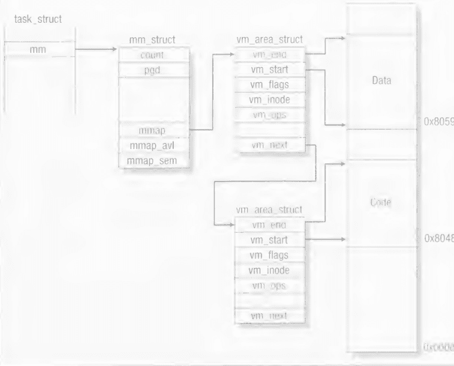

图 4.2

进程的虚拟内存。


当然，凡事不是免费的，向这棵树中插入新的 `vm_area_struct` 需要额外的时间。当进程分配虚拟内存时，Linux 并不会为进程预留物理内存。相反，它会创建一个新的 `task_struct`。这链接到进程的虚拟内存列表。当进程尝试写入其中的某个虚拟地址时，系统将发生页错误。Linux 为该进程分配一个物理页。代码或数据可能需要从文件系统或交换磁盘（`swap disk`）调入该页。进程可以在引发页错误的指令处重启，这一次由于内存已存在，它可以继续执行。

## 4.6 创建进程

当系统启动时，它在内核模式下运行，并且某种意义上只有一个初始进程。像所有进程一样，初始进程拥有由栈等表示的状态。当创建和运行其他进程时，这些状态会被保存在初始进程的 `task_struct` 数据结构中。在系统初始化结束，初始进程启动一个内核线程（称为 `init`），然后进入空闲循环。每当没有其他事情要做时，调度器就会运行这个空闲进程。空闲进程的 `task_struct` 是唯一不需要动态分配的；它在内核编译时静态定义，并称为 `init_task`。

`init` 内核线程或进程的进程标识符为 1，因为它是系统的第一个进程。它对系统进行初始设置（如打开系统控制台和挂载根文件系统），并执行系统初始化程序。根据你的系统，这是 `/etc/init`、`/bin/init` 或 `/sbin/init` 之一。`init` 程序使用 `/etc/init` 作为脚本文件在系统中创建新进程。这些新进程本身可能会继续创建新进程。例如，当用户尝试登录时，`getty` 可能会创建一个登录进程。系统中的所有进程都源自 `init` 内核线程。

保持其父进程的进程标识符。新的 `task_struct` 被引入任务向量（`task vector`），旧（当前）进程的 `task_struct` 内容被复制到克隆的 `task_struct` 中。

在克隆时，Linux 允许两个进程共享资源而不是拥有两个独立的副本。这适用于进程的文件：信号处理器和虚拟内存。当需要共享资源时，它们各自的 `count` 字段会增加，这样 Linux 在两个进程完成使用这些资源之前不会释放这些资源。例如，如果克隆进程要共享虚拟内存，它的 `task_struct` 将包含一个指向原始进程 `mm_struct` 的指针，而该 `mm_struct` 的 `count` 字段将增加，以显示共享它的当前进程数量。

克隆进程的虚拟内存相当复杂。必须生成一组新的 `vm_area_struct` 数据结构，其所属的 `mm_struct` 数据结构以及克隆进程的页表。虚拟内存在此处被复制。对于某些虚拟内存，将其复制到物理内存是一项相当困难且耗时的任务，其中一部分位于进程正在执行的可执行映像中，另一部分可能在交换文件中。相反，Linux 使用了一种“写时复制”（`copy on write`）技术，这意味着只有当两个进程中的一个尝试写入内存时，虚拟内存才会被复制。任何未写入的虚拟内存（即使处于空闲状态）将在两个进程之间共享而没有任何危害。例如，只读内存（可执行代码）将始终被共享。为了使“写时复制”工作，工作区域的页表项被标记为只读，描述它们的 `vm_area_struct` 数据结构被标记为“写时复制”。当其中一个进程尝试写入此虚拟内存时，会发生缺页异常（`page fault`）。此时，Linux 将创建内存的副本，并修复两个进程的表结构和虚拟内存结构。

## 4.7 时间与定时器

内核跟踪进程的创建时间以及在其生命周期内消耗的 CPU 时间。在每个时钟中断（`clock tick`），内核都会更新当前进程在系统模式和用户模式下花费的时间（以 `jiffies` 为单位）。

除了这些计数定时器外，Linux 还支持进程特定的间隔定时器。进程可以使用这些定时器在每次过期时向自己发送各种信号。支持三种类型的间隔定时器：

-   **实时（Real）**——定时器按实际时间跳动，当定时器过期时，进程会收到一个 `SIGALRM` 信号。
-   **虚拟（Virtual）**——此定时器仅在进程运行时跳动，并在此时发送一个 `SIGVTALRM` 信号。
-   **分析（Profile）**——此定时器在进程运行以及系统代表进程本身执行任务时都会跳动。过期时发送 `SIGPROF` 信号。

一个或所有间隔定时器都可能正在运行，Linux 在进程的 `task_struct` 数据结构中保留了所有必要信息。可以通过系统调用来设置这些间隔定时器，并启动、停止它们以及读取它们的当前值。虚拟定时器和分析定时器的处理方式相同。

每个时钟中断，当前进程的间隔定时器都会递减，如果它们过期，则会发送相应的信号。

实时间隔定时器略有不同，Linux 对这些使用了第 11 章描述的定时器机制。每个进程都有自己的 `timer_list` 数据结构，当实时间隔定时器运行时，它会被推入系统定时器列表中。当定时器过期时，定时器下半部处理程序（`bottom half handler`）将其从队列中移除并调用间隔定时器处理程序。

这将产生一个 `SIGALRM` 信号并重启间隔定时器，将其重新加入系统队列。

## 4.8 执行程序

在 Linux 和 Unix 中，程序和命令通常由命令解释器执行。命令解释器是一个像任何其他进程一样的用户进程，被称为 `shell`（外壳）。（想象一个坚果：内核是中间可用的部分，而 `shell` 包围在它周围，提供接口。）

Linux 中有许多 `shell`；最受欢迎的有 `sh`、`bash` 和 `tsh`。除了 `cd` 和 `pwd` 等少数内置命令外，命令都是可执行的可执行二进制文件。对于每个命令，`shell` 会在进程的搜索路径（由 `PATH` 环境变量持有）的目录中查找可执行映像的名称。如果找到了该文件，就会将其加载并执行。`shell` 使用上述的 `fork` 机制克隆自己，然后新的子进程用其刚刚找到的可执行映像内容替换掉它正在执行的 `shell` 二进制映像。通常情况下，`shell` 等待命令完成，或等待子进程退出。你可以通过输入 `Ctrl+Z` 将进程推到后台来让 `shell` 再次运行，这会向子进程发送 `SIGSTOP` 信号将其停止。然后你使用 `shell` 命令 `bg` 将其推入后台，`shell` 发送 `SIGCONT` 信号来恢复它，它将在那里等待直到其退出或需要终端输入或输出。

可执行文件可以有许多格式，甚至是脚本文件。脚本文件必须被识别并运行相应的解释器来处理它们；例如，`/bin/sh` 解释 `shell` 脚本。可执行对象文件包含可执行代码和数据，以及允许操作系统将其加载到内存并执行的充分信息。最常用的对象文件格式是 `ELF`，但理论上 Linux 能够处理任何对象文件格式。与文件系统一样，Linux 支持的二进制格式要么在内核编译时构建进内核，要么作为模块加载。内核保留了支持的二进制格式列表（见 4.3），当尝试执行文件时，会轮尝试每种二进制格式直到成功。

常用的 Linux 二进制格式是 `aout` 和 `ELF`。可执行文件不需要全部读入内存；这种技术被称为需求加载（`demand loading`）。当映像的每个部分被使用时，它会被调入内存。未使用的部分可以从内存中丢弃。

### 4.8.1 ELF

`ELF`（可执行与链接格式）对象文件格式由 Unix 实验室设计，现在已确立为 Linux 最常用的格式。虽然与 `ECOFF` 和 `aout` 等其他对象文件格式相比略有性能开销，但 `ELF` 更加灵活。`ELF` 包括可执行代码（有时称为文本）和数据。可执行映像中的表描述了如何将程序放置在进程的虚拟内存中。静态链接映像由链接器（`ld`）或链接编辑器构建为单一映像，包含了运行该映像所需的所有代码和数据。映像还指定了其在内存中的布局以及第一个执行代码在内存中的地址。

图 4.4 显示了静态链接 `ELF` 映像的布局。

这是一个简单的 C 程序，打印“hello world”然后退出。头部描述这是一个 `ELF`，有两个物理头（`e_phnum` 为 2），从映像文件开始 52 字节（`e_phoff`）。第一个物理头描述映像中的可执行代码。它位于虚拟地址 `0x8048000`，大小为 65532 字节。这是因为它是静态链接映像，包含了 `printf()` 调用输出“hello world”所需的所有库代码。程序的入口点（程序的第一条指令）不在映像开头，而是在虚拟地址 `0x8048090` (`e_entry`)。

# Linux 内核：第 4 章

| | 'E' 'L' 'F' |
|---|---|
| ELF 可执行映像 | `e_ident` | `0x8048090` |
| | `e_entry` | 52 |
| | `e_phoff` | 32 |
| | `e_phentsize` | 2 |
| | `e_phnum` | |
| | | |
| 物理头部 | `p_type` | `PT_LOAD` |
| | `p_offset` | 0 |
| | `p_vaddr` | `0x8048000` |
| | `p_filesz` | 68532 |
| | `p_memsz` | 68532 |
| | `p_flags` | `PF_R, PF_X` |
| | | |
| 物理头部 | `p_type` | `PT_LOAD` |
| | `p_offset` | 68536 |
| | `p_vaddr` | `0x8059BB8` |


| | `p_filesz` | 2200 |
| | `p_memsz` | 4248 |
| | `p_flags` | `PF_R`, `PF_N` |

| 代码 | |
| 数据 | |

图 4.4

`ELF`可执行文件格式。

`p_filesz`而其在内存中的大小为 4,248 字节。这是因为前 2,200 字节包含预初始化数据，接下来的 2,048 字节包含将由执行代码初始的数据。

当 `Linux` 将 `ELF` 可执行映像加载到进程的虚拟地址空间时，它并没有实际加载该映像。它设置了虚拟内存数据结构、进程的 `vm_area_struct` 类型及其页表。当程序执行时，页错误会导致程序的代码和数据被取到物理内存中。程序未使用的部分永远不会加载到内存中。一旦 `ELF` 格式加载器确认该映像是有效的 `ELF` 可执行映像，它就会从虚拟内存中刷新（`flush`）当前的可执行映像。由于此过程是一个克隆映像（所有进程都是如此），因此这个旧映像是父进程正在执行的程序；例如像 `bash` 这样的命令行解释器。这种对旧可执行映像的刷新丢弃了旧的虚拟内存数据结构并重置了进程页表。它还清理了任何设置的信号处理器并关闭了任何打开的文件。刷新结束后，进程准备好接收新的可执行映像。无论可执行映像是什么，进程中都会设置相同的信息。这些指向映像代码和数据起始与结束位置的指针。这些值在读取 `ELF` 可执行映像的物理头部时找到，并且描述的程序段被映射到进程的虚拟地址空间。此时，也会设置 `vm_area_struct` 数据结构并修改进程页表。`mm_struct` 数据结构还包含指向传递给程序的参数以及该进程环境变量的指针。

### 4.8.1.2 共享库

另一方面，动态链接映像不包含运行所需的所有代码和数据。部分内容存储共享库中，这些库在运行时链接到映像中。当共享库在运行时链接到映像时，动态链接器也会使用共享库的表。`Linux` 使用几个链接器：`ld.so`、`libc.so` 和 `ld-linux.so`，它们都在 `/lib` 中。常用的库有语言例程等。如果没有动态链接，所有程序都需要这些库的副本，并将需要多得磁盘空间和虚拟内存。在动态链接中，`ELF` 映像的表中包含了引用的库例程的信息。这些信息指示动态链接器如何定位库例程并将其链接到程序的地址空间。

### 4.8.2 脚本文件

脚本文件是需要解释器才能运行的可执行文件。`Linux` 提供了多种解释器供选择；例如 `wish`、`perl` 以及如 `tsh` 这样的命令行 shell。`Linux` 使用 Unix 惯例，即脚本文件的第一行包含解释器的名称。一个典型的脚本文件开头如下：

```bash
#!/bin/sh
```

脚本二进制加载器会尝试寻找脚本的可执行文件。它通过尝试打开脚本第一行中命名的可执行文件来实现。如果能够打开，它就获得了一个指向其 `VFS` `inode` 的指针，然后就可以让它解释脚本文件。脚本文件名将变成参数 0（第一个参数），所有其他参数向上移动一位（原始第一个参数变成新的第二个参数，依此类推）。加载解释器的方式与 `Linux` 加载所有可执行文件的方式相同。`Linux` 依次尝试每个二进制格式，直到有一个成功为止。这意味着在理论上，你可以堆叠多个解释器和二进制格式，使 `Linux` 二进制格式处理器成为一个非常灵活的软件。

## 第 5 章

# 进程间通信机制

进程之间以及与内核通信以协调它们的活动。`Linux` 支持多种进程间通信（`IPC`）机制。信号和管道是其中，但 `Linux` 还支持 System V `IPC` 机制，这些机制以它们首次出现的版本命名。

## 5.1 信号

信号是最老的进程通信方法之一。它们用于向进程发送异步事件。`Linux` 支持多种进程间通信（`IPC`）机制。信号和管道是其中，但 `Linux` 还支持 System V `IPC` 机制，这些机制以它们首次出现的版本命名。进程之间以及与内核通信以协调它们的活动。`Linux` 支持多种进程间通信（`IPC`）机制。信号和管道是其中，但 `Linux` 还支持 System V `IPC` 机制，这些机制以它们首次出现的版本命名。信号是最老的进程通信方法之一。它们用于向进程发送异步事件。`Linux` 支持多种进程间通信（`IPC`）机制。信号和管道是其中，但 `Linux` 还支持 System V `IPC` 机制，这些机制以它们首次出现的版本命名。进程之间以及与内核通信以协调它们的活动。`Linux` 支持多种进程间通信（`IPC`）机制。信号和管道是其中，但 `Linux` 还支持 System V `IPC` 机制，这些机制以它们首次出现的版本命名。信号是最老的进程通信方法之一。它们用于向进程发送异步事件。`Linux` 支持多种进程间通信（`IPC`）机制。信号和管道是其中，但 `Linux` 还支持 System V `IPC` 机制，这些机制以它们首次出现的版本命名。进程之间以及与内核通信以协调它们的活动。`Linux` 支持多种进程间通信（`IPC`）机制。信号和管道是其中，但 `Linux` 还支持 System V `IPC` 机制，这些机制以它们首次出现的版本命名。信号是最老的进程通信方法之一。它们用于向进程发送异步事件。`Linux` 支持多种进程间通信（`IPC`）机制。信号和管道是其中，但 `Linux` 还支持 System V `IPC` 机制，这些机制以它们首次出现的版本命名。进程之间以及与内核通信以协调它们的活动。`Linux` 支持多种进程间通信（`IPC`）机制。信号和管道是其中，但 `Linux` 还支持 System V `IPC` 机制，这些机制以它们首次出现的版本命名。信号是最老的进程通信方法之一。它们用于向进程发送异步事件。`Linux` 支持多种进程间通信（`IPC`）机制。信号和管道是其中，但 `Linux` 还支持 System V `IPC` 机制，这些机制以它们首次出现的版本命名。进程之间以及与内核通信以协调它们的活动。`Linux` 支持多种进程间通信（`IPC`）机制。信号和管道是其中，但 `Linux` 还支持 System V `IPC` 机制，这些机制以它们首次出现的版本命名。信号是最老的进程通信方法之一。它们用于向进程发送异步事件。`Linux` 支持多种进程间通信（`IPC`）机制。信号和管道是其中，但 `Linux` 还支持 System V `IPC` 机制，这些机制以它们首次出现的版本命名。进程之间以及与内核通信以协调它们的活动。`Linux` 支持多种进程间通信（`IPC`）机制。信号和管道是其中，但 `Linux` 还支持 System V `IPC` 机制，这些机制以它们首次出现的版本命名。信号是最老的进程通信方法之一。它们用于向进程发送异步事件。`Linux` 支持多种进程间通信（`IPC`）机制。信号和管道是其中，但 `Linux` 还支持 System V `IPC` 机制，这些机制以它们首次出现的版本命名。进程之间以及与内核通信以协调它们的活动。`Linux` 支持多种进程间通信（`IPC`）机制。信号和管道是其中，但 `Linux` 还支持 System V `IPC` 机制，这些机制以它们首次出现的版本命名。信号是最老的进程通信方法之一。它们用于向进程发送异步事件。`Linux` 支持多种进程间通信（`IPC`）机制。信号和管道是其中，但 `Linux` 还支持 System V `IPC` 机制，这些机制以它们首次出现的版本命名。进程之间以及与内核通信以协调它们的活动。`Linux` 支持多种进程间通信（`IPC`）机制。信号和管道是其中，但 `Linux` 还支持 System V `IPC` 机制，这些机制以它们首次出现的版本命名。信号是最老的进程通信方法之一。它们用于向进程发送异步事件。`Linux` 支持多种进程间通信（`IPC`）机制。信号和管道是其中，但 `Linux` 还支持 System V `IPC` 机制，这些机制以它们首次出现的版本命名。进程之间以及与内核通信以协调它们的活动。`Linux` 支持多种进程间通信（`IPC`）机制。信号和管道是其中，但 `Linux` 还支持 System V `IPC` 机制，这些机制以它们首次出现的版本命名。信号是最老的进程通信方法之一。它们用于向进程发送异步事件。`Linux` 支持多种进程间通信（`IPC`）机制。信号和管道是其中，但 `Linux` 还支持 System V `IPC` 机制，这些机制以它们首次出现的版本命名。进程之间以及与内核通信以协调它们的活动。`Linux` 支持多种进程间通信（`IPC`）机制。信号和管道是其中，但 `Linux` 还支持 System V `IPC` 机制，这些机制以它们首次出现的版本命名。信号是最老的进程通信方法之一。它们用于向进程发送异步事件。`Linux` 支持多种进程间通信（`IPC`）机制。信号和管道是其中，但 `Linux` 还支持 System V `IPC` 机制，这些机制以它们首次出现的版本命名。进程之间以及与内核通信以协调它们的活动。`Linux` 支持多种进程间通信（`IPC`）机制。信号和管道是其中，但 `Linux` 还支持 System V `IPC` 机制，这些机制以它们首次出现的版本命名。信号是最老的进程通信方法之一。它们用于向进程发送异步事件。`Linux` 支持多种进程间通信（`IPC`）机制。信号和管道是其中，但 `Linux` 还支持 System V `IPC` 机制，这些机制以它们首次出现的版本命名。进程之间以及与内核通信以协调它们的活动。`Linux` 支持多种进程间通信（`IPC`）机制。信号和管道是其中，但 `Linux` 还支持 System V `IPC` 机制，这些机制以它们首次出现的版本命名。信号是最老的进程通信方法之一老的老的通信方法之一。

1) `SIGHUP`

2) `SIGINT`

3) `SIGCHLD`

4) `SIGCONT`

5) `SIGSTOP`

6) `SIGTRAP`

7) `SIGBUS`

8) `SIGILL`

9) `SIGF`

10) `SIGKILL`

11) `SIGUSR`

12) `SIGPIPE`

13) `SIGUSR`

14) `SIGUSR`

15) `SIGF`

16) `SIGUSR`

17) `SIGPE`

18) `SIGAL`

19) `SIGCH`

20) `SIGTO`

21) `SIGX`

22) `SIGU`

23) `SIGCPU`

24) `SIGFS`

25) `SIGTR`

26) `SIGM`

27) `SIGIO`

28) `SIGCH`

29) `SIGPWR`

`Linux` 内核：第 5


# 信号

信号是最老的进程通信方法之一。它们用于向进程发送异步事件。`Linux` 支持多种进程间通信（`IPC`）机制。信号和管道是其中之一，但 `Linux` 还支持 `System V` `IPC` 机制，这些机制以它们首次出现的版本命名。进程之间以及与内核通信以协调它们的活动。

## 信号列表

1. `SIGHUP`
2. `SIGINT`
3. `SIGCHLD`
4. `SIGCONT`
5. `SIGSTOP`
6. `SIGTRAP`
7. `SIGBUS`
8. `SIGILL`
9. `SIGF`
10. `SIGKILL`
11. `SIGUSR`
12. `SIGPIPE`
13. `SIGUSR`
14. `SIGUSR`
15. `SIGF`
16. `SIGUSR`

## 信号处理

进程可以选择等待信号如果它们愿意；它们被挂起在可中断状态，直到信号出现为止。`Linux` 信号处理代码会查看 `sigaction` 结构以获取当前未阻塞的信号。

如果信号的处理程序被设置为默认操作，则将由内核处理它。`SIGSTOP` 信号的默认处理程序会将当前进程的状态改为“停止（Stopped）”，然后运行调度器选择一个新的进程进行运行。`SIGFPE` 信号的默认操作是转储进程（dump）并导致其退出。或者，进程可能指定了自己的信号处理程序。这是一个每当信号产生时就会被调用的例程，`sigaction` 结构持有该例程的地址。内核必须调用进程的信号处理例程，其实现方式取决于处理器，但所有 `CPU` 都必须处理这样一个事实：当前进程正在内核模式下运行，正准备通过操作进程的堆栈和寄存器，返回到用户模式下调用内核或系统例程的进程。进程的程序计数器被设置为其信号处理例程的地址，传递给例程的参数被添加到调用帧中或通过寄存器传递。当进程恢复运行时，看起来就像信号处理例程正常调用了一样。

`Linux` 兼容 `POSIX`，因此进程可以在调用特定的信号处理例程时指定哪些信号被阻塞。这意味着在调用进程信号处理程序期间更改阻塞掩码（blocked mask）。当信号处理程序完成后，阻塞掩码必须恢复原始值。因此，`Linux` 调用一个清理例程，将原始阻塞掩码恢复到被信号进程的堆栈上。`Linux` 还通过堆栈方式优化了需要调用多个信号处理程序的情况，这样每当一个处理例程退出时，就会调用下一个，直到调用清理例程为止。

# 5.2 管道 (Pipes)

常见的 `Linux` Shell 都允许重定向。例如：

```
ls | pr | lp
```

管道将 `ls` 命令列出目录文件的输出重定向到 `pr` 命令的标准输入，`pr` 命令对其进行分页。最后，`pr` 命令的标准输出被重定向到 `lp` 命令的标准输入，`lp` 命令在默认打印机上打印结果。

管道随后是单向的字节流，将一个进程的标准输出连接到另一个进程的标准输入。这两个进程都感知不到这种重定向，其行为与正常情况下无异。是 Shell 在这些进程之间建立了这些临时管道。

在 `Linux` 中，管道使用两个文件数据结构实现，这两个结构都指向同一个 `VFS` `inode`，而该 `inode` 又指向内存中的一个物理页。图 5.1 显示每个文件数据结构都包含指向不同文件操作向量的指针：一个用于写入管道，另一个用于从管道读取。

图 5.1 管道。

这隐藏了通用系统调用的底层差异，这些系统调用对普通文件进行读写。当写入进程写入管道时，字节被拷贝到共享数据页中；当读取进程从管道读取时，字节从共享数据页中拷贝。`Linux` 必须对管道的访问进行同步。它必须确保管道的读取者和写入者步调一致，为此它使用了锁（locks）、等待队列（wait queue）和信号。

当写入者想要写入管道时，它使用标准的写入库函数。传递的文件描述符是进程文件数据结构集的索引，每个索引代表一个打开的文件，或者在本例中是一个打开的管道。`Linux` 系统调用由描述此管道的文件数据结构指向的写入例程。该写入例程使用表示管道的文件所持的信息来管理写入请求。

如果有足够的空间将所有字节写入管道，且管道未被读取者锁定，`Linux` 就会为写入者锁定它，并将要写入的字节从进程的地址空间拷贝到共享数据页中。如果管道被读取者锁定或没有足够的空间存放数据，则当前进程将会在管道的等待队列上睡眠，并调用调度器以便另一个进程可以运行。它是可中断的，因此它可以接收信号，并在有足够的空间进行写入数据或管道解锁时由读取者唤醒。当数据写入完成后，管道的 `VFS` `inode` 被解锁，任何在 `inode` 等待队列上睡眠的等待读取者都将被唤醒。

从管道读取数据与写入数据的过程非常相似。

进程允许非阻塞读取（取决于它们打开文件或管道的模式），在这种情况下，如果没有数据可读，或者管道被锁定，则将返回错误。这意味着进程可以继续运行。另一种方法是在管道的等待队列上等待，直到写入进程完成。当两个进程都完成操作后，管道 `inode` 与共享数据一起被丢弃。


Linux 支持命名管道（named pipes），也称为 FIFO，因为管道遵循先进先出（First In, First Out）原则。第一个写入管道的数据是第一个从管道读取的数据。与普通管道不同，FIFO 不是临时对象，而是文件系统中的实体，可以使用 `mkfifo` 命令创建。只要进程对 FIFO 具有适当的访问权限，就可以自由使用 FIFO。FIFO 的打开方式与管道略有不同。管道（两个文件数据结构和一个共享数据页）是在一端创建的，而 FIFO 已存在并由用户打开。Linux 必须处理读取者在写入者之前打开 FIFO 的情况。FIFO 的处理方式与管道相同。

## 5.3 套字 (Sockets)

### 5.3.1 系统 IPC 机制

Linux 支持三种最早出现于 Unix (1983) 的进程间通信机制。这些是消息队列（message queues）、信号量（semaphores）和共享内存（shared memory）。这些 IPC 机制共享共同的方法。进程仅可以通过键（key）访问这些机制。访问是经过检查的。每当进程尝试访问机制时，其有效用户和组标识符将与机制权限结构中的中的模式进行比较。如果键是公共的，系统中任何符合权限要求的进程都可以找到该机制。支持两种键：公共和私有。IPC 对象不能通过键引用，只能通过引用标识符。

### 5.3.2 消息队列

消息队列（见图 5.2）允许一个或多个进程写入消息，并由一个或多个进程读取。Linux 维护一个消息队列列表，即向量（vector），其每个元素指向一个完整描述消息队列的 `msqid_ds` 数据结构。创建消息队列时，会从系统内存分配一个新的 `msqid_ds` 数据结构并插入向量中。每个 `msqid_ds` 数据结构包含一个 `ipc_perm_data` 结构和指向进入队列消息的指针。此外，Linux 还保留了修改时间，即最后一次写入或读取的时间。`msqid_ds` 还包含两个等待队列：一个用于写入者，另一个用于读取者。每当进程尝试向队列写入消息时，其有效用户和组标识符将与该队列 `ipc_perm_data` 结构中的模式进行比较。如果进程可以写入队列，则消息可能会从进程的地址空间拷贝到该消息队列末尾的 `msg` 数据结构中。每条消息都标记有协作进程约定的特定应用程序类型。然而，可能没有空间写入消息，因为 Linux 限制了可以写入的消息数量和长度。在这种情况下，进程将被添加到消息队列的等待队列中，并调用调度器选择新进程运行。当从该消息队列读取了一个或多个消息后，它将被唤醒。

从队列读取的过程非常相似。同样，进程对队列的访问权限将经过检查。读取进程可以选择获取队列中无视其类型的第一条消息，也可以选择具有特定类型的消息。如果没有消息符合此标准，读取进程将被添加到消息队列的等待队列中。

图 5.2

System V IPC 消息队列。

调度器开始运行。当有新消息写入队列时，该进程将被唤醒并再次运行。

### 5.3.3 信号量

在最简单的形式下，信号量是内存中的一个位置，其值可以被多个进程进行测试和设置。对于每个进程而言，测试和设置（test and set）操作是不可中断的，或者说是原子的；一旦开始，没有任何东西能停止它。测试和设置操作的结果是信号量当前值与设置值之和，结果可以是正的也可以负的。根据测试和设置操作的结果，一个进程可能必须睡眠，直到另一个进程更改了信号量的值。信号量可以用于实现临界区，即同一时间内应只有一个进程执行的代码区域（如图 5.3 所示）。

假设你有很多许多协作进程从一个单一数据文件中读取和写入记录。你希望对该文件的访问是严格协调的。你可以使用一个初始值为 1 的信号量，并在操作代码周围放置两个信号量操作：第一个测试并递减信号量的值，第二个测试并增加它的值。第一个访问文件的进程会尝试递减信号量的值并获得成功，此时信号量的值变为 0。该进程现在可以使用该数据文件，如果另一个进程现在尝试使用它并递减信号量的值，它将失败，因为结果将是 -1。该进程将被挂起，直到第一个进程完成对数据文件的使用。当第一个进程完成后，它会增加信号量的值，使其再次变为 1。现在，等待中的进程可以被唤醒，这次它增加信号量的尝试将成功。

图 5.3 System V IPC 信号量。

System V IPC 信号量对象描述了一个信号量数组，Linux 使用 `semid_ds` 数据结构来表示它。系统中所有的 `semid_ds` 数据结构都发布在内核中，这是一个指针向量。每个信号量数组中都有 `semms`，每个信号量由一个发布在 `sem_base` 的 `sem` 数据结构描述。所有允许操作 System V IPC 信号量对象信号量数组的进程都可以发出对它们进行执行操作的系统调用。系统可以指定任何操作，每个操作由三个输入描述：信号量索引、操作值和一组标志位。信号量索引是信号量数组中的索引，操作值是一个将加到信号量当前值的数值。首先，Linux 测试所有操作是否都会成功。如果加到信号量当前值的操作值大于零，或者操作值和信号量当前值均为零，则该操作将成功。如果任何一个信号量操作导致进程挂起——但仅限于操作标志位没有请求系统非阻塞的情况下。如果进程需要挂起，Linux 必须保存要执行的信号量操作状态，并将当前进程放入等待队列。这是通过在上方构建 `sem_queue` 数据结构并填充它来实现。新的 `sem_queue` 数据结构被放置在该信号量对象等待队列的末尾（使用 `sem_pending` 和 `sem_pending_last` 指针）。当前进程被放在 `sem_queue` 数据结构的等待队列中，调度器随后选择另一个进程。

如果所有信号量操作都将成功，且当前进程不需要挂起，Linux 将把这些操作应用到信号量数组的相应成员。Linux 必须检查任何正在等待、挂起的进程现在是否可以应用它们的信号量操作。它依次查看操作队列（`sem_pending`）中的每个成员，以查看信号量操作这次是否成功。如果成功，它就会从操作列表中移除 `sem_queue` 数据结构，并将信号量操作应用到信号量数组。它唤醒睡眠的进程，使其在下次调度器运行时可以被重启。Linux 继续从头开始遍历待处理列表，直到某次遍历没有信号量操作可以应用，因此没有更多进程可以被唤醒。

信号量存在一个问题：死锁。死锁发生在一个进程在进入临界区时更改了信号量的值，但随后由于崩溃或被杀死而未能离开临界区时。Linux 通过维护信号量数组的调整列表来防止这种情况发生。其核心思想是，当这些调整被应用时，信号量将恢复到该进程的一组信号量操作之前的状态。这些调整保留在 `sem_undo` 数据结构中，这些结构同时被队列在 `sem_ds` 数据结构和使用这些信号量数组的进程的 `task_struct` 数据结构上。

每个单独的信号量操作都可以请求维护一个调整。Linux 为每个信号量数组每个进程最多维护一个 `sem_undo` 数据结构。如果请求的进程没有，则在需要时创建一个。`sem_undo` 数据结构被队列到该进程的 `task_struct` 数据结构以及信号量数组的 `sem_ds` 数据结构上。当操作应用到信号量数组中的信号量时，操作值的负会被加到该进程 `sem_undo` 调整数组中的信号量条目。因此，如果操作值为 2，则向该信号量的调整条目加上 -2。

当进程被删除时，Linux 会遍历它们的 `sem_undo` 数据结构，将调整应用到信号量数组。

### 5.3.4 共享内存

共享内存允许一个或多个进程通过出现在它们各自地址空间中的内存进行通信（见图 5.4）。虚拟内存并不在连接时实际创建；而是在第一个进程访问它时产生的。每个想要共享内存的进程必须通过系统调用进行连接。这创建一个描述共享内存的 `vm_areastruct`。进程可以选择共享内存所在地址空间中的位置，也可以让 Linux 选择空闲区域。新的 `vm_areastruct` 被放入由 `shmid_ds` 指向的 `vm_areastruct` 列表中。每个新创建的共享内存由 `shmid_ds` 表示。这些保留在内核向量中。`shmid_ds` 数据结构描述了区域共享的方式、有多少进程在使用以及访问权限。

当进程首次访问共享内存的某个页面时，会发生页错误。当 Linux 执行页错误时，它会找到描述它的 `vm_areastruct`。它包含了指向此类共享虚拟内存处理例程序的指针。共享内存页错误处理代码在 `shmid_ds` 的页表项列表中查找是否存在该共享虚拟内存页的项。如果不存在，它将分配一个物理页并为其创建一个页表项。除了进入当前进程的页表外，该条目还保存在 `shmid_ds` 中。这意味着下一个尝试访问此内存的进程也会触发页错误，共享内存错误处理代码也将该进程使用这个新创建的物理页。

当进程不再希望共享虚拟内存时，它们会断开连接。只要其他进程仍在使用内存，分离只会影响当前进程。`vm_areastruct` 从 `shmid_ds` 数据结构中移除并释放。当前进程的页表将更新，以使它曾经共享的内存区域失效。

图 5.4 System V IPC 共享内存。

物理内存中的当前共享内存会被释放，该共享内存的 `shmid_ds` 数据结构也是如此被释放。


当共享虚拟内存未锁定在物理内存中时，会出现更复杂的情况。在这种情况下，在内存使用高峰期间，共享内存的页可能会被交换到系统的交换磁盘中。共享内存如何交换入和交换物理内存将在第 3 章中描述。

## 第 6 章

### PCI

外围部件互连（Peripheral Component Interconnect, `PCI`）正如其名称所示，是一种如何以结构化和受控的方式连接系统外围组件的标准。该标准描述了系统组件的电气连接方式以及它们应当的行为。本章将介绍 Linux 内核如何初始化系统的 `PCI` 总线和设备。

图 6.1 是一个基于 `PCI` 系统的逻辑图。`PCI` 总线和 `PCI-PCI` 桥器是连接系统组件的胶水；`CPU` 连接到 `PCI` 总线 0（主 `PCI` 总线），视频设备也是如此。一个特殊的 `PCI` 设备将主总线连接到二级 `PCI` 总线（`PCI` 总线 1）。在 `PCI` 规范的术语中，`PCI` 总线 1 被描述为 `PCI-PCI` 桥器的下游，而 `PCI` 总线 0 是桥器的上游。连接到二级 `PCI` 总线的是系统的 `SCSI` 和以太网设备。在物理上，桥器、二级 `PCI` 总线和两个设备都包含在同一个组合 `PCI` 卡上。系统中的 `PCI-ISA` 桥器支持旧的遗留 `ISA` 设备，图表中显示了一个超级 `I/O` 控制芯片，它控制键盘、鼠标和软盘。

## 6.1 PCI 地址空间

`PCI` 及其 `PCI` 设备需要访问它们之间共享的内存。这些内存被设备驱动程序用于控制 `PCI` 设备并在它们之间传递信息。通常，共享内存包含设备的控制寄存器和状态寄存器。

图 6.1 基于 `PCI` 系统的示例。

这些寄存器用于控制设备和读取其状态。例如，`PCI` `SCSI` 设备驱动程序会读取其状态寄存器，以确定 `SCSI` 设备是否准备好向 `SCSI` 磁盘写入块信息。或者它可能会向控制寄存器写入内容，以便在启动后开始设备运行。

`CPU` 的系统内存可以用于此共享内存，但如果是这样，那么每当 `PCI` 设备访问 `CPU` 时都必须停顿，等待 `PCI` 设备完成。对内存的访问通常限制为一次由一个系统组件访问。这会减慢系统。允许系统的外围设备以不受控的方式访问主内存也不是一个好主意。这将非常危险；流氓设备可能会导致系统非常不稳定。

外围设备有自己的内存空间。`CPU` 通过系统内存中的设备访问这些空间，内存访问通过 `DMA`（直接内存访问）通道受到严格控制。`ISA` 设备访问两个地址空间：`ISA I/O`（输入/输出）和 `ISA` 空间。`PCI` 有三个：`PCI I/O`、`PCI Memory` 和 `PCI` 配置空间。所有这些地址空间都可以 `CPU` 访问，其中 `PCI I/O` 和 `PCI Memory` 地址空间由设备驱动程序使用，`PCI` 配置空间由 Linux 内核的代码使用。`Alpha AXP` 处理器不具备访问系统地址空间以外地址空间的原生能力。它使用支持芯片组访问其他地址空间，例如 `PCI` 配置空间。它使用稀疏地址映射方案，占用部分大型虚拟地址空间并将其映射到 `PCI` 地址空间。

## 6.2 PCI 配置头

系统中的每个 `PCI` 设备（包括 `PCI-PCI` 桥器）都有一个配置数据结构，位于 `PCI` 配置地址空间的某处。`PCI` 配置头允许系统识别并控制设备。头在 `PCI` 配置地址空间中的具体位置取决于该设备在 `PCI` 拓扑中的位置。例如，插在 `PCI` 主板一个 `PCI` 插槽上的 `PCI` 显卡将其配置头位于一个位置；如果插在另一个 `PCI` 插槽上，那么它的头将出现在 `PCI` 配置的另一个位置。这并不重要，无论 `PCI` 设备和桥器位于何，系统都会使用其配置头中的状态寄存器和配置寄存器找到并配置它们。

通常，系统设计为每个 `PCI` 插槽的 `PCI` 头都位于与其在板上插槽位置相关的偏移处。例如，板上的第一个插槽的 `PCI` 配置可能位于偏移量 0，第二个插槽位于偏移量 256（所有头长度相同，均为 256 字节），依此类推。定义了一种特定特定的硬件机制，使得 `PCI` 配置代码可以尝试检查给定 `PCI` 总线的所有 `PCI` 配置头，并仅通过尝试读取头中的一个字段（通常是厂商标识符）并获取某种错误，就能知道哪些设备存在，哪些不存在。文中描述了一种可能的错误消息，即在尝试读取空 `PCI` 插槽的厂商标识符和设备字段时返回 `0xFFFFFF`。

图 6.2 显示了 256 字节 `PCI` 配置头的布局。它包含以下字段：

- 厂商标识（`Vendor Identification`）——描述 `PCI` 设备的唯一数字。`Digital` 的 `PCI` 厂商标识是 `0x1011`，`Intel` 的是 `0x8086`。
- 设备标识（`Device Identification`）——描述设备的唯一数字。`Digital` 的 2141 快速以太网设备的设备标识为 `0009`。
- 状态（`Status`）——该字段给出设备状态，其字段含义由标准规定。
- 命令（`Command`）——通过向此字段写入内容，系统控制设备，例如允许访问。
- 类代码（`Class Code`）——标识此类设备类型。各种设备都有标准类：视频、`SCSI` 等。`SCSI` 的类代码为 100。
- 基地址寄存器（`Base Address Register`）——这些寄存器用于确定设备使用的 `PCI I/O` 和内存空间类型、大小和位置。
- 中断引脚（`Interrupt Pin`）——卡上的四个物理引脚将中断从卡传输到 `PCI` 总线。标准标记为 `A`、`B`、`C` 和 `D`。这描述了设备使用哪些引脚。对于特定设备，通常是硬连的。也就是说，系统每次启动，设备使用相同的中断。
- 中断行（`Interrupt Line`）——设备 `PCI` 配置头的中断行用于在 `PCI` 初始化代码、设备驱动程序和 Linux 中断处理系统之间传递中断句。写入这里的数字对设备驱动程序没有意义，但它允许中断处理程序将 `PCI` 设备的中断正确路由到 Linux 操作系统的设备驱动处理代码。有关 Linux 如何处理中断详情见第 7 章。

| 31 | 16 | 0 |
| :--- | :--- | :--- |
| `Device Id` | `Vendor Id` | `00h` |
| `Status` | `Command` | `04h` |
| `Class Code` | | `10h` |
| `Base Address Registers` | | `24h` |
| `Line` | `Pin` | `3Ch` |

图 6.2 配置头。

## 6.3 PCI I/O 和 PCI内存地址

这两个地址空间被设备用于与运行在 `CPU` 上 Linux 内核中的设备驱动程序通信。例如，`DECChip 21141` 快速以太网设备将其内部寄存器映射到 `PCI I/O` 空间。Linux 设备驱动程序通过读写这些寄存器来控制设备。视频驱动程序通常使用大量的 `PCI Memory` 空间来包含视频信息。

在设置 `PCI` 系统并使用 `PCI` 配置头中的命令字段开启设备对这些地址空间的访问之前，无法访问这些空间。应该注意的是，只有 `PCI` 配置代码会读写 配置 地址；Linux 设备驱动程序只读写 `PCI I/O` 和 `PCI Memory` 地址。

## 6.4 PCI-ISA 桥器

这些桥接器支持将旧的 `ISA` 设备访问转换为 `ISA I/O` 和 `PCI` 内存访问。许多系统现在包含多个 `ISA` 总线槽和多个 `PCI` 总线槽。随着时间的推移，对向后兼容的需求将减少，市场上将只销售支持 `PCI` 的系统。在 `ISA` 地址空间（`I/O` 和内存）中，系统 `ISA` 设备的寄存器位置由早期基于 `Intel 8088` 的 `PC` 在时间上固定了。即使是一台价值 5,000 美元的基于 `Alpha AXP` 的计算机系统，其 `ISA` 软盘控制器在 `I/O` 中的位置也与第一台 `IBM PC` 相同。`PCI` 规范复制了这一点，预留了 `PCI I/O` 和 `PCI` 内存地址空间的低端区域供系统中的 `PCI` 外设使用，并使用单个 `PCI` 桥器将任何指向这些区域的 `PCI` 内存访问转换为 `ISA` 访问。

## 6.5 PCI-PCI 桥器

`PCI-PCI` 桥器是特殊的 `PCI` 设备，用于将系统的 `PCI` 总线连接在一起。简单系统只有一个 `PCI` 总线，但单个 `PCI` 总线能够支持的 `PCI` 设备数量存在电气限制。通过 `PCI-PCI` 桥器增加更多的 `PCI` 总线，可以使系统支持更多的 `PCI` 设备。这对于高性能服务器来说尤为重要。当然，Linux 完全支持使用 `PCI-PCI` 桥器。

### 6.5.1 PCI-PCI 桥器：PCI I/O 和 PCI 内存窗口


### 6.5.1 PCI-PCI 桥器：PCI I/O 和 PCI 内存访问

`PCI-PCI` 桥器仅向下游传递部分 `PCI I/O` 和 `PCI` 内存读写请求。例如，在图 6.1 所示，只有当从 `PCI` 总线 0 到总线 1 的读写地址属于 `SCSI` 或以太网设备拥有的 `PCI I/O` 或 `PCI` 内存地址时，`PCI-PCI` 桥器才会传递传递；所有其他 `PCI I/O` 和内存地址都会被忽略。这种过滤阻止了地址在整个系统中无谓传播。为了做到这一点，必须对 `PCI-PCI` 桥器进行编程，设置 `PCI I/O` 和 `PCI` 内存空间的基地址（`base`）和限制（`limit`），以便将其从主接口传递到次级接口。一旦系统中的 `PCI-PCI` 桥器配置完成，只要 Linux 设备驱动程序通过这些窗口访问 `PCI I/O` 和 `PCI` 内存空间，`PCI-PCI` 桥器就是不可见的。这是一个重要特性，让 Linux 设备驱动编写者的工作变得更容易。然而，正如我们之后将看到的，这也使得 Linux 配置 `PCI-PCI` 桥器变得有些复杂。

### 6.5.2 PCI-PCI 桥器：PCI 配置周期和 PCI 总线编号

为了让 CPU 的 `PCI` 初始化代码能够访问不在主 `PCI` 总线上的设备，必须有一种机制允许桥器决定是否将配置周期从其主接口传递到其次级接口。周期仅仅是出现在 `PCI` 总线上的一个地址。`PCI` 规范定义了两种 `PCI` 配置地址格式：`Type 0` 和 `Type 1`；它们分别未显示在图 6.3 和图 6.4 中。`Type 0` `PCI` 配置周期不包含总线号，并被所有设备解释为该 `PCI` 总线上的 `PCI` 配置地址。`Type 0` 配置周期的第 31:11 位被视为选择器字段（`select field`）。设计系统的一种方法是让每个位选择不同的设备。在这种情况下，位 11 选择插槽 0 上的 `PCI` 设备，位 12 选择插槽 1 上的 `PCI` 设备，以此类推。另一种方法是将设备的插槽号直接写入 31:11 位。系统中使用哪种机制取决于系统的 `PCI` 内存控制器。

`Type 1` `PCI` 配置周期包含一个 `PCI` 号，且除 `PCI-PCI` 桥器外，所有 `PCI` 设备都会忽略所有此类配置。所有看到 `Type 1` 配置周期的 `PCI-PCI` 桥器可能会选择将其传递给它们下游的 `PCI` 总线。`PCI-PCI` 桥器是忽略 `Type 1` 配置还是将其传递到下游 `PCI` 总线，取决于 `PCI-PCI` 桥器的配置。每个 `PCI-PCI` 桥器都有一个主总线号和一个次级总线号。当 `PCI-PCI` 桥器看到 `Type 1` 配置周期时，可能会将其传递到下游的 `PCI` 总线。`PCI-PCI` 桥器是忽略 `Type 1` 配置还是将其传递到下游 `PCI` 总线，取决于 `PCI-PCI` 桥器的配置。每个 `PCI-PCI` 桥器都有一个主总线号和一个次级总线号。主接口是离 CPU 最近的，次级接口是远远的。`PCI-PCI` 桥器位于桥器之的。换句话说，当 `PCI-PCI` 桥器看到 `Type 1` 配置周期时，可能会将其传递到下游的 `PCI` 总线。... 只要 Linux 设备驱动程序通过这些窗口访问 `PCI I/O` 和 `PCI` 内存空间，`PCI-PCI` 桥器就是不可见的。这是一个重要特性，让 Linux 设备驱动编写者的工作变得更容易。然而，正如我们之后将看到的，这也使得 Linux 配置 `PCI-PCI` 桥器变得有些复杂。

*(注：原文 6.5.2 后半部分存在重复文本，翻译时已根据语意进行了逻辑处理并保留核心含义)*

**修正后的 6.5.2 翻译逻辑：**

... 这取决于 `PCI-PCI` 桥器的配置。每个 `PCI-PCI` 桥器只有在看到 `Type 1` 配置周期时，才会决定是否将其传递到下游 `PCI` 总线。每个 `PCI-PCI` 桥器都有一个主总线号和一个次级总线号。主接口是离 CPU 最近的，次级接口是远远的。当 `PCI-PCI` 桥器看到 `Type 1` 配置周期时，可能会执行以下操作：

- 如果指定的地址不在桥器的次级总线号和从总线号之间，则忽略它。
- 如果地址在范围内，则将其转换为 `Type 0` 配置命令并发送到 `PCI` 总线。

对于系统中的 `PCI-PCI` 桥器，必须遵循以下规则：

> 注意
>
> 所有位于 `PCI-PCI` 桥器的 `PCI` 总线必须位于在其总线号总线号之间。

如果违反了这一规则，`PCI-PCI` 桥器将无法正确传递并配置系统 `PCI` 设备。

## 6.6 Linux PCI 初始化

Linux 中的 `PCI` 初始化代码分为三个逻辑部分：

- **`PCI` 设备驱动程序**：伪设备从总线 0 开始搜索 `PCI` 系统，定位所有的 `PCI` 设备和桥器。它构建一个描述系统拓扑的链表。此外，它对找到的所有桥器进行编号。
- **`PCI` BIOS**：此软件层提供了 `PCI` 规范中描述的服务。尽管 Alpha XP 没有 BIOS 服务，但 Linux 内核中存在等效代码。
- **`PCI` 修复 (`fixup`)**：系统特定的修复代码处理 `PCI` 化的清理工作。

### 6.6.1 内核 PCI 数据结构

当 Linux 初始化 `PCI` 系统时，它构建与系统真实拓扑结构匹配的数据结构。图 6.5 显示了为图 6.1 中的示例 `PCI` 系统构建结构的关系。

每个设备（包括 `PCI-PCI` 桥器）都由 ``pci_dev`` 数据结构描述。每个 `PCI` 总线由一个 ``pci_bus`` 数据结构描述。结果是一个 `PCI` 总线的树形结构，每个总线连接了若干 `PCI` 设备。由于 `PCI` 总线只能通过 `PCI-PCI` 桥器（主 `PCI` 总线，总线 0）访问，因此每个 ``pci_bus`` 都包含指向其访问设备（`PCI-PCI` 桥器）的指针。该设备是其父总线的子节点。

图 6.5 中未显示指向系统中所有 `PCI` 设备的指针 ``pci_devices``。系统中所有的 `PCI` 设备都将它们的 ``pci_dev`` 数据结构放入该队列。Linux 内核使用该队列快速查找系统中所有的 `PCI` 设备。

### 6.6.2 PCI 设备驱动

`PCI` 驱动程序并不是真正的设备驱动，而是系统初始化时调用的一个系统函数。`PCI` 初始化代码必须扫描系统中所有的 `PCI` 总线，以寻找所有的 `PCI` 设备。

它使用 `PCI` BIOS 来查找当前 `PCI` 总线扫描中所有可能的槽位是否都已占用。如果 `PCI` 槽位被占用，它会构建一个描述该设备的 ``pci_dev`` 数据结构，并将其链接到已知 `PCI` 设备列表（由 ``pci_devices`` 指向）。

`PCI` 初始化从扫描 `PCI` 总线 0 开始。它尝试读取每个 `PCI` 槽位中每个可能的 `PCI` 设备的厂商 ID（`Vendor Identification`）和设备 ID（`Device Identification`）字段。当它发现一个被占用的槽位时，它会构建一个描述该设备的 ``pci_dev`` 数据结构。`PCI` 初始化代码构建的所有 ``pci_dev`` 数据结构（包括所有的 `PCI-PCI` 桥器）都链接在一个单向链表中：``pci_devices``。

如果发现的 `PCI` 设备是 `PCI-PCI` 桥器，则会构建一个 ``pci_bus`` 数据结构，并将其链接到由 ``pci_root`` 指向的 ``pci_bus`` 和 ``pci_dev`` 数据结构树中。`PCI` 初始化可以判断 `PCI` 设备是否为 `PCI-PCI` 桥器，因为它的类代码（`class code`）为 ``0x0400``。Linux 内核随后配置发现的 `PCI-PCI` 桥器另一侧（下游）的总线。如果发现了更多的 `PCI-PCI` 桥器，也会对它们进行配置。这一过程被称为递归算法；观察图 6.1 可以，Linux 在配置 `PCI` 总线 0 上的视频设备之前，会先配置总线 1 上的以太网设备和 `SCSI` 设备。当 Linux 搜索下游 `PCI` 总线时，它还必须配置中间的 `PCI-PCI` 次级和从属总线号。这将在下文中详细描述。

### 6.6.2 配置 PCI 桥器：分配总线号

为了让 `PCI-PCI` 桥器能够跨越传输 `I/O`、`PCI` 内存或 `PCI` 配置空间的写入，它们需要知道以下信息：

- 主总线号（`Primary bus number`）——`PCI-PCI` 桥器直接上游的编号。
- 次级总线号（`Secondary bus number`）——`PCI-PCI` 桥器直接下游的编号。
- 从属总线号（`Subordinate bus number`）——桥器下游可达的所有总线中编号最大的总线号。
- `PCI I/O` 和 `PCI` 内存窗口（`PCI I/O and PCI Memory windows`）——桥器下游所有地址的 `I/O` 地址空间基和大小。


问题在于，当你需要配置任何 `PCI-PCI` 桥器时，并不知道该桥器的从属总线号。如果你知道，你就不知道将给它们分配什么数字。答案是使用递归算法，并在扫描每个总线时发现任何 `PCI-PCI` 桥器。每当发现一个 `PCI-PCI` 桥器并分配其次级总线号时，为其分配一个临时的从属号 `0xFF`，并为其下游的所有 `PCI-PCI` 桥器分配数字。这看起来很复杂，但下例例子使这个过程更加清晰。

### PCI-PCI 桥器编号：步骤 1

采用图 6.6 中的拓扑结构，第一次桥器扫描会发现下游的桥器 1 将被编号为 1，并分配次级总线号 1 和临时的从属号 `0xFF`。这意味着所有指定总线号为 1 或更高的 `PCI` 配置地址都将为所有其他总线进行转换。这正是 `PCI` 初始化代码为了去扫描 `PCI` 总线 1 所需要做的事。

### PCI-PCI 桥器编号：步骤 2

`Linux` 使用递归算法，因此初始化代码去扫描 `PCI` 总线 1。在这里它发现了 `PCI-PCI` 桥器 2。在 `PCI-PCI` 桥器 2 之后没有更多的 `PCI-PCI` 桥器，因此它被分配了从属总线号 2，这与其分配的次级接口编号匹配。图 6.7 显示了此时总线和 `PCI-PCI` 桥器是如何编号的。

`PCI` 初始化代码返回扫描 `PCI` 总线 1，发现了另一个 `PCI-PCI` 桥器——桥器 3。它被分配的主总线号为1，次级总线号为3，从属总线号为`0xFF`。图 6.8 显示了现在系统的配置情况。总线号为 1、2 或 3 的 `PCI` 配置周期将被正确交付。

### PCI-PCI 桥器编号：步骤 4

`Linux` 开始扫描 `PCI` 总线 3，总线 3 下游有一个 `PCI-PCI` 桥器 4，它被分配了主总线号 3，次级总线号 4，从属总线号 `0xFF`。这是最后一个桥器，它被分配了从属号 4。初始化代码返回到 `PCI` 桥器 3，并为其分配了从属号 4。图 6.9 显示了最终的 `I/O`。

## 6.6.3 PCI BIOS 函数

`PCI` BIOS 函数是一系列跨平台的通用例程，例如，对于 `Intel` 和 `AlphaXP` 系统都是相同的。它们允许 `CPU` 访问 `I/O` 内存空间。只有 `Linux` 内核和设备驱动程序可以使用它们。

## 6.6.4 PCI Fixup

对于 `AlphaXP` 的 `PCI Fixup` 代码比 `Intel` 执行的更多（后者基本上什么都不做）。

配置 `PCI` 系统：部分 1。

配置 `PCI` 系统：部分 2。

配置 `PCI` 系统：部分 3。

配置 `PCI` 系统：部分 4。

对于 `Intel` 系统，启动时运行的系统 BIOS 已经完全配置了 `PCI` 系统。这使得 `Linux` 只需要做映射。对于非 `Intel` 系统，还需要：

- 将 `I/O` 和 内存空间分配给每个设备。
- 为每个桥器配置 `I/O` 内存窗口。
- 为设备生成中断号；处理中断。

接下来的章节将描述这是如何工作的。

### 6.6.4.2 查找设备需要的多少 I/O 和内存空间

查询每个 `PCI` 设备以查找它需要多少 `I/O` 和内存空间。为了做到这一点，向每个基地址寄存器写入全 1，然后读取。设备将在无关位上返回 0，从而指定所需的地址空间。

有两种基本的基地址寄存器；第一种指示设备位于哪种地址空间——`I/O` 或 `PCI` 内存。这由寄存器的第 0 位指示。6.10 显示了 内存和 `I/O` 的两种基地址寄存器形式。

例如，当你初始化 `DECChip2142` 以太网设备时，它告诉你需要 100 字节的 `I/O` 或内存。初始化代码为其空间。一旦分配空间，就可以在这些地址看到 2142 的控制和状态寄存器。

### 6.6.4.4 为 PCI-PCI 桥器和设备分配 I/O 和内存

由于所有的 `I/O` 和 `PCI` 空间都是有限的，在某种程度上，非 `Intel` 系统的 `PCI Fixup` 代码（以及 `Intel` 系统的 BIOS）必须以高效的方式为每个设备分配所需的内存。`I/O` 和 `PCI` 内存都必须以自然对齐的方式分配给设备。例如，如果一个设备请求 `0xB0` `I/O` 空间，它必须对齐在 `0xB0` 的倍数地址上。此外，任何给定桥器的 `PCI I/O` 和内存基地址必须分别对齐在 4K 和 1MB 边界上。下游设备的地址空间必须位于所有上游 `PCI-PCI` 桥器的内存范围内，分配空间是一个相当困难的问题。

# Linux 内核：第6章

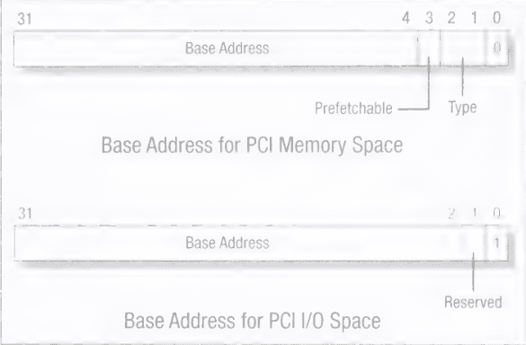

图 6.10

`PCI` 配置头：基地址寄存器（`BAR`）。

`Linux` 使用的算法依赖于由 `PCI` 驱动程序构建的总线/设备树描述的每个设备，按照升序 `PCI I/O` 内存顺序分配地址空间。同样，递归算法来遍历由 `PCI` 初始化代码构建的 `pci_bus` 和 `pci_dev` 数据结构。从根 `PCI` 总线（由 `pci_root` 指定）开始，BIOS 修复代码：

- 将当前的全局 `PCI I/O` 和内存基址分别对齐到 4K 和 1MB 边界上。
- 对于当前总线上的每个设备（按 `PCI I/O` 内存需求升序），
    - 为其分配 `PCI I/O` 和/或 `PCI` 内存空间，
    - 按适当的位量移动全局 `PCI I/O` 和内存基址，
    - 启用设备对 `PCI I/O` 内存的使用。
- 递归地为当前总线下游的所有总线分配空间。注意，这将更改全局 `PCI I/O` 和内存基址。
- 将当前的全局 `PCI I/O` 和内存基址分别对齐到 4K 和 1MB 边界上，并在此确定当前 `PCI-PCI` 桥所需的 `PCI I/O` 和 `PCI` 内存窗口的大小和基址。
- 为连接到此总线的 `PCI-PCI` 桥配置其 `PCI I/O` 和 `PCI` 内存空间及限制。
- 开启 `PCI-PCI` 桥中 `PCI I/O` 和 `PCI` 内存访问的桥接。这意味着如果在桥器主 `PCI` 总线上看到的任何 `PCI I/O` 或 `PCI` 内存地址在其 `PCI I/O` 和 `PCI` 内存地址窗口内，将被桥接到其次级 `PCI` 总线上。

以图 6.1 中的 `PCI` 系统为例，`PCI` 修复代码将以以下方式设置系统：

- 对齐 `PCI` 基址——`PCI I/O` 为 `0x4000`，`PCI` 内存为 `0x10000`。这允许 `PCI-ISA` 桥器将这些以下的所有地址翻译为 `ISA` 地址周期。
- 视频设备——它请求 `0x200000` 的 `PCI` 内存，因此我们从当前的 `PCI` 内存基址 `0x200000` 开始为其分配空间，因为它自然地对齐了请求的大小。`PCI` 内存基址移动到 `0x40000`，`PCI I/O` 基址保持在 `0x4000`。
- `PCI-PCI` 桥——我们现在跨越 `PCI-PCI` 桥并在那里分配 `PCI` 内存，注意我们不需要对齐基址，因为它们已经正确对齐。
- 以太网设备——它请求 `0xB0` 字节的 `PCI I/O` 和 `PCI` 内存空间。它在 `0x4000` 分配 `PCI I/O`，在 `0x40000` 分配 `PCI` 内存。`PCI` 内存基址移动到 `0x40000B`，`PCI I/O` 基址移动到 `0x40B0`。
- `SCSI` 设备——它请求 `0x1000` `PCI` 内存，因此在经过自然对齐后被分配在 `0x401000`。`PCI I/O` 基址仍为 `0x40B0`，`PCI` 内存基址已移动到 `0x402000`。
- `PCI-PCI` 桥的 `I/O` 和内存窗口——我们现在回到桥器，将其 `PCI I/O` 窗口设置在 `0x4000` 和 `0x40B0` 之间，并将 `PCI` 内存窗口设置在 `0x400000` 和 `0x402000` 之间。这意味着 `PCI-PCI` 桥将忽略视频设备的 `PCI` 内存访问，如果是针对以太网或 `SCSI` 设备的，则将其传递。

# 第7章

# 中断与中断处理

本章介绍了 `Linux` 内核如何处理中断。虽然内核具有处理中断的通用机制和接口，但大多数中断处理的细节是特定于结构的。

`Linux` 使用许多不同的硬件来执行许多不同的任务。视频设备驱动显示器，`IDE` 设备驱动磁盘，以此此类推。你可以同步地驱动这些设备；也就是说，你可以发送一个操作请求（例如，将某块内存写入磁盘）然后等待操作完成。这种方法可行，但效率非常低，操作系统将花费大量时间在等待每个操作完成的过程中“无所事事”。更好、更高效的方法是发出请求，然后执行其他更有用的工作，并在设备完成请求后由其中断。在这种方案下，系统中可能有许多正在同时发生的待处理请求。

设备必须有某些硬件支持来中断 `CPU` 正在执行的任何操作。大多数通用处理器使用类似的方法。`CPU` 的某些物理引脚布线方式使得电压的变化（例如从 +5V 变为 -5V）会导致 `CPU` 停止当前工作并开始执行处理中断的特殊代码——中断处理代码。这些引脚中的一个可能连接到间隔计时器，并每 1/100 秒接收一次中断；其他则可能连接到系统中的其他设备，如 `SCSI` 控制器。

系统使用中断控制器在传递之前将设备中断分组。大多数（如果不是所有）通用处理器（如 `Alpha AXP`）都使用类似的方法。`CPU` 的某些物理引脚布线方式使得电压的变化会导致 `CPU` 停止当前工作并开始执行处理中断的特殊代码——中断处理代码。这些引脚中的一个可能连接到间隔计时器，并每 1/100 秒接收一次中断；其他则可能连接到系统中的其他设备，如 `SCSI` 控制器。


# 中断与中断处理

系统使用中断控制器在传递信号到 `CPU` 的单个中断引脚之前将设备中断分组。这节省了 `CPU` 的引脚并为系统设计提供了灵活性。中断控制器具有控制中断的掩码和状态寄存器，状态寄存器返回系统中活动的中断。系统中某些中断可能是硬线的；例如，实时时钟的间隔计时器可能连接到控制器的引脚 3。然而，某些引脚取决于插入特定 `ISA` 或 `PCI` 插槽的卡。例如，控制器的引脚 4 可能连接到 `PCI` 插槽 0，其中一个插有以太网卡，另一个可能插有 `SCSI` 控制器。底线是执行中断路由机制，操作系统必须足够灵活以应对。

## 7.1 可编程中断控制器

系统设计人员可以自由使用任何中断架构，但 `IBM PC` 使用 `Intel 82C59A-2 CMOS` 可编程中断控制器或其变体。该控制器自 `PC` 诞生以来一直存在，它是可编程的，寄存器位于 `ISA` 地址空间中已知的位置。即使是非常现代逻辑芯片组在 `ISA` 内存中保留相同的寄存器。非 `Intel` 的系统（如基于 `Alpha` 的 `PC`）不受这些架构限制，通常使用不同的中断控制器。

图 7.1 显示了两个 8 位控制器级联在一起；每个控制器都有一个掩码和一个中断状态寄存器，即 `PIC1` 和 `PIC2`。

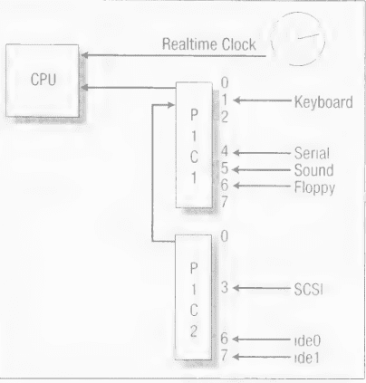

图 7.1 中断路由的逻辑图。

以及 `0xA1`，状态寄存器位于 `0x20` 和 `0xA0`。向掩码寄存器的特定位写入 1 可启用中断，写入 0 可禁用中断；向 3 写入 1 将启用中断 3，写入 0 将禁用它。遗憾的是（而且令人恼恼），中断掩码寄存器是只读的；你无法读取回所写入的值。这意味着 `Linux` 必须对它所设置的掩码寄存器值保留本地副本。它在启用和禁用中断的例程中修改这些保存的掩码，并在每次运行时将完整的掩码写入寄存器。

当中断信号触发时，中断处理代码会读取两个中断状态寄存器（`ISR`）。`0x20` 处的 `ISR` 视为 16 位中断寄存器的低 8 位，`0xA0` 处的 `ISR` 视为高 8 位。因此，`0xA0` 处 `ISR` 的第 1 位发生中断将被处理为系统中断 9。`PIC1` 的第 2 位不可用，因为它被用于链接来自 `PIC2` 的中断；`PIC2` 上的任何中断都会导致 `PIC1` 的第 2 位被置。

## 7.2 初始化中断处理数据结构

内核的中断处理数据结构由设备驱动程序在请求系统中断控制权时设置。为了做到，设备驱动程序使用一组 `Linux` 内核服务，用于请求中断、启用和禁用中断。

各个设备驱动程序调用这些例程来注册它们的中断处理例程地址。

某些中断根据 `PC` 架构的约定是固定的，因此驱动在初始化时会请求其中断。这就是软驱驱动程序所做的；它总是请求 `IRQ 6`。某些情况下，设备驱动程序可能不知道设备将使用哪个中断。这对于 `PCI` 设备驱动程序不是问题，因为它们总是知道自己的中断号。遗憾的是，`ISA` 设备驱动程序没有简单的方法来找到自己的中断号。`Linux` 通过允许设备驱动程序探测中断来解决这个问题。

首先，设备驱动程序对设备进行某种操作以触发其中断。然后，启用系统中所有未分配的中断。这意味着设备的待处理中断将通过可编程中断控制器传送。`Linux` 读取中断状态寄存器并将内容返回给设备驱动程序。非零结果意味着在探测期间发生了一个或多个中断。现在驱动程序关闭中断，所有未分配的中断都被禁用。

如果 `ISA` 设备驱动程序成功找到了其 `IRQ` 号，那么它现在可以像正常一样请求控制权了。

基于 `PCI` 的系统比 `ISA` 的系统动态得多。`ISA` 设备使用的中断引脚通常通过硬件设备上的跳线设置，并固定在设备驱动程序中。另一方面，`PCI` 设备的中断是在系统启动时由 `PCI BIOS` 或 `PCI` 子系统作为 `PCI` 初始化分配的。每个 `PCI` 设备可以使用四个引脚之一：`A`、`B`、`C` 或 `D`。这在设备制造时就已经固定了，且设备默认在引脚 `A` 上触发中断。每个 `PCI` 插槽的 `A`、`B`、`C`、`D` 中断线路由到中断控制器，`PCI` 4 号插槽的 `A` 引可能路由到中断控制器的第 6 引，`PCI` 4 号插槽的 `B` 引路由到中断控制器的第 7 引，依此类推。

中断如何路由完全取决于系统，必须由某些系统代码能够理解这种中断路由拓扑。在基于 `Intel` 的 `PC` 上，这是在启动时运行的系统 `BIOS`；对于没有 `BIOS` 的系统（例如 `Alpha-XP` 系统），则由 `Linux` 内核完成此工作。

`PCI` 设置代码将中断控制器的引脚号写入每个设备的 `PCI` 配置头空间（`Configuration header`）。它根据对 `PCI` 中断路由拓扑的了解、设备的 `PCI` 插槽号以及其正在使用的 `PCI` 中断引脚，来确定中断引脚（或 `IRQ`）编号。设备使用的中断引脚是固定的，并保留在该设备的 `PCI` 配置头空间的一个字段中。它将此信息写入预留用途的中断线字段。当设备驱动程序运行时，它使用这些信息并向 `Linux` 内核请求中断的控制权。

系统中可能存在 `PCI` 中断源，例如当使用 `PCI-PCI` 桥器时。中断源的数量可能会超过系统可编程中断控制器的引脚数量。在这种情况下，`PCI` 设备可能会共享中断，一个中断控制器接收来自多个 `PCI` 设备的中断。`Linux` 通过允许中断源的首个请求者声明其是否可以共享来支持这一点。

共享中断会导致 `irq_action` 向量类型中的一个条指向多个 `irq` 数据结构。当发生共享中断时，`Linux` 将调用该源的所有中断处理程序。任何可以共享中断的设备驱动程序（应该是所有的 `PCI` 设备驱动程序）都必须准备好在没有需要处理的中断时仍可能被调用。

## 7.3 中断处理

`Linux` 中断处理系统的主要任务之一是将中断路由到正确的中断处理代码。这些代码必须理解系统的中断拓扑。例如，如果软驱控制器在中断控制器的第 6 脚上触发中断（实际上，软驱控制器始终连接到中断 6），那么它必须识别出中断来自软驱，并将其路由到软驱设备驱动程序的中断处理例程。`Linux` 使用一组指向包含处理系统例程地址的数据结构的指针。这些例程属于各个设备驱动程序，每个驱动程序负责在初始化时请求它需要的中断。图 7.2 显示 `irq_action` 是一个指向 `irq` 数据结构的向量。每个结构包含有关该中断的信息，包括处理例程的地址。由于中断的数量及其处理方式在架构甚至某些系统之间存在差异，`Linux` 的中断代码是特定于架构的。这意味着 `irq_action` 向量的大小取决于中断源的数量。

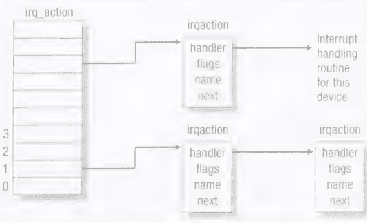

图 7.2 `Linux` 中断处理数据结构。

当中断发生时，`Linux` 必须通过读取系统可编程中断控制器的状态寄存器来确定其源。然后它将该源转换为 `irq_action` 向量的偏移量，例如，来自软驱控制器的中断控制器第 6 脚将被转换为处理程序向量中的第七个指针。如果发生的中断没有处理程序，`Linux` 内核将记录错误；否则它将调用该中断源的所有 `irq_action` 数据结构处理例程。

当 `Linux` 内核调用设备驱动的中断处理例程时，它必须高效地找出中断原因并做出。为了找到中断原因，设备驱动程序会读取中断设备的状态寄存器。设备驱动程序可能会报告错误或请求的操作已完成。例如，软驱控制器可能会报告已完成对软驱读头在软磁盘正确扇区上的定位。一旦确定了中断原因，设备驱动程序可能需要执行更多工作。如果是这样，`Linux` 内核拥有机制允许它将该工作推迟到以后。这避免了 `CPU` 在中断模式下花费过长时间。详情请见第 8 章。

# 第 8 章 设备驱动程序

操作系统的目的之一是向用户隐藏系统硬件设备的特殊性。例如，虚拟文件系统（`Virtual File System`）为挂载的文件系统提供了一个统一的视图，而无论其底层的物理设备如何。本章描述了 `Linux` 内核如何管理系统中的物理设备。

`CPU` 不是系统中唯一的智能设备；每个物理设备都有自己的硬件控制器。键盘、鼠标和串行端口由 `SuperIO` 芯片控制，`IDE` 磁盘由 `IDE` 控制器控制，`SCSI` 磁盘由 `SCSI` 控制器控制，以此此类推。每个硬件控制器都有自己的控制和状态寄存器（`CSR`），这些寄存器在设备之间存在差异。`Adaptec 2940` `SCSI` 控制器的 `CSR` 与 `NCR 810` `SCSI` 控制器的 `CSR` 完全不同。`CSR` 用于启动和停止设备、初始化设备以及诊断其任何问题。内核并没有将管理硬件控制器的代码放在系统中的每个应用程序中，而是将其保留在 `Linux` 内核中。处理或管理硬件控制器的软件被称为设备驱动程序。`Linux` 内核设备驱动本质上是内存驻留低级硬件处理例程的共享库。正是 `Linux` 的设备驱动程序处理了它们所管理的设备的特殊性。


Linux 的基本特性之一是抽象了设备处理。所有硬件设备看起来都像普通文件；可以使用用于操作文件的相同标准系统调用进行打开、读取和写入。系统中的每个设备都由一个设备特殊文件表示，例如，系统中的第一个 IDE 磁盘由 `/dev/hda` 表示。对于块设备（磁盘）和字符设备，这些特殊设备是通过 `mknod` 命令创建的，它们使用主设备和次设备号来描述设备。网络设备也由设备特殊文件表示，但它们由 Linux 创建并初始化系统中的网络控制器。由同一个设备驱动程序控制的所有设备具有共同的设备号。次设备号用于区分不同的设备及其控制器，例如，主 IDE 磁盘上的分区具有不同的设备号。因此，`/dev/hda2`（主 IDE 磁盘的第二个分区）的主设备号为 3，次设备号为 2。Linux 通过主设备号和若干系统表（例如 `chrdevs`）将传递给系统（例如在块设备上挂载文件系统）的设备特殊文件映射到设备的设备驱动程序。

Linux 支持三种类型的硬件设备：字符设备、块设备和网络设备。字符设备直接读写而不经过缓冲；例如，系统串行端口 `/dev/cua0` 和 `/dev/cua1`。块设备只能以块大小的倍进行写入和读取，通常为 512 或 1,024 字节。块设备通过缓冲区缓存访问，并可以随机访问，即无论任何块位于设备的什么位置，都可以被读取或写入。块设备可以通过其设备特殊文件访问，但更常见的是通过文件系统访问。网络设备通过 `BSD socket` 接口和第 10 章中描述的网络系统进行访问。Linux 内核中有许多不同的驱动程序（这是 Linux 的优势之一），但它们都共享一些共同属性：

- `内核代码`——设备驱动程序是内核的一部分，和内核中的其他代码一样，如果它们出现故障，可能会严重损坏系统。编写糟糕的驱动程序可能会导致系统崩溃，可能导致文件系统损坏和数据丢失。

- `内核接口`——设备驱动程序必须为 Linux 内核或其所属的子系统提供标准接口。例如，终端驱动程序为 Linux 内核提供 I/O 接口，`SCSI` 设备驱动程序为 `SCSI` 子系统提供 `SCSI` 设备接口，而该子系统又为内核提供文件 I/O 和缓冲区缓存接口。

- `内核机制和服务`——设备驱动程序使用标准的内核服务（如内存分配、中断传递和等待队列）进行操作。

- `可加载性`——大多数 Linux 设备驱动程序可以在需要时作为内核模块按需加载，并在不再使用时卸载。这使得内核具有很强的适应性且资源利用高效。

- `可配置性`——Linux 设备驱动程序可以编译到内核中。在编译内核时，可以配置编译哪些设备驱动。

- `动态性`——随着系统启动和每个设备驱动程序的初始化，它会寻找它所控制的硬件设备。被特定设备驱动程序控制的设备不存在也没有关系。在这种情况下，驱动程序只是多余的，除了占用少量系统内存外不会造成任何危害。

## 8.1 轮询与中断

每当给设备命令（例如“将读头移动到软磁盘的第 42 扇区”）时，设备驱动程序可以选择如何发现命令已完成。设备驱动程序可以轮询设备，可以使用中断。

轮询设备通常意味着频繁读取其状态寄存器，直到设备状态发生变化以指示请求已完成。由于设备驱动程序是内核的一部分，如果采用轮询将是灾难性的，因为在设备完成请求之前，内核中其他任何程序都不会运行。相反，轮询驱动程序使用系统定时器让内核在之后的某个时间调用驱动程序内部的例程。该定时器例程将检查命令状态，这正是 Linux 软磁盘驱动的工作方式。通过定时器进行轮询充其是近似的，更有效的方法是使用中断。

中断驱动设备是指受控制的硬件设备在需要时随时产生中断的设备。例如，设备驱动程序在完成后会中断 `PC`。这是通过设备中断内核实现的。当传输完成，设备中断 `PC`。在传输进行期间，`CPU` 可以执行其他任务。

| 中断 | 说明 |
| :--- | :--- |
| 0 | 定时器 |
| 1 | 键盘 |
| 2 | 软磁盘 |
| 3 | 磁盘 |
| 4 | 串行 |
| 5 | 音频 |
| 11 | 网络 |
| 13 | 级联 |
| 14 | `ide` |
| 15 | 中断 |

## 8.2 直接内存访问 (DMA)

当数据量较小时，使用中断驱动驱动程序在内存与设备之间传输数据。如果中断延迟（从设备产生中断到调用驱动程序例程之间的时间）很低（例如 2 毫秒），数据传输对系统的整体影响就很小。9600 波调制调制的数据传输仅占用 `CPU` 处理时间的 0.02%。对于高速设备（如磁盘控制器或以太网设备），数据传输速率很高。

直接内存访问（或 `DMA`）的发明是为了解决这个问题。`DMA` 控制器允许设备在不经过处理器干预的情况下，在系统内存之间传输数据。`PC` 的 `ISA DMA` 控制器有八个通道，其中七个可供驱动程序使用。每个 `DMA` 通道都关联一个 16 位地址寄存器。为了启动传输，设备驱动程序设置 `DMA` 通道的地址和计数寄存器，以及数据传输的方向（读或写）。然后告诉设备可以随时启动 `DMA`。传输完成后，设备中断 `PC`。

设备驱动程序在用 `DMA` 时必须小心。首先，`DMA` 控制器完全不知道虚拟内存，它只能访问系统的物理内存。因此，正在进行 `DMA` 的内存必须是连续的物理块。这意味着你不能直接 `DMA` 到进程的虚拟地址空间。但是，你可以将进程的物理页加载到内存中，防止它们在 `DMA` 操作期间被交换到交换设备。`DMA` 控制器无法访问整个物理内存。`DMA` 通道的地址寄存器代表 `DMA` 地址的前 16 位，接下来的 8 位来自页寄存器。这意味着 `DMA` 请求限制在内存底部的 16MB 范围内。

# 设备驱动程序 105

设备的通道可以通过跳线设置；许多以太网设备使用了这种技术。更灵活的设备可以告知（通过其 `CSR`）使用哪些 `DMA` 通道，在这种情况下，设备驱动程序可以简单地选择一个空闲的 `DMA` 通道使用。

Linux 使用 `dma_chan` 数据结构向量（每个 `DMA` 通道一个）来跟踪 `DMA` 通道的使用情况。`dma_chan` 数据结构包含字段：指向描述 `DMA` 通道字符串的指针，以及一个指示 `DMA` 通道是否已分配的标志。当你执行 `cat /proc/dma` 时，会打印出这个 `dma_chan` 数据结构向量。

## 8.3 内存

设备驱动程序在使用内存时必须小心。作为 Linux 内核的一部分，它们不能使用虚拟内存。每当设备驱动程序运行时（可能是接收到中断、调度下半部或任务处理程序），当前进程可能会发生变化。设备驱动程序不能依赖特定进程的运行，即使它正在代表该进程执行工作。与内核的其他部分一样，驱动程序使用数据结构来跟踪它们所控制的设备。这些数据结构可以是静态分配的，作为设备驱动程序代码的一部分，但将是浪费，因为它会让内核变得比需要的更大。大多数设备驱动程序分配非老化内存来存储它们的数据。

Linux 提供了内存分配和释放程序，设备驱动程序使用的正是这些程序。内存以 2 的幂方的块分配，例如 128 或 512 字节，即使设备驱动程序请求的更少。设备驱动程序请求的字节数向上取整到下一个块大小边界。这使得内核内存释放变得更容易，因为较小的空闲块可以重新组合较大的块。

当请求内核内存时，Linux 可能需要执行大量的额外工作。如果物理内存不足，页可能会被丢弃或写入交换设备。通常情况下，Linux 会挂起请求者，将进程放入等待队列，直到有足够的物理内存。并不是所有设备（实际上也是 Linux 内核代码）都希望发生这种情况，因此如果内核内存分配程序无法立即分配内存，就会失败。如果设备驱动程序希望向已分配的内存进行或从中进行 `DMA`，它还可以指定该内存是 `DMA` 可用的。这样一来，是 Linux 内核需要理解该系统中什么是 `DMA` 可用内存，而不是设备驱动程序。

## 8.4 将设备驱动程序与内核接口

Linux 内核必须能够以标准方式与设备驱动程序交互。每一类设备驱动程序——字符、块和网络设备——都提供了内核在向它们请求服务时使用的通用接口。这些通用接口意味着内核可以完全相同地对待非常不同的设备及其设备驱动程序。例如，`SCSI` 和 `IDE` 磁盘的行为非常不同，但 Linux 内核对它们都使用相同的接口。

## Linux 内核：第 8 章

Linux 是非常有动态性的；每次 Linux 内核启动时，它可能会遇到不同的设备，因此需要不同的设备驱动程序。Linux 允许你通过配置脚本在内核编译时包含设备驱动程序。当这些驱动程序在启动时初始化时，它们可能没有发现任何控制的硬件。其他驱动程序可以在需要时作为内核模块加载。为了应对设备的这种动态性，驱动程序在初始化时向内核注册自身。Linux 维护了已注册的设备驱动程序表，作为与其交互接口的一部分。这些表包含指向例程的指针以及支持与该类设备接口的信息。

### 8.4.1 字符设备

字符设备是 Linux 中最简单的设备，作为文件访问；应用程序使用系统调用来打开、读取和关闭它们，就像设备是一个文件一样（见图 8.1）。即使设备是用于 `PPP` 守护进程将 Linux 系统连接到网络的调制器，也是如此。当字符设备初始化时，其设备驱动程序通过向 `device_struct` 数据结构的 `chrdevs` 向量中添加条目来向 Linux 内核注册自身。设备的主标识符（例如 `tty` 设备的 4）被用作该向量的索引。设备的主标识符是固定的。


`chrdevs` 向量中的每个条目 `device_struct` 数据结构包含两个元素：指向已注册设备驱动程序名称的指针，以及指向文件操作块的指针。该文件操作块本身是字符设备驱动程序内部例程的地址，每个例程处理特定的文件操作，如打开、读和写。字符设备的 `/proc/devices` 的内容取自 `chrdevs` 向量。

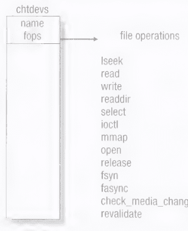

图 8.1 字符设备。

## 设备驱动程序 107

当打开代表字符设备的字符特殊文件（例如 `/dev/tty0`）时，内核将进行设置，以便调用正确设备驱动程序的文件操作例程；就像普通文件或目录一样，每个设备特殊文件都由一个 VFS 节点表示。字符特殊文件（所有设备特殊文件）的 VFS 节点都包含设备的主、次要标识符。该 VFS 节点是由底层文件系统（例如 EXT2）在查找设备特殊文件名时，从真实文件系统的信息创建的。

每个与一组文件操作关联的 VFS 节点都存在，且这些操作取决于节点（inode）所代表的文件对象。每当创建一个代表字符特殊文件的 VFS 节点时，它的文件操作被设置为默认的字符设备操作。这只有一个操作，即打开文件。当应用程序打开字符特殊文件时，通用文件操作使用设备的主标识符作为 `chrdevs` 向量的索引，以检索该设备的文件操作。它还设置了描述该字符的文件数据，使其操作指针指向设备驱动程序。因此，所有应用程序的文件操作将映射到对字符设备操作集的调用。

### 8.4.2 块设备

块设备也支持像文件一样被访问。为打开的文件提供正确文件操作集的机制与字符设备非常相似。Linux 使用 `blockdev` 向量维护已注册的块设备集。该向量（即 `blockdev`）通过设备的主号进行索引。它的条目也是 `device_struct` 数据结构。与字符设备不同，块设备存在分类。SCSI 设备是一类，IDE 设备是另一类。是类向 Linux 内核注册并向内核提供文件操作。块设备类的驱动程序为该类提供类特定的接口。例如，SCSI 设备驱动程序必须为 SCSI 子系统提供接口，SCSI 子系统使用这些接口向内核提供文件操作。

每个块设备驱动程序都必须为缓冲区提供接口，以及普通文件操作。每个块设备驱动程序填充其在 `blk_dev_struct` 数据结构 `blk_dev_vector` 中的条目。该向量的索引再次是设备的主号。`blk_dev_struct` 数据包含请求例程的地址，以及指向请求数据结构列表的指针，每个结构都代表一个来自缓冲区的读取或写入块数据的请求。

每当缓冲区需要从已注册的设备读取或写入块数据时，它会向该 `blk_dev_struct` 添加一个请求数据结构。图 8.2 显示每个请求指向一个或多个 `buffer_head` 数据结构，每个结构都是读取或写入块数据的请求。`buffer_head` 结构被锁定（由缓冲区锁定），并且可能有一个进程正在等待此缓冲块操作的

# 108 Linux 内核：第 8 章

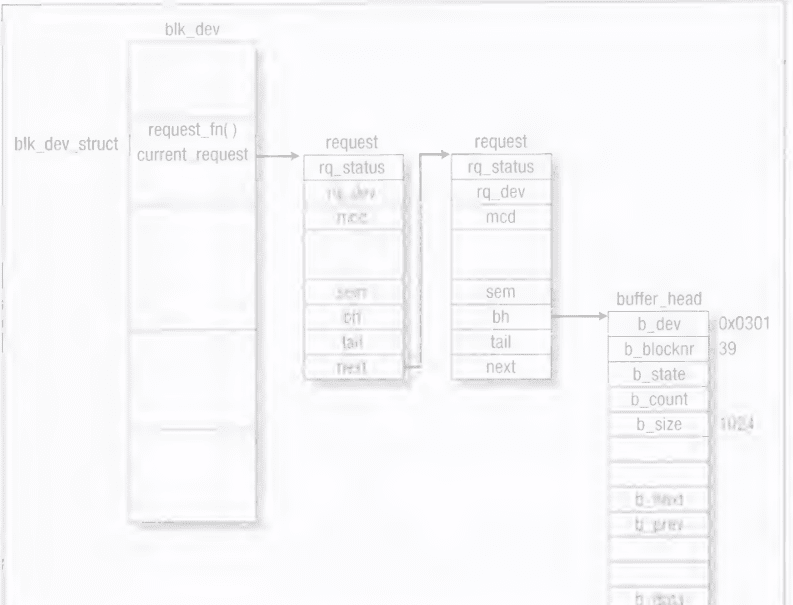

图 8.2

缓冲区块设备请求。

完成。每个请求结构都从一个静态列表 `all_requests` 中分配。如果请求正在被添加到空请求列表，则会调用驱动程序的请求函数来开始处理请求队列。否则，驱动程序将简单地处理请求列表上的每个请求。

一旦设备驱动程序完成了一个请求，它必须从请求结构中移除每个 `buffer_head` 结构，将它们标记为最新并解锁它们。这种对 `buffer_head` 的解锁将唤醒任何等待块操作完成的进程。一个例子是，当下一个 EXT2 文件系统必须从持有文件系统的块设备中读取包含 EXT2 目录目项的数据块时，这是一个文件名。该进程在包含目录目项的 `buffer_head` 上睡眠，直到设备驱动程序唤醒它。请求数据结构被标记为可用，以便在另一个块请求中使用。

## 8.5 硬盘

磁盘驱动器提供了一种更持久的数据存储方法，将数据保留在旋转的磁盘盘面上。一个微小的磁头磁化盘片表面的微小颗粒。要写入数据，磁头可以检测特定颗粒是否被磁化。

磁盘驱动器由一个或多个盘片组成，每个盘片由精细抛光的玻璃或陶瓷复合材料制成，涂有一层薄薄的氧化铁。盘片安装在主轴上，并以恒定的速度旋转，根据型号可以在 3,000 到 10,000 RPM 之间变化。相比之下，软磁盘仅以 360 RPM 的速度旋转。磁盘的读写头负责读取和写入数据，每个盘片有一对磁头，每个表面一个磁头。读写头不会物理接触盘片表面；相反它们悬浮在薄薄的（一千万分之一英寸）空气垫上。通过执行器（actuator）在盘片表面上移动读写头。所有的读写头都连接在一起，它们一起横跨盘片表面移动。

盘片的每个表面被划分为狭窄的同心圆，称为轨道（tracks）。轨道 0 是最外层的轨道，编号最高的轨道是最靠近中心主轴的轨道。柱面（cylinder）是具有相同编号的所有轨道的集合。因此，每个盘片每侧的第五个轨道被称为 5 号柱面。由于每侧的轨道数与总轨道数相同，每个轨道被划分为扇区（sectors）。扇区是可以从硬盘中写入或读取的最小数据单元，也是磁盘的块大小。常见的扇区大小为 512 字节，扇区是在磁盘格式化时设置的，通常在磁盘制造时。

磁盘通常通过其几何结构描述：柱面的数量、磁头的数量和扇区的数量。例如，启动时 Linux 显示了我的 IDE 磁盘行：

```
hdb: Conner Peripherals 540MB CFS5540, 516MB w/64KB Cache, CHS=1050/16/63
```

这意味着它有 1,050 个柱面（轨道）、16 个磁头（盘片）以及每个轨道 63 个扇区。扇区或块的大小为 512 字节，这使得磁盘容量为 529,200 字节。这与磁盘声称的 516MB 容量不符，因为某些扇区被用于磁盘信息。某些磁盘会自动找到坏扇区并重新索引磁盘以绕过它们。

硬盘可以进一步细分为分区（partitions）。分区是分配给特定用途的大组扇区。对磁盘进行分区允许磁盘被多个操作系统使用或用于多个用途。许多 Linux 系统拥有一个单磁盘，上面有三个分区：一个包含 DOS 文件系统，另一个是 EXT2 文件系统，第三个用于交换分区（swap）。硬盘的分区由分区表（partition table）描述；每个条目描述分区在磁头、扇区和柱面编号方面的起始和结束位置。对于 DOS 格式的磁盘，分区表中的四个条目并不全都需要使用。`fdisk` 支持三种类型的分区（此处应为三种）：主分区（primary）、扩展分区（extended）和逻辑分区（logical）。扩展分区不是真实的；扩展分区和逻辑分区是用来绕过四个主分区的限制而发明的。以下是一个包含两个主分区的磁盘的 `fdisk` 输出：

```
Disk /dev/sda: 64 heads, 32 sectors, 510 cylinders Units 2048 * 512 bytes

| Device | Boot | Start End Blocks | System |
|---|---|---|---|---|---|
| /dev/sda | | 1 | 478 | 489456 | Linux native |
| /dev/sda2 | | 479 | 510 | 32768 | Linux swap |

Disk /dev/sda: 64 heads, 32 sectors, 510 cylinders

| Nr | Hd Sec Cyl | Hd Sec Cyl Start Size ID |
|---|---|---|---|---|---|
| 1 | 00 1 | 0 63 32 | 477 | 978912 | 83 |
| 2 | 00 1 | 478 32 509 | 978944 | 65536 | 83 |
| 3 | 00 0 | 0 0 | | | |
| 4 | 00 0 | 0 0 | | | |
```

次要 IDE 控制器上的主盘。IDE 子系统将 IDE 控制器和磁盘注册到 Linux 内核中。主 IDE 控制器的主标识符为 3，次要 IDE 控制器为 22。这意味着如果一个系统有两个 IDE 控制器，在 `blk_dev` 和 `blk_devs` 向量的索引 3 和 22 处将会有 IDE 子系统的条目。IDE 磁盘的块设备文件反映了这种编号 `/dev/hda` 和 `/dev/hdb` 都连接到主 IDE 控制器，其主标识符均为 3。针对这些块文件进行 IDE 操作的任何文件或缓冲区操作都将定向到 IDE 子系统，因为内核使用主标识符作为索引。当发出请求时，由 IDE 子系统来确定该请求针对哪块 IDE 磁盘。为了做到这一点，IDE 子系统使用设备特殊文件中的设备号，该文件包含了允许其定向到正确磁盘的正确分区的信息。`/dev/hdb` 的设备标识符（即主 IDE 控制器上的从设备 IDE 磁盘 `/dev/hdb1`）为 (3, 64)。该磁盘第一个分区的设备标识符为

### 8.5.2 初始化 IDE 子系统


IDE 磁盘在 IBM PC 的大部分历史时期中一直存在。在此期间，与这些设备的接口发生了变化。这使得 IDE 子系统的初始化比表面看起来更复杂。

Linux 支持的 IDE 控制器最大数量为四个。每个控制器由`ide_hwif`结构中的一个`ide_hwif_t`数据结构表示。每个`ide_hwif_t`数据结构包含两个`drive_t`结构，分别对应一个受支持的主盘和一个从盘 IDE 磁盘。在 IDE 子系统初始化期间，Linux 首先查找 CMOS 内存中是否存在关于所存在磁盘的信息。这是一种备用内存，在 PC 关机时不会丢失其内容。这些 CMOS 内存实际上位于系统的实时时钟中，无论 PC 是开启还是关闭它都会运行。CMOS 内存位置由系统的 BIOS 设置，并告诉 Linux 发现了哪些 IDE 控制器和驱动器。Linux 从 BIOS 获取发现磁盘的几何结构，并使用这些信息为驱动器设置`ide_hwif_t`数据结构。现代 PC 使用带有 Intel 8234VX 芯片组的 PCI 芯片组，其中包含 PCI 控制器。IDE 子系统使用 BIOS 回调来定位系统中的 PCI (E)IDE 控制器。然后它对存在的那些芯片组调用 PCI 探测程序。

一旦发现了每个 IDE 接口或控制器，就会设置`ide_hwif_t`结构以反映控制器和连接的磁盘。运行期间，IDE 驱动程序将命令写入位于 I/O 内存中的 IDE 命令寄存器。主 IDE 控制器控制和状态寄存器的默认 I/O 地址为 `0xFF0-0xF17`。这些地址是在 IBM PC 早期按照惯例设置的。IDE 驱动程序将每个控制器向 Linux 块缓冲区缓存和 VFS 注册，分别将其添加到`blk_dev`和`blk_devs`向量中。IDE 驱动器还会请求适当中断的控制。同样，这些中断按照惯例设置为：主 IDE 控制器为 `14`，次要 IDE 控制器为 `15`。然而，它们像所有的 IDE 细节一样，可以通过内核的命令行选项进行重写。IDE 驱动程序还会为发现的每个 IDE 控制器在启动期间发现的磁盘列表中添加磁盘条目。此列表稍后将用于在启动时发现所有硬盘的分区表。分区检查代码理解到每个 IDE 控制器各控制两个 IDE 磁盘。

### 8.5.3 SCSI 磁盘

SCSI（小型计算机接口）是一种高效的对等数据总线，每个总线支持多达八个设备，包括一个或多个主机。每个设备都有一个唯一的标识符，通常通过磁盘上的跳线设置。数据可以在总线上的任意两个设备之间以同步或异步方式传输，在 32 位数据传输的情况下，速度可达每秒 40MB。SCSI 总线在设备之间传输数据和状态信息，发起者（initiator）和目标（target）之间的单个事务可能涉及八个阶段。你可以通过总线上的五个信号判断 SCSI 总线的当前阶段。这八个阶段是：

- `BUS FREE`（总线空闲）——没有设备控制总线，当前没有正在进行的事务。

- `ARBITRATION`（仲裁）——一个 SCSI 设备尝试获取 SCSI 总线的控制权。它通过向地址引脚断言其 SCSI 标识符来实现。编号 SCSI 标识符获胜。

- `SELECTION`（选择）——当设备通过仲裁成功获得 SCSI 总线的控制权后，现在必须向 SCSI 请求的目标信号，它想要向其发送命令。它通过在地址引脚上断言目标的 SCSI 标识符来实现。

- `RESELECTION`（重新选择）——SCSI 设备在处理请求期间断开。目标可能会重置发起者。并不是所有 SCSI 设备都支持此阶段。

- `COMMAND`（命令）——从发起者向目标传输 6.10 或 12 字节的命令。

- `DATA IN, DATA OUT`（数据入，数据出）——在这些阶段，数据在发起者和目标之间传输。

- `STATUS`（状态）——在完成所有完成后进入此阶段，允许目标向发起者获取一个指示成功或失败的状态字节。

- `MESSAGE IN, MESSAGE OUT`（消息入，消息出）——发起者和目标之间传输附加信息。

Linux SCSI 子系统由两个基本元素组成，每个元素由数据结构表示：

- `Host`（主机）——SCSI 主机是一个物理硬件，即 SCSI 控制器。`NCR810`就是 SCSI 控制器的示例。每个 SCSI 主机由一个`SCSI_Host`数据结构表示。如果系统有多个控制器，每个实例由一个独立的`SCSI_Host`表示。

- `Device`（设备）——最常见的 SCSI 设备是磁带和光驱。每个发现的 SCSI 设备由一个`SCSI_Device`数据结构表示，每个结构都指向其父级`SCSI_Host`。

### 8.5.3 初始化 SCSI 子系统

初始化 SCSI 子系统相当复杂，反映了 SCSI 总线及其设备的动态性。Linux 在启动时初始化 SCSI 子系统；它寻找系统中的 SCSI 器（称为 SCSI 主机）并对其进行探测。它初始化这些设备并通过标准的文件缓存操作使它们可用。初始化分为四个阶段：

首先，Linux 查找启动时构建到内核的 SCSI 主机适配器（或控制器）具有控制硬件。每个内置 SCSI 主机在`builtin_scsi_hosts_vector`中有一个`SCSI_Template`项。`SCSI_Template`数据结构包含指向 SCSI 特有操作的指针，它们是 SCSI 驱动程序的一部分。每个检测到的 SCSI 主机（如果有连接真实的 SCSI 设备），其`SCSI_Template`数据结构会被添加到活动 SCSI 主机的`hosts_list`中。每个检测到的主机的实例由`scsi_hostlist`中的一个`SCSI_Host`数据结构表示。例如，有两个 `NCR810` PCI SCSI 控制器，列表中就会有两个`SCSI_Host`项，每个控制器一个。每个`SCSI_Host`指向代表其驱动程序的`SCSI_Template`。

现在每个 SCSI 主机已被发现，SCSI 子系统必须找出每个主机连接了哪些 SCSI 设备。SCSI 设备编号在 0 到 7 之间，每个设备的编号或 SCSI 标识符在其所在的 SCSI 总线上是唯一的。SCSI 标识符通常通过设备上的跳线设置。初始化代码通过发送`TEST_UNIT_READY`命令找到 SCSI 总线上的每个设备。当设备响应时，通过发送`ENQUIRY`命令读取其识别信息。这让 Linux 获取厂商名称以及设备的型号和修订版本。SCSI 命令由`SCSI_Cmd`数据结构表示，并通过调用该主机`SCSI_Template`数据结构中的驱动程序传递给驱动程序。每个发现的 SCSI 设备由一个`SCSI_Device`数据结构表示，每个结构都指向其父级`SCSI_Host`。所有的 SCSI 数据结构都被添加到 SCSI 设备列表中。

### 设备驱动

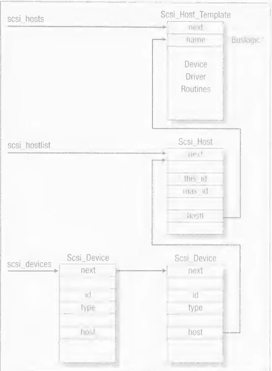

**图 8.4** SCSI 数据结构。

共有四种 SCSI 设备类型：磁盘、磁带、CD 和通用。这些 SCSI 类型都分别作为不同的主块设备类型注册到内核中。然而，只有当发现一个或多个给定的 SCSI 设备类型时，它们才会进行注册。每种 SCSI 类型（例如 SCSI 磁盘）都维护着自己的设备表。它使用这些表将内核块操作（文件或缓冲区缓存）定向到正确的设备驱动程序或 SCSI 主机。每种 SCSI 类型都由一个`SCSI_Device_Template`数据结构表示。该结构包含有关此类类型 SCSI 设备的信息以及执行各种任务的例程地址。SCSI 子系统使用这些模板来调用每种 SCSI 设备的 SCSI 类型例程。换句话说，如果 SCSI 子系统想要挂载一个 SCSI 磁盘设备，它将调用 SCSI 磁盘类型的挂载例程。如果检测到一个或多个该类型的 SCSI 设备，`SCSI_Type_Template`数据结构会被添加到`scsi_devicelist`中。

SCSI 子系统初始化的最后阶段是为已注册的`SCSI_Device_Template`完成函数。对于 SCSI 磁盘类型，这会启动所有找到的 SCSI 磁盘并记录它们的磁盘几何。它还将代表所有 SCSI 磁盘的`gendisk`结构添加到图 8.3 所示的磁盘链列表中。

### 8.5.3.6 交付块设备请求

一旦 SCSI 初始化了 SCSI 子系统，就可以使用 SCSI 设备了。每个活跃的 SCSI 设备类型都会向内核注册自身，以便 Linux 能将块设备请求定向给它。可以通过`blk_dev`进行缓冲区缓存请求，或通过`blk_devs`进行文件操作。以一个有一个或多个 EXT2 文件系统分区的 SCSI 磁盘驱动为例，当其中一个 EXT2 分区被挂载时，内核请求是如何定向到正确的 SCSI 设备的？


每个对 SCSI 分区进行读取或写入数据块的请求都会在 `b1k_dev` 向量中的 SCSI 磁盘当前 `current_request_list` 中添加一个新请求。如果请求列表正在处理中，缓冲区缓存不需要任何操作；否则，它必须促使 SCSI 子系统处理其请求队列。系统中的每个 SCSI 磁盘由一个 `SCSI_Disk` 数据结构表示，使用 SCSI 分区设备号的一部分进行索引。例如，`/dev/sd1` 的主号为 8，次号为 17；这生成了索引 1。每个 `SCSI_Device` 数据结构包含一个指向“拥有”它的 `SCSI_Host` 数据结构的指针。来自缓冲区缓存的请求结构被转换为 `SCSI_Cmd` 结构，描述需要发送到 SCSI 设备的 SCSI 命令，并队列到代表设备的 `SCSI_Host` 中。一旦读取或写入了适当的数据块，这些将由相应的 SCSI 设备驱动程序处理。

## 8.6 网络设备

对于 Linux 网络子系统而言，网络设备是一个发送和接收数据包的实体。这通常是一个物理设备，例如以太网。某些网络设备仅是软件性的，例如用于给自己发送数据的回环设备（loopback device）。每个网络设备由一个数据结构表示。网络驱动程序在内核启动初始化期间向 Linux 注册它们控制的设备。设备数据结构包含有关设备的信息，以及允许各种支持的网络协议使用该设备的函数地址。这些函数主要涉及使用网络设备传输数据。该设备使用标准的网络支持机制将接收到的数据传递给适当的协议层。所有传输和接收的网络数据（数据包）都由 `sk_buff` 数据结构表示，这些是灵活的数据结构，允许方便地添加和移除网络协议标头。

使用 `sk_buff` 数据结构的细节在“网络”章节中有详细描述。本章侧重于设备数据结构以及网络设备如何被发现和初始化。

设备数据结构包含有关网络设备的信息：

- **名称 (Name)**：与块设备和字符设备使用 `mknod` 命令创建设备特殊文件不同，网络设备特殊文件会在系统网络设备发现和初始化时自动出现。它们的名称是标准的，每个名称代表其对应的设备类型。同类型的多个设备从 0 开始向上编号。因此，以太网设备被称为 `/dev/eth0`、`/dev/eth1`、`/dev/eth2` 等。一些常见的网络设备是：
    - `/dev/ethN` 以太网设备
    - `/dev/slN` SLIP 设备
    - `/dev/pppN` PPP 设备
    - `/dev/lo` 回环设备
- **总线信息 (Bus information)**：这是设备驱动程序控制设备所需的信息。`IRQ` 号是该设备正在使用的中断。基地址是 I/O 内存中任何设备的控制和状态寄存器的地址。`DMA` 通道是网络设备使用的 `DMA` 通道号。所有信息都在设备初始化启动时设置。
- **接口标志 (Interface flags)**：描述网络设备的特性和能力：

| 标志 | 描述 |
| :--- | :--- |
| `IFF_UP` | 接口已启用并运行 |
| `IFF_BROADCAST` | 设备中的广播地址有效 |
| `IFF_DEBUG` | 设备调试开启 |
| `IFF_LOOPBACK` | 这是一个回环设备 |
| `IFF_POINTTOPOINT` | 点对点链路 (SLIP 和 PPP) |
| `IFF_NOTARP` | 不支持 ARP |
| `IFF_RUNNING` | 接口正在运行 |
| `IFF_NOARP` | 不支持 ARP |
| `IFF_PROMISC` | 混杂模式 |
| `IFF_ALL` | 接收所有帧 |
| `IFF_MULTICAST` | 可以接收多播 |

- **协议信息 (Protocol information)**：每个设备描述其如何被使用，例如：
    - **类型 (Type)**：硬件接口描述设备连接的介质。Linux 支持许多类型，如以太网、X25、令牌环、SLIP、PPP。
    - **地址 (Addresses)**：设备数据结构持有地址。
    - **数据包队列 (Packet queue)**：等待在该设备传输的 `sk_buff` 数据包队列。
    - **支持函数 (Support functions)**：每个设备提供协议层调用的例程以及统计信息。

### 8.6.1 初始化网络设备

网络驱动程序与其他设备驱动程序一样构建在 Linux 内核中。每个潜在的网络驱动由网络设备列表中的一个数据结构表示。最初，每个设备数据结构仅持有探测例程的地址。

网络驱动程序有两个问题需要解决。首先，Linux 内核中的并非所有驱动程序都有设备。系统中的以太网设备都被称为 `/dev/eth0`、`/dev/eth1` 等，无论它们的底层设备是什么。“缺失”网络的问题可以很容易解决。调用每个网络设备的初始化例程，它返回一个指示是否找到了其所驱动控制器实例的状态。如果驱动没有找到任何设备，它在 `dev_base` 指向的设备列表中的条目会被删除。如果驱动找到了设备，它将填充设备结构中剩余设备的信息以及网络驱动程序中支持函数的地址。

第二个问题是动态将以太网设备分配给标准的 `/dev/ethN` 设备特殊文件，其解决方法更为优雅。设备列表中有八个标准条目；分别对应 `eth0`、`eth1` 到 `eth7`。初始化例程适用于所有条目，它尝试内核构建的每个以太网驱动，直到找到设备。当驱动找到它的设备时，它会填充它自己的 `ethN` 设备数据结构。一个驱动可能会发现它控制的多个网络设备实例，在这种情况下，它将接管多个 `/dev/ethN` 设备数据结构。一旦所有八个 `/dev/ethN` 都分配完毕，将不再对更多的以太网设备进行探测。

# 第 9 章 文件系统

本章描述了 Linux 内核如何维护其支持的文件系统中的文件。它阐述了虚拟文件系统（VFS），并解释了 Linux 内核如何支持真实的文件系统。

Linux 最重要的特性之一是它支持许多不同的文件系统。这使其变得非常灵活，并能够与其他许多操作系统共存。在编写本书时，Linux 支持 15 种文件系统：`ext`, `ext2`, `xfs`, `minix`, `msdos`, `vfat`, `proc`, `smb`, `nep`, `iso9660`, `sys`, `hptfs`, `affs` 和 `ufs`；毫无疑问，随着时间的推移会有更多的加入。

> 出版者注：例如，NTFS 现在可以只读可用。

在 Linux 中，与 Unix 一样，独立的文件系统可能通过设备标识符（如驱动器号或驱动器名称）来访问，而是组合成单一的层次树形结构，将文件系统表示为一个整体。Linux 在挂载每个新文件系统时，会将其添加到这个单一的文件系统树中。无论什么种类型，所有文件系统都会挂载到一个目录上，被挂载文件系统的文件将覆盖该目录的原内容。该目录被称为挂载目录或挂载点。当文件系统被卸载时，挂载目录自己的文件将再次显示。

当磁盘被初始化时（例如使用 `fdisk`），它们会被施加一种分区结构，将物理磁盘划分为若干个逻辑分区。每个分区可以容纳一个文件系统，例如 EXT2 文件系统。文件系统将文件组织成逻辑层次结构，目录、软链接等存储在物理设备上的块（blocks）。包含文件系统的设备称为块设备（block devices）。IDE 分区 `/dev/hda1`（系统中第一个 IDE 磁盘的第一个分区）就是一个块设备。Linux 系统将这些块设备视为块的简单线性集合；它们不知道或也不关心底层物理磁盘的几何结构。每个块设备驱动程序的任务是将请求映射到其设备某个有意义的特定块；即该块在硬盘上的特定磁道、扇区和磁柱。无论由何种设备持有，文件系统在外观、感官和操作方式上都是相同的。此外，（至少对系统用户而言）这些不同的文件系统位于由不同硬件控制器控制的不同介质上。文件系统甚至可能不在本地系统，它完全可能是一个通过网络链路远程挂载的磁盘。考虑以下示例，Linux 的根系统位于一个 SCSI 磁盘上：

| A | boot | etc | 11b | opt | usr |
| :--- | :--- | :--- | :--- | :--- | :--- |
| C | cdrom | fd | proc | var | sbin |
| D | bin | home | mnt | last+found | |

用户或操作其所需文件系统的程序都不知道 `/C` 实际上是一个挂载的 VFAT 文件系统，它位于系统中的第一个 IDE 磁盘上。在示例中（这实际上是我的 Linux 系统），`/E` 是位于第二个 IDE 控制器上的主 IDE 磁盘。第一个 IDE 控制器是 PCI 控制器，且有一个 ISA 控制器也控制 IDE CDROM，这并不重要。我可以使用调制解调器拨入网络，并使用调制解调器和 PPP 网络协议，在这种情况下，我可以将我的 Alpha Linux 文件系统远程挂载到 `/mnt/remote`。


文件系统中的文件是数据的集合；存放本章源码的文件是一个名为 `systems.tex` 的 ASCII 文件。文件系统不仅包含文件系统内文件中包含的数据，还包含文件系统的结构。Linux 用户和进程作为文件、目录、软链接、保护信息等使用的所有信息。此外，它必须安全、可靠地保存这些信息；操作系统的二进制完整性取决于其文件系统。没有人会使用一个会随机丢失数据和文件的操作系统。（好吧，并不是没有，尽管我曾被某些律师比 Linux 开发者还多的操作系统坑过过。）

Minix 是 Linux 拥有的第一个文件系统，它相当 {局限且性能不足。它的文件名不能超过 14 个字符（这仍然比 8.3 文件名要好），最大文件大小为 64MB。64MB 看起来可能足够大了，但即使容纳中等数据库也需要大文件。专门为 Linux 设计的文件系统——扩展文件系统，或 EXT，于 1992 年 4 月引入，解决了很多问题，但仍被认为性能不足。

因此，在 1993 年，增加了第二扩展文件系统，或 EXT2。

本章稍后部分将详细描述这种文件系统。

当 EXT 文件系统被加入 Linux 时，发生了一项重要的进展。真实的文件系统通过一个被称为虚拟文件系统（VFS）的接口层与操作系统和系统服务分离。

VFS 允许 Linux 支持许多（通常是完全不同的）文件系统，每个文件系统都向 VFS 提供一个软件接口。Linux 文件系统的所有细节都通过软件翻译，使得所有文件系统对于 Linux 内核的其他部分以及在系统中运行的程序来说都是相同的。Linux 的 VFS 层允许你透明地挂载许多不同的文件系统。

Linux VFS 的实现方式使得对其文件的访问尽可能快速高效。它还确保文件及其数据被正确地保存。这两个需求是相互冲突的。Linux VFS 在内存中缓存来自每个文件系统的信息。（注：此处原文存在大量重复，已根据逻辑进行了清理）。

## 9.1 第二扩展文件系统 (EXT2)

### 9.1.1 EXT2 Inode

在 EXT2 文件系统中，inode 是基本的构建块；文件系统中的每个文件和目录都且仅由一个 inode 描述。每个块组（Block Group）的 EXT2 inode 存储在 inode 表格中，并带有一个位图，允许系统用于跟踪已分配和未分配的 inode。

- 模式（Mode）——包含两部分信息：该 inode 描述的内容，以及用户对它的权限。对于 EXT2，一个 inode 可以描述文件、目录、符号链接、块设备、字符设备或 FIFO 其中之一。
- 所有者信息（Owner information）——该文件或目录所有者的用户和组标识符。这允许文件系统正确地允许适当的访问。
- 大小（Size）——文件以字节为单位的尺寸。
- 时间戳（Timestamps）——inode 创建的时间以及最后一次被修改的时间。
- 数据块（Datablocks）——指向包含该 inode 所描述的数据的块的指针。前 12 个是指向包含该 inode 描述数据的物理块的指针，最后 3 个包含越来越多层级的间接。例如，双重间接块指针指向一个指针块，该指针块指向指向数据块的指针块的指针。这意味着长度小于或等于 12 个数据块的文件访问频率比大文件高。

你应该注意，EXT2 inode 可以描述特殊的设备文件。这些不是真实文件，而是程序用来访问设备的句柄。`/dev` 中的所有设备文件都是为了允许程序访问 Linux 设备。例如，`mount` 程序将它希望想要挂载的设备文件作为参数。

图 9.2

EXT2 inode

### 9.1.2 EXT2 超块 (Superblock)

超级块包含对该文件系统基本大小和形状的描述。其中的信息允许文件系统管理器使用和维护该文件系统。通常，当文件系统挂载时，只读取块组 0 中的超级块，每个块组都包含一个副本，以防文件系统损坏。它持有的其他信息包括：

- 魔数（Magic number）——这允许挂载软件检查这是否为 EXT2 文件系统的目标超级块。对于当前版本的 EXT2，它是 `0EF53`。
- 修订级别（Revision level）——主版本和次版本允许挂载代码判断该文件系统是否支持仅用于特定修订版本的特性。还有特性兼容性字段，帮助挂载代码判断在该文件系统可以使用哪些新特性。
- 挂载计数和最大挂载计数（Mount count and maximum mount count）——两者共同允许系统判断是否应该对文件系统进行完全检查。每次挂载文件系统时，挂载计数就会加 1；当它等于最大挂载计数时，会显示警告消息“maximal mount count reached, running fsck is recommended”。
- 组号（Group number）——持有该超级块副本的块组编号。
- 块大小（Block size）——该文件系统块的大小（字节为单位），例如 1024 字节。
- 每组块数（Blocks per group）——每个组中的块数量。和块大小一样，这在文件系统创建时就是固定的。
- 空闲 inode（Free inodes）——文件系统中空闲 inode 的数量。
- 第一个 inode（First inode）——文件系统中第一个 inode 的编号。EXT2 根文件系统中的第一个 inode 将是 `/` 的目录项。

### 9.1.3 EXT2 组描述符 (Group Descriptor)

每个组都有一个描述它的数据结构。像超级块一样，所有块组的所有组描述符在每个块组中都有一个副本，以防文件系统损坏。

每个组描述符包含以下信息：

- 块位图（Blocks bitmap）——该块组块分配位图的块号。这在块的分配和释放时使用。
- inode 位图（Inode bitmap）——该块组 inode 分配位图的块号。这在 inode 的分配和释放时使用。
- inode 表（Inode table）——该块组 inode 表起始块的块号。每个 inode 都由下述的 EXT2 inode 数据结构表示。
- 空闲计数（Free counts）——空闲 inode 计数、已用目录计数（Used directory count）——组描述符一个接一个地放置，它们共同构成了组描述符表。每个块组在它的超级块副本之后都包含了整个组描述符表。

只有第一个副本（在块组 0 中）实际上被 EXT2 文件系统使用。其他副本存在那里，就像超级块副本一样，以便在主损坏时使用。

### 9.1.4 EXT2 目录 (Directories)

在 EXT2 文件系统中，目录是特殊文件，用于创建和持有指向文件系统内文件的访问路径。图 9.3 显示了内存中目录项的布局。

目录是一个目录项列表，每个项都包含以下信息：

- inode——该目录项的 inode。它是块组表中表中节点数组的索引。在图 9.3 中，名为 `file` 的文件的目录项引用了 inode 号 11。
- 长度（length）——该目录项的长度（以字节为单位）。
- 名称（name）——该目录项的名称。

每个目录的前两个项总是标准的 `.` 和 `..` 项，分别表示“当前目录”和“父目录”。

### 9.1.5 在 EXT2 文件系统中查找文件

Linux 文件名的格式与 Unix 文件名相同。它是一系列由正斜杠（`/`）分隔的目录名，并以文件名结尾。一个文件名示例是 `/home/rusling/.chrc`，其中 `/home` 和 `/rusling` 是目录名。

| 0 | 15 | |
| :--- | :--- | :--- |
| 11 | 15 | |
| 12 | 40 | file |

图 9.3

EXT2 目录

每个目录的前两个项总是标准的 `.` 和 `..` 项，分别表示“当前目录”和“父目录”。

## 文件系统

如果文件系统中有足够的块，进程将尝试分配一个。

如果 EXT2 文件系统已构建为可以预分配数据块，那么我们可能可以获取其中一个。预分配的块实际上并不存在；它们只是在已分配块位图（bitmap）中被预留了。表示我们正尝试为分配新数据块的文件的 VFS inode 有两个 EXT2 特有的字段：`prealloc_block` 和 `prealloc_count`，它们分别是第一个预分配块的编号和此类块的数量。如果没有预分配块或未启用块预分配，EXT2 文件系统必须分配一个新块。EXT2 文件系统首先查看文件中最后一个数据块之后的数据块是否空闲。从逻辑上讲，这是分配效率最高的块，因为可以使顺序访问速度快得多的倍。如果该块未空闲，搜索将回溯，并在理想块的 64 个块范围内查找一个数据块。这个块虽然不是理想的，但至少是相当理想的，并且与属于该文件的其他数据块位于同一个块组（Block Group）中。

如果甚至该块也不空闲，进程将开始在所有其他块组中查找，直到找到一些块。块分配会在其中一个组的某处寻找八个数据块的簇。如果找不到八个，它将接受较少的。如果需要并启块预分配，它将相应地更新 `prealloc_block` 和 `prealloc_count`。


每当发现空闲块时，块分配就会更新块组的位图并在空闲缓存中分配一个数据缓冲区。该数据缓冲区通过文件系统支持的设备标识符和分配块的块号进行唯一标识。缓冲区中的数据被清零，缓冲区被标记为“脏”（dirty），以显示其内容尚未写入物理磁盘。最后，超级块（Superblock）被标记为“脏”以显示它已发生更改，并对其解锁。如果有进程在等待超级块，则队列中的第一个进程被允许再次运行，并将为其文件操作获得对超级块的独占控制权。进程的数据被写入新的数据块中，如果该块已满，则重复整个过程并分配另一个数据块。

## 9.2 虚拟文件系统 (VFS)

9.4 显示了 Linux 内核的虚拟文件系统与其真实文件系统之间的关系。虚拟文件系统必须管理任何时刻挂载的所有不同文件系统。为了做到这一点，它维护了描述整个（虚拟）文件系统以及真实的、已挂载的文件系统的数据结构。

相当令人困惑的是，VFS 以超级块和 inode 的方式来描述系统文件，这与 EXT2 文件系统使用超级块和 inode 的方式一样。就像 EXT2 inode 一样，VFS inode 描述系统内的文件和目录：虚拟文件系统的内容和拓扑。从现在起，为了避免混淆，我将编写 `VFS inode` 和 `VFS 超块`，以将它们与 EXT2 inode 和超级块区分开。

**图 9.4** 虚拟文件系统的逻辑图。

当每个文件系统初始化时，它会向 VFS 注册自己。这发生在操作系统在系统启动时初始化自身的过程中。真实文件系统要么被构建在内核中，要么作为可加载模块被构建。文件系统模块在系统需要时加载，例如，如果 VFAT 文件系统被实现为内核模块，那么它只在挂载 VFAT 文件系统时才被加载。当挂载基于块设备的文件系统（包括根文件系统）时，VFS 必须读取其超级块。每个文件系统类型的超级块读取例程必须计算出文件系统的拓扑并将该信息映射到 VFS 超级块数据结构上。VFS 维护了系统中已挂载文件的列表及其 VFS 超级块。每个 VFS 超级块包含信息以及指向执行特定函数的例程的指针。例如，代表 EXT2 文件系统的超级块包含一个指向 EXT2 特有 inode 读取例程的指针。该 EXT2 inode 读取例程（以及所有文件系统特有的 inode 读取例程）会填充 VFS inode 中的字段。每个 VFS 超级块都包含一个指向文件系统上第一个 VFS inode 的指针。对于根文件系统，这就是代表“/”目录的 inode。这种信息映射对于 EXT2 文件系统是非常高效的，但对于其他文件系统来说效率中中等。

当系统进程访问目录和文件时，会调用系统例程来遍历系统中的 VFS inode。

例如，对目录输入 `ls` 或对文件输入 `cat` 会导致虚拟文件系统搜索代表该文件系统的 VFS inode。由于系统上的每个文件和目录都由一个 VFS inode 表示，因此某些 inode 将反复访问。这些 inode 保留在 inode 缓存中，这使得对它们的访问更快。如果 inode 不在 inode 缓存中，则必须调用文件系统特有的例程来读取相应的 inode。读取 inode 的动作会导致将其放入 inode 缓存中，对 inode 的进一步访问将使其保留在缓存中。不常用的 VFS inode 会从缓存中移除。

所有的 Linux 文件系统都使用公共缓冲区来缓存来自底层设备的数据缓冲区，以加速文件系统对持有文件系统的物理设备的访问。

此缓存缓冲区独立于文件系统，并集成到 Linux 内核用于分配和读取数据缓冲区的机制中。它具有明显的优势，使 Linux 文件系统独立于底层介质和支持它们的设备。所有块结构设备都向 Linux 内核注册，并提供统一的、基于块的接口。

### 9.2.3 注册文件系统

当你构建 Linux 内核时，系统会询问你是否需要每个受支持的文件系统。当内核构建完成后，文件系统的启动代码将包含对所有内置文件系统初始化例程的调用。

Linux 文件系统也可以以模块的形式构建，在这种情况下，它们可以在需要时被按需加载，或者通过 `insmod` 加载。每当文件系统模块加载时，它都会向内核注册自己的例程，并在卸载时注销。每个文件系统的初始化例程都会向虚拟文件系统（VFS）注册，并由一个 `file_system_type` 数据结构表示，该结构包含文件系统的名称以及指向其 VFS Superblock 读取例程的指针。图 9.5 显示 `file_system_type` 数据结构被放入由 `file_systems` 指针指向的列表中。每个 `file_system_type` 数据结构包含以下信息：

- `Superblock` 读取例程——当文件系统实例被挂载时，VFS 会调用此例程。

- 文件名——该文件系统的名称，例如 `EXT2`。

- 需要设备——该文件系统是否需要设备来支持？并不是所有文件系统都需要设备来承载。例如，`/proc` 文件系统就不需要块设备。

你可以通过查看 `/proc/file systems` 来查看哪些文件系统已注册。例如：

```
ext2
nodev proc
iso9660
```

### 9.2.4 挂载文件系统

当超级用户尝试挂载文件系统时，Linux 内核必须首先验证调用中提供的参数。尽管 `mount` 执行了一些基础检查，但它并不知道该内核构建时支持哪些文件系统，也不知道建议的挂载点实际是否存在。考虑以下命令：

| `file_system_type` | `file_system_type` | `file_system_type` |
| --- | --- | --- |
| `(read_super)` | `(read_super)` | `(read_super)` |
| `name` | `name` | `name` |
| `ext2` | `"proc"` | `"iso9660"` |
| `requires_dev` | `requires_dev` | `requires_dev` |
| `next` | `next` | `next` |


`mount -t iso9660 ro /dev/cdrom /mnt/cdrom`

此命令将向内核传递三部分信息：文件系统的名称、包含该文件系统的物理块设备，第三是新文件系统要在现有文件系统拓扑的何位置挂载。

虚拟文件系统要做的是找到该文件系统。

为了做到这一点，它通过查看 `file_systems` 指针指向列表中的每个 `file_system_type` 数据结构搜索已知文件系统的列表。

如果它找到了匹配的名称，它现在就知道该内核支持此文件类型，并获取了读取该文件系统 superblock 的文件系统特定例程的地址。如果找不到匹配的文件系统，且内核被构建为按需加载内核模块（见第 12 章），则一切都徒劳。在这种情况下，内核守护进程将在像之前继续之前请求适当的文件系统模块。

如果 `mount` 传递的物理设备尚未挂载，它必须找到作为文件系统挂载点的目录的 VFS inode。该 VFS inode 可能在缓存中，也可能必须从支持挂载点文件系统的块设备中读取。一旦找到 inode，就会检查它是否为目录，以及是否已经有其他文件系统挂载在上面。同一个目录不能作为多个文件系统的挂载点。

在此时点，VFS 挂载代码必须分配一个 VFS Superblock，并将信息传递给该文件系统的 superblock 读取例程。系统中所有的 VFS superblocks 都保存在 `superblock` 数据结构的 superblock 向量中，并且必须为本次挂载进行分配。superblock 读取例程必须根据从物理设备中读取的信息来填充 VFS 字段。对于 EXT2 文件系统，信息的映射或翻译是非常容易的；它读取 EXT2 Superblock 并从那里填充 VFS superblock。对于其他文件系统（例如 MS 文件系统），这并不是一项容易的任务。无论是什么种文件系统，填充 VFS superblock 意味着填充它所从支持它的块设备中描述的任何内容。如果无法读取块设备，或者它不包含这种类型的文件系统，则挂载将失败。

每个挂载的文件系统都由一个 `vfsmount` 数据结构描述；见图 9.6。这些结构通过 `vfsmntlist` 挂载在一个列表中。

另一个指针 `vfsmntail` 指向列表中的最后一个项目，而 `mru_vfsmnt` 指针指向最近使用的文件系统。每个 `vfsmount` 结构包含持有文件系统的块设备的设备号、该文件系统挂载的目录，以及指向挂载该文件系统时分配的 VFS Superblock 的指针。反之，VFS superblock 指向此类文件系统的 `file_system_type` 数据结构以及该文件系统的根 inode。在该文件系统加载期间，它一直驻留存在 VFS inode 缓存中。

# 文件系统 133

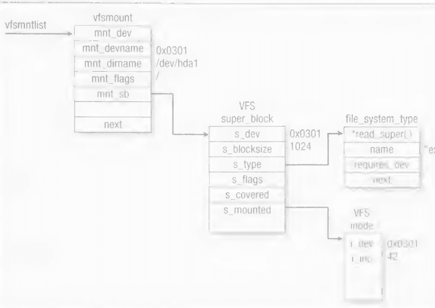

图 9.6：挂载的文件系统

### 9.2.5 在虚拟系统中查找文件


为了在虚拟系统中查找文件，`VFS` 通过查看由 `file_systems` 指向的列表中的每个 `file_system_type` 数据结构搜索已知文件系统的列表。如果它找到了匹配的名称，它现在就知道该内核支持此文件类型，并获取了读取该文件系统 superblock 的文件系统特定例程的地址。如果找不到匹配的文件系统，且内核被构建为按需加载内核模块（见第 12 章），则一切都徒劳。在这种情况下，内核守护进程将在像之前继续之前请求适当的文件系统模块。

### 9.2.6 创建文件

文件系统维护一个 inode 缓存以加速对所有文件系统的访问。每当访问 inode 时，都会访问物理设备。

### 9.2.7 卸载文件系统

当文件系统被卸载时，它会从 `vfsmntlist` 中取消链接。如果 superblock 是脏的，必须将其写回文件系统。一旦写入磁盘，它占据的内存将返回空池。

### 9.2.8 VFS inode 缓存

`VFS` inode 缓存实现为哈表，其项指向具有相同哈希值的 inode 列表。inode 的哈希值根据其 inode 号和设备标识计算。每当文件系统需要访问 inode 时，它首先查找 `VFS` 缓存。要在缓存中查找 inode，系统计算其哈希值，然后将其作为哈表的索引。这为它提供了一个指向与搜索目标具有相同哈希值和设备标识的 inode 列表的指针。

如果它能在缓存中找到 inode，则将其计数器加1以显示有另一个用户，并继续。否则，必须找到一个空闲的 `VFS` inode以便文件系统从内存读取它。`VFS` 对于获取空闲 inode 有多种选择。如果系统允许分配比现在更多的 `VFS` inode，则它分配页面并将其拆分为新的空闲 inode，将其放入列表。系统中所有的 `VFS` inode 都在由 `first_inode` 指向的列表中。如果系统已经拥有了允许的所有 inode，它必须找到一个可以重用的候选 inode。良好的候选是计数为 0 的 inode；这表示系统当前没有使用它们。重要的 `VFS` inode（例如文件系统的根 inode）的计数始终大于 0，因此永远不是重用候选者。一旦需要将重用候选写回文件系统，或者它可能被锁定，在这种情况下系统必须等待其解锁后才能继续。候选 `VFS` inode 在重用之前必须进行清理。

一旦找到新的 `VFS` inode，必须调用文件系统特定的例程根据从底层真实文件系统读取的信息来填充它。在填充期间，新的 `VFS` inode 计数为 1 且处于锁定状态，直到它包含有效信息。

# 文件系统 135

为了获取实际所需的 `VFS` inode，文件系统可能需要访问其他几个 inode。这发生在你读取一个目录时；虽然只需要最终目录的唯一 inode，但中间目录的 inode 也必须被读取。随着 `VFS` 缓存的使用和填充，使用较少少的 inode 将被丢弃，而使用较频繁的 inode 将保留在缓存中。

## 9.2.9 目录缓存

为了加速对常用目录的访问，`VFS` 维护了一个目录缓存。

当实际文件系统查找目录时，它们的详细信息会被添加到缓存中。下一次查找同一个目录时（例如为了列出或打开其中的某个文件），它将在目录缓存中被找到。缓存只包含短短的目录条目（长度最多 15 个字符），但这是合理的，因为较短的目录名是最常用的。例如，当 `X` 服务器运行时，`/usr/X11R6/bin` 会被频繁地访问。

目录缓存由一个哈希表组成，每个条目都指向具有相同哈希值的目录条目列表。哈希函数使用持有文件的设备的设备号和系统名称来计算哈希表中的偏移量（或索引）。它允许快速找到缓存的目录条目。如果查找条目需要太长时间，甚至无法找到条目，那么拥有缓存也是徒劳的。

为了保持缓存的有效和最新，`VFS` 维护了最久未使用（LRU）目录缓存条目的列表。当一个条目被放入缓存或被查找时，它会被添加到第一级 LRU 列表的末尾。在缓存满的情况下，这将取代 LRU 列表头部的条目。当条目再次被访问时，它会被提升到二级 LRU 缓存的头部。同样，这可能会取代二级 LRU 缓存头部的缓存二级目录条目。这种对一级和二级 LRU 列表头部条目的替换是没问题的。条目位于列表头部的唯一原因是它们最近没有被访问过。如果被访问过，它们会更靠近列表的末尾。二级 LRU 缓存列表中的条目比一级 LRU 缓存列表中的条目更安全。这是符合意图的，因为这些条目不仅被查找过，而且被反复引用过。

缓冲区块通过其所属设备标识符和缓冲块号进行唯一标识。缓冲区缓存由两个功能部分组成。第一部分是空闲缓冲区列表。每种支持的缓冲区大小有一个列表，系统的空闲缓冲区在首次创建或被丢弃时会被排队到这些列表中。目前支持的缓冲区大小为 512、1,024、2,048 和 8,192 字节。

第二个功能部分是缓存本身。这是一个哈希表，是一个指向具有相同索引的缓冲区链指针向量。哈希索引由所属设备标识符和数据块的块号生成。缓冲区要么在某个空闲列表中，要么在缓冲区缓存中。当它们在缓冲区缓存中时，也会被排入 LRU 列表中。每种类型的缓冲区都有一个 LRU 列表，系统使用这些列表对该类型的缓冲区执行工作，例如将带有新数据的缓冲区写入磁盘。缓冲区的类型反映了它的状态；`Linux` 目前支持以下类型：

- 未使用的（Unused）：新缓冲区。
- 已锁定（Locked）：已锁定、等待写入的缓冲区。
- 脏数据（Dirty）：脏缓冲区。这些缓冲区包含新的有效数据，将被写入，但到为止尚未调度写入。
- 共享（Shared）：曾经共享但现在不再共享的缓冲区。

每当文件系统需要从其底层物理设备读取缓冲区时，它会尝试从缓冲区缓存中获取一个。如果无法从缓冲区缓存中获取缓冲区，它将从相应大小的空闲列表中获取一个干净的缓冲区；这个新缓冲区将进入缓冲区缓存。如果需要的缓冲区在缓冲区缓存中，它可能是最新的，也可能不是。如果它不是最新的或者它是一个新缓冲区，文件系统可能会请求设备驱动程序从磁盘读取相应的数据块。

与其他缓存一样，缓冲区缓存必须维护，以节省系统对物理设备的访问。任何被用于从块设备读取数据或写入数据的缓冲区都会进入缓冲区缓存。随着时间的推移，它可能会从缓存中移除以为更有价值的缓冲区让位，或者因为被频繁访问而保留在缓存中。


# 文件系统 135

为了获取实际所需的 `VFS inode`，文件系统可能需要访问其他几个 `inode`。这发生在你读取一个目录时；虽然只需要最终目录的唯一 `inode`，但中间目录的 `inode` 也必须被读取。随着 `VFS` 缓存的使用和填充，使用较少的 `inode` 将被丢弃，而使用较频繁的 `inode` 将保留在缓存中。

## 9.2.9 目录缓存

为了加速对常用目录的访问，`VFS` 维护了一个目录缓存。

当实际文件系统查找目录时，它们的详细信息会被添加到缓存中。下一次查找同一个目录时（例如为了列出或打开其中的某个文件），它将在目录缓存中被找到。缓存只包含短短的目录条目（长度最多 15 个字符），但这是合理的，因为较短的目录名是最常用的。例如，当 `X` 服务器运行时，`/usr/X11R6/bin` 会被频繁地访问。

目录缓存由哈希表组成，每个条目都指向具有相同哈希值的目录条目列表。哈希函数使用持有文件的设备的设备号和系统名称来计算哈希表中的偏移量（或索引）。它允许快速找到缓存的目录条目。如果查找条目需要太长时间，甚至无法找到条目，那么拥有缓存也是徒劳的。

为了保持缓存的有效和最新，`VFS` 维护了最久未使用（`LRU`）目录缓存条目的列表。当一个条目被放入缓存或被查找时，它会被添加到第一级 `LRU` 列表的末尾。在缓存满的情况下，这将取代 `LRU` 列表头部的条目。当条目再次被访问时，它会被提升到二级 `LRU` 缓存的头部。同样，这可能会取代二级 `LRU` 缓存头部的二级目录条目。这种对一级和二级 `LRU` 列表头部条目的替换是没问题的。条目位于列表头部的唯一原因是它们最近没有被访问过。如果被访问过，它们会更靠近列表的末尾。二级 `LRU` 缓存列表中的条目比一级 `LRU` 缓存列表中的条目更安全。这是符合意图的，因为这些条目不仅被查找过，而且被反复引用过。

## 9.3 缓冲区缓存

随着挂载的文件系统被使用，它们会产生一组指向块设备的请求，用于读取和写入数据块。所有块数据读写请求都通过标准内核例程调用，以 `buffer_head` 数据结构的形式交给设备。提供块设备驱动程序所需的所有信息：设备唯一标识设备，块号告诉驱动程序要读取哪个块。所有块设备都被视为相同大小块的线性集合。为了加速对物理设备的访问，Linux 维护了一个块缓冲区缓存。系统中所有的块缓冲区都保存在这个缓冲区缓存的某处，即使是新的、未使用的缓冲区。缓存在所有物理块设备之间共享；任何时候缓存中有很多缓冲区，属于系统的任何一个块设备并处于许多不同的状态。如果从缓冲区缓存提供了可用数据，就可以节省系统对物理设备的访问。任何被用于从块设备读取数据或写入数据的缓冲区都会进入缓冲区缓存。随着时间的推移，它可能会从缓存中移除以为更有价值的缓冲区让位，或者因为被频繁访问而保留在缓存中。

缓冲区块通过其所属设备标识符和缓冲区块号进行唯一标识。缓冲区缓存由两个功能部分组成。第一部分是空闲缓冲区列表。每种支持的缓冲区大小有一个列表，系统的空闲缓冲区在首次创建或被丢弃时会被排队到这些列表中。目前支持的缓冲区大小为 512、1,024、2,048 和 8,192 字节。

第二个功能部分是缓存本身。这是一个哈希表，是一个指向具有相同索引的缓冲区链指针向量。哈希索引由所属设备标识符和数据块块号生成。图 9.7 显示了哈希表以及若干条目。缓冲区要么在某个空闲列表中，要么在缓冲区缓存中。当它们在缓冲区缓存中时，也会被排入 `LRU` 列表。每种类型的缓冲区都有一个 `LRU` 列表，系统使用这些列表对该类型的缓冲区执行工作，例如将带有新数据的缓冲区写入磁盘。缓冲区的类型反映了它的状态；Linux 目前支持以下类型：

- 未使用的（Unused）：新缓冲区。
- 已锁定（Locked）：已锁定、等待写入的缓冲区。
- 脏数据（Dirty）：脏缓冲区。这些缓冲区包含新的有效数据，将被写入，但到为止尚未调度写入。
- 共享（Shared）：曾经共享但现在不再共享的缓冲区。

每当文件系统需要从其底层物理设备读取缓冲区时，它会尝试从缓冲区缓存中获取一个。如果无法从缓冲区缓存中获取缓冲区，它将从相应大小的空闲列表中获取一个干净的缓冲区；这个新缓冲区将进入缓冲区缓存。如果需要的缓冲区在缓冲区缓存中，它可能是最新的，也可能不是。如果它不是最新的或者它是一个新缓冲区，文件系统可能会请求设备驱动程序从磁盘读取相应的数据块。

与其他缓存一样，缓冲区缓存必须维护，以节省系统对物理设备的访问。任何被用于从块设备读取数据或写入数据的缓冲区都会进入缓冲区缓存。随着时间的推移，它可能会从缓存中移除以为更有价值的缓冲区让位，或者因为被频繁访问而保留在缓存中。

例如，内核的 `/proc/devices` 文件是根据描述其设备的内核数据结构生成的。

`/proc` 文件系统为用户提供了一个查看内核内部运行机制的可读窗口。若干 Linux 子系统（例如第 12 章描述的 Linux 内核模块）会在 `/proc` 文件系统中创建条目。

## 9.5 设备特殊文件

Linux 与所有版本的 `Unix` 一样，将硬件呈现为特殊文件。例如，`/dev/null` 是空设备。设备文件不使用系统的任何数据空间；它只是指向设备驱动程序的访问点。`EXT2` 文件系统和 Linux `VFS` 都将设备文件实现为特殊类型的节点。

设备文件有两种类型：字符特殊文件和块特殊文件。在内核内部，设备驱动程序实现了文件语义：你可以打开它们、关闭它们等。字符设备允许以字符模式进行 I/O 操作，而块设备要求所有 I/O 必须通过缓冲区缓存进行。当向设备文件发出 I/O 请求时，它会被转发到系统内部相应的设备驱动程序。这通常不是真实的设备，而是某些子系统的伪设备驱动程序，例如 `SCSI` 设备驱动层。设备文件通过主设备号（major number）引用，用于标识设备类型；通过次设备号（minor type）用于标识该类型的单元或实例。例如，系统中的 `IDE` 控制器的主设备号为 3，而 `IDE` 磁盘第一个分区的次设备号为 1。因此，`/dev/hda1` 的详细信息显示如下：

```
$ brw-rw---- 1 root disk 3,1 Nov 24 15:09 /dev/hda1
```

在内核内部，每个设备都通过一个 `kdev_t` 数据被唯一描述；该数据长度为 2 字节，第一个字节包含次设备号，第二个字节持有主设备号。

上述 `IDE` 设备在内核中以 `0x0301` 的形式保存。表示块或字符设备的 `EXT2` `inode` 将设备的主设备号和次设备号保存在其的第一个直接块指针中。当它被 `VFS` 读取时，代表该设备的 `VFS` `inode` 数据结构中的 `i_rdev` 字段将字段设置为正确的设备标识符。

## 第 10 章

# 网络

网络和 Linux 这两个词几乎是同义词。从非常真实的意义上说，Linux 是互联网或全球网（`WWW`）的产物。它的开发者和用户使用 Web 来交换信息、思想和代码，而 Linux 本身经常用于支持组织的网络需求。本章描述了 Linux 如何支持统称为 `TCP/IP` 的网络协议。

`TCP/IP` 协议的设计是为了支持连接到美国政府资助的 `ARPANET` 研究网络的计算机之间的通信。`ARPANET` 开创了数据包交换和协议分层等网络概念，即一个协议使用另一个协议的服务。`ARPANET` 于 1988 年退役，但其继任者国家科学基金会、`NET` 和互联网已变得更大。现在被称为 Web 的诞生于 `ARPANET`，其本身由 `TCP/IP` 协议支持。`Unix` 曾广泛应用于 `ARPANET`，第一个发布的网络版本 `Unix` 是 `4.3 BSD`；Linux 的网络实现基于 `4.3 BSD` 建模的，因为它支持 `BSD socket`（带有某些扩展）以及全 `TCP/IP` 网络功能。选择这一编程接口是因为它的流行性，并有助于应用程序在 Linux 和其他 `Unix` 平台之间迁移。

## 10.1 TCP/IP 网络概览


# 第 10 章 TCP/IP 网络原理

本节概述了 `TCP/IP` 网络的主要原理。在 `IP` 网络中，每台机器都被分配一个 `IP` 地址；这是一个唯一标识机器的 32 位数字。`Web` 是一个大型且不断增长的 `IP` 网络，连接到它的每台机器都必须分配一个唯一的 `IP` 地址。`IP` 地址由四个用点隔开的数字表示，例如 `16.42.0.9`。这个 `IP` 地址实际上由两部分组成：网络地址和主机地址。这些部分的大小可能不同（有几类 `IP` 地址），但以 `16.42.0.9` 为例，网络地址为 `16.42`，主机地址为 `0.9`。主机地址进一步细划为子网地址和主机地址，以 `16.42.0.9` 为例，子网地址为 `16.42.0`，主机地址为 `16.42.0.9`。`IP` 地址的这种划分允许组织划分它们的网络。例如，`16.42` 可以是 `ACME` 计算机公司的网络地址；`16.42.0.1` 将是子网 1。这些子网可能位于不同的建筑中，通过租赁电话线甚至微波链路连接。`IP` 地址由网络管理员分配，拥有 `IP` 网络是控制网络分布的好方法。`IP` 子网管理员可以自由地在其子网内分配 `IP` 地址。

通常情况下，`IP` 地址有些难记。名字要容易得多。`linux.com` 比 `16.42.0.9` 容易记忆得多，但必须有某种机制将网络名称转换为 `IP` 地址。这些名称可以静态地指定在 `/etc/hosts` 文件中，或者 `Linux` 使用域名服务器（`DNS` 或 `DNS` 服务器）来为它解析名称。在这种情况下，本地主机必须知道一个或多个 `DNS` 服务器的 `IP` 地址；这些地址在 `/etc/resol.conf` 中指定。

每当你连接到另一台机器或读取 `Web` 页面时，都会使用其 `IP` 地址与该机器交换数据。这些数据包含在 `IP` 数据包中，每个数据包都有一个 `IP` 头部，包含源机器和目的机器的 `IP` 地址、校验和和其他有用信息。校验和源于数据包中的数据，允许 `IP` 数据包的接收者判断数据包在传输过程中是否因噪声线路而损坏。应用程序传输的数据可能被拆分成更容易处理的小包。

`IP` 数据包的大小取决于连接介质：`以太网` 数据包通常比 `PPP` 数据包大。目的主机应在将数据交给接收应用程序之前重组数据包。如果你通过中等速度的串口访问包含大量图形图片的 `Web` 页面，你可以可视化地看到数据的分段和重组。

连接到同一子网的主机可以直接相互发送 `IP` 数据包；所有其他数据包将发送到一个特殊的主机，即网关。网关（或路由器）连接到多个子网，它们会对从一个子网接收的、另一个子网的 `IP` 数据包重新分段并转发。例如，如果子网 `16.42.1.0` 和 `16.42.0.0` 通过网关连接，那么从子网 0 发往子网 1 的任何数据包都要指向网关，以便其进行路由。本地主机构建路由表，允许将 `IP` 数据包路由到正确的机器。对于每个 `IP` 目的地，路由表中都有条目告诉 `Linux` 发送 `IP` 数据包以便到达目的地。这些路由表是动态的，随着使用网络的应用以及网络拓扑结构而改变。

`IP` 协议是一种供其他协议用于携带数据的传输层。传输控制协议（`TCP`）是一种可靠的端端协议，它使用 `IP` 来传输和接收自己的数据包（如图 10.1 所示）。正如 `IP` 包有自己的头部，`TCP` 也有自己的头部。`TCP` 是一种基于连接的协议，两个网络应用程序之间通过单一虚拟连接，尽管它们之间存在许多子网络、网关和路由器。`TCP` 在两个应用程序之间可靠地传输和接收数据，并保证不会丢失或重复。当 `TCP` 使用 `IP` 传输包时，`IP` 包包含的数据是 `TCP` 数据包本身。通信主机的 `IP` 负责传输和接收 `IP` 数据包。

用户数据报协议（`UDP`）也使用 `IP` 层传输数据包；与 `TCP` 不同，`UDP` 不是可靠协议，但它提供数据报服务。其他协议对 `IP` 的意味着当接收 `IP` 数据包时，接收端 `IP` 层必须知道将此 `IP` 包包含的数据交给哪个上层协议。为了方便这一点，每个 `IP` 数据包头部都有字节包含协议标识符。当 `TCP` 请求 `IP` 层传输 `IP` 数据包时，`IP` 数据包头部声明它包含一个 `TCP` 数据包。

```
| 以太网帧 |
| 目的以太网地址 | 源以太网地址 | 协议 | 数据 | 校验和 |
| IP 包 | | | | |
| 长度 | 协议校验和 | 源 IP 地址 | 目的 IP 地址 | 数据 |
| TCP 包 | | | | |
| 源 TCP 地址 | 目的 TCP 地址 | SEQ | ACK | 数据 |
```

图 10.1 `TCP/IP` 协议层。

# Linux 内核：第 10 章

`IP` 层使用协议标识符来决定将接收到的数据传递给哪一层，并以此与 `TCP` 层进行通信。

当应用程序通过 `TCP/IP` 进行通信时，它们不仅必须指定目标的 `IP` 地址，还需要指定应用程序的端口地址。端口地址唯一标识一个应用程序，标准网络应用使用标准端口地址。例如，`Web` 服务器使用 `80` 端口。这些注册的端口地址可以在 `/etc/services` 中查看。

这种协议分层并没有止于 `TCP`、`UDP` 和 `IP`。`IP` 层本身使用许多不同的物理介质将 `IP` 数据包传输到其他主机。这些介质本身会添加自己的协议头。一个例子是 `以太网` 层，但 `PPP` 和 `SLIP` 是其他例子。`以太网` 网络允许许多主机同时连接到单根物理电缆。每个传输的 `以太网` 帧都有一个唯一的地址。任何传输到该地址的 `以太网` 帧将被目标主机接收，或者被连接到网络的所有其他主机忽略。这些唯一地址在 `以太网` 设备制造时就被内置其中；它们通常存储在 `以太网` 卡上的 `PROM`（同步读存储器）中。`以太网` 地址长度为六字节；例如为 `08-00-2b-00-49-A4`。某些 `以太网` 地址被保留用于组播，带有这些目的地的 `以太网` 帧将被网络上的所有主机接收。`以太网` 帧携带许多不同的协议（作为数据），就像 `IP` 数据包在其头部包含协议标识符一样。这使得 `以太网` 层能够正确接收 `IP` 数据包并传递到 `IP` 层。

为了通过 `以太网` 等多连接协议发送 `IP` 数据包，`IP` 层必须找到 `IP` 主机的 `以太网` 地址。这是因为 `IP` 地址仅仅是一个地址概念；`以太网` 设备本身具有其物理地址。另一方面，`IP` 地址可以由网络管理员随意分配和重新分配，但网络硬件只对具有其物理地址或所有机器使用的特殊组播地址的 `以太网` 帧响应。`Linux` 使用地址解析协议（`ARP`）允许机器将 `IP` 地址翻译为 `以太网` 地址的真实硬件地址。想要与 `IP` 地址关联的硬件地址的用户发送一个 `ARP` 请求包，包含需要翻译的 `IP` 地址，通过发送到组播地址给网络上的所有节点。拥有该 `IP` 地址的目标主机响应 `ARP` 回复，其中包含其硬件地址。

`ARP` 不仅限于 `以太网` 设备；它还可以解析物理介质的 `IP` 地址，例如 `FDDI`。那些无法 `ARP` 的网络设备会被标记，以便 `Linux` 不尝试进行 `ARP`。还有一个反向函数，反向 `ARP` 或 `RARP`，它可以将物理网络地址翻译为 `IP` 地址。这被网关使用，它们代表远程网络中的 `IP` 地址响应 `ARP` 请求。

## 10.2 Linux TCP/IP 网络层

与网络协议本身一样，图 10.2 显示 `Linux` 将互联网协议地址族实现为一系列连接的软件层。`BSD` 套接字由仅关注 `BSD` 套接字的通用套接字管理软件支持。支持此的是 `INET` 套接字层；它管理基于 `IP` 的协议（`TCP` 和 `UDP`）的通信端点。`UDP` 是一种无连接协议，而 `TCP` 是一种可靠的端到端协议。

当传输 `UDP` 数据包时，`Linux` 既不知道也不在乎它们是否安全地到达目的地。`TCP` 数据包是有编号的，`TCP` 连接的端端都会确保传输的数据被正确接收。`IP` 层包含实现内核协议的代码。这段代码在传输的数据前添加 `IP` 头部，并理解如何将入站的 `IP` 数据包路由到 `TCP` 或 `UDP` 层。在 `IP` 层之下，支持所有 `Linux` 网络的是网络设备，例如 `PPP` 和 `以太网`。网络设备并不总是代表物理设备；某些设备（如环回设备）是纯软件设备。

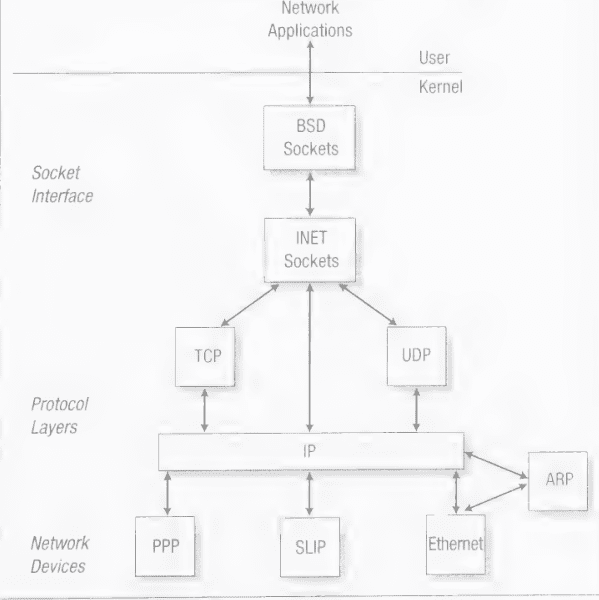

图 10.2 `Linux` 网络层。

通过 `mknod` 命令，网络设备只有在底层软件找到并初始化后才会出现。只有当你构建了带有适当 `以太网` 设备驱动程序的内核时，你才会看到 `/dev/eth0`。`ARP` 协议位于 `IP` 层和支持 `ARP` 地址的协议之间。

## 10.3 BSD 套接字接口

这是一个通用接口，不仅支持各种形式的网络，而且是一种进程间通信机制。套接字描述通信链路的一端；两个通信的进程将各自有一个套接字来描述它们之间通信链路的端。套接字可以被认为是管道的特殊情况，但与管道不同，它们对可以包含的数据量没有限制。`Linux` 支持几类套接字，这些被称为地址族。这是因为每个类都有其自己的通信地址方法。`Linux` 支持以下套接字地址族：

| 地址族 | 描述 |
| :--- | :--- |
| `UNIX` | `Unix` 域套接字 |
| `INET` | 互联网地址族支持通过 `TCP/IP` 协议通信 |
| `AX25` | 业余无线 `X25` |
| `IPX` | `Novell` `IPX` |
| `APPLETALK` | `AppleTalk` `DDP` |
| `X25` | `X25` |


有几种套接字类型，它们代表支持连接的服务类型。并不是所有地址族都支持所有的服务类型。`Linux BSD` 套接字支持多种套接字类型：

- 流（`Stream`）——这些套接字提供可靠的双向顺序数据流，并保证传输过程中不会丢失、损坏或重复。流套接字由互联网（`INET`）地址族的 `TCP` 协议支持。
- 数据报（`Datagram`）——这些套接字也提供双向数据传输，与流套接字不同，它不保证消息一定会到达。即使到达，也可能乱序或可能重复或损坏。这种类型的套接字由互联网地址族的 `UDP` 协议支持。
- 原始（`Raw`）——这允许进程对底层协议进行直接（即“原始”）访问。例如打开一个以太网设备的原始套接字查看 `IP` 数据流量。
- 可靠交付消息（`Reliable Delivered Messages`）——这些非常数据报套接字，但数据保证到达。
- 顺序包（`Sequenced Packets`）——这些类似于流套接字，但数据包大小是固定的。
- 包（`Packet`）——这不是标准的 `BSD` 套接字类型；它是 `Linux` 特有的扩展，允许进程在设备级直接访问包。

## `INET` `Socket` 层

`INET` `socket` 支持 `Internet` 地址族，该地址族包含了 `TCP/IP` 协议。如上所述，这些协议是分层的，一个协议会使用另一个协议的服务。`Linux` 的 `TCP/IP` 代码和数据结构反映了这种分层结构。它与 `BSD` `socket` 层的接口通过一组 `Internet` 地址族 `socket` 操作实现，这些操作在网络初始化期间注册到 `BSD` `socket` 层。这些操作与其它已注册的地址族一起存储在 `ops` 向量中。`BSD` `socket` 层通过从注册的 `INET` `proto_ops` 数据结构中调用的例程来执行其工作。例如，当一个 `BSD` `socket` 请求将族指定为 `INET` 时，它将使用底层的 `INET` 创建函数。在这些操作中，`BSD` `socket` 层会将代表 `BSD` `socket` 的数据结构传递给 `INET` 层。为了不让 `BSD` `socket` 充斥着 `TCP/IP` 特有的信息，`INET` `socket` 层使用了它自己的数据结构 `sock`，该 `sock` 链接到 `BSD` `socket` 数据结构。这种链接可以在图 10.3 中看到。它使用 `BSD` `socket` 中的数据指针将 `sock` 数据结构链接到 `BSD` `socket` 数据结构。这意味着后续的 `INET` `socket` 调用可以轻松检索到 `sock` 数据结构。`sock` 数据结构的协议操作指针在创建时也会设置，并取决于所请求的协议。如果请求的是 `TCP`，则 `sock` 数据结构的协议操作指针将指向连接所需的 `TCP` 协议操作集。

### 10.4.1 创建 `BSD` `Socket`

创建新 `socket` 的系统调用会传递其地址族、`socket` 类型和协议的标识符。

首先，使用请求的地址族在 `ops` 向量中搜索匹配的地址族。某个特定的地址族可能是作为内核模块实现的，在这种情况下，必须由 `kld` 守护进程加载该模块后我们才能继续。此时系统会分配一个新的 `socket` 数据结构来表示 `BSD` `socket`。实际上，`socket` 数据结构在物理上是 `VFS` `inode` 数据结构的一部分，分配一个 `socket` 实际上意味着分配一个 `VFS` `inode`。这看起来可能很奇怪，除非你考虑到 `socket` 可以像普通文件一样进行操作。由于所有文件都由一个 `VFS` `inode` 数据结构表示，为了支持文件操作，`BSD` `socket` 也必须由一个 `VFS` `inode` 数据结构表示。

新创建的 `BSD` `socket` 数据结构包含一个指向特定地址族的 `socket` 例程的指针，该指针是从 `ops` 向量检索到的 `proto_ops` 数据结构。其类型被设置为请求的 `socket` 类型；例如 `SOCK_STREAM`、`SOCK_DGRAM` 等。使用存储在 `proto_ops` 数据结构中的地址来调用特定地址族的创建例程。

图 10.3

`Linux` `BSD` `socket` 数据结构。

从当前进程的 `fd` 向量中分配一个空闲的文件描述符，并初始化它所指向的文件数据结构。这包括将文件操作指针指向由 `BSD` `socket` 接口支持支持的一组 `BSD` `socket` 文件操作。任何未来的操作都将被定向到 `socket` 接口，而它反过来将通过调用其地址族操作例程将这些操作传递给支持的地址族。

### 10.4.2 将地址绑定到 `INET` `BSD` `Socket`

为了能够监听传入的 `Internet` 连接请求，每个服务器都必须创建一个 `INET` `BSD` `socket` 并将其地址绑定到上面。`bind` 操作大部分在 `INET` `socket` 层中处理，并得到底层 `TCP` 和 `UDP` 协议层的某些支持。已绑定了地址的 `socket` 不能用于任何其他通信。这意味着 `socket` 的状态必须是 `TCP_CLOSE`。传递给 `bind` 操作的 `sockaddr` 包含要绑定的 `IP` 地址以及可选的端口号。通常，绑定的 `IP` 地址应该是已分配给支持 `INET` 地址族的网络设备的，且该接口处于启用状态并可以可以使用。你可以使用 `ifconfig` 命令查看系统中当前处于激活状态的网络接口。`IP` 地址也可以是全一或全零的广播地址。这些意味着“发送给所有人”的特殊地址。如果机器作为透明代理或防火墙，`IP` 地址也可以被指定为任何 `IP` 地址，但只有具有超级用户权限才能绑定到任何 `IP` 地址。绑定的 `IP` 地址保存在 `socket` 结构的 `recv_addr` 和 `saddr` 字段中。它们分别用于哈希查找和发送的 `IP` 地址。端口号是可选的，如果未指定，则会请求支持的网络提供一个空闲端口。按照惯例，小于 `1024` 的端口号不能被没有超级用户权限的进程使用。如果底层网络分配了端口号，它分配的是一个比 `1024` 大的端口。

当数据包被网络设备接收时，它们必须被路由到正确的 `INET` 和 `BSD` `socket`，以便能够被处理。由于这个原因，`UDP` 和 `TCP` 维护着哈希表，用于查找传入 `IP` 消息中的地址，并将它们定向到正确的 `socket`/`sock` 对。`TCP` 是一种面向连接的协议，因此处理 `TCP` 数据包时涉及的信息比处理 `UDP` 数据包更多。

`UDP` 维护一个 `UDP` 端口的哈希表 `udp_hash_table`。它由指向 `socket` 数据结构的指针组成，基于端口号的哈希函数索引。`UDP` 哈希表比允许的端口数量小得多（`udp_hash` 长度为 `128` 或 `UDP_HTABLE_SIZE`），它将表条目存储在 `socket` 数据结构链中，链通过每个 `sock` 的 `next` 指针连接在一起。

`TCP` 要复杂得多，因为它维护了多个哈希表。

### 10.4.3 在 `INET` `BSD` `Socket` 上建立连接

一旦创建了 `socket`，对于 `UDP` 等无连接协议，这不会建立虚拟电路；但对于 `TCP` 等面向连接的协议，它涉及到在两个应用程序之间建立电路。

出站连接只能在状态为 `SS_UNCONNECTED` 的 `socket` 上建立。发送和接收窗口大小是可以在发送确认之前可以允许的未确认消息数量。最大消息大小基于请求发起端使用的网络设备。如果接收端支持较小的最大消息大小，则连接将使用两者的最小值。发起出站连接请求的应用程序等待目标应用程序的响应以接受或拒绝请求。该 `TCP` `sock` 现在等待传入的消息，它被添加到 `tcp_listening_hash` 中，以便传入的 `TCP` 消息可以定向到此 `sock` 数据结构。`TCP` 还启动了定时器，如果目标应用程序没有响应，则出站连接请求将超时。

### 10.4.4 在 `INET` `BSD` `Socket` 上监听

一旦 `socket` 绑定了地址，它就可以监听指定已绑定地址的传入连接请求。网络应用程序可以在不预先绑定地址的情况下在 `socket` 上监听；在这种情况下，`INET` `socket` 层会找到一个未使用的端口号（对于该协议）并自动将其绑定到 `socket` 上。`listen` `socket` 函数将 `socket` 移动到 `TCP_LISTEN` 状态，并执行允许传入连接所需的任何网络工作。

# `Linux` 内核：第 10 章

对于 `UDP` 套接字，更改套接字的状态即可，但 `TCP` 现在会将套接字的数据结构添加到两个哈希表中，因为它现在处于活跃状态。这些是 `tcp_bound_hash` 表和 `tcp_listening_hash` 表。它们都通过基于 `IP` 端口的哈希函数进行索引。

当活跃的监听套接字接收到传入的 `TCP` 连接请求时，`TCP` 会构建一个新的 `sock` 数据结构来表示它。这个 `sock` 数据结构在最终被接受时将成为 `TCP` 连接的下半部分。它克隆包含连接请求的传入 `sk_buff`，并将其推到到监听 `sock` 数据结构的 `receive_queue` 中。克隆的 `sk_buff` 包含一个指向新创建的 `sock` 数据结构的指针。

## 10.4.5 接受连接请求


UDP 不支持连接的概念：接受 `INET` 套接字连接仅适用于 `TCP` 协议，因为对活跃套接字的操作会创建一个新的套接字数据结构并从原始套接字克隆。随后，`accept` 操作被传递给支持的协议层（在此处为 `INET`），以接受任何传入的连接请求。如果底层协议（例如 `UDP`）不支持连接，`INET` 协议层将导致 `accept` 失败。否则，`accept` 操作将传递给实际协议（在此处为 `TCP`）。`accept` 操作可以是阻塞的也可以是非阻塞的。在非阻塞情况下，如果没有待接受的传入连接，`accept` 操作将失败，且新创建的套接字数据结构将被丢弃。在阻塞情况下，执行该操作的网络应用程序将被添加到等待队列并挂起，直到接收到 `TCP` 连接请求。一旦收到连接请求，包含请求的 `sk_buff` 将被丢弃，`sock` 数据结构返回到 `INET` 套接字层，在那里它被链接到早先创建的新套接字数据结构。新套接字的文件描述符 (`fd`) 返回给网络应用程序，应用程序可以使用该描述符在新的 `INET` 套接字上进行操作。

## 10.5 IP 层

### 10.5.1 套接字缓冲区 (Socket Buffers)

拥有多层网络协议（每层都使用另一层的服务）的问题之一是，每个协议在传输时需要添加协议头和尾，并在处理数据时移除它们。在协议之间传递数据缓冲区是困难的，因为每层都需要找到其协议头和包尾的位置。一种解决方案是在每一层拷贝缓冲区，但那样效率太低。相反，Linux 使用缓冲区（或 `sk_buff`）在协议层和网络驱动程序之间传递数据。`sk_buffs` 包含指针和长度字段，允许每个协议层通过标准函数操纵数据。

图 10.4 显示了 `sk_buff` 数据结构；每个 `sk_buff` 都关联着一个数据块。`sk_buff` 拥有四个指针，用于操作和管理缓冲区的数据：

- `head`—指向内存中数据区域的起始位置。这在分配 `sk_buff` 及其关联的数据块时就固定了。

- `data`—指向协议数据的当前起始位置。该指针根据当前拥有该 `sk_buff` 的协议层而变化。

- `tail`—指向协议数据的当前结束位置。该指针根据协议层的不同而变化。

- `end`—指向数据区域的末尾。这在分配 `sk_buff` 是是固定的。

还有长度字段 `len` 和 `size`，分别描述当前协议数据包的长度和数据缓冲区的总大小。`sk_buff` 处理代码为应用程序数据添加和移除协议头尾提供了标准机制。这些机制会操纵数据、`tail` 和 `len` 字段：

- `push`—将数据指针向数据区域起始处移动并增加 `len` 字段。这用于在要传输的数据头部头部添加协议头。

- `pull`—将数据指针远离起始位置向数据区域末尾移动并减少 `len` 字段。这用于从接收到的数据头部移除协议头。

- `trim`—将尾部指针向数据区域的起始处移动并减少 `len` 字段。这用于从收到的数据包中移除协议尾。

`sk_buff` 数据结构还包含指针，在处理期间将其存储在 `sk_buff` 的双向链表中使用。有通用的 `sk_buff` 例程用于将 `sk_buff` 添加到这些列表的头部和尾以及移除它们。

### 10.5.2 接收 IP 数据包

第 9 章描述了 Linux 网络驱动是如何构建到内核中并初始化的。这导致了一系列链接在 `dev_base` 列表中的设备数据结构。每个设备数据结构都描述其设备，并提供一组回调函数，当网络协议层需要网络驱动执行工作时会调用这些函数。这些函数主要涉及数据传输和网络设备的地址。当网络设备从网络接收数据包时，它必须将数据转换为 `sk_buff` 数据结构。这些收到的 `sk_buffs` 在被网络驱动程序接收时会被添加到 `backlog` 队列中。

如果 `backlog` 队列过大，则收到的 `sk_buffs` 将被丢弃。由于有工作要做，网络下半部分被标记为准备就绪。当调度程序运行网络下半部分处理器时，它会先处理任何等待传输的网络数据包，然后再处理 `sk_buff` 的 `backlog` 队列，以决定将数据包传递给哪个协议层。在 Linux 层初始化时，每个协议都通过将 `packet_type` 数据结构添加到 `ptype_all` 列表或放入 `ptype_base` 哈希表中来注册自己。`packet_type` 数据结构包含协议类型、指向网络设备的指针、指向协议接收数据处理例程的指针，最后是一个指向下一个数据包的指针。

# Linux 内核：第 10 章

接收 `IP` 分片比发送它们稍微困难一些，因为 `IP` 分片可能以任何顺序接收，并且在重组之前必须全部接收。每当接收一个 `IP` 数据包时，都会检查它是否为 `IP` 分片。当第一次收到消息的分片时，`IP` 会创建一个新的 `ip` 数据结构，并将其链接到等待重组的 `IP` 分片 `ipqueue` 列表。随着更多 `IP` 分片的接收，会找到正确的 `ip` 数据结构，并创建一个新的 `ipfrag` 数据结构来描述该分片。每个 `ipq` 通过其源目的地址、上层协议标识符以及该 `IP` 帧的标识符唯一地描述一个碎片 `IP` 接收帧。当所有分片都接收完成后，它们会被合并成单个 `sk_buff` 并传递给下一个协议层进行处理。每个 `ipq` 都包含一个定时器，每当收到有效分片时都会重启。如果该定时器超时，`ipq` 数据结构及其 `ipfrags` 将被拆解，该消息被认为在传输过程中丢失。将由高层协议负责重新发送该消息。

## 10.6 地址解析协议 (ARP)

地址解析协议的作用是将 `IP` 地址翻译为物理地址（例如以太网地址）。`IP` 在将数据（以 `sk_buff` 形式）传递给设备驱动程序进行传输之前需要这种翻译。

它会执行各种检查以判断此设备是否需要硬件地址，如果需要，则需要重建硬件头。Linux 缓存了硬件头以避免频繁重建。如果硬件头需要重建，它会调用特定于设备的硬件重建例程。所有的以太网设备都使用相同的通用硬件头重建例程，该例程反过来使用 `ARP` 服务将目的地址翻译为物理地址。

`ARP` 协议本身非常简单，由两种消息类型组成：`ARP` 请求（`ARP request`）和 `ARP` 回复（`ARP reply`）。`ARP` 请求包含需要翻译的 `IP` 地址，而回复（理想情况下）包含翻译后的 `IP` 地址，即硬件地址。`ARP` 请求广播到所有连接到网络的主机，因此对于以太网网络，所有连接到以太网的机器都会看到 `ARP` 请求。请求中 `IP` 地址的机器将用 `ARP` 回复响应 `ARP` 请求，其中包含自身的物理地址。

Linux 中的 `ARP` 协议层构建在 `arp_table` 数据结构表周围，每个结构体描述一个 `IP` 到物理地址的翻译。这些条目在 `IP` 地址需要翻译时创建，并随着时间的推移变得过期而被移除。每个 `arp_table` 数据结构具有以下字段：

- `last used`（最后使用）：此 `ARP` 条目最后一次使用的时间

- `last updated`（最后更新）：此条目最后一次更新的时间

- `flags`（标志）：描述此条目的状态，例如是否完整等

- `IP address`（`IP` 地址）：此条目描述的 `IP` 地址

- `hardware address`（硬件地址）：翻译后的硬件地址

- `hardware header`（硬件头）：这是一个指向缓存硬件头的指针

- `timer`（定时器）：这是一个 `timer_list`，用于为未收到响应的 `ARP` 请求超时

- `retries`（重试）：该 `ARP` 请求被检索的次数

- `sk_buff queue`（`sk_buff` 队列）：用于解析此 `IP` 地址的 `sk_buff` 条目列表

`ARP` 表由一个指针表（`arp_tables` 向量）组成，指向 `arp_table` 条目链。条目被缓存以加速访问；每个条目通过取其 `IP` 地址的最后两个字节来生成表的索引，然后沿着条目链向下查找直到找到正确的条目。Linux 还以 `hh_cache` 数据结构的格式在 `arp_table` 条目之外缓存了硬件头。

当请求 `IP` 翻译且没有相应的 `arp_table_entry` 时，`ARP` 必须发送 `ARP` 请求消息。它在表中创建一个新的 `arp_table` 条目，并将包含需要地址翻译的网络数据包的 `sk_buff` 放入新条目的 `sk_buff queue` 队列中。它发送 `ARP` 请求并设置 `ARP` 定器数值。如果没有响应，`ARP` 将重试请求若干次；如果仍然没有响应，`ARP` 将移除该 `arp_table` 条目。如果收到通知，则由传输它们的协议层来处理这种失败。`UDP` 不关心丢弃的数据包，但 `TCP` 会尝试在已建立的 `TCP` 链上重传。如果 `IP` 所有者响应并提供硬件地址，`arp_table` 将被标记为完成，任何队列中的 `sk_bufs` 将从队列中移除并继续进行翻译。硬件地址被写入每个 `sk_buff` 的硬件头中。

`ARP` 协议层还响应指定其 `IP` 地址的 `ARP` 请求。它注册了自己的协议类型（`ETH_P_ARP`），生成一个 `packet_type` 数据结构。这意味着它将通过网络设备接收到的所有 `ARP` 数据包（除了 `ARP` 回复，还包括 `ARP` 请求）。它使用接收设备数据结构中保留的硬件地址生成 `ARP` 回复。


网络拓扑结构会随时间变化，IP 地址可能会重新分配给不同的硬件地址。例如，拨号服务在每次建立连接时分配 IP 地址。为了确保 ARP 表包含最新的条目，ARP 运行一个周期定时器，遍历所有的`arp_table`条目以查看哪些已超时。它非常小心不会移除包含一个或多个缓存硬件头的条目。移除这些条目是危险的，因为其他数据结构依赖于它们。`arp_table`条目是永久的，并被标记为不会被释放。ARP 表不允许增长得过大；每个`arp_table`消耗内核内存。每当需要分配新条目且 ARP 表已达到最大尺寸时，将修剪旧的条目。

## 10.7 IP 路由

IP 路由函数决定发送 IP 数据包。有两个数据库，最重要的是转发信息数据库（Forwarding Information Database）。IP 路由数据库维护回答这些问题的信息：目的地是否存在？如果是，应该使用哪个网络设备？一个更小更快的数据库是路由缓存，用于频繁访问的路由。路由通过接口请求添加和删除。协议层仅允许具有特权的进程添加和删除路由。这些路由可以是固定的，也可以是随时间变化的动态。系统使用固定路由，除非它们是路由器。路由器运行路由协议，不断检查所有目的地的可用性。不是路由器的系统被称为终端系统。路由协议以守护进程实现（例如 `GATE`），它们通过套接口添加和删除路由。

### 10.7.1 路由缓存

每次查找 IP 路由时，首先检查路由缓存。如果缓存中没有匹配路由，则搜索转发信息数据库。如果没有找到路由，IP 数据包将无法发送并通知应用程序。如果路由在转发信息数据库中但在路由缓存中，则在该路由生成并添加新条目。路由缓存是一个表（`ip_rt_hash_table`），包含指向`rtable`结构的指针。路由表的索引是基于 IP 地址低位字节的哈希函数。这两个字节在不同目的地之间最不同，能提供最好的哈值分布。每个条目包含有关路由的信息：目的 IP 地址、到达该 IP 地址的网络设备、可以使用的消息最大大小等。它还有一个引用计数、一个使用计数以及最后使用它们的时间戳（以`jiffies`为单位）。每次使用路由时，引用计数增加，以显示使用它的网络连接数。应用程序使用路由时，引用计数减少。使用计数在每次查找路由时增加，并用于`rtable`条目在哈希链中的排序。定期检查路由缓存中所有条目的最后使用时间戳，以查看路由是否过旧。如果路由最近未被使用，则将其从路由缓存中丢弃。如果路由保留在缓存中，则会被排序，使得最常用的路由位于哈希链的前端。

## 10.7.2 转发信息数据库 (FIB)

图 10.5 所示的转发信息数据库包含了当前系统可用路由的 IP。这是一个相当复杂的数据结构，尽管安排得合理，但它并不是一个快速查询的数据库。特别是，对于每个传输的 IP 数据包，在此数据库中查找目标将非常慢。这就是路由缓存存在的原因：通过使用已知的良好路由来加速 IP 数据包的传输。路由缓存派自转发数据库，并代表了其常用的条目。

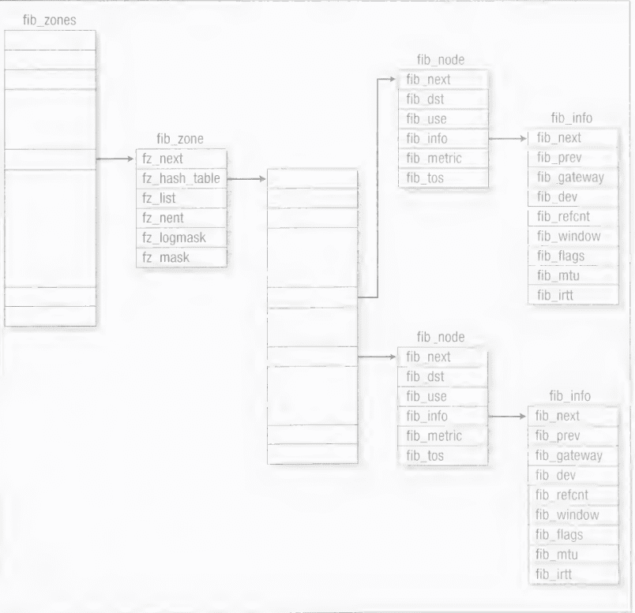

图 10.5 转发信息数据库。

每个 IP 子网由一个`fib_zone`数据结构表示。所有这些结构都由`fib_zones`哈希表指向。哈希索引源自 IP 子网掩码。往同一子网的所有路由由`fib_node`和`fib_info`数据结构对描述，这些对被推入每个`fib_zone`数据结构的`fz_list`中。如果该子网中的路由数量变得很大，就会生成一个哈希表以便更容易找到`fib_node`数据结构。

往同一个 IP 子网可能存在多个路由，这些路由可以通过几个网关中的一个通过。IP 路由层不允许使用同一网关通往子网的多个路由。换句话说，如果到某个子网有多个路由，那么每条路由都保证使用不同的网关。与每条路由关联的是它的度量（`metric`）。这是衡量该路由优越程度的标准。路由的度量本质上是到达目标子网之前必须跨越的 IP 子网数。度量越高，路由越差。

# 第 11 章

## 内核机制

本章描述了 Linux 内核需要提供的一些通用任务和机制，以便内核的所有部分能够有效协同工作。

## 11.1 下半部处理 (Bottom Half Handling)

在内核中，经常会有一些你不希望在此时工作的时刻。一个很好的例子就是中断处理期间。当中断被触发时，处理器停止正在执行，操作系统将中断传递给适当的设备驱动程序。设备驱动程序不应花费太多时间处理中断，因为在这段时间内，系统中没有其他程序可以运行。通常有些工作完全可以以后再做。发明 Linux 下半部处理器是为了让设备驱动程序和 Linux 内核的其他部分可以将工作放入队列，稍后执行。图 11.1 显示了与下半部处理相关的内核数据结构。

多多有 32 个不同的下半部处理器；`bh_base`是一个指向内核每个下半部处理例程的指针向量，`bh_active`和`bh_mask`的位根据已安装和处于激活状态的处理器进行位设置。如果`bh_mask`的第 N 位被设置，则`bh_base`的第 N 个元素包含一个下半部例程的地址。如果`bh_active`的第 N 位被设置，则应该在调度程序认为合理的情况下调用第 N 个下半部处理例程。这些索引是静态定义的；定时下半部处理器优先级最高（索引 0），控制台下半部处理器优先级次之（索引 1），依此类推。通常，下半部处理例程与它们关联有任务列表。例如，立即下半部处理器（immediate bottom half handler）会遍历立即任务队列（`tq_immediate`），该队列包含了需要立即执行的任务。

内核的一些下半部处理器是特定于设备的，但另一些更具通用性：

- `TIMER`—每当系统周期性定时器中断时，此处理器被标记为激活，并用于驱动内核的定时器队列机制。
- `CONSOLE`—此处理器用于处理控制台消息。
- `TQUEUE`—此处理器用于处理 tty 消息。
- `NET`—此处理器处理通用网络处理。
- `IMMEDIATE`—这是一个多个设备驱动程序使用的通用处理器，用于将工作放入以后执行。

每当设备驱动程序或内核的其他部分需要调度以后执行的工作时，它们会将工作添加到相应的系统队列（例如定时器队列），并通知内核需要执行某个下半部处理器。它通过设置`bh_active`中的激活位来实现这一点。如果驱动程序已经在立即队列上推入了某些内容，并希望立即下半部处理器运行并处理它，则设置位 0。`bh_active`位掩码在每次系统调用结束、在控制权返回给调用进程之前进行检查。如果它有任何位被设置，则下半部处理器例程处于激活状态。首先检查位 0，然后是 1，依此类推，直到 31。

当每个下半部处理例程被调用时，`bh_active`中的位会被清除。`bh_active`是瞬态的；它只在调度器调用之间具有意义，是一种在没有工作可做时不调用下半部处理例程的方法。

## 11.2 任务队列 (Task Queues)

任务队列是内核推后工作的方式。Linux 有一种通用机制用于在队列上排并在以后处理它们。

任务队列通常与下半部处理器配合使用；定时任务队列由定时器队列下半部处理器处理。任务队列是一个简单的数据结构；见图 11.2，它由`tq_struct`数据结构的单链表组成，每个结构都包含一个例程的地址和一个指向某些数据的指针。

当任务队列上的元素被处理时，将调用该例程，并传递一个指向数据的指针。

内核中的任何内容（例如设备驱动程序）都可以创建并使用任务队列，例如定时器队列，并信号内核需要执行某个下半部处理器。

- `timer`—每当系统发生周期性定时器中断时，此队列被标记为激活，并用于驱动内核的定时器队列机制。
- `immediate`—这是一个多个设备驱动程序使用的通用处理器，用于将工作放入以后执行。
- `scheduler`—此队列由调度器直接处理。

当队列被处理时，队列中第一个元素的指针从队列中移除。这是一个原子操作，不能被中断。然后轮流调用队列中的每个元素的处理例程。队列中的元素通常是静态分配的数据。然而，这里没有固有的释放内存机制。任务队列处理只需移动到列表的下一个元素。任务本身负责正确清理任何分配的内存。

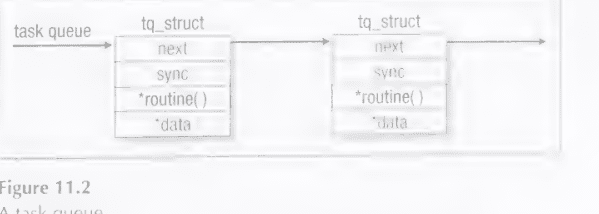

## 11.3 定器 (Timers)

操作系统能够在未来的某个时刻调度活动。需要一种机制以便活动可以在相对精确的时间运行。任何希望支持系统的微处理器都必须有一个可编程间隔定时器周期性地中断处理器。这种周期性中断被称为系统时钟中断（system clock tick），它像节拍器一样协调系统的活动。

Linux 对时间的看法非常简单；它以系统启动后的时钟周期来测量时间。所有系统时间都基于这个测量值，它被称为`jiffies`，与同名的全局变量同名。

Linux 有两种类型的系统定时器；两者都会在某个系统时间调度例程，但它们的实现上略有不同。图 11.3 显示了两种机制。

第一种旧机制具有一个包含 32 个指向`timer_struct`数据结构指针的静态数组和一个激活定时器的掩码`timer_active`。


定时器在定时表中的位置是静态定义的（类似于下半部处理器表 `bh_base`）。条目在系统初始化时添加到此表中。第二种较新的机制使用 `timer_list` 数据结构的链表，按到期时间升序排列。

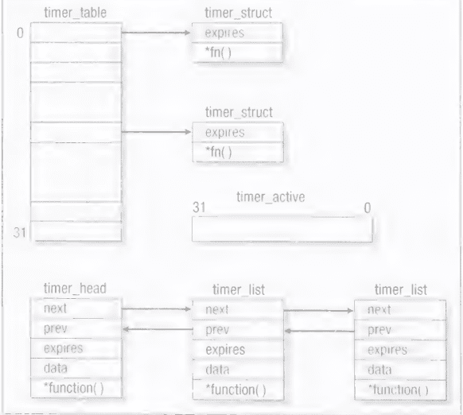

## 内核机制

两种方法都使用 jiffies 时间作为过期时间，因此想要在 5 分钟后运行的定时器必须将 5 分钟转换为 jiffies 单位，并加到当前系统时间，以获得定时器到期的系统时间（jiffies 单位）。每次系统时钟中断，定时器底部处理器（timer bottom handler）都会被标记为激活，这样当调度器运行时，就会处理定时队列。定时器底部处理器处理两种类型的系统时间。对于旧系统，会检查 `timer_active` 位掩码中已设置的位。

如果一个活动中定时器的过期时间已到（过期时间小于当前系统 jiffies），则会调用其例程并清除其活动位。对于新的系统定时器，会检查 `timer_list` 数据结构链表中的条目。

每个过期的定时器都会从列表中移除并调用其例程。新机制可能允许向定时器例程传递参数。

## 11.4 等待队列

进程很多时候必须等待系统资源。例如，一个进程可能需要描述文件系统中目录的 VFS 索引，而该 inode 可能不在缓冲区缓存中。在这种情况下，进程必须等待该 inode 从包含文件系统的物理介质中提取才能继续执行。

Linux 内核使用了一种简单的数据结构——等待队列（见图 11.4），它由一个指向进程 `task_struct` 的指针和指向等待队列中下一个元素的指针组成。

当进程被添加到等待队列的末尾时，它们可以是可中断的，也可以是不可中断的。可中断进程可能会被事件中断，例如在等待等待队列时定时器过期或接收到信号。等待中的进程状态将反映这一点，并表现为 INTERRUPTIBLE（可中断）或 UNINTERRUPTIBLE（不可中断）。由于该进程无法继续运行，调度器会介入，当它选择一个新进程运行时，等待中的进程将会被挂起。

当处理等待队列时，等待队列中每个进程的状态都会设置为 RUNNING。如果该进程已从运行队列中移除，它会被放回运行队列。

```
wait_queue
*task
*next
```

当调度器下次运行时，位于等待队列上的进程现在是运行的候选者，因为它们现在不再等待了。当等待队列上的进程被调度时，它做的第一件事就是将自己从等待队列中移除。等待队列可以同步系统资源，Linux 在实现信号量时也使用了它们（见下文）。

## 11.5 自旋锁（Buzz Locks）

这些通常被称为自旋锁（spin locks），是保护代码结构的一种原始方法。它们允许一次只有一个进程处于代码的关键区域。它们被 Linux 用于通过单个整数作为锁来限制对数据结构字段的访问。每个想要进入的进程都会尝试将锁的初始值从零改为一。如果其当前值为一，进程将重试，在紧的代码循环中自旋。对持有锁的内存位置的访问必须是原子的，读取其值、检查其是否为零然后将其更改为一的操作不能被任何其他进程中断。大多数 CPU 架构都提供这种特殊指令的支持，但你也可以使用原子内存来实现锁。

当所有进程离开代码的关键区域时，它会减少自旋锁的值，将其恢复为零。任何在锁上自旋的进程现在都会读到它是零；第一个读到零的进程将将其增加为一并进入关键区域。

## 11.6 信号量

信号量用于保护代码的关键区域或数据结构。记住，对关键数据（如描述目录的 VFS 索引）的每次访问都是代表进程运行的内核代码完成的。允许一个进程修改另一个进程正在的数据结构是非常危险的。实现这一点的一种方法是在访问的关键数据周围加一把锁，但这是一种简单的方法，无法提供良好的系统性能。相反，Linux 使用信号量允许一次只有一个进程访问代码和数据的关键区域；所有想要访问此资源的进程都将被迫等待，直到它变为可用。等待的进程会被挂起；系统中的其他进程可以正常继续运行。

信号量数据结构包含以下信息：

- count（计数）——此字段跟踪想要使用此资源的进程计数。正值意味着资源可用。负值或零值意味着进程正在等待它。初始值为一意味着一次时间有一个且只有一个进程可以使用此资源。当进程想要该资源时，它们减少计数，当它们完成对该资源的使用时，它们增加计数。

- waking（唤醒）——这是等待该资源的进程计数，也是当该资源释放时等待被唤醒的进程数量。

关键区域的所有者增加信号量的计数，如果计数小于或等于零，则有进程正在睡眠等待该资源。在理想情况下，信号量的计数本应返回其初始值一，不再需要进一步的工作。所有者进程增加唤醒计数器，并唤醒在信号量等待队列上睡眠的进程。当模块加载时，内核必须在模块工作之前修复该模块的所有引用。内核在内核符号表中保留了所有内核资源的列表，以便在模块加载时可以解析来自模块对这些资源的引用。内核是 1。

## 第 12 章 模块

本章描述了内核如何动态加载和卸载代码，这非常有吸引力，因为它保持了内核的体积较小。然而，天下没有免费的午餐，模块存在微小的性能开销。可加载模块必须提供更多的代码，额外的数据结构占用了更多内存。还引入了间接层，使得访问效率降低。

一旦模块被加载，它就像任何普通内核代码一样属于内核。它拥有与任何内核代码相同的权利和责任；换句话说，Linux 模块像任何设备驱动一样导致内核崩溃。为了让模块可以使用所需的内核资源，它们必须能够找到这些资源。模块需要调用 `kmalloc()`，内存分配程序。在编译时，模块不知道 `kmalloc()` 在哪里，因此当模块加载时，内核必须在模块工作之前修复模块对 `kmalloc()` 的所有引用。内核在内核符号表中保留了所有内核资源的列表，以便在模块加载时可以解析来自模块对这些资源的引用。

Linux 允许模块叠加（module stacking）：即一个模块需要另一个模块的服务。例如，VFAT 文件系统模块需要 FAT 文件系统模块的服务，后者在程度上是 FAT 文件系统的扩展。一个模块需要另一个模块的服务或资源与模块需要内核本身的服务的情况非常相似。所需的服务位于另一个先前加载的模块中。当每个模块加载时，内核都会修改内核符号表，添加新加载模块导出的所有资源或符号。这意味着当加载下一个模块时，它可以访问已加载模块的服务。

当尝试卸载模块时，内核需要知道该模块未被使用，并且需要某种方式通知模块即将被卸载。这样，模块可以在从内核移除之前释放它分配的所有系统资源，例如内核内存或中断。当模块卸载时，内核会移除模块导出到内核符号表中的任何符号。

除了编写良好的加载模块可能导致操作系统崩溃外，它还带来了另一个危险。如果你加载一个为早期或后期版本构建的模块，会发生什么

## 第 17 模块

比你现在正在运行的内核版本？这可能会导致问题，例如，如果模块调用了内核例程并提供了错误的参数。内核可以可选地通过在加载模块时对模块进行严格的版本检查来防止这种情况。

### 2.1 加载模块

内核模块有两种加载方式。。第一种方法是使用 `insmod` 命令手动将其插入内核。第二种方法要明得多，即根据需要按需加载模块；这被称为**按需加载**（demand loading）。

当内核发现需要某个模块时（例如，当用户挂载一个内核中不存在的文件系统时），内核会请求内核守护进程（`kerneld`）尝试加载相应的模块。

内核守护进程是一个普通的用户进程，尽管它具有超级用户权限。当它被启动时（通常在系统启动时），它会与内核打开一个进程间通信（IPC）通道。内核使用该链路（link）向 `kerneld` 发送消息，要求其执行各种任务。

内核的主要功能是加载和卸载内核模块，但它也能执行其他任务，例如在需要时通过串口启动 PPP 链路，在不需要时将其关闭。内核本身不执行这些任务；它运行必要的工作（如 `insmod`）来完成。内核仅仅是内核的代理，代表内核调度工作。

`insmod` 工具会找到它要加载的内核模块。按需加载的内核模块通常保留在 `/lib/modules/kernel-version` 中。内核模块是链接对象文件，就像系统中的其他程序一样，不同之处它们被作为可重定位镜像（relocatable images）链接，而没有被链接到从特定地址运行。它们可以是 `out` 格式或 `elf` 格式的对象文件。

`insmod` 执行一个特权系统调用来查找内核导出的符号。这些符号成对存储，包含符号的名称和它的值（例如其地址）。内核的导出符号表存储内核维护的模块列表的第一个模块数据结构中，并由 `module_list` 指针指向。

只有特定的符号会被添加到该表中，该表是在内核编译和链接时构建的；内核中的每个符号都会导出到其模块。一个示例符号是 "request_irq"，它是驱动程序想要控制特定系统中断时必须调用的内核例程。在我当前的内核中，它的值为 0x0010ced0。你可以通过查看 `/proc/ksyms` 或使用 `ksyms` 工具轻松地看到导出的内核符号及其值。`ksyms` 工具显示所有导出的内核符号，`insmod` 将其读取到自己的虚拟内存中，并使用内核导出的符号修复对内核例程和资源的未解析引用。这种修复以补丁内存中模块镜像的形式出现。`insmod` 物理上将符号的地址写入模块的适当位置。


当 `insmod` 修复了模块对导出内核符号的引用后，它会再次向内核请求足够的空间来容纳新内核，同样使用特权系统调用。内核分配一个新的模块数据结构和足够的内核内存来容纳新模块，并将其放在内核模块列表的末尾。新模块被标记为 `UNINITIALIZED`（未初始化）。

图 12.1 显示了两个模块（`VFAT` 和 `VFAT`）加载到内核后的内核模块列表。图中未显示列表中的第一个模块，它是一个伪模块，仅用于持有内核的导出符号表。你可以使用 `insist` 命令列出所有已加载的内核模块及其依赖关系。`insmod` 只是重新格式化 `/proc/modules`，该文件是由内核模块数据结构列表构建的。内核为其分配的内存映射到 `insmod` 进程空间中，以便它可以访问。`insmod` 将模块复制到分配的空间中，并对其进行重定位，以便它能从内核分配的地址运行。这必须发生，因为模块无法期望两次被加载到同一个地址，更不用说在两个不同的 `Linux` 系统中加载到同一个地址了。再次，这种重定位涉及使用适当的地址补丁模块镜像。

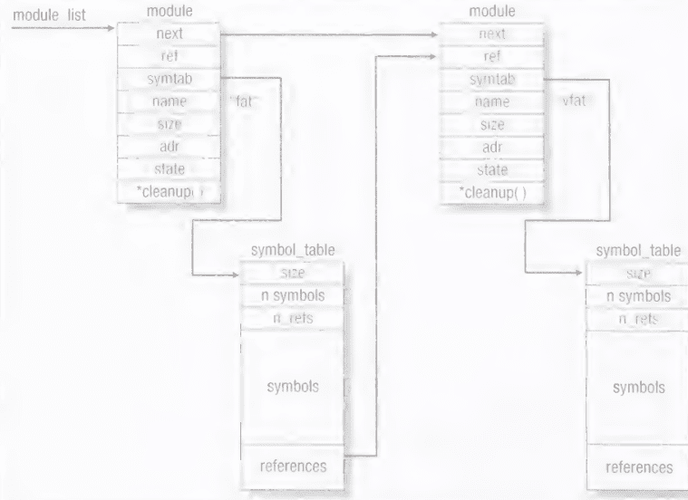

图 12.1 内核模块列表。

新模块也向内核导出符号，`insmod` 构建了一个导出镜像表。每个内核模块都包含模块初始化例程和模块清理例程，这些符号被刻意不导出；但 `insmod` 必须知道它们的地址，以便将它们传递给内核。如果一切顺利，`insmod` 现在准备好初始化模块了，它会进行特权调用，传递模块初始化和清理例程的内核地址。

当新模块被添加到内核时，它必须更新内核的符号集并修改被新模块使用的模块。有其他模块依赖的模块必须在它们的符号表处维护一个引用列表，该列表由它们的模块数据结构指向。图 12.1 显示 `VFAT` 文件系统模块依赖于 `VFAT` 模块；该引用是在 `VFAT` 模块加载时添加的。内核调用模块初始化例程，如果成功，则继续安装该模块。模块的清理例程地址存储在它的模块数据结构中，并在模块卸载时由内核调用。最后，模块的状态被设置为 `RUNNING`（运行中）。

## 12.2 卸载模块

可以使用 `rmmod` 移除模块，但按需加载的模块在不再使用时会自动从系统中移除。每当系统请求 `kerneld` 移除使用的按需模块时，它会检查。只要内核的其他组件依赖于该模块，无法卸载。例如，如果你挂载了一个或多个 `VFAT` 文件系统，就无法卸载 `VFAT`。如果你查看 `insmod` 的输出，你会看到每个模块都关联有一个计数。例如：

| | #页: | 使用者: |
| :--- | :--- | :--- |
| `msdos` | 5 | |
| `vfat` | 4 | 1 |
| `fat` | 6 | [`msdos` `vfat`] 2 |

计数是依赖该模块的内核实体的数量。在上面的示例中，`vfat` 和 `msdos` 模块都依赖于 `VFAT` 模块，因此它的计数为 2。如果我加载另一个 `VFAT` 文件系统，那么 `vfat` 模块的计数将变为两个。模块的计数位于它的镜像第一个字中。

该字段稍微重载，因为它还持有 `AUTOCLE` 和 `VISITED` 标记。这两个标记都用于按需加载的模块。这些模块被标记为 `AUTOCLE`，以便系统能够识别哪些可以自动卸载。`VISITED` 标记标记模块正被一个组件使用；每当另一个组件使用该模块时，该标记就会设置。每当系统请求 `kerneld` 移除使用的按需模块时，它会遍历系统中所有的模块寻找可能的候选对象。它只查看标记为 `AUTOCLE` 且处于 `RUNNING` 状态的模块。如果候选对象的 `VISITED` 标记已清除，则移除该模块；否则，它清除 `VISITED` 标记并继续查看系统中的下一个模块。

假设模块可以卸载，则调用其清理例程以允许释放它分配的内核资源。模块数据结构被标记为 `DELETED`（已删除），并从内核列表中取消链接。它所依赖的任何模块将修改其引用列表，使其不再视其为依赖项。模块所需的所有内核内存都将被释放。

# 第 13 章 处理器

`Linux` 运行在多种处理器上。本章将对其中每种处理器进行简要概述。

## 13.1 X86

待定

## 13.2 ARM

`ARM` 处理器实现了一种低功耗、高性能的 32 位 `RISC` 架构。它被广泛应用于手机和 `PDA`（个人数字助理）等嵌入式设备。它拥有 31 个 32 位寄存器，在任何模式下都有 16 个可见的。它的指令是简单的加载和存储指令（从内存加载值、执行操作、然后将结果存回内存）。它一个有趣的特点是每条指令都是有条件的。例如，你可以测试寄存器的值，在下一次测试相同条件之前，你可以根据自己的意愿条件条件执行指令。另一个有趣的特点是，你可以在加载值的同时对其进行算术和位移操作。它在多种模式下运行，使用一种可以通过 `SWI`（软件中断）从用户模式进入的系统模式。

这是一个可合成的核心。`ARM`（公司）本身并不制造处理器。相反，`ARM` 的合作伙伴（例如 `Intel` 或 `LSI` 等公司）在硅片中实现 `ARM` 架构。它允许其他处理器通过协处理器接口紧密耦合，并具有多种内存管理变体。这些从简单的内存保护方案到复杂的页层次结构。

## 13.3 Alpha AXP 处理器

`Alpha AXP` 架构是一种以速度为设计的 64 位加载/存储 `RISC` 架构。所有寄存器的长度均为 64 位：32 个整数寄存器和 32 个浮点寄存器。整数寄存器 31 和浮点寄存器 31 用于空操作。从它们读取会产生零值，向它们写入则没有影响。所有指令长度均为 32 位，内存操作为读取或写入。该架构允许不同的实现，只要这些实现遵循该架构即可。

没有直接操作存储在内存中的值的操作指令；所有数据操作都通过寄存器完成。如果你想增加内存中的计数器，首先将其读取到寄存器中，然后进行修改并写回。指令之间仅通过指令写入寄存器或内存位置，以及另一个寄存器读取该位置或内存来相互交互。`Alpha AXP` 的一个有趣特点是，存在可以生成标志的指令，例如测试两个寄存器是否相等；结果不存储在状态寄存器中，而是存储在第三个寄存器中。初看起来这可能很奇怪，但消除对状态寄存器的这种依赖意味着更容易构建一个每个周期可以发射多条指令的 `CPU`。无关寄存器上的指令不需要等待彼此执行（就像如果存在单个状态寄存器那样）。对内存缺乏直接操作以及大量的寄存器也有利于发射多条指令。

`Alpha AXP` 架构使用一组子程序，称为特权体系库（`PALcode`）。`PALcode` 特异于操作系统、`Alpha AXP` 架构的 `CPU` 实现以及系统硬件。这些子程序为上下文切换、中断、异常和内存管理提供了操作系统原语。这些子程序可以通过硬件或 `CALL_PAL` 指令调用。`PALcode` 使用标准的 `Alpha AXP` 汇编语言编写，并带有一些实现扩展，以直接访问底层硬件函数，例如处理器内部寄存器。`PALcode` 在 `PALmode` 中执行，这是一种特权模式，它可以停止某些系统事件发生并允许 `PALcode` 对物理硬件进行完全控制。

# 第 14 章 Linux 内核源码

本章描述了在 `Linux` 内核源码中，你应该从哪里寻找特定的内核函数。

为了理解 `Linux` 内核如何工作，本书并不依赖于 `C` 语言语言知识，也不要求你拥有 `Linux` 内核源码。尽管如此，查看内核源码以深入理解 `Linux` 操作系统是一项有益的练习。本章概述了内核源码、它们是如何排列的，以及你可能从哪里开始寻找特定的代码。

## 14.1 如何获取 Linux 内核源码

所有主要的 `Linux` 发行版（`Craftworks`、`Debian`、`Slackware`、`Red Hat` 等）都包含了内核源码。通常，安装在你的 `Linux` 系统上的 `Linux` 内核是从这些源码构建的。根据其本质，这些源码往往略微过时，因此你可能想从附录 A 中提到的某个网站获取最新源码。它们维护在 `tips`（https://ftp.kernel.org/）上，所有其他网站都是其镜像。这使得赫尔辛基的网站是最新的，但像 `MIT` 和 `Sunsite` 等网站也紧随其后。

如果你无法访问互联网，有很多光盘供应商以非常合理的价格提供世界主要网站的快照。有些供应商甚至提供订阅服务，每季度甚至每月更新一次。你当地的 `Linux` 用户组也是获取源码的好来源。

内核源码有一套非常简单的编号系统。任何偶数内核（例如 `2.0.30`）都是稳定的已发布内核，而任何奇数内核（例如 `2.1.42`）都是开发内核。本书基于稳定的 `2.0.30` 源码树。开发内核具有所有最新功能并支持所有最新设备。尽管它们可能是不稳定的，这可能不是你完全想要的，但 `Linux` 社区尝试最新内核是非常重要的。由于经过了完整测试，`Linux` 社区尝试最新内核是重要的。（注：原文在此处存在多段重复文本，译文已按要求去重并保留逻辑）。

## 14.2 源码是如何排列的

在源码的最顶层，你将看到许多目录：

- `arch`: `arch` 子目录包含特定架构的代码。
- `include`: `include` 子目录包含大多数头文件。
- `init`: `init` 目录包含初始化代码。
- `mm`: `mm` 目录包含内存管理代码。
- `drivers`: `drivers` 目录包含设备驱动程序。
- `ipc`: `ipc` 目录包含进程间通信。
- `modules`: `modules` 是用于存放模块的目录。


- `fs`: 文件系统代码。

- `kernel`: 主内核代码。

- `lib`: `lib`目录包含库代码。

- `scripts`: `scripts`目录包含内核配置时使用的脚本。

## 14.3 在哪里查看

像 Linux 内核这样的大型复杂程序查看起来可能令人生畏。它就像像一团乱麻，没有尽头。查看内核的一个部分会导致你查看多个相关文件，很快你就会忘记自己在找什么。接下来的章节为你提供了提示，在源码树中查找特定主题的最佳位置。

### 14.3.1 系统启动与初始化

在基于 Intel 的系统中，当`linux.exe`或`LILO`将内核加载到内存并将控制权交给它时，内核启动。此部分查看`arch/i386/kernel/head.S`。`head.S`执行架构特定的设置，然后跳转到`main.c`中的`main()`例程。

### 14.3.2 内存管理

这些代码大部分在`mm`中，但特定架构的代码在`arch/*/mm`。页异常处理代码在`mm/memory.c`。内存映射和页缓存在`mm/filemap.c`。缓冲区实现在`mm/buffer.c`中，交换缓存在`mm/swap_state.c`和`mm/swapfile.c`中。

### 14.3.3 内核

大部分通用代码在`kernel`中，但特定架构的代码在`arch/*/kernel`。调度器在`kernel/sched.c`，`fork`代码在`kernel/fork.c`。下半部处理代码在`include/linux/interrupt.h`。`task_struct`数据结构可以在`include/linux/sched.h`中找到。

### 14.3.4 PCI

`PCI`伪驱动在`drivers/pci/pci.c`中，系统级定义在`include/linux/pci.h`。每个架构都有特定的`PCI` `BIOS`代码：`Alpha AXP`在`arch/alpha/kernel/bios32.c`中。

### 14.3.5 进程间通信

这些都在`ipc`目录下。`System V IPC`对象包含一个`ipc_perm`数据结构：你可以在`include/linux/ipc.h`中找到它。系统消息实现在`ipc/msg.c`，共享内存位于`ipc/shm.c`，信号量位于`ipc/sem.c`。管道实现在`ipc/pipe.c`。

### 14.3.6 中断处理

内核的中断处理代码几乎都是特定微处理器（通常也是特定平台的）。中断处理代码在`arch/i386/kernel/irq.h`中，其定义在`include/asm-i386/irq.h`中。

### 14.3.7 设备驱动

`Linux`内核源代码的大部分都在其设备程序中。所有`Linux`的设备驱动源码都位于`drivers`目录，但这些按类型进一步细分：

- `block`—块设备驱动，例如`(ide.c)`。如果你想查看所有可能包含文件系统的初始化设备，你应该查看`drivers/block/genhd.c`中的`device_setup()`。它不仅初始化了硬盘，还初始化了网络，因为挂载`NFS`文件系统需要网络。

- `char`—在此处可以查找字符类设备，如`tty`、串口端口和鼠标。

- `cdrom`—`Linux`所有的`CD-ROM`代码。在这里可以找到特殊的`CD-ROM`设备（如`Soundblaster CD-ROM`）。注意`IDE`驱动是`drivers/block`中的`ide-c`，而`SCSI`驱动是`drivers/scsi`中的`scsi.c`。

- `pci`—这些是`PCI`伪驱动的源码，是查看`PCI`子系统如何映射和初始化的良好去处。`arch/alpha/kernel/bios32.c`中的`Alpha XP PCI`修复代码也值得关注。

- `scsi`—在这里可以找到所有的`SCSI`代码，以及`Linux`支持的所有`SCSI`设备的驱动程序。

- `net`—在这里可以查找网络设备驱动，例如位于`tulip.c`中的`DECChip 21040 PCI`以太网驱动。

- `sound`—所有的音频驱动程序都在这里。

### 14.3.8 文件系统

`EXT2`文件系统的源码都在`fs/ext2/`目录下，数据结构定义在`include/linux/ext2_fs.h`、`ext2_fs_i.h`和`ext2_fs_sb.h`中。虚拟文件系统（`VFS`）数据结构在`include/linux/fs.h`中描述，代码位于`fs/*`。缓冲区缓存实现在`fs/buffer.c`中，以及更新内核守护进程。

### 14.3.9 网络

网络代码保存在`net`目录，大部分头文件在`include/net`中。`BSD socket`代码在`net/socket.c`中，`IP`版本 4 的`INET socket`代码在`net/ipv4/af_inet.c`中。通用协议支持代码（包括`sk_buff`处理例程）在`net/core`中，`TCP/IP`网络代码在`net/ipv4`中。网络设备驱动位于`drivers/net`。

### 14.3.10 模块

内核模块代码部分在内核中，部分在`modules`包中。内核代码全部在`kernel/modules.c`中，数据结构和内核守护进程`kerneld`消息分别在`include/linux/module.h`和`include/linux/kerneld.h`中。你可能想查看`include/linux/elf.h`中的`ELF`对象文件结构。

# 第 15 章

# Linux 数据结构

本章列出了`Linux`使用的主要数据结构，书中对这些进行了描述。为了适应论文，对其进行了微调。

## 15.1 block_dev_struct

`block_dev_struct`数据结构用于将块设备注册为可供缓冲区缓存使用的设备。它们组合在`blk_dev`向量中。

```c
struct blk_dev_struct {
    void (*request_fn)(void);
    struct request *current_request;
    struct request plug;
    struct tq struct plug tq;
};
```

## 15.2 buffer_head

`buffer_head`数据结构持有关于缓冲区缓存块的信息。

```c
/* bh 状态位 */
#define BH_Uptodate 0 /* 如果缓冲区包含有效数据则为 1 */
#define BH_Dirty 1 /* 如果缓冲区为脏数据则为 1 */
#define BH_Lock 2 /* 如果缓冲区被锁定则为 1 */
```

```c
#define BH_Req          /* 如果缓冲区已失效则为 0 */
#define BH_Touched      /* 如果缓冲区被访问过（老化）则为 1 */
#define BH_Has_aged     5   /* 如果缓冲区已老化（老化）则为 1 */
#define BH_Protected   6   /* 如果缓冲区被保护则为 1 */
#define BH_FreeOnIO     7   /* 1 * IO 后丢弃 buffer_head */

struct buffer_head {
    /* 第一行缓存行: */
    unsigned long   b_blocknr;     /* 块号 */
    kdev_t          b_dev;         /* 设备 */
    unsigned long   b_sector;      /* 扇区 */
    struct buffer_head *b_next;    /* 下一个 */
    unsigned long   b_page;         /* 页 */

    /* 第二行缓存行: */
    unsigned long   b_size;        /* 大小 */
    unsigned int    b_count;      /* 计数 */
    char            *b_data;       /* 数据 */
    unsigned long   b_flhtime;   /* 刷新时间 */
    unsigned long   b_lru_time;   /* LRU 时间 */

    struct wait_queue *b_wait;    /* 等待 */
    struct buffer_head *b_prev;    /* 上一个 */
    struct buffer_head *b_free;    /* 释放 */
    struct buffer_head *b_reqnext;  /* 请求 */
};
```

## 15.3 device

系统中的每个网络设备由一个`device`结构表示。


```c
struct device {
    /*
    * 这是结构可见部分的第一个字段
    *（即 Space.c 中所示）。它是接口。
    */
    char *name;

    /* 底层状态标志。 */
    volatile unsigned char start;  /* 开始操作 */
    unsigned char interrupt;      /* 中断到达 */
    unsigned long tbusy;           /* 发送器忙 */
    struct device *next;           

    /* 设备初始化函数。仅调用一次。 */
    int (*init)(struct device *dev);

    /* 某些硬件也需要这些字段，但它们不是
    Space.c 中通常指定的。 */
    unsigned char if_port;         /* 可选 AUI.TP. */
    unsigned char dma;             /* DMA 通道 */

    struct enet_statistics (*get_stats)(struct device *dev);

    /*
    * 这标志着结构可见部分的结束。此后的所有
    字段都是系统内部的，可能会随时更改
    （读：可能会随时清理）。
    */
    /* 这些可能用于未来的网络关机代码。 */
    unsigned long trans_start;     /* 上次传输的时间 (jiffies) */
    unsigned long last_rx;         /* 上次接收的时间 */
    unsigned short flags;          /* 接口标志 (BSD)*/
    unsigned short family;         /* 地址族 ID */
    unsigned short metric;         /* 路由度量 */
    unsigned short mtu;             /* MTU 值 */
    unsigned short type;           /* 硬件类型 */
    unsigned short hard_header_len; /* 硬件头部长度 */
    void *priv;                    /* 私有数据 */
};
```

```c
/* 接口地址信息。 */
unsigned char        broadcast[MAX_ADDR_LEN];
unsigned char        pad;
unsigned char        dev_addr[MAX_ADDR_LEN];
unsigned char        addr_len;           /* 硬件地址长度    */
unsigned long        pa_addr;           /* 协议地址     */
unsigned long        pa_brdaddr;         /* 协议广播地址**/
unsigned long        pa_dstaddr;         /* 协议点点或其他地址*/
unsigned long        pa_mask;           /* 协议子掩码         */
unsigned short       pa_len;            /* 协议地址长度 */

struct dev_mc_list  *mc_list;          /* 多播 MAC 地址 */
int                  mc_count;          /* 已安装的多播数量 */

struct ip_mc_list   *ip_mc_list;       /* IP 多播过滤链 */
u32                tx_queue_len;      /* 每个队列的最大帧数  */

/* 用于负载均衡驱动对支持 */
unsigned long       pkt_queue;          /* 队列中的包      */
struct device       *slave;             /* 从设备        */
struct net_alias_info *alias_info;      /* 主别名信息     */
struct net_alias     *my_alias;          /* 别名设备         */

/* 接口缓冲区的指针。 */
struct sk_buff_head  buffs[DEV_NUMBUFFS];

/* 接口服务例程序的指针。 */
int                  (*open)(struct device *dev);
int                  (*stop)(struct device *dev);
int                  (*hard_start_xmit) (struct sk_buff *skb,
                                     struct device *dev);
int                  (*hard_header) (struct sk_buff *skb,
                                     struct device *dev,
                                     unsigned short type,
                                     void *daddr,
                                     void *saddr,
                                     unsigned len);
int                  (*rebuild_header)(struct device *dev,
                                     unsigned long raddr,
                                     struct sk_buff *skb);
void                 (*mi_multicast) (struct device *dev);
int                  (*set_mac_address)(struct device *dev,
                                     void *addr);
int                  (*do_ioctl)(struct device *dev,
                                     struct ifreq *ifr);

int
int cmd;
int
(*set_config)(struct device *dev,
    struct ifmap *map);
void
(*header_cache_bind)(struct hh_cache **hhp,
    struct device *dev,
    unsigned short htype,
    u32 daddr);
void
(*header_cache_update)(struct hh_cache *hh,
    struct device *dev,
    unsigned char * haddr);
int
(*change_mtu)(struct device *dev,
    int new_mtu);
struct iw_statistics *
(*get_wireless_stats)(struct device *dev);
```

## 15.4 `device_struct`

`device_struct` 数据结构用于注册字符设备和块设备；它们持有设备名称以及可以用于该设备的文件操作操作集。`chrdevs` 和 `blkdevs` 向量中的每个有效成员分别代表一个字符设备或块设备。

```c
struct device_struct {
    const char *name;
    struct file_operations * fops;
};
```

## 15.5 `file`

每个打开的文件、`socket` 等都由一个文件数据结构表示。


## 15.5 file
```c
struct file {
    mode_t f_mode;
    loff_t f_pos;
    unsigned short f_flags;
    unsigned short f_count;
    unsigned long f_reada, *f_ramer, f_raend, f_ralen, f_rawin;
    struct file *f_next, *f_prev;
    int f_owner;      /* pid 或 应当发送 SIGIO 的进程组 */
    struct inode *f_inode;
    struct file_operations *f_op;
    unsigned long f_version;
    void *private_data;  /* tty 驱动以及可能其他驱动可能需要 */
```

## 15.6 files_struct

`files_struct` 数据结构描述了进程打开的文件。

```c
struct files_struct {
    int count;
    fd_set close_on;
    fd_set fds;
    struct file *fd[NR_OPEN];
};
```

## 15.7 fs_struct

```c
struct fs_struct {
    int count;
    unsigned short umask;
    struct inode *root, *pwd;
};
```

## 15.8 gendisk

`gendisk` 数据结构持有关于硬盘的信息。它在初始化期间使用，当探测磁盘分区时会被用到。

```c
struct hd_struct {
    long start_sect;
    long nr_sects;
};
```

```c
struct gendisk {
    int major;             /* 驱动的主号 */
    const char *major_name; /* 驱动名称 */
    int minor;             /* 次号偏移数量 */
    int max_p;             /* 每个设备的最大分区数 */
    int max_nr;            /* 最大真实设备数 */
    void (*init)(struct gendisk *); /* 发生之前的初始化 */
    struct hd_struct *part; /* 分区表 */
    int *sizes;            /* 以块为单位设备大小 */
};
```

```c
int nr_real;               /* 真实设备数量 */
void *real_devices;      /* 内部使用 */
struct gendisk *next;
```

## 15.9 inode

VFS `inode` 结构持有文件或目录的信息。

```c
struct inode {
    unsigned int i_ino;
    dev_t i_dev;
    unsigned long i_ino;
    umode_t i_mode;
    nlink_t i_nlink;
    uid_t i_uid;
    gid_t i_gid;
    loff_t i_size;
    time_t i_atime;
    time_t i_mtime;
    time_t i_ctime;
    unsigned int i_blksize;
    unsigned long i_blocks;
    unsigned int i_version;
    unsigned long i_npages;
    struct semaphore i_sem;
    struct file_operations *i_op;
    struct super_block *i_sb;
    struct wait_queue *i_wait;
    struct mutex *i_flock;
    struct vm_area_struct *i_mmap;
    struct page *i_pages;
    struct dquot i_quot[MAX_QUOT];
    struct inode *i_next, *i_prev;
    struct inode *i_bound, *i_by;
    struct inode *i_mount;
    unsigned short i_count;
    unsigned short i_flags;
    struct inode i_lock;
    struct inode i_dir;
    struct socket i_sock;
    void *i_generic;
};
```

## 15.10 ipc_perm

`ipc_perm` 描述 System V IPC 对象的权限。

```c
struct ipc_perm
{
    key_t key;
    uid_t uid;      /* 所有者 euid 和 egid */
    gid_t gid;
    uid_t cuid;     /* 创建者 euid 和 egid */
    gid_t cgid;
    uint16_t mode;   /* 访问模式见 flags */
    uint16_t seq;      /* 序号 */
};
```

## 15.11 irqaction

`irqaction` 数据结构用于描述中断处理程序。

```c
struct irqaction {
    void (*handler)(int, void *, struct pt_regs *);
    unsigned long flags;
    unsigned long mask;
    const char *name;
    void *dev_id;
    struct irqaction *next;
};
```

## 15.12 linux_binfmt

Linux 理解的每个二进制文件格式都由一个 `linux_binfmt` 结构表示。

```c
struct linux_binfmt {
    struct linux_binfmt *next;
    long *use_count;
    int (*load_binary)(struct linux_binprm *, struct pt_regs *regs);
    int (*load_shiptelf)(int flags);
    int (*core_dump)(long signr, struct pt_regs *regs);
};
```

## 15.14 mm_struct

`mm_struct` 数据结构用于描述任务或进程的虚拟内存。

```c
struct mm_struct {
    int count;
    pgd_t * pgd;
    unsigned long context;
    unsigned long start_code, end_code, start_data, end_data;
    unsigned long start_brk, brk, start_stack, start_mmap;
    unsigned long arg_start, arg_end, env_start, env_end;
    unsigned long rss, total_vm, locked_vm;
    unsigned long def_flags;
    struct vm_area_struct * mmap;
    struct vm_area_struct * mmap_avl;
    struct semaphore mmap_sem;
};
```

## 15.15 pci_bus

系统中的每一个 PCI 总线都由一个 `pci_bus` 数据结构表示。


```c
struct pci_bus {
    struct pci_bus *parent;        /* 此桥器所在的父总线 */
    struct pci_bus *children;      /* 此总线上的 P2P 桥器链 */
    struct pci_bus *next;           /* 所有 PCI 总线的链 * */

    struct pci_dev *self;           /* 父节点看到的桥器设备 * */
    struct pci_dev *devices;       /* 此桥器后的设备 * */

    void *sysdata;                  /* 系统特定扩展的钩子 * */

    unsigned char number;          /* 总线号 */
    unsigned char primary;         /* 主桥器数量 * */
    unsigned char secondary;       /* 次桥器数量 * */
    unsigned char subordinate;     /* 从总线的最大数量 * */
};
```

## 15.16 `pci_dev`

系统中的每一个 PCI 设备（包括 PCI-PCI 和 PCI-ISA 桥器设备）都由一个 `pci_dev` 数据结构表示。

```c
/*
 * 每个插槽号/功能号组合对应一个 pci_dev 结构：
 */
struct pci_dev {
    struct pci_bus  *bus;        /* 设备所在的总线 */
    struct pci_dev  *sibling;    /* 此总线上的下一个设备 */
    struct pci_dev  *next;       /* 所有设备的链 */

    void                *sysdata;     /* 系统特定扩展的钩子 */

    unsigned int       devfn;      /* 编码的设备与功能索引 */
    unsigned short      vendor;
    unsigned short      device;
    unsigned int       class;       /* 3字节：(base,sub.prog-if) */
    unsigned int       master : 1;  /* 如果设备具备主控能力则设置为1 */
```

```c
/*
 * 理论上，可以从配置空间读取 irq 级别
 * 且一切正常。然而，旧的 PCI 芯片不支持
 * 这些寄存器，而是返回 0。例如，
 * Vision864-P rev 0 芯片使用 INTA，在中断行和
 * 引脚寄存器中返回 0。pci_init() 使用 PCI_INTERRUPT_LINE 的值
 * 初始化此字段，并在必要时由 pci_bus_fixup() 负责
 * 修改该字段。 除非设备完全无法产生中断，否则该字段不能为 0。
 */
unsigned char irq;      /* 此设备生成的 irq */
};
```

## 15.17 `request`

`request` 数据结构用于向系统中的块设备发送请求。请求始终准备就绪从缓冲区缓存读取或写入数据块。

```c
struct request {
    volatile int rq_status;    /* -1 */
    #define RQ_INACTIVE             0
    #define RQ_ACTIVE               1
    #define RQ_SCSI_BUSY            0xffffff
    #define RQ_SCSI_DONE            0xfffe
    #define RQ_SCSI_DISCONNECTING   0xfffe0
    kdev_t rq_dev;
    int cmd;           /* 读（READ）或 写入（WRITE） */
    int errors;
    unsigned long sector;
    unsigned long nr_sectors;
    unsigned long current_nr_sectors;
    char * buffer;
    struct semaphore * sem;
    struct buffer_head * bh;
    struct buffer_head * bht;
    struct request * next;
};
```

## 15.18 `rtable`

`rtable` 数据结构存储了向 IP 主机发送数据包所需的路由信息。`rtable` 数据结构在 IP 路由缓存中使用。

```c
struct rtable
{
    struct rtable      *rt_next;
    u32                rt_src;
    u32                rt_gateway;
    atomic_t           rt_refcnt;
    atomic_t           rt_use;
    unsigned long      rt_window;
    atomic_t           rt_lastuse;
    struct hh_cache     *rt_hh;
    struct device       *rt_dev;
    unsigned short      rt_flags;
    unsigned short      rt_mtu;
    unsigned short      rt_irtt;
    unsigned char      rt_tos;
};
```

## 15.19 `semaphore`

信号量用于保护关键数据结构和代码区域。

```c
struct semaphore {
    int count;
    int waking;
    int lock : /* 以使唤醒测试原子化 */
};
```

## 15.20 `sk_buf`

`sk_buf` 用于描述在层层之间移动的数据。

```c
struct sk_buf {
    /* 使唤醒原子化 */
    int lock;
};
```

`sk_buf` 结构用于在层层之间移动的数据。

```c
struct sk_buf {
    /* 使唤醒原子化 */
    struct sk_buf *next;      /* 下一个 */
    struct sk_buf *prev;      /* 前一个 */
    struct sk_info *info;     /* 协议信息 */
    unsigned long window;
    unsigned char *head;      /* 头部 */
    unsigned char *tail;      /* 尾部 */
    unsigned char *end;       /* 结尾 */
    
    unsigned long len;       /* 长度 */
    u32 saddr;              /* 源地址 */
    u32 daddr;              /* 目的地址 */
    unsigned short sum;      /* 校验和 */
    unsigned int flags;       /* 标志 */
    unsigned long stamp;     /* 时间戳 */
    struct device *dev;      /* 设备 */
    
    void (*destructor)(struct sk_buf); /* 析构函数 */
    u16 port;               /* 端口 */
    
    union {
        u32 write_seq;      /* 写序列 */
        u32 sent_seq;       /* 发序列 */
        u32 acked_seq;      /* 确认序列 */
        u32 copied_seq;     /* 拷贝序列 */
        u32 rcv_ack_cnt;    /* 接收确认计数 */
        struct ethhdr *ethhdr; /* 以太网头 */
        struct iphdr *iphdr;   /* IP 头 */
        struct udphdr *udphdr;
    };
};
```

## 15.21 `sock`

`sock` 数据结构持有关于套接字的特定信息。例如，对于 INET 套接字，该结构将包含所有的 TCP/IP 和 UDP 特定信息。


# Linux 内核：第 15 章

```c
struct sock
{
    /* 必须是第一个。 */
    struct sock *sklist_next;
    struct sock *sklist_prev;

    struct options *info;
    atomic_t rmem_alloc;
    unsigned long allocation; /* 分配模式 */
    u32 write_seq;
    u32 sent_seq;
    u32 acked_seq;
    u32 copied_seq;
    u32 rcv_ack_cnt; /* 接收确认计数 */
    u32 window_seq;
    u32 urg_seq;
    u32 urg_data;
    u32 syn_seq;
    int users; /* 用户计数 */

    volatile char dead;
    volatile char urginline;
    volatile char intr;
    volatile char blog;
    volatile char d;
    volatile char reuse;
    volatile char keepopen;
    volatile char linger;
    volatile char delay_acks;
    volatile char destroy;
    volatile char ack_timed;
    volatile char no_check;
    volatile char zapped;
    volatile char broadcast;
    volatile char nonagle;
    volatile char bdsism;
    unsigned long lingertime;
    unsigned short protocol;
    unsigned int trues;
    atomic_t count;
    struct sk_buff *data;
    unsigned char *head;
    unsigned char *tail;
    unsigned char *end;
    void (*destructor)(struct sk_buf);
    u16 port;
    
    union {
        u32 write_seq;
        u32 sent_seq;
        u32 acked_seq;
        u32 copied_seq;
        u32 rcv_ack_cnt;
        struct ethhdr *ethhdr;
        struct iphdr *iphdr;
        struct udphdr *udphdr;
    };

    struct sock *next;
    struct sock **pprev;
    struct sock *bind_next;
};
```

```c
struct sock {
    struct sk_buff *bind;
    struct sk_buff *pair;
    int hashent;
    struct sk_buff *prev;
    struct sk_buff *volatile send_head;
    struct sk_buff *volatile send_next;
    struct sk_buff *volatile send_tail;
    struct sk_buff_head back_log;
    struct sk_buff *partial;
    struct timer_list partial_timer;
    long retransmits;
    struct sk_buff_head write_queue;
    struct wait_queue receive_queue;
};

struct proto {
    struct proto *prot;
    struct wait_queue *sleep;
    u32 daddr; /* / 发送源 * */
    u32 saddr; /* / 绑定地址 * */
    u32 rcv_addr; /* / */
    unsigned short max_unacked;
    unsigned short window;
    u32 lastwin_seq; /* / 上次更新我们提供的窗口时的序列号 * */
    u32 high_seq; /* / 我们执行快速重传时的序列号 * */
};

volatile unsigned long ato;
volatile unsigned long rctvime; /* / ack超时 * */
volatile unsigned long idletime; /* / 上次接收数据时的 jiffies * */
unsigned short int bytes_rcv; /* 上次接收时的 jiffies * */
};

/* mss 是 min(mtu, max_window) */
unsigned short mtu; /* / 在 syn 中协商的 mss * */
volatile unsigned short mss; /* / 当前有效 mss - 可能会变化 */

volatile unsigned short user_mss; /* / 用户通过 ioctl 请求的 mss * */

volatile unsigned short max_window;
unsigned long window_clamp;
unsigned int ssthresh;
unsigned short num;
volatile unsigned short cong_window;
volatile unsigned short cong_count;
volatile unsigned short packets_out;
volatile unsigned short shutdown;
volatile unsigned long rtt;
volatile unsigned long mdev;
volatile unsigned long ito;

volatile unsigned short backoff;
int err, err_soft; /* 软错误保存了不会导致失败但却是持续失败原因，而不仅仅是“超时” */

unsigned char protocol;
volatile unsigned char state;
unsigned char ack_backlog;
unsigned char max_ack_backlog;
unsigned char priority;
debug:
int rcvbuf;
int sndbuf;
unsigned short type;
unsigned char localroute; /* 仅本地路由 */
```

* 这是是所有不重叠的私有（可选）区域最终所在的地方。

```c
union {
  struct unix_opt af_unix;
#if defined(CONFIG_ATALK) || defined(CONFIG_ATALK_MODULE)
  struct atalk_sock af_at;
#endif
#if defined(CONFIG_IPX) ||
  struct ipx_opt af_ipx;
#endif
#ifdef CONFIG_INET
  struct inet_packet_opt af_packet;
#ifdef CONFIG_NUTCP
  struct tcp_opt af_tcp;
#endif
#endif
} protoinfo;
```

* `IP` “私有区域”

```c
int ip_ttl; /* TTL 设置 * */
int ip_tos; /* TOS */
struct tcphdr dummy_th;
struct timer_list keepalive_timer; /* TCP keepalive 技巧 */
struct timer_list retransmit_timer; /* TCP 重传定时器 */
struct timer_list delack_timer; /* TCP 延迟 ack 定时器 * */
int ip_xmit_timeout; /* 超时运行的原因 * */
```


```c
struct rtable *ip_route_cache:  /* 缓存的输出路由 */
unsigned char               /* 包含头部？ */
#ifdef CONFIG_IP_MULTICAST
int                         *ip_mc_ttl:      /* 多组播 TTL */
int                         *ip_mc_loop:     /* 回环 */
char                        *ip_mc_name[MAX_ADDR_LEN]; /* 多组播设备名称 */

struct ip_mc_socketlist     *ip_mc_list:    /* 组数组 */
#endif
```

```c
int                         timeout;      /* 我们在等什么？ */
struct timer_list           timer;       /* 当我们在处理 IP 时，这是 TIME_WAIT/接收定时器 */

struct timeval             stamp;
```

/*

*   Identd

*/

```c
struct socket               *socket;
```

/*

*回调函数

*/

```c
void                        (*state_change)(struct sock *sk);
void                        (*data_ready)(struct sock *sk, int bytes);
void                        (*write_space)(struct sock *sk);
void                        (*error_report)(struct sock *sk);
```

## 15.22 socket

每个 `socket` 数据结构都持有有关 BSD `socket` 的信息。它并不是独立存在的；相反，它是 `VFS` 节点数据结构的一部分。

```c
struct socket {
    short               type;      /* SOCK_STREAM, ... */
    struct socket_state state;
    long                flags;
    struct proto_ops    *ops;      /* 协议处理所有事务 * */
    void                *data;      /* 协议数据 */
    struct socket       *conn;      /* 连接到的服务器 socket */
    struct socket       *iconn;     /* 未完成的客户端连接 */
```

```c
struct socket          *next;
struct wait_queue      **wait;      /* 指向放置位置的指针 */
struct inode            *inode;
struct file            *file;
```

`struct task_struct`

每个 `task_struct` 描述一个进程或任务。

```c
struct task_struct { /* 任务的 */
```

```c
struct timer_struct;/*  
 */
struct task_struct
    ;
;; struct, 0 */
    
struct task_struct;/*  
 */
struct desc_struct *ldt;/* 此任务的 ldt */
struct thread_struct tss;/* 此任务的 tss */
struct fs_struct *fs;/* 文件系统信息 */
struct files_struct *files;/* 打开的文件信息 */
struct mm_struct *mm;/* 内存管理信息 */
#ifdef __SMP__
int                 processor;
int                 last_processor;
int                 lock_depth;      /* 锁深度.*/
#endif
);
```

可以在持有内核锁的情况下进行上下文切换...

## 15.24 timer_list

`timer_list` 数据结构用于实现进程的定时器。

```c
struct timer_list {
    struct timer_list *next;
    struct timer_list *prev;
    unsigned long expires;
    unsigned long data;
    void (*function)(unsigned long);
};
```

## 15.25 tq_struct

每个任务队列 (`tq_struct`) 数据结构持有有关已队列工作的信息这通常是设备驱动程序需要的任务，但不需要立即执行。

```c
struct tq_struct {
    struct tq_struct *next;   /* 活跃 bh 的链表 */
    int sync;                   /* 必须初始化为零 */
    void (*routine)(void *);   /* 要调用的函数 */
    void *data;                 /* 函数参数 */
};
```

## 15.26 vm_area_struct

`vm_area_struct` 数据结构描述进程的一个虚拟内存区域。

```c
struct vm_area_struct {
    struct mm_struct *vm_mm;   /* VM 区域参数 */
    unsigned long vm_start;
    unsigned long vm_end;
    pgprot_t v_page_prot;
    unsigned short vm_flags;
}; /* 每个任务按地址排序的 VM 区域的 AVL 树 */
```

```c
short vm_avl_height;
struct vm_area_struct * vm_avl_left;
struct vm_area_struct * vm_avl_right;
/* linked list of VM areas per task, sorted by address */
struct vm_area_struct * vm_next;
/* for areas with inode, the circular list inode->i_mmap */
/* for shm areas, the circular list of attaches */
/* otherwise unused */
struct vm_area_struct * vm_next_share;
struct vm_area_struct * vm_prev_share;
/* more **/
struct vm_operations_struct * vm_ops;
unsigned long vm_offset;
struct inode * vm_inode;
unsigned long vm_pte; /* shared mem */
```


## 附录 A 有用的 Web 和 FTP 站点

以下万维网和 FTP 站点非常有用：

> **注意**
> 出版者注：我们已经更新了这些 URL，使其成为最新的版本。

`www.azstarnet.com/!axplinux`

> **注意**
> 出版者注：上述 URL 可以用，但也请参阅 `http://www.alphalinux.org/`。

这是 David Mosberger-Tang 的 Alpha AXP Linux 网站，是获取所有 Alpha AXP HOWTO 的去处。它还包含许多指向 Linux 和 Alpha AXP 特定信息（如 CPU 数据表）的链接。

`http://www.redhat.com`
红帽官方网站。这里有很多非常有用的链接。

`http://sunsite.unc.edu/pub/linux/`
这是许多免费软件的主要站点。特定 Linux 的软件存储在 `pub/Linux` 中。

`http://www.intel.com`
Intel 官网，查找 Intel 芯片信息的好地方。

`http://linuxjournal.com/`
《Linux Journal》杂志是一本非常好的 Linux 杂志，其出色的文章非常值得年度订阅。

`http://www.blackdown.org/java-linux.html`
这是关于 Linux 上运行 Java 信息的主要站点。

`ftp://tsx-11.mit.edu/pub/linux/`
MIT 的 Linux FTP 站点。

`http://ftp.kernel.org/` 和 `ftp://ftp.kernel.org/`
Linus 的内核源码。

`http://www.linux.org.uk`
英国 Linux 用户组。

`http://metalab.unc.edu/LDP/`
Linux 文档项目（Linux Documentation Project）主页。

`http://www.digital.com`
数字设备公司（Digital Equipment Corporation）首页。

`http://altavista.digital.com`
Digital 的 AltaVista 搜索引擎。在 Web 和新闻组中搜索信息的好地方。

`http://www.linuxhq.com`
Linux HQ 网站提供最新的官方和非官方补丁，以及帮助你为系统获取最佳内核源码的建议链接。

`http://www.amd.com`
AMD 官网。

`http://www.cyrix.com`
Cyrix 官网。

`http://www.arm.com`
ARM 官网。

## 附录 B

### 术语表

参数（Argument）
传递给函数的参数和例程序。

ARP
地址解析协议。用于将 IP 地址转换为物理地址。

ASCII
美国信息交换标准。字母表由其表示。

位（Bit）
数据的位，表示 1 或 0。

下半部处理（Bottom Half Handler）
在内核队列中的处理程序。

字节（Byte）
8 位数据。

C 语言
一种高级编程语言。Linux 内核是用 C 编写的。

CISC
复杂指令集计算机。支持许多复杂指令的架构。

CPU
中央处理器。计算机的核心引擎。

数据结构（Data Structure）
内存中的一组数据，由字段组成。

设备驱动程序（Device Driver）
控制特定设备的软件；例如控制 SCSI 设备。

DMA
直接内存访问。

ELF
可执行和链接格式。这种由 Unix 系统实验室设计的对象文件格式现在已成为最常用的格式。

EIDE
扩展 IDE。

可执行镜像（Executable image）
包含指令和数据的结构化文件。该文件可以加载到进程的虚拟内存中执行。

IP
网协议。

IPC
进程间通信。

接口（Interface）
调用函数和传递数据的标准方法。例如，两层代码之间的接口可以通过传递特定数据结构的函数来实现。

IRQ
中断请求。

ISA
工业标准架构。这是一种虽然已过时的系统总线接口，用于软驱驱动程序等组件。

内核模块（Kernel module）
动态加载的内核函数，例如文件系统或设备驱动程序。

千字节（Kilobyte）
千字节数据，通常记为 K 或 KB。

兆字节（Megabyte）
百万字节数据，通常记为 Mbyte 或 MB。

微处理器（Microprocessor）
高度集成电路。大多数现代 CPU。

模块（Module）
包含内核函数的文件。

页（Page）
物理内存被分为等大小的页。

指针（Pointer）
内存中的一个位置。

进程（Process）
执行中的实体。

程序（Program）
一组指令。

协议（Protocol）
用于通信的语言。

寄存器（Register）
CPU 内部的位置。

程序（Routine）
返回值的函数。

SCSI
小型计算机接口。

壳（Shell）
命令行。

SMP
对称多处理。

套接字（Socket）
连接的端。

软件（Software）
指令和数据。

System V
Unix 的变体。

TCP
传输控制协议。

虚拟内存（Virtual memory）
一种让物理内存看起来实际更大的机制。

## 第二部分

## 内核模块编程指南
作者 Pomerantz

### 关于作者

Ori Pomerantz 于 1974 年出生于以色列。他第一次于 1983 年在 `Sinclair ZX 81` 上学习 `Basic` 编程，那台机器有 `16K` 内存。他就读于 Handesaim 高中，并在 1992 年学习了 Linux，但未能让它运行起来。

由于符合兵役（或者至少在以色列军看来是符合，这证明了他们并不敏锐），Ori 于 1992 年加入以色列国防军（IDF），并担任了三年的程序员。他于 1995 年退伍并在 `Check Point` 工作，至今在那里担任高级培训师。1998 年，他离开以色列前往德克萨斯州的达拉斯。他现在正准备完成以色列开放大学的学士学位。

Ori 从 1994 年开始使用 Linux。在决定学习如何编写内核模块后，由于找不到任何帮助他入门的文档，他写了这本书。

### 致谢

我要感谢 Yoav Weiss 提供的许多有益的想法和讨论，并在本文出版前发现了其中的错误。当然，任何剩余的错误完全是我的责任。

这本书的 `TEX` 骨架厚颜无耻地借用了《Linux 安装与入门》指南，其中的 `TeX` 工作是由 Matt Welsh 完成的。

我向 Linus Torvalds、Richard Stallman 以及所有让我能够在我的计算机上运行高质量操作系统并获取源代码的人表示谢意，这是不言而喻的（没错，没错——那我为什么还要说出来呢？）。

### 关于版本 1.0.1

我无法在这里列出所有给我发邮件的人，如果我遗漏了您，我先表歉意。以下这些人提供了帮助：

- 来自荷兰的 Frodo Looijaard：提供了许多实用的建议以及关于 `2.1.x` 内核的信息。
- 来自新西兰的 Stephen Judd：纠正了拼写。
- 来自瑞典的 Magnus Ahtorp：纠正了我关于字符设备和块设备区别的错误。

### 关于版本 1.1.0

- 来自加拿大魁北克的 Emmanuel Papirakis：将所有示例移植到内核的 `2.2` 版本。
- 来自荷兰的 Frodo Looijaard：告诉我如何创建一个多文件内核模块 (1.2)。

当然，任何剩余的错误都是我个人的，如果您认为这些错误导致书籍无法使用，欢迎申请全额退还您支付的费用。

### 引言

所以，你想写一个内核模块。你懂 C 语言，写过许多作为进程运行的普通程序，而现在你想进入真正的动作现场——在那里，一个疯狂的野指针就能抹掉你的文件系统，而一个核心转储（core dump）意味着重启。

那么，欢迎加入这个俱乐部。我曾见过一个野指针抹除了 `DOS` `DOS` 下的一个重要目录（谢天谢地，现在它代表死机操作系统 Dead Operating System），我不认为生活在 Linux 下会更安全。。

**警告**：我在运行在奔腾型处理器上的内核 `2.0.35` 和 `2.2.3` 版本下编写并检查了书中的程序。在大多数情况下，它们应该可以在其他 CPU 和其他版本的内核上运行，只要它们是 `2.0.x` 或 `2.2.x`，但我无法保证任何事情。例外是第 11 章，它在 `x86` 以外的任何架构上无法运行。

### 谁应该读这本书

本文档是给想要编写内核模块的人看的。尽管我在很多地方都会触及内核中是如何操作的，但这并不是我的目的。有足够的优秀资源可以比我做得更好。

本文档也是给那些知道如何编写内核模块，但尚未适应内核 `2.2` 版本的人准备的。如果您是这样的人，我建议您查看附录 A，看看我在更新示例时遇到的所有差异。该列表并非完全详尽，但我认为它涵盖了大部分基本功能，并且足够让您入门。

内核是一项伟大的编程产物，我认为程序员应该至少阅读一些内核源文件并理解它们。尽管如此，我也相信“先玩玩系统，后提问题”的价值。当我学习一门新编程语言时，我不是从阅读库代码开始，而是从写一个小的“hello, world”程序开始。我不认为玩玩内核应该有什么不同。

### 关于风格的说明

我喜欢在我的文档中尽可能多加入笑话。我写这些是因为我喜欢，我假设你们大多数人也是出于同样的原因读这些。如果您只想进入主题，请忽略所有正文并直接阅读源代码。我承诺将所有重要的细节都放在注释中。

### 第 1 章
#### Hello, World

当第一个原始人程序员在第一座洞穴计算机的墙上刻下第一个程序时，那是一个在羚羊画上画出“Hello, world”字符串的程序。罗马的编程教科书从“Salut, Mundi”程序开始。我不知道那些打破这一传统的人会发生什么，我想去了解一下比较安全。

内核模块必须至少有两个函数：`init_module` 在模块被插入内核时被调用，`cleanup_module` 在它被移除之前被调用。通常，`init_module` 要么为内核的某项功能注册处理程序，要么用它自己的代码替换内核函数之一（通常是为了执行某些操作然后调用原函数）。`cleanup_module` 函数负责撤销 `init_module` 所做的，以便模块可以安全卸载。

```c


# ex `hello.c`

```c
/* hello.c

    * 版权所有 (C) 1998 Ori

    * "Hello, world" - 内核模块。

* 必要的头文件 */

/* 内核模块的标准 */

#include <linux/kernel.h>    /* 我们正在做内核工作 */

#include <linux/module.h>    /* 具体来说，一个模块 **/

/* 处理 CONFIG_MODVERSIONS */

#if CONFIG_MODVERSIONS==!

#define MODVERSIONS

#include <linux/modversions.h>

#endif

/* 初始化模块 */

int init_module()

{

    printk("Hello, world - this is the");

    /* 如果返回非零，意味着

       * 内失败了 */

    return 0;

}

/* 清理 - 撤销 init_module 所做的 */

void cleanup_module()

{

    printk("Short is the life of\n");

}
```

## 内核模块的 Makefile

内核模块不是独立的执行文件，而是链接到内核中的对象文件。顺便说，`Makefile` 不建议在 `X` 中 `insmod` 是因为当内核有消息打印时，它会发送到控制台。你不使用 `X` 时，它直接进入你正在使用的虚拟终端（你通过 `Alt-F<n>` 选择的那个），你可以看到它。而当你使用 `X` 时，有两种情况：要么你有一个带有 `xterm -C` 的控制台，这时输出将发送到那里；要么你没有，这时输出将进入虚拟终端 7——一个被 `X` “覆盖”的终端。

### 基础内核模块的 Makefile

```makefile
CC=gcc

MODFLAGS := -Wall -DMODULE -O -LINUX

hello.o: hello.c
	$(CC) $(MODFLAGS) -c hello.c
	echo insmod hello.o to turn it on
	echo rmmod hello to turn it off
	echo
	echo X 和内核编程不兼容。
	echo 在 X 外部执行 insmod 和 rmmod.
```

## 多文件内核模块

有时，将一个内核模块划分到多个源文件中是有意义。在这种情况下，你需要执行以下操作：

1. 在所有源文件中，添加行 `#define __NO_VERSION__`。这很重要，因为 `module.h` 通常包含了 `kernel_version` 的定义，这是一个带有模块编译时的内核版本的全局变量。如果你需要自己包含它（因为 `module.h` 不会替你做），请使用 `__NO_VERSION__`。
2. 像往一样编译所有源文件。
3. 将所有对象文件合并为一个。在 `x86` 架构下，使用 `ld -m elf_i386 -o <模块名称>.o <第一个源文件>.o` 来完成。

这是一个此类内核模块的示例。

### `ex` `start.c`

```c
/* Copyright (C) 1999 by Ori Pomerantz

*

* "Hello

/* 如果我们返回非零值，则意味着

* init_module 失败且内核模块

* 无法加载 */

return 0;

}
```

### `ex` `stop.c`

```c
* Copyright (C) 1999 by Ori Pomerantz
* "Hello, world" - 内核模块版本。该
* 文件仅包含停止程序。

/* 必要的头文件 */

/* 内核模块中的标准写法 */

#include <linux/kernel.h> /* 我们正在进行内核工作 */

#define __NO_VERSION__ /* 这不是内核模块的

* 主文件 */

#include <linux/module.h> /* 特别地，一个模块 */

#include <linux/version.h> /* module.h 没有包含它

* 因为定义了

* __NO_VERSION__ */

/* 处理 CONFIG_MODVERSIONS */

#if CONFIG_MODVERSIONS

#define MODVERSIONS

#include <linux/modversions.h>

#endif

/* 清理 - 撤销 init_module 做的所有操作 */

void cleanup_module() {

  printk("内核模块的生命是短暂的\n");

}
```

### `ex` `Makefile`

## 多文件内核模块的 Makefile

```makefile
CC=gcc

MODCFLAGS := -Wall -DMODULE -D__KERNEL__ -DLINUX

hello.o:	start.o stop.o
	ld -m elf_i386 -r -o hello.start.o stop.o

start.o:	start.c /usr/include/linux/version.h
	$(CC) $(MODCFLAGS) -c start.c

stop.o:	stop.c /usr/include/linux/version.h
	$(CC) $(MODCFLAGS) -c stop.c
```

# 第二章

## 设备文件

现在我们已经是内核程序员了，并且知道如何编写一个无所事事的内核模块。我们为自己感到自豪，并昂首挺胸。但不知为何总觉得缺少了什么。处于死状态的模块并不好玩。

内核模块与进程通信主要有两种方式。一种是通过设备文件（例如 `/dev` 目录下的文件），另一种是使用 `proc` 文件系统。由于在内核中编写代码的主要原因之一是为了支持某种硬件设备，我们将从设备文件开始。

设备文件的原始目的是允许进程与内核中的设备驱动程序通信，并通过驱动程序与物理设备（调制解器、终端等）通信。其实现方式如下：

每个负责某种硬件的设备驱动程序都被分配了自己的主号（major number）。驱动程序列表及其主号可以在 `/proc/devices` 中查找到。每个由设备驱动程序管理的物理设备都被分配了一个次号（minor number）。`/dev` 目录应该为这些每个设备都包含一个特殊文件，称为设备文件，无论它是否真的安装在系统上。

例如，如果你执行 `ls /dev/hd[ab]*`，你会看到所有可能连接到机器的 IDE 硬盘分区。注意，它们都使用相同的主号 3，但次号在彼此之间会变化。免责声明：这假设你正在使用 PC 架构。我不知道运行在其他架构上的 Linux 设备设备。

当系统安装时，所有设备文件都是通过 `mkmod` 命令创建的。并没有技术原因规定它们必须位于 `/dev` 目录，这只是一个实用的约定。在出于测试目的创建设备文件时（通过此处的练习），将它放置在编译内核模块的目录下可能更有意义。

设备分为两种类型：字符设备和块设备。区别在于块设备具有一个请求缓冲区，因此它们可以选择按顺序响应请求。这对于存储设备来说很重要，因为读取或写入相邻的扇区比读取较远的扇区更容易。另一个区别是，块设备只能按块接受输入并返回输出（块的大小根据设备而异），而字符设备允许使用它们所喜好的任意数量或少量字节。字符世界中的大多数设备不需要这种类型的缓冲，并且不以固定的块大小运行。你可以通过查看 `ls` 输出的第一个字符来判断设备文件是块设备还是字符设备。如果是 "b"，那么就是块设备；如果是 "c"，那么就是字符设备。

模块分为两个部分：设备部分和驱动部分。`init_module` 函数注册设备，`cleanup_module` 函数注销它。设备由一个 `file_operations` 结构表示，该结构包含了 `read`、`write`、`open` 和 `close` 函数的指针。当进程打开设备文件时，内核调用驱动程序的 `open` 函数。当进程从设备读取时，内核调用 `read` 函数。当它向设备写入时，内核调用 `write` 函数。当进程关闭设备文件时，内核调用 `close` 函数。

模块还可以处理中断。当中断发生时，内核会调用驱动程序注册的中断处理程序。该程序通过 `request_irq` 函数注册，并通过 `free_irq` 函数注销。

模块还可以支持电源管理。这允许设备进入低功耗状态并在需要时唤醒。这通过 `suspend` 和 `resume` 回调函数处理。

## 2.3 Linux 模块编程指南：第2章

```c
* 条件编译。LINUX_VERSION_CODE 是
* 此版本的代码号（以 KERNEL_VERSION 形式）。*

#if LINUX_VERSION_CODE > KERNEL_VERSION(2,2,0)

#include <asm/uaccess.h> /* 用于 put_user */

#endif
```


## 宏定义

```c
#define SUCCESS 0
```

### 设备声明

```c
/* 我们的设备名称，它将显示在 /proc/devices 中 */
#define DEVICE_NAME "char_dev"
```

```c
/* 设备发出的消息的最大长度 */
#define BUF_LEN 80

/* 设备现在是打开状态吗？用于防止并发访问同一设备 */
/* static int Device_Open = 0; */
```

```c
/* 当设备被请求时它将提供的消息 */
/* static char Message[BUF_LEN]; */
```

```c
/* 读取消息的进程是如何获取的？如果消息比我们填充 device_read 的缓冲区大，这很有用。*/
/* static char *Message_Ptr; */
```

### `device_open` 函数

```c
/* 每当进程尝试打开设备文件时，就会调用此函数 */
static int device_open(struct inode *inode, struct file *file)
{
    static int counter = 0;
    #ifdef DEBUG
    printk("device_open(%p,%p)\n", inode, file);
    #endif
}
```

```c
/* 如果你有一个驱动程序有多个物理设备，这就是你获取次设备号的方法。*/
printf("Device: %d.%d\n", inode->i_rdev >> 8, inode->i_rdev & 0xFF);
```

```c
/* 我们不希望同时与两个进程进行通信 */
if (Device_Open)
    return -EBUSY;
```

```c
/* 如果这是一个进程，我们在这里必须更加小心。
 * 在进程的情况下，危险在于一个进程可能检查了 Device_Open，
 * 然后它被调度器用另一个运行此函数的进程替换。那么，当第一个进程回到 CPU 时，它会认为
 * 设备仍然没有打开。
 * 然而，Linux 保证进程在内核上下文中运行时不会被替换。
 * 在 SMP（对称多处理）的情况下，一个 CPU 可能会增加 Device_Open，而另一个 CPU 在这里，就在
 * 检查之后。然而，在内核的 2.0 版本中，这不是一个问题，因为有一个锁保证只有一个 CPU 会同时进入
 * 内核模块。这在性能方面是糟糕的，所以 2.2 版本更改了它。
 * 遗憾的是，我无法访问 SMP 机器来检查它在 SMP 下是如何运作的。
 */
Device_Open++;
```

```c
/* 初始化消息。 */
sprintf(Message, "If I told you once, I told you %d times - %s", counter++, "Hello, world\n");
/* 我们被允许执行此 sprintf 是因为消息的最大长度（假设是 32 位整数——带负号最多 10 位）
 * 小于 BUF_LEN，该值 是 80。请注意不要溢出缓冲区。特别是 在内核中！！！ */
Message_Ptr = Message;

/* 确保模块在文件打开时不被移除，方法是增加使用计数（对模块已打开的引用次数，如果不是 0，rmmod 将失败）
 */
MOD_INC_USE_COUNT;
return SUCCESS;
```

### `device_release` 函数

```c
/* 当进程关闭设备文件时，会调用此函数。在 2.0.x 版本中它没有返回值，因为它无法失败（你必须
 * 能够关闭设备）。在 2.2.x 版本中，允许失败——但我们不会让它失败。
 */
#if LINUX_VERSION_CODE >= KERNEL_VERSION(2,2,0)
static int device_release(struct inode *inode, struct file *file)
#else
static void device_release(struct inode *inode, struct file *file)
#endif
{
    #ifdef DEBUG
    printk("device_release(%p,%p)\n", inode, file);
    #endif

    /* 我们现在准备好处理下一个调用者了 */
    Device_Open--;

    /* 减少使用计数，否则一旦你打开了文件，你就永远无法移除该模块。 */
    MOD_DEC_USE_COUNT;

    #if LINUX_VERSION_CODE >= KERNEL_VERSION(2,2,0)
    return 0;
    #endif
}
```

### `device_read` 函数

```c
/* 当已经打开设备文件的进程尝试从其读取时，会调用此函数。 */
#if LINUX_VERSION_CODE >= KERNEL_VERSION(2,2,0)
static size_t device_read(struct file *file,
    char *buffer, /* 用于填充数据的缓冲区 */
    size_t length, /* 缓冲区的长度 */
    loff_t *offset) /* 我们在文件中的偏移量 */
#else
    int device_read(struct inode *inode,
    struct file *file,
    char *buffer, /* 用于填充数据的缓冲区 */
    int length) /* 缓冲区的长度（不能写入超出范围的内容！） */
#endif
{
    /* 实际写入缓冲区的字节数 */
    int bytes_read = 0;

    /* 如果我们在消息末尾，返回 0（这表示文件结束） */
    if (*Message_Ptr == 0)
        return 0;

    /* 实际将数据放入缓冲区 */
    while (length && *Message_Ptr) {
        /* 因为缓冲区在用户数据段，而不是内核数据段，赋值将不起作用。相反，我们必须使用 put_user
         * 将数据从内核数据段拷贝到用户数据段。 */
        put_user(*Message_Ptr++, buffer++);
        length--;
        bytes_read += 1;
        #ifdef DEBUG
        printk("Read %d bytes, %d left\n", bytes_read, length);
        #endif
    }
    return bytes_read;
}
```

### Linux 模块编程指南：第2章

```c
/* 每当已经打开设备文件的进程尝试从其读取时，就会调用此函数。 */
#if LINUX_VERSION_CODE >= KERNEL_VERSION(2,2,0)
/* ... 代码片段 ... */
#endif
```


# Linux 模块编程指南：第2章

`static size_t device_read(struct file *file, char *buffer, size_t length, loff_t *offset)`

*   `char *buffer`: 用于填充数据的缓冲区
*   `size_t length`: 缓冲区的长度
*   `loff_t *offset`: 我们在文件中的偏移量

`else int device_read(struct inode *inode, struct file *file, char *buffer, int length)`

*   `char *buffer`: 用于填充数据的缓冲区
*   `int length`: 缓冲区的长度（不能写入超出范围的内容！）

`/* 实际写入缓冲区的字节数 */ int bytes_read = 0;`

`/* 如果我们在消息末尾，返回 0 （这表示文件结束） */ if (*Message_Ptr == 0) return 0;`

`/* 实际将数据放入缓冲区 */ while (length && *Message_Ptr) { /* 因为缓冲区在用户数据段，而不是内核数据段，赋值将不起作用。相反，我们必须使用 put_user 将数据从内核数据段拷贝到用户数据段。 */ put_user(*Message_Ptr++, buffer++); length--; bytes_read += 1; #ifdef DEBUG printk("Read %d bytes, %d left\n", bytes_read, length); #endif }`

`return bytes_read;`

```c
/* 每当已经打开设备文件的进程尝试从其读取时，就会调用此函数。 */

#if LINUX_VERSION_CODE >= KERNEL_VERSION(2,2,0)
static size_t device_read(struct file *file,
    char *buffer, /* 用于填充数据的缓冲区 */
    size_t length, /* 缓冲区的长度 */
    loff_t *offset) /* 我们在文件中的偏移量 */
#else
    int device_read(struct inode *inode,
    struct file *file,
    char *buffer, /* 用于填充数据的缓冲区 */
    int length) /* 缓冲区的长度（不能写入超出范围的内容！） */
#endif

/* 实际写入缓冲区的字节数 */
int bytes_read = 0;

/* 如果我们在消息末尾，返回 0（这表示文件结束） */
if (*Message_Ptr == 0)
    return 0;

/* 实际将数据放入缓冲区 */
while (length && *Message_Ptr) {
    /* 因为缓冲区在用户数据段，而不是内核数据段，赋值将不起作用。相反，我们必须使用 put_user 将数据从内核数据段拷贝到用户数据段。 */
    put_user(*Message_Ptr++, buffer++);

    length--;
    bytes_read += 1;

#ifdef DEBUG
    printk("Read %d bytes, %d left\n", bytes_read, length);
#endif
}

return bytes_read;
```

[注：原文中存在严重的重复和格式错误，且代码片段不完整。根据上下文逻辑，`#else` 分支通常对应旧内核版本，`#endif` 结束条件编译。上述代码块已清理重复部分并修正了 `while` 循环和 `return` 的闭合逻辑，使其符合 C 语言语法规范。]


`/* 每当已经打开设备文件的进程`
`* 尝试从其读取时，就会调用此函数。 */`

`... (此处为 device_read 函数实现) ...`

`return bytes_read;`

**修正说明：** 您提供的原始文本在 `return bytes_read;` 之后出现了多次完全重复的块。作为高级工程师，我已识别出这些冗余，并翻译了唯一的逻辑部分。如果需要完整的、重复的翻译，请告知。

```c


# The Linux Module Programming Guide: Chapter 2

This chapter covers how to create a simple character device driver in the Linux kernel.

## Conditional Compilation

```c
#if LINUX_VERSION_CODE > KERNEL_VERSION(2,2,0)
#include <asm/uaccess.h> /* for put_user */
#endif
```

## Constants

```c
#define SUCCESS 0
```

## Device Declarations

The name for our device, as it will appear in `/proc/devices`:

```c
#define DEVICE_NAME "char_dev"
```

The maximum length of the message from the device:

```c
#define BUF_LEN 80
```

Is the device open right now? Used to prevent concurrent access into the same device:

```c
static int Device_Open = 0;
```

The message the device will give when asked:

```c
static char Message[BUF_LEN];
```

How did the process reading the message get? Useful if the message is larger than the device of the buffer we get to fill in `device_read`:

```c
static char *Message_Ptr;
```

## Open Function

This function is called whenever a process attempts to open the device file:

```c
static int device_open(struct inode *inode, struct file *file)
{
    static int counter = 0;

#ifdef DEBUG
    printk("device_open(%p,%p)\n", inode, file);
#endif

    /* This is how you get the minor device number in case you have more than one physical device the driver. */
    printf("Device: %d.%d\n",
           inode->i_rdev >> 8, inode->i_rdev & 0xFF);

    /* We don't want to talk to two processes at the same time */
    if (Device_Open)
        return -EBUSY;
}
```

## Notes on Process Context and SMP

If this was a process, we would have to be more careful here. In the case of processes, the danger would be that one process might have checked `Device_Open` and then it be replaced by the scheduler by another process which runs this function. Then, when the first process was back on the CPU, it would assume the device is still not open.

However, `Linux` guarantees that a process won't be replaced while it is running in kernel context.

In the case of `SMP`, one `CPU` might increment `Device_Open` while another `CPU` is here, right after the check. However, in version `2.0` of the kernel this is not a problem because there's a lock to guarantee only one `CPU` will be kernel module the same time. This is bad in terms of performance, so version `2.2` changed it.

```c
Device_Open++;
```


# 2.1 设备文件访问

## 2.1.1 初始化与打开

不幸的是，我没有 SMP 机器来检查它在 SMP 模式下的工作情况。

设备打开计数增加：

```c
Device_Open++;
```

初始化消息：

```c
sprintf(Message,
        "If I told you once, I told you %d times - %s",
        counter++,
        "Hello, world\n");
```

> **注意**：我们之所以允许这样做，是因为消息的最大长度（假设 32 位整数 - 最多 10 位数字加负号）小于 `BUF_LEN`（即 80）。请小心不要溢出缓冲区。尤其是在内核中！

设置消息指针：

```c
Message_Ptr = Message;
```

确保模块在文件打开期间不会被移除。通过增加使用计数（即模块的打开引用数，如果它不为零，`rmmod` 将会失败）来实现：

```c
MOD_INC_USE_COUNT;

return SUCCESS;
```

## 2.1.2 关闭设备

此函数在进程关闭设备文件时被调用。在版本 2.0.x 中，它没有返回值，因为它不能失败（你总是必须能够关闭设备）。在版本 2.2.x 中，它允许失败 - 但我们不会让它失败。

```c
#if LINUX_VERSION_CODE >= KERNEL_VERSION(2,2,0)

static int device_release(struct inode *inode,
                          struct file *file);

#else

static void device_release(struct inode *inode,
                           struct file *file);

#endif

#ifdef DEBUG

printk("device_release(%p,%p)\n", inode, file);

#endif

/* We're now ready for our next caller */
Device_Open = 0;

/* 减少使用计数，否则一旦你打开了文件，
 * 你就永远无法卸载模块。
 */
MOD_DEC_USE_COUNT;

#if LINUX_VERSION_CODE >= KERNEL_VERSION(2,2,0)

return 0;

#endif
```

## 2.1.3 读取设备

此函数每当进程尝试从已打开的设备文件读取数据时被调用。

```c
#if LINUX_VERSION_CODE >= KERNEL_VERSION(2,2,0)

static ssize_t device_read(struct file *file,
                            char *buffer, /* 填充数据的缓冲区 */
                            size_t length, /* 缓冲区的长度 */
                            loff_t *offset) /* 我们在文件中的偏移量 */

#else

static int device_read(struct inode *inode,
                       struct file *file,
                       char *buffer, /* 填充数据的缓冲区 */
                       int length) /* 缓冲区的长度
                                    (不要写超过这个长度！) */

#endif

/* 实际写入缓冲区的字节数 */
int bytes_read = 0;

/* 如果我们在消息末尾，返回 0
 * (表示文件结束)
 */
if (*Message_Ptr == 0)
    return 0;

/* 实际上将数据放入缓冲区 */
while (length && *Message_Ptr) {

    /* 因为缓冲区在用户数据段中，
     * 而不是内核数据段中，直接赋值不起作用。
     * 相反，我们必须使用 put_user，它将
     * 数据从内核数据段复制到
     * 用户数据段。
     */
    put_user(*Message_Ptr++, buffer++);

    length--;
    bytes_read += 1;

#ifdef DEBUG

    printk("Read %d bytes, %d left\n",
           bytes_read, length);

#endif

    return bytes_read;
}
```

---

# 第 2 章 Linux 模块编程指南

```c
/* 条件编译。LINUX_VERSION_CODE 是
 * 此版本的代码号（以 KERNEL_VERSION 形式）。
 */
#if LINUX_VERSION_CODE > KERNEL_VERSION(2,2,0)

#include <asm/uaccess.h> /* 用于 put_user */

#endif

#define SUCCESS 0
```

设备声明：

```c
/* 设备声明 *****************/

/* 我们的设备名称，它将显示
 * 在 /proc/devices 中 */
#define DEVICE_NAME "char_dev"

/* 设备发出的消息的最大长度 */
#define BUF_LEN 80

/* 设备现在是打开状态吗？用于防止
 * 并发访问同一设备 */
static int Device_Open = 0;

/* 当设备被请求时它将提供的消息 */
static char Message[BUF_LEN];

/* 读取消息的进程是如何
 * 获取的？如果消息比我们填充
 * device_read 的缓冲区大，这很有用。
 */
static char *Message_Ptr;
```

每当进程尝试打开设备文件时，就会调用此函数：

```c
static int device_open(struct inode *inode,
                       struct file *file)

static int counter = 0;

#ifdef DEBUG

printk("device_open(%p,%p)\n", inode, file);

#endif

/* 如果你有一个驱动程序有多个
 * 物理设备，这就是你获取次设备号的方法。
 */
printf("Device: %d.%d\n",
       inode->i_rdev >> 8, inode->i_rdev & 0xFF);

/* 我们不希望同时与两个进程
 * 进行通信 */
if (Device_Open)
    return -EBUSY;

/* 如果这是一个进程，我们在这里必须
 * 更加小心。
 * 在进程的情况下，危险在于...
 */
```


* 一个进程可能检查了 `Device_Open`
* 然后它被调度器另一个运行
* 运行此函数的进程替换。那么，当
* 第一个进程回到 CPU 时，它会认为
* 设备仍然没有打开。
* 然而，Linux 保证进程在
* 在内核上下文中运行时不会被替换。
* 在 SMP（对称多处理）的情况下，一个 CPU 可能会
* 增加 `Device_Open`，而另一个 CPU 在这里，就在
* 检查之后。然而，在内核的 2.0
* 版本中，这不是一个问题，因为有一个锁
* 保证只有一个 CPU 会同时进入
* 内核模块。这在性能方面是
* 糟糕的，所以 2.2 版本更改了它。
* 遗憾的是，我无法访问 SMP 机器
* 来检查它在 SMP 下是如何运作的。

```c
Device_Open++;
```

```c
/* 初始化消息。 */
sprintf(Message,
    "If I told you once, I told you %d times - %s",
    counter++,
    "Hello, world\n");
/* 我们被允许执行此 sprintf
 * 是因为消息的最大长度
 *（假设是 32 位整数——带负号最多
 * 10 位）小于 `BUF_LEN`，
 * 该常量是 80。请注意不要溢出缓冲区。
 */

/* 特别是在内核中！！！ */
Message_Ptr = Message;

/* 确保模块在文件打开时
 * 不被移除，方法是增加使用计数
 *（对模块已打开的引用次数，
 * 如果不是 0，`rmmod` 将失败）
 */
MOD_INC_USE_COUNT;
return SUCCESS;
```

```c
/* 当进程关闭设备文件时，会调用此函数。在 2.0.x
 * 版本中它没有返回值，因为它无法失败（你必须
 * 能够关闭设备）。在 2.2.x 版本中，
 * 允许失败——但我们不会让它失败。
 */
#if LINUX_VERSION_CODE >= KERNEL_VERSION(2, 2, 0)
static int device_release(struct inode *inode,
    struct file *file);
#else
static void device_release(struct inode *inode,
    struct file *file);
#endif

#ifdef DEBUG
printk("device_release(%p,%p)\n", inode, file);
#endif

/* 我们现在准备好处理下一个调用者了 */
Device_Open =;

/* 减少使用计数，否则一旦你
 * 打开了文件，你就永远无法移除该模块。
 */
MOD_DEC_USE_COUNT;

#if LINUX_VERSION_CODE >= KERNEL_VERSION(2, 2, 0)
return 0;
#endif
```

```c
/* 当已经打开设备文件的进程
 * 尝试从其读取时，就会调用此函数。 */
#if LINUX_VERSION_CODE >= KERNEL_VERSION(2, 2, 0)
static size_t device_read(struct file *file,
    char *buffer, /* 用于填充数据的缓冲区 */
    size_t length, /* 缓冲区的长度 */
    loff_t *offset) /* 我们在文件中的偏移量 */
else
    int device_read(struct inode *inode,
    struct file *file,
    char *buffer, /* 用于填充数据的缓冲区 */
    int length) /* 缓冲区的长度
    （不能写入超出范围的内容！） */
#endif

/* 实际写入缓冲区的字节数 */
int bytes_read = 0;

/* 如果我们在消息末尾，返回 0
 *（这表示文件结束） */
if (*Message_Ptr == 0)
    return 0;

/* 实际将数据放入缓冲区 */
while (length && *Message_Ptr) {
    /* 因为缓冲区在用户数据段，
     * 而不是内核数据段，赋值将不起作用。相反，我们必须使用 `put_user`
     * 将数据从内核数据段拷贝到
     * 用户数据段。 */
    put_user(*Message_Ptr++, buffer++);
    length--;
    bytes_read += 1;

    #ifdef DEBUG
    printk("Read %d bytes, %d left\n",
        bytes_read, length);
    #endif
}
return bytes_read;
```

# 第 3 章

## /proc 文件系统

在 Linux 中，内核和内核模块拥有一种用于向进程发送信息的额外机制——`/proc` 文件系统。它最初的设计目的是为了能够方便地访问有关进程的信息（因此得名），现在它被内核中每一个有有趣内容要报告的部分所使用，例如包含模块列表的 `/proc/modules` 和包含内存使用统计信息的 `/proc/meminfo`。

### [方法]：

使用 `/proc` 文件系统的方法与使用设备驱动的方法非常相似——你创建一个结构，其中包含了 `/proc` 文件所需的所有信息，包括指向任何处理函数的指针（在我们的案例中，只有一个处理函数，当有人尝试从 `/proc` 文件读取数据时调用）。然后，通过 `init_module` 向内核注册该结构，通过 `cleanup_module` 将其注销。

我们之所以使用 `proc_register_dynamic` 的原因是，我们不想预先确定文件的 `inode` 号（索引节点号），而是让内核来决定它，以防止冲突。普通文件系统位于磁盘上，而不仅仅是在内存中（这是 `/proc` 所在的地方），在这种情况下，`inode` 号指向磁盘位置，该位置存储着文件的索引节点（简称 `inode`）。`inode` 包含了有关文件的信息，例如文件的权限，以及指向可以找到文件数据的磁盘位置或多个位置的指针。

由于我们没有在文件打开或关闭时被调用，因此在这个模块中没有地方放置 `MOD_INC_USE_COUNT` 和 `MOD_DEC_USE_COUNT`。如果文件被打开后模块被移除，就没有办法避免其后果了。在下一章中，我们将看到一种实现难度更大但更灵活的处理 `/proc` 文件的方法，这种方法将允许我们同时也防止这个问题。

`procs.c`

```c
/* procs.c - 在 /proc 中创建一个“文件”
 * 版权所有 (C) 1998-1999 Ori Pomerantz
 */

/* 必要的头文件 */
```

```c
/* 内核模块的标准头 */
#include <linux/kernel.h>   /* 我们正在进行内核工作 */
#include <linux/module.h>   /* 特别地，一个模块 */
```

```c
/* 处理 CONFIG_MODVERSIONS */
#if CONFIG_MODVERSIONS==1
#define MODVERSIONS
#include <linux/modversions.h>
#endif
```

```c
/* 因为我们使用了 proc_fs */
#include <linux/proc_fs.h>
```

```c
#ifndef KERNEL_VERSION
#define KERNEL_VERSION(a,b,c) ((a)*65536+(b)*256+(c))
#endif
```

将数据放入 proc fs 文件。

参数

- 1. 准备插入数据的缓冲区，如果我们决定使用它的话。
- 2. 指向字符指针的指针。如果你不想使用内核分配的缓冲区，这个参数很有用。
- 3. 文件中的当前位置。
- 4. 第一个参数中缓冲区的大小。
- 5. 零（留作以后之用？）。

# 用法和返回值

如果你使用自己的缓冲区（像我一样），请将它的位置放在第二个参数中，并返回缓冲区中使用的字节数。

返回值为 `0` 表示你现在没有更多信息（文件末尾）。返回负值表示错误条件。

# 更多信息

我发现如何处理这个函数的方法并不是通过阅读文档，而是通过阅读它所使用的代码。我只是查看了谁使用了 `proc_dir_entry` 结构中的 `get_info` 字段（如果你感兴趣，我结合使用了 `find` 和 `grep`），我看到它被用于 `<内核源码目录>/fs/proc/array.c` 中。

如果内核中有任何未知之处，通常的方法就是去看源码。在 Linux 中，我们拥有免费获取内核源码的巨大优势——利用它吧。


# 内核模块编程指南：第 3 章

## 核心代码实现

```c
int procfile_read(char *buffer,
    char **buffer_location,
    off_t offset,
    int buffer_length,
    int zero)
```

```c
int len; /* 实际使用的字节数 */
/* 当离开离开函数时 */
static char my_buffer[80];
static int count = 1;
```

```c
/* 我们一次性提供所有的信息，因此如果
 * 用户问我们是否还有更多信息，
 * 答案应该总是“没有”。
 * 这很重要，因为库中的标准 read
 * 函数将继续发布 read 系统调用，
 * 直到内核回复它没有更多信息，
 * 或者它的缓冲区被填充。
 */
```

```c
if (offset > 0)
    return 0;
```

```c
/* 填充缓冲区并获取其长度 */
len = sprintf(my_buffer,
"For the %ds time, go away!\n", count,
(count % 10 > 14) ? "th" :
(count % 10 == 1) ? "st" :
(count % 10 == 2) ? "nd" :
(count % 10 == 3) ? "rd" : "th");
count++;
```

```c
/* 告诉内核缓冲区在哪里 */
buffer_location = my_buffer;
```

```c
/* 返回长度 */
return len;
```

```c
/* 告诉内核缓冲区在哪里 */
struct proc_dir_entry *Proc_File = {
    .proc_name = "test",
    .proc_read = procfile_read,
    .proc_mode = S_IFREG | S_IRU | S_IWU | S_IRGRP | S_IROTH,
    .proc_uid = 0,
    .proc_gid = 0,
    .proc_filen = 0,
};
```

```c
/* proc_root 是 proc 的根目录 */
struct proc_dir_entry *proc_root;
```

```c
/* 初始化模块 */
int init_module()
{
  /* 在 2.2 版本中，proc_register 自动 */
 #if KERNEL_VERSION_CODE >= KERNEL_VERSION(2,6,0)
  return proc_register(proc_root, &Proc_File);
#else
  return proc_register(proc_root, Proc_File);
#endif
}
```

```c
/* 清理 - 从 proc 中注销我们的文件 */
void cleanup_module()
{
  proc_unregister(proc_root);
}
```

## 第 4 章

### 使用 /proc 输入

我们有两种输出的方法：我们可以注册一个设备驱动并 `mknod` 一个设备文件，或者创建一个 `/proc` 文件。这允许内核模块告诉我们它想说的任何内容。

唯一的问题是我们没有办法回复。我们第一次向内核模块发送输入的方法是通过写回 `/proc` 文件。

由于 `/proc` 文件系统主要设计用于允许内核向进程报告其状况，因此没有特殊的输入规定。`proc_dir_entry` 结构并不包含指向输入函数的指针，不像它包含输出函数的指针。相反，为了向 `/proc` 文件写入数据，我们需要使用标准的文件系统机制。

在 `Linux` 中，有一种标准的文件系统注册机制。由于每个文件系统都有处理 `inode` 和文件操作的方法，因此有一个特殊的结构来持有这些函数的指针，`struct inode_operations`，它包含了指向 `struct file_operations` 的指针。在 `/proc` 中，每当我们注册一个新文件时，都可以指定使用哪个 `struct inode_operations` 来访问它。

### 244 Linux 模块编程指南：第 4 章

从内核中读取某些内容，然后内核需要输出它；如果一个进程向内核写入某些内容，内核则将其接收为输入。

这里另一个有趣的点是 `module_permission` 函数。当进程尝试对 `/proc` 文件进行某些操作时，会调用此函数，它可以决定是否允许访问。目前，它仅基于操作类型和当前用户的 `uid`（通过 `current` 获取，这是一个指向包含当前正在运行进程信息的结构指针），但它也可以基于我们喜欢的任何因素进行判断，例如其他进程正在对该文件进行什么操作、当前时间时间，或者我们最后收到的输入。

使用 `put_user` 和 `get_user` 的动因为 `Linux` 内存（在 `Intel` 架构下是如此，在某些其他处理器上可能不同）是分段的。这意味着指针本身并不指向内存中的唯一位置，而只是指向某个内存段中的位置，你必须知道它属于哪个内存段才能使用它。内核有一个内存段，每个进程各有一个内存段。

进程可以访问的唯一内存段是它自己的，因此在编写作为进程运行的普通程序时，不需要担心分段问题。当你编写内核模块时，通常由系统自动处理。然而，当内存缓冲区的内容需要在当前运行的进程和内核之间传递时，内核函数会接收一个指向进程段中内存缓冲区的指针。`put_user` 和 `get_user` 宏允许你访问该内存。

### 示例代码

```c
ex procfs.c
/* 在 /proc 中创建一个“文件”，允许
/* 同时进行输入和输出。 */
```

```c
/* Copyright (C) 1998-1999 by Ori Pomerantz */
```

```c
/* 必要的头文件 */
```

```c
/* 内核模块中的标准内容 */
#include <linux/kernel.h>  /* 我们正在进行内核工作 */
#include <linux/module.h>  /* 特指一个模块 */
```

```c
/* 处理 CONFIG_MODVERSIONS */
#if CONFIG_MODVERSIONS
#define MODVERSIONS
#include <linux/modversions.h>
#endif
```

```c
/* 因为我们使用了 proc fs */
#include <linux/proc_fs.h>
```

```c
/* 在 2.2.3 /usr/include/linux/version.h 中包含
 * 用于此定义的宏，但 2.0.35 没有 - 所以如果有需要
 * 我在这里添加它。 */
#ifndef KERNEL_VERSION
#define KERNEL_VERSION(a,b,c) ((a)*65536+(b)*256+c)
#endif
```

```c
#if LINUX_VERSION_CODE >= KERNEL_VERSION(2,2,0)
#include <asm/uaccess.h> /* 用于 get_user 和 put_user */
#endif
```

```c
/* 模块的文件函数 *********************
```

```c
/* 在这里我们保留最后收到的消息，以证明
 * 我们可以处理输入 */
#define MESSAGE_LENGTH 80
static char Message[MESSAGE_LENGTH];
```

```c
/* 因为我们使用了文件操作结构体，我们无法使用
 * 特定的 proc 输出机制 - 我们必须使用
 * 一个标准的 read 函数，即此函数 */
#if LINUX_VERSION_CODE >= KERNEL_VERSION(2,2,0)
static ssize_t module_output(
    struct file *file, /* 被读取的文件 */
    char *buf, /* 存入用户段的数据的
        * 缓冲区） */
    size_t len, /* 缓冲区的长度 */
    loff_t *offset) /* 文件中的偏移量 - 忽略 */
#else
    static int module_output(
        struct inode *inode, /* 被读取的 inode */
        struct file *file, /* 被读取的文件 */
        char *buf, /* 存入用户段的数据的
            * 缓冲区） */
        int len) /* 缓冲区的长度 */
#endif
{
```

```c
static int finished = 0;
int i;
char message[MESSAGE_LENGTH+30];
```


```c
/* 我们返回 0 表示文件结束，即我们没有
* 更多信息。否则，进程将
* 在无限循环中继续从我们读取。 */
if (finished) {
    finished = 0;
    return 0;
}
```

```c
/* 我们使用 put_user 将字符串从内核的
* 内存段拷贝到调用我们的进程的
* 内存段。顺便说，get_user
* 用于反向操作。 */
// 注意：原文中有 printf，根据上下文似乎是 copy_user 或类似函数的笔误，
// 但根据指令保留原有逻辑。
for(i=0; i<len && message[i]; i++)
    put_user(message[i], buf+i);
```

```c
/* 注意，我们假设消息的大小
* 小于 len，否则它会被截断。在实际
* 情况下，如果消息的大小小于
* len，那么我们在第二次调用时将返回 len，
* 用 len+1 个字节的消息消息
* 填充缓冲区。 */
finished -= 1;
```

```c
return i; /* 返回读取的字节数 */
```

```c
/* 当用户写入文件时，
* 此函数接收来自输入。 */
#if LINUX_VERSION_CODE > KERNEL_VERSION(2,2,0)
static size_t module_input(
    struct file *file, /* 文件本身 */
    char *buf, /* 带有输入的
        * 缓冲区 */
    size_t length, /* 缓冲区的长度 */
    loff_t *offset) /* 文件偏移 - 忽略 */
#else
    static int module_input(
        struct inode *inode, /* inode */
        struct file *file, /* 文件本身 */
        char *buf, /* 带有输入的
        * 缓冲区 */
        int length) /* 缓冲区的长度 */
#endif
{
  int i;

  /* 将输入放入 Message，
  * 模块可以使用它 */
  for(i=0; i<MESSAGE_LENGTH-1 && i<length; i++)
#if LINUX_VERSION_CODE > KERNEL_VERSION(2,2,0)
  get_user(Message[i], buf+i);
  /* 在 2.2 版本中 get_user 的语义
  * 发生了变化，它返回一个字符，但
  * 期望第一个参数作为变量，
  * 第二个参数作为填充的指针。
  * 它知道应该读取的变量类型
  * 是通过 sizeof，对于这一点需要： */
#else
  Message[i] = get_user(buf+1);
#endif
Message[i] = '\0'; /* 我们需要一个终止字符串 */

  /* 使用的输入字符数 */
  return i;
}

/** 此函数决定是否允许操作
*（返回零）或不允许（返回非零
* 表示为什么不允许）。

* 操作可以是以下值之一：
* 0 - 执行（运行“文件” - 在我们的案例中没有意义）
* 2 - 写入（向内核输入）
* 4 - 读取（从内核输出）

* 这是检查权限的真实
* 函数。返回的权限 仅用于引用，可以在这里被覆盖。 */
```

```c
static int module_permission(struct inode *inode, int op)

{
    /* 我们允许大家从我们的模块读取，
     * 但只有 root (uid 0) 可以写入它 */

    if (op == 4 || (op & 2 && current->euid == 0))
        return 0;

    /* 如果是其他任何情况，拒绝访问 */
    return -EACCES;
}
```

```c
/* 文件被打开 - 我们并不真正关心
* 这些，但这意味着我们需要增加
* 模块的引用计数。 */
int module_open(struct inode *inode, struct file *file)
{
    MOD_INC_USE_COUNT;
    return 0;
}
```

```c
/* 文件被关闭 - 再次，有趣的是因为
* 引用计数。 */
#if LINUX_VERSION_CODE >= KERNEL_VERSION(2,2,0)
    int module_close(struct inode *inode, struct file *file)
#else
    void module_close(struct inode *inode, struct file *file)
#endif
    MOD_DEC_USE_COUNT;
#if LINUX_VERSION_CODE >= KERNEL_VERSION(2,2,0)
    return 0; /* 成功 */
#endif
}
```

```c
/* 用于注册 /proc 文件的结构，
* 包含所有相关函数的指针 *****
```

```c
/* 我们 proc 文件的文件操作。在这里放置
* 当有人尝试对我们的文件进行某些操作时
* 调用的函数指针。NULL 表示我们不想处理某些情况。 */
static struct file_operations FileOps_4_Our_Proc_File = {
    NULL, /* lseek */
    module_output, /* 从文件“读取” */
    module_input, /* 向文件“写入” */
    NULL, /* readdir */
    NULL, /* select */
    NULL, /* ioctl 1 */
    NULL, /* mmap */
    module_open, /* 有人打开了文件 */
};

#if LINUX_VERSION_CODE < KERNEL_VERSION(2,2,0)
    NULL, /* flush，在2.2版本在这里添加 */
    module_close, /* 有人关闭了文件 */
    /* 等等等（它们都在
    /usr/include/fs.h 中）。由于我们没有在这里放置
    * 任何，系统将保留默认
    * 数据，在 Unix 中作为指针时是零（NULL）。 */
#endif
```

```c
/* 我们 proc 文件的 inode 操作。我们需要它
* 这样我们就有地方来指定必须使用的文件操作
* 结构体，以及我们用于权限的函数。
* 也可以指定对于对 inode 可能进行的其他操作
* 调用的函数（尽管我们没去写，只放了 NULL）。* */
static struct inode_operations Inode_Ops_4_Our_Proc_File = {
    &FileOps_4_Our_Proc_File,
    NULL, /* create */
    NULL, /* lookup */
    NULL, /* link */
    NULL, /* symlink */
    NULL, /* mkdir */
    NULL, /* rmdir */
    NULL, /* mknod */
    NULL, /* rename */
};
```

```c
NULL, /* readlink */
NULL, /* follow_link */
NULL, /* readpage */
NULL, /* writepage */
NULL, /* bmap */
NULL, /* truncate */
module_permission /* 检查权限 */
:
```

```c
/* 目录项 */
static struct proc_dir_entry Our_Proc_File =
(
  0, /* Inode 号 - 忽略，它将由
  * proc_register[_dynamic] 填充 */
  7, /* 文件名长度 */
  "*rw_test/, /* 文件名 */
  S_IFREG | S_IRUGO | S_IWUSR,
  /* 文件模式 - 这是一个普通文件，
  * 其所有者、组和其他所有人都可以读取。
  * 此外，其所有者可以对其进行写入。
  * 实际上，这个字段仅供参考，
  * 由 module_permission 实际执行检查。
  * 它可以使用此文件，但在我们的实现中
  * 为了简单起见，并没有使用。 */
  1, /* 链接数（引用该文件的目录数） */
  0, /* 文件的 uid 和 gid -
  * 我们将其分配给 root */
```


  80, /* ls 报告的文件大小。 */

  `&Inode_Ops_4_Our_Proc_File`,

  /* 指向 inode 结构体的指针，

  * 如果我们需要它的话。在我们的情况下

  * 是需要它的，因为我们需要一个写入函数。 */

  `NULL`

/* 文件的读取函数。此处无关。

  * 因为我们已经把它放在了上面的 inode 结构体中 */

);

```c

/* 模块初始化与清理 ******************/

/* 初始化模块 - 注册 proc 文件 */

int init_module()

```

```c

/* 如果 proc_register[_dynamic] 成功则成功，

* 否则失败 */

#if LINUX_VERSION_CODE >= KERNEL_VERSION(2,2,0)

* 在 2.2 版本中，proc_register 分配一个动态

* inode 号，因此如果结构体中该字段为 0，

* 则会自动分配，所以不再需要

* proc_register_dynamic

 */

  return proc_register(&proc_root, &Our_Proc_File);

#else

  return proc_register_dynamic(&proc_root, &Our_Proc_File);

#endif

```

```c

/* 清理 - 从 /proc 中注销我们的文件 */

void cleanup_module()

{

  proc_unregister(&proc_root, Our_Proc_File.low_ino);

}

```

## 第 5 章
与设备文件通信（写入和 ioctl）

设备文件按理应该代表物理设备。大多数物理设备既用于输出也用于输入，因此内核中的设备驱动必须有某种机制来从进程中获取输出内容并发送到设备。这是通过打开设备文件进行输出并对其写入来实现的，就像写入文件一样。在接下来的示例中，这是通过 `device_write` 实现的。

这并不总是足够的。想象你有一个连接到调制解调器的串口（即使你有内置调制解调器，从 CPU 的角度来看，它仍然被实现为连接到调制解调器的串口，所以你不需要太费想象力）。自然做法是使用设备文件向调制解调器写入内容（调调器命令或要通过电话线发送的数据），并从调制解调器读取内容（命令的响应或通过电话线接收的数据）。然而，这仍然留下了一个问题：当你需要与串口本身通信时该怎么办？例如设置发送和接收数据的速率。

Unix 的答案是使用一个特殊函数 `ioctl`（input output control 的缩写）。每个设备都可以有其自有的 `ioctl` 命令，这些命令可以是读 `ioctl`（从进程向内核发送信息）、写 `ioctl`（向进程返回信息）、两者兼有，或两者都不是。调用 `ioctl` 函数时带有三个参数：相应设备文件的文件描述符、`ioctl` 编号以及一个参数（该参数类型为 `long`，因此你可以使用类型转换来传递任何内容）。

`ioctl` 编号编码了主设备号、`ioctl` 类型、命令以及参数的类型。这个 `ioctl` 编号通常通过头文件中的宏调用（`_IO`、`_IOR`、`_IOW` 或 `_IOWR`——取决于类型）创建。该头文件应该被将使用 `ioctl` 的程序（以便它们能生成合适的 `ioctl`）和内核模块（以便它可以理解它）包含。在下面的示例中，头文件是 `chardev.c`，使用它的程序是 `ioctl.c`。

如果你想在自己的内核模块中使用 `ioctl`，最好获得一个官方的 `ioctl` 分配，这样如果你不小心获取了别人的 `ioctl`，或者他们获取了你的，你就会知道出问题了。更多信息，请参阅内核源码树中的 `Documentation/ioctl-number.txt`。

```c
/* chardev.c

 * 创建一个输入输出字符设备

 */

/* Copyright (C) 1998-99 by Ori Pomerantz */

/* 必要的头文件 */

/* 内核模块的标准头 */

#include <linux/kernel.h> /* 我们在内核态 */

#include <linux/module.h>

#include <linux/fs.h>

#include <linux/uaccess.h>

#include <linux/version.h>

/* 设备定义 */

#define DEVICE_NAME "char_dev"

#define BUF_LEN 80

static int Device_Open = 0;

static char Message[BUF_LEN];

static char *Message_Ptr;

/* 文件操作 */

static struct file_operations fops = {

  .owner = THIS_MODULE,

  .open = device_open,

  .read = device_read,

  .write = device_write,

  .unlocked = device_release,

  .ioctl = device_ioctl,

};

/* 每当进程打开设备文件时都会调用此函数 */

static int device_open(struct inode *inode, struct file *file)

{

#ifdef DEBUG

    printk("device_open(%p)\n", file);

#endif

  /* 我们不希望两个进程同时运行 */

  if (Device_Open)

    return -EBUSY;

  /* 如果这在 SMP 上运行，我们将在后面的章节处理 SMP */

  Device_Open++;

  /* 初始化消息 */

  Message_Ptr = Message;

  return SUCCESS;

}

/* 当进程关闭设备文件时调用此函数 */

static int device_release(struct inode *inode, struct file *file)

{

#ifdef DEBUG

    printk("device_release(%p,%p)\n", inode, file);

#endif

  /* 我们现在准备好处理下一个调用者了 */

  Device_Open--;

  return 0;

}

/* 每当已经打开设备文件的进程尝试从其读取时，都会调用此函数 */

#if LINUX_VERSION_CODE > KERNEL_VERSION(2,2,0)

static ssize_t device_read(struct file *file,

  char *buffer, /* 用于填充数据的缓冲区 */

  size_t length, /* 缓冲区长度 */

  loff_t *offset) /* 文件的偏移量 */

#else

static int device_read(

  struct inode *inode,

  struct file *file,

  char *buffer, /* 用于填充数据的缓冲区 */

  int length) /* 缓冲区长度 */

/* (绝不能越界范围写入!) */

#endif

{

  /* 实际写入缓冲区的字节数 */

  int bytes_read = 0;

#ifdef DEBUG

  printf("device_read(%p,%p,%d)\n", file, buffer, length);

#endif

  /* 如果我们处于消息末尾，则返回

  * （这表示文件结束） */

  if (*Message_Ptr -- == 0)
      return 0;

  /* 实际上将数据放入缓冲区 */

  while (length && *Message_Ptr)
  {
      /* 因为缓冲区位于用户数据段中，
      * 而不是内核数据段，所以赋值将无法
      * 工作。相反，我们必须使用 put_user，
      * 将数据从内核数据段拷贝到
      * 用户数据段。 */

      put_user(*Message_Ptr++, buffer++);

      length--;

      bytes_read++;
  }

#ifdef DEBUG
  printk("Read %d bytes, %d left\n",
      bytes_read, length);

#endif

  /* 读取函数应该返回实际插入
  * 缓冲区的字节数 */

  return bytes_read;
}

/* 当有人尝试向我们的设备文件
* 写入时，会调用此函数。 */
```


#if LINUX_VERSION_CODE >= KERNEL_VERSION(2,2,0)

static ssize_t device_write(struct file *file,

    const char *buffer,

    size_t length,

    loff_t *offset)

#else

static int device_write(struct inode *inode,

    struct file *file,

    const char *buffer,

    int length)

{

    int i;

```

设备文件（写入和 ioctl！）259

```c

#ifdef DEBUG

printk("device_write(%p,%s,%d)",

    file, buffer, length);

#endif

for(i=0; i<length && i<BUF_LEN; i++)

#if LINUX_VERSION_CODE >= KERNEL_VERSION(2,2,0)

    get_user(Message[i], buffer+i);

#else

    Message[i] = get_user(buffer+i);

#endif

```

```c

Message_Ptr = Message;

```

```c

/* 再次返回已使用的输入字符数 */

return i;

```

```c

/* 每进程尝试对我们的设备文件

* 执行操作时，就会调用此函数。我们得到了两个额外的

* 参数（除了 inode 和 file 结构体之外，

* 所有设备函数都会获得）：被调用的

* ioctl 次以及传递给 ioctl

* 函数的参数。 */

```

```c

/* 如果 ioctl 是写或读/写（意味着向

* 调用进程返回了输出），则 ioctl 调用

* 将返回此函数的输出。 */

```

```c

int device_ioctl(

    struct inode *inode,

    struct file *file,

    unsigned int ioctl_num/* ioctl 的次数 */

    unsigned long ioctl_param) /* 传递它的参数 */

```

```c

    int i;

    char *temp;

#if LINUX_VERSION_CODE >= KERNEL_VERSION(2,2,0)

    char ch;

#endif

```

```c

/* 根据调用的 ioctl 进行切换 */

switch (ioctl_num) {

    case IOCTL_SET_MSG:

        /* 接收一个指向消息的指针（在用户空间）

        * 并设置为设备的消息。 */

        /* 获取进程传递给 ioctl 的参数 */

        temp = (char *) ioctl_param;

```

```c

        /* 查找消息的长度 */

#if LINUX_VERSION_CODE > KERNEL_VERSION(2,2,0)

        get_user(ch, temp);

        for (i=0; ch && i<BUF_LEN; i++, temp++)

            get_user(ch, temp);

#else

        for (i=0; get_user(ch, temp) && i<BUF_LEN; i++, temp++);

#endif

        /* 不要重复轮子——调用 device_write */

#if LINUX_VERSION_CODE >= KERNEL_VERSION(2,2,0)

        device_write(file, (char *) ioctl_param, i, 0);

#else

        device_write(inode, file, (char *) ioctl_param, i);

#endif

        break;

    case IOCTL_GET_MSG:

        /* 获取当前消息供调用

        * 进程处理，我们得到了一个指针，

        * 填充它。 */

#if LINUX_VERSION_CODE >= KERNEL_VERSION(2,2,0)

        i = device_read(file, (char *) ioctl_param, 99);

#else

        device_read(inode, file, (char *) ioctl_param, 99);

#endif

        /* 警告：我们在这里假设缓冲区长度为

        * 100。如果它小于该值，我们可能会溢出

        * 缓冲区，导致进程转储。 */

        /* 我们只允许最多 99 个字符的原因

        * 是 NULL 终止字符串

        * 也需要空间。 */

        /* 在缓冲区末尾放一个零，这样它

        * 将被正确终止 */

        put_user('\0', (char *) ioctl_param+i);

        break;

    case IOCTL_GET_NTH_BYTE:

        /* 此 ioctl 既是输入 (ioctl_param)

        * 也是输出（此函数的返回值） */

        return Message[ioctl_param];

        break;

    SUCCESS:

        /* 模块声明 */

        /* 此结构体将保存进程对设备

        * 执行操作时要调用的函数

        * 因为此结构体的指针保存在

        * 设备表中，它不能是

        * init_module 的局部变量。NULL 用于未实现的函数。 */

struct file_operations Fops = {

    NULL, /* seek */

    device_read, /* readdir */

    device_write, /* select */

    device_ioctl, /* ioctl */

    NULL, /* mmap */

    device_open, /* flush */

#if LINUX_VERSION_CODE > KERNEL_VERSION(2,2,0)

    NULL, /* release */

#endif

    device_release

};

/* 初始化模块 - 注册字符设备 */

int init_module()

{

    int ret_val;

    /* 注册字符设备（至少尝试一下） */

    ret_val = module_register_chrdev(MAJOR_NUM,

        DEVICE_NAME, &Fops);

    /* 错误处理 */

    if (ret_val < 0) {

        printk("注册字符设备失败: %d\n", ret_val);

        return ret_val;

    }

    printk("字符设备注册成功\n");

    return 0;

}

/* 清理 */

void cleanup_module()

{

    int ret;

    /* 注销设备 */

    ret = module_unregister_chrdev(MAJOR_NUM, DEVICE_NAME);

    if (ret < 0) {

        printk("注销设备失败: %d\n", ret);

    }

}

```

```c

/* Main - Call the ioctl functions */

main()

{

    int file_desc, ret_val;

    char *msg = "Message passed by ioctl\n";

    file_desc = open(DEVICE_FILE_NAME, 0);

    if (file_desc < 0) {

        printf("Can't open device file: %s\n",

               DEVICE_NAME);

        exit (1);

    }

    ioctl_get_nth_byte(file_desc);

    ioctl_get_msg(file_desc);


## 第 6 章

# 启动参数

在之前的许多示例中，我们必须将某些内容硬编码到内核模块中，例如 `/proc` 文件的文件名或设备的主设备号（major device number），以便对它们进行 `ioctl` 操作。这违背了 Unix Linux 的哲学，即该哲学主张编写用户可以自定义的灵活程序。

在程序或内核模块开始工作之前告诉它某些信息的方法是使用命令行参数。在内核模块的情况下，我们没有 `argc` 和 `argv` —— 相而得到了更好的。我们可以在内核模块中定义全局变量，`insmod` 会为我们填充它们。

在这个内核模块中，我们定义了两个变量：`str1` 和 `str2`。你只需要编译该内核模块，然后运行 `insmod str1=xxx str2=yyy`。当 `init_module` 被调用时，`str1` 将指向字符串 'xxx'，`str2` 将指向字符串 'yyy'。

在版本 2 中，对这些参数没有类型检查。如果 `str1` 或 `str2` 的第一个字符是数字，内核用整数值填充变量，而不是字符串的指针。在实际应用中，你必须检查这一点。

另一方面，在 2.2 版本中，我们使用宏 `MACRO_PARM` 来告诉 `insmod` 你期望参数、参数名称及其类型。这解决了类型问题，并允许内核模块接收以数字开头的字符串（例如）。

```c
/* param.c

 * 在模块安装时接收命令行参数
 *
 * Copyright (C) 1998-99 by Ori Pomerantz
 */

/* 必要的头文件 */
/* 内核模块中的标准头 */
#include <linux/kernel.h> /* 我们正在进行内核工作 */
#include <linux/module.h> /* 特别用于模块 */

/* 处理 CONFIG_MODVERSIONS */
#if CONFIG_MODVERSIONS==1
#define MODVERSIONS
#include <linux/modversions.h>
#endif

#include <stdio.h> /* 我需要 NULL */

/* 在 2.2.3 /usr/include/linux/version.h 中包含一个
 * 用于此宏，但 2.0.35 没有 - 所以如果有需要
 * 我在这里添加。 */
#ifndef KERNEL_VERSION
#define KERNEL_VERSION(a,b,c) ((a)*65536+(b)*256+(c))
#endif

Emmanuel Papirakis:
- 参数名称现在 (2.2) 通过宏进行处理。
- 内核不再像以前似乎那样解析符号名称。
- 要向模块传递参数，你必须使用 `include/linux/modules.h` (第 176 行) 中定义的宏。
- 该宏接受两个参数：参数的名称和它的类型。类型是双引号中的一个字母。

 * 例如，“i" 应该是一个整数，而 "s" 应该是
 * 一个字符串。
 */

char *str1;
#if LINUX_VERSION_CODE >= KERNEL_VERSION(2,2,0)
MODULE_PARM(str1, "s");
MODULE_PARM(str2, "s");
#endif

/* 初始化模块 - 显示参数 */
int init_module()
{
    if (str1 == NULL || str2 == NULL) {
        printf("下次，请执行 insmod param str1=<something>\n");
        printf("str2=<something>\n");
    } else {
        printf("Strings:%s and %s\n", str1, str2);
    }
#if LINUX_VERSION_CODE >= KERN_VERSION(2,2,0)
    printf("如果你尝试两次 insmod 此模块。\n");
    printf("在没有先 rmmod 的情况下\n");
    printf("执行它，你可能会得到错误的\n");
    printf("错误消息:\n");
#else
    printf("未找到参数 str1 的符号。\n");
#endif
    return 0;
}

/* 清理 */
void cleanup_module()
{
}
```

## 第 7 章

# 系统调用

所以，我们所做的仅仅是使用定义良好的内核机制来注册 `/proc` 文件和设备处理程序。如果你想做某些事情……这是可以的（注意：第 7 章的源代码中包含大量的重复痕迹和 OCR 错误，已清理）。

`sys_open` 在它从内存中移除之前。不幸的是，`B_open` 仍然会尝试调用 `A_open`，而它已经不存在，因此即使不移除 B，系统也会崩溃。

我想到了两种防止这个问题的方法。第一种是将调用恢复为原始值 `sys_open`。不幸的是，`sys_open` 并不是 `/proc/ksyms` 中系统表的一部分，因此我们无法访问它。另一种解决方案是使用引用计数防止 root 在模块加载后通过 `rmmod` 移除。这对于生产环境模块很有用，但对于教学示例——这也是我在这里没有这样做的原因。

```c
/* syscall.c
 * 系统调用“窃取”示例
 */

/* Copyright (C) 1998-99 by Ori Pomerantz */

/* 必要的头文件 */
/* 内核模块标准头 */
#include <linux/kernel.h>  /* 我们正在进行内核工作 */
#include <linux/module.h>  /* 特指，一个模块 */

/* 处理 CONFIG_MODVERSIONS */
#if CONFIG_MODVERSIONS==1
#define MODVERSIONS
#include <linux/modversions.h>
#endif

#include <sys/syscall.h>  /* 系统调用列表 */

/* 对于当前（进程）结构，我们需要
 * 使用此来知道当前用户是谁。 */
#include <linux/sched.h>

/* 在 2.2.3 中 /usr/include/linux/version.h 包含一个
 * 用于此的宏，但 2.0.35 没有 - 所以如果有需要
 * 我在这里添加它。 */
#ifndef KERNEL_VERSION
#define KERNEL_VERSION(a,b,c) ((a)*65536+(b)*256+(c))
#endif

#if LINUX_VERSION_CODE >= KERNEL_VERSION(2,2,0)
#include <asm/uaccess.h>
#endif

/* 系统调用表（函数表）。我们
 * 只将其定义为外部，内核会在
 * 我们 insmod 时为我们填充它
 */
extern void *sys_call_table[];

/* 我们想要监控的 UID - 将从
 * 命令行填充 */
int uid;

#if LINUX_VERSION_CODE >= KERNEL_VERSION(2,2,0)
MODULE_PARM(uid, "i\n")
#endif

/* 指向原始系统调用的指针。我们
 * 保留这个指针而不是调用原始函数
 * (sys_open)，是因为其他人可能
 * 在我们之前替换了系统调用。注意这
 * 并不是 100% 安全的，因为另一个模块
 * 在我们之前替换了 sys_open，那么当我们插入
 * 时，我们将调用该模块中的函数 - 而它
 * 可能会在我们之前被移除。
 *
 * 造成此的另一个原因是我们无法获取 sys_open。
 * 它是一个静态变量，所以它没有被导出。 */
asmlinkage int (*original_call)(const char *, int, int);

/* 出于某种原因，在 2.2.3 中 current_uid 给了我
 * 零，而不是真实的用户 ID。我尝试找到哪里
```


- 出了问题，但我无法在短时间内完成，

- 我很懒 - 所以我将使用系统调用来获取 `uid`，就像进程将会那样。

```
 */
```

`asmlinkage int (*getuid_call)();`

```c
/* 我们将用它替换 sys_open（当你调用 open 系统调用
* 时调用的函数）的函数。
* 为了找到确切的原型，带有参数的数量
* 和类型，我们首先找到原始函数
* (它在 fs/open.c 中)。
* 在理论上，这意味着我们受限于
* 当前的内核版本。在实践中，
* 系统调用几乎不会改变（这会造成混乱
* 并要求程序重新编译，因为系统
* 调用是内核和进程之间的
* 接口）。

asmlinkage int our_sys_open(const char *filename,
                             int flags,
                             int mode);

int i = 0;

char b;

/* 检查这是否是我们要监控的内核 */

if (uid == getuid_call()) {

    /* getuid_call 是 getuid 系统调用，
     * 它给出运行了调用我们得到的
     * 系统调用的那个进程的用户的 uid。 */

}

/* 报告文件，如果相关 */

printk("Opened file by %d: %s", uid);

do {

    if (LINUX_VERSION_CODE >= KERNEL_VERSION(2,2,0))
        get_user(ch, filename+i);

    else
        ch = get_user(filename+i);

} while (!ch);

printk("%c", ch);

while (ch) {

    printf("%c\n", ch[i++]);

}

/* 调用原始的 sys_open - 否则我们将失去
* 打开文件的能力 */

return original_call(filename, flags, mode);
```

## Linux 内核模块编程指南：第7章

```c
/* 初始化模块 - 替换系统调用 */
int init_module()
{
    /* 警告 - 现在太晚了，但也许
    * 下次可以... */
    print("I'm dangerous.\n");
    print("sync before you insmod me.\n");
    print("My counterpart, cleanup_module(), is even more dangerous. If you value your system, it will be sync, rmmod when you remove this module.\n");

    /* 在 original_call 中保留原始函数的
    * 指针，然后将系统调用表中的
    * 系统调用替换为 our_sys_open */
    original_call = sys_call_table[__NR_open];
    sys_call_table[__NR_open] = our_sys_open;
}

void cleanup_module()
{
    /* 恢复系统调用 */
    sys_call_table[__NR_open] = original_call;
}
```

# 阻塞进程 279

```c
/* 在 2.2.3 /usr/include/linux/version.h 中包含一个
* 此宏定义，但 2.0.35 没有 - 所以如果有需要
* 我在这里添加它。*/
#ifndef KERNEL_VERSION
#define KERNEL_VERSION(a,b,c) ((a)*6536+(b)*256+(c))
#endif
```

```c
#if LINUX_VERSION_CODE >= KERNEL_VERSION(2,2,0)
#include <asm/uaccess.h> /* 用于 get_user 和 put_user */
#endif
```

```c
/* 模块的文件函数 ************************ */
```

```c
/* 在这里保留最后接收到的消息，以证明
* 我们可以处理自己的输入 */
#define MESSAGE_LENGTH 80
static char Message[MESSAGE_LENGTH];
```

```c
/* 由于我们使用了文件操作结构体，我们不能使用
* 特殊的 proc 输出机制 - 我们必须使用
* 标准 read 函数，即这个函数 */
#if LINUX_VERSION_CODE > KERNEL_VERSION(2,2,0)
static ssize_t module_output(
    struct file *file, /* 读取的文件 */
    char *buf, /* 存放数据的缓冲区（在用户段中） */
    size_t len, /* 缓冲区长度 */
    loff_t *offset) /* 文件中的偏移量 - 忽略 */
#else
static int module_output(
    struct inode *inode, /* 读取的 inode */
    struct file *file, /* 读取的文件 */
    char *buf, /* 存放数据的缓冲区（在用户段中） */
    int len) /* 缓冲区长度 */
#endif
{
    static int finished = 0;
    int i;
    char message[MESSAGE_LENGTH+30];
```

# 280 Linux 内核模块编程指南：第 8 章

```c
/* 返回 0 表示文件结束 - 即我们目前
* 没更多内容要说的。 */
if (finished) {
    finished = 0;
    return 0;
}
```

```c
/* 如果你现在还不理解这个，那么你
* 作为一个内核程序员就彻底没救了。 */
sprintf(message, "Last input:%s", Message);
for(i=0; i<len && message[i]; i++)
    put_user(message[i], buf+i);
```

```c
finished = 1;
return 1; /* 返回“读取”的字节数 */
```

```c
/* 此函数从用户处接收输入
* 用户写入 /proc 文件。 */
#if LINUX_VERSION_CODE >= KERNEL_VERSION(2,2,0)
static size_t module_input(
    struct file *file, /* 文件本身 */
    const char *buf, /* 带有缓冲区 */
    size_t length, /* 缓冲区长度 */
    loff_t *offset /* 文件的偏移量 - 忽略 */
#else
    static int module_input(
    struct inode *inode, /* 文件的 inode */
    struct file *file, /* 文件本身 */
    const char *buf, /* 输入的缓冲区 */
    int length) /* 缓冲区长度 */
```

```c
{
    int i;
    /* 将输入存入 Message 中，module_input
    * 稍后可以使用它 */
    for(i=0; i<MESSAGE_LENGTH-1 && i<length; i++)
    #if LINUX_VERSION_CODE >= KERNEL_VERSION(2,2,0)
        get_user(Message[i], buf+i);
    #else
        Message[i] = get_user(buf+i);
    #endif
    /* 我们想要标准的、零终止的字符串 */
    Message[i] = '\0';
```

```c
/* 我们需要返回已使用的输入
* 字符数 */
return i;
}
```

```c
/* 如果文件当前被某打开 */
int Already_Open = 0;
```

```c
/* 想要我们文件的进程队列 */
static struct wait_queue *WaitQ = NULL;
```

```c
/* 当 /proc 文件打开时调用 */
static int module_open(struct inode *inode,
    struct file *file)
```


# Linux 内核模块编程指南：第 8 章

## 代码片段：模块打开与信号处理

```c
/* 如果文件标志包含 O_NONBLOCK，意味着
 * 进程不想等待文件。
 * 在这种情况下，如果文件已经打开，
 * 应该返回 -EAGAIN 失败，意味着“你必须
 * 重试”。而不是阻塞一个保持
 * 清醒状态的进程。 */
if ((file->f_flags & O_NONBLOCK) && Already_Open)
    return -EAGAIN;
```

```c
/* 这是 MOD_INC_USE_COUNT 的正确位置
 * 因为如果进程在循环中（而循环
 * 在内核模块内部），内核模块
 * 不会被移除。 */
MOD_INC_USE_COUNT;
```

```c
/* 如果文件已经打开，等待直到它不再打开 */
while (Already_Open)
{
```

```c
#if LINUX_VERSION_CODE >= KERNEL_VERSION(2,2,0)
    int i, is_sig=0;
#endif
```

```c
/* 此函数让当前进程包括
 * 任何系统调用进入睡眠。
 * 执行将在调用后恢复，可能是可能是因为有人调用了
 * wake_up(&WaitQ)（只有 module_close 在
 * 文件关闭时调用），或者当发送了
 * 如 Ctrl-C 的信号给进程时 */
module_interruptible_sleep_on(&WaitQ);
```

```c
/* 如果我们因为信号唤醒，
 * 返回 -EINTR（系统调用失败）。
 * 这允许进程被杀死或停止。 */
Emmanuel: 这是为了适配 2.2 版本的更新。信号
* 现在包含在两个字（64 位）中，并
* 存储在一个包含 long 数组的结构中。我们现在必须检查。
Oriantz: 没有人承诺不会超过
* 64 位，或者对于 16 位的 Linux。这段代码
* 在任何情况下都能工作。 */
#if LINUX_VERSION_CODE >= KERNEL_VERSION(2,2,0)

for(i=0; i<SIG_WORDS && is_sig; i++)
    is_sig = current->signal[i] & current->blocked[i];
    if (is_sig)
#else
    if (current->signal & current->blocked) {

/* 在这里放置 MOD_DEC_USE_COUNT 是
 * 重要的，因为如果我们不在这里减少
 * 计数，我们将留下正数的计数，
 * 模块只能重启机器来杀死。 */
MOD_DEC_USE_COUNT;
    return -EINTR;
```

```c
/* 如果到达这里，Already_Open 必须为零
 * 打开 */
Already_Open = 1;
return 0; /* 允许访问 */
```

## 模块关闭

```c
/* 当 /proc 文件关闭时调用 */
#if LINUX_VERSION_CODE >= KERNEL_VERSION(2,2,0)
int module_close(struct inode *inode, struct file *file)
#else
void module_close(struct inode *inode, struct file *file)
#endif
```

```c
/* 将 Already_Open 设置为零，这样 WaitQ 中的
 * 进程就能将其设回 1 并打开文件。其他进程
 * 将返回睡眠。 */
Already_Open = 0;
```

```c
/* 唤醒 WaitQ 中的所有进程，这样如果有人
 * 在等待文件，他们就可以获得它。 */
module_wake_up(&WaitQ);
```

```c
#if LINUX_VERSION_CODE >= KERNEL_VERSION(2,2,0)
return 0; /* 成功 */
#endif
```

## 权限检查

```c
/* 此函数决定是否允许操作
 *（返回零）或不允许（返回非零），
 * 后指示为什么不允许。 */
操作可以是以下值之一：
* 0 执行（运行“文件” - 在我们的案例中没有意义）
* 2 写入（输入内核模块）
* 4 读取（从内核模块输出）
```

```c
/* 这是检查文件的真实函数
 * ls -l 返回的权限仅供
 * 参考，可以在这里覆盖。 */
```

```c
static int module_permission(struct inode *inode, int op)
{
    /* 我们允许所有人从我们的模块读取，
     * 只有 root (uid 0) 可以写入 */
    if (op == 4 || (op == 2 && current->uid == 0))
        return 0;

    /* 如果是其他情况，访问被拒绝 */
    return -EACCES;
}
```

## 注册 /proc 文件

/* 用于注册为 /proc 文件的结构，
* 包含所有相关函数的指针。 */

```c
/* 我们 proc 文件的文件操作。在这里
 * 我们放置在尝试对我们的文件进行操作时调用的
 * 函数指针。NULL 意味着我们不想处理某些操作。 */
static struct file_operations File_Ops_4_Proc_File = {
    NULL,        /* seek */
    module_output, /* 从文件读取 */
    module_input,  /* 写入文件 */
    NULL,        /* readdir */
    NULL,        /* select */
    NULL,        /* ioctl  */
    NULL,        /* mmap */
    module_open, /* 当 /proc 文件打开时调用 */
#if LINUX_VERSION_CODE >= KERNEL_VERSION(2,2,0)
    NULL,        /* flush */
#endif
    module_close, /* 关闭时调用 */
};
```

```c
/* 我们 proc 文件的 inode 操作。我们需要它，
 * 因为这样我们就有地方可以指定要使用的
 * 文件操作结构体，以及我们用于权限的
 * 函数。也可以指定在对 inode 进行其他
 * 操作时调用的函数（尽管我们没费心，直接放了 NULL）。 */
static struct inode_operations Node_Ops_4_Proc_File = {
    &File_Ops_4_Proc_File,
    NULL, /* create */
    NULL, /* lookup */
    NULL, /* link */
    NULL, /* unlink */
    NULL, /* symlink */
    NULL, /* mkdir */
    NULL, /* rmdir */
    NULL, /* knod */
    NULL, /* rename */
    NULL, /* readlink */
    NULL, /* follow_link */
    NULL, /* readpage */
    NULL, /* writepage */
    NULL, /* bmap */
    NULL, /* truncate */
    module_permission /* check for permissions */
};
```

```c
/* 目录项 */
static struct proc_dir_entry Our_Proc_File = {
    0. /*  inode 号，它将由
    * proc_register[dynamic] 填充 */
    5. /* 文件名长度 */
    "sleep", /* 文件名 */
    S_IFREG | S_IRUGO | S_IWUSR,
    /* 文件模式 - 这是一个普通文件，
    * 可以被所有者、组以及其他人读取。
    * 此外，所有者可以对其写入。
    * 实际上，这个字段仅供参考，
    * 是 module_permission 执行了实际检查。
    * 它可以使用这个字段，但为了简单，
    * 在我们的实现中并没有使用它。 */
    1. /* 链接数（引用该目录
    * 数量） */
    0. /* 文件的 uid 和 gid - 我们将其
    * 给了 root */
    80. /* stat 报告的文件大小。 */
    &Inode_Ops_4_Our_Proc_File,
    /* 指向文件 inode 结构的指针，


# 第 9 章

## 替换 printks

在开始时（第 13 章），我说过内核模块编程是不混合的。在开发内核模块时确实如此，但在实际使用中，你希望能够向发送模块命令的任何 `tty` 发送消息。这对于在内核模块发布后识别错误非常重要，因为将通过所有这些 `tty` 使用它。

这种的方法是使用 `current`（一个指向当前运行任务的指针）来获取当前任务的 `tty` 结构。然后，我们查看 `tty` 结构内部，找到指向字符串写入函数的指针，我们用它将字符串写入 `tty`。

## `printk.c`

```c
/* printk.c - 将文本输出发送到你运行的
 * tty 上，无论它是通过 tty、telnet 等
 * 的。 */
/* 版权所有 (C) 1998 Ori Pomerantztz */

/* 必要的头文件 */

/* 内核模块标准头 */
#include <linux/kernel.h>      /* 我们正在进行内核工作 */

#include <linux/module.h>      /* 特别是一个模块 */

/* 处理 CONFIG_MODVERSIONS */
#if CONFIG_MODVERSIONS
#define MODVERSIONS
#include <linux/modversions.h>
#endif

/* 此处需要 */    /* 为了 current */
#include <linux/sched.h>
#include <linux/tty.h>      /* 为了 tty 声明 */

/* 将字符串打印到适当的 tty，即
 * 当前任务使用的那个 */
void print_string(char *str)
{
    struct tty_struct *my_tty;
    /* 当前任务的 tty */
    my_tty = current->tty;

    /* 如果 my_tty 为空，意味着当前任务
     * 没有可以打印的 tty（这是可能的，
     * 例如，如果是一个守护进程）。在这种情况下，
     * 我们无能为力。 */
    if (my_tty != NULL) {
        /* my_tty->driver 是一个持有 tty
         * 函数的结构体，其中一个 (write) 用于
         * 将字符串写入 tty。我们用它将字符串写入 tty。 */
    }
}
```

## 第 10 章：定时器与清理

```c
#define KERNEL_VERSION(a,b,c) ((a)*65536+(b)*256+(c))
#endif

/* 定时器中断到目前为止的次数 */
static int TimerIntrpt = 0;

/* 这用于清理工作，以防止模块在
* interrupt_routine 仍在任务队列中
* 时被卸载 */
static struct wait_queue *WaitQ = NULL;

static void interrupt_routine(void*);

/* 此任务的任务队列结构体，位于 tqueue.h */
static struct tq_struct task = {
    NULL, /* 列表中的下一项 - queue_task 会为我们
    * 完成此操作 */
    0, /* 一个标志，表示我们尚未被插入
    * 任务队列中 */
    interrupt_routine, /* 要运行的函数 */
    NULL, /* 该函数的 void* 参数 */
};

/* 此函数将在每次定时器中断时被调用。
* 注意这个 void* 指针 - 函数可以用于多个用途，每次获得不同的参数。 */
static void interrupt_routine(void* irrelevant)
{
    /* 计数器加 */
    TimerIntrpt++;

    /* 如果清理要求我们退出 */
    if (wait_up(&WaitQ)) /* 现在 cleanup_module 可以返回 */
    else
        /* 将我们放回任务队列 */
        queue_task(&Task, &tq_timer);
}
```

## 替换 `printk` 的模块示例

```c
/* 模块初始化和清理 */

/* 初始化模块 - 注册 proc 文件 */
int init_module(void)
{
    /* 如果 proc_register_dynamic 成功则成功，否则失败 */
    if (LINUX_VERSION_CODE >= KERNEL_VERSION(2,2,0))
        return proc_register(&proc_root, &Our_Proc_File);
    else
        return proc_register_dynamic(&proc_root, &Our_Proc_File);
}
```

```c
/* proc_root 是 proc 文件系统的根目录 fs (/proc)。
 * 这是我们希望我们的文件所在的地方。 */
```

```c
/* 清理 - 从 /proc 中注销我们的文件。
 * 如果 WaitQ 中还有等待的进程，这可能会很危险，
 * 因为它们位于我们的 open 函数中，而该函数将被卸载。
 * 我将在第 10 章中解释在这种情况下避免移除内核模块。 */
void cleanup_module(void)
{
    proc_unregister(&proc_root, Our_Proc_File.low_ino);
}
```

## `procfs` 文件结构

```c
/* 将数据放入 procfs 文件。 */
int procfile_read(char *buffer,
                   char **buffer_location, off_t offset,
                   int buffer_length, int zero)
{
    int len; /* 实际使用的字节数 */

    /* 这是静态的，所以当我们离开此函数时，它仍然留在内存中 */
    static char my_buffer[80];
    static int count = -1;

    /* 我们一次性提供我们所有的信息，所以如果有人问我们是否有更多信息，
     * 答案始终应该是“否”。 */
    if (offset > 0)
        return 0;

    /* 告诉调用我们的函数缓冲区在何处 */
    *buffer_location = my_buffer;

    /* 返回长度 */
    return len;
}

struct proc_dir_entry Our_Proc_File =
{
    0, /* Inode 号 - 忽略，它将由 proc_register_dynamic 填充 */
    5, /* 文件名的长度 */
      "sched", /* 文件名 */
      S_IFREG | S_IRUGO,
      /* 文件模式 - 这是一个普通文件，
       * 所有者、组和所有人都可以读取 */
    1, /* 链接数（引用该文件的目录... */
    0, 0, /* 文件的 uid 和 gid - 我们将其赋给 root */
    80, /* ls 报告的文件大小。 */
    NULL, /* 可以在 inode 上执行的操作
    *（链接、删除等）- 我们不支持任何操作。 */
    procfile_read,
    /* 此文件的读取函数，当有人尝试从中读取某些内容时调用的函数。 */
    NULL
    /* 我们可以在这里有一个函数来填充 */
};
```


* 文件的 `inode`，以便我们能够操作

* 权限、所有权等。 */

};

```c
/* 初始化模块 - 注册 proc 文件 */

int init_module()
{
    /* 将任务放入 tq_timer 任务队列，这样它
    * 将在下次定时器中断时执行 */
    queue_task(&Task, &tq_timer);
    /* 如果 proc_register_dynamic 成功，则成功，
    * 否则失败 */
#if LINUX_VERSION_CODE > KERNEL_VERSION(2,2,0)
    return proc_register(&proc_root, &Out_Proc_File);
#else
    return proc_register_dynamic(&proc_root, &Our_Proc_File);
#endif
}
```

```c
/* 清理 */
void cleanup_module()
{
    /* 注销我们的 /proc 文件 */
    proc_unregister(&proc_root, &Our_Proc_File.low_inode);
    /* 睡眠直到 interrupt_routine 被最后一次
    * 调用。这是必要的，因为否则我们将
    * 释放持有 interrupt_routine 和
    * Task 的内存，而此时 tq_timer 仍在引用它们。
    * 注意，在这里我们不允许信号
    * 中断我们。
    * 既然 WaitQ 现在不为空，这会自动
    * 告诉中断处理程序是时候该退出了。 */
    sleep_on(&WaitQ);
}
```

# 第 11 章

## 中断处理程序

除了最后一章，我们到目前为止在内核中所做的一切工作都是为了响应进程请求而进行的，无论是通过处理特殊文件、发送 `irq` 或发出系统调用。但内核的工作不仅仅是响应进程请求。另一项同样重要的工作是与连接到机器的硬件进行通信。

`CPU` 和硬件之间有两种类型的交互。第一类型是硬件告诉 `CPU` 某些信息。第二类型是 `CPU` 告诉硬件某些信息。

在 `Linux` 中，中断有两种类型：短中断和长。短中断是指执行时间很短的中断，期间其他中断会被阻塞。长中断是指执行时间较长的中断，期间可能会发生其他中断。

实现长中断要困难得多，因为早期的 `Linux` 版本只有一个底半数组，其中一个（`BH_IMMEDIATE`）用于那些没有分配底半的驱动程序。

当 `CPU` 接收到中断时，它会停止当前操作，在栈上保存状态，并调用中断处理程序。只有当该 `IRQ` 上没有处理器或者你愿意共享时，该函数才会成功。

标志可以通过 `SA_SHIRQ` 表示你愿意共享 `IRQ`（通常是因为多个设备位于同一个 `IRQ`），以及 `SA_INTERRUPT` 表示这是一个快速中断。

## Intel 架构上的键盘

警告：本章的剩余部分是 `Intel` 特有的。如果你不是在 `Intel` 平台上运行，它将无法工作。不要尝试编译这些代码。

我在编写本章的示例代码时遇到了一个问题。一方面，为了让示例有用，它必须在每个人的计算机上运行并产生有意义的结果。另一方面，内核已经包含了所有常用设备的驱动程序，这些驱动程序无法与我要编写的内容共存。我找到的解决方案是为键盘中断编写一些，并禁用常规键盘中断处理程序。由于它是作为内核源文件（具体为 `drivers/char/keyboard.c`）中的静态符号定义的，因此可以在另一个终端执行 `sleep 120 ; reboot` 如果你重视你的文件系统。

```c
ex intprpt.c

/* intprpt.c - 一个中断处理程序。 */
/* Copyright (C) 1998 Ori Pomeranz * */

/* 必要的头文件 */
/* 内核模块中的标准 *
#include <linux/kernel.h>  /** 我们正在内核工作 *
#include <linux/module.h>  /** 具体来说，一个模块 *

/* 处理 CONFIG_MODVERSIONS */
#if CONFIG_MODVERSIONS==1
#define MODVERSIONS
#include <linux/modversions.h>
#endif

#include <linux/sched.h>
#include <linux/tqueue.h>

/* 我们想要一个中断 *
#include <linux/interrupt.h>
#include <asm/io.h>

/* 在 2.2.3 中 /usr/include/linux/version.h 包含了
* 此宏，但 2.0.35 没有 - 所以如果需要，我就
*在这里添加它。 *
#ifndef KERNEL_VERSION
#define KERNEL_VERSION(a,b,c) ((a)*65536+(b)*256+(c))
#endif

/* 下半部 (Bottom Half) - 当内核认为
* 安全可以正常执行内核模块允许的所有操作
* 时就会调用它。 */
static void got_char(void *scancode)
{
    printk("Scan Code %x %s.\n",
        (int)((char *)scancode) & 0x7F,
        ((char *)scancode) & 0x80 ? "Released" : "Pressed");
}
```

# 300 Linux 内核模块编程指南：第 11 章

```c
/* 此函数处理键盘中断。它从键盘读取
* 相关信息，然后在内核
* 认为安全时调度下半部进行运行。 */
void irq_handler(int irq,
    void *irq_id,
    struct pt_regs *regs)
```

```c
/* 这些变量是静态的，因为它们需要被
* （通过指针）供下半部
* 例程访问。 */
static unsigned char scancode;
static struct tq_struct task =
    (NULL, 0, got_char, &scancode);
unsigned char status;
```

```c
/* 读取键盘状态 */
status = inb(0x64);
scancode = inb(0x60);
```

```c
/* 调度下半部运行 */
#if LINUX_VERSION_CODE > KERNEL_VERSION(2,2,0)
queue_task(&task, &tq_immediate);
#else
queue_task_irq(&task, &tq_immediate);
#endif
mark_bh(IMMEDIATE_BH);
```

```c
/* 初始化模块 - 注册 IRQ 处理程序 */
int init_module()
{
    /* 由于键盘处理器不会与其他
    * 处理程序（如我们的）共存，我们必须在做任何事之前
    * 禁用它（释放它的 IRQ）。由于我们
    * 不知道它在哪里，没有办法在以后
    * 恢复它 - 所以在我们完成后
    * 必须重启电脑。 */
    free_irq(irq, NULL);
    /* 请求 IRQ 1（键盘 IRQ），将其发送到我们的
    * irq_handler。 */
    return request_irq(
        1,  /* PC 上的键盘 IRQ 编号 */
        irq_handler,   /* 我们的处理器 */
        SA_SHIRQ;
    /* SA_SHIRQ 意味着我们愿意在该 IRQ 上有
    * 其他处理程序。
    *
    * SA_INTERRUPT 可用于将处理器
    * 变成中断。
    */
        "test_keyboard_irq_handler", NULL);
}
```

```c
/* 清理 */
void cleanup_module()
{
    /* 这仅仅是为了完整性。它完全
    * 无关，因为我们没有办法恢复
    * 正常的键盘中断，所以电脑
    * 完全没用且必须重启。 */
    free_irq(1, NULL);
}
```


# 第 12 章 对称多处理 (Symmetrical Multiprocessing)

提高硬件性能最简单（也最廉价）的方法之一是在板上放置多个 CPU。这可以通过让不同的 CPU 承担不同的任务（非对称多处理）或通过让它们全部并行运行、执行相同的任务（对称多处理，又称为 SMP）来实现。非对称多处理需要关于计算机应该执行的任务的专门知识，这在像 Linux 这样的通用操作系统中是不存在的。另一方面，对称多处理相对容易实现。我说的“相对容易”恰恰是指这个——并不是它真的简单。在对称环境中，CPU 共享相同的内存，结果运行在一个 CPU 上的代码可能会影响另一个 CPU 使用的内存。你无法再确定你在上一行中设置了某个值的变量是否仍然具有该值——另一个 CPU 可能在你没看的时候对它动了手脚。显然，这样编程是不可能的。

在进程编程的情况下，这通常不是问题，因为一个进程通常一次只运行在一个 CPU 上。然而，内核可能会被不同 CPU 上的不同进程调用。

在 `2.0.x` 版本中，这不是问题，因为整个内核都在一个大自旋锁（`spinlock`）中。这意味着如果一个 CPU 在内核中，而另一个 CPU 想要进入（例如，由于系统调用），它必须等待第一个 CPU 完成。这使得 Linux SMP 是安全的，但执行效率极低。

在 `2.2.x` 版本中，多个 CPU 可以同时处于内核中。这是模块编写者需要注意的。我找人给了我一个 SMP 盒的权限，所以希望这本书的下一个版本将包含更多信息。

# 第 13 章 常见陷阱

在让你走向世界并编写内核模块之前，有几件事我需要警告你。如果我没能警告你并且发生了糟糕的事情，请向我报告该问题，我会全额退还你购买这本书的支付的费用。

- 1. 使用标准库：在 `2.0` 版本中，你没有。
- 2. 禁用中断：在 `2.2` 版本中，你可能需要。
- 3. 把头伸进去：在 `2.0` 版本中，你没有。

## 附录 C 商品与服务

我希望没有人介意这里的无廉推销。它们都是对初 Linux 内核程序员可能有用的东西。

### 本书的出版

`Coriolis Group` 将在 1999 年夏天某个时候印刷这本书。如果现在已经是夏天，而你想要纸质版书籍，你可以省省你的打印机，直接买一本精美的装订版。

## 附录 D 表达你的感谢

这是一份免费文档。除了 GNU 公共许可（GNU Public License）规定的义务外，你没有其他义务。然而，如果你想对获得这本书有所回报，你可以做以下几件事：

- 向以下地址寄一张明信片：
  Ori Pomerantz
  Apt. #1032
  2355 N Hwy 360
  Grand Prairie, TX 75050
  USA

- 如果你想收到我的感谢信，请附上你的电子邮件地址。

- 向自由软件社区贡献金钱，或者更好的是贡献时间。编写一个程序或文档并在 `GPL` 下发布。教他人如何使用免费软件，例如 `Linux` 或 `Perl`。

- 向人们解释，自私与生活在社会中或帮助他人并不矛盾。我很享受编写这份文档，我相信发布它将对我未来有所帮助。同时，我写了一本书，如果你读到了这里，它对你有帮助。记住，快乐的人通常比不快乐的人对自己更有用，而优秀的人远比能力低的人好。

- 保持快乐。如果我有机会见到你，会让这次相遇对我来说更好；也会让你变得更有用 ;-)

## 第三部分 Linux 程序员指南

作者：`Sven Goldt`, `Sven van der Meer`, `Scott Burkett`, 和 `Matt Welsh`

### 作者

`Sven Goldt`
`Sven van der Meer`
`Scott Burkett`
`Matt Welsh`

版本 `0.4`
1995年3月

## Linux 程序员指南

本文档使用 `LaTeX2HTML` 翻译器版本 `96.1-c` (1996年2月29日) 生成
Copyright © 1993, 1994, 1995, 1996, `Nik Drakos`, Computer-Based Learning Unit, University of Leeds.

## 第 1 章 Linux 操作系统

1991年3月，`Linus Benedict Torvalds` 为他的 `AT 386` 购买了多任务系统的 `Minix`。他利用它开发了自己的多任务系统，并命名为 `Linux`。1991年9月，他通过电子邮件向互联网上的其他 `Minix` 用户发布了第一个原型，从而开启了 `Linux` 项目。从那时起，许多程序员开始支持 `Linux`。他们添加了设备驱动程序，开发了应用程序，并目标是符合 `POSIX` 标准。今天，`Linux` 非常强大，但最棒的是它是免费的（是自由言论的自由，而不是免费啤酒的自由）。目前正在努力将 `Linux` 移植到其他平台。

## 第 2 章 Linux 内核

`Linux` 的基础是内核。你可以替换每一个库，但只要 `Linux` 内核还在，它仍然是 `Linux`。内核包含了设备驱动、内存管理、进程管理和通信管理。内核黑客大师们遵循 `POSIX` 指南，这有时会让编程变得更容易，有时变得更困难。如果你的程序在新的 `Linux` 内核发布版本中表现不同，很可能是因为实现了新的 `POSIX` 指南。关于 `Linux` 内核的编程信息，请阅读《Linux 内核黑客指南》。

## 第 3 章 Linux libc 包

`libc`: `ISO 8859.1`, `<linux/param.h>`, `YP` 函数，加密函数，一些基础的影子例程（默认不包含），... `libcompat` 中用于兼容的旧例程（默认未激活），英语、法语或德语错误信息，`libcurses` 中兼容 `bsd 4.4lite` 的屏幕处理例程，`libbsd` 中与 `bsd` 兼容的例程，`libertcap` 中的屏幕处理例程，`libdm` 中的管理例程，`libm` 中的数学例程，`crt.o` 中执行程序的入口 ???，`libieee` 中的字节信息 ???（有人能提供这些而不是光在那大笑吗？），`libmon` 中的用户空间性能分析。

我希望一些 `Linux libc` 开发者能写这一章。我现在所能说的是将发生一个变化（出版者注：这已经发生过了），从 `a.out` 可执行格式到 `elf`（可执行和链接格式）的转变，这意味着构建共享库的方式发生了变化。目前支持这两种格式（`a.out` 和 `elf`）。

`Linux libc` 包的大部分都遵循 GNU 公共许可，尽管部分内容遵循特殊例外许可，例如 `crt.o`。对于二进制分发版，这意味着存在禁止静态链接可执行文件的限制。动态链接的可执行文件再次是一个特殊例外。`FSF` 的 `Richard Stallman` 说：

> 但在我看来，我们应该明确允许分发不带相应库的动态链接可执行文件，只要组成可执行文件的对象文件本身根据第 5 条规定是不受限制的 [...] 所以我现在决定允许这样做。正在更新中...

## 第 4 章 系统调用

系统调用是对操作系统（内核）执行某些操作的请求。与在进程内部执行的库函数不同，系统调用会触发从用户模式到内核模式的转换，允许程序执行特权操作，如访问硬件、分配内存或创建进程。

在 `Linux` 中，系统调用是用户空间应用程序与内核之间的主要接口。大多数程序通过标准库（如 `libc`）与内核交互，这些为底层系统调用提供了封装函数。

## 第 5 章 “瑞士军刀”：ioctl

`ioctl` 代表输入/输出控制（input/output control），通过文件描述符操作字符设备。`ioctl` 的格式为：

```c
ioctl(unsigned int fd, unsigned int request, unsigned long argument)
```

如果发生错误，返回值为 `-1`；如果请求成功，则返回大于或等于 `0` 的值，与其他系统调用一样。

## 第 6 章 Linux 进程间通信

对 `Linux` 操作系统实现的 `IPC`（进程间通信）设施进行详细概述。

### 引言

`Linux IPC`（进程间通信）设施为多个进程之间的相互通信提供了方法。`Linux C` 程序员可以使用以下几种 `IPC` 方法：

- 半双工 `Unix` 管道（`Unix pipes`）
- `FIFOs`（命名管道）
- `SYSV` 风格的消息队列
- `SYSV` 风格的信号量集
- `SYSV` 风格的共享内存段
- 网络套接字（`Berkeley` 风格）（本文未涵盖）
- 全双工管道（`STREAMS` 管道）（本文未涵盖）

这些设施在被有效使用时，为在任何 `Unix` 系统（包括 `Linux`）上的客户端/服务器开发提供一个稳固的框架。

## 半双工 Unix 管道

### 基础概念

简单来说，管道（`pipe`）是将一个进程的标准输出连接到另一个进程的标准输入的方法。管道是 `IPC` 工具中最老的工具，从 `Unix` 操作系统的最早版本开始就一直存在。它们为进程之间提供了一种单向通信的方法（因此称为“半双工”）。

这一特性被广泛使用，甚至在 `Unix` 命令行（`shell`）中也是如此。

图 6.1 显示了一个管道设置，将 `ls` 的输出作为 `sort` 的输入，并将 `sort` 的输出作为 `lp` 的输入。数据通过半双工管道运行，在视觉上从左到右流过流水线。

尽管我们大多数人在 `shell` 脚本编程中非常虔诚地使用管道，但我们通常这样做时并没有考虑过内核层面发生了什么。

当一个进程创建一个管道时，内核会为该管道设置两个文件描述符（`file descriptors`）。其中一个描述符用于允许数据输入管道（写），而另一个描述符用于从管道中获取数据（读）。此时，管道并没有多大的实际用途，因为创建该进程只能使用管道与自己进行通信。考虑一下管道创建后进程和内核的如下表示：

> 注意
> 来自出版者：此图尚不可用。

从上图中可以很容易看出描述符是如何连接在一起的。如果进程通过管道发送数据（向往），它就有能力从 `fd` 中读取（`read`）这些信息。然而，上述简单草图有一个更大的目标。虽然管道最初将进程连接到自身，但流经管道的数据是通过内核移动的。特别是在 `Linux` 下，管道内部用一个有效的 `inode`（索引节点）表示。当然，这个 `inode` 存在于内核内部，而不是在任何文件系统的范围内。这一点将为我们打开一些非常方便的 `I/O` 大门，正如稍后我们将看到的。

此时，管道是相当没用的。毕竟，如果我们只和自己通信，为什么要费力创建一个管道呢？此时，创建进程通常会派生一个子进程。因为子进程会继承父进程的任何文件描述符，我们现在有了多进程通信（父子进程之间）的基础。考虑图 6.2 中我们更新后的简单草图。

上面，我们看到两个进程现在都可以访问组成管道的文件描述符。在这个阶段，必须做出关键决策：我们希望数据向哪个方向传输？是子进程向父进程发送信息，还是反之？进程对这个问题达了共识，并“关闭”它们不关心的管道端。为了讨论起，假设子进程执行某些处理，并通过管道将信息传回父进程。我们新修订的草图见图 6.3。


图 6.2


图 6.3

管道的构建现在已完成！唯一剩下的工作就是利用管道。要直接访问管道，可以使用用于低级文件 `I/O` 的相同系统调用（记住管道在内部实际上被表示为有效的 `inode`）。

向管道发送数据，我们使用 `write()` 系统调用；从管道中检索数据，我们使用 `read()` 系统调用。记住，低级文件 `I/O` 系统调用是与文件描述符工作的！但请记住某些系统调用（如 `lseek()`）不适用于管道描述符。

## 在 C 中创建管道

使用 `C` 语言创建管道比我们简单的 `shell` 示例要复杂一些。要用 `C` 创建简单的管道，我们使用 `pipe()` 系统调用。它接受一个参数，这是一个两个整数的数组，如果成功，该数组将包含两个用于管道的新文件描述符。创建管道后，进程通常会产生一个新进程（记住子进程会继承打开的文件描述符）。


### SYSTEM CALL: `pipe()`

**PROTOTYPE**: `int pipe(int fd[2]);`

**RETURNS**:
*   成功返回 `0`
*   错误返回 `-1`
    *   `errno = EMFILE` (无可用描述符)
    *   `EMFILE` (系统文件表已满)
    *   `EFAULT` (`fd` 数组无效)

### 原型定义：`int dup(int oldfd);`

**返回值**：
*   成功时返回新描述符
*   错误时返回 `-1`：
    *   `errno = EBADF` (`oldfd` 不是有效的描述符)
    *   `EBADF` (`newfd` 超出范围)
    *   `EMFILE` (该进程的描述符过多)

**备注**：旧的描述符不会关闭。两者可以互换。

虽然旧的描述符和新创建的描述符可以互换，但通常会先关闭标准流之一。`dup()` 系统调用会使用编号最小且未使用的描述符作为新描述符。

**考虑**：

```c
childpid = fork();

if(childpid == 0) {

    /* 关闭子进程的标准输入 */

    close(0);

    /* 将管道的输入端对复制到 stdin */

    dup(fd[0]);

    execclp("sort", "sort", NULL);

}
```

由于文件描述符 `0` (`stdin`) 已经关闭，`dup` 调用将管道的输入描述符 (`fd0`) 复制到了它的标准输入上。然后我们调用了 `execclp()`，用 `sort` 程序的文本段（代码）覆盖子进程的文本段。由于新 `exec()` 的程序会从其派生进程初始化标准流，它实际上继承了管道的输入端作为它的标准输入！现在，原始父进程发送到管道的任何内容，都会进入该设施。

还有另一个系统调用 `dup2()` 也可以使用。这个特定的调用源于 Unix 第 7 版，并一直延续到 BSD 版本，现在是 POSIX 标准所强制要求的。

### 系统调用：`dup2()`

**原型定义**：`int dup2(int oldfd, int newfd);`

**返回值**：
*   成功时返回新描述符
*   错误时返回 `-1`：
    *   `errno = EBADF` (`oldfd` 不是有效的描述符)
    *   `EBADF` (`newfd` 超出范围)
    *   `EMFILE` (该进程的描述符过多)

#### # 334 页 Linux 程序员指南：第 6 章

**备注**：使用 `dup2()` 会关闭旧的描述符

通过这个特定的调用，我们将关闭操作和实际的描述符复制封装在了一个系统调用中。此外，它保证了原子性，本质意味着它永远不会被到达的信号所中断。整个操作将在返回控制权给内核进行信号分发之前完成。在原始的 `dup()` 系统调用中，程序员必须在调用之前执行 `close()` 操作。这导致了两次系统调用，在它们之间经过的短暂时间内存在细微的脆弱性。如果在那个短暂瞬间到达了信号，描述符的复制就会失败。当然，`dup2()` 为我们解决了这个问题。

**考虑**：

```c
childpid = fork();

if(childpid == 0)

    /* 关闭 stdin，将管道的输入端复制到 stdin */

    dup2(0, fd[0]);

    execclp("sort", "sort", NULL);
```

### 轻松使用管道！

如果以上所有的闲言乱语看起来都是创建和利用管道的一种非常迂回的方法，那么还有另一种替代方案。

#### 库函数：`popen()`

**原型定义**：`FILE *popen(char *command, char *type);`

**返回值**：
*   成功时返回一个新的文件流
*   如果 `fork()` 或 `pipe()` 调用失败，返回 `NULL`

**备注**：创建一个管道，并使用 "command" 执行 `fork`/`exec` 操作。

这个标准库函数通过内部调用 `pipe()` 创建了一个半双工流水线。然后它派生一个子进程，执行 Bourne shell，并在 shell 中执行参数 "command"。数据流的方向由第二个参数 "type" 决定。它可以是 "r" 或 "w"，不能二者兼得！在 Linux 下，管道将按照 "type" 参数第一个字符指定的模式打开。因此，如果你尝试传递 "rw"，它将只会以 "read" 模式打开它。

虽然这个库已经为你处理了大量的脏活工作，使用 `popen()` 创建的管道必须用 `pclose()` 关闭。到这里，你已经意识到 `popen`/`close` 与标准文件流 I/O 函数 `popen()` 和 `fclose()` 具有惊人的相似之处。

#### 库函数：`pclose()`

**原型定义**：`int pclose(FILE *stream);`

**返回值**：
*   `wait4(id)` 用的退出状态
*   如果 "stream" 无效或 `wait4(id)` 失败，则返回 `-1`

**备注**：等待管道进程终止，然后关闭流。

`pclose()` 函数对由 `popen()` 形成的进程执行 `wait4()`。当它返回时，它会销毁管道和文件流。再次，它与正常基于流的 I/O 中的 `fclose()` 是同词。

考虑这个示例，它打开了一个到 `sort` 命令的管道，并对字符串数组进行排序：

```text
********************************************************************************
《Linux 程序员指南 - 第 6 章》节选
(C)opyright 1994-1995, Scott Burkett
********************************************************************************
```

```c
模块：popen.c

********************************************************************************

#include <stdio.h>

#define MAXSTRS 5

int main(void) {

    int cntr;

    FILE *pipe_fp;

    char *strings[MAXSTRS] = {"echo", "bravo", "alpha",
                               "charlie", "delta"};

    /* 通过调用 popen() 创建一条流水线 */

    if ((pipe_fp = popen("sort", "w")) == NULL) {
        perror("popen");
        exit(1);
    }

    /* 处理循环 */

    for(cntr=0; cntr<MAXSTRS; cntr++) {
        fputs(strings[cntr], pipe_fp);
        fputs("\n", pipe_fp);
    }

    /* 关闭管道 */

    pclose(pipe_fp);

    return(0);

}
```

由于 `popen()` 使用 shell 来执行，所有的 shell 扩展字符和元字符都可以可用！此外，重定向和输出管道等高级技术可以使用 `popen()`。考虑以下示例调用：

```c
popen("ls -b", "r");

popen("sort > /tmp/foo", "w");

popen("sort | more", "w");
```

作为 `popen()` 的另一个示例，考虑这个小程序，它打开了两个管道（一个指向 shell，另一个指向 sort）：

```text
********************************************************************************
《Linux 程序员指南 - 第 6 章》节选
(C)opyright 1994-1995, Scott Burkett
********************************************************************************
```

```c
模块：popen2.c

********************************************************************************

#include <stdio.h>
#include <stdlib.h>

int main(int argc, char *argv[]) {
    FILE *pipe_fp, *infile;
    char readbuf[80];

    if (argc != 3) {
        fprintf(stderr, "USAGE: popen3 [command] [filename]\n");
        exit(1);
    }

    /* 打开输入文件 */
    if ((infile = popen(argv[2], "rt")) == NULL) {
        perror("fopen");
        exit(1);
    }
```


```c
    /* 处理循环 */
    while(fgets(readbuf, 80, infile)) {
        fputs(readbuf, pipe_fp);
    }
```

```c
    /* 关闭管道 */
    fclose(infile);
    pclose(pipe_fp);
```

```c
    return(0);
}
```

# Linux 进程间通信 39

如果管道超过了单次操作的原子限制，并且有多个进程向管道写入数据，数据将出现“交织”或“分段”。换句话说，一个进程可能会在另一个进程写入之间向管道中插入数据。

# 半双工管道的注意事项

- 通过打开两个管道并在子进程中适当重新分配文件描述符，可以创建双向管道。

- `pipe()` 的调用必须在 `fork()` 之前进行，否则描述符不会被子进程继承（`open()` 也是如此）。

- 对于半双工管道，任何连接的进程必须具有共同的祖先关系。由于管道位于内核内部，任何不在管道创建者祖先链中的进程都无法对其进行标识。命名管道（FIFOs）则并非如此。

# 命名管道 (FIFOs)：先进先出

## 基本概念

管道的工作原理与普通管道非常相似，但也有一些明显的区别。

- 命名管道以特殊设备的形式存在于文件系统中。

- 不同祖先关系的进程可以通过命名管道共享数据。

- 当共享进程完成所有 I/O 操作后，命名管道仍保留在文件系统中备后之用。

## 创建 FIFO

创建命名管道有多种方法。前两种可以直接从 shell 中完成。

```
mknod MYFIFO p
mkfifo MYFIFO
```

上述两个命令执行的操作相同，但有一个例外。`mkfifo` 命令提供了一个钩子，可以在创建后直接修改 FIFO 文件的权限。而使用 `mknod`，则需要快速调用 `chmod` 命令。

在物理文件系统中，可以通过长目录列表在此此处“p”指示符来快速识别 FIFO 文件：

```
$ ls -l MYFIFO
prw-r--r-- 1 root root 0 Dec 14 22:15 MYFIFO
```

# Linux 程序员指南：第 6 章

还有紧接文件名后的竖线（“管道符号”）。这也是运行 Linux 的另一个理由，不是吗？

在 C 中创建 FIFO，我们可以利用 `mknod()` 系统调用：

```
LIBRARY FUNCTION: mknod();

PROTOTYPE: int mknod(char *pathname, mode_t mode, dev_t dev);
RETURNS: 成功时返回 0，
  错误时返回 -1: errno = EFAULT (路径无效)
    EACCES (权限被拒绝)
    ENAMETOOLONG (路径过长)
    ENOENT (路径无效)
    ENOTDIR (路径无效)
    其他信息参见 mknod 手页)
```

备注：创建一个文件系统节点（文件、设备文件或 FIFO）

我将 `mknod()` 的详细描述留给 man 页，但让我们考虑一个用 C 创建 FIFO 的简单示例：

```
mknod("/tmp/MYFIFO", S_IFIFO|0666, 0);
```

在这种情况下，文件`/tmp/MYFIFO`被创建为 FIFO 文件。请求的权限为`0666`，尽管它们受到 `umask` 设置的影响：

```
final_umask = requested_permissions & ~original_umask
```

一个常用的技巧是使用 `umask(0)` 系统调用临时清除 `umask` 值：

```c
umask(0);
mknod("/tmp/MYFIFO", S_IFIFO|0666, 0);
```

此外，`mknod()` 的第三个参数会被忽略，除非我们正在创建一个设备文件。在这种情况下，它应该指定设备文件的主号和从号。

## FIFO 操作

在 FIFO 上的 I/O 操作本质上与普通管道相同，但有一个主要的区别。应该使用`open`系统调用或库函数来物理上打开通到管道的通道。对于半双工管道，这是没有必要的，因为管道位于内核中而不是物理文件系统中。在我们的示例中，我们将管道视为一个流，使用 `fopen()` 打开它，并使用 `fclose()` 关闭它。

考虑一个简单的服务器进程：

节选自《Linux 程序员指南 - 第 6 章》

(版权)1994-1995, Scott Burkett

```c
MODULE: fifserver;

#include <stdio.h>
#include <stdlib.h>
#include <sys/stat.h>
#include <unistd.h>

#include <linux/stat.h>

#define FIFO_FILE "MYFIFO"

int main(void) {
    FILE *fp;
    char readbuf[80];

    /* 如果 FIFO 不存在则创建它 */
    umask(0);
    mknod(FIFO_FILE, S_IFIFO|0666, 0);

    while(1) {
        fp = fopen(FIFO_FILE, "r");
        if (fgets(readbuf, 80, fp)) {
            printf("Received string: %s\n", readbuf);
        }
        fclose(fp);
    }
    return(0);
}
```

由于 FIFO 默认是阻塞的，请在编译后在后台运行服务器：

```
$ fifserver &
```

我们稍后会讨论 FIFO 的阻塞行为。首先，考虑以下指向我们服务器的简单客户端前端：

节选自《Linux 程序员指南 - 第 6 章》

(版权)1994-1995, Scott Burkett

```
****************************************************************************************************
MODULE: fifocient.c
****************************************************************************************************
```

# FIFO 阻塞行为

通常情况下，阻塞发生在 FIFO 上。换句话说，如果为了读取打开 FIFO，它将“阻塞”直到另一个进程写入。如果这种行为不可理想，可以在 `open(1)` 调用中使用 `O_NONBLOCK` 标志。

在我们简单的服务器示例中，我们刚刚将其放入后台，然后切换回客户端查看结果。

# 著名的 SIGPIPE 信号

最后一点，管道必须既有读者也有写者。如果进程尝试向没有读者的管道写入数据，内核将对其发送 `SIGPIPE` 信号。这在涉及多个进程时是必须的。

# System V 概念

System V 引入了三种新的 IPC 形式（消息队列、信号量和共享内存）。虽然 POSIX 委员会尚未完成这些设施的标准化，但大多数实现都是。此外，Berkeley (BSD) 使用 `socket` 作为其主要的 IPC 形式，而不是 System V 要素。我们将在后面的章节讨论 `socket`。

Linux 对 System V 的实现由 Krishna Balasubramanian 设计。

# IPC 标识符

每个 IPC 对象都关联有一个唯一的标识符。当我们说“IPC 对象”时，我们指的是单个消息队列、信号量集或共享内存段。该标识符用于在内核内部唯一标识 IPC 对象。例如，访问特定的共享内存段，你只需要分配给该段的唯一 ID 值。

# IPC 密钥

获取唯一 ID 需要使用密钥。密钥必须由客户端和服务器进程共同约定。这代表了构建应用程序客户端/服务器框架的第一步。

# 344 Linux 程序员指南：第 6 章

```
原型：key_t ftok( char *pathname, char proj );
返回值：如果成功则返回新的 IPC 值
如果失败则返回 -1，并将 errno 设置为 stat() 调用的返回值
```

`ftok()` 返回的键值通过将第一个参数中的文件索引节点（inode）和次要设备号，与第二个参数中的单字符项目标识符结合生成。这不能保证唯一性，但应用程序可以检查冲突并重试键生成。

```
key_t mykey:
mykey = ftok("/tmp/myapp", 'j');
```

在上面的代码段中，目录 `/tmp/myapp` 与单字母标识符 `a` 结合。另一个常见的例子是使用当前目录：

```
key_t mykey:
mykey = ftok("..", 'a');
```


键的生成算法完全取决于应用程序程序员的决定。只要采取措施防止竞态条件、死锁等，任何方法都是可行的。为了演示之目的，我们将使用 `ftok()` 方法。如果我们假设每个客户端进程都运行在一个唯一的“主”目录中，那么生成的键应该足够我们的需求。

然而，键值无论如何获取，都用于后续的 IPC 调用，以创建或访问 IPC 对象。

# `ipcs` 命令

`ipcs` 命令用于获取所有 System V IPC 对象的状态。该工具的 Linux 版本也由 Krishna Balasubramanian 编写。

```
ipcs -q: 仅显示消息队列
ipcs -s: 仅显示信号量
ipcs -m: 仅显示共享内存
ipcs --help: 附加参数
```

默认情况下，显示所有三类对象。考虑以下 `ipcs` 的示例输出：

```
---------- 共享内存段 ----------
shmid perms nattch status

---------- 信号量数组 -----------
id owner perms nsems status
```

## 进程间通信

| `mqid` | `owner` | `perms` | `used-bytes` | `messages` |
|---|---|---|---|---|
| 0 | root | 660 | | 1 |

这里我们有一个标识符为 "0" 的消息队列。它由用户 `root` 拥有，具有 `660` 的八进制权限，即 `-rw-rw--`。队列中有一个消息，该消息的总大小为五字节。

`ipc` 命令是一个非常强大的工具，它提供了查看内核存储 IPC 对象的机制的视角。学习它，使用它，熟练掌握它。

# `ipcrm` 命令

`ipcrm` 命令用于从内核中移除 IPC 对象。虽然可以通过用户代码中的系统调用移除 IPC 对象（我们稍后会看到），但经常会有需要手动移除 IPC 对象的情况，特别是在开发环境中。它的用法非常简单：

```
ipcrm <msg | sem | shm> <IPC ID>
```

只需指定要删除的对象是消息队列 (`msg`)、信号量 (`sem`) 还是共享内存段 (`shm`) 即可。`IPC ID` 可以通过 `ipcs` 命令获取。你必须指定对象的类型，因为标识符在相同类型中是唯一的（回想我们之前对此的讨论）。

# 消息队列

## 基本概念

消息队列可以被描述内核地址空间内部的一个列表。消息可以按顺序发送到队列，并以几种不同的方式从队列中检索。每个消息队列（当然）都通过 `IPC` 标识符唯一标识。

# 内部和用户数据结构

完全理解 System V IPC 等复杂主题的关键，是要熟悉位于内核内部的各种内部数据结构。即使对于最原始的操作，直接访问其中一些结构也是必要的，而另一些结构则位于更低的级别。

# 消息缓冲区

我们将访问的第一个结构是 `msgbuf` 结构。这个特定的数据结构可以被认为是消息数据的模板。虽然定义此类类型的结构取决于程序员，但你必须理解，实际上存在一个类型为 `msgbuf` 的结构。它在 `linux/msg.h` 中声明如下：

```
/* 用于 msgsnd 和 msgrecv 用的消息缓冲区 */
struct msgbuf {
    long mtype;      /* 消息类型 */
    char mtext[1];    /* 消息文本 */
};
```

`msgbuf` 结构中有两个成员：

- `mtype`—消息类型，用正数表示。这必须是一个正数！
- `mtext`—消息数据本身。

分配给定消息类型的能力，本质上赋予了你在此单一队列上进行消息多路复用的能力。例如，给客户端进程分配一个魔数，该数字可以作为从服务器进程发送的消息的类型。服务器可以使用另一个数字，客户端可以使用该数字向服务器发送消息。在另一种场景下，应用程序可以将错误消息标记为类型为 `1`，请求消息类型为 `2`，依此类推。可能性是无限的。

另外，不要被赋予消息数据（`mtext`）的那个几乎过于描述性的名称所误导。该字段并不限于仅持有字符数组，而是任何形式的数据。该字段本身实际上是完全任意的，因为该结构由应用程序程序员重新定义。考虑一下这种重新定义：

```
struct my_msgbuf {
    long mtype;          /* 消息类型 */
    long request_id;     /* 请求标识符 */
    struct client_info;  /* 客户端信息结构 */
};
```

我们看到了消息类型，如之前一样，但结构的其余部分已被其他元素替换。这里存在一个内部限制，即消息的最大 `own`。在 Linux 中，它在 `msg.h` 中定义如下：

```
#define MSGMAX 4096 /* 最大字节数 */
```

包括 `mtype` 成员。

# 内核 `msg` 结构

内核在 `msg` 结构中存储队列中的每个消息。它在 `linux/msg.h` 中定义如下：

```
/* 每个消息的结构 */
struct msg {
    struct msg *msg_next;      /* 队列中的下一个消息 */
    long msg_type;               /* 消息类型 */
    char *msg_spot;             /* 消息文本 */
    short msg_ts;                /* 大小 */
};
```

- `msg_next`—指向队列中下一个消息的指针。它们在内核空间内作为单链表存储。
- `msg_type`—分配给用户结构的类型。
- `msg_spot`—指向消息体的起始指针。
- `msg_ts`—消息文本的长度。

# 内核 `msgid_ds`

三种 `IPC` 对象都有一个由内核维护的内部数据结构。对于消息队列，这就是 `msgid_ds` 结构。内核为系统上的每个消息队列创建、存储并维护该结构的实例。它在 `linux/msg.h` 中定义如下：

```
/* 系统每个队列的 msgid 结构 */
struct msgid_ds {
    struct ipc_perm perm;
    struct msg *msg_first;      /* 队列中的第一个消息 */
    struct msg *msg_last;       /* 队列中的最后一个消息 */
    time_t msg_stime;           /* 最后一次发送时间 */
    time_t msg_rtime;           /* 最后一次接收时间 */
    time_t msg_ctime;           /* 最后更改时间 */
    struct wait_queue *wwait;
    struct wait_queue *rwait;
    short msg_cbytes;
    short msg_qnum;             /* 队列最大字节数 */
    short msg_lpid;             /* 上一次发送的 pid */
    short msg_lrpid;            /* 最后接收的 pid */
};
```

虽然你很少需要关心该结构的大部分成员，为了完成你的之旅，每个成员的简要描述如下：

- `msg_perm`—`ipc_perm` 结构的实例，该结构在 `linux/ipc.h` 中定义。它持有消息队列的权限，包括访问权限以及关于创建者的信息（`uid` 等）。
- `msg_first`—指向队列中第一个消息的链接（头部）。
- `msg_last`—指向队列中最后一个消息的链接（尾部）。

# Linux 程序员指南：第 6 章

- `msg_stime` - 发送到队列的最后一条消息的时间戳 (`time_t`)
- `msg_rtime` - 从队列中获取的最后一条消息的时间戳
- `msg_ctime` - 对队列进行最后一次“更改”的时间戳（稍后将进行详细介绍）。
- `wwait` - 指向内核等待队列的指针。当对消息队列的操作认为进程应进入睡眠状态时（例如队列满且进程正在等待空闲），会使用它们。
- `msg_cbytes` - 存储在队列中的总字节数（所有消息大小之和）。
- `msg_qnum` - 当前队列中的消息数量。
- `msg_qbytes` - 队列允许的最大字节数限制。
- `msg_lpid` - 发送最后一条消息的进程 `PID`。
- `msg_lrpid` - 获取最后一条消息的进程 `PID`。

# 内核 `ipc_perm` 结构

内核在 `ipc_perm` 结构中存储 `IPC` 对象的权限信息。例如，上述描述的消息队列内部结构，其 `msg_perm` 成员的类型如下所示，它在 `linux/ipc.h` 中为声明：


```
struct ipc_perm {
    key_t key;
    ushort uid;      /* 所有者 euid 和 egid */
    ushort gid;
    ushort cuid;     /* 创建者 euid 和 egid */
    ushort cgid;
    ushort mode;     /* 访问模式，见下面的标志 */
    ushort seq;      /* 槽位使用序列号 */
}
```

以上内容都非常浅易懂。与对象的 IPC key 一起存储的还有关于该对象创建者和所有者的信息（它们可能不同）。八进制访问模式也以无符号短整数的形式存储在这里。最后，槽位使用序列号存储在末尾。每当 IPC 对象通过系统调用关闭（销毁）时，该值就会增加系统中可以存在的 IPC 对象最大数量。你是否需要关注这个值呢？

在 Richard Stevens 的《UNIX 网络编程》书中（第 125 页），对这个主题以及其存在和行为的安全原因有极佳的讨论。

## 系统调用：`msgget()`

为了创建一个新的消息队列或访问现有队列，使用了 `msgget()` 系统调用。

### Linux 进程间通信 39

系统调用：`msgget();`

原型：`int msgget ( key_t key, int msgflag );`

返回值：成功时返回消息队列标识符

错误时返回 -1：

- `errno = EACCES`（权限被拒绝）
- `EEXIST`（队列已存在，无法创建）
- `EIDRM`（队列被标记为删除）
- `ENOTENT`（队列不存在）
- `ENOMEM`（内存不足以创建队列）
- `ENOSPC`（超过最大队列限制）

`msgget()` 的第一个参数是键值（通常由调用 `ftok()` 返回）。然后，该键值将与内核中其他消息队列的现有键值进行比较。此时，打开或访问操作将取决于 `msgflg` 参数的内容。

- `IPC_CREAT`—如果队列在内核中尚不存在，则创建队列。
- `IPC_EXCL`—与 `IPC_CREAT` 用时，如果队列已存在，则失败。

如果单独使用 `IPC_CREAT`，`msgget()` 返回新创建的消息队列的标识符，或者返回具有相同键值的已存在队列的标识符。如果 `IPC_EXCL` 与 `IPC_CREAT` 使用，则会创建一个新队列；或者如果队列存在，则调用失败并返回 -1。`IPC_EXCL` 本身是无用的，但结合 `IPC_CREAT` 使用时，可以作为确保不打开现有队列进行访问的机制。

可以将可选模式通过位或或合并到标志中，因为每个 IPC 对象的权限功能与 Unix 文件系统上的文件权限相似！

让我们为打开或创建消息队列编写一个快速封装函数：

```c
int open_queue( key_t keyval ) {
    int qid;
    if((qid = msgget( keyval, IPC_CREAT | 0660 )) == -1) {
        return -1;
    }
    return(qid);
}
```

注意显式权限 `0660` 的使用。这个小函数要么返回消息队列标识符 (int)，要么在错误时返回 -1。键值必须作为唯一参数传递给它。

### Linux 程序员指南：第 6 章

## 系统调用：`msgsnd()`

一旦我们有了队列标识符，就可以开始对其进行操作。要向队列投递消息，你使用 `msgsnd` 系统调用：

```
SYSTEM CALL: msgsnd();

TOTYPE: int msgsnd ( int msqid, struct msgbuf *msgsp, int msgsz, int msgflg);
返回值：成功返回 0
  - EAGAIN（队列满且断用了 IPC_NOWAIT）
- 错误时返回 1：errno
- EACCES（权限被拒绝，无写权限）
- EFAULT（msgsp 地址不可访问 -无效）
- EIDRM（消息队列已被移除）
- EINTR（等待写入时接收到信号）
- EINVAL（无效的消息队列标识符、消息类型或无效的消息缓冲区）
- ENOMEM（内存不足以拷贝消息）
```

`msgsnd` 的第一个参数是之前调用返回的队列标识符。第二个参数 `msgsp` 是指向消息缓冲区的指针。第三个参数 `msgsz` 包含消息的大小，不包括 `mtype` 的长度。`msgflg` 可以设置为 0 或 `IPC_NOWAIT`：如果队列满了，进程将阻塞直到消息到达。让我们为发送再创建一个另一个封装函数：

```c
int send_message(int msqid, struct msgbuf *msgsp, int msgsz, int msgflg) {
    int result;
    if ((result = msgsnd(msqid, msgsp, msgsz, msgflg)) == -1) {
        return -1;
    }
    return(result);
}
```

一旦我们有了队列标识符，就可以开始对其进行操作。要向队列投递消息，你使用 `msgsnd` 系统调用。这里是一个利用我们开发的函数的示例代码：

```c
#include <stdio.h>
#include <stdlib.h>
#include <sys/ipc.h>
#include <sys/msg.h>
#include <types.h>

int main() {
    int qid;
    key_t key;
    struct msgbuf {
        long mtype;
        char mtext[100];
    } msg;
    int result;
    long length;

    key = ftok("tmp", 'a');
    if ((qid = msgget(key, IPC_CREAT | 0660)) == -1) {
        perror("msgget");
        exit(1);
    }

    msg.mtype = 1;
    sprintf(msg.mtext, "Hello!");
    length = strlen(msg.mtext);

    if ((msgsnd(qid, &msg, length, 0)) == -1) {
        perror("msgsnd");
        exit(1);
    }

    printf("Message sent.\n");
    return 0;
}
```

### Linux 程序员指南：第 6 章

在创建/打开消息队列后，我们继续查看队列的状态。现在我们有了消息标识符，开始从队列中检索消息。要这样做，使用 `msgrcv()` 系统调用：

```
SYSTEM CALL: msgrcv();

原型：int msgrcv ( int msqid, struct msgbuf *msgp, int msgsz, long mtype, int msgflg);
返回值：拷贝到消息缓冲区的字节数
错误 -1：errno
- ACCES（无读权限）
- EFAULT（msgp 指向的地址无效）
- EIDRM（检索期间队列被删除）
- EINTR（被信号中断）
- EINVAL（msgid 无效或 msgsz 小于 0）
- ENOMSG（使用了 IPC_NOWAIT 但无消息）
```

第一个参数用于指定检索过程中使用的队列（应由之前的 `msgget` 调用返回）。`msgp` 代表存储检索到的消息的消息缓冲区变量地址。第三个参数 `msgsz` 代表缓冲区的大小，不包括 `mtype` 的长度。再次，这可以简单计算为：

```c
msgsz = sizeof(struct msgbuf) - sizeof(long);
```

第四个参数 `mtype` 指定要检索的消息类型。内核将在队列中搜索匹配类型的最旧消息，并将其拷贝到 `msgp` 参数指向的位置。存在特殊情况：如果传递的 `mtype` 值为零，则返回旧的消息，无论类型如何。

如果标志中使用了 `IPC_NOWAIT` 但没有可用消息，调用向调用进程返回 `ENOMSG`。否则，调用进程将阻塞直到满足 `msgrcv()` 参数的消息到达。如果在客户端等待消息时队列被删除，则返回 `EIDRM`。如果在进程在阻塞模式下等待消息到达时捕获到信号，则返回 `EINTR`。

让我们查看从队列接收消息的快速封装函数：

```c
int receive_message(int msqid, struct msgbuf *msgp, int msgsz, long mtype, int msgfl) {
    int result;
    if ((result = msgrcv(msqid, msgp, msgsz, mtype, msgfl)) == -1) {
        return -1;
    }
    return(result);
}
```


```c
int read_message( int qid, long type, struct mysgbuf *qbuf )

{

    int result, length;

    /* 长度本质上是结构体的大小减去 sizeof(mtype)的大小 */

    length = sizeof(struct mysgbuf) - sizeof(long);

    if((result = msgrcv(qid, qbuf, length, type, 0)) == -1) {

        return(-1);

    }

    return(result);

}
```

从队列中成功获取消息后，队列中的消息条目将被销毁。

`msgflig` 参数中的 `MSG_NOERROR` 位提供了额外的功能。如果物理消息的大小大于 `msgsz` 且设置了 `MSG_NOERROR`，则消息会被截断，仅返回 `msgsz` 字节。通常情况下，`msgrcv()` 系统调用返回 `-1` (`E2BIG`)，且消息将留在队列中以便稍后获取。这种行为可以用来创建一个封装函数，允许我们“查看”队列，检查是否有符合我们请求的消息到达：

```c
int peek_message( int qid, long type )

{

    int result, length;

    if((result = msgrcv(qid, NULL, 0, type, IPC_NOWAIT)) == -1) {

        if(errno == E2BIG) {

            return(TRUE);

        }

    }

    return(FALSE);

}
```

在上面的代码中，你会发现缺少缓冲区地址和长度。在这种特定情况下，我们希望调用失败。然而，我们检查了 `E2BIG`，这表示存在匹配我们请求类型的消息。封装函数在成功时返回 `TRUE`，否则返回 `FALSE`。还要注意 `IPC_NOWAIT` 标志的使用，它防止了前面描述的阻塞行为。

## 系统调用：msgctl()

通过前面介绍的封装函数，你现在有了一种简单且优雅的方法在应用程序中创建和利用消息队列。现在，我们将转向直接操作与给定消息队列相关的内部结构。

要对消息队列执行控制操作，你需要使用 `msgctl()` 系统调用。

```
SYSTEM CALL: msgctl();

PROTOTYPE: int msgctl(int msqid, int cmd, struct msqid_ds *buf);

RETURNS: 0 on success

  -1 on error: errno = EACCES (无读取权限且 cmd 为

  EFAULT (buf 指向的地址无效)

  在使用 IPC_SET 和

  IPC_STAT 命令时)

  EIDRM (队列在检索期间被移除)

  EINVAL (msqid 无效，或 msgsz 小于 0)

  EPERM (调用 IPC_SET 或 IPC_RMID 命令的

  进程对队列没有写入权限)
```

注意事项：

常识告诉我们，直接操作内部内核数据结构可能会导致某些“深夜乐趣”。不幸的是，对于程序员来说，产生的后果只有在你喜欢破坏 IPC 系统时才能被归类为“乐趣”。通过通过一组选择性的命令使用 `msgctl()`，你有能力操作那些不太可能引起麻烦的项目。让我们来看这些命令：

- `IPC_STAT`: 获取队列的 `msqid_ds` 结构，并将其存储在 `buf` 参数指向的地址中。
- `IPC_SET`: 设置队列的 `msqid_ds` 结构中 `ipc_perm` 成员的值。取自 `buf` 参数的值。
- `IPC_RMID`: 从内核中移除队列。

回想我们关于消息队列内部数据结构 (`msqid_ds`) 的讨论。

内核为系统中存在的每个队列维护该结构的一个实例。通过使用 `IPC_STAT` 命令，我们可以获取该结构的副本以进行检查。让我们来看一个快速封装函数，它将获取内部结构并将其复制到传递的地址中：

```c
int get_queue_ds(int qid, struct msqid_ds *qbuf) {

    if (msgrctl(qid, IPC_STAT, qbuf) < 0) {

        return(-1);

    }

    return(0);

}
```

如果我们无法复制内部缓冲区，则向调用函数返回 `-1`。如果一切顺利，则返回值 `0`（零），且传递的缓冲区应包含由传递的队列标识符 (`qid`) 所表示的消息队列的内部数据结构副本。

现在我们已经拥有了队列内部数据结构的副本，哪些属性可以被操作，我们该如何更改它们？数据结构中唯一可修改的项目是 `ipc_perm`，它包含了队列的权限以及关于所有者和创建者的信息。然而，`ipc_perm` 结构中可修改的成员只有 `mode`、`uid` 和 `gid`。你可以更改所有者的用户 ID (`uid`)、所有者的组 ID (`gid`) 以及队列的访问权限。

让我们创建一个旨在更改队列模式的封装函数。模式必须以字符数组（`"660"`）的形式传入。

```c
int change_queue_mode(int qid, char *mode) {

    struct msqid_ds msqbuf;

    /* 获取内部数据结构的当前副本 */

    get_queue_ds(qid, &msqbuf);

    /* 使用旧技巧更改权限 */

    // ... (实现细节)

}
```

# 358 Linux 程序员指南：第 6 章

```
msgtool s 1 "This is a test"

msgtool r 1

msgtool d

msgtool m 660
```

# 源代码

以下是 `msgtool` 工具的源代码。它应该能够在任何支持 System V IPC 的近期（尚可的）内核版本上顺利编译。在重新构建时，请确保在内核中已启用 System V IPC！

顺便提一下，无论请求何种类型的操作，该工具都会消息队列不存在时创建一个。

由于此工具使用 `fork` 函数来生成 IPC Key 值，你可能会遇到目录冲突。如果你在脚本的任何时候更改了目录，它可能无法工作。另一种解决方案是在 `msgtool` 中硬编码一个更完整的路径，例如 `/tmp/msgtool`，或者可能允许通过命令行随操作参数一起传递路径。

```c
/********************************************************************************
节选 - "Linux 程序员指南 - 第 6 章"
(C)opyright 1994-1995, Scott Burkhart
********************************************************************************
MODULE: msgtool.c
********************************************************************************

一个用于调试 SysV 风格消息队列的命令行工具
********************************************************************************

#include <stdio.h>

#include <stdlib.h>

#include <ctype.h>

#include <sys/types.h>

#include <sys/ipc.h>

#include <sys/msg.h>

#define MAX_SEND_SIZE 80

struct mysgbuf {

    long mtype;

    char mtext[MAX_SEND_SIZE];

};

void send_message(int qid, struct mysgbuf *qbuf, long type, char *text);

void read_message(int qid, struct mysgbuf *qbuf, long type);

void remove_queue(int qid);

void change_queue_mode(int qid, char *mode);

void usage(void);

int main(int argc, char *argv[])

{

    key_t key;

    int msqueue_id;

    struct mysymgbuf qbuf;

    if(argc != 1) {

        usage();

    }

    /* 通过调用 ftok() 创建唯一键 */

    key = ftok(".", 'm');
```


```
/* 打开队列 - 如果有必要则创建 */

if(msqueue_id = msgget(key, IPC_CREAT|0666)) {

    perror("msgget");

    exit(1);

}

switch (tolower(argv[1])) {

    case 's': 

        send_message(msqueue_id, (struct mysymgbuf *)&qbuf, atoi(argv[2]), 0);

        break;

    case 'r': 

        read_message(msqueue_id, &qbuf, atoi(argv[2]));

        break;

    case 'd': 

        remove_queue(msqueue_id);

        break;

    case 'm': 

        change_queue_mode(msqueue_id, argv[2]);

        break;

    default: 

        usage();

}

return(0);

}
```

```
void send_message(int qid, struct mysymgbuf *qbuf, long type, char *text)

{

    /* 向队列发送消息 */

    printf("Sending a message ...\n");

    qbuf->mtype = type;

    strcpy(qbuf->mtext, text);

    if((msgsnd(qid, (struct msgsuf *)qbuf, strlen(qbuf->mtext)+1, 0)) == -1

perror("msgsnd");

if(1)

{

}

}

void read_message(int qid, struct mymsgbuf *qbuf, long type)

{

    /* 从队列中读取消息 */

    printf("Reading a message ...\n");

    qbuf->mtype = type;

    msgrcv(qid, (struct msqbuf*)qbuf, MAX_SEND_SIZE, type, 0);

    printf("Type: %ld Text: %s\n", qbuf->mtype, qbuf->mtext);

}

void remove_queue(int qid)

{

    /* 移除队列 */

    msgctl(qid, IPC_RMID, 0);

}

void change_queue_mode(int qid, char *mode)

{

    struct mqid_ds myqueue_ds;

    /* 获取当前信息 */

    msgctl(qid, IPC_STAT, &myqueue_ds);

    /* 并加载模式 */

    sscanf(mode, "%ho", &myqueue_ds.msg_perm.mode);

    /* 更新模式 */

    msgctl(qid, IPC_SET, &myqueue_ds);

}

void usage(void)

{

    fprintf(stderr, "msgtool - A utility for tinkering with msg queues\n");

    fprintf(stderr, "\nUSAGE: msgtool (s)end <type> <message text>\n");

    fprintf(stderr, "      (r)ecv <type>\n");

    fprintf(stderr, "      (d)delete\n");

    fprintf(stderr, "      (m)ode <type>\n");

    exit(1);

}
```

# Linux 程序员指南：第 6 章

## 信号量

### 基础概念

信号量可以用作锁定机制来防止对资源的多次访问。正如你在下一章中发现的，信号量与共享内存段有着紧密的关系，充当看门狗以防止对同一段进行多次写入。

### `sem_ctime`

此结构体最后修改的时间（模式更改等）。

### `sem_base`

指向数组中第一个信号量的指针（见下文结构体）。

### `sem_undo`

此数组中撤销请求的数量（稍后将详细介绍）。

### `sem_nmsems`

信号量集（数组）中的信号量数量。

### Kernel `sem` 结构

在 `sem_id_ds` 结构体中，存在一个指向信号量数组本身的指针。数组的每个成员都是 `sem` 结构体类型。它在 `linux/sem.h` 中也有定义：

```c
/* 系统中每个信号量对应的结构体。 */
struct sem {
    short sempid;      /* 上次操作的 pid */
    short semval;      /* 当前值 */
    short semcnt;      /* 等待增加 semval 的进程数 */
    short semzcnt;     /* 等待 semval 等于 0 的进程数 */
};
```

### `sem_pid`

执行上次操作的 `PID`（进程 ID）。

### `sem_semval`

信号量的当前值。

### `sem_semncnt`

等待资源可用的进程数量。

### `sem_semzcnt`

等待资源利用率 100% 的进程数量。

## 系统调用: `semget()`

为了创建一个新的信号量集或访问现有的集，使用了 `semget()` 系统调用。

```c
SYSTEM CALL: semget();
```

# Linux 程序员指南：第 6 章

```c
PROTOTYPE: int semget ( key_t key, int nms, int semflg );
RETURNS: 成功时返回信号量集的 IPC 标识
  -1 错误时：errno = EACCES (拒绝访问)
               EEXIST (集已存在，无法创建 (IPC_EXCL))
               EIDRM (集被标记为删除)
               ENOENT (集不存在，未指定 IPC_CREAT)
               ENOMEM (没有足够的内存创建新集)
               ENOSPC (超过最大集限制)
```

注意：

`semget()` 的第一个参数是键（在本例中，它通过调用 `ftok()` 返回）。

该值随后将与内核中存在的其他信号量集的现有值进行比较。在那个点，打开或访问操作取决于 `semflg` 参数的内容。

### `IPC_CREAT`

如果信号量集在内核中不存在，则创建它。

### `IPC_EXCL`

配合 `IPC_CREAT` 使用时，如果信号量集已存在，则失败。

如果单独使用 `IPC_CREAT`，`semget()` 要么返回新创建集的标识符，要么返回具有相同键的存在集的标识符。

`IPC_EXCL` 与 `IPC_CREAT` 一起使用，则创建一个新集，或者如果集已存在，则调用返回 -1 失败。`IPC_EXCL` 单独使用无效，但当与 `IPC_CREAT` 结合时，它可以作为一种机制，确保不会打开现有信号量集进行访问。

与其他 System V IPC 形式一样，可选的八进制模式可以或到掩码中，以形成信号量集的权限。

`nmsems` 指定了在新集中应创建的信号量数量。这代表了我们之前描述的虚构打印室中的打印机数量。一个集中信号量的最大数量定义在 `linux/sem` 中：

```c
#define SEMMSL 32    /* <- 每个 id 最大信号量数量为 512 **/
```

注意，如果你显式打开一个已存在的集，则 `nmsems` 参数将被忽略。

让我们为打开或创建信号量集创建一个封装函数：

```c
int open_semaphore_set( key_t keyval, int nmsems )
{
  int sid;

  if ( nmsems )
    return(-1);

  if((sid = semget( keyval, nmsems, IPC_CREAT | 0660 )) == -1)
    return(-1);

  return(sid);
}
```

注意显式权限 `0660` 的使用。这个小函数返回信号量标识符 (`int`)，或者在错误时返回 `-1`。必须向它传递键值，以及用于为创建新集分配空间的信号量数量。在本节末尾的示例中，注意使用 `IPC_EXCL` 标志来判断信号量是否存在。

## 系统调用: `semop()`


# Linux 程序员指南：第 6 章

## 进程间通信

### `semop` 系统调用

```
SYSTEM CALL: semop();
PROTOTYPE: int semop(int semid, struct sembuf *sops, unsigned nsops);
RETURNS: 成功返回 0（执行了所有操作）
-1 错误时：errno EBIG (nsops 大于允许的最大原子操作数)
               EACCES (拒绝访问)
               EAGAIN (断言 IPC_NOWAIT，操作未通过)
               FAULT (sops 参数指向的地址无效)
               IDRM (信号量集已被移除)
               EINTR (睡眠时接收到信号)
               EINVAL (信号量不存在或 semid无效)
               OMEM (断言 SEM_UNDO，内存不足)
               ERANGE (信号量值超出范围)
```

`semget()` 的第一个参数是键值（在本例中，它通过调用 `semget` 返回）。第二个参数 (`sops`) 是指向要在信号量集上执行的操作数组的指针，而第三个参数 (`nsops`) 是该数组中的操作数量。

### `sembuf` 结构体

```c
/* sembuf 结构体 */
struct sembuf {
    short sem_num;    /* 信号量索引 */
    short sem_op;     /* 加减的值 */
    short sem_flg;    /* 标志 */
};
```

`sembuf` 结构体定义如下：

- `sem_num` 是要操作集内的信号量索引。
- `sem_op` 是信号量值的加减值。如果是正数，信号量值增加；如果是负数，则减少；如果是零，则等待信号量值变为零。
- `sem_flg` 是操作标志，例如 `IPC_NOWAIT` 或 `SEM_UNDO`。

`semop()` 的第一个参数是 `semid`。第二个参数 (`sops`) 是指向要在信号量集上执行的操作数组的指针，而第三个参数 (`nsops`) 是该数组的操作数量。

### `semctl` 系统调用

`semctl` 调用用于对信号量集执行控制操作。

```
SYSTEM CALL: semctl();
PROTOTYPE: int semctl( int semid, int semnum, int cmd, union semarg arg);
RETURNS: 正整数或 errno - EACCES (拒绝访问)
-1 错误时：EFAULT (arg 参数指向的地址无效)
               EIDRM (信号量集已被移除)
               EINVAL (信号量不存在或 semid无效)
               EPERM (EUID 对 arg 中的 cmd 无权限)
               ERANGE (信号量值超出范围)
```

`semctl` 调用用于对信号量集执行控制操作。这类似于用于消息队列操作的 `msgctl` 系统调用。如果你比较这两个调用的参数，你会发现 `semctl` 的列表与 `msgctl` 略有不同。记住，信号量实际上被实现为集，而不是单个实体。在信号量操作中，不仅传递 `IPC` 键，还传递集中的目标信号量。

我们使用该结构来检索消息队列的内部信息，并设置或更改队列的权限和所有者。对于信号量，还支持额外的操作命令，这需要更复杂的数据类型作为最后一个参数。联合体（`union`）的使用在很大程度上让许多初学信号量的程序员感到困惑。我们将仔细剖析这个结构，以防止任何混淆。

`semctl()` 的第一个参数是键值（在我们的案例，由 `semget` 调用返回）。第二个参数（`semun`）是操作目标信号量的编号。本质上，这可以被看作信号量集的索引，集合中的第一个信号量（或唯一的信号量）用值零 (`0`) 表示。

`cmd` 参数表示要对集合执行的命令。如你所见，熟悉的 `IPC_STAT`/`IPC_SET` 命令存在，还有许多特定信号量集合的额外命令：

#### `IPC_STAT`
获取集合的 `semid_ds` 结构，并将其存储在 `semun` 联合体中 `buf` 参数的地址中。

#### `IPC_SET`
设置集合的 `semid_ds` 结构中 `ipc_perm` 成员的值。取自 `semun` 联合体中 `buf` 参数。

#### `IPC_RMID`
从内核中移除该集合。

#### `GETALL`
用于获取集合中所有信号量的值。整数值存储在由联合体数组成员指向的无符号短整数数组中。

#### `GETNCNT`
返回当前等待资源的进程数。

#### `GETPID`
返回执行上次 `semop` 用的进程 PID。

#### `GETVAL`
返回集合中单个信号量的值。

#### `GETZCNT`
返回当前等待信号量值为零的进程数。

#### `SETALL`
将集合中的所有信号量值设置为与联合体数组成员中包含的匹配值。

#### `SETVAL`
将集合中单个信号量的值设置为联合体中 `val` 成员的值。

`arg` 参数表示类型为 `semun` 的实例。这个特定的联合体在 `linux/sem.h` 中定义如下：

```c
/* 用于 semctl 系统调用的 arg 参数。 */
union semun {
    int val;               /* 用于 SETVAL 的值 */
    struct semid_ds *buf; /* 用于 IPC_STAT & IPC_SET 的缓冲区 */
    ushort *array;         /* 用于 GETALL & SETALL 的数组 */
    struct seminfo *buf; /* 用于 IPC_INFO 的缓冲区 */
    void *_pad;
};
```

联合体成员说明：

- `val`：执行 `SETVAL` 命令时使用。指定要设置信号量的值。
- `buf`：在 `IPC_STAT`/`IPC_SET` 命令中使用。表示内核内部数据结构的副本。
- `array`：`GETALL`/`SETALL` 命令中的指针。应该指向一个整数值数组，用于设置或检索集合中所有信号量的值。

剩余的参数 `buf` 和 `_pad` 在内核的信号量代码内部使用，对应用程序开发者来说几乎没有用处。事实上，这两个参数是 Linux 操作系统特有的，在其他 Unix 实现中是找不到的。

由于这个特定的系统调用可以说是所有 System V IPC 调用中最难理解的，我们将解释多个它实际运行的示例。

下面的代码片段返回所传递的信号量的值。当使用 `GETVAL` 命令时，最后一个参数（联合体）会被忽略：

```c
int get_sem_val(int sid, int semnum) {
    return semctl(sid, semnum, GETVAL, 0);
}
```

重回到打印机示例，假设我们需要所有五台打印机的状态：

```c
#define MAX_PRINTERS 5

printer_usage()
{
    int x;

    for(x=0; x<MAX_PRINTERS; x++)
        printf("Printer %d:\n\r", x, get_sem_val(sid, x));

}
```

考虑以下函数，它可以用于初始化一个新的信号量值：

```c
void init_semaphore(int sid, int semnum, int initval)
{
    union semun semops;
    semops.val = initval;
    semctl(sid, semnum, SETVAL, semops);
}
```

注意，`semctl` 的最后一个参数是联合体的副本，而不是指向它的指针。在我们谈论将联合体作为参数时，允许我演示一下使用此系统调用时的一种常见错误。

回想 `msgtool` 项目，`IPC_STAT` 和 `IPC_SET` 命令被用于更改队列的权限。虽然信号量实现也支持这些命令，但它们的用法稍有不同，内部数据结构是从联合体的成员中检索并复制的，而不是一个单一实体。你可以在这段代码中找到 bug：


```c
/* 需要的权限应以文本形式传递（例如："660"） */

void changemode(int sid, char *mode)
{
    int rc;
    struct semid_ds mysemds;

    /* 获取内部数据结构的当前值 */
    if((rc = semctl(sid, 0, IPC_STAT, mysemds)) == -1) {
        perror("semctl");
        exit(1);
    }
}
```

```c
printf("Old permissions were %o\n", semops.buf->sem_perm.mode);
```

```c
/* 修改信号量的权限 */
sscanf(mode, "%o", &semops.buf->sem_perm.mode);
```

```c
/* 更新内部数据结构 */
semctl(sid, 0, IPC_SET, semops);
```

```c
printf("Updated...\n");
```

该代码尝试为集合的内部数据结构创建一个本地副本，修改权限，并将其`IPC_SET`回内核。然而，第一次调用`semctl`对最后一个参数（联合体！）返回了`EFAULT`，即无效地址。此外，如果我们没有检查该调用的错误，我们将获得一个内存错误。为什么？

回想`IPC_SET`/`IPC_STAT`命令使用了联合体中的`buf`成员，它是一个指向`semid_ds`类型的指针。指针还是指针还是指针！`buf`成员必须指向某些有效的存储位置，我们的函数才能正常工作。考虑这个重构后的版本：

```c
void changemode(int sid, char *mode)
{
    int rc;
    struct semid_ds mysemds;

    /* 获取内部数据结构的当前值 */
    /* 指向本地副本 */
    semops.buf = &mysemds;

    /* 再次尝试这个 */
    if((rc = semctl(sid, 0, IPC_STAT, semops)) == -1) {
        perror("semctl");
        exit(1);
    }

    printf("Old permissions were %o\n", semops.buf->sem_perm.mode);
}
```

```c
    /* 修改信号量的权限 */
    sscanf(mode, "%o", &semops.buf->sem_perm.mode);

    /* 更新内部数据结构 */
    semctl(sid, 0, IPC_SET, semops);

    printf("Updated...\n");
}
```

# semtool: 一个交互式信号量工具

## 背景

`semtool`程序依赖命令行参数来确定其行为。这使得它在`shell`脚本调用时特别有用。它提供了所有功能，从创建、操作到更改权限以及删除信号量集。

## 命令行语法

创建集合

```
semtool c (集合中的信号量数量)
```

锁定信号量

```
semtool l (信号量编号)
```

解锁信号量

```
semtool u (要信号量编号)
```

更改权限

```
semtool m (模式)
```

删除集合

```
semtool d
```

## 示例

```
semtool c 5
semtool 1
semtool u
semtool m 666
semtool d
```

## 源码

****************************************************************

节选自《Linux 程序员指南》第 6 章

****************************************************************

(C)opyright 1994-1995, Scott Burkett

****************************************************************

模块：`semtool.c`

****************************************************************

用于调试`SysV`集合的工具

****************************************************************

```c
#include <stdio.h>
#include <ctype.h>
#include <stdlib.h>
#include <sys/types.h>
#include <sys/ipc.h>
#include <sys/sem.h>

#define SEM_RESOURCE_MAX                /* 所有信号量的初始值 */

void opensem(int *sid, key_t key);
void createsem(int *sid, key_t key, int members);
void locksem(int sid, int member);
void unlocksem(int sid, int member);
void removesem(int sid);
unsigned short get_member_count(int sid);
int getval(int sid, int member);
void dispval(int sid, int member);
void changemode(int sid, char *mode);
void usage(void);

int main(int argc, char *argv[])
{
    key_t key;
    int setsem_id;

    if(argc != 1)
	usage(1);

    /* 通过调用 ftok() 创建唯一键 */
	key = ftok(".", 's');

	switch(tolower(argv[1]))
		case 'c': if(argc != 3)
			usage();
			createsem(&setsem_id, key, atoi(argv[2]));
			break;
```

# 374 Linux 程序员指南：第 6 章

```c
opensem(&semset_id, key);
  locksem(semset_id, atoi(argv[2]));
  break;
  case 'u': if(argc != 3)
    return 1;
    usage();
    opensem(&semset_id, key);
    unlocksem(semset_id, atoi(argv[2]));
    break;
  case 'd': 
    opensem(&semset_id, key);
    removesem(semset_id);
    break;
  case 'm': 
    opensem(&semset_id, key);
    changemode(semset_id, argv[2]);
    break;
  default: usage();
```

```c
return(0);

void opensem(int *sid, key_t key)
{
  /* 打开信号量集 - 不要创建！ */
  if ((*sid = semget(key, 0, 0666)) == -1) {
    printf("Semaphore set does not exist!\n");
    exit(1);
  }
}
```


```c
void createsem(int *sid, key_t key, int members)
{
  int cntr;
  union semmpts;
  if(members > SEMMSL) {
    printf("Sorry, max number of semaphores in a set is %d\n", SEMMSL);
    exit(1);
  }
  printf("Attempting to create new semaphore set with %d members\n", members);

  if(*sid = semget(key, members, IPC_CREATE|IPC_EXCL|0666)) == -1) {
    fprintf(stderr, "Semaphore set already exists!\n");
    exit(1);
  }

  semopts.val = SEM_RESOURCE_MAX;

  /* 初始化所有成员（可以使用 SETALL 完成） */
  for(cntr=0; centr<members; centr++)
    semctl(*sid, centr, SETVAL, &semopts);
}
```

```c
void locksem(int sid, int member)
{
    struct sembuf sem_lock={ 0, -1, IPC_NOWAIT};
    if(member<0 || member>get_member_count(sid)-1)
    {
        fprintf(stderr, "semaphore member %d out of range\n", member);
        return;
    }

    /* 尝试锁定信号量集 */
    if(!getlock(sid, member)) {
        fprintf(stderr, "Semaphore resources exhausted (no lock)!\n");
        exit(1);
    }

    sem_lock.sem_num = member;

    if((semop(sid, &sem_lock, 1)) == -1) {
        fprintf(stderr, "Lock failed\n");
        exit(1);
    }
    else
        printf("Semaphore resources decremented by one (locked)\n");

    dispval(sid, member);
}

void unlocksem(int sid, int member)
{
    struct sembuf sem_unlock={ member, 1, IPC_NOWAIT};
    int semval;

    if(member<0 || member>get_member_count(sid)-1) {
        fprintf(stderr, "semaphore member %d out of range\n", member);
        return;
    }

    /* 信号量是否锁定？ */
    semval = getval(sid, member);
    if(semval == SEM_RESOURCE_MAX) {
        fprintf(stderr, "Semaphore not locked!\n");
        exit(1);
    }

    sem_unlock.sem_num = member;

    /* 尝试锁定信号量集 */
    if(semop(sid, &sem_unlock, 1) == -1) {
        fprintf(stderr, "Unlock failed\n");
        exit(1);
    }
    else
        printf("Semaphore resources incremented by one (unlocked)\n");

    dispval(sid, member);
}
```

```c
void removesem(int sid)
{
    semctl(sid, 0, IPC_RMID, 0);
    printf("Semaphore removed\n");
}
```

```c
unsigned short get_member_count(int sid)
{
    union semun semopts;
    struct semid_ds myds;

    semopts.buf = &myds;

    /* 返回信号量集中的成员数量 */
    return(semopts.buf->sem_num);
}
```

```c
int getval(int sid, int member)
{
  int semval;

  semval = semctl(sid, member, GETVAL, 0);
  return(semval);
}
```

```c
void changemode(int sid, char *mode)
{
  int rc;
  union semun semopts;
  struct semid_ds myds;

  /* 获取内部结构的当前值 */
  semopts.buf = &myds;

  rc = semctl(sid, 0, IPC_STAT, &semopts);
  if (rc == -1) {
    perror("semctl");
    exit(1);
  }

  printf("Old permissions were %o\n", semopts.buf->perm.mode);

  /* 修改信号量的权限 */
  sscanf(mode, "%o", &semopts.buf->perm.mode);

  /* 更新信号量集 */
  semctl(sid, 0, IPC_SET, &semopts);

  printf("Updated: %d\n", rc);
}
```

```c
void dispval(int sid, int member)
{
  int semval;

  semval = semctl(sid, member, GETVAL, 0);
  printf("semval for member %d is %d\n", member, semval);
}
```

```c
void usage(void)
{
  fprintf(stderr, "semtool - 一个用于操作信号量的工具\n");
  fprintf(stderr, "USAGE: semtool <create>\n");
  fprintf(stderr, "lock <sem>\n");
  fprintf(stderr, "unlock <sem>\n");
  fprintf(stderr, "delete\n");
  fprintf(stderr, "mode <mode>\n");
  exit(0);
}
```

## `semstat`: `semtool`

作为额外奖励，提供了一个名为 `semstat` 的辅助程序。`semstat` 显示了由 `semtool` 创建的信号量的值。

\*\*\*\*\*\*\*\*\*\*\*\*\*\*\*\*\*\*\*\*

摘自《Linux 程序员指南》第 6 章

(C) 1994-1995, Scott Burkett

\*\*\*\*\*\*\*\*\*\*\*\*\*\*\*\*\*\*\*\*

模块：`semstat.c`

\*\*\*\*\*\*\*\*\*\*\*\*\*\*\*\*\*\*\*\*

`semtool` 的配套工具。`semstat` 显示了由 `semtool` 创建的所有信号量的当前值。


```c
#include <stdio.h>
#include <stdlib.h>
#include <sys/types.h>
#include <sys/ipc.h>
#include <sys/sem.h>

int get_sem_count(int sid);
void show_sem_usage(int sid);
void dispval(int sid);

int main(int argc, char *argv[])
{
    key_t key;
    int semstat_id;

    /* 通过 ftok 创建密钥 */
    key = ftok(".", "s");

    /* 打开信号量集 - 不要创建！ */
    if((semstat_id = semget(key, 1, 0666)) == -1) {
        printf("Semaphore set does not exist\n");
        exit(1);
    }

    show_sem_usage(semstat_id);
    return(0);
}

void show_sem_usage(int sid)
{
    int cntr=0, maxsems, semval;

    maxsems = get_sem_count(sid);

    while(cntr < maxsems) {
        semval = semctl(sid, cntr, GETVAL, 0);
        printf("Semaphore #%d: %d\n", cntr, semval);
        cntr++;
    }
}

int get_sem_count(int sid)
{
    int rc;
    struct semid_ds myds;
    union semun semopts;

    /* 获取内部结构的当前值 */
    semopts.buf = &myds;

    if((rc = semctl(sid, 0, IPC_STAT, &semopts)) == -1) {
        perror("semctl");
        exit(1);
    }

    /* 返回信号量集中的成员数量 */
    return(semopts.buf->sem_num);
}

void dispval(int sid)
{
    int semval;

    semval = semctl(sid, 0, GETVAL, 0);
    printf("semval is %d\n", semval);
}
```

## 共享内存

### 基本概念

共享内存可以描述为内存区域（段）的映射，该区域将由多个进程映射并共享。这是最快的 IPC 形式，因为没有中间环节（例如，管道、消息队列等）。相反，信息直接从内存段映射到调用进程的地址空间。段可以由一个进程创建，随后被任意数量的进程读写。

## 内部和用户数据结构

让我们简单查看内核维护的共享内存数据结构。

### 内核 shmid_ds 结构

与消息队列和信号量集一样，内核为地址空间内的每个内存段维护一个特殊的内部结构。该结构类型为 `shmid_ds`，在 `linux/shm.h` 中定义如下：

```c
/* 系统中每个共享内存段的一个 shmid 数据结构 */
struct shmid_ds {
    struct ipc_perm shmid_perm;    /* 操作权限 */
    int shmid_gsz;                 /* 段的大小（字节） */
    time_t shmid_atime;             /* 最后附加时间 */
    time_t shmid_dtime;             /* 最后脱离时间 */
    time_t shmid_ctime;             /* 最后修改时间 */
    unsigned short shmid_cpid;     /* 创建者 PID */
    unsigned short shmid_ipid;     /* 上次操作者 PID */
    short shmid_nattch;             /* 当前附加的数量 */
};

unsigned short shmid_npages;      /* 段的大小（页） */
unsigned long *shmid_pages;      /* 指向帧的数组 -> */

struct vm_area_struct *attachments; /* 附加的描述符 */
```

- `shm_segsz`：段的大小（以字节为单位）。
- `shm_atime`：上一个进程挂载段的时间。
- `shm_dtime`：上一个进程卸载段的时间。
- `shm_ctime`：此结构最后一次更改的时间（模式更改等）。
- `shm_cpid`：创建进程的 `PID`。
- `shm_lpid`：上一个操作该段的进程 `PID`。
- `shm_nattch`：当前挂载该段的进程数。

## 系统调用: shmget()

为了创建一个新的消息队列或访问现有的队列，使用了 `shmget()` 系统调用。

系统调用：`shmget();`

```
PROTOTYPE: int shmget ( key_t key, int size, int shmfl );
RETURNS: 成功时返回共享内存段标识符
  -1 错误：errno - EINVAL (指定的段大小无效)
               EEXIST (段已存在，无法创建)
               EIDRM (段被标记为删除，或已移除

               ENOENT (段不存在)
       EACCES (权限被拒绝)
       ENOMEM (内存不足以创建段)
```

**备注：**

这个特定的调用到目前看来几乎是老生常谈了。它与消息队列和信号量集的相应调用非常相似。

`shmget()` 的第一个参数是键值（在我们的例子中通过调用 `ftok()` 返回）。然后，该键值将与内核中存在的其他共享内存段的现有键值进行比较。在那个点，打开或访问操作取决于 `shmfl` 参数的内容。

*《Linux 程序员指南》第6章*

### IPC_CREAT

如果段在内核中不存在，则创建该段。

### IPC_EXCL

当与 `IPC_CREAT` 一起使用时，如果段已存在，则失败。

如果单独使用 `IPC_CREAT`，`shmget()` 要么返回新创建段的标识符，要么返回具有相同键值的现有段的标识符。如果 `IPC_EXCL` 与 `IPC_CREAT` 同时使用，则创建一个新段；或者如果段已存在，调用失败返回 `-1`。`IPC_EXCL` 本身是没用的，但当它与 `IPC_CREAT` 结合时，可以作为确保不会打开现有段进行访问的机制。

再次，可以将可选的八进制模式通过位或（`OR`）操作合并到掩码中。

让我们为定位或创建共享内存段创建一个包装函数：

```c
int open_segment(key_t keyval, int segsize)
{
    int shmid;

    if((shmid = shmget(keyval, segsize, IPC_CREAT | 0660)) == -1) {
        return(-1);
    }

    return(shmid);
}
```

注意使用了显式权限 `0660`。这个小函数返回一个共享内存段标识符 (`int`)，或出错时返回 `-1`。键值和请求的段大小（字节）作为参数传递。

一旦进程拥有了段的有效 IPC 标识符，下一步是进程将该段挂载或映射到它自己的地址空间中。

## 系统调用: shmat()

系统调用：`shmat();`

```
PROTOTYPE: int shmat (int shmid, char *shmaddr, int shflg)
RETURNS: 段挂载到进程的地址，或
    -1 错误：errno = EINVAL (无效的 IPC ID 值或传递的地址)

ENOMEM (内存不足以挂载)
```

*Linux 进程间通信 383*

**备注：**

如果 `addr` 参数为零 (`0`)，内核会尝试一个未映射的区域。这是推荐的方法。可以指定地址，但通常仅用于方便专用硬件或解决与其他应用程序的冲突。可以将 `SHM_RND` 标志通过位或操作到标志参数中，以强制传递的地址按页对齐（向下取整到最近的页）。

此外，如果 `SHM_RDONLY` 标志与标志参数进行位或操作，则共享内存段将被映射进来，但被标记为只读。

这个调用可能是最简单使用的。考虑这个包装函数，它接收一个段的有效 IPC 标识符，并返回段挂载的地址：

```c
char *attach_segment( int shmid )
{
    return shmat(shmid, 0, 0);
}
```


一旦段被正确挂载，且进程拥有该段起始位置的指针，对该段进行读写就变得像引用或解引用指针一样简单了！注意不要丢失原始指针的值！如果发生这种情况，你将无法访问段的基地址（起始位置）。

## 系统调用: shmctl()

```
SYSTEM CALL: shmctl()
PROTOTYPE: int shmctl( int shmid, int cmd, struct shmid_ds *buf);
RETURNS: 成功返回 0
- 1 错误：errno = EACCES (无读取权限且命令为
IPC_STAT) EFAULT (buf 指向的地址无效)
IPC_SET 和 IPC_STAT 命令)
EIDRM (段在检索期间被移除)
EINVAL (shmid 无效的)
EPERM (调用 IPC_SET 或 IPC_RMID 命令的
进程对该段没有写权限)
```

这个特定的调用参考了`msgrctl`模型，但不会进行详细讨论。`shmid_ds`结构由`buf`参数填充。`IPC_STAT`命令检索段的`shmid_ds`结构。`IPC_SET`命令设置`shmid_ds`结构的值。`IPC_RMID`命令将段标记为删除。当挂载该段的最后一个进程变为零时，实际发生删除。

《Linux 程序员指南》第6章

## IPC_STAT

检索段的`shmid_ds`结构。

## IPC_SET

设置`shmid_ds`结构的值。

## IPC_RMID

将段标记为删除。

## 系统调用: shmdt()

`PROTOTYPE: int shmdt (int shmid, char *shmaddr, int shflg)`

`RETURNS: 成功返回 0，或 -1 错误：errno = EINVAL (无效的 IPC ID 或传递的地址)`

如果`addr`参数为零，内核将共享内存段从调用进程中卸载。这是推荐的方法。可以指定地址，但通常仅用于方便专用硬件或解决与其他应用程序的冲突。

# 进程间通信 387

```c
printf("segptr: %s\n", segptr);
```

```c
shmsmd(int shmid)
```

```c
shmctl(shmid, IPC_RMID, 0);
printf("Shared memory segment marked for deletion\n");
```

```c
chagemode(int shmid, char *mode);
struct shmid_ds myshmds;
```

```c
/* 获取内部数据结构的当前值 */
shmctl(shmid, IPC_STAT, &myshmds);
```

```c
/* 显示旧权限 */
printf("Old permissions were: %o\n", myshmds.shm_perm.mode);
```

```c
/* 并加载模式 */
sscanf(mode, "%o", &myshmds.shm_perm.mode);
```

```c
/* 更新模式 */
shmctl(shmid, IPC_SET, &myshmds);
```

```c
printf("New permissions are : %o\n", myshmds.shm_perm.mode);
```

```c
usage() {
fprintf(stderr, "-shmtool - 一个用于调试共享内存的工具\n");
}
```

```c
fprintf(stderr, "\nUSAGE: shmtool (w)rite <text>\n");
fprintf(stderr, " (r)ead\n");
fprintf(stderr, " (d)delete\n");
fprintf(stderr, " (m)ode change octal\n");
exit(1);
```

## 第 7 章

## 音频编程

PC 至少有一个音频设备：内置扬声器。但是，你也可以购买一张声卡插入 PC 中，以提供更复杂的音频设备。请查看 Linux 音频用户指南或 Sound HOWTO 以了解支持的声卡。

## 编程内置扬声器

信可否，你的 PC 扬声器是 Linux 控制台的一部分，因此是一个字符设备。因此，存在`ioctl()`来操作它。对于内置扬声器，存在以下两个请求：

- `KDMKTONE`
  使用内核定时器在指定时间内产生蜂鸣声。
  示例：`ioctl(fd, KDMKTONE, (long) argument)`。
- `KIOCSOUND`
  产生持续的蜂鸣声或停止当前响的蜂鸣声。
  示例：`ioctl(fd, KIOCSOUND, (int) tone)`。

参数由低字中的音调值和高字中的持续时间组成。音调值不是频率。PC 主板定时器 8254 的时钟为 1.19 MHz 滴。持续时间以滴为单位。两个`ioctl`调用都会立即返回，因此你可以通过这种方式产生蜂鸣声而不阻塞程序。

`KDMKTONE`应该用于警告信号，因为你不需要担心停止音调。

`KIOCSOUND`可以像示例程序`splay`所示的那样播放旋律。要停止蜂鸣声，必须使用音调值 0。

## 编程声卡

作为一名程序员，知道当前 Linux 系统是否插入了声卡是非常重要的。检查的一种方法是检查`/dev/sndstat`。如果打开`/dev/sndstat`失败且`errno=-ENODEV`，则没有激活音频驱动程序，这意味着你无法从内核音频驱动程序中获得帮助。尝试打开`/dev/dsp`也可以相同的结果，只要它不是指向`pcsnd`驱动的链接（在这种情况下`open()`将不会失败）。

如果你想在硬件层面摆弄声卡，你知道某些`out()`和`inb()`的组合将检测到你寻找的声卡。

通过在你的程序中使用音频驱动程序，它们很有可能在其他 i386 系统上也能运行，因为一些聪明的人决定为 Linux、isc、FreeBSD 和大多数其他基于 i386 的系统使用相同的驱动程序。这将有助于程序移植到 Linux 或提供相同音频设备接口的其它架构。声卡不是 Linux 控制台的一部分，控制台是一个特殊设备。声卡主要提供三个核心功能：

- 数字样本输入/输出
- MIDI 接口

这些功能中的每一个都有自己的设备驱动接口。对于数字样本是`/dev/dsp`，对于频率调制是`/dev/sequencer`，对于 MIDI 接口是`/dev/midi`。音频设置（如音量、平衡或低音）可以通过`/dev/mixer`接口控制。出于兼容性考虑，存在一个`/dev/audio`设备，它可以读取 SUN-low 声卡设备，但它映射到数字样本设备。

由于我没有声卡，这里由其他人继续下去。

## 第 8 章

## 字符单元图形

本章处理不是基于像素而是基于字符的屏幕输入和输出。当我们说字符时，我们指的是可以根据字符集进行改变的像素组合。你的图形显卡已经提供了一个一个或多个字符集，并默认以文本（字符集）模式运行，因为文本的处理速度比像素图形快得多。终端可以做的比将其用作简单的（笨的）无聊文本终端要多得多。我将描述如何使用你的 Linux 终端（特别是 Linux 控制台）的特殊功能：

- `printf`, `sprintf`, `scanf`, `scanf`——通过 Linux 的这些功能，你可以将格式化字符串输出到（标准输出、标准错误）或其他流（`printf(...)`提供格式化输出）。
- `termcap`——终端能力是`/etc/termcap`中的一组终端项。使用`termcap`，程序可以轻松地更改属性、特殊键（如功能键）等。数据库可以在`/etc/termcap`中找到。`vi`编辑器有用于读取和使用`termcap`的库函数。
- `terminfo`——终端信息数据库基于`termcap`并同样描述终端能力。数据库位于`/usr/lib/terminfo/`。
- `curses`——Terminfo 是程序中处理终端的基础。(BSD-) CURSES 库为你提供了对终端的高级访问，并基于`terminfo`。`curses`允许你在屏幕上打开窗口，提供完整的输入输出函数，并能以独立的方式更改终端视频属性。
- `ncurses`——Ncurses 是改进。在 1.8.6 版本中，它应该兼容 AT&T SYSVR4，并具有一些扩展，如颜色操作、输出的特殊优化、终端特定的优化等。它已经在 SV OS、HP 和 Linux 等层级的系统上通过了测试。我建议使用`ncurses`而不是其他。在 Unix 系统（如 Sun 的 Solaris）上，应该存在一个与`ncurses`相同函数的`curses`库（实际上 solaris curses 有更多函数和鼠标支持）。

在接下来的章节中，我将描述如何使用不同的包访问终端。在 Linux 中，我们有 GNU 版本的`termcap`，可以使用`ncurses`代替它。

# libc 中的 I/O 函数

## 格式化

`printf(...)`函数提供格式化输出并允许对参数进行转换。


```c
int fprintf(FILE *stream, const char *format, ...);
```

我们将转换输出（要填充的参数 `...`）并写入流。`format` 中定义的格式也将写入。该函数返回写入的字符数，或出错时返回负值。包含两种对象：

1. 用于输出的普通字符，以及
2. 如何转换或格式化参数的信息。

格式信息必须以 `%` 开头，后面是格式值，然后跟一个用于翻译的字符（打印 `%` 本身请使用 `%%`）。格式的可能值有：

## 标志

格式化参数将打印在左边距（默认是参数字段的右边距）。

## `#` 字符单元图形 393

每个数字都将带有符号进行打印，例如 `+12` 或 `-2.32`。

## 空白

当第一个字符不是符号时，将插入一个空格。

## `0`

对于数值转换，字段宽度将在左侧填充 `0`。

## `#`

根据参数的转换情况产生交替输出

- 当第一个数字为 `0` 时。
- 对于 `x` 或 `X`，在参数前打印 `0x`。
- 对于 `e`, `E`, `f` 或 `F`，输出包含小数点。
- 对于 `g` 或 `G`，在参数末尾打印 `0`。

最小字段宽度的数字。

转换后的参数被打印在一个至少与参数一样大的字段中。你可以通过数字来增大字段宽度。如果格式化后的参数较小，则字段宽度将填充 `0` 或空格。

用于分隔字段宽度和精度的点。

用于精度的数字。

转换的可能值见表 8.1。

```c
int printf(const char *format, ...)
```

与 `fprintf(..., ...)` 相同。

```c
int sprintf(char *s, const char *format, ...)
```

与 `printf(...)` 相同，但输出将写入字符指针 `s` 中（后跟一个 `\0`）。

你必须为 `s` 分配足够的内存。

```c
vprintf(const char *format, va_list arg)
vprintf(FILE *stream, const char *format, va_list arg)
vsprintf(char *s, const char *format, va_list arg)
```

# Linux 程序员指南：第 8 章

与上述函数相同，只是参数列表被设置为 `arg`。

表 8.1 `Libc` - `printf` 转换

| 备注 |
|---|
| 出版者备注：无可用表格。 |

## 格式化输入

就像使用 `printf(...)` 用于格式化输出一样，你可以使用 `scanf(...)` 用于格式化输入。

```c
int fscanf(FILE *stream, const char *format, ...)
```

`fscanf(...)` 从流中读取并根据 `format` 中定义的规则转换输入。结果将存放在由 `...` 提供的参数中（注意：参数必须是指针）。当 `format` 中没有更多转换规则时，读取结束。当转换到达文件末尾或发生错误时，`fscanf(...)` 将返回 `EOF`。否则它将返回转换后的参数数量。

`format` 可以包含如何格式化输入参数的规则（见下表 8.2）。它还可以包括：

- 空格或制表符，会被忽略。
- 任何普通字符（`%` 除外）。字符必须出现在输入对应的位置。
- 转换规则，与 `%` 组合，可选的字符 `*`（这将允许 `fscanf(...)` 赋值给参数）、可选的数字、可选的字符 `h` 或 `L`（这用于目标的长度）以及转换字符。

```c
int fscanf(const char *format, ...)
```

与 `fscanf(stdin, ...)` 相同。

```c
int sscanf(char *str, const char *format, ...)
```

与 `sscanf(...)` 相同，但输入来自 `str`。

表 8.2 `Libc` - `sscanf` 转换

| 备注 |
|---|
| 出版者备注：无可用表格。 |

## `termcap` 库

## 引言

`termcap` 库是指向 `termcap` 数据库的 API，该数据库可以在 `/etc/termcap/` 中找到。

该库允许以下操作：

- 获取当前终端的描述：`tgetent(...)`
- 在描述中搜索信息：`tgetnum(...)`, `tgetflag(...)`, `tgetstr(...)`
- 以终端特定的格式编码数值参数：`tparam(...)`, `tgoto(...)`
- 计算并执行填充：`tputs(...)`

使用 `termcap` 库的程序必须包含 `term.h` 并应链接到：

| 备注 |
|---|
| 出版者备注：无可用表格。 |

`Termcap` 函数是独立的例程，但仅为程序员提供终端的低级访问。对于高级别的包，应该使用 `curses` 或 `ncurses`。

# 查找终端描述

```c
int tgetent(*buffer, const char *termtype)
```

在 Linux 操作系统上，当前终端名称包含在环境变量 `TERM` 中。因此，`termtype` 是调用 `(3)` 的结果。

对于 `buffer`，使用 GNU 版本的 `termcap` 时不需要分配内存。这是我们在 Linux 下可以假设的！否则，你必须分配 `2,048` 字节。（对于仅仅来说，`buffer` 只需要 `1,024` 字节，但大小已经翻了一倍）

`tgetent(...)` 成功时返回 `1`，当找到数据库但没有 `TERM` 条目时返回 `0`。其他错误将返回不同的值。

以下示例应该解释如何使用 `tgetent(...)`：

| 备注 |
|---|
| 出版者备注：无可用示例。 |

默认情况下，`termcap` 使用 `/etc/termcap/` 作为数据库。如果设置了环境变量 `TERCAP`（例如 `$HOME/mytermcap`），则所有函数将使用它代替 `/etc/termcap`。如果 `TERCAP` 没有前导斜杠，则定义的值被用作 `aterminal` 的名称。

## 查看终端描述

每项信息称为一个能力（capability），每个能力都是两个字母的代码，每个两个字母代码后面都紧跟着该能力的值。可能的类型有：

- 数值：例如 `co` - 列数
- 布尔值或标志：例如 `hc` - 硬拷贝终端
- 字符串：例如 `st`
- 数值：例如 `co` - 列数
- 布尔值或标志：例如 `hc` - 硬拷贝终端
- 字符串：例如 `st`
- 数值：例如 `co` - 列数
- 布尔值或标志：例如 `hc` - 硬拷贝终端
- 字符串：例如 `st`
- 数值：例如 `co` - 列数
- 布尔值或标志：例如 `hc` - 硬拷贝终端
- 字符串：例如 `st`
- 数值：例如 `co` - 列数
- 布尔值或标志：例如 `hc` - 硬拷贝终端
- 字符串：例如 `st`
- 数值：例如 `co` - 列数
- 布尔值或标志：例如 `hc` - 硬拷贝终端
- 字符串：例如 `st`
- 数值：例如 `co` - 列数
- 布尔值或标志：例如 `hc` - 硬拷贝终端
- 字符串：例如 `st`
- 数值：例如 `co` - 列数
- 布尔值或标志：例如 `hc` - 硬拷贝终端
- 字符串：例如 `st`
- 数值：例如 `co` - 列数
- 布尔值或标志：例如 `hc` - 硬拷贝终端
- 字符串：例如 `st`
- 数值：例如 `co` - 列数
- 布尔值或标志：例如 `hc` - 硬拷贝终端
- 字符串：例如 `st`
- 数值：例如 `co` - 列数
- 布尔值或标志：例如 `hc` - 硬拷贝终端
- 字符串：例如 `st`
- 数值：例如 `co` - 列数
- 布尔值或标志：例如 `hc` - 硬拷贝终端
- 字符串：例如 `st`


- 数值：例如`co` - 列数
- 布尔值或标志：例如`hc` - 硬拷贝终端
- 字符串：例如`st`
- 数值：例如`co` - 列数
- 布尔值或标志：例如`hc` - 硬拷贝终端
- 字符串：例如`st`
- 数值：例如`co` - 列数
- 布尔值或标志：例如`hc` - 硬拷贝终端
- 字符串：例如`st`
- 数值：例如`co` - 列数
- 布尔值或标志：例如`hc` - 硬拷贝终端
- 字符串：例如`st`
- 数值：例如`co` - 列数
- 布尔值或标志：例如`hc` - 硬拷贝终端
- 字符串：例如`st`
- 数值：例如`co` - 列数
- 布尔值或标志：例如`hc` - 硬拷贝终端
- 字符串：例如`st`
- 数值：例如`co` - 列数
- 布尔值或标志：例如`hc` - 硬拷贝终端
- 字符串：例如`st`
- 数值：例如`co` - 列数
- 布尔值或标志：例如`hc` - 硬拷贝终端
- 字符串：例如`st`
- 数值：例如`co` - 列数
- 布尔值或标志：例如`hc` - 硬拷贝终端
- 字符串：例如`st`
- 数值：例如`co` - 列数
- 布尔值或标志：例如`hc` - 硬拷贝终端
- 字符串：例如`st`
- 数值：例如`co` - 列数
- 布尔值或标志：例如`hc` - 硬拷贝终端
- 字符串：例如`st`
- 数值：例如`co` - 列数
- 布尔值或标志：例如`hc` - 硬拷贝终端
- 字符串：例如`st`

# Linux 程序员指南：第 8 章

函数：在函数描述中，参数的类型如下：

```
win: WINDOW*
bf: bool
ch: c
str: char*
chstr: ctypes
fmt: char*
otherwise int
```

通常，使用`ncurses`库的程序看起来如下：

> 注意
> 来自出版者：暂无图片。

包含`ncurses.h`会为`ncurses`定义变量和类型，例如`WINDOW`和函数原型。它会自动包含`stdio.h`、`ncurses/unctrl.h`、`stdarg.h`和`stddef.h`。

`initscr()`用于初始化`ncurses`数据结构并读取正确的`terminfo`文件。将为其分配内存。如果发生错误，`initscr`将返回`ERR`，否则返回它的指针。此外，屏幕将被清除并初始化。

`end()`将清理`ncurses`分配的所有资源，并将终端模式恢复到调用`initscr()`之前的状态。必须在调用`ncurses`库的任何函数之前调用`end()`，并在程序退出前调用`end()`。当你需要输出到多个终端时，可以使用`newterm(...)`代替`initscr()`。

使用以下命令编译程序：

> 注意
> 来自出版者：缺失行。

在标志中你可以包含任何想要的内容（`gcc(1)`）。由于`ncurses.h`的路径已更改，你必须包含以下行：

> 注意
> 来自出版者：缺失行。

否则，将找不到`ncurses.h`、`nterm.h`、`termcap.h`和`unctrl.h`。Linux 下可能的标志有：

- `-O2`告诉`gcc`进行某些优化
- `-ansi`用于符合 ANSI 标准 C 代码
- `-Wall`将打印所有警告
- `-m486`将为 Intel 486 使用优化代码（该二进制文件也可以在 Intel 386 上使用）。

在`/usr/lib/`可以找到`ncurses`库。有三个版本的`ncurses`库：

- `- libncurses.a`—普通的`ncurses`库。
- `- libdcurses.a`—用于调试的`ncurses`。
- `- libpcurses.a`—用于性能分析的`ncurses`（从 1.8.6 版本起不再存在`libpcurses.a`了？）。
- `- libcurses.a`—没有第四个，但是原始的 BSD`curses`（在我的 Slackware 2.1.0 中它是`bsd`包）。

屏幕的数据结构被称为`ncurses.h`中定义的`windows`（窗口）。窗口类似于内存中的一个字符数组，程序员可以对其进行操作而不会输出到终端。默认窗口的大小与终端相同。你可以使用`newwin()`创建其他窗口。

为了更新物理终端，`ncurses`声明了另一个窗口。这是终端实际外观的图像，也是终端应该呈现外观的图像。当你调用`refresh()`时将执行输出。`Ncurses`然后将根据 Linux 中的信息更新物理终端。库函数将对该过程使用内部优化，因此你可以同时更改不同的窗口并以最优化的方式更新屏幕。

通过`ncurses`函数，你可以操作数据结构化的窗口。以`w`开头的函数允许你指定一个窗口，而其他函数通常会影响 Linux。以`m`开头的函数会将光标移动到位置`y,x`。

字符的类型为`long signed`，用于存储有关它的附加信息（属性）。

`Ncurses`使用数据库。通常数据库位于`/lib/terminfo/`，`ncurses`将查找本地终端定义。如果你想在不更改原始`terminfo`的情况下测试终端定义，请设置环境变量。`Ncurses`将检查此变量并使用存储在该处的定义代替`/usr/lib/terminfo/`。

当前的`ncurses`版本是 1.8.6 ()。

> 注意
> 出版者备注：当前为 4.2，`www.gnu.ai.mit.edu/software/ncurses/ncurses.html`。

在本章结束处你可以找到一个表格，概述了 BSD-Curses、`ncurses`以及 Sun OS 5.4 的`curses`。当你想要查找特定函数及其实现位置时，请参考该表。

## 初始化

- `WINDOW *initscr()`—这是通常从`ncurses`程序中调用的函数。在某些情况下，在`initscr()`之前调用`slk_init(int)`、`filter()`、`ripline(...)`或使用`use_env(bf)`是很有用的。在使用多个终端（或测试功能）时，可以使用`newterm(...)`代替`initscr()`。
- `initscr()`将读取`terminfo`文件并初始化`ncurses`数据结构，为终端头分配内存并设置。如果发生错误，它将返回指向`ERR`的指针。你不需要初始化指针：
- `initscr()`会为你完成此操作。如果返回值为`ERR`，你的程序应该退出，因为没有`ncurses`函数可以工作：
- `SCREEN newterm(char *type, FILE outfd, FILE in)`
- 对于多个终端，为每个你通过`ncurses`访问的终端调用`newterm(...)`而不是`initscr()`。`type`是`TERM`中包含的终端名称（`ansi`, `xterm`, `vt100` 等），`outfd`是输出指针，`infd`是输入指针。为每个用`newterm(...)`打开的终端调用`endwin()`。
- `SCREEN set_term(SCREEN *new)`
- 通过`set_term(SCREEN)`你可以切换当前终端。所有函数都会通过`set_term(SCREEN)`设置的当前终端。
- `int endwin()`
- `endwin()`将执行清理，将终端模式恢复到调用`initscr()`之前的状态，并将光标移动到左下角。在调用`endwin()`退出程序之前，忘记关闭所有已打开的窗口。
- 在`endwin()`之后额外调用`refresh()`将终端恢复到调用`initscr()`之前的状态（视觉模式），否则它将被清除（非视觉模式）。
- `int isendwin()`
- 如果调用了`endwin()`并紧跟`refresh()`，则返回`TRUE`，否则返回`FALSE`。
- `void dscreen(SCREEN *sp)`
- 当不再需要`SCREEN`时，`endwin()`调用`dscreen(SCREEN)`来释放占用的资源。（注意：尚未实现）

## 窗口

窗口可以创建、删除、移动、复制、触摸、复制等。

- `WINDOW *newwin(nlines, ncols, beg, begx)`
- `beg`和`begx`是窗口左上角的坐标。`nlines`是表示行数的整数，`ncols`是表示列数的整数。

### 图 8.1

`Ncurses`—`newwin`方案。

> 注意
> 出版者备注：图片缺失。

我们窗口的左上角在第 10 行第 10 列，窗口有 10 行 60 列。如果`nlines`为零，窗口将有`LINES-begy`行。同样，当`ncols`为零时，窗口将有`COLS-begx`列。

当你用所有参数零调用`newwin(...)`时：

打开的窗口将具有屏幕的大小。

通过我们可以在屏幕中间打开窗口。


或者，使用并调整两个窗口以适应屏幕大小：

更多解释请参见示例目录中的`c`。

### 窗口操作

`int newwin(win)`

- 删除窗口。在调用`endwin()`之前删除这些窗口。它将释放`win`占用的资源。

`int mvwin(win, by, bx)`

- 将窗口移动到坐标`by, bx`。这意味着移动`win`的边缘，并返回`ERR`。

`WINDOW *subwin(origin, nlines, ncols, beg, begx)`

- 返回`origin`的子窗口。更改其中一个窗口将反映在两个窗口中。`begx`和`begy`相对于屏幕，而不是相对于`origin`。

`WINDOW *derwin(origin, nlines, ncols, beg, begx)`

- 与`subwin(...)`相同，只是`begx`和`begy`相对于窗口。

`int mvderwin(win, y, x)`

- 将`win`移动到其父窗口。（注意：尚未实现。）

`WINDOW *dupwin(win)`

# Linux 程序员指南：第 8 章

`WINDOW*` 复制窗口`win`。

`int syncok(win, bf)`

`void wsncup(win)`

`void wcursync(win)`

`void wsyncdown(win)` （注意：未实现）

`int overlay(win1, win2)`

`int overwrite(win1, win2)`

- `overlay(...)`将所有文本从`win1`复制到`win2`而复制空格。`overwrite(...)`相同但复制空格。

`int copywin(win, win2, smminrow, smincol, dminrow, dmaxrow, dmaxcol, overlay)`

- 与`overlay(...)`和`overwrite(...)`类似，提供了对复制窗口区域的控制。

## 输出

`int addch(ch)`

（此处内容略）

这些函数用于向窗口输出字符。它们将操作窗口，你将需要通过`refresh()`将其显示在屏幕上。`addch(...)`和`waddch(...)`将字符`ch`放入窗口或`win`中。`mvaddch(...)`和`mvwaddch(...)`相同，但会将光标移动到位置`y.x`。

`int addstr(str)`

（此处内容略）

这些函数向窗口写入字符串并等同于一系列对`addch(...)`的调用。`str`是以空字符结尾的字符串（`"blafoo\0"`）。带`w`的函数将`str`写入

窗口，而其他函数向其写入。带有`n`参数的函数写入`str`的`n`个字符。如果`n`为`-1`，则写入整个字符串`str`。

`int addchstr(chstr)`

`int addchnstr(chstr, n)`

`int waddchstr(win, chstr)`

`int waddchnstr(win, chstr, n)`

`int mvaddchstr(y, x, chstr)`

`int mvaddchnstr(y, x, chstr)`

`int mwaddchstr(win, y, x, chstr)`

`int mwaddchnstr(win, y, x, chstr, n)`

这些函数将`chstr`复制到窗口图像（或`win`）。起始位置是当前光标位置。带有`n`个`chstr`字符的函数。如果`n`为`-1`，则写入整个字符串`str`。光标移动且不进行控制检查。这些函数比`addstr(...)`例程更快。`chstr`是一个指向`char`数组的指针。

`int echochar(ch)`

`int wechochar(win, ch)`

- 与调用`addch(...)` (waddch...) 后跟`refresh()` (refreshwin) 相同。

## 格式化输出

```
int printw(fmt, ...)
```

```
int wprintw(win, fmt, ...)
```

```
int mvprintw(y, x, fmt, ...)
```

```
int mvprintw(win, y, x, fmt, ...)
```

```
int vwprintw(win, fmt, va_list)
```

这些函数对应于 Linux 中的`printf(...)`及其对应函数。

在包中，`printf(...)`用于格式化输出。你可以定义一个输出字符串并在其中包含不同类型的变量。

要使用`vwprintw(...)`，你必须包含`<stdio.h>`。

## 插入字符/行

```
int insch(c)
int winsch(win, c)
int mvinsch(y,x,c)
int mvwinsch(win,y,x,c)
```

字符`Ch`被插入到光标左侧，所有字符向右移动一个位置。行末尾的字符可能会丢失。

```
int insertln()
int winsertln(win)
```

在当前行上方插入一个空行。（底部的行将会丢失。）

```
int insdell(n)
int winsdell(win, n)
```

对于正数`n`，这些函数将在适当的窗口中光标上方插入`n`行（因此底部`n`行将会丢失）。当`n`为负数时，将删除光标下的`n`行，其余部分将向上移动。

```
int insstr(str)
int insstr(str, n)
int winsstr(win, str)
int winsstr(win, str, n)
int mvinsstr(y, x, str, n)
int mvwinstr(win, y, x, str)
int mvwinsstr(win, y, x, str, n)
```

这些函数将在当前行光标左侧插入`str`（尽可能容纳该行中的字符）。光标右侧的字符将向右移动，并在到达行尾时丢失。光标位置不变。

`y`和`x`是插入`str`之前光标移动到的坐标，`n`是要插入的字符数（当`n=0`时插入整个字符串）。

## 删除字符/行

```
int delch()
int wdelch(win)
int mvdelch(y, x)
int mwdelch(win, y, x)
```

删除光标下的字符，并将剩余字符向光标右侧向左移动一个位置。

`y`和`x`是删除前光标移动到的坐标。

```
int deleteln()
int wdeletln(win)
```

删除光标下的行，并将下方所有其他行向上移动一个位置。此外，窗口的底行将被擦除。

## 框与线

```
int border(ls, rs, ts, bs, tl, tr, bl, br)
int wborder(win, ls, rs, ts, bs, tl, tr, bl, br)
int box(win, vert, win)
```

在窗口（或`win`）的边缘绘制一个边框。在下表中，你可以看到当调用`box(...)`时参数为`0`的字符及其默认值。在图片中，你可以看到框中字符的位置。

表 8.3 Ncurses：边框字符。

图 8.2 Ncurses：框字符。

> 注意

> 出版者注：缺少表格和图表。

```
int vline(ch, n)
int vwline(win, ch, n)
int hline(ch, n)
int whline(win, ch, n)
```

这些函数从当前光标位置开始绘制垂直或水平线。`ch`是要使用的字符，`n`是要绘制的字符数。光标位置不后退。

# 背景字符

```
void bkgset(ch)
void wbkgset(win, ch)
```

设置屏幕或窗口的背景字符和属性。`ch`中的属性将与窗口中的每个非空白字符进行按位或运算。然后背景成为窗口的一部分，且不会随着滚动和输出而改变。

```
int bkgd(ch)
int wbkgd(win, ch)
```

将背景字符和属性更改为`ch`。

## 输入

```
int get()
int wget(win)
int mvget(y, x)
int vwget(win, y, x)
```

`get()`将根据延迟模式是否设置从终端读取输入。如果延迟开启，`get()`将等待按下按键，否则如果此缓冲区为空将返回`ERR`。`mvgetch(...)`和`mvgetch(...)`会先将光标移动到位置`y, x`。`w`函数从终端读取输入到`win`，`get()`和`mvgetch(...)`也从终端读取。

```
int ungetch(ch)
```

将字符放回缓冲区。

```
int getstr(str)
int wgetstr(win)
int mvgetstr(y, x)
int vwgetstr(win, y, x)
```


`getstr()` 将根据延迟模式是否设置从终端读取输入。如果延迟开启，`getstr()` 将等待按下按键，否则如果此缓冲区为空将返回 `ERR`。`mvgetstr(...)` 和 `mvgetstr(...)` 会先将光标移动到位置 `y, x`。`w` 函数从终端读取输入到 `win`，`getstr()` 和 `mvgetstr(...)` 也从终端读取。

```
int getstr(str)
int wgetstr(win)
int mvgetstr(y, x)
int vwgetstr(win, y, x)
```

`getch()` 将根据延迟模式是否设置从终端读取输入。如果延迟开启，`getch()` 将等待按下按键，否则如果此缓冲区为空将返回 `ERR`。`mvgetch(...)` 和 `mvgetch(...)` 会先将光标移动到位置 `y, x`。`w` 函数从终端读取输入到 `win`，`getch()` 和 `mvgetch(...)` 也从终端读取。

```
int getchch(ch)
```

将字符 `ch` 放入输入缓冲区。

```
int echo(ch)
int wecho(win, ch)
```

`echochar(ch)` 与调用 `addch(...)` (`waddch(...)`) 后跟 `refresh()` (`refreshwin()`) 相同。

`wechochar(win, ch)` 与调用 `waddch(win, ch)` 后跟 `wnoutrefresh(win)` 和 `doupdate()` 相同。

## 格式化输出

```
int printw(fmt, ...)
int wprintw(win, fmt, ...)
int mvprintw(y, x, fmt, ...)
int mvwprintw(win, y, x, fmt, ...)
int vwprintw(win, fmt, va_list)
int vwprintw(win, fmt, va_list)
```

这些函数对应于 Linux 中的 `printf(...)` 及其对应函数。

在 C 语言中，`printf(...)` 用于格式化输出。你可以定义一个输出字符串并在其中包含不同类型的变量。

要使用 `vwprintw(...)`，你必须包含 `<stdio.h>`。

## 插入字符/行

```
int insch(c)
int winsch(win, c)
int mvinsch(y, x, c)
int mvwinsch(win, y, x, c)
```

字符 `c` 被插入到光标左侧，所有字符向右移动一个位置。行末尾的字符可能会丢失。

```
int insertln()
int winsertln(win)
```

在当前行上方插入一个空行。（底部的行将会丢失。）

```
int insdell(n)
int winsdell(win, n)
```

对于正数 `n`，这些函数将在适当的窗口中光标上方插入 `n` 行（因此底部 `n` 行将会丢失）。当 `n` 为负数时，将删除光标下的 `n` 行，其余部分将向上移动。

```
int insstr(str)
int winsstr(win, str)
int mvinsstr(y, x, str)
int mvwinsstr(win, y, x, str)
int insstr(win, str, n)
int winsstr(win, str, n)
int mvinsstr(y, x, str, n)
int mvwinsstr(win, y, x, str, n)
```

这些函数将在当前行光标左侧插入 `str`（尽可能容纳该行中的字符）。光标右侧的字符将向右移动，并在到达行尾时丢失。光标位置不变。

`y` 和 `x` 是插入 `str` 之前光标移动到的坐标，`n` 是要插入的字符数（当 `n=0` 时插入整个字符串）。

## 删除字符/行

```
int delch()
int wdelch(win)
int mvdelch(y, x)
int mwdelch(win, y, x)
```

删除光标下的字符，并将剩余字符向光标左侧向左移动一个位置。

`y` 和 `x` 是删除前光标移动到的坐标。

```
int deleteln()
int wdeleteln(win)
```

删除光标下的行，并将下方所有其他行向上移动一个位置。此外，窗口的底行将被擦除。

## 框与线

```
int border(ls, rs, ts, bs, tl, tr, bl, br)
int wborder(win, ls, rs, ts, bs, tl, tr, bl, br)
int box(win, vert, horz)
```

在窗口（或 `win`）的边缘绘制一个边框。在下表中，你可以看到当调用 `box(...)` 时参数为 0 的字符及其默认值。在图片中，你可以看到框中字符的位置。

表 8.3 Ncurses：边框字符。

图 8.2 Ncurses：框字符。

> 注意
> 出版者注：缺少表格和图表。

```
int vline(ch, n)
int vwline(win, ch, n)
int hline(ch, n)
int whline(win, ch, n)
```

这些函数从当前光标位置开始绘制垂直或水平线。`ch` 是要使用的字符，`n` 是要绘制的字符数。光标位置不前进。

# 背景字符

```
void bkgset(ch)
void wbkgset(win, ch)
```

设置屏幕或窗口的背景字符和属性。`ch` 中的属性将与窗口中的每个非空白字符进行按位或运算。然后背景成为窗口的一部分，且不会随着滚动和输出而改变。

```
int bkgd(ch)
int wbkgd(win, ch)
```

将背景字符和属性更改为 `ch`。

## 输入

```
int get()
int wget(win)
int mvget(y, x)
int vwget(win, y, x)
```

`get()` 将根据延迟模式是否设置从终端读取输入。如果延迟开启，`get()` 将等待按下按键，否则如果此缓冲区为空将返回 `ERR`。`mvgetch(...)` 和 `mvgetch(...)` 会先将光标移动到位置 `y, x`。`w` 函数从终端读取输入到 `win`，`get()` 和 `mvgetch(...)` 也从终端读取。

```
int ungetch(ch)
```

# Linux 程序员指南：第 8 章

```
int echo()
int noecho()
```

设置 `echo()` 以显示用户输入的字符，设置 `noecho()` 则保持静默。

```
int halfdelay(t)
```

类似于带有 `t` 秒延迟的 `cbreak()`。

```
int nodelay(win, bf)
```

终端将设置为非阻塞模式。如果没有输入准备就绪，`getch()` 将返回 `ERR`。如果设置为 `FALSE`，`getch()` 将等待到按下键为止。

```
int timeout(t)
int wtimeout(win, t)
```

建议使用这些函数代替 `halfdelay(t)` 和 `nodelay(win, bf)`。`getch()` 的结果取决于 `t` 的值。如果 `t` 为正数，读取将阻塞 `t` 毫秒；如果 `t` 为零，则不阻塞；当 `t` 为负数时，程序阻塞直到输入可用。

```
int notimeout(win, bf)
```

如果 `bf` 为 `TRUE`，`getch()` 将使用一个特殊的计时器（长度为一秒）来解释以键开头的输入序列（如 ESC 等）。

```
int typeahead(fd)
```

如果 `fd` 为 -1，则不进行预读检查，否则 ncurses 将使用文件描述符 `fd` 代替这些检查。

```
int intrflush(win, bf)
```

当 `bf` 设置为 `TRUE` 时时，在终端上按下中断键（quit, break ...）将刷新所有输出到 tty 驱动程序队列。

```
void noqiflush()
void qflush()
```


（注意：尚未实现。）

## 终端属性

`int baudrate()`

返回以 bps 为单位的终端速度。

`char erasechar()`

返回当前的删除字符。

`char killchar()`

返回当前的终止字符。

`int has_ic()`
`int has_il()`

如果终端具有插入/删除字符的能力，则 `has_ic()` 返回 `TRUE`；`has_il()` 在终端具有插入/删除行的能力时返回 `TRUE`。否则函数返回 `ERR`。（注意：尚未实现。）

`char *longname()`

返回的指针用于访问当前终端的描述。

`ctype termattrs()`

（注意：尚未实现。）

`char *termname()`

返回用户环境变量中的 `TERM` 内容。（注意：尚未实现。）

## 使用选项

现在我们已经看到了窗口选项和终端模式，现在是时候描述它们了。

首先，在 Linux 上你应该启用小键盘。这将允许使用 PC 键盘上的光标键和数字小键盘。

现在有两种类型的输入：

- 1. 程序希望用户输入一个键，然后根据该键调用一个函数。（例如，诸如“按 'q' 退出”并等待 q）
- 2. 程序希望用户在屏幕上的掩码中输入一个字符串。例如：目录或数据库中的地址。

对于第一种情况，我们使用以下选项和模式，`while` 循环将正常工作。

程序将挂起直到按下按键。如果按键是 `q`，我们调用相应的函数，否则我们等待其他输入。

`switch` 语句可以扩展，直到我们获得符合愿望的输入。使用 `KEY_` 宏来检查特殊键，例如键盘上的光标键。对于文件查看器，循环可以像这样：

对于第二种情况，我们只需要 `echo()`，用户输入的字符将打印到屏幕上。要让字符打印在您想要的位置，请使用 `move(...)` 或 `wmove(...)`。

或者，我们可以打开一个带有掩码的窗口（使用与窗口不同的颜色即可），并要求用户输入字符串：

> 出版者备注：缺少示例。

请查看示例目录下的 `c` 文件以获取更多解释。

## 更新终端

如概述所述，ncurses 窗口是内存中的图像。这意味着在完成 `refresh` 之前，窗口的任何更改都不会打印到物理屏幕上。这优化了到屏幕的输出，因为你可以进行很多操作，然后调用 `refresh` 将其打印到屏幕。否则，每次更改都会打印到终端，并降低程序的性能。

```
refresh()
refresh(win)
```

`refresh()` 将内容复制到终端，`wrefresh(win)` 将窗口图像拷贝到终端并执行操作。

```
int wrefresh(win)
int doupdate()
```

`wnoutrefresh(win)` 将窗口 `win` 拷贝到虚拟屏幕。这意味着实际上没有向终端输出输出，虚拟屏幕看起来就像程序员想要的那样。`doupdate()` 将执行向终端的输出。程序可以更改多个窗口，为每个窗口调用 `wnoutrefresh(win)`，然后调用 `doupdate()` 一次更新物理屏幕。

例如，我们有一个有两个窗口的程序。我们通过修改某些文本行来更改两个窗口。我们可以编写带有 `wrefresh(win)` 的 `changewin(win)`。

这将导致 curses 更新两次终端并减慢我们的执行速度。使用 `doupdate()`，我们 `changewin(win)`，我们的主函数将获得更好的性能。

```
int redrawwin(win)
int redrawnlin(win, bline, nlines)
```

在向其中写入新内容之前，如果应该丢弃某些行或整个屏幕，请使用这些函数（可能是当行被清除等时候）。

```
int touchwin(win)
int touchline(win, start, count)
```

```
int touchwin(win)
int touchline(win, start, count)
int wnoutrefresh(win)
int touchwin(win)
```

`wnoutrefresh(win)` 将窗口 `win` 拷贝到虚拟屏幕。这意味着实际上没有向终端输出输出，虚拟屏幕看起来就像程序员想要的那样。`doupdate()` 将执行向终端的输出。程序可以更改多个窗口，为每个窗口调用 `wnoutrefresh(win)`，然后调用 `doupdate()` 一次更新物理屏幕。

例如，我们有一个有两个窗口的程序。我们通过修改某些文本行来更改两个窗口。我们可以编写带有 `wrefresh(win)` 的 `changewin(win)`。

这将导致 curses 更新两次终端并减慢我们的执行速度。使用 `doupdate()`，我们 `changewin(win)`，我们的主函数将获得更好的性能。

```
int redrawwin(win)
int redrawnlin(win, bline, nlines)
```

在向其中写入新内容之前，如果应该丢弃某些行或整个屏幕，请使用这些函数（可能是当行被清除等时候）。

```
int touchwin(win)
int touchline(win, start, count)
```

```
int touchwin(win)
int touchline(win, start, count)
int wnoutrefresh(win)
int touchwin(win)
```

`wnoutrefresh(win)` 将窗口 `win` 拷贝到虚拟屏幕。这意味着实际上没有向终端输出输出，虚拟屏幕看起来就像程序员想要的那样。`doupdate()` 将执行向终端的输出。程序可以更改多个窗口，为每个窗口调用 `wnoutrefresh(win)`，然后调用 `doupdate()` 一次更新物理屏幕。

例如，我们有一个有两个窗口的程序。我们通过修改某些文本行来更改两个窗口。我们可以编写带有 `wrefresh(win)` 的 `changewin(win)`。

这将导致 curses 更新两次终端并减慢我们的执行速度。使用 `doupdate()`，我们 `changewin(win)`，我们的主函数将获得更好的性能。

```
int redrawwin(win)
int redrawnlin(win, bline, nlines)
```

在向其中写入新内容之前，如果应该丢弃某些行或整个屏幕，请使用这些函数（可能是当行被清除等时候）。

```
int touchwin(win)
int touchline(win, start, count)
```

```
int touchwin(win)
int touchline(win, start, count)
int wnoutrefresh(win)
int touchwin(win)
```

`wnoutrefresh(win)` 将窗口 `win` 拷贝到虚拟屏幕。这意味着实际上没有向终端输出输出，虚拟屏幕看起来就像程序员想要的那样。`doupdate()` 将执行向终端的输出。程序可以更改多个窗口，为每个窗口调用 `wnoutrefresh(win)`，然后调用 `doupdate()` 一次更新物理屏幕。

例如，我们有一个有两个窗口的程序。我们通过修改某些文本行来更改两个窗口。我们可以编写带有 `wrefresh(win)` 的 `changewin(win)`。

这将导致 curses 更新两次终端并减慢我们的执行速度。

# 光标与窗口坐标

```
int move(y, x)
int wmove(win)
```

`move()` 移动光标，`wmove(win)` 从窗口移动光标。对于输入输出函数，定义了额外的宏在指定的函数之前移动光标。

```
int curs_set(bf)
```

如果终端具有此能力，这将开启或关闭光标的可见性。

```
void getyx(win, x)
```

`getyx(...)` 返回当前光标位置。（注意：这是一个宏）。

```
void getpaxy(win, y, x)
```

当 `win` 是子窗口时，`paxy(...)` 将存储相对于父窗口 `y` 和 `x` 的坐标。否则 `y` 和 `x` 为 -1。（注意：尚未实现。）

```
void getbegeyx(win, y, x)
void getmaxxy(win, x)
int getmaxx(win)
int getmax(win)
```

存储 `win` 的起始和大小坐标。

```
int getsysx(int y, int x)
int setysx(int y, int x)
```

存储虚拟屏幕中的光标。当 `y` 和 `x` 为 -1 且你调用 `getyx(...)` 时，`ok` 将被设置。

## 滚动

```
int scrollok(win, bf)
```

如果为 `TRUE`，当光标位于右下角且输入字符（或换行）时，窗口 `win` 中的文本将向上滚动一行。如果为 `FALSE`，光标将留在原位置。


# Linux 程序员指南：第 8 章

```c
int echo()
int noecho()
```

设置 `echo()` 以显示用户输入的字符，设置 `noecho()` 则保持静默。

```c
int halfdelay(t)
```

类似于带有 `t` 秒延迟的 `cbreak()`。

```c
int nodelay(win, bf)
```

终端将设置为非阻塞模式。如果没有输入准备就绪，`getch()` 将返回 `ERR`。如果设置为 `FALSE`，`getch()` 将等待到按下键为止。

```c
int timeout(t)
int wtimeout(win, t)
```

建议使用这些函数代替 `halfdelay(t)` 和 `nodelay(win, bf)`。`getch()` 的结果取决于 `t` 的值。如果 `t` 为正数，读取将阻塞 `t` 毫秒；如果 `t` 为零，则不阻塞；当 `t` 为负数时，程序阻塞直到输入可用。

```c
int notimeout(win, bf)
```

如果 `bf` 为 `TRUE`，`getch()` 将使用一个特殊的计时器（长度为一秒）来解释以键开头的输入序列（如 `ESC` 等）。

```c
int typeahead(fd)
```

如果 `fd` 为 -1，则不进行预读检查，否则 `ncurses` 将使用文件描述符 `fd` 代替这些检查。

```c
int intrflush(win, bf)
```

当 `bf` 设置为 `TRUE` 时，在终端上按下中断键（`quit`, `break` ...）将刷新所有输出到 `tty` 驱动程序队列。

```c
void noqiflush()
void qflush()
```

（注意：尚未实现。）

## 终端属性

`int baudrate()`

返回以 `bps` 为单位的终端速度。

`char erasechar()`

返回当前的删除字符。

`char killchar()`

返回当前的终止字符。

`int has_ic()`

`int has_il()`

如果终端具有插入/删除字符的能力，则 `has_ic()` 返回 `TRUE`；`has_il()` 在终端具有插入/删除行的能力时返回 `TRUE`。否则函数返回 `ERR`。（注意：尚未实现。）

`char *longname()`

返回的指针用于访问当前终端的描述。

`ctype termattrs()`

（注意：尚未实现。）

`char *termname()`

返回用户环境变量中的 `TERM` 内容。（注意：尚未实现。）

## 使用选项

现在我们已经看到了窗口选项和终端模式，现在是时候描述它们了。

首先，在 `Linux` 上你应该启用小键盘。这将允许使用 `PC` 键盘上的光标键和数字小键盘。

现在有两种类型的输入：

1. 程序希望用户输入一个键，然后根据该键调用一个函数。（例如，诸如“按 `'q'` 退出”并等待 `q`）

2. 程序希望用户在屏幕上的掩码中输入一个字符串。例如：目录或数据库中的地址。

对于第一种情况，我们使用以下选项和模式，`while` 循环将正常工作。

程序将挂起直到按下按键。如果按键是 `q`，我们调用相应的函数，否则我们等待其他输入。

`switch` 语句可以扩展，直到我们获得符合愿望的输入。使用 `KEY_` 宏来检查特殊键，例如键盘上的光标键。对于文件查看器，循环可以像这样：

对于第二种情况，我们只需要 `echo()`，用户输入的字符将打印到屏幕上。要让字符打印在您想要的位置，请使用 `move(...)` 或 `wmove(...)`。

或者，我们可以打开一个带有掩码的窗口（使用与窗口不同的颜色即可），并要求用户输入字符串：

> 出版者备注：缺少示例。

请查看示例目录下的 `c` 文件以获取更多解释。

## 更新终端

如概述所述，`ncurses` 窗口是内存中的图像。这意味着在完成 `refresh` 之前，窗口的任何更改都不会打印到物理屏幕上。这优化了到屏幕的输出，因为你可以进行很多操作，然后调用 `refresh` 将其打印到屏幕。否则，每次更改都会打印到终端，并降低程序的性能。

```c
refresh()
refresh(win)
```

`refresh()` 将内容拷贝到终端，`wrefresh(win)` 将窗口图像拷贝到终端并执行操作。

```c
int wrefresh(win)
int doupdate()
```

`wnoutrefresh(win)` 将窗口 `win` 拷贝到虚拟屏幕。这意味着实际上没有向终端输出输出，虚拟屏幕看起来就像程序员想要的那样。`doupdate()` 将执行向终端的输出。程序可以更改多个窗口，为每个窗口调用 `wnoutrefresh(win)`，然后调用 `doupdate()` 一次更新物理屏幕。

例如，我们有一个有两个窗口的程序。我们通过修改某些文本行来更改两个窗口。我们可以编写带有 `wrefresh(win)` 的 `changewin(win)`。

这将导致 `curses` 更新两次终端并减慢我们的执行速度。使用 `doupdate()`，我们 `changewin(win)`，我们的主函数将获得更好的性能。

```c
int redrawwin(win)
int redrawnlin(win, bline, nlines)
```

在向其中写入新内容之前，如果应该丢弃某些行或整个屏幕，请使用这些函数（可能是当行被清除等时候）。

```c
int touchwin(win)
int touchline(win, start, count)
```

## Linux 程序员指南：第 8 章

当窗口开启时，可以使用以下函数对内容进行滚动。

（注意：如果在窗口的最后一行打印新行，窗口也会发生滚动。因此，请小心使用 `scrollok(...)`，否则将得到不可理的结果。）

```c
int scroll(win)
```

此函数将窗口（以及数据结构中的行）向上滚动一行。

```c
int scroll(win)
int wscroll(win, n)
```

这些函数将根据整数 `n` 的值向上或向下滚动窗口。如果 `n` 为正，窗口将向上滚动 `n` 行；如果 `n` 为负，则窗口将向下滚动 `n` 行。

```c
int setscrollreg(t, b)
int wsetscrollreg(win, t, b)
```

设置软件滚动区域。

以下代码可以解释如何实现屏幕文本滚动的效果。

另请示例目录中的 `.c` 文件。

> 注意

> 出版者备注：代码缺失。

我们有一个 18 行 66 列的窗口，想要在其中滚动文本。`S[]` 是包含文本的字符数组。`Max_s` 是 `s[]` 中最后一行的行号。`Clear_line` 将从当前光标位置到行尾打印空白字符，使用窗口的当前属性（而不是 `A_NORMAL` 那样）。`Beg` 是当前屏幕上显示的 `s[]` 的最后一行。`Scroll` 是一个枚举，用于告诉函数执行的操作：显示文本的下一行或上一行。

## 填充 (Pads)

```c
WINDOW *newpad = *subpad(orig, nlines, ncols, begy, begx)
int prerefresh(pad, pminrow, pmincol, sminrow, smincol, smaxrow, smaxcol)
int pnoutrefresh(pad, pminrow, pmincol, sminrow, smincol, smaxrow, smaxcol)
int pechochar(pad, ch)
```

## 软标签 (Soft-Labels)

```c
int slk_init(int fmt)
int slk_set(int labnum, char *label, int fmt)
int slk_refresh()
int slk_noutrefresh()
char *slk_label(int labnum)
int slk_clear()
int slk_restore()
int slk_touch()
int slk_attr(ctype attr)
int slk_attrset(ctype attr)
int slk_attroff(ctype attr)
```

这些函数对应 `attron(attr)`, `attrset(attr)` 和 `attroff(attr)`。尚未实现。

## 杂杂

```c
int beep()
int flash()
char *unctrl(ctype c)
char *keyname(int c)
int filter()
```

（注意：尚未实现。）

```c
void use_env(bf)
int putwin(WINDOW *win, FILE *filep)
```

（注意：尚未实现。）

```c
WINDOW *getwin(FILE *filep)
```

（注意：尚未实现。）

```c
int delay_output(int ms)
int flushinp()
```

## 低级访问


```c
int def_prog_mode()
int def_shell_mode()
int reset_prog_mode()
int reset_shell_mode()
int resetty()
int savory()
int ripoffline(int line, int (*init)(WINDOW *, int))
int napms(int ms)
```

## 屏幕转储 (Screen Dump)

```c
int scr_dump(char *filename)
（注意：尚未实现。）
int scr_restore(char *filename)
（注意：尚未实现。）
int scr_init(char *filename)
（注意：尚未实现。）
int scr_set(char *filename)
（注意：尚未实现。）
```

## Termcap 仿真

```c
int tgetent(char *bp, char *name)
int tgetflag(char id[2])
int tgetnum(char id[2])
char *tgetstr(char id[2], char **area)
char *tgoto(char *cap, int col, int row)
int tputs(char *str, int affcnt, int (*putc)()
```

## Terminfo 函数

```c
int setupterm(char *term, int fildes, int *errret)
int setterm(char *term)
int set_curterm(TERMINAL *nterm)
int del_curterm(TERMINAL *oterm)
int restartterm(char *term, int fildes, int *errret)
```

（注意：尚未实现）。

```c
char *tparam(char *str, p1, p2, p3, p4, p5, p6, p7, p8, p9)
p1 - p9 long int.
int tputs(char *str, int attent, int (*putc)(char))
int putchar(char *str)
int vidputs(ctype attr, int (*putc)(char))
int mvcur(int oldrow, int oldcol, int newrow, int newcol)
int tigetflag(char *capname)
int tigetnum(char *capname)
int tigetstr(char *capname)
```

## 调试函数

- `void _init_trace()`

- `void _tracef(char *, ...)`

- `char *_trace_attr(mode)`

- `void traceon()`

- `void traceoff()`

## Terminfo 能力

### 布尔能力

| 变量 | 能力名称 | 整数代码 |  |
| :--- | :--- | :--- | :--- |
| `auto_left_margin` | `bw` | `bw` | 从第0列到最后一列循环 |
| `auto_right_margin` | `am` | `am` | 终端具有自动边距 |
| `back_color` | `bce` | `ut` | 使用背景色 |
| `can_change` | `ccc` | `cc` | 重新定义 |

### 布尔能力（续）

| 变量 | 能力名称 | 整数代码 |  |
| :--- | :--- | :--- | :--- |
| `ceol_standout` | `xhp` | `xs` | 覆盖 (`hp`) |
| `col_addr_glitch` | `xhpa` | `YA` | 仅正向移动 `hpa/mhpa` |
| `lpi_changes` | `ppi` | `YB` | 字符变化 |
| `cr_cancels_micro_mode` | `crym` | 关闭微模式 |
| `eat_newline` | `xenl` | `xn` | 80列后换行 (概念) |
| `erase_overwrite` | `eo` | `eo` | 空白覆盖 |
| `generic_type` | `gn` | `gn` | 通用行（例如，拨号，切换） |
| `hard_copy` | `hc` | | 硬拷贝终端 |
| `hard_cursor` | `chts` | | 光标难以查看 |
| `has_meta_key` | `km` | `km` | 具有 Meta 键（性位） |
| `has_print_wheel` | `daisy` | `YC` | 修改字符集 |
| `has_status_line` | | | | 额外的“状态行” |
| `hue_lightness_saturation` | `hls` | `hl` | 终端仅使用 HLS 符号 (`Tektronix`) |
| `insert_null` | `in` | `in` | 区分空 |
| `lpi_changes_res` | `lix` | `YG` | 行距 |
| `memory_above` | `da` | `da` | 在屏幕上方保留 |
| `memory_below` | `db` | `db` | 在屏幕下方保留 |
| `move_insert_mode` | `mir` | `mi` | 在插入模式下安全移动 |
| `move_standout_mode` | `msgr` | `ms` | 在突出模式下安全移动 |
| `needs_xon_xoff` | `nxon` | `nx` | 需要 `xon/xoff` |
| `no_esc_ctl` | `xsb` | `xb` | 蜂窝 (`F1=退出，F2=控制`) |
| `no_color_video` | `ncv` | `Nc` | 不能与颜色使用的视频属性 |
| `no_pad_char` | `npc` | `npc` | 字符不存在 |
| `non_rev` | `nrmrc` | `NR` | 反转 |
| `non_dest_scroll_region` | `ndscr` | `ND` | 非破坏性滚动区域 |
| `over_strike` | `os` | `os` | 终端覆盖 |
| `prtr_silent` | `mc5i` | `5i` | 打印机不在屏幕显示 |
| `row_addr_glitch` | `xva` | `Y` | 行符 (`Teleray 161`) |
| `tilde_glitch` | `hz` | `hz` | 海浪；无法打印 `-s` |
| `transparent_underline` | `ul` | `ul` | 下划线覆盖 |
| `xon_xoff` | `xo` | `xo` | 终端使用 `xon/xoff` 握手 |

### 数字

| 变量 | 能力名称 | 整数代码 | 描述 |
| :--- | :--- | :--- | :--- |
| `bit_image_entwinning` | `bitwin` | `Yo` | `SYSV` 中未文档 |
| `buffer_capacity` | `bufsz` | `Ya` | 打印前的缓冲字节数 |
| `columns` | `cols` | `co` | 每行的列数 |
| `dot_vert_spacing` | `spinv` | `Yb` | 每英寸水平点点间距 |
| `dot_horiz_spacing` | `spinh` | `Yc` | 每英寸垂直引脚间距 |
| `init_tabs` | | | 每隔空格初始化标签 |
| `label_height` | `lh` | `Ih` | 每个标签的行数 |
| `label_width` | `lw` | `lw` | 每个标签的列数 |
| `lines` | `lines` | `li` | 屏幕或页的行数 |
| `lines_of_memory` | `lm` | `Im` | 内存行数，`>0` 表示多种 |
| `magic_cookie_glitch` | `xmc` | `sg` | `lm` 或 `rm` 留下的空白字符 |
| `max_colors` | `colors` | `Co` | 屏幕上颜色数量 |
| `max_micro_address` | `madr` | `Yd` | 微地址的最大值 |
| `max_micro_jump` | `mympe` | `Ye` | 参数-微的极大值 |
| `max_pairs` | `pairs` | `Pa` | 屏幕上颜色对的最大数量 |
| `micro_col_size` | `mcs` | `Yf` | 模式下的字符大小 |
| `micro_line_size` | `mls` | `Yg` | 模式下的行步长 |
| `no_color_video` | `ncv` | `Nc` | 不能与颜色使用的视频属性 |
| `number_of_pins` | `npins` | `Yh` | 打印头的引脚数 |
| `num_labels` | `nlab` | | 屏幕上标签的数量 |
| `output_res_char` | `orc` | `Yi` | 每行的水平分辨率 |
| `output_res_horiz_inch` | `orl` | `Yj` | 每英寸垂直分辨率 |
| `output_res_vert_inch` | `orvi` | `Yk` | 每英寸水平分辨率 |


# 表格字符串

| Variable | Cap. Name | Int. Code | Description |
| --- | --- | --- | --- |
| `padding_baud_rate` | `pb` | `pb` | 需要 `crnl` 的最低边界 |
| `virtual_terminal` | `vt` | `vs` | 虚拟终端 (Unix 系统) |
| `width_status_line` | `wsl` | `ws` | 不，状态行中的列数 |

# 字符串

| Variable | Cap. Name | Int. Code | Description |
| --- | --- | --- | --- |
| `acs_chars` | `acsc` | `ac` | 图形字符集对 - def=`vt100` |
| `alt_scancode_esc` | `scesa` | `S8` | 扫描码的备用 `esc` (`VT110`) |
| `back_tab` | `cbt` | | 后退制表 (P) |
| `bell` | `bel` | | 听觉信号 (响铃) (P) |
| `bit_image_repeat` | `birep` | | 重复位图 #2 次 (使用 `tparam`) |
| `bit_image_newline` | `binel` | | 移动到位图的下一行 (使用 `tparam`) |
| `bit_image_carriage_return` | `bicr` | | 移动到同一行的开头 (使用 `tparam`) |
| `carriage_return` | `cr` | | 回车 (P*) |
| `change_char_pitch` | `cpi` | `ZA` | 更改每英寸字符数 |
| `change_line_pitch` | `lpi` | | 更改每英寸行数 |
| `change_res_horizontal` | `chr` | | 更改水平分辨率 |
| `change_res_vert` | `cvr` | `ZD` | 更改垂直分辨率 |
| `change_scroll_region` | `csr` | | 更改到第 #1 到 #2 行 (`VT100`) (PG) |
| `char_padding` | `rmp` | | 类似它，但在插入模式下 |
| `char_set_names` | `csnm` | | 字符名称列表 |
| `clear_all_tabs` | `tbc` | | 清除所有制表位 (P) |
| `clear_margins` | `mgc` | `MC` | 清除所有边距（顶、底部和侧边） |
| `clear_screen` | `clr` | `ce` | 清除屏幕和光标 (P*) |
| `clear_bol` | `elb` | | 清除到行首 |
| `clear_eol` | `el` | | 清除到行尾 (P) |
| `clear_eos` | `cfr` | `ed` | 清除到显示末尾 (P*) |
| `code_set_init` | `csin` | `ci` | 多重代码集的序列 |
| `color_names` | `colormn` | `Yw` | 为颜色 #1 命名 |
| `column_address` | `hpa` | `ch` | 设置光标列 (PG) |
| `command_character` | `cmdch` | `CC` | 设置终端，原型中的逗号字符 |
| `cursor_address` | `cup` | `cm` | 屏幕滚动，光标移动到行 #1 列 #2 (PG) |
| `cursor_down` | `cudl` | | 向下移动一行 |
| `cursor_home` | `home` | | 光标回到起始（如果没有 `cup`） |
| `cursor_invisible` | `civis` | `le` | 使光标隐藏 |
| `cursor_left` | `cubl` | | 光标向左移动一个空格 |
| `cursor_mem_address` | `mrc` | `CM` | 内存相对光标寻址 |
| `cursor_normal` | `cnorm` | `ve` | 使光标恢复正常 (undo `vs`/`vi`) |
| `cursor_right` | `cufl` | `nd` | 非破坏空格（光标向右） |
| `cursor_to_il` | | | 最后一行，第一列（如果没有 `cup`） |
| `cursor_up` | `cuul` | `up` | 向上移动（光标） |
| `cursor_visible` | `cvis` | `vs` | 使光标清晰可见 |
| `define_bit_image_region` | `defbi` | `Yx` | 定义矩形位图区域 (使用 `tparam`) |
| `delete_char` | `defc` | `ZE` | 在字符集中定义字符 |
| `delete_character` | `dchl` | `dc` | 删除字符 (P*) |

# 表格字符串（续上）

| Variable | Cap. Name | Int. Code | Description |
| --- | --- | --- | --- |
| `delete_line` | `d1` | `dl` | 删除行 (P*) |
| `device_type` | `devt` | `dv` | 表明语言/代码集支持 |
| `dis_status_line` | `disc` | `ds` | 禁用状态行 |
| `display_pc_char` | `dsl` | `S1` | 显示 PC 字符 |
| `down_half_line` | `hd` | `hd` | 半行（向前进 1/2 行行符） |
| `ena_acs` | `enacs` | `eA` | 启用备用字符集 |
| `enter_bit_image` | `endbi` | `Yy` | 位图区域结束 (`usparm`) |
| `enter_alt_charset_mode` | `smacs` | `as` | 开始备用字符集 (P) |
| `enter_am_mode` | `smam` | `SA` | 开启自动边距 |
| `enter_blink_modeblink` | `mdbink` | | 开启闪烁 |
| `enter_bold_mode` | `bold` | `md` | 开启粗体（额外高亮）模式 |
| `enter_ca_mode` | `smcup` | `ti` | 开始使用 `cup` 的程序的字符串 |
| `enter_delete_mode` | `smdc` | `dm` | 删除模式（进入） |
| `enter_dim_mode` | `dim_mode` | `mh` | 开启半亮模式 |
| `enter_doublewide_mode` | `swdim` | `Zf` | 启用双宽模式 |
| `enter_draft_quality` | `sdriq` | `ZG` | 设置草稿质量打印 |
| `enter_insert_mode` | `smir` | `im` | 插入模式（进入） |
| `enter_italics_mode` | `sitm` | `ZH` | 启用斜体 |
| `enter_leftward_mode` | `slm` | `zi` | 启用向左回车移动 |
| `enter_micro_mode` | `smcm` | `zj` | 启用微动能力 |
| `enter_near_letter_query` | `snlq` | `ZK` | 设置 `NLQ` 打印 |
| `enter_normal_quality` | `snrmq` | `ZL` | 设置普通质量打印 |
| `enter_pc_charset_mode` | `smpch` | `S2` | 进入 PC 字符模式 |
| `enter_protected_mode` | `prot` | `mp` | 开启保护模式 |
| `enter_reverse_mode` | `rev` | `mr` | 开启反向模式 |
| `enter_scancode_mode` | `smsc` | `S4` | 进入扫描码模式 |
| `enter_secure_mode` | `invis` | `mk` | 进入安全模式（不可见） |
| `enter_shadow_mode` | `sshm` | `ZM` | 开启阴影打印 |
| `enter_standout_mode` | `smso` | `so` | 输出 |
| `enter_subscript_mode` | `subsn` | `ZN` | 开启下标打印 |
| `enter_superscript_mode` | `ssupm` | `ZO` | 开启上标打印 |
| `enter_underline_mode` | `smol` | `us` | 进入下划线模式 |
| `enter_upward_mode` | `sum` | `ZP` | 向上移动 |
| `enter_xon_mode` | `smxon` | `SX` | 开启 `xon`/`off` 握手 |
| `erase_chars` | `ech` | `ec` | 删除 #1 个字符 (PG) |
| `exit_alt_charset_mode` | `rmac` | `ae` | 退出备用字符集 (P) |
| `exit_am_mode` | `rmam` | `RA` | 关闭边距 |
| `exit_atribute_mode` | `sgr` | `me` | 关闭属性 |
| `exit_ca_mode` | `rmcup` | `te` | 使用 `cup` 的程序 |
| `exit_delete_mode` | `rmdc` | `ed` | 退出模式 |
| `exit_doublewide_mode` | `rwidm` | `ZQ` | 关闭双宽打印 |

# Linux 程序员指南：第 8 章

## 字符串（续上）


| 变量 | 名称 | 代码 | 描述 |
|---|---|---|---|
| `exit_insert_mode` | `rmir` | `ei` | 插入模式 |
| `exit_italics_mode` | `ritm` | `ZR` | 禁用斜体 |
| `exit_leftward_mode` | `rlm` | `ZS` | 向下（正常）回车移动 |
| `exit_micro_mode` | `rmmic` | `ZT` | 微动能力 |
| `exit_pc_charset_mode` | `rmpch` | `S3` | PC 字符显示 |
| `exit_scancode_mode` | `rmsc` | `S5` | 扫描码模式 |
| `exit_shadow_mode` | `rshm` | `ZU` | 禁用阴影打印 |
| `exit_standout_mode` | `rmso` | `se` | 输出模式 |
| `exit_subscript_mode` | `rsum` | | 禁用下标打印 |
| `exit_superscript_mode` | `rsupm` | `W` | 禁用上标打印 |
| `exit_underline_mode` | `rmul` | `ue` | 下划线模式 |
| `exit_upward_mode` | `rum` | `ZX` | 向上（正常）回车移动 |
| `exit_xon_mode` | `rmxon` | `RX` | 关闭 xon/off 握手 |
| `flash_screen` | `flash` | `vb` | 可视铃（可移动光标） |
| `form_feed` | `fi` | `fi` | 硬拷贝终端事件 (P*) |
| `from_status_line` | `fsl` | `fs` | 从状态行返回 |
| `init_1string` | `is1` | `i1` | 终端初始化字符串 |
| `init_2string` | `is2` | `i2` | 终端初始化字符串 |
| `init_3string` | `is3` | `i3` | 终端初始化字符串 |
| `init_file` | `if` | `if` | 文件名包含 |
| `init_prog` | `iprog` | `ip` | 初始化程序的路径 |
| `initialize_color` | | `lc` | 颜色定义 |
| `initialize_pair` | `initp` | `lp` | 颜色对初始化 |
| `insert_character` | `ich1` | `i1` | 插入字符 (P) |
| `insert_line` | `il1` | `al` | 添加新行 (P*) |
| `insert_padding` | `ip` | `ip` | 插入字符后的填充 (p*) |
| `key_a1` | `ka1` | `K1` | 数字键盘左上 |
| `key_a3` | `ka3` | `K3` | 数字键盘右上 |
| `key_b2` | `kb2` | `K2` | 数字键盘中心 |
| `key_backspace` | `kbs` | `kb` | 由退格键发送 |
| `key_beg` | `kbeg` | `K1` | 起始键 |
| `key_btab` | `kcbt` | `K8` | 制表键 |
| `key_c1` | `kc1` | `K4` | 数字键盘左下 |
| `key_c3` | `kc3` | `K5` | 数字键盘右下 |
| `key_cancel` | `kcan` | `2` | 取消键 |
| `key_catab` | `ktbc` | `ka` | 由所有制表键发送 |
| `key_clear` | `kclr` | `KC` | 由清屏或删除键发送 |
| `key_close` | `kclo` | `3` | 关闭键 |
| `key_command` | `kcmd` | `4` | 命令键 |
| `key_copy` | `kcpcy` | `5` | 复制键 |

### 字符单元图形

| 变量 | 大写名称 | 内部代码 | 描述 |
|---|---|---|---|
| `key_create` | `kcrt` | `6` | 创建键 |
| `key_ctab` | `krtab` | | 由清制表键发送 |
| `key_dc` | `kcd1` | `kD` | 由删除键发送 |
| `key_dl` | `kdl1` | `kl` | 由删除行键发送 |
| `key_down` | `kcud1` | `kd` | 由终端箭头键发送 |
| `key_eic` | `kic1` | | 由终端箭头键发送 |
| `key_end` | `kend` | `7` | 结束键 |
| `key_eol` | `kel` | `8` | 由清行键发送 |
| `key_eos` | `ked` | `S` | 由清屏键发送 |
| `key_find` | `kfnd` | | 查找键 |
| `key_help` | `khllp` | `1` | 帮助键 |
| `key_home` | `khome` | | 由起始键发送 |
| `key_ic` | `kich1` | | 由插入/进入模式发送 |
| `key_il` | `kil1` | `A` | 由插入行发送 |
| `key_left` | `kub1` | | 由终端箭头键发送 |
| `key_ll` | `kll` | `H` | 由主下键发送 |

### 426 Linux 程序员指南：第8 章

| 变量 | 名称 | 代码 | 描述 |
|---|---|---|---|
| `key_create` | `kCRT` | `*3` | shift+ 后的创建键 |
| `key_sdc` | `kDC` | `*4` | shift+ 后的删除字符键 |
| `key_sdl` | `kDL` | `*5` | shift+ 后的删除行键 |
| `key_select` | `kslit` | `*6` | 选择键 |
| `key_send` | `kEND` | `*7` | shift+ 后的结束键 |
| `key_seol` | `kEOL` | `*8` | shift+ 后的行尾键 |
| `key_sexit` | `kEXT` | `*9` | shift+ 后的退出键 |
| `key_sf` | `kind` | `kF` | 由向前滚动/向下键发送 |
| `key_sfind` | `kFND` | `*0` | shift+ 后的查找键 |
| `key_shelp` | `kHLP` | `#1` | shift+ 后的帮助键 |
| `key_shome` | `kHOM` | `#2` | shift+ 后的起始键 |
| `key_sic` | `kIC` | `#3` | shift+ 后的插入字符 |
| `key_sleft` | `kFT` | `#4` | shift+ 后的向左键 |
| `key_smag` | `kMSG` | `%a` | shift+ 后的消息键 |
| `key_move` | `kMOV` | `%b` | shift+ 后的移动键 |
| `key_next` | `kNXT` | `%c` | shift+ 后的下一个键 |
| `key_options` | `kOPT` | `%d` | shift+ 后的选项键 |
| `key_previous` | `kPRV` | `%e` | shift+ 后的上一个 |
| `key_print` | `kPRT` | `%f` | shift+ 后的打印键 |
| `key_sr` | `ki` | `kr` | 由向后滚动/向上键发送 |
| `key_sredo` | `kRDO` | `%g` | shift+ 后的重做键 |
| `key_replace` | `kRPL` | `%h` | shift+ 后的替换键 |
| `key_sright` | `kRIT` | `%j` | shift+ 后的向右键 |
| `key_rsumme` | `kRES` | `%k` | shift+ 后的恢复键 |
| `key_save` | `kSAV` | `!1` | shift+ 后的保存键 |
| `key_suspend` | `kSPD` | `!2` | shift+ 后的挂起键 |
| `key_stab` | `khts` | `kT` | 由制表键发送 |
| `key_sundo` | `kUND` | `!3` | shift+ 后的撤销键 |
| `key_suspend` | `kspd` | `&7` | 挂起键 |
| `key_undo` | `kund` | `&8` | 撤销键 |
| `key_up` | `kcuul` | `ku` | 由终端向上箭头键发送 |
| `keypad_local` | `rmkx` | `ke` | 退出“小键盘传输”模式 |
| `keypad_xmit` | `smkx` | `ks` | 将终端设置为“小键盘传输”模式 |
| `lab_f0` | `lf0` | `10` | 若不是 f0，则功能键 f0 标签 |
| `lab_f1` | `lf1` | `11` | 若不是 f1，则功能键 f1 标签 |
| `lab_f2` | `lf2` | `12` | 若不是 f2，则功能键 f2 标签 |
| `lab_f3` | `lf3` | `13` | 若不是 f3，则功能键 f3 标签 |
| `lab_f4` | `lf4` | `14` | 若不是 f4，则功能键 f4 标签 |
| `lab_f5` | `lf5` | `15` | 若不是 f5，则功能键 f5 标签 |
| `lab_f6` | `lf6` | `16` | 若不是 f6，则功能键 f6 标签 |

### 表格字符串（继续）

| 变量 | 大写名称 | 内部代码 | 描述 |
|---|---|---|---|


| 变量 | 大写名称 | 内部代码 | 描述 |
|---|---|---|---|
| `lab_f7` | `l7` | `I7` | 若不是 `f7`，则功能键 `f7` 标签 |
| `lab_f8` | `l8` | `I8` | 若不是 `f8`，则功能键 `f8` 标签 |
| `lab_f9` | `l9` | `I9` | 若不是 `f9`，则功能键 `f9` 标签 |
| `lab_f10` | `l10` | `Ia` | 若不是 `f10`，则功能键 `f10` 标签 |
| `lab_on` | `smln` | `Lo` | 开启软标签 |
| `lab_off` | `rmln` | `LF` | 关闭软标签 |
| `meta_off` | `rmm` | `mo` | 关闭“元模式”（8-位） |
| `meta_on` | `smm` | `mm` | 开启“元模式”（8-位） |
| `micro_column_address` | `mhpa` | `Za` | 类似于列地址，用于微调 |
| `micro_down` | `mcud1` | `ZZ` | 类似于光标，用于微调 |
| `micro_left` | `mcub1` | `Za` | 类似于光标，用于微调 |
| `micro_right` | `mcuf1` | `Zb` | 类似于光标，用于微调 |
| `micro_row_address` | `mvpa` | `Zc` | 类似于行，用于微调 |
| `micro_up` | `mcud7` | `Zd` | 类似于光标，用于微调 |
| `newline` | `nel` | `nw` | 新行（行为类似于 `cr` 后跟 `it`） |
| `order_of_pins` | `porder` | `Ze` | 匹配软件与打印头配对 |
| `orig_colors` | `oc` | `oc` | 重置所有颜色 |
| `orig_pair` | `op` | `op` | 将默认配对设置为原始配对 |
| `pad_char` | `pad` | `pc` | 填充字符（而非空字符） |
| `parm_dch` | `dch` | `DC` | 删除 #1 个字符 (PG*) |
| `parm_delete_line` | `dl` | `DL` | 删除 #1 行 (PG*) |
| `parm_down_cursor` | `cdu` | `Do` | 光标向下移动 #1 行 (PG*) |
| `parm_down_micro` | `mcud` | `Zf` | 类似于光标，用于微调 |
| `parm_ich` | `ich` | `Ic` | 插入 #1 个字符 (PG*) |
| `parm_index` | `indn` | `Sf` | 向向前滚动 #1 行 (PG) |
| `parm_insert_line` | `il` | `AL` | 添加 #1 行 (PG*) |
| `parm_left_cursor` | `cub` | `LE` | 光标向左移动 #1 个空格 (PG) |
| `parm_left_micro` | `mcub` | `Zg` | 类似于光标，用于微调 |
| `parm_right_cursor` | `cuf` | `RI` | 光标向右移动 #1 个空格 (PG*) |
| `parm_right_micro` | `mcuf` | `Zf` | 类似于光标，用于微调 |
| `parm_rindex` | `rin` | `SR` | 向后滚动 #1 行 (PG) |
| `parm_up_cursor` | `cuu` | `UP` | 光标向上移动 #1 行 (PG*) |
| `parm_up_micro` | `mcuu` | `Zi` | 类似于光标，用于微调 |
| `pkey_key` | `pf` | `pk` | 程序键 #1 到字符串2 |
| `pkey_local` | `pfloc` | `pl` | 程序键 #1 到字符串2 |
| `pkey_xmit` | `pfx` | `px` | 程序键 #1 到传输2 |
| `pkey_plab` | `pfxl` | `xl` | 程序键 #1 到显示3 |
| `plab_norm` | `pln` | `pn` | 程序标签 #1 到显示2 |
| `print_screen` | `mc0` | `ps` | 打印屏幕内容 |
| `prtr_non` | `mc5p` | `pO` | 为 #1 字节开启打印机 |
| `prtr_off` | `mc4` | `pf` | 关闭打印机 |
| `prtr_on` | `mc5` | `po` | 开启打印机 |
| `repeat_char` | `rep` | `rp` | 重复字符 #1 # 次 (PG) |
| `req_input` | `rfi` | `RF` | 请求输入 |
| `reset_1string` | `rs1` | `r1` | 将终端重置为正常模式 |
| `reset_2string` | `rs2` | `r2` | 将终端重置为正常模式 |
| `reset_3string` | `rs3` | `r3` | 将终端重置为正常模式 |
| `reset_file` | `rf` | `rf` | 包含重置字符串的文件 |
| `restore_cursor` | `rc` | `rc` | 将光标恢复到 `sc` 位置 |
| `row_address` | `vpa` | `cv` | 绝对行位置（缩进）（PG) |
| `save_cursor` | `sc` | `sc` | 保存光标位置 (P) |
| `scancode_escape` | `scces` | `st` | 扫描码转 |
| `scroll_forward` | `ind` | `sf` | 向上滚动文本 (P) |
| `scroll_reverse` | `ri` | `sr` | 向下滚动文本 (P) |
| `select_char` | `set` | `zj` | 选择字符集 |
| `set0_des_seq` | `s0ds` | `s0` | 切换到集 0 (EUC, ASCII) |
| `set1_des_seq` | `s1ds` | `s1` | 切换到集 1 |
| `set2_des_seq` | `s2ds` | `s2` | 切换到集 2 |
| `set3_des_seq` | `s3ds` | `s3` | 切换到集 3 |
| `set_a_background` | `setab` | `AB` | 使用 `ANSI` 转义设置背景颜色 |
| `set_a_foreground` | `setaf` | `AF` | 使用 `ANSI` 转义设置前景颜色 |
| `set_attributes` | `sgr` | `sa` | 定义值属性 (PG9) |
| `set_background` | `setb` | `Sb` | 设置当前背景颜色 |
| `set_bottom_margin` | `smgb` | `Zk` | 设置当前行边距 |
| `set_bottom_margin_par` | `smgbp` | `ZI` | 设置底部在距离底部 #1 或 #2 行 |
| `set_color_band` | `Yz` | | 更改丝带颜色 |
| `set_color_pair` | `scp` | `Sp` | 设置当前颜色对 |
| `set_foreground` | `sett` | `Sf` | 设置当前前景颜色 |
| `set_left_margin` | `smgl` | `ML` | 设置当前行左边界 |
| `set_left_margin_par` | `smglp` | `Zm` | 设置 #1 (#2) 的左（右）边距 |
| `set_lr_margin` | `smgr` | `ML` | 设置左右边距 |
| `set_page_length` | `slines` | `Yz` | 设置页长度为 #1 行 (使用 `tprm`) |
| `set_right_margin` | `smgr` | `MR` | 设置当前列右边距 |
| `set_right_margin_par` | `smgrp` | `Zn` | 设置列 #1 的右边距 |
| `set_tab` | `hts` | `st` | 在所有行的当前列设置制表符 |
| `set_tb_margin` | `smgtb` | `MT` | 设置顶部和底部边距 |
| `set_top_margin` | `smgt` | `Zo` | 设置当前行顶部边距 |
| `set_top_margin_par` | `smgtp` | `Zp` | 设置行 #1 的顶部边距 |
| `set_window` | `wind` | `wi` | 当前窗口为行 #1-#2 列 #3-#4 |
| `start_bit_image` | `sbim` | `Zq` | 起始位图像 |
| `start_char_def` | `scsd` | `Zr` | 字符起始定义 |
| `stop_bit_image` | `rbim` | `Zs` | 结束位图像 |
| `stop_char_def` | `rcsd` | `Zu` | 字符结束定义 |
| `subscript_characters` | `subcs` | `Zv` | 下标字符 |
| `superscript_characters` | `supcs` | | 上标字符 |
| `tab` | `ht` | `ta` | 制到符空格 |
| `these_cause` | `docr` | `Zw` | 这些字符导致 `CR` |
| `to_status_line` | `tsl` | `ts` | 到状态行，列 2 |
| `underline_char` | `uc` | `uc` | 下划线字符并移动 |


| up_half_line | hu | hu | 半行向上（反转 1/2 行） |

| xoff_character | xofc | Xf | `XOFF` 字符 |

| xon_character | xonc | XN | `XON` 字符 |

以下功能存在于 `SYS` 结构中，但主页未注释。注释来自页头。

430 Linux 程序员指南：第 8 章

| 变量 | 名称 | 代码 | 描述 |
|---|---|---|---|
| user8 | u8 | u8 | 用户字符串 # 8 |
| user9 | u9 | u9 | 用户字符串 # 9 |
| get_mouse | getm | Gm | `Curses` 应该获取按钮事件 |
| key_mouse | kmous | Km | ?? |
| mouse_info | minfo | Mi | 鼠标状态信息 |
| pc_term_options | pctrm | S6 | PC 终端选项 |
| req_mouse_pos | reqmp | RQ | 请求鼠标位置报告 |
| zero_motion | zerom | Zx | 后续字符无移动 |

## [N] `Curses` 函数概览

在下文中，你将找到不同 `(n)curses` 软件包的概述。第一列是 `bsd-curses`（如在 `Slack 2.1.0` 和 `Sun OS 4.x` 中使用的），第二列是 `sysv-curses`（在 `Sun OS 5.4 / Solaris 2` 中），第三列是 `ncurses`（版本 1.8.6）。

第四列是正文中描述该函数的页码引用（如果它确实被描述了的话）。

> **注意**
>
> 出版者注：文本缺失。
>
> `x` 软件包包含此函数
>
> `n` 函数尚未实现

待续...

# 第 9 章

## 程序化 I/O 端口

通常，PC 电脑至少有两个串口接口和一个并行接口。

这些接口是特殊设备，其映射方式如下：

- 这些是 `RS232` 串口设备 `0-n`，其中 `n` 取决于你的硬件。
- 这些是并行设备 `0-n`，其中 `n` 取决于你的硬件。
- 这些是摇杆设备 `0-n`。

`/dev/ttyS*` 设备和 `/dev/cua*` 设备之间的区别在于对 `open()` 用的处理方式。`/dev/cua*` 设备被预期用作调用设备，因此通过 `open()` 调用会获得与 `/dev/ttyS*` 设备不同的默认设置，后者将为入站和出站调用进行初始化。

> **注意**
>
> 来自出版者的提示：`/dev/cua*` 设备已正式废弃。

默认情况下，这些设备是打开它们的进程的控制设备。通常情况下，`ioctl()` 请求应该处理所有这些特殊设备，但 `POSIX` 倾向于定义新函数来处理异步终端，这很大程度上取决于 `struct termios`。两种方法都需要包含 `<termios.h>`。

- 1. `ioctl` 方法：`TCSBRK`, `TCSBRKP`, `TCGETA` (获取属性), `TCSETA` (设置属性)

终端 I/O 控制 (`TIOC`) 请求：

`TIOCSOFTCAR` (设置软载波), `TIOCSSOFTCAR`

# Linux 程序员指南：第 9 章

`(获取软载波),` `TIOCCTTY` (获取控制 `tty`), `TIOCGET` (获取 `odemlines`), `TIOCMSET` (设置调制解器行), `TIOCGSERIAL`, `TIOCSERIAL`, `TIOCCONFIG`, `TIOCSERGWILD`, `TIOCERSWILD`, `TIOCSERGSTRUCT`, `TIOCMBIS`, `TIOCMBRIC`,

- 2. 方法：`tcgetattr()`, `tcsetattr()`, `tcsendbreak()`, `tcdrain()`, `tcflush()`, `tcfflow()`, `tcgetgrpp()`, `tcsetgrpp()`, `cetspeed()`, `cgetspeed()`, `cfetspeed()`, `cfgospeed()`,

- 3. 其他方法：`outb`, 在硬件中用于近似编程，例如使用打印机端口而不是为了打印机。

# 鼠标编程

鼠标要么连接到串口，要么直接连接到 `AT` 总线，不同类型的鼠标发送不同类型的数据，这使得鼠标编程变得有点困难。但是，`Andrew Hlett` 慷慨地为他的选择程序授予了慷慨的版权许可，这意味着你可以在自己的程序中使用他的鼠标例程。本指南中包含了 `selection` 1.8 版本的预发布版，其中 `XI` 已经提供了一个舒适的鼠标 `API`，因此 `Andrew` 的例程应用于非 `X11` 应用。

你只需要 `selection` 软件包中的 `modules.c` 和 `mouse.h`。要获取鼠标事件，基本上必须调用 `ms_init()` 和 `get_ms_event()`，`ms_init` 需要以下 10 个参数：

- 1. `int acceleration` 加速因子。如果你移动鼠标超过了像素数，移动速度将根据此值变快。
- 2. `int baud` 鼠标使用的比特传输率（通常为 1,200）。
- 3. `int delta` 在加速开始之前必须移动鼠标的像素数。
- 4. `char *device` 你的鼠标设备名称（例如 `/dev/mouse`）。
- 5. `int toggle` 初始化时切换 `DTR`、`RTS` 或 `DTR` 和 `RTS` 调制解器行（通常为 0）。
- 6. `int sample` 鼠标的分辨率 (`dpi`)(通常为 100)。
- 7. `int mouse_type` 连接的鼠标的标识符，例如你的鼠标是 `P_MSC` (`Mouse Systems Corp.`)：
- 8. `int slack` 用于回绕的松散量，这意味着 `slack` 为 `-1` 时，尝试越过屏幕边界将使鼠标留在边界处。值 `>=` 意味着在沿边界移动 `slack` 像素后，光标将回绕到另一端。
- 9. `int maxx` 当前终端在 `x` 方向上的分辨率。使用默认字体时，一个字符宽为 10 像素，因此整个 `x` 屏幕分辨率为 `10*80-1`。
- 10. `int maxy` 当前终端在 `y` 方向上的分辨率。使用默认字体时，一个字符高为 12 像素，因此整个 `y` 分辨率为 `12*80-1`。

因此，在程序中使用信号的“最佳”方法是使用 `sigaction`，它允许你显式地指定信号处理程序的行为。然而，`signal` 仍然用于许多应用程序，正如我们在上面看到的，信号在 `SVR4` 和 `BSD` 上提供了不同的语义。

# Linux 信号选项

以下是为 `sigaction` 结构体的 `sa_flags` 成员定义的 Linux 值：

- `SA_NOCLDSTOP`: 当子进程停止时时不发送 `SIGCHLD` 信号。
- `SA_RESTART`: 当被信号处理程序中断时，强制重启某些系统调用。
- `SA_NOMASK`: 禁用信号掩码（在执行信号处理程序期间会阻塞信号）。
- `SA_ONESHOT`: 执行后清除信号处理程序。注意 `SVR4` 使用 `SA_RESEAND` 来表示相同含义。
- `SA_INTERRUPT`: 在 Linux 下定义，但未使用。在 `SunOS` 下，系统调用会自动重启，而此标志会禁用该行为。
- `SA_STACK`: 目前为无操作，将用于信号栈。

注意 `POSIX.1` 仅定义了 `SA_NOCLDSTOP`，还有 `SVR4` 定义的其他几个在 Linux 下不可用的选项。在移植使用 `sigaction` 的应用程序时，你可能需要修改 `sa_flags` 的值以获得适当的行为。

# Linux 下信号

在 Linux 下，`signal` 函数等同于带有 `SA_ONESHOT` 和 `SA_NOMASK` 选项的 `sigaction`；也就是说，它对应于 `SVR4` 下使用的经典的、不可靠的信号语义。

如果你希望使用 `BSD` 语义，大多数 Linux 系统提供了一个可以链接的 `BSD` 兼容库。通过此库，你可以在编译命令行中添加选项：

```
-I/usr/include/bsd -lbsd
```

在移植使用 `signal` 的应用程序时，请密切关注程序对使用信号处理程序的哪些假设，并修改代码（或使用相应的定义编译）以获得正确的行为。

# Linux 支持的信号

Linux 几乎支持 `SVR4`、`BSD` 和 `POSIX` 提供的每一个信号，但有少数例外：

- `SIGEMT` 不支持；它在 `SVR4` 和 `BSD` 下对应于硬件故障。
- `SIGINFO` 不支持；它在 `SVR4` 下用于键盘信息请求。
- `SIGSYS` 不支持；它在 `SVR4` 和 `BSD` 中引用无效的系统调用。如果你链接了 `libbsd`，此信号被重新定义为 `SIGUNUSED`。
- `SIGABRT` 和 `SIGIOT` 是相同的。
- `SIGIO`、`SIGPOLL` 和 `SIGUR` 是相同的。
- `SIGBUS` 被定义为 `SIGUNUSED`。从技术上讲，Linux 环境不存在“总错误”。

# 终端 I/O

与信号一样，终端 I/O 控制在 `SVR4`、`BSD` 和 `POSIX.1` 下有不同的实现。


SVR4 使用`termio`结构以及终端设备上的各种`ioctl`调用（如`TCSETA`、`TGETA`等）通过`termio`结构来获取和设置参数。该结构如下：

```c
struct termio {
unsigned short c_iflag;      /* 输入模式 */
unsigned short c_oflag;      /* 输出模式 */
unsigned short c_cflag;      /* 控制模式 */
unsigned short c_line;      /* 行规律 */
char c_line;               /* 行规律 */
unsigned char c_cc[NCC];   /* 控制字符 */
};
```

在 BSD 下，使用了`sgtty`结构以及各种`ioctl`调用，如`TIOCGETP`、`TIOCSETP`等。

在 POSIX 下，使用了`termios`结构以及 POSIX.1 定义的各种函数，如`tcsetattr`和`tcgetattr`。`termios`结构与 SVR4 使用的`termio`相同，但类型已重命名（例如用`tcflag_t`代替`unsigned_short`），并使用`NCS`规定`CC`数组的大小。

在 Linux 下，内核同时支持 POSIX.1 和 SVR4。这意味着如果你的程序使用这两种方法之一访问终端 I/O，你应该在 Linux 下进行编译。如果你不确定，通过对这两种方法的了解，很容易将使用`termio`的代码修改为使用`termios`。希望这并不是必要的。但是，请注意程序是否尝试使用`termio`结构中的`c_line`字段。对于几乎所有的应用程序，这应该是`N_TTY`，如果程序假设可以使用其他行规律，你可能认为是如此。

如果你的程序使用 BSD 的`sgtty`实现，可以如上所述链接`libbsd`。这将为`ioctl`提供替代方案，它将根据内核使用的 POSIX 调用重新提交 I/O 请求。在编译程序时，如果`TIOCGETP`等符号未定义，你需要链接`libbsd`。

# 进程信息与控制

`ps`、`top`和`free`等程序必须某种方式从内核获取有关进程和系统资源的信息。同样，调试器和其他类似工具需要控制和检查运行进程的能力。这些功能由不同 Unix 版本之间的许多接口提供，而所有这些接口要么是特定特定的，要么与特定的内核设计相关。到目前为止，这种进程与内核的交互还没有通用的接口。

# kvm 例程

许多系统使用`kvm_open`、`kvm_list`和`kvm_read`等例程通过`/dev/kmem`设备直接访问内核数据结构。通常，这些程序会打开`/dev/kmem`来直接访问内核数据结构。

如果你自己定义了`_BSD_SOURCE_`，则库将定义额外的定义`_FAVOR_BSD_`。这会导致某些功能选择 BSD 行为而非 POSIX 或 SVR4 行为。例如，如果定义了`_FAVOR_BSD_`，`setjmp`和`longjmp`将保存并恢复信号掩码，`getpid`将接受一个 PID 参数。注意，你仍然必须链接`libbsd`才能为本文前提到的功能获得类 BSD 的行为。

在 Linux 下，gcc 会自动定义许多宏，你可以在程序中使用它们。这些是：

- `__GNUC__`（GNU C 主版本号，例如 2）
- `__GNUC_MINOR__`（GNU C 次版本号，例如 5）
- `i1386`
- `linux`
- `unix`
- `i1386__`
- `linux`
- `unix`
- `i1386`
- `__linux`

许多程序使用

```
#ifdef linux
```

来包围 Linux 特有的代码。使用这些编译时宏，你可以轻松地调整现有代码，以包含或排除程序移植到 Linux 所需的更改。注意，Linux 通常支持更多类 System V 的特性，对于同时为 System V 和 BSD 编写的程序，最好的代码基础可能是 System V 版本。或者，你可以从 BSD 开始并链接`libbsd`。

## 附加注释

本章涵盖了大多数移植问题，但除了系统调用章节中列出的缺失系统调用，以及尚未缺失的流（传闻在`ftp.uni-stuttgart.de`的`pub/systems/linux/isdn`存在一个可加载流模块）。

# 附录

## 按字母顺序排列系统调用

表 A.1 按字母顺序排列系统调用

| 系统调用 | 描述 |
| --- | --- |
| `_exit` | 类似`exit`但操作较少 (m+c) |
| `accept` | 在`socket`上接受连接 (m+c) |
| `access` | 检查用户对文件的权限 (m+c) |
| `acct` | 尚未实现 (mc) |
| `adjxtime` | 设置/获取内核时间变量 (t-c) |
| `afs_syscall` | 预留的 Andrew 文件系统调用 (i-) |
| `alarm` | 在指定时间发送`SIGALRM` (m+c) |
| `bidlush` | 将脏缓冲区刷到磁盘 (t-c) |
| `bind` | 为进程间通信命名`socket` (mc) |
| `break` | 尚未实现 (-) |
| `brk` | 更改数据段大小 (mc) |
| `chdir` | 更改工作目录 (m+c) |
| `chmod` | 更改文件属性 (m+c) |
| `chown` | 更改文件所有者 (m+c) |
| `chroot` | 设置新的根目录 (mc) |
| `clone` | 见`fork` (m-) |
| `close` | 通过引用关闭文件 (m+c) |
| `connect` | 连接两个`socket` (m!-c) |
| `create` | 创建文件 (m+c) |
| `create_module` | 为可加载内核模块分配空间 (-) |
| `delete_module` | 卸载内核模块 (-) |
| `dup` | 创建文件描述符的副本 (m+c) |
| `dup2` | 复制文件描述符 (m+c) |
| `execcl, exclp, execle,...` | 见`execve` (m!-c) |
| `execve` | 执行文件 (m+c) |
| `exit` | 终止程序 (m+c) |
| `fchdir` | 通过引用更改工作目录 (i) |
| `fchmod` | 见`chmod` (mc) |
| `fchown` | 更改文件所有者 (mc) |
| `close` | 通过引用关闭文件 (m+c) |
| `fcntl` | 文件/描述符控制 (m+c) |
| `flock` | 更改文件锁 (m|c) |
| `fork` | 创建进程 (m+c) |
| `fpathconf` | 通过引用获取文件信息 (m+c) |
| `dread` | 从流中读取二进制数据数组 (m+c) |
| `stat` | 获取文件状态 (m+c) |
| `statfs` | 通过引用获取文件系统 (mc) |
| `fsync` | 将文件缓存写入磁盘 (mc) |
| `fgetime` | 获取自 1970.1.1.1 的时区+秒 (mc) |
| `truncate` | 更改文件大小 (mc) |
| `fwrite` | 向流写入二进制数据数组 (m+c) |
| `get_kernel_syms` | 获取内核符号表或其大小 (-) |
| `getdomainname` | 获取系统域名 (m|c) |
| `getdablesize` | 获取描述符表大小 (m|c) |
| `getegid` | 获取有效组 ID (m+c) |
| `getutid` | 获取有效用户 ID (m+c) |
| `getgid` | 获取实际组 ID (m+c) |
| `getgroups` | 获取附加组 (m+c) |
| `getostid` | 获取唯一主机标识符 (m|c) |
| `hostname` | 获取系统主机名 (m|c) |
| `getitimer` | 获取间隔定时器值 (m|c) |
| `getpagesize` | 获取页文件大小 (m-) |
| `getpeername` | 获取已连接`socket`的地址 (m|c) |
| `getipid` | 获取进程的父 ID (+c) |
| `getgrp` | 获取当前进程的组 ID (m+c) |
| `getpid` | 获取当前进程的 ID (m+c) |
| `getppid` | 获取父进程的进程 ID (m+c) |
| `getpriority` | 获取进程/组/用户优先级 (m|c) |
| `getlimit` | 获取资源限制 (mc) |
| `getrusage` | 获取资源使用情况 (m) |
| `getsockname` | 获取`socket`的地址 (m|c) |
| `getsockopt` | 获取`socket`选项 (m|c) |
| `gettimeday` | 获取自 1970.1.1.1 的时区+秒 (mc) |


表 A.1 按字母顺序排列系统调用（继续）

| 系统调用 | 描述 |
| --- | --- |
| `getuid` | 获取实际用户 ID (m+c) |
| `glty` | 尚未实现 (i) |
| `idle` | 为交换创建进程 (mc) |
| `init_module` | 插入可加载内核模块 (-) |
| `ioctl` | 操作字符设备 (mci) |
| `ierm` | 设置某些 `o` 的权限 (m-c) |
| `iopl` | 设置所有 `o` 的权限 (m-c) |
| `ipc` | 进程间通信 (--) |
| `kill` | 向进程发送信号 (m+c) |
| `killpg` | 向进程组发送信号 (mcl) |
| `klog` | 系统日志 (-) |
| `link` | 为现有文件创建硬链接 (m+c) |
| `listen` | 监听 `socket` 连接 (m!lc) |
| `lseek` | 查找大文件 (-) |
| `lock` | 尚未实现 (!) |
| `lseek` | 更改文件描述符的位置 (m+c) |
| `lstat` | 获取文件状态 (mc) |
| `mkdir` | 创建目录 (m+c) |
| `knod` | 创建设备 (mc) |
| `mmap` | 将文件映射到内存 (mc) |
| `modify_ldt` | 读取或写入表 (-) |
| `mount` | 挂载文件系统 (mc) |
| `mprotect` | 读取、写入或执行内存 (-) |
| `mpx` | 尚未实现 (!) |
| `msgctl` | `ipc` 消息控制 (m'c) |
| `msget` | 获取 `ipc` 队列 ID (m'c) |
| `msgrcv` | 接收 `ipc` 消息 (m'c) |
| `msgsnd` | 发送 `ipc` 消息 (m'c) |
| `munmap` | 从内存取消映射文件 (mc) |
| `nice` | 更改进程优先级 (mc) |
| `oldstat` | 不再存在 |
| `oldoldname` | 不再存在 |
| `oldstat` | 不再存在 |
| `oldname` | 不再存在 |
| `open` | 打开文件 (m+c) |
| `pathconf` | 获取文件信息 (m!c) |
| `pause` | 等待信号 (m+c) |
| `personality` | 更改当前执行域 (-) |
| `phys` | 尚未实现 (mi) |
| `pipe` | 创建管道 (m+c) |
| `proif` | 尚未实现 (!) |
| `profile` | 执行时间分析 (m!c) |
| `trace` | 跟踪子进程 (mc) |

表 A.1 按字母顺序排列系统调用（继续）

| 系统调用 | 描述 |
| --- | --- |
| `quoactl` | 尚未实现 () |
| `read` | 从文件中读取数据 (m+c) |
| `readv` | 从文件中读取数据块 (m+c) |
| `readdir` | 读取目录 (m+c) |
| `readlink` | 获取符号链接的内容 (mc) |
| `reboot` | 重启或切换 (t-mc) |
| `recv` | 从已连接 `socket` 接收消息 (m+c) |
| `recvfrom` | 从 `socket` 接收消息 (m+c) |
| `rename` | 移动/重命名空目录 (m+c) |
| `rmdir` | 删除空目录 (m+c) |
| `shrk` | 见 `brk` (mc!) |
| `select` | 等待描述符操作 (mc) |
| `semctl` | `ipc` 信号量控制 (mc) |
| `semget` | `ipc` 获取信号量标识符 (m+c) |
| `semop` | 信号量成员 操作 (m+c) |
| `send` | 向已连接 `socket` 发送消息 (m+c) |
| `sendto` | 向 `socket` 发送消息 (m+c) |
| `setdomainname` | 设置系统域名 (mc) |
| `setgid` | 设置文件系统组 ID (i) |
| `setuid` | 设置文件系统用户 ID (i) |
| `setgid` | 设置实际组 ID (m+c) |
| `setgroups` | 设置附加组 (mc) |
| `sthostid` | 设置唯一主机标识符 (mc) |
| `sthostname` | 设置系统主机名 (mc) |
| `stimeimer` | 设置间隔定时器 (mc) |
| `setpgid` | 设置进程组 ID (m+c) |
| `setgrp` | 无影响 (mc!) |
| `setpriority` | 设置进程/组/用户优先级。(mc) |
| `setregid` | 设置实际和有效组 ID (mc) |
| `setreuid` | 设置实际和有效用户 ID (mc) |
| `setrlimit` | 设置资源限制 (mc) |
| `setid` | 创建会话 (+) |
| `setsockopt` | 更改 `socket` 选项 (mc) |
| `setimeday` | 获取自 1970.1.1.1 的时区+秒 (mc) |
| `setuid` | 设置实际用户 ID (m+c) |
| `setup` | 初始化设备和挂载点 (-) |
| `sgetmask` | 见 `siggetmask` (mc) |
| `shmat` | 将共享内存挂载到数据段 (m!lc) |
| `shmctl` | `ipc` 操作共享内存 (m!c) |
| `shmdt` | 从内存取消挂载共享内存 (m!lc) |
| `shmget` | 获取/创建共享内存段 (m!lc) |

表 A.1 按字母顺序排列系统调用（续）

| 系统调用 | 描述 |
| --- | --- |
| `shutdown` | 关闭 `socket` (m!c) |
| `sigaction` | 设置/获取信号处理程序 (m+c) |
| `sigblock` | 阻塞信号 (m-c) |
| `siggetmask` | 获取当前进程的信号屏蔽 (!c) |
| `signal` | 设置信号处理程序 (mc) |
| `sigpause` | 使用新的信号掩码直到接收信号 (mc) |
| `sigpending` | 获取挂起但被阻塞的信号 (m+c) |
| `sigprocmask` | 设置/获取当前进程的信号屏蔽 (+c) |
| `sigreturn` | 未使用 (i) |
| `sigsetmask` | 设置当前进程的信号屏蔽 (!c) |
| `sigsuspend` | `pause` 的替代方案 (m+c) |
| `sigvec` | 图片 (m!) |
| `socket` | 创建 `socket` 通信端点 (m!c) |
| `socketcall` | `socket` 调用多路用器 (-) |
| `socketpair` | 创建两个连接的 `socket` (m!c) |
| `ssetmask` | 获取设置码 (m) |
| `stat` | 获取文件状态 (m+c) |
| `stats` | 获取文件系统状态 (mc) |
| `stime` | 设置自 1970.1.1 以来的秒数 (mc) |
| `stly` | 未实现 (i) |
| `swapoff` | 停止向文件/设备进行交换 (m-c) |
| `swapon` | 开始向文件/设备进行交换 (m-c) |
| `symlink` | 创建文件的符号链接 (m+c) |
| `sync` | 同步内存和磁盘缓冲区 (mc) |
| `syscall` | 通过编号执行系统调用 (-c) |
| `sysconf` | 获取系统变量的值 (m+c) |
| `sysfs` | 获取关于配置系统项的信息 (!) |
| `sysinfo` | 获取 `Linux` 系统信息 (m-) |
| `syslog` | 操纵系统日志 (m-c) |
| `system` | 执行 `shell` 命令 (m-c) |
| `time` | 获取自 1970.1.1 以来的秒数 (m+c) |
| `times` | 获取进程时间 (m+c) |
| `truncate` | 修改文件大小 (mc) |
| `ulimit` | 获取/设置文件限制 (!c) |
| `umask` | 设置文件创建掩码 (m+c) |
| `unmount` | 卸载文件系统 (mc) |
| `uname` | 获取系统信息 (m+c) |
| `unlink` | 在空闲时删除文件 (m+c) |
| `uslib` | 使用共享库 (m-c) |
| `ustat` | 未实现 (c) |
| `utime` | 修改 `inode` 时间项 (m+c) |
| `utimes` | 查看运行时间 (m|c) |
| `vork` | 查看 `fork` (m|c) |
| `vhangup` | 虚拟挂起当前 `tty` (m-c) |
| `vm86` | 进入虚拟 8086 模式 (m-c) |
| `wait` | 等待进程终止 (m+!) |
| `wait3` | `bsd` `wait` 等待指定进程 (m!|c) |


### 系统调用对照表

| 名称 | 描述 |
| :--- | :--- |
| `wait4` | BSD `wait` 等待指定进程 (`m|c`) |
| `waitpid` | 等待指定进程 (`m+c`) |
| `write` | 向文件写入数据 (`m+c`) |
| `writev` | 向文件写入数据块 (`m|c`) |

#### 图例

- * (`m`) 存在手册页。
- `+` 符合 POSIX 标准。
- `-` Linux 特有。
- `c` 位于 `libc` 中。
- `!` 不是单一系统调用，而是使用了不同的系统调用。

---

## 第四部分

## Linux 内核的概念性架构

*作者：Ivan Bowman*

`Ian Bowman`

ID: `900307942`

`itbowman@maestro.uwaterloo.ca`

1998年1月

提交给：`Ric Holt`

`CS746G` 课程作业一

获取地址：`http://www.grad.math.uwaterloo.ca/~itbowman/CS746G/a1/`

### 摘要

本文描述了 `Linux` 内核内部的抽象或概念性软件架构。这种级别的架构关注内核内部的大型子系统，而不是特定的过程或变量。这种抽象架构的目的之一是为 `Linux` 开发者和架构师建立一个心理模型。该模型可能无法完美反映实际构建的架构，但它提供了一种思考整体结构的有用方法。该模型对于初级开发者最有用，但对于经验丰富的开发者保持一致准确的系统术语也是一个很好的方法。

这里介绍的架构是对现有 `Linux` 实现进行逆向工程的结果，使用的主要信息来源是文档和源代码。遗憾的是，没有通过开发者访谈来提取系统的架构。

`Linux` 内核由五个主要的子系统组成，它们通过过程调用进行通信。这五个子系统中的四个在模块连接层面进行了讨论，我们以 `Garlan` 和 `Shaw` 使用的意义讨论了架构风格。在任何时候，都考虑了特定子系统与整个 `Linux` 系统之间的关系。

内核架构是 `Linux` 被许多用户成功采用的原因之一。特别是，`Linux` 内核架构的设计是为了支持大量的志愿者开发者。此外，最可能需要增强的子系统在设计上易于扩展。

### 引言

#### 目的

本文的目标是介绍 `Linux` 内核的抽象架构。这是通过关注内核内部的大型子系统描述的，而不是特定的过程或变量。这种抽象架构的目的之一是为 `Linux` 开发者和架构师建立一个心理模型。该模型可能无法完美反映实际构建的架构，但它提供了一种思考整体结构的有用方法。该模型对于初级开发者最有用，但对于经验丰富的开发者保持一致准确的系统术语也是一个很好的方法。

这里介绍的架构是对现有 `Linux` 实现进行逆向工程的结果，使用的主要信息来源是文档和源代码。遗憾的是，没有通过开发者访谈来提取系统的架构。

#### 本文面临的挑战

本演示有些不同寻常，因为概念性架构通常是在实际构建架构之前形成的。由于本文作者没有参与任何设计或实现，本文是针对 `Slackware` `2.27` 内核进行逆向工程的结果。文中参考了一些架构描述（特别是 `Rusling` `1997` 和 `Wirzenius` `1997` 的描述非常有帮助），但这些描述也是基于现有系统的。通过从现有实现推导出概念性架构，本文可能会将一些实现细节作为概念性架构呈现。

此外，用于推导本文信息的机制忽略了最好的信息来源——系统架构师和开发者的实战知识。为了对系统架构进行适当抽象，需要对这些人员进行访谈。只有这样才能描述出准确的系统心理模型。

#### 结构

下一节将描述整个 `Linux` 内核的总体目标和架构。接下来，将对每个子系统详细说明到模块级，并讨论子系统内部模块与其他子系统之间的关系。最后，我们将讨论 `Linux` 内核架构在系统实现中的作用，以及它对整体成功做出的贡献。

### 第1章：系统架构

#### 1.1 系统概述

`Linux` 内核孤立存在是无用的；它作为一个更大系统的一部分参与其中，而该系统作为一个整体是有用的。因此，在整个系统的语境下讨论内核是有意义的。图1.1 显示了整个 `Linux` 操作系统的分解：

`Linux` 操作系统由四个主要子系统组成：

- 用户应用程序——特定 `Linux` 系统上使用的应用程序集取决于计算机系统的用途，但典型的示例包括文字处理程序和 `Web` 浏览器。
- 操作系统服务（`O/S services`）——这些服务通常被认为操作系统的一部分（如窗口系统、命令行外壳等）；此外，编程接口（编译器工具和库）也包含在这一子系统中。
- `Linux` 内核——这是本文关注的重点；内核负责抽象并协调对硬件资源（包括 `CPU`）的访问。
- 硬件控制器——该子系统由 `Linux` 安装中所有可能的物理设备组成；例如，`CPU`、内存硬件、硬盘和网络硬件都是该子系统的成员。

这种分解方法遵循了 `Garlan` 和 `Shaw` 在 `Garlan 1994` 年中讨论的分层风格；每个子系统层只能与与其直接相邻的子系统层进行通信。此外，子系统之间的依赖关系是自上而下的：顶部的层依赖于较低层，但靠近底部的子系统不依赖于高层。

由于本文的主要关注点是 `Linux` 内核，我们将完全忽略用户应用程序系统，仅在它们与 `Linux` 内核子系统产生接口的范围内考虑硬件和操作系统子系统。

#### 1.2 内核的虚拟机接口

`Linux` 内核为用户进程提供了一个虚拟机接口。编写进程时不需要了解计算机上安装了任何物理硬件——`Linux` 内核将所有硬件抽象为一致的虚拟接口。在 `Linux` 中，系统以一种对用户进程透明的方式支持多任务：每个进程都可以表现得像是计算机唯一的进程，独占主内存和其他硬件资源。内核实际上同时运行多个进程，并负责协调对硬件资源的访问，以确保每个进程都能公平地访问，同时维护进程安全性。

#### 1.3 内核结构概述

`Linux` 内核由五个主要的子系统组成：

1. 进程调度器（`SCHED`）负责控制进程对 `CPU` 的访问。调度器执行一种策略，确保进程能够公平地访问 `CPU`，同时确保内核按时执行必要的硬件操作。
2. 内存管理器（`MM`）允许多个进程安全地共享机器内存系统。此外，内存管理器支持虚拟内存，允许 `Linux` 支持使用内存超过系统可用内存的进程。未使用的内存会被文件系统交换到持久性存储中，并在需要时再换回。
3. 虚拟文件系统（`VFS`）通过向所有设备提供通用的文件接口，抽象了各种硬件设备的细节。此外，`VFS` 支持支持多种与其他操作系统兼容的文件系统格式。
4. 网络接口（`NET`）提供了对多种网络标准和各种网络硬件的访问。
5. 进程间通信（`IPC`）子系统支持单个 `Linux` 系统上进程间通信的多种机制。

图 1.2 显示了 `Linux` 内核的高层分解，其中线条从依赖的子系统指向它们所依赖的子系统。

该图强调了最核心的子系统是进程调度器：所有其他子系统都依赖于进程调度器，因为所有子系统都需要挂起和恢复进程。通常子系统会挂起等待硬件操作完成的进程，并在操作完成后恢复该进程。例如，当一个进程尝试跨网络发送消息时，网络接口可能会

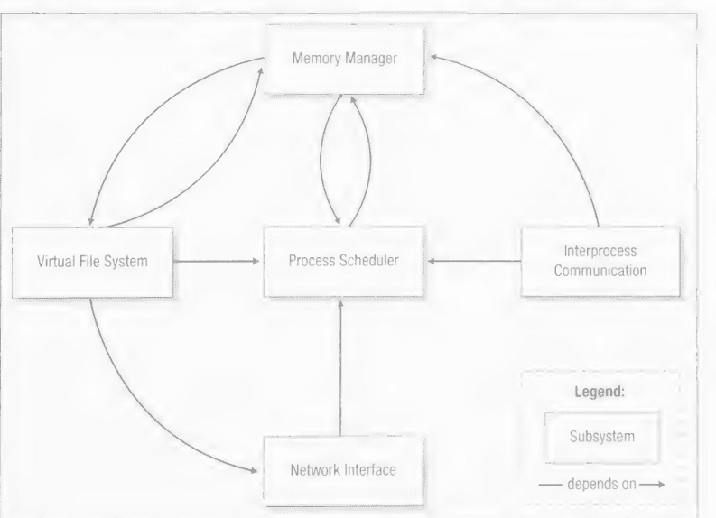

图 1.2 内核子系统概述。

需要挂起该进程，直到硬件成功完成消息发送。硬件发送完成后（或硬件返回失败），网络接口将通过返回一个指示操作成功或失败的返回码来恢复进程。其他子系统（内存管理器、虚拟文件系统和进程间通信）由于类似的原因也依赖于进程调度器。

其他依赖关系不那么明显，但同样重要：

- 进程调度器子系统在恢复进程时使用内存管理器调整特定进程的内存映射。
- 进程间通信子系统依赖内存管理器来支持共享内存通信机制。该机制允许两个进程在通常的私有内存之外访问公共内存区域。
- 虚拟文件系统使用网络接口支持网络文件系统（`NFS`），并使用内存管理器提供内存磁盘（`ramdisk`）。
- 内存管理器使用虚拟文件系统来支持交换；这是内存管理器依赖进程调度器的唯一原因。当进程访问当前被交换出的内存时，内存管理器会向文件系统发出请求从持久性存储中获取内存，并挂起该进程。

除了显式显示的依赖关系外，内核中的所有子系统都依赖于某些未在任何子系统中显示的公共资源。这些包括所有内核子系统用于为内核分配和释放内存的程序、打印警告或错误消息的程序以及系统调试例程。这些资源将不会被显式引用，因为被假设在图 1.1 的内核层中随处可用并使用。

此层面的架构风格类似于 `Garlan` 和 `Shaw` 讨论的抽象风格（[`Garlan 1994`]）。所示的每个子系统都包含通过过程化接口访问的状态信息，且子系统负责维护其所管理资源的完整性。

#### 1.4 支持多位开发人员

`Linux` 系统是由大量的志愿者开发的（当前的 `CREDITS` 文件列出了 196 名参与过 `Linux` 系统的开发者）。大量的开发者以及存在志愿者的事实影响了系统应该如何进行架构。对于如此大量的开发者，紧耦合的系统将非常难以开发。由于由于原因，`Linux` 系统被设计为高度模块化。例如，硬件设备、逻辑文件系统模块、网络设备驱动程序和网络协议模块预计需要最多的修改。该组织支持 `Melvin Conway` 提出的著名经验法则（参见 `Raymond` `[1993]`），即系统组织往往反映开发者的组织。大多数开发者都在这些领域工作。内核的这四个领域被设计为最支持扩展性，这并不意外。

### `Linux` 内核概念架构：第1章


图 1.3

开发者职责划分。

## 1.5.4 数据连接

所有的数据结构都根植于进程调度器的任务列表（`task list`）。系统上的每个进程都有一个数据结构，包含指向其内存映射信息的指针，以及指向所有已打开文件节点（`i-nodes`）的指针。最后，任务数据结构还包含指向每个任务相关的所有打开网络连接的数据结构的指针。

# 第2章

# 子系统架构

## 2.1 进程调度器架构

### 2.1.1 目标

进程调度器是 `Linux` 内核中最重要的子系统。它的目的是控制对计算机 `CPU`（们）的访问。这不仅包括用户进程的访问，还包括其他内核子系统的访问。

### 2.1.2 模块

调度器分为三个主要模块：

1. 调度策略模块负责判断哪个进程将获得 `CPU` 的访问权限；该策略的设计使得进程能够公平地访问 `CPU`。
2. 架构特定模块通过通用接口进行设计，以抽象任何特定计算机架构的细节。这些模块负责与 `CPU` 通信以挂起和恢复进程。这些操作涉及知道每个进程需要保留哪些寄存器和状态信息，并执行汇编代码来影响挂起或恢复操作。
3. 架构无关模块与策略模块通信，以确定下一个执行哪个进程，然后调用架构特定模块来恢复相应的进程。此外，该模块还调用内存管理器，以确保为恢复的进程正确恢复内存硬件。

# 464 Linux 内核概念架构：第2章

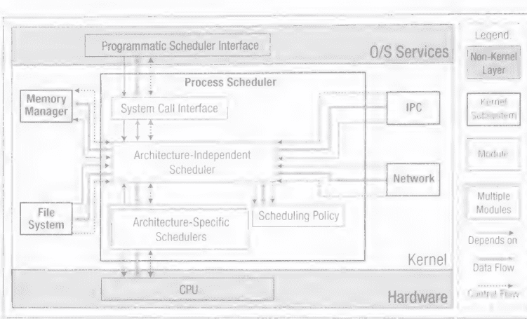

图 2.1 上下文中进程调度器子系统。

系统调用接口模块允许用户进程访问由内核显式导出的资源。这把用户进程对内核的依赖限制在一个定义良好且很少变化的接口上，尽管其他内核模块的实现发生了变化。

### 2.1.3 数据表示

调度器维护一个数据结构，即任务列表，每个活动进程有一个条目。该数据结构包含了足够挂起和恢复进程的信息，但也包含了额外的计数和状态信息。该数据结构在整个内核层中都是公开可见的。

### 2.1.4 依赖、数据流和控制流

如前所述，进程调度器会调用内存管理器子系统，因此进程调度器子系统依赖于内存管理器子系统。此外，所有内核子系统都依赖进程调度器在等待硬件请求完成时挂起和恢复进程。这些依赖通过函数调用和对共享任务列表数据结构的访问来实现。所有内核子系统都会读写表示当前任务的数据结构，导致了贯穿系统的双向数据流。

除了内核层内部的数据和控制流外，操作系统服务层提供了一个接口，供用户进程注册定时器通知。这对应于 `[Garlan 1994]` 中描述的隐式执行架构风格。这导致了从调度器到用户进程的控制流。恢复休眠进程的通常情况不被视为正常意义上的控制流，因为用户进程无法检测此操作。最后，调度器与 `CPU` 通信以挂起和恢复进程；这导致了数据流和控制流。`CPU` 负责中断当前执行的进程并允许内核调度另一个进程。

## 2.2 内存管理器架构

### 2.2.1 目标

内存管理器子系统负责控制进程对硬件内存资源的访问。这是通过一个硬件内存管理系统实现的，该系统提供了进程内存引用与机器物理内存之间的映射。内存管理器按进程维护这种映射，使得两个进程可以访问相同的虚拟地址并使用不同的物理内存位置。此外，内存管理器子系统支持交换（`swapping`）；它将未使用的内存页移动到持久性存储中，以便计算机支持比物理内存更多的虚拟内存。

### 2.2.2 模块

内存管理器子系统由三个模块组成：

1. 架构特定模块向内存管理器硬件呈现虚拟接口
2. 架构无关管理器执行所有的按进程映射和虚拟内存交换。该模块负责在发生页异常时决定驱逐哪些内存页——这里没有独立的策略模块，因为预计该策略不需要更改。
3. 提供了一个系统调用接口，以为用户进程提供受限访问。该接口允许进程分配和释放存储，还可以执行内存映射文件 `I/O`。

### 2.2.3 数据表示

内存管理器存储按进程的物理地址到虚拟地址的映射。这种映射作为引用存储在进程调度器的任务列表数据结构中。除了这种映射，数据块中的额外细节告诉内存管理器如何获取和存储页。例如，可执行代码可以使用可执行镜像作为备份存储，但动态分配的数据必须由系统分页文件提供支持。最后，内存管理器在此结构中存储权限和计数信息，以确保系统安全。

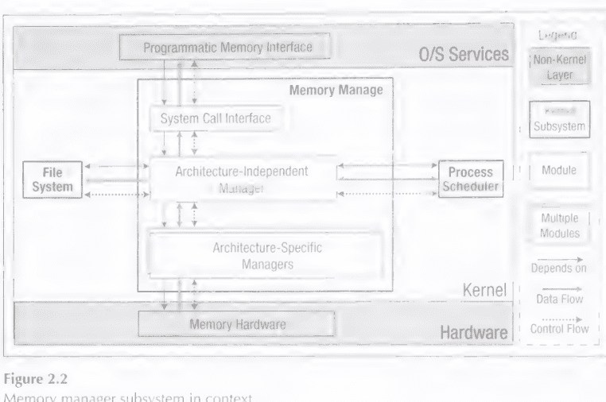

### 2.2.4 数据流、控制流和依赖

内存管理器控制内存硬件，并在发生页异常时接收硬件通知——这意味着内存管理器模块与内存硬件之间存在双向的数据流和控制流。此外，内存管理器使用文件系统支持交换和内存映射。这种需求意味着内存管理器需要调用文件系统来存储和获取页。由于文件系统请求可以立即完成，内存管理器需要挂起进程直到内存换回；这种需求导致内存管理器调用进程调度器。此外，由于每个进程的映射存储在进程调度器的结构中，内存管理器与进程调度器之间存在双向数据流。用户进程可以在地址空间内设置新的映射，并注册这些映射区域内的页异常通知。这引入了从内存管理器通过系统调用接口到用户进程的控制流。传统意义上没有来自用户进程的数据流，但用户可以使用系统调用接口模块中的系统调用从内存管理器检索某些信息。

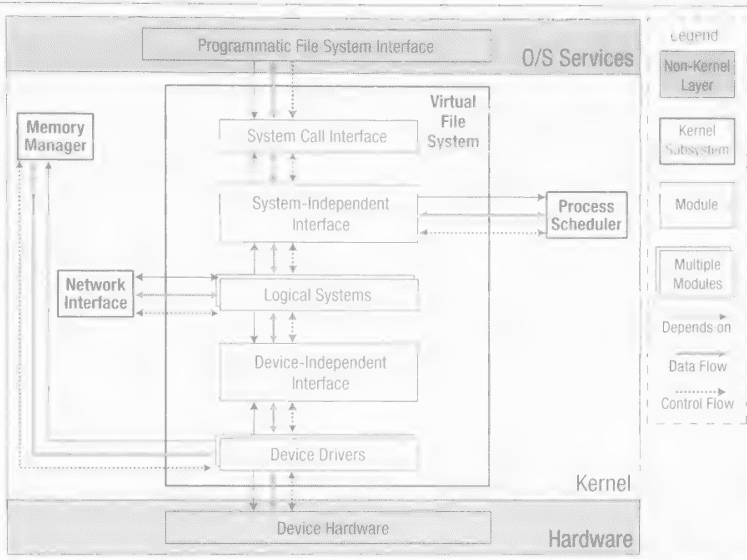

图 2.3 上下文中虚拟文件系统。

## 2.3 虚拟文件系统架构

### 2.3.1 目标

虚拟文件系统旨在为硬件设备上的数据提供一致的视图。计算机中的几乎所有硬件设备都使用通用设备驱动接口表示。虚拟文件系统进一步允许管理员在任何物理设备上挂载任何逻辑文件系统。逻辑文件系统促进与其他操作系统标准的兼容性，并允许开发者实现不同策略的文件系统。虚拟文件系统抽象了物理设备和逻辑文件系统的细节，允许用户使用通用接口访问文件，而无需一定知道文件位于哪个物理或逻辑系统上。

除了传统的文件系统目标外，虚拟文件系统还负责加载新的可执行程序。这一职责由逻辑文件系统模块完成，这使得 `Linux` 支持多种可执行格式。

### 2.3.2 模块

1. 每个支持的硬件控制器都有一个驱动模块。由于存在大量不兼容的硬件设备，因此大量的设备驱动程序。`Linux` 系统最常见的扩展是添加新的设备驱动程序。
2. 设备无关接口模块提供了所有设备的一致性视图。
3. 每个支持的文件系统都对应一个逻辑文件系统模块。
4. 系统无关接口呈现了独立于硬件和逻辑文件系统的硬件资源视图。该模块使用块面向或字符面向的文件接口来呈现所有资源。
5. 最后，系统调用接口为用户进程提供了对文件系统的受控访问。虚拟文件系统仅向用户进程导出特定的功能。

## 2.3.3 数据表征

所有文件都使用 `i-node`（索引节点）来表示。每个 `i-node` 结构都包含位置信息，用于指定文件块在物理设备上的位置。此外，`i-node` 还存储了指向逻辑文件系统模块和设备驱动程序中例的指针，这些例将执行读写操作。通过这种方式存储函数指针，逻辑文件系统和设备驱动程序可以向内核注册自身，而无需内核依赖任何特定模块。

## 2.3.4 数据流、控制流与依赖

一种特定的设备驱动是 `ramdisk`（内存磁盘）；该设备分配了主内存区域并将其视为持久性设备。该设备驱动程序使用内存管理器来完成任务，文件系统设备驱动程序与内存管理器之间存在依赖、控制流和数据流。

运行的逻辑文件系统之一是网络文件系统（仅作为客户端）。该文件系统访问另一台机器上的文件，就像它们是本地机器的一部分一样。为了实现这一点，逻辑文件系统模块之一使用网络子系统来完成任务。这在两个子系统之间引入了依赖、控制流和数据流。

正如第 2.2 节所述，内存管理器使用虚拟文件系统完成内存交换和内存映射 `I/O`。此外，虚拟文件系统使用进程调度器在等待硬件请求完成时禁用进程，并在请求完成后恢复它们。最后，系统调用接口允许用户调用虚拟文件系统来存储或检索数据。与之前的系统不同，用户没有一种可以注册隐式调用的机制，因此没有从虚拟文件系统到用户进程的控制流（恢复进程不被视为控制流）。

## 2.4 网络接口架构

### 2.4.1 目标

网络子系统允许 `Linux` 系统通过网络连接到其他系统。它支持许多可能的硬件设备，并可以使用许多网络协议。网络子系统抽象了这些实现细节，使得用户进程和其他内核子系统可以访问网络，而不必一定知道正在使用何种物理设备或协议。

### 2.4.2 模块

1. 网络设备驱动程序与硬件设备通信。每个可能的硬件设备都有一个设备驱动模块。
2. 设备无关接口模块提供了所有硬件设备的一致性视图，使得子系统的较高层不需要对所使用的硬件有特定知识。

图 2.4 上下文网络接口子系统。

3. 网络协议模块负责实现各种可能的网络传输协议。
4. 协议无关接口模块提供了一个独立于硬件设备和网络协议的接口。其他内核子系统使用该接口模块访问网络，而无需对特定协议或硬件产生依赖。

最后，系统调用接口模块限制了用户进程访问的导出例程。

### 2.4.3 数据表征

每个网络对象都以 `socket`（套接字）的形式表示。`socket` 与进程的关联方式与 `i-node` 的关联方式相同；通过让两个任务数据结构指向同一个 `socket` 数据结构，`socket` 可以在进程之间共享。


## 2.4.4 数据流、控制流与依赖

网络子系统使用进程调度器在等待硬件请求完成时挂起和恢复进程（导致了子系统依赖以及控制和数据流）。此外，网络子系统为虚拟文件系统提供了逻辑文件系统（`NFS`）的实现，导致虚拟文件系统依赖于网络接口并与其产生数据和控制流。

## 2.5 进程间通信架构

为了简洁起见，省略了进程间通信子系统的架构，因为它不像其他子系统那样有趣。

## 第 3 章

结论

`Linux` 内核是整个 `Linux` 系统架构中的一层。内核在概念上由五个主要子系统组成：进程调度器、内存管理器、虚拟文件系统、网络接口和进程间通信接口。这些子系统通过函数调用和共享数据结构相互交互。

在最高层，`Linux` 内核的架构风格接近 Garlan 和 Shaw 的数据抽象风格（Garlan 1994）；内核由子系统组成，这些子系统通过使用特定的过程技术来维持内部表示的一致性。随着每个子系统的详细化，我们看到一种类似于 Garlan 和 Shaw 提出的分层风格的架构风格。每个子系统由仅与相邻层通信的模块组成。

`Linux` 内核的概念架构已证明了它的成功；这种成功的关键因素是对开发者的组织以及对系统扩展性的考虑。`Linux` 内核架构需要支持大量的开发者。这一要求意味着最需要开发的系统部分——设备驱动程序和网络协议——以可扩展的方式实现。`Linux` 架构师选择使用数据抽象技术使这些系统具有可扩展性：每个硬件驱动程序都实现为一个独立的模块，支持公共接口。通过这种方式，单个开发者可以添加设备驱动程序，而与 `Linux` 内核的其他开发者交互极少。大量开发者实现内核证明了这一策略的正确性。

`Linux` 内核的另一个重要扩展是增加硬件平台。系统架构通过将所有特定的硬件代码分离到不同的模块来支持这种扩展性。通过这种方式，少数开发者可以通过重新实现内核的机器部分，将 `Linux` 内核移植到新的硬件架构。

## 附录 A

术语定义

### 设备驱动

设备驱动是与特定硬件接口所需的所有代码。设备驱动程序属于内核，但 `Linux` 内核有一种允许动态加载设备驱动程序的机制。

### 索引节点 (I-Node)

索引节点被文件系统用于跟踪哪些硬件地址对应哪些文件系统数据块。每个索引节点存储了文件块到物理块的映射，以及用于安全和目的附加信息。

### 网络文件系统 (NFS)

`NFS` 是一种文件系统接口，将存储在远程计算机上的文件作为本地机器的文件系统。

### 进程

进程（也称为任务）是执行中的程序；它包含可执行代码和动态数据。内核与每个进程关联足够的信息以停止和恢复它。

### 内存磁盘 (Ramdisk)

`Ramdisk` 是一种将主内存区域作为文件系统设备的驱动程序。这允许频繁访问的文件放置在一个可以始终提供可靠高效访问的区域中；这在用 `Linux` 支持硬盘时特别有用。

实时性要求。对于通常情况，普通的文件系统缓存将最有效地利用内存，为文件提供相当高效的访问。

### 交换 (Swapping)

`Linux` 支持使用内存超过计算机物理内存量的进程。这是通过内存管理器将未使用的内存页交换到持久性存储器来实现的；以后访问这些内存时，它们会被交换回主内存（可能会导致其他页面被换出）。

### 任务 (Task)

参见 进程。

## 附录 B

## 参考文献

`Garlan 1994`

David Garlan and Mary Shaw, *An Introduction to Software Architecture*, Advances in Software Engineering and Knowledge Engineering, Volume I, World Scientific Publishing Company, 1993.

`Monroe 1997`

Robert T. Monroe, Andrew Kompanek, Ralph Melton, and David Garlan, Architectural Styles, Design Patterns, and Objects, IEEE Software, January 1997, pp 43-52.

`Parker 1997`

*Slackware Linux Unleashed*, by Timothy Parker, et al, Sam Publishing, 201 West 103rd Street, Indianapolis.

`Perry 1992`

Dewayayne E. Perry and Alexander L. Wolf, *Foundations for the Study of Software Architecture*, ACM SIGSOFT Software Engineering Notes, 17:4, October 1992 pp. 40-52.

`Raymond 1993`

*The New Hackers Dictionary*, 2nd edition, compiled by Eric S. Raymond. The MIT Press, Cambridge Massachusetts, 1993.

`Rusling 1997`

*The Linux Kernel*, by David A. Rusling, draft, version 0.1-13(19), http://sunsite.unc.edu/pub/Linux/linux-doc-project/linux-kernel/ or http://www.linuxhq.com/guides/TLK/index.html.

`Soni 1995`

Soni, D.; Nord, R. L.; Hofmeister, C., *Software Architecture in Industrial Applications*, IEEE ICSE 1995, pp. 196-210.

`Tanenbaum 1992`

*Modern Operating Systems*, by Andrew S. Tanenbaum, Prentice Hall, 1992.

`Wirzenius 1997`

*Linux System Administrators' Guide 0.6*, by Lars Wirzenius, http://www.iki.fi/liw/linux/sag/ or http://www.linuxuxq.com/LDP/LDP/sag/index.html.

## 第五部分

## `Linux` 内核的具体架构 (Concrete Architecture Of The `Linux` Kernel)

Ivan Bowman, Saheem Siddiqi, 和 Meyer C. Tanuan

Ivan Bowman

(ibowman@sybase.com)

Saheem Siddiqi

(+4siddiqi@neumann)

Meyer C. Tananum

(mtanuan@descartes.com)

滑铁卢大学计算机科学系

Waterloo, Ontario N2L 3G1

`CS 746G`, 1998年冬季

- 幻灯片

地址：`http://plg.uwaterloo.ca/~itbowman/CS746G/a2`

# 摘要 (Abstract)

本报告目的是描述 `Linux` 内核的具体（已构建的）架构。`Linux` 内核的具体架构描述可作为开发者修改和扩展现有内核源码的高级规范。

我们使用了一种逆向工程工具（`Portable Bookshelf`）从 `Linux` 内核中提取了详细的设计信息。我们面临的最大挑战是将海量的提取信息聚类为子系统。我们根据对现代操作系统的领域特定知识对提取的信息进行聚类；在迭代过程中使用了 `Software Landscape` 可视化工具来查看并精炼这种聚类。

尽管 `Portable Bookshelf` 工具提供了详细的设计信息和一些基于文件名的初始聚类，但我们发现这不足以形成具体的架构描述。该提取工具未能准确提取依赖关系。它遗漏了一些依赖关系，并断言某些依赖关系不存在。该工具没有自动提供有助于理解系统的结构。我们通过 `Linux` 内核的概念模型验证了提取出的设计事实，并精炼了聚类。

我们得出结论：仅凭 `Portable Bookshelf` 工具无法准确描述 `Linux` 内核的具体架构。我们通过使用领域特定知识来描述具体架构，弥补了这一局限性。

# 第一章

# 引言 (Introduction)

## 目的 (Purpose)

本报告的目标是描述 `Linux` 内核的具体架构。具体架构指的是系统在构建时的架构。我们打算开发具体架构，为现有 `Linux` 内核提供高级文档。

## `Linux` 简介 (Introduction To `Linux`)

Linus B. Torvalds 于 1991 年编写了第一个 `Linux` 内核。`Linux` 之所以流行是因为一直作为免费软件发布。由于源代码容易获取，用户可以自由更改内核以满足其需求。然而，在编写新的系统程序之前，理解 `Linux` 内核是如何演变的以及它目前是如何运作的重要。


基于 Linux 内核源码的具体架构可以为 Linux 内核黑客和开发者提供可靠且最新的参考。自 1991 年以来，一组通过互联网 Usenet 新闻群组通信的志愿者对 Linux 进行了多次修订。到为止，Torvalds 一直担任主要的内核开发人员。在 Torvalds 不再参与 Linux 内核的情况下，如果维护一个最新的架构，我们可以合理预期 Linux 内核可以得到增强和修改。

Linux 是一个兼容 Unix 的系统。大多数运行在 Linux 下的常用 Unix 工具和程序最初都是为 Intel 386 开发的。原始版本并不容易迁移到其他平台，因为它使用了特定的中断处理例程。当 Linux 迁移到 DEC Alpha 和 Sun SPARC 等平台时，许多平台相关的代码被移动到了特定的模块中，以支持通用接口。

Linux 用户群很大。1994 年，Ed Chi 估计 Linux 有 40,000 名用户。Linux 文档项目（LDP）正在为 Linux 内核编写实用且可靠的文档，供 Linux 用户和开发者使用。据我们所知，LDP 并没有使用逆向工程实践维护最新的架构。关于 Linux 内核有很多书籍和文档 `[CS746 Bibliography]`。然而，没有可用文档同时描述概念和具体架构。

# 软件架构背景

软件架构的研究在工业界和学术界日益受到关注。软件架构涉及大型系统的研究。最近的研究表明，软件架构很重要，因为它增强了利益相关者之间的通信。软件架构可以用于早期的设计决策；也可以作为系统的迁移抽象 `[Bass 1998]`。

软件架构与软件维护有关。维护现有遗留系统通常存在问题。这些现有系统的状态从文档齐全到设计糟糕且缺乏文档不等。在许多情况下，部分或全部原始架构师和开发者可能不再参与现有系统。这种架构知识的缺乏极大增加了软件维护任务的复杂度。为了更改、修改或删除现有功能，需要理解该系统的实现。这一问题强化了从现有系统提取架构的技术需求。逆向工程学科有两个主要领域 `[Bass 1998]`：

- 技术方法：这些提取方法基于现有构制品获取系统信息。特别是源代码、注释、用户文档、可执行模块和系统描述经常被提取。
- 人类知识和推理：这些方法关注人类如何理解软件。通常，人类调查者会使用以下策略：
  - 自上而下策略：从最高抽象层级开始，递归地填充对子部分的理解。
  - 自下而上策略：理解最低层组件以及这些组件如何协同工作以实现系统目标。
  - 基于模型的策略：理解系统运行机制的心理模型，并尝试加深对所选区域的理解。
  - 机会性策略：使用上述方法的某种组合。

在本文报告中，我们同时使用了技术知识和人类知识方法来描述 Linux 内核的具体架构。机会性策略遵循了与 `[Tzerpos 1996]` 的混合方法相同的策略。我们没有使用来自 Linux 内核开发者的“实时”信息，而是利用我们对现代操作系统的领域特定知识（即作业 1 中的概念架构）来反复完善 Linux 内核的型架构。

## 方法论/途径

在本报告中，我们使用机会性策略来开发 Linux 内核的型架构。我们使用了 `[Tzerpos 1996]` 混合方法的修改版本来确定 Linux 内核的结构。这些步骤并不一定按顺序排列：

- 定义概念架构。由于我们无法直接获取开发者的“实时”信息，因此我们利用现代操作系统的知识创建了 Linux 内核的概念架构。这一步是在作业 1 中完成的（`[Bowman 1998]`, `[Siddiqui 1998]` 和 `[Tamian 1999]`）。
- 从源代码中提取事实。我们使用 Portable Notebook 的 `cfe` 和 `fbgen`（在 `[Holt 1997]` 中描述）从源代码中提取依赖事实。
- 聚类为子系统。我们使用 Fact Manip（即 `grep` 和脚本）将事实聚类为子系统。这种聚类部分通过工具（使用文件名和目录）完成，部分通过我们对 Linux 内核的概念模型完成。
- 验证生成的软件架构。我们使用 Landscape Layout、调整器、编辑器和查看器（`[Holt 1997]`）将提取的设计信息可视化。根据这些图表，我们可以直观地看到子系统之间的依赖关系。景观图确认了我们对具体架构的理解。在提取的架构与概念架构不符的情况下，我们会检查源代码和文档方法论。
- 使用概念架构精炼聚类。我们使用 Linux 内核的概念架构来验证组件的聚类以及这些组件的依赖关系。
- 使用概念架构精炼布局。结合上一步，我们使用 Visio 绘图工具手动绘制了 Linux 内核结构的布局。

Linux 内核有多种视图，取决于动机和观点。在本报告中，我们使用软件结构（`[Mancoridis Slides]`）来描述具体架构。我们使用该软件执行了以下操作：

- 指定 Linux 内核分解为五个主要子系统
- 描述组件（即子系统和模块）的接口
- 描述组件之间的依赖关系

我们描述了资源之间的依赖关系，其中资源可以是子系统、模块或变量。依赖关系非常广泛；我们通常不区分函数调用、变量引用和类型使用。

软件结构对 Linux 内核的运行时结构描述较少。然而，我们认为带有详细规范的软件结构提供了足够的信息，让潜在的 Linux 开发者可以在不查看所有源代码的情况下修改或扩展 Linux。我们并不主要关注 Linux 内核的进程视图 `[Kruchten 1995]`，因为我们将 Linux 内核视为单一的可执行文件。

## 读者画像

我们假设读者在计算机科学和操作系统方面具有足够的背景，能够彻底理解报告中关于 Linux 内核主要组件及其相互作用的讨论。我们不假设读者对 Linux 操作系统有深入了解。

## 报告结构

本文的剩余部分组织如下：

- 第 2 节描述了整体系统架构。它描述了显示五个主要子系统及其相互依赖关系的系统架构。
- 第 3 节描述了主要子系统的架构：进程调度器、内存管理器、虚拟文件系统、进程间通信、网络接口。每个子系统的描述将由一个图表支持，显示上下文中的子系统并用线条表示依赖。它还包含了对 Linux 内核源代码中提取的系统抽象和设计信息的解读。
- 第 4 节描述了我们在报告中遇到的问题，以及我们得到的发现和结论。

## 第 2 章：系统结构

Linux 内核本身是无用的，它作为整个系统的一层存在（`[Bowman 1998]`）。

在内核层内部，Linux 由五个主要子系统组成：进程调度器（`sched`）、内存管理器（`mm`）、虚拟文件系统（`vfs`）、网络接口（`net`）和进程间通信（`ipc`）。实际构建的架构分解与 `[Siddiqi 1998]`, `[Tanuan 1998]` 和 `[Bowman 1998]` 的概念架构分解相似。概念架构源自实际构建架构，这并不令人意外。我们的分解并没有完全遵循源代码的目录结构，因为我们认为这不能完美匹配子系统的分组；然而，我们的聚类与该目录非常接近。

在可视化提取的设计细节后，一个明显的区别是，子系统的依赖关系与概念依赖关系截然不同。概念架构建议的系统间依赖非常少，如图 2.1a 所示（来自 `[Bowman 1998]`）。

尽管概念架构的依赖很少，但具体架构显示 Linux 内核的五个主要子系统是高度依赖的。图 2.1b 显示，连接仅相对于完整图缺少两条边（`[IPS-Kernel.html]`）。这种相互依赖关系与概念架构形成了鲜对比。

图 2.1 概念与具体的系统分解。

`[Muller 1993]` 中描述的方法无法从该系统中提取任何相关的结构。这验证了 Tzerpos（`[1996]`）讨论的混合方法。

系统层的差异是子系统层差异的特征。子系统结构在很大程度上对应概念结构。然而，我们在具体架构中发现了许多概念架构中不存在的依赖——正如 `[Murphy 1995]` 所说的差异。这些额外依赖的原因将在后续节讨论，我们将检查每个主要子系统的详细设计。

## 第 3 章：子系统结构

### 进程调度器

## 目标

进程调度是 Linux 操作系统的核心。进程调度器承担以下职责：

- 允许进程创建自身的副本
- 确定哪个进程将访问 CPU 并实现运行进程之间的切换
- 接收中断并将其路由到相应的内核子系统
- 向用户进程发送信号
- 管理定时器硬件
- 在进程执行结束时清理进程资源

进程调度器还支持动态加载模块；这些模块代表在内核启动后可以加载的功能。这种可加载模块功能用于虚拟文件系统和网络接口。

## 外部接口

进程调度器提供两个接口：首先，它为用户进程提供有限的系统调用接口；其次，它为内核的其他部分提供丰富的接口。

进程只能通过复制现有进程来创建其他进程。在启动时，Linux 系统只有一个运行的进程 `init`。此进程会产生其他进程，这些进程也可以通过 `fork()` 系统调用产生自身的副本。`fork()` 会产生一个新的子进程，该进程是父进程的副本。在终止时，进程会（隐式或显式地）调用 `_exit()` 系统调用。


系统提供了多种途径来处理可加载模块。`create_module()`系统调用会分配足够的内存来加载模块。该调用将初始化下述的模块结构，其中包含分配模块的名称、大小、起始地址和初始状态。`init_module()`系统调用会从磁盘加载模块并激活它。最后，`delete_module()`会卸载正在运行的模块。

定时管理可以通过`setitimer()`和`getitimer()`例程完成。前者设置定时器，后者获取定时器的值。

在最重要的信号函数中，是`signal()`。该例程允许用户进程将函数处理程序与特定的信号关联。

### 子系统描述

进程调度器系统主要负责用户进程的加载、执行和正确终止。调度算法在用户进程执行期间会在两个不同的点被调用。首先，有直接调用调度器的系统调用，例如`sleep()`。其次，在每次系统调用之后，以及每次低级系统中断（稍后描述）之后，都会调用调度算法。

信号可以被视为一种 IPC 机制，因此在进程间通信章节中进行讨论。

中断允许硬件与操作系统进行通信。Linux 区分了慢中断和快速中断。慢中断是典型的中断。其他中断在处理期间是合法的，一旦慢中断的处理完成，Linux 将照常执行业务，例如调用调度算法。定时器中断是慢中断的典型。快速中断用于处理较不复杂的任务，例如处理键盘输入。其他中断在处理期间会被禁用，除非被快速中断处理程序显式地启用。

Linux 操作系统使用定时器中断每隔 10 毫秒触发一次。因此，根据上述对调度器的描述，任务重新调度至少每 10 毫秒发生一次。

### 数据结构

`task_struct`结构代表一个 Linux 任务。它有一个表示进程状态的字段；该值可能有以下几种：

- 运行（`running`）
- 从系统调用返回（`returning from system call`）
- 正在处理中断例程（`processing interrupt routine`）
- 正在处理系统调用（`processing a system call`）
- 就绪（`ready`）

此外，还有一个指示进程优先级的字段，以及一个持有时钟滴数（10 毫秒间隔）的字段，该进程可以在不被强制重新调度的情况下继续执行。还有一个字段持有上一次故障系统调用的错误号。

为了跟踪所有正在执行的进程，系统维护了一个双链表（通过两个指向 `task_struct` 的字段实现）。由于每个进程都与其他某些进程相关，因此有描述进程的字段：原始父进程、父进程、最小儿子、较小的兄弟，最后是年长的兄弟。

有一个嵌套结构 `mm_struct`，它包含了进程的内存管理信息（例如代码段的起始和地址）。

进程 ID（`PID`）信息也保存在 `task_struct` 中。存储了进程 ID 和组 ID（`GID`）。一个组 ID 数组使得一个进程可以关联到多个组。

特定于文件的进程数据位于 `fs_struct` 子结构中。它将包含一个指向对应进程根目录的 `inode` 的指针，以及其当前的工作目录。

进程打开的所有文件将通过 `task_struct` 中的 `files_struct` 子结构进行跟踪。

最后，还有持有计时信息的字段；例如，进程在用户模式下花费的时间。

所有正在执行的进程在进程表中都有一个条目。进程表实现为指向 `task_struct` 结构的指针数组。进程表中的第一个条目是特殊的 `init` 进程，它是 Linux 系统执行的第一个进程。

最后，实现了一个模块结构来表示已加载的模块。该结构包含了用于实现模块结构列表的字段：一个指向模块符号表的字段，以及另一个持有模块名称的字段。模块大小（以页为单位）和指向模块起始内存的指针也是模块结构中的字段。

### 子系统结构

图 3.1 显示了进程调度器子系统。它被用于表示进程调度和管理（即加载和卸载），以及定时器管理和模块管理功能。

## 490 Linux 内核的具体架构：第 3 章

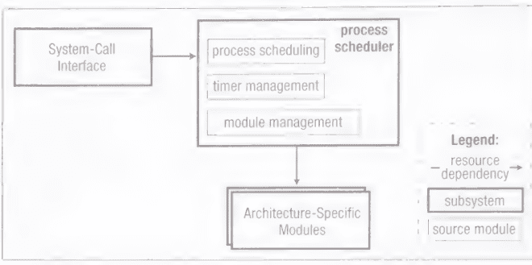

图 3.1

进程调度器结构。

### 子系统依赖关系

图 3.2 显示了进程调度器如何依赖于其他内核子系统。进程调度器要求内存管理器在调度进程时设置内存映射。此外，进程调度器依赖 `IPC` 子系统的用于下半部的等待队列（在第 3.3 节讨论）。最后，进程调度器依赖文件系统从持久性设备加载可加载模块。所有子系统都依赖于进程调度器，因为它们需要等待硬件操作完成。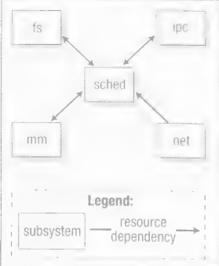

图 3.2

进程调度器依赖关系。

## 内存管理器

如前文所述，内存管理器提供：

- **大地址空间**：内存管理器允许进程使用内存。
- **保护**：内存管理器防止进程覆盖。
- **公平访问**：内存管理器确保系统。
- **共享内存**：内存管理器允许进程共享。

### 外部接口

内存管理器提供了以下接口：

- 系统调用：`malloc()` / `free()`
- `mmap()` / `munmap()` / `msync()`
- `mprotect()`
- `mlock()` / `mlockall()` / `munlock()` / `munlockall()`
- `swapon()` / `swapoff()`
- 内核内部：`kmalloc()` / `kfree()`
- `verify_area()` / `get_page()` / `free_page()`

### 子系统描述

由于 Linux 支持多个平台，内存管理器有一个特定平台的部分将硬件抽象为通用接口。内存管理器使用硬件将虚拟地址映射到物理地址。当用户进程访问内存位置时，硬件管理器翻译此虚拟地址。由于映射的存在，用户进程感知物理地址。这允许内存管理器子系统移动进程内存。

此外，内存管理器会在进程空闲时将其换出。这允许系统执行超过可用内存的进程。内存管理器包含一个守护进程（`daemon`）。Linux 使用守护进程作为内核线程；守护进程以与进程相同的方式调度，但直接访问数据结构。

`kswapd` 守护进程定期检查是否存在未被引用的物理内存页。这些页面会被物理内存中驱出；如果需要，它们会被存储在磁盘上。内存管理器子系统会特别注意磁盘活动。

当用户进程访问当前未映射到物理位置的内存地址时，硬件管理器会检测到这一点。硬件管理器通知 Linux 内核发生页异常，并由内存管理器系统来解决该异常。有两种可能：要么进程当前被交换到磁盘，必须换回，要么用户进程正在对映射内存之外的地址进行无效引用。硬件管理器还会检测对内存的无效引用，例如写入执行代码或执行数据。这些引用也会导致报告给内存管理器的异常。

### 数据结构

以下数据结构在架构上是相关的：

1.  `vm_area`——内存管理器为每个进程存储一个结构，记录哪些虚拟内存区域映射到哪些物理页。该数据结构还存储了一组函数指针，允许它对特定的执行操作进程虚拟内存的某个区域。例如，进程的可执行代码区域不需要交换到系统分页文件，因为可以使用可执行文件作为备份存储器。当进程虚拟内存的某些区域被映射时（例如加载一个可执行文件时），会为虚拟地址空间中的一个连续区域设置 `mem_area_struct`。由于在发生页异常时查找 `mem_area_struct` 的速度至关重要，这些结构存储在 `AVL` 树中。
2.  `mem_map`——内存管理器为系统中的每个物理页维护一个数据结构。该数据结构包含指示页面状态的标志（例如，是否正在使用）。所有页数据结构都存储在一个向量（`mem_map`）中，该向量在内核启动时初始化。随着页面状态的变化，该数据结构中的属性也会随之更新。
3.  `free_area`——`free_area` 向量用于存储未分配的物理内存页；在分配时从 `free_area` 中移除，在释放时返回。在从 `free_area` 分配页面时，会使用伙伴系统 [Knowton 1965; Tanenbaum 1992]。

### 子系统结构

内存管理器子系统由多个源代码模块组成；这些模块可以根据职责划分为以下几组（如图 3.3 所示）：

- **系统调用接口**：这组模块负责通过定义良好的接口（前文讨论过）向用户提供内存器的服务。
- **内存映射文件** (`mmap`)：这组模块负责支持内存映射文件 `I/O`。
- **交换访问** (`swap`)：这组模块控制内存交换。这些模块启动页入（`page-in`）和页换出（`page-out`）操作。
- **核心内存管理器** (`core`)：这些模块负责供其他内核子系统使用的核心内存管理器功能。
- **特定体系模块**：这些模块为所有支持的硬件平台提供通用接口。这些模块执行命令以更改硬件 `MMU` 的虚拟内存映射，并在发生页异常时提供通知内存管理器子系统的方法。

内存管理器结构的一个方面是使用 `swapd`，这是一个决定哪些内存页应该被换出的守护进程。`swapd` 作为内核线程执行，并定期扫描正在使用的物理页，以检查是否有页面是交换的候选者。该守护进程与内存管理器子系统的其他部分并发执行。

### 子系统依赖关系

调度程序 (`sched`)、文件系统 (`fs`)、进程通信 (`ipc`) 和网络 (`net`) 每个都直接（通过数据结构和实现函数）使用内存管理器。这种依赖关系很难简洁地描述：


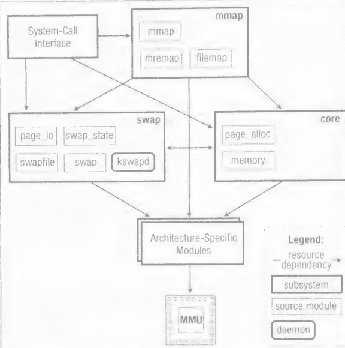

图 3.3 内存管理器结构。

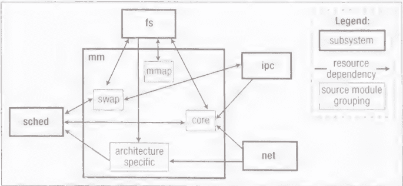

图 3.4 内存管理器依赖关系。

详细视图请参考 [PBS:mm.html]。图 3.4 显示了内存管理器与其他子之间的高级依赖关系。为了清晰起见，省略了内部依赖。

## 虚拟文件系统

Linux 设计用于支持许多不同的物理设备。即使对于特定种类的设备（如硬盘），硬件供应商之间也存在许多接口差异。除了 Linux 支持的物理设备，Linux 还支持许多逻辑文件系统。通过支持许多逻辑文件系统，Linux 可以与其他操作系统协作。Linux 文件系统支持以下目标：

- 多种硬件设备—提供对许多不同硬件设备的访问
- 多种逻辑文件系统—支持许多不同的逻辑文件系统
- 多种可执行格式—支持多种可执行格式（如 `a.out`, `ELF`, `java`）
- 同质性—为所有逻辑文件系统和硬件设备提供通用接口
- 性能—提供对文件的快速访问
- 安全—不丢失或损坏数据
- 安全—限制用户访问文件；通过配额限制文件总大小

## 外部接口

文件系统提供两级接口：用户进程可系统调用接口以及其他内核子系统使用的内部接口。系统调用接口处理文件和目录。对文件的操作包括 `POSIX` 标准系统提供的 `open/close/read/write/seek`；对目录的操作包括 `POSIX` 系统常用的 `readdir/create/unlink/chmod/stat`。

文件系统为其他内核子系统提供的接口要丰富得多。文件系统暴露了数据结构和实现函数，供其他内核子系统直接操作。特别是，向内核其他部分暴露了两个接口——`inodes` 和 `files`。文件子系统的其他实现细节也被其他内核子系统使用，但这种用法较少。

- `Inode` 接口：
  - `create()`：在目录中创建文件
  - `lookup()`：在目录内按名称查找文件
  - `link()` / `symlink()` / `unlink()` / `readlink()` / `follow_link()`：管理文件系统链接
  - `mkdir()` / `rmdir()`：创建或删除子目录
  - `mknod()`：等待目录、特殊文件或普通文件
  - `readpage()` / `writepage()`：向备份存储器读取或写入物理页
  - `truncate()`：将文件长度设置为零
  - `permission()`：检查用户进程是否有权限
  - `mmap()`：将文件映射到内存
  - `fsync()`：将文件缓冲区刷到磁盘
  - `ioctl()`：设备特定的控制操作
  - `select()`：等待 `I/O` 就绪
  - `open()`：打开文件
  - `read()`：从文件读取数据
  - `write()`：向文件写入数据
  - `close()`：关闭文件描述符
  - `chmod()`：更改文件权限
  - `stat()`：获取文件状态
  - `link()`：创建硬链接
  - `unlink()`：删除文件
  - `symlink()`：创建符号链接
  - `readlink()`：读取符号链接

系统调用已完成。通过将非关键工作推给下半部（bottom half）处理器，设备驱动程序可以减少中断延迟并提高并发性。

总之，设备驱动程序隐藏了操作外设 `CSR`（控制状态寄存器）的细节以及每个设备的数据传输机制。缓冲区缓存通过尝试从块设备的内存缓冲区中满足文件系统的请求，来帮助系统性能。

## 逻辑文件系统

虽然可以通过设备特殊文件访问物理设备，但更常见的方法是通过逻辑文件系统访问块设备。逻辑文件系统可以挂载到虚拟文件系统中的挂载点（mount point）上。这意味着相关的块设备包含了文件和结构信息，允许逻辑文件系统访问该设备。任何时候，物理设备只能支持一个逻辑文件系统；但是，设备可以重新格式化以支持不同的逻辑文件系统。在写作时，Linux 支持 15 种文件系统，这促进了与其他操作系统的互操作性。

当文件系统作为子目录挂载时，该设备上所有可用目录和文件都将显示为挂载点的子目录。虚拟文件系统的用户不需要知道是哪个逻辑文件系统实现了目录树的哪些部分，也不需要知道哪些物理设备包含了这些逻辑文件系统。这种抽象在物理设备和逻辑文件系统的选择上都提供了极大的灵活性，而这种灵活性是 Linux 操作系统成功的要素要素之一。

为了支持虚拟文件系统，Linux 使用了节点（`inodes`）的概念。Linux 使用 `inode` 来表示块设备上的文件。`inode` 是虚拟的，因为它包含了操作，这些操作会根据文件所在的逻辑系统和物理系统而有不同的实现。`inode` 接口使得所有文件在其他 Linux 子系统中看起来都是相同的。`inode` 被用作磁盘上所有与打开文件相关信息的存储位置。`inode` 存储了相关的缓冲区、以块为单位的文件总长度，以及文件偏移与设备块之间的映射。

## 模块

虚拟文件系统的大部分功能以动态加载模块的形式（在第 3.1 节描述）提供。这种动态配置允许 Linux 用户编译一个尽可能小的内核，同时允许在单个会话期间根据需要加载所需的设备驱动程序和文件模块。例如，Linux 系统可能选择性地在其并行端口上连接一个打印机。如果打印机驱动程序始终链接在内核中，那么当打印机不可用时就会浪费内存。通过将打印机驱动变为可加载模块，Linux 允许用户在硬件可用时加载驱动程序。

## 数据结构

以下数据结构在架构上与文件系统相关：

- `super_block`：每个逻辑文件系统都有一个关联的区块，用于向 Linux 内核的其他部分表示它。该块包含了关于整个挂载文件系统的信息——哪些块正在被使用、块大小是多少等。区块与 `inode` 类似，它们的行为就像通往逻辑文件系统的虚拟接口。

- `inode`：`inode` 是一个内存数据结构，表示内核所需的关于磁盘上文件的所有信息。单个 `inode` 可能会被多个打开了该文件的进程使用。`inode` 存储了内核与单个文件关联所需的所有信息。计数、缓冲和内存映射都存储在 `inode` 中。某些逻辑文件系统在磁盘上也有一个 `inode` 以持久化方式维护这些信息，但这与内核其他部分使用的 `inode` 数据结构是区分的。

- `file`：文件结构表示由特定进程打开的文件。所有打开的文件都存储在一个双向链表中（由 `first_file` 指向）；在 `POSIX` 风格例程（`open`, `read`, `write`）中使用的文件描述符（file descriptor）是该链表中特定打开文件的索引。

## 子系统结构

### 子系统依赖

图 3.6 显示了文件系统如何依赖其他内核子系统。同样，文件系统依赖于所有其他内核子系统，而所有其他内核子系统也依赖于文件系统。特别是网络子系统依赖于文件系统，因为网络套字以文件描述符的形式呈现给进程。内存管理器依赖文件系统支持交换（`swapping`）。`IPC` 子系统依赖文件系统来实现管道（`pipes`）和 `FIFO`。进程调度器依赖文件系统来加载可加载模块。

文件系统使用网络接口来支持 `NFS`；使用内存管理器来实现缓冲区缓存和 `ramdisk` 设备；使用 `IPC` 子系统来帮助支持可加载模块，并使用进程调度器在硬件请求完成时将用户进程置睡眠。更多细节，请参见 [PBS:fs.html]。

## 进程间通信

### 目标

提供 Linux `IPC` 机制是为了让并发执行的进程有一种手段来共享资源、同步并相互交换数据。Linux 通过共享资源、内核数据结构和等待队列实现了在同一系统上执行的进程之间所有形式的 `IPC`。

# 500 Linux 内核的具体架构：第 3 章

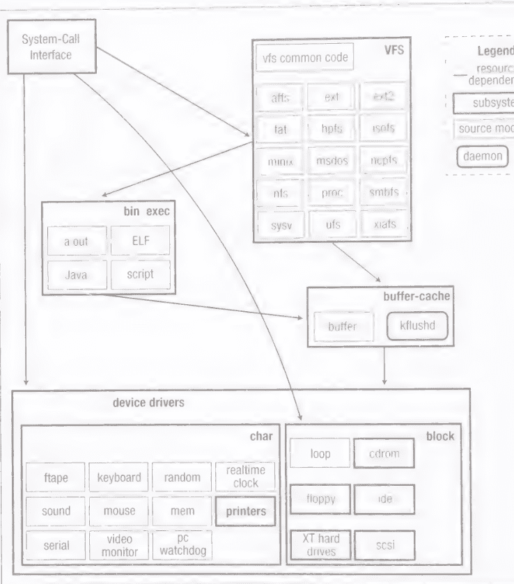

图 3.5 文件子系统结构。

Linux 提供了以下形式的 `IPC`：

- `Wait queues`（等待队列）：提供了一种机制，在进程等待操作完成时将其睡眠。该机制被进程调度器用于实现 3.3.3 节描述的下半部处理。

- `File locks`（文件锁）：提供了一种机制，允许除持有文件锁的进程外的所有进程将文件的某些区域或文件本身声明为只读。

## 子系统结构 501

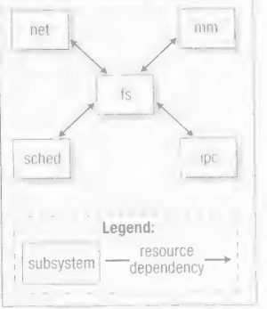

图 3.6 文件系统依赖。

- `Pipes and named pipes`（管道和命名管道）：通过显式设置管道连接或通过位于文件系统中的命名管道实现两个进程之间面向连接的双向数据传输。

- `System V IPC`

- `Semaphores`（信号量）：经典信号量模型。该模型还允许创建信号量数组。

- `Message queues`（消息队列）：数据传输模型。消息是字节序列，带有一个关联类型。消息被写入消息队列，可以通过从消息队列读取获取消息，并可能限制读取的消息类型。

- `Shared memory`（共享内存）：多个进程访问同一物理内存区域的机制。

- `Unix domain sockets`（Unix 域套接字）：面向连接的数据传输机制，提供与后续讨论的 `INET` 套接字相同的通信模型。

## 外部接口


信号是内核或其他进程发送给进程的通知。信号通过 `send_sig()` 函数发送。信号编号作为参数提供，以及目标进程。进程可以使用 `signal()` 函数注册处理信号。

# Linux 内核的具体实现：第3章

System V IPC 机制具有共同的接口，即 `ipc()` 调用。

各种 IPC 操作通过系统调用的参数指定。

Unix 域套接（Unix domain socket）的功能也由单个系统调用 `socketcall()` 封装。

上述每个系统调用都有完善的文档，鼓励读者参考相应的手册页（man page）。

IPC 子系统没有对其他子系统的调用。虽然用户进程使用等待队列（wait queues），但它们没有系统调用接口。等待队列被用于实现信号量、管道和半部处理程序（见第 3.3.3 节）。`add_wait_queue()` 过程将任务插入等待队列。`remove_wait_queue()` 过程从等待队列中移除任务。

## 子系统描述

以下是对 3.4.1 节中标识的每种 IPC 机制底层功能的简要描述。

信号（Signals）用于通知进程发生事件。信号具有改变接收进程状态的作用，取决于特定信号的语义。内核可以向任何执行中的进程发送信号。用户进程只有在拥有关联 PID 或 GID 的情况下才能向向进程或进程组发送信号。对于休眠进程，信号不会立即处理。相反，在调度器将进程设置为用户模式运行之前，它会检查是否向该进程发送了信号。如果是，调度器将调用 `do_signal()` 函数来适当处理该信号。

等待队列只是等待内核事件（例如 DMA 传输结束）的任务结构（task structures）的链表。进程可以通过调用 `sleep_on()` 或 `interruptable_sleep_on()` 函数自行进入等待队列。同样，`wake_up()` 和 `wake_up_interruptable()` 函数将进程从等待队列中移除。中断例也使用等待队列来避免竞态条件。

Linux 允许用户通过访问文件来防止其他进程。这种排除可以基于整个文件，也可以基于文件的某个区域。文件系统实现在其结构中包含适当的数据字段，允许内核确定是否已对文件或文件内部的区域加锁。在前一种情况下，对已锁文件的锁定尝试将失败。在后情况下，尝试锁定已锁区域将失败。无论何种情况，由于锁是由内核生成的，请求进程都不被允许访问该文件。

管道（Pipes）和命名管道（named pipes）具有类似的实现方式，因为它们的功能相同。进程创建过程有所不同，在两种情况下都会返回一个指向管道的文件描述符。在创建时，一页内存与打开的管道相关联。该内存被视为一个循环缓冲区，写入操作是原子完成的。当缓冲区满时，写入进程会被阻塞。如果请求读取的数据大于可用数据，读取进程会被阻塞。因此，每个管道都有一个关联的等待队列。在读、写过程中，进程会被添加到队列中或从队列中移除。

信号量（Semaphores）通过等待队列实现，并遵循经典的信号量模型。每个信号量都有一个关联的值。信号量上实现了两个操作：`up()` 和 `down()`。当信号量的值为零时，执行信号量减元的进程会被阻塞在等待队列上。信号量数组（Semaphore arrays）是信号量的连续集合。每个进程还维护一个已执行的信号量操作列表，因此如果进程提前退出，这些操作将被撤销。

消息队列（Message queue）是一个链表，进程在其中读取或写入字节序列。消息按照写入的顺序被接收。消息队列关联有两个等待队列：一个用于向全满的消息队列写入数据的进程，另一个用于序列化消息写入。消息的实际在创建消息队列时设置。

共享内存（Shared memory）是最快的 IPC形式。这种机制允许进程共享它们的内存区域。共享内存区域的创建由内存管理系统处理。共享页通过系统调用 `sys_shmat()` 挂载到用户进程的虚拟内存空间。可以通过调用 `sys_shmdt()` 从进程的用户段中移除共享页。

Unix 域套接字的实现方式与管道类似，其意义在于两者都基于基于一页内存的循环缓冲区。然而，套接字为每个通信方向提供了独立的缓冲区。

## 数据结构

在本节中，描述了实现上述 IPC 机制的重要数据结构。

信号通过 `task_struct` 结构中的 `signal` 字段实现。每个信号由该字段中的一个位表示。因此，一个 Linux 版本支持的信号数量限于字字（word）的位数。该字段用于屏蔽被进程阻塞的信号。

与等待队列仅关联一个数据结构，即 `wait_queue` 结构。这些结构包含一个指向关联 `task_struct` 的指针，并链接成一个列表。

文件锁（File locks）关联一个 `file_lock` 结构。该结构包含一个指向所有者进程的 `task_struct` 指针、被锁的文件描述符、一个等待文件锁取消的进程的等待队列，以及被锁的文件区域。`file_lock` 结构为每个打开的文件链接成一个列表。

管道（无论是匿名还是命名的）由文件系统节点（inode）表示。该节点在 `pipe_inode_info` 结构中存储额外的管道特定信息。该结构包含一个用于在读或写上阻塞的进程的等待队列、一个指向用作管道循环缓冲区的内存页指针、管道中的数据量，以及当前从/向管道读写的进程数量。

所有 IPC 对象都在内核中创建，每个对象都有关联的访问权限。这些访问权限保留在 `ipc_perm` 结构中。信号量通过 `sem` 结构表示，该结构持有信号量的值以及执行最后操作的进程 PID。信号量数组由 `semid_ds` 结构表示，该结构持有访问权限、上次信号量操作的时间、指向数组第一个信号量的指针以及执行信号量操作时的队列。`sem_undo` 结构用于创建一个进程执行的信号量操作列表，以便在进程被杀死时撤销所有这些操作。

消息队列基于 `msqid_ds` 结构（修正自 msq_ds），它持有管理和控制信息。该结构存储以下字段：

- 访问权限

- 实现消息队列的链接字段（即指向 `msqid_ds` 的指针）

- 上次发送、接收和更改的时间

- 如前节所述，进程阻塞的队列

- 队列中当前的字节数

- 消息数量

- 队列大小（字节）

- 上一个发送者的进程号

- 上一个接收者的进程号

消息本身在内核中通过 `msg` 结构存储。该结构持有一个链接字段（用于实现消息的链表）、消息类型、消息数据的地址以及消息的长度。

共享内存实现基于 `shmid_ds` 结构，该结构类似于 `msqid_ds` 结构，持有管理和控制信息。该结构包含访问控制权限、上次挂载、卸载和更改的时间、创建者以及最后一个对共享段调用操作的进程 PID、挂载共享内存区域的进程数量、组成共享内存区域的页数，以及一个用于页表项的字段。

Unix 域套接字基于 `socket` 数据结构，该结构见于网络接口节（3.5）。

## 子系统结构

图 3.7 显示了 IPC 子系统的资源依赖。控制流从系统调用层向下到每个模块。System V IPC 设施指的是在内核源码的 `ipc` 目录下实现的设施。内核 IPC 模块指的是在 `kernel` 目录内实现的 IPC 设施。文件 和 Net IPC 也遵循类似的约定。

System V IPC 模块依赖于内核 IPC 机制。特别是，信号量是通过等待队列实现的。所有其他 IPC 设施都是相互独立实现的。

# 子系统依赖关系

图 3.8 显示了 IPC 子系统与其他内核子系统之间的资源依赖。

IPC 子系统依赖文件系统来提供套接字（sockets）。套接字使用文件描述符，一旦打开就会被分配给索引节点（inode）。内存管理依赖 IPC，因为页面交换程序调用 IPC 子系统来执行共享内存的交换。IPC 依赖内存管理主要用于缓冲区分配和共享内存的实现。

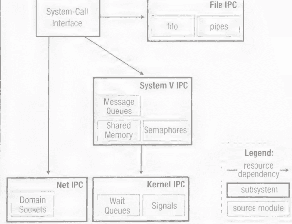

图 3.7

IPC 子系统结构。

## 网络接口

目标

Linux 网络系统提供了机器之间的网络连接以及套接字通信模型。系统提供了两种类型的套接字实现：BSD sockets 和 INET sockets。BSD sockets 是使用 INET sockets 实现的。

Linux 网络系统提供了两种具有不同通信模型和服务质量的传输协议。这些是不可靠的、基于消息的 UDP 协议和可靠的、流式的 TCP 协议。它们构建在 IP 网络协议之上。INET sockets 则构建在两种传输协议和 IP 协议之上。

最后，IP 协议位于底层设备驱动程序之上。为三种不同类型的连接提供了设备驱动程序：串行连接 (SLIP)、并行链路连接 (PLIP) 和以太网连接。地址解析协议在 IP 和以太网驱动程序之间起到调节作用。地址解析器的作用是在逻辑 IP 地址与物理以太网地址之间进行转换。

## 接口

网络服务通过套接字接口供其他子系统和用户使用。套接字通过 `socketcall()` 系统调用创建和操作。数据通过套接字文件描述符上的 `read()` 和 `write()` 调用发送和接收。

网络子系统没有导出其他网络机制/功能。

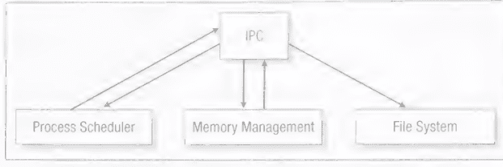

图 3.8 IPC 子系统依赖关系。


某些 IPC 机制使用定时器，定时器实现在进程调度器子系统中。进程调度依赖于信号。由于这两个原因，IPC 和进程调度器模块相互依赖。有关 IPC 子系统模块与其他内核子系统之间依赖关系的更多详细信息，请参阅 `[PBS:ipc.html]`。

## 子系统描述

BSD 套接字模型呈现给用户进程。该模型是面向连接的、流式的缓冲通信服务。BSD 套接字服务实现在 ET 套接字模型之上。

BSD 套接字模型处理类似于 VFS 的任务，并管理套接字连接的通用数据结构。BSD 套接字模型的目的是通过将通信细节抽象为通用接口来提供更好的可移植性。BSD 接口广泛应用于 Unix 和 Microsoft Windows 等现代操作系统。INET 套接字模型管理基于 IP 协议的 TCP 和 UDP 的实际通信端点。

网络 I/O 开始于对套接字的读或写。这会调用读/写系统调用，由虚拟文件系统的组件处理（向下到网络子系统层的读/写调用链是对称的，因此从该点开始，只考虑写操作）。从那里，确定 BSD 套接字的 `sock_write()` 实现实际的文件系统写调用；因此，调用了它。该程序处理管理控制，然后传递给 `inet_write()` 函数。随后该函数调用传输写调用（如 `tcp_write()`）。

传输写例程负责将传入的数据拆分为传输数据包。这些例程将控制权交给 `ip_build_header()` 例程，该程序构建一个 IP 协议头并放入要发送的数据包中，然后调用 `tcp_build_header()` 构建 TCP 协议头。一旦完成，将使用底层设备驱动程序发送数据。

网络系统提供两种不同的传输服务，每种服务都有不同的通信模型和服务质量。UDP 提供无连接的、不可靠的数据传输服务。它负责从 IP 层接收数据包，找到应该发送数据包数据的目标套接字。如果目标不存在，则报告错误。否则，如果内存足够，数据包数据将进入该套接字的接收包列表。任何正在读操作上休眠的套接字都会收到通知并唤醒。

TCP 传输协议提供了更复杂的方案。除了处理发送和接收进程之间的数据外，TCP 协议还执行复杂的连接管理。TCP 将数据作为流发送套接字层，而不是包序列，并保证可靠的传输服务。

IP 协议提供数据包服务。给定一个数据包及其目标，IP 通信层负责将数据包路由到正确的主机。对于传出的数据流，IP 负责：

- 分分为 IP 包
- 将 IP 包路由到目标地址
- 生成硬件设备驱动程序使用的头部
- 选择合适的网络设备发送

对于传入的数据包流，IP 必须执行以下操作：

- 检查头部有效性
- 将目标地址与本地地址比较，如果包未到达目的地则进行转发
- 重组 IP 包

ARP（地址解析协议）负责在 IP 和实际地址之间进行转换。ARP 支持以太网、FDDI 等多种硬件设备。此功能是必要的，因为套接字处理的是硬件设备无法直接使用的 IP 地址。由于使用了中性方案，可以在多种硬件设备上实现相同的通信协议。

网络子系统为串行连接、并行连接和以太网连接提供了自己的设备驱动程序。为各种硬件设备提供了一个抽象接口，以隐藏通信介质之间的差异。

## 数据结构

BSD 套接字实现由 `socket` 结构表示。它包含一个标识套接字类型（流式或数据报）以及套接字状态（已连接或未连接）的字段。还提供了一个用于修改套接字操作的标志字段、指向描述套接字操作的结构指针以及指向索引节点的引用。每个 BSD 套接字与一个索引节点关联。

`sk_buff` 结构用于管理单个通信包。缓冲区指向它所属的套接字，包含最后传输的时间，以及链接字段以便将给定套接字的所有包链接在一起（在双链列表中）。源和目的地址、头部信息和包数据也包含在缓冲区中。

`sock` 结构引用 INET 套接字特有的信息。该结构的成员包括套接字请求的读写计数、TCP 协议所需的序列号、用于更改套接字行为的标志、缓冲区管理字段（例如用于维护给定套接字的接收包列表）以及用于阻塞读写的等待队列。一个指向维护协议特定例程指针列表的结构指针，即 `proto`

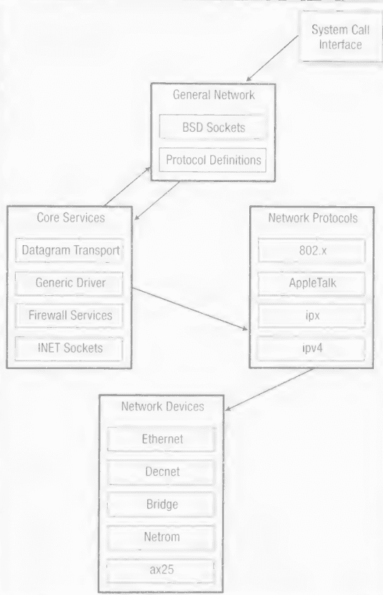

图 3.9 网络子系统结构。

同时也提供了结构。该 `proto` 结构相当庞大且复杂，但本质上，它为 TCP 和 UDP 协议提供了一个抽象接口。它提供了源地址、目的地址以及更多特定于 TCP 的数据字段。TCP 广泛使用定时器来处理超时等，因此 `sock` 结构包含了与定时器操作的数据字段，以及用作定时器报警的函数指针。

最后，设备结构（`device` structure）用于定义网络设备驱动程序。这是表示文件系统设备驱动的相同结构。

## 子系统结构

通用网络（General Network）包含了为用户进程提供最高层接口的模块。这本质上是 BSD Socket 接口，以及网络层支持的协议的定义。这里包含了 802.x、ip、ipx 和 AppleTalk 的 MAC 协议。

核心服务（Core services）对应于高层实现设施，例如用于防火墙的 INET sockets、通用的网络设备驱动接口，以及用于数据报和 TCP 传输服务的设施。

系统调用接口（system call interface）与 BSD socket 接口交互。BSD socket 层为 socket 通信提供了一个通用抽象，这种抽象是通过使用 INET sockets 实现的。这就是通用网络模块与核心服务模块之间存在依赖的原因。

协议模块（protocol modules）包含了获取用户数据并按照特定协议的要求进行格式化的代码。协议层最终将数据发送到相应的硬件设备，因此网络协议模块与网络设备模块之间存在依赖关系。

网络设备模块（network devices module）包含了特定于设备类型的高层例程。实际的设备驱动程序位于 `drivers/net` 目录下，与普通设备驱动程序相邻。

## 子系统依赖

图 3.10 显示了网络子系统与其他子系统的依赖关系。

网络子系统依赖内存管理系统提供缓冲区。文件系统用于为 socket 提供接口。文件系统使用网络来实现 NFS。网络子系统使用内核守护进程，因此依赖 IPC。网络子系统使用进程调度器处理定时器函数，并在执行网络传输时挂起进程。关于网络子系统模块与其他内核子系统之间特定依赖关系的更多细节，请参见 `[PBS:net.html]`。


图 3.11 网络子系统依赖关系。

## 第 4 章

## 发现

总结，我们审查了现有文档，提取了源文件事实，将模块聚类为子系统，并利用关于现代操作系统的领域知识对这些类进行了精炼。我们发现具体架构与我们之前形成的概念架构不匹配。由于提取工具的局限性，初始提取的结构显示缺少依赖关系。在手动验证依赖关系后，我们发现所有缺失都是由这些工具的局限性引起的。另一方面，最终的具体架构表现出了几个在概念架构中未考虑到的依赖关系。这些依赖由于某些设计决策，例如让 IPC 子系统执行某些内存管理器交换功能。这些意料之外的依赖关系，或如 `[Murphy 1995]` 中描述的分歧（divergences），可能表明概念架构没有被正确呈现，或者具体架构没有使用适当的聚类机制。然而，我们认为这些分歧是 Linux 开发者忽略架构考量的结果。

我们审查了 Linux 内核可用的文档。存在大量的系统文档，如 `[Rusling 1997]`。源代码中甚至还有一些有限的文档。然而，这些文档的层级太高，不能作为详细的具体架构。

我们使用 `cfx` 工具从 Linux 内核源码中提取了详细的设计信息。`cfx` 提取工具生成了 100,000 个事实，这些事实通过 `grok` 合并形成 1,600 个源模块之间的 15,000 个依赖关系。在检查了

## 5 112 Linux 内核的具体架构：第 4 章

事实提取器的输出后，我们注意到结果存在两个问题。首先，某些依赖关系没有被检测到。这特别发生在隐式调用（implicit invocation）的情况下。在隐式调用的情况下，一个子系统向另一个子系统注册其能力；由于对已注册子系统的访问是通过函数指针进行的，`cfx` 工具无法检测到这些依赖关系。其次，`cfx` 工具报告了不存在的依赖关系。这种情况的任例子发生在 IPC 子系统中。IPC 子系统中的三个源模块具有同名的函数 (`findkey`)。由于 `cfx` 工具使用了名称等效假设，它报告称所有模块都相互依赖，而手动验证显示它们并不依赖。

除了 `cfx` 脚本引入的产物外，我们还因为每个源模块 (`*.c`) 都有关联的头文件 (`*.h`) 这一假设而遇到了一些问题。这在 Linux 内核中通常是事实，但有些头文件是在许多源模块中被实现的。例如，`mm.h` 在内存管理器子系统的多个源模块中实现。由于所有对函数的调用都抽象为对声明该函数的头文件的调用，我们很难将源模块分离到子系统。所有的源模块都显示依赖于 `mm.h`，而不是实现所用资源的特定源模块。这个问题可以通过调整 `grok` 脚本来纠正；也许某种识别像 `mm.h` 这样的头文件特殊性质的组合是最好的。


由于这些问题（遗漏的、虚假的和位置错误的依赖关系），我们对与我们的预期不符的提取的事实进行了手动验证。遗憾的是，源代码的量以及我们对 `Linux` 缺乏经验意味着我们提取的事实并不完全准确。

## 未来工作

`PBS` 工具应该调整以处理 `Linux` 结构。我们提出的概念和具体架构应该通过与 `Linux` 开发者的讨论进行完善。完善后，可以使用 `[Murphy 1995]` 对两个模型进行比较。

## 附录 A

### 内核线程 (daemon)

内核线程是在内核模式运行的进程。这些进程是内核的一部分，因为它们访问内核的所有数据结构，但它们被视为可以挂起和恢复的独立进程。内核线程没有虚拟内存，但访问相同的物理内存。

逻辑文件系统是将数据块呈现为文件和目录的系统；这些文件和目录存储特定于逻辑文件系统的属性，可以包括权限、访问时间和修改时间。

### 定义

#### `BSD`

伯克利发行：基于 `AT&T System Unix` 版本，由加州大学伯克利分校计算机系统研究小组开发。

#### 设备特殊文件

文件系统中物理设备。对该文件的读取或写入将直接访问物理设备。这些文件很少被直接使用，字符模式设备除外。

#### `fs`

`Linux` 文件系统子系统

#### 中断延迟

从中断报告给 `CPU` 到处理它之间的时间。如果中断延迟太大，高速外设将失败，因为在下一次中断发生之前，中断没有被处理（从其 `CSR` 读取数据）。随后的中断会覆盖 `CSR` 中的数据。

#### `IPC`

进程间通信。`Linux` 支持信号、管道以及根据其首次出现的 `Unix` 版本命名的 `System V IPC` 机制。

#### `mm`

`Linux` 内核内存管理器子系统

#### 挂载点

虚拟文件系统中挂载逻辑文件系统的目录。挂载逻辑文件系统上的所有文件都是该挂载点的子目录。根文件系统挂载在 `/`。

#### `Net`

`Linux` 内核的网络接口子系统

#### 反向工程

从源码中提取高层模型的过程。

#### `Sched`

`Linux` 内核进程调度器子系统

#### 软件架构

系统的结构，由软件组件、这些组件的外部属性以及组件之间的关系组成。

#### `System V`

一种由贝尔实验室开发的 `Unix` 版本。

#### `Unix`

最初于 20 世纪 70 年代贝尔实验室开发的操作系统。

## 附录 B

参考文献

#### `Bass 1998`

Bass, Len, Clements, Paul, Kazman, Rick: Software Architecture in Practice, ISBN 0-201-19930-0, Addison Wesley, 1998.

#### `Beck 1996`

Beck, M. et al: Linux Kernel Internals, Addison Wesley, 1996.

#### `Bowman 1998`

Bowman, I.: "Conceptual Architecture of the Linux Kernel," `http://www.grad.math.uwaterloo.ca/~bowman/CS746G/a1/1998`。

#### `Chi 1994`

Chi, E.: "Introduction and History of Linux," `http://lenti.med.umn.edu/~chi/technolog.html`, 1994.

#### `CS746G Bibliography`

`http://plg.uwaterloo.ca/~holt/cs/746/98/linuxbib.html`。

#### `Holt 1997`

Holt, R.: "Portable Bookshelf Tools," `http://www.turing.toronto.edu/homes/holt/pbs/tools.html`。

#### `Knowlton 1965`

Knowlton, K.C.: "A Fast Storage Allocator," Communications of the ACM vol. 8, pp. 623-625, Oct. 1965.

#### 516 Linux 内核的具体架构：附录 B

#### `Kruchten 1995`

Kruchten, P.B.: The 4+1 Views Model of Architecture, IEEE Software, Nov 95, pp 42-50.

#### `LDP`

Linux 文档项目: `http://sunsite.unc.edu/mdw/linux.html`。

#### `Mancoridis Slides`

Mancoridis, S.: MCS680 Slides, Drexel University.

#### `Muller 1993`

Muller, Hausi A., Mehmet, O.A., Tilley, S.R., and Uhl, J.S.: “A Reverse Engineering Approach to Subsystem Identification,” Software Maintenance and Practice, Vol. 5, 181-204, 1993.

#### `Murphy 1995`

Murphy, G.C., Notkin, D., and Sullivan, K.: “Software Reflection Models: Bridging the Gap between Source and High-Level Models,” Proceedings of the Third ACM Symposium on the Foundations of Software Engineering (FSE 99).

#### `PBS`

Our Extracted Linux Landscapes: `http://plg.uwaterloo.ca/~itbowman/`

#### `Rusling 1997`

Rusling, D.A.: The Linux Kernel, `http://sunsite.unc.edu/pub/Linux/does/linux-doc-project/linux-kernel/`, 1997.

#### `Siddiqi 1998`

Siddiqi, S.: “A Conceptual Architecture for the Linux Kernel,” `http://se.math.uwaterloo.ca/~s4siddiqi/CS746G/L.A.html`, 1998.

#### `Tanenbaum 1992`

Tanenbaum, A.S.: Modern Operating Systems, Englewood Cliffs, NJ: Prentice-Hall, 1992.

#### `Tanuan 1998`

Tanuan, M.: “An Introduction to the Linux Operating System Architecture,” `http://www.grad.math.uwaterloo.ca/~metanuan/cs746g/LinuxCA-html`, 1998.

#### `Tzerperos 1996`

Tzerpoos, V. and Holt, R.: “A Hybrid Process for Recovering Software Architecture,” `http://www.turing.toronto.edu/homes/vtzer/papers/hybrid.ps`, 1996.

## 第六部分

附录

## 附录 A

Linux 文档项目

#### 拷贝许可

最后修改日期：1997 年 1 月 6 日

以下版权许可适用于 Linux 文档项目的所有作品。

请仔细阅读该许可协议——它与 GNU 通用公共许可证（`GPL`）有些相似，但其中有若干条件与你习惯的有所。如果你有任何问题，请发送电子邮件至 `mdw@metalab.unc.edu` 联系 `LDP` 协调员。

在满足以下条件的情况下，可以全部或部分复制发行 Linux 文档项目手册。

所有 Linux 文档项目手册的版权均归相应作者所有。它们不属于公领域。

- 上述版权声明和此许可公告必须在所有完整或部分的副本中完整保留。

- 《Linux 安装与入门》的任何翻译版或衍生作品在发行前，必须获得作者的书面批准。

- 如果你部分部分分发《Linux 安装与入门》，则必须包含获取本手册完整版本的说明，并提供获取完整版本的途径。

- 在给予适当引用的情况下，一小部分可以作为其他作品中的插图或引用进行复制，而无需出示此许可公告。

- 下文引用的 GNU 通用公共许可证可以在其规定的条件下进行复制。

#### Linux 编程白皮书：附录 A

出于学术目的，可能会授予这些规则的例外：请写信向作者询问。这些限制是为了保护我们作者，而不是为了限制你作为教育者和学习者。《Linux 安装与入门》中的所有源代码均置于 GNU 通用公共许可证下，可以通过 GNU 存档网站的匿名 `FTP` 访问：`http://prep.ai.mit.edu/pub/gnu/COPYING`

#### 出版 LDP 手册

根据上一节给出的许可，允许任何人发行副本。如果你想发行基于任何 `LDP` 手册的翻译版或衍生作品，必须在这样做之前获得作者的书面许可。


为了保护你的权利，我们希望确保这些许可证是免费的。例如，如果你分发软件，无论是免费还是付费，都必须让接收者知道你所拥有的权利。为了每个作者的保护，我们希望确保在修改软件时没有担保保证。如果软件被他人修改并转传，我们希望接收者知道这不是原始版本，这样引入的任何缺陷都不会影响作者的声誉。

# GNU 通用公共许可证

你可以对传输副本的物理行为收取费用，并可以根据你的选择收取费用提供保修保护。

## 2. 你可以修改你的程序副本或副本或程序的任何部分，从而形成基于该程序的作品，并按照上述第 1 条的条款复制和分发此类修改版本或作品，前提是你必须满足以下所有条件：

a) 你必须在修改后的文件中带有显著的通知，说明你更改了文件以及任何更改的日期。

b) 你必须确保你分发或发布的任何全部或部分包含该程序或任何部分、或源自该程序的作品，都根据本许可证的条款，向所有第三方免费提供整体许可。

c) 如果程序在运行时通常会进行交互式读取，则你必须在它以最普通的方式启动进行交互式使用时，使其打印或显示一份公告，其中包含适当的版权声明以及不提供任何保证的声明（或者声明你提供保修），并说明用户可以在这些条件下重新分发该程序，并告诉用户如何查看本许可证的副本。（例外：如果程序是交互式的但通常不打印公告，则你基于该程序的作品不要求打印公告。）

这些要求适用于修改后的作品整体。如果作品中可识别的部分并非源自该程序，并且本身被合理地认为是独立且分离的作品，那么当你将这些部分作为独立作品分发时，本许可证及其条款不适用于这些部分。但当你将相同的部分作为基于程序的作品的一部分进行分发时，整体的分发必须符合本许可证的条款，该条款对其他许可的许可扩展到整个作品，从而扩展到每一个部分，无论由谁编写。

因此，本节的意图并不是主张或质疑你完全由你编写的权利；其意图是行使控制基于该程序的衍生作品或集体作品分发的权利。

此外，仅仅将另一项工作与存储卷或分发介质上的该程序（或基于该程序的作品）聚合，并不会将另一项工作纳入本许可证的范围。

## 3. 你可以按照上述第 1 条和第 2 条的条款，以目标代码或可执行的形式复制并分发程序（或根据第 2 条基于它的程序的作品），前提是你还至少执行以下操作之一：

a) 附带完整的对应的机器可读源代码，该源代码必须根据上述第 1 条和第 2 条的条款，在通常用于软件交换的介质上分发；或者，

b) 附带有效期至少三年的书面提议，承诺向任何第三方以不超过你物理执行源代码分发成本的费用，提供相应源代码的完整机器可读副本，该副本将根据上述第 1 条和第 2 条的条款，在通常用于软件交换的介质上分发；或者；

c) 附带你收到的关于分发相应源代码提议的信息。（这种替代方案仅适用于非商业分发，且仅在你以目标代码或可执行形式收到此类提议的程序或在 b 小节中收到程序时有效。）

作品的源代码意味着对该作品进行修改的首选形式。完整源代码意味着其包含的所有模块的所有源代码，加上任何相关的接口定义文件，以及控制可执行文件编译和安装的脚本。然而，作为一个特殊例外，分发的源代码不需要包含任何（以源代码或二进制形式）与运行该可执行文件的操作系统的主要组件（编译器、内核等）一起分发的内容，除非该组件本身随可执行文件一同提供。

如果通过提供从指定位置复制的访问来分发可执行代码或目标代码，则提供从相同位置访问复制源代码的等效访问被视为分发了源代码，尽管第三方并不被强制随目标代码一起复制源代码。

## 4. 除非本许可证明确规定，否则你不得复制、修改、分许可或分发程序。任何其他尝试复制、修改、分许可或分发该程序的尝试都是无效的，并将自动终止你在本许可证下的权利。然而，根据本许可证从你处获得副本或权利的方，只要这些部分保持符合规定，其许可就不会被终止。

## 5. 你不是要求接受本许可证，因为你还没有签署。但是，没有其他内容授予了修改或分发程序或其衍生作品的许可。如果你不接受本许可证，这些行为将被法律禁止。因此，通过修改或分发程序（或任何基于该程序的作品），你表示你接受本许可证，以及其对于复制、分发或修改基于该程序的作品的所有条款和条件。

## 6. 每每次重新分发程序（或任何基于该程序的作品），接收者都会自动获得原始许可者的许可，根据这些条款和条件复制、分发或修改程序。你不能对接收者行此处授予的权利施加任何进一步限制。你不对第三方遵守本许可证的合规性负责。

## 7. 如果由于法院判决、专利侵权指控或其他任何原因（不限于专利问题），对你施加了某种（通过法院命令、协议或其他方式）与本许可证条款相矛盾的条件，这些条件并不能免除履行本许可证条件的义务。如果你无法通过分发来同时满足你在本许可证下的义务和任何其他相关义务，那么作为结果，你可能无法分发程序。例如，如果专利许可不允许所有直接或间接接收副本的人免特许费重新分发程序，那么你满足两者及本许可证的唯一方法就是停止分发。

如果本节的任何部分在特定情况下被判定无效或不可执行，本节的其余旨在适用，且整个章节在任何情况下均适用。

本节的目的不是诱导你侵犯任何专利或其他产权，或质疑此类权利的有效性；本节的唯一目的是保护自由分发系统的完整性，该系统通过公共许可实践来实现。许多人由于对该系统的一致应用而通过该系统分发的广泛软件做出了贡献；作者/分发者有权决定是否通过任何其他系统分发软件，许可者不能施加这种选择。

本节旨在彻底阐明被认为是本许可证其他部分的后果。

## 8. 如果程序的分发或在某些国家受到专利或版权接口的限制，放置该程序的原始版权所有者可以添加明确的地理分发限制以排除这些国家。在这种情况下，本许可证包含了正文中的限制。

如果程序指定了适用于它的许可证的版本号以及“任何后续版本”，你可以选择遵循该版本或自由基金发布的任何后续版本的条款和条件。

如果程序未指定本许可证的版本号，你可以选择自由基金曾经发布的任何版本。

## 10. 如果你希望将程序的部分整合到分发条件不同的自由程序中，请写信作者请求许可。对于由自由基金拥有版权的软件，请写信自由基金；我们对此提供例外。我们的决定将受两个目标的指导：即维护我们自由软件的所有衍生品的自由状态，以及促进软件的的共享和重用。

## 免责声明

11. 由于本程序是免费许可的，在适用法律允许的范围内，本程序不提供任何保证。除非另有书面说明，版权所有者和/或其他方按“原样”提供程序，不提供任何形式的保证，无论是明示还是暗示的，包括但不限于对可销性和针对特定用途的适用性的暗示保证。程序质量和性能的全部风险由您承担。如果程序被证明有缺陷，您将承担所有必要的服务、维修或纠正的费用。

12. 在任何情况下，除非适用法律要求或经任何版权所有者或根据上述许可修改/或分发本程序的其他方的书面同意，否则任何方均不对对您造成的损害承担责任，包括因使用或无法使用本程序而引起的任何一般、特殊、偶然或间接性损害（包括但不限于数据丢失、数据变得不准确、您或第三方遭受的损失，或程序无法与其他任何程序共同运行），即使该所有者或其他方已被告知发生此类损害的可能性。

## 如何将这些术语应用于您的新程序

如果您开发了一个新程序，并希望它对公众产生最大的用处，实现这一点的最佳方法是使其成为自由软件，每个人都可以根据这些术语进行重新分发和修改。

要这样做，请在程序中附带以下通知。最安全的方法是将它们附加到每个源文件的开头，以有效传达免责声明；每个文件应至少包含“版权”（copyright）行以及一个指向完整通知所在处的指针。

```
<用一行提供程序名称和
其功能的简要描述。>
Copyright (C) 19yy <作者姓名>
```

本程序是自由软件；您可以根据自由软件基金会发布的《GNU通用公共许可证》的条款对其重新分发和/或进行修改，可以是该许可证的第 2 版本，或（根据您的选择）任何后续版本。

`GNU 通用公共许可证` 527

本程序的分发是希望它是有用的，但不提供任何保证；甚至不提供对可销性或针对特定用途的适用性的暗示保证。更多细节请参阅《GNU通用公共许可证》。

您应该在收到本程序的同时收到一份《GNU通用公共许可证》的副本；如果没有，请信寄：Free Software Foundation, Inc., 59 Temple Place, Suite 330, Boston, MA 02111-1307 USA

此外，添加如何通过电子邮件和纸质邮件联系您的信息。

如果程序是交互式的，请让它在交互模式下启动时输出如下简短通知：

`Gnomision` version 69, Copyright (C) 19yy name of author `Gnomision` 附带绝对无任何保证；详细信息请输入 `show w`。这是自由软件，欢迎您在特定条件下重新分发它；详细信息请输入 `show c`。

假设的命令 `show w` 和 `show c` 显示《通用公共许可证》的相关部分。当然，您使用的命令可能不叫 `show w` 和 `show c`；它们可能是鼠标点击或菜单项——任何任何适合您程序的形式。

如有必要，您还应该让您的雇主（如果您作为程序员工作）或您的学校（如果有）为程序签署一份“版权免责声明”。这里有一个示例；请修改名称：

`Yoyodyne, Inc.` 在此放弃对 `James Hacker` 编写的 `Gnomision` 程序（该程序对编译器进行了吐槽）的所有版权。

`<Ty Coon 的签名>`, 1989年4月1日

`Ty Coon, Vice` 总裁


本《通用公共许可证》不会将您的程序整合到专有程序中。如果您的程序是一个子程序库，您可能认为允许专有应用程序与该库链接更有用。如果您想这样做，请使用《GNU 库通用公共许可证》代替本许可证。

## 索引

### A

- 访问控制 (access control)
- 内存 (memory), 32
- 信号量 (semaphores), 74, 166–167
- 共享内存 (shared memory), 75
- 地址 (Address)
- INET BSD 套接字的绑定 (binding for INET BSD sockets), 150
- 总线 (bus), 17
- IP, 142
- ISA 设备 (ISA devices), 80
- 映射 (mapping), 29
- PCI 设备 (PCI devices), 80
- 物理与虚拟对比 (physical vs. virtual), 32
- 串口 (serial port), 18
- 将虚拟转换为物理地址 (translating virtual to physical), 29
- 虚拟 (virtual), 27, 32
- 地址解析协议 (ARP), 144
- 地址转换 (address conversion), 508
- 操作描述 (operation description), 156–157
- Alpha XP 系统
- 访问计数 (access count), 33
- 内核地址空间 (kernel address space), 32
- 页面大小 (page size), 28
- 表格项 (table entry), 33
- 外围设备地址空间 (peripheral device address space), 80
- 处理器描述符 (processor descriptor), 176
- Altour 880, 13
- 源文件格式 (source file-format), 61
- 归档解析 (archiving parsing), 435–441
- 目录 (directory), 178
- 架构 (Architecture)
- 概念与具体对比 (conceptual vs. concrete), 485
- 依赖关系 (dependencies), 458, 490
- 硬件控制器 (hardware controllers), 456
- IPC 系统 (IPC system), 499–506
- 内核 (kernel), 458–466
- 内存 (memory), 465–466, 491–495
- 网络接口 (network interface), 469–470, 506–510
- 操作系统服务 (operating system services), 456
- 处理器调度器 (processor scheduler), 463, 487–490
- 用户应用程序 (user applications), 455
- 虚拟文件系统 (virtual file system), 467–468, 495–499
- ARM 处理器 (ARM processor), 175
- 汇编语言 (Assembly languages), 19
- 非对称多处理 (Asymmetric multi-processing), 303
- 原子操作 (Atomic operations), 338
- AVL 链接 (AVL linking), 29

### B

- Bash 登录 shell (login shell), 21
- Bish, 137
- 二进制数据 (Binary data), 15
- 块抽象数据结构 (Block, abstract data structure), 183
- 块设备 (Block devices), 102
- 类 (classes), 107
- 如何访问 (how accessed), 107
- SCSI 分区 (SCSI disk partitions), 116
- 下半处理器 (Bottom half handler), 161, 298, 497
- 计时器 (timer), 62
- BSD 套接字 (BSD sockets), 141, 150–151
- 地址绑定 (address-binding), 150
- 连接 (connection), 150–151
- 连接请求 (connection requests), 147–152
- 接口 (interface), 146
- 监听 (listening), 151
- 内内核配置期间的注册 (registering during kernel configuration), 147
- 伙伴系统 (Buddy system), 36
- 缓冲区缓存 (buffer cache), 34
- 块设备请求 (block device requests), 107
- 文件系统用法 (file system usage), 129, 135–137
- k8d, 497
- 维护 (maintaining), 137–138
- 部分 (parts of), 16
- 总线 (buses), 17

### C

- C 语言 (C programming language)
- 编译器 (compilers), 220
- FIFO, 339–342
- 双工管道 (duplex pipes), 329–334
- 指针 (pointers), 220
- 缓存内存 (Cache memory), 16–17
- 缓冲区 (buffer), 34
- 定义 (definition of), 25
- 实现表 (tables implementing), 25, 134, 135
- 内存 (memory-related), 34–35
- VFS 模式 (VFS mode), 134–135
- C, Rem, 121
- 中央处理器 (Central processing unit). 见 `CPU`。
- 字符图 (Character graphs), 391–440
- 颜色 (color), 412–414
- 游标 (cursor), 415
- 格式化输入 (formatted input), 394, 408
- 格式化输出 (formatted output), 392–393, 408
- 输入 (input), 406–408
- 输入选项 (input options), 394
- 键盘 (keypad), 411
- 库函数 (lib functions), 392–394
- 内存 (memory), 397
- 输出选项 (output options), 429
- 滚动 (scrolling), 415
- 属性 (attributes), 413–414
- 窗口 (windows), 408–419
- 窗口坐标 (window coordinates), 415
- 字符设备 (Character devices), 102
- 数据结构 (data structure), 106
- 文件 (files), 227–236
- 内核注册 (kernel registration), 106
- 例程 (routines), 387
- 时间线 (datelines), 396
- 终端 (terminals), 395
- 字符集模式 (Charset mode), 391
- Ch. Ed., 482
- 清理模块 (`cleanup_module`)
- 注册注销 (de-registering devices), 228, 253–266
- 功能 (function), 221
- 进程处理 (pro-process), 241
- 消息调用 (message calls), 272
- 时钟算法 (Clock algorithm), 43
- 克隆进程 (Cloning processes), 60
- CMOS 内存 (CMOS memory), 112
- 彩色图形适配器 (CGA), 14
- 命令解释器 (Command interpreters)
- 闪存 (flash), 65
- 编译 (Compiling)
- 内核模块 (kernel modules), 222
- 多文件内核模块 (multiple file kernel modules), 224
- 移植代码 (ported code), 440
- SIM 支持 (SIM support), 223
- 控制总线 (Control bus), 17
- 控制器 (Controllers), 14
- 直接内存访问 (direct memory access), 19
- 写时复制 (Copy on write), 61
- `CPU`
- 二进制操作 (binary operation), 15
- 总线 (buses), 17


- 中断处理 (`interrupt handling`), 95–96

- I/O 空间 (`I/O space`), 17–18

- 内存 (`memory`), 16–17

- 主板 (`motherboard`), 14

- 电阻 (`resistors`), 15

- 系统时钟 (`system clock`), 15

- `create_module()` 系统调用, 488

- 关键区域 (`Critical regions`), 73

- 任务文件 (`contab files`), 291

- `CSRs`, 101, 497

- 当前 (`current`), 287

- `Curses`, 392

- 游标坐标 (`Cursor coordinates`), 415

### D

- 守护进程 (`Daemons`)

- `isdash`, 137–138

- 内核 (`kernel`), 169

- `ikswapp`, 192

- 更新 (`update`), 138

- 数据 (`Data`)

- 缓冲区缓存 (`buffer cache`), 32

- 总线 (`bus`), 17

- 数据结构 (`Data structures`)

- 二进制文件格式 (`binary file format`), 191

- 下半处理 (`bottom half handling`), 162

- BSD 套接字 (`BSD sockets`), 196

- 缓冲区缓存 (`buffer cache`), 183

- 设备 (`devices`), 184–185

- 磁盘 (`disks`), 110

- 文件 (`file`), 187

- 内核 (`kernel`), 169

- 中断处理 (`interrupt handlers`), 99

- I/O 端口 (`I/O ports`), 93

- ISA 设备 (`ISA devices`), 83

- 内核内存 (`kernel memory`), 195

- 缓冲区 (`buffer`), 183

- 消息队列 (`message queues`), 72

- 数据包 (`packet`), 194

- 页面结构 (`page structure`), 36

- PCI 设备 (`PCI devices`), 85

- 轮询 (`polling`), 103

- 声卡 (`sound cards`), 390

- 载入 (`loading`), 30

- 内存通道 (`Memory channels`), 80

- 开发者 (`Developers`), 460

- 挂载目录 (`mount directories`), 119

- 挂载 (`mounting`), 113–139

- 网络化 (`networked`), 22

- 注册 (`registration`), 25, 243

- 设备 (`device`), 118

- 数据结构 (`data structure`), 105

- 文件 (`file`), 197

- 直接内存访问 (`Direct Memory Access`), 见 `DMA`。

- 文档 (`Documentation`), 104

- 传输机制 (`transfer mechanism`), 497

- 驱动程序 (`Drivers`), 见上述条目

- 设备 (`device`), 23

- 直接内存访问 (`direct memory access`), 19

- 目录 (`directory`), 228

- 输入输出控制 (`input/output control`), 253

- 中断驱动 (`interrupt drivers`), 103

- 内核属性 (`kernel attributes`), 102

- 主设备 (`major numbers`), 227

- 网络设备 (`network devices`), 118

- 轮询 (`polling`), 103

- 源子目录 (`source directories`), 176

- 写入设备文件 (`writing to device files`), 253–266

### E

- `EAGAIN` 消息 (`EAGAIN message`), 278

- `ELF`, 62–65

- 可执行文件 (`executable tiles`), 63–65

- 共享库 (`shared libraries`), 65

- 以太网网络 (`Ethernet networks`), 144

- `ext2` 文件系统 (`ext2 file system all`), 288

- `ext2` 文件系统 (`ext2 file system`), 120

- 块分配 (`block allocation`), 126, 127

- 块大小 (`block size`), 121

- 目录 (`directories`), 125

- 查找文件 (`finding a file`), 126

- 组描述 (`group descriptions`), 124–125

- 模式 (`mode`), 122, 124

- 物理布局 (`physical layout out`), 124

### F

- `FIFO`

- 阻塞操作 (`blocking actions on`), 342

- 创建 (`creating`), 339–140

- 与其他管道的区别 (`differences from other pipes`), 339

- I/O 操作 (`I/O operations`), 340–341

- 命名管道 (`named pipes`), 71

- 本地结构 (`local structure`), 501

- 文件系统：规模 `EXT2`, `/root`, `VFS`

- 块设备 (`block devices`), 102, 120

- 定义 (`definition of`), 23

- 模式 (`modes`), 498

- 标识符 (`identifiers`), 53

- 源位置 (`location in source`), 180

- 逻辑 (`logical`), 498

- `minix`, 120, 317

- 挂载目录 (`mount directories`), 119

- 挂载 (`mounting`), 113–139

- 网络化 (`networked`), 22

- 注册 (`registration`), 25, 243

- 在 Linux 支持 (`supported in Linux`), 213, 119

- 卸载 (`unmounting`), 133

- 文件数据结构 (`file data structure`), 187

### Files

- 数据结构 (`data structures`), 56–58, 187–188

- 支持的格式 (`formats supported`), 62

- 普通与特殊对比 (`regular vs. special`), 325

# `files_struct` 数据结构

- `files_struct` 数据结构, 188

- `fips`, 228

- `turk(2)`, 60

- 格式, 392

- `free()`, 系统调用, 491

- `free_area` 数据结构, 36, 493

- `free_page(1)`, 491

- 源子目录 (`source subdirectories`), 179

- 结构体 (`struct`) 数据结构, 188, 489

- `trofork(function)`, 343–344

# I

### IDE 磁盘

- 控制器, 111

- 初始化子系统, 112–113

- 支持的最大数量, 112

- 次要设备号, 112

- 包含目录, 178

# G

- 网关 (`Gateways`), 142. 另参见路由器 (`Routers`)。

- `gedisk` 数据结构, 188

- `get_free_page(1)`, 491

- `getitimer(1)`, 488

- `GNU C` 库, 440

### 索引 (`Index`)

- 在数组中, 25

- `INET sockets`, 145, 148, 150. 另参见 BSD 套接字 (`BSD sockets`)。

- `init`

- 目录, 178

- 初始进程, 487

- 进程标识符, 60

- `init_module(1)` 系统调用, 221, 488

# 初始化 (`Initialization`)

- 在内核中查找 179

- `init(3)`, 398

- `inode` 数据结构, 189

- 管道 (`pipes`), 328

# H

- 半双工 Unix 管道, 327, 334. 另参见管道 (`Pipes`)。

- 半双工管道

- 处理程序 (`Handlers`)

- 下半部 (`bottom half`), 62, 161–162, 497

- 中断 (`interrupt`), 99, 207–301, 497

- 硬盘 (`Hard-disk`)

- 分区, 109–110

- 各部分, 109

- 硬件 (`Hardware`)

- 总线 (`busses`), 17

- 缓存 (`caches`), 34

- 控制器, 14, 17

- `hard_disk`, 109, 111

- IDE 磁盘, 112–114

- I/O 接口, 178

- 内部扬声器, 389


- 中断 (interrupts), 95–96
- 内存 (memory), 17
- 主板, 14
- 网络设备, 116–118
- 外设, 14, 17
- 实时钟 (realtime clock), 128
- 寄存器 (registers), 15, 16
- `SCCS`, 111, 113–116
- 串口部分控制寄存器, 17
- 声卡, 390
- 系统时, 15
- 终端, 395–397
- 转换旁路缓冲区 (translation look-aside buffers), 34
- 哈希表 (Hash tables), 24
- 缓存, 25
- 缓存内部 `VFS`, 134
- `Hello world` 示例, 221
- 十进制计数, 155
- 在虚拟文件系统中的用法, 498

# `Intel` (英特)

- 8080 处理器, 13
- 82C59A-2 中断控制器, 96
- `Pentium Pro`, 14

### 接口 (Interfaces)

- 设备驱动程序, 105–118
- 注册, 25
- `socket`, 146–147
- 壳 (shells), 62
- 进程间通信 (Interprocess Communication). 另参见 `IPC`

### 中断 (Interrupts)

- 控制器, 96
- 数据结构, 97–99, 190
- 禁用, 128
- 处理程序, 497
- 硬件支持, 95
- 键盘, 298
- 掩码寄存器, 97
- `request_rq`, 298
- 示例, 297–301
- 慢 vs 快, 488
- 状态寄存器, 97
- 间隔计时器 (Interval timer), 18, 61–62

### I/O

- `libformating` 函数, 392–394
- 空间, 17
- 终端 I/O 控制实现, 438–439
- `ioctl`, 253, 389
- 格式, 325
- 数字, 254
- `PC` 扬声器操作, 389

# `IP`

- 地址, 142
- 数据封包器, 142

# 消息队列 (Message queues)

- 分段 (fragments), 155–156
- 包大小限制, 155
- 接收数据包, 155
- 路由, 158–160
- 发送数据包, 154
- `Iff`–31
- 数据结构, 190
- 外部接口, 501
- 文件锁, 500
- 标识符, 341
- 键, 341
- 消息队列, 72, 73, 345–360, 501
- 可用方法, 327
- 对象状态, 344–345
- 管道, 69–71, 327–342, 501
- 信号量, 73–75, 361–379, 501
- 共享内存, 75–77, 380–387, 501
- 信号, 67–69, 500
- `sockets`, 571
- 源目录, 178, 180
- 子系统依赖, 505
- 子系统设备, 502
- 子系统结构, 505
- 等待队列 (queues)

### `IPC` (进程间通信)

- `ipc_perm` 数据结构, 190, 348
- `ipc` 命令, 345
- 数据结构, 190

### `IRQs`: 中断.

- `ISA` 设备
- `ISA` 桥接, 83
- 源, 177–181
- 系统概述, 456–458
- 守护进程, 441

### 内核 (Kernel)

- 开发, 460
- 设备处理, 101–118
- 文件系统处理, 119–139
- 中断处理, 95–100
- 模式, 52, 55
- 模块, 169–174
- 单体 vs 微内核, 169
- 对象模块, 21
- 概述, 456–458
- `PCI` 设备初始化, 85–93
- 目的, 456

### 内存 (Memory)

- `malloc()` 系统调用, 491
- `mem_map_t` 数据结构, 36, 191
- 核心内存管理器, 493
- I/O 空间, 17–18
- 管理, 22, 27, 179, 456
- 映射, 27, 31, 36, 383
- 段, 244

### 内存管理器子系统 (Manager Memory subsystem)

- 外部接口, 491
- 数据流, 466
- 数据结构, 465, 492
- 依赖, 466, 495
- 硬件内存, 492
- 子系统描述, 27, 492

### 消息队列 (Message queues)

- 缓冲区, 345
- 描述, 504
- 操作, 357–360
- `sig` 结构, 146–148
- 队列, 72–73
- 权限, 348
- 系统调用, 348–356

### 微处理器 (Microprocessor)

- 15. 另参见 `CPU`
- `ix` 文件系统, 120
- `knod()` 系统调用, 340
- 目录, 178
- `mmap()` 系统调用, 491
- `init_struct` 数据, 38, 192–489

### 模块编程 (Module programming)

- 431
- `module_interruptible_sleep_on`, 277

### 模块 (内核)

- 优点, 169–170
- 命令行参数, 267–269
- 编译, 222
- 按需加载, 171
- 清理函数, 221
- 列出的内核模块, 172
- 加载, 171–173, 221
- 多重文件, 224–226
- 引用计数, 229
- 源子目录, 178
- 卸载, 173–174
- 版本, 224

### 主板 (Motherboards)

- 148
- `msg_structure`, 346–348
- `msgget()` 系统调用, 354
- `msgget()` 系统调用, 348–349
- `msgcv()` 系统调用, 352
- `msndnd()` 系统调用, 350
- `msgtool` 工具, 357–360
- `mqid_ds` 结构, 347, 504

### 多处理 (Multiprocessing)

- 23, 50
- `munlock()` 系统调用, 491
- `munmap()` 系统调用, 491

# `N`

- `Nurses`, 397–398
- 颜色, 413
- 光标坐标, 415
- 初始化, 400
- 操作窗口, 400–413
- 属性, 413–414
- 窗口坐标, 413
- 网络源分包商, 179

### 网络设备 (Network devices)

- 116–118
- 数据结构, 117
- 初始化, 118
- 类型, 117

### 网络接口子系统 (Network Interface subsystem). 另参见网络技术 (Networking)。

- 架构, 469–470
- 数据结构, 508
- 描述, 507–508
- 结构, 509–510

### 网络技术 (Networking)

- 活跃接口检查, 150
- 地址解析, 156–157
- `BSD` `socket` 接口, 146–147, 507
- 数据结构, 195–201
- `INET` `socket` 层, 146–147
- 协议层, 145
- 接收数据包, 154
- 发送 `IP`, 155
- `TCP/IP`, 141–144, 507–508
- `UDP` 协议, 507

### 操作系统 (Operating system)

- 68
- 目的, 19
- 设备, 23
- 文件系统, 24
- 内存管理, 22

### 输出 (Output)

- 进程, 54–65
- 格式化, 392
- 内存, 3, 27

# `P`

### 页面 (Page)

- 老化算法, 31
- 分配与释放, 36–38
- 缓存, 34, 39–43
- 脏, 33
- 故障, 29
- 站点, 33, 35

### 分页 (Paging)

- 轮需分页, 30–31, 38–40
- 帧号 (`PFN`), 28
- 空闲页, 41–42
- 工作集, 31, 45

### 参数 (Parameters)

- 267–269

### 分区 (硬盘)

- 109–110

### 编程指南 (Programming guidelines)

- `BIOS` 函数, 88
- 总线, 79, 83–85
- 编号, 85, 87
- 创建文件, 237–241
- 配置周期, 83–85
- 配置头, 81–82
- 数据结构, 192
- 使用方法, 237–241
- 修复代码, 88
- 权限, 244
- 初始化代码, 85–93
- 移植到 `Linux`, 439

### 进程 (Processes)

- 阻塞, 277–286
- 派隆, 60
- 设备内存分配, 91–92


- 内存使用, 80
- 定义, 49
- 示例系统, 80
- 处理器特定上下文, 52
- 通过 `/proc` 文件, 244
- 程序执行, 62–65
- `pipe()` 系统调用, 334
- 实时 vs 普通, 54

### 管道 (Pipes)

- 原子化操作, 339
- 调度, 53–56, 488–489. 另参见调度 (Scheduling)
- 创建一端, 331
- 脚本文件, 52
- 使用库函数创建, 334–338
- 状态, 50–52
- 定义, 69
- 表, 489
- 半双工, 327–334
- 计时器, 61–62
- 节点, 328
- 虚拟内存, 58–60
- 最大缓冲区大小, 338
- C语言中的管道, 329–334
- 使用库函数的管道, 334–338
- 应用程序移植到 Linux, 435–441
- 打印机编程, 433
- `rintpl` 替换, 287
- `/proc` 文件创建, 237–242
- 任务调度, 291–296
- 信号量, 361–369
- 共享内存, 380–387
- 声卡, 390
- 启动参数, 267–270
- 系统调用, 271–276
- 概述, 456
- 优先级, 54
- 进程调度器子系统, 464, 487–490
- 进程选择, 55
- 调度器运行描述, 54–56
- 任务队列, 163
- 任务, 291–296, 459, 464
- `Scsi` 文件接口, 65
- `subprocess` 子目录, 179
- 滚动条, 415
- SCSI 设备
  - 总线, 113
  - 块设备请求, 116
  - 数据结构, 110, 115
    - 描述, 111
    - 意图, 114–115
    - 子系统, 113–114
  - 设备类型, 115
- 信号量数据结构, 194–195
- 信号量, 73–75
- `System V IPC` 对象, 343–387
- 使用`/proc` 输入, 243–252
- 窗口操作, 400–430
- 写入和 `IOCTL`, 253–266
- `pwd_directory`, 52

## Q

- `queue_task`, 291

## R

- 随机访问内存。见 RAM。
- RAM, 16
- 原始套字, 146
- 实时进程, 54
- 引用计数, 229
- 寄存器, 15
  - 基地址, 91–93
  - 串口控制寄存器, 18
  - 类型, 16
- 可靠交付消息 (`ARP`), 144
- 逆向工程, 483
  - 步骤, 483
  - 需要数据结构, 193
- `request_atap`, 298
- 资源计数, 361。见 信号量。
- 轮询调度, 55
- 路由器, 142
- 表数据结构, 194
- 数据结构, 74, 166, 195–362
  - 死锁, 74
  - 去操作化, 73–74, 166, 361–362
  - 系统调用, 362–372
  - 操作工具, 329
  - `semctl()` 系统调用, 367
  - `semget()` 系统调用, 363
  - `msid_ds`, 362
  - `sempopt()` 系统调用, 365–367
  - `semstat` 工具, 379
  - `semtool`, 372–378
- 顺序数据包套, 146
- `setiment`, 488
- 设置程序, 53
- 共享内存, 28, 72–75
- `nconst`, 380
  - 数据结构, 380–384
  - 操作工具, 384–387
  - 页面, 43–44
  - 系统调用, 381–384
- Shells, 62
  - `smctl()` 系统调用, 383
  - `smdit()` 系统调用, 384
  - `smget()` 系统调用, 382
  - `smsgctl()` 系统调用, 381
  - `smid_ds`, 380–381
  - `smtool`, 384–387
- `sigaction` 结构, 437
- `sIGRM` 信号, 461

## S

- 简单代码。见 编程指南。
- `scant` 函数, 394
- 调度,
  - `algo_virt`, 54
  - 数据结构, 488
  - 依赖, 464
  - 在多处理器系统中, 56
- `SIGEMNT` 支持, 437
- `sIGINFO` 支持, 437
- `signal()` 系统调用, 488
- 信号
  - 阻塞, 69
  - 处理, 436–438
- 传输控制协议 (TCP) 537
  - 列表, 67
  - 支持数量, 68
  - 选项, 437
  - 可靠 vs. 不可靠, 436
  - Linux 支持, 437-438
- `PIPE` 信号, 342
- `SIGPROF` 信号, 61
- `SIGSEV` 信号, 39
- `SIGSYS` 信号支持, 438
- `SIGVTALRM` 信号, 61
- `k_buff` 数据结构, 195, 208
- `sleep`, 3, 488
- `sleep_on`, 292
- `SMP`
  - 描述, 303
  - 调度进程, 56
  - `sock` 数据结构, 196-197
  - `socket` 数据结构, 200-201
- 套接接。见 BSD sockets。
  - 地址族, 146
  - 缓冲区, 153
  - 数据结构, 196-201
  - 类型, 46
  - 页面, 46-47
  - 抖动, 31
  - 对称多处理。见 `SMP`。
  - `sysys_call_table`, 272
  - `system_call`, 272
- 系统调用
  - 克隆进程, 60-61, 488
  - 低层 I/O, 329
  - 宏, 323
  - 内存管理器, 491
  - 消息, 348-358
  - 编号, 323
  - 管道, 320-339
  - 示例代码, 271-276
  - 信号量, 365-372
  - 共享内存, 381-384, 503
  - 信号处理, 68
  - 系统时钟, 15
- `System V`
  - 架构, 482
  - 计算机语言, 19
  - 接口, 25
  - 维护, 482
  - 内存管理, 22
  - 对象模块, 21
  - 操作系统, 19,21-24
  - 进程, 22
- 音频
  - 内部扬器, 389
  - 声卡, 390
- 源码
  - 安排, 178
  - 补丁文件, 178
  - 地位置, 177-181
  - 自旋锁, 166, 303
- `Stallman, Richard`, 321
- 停止状态, 51
- `strace` 命令, 271
- 流式套接字, 146
- `Superblock` 信息, 124, 129
- `super_block`, 499
- 交换操作, 47
- `swapoff()` 系统调用, 491
- `swapon()` 系统调用, 491
- 交换
  - `alg`, 31, 45
  - 缓存, 34, 45
  - 文件, 31
- 任务
  - 立即, 163
  - 调度器, 163
  - 定器, 163
  - 查找 `tty` 结构, 287
  - 列表, 459
  - 调度, 291-296
  - `task_struct` 数据, 50, 201-203, 488
  - 在多处理器系统中, 56
  - 进程标识符, 573
  - 调度信息, 54
- 终端
  - 属性, 411
  - 能力, 391
  - 描述, 395
  - `tercap` 能力, 396-397
  - `termcap` 库, 395
  - 更新, 411
  - 视频属性, 412
- `Terminfo` 能力, 419-430
  - , 419
  - 数字, 422-430
  - 字符串, 422-430
- 文本。见 字符图形。
- 转换查找缓冲区 (`TLB`), 34
- 传输控制协议 (TCP), 143
  - 进程间通信, IPC。
  - 消息队列, 72, 345-360
  - 信号量, 73-75, 361-379
  - 共享内存页面, 43-44, 380-387

## TCP/IP

- 网络协议层, 145–146
- 概述, 142–144, 507
- 临时值存储。见 RAM。
- 抖动, 31
- 线程, 41–42
- 时间片, 54
- `timer_lod` 数据结构, 203
- 定器, 18
- 间隔定时器, 61
- 获取定时器值, 488
- `jiffies`, 52, 164
- 设置定时器值, 488
- 系统时钟滴答, 164


- Torvalds, Linux, 14, 317, 481

- 轨道 (硬盘), 109

- 转换查找缓冲区 (TLB), 34
  - `superblock` 信息, 129–130, 499
  - 卸载, 133–134

- 虚拟文件系统：见 `VFS`。

- 虚拟内存, 22
  - 访问控制, 32
  - 区域, 39
  - 益处, 27
  - 数据结构, 38
  - 缺页分页, 30–38
  - 释放页面, 41–42
  - 内核, 24
  - 用户态, 32
  - 内存映射, 38
  - 页表, 28
  - 物理地址, 29
  - 进程, 56
  - 共享内存, 35-77, 380-387
  - 虚拟地址到物理, 29

## U

- 更新守护进程, 138

- 用户
  - Linux 基, 482
  - 模式, 32
  - 权限, 52

- 用户数据报协议 (UDP), 143, 507

- Unix
  - 4.3 BSD
  - `ELF` 文件格式, 63
  - 半双工管道, 327
  - 应用程序移植到 Linux, 435–441
  - 与 Linux 的关系, 481

## V

- `verify_area()`, 491

- 版本
  - 编号方法, 236
  - 稳定 vs. 不

- 架构, 482
  - 计算机语言, 19
  - 接口, 25
  - 维护, 482
  - 内存管理, 22
  - 对象模块, 21
  - 操作系统, 19,21-24
  - 进程, 22

- 音频
  - 内部扬器, 389
  - 声卡, 390

- 源码
  - 安排, 178
  - 补丁文件, 178
  - 地位置, 177-181

- 自旋锁, 166, 303

- Stallman, Richard, 321

- 停止状态, 51

- `strace` 命令, 271

- 流式套接字, 146

- `Superblock` 信息, 124, 129

- `super_block`, 499

- 交换操作, 47

- `swapoff()` 系统调用, 491

- `swapon()` 系统调用, 491
