# 树莓派 Linux 与 Python：Linux 与 Python 入门指南

## 树莓派安装

- 1. 介绍
- 2. OS(Rasbian) 安装
- 3. 开发环境

## 树莓派

- https://en.wikipedia.org/wiki/Raspberry_Pi
- Eben Upton, 英国树莓派基金会创始人
- 为发展中国家教授计算机科学
- 2011年，Alpha 板
- 2012年，首次销售
- 博通 BCM2835 SoC
- 设计为 PC，而非开发板


### 树莓派系列板卡

- https://www.raspberrypi.org/products/

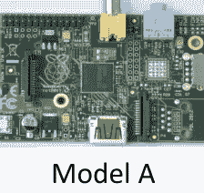

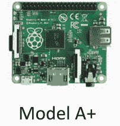

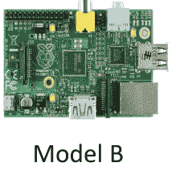

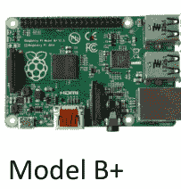

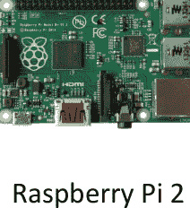

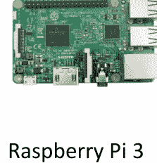

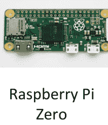

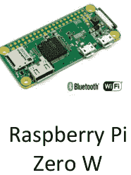

### 树莓派系列板卡

| 名称 | 1 Model A+ | 1 Model B+ | 2 Model B | Zero | 3 Model B | Zero W |
|---|---|---|---|---|---|---|
| 日期 | 2014年11月 | 2014年7月 | 2015年2月 | 2015年11月 | 2016年2月 | 2017年2月 |
| 价格 | #20 | $35 | $35 | $5 | $35 | $10 |
| CPU | ARM11 700MHz 单核 | ARM11 700MHz 单核 | Cortex A7 900MHz 四核 | ARM 11 1GHz 单核 | Cortex-A53 1.2GHz 四核 | ARM 11 1GHz 单核 |
| SoC | BCM2835 | BCM2835 | BCM2836 | BCM2835 | BCM2837 | BCM2835 |
| 内存 | 256MB | 512MB | 1GB | 512MB | 1GB | 512MB |
| 网络 | 无/A | 以太网 10/100 | 以太网 10/100 | 无/A | 以太网 10/100 无局网 2.4GHz 蓝牙 4.1 802.11n | 无局网 2.4GHz 802.11n 蓝牙 4.1 BLE |
| USB | USB 2.0 x1 | USB 2.0 x4 | USB 2.0 x4 | Micro USB x1 | USB 2.0 x4 | Micro USB x1 |
| 电源 | 5V 200mA | 5V 600mA | 5V 800mA | 5V 160mA | 5V 1.34A (2.1A) | 5V 350mA |

### 树莓派 3

- ARMv8 CPU 1.2GHz 64位四核
- 802.11n 无局域网
- 蓝牙 4.1 低功耗蓝牙(BLE)
- 1GB 内存
- 4 个 USB 端口
- 40 GPIO 引
- HDMI 端口
- 以太网端口
- 3.5mm 音频
- 摄像头接口(CSI)
- 显示接口(DSI)
- Micro SD 卡槽
- VideoCore IV 3D 图形

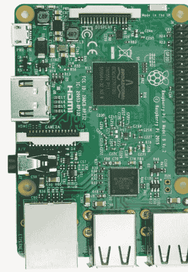

### 树莓派 3

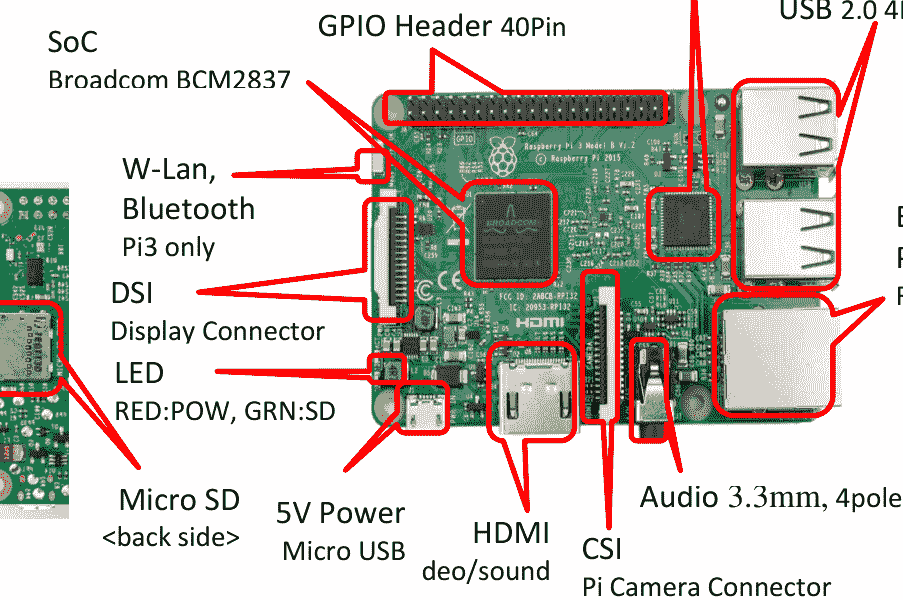

## 树莓派安装

- 1. 介绍
- 2. OS(Rasbian) 安装
- 3. 开发环境

### OS 镜像下载

- https://www.raspberrypi.org/downloads/raspbian/
- `201x-xx-raspbian-jessie.zip`
- Raspbian
- Jessie with PIXEL：完整版
- Jessie Lite：精简版

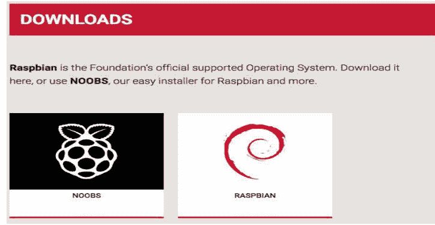

### 将镜像烧录 SD 卡

- ETCHER
- https://etcher.io/
- Windows, macOS
- Win32DiskIm
- 仅限 Windows


### 设置

- 连接显示器、键盘、鼠标和互联网
- 串口控制台TY
- USB 转 UART(树莓派)
- 直接以太网(PC)
- 最简单的设置方法但不太方便
- 使用 HDMI 连接显示器
- 使用 USB 连接鼠标/键盘
- 插入 SD 卡

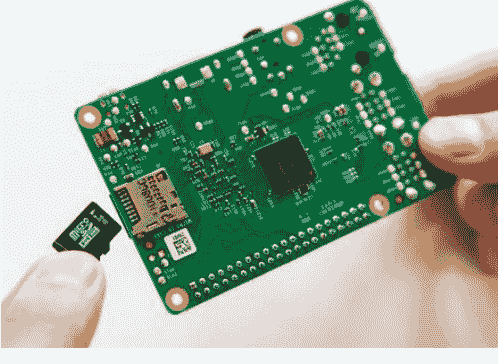


#### PC

- 以`sudo`打开编辑器
- 运行`leafpad`
- 静态 IP 设置
- 打开`/etc/dhcpcd.conf`

```
interface eth0
static ip_address=192.168.0.1/24
static routers=192.168.0.254
static domain_name_servers=8.8.8.8
```


| 名称 | 大小 | 修改日期 |
|---|---|---|
| debian_version | 4 字节 | 30/11 |
| user.conf | 64 字节 | 16/05 |
| dhcpcd.conf | 1.2 kB | 17/10 |
| dhcpcd.duid | 42 字节 | 15/15 |
| phys-swap | 1 kB | 11/16 |
| environment | 0 字节 | 24/03 |
| fake-hwclock.data | 5 字节 | 14/ |
| fb.modes | 20 字节 | 13/14 |

| 编辑 | 搜索 | 帮助 |
|---|---|---|
| 新建 | Ctrl+N | |
| 打开 | Ctrl+O | |
| 保存 | Ctrl+S | |
| 另存为 | Shift+S | |
| 打印 | Shift+P | |
| 退出 | Ctrl+Q | |

#### 启用 Console TTY

- 连接 PC 并检查`boot`及其及其文件
- `cmdline.txt`
- `config.txt`

```
dwc_otg.param_enable=0
console=serial0,115200tty1=/dev/mmc0p2
roottype=ext4
repair=yes
```

- 在文件末尾添加`enable_uart=1`
- 行内不要空格
- 如果你在 HDMI 上看到图像……请取消注释...
- `enable_uart=1`
- 从 PC 拔出 SD 卡，插入树莓派槽
- 树莓派未上电 yet。

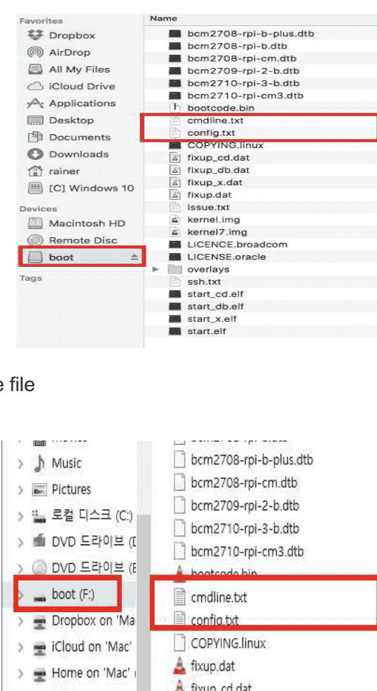

#### 静态 IP 设置

- `sudo vi /etc/dhcpcd.conf` (备份)

```
interface eth0
static ip_address=192.168.0.1/24
static routers=192.168.0.254
static domain_name_servers=8.8.8.8
```

- `sudo reboot`
- `ifconfig eth0`
- 检查 IP 地址

```
@raspberry:~ ifconfig eth0
eth0      Link:Ethernet HWaddr b8:27:eb:be:b2:66
          inet 192.168.0.255 Broadcast:192.168.0.255 Mask:255.255.255
          inet6     fe80::ba27:ebff:febe:66/64 Scope:Link
UP BROADCAST RUNNING MULTICAST  MTU:1500 Metric:1
         RX packets:95 errors:0 overruns:0 frame:0
         TX packets:90 errors:0 overruns:0 carrier:0 txqueuelen:1000
         RX bytes:16747 (16.3 KiB) TX bytes:15880 (15.5 KiB)
```

#### SSH 登录

- PuTTY
- 连接类型 : SSH
- 主机名：树莓派地址
- 端口 : 22
- 保存 RSA 密钥
- 登录
- ID : pi
- 密码 : raspberry

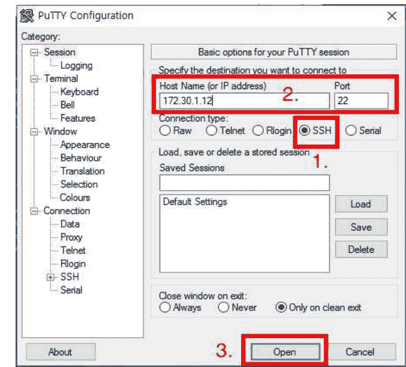

172.30.1.12 - PuTTY

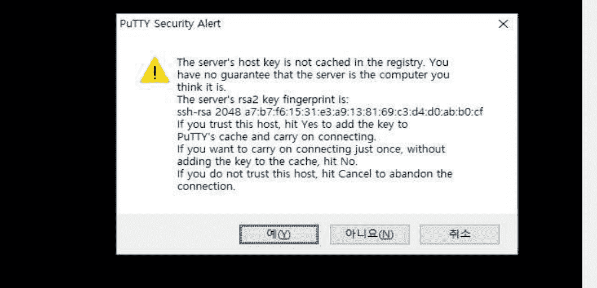

### 软件配置

- `sudo raspi-config`
- 4 国际化选项
- 时区 > 亚洲 > Seoul
- 更改区域设置
- `en_US.UTF-8`
- `ko_KR.EUC-KR`
- `ko_KR.UTF-8`
- 默认 : `en_US.UTF-8`
- 更改键盘布局
- 通用 105 键
- 兼容韩语 104 键
- 模块更新
- `sudo apt-get update`
- `sudo apt-get upgrade`
- 安装韩文字字体
- `sudo apt install fonts-unfonts-core`
- 安装韩语键盘
- `sudo apt install ibus`
- `sudo apt install ibus-hangul`

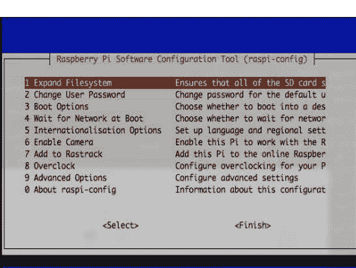

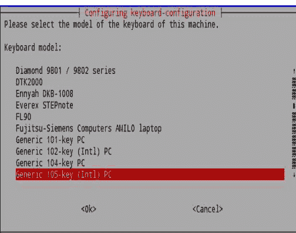

#### LCD 显示器设置

- http://linux.org/index.php?title=RPiconfig
- `/boot/config.txt`
- PC 中的 BIOS
- `max_usb_current`
- 更改 输出 输出限制
- 600mA 1200mA
- `hdmi_group`
- 1 : CEA, 2: DMT
- `hdmi_mode=87`


- 自定义模式
- `hdmi_cvt`
- 宽度、高度、帧率、宽高比、边距、隔行、rb

```
max_usb_current=1
hdmi_group=2
hdmi_mode=87
hdmi_cvt=1024 600 60 0 0
```


#### 远程桌面 - VNC

- 树莓派配置 GUI
  - 接口
    - 启用 VNC 服务
- 树莓派配置 CLI
  - `sudo raspi-config`
  - 接口
    - VNC

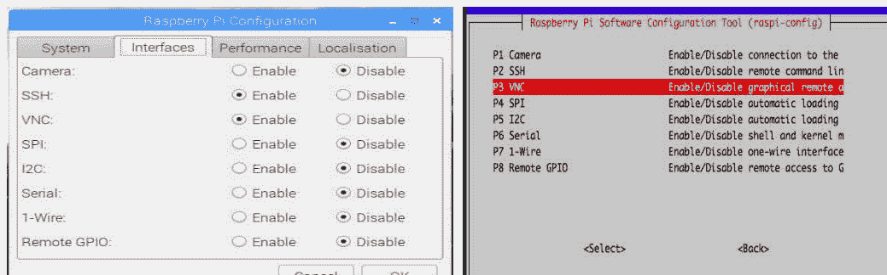

#### 远程桌面 - VNC

- 树莓派
  - 服务安装
    - `sudo apt-get install x11vnc`
  - 执行服务器
    - `x11vnc`
  - 调整分辨率
    - http://elinux.org/Rpiconfig
    - `/boot/config.txt`

```
hdmi_force_hotplug = 1
hdmi_group = 2
hdmi_mode = 16 #1024x768
hdmi_drive = 1
```

#### 远程桌面 - VNC

- PC
  - http://www.realvnc.com/download/
  - 安装 VNC Viewer


#### 远程桌面 - xrdp

- 树莓派
  - 服务安装
    - `sudo apt-get remove vnc4server`
    - `sudo apt-get remove tightvncserver`
    - `sudo apt-get install tightvncserver`
    - `sudo apt-get install xrdp`
  - 服务器配置文件
    - `/etc/xrdp/xrdp.ini`
- PC (仅限 Windows)
  - 开始 > `mstsc` (远程桌面)
  - sesman-XVnc
  - pi / raspberry

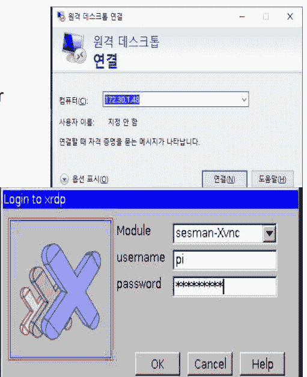

## 树莓派安装

1. 简介
2. OS(Raspian) 安装
3. 开发环境

## Python

- https://www.python.org/downloads/release/python-2711/
- 版本 2.7.x，而非 3.5.x

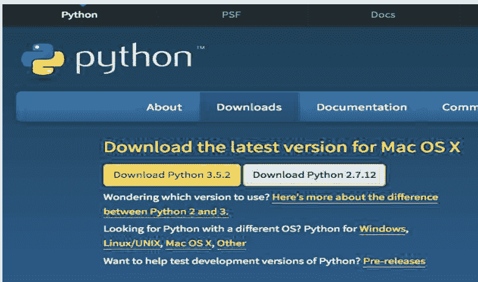

## Python

- 在 PC 上安装
- 默认路径
- 启用 "Add python.exe to path"

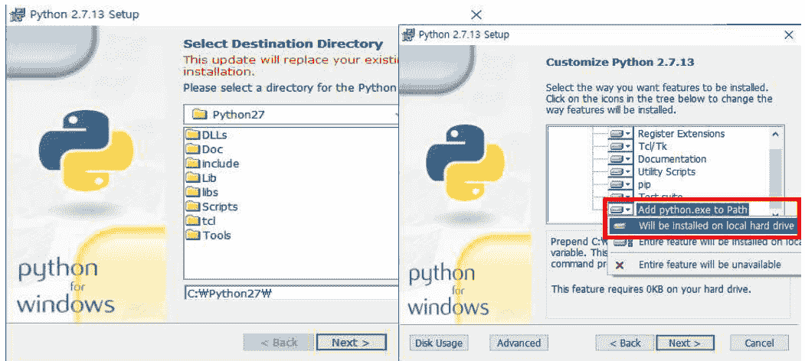

## Python

- Hello World
- REPL (读取-求值-打印循环)
  - 打开 Windows 命令控制台
  - 执行`python`命令
  - 打开 python shell 提示符
  - 执行`print Hello world`
  - 命令`exit()`
- 源码
  - 创建名为`world.py`的文件

```
print "Hello world"
```

- 执行命令
- `python world.py`

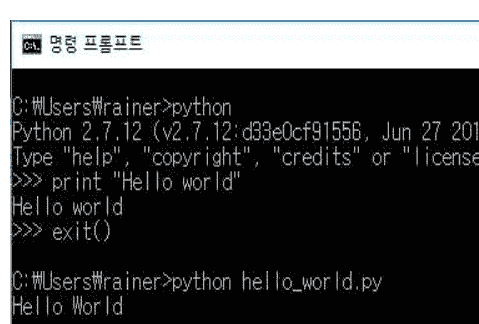

## WinSCP

- 基于 SSH 的 SFTP : FTP 接收文件
- https://winscp.net/

| WinSCP |
| :--- |
| Windows 上的免费 SCP 和 FTP 客户端 |
| 介绍 SSH 客户端 | SFTP 客户端 | FTP 客户端 | 下载 指南 |
| 常见问题 | 脚本 | .NET & COM 库 | 截图 | 翻译 | 历史 | 下载 |
| [下载 WinSCP] [下载发布] [下载 PuTTY] |
| 广告 |
| 创新性地改变了。 |
| Adobe Creative Cloud 全部应用和服务。 |
| ₩ 59,400 起 |

| WinSCP 5.7.2 |
| :--- |
| 安装包 (5.6 MB, 1,027,515 次下载) | 发布：2016-03-06 |
| 可携版执行文件 (4.7 MB, 190,787 次下载) | |
| .NET 程序 / COM 库 (4.6 MB, 8,800 次下载) | |
| 源码 (8.8 MB, 4,184 次下载) | |


## WinSCP

- 安装
- 默认选项


## WinSCP

- 连接到树莓派

## WinSCP

- 上传到树莓派
- 文件系统
- 传输到 WinSCP

## WinSCP

- 左侧面板：PC
- 右侧面板：树莓派

## WinSCP

- 文件系统
- 传输到 WinSCP

## WinSCP

- 文件系统
- 传输到 WinSCP

## WinSCP

- 文件系统
- 传输到 WinSCP

## WinSCP

- 文件系统
- 传输到 WinSCP

## WinSCP

- 文件系统
- 传输到 WinSCP

## WinSCP

- 文件系统
- 传输到 WinSCP

## NodeJS

- 下载树莓派版本
- 默认安装了过旧版本 (v10.10.x)
- 根据 CPU 架构确定版本

```
$ uname -m
$ cat /proc/cpuinfo
```

RaspberryPi CPU 为 ARMv8，Raspberry OS 基于 32 位系统

- 下载


## NodeJS

- 下载树莓派版本

- 默认安装了过旧版本 (v10.10.x)

- 根据 CPU 架构确定版本

  ```
  $ uname -m
  $ cat /proc/cpuinfo
  ```

  RaspberryPi CPU 为 ARMv8，Raspberry OS 基于 32 位系统

- 下载

  ```
  $ wget https://nodejs.org/dist/v16.9.4/node-v16.9.4-linux-armv7.tar.xz
  ```

- 解压

  ```
  $ tar -xf node-v16.9.4-linux-armv7.tar.xz
  ```

- 移动到`/opt`

  ```
  $ sudo mv node-v16.9.4-linux-armv7 /opt/nodejs
  ```

- 创建链接

  ```
  $ apt-get remove nodejs
  $ sudo ln -s /opt/nodejs/bin/node /usr/bin/node
  $ sudo ln -s /opt/nodejs/bin/npm /usr/bin/npm
  ```

```
$ wget -O https://nodejs.org/dist/v16.9.4/node-v16.9.4-linux-armv7.tar.xz node-v16.9.4-linux-armv7.tar.xz
正在解析 nodejs.org...
正在连接 nodejs.org[443]...
HTTP 请求已发送，等待响应...200 OK
长度: 8304476 (7.9M) [application/xz]
保存至: node-v16.9.4-linux-armv7.tar.xz
node-v16.9.4-linux-armv7.tar.xz 100%[==============================] 7.9M 1.05MB/s in 8.3s
2017-01-18 00:47:23 (979 KB/s) - node-v16.9.4-linux-armv7.tar.xz saved [8304476]
```

## NodeJS

- 检查`nodejs`版本

  ```
  $ node --version
  pi@raspberrypi:~ $ node --version
  v16.9.4
  ```

- 源码

  在 PC 上创建一个名为`hello_world.js`的文件

  ```
  console.log("Hello World");
  ```

- 在 PC 上运行

  ```
  $ node hello_world.js
  ```

- 上传到树莓派并运行

  使用 WinSCP 上传文件

  ```
  $ node hello_world.js
  pi@raspberrypi:~ $ node hello_world.js
  Hello World
  ```

## JDK (Java 开发工具包) 安装

Eclipse 需要

- http://java.sun.com

- http://www.oracle.com/java/javase/downloads/jdk8-downloads-213151.html

Java SE 开发 8 下载

感谢您下载此版本的 Java™ 平台标准版开发工具包 (JDK™)。JDK 是一个用于使用 Java 编程语言构建应用程序、小程序和组件的开发环境。

JDK 包含了用于开发和测试使用 Java 编程语言编写并在 Java 平台运行的程序的工具。

另请参考：

- Java 开发者通讯：从您的 Oracle 账户选择“订阅 (Subscriptions)”展开“技术 (Technology)”并订阅 Java。

- Java 开发者日研讨会（免费）和其他活动

- Java 杂志

JDK 8u91 校验和

JDK 8u92 校验和

### Java 开发工具包 8u91

你必须接受 Java SE Oracle 二进制代码许可协议才能下载此软件。

感谢接受 Java SE Oracle 二进制代码许可协议；您可以下载此软件。

| 产品 / 描述 | 文件大小 | 下载 |
|---|---|---|
| Linux ARM 32位 ABI | 77.72 MB | jdk-8u91-linux-armv7-bin.tar.gz |
| Linux ARM 64位 ABI | 74.69 MB | jdk-8u91-linux-arm64-bin.tar.gz |
| Linux x86 | 154.74 MB | jdk-8u91-linux-x86-bin.tar.gz |
| Linux x64 | 174.92 MB | jdk-8u91-linux-x64-bin.tar.gz |
| Linux x64 | 172.97 MB | jdk-8u91-linux-x64-bin.tar.gz |
| Mac OS | 227.29 MB | jdk-8u91-macosx-x64.tar.gz |
| Solaris SPARC 64位 (SPARC4) | 139.59 MB | jdk-8u91-linux-solaris-sparc.tar.gz |
| Solaris SPARC 64位 | 98.95 MB | jdk-8u91-linux-solaris-sparc.tar.gz |
| Solaris x64 (SPARC4) | 140.29 MB | jdk-8u91-linux-solaris-x64-bin.tar.gz |
| Solaris x64 | 96.78 MB | jdk-8u91-linux-solaris-x64-bin.tar.gz |
| Windows x86 | 182.11 MB | jdk-8u91-windows-x86.exe |
| Windows x64 | 187.44 MB | jdk-8u91-windows-x64.exe |


# 远程系统设置

- 你可以使用 Eclipse 控制远程 RaspberryPi
- 打开视图 (Perspective)
  - `Eclipse > Window > Perspective > Open Perspective > Other`
  - Remote System Explorer (远程系统管理器)


## 远程系统设置

- 注册新连接 (Connection)
- `Remote System` > 右键点击 (R Click)

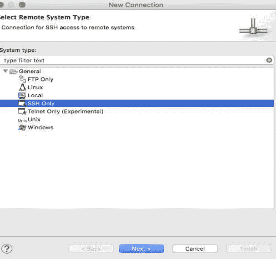

## 登录


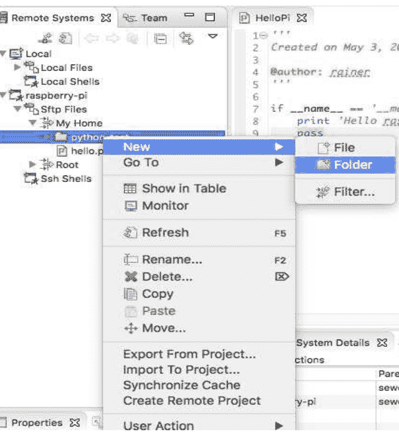

## 将 Python 项目应用到远程

- 导出在 PyDev 视图下产生的项目
- `Remote Systems > Remote File System`


## 将 Python 项目应用到远程

- 在 RaspberryPi 上选择一个目录

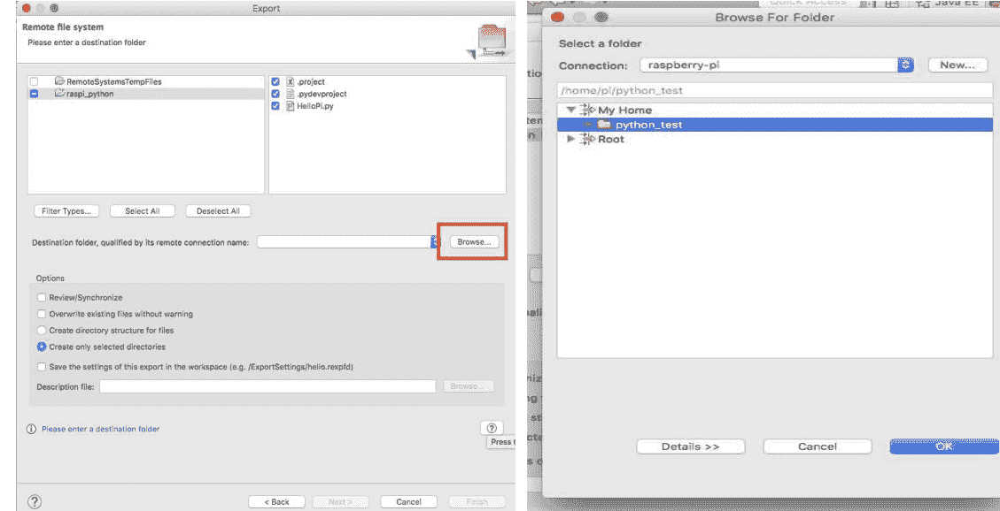

## 将 Python 项目应用到远程

- 选择目标 (Destination)
- 选择 "Review/Synchronize"（检查/同步）选项


## 将 Python 项目应用到远程

- 使用同步视图 (synchronize view) 要应用的文件

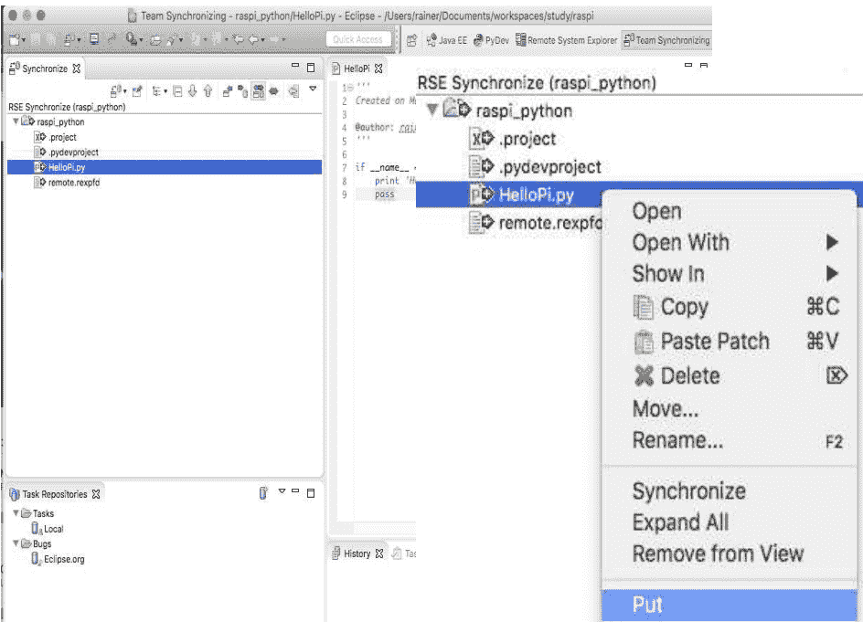

## 将 Python 项目应用到远程

- 使用 PuTTY 进行远程执行。

```
pi@raspberrypi:~ $ cd python_test/
pi@raspberrypi:~/python_test $ ls
raspi_python
pi@raspberrypi:~/python_test $ cd raspi_python/
pi@raspberrypi:~/python_test/raspi_python $ ls
HelloPi.py remote.rexpfd
pi@raspberrypi:~/python_test/raspi_python $ python HelloPi.py
Hello raspberry-pi
```

## 将 C 项目应用到远程

- 对项目右键点击
- `Run As` (运行方式) > `Run Configurations` (运行配置)

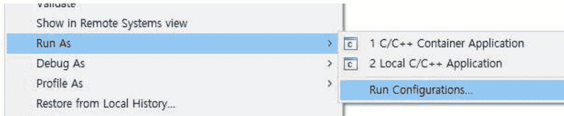

- 选择 "C/C++ Remote Application"
- 创建新的运行配置
- 新连接
- 连接类型
- SSH

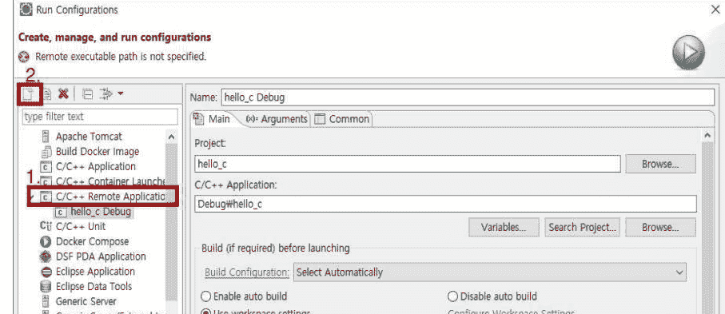

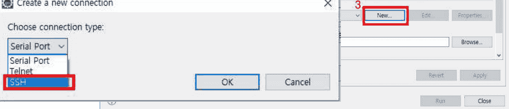

## 将 C 项目应用到远程

- 新连接
- 填写空白
- 远程路径 (Remote path)
- 在远程设备上选择合适的属性

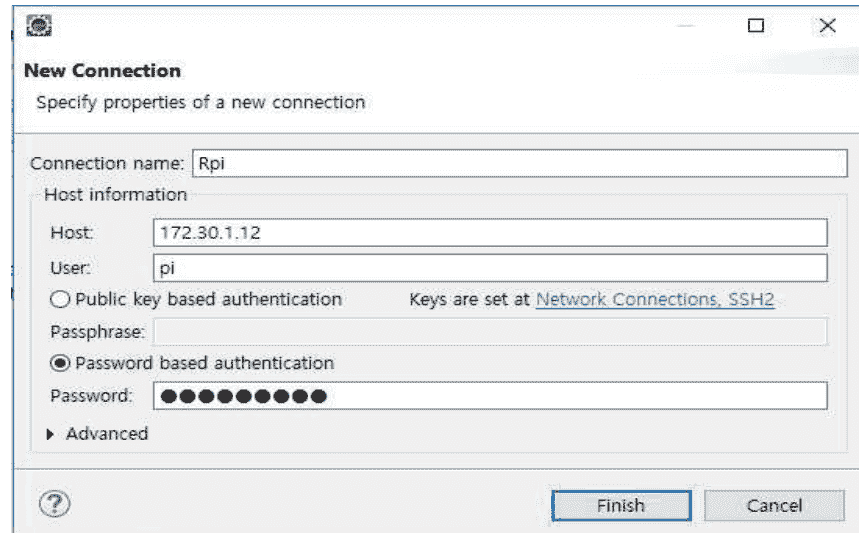

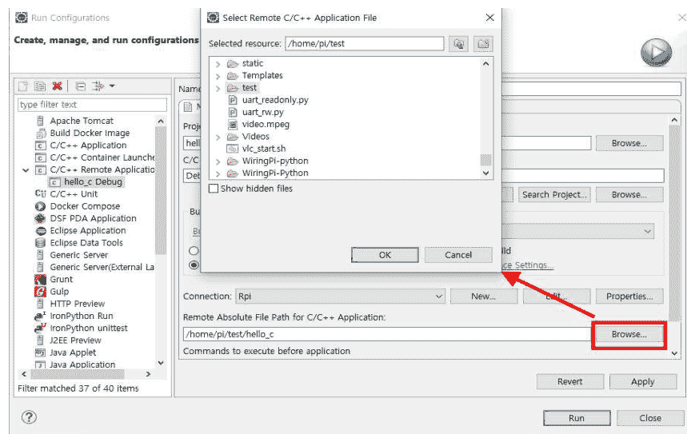

## 将 C 项目应用到远程

- 执行应用前的命令
- `chmod 744 path/to/output_name`


- 在控制台 (Console) 检查结果


> Last login: Mon May 30 00:08:46 2017 from 172.30.1

```
chmod 744 /home/pi/test/hello_c;home/pi/test/hello_c;exit
pi@raspberrypi:~$ chmod 744 /home/pi/test/hello_c;home/pi/test/hello_c;exit
Hello World
```

## 将 NodeJs 项目应用到远程

- NodeJs 项目导出
- `Remote Systems > Remote File System`
- 在 RaspberryPi 上选择一个目录并检查 "Review/Synchronize"（检查/同步）


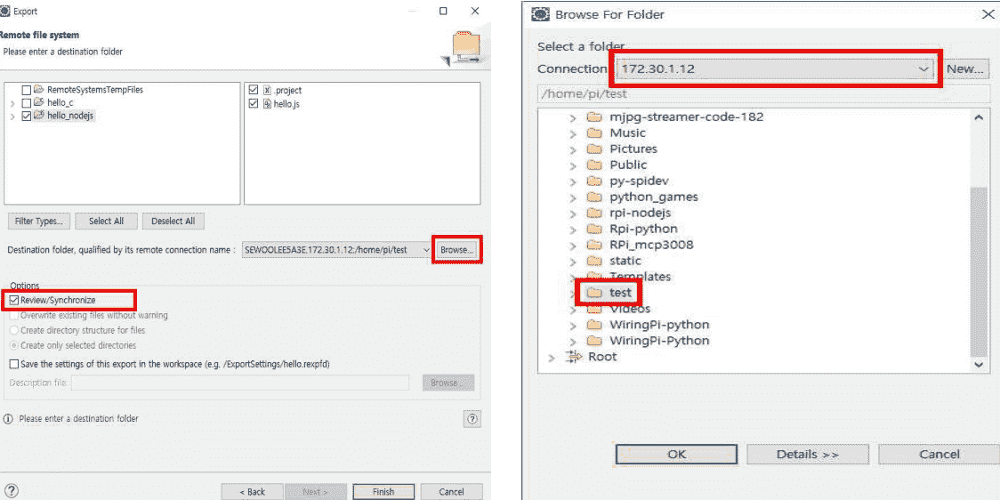

## 将 NodeJs 项目应用到远程

- 使用同步功能应用文件
- 使用 PuTTY 进行远程执行。

```
pi@raspberrypi:~/test/hello_nodejs $ ls
hello.js
pi@raspberrypi:~/test/hello_nodejs $ node hello.js
```

# Raspberry Pi Linux

1. Unix & Linux 简介
2. Linux 命令

## Unix

- 1964 年的 GE & MIT
- 多用户，多处理
- 1969 年解决了许多问题
- Unix AT&T
- 1971 年由 Ken Thompson 用汇编编写（美国，1943）
- 1973 年由 Dennis Ritchie 用 C 语言编写（美国，1941）
- 在 UC Berkeley 用 C 语言开发 Unix
- 来自 AT&T 的源码
- 增加了 TCP/IP 栈
- BSD 版本
- System V 来自 AT&T
- Solaris, HP-UX, AIX
- 来自 UC Berkeley 的 BSD

### Minix

- 1987 年的 Unix 类操作系统（荷兰，1944）

### Linux

- 1991 年由赫尔辛基大学的 Linus Torvalds（芬兰，1969）创建
- 在 Minix 上创建 Unix 类操作系统
- 自由软件, GPL

#### 发行版

- Red Hat
  - 企业级流行
  - 包管理器：RPM
  - Fedora, CentOS
- Debian
  - 桌面级流行
  - 包管理器：APT
  - Ubuntu, Rasbian, Mint
- Slackware
  - OpenSUSE, Slax


#### Unix 类系统

- Minix
- Linux
- Mac OSX

#### POSIX (可移植操作系统接口)

- Richard Stallman 建议（1953~1985）
- Unix 接口标准
- 认证
- AIX
- HP-UX
- IRIX
- macOS, Darwin
- Solaris
- FreeBSD
- NetBSD
- Linux
- VxWorks


## Unix/Linux 系统结构

- 内核
- 文件系统
- Shell

# 内核

- 核心组件
- 设备管理
- 内存、进程管理
- 文件系统管理
- CPU 控制

## 文件系统

- 分级目录和文件，`/`(root)
- 管理磁盘中的文件
- 将设备、进程映射到文件
- Linux FS
  - Ext3, Ext4

## Shell

- 人类与内核之间的接口
- Shell 类型
  - Bourne Shell
    - Unix 起源
  - C Shell
    - 类似 C 语言
  - Korn Shell
    - Unix 标准
    - 改进的 Bourne & C
  - Bash Shell
    - 大多数 Linux Shell
    - Bourne Again
  - Z Shell
    - 现代风格

### 命令行

- 命令
  - Shell 内置命令
  - `PATH` 中的执行文件
- 选项 (Options)
  - 可选
  - 横线字符 (`-`)
  - 额外要求
  - 命令修符
- 参数 (Arguments)
  - 可选或强制
  - 命令对象
  - 执行目标

```
$ command options arguments

$ ls
$ ls -al
$ ls -1 /etc
```

### 命令行

- 仅命令
  - 无选项
- 默认选项
  - 无参数
  - 示例
  - 命令

### 命令行

- 命令 + 选项
  - 命令 + 参数
  - 命令 + 选项
  - 特定

> Last login: Mon May 30 00:08:46 2017 from 172.30.1

```
chmod 744 /home/pi/test/hello_c;home/pi/test/hello_c;exit
```

#### 控制字符

- 进程
  - `Ctrl + c` : 中断（终止）当前进程，SIGINT
  - `Ctrl + d` : EOF(文件结束)或 EOT(传输结束)字符
  - `Ctrl + z` : 挂起当前前台进程，SIGSTOP
- 光标
  - `Ctrl + a` : 将光标移动到行首
  - `Ctrl + e` : 将光标移动到行尾
- 屏幕
  - `Ctrl + u` : 清除当前行
  - `Ctrl + w` : 清除当前单词
  - `Ctrl + l` : 清屏
  - `Ctrl + s` : 停止向屏幕输出
  - `Ctrl + q` : 恢复被 `Ctrl + s` 停止的屏幕输出

#### 命令类型

- Shell 内置命令
  - 内部命令
  - Shell 命令
- 可执行程序文件
- 外部命令
  - 所有文件在磁盘上均具有 X 模式
  - 在 `$PATH` 环境变量中指定位置
  - `/bin` : 普通用户的基础命令
  - `/sbin` : 管理员基础命令
  - `/usr/bin`, `/usr/sbin` : 特定类别用户使用的命令
    - 例：办公用户、开发者、游戏玩家
  - `/usr/local/bin`, `/usr/local/sbin` : 用户编译并安装的程序

#### 命令类型

- Shell 内置命令
  - 列出
  - `help`
  - 详细信息
  - `help <command>`
  - 区分
  - `type <command>`
- 可执行程序文件
  - 列出
  - `echo $PATH`
  - 详细信息 `--help`
  - `man help`
  - 路径
  - `which <command>`

## 手页

- 来自 Unix 手页手册
  - 在线：http://man7.org/linux/man-pages/index.html

| 章节 | Unix System V | BSD Linux |
| :--- | :--- | :--- |
| 1 | 普通命令 | 普通命令 |
| 2 | 系统调用 | 系统调用 |
| 3 | C 库 | C 库 |
| 4 | 文件格式 | 设备和驱动 |
| 5 | 杂项 | 文件格式 |
| 6 | 游戏和屏幕保护 | 游戏和屏幕保护 |
| 7 | 设备和驱动 | 杂项 |
| 8 | | 系统管理 |
| 9 | 内核 | 内核教程 |

## 手页

- `man <command>`
  - 导航键
    - `enter` : 下行
    - `space` : 下页
    - `b` : 上页
    - `/pattern` : 搜索模式
    - `n` : 下一个匹配项
    - `q` : 退出
- SEE ALSO (相关)
  - 相关命令
- 章节号
  - `Command(n)`

## 手页

- 在指定章节查询
  - `man -s <section_number> <command>`
  - `man <section_number> <command>`
- 关键词
  - `man -k <keyword>`

```
~ $ man uname
~ $ man -s 2 uname
~ $ man 2 uname
~ $ man -k uname
arch (1) - 打印机器硬件名称（相当于 uname -m）
oldduname (2) - 获取当前内核的名称和信息
olduname (2) - 获取当前内核的名称和信息
uname (1) - 打印系统信息
uname (2) - 获取当前内核的名称和信息
```

# Linux 文件系统

适用于树莓派

1. 文件与目录命令
2. 标准输入
3. 文件权限
4. 文件系统与链接

### pwd

- 当前工作目录

### ls

- 列出文件和目录
- `ls options pathname`
  - `-l` : 长格式，详细
  - `-a` : 所有，不显示隐藏文件
  - `-d` : 目录
  - `-F` : 文件类型
    - `/` : 目录
    - `*` 可执行
    - (none) : 文本
    - `@` 链接
- `ls file`
- `/dir`

```
pi@raspberry:~ $ pwd
/home/pi
pi@raspberry:~ $ ls
Desktop Downloads Templates
Documents Music Public Videos
python_games
pi@raspberry:~ $ ls -l
total344
drwxr-xr-x 2 pi pi 4096 Nov 29 02:57 Desktop
drwxr-xr-x 5 pi pi 4096 Nov 29 02:22 Documents
drwxr-xr-x 2 pi pi 4096 Nov 29 02:57 Downloads
drwxr-xr-x 2 pi pi 4096 Nov 29 02:57 Music
drwxr-xr-x 2 pi pi 4096 Nov 29 02:57 Pictures
drwxr-xr-x 2 pi pi 4096 Nov 29 02:57 Public
drwxr-xr-x 2 pi pi 4096 Nov 29 02:57 Templates
drwxr-xr-x 2 pi pi 4096 Nov 29 02:57 Videos
drwxr-xr-x 2 pi pi 4096 Nov 29 02:22 python_games
```

### ls -l

| 模式 | 所有者 | 组 | 最后修改时间 | 文件名 |
| :--- | :--- | :--- | :--- | :--- |
| drwxrxr-wx 2 | sammy | sammy | 4096 Nov 10 12:15 | everyone_directory |
| drwxr-xr-- 2 | root | developers | 4096 Nov 10 12:15 | group_directory |
| -rw-r--r-- | sammy | sammy | 15 Nov 10 17:07 | group_modifiable |
| drwx------ 2 | sammy | sammy | 4096 Nov 10 12:15 | private_directory |
| -rw-r--r-- | sammy | sammy | 269 Nov 10 16:57 | private_file |
| rwxr-xr-x 1 | sammy | sammy | 46357 Nov 10 17:07 | public_executable |
| -rw-rw-- 1 | sammy | sammy | | |
| drwxr-xr-x 2 | sammy | sammy | 4096 Nov 29 02:57 | public_executable |
| drwxr-xr-x 2 | sammy | sammy | 4096 Nov 29 02:57 | Public |
| drwxr-xr-x 2 | sammy | sammy | 4096 Nov 29 02:57 | Templates |
| drwxr-xr-x 2 | sammy | sammy | 4096 Nov 29 02:57 | Videos |

### mv (移动)

- 移动到目录
  - 新目录
    - `mv dir dirX`
    - 创建新目录
- 移动到现有目录
  - `mv dir dirC`
  - 移动到子目录


```
pi@raspberrypi:~/test $ mv dirA dirX
pi@raspberrypi:~/test $ ls
dirB dirC dirD dirX dirZ
fileC fileX
pi@raspberrypi:~/test $ ls dirX
fileAA
```

```
pi@raspberrypi:~/test $ mv dirB dirC
pi@raspberrypi:~/test $ ls dirC
```

### `rmdir` (删除空目录)

- `rmdir [option] 目录...`
  - `-p` 父目录
    - 删除祖级目录
    - 仅删除空目录
- 如果为空
  - 失败
  - 使用 `rm`

```
pi@raspberrypi:~/test $ mkdir dirA
pi@raspberrypi:~/test $ ls
dirD dirX dirZ fileX hello.txt
pi@raspberrypi:~/test $ rmdir dirA
pi@raspberrypi:~/test $ ls
dirD dirX fileX hello.txt
```

```
pi@raspberrypi:~/test $ ls dirD
dirDD
pi@raspberrypi:~/test $ rmdir dirD
rm: failed to remove 'dirD': Directory not empty
```

### `rm` (删除文件或目录)

- `rm [options] 路径`
  - `-r` 递归
    - 非空
  - `-f` 强制
    - 忽略不存在
  - `-d` 目录

```
pi@raspberrypi:~/test $ ls
dirC dirX dirZ
fileC hello.txt
pi@raspberrypi~/test $ rm fileC
pi@raspberrypi~/test $ ls
dirC dirX dirE
pi@raspberrypi~/test $ mkdir dirE
:: remove ' 'EE': a directory
pi@raspberrypiEtest $ Is -d
pi@raspberrypi~/test $ rm -d dirC
rm: cannot remove 'dirC': Directory not empty
@@raspberrypitest $ $ - -rC
```

### 显示文件内容

- `cat [OPTION] 文件`
  - 将文件连接到输出
    - 如果文件为空，使用 `more`
    - 分页显示
    - 滚动
    - 回车进入下一页
    - `b`: 回到上一页
    - `/pattern`: 搜索
    - `q`: 退出
- `head [OPTION] 文件`
  - 输出第一部分
  - `-n` 数字: 前 n 行
- `tail [OPTION] 文件`
  - 输出最后部分
  - `-n` 数字: 最后 n 行
  - `-f` 持续

```
pi@raspberrypi~/test $ cat /etc/hosts
127.0.0.1 localhost
::1 localhost ip6-loopback
ff02::1 ip6-nodes
ff02::2 ip6-routers
pi
more /etc/passwd
root:x:0:0:root:/root:/bash
daemon:x:1:1:daemon:/usr/sbin:/usr/sbin
lo
raspberrypi $ head
/etc/dhcpcd.conf
# dhcpcd 的示例配置
## 详情请查看 dhcpconf(5)。
pi@raspberrypi~/test $ tail
/boot/config.txt
...
start_x=1
gpu_mem=128
```

## `wc` (字数)

- `wc [OPTION] 文件`
  - 无选项：行、字、字节
  - `-l`: 行数
  - `-w`: 字数
  - `-m`: 字符数
  - 用于管道(`|`)

```
pi@raspberry:~/test $ wc /etc/passwd
30 46 1592 /etc/passwd
pi@raspberry:~/test $ wc -l /etc/passwd
30 /etc/passwd
```

## `grep`

- `grep [OPTION] 模式 文件`
- 输出匹配模式的行
- OPTION
  - `-i`: 忽略大小写
  - `-l`: 输出文件名
  - `-n`: 行号
  - `-v`: 反向匹配
  - `-c`: 计数
  - `-w`: 单词搜索
  - `-E`: 扩展正则表达式
  - `-F`: 固定字符串
  - `-r` 递归

```
pi@raspberry:~/test $ grep pi
/etc/passwd
pi:1000:1000::/home/pi:/bin/bash
pi@raspberry:~/test $ grep 'ip_address' /etc/dhcpcd.conf
42:#static ip_address=192.168.0.10/24
50:#static ip_address=192.168.1.23/24
pi@raspberry:~/test $ grep -E 'ip._address' -n /etc/dhcpcd.conf
42:#static ip_address=192.168.0.10/24
43:#static_ip6_address=fd51:42f8:caae:d92e::ff/64
50:#static ip_address=192.168.1.23/24
```

## `egrep`

- `grep -E`

## `rgrep`

- `grep -r`

## `find`

- 搜索文件
- `find 路径 表达式 动作`
  - 表达式
    - `-name` 文件名
    - `'文件名*'`: 带引号的 `*`
  - `-type` 类型: `f`, `d`, `c`, `b` ...
  - `-size [-+][n][c,k,M]`
  - `-atime`, `-amin`, `-mtime`, `-mmin`, `-ctime`, `-cmin [-+][n]`
  - `-user` 所有者
  - `-perm [-/] 模式`
    - `-`: 匹配所有位
    - `/`: 匹配任意位
  - `-maxdepth n`

```
pi@raspberrypi:~ $ find ~ -name hello
/home/pi/Documents/BlueJ Projects/hello
/home/pi/hello
```

### `find` 表达式

```
pi@raspberrypi:~ $ find ~ -name 'dir*' -type d
/home/pi/dirA
/home/pi/test/dirD
/home/pi/test/dirDDD
pi@raspberrypi:~ $ find /boot -size +1M
/boot/kernel.img
/boot/kernel.7
/boot/start.elf
/boot/start_x
pi@raspberrypi:~ $ find ~ -mtime -1
/home/pi
/home/pi/.cache
/home/pi/.cache/log
```

# `tee`

- 从标准输入读取，写入标准输出和文件
- 适用于同时输出 stdout（终端）和文件
- 使用重定向和管道组合
- `-a` : 追加

```bash
$ tee out.log
hello
hello
world
world
$ cat out.log
hello
world
$ find /etc -name hosts 2>&1 | tee out.log
/etc/hosts
find: '/etc/polkit-1/localauthority': Permission denied
$ cat out.log
/etc/hosts
find: '/etc/polkit-1/localauthority': Permission denied
```

# Linux 文件系统

适用于 Raspberry Pi

1. 文件与目录命令
2. 标准 I/O
3. **文件权限**
4. 文件系统与链接

## Linux 文件模式

- 确定可读、写、执行
- 文件类型
  - `-` : 普通文件
  - `d` : 目录
  - `l` : 符号链接
  - `s` : 套接字
  - `p` : 命名管道
  - `c` : 字符设备
  - `b` : 块设备
- 用户
  - 所有者 (Owner)
    - 所有者 ID
  - 组 (Group)
    - 组员
  - 其他 (Other)
    - 不是所有者，不是组员

| 模式 | 所有者 | 组 | 最后修改 | 文件名 |
|---|---|---|---|---|
| `drwxrrwx` | 2 sammy | sammy | 4096 Nov 10 12:15 | `everyone_directory` |
| `drwx---` | 2 root | developers | 4096 Nov 10 12:15 | `group_directory` |
| `-rw-rw----` | 1 sammy | sammy | 15 Nov 10 17:07 | `modifiable` |
| `drwx------` | 2 sammy | sammy | 4096 Nov 10 12:15 | `private_directory` |
| `-rw----r--` | 1 sammy | sammy | 26 Nov 10 16:57 | `private_file` |
| `-rx-xr-x` | 1 sammy | sammy | 57 Nov 10 17:07 | `executable` |
| `-rw-rw-r-` | 1 sammy | sammy | 97 Nov 10 17:06 | `public_file` |
| `drwxr-xr-x` | 2 sammy | sammy | 4096 Nov 10 16:49 | `accessible_directory` |
| `-r--r--r--` | 1 sammy | sammy | 78 Nov 10 16:58 | `readable_file` |
| `drwx------` | 2 root | root | 4096 Nov 10 17:05 | `private_directory` |

### 文件权限

| 字符 | 权限 | 值 | 目录操作 |
|---|---|---|---|
| `r` | 读取 | 4 | 配合 `ls` 复制 |
| `w` | 写 | 2 | 添加或删除时修改 |
| `x` | 执行 | 1 | 使用 `cd` 定位 |
| `-` | 拒绝 | 0 | 拒绝 |

#### 确定权限

- 用户和组

```bash
pi@raspberry:~ $ id
uid=1000(pi) gid=1000(pi) groups=1000(adm),27(dialout),29(audio),44(video),60(games),100(input),108(netdev),97(gpio),98(i2c),99(spi)
```

#### 修改权限

- `chmod 文件名`
- 符号模式
- `u` : 所有者
- `g` : 组
- `o` : 其他
- `a` : 所有（默认值，`umask` 除外）
- `+` : 添加
- `-` : 移除
- `=` : 赋值
- `r` : 读取
- `w` : 写
- `x` : 执行

#### 修改模式

```bash
pi@raspberry:~ touch perm
pi@raspberry:~ ls -l perm
-rw-r--r-- 1 pi Feb 18 09:48
pi@raspberry:~ chmod +x perm
pi@raspberry:~ ls -l perm
-rwxr-xr-x 1 pi Feb 18 09:48
pi@raspberry:~ chmod u+x perm
pi@raspberry:~ ls -l perm
-rwxr-xr-- 1 pi Feb 18 09:48
pi@raspberry:~ chmod g+w,o-r perm
pi@raspberry:~ ls -l perm
-rwxrwx--- 1 pi Feb 18 09:48
pi@raspberry:~ chmod u=rw,g=r,o=r perm
pi@raspberry:~ ls -l perm
-rw-r--r-- 1 pi Feb 18 09:48
```

#### 修改权限

- `chmod 模式`
- 进制模式
- 进制中的数字

| 值 | 4 | 2 | 1 | 权限 |
|---|---|---|---|---|
| 0 | - | - | - | 无权限 |
| 1 | - | - | x | 仅执行 |
| 2 | - | w | - | 仅写入 |
| 3 | - | w | x | 写和执行 |
| 4 | r | - | - | 仅读取 |
| 5 | r | - | x | 读取和执行 |
| 6 | r | w | - | 读取和写入 |
| 7 | r | w | x | 读取、写入和执行 |

#### 修改权限

- 进制模式

```bash
pi@raspberrypi:~ ls -l perm
-rw-r--r-- 1 pi Feb 18 09:48
pi@raspberrypi:~ chmod 777 perm
pi@raspberrypi:~ ls -l perm
-rwrwxrxr-x 1 pi Feb 18 09:48
pi@raspberrypi:~ chmod 432 perm
pi@raspberrypi:~ ls -l perm
-r--wx-w- 1 pi Feb 18 09:48
pi@raspberrypi:~ chmod 644 perm
pi@raspberrypi:~ ls -l perm
-rw-r--r-- 1 pi Feb 18 09:48
```

#### 修改所有者

- `chown id 文件名`
- `chown id :组 文件名`
- `chown :组 文件名`

```bash
pi@raspberrypi:~ ls -l perm
-rw-r--r-- 1 pi Feb 18 09:48
```

#### 修改组

- `chgrp gid 文件名`

```bash
pi@raspberrypi:~ sudo chown root perm
pi@raspberrypi:~ ls -l root perm
-rw-r--r-- 1 root pi Feb 18 09:48
pi@raspberrypi:~ sudo chown :pi perm
pi@raspberrypi:~ ls -l perm
-rw-r--r-- 1 pi pi Feb 18 09:48
pi@raspberrypi:~ sudo chgrp root perm
pi@raspberrypi:~ ls -l perm
-rw-r--r-- 1 root pi Feb 18 09:48
```

### Umask

- 新创建文件的权限
- `umask`：打印 umask
- `umask 值`：设置 umask

#### Umask 计算

- 默认值 - umask值
- umask 的按反码
- 与位运算
- 默认权限
  - 目录：777
  - 文件：666
- 示例，`umask=0022`

| DIR(777) | |
|---|---|
| 111 111 111 | |
| & 000 011 011 | |
| 111 101 101 | |

### 删除链接

- 删除原文件 (origin)
  - 对硬链接没有影响
  - 使软链接变为悬空（Dangling soft-name）
    - 可恢复：创建一个与原文件同名的文件
- 删除硬链接
  - 对原文件、软链接没有影响
- 删除软链接
  - 对原文件、硬链接没有影响

```
pi@raspberrypi:~/test $ rm origin.txt
pi@raspberrypi:~/test $ cat hlink.txt
modified from slink
pi@raspberrypi:~/test $ cat slink.txt
cat: slink.txt: No such file or directory
pi@raspberrypi:~/test $ file slink.txt
slink.txt: broken symbolic link to origin.txt
pi@raspberrypi:~/test $ echo 'origin' > origin.txt
pi@raspberrypi:~/test $ file slink.txt
slink.txt: symbolic link to origin.txt
pi@raspberrypi:~/test $ cat slink.txt
origin
pi@raspberrypi:~/test $ rm hlink.txt
pi@raspberrypi:~/test $ cat origin.txt
origin
pi@raspberrypi:~/test $ cat slink.txt
origin
pi@raspberrypi:~/test $ rm slink.txt
pi@raspberrypi:~/test $ cat origin.txt
origin
```

### 查找链接

- 硬链接
  - `find . -samefile <FILENAME>`
- 软链接
  - `find . -iname <FILENAME>`


```
pi@raspberry:~/test $ find -li origin.txt
258392 -rw-r--r-- 2 pi pi 7 Feb 19 22:56 origin.txt

pi@raspberry:~/test $ find -samefile origin.txt
./hlink.txt
./origin.txt
pi@raspberry:~/test $ find -inum 258392
./hlink.txt
./origin.txt

pi@raspberry:~/test $ find -iname origin.txt
./slink.txt
```

# Shell 脚本

1. VI 编辑器
2. Shell 编程

## `vi [文件名]`

- 模式
  - 命令模式 (command mode)
  - 编辑模式 (edit mode)
  - 最后一行模式 (last line mode)：在最后一行输入命令

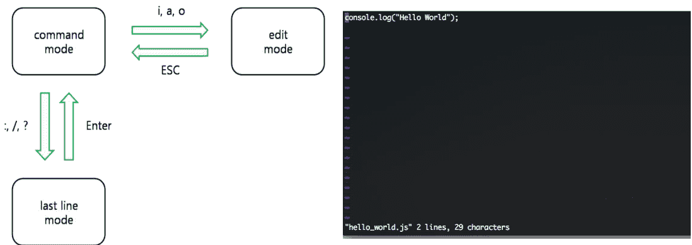

### Vi 编辑模式

- `i` : 在光标前插入
- `a` : 在光标后插入
- `o` : 在光标所在行下方新建行并插入
- `O` : 在光标所在行上方新建行并插入
- `A` : 在当前行末尾插入
- `I` : 在当前行行首插入
- `r` : 覆盖光标位置的一个单元
- `R` : 从光标位置开始覆盖后续现有字符
- `x` : 删除一个单元
- `dd` : 删除一行
- `u` : 撤销 (由 Redo 纠正)

### Vi 光标移动

- `h` : 向左移动
- `j` : 向下移动
- `k` : 向上移动
- `l` : 向右移动
- `^`, `0`: 跳到行首
- `$` : 跳到行尾
- `G` : 跳到文档末尾
- `1G` : 跳到文档开头
- `数字 G` : 移动到指定行
- `Ctrl + D` : 向下半页
- `Ctrl + F` : 向上半页
- `Ctrl + B` : 向下页
- `Ctrl + U` : 向上页

### Vi 复制/粘贴

- `yy` : 复制光标所在行
- `数字 yy` : 复制指定数量的行
- `x` : 剪切光标所在单元
- `p` : 粘贴
  - `数字 p` : 粘贴指定数量的行

### 块模式

- `v` : 视觉模式 (由 Blurred 纠正)
- `y` : 块复制
- `p` : 块粘贴
- `d` : 块删除
- `>` : 块缩进
- `<` : 取消缩进
- `v`, `Ctrl + v` : 块列模式

### Vi 设置

- `:set nu`
  - 显示行号
- `:set showmode`
  - 显示模式
- `:set nonum`
  - 隐藏行号
- `:set ai`
  - 自动缩进
- `:set cinder`
  - C 语言风格缩进
- `:set list`
  - 显示特殊字符
- `:set`
  - 显示已设置的 vi 变量
- `:set all`
  - 显示所有变量和设置值
- 保存设置
  - `~/.vimrc`

### Vi 分屏

- 打开新窗口
  - `Ctrl + w, n`
- 切换窗口
  - `ctrl + ww`
- 关闭窗口
  - `ctrl +w, q`

```
islisldkj
hello
---
---
---
[No Name] [*]
sdlfjsljf
console.log("Hello World");
ns dldjskjjf
ssfjjslkfkldf
ssdifjsljf
console.log("Hello World");
c
s dldjskjjf
hello_world.js [*]
block of 13 lines yanked
```

### Vi 保存，退出

- `:w [文件名]`
  - 保存
- `:e 文件名`
  - 打开文件
- `:q`
  - 退出
- `:q!`
  - 强制退出
- `:x`
  - 保存并退出

# Shell 脚本

3. VI 编辑器
4. Shell 编程

## 特殊字符

- Glob 模式 (Glob Patterns)：通配符
- `*` : 匹配任意字符
- `?` : 匹配任意单个字符

## `while` 循环

- `while expression`
  `do`
    语句
  `done`

```bash
echo 'insert a digit to loop'
read number
i=0
while [ $i -lt $number ]
do
  echo "loop test : $i"
  i=$((i+1))
done
```

```
insert a digit to loop
5
loop test : 0
loop test : 1
loop test : 2
loop test : 3
loop test : 4
```

## `until` 循环

- 当条件为假时运行
- `until [ condition ]`
  `do`
    语句
  `done`

```bash
i=0
until [ $i -gt 5 ]
do
  echo loop test $i
  i=$((i+1))
done
```

## 执行 Shell

- 在新的 shell 进程中执行命令
  - `my.sh`
    - `sh` : `/bin/sh` -> `dash`，用于执行 shell 的 bash 极简化 shell
    - 在新的 shell 进程中执行命令
  - `my.sh`
    - `chmod +x`
    - shebang
      - `#! /bin/sh`
      - `#! /bin/env sh`
- 在当前的 shell 进程中执行命令
  - `source my.sh`
    - `source` : 在当前的 shell 进程中执行命令
  - `. my.sh`
    - `.` 是 `source` 的别名

## Shell 初始化

- 当调用 shell 时，启动文件
  系统级启动
  - `/etc/profiles`
    - 设置 `PATH`, `PS2`
    - 调用 `/etc/profile.d/*`
  - `/etc/profile.d/*.sh`
    - 自定义更改
  用户特定启动
  - `~/.bashrc`
  - `~/.bash_aliases`
    - 从 `~/.bashrc` 调用

## Shell 初始化

- `alias [-p]`
  - 列出定义的别名
- `alias NAME=VALUE`
  - 为 `VALUE` 定义别名 `NAME`
- `~/.bash_aliases`
  - 从 `~/.bashrc` 调用

```bash
alias egrep='egrep --color=auto'
alias fgrep='fgrep --color=auto'
alias grep='grep --color=auto'
alias la='ls -A'
alias ll='ls -1'
alias ls='ls --color=auto'
```

- 23 个实用的 shell 别名
  - https://www.linuxutrainingacademy.com/23-handy-bash-shell-aliases-for-linux-and-mac-os-x/

| # 彩色 | |
| :--- | :--- |
| `alias diff='colour'` | |
| `alias egrep='egrep --color=auto'` | |
| `alias fgrep='fgrep --color=auto'` | |
| `alias grep='grep --color=auto'` | |
| `alias ls='ls --color=auto'` | #日期和时间 |
| `alias d='date +F'` | |
| `alias now='date +%T'` | |
| `alias nowtime=now` | |
| `alias nowdate='date +%m-%d-%Y'` | |
| # 格式化 | |
| :--- | :--- |
| `alias ct='column -t'` | |
| `alias df='df -hPT \| column -t'` | |
| `alias mount='mount \| column -t'` | #系统更新 |
| `alias apt-get='sudo apt-get'` | |
| `alias updatey='sudo apt-get -y'` | |
| `alias update='sudo apt-get update && sudo apt-get upgrade'` | |

# 进程与系统管理

1. 进程
2. 系统初始化
3. 用户
4. 工具

## 进程

- 运行中的程序实例
- `init` (`systemd`) 进程
  - `/sbin/init` `/lib/systemd/systemd`
  - 启动后的第一个进程
  - 所有进程的祖先
- `PID`(进程标识) 为 1
  - `ps -p 1`

```bash
pi@raspberrypi:~ $ ps -ef
UID PID PPID C STIME TTY TIME CMD
root 1 0 22:33 ? /sbin/init splash

pi@raspberrypi:~ $ ps -p 1
PID TTY TIME CMD
1 ? 00:00:03 systemd
```

- 父进程
  - 创建子进程的进程
- 子进程
  - 父进程创建的进程
- 守护进程 (Daemon)
  - 不需要控制终端
- 孤儿进程
  - 父进程在子进程之前死亡或被杀死
  - `init` 进程收养
- 僵尸进程 (Zombie)
  - 子进程死亡但父进程未获取终止状态

### 搜索进程

- `ps -ef | grep 命令`
- `pgrep -l 命令`

```bash
pi@raspberrypi:~ $ ps -ef |grep bash      00:00:00 -bash
pi                554 453 0 22:34 tty1      00:00:00 -bash
pi                988 985 0 22:36 pts/0     00:00:00 -bash
pi                5426 988 0 23:12 pts/0    00:00:00 grep --color=auto
bash

pi@raspberrypi:~ $ pgrep -l bash
554 bash
988 bash
```

### 信号 (SIGNAL)

- 进程间通信的有限形式
- 信号
  - `kill -l`

```bash
$ kill -l
1) SIGHUP      2) SIGINT      3) SIGQUIT     4) SIGILL     5)
SIGTRAP       6) SIGABRT     7) SIGBUS      8) SIGFPE      9) SIGKILL    10)
SIGUSR1       11) SIGSEGV    12) SIGUSR2    13) SIGPIPE    14) SIGALRM    15)
SIGTERM       16) SIGTSTK  17) SIGCHLD    18) SIGCONT    19) SIGSTOP    20)
SIGTSTP       21) SIGTIN     22) SIGTOU     23) SIGURG     24) SIGCPU     25)
SIGXZZ       26) SIGVALRM   27) SIGPROF    28) SIGWINCH   29) SIGIO      30) SIGPWR
31) SIGSYS     34) SIGRTMIN    ...
63) SIGRTMAX
```

### SIGNAL

- 主要信号

| 数字 | 名称 | 行为 | 描述 |
| :--- | :--- | :--- | :--- |
| 1 | `SIGHUP` | 挂断 | 终端关闭 |
| 2 | `SIGINT` | 中断 | 用户中断 (`Ctrl+C`) |
| 9 | `SIGKILL` | 杀死 | 立即终止，无法被忽略 |
| 15 | `SIGTERM` | 终止 | 请求终止，可以被忽略 |

- 发送信号
  - `kill target`

```bash
$ python
...
>>> KeyboardInterrupt
>>> Terminated
$ python
...
>>> killed
```

```bash
$ ps -ef |grep python
pi 7283 988 2 23:28
ts/0 00:00:00 python
$ kill -SIGINT 7283
$ kill -SIGTERM 7486
$ ps -ef |grep python
pi 7595 7464 4 23:30
ts/1 00:00:00 python
pi 7607 988 0 23:30
pts/0 00:00:00 grep --color=auto
$ kill -SIGKILL 7595
```

### 后台进程

- `命令 &`
  - 在后台运行
- `ctrl + z`
  - 进入后台
- `jobs`
  - 列出后台任务
- `bg [job_id]`
  - 在后台运行
- `fg [job_id]`
  - 在前台运行

```bash
pi@raspberry:~ $ sleep 3600 &
[1]

pi@raspberry:~ $ jobs
[1]+ Running               sleep 3600
&
pi@raspberry:~ $ sleep 3000
^Z
[2]+ Stopped               sleep 3000
pi@raspberry:~ $ jobs
[1]- Running               sleep 3600
&
[2]+ Stopped               sleep 3000
pi@raspberry:~ $ fg bg 2
[2]+ sleep 3000 &

pi@raspberry:~ $ fg 1
sleep 3600
```

### `nohup`

- 忽略挂断信号运行命令
- `nohup COMMAND &`

```bash
#!/bin/sh
#myd.sh
while [ 1 ]
do
  date >> ~/date.log
  sleep 1
done
```

```bash
$ nohup myd.sh &
[3]
$ nohup: ignoring input and appending output to 'nohup.out'
$ logout
```

```bash
~ $ tail -f date.log
Sun Feb 25 23:47:16 KST 2018
Sun Feb 25 23:47:17 KST 2018
Sun Feb 25 23:47:18 KST 2018
```

# 进程与系统管理

1. 进程
2. 系统初始化
3. 用户
4. 工具

## Init 与 Systemd

- 启动时的第一个进程
- 持续运行直到系统关闭
- SysV 风格
  - 传统的 Unix init 系统
  - 7 个运行级别
  - `/etc/inittab`
  - `/etc/init.d/*0-6, S.d/*`
- `systemd`
  - `init` 的替代者
  - 自
    - Debian Jessie v8, 2015
    - RedHat v7.0, 2014
  - `/lib/systemd/systemd`
  - `/lib/systemd/system/*.service`

### 运行级别

- 运行模式
- Linux SystemV init 的 7 个运行级别

| ID | Linux 标准 | Debian |
| :--- | :--- | :--- |
| 0 | Halt | Halt |
| 1 | 单用户模式 | 单用户模式 |
| 2 | 多用户模式（无网络） | 多用户模式 |
| 3 | 多用户模式（带网络） | 多用户模式 |
| 4 | 未使用 | 多用户模式 |
| 5 | 图形模式 | 图形模式 |
| 6 | Reboot | Reboot |

### 运行级别

- Systemd target
- 运行级别与 systemd target 的映射关系

| RunLevel | Linux 标准 |
| :--- | :--- |
| 0 | `poweroff.target` |
| 1 | `rescue.target` |
| 2,3,4 | `multi-user.target` |
| 5 | `graphical.target` |
| 6 | `reboot.target` |

### 运行级别

```bash
pi@raspberry:/home $ runlevel
N 5 2018-02-25 22:30

pi@raspberry:~ $ sudo init 3
run-level 3
pi@raspberry:~ $ sudo reboot
...
pi@raspberry:~ $ sudo poweroff
```

- 设置运行级别
  - `/lib/systemd/system/default.target`
  - 修改符号指向
    - `/lib/systemd/system/poweroff.target` (runlevel0)
    - `/lib/systemd/system/rescue.target` (runlevel1)
    - `/lib/systemd/system/multi-user.target` (runlevel2,3,4)


- `/lib/systemd/system/graphical.target` (`runlevel5`)
- `/lib/systemd/system/reboot.target` (`runlevel6`)

```bash
/lib/systemd/system $ ln -sf multi-user.target default.target
```

### 启动服务

- 启动后自动运行的进程
  - `/etc/rc.local`
    - 兼容 System V 风格
    - 由 `/lib/system/system/rc-local.service` 调用
    - 在文件中添加命令
  - `/lib/systemd/system/myd.service`
    - Systemd 风格
    - 创建 `.service` 文件
    - `systemctl enable`
    - `systemctl start`
    - `systemctl stop`
    - `systemctl disable`
    - 示例脚本，`myd.sh`
      - 每每秒向 `~/date.log` 写入时间
      - 保存为 `/home/pi/myd.sh`
      - `chmod +x myd.sh`

```bash
#!/bin/sh
#myd.sh
while [ 1 ]
do
  date >> ~/date.log
  sleep 1
done
```

```bash
$ chmod +x myd.sh
```

### 启动服务

- 简单方法：`rc.local`
  - 打开 `/etc/rc.local`
  - 在 `"exit 0"` 之前添加调用 `myd.sh` 的命令
  - `su - pi -c '~/.myd.sh' &`

```bash
#!/bin/sh -e
#/etc/rc.local
#... 略去 ...
su - pi -c '~/.myd.sh' &
exit 0
```

- 重启并检查进程
  - `$ sudo reboot`
  - `$ tail -f date.log`
  - `on Feb 26 11:10:07 KST 2018`
  - `Mon Feb 26 11:10:07 KST 2018`
  - `Mon Feb 26 11:10:08 KST 2018`
  - `Mon Feb 26 11:10:08 KST 2018`

### 启动服务

- 添加服务：`myd.service`
  - 创建文件 `/lib/systemd/system/myd.service`

```
[Unit]
Description=My daemon service test

[Service]
User=pi
ExecStart=/home/pi/myd.sh
ExecStop=pkill myd.sh

[Install]
WantedBy=multi-user.target
Alias=myd.service
```

### 启动服务

- 添加服务：`mys.service`
- 启用并启动

```bash
pi@raspberry:~ $ sudo systemctl enable mys.service
pi@raspberry:~ $ sudo systemctl start mys.service
```

- 重启并检查进程

```bash
~ $ tail -f date.log
on Feb 26 11:10:07 KST 2018
Mon Feb 26 11:10:07 KST 2018
Mon Feb 26 11:10:08 KST 2018
```

- 停止并禁用

```bash
pi@raspberry:~ $ sudo systemctl stop mys.service
pi@raspberry:~ $ sudo systemctl disable mys.service
```

## 进程与系统管理

- 1. 进程
- 2. 系统初始化
- 3. 用户
- 4. 工具

## 获取用户信息

- 确定当前用户或指定用户
  - `id [ID]`
  - `who am i`
- 获取所有登录的用户
  - `who`
  - `users`

```bash
$ id
uid=1000(pi) gid=1000(pi)
groups=1000(pi),4(adm),20(dialout),24(cdrom),27(sudo),29(audio),

$ id root
uid=0(root) gid=0(root) groups=0(root)
$ who am i
pi pts/0          2018-02-26 08:50
(fe80::458:76ec:be93:3149wlan0)
$ users
pi pi pi
$ who
pi tty1           2018-02-25 22:34
pi tty7           2018-02-25 22:34 (:)
pi pts/0           2018-02-26 08:50
(fe80::458:76ec:be93:3149wlan0)
```

- `/etc/passwd`
  - 存储所有用户账户信息

```bash
pi@raspberry:~ $ cat /etc/passwd
root:x:0:0:root:/root/bash
daemon:x:1:1:daemon:/usr/sbin:/usr/sbin/nologin
bin:x:2:2:bin:/bin:/usr/sbin/nologin
sys:x:3:3:sys:/dev:/usr/sbin/nologin
```

## 获取用户信息

- `sudo passwd -aS`
  - 显示所有用户账户
  - 1. 用户 ID
  - 2. 状态
    - `L`：锁定，`P`：可用密码
  - 3. 上次修改日期
  - 4. 最短有效期：上次修改日期 + 最短有效期 = 允许
    - `0`：任何时间
  - 2. 最大有效期：上次修改日期 + 最大有效期 = 限制
    - `-1`：否
  - 3. 警告期：在需要更改密码之前的时间
  - 4. 闲置期
    - `-1`：从不

```bash
$ sudo passwd -aS
root L 11/29/2017 0 9999 7 -1
daemon L 11/29/2017 0 9999 7 -1
```

## 获取用户信息

- `sudo chage -l`
  - 显示用户账户过期信息

```bash
$ sudo passwd -aS
root L 11/29/2017 0 9999 7 -1
daemon L 11/29/2017 0 9999 7 -1

$ sudo chage -l pi
Last password change : Nov 29, 2017
Password expires : never
Password inactive : never
Minimum number of days between password change : 0
Maximum number of days between password change : 9999
Number of days before password expires : 7
```

### 添加用户账户

- `sudo adduser <user-id>`
  - 向系统添加用户或用户组

```bash
$sudo adduser test ...
Adding new group `test` (1001) ...
Adding user `test` (1001) with group `test` ...
Creating home directory `/home/test` ...
Copying files from `/etc/skel` ...
Enter new password:
Retype password:
passwd: password updated
Changing the user information for test
the new value, or press ENTER for the default
Full Name []: test
Number []: no
Home []: no
Other []: na
```

### 修改密码

- `passwd`
  - 自己的密码
  - 更改密码
  - 某人的密码
  - 更改密码后
  - 更改密码
  - 密码：
  - 密码：
  - 密码：
  - 密码：
  - 输入新密码：
  - 重新输入密码：
  - 密码：已更新
  - 正在更改用户 `test` 信息
  - 输入新值，或按回车使用默认值
  - 全名 `[]`: `test`
  - 编号 `[]`: `no`
  - 主目录 `[]`: `no`
  - 其他 `[]`: `na`

### 创建组

- `sudo groupadd <group-id>`
  - 向系统添加一个用户组

### 添加用户账户

- `sudo adduser <user-id>`
  - 向系统添加用户或用户组

```bash
$sudo adduser test ...
Adding new group `test` (1001) ...
Adding user `test` (1001) with group `test` ...
Creating home directory `/home/test` ...
Copying files from `/etc/skel` ...
Enter new password:
Retype password:
passwd: password updated
Changing the user information for test
the new value, or press ENTER for the default
Full Name []: test
Number []: no
Home []: no
Other []: na
```

### 修改密码

- `passwd`
  - 自己的密码
  - 更改密码
  - 某人的密码
  - 更改密码后
  - 更改密码
  - 密码：
  - 密码：
  - 密码：
  - 密码：
  - 输入新密码：
  - 重新输入密码：
  - 密码：已更新
  - 正在更改用户 `test` 信息
  - 输入新值，或按回车使用默认值
  - 全名 `[]`: `test`
  - 编号 `[]`: `no`
  - 主目录 `[]`: `no`
  - 其他 `[]`: `na`

### 创建组

- `sudo groupadd <group-id>`
  - 向系统添加一个用户组

### 列出所有组

- `/etc/group`
  - 显示所有用户组信息


```bash
$ cat /etc/group
root:x:0:
daemon:x:1:
bin:x:2:
sys:x:3:
adm:x:4:
lp:x:5:
mail:x:6:
sync:x:7:
games:x:8:
ftp:x:9:
录:x:10:
backup:x:11:
irc:x:12:
gn:x:13:
plugdev:x:14:
cd:x:15:
list:x:16:
www:x:17:
proxy:x:18:
uuc:x:19:
dialout:x:20:
video:x:21:
system:x:22:
backup:x:23:
cdrom:x:24:
lxd:x:25:
input:x:26:
sudo:x:27:
users:x:28:
audio:x:29:
gnats:x:30:
irc:x:31:
irc:x:32:
scanner:x:33:
list:x:34:
quor:x:35:
u-d:x:36:
irc:x:37:
pulse:x:38:
irc:x:39:
irc:x:40:
u-data:x:41:
docker:x:42:
postgresql:x:43:
irc:x:44:
irc:x:45:
irc:x:46:
irc:x:47:
irc:x:48:
irc:x:49:
irc:x:50:
irc:x:51:
irc:x:52:
irc:x:53:
irc:x:54:
irc:x:55:
irc:x:56:
irc:x:57:
irc:x:58:
irc:x:59:
irc:x:60:
irc:x:61:
irc:x:62:
irc:x:63:
irc:x:64:
irc:x:65:
irc:x:66:
irc:x:67:
irc:x:68:
irc:x:69:
irc:x:70:
irc:x:71:
irc:x:72:
irc:x:73:
irc:x:74:
irc:x:75:
irc:x:76:
irc:x:77:
irc:x:78:
irc:x:79:
irc:x:80:
irc:x:81:
irc:x:82:
irc:x:83:
irc:x:84:
irc:x:85:
irc:x:86:
irc:x:87:
irc:x:88:
irc:x:89:
irc:x:90:
irc:x:91:
irc:x:92:
irc:x:93:
irc:x:94:
irc:x:95:
irc:x:96:
irc:x:97:
irc:x:98:
irc:x:99:
irc:x:100:
irc:x:101:
irc:x:102:
irc:x:103:
irc:x:104:
irc:x:105:
irc:x:106:
irc:x:107:
irc:x:108:
irc:x:109:
irc:x:110:
irc:x:111:
irc:x:112:
irc:x:113:
irc:x:114:
irc:x:115:
irc:x:116:
irc:x:117:
irc:x:118:
irc:x:119:
irc:x:120:
irc:x:121:
irc:x:122:
irc:x:123:
irc:x:124:
irc:x:125:
irc:x:126:
irc:x:127:
irc:x:128:
irc:x:129:
irc:x:130:
irc:x:131:
irc:x:132:
irc:x:133:
irc:x:134:
irc:x:135:
irc:x:136:
irc:x:137:
irc:x:138:
irc:x:139:
irc:x:140:
irc:x:141:
irc:x:142:
irc:x:143:
irc:x:144:
irc:x:145:
irc:x:146:
irc:x:147:
irc:x:148:
irc:x:149:
irc:x:150:
irc:x:151:
irc:x:152:
irc:x:153:
irc:x:154:
irc:x:155:
irc:x:156:
irc:x:157:
irc:x:158:
irc:x:159:
irc:x:160:
irc:x:161:
irc:x:162:
irc:x:163:
irc:x:164:
irc:x:165:
irc:x:166:
irc:x:167:
irc:x:168:
irc:x:169:
irc:x:170:
irc:x:171:
irc:x:172:
irc:x:173:
irc:x:174:
irc:x:175:
irc:x:176:
irc:x:177:
irc:x:178:
irc:x:179:
irc:x:180:
irc:x:181:
irc:x:182:
irc:x:183:
irc:x:184:
irc:x:185:
irc:x:186:
irc:x:187:
irc:x:188:
irc:x:189:
irc:x:190:
irc:x:191:
irc:x:192:
irc:x:193:
irc:x:194:
irc:x:195:
irc:x:196:
irc:x:197:
irc:x:198:
irc:x:199:
irc:x:200:
irc:x:201:
irc:x:202:
irc:x:203:
irc:x:204:
irc:x:205:
irc:x:206:
irc:x:207:
irc:x:208:
irc:x:209:
irc:x:210:
irc:x:211:
irc:x:212:
irc:x:213:
irc:x:214:
irc:x:215:
irc:x:216:
irc:x:217:
irc:x:218:
irc:x:219:
irc:x:220:
irc:x:221:
irc:x:222:
irc:x:223:
irc:x:224:
irc:x:225:
irc:x:226:
irc:x:227:
irc:x:228:
irc:x:229:
irc:x:230:
irc:x:231:
irc:x:232:
irc:x:233:
irc:x:234:
irc:x:235:
irc:x:236:
irc:x:237:
irc:x:238:
irc:x:239:
irc:x:240:
irc:x:241:
irc:x:242:
irc:x:243:
irc:x:244:
irc:x:245:
irc:x:246:
irc:x:247:
irc:x:248:
irc:x:249:
irc:x:250:
irc:x:251:
irc:x:252:
irc:x:253:
irc:x:254:
irc:x:255:
irc:x:256:
irc:x:257:
irc:x:258:
irc:x:259:
irc:x:260:
irc:x:261:
irc:x:262:
irc:x:263:
irc:x:264:
irc:x:265:
irc:x:266:
irc:x:267:
irc:x:268:
irc:x:269:
irc:x:270:
irc:x:271:
irc:x:272:
irc:x:273:
irc:x:274:
irc:x:275:
irc:x:276:
irc:x:277:
irc:x:278:
irc:x:279:
irc:x:280:
irc:x:281:
irc:x:282:
irc:x:283:
irc:x:284:
irc:x:285:
irc:x:286:
irc:x:287:
irc:x:288:
irc:x:289:
irc:x:290:
irc:x:291:
irc:x:292:
irc:x:293:
irc:x:294:
irc:x:295:
irc:x:296:
irc:x:297:
irc:x:298:
irc:x:299:
irc:x:300:
irc:x:301:
irc:x:302:
irc:x:303:
irc:x:304:
irc:x:305:
irc:x:306:
irc:x:307:
irc:x:308:
irc:x:309:
irc:x:310:
irc:x:311:
irc:x:312:
irc:x:313:
irc:x:314:
irc:x:315:
irc:x:316:
irc:x:317:
irc:x:318:
irc:x:319:
irc:x:320:
irc:x:321:
irc:x:322:
irc:x:323:
irc:x:324:
irc:x:325:
irc:x:326:
irc:x:327:
irc:x:328:
irc:x:329:
irc:x:330:
irc:x:331:
irc:x:332:
irc:x:333:
irc:x:334:
irc:x:335:
irc:x:336:
irc:x:337:
irc:x:338:
irc:x:339:
irc:x:340:
irc:x:341:
irc:x:342:
irc:x:343:
irc:x:344:
irc:x:345:
irc:x:346:
irc:x:347:
irc:x:348:
irc:x:349:
irc:x:350:
irc:x:351:
irc:x:352:
irc:x:353:
irc:x:354:
irc:x:355:
irc:x:356:
irc:x:357:
irc:x:358:
irc:x:359:
irc:x:360:
irc:x:361:
irc:x:362:
irc:x:363:
irc:x:364:
irc:x:365:
irc:x:366:
irc:x:367:
irc:x:368:
irc:x:369:
irc:x:370:
irc:x:371:
irc:x:372:
irc:x:373:
irc:x:374:
irc:x:375:
irc:x:376:
irc:x:377:
irc:x:378:
irc:x:379:
irc:x:380:
irc:x:381:
irc:x:382:
irc:x:383:
irc:x:384:
irc:x:385:
irc:x:386:
irc:x:387:
irc:x:388:
irc:x:389:
irc:x:390:
irc:x:391:
irc:x:392:
irc:x:393:
irc:x:394:
irc:x:395:
irc:x:396:
irc:x:397:
irc:x:398:
irc:x:399:
irc:x:400:
irc:x:401:
irc:x:402:
irc:x:403:
irc:x:404:
irc:x:405:
irc:x:406:
irc:x:407:
irc:x:408:
irc:x:409:
irc:x:410:
irc:x:411:
irc:x:412:
irc:x:413:
irc:x:414:
irc:x:415:
irc:x:416:
irc:x:417:
irc:x:418:
irc:x:419:
irc:x:420:
irc:x:421:
irc:x:422:
irc:x:423:
irc:x:424:
irc:x:425:
irc:x:426:
irc:x:427:
irc:x:428:
irc:x:429:
irc:x:430:
irc:x:431:
irc:x:432:
irc:x:433:
irc:x:434:
irc:x:435:
irc:x:436:
irc:x:437:
irc:x:438:
irc:x:439:
irc:x:440:
irc:x:441:
irc:x:442:
irc:x:443:
irc:x:444:
irc:x:445:
irc:x:446:
irc:x:447:
irc:x:448:
irc:x:449:
irc:x:450:
irc:x:451:
irc:x:452:
irc:x:453:
irc:x:454:
irc:x:455:
irc:x:456:
irc:x:457:
irc:x:458:
irc:x:459:
irc:x:460:
irc:x:461:
irc:x:462:
irc:x:463:
irc:x:464:
irc:x:465:
irc:x:466:
irc:x:467:
irc:x:468:
irc:x:469:
irc:x:470:
irc:x:471:
irc:x:472:
irc:x:473:
irc:x:474:
irc:x:475:
irc:x:476:
irc:x:477:
irc:x:478:
irc:x:479:
irc:x:480:
irc:x:481:
irc:x:482:
irc:x:483:
irc:x:484:
irc:x:485:
irc:x:486:
irc:x:487:
irc:x:488:
irc:x:489:
irc:x:490:
irc:x:491:
irc:x:492:
irc:x:493:
irc:x:494:
irc:x:495:
irc:x:496:
irc:x:497:
irc:x:498:
irc:x:499:
irc:x:500:
irc:x:501:
irc:x:502:
irc:x:503:
irc:x:504:
irc:x:505:
irc:x:506:
irc:x:507:
irc:x:508:
irc:x:509:
irc:x:510:
irc:x:511:
irc:x:512:
irc:x:513:
irc:x:514:
irc:x:515:
irc:x:516:
irc:x:517:
irc:x:518:
irc:x:519:
irc:x:520:
irc:x:521:
irc:x:522:
irc:x:523:
irc:x:524:
irc:x:525:
irc:x:526:
irc:x:527:
irc:x:528:
irc:x:529:
irc:x:530:
irc:x:531:
irc:x:532:
irc:x:533:
irc:x:534:
irc:x:535:
irc:x:536:
irc:x:537:
irc:x:538:
irc:x:539:
irc:x:540:
irc:x:541:
irc:x:542:
irc:x:543:
irc:x:544:
irc:x:545:
irc:x:546:
irc:x:547:
irc:x:548:
irc:x:549:
irc:x:550:
irc:x:551:
irc:x:552:
irc:x:553:
irc:x:554:
irc:x:555:
irc:x:556:
irc:x:557:
irc:x:558:
irc:x:559:
irc:x:560:
irc:x:561:
irc:x:562:
irc:x:563:
irc:x:564:
irc:x:565:
irc:x:566:
irc:x:567:
irc:x:568:
irc:x:569:
irc:x:570:
irc:x:571:
irc:x:572:
irc:x:573:
irc:x:574:
irc:x:575:
irc:x:576:
irc:x:577:
irc:x:578:
irc:x:579:
irc:x:580:
irc:x:581:
irc:x:582:
irc:x:583:
irc:x:584:
irc:x:585:
irc:x:586:
irc:x:587:
irc:x:588:
irc:x:589:
irc:x:590:
irc:x:591:
irc:x:592:
irc:x:593:
irc:x:594:
irc:x:595:
irc:x:596:
irc:x:597:
irc:x:598:
irc:x:599:
irc:x:600:
irc:x:601:
irc:x:602:
irc:x:603:
irc:x:604:
irc:x:605:
irc:x:606:
irc:x:607:
irc:x:608:
irc:x:609:
irc:x:610:
irc:x:611:
irc:x:612:
irc:x:613:
irc:x:614:
irc:x:615:
irc:x:616:
irc:x:617:
irc:x:618:
irc:x:619:
irc:x:620:
irc:x:621:
irc:x:622:
irc:x:623:
irc:x:624:
irc:x:625:
irc:x:626:
irc:x:627:
irc:x:628:
irc:x:629:
irc:x:630:
irc:x:631:
irc:x:632:
irc:x:633:
irc:x:634:
irc:x:635:
irc:x:636:
irc:x:637:
irc:x:638:
irc:x:639:
irc:x:640:
irc:x:641:
irc:x:642:
irc:x:643:
irc:x:644:
irc:x:645:
irc:x:646:
irc:x:647:
irc:x:648:
irc:x:649:
irc:x:650:
irc:x:651:
irc:x:652:
irc:x:653:
irc:x:654:
irc:x:655:
irc:x:656:
irc:x:657:
irc:x:658:
irc:x:659:
irc:x:660:
irc:x:661:
irc:x:662:
irc:x:663:
irc:x:664:
irc:x:665:
irc:x:666:
irc:x:667:
irc:x:668:
irc:x:669:
irc:x:670:
irc:x:671:
irc:x:672:
irc:x:673:
irc:x:674:
irc:x:675:
irc:x:676:
irc:x:677:
irc:x:678:
irc:x:679:
irc:x:680:
irc:x:681:
irc:x:682:
irc:x:683:
irc:x:684:
irc:x:685:
irc:x:686:
irc:x:687:
irc:x:688:
irc:x:689:
irc:x:690:
irc:x:691:
irc:x:692:
irc:x:693:
irc:x:694:
irc:x:695:
irc:x:696:
irc:x:697:
irc:x:698:
irc:x:699:
irc:x:700:
irc:x:701:
irc:x:702:
irc:x:703:
irc:x:704:
irc:x:705:
irc:x:706:
irc:x:707:
irc:x:708:
irc:x:709:
irc:x:710:
irc:x:711:
irc:x:712:
irc:x:713:
irc:x:714:
irc:x:715:
irc:x:716:
irc:x:717:
irc:x:718:
irc:x:719:
irc:x:720:
irc:x:721:
irc:x:722:
irc:x:723:
irc:x:724:
irc:x:725:
irc:x:726:
irc:x:727:
irc:x:728:
irc:x:729:
irc:x:730:
irc:x:731:
irc:x:732:
irc:x:733:
irc:x:734:
irc:x:735:
irc:x:736:
irc:x:737:
irc:x:738:
irc:x:739:
irc:x:740:
irc:x:741:
irc:x:742:
irc:x:743:
irc:x:744:
irc:x:745:
irc:x:746:
irc:x:747:
irc:x:748:
irc:x:749:
irc:x:750:
```


# 用户与组管理

## 用户账户信息

- `/etc/passwd`
  - 存储所有用户账户信息

```bash
pi@raspberry:~ $ cat /etc/passwd
root:x:0:0:root:/root/bash
daemon:x:1:1:daemon:/usr/sbin:/usr/sbin/nologin
bin:x:2:2:bin:/bin:/usr/sbin/nologin
sys:x:3:3:sys:/dev:/usr/sbin/nologin
```

## 获取用户信息

- `sudo passwd -aS`
  - 显示所有用户账户
  - 1. 用户 ID
  - 2. 状态
    - `L`：锁定，`P`：可用密码
  - 3. 上次修改日期
  - 4. 最短有效期：上次修改日期 + 最短有效期 = 允许
    - `0`：任何时间
  - 5. 最大有效期：上次修改日期 + 最大有效期 = 限制
    - `-1`：否
  - 6. 警告期：在需要更改密码之前的时间
  - 7. 闲置期
    - `-1`：从不

```bash
$ sudo passwd -aS
root L 11/29/2017 0 9999 7 -1
daemon L 11/29/2017 0 9999 7 -1
```

- `sudo chage -l`
  - 显示用户账户过期信息

```bash
$ sudo chage -l pi
Last password change : Nov 29, 2017
Password expires : never
Password inactive : never
Minimum number of days between password change : 0
Maximum number of days between password change : 9999
Number of days before password expires : 7
```

### 添加用户账户

- `sudo adduser <user-id>`
  - 向系统添加用户或用户组

```bash
$ sudo adduser test
Adding new group `test` (1001) ...
Adding user `test` (1001) with group `test` ...
Creating home directory `/home/test` ...
Copying files from `/etc/skel` ...
Enter new password:
Retype password:
passwd: password updated
Changing the user information for test
Enter the new value, or press ENTER for the default
Full Name []: test
Number []: no
Home []: no
Other []: na
```

### 修改密码

- `passwd`
  - 更改自己的密码
  - 更改密码后：
    - 输入新密码
    - 重新输入密码
    - 密码已更新
  - 更改用户 `test` 信息：
    - 输入新值，或按回车使用默认值
    - 全名 `[]: test`
    - 编号 `[]: no`
    - 主目录 `[]: no`
    - 其他 `[]: na`

### 创建组

- `sudo groupadd <group-id>`
  - 向系统添加一个用户组

### 列出所有组

- `/etc/group`
  - 显示所有用户组信息

```bash
$ cat /etc/group
root:x:0:
daemon:x:1:
bin:x:2:
sys:x:3:
adm:x:4:
lp:x:5:
mail:x:6:
sync:x:7:
games:x:8:
ftp:x:9:
...
```

### 添加用户到组

- `sudo usermod -aG <group-id> <user-id>`

### 将用户从组中删除

- `sudo gpasswd -d <user-id> <group-id>`

### 删除用户组

- `sudo groupdel <group-id>`

### 删除用户

- `sudo userdel <user-id>`

---

## tar（归档工具）

- 创建归档文件
  - `tar -cvf a.tar /abc /def aaa bbb`
- 使用 zip 压缩创建归档
  - `tar -cvzf a.tar.gz /abc /def aaa bbb`
- 解压归档文件
  - `tar -xvf a.tar`
- 解压 zip 压缩的归档
  - `tar -xvzf a.tar.gz`

## 磁盘工具

- `lsblk`
  - 列出块设备
- `fdisk`
  - 操作磁盘分区表
  - `-l`：列出分区列表
- `dd`
  - 数据复制、转换和复制文件
  - `dd bs=n if=input_file of=output_file`
- `mount`
  - `-l`：列出
  - `mount [Device] [Mount_point]`
- `umount`
  - 卸载文件系统
  - `umount [Device_name]`

## APT（高级软件包工具）

- 用于管理 Debian Linux 软件包的系统工具
- 包文件：`*.deb`
- 相关命令：
  - `apt`
  - `apt-get`
  - `apt-cache`
  - `apt-config`
  - `aptitude`
  - `dpkg`
- 相关配置文件：
  - `/etc/apt/sources.list`
  - `/etc/apt/apt.conf`
  - `/etc/apt/preferences.d`

### apt

- 内部使用 `apt-get` 和 `apt-cache` 的高级命令
- `apt-get`/`apt-cache` 的普通用户版本
  - `apt list [package-name]`
    - `--installed`
    - `--upgradable`
    - `--all-version`
  - `apt search`
- `apt show`
- `apt install`
- `apt remove`
- `apt edit-sources`：编辑 `sources.list`
- `apt update`
- `apt upgrade`
- `apt full-upgrade`

### apt-get

- 用于处理 APT 软件包的工具
  - `apt-get update`
    - 同步软件包列表
    - 基于 `/etc/apt/sources.list`
    - 需要在 `upgrade` 或 `dist-upgrade` 之前运行
- `apt-get upgrade`：更新系统中已安装的所有包到最新版本
- `apt-get dist-upgrade`：更改新版本包的依赖关系
- `apt-get dselect-upgrade`
- `apt-get install`：安装指定的包
  - `-y`：自动确认
- `apt-get remove`：移除指定的包
- `apt-get purge`：删除并清除设置
- `apt-get source`
- `apt-get download`：下载到当前目录

### apt-cache

- `apt-cache` 不会更改系统
- 提供包相关信息
- `apt-cache search [package-name]`
  - 搜索包
- `apt-cache show [package-name]`
  - 查看包信息

## dpkg

- 软件包安装、构建、删除所需的工具
- 对于 `dpkg` 来说，更通用的工具是 `aptitude`
  - `dpkg -r`：删除
  - `dpkg -P`：彻底删除
  - `dpkg -l [package_name]`：打印安装包列表

---

# 树莓派 Python 基础

1. 简介
2. 语法
3. 数据结构
4. 函数
5. 模块
6. 类
7. 异常
8. 文件 I/O
9. 线程
10. 网络

## Python 简介

- Guido Van Rossum（1956）
  - 在荷兰阿姆斯特丹创建 Python（1989）
  - Google（2005~2012）
  - Dropbox（2013~）
- 以 BBC 喜剧剧《蒙提·派森的飞行马戏团》命名
- 在 MIT 教新生 Python 而非 LISP
- 有两个版本：2.x、3.x
  - 不兼容
- 特点：
  - 交互式解释平台
  - 独立平台
  - 动态类型系统
  - 快速开发
  - 简单易懂的语言
  - 面向对象语言
  - 多种编程范式
  - 垃圾回收

### Python Shell - Windows

- IDLE
  - 开始 > Python > IDLE
  - 基于 GUI 的交互式解释器
  - 退出：`Ctrl + D`
- 命令行
  - 在终端输入 `python`
  - 退出：`Ctrl + Z` + `Enter`

### 检查版本

- 终端

```bash
$ python --version
Python 2.7.9
```

- Python Shell

```python
>>> import sys
>>> sys.version
```

### 基础规则

- 代码从第一列开始
  - 例外：注释（`#`）
  - 使用缩进表示代码块

```python
>>> 1 == 2
False
>>> 1 + 2
3
>>>  1 + 2
IndentationError: unexpected indent
```

### 脚本 - IDLE

- 文件 > 新文件

```python
import sys

print "hello world"
print sys.argv
```

- 文件 > 保存：`~/hello.py`
- 运行 > `F5`

### 脚本 - 控制台

- 使用编辑器创建文件

```bash
$ vi hello.py
```

- 代码

```python
import sys

print "hello world"
print sys.argv
```

- 运行

```bash
$ python hello.py
```

### 脚本 - shebang（Unix 专用）

- `#!`
  - shebang / shabang
  - 脚本指令
  - 在文件第一行添加 shebang
  - `#!/usr/bin/python`
  - `#!/usr/local/bin/python`

```python
#!/usr/bin/env python

print "hello world"
```

- 添加执行权限

```bash
$ chmod +x hello.py
$ ./hello.py
```

## PYTHONSTARTUP

- 运行 Python 启动脚本
  - 参考：https://docs.python.org/2/cmdline.html
  - `startup.py`

```python
print "Startup."
```

- 设置环境变量路径

```bash
$ export PYTHONSTARTUP=~/startup.py
$ python
```

```
raspberry: $ python
Python 2.7.9 (default, Sep 17 2016) on linux
Type "help", "credits" or "license" for more information.
Startup.
>>>
```

## API 文档

- Help > Python 在线文档
- 标准 API：https://docs.python.org/2/library/
- 内置函数：https://docs.python.org/2/library/functions.html
- 字符串方法：https://docs.python.org/2/library/stringtypes.html-methods
- 全局模块：https://docs.python.org/2/py-modindex.html
- 外部模块：PyPI

## 帮助系统

- 交互式帮助系统使用 `help()` 在控制台生成
  - 下一行：向下箭头、`j`
  - 上一行：向上箭头、`k`
  - 下页：空格键、`f`
  - 上页：`b`
  - 退出：`q`

```
>>> help(str)
Help on class str in __builtin__:

class str(basestring)
  | str(object='') -> string
  | 返回对象的良好字符串表示。
  | 如果参数是字符串，则返回相同的对象。
  | 方法解析顺序：
  | str
  | basestring
... <省略> ...
```

## 集成开发环境（IDE）

- Eclipse + PyDev
  - 速度慢
  - 可用其他插件
- PyCharm
  - 速度快
  - 应用广泛
  - 免费或付费
- 其他开发编辑器
  - Sublime Text
  - Notepad++
  - Brackets

## 语法

- 注释：`#` 单行注释
- 变量
  - 根据赋的值动态绑定数据类型
  - 命名规范
    - 英文字母或下划线（`_`）开头
    - 从第二个字符开始可包含数字
    - 规范：`小写字母_小写字母`
  - 消除嵌入模块和函数的重名
  - `del x`：删除变量
  - 所有变量都是对象
    - 垃圾回收
  - 标识对象
    - `id()`：UID（地址）检查
    - `a is b`
  - `int.bit_length()`：值的位长度
- 大小写敏感
- 使用缩进代替括号
- `pass`
  - 用于不包含内容的函数或条件语句


- `'''`（三单引号）、`"""`（三双引号）：多行注释
- 句末
  - 使用换行符代替分号（`;`）
  - 使用`\`在句末换行
- 韩语 Hangul 键盘
  - `-*-coding:utf-8-*-`
  - 显示文件开头
- 在字符串字面量中插入韩文字
  - `u 'Korean'`
  - 字符串前的`'u'`
- 字符串值

### 关键字

- `import`关键字
- `keyword.kwlist`

| and | as | assert | break | class |
| --- | --- | --- | --- | --- |
| continue | def | del | elif | else |
| except | exec | finally | for | from |
| global | if | import | in | is |
| lambda | not | or | pass | print |
| raise | return | try | while | with |

# 变量

```python
a = 10
print a
print type(a)
x = a
print id(a), id(x)
print a is x
del x
```

```python
#print x #error
print a.bit_length()
b = 20
print a + b
c = 'hello'
print c
```

## 数据类型

- 数字
  - `int`（整数）：C语言中的`long`，32位最小
  - `1`、`100`、`123`
  - `long`（仅限 Python2）：无精度（只要内存允许），使用`I`、`L`
  - `1L`、`100L`、`123L`
  - `float`（实数）：C语言中的`double`
  - `3.14`、`1.2`
  - `complex`（复数）：每个实部/虚部占 64 位，使用`j`、`I`代替`i`
  - `1 + 2j`、`3j`
  - `boolean`（整数的子类型）
  - `True`、`False`
  - `str`（字符串）：字母字符串
  - `"abc"`、`'hello'`
  - 不变序列
  - `None`：无值
- 内置数据结构
  - `list[1,2,3]`、`tuple(1,2,3)`、`dict{1:'a', 2:'b'}`、`set{1,2,3}`
- `type()`
  - 识别动态类型

### 数据类型（重复部分/示例）

```python
print type(1)
print type(12L)
print type(3.14)
print type(3 + 2j)
print type(True)
print type(False)
print type("a")
print type('abcd')
print type(None)
```

```python
print type(['one', 'two', 'three']) #列表
print type(('one', 'two', 'three')) #元组
print type({'a': 'one', 'b': 'two', 'c': 'three'}) #字典
print type(set(['one', 'two', 'three'])) #集合
```

### 字母字符串

- `'"'`
  - 使用双引号和单引号混合
  - `"hello"`、`'hello'`
- 拼接
- 重复
- `=`
  - 当尽管 ID 不同但上下文相同时结果为`True`
- 在计算中（成员性检查）
  - 确认检查上下文
- `len(str)`
  - 字母字符串的长度
- 格式化字母
  - `%s`：字符串，`%d`：整数，`%f`：实数
- 索引：元组
- `str[0]`、`str[0:4]`
- 不变序列
- `str[0] = 'h'` #错误

### 字母字符串（示例）

```python
str1 = 'abcd1234'
str2 = "abcd1234"

print str1, str2
print 'Hello' + ' ' + 'world'
print 'Hello' * 3
print id(str1), id(str2)
print str1 == 'abc' in str1
```

```python
print len(str1)
print str1[4:8], str1[:4]
print 'My age is %d ' % 25
print 'My name is %s and %d old' %(Lee, 25)
### str1[0] = 'H'
### print str1 # 这会导致一个错误
```

- 主要方法
- `Startswith(s)`：是否以`-s`开头？
- `Endswith(s)`：是否以`-s`结尾？
- `find(s)`：`s`的索引，如果不存在则返回`-1`
- `rfind(s)`：从尾部查找（）
- `count(s)`：`-s`出现多少次
- `lstrip()`：删除左侧空白
- `rstrip()`：删除右侧空白
- `strip()`：删除两边的空白
- `isalpha()`：是否仅由英文字母组成？
- `isdigit()`：是否仅由数字组成？
- `isalnum()`：是否仅由英文和数字组成？
- `replace(old, new[, count])`：用新字符串替换旧字符串
- `format()`：创建视觉基础（格式化）
- `{idx}`
  - `'my name is {0} and {1} years old'.format('Lee', 27)`
- `{key}`
  - `'my name is {name} and {age} years old'.format(age=27, name='Lee')`

## 算术运算

- `'abc' + 'def'`：`'abcdef'`
  - 相加字母时连接在一起
- `'10' + 2`、`'10'-2`、`'10'/2`：错误
  - 字母和数字之间无法加、减、除
- `'abc' * 3`：字母和数字可以相乘
  - `'abcabcabc'`
- `2 ** 3`：`8`
  - 平方
- `7 / 4`：`1`
  - 整数计算的结果为整数（Python 2）
  - 实数计算的结果为实数（Python 3）
- `7 % 4`：`3`
  - 余数检查
- `divmod(7,4)`：计算商余
- `7 / 4.0`：`1.75`
  - 实数计算的结果为实数
- `7 // 4.0`：`1.0`
  - 小数点产生小数
- `(2 + 3j) + (3 + 2j)`：`5 +5j`
  - 复数计算
- `i++`、`i-`、`++i`、`--i`：错误
- `i+=1`、`i-=1`

### 运算符

```python
print 'abc' + 'def'
print '10' + 2 #错误
print '10' - 2 #错误
print 'abc' * 3
print '10' / 2 #错误
```

```python
num = 10
num+=1
print num
num-=1
print num
### num++ #错误
### num-- #错误
```

### 比较运算符

- `a == b`
- `a != b`
- `a > b`
- `a >= b`
- `a < b`
- `a <= b`

### 逻辑运算符

- 无法使用`&&`、`||`、`!`
- `a and b`
- `a or b`
- `not a`
- `a in b`
- `a not in b`

### 比较与逻辑运算符

```python
print True and True
print True and False
print False and True
print False and False
print True or True
print True or False
print False or True
print False or False
print not True
print not False
print 'a' in 'abcd'
print 1 in [1,2,3,4]
print 1 not in [5,6,7,8]
```

### 位运算符

- `~`：`~5`
  - 位取反（按反码）
- `<<`：`3 <<2`
  - 左移，每个位向左移动
  - 左侧位丢弃
  - 右侧用 0 填充
- `>>`：`4 >>1`
  - 右移，每个位向右移动
  - 右侧位丢弃
  - 左侧用 0 填充
- 位与
- 位或
- 位异或

## 循环语句 - while

- `while <条件>`:
  `pass`
  `continue`
  `break`
`else`:
  `pass`

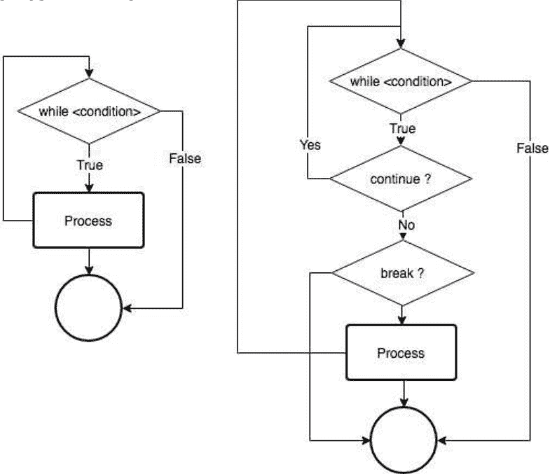

```python
count1 = 0
while count1 < 10:
  print count1
  count1 += 1

names = ['aaa', 'bbb', 'ccc']
idx = 0
while idx < len(names):
  print idx, ':', names[idx]
  idx+= 1

count2 = 0
while True:
  print count2
  if count2 > 10:
    break
  count2 +=1
```

### 练习 – 猜数字

- 随机数（1 ~ 100）
- 插入你猜的数字
- 输出高/低
- 重复直到正确
- 示例

在10次机会内猜数字（1~100）。
插入你猜的数字（1）：50
低。
插入你猜的数字（2）：13
低。
插入你猜的数字（3）：6
高。
插入你猜的数字（4）：10
低。
插入你猜的数字（5）：8
高。
插入你猜的数字（6）：9
答案正确！

在10次机会内猜数字（1~100）。
插入你猜的数字（1）：1
高。
插入你猜的数字（2）：100
低。
插入你猜的数字（3）：2
高。
插入你猜的数字（4）：99
低。
插入你猜的数字（5）：3
高。
插入你猜的数字（6）：98
低。
插入你猜的数字（7）：4
高。
插入你猜的数字（8）：97
低。
插入你猜的数字（9）：5
高。
插入你猜的数字（10）：96
你失败了。

### 练习 – 猜数字

```python
import random
cnt = 1
n = random.randint(1, 100)
print "Guess the number(1~100) in 10 times."
while True:
    x = input("Insert number you guess (%d) : " % cnt)
    cnt+=1
    if cnt >= 11:
        print("You fail.")
        break
    else:
        if x == n:
            print("Correct answer!")
            break
        else:
            if x > n:
                print("Lower.")
            else:
                print("Higher.")
```

## Python 基础

适用于树莓派

- 1. 简介
- 2. 语法
- 3. 数据结构
- 4. 函数
- 5. 模块
- 6. 类
- 7. 异常
- 8. 文件 I/O
- 9. 线程
- 10. 网络

### 列表

- 类似于数组语言
- 最频繁使用
- 可变序列类型
  - 一组序列数据类型
  - 索引、切片、拼接、迭代
  - 可修改、可调整大小
- 语法
  - `my_list = [1,2,3,4]`
  - `my_list[0]`：`1`
  - `my_list[-1]`：`4`
    - 从后数第一个
  - `my_list[1:3]`：`[2, 3]`
  - `my_list[:3]`：`[1,2,3]`
  - `my_list[1:]`：`[2,3,4]`
  - `my_list[ ]`：`[1,2,3,4]`
  - `my_list[1::2]`：`[2,4]`
  - `my_list[::2]`：`[1,3]`
  - `my_list * 2`：`[1,2,3,4,1,2,3,4]`
  - `my_list + [10,20]`：`[1,2,3,4,10,20]`
  - `my_list[1] = 5`：`[1,5,3,4]`
- 方法
  - `append`：在末尾添加
  - `insert`：
  - `index`：搜索元素
  - `count`：计数元素
  - `sort`：排序
  - `reverse`：逆转
  - `remove`：移除
  - `pop`：获取列表最后一个项并移除
  - `extend`：添加列表

### 列表函数

- `range(stop)`、`xrange()`
- `range(start, stop [, step])`
  - 创建一个整数序列列表
  - `start`默认：0
  - 最后一个项是`stop – 1`
  - `step`默认：1
- `len(list)`
  - 测量大小
- `list()`：类型转换

```python
my_list = [1,2,3,4]
print my_list[0]
print my_list[-1]
print my_list[1:3]
print my_list[:3]
print my_list[1:]
print my_list[:]
print my_list[::2]
print my_list * 2
print my_list + [10, 20]
my_list[1] = 5
print my_list
print len(my_list)
```

```python
friends = ['cat', 'dog', 'elephant', 'snake', 'frog' ]
for item in friends:
  print item
print friends[0]
friends[1] = 1
friends.append(10)
friends.remove('snake')
# 下面修正了 friends[3]
print friends.pop()
for i in range(len(friends)):
  print i, ':', friends[i]
```

### 元组

- 只读列表，通常用于函数的参数和返回值
  - 不变
  - 无方法
- 序列类型
  - 索引、切片、迭代
- 语法
  - `my_tuple = 1,2,3,4`
  - `my_tuple = (1,2,3,4)`
  - `my_tuple = (1,)`
    - 有元素元素时需要逗号
  - `my_tuple[1]`：`2`
  - `my_tuple[2] = 5`：错误
  - `a,b,c,d = my_tuple`
  - `a,b,c,d = 1,2,3,4`
  - `a,b = c, d`
- 函数
  - `tuple()`
  - 类型转换
  - `len()`

```python
tuple1 = ("one","two","three")
print tuple1
print tuple1[0]
#tuple1[0]=="four"
#tuple1.append("four")
list1 = list(tuple1)
print list1
print"list1 == tuple1: ",
List1 = tuple1
tuple2 = tuple(list1)
print tuple2
```

```python
tuple3 = (10,)
print type(tuple3)
tuple4 =10,20,30
print"tuple4 = ",tuple4
num1, num2, num3=tuple4
print num1, num2, num3
a,b,c,d = 1,2,3,4
print a,b,c,d
first="girl"
second="boy"
```

### 集合

- 集合类型
- 不重复
- 语法
  - `my_set = {1,2,3,4}`
- 方法
  - `add`：添加一个元素
  - `remove`：移除一个元素
  - `clear`：移除所有元素
  - `union`：合并两个集合
  - `intersection`：寻找共同元素
  - `difference`：第一个集合中的元素
  - `symmetric_difference`：存在于其中但不同共处的元素

```python
set1 = {1, 2, 3, 4}
print set1
set1.add(5)
print set1
set1.remove(3)
print set1
set2 = {3, 4, 5, 6}
print set1.union(set2)
print set1.intersection(set2)
print set1.difference(set2)
print set1.symmetric_difference(set2)
```


# 函数

- 子程序
- 一系列可重复使用的代码
- 语法
  - `[@decorator]`
  `def functionname([parameter_list]):`
    `<返回值>`
- 如果没有返回语句，则返回 `None` 类型
- 主声明类型
  - `def fn():`
  - `def fn(a, b):`
  - `def fn(*args):`
    - 元组类型 (`Tuple`)
  - `def fn(num=0):`
    - 默认值
  - `def fn(**kwargs):`
    - 字典类型

```python
def fn1():
    pass

fn1()

def fn2():
    print "fn2"

fn2()

def fn3(a):
    print "fn3",a

fn3("abc")
fn3(999)

def fn4(arg1, arg2):
    print "arg1",arg1
    print "arg2",arg2

fn4("one", "two")
result1 = fn4("three", "four")
print "fn4 return :",result1

def fn5():
    print "fn5"
    return

def fn6():
    print "fn6"
    return None

result2 = fn5()
result3 = fn6()
print "fn5 return:",result2
print "fn6 return:",result3
```

## ❖ 函数

```python
def getSum(num1, num2):
    result=num1+num2
    return result

print getSum(10, 20)

f1 = getSum
print f1(1,2)

def showSum(num1, num2):
    result = num1+num2
    print "showSum", result

showSum(100, 200)

def fn7(*args):
    print "fn7", args

fn7()
fn7(10)
fn7("one", "two", "three")
fn7(10,20,30,40,50)

def fn8(arg1, *args):
    print "fn8 arg1:",arg1
    print "fn8 args:",args

fn8("aaa")
fn8("aaa", "bbb")
fn8("aaa", "bbb", "ccc")

def fn9(num=0):
    print "num:",num

fn9()
fn9(999)

formatStr = "No:{} name:{} addr:{}".format(1, "Lee", "seoul")
print formatStr

def fn10(num=0, name="Lee", addr="Seoul"):
    result="No:{} name:{} addr:{}".format(num, name, addr)
    print result

print fn10()
```

# 函数

```python
def fn11(**kwargs):
    print type(kwargs)
    print "kwargs : ",kwargs

fn11()
fn11(num=1)
fn11(num=2,name="Park",addr="Ilsan")

def fn12(arg1,args, **kwargs):
    print "arg1:",arg1
    print "args : ",args
    print "kwargs",kwargs

fn12(999)
fn12(999,"one","two","three")
fn12(999,"one","two","three",num=3,name="monkey",addr="seoul")
```

## 命名空间

- LGB(局部 `Local`, 全局 `Global`, 内置 `Built-in`)
- 在函数中访问
  - 局部变量和全局变量混淆
  - 全局变量：整个程序中的任何语句都可以访问
  - 变量在函数内部和外部声明

```python
var1 = 'global-1'
var2 = 'global-2'
var3 = 'global-3'

def fn():
    global var3
    var1 = 'Local'
    var3 = 'Local2'
    print 'var1 :', var1
    print 'var2 :', var2
    print 'var3 :', var3

fn1()
print 'var1 :', var1
print 'var2 :', var2
print 'var3 :', var3
```

### Lambda

- 匿名内联函数
- 无返回语句
- 语法：`lambda param1, param2 .. paramn : 表达式`

```python
f = lambda : 1
print f()

f2 = lambda a, b : a + b
print f2(10, 20)

f3 = lambda a, b=20 : a + b
print f3(10)

f4 = lambda a, *args : args
print f4(1,2,3,4)

f5 = lambda x, **kwargs : kwargs
print f5(1, a=10, b=20)
```

```python
def fn(a, b, f):
    ret = f(a,b)
    print 'fn:', ret

fn(20,10, lambda a, b: a+b)
fn(20,10, lambda a, b: a-b)
fn(20,10, lambda a, b: a*b)
fn(20,10, lambda a, b: a/b)
```

### 练习 – 计数器

- 当你放入四种算术运算时，可以得到输出
- 使用给定代码获取余数
  - `plus(a,b)`, `minus(a,b)`, `multiply(a,b)`, `divide(a,b)`
  - `str2num(str_val)` : `int | float`
- 示例

| 计数器已就绪.('q' 退出) | 示例 |
| :--- | :--- |
| > 100-30 = 70 | |
| > 100 | 表达式无效，请重试。 |
| > 12+34 = 46 | |
| > 12/5 | 表达式无效，请重试。 |
| > 120 | 表达式无效，请重试。 |
| > 14*2 = 28 | |
| > 14 | 表达式无效，请重试。 | q |

- 提供的代码

```python
operators = {' '+': '-', '*': '//':'divide'}

print "Calculator is ready.('q' to quit)"

while True:
    isDone = False
    line = raw_input("> ")
    line.strip()
    if 'q' in line:
        break
    for op in operators.keys():
        op_idx = line.find(op)
        if op_idx > 0 and op_idx < len(line)-1:
            fn = operators[op]
            a = str2num(line[:op_idx])
            b = str2num(line[op_idx+1:])
            print line , fn(a,b)
            isDone = True
            break
    if not isDone:
        print 'Invalid expression, Try again.'
```

### 练习 – 计数器

- 实现的代码

```python
def plus(a, b):
    return a + b

def minus(a, b):
    return a - b

def multiply(a, b):
    return a * b

def divide(a, b):
    return a / b

def str2num(str_val):
    try:
        if '.' in str_val:
            return float(str_val)
        return int(str_val)
    except ValueError:
        return 0
```

### 练习 – 猜字游戏

```python
import random

def play():
    words = ['apple', 'banana', 'cherry', 'date', 'elderberry']
    word = random.choice(words)
    guessed_letters = ""
    lives_remaining = 6
    print("欢迎来到猜字游戏!")
    while lives_remaining > 0:
        print(f"\n当前单词: {word}")
        print(f"已猜过的字母: {guessed_letters}")
        print(f"剩余生命: {lives_remaining}")
        guess = input("请输入一个字母: ").lower()
        if guess in guessed_letters:
            print("你已经猜过这个字母了。")
            continue
        guessed_letters += guess
        if guess in word:
            print(f"好极了{guess} 在单词中。")
        else:
            print(f"遗憾，{guess} 不在单词中。")
            lives_remaining -= 1
        display_word = "".join([char if char in guessed_letters else "_" for char in word])
        print(f"单词状态: {display_word}")
        if all(char in guessed_letters for char in word):
            print(f"恭喜！你猜对了单词：{word}！")
            break
        if lives_remaining == 0:
            print(f"游戏结束。你输了。正确单词是：{word}")

if __name__ == "__main__":
    play()
```

## ❖ 自定义包 (custom package)

- 与普通API相同的自定义模块

```python
#random.py
def randint(a, b):
    print 'this is custom random.randint(%d,%d)' % (a,b)
```

```python
#module_test.py
import random

num = random.randint(1, 6) #this is custom random.randint(1,6)
print num #None
```

## ❖ 顶层模块 (Top Level module)

- 在执行开始使用的模块
- 内置模块：`__name__` 的值为 `'__main__'`
    - 如果不是顶层，则使用给定的模块名
    - `if __name__=='__main__'`

```python
#m1.py
import m2

def greeting():
    print "This is %s's greeting." % __name__

if __name__ == '__main__':
    print "This is m1 as a top level."

m2.greeting()
```

```python
#m2.py
import m1

def greeting():
    print "this is %s's greeting." % __name__

if __name__ == "__main__":
    print "this is m2 as a top level"

m1.greeting()
```

# `__init__.py`

- 包应该包含 `__init__.py`
- 通常是空文件
- 响应 `import *` 的模块规格说明
    - `__all__ = ['module_name-1', 'module_name-2' ... 'module_name-3']`

```python
#package_all.py
from animal import *
from animal import pig

cat.say()
dog.say()
pig.say()
```

# `__init__.py`

```python
#animal/__init__.py
__all__ = ['cat', 'dog']
```

```python
#animal/cat.py
def say():
    print 'meow~ meow~'
```

```python
#animal/dog.py
def say():
    print 'bow-wow!'
```

```python
#animal/pig.py
def say():
    print 'oink oink'
```

## ❖ 模块路径 (Module Path)

- Python 搜索模块的位置
1. 内置模块(Python本身)
    - 没有独立的 `*.py` 文件
    - `sys.builtin_module_names`
2. `sys.path`
    1. 工作目录
    2. `PYTHONPATH` 环境变量
    3. Python 安装的根目录
    - `PYTHON_HOME/site-packages`

# 树莓派Python基础 (Python Basic for Raspberry Pi)

1. 简介
2. 语法
3. 数据结构
4. 函数
5. 模块
6. 类
7. 异常
8. 文件 I/O
9. 线程
10. 网络

## 类 (Class)

- 一个对相同类型 `DataType` 进行分类的系统
- 创建具有相同结构（函数、变量）对象的本质模板

### 对象 (Object)

- 类生成的唯一实例
- 与值（变量）共享唯一的函数

### 实践- 乌龟类 (Turtle Class)

```python
>>> from turtle import Turtle
>>> t1 = Turtle()
>>> t2 = Turtle(shape='turtle')
>>> t3 = Turtle(shape='arrow')
>>> t1.shape('turtle')
>>> t1.color('red')
>>> t2.color('blue')
>>> t3.color('green')
>>> t1.left(50)
>>> t2.left(45)
>>> t3.left(75)
>>> t1.forward(100)
>>> t2.forward(150)
>>> t3.forward(200)
```


### 类的定义 (The definition of Class)

- 语法
`class Class_name:`
  `class_variable = 0`
  `def __init__(self):`
    `<构造函数>`
  `def method(self):`
    `<方法代码>`

- 类名以大字母开头

### 生成与应用 (Object generation and application)

- 语法
`obj = Class_name()`
`obj.class_variable`
`obj.method()`

### 实例检查 (Instance check)

- `type(obj)`
- `obj.__class__.__name__`
- `isinstance(obj, Class)`

### 类定义与应用 (Class definition and application)

```python
class Person:
  def __init__(self, name, age):
    self.name = name
    self.age = age
  def sayHello(self):
    print 'Hello! I am %s, %d years old' % (self.name, self.age)
  def set_age(self, age):
    self.age = age

lee = Person('Lee', 27)
```


```python
kim = Person('Kim', 23)
lee.sayHello()
kim.sayHello()
lee.set_age(30)
print lee.name, lee.age
print type(lee), lee.__class__.__name__
print isinstance(lee, Person)
```

### `__init__` 方法

- 当调用它来创建对象时自动调用
- 对象被初始化

### 类变量 VS 实例变量 (Class variable VS Instance variable)

- 类变量：在类中生成的变量
  - 在类中创建一个变量
  - 使用类名进行访问
- 实例访问
  - 如果存在同名的实例变量
- 实例变量：通过`self`生成的变量
  - 在每个对象中创建独立的变量

### 类/实例变量 (Class / Instance variable)

```python
class MyClass:
    variable1 = 10
    variable2 = 20

    def __init__(self):
        self.variable1 = 100
        self.variable2 = 200

obj = MyClass()
print MyClass.variable1, MyClass.variable2
print obj.variable1, obj.variable2

obj2 = MyClass()
print MyClass.variable1, MyClass.variable2
print obj2.variable1, obj2.variable2
```

### 静态方法 (Static method)

- 与类或实例无关的方法
- 通过类调用
- 可以通过实例调用，但不推荐
- 使用`@staticmethod`

### 类方法 (Class method)

- 用于类相关工作的方法
- 与实例无关
- 调用时传递类值
- 使用`@classmethod`

### 实例方法 (Instance method)

- 用于实例相关工作的方法
- 大多数方法
- 调用时传递实例值

```python
class Methods:
    def __init__(self, name):
        self.name = name

    @staticmethod
    def static_m():
        print "static_method"

    @classmethod
    def class_m(cls):
        print cls

    def instance_m(self):
        print self.name

obj = Methods("Lee")
obj.instance_m()
Methods.class_m()
Methods.static_m()
```

### 封装 (Encapsulation)

- 禁止从外部对实例变量进行访问
- 通过函数访问
- 变量名
  - 前缀
  - 仅允许一个后缀，但双下划线不是私有的

```python
class Encapsulation:
    def __init__(self):
        self.public = "public"
        self.__private = "private"

    def show(self):
        print self.public, self.__private

obj = Encapsulation()
```

### 继承 (Inheritance)

- 阻塞基类方法的访问
- 作为基类的类
- 类的扩展功能
- 语法

```python
class Base:
    pass

class Derived(Base):
    def __init__(self):
        super().__init__()

    def method(self):
        print 'derived method'
```

### 方法重写 (Method Overriding)

- 重新定义从继承继承的方法
- 与基类方法名相同
- 与参数类型无关

```python
class A:
    def __init__(self):
        print 'A.__init__'

    def method(self):
        print 'method A'
```

```python
class B(A):
    def method(self):
        print 'method B'
```

```python
a = A()
b = B()
a.method()
b.method()
```

### 多重继承 (Multiple Inheritance)

- 设计多个基类
- 同名方法引起歧义
- 优先考虑放在前面的类

```python
class A:
    def method(self):
        print 'method of A'

class B:
    def method(self):
        print 'method of B'

class C(A, B):
    pass

obj = C()
obj.method()
```

### 抽象类 (Abstract Class)

- 未实现的类
- 无法生成对象
- 包含`abc@abstractmethod`
- `__metaclass__=abc.ABC`

```python
from abc import abstractmethod, ABCMeta

class Abstract:
    __metaclass__ = ABCMeta

    @abstractmethod
    def method(self):
        pass

class Concrete(Abstract):
    def method(self):
        print 'This is concrete class'

### abs = Abstract() #error
con = Concrete()
con.method()
```

## 隐藏方法 (Hidden methods)

- `__call__()`
  - 从实例方法调用函数方法时的响应
  - 应用于装饰器
  - 钩入函数调用
- `__iter__()`, `next()`
  - 应用于`in`迭代
- `__iter__`
  - 返回在语句中具有`next()`的对象
  - `__next__()`在 python 3.x 中重命名
- `next`
  - `for`循环调用
  - 重复后抛出`StopIteration`

### `__call__`, 装饰器 (`__call__`, Decorator)

```python
class MyDecorator:
    def __init__(self, fn):
        self.fn = fn

    def __call__(self):
        print 'before calling %s'
        %self.fn.__name__
        self.fn()
        print 'after calling %s'
        %self.fn.__name__

def fn():
    print 'this is fn.'
    fn = MyDecorator(fn)
    fn()

@MyDecorator
def fn2():
    print 'this is fn2'

fn2()

class Callable:
    def __call__(self):
        print "__call__"

obj = Callable()
obj()
```

## `__iter__`, 迭代器 (Iterator)

```python
class MyIterator:
    def __init__(self, start, end):
        self.start = start
        self.end = end
        self.current = start

    def __iter__(self):
        return self

    def next(self):
        if self.current < self.end:
            val = self.current
            self.current += 1
            return val
        else:
            raise StopIteration()

obj = MyIterator(1, 10)
for x in obj:
    print x
```

## 生成器 (Generator), `yield`

- 能够在无需`__iter__`的情况下使用`for-in`语句
- 用`yield`语句替换
- 可重入函数

```python
def generator():
    cnt = 0
    while cnt<10:
        yield cnt
        cnt+= 1

for x in generator():
    print x
```

## Python 基础

适用于树莓派

1. 引言
2. 语法
3. 数据结构
4. 函数
5. 模块
6. 类
7. 异常
8. 文件 I/O
9. 线程
10. 网络

## 异常 (Exception)

- 运行期间的错误
- 如果不处理，程序将异常结束
- `try:`
  - 预期可能异常的语句
  - 如果发生异常，则跳过`except`块
- `except Exception:`
  - 当发生特定异常时执行
- `except:`
  - 无论是否发生异常均执行
- `else:`
  - 除非发生异常否则执行
- `finally:`
  - 无论是否发生异常均执行

### 异常发生

- `raise`异常 (Exceptions)

### 异常信息

- `sys.excinfo()`
  - 异常类型、值、回溯轨迹 (traceback)

### 异常处理

```python
val = input('Insert a digit:')
print 'the value you inserted ', val
```

```python
try:
    val = input('Insert a digit again:')
    print 'the value you inserted ', val
except Exception as e:
    print 'error: %s' % e

print 'end of program'
```

### 内置异常

- `Exception`
  - 所有异常的根类
  - 对用户定义的异常类没有强制性规定
- `StandardError`
  - 除`Systemexit`外的所有内置异常的基类
- `ArithmeticError`
  - `OverflowError`, `ZeroDivisionError`, `FloatingPointError`的基类
- `LookupError`
  - `IndexError`, `KeyError`的基类
- `EnvironmentError`
  - 外部异常发生（`IOError`, `OSError`）的基类

### 自定义异常

```python
import sys

class MyException(Exception):
    def __init__(self, msg):
        self.msg = msg

def plus(a, b):
    if a >= 0 or b >= 0 :
        return a + b
    else:
        raise MyException('negative parameter')

try:
    print plus(1,2)
    print plus(-1,-2)
except Exception as e:
    print e.msg
    print sys.exc_info()
```

## Python 基础

适用于树莓派

1. 引言
2. 语法
3. 数据结构
4. 函数
5. 模块
6. 类
7. 异常
8. 文件 I/O
9. 线程
10. 网络

## 文件读取

- `f = open(file_name)`
- `f.read()`
- `f.close()`

### 文件写入

- `f = open(file_name, 'w')`
- `f.write('content')`
- `f.close()`

### `open(name, mode, buffering)`

- `name` : 文件名
- `mode`
  - `r` : 读取模式
  - `w` : 写入模式
  - `a` : 模式模式
- `buffering`
  - `0` : 不使用缓冲区
  - `1` : 使用系统默认缓冲区
  - `>1` : 使用指定的缓冲区

### 文件读取 / 写入

```python
file_name = "file.txt"
#file_name = "no_file.txt"

try:
    f = open(file_name)
    lines = f.read()
    f.close()
    words = lines.splitlines()
    print words
except IOError:
    print 'Can not open the file.'
```

```python
file_name = 'newfile.txt'
f = open(file_name, 'w')
f.write('This is file that I made by the python program.')
f.close()
```

### 上文管理器 (Context manager)

- 与`with as`语句配合
- 资源管理（自动调用`close()`等函数）
- 进入`__enter__`时自动调用：`with`语句
  - 在`as`语句中返回引用值
- 离开`__exit__`时自动调用：`with`语句
  - 实现`close()`等函数调用

```python
class MyWith:
    def __init__(self):
        self.name = 'MyWith'

    def __enter__(self):
        print 'entered.'
        return self

    def __exit__(self, ext, exv, trb):
        print 'exit'

with MyWith() as my:
    print "my.name :" , my.name
```

### 使用`with as`处理文件

- 能够省略`close()`函数调用

```python
file_name = "file.txt"

try:
    with open(file_name) as file :
        lines = file.read()
        words = lines.splitlines()
        print words
except IOError:
    print 'Can not open the file.'
```

### 按行读取

- `f = open(name)`
- `f.readline()`
- `f.readlines()`
- `f.close()`

### 按行写入

- `f = open(name, 'w')`
- `f.writelines()`
- `f.close()`

```python
file_name = 'file.txt'

try:
    f = open(file_name)
    cnt = 0
    while True:
        cnt += 1
        line = f.readline()
        if line == "":
            break
```

## Python 基础

适用于树莓派

1. 引言
2. 语法
3. 数据结构
4. 函数
5. 模块
6. 类
7. 异常
8. 文件 I/O
9. 线程
10. 网络

## 线程 (Thread)

- 进程内部线程
- 并行事务
- 异步处理
- 内存共享与控制

### 三种方式

- 线程低级：`thread.start(fn, (x,y))`
- `threading`模块高级：`threading.Thread(target=fn, args=(x,y)).start()`
- 继承实现：`class MyThread(threading.Thread)...th.start()`

### `thread`模块（低级）

```python
import thread, time

thread_status = [True] * 5

def counter(id, cnt):
    for i in range(cnt):
        print 'id %s --> %s' % (id, i)
        thread_status[id] = False
    print 'Thread %d is dead.' % id

for i in range(5):
```


```python
thread.start(counter, (i, 5))

time.sleep(2)

while thread_status:
    pass

print 'all threads died, main.'
```

### threading 模块（低级）

```python
import threading

def counter(id, cnt):
    for i in range(cnt):
        print 'id %s -> %s' % (id, i)
    thread_status[id] = False
    print 'Thread %d is dead.' % id

for i in range(5):
    th = threading.Thread(target=counter, args=(i, 5))
    th.start()

th.join()
print 'all threads died, main.'
```

### 继承实现

```python
import threading

class MyThread(threading.Thread):
    def __init__(self, cnt):
        threading.Thread.__init__(self)
        self.cnt = cnt

    def run(self):
        for i in range(self.cnt):
            print 'id %s -> %s' % (self.GetName(), i)
        print 'Thread %s is dead.' % self.GetName()

for i in range(5):
    th = MyThread(5)
    th.start()

th.join()
print 'all threads died, main.'
```

### 线程控制

- main 结束线程
- 没有特定的杀死线程函数
- 通过线程的状态变量决定工作

```python
import threading, time

class MyThread(threading.Thread):
    live = True
    cnt = 0

    def run(self):
        while True:
            if not self.live:
                print('%s is dead.' % self.getName())
                break
            print(self.getName(), self.cnt)
            time.sleep(1)
            self.cnt = self.cnt + 1

    def stop(self):
        self.live = False
```

```python
th = MyThread()
th.start()
try:
    for i in range(10):
        print 'Main', i
        time.sleep(0.5)
finally:
    print 'Main is dead.'
th.stop()
```

### 定时 (Timer)

- 在指定时间后调用函数
- `threading.Timer(delay, fn, args=[])`

```python
import threading

def fn():
    print("fn called")
    timer = threading.Timer(5, fn)
    print 'ready to start timer'
    timer.start()

cnt = 0

def interval():
    global cnt
    print 'timer cnt :\', cnt
    if cnt < 10:
        threading.Timer(1, interval).start()
    cnt+= 1

interval()
```

### time 模块

- `time()` : 返回当前时间
- `localtime()` : 本地时间
- `gmtime()` : 格林尼治时间
- `strftime()` : 将时间格式化为
  - `%Y` : 年, `%m`: 月, `%d` : 日期, `%H`: 小时, `%M`: 分, `%S`: 秒
- `delay(sec)` : 延迟操作

### datetime 模块

- `date`
  - `date(year, month, day)`
  - `today()`
  - `weekday()`
  - 年, 月, 日
- `time`
  - `time(hour, minute, second, microsecond)`
  - `strftime(format)`
  - 时, 分, 秒, 微秒
- `datetime`
  - `datetime(year, month, day, hour, minute, second, microsecond)`
  - `today()`
  - `date()`
  - `time()`
  - 年, 月, 日, 时, 分, 秒, 微秒

# time, datetime

```python
import time, datetime

print time.time()
print time.localtime()
print time.strftime('%Y-%m-%d %H:%M:%S')

today = datetime.date.today()
print today.year, today.month, today.day, today.weekday()

today = datetime.datetime.today()
print today.year, today.month, today.hour, today.minute
```

## Python 基础

适用于树莓派

1. 简介
2. 语法
3. 数据结构
4. 函数
5. 模块
6. 类
7. 异常
8. 文件 I/O
9. 线程
10. 网络

## 作为服务器的 Socket

- `soc = socket(AF_INET, SOCK_STREAM)`
  - 生成 socket 流
- `soc.setsockopt(SOL_SOCKET, SO_REUSEADDR, 1)`
  - 设置允许重用已关闭的 socket
- `soc.bind((' ', 1234))`
  - Socket 绑定
- `soc.listen(5)`
  - 最大监听数 : 5
- `conn, addr = soc.accept()`
  - 开始等待
- `msg = conn.recv(1024)`,
  - `msg.decode('utf-8')` : Python3
- `conn.send('content')`, `conn.send(b'content')`, `conn.send('content'.encode('utf-8'))`
- `conn.close()`
- `soc.close()`

### 作为客户端的 Socket

- `soc = socket(AF_INET, SOCK_STREAM)`
  - 创建流 socket
- `soc.connect((host, port))`
- `msg = soc.recv(1024)` : Python2
- `msg = soc.recv(1024).decode('utf-8')` : Python3
  - 传输
- `soc.send('content')` : Python2
- `soc.send(b'content')` : Python3
- `soc.send('content'.encode('utf-8'))` Python3
  - 接收
- `soc.close()`
  - 关闭 Socket

### 服务器端 Socket

- 服务器执行
- putty(telnet) localhost 1234 访问

```python
from socket import *

server = socket(AF_INET, SOCK_STREAM)
server.setsockopt(SOL_SOCKET, SO_REUSEADDR, 1)
server.bind(('', 1234))
server.listen(1)
print('server listening on 1234...')
conn, addr = server.accept()

conn.send('Welcome to python tcp server.')
while True:
    str = raw_input(">")
    if str == "exit":
        break
    conn.send(str+"\n")
    read = conn.recv(1024)
    print('client:', read)
conn.close()
```

```
server listening on 1234...
>hi
client:
hello

>hello world
client: good bye server~

>exit
```

```
Welcome to python tcp server.
hello
hi
hello world
client: good bye server~
Connection closed by foreign host.
```

### 客户端端 Socket

```python
from socket import *

socket = socket(AF_INET, SOCK_STREAM)
socket.connect(('', 1234))
read = socket.recv(1024)
print('server:', read)
while True:
    str = raw_input(">")
    if str == "exit":
        break
    read = socket.recv(1024)
    print('server:', read)
    socket.send(str+"\n")
socket.close()
```

### 使用线程的服务器 Socket

```python
from socket import *
import threading

running = True

def recv():
    while running:
        read = conn.recv(1024)
        print 'client:', read

try:
    server = socket(AF_INET, SOCK_STREAM)
    server.setsockopt(SOL_SOCKET, SO_REUSEADDR, 1)
    server.bind(('', 1234))
    server.listen(1)
    print("server listening on 1234...")
    conn, addr = server.accept()
    th = threading.Thread(target=recv)
    th.start()
    conn.send('Welcome to python tcp server.')
    while running:
        str = raw_input(">")
        if str == "exit":
            break
        conn.send(str+"\n")
    conn.close()
finally:
    running = False
```

### 使用线程的客户端 Socket

```python
from socket import *
import threading

running = True

def recv():
    while running:
        read = socket.recv(1024)
        print 'client:', read

try:
    socket = socket(AF_INET, SOCK_STREAM)
    socket.connect(('', 1234))
    th = threading.Thread(target=recv)
    th.start()
    socket.send('Hi! This is a client.')
    while running:
        str = raw_input(">")
        if str == "exit":
            break
        socket.send(str+"\n")
    socket.close()
finally:
    running = False
```

## Python Web 开发

适用于树莓派

1. 简介
2. HTTP
3. Flask
4. WebSocket

## Web 架构


### 客户端/服务器时间线

| 客户端 | 服务器 |
|--- | --- |
| (C1) 获取 IP 地址端口 | (S1) 创建新 socket (socket) |
| (C2) 创建新 socket (socket) | (S2) 绑定端口 80 (bind) |
| (C3) 连接到服务器 IP 端口 (connect) | (S3) 允许连接 (listen) |
| (C4) 连接成功 | (S4) 等待连接 (accept) |
| (C5) 发送 HTTP 请求 (write) | (S5) 通知连接 |
| (C6) 等待 HTTP 响应 (read) | (S6) 开始读取请求 (read) |
| (C7) 处理 HTTP 响应 | (S8) 发 HTTP 响应 (write) |
| (C8) 关闭连接 (close) | (S9) 关闭连接 (close) |

## Python Web 开发

适用于树莓派

1. 简介
2. HTTP
3. Flask
4. WebSocket

## 基于 TCP/IP 的超文本传输协议历史

- HTTP 0.9 : 无规范
- HTTP 1.0 :
  - 修复：1996 年 IETF RFC 1945
  - 规范与实现的区别
  - 添加 Header，GET 方法
- HTTP 1.1 :
  - 修复：1997 年 IETF RFC 2068，
  - 修订：1999 年，RFC 2616 (当前版本)
  - 缓存控制，持久连接
  - http://tools.ietf.org/html/rfc2616
- 特性
- 无连接
- 无状态
- 请求与响应

### HTTP 请求结构

| 部分 | 示例 |
| --- | --- |
| 请求行 <request_method>|<URI><HTTP_Ver> | GET /index.html HTTP/1.1 |
| 请求头 (通用|请求|实体头)* <header_name> : <header_value><CR><LF> | Host : www.example.com:80\nUser-Agent : Mozilla/5.0\nAccept : text/html\nAccept-Language : en-us\nAccept-Encoding : gzip, deflate\nDate : Tue, 3 Oct 1974 02:16:00 GMT\nConnection : keep-alive |
| 空行 <CR><LF> | |

### 请求方法

| 方法 | 描述 |
| --- | --- |
| GET | 获取信息 |
| POST | 发送数据 |
| PUT | 更新资源 |
| DELETE | 删除资源 |
| HEAD | 与 GET 相同除主体 |
| OPTIONS | 支持 |
| TRACE | 回显 |
| CONNECT | 代理使用 |

### 响应示例

```
HTTP/1.1 200 OK
Date: Sun, 10 Oct 2011 03:21:12 GMT
Server: Apache/2
Cache-Control: no-store, no-cache, must-revalidate
Content-Encoding: gzip
Connection:close
Content-Type : text/html;charset=UTF-8

<!DOCTYPE html>
<html>
<head>
...
```


### 响应结构

| 部分 | 示例 |
| --- | --- |
| 响应行 `<status_code><status_message>` | `HTTP/1.1 200 OK` |
| 响应头 (通用\|请求\|实体头)* `<header_name> : <header_value><CR><LF>` | `Host : www.example.com:80` |
| 空行 `<CR><LF>` | `Message\nUser-Agent : Mozilla/5.0\nAccept : text/html\nAccept-Language : en-us\nAccept-Encoding : gzip, deflate\nDate : Tue, 3 Oct 1974 02:16:00 GMT\nConnection : keep-alive` |

### 响应状态码

| 范围 | 状态码 | 描述 |
| --- | --- | --- |
| 1xx 信息性 | 100 | 继续 |
|  | 101 | 切换协议 |
| 2xx 成功 | 200 | OK |
|  | 201 | 已创建 |
|  | 202 | 已接受 |
|  | 203 | 非权威信息 |
|  | 204 | 无内容 |
|  | 205 | 重置内容 |
|  | 206 | 部分内容 |
|  | 207 | 多重状态(WebDAV) |
|  | 226 | IM 使用 |
| 3xx 重定向 | 300 | 多重选择 |
|  | 301 | 永久移动 |
|  | 302 | 找到(重定向) |
|  | 303 | 查看其他 |
|  | 304 | 未修改 |
|  | 305 | 使用代理 |
|  | 306 | 切换代理 |
|  | 307 | 临时重定向 |
| 4xx 客户端错误 | 400 | 错误请求 |
|  | 401 | 未授权 |
|  | 402 | 需要付款 |
|  | 403 | 禁止 |
|  | 404 | 未找到 |
|  | 405 | 方法未允许 |
|  | 406 | 不可接受 |
|  | 407 | 需要代理身份验证 |
|  | 408 | 请求超时 |
|  | 409 | 冲突 |

### 响应状态码

| 范围 | 状态码 | 说明 |
| --- | --- | --- |
| 5xx 服务器错误 | 500 | 内部服务器错误 |
|  | 501 | 未实现 |
|  | 502 | 网关错误 |
|  | 503 | 服务不可用 |
|  | 504 | 网关超时 |
|  | 505 | 不支持的 HTTP 版本 |
|  | 506 | 变体协商 |
|  | 507 | 存储不足 (WebDAV) |
|  | 509 | 带宽限制 |
|  | 510 | 未扩展 |
|  | 500 | 内部服务器错误 |

- 多用途互联网媒体扩展类型
- 互联网媒体类型
- 内容类型 (`Content-type`)
- 语法

```
<type>/<subtype>;[<parameter-name>=<parameter-value>]
```

- 示例

```
Content-Type: text/html;charset=UTF-8
```

# Socket Web服务器

```python
from socket import *

sock = socket(AF_INET, SOCK_STREAM)
sock.setsockopt(SOL_SOCKET, SO_REUSEADDR)
sock.bind(('', 8080))
sock.listen(1)
print('server listening on 8080...')

while True:
    addr, conn = sock.accept()
    req = ""
    while True:
        req += conn.recv(1024)
        if req.endswith('\r\n\r\n'):
            req_line = req.split('\r\n')[0]
            print(req_line)
            method, url, ver = req_line.split(' ')
            print(url)
            break
    conn.send("HTTP/1.1 200 OK\nContent-Type:text/html\n\n<h1>Welcome to My server</h1>\n")
    conn.close()

sock.close()
```

## SimpleHTTPServer

- 列出当前目录；示例类运行函数

```python
import SimpleHTTPServer
import SocketServer

PORT = 8080
httpd = SocketServer.TCPServer(("", PORT), SimpleHTTPServer.SimpleHTTPRequestHandler)
print("server on%d" % PORT)
httpd.serve_forever()
```

### BaseHTTPServer

- 继承 `BaseHTTPRequestHandler` 组合自定义服务器

```python
import BaseHTTPServer
import SocketServer

class MyHandler(BaseHTTPServer.BaseHTTPRequestHandler):
    def do_GET(self):
        self.send_response(200)
        self.send_header('Content-Type', 'text/html')
        self.send_end_headers()
        self.wfile.write(b'<h1>Hello Welcome to My Simple</h1>')
        return
```

```python
PORT = 8080
httpd = SocketServer.TCPServer(("", PORT), MyHandler)
print("server on%d" % PORT)
httpd.serve_forever()
```

### WSGI

- 服务器网关接口
- Python 的 CGI 标准 (PEP-333)

```python
from wsgiref.simple_server import make_server

def app(env, res):
    print(env)
    res_body = "<h1>Welcome to WSGI server</h1>"
    status = '200 OK'
    res_header = [('Content-Type', 'text/html')]
    res(status, res_header)
    return [res_body]

httpd = make_server('localhost', 8080, app)
### httpd.handle_request()
httpd.serve_forever()
```

## HTTP 客户端

```python
import urllib

url = 'http://www.google.com'
stream = urllib.urlopen(url)
res = stream.read()
print(res)
```

## Python Web 编程

适用于树莓派

1. 简介
2. HTTP
3. Flask
4. WebSocket

## Flask

- `http://flask.pocoo.org/`
- 基于 WSGI 的微框架
- Armin Ronacher，奥地利人(`http://lucumur.pocoo.org/`)
- 轻量级框架
- 可根据需要进行扩展
- 路由函数
- Jinja 模板


### 安装

- `pip install Flask`

```python
from flask import Flask

app = Flask(__name__)

@app.route("//")
def hello():
    return '<h1>Hello flask</h1>'

if __name__ == "__main__":
    app.run()
```

### URL 路由

- 根据请求的 URL/方法注册单个函数处理器

```python
from flask import Flask

app = Flask(__name__)

@app.route('')
def root():
    return '<h1>这是首页</h1><a href="/next">去下一页</a>'

@app.route('/next')
def next_page():
    return '<h1>这是下一页</h1><a href="/">返回首页</a>'

app.run()
```

### URL 路由参数

- 特定 URL 的子路径
- REST 风格

```python
from flask import Flask

app = Flask(__name__)

@app.route('/user/<id>', methods=['GET'])
def show_user(id):
    print(id)
    if id == "abc":
        return 'User id is %s, name is %s' % (id, 'Lee')
    elif id == "xyz":
        return 'User id is %s, name is %s' % (id, 'Kim')
    else:
        return 'No User id : %s' % id

@app.route('/post/<int:post_id>')
def show_post(post_id):
    return 'Post id : %d' % post_id

app.run()
```

### 静态文件

- 未在路由中注册简单文件服务

```python
from flask import Flask

app = Flask(__name__)

@app.route('/<path:path>')
def static_file(path):
    return app.send_static_file(path)

@app.route('/')
def root():
    return "<h1>这是主页</h1>"

@app.route('/aaa.html')
def abc():
    return "<h1>这是 abc.html</h1>"

app.run(port=8888)
```

## 参数收集

- GET 方法
  - `from flask import request`
  - `request.args.get('name')`
  - `request.values['name']`

```python
from flask import Flask, request

app = Flask('my')

@app.route('/get_param', methods=['GET'])
def get_param():
    # id = request.args.get('id')
    id = request.values['id']
    pwd = request.args.get('pwd')
    return 'id': %s, 'pwd': %s' % (id, pwd)

@app.route('/')
def root():
    return '<a href="get_param?id=abc&pwd=1234">get_param</a>'

app.run()
```

#### static/websocket.html

```html
<html
<head>
<meta charset="UTF-8">
<title>插入标题</title>
<style type="text/css">
#log{
  width: 500px; height: 400px;
  border: 1px solid #000;
  overflow: auto;
}
</style>
<script type="text/javascript" src="cdn.cloudflare.com/ajax/libs/socket.io/1.3.6/socket.min.js"></script>
<script type="text/javascript" charset="utf-8"></script>
window.onload = function() {
  var id = document.querySelector('#id');
  var btn_conn = document.querySelector('#btn_connect');
  var msg = document.querySelector('#msg');
  var btn_send = document.querySelector('#btn_send');
  var log = document.querySelector('#log');
  var btn_ajax = document.querySelector('#btn_ajax');
  var param = document.querySelector('#param');
};
```

# static/websocket.html <续>

```javascript
var socket = null;
btn_conn.onclick = function() {
  socket = io.connect('http://' + document.domain + ':' + location.port);
  socket.on('connect', function() {
    console.log('ws connect.');
    socket.send(id.value + " login.");
  });
}
socket.on('message', function(data) {
  var p = document.createElement('p');
  p.textContent = data;
  log.appendChild(p);
}
btn.onclick = function() {
  socket.send(id.value + ":" + msg.value);
};
```

```javascript
btn_ajax.onclick = function(){
xhr = new XMLHttpRequest();
xhr.onreadystatechange = function(){
  if(xhr.readyState == 4) {
    console.log(xhr.responseText);
  }
};
xhr.open('GET', '/notify?param=' + param.value);
xhr.send();
}
</script>
</head>
<body>
```


```html
<input id="id"><button id="btn_connect">连接</button><br/>
<input id="msg" />
<button id="btn_send">发送</button>
<div id="log"></div>
<input id="param"/><button id="btn_ajax">Ajax</button>
</body>
</html>
```

# 使用 Python 控制的树莓派 GPIO

- 1. GPIO
- 2. 数字输出
- 3. 数字输入
- 4. 模拟输出 – PWM
- 5. 模拟输入 – RC 电路
- 6. 高电平传感器模块

## GPIO

- 通用输入输出
- 无预定义用途，默认未启用
- 某些引脚具有备用功能（例如 Tx, Rx, CLK 等）
- 可以配置为输入或输出
- 输入值为 1(高电平)或 0(低电平)
  - 三态：Hi-Z
  - 上拉或下拉
- 输出值为 1(高电平)或 0(低电平)
  - 高电平：3.3v
  - 低电平：GND

### 树莓派 3 GPIO

- 40 个物理引脚
- 26 个可用 GPIO 端口
  - 02 ~ 27
- 2 种编号
- BCM SoC
- 板载物理编号

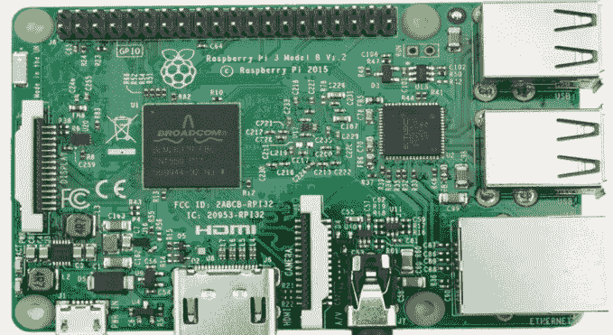

## 树莓派 GPIO 引脚排

- 引脚映射

### 树莓派 3 GPIO 引脚排

| 引脚# | 名称 | | | 引脚# |
|---|---|---|---|---|
| 01 | 3.3v 直流 | | 5v 直流 | 02 |
| 03 | GPIO02 (SDA1, I2C) | | 5v 直流 | 04 |
| 05 | GPIO03 (SCL1, I2C) | | 接地 | 06 |
| 07 | GPIO04 (GPIO_GCLK) | | (TXD0) GPIO14 | 08 |
| 09 | 接地 | | (RXD0) GPIO15 | 10 |
| 11 | GPIO17 (GPIO_GEN0) | | (GPIO_GEN1) GPIO18 | 12 |
| 13 | GPIO27 (GPIO_GEN2) | | 接地 | 14 |
| 15 | GPIO22 (GPIO_GEN3) | | (GPIO_GEN4) GPIO23 | 16 |
| 17 | 3.3v 直流 | | (GPIO_GEN5) GPIO24 | 18 |
| 19 | GPIO10 (SPI_MOSI) | | (GPIO_GEN6) GPIO25 | 22 |
| 21 | GPIO9 (SPI_MISO) | | (SPI_CE0_N) GPIO08 | 24 |
| 23 | GPIO11 (SPI_CLK) | | (SPI_CE1_N) GPIO07 | 26 |
| 25 | 接地 | | (I2C EEPROM) ID_SC | 28 |
| 27 | ID_SD (I2C EEPROM) | | 接地 | 30 |
| 29 | GPIO5 | | | |
| 31 | GPIO6 | | GPIO12 | 32 |
| 33 | GPIO13 | | 接地 | 34 |
| 35 | GPIO19 | | GPIO16 | 36 |
| 37 | GPIO26 | | GPIO20 | 38 |
| 39 | 接地 | | GPIO21 | 40 |

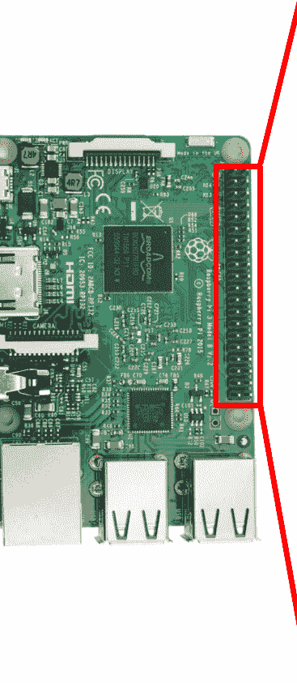

## 控制 GPIO 的方法

- 直接寄存器访问
- 底层 C 语言编程
- 性能最高，开发效率最低
- 依赖特定硬件
- 第三方 C 库
- 简易 C 语言
- 依赖特定硬件
- Linux Sysfs
- `/dev/gpio`
- 命令行或 Linux 系统调用
- 依赖 Linux 的硬件
- 脚本绑定
- Python, Java, NodeJS(Javascript), Scratch, 等...
- 编程简单
- 性能最低，平台性（操作系统）最高

## 直接寄存器访问

- 直接访问 BCM
- 使用 `mmap()` 函数进行内存映射
- `/dev/mem` : 需要根权限，适用于 GPIO, I2C, SPI 等
- `/dev/gpi` : 无需权限，仅限 GPIO
- 板载硬件
- 需要参考数据表 https://www.raspberrypi.org/wp-content/uploads/2012/BCM2835-Peripherals.pdf


### gpio.c

```c
#define BCMIO_BASE 0x3F00000 // 树莓派
#define BCM_BASE 0x200000 // 旧树莓派
#define GPIO_BASE (BCMIO_BASE + 0x200000)
#define GPIO_SIZE 256
#define MMAP_DEV "/dev/mem"

#include <stdio.h>
#include <stdlib.h>
#include <fcntl.h>
#include <sys/mman.h>
#include <unistd.h>

int mem_fd;
void *gpio_map;
volatile unsigned *gpio_map;
```

```c
// GPIO 设置
#define GPIO_IN(g) ((*gpio_map+(g)/10) &= ~(7<<((g)%10))
#define GPIO_OUT(g) ((*gpio_map+(g)/10) |= (1<<((g)%10))
#define GPIO_SET(g) (*gpio_map+7) = 1<<g)
#define GPIO_CLR(g) (*gpio_map+10) = 1<<g)
#define GPIO_GET(g) (*gpio_map+13)&(1<<g))
#define GPIO_PULL(g) (*gpio_map+37) // 上拉/下拉
#define GPIO_CLK (*gpio_map+38) // 上拉/下拉时钟
```

```c
int main(int argc, char **argv){
    int pin = 18, i=0;
    if ((mem_fd = open(MMAP_DEV, O_RDWR|O_SYNC )) < 0) {
    printf("无法打开 %s\n", MMAP_DEV);
    exit(-1);
    }
    gpio_map = mmap(
        NULL,               // 空间地址
        GPIO_SIZE,           // 长度
        PROT_READ|PROT_WRITE,// 允许读写映射内存
        MAP_SHARED,         // 与进程共享
        mem_fd,             // 用于映射的文件
        GPIO_BASE           // GPIO 外设偏移量
    );
    if (gpio_map == MAP_FAILED) {
    printf("mmap 错误 %d\n", (int)errno);// 也设置！
    exit(-1);
    }
```

```c
gpio = (volatile unsigned *)gpio_map;
GPIO_OUT(pin);                               设置引脚为输出模式
printf("%d 已设置为输出。\n");
for(i = 0; i<5; i++)                                // 闪烁 5 次
  GPIO_SET(pin);                                  开启引脚
  printf("%d On\n", pin);
  sleep(1);
  GPIO_CLR(pin);                                  关闭引脚
  printf("%d Off\n", pin);
  sleep(1);
}
munmap(gpio_map, GPIO_SIZE);                                清理
close(mem_fd);
return 0;
// 主函数
```

## 第三方 C 库

- 以 C 函数提供复杂的寄存器访问
- 依赖硬件和库
- Wiring Pi :
  - http://raspberrypi.com/
  - 树莓派的 Arduino 类库
- BCM2835
  - http://www.airspacece.com/mikem/bcm2835/


## WiringPi

- 安装
  - Jessie 或更高版本中默认安装
  - 最近的 Raspbian 不需要手动安装
  - `sudo apt-get install git-core`
  - `git clone git://git.drogon.net/wiringPi`
  - `cd wiringPi`
  - `./build`
- 命令行
  - 安装 WiringPi 后可以使用 `gpio` 命令
  - `-g` 选项：GPIO 引脚编号

```
$ gpio -g mode 18 out
$ gpio -g write 18 1
$ gpio -g write 18 0
```

### Wiring Pi gpio_wiringPi.c

```c
#include <stdio.h>
#include <stdlib.h>
#include <wiringPi.h>
#define LED 18 // BCM18

int main( ) {
  int i;
  wiringPiSetup();
  pinMode(LED, OUTPUT);
  for(i=0; i<10; i++){
    digitalWrite(LED, HIGH);
    printf("%d HIGH\n", LED);
    delay(1000);
    digitalWrite(LED, LOW);
    printf("%d LOW\n", LED);
    delay(1000);
  }
  return EXIT_SUCCESS;
}
```

```
$ gcc -o wiringPi_led wiringPi.c -lwiringPi
$ sudo ./wiringPi_led
```

## BCM2835

安装

- `wget http://www.airspacece.com/mikem/bcm2835/bcm2835-1.50.tar.gz`
- `tar zxf bcm2835-1.50.tar.gz`
- `cd bcm2835-1.50/`
- `./configure`
- `make`
- `sudo make check`
- `sudo make install`

### BCM2835 库 gpio_bcm2835.c

```c
#include <bcm2835.h>
#include <stdio.h>
// 在树莓派接口 P1 引脚 11 上闪烁（GPIO 引脚 17）
#define PIN RPI_GPIO_P1_11

int main(int argc, char **argv) {
    if (!bcm2835_init())      return 1;
    bcm2835_gpio_fsel(PIN, BCM2835_GPIO_FSEL_OUTP);
    while (1){
        bcm2835_gpio_write(PIN, HIGH);
        bcm2835_delay(500);
        bcm2835_gpio_write(PIN, LOW);
        bcm2835_delay(500);
    }
    bcm2835_close();
    return 0;
}
```

## Sysfs

- Linux 内核 2.6+
- 特殊文件系统
- 包含 GPIO 控制驱动程序
- 使用系统调用的 C 语言编程
- 与板卡类型无关，适用于任何 Linux 操作系统
- 控制台命令

```
$ echo "18" > /sys/class/gpio/export
$ ls /sys/class/gpio/
$ echo "out" > /sys/class/gpio/gpio18/direction
$ echo "1" > /sys/class/gpio/gpio18/value
$ echo "0" > /sys/class/gpio/gpio18/value
$ echo "18" > /sys/class/gpio/unexport
$ ls /sys/class/gpio/
```

### Sysfs C 程序 – gpio_sysfs.c <1/2>

```c
#include <stdio.h>
#include <fcntl.h>
#include <unistd.h>
#include <string.h>

int main(int argc, char **argv) {
    int gpio_pin = 18;
    int fd;
    char buff[BUFSIZ];
    fd = open("/sys/class/gpio/export", O_WRONLY);
    if (fd == -1) {
        perror("fail to open export.");
        return 1;
    }
    printf("%d" , gpio_pin);
    if (write(fd, buff, sizeof(buff)) == -1) {
        perror("fail to export GPIO");
        return 1;
    }
    close(fd);
}
```

```c
sprintf(buff, "/sys/class/gpio%d/direction", gpio_pin);
    fd = open(buff, O_WRONLY);
    if (fd == -1) {
        perror("fail to open GPIO Direction File");
        return 1;
    }
    if (write(fd, "out", 4) == -1) {
        perror("fail to set direction\n");
        return 1;
    }
    close(fd);
```

### Sysfs C 程序 - gpio_sysfs.c <2/>

```c
sprintf(buff, "/sys/class/gpio/gpio%d/value", gpio_pin);
fd = open(buff, O_WRONLY);
int i=0;
for(i=0; i<10; i++) {
    if (write(fd, "1", sizeof("1")) == -1) {
        perror("fail to set value:1");
        return 1;
    }
    printf("set gpio %d value as HIGH\n", gpio_pin);
    sleep(1);
    if (write(fd, "0", sizeof("0")) == -1) {
        perror("fail to set value:0");
        return 1;
    }
    printf("set gpio %d value as LOW\n", gpio_pin);
    sleep(1);
}
close(fd);
```

```c
fd = open("/sys/class/gpio/export", O_WRONLY);
sprintf(buff, "%d", gpio_pin);
write(fd, buff, strlen(buff));
close(fd);
return 0;
```

```
$ gcc -o gpioled gpioled.c
$ sudo ./gpioled
```

### Sysfs Python 程序 – gpio_sysfs.py <1/2>

### Sysfs Python 程序 - gpio_sysfs.py <2/2>

```python
f = open('/sys/class/gpio/export', 'w')
f.write('%d' % gpio_pin)
f.close()
print('export done.')
```

```
$ sudo python3 gpio_sysfs.py
```


## Java Binding

- 树莓派上默认安装了 JDK (Java 开发包)。
  - `java -version`
  - `javac -version`
- 用于树莓派的 Pi4j [http://pi4j.com](http://pi4j.com)
  - 树莓派的 Java I/O 库
  - 依赖 WiringPi
  - 使用 WiringPi 进行引脚映射
  - 安装
    - `$ curl -s get.pi4j.com | sudo bash`


## Java Binding – GPIO_Pi4j <1/1>

```java
import com.pi4j.io.gpio.*;

public class GPIO_Pi4j {

    public static void main(String[] args) throws InterruptedException {

        final GpioController gpio = GpioFactory.getInstance();

        final GpioDigitalOutput pin = 

            gpio.provisionDigitalOutputPin(RaspberryPi.GPIO_01,

            "MyLED",

            PinState.HIGH);

        pin.setShutdownOptions(true, PinState.LOW);

        for(int i=0; i<5; i++) {

            pin.high();

            System.out.println("--> GPIO state should be: ON");

            Thread.sleep(1000);

            pin.low();

            System.out.println("--> GPIO state should be: OFF");

            Thread.sleep(1000);

        }//end of for

    }//end of main

}//end of class
```

| 命令 | 描述 |
| :--- | :--- |
| `$ javac -classpath:.classes:opt/pi4j/lib/* -d . GPIO_Pi4j.java` | |
| `$ java -classpath:.classes:opt/pi4j/lib/* GPIO_Pi4j` | |

## Python 

- Rpi.GPIO
  - [https://pypi.org/project/Rpi.GPIO](https://pypi.org/project/Rpi.GPIO)
  - [https://sourceforge.net/projects/raspberry-gpio-python/](https://sourceforge.net/projects/raspberry-gpio-python/)
  - 树莓派默认安装
  - 树莓派最常用的方式
  - 寄存器访问方式
  - 仅支持软件 PWM
  - 支持硬件 PWM、SPI、I2C、UART

## Rpi.GPIO  API

- `import RPi.GPIO as GPIO`
- `GPIO.setmode(BCM)` : Broadcom 定义的引脚编号
- `GPIO.setmode(BOARD)` : 树莓派引脚编号
- `GPIO.setup(channel, direction)`
  - `channel` : 引脚编号
  - `direction` : `GPIO.IN`, `GPIO.OUT`
  - `state` : `GPIO.HIGH`, `GPIO.LOW`
- `GPIO.setup(channel, pull_up_down=GPIO.PULL_UP)`
  - `GPIO.PULL_UP`, `GPIO.PULL_DOWN`
- `GPIO.input(channel)`
- `GPIO.output(channel, state)`
- `GPIO.cleanup()`
  - 释放资源
- [https://sourceforge.net/raspberry-gpio-python/wiki/Examples/](https://sourceforge.net/raspberry-gpio-python/wiki/Examples/)

## Rpi.GPIO - gpio.py

```python
import RPi.GPIO as GPIO

import time

led_pin = 18

try:

    GPIO.setmode(BCM)

    GPIO.setup(led_pin, GPIO.OUT)

    while True:

        GPIO.output(led_pin, True)

        time.sleep(0.5)

        GPIO.output(led_pin, False)

        time.sleep(0.5)

finally:

    print('cleaning up')

    GPIO.cleanup()
```


## Python GPIO Modules

- WiringPi-Python
  - [https://github.com/WiringPi/WiringPi-Python](https://github.com/WiringPi/WiringPi-Python)
  - 用 C 编写的 WiringPi 封装
  - Arduino 风格代码
  - 支持 GPIO、串口、SPI、I2C、硬件 PWM
  - 依赖 WiringPi
  - 需要 WiringPi 编译
  - 安装
    - `sudo pip3 install wiringpi`
    - `cd ~`
    - `git clone --recursive https://github.com/WiringPi/WiringPi-Python.git`
    - `sudo apt-get install python-dev python-setuptools swig`
    - `cd WiringPi-Python`
    - `./build.sh`

## Python WiringPi-Python – gpio_wiringpi.py

```python
import wiringpi

import time

pin = 18

wiringpi.wiringPiGpio()

wiringpi.pinMode(pin, wiringpi.OUTPUT)

for i in range(0, 5):

    wiringpi.digitalWrite(pin, True)

    print('pin %s ON'%pin)

    time.sleep(1)

    wiringpi.digitalWrite(pin, False)

    print('pin %s Off'%pin)

    time.sleep(1)
```

```
$ sudo python gpio_wiringpi.py
```

## NodeJS GPIO Modules

### 寻找良好的模块
- [https://www.npmjs.com/](https://www.npmjs.com/)
- [http://node-modules.com/](http://node-modules.com/)
- [http://nodejsmodules.org/](http://nodejsmodules.org/)
- [http://npmsearch.com/](http://npmsearch.com/)

### 主要模块
- onoff
- Johnny-Five
- WiringPi-Node

### 要或不再维护
- gpio
- rpi-gpio
- pigpio
- rpio
- mmm-gpio
- pi-gpio

## NodeJS GPIO Modules

- onoff
  - [https://github.com/fivdi/onoff](https://github.com/fivdi/onoff)
  - 最流行
  - 同步、异步函数
  - 内部使用 Linux Sysfs
  - 使用 epoll 用于中断模式、回调

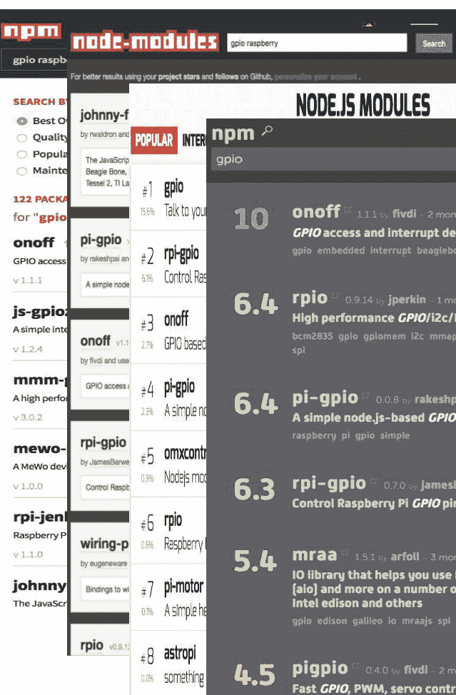

- 安装
  - `npm install onoff`

- 基础 API
- `var Gpio = require('onoff').Gpio`
- `Gpio(gpio, direction)`
- `read(callback)`, `readSync()`
- `write(value, callback)`, `writeSync(value)`
- `watch(callback)`, `unwatch(callback)`, `unwatchAll()`
- `direction()`, `getDirection(direction)`
- `unexport()`

## NodeJs onoff 模块 - gpio_onoff.js

```javascript
var onoff = require('onoff');

var led = new onoff.Gpio(18, 'out');

var sw = 1;

var cnt = 0;

var timer = setInterval(function(){

  led.writeSync(Number(sw));

  console.log(sw?'on':'off');

  sw = !sw;

  if(cnt++ > 10){

    clearInterval(timer);

  }

}, 500);

process.on('SIGINT', function () {

  led.unexport();

  console.log('cleaned up.');

});
```

```
$ node gpio_onoff.js
```

## NodeJS GPIO Modules

- Johnny-Five
  - [http://johnny-five.io/](http://johnny-five.io/)
  - JavaScript 机器人与 IoT 平台
  - 许多类型硬件板的抽象

- 所有硬件 API 都是相同的
  - Arduino, RaspberryPi, BeagleBone, Intel Edison 等
  - [http://johnny-five.io/platform-support/#raspberry-pi-3-model-b](http://johnny-five.io/platform-support/#raspberry-pi-3-model-b)

- 内部使用 raspi-io 模块
  - [https://github.com/nebrius/raspi-io](https://github.com/nebrius/raspi-io)

- 安装
  - `npm install raspi-io`
  - `npm install johnny-five`

```javascript
const Raspi = require('raspi-io');

const five = require('johnny-five');

const board = new five.Board({

  io: new Raspi()

});

board.on('ready', function() {

  var led = new five.Led('GPIO18')

  led.blink(500);

});
```

# NodeJS GPIO 模块

- WiringPi-Node
  - https://github.com/WiringPi/WiringPi-Node
  - wiringPi 的 Node.js 绑定
  - 比其他库更快
  - 安装
  - `npm install wiring-pi`
  - 核心函数
  - `var wpi = require('wiring-pi')`
  - `wiringPiSetup()`, `wiringPiSetupGpio()`, `wiringPiSetupPhys()`, `wiringPiSetupSys()`, `setup(mode)`
  - `pinMode(pin, mode)`
  - `digitalRead(pin)`
  - `digitalWrite(pin, state)`

```javascript
var wpi = require('wiring-pi');

wpi.setup('gpio'); // wpi.wiringPiSetupGpio();

wpi.pinMode(18, OUTPUT);
```

```javascript
var sw = true;

//var timer = setInterval(function(){

// if(sw){

//   wpi.digitalWrite(18, wpi.HIGH);

//}else{

//   wpi.digitalWrite(18, wpi.LOW);

// }

// // sw = !sw;

//}, 500);
```

```javascript
for(var i=0; i<10; i++){

  wpi.digitalWrite(18, wpi.HIGH);

  wpi.delay(500);

  wpi.digitalWrite(18, wpi.LOW);

  wpi.delay(500);

}
```

```bash
$ sudo node gpio_wiring.js
```


# 树莓派 Python GPIO 教程

1. GPIO
2. **数字输出**
3. 数字输入
4. 模拟输出 – PWM
5. 模拟输入 – RC 电路
6. 高电平传感器模块

## LED 闪烁

- LED 闪烁
- 部分
  - LED(发二极管)
    - 短脚：阴极，负极 (-)
    - 长脚：阳极，正极 (+)
    - 阴极头部是切平的。
  - 电阻
    - 阻塞电流流动
    - 压，降低电流
    - 无电极
    - 单位：Ω(欧姆)

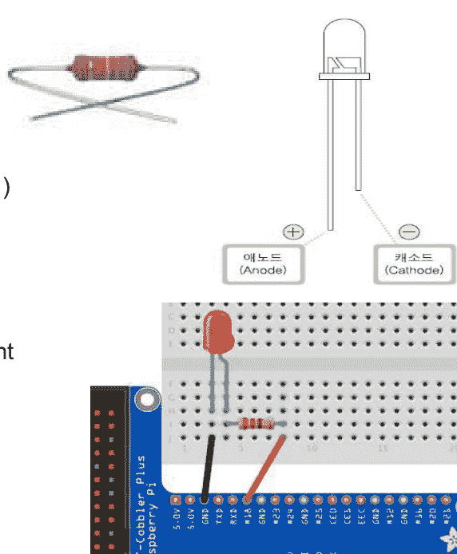

- 连接电路
  - LED 长脚：GPIO18 + 电阻
  - LED 短脚：GND

## 计算电阻值

- LED 电压，检查电流
  - 数据表
  - 5mm 红色基准
  - 电流 20mA
  - 电压约 1.8V~2.2V
- 姆定律
  - `V = I * R`
  - `R = V / I`
  - (电源电压 – LED 电压) / 电流
  - `(3.3 – 2) / 0.02 = 65`
  - 使用最接近 65 的电阻值：100Ω(220Ω)

## 绝对最大额定：(Ta=25℃)

| 项目 | 符号 | 绝对最大额定 | 单位 |
|---|---|---|---|
| 正向电流 | If | 20 | mA |
| 峰值正向电流 | | 30 | mA |
| 建议电流 | Is | 16-18 | mA |
| 反向电压 (Vr=5V) | IR | 10 | uA |
| 功率散逸 | PD | 105 | mw |
| 工作温度 | TOP | -40 ~ 85 | ℃ |
| 存储温度 | TSG | -40 ~ 100 | ℃ |
| 引脚焊接温度 | TSL | 5mm 时最大 260°C | 最大 | |

## 绝对额定值：(Ta=25℃)

| 项目 | 符号 | 测试条件 | 最小 | 典型 | 最大 | 单位 |
|---|---|---|---|---|---|---|
| 正向电压 | Vf | If=20mA | 1.8 | | 2.2 | V |
| 波长 (nm) | Δλ | If=20mA | 620 | | 625 | nm |
| 发光强度 | | If=20mA | 150 | | 200 | mcd |
| 视角 | | If=20mA | 40 | | 60 | deg |
| 正向电流 | If | | | | 20 | mA |
| 正向电压 | Vf | If=20mA | 1.8 | | 2.2 | V |

## 读取电阻

- 过去，读取 4 色环或 5 色环很困难
- 4 色环：
  - 第3 环是倍数 (10)
  - 第4 环是误差
- 5 色环：
  - 第4 环是倍数 (10)
  - 第5 环是误差
  - 褐色(1),黑色(0),橙色(10),金色 = 10,000Ω=10KO, ±5%
  - 红色(2),红色(2),褐色(10),金色

| 颜色 | 第1 环 | 第2 环 | 第3 环 | 倍数 | 误差 |
|---|---|---|---|---|---|
| 黑色 | 0 | 0 | | | F |
| 褐色 | 1 | 1 | | | F |
| 红色 | 2 | 2 | | | G |
| 橙色 | 3 | 3 | | | G |
| 黄色 | 4 | 4 | | | C |
| 蓝色 | 6 | 6 | | | B |
| 灰色 | 8 | 8 | | | A |
| 白色 | 9 | 9 | | | A |
| 金色 | | 1 | | J |
| 银 | | 2 | | K |


- 220Ω, ±5%
  - 橙色(3),橙色(3),褐色(10),金色
  - 330Ω, ±5%
  - 褐色(1),黑色(0),绿色(10),金色
  - 1,000,000Ω = 1MΩ, ±1%

## 面板

- PCB制作之前
- 不需要焊接
- 可以组装和拆卸
- 连接到同一行
- 电源垂直线 (总线)
- 中心位置 (IC)

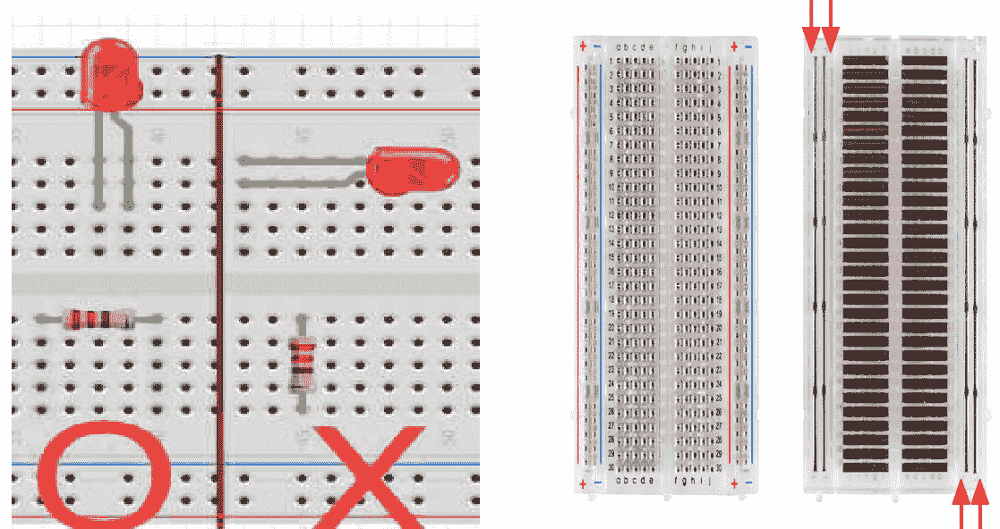

## 组合电路

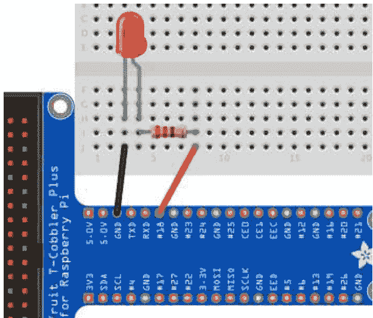

## LED 代码

- `RPi.GPIO` 模块 - `digital_out.py`

```python
import RPi.GPIO as GPIO

pin = 18

try:
    GPIO.setmode(GPIO.BCM)
    GPIO.setup(pin, GPIO.OUTPUT)
    while True:
        val = input("1:on, 0:off")
        GPIO.output(pin, val)
finally:
    print('clean up')

GPIO.cleanup()
```

## LED 代码

- Python WiringPi 模块 - `digital_out.py`

```python
import wiringpi as wpi

pin = 18

wpi.wiringPiSetup()
wpi.pinMode(pin, wpi.OUTPUT)

while True:
    val = input("1:on, 0:off ")
    wpi.digitalWrite(pin, val)
```

## 继电器

- 开启/关闭 220V(110V) 家电
- 5v 电控制家电
- 需要的零件
  - 继电器
    - IN, 5V, GND
  - 静态半导体继电器
    - IN, GND
  - 220V 插插头


## 继电器组合电路

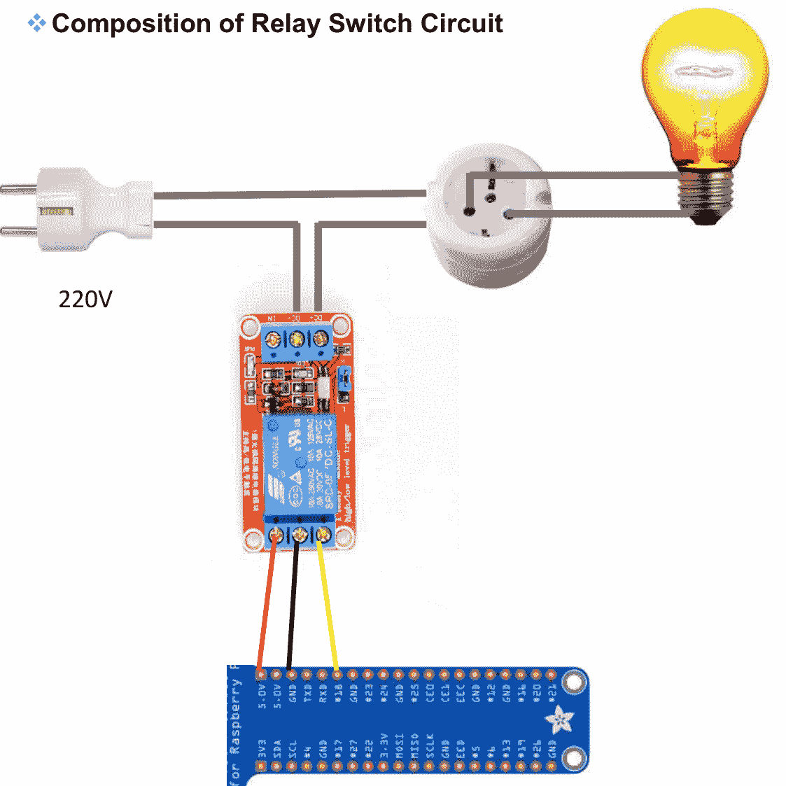

## 继电器组合电路 (部分 2)

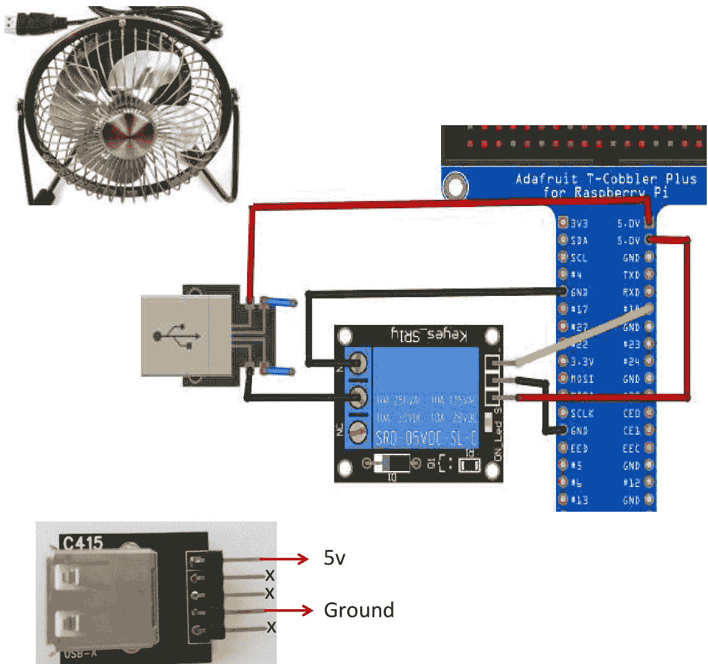

## 继电器代码

```python
import RPi.GPIO as GPIO

pin = 18

try:
    GPIO.setmode(GPIO.BCM)
    GPIO.setup(pin, GPIO.OUTPUT)
    while True:
        val = input("1:on, 0:off")
        GPIO.output(pin, val)
finally:
    print('clean up')

GPIO.cleanup()
```

## 三极管

- NPN 类型
- 用于开关控制
- 集极连接到负载
- 基极连接 GPIO
- 发射极连接 GND

```javascript
var sw = true;

// setInterval(function(){
if(sw){
  wpi.digitalWrite(18, wpi.HIGH);
}else{
  wpi.digitalWrite(18, wpi.LOW);
}
// // sw = !sw;
}, 500);
```

## 上拉电阻、下拉电阻

- 不经电阻连接 GND
- 触发信号


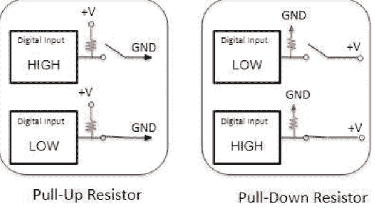

## 按钮式开关电路（上拉电阻）

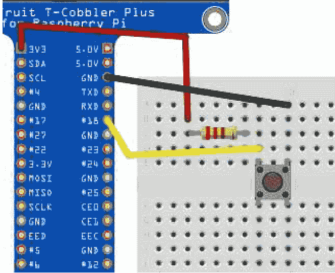

## 按钮式开关电路（下拉电阻）

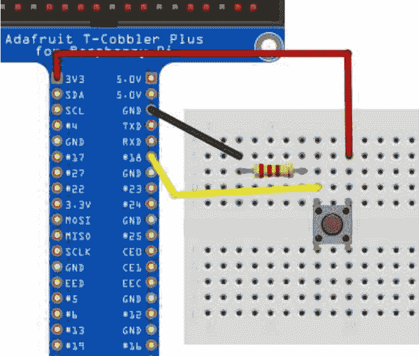

## 开关输入

- Python `Rpi.GPIO` 模块 - `digital_input.py`

```python
import Rpi.GPIO as GPIO

pin_btn = 18

try:
    GPIO.setmode(GPIO.BCM)
    GPIO.setup(pin, GPIO.IN)
    while True:
        print(GPIO.input(pin_btn))
finally:
    GPIO.cleanup()
```

## 开关输入

- Python WiringPi 模块 - `digital_input_wpi.py`

```python
import wiringpi as wpi

pin_btn = 18

wpi.wiringPiSetupGpio()
wpi.pinMode(pin_btn, wpi.INPUT)

while True:
    print(wpi.digitalRead(pin_btn))
```

## 内部上拉/下拉（按钮式开关）

- 内部提供拉电阻
- `GPIO.setup(pin, GPIO.IN, pull_up_down=GPIO.PUD_UP)`
- `GPIO.setup(pin, GPIO.IN, pull_up_down=GPIO.PUD_DOWN)`

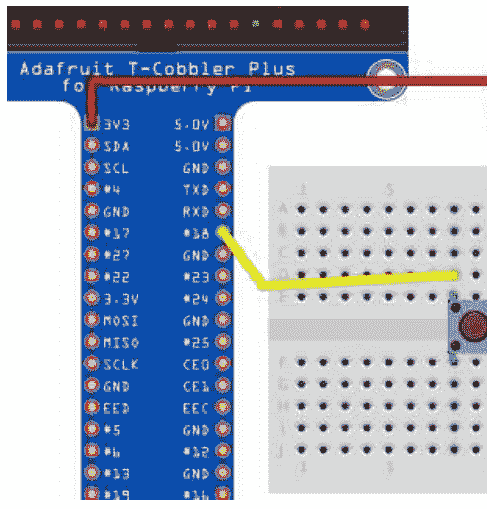


`GPIO.PUD_UP`

`GPIO.PUD_DOWN`

## 开关内部上拉/下拉

- Python `Rpi.GPIO` 模块 – `digital_input_pud.py`

```python
import RPi.GPIO as GPIO

pin = 18

try:
    GPIO.setmode(GPIO.BCM)
    #GPIO.setup(pin, GPIO.IN, pull_up_down=GPIO.PUD_UP)
    GPIO.setup(pin, GPIO.IN, pull_up_down=GPIO.PUD_DOWN)
    while True:
        print(GPIO.input(pin))
finally:
    GPIO.cleanup()
```

- Python WiringPi – `digital_input_pud_wpi.py`

```python
import wiringpi as wpi

pin = 18

wpi.wiringPiSetupGpio()
wpi.pinMode(pin, wpi.INPUT)
#wpi.pullUpDnControl(pin, wpi.PUD_UP)
wpi.pullUpDnControl(pin, wpi.PUD_DOWN)

while True:
    print(wpi.digitalRead(pin))
```

## 磁门开关

- 感应门开启
- 开关通过磁性闭合和开启工作
- 必要零件
  - 磁门开关
  - 10KΩ 电阻
- 与按钮使用相同的电路和代码

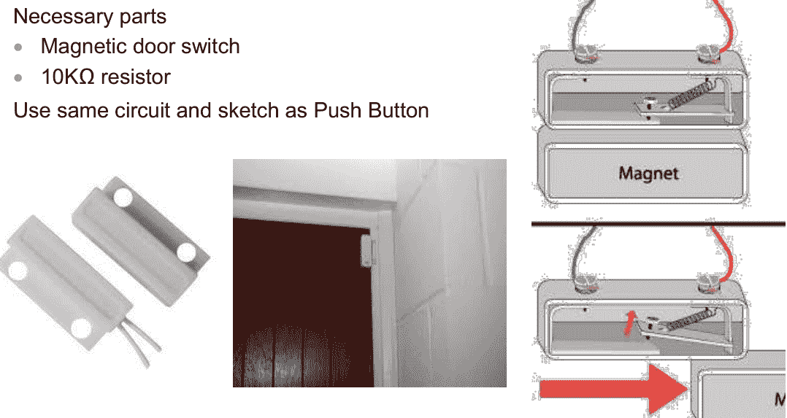

## 中断 / 边缘检测

- 轮询
  - 定期检查引脚电平和及状态
  - 使用 `delay()` 函数调整周期
  - 在 `delay()` 期间停止所有程序
  - 浪费不必要的 CPU
  - 当不符合周期时，输入会丢失
- 中断
  - 当满足条件时，调用指定的回调函数 (ISR)
  - 独立于 `delay()` 周期运行

## 中断 – RPi.GPIO

- 边缘类型
- `GPIO.RISING`（上升沿）
- `GPIO.FALLING`（下降沿）
- `GPIO.BOTH`（双边）
- `wait_for_edge(pin, type)`
- `add_event_detect(pin, type [, callback=fn, bouncetime=ms)`

```python
channel = GPIO.wait_for_edge(18, GPIO.RISING, timeout=5000)

def isr(channel):
    print('Edge detected on channel %s state %s' % (channel,
    GPIO.input(channel)))

GPIO.add_event_detect(18, GPIO.BOTH, callback=isr, bouncetime=200)

while True:
    time.sleep(100)
```

## 中断 / 边缘检测

- Python `Rpi.GPIO` 模块 – interrupt

```python
import RPi.GPIO as GPIO
import time

GPIO.setmode(GPIO.BCM)
GPIO.setup(18, GPIO.IN)

# channel = GPIO.wait_for_edge(18, GPIO.RISING, timeout=5000)
# if channel is None:
#    print('Timeout occurred')
# else:
```


# 树莓派 GPIO 编程指南

## 中断 / 边缘检测

### Python RPi.GPIO 模块

```python
import RPi.GPIO as GPIO
import time

def isr(channel):
    print('Edge detected on channel %s state %s' % (channel, GPIO.input(channel)))

GPIO.setmode(GPIO.BCM)
GPIO.setup(18, GPIO.IN)
GPIO.add_event_detect(18, GPIO.BOTH, callback=isr)

while True:
    time.sleep(1)
```

### Python WiringPi 模块

```python
import wiringpi as wpi
import time

pin = 18
wpi.wiringPiSetupGpio()
wpi.pinMode(pin, wpi.INPUT)

def isr():
    print(wpi.digitalRead(pin))

wpi.interrupt(pin, wpi.EDGE_BOTH)

while True:
    time.sleep(1)  # 让此过程运行
```

## 光电阻 (LDR)

### 特性

- 光传感器
- 无极
- 可变电阻，随光变化
- 亮时电阻减少，暗时电阻增加
- `10Lux` : `20kΩ`
- `0Lux` : `1MΩ`
- 电路
- 根据环境变化的下拉电阻(`10K~1M`)
- 在特定电压以上/以下
- 识别模拟信号


### 电路

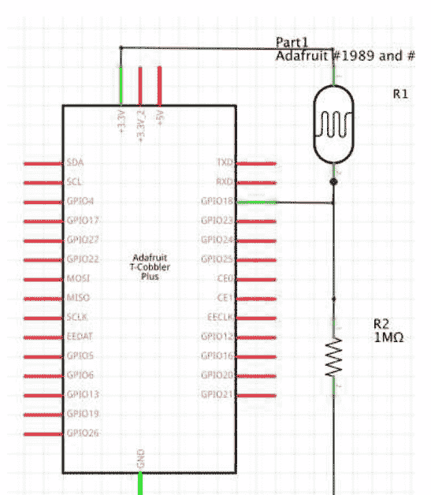

### 代码

#### Python RPi.GPIO 模块 - `ldr.py`

```python
import RPi.GPIO as GPIO

try:
    pin = 18
    GPIO.setmode(GPIO.BCM)
    GPIO.setup(pin, GPIO.IN)
    val = -1
    while True:
        read = GPIO.input(pin)
        if read != val:
            val = read
            print('dark' if read == 0 else 'light')
finally:
    print("clean up.")
    GPIO.cleanup()
```

#### Python WiringPi 模块 – `ldr_wpi.py`

```python
import wiringpi as wpi

pin = 18
wpi.wiringPiSetupGpio()
wpi.pinMode(pin, wpi.INPUT)
lastVal = -1

while True:
    val = wpi.digitalRead(pin)
    if val != lastVal:
        print(val == 0 and 'dark' or 'Light')
        lastVal = val
```

## 红外传感器 (Infrared Sensor)

### 红外发射器 (IRED)

- 红外发射二极
- LED 形状
- 通常安装在遥控器顶部
- 肉眼不可见
- 相机可见
- 工作电流：`100mA`
- 工作电压：`1.3v ~ 1.7v`
- 需要电阻：`5v` 时 `35Ω`
- `(5 – 1.5)v / 0.1A = 35`

#### 绝对额定

| 特性 | 符号 | 额值 | 单位 |
|---|---|---|---|
| 功率耗 | `Pd` | `190` | `mW` |
| 正向电流 | `If` | `100` | `mA` |
| *峰值正向电流 | `Ifp` | | |
| 反向电压 | `Vr` | `4` | `V` |
| 工作温度 | `Ta` | `-25~85` | `°C` |
| 存储温度 | `Tst` | `-30~100` | `°C` |
| *焊接温度 | `Tf` | `260°C` 持续5秒 | |
| *占空比 <=1/6, 脉冲宽度 >=0.1ms | | | |
| *PCB 到 IRED封装底部距离大于2.0mm | | | |

#### 电气特性

| 特性 | 符号 | 测试条件 | 最小值 | 典型 | 最大值 | 单位 |
|---|---|---|---|---|---|---|
| 正向电压 | `Vf` | `Ic=50mA` | | `1.3` | `1.7` | `V` |
| 正向电流 | `If` | | | | | `mA` |


### 红外接收器 (光电晶体管)

- 根据红外接收工作的晶体管
- 根据红外值变化的集极-发射极电阻
- 下拉电阻 `1MΩ`


### 电路

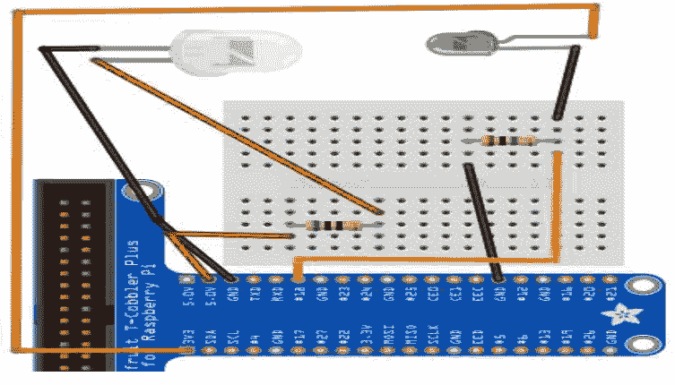

### 代码

#### Python RPi.GPIO 模块 - `ir.py`

```python
import RPi.GPIO as GPIO
import time

try:
    pin = 18
    GPIO.setmode(GPIO.BCM)
    GPIO.setup(pin, GPIO.IN)
    val = -1
    while True:
        read = GPIO.input(pin)
        if read != val:
            val = read
            print('normal' if read == 0 else 'detected')
        time.sleep(0.1)
finally:
    print('clean up')
    GPIO.cleanup()
```

#### Python WiringPi 模块 - `ir_wpi.py`

```python
import wiringpi as wpi

pin = 18
wpi.wiringPiSetupGpio()
wpi.pinMode(pin, wpi.INPUT)
val = -1

while True:
    read = wpi.digitalRead(pin)
    if read != val:
        val = read
        print(val == 0 and "no IR" or "detected")
```

## 人体感应

- 感应人体移动
- 感应人体温度 `36.5°C` 红外波长
- 必要零件
  - 被动红外 PIR, 传感器
    - `1`: `Out`
    - `2`: `Vcc`
    - `3`: `GND`

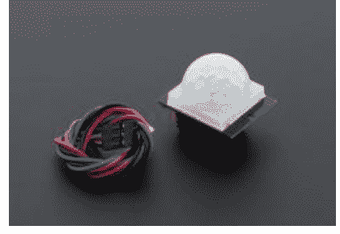


### PIR 传感器代码

#### Python WiringPi 模块 - `pir_wpi.py`

```python
import wiringpi as wpi

pin = 18
wpi.wiringPiSetupGpio()
wpi.pinMode(pin, wpi.INPUT)
val = -1

while True:
    read = wpi.digitalRead(pin)
    if read != val:
        val = read
        print(val == 0 and "no intruder" or "intruder detected")
```

#### Python RPi.GPIO 模块 - `pir.py`

```python
import RPi.GPIO as GPIO
import time

pri_pin = 18

try:
    GPIO.setmode(GPIO.BCM)
    GPIO.setup(pri_pin, GPIO.IN)
    val = -1
    while True:
        read = GPIO.input(pri_pin)
        if val != read:
            val = read
        if val == 0:
            print("No intruder")
        elif val == 1:
            print("Intruder detected")
        time.sleep(0.5)
finally:
    print("clean up")
    GPIO.cleanup()
```

## 触摸传感器

- 感应人体电流
- 3脚
  - `Red` : `Vcc` (`3~5V`)
  - `Green` : `Data Out`
  - `Black` : `GND`
- 简单的 `Digital Input`


### 触控传感器代码

#### Python RPi.GPIO 模块 - `touche.py`

```python
import time
import RPi.GPIO as GPIO

GPIO.setmode(GPIO.BCM)
pin = 18
GPIO.setup(pin, GPIO.IN)

while True:
    pad_pressed = GPIO.input(pin)
    if pad_pressed:
        print("touched!")
    time.sleep(0.1)
```

#### Python WiringPi 模块 - `touch_wpi.py`

```python
import wiringpi as wpi

pin = 18
wpi.wiringPiSetupGpio()
wpi.pinMode(pin, wpi.INPUT)

while True:
    read = wpi.digitalRead(pin)
    if read:
        print("touched")
```

## 模拟输出

### PWM（脉宽调制）

- 通过调整指定频率的脉冲宽度来作为模拟信号使用
- 频率 (`Frequency`): `Hz`，每秒发生的脉冲数量
- 周期 (`Period`): 一个脉冲的持续时间
- 脉宽 (`Pulse Width`): 一个周期内激活状态的时间
- 占空比 (`Duty Cycle`): 一个周期内 `HIGH` 状态的时间比例


### 树莓派 PWM

#### 硬件 PWM

- `BCM2835` SoC
- 寄存器 `ALT0`
  - `GPIO12`, `13` – `PWM0`, `PWM1`
- 寄存器 `ALT5`
  - `GPIO18`, `19` – `PWM0`, `PWM1`

#### 软件 PWM

- 依赖 CPU 时钟产生脉冲
- `GPIO` 无限制
- 性能也较差

#### 库（模块）支持级别

- Python `RPi.GPIO` 模块
  - 仅支持软件 PWM
- `NodeJs Onoff`
  - 不支持 PWM
- `WiringPi` (Python, NodeJs)
  - 支持硬件/软件

### LED 渐变电路


### Python RPi.GPIO 模块

- 仅支持软性 PWM
- 相关函数
  - `pwm = GPIO.PWM(pin, Hz)`
  - `pwm.start(duty_cycle)`
  - `pwm.ChangeDutyCycle(duty_cycle)`
  - `pwm.stop()`

#### LED 渐变 - `pwm.py`

```python
import RPi.GPIO as GPIO
import time

try:
    pin = 26
    GPIO.setmode(GPIO.BCM)
    GPIO.setup(pin, GPIO.OUT)
    pwm = GPIO.PWM(pin, 100)
    pwm.start(0)
    while True:
        for i in range(0, 101):
            pwm.ChangeDutyCycle(i)
            time.sleep(0.05)
        for i in range(100, -1, -1):
            pwm.ChangeDutyCycle(i)
            time.sleep(0.05)
finally:
    pwm.stop()
    GPIO.cleanup()
```

### WiringPi 模块

#### 硬件 PWM

- `GPIO` 限制 (`12`, `13` / `18`, `19`)
- `wpi.pinMode(pin, wpi.OUTPUT)`
- `wpi.pwmSetMode(mode)`
  - `PWM_MODE_MS` : 均衡(默认)
- `wpi.pwmSetClock(divisor)`
  - `19.2M / divisor` (分频比)
- `wpi.pwmSetRange(range)`
  - 分辨率，默认 = `1024`
  - `19.2M / divisor / range = Hz`
- `wpi.pwmWrite(pin, value)`
- 需要 `root` 权限 (`sudo`)


#### LED 渐变 - 硬件 PWM (`pwm_wpi_hw.py`)

```python
import wiringpi as wpi

pin = 18
wpi.wiringPiSetupGpio()
wpi.pinMode(pin, wpi.OUTPUT)

while True:
    for i in range(0, 1024):
        wpi.pwmWrite(pin, i)
        wpi.delay(1)
    for i in range(1024, -1, -1):
        wpi.pwmWrite(pin, i)
        wpi.delay(1)
```

#### LED 渐变 - 硬件时钟 (`pwm_wpi_hw_clk.py`)

```python
import wiringpi as wpi

pin = 18
wpi.wiringPiSetupGpio()
wpi.pinMode(pin, wpi.OUTPUT)
wpi.pwmSetClock(1920)
wpi.pwmSetRange(1000)

while True:
    for i in range(0, 1001):
        wpi.pwmWrite(pin, i)
        wpi.delay(1)
    for i in range(1000, -1, -1):
        wpi.pwmWrite(pin, i)
        wpi.delay(1)
```

#### 软件 PWM

- `GPIO` 引脚限制
- 每个引脚占用 `0.5%` 的 CPU
- `wpi.pinMode(pin, wpi.OUTPUT)`
- `wpi.softPwmCreate(pin, value, range)`
  - 最小脉冲宽度 `100µs`，低使用率下 `100Hz`
  - 建议范围 = `100`
- `wpi.softPwmWrite(pin, value)`

#### LED 渐变 - 软件 PWM (`pwm_wpi_sw.py`)

```python
import wiringpi as wpi

pin = 18
wpi.wiringPiSetupGpio()
wpi.pinMode(pin, wpi.OUTPUT)
wpi.softPwmCreate(pin, 0, 100)

while True:
    for i in range(0, 101):
        wpi.softPwmWrite(pin, i)
        wpi.delay(1)
    for i in range(100, -1, -1):
        wpi.softPwmWrite(pin, i)
        wpi.delay(1)
```


## 超声波传感器

- 通过时间计算距离
- 声速
  - 取决于介质、温度
  - 20°C (68 °F) 干燥空气中为 343.21m/s
  - 34321cm/s
- 速度 = 距离 / 时间
- 34321 = 距离 / 时间
  - 34321 = 距离 / (时间/2)
  - 回返时间
  - 17160 = 距离 / 时间
  - 17160 * 时间 = 距离


## 超声波传感器

- Python Rpi.GPIO 模块 – `ultra_sonic.py`

```python
import RPI.GPIO as GPIO
import time

trig_pin = 18
echo_pin = 23
distance = 0
start_time = 0
end_time = 0

GPIO.setmode(GPIO.BCM)
GPIO.setup(trig_pin, GPIO.OUT)
GPIO.setup(echo_pin, GPIO.IN)
```

```python
while True:
    GPIO.output(trig_pin, False)
    time.sleep(0.2) #等待就绪
    GPIO.output(trig_pin, True)
    time.sleep(0.00001) # 设置高电平 10us
    GPIO.output(trig_pin, False)

    while GPIO.input(echo_pin) == 0:
        start_time = time.time()

    while GPIO.input(echo_pin) == 1:
        end_time = time.time()

    travel_time = end_time - start_time
    distance = travel_time * 17160 #34321/2
    distance = round(distance, 2)
    print('Distance:%dcm' %distance)
```

```python
finally:
    print('Clean up')
    GPIO.cleanup()
```

## 超声波传感器

- Python WiringPi 模块 – `ultra_sonic_wpi.py`

```python
import wiringpi as wpi
import time

pin_trig = 18
pin_echo = 23

wpi.WiringPiSetupGpio()
wpi.pinMode(pin_trig, wpi.OUTPUT)
wpi.pinMode(pin_echo, wpi.INPUT)

while True:
    wpi.digitalWrite(pin_trig, wpi.LOW)
    wpi.delay(200)
    wpi.digitalWrite(pin_trig, wpi.HIGH)
    wpi.delayMicroseconds(10)
    wpi.digitalWrite(pin_trig, wpi.LOW)

    while wpi.digitalRead(pin_echo) == 0:
        start_time = time.time()

    while wpi.digitalRead(pin_echo) == 1:
        end_time = time.time()

    travel_time = end_time - start_time
    distance = travel_time * 17160
    print('Distance: %dcm' % (round(distance, 2) , travel_time))
```

## DHT-11 温度/湿度模块

- 由温度湿度传感器组成
- 3引脚
  - 红色：Vcc (3~5V)
  - 绿色：Data Out
  - 黑色：GND
- 1Wire 通信
- 根据给定的通信体系传输信号


- MCU 请求信号后工作
- 根据 HIGH 电平持续时间区分 0, 1
- 40位数据（湿度）：16位, 温度:16位, 校验和:8位
- 实时 QIO
- Rpi.GPIO, wiringPI 模块专用使用
- https://akizukidenshi.com/download/aos/DHT11.pdf

## DHT-11 温度湿度模块

- 请求信号(Start Signal):HIGH~LOW(18ms) ~PULL_UP


- 接收数据(40位) : 0 = 26~28us HIGH ， 1=50~70us HIGH


数据 "0" 格式
数据 "1" 格式

## DHT-11 温度湿度模块

- 40位传输数据
- 16位湿度（例如：53.0%）
- 8位湿度低位字节 (0011 0101): 53
- 16位温度（例如：24.0°C）
- 8位温度高位字节 (0001 1000): 24
- 8位温度低位字节 (0000 0000): 0
- 8位校验和（例如：0100 0001）

等等，让我根据提供的文本对齐 OCR 逻辑：
- 40位传输数据
- 16位湿度（例如：53.0%）
- 8位湿度低位字节 (0011 0101): 53
- 16位温度（例如：24.0°C）
- 8位温度高位字节 (0001 1000): 24
- 8位温度低位字节 (0000 0000): 0
- 8位校验和（例如：0100 0001）

实际上，OCR 文本有点乱。让我从逻辑上清理它：
- 40位传输数据
- 16位湿度（例如：53.0%）
- 8位湿度低位字节 (0011 0101): 53
- 16位温度（例如：24.0°C）
- 8位温度高位字节 (0001 1000): 24
- 8位温度低位字节 (0000 0000): 0
- 8位校验和（例如：0100 0001）

## DHT-11 传感器

- Python Rpi.GPIO 模块 – `dht11.py`

```python
import Rpi.GPIO as GPIO
import time

pin = 18

GPIO.setmode(GPIO.BCM)

while True:
    data = []
    data2 = []
    cnt = 0

    GPIO.setup(pin, GPIO.OUT)
    GPIO.output(pin, 1)
    GPIO.output(pin, 0)
    time.sleep(0.01)
    GPIO.setup(pin, GPIO.IN, pull_up_down=GPIO.PUDUP)
```

## DHT-11 传感器

- Python Rpi.GPIO 模块 – `dht11.py`

```python
while True:
    err = True

    while(GPIO.input(pin) == 0):
        pass

    old = time.time()

    while(GPIO.input(pin) == 1):
        err = False
        end = time.time()

    if end - old > 0.01:
        err = True
        break

    if err == False:
        data.append(end-old)

    cnt += 1

    if(cnt > 40):
        break
```

- Python Rpi.GPIO 模块 – `dht11.py`

```python
if len(data) > 40 and data[0] >= 0.0008:
    data.pop(0)

    for i in data:
        if i >= 0.0008:
            print 'no good data:invalid data'
            break
        elif i >= 0.0004: #原本应该是 70us
            data2.append(1)
    else:
        data2.append(0)
```

- Python Rpi.GPIO 模块 – `dht11.py`

```python
if len(data2) != 40:
    print 'no good data:not enough data.'
else:
    humi1 = int("".join(str(x) for x in data2[0:8]), 2)
    humi2 = int("".join(str(x) for x in data2[9:16]), 2)
    temp1 = int("".join(str(x) for x in data2[17:24]), 2)
    temp2 = int("".join(str(x) for x in data2[25:32]), 2)
    crc = int("".join(str(x) for x in data2[33:40]), 2)

    if(crc != (humi1 + humi2 + temp1 + temp2)):
        print 'no good data:crc err'
    else:
        print 'humi :%d.%d%%' %(humi1,humi2)
        print 'temperature:%d.%dC' %(temp1,temp2)
else:
    print 'no good data'
```

## 莓派通信

- 1. 串行通信
- 2. UART
- 3. I2C
- 4. SPI
- 5. 蓝牙
- 6. BLE – 蓝牙

## 串行对比并行

- 串行通信
  - 逐位连续发送
  - 慢
  - 一条通信电路
- 并行
  - 同时发送多个位
  - 快
  - 需要对应发送位数数量的电路

## 串行通信与时钟

- 串行通信
  - 数据一个接一个连续发送
- 需要区分一个比特
- 发送端和接收端位相同的比特

## 异步串行通信

- 约定数据区分周期
- 不发送单独的时钟信号
- 如果双方
- 速度不同
- 则无法通信
- 需要额外的起始位和结束位
- 仅支持 1:1 通信
- RS-232(UART) 通信协议

# 同步串口通信

- 数据信号和位区分信号（时钟）
- 分别发送
- 在时钟信号上识别数据信号
- 无需约定速度
- 最大速度限制
- 可实现 1:N 通信
- 主从关系，由主设备提供时钟
- I2C, SPI 通信协议


# 树莓派通信

1. 串口通信
2. UART
3. I²C
4. SPI
5. 蓝牙
6. BLE – 信标

# UART/RS-232

- UART（通用异步收发传输器）
  - 异步通信机械设备
  - 大多数内置 MCU 硬件
  - 能够在软件内解码时钟起始/结束位
  - 通信速度：波特率
  - 使用两条数据电路
    - TxD（传输），RxD（接收）


- RS-232
  - 美国 EIA（电子工业协会）
  - UART 的电气和机械（连接器）特性标准
  - 代表 PC 中的串口
- UART/RS-232 通信
  - MCU UART TTL（晶体管晶体管逻辑）：0~5V
  - RS232：-12V ~ +12V
  - RS232 – TTL 转换芯片
    - MAX232 / Maxim
  - USB – TTL 转换芯片
    - FT232R / FTDI Chip
  - CP2102 / Silicon Lab


# 树莓派 UART

- 激活 UART
- `sudo /boot/config.txt`（必须备份）
  - `enable_uart=1`
- `sudo /boot/cmdline.txt`（必须备份）
  - `console=serial0,115200`
- `sudo reboot`
- `ls ~/dev/serial*`
  - 检查下方
  - `serial0 -> ttyS0(UART)`
  - `serial1 -> ttyAMA0(Bluetooth)`
  - 使用连接到设备

```
pi@raspberry: $ ls ~/dev/serial*
lrwxrwxrwx 1 root root 7 Nov 22 serial0 -> ../dev/ttyS0
lrwxrwxrwx 1 root root 7 Nov 22 serial1 -> ../dev/ttyAMA0
```

# 树莓派 UART

- 树莓派 – PC 通信
  - RS232 转 TTL 转换器
  - USB 转串口转换器
  - 2 块树莓派之间的通信
  - Tx, Rx 交叉连接跳线线
  - 树莓派 – MCU(Arduino)
  - 连接 GPIO 引脚
  - 连接 USB


# 树莓派之间的 UART 通信

- 电路（Tx–Rx 交叉连接）
- Tx – Rx
- Rx – Tx
- GND


# 树莓派 - Arduino

- 构建电路（Tx–Rx 交叉连接）
- 树莓派 Tx – Arduino Rx
- 树莓派 Rx(3.3v) – Arduino Tx(5v)
  - 电平转换器（电阻）
  - R1 : 1KΩ
  - R2 : 2KΩ
- GND-GND


# minicom 设置

- 设置
- `sudo apt-get install minicom`
- 执行
  - `sudo minicom -b 11520 -D /dev/xxx`
- 设置
  - CTRL-A Z
  - Q : 本地回开启/关闭
  - P : 添加换行符
  - T : 添加回车
- Esc

| [屏幕和键盘] | |
| :--- | :--- |
| A - 命令键为 | AA |
| B - 退格键发送 | BS |
| C - 状态行 | 启用 |
| D - 报警音 | 是 |
| E - 前景颜色（菜单） | WHITE |
| P - 背景颜色（菜单） | BLACK |
| G - 前景颜色（终端） | WHITE |
| H - 背景颜色（终端） | BLACK |
| I - 前景颜色（状态） | WHITE |
| 背景颜色（状态） | 2000 |
| K - 历史缓冲区大小 | |
| L - 宏文件 | .macros |
| M - 启用宏编辑 | 是 |
| O - 字符转换 | 是 |
| P - 添加换行符 | 是 |
| Q - 本地回显 | 是 |
| R - 换行 | 是 |
| S - 十进制显示 | 否 |
| T - 添加回车 | 是 |
| 更改哪个设置？ | (Esc 退出) |

保存设置为 dfl

| 欢迎 | | Minicom 命令摘要 |
| :--- | :--- | :--- |
| OPTION | | 命令可以通过 CTRL-A <key> 调用 |
| 编译 | | 主功能 其他功能 |
| 拨号目录...Y 运行脚本 (Go)...G 清除屏幕...C |
| 发送文件...S 接收文件...R 配置 minicom...I |
| 参数...A 添加换行....A 挂起 minicom...J |
| 捕捉开启/关闭....H 挂起...,H 退出并重置...X |
| 发送中断...P 初始化调制调器...M 不重置退出...K |
| 终端设置...K 运行键...I |
| 行开启/关闭...W 本地回显开启/关闭...E 帮助屏幕...Z |
| 传递文件...T 切换时间戳...B | |
| 添加回车...U | |

```
[configuration]

| 文件和路径 |

| 文件传输协议 |

| 串口设置 |

| 调制调器和拨号 |

| 屏幕和键盘 |

| 保存设置为 dfl |

| 保存设置为... |

| 退出
```


# 树莓派串口编程

## Python serial 模块

- 项目地址：`https://github.com/pyserial/pyserial`
- 安装：
  - `pip3 install pyserial`
  - 或者 `sudo apt-get install python-serial`
- 基础 API：
  - `import serial`
  - `port = serial.Serial('/dev/xxx', 11520)`
- 检查串口映射：
  - `serial0 -> ttyS0(UART)`
  - `serial1 -> ttyAMA0(Bluetooth)`

## Arduino

### 代码草图（Sketch）

```cpp
#include <Wire.h>

#define ADDR 0x04
#define PIN_LED 13

int cnt = 0;
int lastVal = -1;

void setup() {
  Wire.begin(ADDR);
  Wire.onReceive(onRecv);
  Wire.onRequest(onReq);
  pinMode(PIN_LED, OUTPUT);
  Serial.begin(9600);
  Serial.println("ready.");
}

void loop() {
  delay(100);
}
```

```cpp
void onRecv(int bytes) {
  int val;
  while (Wire.available()){
    val = Wire.read();
  }
  Serial.print("read:");
  Serial.println(val);
  if(lastVal != val) {
    lastVal = val;
    cnt++;
    if(val == 1) {
      digitalWrite(PIN_LED, HIGH);
    } else if (val == 0) {
      digitalWrite(PIN_LED, LOW);
    }
  }
}

void onReq() {
  Serial.print("req:");
  Serial.println(cnt);
  Wire.write(cnt);
}
```

## 设置树莓派

- 安装 I2C 工具：`sudo apt-get install i2c-tools`
- I2C 总线扫描：


- 执行命令：`i2detect -y 1`
- 检查 Arduino 代码中指定的从机地址（`0x04`）输出

## I2C 编程

### Python smbus 模块

- 安装：
  - `sudo apt-get install python-smbus`
  - `sudo apt-get install python3-smbus`（针对 python3 情况）
  - 参考：`https://github.com/bivav/smbus-cffi`
- 基础 API：
  - `import smbus`
  - `bus = smbus.SMBus(busNo)`
  - `bus.write_byte(address, value)`
  - `bus.read_byte(address)`

### Python smbus 示例 - `i2c.py`

```python
import smbus

bus = smbus.SMBus(1)
address = 0x04

def writeNumber(value):
    bus.write_byte(address, value)

def readNumber():
    number = bus.read_byte(address)
    return number

while True:
    var = input("0=Led Off, 1=Led On, 3=Get Count >")
    if var < 2:
        writeNumber(var)
        print("Led ", var)
        continue
    else:
        number = readNumber()
        print("Arduino LED Count", number)
```

运行示例：

```bash
@raspberry: $ python i2c.py
0=Led Off, 1=Led On, 3=Get Count > 1
Led 1
0=Led Off, 1=Led On, 3=Get Count > 0
Led 0
0=Led Off, 1=Led On, 3=Get Count > 3
Arduino LED Count 2
```

Arduino 串口输出：

```
ready.
read:1
read:0
req:2
read:1
read:1
req:3
read:1
req:3
```

## I2C 编程（Node.js）

### NodeJs i2c 模块

- 安装：`npm install i2c`
- 参考：`https://www.npmjs.com/package/i2c`
- 基础 API：
  - `i2c = require('i2c')`
  - `wire = new i2c(address, {device:'/dev/i2c-x'})`
  - `wire.writeByte(byte, function(err) {})`
  - `wire.readByte(function(err) {})`

## 树莓派通信方式

1. 串口通信
2. UART
3. I2C
4. SPI
5. 蓝牙
6. BLE

## 旋转电位器

- 通过切换改变电阻
- 引脚定义：引1（`5V`）、引2（`OUT`）、引3（`GND`）
- 使用可变电阻输出


## SPI（外设接口）通信

- 串行外设备接口
- 由摩托罗拉开发
- 电路：4路
  - `SCK`（串行时钟）：主机发送时钟
  - `MOSI`（主设备输出）：从机输入
  - `MISO`（从机输出）：主机接收
  - `SS`（从机选择）：由主机选择
- 为每个从机添加特定电路
- `'0'` 给从机，`'1'` 给剩余部分
- 实际电路有两个（`MOSI`、`MISO`）
- 所有通信，高速传输
- SPI 模式：设置起始位（`0`/`1`），时钟位（`0`/`1`）


| SPI 模式 | CPOL（时钟极性） | CPHA（时钟相位） |
|---|---|---|
| 0 | 0 | 0 |
| 1 | 0 | 1 |
| 2 | 1 | 0 |
| 3 | 1 | 1 |

## MCP3008

- ADC（模拟数字转换器）
- 10bit 分辨率
- SPI 通信
- SPI 模式（`0,0`）
- 速度 10kHz
- 接收：
  - 起始位（`0,1`）
  - 24位
- 参考资料：
  - 3008 数据手册：`http://www.arnell.com/datasheets/8095.pdf`
  - 10bit 值
  - 模拟信号
  - 差分
  - 传输

### 接线电路

- `Vdd` – `3.3v`
- `Vref` – `3.3v`
- `AGND` – `GND`
- `CLK` – `CLK(GPIO11)`
- `MISO` – `MISO(GPIO9)`
- `Din` – `MOSI(GPIO10)`
- `CS` – `CE(GPIO0)`
- `CH0`

| MCP3008 控制位 | | | D2 | D1 | D0 | 通道选择 |
|---|---|---|---|---|---|---|
| | | | | | | CH0 |
| | | | | | | CH1 |
| | | | | | | CH2 |
| | | | | | | CH3 |
| | | | | | | CH4 |
| | | | | | | CH5 |
| | | | | | | CH6 |
| | | | | | | CH7 |


## SPI 设置

- 树莓派 SPI 开启：
  - 使用 `raspi-config` 开启
  - 设备路径：`/dev/spi*`
- 可变电阻读取接线图：


## SPI 编程

### Python Py-spidev

- 安装：
  - `spidev` 控制模块（`/dev/spidev0.0`、`/dev/spidev0.1`）
  - 项目地址：`https://github.com/doceme/py-spidev`
  - 安装命令：
    - `git clone git://github.com/doceme/py-spidev`
    - `cd py-spidev`
    - `sudo python setup.py install`
    - 或 `pip3 install spidev`
- 基础 API：
  - `import spidev`
  - `spi = spidev.SpiDev()`
  - `spi.open(bus, channel)`
  - `recv = spi.readbytes(1)`
  - `spi.xfer([data])`
  - `spi.close()`

### Python SPI 示例

```python
import spidev
import time

spi = spidev.SpiDev()
spi.open(0, 0)  # 总线，通道
spi.max_speed_hz = 1000000
spi.mode = 0b00

def analog_read(channel):
    # 逻辑占位
    pass

try:
    while True:
        var = input("0=Led Off, 1=Led On, 3=Get Count >")
        if var < 2:
            # 写入逻辑
            print("Led ", var)
            continue
        else:
            number = spi.xfer2([0x01, (channel << 4), 0x00])[1]
            print("Arduino LED Count", number)
finally:
    spi.close()
```

## 设置两台树莓派之间的通信

### 服务端（Server）

- 编辑配置：`sudo vi /lib/systemd/system/bluetooth.service`（必须备份）
- 在 `bluetoothd` 末尾添加 `-C`
- 由于 bluez5 和 SDP 版本差异导致的错误
- 重启服务：`sudo systemctl restart bluetooth`
- 检查服务：`sudo sdptool browse local`
- 在 SDP 中检查串口服务
- 添加串口服务：`sudo sdptool add SP`
- 监听连接：`sudo rfcomm listen /dev/rfcomm0`
- 连接到待命 `/dev/rfcomm0`
- 连接到客户端后，在监听状态下需要独立的终端连接
- 串口通信：`sudo minicom -b 115200 -D /dev/rfcomm0`
- 与 `/dev/rfcomm0` 进行串口通信

### 客户端（Client）

- 连接：`sudo rfcomm connect /dev/rfcomm0 XX:XX:XX:XX:XX`
- 通过远程地址通道连接并绑定到 `/dev/rfcomm0`
- 释放：`rfcomm release /dev/rfcomm0`
- 串口通信：`sudo minicom -b 115200 -D /dev/rfcomm0`

## Android

- 蓝牙串口控制器：
  - 下载地址：`https://play.google.com/store/apps/details?id=nextprototypes.BTSController&hl=ko`
  - 在树莓派待命后执行并连接

## 服务端通信

- 服务端：
  - `sudo rfcomm listen /dev/rfcomm0`
  - `python bt_serial.py`
- 客户端：
  - `python bt_serial.py`

```python
import serial, threading

port = serial.Serial("/dev/rfcomm0", baudrate=9600, timeout=3.0)

class ReadThread(threading.Thread):
    flag = True

    def run(self):
        while self.flag:
            line = self.serial.readline()
            if len(line) > 0:
                print("recv:" + line)
        print("read thread died.")

    def readline(self):
        line = ''
        while True:
            ch = port.read(1)
            line += ch
            if ch == '\r' or ch == '\n':
                return line

try:
    if port.isOpen():
        t = ReadThread()
        t.start()
        print('serial is ready.')
        while True:
            line = raw_input("")
            if line == 'exit':
                t.flag = False
                break
            print line
            port.write(line + '\r')
    print('bye')
finally:
    port.close()
```

## 蓝牙 Socket

### Python Pybluez 模块

- 项目地址：`https://github.com/karulis/pybluez`
- 安装依赖：`sudo apt install libbluetooth-dev`
- 安装模块：
  - `sudo pip3 install pybluez`
  - 或者 `sudo apt-get install python-bluetooth`

## 蓝牙设备扫描

### Python Pybluez 模块 – `bt_scan.py`

```python
import bluetooth as bt

print "scanning..."
scan_list = bt.discover_devices(lookup_names = True)
print "found %d devices" % len(scan_list)
for addr, name in scan_list:
    print "%s (%s)" % (addr, name)
```

运行示例：

```bash
[raspberry]: $ python scan.py
```

## 蓝牙 Socket 服务端

### Python 服务 - `bt_server.py`

```python
import bluetooth as bt

server = bt.BluetoothSocket(bt.RFCOMM)
server.bind(("", 3))
server.listen(1)
print "ready to connect..."
socket, address = server.accept()
print "Client connected : %s", address
data = socket.recv(1024)
print "received :%s" % data
socket.send('Good bye~')
print "sent data"
socket.close()
server.close()
```

运行示例：

```bash
[raspberry]: $ python server.py
ready to connect...
client connected : ('B8:27:EB:14:18:CC', '3')
received :Hello Bluetooth World.
sent data
```

## 蓝牙 Socket 客户端

### Python 客户端 – `bt_client.py`

```python
import bluetooth as bt

socket = bt.BluetoothSocket(bt.RFCOMM)
socket.connect(("B8:27:EB:AD:74:74", 3))
print "connected."
socket.send("Hello raspberry.")
print "sent data"
recv = socket.recv(1024)
print "recv data : %s" % recv
socket.close()
```


## 服务发现 – `bt_server.py`

- `ServerSocket`，用于连接到特定服务 (`MyService`)
  - `sudo vi /lib/systemd/system/bluetooth.service` (必须备份)
  - 在 `bluetooth` 末尾添加 `C`
  - 由于 `bluez5` & `SDP` 版本差异导致的错误
  - `sudo service bluetooth restart` (`/etc/init.d/bluetooth`)

```python
# 使用 sudo 运行
import bluetooth as bt

server = bt.BluetoothSocket(bt.RFCOMM)
server.bind("", bt.PORT_ANY)
server.listen(1)
bt.advertise_service(server, "MyService",
    service_classes=[bt.SERIAL_PORT_CLASS],
    profiles=[bt.SERIAL_PORT_PROFILE])
print "ready to connect..."
socket, address = server.accept()
print "client connected : ", address
data = socket.recv(1024)
print "received :%s" % data
socket.send("Good bye")
print "sent data"
socket.close()
server.close()
```

## 服务发现 – `bt_client.py`

- `ClientSocket`，连接到特定服务 (`MyService`)

```python
# 1:scan, 2:ping, 3:使用 sudo 运行
import bluetooth as bt

svc_name = "MyService"
print("finding service : %s" % svc_name)
services=bt.find_service(name=svc_name,uuid=bt.SERIAL_PORT_CLASS)
print("Found %d services" % len(services))
for i in range(len(services)):
    match=services[i]
    if match["name"]=="MyService":
        port=match["port"]
        name=match["name"]
        host=match["host"]
        print("Found service :", name, port)
        socket=bt.BluetoothSocket(bt.RFCOMM)
        socket.connect((host, port))
        socket.send("Hello world 2")
        data = socket.recv(1024)
        print("recv :", data)
        socket.close()
        break
```

## 服务发现 – `bt_service_server.js`

```python
import bluetooth as bt

server = bt.BluetoothSocket(bt.RFCOMM)
server.bind("", bt.PORT_ANY)
server.listen(1)
bt.advertise_service(server, "MyService",
    service_classes=[bt.SERIAL_PORT_CLASS],
    profiles=[bt.SERIAL_PORT_PROFILE])
print("ready to connect...")
socket, address = server.accept()
print("client connected :", address)
data = socket.recv(1024)
print("received:%s" % data)
socket.send('Good bye')
print("sent data")
socket.close()
server.close()
```

## 服务发现 – `bt_service_client.js`

```python
import bluetooth as bt

svc_name = "MyService"
print("Finding service : %s" % svc_name)
services=bt.find_service(name=svc_name,uuid=bt.SERIAL_PORT_CLASS)
print("Found %d services" % len(services))
for i in range(len(services)):
    match=services[i]
    if match["name"]=="MyService":
        port=match["port"]
        name=match["name"]
        host=match["host"]
        print("Found service :", name, host, port)
        socket=bt.BluetoothSocket(bt.RFCOMM)
        socket.connect((host, port))
        socket.send("Hello world 2")
        data = socket.recv(1024)
        print("recv :", data)
        socket.close()
        break
```

## 树莓派通信

1. 串口
2. `UART`
3. `I2C`
4. `SPI`
5. 蓝牙
6. `BLE` – `Beacon`

## BLE

- 低功耗蓝牙 (Bluetooth Low Energy)
  - 蓝牙 4.0 标准
  - 蓝牙智能 (`BLE` 设备、传感器)
  - 蓝牙智能就 (笔记本、手机)

- `Profile`
  - 蓝牙的概念性标准
  - 运动与控制
  - `GAP` (通用访问配置)
  - `GATT` (通用属性协议)
  - `ATT` (属性协议)

- `GAP`
  - 设备间的控制连接
  - 区分运动
    - 广播：广播给其他设备
    - 连接：连接两个设备

- 角色
  - 中心设备 (Central Device)：PC、手机
  - 外围设备 (Peripheral Device)：传感器等

- `GATT`
  - 设备间的控制通信
  - 使用 `Service`、`Characteristic` 定义数据传输方法

- `Attribute` (属性)
  - 数据传输/接收的单元

- `Profile`
  - 产品

- `Service`
  - 特定功能

- `Characteristic`
  - 每个特征一个值

- 角色：
  - `GATT` 服务器(从)：
  - 提供数据
  - 传感器
  - `GATT` 客户端
  - 中心设备
  - PC，手机
  - `GATT` 客户端 (请求)
  - `GATT` 服务器

## Beacon

- 广播设备
  - `iBeacon`
  - Apple 注册的室内定位系统标记
  - `PDU` 内最大 31 字节负载

传输 47 字节：

| 前导 (Preamble) | 访问地址 (Access Addr) | 数据包单元 (PDU) | CRC |
| --- | --- | --- | --- |
| 1B | 4B | (2 ... 39B) | 3B |
| 负载 (-37B) | | | |
| 头部 (Header) | MAC 地址 | 广播数据 | |
| 2B | 6B | 0 ... 31B | |


在 `BLE` 栈消耗大量开销后，我们剩下 31 字节的广播数据

| AD 结构 | AD 结构 | ... | AD 结构 |
| --- | --- | --- | --- |
| 长度 | 类型 | 数据 | 服务可以定义 31B 数据 |
| 1B | 1B | 长度 - 1 | |

这 31 字节可以分为任意数量的广播结构，每个结构有 2 字节的开销。所有结构的总大小不能超过 31 字节。

## iBeacon 数据帧

- 广播数据
  - `PDU` 内最大 31 字节负载
  - 主编号/子编号 (Major/Minor Number)
  - 识别 `Beacon` 设备
  - 发射功率 (Tx Power)
  - 设备 1 米内测得的信号强度
  - 用于计算距离

## 广播 / 连接

- 广播 / 扫描
  - 广播 / 扫描响应
  - 广播间隔
  - 不同间隔的电流消耗差异
- 连接 / 配对
  - 停止广播
  - 无法扫描
  - 通过 `GATT`/服务/特征进行通信

| 项目 | 字节数 | 描述 |
|---|---|---|
| AD Flags | 3 | 长度, FlagType, FlagValue |
| AD Headers | 2 | 长度, 生产者 AD 类型 |
| Company ID | 2 | Apple : `0x4C00` |
| Type ID | 1 | iBeacon : `0x02` |
| Data Length | 1 | 剩余长度 |
| UUID | 16 | 128位设备识别 ID |
| Major Number | 2 | 主编号 |
| Minor Number | 2 | 子编号 |
| TX Power | 1 | 信号强度 |


## 使用 iBeacon 制作树莓派

- `sudo hciconfig hci0 noscan`
  - 停止扫描
- `sudo hciconfig hci0 leadv3`
  - 不可连接 `-i hci0 cmd LE Advertising`, `leadv0` : 可连接
- `sudo hcitool -i hci0 cmd 0x0008 1E 02 01 1A 1A FF 4C 00 02 15 E2 EA 09 F3 73 F5 4B C4 1A 2F 17 D1 07 A9 61 00 01 00 02 C8 00`
  - 广播发送命令
  - `0x08`: OGF, 蓝牙命令组
  - `0x0008`: OCF, 发送蓝牙命令
  - `1E 02 01` : AD Flag(3字节), 长度 30字节, 通用可发现
  - `1A 1A` : AD Headers(2字节), 剩余 AD 类型
  - `FF 4C 00 02` : 厂商特定数据, Apple ID(`4C 00`), Typeid(`02`:Beacon)
  - `15` : 剩余长度: 21
  - `E2 0A 39 F4 73 F5 4B C4 A1 2F 17 D1 07 A9 61` : UUID
  - `00 01` : Major Number
  - `00 02` : Minor Number
  - `C8` : Tx Power
  - `00` : 空 结束符
- `sudo hciconfig hci0 noleadvv`
  - 广播发送命令

```
raspberry@pi: sudo hcitool -i hci0 cmd 0x0008 1E 02 01 1A 1A FF 4C 00 02
15 E2 0A 39 F4 73 F5 4B C4 A1 2F 17 D1 07 A9 61 00 00 00 C8 00
< HCI Command: 0x0f, 0x0008, plen 32
1E 02 01 1A 1A FF 4C 00 02 15 E2 0A 39 F4 73 F5 4B C4 A1 2F
17 D1 07 A9 61 00 00 00 C8 00
```

## 使用手机 App 检测

- 查找 `Beacon App` , `Radius Networks`
- Android
  - `https://play.google.com/store/apps/details?id=com.radiusnetworks.location&hl=ko`
- iPhone
  - `https://itunes.apple.com/kr/app/locate-beacon/id738709014?mt=8`

## 可见的 Beacon

点击某行获取更多信息

`e20a394f-73f5-4bc4-a12f-17d1ad0a7961` (`iBeacon`)
Major 1: Minor 2
MAC 地址: `B8:BE27:E4:18:CC`
距离: 1.36 米 RSSI: -62


`Radius Networks`

使用您的手机定位周围的 `Beacon`，
测量到 `Beacon` 的距离，或校准您的 `Beacon`。


扫描

| Radius Networks [RF23045] |
| Major 1: Minor 1 |
| Major 1: Minor 2 |
| Major 1: Minor 3 |
| Major 1: Minor 4 |
| 00000000-0000-0000 (iBeacon) |

要配置其他 `UUID`，请点击“扫描”图标。

## 树莓派 Beacon 扫描器

- `iBeacon` 设备
  - 查找 App, `Beacon Transmitter`
    - Android 5.0
    - `Estimote`
      - `http://estimote.com/`
    - `SensorTag`
      - `http://www.sensortag.com/`
    - `CC2540/2541`
    - ID1: `2f723454-cfbd-4ea0-ad2f-91affa6`
    - ID1:
    - ID2:
    - 功率: 56
    - 广播每秒:
    - 格式: `iBeacon`img/da7333aa1bca2c3a48277910fdbdf1f5_342_3.png)img/da7333aa1bca2c3a48277910fdbdf1f5_342_4.png)img/da7333aa1bca2c3a48277910fdbdf1f5_342_5.png)img/da7333aa1bca2c3a48277910fdbdf1f5_342_6.png)img/da7333aa1bca2c3a48277910fdbdf1f5_342_7.png)

## 树莓派扫描器

- `sudo apt-get install bluez-hcidump`
- `sudo hcitool lescan --duplicate` 排除相同设备
- `sudo hcidump --raw` 打印详细扫描
- `UUID`, Major/Minor, Tx 分析

```
pi@raspberry:~$ hcitool lescan --duplicate LE 扫描
HCI 探针 - 蓝牙 5.2
device: hci0 snaplen: 1500 filter: 0ffff
< 01 0E 20 07 01 10 00 00 00
> 04 0E 04 01 08 20 00
< 01 0C 20 04 01 20
> 04 3E 27 01 03 81 48 27 2F 89 84 68 18 1A 4F 00 15 22
2F 23 44 54 6C 6A 04 AD F2 F4 91 18 A9 AF 06 00 02 60 C8 BA
> 04 3E 27 01 03 81 48 27 2F 89 84 68 18 1A 4F 00 15 22
2F 23 44 54 6C 6A 04 AD F2 F4 91 18 A9 AF 06 00 02 60
> 04 3E 27 01 03 81 48 27 2F 89 84 68 18 1A 4F 00 15 22
2F 23 44 54 6C 6A 04 AD F2 F4 91 18 A9 AF 06 00 02 60
> 04 3E 27 01 03 81 48 27 2F 89 84 68 18 1A 4F 00 15 22
2F 23 44 54 6C 6A 04 AD F2 F4 91 18 A9 AF 06 00 02 60
> 04 3E 27 01 03 01 02 27 27 25 68 18 15 45 00 01
```

## Python 编写的树莓派扫描器

- `iBeacon` 扫描
- `https://github.com/switchdocs/iBeacon-Scanner`
- `http://www.switchdocs.com/` `Beacon` 项目的一部分
- 源码与执行
- `git clone https://github.com/switchdocs/iBeacon-Scanner`
- `cd iBeacon-Scanner`
- `sudo python testbeacon.py`
- MAC 地址, Major/Minor, 功率, RSSI

```
pi@raspberry:~$ sudo python testbeacon.py
ble thread started
```


`device: hci0 snaplen: 1500 filter: 0ffff`

`< 01 0E 20 07 01 10 00 00 00`

# 树莓派多媒体

1. 蜂鸣器
2. 音频
3. 摄像头
4. CCTV (闭路监控)
5. OpenCV 视频处理

# 音频打印

- `sudo raspi-config`
  - Advanced Option --> Audio
- 开启音频
  - `/boot/config.txt`
  - `Dparam=audio=on`
- 音频打印模块
  - Python
    - `pyaudio`, `pygame`
  - NodeJs
  - `play-sound`

# ALSA

- 高级 Linux 音频架构
- Linux 内内核版本 2.6 基础音频系统
- 替换 OSS (Open Sound System)
- 主用工具
  - `amixer`
    - 音频系统检查与重置
  - `alsamixer`
    - 音音量控制
  - `alsactl`
    - 音频驱动高级设置
- `aplay`
- 录制器与播放器
- `aplay ~/sample.wav`
- `speaker-test`
- 输出白噪声

## PyAudio

- `https://people.csail.mit.edu/hubert/pyaudio/`
- 安装
- `sudo apt-get install python-pyaudio`
- 功能
  - 录制
  - Wav 输出，不支持 mp3
  - 主要功能
  - `p = pyaudio.PyAudio().stream = p.open`
  - `stream.read(chunk)`
  - `stream.stop_stream()`
  - `stream.close()`
  - `p.terminate()`

## PyAudio Wave 文件播放块

```python
import pyaudio, wave

chunk = 1200

wf = wave.open('sample.wav', 'rb')

p = pyaudio.PyAudio()

stream = p.open(format=p.get_format_from_width(wf.getsampwidth()),

                channels=wf.getnchannels(),

                rate=wf.getframerate(),

                output=True)

data = wf.readframes(chunk)

while len(data) > 0:

    stream.write(data)

    data = wf.readframes(chunk)

stream.stop_stream()

stream.close()

p.terminate()
```

## PyAudio Wave 文件回调播放

```python
import pyaudio, wave, time

def callback(in_data, readframes, frame_count, time_info, status):

    data = wf.readframes(frame_count)

    return (data, pyaudio.paContinue)

f = wave.open('/home/pi/sample.wav', 'rb')

p = pyaudio.PyAudio()

stream = p.open(format=p.get_format_from_width(wf.getsampwidth()),

                channels=wf.getnchannels(),

                rate=wf.getframerate(),

                output=True,

                stream_callback=callback)

stream.start_stream()

while stream.is_active():

    time.sleep(0.5)

stream.stop_stream()

stream.close()

f.close()

p.terminate()
```

## Pygame mixer 模块

- `http://www.pygame.org/docs/ref/music.html`
- 安装
  - `sudo apt-get install python-pygame`
  - 默认安装
- 基础 API
  - `import pygame`
  - `pygame.init()`
  - `pygame.mixer.music.load('sample.mp3')`
  - `pygame.mixer.music.play()`
  - `pygame.mixer.music.pause()`
  - `pygame.mixer.music.unpause()`
  - `pygame.mixer.music.stop()`

## Pygame mixer 代码

- `mp3.py`

```python
import pygame

import time

pygame.init()

pygame.mixer.music.load("sample.wav")

pygame.mixer.music.load("sample.mp3")

while True:

    cmd = raw_input("cmd:p, pause:pp, unpause:up, stop:s: ")

    if cmd == "p":

        pygame.mixer.music.play()

    elif cmd == "pp":

        pygame.mixer.music.pause()

    elif cmd == "up":

        pygame.mixer.music.unpause()

    elif cmd == "s":

        pygame.mixer.music.stop()

    # exit(0)

    else:

        print "incorrect cmd. try again."
```

# 树莓派多媒体

1. 蜂鸣器
2. 音频
3. 摄像头
4. CCTV
5. OpenCV 视频处理

## Raspi-Camera

- `https://www.raspberrypi.org/documentation/usage/camera/python/README.md`
- 连接到摄像头接口
- 激活树莓派摄像头
  - `sudo raspi-config`
  - 6. Enable Camera

## Raspi-Camera

- 拍照
  - `raspistill -o capture1.jpg`
    - 5 秒后拍摄静态照片
  - `raspistill -o capture2.jpg -w 1280 -h 720`
    - 分辨率 1280 x 720
- 录视频
  - `raspivid -o video.h264 -t 5000`
    - 拍摄 5 秒视频
  - 检查视频
  - `omxplayer path/video.h264`
- 注意
  - VNC Viewer 不显示预览
  - 需要连接显示设备

## PiCamera 模块

- PiCamera 安装
  - `https://github.com/wavehare/picamera`
  - `sudo apt-get install python-picamera`
- 主要功能
  - `camera = picamera.PiCamera()`
  - `camera.rotation = 90`
  - `camera.resolution = (1280, 720)`
  - `camera.start_preview()`
  - `camera.capture('cam1.jpg')`
  - `camera.start_recording('video.h264')`
  - `camera.stop_recording()`
  - `camera.stop_preview()`
  - `camera.close()`
- Picamera 模块

```python
import time

import picamera

with picamera.PiCamera() as camera:

    try:

        camera.start_preview()

        while True:

            shutter = input('准备就绪后按键 [photo:1,video:2]: ')

            now_str = time.strftime("%Y%m%d-%H%M%S")

            if shutter == '1':

                camera.capture('/home/pi/photo%s.jpg' % now_str)

            elif shutter == '2':

                camera.start_recording('/home/pi/video%s.h264' % now_str)

                input('enter when you want to stop')

    finally:

        camera.stop_recording()

        camera.stop_preview()
```

# 树莓派多媒体

1. 蜂鸣器
2. 音频
3. 摄像头
4. CCTV
5. OpenCV 视频处理

## 摄像头流

- 摄像头的视频远程传输
  - 主服务
  - Motion: `http://www.raspberrypi.com/doc/`
  - MJPG-Streamer: `https://sourceforge.net/projects/mjpg-streamer/`
  - VLC: `http://www.videolan.org/vlc/`
- Motion
  - 感应运动并记录，远程流传输
  - 安装
    - `sudo apt-get install motion`
    - 编辑 `/etc/motion.conf`
  - 运行
    - `sudo motion`
    - `sudo service`
- Motion 检查
  - 连接到浏览器
  - `http://ip_address:8081`
- 摄像头页面

```html
<!DOCTYPE html>

<html>

<head>

  <meta charset="UTF-8">

  <title>此处标题</title>

</head>

<body>

  <h1>Pi Camera</h1>

  <p>此处内容</p>

  

  <p>Pi cam, Motion</p>

</body>

</html>
```

# MJPG-Streamer

- 安装依赖包
  - `sudo apt-get install libjpeg-dev imagemagick libv42-dev`
- 源码下载
  - `https://sourceforge.net/projects/mjpg-streamer/mjpg-streamer.zip`
  - `unzip mjpg-streamer.zip`
- 编译与安装
  - `make USELIBV42=true DESTDIR=/usr`
- 运行
  - `mjpg-streamer -i "input_uvc.so -d /dev/video0 -n -f 30 -r 1280x720" -o "output_http.so -n -w"`
- MJPG-Streamer 结果检查
  - 连接浏览器
  - _地址

# VLC

- 安装
  - `sudo apt-get install vlc`
- 开始流
  - `raspivid -o -t 0 -n | cvlc -vvv stream:///dev/stdout --sout 'rtsp://:8554/:demux=h264'`
- VLC 检查视频
  - 安装 PC 版 VLC
  - `https://www.videolan.org/vlc/`
  - 文件 > 打开网络 > `rtsp://IP地址:8554/`

# 树莓派多媒体

1. 蜂鸣器
2. 音频
3. 摄像头
4. CCTV
5. OpenCV 视频处理

# OpenCV

- `http://opencv.org/`
- 开源计算机视觉
- 实时计算机视觉库
  - 官方支持：C, C++, Python, Java
  - NodeJs 部分非官方支持（不支持渲染）
- 提供视频处理的各种功能
  - 过滤
  - 分割
  - 特征检测
  - 视频采集
- 安装
  - `sudo apt-get install libopencv-dev`
  - `sudo apt-get install python-opencv` (仅限 python 2)
- `v4l2`
  - `sudo apt-get install v4l-utils`
  - `sudo modprobe bcm2835-v4l2`
  - `ls /dev/video0`
  - `/etc/modules` : 启动时自动加载

# 渲染图像

- `cv_show.py`
- 在终端打印 GUI
  - 选择显示设备，`DISPLAY=:0`
  - 需要连接 VNC 或显示器
  - 例如：`DISPLAY=0 python cv_show.py`
  - 或者 `export DISPLAY=:0`

```python
import cv2

img = cv2.imread('children.jpg')

cv2.imshow('img','img')

cv2.waitKey(0)

cv2.destroyAllWindows()
```

# 视频捕捉

- `cv_capture.py`

```python
import cv2

cam = cv2.VideoCapture(0)

while True:

    ret,img = cam.read()

    if ret:

        cv2.imshow('Video Capture', img)

        key = cv2.waitKey(10)

        if key==27:

            break

    if key == ord(' '):

        cv2.imwrite('capture.jpg', img)
```

# 视频文件播放

- `cv_video_play.py`

```python
import cv2

video_file = "./big_buck.avi"

cap = cv2.VideoCapture(video_file)

fps = cap.get(cv2.CAP_PROP_FPS)

delay = int(1000/fps)

while cap.isOpen():

    ret, img = cap.read()

    if ret:

        cv2.imshow(video_file, img)

        if cv2.waitKey(delay) == 27: #esc键退出

            break

    else:

        print('no frame.')

        break

else:

    print('can\'t open video.')

cap.release()

cv2.destroyAllWindows()
```

# 摄像头录制

- `cv_camera_rec.py`

```python
import cv2

cap = cv2.VideoCapture(0)

if cap.isOpened:

    file_path = './record.avi'

    fps = 40

    fourcc = cv2.VideoWriter_fourcc('DIVX')

    width = cap.get(cv2.CAP_PROP_FRAME_WIDTH)

    height = cap.get(cv2.CAP_PROP_FRAME_HEIGHT)

    size = (int(width), int(height))

    out = cv2.VideoWriter(file_path, fourcc, fps, size)

    while True:

        ret, frame = cap.read()

        if ret:

            cv2.imshow('camera-recording',frame)

            out.write(frame)

            if cv2.waitKey(1) != -1:

                break

        else:

            print("no frame!")

            break

    out.release()

else:

    print("can't open camera!")

cap.release()

cv2.destroyAllWindows()
```

# 运动检测

差分视频

```python
import cv2, numpy as np

thresh = 25

max_diff = 5

a, b, c = None, None, None

cap = cv2.VideoCapture(0)

cap.set(cv2.CAP_PROP_FRAME_WIDTH, 480)
```


```python
cap.set(cv2.CAP_PROP_FRAME_HEIGHT, 320)

if cap.isOpen():
    ret, a = cap.read()
    ret, b = cap.read()
    while ret:
        ret, c = cap.read()
        draw = c.copy()
        if not ret:
            break
        a_gray = cv2.cvtColor(a, cv2.COLOR_BGR2GRAY)
        b_gray = cv2.cvtColor(b, cv2.COLOR_BGR2GRAY)
        c_gray = cv2.cvtColor(c, cv2.COLOR_BGR2GRAY)
```

# 运动检测 <续>

```python
diff1 = cv2.absdiff(a_gray, b_gray)
diff2 = cv2.absdiff(b_gray, c_gray)
ret, diff1_t = cv2.threshold(diff1, thresh, 255, cv2.THRESH_BINARY)
ret, diff2_t = cv2.threshold(diff2, thresh, 255, cv2.THRESH_BINARY)
diff = cv2.bitwise_and(diff1_t, diff2_t)
k = cv2.getStructuringElement(cv2.MORPH_CROSS, (3,3))
diff = cv2.morphologyEx(diff, cv2.MORPH_OPEN, k)
diff_cnt = cv2.countNonZero(diff)

if diff_cnt > max_diff:
    zero = np.nonzero(diff) # 非0，获取像素坐标 (y[...], x[...])
    cv2.rectangle(draw, (min(zero[1]), min(zero[0])), (max(zero[1]), max(zero[0])), (0,255,0), 2)
    cv2.putText(draw, "Motion Detected", (10,30), cv2.FONT_HERSHEY_DUPLEX, 0.5, (0,0,255))

stacked = np.hstack((draw, cv2.cvtColor(diff, cv2.COLOR_GRAY2BGR)))
cv2.imshow('motion sensor', stacked )
a = b
b = c

if cv2.waitKey(1) & 0xFF == 27:
    break
```

# 图像人脸/眼睛检测

- `https://github.com/opencv/opencv/tree/master/data/haarcascades`

```python
import cv2

img = cv2.imread('children.jpg')
face_cascade = cv2.CascadeClassifier('haarcascade_frontalface_default.xml')
eye_cascade = cv2.CascadeClassifier('haarcascade_eye.xml')
gray = cv2.cvtColor(img, cv2.COLOR_BGR2GRAY)
faces = face_cascade.detectMultiScale(gray)

for (x,y,w,h) in faces:
    cv2.rectangle(img,(x,y),(x+w,y+h),(255,0,0),2)
    roi_gray = gray[y:y+h,x:x+w]
    roi_color = img[y:y+h,x:x+w]
    eyes = eye_cascade.detectMultiScale(roi_gray)
    for (ex,ey,ew,eh) in eyes:
        cv2.rectangle(roi_color,(ex,ey),(ex+ew,ey+eh),(0,255,0),1)

cv2.imshow('children',img)
cv2.waitKey(0)
cv2.destroyAllWindows()
```

# 摄像头传感器

```python
import cv2
import cv as cv

cascade_xml = 'haarcascade_frontalface_default.xml'
cascade = cv2.CascadeClassifier(cascade_xml)
cam = cv2.VideoCapture(0)
cam.set(cv2.CAP_PROP_FRAME_WIDTH, 320)
cam.set(cv2.CAP_PROP_FRAME_HEIGHT, 240)

while True:
    ret, img = cam.read()
    if ret:
        gray = cv2.cvtColor(img, cv2.COLOR_BGR2GRAY)
        gray = cv.equalizeHist(gray)
        faces = cascade.detectMultiScale(gray, scaleFactor=1.1, minNeighbors=3, minSize=(80,80))
        for (x,y,w,h) in faces:
            cv2.rectangle(img, (x,y), (x+w,y+h), (0,255,0), 2)
        cv2.imshow('faced', img)
    if cv2.waitKey(5) & 0xFF == 27:
        break

cam.release()
cv2.destroyAllWindows()
```

# 物联网

基于树莓派

1. 简介
2. Web GPIO
3. 视频流

# 通用架构

# 物联网

基于 树莓派

1. 简介
2. Web GPIO
3. 视频流

# 物联网类型

- 远程控制
- 开启/关闭
- 灯具、空调、音频、摄像头
- 发送命令并获取结果
- HTTP 请求与响应
- 周期性监控：温度、湿度等
- 长间隔
- 轮询
- HTTP 请求与响应
- 实时通知（服务器推送）
- 火灾警报
- 服务器推送
- WebSocket/MQTT/XMPP
- LED/关闭 GPIO #18

# Web远程控制

- `/static/led.html`

```html
<!DOCTYPE html>
<html>
<head>
<meta charset="UTF-8">
<title>在此插入标题</title>
<script type="text/javascript">
window.onload = function(){
    var btn_led_on = document.querySelector('#led_on');
    var btn_led_off = document.querySelector('#led_off');
    var status = document.querySelector('#status');
    btn_led_on.onclick = function(){
        var url = '/operate/led?val=on';
        sendAjax(url, function(res){
            if(res==='OK') {
                status.textContent = 'LED On';
            }
        });
    }
    btn_led_off.onclick = function(){
        var url = '/operate/led?val=off';
        sendAjax(url, function(res){
            if(res==='OK') status.textContent = 'LED OFF';
        });
    };
});

function sendAjax(url, fn){
  var xhr=new XMLHttpRequest();
  xhr.onreadystatechange = function(){
    if(xhr.readyState == 4){
      console.log(xhr.responseText);
      status.textContent = xhr.responseText;
      if(fn) fn(xhr.responseText);
    }
  }
  xhr.open('GET', url);
  xhr.send();
}
</script>
</head>
<body>
<h1>Web远程控制</h1>
<p>Led - GPIO 18</p>
<button id="led_on">Led On</button>
<button id="led_off">Led Off</button><br>
<div id="status"></div>
</body>
</html>
```

- Python – `led.py`

```python
from flask import Flask, request, redirect
import RPi.GPIO as GPIO

app = Flask(__name__)
app.config['SECRET_KEY'] = 'secret'
GPIO.setmode(GPIO.BCM)
pin_led = 18
GPIO.setup(pin_led, GPIO.OUT)

@app.route('/')
def main():
    return redirect('/static/led.html')
```

# Web远程控制

- Python - `led.py`

```python
@app.route('/operate/<cmd>')
def op(cmd):
    val = request.values['val']
    if cmd == 'led':
        val = request.values['val']
        print('/operate/', cmd, val)
        if val == 'on':
            GPIO.output(pin_led, True)
            print(pin_led, 'on')
        elif val == 'off':
            GPIO.output(pin_led, False)
            return 'OK'

if __name__ == '__main__':
    try:
        app.run(host='0.0.0.0')
    finally:
        print('cleaning up')
        GPIO.cleanup()
```

# Web远程监控

- 温度/湿度
- DHT-11 GPIO #24

# Web远程监控

- `dht11.html`

```html
<!DOCTYPE html>
<html>
<head>
<meta charset="UTF-8">
<title>在此插入标题</title>
<script type="text/javascript">
window.onload = function(){
    var temp = document.querySelector('#temp');
    var humi = document.querySelector('#humi');
  setInterval(function(){
    sendAjax('/monitor', function(data){
      var r = JSON.parse(data);
      temp.textContent = r.temp;
      humi.textContent = r.humi;
    });
  }, 1000);
});
</script>
</head>
<body>
<h1>Web远程监控</h1>
<div>温度：<span id="temp"></span>°C</div>
<div>湿度：<span id="humi"></span>%</div>
</body>
</html>
```

## Web 远程监控

- Python - `dht11.html` <3/3

```html
</script>
</head>
<body>
<h1>Web IoT 远程监控</h1>
<p>DHT-11 GPIO 24</p>
<ul>
<li><label>温度:</label><span id="temp">---</span><span>%C</span><br/></li>
<li><label>湿度:</label><span id="humi">---</span><span>%H</span><br/></li>
</ul>
</body>
</html>
```

## Web 远程监控

- Python - `dht11.py` <1/2

```python
from flask import Flask, request, redirect
import RPi.GPIO as GPIO
import Adafruit_DHT, json, time

app = Flask(__name__)
app.config['SECRET_KEY'] = 'secret'
GPIO.setmode(GPIO.BCM)
sensor = Adafruit_DHT.DHT11
pin_dht1 = 24

@app.route('/')
def main():
    return redirect('/static/dht11.html')
```

## Web 远程监控

- Python - `dht11.py` <2/2

```python
@app.route('/monitor')
def monitoring():
    try:
        humidity, temperature = Adafruit_DHT.read_retry(sensor, pin_dht1)
        obj = {'humi': humidity, 'temp': temperature}
        return json.dumps(obj)
    except Exception as e:
        print('err', e)

if __name__ == '__main__':
    try:
        app.run(host='0.0.0.0')
    finally:
        print('cleaning up')
        GPIO.cleanup()
```

## Web 远程通知

- 按钮开关 GPIO 23

## Web 远程通知

- `btn_notify.html` <1/2

```html
<!DOCTYPE html>
<html>
<head>
<meta charset="UTF-8">
<title>在此插入</title>
<style type="text/css">
#btn_status {
  width: 100px; height: 100px;
  border-radius: 50px;
  border: 1px solid #aeaeae;
}
.green {
  background-color: #0f0;
}
.red {
  background-color: #f00;
}
</style>
<script type="javascript"
src="//cdnjs.cloudflare.com/ajax/libs/socket.io/1.3.6/socket.io.min.js"></script>
<script type="javascript">
window.onload = function() {
  var btn_status = document.querySelector('#btn_status');
  socket = io.connect('http://' + document.domain + ':' + location.port);
  socket.on('connect', function() {
    console.log('ws connection');
  });
  socket.on('message', function(data) {
    console.log('message:'+data.data);
    if(data.data == '1')
      btn_status.className = 'red'
    else 
      btn_status.className = 'green'
  });
socket.on('btn', function(data){
    console.log('btn:'+data.data)
    btn_status.className = 'btn_on'
});
}
</script>
```


# 基于树莓派的 Web 物联网

## 目录

1. 简介
2. 基于 GPIO 的 Web
3. 摄像头流

## Web IoT 组合

### 客户端

- HTML - `/static/web_iot.html`

### 服务器

- Python - `web_iot.py`
- NodeJs - `web_iot.js`

### HTML - `web_iot.html` <1/3>

```html
<!DOCTYPE html>
<html>
<head>
<meta charset="UTF-8">
<title>在此插入</title>
<style type="text/css">
#btn_status {
    width: 100px;
    height: 100px;
    border-radius: 50px;
    border: 1px solid #aeaeae;
}
.green {
    background-color: #0f0;
}
.red {
    background-color: #f00;
}
</style>
<script type="javascript"
src="//cdn.cloudflare.com/ajax/libs/socket.io/1.3.6/socket.io.min.js"></script>
<script type="javascript">
window.onload = function() {
    var btn_led_on = document.querySelector('#btn_led_on');
    var btn_led_off = document.querySelector('#btn_led_off');
    var status = document.querySelector('#status');
    var btn_status = document.querySelector('#btn_status');
    var temp = document.querySelector('#temp');
    var humi = document.querySelector('#humi');
    setInterval(function() {
        sendAjax('/monitor', function(data){
            var r = JSON.parse(data);
            temp.textContent = r.temp;
            humi.textContent = r.humi;
        });
    },
```

### HTML - `web_iot.html` <2/3>

```javascript
btn_led_on.onclick = function() {
  sendAjax('/operate/led?val=on', function(res) {
    if(res === 'OK') {
      btn_status.className = 'green';
    }
  });
}
btn_led_off.onclick = function() {
  sendAjax('/operate/led?val=off', function(res) {
    if(res === 'OK') {
      btn_status.className = 'red';
    }
  });
}
function sendAjax(url, callback) {
  var xhr = new XMLHttpRequest();
  xhr.open('GET', url, true);
  xhr.onreadystatechange = function() {
    if (xhr.readyState == 4) {
      callback(xhr.responseText);
    }
  };
  xhr.send();
}
```

### HTML - `web_iot.html` <3/3>

```html
</script>
</head>
<body>
  <h1>Web IoT 控制</h1>
  <p>按钮开关 GPIO 23</p>
  <div id="btn_status" class="green"></div>
  <button id="btn_led_on">开启灯</button>
  <button id="btn_led_off">关闭灯</button>
  <div id="status"></div>
  <p>温度: <span id="temp">---</span>°C, 湿度: <span id="humi">---</span>%</p>
</body>
</html>
```

### Python - `web_iot.py` <1/2>

```python
from flask import Flask, request, redirect
import RPi.GPIO as GPIO
import Adafruit_DHT, json, time
from flask_socketio import SocketIO, send

app = Flask(__name__)
app.config['SECRET_KEY'] = 'secret'
socket = SocketIO(app, async_mode='threading')

pin_led = 18
pin_btn = 23
pin_dht1 = 24

GPIO.setmode(GPIO.BCM)
GPIO.setup(pin_led, GPIO.OUT)
GPIO.setup(pin_btn, GPIO.IN)
sensor = Adafruit_DHT.DHT11

@app.route('/')
def main():
    return redirect('/static/web_iot.html')

@app.route('/operate/<cmd>')
def op(cmd):
    val = request.values['val']
    if cmd == 'led':
        print('/operate/', cmd, val)
        if val == 'on':
            GPIO.output(pin_led, True)
            print(pin_led, 'on')
        elif val == 'off':
            GPIO.output(pin_led, False)
            print(pin_led, 'off')
    return 'OK'
```

### Python - `web_iot.py` <2/2>

```python
@app.route('/monitor')
def monitoring():
    try:
        print('/monitor')
        humidity, temperature = Adafruit_DHT.read_retry(sensor, pin_dht1)
        obj = {'humi': humidity, 'temp': temperature}
        print(obj)
        return json.dumps(obj)
    except Exception as e:
        print('err', e)

@socket.on('connect')
def connect():
    send({'data': 'welcome'})

def my_callback(channel):
    print('Edge detected on channel %s state %s' (channel, GPIO.input(channel)))
    val = GPIO.input(channel)
    if val == 1:
        socket.send({'data': '1'})
    else:
        socket.send({'data': '0'})
    print('btn pressed', 0)

if __name__ == '__main__':
    try:
        GPIO.add_event_detect(pin_btn, GPIO.BOTH, callback=my_callback)
        socket.run(app, host='0.0.0.0')
    finally:
        print('cleaning up')
        GPIO.cleanup()
```

## 摄像头流

### HTML – `/static/cam.html` <2/3>

```javascript
<script type="text/javascript" charset="utf-8">
window.onload = function() {
  var img = document.querySelector('#img');
  var btn_start = document.querySelector('#btn_start');
  var btn_stop = document.querySelector('#btn_stop');
  var b64Prefix = "data:image/png;base64,";
  var rate = 1000/10;
  var socket = null;
  var running = true;
  var timer;
  btn_stop.onclick = function(){
    clearInterval(timer);
  };
  btn_start.onclick = function(){
    setInterval(function() {
      var xhr = new XMLHttpRequest();
      xhr.open('GET', '/cctv');
      xhr.onreadystatechange = function() {
        if(xhr.readyState == 4) { img.src = b64Prefix +xhr.responseText; }
      };
      xhr.send();
    });
  };
  img.onclick = function() {
    if(img.requestFullscreen()) {
      img.requestFullscreen();
    } else if(img.mozRequestFullscreen()) {
      img.mozRequestFullscreen()
    } else if(img.webkitRequestFullscreen()) {
      img.webkitRequestFullscreen();
    }
  };
}
</script>
```

### HTML – `/static/cam.html` <3/3>

```html
<script>
</head>
<body>
<button id="btn_start">开始</button><button id="btn_stop">停止</button><br>
<div id="img_wrap">
  
</div>
</body>
</html>
```

### Python – `cam.py` <1/2>

```python
from flask import Flask, redirect, request
import cv2
import base64

app = Flask(__name__)
app.config['SECRET_KEY'] = 'secret'

cam = cv2.VideoCapture(0)
cam.set(cv2.cv_CAP_PROP_FRAME_WIDTH, 320)
cam.set(cv2.cv_CAP_PROP_FRAME_HEIGHT, 240)

@app.route('/')
def main():
    return redirect('/static/cam.html')
```

### Python – `cam.py` <2/2>

```python
@app.route('/cctv')
def oncctv():
    print 'cctv'
    ret, data = cam.read()
    if ret:
        png = cv2.imencode('png', data)
        b64 = base64.encodestring(png)
        return b64
    return 'camera is not ready.'

if __name__ == '__main__':
    app.run(host="0.0.0.0")
```


# Arduino

## 目录

1. 简介
2. 开发环境
3. 数字 I/O
4. 模拟 I/O
5. 外部库

## Arduino?

伊维里亚（Ivrea）的起源

- Massimo Banzi
- IDII（伊维亚交互设计学院）教授
- 伊维里亚，艺术与 IT 的融合
- 专门研究布线的学院，哥伦比亚大学硕士论文方向
- 与同事 David Cuartielles 共同开发了 Arduino
- 受 MIT 为设计师设计的编程语言 Processing 的启发


## Arduino

开源硬件原型平台

Arduino 开发板 + IDE + 社区

- 一件物理硬件
- 一个编程环境
- 一个社区与哲学


## Arduino 开发板

- `http://arduino.cc/en/Main/Products`


Arduino Uno


Arduino Leonardo


Arduino Yun


Arduino Micro


Arduino Mini


LilyPad Arduino


Ethernet Shield


Wifi Shield

## Arduino


- 复置开关
- USB-串口传输
- 数字输入/输出
- USB (Type-B) 连接（供电 & UART）
- 晶振荡器（产生 16MHz 时钟）
- ATmega 328P 控制器
- 5V 稳器
- 外部电源
- 模拟输入


## Arduino 交互


## Arduino

1. 简介
2. 开发环境
3. 数字 I/O
4. 模拟 I/O
5. 外部库

## Arduino IDE

- `http://arduino.cc/en/Main/Software`
- Windows, Mac, Linux

## 驱动安装

- 对于 Windows
- 连接 PC 和 Arduino
- 控制面板 -> 设备管理器
- 从 COM 列表更新驱动
- 选择 Arduino 目录


## Arduino IDE - Windows

- 安装驱动并打开设备管理器
- 检查 COM 列表
- COM 端口随设备变化
- Arduino 执行
- `Arduino.exe`
- 工具 -> 串口端口
- 检查 COM 端口


## Arduino IDE - Mac

- 无需安装驱动
- Arduino 执行
- `Arduino.app`
- 工具 -> 串口端口
- 选择 `/dev/tty.XXX`


- 新建程序
- 打开程序
- 上传板子
- 保存程序
- 串口监视器
- 编译
- 文本控制台


## Arduino Hello World

- 制作电路
  - LED
    - 短脚接 GND
    - 长脚接 13
- 写程序
  - 文件 > 示例 > 01.基础 > Blink
  - 编译，上传
- 实验结果
  - LED 闪烁在 13 端口


```cpp
/*
 * Blink
 * 此程序让 LED 每秒闪烁一次。
 * 大多数 Arduino 板板连接到数字引脚 13，
 * 使用内置 LED。
 */
void setup() {
  pinMode(13, OUTPUT);
}

void loop() {
  digitalWrite(13, HIGH); // 开启 LED
  delay(1000);
  digitalWrite(13, LOW); // 关闭 LED
  delay(1000);
}
```

## Arduino

1. 简介
2. 开发环境
3. 数字 I/O
4. 模拟 I/O
5. 外部库

## 程序架构（源代码）

- C/C++ 语言
- 使用它自己的预处理器
  - 并非标准的 C/C++
  - 可以在函数声明前调用
  - 二进制表示法（`0b` 或 `0B`）

```cpp
void setup() {
}

void loop() {
}
```

- `setup()`
  - 初始调用，初始化
- `loop()`
  - 通电时运行的函数

```cpp
#include <arduino.h>

int main(void) {
  init();
  setup();
  for(;;){
    loop();
  }
  return 0;
}
```

- 构建过程
  - 创建带有 `main` 函数的中间文件
    - `#include "arduino.h"`
  - `hardware/cores/arduino/`
  - `avr-gcc` 编译
  - `hardware/tools/avr/bin/`
  - `.o` 文件并上传

## 数据类型

| 类型 | 字节 | 范围 |
|---|---|---|
| `boolean` | 1 | `false`(0), `true`(1) |
| `byte` | 1 | 0 ~ 255 |
| `char` | 1 | -128 ~ 127 |
| `int` | 2 | -32768 ~ 32767 |
| `unsigned int` | 2 | 0 ~ 65535 |
| `long` | 4 | -2147483648 ~ 2147483647 |
| `unsigned long` | 4 | 0 ~ 4294967295 |
| `float` | 4 | 3.402823e+38 ~ -3.402823e+38 |
| `double` | 4 | 同 `float` |
| `String` | `String` 类 | |

## 输入/输出基础函数

- `pinMode(pin, mode)`
  - 设置引脚为输入/输出
  - `pin`: 要设置的引脚号
  - `mode`: `INPUT`, `OUTPUT`, `INPUT_PULLUP`
- `delay(ms)`
  - 暂停一段时间
  - `ms`: 暂停时间，毫秒，`unsigned long`
- `digitalWrite(pin, value)`
  - 向指定引脚输出高电平 (5V) 或低电平 (0V)
  - `pin`: 输出引脚号
  - `value`: `HIGH` 或 `LOW`
- `digitalRead(pin)`
  - 读取给定引脚的高低电平值（输入）
  - `pin`: 输入引脚号

## Arduino 交互


## LED 闪烁示例

```cpp
#define PIN_LED 13  //LED 位于数字引脚 13

void setup(){
    pinMode(PIN_LED, OUTPUT); //将带有 LED 的引脚设为输出
}

void loop(){
    digitalWrite(PIN_LED, HIGH); // 开启 LED
    delay(1000); // 等待 1 秒
    digitalWrite(PIN_LED, LOW); // 关闭 LED
    delay(1000); // 等待 1 秒
}
```

## 串口监视器 (Serial Monitor)

- Arduino 与 PC 之间的串口通信工具
- 工具 > 串口监视器 或快捷键 `Ctrl + Shift + M`
- 选择的波特率（传输速度）与程序设置一致


## 串口输入输出

- `Serial.begin(baud)`
  - 波特传输速度与传输/接收的值相同
  - `Serial.begin(9600)`
- `Serial.available()`
  - 可读字节数（保存在缓冲区中）
  - 在调用前使用 `if` 语句进行检查
- `Serial.read()`
  - 通过读取第一个位进行循环读取
  - 当没有数据时，返回 -1
- `Serial.write()`
  - 输出二进制数据
- `Serial.print()`
  - 输出 ASCII 文本
- `Serial.println()`
  - 在 `print()` 函数末尾添加换行符
- `SerialEvent`
  - 当串口数据到达时调用

## 打印到串口监视器

Hello World

```cpp
void setup(){
  Serial.begin(9600);
}

void loop(){
  Serial.println("Hello World");
}
```


## 通过串口监视器控制 LED 开启/关闭

- 在 `loop` 中执行

```cpp
#define LED 13

int val = 0;

void setup() {
  Serial.begin(9600);
  pinMode(LED, OUTPUT);
}

void loop(){
  if(Serial.available() > 0){
    val = Serial.read();
    if(val == 49){ // ASCII '1'
      digitalWrite(13, HIGH);
    }
    if(val == 48){ // ASCII '0'
      digitalWrite(13, LOW);
    }
  }
}
```


## 通过串口监视器控制 LED 开启/关闭

- 在 `SerialEvent` 中执行

```cpp
#define PIN_LED 13

int val = 0;

void setup() {
  Serial.begin(9600);
  pinMode(PIN_LED, OUTPUT);
}

void loop(){
  if(val==49){
    digitalWrite(13, HIGH);
  }else if(val == 48){
    digitalWrite(13, LOW);
  }
  delay(100);
}

void serialEvent() {
  val = Serial.read();
}
```

## 按钮开关输入

- 使用按钮开关控制 LED 开启/关闭
- 按钮开关
  - 两个引脚连接
  - 连接四个引脚中的两个即可
- 连接电路
  - 13 号引脚 – GND
  - 下拉电阻
    - 5V – 按钮 – 10k 电阻
    - 按钮 – 数字 7 引脚
- 上拉电阻
  - 5V – 10k 电阻 – 按钮 – 数字 7 引脚
  - 按钮 – GND


## 按钮开关电路（上拉电阻）


## 按钮开关电路（下拉电阻）


## 按钮示例程序

```cpp
#define LED 13 //LED 位于数字引脚 13
#define BUTTON 7 //按钮位于数字引脚 7

int val = 0;

void setup() {
    pinMode(LED, OUTPUT); //将带有 LED 的引脚设为输出
    pinMode(BUTTON, INPUT); //将带有按钮的引脚设为输入
}

void loop() {
    val = digitalRead(BUTTON); // 保存按钮输入值
    if(val == HIGH){ // 按钮被按下了吗？
        digitalWrite(LED, HIGH);
    }else{
        digitalWrite(LED, LOW);
    }
}
```

## 按钮电路（内部上拉）

- 内部提供上拉电阻
- `pinMode(PIN, INPUT_PULLUP);`
- 引脚可配合串口使用


## 继示例

```cpp
#define PIN_LED 13

int val = 0;

void setup() {
  Serial.begin(9600);
  pinMode(PIN_LED, OUTPUT);
}

void loop(){
  if(val==49){
    digital =(1
  if(val == 48){ // ASCII '1'
      digitalWrite(13, HIGH);
  }
  if(val == 48
 //
0
13,
}
}
```


## Arduino

1. 简介
2. 开发环境
3. 数字 I/O
4. 模拟 I/O
5. 外部库

## LED 渐变


## LED 渐变示例

```cpp
#define LED 9

int i = 0;

void setup() {
    pinMode(LED, OUTPUT);
}

void loop() {
    for(i = 0
```

## LED 渐变电路

```cpp
#define PIN 0
#define LED 11

int v;

void setup() {
    Serial.begin(9600);
    pinMode(LED, OUTPUT);
}

void loop() {
    v = analogRead(PIN);
    analogWrite(LED, v);
    Serial.println(v);
    delay(500);
}
```

## 模拟输入

- 模数转换器 (ADC) 包含
- 模拟-数字转换
- 0~1023 分辨率
- 模拟
- 电位器
  - 需要电阻
  - 可以通过电位器更改值
  - 引脚1：5V, 引脚2：OUT, 引脚3：GND
  - 220Ω 电阻
  - LED

## 电阻电路


## 电阻电路示例

```cpp
#define PIN 0
#define LED 11

int v;

void setup() {
    Serial.begin(9600);
    pinMode(LED, OUTPUT);
}

void loop() {
    v = analogRead(PIN);
    analogWrite(LED, v/4);
    Serial.println(v);
    delay(500);
}
```


# Arduino

1. 简介
2. 开发环境
3. 数字 I/O
4. 模拟 I/O
5. 外部库

## 外部库

- Arduino IDE 未包含
- 根据需要安装
- 能够通过草图良好地复用
- 在库文件夹中具有相同名称

## 添加库

- 草稿本位置
  - Windows：文件 > 设置
  - Mac：Arduino > 设置
- 将外部库目录复制到库目录
  - 目录名不允许包含特殊字符
  - 重启 Arduino IDE
- Sketch > 库 > 选择


## DHT-11 温度湿度模块

- 温度湿度传感器组成模块
- 4 引脚
  - 1：Vcc (3~5V)
  - 2：数据输出
  - 需要 10k 上拉电阻
  - 不可以使用内部上拉 (100k)
  - 3：未使用
  - 4：GND


- 也有具有更好功能的 DHT-22
- https://learn.adafruit.com/dht/overview

## DHT-11 电路


## DHT-11 库

- https://github.com/adafruit/DHT-sensor-library
- 解压后将文件夹重命名为 "DHT"

这是一个用于低成本温度湿度传感器的 Arduino 库。要下载，点击 DOWNLOAD 按钮，重命名解压后的 DHT 文件夹。检查文件夹是否包含`DHT.cpp`和`DHT.h`。将 DHT 文件夹放置在`/文档/Arduino/libraries/`文件夹中。如果是第一个库，可能需要`libraries`子文件夹。重启 IDE。

# 树莓派 Python 开发
