# Linux 路由器：网络管理员入门指南


Prentice-Hall of India Private Limited, 新德里


- 前言 xi
致谢 xi
反馈 xii
引言 xiii
0.1 LINUX 从何而来？ xiv
0.2 为什么需要 Linux 路由器？ xv
0.3 本书的目标 xvi
0.4 本书不实现的目标 xvii
0.5 本书的布局 xviii
0.6 排版规范 xix
0.6.1 给 2.0.x 内核用户的说明 xix
0.7 章节的命名 xx


3.1.8 配置持久化 65
3.2 多网的 IP 别名 67


4.1.3 pppd—PPP 进程 88
4.1.7 外网连接的拨出脚本 92
4.2 伪装 (Masquerading) 概念 95

4.3.3 IP 伪装配置工具 106
4.4 每天使用 IP 伪装 107
4.5.1 tcpdump 115
4.5.3 karspra 122
4.6 总结 124


5.3.3 为帧同步配置 wanpipe.conf 134


5.7 总结 166


6.3.2 IP 数据包过滤 196
6.3.5 测试数据包过滤规则 206

6.4 通知系统 209
6.4.3 通知方法 213
6.4.4 通知软件 214
6.5 总结 217


7.1.3 配置 CHDLC 接口 225


- 7.4.1 冗余 WAN 链路 241


- 8.2.3 内核端口转发—高超魔法 265


结论 291


- B.2 为内核打补丁 299
## C 测试策略与 VMware 307
- C.2 测试：伙伴系统 308

## D 伦理和其他考量 315

## E GNU 通用公共许可证 323

术语表 331

参考文献 337

索引 339

# 前言

这本书是多年来规避显而易见之问题的结晶：我需要写一个 HOWTO 来记录我在工作中使用 Linux 的事情，特别是关于在各种场景下将 Linux 作为路由器使用。但这本书不仅关于路由器，它还关乎在生产环境中运行 Linux 以及随之产生的所有非技术细节。本书并不是关于 Linux 路由器所能实现成就的权威“终极指南”，而是一本描述了过去几年我以及我的雇主证明可行的 HOWTO。我必须记录下我犯过的所有愚蠢错误以及配置和运行 Linux 路由器的任意部分，这样你就不必自己去学习这些错误了。我完全预见到随着你进一步提升技术，将会远超本书的内容。

# 致谢

我有机会在 1998 年听取了 Richard Stallman 关于自由软件基金以及他在开发、支持和推广 GPL 方面所做工作的演讲。我觉得他的任务非常具有启发性，尽管这本书不是在 GPL 下发布的，但它仍然受到了 Richard Stallman、Linus Torvalds 以及整个 GNU/Linux 社区工作的启发，并因为这些工作才得以实现。

具体来说，我要感谢评审人员、Linus Torvalds 以及 Richard Stallman 在纠正错误方面提供的帮助；同时也感谢 Jim Markham 和 Mary Franz 在改进手稿方面所做的努力。

# 反馈

作为一名活跃的 IT 行业人士，如果你对本书有任何想法、建议或批评，请通过电子邮件联系我：<tony@example.com>。

黑客愉快！

# 引言

路由配置长期以来一直是一门艺术。在过去，路由器是昂贵的并且需要专门培训的。在传统上，路由器被定义为三层设备：它查看 IP 头部以确定数据包的下一个 IP 地址，例如 TTL（生存时间）。对于 TCP/IP 网络，数据包类型（ICMP 等）并不重要。然而，路由器已经进化出了这种功能，现在可以考虑第四层（传输层）头部来做决策。路由器的一些功能包括：

- 在不同类型的物理网络之间传输流量。一个例子是从以太网到帧中继（Frame Relay）。
- 限制进入或离开某些地址或网络的流量。这通常被称为数据包过滤。通常，路由器会检查第四层（如 TCP 和 UDP）。
- 重写源地址，使流量看起来来自原始发送者或其他地址。在 Linux 中，这被称为伪装（masquerading），路由器充当 NAT（网络地址转换）。该任务包括处理返回流量。
- 作为 BOOTP 或 DHCP 服务器为网络上的工作站提供 IP 地址和其他配置参数。在本书中，我们将使用 Linux 路由器实现更多功能。

## 0.1 Linux 从何而来

得益于 Linux，操作系统的进展在 1990 年变得更加剧烈。如果你对 Linux 的早期历史感兴趣并能够忍受关于设计的讨论，你应该查看以下内容：

- http://www.educ.umu.se/~bjorn/mhonarc-files/obsolete/ 这是 Linus Torvalds 与 Andy Tannenbaum 之间的一场火战，后者是著名的研究人员、教授、MINIX 之父以及其他（操作系统）设计专家。
- http://www.educ.umu.se/~bjorn/linux/linux-history.html 这是在 comp.os.minix 组发布的关于构建 Linux 的帖子集。


据我理解，Linux 的早期历史可以归纳为：林纳斯·托瓦尔斯（Linux Torvalds）拥有一台基于 Intel 8086 的电脑和一些空闲。他开始编写一个能够利用此处理器新特性的操作系统，而忽略了对 8088 和 8026 的向后兼容性。（那个时代的其他操作系统受限于 386 前代产品局限性所导致的某些设计权衡。公平地说，它们确实必须维持与为它们编写的软件的向后兼容性。）

从零开始使用系统的另一个动力是利用自由软件基金会（Free Software Foundation）开发的大量优秀“免费”软件。这是 Linux 与理查·斯尔曼（Richard Stallman）之间的（首次）联系，斯尔曼在 1984 年创立了 GNU 项目，并为这项工作贡献了哲学和代码。使用 Linux 作为内核的系统软件通常被称为 GNU 工具。这些工具包含了大多数被认为标准的“Unix”系统工具。这系列软件具有巨大的优势，即它们以源代码的形式提供，并附带了允许 Linux 开发人员对其进行修改和分发的许可。

在 20 世纪 90 年代初，互联网从仅供学术/科学使用的媒介走向大众。通信、协作、共享、讨论和辩论的能力从未如此大比例的人口可用。如果林纳斯·托瓦尔斯构思了 Linux 并在学术界的“子宫”中度过，那么互联网就是它的家——它将在那里成长和成熟。但它已不仅仅是互联网的用户；它已成为的一部分，并且现在正用于自我传播。

## 0.2 为什么要用 Linux 路由器？

此时，你可能在想这一切在某种宇宙意义上都是很好且恰当的——孩子大了照顾父母，等等等等——但是什么让 Linux 路由器比其他路由器更好或不同呢？正如大多数有趣的问题一样，答案是：“这取决于……” 这主要取决于你对“更好”的定义。

- Linux 路由器非常便宜。只需 500 美元加上一台配置简陋的电脑，你就拥有了一个能够在 T1 (1.5MBPS) 及更高速度下运行多种不同协议的 WAN 路由器。再花一点钱，你可以路由多个 T3。许可费用为零。持续维护成本通常也为零。Linux 运行在广泛支持的可用硬件上。
- Linux 路由器非常灵活。尝试在“传统”路由器上运行 Apache（世界上最流行的 HTTP 守护进程），或将一个“传统”路由器集成到你内部的安全基础设施中。在最好的情况下，你将为你的路由器供应商支付巨额费用，以获得让他们将你的代码移植到其系统的权限。否则，你可能倒霉了。

> 记住，“GNU 不是 Unix。”

- Linux 路由器非常稳定。其他系统的 TCP/IP 实现最多仅由几百名优秀的程序员审查，而 Linux 的 TCP/IP 栈经过了字面上的数千人的审查。更重要的是，由于 Linux 对其大多数贡献者来说是一项“心血之作”，它的质量基于自豪感技术的卓越，而不是受到截止日期和办公室政策的限制。

- Linux 路由器易于管理。如果你能操作 shell（你可以选择你喜的 shell），你已经完成了路由器培训之一。使用其他解决方案时，你需要学习新的命令环境和工具集。Linux 无论是作为 Web 服务器、工作站还是路由器，其操作都是一样的。

- Linux 路由器基于经过证明的、广泛使用的技术。由于系统硬件和适配器是为如此巨大的市场生产的，因此成本很低，且上市周期尽可能短。

- Linux 路由器提供了超越其“传统”对应品的投资保护。如果你在计算机支持领域工作过足够长时间，你可能经历过供应商停止某产品线、逐步停止对特定版本的支持、不再添加你急需的功能，或简单地不对错误报告做出。有了 Linux，没有供应商可以强迫你接受这些任何一项。你有修改源码的选项，也可以选择不升级并保持在最适合你的版本。

- Linux 路由器是可扩展的。因为你可以使用任何连接到 PC 的东西，所以你永远不需要担心路由器机箱是否支持第三个 BRI ISDN 适配器。只需添加一个串口扩展卡并连接上第三个适配器即可。

- Linux 路由器是适应性。计算机行业到目前向我们展示（或通过教训告诉我们）的是要预期变化。100VG-LAN 都去哪儿了？下一个进入市场的大热门将是 ??无论是什么，你都可以非常确定它将在 Linux 平台上运行并得到 Linux 的支持。

## 0.3 本书的目标

本书旨在通过根据我在生产环境中的经验教你如何设置和管理你自己的 Linux 路由器，来推广 Linux 作为路由器。通过一系列示例说明了不同“类型”的路由器，每个示例都引入了该路由器的功能和配置。例如，第 3 章描述了在两个 LAN 子集之间路由流量的路由器，而第 5 章详细说明了帧中继（WAN）路由器的配置。由于“如何做”的细节不断变化，每次尝试都试图保持某种细节，这不仅对内核的下一个点发行有用。（然而，书中的特定示例针对 2.2x 系列内核。见 0.6.1 节。）

除了配置之外，还有关于生产环境中 Linux 内核的通用讨论，以及涵盖了某些帮助网络基础设施的应用程序（如流量分析和系统监控）。对我来说，Linux 让人们能够完成他们无法完成或负担不起的事情。因此，本书还包含适用于从未做过网络管理的“新手”管理员的背景信息。虽然这些信息对于经验丰富的网络管理员来说是熟悉的，但我认为这很重要，因为没有管理实践，技术优雅是毫无意义的。引言


它们在为 Linux 和 Linux 器的出现铺路方面了至关重要的作用。在许多情况下，取决于具体的应用程序或您的企业文化，传统路由器是你生产环境的正确选择。另一方面，一种健全的业务哲学是在预算限制内为任务选择最佳工具——即能够使总拥有成本最低的工具。现实中，成本是大多数商业活动的首要考量因素，而基于 Linux 的解决方案将具有优势。

本书并不试图深入教授 TCP/IP，或完全解释 TCP/IP 网络中使用的协议。本书是否详尽地讨论了防火墙配置或安全性？这些都超出了本书的范畴，其他人在涵盖这些主题方面做得非常出色（比我好得多）。我诚挚地建议任何考虑管理 TCP/IP 网络的人员，无论使用何种设备，都应该彻底理解 TCP/IP 和通用的网络。关于网络和路由的权威论述，可以参考 Radia Perlman 编写的《相互连接》（*Interconnections*）。最后，本书目前仅涵盖了基于 TCP/IP 的路由（尽管 Linux 能够处理其他协议）。如果你需要支持 IP 以外的内容，请知道你并不孤单，许多软件和硬件专门支持 IP 协议。

## 0.5 本书布局

第 1 和第 2 章讨论了适用于所有 Linux 路由器的通用主题，而第 3-8 章涵盖了我在生产环境中使用的各种 Linux 路由器，并强调了我在这一过程中学到的东西。在这六章中，前三章是基础的局域网、外网和广网路由器，其余章节涵盖了更高级的主题，例如连接互联网以及让路由器不仅仅是路由。

在每个路由器章节中，首先通过功能介绍路由器，然后讨论配置的技术细节。在全书中，围绕路由器呈现并发展了几个相关主题线。这些包括硬件选择、软件选择、高可用性策略、Linux 内核中提供的 TCP/IP 细节以及监控配置和软件。不同章节有不同的组件和要求，但通常具有以下布局：

- 硬件
- 需软件及配置
- 内核配置
- 支持/高可用性
- 监控

> ³ 对于那些不起作用的路由器配置，也许应该有一个叫“弗肯斯坦路由器”的章节。某种“反面指南”。冒险的读者可以自己编写这一章…… :)

# 引言

附录讨论了对于正文来说过于宽泛或过于具体的课题，从如何编译 Linux 内核（附录 B）到使用 VMware 进行测试策略（附录 C），再到网络管理员的伦理考量。最后，本书中可能没有一种适合你应用程序的路由器“口味”。如果是如此，不要回避将此处介绍的配置组合成新的东西。（记住要与他人分享它们！）

## 0.6 排版规范

每本技术书籍都有这一节，我几乎从不读它，因为似乎所有出版商在几年前都曾坐在一起，一劳永逸地制定了这些规定。另一方面，我发现我可以自由使用我选择的规范。希望你会发现这些规范是简单易懂的。如果你还在读，看这里：

### 表 0.1 排版规范

- **粗体文本**用于引入新术语和非命令名的按键。（例如：**CTRL-D** 或 ESC）。
- *斜体*在出现在段落正文中表示文件、目录和命令名称。它们也用于突出正文中出现的命令中的选项。此外，它们还具有强调词汇或短语的正常含义，以及标记 URL 和电子邮件地址等的作用。
- 等宽字体用于文件内容、命令的输出以及出现在 shell 提示符上的通用内容。
- 等宽粗体用于如果你在遵循示例时应当字面输入的内容。
- 等宽斜体表示关键字、选项或其他可变文本，这些应由用户根据实际情况进行替换。

### 0.6.1 给 2.0.x 内核用户的说明

最初，本文内容涵盖了 2.0.x 和 2.2.x 版本的内核。随着书籍经过各个编辑阶段（以及时间的推移），显而易见，正文应该面向最广泛的用户群，而不是强迫读者在两个不同内核的细节之间来回切换。这在地址伪装和防火墙部分（第 4、6 和 8 章）尤为如此。由于这个原因，加上在编写时所有主要的 Linux 发行版都运行在 2.2 内核上，决定移除文本中针对 2.0 的特定部分并将其免费开放。

如果你支持 2.0 Linux 站点，你仍会在书中发现价值，但你可能想在 http://www.prenhall.com/mancill/linuxrouters/ 获取 2.0.x 内核特定的配置示例和文本。

## 0.7 章节命名

你可能已经注意到本书章节名称中的某些奇怪之处。也许它们让你想去检查封面，以确保这不像一本科学教科书。为 Unix 系统选择命名模式似乎已经存在了很久的传统。也许黑客亚文化中的某位神灵知道它的起源。（如果你对这类计算机趣闻感兴趣，请看 Eric Raymond 编写的《新黑客字典》（*The New Hackers Dictionary*）。如果你还没有猜到的话，我用元素表中的元素来为我的路由器命名。

周期表有几个特征使其适合命名。首先，有一个巨大的名称池，其中许多名字听起来很酷。（除非你处理的是大型环境，否则你不会用完名字。）每个名字都关联有一个简短但独特的“符号名称”，例如，*金*是 **Au**，*碳*是 **C**。这些元素可以作为一种简写，配合 DNS 中的别名（CNAME）来节省击键次数。

# 路由构建模块

在路由器之前是什么？路由器由什么组成？或者，对于你们这些有哲学抱负的人来说，是路由器还是数据包先出现？为了本章的目的，我们将路由器概念化为由三个不同的组件组成：

- 硬件，路由器运行之上。
- 环境和环境考虑。这部分实际上并不执行任何路由，但同样重要。没有它，路由器硬件和软件可能无法执行它们的特定任务。
- 软件，引导数据包并可能执行其他有用功能。

本章将涵盖 Linux 路由器的该主题的所有变体。这三个构建模块的正确组合对于构建后续章节描述的稳定元素至关重要。管理高可用系统很大程度上是策略和规划。事先投入精力可以节省大量的（停机）时间并获得回报。当我们讨论硬件、环境和软件时，我将介绍一些我在管理生产系统时学到的原则。对于大多数观点，因人而异（YMMV），所以采取适用部分并进行扩展。剩下的留着。

## 1.1 路由器硬件

当你考虑到“硬件选择”时，脑中首先想到的可能是处理器代际和速度、内存以及以太网适配器。这些对于路由器都很重要，但还有一些更基础的硬件选择需要你考虑。路由器的运行时间要求不同于工作站。如果工作站宕机了


# 路由构建模块

几小时内，你只影响了单个用户，或者最多是一组用户。路由器的故障将影响所有用户，并且不会被忽视。维护窗口也会更短，因为任何依赖于网络的夜间批处理或系统备份都依赖于路由器。如果路由器中的某个组件发生故障，你很可能会面临巨大的压力，需要尽快让其恢复服务。因此，在选择硬件时，请考虑以下因素：

### 1.1.1 机箱

机箱应该易于打开，并具有统一类型和尺寸的螺丝。主要组件——硬盘、扩展卡、电源供应和内存（RAM）应该易于触及，而无需拆卸主板等其他组件。通常，知名制造商在这方面做得比廉价产品更好，但并非总是如此。此外，同一制造商的不同产品之间也可能差异巨大。了解机箱是否适合你的唯一方法是把系统拆解开。在你将有多个生产系统的环境中，尽可能对所有系统使用相同的机箱/供应商。机箱在尺寸和配置上越相似，就越容易找到堆叠或放置的方法。架式系统可以实现整洁的安装，但价格昂贵，且在机架内安装时维护较困难。

### 1.1.2 电源与风扇

电源的功率（瓦）应足以满足系统中的所有组件。如果难以更换，请意识到如果它故障，你可能需要将硬盘和扩展卡迁移到另一个系统。风扇应该在系统外的恶劣环境条件（通常是极端高温）下提供足够的空气流。记住，如果你将整个单元放置在空气无法进入和离开机箱的位置，那么好的风扇也是徒劳的。

### 1.1.3 主板

为你的路由器选择主板可能没有其他组件重要。首先，对于 Linux 来说，兼容性通常不是问题，尽管我会避开那些过于奇特的主板和总线架构。其次，路由器不太可能使用某些花哨的主板功能，例如 IGP 带宽和 USB 支持，这些功能可能是非路由系统的区分性因素。如果你担心主板与 Linux 的兼容性，一个很好的起点是是 http://www.linux.org/help/beginner/platforms.html。

### 1.1.4 BIOS

在机器自启动并加载操作系统后，Linux 就不再需要 BIOS。BIOS 必须能够识别你的硬盘，并为你的 PCI 设备分配基础地址和 IRQ。除此之外，一个

> IBM 提供了对 MCA（微通道适配器）系统的支持，但我没有使用过它们。

支持设置密码以进入 BIOS 配置菜单的 BIOS，如果物理安全是一个考量因素，那么它可能会很有用，尽管我希望你能够通过其他方式解决这些问题。如果物理安全是一个考量因素，开机密码可能也是必要的。每个 BIOS 都是不同的，因此这里有一些关于配置的基本准则：

- 关闭所有“Windows XX”功能。
- 关闭所有“15–16MB 洞”功能。
- 关闭所有 APM（高级电源管理）功能；路由器从不休眠。BIOS 不应该不断停止和重启你的硬盘，因为这无疑会缩短硬盘的寿命。此外，路由器应该能够快速防止来自通信适配器的中断，等待 APM 唤醒系统组件可能花费太长时间，导致无法避免数据包丢失。如果你有环保意识，尝试购买功耗要求的的组件，或使用更少的组件。
- 禁用未使用的内置适配器（如集成 USB 端口或并行端口）。使用中断，你可能在通信适配器上需要它们。另一方面，不要禁用你可能需要的那些，因为重新启用它们将需要你在控制台处重启系统。
- 使用 PCI 总线控制器配置（如果可用）显式地将中断设置为 PCI 插槽。这将防止一些奇怪情况的发生，例如添加一个以太网适配器后，在下次重启时发现分配给适配器的 IRQ 发生了变化（不再匹配你在加载设备驱动程序时使用的值）。

考虑使用开机密码和 BIOS 配置。除非你有一个 24×7 小时有人守的设施，否则我倾向于避免使用开机密码。这些是物理安全的好主意，但当你急需从远程站点重启路由器时，它们可能会很麻烦。

BIOS 配置是一个好主意，只要你在需要时能找到密码。保持这些密码安全且又无必跟踪许多（可能几十个）不同密码的一种方法，是发送一封包含密码的 PGP 加密邮件给你自己（以及你的备份管理员或经理）。

- 某些老旧 Compaq 系统（Dexpro XLs）上的 BIOS 会将 PCI 地址空间重新定位到 Linux 永远找不到的内存位置。对于这一点，有一个记录的解决方法，你可以通过 LDP 找到。

### 1.1.5 硬盘

由于路由器应该是磁盘 I/O 密集型的，所以你对硬盘的选择相当随性。许多人因为可靠性和性能而推崇 SCSI 硬盘。我更倾向于在路由器使用 IDE 硬盘，因为它们成本低且易于配置，而且

> 一种其他系统活动必须频繁等待磁盘子系统读取和/或写入完成的状态。这种等待也被称为阻塞。

因为我在可靠性方面一直很幸运。SCSI 硬盘也运行得很好——只需确保你的 SCSI 控制器被内核支持。

### 现实世界中的硬盘可靠性

Donald Becker，Linux 内核中大量以太网驱动程序之父以及 Beowulf 项目的领袖，对 IDE 硬盘有一些有趣的见解。在 1998 年亚特兰的一次演讲中，他谈到了硬盘可靠性。根据他的经验，好次或坏次——无论厂家——是更重要的因素。他继续说道，功耗似乎也起着非常重要的作用，而且平均功耗越低，硬盘越可靠。（功耗与转速以及盘片的质量有关。）

如果你好奇，Beowulf 集群是一组通过网络连接的、能够像超级计算机一样运行的 Linux 机器。这种解决方案的成本效益实验非常有用，现在有几十个这样的集群在使用。更多信息请参见 http://www.beowulf.org/。

分区分区对于大多数路由器来说并不是主要考虑，它取决于所需的日志量。我的大多数路由器使用单块 1GB 或 2GB 硬盘。如果有第二块硬盘，它是主硬盘的备份。尽管如此，如何划分磁盘空间对于 Linux 和 Unix 新手来说是一个常见问题。对于单硬盘路由器，我的答案很简单：为根分区分配 400–600MB，64–128MB 的交换空间，其余所有空间分配给 /var。这产生的分区表如下：

| 设备 启动标志 | 挂载点 | 大小 (MB) | 文件系统 |
| :--- | :--- | :--- | :--- |
| /dev/sda1 | / | 400 | ext2 (Linux native) |
| /dev/sda2 | n/a | 64 | Linux swap |
| /dev/sda3 | /var | 剩余所有 | ext2 (Linux native) |

为 /var 分配空间有几个原因，而且如果你使用 syslog 远程日志，那么当你需要进行深度调试或数据包捕获时，你有足够的空间进行本地日志。

- 所有日志都有足够的空间进行本地日志，以备你在需要进行深度调试或数据包捕获时使用。
- 大包管理器在 /var 中执行所有工作，将其用作最近加载软件包的缓存。如果你想在版本之间进行升级，你需要这里的空间。


-   你可能会向路由器添加的软件包，例如 sendmail、Apache 和 Bind，它们都使用 `/var` 下的空间来存储其文件。
-   如果没有用户，`/tmp` 空间就不担心。良好的 Linux 软件包不会在 `/tmp` 中存放任何重要大小的内容。
-   与 `/var` 相比，`/usr` 保持相对静态，尽管当你添加更多软件包（因此是更多系统可执行文件）时它会增长。
-   由于 `/var` 中的项目是动态的，它可能会填满，因此需要作为一个独立的文件系统。

对于那些想要为 `/usr` 分配独立文件系统的人，只要 `/var` 也是自己的文件系统且空间足够，这样做没有坏处。在确定 `/usr` 大小时时，请包含存储内核源码副本的空间，除非你确定会在其他地方编译内核。在 Linux 支持能够“在线”动态增长的文件系统之前，你需要在将磁盘划分为分区之前，考虑你系统的任何特殊功能。（这种支持迫在眉睫上，并且在本书出版时应该已经可以了。）

### 注意：超大硬盘

> 特大硬盘中的全部磁道圈范围可能无法被 BIOS 按顺序识别。如果你的分区位于 BIOS 无法访问的区域，你的系统可能无法自动启动。你可以通过制作和使用启动软盘来规避这个问题。（一旦 Linux 运行，它就不使用 BIOS，而且在大硬盘上也不会遇到这个问题。）由于路由器很少重启，在启动序列期间多花几秒钟作为代价应该并不高。如果你觉得启动软盘不方便或有其他优雅的方式，请参阅 LDP 的《Large Disk HOWTO》以获取其他策略（在磁盘开头创建一个较小的 `/boot` 分区）。

### 1.1.6 SCSI 适配器

通常，我不在我的路由器中使用 SCSI 设备。（我建议使用 SCSI 磁带驱动器备份，但这些通常通过网络在另一机器上完成。）如果你在系统中需要 SCSI 适配器，请检查 PDP 的《Linux Hardware Compatibility HOWTO》，并考虑支持总线主 DMA 传输（bus-mastering DMA transfers）的适配器。总线主通过允许适配器直接从内存读写数据，在访问设备时大大减轻了处理器和总线的负载。如果没有总线主，CPU 必须管理这些传输，这需要将数据从设备传输到 CPU，然后从 CPU 传输到内存以完成读取。

内核在不断增长——编写时的大小可以在附录 B 中找到。

### 1.1.7 视频适配器

在这个领域几乎没有任何东西是过剩的。你只需要一个支持 80×25 文本模式控制台的适配器。从内核 2.2 版本开始，支持将串口作为控制台——这（几乎）消除了对任何视频适配器的需求。过在于你可以在没有视频适配器的情况下修改系统 BIOS（在 x86 架构上），并且某些系统在没有连接键盘的情况下可能会拒绝启动。将你的系统配置为使用串口作为控制台需要三个步骤：

1.  需要在内核中启用串口控制台支持。（尽管你可以将串口支持编译为模块，但我建议将其内置，因为你希望在任何模块加载之前看到启动信息。）

```
Character devices -->
*> Standard/generic (dumb) serial port
[*] Support for console on serial port
```

2.  配置你的引导加载程序，通过在启动序列向内核提供 `console=device,baudrate` 参数，来告诉内核使用哪个串口作为控制台。你应该使用 `dmesg` 中显示的设备名称（而不是 `/dev/` 中的设备路径）。波特率使用 9600。如果你使用 LILO，将以下行添加到你的配置中并重新运行 `lilo` 以更新引导扇：

```
append = "console=ttyS0,9600"
```

3.  通过向 `/etc/inittab` 添加适当的行来配置运行在该端口运行的进程。

```
T0:2345:respawn:/sbin/getty -L ttyS0 9600 vt100
```

重启使这些设置生效后，你可以将指定的端口连接到任何哑终端或另一个系统的串口上，并运行如 `minicom` 这样的终端模拟器来访问你的串口控制台。

### 1.1.8 CPU

处理器速度对于某些类型的路由器可能非常重要，而另一些路由器似乎完全不触及 CPU。需要更多处理能力的路由器是那些具有大量防火墙或伪装规则的路由器，以及必须执行重负载统计收集或监控的路由器。CPU 需求不仅取决于负载，还取决于系统中适配器的数量和类型。具备 DMA（并拥有支持总线主的 Linux 驱动程序）的适配器可以通过在不涉及 CPU 的情况下在主内存之间移动数据，显著降低 CPU 需求。在 WAN 适配器的情况下，某些适配器能够在卡本身上运行链路协议，这意味着设备驱动程序中的代码更少，相应的 CPU 需求也较低。

在这方面，我的建议完全基于经验。在编写时，我从未需要过任何比 P6/180 更快的设备（那是用于数据过滤防火墙的）。对于 WAN 路由器，486/66 已证明是足够的，仅在编译内核时才会显出其相对缓慢。因为这确实取决于你的应用程序，你应该使用 `top` 和 `vmstat` 工具密切关注处于临界大小的系统。

（注：后续大量重复的“注意：超大硬盘”段落已按要求不重复输出原文及译文）


## 1.2 路由器周围的环境

Linux 树的根节点。对于路由器管理员来说，特别感兴趣的是关于在每个系统中初始化多个相同类型网卡的文档。（使用模块化驱动程序的另一个用处是：如果你为内置驱动程序指定参数，你将必须重启才能测试另一种语法或组合——模块则不然。）

- 即插即用 (PnP) ISA 卡完全没有为你节省任何时间。它们只会混淆基地址选择和 IRQ 选择的问题，而且如果将卡留在 PnP 模式下，某些行为将非常难以排错。如果你有一张 PnP 卡，请立即禁用 PnP 功能并手动设置基地址和 IRQ。通常，这可以使用随卡自带的基于 DOS 的设置程序完成。某些卡已将配置程序移植到 Linux。针对几种常用网卡的此类工具可以在 处 http://csdis.gscf.nasa.gov/linux/setup/ 找到。如果你想知道如何找出系统上哪些 IRQ 和基地址已被占用，请分别执执行 `cat /proc/interrupts` 和 `cat /proc/ioports`。

就像为你的 Linux 路由器选择网络硬件一样，建议坚持使用稳定内核支持的设备，除非你喜欢卷起袖子并拥有驱动程序（以及内核）源码。无论如何，不要在硬件决策上徘结太久。大部分工作和决策发生在软件配置阶段，因此请为那部分节省你的时间和精力的。

## 1.2 路由器周围的环境

现在我们将后退一步，不看路由器本身，而是看环绕路由的一些元素。这不仅包括物理环境，还包括程序和策略。

### 1.2.1 电源

你应该有一个良好、稳定的接地电源。UPS（不间断电源）是保持你的系统运行并免受停电、电压波动、闪电击中和其他对电子设备的危害的重要投资。几家主要的 UPS 供应商提供了其软件的 Linux 版本，因此在购买之前，你应该做一些研究。

### 1.2.2 物理安装

对于任何其他生产系统，你的路由器应该位于一个物理上可以安全保护（即锁定）、温度受控且低流量的区域。（我所说的“低流量”是指人们很少出没的地方。）如果可能，你应该使用机架或机柜来放置系统，但要确保机箱周围有足够的空气流。这听起来可能很多余，但整洁的安装不太可能因为笨拙的错误而意外离线。（人们也倾向于触碰或干扰整洁的安装。）

### 1.2.3 测试

无论多小心，每个人都会犯错。我听说人为错误是 80% 以上生产环境计算机停机的原因。如果你想让生产环境具有最短的停机时间，从一开始就维护这一事实并以此为指导进行工作是非常重要的。因此，任何更改在将其推送到生产环境之前，都应该经过彻底测试。问题是，网络并不总是容易准确模拟的。复制你环境的某些方面（例如网络负载和电路类型）通常是困难且昂贵的，特别是当你运行涉及他人控制的网络的协议时（例如与你的提供商建立帧中继 Frame Relay 或连接到互联网）。

通过对你所做的任何更改充满信心，你可以限制自己的脆弱性。这一部分是测试，另一部分是良好的变更管理程序。我没有对变更管理提供冗长的讨论，而是将关于这的一些想法以及关于测试策略的信息放在附录 C 中。

### 1.2.4 备份

这是一项无聊的工作，但你必须去做。生成备份有很多方法；其中某些比其他的更有用。在决定策略之前，我建议阅读 Garfinkel 和 Spafford 编写的《Practical UNIX & Internet Security》中关于 UNIX 备份的章节。

如果你决定需要对路由器进行全量备份，我在使用带有 SCSI 接口和 EST, Inc. BRU 2000 的 4mm DAT 驱动方面取得了成功。但备份到可移动介质并不是你唯一的选择。针对路由器和其他（几乎）无数据系统的特殊策略在第 7 章第 7.4.2 节。

### 1.2.5 日志

你应该对生产系统所做的所有主要更改维护一个日志文件，包括软件加载和配置更改、密码更改、硬件更改，以及任何停机、异常行为、安全漏洞等。即使该事件与你的系统没有直接关系，你可能也想记录它。（这确实是变更管理的一部分。）

每个系统至少保留一份日志，取决于你环境的大小，针对为你用户提供的每项服务保留一份或总日志。这些日志将帮助你查看网络某部分的变化如何影响其他部分。你可以将它们存储为文件，但你应该将它们放在安全的地方，可能进行加密，并绝对要定期进行备份。有些人极力强调纸质是必要的组件，但你无法对纸质副本进行 `grep`，也无法将其快速传输给团队的其他成员，而且很快就会过时。无论最终媒介是什么，不要忘记包含基本系统文件、运行中的路由表副本以及任何已知 bug 或异常行为。与备份一样，这个主题在《Practical UNIX & Internet Security》中有详细介绍。

### 1.2.6 脚本编写

无论你选择何种脚本语言，都要彻底记录你的脚本；文档良好的代码在将来可以节省时间。你的代码内部应包含注释，并在顶部有一个随时间跟踪脚本已更改的修改记录。你可以通过开发或借用脚本模板作为所有脚本的起点来节省自己打字的时间。我推荐这里用于 ksh 脚本的头文件：

```
#!/usr/bin/ksh
# <程序名称>
# <程序描述>
# <许可/版权信息>
# 修改历史:
# 1990514/tm 初发布
# 1999068/tm 重构了错误消息代码
###########################################################################
```

要点是记录脚本中的更改，这样其他人（甚至你你自己）在脚本停止执行预期的工作时，就不需要猜测发生了哪些更改。使用通用的日期格式，以便人类快速发现更改或匹配正则表达式。

### 1.2.7 规划

示例包括升级、停机、迁移等。花时间列出完成某些任务所需的步骤——。

### 1.2.8 安全

虽然密码和网络安全受到很多关注，但物理安全经常被忽视。不同类型的组织有不同的需求，但一个

升级软件组件可能会对系统上的其他软件产生不利影响。

- **可升级性 (upgradability)** —— 与依赖关系密切相关，确保你选择一个致力于提供版本间升级路径的发行版。你可能对某种失落感到熟悉——当你发现当前使用的操作系统版本与下一个支持版本之间没有（或至少没有合理的）升级路径时，就会产生这种感觉。

- **支持 (support)** —— 除非你有大量的空闲时间或非常特殊的需求，否则请选择一个正在活跃维护和开发的发行版。还应该有一个论坛用于提交 报告、提问和提出改进建议。对于一个活跃的发行版，用户对论坛的使用比对常见问题解答（FAQ）的使用频繁得多。如果你（或管理层）有需要，可以进行研究以确定是否有商业支持。

- **稳定性 (stability)** —— 发行版测试得越充分，你自己需要做的“测试”就越少。这通常指向那些更流行的发行版，尽管另一个需要考虑的因素是简单性优于复杂性的价值。软件越复杂，任何机构或人员对其进行彻底测试的可能性就越低。一旦你亲自动涉手并决定在包管理方案之外升级软件，你就会迅速让一个稳定的发行版变得不稳定。

- **安全性 (security)** —— 安全性与测试和支持密不可分。发行版应该具备相应的机制让你向其提交安全漏洞报告，并提供运行（更）安全版本的基础发行版的文档。

- **许可协议 (licensing)** —— 因为从大局来看 Linux 并不昂贵，这里多复制一份并不会导致破产。此外，你应该意识到你所使用的发行版的许可政策。即使在开源世界中，软件盗版依然存在。

- **可扩展性 (extensibility)** —— 虽然你最初可能没有考虑过自定义软件软件包，但当你考虑这一点时，如果能通过与操作系统其余部分相同的机制分发你的自定义软件，那就很好了。因此，你的发行版应该提供与你构建发布版本包时完全相同的工具供你使用，以便你也能构建包。这可以节省你研究如何编译、安装和配置发行版中未提供的软件的时间和精力。

- **目标受众 (target audience)** —— Linux 越来越受欢迎，因此出现了一些针对特定目标受众的发行版。并非所有这些发行版都是你生产路由器的正确选择。

> ^8 此外，我认为从根本上你应该认同这一点。

# 加载 Linux

正如我之前所说，任何现代发行版都适用于路由器。选择适合你的，并学习如何使用那些工具和功能。在尝试修复问题时，能够找到你需要的内容比文件是否在“正确的位置”更重要。当你加载系统时，记住要选择工具并避免不必要的“玩具”。由于发行版的种类多样及其加载软件的方案各异，很难准确列出你从系统中选择了哪些内容。以下指南将有所帮助：

- 1. 你可能需要 C 开发环境（至少需要 `gcc`、`make` 和 `bin86` 工具 [汇编器等]）。换句话说，确保能够编译内核。某些发行版会在选择内核源码包时自动加载所需的工具。如果你发现仅仅为了编译内核而加载整个开发环境是大材小用，你可以放弃这样做，并在另一个系统上编译内核。根据我的经验，在其他系统上编译内核的能力是有用的。
- 2. 你可能不需要 X-server 或窗口管理器，尽管如果你将从系统中启动 `xterms` 并运行其他 X 客户端，那么 X 库也不是什么坏主意。
- 3. 加载你能找到找到的所有网络工具，直到你学会了喜欢的和不喜欢的工具为止。书中处处提到要加载的示例。
- 4. 不要加载发行版的“网络服务器”部分，除非你确定自己需要这些——通常是如 Samba、Apache 以及其他用于网络服务器的包。一旦你启动并开始了路由工作，你可以根据需要回来添加这些内容。在此之前，它们是安全风险，也是路由器的额外负担。

一旦你加载了系统，花些时间熟悉一下你所加载的内容。有时，发行版会带有你甚至都不知道的工具。所有支持依赖关系的发行版都会将特定于加载包的信息存放在系统的某个地方。例如，如果你正在运行 Debian，可以使用 `dpkg -l` 查看加载了哪些包。对于每个加载的包，都有一个 `/usr/share/doc/package` 目录，其中包含该包的文档（或指向文档的指针），以及许可协议和变更日志。

### 1.3.2 微型 Linux 发行版

微型发行版与其完整版相比有几个优势。许多微型发行版小到可以放入一张软磁盘，并且可以在不破坏硬盘系统配置的情况下构建。它们更容易掌握，因为需要学习的较少，而且它们足够小，你可以将它们拆分开并观察它们的工作原理。它们的体积使得它们更有可能且经过了充分测试（崩溃和损坏的更少）。由于它们可能被放置在移动介质上，因此不受硬盘故障的影响。由于这个原因，它们

## 1.3 路由器软件

是物理环境要求较高、硬盘可能无法承受恶劣环境的极佳选择。

当然，这些优势是以代价为代价的。也就是说，这些发行版缺乏其大型“兄弟姐妹”的灵活性和便利性。（不要期望能找到十种 Shell 加一个 Perl 解释器）。此外，许多命令必须缩小规模并用更精简的版本重新编译以节省空间。这意味着某些命令的行为可能与在完整发行版上的表现略有不同。尽管如此，对于路由器来说，它们仍然是合适的。它们也是教学辅助工具；其中几个正是为了这个目的而设计的。以下是微型发行版的部分列表：

- LRP (Linux Router Project)。该发行版直接针对网络管理员。它非常有名，并且能够支持不仅是路由的功能。例如 Bind、GateD 和 SNMP 守护进程等示例包。此外，它基于基于 Debian。你可以在 http://www.linux.org/ 以及第 3 章查找到它的相关信息。

- Tomsbit—http://www.lems.net/rb/ 这个单一发行版提供了一组命令，可以执行救援活动以及配置路由器。我在帖子中使用这个发行版来汇总需要特殊操作的系统管理员人员，而这些操作是无法通过网络完成的。

- Trinux—http://www.trinux.org/ 这基于多张软磁盘（两或三张），侧重于提供网络安全和监控工具。它支持令人惊叹的网络工具，非常适合在不损坏主机操作系统的情况下快速生成一个工作狙击站。

- mullinux—http://sunsite.ac.dk/mullinux/ 这适用于单个软磁盘，带有可选磁盘。与 Trinux 类似，它也面向工作站，但包含了足够的工具可以作为路由器。

- floppyfw—http://www.zerow.no/floppyfw/ 这是另一个以网络为中心的单软磁盘发行版，设计用于数据过滤路由器。它引起了我的注意，因为它支持最新的内核 (2.2.x)，而许多其他微型发行版仍在运行 2.0.x 并使用新的 ipchains 接口进行伪装和防火墙处理。它恰好也是基于 Debian。

这个列表并不完整。可以在 tombs 的主页找到更全面的列表。据我所知，没有任何微型发行版是商业行为，也没有任何形式的资金支持。如果你发现它们缺乏商业发行版那种某些光泽和润色，请记住这一点。作者们是志愿者，他们可能无法以你希望的速度整合新功能或回答问题。不要让这让你放弃使用它们。像 Linux 涉及的许多其他事物一样，它们因为非商业性而具有价值。它们通常是心血所在，高品质反映了这一点。如果你真的想在发行版中看到某些东西，


提交补丁。听起来一头雾水？如果你还没有自己的主意，选择发行版可能会让你感到无从从。

### 1.3.3 我选择的发行版

书中的示例应该在所有的发行版上运行，尽管关于 Debian 的内容有一些增值信息，因为我一直使用的都是它。根据我的经验，Debian GNU/Linux 符合本节开头列出的作为 Linux 发行版所应具备的标准。它的包管理器以一致且直观的方式强制依赖关系。Debian 致力于可升级性（这是我经常有机会验证的）。它的稳定性由 Debian QA 组和大量开发者确保，他们每天都在“折磨”它，并在邮件列表中敲定设计决策。

Debian 非常注重安全，并且足够大胆地让其错误列表完全公开，甚至包括安全漏洞。这有力地表达了这样信念：通过让一切完全开放，该小组可以尽可能地清理出漏洞和缺陷——这不仅是在成本方面，而且在许可和源代码可用性方面。同时拥有二进制文件和软件包的源代码极大地有助于其扩展性。如果您需要进行微调，只需获取源包，进行所需的更改，并使用 Debian 开发者的工具对软件进行重新打包。我已经对几个软件包这样做过，这让其他正在加载系统的管理员能够获得为我们的环境预配置的最新版本。Debian 的目标群体似乎是那些认同 100% 免费 Linux 发行版哲学，并重视由开放和建设性批评所培养的技术精确性的人。（他们声称没有特定目标。）更多信息请参阅 http://www.debian.org。

## 1.4 总结

到此，路由器软件章节结束，本章也随结束。我们涵盖了广泛的主题，试图为新手提供概述，所以让我们快速回顾一下。您应该掌握了足够的知识来开始：

- 收集硬件（第 1 页）和选择网络适配器（第 8 页）。
- 为 UPS 以及其他比路由器还贵的设备做好价格冲击的心理准备（第 9 页）。
- 选择 Linux 发行版（第 12 页），无论是完整发行版还是微发行版。

这让你被归类为“危险”。下一章将继续讨论通用路由器。它涵盖了基本的 IP 子网划分、路由原理、术语以及数字电话术语。如果你想变得“真正危险”，请现在翻页。

> 老实说，在某些方面，它定义了它们。

# IP、以太网和电话基础

本章涵盖了一些背景概念和相关的二进制数学。首先，我们将回顾 IP 子网术语。这是讨论工作站和路由器所使用的 IP 子网划分原理的前提。之后，我们将转换思路对以太网进行简短讨论，包括机器如何找到彼此以及以太网集线器和交换器的区别。本章以基于数字电话电路的 WAN 链路介绍结束。

## 2.1 路由基础

对于本书的来说，路由器是指任何在不同 IP 子网之间传输 TCP/IP 数据包的设备，无论其物理媒介类型或媒体协议如何。简而言之，路由器是用于连接两个 IP 子网的设备。

什么是 IP 子网？什么是物理媒介类型？什么是媒体协议？这些既是术语问题，也是层级问题。网络可以从层来讨论，以及每一层如何作为一个接口，执行其上层和下层之间的通信。这样做有许多原因，但最重要的是重用和灵活性。能够讨论分层并对最常见的网络分类法达成共识是有用的，而最常见的分类法由 OSI 网络模型定义。如果你不熟悉 OSI 网络模型，可以在 Radia Perlman 的《互连》（Interconnections）一书的第一章找到该参考。完整的引用可以在参考文献中找到。要开始路由，你不需要记忆模型的所有七层。只需理解以下定义中的概念：

- 物理媒介（physical medium）——大多数情况下是线缆，可能是射频（RF）链路。它通常与特定的物理接口相关。例如，想想用于连接 DB9 串口端口到 DB25 终端媒介的普通串口线。
- 物理协议（physical protocol）——运行在物理媒介上的协议（通常是电学或光学）。RS-232 是串口线的例子，IEEE 802.3 是以太网的例子。
- 链路层协议（link-layer protocol）——用于在共享相同物理媒介的两个机器之间协商连接（或链路）的协议。例如 PPP、HDLC、帧继以太网。链路层不规定你在之上运行什么协议，但它确实需要知道如何操作。这就是为什么可能会发现用于 IP 和 IPX 的不同 PPP 实现。
- 网络协议（networking protocol）——负责节点和数据包路由，以及数据包在端点之间路由方式的协议。例如 IP 和 IPX。
- 传输协议（transport protocol）——将网络协议与操作系统及其内部进程建立接口的协议（也称为端到端协议）。在 TCP/IP 的情况下，有多个协议构成了协议族——即 TCP 和 UDP。
- 应用协议（application protocol）——由程序员创建的协议级，通常是用户参与的地方。他们调用如 telnet 等命令，这些命令定义了一系列 TCP 事务，这些事务通过一系列 IP 事件实现（这些事件定义了通过以太网主机的传输，结果通过双线变为电磁波）。其他应用协议有 NFS、HTTP、NTP、NNTP。

### 2.1.1 IP 子划分

IP 子网是可以与网关直接通信的地址集合。要确定两个系统是否在同一子网中，请执行以下操作：

- 对机器 A 的 IP 地址和子网掩码进行二进制与（AND）运算。对机器 B 执行相同操作。如果两台机器生成的网络地址相同，则这些机器可以在没有路由器的情况下通过 TCP/IP 进行通信。


# 20 IP、以太网和电话基础第 2 章

在给定的位位置上，“1”表示对应的 2 的幂次计入最终值。给定位位置上的“0”意味着忽略该位置。如果我们将位位置标记为 $b_7-b_0$（从左到右），我们就可以写出二进制转十进制的转换公式。

因此，11011011 的二进制转十进制转换过程如下：

```
128*$b_7 + 64*$b_6 + 32*$b_5 + 16*$b_4 + 8*$b_3 + 2*$b_2 + 1*$b_0
```

```
128*1 + 64*1 + 32*0 + 16*1 + 8*0 + 4*1 + 2*1 + 1*1
128 + 64 + 0 + 16 + 0 + 4 + 2 + 1
```

等于 215。

如你所见，出现“1”的位位置对最终值有贡献；包含“0”的位置则没有。将我们初始示例中的其他三个值（通常被称为*字节节*，因为它们是 8 位的分组，但最常被称为*字节*）转换得到：

```
00100110 = 38
10110101 = 181
01111110 = 126
```

> 提示：关于二进制转换的帮助
如果你不习惯于这些转换（或不习惯二进制计数），我鼓励你亲自进行这些转换，以便你确定它们是如何运作的。大多数科学计算器可以帮助，某些计算器程序也是如此——特别是 calctool（由 Rick Burridge 编写）。

计算机不使用十进制表示是因为这对人类来说更简单。计算机（以及网卡 NIC）中的硬件被设计为对位进行操作。事实上，它*只能*处理位。其中一个好处是，数字硬件处理事务的速度极快。路由器追求速度和效率，因此路由器承认使用位进行工作。

回顾一下，IP 地址至少有 32 位，通常表示为四组每组 8 位的结构。下一节将介绍这 32 位如何被分为网络字段和地址字段。

**子网掩** 子网掩是一个在配置 TCP/IP 栈时似乎会引起相当困惑的话题。**子网掩**用于将 32 位分为两部分。左侧部分是**网络地址**。剩余部分是**主机地址**。子网掩告诉计算机网络地址中有（从左到右）多少位。剩余的位组成主机地址。这可以在图 2.2 中看到。

## 2.1 路由 101

子网掩的影响

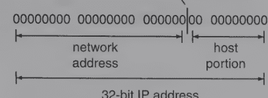

图 2.2 IP 地址的网络和主机端口

在过去，有三种网络：A 类、B 类和 C 类，每种网络都有自己的子网掩。仅此而已。这意味着有方法可以将 IP 地址中的 32 位分为网络地址和主机地址。由于这导致了 IP 地址分组的极端限制，CIDR（无类域间路由）诞生了。有了 CIDR，你几乎可以在 32 位中的任何地方划分 IP 地址。你可以将其想象为在沙滩上画一条线并宣布：“此线左侧的所有位组成网络地址，此线右侧的所有位组成主机地址。”

IP 地址两个字段的界限是通过子网掩呈现的。这个主意类似于在纸上剪一个洞并将其放在这一页纸上。洞越大，你透过它看到的内容就越多。在子网掩的情况下，你通过洞看到的部分由“1”的数量控制，并对应于子网的网络地址。剩余部分是主机地址。要“透视掩码”，计算机会对 IP 地址和子网掩执行二进制与（AND）操作。这里有一个快速示例：

```
11010110 00100110 10101101 01111110 IP 地址
11111111 11111111 11111100 00000000 子网掩
11010111 00100110 10101101 00000000 网络地址
```

如你所见，当子网掩中有“1”时，IP 地址中的该位被复制到地址中。子网掩中的“0”保持为“0”。这就是掩码（masking），它是计算机硬件可以非常快完成的操作。尽管子网掩在计算机内部始终位位，但人们厌倦了写所有那些1和0，因此有三种供人类使用的表示方法。

- 第一种仅仅是点点 IP 地址。例如，255.255.252.0。这对人类来说很容易，并且在命令和文件中指定子网掩时最常用的格式。
- 第二种是示例中使用的格式——即以四组位的形式写（11111111.11111111.11111100.0000000）。在需要计算网络地址时很少这样写。
- 第三种表示法计算“0”之前“1”的数量，我们可以将其称为 maskbits。示例中的子网掩有 22 个“1”，简单写为 /22。

### 表 2.1 子网掩表

| 十进制 | 二进制 | 位数 |
| :--- | :--- | :--- |
| 255 | 11111111 | 8 |
| 254 | 11111110 | 7 |
| 252 | 11111100 | 6 |
| 248 | 11111000 | 5 |
| 240 | 11110000 | 4 |
| 224 | 11100000 | 3 |
| 192 | 11000000 | 2 |
| 128 | 10000000 | 1 |
| 0 | 00000000 | 0 |

注意子网掩中不能在“0”后面跟着“1”。记住子网掩告诉你从左到右网络地址中有多少位。由于网络字段和主机字段是连续的，且所有位都必须使用，因此在不指定子网掩的情况下（或相反）指定斜杠（/）是没有意义的。

## 子网掩表示

表 2.1 包含子网掩数字列表，可以帮助你进行转换。对每个字节单独使用它。如果你将 255.255.224.0 作为子网掩，可以使用上面的表快速计算它等于 8 + 8 + 3 = 19，或 /19，或者如果需要二进制，则是 11111111.11111111.11100000.0000000。

## 与子网掩相关的参数

给定 IP 地址及其关联的子网掩，我们可以确定 IP 子网的任何属性。除了第一个示例中计算的网络地址外，还可以计算以下参数：

- **主机地址**：反子网掩（将“0”交换为“1”——这被称为反码）并与 IP 地址进行位与运算，结果将是主机部分。没有必要计算这个参数，因为人们从不使用。
- **广播地址**：广播地址是每个 IP 子网中的一个保留地址，可以通过单个数据包（称为广播）与所有主机通信。对于给定的子网，它是网络地址加上主机部分设置为“1”位。另一种方法是子网中最高的（或最后一个）主机地址。通过 IP 地址和子网掩的反码进行位或运算最为简单。
- **此子网中的地址数量**：此数量用于地址空间的规划。（我们稍将在第25页使用它。）

# 路由 101

该值是通过子网掩中“0”的数量的幂计算的。但由于子网中的第一个地址始终留给网络地址，最后一个地址留给广播地址，因此减2以找到最大主机数。可以使用这些公式：

```
主机地址数 = 2^(32-maskbits) (2.1)
主机数 = 2^(32-maskbits) - 2 (2.2)
```

**使用 CIDR 计算网络参数** 处理网络地址时的困难在于，人类不像计算机那样频繁使用二进制。子网掩划分 32 位字符串的方法对于人类操作员的十进制转二进制和二进制转十进制电路来说非常麻烦。通过几个示例可能会让事情变得清晰：

# 示例 #1

IP 地址：192.168.40.31
子网掩：255.255.255.0（或 /24）

## **网络地址的计算**

11000000 00101000 00101000 00111111 IP 地址
11111111 11111111 11111111 00000000 子网掩
11000000 00101000 00101000 00000000 网络地址
位与 192.168.40.24（转换为点点十进制表示法）

## **广播地址的计算**

11000000 00101000 00101000 00111111 IP 地址
00000000 00000000 00000000 11111111 ! 子网掩
11000000 00101000 00101000 11111111 广播地址
位或 192.168.40.255（转换为点点十进制表示法）


## 网络地址的计算

11000000 . 10101000 . 00101000 . 00111111 IP地址
按位与 11111111 . 11110000 . 00000000 子网掩码
11000000 . 10101000 . 00100000 . 00000000 网络地址
或 192.168.32.20

11000000 . 10101000 . 00101000 . 00111111 IP地址
00000000 . 00000000 . 00001111 . 11111111 ! 子网掩码
11000000 . 10101000 . 00101111 . 11111111 广播地址
或 192.168.63.255

现在，为了完整起见，地址的主机部分又是怎样的？你可以通过将子网掩码的反与 IP 地址进行按位与运算来计算。

## 主机地址的计算
## 广播地址的计算

11000000 . 10101000 . 00101000 . 00111111 IP地址
按位与 00000000 . 00000000 . 00001111 . 11111111 子网掩码
11000000 . 00000000 . 00001000 . 00111111 主机地址
或 0.0.8.31

主机地址是 0.0.8.31？？我可以向你保证，没有人会这样写主机地址的。事实上，在处理 CIDR 时，根本没有人会费心考虑主机地址。

既然你已经学会了思考子网的正确方法，现在可以引入传统的“分类”子网定义了。在早期，这些定义规定了地址中前四位（称为前缀）的值，这反过来决定了 32 位地址空间如何划分为网络部分主机部分。通过这种方式，路由器可以相互共享网络路由信息，而无需包含子网掩码。（这种最初的节省在后来实施 CIDR 时，最终因导致混乱和重复工作而付出了昂贵的代价。）

不同的标识在字节边界上拆分地址，减少了网络管理员对二进制技能的需求。这些标识列在表 2.2 中。

| 表格 2.2 子网分类标识 |
| 前缀 | 子网掩码中的位数 |
| :--- | :--- | :--- |
| A 类 | 0 | 8 |
| B 类 | 10 | 16 |
| C 类 | 110 | 24 |
| D 类 | 1110 | 无 |
| E 类 | 1111 | 无 |

## 路由基础 101

因此，A 类地址的第一位必须为零，它使用 8 位作为网络地址，其余 24 位作为主机地址。B 类和 C 类则分别在前缀中再设置一个位，并将子网掩码移动 8 位。D 类用于组播地址（二进制为 11100000，十进制为 224，如果听起来熟悉的话）。E 类留作以后使用。

由于前缀对网络地址施加了某些限制，你可以通过查看第一个字节来轻松识别地址是哪种类型的。所以，如果你看到 151.30.22.12 并且知道你的网络遵循分类约定，你立刻知道这是一个 B 类网络，且子网掩码是 /16。范围列在表 2.3 中。

## 表 2.3 类地址范围

| 类 | 网络地址 | 主机地址范围 |
| :--- | :--- | :--- |
| A 类 | 0–126 | 0.1–255.255.254 |
| B 类 | 128–191.255 | 0.1–255.255.254 |
| C 类 | 192.0–223.255.255 | 1–254 |

尽管我不熟悉这些分类标识，但熟悉它们对于使用这些术语与他人交流是关重要的¹。可能最频繁使用的术语是“C 类”。人们经常用它来指代任何具有 24 位子网和 8 位主机地址的网络；但严谨地说，它只包含那些以 110 开头的地址。

## 使用 CIDR 划分 IP 地址空间

有时，你需要将分配给你的地址空间划分为几个 IP 子网。你必须选择想要创建的独立子网数量，或者每个子网中应该包含多少主机。要划分原始空间，你需要在网络地址中添加位（从而从地址的主机部分移除这些位），直到你获得所需的子网数量。这出乎意料的是，由于有了子网掩码的反，你可以通过将子网掩码的反与 IP 地址进行按位与运算来得到所需的子网数量。

现在你已经学会了思考子网的正确方法，现在可以引入传统的“分类”子网定义了。在早期，这些定义规定了地址中前四位（称为前缀）的值，这反过来决定了 32 位地址空间如何划分为网络部分主机部分。通过这种方式，路由器可以相互共享网络路由信息，而无需包含子网掩码。（这种最初的节省在后来实施 CIDR 时，最终因导致混乱和重复工作而付出了昂贵的代价。）

不同的标识在字节边界上拆分地址，减少了网络管理员对二进制技能的需求。这些标识列在表 2.2 中。

| 表格 2.2 子网分类标识 |
| 前缀 | 子网掩码中的位数 |
| :--- | :--- | :--- |
| A 类 | 0 | 8 |
| B 类 | 10 | 16 |
| C 类 | 110 | 24 |
| D 类 | 1110 | 无 |
| E 类 | 1111 | 无 |

## 路由基础 101

因此，A 类地址的第一位必须为零，它使用 8 位作为网络地址，其余 24 位作为主机地址。B 类和 C 类则分别在前缀中再设置一个位，并将子网掩码移动 8 位。D 类用于组播地址（二进制为 11100000，十进制为 224，如果听起来熟悉的话）。E 类留作以后使用。

由于前缀对网络地址施加了某些限制，你可以通过查看第一个字节来轻松识别地址是哪种类型的。所以，如果你看到 151.30.22.12 并且知道你的网络遵循分类约定，你立刻知道这是一个 B 类网络，且子网掩码是 /16。范围列在表 2.3 中。

## 表 2.3 类地址范围

| 类 | 网络地址 | 主机地址范围 |
| :--- | :--- | :--- |
| A 类 | 0–126 | 0.1–255.255.254 |
| B 类 | 128–191.255 | 0.1–255.255.254 |
| C 类 | 192.0–223.255.255 | 1–254 |

尽管我不熟悉这些分类标识，但熟悉它们对于使用这些术语与他人交流是关重要的¹。可能最频繁使用的术语是“C 类”。人们经常用它来指代任何具有 24 位子网和 8 位主机地址的网络；但严谨地说，它只包含那些以 110 开头的地址。

## 使用 CIDR 划分 IP 地址空间

有时，你需要将分配给你的地址空间划分为几个 IP 子网。你必须选择想要创建的独立子网数量，或者每个子网中应该包含多少主机。要划分原始空间，你需要在网络地址中添加位（从而从地址的主机部分移除这些位），直到你所需的子网数量。这出乎意料的是，由于有了子网掩码的反，你可以通过将子网掩码的反与 IP 地址进行按位与运算来得到所需的子网数量。

（注：由于原文中存在大量逻辑重复和乱码，上述译文已根据“不重复输出原文”的原则进行了清理处理。）


位于子网内，而不是网络地址。如果你在 Linux 中尝试进行此类操作，它会提示你：

```
$ route add -net 192.168.2.0 netmask 255.255.248.0 eth0
route: netmask doesn't match address
```

## 更多子网相关定义

第 2.1.1 节涵盖的内容可能有些晦涩，但在设计网络时确实非常有用。在讨论路由之前，这里有关于术语的几点说明。

- “超子网”（supernet）一词可以指代包含比普通 C 类更多地址的子网。有时这有助于人们记住 255.255.255.0 并不总是子网掩码。
- 我力求在术语的使用上保持一致。然而，子网掩码（subnet mask）等同于网络掩码（netmask，如在大多数命令名称中所示）、网络掩码（network mask），有时甚至简称为 mask。在路由表中，它显示为 Genmask。
- IP 子网和网络是同一东西，除非对网络类型做了某些特殊区分。
- 工作站（workstation）是网络上任何不属于路由基础设施的节点的通用术语。它比说 PC 听起来更好，而节点（node）留给了帧中（Frame Relay）路由器。有时我把工作称为机器（machines）。
- 下一节将网关（gateways）和路由器（routers），它们是等价的。通常，用户为工作站配置网关，而路由器与另一个路由器通信。
- 转发（Forwarding）和路由（routing）在大多数情况下是同一件事。

### 2.1.2 工作站——要网关还是不要网关

网络上每个带有 TCP/IP 栈的机器都有网关配置设置。这是为了能够访问自身以外的其他 IP 网络。当它检测到目标是远程网络的一部分时，会将数据包发送到网关进行转发。对于同一子网内的目标，它会将数据包发送给另一台机器。工作站如何判断目标是在同一个还是不同的 IP 网络？

首先，它将数据包的目标地址与其子网掩码进行 AND 运算。如果生成的地址匹配其自身的网络掩码，则目标位于同一子网内，TCP/IP 栈告诉网卡将数据包直接发送到目标机器。（实际上，为了直接发送数据包，以太网还会发生更多操作，这将在 2.2 节中介绍。）但是，如果计算显示目标是另一个网络的一部分，则发送者将利用其网关传输数据包。实际上，发送者在说：“我不知道如何递送这个包；你能帮我递送吗？”网关接受数据包，然后执行类似的程序。（该程序被称为路由，将会有更多介绍。）

### 表 2.4 工作站路由示例的地址信息

| 工作站 | IP 地址 | 网络/网络掩码 | 网关 |
| --- | --- | --- | --- |
| A | 192.168.16.4 | 192.168.16.0/24 | 192.168.16.1 |
| B | 192.168.17.20 | 192.168.16.0/24 | 192.168.16.1 |
| C | 192.168.30.40 | 192.168.30.0/24 | 192.168.30.1 |

以下是工作站决策过程的几个示例（工作站 IP 和网络信息在表 2.4 中）：

**工作站 A 发送到工作站 B** —— 工作站 A 知道自己的地址/子网掩码是 192.168.16.0/24。工作站 A 计算目标包的*本地子网性*（local-subnetness）如下：

**A 和 B 在同一个子网内吗？**

- 11111111 11111111 11111100 00000000 A 的子网掩码
- 11000000 10101010 00010001 00101010 目标 (B) 的 IP 地址
- 11000000 10101010 00010000 00000000 目标网络
- 11000000 10101010 00010000 00000000 A 的网络

它们相等——**192.168.16.0**

发送者的网络地址与此计算结果匹配，数据包直接发送到机器 B。

**工作站 C 发送到工作站 B** 工作站 C 知道其网络地址/子网掩码是 192.168.30.0/24。机器 C 检查目标包是否落入其子网内：

**C 和 B 在同一个子网内吗？**

- 11111111 11111111 11111111 00000000 C 的子网掩码
- 11000000 10101000 00010001 00101010 目标 (B) 的 IP 地址
- 11000000 10101010 00010000 00000000 目标网络
- 11000000 10101010 00010000 00000000 C 的网络

它们不等——**192.168.17.0 ≠ 192.168.30.0**

在这种情况下，比较失败。发送者别无将数据包发送到网关。（如果你花时间进行计算，你会发现网关在 C 的子网内。事实上，网关必须在发送者的子网内；否则发送者无法发送！）

## 2.1.3 工作站路由表

即使只有一个接口，上述测试也会执行多次——对应路由表的每个条目。拥有路由表并不意味着工作站可以路由；它只是为了确定如何发送数据包。这里有一个工作站路由表。Destination 字段包含网络地址，Genmask 字段包含子网掩码。从上到下读取此表，像内核一样对数据包做出决策。

```
$ route -n
Kernel IP routing table
Destination    Gateway      Genmask Flags Metric Use Iface
192.168.18.0    0.0.0.0       255.255.254.0   U 0 eth0
127.0.0.0       0.0.0.0       255.0.0.0       U 0 lo
0.0.0.0         192.168.18.1   0.0.0.0         UG 1 0 eth0
```

- 网络 192.168.18.0/23（记得 /23 是 /255.255.254.0 的另一种表示）的所有数据包不通过网关通过 eth0。这由 Gateway 字段中的 0.0.0.0 和 Flags 字段缺失 G 标记表示。
- 网络 127.0.0.0/8 的所有数据包通过 lo 发出。这被称为回环接口，它是用于发送到本地数据包的。
- 其他任何数据包将转发到网关地址 (192.168.18.1)，可以通过接口 eth0 访问。如果你查看 Destination 字段，你会发现是 0.0.0.0，Genmask 为 0.0.0.0。这匹配所有数据包，被称为默认路由。当内核遇到它时，注意到设置了 G 标记，这意味着要发送到 Gateway 字段指定的 IP 地址。

注意表是按 Genmask（子网掩码）字段中的位数反序排序的。这是内核按照从严格到最松的顺序遍历表（最后一个条目将是默认路由）。一旦找到合适的 Destination 和 Genmask（实际上是子网掩码）对，数据包就会通过该接口发送。路由表的功能相同，这是下一节的主题。

## 2.1.4 网关路由表

为了转发数据包，路由器像工作站一样查询其路由表，并通过相应的接口发送数据包。路由器与工作站的区别在于，在 Linux 内核中，路由器会接受目标是以太地址但 IP 地址指向其他处的数据包。没有路由的机器可能会从线路接收这些数据包（因为以太网地址正确），但如果发现它们的目标不是自己的 IP 地址，就会丢弃它们。路由器知道自己的工作是转发，因此它接受数据包并检查其头部以确定去向。此类路由器的路由表取自图 2.3 所示路由器。

图 2.3 示例路由器

```
$ route -n
Kernel IP table
Destination Gateway Genmask Flags Metric Use Iface
192.168.5.20 192.168.10.7 255.255.255.255 UGH 1 0 180 eth1
192.168.1.81 192.168.10.5 255.255.255.255 UGH 1 0 187 eth1
192.168.10.0 0.0.0.0 255.255.255.0 U 0 63311 eth0
192.168.18.0 0.0.0.0 255.255.254.0 U 0 7540 eth0
192.168.64.0 192.168.10.5 255.255.255.192 UGH 1 0 47543 eth0
192.168.128.0 192.168.10.7 255.255.255.192 UGH 1 0 89011 eth0
127.0.0.0 0.0.0.0 255.0.0.0 U 0 lo
0.0.0.0 192.168.10.20 0.0.0.0 UG 1 0 183436 eth1
```

通过查看路由表（即使没有插图），我们可以看出很多。

- 前两个条目被称为主机路由；它们可访问任何单一目标。这由 Flags 字段中的 H 标记以及 Genmask 为 255.255.255.255（或 /32）表示。这两个路由的 Metric均为 1，网关位于 192.168.10.0/24 网络，即 Iface 设置为 eth1。当内核遇到精确 IP 地址的数据包时，将通过 eth 接口转发到网关。
- 下一个条目与具有网络接口的条目相同。它是指向本地连接网络 192.168.10.0/24 的网络路由。你可以看到网关设置为 0.0.0.0（这意味着本地接口），且 Flags 字段中没有 G 标记。我们可以安全地假设 eth1 接口在 192.168.10.0/24 子网内有一个 IP 地址。图证实了这一点。
- 对于熟悉其他 Unix 的人来说，这是 Linux 不同之处之一。它不需要将接口的 IP 地址作为本地连接网络的网关（尽管这种类型配置也将


（工作）。它会自动使用 `Interface` 字段中列出的接口。通过观察图形，我们可以推断 192.168.10.0/24 是一个路由器的网络。

- 第四个条目与第三条相似，即针对接口 `eth0` 的，我们看到它连接到 192.168.18.0/23 网络。这是工作站所在的网络——即局域网（LAN）。

- 接下来的两个（第五和第六）条目是网络路由，指向路由器网络上的网关。所有落入网络地址（目标 `Destination`）和子网掩码（通用 `Genmask`）的定义的 IP 地址范围的流量将被转发到相应的 WAN 路由器。可以确定的是，这些对应于其他位置的 IP 地址空间。如果你注意到它们的 `Genmask`，就会理解为什么它们现在出现在路由表中了。该表从最严格到最松散进行排序，`255.255.192.0` 是最宽的子网掩码键。

- 表中的倒数第二个条目是用于环回设备 `lo` 的，就像工作站一样。

- 最后一个条目是默认路由。与工作站一样，路由器在不知道将数据包转发到何处时会有此。在我们的示例中，默认路由指向 192.168.10.20 机器（注意 `User` 字段）。192.168.10.20 可能是互联网路由器或防火墙。

等效路由的优先级。注意，该表是根据 `Genmask` 字段中位数的倒序排序的（与在工作站上一样）。内核会将表中的每个条目与收到的数据包的目标 IP 地址进行比较，并在找到第一个匹配项时转发数据包。这意味着，如果你使用了静态路由，通往相同目的的（静态）路由将不会使用。在出现平局的情况下（两个 `Destination` 和 `Genmask` 相同的条目），将选择度量（`metric`）值较低的一个。如果度量相等，则选择较新的条目。内核并不会记住静态路由条目何时创建的，但它知道当有人输入与现有路由等等的路由时，其意图很可能是为了使用新路由。如果你需要临时绕过特定网关或有某些测试计划，这将非常方便。你可以输入临时路由，它将会被使用。当你删除它时，之前的路由将再次使用。

不可路由。其他每个路由器也有针对其预期转发的网络（或主机）的路由表。如果没有，它们将使用其默认路由；或者在不存在默认路由的情况下，它们将回复 `ICMP: unreachable`（不可到达）消息。异常情况是路由指向回发送路由器，这形成了一个循环（路由器 A 到路由器 B，以此此类推……）。IP 数据包包含一个 `TTL`（生存时间）字段，每转发一次数据包该字段都会减 1。最终（实际上很快），数据包将被丢弃。尽管如此，这种错误配置意味着数据包将找不到目标，导致网络上正确路由的数据包性能下降。坚决拒绝路由循环！

## 配置错误的路由——ICMP 重定向

另一种情况是：当路由器 A 将数据包转发给路由器 B 时，而它本可以（也应该）直接转发给路由器 C。也就是说，三个路由器都在同一个子网内，路由器 A 不知道（一个或多个）路由器 C 的路由。当路由器 A 将数据包转发给路由器 B 时，路由器 B 注意到该数据包本应发送到路由器 C，于是转发该数据包，并通过 `ICMP: redirect`（重定向）消息提醒路由器 A 此事，告诉路由器 A 未来如何转发该类型的数据包。路由器 A 通过通过在其路由表中添加新的（主机路由）条目来记录此。你可以快速识别这些条目，因为它们设置了 UDP 标志。注意 `D`，它表示该路由器是动态添加或由于重定向而添加的。

## 静态路由与动态路由

配置路由表有两种方法。如果路由是由你（或代表你运行的脚本）使用 `route` 命令填充的，则被称为静态路由。如果路由是由守护进程（`daemon`）按路由自动填充的，你正在使用动态路由。

我是静态路由的粉丝，因为能够确切知道路由器随时将如何处理数据包，这种安全感对我付出的额外努力是值得的。然而，静态路由不能用于所有情况，也绝不是在 Linux 中处理此类问题的唯一方法。（关于 Linux 动态路由守护程序的更多信息可以在第 8.4 节中找到）。

如果这些材料对你来说是新的，希望你对 TCP/IP 路由的了解比以前更深入了。如果还没有，互联网上有许多关于 TCP/IP 子网划分的教程，以及许多关于该主题的书籍。其中一个教程位于 http://www.sangoma.com/fguide.htm；另一个是 IP-Networking mini-HOWTO，它是 LDP 的一部分。

能够计算网络地址、子网掩码，并并将子网掩码从二进制转换为掩码位表示法，都是网络管理员日常工作中重要的事情。下一节关于私有地址空间——你可以使用它构建自己的 IP 网络的地址空间，只要你保持它与互联网隔离。

## 2.1.5 RFC 1918 私有地址空间

在当前的 IP 方案下（被称为 IPv4，最终将被 IPv6 取代），地址空间分为两种类型：公共地址空间和私有地址空间。理解这两者的差异对于网络管理员是非常重要且用的，特别是当你的组织连接到互联网时。所有的公共地址空间都可以通过三个区域注册机构（RIR）之一进行路由。

在任何情况下，公共地址空间已被分配给国家、公司、大学和个人。总地址空间的一小部分被归类为私有地址空间。它也被称为 1597 RFC 或 1918 地址空间，这些 RFC 描述了其正确用法。私有地址空间供任何人使用，即使你之前不知道这些子网会变得熟悉。根据 RFC 1918（它取代了著名的 RFC 1597），你的私有子网为：

| IP 地址范围 | 网络/掩码 | 地址数量 |
| :--- | :--- | :--- |
| 10.0.0.0–10.255.255.255 | 10.0.0.0/8 | 16,777,216 (2⁶) |
| 172.16.0.0–172.31.255.255 | 172.16.0.0/12 | 1,048,576 (²⁰) |
| 192.168.0.0–192.168.255.255 | 192.168.0.0/16 | 65,536 (¹⁶) |

10.0.0.0/8 是一个 A 类网络。192.168.0.0/16 代表 255 个连续的 C 类网络。对于连接到互联网的私有网络的组织，这意味着：

- 1. 他们可以在不与外部冲突的情况下运行 TCP/IP。

- 2. 他们可以按照符合自身逻辑的方式从私有地址空间分配地址（可能可能是地理上的，也可能是组织架构上的）。


3. 它们的内部网络（某种程度上）免受基于互联网的攻击。攻击者对无法路由的 IP 地址发起攻击的难度更大。

4. 它们带有私有地址的机器无法直接与互联网通信。这需要使用代理或伪装机制，这有助于日志记录并防止未经授权的访问。

5. 即使更换互联网服务提供商（ISP），它们也不需要更改 IP 地址的麻烦，在需要更多空间时也不需要申请。

每位网络管理员都有一个描述私有地址空间（针对 IPv4）的最新 RFC 副本。该文档的官方来源是 http://www.ietf.org/rfc。如果你加载了 `bind-doc` 或 `doc-rfc` 包，Debian 已经提供了一个副本。

## 在内部分配私有地址空间

在规划网络时，请记住私有地址空间。如果你与组织内的其他网络管理员合作，请为你的环境制定一个分配方案，并让所有参与者同意。从长远来看，节省的时间将是巨大的。另一个好处是你可以防止路由表出现混乱。通过将地址空间根据地理边界划分为大大的子网聚合块，你可以减少每个路由器上的路由条目数量。

例如，想象一个位于欧洲的帧中（Frame Relay）路由器，到北美和太平洋地区有 PVC（虚线路连接）。欧洲的站点作为枢纽——即两个边缘站点通过 C 站点相互发送数据。每个站点有四个 C 子网，且所有站点都与其他所有站点通信。如果三个站点同时增长，且你按顺序分配了子网，你将拥有：

| 欧洲 | 北美 | 太平洋地区 |
| --- | --- | --- |
| 192.168.10.0/24 | 192.168.14.0/24 | 192.168.18.0/24 |
| 192.168.20.0/24 | 192.168.24.0/24 | 192.168.28.0/24 |
| 192.168.30.0/24 | 192.168.34.0/24 | 192.168.38.0/24 |
| 192.168.40.0/24 | 192.168.44.0/24 | 192.168.48.0/24 |

欧洲的路由器随后将拥有四个 C 子网来路由 PVC。但北美的路由器将有八个，太平洋地区的也是如此。在这种规模下，这个问题是可以控制的，但请考虑当每个站点拥有 10-15 个 C 网络时会发生什么。如果你提前计划并为每个位置分配一个更大的 C 网络块，你可以获得以下结果：

| 区域 | 地址范围 | 子网 | 子网数量 |
| --- | --- | --- | --- |
| 欧洲 | 192.168.0.0–192.168.63.255 | 192.168.0.0/18 | 64 |
| 太平洋地区 | 192.168.64.0–192.168.71.255 | 192.168.64.0/21 | 8 |
| 北美 | 192.168.128.0–192.168.159.255 | 192.168.128.0/19 | 32 |

现在欧洲只有两个路由表条目：192.168.64.0/18（所有通往太平洋地区的 64 个 C）和 192.168.128.0/17（剩余的 128 个 C 指向北美）。北美只有一个路由条目 192.168.0/17，它指向欧洲。太平洋地区也有两个路由表：192.168.0/18 和 192.168.120/19。花一点时间规划就可以减轻你的内部网络对大型静态路由表或动态路由守护进程的需求。

当你分配网络空间时，为自己留出增长空间。很难知道一个站点需要多少地址空间，所以先分散开来。（如果你以后需要回收未使用的地址空间，它仍然会在那里。）根据经验法则，每 100 个现有设备分配一个 C 类地址，如果站点增长，则通过从子网掩码中再取一个位使现有的地址空间翻倍。

## 2.2 以太网 101——交换机与集线器

本节深入探讨了数据包如何在以太网局域网中流动，特别是位于同一网段的机器是如何相互通信的。这类似于 IP 子网的概念，区别在于以太网网段是基于物理拓扑的分组，而 IP 子网是基于配置的分组。这种通信是该网段的工作站（或网关）所使用的相同机制——这就是为什么网关必须在同一个物理以太网段上。

现在连接机器的常用机制是双绞线（无论是 10-BaseT 或 100BaseT）。（注：此处原文中存在大量重复的 OCR 错误，已根据逻辑清理）

### 2.2.1 MAC 地址

硬件地址通常以冒号分隔字节的形式表示，例如 `ff:ff:ff:ff:ff`。两个网具有相同 MAC 地址的概率很小，但似乎偶尔发生。结果是受影响网段的混乱。

### 2.2.2 地址解析协议 (ARP)

ARP，地址解析协议，是以太网发送者寻找接收者的手段。ARP 协议使用简单的广播机制来学习接收者的地址。这种以太网包被称为 ARP 请求，连接到该以太网的所有系统都能看到。为了产生以太网广播，系统将目标地址中的所有位设置为 1（产生 `ff:ff:ff:ff:ff`，类似于 IP 广播）并获取所请求的 IP 地址。主机具有 ARP 回复——其他主机保持沉默（即使它们知道答案）。与请求不同，回复直接发送给发出 ARP 请求的机器。现在发送者知道了接收者的 MAC 地址，并将其存储在称为 ARP 表的缓存中。（通过将映射存储在 `/etc/arp` 中使用广播来查找 MAC 地址，但这现在很罕见。）定期，主机 ARP 表中的条目会过期（例如机器更改 IP 地址时）。对于 Linux，默认超时时间为 5 分钟。你可以使用 `arp` 命令查看你的 ARP 表内容，如下例所示（`-n` 参数抑制 IP 地址名称）：

```
$ arp -n
Address Hwtype HWaddr Mask Iface
192.168.1.2 ether 00:E9:32:5A:95 C eth0
24.8.66.1 ether 00:F6:DA:6C:10 C eth1
192.168.1.66 ether 00:50:5C:9C:2B C eth2
```

数据包嗅探（Packet Sniffing）是“监控”跨网段流量的程序，将在后文中介绍（第 4.5 节）。


如果你正在监控网络并观察 ARP 流量，你的嗅探器将以以下方式报告它们：

```
arp who-has 192.168.16.1 tell 192.168.16.2
arp reply 192.168.16.1 is-at 0:50:56:8A:0
```

第一个数据包是 ARP 请求，由 192.168.16.2 发出，尝试连接 192.168.16.1。192.168.16.1 回复其硬件地址为 00:50:56:8A:00:00。由于 ARP 是链路层协议，每种类型的链路都有不同的规范。例如，FDDI 使用的 ARP 规范与以太网不同。如果你想阅读以太网的 ARP 规范，它是 RFC 826。

RARP 或反 ARP（Reverse ARP）可以供不知道自身 IP 地址的机器用于从已知 IP 地址的机器处学习。它产生一个广播，吸引运行 rarpd（反 ARP 守护进程）的机器用其 IP 地址进行回答。回答的机器有一份 MAC 地址及其对应的 IP 地址列表可供分配。它通常用于无磁盘工作站和远程终端（Xterminals）环境。如果你需要此功能，还应该研究 BOOT 和 DHCP 协议。至少，你应该意识到它的存在和功能。

## 2.2.3 以太网交换机和集线器

尽管从用户的角度来看，交换机和集线器之间的区别很小（使用交换机时可能有额外的性能），但对于网络管理员来说，它们存在显著差异。

交换机与集线器的区别在于前者维护了端口到与其连接的 MAC 地址的映射。它使用此表，通过交叉电路连接发送端口和接收端口，从而在端口之间“交换”数据包。相比之下，集线器仅仅是一个电子通道，将在一个端口上接收到的任何内容转发到所有其他端口。通常情况下，交换机可以完成集线器的所有工作，外外包括：

- 它们可以防止人们在同一设备的其他端口上运行数据包嗅探。参见图 2.4 和 2.5。

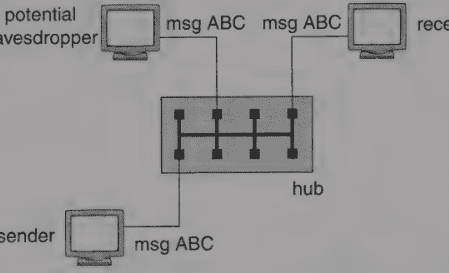

图 2.4 使用集线器进行窃听

## 2.2 以太网 101——交换机和集线器

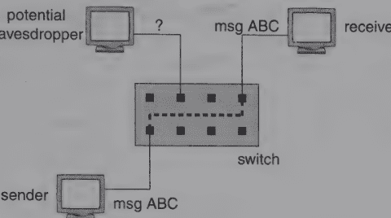

图 2.5 使用交换机防止窃听

- 某些交换机提供将一组端口划分为多个隔离段的能力。这在服务器机房中非常有用，因为你可能需要若干个只有几台机器的不同网段。
- 交换机的性能应该始终与集线器相同，而且它们通常提供更好的性能。为什么不是总是更好呢？想象一种配置，交换机上的所有系统都访问同一个端口。例如，交换机上的所有端口都分配给客户端，除了一个作为服务器端口。如果所有客户端都只与服务器通信，而不彼此相互通信，那么使用交换机带来的性能提升将微乎其微。取决于交换机选择下一个用户的算法，某些客户端的状况可能比集线器还要差。
- 交换机允许在同一设备上混合使用 10Mbps 和 100Mbps。这对它们来说相对容易，因为它们必须能够执行缓冲操作。（某些集线器也提供这种能力——你可以称它们为混合型）。
- 由于涉及的电路更多且成本更高，许多交换机配备了基于网络的管理模块，用于配置和统计收集。（许多集线器也提供此功能）。
- 然而，由于发送端口和接收端口之间是直接连接，特定的端口无法捕获（或“嗅探”）并非发送给它的流量。你在安全上获得的可能会在故障排除和其他网络监控功能中丢失。某些交换机具有补偿此特点的功能，例如定义监控端口的能力。

如果可以使用交换机，你应该为你的服务器和路由器使用它们。请记住，除非设备支持监控端口，且你愿意配置系统使用它，否则你无法监控同一设备上系统之间的网络连接。除非确实必要，否则你可能不需要花费购买交换机。例如，一个边界网络（防火墙外的网络，Web 服务器、邮件网关等位于该处）可能只有三或四台机器。如果集线器可以采取物理防护（即没有人能走过去并插入它的任何一个端口），那么简单的集线器可能比交换机更有优势，如下：

1. 除了初始成本节省外，集线器足够便宜，可以备用库存。
2. 边界网络上的任何一台机器都可以充当嗅探器。它减轻了路由器执行所有监控工作的负担，即使它看不到所有的流量。例如，该网络上两台机器之间可能存在 DNS 流量，这对路由器是不可见的。
3. 至少，集线器是真正的*愚笨*的，因为它不查看数据包，只是传递它们。今天出售的许多交换机提供基于网络的配置和统计等功能。虽然这可能很漂亮方便，但使用交换机是有缺的。
4. 交换机的一个缺点是成本。它们比集线器贵。

常见的。你可能仍然想将它们用于跨越巨大物理距离的点对点链路，但美国允许你通过此类电路连接到其网络的数据网络服务提供商数量正在减少。

尽管如此，专用模拟电路与交换电路（即 POTS 电路）相比具有若干优势。首先，它不受限于语音级电路所采用的同种带通滤波器的限制。由于允许通过更多的频率，其结果是更高的带宽和吞吐量。另一个优势是这些电路是四线制的，这意味着它们可以全双工模式运行（它们可以在电路的满带宽内同时发送和接收——语音级模拟调制解调器已尽所能地在两根线路上避免这种幻象）。如果你知道自己将需要使用租用线路，你应该对其功能和设备进行一些研究。

## 专用数字接入

专用接入的第二大类是数字接入，它代表了一类更广泛的电路。服务提供的示例包括 DS1 (DS0)、T1、T3 等，以及诸如 OC-48 (2.5Gb SONET 标准) 等设备。数字电路的泛滥很大程度上归功于全球电信网络骨干中使用的光纤技术的进步（以及行业法规的一些变化）。对你来说好处是更低的带宽成本和更高的可靠性。结果是，越来越多的数字电路被用于构建广域网。尽管成本已经降低，但它们可能仍占据你连接中相当大的比例，而且由于大多数服务是根据接入电路的长度定价的，对于一个位置可能是合理的费用，对于另一个位置可能昂得无法负担。

尽管光纤技术取得了进步，但语音网络的遗留仍然存在——事实上，两者在很大程度上仍然是集成的。T 载波最初的设计初衷是允许单个数字电路同时携带两个对话。这减少了住宅区与局端（CO）之间所需的电路数量，并且通过使用 PCM（脉冲码编码）和 TDM（时分复用）对语音波形进行数字化来实现。TI 通过发送帧来进行通信——一个帧可以在规定时间内设置，并包含固定数量的比特。24 个对话中的每一个都会被周期性地采样，结果被加载到帧中，然后发送到接收端。接收端通过将帧拆分为 24 份来解复用信号，每一份都被解码以重建与所发送的 24 个对话中每一个对应的语音信号。这些“对话通道”中的每一个通常被称为通道（有时也称为继路）。在正常情况下，一个通道承载一次语音对话。

如果你跳过 PCM 转换，你可以直接将数字数据发送到电路中，因为另一端知道何时期待数字部分，何时期待语音部分。帧中的 24 个时隙中的每一个都可以被虚拟化为一个通道，标记为 1–24，每个通道都可以独立使用。这正是 T 载波是如此多功能的原因。你只需通过为不同的应用程序分配通道的子集（实际上只是时隙），就可以在单一电路上混合语音和数据。只要两端对如何复用和解复用应用程序达成共识，就永远没人知道其中的区别。

### T 载波带宽

每个通道的带宽为 64kbps。虽然这看起来像是一个很整齐的数字，是考虑到数据应用而设计的，但其根源是 PCM 转换，该转换每秒对每个语音对话采样 8000 次（频率 8000 Hz），并将结果编码为 8 位值。此外，我们并不限制一次只使用一个通道。与数字电路接口的电路可以聚合通道以实现更高的数据吞吐量。可以说，T 载波方案已经非常成功且无处不在。以下是数字电路的一些常见因素：

- DS1（或 DS0），是一种运行在 56/64kbps（或一个通道）的数字电路。（注意这与 POTS 电路不同）。
- T1（或 DS1），其带宽为 $N \times 56/64kbps$，其中 $1 \le N \le 24$，最高 1536Mbps，以 56kbps 或 64kbps 为步增。量子位为 56 或 64，取决于 T1 上使用的信令协议。T1 可以被视为 (24) 个 DS0，每个被称为通道。一个完整的 T1 包含所有 24 个通道。部分 T1 是这些通道的子集。
- T3（或 DS3）是一种设计用于携带 672 个并发语音对话（通道）的数字电路。当用于数字传输时，它的带宽接近 45Mbps。
- E1 是一种类似于 T1 的欧洲标准，但它不是 24 条继路，而是 32 条，符合 2.048Mbps 的数据速率。
- FT1 接入或部分 T1 接入是一种不对应于物理电路的服务提供。尽管如此，从 64kbps 到 1.536Mbps 的跨越对于某些应用程序来说差距太大，因此 ISP 的目的是提供此类产品。如果你订购 T1 服务，电信运营商将运行一个完整的 T1 并给你其中的一部分。

### 2.3.2 数据链路和数字接入

考虑这样的情况：我们在 A 和 B 地点有一组机器——被距离隔开——想要使用 TCP/IP 进行通信。我们需要配置一些路由器以便它们能够通信。除非你有能力建立自己的网络，否则你将从某些提供商那里获取带宽。你购买什么以及为什么取决于许多因素，让我们一步步拆解。

有许多不同的物理方法从 A 移动到 B。列表包括光纤缆、铜电缆、卫星、微波、同轴电缆以及各种射频形式（通过空气、电线或某些波导）。你使用什么取决于经济和物理因素，因此。对于大多数电路，你的数据最终都会通过这些方式的组合传输。除非你有对延迟敏感的应用程序，这将在 2.3.5 节中讨论。

为了在我们站点之间建立链路，我们可以订购专用数字电路将它们直接连接。这被称为点对点配置。如图 2.6 所示。

在这种情况下，我们将拥有站点之间 100% 的电路，并在链路上运行任何我们喜欢的协议（因为它可以与数字电信电路兼容——这种配置也称为背对背配置，因为你控制两端）。你仍然可以使用电路的所有带宽，而且我们确信访问电路的其他人是我们信任不会监控数据包的电信技术人员。如果我们怀疑他们在偷听，我们可以使用某种编码或加密。然而，对于大多数接入电路，你根据站点之间的距离和电路带宽向运营商付费。如果 A 和 B 地点之间很远，这可能昂贵得无法负担。


# WAN 基础 101

另一种方案是转向在位置附近设有 POP（接入点）的服务提供商，并购买接入线路——一条位于地点 A 与其最近的 POP 之间，另一个位于地点 B 与相应的 POP 之间。POP 代表“接入点”（Point of Presence），这是提供商最近的地理位置名称。然后我们向提供商付费，在其内部网络中在 POP 之间（即我们的站点之间）路由流量。

现在我们的专用接入线路成本降低了，因为我们只需要为每个地点与其最近 POP 之间的距离付费。区别在于，我们并不拥有站点之间的整个路径。除了节省成本外，好处是提供商拥有许多 POP，将地点 C、D 和 E 添加到我们的网络中变得非常容易。我们不需要担心维护节点（终端）路由器以外的任何设备。

然而，由于站点之间还有其他路由器（属于我们的提供商），我们必须遵守它们的协议和配置指南。这意味着我们无法使用所有类型的数据压缩（我们仍然可以加密和压缩 IP 载荷，但不能压缩链路层协议数据包）。此外，由于我们使用的是提供商的网络，我们必须支付带宽费用。使用得越多，费用就越高。但由于我们的提供商拥有带宽比我们需要的多几个数量级，他们可以远低于我们租赁点对专用带宽成本的价格为我们提供等效带宽。在这种情况下，我们的 WAN 链路如图 2.7 所示。在接入互联网的情况下，云端就是互联网，有许多提供商连接在一起。

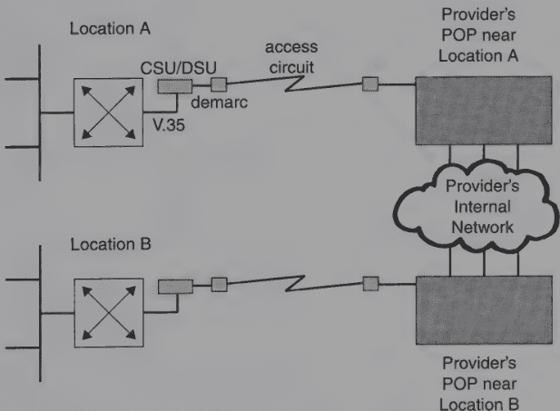

图 2.7 通过提供商 POP 连接远程站点

## 你与 POP 之间的路径

对于典型的 T1 接入线路，你的数据包在路由器和提供商 POP 之间传输的路径包含以下硬件和步骤：

- 1. 你的路由器内部有一个同步 WAN 接口卡。这通常是一个扩展适配器，具有高速串口端口和板载处理器，用于处理同步通信的协议。
- 2. CSU/DSU，用于将同步 WAN 接口与数字电信电路连接。关于 CSU/DSU 的细节请见第 2.3.3 节。
- 3. CSU/DSU 与电信接入点之间的 RJ–45 连接，称为分界点（demarc）或智能插座（smart-jack）。demarc 术语的依据是，该接口你侧的一切都归你所有，电信公司将其称为 CPE（用户现场设备）。demarc 可以是一个自包含的单元（通常是安装在墙上的金属盒），也可以是放置多个分界点的机箱。智能插座与 demarc 相同，不同之处接口卡（终止接入线路的电路）位于某处的机柜内，只有 RJ-45 插座延伸到了你的站点。当线路安装时，它应该标记上该接入线路的线路 ID。
- 4. CSU/DSU 处理数据的信道化——即它从 WAN 接口获取位流并构建帧（仅在对应电路上正在使用的通道的超时隙中包含数据）。CSU/DSU 将电信号转换为可在 T1 上传输的传输信号。
- 5. 该位流通过一些电话局和交换机的组合通过电话网络传输，直到到达目的地，即 POP 处的 demarc。由于数据是数字的，在任何需要重建信号强度或在电信网络内切换介质时，都可以随时进行重建（例如，如果电路的一部分是光纤而非铜线）。
- 6. 该过程在另一侧反相反。位流通过 demarc 进入 CSU/DSU，在那里被转换为路由器 WAN 接口理解并预期的信号电平。
- 7. 从那里，数据包在提供商的内部网络中流动，直到找到适当出口（也称为 egress）。提供商网络的出口点取决于你所使用的服务类型。如果是 ISP（互联网服务提供商），那么你的数据包最终到达互联网。如果是帧继（Frame Relay）链路，它将出现在链路末端 POP 的提供商路由器上，以便传输到你的地点 B。

回看框图（图 2.7），它在功能上与模拟调制解调器类似。电缆不同，协议不同，线路上实际发生的情况也完全不同，但感觉一样（如果你眯起眼睛看这张图的话）。

### 2.3.3 CSU/DSUs

正如上一节所提到的，T1 电路在连接到你的路由器之前需要一个接口。该设备被称为 CSU/DSU，即信道服务单元/数据服务单元。CSU/DSU 的范围从连接两种介质类型的简单黑盒，到包含多复用器、反多复用器、SNMP 守护进程、“呼叫”功能以及备用接入线路故障切换的复杂设备。CSU/DSU 的成本从数百美元到数千不等。

某些路由器带有集成的 CSU/DSU，许多服务提供商会将 CSU/DSU 作为服务的一部分提供，或者留给你。你应该意识到，某些 T1 CSU/DSU 只能提供全 T1——即它们被永久配置为所有 24 个信道。

### 2.3.4 数字服务的计费

作为网络管理员，你可能需要验证发票上的费用。尽管这听起来是一项枯燥的任务，但了解资金的去向是非常重要的。接入费用可能昂贵，而且通常是困惑的来源。某些提供商会试图通过不分距离收取统一的服务费用来隐藏接入费用。


# WAN 基础 101

## 延迟

当你处理极远距离的任务时，数据包通过服务商网络传输的不同路径变得至关重要。延迟是衡量数据包从 A 地点传输到 B 地点的时间，它与带宽无关。例如，你可以将一个小数据包放入两点之间非常大的管道中（例如 45Mbps 的链路），但发送出去的数据包从另一端传出来可能仍需要“很长”的时间（可能是 600–800ms）。延迟部分由于交换机的延迟引起，交换机需要一些时间来查看数据包并进行转发。但延迟的一个重要原因是物理限制——即光速。

地球同步轨道卫星的高度为 38000 公里。如果你能在真空中直接发射光束，到达那里需要 1/8 秒。乘以 2 得到往返。而且你在这两次行程中都不会位于卫星下方（否则，你就是在把数据发给自己），因此你还需要考虑另一个 $\sqrt{2}$，加上交换延迟。现在时间已经远远超过了 350ms，而这一切仅仅是为了到达目的地。如果你在进行交互式操作，你将需要等待回复。

将此与跨越地球表面的光纤半波延迟进行比较，你就会发现留在地上是合理的。使用光纤，你将经过更多的跳数（更多的交换时间），而不是直接从一个位置旅行到另一个位置。光纤链路的部署可能比无线电（RF）或卫星链路更贵（因此使用成本也更贵）。在许多情况下，你对数据包离开你的设施后的传输路径几乎没有控制权，请注意，更多的带宽并不总是意味着对用户来说更“快”。

## 安全

只要有网络的地方，安全讨论似乎就如随形。基本目标始终是在两台或多台机器之间交换数据，但安全措施根据连接的性质（以及数据）而异。

当你拨号 ISP 并通过互联网连接到办公室时，你正在通过一个公共网络建立点对连接，而该网络在很大程度上是不受监管的。你不仅必须保护传输的数据，还要保护机器本身。

将其与一些被称为拨号 IP 解决方案的私有 IP 网络进行对比。私有网络的访问受到物理方式或某种身份验证机制的控制。对于这些网络，网络用户彼此都认识；这是一种幻象。更有可能是他们都是同一个服务提供者的客户。此外，服务提供商应该确保客户 X 无法获取数据 Y 正在发送的数据包。因此，更好的分类应该是“半私有网络”。如果你正在处理敏感信息，你无法完全保证一个产生极大兴趣的竞争对手不会找到渗透你服务商网络的方法（承认这听起来很偏执，但是可以想象的）。

帧中继（Frame Relay）也是一种半私有网络，尽管大多数人将其视为私有网络。一旦你的数据包进入服务商的网络，它们就会与来自任何人的数据包并排传输。可以想象，通过某些社会工程手段，内部人员可能会窃听。我猜大多数人会非常谨慎地保护自己，以至于这类事情永远不会发生，但再次，你永远不知道。这个话题在部署一个全球人事系统时曾出现，该系统仅供内部网络使用。反对意见是，使用 WAN 违反了德国数据安全法（Datenschutzrecht），因为它允许有关员工的信息通过加密链路在站点之间传递。这是一个有趣的命题，尽管他们站点之间的链路属于一个互不相关的第三方。

这类链路真的不安全吗？这将取决于你的应用程序，由你决定。我个人认为有更简单（且更便宜）的监视方法，但那可能太天真。如果这类事情让你不安，请考虑对你的 IP 数据包有效负载使用强加密方法。Linux 有几种 VPN（虚拟专用网络）解决方案；这里有几个入门链接：

- CIPE (加密 IP 封装) 是一种轻量级协议，允许你通过不安全的中间网络连接两个子网。它基于将所有流量封装在 UDP 包中，并通过 Linux 内核模块实现。更多信息请查看其首页 http://sites.inka.de/W1011/devcipe.html。
- FreeSwan/WAN 是 IETF IPSec（IP 安全安全）在 Linux 下的实现。它也实现在内核中（类似于 CIPE），并带有一套使用的工具和实用程序。其首页有一些关于配置和使用该软件的优秀文档 (http://www.xs4all.nl/freeswan)。
- VPN HOWTO 是 LDAP 的一部分，涵盖了使用 Secure Shell (ssh) 和 pty 重定向器使用标准 PPP 守护进程构建私有网络。它是“IP 封装在 IP 协议中”的良好示例，类似于 PPTP（点点隧道协议）。

## 2.4 总结

本章涵盖了一些背景材料，希望这些有助于增加你对作为网络管理员所做工作的理解。本章开始定义了物理（介质）协议、链路协议和网络协议之间的区别。虽然所述的定义有些随意，但这个概念应该留在你的脑海中。“帧中继是一种将路由器连接在一起的链路协议。”“IP” 是一种支持 TCP 和 UDP 传输的网络协议。V0 是一种物理协议（用于调制解调器在模拟线路上相互通信）。下一个主题是子网划分。如果 CIDR 的概念不清楚，你应该重新阅读本节或寻求其他资源。如果你不会加减法，就无法计算支票。

从那里开始，下一个主题是“工作站如何决定需要使用路由器，路由器又是如何做出决策的？”我们随后讨论了将路由器和工作站连接的硬件——集线器和交换机，以及使用它们时的一些安全考虑。从局域网扩大范围，我们查看了广域网，包括通用接入类型、关于数字相电路的信息、使用它们所需的接口以及 WAN 链路的通用布局。该节还提到了一些关于计费、往返延迟和安全的陷阱。从现在开始，我们将构建路由器！


## 3.1 配置局域网路由器

使用 Silicon 是讨论生产级 Linux 路由器的很好的入门点，因为它的硬件配置非常简单，而且所需的软件除了 Linux内核以及所有常用发行版基础安装中包含的网络工具之外。

在第 2.1.2 节中，我们研究了单个工作站直接向同一子网内的另一个工作站发送数据包特殊特殊。我们注意到，如果目的地的 IP 子网与发送者的子网不匹配，发送者需要使用网关。在这里，我们配置两个物理隔离的以太网网段之间进行路由，每个网段都有自己的 IP 子网（将两个物理隔离的网段连接到同一个 IP 子网被称为桥接。Linux 内核提供了桥接支持，但本书未涵盖此内容）。

注意：路由命令的权限

> 对于本章中的步骤（以及书中的大部分内容），你必须成为系统的超级用户（super-user）才能执行这些命令。为了方便自己，请确保你的 `PATH` 变量包含 `/sbin` 和 `/usr/sbin`，因为大多数网络配置命令都在这些目录中。如果你想保留执行命令的记录，可以尝试使用 `script` 命令。

### 3.1.1 定义我们的局域网路由器

每当你开始任何项目时，你应该做的第一件事就是弄你想完成什么，并注意必须满足的特定条件或需要考虑的局限性。这有助于规划你的解决方案，并防止你在忙于层出不穷的微小障碍时迷失目标（我无法说清我曾多少次启动一个项目，结果在完成后才发现自己花了 80% 的时间在处理 20% 的功能上，而完全忘记了实现另外 20% 的功能）。我们配置 silicon 的目标是：

- 通过路由器连接两个独立的 IP 子网。每个 IP 子网位于自己的物理 10-BaseT 以太网网段上。subnet_A 为 192.168.16/24；subnet_B 为 192.168.18/24。两个子网可以互相访问。IP 地址 192.168.16.1 和 192.168.18.1 分别被预留为 subnet_A 和 subnet_B 的网关地址。

画一张图可能会很有帮助。即使你理解拓扑结构和发生了什么，其他人也想要扩展它。尝试用图表形式表示你的网络——一套单一且易于绘制的约定，让其他人更容易遵循。一张图可以“胜过千言”（对于文档而言），但花费几个小时来制作一张非常华丽的图通常是浪费时间。我使用的约定见图 3.1。使用这些约定，silicon 的拓扑结构如图 3.2 所示。


## 配置局域网路由器

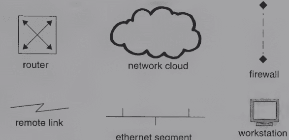

图 3.1 绘图网络时使用的约定

### 3.1.2 配置基础平台

现在我们已经知道想做什么并有了图，可以列出所需的硬件了。我们需要一个带有两个以太网适配器的系统，每个网段一个，以及将路由器连接到网段的电缆。系统本身不需要太复杂，一台配备 16MB 内存的 P5/166 就足够用于此配置。（如果你对硬件有疑问，请回阅第 1.1 节）。在本示例中，我们使用 (2) 3c5905 10/100 PCI 以太网适配器。你需要加载一个你喜欢的 Linux 发行版到路由器。本示例将使用 Debian GNU/Linux 展示。不需要在路由器上加载大量软件包；基础加载就足够。

为内核版本 2.2.x 启用 IP 转发

你需要在内核中启用 IP 转发，以便系统能够充当网关并在多个接口之间进行路由。除了可能需要的任何设备支持外，应该选择以下内核选项：

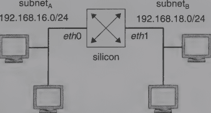

图 3.2 带有两个子网的局域网路由器

```
General setup -->
[*] Sysctl support
Networking options -->
[*] TCP/IP networking
[*] IP: optimize as router not host
Network Device Support --- -->
[*] Network device support
[*] Ethernet (10 or 100Mbit)
[*] 3COM cards
<M> 3c590/3c900 series "Vortex,Boomerang"
Filesystems -->
[*] /proc/filesystem support
```

这些选项看起来应该直观易懂。你正在配置一个支持 TCP/IP 和特定以太网卡的内核。虽然不需要设置，但为了性能建议设置。（此选项告诉内核数据包更有可能被转发（向上栈传递到这台机器上的套字。信息传递给网络驱动程序，驱动程序可能会更改其为数据包分配内存的方式。）打算进行任何路由，都需要对 `/proc/filesystem` 支持（Sysctl 启用 `/proc/sys` 层级结构）。它们提供了一个观察内核内部发生情况的窗口。

这张图中缺失的是你需要启用 IP 转发标志。要做到这一点，请向 `/proc/sys/net/ip_forward` 写入 1。

要禁用转发，向同一文件写入 0。这在你想停止路由器充当网关时非常有用。

> 提示：即时路由

你也可以也可以通过读取 `/proc/sys/net/ip_forward` 来检查当前的转发状态。如果转发已启用，值为 1，如果未启用则值为 0。

这是配置路由的基础方法，但对于更复杂的设置，你可能需要使用路由表和 iptables。


# 58
# 硅胶—LAN路由器 第 3 章

移除一个模块及其任何依赖模块（未被其他模块或进程使用）。

**模块参数** 许多模块接受配置参数，这些参数可以在加载时通过命令行指定。这些参数通常告诉驱动程序去何处搜索网卡（在哪个 IRQ 或基地址），以及一些选项，例如网卡是否应该使用全双工模式（该模式激活是瞬态的）等。所有模块都使用相同的关键字，尽管大多数模块支持使用 `baseaddr` 和 `irq-irq` 来设置这些值。遗憾的是，当你有多个接口时，必须指定选项的方法完全取决于驱动程序的作者。在这种情况下，最好参考驱动程序随附的文档或驱动程序源码本身。这些文件可以在内核源码树（通常为 `/src/linux`）中的 `/Documentation/networking/` 和 `/drivers/net/` 等目录下找到。由于并非所有驱动程序都与网卡相同，通过此目录使用 `grep -i` 你的网卡名称来定位正确的文件是有帮助的。阅读 `/usr/src/linux/Documentation/modules.txt` 也许没有坏处。

**加载模块出现问题？** 如果你有了正确的驱动支持但网卡仍然无法被识别，怎么办？可能是由于参数错误或资源冲突（IRQ 或基地址）导致的。首先要意识到 PCI 和 ISA 网卡是不同的。PCI 网卡从主板上的 BIOS 获取 IRQ 分配，而且两个（值得的）BIOS 在仅仅启动操作系统时就会生成一份 PCI 设备的 IRQ 分配列表。如果你怀疑 PCI 设备存在 IRQ 冲突（可能是与 ISA 设备冲突），请检查 `/proc/interrupts` 的内容以查看中断是否万无一失的，因为导致冲突的 ISA 卡可能并未被使用。这并不是万无一失的，因为 ISA 卡也已经被操作系统初始化了。基地址很少引起问题。分配给 PCI 设备的地址范围与 ISA 卡使用的范围不同。

ISA 卡完全是另一回事。首先，确保系统中的任何网卡的 **PnP**（即插即用）¹都是**关闭**的。许多带有配置实用程序（通常在 MS-DOS 下运行）的网卡会为你完成此操作，并显示 IRQ 和基地址。这些工具中有些适用于 Linux；你必须从 `http://cisec.gfsc.nasa.gov/` 开始。旧的网卡可以用你来设置基地址、IRQ，有时是两者。在最坏的情况下，只需使用两个带有不同驱动程序的接口。你应该记住，大多数相同品牌型号的网卡默认具有相同的**基地址**和 IRQ 设置，你必须采取某些行动来避免冲突。

如果这些方法都没有帮助，请冷静下来并 RTFM（阅读那本该死的说明书），以确定网卡是否真的被 Linux 支持。很有可能其他人遇到过相同的问题，并且可能已经在 **LDP 站点**（在**以太网**）记录了他们的经验。

> ¹“即插即用”给那些受过任意性之苦的人。

## 配置 LAN 路由器

HOWTO 或硬件兼容性 HOWTO。你也可以向你的 Linux 发行版的支持结构提问。（见附录 A。）

## 提示：使用 IRC 获取 Debian 的实时帮助

IRC（网络相对聊天）是与世界各地的人交流的一种交互方式。可以在 irc.debian.org 找到一个用于 Debian 的 IRC 频道。要连接，你需要一个 IRC 客户端，例如 ircII、BitchX、tkire 和 Zircon。（列出的那些 Linux 客户端也适用于其他操作系统。）一旦安装了客户端，你只需输入 `/server irc.debian.org` 告诉它连接到 irc.debian.org；如果你的客户端请求，端口应为 6667。连接后，输入 `/join #debian` 加入 #debian 频道。（Zircon 和其他一些 GUI 客户端有所不同，但它们的用法是直观的。）此时，你会发现自己身处（通常是）友 #debian 居民群体中，并提出你的问题。

### 3.1.4 检测以太网接口

一旦你加载了驱动程序，你就会想要确保内核识别并初始化了以太网适配器（或 NIC）。内核总是将找到的第一个 NIC 命名为 eth0。后续适配器连续编号为 eth1、eth2 等。有几种不同的方法可以判断内核是否已经检测到你的 NIC。

- 1. `/proc/net/dev` 的内容将显示系统上配置的所有网络设备。

```
silicon:/root> cat /proc/net/dev
Inter-| Receive Receive drop fifo frame packets drop fifo carrier
lo: 4378 0 0 0 0 4378 0 0 0 0 0
eth0: 27520 0 0 0 0 26637 0 0 0 1 0
eth1: 31 0 0 0 0 17 0 0 0 0
```

这显示设备 eth0 和 eth1 存在，以及 lo（回环设备，按照惯，IP 地址为 127.0.0.1）。如果设备出现在此表中，我们就可以为其配置 IP 地址并使用它。遗憾的是，`/proc/net/dev` 没有告诉我们设备驱动程序或 NIC 的设置。

- 2. `dmesg` 命令显示内核启动期间之后生成的消息，提供了更多信息。示例输出如下：

```
silicon:/root> dmesg
[    0.000000] Linux-LAN Router Chap. 3
[    0.000000] PCI: Scanning PCI Bus
[    0.000000] PCI: Host bridge to PCI device 0000:00:1f.0
[    0.000000] eth0: Intel PRO/1000 Gigabit Ethernet e1000 e20 hwaddr 00:0c:26:c1:45:01
[    0.000000] eth1: Intel PRO/1000 Gigabit Ethernet e1000 e100 hwaddr 00:0c:26:c1:45:02
```

注意设备 eth0 和 eth1 存在，以及 lo（回环设备，按照惯，IP 地址为 127.0.0.1）。如果设备出现在此表中，我们就可以为其配置 IP 地址并使用它。遗憾的是，`/proc/net/dev` 没有告诉我们设备驱动程序或 NIC 的设置。

- 2. `dmesg` 命令显示启动期间之后生成的消息，提供了更多信息。示例输出如下：

```
silicon:/root> dmesg
[    0.000000] Linux-LAN Router Chap. 3
[    0.000000] PCI: Scanning PCI Bus
[    0.000000] PCI: Host bridge to PCI device 0000:00:1f.0
[    0.000000] eth0: Intel PRO/1000 Gigabit Ethernet e1000 e20 hwaddr 00:0c:26:c1:45:01
[    0.000000] eth1: Intel PRO/1000 Gigabit Ethernet e1000 e100 hwaddr 00:0c:26:c1:45:02
```

注意设备 eth0 和 eth1 存在，以及 lo（回环设备，按照惯，IP 地址为 127.0.0.1）。如果设备出现在此表中，我们就可以为其配置 IP 地址并使用它。遗憾的是，`/proc/net/dev` 没有告诉我们设备驱动程序或 NIC 的设置。

等等，OCR 文本有大量的重复和乱码。根据提供的片段逻辑流提供一个干净的重构。

[content]
# 硅胶—LAN路由器 第 3 章

移除一个模块及其任何依赖模块（未被其他模块或进程使用）。

**模块参数** 许多模块接受配置参数，这些参数可以在加载时通过命令行指定。这些参数通常告诉驱动程序去何处搜索网卡（在哪个 IRQ 或基地址），以及一些选项，例如网卡是否应该使用全双工模式（该模式激活是瞬态的）等。所有模块都使用相同的关键字，尽管大多数模块支持使用 `baseaddr` 和 `irq-irq` 来设置这些值。遗憾的是，当你有多个接口时，必须指定选项的方法完全取决于驱动程序的作者。在这种情况下，最好参考驱动程序随附的文档或驱动程序源码本身。这些文件可以在内核源码树（通常为 `/src/linux`）中的 `/Documentation/networking/` 和 `/drivers/net/` 等目录下找到。由于并非所有驱动程序都与网卡相同，通过此目录使用 `grep -i` 你的网卡名称来定位正确的文件是有帮助的。阅读 `/usr/src/linux/Documentation/modules.txt` 也许没有坏处。

**加载模块出现问题？** 如果你有了正确的驱动支持但网卡仍然无法被识别，可能是由于参数错误或资源冲突（IRQ 或基地址）导致的。首先要意识到 PCI 和 ISA 网卡是不同的。PCI 网卡从主板上的 BIOS 获取 IRQ 分配，而且两个（值得的）BIOS 在仅仅启动操作系统时就会生成一份 PCI 设备的 IRQ 分配列表。如果你怀疑 PCI 设备存在 IRQ 冲突（可能是与 ISA 设备冲突），请检查 `/proc/interrupts` 的内容以查看中断是否万无一失的，因为导致冲突的 ISA 卡可能并未被使用。这并不是万无一失的，因为 ISA 卡也已经被操作系统初始化了。基地址很少引起问题。分配给 PCI 设备的地址范围与 ISA 卡使用的范围不同。

ISA 卡完全是另一回事。首先，确保系统中的任何网卡的 **PnP**（即插即用）¹都是**关闭**的。许多带有配置实用程序（通常在 MS-DOS 下运行）的网卡会为你完成此操作，并显示 IRQ 和基地址。这些工具中有些适用于 Linux；你必须从 `http://cisec.gfsc.nasa.gov/` 开始。旧的网卡可以用你来设置基地址、IRQ，有时是两者。在最坏的情况下，只需使用两个带有不同驱动程序的接口。你应该记住，大多数相同品牌型号的网卡默认具有相同的**基地址**和 IRQ 设置，你必须采取某些行动来避免冲突。

如果这些方法都没有帮助，请冷静下来并 RTFM（阅读那本该死的说明书），以确定网卡是否真的被 Linux 支持。很有可能其他人遇到过相同的问题，并且可能已经在 **LDP 站点**（在**以太网**）记录了他们的经验。

## 配置 LAN 路由器

HOWTO 或硬件兼容性 HOWTO。你也可以向你的 Linux 发行版的支持结构提问。（见附录 A。）

## 提示：使用 IRC 获取 Debian 的实时帮助

IRC（网络相对聊天）是与世界各地的人交流的一种交互方式。可以在 irc.debian.org 找到一个用于 Debian 的 IRC 频道。要连接，你需要一个 IRC 客户端，例如 ircII、BitchX、tkire 和 Zircon。（列出的那些 Linux 客户端也适用于其他操作系统。）一旦安装了客户端，你只需输入 `/server irc.debian.org` 告诉它连接到 irc.debian.org；如果你的客户端请求，端口应为 6667。连接后，输入 `/join #debian` 加入 #debian 频道。（Zircon 和其他一些 GUI 客户端有所不同，但它们的用法是直观的。）此时，你会发现自己身处（通常是）友 #debian 居民群体中，并提出你的问题。

### 3.1.4 检测以太网接口

一旦你加载了驱动程序，你就会想要确保内核识别并初始化了以太网适配器（或 NIC）。内核总是将找到的第一个 NIC 命名为 eth0。后续适配器连续编号为 eth1、eth2 等。有几种不同的方法可以判断内核是否已经检测到你的 NIC。

- 1. `/proc/net/dev` 的内容将显示系统上配置的所有网络设备。

```
silicon:/root> cat /proc/net/dev
Inter-| Receive Receive drop fifo frame packets drop fifo carrier
lo: 4378 0 0 0 0 4378 0 0 0 0 0
eth0: 27520 0 0 0 0 26637 0 0 0 1 0
eth1: 31 0 0 0 0 17 0 0 0 0
```

这显示设备 eth0 和 eth1 存在，以及 lo（回环设备，按照惯，IP 地址为 127.0.0.1）。如果设备出现在此表中，我们就可以为其配置 IP 地址并使用它。遗憾的是，`/proc/net/dev` 没有告诉我们设备驱动程序或 NIC 的设置。

- 2. `dmesg` 命令显示启动期间之后生成的消息，提供了更多信息。示例输出如下：

```
silicon:/root> dmesg
[    0.000000] Linux-LAN Router Chap. 3
[    0.000000] PCI: Scanning PCI Bus
[    0.000000] PCI: Host bridge to PCI device 0000:00:1f.0
[    0.000000] eth0: Intel PRO/1000 Gigabit Ethernet e1000 e20 hwaddr 00:0c:26:c1:45:01
[    0.000000] eth1: Intel PRO/1000 Gigabit Ethernet e1000 e100 hwaddr 00:0c:26:c1:45:02
```

注意设备 eth0 和 eth1 存在，以及 lo（回环设备，按照惯，IP 地址为 127.0.0.1）。如果设备出现在此表中，我们就可以为其配置 IP 地址并使用它。遗憾的是，`/proc/net/dev` 没有告诉我们设备驱动程序或 NIC 的设置。

- 2. `dmesg` 命令显示启动期间之后生成的消息，提供了更多信息。示例输出如下：

```
silicon:/root> dmesg
[    0.000000] Linux-LAN Router Chap. 3
[    0.000000] PCI: Scanning PCI Bus
[    0.000000] PCI: Host bridge to PCI device 0000:00:1f.0
[    0.000000] eth0: Intel PRO/1000 Gigabit Ethernet e1000 e20 hwaddr 00:0c:26:c1:45:01
[    0.000000] eth1: Intel PRO/1000 Gigabit Ethernet e1000 e100 hwaddr 00:0c:26:c1:45:02
```

注意设备 eth0 和 eth1 存在，以及 lo（回环设备，按照惯，IP 地址为 127.0.0.1）。如果设备出现在此表中，我们就可以为其配置 IP 地址并使用它。遗憾的是，`/proc/net/dev` 没有告诉我们设备驱动程序或 NIC 的设置。


# 配置局域网路由器

```
silicon:/root> netstat -ia
Kernel Interface table
Iface MTU Met RX-OK RX-ERR RX-DRP RX-OVR TX-OK TX-ERR TX-DRP TX-OVR Flags
lo 3584 0 21 0 0 0 21 0 0 0 BLRU
eth0 1500 0 0 0 0 0 0 0 0 0 BRU
eth1 1500 0 0 0 0 0 0 0 0 B
```

5. 在反过来的情况下，`lsmod` 会向我们显示运行情况。由于我们使用模块作为网卡（NIC）设备的设备驱动程序，在模块加载之前，我们的 NIC 将不会被检测到。对于该模块检测到并通过 `ifconfig` 配置的每个 `ethX` 设备，`Used by` 字段会加 1。因此，我们假设有两个 `3c59x` 设备处于启动状态。

```
silicon:/root> lsmod
Module Pages Used by
serial 7 0
3c59x 4 2
```

然而，反并不成立。仅仅因为 `lsmod` 的输出中没有出现模块名称，或者 `Used by` 为 0，并不意味着 NIC 无法被检测到。最可能的解释是模块尚未加载（或由于原因未能加载）、设备已通过 `ifconfig ethX down` 取消了配置，或者它尚未被配置启动。但同样的一点是，驱动程序支持可能已经直接编译到内核中了。

### 3.1.5 配置以太网接口

在我们继续之前，你需要一个系统，在该系统中，`dmesg` 显示 `eth0` 和 `eth1` 均被识别了。换句话说，你应该能够执行 `ifconfig eth0` 和 `ifconfig eth1` 并看到有意义的输出。如果没有没有，请确保你的内核支持你正在使用的 NIC，并且你已经加载了相应的模块。

既然我们已经过过了所有这些故障排除材料，你可能会想：“问题到底是什么？”请回看第 55 页的图 3.2 以查看我们问题描述的图片。我们需要配置路由器，以便在 `192.168.16.0/24` 和 `192.168.18.0/24` 子网之间进行路由，并且已经为子网路由器预留了 `.1` 地址。下一步是为 `eth0` 和 `eth1` 分配 IP 地址。不同的发行版提供了不同的实现方法，但配置固定 IP 地址网卡的底层机制是相同的，并且都是基于 `ifconfig`。`ifconfig` 很好用。如果它的管理初看起来看起来令人敬畏，那是因为可以用它做的事情太多了。配置我们的适配器，用法非常简单：

```
ifconfig device ipaddr broadcast bcaddr netmask netmask up
```

### 让我们先配置 eth0：

```
silicon://root> ifconfig eth0 192.168.16.1 broadcast 192.168.16.255 \
netmask 255.255.255.0 up
```

通过输入 `ifconfig eth0` 验证设备是否配置正确。结果应该看起来如下：

```
silicon://root> ifconfig eth0
eth0 Link encap:Ethernet HWaddr 00:60:97:DA:8D:91
inet addr:192.168.16.1 Mask:255.255.255.0
UP BROADCAST RUN MULTICAST MTU:1500 Metric:1
RX packets:216 dropped:0 overruns:0 frame:0
TX packets:2 dropped:0 overruns:0 carrier:0
collisions:0 txqueuel:0
Interrupt:11 Base address:0xff0
```

如果接口设置看起来不正确，你可以反复运行 `ifconfig eth0` 直到正确为止。让我们逐行查看列出的输出，以了解该命令以及哪些参数控制的内容。

**第 1 行**显示接口名称、接口类型以及接口的 MAC 地址。这一行中没有任何是由 `ifconfig` 控制的（对于以太网卡而言）。

**第 2 行**显示接口的 IP 地址、广播地址和子网掩码——这些所有内容都由 `ifconfig` 控制。你可能会注意到广播地址是根据接口 IP 和子网掩码设备计算得出的。注意，如果你使用关键字 `broadcast` 指定了一个广播地址但发生了计算错误，你将不会收到关于错误的警告。此外，一旦设置了广播地址（无论是由你还是由 `ifconfig`），除非你显式使用关键字 `broadcast` 修改，否则它不会改变。

> **提示：自动分配子网掩码**

如果你不使用 CIDR 网络，则不需要指定广播地址或子网掩码。与大多数 Unix 系统一样，`ifconfig` 会根据分配的 IP 地址假设你想要 A 类、B 类或 C 类网络，并准确分配子网掩码和广播值。

**第 3 行**显示了接口名称设置了哪些标志，以及 MTU 和 **metric**（跃点）。MTU 代表最大传输单元（Maximum Transfer Unit），即由此接口生成的数据包的最大字节数。metric 是一种识别哪两个（或多个）已配置的接口更优且内核应优先使用它们的方法。以太网设备的标志为：

- **UP**：接口已启动。
- **BROADCAST**：支持广播。
- **RUN**：正在运行。
- **MULTICAST**：支持多播。
- **MTU:1500**：最大传输单元。
- **Metric:1**：跃点值。
- **RX packets:216 dropped:0 overruns:0 frame:0**：接收数据包 216，丢弃 0，溢出 0，帧 0。
- **TX packets:2 dropped:0 overruns:0 carrier:0**：发送数据包 2，丢弃 0，溢出 0，载波 0。
- **collisions:0**：冲突 0。
- **txqueuel:0**：发送队列 0。
- **Interrupt:11**：中断 11。
- **Base address:0xff0**：基地址。

如果接口设置看起来不正确，你可以反复运行 `ifconfig` 直到正确为止。


## 配置局域网路由器

第二块网卡没有初始化 IP 地址，因此即使你将两块网卡都连接到集线器上，使用的也可能是第一块网卡。你应该连接你认为是 eth0 的网卡，并 ping 该网络上的一个 IP 地址。（注意，Linux 版本的 ping 必须通过 CTRL-C 终止 [带有 -count 选项]）。如果你在加载驱动模块时没有指定 IRQ 或地址，请使用 `dmesg`（或 `ifconfig`）记录 eth0 的 IRQ，以便显式地指定它。这样，你就能确定内核的 eth0 就是你所预期的那一个。现在你知道是哪个接口了，为它们都打上标签，并将它们连接到各自的集线器上。

进入第二个接口……我们只需要对 eth0 的过程重复一遍，但是针对 eth1，并根据需要更改 IP 地址和网络地址。首先，使用 `ifconfig eth1 192.168.1.18 netmask 255.255.255.0` 配置接口，并检查一切是否正常。

```
silicon:/root> ifconfig eth1
eth1 Link encap:Ethernet Hwaddr 00:60:97:26:6B:C7
    inet addr:192.168.1.18 Bcast:192.168.1.255 Mask:255.255.255.0
    UP BROADCAST RUNNING MULTICAST MTU:1500 Metric:1
    RX packets:0 errors:0 overruns:0 carrier:0
    TX packets:0 errors:0 overruns:0 carrier:0
    collisions:0 txqueuelen:100
    Interrupt:10 Base address:0xfc80
```

记住，内核会自动为该接口添加网络路由，因此你的路由表现在应该看起来所示：

```
silicon:/root> route -n
IP routing table
Destination Gateway Genmask Flags Metric Use Iface
192.168.1.0     0.0.0.0     255.255.255.0   U      0      eth0
192.168.1.0     0.0.0.0     255.255.255.0   U      0      eth1
127.0.0.0       0.0.0.0     255.0.0.0       U      24     lo
```

搞定！现在你在每个子网中都有了可以使用它们的工作站——地址可以是 192.168.1.1 或 192.168.2.1。如果你有 Linux 工作站，可以为子网中的工作站添加路由以查找子网 b，命令为 `route -net 192.168.10.0 netmask 255.255.255.0 gw 192.168.16.1`。或者，你也可以为子网中的该工作站添加路由，使用 `route add -default gw 192.168.16.1 metric 1`。对子网 b 中的工作站使用类似的命令来查找该子网并进行验证。完成后，工作站应该能够通过路由相互进行 TCP/IP 通信。

什么？！你确定开启 IP 转发了吗？在其他情况下，如果 `/proc/sys/net/ipv4/ip_forward` 返回 0，则表示未开启（即通过 `cat /proc/sys/net/ipv4/ip_forward`），请使用命令 `echo "1" >/proc/sys/net/ipv4/ip_forward` 设置此位。

## 3.1.8 更改配置

但在宣布你的胜利之前，你需要确保机器已重启。我听过的一个常见问题是：“路由表存储在哪里？对于静态路由器，它存储在内存中，除非你将示例期间执行的命令记录在启动脚本的某个地方，否则每当你重启路由器时，都将从头开始。让我们回顾一下我们所做的工作，从而记录需要持久化的配置更改：

- 1. 我们构建了一个带有 NIC 模块化支持、Sysctl 和 proc 文件系统支持的内核。无需任何操作即可保留此支持。
- 2. 我们加载了驱动模块。模块可以通过多种方式加载。在 Debian 中，你可以：
  (a) 让内核自动加载它们。
  (b) 将它们添加到 `/etc/modules`，由 `/etc/init.d/modules` 启动时解析。
  (c) 向 `/etc/init.d/network` 添加语句（直到 Debian 2.1 版本）。
  你可能还会做其他事情，但上述列出的最合理。在这些选项中，我选择了第三种，因为它将几乎所有的网络信息都放在一个文件中。我倾向于不让生产环境机器自动加载，所以第一个选项被排除了。
- 3. 我们使用 `ifconfig` 为接口配置参数。这通常在 `/etc/init.d/interfaces` 中完成（直到 Debian 2.2 版本）。
- 4. 我们为路由器添加了网络路由。在 2.2 之前的 Debian 系统中，这同样是在 `/etc/init.d/network` 中完成的，尽管是以一种相对以工作站为中心的方式。我们将修复这一点。
- 5. 我们将 `/proc/sys/net/ipv4/ip_forward` 设置为 "1."。我相信所有的网络信息都是这样。

[/content]

译文：

[content]

## 配置局域网路由器

第二块网卡没有初始化 IP 地址，因此即使你将两块网卡都连接到集线器上，使用的也可能是第一块网卡。你应该连接你认为是 eth0 的网卡，并 ping 该网络上的一个 IP 地址。（注意，Linux 版本的 ping 必须通过 CTRL-C 终止 [带有 -count 选项]）。如果你在加载驱动模块时没有指定 IRQ 或地址，请使用 `dmesg`（或 `ifconfig`）记录 eth0 的 IRQ，以便显式地指定它。这样，你就能确定内核的 eth0 就是你所预期的那一个。现在你知道是哪个接口了，为它们都打上标签，并将它们连接到各自的集线器上。

进入第二个接口……我们只需要对 eth0 的过程重复一遍，但是针对 eth1，并根据需要更改 IP 地址和网络地址。首先，使用 `ifconfig eth1 192.168.1.18 netmask 255.255.255.0` 配置接口，并检查一切是否正常。

```
silicon:/root> ifconfig eth1
eth1 Link encap:Ethernet Hwaddr 00:60:97:26:6B:C7
    inet addr:192.168.1.18 Bcast:192.168.1.255 Mask:255.255.255.0
    UP BROADCAST RUNNING MULTICAST MTU:1500 Metric:1
    RX packets:0 errors:0 overruns:0 carrier:0
    TX packets:0 errors:0 overruns:0 carrier:0
    collisions:0 txqueuelen:100
    Interrupt:10 Base address:0xfc80
```

记住，内核会自动为该接口添加网络路由，因此你的路由表现在应该看起来所示：

```
silicon:/root> route -n
IP routing table
Destination Gateway Genmask Flags Metric Use Iface
192.168.1.0     0.0.0.0     255.255.255.0   U      0      eth0
192.168.1.0     0.0.0.0     255.255.255.0   U      0      eth1
127.0.0.0       0.0.0.0     255.0.0.0       U      24     lo
```

搞定！现在你在每个子网中都了了可以使用它们的工作站——地址可以是 192.168.1.1 或 192.168.2.1。如果你有 Linux 工作站，可以为子网中的工作站添加路由以查找子网 b，命令为 `route -net 192.168.10.0 netmask 255.255.255.0 gw 192.168.16.1`。或者，你也可以为子网中的该工作站添加路由，使用 `route add -default gw 192.168.16.1 metric 1`。对子网 b 中的工作站使用类似的命令来查找该子网并进行验证。完成后，工作站应该能够通过路由相互进行 TCP/IP 通信。

什么？！你确定开启 IP 转发了吗？在其他情况下，如果 `/proc/sys/net/ipv4/ip_forward` 返回 0，则表示未开启（即通过 `cat /proc/sys/net/ipv4/ip_forward`），请使用命令 `echo "1" >/proc/sys/net/ipv4/ip_forward` 设置此位。

## 3.1.8 更改配置

但在宣布你的胜利之前，你需要确保机器已重启。我听过的一个常见问题是：“路由表存储在哪里？对于静态路由器，它存储在内存中，除非你将示例期间执行的命令记录在启动脚本的某个地方，否则每当你重启路由器时，都将从头开始。让我们回顾一下我们所做的工作，从而记录需要持久化的配置更改：

- 1. 我们构建了一个带有 NIC 模块化支持、Sysctl 和 proc 文件系统支持的内核。无需任何操作即可保留此支持。
- 2. 我们加载了驱动模块。模块可以通过多种方式加载。在 Debian 中，你可以：
  (a) 让内核自动加载它们。
  (b) 将它们添加到 `/etc/modules`，由 `/etc/init.d/modules` 启动时解析。
  (c) 向 `/etc/init.d/network` 添加语句（直到 Debian 2.1 版本）。
  你可能还会做其他事情，但上述列出的最合理。在这些选项中，我选择了第三种，因为它将几乎所有的网络信息都放在一个文件中。我倾向于不让生产环境机器自动加载，所以第一个选项被排除了。
- 3. 我们使用 `ifconfig` 为接口配置参数。这通常在 `/etc/init.d/interfaces` 中完成（直到 Debian 2.2 版本）。
- 4. 我们为路由器添加了网络路由。在 2.2 之前的 Debian 系统中，这同样是在 `/etc/init.d/network` 中完成的，尽管是以一种相对以工作站为中心的方式。我们将修复这一点。
- 5. 我们将 `/proc/sys/net/ipv4/ip_forward` 设置为 "1."。我相信所有的网络信息都是这样。


# 用于多网络内核版本 2.2.x 的 IP 别名

网络选项 --->
- [* [*] IP: IP 别名支持

如果你熟悉 2.0.x 内核，请对于 2.2.x 版本，你不再需要选择网络别名就可以选择 IP 别名支持。你也没有将其编译为模块的选项。如果你选择它，它将直接编译到内核中。在使用新功能之前，你必须重新编译内核并重启系统。

## 3.2.1 使用 IP 别名

IP 别名通过为现有接口分配额外的虚拟接口名称来工作。给定接口的 IP 别名通过在接口名称后附加 `:N` 来表示。因此，使用 `ethX:N` 语法来指定别界面名称，表示该虚拟接口是物理接口 `ethX` 的一部分（0 ≤ N ≤ 9）。你使用 `config` 来创建额外的虚拟接口。例如，如我们的示例所示，为真实接口 `eth1` 添加一个虚拟接口：

```
silicon://root ifconfig eth0:0 192.168.20.1 netmask 255.255.255.0 \
broadcast 192.168.20.255 up
```

像检查任何真实物理接口一样使用 `ifconfig` 检查接口。注意所有的地址设置和标志都存在，但接口统计信息没有。（如果你需要跟踪这些信息，可以使用 3.3 节引入的 IP 计数 (IP Accounting））

```
silicon:// root ifconfig eth1:
eth0:0 Link encap:Ethernet Haddr 00:60:97:26:6B:C7
inet addr:192.168.20.1 Broadcast:192.168.20.255 Mask:255.255.255.0
UP BROADCAST MULTICAST MTU:1500 Metric:1
Interrupt:10 Base address:0xfc80
```

与真实接口一样，当你配置别界面时，内核会自动为该别界面注册网络路由⁶。然而，如果你查看路由表，你会发现它使用的是接口的真实名称，而不是 IP 别名。如果我们在路由表中查看另一条路由，我们会发现没有子网通过 `eth1` 出去：

| 目标 | 网关 | 生成掩码 | 标志 | 标量 | Ref | 使用 | 接口 |
| :--- | :--- | :--- | :--- | :--- | :--- | :--- |
| 192.168.16.0 | 0.0.0.0 | 255.255.255.0 | U | 0 | 0 | eth0 |
| 192.168.18.0 | 0.0.0.0 | 255.255.255.0 | U | 0 | 0 | eth1 |
| 192.168.20.0 | 0.0.0.0 | 255.255.255.0 | U | 0 | 0 | eth1 |
| 127.0.0.0 | 0.0.0.0 | 255.0.0.0 | U | 0 | 24 | lo |

> ⁶ 对于 2.0 内核，你需要手动执行此操作。

> ⁷ 这在内核版本 2.0 和 2.2 之间发生了变化，我不确定为什么；我觉得能够在路由表中看到虚拟接口会更清晰。

你可以像处理真实接口一样删除 IP 别名接口。在这种情况下，如果执行 `ifconfig eth1:0 down`。相应地，这也删除了与虚拟接口对应的网络路由。对于你采取的任何修改运行内核的操作，你都需要将其整合到启动脚本中，以便它们在启动时一致执行。由于 IP 别名是物理接口配置的扩展，你可以将命令放置在 `/etc/init.d/network` 中，与你的网络配置并列。

IP 别名是一个非常有有用的工具。如果有一组承包商在现场注册并需要立即访问网络，你可以在几分钟内添加一个虚拟接口，并带有其自己的防火墙和计数规则。下一节将介绍计数 (Accounting)，这是 Linux TCP/IP 堆栈的另一个精妙特性，用于收集通过路由器的流量统计信息。

## 3.3 IP 计数 (IP ACCOUNTING)

IP 计数是 Linux 内核可用的一种功能，它会累积匹配给定标准网络包的数量和大小。通过指定特定的模式匹配标准组合（也称为规则），你可以收集所有关于通过你路由器的数据包统计信息。例如，跨路由器的网络流量中，百分比是使用 HTTP 浏览器的用户，或者百分比是入站的 FTP、NFS 流量。唯一的技巧在于学习如何配置规则，这些规则也发生了变化，因为它们的设置方式与数据包过滤规则相同。事实上，IP 计数只是内核中 IP 防火墙、IP 转发和 IP 伪装（masquerading）功能的一部分。相同的内核代码用于判断数据包是否匹配指定的标准——在计数情况下，计数器会加增；对于防火墙、转发和伪装则是如此。

IP 计数在内核版本 2.0 和 2.2 之间发生了变化，我不确定为什么；我觉得能够在路由表中看到虚拟接口会更清晰。对于 2.0 内核，你需要手动执行此操作。对于 2.2 版本，使用 ipchains 代替 ipfwadm。

提示：漂亮的帮助页输出

```
一种简单的方法生成漂亮 man man 输出是使用 man -t manpage >/tmp/manpage.ps。这将产生一个可以打印的 PostScript 文件。如果具有支持 PostScript 的打印机，使用 ipchains 来配置你的打印机。
```

如果你需要此功能，请访问 ipchains 主页。

### 3.3.1 数据包匹配标准

你可以指定标准来匹配数据包头部的任何部分，它们包括：

- 源或目的 IP 地址（使用子网掩码表示）
- 源或目的端口
- 协议（TCP、UDP、ICMP 或所有）
- 状态（SYN、ACK）

### 3.3.2 概念总结

在我们深入之前，让我们快速总结一下概念：
- IP 计数内置在内核中。
- 当数据包符合标准时，计数器可能会增加。
- 规则可以指定输入和输出。
- 标准可以包括源/目的地址、端口和协议。
- 内核代码在 2.0 和 2.2 之间发生了变化。

### 3.3.3 使用 ipchains 配置计数规则

如果你熟悉 ipfwadm，这可能有助于习惯 ipchains。对于 IP 计数，2.0 和 2.2 之间的另一个区别是你需要自己创建链。以下你可以操作链的方法列表：

- ipchains -N mychain 创建一个命名链。
- ipchains -X mychain 删除一个命名链。mychain 不能被其他规则引用。
- ipchains -F mychain 删除命名链上的所有规则。
- ipchains -L mychain 列出命名链上的所有规则。这里有几种显示选项：
  - -v 生成详细输出。
  - -n 生成数字输出。
  - -x 展开数据包和字节计数字段中的数字。
- ipchains -A mychain rule 将 myrule 追加到 mychain。规则规范类似于使用 ipfwadm 的规则规范。
- ipchains -p [!] protocol 指定协议，协议必须是 tcp、udp、icmp 或 all。
- ipchains -s [/mask] [!] [...] 指定源地址，与 ipfwadm 相同。端口可以是 ICMP 类型，-h icmp 将为你列出它们。很好的改进是 ICMP 类型可以按名称列出，并且支持包含性端口范围——如果省略下界或上限，则默认为 0 或 65535。
- ipchains -d [!] [...] 指定目的地址，与 -s 相同。
- ipchains -i [!] interfacename 表示数据包必须（或不要）遍历接口名称。可以通过在接口名称字符串结尾加上 "+" 来指定通配符。例如，eth0+ 将匹配 eth0 和 eth0 的任何 IP 别名。


# IP 计数

- -b 使规则以双向生效。实际情况是输入了两条规则——一条是你在命令行中指定的指定的，另一条是反转了 -s 和 -d 的。

- -y 匹配 SYN=1 & ACK=0 & FIN=0 的数据包，换句话说，就是启动 TCP 连接（或未启动）的数据包。

- -f 匹配分片数据包的第 2 到 N 个分片。这是必要的，因为分片不包含端口（无论是源端口、目的端口还是 ICMP 类型），因此无法通过其他规则对其进行匹配。

- -target 如果数据包匹配，则将数据发送到名为 target 的链。这就是我们如何通过自定义的计数链发送数据包的。除了自定义链外，target 也可以是内置目标。我们有 ACCEPT、DENY、REJECT、MASQ、REDIRECT 和 RETURN。在这些，RETURN 对 IP 计数很有意义。这是一种不计数符合规则中指定标准的数据包的方法，因为它会将数据包返回到调用链上的调用规则。

- ipchains -D mychain (myrule||rule) 从 mychain 中删除 myrule 或从 mychain 中删除 myrule。规则用 "I" 连续编号。

- ipchains -R mychain myrule 将 mychain 中的 myrule 替换为 myrule。

- ipchains -I [myrule] mychain 将 myrule 插入 mychain。如果省略了 myrule，则假设在列表开头。

呼！ipchains 包含了大量功能，而我们才刚刚触及冰角。在遗失所有这些选项之前，我们需要对它做些处理。

### 3.3.4 为 IP 计数选择数据包标准

让我们通过决定一些数据包标准来继续介绍 IP 计数的概念，然后配置系统来统计所有匹配项。理解 IP 计数的关键在于理解 TCP/IP 如何使用不同的源和目的端口来区分协议。换句话说，IP 计数不会自动配置；你必须知道你正在寻找什么，以及它在协议层面意味着什么。例如：

- 建立到端口 23 的 TCP socket 连接是启动 telnet 会话的第一步。
- 向端口 53 发送 UDP 数据包用于启动 DNS。
- 连接到 TCP 端口 110 意味着你想与 POP3 守护进程通信。
- 与 TCP 端口 80 通信将让你不仅仅是获得 HTTP 守护进程的连接。

有几本书非常详细且清晰地涵盖了这个主题；Chapman 和 Zwick 编写的《Building Internet Firewalls》就是一本在整合这些方面做得非常优秀的书。良好理解协议对于配置检测你感兴趣的捕捉的网络事件的计数规则至关重要。

# Silicon—LAN 路由器 第 3 章

从 subnet_A 到 subnet_B 的所有流量（规则 1）

从 subnet_B 到 subnet_A 中端口 80 的流量（规则 2）

**图 3.4** IP 计数示例

对于我们的示例，我们将配置路由器以跟踪在 subnet_A 和 subnet_B 之间传输的数据包（和字节）数量。此外，我们所有的内网 Web 服务器都位于 subnet_A，我们希望知道 subnet_B 用户访问 subnet_A Web 服务产生的流量大小。

### 3.3.5 实践中的 IP 计数——示例

要实现该示例，请遵循下面的脚本。第一步只是设置自定义链。之后是跟踪我们两个子网之间流量的计数规则。配置如图 3.4 所示。

```
# 创建计数链 "in","out" 和 "both"
# 并将它们挂钩到内置链（input 和 output 链）
# 使它们成为这些（内置）链的目标
##################################################

# 创建一个新的 (N) 链 "in"
ipchains -N in

# 为 input 链插入一条规则
# 它跳转 (j)到目标链 "in"
ipchains -I input -j in

# 创建一个新的 (N) 链 "out"
ipchains -N out
ipchains -I output -j out

# 创建一个新的 (N) 链 "both"
ipchains -N both

# 在 input 和 output 链中插入一条规则
# 跳转 (j)到目标链 "both"
ipchains -I input -j both
ipchains -I output -j both

## 计数规则 1
#################
```

## 3.3 IP 计数

```
# 监控从 subnetA 目的地 subnetB 的流量
# 在 "in" 链中追加 (A)一条规则，统计从
# 源 (s) 192.168.16.04 到 目的 (d) 192.168.18.04 的所有入站数据包

# 注意这也可以是一个 "out"规则
ipchains -A in -s 192.168.16.04 -d 192.168.18.04
# 计数规则 2
################

# 监控 subnetB 中的客户端与
# subnetA 服务器之间的 HTTP 流量

# 在 "out" 链中追加 (A)一条规则，统计从
# 源 (s) 192.168.16.0/24（通用客户端）
# 到目的 (d) 192.168.16.0/24（HTTP 端口）
# 协议 (p) tcp，反之亦然 (-b)（服务器到客户端）
# 通过 (i) eth0 进入/离开路由器

# 注意源 (s) 端口范围到 65535
ipchains -A out -192.168.16.0/24 1024:
    -d 192.168.16.0/80
    -p tcp -i eth0
# 计数规则 3
################
# 统计 subnetA 发起的 telnet 会话
# 到位于 subnetB 的主机

# 在 "in" 链中追加 (A)一条规则，统计从
# 源 (s) 192.168.16.0/24（客户端）
# 到目的 (d) 192.168.18.0/24（telnet 守护进程）
# 通过 (-W) 接口进入/离开
# 作为规则 2，接口（或方向）是为了为了避免重复计数流量
ipchains -A in -s 192.168.16.0/24 1024:
    -d 192.168.18.0/24 23
    -p tcp -i eth0```

## 3.3.6 使用 ipchains 查看计数规则

使用 ipchains 创建的 IP 计数规则通过 -L 开关及其列出的各种选项查看。对于我们的示例，输出如下：

```
列出每个自定义链的规则
silicon:/root> ipchains -L in
Chain in (refcnt = 1):
target prot opt destination
    all     ------  192.168.16.0/24  192.168.18.0/24 n/a
    tcp                   192.168.16.0/24  1024:65535 -> telnet
silicon:/root> ipchains -L out
Chain out (refcnt = 1):
target prot opt source ports
-      tcp      192.168.18.0/24  1024:65535 -> www
-      tcp      192.168.18.0/24   www -> 65535
```

未 "both" 链添加任何规则
silicon:/root> ipchains - both
Chain both (refcnt = 2):

带详细信息的列出 "in" 规则链
silicon:/root> ipchains -L in -vn
Chain in (refcnt = 2):

```
pkts target prot opt ifname outsize
624 24960             all       0xFF 0x00             * \
606 24240             tcp       0xFF 0x00 eth0         \
             source destination ports
             192.168.18.0/24   192.168.18.0/24   1024:65535 -> www
             192.168.18.0/24   192.168.18.0/24   www -> 1024:65535
```

net  tel了大部分数据包
带统计信息的列出 "out" 链
silicon:/root> ipchains -L out -vn
Chain out (refcnt = 2):

```
pkts target prot opt ifname outsize
6 264             tcp       0xFF 0x00 eth0 \
0 0             tcp       0xFF 0x00 eth0 \
             source destination ports
             192.168.18.0/24   192.168.18.0/24   1024:65535 -> www
             192.168.18.0/24   192.168.18.0/24   www -> 1024:65535
```

哇，我们的 Web 服务器可能宕了。向 www 端口发送了 6 个数据包，但没有回复。

查看方法有两种。可以使用示例所示的命令。或者，你可以通过直接读取 /proc 文件系统中适当的内容来访问计数器。对于内核版本 2.2.x，该文件是：

```
/proc/net/ip_fwchains
```

当然，使用 ipchains 或通过定期读取 /proc 文件系统来详细统计需要你进行一些额外的开发。在开始该项目之前，你可能想考虑一些研究，并尝试下面列出的软件包。

## 与 IP 计数相关的 Debian 包/命令

ipac 是一组命令，用于将你可能想自己编写的脚本脚本化（如果你想使用 IP 计数定期生成报告）。要使用它，请加载 ipac 包并读取 ipacet、ipacfetch 和 ipacsum 的帮助页。

netbase 包含一个名为 ipfwadm-wrapper 的命令。此包将作为基础操作系统的一部分安装在你的系统中，但在转换为 ipchains 时，意识到 ipfwadm-wrapper 是很有好处。


# LRP—Linux 路由器项目

**net-acct** 提供了一个用户级守护进程 nacct，用于记录所有通过运行该程序的接口的流量。它不需要内核支持 IP 计数（IP accounting）；相反，它的工作原理更像是一个嗅探器（通过将接口设置为混杂模式来实现）。

**wmnet** 是一个用于 WindowMaker 的网络监控器，它使用内核 IP 计数。它轮询 /proc/net/ip_acct 并作为 X 客户端的形式显示结果。一个非常实用的特性是它可以配合 ipfwadm 和 ipchains，因此同时适用于 2.0 和 2.2 系统。

**dotfile-ipfwadm**（需要 dotfile）。该包使用 Tcl/Tk 界面，允许你通过图形化界面“构建”自己的计费、转发、输入、输出和伪装（masquerading）规则。它对于快速开发一套输出到文件的规则集非常有帮助。如果需要，你可以对这些规则进行微调。注意：它允许你仅选择适用于当前运行内核的选项。因此，你需要拥有那些你已经启用的选项。（这目前仅供 2.0 内核用户使用）。

以上就是关于用于 IP 计数的 ipchains 的介绍。关于 ipchains 的其他讨论，以及关于从 ipfw 迁移到 ipchains 的信息，请参阅 LRP 站点或 ipchains 主页（http://www.rustcorp.com/linux/ipchains/HOWTO.html）上的 IPCHAINS-HOWTO。

Silicon 有一张紧急软盘，它地等待在硬盘发生灾难性故障后被用于复活系统。这张救援软盘是使用 Linux 路由器项目（LRP）⁹发行版创建的，可以放入单张 1.44MB 的软盘中。但 LRP 不仅仅是软盘——这个多功能且功能强大的微型发行版可以作为你所有路由器的基础。在本节中，我们将再次配置 silicon，但这次使用 LRP。

与基于完整版 Linux 发行版的路由器不同，你需要在另一台机器上构建循环启动盘。这台机器不需要是 Linux 机器，因为 LRP 的启动盘是 FAT（MS-DOS）格式的软盘。

我建议从源码树中获取最新发行版的副本（除非你想知道发生了什么！），并使用如 ifftp¹⁰ 这样的程序通过单个命令映射整个目录树，它还支持一些很棒扩展，例如文件中的扩展正则表达式以及尊重中断的镜像任务。获取 LRP 版本 2.9.4 的命令看起来如下：

```
$ lftp ftp.linuxrouter.org
lftp ftp.linuxrouter.org:> cd linux-router/dists/2.9.4
lftp ftp.linuxrouter.org:/linux-router/dists/2.9.4> mirror -x source/*
```

一旦你拥有了组成包的文件，你将需要下面提到的软盘来制作你的 LRP 启动软盘。其思路是：制作软盘，从其启动，按照你认为合适配置系统，然后使用 LRP 提供的工具将你的配置更改备份到启动软盘中。下次你从这张软盘启动时，你保存的配置将用于配置系统。

⁹ http://www.linuxrouter.org

¹⁰ 可在 Debian 的 ifftp 包中获得。

## 表 3.1 用于处理 LRP 镜像的有用 Debian 包

| | |
|---|---|
| syslinux | 提供 syslinux，用于使 LRP 启动盘变得可引导。 |
| mtools | 包含 mformat 命令，该命令提供了 LRP 文档中 mkdosfs 命令相同的功能。 |
| fdutils | 包含 superformat 命令，用于对软盘进行低格式化。 |
| lftp | FTP 客户端，能够通过单个命令检索目录树（可选） |

本节介绍了配置 LRP 启动盘的两种不同方法。第一种方法简单，使用来自 linuxrouter.org 站的“傻瓜镜像（idiot image）”。标准的权衡依然适用——第二种方法比傻瓜镜像更复杂，但也更灵活。第二种方法还将让你更深入地了解 LRP 是如何工作的。在深入研究这两个示例之前，你需要在系统上准备好一些处理 LRP 磁盘时所需的工具，如表 3.1 所示。

如前所述，LRP 磁盘是标准的 MS 格式磁盘，并使用 syslinux 作为引导加载程序。正因如此，你的工作站在内核内核中具有 FAT 文件系统支持是有帮助的（但不是必须的）。如果你将 MS-DOS 编译到内核中，你将能够挂载 LRP 磁盘并将文件复制到其中。这里介绍的两个示例均假设你已经拥有 FAT 文件系统支持。

### 3.4.1 快速粗暴的 LRP 配置

快速粗暴的配置是让 LRP 系统运行起来的捷径（以牺牲理解其工作原理或方式为代价）。要构建此配置：

从两张 1.44Mb 软盘开始；将一个标记为 LRP root，另一个标记为 LRP modules。使用 superformat /dev/fd0 对这两个软盘进行低格式化。注意，执行此操作需要超级用户权限（或具有写入 /dev/fd0 的权限）。此外，设备文件对应你系统上的第一个软驱器。请根据情况调整 /dev/fdX。

创建傻瓜镜像软盘：你需要将傻瓜镜像传输到软盘中。注意词汇是“传输（transfer）”而不是“复制（copy）”。为了启动 LRP，你的镜像是你使用 `dd` 写入的软盘的完整镜像。插入 LRP，从你拥有文件系统的地方，

```
$ dd if=/idiot-image_144 of=/dev/fd0 bs=8192 conv=sync
```

你可以使用此命令复制任何 144Mb 磁盘，无论其上的系统，只需反转 if（输入文件）和 of（输出文件）即可。

LRP 镜像是一个可引导的 Linux 系统。它已经包含了内核和多发行版所需的所有命令。它缺少的是各种网卡、文件系统和其他所需的设备模块。这些都包含在傻瓜存档中，但镜像太大，无法放入单张软盘中。

创建模块软盘：你需要 LRP 模块软盘的原因是为了将任何设备驱动程序传输到 LRP 系统。按照以下步骤创建：

进入下载文件的目录树根目录，在整个会话中将此目录称为 $LRP。取出 LRP 模块软盘（已过低格式化），插入你的软驱器，并使用 mformat a: 在其上创建一个 MS-DOS 文件系统。完成后，使用 mount -t mdos /dev/fd0 /floppy 挂载文件系统。现在，我们的软盘已准备就绪，我们将使用 LRP 发行版中的预编译模块加载它。

```
$ cd $LRP/kernel
$ tar xzv 2.0.36pre15-1.tar.gz
$ cd 2.0.36pre15-1/modules
### 根据你的需求自定义以下文件配符。
### 并非所有模块都能放入单个软盘中，因此你
### 可能需要为日常使用创建多张软盘。此文件配符复制
### 所有以太网设备驱动和 IPv4 模块。

$ find ipv4* net/* | cpio -pmdm /floppy ; sync
$ umount /floppy```

注意，这取决于 /etc/mtools.conf 是否已针对软驱器进行了正确配置。我系统上的默认配置需要我添加字符串 `1.44m` 以及 `exclusive` 标志，使得链接驱动 `a:file='/dev/fd0' exclusive 1.44m` 才能在不提供描述 1.44Mb FAT 格式几何结构的各种命令行开关的情况下工作。


## 将 LRP 配置为 Silicon

要配置 LRP-silicon，请遵循以下步骤：

- 1. 使用 LRP 引导软盘启动你的路由器系统。你会注意到一条横幅消息（banner），可以通过将此磁盘上的 `syslinux.dpy` 替换为你自己的 ASCII 艺术来对其进行自定义。
- 2. 以 root 身份登录路由器。初始状态没有 root 密码，但我们很快就会设置它。
- 3. 你将看到 LRP 配置菜单。此菜单允许你编辑配置（对于不熟悉位置的用户，可以通过浏览文件系统来编辑）。你可以按 (q) 退出配置菜单直接在命令行中工作，并随时通过 `lrcfg` 返回配置菜单。
- 4. 按 **q** 退出到命令行。
- 5. 使用 `passwd` 命令更改模块密码。
- 6. 弹出 LRP 根软盘并插入模块，执行 `mkdir /tmp/mnt ; mount -t msdos /dev/fd0 /tmp/mnt`。
- 7. 从 `/mnt` 将所需的模块复制到 `/lib/modules` 目录下。不要在 `/lib/modules` 下创建子目录。所有模块都必须位于 `/lib` 中，因为 LRP 版本的 `/init.d/modutils` 期望它们位于那里。对于 silicon：

```bash
router# cd /tmp/mnt
router# cp net-3/c59x.o /lib/modules
router# cp ipv4/ip-alias.co /lib/modules
router# cd
router# mount /tmp/mnt
```

- 8. 弹出 LRP 模块，以免在稍后备份 LRP 磁盘配置时无意中尝试写入它。
- 9. 编辑 `/etc/modules`，通过添加或注释掉 `39cx` 和 `ip-alias` 行来加载这两个模块。LRP 自带的编辑器是 `ae.12`。它具有类 vi 模式和类 emacs 逃逸模式；你使用的哪种模式取决于你如何调用它；它表现得像 vi，而 `ae` 是无模式的。如果你需要帮助，按 F1。
- 10. 接下来你需要配置系统上的网络。你可以直接从命令行编辑 `/etc/network.com/`，或者重启 `lrcfg` 并选择 `1 Network settings`，`1 Network Configuration (auto)`。在任何情况下，请进行以下更改：
    - (a) 设置 `IPFWINDING_KERNEL=YES`
    - (b) `CONFIG_HOSTNAME=YES`
    - (c) 取消注释 `IF0_IFNAME=eth0`
    - (d) 设置 `IF0_IPADDR=192.168.16.1`
    - (e) 设置 `IF0_NETMASK=255.255.255.255`
    - (f) 将 `BROADCAST` 设置 192.168.16.255
    - (g) 按照处理 IF0 的方式修改 IF1，但为 silicon 的 eth1 使用正确的值。
    - (h) 设置 `HOSTNAME` 为你喜欢的名称
- 11. 你的工作几乎完成了。你只需要将配置保存到你的 LRP 根磁盘并进行测试。要验证你的配置，返回主菜单（或重启 `lcfg`）并按 (B)ack-up ramdisk。然后选择 `2 etc` 和 `5 modules`。当被询问 LRP 根磁盘是否有足够的空间时，回答 y。
- 12. 重启系统，可以使用 CTRL-ALT-DEL 或登录到 shell 提示符并执行 `shutdown -r now`。重启后测试你的系统，以确保其功能符合你的预期。
- 13. 如果你发现路由器配置期间需要执行其他命令，添加这些命令简单的地方是 `/etc/network.direct.conf`。在更改后不要忘记备份你的 `etc` 配置。

## 3.4.2 手动配置 LRP

手动配置 LRP 并不难，而且你还能获得不使用那个“笨镜像”（idiot image）的个人满足感。你不是从笨镜像开始，而是构建自己的镜像，并复制你需要的 LRP 软件包。之后的步骤也类似。但为了说明 LRP 软件包（.lrp 文件）的工作原理，将在工作站上组装 `modules.lrp` 并将其传输到 LRP 根磁盘。通过如何拆解 LRP 软件包，你可以对自己的工作站进行任何配置。基本步骤如下：

- 1. 使用 `superformat` 和 `mformat` 准备你的 LRP 根软盘。使用 `mount -t mdos /dev/fd0 /floppy` 将其挂载到工作站上。
- 2. 使用之前获取的 LRP 树，`cd $LRP ; cp base*/ /floppy ; cp boot*/ /floppy`。`base/` 目录包含最小 LRP 系统所需的文件。`boot/` 包含 syslinux 需要的文件。
- 3. 将你的内核复制到 LRP 根磁盘。取决于你使用的 LRP 版本，可能有不同的内核。内核镜像位于 `$LRP/kernel/2.036pre15-1.tar.gz`。解压此归包，并将镜像复制到软盘，确保在该文件系统上将其命名为 `linux`。例如：

```bash
$ cd $LRP/kernel
$ tar xvzf 2.036pre15-1.tar.gz
$ cd 2.036pre15-1
```
12 在 Debian 和其他救援软盘上找到的编辑器。

注意，zImage 只是其他内核之一，只不过它是从 LRP 构建的。

```bash
$ cd $LRP/kernel
$ tar xvzf 2.036pre15-1.tar.gz
$ cd 2.036pre15-1
$ cp zImage /floppy/linux
```

- 4. 解压归包，并将镜像复制到软盘，确保在该文件系统上将其命名为 `linux`。对于想要 FPU（浮点单元）支持的用户：
- 5. 为 LRP 添加一些模块。
- 6. 在确保你已经更改之后，
- 7. 为了让 LRP 根可启动，运行 `syslinux`。
- 8. 弹出 LRP 模块以免你无意中尝试。

. 3.4 LRP—Linux 路由器项目

## 3.4 LRP—Linux 路由器项目

## 3.4.3 LRP 与高可用性

高可用性并不总是容易获得的。许多（销售）人员认为这可以通过硬件展示来实现。实际上，硬件、软件和管理实践都必须成熟并协同工作才能实现目标。

LRP 涵盖了这些方面（尽管我必须承认，最初的吸引是为了降低硬盘故障的风险）。由于其广泛的使用，它经过了充分测试；由于它比完整发行版小，因此更容易进行更全面的测试。其大小的副作用是更容易编写文档、更易于定制和加固（针对安全性）。由于它是开源的，你完全可以审查构建发行版的所有代码以检查是否存在安全漏洞。

你可以基于 LRP 建立你的整个路由器基础设施。有 LRP 邮件列表，作者也积极参与支持。如果你决定这样做，不要忘记在可能的时间和地方做出贡献。为可能贡献于开发的人回答常见问题看起来并不算，但它减轻了其他人的负担。

## 3.5 总结

随着第一个路由器的结束，我们涵盖了如何使用 Linux 路由器进行一些通用的操作。Silicon 可以路由物理和虚拟 IP 子网，并可以跟踪它们之间传输的流量。它可以在没有硬盘的低端系统上实现。但不要被这个示例实现的简单性所迷惑。Linux 局域网路由器可以用于连接两个或多个以太网子网，连接 10Base-T 与同轴以太网，连接以太网与环形网络，连接以太网与 FDDI，FDDI 与 ATM，或任何可以想象的组合。发挥你的想象力，让解决方案适应当前的问题。不要忘记记录你节省了多少金钱和时间 ...


## Erbium—一个外网路由器

Erbium 是一个外网路由器的示例，用于将你的网络与其他组织的网络（不包括 Internet）连接。它的配置是为了满足我雇主产品支持小组对拨号出点的需求，以便他们能够访问客户网络来验证和解决问题。虽然支持人员可以通过桌面访问调制解调器服务器，这为他们提供了 PPP 和终端拨号能力，但这种安排具有某些局限性：

- 1. 访问客户站点限制于单个人/机器，使得协作工作变得困难。
- 2. 无法直接从 Unix 开发服务器进行访问，除非进行大量的配置工作并打开一些可疑的漏洞。
- 3. 所有需要访问远程系统的用户都必须自己设置访问，这种时间效率非常低下，并进一步导致花费更多时间来协助配置（修复损坏的配置）。
- 4. 很难通过正在使用的调制解调器服务器解决方案控制拨号出连接的使用。用户可以拨到任何地方，可能会产生安全漏洞或积累过高的费用。

总而言之，该环境不利于支持人员进行高效的故障排除。他们花在让工具工作上的时间比多于使用工具帮助客户的时间还要。我们需要一种拨号到客户站点并重新配置网络的方法，以便支持小组的所有工作站和 Unix 服务器能够通过那条单一拨号链路进行访问。

本章介绍了一个解决这些能力的解决方案，既适用于 erbium，也适用于通用场景。该解决方案的关键在于能够“伪装”通过外网路由器连接的工作站的 IP 地址，使其看起来像目标网络所预期的的那样。这种功能通常被称为 NAT，即网络地址翻译，经常用于允许从私有地址空间访问 Internet。由于并非所有事情都能如计划进行，最后章节将详细介绍 Linux 的数据包嗅探器。这些程序用于“查看线路上上的内容”（网络），从协议头到数据包负载一包含。具体而言，本章分为以下几个主要部分：

- Erbium 的硬件、软件和脚本配置
- IP 伪装概念
- 为 Linux 配置 IP 伪装
- 日常使用 IP 伪装
- Linux 可用的数据包嗅探器以及它们如何对故障排除有所帮助

## 注意：Linux 作为调制解调器或拨入服务器

> 注意，本章并不是讨论如何将 Linux 作为真正的服务器——尽管提供了这种支持。同样，也没有涵盖 Linux 作为拨号服务器（无论是作为 ISP 还是远程访问服务器）的涵盖范围。许多人在这一角色上非常成功地使用 Linux，你应该能找到关于此类配置的丰富文档。如果你正在寻找资源，可以从 LDP 开始。

为什么选择 Linux 作为外网路由器？外网路由器面临着一系列令人生畏的任务。在建立连接后，它的工作是让 $n$ 个工作站看起来像一个单一的拨号客户端。它在安全和网络标准方面都需要具有灵活性。毕竟，你不能告诉客户他们必须实现某种产品 ABC 的协议，以便你能够访问他们的网络进行支持。他们有其他需要访问的供应商，有自己的执行的安全策略，以及自己对拨入解决方案的投资。外网路由器应该是可自定义的，以便满足你的用户需求，并且它应该能够随着其他技术的发展而增长。最后，它应该提供一些安全性，尽管它的主要作用是将你的网络与外部网络连接起来。

Linux 在这个角色中提供了很多优势，因为长期以来人们一直看重将其连接到其他机器的有效性。拨号连接的开放标准已经实现，在极端情况下，你拥有源代码来编写一套。使用流行硬件架构的优点意味着你选择接口设备非常丰富且经济。你可以使用自己的 shell 脚本、Tcl/Tk 或基于 GTK 的完整 GUI 前端来自定义你的拨号出服务器。如果你需要的话，可以通过数据包过滤以及与你选择的安全机制集成来将其锁定。

## Erbium 的设计

### 4.1 Erbium 的

基本思想是配置一个路由器来拨号模拟链路和 ISDN 链路，这样我们就可以像单个工作站一样连接到客户网络。这使得支持链路可以非常地建立，因为大多数目标网络已经有了点对点远程访问的准备。在这种情况下，erbium 拨号连接，并在目标网络看来表现为一个单个工作站。而实际上，它在我们的本地 LAN 路由器的路由表中填充了客户网络中可供支持访问的内部系统信息。

当用户访问远程网络中的目标时，LAN 路由器会将此流量转发到 erbium，然后通过拨号链路发往客户网络中的目标地。然而，这只实现了一部分目标：另一部分是 IP 伪装。问题在于，客户不知道如何响应我们内部网络中的 IP 地址。毕竟，远程访问并不是为这种用途而设计的。IP 伪装通过修改所有指向远程网络的数据包来解决这个问题，使其看起来像是来自 erbium 的拨号出接口。因为客户网络知道这个 IP（是它分发的），所以它可以响应。当 erbium 接收到响应时，它知道流量是做什么用的，并为内部工作站恰当地地转发流量。

### 4.1.1 选择你的武器——拨号出硬件

Erbium 的硬件不会让你感到意外。它们是现成的设备，类似于你可能用于家用 PC 的设备。

- 一个带有 32MB RAM 的 Pentium 90——这绰绰有余。系统开销或对 CPU 的需求很小。
- 一个 1GB 硬盘——我们需要一点空间存放日志文件和网络间文件传输的暂存区。
- 两个外部模拟调制解调器，都是用于模拟拨号出的 U.S. Robotics V.Everything 调制解调器。无论你做什么，不要买最便宜的调制解调器。（记住 Winmodems 将无法工作，因为它们的制造商没有为 Linux 提供驱动程序。）
- 廉价的调制解调器看起来是一个划算的交易，但当你试图通过非常嘈杂、高延迟的卫星链路建立连接时，你会发现价格差异体在哪里。外部调制解调器也是一个好主意，因为它们可以在机器之间移动而无需关机。
- 机器中有一块 SpellCaster Datacommute/BRI ISDN 板用于 ISDN 拨号出。这是一块 ISA 卡，所以它不需要第三个串口（我们有的两个已经被调制解调器占用了）。

### 4.1.2 拨号出软件

硬件设置好后，你需要一些东西将它们胶合在一起。在其他一切之前，你需要一种拨出的方法。（注意，加粗的项目是包名。）

- ppp，它包含了 PPP 守护进程 pppd。
- 用于拨入终端 getys 的 minicom。
- 贝- Babylon，它是 SpellCaster 的产品。它包含了 Data-communicate/BRI 和 MP 的驱动程序

为了让你的用户能够执行某些与建立链路以及配置路由和伪装相关的用户操作，你需要一种受控机制来允许普通用户以 root 权限执行命令。（在 erbium 上，用户可以作为 root 执行的唯一命令是用于拨号链路的自定义脚本。）以下包与此相关：

- sudo
- ssh

### 4.1.3 pppd—PPP 守护进程

我们模拟拨号出能力的核心是连接到其他拨入解决方案的能力。许多此类解决方案假设远程用户使用运行微软操作系统的机器连接到他们的网络¹，所以我们必须适应这一点。这就是 pppd，点对点协议守护进程，它能很好地伪装任何类型的 PPP 拨号出客户端。它支持 PAP、CHAP（或 CHAP-5）和 MS-CHAP（也称为 CHAP-80）等基于 PPP 的身份验证形式，此外对于基于 chat 的（源自 asword:）机制具有灵活性。当然，它也与其他（非微软的）拨入解决方案兼容。

与其对 pppd 进行冗长的描述并介绍如何配置它进行拨号出，我愿为你提供一些好用配置工具的引用。（只需告诉他们以前要困难得多——光脚踩在雪地上走 20 英里，双向上坡，全都是好事。）要在你的系统上运行 pppd，你需要 pppd 软件以及可能需要的它的配置工具之一。pppd 本身是 Debian 基础安装的一部分。这

¹ 如果你问我，这是一个愚蠢的假设。


## Erbium 的设计

可用的软件包取决于你所使用的发行版；下表列表使用的是 Debian 软件包的名称。

## PPP 配置软件包

pppconfig 是我最频繁使用的工具。它具有 ncurses 界面，并支持任意数量的不同连接配置。一旦加载了包，我就可以以超级用户身份运行 `pppconfig` 来调用它。其余部分不言自明。

xisp 是一个非常好的基于 GUI 的拨号工具，适用于标准 PPP 以及需要终端交互（例如使用硬件令牌）与 PPP 结合的链路。它并非设计用于构建其他拨号器使用的配置，但对于离线情况非常有用。

在我配置 erbium 时，ppxp 还不可用，但如果我有它，我想我会对其非常仔细地研究一下。根据软件包的描述：

-   PPXP 是一个用户态的 PPP 程序。它提供了易易的设置、按需拨号、IP 伪装、IP 过滤、DNS 中继等更多功能。它可以作为 PPP 服务器工作，并可以使用 uplink 或 etherial 内核模块。

提供了 X11 和 Tck/Tk 控制台（管理）软件包（ppxp-x11 和 ppxp-tk），以及用于构建管理控制台界面的开发包 ppxp-dev。如果它能实现其所声称的所有功能，那么它可以节省大量工作。

wvdial 是我遇到的第一个支持自动调制解调器检测配置工具。它（目前）侧重于单一拨号连接，因此并不适用于局域网服务器。

dunc 针对新手以及连接到 Microsoft RAS 站点的用户。

## 提示：为非 Debian 用户寻找软件

> 如果你不是 Debian 用户且在定位软件包的源时遇到困难，可以访问 Debian 网站，搜索该软件包并查看软件包的版权信息，这将引导你找到原始源码。要进行此操作，请将浏览器指向 http://www.debian.org/ 并选择“Debian Packages”（ Debian 软件包），滚动到页面底部，使用“Search Directories”（搜索目录）或“Search the Contents of the Latest Release”（搜索最新发布的内容）。前者将搜索软件包名称列表，并为你提供任何匹配软件包的可点击链接。后者将搜索当前发行版中的所有文件，并向你显示包含该包的文件、部分和包名。一旦你找到了软件包，就可以下载源码或查看版权文件。如果你没有找到需要的，可以在 http://www.freshmeat.net/ 上搜索软件。

### 4.1.4 内核对 PPP 的支持

为了能够使用任何一个工具，你的内核需要 PPP 支持。大多数 Linux 安装程序提供的默认内核应该已经将其编译在其中。当你重新配置内核时，不要忘记包含 PPP 支持，它是“Network Device handling”（网络设备处理）下的单一选项 PPP (point-to-point) 支持。如果你将 PPP 支持作为模块编译到内核中，请意识到它是依赖栈的一部分，请使用 `modprobe` 加载它。由于我过去总是总是忘记加载 `bsd_comp` 模块（如果对方支持，该模块提供软件压缩），我直接运行 `modprobe bsd_comp`，这会加载所有内容。在 2.2.x 系统上，加载的模块是：

```
ppp_deflate 38516 0
bsd_comp 3468 0
ppp 19324 2 [ppp_deflate bsd_comp]
lslc 4128 1 [ppp]
```

### 4.1.5 使用 Debian 的 PPP

好了，现在你已经为每个客户端编译了内核支持并加载了 PPP 模块，你需要为每个客户端配置拨号链路。我们将在为自己的拨号编写的拨号脚本中使用这些配置。Debian 的 PPP 软件包带了实用的命令：`pon` 和 `poff`。尽管它们的名字听起来很有趣，但它们是 PPP 链路最常见任务的实用缩写——启动（`pon`）和关闭（`poff`）。第三个命令 `log` 将尾显示 `/var/log/ppp.log` 的最后部分内容，以便你可以看到发生了什么。它们用法非常简单。

-   `pon` 接收参数，即要拨号的链路名称。这与出现在 `/etc/ppp/peers/` 中的文件名相同，也是你在使用 `ppconfig` 配置它时给出的名称。如果不指定参数，则假设 PPP 对等端（peer）为 "provider"。
-   `poff` 可以接受几个选项，后跟要断开连接的链路名称。详情请参见 `poff`。请注意，在没有任何任何选项的情况下，它会杀死所有活动的 ppp 连接。
-   `log` 显示 `/var/log/ppp.log` 的最后 10 行，以便你可以看到发生了什么。`ppconfig` 默认会对所有的 PPP 选项文件（`/etc/ppp/peers/` 中的文件）配置 `debug` 关键字，因此文件中应该会有内容。`log` 可选接受任何 `tail` 接受的参数。在这些中，`-f` 跟踪文件可能是最有用的。

PPP 链路的配置可能会令人沮丧。当工作不正常时，有时并不清楚如何修复它们。在你变得过于烦躁之前，务必使用你手头的文档资源。与表面看起来不像，已经有人遇到过你正在经历的问题；希望他们很体心地在某处的 HOWTO 中分享他们的经验。`/usr/share/doc/ppp` 下的文档非常有帮助。作为 LDP 的一部分，几个 HOWTO 涵盖了 PPP、调制解调器、串口等内容。

## Erbium 的设计

当工作不正常时，有时并不清楚如何修复它们。在你变得过于烦躁之前，务必使用你手头的文档资源。

## 这里的 Erbium 的设计

此外，不要忘记在 pppd 选项中启用调试，如果你在文件中关闭了它。

## 4.1.6 用于外网的示例网络拓扑

在这种拓扑结构，外网路由器至少与 LAN 隔了一层。当外网链路激活时，erbium 更新路由表。当链路掉线时，erbium 移除路由。

### 4.1.7 外网的拨号脚本

```bash
case $ACTION in
  dial)
    pon $TARGET
    ;;
  hangup)
    poff $TARGET
    ;;
  *)
# 用户意图不应能够这样调用此脚本导致其意图未知 - 我们控制参数
echo "something is wrong!"
    ;;
esac
```


# Erbium 的设计

我们需要做的就是找到哪些设备被锁定了，并修复选项文件以使用其中一个设备。结果是一个函数，它在拨号链路之前使用 `sed` 来修复选项文件。该函数被添加到代码段的开头；下面的代码作为拨号用例的一部分被调用。

```
MODEMS=$ttyS0 ttyS1# # 可用设备列表
# 遍历 MODEMS 列表以查看哪些
# 有锁文件
Find_Free_TTY() {
  FREE_TTY="none"
  for TTY in $1
  do
    if [ ! -f /var/lock/LOCK..$(TTY) ]; then
      FREE_TTY=$(TTY)
    fi
  done
  echo ${FREE_TTY}
  return
}
# 寻找空闲调制调器的简单技巧
MODEM=$(Find_Free_TTY $MODEMS)
if [[ $MODEM == "none" ]]; then
  Error "Sorry... all modems are currently in use"
else
  # 使用正确的 tty 修复选项文件
  cp -p $OPTFILE $OPTFILE.preset
  echo "s//dev/ttyS/*/MODEM/* >$SEDFILE"
  cat $OPTFILE.preset | sed -f $SEDFILE >$OPTFILE)
```

# 3. 现在添加路由并配置伪装。这通过调用一个额外的函数来实现。首先，将路由添加到本地系统，然后配置伪装，最后将路由添加到 silicon。断开连接是上述这些步骤的反向操作。

```
Setup_Connection() {
  # 断言: $TARGET 是全局变量，且已设置
  case $TARGET in
    client1)
      route add -net 10.34.2.0 netmask 255.255.255.0 $DEV
      route add -host 209.54.2.2 $DEV
      ipchains -A forward -j MASQ -i $DEV
      ssh silicon route add -net 10.34.2.0 \\
      netmask 255.255.255.0 gw erbium
      ;;
    client2)
      ;
    esac
}
```

4. 等一下！$DEV 的值是如何变成正确值的？你知道它是由 $pppd 创建的 PPP 设备名称，但问题在于，由于名称并不总是 $pp0，因为你有多个并发会话。变通方法是利用 `/etc/ppp/$ip-up.d/` 目录，它会在链路拨号并配置后执行该目录下的所有脚本。我们将添加一个脚本 `/etc/ppp/$ip-up.d/list_device`，它看起来如下：

```
# 通过 sed 补丁修改 PID - 注意竞态条件
CALLER_PID=123
# 将设备写入此文件
echo $PPP_IFACE > /tmp/ppdevice.$($CALLER_PID)
```

我们的主脚本可以使用 `sed` 修改上面的脚本，将 PID 设置为其正在执行的 PID，然后通过 `/tmp/ppdevice.$$` 读取设备。一旦完成，删除临时文件。

模拟成最终形式后，脚本看起来如下：

```
# 带有修改历史的表头
# 函数定义
# 获取 $ACTION 和 $TARGET 的代码
case $ACTION in
    # 寻找空闲调制调器的代码
    # 使用我们的 PID sed "list_device" 脚本
    pon $TARGET              # 拨号链路
    sleep 30                 # 等待连接
    Setup_Connection        # 设置伪装
    ;
hangup)
    poff $TARGET             # 挂起调制器
    Teardown_Connection      # 取消伪装
    ;;
esac
```

完成所有编码和测试后，我们不能忘记，如果用户还需要添加路由、运行伪装命令等，仅赋予拨出权限是不够的。为了实现这一点，我们需要配置 sudo 允许用户使用 `sudo dial_client`。经过一点用户教育，我们就可以发布了……

# 4.1.8 使用 Spellcaster 的 Babylon 进行 ISDN 拨号

Erbium 也需要能够拨号 ISDN 链路。由于 erb 上的串口被用于模拟调制调器，我必须找到除带有串口接口的标准终端适配器 (TA) 外的 ISDN 解决方案。其中一个设备是 Spellcaster, Inc. 的 Datacommute/BRI，这是一个带有 Linux 驱动的 ISA 扩展卡。

尽管这与 Linux 对 ISDN 的支持完全不同，但该板运行良好。Spellcaster 的人员投入了大量精力围绕他们的卡设计了整个系统。你使用他们的工具来配置

# 4.2 IP 伪装概念

带有 ISDN 电路 SPID 信息的卡，然后编辑一个设置你各种拨出（拨入）会话参数的配置文件。此后，你使用他们的一个软件命令来拨号链路——类似于使用 pppd 的 `pon` 和 `poff`。该名为 Babylon 的软件支持多个设备，这些设备可以分成池，并支持 MPPP（将两个 BRI B 通桥接形成 128kb 链路）。

Babylon 软件易于使用。注意 Spellcaster 提供了一系列 ISDN 连接，包括可以用于 PRI 的绑定。


# IP 伪装概念

## 不带伪装的转发
让我们列出在不发生伪装时的发送/响应事务序列，然后跟踪表 4.1 中三个地址的值变化：

- 1. 客户端 A 想要在服务器 B 的端口 y 上运行服务，因此它构建了一个以 B 的 IP 地址为目的的数据包。由于 B 属于不同的子网，A 知道要将数据包转发到其网关 R。它通过将以太网帧中的目的设置为 R 来实现。
- 2. R 接收数据包并注意到其目是一个远程 IP 地址。由于 R 配置了转发，它接受该数据包并确定使用哪个接口来转发数据包。然后它将 B 的地址设置为以太网帧中的目的地址并发送数据包。（在通常情况下，B 在几跳之外，它确定哪个网关是下一跳并发送到那里，在那里执行相同的步骤。）
- 3. 服务器 B 接收到以太网帧并注意到数据包的目的地址是自己。因此，它接受数据包并将其发送到 TCP 数据包头中绑定并监听目标端口 y 的进程。
- 4. 响应过程执行相同的步骤。这次，TCP 头中的目的端口是 x，源端口是 y。IP 头以 B 为源、A 为目的。当数据包返回客户端 A 过程中，以太网帧头取了适当的值。

## 带伪装的转发
现在取相同的情况，并配置路由器去伪装来自子网 A 的流量或通往子网 B 的流量。在客户端 A 和服务器 B 之间的事务期间将发生以下步骤：

- 1. 客户端发送/路由器接收——A 通过其网关 R 向 B 发送数据包。
- 2. 路由器伪装——路由器上的数据包匹配注意到此连接应该被伪装。它为数据包载荷构建了一组新的 IP 头，其中数据包的源 IP 地址被替换为 R 上转发接口的 IP 地址。R 开启一个空端口 z，并修复数据包使其源自 R:z。

表 4.1 正常转发期间的协议头
| 源 目的 | 源 目的 | 源 目的 |
|---|---|---|
| A RA A B x y | 路由器转发 | |
| RB B B x y | | |
| B RB B y x | 路由器转发 | |
| RA A B y x | | |

- 3. 路由器转发/服务器接收——新伪装的数据包被转发到 $B$。
- 4. 服务器回复/路由器接收——$B$ 的服务器进程接收数据包并构建一个数据包进行回复。回复是到端口 $z$ 的 $R$，因为这些是 $B$ 在数据包头看到的源值。$B$ 将其置于到 $R$ 的路上。
- 5. 路由器取消伪装——R 上的内核识别出数据包是对目标 IP 和端口元组 $(R, z)$ 之前伪装发送的响应。当它打开对应端口 $z$ 的套接字时，留下了特殊指令将响应转发到端口 $x$ 的 $A$。因此，它通过修复头并将其转发到客户端 $A$ 来*取消伪装*数据包。修复将源 IP 地址替换为 B，发送端口替换为 y。
- 6. 路由器转发/客户端接收——$R$ 将数据包放在线路上，$A$ 接收到服务器响应，该响应看起来似乎直接来自服务器 $B$。$A$ 和 $B$ 都不知情。

总而言之，转发是修复链路层头，而伪装是修复网络层头（IP 地址）和传输协议层头（端口）的行为。表 4.2 和图 4.3 阐述了上述的分步交换。表中的被伪装路由器更改的项目已标记为 **。

## 表 4.2 伪装期间的协议头

| | | | | | | | |
|---|---|---|---|---|---|---|
| | 源 | 目的 | 源 | 目的 | 源 | 目的 |
| 1) | $A$ | $R_A$ | $A$ | $B$ | $x$ | $y$ |
| 2) | | | 路由器伪装 | | | | |
| 3) | $R_B$ | $B$ | $R_B^*$ | $B$ | $z^*$ | $y$ |
| 4) | $B$ | $B$ | $B^*$ | $R_B$ | $y$ | $z$ |
| 5) | | | | 路由器取消伪装 | | | |
| 6) | $R_A$ | $A$ | $B$ | $A$ | $y$ | $x^*$ | |

表中报告的值与你在跟踪事务时在数据包嗅探器（第 4.5 节）输出中看到的值相同。在这种情况下，你有四个点可以监控数据包流（在 $A, R_A, R_B$ 和 $B$）。如果你观察所有四个处，你会发现 $subnet_A$ 上的两个接口看到的流量相同，就像 $subnet_B$ 上的两个接口一样。我指出这一点是为了说明内核在接口*之间*修改了数据包——即在它内部将数据包从一个接口转发到另一个接口时。好处是，你可以直接在伪装路由器的任何接口上进行监控。

# 4.2 IP 伪装概念

（图 4.3 以太网上的 IP 伪装）

## 4.2.2 特定协议的伪装
我们说的伪装是指什么？通用的 IP 伪装代码位于 `/usr/src/linux/net/ipv4/ip_masq.c`，并处理简单的 TCP、UDP 和 ICMP 协议。当你仅带 IP: Masquer 编译内核时，你将获得 TCP 和 UDP 的支持。如果你也想让 ICMP 数据包被伪装，你应该设置 IP: ICMP 伪装。（这将启用 ip_masq.c 中的部分代码。）

要使用其中一个模块，只需将它们加载到运行的内核中。因为它们需要有用，我将它们添加到 `/etc/init.d/network` 以便它们在启动期间加载。尽管你很少需要使用，但有几个模块支持它。支持的模块列表但不限于：

- 带有 `ip_masqceme` 模块的 CUSeeMe。
- 带有 `ip_masq_ftp` 模块的 FTP。
- 带有 `ip_masq_irc` 模块的 IRC。
- 带有 `ip_masq_quake` 模块的 Quake。
- 带有 `ip_masq_radio` 模块的 RealAudio 和 RealVideo。
- 带有 `ip_masq_vdolive` 模块的 VDO Line。

它是如何工作的？通用的 IP 伪装代码位于 `/usr/src/linux/net/ipv4/ip_masq.c`，并处理简单的 TCP、UDP 和 ICMP 协议。当你仅带 IP: Masquer 编译内核时，你将获得 TCP 和 UDP 的支持。如果你也想让 ICMP 数据包被伪装，你应该设置 IP: ICMP 伪装。（这将启用 ip_masq.c 中的部分代码。）

通过在 `insmod` 命令行添加 `ports=x1,x2,x3` 参数提供比端口 21 更多的端口。如果你想指定比MAX_MASQ_PORTS` 更多的端口，将修改 `/usr/src/linux/include/net/ip_masq.h` 并重新编译内核。与 IP 转发相关的伪装模块见 8.2.3 节，透明代理见 8.2.2 节。

# 4.3 配置 IP 伪装
现在你已经知道伪装可以做什么，并对它如何运作有了了解，你需要知道如何去启用该支持并配置伪装规则。对于其他内核功能，你必须在内核配置过程中选择它，编译新内核，然后重启才能使用。通用的 IP 伪装代码位于 `/usr/src/linux/net/ipv4/ip_masq.c`，并处理简单的 TCP、UDP 和 ICMP 协议。当你仅带 IP: Masquer 编译内核时，你将获得 TCP 和 UDP 的支持。如果你也想让 ICMP 数据包被伪装，你应该设置 IP: ICMP 伪装。（这将启用 ip_masq.c 中的部分代码。）

在任何情况下，请确保在任何伪装时设置 IP: always defragment。这样做的效果是在将数据包交给内核转发代码之前，将任何数据包碎片合并为原始（较大的、未分片的）数据包。这是必要的，因为如果不知道源和目的 IP 以及端口，内核中的伪装代码将无法识别伪装连接的碎片。额外的协议将在构建带有伪装支持的内核时自动作为模块构建。（只需在使用前将它们加载到内核即可。）

> 对于开发者和其他管理员来说，该功能正常工作至关重要！

> 启用了伪装的默认 Debian 内核，或其他任何内核。


## 为 2.2.x 内核配置 IP 伪装 (IP Masquerading)

网络选项 --->

- * 数据包
- [] 网络防火墙
- [] Unix 域套接字
- [*] TCP/IP 网络
- [*] IP: 高级路由器
- [*] 防火墙
- [*] IP: 始终去碎片（伪装所需）
- [*] IP: 伪装
  --- 特定协议的伪装支持将作为模块构建。
- [*] ICMP 伪装

文件系统 --->

- * / [] /proc 文件系统支持

## 4.3.1 使用 ipchains 配置 IP 伪装

与 IP 计数和防火墙类似，一旦你拥有了支持伪装的内核，就可以使用 ipchains（用于 2.2.x 内核）来配置规则。在这种情况下，规则是数据包转发机制的一部分（与输入、输出或计数机制相比）。ipchains 的语法与第 3.3.3 节介绍的内容相同，但我们在进行伪装时使用了一些不同的参数。

规则管理包括输入、查看、编辑和删除。每项操作都涉及指定模式匹配标准，以及告诉内核在匹配成功时执行伪装的选项。记住，ipchains 使用目标（targets）的概念，因此当数据包匹配目标为 MASQ 的规则时，就会发生伪装。此外，只有被转发的数据包才能被伪装。

### 使用 ipchains 添加 IP 伪装规则

所有自动转发的数据包都会遍历内置的转发链（forward chain）。要进行伪装，请向转发链中添加一条目标为 MASQ 的规则。或者，你可以向转发链中添加一条以用户定义链作为目标的规则，并在该链的某处添加一条具有内置目标 MASQ 的规则。以下示例可以说明这一点：

```
# 伪装所有内容
### 插入一条规则，伪装内核转发的所有内容
### 使用内置的 "forward" 链
###
### （注意，不指定任何匹配标准意味着
### 所有数据包都将被匹配）
erbium:/root> ipchains -I forward 1 -j MASQ

# 伪装通过 ppp0 转发出的包
### 创建一个名为 "ipmasq" 的用户定义链
### 使用内置的 "forward" 链，并添加一条规则来伪装
### 将通过 ppp0 接口转发的数据包
erbium:/root> ipchains -N ipmasq
erbium:/root> ipchains -A forward -j ipmasq
erbium:/root> ipchains -A ipmasq -j ppp0 MASQ
```

你可能只想伪装来自某些子网的流量或目标为特定子网的流量。要做到这一点，请使用 -s 和 -d 开关等来指定某些数据包匹配标准。例如，对于 erbium，我们可能认为在概念上只伪装发往客户端网络的流量比试图找出哪个接口正在转发流量更简单。因此我们将使用如下规则：

```
# 伪装目标为主机 10.10.34.216 的包
### 使用 /maskbits 表示子网掩码
erbium:/root> ipchains -A forward -d 10.10.34.216/32 -j MASQ

### 等同于：
erbium:/root> ipchains -A forward -d 10.10.34.216/255.255.255 -j MASQ
### 等同于：
erbium:/root> ipchains -A forward -d 10.10.34.216 -j MASQ
```

有时，指定你**不想**伪装的内容更容易。例如，你有一个拓扑结构，其中防火墙正在执行伪装，防火墙外部有几台机器拥有通往你内部网络的路由。你不希望从内部网络到往这些机器的连接被伪装，因为源 IP 地址的任何有效信息都会丢失。如果你需要伪装的内部网络是 192.168.0.0/255.255.255.0，而外部网络是 210.56.12.64/255.255.255.192，你可以按照如下设置规则：

```
# 伪装来自内部网络的所有流量
# 到边界网络以外的所有地方
### 对几乎所有目的地进行伪装
erbium:/root> ipchains -I forward -s 192.168.0.0/16 \
      -d 210.56.12.64/25 -j MASQ
```

```
# 或者，另一种替代方案
### 对所有目的地进行伪装
erbium:/root> ipchains -A forward -s 192.168.0.0/16 -j MASQ
### 到边界网络不进行伪装的转发
erbium:/root> ipchains -I forward -d 210.56.12.64/25
```

通过使用用户定义链以及特殊的 MASQ 和 RETURN 目标，你可以创建复杂的规则集，仅伪装某些类型的连接，并对该过程的不同方面提供计数。请参考管理部分以获取更多关于使用 ipchains 管理规则的信息。

## 使用 ipchains 修改 IP 伪装规则

花一点时间研究 ipchains 的帮助页面，你就会熟悉操作现有规则的方法。能够对链进行修改（例如向链中插入规则）是非常实用的，这与 IP 计数不同，**伪装规则对顺序敏感**。以下是常用命令的摘要：

### 配置 IP 伪装

ipchains -R chain n 替换链中的第 n 条规则。（规则从 1 开始计数。）ipchains -D chain n 删除链中的第 n 条规则。如果你想显式指定，请使用它代替数字。ipchains -I chain n 将规则插入链的第 n 个位置，原有规则后移。（省略第一个参数默认位于列表第一个位置。）

### 使用 ipchains 查看伪装规则

你可以通过在链上列出 (-L) 并配合开关查看与规则相关的计数器（通常使用 -v, -n 和 -x）。

```
### 列出伪装规则
### 输出分为两行
erbium:/root> ipchains -L -n -v
Chain forward (policy: ACCEPT): 33 packets, 1686 bytes, target MASQ source 0.0.0.0/0.0
```

关于查看规则的一些细节：
- -n 防止名称解析。
- -v 使输出更详细，添加数据包 (pkts) 和字节 (bytes) 计数、接口字段、TOS 字段以及标记字段。
- -x 仅配合 -n 使用。它能将字节计数器转换为更大的单位 K 或 M。
- 如果不指定链，将列出所有链。如果你只想查看源或目的地址伪装的规则，请 grep 输出中的 MASQ。

### 查看活动伪装连接

你可以使用 ipchains 查看伪装连接列表。语法为：

ipchains -L [-n] [-v]:

- -n（再次）切换主机和端口查找。用法是可选的。
- -v（详细）如果你想使用输出中的 initseq 字段。

```
initseq — 初始序列号
delta — 客户端认为的序列号（从其最新数据包读取）与服务器认为的序列号之间的差异
prev — 上一个 delta 值
```

### IP 伪装条目

| | 目的 | 端口 |
|---|---|---|
| TCP | 03.57.94 192.168.107.223 | 195.227.241 | 3160 (62041) -> 80 |
| TCP | 01.22.40 192.168.104.221 | 193.71.196.106 | 1185 (62057) -> 80 |
| TCP | 01.22.46 192.168.104.221 | 193.71.196.106 | 1182 (62054) -> 80 |
| TCP | 14.27.44 192.168.104.221 | 193.71.196.101 | 1184 (62056) -> 80 |
| TCP | 12.58.10 192.168.108.220 | 204.71.200.55 | 1099 (63099) |
| UDP | 01.27.59 192.168.101.144 | 24.11.220.640 | 1076 (62219) -> 53 |

输出的每一行都代表一个伪装连接。你可以看到，此时有五个活动伪装连接。查看 192.168.104.221 客户端，你会发现**伪装连接**指的是客户端和服务器之间的每一对输出对；从该地到同一台服务器有两个活动连接。

有两个字段需要注意。**过期字段（expiry field）**是连接伪装取消前剩余的墙钟时间。它的单位是*分钟:秒.百分秒*。**端口字段（ports field）**的格式为 (路由器) -> 服务器。路由器端口是服务器响应客户端请求的端口。在伪装数据包后，路由器在客户端端口将其回给客户端。

### 什么是过期字段以及为什么它是必要的？

如果有人启动了一个 TCP 连接，但随后发生故障导致他/她无法优雅地关闭连接，伪装路由器将停在那里等待更多数据包，因为它从未见过流被关闭。由于 UDP 是无状态的，情况更加糟糕；路由器永远无法拦截关于最后一个数据包的任何信息。然而，在正常运行期间，两种类型的伪装都会使用路由器上的端口。如果伪装超时，这些端口中的某些将永远存在，直到下次重启（而重启可能发生在系统所有 65535 个端口都耗尽时）。过期计时器在每次使用连接时都会重置。如果该会话的伪装被拆，它们将开始倒计时。

### 使用 ipchains 修改伪装过期超时

你可以将过期超时修改为 *ip_mas.h* 中的默认值以外的值。默认值分别是 TCP 会话、TCP 在等待 状态（接收 FIN 包后）以及 UDP 数据包的 15、2 和 5 分钟。ICMP 还有一个默认值（约二分钟），可以通过头文件并重新编译内核来设置。修改 TCP 和 UDP 值的语法为：

```
ipfwadm -M -S tcp tcpfin udp
```

注意，你必须指定三个超时参数，它们的单位是秒。如果你想让某个值保持为当前值，可以指定超时为 0。如果你有登录一个习惯，可能会发现这非常有用。


# 配置 IP 伪装

通过伪装连接访问远程站点，且不想在空闲 15 分钟后被踢出登录。

## 4.3.2 /proc 中的 IP 伪装信息

查看规则、计数器和过期超时时间的另一种方法是查看 `/proc` 文件系统。随着 2.2.x 内核的发布，在这里可以找到的信息量已经增加。下面列出了一些重点；所有路径名都相对于 `/proc/net`：

| 文件 | 描述 |
|---|---|
| ip_fwnames | 列出所有链，包括链名、默认策略、引用计数、数据计数阈值（高值和低值）以及字节计数阈值（高值和低值）。 |
| ip_fwchains | 包含所有链的所有规则（链名是第一个字段）。这仅用于快速列出所有活动规则。 |
| ip_masquerade | 以原始格式列出当前伪装的连接，并带有用于 UDP、TCP 和 ICMP 伪装的可用端口数量。（更多信息请参见此列表后的示例输出。） |
| ip_masq/app | 包含内核内置伪装协议模块的活动引用计数。它有四个字段： |

- - prot—TCP、UDP 或 ICMP 之一
- - port—需要正确监控并伪装该协议的端口
- - nattach—使用该模块和端口的活动伪装连接数
- - name—协议名称，即协议模块的名称为 ip_masq- |

| ip_masq/icmp | 当内核中启用 `CONFIG_IP_MASQUERADE_MOD` 时可用，提供了对特殊模块的支持，可以在使用伪装时修改重写规则。它允许用户态程序 `progmasqaddr` 访问内核数据结构。 |
| ip_masq/tcp | 见 ip_masq/icmp |
| ip_masq/udp | 见 ip_masq/icmp |

日常在使用中最感兴趣的可能是 `/proc/net/ip_masquerade`。除了以原始格式显示活动伪装的连接外，它还显示了每种类型连接的用的伪装端口数量。

```
erium:/root> cat /proc/net/ip_masquerade
Prc FromIP 0459,Frt Top Prt Mast Inseq Delta PDelta Expires
(free=0459,40956,409160)
TCA08012:0464 0D8C7063:00E6 F58 00000000 0 0 479
TCA08012:0466 0801F046:00E6 F5A 00000000 0 0 1145
TCA08012:0434 1801F021:0035 F30B 00000000 0 0 18839
TCA08012:0448 0DEDB25:0050 F5B 00000000 0 0 88925
TCA08012:0465 01D1E026:00E6 F59 00000000 0 0 847
```

从输出输出可以看出，我们有 40959 个端口可伪装 UDP 连接，40956 个用于 TCP 连接，40960 个用于 ICMP 连接。我们还看到了当前伪装的五个连接，以及它们的过期计时器剩余的滴答数（以 $1/100$ 秒为单位）。

如果你怀疑是伪装端口不足，你 a) 可能想检查这里以看看内核是如何想的，b) 可能是站点太忙，以及 c) 可能想要编译一个新内核来调整可用端口数。你需要更改的值是 `/usr/src/linux/include/net/ip_masq.h` 中的 `PORT_MASQ_BEGIN` 和 `PORT_MASQ_END`。修改源码后，你必须重新编译内核并重启使更改生效。（对于那些用过 2.0 内核的用户，你会发现 2.2.x 内核版本的空闲伪装端口数增加了 10 倍）。

最后一点一点，关于使用 `ipchains` 配置规则。一旦你获取了规则，就需要将它们存储在脚本中，否则它们将在下次重启时丢失。你甚至可能想保存一份转发/伪装规则的硬拷贝。如果你不喜欢手动配置这些规则的想法，请查看下一节中关于配置工具的信息。

## ### 4.3 IP 伪装配置工具

IP 伪装是一项非常常见的任务。因此，人们付出了大量工作使其配置变得更容易。现在你已经了解了底层原理，这里是一些可能帮助你为系统配置它的软件包。

`ipmasq` 是一个原生 Debian 软件包，基于 LDP 的 `IP Masquerading mini-HOWTO` 中的脚本。如果你想在不运行 Debian 的情况下使用该包，可以从任何 Debian 镜像获取源码。以下是：


## 1. 108 Erbium—一种外网路由器 第 4 章

```
src: router_ppp0
dst: host_x
src: host_A
dst: host_x
src: router_eth1
dst: host_x
ppp0
eth0
```

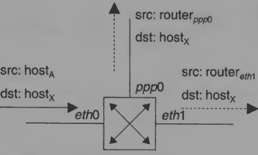

图 4.4 根据数据包目的选择伪装接口

如果其中一个接口被替换为另一种类型的接口，该规则依然有效。在图中的约定是，在适用区分的情况下，eth0 是*内部*接口，eth1 是外部外部接口。

**秘密 #1 Linux 内核**在处理伪装（masquerade）方面非常智能。当你有一条规则指示内核对匹配特定源网络/掩码的数据包进行伪装时，它会根据使用哪个接口转发数据包来选择放置在报头中的 IP 地址。例如图 4.4 所示。

并不是将数据包的源 IP 替换为系统上的任何 IP，而是使用发送数据包的接口。该接口是路由表中用于网关路由或网络路由的接口，必须通过它才能到达目的 IP。如果你仔细考虑，这正是你希望发生的。任何其他操作都是没有意义的，因为数据包将无法路由回同一个接口（如果能路由回的话）。

**秘密 #2** 伪装对于客户端-服务器事务具有方向性。客户端-服务器事务是指客户端发起连接到服务器、向服务器发送数据，然后服务器进行响应的范式。如图 4.5 所示，我们可以将这种连接表示为一对箭头，从第一个客户端到服务器以及从服务器到客户端。图中的路由器被配置为对任何带有 subnet_A 的数据包进行伪装。伪装稍微弯曲了箭头（因为端口发生了变化），但连接正常进行。

如果数据包的源地址不匹配，那么数据包就不会被伪装，这并不令人意外。那么回复包呢？它的源地址来自 subnet_B，而不是 subnet_A。然而，回复是不会被伪装的，因为内核正在等待它，并且它通过一个特殊的端口到达。

当 subnet_B 上的客户端尝试向 subnet_A 上的服务器建立连接时，如图 4.6 所示（在此例中，假设 subnet_B 上的主机到 subnet_A 有有效的路由，这并不总是如此）。数据包通过路由器从客户端传递到服务器，因为其源地址不匹配伪装数据包的任何条件。服务器

> ⁶ 如果你想显式指定要使用的接口，可以在使用 iptables 配置 IP 伪装规则时这样做。然而，你会发现，除非你希望所有通过该接口发出的连接都进行伪装，否则这样做是没有必要的的。

### ## 4.4 日常化使用 IP 伪装

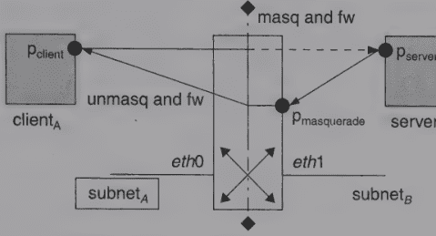

图 4.5 伪装具有方向性——从内向外

在 subnet_A 上对客户端制定响应并发送它。但现在，数据包匹配了伪装代码。内核知道某些地方不对劲，因为这并不是建立规则时参数所隐含的*方向*，于是它将数据包丢进了垃圾桶。图 4.7 以不同方式描述了相同的情况。

你可以使用数据包嗅探器独立验证这一点——subnet_A 上的服务器会响应，但响应会被路由器转发。提到这种情况的原因之一是，并不是所有的伪装路由器都只位于两个网络之间。如果你使用了基于源的规则，而没有显式地为能够进行非伪装通信的网络定义转发规则，你可能会遇到问题。由于 ICMP（例如 **ping**）和 UDP（例如 *traceroute*）都会使用这两者，并且会无问题地双向穿越此配置，这可能会使问题更加复杂。这可以通过使用基于接口的伪装规则来缓解，但要清楚它们也有其隐含的方向和细微差别。

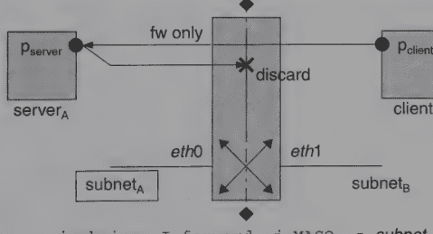

图 4.6 伪装具有方向性——从外向内

### ## 110 Erbium—一种外网路由器 第 4 章

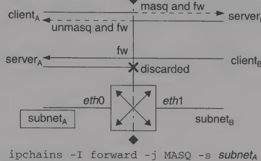

图 4.7 伪装具有方向性

**秘密 #3** 接口的伪装仅在指定的接口为转发接口时发生。图 4.8 描述了一个配置，其中伪装被设置为在 eth1 接口上执行，我们将该接口称为*外部*。内部接口是 eth0。

如你从图 4.8 的箭头所示，从内部向外的连接经过了伪装，但从外部向内的连接没有伪装。为了完成我们的术语定义，**转发接口**是路由器上用于*发送*（转发）**出站**（内部 $\rightarrow$ 外部）连接的接口。从此接口产生的数据包将被伪装，只要它们满足了伪装规则中的任何其他标准（例如目的）。毕竟，由于这些原因，在规划网络时，拥有所有的地址空间是一件好事。由于这些原因，在作为网关使用它时，你会看到数据过滤防火墙和代理一起讨论 伪装。

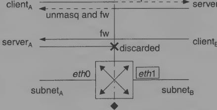

图 4.8 伪装必须在转发接口上进行

### ## 日常化使用 IP 伪装

那么这些秘密意味着什么？这取决于你的伪装。也许它们可以节省一些时间。4.5 节介绍的数据包嗅探是排除故障的极佳方法，但你需要监控双方。排除故障时需要注意的其他问题是：

- 问题可能不在于你的配置，而是你可能没有加载正确的模块。
- 你使用的协议内核可能不支持伪装。注意那些尝试建立连接的协议。
- 在处理外网连接时，有时问题在于 NAT 或某些防火墙。
- 防火墙规则和伪装规则按照你定义的顺序顺序执行。确保你没有过滤掉端口范围。
- 代理是避免该问题的极佳方法。缺点是你可能必须放弃运行的一些服务，或者训练用户使用不同的端口。
- 有工具可以帮助你配置伪装——美妙的工具！（见 4.3.3）。

### ## 4.4.1 为什么要伪装？

本章结合 erbium 的配置引入了 IP 伪装。它被用于克服两个公司网络之间的技术障碍。IP 地址是私有的还是公有的是问题所在；这通常与另一个网络管理员协调的问题。我们都不想交换网络信息、担心地址冲突，或者为了一个不常用的（尽管很重要）的应用而重新配置网络。简而言之，erbium 使用伪装是因为它方便。

然而，它最常见的用途是让私有子网上的客户端访问互联网。如果你的组织属于 RFC 1918 列出的任何私有子网（见第 2.1.5 节），将被要求提供代理服务器或为这些客户端执行伪装以访问互联网。即使你可以获得路由的地址空间，你也可以选择私有地址空间。但除了允许从机器访问之外


在通常情况下是不可能的，但你可能会发现自己在某些本可以正常路由的应用程序使用了 IP 伪装（IP masquerading）。从本质上说，你是在接收者面前隐藏发送者的身份，这具有一些间接的好处。首先，这是一项安全措施。其次，它可以用于压缩流量。

## IP 伪装作为一种安全措施

假设你网络上的某个用户正在使用网络浏览器访问一个声誉一般的网站。网络浏览器“守口不住”，几乎总是会泄露发送者的操作系统。如果接收端有人对这种特定操作系统的用户怀有不轨思想，他/她可能会对发送者发起攻击。在伪装的情况下，他/她无法获取真实发送者的 IP。相反，他/她将对错误的系统发起攻击。虽然这可能不是最典型的例子，但限制针对用户的攻击是**正确的事 (The Right Thing)**。

## IP 伪装以压缩流量

尽管其应用非常频繁，但在某些情况下，你可能不想知道所联系对象的 IP 地址，即使路由没有问题。在这种情况下，你特意在流量进入你的网络之前对其进行伪装。原因之一可能是因为你的服务器在对链路上传输的 IP 地址进行（反向）名称查找时遇到困难，导致客户端连接出现长 DNS 超时。另一个原因可能是出于日志记录，你希望来自某个站点或 IP 范围的所有连接看起来都源于单点。如果你想了解二楼小组通过代理服务器产生了多少网络流量，你可以配置从该路由器接口到端口 80 上的 HTTP 代理服务器的 IP 伪装。这可能不是你的惯常做法，但你可以配置一天，仅用于生成统计数据。第三原因是绕过你网络中的某个问题。请参考以下场景中的图 4.9。

当一切运行正常时，每个站点都通过其链路路由到另一个站点。现在想象链路 BC 在 B 的深夜中掉线了。C 在办公室里，对无法访问 B 感到不快；A 正在打电话，对作为唯一可以提供意见的 WAN 管理员而感到不快。这里有一个解决方案：

- 登录 C 的路由器，并通过链路AC 将流量重定向到 A。
- 配置 routerA 伪装所有源自 C 并发往 B 的流量。
- B 的服务器将看到来自 routerA 的流量并对其做出响应，从而避开链路BC。确保你使用了加载在 routerA 上的协议模块，以便 FTP 等功能可以工作。
- 给 C 的用户发送邮件，告诉他们在这种场景下并非所有功能都能完美运行，但大多数服务可以（任何可以伪装的服务）。
- 回去睡觉，确保获取 routerB 的密码以备后之参考。

由于其极高的实用性并因此的普及，有很多资源可以帮助你配置 IP 伪装。在任何网络搜索引擎上进行快速搜索都应该产生数百条匹配结果（至少包含十种语言），所以你在寻找资源时应该遇到任何问题。如果有，请尝试 Linux 文档项目（Linux Documentation Project）。

## 4.5 IP 监控工具

在排查各种网络问题时，获取链路上的数据是无价的。嗅探器（Sniffers）可以在所有不同的网络层运行，也可以配置为在特定层运行。想象当机器 A 尝试连接机器 B 时，所有操作发生在以太网段上且没有任何错误……

1. 首先，机器 A 可能需要解析机器 B 的主机名，因此需要执行 DNS 主机名查找。当它调用 `gethostbyname()` 时，UDP 包被格式化并发送到 DNS 服务器。
2. 在我们的示例中，假设 DNS 服务器位于 IP 子网内，被称为机器 C。这意味着 IP 栈不会使用网关来传输数据包。为了联系 DNS 服务器，机器 A 必须发出 ARP 请求来定位机器 C 的地址。ARP 请求被发送到媒体地址：ff:ff:ff:ff:ff:ff，这是该以太网段的广播地址。
3. 机器 C 将通过 ARP 回复，其中包含其以太网硬件地址。
4. 现在机器 A 可以以 IP 包的形式将其 UDP 包发送到机器 C 的 53 端口。机器 C 的回复立即发出，因为 C 知道机器 A 的以太网硬件地址。当 C 收到来自 A 的包时，C 上的 ARP 表应该已更新此信息。
5. 现在机器 A 有了机器 B 的 IP 地址，有趣的是，它位于另一个 IP 子网中。机器 A 上的 telnet 客户端格式化数据包发送到 B 的 23 端口。
6. 机器 A 上的 IP 栈查看其路由表。（机器 A 某种程度上是一个路由表。虽然它不一定是网关，但它使用与路由器相同的机制来确定向何处发送包。）机器 A 注意目标地址不属于连接到其 eth0 的 IP 子网，且它只有一个网卡（NIC），因此它必须使用默认网关。
7. 现在开始联系默认网关（通过其 IP 地址知），），再次从 ARP 请求开始，假设机器 A 还没有使用默认网关，或者可能已经使用了，但条目中
8. 一旦网关收到包，它会检查-
9. 如果网关有路由，它将转发包。
10. 如果网关没有路由，它将向发送者返回 ICMP 消息。

此过程一直持续直到数据包到达目的地或因 TTL 过期而被丢弃。

## tcpdump

tcpdump 是一个用于分析网络流量的命令行工具。它允许你捕获通过网络接口的数据包并根据各种标准对其进行过滤。

### 常用 tcpdump 

- -i interface: 指定要监听的接口。
- -r file: 从文件读取包。
- -n: 不将主机名解析为地址。
- -nn: 不解析主机名或端口。
- -v: 提供详细输出。
- -w file: 将捕获的包写入文件。
- -X: 以十六进制和 ASCII 格式打印包数据。
- expression: 对捕获的包应用过滤器。

### 示例过滤器

- `tcpdump -i eth0 port 80`: 捕获 eth0 上 80 端口的流量。
- `tcpdump -i eth0 host 192.168.1.1`: 捕获去或来自 192.168.1.1 的流量。
- `tcpdump -i eth0 tcp and not established`: 捕获 TCP SYN 包。
- `tcpdump -i eth0 'tcp[tcpflags] & (syn) != 0`: 捕获设置了 SYN 标志的 TCP 包。


[ 表达式 ]—是一种用于限制 `tcpdump` 匹配模式范围的表达式。默认情况下，显示所有数据包。这种格式被称为“伯克利数据包过滤器表达式”（Berkeley packet filter expression）格式。尽管它与你用于 `ipfwadm` 和 `ipchains` 的过滤表达式不同，也与你想拨号或嗅探时需要学习的过滤表达式不同；但它非常直观，并被多个流行的嗅探器使用。在许多语言中，表达式看起来像英语短语。

语法是一个或多个原语，通过 `and`、`or`、`and not`（也称为 `&&`、`||` 和 `!`）组合在一起。原语使用括号进行分组，但当你这样做时，你需要对 `(` 加引号或进行转义，以防止 shell 误解它们。因此你可以执行诸如 `$p_1\&(p_2)` 这样的操作。但原语到底是什么呢？它由一个标识符组成，前面可能有一个修饰符。这里就变得复杂了……关于这个主题的权威来源是手册页（man page）以及你在命令行中有效的任何方法。下面提供了一个提要：

## 伯克利数据包过滤器修饰符

- type—指定标识符的类型。它可以取 `host`、`net` 或 `port` 值，默认为 `host`。

- direction—是 `src` 或 `dst` 之一，默认（未指定方向时）为 `src` 或 `dst`，这对于 `ipfwadm` 是两者通用。因此

```
tcpdump -n i eth0 src or dst port 110
tcpdump -n i eth0 port 110
```

是等价的。记住 `src` 和 `dst` 不仅适用于 IP 头。它们也可以适用于其他协议，例如 `ether`（从而指示源或目的以太网地址）。

- protocol—是 `ether`、`fddi`、`ip`、`arp`、`rarp`、`decnet`、`lat`、`sca`、`mopc`、`mopdl`、`tcp` 之一，通常使用 tcp 和 udp，如果不模糊我可能会使用 `arp` 或 `ether`。当然，你的需求会引导你找到需要嗅探的协议。如果你不指定协议，则任何感知该标识符的协议类型都会匹配。因此，如果你只指定端口，则隐含了 tcp 和 udp 协议。

## 伯克利数据包过滤器标识符类型

- host host—指示主机的 IP 地址。与此匹配的修饰符是 `src` 和 `dst`——记住默认意味着该主机可以是源也可以是目的。`host` 也可以是 DNS 名称，该名称可以解析为多个 IP 地址，在这种情况下，所有地址都会匹配。注意 `host` 是关键字，并且是标识符的值。

- ether host—指示以太网地址。再次，`ether host` 是关键字，而 `ether` 则是格式为 `xx:xx:xx:xx:xx:xx` 的 6 字节以太网（MAC）地址，抑或者是来自 `/etc/ethers` 的名称。`dst` 和 `src` 修饰符的用法与你处理 `host` 时一样。

## IP 监控工具

- gateway host 生成一个匹配，该被检查的数据包由作为网关的主机转发，或者准备由该主机（仅限下一跳）转发。指定的主机必须同时出现在 `/etc/hosts` 和 `/etc/ethers` 中。顺便说一下，`/etc/ethers` 的文档并不完美。在我的 glibc2.0 系统上，以太网地址和主机之间只允许一个空格。这对于指定 `ehost`并不重要，因为你可以使用 6 字节格式。但如果同一个主机出现在两个文件中，gateway 将无法工作。

- net net[mask | mask mask]—这只是指定 IP 子网的几种不同方法之一。需要关键字 `net`，而 `mask`（第 2 章涵盖并被 `ipfwadm itchains` 使用的“1 的个数”格式）和 `mask mask`（`ifconfig` 使用的点格式）是可选的。`dst` 和 `src` 修饰符适用。

- port—指示端口是 IP 数据包的一个（或两个）。`port` 可以是一个整数端口，也可以是来自 `/etc/services` 或等效的服务名。`dst` 和 `src` 修饰符照常适用，可选地前跟 `tcp` 和 `udp`。注意在关键字 `port` 之前的关键字顺序很重要，如下例所示：

```
erbium:/root> tcpdump -n -i eth0 tcp src port 110      #正确
erbium:/root> tcpdump -n -i eth0 src tcp port 110     # 错误
```

- length—匹配长度（字节）小于或等于 `length` 的数据包。注意 `length` 是负载 + 传输层头部，所以你不能使用 `less 1` 来捕获空包（ACK 等）。由于不同协议有不同的头部长度，你可能需要实验一下来找到那个魔法数字。我的经验是，在嗅探以太网设备时，在你寻找的任何长度上加上 64，对于 PPP 设备加上 40。

- greater—匹配长度（字节）大于或等于 `length` 的数据包。关于头部的注释也适用于 `less`。

- ether—如果数据包是以太网广播包，则匹配该数据包——任何以太网目的地址为 `ff:ff:ff:ff:ff:ff` 的数据包（例如 ARP 请求）。关键字 `ether` 是可选的，但我发现它很容易与下一个选项混淆，我建议使用它。

- ip broadcast—匹配三种不同的 IP 广播。
    - 1. 发送到 255.255.255（全 1）的数据包
    - 2. 发送到 0.0.0.0（全 0）的数据包
    - 3. 发送到本地子网广播地址的数据包（取决于列出的 `-interface interface`）。

    - ether multicast—匹配以太网多播。
    - ip multicast—匹配 IP 多播。
    - udp multicast—匹配 UDP 多播。

- src group—匹配源 IP 组地址。

- dst group—匹配目的 IP 组地址。

- in6—匹配 IPv6 流量。


## Erbium—外网路由器 第 4 章

```bash
erbium:<root> tcpdump -n -i eth0 src 192.168.16.1 \
and not ether host 00:50:56:94:00:00 \
tcpdump: listening on eth0 \
23:05:52.460772 00:50:65:65:ff:ff:ff:ff:ff 0860 42: \
arp who-has 192.168.18.22 tell 192.168.18.1 \
23:05:57.742258 00:50:56:65:ff:ff:ff:ff:ff 0860 42: \
arp who-has 192.168.18.22 tell 192.168.18.1 \
```

### 哈！现在我们知道罪魁祸首的 MAC 地址了。当那个 .. 22 盒子尝试使用网关时，它暴露了。现在第二天我们为用户设置了另一个陷阱：

```bash
erbium:<root> tcpdump -i eth0 ether host 00:50:56:95:2 \
tcpdump: listening on eth0 \
08:13:18.251493 cygnus.mancill.com.1314 > \
sililicon.mancill.com.domain: 51522 (33) \
08:13:18.780158 cygnus.mancill.com.domain > \
cygnus.mancill.com.1314: 51522 1/2 (153) (DF)
```

### 我们将利用信息（罪魁祸首的 IP 地址）来追踪他们。如果我们还不知道，可以在路由器上对他们进行防火墙拦截，这样他们就会提交工单。

### 我们在上午剩下的时间里里计划如何抑制 cygnus 主人的政治本性

你可以使用 `-w filename` 执行非交互式监控。这比直接将标准输出重定向到文件更节省系统资源，而且在查看文件时提供了更多选项。为了做到，你可以使用 `-r filename` 并指定输出的过滤和显示方式。例如，你可以记录所有流量，并在多次运行 `tcpdump` 时使用 `-q`、`-n` 和数据包过滤表达式等选项产生不同的数据视图。

学习如何使用 `tcpdump` 可能胜利了一半。另一部分是学习高效的方法来解析和解码其输出转换为人类可以总结的报告和其他内容。计算机可以极快生成无意义的数据。Perl 是一个自然的选择，但不要忽视它功能强大的伙伴：`awk` 和 `sed`。这取决于你如何看待问题。在 `/usr/share/doc/tcpdump/examples` 中有一些非常好的示例脚本（我真希望自己在尝试模仿它的功能之前早点知道它们）。

## 4.5.2 ipgrab

ipgrab 是另一个基于 `libcap` 的 Linux 命令行数据包嗅探器。在我看来，它是一个没有陷入功能膨胀的程序的良好示例。它使用了与 `tcpdump` 相同的过滤机制。它将所有输出导出到标准输出（stdout），这可以重定向到文件中。

> 早期发布的版本不包含过滤支持。

## ipgrab 用

```
usage: ipgrab [-bplmnt] [-c cnt] [-i if] [expr]
  [-c] [--count] 接收'count' 数据包后退出
  [-i] [--interface] 在接口 'interface' 上监听
  [-b] 使 stdout 缓冲
  [-p] 导出数据包负载
  [-l] 不打印链路层头
  [-n] 不打印网络层头
  [-t] 不打印传输层头
  [-m] 最小输出
[expr] 伯克利数据包过滤表达式（参见 tcpdump manage）
```

如你所见，它支持有限的选项。为什么不使用 `ipgrab` 而不是 `tcpdump` 呢？它比 `tcpdump` 更小，且命令行界面简单。它的输出格式良好且易于遵循，这让它比 `tcpdump` 稍微逊色一些。它在没有牺牲细节的情况下做到了这一点，正如软件包随附的 README 文件作者所说，它尽力导出每一个可能的头部字段。Borella 先生说：

我预计这段代码可以用于对现有或新协议进行详细的数据包级调试。此外，想象它可以作为 TCP/IP 或安全课程的有用教学和指导工具。我努力让代码具有可读性，有时以牺牲效率为代价，以便人们它可以学习 pcap 库调用和头部字段数据结构。

我查看了 `ipgrab` 的源码，它确实文档详尽且易于遵循。这对于那些想要了解每一步中到底发生了什么（即在链路层、会话层和协议/传输层）的人来说非常有帮助。输出格式是为人类消费而设计的。如果你想获取 `ipgrab` 源码的最新副本，请将浏览器指向。


# IP 监控工具

要使用 ethereal 开始监控，你需要通过 `Tools -> Capture` 切换捕获功能。这会弹出一个对话框，你可以在其中选择接口，如果需要的话，还可以选择一个过滤器。过滤器使用与 `tcpdump` 表达式相同的语法，你可以为过滤器命名并保存它，以便在其他会话中重新调用它。你还可以指定想要收集的数据包数量。一旦嗅探器进入捕获模式，就会弹出一个窗口，显示正在捕获数据的统计信息。该窗口有一个 `Stop` 按钮，你可以用它来关闭捕获。在捕获期间，除非某些匹配你过滤器的数据通过嗅探器，否则对话框不会刷新。主窗口也是如此。一旦捕获到某些内容，你可以在捕获对话框中点击 `Stop` 停止捕获。在此时（再次），一切似乎都卡住了。事实证明这是 ethereal 正在解析主机名。一旦捕获停止，数据包将显示在主窗口顶部。当你在主窗口的此部分高亮数据包时，你会发现中间部分发生了变化以反映数据包的类型，而底部则以原始十六进制（hex）和 ASCII 格式显示数据。这里的情况变得非常接近了。

窗口的中间部分通过展开的分级列表提供了有关数据包和协议的详细信息。当你向下移动中间部分时（它在本节之前描述的分层次每一层的头部标志列表），你可以通过展开和折叠头部来探索每一层。当你点击列表中的某项时，你将看到标志字（flagword）的值，然后当你点击它时，将看到标志中每个位的状态。TCP 数据包的顶层选项：

- Frame（线路上字节数、已捕获的字节数）
- Ethernet II
- IP 协议（Internet Protocol）
- 传输协议（Transmission Protocol）

你会发现，当你高亮其中一个部分时，数据包相应的部分（在底部）会变为**加粗**，以便你可以看到哪些字节对应于该层。当你展开中间部分的其中一个协议时，你会发现选择该协议内的单个头部字段会高亮数据包中该字段对应的精确字节。非常酷！

另一个酷的功能是可以在窗口上半部分选择一个数据包，然后下拉 `Tools` 菜单并选择 `Follow TCP stream`。这将从头到尾跟踪 TCP 流，剥离头部和协议信息，仅在对话框中呈现数据负载。告见你可能使用的任何加密密码。任何人都可以用此嗅探密码……（然而，这并不是该功能的意义所在。）

我对 ethereal 的唯一抱怨是无法关闭对被捕获 IP 数据包的 DNS 查询。我当时正在测试没有良好（反向）DNS 查询的连接，正如我之前提到的，在数据捕获之后和显示之前有一个恼人的停顿。我启动了 ethereal 并在 `Edit -> Options` 菜单下更改设置。事实证明，有一个命令行开关（该死的，和其他每个网络命令一样）来处理此。我本应该先查阅手册（RTFM）。如果你无法加载 Debian 软件包（起名非常恰当，名为 ethereal），请访问 ethereal.zone 寻找数据包嗅探器。该部分不会打扰你。

在我们考虑该部分之前，我想就关于好用的 GUI 嗅探器和你的路由器说明一点。嗅探器非常适合笔记本电脑，你通常可能想去某人报告问题的地方（例如使用 `tcpdump` 展示的网关重复 IP 地址示例）。这样，你可以将嗅探器插入发生问题的集线器中，以了解发生了什么。然而，对于使用交换机而非集线器的环境，许多你可能（或需要）直接在路由器本身上运行嗅探器，特别是如果你使用 GUI 嗅探器之一。为了让你留个概念，这可能会给路由器带来额外负载，我在本章的表 4.3 中列出了嗅探器的许多影响。那里列出的值不包括数据包捕获的数据，对于命令行嗅探器来说，这部分很小（因为直接通过），但对于基于 GUI 的嗅探器来说，可能是巨大的。这并不是说你不能在路由器上运行这些嗅探器，但它们会一直运行，可能会导致你的路由器进行内存交换。还有替代方案。ethereal 允许写入文件（它可以进行交换），你可以在路由器上进行监控，然后在另一个工作站上运行 GUI。另一个选项是，如果你有资源，购买带有监控端口的交换机并从中央监控站进行监控。（也许可能是你在第 5.5 节中配置 MRTG 的同一个工作站）。

| 表 4.3 数据包嗅探器内存需求 | |
| 数据包嗅探器 | 大小 (kB) |
| :--- | :--- |
| tcpdump | 412 |
| sniffit | 620 |
| ipgrab | 628 |
| sniffit -i | 1088 |
| karps | 1820 |
| ethereal | 2504 |

# 4.6 总结

现在我们有一个 Linux 路由器在处理局域网和到外部网络的拨号连接。我们可以使用 IP 计数生成关于发送流量量的统计信息，并使用本章提到的嗅探器等数据包捕获查看这些流量的内容。我们还可以通过 IP 伪装使用私有 IP 地址与公共网络通信。下一步是通用 WAN 路由器，这是……的主题：

## 5.1 帧中继基础——DLCI、PVC 和 CIR

帧中继是一种用于在广域网上连接路由的技术。在我们深入研究帧中继之前，我们首先定义一些术语（其中某些是回顾 2.3.1）；这些术语用在图 5.1 中。

[图像占位符]

### 图 5.1 帧中继术语

access——指运行在你的位置与最近的 POP 之间的数字电信电路。接入也称为本地环路。

POP——接入点意味着任何供你连接的（而不只是帧中继）网络提供设施。这种连接就是你的接入。

port——你的供应商交换机上通过接入连接到路由器的卡或端口。端口具有关联的速度，表示供应商交换机接受你的数据包的最大速度。注意端口速度并不总是与接入速度一致。

DLCI——数据连接标识是用于指定 PVC 端点（连接到你的节点之一）的地址。该地址是整数，用于路由器指示可能的不同的 PVC 中哪一个是正确的接收者。（注意你使用许多 DLCI，即使你的网络中只有一个 PVC。）DLCI 应该在 16 到 1023 之间。许多供应商允许你请求希望在网络中使用的 DLCI。

CPE——用户设备是对你路由器的术语。

node——这是另一个指代路由器的术语。一个帧中继节点通常关联一个 DLCI。在这些术语中，CPE 可能是更好的术法，因为你的供应商可能会使用 node 来指代你路由器以外的网络实体²

² ²尽管我经常使用 node 来指代我的路由器，并且在本章中也是如此。


# 帧中继基础——DLCI、PVC 和 CIR

（其他。）从你的视角来看，一个 PVC 可以被认为是运行在两个 DLCI 之间的一个网络管道。PVC 不是有方向性的，或者说它们与带宽严格相关，尽管许多人喜欢讨论“PVC 的速度”——但他们应该讨论该 PVC 对应的 CIR。

CIR—承诺信息速率（Committed Information Rate，以比特/秒表示）是你的提供商保证你可以在无丢失的情况下传输数据包的最大速率。（实际上，这种保证通常是“尽力而为”类型的服务。）与 PVC 不同，CIR 是有方向性的，这意味着从路由器 A 到路由器 B 的保证带宽不等于反方向的保证流量。并非所有服务提供商都允许你为 PVC 指定非对称 CIR 流量。如果这些速率可用，它们是在为你的应用程序提供足够带宽的同时节省成本的良好方法。

LMI—本地管理接口（Local Management Interface）是帧中继路由器之间相互通知网络状态的方法。这涉及你的节点与 POP（接入点）路由器之间状态消息的交换。这些消息可能采用三种不同的标准：LMI、ANSI（也称为 Annex D）和 Q.933（也称为 Annex A）。

NNI—网络间接口（Network to Network Interface）是服务提供商在连接两个不同网络时使用的术语。这使他们能够在位于不同帧中继网络上的路由器之间提供 PVC。如果你需要在你的一个节点与使用不同提供商的业务伙伴之间建立 PVC，请询问你的提供商，他/她是否与另一个提供商有 NNI。

## 5.1 帧中继带宽

让初次接触帧中继管理员感到困惑的问题是：我有多少带宽？这个问题很重要，因为订购中继服务可能会变得复杂（而且昂贵），并且你想知道预期会是什么。帧中继网络中不同的参数决定了端到端带宽。影响这种带宽的一些场景包括：

- 1. 你可能通过在单个数字接入链上复用应用程序为电信公司节省费用。在这种情况下，你的接入带宽必然大于端口带宽。
- 2. 如果接入费用低廉，你可以选择比接入带宽更小的端口，以避免为一个填满接入带宽的端口付费。
- 3. 一旦你的数据进入提供商的网络，它们就可能受到你为 PVC 选择的 CIR 的限制。不同的提供商在入口（进入网络）或出站（离开网络）时执行 CIR。还有一些提供商根本不强制执行 CIR，链路速度等于两个关联端口速度中的较低值。
- 4. 一个 PVC 的两端可能有不同的端口大小，这使得你受限于两者中较小的一个。（然而，取决于你的提供商网络的缓冲性能，你可能在端口速度差异明显之前并不会注意到这种限制。）
- 5. 你的你的网络中的某些节点可能处于超订阅状态，即通过 PVC 挂在节点上的端口总和超过了该节点的端口速度。如果你处于超订阅状态，当你 PVC 对端的所有节点同时向你发送突发数据（以全速发送数据）时，速度可能会变慢或发生数据丢失。

在简单的双节点网络中，你在给定方向上的平均吞吐量将是 A 点和 B 点之间的最小值。图 5.2 阐述了这一点。但请注意，这里的保证速率（接口传输数据的最大速度）等于该接口的端口速度。假设你的提供商不强制执行 CIR，则 PVC 的突发吞吐量是该 PVC 两个端口速度中的较小值。

图 5.2 帧中继带宽

### 超过你的 CIR

当你超过 CIR 时，残酷的现实是你的提供商可能会丢弃你的一些数据包。判断方法如下：上游交换机（位于你提供商的 POP 处）持续监控你使用了多少带宽。如果你超过了 CIR，数据包将通过在数据包头中设置一个位来被标记。如果云中的任何其他节点发生严重拥塞，它就可以丢弃带有该位的数据包。因此，虽然超过 CIR 可以以更低的成本从你的链路中挤出更多带宽，但这样做也让你面临丢包的风险。例如，基于 TCP 的应用程序将注意到数据包丢失并纠正这种情况，代价是重新传输数据包，这会浪费时间和带宽。对于已经经历高数据包延迟的地理位置较远的地区，情况可能会特别糟糕。如果你习惯性地超过 CIR，你的提供商可能会要求或强制你增加所订阅的 CIR。

## 5.1.2 复习帧中继概念

让我们回顾一下目前为止涵盖的内容以及一些最后的细节。

- 每个节点都通过一段接入链连接到提供商 POP 的一个端口。你的节点是一个 CPE（用户设备设备）路由器。
- 节点通过其 DLCI 指定，DLCI 是用作地址的整数。
- PVC 在你的提供商网络（云）中两个节点之间建立一条路径。
- 每个 PVC 都关联有一个 CIR。当在 PVC 上发送的数据超过预定义的带宽限制时，CIR 可能被用于丢弃这些数据。
- CIR 是有方向性的。如果你的提供商表示它们不是，请询问 64kbps 的 CIR 是每个方向都是 64kbps，还是每个方向 32kbps。不同的提供商销售方式不同。
- 每个方向具有相同 CIR 的 PVC 称为对称 CIR。非对称 CIR 在每个方向的数据速率不同。这对于拉取流量大于推送流量的站点非常有用。
- 节点可以以端口速度进行突发传输。
- 如果节点无法满足其连接节点的带宽需求，则该节点处于超订阅状态。

对于想要了解更多帧中继知识的人，网络上有大量的教程。作为一个起点，访问 http://frforum.com/，这是一个对推广帧中继感兴趣的商业商家组成的协会。他们有一份可以下载的文档《帧中继网络基础指南》（The Basic Guide to Frame Relay Networking）。这份 86 页的通用信息文档虽然很长，但仍然有用。

## 5.2 Linux WAN 适配器

对于我们而言，WAN 适配器是一种插件，本质上相当于传统路由器上的端口。这些卡支持帧中继、同步 PPP、X.25、Bisync、HSSI 等 WAN 协议。它们通常有自己的处理器来在卡上运行链路层协议。这从系统 CPU 中卸载了任务并简化了所需的设备驱动程序。卡为操作系统提供解码后的帧；通过中断触发并以以太网卡相同的方式传递给设备驱动程序。这些 WAN 适配器通过高速串口（V35 或 RS-232）与外界连接，适用于连接 CSU/DSU 然后连接数字接入电路。某些卡集成了 CSU/DSU，因此可以直接连接到数字接入电路。目前提供的卡有一到四个端口，支持从 56kbps 到 52Mbps 的速率。


本节列出了支持 Linux 驱动（截至写作）的网卡厂商。在这些厂商中，我只有对 Sangoma 产品的经验。当你开始为应用程序研究网卡时，可以从这些厂商作为起点；它们在提供 Linux 解决方案方面声誉良好。

## 5.2.1 Sangoma–S508 和 S514

Sangoma 提供了两种 WAN 接口卡：基于 PCI 的 S514 及其基于 ISA 的前身 S508。目前，支持运行在 Frame Relay（帧中）、PPP、X.25 和 Cisco HDLC 之上的协议。如果你不想受到 TCP/IP 限制的干扰，可以使用 Bisync 和 HDLC LAPB API 接口开发适用于特定应用程序的协议。所有协议都由它们免费提供的 WANPIPE 软件支持。正如我提到的，我是 Sangoma 网卡的长期用户，我非常喜欢使用它们，以至于我接手了他们的驱动工具软件（名为 `wanpipe`）的 Debian 软件包。以下是网卡的简要介绍。更多信息，请访问 http://www.sangoma.com。

- S508 配有两个端口：一个高速端口（最高达 E1，2Mbps），以及另一个仅能运行 HDLC 高达 256kbps 的端口。高速端口使用 DB-25 接口和特殊电缆连接到 RS-232、V.35、EIA530 或 X.21 外部设备。低速端口使用 DB–9 连接到 16 位 ISA 总线。
- S514 是 S508 的单 CPU 版本。它是一个双口卡。在这种情况下，高速端口可以处理高达 4Mbps 的链路速度，而第二个端口限制为 512kbps。
- S5142 是 S514 的四口双 CPU 版本。它等同于两块 S511 卡（即两个高速端口和两个低速端口），但仅占用一个插槽。
- S514/FT1 和 S508/FT 是其各自网卡的变体，集成了 CSU/DSU。这些网卡带有单个端口，直接连接到数字接入。

> 提示：集成 CSU/DSU 可以节省资金、空间和时间

在订购路由器网卡时，你应该考虑带有集成 CSU/DSU 的网卡。其额外成本低于市场上最便宜的外部 CSU/DSU。由于集成卡直接连接到租线提供的线路，你的安装会更加整洁——盒子更少、电缆更少、电源更少。这实现了整洁的架式安装。

## 5.2.2 ImageStream

ImageStream Internet Solutions 提供 SDL Communications 的适配器以及其 Linux 驱动。他们还提供基于 Linux 的路由器、防火墙以及配备了这些适配器的 Linux WAN 适配器服务器。这些系统运行 ImageStream 自己的 Linux 发行版（Enterprise Linux），包含全套标准服务器守护进程，包括对 RIP2、OSPF 和 BGP4 的动态路由支持。Linux 标准（如 IP 伪装和防火墙）当然是可以访问的。所有的一体机产品都包含冗余 RAID 配置，某些甚至配备了热插拔组件。

如果你倾向于自己构建路由器，可以从各种适配器中进行选择，从带有单个 2Mbps 端口的 ISA 型到 PCI 适配器（带有八个 8Mbps 端口）以及双口 HSSI 适配器（每个端口 52Mbps）。如果空间是个问题，他们还有另一系列 3 格式的 Compact-PCI 适配器。大多数卡都有集成的 CSU/DSU。

所有卡都支持以下协议：PPP、HDLC、Frame Relay、X.25 和原始 IP。电气接口为 V.35、RS232、RS422 (EIA530 或 X.21) 以及 HSSI 或 T1 或 D5 CSU/DSU（相应）。如果你的计划在美国以外的地区部署，X.21 将是一个受欢迎的特性。你可以访问 ImageStream http://www.imagestream-com/。

## 5.2.3 Gcom

Gcom, Inc. 提供 ISA 和 PCI 架构的扩展卡，支持最多四个端口。除了 Linux，他们还支持其他几种商业 x86 Unix 变体。对于需要使用 Frame Relay 或 PPP 以外的链路协议的系统，他们提供了强大的协议支持。摘自他们的网站：

- Frame Relay、X.25 以及 SDLC/HDLC
- 基于 SDLC 或 QLLC/X.25 的 SNA LU0、LU2、LU4、LU6.2
- LAPB、LAPD 和 LLC
- 可按提供的 Bisync 以及 X.3、X.28、X.29 PAD 协议

除了生产这些板和驱动软件外，他们还支持并托管 STREAMS 的 Linux 实现，被称为 LiS。该源码主要在 LGPL（GNU 公共许可证中限制较少的库版本）下发布。（酷！）它被实现为 Linux 内核模块，具有 IP 栈之上或之下的驱动——即它可以使用现有的设备驱动，或向另一个 STREAMS 设备驱动（IP 栈之上）提供 DLI。（非常酷！）有关关于他们的网卡、协议支持或 LiS 的更多信息，请访问 Gcom 网站 http://www.gcom.com/。

## 5.2.4 Emerging Technologies

Emerging Technologies 为 Linux 和 FreeBSD 适配器和驱动。与许多公司一样，他们提供：

- Frame Relay、PPP 和 .25。
- S508、S514 和 S5142 卡。
- 集成的 CSU/DSU 选项。

你可以通过 http://www.emergingtechnologies.com 联系他们。


# 134 Zinc—帧中中继路由器 第 5 章

- 5. 运行 `/usr/lib/wanrouter/Configure` 为你的 WAN 接口设置 IP 地址——每个连接到此节点的 PVC 均对应一个。
- 6. 使用 `/usr/sbin/wanrouter start` 启动你的链路。根据需要添加路由。

你可以通过查看 `/var/log/wanrouter` 和 `/var/log/messages` 中的输出来检查启动进度。你还应该执行 `ifconfig wan-interface` 来确认你的接口已处于启动状态。

## Debian wanpipe 快速入门

- 1. 加载 Debian GNU/Linux 软件包 `wanpipe`。
- 2. 读取 `/usr/share/doc/wanpipe/README.debian` 中的发布说明；这些涵盖了 Sangoma 分布式包与 Debian 包之间的区别。
- 3. 切换目录 `/usr/share/doc/wanpipe/examples/` 并使用 `zcat` 将一个压缩的 `wanpipe.fr.` 文件解压到 `/etc/wanpipe/wanpipe.conf`。
- 4. 编辑此文件，设置适用于你链路的参数。
- 5. 使用 `/usr/sbin/wanpipeconfig` 脚本设置你的接口文件。
- 6. 使用 `/etc/init.d/wanpipe reload` 重新加载配置。检查链路是否启动，并根据需要添加路由。

在 Debian 下检查 wanpipe 链路的状态与其他发行版大部分相似——只是日志文件的路径发生了变化。启动时产生的日志存储在 `/var/log/wanpipe.log` 中；其余部分通过 syslog 记录（可能在 `/var/log/messages` 中）。

对于任何特定情况，如果你的链路没有立即建立且日志文件未指示链路，你可以使用 `fpip` 获取链路信息以及可能出现的问题（使用此命令的详情请见第 5.4.3 节）。如果你尚未运行，请阅读接几节，特别是从 5.3.3 节开始的详细配置信息，看看是否能发现问题。

# 5.3.2 WANPIPE、Linux 内核与 Debian

你一定在上一节中注意到了 Sangoma 的 WANPIPE 与 Debian wanpipe 之间的差异。作为 wanpipe 的维护者，我一直在努力保持 Debian 版本一致性与跟进 Sangoma 版本变化之间的权衡。这种现象的形成需要解释，因为似乎为了理清这些差异，每个人都付出了更多工作。简短的是，Sangoma 的包针对的是运行各种 Linux 变体的广泛用户群体。相比之下，Debian 包为 Debian 用户提供了更大的便利，并符合 Debian 的文件系统布局指南。

# 5.3 用于帧中中继的 Linux 和 WANPIPE

## WANPIPE 与内核开发

在 1.2 和 2.0 内核的鼎盛时期，内核波动大得多，驱动作者与内核作者/维护者之间的协调较少。当新补丁发布时，Sangoma 必须测试他们的驱动程序，进行任何更改并发布一组新补丁。由于由于，WANPIPE 在分发时（现在仍然如此）包含一组内核补丁和工具的源码（终端用户需要根据其特定的内核版本对源码进行编译）。

未来的发展方向是将补丁直接集成到内核源码中，这样只需在内核配置期间选择它们即可。（这项工作始于 2.2.x 内核。）在演进过程中，Sangoma 的某些版本仍比上游内核源码中的版本新，因此仍需要分发补丁。截至内核版本 2.2.14，内核与 Sangoma 已同步。此外，该内核版本成为了 Debian 2.2 的候选发布版本。一个纯净内核源码配合匹配的 WANPIPE 二进制文件广泛发行，为 Debian（以及其他系统）提供了“开箱即用”的 WAN 路由器支持——无需编译器或内核构建。


这一切是否能一直保持同步有待观察。这意味着你可能需要定期检查 Sangoma FTP 站点，以获取可能不在上游内核中的新补丁。甚至可能你必须重新构建工具，以便它们与新的驱动代码配合。

# 用于 WANPIPE 的 2.2.x 内核 你必须构建一个支持 WANPIPE 的内核，并使用列出的选项配置内核。注意，内核构建脚本将允许你将驱动直接编译进内核（即不作为模块）。不要这样做——驱动必须是模块。

```
Code maturity level options -->
[*] Prompt for development and/or incomplete code/drivers
Networking options -->
[*] TCP/IP networking
[*] IP: advanced router
<M> WAN router
Network device support -->
Wan interfaces -->
[*] WAN drivers
<M> Sangoma WANPIPE(tm) multiprotocol cards
(1) Maximum number of cards
[*] WANPIPE X.25 support
[*] WANPIPE Frame Relay support
[*] WANPIPE PPP support
[*] WANPIPE Cisco HDLC support
Filesystems -->
[*] /proc filesystem support
```

> 4 感谢 Alan Cox 在此事上的努力。

# Debian wanpipe 软件包 几年前，WANPIPE 软件自安装为“router”（路由器），这有点太泛化了并导致了一些混乱和命名空间冲突。因此，Debian 包使用了 "wanpipe" 代替 "router"。现在 WANPIPE 喜欢将一切称为 "wanrouter"，但由于已经在 wanpipe 的道路上走了很远，Debian 包沿用了旧名。现在 WANPIPE 已经包含了许多功能，由于 wanpipe，Debian 包 具有以下特性：

- 它不需要用户编译，配置文件位于 /etc/wanpipe/。
- 它的工具 脚本位于 /usr/sbin/wanpipe。
- 它的启动/关闭脚本位于 /etc/init.d/wanpipe。
- 驱动程序位于 /etc/wanpipe/
- * 它提供了额外的功能，例如，是否允许多播？是否遵循 CIR？

> 5 版本的冻结状态表示额外的更改仅可能是错误修复。

# 5.3.2 用于帧中中继的编辑 wanpipe 配置

一旦你安装了 Sangoma 卡，你需要为链路配置。主配置文件是 wanpipeN.conf，其中 N 是第 N 张卡。对于我们的目的（单卡），它是 wanpipe（直到2.1 版本）。在 Debian 系统上，它位于 /etc/wanpipe/。该文件控制：

- 关于 Sangoma 卡的物理参数，例如接口的DSU 类型、端口波特率以及中断。
- 卡运行的协议（因此是链路层）。
- 由内核创建的对应于链路的接口名称。wan0, wan1 等。

# 用于帧中中继的 Linux 和 WANPIPE

**wanpipe1.conf 的结构** 该文件初看起来看起来，但一旦你理解了不同的部分，它经过了注释且容易理解。其格式类似于其他系统使用的 .ini 文件。注释以 # 字符开始并持续到行尾。

文件具有层级结构。两个主部分是 [devices] 和 [interfaces]。这两个部分都必须出现，并且每个部分分别包含一条你想要配置的设备或接口。对于这两个部分中的每一行（即设备或接口），在文件的后面都会有一个以设备或接口命名的子部分。一个简单的格式示例应该说明这一点。在下面的伪 wanpipe1.conf 中，有一个**设备**和两个**接口**。

```
[devices]
# 这台机器包含一个设备/物理卡，wanpipe
wanpipe
:
[interfaces]
# 有两个接口
wan0
wan1
[wanpipe]
# 物理设备 wanpipe 的配置设置
:
[wan0]
## 接口 wan0 的设置
:
[wan1]
## 接口 wan1 的设置
:
```

**wanpipe1.conf—devices] 这里的设备指的是物理 Sangoma 卡。这意味着 [device] 部分中的条目对应于系统中 S508 卡的数量。（从 WANPIPE 2.1 版本开始，你不再在此文件中配置多个设备，但语法保持不变。）如果你有多个卡，你必须将卡（以及配置文件）命名为 wanpipeN，其中 (1 ≤ N ≤ 8)，并且你必须**连续地**对它们进行编号！在设备行上，你还指定了卡运行的协议。


# 138 帧中继路由器 第 5 章

可以选择性包含一个注释，该注释将在系统启动和关闭期间显示在系统日志中。对于运行 Frame Relay 的系统，[devices] 部分看起来如下：

```
# start the [devices] section
[devices]
wanpipel = WAN_FR, myframecircuit - cktid MCI ZAW82836001, DLCI 100
# end [devices]
```

wanpip1.conf—[interfaces] 接口指的是内核用于与链路通信的实体。这可能会引起一些困惑，因为许多人通常将这些称为设备（devices）。只需记住，接口是一个类似于 `eth` 的实体——它可以支持路由、具有不同的子网掩码等。

单个 Frame Relay 设备（或端口）可能在提供商网络中配置了多个 PVC。在您的路由器上，这些 PVC 中的每一个都是 `wanpip.conf` 中的一个接口。它们的行为类似于 PPP 接口，不同在于您需要在配置文件中指定相应的 DLCI 来添加远程端点。（相对于操作系统的部分，它们通过 IP 进行地址。）对于一个具有两个 PVC 的位置，[interfaces] 部分看起来如下：

```
# wanpipel.conf for location A
#
# start the [interfaces] section
[interfaces]
#intf = device, DLCI, WANPIPE, comment
#--------------------------------------
wan0 = wanpipel, 200, WANPIPE, location A <-- location B PVC
wan1 = wanpipel, 300, WANPIPE, location A <-- location C PVC
# end [interfaces]
```

在上面的文件中，地址为 DLCI 200 的帧将由 Frame Relay 交换机路由到位置 B，而地址为 DLCI 300 的帧将去往位置 C。当链路建立且 WANPIPE 运行时，您将通过接口 `wan0` 向位置 B 添加路由，并通过接口 `wan1` 向位置 C 添加路由。

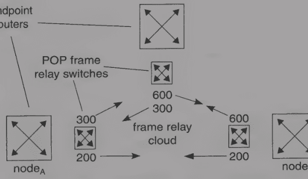

图 5.3 一种可能引起困惑的 DLCI 分配方式

## 这个 DLCI 到底是谁的？

前面的示例配置表明，位置 A 需要将帧寻址 DLCI 200 以将其发送到位置 B。根据提供的信息，我们无法判断位置 B 和 C 在其配置文件会有什么来将帧发送到位置 A。也许两者都“调用”位置 A。也许可能不是。这是因为 DLCI 只有本地意义——即，您的路由器只能看到由 POP 处的交换机呈现给它的 DLCI。

这意味着 DLCI 只对您的路由器和 POP 处的交换机有意义，并不意味着 DLCI 200 在任何绝对意义上都是“位置 B 节点的地址”。这个概念很简单，但其含义可能令人困惑。例如，您的提供商可以轻松设置位置 B 的交换机，使用 DLCI 200 来指向传输到位置 A 的 PVC。在这种情况下，两个配置文件都会将 DLCI 200 列为访问远程站点的介质地址。这种情况如图 5.3 所示，站点 B 通过 600 访问 C 点，而 C 点通过 600 访问 B 点。但 A 点通过 200 访问 B 点，反之亦然。为了让情况变得更加复杂，A 点通过 300 访问 C 点。

出于此原因，我要求我的提供商为具有多个 PVC 的每个路由器提供唯一的 DLCI。换句话说，位置 B 和 C 处的交换机都通过相同的 DLCI 引用位置 A。这本质上为每个路由器提供了它自己的 DLCI（或地址），是处理此问题的一种直观方法。（参见图 5.4。）现在，无论您配置了哪个节点与位置 A 通信，它都使用相同的 DLCI 到那里。

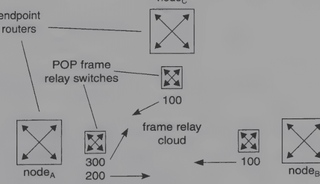

图 5.4 一种更直观的 DLCI 分配方式

## [wanpipe] 设备配置

wanpipe.conf 是完整的。但请记住，每个命名的设备都有一个子部分，详细说明了 Sangoma 卡的物理属性以及适用于该链路/端口的其他链路特性。这是一个连接到带有 V.35 的 CSU/DSU 的 Sangoma S508 的 512kb Frame Relay 链路示例：

```
[wanpipe] ###### Sample Frame Relay Configuration ######
--- Hardware configuration ---
IOPort = 0x360      # I/O port base (S508 only)
IRQ = 12           # interrupt request level (S508 only)
#S514CAU = A        # S514 PCI Card CPU: A or B (S514 only)
#PCSILOT =          # PCI Slot num: for autodetect (S514 only)
#Memaddr = 0x00000  # commented out enables method selection
--- Adapter framework for Frame Relay ---
Firmware = /usr/lib/wanpipe/fr.asm
--- Physical interface configuration ---
Interface = V35     # physical interface type, RS232/V35
Clocking = External  # Tx/rx clock source, [External]
BaudRate = 512000   # data transfer rate in bps, 1200..2048000
--- Media-specific configuration ---
MTU = 1600          # maximum data transfer unit, bytes
PORT = 9000      # for UDP management
--- Protocol specific configuration ---
Station = CPE        # station type, (CPE|Node)
Signalling = ANSI   # In-channel signalling (ANSI|LMI|Q0933)
#NUMBER_OF_DLCI = 2 # for "Node" operation only)
T391 = 10           # Link Integrity Verification Timer
T392 = 15           # Polling Verification Timer
N391 = 6            # Full Status Polling Cycle Counter
392 = 3            # Error Threshold Counter
393 = 4            # Monitored Events Counter
TTL = 0x7F         # Time Live parameter for UDP packets
```

这一切都意味着什么？让我们定义每个关键字，并按照它们在配置文件中的方式进行分组。

### wanpipe.conf 的硬件配置部分

- **IOPort**: 这是 S508 的地址。默认值是 0x360。
- **IRQ**: 这是卡使用的中断请求。可以在 `/proc/interrupts` 中找到中断列表。
- **S514CAU**: 这是使用的 CPU——A 或 B，适用于卡。
- **PCSILOT**: 这是 S514 的 PCI 插槽号。
- **Memaddr**: 这是设备驱动程序访问适配器内存的值。在 Linux 下，我从未未使用过这个参数。

### 物理接口配置

- **Firmware**: 初始化时加载到板载处理器的软件绝对路径。对于 Debian，这些文件位于 `/usr/lib/wanpipe/`。对于 Sangoma 发行版，位于 `/usr/lib/router/wanpipe/`。
- **Interface**: 这必须是 RS232 或 v35，取决于您的外部 CSU/DSU 类型。注意 v35 没有这个。
- **Clocking**: 这决定了 Sangoma 卡是否为 CSU/DSU 生成时钟（内部时钟）。可以是 External 或 Internal。通常，CSU/DSU 从接入线路同步时钟，此参数应始终设置为 External。
- **BaudRate**: 这是您的 Frame Relay 提供商提供的端口速率（bps），对应于 CSU/DSU 对 56 或 64kbps 通道的配置。（记住这可能不等于接入速率。）

### 介质特定配置

- **MTU**: 这是最大数据传输单元，字节。
- **PORT**: 这是用于 UDP 管理。

### 协议特定配置

- **Station**: 这是站点类型，（CPE|Node）。
- **Signalling**: 这是信道信令（ANSI|LMI|Q0933）。
- **T391**: 链路完整性验证定时器。
- **T392**: 轮询验证定时器。
- **N391**: 全状态轮询计数器。
- **392**: 错误阈值计数器。
- **393**: 监控事件计数器。
- **TTL**: UDP 包的生存时间参数。


## 参数定义

MTU—这是最大数据传输单元，以字节为单位。它等同于太太或其他网络设备的 MTU 设置。

Station（站点）—这是你路由器的站点类型。必须设置为 CPE（用户端设备），除非你正在运行点对点配置（不通过提供商），在这种情况下将其设置为 Node（节点）。此项为必填。

Signalling（信令）—在帧同步（Frame Relay）世界中，有不同类型的信令用于你的路由器与 POP 处的提供商设备之间进行通信。此值为 ANSI、LMI 或 Q933。在订购链路时，提供商应指定你应该使用的信令类型。如果不确定，请尝试 ANSI。

T391 [范围 5–30，默认 10]—这是链路完整性验证计时器（单位：秒）。它回答这个问题：“我们多久检查一次链路是否仍然正常？”仅适用于 Station 参数配置为 CPE 的路由器。

T392 [范围 5–30，默认 15]—这是轮询验证计时器（单位：秒）。它仅适用于 Station 参数设置为 Node 的路由器。

N391 [范围 1–255，默认 6]—这是全状态周期计数器，仅适用于 CPE 路由器。

N392 [范围 1–10，默认 3]—错误阈值计数器是在链路被标记为非活动之前，连续状态查询消息交换失败的限制。换句话说，它控制了我们在开始抱怨问题之前允许坏情况发生多少次。它同时适用于 CPE 和 Node 站点类型。

N393 [范围 1–10，默认 4]—这指的是监控事件计数器。当网络变为激活时，你需要 N393 次成功的状态查询消息（心跳包）交换，链路才被视为激活。与 N392 一样，它适用于 CPE 和 Node 站点类型。

NUMBER_OF_DLC [范围 0–100，默认 0]—这是网络上的 DLCI 数量。对于普通的 CPE 链路并非必须，不应用于 CPE 站点类型。它对于点对点配置有用。

UDPPORT [范围 1–65534，默认 9000]—这是各种管道监控程序用于与驱动程序通信的 UDP 端口。只有在你已经承诺将端口 9000 用于其他服务时，才应该更改它。请注意，如果不指定此值，驱动程序将默认为 0，这可能不是你想要的。（更准确的说法是，“正常”值是 9000。）

TTL [范围 0x01–0xFF，默认 0x7F]—这是发送到和从上述设置的 UDPPORT 的 UDP 包存活时间（Time To Live）参数。这是 WANPIPE 的安全特性，因为它限制了你可以运行监控程序的距离（网络跳数）。TTL 越低，为了访问监控端口所需的距离越“近”。如果你离得太远，你可以发送数据到监控端口，但回复会在到达你之前被网络丢弃。

# 用于帧同步的 Linux 和 WANPIPE

### wanpipe1.conf 的逻辑接口配置部分

在松口气之前，文件中还有一个部分。记住，每个命名的 [interface]（接口）都有自己的部分，由接口名称分隔开。对于我们的示例文件，我们有 wan0 和 wan1 接口。

```
[wan0]
### wan0 接口特定信息 (Frame Relay)
MULTICAST = NO # 是否启用多播？(YES/NO)
CIR = 16 # 承诺信息速率 1 - 512 kbps
BC = 16 # 承诺突发大小 1 - 512 kbps
BE = 0 # 额外突发大小 0 - 512 kbps
INARP = NO # 反向 ARP 请求？(YES/NO)
INPARVIP = 0 # 反向 ARP 请求之间的秒数
```

```
[wan1]
### wan1 接口特定信息 (Frame Relay)
# （无可可说，因为参数设置是可选的）
# 但不要省略 [wan1] 部分，以确保文件正确解析。
```

接口特定部分为单个帧同步 PVC 设置唯一参数。这些参数适用于 IP 配置。

CIR [范围 1-512，默认 16]—这是以 kbps 为单位的承诺信息速率。它会快速限制接口在有大量数据要发送时的时的传输速度。如果使用此参数，则必须同时设置 BC 和 BE。否则，你应该注释掉这三行（CIR、BC 和 BE）。因为你的提供商可能会通过丢弃超过你 CIR 的包来处理网络连接（见128页关于 CIR 的讨论），你可能想使用此参数在重传时限制吞吐量。

BC [范围 1-512，默认 0]—这是以 kbits 为单位的突发大小（不要忘记将 kB/sec 乘以8以得到 bits/sec）。这是接口在开始使用下一个参数 BE 进行计数之前已知将尝试发送到 CIR 的比特数。使用时，此值几乎总是被设置为 CIR。

BE [范围 0-512，默认 0]—这是以 kbits 为单位的额外突发大小（再次注意位和字节）。一旦向 CIR 发送了 BC，你的接口将在将在自我限制之前溜入更多比特。

MULTICAST [YES or NO，默认为 NO]—这指示是否接受带有多播源的包。将其设置为 YES 表示在 WAN 上允许多播。

INARP [YES or NO，默认为 NO]—此接口是否应定期发送反向 ARP 请求？反向 ARP 的目的是让 PVC 一端的接口学习另一端接口的 IP 地址。通常情况下，想法是学习另一端接口的协议地址（类似于以太网的 MAC 地址）。使用反向 ARP，双方可以学习 PVC 端接口的 IP (s)。

INARPINTERVAL [0-6535，默认 10]—如果 INARP 设置为 YES，这指示这些请求传输之间的秒数。0 表示永远不发送。

### 最小帧同步 wanpipe.conf

让我们简化一些注释和可选参数，看看 wanpipe.conf 的样子。

```
### /etc/wanpipe/wanpipe.conf (Frame Relay)
################################
[devices]
wanpipe = WAN_FR, circuit_id (DLCI)
[interfaces]
wan0 = wanpipe, 200, WANPIPE, loc <-> PVC
wan1 = wanpipe, 300, WANPIPE, loc <-> PVC
[wanpipe]
IDPort = 0 # 端口基础（跳转）
IRQ = 12 # IRQ（软件可选）
Firmware = /usr/lib/wanpipe/fr
Interface = # 物理接口：V35
Clocking = V35 # 时钟源：外部/内部
Baudrate = 12000 # 波特率 dps
Station = CPE # 站点类型：CPE/Node
Signalling = ANSI # 信令：ANSI/LMI/Q933
UDPPort = 9000 # 必填
[wan0]
[wan1]

### /etc/wanpipe/wanpipe.conf 结束
################################

## 5.3.4 帧同步接口

我们的链路几乎完全配置完成，但仍有为 PVC 接口配置 IP 地址的问题。如果你习惯帧同步配置，你可能认为这是可选的。理论上，你不需要为 PVC 的每个端分配 IP 地址。然而，当你使用 WANPIPE 时，你需要为 PVC 的每个端分配 IP 地址。这是因为内核可以在路由方面将这些接口视为其他点对点接口，使用 ifconfig 显示其属性。关于 INARP 的更多信息请参见 RFC 2390。

## 5.3 用于帧同步的 Linux 和 WANPIPE

每个 PVC 都被赋予了一个 IP 地址，PVC 本身可以被视为只有两个节点的网络（事实上，你可以通过指定 255.255.255.0 的子网掩码将点对点链路配置为零节点网络。关于此方法的更多信息请参见第 5.3.5 节）。对于每个 [interfaces]，在 /etc/wanpipe/interfaces/ 或非 Debian 的 /usr/lib/router/interfaces/ 中都有一个同名的文件。对于我们的示例文件，这意味着 /etc/wanpipe/interfaces/wan0 和 /wanpipe/interfaces/wan1。查看此文件，你会发现：

```
cat > /etc/wanpipe/interfaces/wan0
#!/bin/sh
BOOT=yes
IPADDR=202.1.1
NETMASK=255.255.0
BROADCAST=202.1.1.255
POINTPOINT=202.1.2
NETWORK=
GATEWAY=
```

文件由启动脚本加载（因此 #!bin/sh 只是提醒文件必须是 Bourne shell 语法）。实际上，你不需要太担心语法，因为有一个工具可以为你创建该文件。usr/bin/wanpipeconfig（Debian）或 /usr/lib/wanrouter/Configure（非 Debian）将交互式地询问你想要放在此文件和 wanrouter.rc（Debian 使用 router.rc）中的值。参数如下：

- **ONBOOT** [yes or no]—这可以临时禁用接口，而无需从 wanpipe.conf 中删除它。否则，它应该是 **yes**。

- **IPADDR**—代表 PVC 的点对点链路的一侧的 IP 地址。

- **NETMASK**—两个路由器之间“网络”的掩码。

- **BROADCAST**—两个路由器之间“网络”的广播地址。

- **POINTPOINT**—你 PVC 另一端路由器的 IP 地址。你的对方应该具有相反的值。

- **NETWORK**—在启动接口时添加到路由表的网络地址（或者来自 /etc/networks 的名称）。没有方法用它指定子网掩码，因此你限于自然的 A、B 或 C 类网络，且你只能指定一个网络。由于这些限制，我选择在其他地方放置网络。对于 Debian 版本的 WANPIPE，将它们放在 /etc/wanpipe/wan_routes 中。

- **GATEWAY**—用于上述网络的网关地址。再次，由于功能限制，我会忽略此参数并将其留空。


## 5.3.5 使用零节点网络节省时间

当我开始部署 Frame Relay 链路时，我使用的是从 172.16.0.0/24 私有地址空间划分出的子网，子网掩码为 255.255.255.252。在设置和维护这些链路一段时间后，我发现 Frame Relay 路由器之间的这个微小 IP “网络”非常令人烦恼。在讨论中，我们称之为 frnets。具体来说，我遇到了这些问题：

- 首先，你必须费力分配一些 IP 地址并记录其用途，以确保它不会在网络的其他地方出现。这增加了额外的文档工作……
- 其次，如果你想对端到端链路进行 `traceroute` 测试，`traceroute` 命令将能够发现 frnet（这样它就不会打印出来）。这意味着在网络中的（几乎）每个路由器上都必须有 frnet 的路由表条目。如果你使用静态路由器，路由表条目意味着工作量。
- 你需要更新 DNS 映射——可能需要完全创建正向和反向区域（或至少创建反向区域）。如果不这样做，并且在执行 `traceroute` 时忘记指定 `-n` 参数，那么你将导致 frnet 中 IP 的 DNS 查询超时。

我的解决方案是从链路一侧的以太网子网获取一对 IP 地址。（这是一个任意的选择——我取了远程侧的地址，因为那里通常是较小的办公室。）惯例是预留 .2 和 .3 用于点对链路。例如，如果远程办公室是 192.168.18.0/24，则点对链路的中心端接收 192.168.18.2，远程端获取 192.168.18.3。为了完成配置，在配置接口时，为它们分配 255.255.255.252 (/32) 子网掩码。

这就是我们所谓的零节点网络，它仅包含接口的 IP 地址——甚至不包含另一端的接口。然而，这种配置运行良好。如果你在链路两端运行 WANPIPE，请尝试并看看。情况如图 5.5 所示。这种配置具有以下优势：

Frame Relay PVC

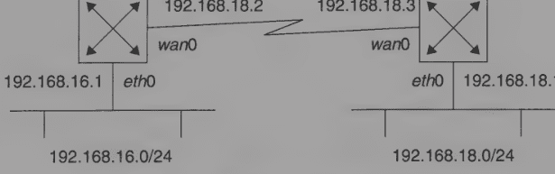

图 5.5 使用零节点网络的 Frame Relay PVC

> 实际上，你可能可以使用更少的 IP——你稍后第 277 页看到。

## 用于 Frame Relay 的 Linux 和 WANPIPE

1. 为 B 位置配置 DNS 映射要么已经完成，要么在你的待办事项列表中。你可以快速修改 B 位置的反向 DNS 区域（18.168.192.in-addr.ar），为 PVC 的两端赋予有意义的名字，例如：

```
1.168.192      IN PTR       frlocB.yourdomain.com.
2.168.192      IN PTR       pvc100-200.yourdomain.com.
3.168.192      IN PTR       pvc200-100.yourdomain.com.
```

在 DNS 中包含这些有助于任何利用反向查找的 IP 身份验证机制。

2. 往点对点 IP 的数据包将通过其 IP 地址被所有人识别。

3. 假设你登录到路由器 B 并想要与 A 网络中的工作站通信。你知道如何路由到 A——即通过 Frame Relay 链路路由。这意味着你的数据包源地址将是 192.168.18.3（而不是你认为的 192.168.18.1）。当 A 网络中的工作站回复时，它可以轻松地找到 192.168.18.3，因为这只是 B 端的机器之一（如果你为链路使用了独立的网络，那么 A 网络中的工作站可能无法找到你，或者根本找不到）。

4. 你可能为网络上的每个 PVC 节省了一张路由表，减少了网络工作量。

5. 你节省了至少 4 个 IP 地址（每个节点一个，加上网络地址和广播地址）。如果由于某种原因 IP 地址供应短缺，这变得非常有意义。

## 5.3.6 启动 WANPIPE

如果你像我一样，那么你可能太没耐心在尝试某些东西之前去读文档。你可以通过 `/etc/init.d/wanpipe start` (Debian) 或 `/usr/sbin/wanrouter start` (非-Debian) 测试你的配置。如果链路建立成功，太棒了！如果没有成功，我们需要进行一些故障排除。首先，让我们回顾一下 WANPIPE 启动脚本做了什么。

1. 将 [/wan]router.rc 的内容读入环境变量。此文件告诉 WAN-PIPE 在何处查找配置文件，以及是否应该启动路由器。

2. 检查 `ROUTER_LOCK` 是否存在。如果存在，说明 WANPIPE 正在运行，应在重启之前停止它。

3. 调用 `router.up()` 函数，它将所有输出记录到 `$ROUTER.LOG`。`router_up()` 执行以下操作：

   - (a) 检查每个 `$WANPIPE_DEVICES` 的配置文件是否存在于 `$WANPIPE_CONF_DIR`。
   - (b) 检查 `ROUTER_BOOT` 是否设置为 NO。如果是，WANPIPE 不启动。
   - (c) 首先加载 `$WAN_DRIVERS` 中的每个模块，确保模块已加载。`modprobe` 的结果会在日志文件中记录为 "ok"（成功）或 "fail"失败）。
   - (d) 使用 `wanpipe.conf`（以及其他参数）调用 `wanconfig`。这是创建 [interfaces] 中列出的接口的地方。
   - (e) 在 `$IFCONF_DIR` 中查找每个接口的 IP 配置。当 wanpipe 创建接口并成功注册到内核时，`/proc/net/dev` 中会创建一个条目。脚本检查每个 `$IFCONF_DIR` 文件；当在 `/proc/net/dev` 中发现匹配时，调用该接口的 `interface.up`。
   - (f) `interface.up` 读取接口（在第 5.3.4 节中讨论过），并使用其中的值 `$IPADDR`、`NETMASK`、`BROADCAST` 和 `$GATEWAY` 配置接口。
   - (g) 为内核添加主机路由。
   - (h) 可选添加网络路由。

启动 WANPIPE——加载模块 现在你知道应该发生什么，我们可以讨论可能出错的地方。必须加载驱动模块。如果在 `/lib/modules/$(uname -r)` 中找不到模块，或者模块是为错误的内核编译的，或者运行的内核没有编译 WANPIPE，你将需要采取纠正措施。在第一种情况下，可能是你忽略了内核编译的最后一步。在第二种情况下，你编译了内核但自编译后没有运行 `depmod`。解决方法是重启系统。当模块加载时，`depmod` 的输出如下：WANPIPE modules for 2.2.x

| Module | 大小 | 使用者 |
| :--- | :--- | :--- |
| wanpipe | 24176 | [wanpipe] |
| wanrouter | 6092 | [wanpipe] |
| sdlarray | 8064 | 0 [wanpipe] |

模块加载后，syslog 应该包含类似下面的消息：

zinc kernel: WAN Router v1.1 (c) 1995-1999 Sangoma
zinc kernel: SDLA Support Module v3.0 (c) 1995-1999 Sangoma
zinc kernel: WANPIPE(tm) Multiprotocol Driver v5.0 (c) 1995-1999 Sangoma

启动 WANPIPE——wanconfig 必须读取并解析 `wanpipe.conf` 并使用这些信息配置卡和驱动程序。它将输出记录在 `$ROUTER_LOG` 中，因此文件格式中的任何错误都会显示。如果一切顺利，你应该在 `/var/log/wanpipe.log`（非 Debian 系统为 `/var/log/wanrouter.log`）中看到以下：

Tue Feb 15 20:57:30 MST 2000: starting WAN router
Loading driver wanpipe ... ok
Starting up device: wanpipe
WAN Router Configurator. v2.1.0 (c) 1995-1999 Sangoma Technologies Inc.
* 解析配置文件 /etc/wanpipe/wanpipe.conf ...
* 读取 [devices] 节
* 读取 [wanpipe] 节
* 读取 [interfaces] 节
* wan0 被 wanpipe
* 读取 [wan0] 节
* wan1 被 wanpipe
* 读取 [wan1] 节
* 正在配置设备 wanpipe (Frame Relay 链路)
* 设置 IOPORT 为 0x360
* 设置 IRQ 为 12
* 从 /usr/lib/wanpipe/fr514.sm 读取 25084 字节
* 设置 INTERFACE 为 V35
* 设置 CLOCK 为 EXTERNAL
* 设置 BAURATE 为 512000
* 设置 MTU 为 1500
* 设置 UDPPORT 为 9000
* 设置 STATION 为 CPE
* 设置 SIGNALING 为 ANSI
* 读取 DLCI(s) Included : 200
* 读取 DLCI(s) Included : 300
* 正在配置通道 wan0 (WANPIPE)。媒体地址：200
* 正在配置通道 wan1 (WANPIPE)。媒体地址：300

wanpipe 的活动也会在 syslog 中生成消息。完全加载的会话包含你喜欢的信息：

zinc kernel: SDLA Support Module v3.0 (c) 1995-1999 Sangoma Inc.
zinc kernel: WAN Router v1.1 (c) 1995-1999 Sangoma Inc.
zinc kernel: WANPIPE(tm) Multiprotocol Driver v5.0 (c) 1995-1999 Sangoma Inc.
zinc kernel: 正在处理 WANpipe 设备
zinc kernel: sdlci: 在端口 0x360 找到 S00。
zinc kernel: sdlci: 同步 16000 kHz 的 CPU 时钟频率。
zinc kernel: sdlci: 双端口内存窗口设置为 0EEE00。


## 5.3.7 启动 WANPIPE—其他潜在问题

如果 syslog 和 /var/log/wanpipe.log 中的所有内容看起来都正常，但连接仍然无法工作，那么你得进一步挖掘了。虽然这些方法不能立即解决问题，但仍有一些方法可以检查你的工作并理解 WANPIPE 如何在你的系统中运行。

一旦 WANPIPE 启动，你可以使用 `ifconfig` 来查看为每个 PVC 创建的接口。如果它们不存在（显示错误信息 `wan0: unknown interface`），请仔细检查日志文件。确保你看到了诸如 `wanpipe: Interrupt Test Passed, Counter: 101` 之类的消息，这表明你选择的中断对 S508 是可用的。如果你看到 `wanpipe: Interrupt Test Failed`，说明你发现了一个已被占用的中断。使用 `cat /proc/interrupts` 可以找到未使用的中断，并根据你的选择编辑 `wanpipe.conf` 中的 IRQ 设置。

```
zinc:> ifconfig wan0
wan0 Link enc:Frame DLCI
inet addr:192.168.20.2 P-T:192.168.20.3 Mask:255.255.255
UP POINTPOINT MTU:1500 Metric:1
RX packets:743135 errors:0 dropped:0 overruns:0 frame:0
TX packets:788143 errors:0 dropped:10 overruns:0 carrier:0
Collisions:0
Interrupt:12 Base address:0x360 Memory:ee000-ffff
```

```
zinc:> route -n | grep wan0
Destination Gateway Genmask Flags Metric Ref Use Iface
192.168.20.0 0.0.0.0 255.255.255 USS U 0 0 4552 wan0
192.168.20.0 0.0.0.0 255.255.255 U U 0 0 7727 wan0
```

路由器并不仅仅靠 `ifconfig` 运行；你还必须在链路上建立路由，才能使用它。如果你已经有了路由，请检查内核中是否启用了 IP 转发——如果没有，请查看第 55 页的提示。

当 WANPIPE 启动时，它会在 `/proc` 文件系统中创建一个目录。该目录为 `/proc/net/wanpipeN`（系统中的每个物理设备对应一个）。这些目录中的每一个都应该包含有意义的信息——前两个文件的值应该与你在配置文件中输入的内容匹配，而第三个文件包含关于网卡使用的统计数据。

```
zinc:> /proc/net/wanrouter> pwd
/proc/net/wanrouter
zinc:> /proc/net/wanrouter> cat config
Device name | port IRQ | DMA | mem.addr|mem.size|option1|option2|option3|option4
wanpipe | 0x360 12 0|0xEE000|0x2000 | 5080 16000 131072 6800
```

| 端口 0 状态 |
| 站 (station) | 接口 (interface) | 时钟 (clocking) | 波特率 (baud rate) | MTU | 设备数 (ndev) | 链路状态 (link state) |
| :--- | :--- | :--- | :--- | :--- | :--- | :--- |
| wanpipe | DTE | V.35 | external | 512000 | 1600 | 4 已连接 |

## 用于帧继的 Linux 和 WANPIPE

```
zinc:/proc/wanrouter> cat wanpipel
total packets received: 81010211
total packets transmitted: 86599548
total bytes received: 56644117067
total bytes transmitted: 21996285192
bad packets received: 0
packet transmit problems: 902
received frames dropped: 0
transmit frames dropped: 412
micast packets received: 0
transmit collisions: 0
receive length errors: 138
receiver overun errors: 0
CNC errors: 0
frame format errors (aborts): 45
receiver fifo overrun: 0
receiver missed packet: 0
aborted frames transmitted: 0
```

如果你仍然毫无进展，请不要放弃！这一节是关于配置和系统问题的。许多因素影响着你的帧继电路的运行。请复阅第 5.4 节中的信息，该节涵盖了可能导致链路中断的其他场景。

如果你的链路已建立，恭喜你。（我一直觉得建立新链路非常兴奋。）你只需通过在路由语句末尾列出接口来添加路由——不需要网关——就像我们在第 3 章处理以太网设备那样。除极少数例外外，你可以对你的 WANPIPE 帧继接口进行任何操作。下一节将涵盖大部分的例外情况。

## 5.3.8 不适用于帧继的 TCP/IP 工具

WANPIPE 创建的接口与你系统上的任何其他接口一样，对吧？遗憾的是，答案是“几乎如此，但并不完全是”。你可能想于使用你几个熟悉的 TCP/IP 工具来监控流量流并帮助排除故障，结果发现它们对帧继接口不起作用。我遇到的第一个这类工具是 `tcpdump`，但我后来了解到我将其扩展到了所有基于 `libpcap` 库的工具。你可能不熟悉 `libpcap`，这里是随发行附的 README 文件的摘录。

libpcap 为低级网络监控提供了一个可移植框架……由于几乎每个供应商都提供不同的数据包捕获接口，由于我们开发了许多需要此功能的工具，我们创建了这个与系统无关的 API，用于移植并减少每个应用程序中对特定系统数据包模块的需求。`libpcap` 已获得广泛接受。`libpcap` 读取原始数据包而非 TCP/IP 负载，以理解链路层协议。到为止，还没有人添加对帧继格式的支持？这可能是我的下一个项目；任何感兴趣帮助的人请与我联系。

## 5.4 使用 WANPIPE 对帧继进行故障排除

使用 `libpcap` 且适用于以太网设备但不再适用于帧继的其他监控和故障排除工具按名称列出：`arpwatch`、`ethereal`、`ipgrab`、`libnet-raw`（这本身不是工具，而是另一个库）、`sniffit`，以及最后同样重要的 `tcpdump`。

帧继链路问题可能发生在路由器之间路径的许多点。有效的故障排除涉及使用（通常是有限的信息）来推断问题的根源。一旦确定了问题，就制定一个修复策略，然后进行测试。由于距离遥远，你的策略首先是确定问题发生在哪里。使用以下列表：

- 你位于 A 处的路由器
- A 与服务提供商 POP 之间的接入
- A 附近的服务提供商路由器
- A 和 B 之间的网络
- B 附近的服务提供商路由器
- 你位于 B 处的路由器

由于有很多可能性，首要任务是减少可能性。以下章节列出了你在这些位置处可以检查的项目。它们还提到了 `fpipemmon` 实用，该工具在第 5.4.3 节中有详细介绍。

### 5.4.1 帧继故障排除——你的路由器

由于沿途节点很多，链路可能需要 30-40 秒才能再次开始传输流量。如果路由器已重启，它可能正在协商链路参数，并等待对端注意到它已回到网络。

- 你的路由器最近是否重启过？
- 你最近是否生成了可能不支持 WANPIPE 的新内核？
- 你是否不小心执行了此操作并重启？
- WANPIPE 是否启动？
- 检查 syslog 或 wanpipe.log 中是否有 WANPIPE 相关的消息——否则你可能遇到了中断冲突。
- 检查 wanpipe.log 中是否有包含 "Interrupt Passed" 字样的消息。
- 检查 WANPIPE 是否启动。
- `ifconfig` 是否显示接口状态为正常？
- `route -n` 是否显示点对点路由？
- `route -n` 是否显示远程子网路由？

### 5.4.2 帧继故障排除——接入问题

在 WANPIPE 中，是否有网络管理员正在进行维护？
- 你最近是否修改了 `wanpipe.conf` 或升级了 WANPIPE 软件？
- 你最近是否向系统中添加了另一个设备（忘记更改基地址了？）？
- 是否有一个设备想要 WANPIPE 网卡的 IRQ？一个 PnP 设备？
- 系统是否还有其他问题？磁盘空间不足？
- 内核是否崩溃（panic）？（良言有益：如果崩溃有某种道理，请回退到你之前有效的内核。）
- 但最后同样令人头疼的是：你检查电缆了吗？


## 154 Zinc-A 框架路由器 第 5 章

……令人担忧。为了排查接入电路故障，即使你知道接入已断开，通常也需要联系你的帧中继（Frame Relay）提供商，等待其进行初步测试，并由其联系接入提供商。问题也可能相反相反。无论何种情况，在链路断开期间，你都需要花费时间。检测接入问题的方法：

- 执行 `fpipemon -i interface -u 9000 -c xm` 是否显示电路已开启（up）？（注意：interface 是 IP 地址的接口名称或点对点链路另一端的 IP 地址。）良好的输出如下所示。

```
zinc:/root> fpipemon -i wan0 -u 9000 -c xm
MODEM STATUS
DCD IS HIGH
CTS IS HIGH
```

糟糕的输出会列出信号为 LOW（低）。如果你从 `fpipemon` 检查 IP 地址和端口时收到错误，要么是你没有指定正确的 IP 地址或接口，要么是 WANPIPE 没有运行。

- 如果 `fpipemon` 认为电路已断开， CSU/DSU 或电路分界点（demarc）上是否有任何指示？如果有连接，请联系你的帧中继提供商。通话时你需要电路 ID（circuit ID），这就是为什么我将此信息直接放入 `wanpipe.conf` 的原因。

- 如果你这边电路看起来正常，那么问题可能不在接入端。你应该能够使用 `fpipemon` 的跟踪模式（trace mode）来查看节点与 POP 点交换机之间的流量。至少，你应该能看到状态消息（心跳/keep alive）、完整的状态条目，可能还有正在交换的数据包。

fpipemon 跟踪状态消息、FSEs 和数据载负载

```
zinc:/root> fpipemon -i wan0 -u 9000 -c ti
Starting... (按回车键退出)
OUTGOING 16 19821 Link Verification Request Sx 7C Rx 06
INCOMING 16 19823 Link Verification Reply Sx 07 Rx 7C
OUTGOING 16 7727 Full Status Request Sx ID 1B |
INCOMING 21 7730 Full Status Reply Sx 1C Rx 1B \\ DLCI 600 PRS 600ACT
INCOMING 293 49726 Data Frame on DLCI 600
INCOMING 52 30939 Data Frame on DLCI 600
```

如果你看到出站流量但没有入站流量，网卡认为接入是正常的。问题可能出在你提供商的设备上，或者他们那端的接入上。当无法与提供商路由器通信时，WANPIPE 会在 `/var/log/messages` 中将电路标记为 down，因为它没有收到心跳和状态条目的回复。它将继续生成出站（OUTGOING）LMI 消息，希望电路恢复，但它不会尝试重启 TCP/IP 数据传输。

## 使用 WANPIPE 排除帧中继故障

- 如果你报修问题且没有其他明显的异常，你的提供商可能想要执行环回测试，或“接通 CSU/DSU（loop up）”。如果提供商无法接通你的 CSU/DSU，他们会询问你 CSU/DSU 是否已上电并连接。虽然要求很苛刻，但你应该检查所有的电缆，如果你有外部 CSU/DSU，最好检查确保它已开启并正确连接。如果你这边看起来正常，那么问题就在接入电路上。

## 什么是环回（LOOPBACK）？

> 环回是指内置在所有 T1 接口设备的自动测试功能。发生的情况是提供商向你的设备发送一种特殊的极性违规（bipolar violations）序列，指令设备完成发送对和接收对之间的电路。现在有了“环路”，提供商就可以向电路发送测试模式并观察结果。这样做是为了确定电路上有多大的噪声，以及电路是否完整。不要将其与每个 Unix 系统自带的本地环回网络接口——IP 地址为 127.0.0.1 的接口混淆。

## 云端问题

云指的是你的提供商网络中位于你的路由器和接入之外的部分。一旦数据包从你的路由器通过接入链路到达提供商设备上的端口，在它们从另一侧离开之前，你基本上对它们没有控制权。这意味着实际上很难检测到云端的问题。更有可能的情况是你耗尽了所有其他可能性，然后推断出问题就在那里。

“症状”是两端的路由器都是开启的并接收心跳消息（这样你就知道 LMI 是开启的且端口是活跃的），但你无法通过端到端的数据包。如果双方都认为远程 DLCI 是活跃的，那么问题可能是提供商网络中的缓存。如果一方看不到它的伙伴 DLCI，那么提供商可能错误地构建了 PVC（或根本没有构建）。

无论何种情况，你除了向提供商提交故障单外别无事可做。由于大多数帧中继网络具有多个冗余路径，云端的问题意味着后端出现了糟糕的情况。或者，问题可能在提供商网络内部的交换机或 PVC 配置上。

## B 地接入和 R 路由器的问题

另一端的任何问题都可以以你在链路 A 端采取相同的方法进行评估。唯一的棘手点可能是你无法到达路由器 B（因为链路断开）。


# 使用 WANPIPE 排故障帧链路（Frame Relay）

使用 `fd` 命令刷新（重置）所有驱动程序的统计数据。

| fpipemon 命令-FT1 (T) 限定符 | 含义 |
|---|---|
| Tv | 查看状态 |
| Ts | 自检 |
| Tl | 线路环路测试 |
| Td | 数字环路测试 |
| Tr | 远程测试 |
| To | 运行模式 |

注意，这些命令仅在你拥有集成 CSU/DSU 的 Sangoma FT1 版本网卡时有效。关于输出的更详细描述可以在 WANPIPE 随附文档中找到，因此此处不再列出。警告：如果你在路由器运行时对 CSU/DSU 进行环路测试，你无疑会使链路中断，至少持续一段时间。除 Tv（查看状态）外，你应仅在 WANPIPE 停止时使用这些命令。

| fpipemon 命令-跟踪 (t) 限定符 | 含义 |
|---|---|
| i | 解释/全部——这将以易于阅读的“解析”格式显示数据 (IP) 和协议（链路层）帧 |
| ip | 解释/协议——这将以易于阅读的“解析”格式显示协议帧 |
| id | 解释/数据——这将以易于阅读的“解析”格式显示数据负载 |
| r | 原始/全部——这将以十六进制格式显示所有数据 (IP) 和协议（链路层）帧的内容 |
| rp | 原始/协议——这将显示原始链路层帧。这可能作为学习辅助很有帮助。（结合相应的 RFC——可能是 RFC 1490——并解码帧头中的值。）如果你怀疑与提供商的设备存在某种不兼容性，也应该执行相同的操作 |
| rd | 原始/数据——这将以十六进制格式显示帧负载 |

对于所有跟踪模式，你通过使用 `fpipemon` 发布命令来开启跟踪，它将开始跟踪到标准输出 (stdout)。要关闭，请按回车键。取决于调用 `fpipemon` 时使用的选项，输出可能是链路验证或状态请求（协议）、这些请求的不同回复（也是协议），或入站或出站数据。

解释后的协议跟踪是故障排除信息的极佳来源。输出是路由器与 POP（人口点）设备之间交换的 LMI（本地管理接口）信息。一旦学会了如何解码输出，你就可以从 FSE（全状态查询）消息中判断哪些 DLCI 是激活的、可用的缺失的。消息的精确格式取决于你运行的状态轮询（LMI）协议。原始 LMI 简单称为 LMI。该协议的局限性是单向的（节点路由器提问，POP 路由器回答）。更新后，较新的选择是 Q933（附件 A）和 ANSI（附件 D）。

你的路由器会定期发送“你在线吗？”的查询。上游路由器应在特定的超时范围内（T391）回复。你可以向 POP 路由器发送全状态查询，请求更多关于网络状态的信息。POP 应在 T392 指定的超时范围内回复。POP 路由器也可能产生消息。这些消息可能是“DLCI 600 不再激活”或“DLCI 400 已变为激活”。

> 提示：SANGOMA 的 SNOOPER 工具

有时会出现很多问题，或者文档非常稀缺，你只想确认你的电路运行正常。对于这些情况，你可以使用 Sangoma 的 SNOOPER 工具。如果你没有网卡的软盘，可以在 http://www.sangoma.com/snooper/ 获取副本。注意该工具仅适用于 Sangoma ISA 网卡，如 S508。

SNOOPER 是一个 DOS 可执行程序。要使用它，将其放在可引导的 DOS 软盘上并启动路由器。它可以诊断 T1 链路的许多问题，包括带有噪声的 T1。它还能告诉你另一端的路由器是在运行 PPP 还是帧链路。当你对为什么不起工作而毫无头绪时，这是一种验证你的 CSU/DSU 配置有效性并排除接入电路怀疑的方便方法。

关于 `fpipemon` 和帧链路故障排除的讨论到此结束。考虑到可能遇到的各种不同情况，记录故障排除程序和策略是非常困难的。我试图强调在 WANPIPE 继路链路经验中获得的知识。你可能会遇到完全新且极其困难难以解决的问题。如果发生这种情况，你不应该气馁，也不要假设问题自动出在你这一边。我见过提供商在配置电路时出错，导致我必须替他们解决所有问题后他们才最终纠正。这是 Linux 和 WANPIPE 的优势之一——你拥有信息和工具。许多此类信息可以在 Sangoma 的故障排除网页上找到。URL 为 http://www.sangoma.com/linedebug.htm。

一旦运行起来，你将想知道你使用链路的程度和有效性。下一节将介绍一个监控带宽的 Web 工具。

# 5.5 MRTG—监控链路利用率

MRTG 是 Multi Router Traffic Grapher（多路由器流量图表）的缩写。它是一种网络监控工具，专门用于以图形方式展示流量数据，包括实时以及间隔（如小时、日、周、月、年）。它使用 SNMP 协议¹¹ 进行数据收集。

（注：原文后续部分存在大量重复段落，此处已按要求不重复输出）


# MRTG—链路利用率监控

类型（来自 RFC 1213 第 3.5 节——也称为 MIB-II）和速度。对于名为 wan0 的 512kbps 接口，我使用：

```
interface:      wan0      32      512000
```

一旦重启守护进程，SNMP Agent 程序将识别你的接口，MRTG 就能能够正确判断其速度。

- 对于 Uc SNMP（至少在 Debian 上），你需要稍微开放默认的安全设置才能使用它。你需要为 localhost 以外的主机添加只读访问，以便你的 MRTG 服务器能够访问并读取统计数据。这些都在 `/etc/snmp/snmpd.conf` 中（或者最好在 `/etc/snmp/snmpd.local conf` 中）。关于此文件中选项的更多信息，请参考你的系统文档。

在修改这些每一项后，你需要重启守护进程以读取新的配置文件：`/etc/init.d/snmpd reload`。

- 3. 进入支持系统并根据你的喜好配置 Apache。开箱配置可以正常工作，剩下的步骤是你创建了 `DocumentRoot` 为 `/var/www` 以及你的 MRTG 数据。当你创建此目录时，请确保它至少对 `www-data` 组可读，以便 Apache 能够访问。它应该是你运行 mrtg 执行文件的用户可写的。

配置文件格式很容易解码，如果你需要为特定的路由器或接口微调配置，可以阅读 MRTG 文档。如果你不想通过 `cfgmaker` 监控 MIB 值，也需要查阅文档。mrtg.cfg 中需要的另一个值是 `WorkDir::`，你应该将其设置为 `/var/www/mrtg`。

- 6. 此时，你可以让浏览器指向支持系统并访问为每个项目创建的 HTML 页面。你可以通过以下方式操作：

> 这是一个保持代码专注于任务的良好示例。将 cron 的编码留给。

# 5.6 配合 WANPIPE

URL 类似于 `http://support/mrt/iprouter.inf.html`。查看 `/var/www/mrt` 的内容以理解我的意思。

为了让你不必抱怨必须在浏览器中输入所有内容，MRTG 的作者包含了一个简单的方法来生成你配置的路由器的索引——`indexmaker`。检查它的管理，并在每次更改 `mrtg.cfg` 时运行它。现在你可以让浏览器指向 `http://support/mrtg` 来查看概览，并点击链接查看每个路由器和接口的详情。

如果你遵循了示例，我希望你的配置进展顺利。这不是一个难以配置的包，一旦看到路由器流量的图表，你会发现努力是值得的。默认情况下，MRTG 会生成每日、每周和 yearly 图表，因此它对于观察网络流量趋势立即有用。因为它是基于 SNMP 的（如果你有源代码的话！），它可以成为你监控基础设施的骨干。MRTG 还有许多潜在的“下一步”。我发现的一种可能性是通过 SNMP 获取可用的 IP 计数器。只需花一点时间配置 MRTG，你就可以为某些协议或某些子网生成流量图表——任何你可以通过 IP 计数配置的内容。很酷，对吧？

如果你是 LRP 的粉丝并需要 WANPIPE 的功能，那么你幸运了。LRP 的维护者已经打包了一个类似 Sangoma 驱动软件的版本，类似于 Debian 的 wanpipe 软件包。该软件包可以在 LRP 站点 `ftp://ftp.linuxrouter.org` 获取，并按照后续节的说明添加到你的 LRP 根磁盘中。注意，为了节省空间，LRP 和 Debian wanpipe 软件包之间存在差异。精简的内容包括文档、详细的启动和关闭脚本、内核补丁等。如果你计划使用 LRP wanpipe，你应该从其他地方获取文档（例如 Sangoma 的 FTP 站点）。从配置的角度来看，差异如下：

- `router.conf` 被称为 `/etc/wanpipe/wanpipe.conf`。

- 没有 `/etc/wanpipe/interfaces/` 或任何接口文件。在 `wanpipeconf` 解析配置文件后，你需要使用 `ifconfig` 配置你的 WANPIPE 接口。

- 有一个额外的命令 `wanstat`，它可以显示来自 `/proc` 文件系统的状态信息。

- 不包含 `cfgtail`。如果你想在 LRP 根磁盘上拥有它，不要从 Debian wanpipe 软件包或 Sangoma 的 tar 包中拷贝二进制文件。因为这些是动态链接的，它们不太可能在精简库的 LRP 系统上运行。相反，编译一个静态链接的版本（编辑 Makefile 使用 `-static` 开关）或者在安装到 LRP 系统之前在另一个系统上配置 S508-FT。因为配置存储在非易失性内存中，当你重启板卡时它将保持完好。

# 5.6.1 将 LRP 软件包添加到你的 LRP 根磁盘

向 LRP 添加软件包包是简单的

- 1. 对 `.lrp` tar 包进行任何需要的更改，例如对于 WANPIPE，你可以提供特定的 WANPIPE 配置文件，然后重新组装 tar 包。
- 2. 在你的工作站上挂载 LRP 根软盘（记住它是 DOS 格式的软盘）并将 `.lrp` 文件拷贝到软盘的根目录。使用命令如 `mount -o /dev/sdb1 /mnt-wait`。
- 3. 进入支持系统并根据你的喜好配置 Apache。开箱配置可以正常工作，剩下的步骤是你创建了 `DocumentRoot` 为 `/var/www` 以及你的 MRTG 数据。当你创建此目录时，请确保它至少对 `www-data` 组可读，以便 Apache 能够访问。它应该是你运行 mrtg 执行文件的用户可写的。


# 氧气—互联网路由器

从以前开始，我们的互联网连接连接到一个 BigName 路由器上。某天，这台路由器决定以一种非常诗意的“它就是无法启动”的方式死去。总的来说，大约花了一个小时才拨通 BigName 技术人员的电话；期间，我们忙着寻找支持 ID 浪费了时间，穿梭于“按 6 使用我们的传真回传服务器”等菜单，在等待中等待，并抵御那些疯狂的用户。在就我配置终端程序的能力进行简短讨论（期间夹杂了几几句刻薄的吐槽，到底需要什么蠢线才能访问 BigName 路由器的控制台）后，技术人员决定我们第二天需要一个新的主板。我们告知了用户这一情况并焦切地等待包裹。第二天，包裹确实如约到达了。然而，令我们沮丧的是，我们收到了一个新的电源和机箱——没有主板。现在我们遇到麻烦了。BigName 会给我们发送零件，但这意味着至少有 24 小时的停机时间。根据我们对 Linux Frame Relay 路由器的经验，我们决定用备用的 Sangoma S508 线缆接入 T1 线路。我们在大约一小时内完成了加载和配置。每个人深吸了一气，松了一口气——至少现在我们有了“氧气”。

由于将系统连接到互联网涉及大量领域，因此该主题分布在两个章节中。本章首先从如何使用 Sangoma 的 WANPIPE 让我们的接入路由器运行起来开始，这次是用于同步 PPP。然后，我们将回顾 Linux（以及通用的 Unix）的通用网络安全。一旦系统不再因为运行在上面的服务而存在任何空大的安全漏洞，我们将转向 IP 防火墙，以进一步保护我们的网络和路由器。使用 IP 防火墙有两种基本方法：防止跨路由器的流量，或者完全阻止流量进入（或离开）路由器。我们将涵盖这两种方法。它们是构成包过滤基础的内核设施，以及所有可以帮助你配置的工具。最后，我们将讨论 Linux 中可用的通知工具，以便你监控自己的环境，并在出现问题时接收通知。

## 6.1 连接到互联网

与网络不同（网络可能只有几种不同类型的接入介质和相应的链路层协议），你实际上可以以几十种方式连接到互联网。（你可能还记得第 2 章关于接入和协议的讨论。）本节介绍了一种基于 Linux 的路由器，它使用通过分级 T1 线路的同步 PPP 连接到 ISP 和互联网。

同步 PPP 作为一种协议，实际上与原生 PPP 没有任何区别。这个名称修饰只是“我正在通过连接到 ISP 的专用数字接入电路上运行 PPP”的简略说法。运行在租用线上简单地简化了协议的某些方面。首先，你不需要拨打任何数字。当你的路由器运行且你 ISP 的路由器运行时，你就已经上了互联网。其次，PPP 链路本身的安全性就不再是一个大问题了，因为接入电路在你的站点和 ISP 处都终止。他们知道你是谁，你也知道你是谁。因此，大多数连接都忽略了熟悉的基于 PAP 或 CHAP 的验证，直接开始路由流量。第三点区别是你不再需要运行 `pppd`。我说在某些情况下你可能会运行 `pppd`，例如，如果你的同步数据泵仅仅是一个——数据泵。在这种情况下，驱动程序将向 Linux 内核呈现为 `getty` 而不是网络设备。据我所知，这种情况很少见，而且对于 Sangoma S508 卡，绝对不是如此。它在板卡上运行协议，并作为网络接口呈现给系统。正如你将看到的，它与第 5 章中的 Frame Relay 路由器非常相似。

### 6.1.1 使用 WANPIPE 的 SPPP 路由器

材料：

- 基于 x86 的 PC，486/66 或更快，配备 16MB RAM
- 1GB IDE 硬盘
- Sangoma S508/FT-1 适配器
- 以太网适配器
- CAT5 线
- 设置 Debian GNU/Linux 2.x 版本救援光盘和免费软盘

一旦你安装了 S508/FT-1 适配器和以太网适配器并完成了操作系统的基础加载，就可以准备配置 WANPIPE 软件了。本节假设你正在使用 Debian 和 `wan-pipe` 软件包（但此与 Sangoma 版本之间的区别仅仅是视觉上的）。在加载 Debian 时，你只想安装“基础 (Basic)”安装以及一些网络工具和 `wanpipe` 软件包。一旦安装完成：

- 1. 使用 `/usr/bin/wanpipeconfig` 创建一个名为 `spppp0` 的接口；使用服务提供商给你的 IP 配置。
- 2. 使用 `zcat /usr/share/doc/wanpipe/examples/wanpipe1.ppp.gz > /etc/wanpipe1.conf` 种子配置文件。然后编辑 `/etc/wanpipe1.conf` 以适应你的特定配置。
- 3. 使用 `/usr/sbin/cfg8` 工具配置 Sangoma 卡上的集成 CSU/DSU。（对于不使用 Debian 的 `wanpipe` 的用户，该软件包可以从 Sangoma 的 FTP 网站单独付费获取）。
- 4. 使用 CAT5 线将 S508/FT-1 连接到供应商安装的 T1 智能插座（或线路点）。
- 5. 执行脚本 `/etc/init.d/wanpipe reload`。
- 6. 使用 `ifconfig` 验证 `spppp0` 接口已启动并正常运行。
- 7. 使用 `route add -net default spppp0` 添加指向互联网的默认路由。
- 8. 剩下的时间去休息吧！

一旦你回到办公室（或者如果你有条件的话，从家里拨号），将你的路由语句添加到 `/etc/wanpipe/wanpipe_routes`。如果你是那种疑多症严重的人，此时你应该开始冒冷汗了。你在没有任何安全措施的情况下连接到了互联网！（我们稍后会解决这个问题。）WANPIPE 和 PPP 的配置过程与 Frame Relay 非常相似。在操作流程上，它们是相同的，因此你可以查阅第 5 章获取更详细的说明。简而言之，PPP 具有以下差异：

- `wanpipe1.conf` 中有不同的参数，在下文的 6.1.2 中将进行介绍。

### 6.1.2 配置 wanpipe1.conf

同步 PPP 格式与 Frame Relay (5.3) 相同，但某些适用于 PPP 的参数除外。

```
#
# 设备级链路配置部分。

[wanpipe]               ### WAN_PPP 接口 ###
IOPort          = 0x360             # I/O 端口基础
IRQ             = 12                # 中断
Firmware        = /usr/lib/wanpipe/ppp508.sfm # 适配器固件
Interface       = V35               # 物理接口类型，RS232/V35
Clocking        = External           # 发/收时钟源：外部/内部
Baudrate        = 512000            # 比特率为 bps
IP_MODE         = STATIC            # PPP/STATIC：不请求地址
MTU             = 1500              # 最大传输单元，字节
UDPPORT        = 9000              # 用于 UDP 管理
AUTHENTICATOR = NO                # 初始化 PAP 或 CHAP 验证？
TTL             = 0x7F               # 用于 UDP 监控
```

运行固件模块的设备需要将 `config_id` 设置为 WAN_PPP。你应该编辑注释字段包含线路 ID，可能还有 ISP 的支持电话。

### wanpipe.conf 中的接口配置

```
# -----------------------
# [interfaces] 部分定义了逻辑通道
# 由路由器创建的对应接口。
# name=device,media_addr,description
# -----------------------
[interfaces]
sppp0 = wanpipe, **edit router.conf **
```

sppp0 是我用于同步 PPP 接口的接口名称，但选择是任意的。如果我想更改它，不要在随后的接口级部分中忘记它。`device` 是你在 `[devices]` 部分中已定义的、`configid` 为 WAN_PPP 的任何设备。PPP 链路没有介质地址，因此 `media_addr` 留空。这是因为每个 `[device]` 对于 PPP 只有一个 `[interface]`。PPP 设计并不是为了与其他任何协议或链路共享线路——它想独占整个链路。注释字段可以查看它。我建议将 PPP 配置的 IP 地址或更多 ISP 的信息放在那里。

```
# -----------------------
# [devices] 部分
# device = configid,description
[devices]
wanpipe = WAN_PPP, **edit router.conf with your circuit id**
```


## 连接到互联网

设备级配置为 PPP 准备了驱动程序。这与 Frame Relay 的设备级配置基本相同。我们省略了 `Memaddr`，因为我们希望驱动程序自动选择内存范围。请注意，Firmware 路径已从 Frame Relay 配置发生更改，以反映这是一个 PPP 链路的事实。如果你还记得，回想一下关于 S508 卡的通用讨论（如果你还记得该卡在卡上运行 WAN 协议，从你的路由器 CPU 上卸载了大量工作）。PPP 设备级配置的新参数如下：

- IP_MODE [STATIC 或 PEER，默认为 STATIC]——当设置为 STATIC 时
将使用 `/etc/wanpipe/interfaces/pp0` 文件中的 IP 地址来配置链路。PEER 表示链路上的对端（即你的 ISP 路由器）应为链路提供 IP 地址。
- AUTHENTICATOR [YES 或 NO]

### wanpipe1.conf 中的 SPPP 接口级配置

```bash
#
#
# 接口级配置部分
#
[pp0]
MULTICAST = NO # 是否启用多播？
PAP = NO # 启用 PAP？(YES/NO)
CHAP = NO # 启用 CHAP？(YES/NO)
#USER = # 如果你不是身份验证者，请提供所有登录
# 列表。(USER1 / USER2.../ USER10...)
# 登录名用 "/" 分隔
#PASSWD = # 如果不是身份验证者，请输入你登录名
# 对应的密码。如果你是身份验证者，
# 请按**相同顺序**提供所有登录名
# 的密码列表。例如：(PASS1 / PASS2...)
#PASS10...

SYSNAME = # 如果你是身份验证者，请输入你的本地
# 系统名称。否则保持注释状态
```

PPP 接口接口级配置中唯一的内容与身份验证有关。关于身份验证有一个警告——如果你发现你需要能够向对端进行身份验证，请确保对端支持 PAP 或 CHAP。否则，你可能会无事可做，或者需要向 Sangoma 索要特殊补丁。如果你是身份验证者（即设置了 `AUTHENTICATOR=YES`），则可以指定其中一种协议。你还必须通过 `SYSNAME` 设置你的系统名称。

- USERID=username [/ username ...]——如果你被要求进行身份验证，则应提供单个用户名。如果作为身份验证者，你可以列出你的对端可能使用的用户名。
- PASSWORD=password [/ password / password... ]——使用方法与 USERID 相同。
- SYSNAME=sysname——仅在你是身份验证者时使用此项。这与 `pppd-secrets` 或 `chap-secrets` 文件中的字段相同。

在你的互联网路由器上配置默认路由配置 WANPIPE 的最后一步是调整由 `wanpipeconfig` 创建的接口文件。你可以直接编辑文件：`/etc/wanpipe/interfaces/pp0`。你的 ISP 应为点点链路提供 IP 地址、默认网关和子网掩码。如果你的 ISP 表示你的路由器将为你提供 IP 信息，那么你需要确保在 `/etc/wanpipe/wanpipe1.conf` 中设置了 `IP_MODE=PEER`。

对于互联网路由器，你希望默认路由指向 `spp0` 接口——即指向互联网。对于此应用，在接口文件中配置 `NETWORK` 和 `GATEWAY` 参数是有意义的，因为一旦你有了指向该接口的默认路由，其他通过该接口的路由就是冗余的。`NETWORK` 被设置为 `0.0.0.0`，`GATEWAY` 是你的 ISP 侧点对接口（对端）的 IP 地址。如果你的 IP 地址是由对端设置的，你可以轻松地将 `route add -net default spp0` 语句添加到 `/etc/wanpipe/wanpipe.routes` 中。

## 提示：为 WANPIPE 添加默认路由

WANPIPE 支持在接口上添加默认路由的简单方法。在接口文件中设置 `NETWORK=0` 并留空 `GATEWAY`。当 WANPIPE 启动并配置好接口时，该路由将自动添加。（无论你如何添加路由，一旦该路由对应的接口被关闭，内核就会自动将其删除。因此，如果你从远程位置登录，请小心。）

## 解决 SPPP–ppipemon 问题

如果你的链路没有立即工作，你就需要进行一些故障排除。幸运的是，WANPIPE 为其保护的每个 WAN 协议都提供了一个监控程序。对于同步 PPP，该命令是 `ppipemon`，它的操作与第 5 章中的 `fpipemon` 实用程序非常相似。你可以使用监控程序来确定关于链路的一系列信息，从监控状态到接口统计，再到 IP 数据包本身的内容。在不带任何选项的情况下调用命令以查看用法说明。

## 6.1.3 互联网路由器上的内部路由

你如何在系统上配置剩余的路由取决于你的防火墙拓扑、你拥有什么种地址空间及其大小，以及你是否将使用动态路由守护。我包含了图 6.1–6.4（全部）。

## 6.1 连接到互联网

173

![img/7ea5bca3bf3791bc0052ffe33bd162_196.png]
图 6.1 互联网路由器拓扑

也许这听起来并没有那么糟糕。Linux 节点非常擅长同时处理多个任务。如果某个系统被攻破，你可以配置另一个系统来重新连接网络。在不那么糟糕的情况下，你可以花时间在路由器本身上配置过滤规则。记住，防火墙和互联网路由器的区别更多是为了用户和网络图，而不是关于哪些系统安装了安全。你的互联网路由器拥有严格的策略，就像你的防火墙一样；只是策略不同。

另一种在没有独立防火墙的情况下建立边界网络的方法是使用类似于图 6.2 的拓扑。这减少了一个需要维护和保护的系统，但在配置方面要求更高。为了使此配置生效，你肯定需要使用转发规则和输入/输出防火墙规则来控制通过防火墙的流量。这种配置是复杂的，所以当你从外部 shell 账户运行后，或者使用安全工具 *Firewalk* 或 *Satan* 时，应该彻底测试。

这种想法是建立一个边界网络，这样即使有人黑入它们，也被局限于网络内部。该术语将外部主机称为**堡垒主机**（bastion hosts）。如果你打算使用边界网络，可以将你的 DNS 服务器、SMTP 网关和外部 Web 服务器放在那里。这种配置是复杂的，所以当你从外部 shell 账户运行后，或者使用安全工具时，应该彻底测试。这提供了关于世界上已经已知的信息。

最后，如果你真的想做一些不同的，可以使用私有网络将你的路由器与边界网络隔离开，如图 6.4 所示。这里的主意是配置子网...

![img/7ea5bca3bf3791bc0052ffe33bd162_197_1.png]
图 6.3 组合防火墙/互联网路由器

> cracker 指具有恶意意图的人。
³ 该术语指的是优秀的程序员。（注：此处原文OCR可能存在乱码，已根据上下文推断）

...


## 6.1 连接到互联网

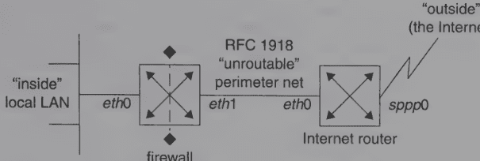
图 6.4 使用不可路由网络隔离互联网路由器

在互联网路由器和防火墙之间建立一个私有网络，且在局域网（防火墙内部）是完全不可路由的。

你还应该配置防火墙，拒绝任何源 IP 地址为互联网路由器的流量。效果是，如果有人攻破了互联网路由器，他的处境也不会比从外部访问时更好。这之所以有效，是因为防火墙上的包过滤代码会拦截来自路由器路由器 IP 地址的流量（即源于该处的流量），而不是由路由器转发的流量（仅带有其 MAC 地址）。防火墙指向内部的默认网关是防火墙外部接口上的 IP 地址。这种额外保护的代价是，如果不在管理工作站和互联网路由器之间引入某种防火墙“洞”，就无法远程管理互联网路由器。这可能是可以的，但攻击者会迅速发现管理系统的入口并开始从那里进攻。更好的主意是在路由器自身的控制台上对互联网路由器进行所有管理。为了将管理任务降至最低，你可以使用 LRP 发行版或其他 Linux 发行版，在你的工作站上可以相对舒适地准备好配置，然后将其交给路由器。由于安全性取决于互联网路由器和内部之间没有直接通信的途径，你必须考虑如何执行日志记录和系统问题通知。

到此我们对互联网路由器拓扑结构的简短介绍结束。请记住，这些并不包含、甚至代表最常见的配置。前三种可能是常见的，我使用了前两种。第四种是作为一个示例，说明你的一小思考如何为你的网络这一重要部分增加安全性（无论你的拓扑结构多么不直观）。如果你的网络很容易被攻破，那么稳定的互联网路由器也不值钱。如果你无法维护它，一个安全的系统也没有用。选择你的配置实际上只是一系列权衡，安全性与管理的便利性是完全对立的。

### 互联网路由——“内部”与“外部”

正如我之前提到的，如何配置路由取决于你的拓扑结构。然而，它至少包含三个部分：环回接口（loopback）、内部以及其他所有内容。其他通过通过 `spp0` 接口指向互联网的默认路由。

内部包含了互联网路由器之后的所有内容——即属于你的那部分互联网。至少，它应该包含分配给私有地址空间的网络，如表 6.1 所示。你还应该配置数据包过滤规则，不允许这些 IP 地址源自你的网络，以防你的路由器向附近的邻通这些地址（在命名空间范围内——例如在同一个 ISP 内），他们可能会注意到并决定查看你的网络有多开放。这些将是本章稍后出现的示例之一。

你在路由表中配置的内容还包括由 ISP 分配的互联网地址空间，因为你的路由器不会自动识别这些空间。这是显而易见的，但我不想让你在兴奋于建立连接时忘记它。请注意，点对点连接的 IP 通常不需要由内部网络路由。除非这是你拥有的互联网有效地址空间（这是一个问题，将在第 8 章解释），否则你可以忘掉它，因为你不应该通过这些 IP 直接接触网络上的每台路由器。最后，你的路由表可能包含任何其他地址空间，例如 IPv6 地址空间或互联网有效地址空间，这些空间未分配给你，但由于某种原因是已知或将从你的站点访问的。如果你打算配置动态路由守护进程，现在是时候了。

否则，将你的默认路由放在 `/etc/wanpipe/wanpipe_routes`（如果你没有在 `/etc/interfaces/ppp0` 中配置它），并将其他路由放在 `/etc/init.d/networks` 中。其他一切已就绪，你可以工作了，这可能完成了任务的 20%（尽管感觉像完成了 80%）；你仍然需要配置安全性。本章剩余很大一部分包含关于安全性的讨论。首先是关于通用网络安全的章节，将帮助你防止外部人员劫持你的路由器用于他们个人的（滥）用。接下来的章节涉及如何为 Linux 配置两种变体的防火墙（实际上是包过滤），限制 IP 转发并封封进入或退出系统的数据包。

#### 表 6.1 私有路由器

| 网络 | 点点网络掩码 | 缩写网络掩码 |
| :--- | :--- | :--- |
| 10.0.0.0 | 255.0.0.0 | /8 |
| 172.16.0.0 | 255.240.0.0 | /12 |
| 192.168.0.0 | 255.255.0.0 | /16 |

## 6.2 通用网络安全措施

对于今天暴露在互联网上的系统来说，安全性不是件小事。如果你认为你的系统是安全的，是因为你的组织很仁慈，或者没有人知道你的连接的存在，那么你可能会在互联网生活中遭遇残酷的清醒。即使没有人针对你的站点，黑客也可能想将其作为一个方便的发射站

> 4 参见第 2.1.5 节

### 通用安全措施

攻击其他攻击。人们可能想要利用你的系统来产生垃圾邮件。至于人们是否知道你在网上的存在，别指望这一点。某天下午在一个非商业地点设置了一个电缆调制解调器，并且非常惊讶

你将不得不形成一套关于处理此类事件的自己的哲学。我的个人反应是确保端口扫描没有产生任何有用结果，并在接下来的几周内比平时更仔细地查看日志文件。在我看来，在获得访问之前，没有必要主动对抗扫描器。当然，这是一个私有系统，安全泄露的后果将是不便

本节的剩余部分分为两个子章节：一个处理通用网络主机安全，即如何防止黑客攻击运行在路由器上的服务；另一个关于如何使用 Linux 配置包过滤的长子章节。尽管本章中的示例路由器配置是针对路由器的，但这些安全措施适用于所有路由器。

#### 通用主机安全

如果你还没有安全策略，至少应该做这些事情。更多的措施会更好。

- 1. 注意，如果你对系统没有任何物理安全保护，那么网络安全就是毫无意义的。一个被派遣执行某些企业间谍任务的社会工程师，会费尽周力通过网络入侵你的系统，而她完全可以随手带一张软磁盘，快速重启系统并将自己添加到 `/etc/passwd` 和 `/etc/shadow` 中吗？你会注意到重启，但 syslog 中的任何内容都无法告诉你发生了什么。你的操作系统实例并不是做出更改的。它只知道自己关机了。


并返回了。这在第 1.2 节中提到过，但值得重复强调：尽可能在物理上将你的路由器与公共网络隔离开。如果你无法做到这一点，请使用开机密码（BIOS）密码、机箱锁以及任何你能想到的其他方法来防止未经授权的访问你的机器。

- 2. 不要对在网络上明文发送密码的危险性过于天真。Linux 版本的 `login` 默认禁止你通过 `telnet` 或 `login` 以超级用户身份登录，但并没有进一步阻止你以普通用户身份登录并执行 `sudo`。如果你这样做了，你将通过 telnet 会话以明文发送 root 密码。你的登录机制应该是：你能够从任何地方登录到你的路由器（除非你将访问限制在控制台上，这并不是一个坏主意）。无论如何，不要掉入认为“如果路径中的每一步都没有进行某种形式的加密，对系统的网络访问就是安全的”陷阱。否则，你的密码可能会经过一个加密通道，但在下一跳就会被解密并以明文传输。我指的是当你使用机器 A 通过安全机制访问机器 B，然后从在 B 上运行的 shell 登录机器 C 的情况。即使 A -> B 是安全的，B -> C 也不一定安全。

ssh 可以帮助你脱此困，因为它加密了整个会话，允许远程执行命令，并且附带了 scp（`cp` 的安全形式）。注意，原始的 ssh 许可证兼容所有形式的使用或哲学。如果你从事提供交付式系统的业务，或打算将 ssh 集成到商业产品中，你应该仔细阅读许可证。版本 2 附带的许可证限制得多，因此不要忽略审查并遵守它。幸运的是，现在有一个“免费”的 OpenSSH。

由于 ITAR（国际武器贸易条例）认为 ssh（以及许多包含加密的程序）在电子格式传输时是危险的加密武器，因此无法从美国和其他国家的网站公开下载。你可以在“自由世界”的 FTP 站点找到它和其他基于加密的软件。对于 Debian 包，请参见 http://www.debian.org/misc/README.non-US。ssh 包的替代方案有 `telnet98` 和 `telnet-bsd`。

- 3. 在网络上明文发送密码同样危险的是，将它们存储在任何可以检索到的地方或通过电子邮件发送它们。但记住一长串密码可能是困难的，尤其是那些你很少使用的密码。例如，你可能需要与公司的另一位管理员交换一组密码，以防你发生意外。

> 5 参见全局术语表中的 ITAR。

## 6.2 通用网络安全措施

### PGP—极好的隐私

PGP（Pretty Good Privacy）是一种公钥加密机制，它曾卷入有关美国出口限制以及不同地区多个专利持有者的法律问题。我直接用它的名字来，因为它可能是这类软件中最广为人知的。有几种替代方案，包括 GNU Privacy Guard（称为 gpg 或 GnPG，Debian 用户请获取 `gnupg` 包或访问 http://www.gnupg.org/）以及 OpenPGP（在 RFC 2440 中描述）。

我总结出的最佳方案是使用类似于 PGP 的机制。我用我的公钥对包含密码的邮件进行签名（我已经与对方管理员安全地交换了公钥），然后用对方管理员的公钥对邮件进行加密，这样只有她本人能看到。这样，她可以将邮件存储在她的邮件系统中，但必须使用她的 PGP 密钥才能访问。如果她无法信任她自己的 PGP 密钥的安全性，那么你就有更大的问题了。你可以通过传统的（单密码机制）加密邮件内容来增加一层安全性：发送邮件，然后在与该邮件的有效收件人交谈时解密密码。这一步骤确认了邮件是由正确的人接收的。公钥加密也是将信息发送给自己的方便方法，即将它们存储在你的工作站上。即使有人物理移走了硬盘，将其带到其他地方并挂载，你也无法获得密码，因为他不知道如何解锁你的私钥。

如果你需要将密码留在一个安全的地方以防万一发生意外，你应该要么使用 PGP 机制，要么完全将计算机排除在外，将它们放在密封的信封里放入保险箱中，并在外面签上你的。如果有人打开了信封，你会发现；如果有人偷了它，你会发现；如果有人偷了它并尝试用伪造品替换，你也会发现。当然，你必须定期检查信封状态，例如每周一次。

密码的选择也很重要，这一点你已经知道了。尽管如此，我对某些人（甚至是系统管理员）使用的密码仍感到惊讶。在我工作过的一个环境中，你可以通过猜测一组三或四个在多年前就从 Linux 环境中弃用的密码来进入后台系统。也许它们仍然有效。如果你在选择密码时完全没有头绪，可以尝试 `pwgen` 或 `makes` 包，这些包包含同名的二进制文件。这些工具将产生不基于字典单词的密码，并且包含足够的变异，被认为是非平凡的 `/bin/passwd`。它们也是为用户自动生成密码的好方法。

- 小心在你 Internet 路由器上加载的包。如果你加载了 `samba`，你就会意识到任何关于 Samba 的问题。有许多以 root 身份运行的守护进程具有潜在的漏洞。基本上，任何不需要的东西都不应该加载。你可以配置 `syslog` 将所有内容转储到文件 `/var/log/messages` 中，这样我就不需要一个又文件地查找。我也可以监控这一个文件，使用“老办法”的 `grep`、自定义的 perl 脚本，或者下面列出的某个 Debian 包之一。有安全意识的人会考虑使用 syslog 的内置功能同时记录到本地和远程系统。syslog 创建了大量信息（在 `/var/log` 中）——如果你怀疑发生了某些情况，请学习它以及如何阅读它，你可以快速在日志文件中发现异常。我了解任何关于 Samba 的问题。从任何地方（除非你将访问限制在控制台上，这并不是一个坏主意）。无论如何，不要掉入认为“如果路径中的每一步都没有进行某种形式的加密，对系统的网络访问就是安全的”陷阱。否则，你的密码可能会经过一个加密通道，但在下一跳就会被解密并以明文传输。我指的是当你使用机器 A 通过安全机制访问机器 B，然后从在 B 上运行的 shell 登录机器 C 的情况。即使 A -> B 是安全的，B -> C 也不一定安全。

ssh 可以帮助你脱此困，因为它加密了整个会话，允许远程执行命令，并且附带了 scp（`cp` 的安全形式）。注意，原始的 ssh 许可证兼容所有形式的使用或哲学。如果你从事交付式系统的业务，或打算将 ssh 集成到商业产品中，你应该仔细阅读许可证。版本 2 附带的许可证得多，因此不要忽略审查并遵守它。幸运的是，现在有一个“免费”的 OpenSSH。

由于 ITAR 认为 ssh（以及许多包含加密的程序）在电子格式传输时是危险的加密武器，因此无法从美国和其他国家的网站公开下载。你可以在“自由世界”的 FTP 站点找到它和其他基于加密的软件。对于 Debian 包，请参见 http://www.debian.org/misc/README.non-US。ssh 包的替代方案有 `telnet98` 和 `telnet-bsd`。

- 3. 在网络上明文发送密码同样危险的是，将它们存储在任何可以检索到的地方或通过电子邮件发送。但记住一长串密码可能是困难的，尤其是那些你很少使用的密码。例如，你可能需要与公司的另一位管理员交换一组密码，以防你发生意外。

> 5 参见全局术语表中的 ITAR。

## 6.2 通用网络安全措施

### PGP—极好的隐私

PGP，Pretty Good Privacy是一种公钥加密机制，它曾卷入有关美国出口限制以及不同地区多个专利持有者的法律问题。我直接用它的名字来，因为它可能是这类软件中最广为人知的。有几种替代方案，包括 GNU Privacy Guard（称为 gpg 或 GnPG，Debian 用户请获取 `gnupg` 包或访问 http://www.gnupg.org/）以及 OpenPGP（在 RFC 2440 中描述）。

我总结出的最佳方案是使用类似于 PGP 的机制。我用我的公钥对包含密码的邮件进行签名（我已经与对方管理员安全地交换了公钥），然后用对方管理员的公钥对邮件进行加密，这样只有她本人能看到。这样，她可以将邮件存储在她的邮件系统中，但必须使用她的 PGP 密钥才能访问。如果她无法信任她自己的 PGP 密钥的安全性，那么你就有更大的问题了。你可以通过传统的（单密码机制）加密邮件内容来增加一层安全性：发送邮件，然后在与该邮件的有效收件人交谈时解密密码。这一步骤确认了邮件是由正确的人接收的。公钥加密也是将信息发送给自己的方便方法，即将它们存储在你的工作站上。即使有人物理移走了硬盘，将其带到其他地方并挂载，你也无法获得密码，因为他不知道如何解锁你的私钥。

如果你需要将密码留在一个安全的地方以防万一发生意外，你应该要么使用 PGP 机制，要么完全将计算机排除在外，将它们放在密封的信封里放入保险箱中，并在外面签上你的。如果有人打开了信封，你会发现；如果有人偷了它，你会发现；如果有人偷了它并尝试用伪造品替换，你也会发现。当然，你必须定期检查信封状态，例如每周一次。

密码的选择也很重要，但这一点你已经知道了。尽管如此，我对某些人（甚至是系统管理员）使用的密码仍感到惊讶。在我工作过的一个环境中，你可以通过猜测一组三或四个在多年前就从 Linux 环境中弃用的密码来进入后台系统。也许它们仍然有效。如果你在选择密码时完全没有头绪，可以尝试 `pwgen` 或 `makes` 包，这些包包含同名的二进制文件。这些工具将产生不基于字典单词的密码，并且包含足够的变异，被认为是非平凡的 `/bin/passwd`。它们也是为用户自动生成密码的好方法。

- 小心在你 Internet 路由器上加载的包。如果你加载了 `samba`，你就会意识到任何关于 Samba 的问题。有许多以 root 身份运行的守护进程具有潜在的漏洞。基本上，任何不需要的东西都不应该加载。你可以配置 `syslog` 将所有内容转储到文件 `/var/log/messages` 中，这样我就不需要一个又文件地查找。我也可以监控这一个文件，使用“老办法”的 `grep`、自定义的 perl 脚本，或者下面列出的某个 Debian 包之一。有安全意识的人会考虑使用 syslog 的内置功能同时记录到本地和远程系统。syslog 创建了大量信息（在 `/var/log` 中）——如果你怀疑发生了某些情况，请学习它以及如何阅读它，你可以快速在日志文件中发现异常。我了解任何关于 Samba 的问题。

- 5. 订阅、阅读并参与一个安全邮件列表或小组，针对你的发行版或通用 Linux/Unix。安全是一个移动的目标，当你有其他职责要履行时，跟进并非易。在与管理层沟通时，安全话题通常会得到一些辞藻，但在请求时间、培训或资金进行安全增强时空间有限。它也是一种技术足够复杂以至于管理层无法做出有效决策的话题，他们将依靠你来设定方向（可能还包括政策）。由于所有这些原因，与有相似兴趣的人保持联系是好的。对于 Debian，请参见 http://www.debian.org/security/。

- 6. 养成使用 `last` 和 `last` 命令的习惯，记录人们何时以及从哪里登录你的系统，或者未记录你的系统。如果看起来没有人登录你的系统，攻击者可能删除了这些日志以掩盖踪迹。

xlogmaster 是一个 GUI 日志查看器，支持自定义触发器和声音警报。

gnome-admin 包含 logview，这是一个很好的 GUI 日志查看器，包含了许多常见 syslog 消息的描述（参见缩放功能）。


## 6.2 通用网络安全措施

`since` 命令是 `tail` 的增强版本。它添加了扫描低流量日志文件的有用功能，通过显示自日志文件上次更新以来的内容。

`syslog-summary` 整合了上述与 `since` 类似的功能（通过 `--switch` 实现），具有过滤机制（通过 `--ignore` 实现），并通过总结日志文件中消息的出现次数来名副其名。

`xwatch` 可以对正在观察的日志文件进行颜色编码，使重要的事件更容易被注意到。

- 从头到尾读一遍《实用 Unix 和网络安全》（Practical UNIX and Internet Security）。这本书充满了基于丰富经验的价值信息。参考文献中提供了参考，从第 337 页开始。

- 如果你开始怀疑你小组内的某人（可能是另一个管理员）正在做“不好的事情”，你可以通过串口接口使用系统的 `ttnoop`（以及 `ttyl`）来记录每个 telnet 和登录会话。

## 6.2.2 网络服务安全

你希望你的系统是安全的。你已经确保了密码是安全的。你不在网络上以明文发送密码。更好的是，你只登录控制台。系统在物理上是安全的。你采取了所有措施来确保 `syslog` 记录的任何内容都不会遗漏。那么基于网络的攻击呢？遗憾的是，问题就是网络。为了限制你的暴露面，你应该禁用任何路由器——（网络）服务。使用带有各种选项的 `netstat` 命令检查你的系统中开启了哪些网络端口。

- 检查 `/etc/inetd.conf` 并关闭任何不需要的服务。这些是等待发生的安全漏洞。尽管如此，要在 `telnet` 和 `login` 之间做出选择，或者如果你兼容该服务，请使用 `ssh`。你可以通过注释掉 `inetd.conf` 中相应的行来关闭服务，然后停止并重启 `inetd`。这同样适用于 `xinetd`，它是 `inetd` 的一个更具配置性的替代品；你可以要求 `inetd` 重新读取配置文件，可以使用 `/etc/init.d/database reload` (Debian)、`kill -HUP $(pidof inetd)`，或者干脆使用 `kill $(pidof inetd); /usr/sbin/inetd`。

- `netstat -a |` 是大多数用户熟悉的旧常备。它显示所有正在使用的 `inet` 族（即 TCP/IP）套接字，以及 `unix` 族套接字（我们并不关心）。它使用 `/etc/services`（或 `/etc/nsswitch.conf` 中指定的任何机制）解析服务名称。

> 6 网络服务通常被直接称为服务，因为它们与 `/etc/services` 有关联。

使用 `-n` 防止发生查询。这比 `netstat -rn`（显示内核（的）路由表）的部分要常见得多。

- `netstat --ia` 将仅显示我们的机器将连接的 TCP 和 UDP 端口以及 ICMP 服务。这对于我们寻找潜在弱点点的任务来说，更具适用性。

- Linux 遵循“提供系统功能信息比隐藏它是更好的策略”的理念，这使得 `netstat` 有了一些非常棒的增强。它们包括：

  - `--p`: 列出与套接字相关的 PID/进程名，类似于 `lsof` 的功能。
  - `-e`: 创建扩展输出。对于网络套接字，它列出与套接字相关的 UID。
  - `-v`: 是强制性的详细输出开关。奇怪的是，它并没有产生任何额外的输出。

`netstat` 看起来如下：

```
### active TCP connections between this system and other systems
oxygen:root> netstat --inet -n
Active Internet connections (w/o servers)                               State
Proto Recv-Q Send-Q Local Address             Foreign Address      State
tcp       0       192.18.1.2089      192.18.2.113        ESTABLISHED
tcp       0       192.18.16.123       192.18.2.107        ESTABLISHED
tcp       0       192.18.1.2086      192.18.2.108        ESTABLISHED
tcp       0       192.18.101.2:23   192.18.2.1026        ESTABLISHED
tcp       1       38.29.61.10095     209.81.8.2420        LAST_ACK
tcp       57      38.29.61.10800     207.179.18.134:21 CLOSE_WAIT
### active TCP connections AND
### all "server" processes listing for connections on this system
### just look at all those potential security connections...
oxygen:root> netstat --inet -a
Active Internet connections (including servers)
Proto Recv-Q Send-Q Local Address             Foreign Address      CLOSE_WAIT
tcp       57      0 *oxy.mancill.com:1809   ftp.kde.org/ftp      LISTEN
tcp       0       0 *auth                             *:*                LISTEN
tcp       0       0 *exec                             *:*                LISTEN
tcp       0       0 *login                            *:*                LISTEN
tcp       0       0 *shell                            *:*                LISTEN
tcp       0       0 *telnet                        *:*                LISTEN
tcp       0       0 *ftp                              *:*                LISTEN
```

## 通用安全措施

| 选项 | 描述 |
| :--- | :--- |
| -p | 按 PID 列出 |
| -u | 按 UID 列出 |
| -g | 按 PGRP 列出 |
| -a | AND 逻辑 |
| -r | 重复模式 |

- 熟悉 `lsof`，它在许多方面都是 `netstat` 的更强大版本。它遍历文件描述符，收集有关文件描述符如何被使用的详细信息。打开的文件可以是普通文件、目录、块文件、执行文本、库、流或网络文件（Internet 套接字、Unix 域套字）。

许多 Unix 系统都有获取这些信息的方法（在 Linux 上，你可以通过遍历 `/proc/pid/fd/` 获取这些信息），而 `lsof` 使用统一的开关和格式。参见 `-F` 选项。它适用于所有的 Unix 变言（目前有 18 个变言，每个变言有两个三个内核版本）。对于调试客户端-服务器进程和网络问题非常有用，特别是当你无法访问源代码时（我经常在 HP-UX 上使用它，因为他们的 `netstat` 版本不显示套接字另一端的端口，只显示 IP 地址）。当 `inet` 或应用程序没有提供合理信息时，你如何发现连接到你的东西？虽然使用基础网络工具更好，但你可能仍然喜欢 `lsof` 的某些功能。

- 当使用 `-i` 列出 inet 套接字时，你可以通过指定 [协议][@主机][[:端口] 来过滤输出。还有有限的 AND 和 OR 功能——详情请阅手册。

- `lsof` 具有重复模式 (`-r`)，它会迭代地运行自身。与 `-i` 结合使用时，它是观察连接开始或结束的简单方法。


oxygen:/root$ lsof -g $(pidof inetd) -i

| COMMAND PID PGRP FD TYPE DEVICE NAME |
|---|---|---|---|---|---|---|
| inetd | 241 241 4u inet 162 TCP **:discard (LISTEN) |
| inetd | 241 241 5u inet 163 UDP **:discard |
| inetd | 241 241 6u inet 164 TCP **:daytime (LISTEN) |
| inetd | 241 241 7u inet 165 UDP **:daytime |
| inetd | 241 241 8u inet 166 TCP **:time (LISTEN) |
| inetd | 241 241 9u inet 167 UDP **:time |
| inetd | 241 241 10u inet 168 TCP **:ftp (LISTEN) |
| inetd | 241 241 11u inet 169 TCP **:inetd (LISTEN) |
| inetd | 241 241 12u inet 170 UDP **:talk |
| inetd | 241 241 13u inet 171 UDP **:ntalk |
| inetd | 241 241 14u inet 172 TCP **:shell (LISTEN) |
| inetd | 241 241 15u inet 173 TCP **:login (LISTEN) |
| inetd | 241 241 16u inet 174 TCP **:exec (LISTEN) |
| inetd | 241 241 17u inet 175 TCP **:smtp (LISTEN) |
| inetd | 241 241 18u inet 176 TCP **:finger (LISTEN) |
| inetd | 241 241 19u inet 177 TCP **:auth (LISTEN) |
| in.telnet | 6528 241 0u inet 27557 TCP 10.1.1.1->10.1.1.1:3823 (EST) |
| in.telnet | 6528 241 1u inet 27557 TCP 10.1.1.2->10.1.1.1:3823 (EST) |
| in.telnet | 6528 241 2u inet 27557 TCP 10.1.1.2->10.1.1.1:3824 (EST) |
| in.telnet | 26341 241 0u inet 132753 TCP 10.1.1.2->10.1.1.1:3824 (EST) |
| in.telnet | 26341 241 1u inet 132753 TCP 10.1.1.2->10.1.1.1:3824 (EST) |
| in.telnet | 26341 241 2u inet 132753 TCP 10.1.1.2->10.1.1.1:3824 (EST) |

- 使用 `-o` 选项可以获取（非常）简短的输出，仅显示符合条件的 PID。如果你只想杀死 `inetd`，但包括它可能产生的所有进程（以把所有人都踢出机器），你可以指定命令并配合 `-4` 使用。（注意不要杀掉你与路由器的连接）。

如果你不熟悉某个服务，你应该对该服务及其安全配置进行一些研究，并将其禁用，直到你确定自己可以安全地提供该服务，或者你非常需要它，以至于愿意承担按原提供服务的风险。

访问控制：`tcpd` 通过 `inetd` 监控入站请求，并判断该请求是否可以访问该服务。如果被允许，它会启动正常的守护进程来处理请求的服务。否则，连接将被拒绝，无论何种情况，该尝试都会通过 `syslog` 记录。它使用 `/etc/hosts.allow` 和 `/etc/hosts.deny` 作为配置文件，根据以下一个或多个标准来过滤请求：

- 1. 基于模式的访问控制（例如 IP 地址范围、名称和组）
- 2. 使用 RFC 931 (auth) 协议进行客户端用户名查找
- 3. 用于主机名/IP 关联的正向和反向查找
- 4. 源路由客户端，即使用源路由并可能进行地址欺骗的系统（即伪装成不同的 IP 地址）。

## 6.2 普通网络安全措施

许多 *inetd* 服务默认使用 `tcp` 包装器（wrappers）。这允许你配置一次安全并将其应用于多个服务。这满足了这样一个原则：让应用程序 telnet 专注于应用程序本身的编程（在此例中，说是 telnet 守护进程），而让网络安全专家专注于设计安全。`tcp` 应该是所有全尺寸 Linux 发行版基础网络安装的一部分。

**inetd 的替代方案——xinetd**

许多 *inetd* 服务默认使用 `tcp` 包装器。这允许你配置一次安全，并将其应用于多个服务。这满足了这样一个原则：让应用程序 telnet 专注于应用程序本身的编程（在此例中，说是 telnet 守护进程），而让网络安全专家专注于设计安全。`tcp` 应该是全尺寸 Linux 发行版基础网络安装的一部分。

inetd 的替代方案——xinetd

许多 *inetd* 服务默认使用 `tcp` 包装器。这允许你配置一次安全，并将其应用于多个服务。这满足了这样一个原则：让应用程序 telnet 专注于应用程序本身的编程（在此例中，说是 telnet 守护进程），而让网络安全专家专注于设计安全。`tcp` 应该是全尺寸 Linux 发行版基础网络安装的一部分。

inetd 的替代方案——xinetd

许多 *inetd* 服务默认使用 `tcp` 包装器。这允许你配置一次安全，并将其应用于多个服务。这满足了这样一个原则：让应用程序 telnet 专注于应用程序本身的编程（在此例中，说是 telnet 守护进程），而让网络安全专家专注于设计安全。`tcp` 应该是全尺寸 Linux 发行版基础网络安装的一部分。

inetd 的替代方案——xinetd

许多 *inetd* 服务默认使用 `tcp` 包装器。这允许你配置一次安全，并将其应用于多个服务。这满足了这样一个原则：让应用程序 telnet 专注于应用程序本身的编程（在此例中，说是 telnet 守护进程），而让网络安全专家专注于设计安全。`tcp` 应该是全尺寸 Linux 发行版基础网络安装的一部分。

inetd 的替代方案——xinetd

许多 *inetd* 服务默认使用 `tcp` 包装器。这允许你配置一次安全，并将其应用于多个服务。这满足了这样一个原则：让应用程序 telnet 专注于应用程序本身的编程（在此例中，说是 telnet 守护进程），而让网络安全专家专注于设计安全。`tcp` 应该是全尺寸 Linux 发行版基础网络安装的一部分。

inetd 的替代方案——xinetd

许多 *inetd* 服务默认使用 `tcp` 包装器。这允许你配置一次安全，并将其应用于多个服务。这满足了这样一个原则：让应用程序 telnet 专注于应用程序本身的编程（在此例中，说是 telnet 守护进程），而让网络安全专家专注于设计安全。`tcp` 应该是全尺寸 Linux 发行版基础网络安装的一部分。

inetd 的替代方案——xinetd

许多 *inetd* 服务默认使用 `tcp` 包装器。这允许你配置一次安全，并将其应用于多个服务。这满足了这样一个原则：让应用程序 telnet 专注于应用程序本身的编程（在此例中，说是 telnet 守护进程），而让网络安全专家专注于设计安全。`tcp` 应该是全尺寸 Linux 发行版基础网络安装的一部分。

inetd 的替代方案——xinetd

许多 *inetd* 服务默认使用 `tcp` 包装器。这允许你配置一次安全，并将其应用于多个服务。这满足了这样一个原则：让应用程序 telnet 专注于应用程序本身的编程（在此例中，说是 telnet 守护进程），而让网络安全专家专注于设计安全。`tcp` 应该是全尺寸 Linux 发行版基础网络安装的一部分。

inetd 的替代方案——xinetd

许多 *inetd* 服务默认使用 `tcp` 包装器。这允许你配置一次安全，并将其应用于多个服务。这满足了这样一个原则：让应用程序 telnet 专注于应用程序本身的编程（在此例中，说是 telnet 守护进程），而让网络安全专家专注于设计安全。`tcp` 应该是全尺寸 Linux 发行版基础网络安装的一部分。

inetd 的替代方案——xinetd

许多 *inetd* 服务默认使用 `tcp` 包装器。这允许你配置一次安全，并将其应用于多个服务。这满足了这样一个原则：让应用程序 telnet 专注于应用程序本身的编程（在此例中，说是 telnet 守护进程），而让网络安全专家专注于设计安全。`tcp` 应该是全尺寸 Linux 发行版基础网络安装的一部分。

inetd 的替代方案——xinetd

许多 *inetd* 服务默认使用 `tcp` 包装器。这允许你配置一次安全，并将其应用于多个服务。这满足了这样一个原则：让应用程序 telnet 专注于应用程序本身的编程（在此例中，说是 telnet 守护进程），而让网络安全专家专注于设计安全。`tcp` 应该是全尺寸 Linux 发行版基础网络安装的一部分。

inetd 的替代方案——xinetd

许多 *inetd* 服务默认使用 `tcp` 包装器。这允许你配置一次安全，并将其应用于多个服务。这满足了这样一个原则：让应用程序 telnet 专注于应用程序本身的编程（在此例中，说是 telnet 守护进程），而让网络安全专家专注于设计安全。`tcp` 应该是全尺寸 Linux 发行版基础网络安装的一部分。

inetd 的替代方案——xinetd

许多 *inetd* 服务默认使用 `tcp` 包装器。这允许你配置一次安全，并将其应用于多个服务。这满足了这样一个原则：让应用程序 telnet 专注于应用程序本身的编程（在此例中，说是 telnet 守护进程），而让网络安全专家专注于设计安全。`tcp` 应该是全尺寸 Linux 发行版基础网络安装的一部分。

inetd 的替代方案——xinetd

许多 *inetd* 服务默认使用 `tcp` 包装器。这允许你配置一次安全，并将其应用于多个服务。这满足了这样一个原则：让应用程序 telnet 专注于应用程序本身的编程（在此例中，说是 telnet 守护进程），而让网络安全专家专注于设计安全。`tcp` 应该是全尺寸 Linux 发行版基础网络安装的一部分。

inetd 的替代方案——xinetd

许多 *inetd* 服务默认使用 `tcp` 包装器。这允许你配置一次安全，并将其应用于多个服务。这满足了这样一个原则：让应用程序 telnet 专注于应用程序本身的编程（在此例中，说是 telnet 守护进程），而让网络安全专家专注于设计安全。`tcp` 应该是全尺寸 Linux 发行版基础网络安装的一部分。

inetd 的替代方案——xinetd

许多 *inetd* 服务默认使用 `tcp` 包装器。这允许你配置一次安全，并将其应用于多个服务。这满足了这样一个原则：让应用程序 telnet 专注于应用程序本身的编程（在此例中，说是 telnet 守护进程），而让网络安全专家专注于设计安全。`tcp` 应该是全尺寸 Linux 发行版基础网络安装的一部分。

inetd 的替代方案——xinetd

许多 *inetd* 服务默认使用 `tcp` 包装器。这允许你配置一次安全，并将其应用于多个服务。这满足了这样一个原则：让应用程序 telnet 专注于应用程序本身的编程（在此例中，说是 telnet 守护进程），而让网络安全专家专注于设计安全。`tcp` 应该是全尺寸 Linux 发行版基础网络安装的一部分。

inetd 的替代方案——xinetd

许多 *inetd* 服务默认使用 `tcp` 包装器。这允许你配置一次安全，并将其应用于多个服务。这满足了这样一个原则：让应用程序 telnet 专注于应用程序本身的编程（在此例中，说是 telnet 守护进程），而让网络安全专家专注于设计安全。`tcp` 应该是全尺寸 Linux 发行版基础网络安装的一部分。

### 6.2.3 IP Loggers

许多 *inetd* 服务默认使用 `tcp` 包装器。这允许你配置一次安全，并将其应用于多个服务。这满足了这样一个原则：让应用程序 telnet 专注于应用程序本身的编程（在此例中，说是 telnet 守护进程），而让网络安全专家专注于设计安全。`tcp` 应该是全尺寸 Linux 发行版基础网络安装的一部分。

[/content]

有时你想要监控不是通过 `inetd` 启动的服务。即使服务器提供了足够的日志，假设你希望所有连接以相同的格式记录，无论它们是否通过 `inetd` 生成。对于这种情况，你可以使用以下 IP 日志工具。它们都不提供访问控制或大量的日志。它们只是理解使用的协议。这些每一个都由 Debian 包标识，但你可以通过 URL 访问它们的主页。

iplogger 提供两个独立的守护进程，分别记录 TCP 和 ICMP 事件。它通过 `syslog` 进行日志。注意它的目的是检测 FTP 代理攻击，文档中包含了一篇白皮书。它的源代码从几个 Linux 镜像获取，站点为 iplogger-1.1.tar.gz。

jail（另一个 IP 日志）也用于记录 TCP 和 ICMP，最初基于 iplogger。它通过 `syslog` 进行日志，并可以配置为不同类型的事件记录不同的 syslog 级别。你可能会发现 jail 是艺术许可分发的，这与 GPL 不同，但在影响上并没有巨大差异。发行中包含该许可副本。（参见 http://www.viog.org/jail/）

ippl 是 IP 日志器，能够记录 TCP、ICMP 和 UDP。它与 iplogger 类似并基于它，但提供了一些额外功能，如可以使用 Apache 规则进行配置以及内置 DNS 缓存。它不是通过 `syslog` 记录，而是写入自己的日志文件（可配置）。它的主页是 http://www.via.ec.fr/hugo/ippl/

net-accd 自称为一个“用户态 IP 计数守护进程……类似于 `tcpdump` 守护进程”。当我处理该包时，我发现它提供了更多信息（在某些情况下多得多）。它生成的输出字段是可配置，并输出到配置文件列出的文件中，与 ippl 一样。它也是列出的程序之一，


# 通用网络安全措施

会将流量关联到特定的本地用户（例如 slip 或 PPP 连接）。http://www.bladesinger.com/net-acct

如果这些事件日志器中的任何一个经常检测到任何有趣的内容，例如，从外部系统向不支持外部用户账户的系统发送了过量的 telnet 请求，或者在短时间内有大量的连接尝试，那么你可能想要查明触发事件日志器的数据包。我建议你可能需要一个更好的工具来完成任务——你可以使用第 4.5 节中描述的封包嗅探器之一。你可能会发现，某人正在下一节描述的程序之一，即端口扫描器，正试图寻找渗透进你网络的方法。

## 6.2.4 端口扫描器

端口扫描器的目标是一个寻找服务器或防火墙漏洞的程序。它被称为端口扫描器，是因为它遍历整个 TCP 和 UDP 端口列表（也 ICMP），试图寻找可用的服务或允许通过的流量类型。它还会测试系统是否存在服务以及 TCP/IP 本身的已知漏洞。其中最著名的是 Satan，它由于公开发布且有效，引起了大量的媒体关注。在当时，人们担心将此类工具发布给公众而不是仅面向网络管理社区，会导致大量网站被破解。这种逻辑的问题在于，除了将其变得非常昂贵之外，没有很好的方法仅向管理员发布软件，这意味着只有大型/富裕的企业才能负担得——这还假设黑客社区没有拥有这种先进或更高级的技术，而这是一个糟糕的假设。从那时起，人们（似乎）开始理解，让事情变得更安全的唯一方法是暴露问题，而不是掩盖它们，希望你在脚本小子毁掉你的一天之前获得一个补丁。

你可以（并且应该）利用端口扫描器定期检查你的配置和服务是否存在漏洞。如果可能，你应该从网络的完全外部运行它们。如果你有访问外部的良好来源，比如电缆调制解调器，那么你就幸运了。另一种选择是与另一个组织的系统管理员建立联系，并达成协议，让管理员在他们的防火墙外为你设置一台带有 shell 账户的 Linux 机器，反之亦然。这种配置不仅可以测试你的安全性。示例包括测试你的 SMTP 网关配置、检查你的外部 DNS 配置，以及验证互联网服务是否按预期运行。

如果你找不到一个完全位于你站点外部的系统，那么位于边界的系统是可以接受的（如果你有一个的话）。无论你做什么，你都应该考虑使用一个。如果你担心它会检测到你配置中的漏洞并将其发送给某些黑客组织，请拉取一份源码副本并检查其中可能执行此类操作的代码。这是自由软件之美的一部分。

> 7 如果每有一个客户站点的员工打我我就给我一美分，我就会给他们打电话并问他们为什么 FTP 服务器宕机了。

使用源码吧，路加（Luke）。我介绍了三个免费获取的端口扫描器。抱歉，我不会再告诉你更多关于如何使用它们的信息了。我在一个文学氛围浓厚的国家，我不想收回这本书所有的印刷副本来贴上警告：封面上贴有关于讨论贴纸的内容。

## 提示：DEBIAN 的包源（PACKAGE SOURCES WITH DEBIAN）

Debian 的 apt 软件包管理器提供了一种通过单一命令获取包完整源码的方法（一旦你正确配置了它）。你所做的就是为你想要访问的每个源仓库在 `/etc/apt/sources.list` 中添加一条 `deb-src` 行。对于基础发行版中包含的软件包，该行看起来如下：

```
deb-src http://deb.debian.org/debian stable main contrib-free
```

一旦添加了此行，你需要运行 `apt-get update`，以便 apt 能够刷新软件包列表。然后，每当你想要获取设置了 `deb-src` 行的任何包类别的源码集时——你的 `/etc/apt/sources.list` 中会有多个 `deb-src` 行——你都可以使用如 `apt-get source package` 的命令来完成。这将检索原始源码和包含 debian 化修改（debianizations）的 `diff.gz` 文件，并将其提取到当前目录中。所谓的 debian 化是指那些为了使包与 Debian 兼容而所做的工作，以及使用 Debian 开发者工具编译你自己版本的包所需的所有内容，这些工具在标准存档中也是可用的。

- **Satan 是鼻祖。** 它主要用 Perl 编写，并使用浏览器作为用户界面（最好是图形化界面）。它可能是最值得首先尝试的工具，因为它带有一个基于 HTML 的文档和教程。它作为 Debian 软件包 `satan`（它是存档中非自由部分的一部分，由于 Satan 的许可协议）或通过 http://www.fish.com/satan 可。

- **SAINT**（安全管理员集成网络工具）是 Satan 的后续版本，并在相同的许可下发布。该程序侧重于安全，但在过程中会产生大量的网络信息。根据其网页，它的目标是成为“不计代价的最调查性安全网络工具”。SAINT 与 GPL 类似，但它的衍生作品均不能出售。更多信息请参阅 http://www.wwdsi.com/saint/。如果你对该软件感兴趣，你应该花时间研究该网站上提供的漏洞教程。

- **nmap** 是一个命令行端口扫描器，支持多种扫描技术。它可以从 http://www.nmap.org/nmap 获取。当前版本支持这些扫描：
    - TCP connect() 扫描
    - TCP SYN (半开) 扫描
    - TCP FIN (隐身) 扫描
    - TCP FTP (攻击) 扫描
    - SYN/FIN 绕过包过滤器扫描
    - UDP recvfrom() 扫描
    - UDP ICMP 不可达扫描
    - ICMP 扫描 (ping-sweep)
    - 反向 ident 扫描

扫描防火墙中的开放端口，并基于 `traceroute` 的修改。它可以通过命令行使用，最新版本带有 GTK 界面。http://www.packetfactory.net/firewall/

## 6.3 IP 防火墙

IP 防火墙有多种形式，是一个具有多个方面的话题。为了方便起见，我将 IP 防火墙与限制进入或离开主机或通过路由器的流量机制直接关联。前者被称为**包过滤**（packet-filtering），后者被称为**条件转发**（conditional forwarding）。引入“条件转发”术语仅仅是为了将其与基于输入/输出包过滤区分开。在现实世界中，人们交叉使用“包过滤”和“防火墙”术语来表示上述两种功能，以及其他功能，如代理（proxying）和伪装（masquerading）。这是因为它们在不同情况下执行相同的事情，这就是为什么我将它们分开介绍。

在我们开始讨论转发和包过滤之前，记住它们并不是防火墙的唯一选择。取决于你的应用程序和防火墙拓扑，你可能有一个完全不路由或转发的防火墙或互联网路由器（/proc/sys/net/ipv4/forward = 0）。相反，用户将使用代理来访问所需的内容。这种拓扑可以是安全的，并且适用于单一系统即可充当路由器、防火墙和代理服务器的小型组织。如果你实现了这种防火墙，你将使用包过滤来保护守护进程和主机本身，但不需要指定任何转发限制，因为根本没有转发。

你对规则的操作可以与**如何**操作在逻辑上分离。本节重点关注“如何做”。这随应用程序的不同而差异巨大，并被留作防火墙书籍的话题，尽管一些示例会穿插在本节和第 8 章中。Linux 内核均支持包过滤和条件转发，并且它是我们的朋友 ipchains 的应用。

> 8 适用于 2.2.x 内核。


不再仅仅像 IP 计数那样统计数据包，或像 IP 伪装（masquerading）那样修改数据包的源头部，你现在可以决定数据包的命运：允许其通过、丢弃它、回复发送者该数据包不允许，或者将数据包重定向到本地系统的某个端口。

注意一点：与 IP 计数不同，防火墙规则的遇到顺序非常重要。如果第一条规则阻止了所有数据包，那么后续规则就没有任何意义了。同样，如果在任何拒绝（reject）或禁止（deny）规则之前有一条允许所有数据包的规则，那么何还需要数据包过滤呢？

## 6.3.1 防火墙的条件 IP 转发

条件 IP 转发是一个高级术语，指的是配置路由器对某些数据包进行转发，或反之，仅允许某些数据包被转发。它的工作方式类似于 IP 伪装，通过评估要转发的数据包，判断其是否符合规则（规则）中指定的标准。当发生匹配时，就会调用规则的策略（或目标）。在此时，我们无法预测数据包的最终命运，因为我们不知道默认操作（即没有规则匹配时的操作）是转发数据包还是拒绝它。在任何情况下，对于 2.0 内核，你的系统必须将 IP 转发/网关设置为 yes；对于 2.2 内核及其他设置为 `/proc/sys/net/ipv4/forward=1`。否则，数据包永远不会被转发链检查。

在启用转发的情况下，会与之关联一个默认策略。当完全没有指定防火墙规则时，默认策略是 ACCEPT（接受）。如果路由器可以转发数据包，它就会转发。可以使用 `iptables` 将默认策略设置为这三个值之一：ACCEPT、REJECT 或 DENY。后两者在丢弃数据包方面是等价的：REJECT 会通过 ICMP 主机不可达消息通知发送者该数据包无法转发；对于被拒绝（denied）的数据包，则不会发送任何消息。通常，你对来自网络外部的数据包使用 DENY（这样发送者就不确定数据包发生了什么），而对内部拒绝的数据包使用 REJECT，作为一种礼貌的“拒绝”方式。正如你所看到的，配置规则有两种处理方法。

- 1. 你可以使用 ACCEPT 作为默认策略，并显式列出不允许通过系统的流量类型，通过 REJECT 或 DENY 规则指定要拦截的流量。
- 2. 另一种方法是将默认策略改为 REJECT 或 DENY，并使用 ACCEPT 规则显式列出允许通过的流量类型。

选择哪一种取决于你所需的效果和你的技能水平。两者中更安全的方法无疑是默认拒绝所有流量，然后在 ACCEPT 规则中列出可能通过的流量。然而，在你熟悉你预期的流量类型并理解网络中将包含的所有协议之前，这可能是困难的（读：令人疯狂的）。第一次就写对规则是一个耗耗时的过程，如果你处于时间紧迫的情况下，可能需要推到以后再进行这种配置。尽管如此，我推荐这样做，因为它提供了更多的保护，并且是获得 IP 协议“翅膀”的佳方式。如果默认策略是接受流量，那么你必须显式拦截所有不应允许通过的内容，这可能非常多。这意味着你还需要确保某些服务被拦截。

下面展示了一个使用 `ipchains` 的 2.2x 系统的示例——将默认策略设置为拒绝所有流量，并允许 HTTP 和 telnet 两个服务。你使用配置 IP 伪装时相同的语法来指定数据包匹配标准以构建规则。你应该还记得讨论 IP 伪装（第 4.4 节）时对转发接口的定义。在指定任何类型的转发规则接口时，转发接口是数据包离开路由器的接口，而不是接收数据包的接口。

示例引用了图 6.5——将默认策略设置为拒绝所有流量并允许 HTTP 和 telnet 两个服务。你使用配置 IP 伪装时相同的语法来指定数据包匹配标准以构建规则。你应该还记得讨论 IP 伪装（第 4.4 节）时对转发接口的定义。在指定任何类型的转发规则接口时，转发接口是数据包离开路由器的接口，而不是接收数据包的接口。

图 6.5 条件 IP 转发示例

条件 IP 转发是一个高级术语，指的是配置路由器对某些数据包进行转发，或反之，仅允许某些数据包被转发。它的工作方式类似于 IP 伪装，通过评估要转发的数据包，判断其是否符合规则（规则）中指定的标准。当发生匹配时，就会调用规则的策略（或目标）。在此时，我们无法预测数据包的最终命运，因为我们不知道默认操作（即没有规则匹配时的操作）是转发数据包还是拒绝它。在任何情况下，对于 2.0 内核，你的系统必须将 IP 转发/网关设置为 yes；对于 2.2 内核及其他设置为 `/proc/sys/net/ipv4/forward=1`。否则，数据包永远不会被转发链检查。

在启用转发的情况下，会与之关联一个默认策略。当完全没有指定防火墙规则时，默认策略是 ACCEPT。如果路由器可以转发数据包，它就会转发。可以使用 `iptables` 将默认策略设置为这三个值之一：ACCEPT、REJECT 或 DENY。后两者在丢弃数据包方面是等价的：REJECT 会通过 ICMP 主机不可达消息通知发送者该数据包无法转发；对于被拒绝（denied）的数据包，则不会发送任何消息。通常，你对来自网络外部的数据包使用 DENY（这样发送者就不确定数据包发生了什么），而对内部拒绝的数据包使用 REJECT，作为一种礼貌的“拒绝”方式。正如你所看到的，配置规则有两种处理方法。

- 1. 你可以使用 ACCEPT 作为默认策略，并显式列出不允许通过系统的流量类型，通过 REJECT 或 DENY 规则指定要拦截的流量。
- 2. 另一种方法是将默认策略改为 REJECT 或 DENY，并使用 ACCEPT 规则显式列出允许通过的流量类型。

选择哪一种取决于你所需的效果和你的技能水平。两者中更安全的方法无疑是默认拒绝所有流量，然后在 ACCEPT 规则中列出可能通过的流量。然而，在你熟悉你预期的流量类型并理解网络中将包含的所有协议之前，这可能是困难的（读：令人疯狂的）。第一次就写对规则是一个耗耗时的过程，如果你处于时间紧迫的情况下，可能需要推到以后再进行这种配置。尽管如此，我推荐这样做，因为它提供了更多的保护，并且是获得 IP 协议“翅膀”的佳方式。如果默认策略是接受流量，那么你必须显式拦截所有不应允许通过的内容，这可能非常多。这意味着你还需要确保某些服务被拦截。

下面展示了一个使用 `ipchains` 的 2.2x 系统的示例——将默认策略设置为拒绝所有流量，并允许 HTTP 和 telnet 两个服务。你使用配置 IP 伪装时相同的语法来指定数据包匹配标准以构建规则。你应该还记得讨论 IP 伪装（第 4.4 节）时对转发接口的定义。在指定任何类型的转发规则接口时，转发接口是数据包离开路由器的接口，而不是接收数据包的接口。

图 6.5 条件 IP 转发示例

条件 IP 转发是一个高级术语，指的是配置路由器对某些数据包进行转发，或反之，仅允许某些数据包被转发。它的工作方式类似于 IP 伪装，通过评估要转发的数据包，判断其是否符合规则（规则）中指定的标准。当发生匹配时，就会调用规则的策略（或目标）。在此时，我们无法预测数据包的最终命运，因为我们不知道默认操作（即没有规则匹配时的操作）是转发数据包还是拒绝它。在任何情况下，对于 2.0 内核，你的系统必须将 IP 转发/网关设置为 yes；对于 2.2 内核及其他设置为 `/proc/sys/net/ipv4/forward=1`。否则，数据包永远不会被转发链检查。

在启用转发的情况下，会与之关联一个默认策略。当完全没有指定防火墙规则时，默认策略是 ACCEPT。如果路由器可以转发数据包，它就会转发。可以使用 `iptables` 将默认策略设置为这三个值之一：ACCEPT、REJECT 或 DENY。后两者在丢弃数据包方面是等价的：REJECT 会通过 ICMP 主机不可达消息通知发送者该数据包无法转发；对于被拒绝（denied）的数据包，则不会发送任何消息。通常，你对来自网络外部的数据包使用 DENY（这样发送者就不确定数据包发生了什么），而对内部拒绝的数据包使用 REJECT，作为一种礼貌的“拒绝”方式。正如你所看到的，配置规则有两种处理方法。

- 1. 你可以使用 ACCEPT 作为默认策略，并显式列出不允许通过系统的流量类型，通过 REJECT 或 DENY 规则指定要拦截的流量。
- 2. 另一种方法是将默认策略改为 REJECT 或 DENY，并使用 ACCEPT 规则显式列出允许通过的流量类型。

选择哪一种取决于你所需的效果和你的技能水平。两者中更安全的方法无疑是默认拒绝所有流量，然后在 ACCEPT 规则中列出可能通过的流量。然而，在你熟悉你预期的流量类型并理解网络中将包含的所有协议之前，这可能是困难的（读：令人疯狂的）。第一次就写对规则是一个耗耗时的过程，如果你处于时间紧迫的情况下，可能需要推到以后再进行这种配置。尽管如此，我推荐这样做，因为它提供了更多的保护，并且是获得 IP 协议“翅膀”的佳方式。如果默认策略是接受流量，那么你必须显式拦截所有不应允许通过的内容，这可能非常多。这意味着你还需要确保某些服务被拦截。

2.2.x 内核对 IP 防火墙的支持在开始构建规则链之前，你需要确保你的内核内置了对 IP 防火墙的支持。通过使用以下选项并重新编译内核启用支持：

```
Networking options --->
<*> Packet socket
[*] Kernel/User netlink socket
[*] Device netlink emulation
[*] Network firewalls
<*> Unix domain sockets
[*] TCP/IP networking
[*] advanced router
[*] IP: firewalling
[*] IP: firewall packet netlink device
[*] IP: always defragment (required for masquerading)
```

带有 `*` 标记的选项不是强制性的，但突出它们是为了讨论 Linux 内核中正在进行的功能。Kernel/User netlink socket 是用户空间程序与内核交互的机制。


## 表 6.6 影响输出及其他 ipchains 选项

| 选项 | 说明 |
| :--- | :--- |
| -n | 地址和端口数值输出 |
| -v | 详细模式 |
| -X | 展开数字（显示精确值） |
| 其他选项 | 说明 |
| -l | 为匹配的数据包启用内核日志（通过 syslog） |
| -o [maxsize] | 将匹配的数据包拷贝到用户空间。这主要用于那些想在用户空间中尝试防火墙效果的开发者。可选的 `maxSize` 参数可用于限制从包中拷贝的最大字节数。此选项仅在内核编译时带有 `CONFIG_FIREWALL_NETLINK_SET` 时才有效 |
| -m [markvalue] | 标记数据包。数据包可以使用一个 32 位无符号值进行标记，该值可以（其中之一）定义它们在内部如何被处理。如果你不是内核黑客，可能并不关心这个。字符串 `markvalue` 以 `+` 或 `-` 开头，然后该值将从数据包当前的标记值（从零开始）中加或减 |
| -t and mask | 用于修改 IP 头部中 TOS 字段的掩码。当数据包匹配规则时，其 TOS 字段首先与第一个掩码进行位与运算，结果再与第二个掩码进行位异或运算。掩码必须以十六进制位值值的形式指定。由于 TOS 字段的最低位（LSB）必须保持不变（RFC 1349），会导致其改变的 TOS 值将被拒绝，设置了多个 TOS 位的规则也会被拒绝。为某些数据包设置多个 TOS 位的规则会导致（发送）结果，如果你知道具有这些 TOS 值的包永远不会相互到达，则可以忽略该结果。显然，如果规则的目标是 DENY 或 REJECT，那么操作 TOS 是没有意义的。 |

通过设备文件。除此外，它还提供了一种通过 `klogd` 记录内核包头部的替代方案，这是防火墙在匹配成功时的可用选项之一。在 IP 防火墙的情况下，netlink 将整个数据包连接到 `/dev/` 下主设备数为 36、从设备数为 3 的字符特殊文件。结果是这可以用于实时检测攻击，甚至可能对攻击者采取某种行动！通过创建具有不同从设备数的设备文件，可以通知其他类型的数据包，例如原始以太网包（作为 libcap 的替代方案）和路由消息。在编写本文时，对此的应用程序支持非常少，因此我们将坚持主流功能，例如使用 `ipchains` 选择性地转发数据包。

## 使用 ipchains 进行条件转发的示例

我们现在配置图 6.5 所示的三路路由器。我们希望防止流量在内部和外部之间任何方向的流动，但希望允许流量在边界与内部之间、以及边界与外部之间流动。

## 6.3 IP 防火墙

### (1)
### 清空“forward”链上的所有现有规则
`oxygen:root> ipchains -X forward`

### (2)
### 将我们的默认转发策略设为“deny”
### 在此之后，一切将无法工作
`oxygen:root> ipchains -P forward DENY`

### (3)
### 明确禁止内部人员到达外部
### 但要保持礼貌（使用“reject”）
`oxygen:root> ipchains -A forward -j REJECT -i sppp0 \
      -s 192.168.16.0/24`

### (4)
### 允许任何人向边界网络发送 TCP
`oxygen:root> ipchains -A forward -j ACCEPT -p tcp -i eth1 \
      -d 192.168.20.0/24`

### (5)
### 允许边界网络在响应 TCP 连接时
### 将数据发送到内部
`oxygen:root> ipchains -A forward -j ACCEPT ! -y -p tcp -i eth0 \
      -s 192.168.20.0/24 \
      -d 192.168.16.0/24`

### (6)
### 允许边界网络转发到外部
`oxygen:root> ipchains -A forward -j ACCEPT -i sppp0 \
      -s 192.168.20.0/24`

1. **规则使我们处于一个已知状态。** **forward** 链中的所有规则都已清空。
2. **将转发数据包的默认策略配置为 `REJECT`。**
3. **禁止内部和外部之间的任何直接通信。** 转发规则将按顺序执行直到发生匹配，尽管默认策略已经排除了这种通信，但位置不当的规则可能会再次“打开”防火墙。
4. **允许内部和外部向边界网络发送 TCP 包（从任何端口到任何端口）。** 这使得内部可以访问代理服务器，并允许外部递送邮件等。
5. **允许边界网络在与内部通信时对 TCP 连接做出响应。**
6. **允许边界网络向外部自由发送数据包。** 注意，这并不意味着所有请求都能得到回答。换句话说，你的工作尚未完成。尽管你可以发送所有协议的数据，但只有 TCP 回包会被传回边界网络（根据规则 #4）。

所以，这就是关于转发的全部内容。当你有三个或更多接口时，转发规则会变得更有用。在许多情况下，你会发现对于（仅进行路由的系统），输入规则足够了。然而，如果你想阻止某些类型的流量，可能需要更复杂的规则。例如，如果你想防止外部接口对 ping 响应，可以在该接口上使用输入规则。更好的做法是在该接口上使用输出规则来阻止 ICMP。这并不是说规则不能匹配被转发的数据包；它们可以。区别在于匹配发生在数据包进入或退出系统时。

## 6.3.2 IP 包过滤

包过滤是一个通常与防火墙密切相关的问题，尽管这只是其用处的应用之一。在使用之前，我们应该回答这个问题：“什么是包过滤？”进入和离开路由器的一切都是数据包形式。通常情况下，主机主机使用系统作为网关没有限制。如果系统可以转发数据包，它就会转发。对于带有守护程序的系统，主机主机尝试连接系统特定端口没有限制。包过滤允许我们根据数据包本身的属性，限制进入和退出系统的流量流。它与 IP 伪装和条件转发的区别在于，它只操作系统的输入和输出，而不操作由内核路由表选择转发的数据包。

对于简单的路由器，我们主要讨论输入规则；输出规则同样有效，但我发现概念上更容易考虑阻断进入机器的流量，而不是离开机器的流量。这似乎也会减少机器的工作量。如果你在进入时拒绝数据包，就可以可能短路很多过滤规则。也就是说，你不需要在最终通过输出规则拒绝数据包之前，将该包与输入链的剩余部分、转发链和输出链进行比较。

对于具有服务（例如代理）和/或用户的系统情况发生了变化。在这种情况下，输出规则可能是防止某些流量起源的唯一方法。


## 6.3 IP 防火墙

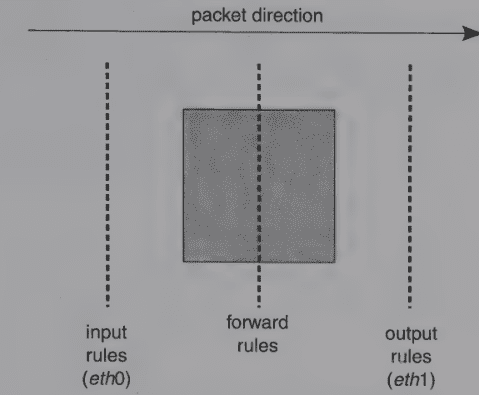

图 6.6 两个接口的数据包过滤

来自你的系统。（源自系统的数据包永远不会被视为转发。）在配置代理时请记住这一点。无论是输入还是输出，你都可以像处理转发一样更改**输入/输出（input/output）**规则链的默认策略。再次建议将默认策略指定为 **REJECT**（拒绝）或 **DENY**（禁止）。

在处理数据包过滤时，画出发生过程的图非常有帮助。原因之一是**输入（input）**和**输出（output）**的定义相对于你的位置的。相对于外部接口的“输入”意味着来自你网络外部的数据包，而内部接口上的规则则适用于出站数据包。图 6.6 说明了这种差异。我经常将你对数据流的视角称为“你所处的位置”。例如，如果你“站在”防火墙外部，所有输入规则都适用于 eth1。

要意识到，当你的网络拥有超过两个接口时，情况会变得更加复杂，因此在设计防火墙和互联网路由器的网络拓扑结构时要记住这一点。为了让你有一个直观的概念，请看图 6.7。

数据包过滤只是用 Linux 完成任务的许多方法中的另一个例子。我认为这是其 Unix 传统的一部分——工具箱哲学的一部分。对问题的解决方案取决于你如何看待它。在数据包过滤和防火墙方面，有很多“正确”的答案；使用你理解的那一个即可。

### 6.3.3 使用 ipchains 进行数据包过滤

ipchains 提供了一种非常强大的机制，用于限制进入或离开系统或网络之间的流量。（以后，它也是利用某些内核功能如端口转发的工具。）本节简要介绍了如何使用 `ipchains` 配置输入和输出防火墙规则。你可以查阅表 6.2–6.6 来获取语法帮助，或者运行 `ipchains -h` 查看所有可用选项。让我们来看几个例子。

**数据包过滤示例 #1** 首先，我们需要防止培训部门的培训工作站浏览互联网。讲师们抱怨用户在浏览网页而不是关注课程材料。幸运的是，你在设计公司网络时考虑到了这一点，培训工作站都位于一个独立的（可能是虚拟的）子网。该子网是 192.168.36.0/24。

```
# ipchains input/output firewalling example #1
############################################################
# 设置几个变量
INSIDE="192.168.0.0/16"      # 我们所有的内部地址空间
TRAINING="192.168.36.0/24"    # 培训工作站
                              # eth0 是“内部”
                              # eth1 是“外部”

# 为规则链设置默认策略
# 默认情况下，不允许任何输入
#-------------------------------------------------------
ipchains -P input REJECT
# 允许我们的地址空间访问输出
#-------------------------------------------------------
ipchains -A input -i eth0 -j ALLOW -s $INSIDE
# 防止培训工作站访问外部
# (必须在上一条规则之前“插入”此规则
#-------------------------------------------------------
nipchains -I input -j REJECT -s $TRAINING
```

这将防止该子网中的工作站拒绝访问外部。但由于这个问题给讲师们带来了困扰，他们还想知道在课期间哪些工作站正尝试访问外部。我们可以通过对匹配的数据包启用包日志来轻松实现这一请求。

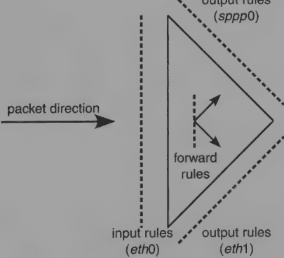

**图 6.7** 三个接口的数据包过滤

我们通过在上面的 REJECT 规则中添加 -j 1（代表“logging”日志）来实现。当培训网站上的某尝试访问外部网站时，我们 /var/messages 中看到这样的条目：

```
Jun 30 12:00:19 oxygen kernel: Packet log: input REJECT eth0 PROTO=6
192.168.36.21:4306 207.200.75:20480
L=60 S=0x00 I=28632 F=0x4000 T=64 SYN (#1)
```

那行字告诉我们发生了什么以及何时发生。在给定时间内，一个协议为 "6" 的尝试进入 eth0 的数据包被拒绝了。第二行列出了数据包的源 IP:端口和目标 IP:端口。第三行包含更多关于数据包的信息。它由 /usr/src/linux/net/ipv4/ip.fw 中的代码产生。这些字段的含义如下：

- L 是数据包的长度（字节）。
- S=0xxxx 是数据包中 TOS（服务类型）字段的值。
- I= 数据包的标识字段（identification field）。
- F=0xnnnn 是分片偏移（fragment offset）。
- T=nn 是 TTL（存活时间）字段中的值。
- 出现 SYN (#1) 表示这是序列号。

通过 syslog 记录这些信息，我们可以快速扫描任何尝试及其发生的时间。

**数据包过滤示例 2** 我们的第二个示例是使用数据包过滤防止直接访问。相反，我们想强制用户使用代理。原因是管理层希望记录所有传输，以防员工将商业秘密 FTP 给竞争对手。当他们需要访问外部时连接到代理。我们不会涵盖代理本身的配置（这很简单），但将重点关注允许代理访问外部所需的规则。画一个图——参见图 6.8。

- 允许内部到代理服务的 FTP 访问。
- 防止访问外部。
- 防止外部客户端连接内部系统。
- 允许访问外部的 FTP。
- 防止其他流量穿越防火墙。

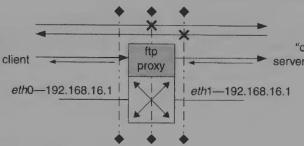

图 6.8 为 FTP 代理提供安全环境但在编写阻止直接 FTP（或任何协议）的数据包过滤规则之前，我们需要了解该协议的工作原理：

- “普通”模式下的 FTP
    1. 客户端使用一个客户端端口（1024 到 65534 之间的端口）连接 21 端口的 FTP 服务器。这被称为控制连接。
    2. 身份验证在控制连接上进行，即任何客户端发布的命令以及服务器对这些命令的确认。
    3. 然而，如果某个命令导致了数据传输（包括获取目录列表），客户端会通过打开第二个客户端端口做好准备，并通过控制连接将此端口号发送给 FTP 服务器。
    4. FTP 服务器从服务器的 20 端口向客户端系统的第二个客户端端口建立连接。该端口用于传输数据。由于你预先不知道要允许的数据传输端口，因此必须允许所有外部站点使用端口 20 连接你的客户端。因此，外部任何人都可以通过从其系统的端口 20 发送包来探测你的网络。

- 被动模式下的 FTP
    1. 控制连接与之前相同。但当启动数据传输时，客户端请求服务器打开一个额外的端口用于数据传输。
    2. 服务器找到一个空闲端口并通过控制连接将此值返回给客户端。
    3. 客户端随后向服务器刚刚给出的端口建立出站连接，数据传输在该连接上进行。


## IP 防火墙

服务器认为这很酷，因为它已经验证了客户端的身份（尽可能按照它的要求），所以它不在乎入站连接——为了提供 FTP 服务，它必须允许这些连接。防火墙也喜欢这个主意，因为它不需要接受外部的入站连接。客户端也喜欢这个主意，因为它获取了文件。

回到当前的问题：除了保护网络这一显而易见的需求外，我们还有管理要求记录所有的传输。FTP 代理可以帮助我们做到这一点并提供更多功能（第 8.1 节介绍了适用于 Linux 的若干种代理）。代理的核心思想是运行一个进程，该进程代表客户端处理连接请求并向外部进行数据传输。这提供了以下优势：

- 1. 它们运行在单一系统上，这意味着如果你必须允许普通模式 FTP，它也仅针对单一系统。
- 2. 它们会记录所有的传输、连接尝试等。
- 3. 大多数代理都具有访问控制机制，防止任何人使用该代理。
- 4. 我们提供了“应用”级保护。因为我们正在代理 FTP 命令（即它们与客户端通信，然后转而与 FTP 服务器通信，而 FTP 服务器认为 FTP 代理就是 FTP 服务器），代理可以检查命令是否存在非法命令、缓冲区溢出尝试以及 FTP 服务器（或客户端）可能尝试的其他各种不道德行为。

对于规则，我们**不会**假设代理在客户端侧（客户端-代理）始终以被动模式运行，因为用户可能会忘记配置 FTP 客户端自动请求被动模式传输。代理将在与服务器之间使用模式数据传输。下面列出组组规则。每条规则之前的章节说明了其在防止（或允许）通过防火墙系统访问方面的作用。

```bash
# ipchains input/output firewalling example
######################################################
# 设置几个变量
INSIDE="192.168.0.0/16"               # 我们所有的内部地址空间
ETH0=192.168.16.1/32                   # 内部的防火墙接口
ETH1=192.168.20.1/32                   # 外部的防火墙接口
ANY=0.0.0.0/0/

# 创建新的用户定义链。"eth0" 和 "ethlin"
# 这些链将优先处理进入系统的内容
ipchains -N eth0
ipchains -N ethlin
ipchains -I input -i eth0 -j eth0
ipchains -I input -i eth1 -j ethlin
```

```bash
# 同时创建输出链，eth0out 和 eth1out
ipchains -N eth0out
ipchains -N eth1out
ipchains -I input -i eth0 -j eth0out
ipchains -I output -i eth1 -j eth1out
```

```bash
# 为这些链设置默认策略
# 默认，不允许任何输入
# 默认，不允许来自 eth1 的输出
#（注意，此规则应该是 ethout
# 链上的最后一条规则，因此插入所有其他 ethout 规则）

ipchains -P input REJECT
ipchains -A eth1 -j REJECT
```

```bash
# 关闭所有 FTP 转发
# 内部任何内容都不允许转发到外部的 21 端口
# 不允许任何人将流量转发到 20 或 21 端口

ipchains -I forward -j DENY -p tcp -s $INSIDE -d ANY 21
ipchains -I forward -j DENY -p tcp -s ANY 20 21
```

```bash
# 现在我们知道 FTP 无法跨越内核中# 转发代码的鸿沟，我们可以
# 稍微放宽规则

# 客户端 <-> 代理，控制连接
# client * -> proxy 21
# proxy 21 -> client * (设置 ACK)

# 允许内部机器从客户端
# 连接到代理服务的 21 端口
# client -> proxy
ipchains -A eth0in -p tcp -s $INSIDE 1024:-d $ETH0 21

# client -> proxy
# 不需要 -代理可以回答，因为没有
# 限制 eth0 输出流的输出规则

# 客户端 <-> 代理，数据连接（普通模式）
# proxy 20 -> client *
# client * -> proxy 20 (设置 ACK)

# proxy -> client，不需要，
# 代理可以自由与客户端通信
# client -> proxy
ipchains -A eth0in -p tcp -y -s $INSIDE 1024:-d $ETH0 20

# 客户端 <-> 代理，数据连接（被动模式）
# client * -> proxy *
# proxy * -> client * (设置 ACK)

ipchains -A eth0in -p tcp -s $INSIDE 1024:-d $ETH0 1024:
# 代理开放以与客户端通信
#（如果不是，我们将使用双向 (-b) 规则）

# 代理 <-> 服务器，控制连接
# proxy * -> server
# server * -> proxy (设置 ACK)

# 代理 <-> 服务器，数据连接（普通模式）
# proxy 20 -> server *
# server * -> proxy 20 (设置 ACK)

# 代理 <-> 服务器，数据连接（被动模式）
# proxy * -> server *
# server * -> proxy * (设置 ACK)

# proxy -> client，不需要，
# 代理可以自由与客户端通信
# client -> proxy
ipchains -A eth0in -p tcp -y -s $INSIDE 1024:-d $ETH0 20
```


# IP 防墙

do

```bash
# ksh 写写：mask=$(echo subnet | cut -f2 -d'\'')
mask=${subnet}*/
network=${subnet}*/
if (( USE_IPFWADM == 1 ))
then
ipfwadm -I -a deny -S $(subnet)/$(mask) -W E
else
ipchains -A input -j DENY -s $(subnet)/$(mask) -i $E
fi
done
########
# 规则 0
# 默认规则防止任何数据包流
# 任何数据包进入防火墙
# 不指定源或目的等同于使用
# -S 0.0.0.0/0 和 -D 0.0.0.0/0
################################
if (( $USE_IPFWADM == 1 ))
then
# 默认拒绝（内部客户端接收 ICMP 失败）
ipfwadm -I -a reject -W $I
# 默认拒绝（不发送 ICMP 错误）
ipfwadm -I -a deny -W $E
else
ipchains -A input -j REJECT -i $I
ipchains -A input -j DENY -i $E
fi
} ### end Install_Rules()
################################
# 主脚本从这里开始
################################
case "$1" in
start)
# 加载 IP 伪装规则所需的任何模块
modprobe ip_masq_ftp
modprobe ip_masq_irc
Install_input_rules
#Install_forward_rules
#Install_output_rules
;;
stop)
# 卸载 IP 伪装模块
modprobe -r ip_masq_ftp
modprobe -r ip_masq_irc
```

```bash
# 清除所有输入规则
ipfwadam -I -f && echo "INPUT RULES FLUSHED - FIREWALL INACTIVE"
#ipfwadam -F -f
#ipfwadam -O -f
;
reload(restart)
echo $1 of $0
$0 stop
$0 start
\;
*
echo "Usage: $0 (start|stop|reload|restart)"
  exit 1
esac
```

# 6.5 测试数据包过滤规则

如果你想在将数据包过滤器投入生产环境之前对其进行测试，该怎么办？有几种替代方案。也许最彻底的方法是建立一个相同的环境进行测试。在测试任何类型的互联网服务时，这种方法的问题在于，在没有真实互联网的情况下很难模拟互联网。如果你有边界网络拓扑，这仍然是一个选项。你可以配置一个测试防火墙，并为你的测试工作站配置一条通过测试防火墙的互联网路由。测试工作站将使用测试防火墙作为其默认网关。拓扑见图 6.9。这将可行，但你应该小心不要通过测试防火墙允许另一种进入网络的方式来削弱你的安全性。这是一项大量的工作。优点是它是对许多客户端-服务器类型连接的准确测试，而且你的测试/问题检测方法与你日常的防火墙活动完全一致。

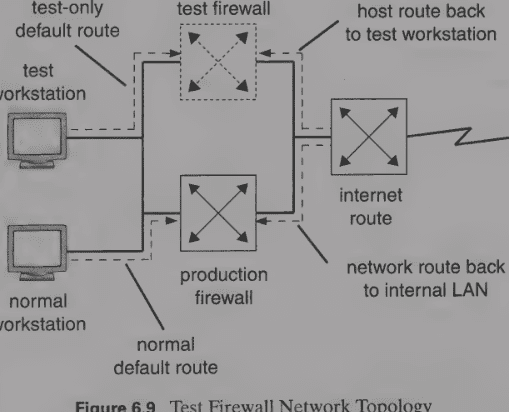

如果这很耗时，或者你想快速测试某条规则，有一个更简单的选项。ipchains 有生成测试数据包的能力，这些数据包将与内核中配置的规则进行检查。创建一个测试数据包看起来与用于输入、编辑或删除规则的任何其他命令非常相似。因为 Linux 内核并不以发明信息的能力而闻名，你需要指定源、目的，每个都要带有端口、协议以及接收虚拟数据包的接口（对于输入和转发规则）或应该发送虚拟数据包的接口（对于输出规则）。

对于 ipchains，使用 -C 链（或 --check chain）开关，加上：

| 参数 | 注释 |
| :--- | :--- |
| -s address port | 常规点点 IP + 端口 |
| -d address port | 常规点点 IP + 端口 |
| -p protocol | tcp, udp 或 icmp |
| -i interface | 接收/发送数据包的接口 |

检查结果：

| 结果 | 注释 |
| :--- | :--- |
| accepted | 数据包匹配了策略为 accept 的规则，本将被转发、允许进入（输入规则）或离开（输出规则）防火墙。 |
| denied | 数据包匹配了策略为 deny 的规则，本将向发送者发送 ICMP 拒绝信号。 |
| rejected | 数据包匹配了策略为 reject 的规则，将被丢弃。 |
| masqueraded | 数据包匹配了策略为 accept 且带有 -m 开关的转发规则，本将被转发并进行伪装。 |
| redirected | 数据包匹配了一个输入规则，该规则指示它应该被重定向到本地端口。 |
| caught in loop | 数据包匹配了某个目标规则，该目标始终导致数据包返回到同一规则。这在生产环境中只会浪费 CPU 周期，因此是检查规则可以有多用的一个很好的用例。 |
| passed thru chain | 数据包通过了链而没有跳转到另一个链。 |

以这种方式检查规则是审查新配置以及由于某些原因重新排列规则顺序的配置（可能是为了本章稍后描述的性能考虑）的好方法。我的建议是编写一个包含完整规则列表的脚本，并将此脚本的输出与你已知能产生正确结果的控制运行输出进行对比。

我建议只使用检查的原因是，我认为使用 ipchains 有几个缺点。首先，由于缺乏对协议的理解，导致了你的许多错误。第二个原因与第一个相关。假设你对协议有冗余。由于这个原因，我建议尽可能使用真实环境。当你运行遇到问题时，可以使用 icpdump 和查看字节计数来确定你的规则是否通过。彻底测试可能会非常困难且耗时。参考附录 C 有关的通用讨论。

# 6.4 通知系统

测试：哪种情况更不方便，凌晨 3 点因为你的链接中断而被唤醒，还是早上 8:30 来处理成千上万的用户和数千封邮件？答案显然取决于你的具体情况，但我倾向于前者。问题解决得越快，负面影响就越少。本节适用于那些需要知道你的网络异常的人。

你的直觉可能会编写一些聪明的东西来信号问题，但在你设计通知系统之前，请花时间思考以下问题：

- 1. 什么样的故障应该导致通知？我们称之为检测。
- 2. 你希望如何被通知？不同的故障需要不同的通知方法吗？
- 3. 你愿意花费多少资金和时间为通知系统引入冗余？
- 4. 实现你所需的系统和硬件有哪些？是否可用？是否有需要集成的现有系统？

由于所有这些问题相互关联，你可能会发现对其中一个问题的回答会改变另一个问题的回答。关于通知有多种方法，从简单到相当复杂。你的选择取决于你的需求和个人任务。然而，对于那些想要实施一个宏大的通知系统的人，有一个警告：你如何知道你的系统失效了？出于这个原因，通知系统越简单越健壮越好。本节简要讨论了上述每个问题，最后一部分回顾了某些监控和通知软件。

## 6.4.1 故障检测

在考虑如何发送消息之前，我们需要知道消息是什么。这里是针对我们的互联网环境的“坏事”列表，以及为了检测它们所需的某些要求：


## 210 氧气—互联网路由器 第6章

停电——为了能够检测到停电，你需要一个可以连接到通知系统的 UPS（不间断电源）。该系统包括其调制解器也必须处于受保护的电源下。正如第 1 章提到的，几家 UPS 制造商提供了 Linux 支持。你可以为其中许多设备获取预包的 Debian 软件包。

路由器灾难性故障——如果你的路由器发生硬件故障，或者内核崩溃（kernel panic），它将无法再次向你报告其状态。因此，你应该考虑在你的环境中部署一个与被监控资源分开的通知系统。（参见第 6.4.2 节。）

互联网链路中断——如果链路本身故障但路由器正常，你的路由器将能够检测到这一点。在这种情况下，使用 `ping` 可能足够了（其他情况并非如此，我们稍后会看到），你的 ISP 应该对此认可，因为你正在支付该服务的费用。然而，定期隔地 ping 某些其他知名互联网网站是不礼貌的。Ping 会产生 syslog 日志并占用不属于你的带宽。这本身也不是个好主意，因为该知名网站可能宕机。如果你正在使用 WANPIPE，可以监控 syslog 中的断开消息。

系统遭受攻击——这是一种更难准确检测的情况。但有一些现象可能预示着可能的入侵：有人在非工作时间登录或尝试登录系统，或者来自外部或内部源的过量 ping 或连接尝试——许多攻击是从内部源发起的。重启是问题的确定迹象。因此，你可能希望路由器上的启动脚本在系统每次重启时都发送通知。

无论如何，你都必须具备检测系统是否正遭受攻击的。。据我所知，很少有现成的软件包可以在攻击发生时实时向你通知。（其中一个例外是稍后讨论的 iplogger，它可以检测 FTP 弹射攻击。）

系统负载过高——这似乎很容易检测，因为系统处于运行并能够通信其状态，但并不总是容易判断负载何时过高。你监控的内容将取决于路由器上运行的应用程序，这里是一些想法：

- 剩余磁盘空间——如果你还不知道，千万不要让 Unix 系统的根文件系统写满。你还应该关注日志的完整性；出于原因，/var 是一个独立的文件系统。

- 内存/交换分区使用——不要让你的系统耗尽虚拟内存，否则对于严格作为路由器的系统来说，这不应该是一个问题，因为系统的设计应该在正常情况下不进行交换（swap）。系统可能会偶尔交换，但应该只在系统维护期间进行，例如加载包、编译内核等。你可以从 /proc/meminfo 和 /proc/swaps 获取你所需的信息。

## 6.4 通知系统

- 用户数量——如果你的系统允许用户，可能对允许的并发用户数有限制，例如，某些 FTP 守护进程对某些类型的连接数设置了限制。

- 空闲文件描述符数量——耗尽文件描述符可能会毁掉你整的一天（尽管内核具有足够的韧性，且问题可以现场解决）。即使内核不受影响，应用程序和守护进程可能无法同样优雅地处理它。

### 提示：在运行的系统中增加文件描述符

你可以轻松地在不重新编译内核的情况下增加可用文件描述符的数量。只需将你想使用的句描述符数量写入 `/proc/sys/fs/file-max` 即可，使用命令 `echo 8192 >/proc/sys/fs/file-max`。你可以通过 `cat /proc/sys/fs/file-nr` 检查当前使用情况。这些字段分别是：当前使用的文件描述符数量、内核已分配但未使用的文件描述符数量，以及可用文件描述符的最大数量（第二个值并不极端重要；它仅表示内核在不必停止并分配的情况下可以处理多少个文件描述符请求——直到达到 `file-max` 的限制）。

另一个值得检查的有趣位置是 `/proc/slabinfo`（Linux 内核 2.2）的字段。第一列指示明了当前使用的文件描述符数量，第二列是高水位（系统启动以来任何时刻使用的文件描述符最大值）。

如果你耗尽了文件描述符，可以预期以下代码会将消息存入 syslog：

```
printk("VFS: file max limit reached %d\n", max_files);
```

注意，`/usr/src/linux/include/limits.h` 中也有一个参数 `OPEN_MAX`，它控制单个进程可以打开多少个文件。（如果你更改了此值，可能需要重新编译你的应用程序。）

- 空闲端口数量——耗尽端口的可能性较低，但并非不可能。请参阅第 105 页关于检查伪装（masquerading）可用端口数的信息。

- 进程数量——当内核无法产生额外的进程时，处理将如我们所知终止。相关的变量是 `NR_TASKS`，位于 `/usr/src/linux/include/tasks.h`。修改它需要重新构建内核。2.2.x 版本内核的默认值为 512。（注意，x86 限制最大进程数为 4096）。

- 系统负载——这应该是显而易见的。你不需要使用 `top` 或 `uptime` 来获取此值，只需 `cat /proc/loadavg`。

大多数这些参数可以定期读取，也许作为 SNMP 监控的一部分。如果你的机制支持，记录这些值以便趋势分析和系统调优。从紧急关注的角度，设置阈值，并让监控系统通知你。

## 6.4.2 检测方法

大多数监控上述内容的脚本运行在被监控系统上，你可能需要更完整的解决方案。我们已经提到需要一个与被监控系统分开的系统。这并不完全正确；监控系统也可以配置执行其他任务，但你应该将次要任务交给它。这里的原理是，生产故障可能会影响网络——链路一端的路由器故障可能导致两个或多个故障——因此监控系统的功能与被监控对象应该是正交的。

你可能会很快指出通知系统也可能故障。尽管可能，但两者同时发生的概率有多大？（如果通知系统宕机而路由器正常，那么你并没有故障。）尽管如此，这个系统应该是最小化配置，以减少软件故障。如果你有资源，用另一个系统监控这个。

有不同的方法可以监控路由器以确保其存活。一种方法是不安全的 ` `ping`。这是因为一旦网卡配置了其 IP 地址，只要网卡物理通电，它能够在没有操作系统帮助的情况下响应 ICMP ping。

因此，一个更好的仍然非常简单的测试是 telnet 一个内核服务，例如时间。`telnet router-ip 13` 应该返回当前的日期和时间，只要你没有在 `/etc/inetd.conf` 中禁用此服务。你可以这样编写脚本，尽管你的生产版本应该包含更多的错误检查，以防调用 `qpage` 不工作等情况：

```bash
#!/usr/bin/ksh
# check_router.sh <target>
# 修改历史:
# 19990714/tm      初始发布
############################################
INTERVAL=60
LONGINTERVAL=3600
TARGET=$(date (1=192.168.22.13)
DATE=$(date '+%Y/%m/%d-%H:%M')
while (( 1 == 1 ))
```


# 通知系统 213

```
# 测试脚本
telnet $TARGET 2>/dev/null
retval=$?
if (( retval != 0 ))
then
    problems! - 通过 QuickPage 发送通知
    qpage dutypager "$DATE 处发生了某些错误"
    sleep LONGINTERVAL
fi
sleep $INTERVAL
done
```

当然，有方法可以在不编写脚本的情况下实现这一点。第 215 页介绍了几种可以执行此类监控的软件包。

## 6.4.3 通知方法

你如何接收（潜在的）问题通知将取决于你的工作方式、预算以及你对多快了解这些问题的紧迫程度。不同的问题可能有不同的优先级，并产生不同形式的通知。这里是一些可以帮助你起手的思路：

- 字母数字寻呼器（Alphanumeric pagers）非常有用，许多提供商都提供电子邮件网关，使得通知像发送电子邮件一样简单。当然，如果你的互联网连接断开，你需要采取其他方法。（最简单的方法可能是拨打另一个备用 ISP 并发送邮件……）如果你打算进行大量的呼叫，你需要了解 SNPP，并可以使用本章介绍的 QuickPage 页面。该软件使用寻呼服务提供的拨号网关进行呼叫。随着双向寻呼的出现，你可以从寻呼器采取纠正措施。参见本节后面关于 mon 的信息。

- 电子邮件——对于许多类型的问题，电子邮件通知就足够了，而且它的优点是可以包含关于问题的信息。由于我们都经过训练认为读邮件比洗澡或吃饭稍微重要，因此通知不应该被闲置很久。

- 日志文件（logfile）——由于你可能想记录事件及其某些信息，你可以使用 syslog 作为通知系统的基础。如果你能充分地压缩写入日志文件的数据量，就可以手动查看数据。否则，使用日志文件扫描器查找问题，并让它使用其他形式的通知（例如，通过电子邮件给你发送访问日志文件的 URL 或向你呼叫）。

- 远程日志——正如通用主机安全章节中所提到的，远程日志通过增强安全性，因为它迫使黑客必须入侵两个系统才能隐藏入侵证据。这也意味着你可以进行存档，而无需为路由器添加大量磁盘空间。

- 打印输出——对于某些系统，你的防火墙以及位于防火墙外的系统，纸质打印输出是无价的。如果有人黑入你的系统并删除了你的日志文件，你将非常倒霉。使用 syslog 功能将某些内容记录到本地连接的打印机，可能是被成功破解后的唯一线索。（一个带宽幅数据矩阵打印机配合一盒好的折叠灰纸是完美的。激光打印机就没那么好了……）

- 窗口弹出框——如果你通常盯着屏幕，你可以为工作站运行一个 X 客户端。如果由于某种原因你没有 X 服务器，你可以使用 linpopup，这是一个在 Windows 机器上生成弹出页面的实用程序。

- 系统管理控制台——上述方法的扩展，系统管理控制台假设你有员工值班监控状态屏幕，准备在某个绿灯变红时采取行动。这可以是任何类型的 UI，但趋势是基于 Web 的界面。Big Brother 和 mon 提供了这种界面。大多数网络管理系统都提供某种管理控制台，因此你可能可以使用下一种而不是部署自己的。

- 与另一个系统集成——为什么要重造轮子呢？为什么要与你组织内的其他操作系统支持组隔离开？让 Linux 正常工作的一部分可能包括让它进入数据中心，与其他生产系统一起，并使用相同的工具。首要任务是 Linux SNMP 的可用性。该软件包完全可配置，并支持通过 snmpd 进行状态查询，通过 snmtrap 生成异常，以及使用 snmpget 和 snmpwalk 进行数据采集的工作站。你还可以使用 snmpset 设置值。

你可能会拥有一个可以配置使用这些方法中一种或多种系统。你走到多大程度取决于你自己，但不要忘记，系统越复杂，系统内部出现 bug 和故障的机会就越多。

## 6.4.4 通知软件

监控和通知工具通常结合在一起，因为它们之间有着紧密的关系。对于 Linux 来说，强大的监控同类似乎是 mon 和 Big Brother，两者都支持 HTML 界面，并在下文各自的章节中进行了详细介绍。此外，还有几个 Big Brother 的衍生品，你可能想要使用，或者将其作为你修改的起点。

- angel——网络监控器 (http://www.paganini.net/angel/) 与 Big Brother 类似，并产生一个非常漂亮的状态屏幕。插件是用 Perl 编写的，因此欢迎你扩展系统。目前可用的插件包括 TCP 端口服务、磁盘空间不足、高系统负载和 ping 往返时间。

- BSB-Monitor 是一个非常轻量级的系统，可用于简单的监控目的。它有警报钩子，以便在出错时呼叫你。更多信息请参见 http://www.bsb-software.com/download/bsb-monitor/。

- Spong 是另一个用 Perl 编写的类 Big Brother 监控包，支持机器历史记录。可以在 http://strobe.weeg.uiowa.edu/ed-hill/public/spong/ 查看它。

- snmptraplog（以同名 Debian 软件包提供）是一个 SNMP trap 守护进程，但是可配置的。因此，它本身不是监控系统，但如果你决定开发自己的基于 SNMP 的系统或简单地想使用 snmtrap，它可能是一个很有用的组件。正如前面提到的，远程日志增强安全性……它通过 Web 界面显示结果，并支持 HTML。由于，你如何接收（潜在的）问题通知将取决于你的工作方式、预算以及你对多快了解这些问题的紧迫程度。等等。

- 电子邮件——对于许多类型的问题，电子邮件通知就足够了，而且它的优点是可以包含关于问题的信息。由于我们都经过训练认为读邮件比洗澡或吃饭稍微重要，因此通知不应该被闲置很久。

- 日志文件（logfile）——由于你可能想记录事件及其某些信息，你可以使用 syslog 作为通知系统的基础。如果你能充分地压缩写入日志文件的数据量，就可以手动查看数据。否则，使用日志文件扫描器查找问题，并让它使用其他形式的通知（例如，通过电子邮件给你发送访问日志文件的 URL 或向你呼叫）。

- 远程日志——正如通用主机安全章节中所提到的，远程日志增强安全性，因为它迫使黑客必须入侵两个系统才能隐藏入侵证据。这也意味着你可以进行存档，而无需为路由器添加大量磁盘空间。

- 打印输出——对于某些系统，你的防火墙以及位于防火墙外的系统，纸质打印输出是无价的。如果有人黑入你的系统并删除了你的日志文件，你将非常倒霉。使用 syslog 功能将某些内容记录到本地连接的打印机，可能是被成功破解后的唯一线索。（一个带宽幅数据矩阵打印机配合一盒好的折叠灰纸是完美的。激光打印机就没那么好了……）

- 窗口弹出框——如果你通常盯着屏幕，你可以为工作站运行一个 X 客户端。如果由于某种原因你没有 X 服务器，你可以使用 linpopup，这是一个在 Windows 机器上生成弹出页面的实用程序。

- 系统管理控制台——上述方法的扩展，系统管理控制台假设你有员工值班监控状态屏幕，准备在某个绿灯变红时采取行动。这可以是任何类型的 UI，但趋势是基于 Web 的界面。Big Brother 和 mon 提供了这种界面。大多数网络管理系统都提供某种管理控制台，因此你可能可以使用下一种而不是部署自己的。

- 与另一个系统集成——为什么要重造轮子呢？为什么要与你组织内的其他操作系统支持组隔离开？让 Linux 正常工作的一部分可能包括让它进入数据中心，与其他生产系统一起，并使用相同的工具。首要任务是 Linux SNMP 的可用性。该软件包完全可配置，并支持通过 snmpd 进行状态查询，通过 snmtrap 生成异常，以及使用 snmpget 和 snmpwalk 进行数据采集的工作站。你还可以使用 snmpset 设置值。

你可能会拥有一个可以配置使用这些方法中一种或多种系统。你走到多大程度取决于你自己，但不要忘记，系统越复杂，系统内部出现 bug 和故障的机会就越多。

## 6.4.4 通知软件

监控和通知工具通常结合在一起，因为它们之间有着紧密的关系。对于 Linux 来说，强大的监控同类似乎是 mon 和 Big Brother，两者都支持 HTML 界面，并在下文各自的章节中进行了详细介绍。此外，还有几个 Big Brother 的衍生品，你可能想要使用，或者将其作为你修改的起点。

- angel——网络监控器 (http://www.paganini.net/angel/) 与 Big Brother 类似，并产生一个非常漂亮的状态屏幕。插件是用 Perl 编写的，因此欢迎你扩展系统。目前可用的插件包括 TCP 端口服务、磁盘空间不足、高系统负载和 ping 往返时间。

- BSB-Monitor 是一个非常轻量级的系统，可用于简单的监控目的。它有警报钩子，以便在出错时呼叫你。更多信息请参见 http://www.bsb-software.com/download/bsb-monitor/。

- Spong 是另一个用 Perl 编写的类 Big Brother 监控包，支持机器历史记录。可以在 http://strobe.weeg.uiowa.edu/ed-hill/public/spong/ 查看它。

- snmptraplog（以同名 Debian 软件包提供）是一个 SNMP trap 守护进程，但是可配置的。因此，它本身不是监控系统，但如果你决定开发自己的基于 SNMP 的系统或简单地想使用 snmtrap，它可能是一个很有用的组件。

Mon 作为系统监控工具结合了自身的服务监控和 SNMP（在适用情况下）来执行系统监控任务。它非常强大，因此非常受欢迎（或者可能相反）。它带有多种界面，所以应该能让网页浏览器用户和命令行发烧友，甚至包括那些不在办公室的人。这些描述取自随发行包的 README。

- moncmd 是一个命令行客户端，支持客户端/服务器接口的全部功能。
- monshow 以格式良好的列输出显示当前运行状态、分组和失败日志。


## skymon

+   一个 SkyTel 双向分页寻呼机接口，允许你直接从寻呼机上查询服务器状态，并以与 moncmd 相同的方式对其进行操作。访问控制通过简单的密码和访问控制文件进行实现。

+   opstatus.cgi 是一个简单的运行状态网页，它可以高亮显示故障并显示哪些功能已禁用。它的设计初衷是快速响应，并在顶部显示最关键的信息。

+   mon.cgi 是交互式 Web 界面，允许你不仅查看状态信息，还能在服务器运行时更改参数。

mon 包含了告警脚本，用于通过电子邮件发送警报、通过电子邮件发送字母数字寻呼以及 QuickPage 警报，尽管扩展系统以支持其他形式的警报也很容易。它有一套完备的监控监控程序，开箱即用。你应该能够通过这些工具满足大部分需求，因为 mon 是 100% 用 Perl 编写的，扩展它相对容易，而且几乎不存在发布问题。如果你的 Linux 发行版没有提供 mon，但你可以在 http://www.kernel.org/software/mon/ 找到它。当前版本包含以下监控程序：

+   ICMP 回显 (ping)、SMTP、telnet、FTP、NNTP、HTTP、POP-3、IMAP、LDAP 和 DNS

+   HNP（用于监控 HP 网络打印机）

+   系统磁盘空间、运行时间 (uptime) 和进程

+   任何（其他）基于 TCP 的简单服务

+   网络设备空闲空间和配额树

+   拨入式终端服务器

mon 甚至带有一个脚本，可以将 Big Brother 配置文件转换为供 mon 使用。请参阅程序文档目录下的 README.Big-Brother 文件。

你如何配置通知系统在很大程度上取决于组织的需求和个人偏好。组织越大，需要的通知系统就越先进，包括如异常报告（即正式记录任何系统停机情况）和升级程序等元素。由于不同的管理员对通知的正确方法有不同的看法，你可能会发现许多可用的 GPL 代码“几乎”就是你想要的。（对于许多昂贵的商业系统也是如此）。做好准备放弃其中一个，以获得你真正想要的系统。

## 6.5 总结

本章的开头非常简单——使用 Linux 路由器通过专用接入电路使用同步 PPP 连接到 ISP。Linux 变成了一个非常廉价且功能强大的接入路由器。遗憾的是，连接互联网并没有那么简单。安全是一个首要考虑的问题，在决定将互联网接入路由器放在哪里时就必须考虑进去。换句话说，我们需要为防火墙外的区域选择一种网络拓扑。一旦我们对系统将如何有了了解，就需要对其进行安全防护。由于 Linux 能够作为服务器，我们必须采取一些预防措施，确保不运行可能被用于攻击我们系统的服务——某些类型在第 6.2 节中介绍过。即使在我们锁定了路由器后，我们也想知道何时有人尝试访问它以及他们是否成功。检测这些情况的工具——IP 事件记录器是第 6.2.3 节的主题，而检测弱点的工具——端口扫描器则在第 6.2.4 节中进行了讨论。

下一节介绍了 IP 防火墙，以及实现它的两种不同方法。第一种是控制防火墙可以转发的内容，也称为条件转发。这通常适用于具有两个以上接口的系统，作为一种组合式防火墙/接入路由器，它通过第二个以太网接口支持围边界网络。它仅适用于路由器。防火墙的另一种方法是 IP 数据包过滤，我们在此限制进入或离开系统的内容。这种形式的防火墙适用于任何 Linux 系统。在实践中，两种类型的防火墙结合使用以实现所需目标。最后节引入了关于通知系统的一些概念以及 Linux 可用的工具。根据组织的不同，互联网链接的重要性从便利性到公司生命线等不相同（例如，对于电子商务而言）。拥有一个稳定的系统至关重要——能够检测问题并通知相关人员同样重要。这一最后一节提供了关于如何检测停机和发送通知的一些想法。

在进入下一章（讨论灵活的 WAN 路由器）之前，我想再次强调物理安全的重要性，这涉及到你的路由器以及你选择要管理的任何系统（系统）。如果你紧紧地锁定了你的路由器，并且从不以明文形式在网络中传输密码，你就有了一个良好的开始。但如果管理站（你输入该加密密码的台式电脑）在物理上是不安全的，你可能并没有在帮到自己。只需要一张软盘和几分钟就能破解桌面电脑，攻击者可以使用 `ttynoop` 等工具在你将密码输入键盘时迅速侦测到你的密码。因此，在安全问题上，你应该对工作站采取同等（或更高）水平的措施，特别是当它在物理上不安全时。

## Californium—卫星办公室路由器

```
californium:/root> uptime
2:36pm up 244 days, 1:14h, 1 user, load average: 0.05, 0.00
```

Californium 是第一个部署的、远离总部的 Linux 路由器。该小型项目办公室没有现场 IT人员，路由器是其连接公司源代码版本控制系统、内网以及通过防火墙连接互联网的生命线。我必须承认，对于路由器如此遥远我曾有些焦虑。如果它发生任何故障，叫维修服务将是昂贵且耗时的。这里涉及到一点自尊心——与一位远程部署传统路由器的同事之间的专业竞争。争论点在于，因为传统路由器没有硬盘且运行更稳定，它们故障的可能性较低，更容易支持，因此成本更低。我的反驳是，硬盘故障的风险是可以管理的，而且 Linux 代码足够稳定。此外，Linux 平台的灵活性值得任何额外的管理开销。

Californium 是我配置的第一个不仅仅用于路由的 WAN 路由器。由于远端办公室人口稀少（且资金匮乏），策略是尝试以少胜多——少得多的。为了保持低成本，californium 接管了一些通常在我组织中分配给非 Linux 系统的职责，以及传统路由器通常无法处理的一些职责。此外（无论用户如何认为），WAN 管理员总是同情那些带宽上不走运的人。为此，californium 被配置为通过增加服务来帮助节省回主办公室 WAN 连接的带宽，从而让他们的困境变得更容易忍受。

## 220—Californium—卫星办公室路由器 第7章

本章致力于介绍 californium 的每项功能和关注的问题。首先，它回顾了使用 Sangoma 软件配置 WAN 链路。HDLC（高级数据链路控制）是另一种用于 WAN 链路的协议，类似于同步 PPP。接下来的四个主题涵盖了 Linux 路由器如何节省硬件和带宽：

- Californium 作为该站点的 DHCP 服务器，为本地客户端颁发 IP 地址和其他信息。
- 它运行一个名为 (of) 的 DNS 守护进程副本。在此配置中，它获取内部区域的副本并缓存外部查询。
- Californium 配置了 Samba，作为网络连接打印机的本地溢出器。
- Californium 提供缓存 HTTP 代理，以便本地保留频繁访问的页面。

这些关于为路由器添加章节章节是监控系统负载和支持 Linux 系统的讨论。远程支持部分介绍了当主连接中断时访问路由器的方法，以及针对冗余链路站点的一些技巧。它以几种备份策略结束。

### 7.1 HDLC 路由器拓扑

在深陷 Frame Relay 的 CIR、PVC 和 DLCI 之后，HDLC 将是一个受欢的惊喜。它的配置简单，因此支持基础配置。在硬件方面，路由器的配置方式类似于 Frame Relay 或同步 PPP。主要的区别在于你如何使用接入链路。HDLC 是一种适用于连接两个站点的数字接入电路的协议。从中分配一部分通道用于数据，并在链路两端运行 HDLC 路由器。典型的场景是一个小型办公室，它需要电话业务和数据，可能还需要访问公司的语音系统。如果点对点接入电路成本合理，则无需在远程地点单独为每种服务付费。你可以订购一条单一数字电路连接远程站点到主办公室。通过几个 CSU/DSU，复用 T1，将某些通道分配给 PBX（用于语音），其他通道分配给数据电路。初始硬件成本可能较高，但从长远来看你会省钱，因为：

- 没有端口或 PVC 费用，也没有 CIR。分配给数据的链路全部带宽均供连接使用。
- 你可以根据需要重新配置接入链路的分配。随着时间推移数据带宽变得不再重要而你需要更多语音容量，你可以自己更改分配而无需重新配置费用。
- 除了你的电信供应商之外，没有其他供应商或服务商。这在合同谈判期间节省了时间，并减少了故障期间的互相推诿。


## CHDLC 路由器拓扑结构

- 办公室之间的通话无需支付长途费用（如果你的电话设备支持此项功能）。
- 将语音通话路由至或从较小的分支机构可以利用主办公室的容量，主办公室的购买量较大，因此每个通道或每分钟的成本更低。例如，一条免付费支持热线可以将通话路由到远程分支机构的专家。
- 即使你不需要语音电路，点对点接入电路的费用可能比支付两条更短的接入线路、端口和 CIR 的费用要低，特别是当你需要高 CIR 的时候。

一个典型的拓扑结构如图 7.1 所示。由于它是为点对点操作而设计的，因此配置 CHDLC 与第 6 节描述的同步 PPP 链路非常相似。唯一的真实区别在于你拥有链路的两端，并且必须配置两个路由器。硬件设置与之前介绍的运行 WANPIPE 的帧中继（Frame Relay）和互联网路由器的设置相同。

如果你打算按照描述的方式对 T1 进行复用，则不应订购集成 CSU/DSU 的 WAN 接口卡。集成单元并非为复用而设计。支持此类操作的 CSU/DSU 类型称为“掉落与添加”（drop-and-add），它将同时拥有用于路由器和 PBX 的端口。如果你已经订购了 Sangoma 卡 (SS08)，你可能可以为办公室额外购买另一块卡。这些卡有一个第二个端口，即 DB25 接口下方的 DB9 连接器，可用于运行高达 256kbps 的 CHDLC。注意，你**必须**拥有带有 RS-232 接口的 CSU/DSU 才能使用此端口，或者使用 V35 转 RS-232 转换器。许多带有 V35 数据端口的 CSU/DSU 可能仅用于运行 CHDLC，你需要从 Sangoma 订电缆才能使用它。一旦每个路由器中都有一块卡，并将路由器连接到各自的 CSU/DSU，就可以开始配置 `wanpipe1.conf` 文件和接口文件了。如果你使用的是 Debian wanpipe 软件包，请记住以下路径转换关系。

图 7.1 带有 CHDLC 路由器的分支机构拓扑结构

## Sangoma WANPIPE 压缩包

| /etc/wanpipe.conf | /etc/wanpipe/wanpipe.conf |
| /etc/router.rc | /etc/wanpipe/router.rc |
| /usr/wanrouter/interfaces/ | /etc/wanpipe/interfaces/ |
| /usr/lib/wanrouter/wanpipe/ | /usr/lib/wanpipe/ |
| /var/log/wanrouter | /var/log/wanpipe.log |
| /var/lock/wanrouter | /var/lock/wanpipe |
| /usr/lib/wanrouter/Configure | /usr/sbin/wanpipeconfig |
| /usr/lib/wanrouter/samples/ | /usr/share/doc/wanpipe/examples/ |

### 7.1.1 为 CHDLC 配置 wanpipe.conf

通过从适当目录将示例配置 (`wanpipe.cpri`) 复制到默认的 `wanpipe.conf` 来节省你的时间（前提是你还没有有一份可以运行的配置！）。所准备的配置假设你正在将该卡用于 CHDLC，尽管配置卡在次要端口（或第二块卡）上运行 CHDLC 并不困难。如果你想这样做，请参考 Sangoma 的文档。

用你喜欢的编辑器打开 `wanpipe.conf` 并开始工作。我准备了一个去除了非必要内容的配置文件。该文件是一个通过接口文件显式分配 IP 地址的配置示例，这是由 `SLARP_TIMER=0` 决定的。示例中的参数见第 7.1.2 节。

```
# /etc/wanpipe/wanpipe.conf
# Protocol: Cisco HDLC (CHDLC)
#--------------------
************************************
# Device Definition Section
************************************
[devices]
wanpipe = WAN_CHDLC, Cisco HDLC
************************************
# Network Interfaces Definitions
************************************
# [interfaces] 部分定义了逻辑通道以及路由器
# 创建的相应的网络接口。该部分的每条
# 语句具有以下格式：

# (interface name) = (device), (media_addr, (function), Comment
#
[interfaces]
hdlc0 = wanpipe, WANPIPE, cisco hdlc connection on Port 0 (PRI)
#chdlc1 = wanpipe, WANPIPE, cisco hdlc connection on Port 1 (SEC)
************************************
# Link configuration section
************************************
```

```
[wanpipe]
IOPort = 0x360 # I/O port base
IRQ = 11 # IRQ
Firmware = /usr/lib/wanpipe/cdual514.sfm # adapter firmware
CommPort = PRI # primary port (DB25 on the S508)
               # = use "SEC" for the DB9 port on the S508

********************************************************************
# Logical channel (interface) configuration sections.
********************************************************************
# 要关闭动态 IP 地址，将 SLARP_TIMER 设置为 0。
[chd1c0]
Interface = RS232 # physical interface type, RS232/V35
Clocking = External # external clocking
Baudrate = 256000 # 256k link
MTU = 1500 # for HDLC, this can be 15354
HDLC_STREAMING = NO # use HDLC
KEEPALIVE_TX_TIMER = 10000 # YES = raw frames and no polling
KEEPALIVE_RX_TIMER = 11000 # interval to send keepalives
KEEPALIVE_ERR_MARGIN = 5 # interval to expect keepalives
SLARP_TIMER = 0 # keepalive timeouts allowed (disable SLARP/dynamic addressing)
               and use IPADOR ANDandPOINT values from /etc/wanpipe/interfaces/chd1c0
```

### 7.1.2 WANPIPE CHLDC 配置参数详解

现在让我们更详细地查看每个参数。该文件分为四个部分：设备 (devices)、网络接口 (network interfaces)、链路配置 (link configuration) 和逻辑通道 (logical channels)。

定义部分从 `[devices]` 开始。网络接口定义从 `[interfaces]` 开始。链路配置部分从 `[wanpipe]` 开始。逻辑通道配置从 `[chd1c0]` 开始。

- (interface name) = (device), (media_addr, (function), Comment
- 分支机构路由器拓扑结构
- 244
- 245
- 246
- 247


## 7.1 CHDLC 路由拓扑

**TTL = [0x00--0FF]。** 此项仅用于监控系统，可以保持默认值 **0x7F** (127) 或省略。

**CHDLC wanpipe1.conf—逻辑通道部分(s)** 该部分包含为文件中早先指定的每个接口的特定接口部分。从 WANPIPE2.1 开始，这通常是一个单一接口，例如 `[chldc0]`。

- **MULTICAST = YES or NO;** 用此确定是否通过此接口启用多播。

- **IGNORE_DCD = YES or NO;** 默认值为 NO。此参数决定了在确定 CHDLC 活动链路状态时是否忽略 DCD。

- **IGNORE_CTS = YES or NO;** 默认值为 NO。此参数决定了在确定 CHDLC 活动链路状态时是否忽略 CTS。

- **IGNORE_KEEPIVE = YES or NO;** 默认值为 NO。（你是否开始发现某种模式了？）此参数决定了在确定 CHDLC 活动链路状态时是否忽略心跳包（keepalive packets）。

- **KEEPIVE_TX_TIMER = [0--60000];** 默认值为 10000（毫秒）。这设置了心跳包发送之间的间隔。如果你设置不使用心跳检测，则此值没有意义。

- **KEEPIVE_RX_TIMER = [10--60000];** 默认值为 10000（毫秒）。这告诉路由器每隔多久从另一个路由器接收一次心跳包。如果 **IGNORE_KEEPIVE=YES**，则此项作用很小。

- **KEEPIVE_ERR_MARGIN = [1--20];** 默认值为 3。如果你没有开启心跳检测，并且出现了连续 KEEPIVE_ERR_MARGIN 次超时，驱动程序将假设出现某种问题并断开链路。

- **HDLC_STREAMING = YES or NO;** 默认值为 NO。如果设置为 YES，将关闭 CHDLC 并使用原始 HDLC 帧。SLARP 数据包是动态分配链路一侧 IP 地址的机制。默认值为 5000； 值为 0 则禁用动态 IP 分配。相关配置信息请参见第 7.1.3 节。

- **SLARP_TIMER = [0--60000];** 发送 SLARP 数据包之间的间隔，单位为毫秒。

### 7.1.3 为 CHDLC 配置接口

使用 WANPIPE 的 PPP 和 Frame Relay 链路，两条链路都需要分配 IP 地址才能相互通信。与这些协议不同，HPLC 提供了一种自动分配其中一个链路地址的机制。要使用此功能，请决定哪一侧作为**主端**(master)，并在 *interfaces/chldc0* 文件中配置其 IP 地址 (IPADDR)。将 POINTPOINT 设置为 IPADDR 加 1 后的值。你还应该在该系统的 wanpipe1.conf 中配置 SLARP_TIMER=0。

在远程路由器（即**从端** slave）上，你应该设置 IPADDR=0.0.0.0（否则，当 WANPIPE 启动时会出现问题）并保持 POINTPOINT 为空。

确保你在从端配置文件的 [interfaces] 部分设置了 SLARP_TIMER。（如果你这样设置了，它将永远不会向本地路由器请求其 IP 地址。）假设计时器值非零，在 SLARP_TIMER 到期后，从端会发送一条查询，说：“请告诉我你的 IP。”当主端路由器回复时，从端获取给定的 IP 地址，将其最后一个字节节加 1，并将其分配给自己的 CHDLC 接口。

### 注意：SLARP 分配的 IP 地址

> 当你分配给主端的 IP 地址必须自动分配的主机地址为 .1 时——例如 192.168.64.1。从端将被分配同一网络中的 .2 地址。由于这种方式非常死板，我倾向于显式设置 IP 地址。请注意，使用显式分配时，你也可以 255.255.255.255 子网掩码以及第 5.3.5 节描述的“0 节点网络”。

如果你想为链路的两侧都分配 IP，请将双方的 SLARP_TIMER 都设置为零，并相应设置 IPADDR 和 POPOINT 字段。如果你有疑问，除了发音上，SLARP 代表串行链路反地址解析协议（Serial Line Reverse Address Resolution Protocol），通常与 ISDN 链路配合使用。

正如你所看到的，得益于参数数量有限，CHDLC 非常简单，非常适用于点对点链路。当你在两个地点之间直接运行接入链路时，可以使用任何你喜欢的协议。在这种情况下，应该与 PPP 一起考虑 CHDLC。Frame Relay 可能可行，但当你只有 2 节点网络时，它的 DLC 开销并不能带给你任何好处。WANPIPE 对 CHDLC 的支持当你实际上需要与 Cisco（或其他 CHDLC 路由器）接口接时非常方便。当你与 Cisco 接口接时，务必将 Cisco 配置为“仅生成 IETF 数据包”。这将禁用如 CDP（思科发现协议）等专有扩展。如果不这样做，Cisco 将生成非 IP 数据包，这些包会被 WANPIPE 记录在 syslog 中。

在与非 Linux 路由器接口接时，你还需要禁用任何形式的包压缩。虽然这在理论上可行，但并非所有厂商都支持压缩协议。

### 7.2 节省带宽——缓存与从端

有一个自称为“带宽协会”的团体。据我理解，这是关于如何制作的文档。

### 7.2.1 DNS 服务器部署

名称解析是几乎每个网络事务的一部分，据我所知（IMHO），用户（有时也包括管理员）对此广泛误解。对于管理员来说，唯一的借口就是无知。如果你属于这一类，请停止猜测并仔细阅读 gethostname 的手册以及任何引用它的页面。在任何有利的 Unix 上，这都应该引导你走向正确的启蒙之路。

对于用户来说，DNS 意味着“今天网络很慢”，DNS 性能问题等同于“如果你运气好，问题是本地配置问题，例如搜索顺序混乱错误的 DNS 服务器条目”。然而，通常性能低下与 DNS 服务定位所需信息的时间有关。对于外部（互联网）域，问题可能尤为严重，因为你对延迟和服务器的选择控制有限。缓解此问题的最简单方法是在客户端附近提供缓存 DNS 服务器。（任何良好的 ISP 都会这样做；较差的不会。）

> ¹ 参见术语表。


## DNS 服务器对系统的影响

在本地局域网（LAN）提供 DNS 服务器，而不是让客户端通过广域网（WAN）访问 DNS 服务器，这是你只需付少量努力就能实现的性能提升。对于大量用户群体来说，增加一个作为备用的 DNS 服务器是一个影响较小的进程，不会消耗多少处理能力。你唯一需要一些内存，而且通常用不多。我检查了一个拥有超过 1000 个用户的网站主 DNS 服务器和邮件交换服务器的内存占用——该守护进程已运行了 110 天——大约是 19MB。分支机构的用量会远少于此，可能在 2–4MB 左右。如果你担心影响路由器的性能，可以定期检查进程的大小，以确保它没有消耗过多的系统资源。检查内存占用的简单方法（特别是配合使用脚本时）是列出 `/proc` 中与守护进程进程 ID（pid）对应的状态文件。在运行 Bind (named) 的系统上的示例如下：

```
californium:root> cat /proc=$(cat /var/run/named.pid) status
named
State: S (sleeping)
Pid: 128
PPid: 1
Uid: 0 0 0 0
Gid: 0 0 0 0
Groups:
VmSize: 2488 kB
Vmck: 0 kB
VmRSS: 852 kB
VmData: 1040 kB
VmSk: 64 kB
VmExe: 436 kB
VmLib: 920 kB
SigPnd: 0000000000000000
SigBlk: 0000000000000000
SigIgn: 0000000000000000
SigCgt: 00000000090150ab
CapInh: 00000000fffffe
CapPrm: 00000000fffffe
CapEff: 00000000fffffe
```

感兴趣的字段是 `VmSize`。如果它失控了，你可以直接停止并重启守护进程。（注意，不要重载它，因为这会重新读取配置文件但不会释放任何内存。）

## Linux 的 DNS 守护进程

对于 Linux 的 DNS 守护进程，我了解两个选择。你可以坚持老牌的 Bind，它文档详尽且被广泛使用，但被许多人认为是过时的了。其中一些人决定自己动手，创建了另一个符合 RFC 1035 标准的 DNS 服务器，称为 Dents。

Dents 根据 GPL 协议授权，并具有一些很棒的功能，例如模块化接口，允许你以认为合适的任何格式存储配置。目前软件包中提供了一个 SQL 模块，并包含了如何扩展它的文档。它源于一些聪明的人，他们恰好就于一家处理大量 DNS 的 ISP。你可以获取源码、查看白皮书，并在 http://www.dents.org 订阅邮件列表。优点是：Dents 开发团队使用 Linux 作为他们的主要开发平台，这意味着新功能可以在许多 Unix 变体上运行……由于我没有用过 Dents，我不会假装自己知道如何配置它。网页声称它是 Bind 的无缝替换方案，所以应该不那么困难。

## 节省带宽——缓存与从服务器

如果你仍然感兴趣使用 Bind，我所使用的服务器示例配置文件适用于版本 ≥ 8.1 的 DNS。它只需要将 Bind 配置为本地（localhost）的主服务器（这是一个惯例），并且不要尝试自行解析，而是将请求转发给列出的转发器（forwarders）。一旦执行查找，它就会缓存该值以供以后参考。

```
// /etc/named.conf
// "forward only" 表示我们是一个从服务器
// "forwarders" 是“知情”的 DNS 服务器
options {
    directory "/var/named";
    forward only;
    forwarders {
        192.168.16.1;
        192.168.18.2;
    };
    
// 本地区域信息
zone "localhost" {
    type master;
    file "named.local";
};
nzone "127.in-addr.arpa" {
    type master;
    file "named.rev-local";
}
```

在重载 named（使用 `/etc/init.d/bind reload`）后，你应该更新 DHCP 配置以反映新的 DNS 服务器。为了增加防止故障的保护，配置你的客户端使用一个转发器作为它们的备用 DNS 服务器。（确保将 DNS 服务器列在第一位，因为它是客户端的首选。）假设通过广域网进行 DNS 查询响应时间为 30–100ms，你的用户应该能看到明显的改进。

### 7.2.2 缓存 HTTP 服务器

HTML 及其传输机制 HTTP 几乎改变了每个地方每台电脑。这改变了你作为网络管理员的工作，就像改变了瘦客户端/服务器世界一样。现在，你的任务——不，是职责——是将万维网带到这些桌面，并让它变得快速，尽管你可能会发现关于你宝贵的带宽被互联网阻塞的统计数据。

如果你担心影响路由器的性能，可以定期检查进程的大小，以确保它没有消耗过多的系统资源。检查内存占用的简单方法（特别是配合使用脚本时）是列出 `/proc` 中与守护进程进程 ID（pid）对应的状态文件。

感兴趣的字段是 `VmSize`。如果它失控了，你可以直接停止并重启守护进程。（注意，不要重载它，因为这会重新读取配置文件但不会释放任何内存。）

它的内存占用大约是 19MB。分支机构的用量会远少于此，可能在 2–4MB 左右。


+   访问控制的工作方式与 Apache 作为 Web 服务器时完全相同。你应该参考 http://www.apache.org 的 Apache 文档来了解可用的不同选项。

故障排除非常简单，因为代理请求的日志记录与服务器请求是一致的。这额外的好处是，你之前添加的用于分析 Apache 日志的现有脚本和程序也适用于代理。可以看一眼 `analog`（Debian 软件包 `analog`）；它的主站是 http://www.statlab.ac.uk/sret/analog/。它是一个非常可配置的日志文件分析器和报告生成器。可能需要几分钟时间来理清无数的选项，但一旦设置好，它就能生成美观且详细的报告。

如果你还不熟悉 Apache，或者认为使用一个完整的 Web 服务器进行代理对你来说开销太大了，还有其他选择。下一节介绍的 Squid 守护进程从一开始就被设计成一个缓存代理服务器。

## Squid

听着“Squid（乌鱼）”这个名字，它一定很厉害。至少如果你说的是高性能缓存 HTTP 代理，它确实如此。与 Apache 提供代理功能作为插件不同，Squid 的主要指令是代理和缓存查询。在此基础上，它提供了一些其他地方无法具备的高级功能。

-   它支持部署分级缓存服务器。服务器 A 可能没有缓存该文档，但它可以询问服务器 B、C 和 D 它们是否拥有副本。在 californium 的情况下，它在访问互联网检索请求的文档之前，可能会先引用其他服务器。这不仅限于你站点内部的层级结构。你也可以使用 ICP（互联网缓存协议）尝试连接到上游 LANAR（国家应用网络研究实验室）。

-   它支持多种身份验证机制，使你能够限制对代理的访问。你可以定义 ACL（访问控制列表），然后使用它们来禁止对某些函数的访问。你还可以使用其中一个安全模块（任何 `auth_module`）来识别代理用户。如果你需要安全性但没有固定的 IP 地址（或者不想记住谁拥有什么 IP 地址），这简直太棒了。这些机制包括：

-   1. 使用 `smb_auth_module` 针对 SMB 源（Windows 域控制器）进行身份验证。

-   2. 使用操作操作系统的 `getpwnam()` 例程进行身份验证。简而言之，这意味着无论你为 `/bin/login` 使用什么身份验证机制，都可以使用。在 Linux 上，这包括 NIS(+)、LDAP、PAM 或 `/etc/passwd`（或 `/etc/shadow`）的内容。这使用了 `auth_getnam` 模块。

-   3. 针对 NCSA httpd 风格的密码文件进行身份验证，也许可以复用已经开发的系统。

> 2 向你们中喜欢吃乌鱼的人致以歉意。

# 替换服务器——多功能路由器

-   运行时参数（例如 Squid 允许分配多少内存）是可调的。

-   Squid 可以作为 HTTP 加速器，在这种模式下，它捕获来自你 HTTP 服务器的传出数据。这些数据通常直接从你的服务器发送；Squid 会对这些行为进行处理，可能会提高响应时间并为你的配置增加韧性（因为你可以让多个 Squid 缓存与任何 IPC 通信）。

-   Squid 提供了 CGI 脚本用于通过 Web 界面管理缓存，从而让你放弃命令行。为了这项工作，你需要一个支持 CGI 的 HTTP 服务器，例如 Apache。

-   支持 URL 重定向器。重定向器会根据你定义的某些规则重写 URL。许多此类重定向器（在 Squid 外部实现）使用正则表达式。例如，你可以告诉重定向器重写 http://company-policy.yourcompany.com 上任何包含字符串 "donotgethere" 的 URL。这是 Squirm，可以在 http://www.senet.com/au/squirm/ 获取。Debian 已经在 `urlfilter` 软件包中封装了其中一个工具并开箱即用。

-   提供商业支持！（Apache 也有）。请参阅软件包文档获取详细信息。

对于 Debian 用户，软件包名称为 `squid`；如果你的发行版中没有包含 Squid，你可以在 http://squid.nlnr.net/ 找到它。它根据 GPL 协议提供。Squid 还有它自己的日志文件分析器，名副其实地称为 Calamaris。它的 Debian 软件包是 `calamaris`，源码从 http://Calamaris.Cord.de/ 获取。

# 7.3 替换服务器——多功能路由器

你并不总是能限制远程站点使用的带宽。它总会有一定会被带宽会被占用；通常，这个值似乎是“全部”。如果你的路由器无法减少流量量，也许它可以在其他方面为你节省金钱和精力。也许它可以减少你在远程站点需要支持的网络基础设施系统的数量。接下来的小节将关于如何从技术投资中榨出更多价值的小方法。系统管理为你的公司消耗资金——即购买商业软件许可或软磁盘的钱。当 Linux 限制其灵活性并比其他系统节省得更多时，这会让管理层和精算师感到更加恼火（连带你也感到如此！）！

# 7.3.1 DHCP 服务器

作为 DHCP 服务器对于 Linux 还是传统路由器来说都不新鲜。但在我的组织中，这项传统上被分配给 Windows NT 域控制器。Californium 是一个证明 Linux 可以轻松胜任这项工作的好选择。如果它做不到，就必须在站点部署另一个系统。为 Linux 配置 DHCP 服务器比配置 Linux 充 DHCP 客户端还要容易。如果你网络中有 Windows 工作站，DHCP 守护进程支持许多选项，以便客户端察觉差异。路由器是作为 DHCP 服务器的合适位置。当出现子网时，需要 DHCP 代理（监听 DHCP 请求并将其转发到不同子网的进程）。这种代理在 Linux 中是可用的，在 Debian 中封装为 `dhcp-relay`。要开始使用，加载 `dhcp` 软件包。在使用 2.2.x 版本的内核之前，你需要：

* 网络选项
* 数据接字

配置 DHCP 守护的默认配置对你完全没用，该软件包在编辑 `/etc/init.d/dhcp` 前不会启动。在配置配置文件（`/etc/dhcp.conf`）后，你可以通过 `/etc/init.d/dhcp start` 启动 DHCP 服务器。配置配置文件看起来很简单，尽管示例文件读起来像 Hofstadter 的书。如果你遇到困难，有一个 `dhcp.conf` 的管理工具。

> dhcp.conf 文件是一个自由格式的 ASCII 文本文件。它由内置cpd 内的递归解析器解析。文件可以包含用于格式化的额外制表符和换行符。关键字对大小不敏感。注释可以放在文件的任何位置（引号除外）。注释以 # 字符开始并在行尾结束。

与其深入研究其复杂性（和功能），我总结了你开始所需的内容。对于像一下ium 这样的小办公室，我们在路由器上只有一个接口（不包括 WAN 接口）。尽管如此，dhcpd 想要知道所有接口。规避这个问题的一种方法是使用第 5 章第 146 页描述的零节点网。通过这种方式，你触发 DHCP 守护进程认为它在处理局域网子网时正在处理所有接口。如果你的接口有多个子网，你必须声明每一个。示例配置如下：

3 这不适用于 2.0.x 版本。
4 1.x 版本的 DHCP 软件与具有多个接口的 Linux 系统不兼容（除非我在这里描述的情况）。确保你使用 ≥ 2.0 的版本。


# 替换服务器—多功能路由器

```
# 名称可能用于标识此 DHCP 服务器
# 你应该将此设置为该主机的 DNS 规范名称
server-identifier california.mancill.com;

# 用于连接到此服务器的所有子网的选项
option domain-name "mancill.com";
option domain-name-servers 192.168.34.1, 192.168.16.1;
option time-servers 192.168.16.1;

# 我们查看 "dhcp-options"完整列表的窗口
option netbios-name-servers 192.168.16.4;

# 子网定义
subnet 192.168.34.0 mask 255.255.255.0 {
  range 192.168.34.1 192.168.34.254; # 实际范围
  option routers 192.168.34.1;
  option subnet-mask 255.255.255.0;
  option broadcast-address 192.168.34.255;
  default-lease-time 3600;          # 20 小时
}
```

前面的示例将允许输出 IP 地址和 WINS 服务器，但它仅仅是你可以使用 DHCP 守护进程所做的事情的一角。其他可能性还有：

- 使用 BOOTP 或 DHCP 分配固定 IP 地址。这对于网络打印机和 X终端（Xterninals）非常方便。

- 分配其他 NetBIOS 特定设置，例如 netbios-node-type、netbios-scope 和 netbios-dd-server。

- 为以下服务器类型分配值：NTP, NNTP, SMTP, IRC, POP3, WWW, NIS, Ipr, syslog 等。

- 你可以像第 3.2 节描述的那样为多网客户端分配 DHCP 地址。这在 DHCP 术语中被称为共享网络（shared-network）。

DHCP 守护进程将在启动时使用 `-d` 关通过 syslog 记录请求信息。当进程检测到配置错误时，你可以让它直接记录到 stderr，这样它会立即显示出来。（这与许多期望你查看 syslog 的守护进程不同，例如 bind。）让我们看看……软件源、内核配置、软件配置和日志记录——这就涵盖了 DHCP 的全部。请记住，对于想要使用现有的 DHCP 服务器用于远程子单元的情况，请使用 DHCP-relay。

## 7.3.2 Samba 打印池化程序

我们在路由器上要做的下一件事是传统路由器无法完成的。在深入研究在路由器上设置打印池化程序之前，这个问题仍然需要稍作考虑。首先，你正在为你的路由器增加处理开销。如果你认为它已经负载过重，那么就不应该再增加了。最重要的是，你需要更多的内存和磁盘空间。（Samba 建议每个活动会话使用约 1MB 的实际内存）。你还需要用于打印池化的磁盘空间。书中推荐的分区方案非常适合此，因为你的打印作业将在 `/var` 分区上进行池化。如果你打算运行诸如 Ghostscript（gs 包）之类的重量重量级协议转换过滤器，且池化程序很忙，请计划预留一些额外的处理能力。

需要考虑的一是：Samba 具有多种安全模型，其中某些模型要求用户 ID 和密码存储在本地系统（即这些用户必须存在）。如果你需要这种安全性，你真的应该问问你的路由器是否也应该作为打印服务器。在大多数组织中，打印是一个基本用户行为，因此几乎不需要用授权机制来保护它。如果用户垄占了打印机或以其他方式利用它，他将面临被同事围攻的风险。对于小型办公室，我建议你放弃打印所需的具名用户账户的复杂性，允许在路由器上通过单 UID 执行打印。为什么要用 Samba 呢？在带有一个网络打印机的小型办公室里，你可以配置每个系统直接连接到打印机。在我的情况下，这是一个配置统一性的问题。其他办公室使用了 SMB 打印队列服务请求，为什么这个也不用呢？

现在我们需要选择一个池化程序。实际上，取决于你的打印机，池化可能并不是必要的。你可以使用 `netcat` 工具包直接打印到带有 JetDirect 接口的 HP 打印机的 9000 端口。但我们将使用传统的 LPR 队列，因为 JetDirect 也支持这种。（LPR 指 Linux 下可用的 `lpr` 或 `lprng` 软件包）。记住，你想要保持简单，就像所示的示例文件一样。

```ini
;
; /etc/samba/smb.conf
;
; 允许匿名的简单配置
[global]

; 打印
printing = bsd
printcap name = /etc/printcap
; 日志
log file = /var/log/samba/log.atm
debug level = 2

; 安全（或缺乏安全）
guest account = nobody

一个打印机定义
[itprinter]
printer name = itprinter
comment = 3楼IT区域的打印机
printer driver = HP LaserJet 5N
path = /var/tmp
rintable = yes
browsable = yes
public = yes
valid users =
```

# 替换服务器—多功能路由器

# SAMBA/LPR 池化故障排除

> 如果这是一本关于 Samba、LPR 或网络打印的书，我可能会详细介绍故障排除。无论如何，这是一个快速的提示。如果可以从路由器打印到打印，那么问题出在 Samba。如果问题出在 Samba，你应该查看日志文件（smb.conf 中定义）以查看发生了什么——十之九与权限不足（Samba）有关。在这里，增加 smb.conf 中的 `debug level` 参数并重启 Samba。一旦你重启了 Samba 和 LPR，你就应该能够通过路由器的 SMB 打印队列进行打印。尽管是小型安装，池化配置也可能非常复杂，这并不是为了吓跑你不要进行这种配置——

## 7.3.3 多多大的额外负载才合适？

- 内存：内存不足会导致交换，导致 I/O，这需要时间。当内核接收数据包时，它需要（实际）内存来转发它们。如果进程消耗了所有内存，内核将选择交换页面。这既不是好也不是坏，只是需要时间。如果由于活动已经存在磁盘竞争，它将需要一些时间。

- 磁盘 I/O：交换只是系统对磁盘的用途之一。你可能正在进行繁重加载、池化打印或日志分析。（在这三者中，你可以把其他的移动到不同的系统。）Linux 社区最近才关注基准测试和调整。在此时，有几种硬件基准程序可用……

- CPU：如果你在路由器上受到 CPU 限制，那么你需要花时间调查什么消耗了这么多 CPU。CPU 限制是一个术语，用于那些进程因内核反复切片而被反复睡眠的系统。通常，进程会由于其他自然原因释放 CPU，例如阻塞 I/O 请求或等待输入。检查此问题的简单方法是使用 `uptime` 或 `top`（或者查看源 `/proc/loadavg`）。如果平均负载 >= 1.0，则挂起的任务超过了系统调度和完成的能力。系统将继续运行，但其他事情必须等待。通常，你可以使用 `top` 或反复查看 ps 进程列表来快速定位问题，确定哪些进程正在积累 CPU 时间，如 `ps` 中的 TIME 字段所示。

- 中断和 DMA：中断有点不同，因为它们跨越不同类型的设备，与设备的设计有关；即它有多少缓冲区空间，以及对在 IRQ 线后服务设备的时间变化有多敏感。如果你使用 Debian 的 `hwtools` 软件包并阅读 `irqtune` 的文档，你会发现，低速设备对 IRQ 延迟非常敏感。（你可以在 http://www.best.com/cae/irqtune/ 获取 irqtune）。


# 7.3 替换服务器—多功能路由器

DMA 是 IRQ 的反面。这是一件好事，只要你有选择使用它，就应该使用，因为它允许数据在设备和内存之间移动，而无需通过 `inp()` 和 `outb()` 调用在处理器之间进行数据穿梭。

- * PCI 及其他总线相关问题——有很多方法可以调优 PCI，通过驱动程序中的设置进行调用。由于设备非常多，这种调优可能会提高任何类型设备的性能。最近发布的 Powertweak 已经在 Microsoft Windows 上使用了一段时间，但现在它已移植到 Linux 并成为自由软件（仅限 Linux）。更多信息请参见 http://linux.powertweak.com/。

在进行性能调优时，你应该将系统总线（总线）视为与其他任何设备类似的资源。大多数专有的 Unix 架构付出了巨大努力确保其系统能够快速移动大量信息。当总线变得过载时，通常可以通过重新分配 I/O 通道将负载分到多条总线上，从而在骨干（背板）上添加另一个接口。PC 平台在某种程度上做到了这一点，例如 AGP 总线、独立的内存总线，以及同时拥有 PCI 和 ISA 总线。遗憾的是，如果你不购买逻辑分析仪并花费几个月学习如何使用它以及做什么，就无法知道总线上正在发生的一切。对于 PC 而言，总线的实现取决于所使用的主板芯片组。如果你打算使用磁盘密集型或图形密集型操作，你应该对不同的芯片组本身进行研究。并不是所有的芯片组（或其功能）在 Linux 下的支持程度都是平等的；你必须做额外的功课才能发现什么效果最好。

- * 网络——网络性能与此处列出的其他主题是完全不同的概念，因为它取决于系统外部发生的情况。如果你调优的是机器本身，那么你应该关注驱动程序和总线等内容。IP 栈也可以通过 `/proc` 文件系统进行调优，在内核源码的 `/usr/src/linux/Documentation/networking/Configurable` 中可以找到指向可调参数列表的指针。有时单个链路的网络性能是重要的，在这种情况下，你可能需要调优终端接口的 MTU，以匹配最频繁使用的数据包大小。话频繁的协议通常倾向于较小的数据包，而大数据传输则倾向于较大的数据包。

一旦你离开了自己的系统或单个链路，你就必须查看网络环境本身。如果你正在从镜像站点获取软件，使用 `netselect`、`traceroute`、`bing` 和 `pathchar` 等工具来寻找最佳路径——这是跳数和跳数之间带宽的共同函数。

参见本章后面关于 `pathchar` 的提示。

# 提示：寻找 Linux 下的 pathchar

pathchar 是一个非常棒的工具，可以轻松地确定两点之间各种网络跳的特性。它由 Van Jacobson 开发，他还负责 `traceroute`、一种 PPP 压缩形式以及其他工作。遗憾的是，该命令没有源码形式提供，也没有包含在 Debian 中。Linux 的静态链接二进制文件（ELF 格式）可以在 http://ftp.ee.lb/path/ 找到。tar 包附带了一个简短的 README，但由于该工具被广泛使用，其他人也花时间对其进行了记录。其中一个网站是：http://www.caida.org/Pathchar/pathornotes.html。当你使用这个工具时，务必使用 `-m MTU` 开关来确定 MTU，这可能会让你觉得它没有做任何事情——

通用性能调优工具我将提供一些关于考虑上述未提及工具的建议。正如经验丰富者所证明的那样，性能调优既是一门艺术也是一门科学。（真的，它是基于科学的艺术）。我可以让你不要盲目遵循这些工具的每条建议，而是根据它们的设计初衷在上下文中接受它们，这可能与你的配置非常不同。我会从性能增长可接受或功能发生变化的系统开始调优吗？无疑，仅从 `/proc` 文件系统就能获得丰富的信息，但我不知道关于如何解释它的全面响应。非常有用的网站 Linux.COM（一个专门分享 Linux 性能调优信息的网站）以及 http://tuneup.linux.com。

- 要大致了解你的系统花时间做什么，请调用 `vmstat` 命令，该命令在所有 Unix 版本中都可用。不同的字段在 man 页中有介绍。它们将向你显示等待运行的进程数以及虚拟内存统计（包括 `si` 和 `so` 字段，它们指示你的系统正在进行交换）。同样感兴趣的是内核执行的 I/O 量以及每秒中断和上下文切换次数。
- 使用 `tuneand` 及其伴侣系统 `systemdump` 通过 `/proc` 文件系统检查内核参数的运行时状态，并提供了一种在启动时将这些参数设置为所需值的方便方法（而无需去编辑内核 Makefile 或包含文件来修改默认值）。这是一个“原生” Debian 软件包——`tuneand`——但源代码始终免费提供，并且在任何发行版中都可以工作。你可能想注意 `/usr/share/doc/system/examples/` 中的示例配置文件，特别是 `system.router.conf` 的灵感。
- `hdparm`（Debian 软件包 `hdparm` 的一部分，或从 Sunsite 活动站点免费获取）对驱动执行某些基准测试并允许你修改驱动程序中的设置以极大提高磁盘系统的性能。它还可以通过更改中断的处理方式在提高交互性能的同时略微降低文件系统性能。对 SCSI 用户作用不大，但对 IDE 系统非常有价值。
- * `tune2fs` 可修改 ext2 系统的参数。虽然参数与原始性能有关，但它们对于调优生产环境非常有用。它们是 `e2frogs` 软件包的一部分。
- * `latencytest` 被作者用于确定不同类型的重负载系统引入的延迟，直到音频驱动程序被服务之前可能经过的最长时间。其意图是保持系统不受干扰，但该主意适用于所有类型。
- * `VTad` 是一个基于规则的性能监控包，可以在系统正常运行期间收集统计。它用 Perl 编写，根据作者的话，它类似于 Microsystems 分发用于 Solaris 下的 SE Performance Toolkit。它从 `/proc` 获取信息，并附带了一个可以让你入门的示例规则集。它是用于许多不同调优情况的灵活框架。

# 7.4 远程系统支持

除非你有非常特殊的安全考虑，否则技术上你几乎所有的支持将是远程支持，这意味着它不在系统控制台上执行。本节不是关于一切运行正常时的远程支持，而是关于为远程故障进行规划。它大致分为两个主题：链路故障时快速恢复功能的策略，以及硬盘故障后减少恢复时间的方法。

# 7.4.1 冗余 WAN 链路

当你的 WAN 链路故障时该怎么办对于任何路由器平台都是一个问题。你的服务提供商可能有无法重路由的内部网络故障，你的接入提供商可能有问题，或者可能是天气原因造成的。无论如何，尽管你与提供商可能有任何 SLA（服务水平协议），你都需要为链路中断做好准备。冗余链路是最常见的解决方案之一；如果你有经济能力，它们可以同时防止提供商故障和硬件故障。


在典型场景下，有两个路由器，每个路由器连接到不同的电路，理想情况下来自不同的服务提供商。通过一些创新的路由配置，你可以正常使用这两条电路，并在链路不可用时以降级模式运行。虽然这在理论上看起来很完美，但存在一些潜在的陷阱。首先，在特定位置可能没有多个（经济上行的）服务提供商。来自单一提供商的重叠冗余链路在提供商故障时无济于事（过去几年中发生过几次严重的帧中继 Frame Relay 故障）。第二个担心是，尽管有不同的服务提供商，但它们可能使用同一个接入提供商来为你的站点提供服务。在这种情况下，施工队切断一段光纤可能会导致你的电路失效（如果你的安装规模足够大，你应该能够让你的提供商确保确保接入电路具有足够的冗余性。如果你处理的是较小的站点，那就祝你好运了）。在跃向冗余链路这一“万灵妙药”之前，你可能想对你不同站点的可用选项做一些功课。

不同的地点可能需要不同的策略。解决问题的方法之一是使用不同接入类型的冗余链路，希望部分接入提供商的故障不会影响到两类电路。如果你在正常情况下使用数字接入，并使用 ISDN 或模拟接入作为备份机制，那么当挖掘机错失目标目标时，你可能会幸过一劫。大多数具有冗余接入的站点将拨号接入作为额外的防线。

## 冗余链路上的多路复用

模拟或 ISDN 电路作为唯一的冗余接入形式对你的用户来说可能太不方便，或者对你组织的业务模式不利。如果你有第二条链路，你应该使用第二个路由器（它可能是一个通常承担其他功能的系统）来防止硬件故障。如果你正在为第二条链路付费（以及相关的接入和端口费用），你肯定希望在 100% 的时间内都使用它，然后在其中一个链路/路由器故障时，让你的站点以降级模式运行。（不要忘记之前关于接入电路具备充分冗余的讨论，也不要忘记另一端的冗余。）

如果你正在运行比 RIP 更具功能的动态路由协议（例如 OSPF），那么你就可以将冗余路径设计到你的路由拓扑中。这是一种非常“传统”的方法。由于 Linux 的核心在于选择，还有另一种方法。2.2.x 内核中有一个名为 `IP: equal cost multipath` 的功能，它会以非确定的方式在多路径上转发数据包。要启用它，你需要编译内核并：

- Networking Options -->
- [*] IP: advanced router
- [*] IP: equal cost multipath

你还需要 `iproute` Debian 软件包，或者访问 ftp://ftp.in.ac.ru/ip-routing/ 并获取 iproute 包的源码。用于配置路由的命令是 `ip`。你可以通过以下命令添加多路径路由：

### 7.4 远程支持

（图 7.2 多路复用的冗余路由）

```
ip route add netmask mask \
nexthop dev wan0 nexth via ip_of_router(B)
```

在编写时，iproute2 等的文档仍然有些破碎，但思路是将路由视为两个部分：nexth dev wan0 和 nexth via ip_of_router.B。如果你愿意，对本地和冗余路由都使用 `nexth via gateway`，如下：

```
ip route add netmask mask \
nexthop via ip_of_wan0 nexth via ip_of_router(B)
```

对于这两个语句，每当此路由器收到匹配 `net` 的数据包时，它都会掷一次骰子。根据结果，它直接通过接口转发数据包，或者将其作为网关转发给辅助路由器。辅助路由器不需要知道正在发生。它会转发收到的任何数据包，这在统计学上（希望如此）大约占负载的 50%。你在链路的另一端执行相同的操作。我包含了图 7.2。

### 为多路复用配置你的环境

为了完成你的系统，你需要让（两侧的）路由器都使用类似第 6.4.1 节介绍的脚本来监控它们的对等节点。如果 routerA 故障，routerB 需要配置一个带有 routerA IP 地址的 IP 别名接口，这样客户端就不重新配置。（反之则不成立，因为客户端期望 routerA 是网关。）

家庭办公室的配置（routerC 和 routerD）也是类似的。多路复用配置将随机化使用哪条链路。或者，你可以配置远程办公室的路由器执行伪装（masquerading）。因为返回家庭的数据包将标记为发送路由器 WAN 接口的 IP 地址，它们将通过同一链路返回到该路由器。（为了让这正常工作，你需要为每个 WAN 接口配置主机路由。）

> 7: 如果你在 LDP 查找文档没有发现发现，请尝试 http://www.compendium.com.ar/policy-routing.txt。

另一种选择是在路由器 C 和路由器 D 上对入站流量进行伪装。无论如何，你都希望在家庭办公室有脚本监控你的链路对等节点，以便在链路故障时采取适当的行动——类似于你在多路复用时所的操作——本质上和你为远程站点采取的行动相同。

另一种可能更容易理解和调试的方法是拥有一个监控系统，能够（优选通过 ssh）重新配置其监控的系统的路由更改。它将位于家庭办公室，并拥有到每个 WAN 接口的主机路由，这样它就不会陷入你可能存在的任何多路复用配置中。此主机路由比远程站点的通用网络路由具有 own子网掩码，因此它将匹配目标！当接口配置时。

### 配置多路复用的冗余链路

你可以使用不带多路复用路由的策略，通过将你的客户端分为两组，并将远程站点的一组客户端分配到路由器 A（作为网关），另一组则平分流量或进行任何形式的负载均衡，只要近似值足够即可。你不需要通过 DHCP 分配分配。通过使用类似的监控脚本，你可以根据情况采取明智的行动，类似于你在使用多路复用时所的操作。示例包括：

- WAN 链路故障但路由器仍在运行，让它使用另一个路由器作为网关来添加路由。然后让它给你发一封邮件，告知远程站点正处于降级状态。这涵盖了链路（出于何种原因）掉线或另一端路由器意外离线的情况。由于此路由器仍在运行，一旦它检测到 WAN 链路再次变得可用，它就可以将路由重新配置回正常状态。
- 如果路由器完全故障，另一个路由器应该注意到并接管其 IP 地址。
- 如果两条链路都故障，脚本将把两个路由器都配置为对方的网关。


## 7.4 远程系统支持

3. Router$_B$ 接收了数据包，但其链路已断开，因此它使用 router$_A$ 作为网关转发数据包（似曾相识！）。

4. Router$_A$ 接收了数据包，但注意到 TOS 字段中的魔数。使用 `ip` 命令，你可以配置路由，该路由将通过 ICMP 主机不可达（host unreachable）消息将包回给发送者。（这是通过在表中添加一条不可达路由条目来实现。）通过这种方式，你可以告诉客户端情况不妙，而不会在 router$_A$ 和 router$_B$ 之间产生大量回弹的数据包风暴。

如果其中一个路由器具有返回家庭办公室的另一种连接方式，可以使用上述 TOS 策略通过这种备用访问方式添加路由。

## 最大化利用有限的带宽

如果你的广域网（WAN）链路故障，你需要在间隙期建立某种连接。这是一种模拟调制调器连接，你可能希望采取某些措施来对来自远程站的流量优先级。一个想法是配置几条 IP 防火墙规则，以防止浏览、FTP 以及其他非关键功能（这些功能具体取决于你的办公室）。

你如何使用模拟带宽取决于你的需求。如果远程站点主要感兴趣浏览，那么你可以让调制调器拨号本地 ISP（并避免返回主办公室的昂贵费用）。用户可以通过该连接使用互联网（务必配置好路由器）。用户可以使用 PPTP 或其他 VPN 软件连接回主办公室，就像他们位于远程站点一样。由于 VPN 在 Linux 上易于设置，路由器本身也可以建立此链路。这增加了一个额外好处，即 VPN 通常会压缩其负载，从而从有限的带宽中榨出更多价值。

当然，多路径代码可以与运行在模拟调制调器上的 PPP 路由配合使用。如果你有多个调制调器，就让它们都拨号到 ISP，配置内核在两条链路上进行伪装（masquerade），然后在两条链路上进行多路径。你真的很专业。为了确保邮件（和其他内容）正常运行，在运行降级模式时不要忘记更改 DNS 服务器配置。无论如何，让远程路由器在连接到 ISP 后给你发送封电子邮件，这样你就知道它在互联网上的位置了。

这些很好，但故障转移脚本（failover scripting）可能会很复杂，因此总有可能其中的某些部分也会失败。对于这种情况，以及在不将远程系统暴露在互联网的情况下访问远程系统的通用情况，请配置一种进入远程站点的方法，这就是下一个……

### Gettys——另一种进入方式

假设你的正常链路仍在运行，你可以通过调制调器和一个 getty 连回你的系统。getty 是一个允许通过 tty（串口）或通过控制台登录系统的进程。在网络成为一项大议题之前，这是访问系统的唯一方法。然而，从那以后，这些奥秘的艺术由少数勤奋的人士维护并改进了。现在有可用的 getty 可以处理拨号（带回呼铃音）、虚拟控制台、传真和语音信箱（voicemail）。如果你打算拨号到你的系统，你可能希望将系统的默认 getty 换成一个更具功能性的。

### 提示：GETTY 是从 init 启动的

> 如果你不习惯于操作 getty，你需要知道它们并不是在你大多数系统服务启动的地方启动的——也就是说，它们不会作为 `/etc/init.d/startup` 脚本中的独立守护进程启动，也不会通过 `inetd` 启动。它们是由 init 启动的，init 从 initab 中读取其配置。如果你查看 initab，你会发现它有四个由冒号分隔的字段：`<id>runlevels:<action:<process>`。当你为拨号 getty 添加行时，选择一个唯一的 `<id>`，选择它应该运行的运行级别（可能是 2 和 3），并将其配置为 `spawn` 动作（这样进程在死亡并退出后将重新启动）。该字段包含要执行的程序以及任何选项。因此，这取决于 getty，并应该在 getty 的文档中描述。

要告诉 init 重新读取 initab 的内容，请使用命令：
`telinit q`

## Linux Getty 替代品

- **getty_ps**——getty 软件包包含两个版本的串口 getty。第一个是 gettyps，第二个是 uugetys。你应该使用后者，因为它支持串口设备的 UUCP 周期锁文件（lockfiles）。如果你能够使用同一个调制调器进行拨出（dial-out），这一点非常重要。在这种配置下，你能够使用单个调制调器进行拨入（在支持场景下）和自动拨出（在故障转移场景下）。getty.ps 可以在名为 `gettyps` 的 Debian 包中找到，或从 Sunsite 获取。软件包中包含了详尽的文档来让一切运行。
- **mgetty** 是另一个功能get getty 替代品，它甚至预配置了允许从 PAP 客户端拨号。源码位于 ftp://alpha.greenie.net/pub/mgetty/source/，或者你可以加载 Debian 包 `mgetty`。还有可用的附加 Debian 包，如 `getty-voice`（支持语音信箱）和 `mgetty-fax`。
- **mingetty** 不用于调制调器或串口。它仅用于从虚拟控制台运行你的控制台，这对于大多数控制台不在串口上的应用程序来说已经足够了。它是许多发行版中自带的默认 getty 的轻量级替代方案。
- **fbgetty** 对调制调器也没有用，但它可以与帧缓冲（frame-buffer）控制台配合。Debian 包是 `fbgetty`；上游源码位于 http://www.multimania.com/lch/fbgetty。

### 提示：在串口运行控制台

在 2.2 及更高版本的内核中，有一个设置可以启用串口控制台。在内核配置期间选择以下项：
- 设备（Character devices）
- 标准/通用（Standard/generic）串口支持

你还需要在引导程序配置中添加类似 `console=ttyS1` 的行（可能是 `/etc/tty.conf` 中）。当你带有此设置启动新内核时，可以使用终端或通信程序访问系统。不再需要昂贵的 KVM 切换器或显示器了！

如果你配置了替代 getty，请测试配置。然后再次测试。getty 配置对新手来说并不友好。以下内容自 getty.ps 附带的 README。在编译源码后，为工作的 Getty 程序制作备份副本！我反复强调这一点。你很有可能在第一次没有配置好，导致无法登录启动盘。无论如何，在安装它们之前，请确保你以单用户模式启动系统。

## 远程路由器的自动拨出

通过模拟调器或 ISDN 接入进行拨出没有深入讨论，因为已有大量关于 PPP 的通用经验和相关信息。在远程系统（即应该拨回主办公室的系统）上，你可以使用第 4 章第 4.1.3 节提到的任何 PPP 配置工具。在主办公室端，将是你实现的普通拨入解决方案，这带来了一些问题：

- 访问密码必须编写在远程路由器中，以确保密码安全（如果存储在脚本中，它不需要容易记忆）并定期更改。
- 大多数拨入解决方案从地址池中分配 IP（除非你连接的是通常用于远程访问的独立拨入解决方案）。因为你需要远程路由器 PPP 接口分配的 IP 地址才能登录，你应该让路由器在链路建立后尽快向你的账户发送封电子邮件，告知 PPP 接口的 IP 地址。


## 暴力备份

花买 DAT 驱动器和几盘 DAT 磁带钱，你可以买到几个 1GB 的磁盘。对于像加利福尼亚这样的远程站点，你可以在备用控制器上添加第二个硬盘。你应该使用与在主磁盘上相同的分区布局（尽管大小并不完全匹配）。每隔一段时间（仅在配置发生变化后），你可以运行如下脚本：

```bash
# Remote System Support

#################################################################
# brute-force backup
################################################################
# 这真的只需要在第一次发生
# 如果需要，可以将其提取到另一个脚本
mkfs.ext2 -c /dev/hdc1
mkswap -c /dev/hdc2
mkfs.ext2 -c /dev/hdc3
# 挂载热备盘
mkdir /tmp/root 2>/dev/null
mount /dev/hdc1 /tmp/root || (echo "abend!" && exit 1)
mkdir /tmp/root/var
mount /dev/hdc3 /tmp/root/var || (echo "abend!" && exit 1)
# 拷贝所有内容
cd /var
find . | cpio -pdmv /tmp/root
cd /
find . -mount | cpio -pdmv /tmp/root
# 修复 fstab
cat /etc/fstab | sed 's|/dev/hda|/' >/tmp/root/etc/fstab
# 留下我们操作的痕迹
touch /tmp/root/$(hostname)_clone_on_$(date '+%y%m%d')
# 卸载
umount /tmp/root/var
umount /tmp/root
```

诚然，这有些过度了，但它几乎万无一失。cpio 不会覆盖时间戳相同的文件，因此备份运行速度非常快。要使用我们的新磁盘，将软盘插入驱动器，它将从备份驱动器启动。当主硬盘出现问题时，员工会将软盘插入驱动器并重置硬件。由于备份分区没有挂载，突然的重置不会破坏它们的文件系统。需要软盘是为了防止 LILO 尝试从 `/dev/sda` 启动。生成这种软盘有几种不同的方法：

- 1. 你可以使用 `make zdisk` 向其写入内核镜像，然后使用 `rdev` 设置根设备和交换设备：`rdev /dev/fd0 /dev/hdc1` 和 `swapdev /dev/fd0 /dev/hdc2`。
- 2. 你可以使用 `load` 来构建你的磁盘。这是将磁盘留在驱动器中的简单方法（你可以将其挂载为 FAT 分区并写入新版本的内核），然后编写一个短脚本，在超时后加载并将根指向 `/dev/sda1`，但如果有人中断了启动序列，则从 `/dev/hdc1` 启动。或者，反转默认值以适应你的喜好。
- 3. 使用其他六种从软盘启动 Linux 的方法之一。syslinux 就是一个例子。

## 基于文件系统正交性的备份

如果你不想在路由器内部增加第二个硬盘带来的发热或成本，那么我们可以采取更文明的方法来处理这个问题。只有少数文件可以将一台 Unix 与另一台区分开。如果你从相同的源使用相同的软件包选择加载两台机器，它们上的软件是相同的。唯一的区别在于你配置的内容。因为软件加载可以以很高的精度易复现，你只需要备份那些配置文件。这听起来并没有那么简单。

第一个想法是在操作系统加载后立即触碰文件，然后对其标记时间戳（使用 `find -type f -newer touchfile`）。问题是大多数当前的发行版在安装时会向你提问，所以可能不容易区分哪些是操作系统的部分，哪些是你的配置部分。尽管如此，宁过多也不要过少。你可以在开始加载时记录系统时间，并用此来创建你的 `myfile`。你备份的内容可能太多，包括安装期间创建的目录以及日志等各种杂项，但这比备份所有内容要好。它**不会**包含所有的二进制文件。你可以为这些新文件创建一个压缩 tar 包并将其存储在另一个系统上。

你可以采取比上面更传统的方法，备份 `/etc` 和 `/usr/local/` 下的所有内容。如果你对放置特定自定义内容非常勤谨（最好是 `/usr/local/etc/`），这应该不会引起任何副作用。如果你有在主目录下做梦的习惯，你需要获取 `/home` 和 `/root/`。但如果你构建了自己的内核，在 `/lib/modules/` 下有特殊的模块（我不会备份内核源码，只备份 `/usr/src/linux/config` 文件）。

恢复是指取一个已经有你操作系统基础镜像的备用硬盘，并在上面解压备份 tar 包。创建此镜像可以简单地使用之前提到的暴力备份脚本。你也可以将镜像放在 CD 上，并分发带有可启动软盘的 CD 到驱动器。为了让这在远程站点有用，你需要在那里备好备用硬盘和镜像！这也是加载系统时节省时间的方法；你不需要总是从源介质安装。如果你有时间，请学习你的发行版所有的配置文件在哪里。

如果你在更改发生后不勤奋地备份系统，那么任何备份策略都不会生效。你还应该为可能丢失数据做好准备。你还应该为硬件故障做好准备。我建议无论你选择什么，都要熟悉它到你对其有高度信心的程度，并坚持下去。

## 7.5 总结

你的命名方案有多经常能描述系统的物理位置？（位于位于加利福尼亚州的 Californium。）它效果良好。

> 8 例如，当我开始写这本书时，市面上还没有可写的 DVD 驱动器。


它完成任务是如此出色且安静——仿佛它本就属于那里——以至于它是那种能让你对 Linux 备感自豪的路由器。这正是传统路由器所吹嘘的易于维护性，而且还带有额外的功能。我认为整个项目是一个完全成功，本章记录了 californium 为其办公室带来了什么，以及我为了消除对支持噩梦的担忧而做了哪些工作。

本章涵盖了一种新的 WAN 协议 CHDLC，它对点点访问链路非常有用；配置 DNS 服务器、缓存 HTTP 代理、DHCP 和 Samba 打印后台进程；当链路故障时如何重新进入系统（使用调制调器和 getty）；几种在冗余链路路上进行路由的策略；以及一种看待备份的思考方式。这是路由器章节中第一个一个关于命令细节较少、而包含更多关于运行 Linux 器的概念和想法的章节。希望你的系统集群中某处有一个 californium——一个运行得比计划更好、且配置一次后就可以忘掉的系统。

## Hafnium—互联网服务路由器

凭借其令人印象深刻的运行时间、易于管理以及对硬件极低的需求，Linux 让人产生这种自豪感——这也是 hafnium 名字的由来。在这种情况下，一位同事正在使用一种流行的商业 Web 服务器和操作系统加载 Web 服务器，并向系统添加了大量的内存使其变得“可用”。我冷机酸地评论道，Linux 可以用“一半的硬件”提供相同的功能。于是，hafnium 诞生了。在第 6 章中，我们关注的是连接互联网、安全以及保持路由器运行。现在，我们要对路由器做更多事情了。因为减少环境总拥有成本（TCO）的一种策略是减少系统的总数，所以这种努力具有经济效益。对于本章，你几乎可以说我们正在构建网络服务器，并将路由作为一种事后考虑的附加。

当你开始将路由与网络服务混合使用时，有几个问题需要注意；本章解决了一些较为常见的问题。对于小型环境（例如，由家中的电缆调制调器运行的网站），这些技术将帮助你用更少的设备完成工作。对于较大的安装，它们通过允许网络服务器充当备份路由器和路由器，增加了高可用性的潜力。除了结合服务之外，本章还展示了适用于互联网可路由地址空间有限的站点的方法，无论是针对你的客户端还是提供互联网服务的服务器。随后介绍了 Linux 的动态守护进程，最后解释了系统宕机时该怎么办。本章分为以下几节：

- 代理（proxies）——为内部用户提供外部资源
- 将互联网服务从一个主机重定向到另一个主机
- 可能与路由器共存的通用服务
- 动态路由守护进程
- 紧急停机程序

## 8.1 允许访问外部—代理

我们已经在第 7 章中讨论了缓存 HTTP 代理。这种代理可以通过节省带宽来增加用户的 HTTP 性能。虽然这是部署代理的原因之一，但它既不是唯一原因，也不是最初的原因。开发代理的动力源于安全和控制的需求。让我们称这些为防火墙代理。与缓存代理一样，它们接受 HTTP 请求并代表用户执行请求。此外，它们还执行身份验证和访问控制，决定谁可以访问网站，并以（可配置的）细节记录所有交易。防火墙代理对于无法进行 IP 伪装的环境也很有用。

正如你所猜到的，除了 HTTP 外还有其他协议的代理；几乎任何 TCP 连接都可以被代理。为了避免为每个协议编写代理，可以使用通用的代理。（我们将在本节中讨论通用代理与特定协议层之间的差异。）UDP 也可以被代理，但它带来了自身的挑战。因为它是无连接的，你可能需要对每个数据包进行身份验证，以确保发起数据包的人就是发送它的人。合理的折中方案是为有效会话指定超时，就像 Kerberos 等票据收集安全模型一样。对于 UDP 应用协议——常见的 IRC、DNS 和某些 RealAudio ——有另一种形式的服务器，即通用代理，称为 SOCKS 代理。第 8.1.3 节涵盖的 SOCKS 需要一个 SOCKS 客户端（这些很常见），并提供了加密内部会话（客户端与代理之间）的可能性。

这些代理中的任何一个都可以在你的 Linux 路由器上共存，而另一些则可能需要本地用户账户、大量的磁盘空间或大量的 CPU 周期，作为其独立服务器的候选者。请注意，混合代理和包过滤的想法将改变某些网络安全策略。在一个完美的安全导向的世界里，你要么拥有一个纯粹是包过滤器的防火墙，要么拥有一个带有代理的双网口非路由机器。无论何种情况，其核心思想都是专注于转发代理的内容或代理服务本身，而不必担心顺序。当然，这里描述的代理不仅限于在路由器上，但只要你时刻清楚自己在做什么，你通常会发现功能结合带来的益处大于安全风险。带着这句告告，让我们来看看一些不同的协议代理。

### 8.1.1 TIS 防火墙工具包—FWTK

TIS FWTK（信任信息系统防火墙工具包）似乎是我们开始使用的那个。（如果在此之前还有其他的，它们也没有被广泛使用和分发。）它是一个代理程序的集合，这些程序共同工作并专注于防火墙安全。注意，该软件并不是 GPL 软件那种意义上的免费，但如果你同意，可以获取源代码。更多细节请参见 http://www.tis.com/。即使防火墙和代理的概念对你来说是新的，这也会是非常读读。

#### TIS 工具包概念

该工具包由一组服务器和客户端组成，它们都使用权限文件或身份验证机制。这些客户端和服务器是你为内部用户提供的不同网络服务的代理。将代理想象成一条渡轮，它将请求从内部接口（代理绑定并监听的地方）传输到它们在远程服务器上请求的服务。引入这一步允许你控制并记录对渡轮的所有访问。此外，由于你控制了数据包，你可以检查它们的内容以及回复的内容。这就是防火墙代理区别于通用代理（后者的主要功能是作为伪装）之处。你不会希望有人使用你的渡轮运输违禁品，也不应该允许有人在其中一个数据包中偷入炸弹。（在这种情况下，尝试一下，炸弹是指发送端客户端未预期的任何东西，因此可能无法被妥善处理。）对于特定协议的代理，这是通过确保响应遵循应用协议的状态机来实现的。任何代理未知的命令都可以被丢弃（或至少被忽略），因为无法知道将它们“传输”到内部是否安全。还有方法可以使代理本身更安全，以防有人直接攻击它。它可以在 `chroot()` 环境中运行，这样代理或代理提供的应用协议的漏洞就不会危及代理主机。

以代价换取安全？运行代理比仅仅进行路由或过滤数据包需要更多的开销。数据包必须被复制到空间并由代理进行断开，代理是静态链接的（这对执行速度并不一定有害，但在内存方面是），并且为每个连接都需要一个独立的代理进程。代理还喜欢进行记录——也许是大量的——这增加了开销。作为防火墙管理员，你必须根据环境的需求做出这种权衡。在某些情况下，慢的响应时间可能比低安全性更容易接受，而在其他情况下则不然。

¹仅限 SOCKS V5。


# TIS FWTK 模块

- auth—认证服务器及库。这些允许你开发一个代理用户数据库，并提供除了传统的（不安全的）密码之外的基于几种流行方案的认证机制支持。如果你有希望访问你网络的外部用户，该数据库也很有用。工具包中基于用户的代理可以对服务器进行认证。

- ftp-gw—FTP 代理服务器。

- http-gw—HTTP 和代理代理服务器。（此处不提供缓存！）

- netacl—TCP/IP 访问控制封装器，功能上类似于 tcpd 包，但文件格式不同。你可以使用它将额外的应用程序代理集成到你现有的配置中，而无需大量的重工作。

- plug-gw—“插线板”代理服务器。它是一个通用的 TCP 协议代理，允许你为那些没有自带代理的应用程序协议跨越防火墙传输流量。它无法提供像特定应用程序的代理所能提供的保护级别，因为它不知道如何检测船上是否装载了“炸弹”。但它确实能与工具包中提供的其他访问控制和认证信息集成。从这个角度来看，即使在最坏的情况下，它仍然与任何其他通用的 TCP 代理一样安全甚至更安全。

- login-gw—登录代理服务器。

- smtp—SMTP 代理，结合 smapd（sendmail 封装守护进程）使用，用于保护内部 SMTP 守护进程不受外部 SMTP 守护进程的影响。

- tn-gw—telnet 代理服务器。

- x-gw—X11 流量的代理。

还有一些并非 FWTK 正部分的工具和补丁，它们是由用户贡献的并随 TIS 分发的源码一起提供。TIS 热心地地为 FWTK 用户提供了一个邮件列表。你可以查看他们的网站获取详情。如果你考虑使用 FWTK，还应该访问 http://www.fwtk.org/，它是关于该工具包、常见问题、补丁等信息的良好来源。

## 8.1.2 用于 FTP、Telnet 和 HTTP 的其他代理

尽管你可以配置包过滤和/或伪装来允许用户访问，但你会失去代理服务器提供的日志记录和排查用户问题的便利性。如果你的操作模式与 TIS FWTK 许可证不兼容且你需要代理，那么你得另作寻找。然而，当你寻找一个 Linux 通用的代理服务器时（SOCKET 除外，后者将在下一节介绍），你可能会得出和我相同的结论：大多数需要对客户端访问外部（代理到互联网）进行详细日志记录的企业文化，并不使用免费软件，或者不将他们的开发成果分享给自由世界。在 freshmeat.net 上搜索代理时，我只找到了一个具有免费许可的代理。当然，我找到的那个能够完成我所需要的一切工作。它是“开箱即用”的，并在五分钟后就开始启动代理会话。它被称为 DeleGate；其主页是 http://wall.etl.go/delegate/。

DeleGate 是一个多功能应用程序网关或运行在多个平台（Unix、Windows 和 OS/2）上的代理服务器。DeleGate 协调各种协议（HTTP, FTP, NNTP, POP, Telnet 等）的通信，对中介数据进行缓存和转换，控制来自客户端的访问并向服务器路由。它在客户端和服务器之间翻译协议，通过别名和过滤将多个服务器合并为一个服务器。

如果你不需要代理服务器界的 emacs，且不需要担心 telnet，那么有几种特殊用途的代理可用。请记住在此语境下，另一种代理是指应用程序网关。许多应用程序网关能够代理单个应用程序，就像 T FWTK 中的代理一样。由于伪装和代理过滤器被广泛使用，你最可能会发现某些无法通过这些方法轻松提供的协议的应用程序网关。以下按协议分类列表：

- IRC—这是基于 UDP 的，需要入站和出站连接。其中一个代理是 tircproxy，其主页是 http://www.mmedia.is/~bre/ircproxy/

- tircproxy 是一个功能强大的 IRC 代理。它可以对用户透明地代理 DCC CHAT、DCC SEND 和其他 DCC 请求，拦截常见的木马（如 script.ini），隐藏用户身份等。它可以与 Linux 内核或 IPF 透明功能配合使用，以透明地代理 IRC 会话。

- ICQ—我不清楚是否有 ICQ 代理，但许多客户端支持 SOCKS 服务器（将在下一节介绍）。

- NNTP—由于大多数新闻源不是开放的，新闻并不是你一直以来真正需要代理的内容。尽管如此，可能需要允许访问供应商的新闻服务器。你可以使用像 DeleGate 或 plug-gw（在 T FWTK 中）这样的包。否则，请使用轻量级的 NNTP 代理，如 NewsCache (http://www.infosys.tuien.ac.at/NewsCache)。

- FTP—这可能是个问题。除了 FWTK（再次提到 DeleGate），我不知道有独立的 FTP 代理服务器。坦率说，许多 HTTP 代理守护进程隐式地支持使用 ftp:// URL。

- HTTP—这些代理极其丰富。除了 T FWTK 和第 7.2.2 节描述的缓存代理外，实际上还有几十种其他代理。有些非常轻量且简单，而另一些则提供了许多客户端不具备的功能。例如：

- Junkbuster 是一项重要的代理，用于过滤 Web 服务器之间的 HTTP 流。它可以防止广告和其他垃圾信息出现在你的网页浏览器中。Junkbuster 的主页是 http://internet.junkbuster.com/。

- POP—pop3g 可随 DeleGate 一起。

- RealAudio—这是一个由 RealNet-works 提供的应用程序网关。可以在他们网站的开发者部分找到。请访问 http://service.real.com/firewall/fdev.html。

这些和其他协议有许多应用程序网关。上述列表只是你搜索的起点。如果你无法找到 SOCKS 服务器。如果 SOCKS、伪装和代理都是不可行的，那么你可能在协议领域遇到了瓶颈。然而，在大多数情况下，有人遇到过你面临的问题，并慷慨地提供了他们的工具。

## 8.1.3 SOCKS 服务器

另一种处理代理的方法是使用 SOCKS 服务器。与其他代理机制不同，SOCKS 并不试图让代理服务器的存在对用户透明。要使用代理，你需要支持 SOCKS 的（或 SOCKS 化）客户端。换句话说，你不能使用标准的 telnet 客户端连接到 SOCKS 代理服务器并继续访问互联网目的地。这听起来并没有那么糟糕，许多流行的客户端内置了 SOCKS 支持，包括浏览器和大多数互联网客户端（例如 IOC、IRC、FTP GUI 等）。在命令行中，可以使用此类客户端，如 telnet、rftp、finger 和 rwho。有库支持构建自己的客户端。

对特殊客户端的需求可以从积极的角度来看，因为它要求你的用户理解直接连接内部机器与使用互联网资源之间的区别。如果应用程序正在开发中，对于命令行客户端，你可以通过将 SOCKS 化客户端别命名为标准客户端，并在 /etc/socks.conf 中配置 SOCKS 服务器的位置来隐藏这一点。如果没有你正在使用的服务可用的 SOCKS 服务器，SOCKS 客户端将恢复到直接（正常）连接。你还可以使用 runsocks 脚本（适用于 SOCKS V4 和 V5——属于 Debian 的 socks4-clients 包）。下面的描述取自 Linux 版本 runsocks 的帮助页：

> ² http://caristudenti.cs.unibo.it/~borgia/homepage/Software/Software.html


## 8.1 允许访问外部——代理

runocks 是一个 shell 脚本，通过初始化环境变量来确保在运行时链接时，链接器使用 SOCKS 共享库。使用 runocks 可以在无需重新编译的情况下对应用程序 SOCKS 化；runocks 仅在动态链接且操作系统支持所有 runocks 功能时起作用。

SOCKS V4 与 SOCKS V5 对比：目前流通着两个版本的协议：SOCKS V4 和 SOCKS V5。它们都具有以下优点：

- SOCKS 缓解了出站连接对任何类型伪装（masquerading）或 NAT 的，并提供了与其他代理类似的日志功能。
- 即使你不需要任何类型的地址转换，SOCKS 守护进程也会保护你的（IP）身份（就像任何其他代理一样）。
- SOCKS 不依赖于应用协议，并包含了针对更复杂的 TCP 协议（如 FTP）的扩展。

决定部署 SOCKS V4 还是 SOCKS V5 取决于你的需求（以及许可证问题）。以下是版本之间的主要区别：

| SOCKS V4 | SOCKS V5 |
| --- | --- |
| - 支持通过 *ident* 或通过本身向代理进行客户端身份验证。你可以根据大多数代理服务器类似的访问控制列表检查客户端的 IP 地址 | - 除了基于 IP 的访问外，还通过 GSS-API（通用安全应用程序编程接口）提供强客户端身份验证。与 SOCKS V5 的 GSS-API 规范（RFC 1961）还允许客户端与代理之间进行加密 |
| - 仅支持 TCP 连接。 | - 支持 TCP 和 UDP 连接。 |
| - 拥有免费许可证，符合自由软件的定义。你可以从 ftp://ftp.nec.com/pub/socks/socks4/ 获取源码，或使用 Debian 软件包 socks4-server。 | - 源代码免费可用，但许可证限制了使用类型。（正因如此，你找不到它的 Debian 包。）如果你的用途与许可证兼容，可以很容易获取并构建。访问 http://socks.nec.com/ 获取源码。 |
| - 仅与 SOCKS V4 客户端兼容。 | - 根据用途，可以向下兼容 SOCKS V4。NEC 的实现。 |
| - 具有支持 ping 和 traceroute 等 ICMP 应用的扩展。 | |

SOCKS 对 Linux 有很好的支持。你可以获取上述 socks 并在半小时内开始运行。如果你遇到问题，NEC 提供了 FAQ 和邮件列表，并且通常有一个设计良好的网站，包含许多关于使用 SOCKS 的信息。如果你选择它作为用户访问外部的主要方法，你不会后悔的。

Dante——一种免费的 SOCKS 实现：如果你不偏好 NEC 的实现或许可证，还有其他选择。查看 Dante，它具有 BSD 风格的许可证。你可以访问它的主页 http://http.inet.no/dante/。以下描述取自 freshmeat.net：

Dante 是代理协议 socks 4、socks version 5 (rfc1928) 和 msproxy 的免费实现。它可以作为网络之间的防火墙。它由 Inferno Nettverk A/S（一家挪威咨询公司）开发。提供商业支持。

总而言之，如果你不介意使用修改过的客户端，SOCKS 是提供代理的一种良好方法。如果你使用禁用了路由并正确配置了访问控制列表的双宿主机 SOCKS 服务器，它是一个有效的防火墙，并可以缓解对伪装的需求（只要 SOCKS 服务器的外部接口是互联网有效的 IP 地址）。

## 8.2 IP 流量重定向——烟雾迷障

本节介绍了一些方法，可以将发往一个目的地的流量指向另一个目的地，而让发送者（有时是接收者）完全察觉不到任何此类活动的进行。该操作并不非要是隐蔽的；它可能是允许外部访问伪装防火墙内部系统的唯一方法。这就像是《骆驼之书》中的 Perl 口号，TMTOWTDI（实现某事有多种方法）。这些选项的跨度从简单的用户空间进程到内核过滤规则，从这两者的结合，最后是某些执行反向伪装的复杂内核规则。我们用示例涵盖了其中每一项：

### 8.2.1 用户空间重定向——立面的幻象

第一种（也可能是最常见的）重定向方法是使用用户空间进程来监听所选接口上的网络请求，然后将这些请求原封不动地转发到目标系统和端口。在很大程度上，这些进程通常被称为代理，尽管我认为“重定向器”（redirector）更为准确。如果重定向一切顺利，用户无法分辨连接到重定向服务器和真实目标之间的区别。（注意，目标地会看到连接尝试来自重定向服务器。）这一切的一个积极意义是，具有私有 IP 地址的服务器仍可用于互联网客户端提供服务。拓扑结构如图 8.1 所示。

> 3 参见参考文献中的《Programming Perl》。

## 8.2 IP 流量重定向——烟雾迷障

图 8.1 用户空间流量重定向

由于这种拓扑结构被频繁使用（或至少经常被需要），在许多情况下，管理员并不选择在他们的**代理**集上运行 HTTP 守护进程，它通过其配置文件脱颖而出。与前两种不同，它可以同时监听任意数量的端口，每个端口都可能绑定到路由器上的（可能不同的）接口地址。这些端口/地址元组在配置文件用格式为 `bindaddress bindport connectaddress connectport` 的行指定。地址可以是主机，端口可以提供服务。rinetd 的配置文件可能还包含全局和特定服务的“allow”和“deny”行，让人想起 TIS FWTK 使用的配置文件。任何来自显式拒绝或未在全局允许列表中的连接都将被立即拒绝。下一个功能是日志文件格式的选择。你可以选择没有任何日志文件、rinetd 格式或常见的 Web 服务器格式。像 inetd 一样，rinetd 可以通过 SIGHUP 重新加载其配置。

*(注：由于原文中存在大量内容重复段落，译文已根据要求去除了重复部分，确保输出不重复原文。)*


## 8.2 IP 流量重定向——障障眼法术

如果你想使用 rinetd，可以在 http://www.boutell.com/rinetd/ 找到。也有同名的 Debian 软件包。以下是帮助手册（manpage）的节选，提供了通用概述。

- *rinetd* 将 TCP 连接从一个 IP 地址重定向到另一个 IP 地址。rinetd 是一个单进程服务器，处理指向 `/etc/rinetd.conf` 文件中指定的地址/端口对的任何连接。由于 rinetd 使用非阻塞 I/O 以单进程方式运行，它能够重定向大量连接而不会对机器产生严重影响。这使得在 IP 伪装防火墙内部的机器上运行服务变得切实。

如果上述列出的软件包中没有一个符合你的需求，你可以编写自己的。如果你对复杂的网络编程感到恐怕，可以使用诸如 `socket` 或 `netcat` 之类的通用 socket 工具。它们应该随处可用，但如果你在寻找它们时遇到问题，请参考 `socket` 和 `nc` Debian 软件包。下一节将介绍如何使用内核来完成部分重定向工作，通常是与用户空间重定向器结合使用。

### 8.2.2 透明代理支持——障眼之术

这种形式的重定向增强了内核的能力，能够将路由器遇到的流量重定向到本地端口。重定向代码与用于输入过滤的防火墙代码集成。通过任何其他防火墙规则，除了接收这些数据包的本地端口外，你还可以指定某些数据包匹配标准。在流量路径上的任何路由器上，你可以将指向特定主机或子网的流量、来自特定子网的流量——任何可以指定为输入防火墙规则的流量——并将其重定向到本地端口。该端口上应该运行一个能够处理数据包的进程服务器（否则客户端将收到“连接被拒绝”的消息）。这如图 8.2 所示。

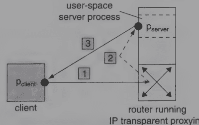

图 8.2 使用 IP 透明代理的内核重定向

与其使用服务进程，你可能在本地端口运行一个用户空间重定向器，然后将其转发到某些远程系统:端口，例如 `transproxy`（在第 8.2.1 节引入）。如果你想强制执行代理服务器的策略，可以使用透明代理将所有直接连接的外出请求转发到内部代理服务器。图 8.3 是此的说明。

严格来说，该系统不需要是路由器，因为防火墙规则必须作为输入规则的一部分进行指定。在这种情况下，你将来自某些源的流量（目标是你，因为你不是任何人的网关）重定向到特定端口，并将来自其他源的流量重定向到另一个端口。这是管理员（简便）的方法，通过在同一台服务器的不同端口上运行两个独立的守护进程，在 `ident` 或 `finger` 服务器上强制执行基于 IP 的安全（对于内部与外部等情况非常有用）。

### 使用 2.2.x 内核的 IP 透明代理支持

2.2 内核的练习方法与配置任何防火墙规则类似，并通过 `ipchains` 完成。与用于伪装的 `MASQ` 目标类似，`ipchains` 允许你将 `REDIRECT` 指定为规则的目标。你可以选择性地指定端口，不指定端口意味着使用原始数据包目标字段中的任何端口。在配置规则之前，你需要内核的支持：

- 数据包套字 (Packet socket)
- 网络防火墙
- TCP/IP 网络
- IP: 高级路由器
- IP: 防火墙
- IP: 透明代理支持（实验性）

对于我们的示例，我们想让每个人知道当有人尝试访问服务器时它已宕机。注意，你可以利用 `ipchains` 的灵活性将来自不同源的流量重定向到不同的目的地。

## 8.2 IP 流量重定向——障障眼法术

### 所有指向 moose.manc.com 80 端口的流量
### 通过用户空间代理重定向到本地端口 12970，将流量发送到
### 另一个 Web 服务器，那里 moose 正在享用早餐

```
ipchains -A input -p tcp -j REDIRT 12970 \
-s 0.0.0.0/0 -d moose.manc.com/32 80
```

### 使用 "nobody" 配置透明代理监听 12970 端口
### 代理收到的任何内容都发送到 cow.manc.com 的 80 端口
### 该服务器上有关于 moose 的康复消息
### 当人们使用 http://mouse... URL 访问它时
tproxy -s 12970 -r nobody cow.manc.com

### 管理层说对于使用 moose 的外部客户来说，消息太随意了
### 他们认为如果服务器直接宕机且不显示错误信息会更好
###（???）——我永远无法理解管理层）

```bash
### 假设我们的内部地址是 192.168.0.0/16
ipchains -I input input -p tcp -j REJECT \
-s 192.168.0.0/16 -d moose.manc.com/32 80
```

上面的示例对于“零星小路”的情况效果良好，即只有少数几个端口需要重定向。然而，当服务进程不在路由器本地时，你将产生用户空间重定向的开销。对于高带宽应用，要求路由器使用防火墙规则检查所有数据包，并将其复制到用户空间进行重定向，似乎是一项大量工作。是否有更好的方法？接下来的章节将介绍用户空间重定向，下文将介绍了一种纯内核的解决方案。

### 8.2.3 内核端口转发——高阶魔法

现在我们回到了 TCP/IP 协议栈技巧的圆圈。某些内核认为，我们讨论过的内核执行的功能也可以完全在内核中实现。回顾前两节，IP 透明代理可以被命名为防火墙重定向。它的目的是无论目的地如何，都将流量重定向到本地端口。事实上，用户空间重定向器获取绑定到本地端口的流量，并将其转发到预定的的目的地。本节涵盖了内核中 IP 伪装代码的扩展，这些扩展可以执行这些功能的混合。在深入之前，有几点关于内核转发你需要了解。

- 1. 此功能仅在 2.2 内核或更高版本可用。如果你想在 2.0 内核上使用它，请获取 `patches-iptfw`。你也可以参考 http://www.boutell.com/rinetd/ 处的文档。
- 2. 如果你的发行版不包含此功能，你需要 `netbase` 软件包。其来源如下：
- 3. 此代码仍被认为是实验性的。这意味着文档仍然很粗糙。2.3 内核开发者正在开发一种名为 `netfilter` 的全新功能，它将取代此代码和 `ipchains`。我提到这一点是因为你可能看不到这些模块的开发。

要使用内核转发，你必须在内核中编译支持。每个伪装特殊模块都可以作为模块或直接编译进内核。需要的选项有：

#### 在 2.2.x 内核中编译转发支持

- 代码成熟度选项：开发中或不完整的代码
- 网络选项：数据包套字 (Packet socket)
- 网络防火墙
- TCP/IP 网络
- IP: 高级路由器
- IP: 防火墙
- IP: 重碎片（伪装需要）
- IP: 伪装
- 伪装特殊模块
- ipt masq 支持（实验性）
- iptfw masq 支持（实验性）
- ip fwmark 转发支持（实验性）
- 文件系统

最后三个选项是感兴趣的——它们是真正的“特殊模块”。

内核端口转发——AUTOFW

协议辅助程序可以查看第 100 页。为了在本节结束前区分它们，我将分别称它们 `AUTOFW`、`PORTFW` 和 `FWMARK`。

> 26—互联网服务

> 6 那些喜欢站在最前沿（并且能够忍受两次内核崩溃）的人，可以查看 http://netfilter.kernelnotes.org/netfilter-hacking-HOWTO 中的新开发内容。


图 8.5 运行中的 AUTOFW

内容非常简少。如果你调用 `ipmasq autofw`（不带任何参数），将调用一个用法说明。（注意，选项语法与用于 2.0 内核上运行 AUTOFW 补丁的 ipautofw 相同）。

```
hafnium:/root> ipmasq autofw
Usage:
  ipautofw <command> <options>
Valid commands:
  -A    添加新的自动转发条目
  -D    删除自动转发条目
  -F    清空自动转发表
```

它支持三个基本命令，类似于 `ipchains`，外加上指定你如何希望自动转发工作的选项。请记住，使用自动转发有两种方法。第一种是显式指定隐藏主机；第二种是根据连接上的活动进行推断。

```
ipmasq autofw -A -r proto lport hport -h ipaddr
```

第一种语法使用 `-h` 指定隐藏主机。`-A` 表示应该添加一条规则。`-r` 指定协议（udp 或 tcp）以及自动转发到隐藏主机的端口范围。`-u` 告诉内核允许比默认 15 秒长的超时。

```
ipmasq autofw -A -r proto lport hport -c proto port -u
```

第二个命令与第一个相同，但不是指定隐藏主机，而是 `-c` 指定协议 `proto` 和端口 `port` 的控制连接。一旦建立了规则，查看 `/proc/net/ip_masq/autofw` 以了解正在发生的情况。

# 更好的 AUTOFW 方法——NAT

> 处理自动转发情况的另一种方法是使用 NAT（网络地址转换）。其核心思想是为路由器分配一组互联网有效的 IP 地址，以便在伪装特殊（或所有）类型的协议时使用。然后，路由器在发送（伪装）出站包之前，绑定在外部接口的这些地址之一上。这是大多数商业 NAT 使用的方法；但遗憾的是，Linux 内核尚未具备这种功能，我也不知道有任何实现此功能的用户空间守护进程。

## 内核端口转发—PORTFW

PORTFW 功能与 AUTOFW 有不同的关注点（而且不复杂！）。它的目标是通过在内核空间执行相同任务来取代用户空间的重定向器。如果执行正确，它的资源需求应该比用户空间的等效实现低。缺点是某些功能（如可配置的日志格式和访问控制列表⁷）没有实现，以防止内核代码膨肿。（开发者确实成功地包含了对偏好和负载均衡的支持）。使用此选项需要讨论的内容少得多，你应该已经通过对用户空间重定向器的讨论熟悉了相关概念。PORTFW 增加了在转发连接时保留原始发送者 IP 地址的功能（类似于 `redir --proxy` 选项）。

在使用 PORTFW 时需要注意几点细节。首先，由于这段代码是内核伪装代码的扩展，它可能只在转发数据包时发生。这意味着你不能在防火墙上使用 PORTFW 将内部重定向到防火墙“内部”的本地端口，因为此时没有发生任何转发。在实践中，这通常不是你想要用 PORTFW 做的事情，但当你从内部地址测试端口时，可能会引起一些困惑。（你可以在任何地方通过透明代理实现所需）。第二点是，PORTFW 规则本身不会伪装出站（内部）服务器 →（外部）客户端的响应。这意味着如果你转发了入站请求（从外部到内部服务器），你可能希望伪装出站的响应。否则，客户端看到的服务器（内部地址）将与其发送请求的服务器（外部防火墙）不同。这可能不是问题。如果是问题，则为这些数据包设置一个伪装规则，类似于你用于另一个方向连接的规则。

要在生产环境中使用 PORTFW，你通过 DNS 向世界发布你的 Web 服务器的 IP 地址作为外部接口的 IP 地址；或者如果内部用户需要使用相同的资源，你可以在内部 DNS 服务器上用该 IP 地址重载此名称。然后配置 PORTFW 将入站连接重定向到 Web 服务器的 IP 地址。你使用以下命令来设置转发规则：

```
hafnium:/root> ipmasq portfw -h
Usage: portfw -a -P PROTO -L LADDR LPORT -R RADDR REPORT [-p pref] add entry
       portfw -d -P PROTO -L LADDR LPORT [-R RADDR REPORT] delete entry
       portfw -f clear table
       portfw -l list table
       portfw <args> -n names
```

```
PROTO 是协议，可以是 "tcp" 或 "udp"
LADDR 是接收待转发数据包的本地接口。
LPORT 是被重定向的端口。
RADDR 是远程地址。
REPORT 是重定向到到的端口。
PREF 是偏好级别（负载均衡，默认=10）
```

注意 `-a`（add）、`-d`（delete）和 `-f`（flush）选项是小写的，与 AUTOFW (-f) 不同，且你始终将它们放在 `ipmasq portfw` 之前。用法非常直观，但表 8.1 中还有额外的提示。

> ⁷ 这并不是一个独立的限制，因为只有规则指定的连接才会匹配。

### 表 8.1 ipmasq PORTFW 选项

| 选项 | 描述 |
| :--- | :--- |
| -1 | 列出规则，还列出 pref 字段，这些字段与 -p 选项一起解释。 |
| -n | 抑制解析，就像通常的那样。 |
| -p | 负载均衡通过简单的计数器实现。每当使用规则时，计数器就会减一 |

以下命令序列是一个简单的用法示例：

```bash
# 用于入站请求的内核 PORTFW
### 设置端口转发
# .27 系统设置了大部分请求，因为它
ipmasq portfw -a -P tcp -L exp 80 -R 192.168.1.27 -p 15
ipmasq portfw -a -P tcp -L exp 80 -R 192.168.1.28 -p 5
### 还需要伪装规则
ipchains -A -p tcp -s 192.168.1.27/32 -j MASQ
ipchains -A -p tcp -s 192.168.1.28/32 -j MASQ
```

记住，可以通过为规则指定偏好来执行某种负载均衡。通过 telnet 到外部机器并尝试 telnet 到防火墙的80端口来测试你的设置。你应该连接到内部系统。执行退出命令。对于内核中的大多数事物，你不需要使用命令来了解正在发生的情况。在这种情况下，你可以查看 `/proc/net/ip_masq_portfw` 的内容。

# 内核端口转发—FWMARK

FWMARK 基本上实现了 PORTFW 相同的目标——使用私有地址空间将流量重定向到内部主机——但增加了一种更强大的方法来指定哪些入站连接被转发。它是通过与 `ipchains` 配合工作实现的，后者用于给数据包标记标记（实际上是一个整数）。FWMARK 规则随后可以作用于带有特定标记的数据包，不同类型的标记执行不同的规则。

考虑这样这种情况：你希望将一组特定的用户重定向到一个 Web 服务器（可能包含特权信息），而其他用户始终使用另一个服务器。使用 PORTFW 无法指定任何源标准；这也意味着你必须发布第二个 IP


# IP 流量重定向——障雾与幻影

地址（以及相应的 DNS 记录）

命令语法与 PORTFW 类似（不同在于大多数选项已从小写变为了大写，反之亦然）。不需要指定位置或端口，因为 ipchains 语法会根据它用于标记数据包的准则来处理这些。

```
hafnium:/root> ipmasquad mfw
Usage: mfw -A FWMARK -r RADDR [-i PREF] add entry
mfw -D FWMARK [-r RADDR PORT] delete entry
mfw -E FWMARK [-r RADDR PORT] edit entry
mfw -s FWMARK force scheduling
mfw -P clear table
mfw -L list table
mfw <args> -n no names
```

该语法非常直观，尽管 `-s` 参数需要特殊解释。PORTFW 中使用的轮询（roundrobin）调度机制也适用于 FWMARK，但有一个扩展。如果一条规则的优先级（preference）被设置为 0，则不执行调度，且该规则将保留其在规则链表中的位置。如果存在其他非零优先级的规则，则零优先级规则最终将成为该列表的首位并保持在该位置。直到你通过调用 `ipmasquad mfw -s` 强制调度。由于这一点很重要，链表头部任何规则都将移动到末尾，从而提升该规则的优先级。这种应用是实现从一个 RADDR 到另一个 RADDR 的故障转移——将所有优先级设置为 0，如果检测到主服务器宕机，则强制调度规则以选择相应的线路。

使用 ipchains 标记数据包并不困难。你使用 `-m markvalue` 用整数值对其进行标记。以下是一系列命令，将执行我们在本节开头描述的策略。

```
# 用于 Web 访问的内核防火墙转发
#
# 使用这些符号名称以保持简单
MARK_FRIEND=1
MARK_NEUTRAL=8.3.0/24
FRIEND_SVR=192.168.17.36/32
NEUTRAL_SVR=192.168.15.46/32
# 在数据包进入系统时进行标记
ipchains -input -s $(FRIEND) -m $(MARK_FRIEND)
ipchains -input -s ! $(FRIEND) -m $(MARK_NEUTRAL)
# 根据标记建立转发/重定向规则
ipmasquad mfw -i $(MARK_NEUTRAL) -r $(NEUTRAL_SVR)
ipmasquad mfw -i $(MARK_FRIEND) -r $(FRIEND_SVR)
# 确保回复也经过伪装
ipchains -forward -d $(FRIEND) -s $(FRIEND_SVR) -j MASQ
ipchains -forward -s $(NEUTRAL_SVR) -j MASQ
```

该脚本是一个非常简单的案例，但并非简单到没有趣味性。请注意 ipchains 命令中缺少 `-p` 协议和端口的指定，以及 ipmasquad 语句中缺少报告输出。由于没有指定这些内容，命令将把所有端口（TCP、UDP 和 ICMP）的流量转发到相应的内部服务器。返回程的伪装规则也是如此。你可以轻松地添加特定端口——这取决于你。

到此我们对 Linux可用重定向设施的介绍就结束。你无疑会发现其他方法来执行各种 TCP/IP 操作。Linux 2.0 和 2.2 之间能力的变化是显著的，主要由于引入了 ipchains。你可以预计在 2.4 内核中再次发生巨大的变化，它使用了名为 netfilter 的新防火墙和伪装代码。netfilter 对如何以一致的方式提供当前 Linux 内核中的系列功能进行了完全的重写和思考，并使其易于添加更多功能。实现这种简便（且快速）的方法之一是将数据包从内核空间传递到用户空间再传回。这将催生一类全新的网络管理守护进程，它们可以对数据包头进行复杂且任意的操作，并可能具有检测网络攻击并实时采取防御措施的能力。访问 http://netfilter.kernelnotes/ 获取完整故事。下一节将带我们进入更高层次讨论互联网服务。毕竟，如果你无法用它做任何事情，华丽的 TCP/IP 栈有什么用呢？

# 8.3 路由器上的通用互联网服务

本书刻意尝试不深度参与如何运行典型类型的路由器。选择这些主题很大程度上是因为它们适用于许多路由器应用。如果你需要运行一家网店并有疑问，应该参考 LDP 文档或已出版的将 Linux 作为互联网系统的书籍。然而，如果我不分享一些在 Linux 路由器上运行互联网服务的所得知识，将是失职的。本节分为可能与路由器共存的不同服务，并包含了我在接触这些服务时学到的点。

## 8.3.1 路由器上的互联网 DNS

我们必须首先涵盖这一点，因为它是其他服务的关键障碍。DNS 守护进程运行在路由器上；我们在第 7.2.1 节中介绍过。潜在问题在于 IP 栈形成数据包的方式。当 Linux 产生数据包时，它会将包的 IP 源地址字段填充为发送接口的 IP 地址。计划使用 DNS 时需要记住的一点是，你必须有一个全球可访问的 IP 地址。如果你位于 NAT 之后，DNS 服务器可以解析内部 IP，但外部客户端无法访问你。

### 路由器上的通用互联网服务

- 互联网链路运行 PPP：在这种情况下，你的 ISP 提供一个 IP 地址。如果该地址是静态的，你可以将其作为 DNS 服务器。如果是动态的，你需要使用动态 DNS 服务在更改时更新你的记录。
- 互联网链路运行 Frame Relay：在这种情况下，帧中继两端的 PVC 可能并非设计为可路由的。这对于通过点点的流量没有影响，但对于可能源自路由器的流量产生严重后果。如果你在该系统上运行 DNS，人们将向你发送查询，因为他们使用的是路由器的有效 IP 地址（很可能在 eth0 接口上）。即使帧中继接口没有有效的互联网 IP 地址，他们也能收到你的回复，因为它拥有正确的目的地并朝着正确的方向。然而，当你的机器发起查询时，这些将从你的地址发出。它们将带有虚假的源地址发送到互联网，永远得不到回音。发往互联网的伪装内部流量也将面临同样的命运。

这听起来像是个骗局，对吧？你不仅必须购买域名、为 ISP 端口付费、支付接入费、购买路由器、支付大量的设置费用，如果不购买一些地址空间，什么也做不了。（而且注册 . . 以及等待。）如果你真的只有一个 IP 地址，或者一个属于 ISP 的地址（地址），你将不得不寻找其他人来托管你的 DNS，而无需崩溃去购买一些 IP 地址。


## 提示：将服务绑定到特定的 IP 地址

TCP/IP 允许你使用 `bind()` 系统调用将套字绑定到特定的接口（实际上是一个 IP 地址）；你可以强制发出的数据包包含你选择的源 IP，只要该 IP 属于直接连接到该机器的接口。（顺便说，不要将 `bind()` 系统调用与 `bind()` 守护进程混淆。）编写良好的 Unix 网络应用程序应该允许对此进行配置，并在未指定地址时默认绑定到地址 0.0.0.0。（绑定到地址是通过绑定到 `INADDR_ANY` 完成的。）尽管如此，某些情况下可能并不一定这样做。

`bind` 守护进程在本节之前描述描述的情况下非常有用。请参考相关文档；你需要查询的关键字有 `query-source` 和 `listen-on`，它们属于 `options` 状态的一部分。在编辑配置文件并重启守护进程后，查看 `syslog` 以确保配置符合你的预期。

如果你想了解有关该主题的更多信息，或编写自己的具备网络能力的守护进程，请参阅 `bind()`、`accept()`、`listen()` 和 `connect()` 的页面（均在 man 数据库的第 2 部分），或者买一本 W. Richard Stevens 编写关于该主题的经典权威著作：*Unix Network Programming: Networking Apis: Sockets and Xti (Volume 1)*。

## 8.3.2 路由器上的 HTTP 和 NNTP

在你的 Internet 路由器上运行 Web 服务器时可能遇到的问题与 DNS 的问题相同，但大多数情况下并不严重。其，许多 HTTP 守护进程也允许你指定它们应该绑定的 IP 地址（或地址列表）。即使你的程序不支持，访问 HTTP 服务器的人也很少对 Web 服务器的 IP 地址进行反向查询，以确保其与正向查询名称匹配。

然而，对于其他服务情况可能如此，例如 NNTP（用于 Usenet 新闻馈送）。假设你有一个 ADSL 供应商颁发的单一固定 IP 地址，并且你找到了一个已建立名称服务器的他人为你的域名提供正向解析。当你连接到 `www.yourdomain.com` 时，他们的系统会查询 DNS 获取与其名称关联的 IP。他们的 DNS 系统将找到你的记录，然后你返回 `w.x.y.z`，即你 ADSL 接口的 IP 地址。到目前为止一切正常……但如果上游新闻服务器对此 IP 地址进行反向查询，它将返回 `someip.at.adsl.provider.com`，这与你的 `yourdomain.com` 不匹配。如果你连接到使用基于 DNS 访问控制的上游服务器，务必给他们你系统的规范名称（canonical name），即 `someip.at.adsl.provider.com` 地址。

## 8.3 路由器上的通用 Internet 服务

HTTP 守护进程还允许你指定希望用于服务器的服务器名称。虽然该名称应该对应该 Web 服务器的有效 DNS 名称（记录或 CNAME），但它不需要是规范主机名，也不一定需要是与用于提供请求服务的 IP 地址相对应的名称。

## 8.3.3 路由器上的 FTP

提供 FTP 服务应该没有问题。这里有一个“陷阱”，再次涉及 DNS，但这次影响的是客户端。FTP 守护进程可能想要对所有客户端连接执行成功的反向 DNS 查询（从 IP 到 FQDN）。

### 真实故事：糟糕的 FTP 服务器性能

> 我曾经接到过一个关于 FTP 服务器性能问题的电话。客户抱怨说当他尝试连接服务时，连接会挂起几分钟然后超时。我检查了服务器，并没有负载，且日志文件中也没有提到来自客户端域的连接。结果证明，问题在于客户端刚刚切换到了一条新的 Internet 链路，对于其防火墙用于访问 FTP 服务器的外部 IP 地址没有 IP 到名称映射。在 FTP 守护进程对传入的连接进行任何操作之前，它会尝试对连接的 IP 进行反向查询并将其放入日志中。在这种情况下，查询花费了几分钟才超时，而且 FTP 守护进程甚至没有记录该连接尝试。在 `/etc/hosts` 中做了一些努力后解决了问题，直到客户端的 DNS 区域被配置正确。在这种情况下，能够查看 ftp 订单是非常有用的。

顺便说一下，连接的系统必须具有 DNS 可解析的 IP 地址这一要求，可以通过 `tcpd` 及其配置文件 `/etc/hosts.allow` 和 `/etc/hosts.deny` 来强制执行。如果你在连接到已知正在运行你所请求服务的服务器时遇到困难，可能是路由问题，也可能是伪装问题，但很多时候是 DNS 或 `tcpd` 配置的问题。

## 8.3.4 Sendmail（在路由器上）

Sendmail（以及其他 MTA）的情况可能参差不齐。让我们思考它们需要执行的功能。首先，它们必须发送邮件（理所当然的，对吧？）。其次，它们必须能够接收邮件并根据需要进行转发，也称为中继（relaying）。我不讨论邮件本地投递并存储在服务器上的情况（在我看来，除了小型安装外，这对于路由器来说并不合适）。

## 276 Hafnium—Internet 服务路由器 第 8 章

接收邮件不应该是问题。你的 DNS 配置只需要一个 MX 记录，将你的路由器列为你域名的适当邮件更改器（Mailchanger）。某些发送者可能会因为你的正向和反向 DNS 查询不匹配而困扰；他们可能会生成警告消息，但可能不会拒绝向你发送邮件。

然而，发送邮件具有类似于 DNS 的问题。此外，由于近期针对垃圾邮件的活动，可能会出现其他问题。首先，你可能会发现邮件服务器拒绝来自无法在 DNS 中解析的的的。其次，如果发送地址在 DNS 中再次不对应 IP 地址，某些邮件服务器可能会拒绝你的邮件。最后，如果你通向 Internet 的点对链路不可路由，可能会遇到问题，因为并不是所有的 MTA 都允许配置绑定地址，正如我们所讨论的那样。

这里列出的 DNS 和路由服务适用于大多数 Internet 服务。总结来说，某些服务喜欢验证 IP 地址和主机名是一对匹配。更具体地说，规范主机名应该匹配 IP 地址。这可能是早期基于 IP 的安全机制的遗留。然而，随着 Internet 的爆炸式增长，情况发生了变化。许多运行域从未读过 RFC。防御，我们被要求支持一个具有更多协议、更少知识的用户以及更大流量的环境。尽管如此，了解你所说的内容并没有坏。

这种情况的一种微妙变体与 DNS 无关，可能发生在使用“不可路由”IP 地址作为点对接口的内部链路上。管理员坐在路由器上 telnet 到远程网络上的主机以测试链路。链路似乎是通，但主机从未响应。这是因为 telnet 客户端在尝试连接路由器时将其套字绑定到地址 `INADDR_ANY`。内核没有在源字段中使用主机名，而是使用了发送数据包的接口的 IP 地址。数据包到达了目标，但该目标可能找不到返回路由器点对接口 IP 地址的路由。沮躁的路由器管理员感到困惑，链路或其路由配置似乎没有问题。对于内部链路，在第 5 章第 146 页提供了一个解决方案。另一种解决方案是确保所有内部 IP 地址（包括点对部分）都是可路由的，通过将正确的信息放入所有路由器的路由表中。处理这些守护进程是下一节的主题。


# 动态路由守护进程

## 提示：重新审零节点网络

你可能记得在第 5.3.5 节中提到过，我们可以“扩展”子网以包含点对链路另一端的 WAN 接口。我们通过为点对链路的近端和远端分配该子网的地址，并使用 255.255.255.255 的子网掩码来实现。这样做是为了通过不对链路本身分配特定的子网来节省地址空间。由于内核通过名称而非仅仅通过 IP 来识别网络接口，因此同一系统上的两个不同接口可能具有相同的 IP 地址。这对于互联网路由器和其他 WAN 路由器来说是最合理的，因为 WAN 接口和以太网接口之间的区分仅对路由表是必要的。换句话说，系统的用户并不关心他们正在使用的接口。

Linux 内核将带你更进一步。由于内核通过名称而非仅仅通过 IP 来识别网络接口，同一系统上的两个不同接口可能具有相同的 IP 地址。这对于互联网路由器和其他 WAN 路由器来说是最合理的，因为 WAN 接口和以太网接口之间的区分仅对路由表是必要的。换句话说，系统的用户并不关心他们正在使用的接口。

要使用此功能，请将 IP 地址及其常规子网掩码分配给以太网接口。为点对链路近端分配相同的 IP 地址，并使用 255.255.255.255 的子网掩码。（点对链路的远端也可以共享其路由器以太网接口的 IP。）大功告成——再也不用担心 DNS 中的两个 IP 或基于 IP 的认证混淆了！

# 8.4 动态路由守护进程

对于某些应用程序，无法通过一系列 `route add` 语句手动配置你的路由表。条目可能会频繁变化，或者条目多到你无法手动输入所有。或者你可能会发现在脚本中输入路由语句并在所有系统上维护这些脚本非常繁琐。有几种替代方案可以配置你的 Linux 路由器以实现动态路由。守护进程从本地文件中读取配置，在网络套字上监听路由更新，并定期通过其接口向邻居广播其路由表。对路由信息感兴趣的将接收这些广播并相应更新它们的路由表。通过这种方式，你不需要输入任何内容，只要所有配置正确，你的网络就应该在稳定的路由配置下快速收敛。

在你的路由器上加载它们之前，请理解它们并不适用于所有人。某些类型的网络拓扑结构更适合某些路由协议；而其他一些则根本不适合由守护进程管理。如果你是路由协议的新手，在启动它们并导致网络中断之前，你应该先通过书籍做些功课。还要记住，对于许多拓扑结构，设计良好的内部网络可以使用静态路由进行管理，其开销比这些守护进程更小，且更易维护。但这被认为是一个观点问题。

> 感谢 David Mandelstam 与我分享这个小知识。我真希望我能早点知道！

# 8.4.1 Linux 的 routed 路由守护进程

`routed` 如果可以这么说是路由守护进程的鼻祖。它支持 RIP（路由信息协议），该协议最初由 Xerox 设计并由 GWININFO 程序实现。该程序后来重命名为 `routed`，并通过 BSD 4 引入了主流 Unix 世界。它最初在 RFC 1058（即 RIPv1）中被描述，其变体 RIPv2（RFC 1388 — 1723 → 2453）和用于 IPv6 的 RIPng（记录在 RFC 2080 中）。随 Linux 一发的版本涵盖了 RIPv1。

如果你想在系统上加载它，请检查它是否已经存在。它是 Linux NetKit 的一部分，通常作为基础安装的一部分发布。在 Debian 下，它是 `netstd` 包的一部分。默认情况下，它是禁用的，但你可以通过编辑 `/etc/init.d/netsd_init` 然后使用 `/etc/init.d/netsd_init start` 启动服务来启用它。

配置 routed：本身没有配置文件，但有一些你可能想要修改的选项。你可以在 `netsd_init` 中设置这些选项，这样在下次停止并启动服务时，它们将按照你的喜好设置。

- -d 启用调试，将通过 syslog 记录一些额外信息（默认到 `/var/log/syslog`）。
- -g 指示守护进程广播关于其默认路由网关的路由信息（如果有的话）。使用时要小心，因为你的拓扑结构可能无法接受一个默认路由被另一个替换。
- -s |-q 控制 `routed` 是否生成关于其机器接口和路由的信息。选择是 (-s) 或保持静默 (-q)。注意，默认设置适用于具有多个网络接口的机器（即路由器），并在单接口机器上保持静默。每个交换机会覆盖默认行为。

除了这些开关，你还可以通过配置 `/etc/gateways` 文件来影响 `routed`，这是 `routed` 启动时进行的。`/etc/gateways` 中的每一行都表示特定网关应该视为被动（passive）、激活（active）还是外部（external）。

- **激活网关**被视为系统上的任何其他激活接口，即其路由信息会与他人共享，并在路由内核中输入其条目。
- **被动网关**将被添加到路由表中，但它不会作为 RIP 数据包的一部分进行广播。
- **外部网关**永远不会被广播也不会添加到内核的路由表中。

`/etc/gateways` 中的某行紧密对应于 `route add` 语句，如如下格式所示（或通过查看 `routed` 的 man 页面）：

```
<nethost> destIP gateway gwIP metric value <passive|active|external>-
```

# 动态路由守护进程

关于 `routed` 进程本身的最后一个说明。它不会 fork 并从启动它的 shell 中分离（即它不会变成后台守护进程）。如果你在前台启动它并想将其从终端分离，可以使用 CTRL-Z 然后执行 `bg`。关于路由你应该知道的另一点是，对于未标记为外部的内容，它都会在路由表中创建自己的条目。如果你已经设置了静态路由，这将是一种困扰，因此你可能需要调整 `/etc/gateways` 或放弃——使用静态或动态路由，不要两者兼用。你可能会发现 `routed` 以传统方式为直接连接的网络创建条目，这取决于你的路由器看起来是奇怪还是熟悉。

ripquery 说你想知道路由器向世界广播了什么（无需运行 4.5 中的嗅探器）。你可以使用 `ripquery` 命令获取 `routed` 的系统路由表内容。如果你在路由器本身，执行 `ripquery localhost`。对于远程路由，使用主机名或 IP 地址代替 `localhost`。该命令还支持单个开关 `-n` 用于名称查找。在我的设置中，这似乎作用不大，除了防止在查询结果的每行中输出名称。无论如何调整 `/etc/networks` 或 `/etc/hosts` 或其关联配置文件似乎都没有帮助。（你应该能够识别查询返回的子网。）

关于 `routed` 的更多信息可以通过查阅相关的 RFC 或源代码本身找到。当你寻找它时，记住它是 NetKit 的一部分。

# 8.4.2 Linux 的 Zebra 路由守护进程

GNU Zebra 是第一个广受欢迎的免费软件（根据 GNU 公共许可证发布），管理 TCP/IP 路由协议。它支持 RFC 1771（边界网关协议4）描述的 BGP–4 协议以及 RIPv1、RIPv2 和 OSPFv2。

Zebra 在支持多线程的 Unix 内核下使用多线程技术。然而，它也可以不支持多线程的 Unix 内核下运行。


## Zebra 设计用于作为路由服务器（Route Server）和 Zebra 反射器（Reflector）。

Zebra 不是一个工具包；它在一种新的架构下提供了完整的路由能力。Zebra 的设计独特之处在于它为每个协议都拥有一个进程。

它还包含对 IPv6 的支持，尽管描述中没有列出。有一个 Debian 软件包 (zebra) 可用，如果你必须从源码编译，不要绝望。它们是充分利用 GNU 工具潜力的极佳示例。我在十分钟内就能构建可执行文件并生成了文档。请注意，目前文档是 info 格式，而不是 man 页面。

```
### 访问文档
### 注意：你必须安装 tetex-bin 软件包
$ cd zebra-0.73/doc
$ tex zebra.texi
```

``````
# 要查看文档
$ xvi zebra.dvi

# 要打印输出，假设你已经
# 为你的默认打印机正确安装了 magicfilter
$ dvips zebra.dvi -o /tmp/zebra.ps
$ lps /tmp/zebra.ps
```

Zebra 的配置包含在文档中（以 TeX 格式发布；.texi 文件）。作为对有 Cisco 经验的人的奖励，其配置语法与它们相似。

正如网页上提到的，Zebra与其他路由守护进程的不同之处在于它为每个路由协议提供了一个独立的守护进程。与其他路由守护进程和路由器一样，Zebra 支持运行在特殊端口上的租户会话，这被称为 VTY 接口。每个协议守护进程都有自己的接口。如果你使用的是 Debian 软件包，此文档位于 /usr/share/doc/zebra/。关于 Debian 软件包的几点：

- 所有的配置文件都在 /etc/zebra/ 中。
- 你通过 /etc/zebra/daemons 中列出的项来控制启动哪些路由守护进程。

### 8.4.3 多线程路由工具包

如果 Zebra 不合你意，你可以使用 MRTd，这是一个多线程工具包守护进程，它在 NSF 和英特尔公司的资助下得以实现。有资金的投入意味着一切都组织得很好，并且有不错的文档（而且相当不错）；他们甚至有发布计划。MRTD 在 Linux 中原生开发，因此它并不总能在尝试时编译。另一方面，它也适用于其他平台。

编写时的最新版本包含了对 BGP4+、BGP、RIPng 和 RIP2（包含对 RIP1 的支持），并计划支持 OSPF IPv4 和 IPv6。像 Zebra 和 Gate 一样，你可以通过 telnet 连接到已知端口与守护进程进行交互。

> 9 虽然听起来像商业行为，但这种赞助实际上是 TCP/IP 本身的大传统，它的根源在于 DARPA。

### 8.4 动态路由守护进程

MRTD 还带有一套测试程序：

- sbgp—一个可以接收 BGP4+ 消息并可以生成且将其注入网络的工具。
- ospf—一个简单的 OSPF 说话者和监听器，功能与 sbgp 类似。
- route_btoa—一个将 MRT 消息转换为 ASCII 的工具。
- route_atob—route_btoa 的反方向。这很有用，因为 MRT 消息可以管道到其他 MRT 工具中。
- bgsim—一个用于模拟的 BGP4+ 流量生成器。

你可以查看文档、邮件列表并从 http://www.mrtid.net 获取源码副本。

### 8.4.4 用于 Linux 的 GateD 路由守护进程

你是在互联网上多主备的吗？你需要比 routed 包含更多的协议支持吗？你渴望互联网骨干网人员正在运行的代码吗？如果这些情况中的任何一个符合你的现状，那么 GateD 就是一个支持流行路由协议的 Unix 路由守护进程。由 Merit GateD 联盟制作并支持。该小组是互联网路由守护进程的提供者，同时也架起了业界与学术界之间的桥。

在运行你的 Linux 路由器之前的第一步不是配置它。GateD 联盟有一个版本的源码对公众，但比 GateD 成员访问的版本落后几个修订，而且在没有与 GateD 联盟协商许可的情况下不可重新发布。正是第二一点导致了 Debian 或任何其他发行版没有预包的 GateD 版本。然而，这并没有阻止你合法地构建自己的副本使用。

首先，你可能想访问 http://www.gated.org 查看许可信息和可用性信息。你可能会决定注册成为学术与研究 (A & R) 协会或其他成员身份。你还能找到少量的 Linux 预编译二进制文件。除非你急得不得，否则你可能应该从源码编译。我的测试编译在 glibc2.0 和 glibc2.1 系统上均成功，内核版本为 2.2.10。以下是我构建自己的二进制文件的步骤：

1. 通过浏览网站找到 Public Unicast 以获取公有源码。
2. 在你想要编译的工作站上提取源码。
3. 为构建配置源码。我构建的是 3.5.11 版本，我必须编辑 src/obj/Config 中的以下项：
   (a) 至少要移除放入示例配置文件的 '!' 注释。在我的系统中，它们无法让 make config 正常工作。
   (b) 如果你愿意，注释掉 INCLUDE_IOCTL 选项行，它不需要且导致了一系列编译器警告。
   (c) 编辑以下任何内容以匹配你的 Linux 发行版。对于 Debian 已经好了。你可能想调整协议，包含的越多，生成的二进制文件越大，而且不需要你永远不会使用的协议。查看 /src/configs/README 获取有关可用协议和其他选项的信息。

```
protocol      bgp ospf ripp
sbindir /usr/sbin
bindir /usr/bin
path_unix /usr/src/linux/vmlinux
path_pid /var/run/%s.pid
path_dumpdir /tmp
path_version /var/run/%s.version
path_dump /tmp/gated_dump
path_config /etc/gated_conf
```

构建源码；可能需要几分钟。目前的流程如下：

```
$ tar xvzf gated-3-5-11.tar.gz
$ cd gated-3-5-11
$ mkdir src/obj
$ cd src/configs
$ cp -p linux.conf ../../obj/
$ cd ../../
$ make src/obj
$ make
```

Zebra 的配置包含在文档中（以 TeX 格式发布；.texi 文件）。作为有 Cisco 经验的人的奖励。正如网页上提到的，Zebra与其他路由守护进程的不同之处在于它为每个路由协议提供了一个独立的守护进程。与其他路由守护进程和路由器一样，Zebra 支持运行在特殊端口上的租户会话，这被称为 VTY 接口。每个协议守护进程都有自己的。如果你使用的是 Debian 软件包，此文档位于 /usr/share/doc/zebra/。关于 Debian 软件包的几点：

- 所有的配置文件都在 /etc/zebra/ 中。
- 你通过 /etc/zebra/daemons 中列出的项来控制启动哪些路由守护进程。

### 8.4.3 多线程路由工具包

如果 zebra 不合你意，你可以使用 MRTd，这是一个多线程工具包守护进程，它在 NSF 和英特尔公司的资助下得以实现。有资金的投入意味着一切都组织得很好，并且有不错的文档（而且相当不错）；他们甚至有发布计划。MRTD 在 Linux 中原生开发，因此它并不总能在尝试时编译。另一方面，它也适用于其他平台。

编写时的最新版本包含了对 BGP4+、BGP、RIPng 和 RIP2（包含对 RIP1 的支持），并计划支持 OSPF IPv4 和 IPv6。像 Zebra 和 Gate 一样，你可以通过 telnet 连接到已知端口与守护进程进行交互。

> 9 虽然听起来像商业行为，但这种赞助实际上是 TCP/IP 本身的大传统，它的根源在于 DARPA。

### 8.4 动态路由守护进程

MRd 还带有一套测试程序：

- sbgp—一个可以接收 BGP4+ 消息并可以生成且将其注入网络的工具。
- ospf—一个简单的 OSPF 说话者和监听器，功能与 sbgp 类似。
- route_btoa—一个将 MRT 消息转换为 ASCII 的工具。
- route_atob—route_btoa 的反方向。这很有用，因为 MRT 消息可以管道到其他 MRT 工具中。
- bgsim—一个用于模拟的 BGP4+ 流量生成器。

你可以查看文档、邮件列表并从 http://www.mrtid.net 获取源码副本。

### 8.4.4 用于 Linux 的 GateD 路由守护进程

你是在互联网上多主备的吗？你需要比 routed 包含更多的协议支持吗？你渴望互联网骨干网人员正在运行的代码吗？如果这些情况中的任何一个符合你的现状，那么 GateD 就是一个支持流行路由协议的 Unix 路由守护进程。由 Merit GateD 联盟制作并支持。该小组是互联网路由守护进程的提供者，同时也架起了业界与学术界之间的桥。

在运行你的 Linux 路由器之前的第一步不是配置它。GateD 联盟有一个版本的源码对公众，但比 GateD 成员访问的版本落后几个修订，而且在没有与 GateD 联盟协商许可的情况下不可重新发布。正是第二一点导致了 Debian 或任何其他发行版没有预包的 GateD 版本。然而，这并没有阻止你合法地构建自己的副本使用。

首先，你可能想访问 http://www.gated.org 查看许可信息和可用性信息。你可能会决定注册成为学术与研究 (A & R) 协会或其他成员身份。你还能找到少量的 Linux 预编译二进制文件。除非你急得不得，你可能应该从源码编译。我的测试编译在 glibc2.0 和 glibc2.1 系统上均成功，内核版本为 2.2.10。以下是我构建自己的二进制文件的步骤：

1. 通过浏览网站找到 Public Unicast 以获取公有源码。
2. 在你想要编译的工作站上提取源码。
3. 为构建配置源码。我构建的是 3.5.11 版本，我必须编辑 src/obj/Config 中的以下项：
   (a) 至少要移除放入示例配置文件的 '!' 注释。在我的系统中，它们无法让 make config 正常工作。
   (b) 如果你愿意，注释掉 INCLUDE_IOCTL 选项行，它不需要且导致了一系列编译器警告。
   (c) 编辑以下任何内容以匹配你的 Linux 发行版。对于 Debian 已经好了。你可能想调整协议，包含的越多，生成的二进制文件越大，而且不需要你永远不会使用的协议。查看 /src/configs/README 获取有关可用协议和其他选项的信息。

```
protocol      bgp ospf rip egp
sbindir /usr/sbin
bindir /usr/bin
path_unix /usr/src/linux/vmlinux
path_pid /var/run/%s.pid
path_dumpdir /tmp
path_version /var/run/%s.version
path_dump /tmp/gated_dump
path_config /etc/gated_conf
```

构建源码；可能需要几分钟。目前的流程如下：

```
$ tar xvzf gated-3-5-11.tar.gz
$ cd gated-3-5-11
$ mkdir src/obj
$ cd src/configs
$ cp -p linux.conf ../../obj/
$ cd ../../
$ make src/obj
$ make
```

Zebra 的配置包含在文档中（以 TeX 格式发布；.texi 文件）。作为有 Cisco 经验的人的奖励。正如网页上提到的，Zebra与其他路由守护进程的不同之处在于它为每个路由协议提供了一个独立的守护进程。与其他路由守护进程和路由器一样，Zebra 支持运行在特殊端口上的租户会话，这被称为 VTY 接口。每个协议守护进程都有自己的。如果你使用的是 Debian 软件包，此文档位于 /usr/share/doc/zebra/。关于 Debian 软件包的几点：

- 所有的配置文件都在 /etc/zebra/ 中。
- 你通过 /etc/zebra/daemons 中列出的项来控制启动哪些路由守护进程。

## 紧急程序

此节是根据提供的文本的紧急程序的占位符，尽管提供的文本末尾包含了 OCR。

如果你使用的是 Debian 软件包，此文档位于 /usr/share/doc/zebra/。关于 Debian 软件包的几点：

- 所有的配置文件都在 /etc/zebra/ 中。
- 你通过 /etc/zebra/daemons 中列出的项来控制启动哪些路由守护进程。

### 8.4.3 多线程路由工具包

如果 zebra 不合你意，你可以使用 MRTd，这是一个多线程工具包守护进程，它在 NSF 和英特尔公司的资助下得以实现。有资金的投入意味着一切都组织得很好，并且有不错的文档（而且相当不错）；他们甚至有发布计划。MRTD 在 Linux 中原生开发，因此它并不总能在尝试时编译。另一方面，它也适用于其他平台。

编写时的最新版本包含了对 BGP4+、BGP、RIPng 和 RIP2（包含对 RIP1 的支持），并计划支持 OSPF IPv4 和 IPv6。像 Zebra 和 Gate 一样，你可以通过 telnet 连接到已知端口与守护进程进行交互。

> 9 虽然听起来像商业行为，但这种赞助实际上是 TCP/IP 本身的大传统，它的根源在于 DARPA。

### 8.4 动态路由守护进程

MRd 还带有一套测试程序：

- sbgp—一个可以接收 BGP4+ 消息并可以生成且将其注入网络的工具。
- ospf—一个简单的 OSPF 说话者和监听器，功能与 sbgp 类似。
- route_btoa—一个将 MRT 消息转换为 ASCII 的工具。
- route_atob—route_btoa 的反方向。这很有用，因为 MRT 消息可以管道到其他 MRT 工具中。
- bgsim—一个用于模拟的 BGP4+ 流量生成器。

你可以查看文档、邮件列表并从 http://www.mrtid.net 获取源码副本。

### 8.4.4 用于 Linux 的 GateD 路由守护进程

你是在互联网上多主备的吗？你需要比 routed 包含更多的协议支持吗？你渴望互联网骨干网人员正在运行的代码吗？如果这些情况中的任何一个符合你的现状，那么 GateD 就是一个支持流行路由协议的 Unix 路由守护进程。由 Merit GateD 联盟制作并支持。该小组是互联网路由守护进程的提供者，同时也架起了业界与学术界之间的桥。

在运行你的 Linux 路由器之前的第一步不是配置它。GateD 联盟有一个版本的源码对公众，但比 GateD 成员访问的版本落后几个修订，而且在没有与 GateD 联盟协商许可的情况下不可重新发布。正是第二一点导致了 Debian 或任何其他发行版没有预包的 GateD 版本。然而，这并没有阻止你合法地构建自己的副本使用。

首先，你可能想访问 http://www.gated.org 查看许可信息和可用性信息。你可能会决定注册成为学术与研究 (A & R) 协会或其他成员身份。你还能找到少量的 Linux 预编译二进制文件。除非你急得不得，你可能应该从源码编译。我的测试编译在 glibc2.0 和 glibc2.1 系统上均成功，内核版本为 2.2.10。以下是我构建自己的二进制文件的步骤：

1. 通过浏览网站找到 Public Unicast 以获取公有源码。
2. 在你想要编译的工作站上提取源码。
3. 为构建配置源码。我构建的是 3.5.11 版本，我必须编辑 src/obj/Config 中的以下项：
   (a) 至少要移除放入示例配置文件的 '!' 注释。在我的系统中，它们无法让 make config 正常工作。
   (b) 如果你愿意，注释掉 INCLUDE_IOCTL 选项行，它不需要且导致了一系列编译器警告。
   (c) 编辑以下任何内容以匹配你的 Linux 发行版。对于 Debian 已经好了。你可能想调整协议，包含的越多，生成的二进制文件越大，而且不需要你永远不会使用的协议。查看 /src/configs/README 获取有关可用协议和其他选项的信息。

```
protocol      bgp ospf rip egp
sbindir /usr/sbin
bindir /usr/bin
path_unix /usr/src/linux/vmlinux
path_pid /var/run/%s.pid
path_dumpdir /tmp
path_version /var/run/%s.version
path_dump /tmp/gated_dump
path_config /etc/gated_conf
```

构建源码；可能需要几分钟。目前的流程如下：

```
$ tar xvzf gated-3-5-11.tar.gz
$ cd gated-3-5-11
$ mkdir src/obj
$ cd src/configs
$ cp -p linux.conf ../../obj/
$ cd ../../
$ make src/obj
$ make
```


# 284 铿—互联网服务路由器 第8章

图 8.6 冗余路由器连接

将 router_A 上的接口配置为关闭并运行脚本。一旦你信任你的脚本及其让 standby_A 变为 router_A 的能力，你就可以着手自动化故障转移的方法。因为网卡（NIC）非常廉价，而且脚本是免费的，所以没有理由不在网络中的每个点都使用 Linux 服务器作为备用路由器。

**冗余防火墙**

由于安全考虑，防火墙故障转移是完全另一回事，你在这里能做的事情很大程度上取决于你的防火墙拓扑。如果你正在使用代理，那么第二台代理机器可能比其中一台更容易受到攻击，而且根据你的客户端负载量，拥有两台（或更多）机器可能是必要的的。在这种情况下，你可能希望采用 N + 1 的方法来分配备用机器。在允许充分访问代理的同时，配置安全的数据包过滤规则可能会变得复杂。特别是，你将需要转发通过包过滤器的流量，但你并不希望转发本应只使用代理的流量。如果你确实需要这样做，请关注使用转发路由器来限制流量，而不是使用输出过滤器。

在包过滤器的情况下，你可能并不希望有一台额外的机器始终连接到边界网络。由于防火墙故障可能足够重要到需要人员访问，所以你准备了一个 standby_B 来接管，但让它保持与边界网络断开。当你需要这台机器时，可以将其物理连接到边界网络。如果你对内部攻击没那么偏执，可以保持接口已配置但处于断开状态。

总结一下，防火墙冗余是件好事，但你不应该向你的整体安全模型承诺这一点。在我看来，一个好的防火墙可能是那种在宕机后就一直保持离线状态，直到攻击结束，并且你有机会验证系统没有被攻破。一个在宕机防火墙位置自动弹出的自动化故障转移系统将具有相同的缺陷，并遭受同样的命运。问题在于，除非在特殊情况下，否则你无法确定防火墙是遭遇了硬件故障还是软件故障。有时，一个可靠的人类比聪明的脚本值得多。

另一方面，停机通常归因于人为错误。不要因为在修改启动脚本时违反了 Shell 语法错误而导致停机。在进行任何更改后，你使用 `bash -n scriptname` 或 `sh -n scriptname` 来检查类型错误。考虑一下如果你的防火墙带有配置脚本错误的情况下重启会发生什么。如果脚本没有配置伪装（masquerading），你就会面临生产环境停机。如果你的过滤器没有到位，你就是在没有防火墙的情况下运行……

## 8.5.2 支持服务器——“安全之地”

当你规划冗余时，不要忽视其他重要的网络服务。对于用户来说，DNS 或 DHCP 停机与路由器的硬崩溃一样悲惨且具有破坏性。在你设计网络基础设施时，请记住能够以自动方式复制所有配置文件是很有方便的。如果你更改了 DHCP 配置文件，该文件的副本将传输到一个安全的地方，同时也传输到被指定为备用 DHCP 服务器的机器（标记为从属服务器）。DNS 服务对于你网络的日常运行也应该这样处理。一个需要考虑的额外预防措施是养成保存这些文件的习惯，以便在需要快速回退到之前的版本时使用。这听起来像是取消传统备份的理由。几乎确实如此。在页面上放置任何东西的问题是到达那里需要一段时间时间，而且你无法从远程位置操作磁带。那么，哪里是个地方？

对于任何规模的环境（超过几台机器），我建议你清理一下角落里那台 486/16M 机器，安装一个全新的硬盘（可能还有磁带驱动器），并将这台机器作为你的“Linux 支持服务器”。你可以将其用作软件仓库；它可能是你机群中唯一带有 CD-ROM 驱动器的机器（这样你就可以保留一份发行版的副本并进行 NFS 挂载）。它还将包含你使用的任何不属于发行版的软件、内核源码和包以及我之前提到的配置文件。你可能还想将系统日志复制到这台机器上进行归档。事实上，这可能是你网络中唯一你对其进行全备的机器。

在大多数情况下，你使用 NFS 作为你的配置文件备份机制。如果你这样做，请对备份的内容和方式保持理智。首先，你将把支持机器的文件系统部分部分作为可写部分导出到你所有的服务器。导出目录 `/usr/local/etc/envbackups`，其中可能包含你环境中每台机器的子目录。你的生产机器将挂载 `carbon:/usr/local/etc/envbackups($hostname)` 并在保留修改日期的情况下复制文件（使用 `-p` 选项的 `cp`，或者直接使用 `tar`）。你复制什么取决于你，你可以从第 7.4.2 节列出的内容开始。当你挂载支持服务器时，确保使用 `-o soft` 选项进行挂载，这样你的生产服务器就不会因为挂载点临时不可用而产生问题。因为正在复制的文件可能包含敏感配置信息，不要忘记保护挂载点免受窥探——以保持你的“安全之地”真正安全。

## 8.5.3 用于“热”备份的微型发行版

请记住，任何带有几块网卡的机器在急急对于局域网或包过滤器来说都是足够的。你只需要一个微型发行版，它可以启动并配置接口，并包含防火墙命令。在简单路由器的情况下，大多数发行版的救急软盘已经足够了。特别是，你需要支持 IP 防火墙（可能还有 IP 伪装）的内核二进制 `ipfwadm` 或 `iptchains`。请参阅第 15 页的列表。在所有情况下，你都希望方便地访问最新的防火墙规则。考虑将以下步骤纳入你的防火墙流程中：

每当你更改防火墙规则时，为文件的上一个版本制作备份并记录更改。`saveelog` 命令（Debian 原生）是制作文件备份版本的方便方法。你还应该将新规则保存在安全的地方，意味着不在防火墙上。如果你容易忘记保存副本，将设置一个 cron 任务来检查文件并在发生变化时通知你。（出于安全考虑，这也是个主意。）对于熟悉变更控制的人来说，你会将其识别为最简单最基础的形式。关于这一点，附录 C 第 3 节有更多文本。

## 8.5.4 救急磁盘

有时你会发现自己（困）于必须决定是尝试主系统还是回退到备用系统的境地。特别是当你知道没有像你希望新的备份时……或者你可能知道问题所在，只需要一种进入系统的方法来修复。如果你决定手术救病人，你将不得不从救急软盘（或 CD-ROM）开始。

使用救急磁盘是将 Linux 内核的副本连同常用工具作为压缩镜像放在软盘上。当你从此软盘启动时，它会创建一个内存磁盘，将压缩的根目录提取到内存磁盘中，然后以此作为根目录启动。一旦你启动了（你不应该


任何关于内存和软盘驱动器的硬件问题——如果你遇到了这些，请尽快获取更多硬件，你可以采取任何必要措施来修复系统。通常，这涉及到将硬盘的根分区（以及可能的其他分区）挂载到内存磁盘根目录下的某个位置。然后你可以编辑文件、移动/重命名、用另一个版本替换文件、卸载文件系统并重启。（别忘了在重启之前卸载文件系统！）

市上有多种救援系统；你使用哪一个取决于你的喜好以及在你需要时手头恰有的工具。我鼓励你尝试其中的几个，以便你熟悉它们的特定功能和优缺点。在大多数情况下，它们都是空间管理领域令人惊叹的成就，但有些系统提供了修复系统所需的工具，而你可能只需要足够的时间从备份服务器拷贝一些文件。它们对于硬件故障之外的情况也有用。以下是一些常见的“哎呀，我刚才搬了自己的脚”的情况（并非真正的紧急情况），在这些情况下可能会发现它们很有用：

- 这很尴尬，但确实会发生。丢失密码可能会让你陷入困境。我发现处理这类问题的最好方法是等待高峰期，重启机器（通过控制台使用 CTRL-ALT-DEL），并使用救援软盘启动。让救援软盘启动系统并执行一个 shell。在这个 shell 中，创建一个 `/tmp` 目录并挂载硬盘的根分区。现在 `cd /tmp/root/etc`，并使用救援盘上的编辑器删除 `/root/passwd` 和 Shadow 文件中密码字段中的任何内容。现在 `cd``，`umount /tmp/root`，弹出软盘并重启系统。系统一启动，以“root”身份登录并设置一个你能记得的密码。如果你推迟修复问题，你可能会发现自己不得不向用户或经理解释，为什么不能在白天不影响正常活动的情况下完成请求的配置更改。

- 几乎和密码一样尴尬的是糟糕的内核。如果你生成了一个无法启动机器的内核，且没有备份内核镜像，你将必须从其他设备启动才能重新运行。在这种情况下，从不同的内核启动系统，但将根文件系统挂载为自身。对于 Debian 救援软盘，你可以在根提示符处输入 `rescue=/dev/hda1`（用 `hda1` 替换根分区）从你最初加载机器时使用的内核启动。启动后，你可以登录、清理内核带来的混乱并再次尝试。

- 如果你将驱动器从一个镜像到另一个，可能会遇到与上述类似的情况。这将混淆你的引导加载程序，并防止在你尝试从新镜像的驱动器启动时找到内核。再次，从救援介质启动并指定根分区应该是哪个。一旦启动，执行命令 `lilo -v`（或任何适用于你机器的命令）然后重启。

## 硬盘问题

好了，抛开那些愚蠢的管理员技巧不谈，另一类完全不同的需要救援盘的问题。即任何导致根文件系统无法挂载的文件系统损坏。文件系统损坏通常有四种形式。

1. 文件系统元数据不一致，由于系统停机前磁盘缓冲区未刷新导致。这种损坏会在系统意外重启的任何时候发生。`fsck` 程序通常会再次让一切恢复正常，前提是它可以执行（即根文件系统可以以只读模式挂载）。

2. 硬盘检测到坏块且控制器无法将其重定位到良好块¹⁰。任何包含该块的文件或索引节点都是不可读的。在这种情况下，问题的严重程度完全取决于坏块的位置。如果它位于 `/lib/ld.so` 或 `/bin/mount` 的 `/etc/initab` 下，情况会在好转之前变得更糟。另一方面，你可能永远察觉不到。这并不意味着驱动正在故障，或者预计会有更多坏块。

3. 硬盘正受到许多物理因素的压力，例如轴承损坏、过热。这可能导致间歇性问题，也可能是被称为“磁头撞击”的极短旅程的开始。在这种情况下和第一种情况下，最好的办法是回到备用系统，尝试以只读模式挂载硬盘并挽救尽可能的内容（如果需要的话）。

4. 内核与磁盘控制器上的芯片组之间可能存在不兼容性。在遇到这种情况之前，我使用 Linux 多多年。天哪，我太吃惊了！问题很容易修复，但在时间成本上是高昂的。虽然这类不兼容性并不常见，但它们确实存在，当我向他人寻求我的系统突然失控的原因时，我学到了这一点。

防止这种情况最好的方法是掌握内核自带的配置帮助，并在调整 `hdparam` 时要小心。如果发生此类故障，你可能会立即发现。通常内核会检测到问题并将根文件系统重新挂载为只读（按照 `/etc/fstab` 中的 `errors=remount-ro`）。这会破坏系统日志、编辑文件以及可能查看页面等功能，但你防止了 bug 进一步破坏你的文件系统。如果你一整天都发现系统有些异常，如果触碰 `/tmp/mctoo` 失败，那么你应该仔细查看 `/var/log/kern.log` 和 `/var/log/syslog`。

这些问题的严重程度不等，取决于受影响的情况。只要驱动器能够存储和检索信息，Linux 系统工具就能修复元数据问题。如果驱动器可以自启动自清理，那么你就不担心。如果系统可以以只读挂载根分区，但无法在没有交互的情况下成功完成 `fsck` 运行，那么你将被提示 root 密码并

> ¹⁰ IDE 硬盘的功能。

将必须手动运行 `fsck`。这通常意味着要对一系列晦涩的问题回答“是”（你可以在命令行上指定 `-y` 来节省时间）。运行完成后，你可以按 CTRL-D 继续。

如果无法使用硬盘上的 `fsck` 副本清理文件系统，情况就会变得更有趣了。现在你带上救援介质，从它启动并尝试清理文件系统。如果成功了，你可能想挂载该分区并看一眼，以确认一切都完好无损。这是合理的。此外，你可以使用救援介质提供的任何工具来移动文件，查看 `lost+found` 目录的内容，

## 救援盘与动态二进制文件

缺乏经验的管理员在尝试启动挂载分区上的二进制文件时可能会麻烦。问题是那些二进制文件是动态链接的，而它们的库并不可用。如果你不熟悉静态和链接二进制文件的区别，请参考有关操作系统概念的好书。以下是我的类型分类：

- 有静态链接执行文件和动态链接执行文件。静态的大得多，但是是完全独立的实体。动态的在内存和二进制大小方面具有优势，但需要运行的链接加载器和库才能使用。

救援盘通常由静态二进制文件或一组精简的动态库组成。如果救援介质上有动态库，它们几乎肯定与硬盘上的二进制文件链接的版本不一致。这意味着你无法使用磁盘上的二进制文件，也无法使用任何需要非介质解释器（或 shell）的脚本。教训是什么？不要被骗了，认为一旦根文件系统挂载，你就可以自由运行 FTP 或 ssh 客户端。作为一个补充，准备好 `fsck` 和 `mount` 手册的打印版可能不是坏主意。你可能无法在崩溃的系统上访问手册。你还应该意识到救援介质上这些命令的版本与你日常使用的版本不匹配，因此要做好差异和限制的准备。

关于动态库还有一点。对于对于其他 Unix 经验的人来说，可能会惊讶地发现，大多数 Linux 发行版即使是基本的系统工具也不是静态链接的。

```
hafnium:~root> 1dd /sbin/fsck
libc.so.6 => /lib/libc.so.6 (0x04010000)
/lib-ld-linux.so.2 => /lib/ld-linux.so.2 (0x04000000)
```

这意味着如果命运决定翻转包含 `libc.so.6` 文件的扇区中的位，你将使用救援介质来处理你的系统。


除了这些通用指南外，我无法告诉你如何使用救援媒介（rescue media）来复活你故障的路由器。变量实在太多，无法制作出一个“如果 A，则执行 B”的流程图案例。幸运的是，除了那三个“愚蠢管理员的技巧”之外，我很少使用救援媒介。大多数情况下，通过在其他地方执行服务，比尝试修复受损严重的系统要快得多。

## 8.6 总结

这标志着我们关于“不仅仅是路由的路由器”这一章的结束。防火墙的一些描述将其描绘为运行代理服务的非路由双宿主主机。另一些则倾向于包过滤（packet-filters），还有另一些则倾向于 NAT：如果需要，Linux 系统可以同时具备所有这些功能。就像作为网络管理员会遇到的各种紧急停机情况一样，Linux 同样无法被归类为任何单一角色。希望本章能传达出当你将 Linux 作为核心组件使用时所拥有的广泛选择。我们涵盖的一些主题包括：

- 你可以为用户提供的不同类型的代理服务，用于增强安全性，或通过伪装（masquerading）以外的方式为私有 IP 地址提供访问。
- 使用私有地址空间部署互联网可访问的 Web 服务器，利用端口重定向器，如 `rinet`、内核（`AUTOFW`）或两者的结合（透明代理加重定向）。
- 通过使用防火墙标记（FWMARK）发布单套指令，同时将不同类别的用户引导到不同的服务。
- Linux 可用的动态路由守护进程。
- 保持环境可用的方法，以及发生系统宕机时该怎么办。

## 结论

你已经读到了这里，我衷心希望《Linux Routers》带给你一些启发，也许还超越了你的知识水平。书中提出的场景都是“真实生活”中的——我曾使用 Linux 在生产环境中部署过它们。因此，我有信心认为它们是 Linux 路由器的现实应用，但我确定它们仅仅是 Linux 实际生产用途的一个极小子集。因此，书中“遗漏”的某个应用场景不应阻止你进行部署。事实上，我最近一直在对 Linux 路由器做一些更多（不同的）事情，例如将它们部署为公司网络内的 VPN 路由器，以增强某些特殊需求的安全性。我当时没有时间将它们包含在书中。

在开发新型 Linux 路由器时，我的建议是关注从根本上良好的系统管理实践。如果你回想起本书的第一章，当我们讨论硬件选择和 Linux 发行版的选择时，重点不在于尖端技术，也不于那些带有花哨功能的发行版。为了技术而技术的技术有其用武之地，但不在路由器机柜或数据中心（在我个人看来）。而且稳定性超越了硬件——硬件仅仅是基础。系统管理的最佳实践包括良好的文档记录和变更管理，以及在何时部署和如何快速解决问题上保持冷静。

我不会逐章回顾每一章，因为我希望它们能够自证其明，你可以根据需要随时查阅。在本书的技术评审过程中出现了一些评论，我想现在把它们加入。首先，文本的所有部分都说明了我对 i386 有偏见，这在 Linux 方面我确实是有负债的。实际上，“偏见”并不是一个准确的术语——在写作时，我所有的经验都是在 Intel 架构上运行 Linux——所以“无知”可能更合适。令我非常高兴的是，我曾在 Alpha、SPARC 和 StrongARM 平台上使用过 Linux。某一种硬件架构是否优于另一种并不重要。我可以在所有架构上使用通用的工具集，这一事实简直太奇妙了。它宠坏了我，也加剧了我对绕过商业 Unix 之间任意差异的抱怨。

另一个引起我注意点是本书对安全性的强调不足。我的直觉是把指头指向那些“传统”路由器，它们可以通过 tftp 启动，有记录过的后门，并且管理界面运行在未加密协议上。然而，这仅仅是防御上的平等。事实是，我相信任何关于安全性的更多讨论都会模糊 Linux 路由器配置的主题。如果一个安全的网络不能减轻你心中对安全性的重视，那它有什么用呢？如果你还没有精通 Unix、网络安全和防火墙（这几本书的主题），那么你应该对这些主题进行进一步研究。参考文献和附录 A 中有相关引用。

最后，一些人想知道为什么我展示了如此古怪的路由器场景和示例。再次，我只能说这本书非常真实。遗憾的是，这意味着路由器应用程序的设计初衷并不是为了最清晰地说明其功能以及它们所采用的 Linux 特性。（第 4 章“erbium”无疑是一个很好的例子.）LDP 中有一些直接的 NAT 和防火墙。我希望那里的信息加上书中的内容，能帮助你构建比你在任何一处找到的新、更先进的配置。

除了包含 URL 和一些支持信息的附录 A 外，附录涵盖了过于通用或不符合正文流程的主题。我鼓励你翻阅它们，看看是否有什么吸引你的点。

祝邮件愉快 – 2000年3月

## 有用链接

也许网络管理员面临的最大挑战可能是能够及时找到正确的信息。我列出了一些你可能觉得的链接。

## A.1 通用

- http://www.linuxdoc.org/ 是 Linux 文档项目（Linux Documentation Project）的首页。
- http://www.faqs.org/ 是 RFC 的极佳资源。
- http://www.linuxdoc.org/ 和 http://www.linuxlinks.com/ 都是很好的入门点。
- http://www.freshmeat.net/ 是一个很棒软件目录。
- http://www.fsf.org/ 是自由软件基金（Free Software Foundation）的首页。

## A.2 Linux 内核

- http://www.kernel.org/——主源码库。
- http://www.kernelnotes.org/——该网站详细说明了内核补丁。
- http://edge.linuxhq.com/ 是另一个发布信息的网站。
- http://lwn.org/——更多的内核新闻，可能不像上面的网站那样简晦或晦涩。

## A.3 安全

- http://www.cert.org/——CERT（计算机应急响应小组）提供影响所有操作系统和应用程序的安全公告。
- http://www.cerias.purdue.edu/——CERIAS（信息安全保障教育与研究中心）是一个非常好的安全网站。
- http://www.linuxsecurity.org/ 比前两个网站更具体，聚焦于 Linux 漏洞和安全新闻。
- http://www.wwdsi.com/saint/——SAINT（SATAN 网站的后续）不仅托管了网络安全工具，还有几个漏洞评估和意识教程。

## A.4 网络

- http://www.linuxrouter.org/ 是 Linux 路由器项目（Linux Router Project）的首页。
- http://www.linuxtelephony.org/ 严格一个关于 Linux 路由器的网站，但只要有任何规模的网络，电话集成就不远了。
- http://www.sangoma.com/ 有一些实用的协议和 TCP/IP 子网划分教程。
- http://www.mancill.com/wanpipe/ 是我存放 Debian 版本 WANPIPE 最新副本的地方。


## A.5 DEBIAN GNU/Linux

- http://www.debian.org/ 可以告诉你你想知道关于 Debian 的任何信息。如果那里没有，可以尝试在 irc.openprojects.net 上的 #debian 频道进行实时交互。或者，尝试其中一个邮件列表。
- 关于 Debian 的书籍：
  - John Goerzen 和 Ossama Othman 写的《Debian GNU/Linux: Guide to Installation and Usage》。ISBN: 0–7357–0914–9 http://www.newriders.com/
  - Dale Scheetz 写的《Debian User's Guide, 2nd Edition》。ISBN: 0–9659575–1–9 http://www.linuxpress.com/

## 编译 Linux 内核

你们很多人已经熟悉 Linux 并处理过内核了。对于你们来说，这一部分没有什么新奇或有趣的内容。但对于那些对 Linux 接触较少而阅读这本书的人，请继续阅读。本节涵盖了获取、编译和补丁 Linux 内核的基础知识。

尽管 Linux 中编写得最好、执行最精细的部分之一，但编译内核对于新手来说似乎是一项非常艰巨的任务。幸运的是，这只是看起来。许多 Linux 发行版都自带了自己的内核编译机制，甚至将内核源码作为一个包提供。我更倾向于使用“老式”的内核编译方法，这也是我在这里介绍的方法。这只是几个简单步骤的问题。

1. 为内核编译过程准备你的系统。
2. 获取内核源码副本。
3. 根据需要更新或修补内核源码。
4. 配置内核。
5. 编译并安装内核。

### 准备你的系统以编译内核

要编译内核，你的系统需要两件事——编译内核所需的工具，以及 `/usr/src` 下足够的磁盘空间来存放内核源码树。所需的磁盘空间（包括源码和编译过程中创建的对象文件）如下：

| 版本 | 大小 |
|---|---|
| 2.0.36 | 36MB |
| 2.2.9 | 60MB |
| 2.2.14 | 93MB |
| 2.3.51 | 114MB |

如你所见，随着支持的架构越来越多和添加的设备驱动越来越多，内核的大小在不断增长。这是非常棒且令人兴奋的，尽管我在想你什么时候才能够下载特定架构版本的源码来减小总体尺寸。

所需的工具与标准 C 开发环境所需的工具相同。由于你可能不熟悉这一点，或者在首次加载系统时没有加载开发模型，这里列出了基础必需品，它们可能不属于你 Linux 发行版的基础安装包部分：

- bin86：16 位汇编器和加载器。（注意：这是针对 x86 的。其他架构有其他的软件包。）
- binutils：GNU 汇编器、链接器和二进制实用程序。
- gcc：GNU C 编译器。
- make：GNU 版本的 make 工具。

提示：我的 DEBIAN 系统加载了哪些包？

> 要确定你的 Debian 系统加载了哪些包，请使用 `dpkg -l` 生成所有已加载包的列表。`dpkg` 也可以接受包名作为参数，将搜索限制到特定的包名，例如 `dpkg -l bin86`，以查找你的系统是否加载了 bin86 包。

内核编译的一个很棒的是，你不需要完全理解如何使用这些工具——调用它们的命令已经为你写好了脚本。

## B.1 获取内核源码

第一次，你需要获取一套完整的内核源码。这些可能是你 Linux 发行版中的某些包。如果是这种情况，请尽管使用它们作为替代。我通常会去 `ftp://ftp.kernel.org` 的最近的镜像站，并获取最新的稳定版 `linux-w.x.y.tar.gz` 或 `.tar.bz2` 文件。

请记住，Linux 内核稳定版本的次版本号是偶数（例如 2.0.x 和 2.2.x），而不稳定/开发版本的次版本号是奇数（例如 2.1.x 和 2.3.x）。如果可能，请坚持使用内核稳定版本。事实上，你可能甚至不需要最新的主版本。

## 2 修补内核

在编写本文时，2.2.x 版本已经发布并趋于稳定，但小问题不断出现。为了不让 2.0.x 系列由于疏忽而过时；内核开发者通过生成解决安全漏洞和新驱动需求的补丁，延长了它的使用寿命。2.0.38 版本是 2.0.x 系列的最新发布版本，这仍然是我生产环境中使用的版本。

### 内核版本

> 内核 Makefile 中使用的“官方”版本命名方案是 `Version.Patchlevel.Sublevel`，但我从未听说有人使用这种命名法。我认为使用 `Major.Minor.Patchlevel` 或 `Major.Minor.Pointrelease` 的人更容易被别人理解。

所以，一旦你决定了内核版本并获取了源码，你就需要解压。标准位置是 `/usr/src/linux/`。内核源码会创建 `linux/` 目录，所以你应该在 `/usr/src/` 是当前工作目录时解压。

```
$ cd /usr/src
$ tar xzvf /path/to/linux-w.x.y.tar.gz
```
或者，如果你有 bz2 文件，使用
```
$ cd /usr/src
$ tar xzvf /path/to/linux-w.x.y.bz2
```
为了避免混淆你的源码版本，你可以让 `/usr/src` 的目录包含版本号，然后创建一个符号链接指向它（通过查看 `/usr/src/Makefile` 的几行来确定你拥有哪个版本的源码）。

```
$ cd /usr/src
$ mv linux linux-w.x.y
$ ln -s linux-w.x.y linux
```

## B.2 修补内核

由于之前提到的原因，你可能想要修补内核。是从一个点发布（也称为 patchlevel）升级到下一个，或者你有了针对某个设备的补丁。

内核源码很大，所以当你有一个完整发布版时，我们需要以下文件：有时被称为比特腐化。我们运行 2.2.1。我们需要以下文件：

| 2.2.2 | 2.2.4 |
|---|---|
| patch-2.2.2.tar.bz2 | patch-2.2.4.tar.bz2 |
| | patch-2.2.3.tar.bz2 |

使用以下命令应用补丁：

```
$ cd /usr/src
$ bzcat patch-2.2.2 | patch -p0 -us
```

将内核源码放在包含版本数的目录中，记得更新此目录名称并将符号链接指向：

```
$ mv linux-w.x.y linux-w.x.y+1
$ ln -s linux-w.x.y+1 linux
```

注意，如果在命令行上指定 `-b` 选项，`patch` 会创建文件的备份（补丁前的版本）。它还会为无法应用的补丁块创建 `.rej` 文件。

### B.2.1 修补还是不修补？

升级到下一个版本的决定应该基于对其提供的功能或保护的需求。稳定内核的大多数补丁都是真正的漏洞、安全补丁或驱动支持，因此是有益的。也有例外，例如 2.2.x 版本中的一个在内存管理子系统中存在内存泄漏。因此，保持内核的现状是有帮助的。你可以访问 http://www.kernel.org 或 http://edge.linuxhq.com 来检查版本之间的变化。其他网站提供邮件列表，例如 Linux Weekly News。

如果这些地方没有提供足够的信息，请安装补丁并查看 `/usr/src/linux/Documentation/Changes`。


## B.3 配置内核

可能会导致崩溃。如果你弄乱了配置，执行 `cd /usr/src/linux; rm .config` 并重新开始配置。如果你生成了一个糟糕的内核，没有什么是你无法通过从救急软盘启动并生成新内核（回滚到之前的版本）来修复的。

有三种不同的方法可以指定内核配置；它们在结果上是等价的，但在用户舒适度上有所不同。对于这三种方法，你都应该先 `cd /usr/src/linux`，以便在正确的路径下开始配置。

- * `make config` 是纯基于文本的。它会按顺序遍历配置问题列表，这对于初学者来说是一个缺点。如果你犯了错，必须从头重新开始。另一方面，你可以在任何类型的终端上运行它，并且轻松在低带宽连接上运行。大多数选项的帮助可以通过回答“?”获得。

- * `make menuconfig` 是基于菜单的配置实用程序。它仍然在文本模式下运行，使用 `curses` 来创建菜单和对话框。它可以在控制台以及几乎任何类型的可识别终端模拟器上运行。它要求你的系统中加载了 `curses` 开发库。界面看起来并不直观；请注意，当你完成屏幕上当前的菜单选择时，使用 `<Exit>`。

- * `make xconfig` 是配置实用程序的图形化版本。它基于 T/Tk 工具包（因此需要加载在你的路由器上），并要求你的工作站上运行着一个 X-server。它需要几秒钟来启动，但非常易用。记得导出你的 `DISPLAY` 告诉路由器将 X-client 发送到哪里，并告诉 X-server 允许来自路由器的客户端连接。

无论你选择哪种配置方法，你都会看到一个问题列表，你可以回答 (Y)es（是）、(N)o（否），有时是 (M)odule（模块）。“否”恰当地意味着在运行此内核时该功能或驱动程序是不可访问的。“是”意味着支持该功能的代码被直接编译进内核。然而，“模块”可以被理解为“可能”。模块可以在启动后的任何时候加载到运行的内核中，并在那时进行初始化。模块是一件好事——欲了解更多请参见第 303 页的 B.5。我的建议是将设备驱动程序配置为模块。

内核选项分为不同的部分并具有分级结构。选择某个选项将能够选择其下属选项。例如，在“Networking device support”（网络设备支持）部分，你必须选择 ISCOM 卡才能选择子选项 3c509/3c579 支持。这些关系的本质是相当复杂的，但这就是基本原理。如果你玩玩配置实用程序的 `xconfig`，你很快就能掌握要窍并学会驱动程序和选项在哪里，因为你选择的效果可以立即看到（不可用的选项将显示为灰色）。

```
export DISPLAY=ip.address.of.workstation
workstation> xhost +ip.address.of.router
```

一旦你选择了所需的配置选项，所有三种方法都会将结果写入到 `/usr/src/linux/config`。如果你有一个想要移动到另一个系统的内核配置，请将此文件复制到 `/usr/src/linux/`。这是内核源码树中唯一必须备份的文件，以便在日后恢复你的配置。

你应该选择哪些选项？对于书中的示例，所需的网络相关选项已经列出。除了这些之外，你还需要系统上其他设备的驱动程序支持。你可能不需要冷门的文件系统驱动程序或对声卡或摇杆的支持。

## B.4 编译内核

要编译内核，你需要在系统中加载一个标准的构建环境。你将在很多其他地方需要它，所以我假设你已经准备好了。这里有五个不同的步骤：

- 1. 从源文件构建依赖项列表。

```
$ make dep
```

- 2. 删除之前内核构建的任何对象文件。

```
$ make clean
```

- 3. 编译内核并自动调用 `lilo` 更新主引导记录，以指向内核的新位置。

```
$ make bzlilo
```
或要将你的内核放置在可启动的软盘上，请使用：

```
$ make bdisk
```
或者如果你只想编译新内核但不将其放置到位，可以使用：

```
$ make bImage
```

实际上，这一步的变化非常少，但这些是我认为最有用的。如果你使用 LILO 作为你的启动管理器，`make zlilo` 将编译内核，将你当前的 `vmlinuz` 重命名为 `vmlinuz.old`，然后调用 `lilo`，这样你的系统在启动时就能找到新内核。编译内核并写入软盘的一个原因是为了测试新配置时提供简单的回滚。如果你不喜欢看到的结果，拔掉软盘并从之前的内核启动系统。

- 4. 编译配置过程中选中的模块。

```
$ make modules
```

- 5. 将模块安装到 `/lib/modules/x.y/` 目录，`insmod`、`modprobe` 和 `depmod` 工具程序将在那里查找它们。注意 `x.y` 是正在编译的内核版本（而不是当前运行的版本）。模块实用程序在加载模块时会查找正在运行内核的目录。

```bash
make modules_install
```

你可以将所有这些命令合并为一个命令，例如 `make dep modules modules_install`，或者将它们输入脚本中以便每次都执行。

## B.5 为什么要使用模块？

模块（通常被称为模块）是内核的组成部分。模块可以在启动后任何时候加载到运行的内核中并在并在初始化。模块是一件好事——欲了解更多请参见第 303 页的 B.5。我的建议是将设备驱动程序配置为模块。

内核选项分为不同的部分并具有分级结构。选择某个选项将能够选择其下属选项。例如，在“Networking device support”（网络设备支持）部分，你必须选择 ISCOM 卡才能选择子选项 3c509/3c579 支持。这些关系的本质是相当复杂的，但这就是基本原理。如果你玩玩配置实用程序的 `xconfig`，你很快就能掌握要窍并学会驱动程序和选项在哪里，因为你选择的效果可以立即看到（不可用的选项将显示为灰色）。

```
export DISPLAY=ip.address.of.workstation
workstation> xhost +ip.address.of.router
```

```
 实际上，这一步的变化非常少，但这些是我认为最有用的。如果你使用 LILO 作为你的启动管理器，`make zlilo` 将编译内核，将你当前的 `vmlinuz` 重命名为 `vmlinuz.old`，然后调用 `lilo`，这样你的系统在启动时就能找到新内核。编译内核并写入软盘的一个原因是为了测试新配置时提供简单的回滚。如果你不喜欢看到的结果，拔掉软盘并从之前的内核启动系统。

- 4. 编译配置过程中选中的模块。

```
$ make modules
```

- 5. 将模块安装到 `/lib/modules/x.y/` 目录，`insmod`、`modprobe` 和 `depmod` 工具程序将在那里查找它们。注意 `x.y` 是正在编译的内核版本（而不是当前运行的版本）。模块实用程序在加载模块时会查找正在运行内核的目录。

```bash
make modules_install
```

你可以将所有这些命令合并为一个命令，例如 `make dep modules modules_install`，或者将它们输入脚本中以便每次都执行。

## B.6 从源码编译软件

为 Linux 编译软件对于工作过 Unix 的人来说很自然。至少一点，它变得越来越容易了，归功于几乎每个人都统一使用 FSF 工具来配置 Makefile。当然，没有一本书能提供编译所有可用软件的说明。本节仅为第一次面对从源码编译的非程序员类型提供介绍。

假设你下载了 `coolit-x.y.tar.gz` 并想要尝试它。你需要解压、配置、编译、安装，然后进行测试。

在解压之前，先看看包内包含了什么——通常称为 tar 包。通过此 `tar tvf coolit-x.y.tar.gz`，该选项告诉 tar 列出包的内容但不进行解压。如果包不是 zip（.gz 或 .tgz 结尾）或压缩（.Z 结尾），请省略 z 选项；如果是 bzip（.bz2 结尾），请使用 j。

良好的 tar 包会将自己提取到目录名称中，包括软件版本。一旦你确定源文件提取不会覆盖你系统上的重要内容，请使用 -x 关 own替换示例中的 -t 来提取它们。你现在应该进入该目录


## B.6 从源码构建软件

配置过程是为在你的环境中编译软件准备 makefile（通常命名为 `Makefile`）。具体如何实现取决于软件作者。许多作者会包含一个名为 `configure` 的脚本，它可以自动为你完成配置；通过 `./configure` 启动它。

如果没有 `configure` 脚本，或者 `configure` 脚本由于某种原因崩溃，你应该拆解并阅读软件随附的说明。通常会有名为 `README` 和 `INSTALL` 的文件。如果两者都存在，前者包含针对当前版本的通用说明，而后者则包含构建和安装软件的指令。

编译软件通常只需要输入 `make`。如果这在没有错误的情况下完成，你就可以进入下一步：安装软件。如果失败了，你就需要戴上程序员的帽子，找出哪里出了问题。通常情况下，软件需要开发版本的库或头文件，而这些内容并未加载到你的系统中。或者，它可能在错误的位置寻找库或 C语言头文件（你可以使用 `locate` 命令快速查找系统上的文件）。如果由于源码本身的某些问题导致构建失败，请检查 `README` 查看是否有你遗漏的编译器版本或库版本。如果你仍然需要帮助，在直接联系作者之前，尝试获取本地帮助或通过新闻组寻求支持。

安装软件似乎有两种方式。如果构建结果是一个单一的可执行文件，你可以直接从构建目录运行它，或者你可能需要手动将它安装到指定位置。对于包含多个二进制文件或配置文件的复杂软件，你可能可以使用 `make install` 来安装。`/usr/local/` 是安装自己构建的软件的好地方，因为它不会与你的 Linux 发行版中的文件冲突（但记得将 `/usr/local/bin` 添加到你的 PATH 中）。

在通过测试后，如何将你在工作站上构建的软件安装到路由器上？我通常会获取一份新的 tar 包，将其复制到路由器，并从头开始构建。这确保了构建的二进制文件是与路由器上的库版本链接的，而且非常简单。它还避免了在工作站上建立一个与路由器完美匹配的编译环境，尽管对于大型环境，你应该考虑配备一个这样的构建系统。

## 测试策略与 VMware

作为网络管理员，你必须苦思冥想如何能够充分测试新的网络配置、软件和设备，同时又不对你的用户社区产生负面影响。网络是大多数计算机安装中不可或缺的一部分，其对运行时间的要求比大多数应用程序高出一个数量级——大多数应用程序利用其维护窗口来执行基于网络的备份！

因为没有网络任何功能无法运行，因此新的路由配置、新的以太网驱动程序和新的代理服务器版本首次实施时都必须正确。如果生产环境中出现任何故障，不太可能不被发现。测试网络配置变得复杂，是因为：

- 类似于生产环境的实验室环境成本高昂。如果预算有限，资源竞争可能会非常棘手。
- 很难在网络上模拟生产负载。
- 测试环境是由你设计的，你很可能已经准备好了系统来涵盖你预判可能发生的情况。在连接测试时，你可能倾向于这样做——实际上，只测试了你已经准备好的情况。
- 你将面临快速部署新网络配置的压力，以应对问题或 Bug。在这种情况下，时间更多是资源限制而非金钱，而测试往往处于次要位置。
- 环境的某些部分不受你控制，无法复制。终极例子是互联网本身。充分测试新的 SMTP 邮件服务器或 DNS 配置是一项艰巨的任务。（让你的 SMTP 网关退回半小时邮件将需要向你的管理层进行大量的解释。）

应对这些挑战需要创造力以及对你特定环境的深入理解。因此，很难提出任何种全面的测试计划，而且假设这种计划存在是危险的。因此，我提供了一些对我支持生产环境很有用的提示。

### C.1 基础测试指南

考虑到执行测试的复杂性，这里是一些需要记住的原则：

- 在没有回滚方法的情况下不要进行任何操作——准确地说，要有备选计划。这可能仅仅是配置文件的备份（以便快速恢复到之前的配置）。在另一个极端，你可能想要加载一个全新的系统，拷贝相关数据，并在确认一切之前保留旧系统。
- 如果你在进行测试，请记录结果以及系统前后的状态。
- 如果发生故障故障始终要有回滚更改的方法。
- 进行增量测试，而不是一次进行大规模更改。
- 尽可能使用自动化工具以确保测试的一致性。

### C.2 测试：伙伴系统

对于网络管理员来说，有一个“伙伴”是无价之宝。这涉及到在部署之前，让值得信赖的同事审查你的配置和测试结果。第二双眼睛通常可以发现你由于熟悉项目而忽略的错误。

- 同行评审配置更改以识别潜在错误。
- 让伙伴在实验室环境中执行测试部署。
- 清晰地记录测试用例，以便团队中的其他成员可以复现。

### C.3 变更控制

变更控制是一个庞大的话题，本身就可以写好几本书。我听过各种类型的变更控制——强变更控制、精细变更控制、协调变更控制等。它们本质上都是同一件事。当你实施实施更改时，任何受这些更改影响的人（或事物）都应该参与其中，或者至少知情。


能够正确更新，并让每个人都知情。你的组织可能已经制定了一些准则。如果没有，请实施你自己的准则，即使它们仅仅是维护关于所有系统更改的详细文档，并在做出重大更改之前通知管理层。

无论是否有变更控制，你所做的任何事情都遵循墨菲定律。作为一名网络管理员，还面临着基于网络攻击的额外威胁。毕竟，你掌握着宝贵资源的钥匙。因此，我建议你使用工具来检测那些你没有应用到系统中的更改。（作为副作用，同样的软件将帮助你领先于正常的变更管理。）

AIDE（高级入侵检测环境）是非常受欢迎的入侵检测工具 Tripwire 的后继版本。它的显著优势是不受 GPL 协议限制。以下描述摘自该软件的首页：

“[AIDE] 根据在文件中找到的正则表达式从配置文件中创建一个数据库。一旦初始化了该数据库，就可以用它来验证文件的完整性。它具有多种摘要算法（md5, sha1, rmd160, tiger, naval 等），用于检查文件的完整性。可以相对容易地添加更多算法。还可以检查所有常规文件属性的不一致之处。它可以读取旧版本或新版本的数据库。”

如你所见，该软件可以检测到文件的任何更改，并可以使用多种校验和算法来检测可能伪造单个校验和比较的更改（例如，修改二进制文件使其校验和与未修改的版本相同）。该软件设置和使用非常简单。然而，如果你不真正使用它，它几乎一无用处。首页地址为：http://www.cs.tut.fi/ram/aide.html

## C.4 使用 VMware 测试配置

由 VMware, Inc. 开发的 VMware 允许你创建在宿主机环境中运行的虚拟机。对一个完整 PC 的仿真令人印象深刻，甚至细到了运行在虚拟机内部的 BIOS 副本的细节。虚拟机运行你加载到其上的 x86 操作系统的副本！由于仿真是完整的，虚拟的操作系统副本不会受到差异的影响。它认为自己正运行在一台配置相当良好的机器上，尽管它实际上仅仅是宿主机上运行的几个文件和进程。

对于系统管理员来说，结果是思考测试的全新方式。我不会列出产品的所有功能，而是将讨论它用于测试路由器配置的一些不同有效方法，以及一些不适用的方法。请注意，我并不是建议你在路由器上运行 VMware，而是建议你在工作站或测试机上使用它来帮助测试新软件。首先，让我们来看看 VMware 做不到的事情：

> 1 此列表不包含所有的 x86 操作系统，但包含了 Linux、Solaris、x86、FreeBSD 以及几个版本的 Microsoft Windows。

## C.4 使用 VMware 测试配置

### 注意事项

- 因为仿真提供了单个以太网适配器，所以你无法测试不同的以太网驱动程序。我不理解 VMware 为什么要测试这个，我也不知道这种测试的适用性如何，因此我不认为这种情况会改变。

- 与上一个问题类似，你无法测试除确定内核驱动补丁（如果需要的话）是否可以编译之外的任何插件。外部守护进程（demons）和 ISDN 适配器是另一回事，下文在“功能”部分对此进行了讨论。

- 因为是仿真，而且由于你共享单组资源，可能会变得有点慢，特别是当你的宿主机系统内存内存时。

### 功能

- 你可以加载一个与你的生产路由器镜像以及此机器配置完全相同的虚拟机进行编译。通过这种方式，你不再需要在生产机器上进行编译，但也不需要为每个路由器镜像准备单独的测试/编译环境。

- 你可以在测试升级之前创建虚拟机的副本，这样就不需要重新加载/恢复机器来回退之前的镜像版本。

- 你可以使用连接到宿主机的项（以虚拟机的形式存在）。目前，该列表包括软驱、IDE CD 驱动器、PS-2 鼠标端口、并行端口、操作系统兼容声卡，以及连接到标准串口的任何设备。最后那个列表在处理外部模拟调制解调器、ISDN 适配器或任何连接到串口的设备时有用。

- 测试新的内核版本和补丁轻而易举。能够在不重启真实机器的情况下构建并测试内核是非常棒的。这种功能的实用性受限于这样一个事实：大多数网络配置严重依赖于真实以太网设备的驱动程序配置，因此不要期望能测试模块参数设置。

- 测试 Linux 的精简发行版很容易，但由于其特性，它们具有“启动 -> 测试 -> 构建 -> ……”的测试周期，如果你在桌上没有第二台（或第三、第四台，取决于你兼任多少角色）工作站，这将非常苦恼，而且由于噪音、第二个键盘、显示器等，同样令人厌烦。

- 作为微型发行版，你可以测试全尺寸 Linux 发行版以及版本之间的升级，而无需重启系统。你可以在开始升级之前创建硬盘镜像的副本，或者如果你真的很懒，可以使用 VMware 的重做日志（redo logs），甚至不必担心你对虚拟机做了什么。

- 你可以用几种不同的方法测试网络和路由器配置。下文章节详细介绍了 VM 可用的不同选项：无支持、仅主机网络（host-only）、桥接网络（bridged）和自定义（custom）。

### C.4.1 VMware 网络配置

在配置虚拟机（VM）时，会有四种不同的选项：无、仅主机网络、桥接网络和自定义。

第一个惯例是使用 vmnet0 进行桥接网络。这实际上是通过运行在宿主机上的 vmnet-bridge 实现的，它将 vmnet0 桥接到 eth0。如果你必须，可以更改。命令语法为 `vmnet-bridge /dev/vmnetN /dev/ethP`，其中 0 ≤ N ≤ 3，P 取合理。桥接网络默认将虚拟机的 eth0 桥接到主机的 eth0。因此，当使用此选项时，你应该为虚拟机的 eth0 配置与宿主机 eth0 相同的网段 IP 地址。结果几乎等同于 IP 别名。只需记住，你只能将 vmnet 设备与以太网设备桥接。

仅主机网络默认使用 vmnet1，它通常不桥接到宿主机上的任何地方。宿主机和虚拟机分别通过它们的 vmnet1 和 eth0 设备进行通信。事实上，任何在主机运行的虚拟机都可以与其虚拟设备通信，因为虚拟 eth0 配置了与宿主机 vmnet1 兼容的 IP 地址和子网掩码。因此，你实际上拥有了一个虚拟以太网段，宿主机（通过 vmnet1）和所有虚拟机（通过各自的 eth0）都连接在该。

这种与物理网络的隔离可以测试各种攻击（及其补丁）、测试监控技术（如 tcpdump 和嗅探器在 vmnet 接口上的工作与真实接口相同），并测试你在真实网络上不会测试的东西，例如路由守护进程等。然而，请注意，只要你不配置宿主机进行路由，这种隔离就会存在。如果你开启了 IP 转发并使用了 IP 伪装，即使运行在仅主机模式下，你的虚拟机也可以与现实世界通信。

自定义配置按照惯例使用 vmnet2 和 vmnet3 接口。你可以按照自己喜欢的方式使用它们。如果你想模拟一个简单的双段路由器拓扑（如第 3 章描述的那样），你可以这样做，这本质上是为两个不同的仅主机网络。


## C.4 使用 VMware 测试配置

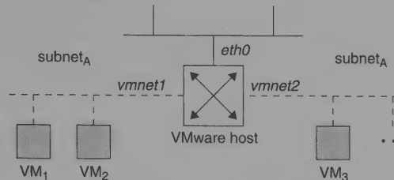

图 C.1 VMware 网络

虚拟机，每个虚拟机位于一个独立的虚拟分段中：

1. 为你的主机系统配置 IP 转发。记住快捷命令 `echo "1"->/proc/sys/net/ipv4/ip.forward`。‌
2. 将你的主机系统上的 vmnet1 配置为子网 A 的 .1 地址。
3. 将你的主机系统上的 vmnet2 配置为子网 B 的 .1 地址。
4. 为你的第一个虚拟机配置主机主机网络（host-only networking），并将其配置为子网 A 的客户端。
5. 为 VM2 配置自定义网络；在要求输入文件名时指定 `/dev/vmnet2`。进入 VM2 后，将其配置为子网 B 的客户端。

现在，你可以通过主机的路由表、地址伪装规则、防火墙规则等进行路由。非常酷，对吧？请参阅图 C.1。你可以使用这种设置来测试各种不同类型的配置，例如：

- 将 VMHost 配置为 vmnetA 或 vmnetB 上的嗅探器。
- 在 VM1（位于 vmnetA）上建立服务（如 Web 服务器或 SMTP 守护进程），然后配置数据包和 IP 伪装，使其在 VMHost 上运行，以过滤和监控，并更改 vmnetB 上虚拟机的访问权限。
- 在隔离环境中测试守护进程配置，方法是在位于单个 vmnet 上的虚拟机上运行它们，并关闭 VMHost 上的 IP 转发。（由于虚拟机不是路由器，你必须配置虚假的路由信息由其守护进程进行广播）。
- 从 VMHost 对 vmnet 上的虚拟机发起攻击。

如果“在主机系统上通过路由连接四个独立的虚拟集线器的不同子网”的想法让你对系统测试产生了灵感，请访问 VMware 网站 http://www.vmware.com 获取更多关于 VMware 的信息。

## 伦理和其他考虑

本章的章节本质上是关于作为自由软件网络管理员相关主题的文章。它们不包含如何操作 Linux 路由器的信息，但我认为这些对于网络管理员来说是很主题。

## D.1 网络管理员的伦理考量

成为网络管理员并不适合每个人。它有时会压力很大。不理解网络的人倾向于将应用程序问题归咎于网络（而他们通常并不理解这些问题）。你可能会遇到你无法控制的愤怒，这会给你带来大量工作，而经理们却会恐吓你，并想知道你为什么没有应急预案——而这些经理正是那些拒绝你备份链路预算请求的人。性能问题可能很难追踪。电信公司在及时安装你的接入电路时，他们那种漫不经心的态度令人抓狂。这一切都是职业生涯的一部分。

该职业范围的另一部分是处于一个方便的位置，可以访问他人的个人数据。无需详细说明你如何做到，Linux 加载了足够的工具，可以轻松完成从嗅探密码到记录所有电子邮件传输的任何任务。我的目的是劝阻你做任何此类事情，无论你可能出于什么这样做，并避免参与你的任何此类活动。窥视他人活动（无论是业务还是私人）的能力可能是诱人的。我们看过所有的情景剧，里面人们用望远镜偷窥别人的生活。我认为核心问题可以归结为“权利”的问题。从对错的角度来说，这不是善恶问题，而是“特权”或“许可”意义上的权利。做某事的能力是否赋予了你做某事的权利？我工作过的一些管理员认为确实如此。典型的合理化理由是：“他们正在（误）滥用公司资源”或“公司政策手册规定会进行此类监控”。虽然这些可能是事实，甚至可能授予 IT 人员从事此类活动的任何特定权限，但它们很少定义具体的并要求你执行此类监控。

如果你的管理层要求你采取行动，我希望你出于道德理由拒绝。我喜欢应用康德的“定言命令”，但这种道德准则有多个名字，所以你可以随心所欲称它。你必须问自己的根本问题是：“如果每个人都按照我打算的方式行动，这样好吗？”我认为答案是坚定的“否”。有些人会坚持认为他们不通过电子邮件发送敏感信息，所以他们不在意被监控。这通过将监控限制为单一类型的监控来规避了问题。公司技术人员监控你的电话通话是简单的事，PBX 管理员审查你的语音邮件，美国邮政局打开你的信件也是如此。这大部分内容都可以在你完全不知情的情况下完成——前者不会留下一丝痕迹。你的邻居在你的卧室窗户架起望远镜，或使用摄像头记录你的出入也是轻而易举的。社会在法律和社会上都对这些事情表示反感，尽管这种监控可以使用你观察网络活动时可能使用的相同理由来进行。电话公司可能在监听，以确保客户能够犯罪。PBX 管理员可能需要确保系统不会被个人语音邮件阻塞。美国邮政局可能会称，他们只是在尝试确保版权不被侵犯，或者执行其他关于可能通过邮寄寄送材料的法律。你的邻居可能有权知道你是否在家里进行危险活动。

## 伦理和其他考虑 附录 D

## 管理与 Linux

每当我部署一个 Linux 系统或读到 Linux 被用于思科等地方（作为打印服务器）或美国邮政局（作为高速邮件分拣器）时，“生产环境中使用 Linux？这绝不会发生”这句话仍然会在我的脑海中回响。在之前的一个雇主那里，对我所有问题的标准答案都是：“我们可以在产品评估实验室中尝试使用 Linux。”诚然，那是早期阶段，但这种种心态仍然存在，我很乐意反驳这种说法。

### D.2.1 成本是多少？

对于网络基础设施，一切都归结为总拥有成本（TCO）。在大多数情况下，TCP/IP 网络与其支持的应用程序和系统是独立的实体。当你升级开发服务器的操作系统版本时，网络不会改变。


## 318

是的，而且它应该越便宜越好。尽管许多技术人员觉得这种哲学令人不感（在我这个理想主义者看来显然并非如此），但事实是，大多数财务部门很少关心其 IT 部门的技术优雅性或卓越性。更重要的是成本。成本包括硬件和软件，还包括所有相关的人员和维护成本。

在当今对金钱敏感的企业环境中，技术人员需要意识到，许多提供“路由即服务”的公司（至少在纸面上）看起来比你的薪水和设备还要便宜。如果你能说“Linux 路由器廉价、稳定且易于维护”并就此大吉，那不是太棒了？除非你对它们有很高的信心，否则这可能走不了多远。在我看来（IMHO），原因是许多中层管理人员来自两个背景之一：a） 他们曾在“蓝巨人”（IBM）统治时期活跃；b） 他们在 20 世纪 80 年代后期和 90 年代初进行管理，当时每个办公桌都配备工作站的使用开始成形。在这两种情况下，这种传统往往带有保守主义。对于蓝巨人粉丝来说，他们知道大即是好。对于那些帮助过个人电脑革命的人，我认为许多人因选择微软以外的任何操作系统而吃过亏，他们对对小公司也怀有不信任。在某种意义上，这种对技术的审查是好事，或者至少是可以理解的。毕竟，这些经理的薪水是为了开发可以使用几年的基础设施，而有时是数年甚至更久。错误可能会搞乱期权、退休计划和整个职业生涯。为了在一个路由器硬件上节省一千美元，如果他们无法雇佣人来支持它，这并不划算。而且矛盾的是，他们面临着保持短期低成本的持续压力。那么，你如何消除他们对 Linux 只是昙花一逝、即将发生的战略性混乱的恐惧呢？三管齐下的进攻。

- 让 Linux 广为人知。关注来自权威来源的新闻，提到另一家大公司加入 Linux 队列。对于那些采用“跟随领导”方法进行技术决策的管理人员来说，这些非常有效。关注来自知名来源的文章和大型案例。对我很有帮助的例子是 Oracle 宣布在 Linux 上提供其 RDBMS，以及 IBM 宣布支持 Apache Web 服务器。更好的是来自 IT 咨询公司（如 Gartner 集团）关于 Linux 在生产环境中的报道。你可以检查 http://www.linux.org/business/index.html 以获取更多此类新闻。
- 确保正确记录当前基础设施的总拥有成本（TCO）。不要忘记以下内容：
    - 软件许可
    - 软件维护
    - 软件升级
    - 培训
    - 停机
    - 硬件需求

## D.2 管理与 Linux

我见证过 IT 部门发生过惊人的盗版和许可违规行为。有些人声称软件供应商就是希望这样；否则，他们不会让这样做变得这么容易。我不确定这与问题有什么关系；这与人们对内容监控所做出的那种错误合理化解释是一样的。如果供应商真的希望这样，那么他们就必须面对自己的伦理困境——通常他们经营业务是为了销售软件。

要点在于，许可占了许多公司 IT 预算的很大一部分（如果最近这样做的话），而且这项成本（或责任）应该被记录下来。如果对服务器软件收费的行业趋势持续，免费服务器将具有某些经济优势。并非所有这些直接适用于路由器市场，但 Linux 不仅仅是商业路由器的竞争对手。通常情况下，软件应该是易于获取的，但可能会发现人们没有看整个周期的成本。对于每次升级，都有采购谈判成本、培训成本（可能包括管理员和用户）以及由于服务器和/或工作站停机导致的用户生产力降低成本。

- 如果你的部门已经在运行另一个操作系统，你可以通过在非关键场景中部署 Linux 来开始对 Linux 建立信心。毕竟，谨慎的经理在没有先仔细观察的情况下不会离开的。你可以通过让他们看到 Linux 随着时间的推移获胜来缓解他们的焦虑。记录一份详细的时间和成本投入清单。如果是你第一次在 Linux 上配置应用程序，请注意，软件和技能的重用将降低未来的成本。记住，对你的雇主来说昂贵的解决方案最终也会影响你。这段用期也将为你留出时间磨你的 Linux 技能（如果需要），并给你时间考虑如何最好地管理多个 Linux 系统。如果 Linux 证明了更好或更具经济效益，那么你的管理层最终应该接受它。

## D.2.2 自建还是购买

作为一名技术人员，我看到过 IT 员工为“自建还是购买”问题争论。群体极化分化为两个阵营：一方认为软件可以在内部开发和维护，其 TCO 比从外部供应商购买软件更低；另一方认为购买软件将为公司带来更低的成本。支持购买的人引用开发者薪水、质量问题和对行业标准的遵循作为购买产品而非内部开发的理由。他们还会辩称，一个可以立即获得的 80% 解决方案比三到六个月后的 100% 解决方案要好。*自建者*的立场是，80% 的解决方案已经慷慨了，现货质量通常很差且解决问题需要更长的时间，计划实施一个系统将花费相同的时间或更长，而且内部支持该产品所需的人员以及花费在谈判的时间将远超过内部开发的成本。我想起了许多故事，管理层在决定购买时显然是错了。不仅是程序员对向外购买的决定感到失望，所有技术人员都是。你可能认为技术人员只是为了保住自己的工作，但我可以告诉你，问题比这深得多。还有其他工作，有其他事情要做。而且内部系统并没有在编码或部署，但已完全处于维护模式，所以这并不是想要玩最新先进的技术的问题。当管理层明确表示要严重替换内部系统时，无论如何分类，这不仅仅是一个业务决策。管理层向软件开发人员传递了两个信息：a) 他们目前为止的产是不够的；b) 对团队未来的能力缺乏信心。非程序员也有大量意见，他们认为现货产品无法完成这项工作。

“实施需要六个月。”在承诺的六个月内，在新软件上花费了超过 250 万美元，但其实施策略仍在制定中，超过一半的编程团队辞职了。这瘫痪了现有软件的日常运营并延迟了新软件的部署。因此，内部软件的 Windows 版本完成并运行——按时且预算内。我并不是编程团队的一部分，但我与他们有互动，因为我使用内部工具来发布和安装我的软件。团队士气非常糟糕，糟糕的情绪并不局限于团队。不仅是程序员对向外购买的决定感到失望，所有技术人员都是。而且当经理不听取员工关于其工作核心问题的建议时（毕竟，谁在运行


## D2 管理层 vs. Linux

3000 台 Unix 服务器（那些经理们吗？），传达了一个明确的信号：a) 我们根本不知道自己在做什么，或者 b) 我们是否拥有执行工作所需的工具对他们来说根本不重要。这个故事有圆满结局吗？只有当你能为自己的直觉是正确的而感到满足时，它才是有的。多年以后，这套内部系统仍在在使用，尽管在新的系统上投入了大量金钱和精力，它仍然无法取代旧系统。真是虚浪费……

## 徒劳无功（Love's Labor Found）

我无法真正想出有种情况能明显地表明我们在避免自建而选择购买时成功规避了预算，但我认为这就是“购买”的本质；如果一切进展顺利，就无话可说。重点在于，人们愿意在让他们感到个人自豪的解决方案上投入更多努力，而这些解决方案通常是自建的。在我看来，如果决策者能更好地理解并利用这种心理学，管理层、股东和客户都会受益。。（是的，我是在对你们说，你们所有开着破旧面包车去任何随意的地方，却对自己的 1972 年款 MG 视如珍宝的人。别假装你不理解工作中获得个人自豪意味着什么。）顺便提一句，如果这一切这些还不够“Dlib 式”的话，那么转向外部系统软件的整个决定是在新部门使命声明广泛公布时做出的，该声明的内容基本上是“我们将建立一个世界级的 IT 组织，并通过信息系统的极高质量来脱颖而出”。结果呢？使用与其他每个没有世界级 IT 组织的公司由于无法自建而被迫购买的现成软件吗？利用内部软件作为竞争优势的做法都去哪儿了？也许他们为 IBM（Big Blue）工作，并在 80 年代和 90 年代部署了工作站。

## 忙碌的 Linux 蜜蜂

那么 Linux 适合这一切吗？Linux 过去是、在很大程度上现在也是构建者的解决方案。我相信这就是它能如此快速取得巨大成就的原因，而且那些部署和管理它的人需要理解这一点。如果你有买家（这并没有坏处，我只是认为某些人倾向于其中一种），那么利用 Linux 可能会获得预期的结果。一旦 Linux 达到买家提倡使用它的程度，我希望他们能保持那种“我自己也能做得一样好”的态度。这比一些人意识到的要重要。首先，Linux 的支持结构很大程度上取决于人们对它的热情。它的开发也是如此。总会有对计算机编程感兴趣的人，并希望他们对为运行 Linux 的计算机编程也感兴趣。最后，需要构建者来找到使用 Linux 的创意方法。创新的买家本质上都是构建者。

## GNU 通用公共许可证

GNU 通用公共许可证是自由软件社区的基本原则之一。我将其包含在这里是因为书中描述的大多数程序（从内核到我的 shell 脚本示例）都受此许可证的涵盖（即受其保护）。我使用“保护”一词是因为 GPL 的最大优点之一是，由其许可的代码不会被任意从用户手中夺走。这并不阻止作者在不同的许可证下发布新版本，但一旦在 GPL 下发布了修订版本，就允许产生衍生版本，只要它们也都在 GPL 下发布（并附带源码）。

对于特定的软件，营销策略的改变不会让用户在没有源码的情况下陷入困境，也没有除了屈从新许可证的选择。用户始终可以选择获取现有版本，并在合理的情况下对其进行维护和改进。在某种程度上，这使得 GPL 对公司比对个人更重要——公司从严苛的许可实践中会损失很多。在任何情况下，这就是为什么许多人坚持要求他们使用的所有软件都必须在 GPL 下发布。

如果你对自由软件世界还较新（除了代码本身的质量外），这就是全部内容。许可证的文本包含在这里；如果你从未读过它，现在是你的机会了。如果你有疑问，有很多网民乐意帮助你解释。为了避免混淆，我建议直接查看源头：http://www.fsf.org。

第 2 版，1991 年 6 月

版权 (C) 1989, 1991 Free Software Foundation, Inc. 59 Temple Place, Suite 330, Boston, MA 02111-1307 USA 均允许复制和分发本许可证文档的逐字副本，但不允许对其进行更改。

# 前言

大多数软件的许可证旨在剥夺你分享和更改它的自由。相比之下，GNU 通用公共许可证旨在保证你分享和更改自由软件的自由——确保软件对所有用户来说都是自由的。本通用公共许可证适用于自由软件基金的大多数软件，以及任何其他承诺使用它的程序。（某些其他自由软件基金的软件则由 GNU 通用公共许可证涵盖。）你可以将其应用于你的程序，

当我们谈论自由软件时，我们指的是自由，而不是价格。我们的 GNU 通用公共许可证旨在确保你有分发自由软件副本的自由（如果你愿意，可以对这项服务收费），如果你想的话，你可以更改软件或在新的自由程序中使用它的部分代码；并且你可以做这些事情。

## GNU 通用公共许可证
复制、分发和修改的条款与条件

0. 你可以在任何媒介上复制并分发程序的逐字副本，前提是你收到了一份本许可证的副本。你可以对传输副本的物理行为收取费用，并根据你的意愿提供额外的担保。

1. 你可以修改或分发程序或任何部分的副本，以形成基于程序的作品，前提是你满足以下条件：

a) 你必须在修改后的文件中包含显著通知，说明你更改了文件以及更改日期。

b) 你必须使你分发或发布的任何在整体或部分包含或源自程序的作品，整体都在本许可证下免费向所有第三方提供许可。

c) 如果被修改的程序在运行时通常以交互方式读取命令，你必须让它在通常启动时打印或显示包含适当版权声明以及无担保声明（或者，说明你提供担保）以及用户可以根据这些条件重新分发程序的，并告知用户如何查看本许可证副本。（例外：如果程序本身是交互式的但通常不打印此类公告，你基于程序的作品不需要打印此类公告。）

这些要求适用于修改作品的整体。并非源自程序且可以被合理认为是独立作品的作品部分，那么当你作为独立作品分发它们时，本许可证及其条款不适用于这些部分。

当你将相同部分作为基于程序的整体的一部分分发时，该整体的分发必须遵守本许可证的条款，因此对其他许可者的权限延伸到整体，无论由谁编写。

因此，本节的意图并不是主张你完全编写的作品的权利或质疑你的权利；相反，其意图是行使你对基于程序的衍生作品或集合作品的分发控制权。


此外，仅仅将另一项并非基于本程序（或基于本程序的作品）的作品在存储卷或分发介质上聚合，并不会将该作品纳入本许可的范围。

3. 您可以根据第 1 节和第 2 节的条款，以对象代码或可执行形式复制并分发程序（或基于它的程序的作品，见第 2 节），前提是您还必须满足以下条件之一：

+   a) 附带完整的相应的机器读源代码，该源代码必须按照上述第 1 节和第 2 节的条款在通常用于软件交换的介质上分发；或者，

+   b) 附带一份面说明，有效期至少为三年，承诺向任何第三方收取不超过您物理分发源代码成本的费用，提供相应源代码的完整机器读副本，并按照上述第 1 节和第 2 节的条款在通常用于软件交换的介质上分发；或者，

+   c) 附带您作为分发相应源代码方接收的信息。（此替代方案仅适用于非商业分发，且仅当您是以对象代码或可执行形式接收程序，并附有下文 b 节所述的承诺时才允许。）

作品的源代码是对其进行修改的首选形式。对于可执行作品，完整的源代码意味着其包含的所有模块的所有源代码，加上任何相关的接口定义文件，以及用于控制编译和安装可执行程序的脚本。然而，作为一个特殊例外，源代码不需要包含运行该可执行程序的操作系统之主要组件（编译器、内核等）通常分发的任何内容（无论是源形式还是二进制形式），除非该内容本身随可执行程序一同提供。

如果通过提供访问指定地点复制来分发可执行代码或对象代码，则应提供与分发源代码等效的源代码访问权限，尽管第三方并不被强制在复制对象代码的同时复制源代码。

4. 除非本许可另有规定，否则您不得复制、修改、分许可或分发程序。任何其他尝试复制、修改、分许可或分发程序的尝试都是无效的，并将自动终止您在本许可下的权利。然而，从本许可下获得副本或权利的方，只要这些方继续保持完全符合规定，其许可就不会终止。

5. 您无需接受本许可，因为您还没有签署它。然而，没有任何条款授予您修改或分发程序或其衍生作品的许可。如果不接受本许可，这些行为是法律禁止的。因此，通过修改或分发程序（或任何基于本程序的作品），您表示您接受以此执行本许可，以及所有复制、分发或修改程序或基于程序的作品的条款和条件。

## 附录 E GNU 通用许可许可证 327

6. 每当重新分发程序（或任何基于本程序的作品）时，接收者都会自动从原始许可者处获得许可，允许根据这些条款和条件复制、分发或修改程序。您不能对接收者行使本文所授予的权利施加任何限制。您不负责确保第三方对本许可的遵守。

7. 如果由于法院判决、专利侵权指控或任何其他原因（但不限于专利问题），导致您（通过法院命令、协议或其他方式）被施加了与本许可条款相矛盾的条件，这些条件并不能免除您本许可的条件。如果您无法分发以满足您在本许可下的义务以及任何其他相关义务，那么作为结果，您可能无法分发该程序。例如，如果专利许可不允许所有通过您直接或间接接收副本的人免费重新分发程序，那么您能够同时满足该许可和本许可的唯一方法就是完全放弃分发该程序。

如果本节的任何部分在任何情况下被认为无效或不可执行，则该节的其余部分适用，且该节在任何其他情况下均适用。

本节的目的不是为了诱导您侵犯任何专利或其他产权主张，或质疑任何此类主张的有效性；其唯一目的是保护通过公共许可实践实现的自由软件分发系统的完整性。许多人基于对该系统的一致应用，对该系统分发的广泛软件做出了慷慨贡献；作者/捐赠者决定其愿意通过任何其他系统分发软件，被许可者不能强制这一选择。

本节旨在彻底阐明被认为是本许可其余部分的后果。

8. 自由软件基金可能会随时发布和/或通用许可许可证的新版本。新版本在精神上与当前版本相似，但在细节上可能有所不同，以解决新的问题或担忧。

每个版本都有不同的版本号。如果程序指定了适用于它的许可版本以及“任何后续版本”，您可以选择选择该版本或自由软件基金发布的任何后续版本的条款和条件。如果程序未指定本许可的版本号，您可以选择自由软件基金发布的任何版本。

10. 如果您希望将程序的部分整合到分发条件不同的自由程序中，请写信给作者寻求许可。对于由自由软件会版权的软件，请写信给自由软件会；我们有时对此提供例外。

## 免保证

11. 由于程序是免费提供的，在法律允许范围内，程序不提供任何保证。除非另有说明，版权所有者或其他方按“原样”提供程序，不提供任何明示或隐含保证，包括但不限于对商品性和特定用途的隐含保证。程序质量和性能的全部风险由您承担。如果程序证明有缺陷，您承担所有必要的费用。

12. 除非法律要求或另有约定，任何根据上述许可修改和/或分发程序的版权所有者或其他方，均不对方您承担任何因使用或无法使用程序而导致的损害（包括但不限于数据丢失、不准确或您或第三方遭受的损失或程序无法与其他程序运行）责任，即使该所有者或其他方已被告知此类此类损害。

## 如何将这些条款应用于您的新程序

如果您开发了一个新程序，并希望它对公众产生最大的用，最好的方法是让它成为根据这些条款供自由重新发和修改的自由软件。

为此，请将以下通知附加程序。最安全的方法将其附加到每个源文件的开头，以最有效地排除保证；每个文件应至少包含“版权”行和指向完整许可的指针。

> <用一行给出程序名称及其功能的简要描述。>
版权 (C) <年份> <作者名称>

本程序是自由软件；您可以根据自由软件会发布的 GNU 通用许可许可证进行分发和/或修改；许可证第 2 版本，或（根据您的选择）任何后续版本。


本程序的分发是希望它有用，但**不提供任何保证**；即使没有对**商品性**或**特定用途的适用性**的暗示保证。更多详情请参阅 GNU 通用公共许可证。

您应该随本程序收到了一份 GNU 通用公共许可证的副本；如果没有，请写信至 Free Software Foundation, Inc., 59 Temple Place, Suite 330, Boston, MA 02111-1307 USA

此外，请添加如何通过电子邮箱和纸质邮件联系您的信息。如果程序是交互式的，请在进入交互模式时给出一个简短通知：

- n Gnomovision 版本 69, 版权所有 (C) 作者姓名 Gnomovision **绝对不提供任何保证**；详情请输入 'show w'。这是自由软件，欢迎您在某些条件下重新分发它；详情请输入 'show c'。

假设的命令 'show w' 和 'show c' 应该显示通用用公共许可证的适当部分。当然，您使用的命令可能不是 'show w' 和 'show c'；它们甚至可以是鼠标点击或菜单项——任何适合您程序的都可以。

如有必要，您还应该让您的雇主（如果您是程序员）或您的学校（如果有）为程序签署一份“版权免责声明”。这是一个示例；请修改名称：

> Yoyodine, Inc. 此处放弃对 James Hacker 编写的 'Gnomovision' 程序（涉及编译器）的所有版权权益
<Ty Coon 的签名> , 1989年4月1日

Ty Coon, Vice 主席

本通用公共许可证不允许将您的程序整合到专有程序中。如果您的程序是一个子程序库，您可能认为允许专有应用程序与库链接更有用。如果您想这样做，请使用 GNU 通用公共许可证代替本。

# 术语表

**ACL** 访问列表（Access Control Lists）。
- **AFAIK** 据我所知（As Far As I Know）——标准的免责声明。
- **AMI** 交替标记反（Alternate Mark Inversion，有时称为**双极**）——一种用于 T1 电路的协议，它交替发送数字 1 的极性。这样做是为了通过消除信号的残留直流分量来节省传输线的功率。
- **APM** 高级电源管理（Advanced Power Management）——一组 BIOS 功能，可以配置以实现硬件的省电功能，例如在定义的空闲后停止驱动器旋转。
- **ARP** 地址解析协议（Address Resolution Protocol）（对于以太网，记录在 RFC 826 中）。
- **ATM** 异步传输模式（Asynchronous Transfer Mode）——一种以极小数据包为特征的网络协议。
- **B8ZS** 二进制8 零替换（Binary 8 Zero Substitution）——用于 T1 电路的协议，用于保持 1 的最小密度（以便在长序列 0 期间保持时钟同步）。它是故意双极违规的一个范例。
- **BGP** 边界网关协议（Border Gateway Protocol），一种动态路由协议（RFC 1164）。
- **BIOS** 基本输入输出系统（Basic Input Output System），用于初始引导计算机的代码，使其能够找到执行执行的功能，如为 PCI 设备分配 IRQ 和基地址。某些操作系统（例如 MS-DOS）使用它提供的函数向屏幕或软盘驱动器等系统设备写入。
- **bit-rot** 比特腐烂——指由于忽视适当的维护，导致软件过时并失去实用性。
- **bridge** 桥器——连接两个相同介质类型分段的网络设备。
- **BTW** 顺便说（By The Way）。
- **CHAP** 挑战握手认证协议（Challenge Handshake Authentication Protocol）——也常用于 PPP 认证机制（参见 **PAP**）。
- **CIDR** 无类域域间路由（Classless Inter-Domain Routing）（RFC 1519）。
- **CIR** 承诺信息速率（Committed Information Rate）。
- **CPE** 用户端设备（Customer Premise Equipment）——数字电信电路分界点您侧的所有设备。
- **CSU** 信道服务单元（Channel Service Unit）——为数字电路提供物理终端、执行放大并启动环回。对于 T1 电路，它还执行帧格式化并计算性能测量统计。通常位于 CSU/DSU 中。（参见 DSU.）
- **D4** 一种用于 T1 数字电路的成帧技术。（参见 ESF。）
- **DLCI** 数据链路连接标识符（Data Link Connection Identifier）——您的网络内帧中（Frame Relay）节点的链路层地址。通常是 16 到 1023 之间的一个整数。
- **DHCP** 动态主机配置协议（Dynamic Host Configuration Protocol）。
- **DMA** 直接内存访问（Direct Memory Access）。
- **DSU** 数据服务单元（Data Service Unit）——位于 CSU 和终端设备（您的路由器）之间。它将终端设备的单极数字信号转换为双极数字格式，以便在数字网络上传输。DSU 还提供恢复、控制信号和同步采样。（参见 DSU。）
- **EGP** 外部网关协议（External Gateway Protocol），一种动态路由协议（RFC 904）。
- **ESF** 扩展超级帧（Extended Super Frame）——一种用于 T1 数字电路的成帧技术，提供电路的性能统计（对比 D4）。
- **FDDI** 光纤数字设备接口（Fiber Digital Device Interface）——一种运行在光纤上的物理网络协议，适用于距离大于 100km 的 LAN。
- **FQDN** 完全限定域名（Fully Qualified Domain Name）——主机名（有时称为“短名”）与该主机域名的组合。例如，pongo.mancill.com 是 pongo 的 FQDN。
- **FSF** 自由软件基金（The Free Software Foundation）（参见 GNU）。
- **FSE** 全状态查询（Full Status Enquiry）——一种用于帧中路由器之间的消息格式，用于相互确认一切正常。
- **gen** “生成内核”——即从源码构建新内核。
- **GNU** “GNU 不是 Unix”（一个著名的递归缩写）。由自由软件基金（FSF）启动的项目，“旨在开发一个完全自由的类 Unix 操作系统”。参见 http://www.gnu.org/。
- **GPL** 通用公共许可证。参见 http://www.gnu.org/copyleft/gpl.html。
- **GSS-API** 通用安全服务应用程序接口（Interface）。一种用于 SOCKS5 的网络编程 API。详情参见 RFC 1961。
- **hand-lib** 手动构建安装软件，
- **HDLC** 高级数据链路控制（High-level Data Link Control）——位同步协议，在全双工点对点操作中提供完全的数据透明传输。链路两端都不充当永久主站。
- **hub** 一种像总线一样的网络集中器。
- **ICP** 互联网缓存协议（Internet Cache Protocol），用于如 Squid 等缓存代理。
- **IDE** 集成驱动器电子（Integrated Drive Electronics）。
- **idiot** 想象一个预制好的启动盘，即插即用，隐藏了配置系统的复杂细节。
- **IETF** 互联网工程任务组（Internet Engineering Task Force）。
- **IMHO** 在我看来（In My Humble Opinion）——显然是一个自矛盾词，因为发言者不太可能谦逊。
- **IMO** 在我看来（In My Opinion）——准备好接受别人的观点。
- **IP** 互联网协议（Internet Protocol）。
- **IRQ** 中断请求（Interrupt Request）。
- **ISA** 工业标准架构（Industry Standard Architecture）。
- **ISDN** 集成数字网络（Integrated Services Digital Network）。
- **ISO** 国际标准化组织（International for Organization Standardization）http://www.iso.ch。
- **ISP** 互联网服务提供商（Internet Service Provider）——拥有比你更多的互联网带宽并想卖给你一部分的人。
- **ITAR** 国际武器贸易条例（International Traffic in Arms Regulations）——美国国务院制定的一系列出口条例，其中某些类型的加密技术被视为武器而禁止出口。关于此类问题的更多信息，请访问电子边界基金会 http://www.eff.org/。
- **kernel-space** 指在内核在其自身环境中执行的代码，例如设备驱动程序、路由和数据包过滤。对比用户态。用例来自 fortune：

* Our OS 之艺在 CPU，
* UNIX 为汝之名。
* 你的程序运行，你的系统调用完成，
* 在内核之中，一如在我们心中！

- **LAPB** 链路接入程序平衡（Link Access Procedure Balanced）——一种位同步协议，在全双工点对点操作中提供完全的数据透明传输。链路两端都不充当永久主站。


LBO Line Build Out—线路外扩展——一种 CSU 设置，用于补偿与 CPE 连接的 T1 数字电路信号强度衰减。 CSU 距离 T1 终端点每远 133 英尺（40 米），就应该增加此设置。

LDP Linux Documentation Project—Linux 文档项目——一个包含免费分发的文档集合，包括 HOWTO、mini-HOWTO 甚至一些书籍。它是 Greg Hanks 的心血，也是许多人努力的成果。访问地址：http://www.linuxdoc.org/

LINUX Line Is User Xenophobic—Linux 线是用户排外者——这是一个强制性的左手递归缩写，就像 GNU 一样。

LMI Local Management Interface—本地管理接口——帧中路由器通过此方法相互通知网络状态。

Lpr—Linux 中使用的远程打印命令——即将作业发送到打印队列。

LRP Linux Router Project—Linux 路由器项目——以网络为中心的 Linux 微发行版。参见 http://www.linuxrouter.org/

luser 一个对非管理员、非程序员、非专家的并不一定贬义的称呼。将这个词留给那些让你对他们的电脑无知感到一丝怜悯和同情的的新手。当你过得不好时，每个人都是 luser。

MAC Media Access Control—媒体访问控制——在 MAC 地址中，指的是制造商为每个太网适配器分配的 6 字节地址。

MIB Management Information Base (RFC 1213)—管理信息库——用于 SNMP 的数字到参数的映射。MIB 是带有参数描述及关联 MIB 值的数据库。

MINIX 一个由 Andy Taenbaum 创建并并在指导下开发的自由类 Unix 操作系统。Linux 的大部分早期历史与 comp.os.minix 新闻组的讨论交织在一起。更多信息请参见 http://www.cs.vu.nl/~ast/minix.html。

Moore's Law 摩尔定律——硅集成电路的逻辑密度遵循曲线（每平方英寸比特数） = 2⁻1962，其中 t 为年数；也就是说，自该技术发明以来，给定硅片上承载的信息量大约每年翻倍。

MTA Mail Transfer Agent—邮件传输代理。

MTBF Mean Time Between Failure—平均故障间隔时间——组件在某些部分损坏之前的平均运行寿命。

MTU Maximum Transfer Unit—最大传输单元——定义最大数据包大小的网络参数。

NAT Network Address Translator—网络地址转换——执行 IP 伪装的路由器。

# 术语表

335

- **netiquette** 网络礼仪——与其他**网民**互动时的礼貌标准。这曾是一套相当严格但未成记录的准则，不知由于何种原因被遗忘了。你通常可以根据他们（缺乏）网络礼仪来判断新手。一个微不足道的例子是*签名*长度超过了 80 个字符行。一个更严重的例子是在公共论坛（如 Usenet 新闻组）上在未先通过私邮件与对方讨论问题的情况下进行攻击（flaming）。同样冒犯的是未经发送者许可向新闻组发布私信消息。
- **netizens** 网民——互联网上的其他人。
- **NIC** 网络接口卡。
- **OSPF** Open Shortest Path First—开放路径优先——一种动态路由协议（RFC 1131）。
- **OTOH** On The Other Hand—另一方面——哎呀，我要自我相矛盾了。
- **PAP** Password Authentication Protocol—密码验证协议——通常用于 PPP 认证机制。
- **PCI** Peripheral Component Interconnect—外围组件接口。
- **PCM** Pulse Code Modulation—脉冲编码调制——一种将模拟波形转换为一系列数字脉冲的方法。
- **PIM** Protocol Independent Multicast—协议无关多播——这种多播协议因为 Cisco 支持它而被广泛使用。你需要特殊的软件来使用（pim-v1）；有两个版本：PIMv1 和 PIMv2。
- **POP** Point Of Presence—接入点——该术语描述服务供应商安装设备并允许你通过数字电路或某种形式的拨号连接到该设备及其网络的位置。**POP** 也用于邮局协议，例如该协议的第三版本 POP3。
- **PPP** Point-to-Point Protocol—点点协议（RFC 1661）。
- **PPTP** Point to Tunnelling Protocol—隧道协议——一种将 IP 包封装在包中以用于安全（通过加密内部包）或远程访问（允许内部包在目标网络上具有源地址）的方法。通常两者同时使用。
- **PTT** Post, Telegraph, and Telephone—邮电电——指电信服务提供者的通用术语。
- **PVC** Permanent Virtual Circuit—永久虚拟电路。
- **RFC** Request For Comments—征求意见。
- **RFC 1983** 此 RFC 包含了《互联网用户术语表》，这是一份来自权威来源的海量术语表。
- **RIP** Routing Information Protocol—路由信息协议——一种动态路由协议（RFC 1058）。
- **RSN** Real Soon Now—很快——供应商承诺提供修复程序的时间段。通常是讽刺性的。
- **RTFM** Read The Darn Manual—去读该死的手册。作为一个新手，你可能觉得自己是这句话的 target。给点时间……
- **SCSI** Small Computer System Interface—小型计算机系统接口。
- **SLARP** Serial Line Reverse Address Resolution Protocol—串行反向地址解析协议。
- **SMTP** Mail Transport Protocol—邮件传输协议。
- **SNMP** Simple Network Management Protocol—简单网络管理协议（RFC 1908）（以及 RFC 1155, RFC 1156, RFC 1157 等）。
- **SNPP** Simple Network Paging Protocol—简单网络寻呼协议（RFC 1861）。
- **TCO** Total Cost of Ownership—总拥有成本。对于任何计算解决方案，这不仅包括初始硬件和软件成本，还包括持续维护以及保持系统运行所需的时间（例如，一个运行免费软件的系统每月需要 10–20 小时的管理，最终成本将高于花费 10,000 美元的方案）。
- **TCP/IP** 在 IP 上使用的传输控制协议（RFC 675）。**TDM** Time Division Multiplex—时分复用——将带宽划分为时隙。每个时隙可以分配给不同的服务器。
- **TOS** Type Of Service—服务类型（RFC 1349）——IP 头部中的字段，指示网络组件如何处理数据包。
- **TTL** Time To Live—生存时间——对于 IP 包来说，这是它在被丢弃之前可以经过的跳数。
- **UPS** Uninterruptible Power Supply—不间断电源。指的是运行在 Unix 系统上的守护进程或普通进程（如果你用 `ps` 能看到它，它就在用户空间）。
- **WRD** Weighted Route Damping—加权路由阻尼——一种声明，称“这对我有效，但对你的环境未知，因此对你可能无效”。
- **YMMV** Your Mileage May Vary—视情况而异。

# 参考文献

- **CHAPMAN, D. BRENT AND ZWICKY, ELIZABETH**, *Building Firewalls*. O'Reilly & Associates, Sebastopol, CA, 1995, ISBN: 1–5692–124–0
- **GARFNKEL, SIMON AND SPAFF, GENE**, *Practical UNIX and Internet Security, Second Edition*, O'Reilly & Associates, Sebastopol, CA, 1996, ISBN: 1–5692–148–8
- **HELD, GILBERT**, *Understanding Data Communications, Fourth Edition*, SAMS Publishing, 1994, ISBN: 0-672-30501-1
- **PER, RADIA**, *Interconnections: Routers, Switches and Interworking, Second Edition*, Addison Wesley Longman, Inc., 1999, ISBN: 0–201-6348-1
- **RAYMOND, ERIC S., WITH STEELE, GUY L.**, *The New Hacker's Dictionary*, The MIT Press, Cambridge, MA, 1991, ISBN: 0-262-8069-6
- **STEVENS, RICHARD W.**, *Unix Network Programming: Sockets and XTI (Volume 1), Second Edition*, Prentice Hall, 1999, ISBN: 0–134-9012-X
- **WALL, LARRY, CHRISTIAN, TOM, AND SCHARTZ, RANDAL L., WITH STEPHEN POTTER**, *Programming Perl, Second Edition*, O'Reilly & Associates, Sebastopol, CA, 1996, ISBN: 1–5692–149–6

# 索引

- /etc/gateways, 278
- /etc/networks, 279
- /proc/loadavg, 238
- /proc/net/dev, 59
- /proc/net/ip_fwchains, 76, 105
- /proc/net/ip_fwnames, 105
- /proc/net/ip_masq/app, 105
- /proc/net/ip_masq/icmp, 105
- /proc/net/ip_masq/portfw, 270
- /proc/net/ip_masquerade, 105
- /proc/sys/net/ipv4_forward, 56
- /usr/src/linux/net/ipv4_ip.masq.c, 100
- access, 125
- charges, 47
- dedicated, 41
- digital, 42, 46
- switched topology (digital), 44, 46
- AIDE, 310
- aliasing, 见 IP aliasing
- allmulti, 63
- analog, line, 40
- angel, 214
- Annex A, D, 127
- Apache, 161
- ARP (Address Resolution Protocol), 37, 38
- duplicating (duplicate) IPs to WAN interfaces, 277
- auth (FWTK module), 256
- authd, 184
- AUTOFW, 266
- Babylon, 94
- back-to-back topology, 44
- backups (general), 248–251
- Bandwidth Conservation Society, 226
- bansion host, 173
- Berkeley Packet Filter (identifiers, 116, qualifiers, 116)
- Big Brother, 216
- binding to a specific port, 274
- bing, 239
- BOOTP, 38
- bridging, 54
- broadcast address, 22
- BSB-Monitor, 214
- burst rate, 128
- CHAP, 88
- CIDR (Classless Internet Domain Routing), 23, 亦见 subnet
- CIPE (Crypto IP Encapsulation), 50
- CIR, 127
- Cisco HDLC, 130, 219
- topology, 220
- conditional forwarding
- example, 194
- configuring Ethernet devices, 61
- console on a serial port, 6, 247


# 340
# 索引

- CPE, 126
- CSU/DSU, 47
- CUseeMe
- 伪装, 100
- 转发，见 IP 转发
- fipipemon, 154, 156, 160
- 分数 T1, 43
- 帧中继 (Frame Relay)
    - 突发速率, 128
    - 概念, 125, 129
    - 节点, 126
    - 端口, 126

# D

- danpage, 215
- Dante, 260
- dd, 78, 79
- Debian GNU/Linux, 16
- DeleGate, 256
- depmod, 57
- DHCP, 38
- dhcp, 234
- DHCP 服务器, 233, 235
    - 配置, 234
    - 内核支持, 234
- dhcp-relay, 234
- 发行版 (distributions)
    - 完整发行版, 12, 14
    - 精简发行版, 14, 15
- FreeS/WAN, 50
- 自由软件基金会 (FSF), xv, 293, 304, 332
- FTP
    - “普通”, 199
    - 伪装, 100
    - 被动模式, 200
- FTP 代理, 257
- FTP 服务器, 275
- ftw-gw (FWTK 模块), 256
- fwctrl, 203
- FWMARK, 270
- FWTK, 254

# G

- GateD 路由守护进程, 281
- 网关，见路由
- Gcom, Inc., 131
- genmask，见子网掩码
- getty_ps, 246
- getthys, 245, 247
- gffc, 203
- gnome-admin, 180
- GnuPG (GNU Privacy Guard), 179
- GSS-API, 259

# E

- 新兴技术, 131
- 等价多路复用, 242
- 铒 (erbium), 85
- ethereal, 122
- 以太网硬件地址, 36, 37
- 外部网拓扑, 91

# F

- fbgetty, 246
- 文件描述符 (file descriptors)
    - 增加, 211
- Firewalk, 189
- 防火墙性能, 208
- floppyfw, 15

# H

- 硬件地址，见以太网
- 硬件地址
- HDLC, 131
- dhparm, 240
- 主机地址, 22
- HSSI, 129, 131
- http-gw (FWTK 模块), 256
- HTTP 代理, 257
- Apache, 230, 232
    - 缓存代理, 229, 233
    - Squid, 232, 233
- hwhtools, 238

# 索引
# I

- ICMP 重定向, 32
- ICMP: 主机不可达, 32
- iconfig, 60, 63
- ImageStream, 130
- init
    - getget, 246
- 接入接入路由器, 168
- 互联网路由器拓扑, 172, 176
- IP 计数 (IP accounting), 70, 77
    - 概念, 71
    - 内核支持, 71
    - 软件包, 76
- IP 地址
    - 定义, 19, 20
- IP 别名 (IP aliasing), 67, 70
    - 内核支持, 69
- IP 转发
    - /proc 支持, 56
    - 内核支持, 55
- IP 伪装 (IP masquerading), 95, 113
    - AUTOFW, 266
    - 配置工具, 106
    - 配置, 100
    - FWMARK, 270
- /proc 中的信息,
    - 使用的接口地址, 108, 110
    - 内核支持, 101
    - PORTFW, 268
    - 特定协议的, 99
    - RFC 1918, 111
    - 带有透明代理的, 265
- IP 子网，见子网
- ipac, 76
- ipchains
    - IP 计数
        - 创建规则, 71
        - 查看规则, 75
    - IP 伪装
        - 创建规则, 101
        - 修改规则, 102
        - 修改超时, 104
        - 查看连接, 103
        - 查看规则, 103
    - 数据包过滤
        - 示例, 197, 203
        - 内核支持, 193
    - 语法, 191, 193
- ipgrab, 120
- iplogger, 186
- pmasq, 106, 203
- pmasqadm
    - AUTOFW, 266
    - FWMARK, 271
    - PORTFW, 269
    - pmasq (软件包), 265
    - ippl, 186
    - IPPORTFW, 265
    - iproute, 2, 242
    - IRC
        - 伪装, 100
        - IRC (Internet Relay Chat), 59
        - IRC 代理, 257
    - irqtune, 238
    - ITAR, 178

# J

- jail, 186
- Junkbuster, 258

# K

- karpski, 122
- 内核 (kernel)
    - 编译, 297, 304
    - 健康检查, 309
    - 补丁, 299, nix
    - 内核端口转发, 265
    - AUTOFW, 266, 268
    - FWMARK, 270
    - 内核支持, 266
    - DHCP 服务器, 234

# L

- 延迟 (latency)
    - 驱动器, 5
    - 数字电路, 49
    - LBO, 132
    - LDP (Linux Documentation Project), xvii, 333
    - 租用线路, 41
- libpcap, 115
- 链路安全, 49
- LiS, 131
- 本地环路 (local loop), 125
- 定位, 237
- 回环 (loopback)
    - 数字电路, 155
    - 带有 WAN 的, 164
    - LRP (Linux Router Project), 15, 83, 77
    - 模块, 79
- lsof, 183

# N

- NAT (网络地址转换), 85, 268
- net-accd, 186
- net-acct, 77
- netacl (FWTK 模块), 256
- netbase, 76, 106
- netcat, 263
- netilter, 266
- netmask，见子网
- netselect, 239
- netstat, 60
- 网络层, 17–18
- 网络监控
    - 事件日志, 186
    - 端口扫描器, 187
    - 服务, 181, 186
- NewsCache, 257
- nnmap, 188
- NNI, 127
- NNTP 代理, 257
- 通知系统，见监控
- npager, 215
- 奈奎斯特采样定理, 43

# M

- MAC 地址，见以太网
- mason, 203
- 伪装，见伪装
    - 活跃连接, 103
    - 超时时间, 104
- 度量, 62
- MIB-II, 162
- mingety, 246
- minicom, 88
- MINIX, xiv
- modprobe, 57
    - 加载, 57, 58
    - 参数, 57
- mon, 216
- MRTd 路由守护进程, 280
- MRTG, 160, 164
- MS-CHAP, 82
- 工具, 165
- MTU, 62
- 多播, 63
- 多重网络，见别名
- 多路，见等价多路复用
- 多个 NIC, 64

# O

- OpenPGP, 179
- OpenSSH，见 ssh
- OSI 模型, 17
- 带宽过度订阅, 127

# P

- 数据包过滤
    - 内核支持, 193
- 数据包嗅探, 113, 124
- 内存需求, 124
- 数据包过滤
    - 防火墙性能, 208
    - FTP, 200
    - 普通, 196, 209
    - 脚本规则, 203
    - 测试规则, 206
- 分页软件, 215, 217
- PAP, 88
- 带宽, 140
- 被动模式 FTP, 200
- 路径字符, 240
- 性能调优, 237
- PGP (Pretty Good Privacy), 179
- plog, 90
- plug-gw (FWTK 模块), 256
- poff, 90
- pon, 90
- POP (接入点), 126
- POP3 代理, 258
- pop3gwd, 258
- PORTFW, 266
- POTS (普通电话服务），见模拟线路
- Powerweek, 239
- ppipemon, 172
- ppp
    - 内核支持, 89
    - pppconfig, 89
- pppd
    - 配置工具, 88
    - 在 Debian 系统上, 90
- pxp, 289
- 私有地址空间, 33, 36
    - IP 地址范围, 34
    - 路由, 176
- 混杂模式, 63, 115
- PVC, 126
- 救援磁盘, 289
- RFC 1058, 278
- RFC 1213, 162
- RFC 1349, 193
- RFC 1388, 1723, 2453, 278
- RFC 1413, 185
- RFC 1490, 159
- RFC 1861, 215
- RFC 1918，见私有地址空间
- RFC 1961, 259
- RFC 2080, 278
- RFC 931, 184
- inetd, 262
- login-gw (FWTK 模块), 256
- 带有 WAN 的, 63, 64
- 路由的, 277
- 路由器
    - 普通, 17
    - 硬件, 1
    - router.conf，见 39
    - 基础算法, 28
    - 基础转发, 33
    - 静态 vs 动态, 33
- runocks, 258

# Q

- Quake, 933
- qpage, 212, 215

# R

- RARP (地址解析)
- SOCKS 客户端, 258
- RealAudio
    - 代理, 258
- IP 流量重定向, 260
- 冗余防火墙, 284
- 冗余链路, 241, 244
- 冗余路由器, 283

# S

- S508, 125
- Samba, 179
- Sangoma, 125, 130
- Satan, 188
- Sendmail, 275
- 串口访问，见 getys
- 硅胶, 53
- ppp (软件包), 181
- smap (FWTK 模块), 256
- sms_client, 215
- SMTP 代理，见 smap
- 嗅探器，见数据包嗅探
- sniffit, 121
- SNMP, 160
- snptrapl, 215
- 社会工程师, 177
- 套接 (软件包), 263
- tireproxy, 257
- Spellaster, 94
- Spong, 214
- SPPP，见同步 PPP
- ssh, 178
- Stallman, Richard, xi, xv
- STREAMS, 131
- 子网
    - 分配, 25, 27
    - 类标识, 24, 25
    - 主机数量, 22
    - 子网掩码
        - 自动分配, 62
        - 定义, 20, 22
        - 掩码符号, 21
    - 超子网, 28
- syslog-summary, 181
- 系统监控, 209
- 检测, 209, 212
- ttysnoop, 181
- 可调磁盘参数，见 hdparm
- 可调网络参数, 239
- tune2/fs, 241

# V

- VDO Line, 100
- VMware, 310
- 语音线路，见模拟线路
- VPN (虚拟专用网络), 55
- VTad, 241

# W

- WAN 适配器, 129, 132
- WAN 安全，见链路安全
- WANPIPE, 133
- wanconfig, 148
    - cisco HDLC
    - 配置, 222, 226
    - 接口文件, 144, 145
    - 内核模块, 148
    - 内核支持, 135
    - 快速启动, 133
    - 启动序列, 147
    - 同步 PPP, 168
    - 故障排除, 172
- wanpipe, 135
    - 快速启动, 134
- wanpipe1.conf
    - cisco HDLC, 222
    - [设备], 223
    - [接口], 223
    - 帧中继, 136
    - [接口], 137
    - [接口], 138
    - 同步 PPP, 169
    - [接口], 170

# T

- Tannenbaum, Andy, xv
- tcpd, 184
- tcpdump, 115, 120
    - 示例, 119
    - 输入过滤器语法, 115
    - 输出, 118
    - 带有帧中继, 151
- TDM (脉冲调制), 42
- TDM (时分复用), 42
- telnet 代理, 256
- telnet-ssl, 178
- telnet98, 178

# 索引
wanpipe1.conf (续)

- X.25, 129, 131
- 同步 PPP (synchronous PPP), 169, 18
- xinetd, 185
    - [接口], 170
- xisp, 89
    - 设备级, 170
- xlogmaster, 180
    - 接口级, 171
- xvatch, 181
- Winmods, 87

# Y

- wmnet, 77
- yaps, 215

# W

- wvdial, 89

# X

# Z

- x-gw (FWTK 模块), 256
- Zebra 路由守护进程, 132, 279

- X.21, 131

- 零节点网络, 145, 277


## 专业技术参考

为今天的专业人士提供明天的解决方案。

## 与 PH PTR 在线版保持同步！

我们致力于处于专业计算机科学和工程领域动态的前沿。当访问 [www.phptr.com](http://www.phptr.com) 时，您可以发现以下内容：

- **特殊兴趣领域**：提供最新的书籍、丛书、软件、每月特色、相关链接和其他帮助您完成工作的有用信息。
- **优惠、优惠、优惠！** 访问我们的促销板块，获取我们的零售商为您专属提供的最新特价。
- **需要寻找书店吗？** 很可能您附近就有销售多种 PTR 书籍的书店。在 [www.phptr.com](http://www.phptr.com) 查找您附近的 Magnet 书店。
- **PH PTR 有什么新品？** 我们不仅为专业社区出版书籍，我们还是该社区的一员。查看我们的会议日程，加入作者聊天，获取您感兴趣的话题的最新评论和新闻稿。
- **立即订阅！** 加入 PH PTR 的月度电子邮件通讯邮件！

想了解您感兴趣领域的最新动态吗？在我们的网站上选择一个目标类别，我们将向您告知您感兴趣领域内最新的 PH PTR 产品、作者活动、评论和会议。

访问我们的邮箱立即订阅吧！[http://www.phptr.com/mail_lists](http://www.phptr.com/mail_lists)

## LINUX 路由器

网络管理员入门指南

Tony Mancill

### 节省一大笔钱！使用 Linux 作为路由器！

既然一台 Linux 设备只需花费极小成本就能完成相同的工作（甚至更多！），为什么要在路由器上花费巨资呢？Linux 路由器廉价、灵活、适应性强、可扩展、易于管理，而且绝对稳定可靠！在《Linux 路由器：网络管理员入门指南》中，你将学习如何实战实现基于 Linux 的路由器。Linux 管理员 Tony Mancill 将带你逐步通过一系列生产路由场景，并对配置、问题规避和故障排除提供详细指导。

内容包括：

- 选择合适的硬件和 Linux 软件工具
- 适用于以太网、帧中继（Frame Relay）、互联网和外网环境的 Linux 路由
- 将同一系统用作路由器、Web 服务器、DNS 服务器等
- 日常路由器管理和监控
- Linux 路由器的高可用策略及更多

在《Linux 路由器》中，Tony Mancill 分享他在企业网络中实现高性能、低成本 Linux 路由器的真实经验。如果你正在构建或扩展网络，而且你并不“富可”，那么你有责任考虑一下 Linux！

### 关于作者

TONY MANCILL，来自亚利桑那州。他曾担任亚利桑那州凤凰城美国银行的系统管理员，曾在佐治亚州亚特兰大 LHS Communications 的系统管理员，以及 BellSouth 的 UNIX 系统程序员。Mancill 毕业于佐治亚理工学院，获得电气工程学位，他是 Debian GNU/Linux 的志愿者开发者。

$44.99 美元
$68.00 加元元

PRENTICE HALL
Upper Saddle River, NJ 07458
www.phptr.com

