# Linux 安全：Craig Hunt Linux 丛书

## 前言

传说安全威胁来自拥有深厚网络和操作系统知识的熟练代码黑客。这些传奇人物受高尚欲望的驱使，旨在迫使反应迟钝的计算机公司改进其软件。如果事实确实如此，Linux 就不会成为安全攻击的目标。毕竟，Linux 是开源代码。没有人能声称某家大公司巨头正在隐藏代码。如果这些传奇人物真的是反抗企业体制、致力于改进操作系统软件安全性的叛逆者，他们会编写新的 Linux 代码。不幸的是，事实并非如此，Linux 是最受欢迎的攻击目标之一。

网络攻击的现实比神话更肮脏，也更平淡无奇。一些攻击来自试图窃取信用卡号的小罪犯。但大多数攻击来自不熟练的人，他们运行现成的攻击脚本，这些脚本简单到被称为“娃娃脚本”（`kiddie scripts`）。

显然，开源代码并不是威慑手段。运行攻击脚本的人并没有动力去“修复”系统；他们只是在寻找容易下手的目标。你的工作是确保你的系统不是一个容易下手的目标。Ramón Hontañón 撰写的《Linux 安全》可以帮你完成这项工作。

良好的安全是良好系统管理的基本组成部分。安全对于运行可靠的 Linux 系统至关重要。你的计算机将被网络上的人攻击并攻陷。为了减少成功攻击的次数、限制造成的损害并迅速从攻击中恢复，你需要正确的工具和使用这些工具的技能。《Linux 安全》向你展示了这些工具，并教你如何有效地使用它们。

Craig Hunt

2001 年 3 月

## 致谢

回到 2000 年 6 月，Craig Hunt 给我提供了一个撰写 Linux 安全书籍的机会。当我同意承担这个项目时，我从未想过我会从这段经历中学到多少。在过去的七个月里，我有幸结识并合作了一些 Sybex 出版专业人士，他们从一开始就悉心指导我，并帮助我写出一本更好的 Linux 安全书。我想借此机会 individually 感谢他们每一个人。

作为 Linux 丛书的编辑，Craig Hunt 是使这一切成为可能的人。他在 TCP/IP 和 Linux 领域的知识深度令人敬畏。我从他的奉献、坚韧，特别是他对完美的不懈追求中学到了很多。

Sybex 的副出版人 Neil Edde 帮我起草了一个时间表，让我能够将写书与全职工作的职责结合起来。他耐心地回答了我所有新手的问题，并为我提供了启动该项目所需的方向。

作为开发编辑，Tom Cirin 指导我完成了初章，并帮助我把书整理到可以发布的状态。当我感到不知所措时，他鼓励我；当我需要建议时，他总是在那里。在初期阶段，我认为这是最困难的阶段，他让这个过程变得更容易忍受。

Jennifer Campbell 是这本书的制作编辑。她帮我保持进度，并始终让我了解接下来会发生什么。正是通过她，我得以看到“隧道尽头的亮光”。谢谢 Jennifer！

Linux 丛书的收购编辑是 Maureen Adams。她确保了这本书按时上架，同时兼顾了需要延长中期截止日期以添加突发内容的要求。

Sarah Lemaire 编辑了最终文本，并通过帮助处理格式让我能够专注于书的内容。她的编辑详尽且一致，她的写作风格显著改善了材料的流畅度。这本书在某种程度上也属于她，而不仅仅属于我。我还想感谢 Dale Good 编辑了这本书的前两章。

在写作和编辑过程中，我得到了 Carl Montgomery, Dan Mummert, Kristine O’Callaghan, Senorita Bilbo-Brown 和 Tami Crady 的帮助，其中大多数人来自位于加利福尼亚州 Alameda 的 Sybex 总部。感谢你们伸出援手！

如果没有一些在个人层面（Tom, Peggy, Dubie, T-Jay, Kerry, 和 Suzie Dailer, Art Mezerski, Dr. John Atkins, 和 Dr. Frank Hiergeist）以及专业层面（Mike Jaskowiak, Carl Humes, Julia Walsh, Rick Weldon, Farrel Johnson, 和 Lisa Deming）影响了我的生活的人，我就无法写出这本书。我很幸运能与你们所有人的人生道路交汇。

最后，我想感谢我的父亲 Ramón，他给我机会出国旅行并追求我所热爱的领域的教育；感谢我的母亲 María José 和我的兄弟 Carlos，他们为我提供了持续的道义支持。最后但同样重要的是，我想感谢我的妻子 Stacia，感谢她无条件的爱，感谢她无尽的耐心，感谢她在过去七个月里让我免于做家庭装修。

Ramón J. Hontañón

弗吉尼亚州阿什本

2001 年 5 月

## 前言

随着互联网革命的到来，地理上分散的数百名软件开发者协作完成项目成为可能，而这些项目在几年前还是不可想象的。那是 1991 年的秋天，尽管互联网尚未像今天这样成为家喻户晓的名词，但一支由全球各地的天才软件爱好者组成的团队正在努力工作，打造有史以来最成功的公共领域软件产品：Linux 操作系统。在首个 `0.x` 版本发布短短十年后，“操作系统界的大众牌汽车”在工作站市场占据了越来越稳固的地位，并作为最稳健且无疑是最具成本效益的操作系统之一，高于其他所有服务器平台。

讽刺的是，那场推动 Linux 操作系统开发的互联网爆炸，也正是导致法律无政府状态（指缺乏有效约束的混乱状态）的原因，迫使网络管理员重新审视其网络安全态势。随着大小企业都视互联网为开展业务的必要手段，网络经理们不得不立即成为安全专家，曾经遥远的恶意入侵威胁如今已成为日常事务。

虽然不存在所谓*绝对安全*的网络服务器，但 Linux 操作系统在设计时就高度重视安全性，其开源特性允许管理员、开发人员和最终用户不断审计其漏洞。正是这种能够查看“引擎盖下”的能力，使得 Linux 成为在安全性与高可用性和铁板般稳定性同等重要的环境中的首选平台。

本书重点讲述了如何让您的 Linux 服务器尽可能安全，以及如何确保即使面对当今互联网上不断演变的恶意威胁阵列，您的服务器仍能保持安全。书中包含实用的分步建议，介绍如何加固 Linux 安装，从使用免费软件工具的“标准”发行版开始。书中描述的提示和技术同样适用于单台或一千台 Linux 服务器的安装。这里提供的建议是超过十年经验的结晶，其中包括 Linux 系统、大规模 TCP/IP 网络管理、安全咨询以及为领先的互联网服务提供商开发安全产品。

### 谁应该购买这本书

本书远超简单的 Linux 安全入门介绍。相反，它为网络管理员和有经验的 Linux 用户提供了定制化的综合参考。虽然它详细解释了所介绍的所有安全概念，

本书假设读者已经对操作系统原理、服务器管理和 TCP/IP 网络基础有一定的基本理解。

安全主题采用务实的方法进行介绍，简要描述每个概念背后的理论，但重点强调其在 Linux 服务器管理中的直接应用，包括示例和示例配置。其理念很简单：赋予系统管理员保护 Linux 服务器的能力，同时不牺牲其性能和**服务级别**。

虽然所有安全工具都在 Linux 操作系统的背景下描述，但本书引入的大多数主题也适用于其他 Unix 变体，因为大多数 Unix 系统工具在不同发行版之间具有源代码兼容性。

### 本书的组织结构

本书分为六个部分：

* 系统安全
* 网络安全
* 应用安全
* 边界安全
* 远程访问与身份验证
* 附录

本书中介绍的安全主题按照其与 Linux 内核的接近程度进行组织，从核心（系统安全）开始，向外移动到网络层、应用层，最后到达边界，即私有网络与公共互联网交汇的地方。此外，本书还讨论了使用拨号网络和强用户身份验证对网络进行远程访问。在这些每一层，读者都会找到关于多种公开可用的实用程序和原生 Linux 工具的参考信息，包括关于其成功安装和配置的完整说明。

本书的目标是提供一份全面的指南，介绍如何从基础开始将安全性集成到 Linux 服务器中。然而，已经掌握了系统和网络层面安全性的经验丰富的网络管理员，可以使用本书作为参考，以部署应用和边界安全机制，并合理化已实施的安全工具。

## 第一部分：系统安全

第一部分提供了理解操作系统层面安全所需的信息。第 1 章介绍了 Linux 安全的基本构建模块。第 2 章描述了 Linux 系统安装和设置中的安全考虑事项。第 3 章讨论了系统监控和审计。

### 第 1 章：理解 Linux 安全

本章解释了系统安全（特别是 Linux 安全）背后的基本概念。它介绍了将在本书其余部分中使用的安全概念，并讨论了它们在一个全面的 Linux 安全解决方案中的作用。

## 第 2 章：系统安装与设置

本章描述了安装和配置基础 Linux 服务器软件的过程，重点强调安全性，突出对保护系统免受潜在漏洞至关重要的领域。它还介绍了加密文件系统概念，并提出了几种实现方案。

## 第 3 章：系统监控与审计

安全流程在实施后并没有停止。本章解释了如何监控和审计 Linux 服务器安装，以发现隐藏的安全漏洞。它还描述了一些可用于操作系统层面监控和审计的公共领域实用程序。

## 第二部分：网络安全


第二部分在之前章节介绍的最佳实践基础上，通过讨论配置和管理 `Linux` 网络服务器（守护进程）及其关联资源的安全方法，进一步深化内容。第 4 章重点介绍 `/etc/inetd.conf` 配置文件。第 5 章探讨了一系列用于监控和审计网络层漏洞的实用程序。

# 第 4 章：网络服务配置

`Linux` 系统默认支持网络就绪。仔细管理网络服务对于安全的服务器安装至关重要。本章探讨了 `inetd` 和 `xinetd` 互联网*超级服务器*的配置，独立服务器的生成，以及传输层过滤工具 `TCPServers` 的安装和配置。

# 第 5 章：网络监控与审计

在网络层面，持续监控与在系统层面同样重要。本章详细说明了几个网络层审计实用程序，并调查了基于 `Linux` 的入侵检测和网络取证的最新状态。

# 第三部分：应用安全

第三部分涵盖了多个流行的服务器级 `Linux` 应用的安全考虑。第 6 章讨论了电子邮件传输代理的安全性。第 7 章介绍了与 `Apache` 相关的安全问题，`Apache` 是世界上最广泛部署的 `HTTP` 服务器。第 8 章讨论了文件共享服务和网络打印守护进程的安全影响。

# 第 6 章：电子邮件

本章重点介绍了 `Linux` 服务器中最常用的两种邮件传输代理：`Sendmail` 和 `Qmail`。此外，还介绍了广受欢迎的 `PGP`（`Pretty Good Privacy`）软件包及其公共领域对应产品 `Gnu Privacy Guard` (`GnuPG`)。

# 第 7 章：`HTTP` 服务

如果 `Web` 浏览器是互联网的“杀手级应用”，那么毫无疑问，`Apache` `HTTP` 服务器是互联网的“杀手级服务器”。本章探讨了 `Apache` 的安全漏洞，并深入查看其安全配置。此外，还介绍了两个基于 `Apache` 的安全套接字层 (`SSL`) 实现：`Mod_SSL` 和 `Apache-SSL`。

# 第 8 章：`Samba` 安全

`Linux` 服务器的核心在于其与其他 `Linux` 服务器（通过 `NFS`）和 `Windows` 客户端（通过 `Samba/SMB`）共享文件的能力。本章提供了罕见的视角，查看实施这些实用程序时应采取的安全措施，以及通过 `LPD` 提供 `Unix` 打印机的风险。

# 第四部分：边界安全

第四部分“走出盒子”，探索保护 `Linux` 服务器网络免受互联网威胁的实用方法，同时为用户提供可接受的服务级别和连接性。描述了三种类型的防火墙：网络层防火墙（第 9 章）、传输层防火墙（第 10 章）和应用层防火墙（第 11 章）。

# 第 9 章：网络层防火墙

本章解释了无处不在的包过滤防火墙及其在 `Linux` 内核中的原生支持。本章描述了 `Linux` 提供的用于管理网络层规则的用户空间工具（`IPfwadm`, `IPChains`, `IPtables`）。它还介绍了 `IP` 伪装和网络地址转换。

# 第 10 章：传输层防火墙

第 10 章介绍了 `SOCKS5` 系统，这是一个公共领域的传输层防火墙，允许 `Linux` 服务器代理位于防火墙后方私有网络中多种不同客户端的所有公共网络通信。

# 第 11 章：应用层防火墙

`Trusted Information Systems` (`TIS`) 防火墙工具包将传输层代理的概念向前推进了一步。第 11 章详细解释了构成 `TIS` 工具包的应用特定代理的安装、配置和维护。

# 第五部分：远程访问与身份验证

第五部分通过研究从公共互联网对网络的远程访问，补充了对 `Linux` 安全的讨论。第 12 章提供了对 `Linux` 系统中虚拟专用网络支持的综合视图。第 13 章概述了 `S/Key` 和 `Kerberos` 身份验证实用程序。此外，第 13 章调查了最新 `Linux` 内核中对插件认证模块 (`PAM`) 的支持。

# 第 12 章：虚拟专用网络

虚拟专用网络 (`VPN`) 如今在网络领域非常流行，而 `Linux` 历来处于基于标准的虚拟专用网络支持的前列。第 12 章重点关注 `Free S/WAN`，这是一个公共领域的、功能齐全的 `IPsec` 实现，以及 `PoPToP`，这是由 `Microsoft` 普及的 `PPTP` 协议的服务器实现。本章还讨论了 `Secure Shell` (`SSH`)，它是标准 `Linux` shell 的安全替代品。

# 第 13 章：强用户身份验证

安全的远程访问取决于 `Linux` 服务器对请求访问的用户进行身份验证的能力。第 13 章解释了用于一次性密码生成的 `S/Key` 系统和基于秘密密钥认证的 `Kerberos` 套件。本章还描述了当前内核对插件认证模块 (`PAMs`) 的支持。

# 附录

随书附带的两个附录提供了补充信息，这些内容是对前述章节中所学习知识的延伸。

## 附录 A：其他信息来源

本附录包含了一份精选的 `Web` 参考链接列表，其中有关于 `Linux` 安全性的有用信息。这些网站应该成为你每天早晨浏览 `Web` 的常规内容的一部分。本附录还列出了一些专注于安全信息的邮件列表，建议你订阅它们以获取定期更新。

## 附录 B：`PAM` 模块参考

附录 B 扩展了第 13 章中关于可插拔认证模块（`PAM`）的讨论，提供了 `Linux` 中最重要 `PAM` 模块的详细参考。

## 排版约定

本书使用以下排版约定：

- `Inline_Program_Font`（内联程序字体）用于标识正文中出现的 `Linux` 命令、文件名和域名。
- `Program Font`（程序字体）用于代码列表和示例中。
- **粗体** 用于指示必须以所示方式输入的内容。这可能是代码列表中的用户输入、推荐的命令行，或者命令语法中的固定值。例如，书写为 **key key_id** 的命令语法意味着必须严格按照所示输入命令 `key`。
- *斜体* 用于在命令语法中表示变量，你必须为其提供值。例如，书写为 `key` **key_id** 的命令语法意味着变量名 *key_id* 不应按所示输入；你必须提供 *key_id* 自己的值。
- 方括号 (`[` `]`) 用于命令语法中，表示方括号内的项目是可选的。例如，`ls [–1]` 表示 `–1` 是 `ls` 命令的可选部分。
- `|` 是竖线，表示你需要在命令语法中选择其中一个关键字或另一个。例如，`yes | no` 表示选择 `yes` 或 `no`。

## 帮助我们帮助您

事物在不断变化。在计算机世界里，变化尤为迅速。书中描述的事实随时间推移将变得失效。当这种情况发生时，我们需要您的帮助来定位并更正它们。此外，一本 400 页的书难免会有排版错误。当您发现错误时，请通知我们。请将您的改进意见、更正以及其他修正发送到 `support@sybex.com`。如果您希望直接向作者提供反馈，请致信 `linux_security@hotmail.com`。

# 第 1 部分

### 系统安全

特色内容：

- 安全入门
- 信息安全的分层方法
- 选择 `Linux` 发行版
- 构建安全的内核
- 文件系统加密
- 监控和审计技术

## 理解 `Linux` 安全

信息安全已成为一个日益受关注的话题，不仅在 `Linux` 社区，而且在信息技术的其他所有领域也是如此。随着潜在威胁现实化并成为头条新闻，网络和系统管理员被迫戴上另一顶帽子，充当兼职警察、调查员，甚至在某些不幸的情况下，甚至充当法医学专家。随着互联网继续经历令人难以置信的增长，其动力因素包括 `Linux` 服务器的普及等因素，已发布的 `Linux` 漏洞数量也随之增加，保护您的网络和 `Linux` 服务器免受恶意攻击和所谓良性入侵的复杂度也在增加。

虽然这项使命具有挑战性，但绝非不可能。`Linux` 管理员可以使用各种工具和技术来防御大多数类型的入侵。确实，没有绝对安全的系统。但同样真实的是，通过增加服务器网络的安全措施，您会使您的系统成为一个更难攻击的目标；随着这些功能的正确实施，您成为受害者的几率将大幅降低。

本书是一份路线图，旨在帮助您在保护生产服务器免受有害攻击的征途中。此外，它将帮助确保服务器在其整个使用寿命和正常操作过程中（包括维护、升级、扩展及其他系统管理任务）保持安全。

本章的第一部分介绍了安全的概念，并定义了将在整本书中使用的一些重要术语。

### 信息安全入门

信息安全没有什么神秘之处。尽管有时被过度美化，且很少被充分理解，但信息安全的概念跨越了许多其他学科，包括网络和系统管理、编程、配置管理，甚至文档、审计和培训。作为一名 `Linux` 服务器管理员，您会发现保护您的网络是一项多样化的练习。很少有公司足够大，可以额外承担雇用信息安全专家的费用，然而，实际上几乎所有公司都会受到即使是最随意的入侵的不利影响。

本节首先定义了在讨论信息安全时常用的一组工作术语，然后继续定义信息安全的过程，详细说明构成该过程的每个步骤。

#### 安全术语

在整本书中，我将使用几个经常不被充分理解或具有多种解释的术语。本节为这些与相关概念提供了工作定义。

##### 堡垒主机

虽然保护您的网络的一般目标是阻止未经授权的人员进入您的服务器，但允许公众访问其中一些服务器的需求正在增加。至少，您会被要求维护公共 `Web` 和 `FTP` 服务器，甚至可能是一个公开可用的 `DNS` 服务器。*堡垒主机*是应当被公开访问到让您觉得不放心将其放置在私有服务器同一网段的那种主机。它是一个加固的主机，因此得名。堡垒主机通常由熟悉设置此类公共服务器所涉及安全问题的系统管理员工设计和维护。


您可以将堡垒主机想象成房子前面、路边旁的邮箱。它对任何人都可用，但它处于安全距离之外，并与房屋在物理上隔离。或者，您可能更喜欢将堡垒主机想象成军事单位中的侦察兵，在主力部队之前确保前方路线的安全。图 1.1 显示了堡垒主机的典型放置位置。

**图 1.1 将堡垒主机放置在专用防火墙网段上**

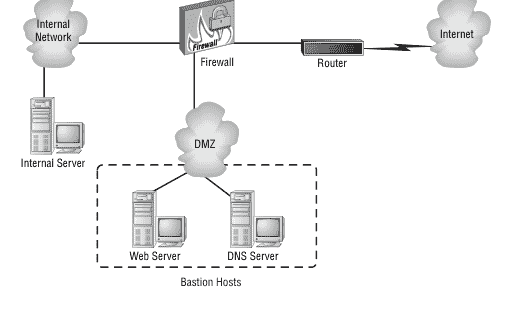

### 非军事化区（`DMZ`）

您希望建立一个在您管理控制之下的网络网段，但该网段与您的受保护网络在物理上分开。这个网段被称为*非军事化区*（`DMZ`）。`DMZ` 通常是一个小型网络，由大约六个左右的堡垒主机组成。请注意，`DMZ` 通常通过防火墙连接到独立的网络接口，如图 1.1 所示。然而，`DMZ` 也可以作为防火墙和互联网接入路由器之间的中间网段进行放置。图 1.2 显示了此配置。

**图 1.2 将堡垒主机放置在防火墙和互联网接入路由器之间的中间 `DMZ` 网段上**

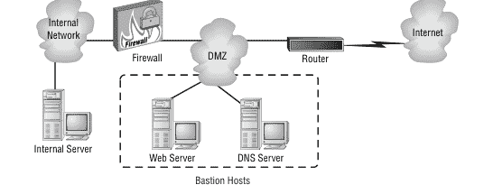

### 外联网

术语*外联网*是指一个专门用于向一组用户提供服务的网络网段，这些用户为您的组织所知晓，但其信任级别不像内部用户那样高。例如，您可能会被要求向商业伙伴提供外联网服务，以便您可以共享提案和系统规格文档。或者，也许您的公司是多供应商集成项目中的分包商，需要向其他开发合作伙伴提供许多大文件。

访问外联网服务器通常需要某种形式的身份验证，虽然应实施适当的访问控制措施，以确保外联网用户无法访问内部网络服务。请注意，将外联网服务器放置在与更公开的堡垒主机相同的 `DMZ` 网段中是完全可接受的。通过这样做，您允许外部人员访问他们需要查看的材料，但他们无法访问需要保密的公司内部信息。图 1.3 显示了外联网主机在 `DMZ` 中的放置位置。

**图 1.3 将外部网络主机放置在非军事区 (`DMZ`) 中**

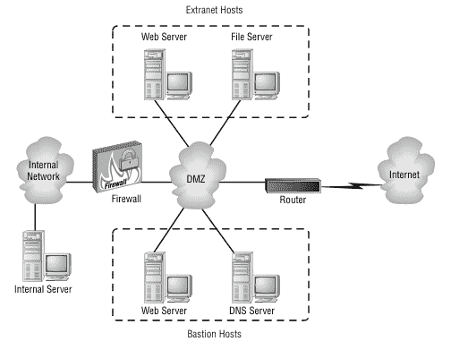

### 防火墙

通常，*防火墙* 是一个逻辑实体或物理设备，用于控制公共网络对私有网络的访问。这通常通过部署一台同时连接到私有网络和公共网络的物理设备来实现。该设备可以运行专用软件或通用操作系统，并具备支持防火墙功能所需的适当软件包。虽然其主要目的是授予或拒绝进出私有网络的访问权限，但防火墙还可以记录流量统计信息、验证用户身份，甚至通过识别可疑使用模式来检测入侵。这是保护您的网络的重要组成部分。

### 内网

术语 *内网* 指的是私有网络。当我们提到内网时，我们不仅指物理网络段，还指一组服务器（`Web`、邮件、多媒体），这些服务器旨在仅供内部用户访问。这些服务器与外部网络和公共服务器是不同的，并且在物理上是隔离的。通常，内网包含机密内容、关键任务数据，或仅适合公司员工内部使用的数据。

### 包过滤器

运行在防火墙设备上的 *包过滤器* 程序根据数据包的源、目标或有效载荷类型来决定是转发还是阻止该数据包。最流行的包过滤器是在网络层（`IP` 层）工作的，它们基于一组规则进行操作，这些规则基于数据包的源和目标 `IP` 地址，以及源和目标传输层（`TCP` 层）端口号。最初的、第一代防火墙是简单的包过滤器。

### 代理服务器

作为一种特殊类型的防火墙，*代理服务器* 接受来自内部网络客户端的互联网连接请求，并像请求发起者是代理服务器本身一样，将这些请求转发给目标互联网主机。然后，互联网主机响应代理服务器，代理服务器再将响应转发给相应的内部网络客户端。代理服务器通常工作在传输层（`TCP` 层）及以上，可用于执行访问规则、记录连接请求，甚至缓存经常被访问的公共内容。

### 隐蔽安全

*隐蔽安全* 是一种做法，即内部服务没有受到公共网络的保护，但其访问权限被故意通过晦涩的地址或资源标识符（或两者兼有）来掩盖。例如，您可能选择使用匿名 `FTP` 服务器将敏感信息提供给您的业务合作伙伴，但在文件名前加上前导点 (`.`)，以便该名称不会在常规目录列表中显示出来。这是一种值得质疑的做法。入侵者不容易被隐蔽性所阻止，自动化扫描工具尤其擅长查找这种隐藏信息。隐蔽安全做法只能将经验最少的黑客挡在您的系统之外。

# 信息安全流程

简单来说，您需要保护那些对组织重要的资源，如果这些资源遭到破坏，将对组织的运营产生负面影响。您需要决定哪些数据必须保护，以及如果资源允许，哪些数据应该保护。您还需要知道，如果网络被攻破，数据被窃取或被恶意修改，公司将承担的成本。对于一些组织而言，它们的互联网公共存在旨在补充通过其他渠道获取的信息，如果这些信息遭到破坏，不会对其运营产生严重后果。例如，确保免费互联网门户网站天气数据传输的私密性，或显示多个交通摄像头网站的流视频馈送的完整性，并不是安全资源的明智用途。然而，我们处于信息时代，越来越多的公司完全建立在需要在公共网络上交换的信息的完整性和可用性之上。这些组织依赖互联网交换的数据，就像依赖它们的实体存在一样。这包括在线银行、投资和管理福利的公司，以及通过互联网进行的绝大多数的企业对企业交易。这些企业必须不惜一切代价确保其服务器上的数据始终私密且可用，并且其数据的完整性无可挑剔。

安全不是一种产品。它不是软件，也不仅仅是咨询业务的借口。它是一门学科，需要在你作为网络和系统管理员所做的任何决策中加以考虑。安全没有开始或结束。你不能安装安全，甚至不能购买安全。安全是培训、文档、设计决策和适当的实施。而安全最重要的方面是根据需要监控和完善您的安全策略。信息安全流程的基本步骤在下一小节中描述。

#### 安全策略制定

安全策略是您的主文档、您的使命宣言，也是告诉其他同事*保护什么*以及*打算如何保护*的最终信息来源。虽然有些公司可能会聘请外部顾问来起草此策略，但这往往落在网络管理员身上。有一些很好的在线资源可以帮助您了解这个主题：

- 互联网工程任务组 (`IETF`) 的 *站点安全手册* (`RFC 1244`) 是制定安全策略和程序的全面指南。
- 普渡大学 (`Purdue University`) 的 `COAST` 项目在 `ftp://coast.cs.purdue.edu/pub/doc/policy` 提供了许多实际的示例安全策略。
- `www.sans.org/newlook/resources/policies/policies.htm` 是一个关于一般安全策略信息的好网站。

安全策略的基本构件如下：

- **版本** 策略的修订版本号和日期。
- **引言** 简要描述公司的历史、目的和任务，包括参考公司当前的互联网服务提供商 (`ISP`)，以及任何托管或外包安全应用和机制（如防火墙、虚拟专用网络 (`VPN`) 或内容过滤器）的提供商。
- **网络图** 显示内网和外部网络（如果有）的基本构件。确保图表清楚地显示内部网络连接到互联网服务提供商边缘路由器的边界。
- **物理安全** 定义普通员工禁止进入的区域，以及允许进入这些区域的员工的角色和身份。这应包括服务器平台的物理规格，如前面板配置、电源连接、不间断电源 (`UPS`) 系统和控制台访问。本节还应讨论进入数据中心和网络机房所使用的访问控制类型。
  > **警告** 限制未经授权和无经验的人员访问数据中心或服务器室至关重要。否则，这将招致破坏性的、昂贵的事故或破坏行为。
- **内网和外部网络服务** 允许*进入*和*离开*内网/外部网络的服务，包括服务类型、源、目标、时间和用户认证。包括电子邮件交换的允许内容，以及 `HTTP` 和 `FTP` 下载的内容。
  > **提示** 您可能希望了解您想要允许的服务的端口和想要禁止的服务的端口，以便稍后参考。
- **远程访问** 通过拨号或专用 `VPN` 使用拨号和/或加密客户端从互联网访问内网的远程用户的特殊限制。
- **防火墙配置** 周边防御设备的详细配置参考，包括访问控制规则、日志记录设施和认证方法。
- **用户账户策略** 用户账户创建和维护策略，包括用户名选择、密码过期/终止规则，以及磁盘和进程配额。

#### 数据使用策略

本节应涵盖服务器上的用户和数据文件类型，以及应如何处理这些文件。它应包含初始权限、访问控制和组创建标准。

#### 审计、监控与执行

如果安全策略未被实际执行，那么它毫无用处。在本节中，您应明确定义将用于监控服务器和网络资源以确保策略得到遵守的工具和方法。务必明确列出将对违规者施加的惩罚性和/或纠正性措施类型。

> **注意** 您必须落实策略文档中的审计部分，否则制定该策略毫无意义。这听起来可能显而易见，但如果您不监控网络的安全状态，就无法拥有一个安全的网络。

#### 正式认可

这是您明确说明谁直接负责策略的编写及持续执行的章节。它应包含 `IT` 官员、法律顾问以及策略本身的开发者的签名。务必注明签名的日期。

即使是最清晰、简洁且完整的安全策略，如果员工无法访问，也将无效。务必将该策略的纸质副本包含在新员工入职培训资料中，并定期提醒员工其在线位置，以便他们可以在策略演变时查阅它。此外，定期进行关于其使用和合规性的培训课程，并建立一种机制，使用户和 `IT` 人员都能提交改进建议。

# 安全机制实施

一旦达成了一致认可的安全策略，就需要实施必要的机制来执行它。这通常是系统配置更改、工具安装、用户流程开发和监控的组合。为了实施上一节中策略大纲所述的机制，您需要执行以下任务：


- `物理安全`：在数据中心安装`UPS`设备、组合锁和物理环境报警器，如果尚未提供这些设施的话。配置`Linux`服务器，使得`root`访问仅允许在控制台上进行。

- `内网和外网服务`：安装并配置周边防御设备（`防火墙`、带有访问列表的`路由器`等），以执行对外网和内网服务的限制。（第9章“网络层防火墙”详细探讨了`Linux`防火墙的话题。）

- `远程访问`：安装并配置`虚拟专用网端点`（参见第12章“虚拟专用网”）和/或支持强远程认证和授权的网络设备（参见第13章“强用户认证”）。

- `用户账户策略`：配置`/etc/login.defs`配置文件，强制用户定期更改密码。我建议将`PASS_MAX_DAYS`设置为最多90天，这将强制用户在每三个月内更改密码。这段时间能保持用户的警觉，并提醒他们密码是网络安全非常重要的一部分，尽管每90天更改一次密码可能被视为一种麻烦。编写一个脚本，定期执行`last`和`finger`命令，以确定用户处于非活动状态的时间长度，并视情况在`/etc/passwd`条目中插入星号(`*`)。此外，您应训练用户选择良好的、不可预测的密码，该密码包含字母数字字符，且与用户的环境无关，例如其配偶的名字、居住的街道或驾驶的汽车。

- `数据使用策略`：在初始文件创建时使用正确的全局`umask`权限，并定期执行脚本，以确保没有未经授权的`setuid/setgid`可执行文件。（参见第2章“系统安装与设置”，其中全面讨论了系统安全配置和监控。）

- `审计、监控与执行`：安装审计和监控工具，如`Satan`、`COPS`或`PortSentinel`，并定期使用它们，以确保您的网络防御仍符合您的安全策略。（参见第5章“网络监控与审计”，其中综合讨论了网络审计和监控工具。）

## 策略定期编辑和安全审计

就像互联网一样，您的网络可能一直在变化。确保审查您的安全策略，以确保它仍然反映您的网络需求。您最近是否添加了任何新服务器？由于贵公司最新的并购，您的用户群是否大幅增长？是否最近有一轮裁员，导致许多不满的员工离开？即使您的网络没有发生重大变化，您需要扮演入侵者的角色，尝试从外部进入您的服务器。确保您领先于那些不断试图做同样事情的真实坏蛋一步。

您安全策略中值得特别关注的领域是远程访问。随着`VPN`技术的近期出现，使用安装在笔记本电脑上的简单`点对点隧道协议`(`PPTP`)或`互联网协议安全`(`IPSec`)客户端为差旅用户提供的通用访问比以往任何时候都更容易。认识到允许这种类型访问的含义很重要。过去您可以物理上看到网络的边界，而远程访问将内网的周边扩展到您可能不希望完全信任的地方。您可能希望重新装备您的安全策略，以包括对以下方面等的限制：

- 要使用的`IPsec/PPTP`客户端版本。

- 客户端的超时设置。通常，闲置了15分钟的用户并不介意重新建立远程连接。

- 使用的认证类型。`用户名/密码`已不足以进行安全的远程访问。

- 屏幕保护类型和闲置长度。要求使用在达到闲置超时后锁定密码的屏幕保护程序。

此外，本书介绍了一些软件实用程序，可用于自动化确保策略合规性所必需的部分审计和监控。第3章“系统监控与审计”讨论了系统级别的审计，而第5章将讨论扩展到网络层。

## 信息安全的目标

您可以将`Linux`服务器的所有安全需求映射到四个基本目标之一：

- 数据保密性

- 数据完整性

- 用户认证和访问控制

- 数据和服务可用性

您的安全策略、工具及策略实施以及配置管理的最终目的是解决这些每一个目标。以下部分将详细研究每个目标。

### 数据保密性

在这个日益公开的世界中，维护`Linux`服务器中数据的保密性本身是一项全职工作。随着用户依靠网络服务器处理日常工作的更多方面，他们也将更多机密和私密信息托付给这些服务。密码学的出现为`Linux`系统管理员提供了一项宝贵的工具，通过允许用户加密存储在服务器上的敏感数据来确保保密性。`Linux`支持私钥和公钥加密，这是两种主要的密码加密类型。


#### 私钥加密

也称为`对称密钥`加密，私钥加密允许用户选择一个秘密密钥，然后用于初始化一个算法，将敏感数据（明文）转换为混乱或加密的数据（密文）。此过程是可逆的，因此，只要他能或她生成原始的加密密钥，同一用户可以解密密文以恢复原始明文。密钥越长，攻击者从密文推导出明文就越困难。

私钥加密的`事实`标准是`数据加密标准`(`DES`)，由`IBM`于1977年开发供美国政府使用。虽然当时认为其56位密钥是足够的，但`DES`算法已被破解多次。这促使`美国国家标准与技术研究院`(`NIST`)协调开发下一代`DES`，称为`AES`（高级加密标准），它使用更长的密钥长度，且实质上是更加健壮的。

有几个`Linux`安全应用程序使用了私钥加密，包括`Kerberos`认证工具套件。第13章更详细地涵盖了这一主题。

#### 公钥加密

虽然私钥加密是保护敏感数据的有效方式，但它缺乏保护两个方之间数据交换所需的多功能性，特别是当这两个方彼此之间没有先前知识时。这促使`Martin Hellman`和`Whitfield Diffie`在1976年的里程碑式论文《密码学的新方向》（发表于`*IEEE Transactions on Information Theory*`）中开发了公钥加密的概念。这个想法出奇地简单：发送方使用接收方广为人知的公钥加密消息。接收方（且仅接收方）随后可以解密消息以恢复原始明文。这确保了消息的保密性，而无需发送方和接收方共享一个共同的私钥。不出所料，公钥加密是一种常用的技术，用于保护电子邮件内容在通过互联网传输时的安全。

`Linux`支持的`Pretty Good Privacy`(`PGP`)包及其开源对应物`GNU Privacy Guard`(`GPG`)提供了两个由公钥驱动的安全应用程序的示例。第6章“电子邮件”描述了`PGP`和`GPG`。

### 数据完整性

一旦攻击者在数据通过互联网传输时获得了访问权限，攻击者可以执行以下任何操作：

- 将内容用于恶意目的，例如勒索或竞争优势。

- 在内容到达其预期目的地之前对其进行修改。

- 彻底销毁数据。

即使在保密性并非首要考量时，确保数据在互联网传输过程中的完整性通常也是一个优先事项。例如，考虑一种`Web`驱动的服务，允许你的客户下载你公司软件产品的安全补丁。虽然补丁本身可以明文下载，但至关重要的是，客户必须确信该补丁未被恶意篡改。

再次地，密码学提供了解决方案。通过在补丁分发中附带`数字签名`，你的用户可以验证即将安装的软件的有效性。在提供补丁之前，数字签名工具会获取一个`摘要`，即组成补丁的数据的摘要。然后，你使用私钥对该摘要进行签名，并将公钥提供给你的用户。用户随后可以使用你的公钥验证摘要的签名，从而逆转该过程。如果在传输过程中有任何一位（bit）被修改，签名验证将失败，用户便会知道发生了篡改。

在`Linux`系统安全中，数据完整性检查的一个流行应用是`Tripwire`文件完整性工具套件。这是第3章讨论的话题之一。

### 用户认证与访问控制

认证的需求与人类历史同样悠久。只要存在拥有不同权利和特权的群体，人类就需要证明自己是这些群体的合法成员。最基本的认证形式是视觉检查（你看起来像我认识的那个`爱丽丝`，因此你必须是`爱丽丝`）。稍微复杂一点的认证形式依赖于主体拥有一个唯一标识其身份且只有主体本人才能产生的令牌（例如，一个秘密单词或驾驶执照）。在互联网术语中，这转化为简单的`用户名/密码`认证，这仍然是在线认证的主要手段。

然而，这种认证方式存在两个固有的根本漏洞：

- 当被迫记忆密码时，人们倾向于选择容易猜到的密码；而当被迫选择好的密码时，他们又倾向于将其写下来。

- 密码很容易被嗅探。每次使用密码时，它都会通过网络发送，通常以明文形式，从而使其暴露给仅仅是监控公共介质的恶意入侵者。

为了解决第一个漏洞，你应该使用`nppasswd`实用工具，它强制用户选择良好的密码。你还应该使用`crack`工具，它试图猜测用户可能选择的薄弱密码。（第3章将详细讨论这两个实用工具。）为了保护密码不被嗅探，你必须确保所有远程访问要么通过`安全 Shell`(`SSH`)进行，要么通过`S/KEY`登录会话使用一次性密码。这些工具分别在第12章和第13章中进行了详细讨论。

电子商务在互联网上的兴起带来了认证真正匿名方的需求——即在交易之前对我们完全陌生的主体。公钥密码学再次为这个问题提供了解决方案。

通过使用携带知名`证书颁发机构`（`CA`）数字签名的证书，可以基于对`CA`信任的传递性对匿名方进行认证。也就是说，如果我信任`CA`，而`CA`可以证明此人如其自称身份，那么我就应该相信这一事实。

`安全套接字层`（`SSL`）的`Linux`实现包含了实现简单`公钥基础设施`（`PKI`）所需的工具，你可以使用它来提供对匿名主体的强身份认证。此话题在第7章“HTTP 服务”中进行了详细讨论。

### 数据与服务可用性


人们常说，在网络和无线通信时代，唯一真正安全的系统是砖头——没有任何东西进入，也没有任何东西出来。虽然这可能事实如此，但 `Linux` 管理员并不具备采取这种极端方法的奢侈条件。事实上，大多数系统管理员的表现往往通过其保持系统始终在线且可从公共网络访问的能力来衡量。希望确保 `Linux` 服务器始终保持运行显然有其原因（你的公司确实希望获利，对吧？），但高可用性对信息安全重要性还有更微妙的原因。

很有可能，你的用户依赖你的在线系统进行认证和敏感数据的私密通信。如果这些系统缺失——即不可用——用户很可能会使用不太安全的方法来传输和存储数据，这通常会导致公司安全策略受到损害。例如，考虑一名需要在未来五分钟内向法务部门发送加密提案的用户。如果 `PGP` 密钥服务器宕机，且用户面临相当大的延迟，用户更可能发送未加密的文档，而不是面对重要销售机会潜在丢失的风险。

下一节将检查在 `Linux` 服务器中常见的漏洞类型，包括一种特定的漏洞，它可以为拒绝服务攻击打开大门，这些攻击旨在扰乱你的 `Linux` 服务器的可用性。

# Linux 安全性

`Linux` 并不比任何其他 `Unix` 变体更容易受到攻击。作为开源产品，确保每当发现漏洞时，它会公开并按时提供修复方案，这是开发人员和用户社区的责任。`Linux` 在这方面有着出色的记录。加上源代码每天受到的持续审查，使 `Linux` 成为注重安全性的系统管理员的优秀平台选择。

但残酷的现实是，无论你多么小心地保护你的 `Linux` 服务器，你都有可能遭到攻击。以下章节深入剖析典型恶意攻击者的特征，并提供了一份你可能面临的各种攻击类型的综合列表，以及每种攻击的后果。我们还将探讨保护你的服务器安装免受这些攻击的方法。

#### 攻击者类型

正如安全事件有多种类型一样，肇事者也有多种类型。虽然攻击者来自各种背景，但有四种广泛的类型可以用来概括整个攻击者群体。让我们更仔细地看看每一个类别。

##### 顽劣少年

通常是高中或大学生，顽劣少年有空余时间。他们随机选择受害者，除了容易访问外，他们没有针对特定目标的隐秘动机。顽劣少年相对容易受挫，不使用机密信息，也不太可能篡改其完整性。顽劣少年仅向其直接的同伴群体透露成功攻击的细节。

你可以通过确保你的 `Linux` 服务器没有明显的漏洞，并跟进你使用的 `Linux` 发行版可用的安全补丁来保护自己免受顽劣少年的攻击。顽劣少年是最容易防范的攻击者。

##### 教派成员

互联网已被证明是分享共同兴趣以策划网络攻击的半有组织团体的肥沃土壤。这些团体往往像教派一样行事，使用晦涩的名称称呼其成员，并使用初学者难以破译的特征行话进行通信。最普遍的教派拥护特定的社会政治事业，并在他们视为该事业敌人的人群中选择受害者。不出所料，许多联邦政府网站已成为这些教派的目标，它们通常篡改网站以包含措辞谨慎的抗议信息。

邪教组织成员并不像捣蛋者那样容易受到威慑，他们共享一个庞大的技能和资源库，这使得防守方很难抵御其攻击。如果你的公司或机构可能成为政治运动的攻击目标，你就必须采取非常手段，以确保你的主机，尤其是 `Web` 服务器和文件服务器，能够抵御篡改和内容修改。

##### 间谍

与捣蛋者和邪教组织成员不同，企业间谍会非常仔细地选择其目标，并往往在发动攻击前对目标进行长时间的侦察以收集信息。他们首选的攻击方式通常是为了经济或政治利益而非法入侵机密资源。间谍组织资金充裕，并且通常拥有一套令人印象深刻的技能和资源。他们力求尽可能隐蔽，并在成功入侵后尝试掩盖其踪迹。

你应该通过访问控制机制保护机密数据，并辅以入侵检测机制（第 5 章将对此作进一步介绍），从而保护服务器免受间谍攻击。你还应提供诱饵，即虚假的机密信息，让间谍无法判断哪个文件包含真实信息。这类似于总统车队，其中包含四辆相同的黑色林肯轿车，但实际上只有一辆载有总统。

##### 内部人员

内部人员发起的攻击是目前最难抵御的攻击之一，因为潜在的攻击者已经掌握关于目标的大量信息。内部人员无需经过任何繁琐步骤即可访问 `Linux` 服务器。他们剩下的唯一挑战是绕过基本的系统安全机制，这些机制阻止他们访问他人的信息。

此类攻击不仅难以防范，而且一旦发生也极难检测。第 2 章提供了大量细节，说明如何确保用户不越权，以及权限和访问控制不被违反。

#### 针对 Linux 服务器的常见攻击

现在，你知道应该防范*谁*了，但究竟*什么*是你需要担忧的具体内容呢？你可能听说过那些最具新闻价值的网络安全事件，例如美国司法部网站的被篡改，或 `E*TRADE` 及其他公司的大范围服务中断。但究竟是如何做到的呢？深入挖掘头条新闻背后的细节，了解攻击者如何利用 `Linux` 漏洞来破坏我们的服务器，是大有裨益的。

以下是一份相当全面的列表，列举了过去五年中在 `Linux` 服务器上见过的攻击类型。

##### Web 服务器攻击

作为当今互联网上最受欢迎服务，`HTTP` 服务器已成为当前运行在 `Linux` 服务器上最脆弱的守护进程。请注意，我并不是暗示 `Web` 服务器本质上薄弱。这只是暴露面的问题；作为最普遍的服务，`Web` 服务器也是最常遭受攻击的目标。此外，`Web` 服务器使用了一组复杂的配置参数，且容易出现细微的配置错误，这使其更加脆弱。针对 `Linux` 主机的 `Web` 服务器攻击分为两类：通用网关接口（`CGI`）脚本入侵和缓冲区溢出，如下文各节所述。

**CGI 脚本入侵**

`cgi-bin` 目录存放着可由服务器代表用户调用的可执行脚本。`Web` 服务器处理这些脚本的方式本身并无固有的不安全之处，但允许远程用户在本地服务器上执行代码这一事实本身就是危险的。如果配置不当，某些 `Web` 服务器甚至允许远程用户以 `root` 权限执行这些脚本，攻击者可利用这一点通过其他手段在稍后获取系统访问权限。最近的一次攻击仅成功获得了 `CGI` 脚本的只读访问权限。虽然这听起来像是一次无害的入侵，但实际上用户通常将密码和其他敏感数据硬编码在 `CGI` 脚本中，因此用户得以利用这些信息获取系统访问权限。

一般来说，你可以通过配置 `Web` 服务器以防止在随机位置执行 `CGI` 脚本来预防 `CGI` 脚本入侵。你应培训用户掌握正确的编程技巧，并向他们提供大量安全的 `CGI` 脚本代码示例以供使用。

**缓冲区溢出**

尽管缓冲区溢出自互联网诞生之初就已存在（还记得 1988 年的罗伯特·莫里斯蠕虫吗？），但随着万维网及 `Web` 浏览器的出现，其变得更为普遍和重要。通过输入一个包含实际计算机代码的非寻常大型 `URL`，攻击者会导致原本用于容纳 `URL` 的数据结构溢出，从而入侵存放实际 `Web` 服务器指令的内存部分，并用 `URL` 中包含的指令替换它们。这使攻击者能够以与 `Web` 服务器本身的相同权限执行任意代码。

请确保你的 `Web` 服务器不是以 `root` 权限运行的。相反，大多数 `Linux` `Web` 服务器以 `root` 身份启动（以便它们可以监听 `TCP` 端口 80，这是一个特权端口），但随后分叉一个非特权子进程来提供实际的 `Web` 服务。大多数服务器使用用户名 `nobody` 来实现此目的。

##### Root 权限失陷

这是对 `Linux` 服务器最具破坏性的攻击之一，也是最常见的一种。入侵者通过以下任一方法获取 `root` 权限：

- 嗅探 `root` 密码

- 猜测 `root` 密码

- 浏览系统日志，寻找 `root` 密码意外出现的地方

- 对存在漏洞的应用程序发起缓冲区溢出攻击以获取 `root` 访问权限

由于很难确保 `root` 密码始终处于严格保密状态，因此最好直接禁用 `root` 登录，除非是在数据中心内的系统控制台上（请参见本章稍后“物理安全”部分的讨论）。不要以 `root` 身份登录以执行管理任务，而是使用允许普通用户临时获取 `root` 权限的 `sudo` 命令。第 2 章讨论了 `sudo` 及其他系统安全命令。

> **提示** 经常更改 `root` 密码并确保其不易被猜测是个好主意。使用由随机大小写字母和少量数字组成的字符串，例如 `IRGrhR954E45ejh`，将使他人极难破解 `root` 密码。

##### 拒绝服务（DoS）攻击

近年来，由于针对高知名度网站攻击事件的频发，拒绝服务（`DoS`）攻击受到了媒体的全球关注。此类攻击的目的并非窃取或修改任何私有服务器内容，而是使提供公共内容的公共服务器失效。使 `Linux` 服务器瘫痪的首选方法是用大量伪造流量将其淹没。普通 `DoS` 攻击的一种变体是*分布式拒绝服务*（`DDoS`）攻击，其中使用大量流量源来生成这些虚假流量。这些流量源通常是属于未察觉用户的被劫持系统。

`DoS` 攻击的例子包括：

- **泪滴攻击（Teardrop Attack）：** 攻击者向受害者发送大量错误分段的 `IP` 数据包。

- **Syn Flood 攻击：** 攻击者开启大量进行到一半的 `TCP` 连接，直到受害者的网络缓冲区（因等待连接完成而被占用）变得不可用为止。

虽然针对新型 `DDoS` 攻击，你很难保护你的 `Linux` 服务器，但你可以防止服务器被劫持并沦为攻击工具之一。通过在 `Internet` 路由器中实施*出站过滤（egress filters）*，你可以确保离开你网络的流量不包含你私有网络子网之外的源地址。

#### 地址欺骗


这是包过滤防火墙的首选攻击方式。这类过滤器通常被配置为仅允许私有—即已知—地址通过该设备发起连接。因此，攻击者伪造其源 IP 地址以假装来自内部相对容易。虽然返回的数据包不会被转发给攻击者（他们假装拥有内部地址，响应将发送到此地址），但攻击者可以通过盲目发送数据包造成大量破坏。事实上，攻击的目的通常是建立一个 `Root` 权限失陷或缓冲区溢出，以便攻击者能打开一个后门，日后用于访问系统。

为对抗 IP 地址欺骗，你应该在包过滤设备上设置`入站过滤（ingress filters）`。（更多信息请参见第 9 章。）这确保你不接受通过防火墙公共接口进入且源地址属于你内部地址块的 `packets`。但此防御措施充其量只是一个权宜之计。真正的解决方案是避免使用基于地址的认证（包过滤），转而使用加密认证，例如 `SSH`。

### 会话劫持

在这种特定形式的地址欺骗中，`TCP` 会话劫持者观察 `TCP` 通信中的序号，并通过向另一方提供预期的序号来冒充其中一位参与者。攻击者对冒充方发起 `DoS` 攻击，以阻止其继续参与通信。成功后，攻击者可以像在冒充方一样在远程主机上发出命令。

你应该教会用户识别被劫持会话的症状，以便他们能报告此类事件。通常，他们注意到其中一个会话不再响应，而其他空闲了一段时间的会话却显示出不请自来的命令输出。与地址欺骗一样，应对会话劫持威胁的真正解决方案是使用不完全基于 IP 地址的认证方法。

### 窃听

作为全球媒介的互联网扩张过程中最困难的挑战之一，是它的公共性质，即通信的隐私性和可靠性从未得到保证。

嗅探网段并窃取机密信息竟如此简单。事实上，`Linux` 的普及加剧了这一问题，因为即使是经验最匮乏的用户也能利用 `Linux` 的能力，以混杂模式检查其在网络中看到的每一个数据包。入侵者不仅能捕获飞过数据包的有效载荷，还能捕获可用于对毫无戒备的服务器发起 `root` 权限攻击的密码信息。

> **警告** 在任何情况下，都绝不允许 `Linux` 服务器的 `root` 密码未经加密就在网络上传输。

为了保护你的 `root` 密码，你应该：

-   禁用通过网络进行的 `root` 登录。
-   禁用 `telnet`、`rsh`、`rlogin` 和 `ftp`。
-   仅使用 Secure Shell（`ssh`）进行交互式登录。
-   仅使用 Secure Copy（`scp`）在服务器之间传输文件。

此外，你应该利用 `Linux` 对 VPN 技术的支持，该技术使用强加密来保护你的 `Linux` 服务器与你需要交换机密信息的任何其他主机之间的整个通信过程。第 12 章专门介绍 `Linux` 环境中的 VPN 主题。

### 特洛伊木马

你们都曾经从互联网上下载看似有用的免费软件，结果却发现其功能被大大夸大。然而，越来越多的 `Linux` 服务器被那些执行与其宣传功能截然不同的任务的软件所感染。这些所谓的`特洛伊木马`程序虽然伪装成无害的应用程序，却打开了一扇后门，入侵者可以通过这扇门利用系统漏洞，通常还能获得 `root` 权限。就像希腊人在特洛伊战争中用来攻城的木制器物一样，特洛伊木马呈现为一个有用的工具，并且通常具有部分实际功能。但即使在它似乎正在履行其宣传功能的同时，它也可能使你的服务器甚至整个网络瘫痪或遭到破坏。

特洛伊木马极难检测。事实上，它们常常伪装成安全应用程序，因此你在自以为提升服务器整体安全性的同时，实际上可能是在自伤。一个典型的例子出现在 1999 年 1 月，当时发现一个广泛分发的 `TCPWrappers` 版本实际上是一个特洛伊木马。（关于 `TCPWrappers` 的详细描述，请参阅第 4 章“网络服务配置”。）尽管 `TCPWrappers` 最初旨在监视和过滤传输层连接，但特洛伊木马版本的 `TCPWrappers` 已被修改，旨在为潜在的入侵者提供 `root` 访问权限。

大多数特洛伊木马程序的另一个共同特征是它们能够通知攻击者入侵事件，并提供了关于你系统的足够详细信息，使攻击者能够策划一次成功的攻击。特洛伊 `TCPWrappers` 被设计为向入侵者的地址发送电子邮件，其中包含受感染系统和安装该程序的毫无戒备用户的信息。

你可以通过遵循以下简单建议来保护自己免受特洛伊木马的伤害：

-   从知名的互联网站点或这些主站点的知名镜像下载所有软件。
-   在安装软件之前，查找数字签名或校验和，以确保下载包的完整性。
-   尽可能向用户提供标准软件（前提是符合你的安全策略），并保持其更新。
-   定期查看来自 `CERT` 协调中心（`www.cert.org`）的特洛伊木马公告。

此外，你应该定期扫描服务器，查找处于活动状态或 `LISTEN` 状态的可疑网络端口。清单 1.1 展示了 `netstat` 命令的执行结果，其中显示服务器有一个可疑端口（555）处于 `LISTEN` 状态。注意，该命令无法将端口号 555 解析为 `/etc/services` 文件中的知名端口号。这表明该守护进程并非标准程序，应进一步调查。

#### 清单 1.1 执行 netstat 命令显示在 TCP 端口 555 上运行可疑守护进程

```text
[ramon]$ netstat -a
Active Internet connections (servers and established)
Proto Recv-Q Send-Q Local Address           Foreign Address     State
tcp        0      0 *:555               *:*                 LISTEN
tcp        0      0 *:ssh               *:*                 LISTEN
tcp        0      0 *:ftp               *:*                 LISTEN
udp        0      0 *:snmp              *:*                  
raw        0      0 *:icmp              *:*                    7
raw        0      0 *:tcp               *:*                    7
Active UNIX domain sockets (servers and established)
Proto RefCnt Flags    Type       State I-Node Path
unix 0 [ ACC ] STREAM LISTENING 491 /dev/log
unix 1 [ ] STREAM CONNECTED 985 @0000003d
unix 1 [ ] STREAM CONNECTED 886 @00000039
unix 1 [ ] STREAM CONNECTED 959 @0000003c
unix 1 [ ] STREAM CONNECTED 554 @00000021
unix 1 [ ] STREAM CONNECTED 740 @00000035
unix 0 [ ] STREAM CONNECTED 117 @00000013
unix 1 [ ] STREAM CONNECTED 744 @00000036
unix 1 [ ] STREAM CONNECTED 986 /dev/log
unix 1 [ ] STREAM CONNECTED 960 /dev/log
unix 1 [ ] STREAM CONNECTED 887 /dev/log
unix 1 [ ] STREAM CONNECTED 745 /dev/log
unix 1 [ ] STREAM CONNECTED 741 /dev/log
unix 1 [ ] STREAM CONNECTED 588 /dev/log
```

第 5 章提供了更详细的介绍，探讨用于监测此类入侵的工具。

### 密码分析与暴力破解攻击

当今使用的大多数加密算法已被证明足够强大，能够提供适当的机密性、完整性和认证级别。然而，有几起案例发现其中一些算法容易受到攻击或数学利用，其密钥空间（算法被破解前的平均组合数）已被证明远小于最初认为的大小。（我所说的“数学利用”是指利用算法设计者使用的函数中存在缺陷的利用方式，这些缺陷用于推导素数、生成密钥、增加熵等。）

1998 年，我们目睹了一起重度公开关注的密码分析案例，著名安全专家 Bruce Schneier 和 "Mudge" 发现了 `Microsoft` 用于 `PPTP`（`Windows` 操作系统中使用的 VPN 协议）认证算法中的多个安全漏洞。`MS-CHAP v.1` 认证算法被发现容易受到密码窃听攻击。此外，`Microsoft` 点对点加密算法（`MPE`）也被发现远不如厂商宣传的 128 位密钥强度有效，从而使用户容易遭受传输数据的窃听攻击。1999 年，`Microsoft` 发布了 `MS-CHAP v.2` 作为原始版本的增强版。然而，根本缺陷仍然存在；VPN 传输的机密性强度取决于用户为认证选择的密码强度。


`PPTP` 有一个 Linux 版本（`PoPTop`，在第 12 章中讨论），它与 Microsoft 实现完全互操作，因此同样容易遭受相同的密码猜测弱点。

这引导我们进入最后一类攻击：密码和密钥的暴力猜测。随着普通用户可用的计算能力以指数级速度增长，入侵者猜测你的密码或密钥的潜力也在增加。通过使用暴力破解方法，潜在的入侵者利用空闲的计算能力尝试猜测加密密钥，直到找到正确的那个。这些也被称为字典攻击，因为攻击者通常使用知名字典来尝试猜测密码，基于大多数用户倾向于选择真实单词作为密码的事实。

暴力破解攻击对加密算法的威力在 1998 年夏天得到了最好的展示，当时电子前沿基金会（EFF）能够使用一台专门构建的计算机，以 25 万美元的成本破解 `DES` 算法的 56 位密钥。此类攻击的可行性提高了对加密强度的要求，并提高了对当今即使是最强加密算法局限性的认识。

既然你了解了敌人是谁并瞥见了他们的首选武器，让我们看看如何使用开放系统互连（`OSI`）模型中的一些层作为参考点，来组织适当的防御。

### 信息安全的分层方法

大量工作已致力于在 `Linux` 内核中添加安全性。现在内核原生支持数据包过滤、数据包记录、伪装，甚至对拒绝服务攻击的防御。这在保护系统本身方面已经走了很长一段路，但你愿意让入侵者完全进入你的服务器门户吗？有效的安全策略是从 `Linux` 服务器的核心开始的，但通过包含系统外部的保护机制而不断向外延伸。你的防御应覆盖服务器的网络配置、服务器上运行的网络应用程序、企业网络的边界，以及道路战士从公共互联网访问企业资源时使用的远程访问客户端。

让我们更仔细地看看适用于这些每一层的考量。注意，本讨论将从 `Linux` 内核向外延伸至互联网。

#### 物理安全

这是最基础、也最常被忽视的 `Linux` 服务器安全类型。物理安全始于服务器本身所处的环境。数据中心的房间是否加锁？如果是，谁被允许进入该房间？承包商和维修人员是否有人陪同？如果你正在建设新站点或搬迁至新地点，在设计数据中心物理布局时，请遵循以下简单准则：

- 安装磁卡读卡器以访问数据中心。定期审查访问日志。查找异常的访问模式。要求用户核实其登录条目。
- 在数据中心内，始终陪同维修人员和现场技术人员。
- 更改终端服务器、远程控制设备和电源分配单元上的默认密码。为每位管理员创建账户。监控其使用情况。
- 选择带有前面板锁的 `Linux` 服务器，以防止入侵者重启机器或向驱动器插入外部介质。
- 除非绝对必要，否则避免将传入电话线连接到控制台端口。使用回拨调制解调器。
- 在 `Linux` 服务器的 `X` 显示上启用密码保护的屏幕保护程序，如 `xlock` 和 `vlock`。
- 安装良好的监控设备，以便在数据中心出现温度过高、烟雾或湿度异常时向人工发出警报。

重要的是要记住，物理安全的主要目标是维护服务器安装的高可用性。确保你的服务器不要与可以从数据中心外部访问的插座和电器位于同一电路上。你可能会惊讶地发现，在三天周末的中间，只需将螺丝刀插入电插座或灯座，我就能制造出多少停机时间。

> **提示** 提供冗余电源是解决这类许多问题的答案。如果服务器支持，请使用它！

我不建议你设置 `BIOS` 和引导加载程序密码，因为这会阻止系统在无人工干预的情况下从重启中启动。除非你有工作人员 24/7 全天候照顾你的服务器，否则这可能会严重危害可用性。

#### 系统安全

`Linux` 服务器最基本的 security 要求是保证活动的非特权用户无法访问其他用户受保护的资源，或者更严重的是，无法访问为特权系统账户保留的系统区域。更细微的漏洞包括用户超出其文件配额、CPU 使用量或最大活动进程数的能力。所有这些违规行为都可能构成潜在拒绝服务（`DoS`）攻击的种子，这可能导致系统或其部分暂时不可用，甚至永久失效。本书第一部分（第 1 章至第 3 章）专门讨论 `Linux` 系统安全主题。

#### 网络安全

保护系统免受其他表现良好的员工或用户的潜在恶作剧是一个巨大的进步，但它仅涵盖系统与外部世界隔离的情况。显然，这并不现实，因为大多数 `Linux` 服务器都是部署在网络上为用户群体提供服务的，而这些网络通常是公共的。因此，勤奋的 `Linux` 管理员应仔细评估服务器的物理网络连接，包括其所有接口、`TCP/IP` 配置，以及最重要的，服务器活动网络守护进程的配置。本书第二部分“网络安全”（第 4 章和第 5 章）介绍了网络安全的细节，包括保护网络的实用策略和可用工具。

#### 应用安全

今天 `Linux` 发行版中附带的一些标准守护进程实际上是具有相当复杂配置集的全功能应用程序。与简单的 `telnet` 和 `FTP` 守护进程不同，Web、邮件和文件服务器使用复杂的协议。为了保护这些服务，网络管理员必须部署针对每个协议特有的安全防御机制。这些应用特定的机制是本书第三部分“应用安全”（第 6 章至第 8 章）的主题。

#### 边界安全

防火墙是网络安全的基石。防火墙是完整安全解决方案的关键部分，保护本地局域网（`LAN`）连接公共互联网的边界。虽然防火墙的主要目的是阻止不需要的流量进入本地网络，但这也是记录进出网络所有流量的地方。虽然大多数防火墙是双网卡的（两个网络接口），但有些具有额外的接口，你可以使用这些接口来连接堡垒机和外网服务器，这些服务器的访问权限使得它们需要与本地局域网进行物理隔离。防火墙及其在边界安全中的作用在本书第四部分“边界安全”（第 9 章至第 11 章）中进行了介绍。

#### 远程访问和身份验证

就在系统管理员刚刚掌握网络安全要领时，虚拟专用网（`VPN`）出现了，管理员的工作变得更加艰巨。网络边界现在扩展到所有远程连接到它的系统，至少在拨号会话期间是这样。像 `IPsec` 和 `PPTP` 这样的 `VPN` 标准为数据隐私提供了通用框架，但它们并未完全解决身份验证问题，也未能覆盖授权和访问控制问题。第五部分“远程访问和身份验证”（第 12 章和第 13 章）讨论了虚拟专用网和远程访问安全主题。

#### 人为安全

无论你投入多少时间和精力来制定健全的安全策略，人类最终是操作者，并且通常是信息安全链中最薄弱的环节。即使最严密的边界防御，也可能被心怀怨恨的内部人士彻底摧毁；最强大的密码策略也无法应对那些将密码写在黄色便签纸上并贴在显示器上的用户。

进行安全意识培训并监控安全策略的合规性是一个正确的步骤，但就像往常一样，还有许多其他不太具体的因素有助于你服务器安装的安全性。不满的员工或只是感到无聊的员工会给你的企业带来相当大的风险，特别是那些能够访问竞争对手可能利用的敏感信息的员工。

对于对工作充满挑战并因努力而获得回报的满意员工，没有任何替代品。虽然道德和行为很难监控和执行，但确保员工保持良好的士气和动力同样有效。一年一度的公司野餐和慷慨的绩效奖金计划可能是你的公司在信息安全方面最好的投资。

> **警告** 如果你必须解雇不满的员工，你或安全团队的一员应陪同他们离开大楼，并确保他们在离开前不被允许触摸任何计算机。即使在你解雇他们之前，你也应该取消他们的访问权限并更改密码。否则，你就是在招致灾难。

### 总结

安全通常是一个理解不足的主题。人们往往过于强调工具，而不够重视流程和方法。有效的安全防御应从全面的安全策略开始，在此基础上构建一套适当的机制。请记住，安全是一个过程！

信息安全的目标是确保服务器上数据的机密性、完整性、身份验证和可用性。加密是确保数据在互联网上交换时得到适当保护的唯一可行方式。

你需要准备防御各种各样的漏洞和攻击类型。建立并维持有效防御的唯一方法是从系统开始，向外扩展至边界，并单独考虑每一层。别忘了考虑对你的 `Linux` 服务器的远程访问。

我们将在下一章中通过仔细检查系统安全来开始详细讨论这种分层方法。

# 2 系统安装与配置

前一章“理解 Linux 安全”概述了信息安全领域最重要的概念，特别是 `Linux` 服务器安全。本章将深入细节，讨论以下 `Linux` 服务器管理任务的安全影响：

- 选择 `Linux` 发行版
- 构建安全内核
- 用户账户安全
- 文件和目录权限
- `syslog` 安全
- 文件系统加密

请注意，你将在将服务器连接到网络之前执行这些任务。尽管我们大多数人将安全与网络层服务联系在一起，但在系统本身的设置和配置期间，必须决定许多重要的安全问题。本章将指导你完成选择最适合你安全需求的发行版的过程，并随后提供具体建议，说明如何配置内核以最大限度地提高系统和网络安全。最后，本章提供实用建议，用于保护账户和文件系统，确保你能向用户提供足够的保护级别，以防范来自其他合法或看似合法的系统用户的攻击。你将学习如何减少 `root` 用户的暴露，并了解可用于在 `Linux` 服务器上实现文件系统加密的工具。

让我们首先看看选择适合你的 `Linux` 发行版的流程。

## 选择 Linux 发行版

构建安全 `Linux` 服务器的一个关键步骤是选择最符合你在安全策略中列出的需求的发行版。这一决定将决定你在安装和维护安全 `Linux` 服务器方面的许多成功。但究竟是什么使一个发行版变得“安全”？以下是做出决定前需要考虑的一组标准：

- 供应商是否有著名的机制来报告在其发行版中发现的安全漏洞？
- 供应商是否发布定期安全公告，以警告用户其发行版中发现的漏洞？


- 安全问题多久解决一次？供应商是否将其 Web 或 FTP 网站的一个明确划分的部分专门用于安全信息（补丁、安全更新等）？

- 供应商多久发布一次常规发行版升级？缓慢的发布计划很可能延长已知漏洞的暴露时间。

- 供应商是否提供直观、易于使用的工具来安装和更新软件包？

- 供应商是否支持开源工作，以改进 `Linux` 安全或创建供应商中性的安全脚本和工具？

- 该供应商存在多久了？

- 之前的版本是否安全且维护良好？

与其他任何 `Linux` 软件选择一样，这里没有明确的赢家，但你可以通过了解供应商在这些领域的一般立场做出更明智的决定。以下章节将审视最突出的 `Linux` 发行版，并考察每一个的安全特性。

#### Red Hat

作为迄今为止最成功的 `Linux` 供应商，`Red Hat` 已经能够将大量资源投入到其分发的软件包中安全缺陷的跟踪、传播和解决中。然而，截至本书撰写之时，他们的网站仍然缺乏一个单独的安全章节，`Linux` 管理员可以在此一目了然地查看 `Red Hat` 的所有安全补丁。话虽如此，他们似乎确实在及时跟进其版本中出现的安全问题。

他们的 `RPM` 包管理系统是行业标准，其发布计划大约每六个月进行一次主要修订，这确保你始终运行最新（且通常更安全）的软件包。这一计划是在拥有最新软件与避免处于大多数工具最新版本（且通常不稳定）的“边缘”之间取得的良好折中。

`Red Hat` 的编号方案似乎使用 `.0` 小版本号用于初始主要发布（例如 `7.0`），并使用 `.1` 和 `.2` 用于随后的维护更新。如果你选择 `Red Hat`，我建议你在更新可用时尽快从 `.0` 版本升级。你可能需要等待直到他们发布 `7.1` 或更高版本，以确保之前版本中的关键错误已被修复。

#### Caldera

与 `Red Hat` 的成功相匹敌，`Caldera` 的 `OpenLinux` 已成长为 `Linux` 发行版市场的主要参与者之一。与 `Red Hat` 不同，`Caldera` 为客户端（`eDesktop`）和服务器（`eServer`）维护两个独立的发布线。这两个软件包目前都处于稳定的发布线中，尽管新版本通常不像 `Red Hat` 那样频繁可用。

像 `Red Hat` 一样，`Caldera` 提供机制良好的发布更新方案，通过从其 `FTP` 站点下载相应的软件包（也是 `RPM` 格式）。`Caldera` 似乎越来越致力于提供注重安全的发行版，大多数漏洞都在识别后的一两天内通过软件更新得到解决。

`OpenLinux` 的安全公告可在 `http://www.calderasystems.com/support/security/` 找到（见图 2.1）。这是同类资源中历史最悠久的，它包括所有 `OpenLinux` 软件包的公告按时间顺序列表，以及所有可用的补丁或解决方案。

**系统安全**

**第一部分**

##### 图 2.1 OpenLinux 安全公告

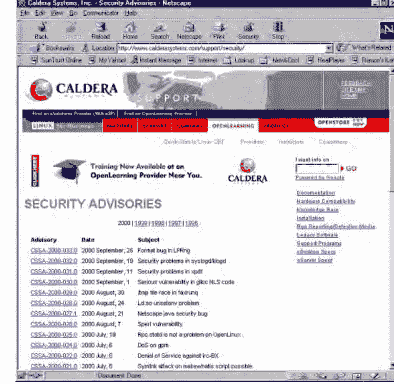

#### SuSE

`SuSE` 在欧洲市场极受欢迎，它提供一套功能齐全的受支持软件包（共六张 `CD`！），并且也使用 `RPM` 包管理系统。其发布计划与 `Red Hat` 相似，`.0` 小版本号标志着主要发布的初始提供。然而，他们通常在进入另一个主要版本之前提供多达四个次要发布（例如，`6.4`）。另一方面，`Red Hat` 通常每个版本只有两个次要发布。

`SuSE` 的一个显著特征是包含 `seccheck` 脚本，该脚本可以从 `cron` 定期调用，以测试系统在多个方面的整体安全性。供应商还包含一个你可以用来“加固”服务器安装的实用工具（`harden_suse`）。这表明该供应商关心安全性，并愿意投入开发和资源来证明这一点。

你可以在 `http://www.suse.de/security` 找到该供应商的安全信息中心（见图 2.2），其中包括一份全面的公告列表及其两个与安全性相关的邮件列表的指针。

##### 图 2.2

`SuSE` 在万维网上的安全页面

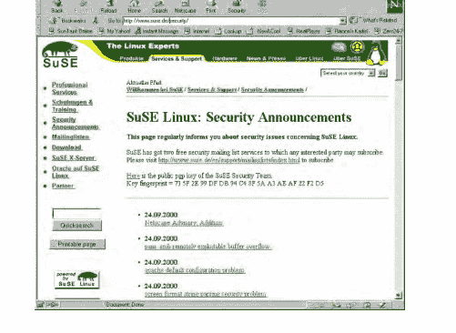

#### Turbolinux

该供应商自 1992 年以来一直活跃在 `Linux` 市场，并在亚洲和欧洲市场取得了巨大成功。尽管它在美国不像 `Red Hat` 和 `Caldera` 那样被广泛接受，但在近几个月里，它获得了大量势头，尤其是在高端服务器应用市场。

`Turbolinux` 的发布计划比 `Red Hat` 和 `Caldera` 的显著更长，但它们在 `http://www.turbolinux.com/security` 维护每个发布的软件包安全更新列表（见图 2.3）。他们在 `FTP` 站点的每个发布更新部分中也包含一个单独的安全子目录。

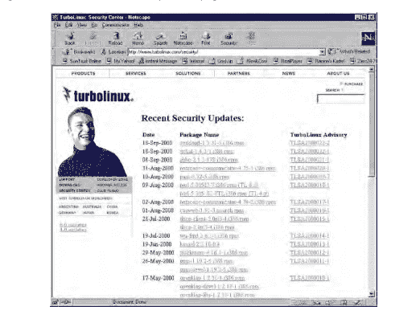

#### Debian

这个 `Linux` 发行版由全球约 500 名志愿者开发者维护。由于其非营利性质，`Debian` 的 `Linux` 发行版的发布计划与大多数商业供应商不同，专注于小型中间次要发布而非重大更新。这些小型发布通常由若干安全修复驱动，且通常间隔约 100 天。

与大多数商业供应商不同，`Debian` 在 `http://security.debian.org` 拥有一个用于此目的的安全信息中心（见图 2.4）。这是可用的最直接的供应商安全站点之一。内容组织良好，且安全公告比其他供应商的更容易找到。此外，该页面包括指向 `Debian` 特定安全邮件列表存档的链接，至少可追溯到两年前。

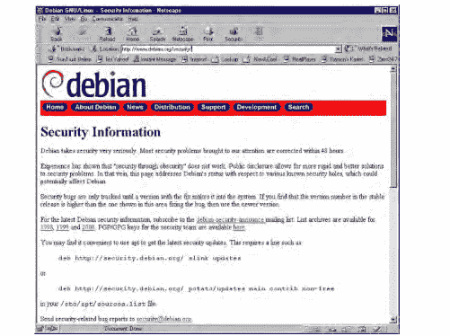

#### 优胜者是谁...

所有的 `Linux` 发行版都可以变得安全，且所有的厂商都在努力让用户了解漏洞和补丁的可用性。虽然每个厂商似乎都在安全的某个方面表现出色，但这里并没有明确的赢家或输家。

您对 `Linux` 发行版的选择应取决于您的管理风格。如果您愿意每隔几天花一些时间去关注最新的漏洞，并愿意根据需要安装增量补丁，那么 `Debian` 是一个不错的选择。相反，如果您更倾向于将安全更新与厂商版本一起捆绑，我建议您选择一个更新更活跃的发行版，例如 `Red Hat`、`Caldera`、`SuSE` 或 `Turbolinux`。

在任何情况下，您都应该计划利用您所选择的厂商的安全资源，包括每天浏览其网页以及订阅其安全邮件列表。此外，您还应监控 `BugTraq` 邮件列表（`<http://www.securityfocus.com/forums/bugtraq/>`）中关于所有 `Linux` 厂商共有的漏洞信息。

## 构建安全的内核

虽然大多数 `Linux` 用户满足于运行最新发行版提供的标准内核，但您需要熟悉下载内核源代码、修改其配置以及构建自定义内核的过程。构建自定义内核的优势有两点：您可以指定想要的安全选项，并且可以构建一个精简的内核，只编译您需要的驱动程序支持。自行编译内核的另一个好处是，您知道内核的来源，并且可以看到可能需要在未来或立即解决的安全漏洞（如果漏洞足够大的话）。此外，许多安全漏洞的解决方案都是以 `Linux` 内核补丁的形式出现的，这要求您重新编译内核。

构建自定义内核的第一步是获取内核源代码。如果您使用的是 `Red Hat`，您需要 `kernel-headers` 和 `kernel-source` 这两个 `RPM` 软件包。要安装这两个软件包中的任意一个，请使用以下命令之一：

```bash
[root]# rpm -q kernel-headers
kernel-headers-2.2.12-20
[root]# rpm -q kernel-source
kernel-source-2.2.12-20
```

这两个软件包会填充 `/usr/src/linux` 目录，该目录应包含从头编译 `Linux` 内核所需的所有源代码和配置文件。

> **提示** 在安装新内核之前，创建一个紧急启动磁盘，以防新内核在启动时出现问题。在 `Red Hat` 上，使用命令：`mkbootdisk --device /dev/fd0 2.2.12-20`（假设您的系统模块目录是 `/lib/modules/2.2.12-20`）。

以 `root` 用户登录后，进入 `Linux` 源代码目录，并使用以下命令清理之前内核构建留下的残留配置：

```bash
[root]# cd /usr/src/linux
[root]# make mrproper
```

此时，您已准备好使用此命令指定要构建到内核中的选项：

```bash
[root]# make config
```

此命令会提示您一系列选项，您可以选择将其添加到内核中（`Y`）、省略（`N`）或作为动态加载模块添加（`M`）。表 2.1 显示了具有安全影响的 `2.2.X` 内核选项，并应在 `make config` 步骤中设置为适当的值。

### 表 2.1 内核配置：推荐的安全选项

| 配置选项 | 描述 | 建议 |
| :--- | :--- | :--- |
| `CONFIG_PACKET` | 应用程序与网络设备通信时使用的协议，无需中间内核协议 | `Y` |


| CONFIG_NETLINK | 内核与用户进程之间的双向通信 | Y |

| CONFIG_FIREWALL | 防火墙支持 | Y |

| CONFIG_INET | 互联网（TCP/IP）协议 | Y |

| CONFIG_IP_FIREWALL | IP 包过滤支持 | Y |

| CONFIG_SYN_COOKIES | 针对 synflooding 拒绝服务攻击的保护 | Y |

| CONFIG_NET_IP | IP 内 IP 封装 | N |

| CONFIG_IP_ROUTER | IP 路由 | N |

| CONFIG_IP_FORWARD | IP 包转发（路由） | N |

| CONFIG_IP_MULTICAST | IP 组播（向多个目的地传输一个数据流） | N |

> **注意** 这些是典型 Linux 单宿主服务器的推荐设置。稍后在本书中，您将了解 Linux 防火墙的概念，它们通常是多宿主的，并且往往需要不同的内核配置。我们将在本书的第 4 部分“边界安全”中讨论这些特殊系统，包括它们的内核配置。

`CONFIG_SYN_COOKIES` 选项可以防止内核在入站连接缓冲区被半开 TCP 连接填满时进入死锁状态。请注意，在 2.2.X 内核中，设置 `CONFIG_SYN_COOKIES` 只是启用该选项，但并没有实际激活它。您必须输入以下内容以激活 `SYN_COOKIES` 支持：

```bash
echo 1 > /proc/sys/net/ipv4/tcp_syncookies
```

`CONFIG_IP_ROUTER` 和 `CONFIG_IP_FORWARD` 选项允许多宿主 Linux 服务器在一个接口和另一个接口之间转发数据包。应该禁用此选项，因为入侵者可能会利用您的 Linux 服务器作为路由器，绕过进入网络的正常路径（即您正在监管的路径）。

在实际编译内核源代码之前的最后一步是使用以下命令构建依赖项列表：

```bash
make dep
```

现在您已准备好编译您的新内核。执行以下命令以编译和链接压缩的内核镜像：

```bash
make zImage
```

如果在上述 `make config` 步骤中选择了可加载模块支持，您还需要执行以下命令：

```bash
make modules
make modules_install
```

要启动新内核，您必须首先将其从源代码目录移动到最终位置。首先使用以下命令备份旧镜像：

```bash
cp /zImage /zImage.BACKUP
mv /usr/src/linux/arch/i386/boot/zImage /zImage
/sbin/lilo
```

每次更新硬盘上的内核镜像时，都要重新运行 `lilo`。此外，即使您有紧急启动软盘，为您的备份内核（`/zImage.BACKUP`）创建一个单独的 `lilo.conf` 条目也是一个好主意，因为为灾难做计划是安全的重要组成部分。当您在更新您的 Linux 版本时，如果新版本无法正常工作，能够回退到旧版本总是很好的。如果您需要有关 `lilo` 和 `lilo.conf` 的更多信息，请参阅 Craig Hunt（Sybase, 1999）所著的`Linux Network Servers 24seven`。

现在您应该重新启动系统，以确保可以启动新内核。不要忘记将紧急启动磁盘放在手边，以防出现问题。

> **警告** 要有最坏情况的准备，因为如果您没有做好准备，最坏的事情就会发生在你身上。

## 用户账户安全

CSI/FBI 计算机犯罪与安全调查（<http://www.goc51.com/prelea_000321.htm>）年复一年地显示，绝大多数的成功系统攻击来自内部人员——即那些不满的（或只是无聊的）非特权用户，他们通过颠覆性的手段获得了 `root` 权限。即使攻击来自外部，获取配置错误或闲置的用户账户也是破解 `root` 访问权限的最简单方法之一。保护自身免受错误的影响也很重要，因为 `root` 访问权限即使是在合适的人手中，也是一个强大且危险的工具。

您应特别关注安全策略中规范用户账户创建和维护的部分。以下是我建议的管理 Linux 服务器账户的注意事项：

- **禁用不活动账户。** 攻击者寻找那些有一段时间未被访问的账户，以便为了其不轨目的而接管它们。这给了攻击者“蹲守”账户的奢侈，使他们可以在不被发现或报告的情况下隐藏其利用行为。大多数 Linux 发行版允许您指定在什么条件下应禁用账户。我建议您在密码过期时立即禁用所有账户（关于密码过期的详细信息稍后讨论），同时允许用户在过期前一周更改密码。Red Hat 的 `lnuxconf` 提供了一个图形界面来指定此策略（见图 2.5）。我通常将密码设置为每 4 个月（120 天）过期，并允许用户有 7 天的时间来更改密码。“账户在 # 天后过期”下的 0 值指示系统在密码过期时禁用账户。默认值 -1 指示系统从不使账户过期，因此请确保更改此默认值。

**图 2.5** 使用 `linuxconf` 设置用户账户过期参数

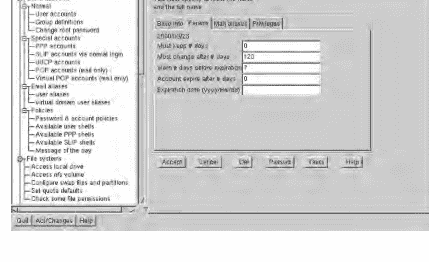

**禁用通过 NFS 挂载的 root 访问权限。** 请特别关注 `/etc/exports` 文件，在这里您声明希望通过网络文件系统（NFS）共享的本地文件系统。在大多数 Linux 发行版中，NFS 服务器默认将用户 ID 0（`root`）映射到一个非特权用户，例如 `nobody`。然而，这种行为可以通过 NFS 服务器的 `/etc/exports` 文件中的 `no_root_squash` 选项进行覆盖。务必避免使用此选项。它会使得您的整个 NFS 服务器完全暴露在客户端上的某个 `root` 用户之下。

如果您已经配置了 Linux 客户端以自动挂载远程 NFS 共享，请参阅 Reaz Zadok 所著的《Linux NFS 和 Automounter 管理》（Sybase，2001年）。

**将 root 用户的使用限制在绝对必要的情况下。** 您应该克制住登录 `root` 账户以执行管理命令的冲动，并保持登录状态以执行其他用户级命令。您以 `root` 身份登录的时间越长，暴露在诸如木马和会话劫持等漏洞下的时间就越长。

**使用具有描述性的 root 提示符。** 有时您自己就是自己最大的敌人。当您的 X 显示上有多个活动终端时，能够一眼分辨出哪些是 `root` 终端至关重要。这有助于您避免错误地在 `root` 窗口中执行用户级命令。确保 `root` 提示符足够独特，并且包含一个 `root` 专用字符，例如井号（`#`）。

**为 root 账户使用最小化的 PATH。** 针对 `root` 账户的一种常见攻击方式是，将常用实用工具的木马版本放置在包含在 `root` `$PATH` 中的目录里。这是一种非常隐蔽的攻击，保护它的唯一方法是确保您了解 `$PATH` 变量的内容以及包含在变量中的目录的内容。为了最大程度地减少运行木马的可能性，请避免在 `$PATH` 中包含任何除 `root` 以外用户可写的目录。

**使用专用系统账户。** 一个只需要关闭系统的操作人员不需要完整的 `root` 权限。这正是默认 Linux 账户（如 `operator` 和 `shutdown`）的目的所在。此外，我建议您安装并使用 `sudo`，关于它的详细说明将在本章稍后的“sudo 实用工具”部分中介绍。

**使用组成员资格。** 作为一名 Linux 管理员，您经常被要求使文件或目录可供协作完成单一任务的多个用户读取和写入。虽然简单地使这些资源对所有人可写很容易，但不要这样做。花点时间添加一个新组，使每个用户成为该组的成员，并使资源仅对该组成员可访问。将权限开放的文件视为等待被利用的漏洞。

**将 root 登录限制在系统控制台。** 为了监控谁正在以 `root` 身份登录，请配置 `/etc/security` 文件，仅允许从控制台直接进行 `root` 访问。此操作强制授权的 `root` 用户使用 `su` 或 `sudo` 来获取 `root` 权限，从而您可以轻松记录这些事件。标准的 Linux 默认设置是仅允许从八个虚拟系统控制台（键盘上的功能键）进行 `root` 登录：

```
[root]# more /etc/security
tty1 tty2 tty3 tty4 tty5 tty6 tty7 tty8
```

除了记录优势外，如果 `root` 密码被泄露，这也设置了一道额外的障碍。入侵者必须首先获得普通用户账户（或物理控制台）的访问权限，才能利用他们的发现。

采用良好的用户账户实践对于确保系统安全至关重要，但通过选择糟糕的密码，用户可以破坏您为保护其账户所做的所有工作。下一节提供了一些关于选择强密码并强制使用它们的实用建议。

### 良好的密码

虽然更强的身份验证模式变得越来越普遍，但用户名和密码仍然是 Linux 服务器最常用的身份验证方法。关于密码安全的重要性已有大量讨论和著述，因此我将简要地讨论此话题。有一些非常简单的规则可以遵循，它们可以使您的密码政策大大加强：

- **不要将系统设置得太快导致密码过期。** 如果密码过期周期太短，用户更有可能觉得他们会忘记密码，因此他们会把它写下来。此外，用户会使用循环、可预测的密码模式。在密码过期方面，少于三个月的任何时间间隔都应被视为太短。


- **不要让密码变得陈旧。** 相反，如果您允许用户一年使用同一个密码，它们暴露在安全风险中的时间就比安全允许的要长。四个月是一个很好的折衷，但六个月并不算不合理的过期周期。

- **避免短密码。** 强制用户选择至少六个字符长的密码。短于此长度的密码太容易被暴力破解攻击猜测，即使是随机字符也是如此。图 2.6 说明了如何使用如 Red Hat 的 `linuxconf` 等系统管理工具来强制实施密码长度最小值。请注意，除了强制实施六个字符的限制外，此页面还强制用户至少使用两个非字母数字字符。

- **破解您自己的密码。** 作为定期系统安全审计的一部分，使用密码猜测工具查找 `/etc/passwd` 文件中的弱密码。直接联系有问题的用户，建议他们使用更长的密码，包含更多的非字母数字字符，以及混合大小写字符。第三章“系统监控和审计”会更详细地讨论这个话题，当正式介绍 `crack` 实用工具时。

- **删除未使用的账户。** 大多数 Linux 服务器不提供 `UUCP`、`PPP`、`NNTP`、`Gopher` 或 `Postgres` 服务，但大多数 Linux 发行版都附带这些账户。完全删除这些账户，以及您的环境中没有意义的任何其他账户。

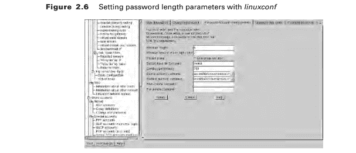

**避免空密码字段。** 即使 `shell` 高度受限，也永远不要设置没有密码的用户。获得系统中任何用户的访问权限就使入侵者完成了一半的目标。

最小化与用户密码相关风险的有效方法是配置对影子密码和组文件的支持。这是下一节的主题。

### 影子密码

最容易被忽视的系统漏洞之一是任何用户可以*破解*另一个用户密码的能力。使用互联网上唾手可得工具，这可以迅速轻松地做到。为了防止这一点，启用*影子密码*。影子密码将密码文件分为两个：包含实际密码字段条目占位符的 `/etc/passwd` 文件，以及包含加密密码的 `/etc/shadow` 文件。`/etc/shadow` 文件不需要除了 `root` 以外的任何人可读，这使得普通用户更难尝试破解另一个用户的密码（包括 `root`）。

大多数 Linux 发行版还支持*影子组*的概念，其中每个组的实际成员没有列在主要的 `/etc/group` 文件中，而是列在 `/etc/gshadow` 文件中，该文件与 `/etc/shadow` 文件一样，仅 `root` 可读。

> **提示** 某些 Linux 发行版默认未启用影子密码；如果您的发行版是其中之一，请立即启用此功能。

清单 2.1 展示了您应该如何查找 `/etc/shadow` 文件是否存在。如果它不存在，只需使用 `pwconv` 命令创建它。注意转换后 `/etc/passwd` 文件的变化：

#### 清单 2.1 创建影子密码文件

```
[root]# ls -1 /etc/shadow
ls: /etc/shadow: No such file or directory
[root]# more /etc/passwd
root:PV/6t9I GetTjU:0:0:root:/root:/bin/bash
bin::1:1:bin:/bin:
daemon:x:2:2:daemon:/sbin:
adm::3:4:adm:/var/adm:
lp::4:7:lp:/var/spool/lpd:
sync::5:0:sync:/sbin:/bin/sync
shutdown::6:0:shutdown:/sbin:/sbin/shutdown
halt::7:0:halt:/sbin:/sbin/halt
mail:x:8:12:mail:/var/spool/mail:
operator::11:0:operator:/root:
ftp::14:50:FTP User:/home/ftp:
nobody:x:99:99:Nobody:/:
ramon:aa1g0.pAVxZuA:501:100:Ramon J.ontanon:/home/ramon:/bin/bash
[root]# pwconv
[root]# ls -1 /etc/shadow
- - - - - - - - - - - 1 root root 563 Sep 23 15:27 /etc/shadow
[root]# more /etc/passwd
root:x:0:0:root:/root/bin/bash
bin::1:1:bin:/bin:
daemon:x:2:2:daemon:/sbin:
adm::3:4:adm:/var/adm:
lp::4:7:lp:/var/spool/lpd:
sync::5:0:sync:/sbin:/bin/sync
shutdown::6:0:shutdown:/sbin:/sbin/shutdown
halt::7:0:halt:/sbin:/sbin/halt
mail:x:8:12:mail:/var/spool/mail:
operator::11:0:operator:/root:
ftp:x:14:50:FTP User:/home/ftp:
nobody:x:99:99:Nobody:/:
ramon::501:100:Ramon J.ontanone:/home/ramon:/bin/bash
[root]# more /etc/shadow
root:PV/6t9I GetTjU:11223:0:99999:7:::
bin::11223:0:99999:7:::
```

```
daemon:*:11223:0:99999:7:::
adm:*:11223:0:99999:7:::
lp:*:11223:0:99999:7:::
sync:*:11223:0:99999:7:::
shutdown:*:11223:0:99999:7:::
halt:*:11223:0:99999:7:::
mail:*:11223:0:99999:7:::
operator:*:11223:0:99999:7:::
ftp:*:11223:0:99999:7:::
nobody:*:11223:0:99999:7:::
ramon:$aag10.pAvX2uA:11223:0:99999:7:
```

本章的下一节将讨论 `sudo` 实用程序，这是一个非常有用的工具，可以最小化根密码在 Linux 服务器上的暴露风险。

### Sudo 实用程序

在管理 Linux 系统的常规过程中，我通常几周才会实际登录一次 `root` 用户。事实上，有时我甚至差点忘记了 `root` 密码。`sudo` 实用程序为我提供了这种便利，我建议你在管理的每个系统上都安装这个工具。通过允许系统管理员为普通用户预先定义 `root` 访问权限，`sudo` 可用于以 `root` 权限执行命令，而无需实际登录为 `root` 用户并在网络上暴露 `root` 密码。一般而言，`root` 密码实际输入的频率越低，其安全性就越高。

#### 安装 sudo

你可以以 `RPM` 格式和源代码格式下载 `sudo`。我建议你使用 `RPM` 包系统来安装它，因为默认编译参数通常合理，而且几乎没有必要进行自定义。

让我们通过确保 `sudo` 尚未存在来开始安装过程：

```
[root]# rpm -q sudo
sudo-1.5.9p4-1
```

在这种情况下，你之前已经安装了 `sudo`，但它已经过时，因此请使用以下命令将其删除并安装更新的版本：

```
[root]# rpm -e sudo
[root]# rpm -i ./sudo-1.6.3p5-1rh62.1386.rpm
[root]# rpm -q sudo
sudo-1.6.3p5-1
```

现在你已经安装了 `sudo` 实用程序。开始使用该工具之前，请务必查看 `/usr/doc` 目录下随源代码包提供的文档。

#### Sudoers 文件

与其他 Linux 实用程序一样，`sudo` 也带有一个配置文件，你可以在其中自定义其操作。此文件默认为 `/etc/sudoers`，其中包含（除其他内容外）允许运行 `sudo` 命令的用户列表，以及每个 `sudo` 用户允许执行的命令集。

向此文件中添加用户的一般格式如下：

```
userhost(s)=command(s)[run_as_user(s)]
```

例如，如果你希望授予用户 `alice` 运行 `shutdown` 命令的权限，请指定以下内容：

```
alice ALL = /etc/shutdown
```

请注意，`ALL` 指令可以用作 `sudoers` 文件中任何字段的通配符。让我们考虑另一个例子，其中用户 `bob` 被赋予以任意用户身份访问所有 `root` 命令的权限：

```
bob ALL = ALL
```

最后，让我们考虑希望允许用户 `charlie` 运行 `su` 以成为 `operator` 用户的情况：

```
charlie ALL = /bin/su operator
```

> **警告** 如果你使用 `sudo` 授予用户对有限命令集的 `root` 访问权限，请确保这些命令中的任何一个都不允许“逃逸”到 Linux shell，因为这会授予用户对所有系统命令的无限制 `root` 访问权限。请注意，一些 Linux 编辑器（例如 `vi`）包含这种 shell 逃逸功能。


### 使用 `sudo`

`sudo` 命令的基本用法如下：

```
sudo [command line options] [username] [command]
```

表 2.2 总结了最重要的 `sudo` 命令行选项。

**表 2.2** `sudo` 命令行选项

| 选项 | 参数 | 用途 |
| :--- | :--- | :--- |
| `-v` | N/A | 打印当前版本。 |
| `-l` | N/A | 列出允许和禁止的命令。 |
| `-h` | N/A | 打印使用消息。 |
| `-b` | N/A | 在后台运行命令。 |
| `-u` | `username` | 以指定的用户名身份运行命令（默认是 `root`）。 |

例如，要显示 `shadow` 密码目录的内容，只需使用：

```
sudo cat /etc/shadow
```

要在用户目录中编辑文件并保留其权限：

```
sudo -u fred vi /export/home/fred/.forward
```

我建议你严格使用 `sudo` 命令来记录那些完全受信任执行 Linux 服务器上任何 `root` 命令的用户（包括你自己）的 `root` 活动，而不是使用它来允许某些用户执行少量系统实用程序。用户恶意扩展特定命令的特权相对容易，通过执行逃逸到 `root` shell 的命令即可实现。

下一节将描述 `sudo` 的日志记录功能，以及 `sudo` 日志文件的格式。

### `Sudo.log` 文件

默认情况下，`sudo` 将其所有活动记录到文件 `/var/log/sudo.log`。此文件中条目的格式如下：

```
date:user:HOST=hostname:TTY=terminal:PWD=dir:USER=user:COMMAND=cmd
```

这些字段各自的含义如下：

- `date`：日志条目的时间戳
- `user`：执行 `sudo` 的用户名
- `hostname`：执行 `sudo` 命令的主机地址
- `terminal`：调用 `sudo` 的控制终端
- `dir`：调用命令的当前目录
- `user`：命令运行所基于的用户名
- `command`：通过 `sudo` 执行的命令

例如，列表 2.2 展示了一个典型的 `sudo_log` 文件，显示了六个条目，均由用户名 `ramon` 执行，调用的命令以 `root` 身份运行。

#### 列表 2.2 `Sudo_log` 文件内容

```
Sep 23 14:41:37 : ramon : HOST=redhat ; TTY=pts/0 ; PWD=/home/ramon
 ; USER=root ; COMMAND=/bin/more /etc/shadow
Sep 23 14:43:42 : ramon : HOST=redhat ; TTY=pts/0 ; PWD=/home/ramon
 ; USER=root ; COMMAND=/usr/sbin/pwconv
Sep 23 14:43:51 : ramon : HOST=redhat ; TTY=pts/0 ; PWD=/home/ramon
 ; USER=root ; COMMAND=/bin/more /etc/shadow
Sep 23 14:55:30 : ramon : HOST=redhat ; TTY=pts/0 ; PWD=/home/ramon
 ; USER=root ; COMMAND=/bin/cat /etc/security
Sep 23 15:12:27 : ramon : HOST=redhat ; TTY=pts/1 ; PWD=/home/ramon
 ; USER=root ; COMMAND=/bin/linxconf
Sep 23 15:23:37 : ramon : HOST=redhat ; TTY=pts/0 ; PWD=/home/ramon
 ; USER=root ; COMMAND=/usr/sbin/pwconv
```

## 文件和目录权限

文件权限可能是 Linux 管理中最困难的方面之一，它是系统安全的关键组成部分，因此本书专门用一个部分来讨论它。Linux（与所有 Unix 变体一样）将大多数资源视为文件，无论是目录、磁盘设备、管道还是终端。虽然这使得软件架构变得简单，但它也给负责确保这些资源安全的 Linux 管理员带来了根本性的挑战。

文件和目录上的权限直接影响系统的安全性。权限设置过紧，你会限制用户完成工作的能力；权限设置过松，则会招致对其他用户文件和一般系统资源的未授权使用。

本书的下一个小节将研究 Linux 操作系统中 `suid` 和 `sgid` 权限的具体细节。

### Suid 和 Sgid

Linux 支持三种不同用户组的设备和文件权限，每种在权限掩码中由三个信息位表示，另外还有两个专用高位，总共 12 位：

```
AAA BBB CCC DDD
```

这些位各自的含义如下：

- `AAA`：`setuid`、`setgid`、`sticky-bit`
- `BBB`：用户（读、写、执行）
- `CCC`：组（读、写、执行）
- `DDD`：其他（读、写、执行）

因此，如果我们有一个名为 `report` 的新可执行文件，希望只有文件所有者能读、写和执行，但其他所有人都能读和执行，我们会将其权限设置为适当的位掩码值如下：

```bash
[ramon]$ chmod 0755 report
[ramon]$ ls -1 report
-rwxr-xr-x 1 ramon users 19032 Sep 25 19:48 report
```

请注意，`7` 是二进制数 `111` 的八进制表示。显示的权限每部分仅包含三个位（用户、组、其他），而实际上，Linux 允许你为每个组指定四个位。这通过重载第三位表示的以下值来解决：

- `x`：执行
- `s`：执行 + `setuid` 或 `setgid`（仅适用于用户和组部分）
- `S`：`setuid` 或 `setgid`（仅适用于用户和组部分）
- `t`：执行 + `sticky`（仅适用于其他部分）
- `T`：`sticky`（仅适用于其他部分）

现在考虑你希望以 `root` 权限执行此文件的情况，因为它需要读写文件系统的受保护区域，但你希望非特权用户也能执行它。你可以通过设置权限掩码的第一个位来实现这一点：

```bash
[ramon]$ sudo chown root:root report
[ramon]$ sudo chmod 4755 report
[ramon]$ ls -1 report
-rwsr-xr-x 1 root root 19032 Sep 25 20:30 report
```

如前所述，权限掩码中用户部分的 `s` 表示为文件所有者设置了 `setuid` 和 `execute` 位。这意味着该文件将以文件所有者（`root`）的用户权限执行，而不是以执行该文件的用户（`ramon`）的权限执行。此外，你可以设置 `setgid` 位，使文件以 `root` 组的权限执行，如下所示：

```
[ramon]$ sudo chmod 6755 report
[ramon]$ ls -1 report
-rwsr-sr-x  1 root      root        19032 Sep 25 20:30 report
```

权限掩码中的第三个位通常被称为 `sticky bit`，它用于指示 Linux 内核，即使目录对所有用户可写，也不允许某个用户删除其他用户的文件。这通常用于具有完全开放权限的 `/tmp` 目录：

```
[ramon]$ ls -1d /tmp
drwxrwxrwt  7 root      root        1024 Sep 25 21:05 /tmp
```

请注意掩码末尾的 `t`。这可以防止你删除其他用户在该目录中的文件，除非他们明确允许你这样做（通过为其他用户设置写入权限）。

通常，`setuid` 和 `setgid` 的使用应限制在仅允许 `root` 写入的分区中。我建议你通过指定 `nosuid` 选项来明确禁止在 `/home` 目录上使用 `setuid`/`setgid`，如列表 2.3 中 `/etc/fstab` 文件所示。

#### 列表 2.3 `/etc/fstab` 文件的内容


```bash
[ramon]$ cat /etc/fstab
/dev/sda8            /                    ext2        defaults            1  1
/dev/sda1            /boot                ext2        defaults            1  2
/dev/sda6            /home                ext2        exec,nodev,nosuid,rw 1  2
/dev/sda5            /usr                 ext2        defaults            1  2
/dev/sda7            /var                 ext2        defaults            1  2
/dev/sda9            swap                 swap        defaults            0  0
/dev/fd0             /mnt/floppy          ext2        noauto              0  0
/dev/cdrom           /mnt/cdrom           iso9660     noauto,ro           0  0
none                 /proc                proc        defaults            0  0
none                 /dev/pts            devpts      mode=0622           0  0
```

图 2.7 展示了如何使用 Red Hat 的 `linuxconf` 工具指定此选项。

#### 图 2.7 使用 `linuxconf` 在本地文件系统上设置 `nosuid` 选项

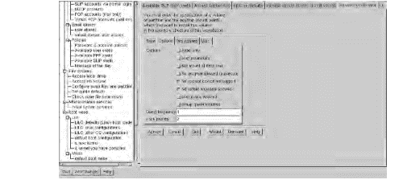

另外，请注意“无特殊设备文件支持”选项（`/etc/fstab` 中的 `nodev` 选项）已被选中。这实际上防止了用户在 `/home` 文件系统中创建块设备，这对非特权用户而言会被视为极具嫌疑的行为。

在采取这些预防措施后，你仍需要警惕 Linux 服务器上的 `setuid`/`setgid` 设置。我建议你在 `cron` 中运行以下命令，将其输出发送到你的邮箱作为报告，每天早晨执行一次，如下所示：

```bash
find / -type f \( -perm -04000 -o -perm -02000 \) -exec ls -l { } \;
```

此命令应当报告所有设置了 `setuid` 或 `setgid` 位的脚本。将当前报告与前一天的报告进行比较，并确保所有新创建的文件都是由管理员创建的。至少，你应该将此命令的输出写入 `/var/log` 目录下的一个单独文件中。

> **注意** Linux 内核只允许你在二进制可执行文件上使用 `setuid`/`setgid` 权限，而不是在 shell 脚本上。这种限制可以防止恶意篡改 shell 脚本，这种情况经常发生，可能导致 `root` 权限被严重攻陷。

### `umask` 设置

在新建文件时服务器上的默认权限可能会对其整体安全产生深远影响。那些默认创建对所有用户可写的文件的用户，实际上是在系统安全上钻小洞。Linux 使用 `umask` 配置设置来控制默认文件权限。其用法是：

```bash
umask AAA
```

其中 `AAA` 是默认权限掩码 `666`（目录为 `777`）的八进制补数。例如，`umask` 为 `022` 将产生文件默认权限 `644`（这是从 `666` 中减去 `022` 的结果）。让我们看看列表 2.4 中的一个示例。

#### 列表 2.4 `umask` 配置示例

```bash
console
[ramon]$ umask 000
[ramon]$ touch example1
[ramon]$ ls -l example1
-rw-rw-rw- 1 ramon users 0 Sep 25 22:08 example1
[ramon]$ umask 022
[ramon]$ touch example2
[ramon]$ ls -l example2
-rw-r--r-- 1 ramon users 0 Sep 25 22:08 example2
[ramon]$ umask 66
[ramon]$ touch example3
[ramon]$ ls -l example3
-rw------- 1 ramon users 0 Sep 25 22:08 example3
```

我建议你编辑 `/etc/profile` 文件，为 `root` 用户分配掩码 `066`，并为普通用户分配掩码 `022`。这确保 `root` 创建的文件没有组和其他的权限，而其他文件仅创建对所有用户可读的权限。

### 限制核心转储大小

本地用户获取 `root` 权限的一种常见方法是强制一个 `setuid`/`setgid` 程序在文件系统的具体位置转储核心文件（在崩溃时）。通过使用此方法覆盖服务器上任意位置的文件，包括 `/etc/passwd`、`/etc/hosts.equiv` 或 `.rhosts`，入侵者可以有效地为自己创建一个具有 `root` 权限的用户。在当今拥有数 GB 物理内存的服务器上，这些核心文件可能会填满整个磁盘，从而导致依赖相同文件系统的其他用户遭受拒绝服务（DoS）攻击。

有一种有效的方法可以控制核心文件。使用 `ulimit` 命令，你可以控制任何用户的资源使用限制，包括核心转储文件的最大尺寸。你只需将大小设置为 `0`，使用以下命令：

```bash
ulimit -c 0
```

你也可以将此命令包含在全局的 `/etc/profile` 配置文件中。

### `syslog` 安全

高级入侵者的一项最重要技能是他们清除所有攻击证据的能力。这在电子世界中相当于罪犯在犯罪现场使用手套，这也是那些依靠追踪这些入侵者行为为生的人持续的烦恼来源。

你应该不惜一切代价确保保护系统被篡改的一些证据。问题在于，当攻击者可能利用他们的 `root` 权限修改你的日志文件时，很难保证日志文件的正确性。你应该利用 `syslog` 程序将所有日志事件副本发送到远程服务器的功能。

例如，为了将所有内核、邮件和新闻消息发送到远程 `syslog` 服务器（主机名“zurich”），在 `/etc/syslog.conf` 配置文件中添加以下行：

```bash
kern.*, mail.*, news.*[TAB]@zurich
```

（请记住，此文件的语法要求字段之间插入制表符字符。）

进行此修改后，你必须向 `syslog` 守护进程发送 `-HUP`（挂断）信号，以强制其读取配置：

```bash
[ramon]$ sudo killall -HUP syslogd
```

然而，请记住，一些服务可能未配置或无法通过 `syslog` 记录事件。你应该使用 `cron` 在一天内的多次将那些服务的日志文件移动到远程服务器——越频繁越好。

### 文件系统加密

无论你的物理和系统安全措施多么强大，你都需要为某个用户获得访问其他用户文件的时刻做好准备。加密是你最后的防线。通过加密敏感目录的内容，用户即使在入侵成功后也能保护其数据的隐私。

本节描述了两种不同的实现方式，这两种方式都基于使用标准加密算法的密钥技术。让我们更详细地查看每一种。

#### 加密文件系统

加密文件系统（CFS）由 Unix 先驱 Matt Blaze 开发，是将对称密钥加密全面集成到 Linux 文件系统中的首个完整解决方案。CFS 最重要的优势之一是，它既支持本地文件系统类型（例如 `ext2`），也支持 `NFS` 等远程文件系统。这种支持不仅保护了存储在服务器上的数据，还保护了通过共享 `NFS` 挂载点通过网络传输的数据。CFS 支持多种加密算法，包括 `DES`、`3DES`、`MacGuffin`、`SAFER-SK128` 和 `Blowfish`。

然而，CFS 的主要缺点是性能。如果你选择使用 `3DES` 加密（我建议这样做，因为现代环境下仅使用 `DES` 已勉强够用），你将付出代价，会发现磁盘访问有明显延迟，尤其是在处理大文件时。这部分原因是 CFS 在用户空间（内核之外）运行。然而，在用户空间运行其实也可以是一个优势，因为其他加密文件系统模块通常作为特定版本 Linux 内核的补丁提供，且往往不适用于最新稳定版内核。

让我们先从在服务器上安装软件开始。

##### 安装 CFS

虽然可以获取软件包的源代码形式，但也可以从 `www.zedz.net`（或 `ftp.zedz.net`）获取 `RPM` 格式的版本，如列表 2.5 所示。

**列表 2.5** 以下载 `RPM` 格式的 CFS 发行版


## 下载与安装 CFS

```text
[ramon]$ ftp ftp.zedz.net
Connected to ftp.zedz.net.
220 warez.zedz.net FTP server ready.
Name (ftp.zedz.net:ramon): anonymous
331 Guest login ok, send your complete e-mail address as password.
Password: rhontanon@sybex.com
230 Guest login ok, access restrictions apply.
Remote system type is UNIX.
Using binary mode to transfer files.
ftp> cd /pub/crypto/disk/cfs/
250 CWD command successful.
ftp> get cfs-1.3.3bf-1.i386.rpm
local: cfs-1.3.3bf-1.i386.rpm remote: cfs-1.3.3bf-1.i386.rpm
200 PORT command successful.
150 Opening BINARY mode data connection for cfs-1.3.3bf-1.i386.rpm (194436 bytes).
226 Transfer complete.
194436 bytes received in 22.7 secs (8.4 Kbytes/sec)
ftp> quit
221-You have transferred 194436 bytes in 1 files.
221-Total traffic for this session was 197280 bytes in 2 transfers.
221-Thank you for using the FTP service on warez.zedz.net.
221 Goodbye.
```

```text
[ramon]$ sudo rpm -i cfs-1.3.3bf-1.i386.rpm
```

此时你已在系统上安装了 CFS（注意，无需重新编译内核或重启服务器）。让我们在下一步中查看如何配置 CFS。

### 配置 CFS

第一步是确保你的服务器已配置为运行 NFS 服务（`statd`、`portmapper` 和 `mountd`）。这是 CFS 正常工作的必要条件。由于 CFS 实际上保护了 NFS 共享的隐私，也许这正是你寻找的将 NFS 重新纳入安全策略的工具。你可以使用以下命令查找 `mountd` 行来验证系统上是否正在运行 NFS：

```text
[ramon]$ ps aux | grep mountd
        5756  0.0  0.7  1132  456 ?  S   19:15  0:00 rpc.mountd
```

接下来，创建一个 `/nu11` 目录。CFS 将此目录称为引导挂载点。此外，你还需要创建你想要用作所有加密数据根目录的目录（我选择 `/crypt` 用于此目的）：

```text
[ramon]$ sudo mkdir /nu11
[ramon]$ sudo chmod 0000 /nu11
[ramon]$ sudo mkdir /crypt
```

使用以下命令将 `/nu11` 目录添加到导出的文件系统列表中：

```text
[ramon]$ echo "/nu11 localhost" >> /etc/exports
```

将以下命令添加到 `/etc/rc.d/rc.local` 文件的末尾：

```text
if [ -x /usr/sbin/cfso ]; then
       /usr/sbin/cfso
       /bin/mount -o port=3049,intr localhost:/nu11 /crypt
fi
```

安装到此结束。现在你准备就绪，可以尝试使用 CFS 了。你可以重启系统，或者手动输入刚添加到 `rc.local` 文件中的命令。

有三个命令支持 CFS 软件包的操作：

```text
cmdir [-1] [private_directory]
cattach [private_directory] [cleartext_directory]
cdetach [private_directory]
```

首先创建一个将包含所有机密信息的目录：

```bash
[ramon]$ cmdir secret
```

该命令会提示你输入口令，该口令随后用于生成适当的秘密加密密钥哈希。你需要这个口令才能访问该目录中的数据。

> **警告** 请注意，默认情况下，CFS 使用 3DES 算法进行加密。这明显比可以使用 `-l` 开关指定的 DES 变体（即：`cmdir -l secret`）更慢。我强烈建议不要使用此选项，因为已知 DES 算法容易受到暴力破解攻击。如果你正在加密预计会保留一段时间的数据，应使其尽可能抗密码分析。

下一步是将新创建的目录附加到主 CFS 树：

```bash
[ramon]$ cattach secret decrypted
```

然后系统会提示你输入创建目录时提供的相同口令。如果身份验证成功，`secret` 目录将以明文形式作为 `/crypt/decrypted` 对你可用。处理完明文目录后，只需使用以下命令使其不可用：

```bash
[ramon]$ cdetach secret
```

与其他任何加密一样，CFS 的强度取决于你保护用于加密数据的口令的能力。此外，你应确保 CFS 实用程序本身（`cmdir`、`cattach`、`cdetach`）的完整性，以确保它们没有被替换为特洛伊木马版本。第 3 章将向你展示如何使用文件完整性工具来确保这些以及其他重要的系统实用程序未被篡改。

## 实用隐私磁盘驱动

CFS 的一个较新的替代方案是 Allan Latham 的实用隐私磁盘驱动（PPDD）。与 CFS 不同，该实用程序实际上创建了一个类似于物理磁盘设备的磁盘驱动，但其行为由 PPDD 软件控制。与 CFS 不同的还有，它内置仅支持一种加密算法：Blowfish。这不应被视为缺点，因为 Blowfish 迄今为止在通过密码分析和暴力破解的众多尝试中表现良好。

该实用程序的目标是提供一个对用户完全透明的加密设备，用户无需任何特殊步骤即可访问受 PPDD 保护的目录。

让我们更详细地看看 PPDD，从安装开始。

### 安装 PPDD

截至今日，PPDD 没有 RPM 软件包，可能是因为安装需要内核补丁和重新编译。因此，你需要从 `ftp.gwdg.de` 下载源格式的软件包（参见列表 2.6）。

**列表 2.6** 以下载 PPDD 发行版

```text
[ramon]$ ftp ftp.gwdg.de
Connected to ftp.gwdg.de.
220 ftp.gwdg.de FTP server (Version wu-2.4.2-academ[BETA-18] (1) Mon Jul 31
14:25:08 MET DST 2000) ready.
Name (ftp.gwdg.de:ramon): anonymous
331 Guest login ok, send your complete e-mail address as password.
Password: rhontanon@sybex.com
230-Hello User at 204.254.33.77, there are 44 (max 250
230-Local time is: Wed Sep 27 03:00:15 2000
230 Guest login ok, access restrictions apply.
Remote system type is UNIX.
Using binary mode to transfer files.
ftp> cd /pub/linux/misc/ppdd
250 CWD command successful.
ftp> get ppdd-1.2.zip
local: ppdd-1.2.zip remote: ppdd-1.2.zip
200 PORT command successful.
150 Opening BINARY mode data connection for ppdd-1.2.zip (198959 bytes).
226 Transfer complete.
198959 bytes received in 28.4 secs (6.9 Kbytes/sec)
ftp>
```

一旦你验证文件已成功下载（且大小正确），你需要解压它并提取 tar 文件，如列表 2.7 所示。

**列表 2.7** 以下载 PPDD 发行版

```text
[ramon]$ unzip ppdd-1.2.zip
Archive:  ppdd-1.2.zip
  extracting: tmp/ppdd-1.2.tgz.sig
  inflating: tmp/ppdd-1.2.tgz
[ramon]$ tar zxf tmp/ppdd-1.2.tgz
```


此时，你的当前目录中应该有一个名为 `ppdd-1.2` 的新子目录。由于 `PPDD` 发行版将对当前 Linux 源代码应用补丁，请确保你在 `/usr/linux` 中有一套良好的内核源代码和头文件，并且能够成功从这些文件构建可工作的内核。别忘了在修补内核之前制作内核备份副本。

接下来，进入 `PPDD` 源代码目录并应用内核补丁：

```bash
[ramon]$ cd ppdd-1.2
[ramon]$ sudo make apply_patch
```

这将导致 Linux 源代码被修改，因此你应该在此时重新编译内核并安装生成的引导文件。别忘了重新配置 `lilo`，或者准备好急救引导盘！

如果新镜像没有错误地启动，你就准备就绪创建加密设备了。以下命令假设你将使用 `/dev/hdc1` 作为加密磁盘分区：

```bash
[ramon]$ sudo ppddinit /dev/ppdd0 /dev/hdc1
```

正是在这个阶段，系统会提示你输入口令，其哈希值将构成用于 `Blowfish` 算法的秘密密钥。

接下来，你需要设置新创建的设备，并使用以下命令在其上写入 `ext2` 文件系统：

```bash
[ramon]$ sudo ppddsetup -s /dev/ppdd0 /dev/hdc1
[ramon]$ sudo mkfs /dev/ppdd0
```

### 使用 PPDD

要使用 `PPDD`，只需将加密设备挂载到真实的挂载点（为了一致性，我使用 `/crypt`）：

```bash
[ramon]$ sudo mount /dev/ppdd0 /crypt
```

从这一点开始，你的用户可以透明地访问 `/crypt` 内的资源，就好像它是一个常规文件系统一样。

在关闭服务器之前，你应该像处理其他分区一样，卸载 `/crypt` 文件系统，同时应该断开 `ppdd` 驱动的连接，方法如下：

```bash
[ramon]$ sudo umount /crypt
[ramon]$ sudo ppddsetup -d /dev/ppdd0
```

`PPDD` 使用由单个口令派生的密钥对整个文件系统加密，并允许用户通过标准的 Linux 权限模型访问文件系统内的文件。这使得 `PPDD` 成为保护服务器磁盘免受物理窃取系统的入侵者读取的良好选择，同时也适用于保护落入他人手中的备份介质。

### 小结

本章考察了系统级 Linux 安全涉及的问题，并提供了推荐的一组配置和实用工具，有助于保护你的服务器免受本地用户的未授权访问。虽然所有流行的 Linux 发行版都越来越注重安全性，但每天仍会有大量漏洞被报告。

理解所有内核参数的影响并认识到哪些参数会直接影响服务器的安全性至关重要。你应该构建自己的定制内核，既为了提高效率，也为了安全性和问责制。

你应该保护服务器免受 `root` 提权攻击。一种方法是通过持续监控系统文件的权限，并警惕 `setuid`/`setgid` 可执行文件的危险。为用户设置正确的默认 `umask` 可以确保他们以安全的权限创建文件。此外，使用 `ulimit` 命令限制核心文件大小可以防止一种常见的 `root` 越权攻击类型。

当所有其他方法都失效时，文件系统加密可以保护已泄露的数据。加密文件系统（`CFS`）为保护用户信息提供了良好的粒度，而实用隐私磁盘驱动程序（`PPDD`）是一种高效、透明的批量加密文件系统（和备份）的方法。

下一章，第 3 章，涵盖系统的监控和审计，并描述了你可以用来确保系统文件完整性的工具。这是系统安全的重要组成部分，应与本章的建议结合使用。

# 3 系统监控与审计

监控系统的异常行为是系统管理和信息安全中的一项基本任务。大多数攻击者都会在系统日志文件中留下“痕迹”，审查这些日志是网络取证过程中的一个基本步骤。更重要的是，定期审查日志文件，寻找异常或可疑的用户行为，可以防止攻击并增强服务器的整体安全性。

有些攻击者可能能够侵入你的系统，而不在日志文件中留下任何证据。然而，即使是最好的攻击者，如果没有被注意，也无法删除或修改历史文件。审查日志文件只是整体安全计划中的一个关键部分。

你应该在系统日志文件中查找以下内容：

*   反复的身份验证失败
*   异常关机
*   试图通过你的邮件服务器中继消息的尝试
*   任何看似异常的事件

单个用户的单次身份验证失败可以归因于密码输入错误。单个用户的多次身份验证失败可以归因于急性“手误”综合征。然而，多个用户的多次身份验证失败是正在进行的攻击的明确信号，或者表明你的某个内部用户可能正在尝试猜测 `root` 密码，以获取对服务器的更大访问权限。

通过集中式 `syslog` 设施的使用，Linux 提供了丰富的实时诊断功能，这些功能往往未被充分利用，并非因为它们没有提供正确的信息类型，而是因为大多数系统管理员不知道确切如何使用这些诊断功能。问题在于标准的 Linux `syslog` 文件过于冗长，毫无价值。典型的 `Red Hat` 或 `Caldera` 发行版上的 `/var/log/messages` 文件在平均负载服务器的一天中可能增长 500–600K 字节。

人工检查日志文件有两个主要缺点：

*   这项任务乏味且昂贵，因为它必须由受过培训、能识别故障迹象的（高薪的）系统管理员来执行。
*   人类容易出错，尤其是在扫描充满重复序列的大型文本文件时。

幸运的是，Linux 社区应对了这一挑战，并开发了许多有用的日志监控工具，可以以批处理方式运行，以识别已知会导致问题的特定关键字或模式。本章后面“系统日志监控”部分介绍了使用两个此类工具：`swatch` 和 `logcheck` 的日志监控概念。

## 使用 syslog 进行系统日志记录

`syslog` 实用工具允许系统管理员从中心位置配置和管理由异构系统实用工具和应用程序生成的日志文件。Linux 标准附带了已配置的 `syslog` 实用工具，并且在启动时 `syslogd` 守护进程处于活动状态。系统管理员在 `/etc/syslog.conf` 文件中指定他们希望看到哪些消息被记录，而应用程序将消息定向到适当的日志文件。大多数通用消息都定向到 `/var/log/messages` 文件，尽管系统管理员可以选择任意文件作为目标。一般来说，Linux 使用以下初始日志文件：

*   `/var/log/messages`：这是主要的 Linux 日志文件，用于记录大多数常见系统事件。
*   `/var/log/secure`：从 `/etc/inetd.conf` 启动的守护进程的身份验证失败会记录在这里。（第 4 章“网络服务配置”讨论了 `inetd` 实用工具。）
*   `/var/log/maillog`：`sendmail` 守护进程以冗长（且通常非常繁忙）著称，因此专门使用这个单独的日志文件来跟踪邮件投递消息是有意义的。
*   `/var/log/spooler`：这是其他守护进程如 `UUCP` 和 `News` (`NNTP`) 记录其消息的日志文件。
*   `/var/log/boot.log`：系统启动时显示的启动消息通常记录在此文件中。

这些五个日志文件由系统通过 `/etc/logrotate.d/syslog` 脚本自动轮转。轮转基本上意味着将当前日志文件重命名为类似 `logfile.1` 的名称，同时创建一个名为 `logfile` 的新（空）文件，仅记录自上次轮转以来发生的事件。在下一次轮转时，`logfile.1` 文件被重命名为 `logfile.2`，而 `logfile.11` 文件（如果你只保留 10 个日志文件）将被删除。

### syslog.conf 文件

列表 3.1 展示了 Linux 系统上典型的 `syslog.conf` 文件。它包含了对本节前面描述的五个日志文件的引用。

**列表 3.1 典型的 Linux `/etc/syslog.conf` 文件**


# Log all kernel messages to the console.
# Logging much else clutters up the screen.
`kernel.*                              /dev/console`

# Log anything (except mail) of level info or higher.
# Don't log private authentication messages!
`*.info;mail.none;authpriv.none        /var/log/messages`

# The authpriv file has restricted access.
`authpriv.*                            /var/log/secure`

# Log all the mail messages in one place.
`mail.*                                /var/log/maillog`

# Everybody gets emergency messages, plus log them on another
# machine.
`*.emerg                                 *`
`*.emerg                                 @loghost`

# Save mail and news errors of level err and higher in a
# special file.
`uucp,news.crit                        /var/log/spooler`

# Save boot messages also to boot.log
`local7.*                              /var/log/boot.log`

`syslog.conf` 文件中条目的通用格式如下：

`facility.priority[*];facility.priority[*] [TAB] action`

每个字段的定义如下：

`facility` 字段是你想要记录事件来源的子系统。当前支持的子系统有：

- `auth`: 安全和身份验证消息
- `authpriv`: 私有安全和身份验证消息
- `cron`: 时钟/调度守护进程
- `daemon`: 其他系统守护进程
- `kern`: Linux 内核消息
- `lpr`: 行打印机系统消息
- `mail`: 邮件系统
- `news`: 网络新闻子系统
- `sysloger`: 内部 syslog 消息
- `uucp`: Unix-to-Unix 复制子系统
- `local0`–`local7`: 保留供本地使用

特殊字符 `*` 可用于表示任何（及所有）设施。

`priority` 字段指定给定子系统中消息的优先级水平。当前的优先级是（按严重程度升序排列）：

- `debug`: 用于故障排除的调试级别消息
- `info`: 信息消息
- `notice`: 具有特殊兴趣的正常消息
- `warning`: 预示即将发生故障的异常消息
- `error`: 故障条件消息
- `crit`: 关键错误条件消息
- `alert`: 需要立即采取行动的条件
- `emerg`: 导致系统故障的错误条件

特殊字符 `*` 可用于表示所有（任意）优先级。

### destination（目的地）

`destination` 字段定义了与给定 `facility` 和 `priority` 组合匹配的日志消息的目的地。它可以是文件名，或者当 `@` 符号位于关键字之前时是主机名。在这里，`*` 字符具有特殊含义，表示所有用户；换句话说，当前所有已登录的用户都将在其活动终端上收到该消息的副本。不言而喻，你应该只将此用于那些可能影响用户继续在系统上工作的绝对关键信息。

### action（操作）

`action` 字段可以是以下内容之一：

- 普通文件。在这种情况下，所有消息将追加到文件末尾。文件必须使用完整路径名指定，以 `/` 字符开头。
- 命名管道。在这种情况下，消息将用作管道的标准输入。
- 终端或控制台。在这种情况下，消息将在给定的设备上显示。
- 远程机器。在这种情况下，消息将被发送到远程主机的 `syslogd` 守护进程。
- 用户列表。在这种情况下，消息将被广播给拥有任何活动用户的所有终端。特殊字符 `*` 用于向当前已登录的所有用户发送消息。

应用这些 `facility`、`priority`、`destination` 和 `action` 值，你可以看到 Listing 3.1 中的 `syslog.conf` 文件正在指示 `syslogd` 守护进程：

- 将所有内核消息记录到控制台。
- 将 `authpriv` 和 `mail` 消息分别记录到 `secure` 和 `maillog`。
- 将 `emergency` 消息记录到所有用户的终端以及远程系统 `loghost`。
- 将 `uucp` 和 `news` 消息（`crit` 及以上级别）记录到 `spooler`。
- 将 `local7`（`boot`）消息记录到 `boot.log`。
- 将剩余消息（`info` 及以上级别）记录到 `messages`。

有些消息对系统而言足够关键，应存储在系统之外。这是必要的，以确保即使本地磁盘已满或不可用，你仍可以继续记录事件。在一台独立系统上保存一组日志文件也具有明显的安全优势，因为熟练的攻击者很可能会删除或篡改被攻击系统上的日志文件。攻击者必须重复其用于进入第一台服务器的所有步骤才能进入第二台服务器，从而完全抹去其踪迹。

下一节描述远程 syslog 的操作，并讨论在远程服务器上运行此服务的安全影响。

## syslog 服务器安全

Linux 模型是一种服务可以轻松跨越物理服务器的模型，syslog 功能也不例外。当在 Listing 3.1 中指定针对内核紧急消息的 action `@loghost` 时，其含义是存在一个名为（或别名为）`loghost` 的系统，它正在积极监听 UDP 端口 514 上的传入 syslog 请求。

虽然此功能使日志记录机制更加健壮，但也引入了一个已知的漏洞，攻击者可以通过向此服务发送非常大的文件来针对 UDP 端口 514，从而填满磁盘并使服务器不可用。随后可以针对最初由该 `loghost` 记录日志的服务器进行隐蔽攻击。

如果你部署远程 `syslogd` 服务器，我建议你至少采取以下预防措施之一：

- 保护对 UDP 端口 514 的访问，确保只有授权服务器才被允许写入该服务（参见第 9 章，“网络层防火墙”）。
- 将远程 `syslogd` 服务器部署在单独的、专用于此用途的专用网络段（例如 `10.0.0/24` 管理网络）上。
- 使用专用分区来写入远程 `syslogd` 消息。该分区可以完全填满，而不会对系统产生其他不利影响。（不过请注意，当日志文件填满时，系统实际上也不再有用。）

> 提示 为了让你的远程 `syslogd` 服务器接受来自其他机器的消息，不要忘记在调用 `syslogd` 时使用 `-r` 标志。

## 系统日志监控

日志文件监控的基本思想是定义一组感兴趣的系统日志文件和一组触发器或正则表达式以供监控。当工具在适当的日志文件中找到触发器时，它会执行指定的操作（发送电子邮件、执行命令、呼叫管理员等）。两个功能齐全的系统日志监控工具是 `swatch` 和 `logcheck`。

### swatch

简单监视器（`swatch`）是由加利福尼亚大学圣塔芭芭拉分校（UCSB）的 Todd Atkinds 开发的监控工具。它由一个执行所有监控的大型 Perl 脚本和一个配置文件组成，你可以在其中指定触发器以及每个触发器的一组操作。以下部分描述 `swatch` 的安装、配置和使用。

#### 安装 swatch

虽然 `swatch` 可以轻松以 RPM 格式获得，但请注意，大多数 Linux 发行版缺少 `swatch` 所需的三个 Perl 包：

- `perl-File-Tail`：用于从持续更新的文件中读取的 Perl 模块
- `perl-Time-HiRes`：用于处理高分辨率时间变量的 Perl 模块
- `perl-Date-Calc`：用于公历日期计算的 Perl 模块

这些模块是 CPAN Perl 归档的一部分，也可以以 RPM 格式获得。一旦你下载了这三个 Perl 包以及最新的 `swatch` RPM，请按 Listing 3.2 中显示的顺序安装所有四个包。

**Listing 3.2 swatch 安装过程**


```
[ramon]$ ls -1 *.rpm
-rw-r-- 1 ramon users 55922 Sep 30 22:49 perl-Date-Calc-4.2-2.i386.rpm
-rw-r-- 1 ramon users 12280 Sep 30 22:49 perl-File-Tail-0.91-2.i386.rpm
-rw-r-- 1 ramon users 12500 Sep 30 22:49 perl-Time-HiRes-01.20-2.i386.rpm
-rw-r-- 1 ramon users 28279 Sep 30 22:45 swatch-3.0b4-1.noarch.rpm
[ramon]$ sudo rpm -i perl-Date-Calc-4.2-2.i386.rpm
[ramon]$ sudo rpm -i perl-File-Tail-0.91-2.i386.rpm
[ramon]$ sudo rpm -i perl-Time-HiRes-01.20-2.i386.rpm
[ramon]$ sudo rpm -i swatch-3.0b4-1.noarch.rpm
```

如果在这些安装步骤中没有错误，你现在已经准备好配置和使用`swatch`实用程序。

#### 配置 swatch

只有一个`swatch`配置文件，通常称为`.swatchrc`或`swatchrc`。此文件包含你希望监控的触发器定义，以及在每个触发器出现时希望采取的适当操作。文件应每行有一个关键字，关键字后可选加等号（`=`）和可选值。

以下部分定义`swatchrc`配置文件中使用的关键字。

**模式匹配（Pattern-Matching）**

在`swatchrc`中指定触发器或模式以进行监视有两个选项：

- **Watch for** `regex`：当在被监视的文件或命令中发现指定在`regex`中的正则表达式时，采取适当的操作。

- **Ignore** `regex`：当被监视的文件或命令中存在任何活动，除了匹配指定在`regex`中的表达式的事件外，采取适当的操作。

**模式匹配操作（Pattern-Matching Action）**

一旦识别出模式，你必须指定要采取的操作。以下是可用的选项：

- **`echo`**：写入匹配被监视模式的事件。

- **`bell`**：通过打印适当的`ASCII`字符来鸣响铃声。此操作仅适用于将`swatch`的输出定向到`stdout`的情况。

- **`exec`** `command`：执行指定的命令，就好像是在命令行输入的一样。你可以将匹配行的位置变量传递给命令。例如，`$1`是行中的第一个字符，`$2`是第二个字符，等等。`$*`是整行。

- **`mail`** [`address`:address:...] [`subject`=`your_subject`]：向指定的地址（`address`）发送电子邮件消息，并可选包含主题头（`your_subject`）。请注意，如果省略收件人，消息将发送给拥有本地服务器上`swatch`进程的用户。

- **`Pipe`** `command`：将被监视文件中匹配的各行作为输入管道到指定的命令。

- **`throttle`** `hours`:`minutes`:`seconds`：此选项对于重复出现的模式很有用。而不是在触发器的每次出现时采取行动，`swatch`可以仅定期发出事件信号。不过，你会得到一份关于该时间段内事件发生次数的报告。

- **`when`** `day:hour`：此选项用于将操作的使用限制在一周中的某天和一天中的某个小时。根据系统管理工作人员的可用性，在某些情况下配置`swatch`呼叫他们，或在其他情况下仅通过电子邮件通知他们，这很有用。

##### swatch 配置文件示例

以下是一个示例`swatch`配置文件，用于向系统管理员警报过去 30 分钟内的任何用户身份验证失败。此示例指定了你希望每当其中一个文件系统达到容量上限时，都能收到寻呼（pager）通知。你正在指示`swatch`查找表达式“authentication failure”，并指定一条电子邮件消息来指示应采取的操作。该电子邮件消息的主题为“Auth Failure Report”。`echo`指令指示`swatch`在电子邮件中包含引发警报的消息。`throttle`指令确保无论 30 分钟内消息的频率如何，你每 30 分钟只收到一次警报。

```
watchfor /authentication failure/
echo
bell
throttle 00:30
mail=sysadmin@example.com,subject=Auth Failure Report
```

如果是非工作时间，以下配置文件条目表明还应向工作人员发送寻呼。此示例查找字符串“filesystem full”的出现，并发送两条单独的电子邮件消息：一条发送给`sysadmin@example.com`，另一条发送给`sysadmin-pager@example.com`，但仅在下午 5 点到上午 9 点期间有效。

```
watchfor /filesystem full/
echo
mail=sysadmin@example.com,subject=FileSystem Full
mail=sysadmin-pager@example.com,when=1-7:17-9
```

最后，考虑以下`swatch`配置文件示例，它在通知管理人员状况的同时触发纠正措施。此示例与前两个类似，不同之处在于每当遇到字符串“filesystem full”时，它都会调用脚本（`cleanup_old_files`）执行。

```
watchfor /filesystem full/
echo
mail=sysadmin@example.com,subject=Cleaning Files
exec 'cleanup_old_files'
```

#### 运行 swatch

`swatch`脚本接受多个命令行选项。表 3.1 描述了你最需要关注的选项。

##### 表 3.1 `swatch` 命令行选项

| 配置选项 | 描述 | 默认值 |
|---|---|---|
| `--config-file=filename` | 配置文件的位置。 | `$HOME/.swatchrc` |
| `--help` | 显示简短的帮助摘要。 | N/A |
| `--version` | 显示`swatch`脚本版本。 | N/A |
| `--tail-file=filename` | 随着文本行添加到文件中时对其进行检查。 | *注意：同一时间只能指定这些选项中的一个。默认值为：* `--tail-file=/var/log/messages` |
| `--read-pipe=command` | 检查从指定命令管道传输的输入。 | |
| `--examine=filename` | 单次遍历检查指定的文件名。 | |

我建议你始终包含`--config-file`选项，并将配置文件放置在显眼的位置，例如`/etc/swatchrc`，这样更容易跟踪和管理。当未指定命令行选项时，默认的`swatch`命令是`swatch --config-file=/.swatchrc --tail-file=/var/log/messages`

更典型的`swatch`命令调用方式如下：

```
swatch --config-file=/etc/swatchrc.messages --tail-file=/var/log/messages
swatch --config-file=/etc/swatchrc.htmlaccess.log --tail-file=/var/log/htmlaccess.log
swatch --config-file=/etc/swatchrc.authlog --tail-file=/var/log/authlog
```

请注意，这些命令为每个要监控的系统日志文件指定了单独的配置文件。我建议你将这些`swatch`命令（或你认为有用的任何命令）分别在独立的虚拟终端（或系统控制台的`xterm`）中运行，并定期查看输出结果。一如既往，警报的严重性（`echo`、`mail`、`page`等）应符合安全策略中所述的事件类型及其建议处理方式。

### logcheck

由 Pisonic 的 Craig Rowland 维护，`logcheck`是`frequentcheck.sh`的改编版本，这是一个曾经随 Trusted Information Systems 的 Gauntlet 防火墙一起提供的日志监控软件包，尽管其中一些最重要的组件已被完全重写。与`swatch`不同，`logcheck`的设计意味着你不需要一个持续运行的进程来仔细检查日志文件，这应该能减少服务器上的开销。此外，即使你未将其定义为由查找触发的条件，`logcheck`也可以提醒你注意异常事件。


`logcheck` 软件包包含两个可执行文件：`logtail` 和 `logcheck.sh`。`logtail` 跟踪上次监控了多少日志文件内容，出于性能原因，它使用 C 语言编写。`logcheck.sh` 控制所有处理并检查日志文件的内容。它旨在由 `cron` 调用，并应配置为至少每小时运行一次。

#### 安装 `logcheck`

幸运的是，`logcheck` 软件包的 RPM 版本非常普遍，我建议你使用以下安装方法，因为无需对源进行特殊配置。一旦你获得了 `.rpm` 文件，只需使用 `rpm` 实用程序将其安装即可：

```
[ramon]$ ls -1 logcheck-1.1.1-1.i386.rpm
-rw-r--r--  1 ramon users  33707 Sep 28 20:04 logcheck-1.1.1-1.i386.rpm
[ramon]$ sudo rpm -i logcheck-1.1.1-1.i386.rpm
```

> 在运行安装 `logcheck` 的命令之前，别忘了删除任何先前的或过时的 `logcheck` 版本。

#### 配置 `logcheck`

安装后，`logcheck` 会在 `/etc/logcheck` 目录中写入多个参考文件，用于默认的匹配模式。其中最有意思的文件是 `logcheck.hacking`（如列表 3.3 所示），作者在其中放置了许多正则表达式，这些表达式通常与针对 Linux 服务器的已知攻击相关联，例如：

- 用于获取合法邮件用户更多信息（`EXPN`, `VRFY`）的 `sendmail` 命令，以及来自享有系统特权（`root`）的账户的登录失败尝试，或不应该尝试交互式登录的账户（`uucp`, `bin`, `sync`）。

- 命令 `login.*; .* LOGIN FAILURE.* FROM .*root`，这表明使用错误密码进行的 `root` 登录

##### 列表 3.3 标准的 `/etc/logcheck/logcheck.hacking` 参考文件

```
'wiz'
'WIZ'
'debug'
'DEBUG'
ATTACK
nested
VRFY bbs
VRFY decode
VRFY uudecode
VRFY 1p
VRFY demo
VRFY guest
VRFY root
VRFY uucp
VRFY oracle
VRFY sybase
VRFY games
vrfy bbs
vrfy decode
vrfy uudecode
vrfy 1p
vrfy demo
vrfy guest
vrfy root
vrfy uucp
vrfy oracle
vrfy sybase
vrfy games
expn decode
expn uudecode
expn wheel
EXPN decode
EXPN uudecode
EXPN wheel
EXPN root
LOGIN root REFUSED
rlogind.*: Connection from ., on illegal port
rshd.*: Connection from ., on illegal port
sendmail.: user ., attempted to run daemon
wuico.*: refused connect from .*
tftpd.*: refused connect from .*
login.*: *LOGIN FAILURE.* FROM .*root
login.*: *LOGIN FAILURE.* FROM .*guest
login.*: *LOGIN FAILURE.* FROM .*bin
login.*: *LOGIN FAILURE.* FROM .*uucp
login.*: *LOGIN FAILURE.* FROM .*adm
login.*: *LOGIN FAILURE.* FROM .*bbs
login.*: *LOGIN FAILURE.* FROM .*games
login.*: *LOGIN FAILURE.* FROM .*sync
login.*: *LOGIN FAILURE.* FROM .*oracle
login.*: *LOGIN FAILURE.* FROM .*sybase
kernel: Oversized packet received from
attackalert
```

此外，`/etc/logcheck` 目录包含一个名为 `logcheck.violations` 的文件，其中包含一些模式，虽然这些模式应被标记为可疑，但尚不足以构成正在进行的攻击的证据。例如，像这样的一行：

```
RETR passwd
```

表明有人试图通过 FTP 检索密码文件。虽然这本身并不是一种非法行为，但你至少应该质疑执行此传输的用户动机。

`logcheck.violations` 文件还包含对登录失败尝试和其他系统访问诊断（如文件传输和内核警告）的引用，这些内容比 `logcheck.hacking` 文件不那么关键，但仍值得进一步调查。

列表 3.4 显示了 `logcheck.violations` 文件的内容。

##### 列表 3.4 标准的 `/etc/logcheck/logcheck.violations` 参考文件

```
!=
-ERR Password
ATTACK
BAD
CWD etc
DEBUG
EXPN
FAILURE
ILLEGAL
LOGIN FAILURE
LOGIN REFUSED
PERMITTED
REFUSED
RETR group
RETR passwd
RETR pwd.db
ROOT LOGIN
SITE EXEC
VRFY
'WIZ'
admin
alias database
debug
denied
deny
deny host
expn
failed
illegal
kernel: Oversized packet received from
nested
permitted
reject
rexec
rshd
securityalert
setsender
shutdown
smrsh
su root
su:
sucked
unapproved
vrfy
attackalert
```

#### 运行 `logcheck`

你应该定期更新 `logcheck.hacking` 和 `logcheck.violations` 文件，添加新发现的日志消息模式；或者更好的做法是，确保你在所有服务器上都安装了最新版本的 `logcheck`。此外，花点时间为这些文件添加专门针对你的服务器和系统需求的条目。例如，如果你运行 HTTP 服务器，请添加 `Apache` 的消息模式；如果你运行邮件服务器，请添加 `sendmail` 的模式。

请注意，默认情况下，Linux 版本的 `logcheck` 会扫描 `/var/log/messages` 文件以获取所有事件，因此请确保该文件确实接收到了所有应用程序的日志消息。你的 `/etc/syslog.conf` 文件中应包含以下行：

```
* .info /var/log/messages
```

虽然没有真正的配置文件，但实际的 `logcheck` shell 脚本（`/usr/sbin/logcheck`）可读性很强，且在开头部分有一些变量定义。我建议你只将

```
SYSADMIN=root
```

这一行修改为除 `root` 以外的其他用户名，前提是你有一个专门用于接收日志邮件的账户。

`logcheck` 使用 `cron` 来安排定期运行。请通过发出以下命令来确保你的系统确实在运行 `crond`（`cron` 守护进程）：

```
[ramon]$ ps aux | grep cron
root 403 0.0 0.4 1284 304 ? S Sep24 0:00 crond
```

安装时，`logcheck` 的 RPM 发行版会在 `/etc` 目录下创建以下文件：

```
/etc/cron.hourly/logcheck
```

此文件强制服务器上的 `cron` 任务在每小时整点执行 `logcheck`，从而导致每小时向服务器上的 `root` 账户发送电子邮件消息。该电子邮件消息包含关于过去一小时记录的安全违规和任何异常系统事件的报告。

### 第78章 第3章 系统监控与审计

列表 3.5 展示了该每小时报告的一个示例。在此报告中，`logcheck` 报告称有一个 SOCKSS 客户端未能正确向本地服务器进行身份验证，以及一个普通用户（`ramon`）执行了 `su` 命令来检查 `/var/log/` 下的 `messages` 文件。

#### 列表 3.5 `logcheck` 发送给本地 `root` 用户的示例电子邮件

From: root <root@redhat.example.com>

Message-Id: <200010012201.SAA16387@redhat.example.com>

To: root@redhat.example.com

Subject: Redhat.example.com 10/01/00:18.01 system check

Status: RO

Content-Length: 222

Lines: 8

Security Violations


# 异常系统事件

## Oct 1 17:28:14 redhat Socks5[16296]: Auth Failed: (204.168.33.2:1196)

Oct 1 17:28:14 redhat Socks5[16296]: Auth Failed: (204.168.33.2:1196)

Oct 1 18:17:15 redhat sudo: ramon : TTY=pts/3 ; PWD=/usr/doc ; COMMAND=/usr/bin/tail /var/log/messages

logcheck-1.1.1 ; USER=root ; COMMAND=/usr/bin/tail /var/log/messages

### swatch 与 logcheck 对比

swatch 和 logcheck 在系统防御中都有一席之地。虽然 swatch 是更好的实时日志通知工具，但 logcheck 提供了一个直观、易于安装的工具，你可以用它来创建自定义报告，供管理人员定期审查。

无论选择哪种工具进行实现，至关重要的是选择一个有足够时间并愿意投入足够精力仔细阅读报告的接收者。这些工具旨在帮助解决系统安全中最繁琐的方面之一，但最终，人工审查和适当的响应是无法替代的。

## 文件完整性审计

确保系统可执行文件、配置文件和日志文件的完整性对于成功的安全防御至关重要。试想一下，如果入侵者设法用一个特洛伊木马版本替换了一个常用文件（如 `login`）。如果攻击者能够创建一个表现得与原文件完全一样的特洛伊木马登录程序，这种攻击可能永远不会被检测到。由于你无法轻松地“查看”可执行文件的内部，唯一能标记这种妥协的方法是将当前登录实用工具的签名与系统首次安装时获取的签名进行比较。

这些签名是加密哈希函数，其特性确保两个不同的文件绝不会产生相同的哈希值。因此，这些文件中任何最小的修改都可能导致签名截然不同。这是大多数文件完整性保证工具背后的基本原理。在系统联网之前对所有可执行文件进行签名快照，你可以创建一个基线，最好将其存储在只读多写的介质上（以确保其不被篡改）。然后你可以定期将这些签名与文件的当前状态进行比较，并适当处理任何更改。

接下来的部分将介绍 `tripwire`，这是最流行的 Linux 文件完整性保证实用程序，并解释其作为全面系统安全策略一部分的安装、配置和使用。

### tripwire

`tripwire` 诞生于 1992 年，由普渡大学的 Gene Safford 博士主持。`tripwire` 是文件完整性保证领域提供的第一个工具。1999 年，该工具的开发和维护工作由 Tripwire, Inc. 接手，这是一家由 Gene Kim 主导的商业机构，他是 `tripwire` 的原始开发者之一，当时在普度为 Safford 博士工作。

#### 安装 tripwire

尽管他们提供基于 `tripwire` 概念的完全支持的商业产品线，但 Tripwire, Inc. 允许免费下载其工具的 Linux 版本。你可以在 `www.tripwire.com/downloads` 获取包含发行版的 `gnu-zip` 文件。下载归档文件后，使用以下命令解压并提取生成的 `.tar` 文件的内容到当前目录：

```
[ramon]$ gunzip Tripwire_221_for_Linux_x86.tar.gz
[ramon]$ tar xf Tripwire_221_for_Linux_x86.tar
[ramon]$ rm Tripwire_221_for_Linux_x86.tar
[ramon]$ ls -l
total 8814
-r---r-----   1 ramon   users      9825 Jan 11  2000 license.txt
-r---r-----   1 ramon   users      7060 Jan 11  2000 README
-r---r-----   1 ramon   users     23065 Jan 11  2000 Release_Notes
-r---r-----   1 ramon   users      3300 Jan 11  2000 install.cfg
-r---xr-xr-x   1 ramon   users     31919 Jan 11  2000 install.sh
drwxr-xr-x   2 ramon   users      1024 Jan 11  2000 pkg
```

在继续安装之前，请查看 `install.cfg` 文件，该文件包含控制安装过程的多个环境变量。表 3.2 显示了你应检查的选项及其默认设置。我建议你更改 `TWROOT` 的值，将其设置为通常安装系统工具的位置（例如 `/usr/local/tripwire`），因为大多数其他环境变量都是基于此基础目录构建的。

> **注意** 尽管我有此建议，但在这些示例中我使用 `/usr/TSS`，以使文本与其他 `tripwire` 文档更兼容。

**表 3.2** `tripwire install.cfg` 环境变量

| 变量 | 描述 | 默认值 |
| :--- | :--- | :--- |
| `TWROOT` | 根目录 | `/usr/TSS` |
| `TWEIN` | 程序可执行文件和配置文件的位置 | `${TWROOT}/bin` |
| `TWPOLICY` | 策略文件的位置 | `${TWROOT}/policy` |
| `TWMAN` | `man` 手册页的位置 | `${TWROOT}/man` |
| `TWDB` | 数据库的位置 | `${TWROOT}/db` |
| `TWSITEKEYDIR` | 用于保护配置和策略文件的密钥位置 | `${TWROOT}/key` |
| `TWLOCALKEYDIR` | 用于保护数据库文件和报告的密钥位置 | `${TWROOT}/key` |
| `TWREPORT` | 完整性检查结果的位置 | `${TWROOT}/report` |

接下来，只需以 root 用户身份运行提供的 `install.sh` 脚本：

```
[ramon]$ sudo ./install.sh
```

在安装过程中，系统会提示你输入一个口令短语，以保护配置和策略文件的保密性和完整性。你还需要输入最终将包含你所选择监控的系统文件签名的数据库的名称。请选择一个由至少 16 个字符组成的优质口令短语。（`tripwire` 接受多达 1023 个字符的口令短语！）

## 注意

如果你选择接受安装目录的默认值 `/usr/TSS`，并希望在不提供完整限定文件路径的情况下执行 `tripwire` 命令，则至少应将 `/usr/TSS/bin` 包含在你的 `PATH` 环境变量中。但是，请勿将此路径包含在 root 用户的 `PATH` 变量中。你可能还希望将 `/usr/TSS/man` 包含在你的 `MANPATH` 环境变量中，以便查看提供的手册页。

#### 配置 Tripwire

一旦软件包已安装在适当的目录中，你就必须创建一个配置文件，以及一个默认策略文件，该策略文件同样将存储在文本文件中。创建这两个文件后，请使用 `twadmin` 实用程序对这两个文件进行编码和签名，以确保其内容不被修改。下一步是初始化签名数据库，这将允许你运行第一次完整性检查。

以下各部分将更详细地解释创建 `tripwire` 配置文件和策略文件的过程。

##### Tripwire 配置文件

`tripwire` 配置文件通常位于以下位置：

`${ROOT}/bin/twcfg.txt`

此配置文件的目的是在 `tripwire` 安装完成后，控制其分发中所有其他文件的位置。列表 3.6 包含了该文件的默认内容。

###### 列表 3.6 tripwire 配置文件的初始内容 (twcfg.txt)

```text
ROOT           =/usr/TSS
POLFILE        =/usr/TSS/policy/tw.pol
DBFILE         =/usr/TSS/db/${HOSTNAME}.twd
REPORTFILE     =/usr/TSS/report/${HOSTNAME}-${DATE}.twr
SITEKEYFILE    =/usr/TSS/key/site.key
LOCALKEYFILE   =/usr/TSS/key/redhat.example.com-local.key
EDITOR         =/bin/vi
LATEPROMPTING  =false
LOOSEDIRECTORYCHECKING =false
MAILNOVIOLATIONS =true
EMAILREPORTLEVEL =3
REPORTLEVEL    =3
MAILMETHOD     =SENDMAIL
SYSLOGREPORTING =false
MAILPROGRAM    =/usr/lib/sendmail -oi -t
```


如果在安装前为 `TWROOT` 指定了自定义值，则此文件中的路径应反映这一事实。请注意，`twcfg.txt` 文件中的前六个变量对于 `tripwire` 的运行是必需的，其余的则是可选的。表 3.3 中包含了对此文件中与安装配置（参见表 3.2）不同的环境变量的描述。除非你有非常具体的需求，否则我建议不要更改此配置文件的默认内容。

###### 表 3.3 `tripwire` `twcfg.txt` 环境变量

| 变量 | 描述 |
| :--- | :--- |
| `EDITOR` | 交互式报告的编辑器。 |
| `LATEPROMPTING` | 延迟提示口令以最小化暴露风险。 |
| `LOOSEDIRECTORYCHECKING` | 不检查那些经常变化的文件属性。 |
| `MAILNOVIOLATIONS` | 即使没有发生违规也发送电子邮件报告。 |
| `EMAILREPORTING_LEVEL` | 电子邮件报告的默认详细程度级别（0 到 4）。 |
| `REPORTLEVEL` | 打印报告的默认详细程度级别（0 到 4）。 |
| `MAILMETHOD` | 邮件传输方式的选择（`SMTP` 或 `Sendmail`）。 |
| `SYSLOGREPORTING` | 通过 `syslog` 发送 `user.notice` 报告。 |
| `MAILPROGRAM` | 用于发送 `Tripwire` 违规报告的程序。 |

下一节描述了策略文件的语法和维护方法，以及使 `tripwire` 运行起来所需的最后步骤。

##### `Tripwire` 策略文件

既然你已经定义了 `tripwire` 的操作参数，就可以告诉它要监视哪些文件了。这在策略文件中完成，默认位于 `/usr/TSS/policy/twpol.txt`。

典型的 `tripwire` 策略文件有三个不同的部分：

- 全局变量定义，其作用域包括整个策略文件
- 文件严重级别，允许你对策略的执行进行优先级排序
- 规则或针对每个文件或对象要检查的属性组

请考虑本节示例中的 `tripwire` 策略文件（`twpol.txt`）的样本（部分）策略。此示例包含决定 `tripwire` 根目录 (`TWROOT`)、二进制目录 (`TWBIN`)、策略 (`TWPOL`)、数据库 (`TWDB`)、密钥文件 (`TWKEY`, `TWLKEY`) 和报告 (`TWREPORT`) 位置的全局变量。

```
@section GLOBAL
  TWROOT="/usr/TSS";
  TWBIN="/usr/TSS/bin";
  TWPOL="/usr/TSS/policy";
  TWDB="/usr/TSS/db";
  TWKEY="/usr/TSS/key";
  TWLKEY="/usr/TSS/key";
  TWREPORT="/usr/TSS/report";
  HOSTNAME=redhat.example.com;
```

下一个示例展示了 `tripwire` 策略文件的文件安全级别部分。此示例定义了一些将在策略中后续使用的宏。它使用了几个内置的属性掩码，告诉策略要检查或忽略哪些事件（`IgnoreNone`, `ReadOnly`, `Dynamic`, `Growing`），以及一些用户定义的属性掩码（`#ug`, `33`, `66`, `100`）。这些掩码指示 `tripwire` 在特定文件或目录中查找特定类型的变更。（有关 `tripwire` 属性掩码中使用的字符完整列表，请参见表 3.4。）

```
@section FS
SEC_CRIT = $(IgnoreNone)-Sha; # Critical files - we can't
# afford to miss any changes.
SEC_SUID = $(IgnoreNone)-Sha; # Binaries with the SUID or SGID
# flags set.
SEC_TCB = $(ReadOnly); # Members of the Trusted
# Computing Base.
SEC_BIN = $(ReadOnly); # Binaries that shouldn't
# change.
SEC_CONFIG = $(Dynamic); # Config files that are changed
# infrequently but accessed
# often.
SEC_LOG = $(Growing); # Files that grow, but that
```

```
SEC_INVARIANT = +pg;

SIG_LOW = 33;  # Non-critical files that are # of minimal security impact.

SIG_MED = 66;  # Non-critical files that are # of significant security impact.

SIG_HI = 100;  # Critical files that are # significant points of # vulnerability.
```

###### 表 3.4 `tripwire` 策略文件属性掩码字符

| 属性 | 描述 |
| :--- | :--- |
| `-` | 忽略属性 |
| `+` | 记录并检查属性 |
| `p` | 文件权限 |
| `I` | 索引节点编号 |
| `n` | 链接数 |
| `u` | 文件所有者的用户 ID |
| `g` | 文件所有者的组 ID |
| `t` | 文件类型 |
| `s` | 文件大小 |
| `l` | 文件预期会增长 |
| `d` | 磁盘设备号 |
| `I` | 索引节点指向的设备号 |
| `b` | 已分配的块数 |
| `a` | 访问时间戳 |
| `m` | 修改时间戳 |
| `c` | 索引节点创建/修改时间戳 |
| `c` | 循环冗余校验 |

`Tripwire` 二进制文件规则指示 `tripwire` 监视二进制文件本身，并将任何违规标记为最高严重级别值：

```
##### Tripwire Binaries

(rulename = "Tripwire Binaries", severity = $(SIG_HI))
{
  $(TWBIN)/sigs    -> $(ReadOnly);
  $(TWBIN)/tripwire    -> $(ReadOnly);
  $(TWBIN)/twadmin    -> $(ReadOnly);
  $(TWBIN)/twprint    -> $(ReadOnly);
}
```

`Tripwire` 数据文件规则还指示 `tripwire` 监视策略配置和密钥文件。注意，在之前的文件严重级别部分中，`SEC_BIN` 被定义为 `ReadOnly`，因此你正在告诉 `tripwire` 策略、配置和密钥文件不应发生任何更改。以下是 `Tripwire` 数据文件规则的一个示例：

```
##### Tripwire Data Files - Configuration Files, Policy Files, Keys, Reports, Databases

(rulename = "Tripwire Data Files", severity = $(SIG_HI))
{
  $(TWDB)    -> $(Dynamic) -i;
  $(TWPOL)/tw.pol    -> $(SEC_BIN) -i;
  $(TWBIN)/tw.cfg    -> $(SEC_BIN) -i;
```

```
$ (TWLKEY) / $(HOSTNAME) -local.key -> $(SEC_BIN) ;
$ (TWSKEY) /site.key -> $(SEC_BIN) ;

#don't scan the individual reports
$ (TWREPORT) -> $(Dynamic) (recurse = 0) ;
}
```

确保定义规则来监视策略目录、密钥文件和报告的完整性，如前一个示例所示。注意，报告文件的内容被视为动态内容，并且 `recurse=0` 指令指示 `tripwire` 不要进入任何报告子目录。

以下是一个中等严重级别规则的示例，该规则定义了一组可以定期更改但必须保留其用户和组所有权的文件：

```
###### Commonly accessed directories that should remain static with regards to owner and group

(rule name = 'Invariant Directories' , severity = $(SIG_MED))
{
/ -> $(SEC_INVARIANT) (recurse = 0) ;
/home -> $(SEC_INVARIANT) (recurse = 0) ;
/etc -> $(SEC_INVARIANT) (recurse = 0) ;
}
```

在编辑文本策略文件并进行任何必要的添加或修改后，请使用以下命令对其进行加密和签名：


```
[ramon]$ sudo /usr/TSS/bin/twadmin --create-policy
/usr/TSS/policy/twpol.txt
```

这将生成一个名为`/usr/TSS/policy/tw.pol`的二进制文件。此时，你已拥有一个有效的配置文件和一个初始策略文件。

下一节解释了如何初始化`tripwire`数据库以及如何开始使用该应用程序。

#### 运行`tripwire`

你几乎准备好了，但在开始比较文件签名以查找篡改之前，你需要为策略中所有文件的签名应呈现的样子捕获一个基线。这发生在你使用以下命令首次初始化签名数据库时：

```
[ramon]$ /usr/TSS/bin/tripwire --init
```

## 密码审计

每当您需要检查当前文件状态的完整性时，只需发出以下命令：

```
[ramon]$ /usr/TSS/bin/tripwire --check
```

这将导致报告写入标准输出（`stdout`），并保存到`REPORTFILE`环境变量指定的文件位置（参见列表 3.6）。

如果您希望以电子邮件形式接收报告，请使用以下前一命令的变体：

```
[ramon]$ /usr/TSS/bin/tripwire --check --email-report
```

审查完报告后，您可以通过将新的完整性结果写入数据库来确认已注意到任何完整性差异。使用以下命令执行此操作：

```
[ramon]$ /usr/TSS/bin/tripwire --update
```

最后，当您更改策略文件时，需要使用以下命令强制`tripwire`重新加载其策略定义：

```
[ramon]$ /usr/TSS/bin/tripwire --update-policy
```

> **提示**：我建议您每天至少运行两次`tripwire`，并在更新签名数据库之前仔细检查完整性报告。理想情况下，您只需将`tripwire --check --email-report`命令添加到`cron`作业中。该命令应在早晨第一时间执行，并在系统管理员下班前 `shortly` 执行。

跟踪日志并确保文件完整性可以显著增强您的服务器安全性，但很容易陷入“外酥里软”的困境。当今大多数`Linux`服务器最薄弱的环节是用户，更具体地说，是他们选择密码的方式。虽然您的安全策略应始终包含一节关于良好密码特性的说明，但您还应采取积极主动的方式对待密码安全，并定期对所有用户的密码进行审计。

与其他`Unix`系统一样，`Linux`密码存储为对原始明文密码执行单向`DES`加密操作的结果。（某些`Linux`系统还支持`MD5`散列用于密码保护。）这意味着实际密码永远不会以明文形式存储。每当用户尝试登录系统时，登录程序会对输入的密码进行加密，并将结果与`/etc/passwd`（或`/etc/shadow`）中找到的结果进行比较。只有当两个密码匹配时，才允许用户访问系统。

`Linux`有几种可用的密码审计工具。这些工具以加密的密码文件作为输入，并通过发起*字典攻击*来尝试猜测每个用户的密码，即将一组常用单词逐一进行`DES`加密，并将结果与`/etc/passwd`条目进行比较。如果找到匹配项，则记录用户名并将其包含在输出报告中供安全管理员参考。

本节介绍这些工具之一的`John the Ripper`，它是作为`Openwall`项目（`www.openwall.com`）的一部分开发的。

### `John the Ripper`

`John the Ripper`是原始`crack`程序的替代方案，它是一个强大的密码猜测工具，使用自己的例程来尝试破解密码，而不是使用`Linux` `crypt(3)` 系统调用。这使得它比早期版本的`crack`工具具有明显的性能优势。另一个优点是`John the Ripper`可以在多种平台（大多数`Unix`、`DOS`和`Windows`系统）上运行，因此您可以使用网络中的其他机器来尝试破解`Linux`服务器的密码。

通过使用`John the Ripper`尝试猜测您自己的用户密码，您可以提醒他们他们选择了太短或太弱的密码，并敦促他们在拥有相同工具的攻击者猜中密码并入侵其账户之前更改密码。

#### 安装`john`

`john`的安装非常简单。从`www.openwall.com/john`下载它（没有`RPM`形式），解压缩并展开存档（参见列表 3.7 中*步骤*）。一旦将源代码展开到自己的目录中，进入`src`目录并运行`make`命令。请注意，您有几种目标可执行文件的选项（输入不带参数的`make`以查看选项）。列表 3.7 显示了在`i386`架构上为`ELF`格式可执行文件的构建过程。

##### 列表 3.7 安装和编译 `john`


```bash
[ramon]$ ls -l john-1.6.tar.gz
-rw-r--r-- 1 ramon users 497354 Oct 3 19:27 john-1.6.tar.gz
[ramon]$ gunzip john-1.6.tar.gz
[ramon]$ tar xf john-1.6.tar
[ramon]$ cd john-1.6
[ramon]$ ls
README doc run src
[ramon]$ cd src
[ramon]$ make
To build John the Ripper, type:
make SYSTEM
where SYSTEM can be one of the following:
  linux-x86-any-elf     Linux, x86, ELF binaries
  linux-x86-mmx-elf     Linux, x86 with MMX, ELF binaries
  linux-x86-k6-elf      Linux, AMD K6, ELF binaries
  linux-x86-any-a.out   Linux, x86, a.out binaries
  linux-alpha           Linux, Alpha
  linux-sparc           Linux, SPARC
  generic               Any other UNIX system with gcc
[ramon]$ make linux-x86-any-elf
In -sf x86-any.h arch.h
make .. /run/john .. /run/unshadow .. /run/unafs .. /run/unique \
JOHN_OBJS="DES_fmt.o DES_std.o BSDI_fmt.o MD5_fmt.o MD5_std.o\ 
BF_fmt.o BF_std.o AFS_fmt.o LM_fmt.o batch.o bench.o charset.o\ 
common.o compiler.o config.o cracker.o external.o formats.o\ 
gotopt.o idle.o inc.o John.o list.o loader.o logger.o math.o\ 
memory.o misc.o options.o params.o path.o recovery.o rpp.o\ 
rules.o signals.o single.o status.o tty.o wordlist.o unshadow.o\ 
unafs.o unique.o x86.o \ \
CFLAGS="-c -Wall -02 -fomit-frame-pointer -m486"
make[1]: Entering directory `/home/ramon/john-1.6/src'
gcc -c -Wall -02 -fomit-frame-pointer -m486 -funroll-loops DES_fmt.c
gcc --c - DES_fmt.o DES_std.o BSDI_fmt.o MD5_fmt.o MD5_std.o BF_fmt.o\ 
BF_std.o AFS_fmt.o LM_fmt.o batch.o bench.o charset.o\ 
common.o compiler.o config.o cracker.o external.o formats.o\ 
gotopt.o idle.o inc.o john.o list.o loader.o logger.o math.o\ 
memory.o misc.o options.o params.o path.o recovery.o rpp.o\ 
rules.o signals.o single.o status.o tty.o wordlist.o unshadow.o\ 
unafs.o unique.o x86.o -o .. /run/john
In -s john .. /run/unshadow
In -s john .. /run/unafs
In -s john .. /run/unique
make[1]: Leaving directory `/home/ramon/john-1.6/src'
[ramon]$ ls -1 .. /run/john
-rwxr-xr-x 1 ramon users 148428 Oct 3 19:59 .. /run/john
There is no make installation step, so simply copy the executable to the appropriate place in your filesystem using the following command:
[ramon]$ sudo cp .. /run/john /usr/local/bin
```

#### 配置 `john`

所有配置参数都保存在`john.ini`文件中，调用`john`时当前目录中必须存在该文件。该文件可以配置四个环境变量：

- `wordfile`：`wordfile`变量是包含用于批处理模式破解密码的词列表的文件。
- `idle`：当设置为`Y`时，`idle`变量强制`john`仅使用空闲CPU周期。如果您需要在生产服务器上运行`john`，我推荐此设置。默认值为`N`。
- `save`：`save`变量是崩溃恢复文件的延迟（以秒为单位）。该文件包含到目前为止已完成工作的检查点，以防中断。默认值为`600`。
- `beep`：当`beep`变量设置为`Y`时，`john`每次成功破解密码时都会发出哔声。默认值为`N`。

以下是包含这些环境变量的示例`john.ini`文件的`[Options]`部分：

```ini
[ramon]$ more john.ini
#
# This file is part of John the Ripper password cracker,
# Copyright (c) 1996-98 by Solar Designer
#
[Options]
# Wordlist file name, to be used in batch mode
Wordfile = ~/password.lst
# Use idle cycles only
Idle = N
# Crash recovery file saving delay in seconds
Save = 600
# Beep when a password is found (who needs this anyway?)
Beep = N
```

#### 运行 `john`

通过不带选项调用`john`，您可以让`john`生成足够的随机尝试来破解密码：

```
[ramon]$ john /etc/passwd
```

或者，您可以提供常用词列表供`john`尝试。词列表可以是文件；以下示例使用文件`my_guesses`：

```
[ramon]$ john -wordfile:my_guesses /etc/passwd
```

第三种选择是，词列表可以通过`stdin`以管道方式输入，如下面的命令所示：

```
[ramon]$ cat my_guesses | john -stdin /etc/passwd
```

请注意，通常`john`运行时间较长，并且在运行过程中会将其发现的内容写入`~/john.pot`文件。如果您想查看`john`目前破解的密码，请发出以下命令：

```
[ramon]$ john -show /etc/passwd
```

另外，如果您使用影子密码，您需要将`/etc/passwd`和`/etc/shadow`合并到一个文件中，以便`john`能正常工作。（有关影子密码的信息，请参见第2章，“系统安装和设置”。）当作为`unshadow`调用时，`john`可执行文件可以执行此转换。首先使用以下命令创建符号链接：

```
[ramon]$ sudo ln -s /usr/local/bin/john /usr/local/bin/unshadow
```

然后使用以下命令通过`unshadow`脚本调用这两个文件：

```
[ramon]$ unshadow /etc/passwd /etc/shadow > mypasswd
```

现在您有了一个文件（`mypasswd`），可以通过`john`尝试破解：

```
[ramon]$ john mypasswd
```

尽管`john`工具在当前形式下非常稳定，但它仍在积极开发中，新版本通常会带来性能的巨大提升。定期检查网站`www.openwall.com`以查找更新。

### 总结


安全是一个过程，除非你愿意监控系统是否遭到入侵并保持警惕，否则建立强大的防御几乎是徒劳的。`syslog` 功能是一个强大的系统安全工具，特别是当生成的日志文件被定期监测异常行为时。本章介绍了两个此类工具：`swatch` 和 `logcheck`。

然而，如果你无法确定日志内容未被入侵者篡改以掩盖其踪迹，那么检查日志文件的价值将大大降低。你的安全监测程序的一部分应包括对日志文件和重要系统可执行文件的完整性检查。这有助于确保日志文件未被篡改，且可执行文件未被替换为特洛伊木马版本。

最后，很容易低估使用能够抵御简单入侵尝试的优质密码的重要性。在 Linux 目前可用的密码审计工具中，`John the Ripper` 凭借其性能和易用性脱颖而出，成为明显的赢家。

一旦你实施了系统安全措施并建立了系统监测和审计程序，就需要考虑你的网络层防御了。本书的下一部分，第 2 部分“网络安全”，描述了影响网络安全的服务器配置问题，并介绍了适用于网络层的监测和审计工具及程序。

## 第 2 部分

### 网络安全

主要内容包括：

- 理解 `inetd` 和 `xinetd` 及其配置
- 从 `/etc/rc.d` 目录启动网络服务
- 使用 `TCP Wrappers` 保护你的网络服务
- 理解 `/etc/services` 文件
- 使用 `netstat` 命令进行网络连接监测
- 使用 `nessus` 软件包进行网络安全审计
- 使用 `nmap` 扫描你自己的系统
- 使用 `TARA` 进行基于主机的安全审计
- 使用 `PortSentry` 实时检测端口扫描攻击
- 使用 `Ethereal` 剖析以太网数据包


#### 网络服务配置

第 1 部分“系统安全”介绍了在将服务器连接到公共网络之前，为了保障你的 Linux 安装和配置安全所需要掌握的概念。它探讨了选择 Linux 发行版、配置密码认证以及确保文件系统上数据的机密性和可用性的过程。此外，它还展示了如何确保系统工具和配置文件的完整性。

第 2 部分“网络安全”将讨论从系统本身移开一步，处理将 Linux 服务器连接到网络相关的问题。对广泛 `TCP/IP` 服务的原生支持一直是 Linux 操作系统最强大的特性之一。然而，随着对服务器新网络服务的需求增加，在配置这些服务时考虑安全性，对于系统管理员来说是一个日益严峻的挑战。

本章通过讨论 Linux 服务器上的网络服务配置来开启第 2 部分。它包括对以下内容的详细描述：

- 与 `inetd` 守护程序相关的问题
- `/etc/rc.d` 启动文件
- `TCP Wrappers`，一种用于对网络守护程序实施访问控制的工具
- 用于显示服务器网络活动的可用命令

让我们通过介绍一套在配置 Linux 网络守护程序时应用的简单规则开始。

##### 保护网络服务

一旦你对系统设置感到满意，就是迈出下一步的时候了：配置服务器的网络接口并将其连接到你的网络。无论这是一个面向内部用户的 `intranet` 服务器，还是供公众（和匿名）使用的 `Internet` 堡垒主机，都有一些重要问题需要考虑：

- 哪些网络服务是严格必需的？
- 其他服务是否应该存在但处于非活动状态？
- 是否允许任何客户端连接到服务器？
- 是否应该允许某些客户端连接到所有服务？
- 是否需要维护服务活动的日志？

一如既往，必须运行最少数的服务，并确保你需要提供的服务不会引入第 1 章“理解 Linux 安全”中描述的漏洞。坏消息是，典型的 Linux 发行版中实际上有数百种可用的网络服务（尽管它们并不总是启用）。好消息是什么？好吧，只有两个地方可以查找这些服务：`inetd` 守护程序和 `/etc/rc.d` 目录。

下一节详细查看了 `inetd` 守护程序，并解释了其配置文件 `/etc/inetd.conf` 的语法。

##### 使用 `inetd` 派生互联网守护程序

所有 Linux 发行版（当然也包括所有 Berkeley 风格的 Unix 变体）都包含一个由 `inetd` 进程控制的中央网络服务实用程序。这个“超级服务器”作为服务器上运行的所有互联网服务的清算中心或中央管理点。你可以通过输入以下命令来验证主 `inetd` 进程是否在你的系统上运行：

```bash
[ramon]$ ps aux | grep inetd
       root     421   0.0   0.0  1232   60 ?   S    Sep24   0:00 inetd
```

`inetd` 守护程序由 Linux 在系统启动时启动，并立即监听 `/etc/inetd.conf` 文件中列出的网络端口，该文件是 `inetd` 守护程序的主要配置文件（下一节将详细介绍）。如果传入请求与其配置中指定的网络端口号匹配，`inetd` 将适当的监听应用程序分配给传入套接字，并继续监听未来的连接。这是为了优化系统资源，因为让单个进程监听多个端口比让每个进程在其自己的端口上监听对系统的负载更轻。

唯一感兴趣的 `inetd` 命令行选项是 `-d`。此选项以启用调试模式启动守护程序，如下面的命令所示：

```bash
[ramon]$ sudo /usr/sbin/inetd -d
```

请注意，你必须手动停止 `inetd` 守护程序（因为它默认会启动），然后重新调用它并启用调试选项，如清单 4.1 所示。

###### 清单 4.1 启用调试选项执行 `inetd`

```bash
[ramon]$ sudo killall inetd
[ramon]$ sudo /usr/sbin/inetd -d
ADD : ftp proto=tcp, wait.max=0.40, user.group=root.(null)␡
buildin=0 server=/usr/sbin/tcpd
ADD : telnet proto=tcp, wait.max=0.40, user.group=root.(null)␡
buildin=0 server=/usr/sbin/tcpd
ADD : login proto=tcp, wait.max=0.40, user.group=root.(null)␡
buildin=0 server=/usr/sbin/tcpd
someone wants telnet
accept, ctrl 3
24257 exec1 /usr/sbin/tcpd
24257 reaped
someone wants ftp
accept, ctrl 3
24259 exec1 /usr/sbin/tcpd
24259 reaped
someone wants pop-3
accept, ctrl 3
24261 exec1 /usr/sbin/tcpd
```

请记住，当使用 `-d` 选项调用时，`inetd` 将其诊断信息显示到 `stderr` 进程（默认是控制终端），这使得该选项仅在试图排查问题时才有用。清单 4.1 显示了一个调试会话，期间接收到了三个请求（`telnet`、`ftp` 和 `pop-3`）。

下一节讨论 `/etc/inetd.conf`，即 `inetd` 守护程序使用的配置文件。

##### 使用 `/etc/inetd.conf` 配置 `inetd`

与任何 Linux 功能一样，`inetd` 守护程序在启动时参考纯文本配置文件。`/etc/inetd.conf` 为 `inetd` 要监听的每个服务包含一行。每行包含七个位置字段，由制表符或空格分隔，如本节所述。请注意，每行必须包含每个字段。这七个字段如下：

- **服务名称**：服务名称字段是要监听的服务的实际名称（例如，`telnet`、`ftp`、`finger` 等）。这些服务应对应于 `TCP` 或 `UDP` 端口号，并且此映射应存在于 `*/etc/services*` 文件（本章后面讨论）或 RPC 风格服务的 `*/etc/rpc*` 文件中。在这两种情况下，服务名称都是这些文件中的第一个字段。

- **套接字类型**：套接字类型字段的值为 `stream`、`dgram`、`raw`、`rdm` 或 `seqpacket`。在典型的 Internet Linux 服务器上，你应该只看到 `stream`（用于 `TCP` 套接字）和 `dgram`（用于 `UDP` 套接字）。

- **协议**：协议字段表示守护程序使用的传输层协议类型。它是 `*/etc/protocols*` 文件中的选项之一（例如，`tcp`、`udp`）。

- **Wait/[No][wait|*max*]**：此字段仅适用于 `dgram` 服务，并指守护程序使用多个线程（`nowait`）或单个线程（`wait`）处理传入请求的能力。可选的 `|*max*]` 字段是一个整数，表示在 60 秒间隔内生成的服务器实例的最大数量。你没有理由将其从默认值 40 更改。增加此值不会提高大多数服务的性能，并可能为拒绝服务（`DoS`）攻击打开大门。


- **用户组**：`inetd` 守护程序可以派生所有权非 `root` 用户的服务。你可以指定**用户**和可选的**组**作为要运行的服务。我建议除非严格必要，否则永远不要以 `root` 身份运行服务（尽可能使用 `nobody` 用户名）。如果以 `root` 身份运行，请确保配置 `swatch` 或 `logcheck`（有关这些实用程序更多信息，请参见第 3 章“系统监测和审计”）尽可能密切地监测其消息。

- **服务器程序**：`服务器程序` 字段指定收到请求时派生的实际可执行文件。确保指定完整路径，以避免可能改变系统默认 `$PATH` 变量的攻击。此外，对此可执行文件应用良好的完整性保障措施（参见第 3 章中关于 `tripwire` 实用程序的讨论），以避免特洛伊木马攻击。注意，如果 `inetd` 守护程序本身处理此请求（例如，`echo`、`time`、`chargen` 和 `discard`），可以使用关键字 `internal`。

> **提示** 在安全意识强的 Linux 服务器中，服务器程序应始终为 `tcpsd`。（参见本章后面的“TCP Wrappers”部分。）

- **服务器程序参数**：`服务器程序参数` 字段是指定你要传递给服务器程序的地方。注意，你必须从程序名称本身开始（在 Linux 编程术语中为 `arg[0]`）。

#### `inetd` 配置示例

默认情况下，Linux 发行版在 `inetd.conf` 文件中附带了一组丰富的守护进程。例如，请考虑 SuSE 7.0 发行版自带的标准 `/etc/inetd.conf` 文件，如清单 4.2 所示。（为了简化，该 `/etc/inetd.conf` 文件中的注释行已被移除。）

##### 清单 4.2 典型的默认 `/etc/inetd.conf` 文件

```
[ramon]$ grep -v "^#" /etc/inetd.conf

time stream tcp nowait root internal
time dgram udp wait root internal
ftp stream tcp nowait root /usr/sbin/tcpd in.ftpd
telnet stream tcp nowait root /usr/sbin/tcpd in.telnetd
shell stream tcp nowait root /usr/sbin/tcpd in.rshd -L
login stream tcp nowait root /usr/sbin/tcpd in.rlogind
talk dgram udp wait root /usr/sbin/tcpd in.talkd
ntalk dgram udp wait root /usr/sbin/tcpd in.talkd
pop3 stream tcp nowait root /usr/sbin/tcpd /usr/sbin/popper -s
finger stream tcp nowait nobody /usr/sbin/tcpd in.fingerd -w
http-rman stream tcp nowait:10000 nobody /usr/sbin/tcpd /usr/sbin/http-rman
swat stream tcp nowait:4000 root /usr/sbin/swat swat
```

系统管理员需要对此文件做一些工作。首先，很少有 Linux 服务器需要提供时间服务，而且对于当今大多数服务器安装而言，`talk`/`ntalk` 服务的使用价值存疑。同样的情况也适用于 `finger` 服务。`POP3` 守护进程只应在服务器打算承载用户邮箱时存在，我建议此类服务器应专门用于此目的。

`shell` 和 `login` 服务都是基于 RPC 的守护进程，连同 `telnet` 和 `ftp` 服务一样，它们应该被安全等效服务（如 Secure Shell（`ssh`））所取代。第 12 章“虚拟专用网络”中详细讨论了 `ssh` 应用程序。

`http-rman` 是一个即时将 Linux man 格式手册页转换为 HTML 的工具，以便通过 Web 服务器进行实时访问。最后，`swat` 服务是 Samba Web 管理工具（SWAT）。如果你对其中任何一个服务有合法需求，请确保 TCP Wrappers 配置得当，以限制只有授权客户端才能访问它们。确保你从这个 `grep` 命令看到以下响应：

```
[ramon]$ grep -rman /etc/hosts.allow
http-rman : ALL EXCEPT LOCAL
```

`/etc/hosts.allow` [`deny`] 文件的语法将在本章后面的“TCP Wrappers”部分中描述。


### `xinetd`：下一代 `inetd`

当科罗拉多大学波德分校计算机科学系的 Panos Tsirigotis 意识到大多数 Linux 网络管理员正在结合使用 TCP Wrappers 和 `inetd` 时，他着手开发一种能同时提供这两个应用程序功能的工具。结果就是 `xinetd`，即扩展的 Internet 服务守护进程。

表面上，`xinetd` 的工作原理与 `inetd` 相同，作为一个超级服务器，检查所有传入连接并生成适当的服务器程序来处理每个连接。与 `inetd` 一样，`xinetd` 也可以使用 `-d` 选项启动，以强制输出更详细的调试信息：

```
[ramon]$ sudo /usr/sbin/xinetd -d
```

但 `xinetd` 相对于其前身的真正优势在于其安全功能。虽然带有 TCP Wrappers 的 `inetd` 可以基于源/目标 IP 地址和端口号阻止传入连接，但 `xinetd` 允许基于以下因素筛选连接：

- 传入连接的速率（有助于抵御拒绝服务攻击）
- 特定服务的总连接数
- 来自特定主机的传入连接数
- 一天中的时间

此外，你可以定义日志文件大小的限制，以免潜在的攻击者通过填满磁盘中的日志信息对你的服务器发起拒绝服务攻击。最后，`xinetd` 允许你定义转发规则，将传入连接重定向到私有网络中其他需要从公共 Internet 不可达的主机（例如）。

#### 安装 `xinetd`

尽管 Red Hat Linux 7.0 包含 `xinetd` 作为标准发行版的一部分，但大多数 Linux 供应商尚未将 `xinetd` 捆绑到他们的产品中。你可以轻松地从像 `www.rpmfind.net` 这样的可信归档站点获取 `xinetd` 包的 RPM 版本。要安装 `xinetd`，请输入以下命令：

```
[ramon]$ sudo rpm -i xinetd-2.1.8.9pre9-6.1386.rpm
```

此软件包安装服务器可执行文件（`/usr/sbin/xinetd`），以及 man 页和一个启动文件（`/etc/rc.d/init.d/xinetd`）。

#### 使用 `/etc/xinetd.conf` 配置 `xinetd`

`xinetd` 守护进程在系统启动时由 Linux 启动，其配置来自 `/etc/xinetd.conf` 以及 `/etc/xinetd.d/` 目录中的所有文件。该目录中的每个文件包含特定服务的 `xinetd` 配置。（每个文件相当于 `/etc/inetd.conf` 中的一行。）例如，下列 `/etc/xinetd.d/` 的目录列表显示该系统已配置为通过 `xinetd` 提供 `telnet`、`tftp` 和 `imap` 服务：

```
[ramon]$ ls -l /etc/xinetd.d/*
-rw-r--r-- 1 root root 169 Feb 3 17:18 tftp
-rw-r--r-- 1 root root 322 Mar 16 23:28 imap
-rw-r--r-- 1 root root 318 Feb 3 17:18 telnet
```

该目录中的典型文件看起来像这样：

```
service service_name
{
keyword = value value value ...
keyword += value value value ...
keyword -= value value value ...
...
}
```

`service_name` 是监听服务的实际名称（例如，`telnet`、`ftp`、`finger` 等），如在 `/etc/services` 文件中定义。`keyword` 字段定义了一组可以分配一个或多个值（`=`）、追加一个或多个值（`+=`）或减少一个或多个值（`-=`）的值。以下是 `xinetd` 实用程序支持的最有用的关键字之一：

- **`disable`**

  将 `disable` 关键字设置为 `yes` 会导致服务不启动。将此关键字设置为 `no` 以启用服务监听。此关键字对于暂时禁用服务而不必从 `/etc/xinetd.d/` 目录中删除文件非常有用。

- **`socket_type`**


`socket_type` 关键字的值可以是 `stream`、`dgram`、`raw`、`rdm` 或 `seqpacket`。在典型的 Internet Linux 服务器中，你应该只使用 `stream`（用于 TCP 套接字）和 `dgram`（用于 UDP 套接字）。

- **protocol**
  `protocol` 关键字是守护进程使用的传输层协议类型。它是 `/etc/protocols` 中的选项之一（例如，`tcp`、`udp`）。

- **wait**
  `wait` 属性确定服务是单线程还是多线程。如果其值设置为 `yes`，服务是单线程的；这强制 `xinetd` 启动服务器并停止处理该服务的请求，直到服务器终止。如果值设置为 `no`，`xinetd` 在启动服务器后继续处理新请求。

- **user**
  `user` 关键字定义用于服务器进程的 uid。

- **group**
  `group` 关键字定义用于服务器进程的 gid。

- **instances**
  `instances` 关键字定义该服务可以同时激活的最大服务器实例数。值可以是数字或值 `UNLIMITED`（无限制）。

- **server**
  `server` 关键字是处理该服务的服务器程序的完全限定位置。

- **server_args**
  `server_args` 关键字指定传递给服务器的一组参数。与 `inetd` 不同，服务器名称本身不应包含在参数列表中。

- **only_from**
  `only_from` 关键字指定提供该服务的远程主机或网络。其值可以是主机名（`host.example.com`）、域（`example.com`）、单主机 IP 地址（`63.75.44.67`）、网络地址（`63.75.44.0`）或带净掩码范围描述的 IP 地址（`63.75.44.0/24`）。

- **no_access**
  `no_access` 关键字指定该服务不可用的远程主机或网络。

- **access_times**
  `access_times` 关键字指定服务可用的时间间隔。时间段使用以下语法指定：`hour:min-hour:min`（例如，`09:00-17:00`）。

- **log_on_type**
  `log_on_type` 关键字定义日志消息的目标。值可以是以下之一：
  - `SYSLOG syslog_facility [syslog_level]`：将输出发送到指定 syslog facility 及指定级别。
  - `FILE [soft_limit [hard_limit ]]`：将输出发送到 FILE。一旦文件大小达到 soft_limit，记录一条消息。一旦文件大小达到 hard_limit，停止记录日志。

- **log_on_success**
  `log_on_success` 关键字定义当远程客户端连接到服务器以及连接断开时所记录的信息类型。值可以是以下之一：
  - `PID`：记录服务器的进程 ID。
  - `HOST`：记录远程主机地址。
  - `USERID`：记录远程进程的用户 ID。
  - `EXIT`：记录服务退出的事实，包括退出状态。
  - `DURATION`：记录服务会话的持续时间。

- **log_on_failure**
  `log_on_failure` 关键字定义当远程客户端无法连接到服务器时所记录的信息类型，原因可能是由于访问控制，或者由于资源分配上的限制。该值可以是以下之一：
  - `HOST`：记录远程主机地址。
  - `USERID`：记录远程进程的用户 ID。
  - `ATTEMPT`：记录尝试访问的事实。

- **bind**
  `bind` 关键字指定要监听的接口或 IP 地址。例如，这允许您仅在多宿主服务器的安全接口上运行服务器。

- **redirect**
  `redirect` 关键字指定 `xinetd` 应将传入连接转发到的 IP 地址和端口号。当收到指定服务的连接时，`xinetd` 会生成一个进程，将连接转发到给定的 IP 地址和可选的 TCP 端口。

### xinetd 配置示例

主要的 `xinetd` 配置文件位于 `/etc/xinetd.conf`，通常包含一个影响所有服务的 `defaults` 部分，以及一个 `includedir` 语句，该语句有效地引入了目标目录（在此例中为 `/etc/xinetd.d`）中所有特定于服务的文件。列表 4.3 展示了一个典型的 `/etc/xinetd.conf` 文件。

**列表 4.3 典型的默认 /etc/xinetd.conf 文件**

```
# Simple configuration file for xinetd
#
# Some defaults, and include /etc/xinetd.d/

defaults
{
        instances             = 60
        log_type              = SYSLOG authpriv
        log_on_success        = HOST PID
        log_on_failure        = HOST
}

includedir /etc/xinetd.d
```

请注意，列表 4.3 中的文件将给定服务的并发 `xinetd` 实例总数限制为 60。此外，它要求通过标准 `syslog` 系统的 `authpriv` 设施来执行日志记录。成功的连接尝试会记录连接的主机和进程 ID，而失败的连接尝试仅记录主机名。

以下摘录是 `/etc/xinetd.d/` 目录中 telnet 配置的示例，该目录由主 `/etc/xinetd.conf` 文件包含：

```
[ramon]$ sudo more /etc/xinetd.d/telnet
service telnet
{
    socket_type     = stream
    wait            = no
    user            = root
    server          = /usr/sbin/in.telnetd
    redirect        = 10.0.0.2 23
    bind            = 127.0.0.1
    log_on_failure  += USERID
    disable         = no
}
```

此 telnet 服务定义了流（TCP）套接字类型，指定了多线程操作（`wait = no`），使用 `root` 用户名作为服务的所有者，并在登录不成功时记录用户 ID。注意，此文件使用 `+=` 运算符将 `USERID` 添加到已为 `log_on_failure` 变量定义的值的集合中（`/etc/xinetd.conf` 中定义了 `log_on_failure = HOST`）。此文件还包含一个 `redirect` 语句，将所有 telnet 连接转发到主机 `10.0.0.2`（标准 telnet 端口 23），同时仅在回环接口（`127.0.0.1`）上监听连接。

考虑一个稍有不同的示例：

```
[ramon]$ sudo more /etc/xinetd.d/imap
service imap
{
    socket_type     = stream
    wait            = no
    user            = root
    server          = /usr/local/sbin/imapd
    only_from       = 204.154.22.0/24 localhost
    disable         = yes
}
```

在这种情况下，该文件定义了 IMAP 服务（Internet Mail Access Protocol）的监听器，其中只有 `204.154.22.0` C 类域名中的主机和本地主机被允许请求服务。注意，此文件通过将 `disable` 关键字设置为 `yes` 暂时禁用了该服务。

让我们再看一个示例：

```
[ramon]$ sudo more /etc/xinetd.d/tftp
service tftp
{
    socket_type     = dgram
    wait            = yes
    user            = nobody
    server          = /usr/sbin/in.tftpd
    server_args     = /tftpboot
    access_times    = 01:00-23:00
    disable         = no
}
```


这是一个服务器（`tftpd`）接受命令行参数（`/tftpboot`，即 TFTP 目录的位置）的示例。这是通过将参数添加到 `server_args` 关键字来处理的。注意，此示例将对该服务的访问时间限制在上午 1 点到晚上 11 点，这可能是因为每天从晚上 11 点到上午 1 点有一个计划维护时段。

### 从 `/etc/rc.d` 启动网络服务

虽然大多数核心 Linux 网络服务是从 `inetd` 启动的，但越来越多的守护程序被配置为在系统启动时独立启动。这使应用程序开发人员能够更紧密地控制其服务的执行，并允许他们生成某些守护程序的额外实例，有时甚至在收到请求之前就进行。这对于高吞吐量和高开销的服务（如 `WWW`、`Sendmail`、`SSH` 等）特别有用。

然而，将所有的启动脚本维护在文件系统中的中心位置非常重要，Linux 使用 `/etc/rc.d` 目录作为此用途的默认位置。在此目录内，有一些以类似方式命名的子目录：

```bash
[ramon]$ cd /etc/rc.d
[ramon]$ ls -1d rc*.d
```

```
drwxr-xr-x   2 root     root       4096 Jul 29 14:30 rc0.d
drwxr-xr-x   2 root     root       4096 Oct 21 13:42 rc1.d
drwxr-xr-x   2 root     root       4096 Oct 22 15:40 rc2.d
drwxr-xr-x   2 root     root       4096 Oct 22 15:40 rc3.d
drwxr-xr-x   2 root     root       4096 Jul 29 14:30 rc4.d
drwxr-xr-x   2 root     root       4096 Jul 29 14:30 rc5.d
drwxr-xr-x   2 root     root       4096 Jul 29 14:30 rc6.d
drwxr-xr-x   2 root     root       4096 Oct 21 13:41 rcS.d
```

这些目录中的每一个都包含在系统进入特定运行级别（0–6 和 S）时要执行的脚本。表 4.1 展示了每个运行级别的含义。系统的 `init` 进程（总是第一个被执行的进程）调用 `/etc/inittab` 文件中找到的操作，进而，当系统进入每个运行级别时，调用 `/etc/rc.d` 中相应的文件。

#### 表 4.1 Linux 运行级别及其含义

| 运行级别 | 含义 |
| :--- | :--- |
| 0 | 停止系统（关机） |
| 1 | 无网络的多用户模式 |
| 2 | 有网络的多用户模式 |
| 3 | 有网络且带 `xdm`（X 显示管理器）的多用户模式 |
| 4 | 保留（Linux 未使用） |
| 5 | 保留（Linux 未使用） |
| 6 | 系统重启（重新启动） |
| S | 单用户模式 |

每个目录都包含启动脚本（文件名以 S 开头）和终止脚本（文件名以 K 开头），如列表 4.4 所示。

### 从 `/etc/rc.d` 启动网络服务

**列表 4.4 `/etc/rc.d/rc3.d` 目录的部分内容**

```
[ramon]$ cd rc3.d
[ramon]$ ls -l
total 0
lrwxrwxrwx 1 root root   8 Oct 21 13:45 K20rwhod -> ../rwhod
lrwxrwxrwx 1 root root  11 Oct 21 13:45 K20sendmail -> ../sendmail
lrwxrwxrwx 1 root root  13 Oct 21 13:45 K22wwdial.dod -> ../wwdial.dod
lrwxrwxrwx 1 root root  12 Oct 21 13:45 K23nfs-server -> ../nfs-server
lrwxrwxrwx 1 root root   9 Oct 21 13:45 K23pcfsd -> ../pcfsd
lrwxrwxrwx 1 root root   9 Oct 21 13:44 K24autoofs -> ../autoofs
lrwxrwxrwx 1 root root  11 Oct 21 13:45 K24ypclient -> ../ypclient
lrwxrwxrwx 1 root root   9 Oct 21 13:41 K30random -> ../random
lrwxrwxrwx 1 root root   9 Oct 21 13:41 K35routed -> ../routed
lrwxrwxrwx 1 root root   9 Oct 21 13:42 K35syslog -> ../syslog
lrwxrwxrwx 1 root root   6 Oct 21 13:41 K36nfs -> ../nfs
lrwxrwxrwx 1 root root   8 Oct 21 13:41 K38route -> ../route
lrwxrwxrwx 1 root root  11 Oct 21 13:45 K40dhclient -> ../dhclient
lrwxrwxrwx 1 root root  10 Oct 21 13:41 K40network -> ../network
lrwxrwxrwx 1 root root   8 Oct 21 13:41 K45dummy -> ../dummy
lrwxrwxrwx 1 root root  17 Oct 21 13:45 K45irda -> /sbin/init.d/irda
lrwxrwxrwx 1 root root  11 Oct 21 13:45 K51firewall -> ../firewall
lrwxrwxrwx 1 root root  10 Oct 21 13:41 K99kernel -> ../kernel
lrwxrwxrwx 1 root root   8 Oct 21 13:45 S20rwhod -> ../rwhod
lrwxrwxrwx 1 root root  11 Oct 21 13:45 S20sendmail -> ../sendmail
lrwxrwxrwx 1 root root   7 Oct 22 14:54 S20sshd -> ../sshd
lrwxrwxrwx 1 root root   7 Oct 21 13:41 S21cron -> ../cron
lrwxrwxrwx 1 root root   8 Oct 21 13:45 S21smfs -> ../smfs
lrwxrwxrwx 1 root root  13 Oct 21 13:45 S22wwdial.dod -> ../wwdial.dod
lrwxrwxrwx 1 root root   6 Oct 21 13:41 S30xdm -> ../xdm
lrwxrwxrwx 1 root root  11 Oct 21 13:45 S99firewall_final -> ../firewall
```

请注意，启动脚本和终止脚本实际上都是指向同一脚本的符号链接，该脚本位于 `/etc/rc.d` 目录中（在 SuSE 的情况下）或位于 `/etc/rc.d/init.d` 目录中（在 Red Hat 和其他 Linux 发行版的情况下）。当系统启动时，S 脚本以 `start` 作为命令行参数被调用。当系统关闭时，K 脚本取而代之，以 `stop` 作为命令行参数被调用。脚本首字母后的两个数字决定了脚本执行的顺序。例如，`S20a` 脚本在 `S21cron` 脚本之前执行。

虽然根据 `/etc/rc.d` 目录的大小判断，启动了大量守护进程，但实际上，大多数脚本会在启动服务之前检查特定配置是否存在。这意味着，除非你明确要求服务器提供特定服务（例如 `rwhod`），否则脚本不会启动该守护进程。如清单 4.5 所示的 `S20rwhod` 脚本首先检查 `/etc/rc.config` 文件，并且只有当它检测到环境变量 `$START_RWHOD` 被设置为 `yes` 时，才会启动 `rwhod` 守护进程。

#### 清单 4.5 `S20rwhod` 启动脚本


```
[ramon]$ more S20rwhod
#!/bin/sh
# Copyright (c) 1998, 2000 SuSE GmbH Nuernberg, Germany.All rights reserved.
#
# /sbin/init.d/rwhod
#
. /etc/rc.config

base=${0##*/}
link=${base##[SK]}[0-9]-[0-9]

test $link = $base && START_RWHOD=yes
test "${START_RWHOD}" = yes || exit 0

return=$rc_done
case '$1' in
    start)
        echo -n "Starting rwho daemon"
        startproc /usr/sbin/rwhod || return=$rc_failed
        echo -e "$return"
        ;;
    stop)
        echo -n "Shutting down rwho daemon"
        killproc -TERM /usr/sbin/rwhod || return=$rc_failed
        echo -e "$return"
        ;;
    reload|restart)
        $0 stop && $0 start || return=$rc_failed
        ;;
    status)
        checkproc /usr/sbin/rwhod && echo OK || echo No process
    *)
        echo "Usage: $0 {start|stop|reload|restart}"
        exit 1
esac
test "$return" = '$rc_done' || exit 1
exit 0
```

请注意，`S20rwhod` 脚本可用于启动和终止 `rwhod` 守护进程，因为它会检查调用时使用的命令行参数。

第一次启动系统时，请务必记录下哪些守护进程被启动，以确保你没有运行任何非预期的程序。可靠的 `ps` 命令是验证服务器正在运行哪些 `/etc/rc.d` 服务的正确工具，如清单 4.6 所示。

#### 清单 4.6 在进程表中查找活动的网络服务

```
[root]$ ps aux
root 1 0.0 0.0 400 280 ? S 15:02 0:03 init
root 2 0.0 0.0 0 0 ? SW 15:02 0:00 [powerd]
root 3 0.0 0.0 0 0 ? SW 15:02 0:00 [kflushd]
root 4 0.0 0.0 0 0 ? SW 15:02 0:00 [kupdated]
root 5 0.0 0.0 0 0 ? SW 15:02 0:00 [kpiod]
root 6 0.0 0.0 0 0 ? SW 15:02 0:00 [kswapd]
root 7 0.0 0.0 0 0 ? SW 15:02 0:00 [md_thread]
root 86 0.0 0.2 1384 808 ? S 15:03 0:00 /usr/sbin/syslogd
root 190 0.0 0.2 1632 1064 ? S 15:03 0:00 /usr/sbin/klogd -c 1
root 270 0.0 0.6 7264 2336 ? S 15:03 0:00 /usr/sbin/httpd -f /etc/httpd/httpd.conf -D SUSEHELP
root 292 0.0 0.1 1280 648 ? S 15:03 0:00 /usr/sbin/gpm -t sun3 -m /dev/mouse
root 301 0.0 0.1 1344 704 ? S 15:03 0:00 /usr/sbin/inetd
root 341 0.0 0.4 2632 1600 ? S 15:03 0:00 sendmail: accepting connections
root 343 0.1 0.3 2376 1184 ? S 15:03 0:11 /usr/local/sbin/sshd
root 352 0.0 0.2 1552 880 ? S 15:03 0:00 /usr/sbin/cron
root 388 0.0 0.1 1224 632 tty2 S 15:03 0:00 /sbin/mingetty tty2
root 399 0.0 0.1 1224 632 tty3 S 15:03 0:00 /sbin/mingetty tty3
root 400 0.0 0.1 1224 632 tty4 S 15:03 0:00 /sbin/mingetty tty4
root 401 0.0 0.1 1224 632 tty5 S 15:03 0:00 /sbin/mingetty tty5
root 402 0.0 0.1 1224 632 tty6 S 15:03 0:00 /sbin/mingetty tty6
root 420 1.0 2.0 14144 7848 ? SL 15:03 1:57 /usr/X11R6/bin/X :0
root 471 0.0 0.6 4024 2328 ? S 15:05 0:01 /usr/local/sbin/sshd
root 472 0.0 0.1 1392 736 ? S 15:05 0:00 /usr/bin/lpd
root 369 0.0 0.0 0 0 ? Z 18:14 0:00 [cron <defunct>]
```

清单 4.6 中的进程表中有几个值得注意的守护进程：

- 一个监听 TCP 端口 25 的 `sendmail` 进程

- 一个监听来自远程客户端网络打印请求的行式打印机守护进程 (`lpd`)

- 一个监听 TCP 端口 80 的 Web 服务器（PID 270）

- 一个在 UDP 端口 514 上接受远程 `syslog` 请求的 `syslogd` 进程

- 一个在 TCP 端口 22 上监听客户端请求的安全外壳 (`SSH`) 进程

假设你不想运行某个特定服务。在这种情况下，你需要相应地修改 `/etc/rc.d` 目录。阻止这些服务启动有几种方法，每个 Linux 发行版都有一个系统工具（如 `linuxconf`、`vast` 等）提供此功能。但了解如何在“底层”进行操作很重要，因为这些工具无论如何都只是修改这些脚本目录。

你通过识别服务在哪个运行级别（`runlevel`）被启动来开始；我们以 `apache` 为例。以下 `find` 命令遍历 `/etc/rc.d` 目录树，并识别出存在 `apache` 脚本的子目录。例如，如果你在 `/etc/rc.d/rc3.d` 中找到启动脚本，你就知道相关服务是在服务器进入运行级别 3 时启动的。

```
[ramon]$ find /etc/rc.d/* -name "*apache" -print
/etc/rc.d/rc2.d/K20apache
/etc/rc.d/rc2.d/S20apache
/etc/rc.d/rc3.d/K20apache
/etc/rc.d/rc3.d/S20apache
```

可以看到，`apache` 守护进程在运行级别 2 和运行级别 3 期间都会被调用。然后你可以删除这些文件，因为它们只是指向 `/etc/rc.d/apache` 的符号链接：

```
[ramon]$ sudo find /etc/rc.d/* -name "*apache" -exec rm {} \;
```

请注意，上述命令可防止下次重启系统时 `apache` 启动。为了终止当前进程，请执行以下命令：

```
[ramon]$ sudo killall httpd
```

通过清理 `/etc/inetd.conf` 和 `/etc/rc.d` 文件，你在控制网络守护进程方面已经走了很长一段路。下一节描述了如何通过控制不需要的守护进程往往会留下的某些配置文件来更进一步。

## 其他网络安全考虑事项

虽然大多数守护进程由 `inetd` 和 `/etc/rc.d` 启动，但你的服务器内还有许多需要关注的地方。这些主要包括网络服务的配置文件，如果服务被意外启动，这些文件应接受审计。例如，应特别关注 `rhosts` 身份验证、`portmapper` 守护进程以及以 `chroot` 方式启动的服务。本章接下来的三节将详细描述这些主题。

### 禁用 rhosts 身份验证

尽管大多数当前的 Linux 发行版不再配置为此种身份验证类型，但一些旧系统可能仍然存在漏洞。首先，确保你的 `inetd.conf` 文件不包含对 `rlogin` 守护进程的支持。命令

```
[ramon]$ grep rlogin /etc/inetd.conf
```

不应返回任何内容。如果你启用了 `rlogin`，请简单地删除（或注释掉）相关行并重启 `inetd` 守护进程。`r` 系列远程访问命令（`rsh`、`rlogin`、`rcp`）存在许多安全漏洞，不应使用。


此外，查找 `/etc/hosts.equiv` 文件，或任何主目录中的 `.rhosts` 文件。如果存在此类文件，请立即删除或重命名。如果该文件包含主机名定义（或 IP 地址），而你又意外让 `rlogin` 保持运行状态，那么该主机上的用户将能够在不输入密码的情况下 `rlogin` 到你的服务器。这是终极漏洞，也是 `r` 命令绝不应使用的主要原因。

作为 `root` 用户，使用以下命令定期清除用户主目录中的所有 `.rhosts` 文件：

```
[ramon]$ sudo find /home -name ".rhosts" -exec rm {} \;
```

### portmap 守护进程和 RPC 服务

`portmapper`（`portmap`）是使远程过程调用（RPC）设施（如用于文件共享的 NFS 和用于名称解析的 NIS 或“黄页”）成为可能的网络服务。从 `/etc/rc.d` 启动，`portmap` 守护进程监听本地 RPC 服务器，这些服务器向 `portmap` 服务注册其端口号。（与普通的 `inetd` 驱动的服务不同，RPC 程序不绑定到固定的 TCP/UDP 端口。）希望使用 RPC 服务的远程客户端首先联系 `portmap`，`portmap` 然后返回可以访问 RPC 守护进程的端口号。

基于 RPC 的服务极易受到恶意攻击，特别是当入侵者远程注册了一个虚假的 RPC 服务并要求 `portmap` 监听请求时。

服务。此外，在基于 RPC 的服务上强制实施访问控制非常困难，尤其是因为它们关联的端口在系统每次重启时都会改变。这使得 `portmap` 守护程序成为一个安全隐患。

如果你使用的是两年以上的 Linux 发行版，我建议你构建系统时立即禁用它，并在找到替代方案之前保持其禁用状态。

> **提示** 如果你的 Linux 发行版已经超过三年，我还建议你整体升级你的 Linux 系统。只需确保你在练习服务器上测试升级，而不是在开发服务器上；否则你可能会遇到很多麻烦。

在大多数 Linux 发行版中，`portmap` 由以下一个或多个文件启动或停止：

- `/etc/rc.d/rc2.d/S11portmap`
- `/etc/rc.d/rc3.d/S11portmap`
- `/etc/rc.d/rc4.d/S11portmap`
- `/etc/rc.d/rc5.d/S11portmap`

自 1996 年以来，Linux 发行版都包含了一个安全版本的 `portmap` 服务，它可以在与 TCP Wrappers 相同的文件（`/etc/hosts.allow` 和 `/etc/hosts.deny`）上强制执行访问控制规则。要了解你运行的是否为 `portmap` 的这个版本，请将以下行插入到 `/etc/hosts.deny` 文件中：

```
portmap: ALL
```

此外，将以下行插入到 `/etc/hosts.allow` 文件中：

```
portmap: <受信任的主机名>
```

然后，继续尝试从受信任的主机和另一个不同的主机挂载 NFS 共享。如果你能挂载受信任主机的共享，但不能挂载不同主机的共享，那么说明你运行的是一个强制执行访问控制的 `portmap` 版本。你可以通过将启动脚本放回 `/etc/rc.d/rc*.d/S11portmap` 来启用它。

但请注意，保护 `portmap` 服务只是增强系统安全性的一个步骤。如果你必须使用 RPC 服务，请确保每个服务（NLS、NFS 等）都是安全的且已更新至最新，因为入侵者总是可以简单地通过暴力猜测服务正在运行的端口。

### 使用 chroot 运行网络服务

Linux 允许你在修改后的根目录下运行命令，使得目录引用相对于 `chroot` 命令中指定的路径。例如，这允许你运行多个 HTTP 服务器实例，每个实例都有自己的一套配置和执行文件。这个想法很有吸引力：允许进程认为它对该服务器拥有完全控制权，同时将其限制在一个小的“沙箱”中。然而，`chroot` 保护很容易被绕过，特别是当应用程序以 `root` 权限运行时。

将 `chroot` 执行网络服务的实例限制在守护进程以非特权用户运行的情况下，理想情况下还应限制在守护进程以只读模式操作时。`chroot` 对于非交互式的 Web 服务器特别有用，这些服务器的内容随时间保持静态。

### TCP Wrappers

由 Wietse Venema 在荷兰埃因霍温大学任职期间开发的 TCP Wrappers 软件包，已迅速成为今天所有 Linux 发行版中标准包含的工具。此外，这可以说是自操作系统诞生以来最有用的网络安全工具之一。

通过自身介于 `inetd` 守护进程和服务器应用程序之间，TCP Wrappers 为原本完全开放的 `inetd` 设施增加了一层访问控制。这个工具的真正美感，也是其受欢迎的主要原因，在于其简单的设计。无需重新编译（甚至修改）`inetd` 守护进程或服务器应用程序本身。相反，你只需修改 `/etc/inetd.conf` 文件，用 TCP Wrappers 应用程序代替真实的服务器名称。TCP Wrappers 应用程序接收并检查每个连接请求，并根据网络管理员指定的标准集来决定允许或拒绝。

接下来的两节描述了 TCP Wrappers 的安装和配置。

#### 安装 TCP Wrappers

TCP Wrappers 的成功导致其在今天大多数生产 Linux 服务器上的广泛使用。事实上，大多数发行版甚至都预装了 TCP Wrappers 的默认配置。如果你需要在旧的 Linux 安装中安装 TCP Wrappers，或者希望升级现有的安装，只需在你的偏好归档中找到该工具的 `.rpm` 分发版即可。列表 4.7 展示了如何使用 RPM 设施安装 TCP Wrappers。

**列表 4.7** 通过 RPM 安装 TCP Wrappers（升级选项）

```
[ramon]$ rpm -q tcp_wrappers
tcp_wrappers-7.6-7
[ramon]$ sudo rpm -U tcp_wrappers-7.6.10.i386.rpm
[ramon]$ rpm -q tcp_wrappers
tcp_wrappers-7.6-10
```

列表 4.7 显示一个运行版本 `7.6.7` 的系统已升级到较新的版本 `7.6.10`。

> **警告** TCP Wrappers 的特洛伊木马版本曾被放置在 1999 年 1 月 21 日左右的一些公共 FTP 服务器上。有问题的文件被标记为版本 `7.6`，并在安装它的系统上引入了 `root` 漏洞。我强烈建议不要下载该文件（该 tar 归档命名为 `tcp_wrappers_7.6.tar.gz`）。请改为从知名且受信任的存储库获取 RPM 格式的文件。有关更详细的信息，请参考 CERT 咨询 `CA-1999-01`。

一旦你验证了 TCP Wrappers 的安装，是时候查看你需要编辑的配置文件了。这是下一节的话题。

#### 配置 TCP Wrappers

配置 TCP Wrappers 软件包的第一步是确保它被正确调用。这是通过确保 `/etc/inetd.conf` 中的 **service** 名称字段设置为 `tcpd` 二进制文件的位置（列表 4.2 中的 `/usr/sbin/tcpd`）来实现的。这使得 TCP Wrappers 守护进程能够拦截所有传入请求，并在将其传递给真实的服务器应用程序之前对其进行检查。该应用程序的名称在 `/etc/inetd.conf` 的 **server program arguments** 字段中指定。

TCP Wrappers 工具的真正威力在于它提供的细粒度访问控制级别。系统管理员可以为每个网络服务定义一组允许的主机。为此，你必须编辑通常位于 `/etc` 目录下的两个配置文件：`/etc/hosts.allow` 和 `/etc/hosts.deny`。这些文件已包含在大多数 Linux 发行版中，但请确保它们存在并编辑它们以反映你站点的安全策略。

TCP Wrappers 应用程序会按顺序咨询这两个文件（先 `hosts.allow`，后 `hosts.deny`），这些文件可以包含指定访问控制指令的规则。除非在这些文件中找到具体的 `deny`（拒绝）指令，否则连接请求会被允许。我建议你的 `/etc/hosts.deny` 文件在末尾有一个通用的拒绝规则，拒绝所有请求。这迫使你必须为那些应被允许的服务输入具体的 `allow`（允许）指令。

`/etc/hosts.allow` 和 `/etc/hosts.deny` 文件中规则的基本语法如下：

`daemon_list : client_list [ : shell_command ]`

这些字段具有以下含义：

- `daemon_list` 是逗号分隔的服务器名称列表。
- `client_list` 是逗号分隔的模式列表，匹配一个或多个客户端。
- `shell_command` 是在规则匹配时执行的操作。

表 4.2 描述了可以构成这些规则之一的表达式类型。

**表 4.2**

**TCP Wrappers 配置：访问控制列表模式**

| 模式 | 含义 |
| :--- | :--- |
| `.example.com` | 以 `.example.com` 结尾的任何主机名。 |


### TCP Wrappers 主机模式

| 模式 | 含义 |
| :--- | :--- |
| `134.33.` | 前两个八位组为 `134.33` 的任何主机地址。 |
| `10.0.0.0/255.0.0.0` | A 类网络 `10.0.0.0`。 |
| `ALL` | 真正的通配符（即，任何主机）。 |
| `LOCAL` | 不包含句号（`.`）的主机名。 |
| `KNOWN` | 主机名和地址都通过 DNS 解析。 |
| `UNKNOWN` | 主机名和地址都未通过 DNS 解析。 |
| `PARANOID` | 主机名与地址不匹配（通过 DNS）。 |

此外，shell 命令可以利用许多提供的变量，其实例会根据当前上下文即时替换。表 4.3 总结了其中最重要的变量。

**表 4.3** TCP Wrappers 配置：Shell 命令扩展

| 模式 | 含义 |
| :--- | :--- |
| `%a` | 客户端主机地址 |
| `%A` | 服务器主机地址 |
| `%h` | 客户端主机名 |

#### 表 4.3 TCP Wrappers 配置：Shell 命令展开（续）

| 模式 | 含义 |
| :--- | :--- |
| `%h` | 服务器主机名 |
| `%p` | 守护进程 ID |
| `%d` | 守护进程名称 (`argv[0]`) |

### TCP Wrapper 配置示例

以下命令展示了 TCP Wrappers 的一些访问控制配置。这是一个有限的配置设置，其中您拒绝所有访问，除了对 `finger` 守护进程（完全开放）的访问以及对 `telnet` 守护进程（仅限本地主机、`.sybex.com` 域内的主机以及 `192.168.0.0/16` 网段内的主机）的访问。

```text
[ramon]$ more /etc/hosts.allow
in.fingerd:ALL
in.telnetd:LOCAL, .sybex.com, 192.68.
[ramon]$ more /etc/hosts.deny
ALL: ALL
```

下一个示例与前面的示例类似；它采取全部拒绝的立场，但允许除主机 `badguy.example.com` 以外的任何地方进行 `ftp` 连接。

```text
[ramon]$ more /etc/hosts.allow
in.ftpd:ALL EXCEPT badguy.example.com
[ramon]$ more /etc/hosts.deny
ALL: ALL
```

以下示例是一个带有“陷阱”的简单配置。您允许来自内部主机的所有流量访问所有服务器。您禁止任何外部流量，并且每次连接失败的通知都会通过电子邮件发送到 `root` 账户。请注意，您实际上是将 `safe_finger` 命令的结果应用于违规主机并发送邮件。该命令随 TCP Wrappers 提供，它充当一个简化的 `finger` 客户端，比标准的 Linux `finger` 客户端更加精简（且更安全）。

```text
[ramon]$ more /etc/hosts.allow
ALL:LOCAL
[ramon]$ more /etc/hosts.deny
ALL: ALL (/usr/sbin/safe_finger -l @%h | /bin/mail -s %d-%h root) &
```

### 测试您的 TCP Wrappers 配置

除了手册页和文档之外，TCP Wrappers RPM 文件安装 TCP Wrappers 包的一部分，包括四个可执行文件。您已经看到了其中两个：

*   `/usr/sbin/tcpd`：`tcpd` 文件是主要的守护进程可执行文件，它由 `inetd` 守护进程在调度适当的网络服务器应用程序之前调用。
*   `/usr/sbin/safe-finger`：`safe-finger` 文件是 `finger` 应用程序，通常用于从试图建立入站连接的客户端通过网络获取信息。

另外两个工具对于测试您的 TCP Wrappers 配置非常重要。它们是 `tcpdchk` 和 `tcpdmatch`，并在以下两个部分中描述。

#### 使用 tcpdchk

可执行文件 `/usr/sbin/tcpdchk` 是 TCP Wrappers 配置“检查器”。`tcpdchk` 脚本检查配置文件并报告其中可能存在的任何潜在问题。它报告以下类型的问题：

*   `/etc/inetd.conf` 中不存在的路径名
*   由 `tcpd` 配置但不在 `/etc/inetd.conf` 中的服务
*   无法用 TCP Wrappers 保护的服务
*   `/etc/inetd.conf` 和/或 `tcpd` 配置文件中的语法错误

可以使用 `-v` 选项调用 `tcpdchk` 命令，以获取详细的表格输出。我强烈建议您在 TCP Wrappers 设置上线之前运行此命令，并且不要在生产服务器上运行它。

**清单 4.8** 运行 `tcpdchk` 实用程序

```text
[ramon]$ tcpdchk -v
   Using network configuration file: /etc/inetd.conf

>>> Rule /etc/hosts.allow line 1:
    daemons:	ALL
    clients:	LOCAL 208.203.255.	153.39.	63.64.73.	204.177.181.9
	204.254.33.
    access:	granted

>>> Rule /etc/hosts.allow line 2:
    daemons:	finger
    warning: /etc/hosts.allow, line 2: finger: no such process name
	in /etc/inetd.conf

clients: LOCAL
access: granted

>>> Rule /etc/hosts.allow line 3:
daemons: pop-3
warning: /etc/hosts.allow, line 3: pop-3: no such process name in
/etc/inetd.conf
clients: LOCAL 208.255.255.256
warning: /etc/hosts.allow, line 3: 208.255.255.256: not an internet
address
access: granted
>>> Rule /etc/hosts.deny line 1:
daemons: ALL
clients: ALL
access: denied
```

在清单 4.8 的示例中，`tcpdchk` 脚本在某个 `tcpd` 配置文件中发现了两条规则，它们引用了 `ftp` 和 `pop-3` 服务，而这两个服务均未在 `/etc/inetd.conf` 文件中找到。此外，`tcpdchk` 脚本在我们的 `tcp` 配置中发现了一个语法错误（主机 `208.255.255.256`）；IP 地址八位位组不能高于 255。

#### 使用 tcpdmatch

`/usr/sbin/tcpdmatch` 脚本预测来自特定客户端针对给定服务的请求是被允许还是被拒绝。`tcpdmatch` 脚本的命令语法为

```text
tcpdmatch service client
```

其中 `service` 是服务器名称，而 `client` 是请求该服务的主机的 IP 地址或主机名。例如，请考虑清单 4.9 中显示的三次 `tcpdmatch` 脚本调用。

**清单 4.9** 运行 `tcpdmatch` 实用程序

```text
[ramon]$ tcpdmatch in.ftpd local.example.com
client: hostname local.example.com
client: address 10.0.0.2
server: process in.ftpd
matched: /etc/hosts.allow line 1
access: granted

[ramon]$ tcpdmatch in.ftpd 143.45.22.3
client: address 143.45.22.3
server: process in.ftpd
matched: /etc/hosts.deny line 1
access: denied

[ramon]$ tcpdmatch in.telnetd remote.example.com
client:      hostname remote.example.com
client:      address 207.55.44.67
server:      process in.telnetd
matched:     /etc/hosts.deny line 1
access:      denied
```


在清单 4.9 的前两个命令中，您正在测试对`ftp`服务器的访问，首先使用本地主机作为目标，然后使用外部地址作为目标。根据`tcpd`配置，第一个请求将被允许，而第二个请求将被拒绝。清单 4.9 中的第三个命令示例探测从远程地址对`telnet`守护进程的访问，这当然是被拒绝的。

### TCP Wrappers 事件日志记录

`TCP Wrappers`最有用的功能之一，仅次于基于地址的过滤（基于请求客户端的 IP 地址进行过滤），是记录每个传入的网络请求及其结果（允许/拒绝）的能力。与大多数 Linux 应用程序一样，`TCP Wrappers`使用`syslog`设施来记录感兴趣的事件。检查您的`/etc/syslog.conf`设置，并在`authpriv.*`设施指向的文件中查找 `TCP Wrappers`日志事件（通常是`/var/log/secure`）：

```text
[ramon]$ sudo tail -f secure
Oct 24 08:05:47 buggs in.telnetd[24257]: connect from elmer
Oct 24 08:06:07 buggs in.ftpd[24259]: connect from elmer
Oct 24 08:07:10 buggs in.rlogind[24261]: connect from elmer
Oct 24 21:04:42 buggs in.ftpd[25220]: connect from localhost
Oct 24 21:05:34 buggs in.telnetd[25228]: connect from goodguy
Oct 24 21:06:03 buggs in.fingerd[25232]: refused connect from badguy
```

请注意，此`sudo`命令输出的每个条目包含

- 时间戳
- 主机名称（`buggs`）
- 网络服务器名称
- 操作，无论是接受（`elmer`、`localhost`、`goodguy`）还是拒绝（`badguy`）

通常，配置`swatch`和/或`logcheck`以查找关键字`refused`并提醒工作人员注意重复的未成功连接请求是一个好主意，这是暴力攻击的明确迹象。

### `/etc/services` 文件

`/etc/services`文件存在于每个 Linux 安装中，它提供数字传输层端口号（TCP/UDP）与用于引用该服务的字符串之间的映射。例如，`/etc/services`文件是系统实用程序查找`ftp`使用 `21/TCP` 端口而`snmp`使用 `161/UDP` 端口的地方。该文件的一般语法为

```text
service-name port/protocol #comment
```

这些字段的含义如下：

- `service-name`是要查找的字符串（`ftp`、`snmp`、`telnet` 等）
- `port`是数字端口号（`21`、`161` 等）。
- `protocol`是 `TCP` 或 `UDP`。
- `#comment`也可以是给定 `service-name` 的别名列表。

清单 4.10 列出了在 Linux 系统上典型的 `/etc/services` 文件的顶部。

**清单 4.10 Linux /etc/services 文件的部分细节**

```text
[ramon]$ more /etc/services
# /etc/services:
# $Id: services,v 1.4 1997/05/20 19:41:21 tobias Exp $
#
# Network services, Internet style
#
# Note that it is presently the policy of IANA to assign a
# single well-known port number for both TCP and UDP; hence,
# most entries here have two entries even if the protocol
# doesn't support UDP operations. Updated from RFC 1700,
# ``Assigned Numbers`` (October 1994). Not all ports
# are included, only the more common ones.

tcpmux	1/tcp		# TCP port service multiplexer
	echo	7/tcp
	echo	7/udp

discard	9/tcp		sink null
	discard	9/udp		sink null
	systat	11/tcp		users
	daytime	13/tcp
	daytime	13/udp
	netstat	15/tcp
	qotd	17/tcp		quote
```

## 网络服务与网络安全章节

```text
msp 18/tcp # message send protocol
msp 18/udp # message send protocol
chargen 19/tcp ttytst source
chargen 19/udp ttytst source
ftp-data 20/tcp
ftp 21/tcp
fSP 21/udp fspd
ssh 22/tcp # SSH Remote Login Protocol
ssh 22/udp # SSH Remote Login Protocol
telnet 23/tcp
```

虽然使用服务名称并非强制要求，但在 `/etc/inetd.conf` 中应避免使用服务编号，因为它们的可读性较差，且比字符字符串更容易出错。相反，`netstat` 命令（将在下一节中描述）如果你为所有正在使用的服务编号创建服务名称，其可读性会大大提高。

### netstat 命令

`netstat` 命令是你为寻求安全的网络配置而可用的最强大实用工具之一。虽然进程表显示哪些守护进程是从命令行启动的，`/etc/inetd.conf` 文件显示哪些是由 `inetd` 控制的，但 `netstat` 命令是诊断你的 Linux 服务器正在监听哪些端口的最终权威。

`netstat` 命令功能非常广泛，但 `--inet` 和 `-a` 选项向你展示了当前网络配置的状态。考虑 Listing 4.11 中的示例输出。

#### Listing 4.11 netstat --inet -a 命令的输出

```text
[ramon]$ netstat --inet -a
Active Internet connections (servers and established)
Proto Recv-Q Send-Q Local Address Foreign Address State
tcp 0 0 bugs::ssh elmer:1186 ESTABLISHED
tcp 0 0 \*:telnet \*: \* LISTEN
tcp 0 0 \*:ftp \*: \* LISTEN
tcp 1 0 bugs:2148 226.146.218.1:www CLOSE_WAIT
tcp 1 0 bugs:2146 226.148.218.1:www CLOSE_WAIT
tcp 0 0 \*:www \*: \* LISTEN
tcp 0 0 bugs:1335 elmer:6000 ESTABLISHED
tcp 0 0 bugs::ssh elmer:39470 ESTABLISHED
tcp 0 0 \*:smtp \*: \* LISTEN
```

`tcp 0 0 \*:ssh \*:\* LISTEN`

`tcp 0 0 \*:socks \*:\* LISTEN`

`raw 0 0 \*:icmp \*:\* 7`

`raw 0 0 \*:tcp \*:\* 7`

Listing 4.11 中的 `netstat --inet -a` 命令显示了当前活动的连接（`ESTABLISHED`）或正在拆除的连接（`CLOSE_WAIT`），以及那些正在等待新连接的服务（`LISTEN`）。你需要关注后一类，查找那些在 `Local Address` 列下主机名（和点号）之后出现的服务。事实上，我经常创建一个脚本，定期通过电子邮件向我发送以下 `netstat` 命令的输出：

```text
[ramon]$ netstat --inet -a | grep LISTEN
tcp 0 0 \*:telnet \*:\* LISTEN
tcp 0 0 \*:ftp \*:\* LISTEN
tcp 0 0 \*:www \*:\* LISTEN
tcp 0 0 \*:smtp \*:\* LISTEN
tcp 0 0 \*:ssh \*:\* LISTEN
tcp 0 0 \*:socks \*:\* LISTEN
```

之前 `netstat` 命令的输出是你 Linux 服务器在潜在入侵者眼中最准确的形象。总共有六个服务处于活动状态，并且它们都有服务名称。（我不得不手动将服务名称 `socks` 添加到 `/etc/services` 中；否则我将只会看到端口 `1080`。）


挑战在于确保该命令列出的服务是你当前安全策略允许的服务，并确保你为所有这些服务都配置了 TCP Wrappers。

此外，确保更新提供这些端口服务的守护程序到最新的安全修复版本，并每天几次监控它们的日志文件。如果你遵循这些基本准则，你就会对服务器的网络配置有非常紧密的把握。

### 总结

网络安全性比系统安全性更进一步，因为它检查 Linux 服务器上守护进程当前的配置。本章详细讨论了 `inetd` 守护进程的配置，以及启动网络守护进程的目录结构。为了确保安全的网络配置，这两者都必须考虑在内。

TCP Wrappers 工具是所有 Linux 发行版的重要补充，因为它提供了一个灵活、无侵入性的工具来强制对入站网络连接实施访问控制。此外，TCP Wrappers 允许你维护所有 TCP/UDP 层网络活动的详细日志。`netstat` 命令也应作为安全网络层的辅助工具使用，因为它提供了当前在服务器上活动的端口的简洁视图。

下一章，第 5 章“网络监控和审计”，通过全面介绍管理员可用于确保其/她的系统持续安全的监控和审计工具，结束了第 2 部分。第 5 章还引入了入侵检测的主题，并讨论了数字取证背后的概念。

## 网络审计和监控

第 4 章“网络服务配置”开启了第 2 部分“网络安全”，通过检查 Linux 网络服务的配置并讨论控制这些服务的守护进程，详细讨论了网络层的安全性。第 4 章概述了一些重要的配置指南，并展示了如何掌握在你的 Linux 服务器上运行的网络服务。

本章通过引入网络监控和审计的概念结束了第 2 部分。我们将首先详细定义这些术语，并确定它们在整体安全过程中的位置。然后，我们将描述用于执行网络审计和监控你 Linux 服务器周围网络活动的可用工具的代表性样本。

## 网络审计

网络审计的目标是确保你实施的安全机制在解决安全策略的要求方面是有效的。通过模拟你的策略试图防御的那些入侵，你将了解你的脆弱程度，并将能够预测和量化你的安全风险及其可能的后果。务必提前告知其他网络和系统管理员你将对你的服务器进行模拟入侵。

最有效的网络审计方法是扮演入侵者的角色，尝试从公共网络获取对你 Linux 服务器的未授权访问。在几乎每个实例中，这个实验都揭示了在实施安全机制时并未明显存在的“漏洞”。每当你遇到谈论他们 `不可渗透` 防御的系统安全管理员时，总假设他们不知道任何漏洞的原因是他们没有进行任何安全审计。很有可能，世界另一端一个无聊的高中生，拿着电缆调制解调器和大量空闲时间，正在凌晨 4 点“审计”他们的网络防御。

网络审计工具为探索服务器上的网络漏洞过程提供了一层自动化。这些工具分为两大类：

- **基于网络**的审计工具是尝试通过从公共网络扫描你的服务器来查找漏洞的工具。

- **基于系统**的审计工具是尝试通过在服务器本身执行来查找系统漏洞的工具。

接下来的两节介绍了这两种类型审计工具的一些值得注意的例子。

### 基于网络的审计工具

虽然一直有尝试构建一个揭示系统网络漏洞的全面工具，但直到 1995 年才实现，当时 Dan Farmer 和 Wieste Venema（也创建了 TCP Wrappers）发布了 SATAN（Security Administrator’s Tool for Analyzing Networks）的第一个版本。这个基于网络的审计工具迅速成为网络和系统管理员中的一个家喻户晓的名词。在他们 1993 年的里程碑论文“Improving the Security of Your Site by Breaking Into It”中，Farmer 和 Venema 利用了构建一个应用程序的概念，该应用程序将系统性地尝试入侵目标系统，甚至子网内的一系列系统。两年后，SATAN 诞生了，Linux 社区的初始反应非常积极。

然而，SATAN 的发布并非没有争议。尽管这显然是一个揭示你自己主机漏洞的有用工具，但它也可以被入侵者用来找到进入互联网上几乎任何系统的方式，只要周边防御允许即可。然而，这并没有削弱 SATAN 的实用性，随后不久出现了另外两个 SATAN 的后续版本，SAINT（Security Administrator’s Integrated Network Tool）和 SARA（Security Auditor’s Research Assistant）。

SAINT 提供了改进的漏洞测试和检测、改进的用户界面，以及指定多个安全级别的能力。SAINT 比原始的 SATAN 更健壮，修复了许多重要的错误。SARA 是一个更高级的工具，旨在帮助审计员分析 SATAN 和 SAINT 生成的结果，以确定网络中最脆弱的部分。

#### Nessus

Nessus 项目始于 1998 年 4 月，旨在用一个免费的、基于 Unix 的审计工具包取代日渐过时的 SATAN 软件包。尽管当时已有少数商业产品开始面世，但这些软件包更侧重于报告样式和网络发现能力，而非审计功能的健壮性和完整性。此外，商业审计工具的价格（现在和将来都是）对大多数公司来说仍是高不可攀的。

Nessus 作为一种免费、开源、功能齐全的安全审计工具横空出世，并持续获得全球开发者的积极支持。新的攻击定义每天都在添加，有时甚至在公开宣布后的几小时内就已加入。但如果这还不够即时，Nessus 的模块化架构允许你编写自己定制的攻击检查插件，这些插件可以无需重新编译即可无缝集成到系统中。例如，清单 5.1 中包含一个插件，它指示 Nessus 检查目标系统的 Sendmail 安装是否允许匿名邮件中继，这是一种常用于发送垃圾邮件的技术。

**清单 5.1** `smtp_relay.nasl:` 用于检查 Sendmail 邮件中继的 Nessus 插件脚本

```nsl
fake = get_kb_item("Sendmail/fake");
if(fake)exit(0);

# can't perform this test on localhost
if(islocalhost())exit(0);
port = get_kb_item("Services/smtp");
if(!(port)port = 25;
if(get_port_state(port))
{
  soc = open_sock_tcp(port);
  data = recv(socket:soc, length:1024);
  crp = string("HELO nessus.org\n");
  send(socket:soc, data:crp);
  data = recv_line(socket:soc, length:1024);
  crp = string("MAIL FROM:test_10@nessus.org\n");
  send(socket:soc, data:crp);
  data = recv_line(socket:soc, length:1024);
  data = string("RCPT TO: test_2@nessus.org\n");
  send(socket:soc, data:crp);
  i = recv_line(socket:soc, length:4);
  if(i == '250 '){
    security_warning(port);
    set_kb_item(name:'Sendmail/spam', value:TRUE);
  }

  close(soc);
}
```

Nessus 系统由两个组件组成：客户端 (`nessus`) 和服务器 (`nessusd`)。你可以使用多种不同的客户端来控制服务器，因为组件有 Linux (X11/GTK)、Windows32 版本，甚至还有 Java 应用程序版本。服务器维护一个带有相应权限集的用户列表，因此两个客户端可以同时登录服务器以执行不同的审计任务。客户端与服务器之间的通信隐私可以通过多种加密协议之一来保护；甚至可以添加有效载荷压缩。

Nessus 攻击脚本语言 (NASL) 允许你自动化预定义的安全扫描，然后可以通过 `cron` 定期运行。这些脚本只需选择要使用的服务器和插件、要应用的安全测试以及要审计的地址范围即可。

虽然 Nessus 软件在 GPL 协议下仍属于公共领域，但 `nessus.com` 基于相同的代码库提供免费的基础专业审计服务。这确保了系统的持续开发，并保持其质量和易用性处于较高水平。

##### 安装 Nessus

Nessus 系统可以从源代码或 RPM 软件包发行版进行安装。我建议您使用 RPM 发行版进行安装，这些发行版与源代码位于同一站点。您需要三个独立的 RPM 软件包来构建完整的 Nessus 发行版：

- `nessus-X.X-X-X.i386.rpm`（基础系统，包括服务器）
- `nessus-client-X.X-X-X.i386.rpm`（Linux 客户端）
- `nessus-plugins-X.X-X-X.i386.rpm`（插件）

这些文件的最新版本始终可以从 `ftp.nessus.org` 的 RPM 目录获取。清单 5.2 展示了如何进行此操作。

**清单 5.2** 通过 `ftp` 下载 Nessus RPM 软件包


```
[ramon]$ ftp ftp.nessus.org
Connected to ftp.cis.fed.gov.
Name (ftp.nessus.org:ramon): anonymous
331 Guest login ok, send your complete e-mail address as password.
Password:
230 Logged in anonymously.
Remote system type is UNIX.
Using binary mode to transfer files.
ftp> cd /pub/nessus/nessus-1.0.6/RPMS/i386
250 "/pub/nessus/nessus-1.0.6/RPMS/i386" is new cwd.
ftp> get nessus-1.0.6-i386.rpm
local: nessus-1.0.6-i386.rpm remote: nessus-1.0.6-i386.rpm
200 PORT command successful.
150 Opening BINARY mode data connection for nessus-1.0.6-i386.rpm (462536 bytes).
226 Transfer completed.
462536 bytes received in 31 secs (15 Kbytes/sec)
ftp> get nessus-client-1.0.6-i386.rpm
local: nessus-client-1.0.6-i386.rpm remote: nessus-client-1.0.6-i386.rpm
200 PORT command successful.
150 Opening BINARY mode data connection for nessus-client-1.0.6-i386.rpm (333438 bytes).
226 Transfer completed.
333438 bytes received in 22.6 secs (14 Kbytes/sec)
ftp> get nessus-plugins-1.0.6-i386.rpm
local: nessus-plugins-1.0.6-i386.rpm remote: nessus-plugins-1.0.6-i386.rpm
200 PORT command successful.
150 Opening BINARY mode data connection for nessus-plugins-1.0.6-i386.rpm (390005 bytes).
226 Transfer completed.
390005 bytes received in 26.1 secs (15 Kbytes/sec)
ftp> bye
221 Goodbye.
[ramon]$
```

除了 Nessus 软件本身，请确保您的系统安装了以下两个软件包（Nessus 所必需的）：

**GTK**

`GTK` 是 Gimp 工具包，它是一组类似于 Motif 的窗口部件，被 Nessus 客户端的窗口系统使用。大多数 Linux 发行版默认安装 `GTK`。


运行以下命令以检查您的发行版是否包含 `GTK`（您还需要 `glib`）：

```
[ramon]$ rpm -q glib gtk+
glib-1.2.1-2
gtk+-1.2.1-10
```

### Nmap

`Nmap`（网络映射器）是一个端口扫描器，将在本章后文讨论。详细的安装说明描述在本章稍后的“Nmap”部分。

一旦您确认系统上拥有这两个软件包，只需使用 `rpm` 命令安装您下载的 Nessus 软件包（别忘了使用 `sudo` 获取 `root` 权限）：

```
[ramon]$ sudo rpm -i nessus-1.0.6-1.i386.rpm
[ramon]$ sudo rpm -i nessus-plugins-1.0.6-1.i386.rpm
[ramon]$ sudo rpm -i nessus-client-1.0.6-1.i386.rpm
```

Nessus 软件现在已安装在您的系统中。下一节将指导您完成配置 Nessus 以供使用的过程。

### 配置 Nessus 服务器

由于单个 Nessus 服务器可以被多个客户端访问，服务器维护自己的用户数据库，并执行自己的身份验证和授权。因此，配置 Nessus 的第一步是为客户端创建一个用户账户。实用程序 `/usr/sbin/nessus-adduser` 可以做到这一点，如清单 5.3 所示。

**清单 5.3** 在 Nessus 服务器上创建用户账户

```
[ramon]$ sudo /usr/sbin/nessus-adduser
Using /var/tmp as a temporary file holder

Add a new nessusd user
--------------------------
Login : **ramon**
Authentication method (cipher/plaintext) [cipher] : **cipher**

Source restriction
------------------
Source host or network [anywhere] : **192.168.1.0/24**
One time password : **my5ecr3t**

User rules
--------
Enter the rules for this user, and hit ctl-D once you are done :) 
(the user can have an empty rules set)
accept 192.168.1.0/24
accept 10.0.0.0/24
default deny
^D
Login : ramon
Auth. method : cipher, can connect from anywhere
One time password : mySeCrf
Rules :
accept 192.168.1.0/24
accept 10.0.0.0/24
default deny

Is that ok? (y/n) [y] y
Generating primes: .....q...................pg
user added.
[ramon]$
```

在清单 5.3 的示例中，您创建了一个新的用户名 `ramon`，他在尝试连接到 Nessus 服务器时将使用加密（`cipher`）。

> **注意** 请注意，目前加密功能仅在 Unix 版本的 Nessus 客户端中可用。建议您仅使用此客户端，因为强身份验证和对客户端-服务器通信的保护是该工具安全性的关键组成部分。

用户 `ramon` 仅允许从 IP 地址位于 `192.168.1.0/24` 网段内的客户端连接到 Nessus 服务器，并且 `ramon` 仅允许扫描位于 `192.168.1.0/24` 和 `10.0.0.0/24` IP 网段内的目标主机。用户规则部分的一般语法为

```
[accept|deny] ip/mask
default [accept|deny]
```

此部分中的字段具有以下含义：

- `ip` 是一个数字 IP 地址。
- `mask` 是十进制表示的子网掩码（例如，完整的 C 类为 24）。
- `[accept|deny]` 行授予或拒绝特定 IP 地址块的访问权限。
- `default` 行（通常位于文件末尾）定义了对于不匹配任何特定规则的 IP 块所采取默认操作。

`Nessusd` 服务在启动时读取配置文件。该文件通常位于 `/etc/nessus/nessusd.conf`。此文件中的每一行都可以是注释（以 `#` 符号开头）或符合以下格式的定义：

`变量名 = 值`

除非你决定将某些 Nessus 文件从 RPM 默认放置的位置移动到其他位置，否则建议使用配置文件的默认值开始。列表 5.4 展示了 `nessusd.conf` 文件中包含 Nessus 文件路径的变量。

#### 列表 5.4 nessus.conf 目录路径定义

```
# Path to the security checks folder :
plugins_folder = /usr/lib/nessus/plugins

# Log file (or `syslog') :
logfile = /var/log/nessus/nessusd.messages

# Dump file for debugging output, use `-1` for stdout :
dumpfile = /var/log/nessus/nessusd.dmp

# Rules File :
rules = /etc/nessus/nessusd.rules

# Users Database :
users = /etc/nessus/nessusd.users
```


列表 5.4 中的变量用法如下：

- `plugins_folder` 变量指定了包含 Nessus 用于检查目标系统漏洞插件的文件夹。

- `logfile` 变量指定了 Nessus 应用程序将记录所有日志事件的日志文件。如果 `logfile` 的值为 `syslog`，所有事件将使用 Linux `syslog` 设施进行记录。

- `dumpfile` 变量指定了调试输出的目标文件。

- `rules` 变量指向 Nessus 守护进程规则集的位置。

- `users` 变量存储了对包含允许登录到 Nessus 应用程序的用户文件的引用。

一旦编辑了 `nessusd.conf` 文件，就该启动 `nessusd` 守护进程了。下一节将描述此操作的详细信息。

##### 运行 Nessus 守护进程

默认情况下，Nessus 的 RPM 安装会创建一个名为 `/usr/sbin/nessusd` 的守护进程。`Nessusd` 守护进程监听客户端请求，以扫描一个或多个目标主机。

> **注意** 必须使用 `root` 用户启动 `nessusd` 守护进程。

`Nessusd` 守护进程的命令行用法如下：

```
nessusd [--background] [--config-file=config_file] [--listen=IP_address] [--port=port]
```

表 5.1 描述了 `nessusd` 命令行选项、其含义以及它们的默认值。

###### 表 5.1 Nessus 守护进程命令行选项

| 选项 | 含义 | 默认值 |
| :--- | :--- | :--- |
| `--background` | 作为守护进程运行（启动并置于后台）。 | N/A |
| `--config-file=config_file` | 使用替代的配置文件。 | `/etc/nessus/nessusd.conf` |
| `--listen=IP_address` | 接受请求的地址。这会覆盖任何特定用户可能关联的规则。 | N/A |
| `--port=port` | 在替代端口上监听。 | `3001` |

通常，你只需发出以下命令即可启动 `nessusd` 守护进程；此命令中的 `-D` 选项指示守护进程在后台运行，从而将终端会话的控制权交还给你：

```
[ramon]$ sudo /usr/sbin/nessusd -D
```

此时，你可以启动 Nessus 客户端并开始扫描你的某些 Linux 服务器以查找安全漏洞。下一节将引导你完成该过程。

##### 配置和运行 Nessus 客户端

由于你是一位 Linux 管理员，你可能会觉得运行 Linux 客户端比较舒适，它是所有客户端中最稳健的。首次调用它时，只需输入以下命令：

```
[ramon]$ /usr/bin/nessus
```

此时，会出现一个对话框，要求你创建一个新的口令（参见图 5.1）。这是保护你私密密钥的秘密。一旦你的私密密钥被解锁，客户端和服务器就会使用公钥认证来生成对称密钥，以保护所有后续通信。如果这不是你从该账户首次调用 Nessus，客户端只会要求你提供第一次指定的口令（图 5.2）。


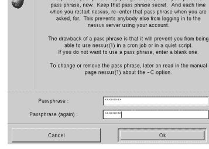


如果口令正确，客户端将显示主菜单，默认情况下打开 `Nessusd Host` 选项卡。在此处，你将客户端指向适当的服务器。在图 5.3 的示例中，服务器是 `nessus.example.com`，用于登录的用户名是 `ramon`。

###### 图 5.3 登录到 Nessus 服务器

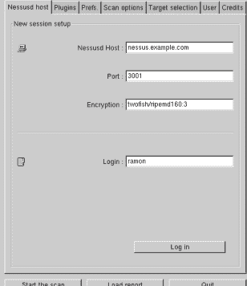

主 Nessus 客户端窗口中的下一个选项卡是 `Plugins` 选项卡，如图 5.4 所示。在此屏幕上，你可以选择当前位于插件文件夹（默认为 `/usr/lib/nessus/plugins`）中的所有插件。建议你点击“启用所有但危险插件”按钮。这将禁用列表底部的拒绝服务（Denial of Service）插件。如果你选择也运行此攻击，请确保你在目标服务器的维护窗口期间执行，因为这至少会暂时使服务器无法使用。

###### 图 5.4 选择 Nessus 插件

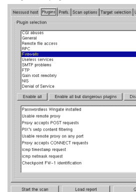

下一个感兴趣的选项卡是 `Target Selection` 选项卡。在此屏幕上，你可以指定要扫描漏洞的服务器。你可以使用逗号分隔的表示法，包括主机名、IP 地址或使用 `/subnet` 表示法的网络（例如，`192.168.1.0/24`）。图 5.5 展示了对两个目标主机 `204.254.33.75` 和 `204.254.33.76` 的扫描。

###### 图 5.5 指定要扫描的目标主机

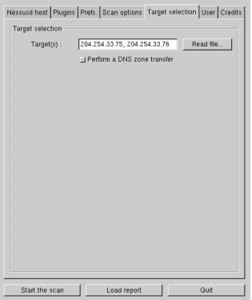

要开始测试，只需点击“开始扫描”按钮。状态屏幕将出现，如图 5.6 所示。扫描将持续进行，直到 Nessus 服务器完成在 `Plugins` 选项卡屏幕上指定的所有测试为止。扫描的总持续时间会有很大差异，具体取决于要扫描的主机数量和测试的复杂度。

###### 图 5.6 Nessus 扫描：状态窗口

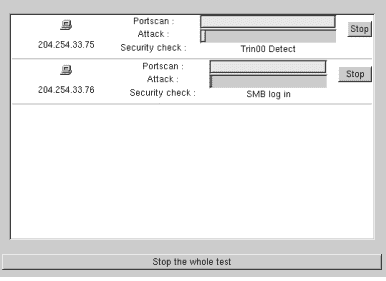

在测试结束时，Nessus 会提供一个摘要窗口（参见图 5.7），显示目标主机列表以及在每个主机上发现的安全漏洞、警告和注释的快速概览。只需选择感兴趣的主机，然后点击“另存为”下拉菜单。选择你喜欢的格式（`HTML` 是一个不错的选择），然后点击“另存为”按钮。然后，你可以使用你喜欢的 Web 浏览器查看完整的漏洞报告，如图 5.8 所示。

###### 图 5.7 Nessusd 报告摘要

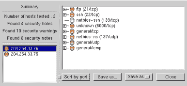

###### 图 5.8 查看 HTML Nessus 报告

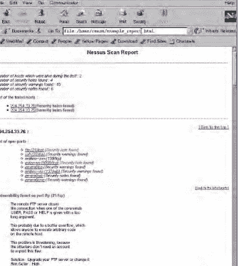

或者，你可以通过展开屏幕左侧 `Summary` 部分下的每一行，获取更多关于 Nessus 发现的每个漏洞的信息（参见图 5.9）。

看看图 5.9 中的报告。在此示例中，Nessus 已识别出目标机器上 `FTP` 服务器存在一个问题，攻击者可能会引起缓冲区溢出，导致在服务器上执行任意代码。此外，Nessus 还识别出另一个相关的漏洞，攻击者可以利用 `FTP` 服务器上的核心转储文件在文件系统的任何用户可读部分写入 `/etc/shadow` 文件的片段。

这些状态被标记为高优先级和中优先级，并且甚至提出了一个解决方案（不出所料，是升级到更新且更安全的版本）。

##### Nmap

虽然 Nessus 的理念是提供一个 polished 的前端和可扩展的客户端-服务器架构，以允许多个用户同时审计网络，但 Nmap 工具为更具经验的网络管理员提供了一款强大且多功能的网络扫描工具。我发现 Nmap 是一个快速评估以下方面的绝佳工具：

- 某个子网中哪些主机在线

- 一系列目标系统上哪些端口（`TCP`、`UDP`）是开放的

- 这些系统运行的是什么操作系统

我使用前两种功能领域来确保我的局域网（`LAN`）上没有未经授权的系统在运行，并确保我的 Linux 服务器没有运行任何我不了解的服务。第三种功能让我能够准确查明疑似入侵者来自的系统类型。这是我报告访问违规或攻击时发送给入侵者域名权威机构的信息的一部分。

下一节介绍如何下载并安装最新版本的 Nmap 软件包。

###### 安装 Nmap

Nmap 的主要分发来源是 `www.insecure.org`。你可以从该网站下载完整的源代码或 `RPM` 软件包。最简单的方法是使用远程源进行安装，如下所示：

```bash
[ramon]:~$ rpm -vhU http://www.insecure.org/nmap/dist/nmap-2.53-1.i386.rpm
```

安装完成后，你将使用位于默认路径 `/usr/bin/nmap` 的主 Nmap 可执行文件。下一节描述了 Nmap 工具的一些常见用途。

###### 使用 Nmap

尽管 Nmap 是一个全面的网络审计工具，但本书对其讨论集中在识别存活主机、活动的网络服务以及远程操作系统类型的功能上，因为这是 Nmap 最有用的领域。

Nmap 最简单的用法是识别在任一时刻网络上哪些主机是*存活的*（在线且可用）。这项任务被称为*端口扫描*。列表 5.5 展示了使用 Nmap 对整个子网进行端口扫描的示例。

####### 列表 5.5 使用 Nmap 对整个子网进行端口扫描


如果主机响应 `ICMP Echo` 请求或 `TCP ACK`，`Nmap` 就认为该主机是`存活`的。

`Nmap` 的另一个流行用法是识别远程主机上哪些端口（`TCP`、`UDP`）是开放的。这被称为`TCP 扫描`。当目标系统上有一个监听守护进程响应针对该端口的网络请求时，该端口即为`开放`。

列表 5.6 展示了使用 `Nmap` 进行 `TCP` 扫描的示例。在此示例中，`Nmap` 发现目标主机共有三个 `HTTP` 端口开放：`Secure Shell`（`TCP` 服务编号 22）、`SMTP` 邮件（`TCP` 服务 25）和 `Secure HTTP`（`TCP` 服务 443）。请注意，默认情况下，`Nmap` 仅扫描前 1500 个左右的 `TCP` 端口。

#### 列表 5.6 使用 Nmap 对单个目标主机进行 TCP 扫描

```bash
[ramon]:~$ sudo nmap -sS target.example.com

Starting nmap V. 2.53 by fyodor@insecure.org
(www.insecure.org/nmap/)
Interesting ports on target.example.com (192.168.1.1):
(The 1520 ports scanned but not shown below are in state: filtered)
    Port      State      Service
    22/tcp    open       ssh
    25/tcp    open       smtp
    443/tcp   closed     https
Nmap run completed -- 1 IP address (1 host up) scanned in 178 seconds
```

第三个示例说明了 `Nmap` 识别远程主机上运行的操作系统类型并检查其 `TCP` 实现特性的能力。`Nmap` 的开发者称此功能为`TCP 指纹识别`，其实现相当复杂，使用一个持续更新的文件包含指纹模板，并将其与目标的 `TCP` 响应进行比较。

列表 5.7 展示了 `Nmap` 的一个运行样本，用于识别三个目标主机的操作系统：`Lucent Pipeline PL75` 路由器、`Solaris 2.5.1` 工作站和 `Linux` 服务器。请注意，列表 5.7 中的部分输出包括难度等级（`Difficulty`），它告诉你在网络上识别目标操作系统有多难。请注意，在三个目标中，`Linux` 获得了最高的难度等级！

#### 列表 5.7 使用 Nmap 识别远程主机的操作系统

```bash
[ramon]:~$ sudo nmap -O 192.168.1.1 192.168.1.100 192.168.1.200

Starting nmap V. 2.53 by fyodor@insecure.org
(www.insecure.org/nmap/)
Interesting ports on router (192.168.1.1):
(The 1522 ports scanned but not shown below are in state: closed)
    Port      State      Service
    23/tcp    open       telnet
TCP Sequence Prediction: Class=random positive increments
Difficulty=15144 (Worthy challenge)
Remote OS guesses: Ascend P130 Router, Ascend P75
Interesting ports on fantasia (192.168.1.100):
(The 1519 ports scanned but not shown below are in state: closed)
    Port      State      Service
    21/tcp    open       ftp
    22/tcp    open       ssh
    139/tcp   open       netbios-ssn
    6000/tcp  open       X11
TCP Sequence Prediction: Class=random positive increments
Difficulty=23419 (Worthy challenge)
Remote operating system guess: Solaris 2.5, 2.5.1
Interesting ports on penguin (192.168.1.200):
(The 1516 ports scanned but not shown below are in state: closed)
    Port      State      Service
    21/tcp    open       ftp
    22/tcp    open       ssh
    23/tcp    open       telnet
    80/tcp    open       http
    989/tcp   open       ftps-data
    1080/tcp  open       socks
    3001/tcp  open       nessusd
TCP Sequence Prediction: Class=random positive increments
Difficulty=2630920 (Good luck!)
Remote operating system guess: Linux 2.1.122 - 2.2.14
Nmap run completed -- 3 IP addresses (3 hosts up) scanned in 10 seconds
```

一如既往，使用 `Nmap` 是一把双刃剑。虽然这个实用工具应该是每个系统管理员工具箱中的一部分，但请务必保持警惕并寻找网络上 `Nmap` 扫描的证据，因为这通常是攻击的前兆。第 3 章“系统监控与审计”中讨论的 `swatch` 和 `logcheck` 工具非常适合此目的。

`Nessus` 和 `Nmap` 都通过联系目标系统来识别潜在的漏洞。另一类基于主机（`host-based`）的审计工具可以实现同样的任务，但这些工具是在目标系统本身运行的。本书的下一节将更详细地探讨基于主机的审计，并介绍基于主机的网络安全审计方法的几个示例。

### 基于主机的审计工具

虽然 `Nessus` 和 `Nmap` 允许你扮演试图从公共网络入侵你的 `Linux` 服务器的“坏人”角色，但大多数成功的网络攻击实际上是从内部发起的。这一事实促使 `Unix` 社区设计了一种可以在系统内部使用的工具，用于识别来自内部攻击的漏洞。

1993 年，`Dan Farmer`（同时也是基于网络的 `SATAN` 审计工具的作者）发布了一个名为 `COPS`（`Computer Oracle and Password System`，计算机神谕与密码系统）的实用工具。作为基于主机的安全审计领域的先驱，`COPS` 实际上是一系列较小的工具的集合，每个工具都针对典型 `Unix` 系统中可能导致网络攻击的特定漏洞。这些检查范围涉及匿名 `FTP` 服务器、`/etc/rc.*` 目录、`cron` 条目以及 `NFS` 和 `Sunmail` 漏洞等领域。

德克萨斯 `A&M` 大学发布了一套基于主机的审计脚本（代号 `Tiger`）作为 `COPS` 的后续项目，但在 1994 年停止了新功能开发。如今，`COPS` 和 `Tiger` 都已严重过时，但一个优秀的继任者出现了。下一节将介绍 `Advanced Research Corporation`（高级研究公司）的 `TARA` 软件包。

#### TARA

`TARA`（`Tiger Auditors Research Assistant`，老虎审计员研究助手）是 1999 年由一家私人公司（`Advanced Research Corporation`）在国立卫生研究院（`NIH`）资助下对德克萨斯 `A&M` 的 `Tiger` 系统进行更新的版本。该软件包在 `GNU` 通用公共许可证（`GPL`）的授权下发布到公共领域。


与 `Tiger` 一样，`TARA` 是一组由中心实用工具控制的 shell 脚本，该工具仍名为 `tiger` 以纪念其直接前身。该工具的主要目标是识别 `Linux` 服务器上使入侵者更容易通过网络获取 `root` 权限的设置。`TARA` 旨在以交互式方式运行，也可以定期以批处理模式运行。无论哪种方式，结果都是一份在其执行时发现的潜在漏洞报告。

下一节介绍如何下载并在你的 `Linux` 服务器上安装最新版本的 `TARA` 脚本。

### 安装 `TARA`

`TARA` 发行版可以直接从 `ARC` 网站 `http://www-arc.com/tara/` 获取。没有可用的 `RPM` 软件包，因此你必须下载源代码归档文件。只需按照列表 5.8 所示解压并提取归档文件即可。

#### 列表 5.8 提取 `TARA` 归档文件

```bash
[ramon]:~$ ls -l tara-2.0.9.tar.gz
-rw-r-- 1 ramon users 355267 Nov 18 17:13 tara-2.0.9.tar.gz
[ramon]:~$ gzip -dc tara-2.0.9.tar.gz | tar -xf -
[ramon]:~$ cd tara-2.0.9
[ramon]:~$ sudo mkdir -p /usr/spool/tiger/work
```

### 配置 `TARA`

清单 5.8 中的步骤会在 `/usr/local/tiger` 目录下安装相应的 `TARA` 文件，包括主可执行文件 `/usr/local/tiger/tiger`。请注意，您必须创建随 `TARA` 标准发布的 `Makefile` 文件中列出的以下三个目录：

-   `TIGERWORK=/usr/spool/tiger/work` 该目录用于存储由 `tiger` 可执行文件创建的临时工作文件。默认目录不是 `/tmp`，以便于识别（并清理）该应用程序创建的临时文件。
-   `TIGERLOGS=/usr/spool/tiger/logs` 该目录用于保存 `tiger` 的报告。
-   `TIGERBIN=/usr/spool/tiger/bin` 该目录用于存放 `TARA` 辅助可执行文件。

> **注意** 如果您希望在不指定完整文件路径的情况下调用 `tiger` 可执行文件，必须将 `/usr/local/tiger` 添加到您的 `PATH` 环境变量中。

`TARA` 的配置文件位于 `/usr/local/tiger/tiger.rc`。`TARA` 附带一个默认的 `tiger.rc` 文件，但我建议在使用该应用程序之前进行以下更改：

-   `Tiger_Check_CRON=Y` 将此选项设置为 `Y` 会让 `TARA` 检查所有用户的 `cron` 条目，并识别其中命令可能存在的漏洞。默认值为 `N`。
-   `Tiger_Check_KNOWN=Y` 将此选项设置为 `Y` 会让 `TARA` 检查已知入侵尝试的迹象。默认值为 `N`。
-   `Tiger_Check_PERMS=Y` 将此选项设置为 `Y` 会让 `TARA` 检查系统文件的权限和所有权，寻找完全开放的目录。它还指示 `Tiger` 检查 `setuid/setgid` 文件的权限和所有权。默认值为 `N`。
-   `Tiger_Check_FILESYSTEM=Y` 将此选项设置为 `Y` 会让 `TARA` 执行文件系统检查，包括检查挂载点的所有权以及 `NFS` 导出的权限。默认值为 `N`。
-   `Tiger_Check_PATH=Y` 将此选项设置为 `Y` 会让 `TARA` 检查系统账户的 `PATH` 设置，并查找通常不会出现在特权用户 `PATH` 中的目录。默认值为 `N`。

这些选项在默认的 `tigerrc` 文件中被禁用，以节省时间，因为根据您 `Linux` 服务器的速度和复杂性，其中一些检查可能需要几分钟时间。然而，这些检查对于您的服务器安全至关重要，因此请确保适当修改 `tigerrc` 文件。

### 使用 `TARA`

一旦 `TARA` 安装并配置完毕，只需输入主可执行文件的名称即可调用它（您需要 `root` 权限），如清单 5.9 所示。

#### 清单 5.9 `TARA` 执行

```
[ramon]$ sudo tiger
Tiger  Analytical  Research  Assistant  (TARA)
Developed  by  Texas  A&M  University,  1994
Updated  by  The  Advanced  Research  Corporation,  1999
Covered  by  GNU  General  Public  License  (GPL)

Using  configuration  files  for  Linux  2
18:42> Beginning security report for redhead.hontanon.com.
18:42> Starting file systems scans in background...
18:42> Checking password files...
18:42> Checking group files...
18:42> Checking user accounts...
18:42> Checking .rhosts files...
18:42> Checking .netrc files...
18:42> Checking tftab, login, securetty, and ftpusers files...
18:42> Checking PATH settings...
18:42> Checking anonymous ftp setup...
18:42> Checking mail aliases...
18:42> Checking cron entries...
18:42> Checking 'inetd' configuration...
18:42> Checking NFS export entries...
18:42> Checking permissions and ownership of system files...
18:42> Checking for indications of breakin...
18:42> Performing system specific checks...
18:42> Waiting for filesystems scans to complete...
18:45> Filesystems scans completed...

18:45> Security report completed for redhead.hontanon.com.
Security report is in '/usr/spool/tiger/logs/security.report.goofy.001118-18:42' .
```

正如清单 5.9 最后一行所示，`TARA` 运行的结果是一个文本报告，保存在名为 `security.report.goofy.001118-18:42` 的文件中。该文件名包含主机名 (`goofy`)、日期（`YYMMDD` 格式）以及执行命令的时间 (`HH:MM`)。该文件的内容显示在清单 5.10 中。

> **注意** 要获取 `HTML` 格式的报告，只需输入 `tiger -H` 即可。

#### 清单 5.10 典型的 `TARA` 报告


```
[ramon]$ cd /usr/spool/tiger/logs
[ramon]$ sudo more security.report.goofy.001118-18:42
18:42> Beginning security report for goofy (i686 Linux 2.2.12-20).
# Checking accounts from /etc/passwd.
--WARN-- [acc001w] Login ID postgres is disabled, but still has a valid shell.
--WARN-- [acc001w] Login ID uucp is disabled, but still has a valid shell.
# Performing check of PATH components...
--WARN-- [path002w] /usr/bin/activated in root's PATH from default is not owned by root (owned by news).
--WARN-- [path002w] /usr/bin/actmerge in root's PATH from default is not owned by root (owned by news).
# Checking services from /etc/services.
--FAIL-- [inet003f] The port for service imap is assigned to service imap2.
--FAIL-- [inet003f] The port for service irc is assigned to service ircd.
# Performing check of system file permissions...
--WARN-- [perm001w] /etc/exports should not have group read.
--WARN-- [perm001w] /etc/exports should not have world read.
# Performing checks for Linux/2...
--ERROR-- [misc005w] Can't find check_sendmail'...
# Checking symbolic links...
--WARN-- [xxxxx] The following files are unowned:
/usr/local/netscape/netscape
```

清单 5.10 中的报告揭示了许多可能导致安全漏洞的警告和错误：

- `/etc/passwd` 中有两个用户名 (`postgres` 和 `uucp`) 是已禁用的账户，但它们仍然拥有有效的 shell。这意味着您应该为已停用的账户分配一个无效 shell。

- 在 `root` 的 `PATH` 中发现两个可执行文件实际上并不由 `root` 拥有。这为 `root` 意外执行由普通用户控制的代码留下了窗口，显然代表了一个漏洞。

- 两个服务 (`imap` 和 `irc`) 没有使用众所周知的 TCP 端口号。

- 指定服务器将通过 NFS 导出哪些文件系统的 `/etc/exports` 文件权限不正确。

- 缺少 `check_sendmail` 脚本。

- 文件 `/usr/local/netscape/netscape` 的所有者是一个在 `/etc/passwd` 中不存在的用户 ID。这通常意味着一个有效的用户名已被从密码文件中删除（如果您运气好，那是误操作）。

如果您希望了解更多关于这些诊断的信息，TARA 提供了 `tigexp` 实用程序，可以使用相应的诊断代码进行调用。清单 5.10 中由 TARA 生成的安全报告在方括号 `[]` 中包含了诊断代码。以下命令展示了如何使用清单 5.10 报告中的一个诊断代码来使用 `tigexp`：

```
[ramon]$ tigexp perm001w
```

```
The owner of the indicated file is not what is considered best for security reasons. Unless you have a specific reason for not changing the ownership, this should be corrected.
```

如您所见，TARA 提供了关于系统配置的丰富诊断信息，允许 Linux 系统管理员在已知网络攻击发生之前缓解部分风险。然而，网络审计是一项有时繁琐且总是耗时耗力的活动。即使是最勤勉的系统管理员也无法仅依靠定期审计来确保系统的安全。

本书的下一节将探讨网络监控的概念，监控与审计一起构成了您持续防御入侵的基础。

## 网络监控

上一节介绍了一些非常有效的工具和技术，用于扫描、脉冲扫描和随机探测系统，寻找半开的门和配置错误的系统，这些系统可能会招致入侵。虽然这些工具旨在增强系统的安全性，但假设它们不会被潜在的入侵者用于恶意行为是幼稚的。

作为安全管理员，挑战在于：

- 寻找迹象，表明您正在被 `Nessus` 和 `Nmap` 等工具扫描。

- 希望入侵者使用的这些工具版本至少与您上次审计时使用的版本一样旧。

实际上，即使入侵者只是一个随意扫描你的子网寻找开放端口的“闲逛者”，即使你已经确保系统安全，入侵者的活动也在消耗你互联网连接的宝贵带宽。此外，该活动最终可能导致针对你整个网络的拒绝服务（`DoS`）攻击，或者至少针对当前正在被入侵者攻击的系统发起攻击。

显然，安全管理员的工作既具有主动性，也具有反应性。网络审计旨在预防攻击，这应该是你的首要关注点。然而，网络监控在帮助你应对攻击方面也发挥着同样重要的作用。接下来的两个部分将介绍两个公有领域中流行的 Linux 网络监控工具：`PortSentry` 和 `Ethereal`。

### PortSentry

作为 Psionic Software 公司 Abacus 安全软件套件的一部分，`PortSentry` 是一种实时监测工具，旨在检测针对你系统的端口扫描，并做出适当的响应。这些响应是可以配置的，性质各异，从将违规者的 IP 地址添加到你的 `TCP Wrappers` 的 `/etc/hosts.deny` 文件，到修改本地路由表以将该主机的响应重定向。

`PortSentry` 的一个最大优势是其高级隐蔽扫描检测模式（Advanced Stealth Scan Detection Mode），该模式能够学习你的 Linux 服务器正在监听的端口，并且只查找对当前未服务端口的连接。这使得运行开销很轻，占用的 `CPU` 周期很少。这一点非常重要，因为你并不希望在运行网络监控程序时牺牲 Linux 服务器的性能。如果必须牺牲服务器性能才能运行网络扫描，请在非高峰时段执行扫描，以确保用户不会受到影响。

与大多数其他网络监控工具相比，`PortSentry` 的另一个优势是它作为时间函数跟踪入侵者 IP 地址的能力。这允许你仅在入侵者是屡教不改者时才对端口扫描做出反应，或基于特定地址尝试对你的系统进行端口扫描的频率采取特定措施。

下一节将描述如何在你的 Linux 服务器上安装 `PortSentry` 应用程序。

#### 安装 PortSentry

你可以从 Psionic 的网站 `www.psionic.com` 下载最新版本的 `PortSentry`，格式为源分发版。此外，通常的存档中也提供 `RPM` 版本。只需下载相应的 `RPM` 软件包，并使用以下命令将其安装到你的系统中：

```
[ramon]$ sudo rpm -i portsentry-1.0.4.1386.rpm
```

该命令将安装主可执行文件（`/usr/sbin/portsentry`）以及配置文件 `/etc/portsentry/portsentry.conf`。

#### 配置 PortSentry

在启动 `PortSentry` 之前，请编辑主配置文件 `/etc/portsentry/portsentry.conf`，并在其中分配以下环境变量：

- `ADVANCED_PORTS_TCP` (`ADVANCED_PORTS_UDP`)：该变量决定了 `PortSentry` 将监测的最高端口。由于 `Nmap` 通常扫描前 1500 个左右的端口，建议你将此值设置为 1500。注意有两个适用的变量，一个用于 `TCP`，另一个用于 `UDP`。另请注意，默认情况下，`PortSentry` 不会监听在你的 Linux 服务器上处于活动状态的端口的扫描。

- `ADVANCED_EXCLUDE_TCP` (`ADVANCED_EXCLUDE_UDP`)：将此变量初始化为那些不应触发警报的端口号，即使系统当前没有监听这些端口。这些应该是通常会被误用的端口号，例如 `HTTPS` 服务器上的 80 端口（`HTTP`）。


#### 配置 PortSentry

- `BLOCK_TCP (BLOCK_UDP)`：该变量指示 `PortSentry` 不要阻止那些被发现进行 TCP（或 UDP）扫描的主机。这有助于避免一种微妙的攻击类型，即入侵者伪装其地址为合法主机，以迫使你的 Linux 服务器阻止来自该主机的流量。伪造源地址相对容易，特别是在 UDP 数据包中。

- `KILL_ROUTE`：该变量允许你指定 `PortSentry` 应使用的命令，以终止到端口扫描实施者的本地路由。可以使用 `$TARGETS` 占位符将违规主机的 IP 地址传递给该命令。我建议你采取比将该地址路由到黑洞更温和的措施，例如将他们的地址添加到 `ipchains` 阻止列表中，如下例所示：

```
KILL_ROUTE="/sbin/ipchains -I input -s $TARGETS -j DENY -l"
```

> **注意** 有关此类周边安全设备的完整讨论，请参阅第 9 章“网络层防火墙”。

- `KILL_RUN_CMD`：该变量允许你指定 `PortSentry` 在应用 `KILL_ROUTE` 中定义的命令之前应使用的命令。抵制使用此命令对（被指控的）入侵者采取自动报复行动的诱惑。如上所述，在 `BLOCK_TCP` 变量的讨论中提到，这种行动可能被用作针对你的拒绝服务攻击。因此，我建议注释掉此选项。

- `KILL_HOSTS_DENY`：该变量允许你指定 `PortSentry` 应添加的 `/etc/hosts.deny` 条目语法，以通过 TCP Wrappers 阻止违规主机。这里也可以使用 `$TARGETS` 占位符。我建议你使用类似于以下设置的配置：

```
KILL_HOSTS_DENY='ALL: $TARGETS : $DENY'
```

- `SCAN_TRIGGER`：将此变量设置为大于 0 的值，会在你采取行动之前给予违规者一定次数的“免费”扫描。我建议你将该变量设置为 1，以筛选出那些偶尔进行端口扫描的人。

除了 `/etc/portsentry/portsentry.conf` 文件之外，始终编辑 `/etc/portsentry/portsentry.ignore` 文件，并添加任何希望 `PortSentry` 完全忽略的主机（每行一个）。我建议你将其限制为主机（`127.0.0.1`）以及你 Linux 服务器上所有接口的地址。

### 使用 PortSentry

Linux 版本的 `PortSentry` 具有使用高级端口扫描检测的能力，即使面对更复杂的端口扫描也是如此。例如，它将检测 SYN 洪水攻击，其中入侵者对你的服务器发起大量半开放 TCP 连接。

`portsentry` 命令中有两个感兴趣的命令行选项：

```
portsentry -atcp
portsentry -audp
```

第一个命令行选项 `-atcp` 监听从 TCP 端口 1 开始到配置文件中 `ADVANCED_PORTS_TCP` 变量指定的端口号为止的 TCP 扫描。相反，第二个命令行选项 `-audp` 监听从 UDP 端口 1 到 `ADVANCED_PORTS_UDP` 的扫描。

典型的攻击由 `PortSentry` 直接记录到 `syslog` 中，其出现格式（通常在 `/var/log/messages` 中）如下：

```
Nov 18 21:11:49 mickey portsentry[19891]: attackalert: Connect from host: badguy/192.168.100.100 to TCP port: 900

Nov 18 21:11:49 mickey portsentry[19891]: attackalert: Host 192.168.100.100 has been blocked via wrappers with string: 'ALL: 192.168.100.100'

Nov 18 22:11:32 mickey portsentry[19891]: attackalert: Host: badguy 192.168.100.100 'is already blocked Ignoring'
```

在此示例中，`PortSentry` 是通过以下行启动的：

```
portsentry -atcp
```

并被指示监视 1500 端口以下的所有 TCP 连接。入侵者（`192.168.100.100`）试图连接到 TCP 端口 900，该端口没有关联的守护进程。这触发了 `PortSentry` 的行动，其配置为添加一行如下类型的条目：

```
ALL : 192.168.100.100
```

到 `/etc/hosts.deny` 文件中，以拒绝 TCP Wrappers 访问违规主机。注意，入侵者一小时后尝试第二次扫描，但这次 `PortSentry` 没有将条目添加到 `/etc/hosts.deny` 中，因为该入侵者已经被阻止。

虽然 `PortSentry` 显然是检测（甚至反制）端口扫描的强大工具，但其效用可以通过健壮的系统日志检查工具（如 `swatch` 和 `logcheck`）来增强，如本书第 3 章所述。

### Ethereal

`PortSentry` 是一个用于在传输层（TCP 或 UDP）检测端口扫描尝试的有用工具，但系统管理员常常发现自己需要一个能够检查数据包内容在其通过线缆传输时的工具。`Ethereal` 是此类应用程序的最佳工具。

在 GNU GPL 下提供，`Ethereal` 是由一组对商业数据包分析器高昂价格感到不满的开发者合作努力的成果。结果是一个健壮的数据包嗅探器，能够原生捕获和分析数据包，并且能够读取和显示由其他（甚至是商业）分析器创建的存储捕获文件。

由于其开源性质和模块化设计，程序员很容易通过编写自己的协议解释器（或称 `解析器`，如在本程序中被称为）来为 `Ethereal` 添加自己的协议支持。在达到 1.0 版本之前，`Ethereal` 已经包含了对超过 100 种协议的支持。

#### 安装 Ethereal

最新的 `Ethereal` 分发版可以从任何常规渠道获取 RPM 格式。要安装，只需下载 RPM 文件并执行如下命令：

```
[ramon]$ sudo rpm -i ethereal-0.8.12-1.i386.rpm
```

> **注意** `Ethereal` RPM 依赖于 `libpcap`。它需要发布级别为 0.4 或更高的 `libpcap`。

#### 使用 Ethereal

只需输入可执行文件名而不带任何命令行选项，即可显示 `Ethereal` 的主窗口。（你需要具有 root 权限才能以混杂模式使用网络接口。）请使用类似以下命令：

```python
[ramon]$ sudo ethereal
```

在执行此命令后不久，你的 X 显示上会出现一个窗口，该窗口由三个独立的面板组成（见图 5.10）。

##### 图 5.10 Ethereal 主窗口的三个面板

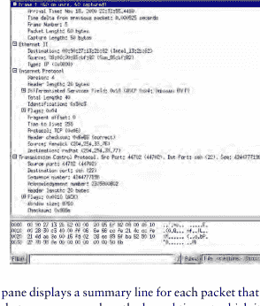

顶部面板显示在总线上捕获的每个包的摘要行，包括数据包序列号、捕获时的流逝时间（从捕获开始时间 0 计起）、源和目的地址，以及传输层协议类型（TCP、UDP 等）。

中间面板显示从顶部面板中选择的数据包的详细视图。在图 5.10 中，你已停止数据包捕获，并深入查看了在主机 `fenwick` 和 `redhat` 之间的对话中发现的一个数据包。该帧是一个以太网 II 帧，其中携带一个 IP 包，而该 IP 包的有效负载中又携带一个 TCP 包。`Ethereal` 在每一层都提供了极高的细节级别，包括 TCP 的源和目的端口、序列号和 ACK 号，以及位于 TCP 包末尾的标志和校验和。

底部面板显示 TCP 包上发现的有效负载转储。由于该 TCP 包的应用类型是安全外壳协议（SSH），其有效负载是经过加密的，因此无法解码。

如你所见，`Ethereal` 是一个强大的工具，它提供了通常难以关联的细节级别，尤其是在实时捕获数据包时。然而，在反应性情况下（例如，当像 `PortSentry` 这样的应用已经提醒你正在遭受攻击时），这是一个合适的工具。会话捕获完成后，`Ethereal` 允许你保存文件，并将整个捕获内容留待日后检查，或作为攻击后的取证证据。

### 总结

网络安全是一场情报与反情报的游戏。花费的每一分钟用于尝试攻破自己的系统，都价值连于花费一小时去翻阅入侵后的不幸后果。虽然网络审计应该是你的定期系统和网络维护例程的一部分，但网络监控应给予更高的优先级，特别是当你有理由怀疑自己可能正在遭受攻击时。必须确保你的安全策略包含明确说明，在什么频率和什么情况下应进行审计和监控。决定你将如何处理端口扫描违规者，并将同样的标准适用于所有违法者。避免报复性行动；相反，记录扫描的所有细节，并尝试尽可能多地收集有关其来源的信息，以便你可以联系适当的机构报告该事件。

第 3 部分“应用安全”将讨论扩展到网络层之外，涵盖与使用最常见的 Linux 服务器应用相关的安全问题，包括 `Sendmail`、`Apache` 和多种文件服务器。下一章将从 `Sendmail` 背后的安全问题开始这一讨论。

# 第 3 部分

应用安全

特色内容：


- 使用`Sendmail`进行安全邮件中继
- 为你的`Sendmail`服务器添加隐私和强身份验证
- `Qmail`和`Postfix`的安全概览
- 保护`POP`和`IMAP`邮件服务器
- 使用`GnuPG`实现邮件应用隐私和身份验证
- 保护`Apache HTTP`服务器
- 使用`mod_ssl`保护你的`Web`流量
- 了解`Samba`访问控制和身份验证


## 6 电子邮件

本书的第1部分和第2部分探讨了与`Linux`服务器系统和网络层相关的安全挑战。这一进展中的下一步是检查应用程序层固有的安全问题。本章通过仔细查看多个电子邮件服务器应用程序、它们的安装、配置及其对服务器整体安全性的影响，开启了第3部分“应用安全”的讨论。

尽管万维网（`HTTP`）的流量在近代的互联网历史中比其他任何协议增长得都快，但电子邮件（`SMTP`）包目前的使用量仍超过其他任何协议。随着近期支持电子签名有效性的立法决定，随着公司开始使用互联网分发和签署具有法律约束力的文件及其支持材料，你很可能会看到电子邮件使用量的增长速度进一步加快。

然而，由于电子邮件服务的公开和广泛性质，它是安全保护起来最具挑战性的应用之一。邮件服务器通常必须处理大小、来源和构成差异极大的消息。电子邮件是你服务器中每天需要投入最多注意力的部分，因为它是将经历最大流量负载的应用程序。

本章将探讨三种流行的邮件传输代理（`MTA`），`Sendmail`、`Qmail`和`Postfix`，并描述两种邮件检索协议，邮局协议 v.3（`POP3`）和互联网邮件访问协议（`IMAP`）。此外，本章还将介绍`Pretty Good Privacy` (`PGP`) 及其开源表亲`Gnu's Gnu Privacy Guard` (`GnuPG`)。

让我们从深入探讨`Sendmail`开始讨论，这是一个守护进程应用，为当今大多数`Linux`电子邮件服务器提供传输服务。

## Sendmail

自从1984年第一个支持`TCP/IP`的伯克利`Unix`版本发布以来，`Sendmail`一直是基于`Unix`的互联网`MTA`的事实标准。`Sendmail`代理至今仍在使用中，由一个组织严密的、由专门开发人员组成的`Sendmail`联盟（`www.sendmail.org`）推动发展。

虽然最初的几个`Sendmail`版本足够稳健，能够在生产环境中即使在极高负载下也能正常运行，但它们并未以安全为设计目标，因为当时互联网尚未变成如今这种普遍（且有风险）的媒介。然而，从`8.9`版开始，鉴于有文档记录的安全漏洞利用事件日益增多，`Sendmail`开发人员采取了更具防御性的哲学，主要受其日益增长的人气所驱动。结果是一个更加安全默认分发包，几乎以挑剔的方式防范可能导致安全漏洞的错误配置。

`Sendmail`的`8.10`版和`8.11`版更进一步，实施了对非受邀商业电子邮件（`UCE`，通常称为垃圾邮件）的全面防御。此外，`Sendmail 8.11`版是第一个支持`SMTP`身份验证的版本，这正是下一节的主题。

### 通过 SMTP 身份验证实现安全邮件中继

邮件服务器管理员被要求确保其邮件服务器的安全性，同时仍向合法用户提供可接受的服务水平。这通常意味着禁用通过公司邮件服务器的所有邮件中继，除了那些已知属于公司远程访问用户的地址。这种方法的问题是，随着通用远程访问和宽带技术的出现，知道合法用户的地址变得越来越困难。

重点已转向对邮件客户端的即时身份验证，远程系统用户在被授予通过服务器中继邮件的能力之前，必须将自己标识为公司用户。互联网工程任务组（`IETF`）已建议将`SMTP`身份验证（`RFC2554`）作为启用安全邮件中继的标准协议，而`Sendmail 8.10`现在原生支持`SMTP`身份验证。

如果您拥有一支庞大的移动办公团队，并且发现必须允许来自匿名来源的邮件中继连接，我建议您立即升级到`Sendmail 8.11`。`Red Hat 7.0`默认附带`Sendmail 8.11.0`，并且还包括`Cyrus`实现的简单认证和安全层（`SASL`），`Sendmail`使用它来实现`SMTP`授权。

列表 6.1 展示了在标准`Red Hat 7.0`安装中添加`SMTP AUTH`支持所需的步骤。

#### 列表 6.1 根据 RFC2554 配置 Sendmail 以支持 SMTP 授权

```text
[ramon]$ rpm -q sendmail
sendmail-8.11.0-8
[ramon]$ rpm -q cyrus-sasl
cyrus-sasl-1.5.24-6
[ramon]$ sudo saslpaswd ramon
Password: mypass
Again (for verification): mypass
```

正如您在列表 6.1 中看到的，首先确保您拥有较新版本的`Sendmail`（`SMTP AUTH`支持是从`Sendmail 8.10`开始实现的），以及较新版本的`cyrus-sasl`（晚于`1.5.10`）。接下来，使用`saslpaswd`实用工具为每个将使用`SMTP AUTH`的远程用户创建秘密密码。在列表 6.1 中，创建了一个名为`ramon`的新用户，其密码将是`mypass`。

此外，您必须修改标准`Red Hat 7.0`的`/etc/mail/sendmail.mc`文件，以包含在`SMTP AUTH`成功时允许中继的配置。为此，只需添加以下行：

```
TRUST_AUTH_MECH (DIGEST-MD5 CRAM-MD5)
```

到`/etc/mail/sendmail.mc`的`options`部分。别忘了使用以下命令根据更新后的宏配置文件重建`/etc/sendmail.cf`文件：

```bash
[ramon]$ sudo m4 sendmail.mc > /etc/sendmail.cf
```

此时，本地`sendmail`守护进程仅允许使用`DIGEST-MD5`或`CRAM-MD5`进行自我认证的`SMTP`客户端进行中继。（`CRAM`代表挑战/响应认证模式。`MD5`是一种流行的一次性散列算法。）有许多支持`CRAM-MD5`认证原生的邮件用户代理（`MUA`），如`Pine`、`Mulberry`、`Eudora`、`Pegasus`和`Akmail`。您应确保使用这些邮件客户端之一，并配置好您通过`saslpaswd`命令指定的用户名和密码。

一旦您成功地在`Sendmail`服务中添加了强身份验证，下一步就是为邮件传输通信添加隐私保护。这是下一节的内容。

### 基于 TLS 的 SMTP

`Sendmail`版本`8.11`引入了根据`RFC2487`支持安全`SMTP`（基于`TLS`）的功能。术语`STARTTLS`指的是用于发起启用`TLS`的邮件传输会话的新`SMTP`命令。此扩展允许您在两个可以使用`TLS`（也称为安全套接字层，或`SSL`）进行通信的`SMTP` (`Sendmail`) 服务器之间建立安全桥梁。这确保了交换的隐私性和完整性，并强烈验证两个通信对等的身份。为了在`Sendmail`的标准安装中添加`STARTTLS`支持，请首先使用以下命令确保您已安装`Sendmail 8.11`或更高版本以及`OpenSSL`：

```txt
[ramon]$ rpm -q sendmail openssl
sendmail-8.11.0-8
openssl-0.9.5a-14
```

> **注意** 第7章“`HTTP`服务”更详细地解释了`SSL`协议的性质和用途。

接下来，您需要使用`OpenSSL`创建自己的证书颁发机构（`CA`），以便您可以签署（和验证）远程对等的`X.509`数字证书。列表 6.2 显示了创建`CA`所需的命令。

#### 列表 6.2 为 Sendmail STARTTLS 创建证书颁发机构

```txt
[ramon]$ sudo mkdir /etc/mail/CA
[ramon]$ cd /etc/mail/CA
[ramon]$ sudo mkdir certs cr1 newcerts private
[ramon]$ echo "01" > serial
[ramon]$ cp /dev/null index.txt
[ramon]$ cp /usr/share/ssl/openssl.cnf openssl.cnf
[ramon]$ sudo openssl req -new -x509 -keyout private/cakey.pem -out cacert.pem -days 365 -config openssl.cnf
```

列表 6.2 中的命令执行以下任务：

- 1. 创建一个目录`(/etc/mail/CA)`，用于存储您的`Sendmail`证书颁发机构信息。
- 2. 创建四个子目录，用于存储`CA`证书 (`certs`)、证书吊销列表 (`cr1`)、由`CA`签署的新证书 (`newcerts`) 以及`CA`的私钥 (`private`)。


- 3. 初始化两个管理文件（`serial`和`index.txt`），并将标准配置文件（`/usr/share/ssl/openssl.cnf`）复制到当前 CA 目录中。

- 4. 使用 `openssl`命令创建一个新的 CA 私钥（`private/cakey.pem`）和一个新的 CA 证书（`cacert.pem`），该证书在接下来 365 天内有效。

接下来，您需要使用以下命令为 Sendmail 服务器创建证书：

```
[ramon]$ sudo openssl req -nodes -new -x509 -keyout newreq.pem -out newreq.pem -days 365 -config openssl.cnf
```

最后，您需要使用 CA 的私钥签署新证书（`newreq.pem`），如下所示：

```
[ramon]$ sudo openssl x509 -x509toreq -in newreq.pem -signkey newreq.pem -out tmp.pem
Getting request Private Key
Generating certificate request
[ramon]$ sudo openssl ca -config openssl.cnf -policy policy_anything -out newcert.pem -infiles tmp.pem
Using configuration from openssl.cnf
Enter PEM pass phrase:
Check that the request matches the signature
Signature ok
The Subjects Distinguished Name is as follows
countryName           :PRINTABLE: 'US'
stateOrProvinceName    :PRINTABLE: 'Virginia'
localityName           :PRINTABLE: 'Ashburn'
organizationName       :PRINTABLE: 'Ramon J. Hontanon'
organizationalUnitName: PRINTABLE: 'Ramons Pile 0 Bits'
commonName             :PRINTABLE: 'redhat.example.com'
emailAddress           :IA5STRING: 'rhontan0ns@sybex.com'
Certificate is to be certified until Nov 27 01:03:45 2001 GMT (365 days)
Sign the certificate? [y/n]: y
1 out of 1 certificate requests certified, commit? [y/n]y
Write out database with 1 new entries
Data Base Updated
[ramon]$ sudo rm -f tmp.pem
```

正如您所见，签署操作实际上涉及三个独立的命令，外加一个用于清理前三个命令使用的临时文件（`tmp.pem`）的命令。结果是写入文件`newcert.pem`的一个 X.509 证书，该证书采用隐私增强邮件（PEM）格式。

> **注意** X.509 标准定义了数字证书和证书吊销列表的格式。除了数字签名外，X.509 证书还包含其版本、序列号、颁发者（CA）名称、有效期以及主体（所有者）名称等字段。另一个 IETF 标准，PEM 定义通常用于在文件内部交换 X.509 证书，将其作为 PEM 编码的文本消息。

接下来，您需要修改`sendmail.mc`以为您的 Sendmail 安装添加 CA 支持。列表 6.3 包含了您需要添加到`sendmail.mc`文件中的确切命令。

#### 列表 6.3 向 sendmail.mc 添加证书支持

```
define(`CERT_DIR',   MAIL_SETTINGS_DIR`/CA')dn1
define(`confCACERT_PATH',   `CERT_DIR')dn1
define(`confCACERT',  `CERT_DIR/cacert.pem')dn1
define(`confSERVER_CERT', `CERT_DIR/newcert.pem')dn1
define(`confSERVER_KEY',  `CERT_DIR/private/cakey.pem')dn1
```

列表 6.3 中的命令将 Sendmail 指向您在列表 6.2 中构建的 CA 中的相应文件。

- `CERT_DIR`（和 `CERT_PATH`）：CA 所在的目录（`/etc/mail/CA`）

- `CACERT`：根 CA 证书（`cacert.pem`）

- `SERVER_CERT`：Sendmail 服务器的证书（`newcert.pem`）

- `SERVER_KEY`：Sendmail 服务器的私钥（`private/cakey.pem`）

如果您的 Sendmail 版本配置了 STARTTLS 支持，当您执行以下命令时，它应该会显示为 250-STARTTLS（注意倒数第三行）：

```
[ramon]$ telnet localhost 25
Trying 127.0.0.1...
Connected to localhost
Escape character is '^]'.
220 redhat.example.com ESMTP Sendmail 8.11.0/8.11.0; Sun, 26 Nov 2000 21:04:55 -0500
ehlo localhost
250-local.sendmail.COM Hello localhost [127.0.0.1], pleased to meet you
250-ENHANCEDSTATUSCODES
250-DSN
250-STARTTLS
250 HELP
quit
```

#### 使用 STARTTLS

Sendmail 的 STARTTLS 支持有两个有用的应用程序：

- 允许基于成功的证书认证进行中继

- 将 SMTP 连接限制为持有有效证书的人员

通过要求所有请求邮件中继的 SMTP 用户提供由 CA 签署的 X.509 证书，本地 Sendmail 代理可以确保只有经过认证的用户被允许通过您的服务器进行中继，无论他们来自什么 IP 地址。

此外，STARTTLS 可以用于仅在远程系统提供了可由本地服务器 CA 验证的有效证书的情况下，允许 SMTP 连接到您的邮件服务器。您可以将传入连接限制为持有有效证书的客户端，或者您也可以强制出站邮件连接仅在远程端能够接受您的证书并同意建立安全（加密）SMTP 会话时才成功。您可以使用此功能在公共互联网上设置虚拟专用 SMTP 链接，从而以更高的机密性通过电子邮件共享敏感信息。

#### STARTTLS 和 MTA 替代方案

正如你所见，STARTTLS 解决了信息安全（机密性、完整性和身份验证）的三大核心问题，并且它是使用标准的开源软件组件来实现这一点的。它不能替代网络层虚拟专用网络（VPN）系统，后者可以保证所有流量的隐私性，而不论其属于哪种应用程序。这一概念在第 12 章“虚拟专用网络”中进行了详细讨论。

不过，STARTTLS 是迈向全面采用成熟 VPN 的良好第一步，尤其是当你的安全策略要求仅需在离开你的网络时保护 SMTP 流量。实际上，保护 SMTP 数据包的内容通常是个好主意，即使在它们穿越内部网络时也是如此，因为内部人员可能会进行未授权的窃听。

> **注意** 有关在 Linux 服务器上安装、配置和管理 Sendmail 的深入信息，请参见 *Linux Sendmail Administration*（Sybex，2001），该书是 Craig Hunt Linux 书库的一部分。

你还可以在 `www.sendmail.org` 上找到更多关于 Sendmail 及其联合组织的更多信息。

接下来的两节将介绍两种在过去几个月里越来越受欢迎的替代性 MTA。让我们从 Qmail 开始讨论。

## Qmail

虽然 Sendmail 每天负责承载互联网上超过三分之一的电子邮件流量，但它确实有一些有价值的竞争对手。事实上，Sendmail 的一个替代方案正以前所未有的速度获得普及，那就是 Qmail。Qmail 由伊利诺伊大学芝加哥分校的 Dan Bernstein 开发，旨在通过提供一个从底层开始就充分考虑安全性的 MTA 来解决 Sendmail 中发现的安全问题。Qmail 从诞生之初就遵循了一些非常根本的规则，例如：

- 避免以 `root`身份运行主要的 MTA 守护进程。相反，只有它的两个辅助脚本需要 `root`权限。

- 避免使用 `setuid`。只有一个 Qmail 脚本 `qmail-queue`是 `setuid`的。


-   将地址与程序和文件区别对待。这样做是为了避免 `Sendmail` 的一个常见漏洞，在该漏洞中，用户将 `shell` 脚本作为地址输入 `Sendmail` 守护进程，结果服务器执行了它们（通常是以 `root` 权限）。

除了这种设计哲学之外，`Qmail` 相比 `Sendmail` 还有几个环境上的优势：

-   `Qmail` 更新鲜。后见之明是 `20/20`，`Qmail` 已经学到了很多 `MTA` 普遍存在的固有漏洞，这些漏洞之所以被发现仅仅是因为 `Sendmail` 首先被部署。

-   `Qmail` 诞生于不同的环境。1984 年的互联网与 1996 年的互联网大不相同。这迫使 `Qmail` 开发者编写能够抵御当今勇敢的公共网络风险的应用程序。`Sendmail` 一直在跟进新的漏洞，但它是通过补丁和对原始设计的轻微增强来完成的。

-   `Qmail` 是一个更简单（且更小）的程序。在 `Sendmail` 被用于生产环境的 15 多年中，功能需求从未停止过流入。结果是一个功能非常完善但非常复杂的 `MTA`。就像任何服务器软件一样，复杂性会滋生漏洞。

然而，在某些领域，`Sendmail` 仍然占据优势：

-   `Sendmail` 更成熟。它仍然承载着互联网上绝大多数的 `SMTP` 流量，并且是更为人所知的事物。有大量的 `Sendmail` 文档，包括书籍和教程，以及培训和认证。

-   `Sendmail` 的安装过程坚固且高度自动化，而 `Qmail` 仍需要执行许多手动步骤。

-   `Sendmail` 受到的审查更严格，其安装基础比 `Qmail` 的数量级要大得多。这导致安全漏洞被更快地识别，并迅速提供相应的安全修复。

在倡导软件包的安全性时，`Qmail` 社区通过其中一个如今臭名昭著的财务“挑战”来支持他们的说法。该竞赛始于 1997 年 4 月，结束于 1998 年 4 月，旨在寻找 `Qmail` 软件中的安全漏洞，使远程用户能够未经授权地访问目标系统。竞赛期结束，没人能找到软件中合法的漏洞，因此 1,000 美元的奖金无人认领。

抛开这项挑战的结果，我建议你不要仅根据 `Qmail` 关于已证实安全性的说法来决定使用哪个 `MTA`。`Qmail` 和 `Sendmail` 都可以被配置得足够安全，以满足任何安全策略的要求。如果你已经在邮件服务器安装中使用了 `Sendmail`，并在此基础上积累了一些核心专业知识，你可能希望继续使用该软件包。更换 `MTA` 的危险在于，你几乎总是需要一个学习期，在此期间你更容易犯简单的配置错误，从而导致安全漏洞。

如果你要从头开始构建一个 `SMTP` 服务器并且没有之前的 `Sendmail` 经验，请审查 `Qmail` 提供的功能，并确保它能够满足你整体的邮件处理需求。如果答案是肯定的，那么 `Qmail` 更适合你的需求，因为它更简单且配置更容易。

有关 `Qmail` 的详细信息可以在 `www.qmail.org` 上找到。

下一节将描述另一个 `Sendmail` 的替代品：`Postfix MTA`。

## Postfix

`Postfix` 完成了 `MTA` 三部曲，它由 `Wietse Venema` 开发，他为我们带来了其他经过验证的安全软件包（`SATAN`，`TCP Wrappers`）。`Postfix` 项目处于比 `Sendmail` 和 `Qmail` 更早的阶段，截至本书撰写时，`Wietse` 仍将发布版本称为 `Beta`。实际上，发布版本带有 `snapshot` 编号（实际上是日期），而不是真正的（`major.minor`）版本号。

`Postfix` 比 `Qmail` 更模块化，配置更简单，并且它似乎在处理单位时间内可处理的消息数量方面优于当今大多数其他正在使用的 `MTA`。按照当前部署安装量的增长速度，我预计 `Postfix` 将在不久的将来成为 `Sendmail` 和 `Qmail` 的强力挑战者。

`Postfix` 包含一些关键的安全功能：

-   **最小权限原则**：大多数 `Postfix` 进程，包括 `SMTP` 客户端和 `SMTP` 服务器，都在 `chroot` 环境中以固定的低权限运行，这意味着它们只意识到文件系统的有限部分（一种沙箱）。

-   **进程隔离**：大多数 `Postfix` 进程相互解耦和隔离，使得其中一个的漏洞会被包含在内，不易传播到系统中对安全敏感的部分，例如本地邮件投递守护进程。

-   **进程所有权**：没有 `Postfix` 进程在以调用用户的所有权下运行。相反，它们由一个守护进程用户拥有，该用户与用户进程没有父子关系。

-   **Setuid**：没有 `Postfix` 进程以 `setuid` 权限运行。

-   **大输入**：`Postfix` 开发人员设计该系统时，旨在使其在面对异常大的 `SMTP` 输入命令时能够抵御缓冲区溢出。

你可以在 `www.postfix.org` 上找到关于 `Postfix` 项目的更多信息。

到目前为止，本章的重点讨论一直集中在 `MTA` 应用程序上。下一节将把重点转向与邮件检索协议相关的安全问题，这些协议被 `MUA` 用于从邮件服务器的等待队列中获取消息。让我们先看看邮局协议（`POP`），然后继续研究互联网邮件访问协议（`IMAP`）。

## 邮局协议（POP）V.3

当互联网从所有邮件都在线读取的共享系统过渡到每台桌面都有 PC 的模式时，很明显大多数 PC 不会一直开机运行。这使得必须制定一种协议，以便用户能够从专用服务器发送邮件并请求接收传入邮件。虽然现有的 `SMTP` 协议非常适合处理传出邮件，但必须创建一种新的协议来处理传入邮件。`POP` 协议应运而生。1984 年，`IETF` 起草了第一个概述该标准的 `RFC` 文档（`RFC918`），随后在 1988 年增强为协议的第 3 版（`RFC1081`）（`POP3`），该版本至今仍在使用。

在 1980 年代末和 1990 年代初，`POP3` 成为邮件检索客户端的事实标准，直到它开始失去势头，转而支持 `IMAP` 协议（将在下一节讨论）。然而，目前仍有数百万 `POP3` 客户端在运行，它们连接到成千上万的 `POP3` 服务器，其中许多由 `Linux` 服务器托管。

在所有 `POP3` 服务器软件包中，在 `Linux` 社区中最受欢迎的是 `Qualcomm, Inc.` 的 `Qpopper`。最初作为同样大获成功的 `Eudora` 邮件客户端的配套产品开发的 `Qpopper` 定位为功能齐全的开源 `POP3` 服务器，其开发至今仍在继续。本节重点讨论 `Qpopper`，因为它是此类服务器的最佳代表，并讨论了与其安装和使用相关的安全问题。

### APOP

`APOP` 功能扩展了标准的 `POP3` 认证序列，通过增加在不以明文形式暴露密码的情况下发送认证信息的能力。`POP3` 协议的基本操作如下：

1.  客户端连接到 `POP3` 服务器的相应端口（`TCP 110`）。

2.  客户端提供用户名和密码，以验证他们在服务器上的某个邮箱的身份。

3.  客户端查询邮箱统计信息（例如，新消息数量、消息总数等）。

4.  客户端检索若干消息。

5.  客户端删除若干消息。

6.  客户端关闭连接。

例如，请考虑列表 6.4 中所示的客户端/服务器交互。

#### 列表 6.4 POP3 会话：传统（USER/PASS）认证

```
[ramon]$ telnet pop3.example.com 110
Trying 209.1.78.12 ...
Connected to pop3.example.com.
Escape character is '^]'.
+OK QPOP (version 3.1b6) at pop3 starting. <3606.975375600@redhat>
USER ramon
+OK Password required for ramon.
PASS mysecret
+OK ramon has 1 visible messages (0 hidden) in 890 octets.
```

列表 6.4 中实现的主要安全缺陷在于，用户必须在认证序列中提供密码。这会将部分秘密材料暴露于公共互联网上的窃听之下，特别是考虑到某些 `POP3` 客户端可以被配置为定期自动联系服务器以检查新到达的邮件。

为了缓解这一风险，`POP3` 协议开发者通过修改原始标准，引入了一种挑战/响应机制，在这种机制下，`POP3` 服务器会向客户端呈现一个挑战（当前系统时钟的十进制值）。然后由客户端负责生成挑战的 `MD5` 单向哈希值，并将其附加到 `POP3` 管理员分配给用户的认证密码上。随后，客户端在 `APOP` 行中返回哈希结果。如果服务器在其端成功复现该响应，并且它与客户端返回的响应相匹配，则认证成功，用户将被允许从他们的邮件箱中检索邮件。

在列表 6.5 的示例中，用户名 `ramon` 正在尝试登录 `pop3.example.com` 以阅读他的邮件。

#### 列表 6.5 POP3 会话：APOP 认证


### 安装 Qpopper 软件

大多数 Linux 发行版默认通常不会安装 Qpopper 软件包，但可以轻松地以 RPM 格式获取它，并使用 Linux `rpm` 实用程序进行安装，步骤如下：

```bash
[ramon]$ sudo rpm -i qpopper-3.1b6-3k.i586.rpm
```

此命令将安装服务器二进制文件和手册页，以及有限的文档集。下一节将展示如何设置 POP3 服务器及其扩展认证功能。

### 配置 Qpopper 软件

本书撰写时的 Qpopper 最新版本（3.1）不会自动创建 `xinetd` 条目以便自动生成自身。为了确保这种情况发生，只需创建包含列表 6.6 中内容的文件 `/etc/xinetd.d/qpopper` 即可。

#### 列表 6.6 /etc/xinetd.d/qpopper 文件的内容

```bash
service pop3
{
    socket_type           = stream
    wait                  = no
    user                  = root
    server                = /usr/sbin/in.qpopper
    log_on_success        ++ USERID
    log_on_failure        ++ USERID
}
```

列表 6.6 中的指令确保您的服务器以 `/usr/sbin/in.qpopper` 为守护进程，监听对 POP3 服务（TCP 端口 110）的请求。

如果您使用的是 `inetd` 而不是 `xinetd`，只需在您的 `inetd.conf` 文件中输入以下内容：

```bash
pop3 stream tcp nowait root /usr/sbin/in.qpopper in.qpopper
```

配置中的下一步是创建一个用户名（例如，`pop`）来拥有用于 APOP 的认证数据库（用户/密码关联）（参见图 6.1）。在此图中，正在 Red Hat 上使用 `linuxconf` 来创建 POP3 管理账户。

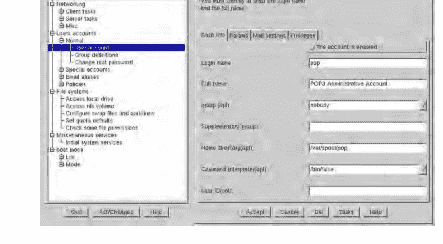

您应该将 POP3 提供的 `popauth` 工具的所有者更改为 `pop`，并使用以下命令使其变为 `suid pop`：

```bash
[ramon]$ cd /usr/sbin
[ramon]$ sudo chown pop popauth
[ramon]$ sudo chmod u+s popauth
```

第一次运行 `popauth` 工具时，您将使用它来创建认证数据库，步骤如下：

```bash
[ramon]$ sudo popauth -init
```

您必须确保新创建的认证数据库文件只能由 `pop` 用户读取：

```bash
[ramon]$ ls -1 /etc/pop.auth
-rw-------  1 pop popusers 1544 Nov 27 22:08 /etc/pop.auth
```

此时，您拥有一个崭新的 Qpopper 安装环境，已准备好填入新的 POP3 用户。下一节将解释如何执行此操作。

### 使用 Qpopper 软件

当向服务器添加新用户时，您还需要允许他们使用 APOP 认证访问您的 POP3 服务器。这需要为每个新用户添加 `/etc/pop.auth` 中的条目。要添加这些条目，只需发出如下 `popauth` 命令：

```bash
[ramon]$ sudo popauth -user ramon
Changing only APOP password for ramon.
New password: mysecret
Retype new password: mysecret
```

请注意，此示例使用 `sudo` 命令以 root 身份运行 `popauth`，但事实上，该命令也可以由用户 `pop` 执行。如果需要撤销用户的 POP3 访问权限，只需使用以下命令将该用户从数据库中删除：

```bash
[ramon]$ sudo popauth -delete ramon
```

一旦用户被添加到 `/etc/pop.auth`，他们就可以更改自己的密码，作为自己的用户调用 `popauth` 实用程序，不带任何命令行选项，步骤如下：

```bash
[ramon]$ popauth
Changing only APOP password for ramon.
Old password: mysecret
New password: newsecret
Retype new password: newsecret
```

本节讨论了 POP3 协议、其安全缺陷以及您如何绕过它们。下一节讨论 IMAP 协议的实现，它是 POP3 的一种替代方案，在 Linux 服务器社区中正获得极大的普及。

## IMAP

虽然 POP3 仍然是最流行的邮件检索协议，但其基本缺陷之一是需要将消息下载到用户计算机（客户端）才能访问它们。这使得用户很难在实际上下载之前选择他们想要查看哪些消息。它同时也使得从多个客户端读取邮件的同时保持邮箱同步变得具有挑战性。互联网邮件访问协议（IMAP）于 1986 年左右在斯坦福大学开发，以解决这一缺陷，并针对通用的 POP3 协议添加了许多其他改进。

IMAP 是一个真正的客户端/服务器协议，独立于访问邮件服务器所使用的传输方式。它还允许您访问远程服务器上的不同邮件文件夹，无论您的身份如何，也无论拥有远程邮箱的用户是谁。虽然这提供了前所未有的灵活性，但也带来了一些担忧，并增加了恶意窃听邮件流量（当其从 IMAP 服务器接收时）的风险。更重要的是，如果在客户端和服务器之间没有加密，用户名/密码交换也将以明文形式进行。

如果您的需求使得您能够受益于向邮件用户提供 IMAP 服务，下一节将指导您完成安装 IMAP 服务器软件的过程，而不会危及服务器的安全性或邮件内容及用户认证交换的隐私性。

### 安装 IMAP 服务器软件

华盛顿大学的 IMAP 服务器是目前 Linux 上最受欢迎且支持最积极的 IMAP 软件包。虽然大多数 Linux 发行版通常不会默认安装它，但可以轻松地以 RPM 格式获取并使用 Linux `rpm` 实用程序进行安装：

```bash
[ramon]$ sudo rpm -i imap-2000-3.1386.rpm
```

此命令将安装服务器二进制文件和手册页，以及有限的文档集。下一节将展示如何设置安全的 IMAP 服务器，以及如何在 `xinetd` 和 `inetd` 上启用它。

### 配置安全的 IMAP 服务器

`imapd-2000` 软件包使用 OpenSSL 作为其安全传输选项（`imapd`）。为了配置 SSL 服务，只需使用以下命令创建一个自签名证书：

```bash
[ramon]$ cd /usr/share/ssl/certs
[ramon]$ sudo make imappd.pem
```

这将导致创建文件 `/usr/share/ssl/certs/imappd.pem`，其中包含 `imapd-2000` 将用于为 IMAP 交换添加 SSL 保护的密钥和证书。请注意，IMAP 会在 `/etc/xinetd.d` 目录中插入两个文件，如列表 6.7 中的步骤所示。

#### 清单 6.7 Xinetd IMAP 定义


```bash
[ramon]$ cd /etc/xinetd.d
[ramon]$ more imap
# default: off
# description: The IMAP service allows remote users to access their mail using \
#		an IMAP client such as Mutt, Pine, fetchmail, or Netscape \
#		Communicator.
service imap
{
  	socket_type		= stream
  	wait			= no
  	user			= root
  	server		= /usr/sbin/imapd
  	log_on_success	+= DURATIO USERID
  	log_on_failure	+= USERID
  	disable		= yes
}
[ramon]$ more imaps
# default: off
# description: The SIMAP service allows remote users to access
# their mail using an IMAP client with SSL support
# such as Netscape Communicator or fetchmail.
  service imaps
  {
    	socket_type		= stream
    	wait			= no
    	user			= root
    	server		= /usr/sbin/stunnel
    	server_args	= -l /usr/sbin/imapd -- imapd
    	log_on_success	+= DURATIO USERID
    	log_on_failure	+= USERID
    	disable		= yes
    }
```

第一个文件（`imap`）指示您的 Linux 服务器查找 TCP 端口 143（`imap` 服务）上的连接。第二个文件（`imaps`）指示您的服务器处理到 TCP 端口 993 的连接，该端口是为 `imaps` 服务（基于 SSL 的 IMAP）保留的。

我建议您永远不要启用明文 IMAP（`/etc/xinetd.d/imap`）。相反，仅启用经过 SSL 保护的 `/etc/xinetd.d/imaps`。您可以通过简单地删除该行来实现：

```text
disable                = yes
```

从 `/etc/xinetd.d/imaps` 文件中删除，并重启 `xinetd` 守护进程。如果您使用的是 `inetd` 而不是 `xinetd`，您可以通过在 `inetd.conf` 文件中输入以下行来启用 `imaps`：

```text
imaps stream tcp nowait root /usr/sbin/stunnel stunnel -l /usr/sbin/imapd -- imapd
```

### 使用安全的 IMAP 服务器

`Netscape Communicator` 以及 `Fetchmail` 和其他邮件客户端都包含对基于 SSL 的 IMAP 的内置支持。本节将以 `Netscape Communicator` 为例进行说明。

首先，将您的 CA（证书颁发机构）根 X.509 证书导入到用户自己的 `Communicator` 应用程序中。这是为了启动身份验证过程所必需的。除非您的邮件服务器使用由第三方签发的证书，而该第三方的根证书已预装在 `Communicator` 中（如 `VerSign`、`Thawte` 等），否则您需要将 CA 的根证书加载到邮件应用程序中，以便对 LDAP 服务器进行强身份验证。由于 `Netscape Communicator` 仅接受 PKCS#12 格式的证书，因此您需要使用以下命令强制 `OpenSSL` 将根证书副本导出为 `.p12` 文件：

```bash
[ramon]$ sudo openssl pkcs12 -export -in newcert.pem -inkey newreq.pem -certfile cacert.pem -name "MY CERTIFICATE" -out mycert.p12
```

系统会提示您输入一个用于保护证书的 `export` 密码。请两次输入密码以进行验证。

然后，您应该将此文件分发给您所有希望使用增强 SSL 的 LDAP 的用户。或者，您可以在用户被分配工作站之前，将此证书标准包含在 `Communicator` 中。

要将证书导入 `Netscape Communicator`，请遵循以下简单步骤：

- 1. 按下 `Ctrl+Shift+I` 调出安全窗口。
- 2. 从左侧菜单中选择 `Certificates > Yours`。`Your Certificates` 窗口将出现（参见图 6.2）。

**图 6.2** `Netscape Communicator` 的安全窗口，您的证书

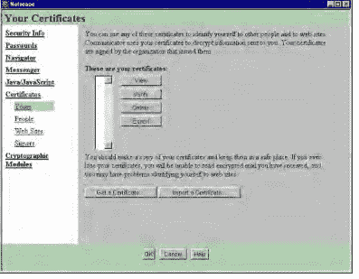

- 3. 点击 `Import a Certificate` 按钮。
- 4. 为证书数据库设置密码。请记住此密码，因为每次添加或删除证书时都必须输入它。
- 5. 在本地磁盘（如果通过软盘分发）或远程网络共享上找到证书。
- 6. 输入您设置的用于保护证书的密码。

此时，您已成功加载了一个 CA 证书，`Communicator` 将使用它来验证由其签发的其他证书的身份。现在您需要通知 `Communicator` 您信任此 CA 证书。请采取以下步骤：

- 1. 选择 `Certificates > Signers` 并向下滚动，直到找到您刚刚导入的证书。
- 2. 点击 `Edit` 按钮。
- 3. 通过点击屏幕下半部分的所有四个复选框来启用对该证书的接受，如图 6.3 所示。

Application Security

PART 3

现在您已准备好联系您的启用 SSL 的 IMAP 服务器。图 6.4 展示了您的用户如何配置其 `Netscape Communicator` 邮件客户端，以便在从您的 IMAP 服务器获取邮件时始终使用 SSL。

**图 6.3** 启用已导入的 CA 证书

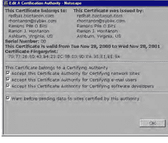

**图 6.4** 配置 `Netscape Communicator` 邮件以支持 SSL IMAP

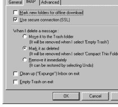

虽然 POP 和 IMAP 都可以更新和修改以提供一定程度的隐私和身份验证，但保护电子邮件应用的更全面解决方案可以在端到端加密中找到。作为大规模使用公钥技术的先驱，Pretty Good Privacy（PGP）在过去十年中一直提供这种端到端服务。下一节将专门介绍 PGP 及其开源变体。

## PGP 和 GnuPG

1991 年，`Phil Zimmermann` 认识到需要在应用层提供机密性，于是他着手开发一种允许用户在电子邮件应用程序中添加机密性的工具。该套件被命名为 Pretty Good Privacy（PGP），它利用公钥技术在通过公共互联网发送之前对任何文档进行加密和数字签名。PGP 迅速成为世界上使用最广泛的邮件加密工具。

与当前依赖分层信任结构的公钥基础设施方案不同，PGP 基于信任链模型，在该模型中，用户安全存储其他用户的公钥，并基于这些密钥的签名做出（传递性的）信任决定。尽管该软件包最初是开源的，但后来的 PGP 版本是在 `MIT`、`ViaCrypt`、`PGP, Inc.` 以及最近 `Network Associates, Inc.` 的支持下开发的。目前至少存在三种不同的 PGP 分发版本：

- **PGP（商业版）** 这是由 `PGP, Inc.`（`Phil Zimmermann` 的公司）开发的原始产品。1997 年，`Network Associates, Inc.`（NAI）收购了 `PGP, Inc.`，NAI 仍然支持并分发基于 `MIT` 工作的商业版和免费软件版 PGP。`Phil Zimmermann` 担任 NAI 的高级研究员。
- **PGPi** 这是 PGP 的国际版本，最初是通过将 PGP 源代码以打印格式导出并使用光学字符识别（OCR）扫描成电子源文件而创建的。这是为了规避监管密码学材料出口的《美国贸易法》。1999 年 9 月，美国政府解除了其中一些限制，使 NAI 能够以电子形式出口该产品。PGPi 的开发至今仍在继续，但根据支持者的说法，其重点已从 OCR 扫描转变为“开发、移植、翻译和本地化”。虽然 PGPi 的个人使用不受限制且源代码可用，但 PGPi 最新版本的商用需要与 NAI 签署许可协议。


**GnuPG**（GNU 隐私卫士）是一个开源的 PGP 实现。它与最初的 PGP 或 PGPi 完全没有关系，但通常与这两个版本都兼容。与 PGP 和 PGPi 不同，GnuPG 按照标准的 GNU 通用公共许可证（GPL）提供，因此可以免费使用和分发。

秉承 Linux 开源软件和无限制许可的传统，本章的其余部分将集中讨论 GnuPG。

### 安装 GnuPG

虽然最新的 Red Hat Linux 发行版包含 GnuPG 作为标准安装的一部分，但大多数 Linux 发行版并不包含。该程序包以 RPM 格式从您喜欢的仓库中轻松获取。要安装 GnuPG，只需发出类似以下的命令即可：

```bash
[ramon]$ sudo rpm -i gnupg-1.0.4-5.i386.rpm
```

此命令在 `/usr/bin/gpg` 安装主要的 GnuPG 可执行文件。下一节将向您展示如何开始使用 GnuPG，以及如何使用它来加密和签署文件和电子邮件消息。

> **提示** 默认情况下，`gpg` 可执行文件不是 suid root。虽然这通常更安全，但它阻止应用程序将其内存页“锁定”到 RAM 中以防止它们被交换到磁盘。这引入了安全风险，因为它使任何本地用户都能轻松扫描交换分区以寻找私钥。我建议您使用命令 `sudo chmod u+s /usr/bin/gpg` 使 `gpg` 应用程序成为 suid root。这是安全的，因为该应用程序仅对其页锁定操作使用其 root 权限。

### 配置 GnuPG

与任何公钥驱动的系统一样，安装 GnuPG 后的第一步是创建用于加密和数字签名文件和消息的公钥/私钥对。要生成您的第一个密钥对，请输入以下命令：

```bash
[ramon]$ gpg --gen-key
public and secret key created and signed
```

系统会提示您输入一个口令，GnuPG 将使用它来保护您磁盘上新生成的私钥。此命令自动创建您的私有`密钥环`，这是一个存储私钥材料的文件（默认为 `~/.gnupg/secring.gpg`）。此外，它创建一个公钥环（`~/.gnupg/pubring.gpg`），您可以在其中手动添加由其他用户提供给您的密钥。至关重要的是，在您收到其他用户的公钥时对其进行签名，并且只有在验证该密钥确实对该个人有效之后才进行签名。为此，请遵循以下简单步骤，从实际导入密钥开始：

```bash
[ramon]$ gpg --import werner.pgp
gpg: key 575480CD: public key imported
gpg: /home/ramon/.gnupg/trustdb.gpg: 信任数据库已创建
gpg: 处理的总数: 1
gpg: 已导入: 1
```

请注意，当你导入此密钥时，GnuPG 报告的密钥 ID 为 `57548DCD`。在后续对该公钥的所有操作中，使用此 ID 或密钥持有人的电子邮件地址，或者也可以仅使用密钥持有人的电子邮件地址。接下来，显示密钥指纹如下例所示，并通过带外方式（例如面对面或电话）与所有者进行核对验证：

```
[ramon]$ gpg --fingerprint 57548DCD
pub  1024D/57548DCD 1998-07-07 Werner Koch (gnupg sig)
    <dd9jn@gnu.org>
Key fingerprint = 68D9 050F D8FC 941B 4341 2DCC 68B7 AB89 5754 8D0D
```

如果指纹匹配，你应该在公钥环上对该密钥进行签名：

```
[ramon]$ gpg --edit-key 57548DCD
gpg (GnuPG) 1.0.2; Copyright (C) 2000 Free Software Foundation, Inc.
This program comes with ABSOLUTELY NO WARRANTY.
This is free software, and you are welcome to redistribute it
under certain conditions. See the file COPYING for details.

pub  1024D/57548DCD  created: 1998-07-07  expires: 2002-12-29
trust: -/q
(1)   Werner Koch (gnupg sig) <dd9jn@gnu.org>

Command> sign

pub  1024D/57548DCD  created: 1998-07-07  expires: 2002-12-29
trust: -/q
            Fingerprint: 68D9 050F D8FC 941B 4341 2DCC 68B7
            AB89 5754 8D0D

      Werner Koch (gnupg sig) <dd9jn@gnu.org>

Are you really sure that you want to sign this key
with your key: "Ramón J. Hontanon (Linux Student)"
<rhontanon@sybex.com>"

Really sign? y

You need a passphrase to unlock the secret key for
user: "Ramon J. Hontanon (Linux Student)
            <rhontanon@sybex.com>"
1024-bit DSA key, ID 3C9EA164, created 2000-11-29
```

现在你拥有了一对属于自己的公钥/私钥对，以及一位同伴（经过验证并签名的）公钥签名。这些是 GnuPG 运行的基本要素。

#### 使用 GnuPG

虽然有许多 Linux 邮件用户代理（MUA）包含透明的 GnuPG 支持（例如 `Mutt`、`Pine` 和 `VM`），但本节将讨论 `gpg` 工具的命令行用法。这一点很重要，因为大多数 MUA 通过管道将消息传入传出至 `gpg`，并使用本节中讨论的命令行选项来支持 GnuPG。表 6.2 列出了最常用的 `gpg` 命令行选项。

| **选项** | **含义** |
|---|---|
| `--encrypt` | 加密消息。 |
| `--armor` | 使用 ASCII 作为加密输出格式。 |
| `--clearsign` | 将消息签名到明文文件。 |
| `--sign` | 对消息进行签名（与 `--encrypt` 选项配合使用）。 |
| `--decrypt` | 解密消息。 |
| `--verify` | 验证签名。 |
| `--list-keys` | 显示公钥环中的密钥。 |
| `--list-secret-keys` | 显示私钥环中的密钥。 |

##### 示例

假设有一封电子邮件消息，其文本位于文件 `message.txt` 中。你想在发送之前对该消息进行数字签名，以便接收者确信该消息确实来自你。输入以下命令对消息进行签名：

```bash
[ramon]$ gpg --clearsign message.txt
You need a passphrase to unlock the secret key for: "Ramon J.
Hontanon (Linux Student) <rhontanon@sybex.com>"
1024-bit DSA key, ID 3C9EA164, created 2000-11-29

[ramon]$ cat message.txt.asc
-----BEGIN PGP SIGNED MESSAGE-----
Hash: SHA1

This is just a test message. We would like to ensure the integrity
of this message by attaching a digital signature to it.

Regards,

-- ramon
-----BEGIN PGP SIGNATURE-----
Version: GnuPG v1.0.2 (GNU/Linux)
Comment: For info see http://www.gnupg.org

iD8D8QE6JbeHnwa9rjey0wQRAhnSAj9WtkILSphi22IrSWHoDpIG2bb8W0gCgH+uB
I/au/YZbCRdhhVpoxSwGJWo=
=peFj
-----END PGP SIGNATURE-----
```

请注意，GnuPG 会提示你输入口令以解锁你的私钥。这是因为签名算法需要使用私钥来生成签名。相反地，消息接收者需要你的公钥来验证你的消息确实是用你的私钥签名的：


```bash
[stacia]$ gpg --verify message.txt.asc
gpg: Signature made Wed Nov 29 21:12:23 2000 EST using DSA key
ID 3C9EA164
gpg: Good signature from 'Ramon J. Hontanon (Linux Student)
<rstanton@sybex.com>'
```

考虑这样一种情况：你希望同时确保消息的隐私性和完整性。以下命令对文件 `message.txt` 中包含的消息进行签名和加密：

```
[ramon]$ gpg --encrypt --sign --armor message.txt

You need a passphrase to unlock the secret key for
user: 'Ramon J. Hontanon (Linux Student)
<rstanton@sybex.com>'

1024-bit DSA key, ID 3C9EA164, created 2000-11-29

You did not specify a user ID. (you may use "-r")

Enter the user ID: stacia@example.com
```

当 `Stacia` 收到消息时，她随后使用她的 `gpg` 工具解密并验证生成的 `message.txt.asc` 文档的签名：

```
[stacia]$ gpg --decrypt message.txt.asc

You need a passphrase to unlock the secret key for
user: 'Stacia S. Hontanon (Linux Master)
<stacia@example.com>

1024-bit ELG-E key, ID A0626845, created 2000-11-29 (main key
ID 3C9EA034)

This is just a test message. We would like to ensure the integrity
of this message by attaching a digital signature to it.

Regards,

-- ramon
gpg: Signature made Wed Nov 29 21:21:54 2000 EST using DSA key
ID 3C9EA164
gpg: Good signature from 'Ramon J. Hontanon (Linux Student)
<rjhontanon@sybex.com>'
```

在这个例子中，解密/验证的输出直接显示在屏幕上。如果你希望输出定向到文件 `message.txt`，只需使用以下命令（注意 `--output` 指令）：

```
[stacia]$ gpg --output message.txt --decrypt message.txt.asc
```

正如你所见，`GnuPG` 是一个综合软件包，包含用于加密、解密、签名和验证任何类型文档（包括电子邮件消息）的工具，以及管理提供此服务所需的私钥和公钥的工具。

像 `GnuPG` 这样的工具不仅对保护电子邮件交换有用，也是保护你需要存储在 Linux 服务器上的关键文件的一项额外隐私措施。我建议你使用 `GnuPG` 加密敏感的网络拓扑图、包含认证密码的笔记以及揭示任何漏洞的网络审计报告，至少在你有机会解决这些漏洞之前。

### 总结

应用程序安全的多层方法要求采用机制来确保应用传输（例如，`SSL`）的隐私性和认证，并通过在流量到达网络之前对数据应用加密和数字签名来确保数据包内容的完整性和真实性（例如，`GnuPG`）。

对于电子邮件应用来说，这一点尤为相关，因为它们的流量巨大，且公司越来越依赖电子邮件处理敏感内容。无论你选择哪种 `MTA`，都需要确保你的邮件用户代理（客户端）支持与你的邮件传输代理相同类型的隐私和认证机制。同样重要的是，确保你的用户接受必要的培训，以便按照你的安全策略使用应用程序。

电子邮件和网页浏览构成了当今穿越互联网流量的大部分。第 7 章“HTTP 服务”将继续讨论应用层安全，通过考察适用于 Linux 服务器的三种开源 HTTP 服务器围绕的安全问题。


# 7 HTTP 服务

本章继续第三部分“应用安全”的讨论，深入探讨 `Apache HTTP` 服务器，它是过去五年 Web 服务器爆发式增长背后的主导力量。本章描述了基础 `Apache` 软件包的整体安全功能，以及标准的认证和访问控制配置。

虽然系统和网络层安全有助于封堵大多数针对你的 Linux 服务器的低级威胁，但残酷的现实是，像 `HTTP` 这样的服务要求你向广大互联网用户开放若干端口（`TCP 80` 以及有时是 `TCP 443`）。这迫使你在应用层实施完整的安全措施，包括认证、访问控制以及保护 `HTTP` 应用服务器本身。

此外，如果你的公司使用 `HTTP` 服务器进行电子商务，你需要确保交易的隐私性，并向你的潜在客户和合作伙伴提供强大的认证。这可以通过使用基础 `Apache HTTP` 发行版的 `SSL`（安全套接字层）扩展来实现。本章描述了两个你可以部署以确保 `HTTP` 交易隐私性和认证性的不同软件包：

- `mod_ssl`（`OpenSSL` 计划的一部分）

- `Apache-SSL`，`mod_ssl` 最初基于此构建

让我们从描述安装、配置和维护 `Apache HTTP` 服务器时涉及的安全特定问题开始讨论。

#### Apache HTTP 服务器

由 `Apache` 软件基金会开发，`Apache HTTP Web` 服务器可以说是自 Linux 操作系统诞生以来最成功的公共可用软件。`Apache` 团队是由地理上分散的开发者组成的群体，他们自愿投入时间来增强和维护 `HTTP` 服务器及其他项目，例如 `XML-Apache`（以及一个 `XML` 开发环境）和 `TomCat`（一个 `Java` 服务器参考实现）。目前，大约十分之六的 Web 服务器正在运行 `Apache` 的 `HTTP` 软件。这个数字是微软互联网信息服务（`IIS`，即 `Apache` 最接近的竞争者）的三倍。

`Apache` 最初源于美国国家超级计算应用中心（`NCSA`）开发的 `HTTP` 实现。`Apache` 得名于它最初是原始 `NCSA HTTP` 服务器的一个“打补丁”（`patchy`）版本这一事实。当 `NCSA` 暂时停止其 `HTTP` 项目的开发时，一群程序员建立了一个论坛，最终导致了第一个版本的 `Apache HTTP` 服务器（版本 `0.6.2`）于 1995 年 4 月发布。八个月后，该小组发布了 `Apache 1.0`，这是他们的第一个生产级服务器，支持多平台。

得益于全球六百万用户的持续关注，以及不断壮大的开发团队的努力，当前的 `Apache` 发行版是一个健壮、强大、可扩展且模块化的服务器。它在性能方面与商用 Web 服务器产品不相上下，并且在安全性方面往往超越它们。要了解 `Apache` 项目的更多信息，请访问 `Apache HTTP` 服务器项目主页 `www.apache.org/httpd`（图 7.1）。

接下来的部分将描述如何在考虑安全性的前提下配置现有的 `Apache` 安装。有关在 Linux 服务器上安装、配置和管理 `Apache` 的基本参考信息，请参阅 `Charles Aulds` 撰写的 *Linux Apache Web Server*（`Sybex`, 2001），该书是 `Craig Hunt Linux` 库系列的一部分。

### 图 7.1 Apache HTTP 服务器项目主页

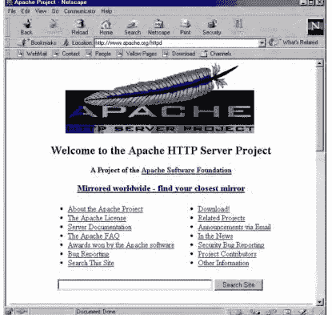

## 配置 Apache 安全性

传统上，`Apache` 服务器有三个独立的配置文件：

- `httpd.conf`：`httpd.conf` 是主配置文件。它包含控制服务器整体操作的指令，例如日志记录和管理服务器池。

- `srm.conf`：`srm.conf` 文件包含控制文件系统中命名空间和资源管理的指令，包括文件类型、目录索引和别名。

- `access.conf`：`access.conf` 文件包含针对各个目录的访问控制指令。

这三个文件位于同一个目录（通常是 `/etc/httpd/conf`）中，并在守护进程启动时按照上述顺序进行处理。然而，将所有指令放在单个文件中更容易；我建议为此目的使用 `httpd.conf`。

接下来的几节将讨论用于控制 `Apache` 服务器安全性的特定指令。所有这些指令都应包含在 `httpd.conf` 文件中。

### 身份验证

用户身份验证通常是在其他公开服务中的一项必要功能。`Apache HTTP` 服务器具有在授予用户其 `HTTP` 请求之前执行某些规则的能力。基于以下两个标准之一，用户可以被授予其 `HTTP` 请求：

- `HTTP` 请求方提供的用户名/密码

- 生成请求的主机 `IP` 地址


虽然大多数 Web 服务器包含真正公开的内容且不运行身份验证，但某些应用程序会迫使你实施身份验证控制。例如，你的公司可能提供基于订阅的服务，要求付费用户在获取服务之前进行身份验证。或者，你可能已经设置了一个 Web 服务器，远程用户可以通过它获取专有软件或机密信息。在这些情况下，你应该使用 Apache 身份验证，以确保只有授权用户才能获得内容树中私有部分（即服务器中通过 HTTP 提供 HTML 文档的目录）的 HTTP 访问权限。

在最基本的层面上，Apache 支持四个模块，允许 Web 管理员定义并验证带有相应密码的用户列表。这些模块是独立的代码片段，插入到提供特定身份验证方法的标准 Apache 功能中。虽然第三方开发者可以将任何模块集成到 Apache 中，但以下四个身份验证模块随发行版标准提供：`mod_auth`, `mod_auth_dbm`, `mod_auth_db`, 和 `mod_auth_digest`。接下来的部分将详细描述每个模块。

#### `mod_auth`

`mod_auth` 模块提供使用纯文本文件的简单用户名/密码身份验证。要使用这种类型的身份验证，管理员必须使用 `htpasswd` 命令将每个用户添加到 Apache 密码文件中。当使用 `mod_auth` 时，每次用户想要访问包含 `.htaccess` 文件的目录时，Apache 都会提示用户输入密码。如果用户提供了与 Apache 密码文件中的条目匹配的用户名和密码，则授予访问权限。

`.htaccess` 文件用于为每个子目录包含身份验证指令。若要强制用户使用用户名和密码进行身份验证，只需创建一个包含以下文本的 `.htaccess` 文件：

```text
AuthName  "Restricted Files"
AuthType  Basic
AuthUserFile /usr/local/etc/httpd/users
Require valid-user
```

让我们来看看这些指令的含义：

- `AuthName` 定义身份验证域“Restricted Files”。这允许已经对特定域进行身份验证的用户访问其他目录而无需用户名/密码，前提是这些目录受同一域保护。

- `AuthType` 定义身份验证协议。关键字 `Basic` 指示 Apache 使用 `mod_auth` 模块以明文形式接收用户指定的密码。

- `AuthUserFile` 指向包含 `mod_auth` 用户信息的密码文件。

- `Require` 指示服务器对密码文件的一部分或整个密码文件应用此类型的身份验证。前面的示例使用了 `valid-user` 值，实际上将 `Basic` 身份验证应用于文件中的所有用户。你可以使用此指令将目录访问限制为特定数量的用户（即使密码文件可能包含数百个用户名）。例如，要将访问限制为仅用户名 `alic` 和 `bob`，你可以使用以下 `.htaccess` 语法：

```text
AuthName  "Restricted Files"
AuthType  Basic
AuthUserFile /etc/httpd/conf/user-list
Require user alic bob
```

由于文本文件顺序搜索的限制，该模块仅适用于需要少于 500 个用户的安装环境。`mod_auth` 模块支持组文件和密码文件。

组文件的格式如下：

```text
group : user-1 user-2 user-3 .. user-n
```

其中 `group` 是组的名称，`user-1` 到 `user-n` 是要包含在组中的用户。列表 7.1 包含一个 Apache 组文件的示例。

##### 列表 7.1 Apache 组文件示例

```text
administrators: alice bob charlie
operators: david ernie
dba: fred george harry
```

`htpasswd` 工具随 Apache 提供，用于创建和更新用户及组文件。该工具的命令行用法如下：

```
htpasswd [-c] passwd_file user
```

`-c` 选项指示该工具创建一个新密码文件（命名为 `passwd_file`），`user` 是要添加到文件中的用户名。

> **注意** 请注意不要在试图保护的同个目录中创建 `passwd_file`，因为任何授权的 Web 用户都将能够查看 `passwd_file` 的内容。

要创建密码文件，请执行类似列表 7.2 中所示的命令序列。

##### 列表 7.2 使用 `htpasswd` 工具

```bash
[ramon]$ sudo htpasswd -c /etc/httpd/conf/user-list alice
New password:
Re-type new password:
Adding password for user alice
[ramon]$ sudo htpasswd /etc/httpd/conf/user-list bob
New password:
Re-type new password:
Adding password for user bob
[ramon]$ sudo htpasswd /etc/httpd/conf/user-list charlie
New password:
Re-type new password:
Adding password for user charlie
```

密码文件中每一行的格式为：

```
user:password-hash
```

其中 `user` 是明文用户名，`password-hash` 是对明文密码应用加密哈希操作的结果。

列表 7.3 包含了执行列表 7.2 中的命令后生成的密码文件。

###### 清单 7.3 示例 Apache 密码文件

```
[ramon]$ more /etc/httpd/conf/user-list
alice:9ti4wVG8J3Yug
bob:vsh73lcf4ph2
charlie:WqBo5s8Vas8XJg
```

在本节前面的内容中，你学习了 `.htaccess` 文件以及如何添加指令以使用 `mod_auth` 模块进行身份验证。表 7.1 列出了所有可用指令的完整列表，包括它们的语法和含义。

##### 表 7.1 `mod_auth` 指令

| 指令 | 含义 |
|---|---|
| `AuthName auth-domain` | 指定发送给 HTTP 客户端的身份验证域。 |
| `AuthType type` | 指定密码传输类型：Basic（明文）或 Digest（MD5）。 |
| `AuthGroupFile filename` | 指定包含组身份验证信息的文件的名称。 |
| `AuthUserFile filename` | 指定包含用户身份验证信息的文件的名称。 |
| `AuthAuthoritative [ on \| off ]` | 如果用户不可用，避免回退到较低形式的身份验证。默认为 on。 |

例如，请考虑清单 7.4 中 `/var/www/html/.htaccess` 文件里的条目。

##### 清单 7.4 使用 `mod_auth` 指令

```
AuthName 'Private Information'
AuthType Basic
AuthUserFile /etc/httpd/conf/user-list
AuthGroupFile /etc/httpd/conf/group-list
AuthAuthoritative on
Require valid-user
```

清单 7.4 中的指令具有以下含义：

- `AuthName 'Private Information'` 指定一个域，这是 Apache 身份验证模块用来指代当前资源（目录）的概念。域对应于该目录结构下的子目录结构。一旦浏览器成功完成身份验证，它就可以访问该范围内的任何资源。

- `AuthType Basic` 定义标准的明文密码传输。

- `AuthUserFile` 指令将密码文件路径定义为 `/etc/httpd/conf/user-list`。

- `AuthGroupFile` 指令将组文件路径定义为 `/etc/httpd/conf/group-list`。

- `AuthAuthoritative` 指令确保如果用户不存在，则直接拒绝访问。（Apache 具有在首次请求失败时将此密码级联到其他身份验证方法的能力）。

- `Require valid-user` 指令指示 Apache 仅向存在于 `AuthUserFile` 中的用户授予访问权限。或者，你可以指定以下内容：

  ```
  Require user alice
  Require user bob
  ```


这两个指令将访问限制为仅限 `alice` 和 `bob` 这两个用户。同样存在于 `AuthUserFile` 中的用户 `charlie` 将被拒绝访问。这对于将 Apache 内容树中的特定子目录限制为特定用户非常有用，同时依赖一个中央 `AuthUserFile`。此外，你可以使用以下指令将访问限制为特定组内的用户：

```
Require group administrators
```

此指令将访问限制为那些成功作为密码文件中的授权用户进行身份验证，并且也是 `administrators` 组成员的用户。

> **警告** 虽然可以使用标准的 Linux `/etc/passwd` 来执行 Apache 服务器身份验证，但我强烈建议不要这样做。如果交换用于 Apache 身份验证的用户名/密码对被捕获（通常以明文传输），入侵者也可以渗透用户的 shell 账户。此外，Apache 对失败的登录尝试没有限制，因此攻击者可以使用暴力方法通过反复尝试 HTTP 请求来猜测系统密码。

### mod_auth_dbm

`mod_auth_dbm` 模块使用 Linux DBM 格式作为用户数据库，提供简单的用户名/密码身份验证。用户查找比 `mod_auth` 的查找速度要快得多，并且 `mod_auth_dbm` 模块可以支持非常大的用户群体（通常为数千用户）。与 `mod_auth` 一样，`mod_auth_dbm` 的使用由可以包含在 Apache 内容树中的 `.htaccess` 目录内的指令控制。表 7.2 列出了 `mod_auth_dbm` 模块可用的指令。

#### 表 7.2 mod_auth_dbm 指令

| 指令 | 含义 |
|---|---|
| `AuthName auth-domain` | 指定发送给 HTTP 客户端的身份验证域。 |
| `AuthType type` | 指定密码传输类型：Basic（明文）或 Digest（MD5）。 |
| `AuthDBMGroupFile filename` | 指定包含组身份验证信息的 DBM 文件的名称。 |
| `AuthDBMUserFile filename` | 指定包含用户身份验证信息的 DBM 文件的名称。 |
| `AuthDBMAuthoritative [ on \| off ]` | 如果用户不可用，避免回退到较低形式的身份验证。默认为 on。 |

作为一个示例，请考虑 `/var/www/html/.htaccess` 文件中清单 7.5 的条目。

##### 清单 7.5

```text
AuthName 'Private Information'
AuthType Basic
AuthDBMUserFile /etc/httpd/conf/user-list-DBM
AuthDBMGroupFile /etc/httpd/conf/group-list-DBM
AuthDBMAuthoritative on
Require valid-user
```

清单 7.5 中的示例与清单 7.4 中的示例类似，除了第三行和第四行不同。在清单 7.5 中，`AuthDBMUserFile` 和 `AuthDBMGroupFile` 指令指定身份验证查找在名为 `/etc/httpd/conf/user-list-DBM` 和 `/etc/httpd/conf/group-list-DBM` 的 DBM 格式文件上进行，而不是在清单 7.4 示例中使用的平面文件上进行。

Apache 包含一个名为 `dbmmanage` 的 Perl 实用程序（通常安装在 `/usr/sbin` 中），你可以使用它初始创建 DBM 数据库，并用新用户和组填充数据库。`dbmmanage` 的命令行用法如下：

```
dbmmanage filename [ command [ username [pw [group1[,group2] [encpasswd ] ]
```

在 `dbmmanage` 命令行中，`command` 可以是以下之一：

- `add`：此命令使用加密密码 `encpasswd` 或 `group1 [,group2]` 列表中的组，为 `filename` 添加 `username` 的条目。
- `adduser`：此命令提示输入密码，并为 `filename` 添加 `username` 的条目。
- `check`：此命令提示输入密码，然后检查 `filename` 中是否存在 `username` 及其密码是否与指定的匹配。
- `delete`：此命令从 `filename` 中删除 `username` 条目。
- `import`：此命令从标准 Linux 输入读取 `username:password` 条目（每行一个）并将其追加到 `filename`。密码必须已经加密。
- `update`：此命令等同于 `adduser` 命令，只是它确保 `username` 已经存在于 `filename` 中。
- `view`：此命令显示 DBM 数据库文件的完整内容。

例如，要创建 DBM 用户数据库文件 `/etc/httpd/conf/user-list-DBM` 并添加一个名为 `alice` 的新用户，请输入以下命令：

```
[ramon]$ sudo dbmmanage /etc/httpd/conf/user-list-DBM adduser alice
New password:
Re-type new password:
User alice added with password encrypted to vqQ/X7Z7hYLXQ using crypt
```

要查看你新建的条目，请输入以下命令：

```
[ramon]$ sudo dbmmanage /etc/httpd/conf/user-list-DBM view
alice:vqQ/X7Z7hYLXQ
```

要删除 `alice` 的数据库条目，请输入以下命令：

```
[ramon]$ sudo dbmmanage /etc/httpd/conf/user-list-DBM delete alice
alice deleted
```

此外，你可以使用以下命令创建一个新的组数据库，该数据库以用户名为键，值字段为用户所属组的逗号分隔列表：

```bash
[ramon]$ sudo dbmmanage /etc/httpd/conf/group-list-DBM add alice
staff,operators,admin
User alice added with password encrypted to staff,operators,admin
using crypt

[ramon]$ sudo dbmmanage /etc/httpd/conf/group-list-DBM view alice
alice:staff,operators,admin
```

### mod_auth_db

从 Apache 1.1 开始，`mod_auth_db` 模块提供了 `mod_auth_dbm` 的替代方案，使用 Berkeley Database（也称为 Berkeley DB）格式而不是标准的 Linux DBM。`mod_auth_db` 的指令列在表 7.3 中，与 `mod_auth_dbm` 的指令类似。

#### 表 7.3 mod_auth_db 指令

| 指令 | 含义 |
| :--- | :--- |
| `AuthName auth-domain` | 指定发送给 HTTP 客户端的身份验证域。 |
| `AuthType type` | 指定密码传输类型：Basic（明文）或 Digest（MD5）。 |
| `AuthDBGroupFile filename` | 指定包含组身份验证信息的 DB 文件的名称。 |
| `AuthDBUserFile filename` | 指定包含用户身份验证信息的 DB 文件的名称。 |
| `AuthDBAuthoritative [ on \| off ]` | 如果用户不可用，避免回退到较低形式的身份验证。默认为 on。 |

你使用 `makedb` 实用程序为你的密码列表和组列表创建 Berkeley DB 文件。`makedb` 创建正确的数据库格式需要两项内容：

- `Password`：用户名、冒号和加密密码
- `Group`：组名、冒号和逗号分隔的组列表

请注意，您输入的密码必须与 `htpasswd` 工具的输出自带相同格式。因此，为了将新用户添加到 Apache Berkeley DB 数据库中，只需执行以下操作：

```
[ramon]$ sudo htpasswd /etc/httpd/conf/user-list bob
New password:
Re-type new password:
Adding password for user bob
```


```
[ramon]$ sudo mkeddb /etc/httpd/conf/user-list -o httpd/conf/user-list-DB
```

您输入的组名格式与标准 Apache 组名格式不同，因此您需要维护一个单独的文件，将其用作 `mkeddb` 的输入。考虑以下示例：

```
[ramon]$ cat /etc/httpd/conf/group-list-for-db
staff: alice, bob, charlie
admin: alice, bob
operators: alice, bob, charlie, david
```

一旦您对这份列表进行了修改，只需使用 `mkeddb` 命令创建一个 Berkeley DB 数据库文件供 `mod_auth_db` 使用，使用以下命令即可：

```
[ramon]$ sudo mkeddb /etc/httpd/conf/group-list-for-db -o /etc/httpd/conf/group-list-DB
```

`mod_auth_digest` 该模块自 Apache 1.3.8 起可用，`mod_auth_digest` 模块提供 MD5 摘要认证，可防止在客户端和 Apache 服务器之间以明文形式传输用户名和密码信息。大多数标准发行版默认不加载 `mod_auth_digest` 模块；要安装它，您需要在 `httpd.conf` 文件中插入（在 Red Hat 7.0 的情况下，取消注释）以下行：

```
LoadModule digest_module  /etc/modules/mod_digest.so
AddModule mod_digest.c
```

这两行利用 Apache 的动态共享对象（DSO）功能，纳入了一个外部共享模块，其处理句柄为 `digest_module`，并且位于文件 `/etc/modules/mod_digest.so` 中。`AddModule` 指令引用了 `mod_digest.c`，它是 `mod_auth_digest` 模块的主源文件。

表 7.4 列出了适用于 `mod_auth_digest` 模块的指令。

##### 表 7.4 mod_auth_digest 指令

| 指令 | 含义 |
|:--|:--|
| `AuthName` `auth-domain` | 指定要发送给 HTTP 客户端的认证域。 |
| `AuthType` `type` | 指定密码传输类型：Basic（明文）或 Digest（MD5）。 |
| `AuthDigestDomain` `domain` | 位于同一保护空间中的一个或多个 URL。 |
| `AuthDigestGroupFile` `filename` | 指定包含组认证信息的 DB 文件名。 |
| `AuthDigestFile` `filename` | 指定包含 MD5 摘要认证信息的文件名。 |
| `AuthDBAuthitative` [ `on` | `off` ] | 当用户不可用时，避免回退到较低形式的认证。默认为 `on`。 |

请注意，此模块使用摘要认证文件（`AuthDigestFile`）而不是密码文件。摘要认证文件通过 `htdigest` 命令进行维护，其格式为

```
user:password-hash
```

其中 `user` 是明文用户名，而 `password-hash` 是对明文密码应用加密哈希操作的结果。摘要认证文件中的条目也可以采用以下形式

```
user:realm:MD5-password-hash
```

其中 `user` 是明文用户名，`realm` 是 `AuthName` 指令中指定的领域名称，而 `MD5-password-hash` 是对明文密码应用 MD5 哈希操作的结果。`AuthDigestFile` 的示例如下：

```
[ramon]$ more .htdigest
alice:private:sd7f90s8dfh0s89df70sdfd0fs8d70sd
bob:private:a8839d9bc0d14b768a14423e1836fec4
charlie:private:sd907fsd09f780sd7f0sdY7f90sydF89
```

为了便于创建 `AuthDigestFile`，Apache 提供了一个名为 `htdigest` 的工具，其命令行用法如下：

```
htdigest [-c] digest_file realm user
```

在 `htdigest` 命令行中，`-c` 指示工具创建一个新的摘要文件（`digest_file`），`user` 表示要添加到文件中的用户名，`realm` 指定密码的认证范围。

为了在目录上设置 MD5 认证，只需在您的 `.htaccess` 文件中输入列表 7.6 中列出的指令即可。

##### 列表 7.6 使用 mod_auth_digest 指令

```
AuthType Digest
AuthName "private area"
AuthDigestDomain http://www.example.com/private/
AuthDigestFile /etc/httpd/conf/digest-file
require valid-user
```

此领域称为 `private area`，包含摘要认证的文件位于 `/etc/httpd/conf/digest-file`。请注意，成功认证的客户端将能够访问整个 `http://www.example.com/private/` URL。

摘要认证是一个具有明显优势的功能，即保护资源认证过程中的用户名/密码交换。然而，摘要认证确实限制了平面摘要文件中的用户数量。此外，较旧的 Web 浏览器可能不支持此认证方法。

建议您对仅由少数用户（可能是网站管理员）访问的关键资源使用摘要认证，并且在这些情况下，您可以完全控制所使用的浏览器类型。

### 访问控制

Apache HTTP 服务器支持两种访问控制方法：

- 自主式（基于用户名和密码）
- 强制式（基于客户端机器的 IP 地址）

自主式访问控制要求 HTTP 客户端用户提供他们知道的信息（用户名/密码组合）。凭证的选择取决于用户的决定，用户可能会根据当前扮演的角色选择不同的用户名。另一方面，强制式访问控制方法依赖于用户无法控制的凭证。HTTP 客户端的 IP 地址是最常用的强制式访问控制凭证。

上一节介绍了访问 Apache 内容树的自主式认证的详细信息。本节检查了在服务器上基于请求内容的主机 IP 地址强制执行强制式访问控制规则所需的配置步骤。

建议您采用一种默认安全配置，该配置拒绝所有对根树的访问，这迫使您根据需要授予访问权限。这是通过在 `httpd.conf` 文件中使用以下语法实现的：

```
<Directory />
Deny from all
AllowOverride None
</Directory>
```

`Deny from all` 指令有效地拒绝了对以 `/` 开头的目录树的所有 HTTP 请求，这包括其所有相关子目录。

`AllowOverride` 指令值得特别讨论。其一般格式如下：

```
AllowOverride option_1 option_2 - option_n
```

如前所述，当 Apache 在内容目录中遇到 `.htaccess` 文件时，它会应用文件中找到的访问控制指令到当前目录。但是，当其中一些指令与 `httpd.conf` 文件中包含的指令发生冲突时，`AllowOverride` 指令将被咨询以确定 Apache 可以覆盖哪个选项。

例如，如果您的 `httpd.conf` 指定了指令

```
AuthType Digest
```

并且您希望通过向本地 `.htaccess` 文件添加以下内容来允许对某些目录使用 Basic 认证来授予访问权限：

```
AuthType Basic
```

那么您需要将指令

```
AllowOverride AuthType
```

添加到 `httpd.conf` 文件中，以便允许内容树某处的 `.htaccess` 文件使用 Basic 认证，而不是 `httpd.conf` 中声明的 Digest 认证。

表 7.5 列出了可以使用 `AllowOverride` 从 `.htaccess` 覆盖的选项。

#### 表 7.5 AllowOverride 选项

| 选项 | 含义 | 示例 |
| --- | --- | --- |
| `AuthConfig` | 覆盖授权指令 | `AuthGroupFile`, `AuthName`, `AuthType`, `AuthUserFile`, `require` |
| `FileInfo` | 覆盖控制文档类型的指令 | `AddEncoding`, `AddLanguage`, `AddType`, `DefaultType`, `ErrorDocument`, `LanguagePriority` |


| **Indexes** | 覆盖控制文件索引的指令 | `AddDescription`, `AddIcon`, `AddIconByEncoding`, `AddIconByType`, `DefaultIcon` |
| **Limit** | 覆盖控制主机访问的指令 | `Allow`, `Deny` |
| **Options** | 覆盖控制特定目录功能的指令 | `Options`, `XBitHack` |

如果您希望允许个人用户单独更改其默认选项，我建议将这种能力限制在`AuthConfig`和`Limit`选项中，使用以下指令：

```apache
UserDir public_html
<Directory /export/homes/*/public_html>
  Allow from all
  AllowOverride AuthConfig Limit
</Directory>
```

假设您不关心用户在家庭目录中可能公开的内容的隐私性，允许覆盖`AuthConfig`和`Limit`选项将使个人用户能够使用认证和访问控制来保护他们认为敏感的内容。

请注意，第一行将目录`~/public_html`定义为各个用户放置其HTML内容的位置，这些内容将通过URL`www.example.com/~user`提供访问。在这种情况下，您允许对整棵目录树进行完全开放的访问，除非用户在他们的本地`.htaccess`文件中另行指定。

您可能需要限制内容树的一部分，仅允许那些主机名和/或IP地址符合特定条件的客户端访问。例如，为了将URL`www.example.com/intranet/`的访问限制在`10.10.10.0/24`子网中的主机，请使用以下指令：

```apache
DocumentRoot "/var/www/html1"
<Directory /var/www/html1/intranet/>
    Allow from 10.10.10.0/24
</Directory>
```

在以下示例中，您正在将同一URL的访问限制为反向DNS查找（PTR记录）位于`example.com`域名下的主机：

```apache
DocumentRoot "/var/www/html1"
<Directory /var/www/html1/intranet/>
    Allow from .example.com
</Directory>
```

除了`Allow from`指令外，Apache还支持`Deny from`指令，并且可以控制这两条指令（`Deny`和`Allow`）的评估顺序。考虑以下示例。Apache服务器在评估`Allow from`指令之前先评估`Deny from`指令，并且默认允许访问。结果是，除了`10.10.10.0/24`网段中的所有主机外，其他所有主机都被允许访问。然而，主机`10.10.10.1`是被允许的。

```apache
<Directory /var/www/html1/intranet/>
    Order deny,allow
    Deny from 10.10.10.0/24
    Allow from 10.10.10.1
</Directory>
```

现在考虑下一个示例。在这种情况下，您在评估`Deny from`指令之前先评估`Allow from`指令，并且采用“拒绝所有”的策略。这导致除了来自`10.10.10.0/24`的连接外，所有客户端连接都被拒绝。在以下示例中，`10.10.10.1`网段将被允许：

```apache
<Directory /var/www/html1/intranet/>
    Order allow,deny
    Allow from 10.10.10.0/24
    Deny from 10.10.10.1
</Directory>
```

最后，您需要向`httpd.conf`文件中添加代码，以防止Web用户查看内容树中任何目录下的`.htaccess`文件，因为它包含授权信息。以下指令指示Apache查找内容树中任何以字符`.ht`开头的文件名，并拒绝所有用户访问这些文件。该指令不仅保护了`.htaccess`文件，还保护了任何`.htpasswd`文件（一种常用于存储密码信息的常见文件名）的出现。

```apache
<Files "^.ht">
    Order allow,deny
    Deny from all
</Files>
```

### 强化 Apache 服务器

与运行在您的Linux服务器上的任何其他应用程序一样，您需要确保服务器的操作不会因试图获得未授权访问系统的人侵者而被破坏。除了关注`www.apache.org`和`www.cert.org`上的最新安全公告和补丁外，在安装过程中进行仔细规划可以在多个方面极大地提高安全性。

#### Apache 用户

虽然Apache守护进程必须由`root`启动，但至关重要的是，Apache守护进程不应在具有特权权限的用户名下运行。`httpd.conf`文件支持两个指令：

- `user apache-user`
- `group apache-group`

`apache-user`和`apache-group`是服务器运行所基于的用户ID和组ID。应将Apache用户添加到`/etc/passwd`中，并为其设置安全的密码，其主目录应设为内容树。所有内容管理都应使用此用户进行操作。

#### 内容树的拥有权和权限

只有`apache-user`和`apache-group`应该能够写入内容树，且该树应由此用户名/组名组合拥有。以下命令是分配此拥有权的示例：

```bash
[ramon]$ sudo chown -Rh apache:apache /var/www/html
```

#### 隐藏目录内容

默认情况下，当浏览器在URL中请求目录列表时，Apache会返回`DirectoryIndex`指令下列出的某个文件的内容，例如：

```apache
DirectoryIndex index.html index.htm index.shtml index.php index.php4 index.php3 index.cgi
```

然而，如果这些文件中的某一个暂时不可用，用户实际上可能会看到该目录中所有文件的列表，包括您可能不希望用户列出的脚本文件和头文件。为了防止这种情况，请确保通过执行以下命令关闭内容目录中“组”和“其他”用户的读取权限：

```bash
[ramon]$ cd /var/www
[ramon]$ ls -ld html
drwxr-xr-x 2 apache apache 1024 Dec 4 20:44 html
[ramon]$ sudo -u apache chmod go-r html
[ramon]$ ls -ld html
drwx--x--x 2 apache apache 1024 Dec 4 20:44 html
```

#### CGI 脚本

通用网关接口（CGI）脚本允许您的用户响应HTTP输入执行代码，并向远程浏览器返回有意义的内容。与任何可执行文件一样，请确保您的用户编写的是安全的脚本，并且这些脚本的拥有权和权限是正确的。为此，Apache允许您使用如下`httpd.conf`指令将所有CGI脚本限制在单个目录中：

```apache
ScriptAlias /cgi-bin/ "/var/www/cgi-bin/*"
```

该指令确保所有CGI脚本位于`/var/www/cgi-bin`目录中，您可以轻松地跟踪和监控它们。您应定期检查此目录，确保其中没有可被所有用户写入的脚本文件。

#### 服务器端包含（SSI）

服务器端包含（SSI）是对静态HTML内容的扩展，允许有条件地执行外部程序，以及进行“即时”内容修改。SSI代表了一个潜在的安全问题，因为很难对HTML文件允许执行的程序设定界限。

使用以下指令禁用执行外部程序的SSI（此功能被称为`exec`）：

```apache
Options IncludesNOEXEC
```

一旦您以负责任的安全方式安装并配置了Apache，请监控应用程序日志中的可疑活动。本书的下一节将描述Apache的日志设施及其日志文件的内容。

### 应用程序日志

Apache的标准日志设施提供了全面的诊断功能，允许系统和安全管理员审计常规事件（如成功的HTTP请求）以及可疑和潜在的恶意事件。有两个日志文件需要定期检查：

- **`access_log`**

  `access_log`文件包含针对HTTP服务器发出的每个成功请求的一行记录。其通用格式如下：

  ```text
  _remote_host remote_user time_stamp request_type request_status_
  ```


例如，以下两条记录显示了一个客户端 IP 地址为`209.1.78.12`的远程用户试图访问两个对 Apache 服务器不可用的文件（`/etc/shadow`和`/etc/passwd`）：

```text
209.1.78.12 - - [04/Dec/2000:21:03:45 -0500] "GET /etc/passwd HTTP/1.1" 404 139
209.1.78.12 - - [04/Dec/2000:21:03:47 -0500] "GET /etc/shadow HTTP/1.1" 404 139
```

请注意，`request_status`为`404`指的是“文件未找到”的状态。定期搜索此状态代码可能会为那些正在四处寻找未保护内容的潜在入侵者提供重要线索。

- `error_log`

`error_log`文件记录 Apache 服务器的管理事件，包括服务器启动、停止以及执行特权 CGI 脚本的失败尝试。它还报告与脚本本身特定的执行错误。其通用格式如下：

```text
_time_stamp error_type client_id error_description_
```

例如，考虑以下一组`error_log`条目。此示例显示了 Apache 应用程序的非正常关闭，随后立即重启。这是应通过自动日志扫描软件包（如第 3 章“系统监控和日志”中讨论的`logcheck`和`swatch`）进行监控的日志条目之一。

```text
[Mon Dec 4 02:20:50 2000] [notice] httpd: caught SIGTERM, shutting down
[Mon Dec 4 02:20:57 2000] [notice] Apache/1.3.14 (Unix) configured -- resuming normal operations
[Mon Dec 4 02:21:00 2000] [warn] pid file /usr/local/apache/var/run/httpd.pid overwritten -- Un clean shutdown of previous apache run?
```

### mod_ssl

`mod_ssl`最初由 Ralf S. Engelschall 于 1998 年初开发，它是 Eric Young 和 Tim Hudson 开发的流行 OpenSSL 实现的 Web 接口。此实现利用了 Apache 的模块化架构，并将安全套接字层（Secure Sockets Layer, SSL）扩展作为外部模块实现于标准的 Apache 源代码树中。

SSL 允许数据隐私。通信的两个端点执行初步握手，并使用对称密钥算法（如 DES 或 RC4）定义用于数据加密的秘密密钥。SSL 还使用消息摘要算法（如 SHA 或 MD5）确保交换的数据的完整性。在通信之前，SSL 端点必须使用公钥密码学进行相互身份验证，其中连接的每一端都必须出示由通常受信任的证书颁发机构（CA）签发的数字证书（通常为 X.509 格式）。

Netscape 开发了最初的 SSL 规范。基于其广泛的成功，IETF 起草了一个类似的标准，称为传输层安全性（Transport Layer Security, TLS），如 `RFC 2246`所述。TLS 1.0 基于 SSL v3，虽然它提供了一种 TLS 对等端降级到 SSL v3 的方法，但 TLS 在很大程度上与 SSL 不兼容。OpenSSL 同时支持 SSL 和 TLS。

通过在 TCP 层和 HTTP 应用层之间插入 OpenSSL，`mod_ssl`使用 SSL 和 TLS 为 Web 客户端与 Apache HTTP 服务器之间的传输添加强身份验证、数据完整性和隐私性。请注意，`mod_ssl`可以与非安全版本的 Apache 共存。实际上，虽然普通 HTTP 使用 TCP 端口 80 进行控制和数据交换，但所有 HTTPS（安全 HTTP 或基于 SSL 的 HTTP）流量都通过 Linux 服务器上的 TCP 端口 443 传输。

`mod_ssl`受标准 BSD 许可证保护，使其可免费用于商业和非商业用途。在撰写本书时，`mod_ssl`占互联网上 Apache 总安装量的 10% 以上，且该数字一直在增长。

过去两年一直在稳步推进。`mod_ssl`项目主页信息丰富且保持更新。您可以在`www.modssl.org`找到该页面（见图 7.2）。

#### 图 7.2 mod_ssl 项目主页

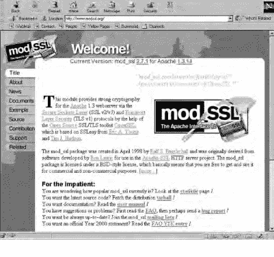

#### 安装 mod_ssl

大多数 Linux 发行版默认包含 Apache，但很少有默认包含 `mod_ssl`。不过，该包以 RPM 格式可以轻松获取。要安装它，首先使用此`rpm`命令确保 Apache 和 OpenSSL 也已安装：

```
[ramon]$ rpm -q apache openssl
apache-1.3.14-3
openssl-0.9.5a-14
```

如果 `mod_ssl` 尚未安装，只需执行以下命令即可安装：

```
[ramon]$ rpm -q mod_ssl
package mod_ssl is not installed
[ramon]$ sudo rpm -i mod_ssl-2.7.1-i386.rpm
```

您已为现有的 Apache 安装添加了 SSL 支持。为使此更改生效，请确保重启 Apache 守护进程：

```
[ramon]$ sudo /etc/rc.d/init.d/httpd restart
```

您的 Apache 服务器现在将响应 TCP 端口 80 (HTTP) 和 443 (HTTPS) 上的请求。

下一节将介绍如何配置 `mod_ssl`。

#### 配置 mod_ssl

在配置 `mod_ssl` 之前，有一个基本选择需要做出，这与您使用数字证书和认证的方式有关。您需要执行以下操作之一：

- 寻求知名 CA（Verisign、Thawte、Entrust、Xcert 等）的服务，这些 CA 的根证书已预装在许多当前的网络应用程序中（Web 浏览器、邮件客户端等）。

- 使用 OpenSSL 创建自己的 CA，创建 Apache 服务器的数字证书，并使用 CA 的私钥（您刚刚创建的那个）对其进行签名。

- 创建一个简单的自签名 Apache 服务器证书。

第一种方法，即寻求知名 CA 的服务，有一个重要优势：您无需在所有客户端应用程序中预装自签名证书，因为您的 Apache 服务器证书将由这些 CA 之一进行签名，这将允许您完成“信任链”而无需干预。第一种方法的缺点是与之相关的费用，以及证书过期并需要 CA 重新签发时的重复费用。

第二种方法，使用 OpenSSL 创建自己的 CA，涉及更多的工作，但允许您控制整个信任验证过程，包括除 Apache 服务器以外的其他应用程序（例如，第 6 章“电子邮件”中描述的邮件客户端）。由于 OpenSSL 提供了创建和维护您自己 CA 所需的工具，本节将讨论这种方法。

第三种方法，创建简单的自签名 Apache 服务器证书，是最直接的方法，也是最容易实施的，尽管它要求 Web 浏览器用户在首次连接到 Apache 服务器时手动验证密钥指纹。本节也将描述这种方法。

#### 创建证书颁发机构

在您能够建立 Apache 服务器与客户机之间的 SSL 会话之前，连接的两端都需要由共同的 CA 签发的证书。虽然当今有许多商业 CA 服务可用，但您可以使用`openssl`工具创建 CA 的私钥、其证书以及 CA 签名的 Apache 服务器证书来建立自己的 CA。让我们从使用以下命令创建`openssl`工具的配置文件开始：

```
[ramon]$ cp /usr/share/ssl/openssl.cnf /etc/httpd/conf/
```

`openssl.cnf`文件是 OpenSSL 的主要配置文件，其中定义了所有目录和环境变量。标准的`openssl.cnf`对于您的用途来说基本是正确的。只需编辑它以确保`[ CA_default ]`部分包含正确的目录路径：


```
[ CA_default ]
dir          = /etc/httpd/conf        # Where everything is kept
certs        = $dir/ssl.crt           # Where the issued certs are kept
crl_dir      = $dir/ssl.crl          # Where the issued crl are kept
database     = $dir/index.txt        # database index file
new_certs_dir = $dir/ssl.crt         # default place for new certs
certificate  = $certs/cacert.crt     # The CA certificate
serial       = $dir/serial           # The current serial number
crl          = $dir/crl.crt         # The current CRL
private_key  = $dir/ssl.key/cakey.key # The private key
RANDFILE     = $dir/ssl.key/.rand    # private random number file
```

`[ CA_default ]` 部分定义了所有重要 CA 文件和目录的位置。如您所见，在上一个示例中，CA 文件位于 `/etc/httpd/conf` 目录中（`$dir` 变量）。

此时，您可以准备在文件 `/etc/httpd/conf/ssl.key/cakey.key` 中创建 CA 的私钥，以及在文件 `/etc/httpd/conf/ssl.crt/cacert.crt` 中创建新的 CA 证书，方法是发出以下命令：

```
[ramon]$ cd /etc/httpd/conf
[ramon]$ sudo echo '01' > serial
[ramon]$ sudo cp /dev/null index.txt
[ramon]$ sudo openssl req -new -x509 -keyout ssl.key/cakey.key -out ssl.crt/cacert.crt
```

此 CA 签发的每个证书都带有一个序列号。通过向文件 `/etc/httpd/conf/serial` 添加文本 `01`，您正在初始化 CA 将用于分配序列数的文件。`index.txt` 文件用于 CA 维护证书数据库，必须创建为空文件。然后，您发出 `openssl` 命令以生成 CA 的私钥 (`cakey.key`) 及其 X.509 证书 (`cacert.crt`)。

然后，按照以下步骤为 Apache 服务器的证书生成证书签名请求，并使用 CA 的私钥对其进行签名：

```
[ramon]$ sudo openssl req -nodes -new -keyout ssl.key/server.key -out newreq.crt -days 365
[ramon]$ sudo openssl x509 -req -CA ssl.crt/cacert.crt -CAkey ssl.key/cakey.key -CAserial serial -in newreq.crt -out tmp.crt -days 365
[ramon]$ sudo openssl ca -config openssl.cnf -policy policy_anything -out ssl.crt/server.crt -infiles tmp.crt
```

第一个命令为 Apache 服务器创建私钥 (`server.key`) 以及证书签名请求 (`newreq.crt`)。第二个和第三个命令采用证书签名请求并使用 CA 的私钥对证书进行签名。生成的 Apache 证书文件保存为 `server.crt`。

为使这些更改生效，您需要重启 Apache 守护进程：

```
[ramon]$ sudo /etc/rc.d/init.d/httpd restart
```

此时，`Apache/mod_ssl` 服务器已准备好向浏览器展示由您的 CA 私钥签名的数字证书。由于您的 CA 证书默认未加载到商业 Web 浏览器中，您需要手动完成此操作。

正如您在上一章中学到的那样，`Netscape Communicator` 仅接受 `PKCS#12` 格式的证书，因此为了在客户端和 Apache 服务器之间使用 SSL，您需要强制 `OpenSSL` 将根证书的副本导出为 `.p12` 文件（标准 `PKCS#12` 文件扩展名），使用以下命令：

```
[ramon]$ sudo openssl pkcs12 -export -in ssl.crt/cacert.crt -inkey ssl.key/cakey.key -name "MY CERTIFICATE" -out cacert.p12
```

此 `openssl` 命令采用服务器的 `ssl.crt/cacert.crt` 证书和 `ssl.key/cakey.key` 私钥，并导出适合导入 `Netscape` 客户端的 `PKCS#12` 格式证书 (`cacert.p12`)。

然后，系统会提示您输入一个导出密码以保护该证书。输入导出密码两次以进行验证。接下来，您需要将 `cacert.p12` 文件分发给所有用户的 Web 浏览器。例如，要将此证书加载到 `Microsoft Internet Explorer v.5`，请执行以下步骤：

1. 选择 `工具 > Internet 选项 > 内容`。

2. 点击 `证书` 按钮。

3. 在图 7.3 所示的证书窗口中，点击 `导入` 按钮。

4. 遵循向导的指示并定位证书文件 (`cacert.p12`)。

5. 输入证书的口令。

6. 确认添加证书以完成导入过程。

##### 图 7.3 证书对话框，受信任的根证书颁发机构

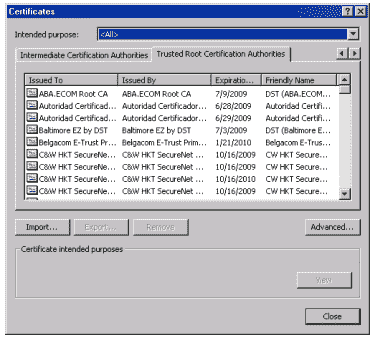

您已成功将 CA 的证书加载到浏览器中，因此您的 CA 签发的每个证书现在都应被接受，因为它们是由您的 CA 数字签名的。要测试这一点，请将浏览器指向您的 `Apache/mod_ssl` Web 服务器的主页。假设您正在使用 `Internet Explorer v.5`，在页面上的任何位置右键单击并选择 `属性`。从属性窗口中，点击 `证书` 按钮。图 7.4 显示了浏览器如何报告由 `ca.hontanon.com` 颁发给当前受信任的 Apache 服务器 `redhead.hontanon.com` 的证书。

##### 图 7.4 证书窗口，“常规”选项卡：证书信息

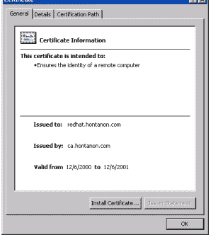

#### 使用自签名证书

`mod_ssl` 让启动创建您自己的自签名数字证书以向 Web 浏览器验证 Apache 服务器身份的过程变得极其简单。有两个文件是相关的：

- `/etc/httpd/conf/ssl.key/server.key`：此文件是服务器私钥/公钥对的秘密一半。

- `/etc/httpd/conf/ssl.cert/server.cert`：此文件是服务器的数字自签名证书。

`mod_ssl` 安装自带两个占位文件来替代上述文件，因此首先删除这两个占位文件：

```bash
[ramon]$ sudo rm /etc/httpd/conf/ssl.key/server.key
[ramon]$ sudo rm /etc/httpd/conf/ssl.cert/server.cert
```

接下来，使用 `/etc/httpd/conf` 目录中提供的 `Makefile` 来创建新的服务器密钥和新的服务器证书。列表 7.7 和 7.8 展示了相关步骤。

##### 列表 7.7 创建新的服务器密钥

```bash
[ramon]$ cd /etc/httpd/conf
[ramon]$ sudo make genkey
umask 77 ; \
/usr/bin/openssl genrsa -des3 1024 > \
/etc/httpd/conf/ssl.key/server.key
warning, not much extra random data, consider using the -rand option
Generating RSA private key, 1024 bit long modulus
.............+++++
............+++++
e is 65537 (0x10001)
Enter PEM pass phrase:
Verifying pass phrase - Enter PEM pass phrase:
```


`make genkey` 命令调用 `openssl` 生成 RSA 公钥/私钥对。此命令会提示您输入一个密码短语，该短语将用于保护存储在磁盘上的私钥。这是通过将密钥用密码短语进行 PEM 编码来实现的，因此您应该使用一个实际的短语，至少包含六个单词；不要只使用单个密码。

接下来，执行列表 7.8 中的命令为您的服务器创建 X.509 证书。

#### 列表 7.8 创建新的服务器证书

```bash
[ramon]$ cd /etc/httpd/conf
[ramon]$ sudo make testcert
umask 77 ; \
/usr/bin/openssl req -new -key /etc/httpd/conf/ssl.key/server.key \
-x509 -days 365 -out /etc/httpd/conf/ssl.crt/server.crt
Using configuration from /usr/share/ssl/openssl.cnf
Enter PEM pass phrase:
You are about to be asked to enter information that will be
incorporated into your certificate request.
What you are about to enter is what is called a Distinguished Name
or a DN.
There are quite a few fields but you can leave some blank
For some fields there will be a default value,
If you enter '.', the field will be left blank.
-----
Country Name (2 letter code) [AU]:US
State or Province Name (full name) [Some-State]:Virginia
Locality Name (eg, city) []:Ashburn
Organization Name (eg, company) [Internet Widgets Pty Ltd]:Ramon's Pile O Bits
Organization Unit Name (eg, section) []:
Common Name (eg, your name or your server's hostname) []:redhat.hontanon.com
Email Address []:rhontanonn@sybex.com
```

请注意，`make testcert` 命令也调用 `openssl` 实用工具创建新证书，并用您在列表 7.7 中创建的私钥 RSA 密钥对其进行签名。`-days 365` 选项指定您希望创建一个有效期为一年的证书。您需要提供在生成密钥时设置的密码短语，以便解码密钥并使用它来签名新创建的证书。您还需要提供以下信息以放入 X.509 证书中：

- 国家/地区名称
- 州或省名称
- 地区名称
- 组织名称
- 通用名称
- 电子邮件地址

这些是与您的服务器 X.509 证书关联的属性，当 Web 浏览器连接到您的站点时，这些信息将可见。

您现在已经成功创建了一个新的服务器私钥和一个新证书。由于 `Apache` 在启动时会对证书进行缓存，因此需要重启 `Apache` 守护程序才能使更改生效，如列表 7.9 所示。

#### 列表 7.9 使用新证书重启 Apache 服务器

```bash
[ramon]$ sudo /etc/rc.d/init.d/httpd restart
   Shutting down httpd: [  OK  ]
   Starting httpd: [  OK  ]
```

第一次 Web 浏览器联系 `Apache` HTTPS 服务器时，用户会看到一个对话框，要求他们验证证书的真实性，因为它是自签名的，并未由任何知名的证书机构签名。

图 7.5 显示了 `Netscape Navigator` 每当站点首次发送数字证书时显示的对话框。指示您的用户点击“更多信息”按钮，并验证显示的指纹是否与您的证书（图 7.6）相符。证书的指纹是证书内容的唯一摘要，其格式便于与可信参考进行视觉比较。如果您的客户担心证书的有效性，他们可以通过带外方式（当面或通过电话）与您核对指纹。这比验证证书的完整内容更方便，而且效率相同。

#### 图 7.5 Web 浏览器接收新的数字证书

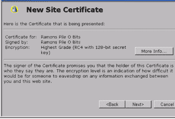

#### 图 7.6 点击“更多信息...”按钮之后

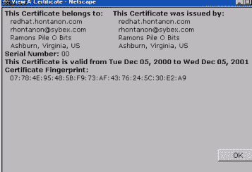

请注意，您可以使用以下命令从您的 `Apache` 服务器获取指纹：

```bash
[ramon]$ cd /etc/httpd/conf/ssl.crt/
[ramon]$ sudo openssl x509 -text -fingerprint -in server.crt | grep MD5
MD5 Fingerprint=80:46:26:AD:4D:9A:6D:63:5A:61:64:58:57:0E:8A:DA
```

此示例中的第二条命令调用 `openssl` 实用工具导入 X.509 服务器证书（`-in server.crt`），并导出与输入证书对应的文本指纹（`-text -fingerprint`）。此命令的结果相当冗长，因此我将其通过管道传递给 `grep` 命令，以过滤掉除感兴趣的一行（包含字符串 `MD5` 的那一行，指的是用于从整个证书中提取指纹的加密哈希算法）之外的所有行。

一旦用户验证了证书的真实性，他们可以选择通过在其 Web 浏览器中选择右侧的选项（图 7.7）来接受该证书，直到其过期。

#### 图 7.7 在数字证书中存储信任

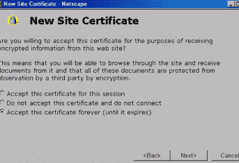

如您所见，搭建一个小型、专用的公钥基础设施并没有您想象的那么具有挑战性。`Apache`、`OpenSSL` 和 `mod_ssl` 是构建可扩展至数千名用户的基于证书的认证系统所需的全部要素。

### Apache-SSL

`Apache-SSL` 由位于英国的 `Apache` 核心团队成员 Ben Laurie 开发，实际上是 `mod_ssl` 的前身。尽管在过去两年中它们遵循了不同的开发路径，但这两个发行版都提供等效的功能：为基本 HTTP 协议添加 SSL/TLS 安全性。

**应用程序安全**

**第 3 部分**

`Apache-SSL` 和 `mod_ssl` 之间的一个重要区别在于它们与基本 `Apache` 安装集成的方式。`Apache-SSL` 基于对 `Apache` 源代码的全面修改，而 `mod_ssl` 是直接插入或模块化添加到 `Apache` 中的。

我没有选择在本章中描述 `Apache-SSL` 而不是 `mod_ssl` 的压倒性原因，除了也许是因为 `Red Hat` 7.0（我主要的 Linux 家庭服务器）有 `mod_ssl` 的 rpm 包可用。无论您选择 `Apache` 的哪种 SSL 扩展形式，前一部分介绍的概念同样适用。

可以在 `www.apache-ssl.org` 找到 `Apache-SSL` 的网页（见图 7.8）。

#### 图 7.8 Apache-SSL 项目主页

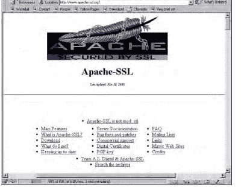

### 总结

Web 内容托管是生产环境中 Linux 服务器最流行的用途之一。`Apache` HTTP 服务器是一个复杂的软件包，确保其安全性并非轻而易举之事。然而，配置文件中有一些指令可用于确保您的服务器提供适当的身份验证、授权和访问控制级别。

此外，`mod_ssl` 是基本 `Apache` 安装的成熟补充，它通过使用 `OpenSSL` 扩展为 SSL 和 TLS 添加了机密性、完整性和认证服务。使用 `OpenSSL` 创建简单的证书机构，您可以使用在最具任务关键性环境（包括电子商务、内网托管和大型 Web 门户）中经过验证的自由可用组件，构建完整的公钥认证系统。

第 8 章“文件共享和打印”将通过对从 Linux 服务器共享文件系统以及本地和网络打印机的安全影响进行讨论，结束本书的第 3 部分。

# Samba 安全

这是讨论应用程序层安全的第三章。本章重点介绍一种众所周知的网络应用程序，它使 Linux 服务器上的文件可供 Windows 客户端访问，即 `Samba`。随着 Linux 操作系统在微软主导的局域网文件服务器领域中不断取得进展，提供一种能够利用 Linux 服务器强健性和安全性的替代方案变得至关重要，同时它还需要为无处不在的 Windows 桌面提供文件服务。


Samba 软件通过提供一个基于 Linux 的服务器应用程序来满足这一需求，该应用程序能够使用服务器消息块 (`SMB`) 和 `NetBIOS` 协议与 Windows 客户端透明地共享文件和打印机。与电子邮件和 Web 服务一样，Samba 是大多数基于 Linux 的网络安装中必备的应用程序套件的一部分。

文件是存储在任何服务器上的数据的最基本视图，因此，它们是寻找内部信息的入侵者的主要目标。你需要确保这些文件对用户的可用性和可访问性，同时通过认证和授权来实施访问控制。好消息是，Samba 于 1992 年首次发布，而在那一年，安全已经是网络应用程序设计人员热议的话题。因此，Samba 提供了配置参数，允许网络管理员轻松控制主机和用户认证、访问控制以及文件共享通信的隐私性。

本章首先探讨 Samba 服务器的起源。接着，它描述了一个典型的 Samba 安装过程，包括关于直接影响服务器安全的配置参数的详细信息。最后，本章解释了如何为标准的 Samba 包添加安全套接字层 (`SSL`) 支持，并以探讨 Samba 在 Windows NT 环境中作为主要域控制器 (`PDC`) 运行的能力来结束讨论。

## Samba 服务器

Samba 是服务器消息块 (`SMB`) 服务器的一个完整实现，它可以向 Windows (95, 98, NT, 2000) 客户端以及 `OS/2` 客户端提供透明的文件服务。Samba 是 `LinuxCare` 的 `Andrew Tridgell` 在 1992 年的杰作，如今它得到了来自世界各地程序员的帮助，被广泛使用并不断更新。

Samba 允许网络管理员利用 Linux 服务器存储和管理大量文件的能力，同时保留对基于 Windows 的桌面客户端的使用。除了文件服务外，Samba 还提供以下功能：

- 打印服务，通过使由 Linux 控制的打印机在 Windows 桌面上作为标准网络打印机可用
- 认证和授权服务，只有在提供适当的用户名和密码后，才允许访问网络共享
- 名称解析，通过将网络共享 (`NetBIOS`) 名称映射到标准 `IP` 地址
- 在“浏览”列表中宣布其存在的功能

Samba 的流行源于这样一个事实：Linux 共享在 Windows 客户端上的显示方式与其他基于 Windows 的驱动器和打印机完全相同，这使得 Linux 的使用对最终用户来说是完全透明的。

Samba 的另一个卖点是其性能。独立测试表明，截至版本 2，Samba 服务器使用相同的硬件，其速度几乎是同等 `Windows NT 4.0` 服务器的两倍。

Samba 是 `IBM` 的网络基本输入输出系统 (`NetBIOS`) 协议的实现，该协议在 `TCP` 上运行，以便穿越 `IP` 路由器并将 `NetBIOS` 的范围扩展到其最初设计的局域网环境之外。`SMB` 块在 `NetBIOS` 数据单元内传输，这些数据单元构成了 `TCP` 数据包的有效负载。图 8.1 展示了典型 `SMB` 数据包的组成，从底部的数据链路层 (以太网) 开始，依次向上经过 `IP`、`TCP` 和 `NetBIOS` 层。

### 图 8.1 Samba 通过 NetBIOS 传输 SMB

| 层 | 协议 |
| :--- | :--- |
| 应用层 | `SMB` |
| 表示层 | |
| 会话层 | `NetBIOS` |
| 传输层 | `TCP` / `UDP` |
| 网络层 | `IP` |
| 数据链路层 | 以太网 |

最初的微软 `LAN Manager` 在局域网上的文件和打印机共享实现并没有使用 `NetBIOS` 或 `TCP/IP` 作为底层协议。相反，它使用了专用的 `NetBEUI` (`NetBIOS Extended User Interface`) 协议来以此为目的（见图 8.2）。`NetBEUI` 协议构成了 `OSI` 模型中的网络层、传输层和会话层。由于 `NetBEUI` 缺乏广域网路由能力，最初的 `LAN Manager` 实现无法通过互联网共享文件和打印机，只能在本地网络中进行共享。这基本上消除了安全方面的顾虑，但也降低了其实用性，因为你无法通过路由 `IP` 网络与远程办公室共享资源。

### 图 8.2 LAN Manager 通过 NetBEUI 传输 SMB

| 层 | 协议 |
| :--- | :--- |
| 应用层 | `SMB` |
| 表示层 | |
| 会话层 | |
| 传输层 | `NetBEUI` |
| 网络层 | |
| 数据链路层 | 以太网 |

Samba 根据 `GNU` 通用公共许可证 (`GPL`) 提供，该许可证允许免费使用和分发该软件包，前提是完全开放源代码也可用。

本书的这一节将向你展示如何在考虑安全的情况下安装和配置 Samba 服务器。有关在 Linux 服务器上安装、配置和管理 Samba 服务器的完整参考，请参阅 `Roderick Smith` 的《`Linux Samba Server Administration`》（`Sybex`, 2000），该书是 `Craig Hunt` Linux 丛书系列的一部分。

Samba 主页（图 8.3）包含关于 Samba 持续开发的宝贵信息。它包括以下内容：

- 最新 Samba 版本的新闻
- Samba 开发人员的资源
- 文档，包括最新的 Samba 书籍
- 各种操作系统平台的 Samba 源代码下载
- 用于 Samba 服务器的插件下载
- 几个图形用户界面 (`GUI`) 的下载和信息，这些 `GUI` 可以简化和管理你的 Samba 服务器
- 关于 Samba 相关邮件列表的信息

要访问 Samba 主页，请前往 `www.samba.org` 并选择离你地理位置最近的 Web 镜像站点。

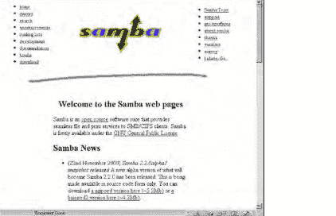

### 安装 Samba

大多数最近的 Linux 发行版都默认包含 Samba 服务器。以下是如何在 `Red Hat 7.0` 上确保 Samba 已安装的方法：

```bash
[ramon]$ rpm -q samba samba-common
samba-2.0.7-21ss1
samba-common-2.0.7-21ss1
```

两个软件包构成了完整的 Samba 安装：

- `samba-2.0.7-21ss1`：这是基础 Samba 服务器软件包，它包括以下文件：
    - 服务器可执行文件
    - 启动脚本
    - 手册页
    - 文本和 HTML 文档
    - Samba Web 管理工具 (`SWAT`)
- `samba-common-2.0.7-21ss1`：这是一组服务器和客户端共用的实用程序和配置文件，需要安装以提供服务。该软件包包括 Samba 代码页、`smb.conf` 配置文件以及几个在服务器投入生产之前测试配置的实用程序。

> **注意** Samba 代码页定义文件是一个描述，它告诉 Samba 如何在指定的 DOS 代码页中，将大于 `ASCII 127` 的字符从大写字母映射到小写字母。

如果你没有运行这两个软件包的最新版本，你可以从你喜欢的仓库下载它们。我建议你就使用知名且信誉良好的归档网站（如 `www.rpmfind.net`），以最小化合法软件包被木马替身的风险。

一旦你获取了 `RPM` 软件包，使用以下命令进行安装：

```bash
[ramon]$ sudo rpm -U samba-2.0.7-21ss1-i386.rpm
[ramon]$ sudo rpm -U samba-common-2.0.7-21ss1-i386.rpm
```

### 使用 SWAT 管理 Samba

自 2.0 版本起，Samba Web 管理工具（`SWAT`）已包含在标准 Samba 服务器发行版中。`SWAT` 是一个用于管理 `smbd` 和 `nmbd` 服务器以及 `/etc/samba/smb.conf` 配置文件的实用工具。与其他同类工具一样，`SWAT` 是一个 `HTTP` 服务器，它监听一个特殊端口（在此情况下为 `TCP 901`），任何 Web 浏览器只需指向 URL `http://my.samba.host:901` 即可使用（参见图 8.4），其中 `my.samba.host` 是运行 Samba 的 Linux 服务器名称。

#### 图 8.4 Samba Web 管理工具


为了开始使用 `SWAT`，首先确保 `/etc/services` 文件中包含端口 `TCP 901` 的条目。您可以使用以下命令完成此操作：

```
[ramon]$ grep swat /etc/services
swat                      901/tcp
```

然后只需修改 `inetd` 或 `xinetd` 以启动监听守护进程。如果您正在运行 `inetd`，请将以下行添加到 `/etc/inetd.conf` 文件中：

```
swat    stream    tcp     nowait    root    /usr/sbin/tcpd  /usr/sbin/swat
```


如果您正在运行 `xinetd`，请编辑现有的 `/etc/xinetd.d/swat` 文件以启用该条目。清单 8.1 展示了一个示例 `/etc/xinetd.d/swat` 文件。

#### 清单 8.1 示例 `/etc/xinetd.d/swat` 文件

```
# default: off
# description: SWAT is the Samba Web Admin Tool. Use swat \
#              to configure your Samba server. To use SWAT, \
#              connect to port 901 with your favorite web browser.

service swat
{
port          = 901
socket_type   = stream
wait          = no
only_from     = 10.0.0.100
user          = root
server        = /usr/sbin/swat
log_on_failure += USERID
disable       = no
}
```

请注意清单 8.1 中，我包含了指令 `only_from` 以将连接到 SWAT 的来源限制在我的工作站（`10.0.0.100`）上。这是一个非常重要的安全功能，因为您通常不希望网络或互联网上的任意主机连接到 SWAT！如果您使用 `inetd`，请通过在 `/etc/hosts.allow` 中添加以下行，确保仅主机 `10.0.0.100` 能够连接到端口 `901`：

```
swat: 10.0.0.100
```

此外，请将以下行添加到 `/etc/hosts.deny`：

```
swat: ALL
```

> **警告** 为避免暴露 root 密码，请将访问 SWAT 服务器的权限限制为 Linux 服务器本身（理想情况），或者至少限制在包含该服务器的受保护网段内的主机上。如果必须远程访问 SWAT 服务，请遵循下一节中描述的 SSL 指令。

### SWAT-SSL

第 7 章“HTTP 服务”介绍了 Linux 安全套接字层（OpenSSL）实现的使用，以及它保护 Web 客户端与 Apache HTTP 服务器之间通信的能力。与 Apache 一样，SWAT 也是一个 HTTP 服务器，因此，它可以与 OpenSSL 集成，以确保您的 Samba 管理命令的私密性。

- 应用安全性
- 第 3 部分

首先，确保您的系统上安装了 OpenSSL：

```bash
[ramon]$ rpm -q openssl
openssl-1.0.9.5a-14
```

接下来，下载并安装 `stunnel` 包。`stunnel` 工具是一个用于为任意网络应用程序添加 SSL 加密的包装器。以下命令安装了 `/usr/sbin/stunnel` 守护进程应用程序：

```bash
[ramon]$ sudo rpm -i stunnel-3.8.4.1386.rpm
```

为了成功使用 SSL 包装 SWAT，您需要按照以下操作创建服务器证书：

```bash
[ramon]$ cd /usr/share/ssl/certs
[ramon]$ sudo make stunnel.pem
```

结果是，在文件 `/usr/share/ssl/certs/stunnel.pem` 中创建了必要的证书。现在，您可以使用以下命令调用 `stunnel` 包装器：

```bash
[ramon]$ sudo stunnel -p /usr/share/ssl/certs/stunnel.pem -l /usr/sbin/swat swat -d 901
```

将此命令作为启动文件包含在 `/etc/rc.d/init.d` 目录中。

此外，别忘了禁用 SWAT 的 `xinetd` 条目（只需在 `/etc/xinetd.d/swat` 中设置 `disable = yes`），并重启 `xinetd` 以使更改生效。

您还可以通过在 `/etc/inetd.conf` 中添加以下行，从 `inetd` 启动 `stunnel/SWAT`：

```bash
swat stream tcp nowait root /usr/sbin/tcpd /usr/sbin/stunnel stunnel \
-p /usr/share/ssl/certs/stunnel.pem -l /usr/sbin/swat
```

或者从 `xinetd`，将以下命令添加到 `/etc/xinetd.d/swat`：

```bash
# default: off
# description: SWAT is the Samba Web Admin Tool. Use swat \
# to configure your Samba server. To use SWAT, \
# connect to port 901 with your favorite web browser.

service swat
{
port          = 901
socket_type   = stream
wait          = no
only_from     = 10.0.0.100
user          = root
server        = /usr/sbin/stunnel
server_args   = -p /usr/share/ssl/certs/stunnel.pem -l /usr/sbin/swat
log_on_failure += USERID
disable       = no
}
```

现在，您可以使用最喜欢的 Web 浏览器通过 URL `https://my.samba.host:901` 以 SSL 方式访问 SWAT 应用程序。

请注意，由于证书是自签名的，且无法使用浏览器中安装的任何根证书进行信任验证，因此系统会提示您接受该证书。

## 保护 Samba

本节讨论运行生产环境 Samba 服务器相关的安全问题，包括用户身份验证、访问控制和数据隐私。让我们首先看看 Samba 使用用户名和密码进行用户身份验证的选项。

### 用户身份验证

大多数远程 SMB 请求都包含一定级别的身份验证凭据，包括用户名，以及可选的密码。默认情况下，Samba 使用现有的 Linux `/etc/passwd` 文件来查找与 SMB 请求一起提供的用户名。客户端发送明文密码，Samba 将其与在 `/etc/passwd` 中找到的哈希密码进行比较。对于旧版本的 Windows，此过程运行良好，但从 Windows 95 OSR2 开始（包括 Windows 98、NT 4.0-SP3 及以上版本和 2000），Microsoft 客户端在身份验证到远程 SMB 服务器时仅提供加密密码。Windows 9x 使用较旧的 LAN Manager 遗留加密风格，而 Windows NT 4.0 和 Windows 2000 使用较新的、更强大的加密算法。

SMB 密码加密的框架非常健壮。客户端和服务器都不保留明文密码，甚至客户端在身份验证到服务器时也不发送加密密码。相反，服务器向客户端发出挑战，客户端使用该挑战来对加密密码进行哈希处理。该哈希值被发送到服务器，服务器执行相同的操作并比较结果。

强制客户端提供加密密码是一个很好的主意，尽管这需要在 Samba 服务器端做一些工作。首先，您必须通过包含以下指令指示 Samba 接受加密密码：

```
[global]
encrypt passwords = yes
```

> **注意** `smb.conf` 文件是 Samba 存储所有运行时配置信息的地方。该文件分为若干部分（也称为节），由方括号内的一个单词（例如，`[header]`）分隔。虽然这些节中的大多数都指要共享的特定资源，如目录、文件和打印机，但 `[global]` 头开始了一个节，您可以在其中放置将应用于所有共享的参数。除非您需要为特定共享定义例外情况，否则大多数安全参数都应放置在此节中。

接下来，由于 Samba 无法针对常规的 Linux `/etc/passwd` 文件验证加密的客户端密码，您需要创建一个并行但独立的 Samba 密码文件，该文件可以使用 Samba 提供的 `smbpasswd` 实用程序进行维护。默认情况下，Samba 密码保存在 `/etc/samba/smbpasswd` 文件中。

> **提示** 尽管 `smbpasswd` 中的密码是加密的，但请确保该文件对于 root 用户之外的任何人（无论是读还是写）都不可访问。

要向文件中添加新用户，请发出以下命令：

```
[ramon]$ sudo smbpasswd -a stacia
New SMB password:
Retype new SMB password:
Added user stacia.
```

或者，您可以使用以下命令更改您自己的密码：


```
[ramon]$ smbpasswd
Old SMB password:
New SMB password:
Retype new SMB password:
Password changed for user ramon.
```

请注意，用户名 `stacia` 和 `ramon` 必须已经存在于标准的 Linux `/etc/passwd` 文件中。然而，提供给 `smbpasswd` 的密码不必与 `/etc/passwd` 中已有的密码相同。

> **提示** 虽然有一种众所周知的过程可以强制较新的 Windows 客户端发送明文密码（通过修改注册表），但我强烈反对这种做法。密码始终应加密，以避免在公共网络上发生简单的窃听攻击。

`smbpasswd` 文件中的条目遵循以下通用格式：

```
User:UID:LAN-Manager-password:NT-password:account-flags:update-time
```

这些每个字段具有以下含义：

- **用户**：`用户` 是由客户端提供的文本用户名。此字段必须与本地 `/etc/passwd` 文件中的用户名匹配。

- **UID**：`UID` 是数字用户 ID。此字段也必须与 `/etc/passwd` 条目匹配。

- **局域网管理器密码**：`局域网管理器密码` 是旧式（Windows 9x）密码的加密表示形式。实际条目是通过使用重复的密码（全大写）作为密钥，对众所周知的字符序列进行 DES 加密计算得出的。

- **NT 密码**：`NT 密码` 是新式（Windows NT 和 2000）密码的加密表示形式。此字段是由密码的 Unicode 格式经过 MD4 哈希处理的结果。

- **账户标志**：`账户标志` 字段是以下四种类型标志的组合：

    - `U`：此标志表示标准用户账户。

    - `D`：此标志表示已禁用的账户（不允许登录）。

    - `N`：此标志表示无密码的账户。

    - `W`：此标志表示工作站账户，用于将 Samba 配置为 NT PDC。

- **更新时间**：`更新时间` 字段是自纪元（1970 年 1 月 1 日）以来该条目上次更新所经过的秒数。

### 访问控制

每当 Samba 服务器从客户端接收 SMB 请求时，服务器会告知客户端它应遵循哪种身份验证设置。Samba 支持四种基本身份验证模式，体现在以下 `smb.conf` 指令的四个选项中：

```
security = [share|user|server|domain]
```

让我们详细看看这四种访问控制选项。

#### 共享模式

通过为访问文件、目录或打印机设置一个或多个通用密码，你可以允许所有用户通过提供相同的密码进行访问。除允许访问来宾共享以及给予打印服务器通用访问权限外，通常不建议这样做。

尽管 SMB 客户端不需要为共享模式资源提供用户名，但 Samba 仍需在 Linux 范式内运行，这就要求其所有资源都有用户所有权。因此，Samba 会尝试得出一个好的默认用户名，代表客户端使用。以下是 Samba 用作用户名默认值的选项（按优先级递减排列）：

- 如果 `smb.conf` 包含配置行 `guest only = yes` 和 `guest account = guest,`，则始终选择用户名 `guest`。

- 如果客户端无论如何都包含用户，则选择提供的用户名。

- 如果客户端之前已连接到 Samba 服务器，则选择当时提供的用户名。

- 如果以上都不适用，则选择所请求服务的名称。

- 如果所请求服务的名称不可用，则选择请求客户端的 NetBIOS 名称。

- 最后的手段是，选择 `smb.conf` 文件下 `username= user1, user2,`... 指令中存在的用户描述。

需要注意的是，如果 `smb.conf` 包含配置行 `guest only = yes` 和 `guest account = guest,`，则始终选择用户名 `guest`。然而，如果 `guest only = no,`，且客户端提供的密码与 `username=` 指令中包含的用户之一不匹配，则拒绝访问共享。

虽然这一切看似过于繁琐，但要点很简单：Samba 必须找到一个 Linux 用户名，能够使用请求客户端提供的密码进行身份验证。确保这一点的最简单方法是为 Windows 客户端和 Linux 服务器的交互式登录分配相同的用户名（`/etc/passwd` 或 `/etc/shadow`）。这使得你的用户和共享在两个平台上都更容易管理。

例如，考虑以下 `smb.conf` 配置。`[Sales]` 片段定义了一个要共享的资源，在本例中是 `/homes/marketing` 目录。此资源可写入，并且可以使用标准的 Microsoft 网上邻居浏览功能进行浏览。请注意，指令 `security = share` 包含在 `[global]` 片段中，但你用 `[Sales]` 片段中的 `guest only = no` 和 `username = ramon, stacia` 指令对其进行了限定。这种指令组合允许对 `Sales` 共享进行 `share` 模式访问，但前提是客户端提供的密码与 `ramon` 或 `stacia` 的密码匹配，或者与之前已连接到 Samba 服务器的用户的密码匹配。

```
[global]
security = share
[Sales]
Comment = Sales Share
Path = /homes/marketing
writable = yes
browsable = no
guest_only = no
username = ramon, stacia
```

#### 用户模式

用户模式比共享模式更进一步，它强制每个用户在授予共享访问权限之前提供唯一的用户名和密码组合。这显然比共享模式更可取，因为它允许管理员按用户级别授予或拒绝共享的访问权限，并消除了共享模式用于分配默认用户的复杂登录。自 Samba 2.0 起，用户模式是默认的身份验证模式。

> **注意** 如果 `smb.conf` 中存在 `guest only = yes` 指令，Linux 用户名将被更改为由 `guest account =` 指令指定的用户名，但这仅在提供的密码经过验证确实属于提供的用户名之后发生。

例如，考虑以下 `smb.conf` 配置。`security = user` 指令包含在 `[global]` 片段中，但它被 `[Marketing]` 片段（其中定义了 `/homes/marketing` 目录的共享）中的 `valid users = ramon, stacia` 指令所限定。这种指令组合仅允许用户 `ramon` 和 `stacia` 访问 `Marketing` 共享，前提是他们在提供有效的用户名和密码组合之后才能访问。

```
[global]
    security = user

[Marketing]
    Comment = Marketing Share
    Path = /homes/marketing
    writable = yes
    browsable = no
    valid users = ramon, stacia
```

#### 服务器模式

当指定服务器模式的访问控制类型时，提供的用户名和密码组合不在本地检查，而是发送到远程 SMB 服务器进行验证。远程服务器然后将身份验证请求的结果返回给本地服务器。如果远程服务器无法对客户端进行身份验证，则本地服务器会退回用户模式访问控制。远程服务器可以是 Windows NT 机器或配置为以用户模式运行的另一个 Samba 服务器。远程服务器的名称必须使用 `smb.conf` 文件中的 `password server =` 指令指定。

当操作多个 Samba 服务器但只想为大部分用户群体提供单一身份验证点时，服务器模式的身份验证非常有用。你仍然需要让本地 `/etc/passwd` 文件中存在这些用户，但他们的账户可以（并且应该）被禁用。

作为一个例子，考虑以下 `smb.conf` 配置。此服务器会咨询 SMB 服务器 `LINUX_SAMBA_1` 进行用户名/密码身份验证。如果 `LINUX_SAMBA_1` 不可用，它接下来会咨询 SMB 服务器 `LINUX_SAMBA_2`。但请注意，如果 `LINUX_SAMBA_1` 返回身份验证拒绝，客户端会在咨询列表上的下一个服务器之前就被拒绝访问。

```
[global]
    security = server
    password server = LINUX_SAMBA_1 LINUX_SAMBA_2
```

#### 域模式

域模式是服务器模式的一种特殊情况，其中远程 SMB 服务器是一个 NT 域控制器，本地 Samba 服务器之前已使用以下命令与其建立了信任关系

```
smbpasswd -j NT-Domain -r NT-Domain-Controller
```


在此命令中，`NT-Domain` 是你希望加入的域的名称，`NT-Domain-Controller` 是给定域的主域控制器（PDC）的 NetBIOS 名称。通过在本地 Samba 服务器和远程 Windows NT 域控制器之间建立信任关系，你允许本地 Samba 服务器通过将用户名/密码传递给 Windows NT 域控制器来验证请求客户端提供的用户名/密码。这与属于给定域的 Windows NT 服务器将用户身份验证请求传递给域控制器以获取批准的方式相同。这是一个有用的访问控制选项，用于将几个 Samba 服务器集成到现有的 NT 域网络中。

要使用域模式访问控制，只需在 `smb.conf` 文件中包含适当的指令即可。在以下示例中，使用 NT 域控制器 `ENG_SAMBA_1` 和 `ENG_SAMBA_2`（按此顺序）来验证客户端的请求：

```
[global]
    security = domain
    workgroup = ENGINEERING
    domain logins = yes
    password server = ENG_SAMBA_1 ENG_SAMBA_2
```

**注意** 如果您的远程 SMB 服务器是 Windows NT 服务器，则域模式访问控制总是优于服务器模式，因为服务器模式在客户端-服务器连接期间会占用 Windows NT 服务器上的一个许可证。另一方面，域模式认证在认证完成后立即释放连接（以及 Windows NT 许可证实例）。这一点非常重要，因为微软的授权策略围绕并发服务器连接。

### 其他访问控制功能

除了上述四种访问控制方法外，您还可以选择利用本地 NT 域和一个受信任的第二 NT 域之间的信任关系。截至 Samba 2.0.4，可以使用 `smb.conf` 指令 `allow trusted domain = yes` 来获取来自 NT 域控制器的认证，尽管该控制器不是您域的主控制器，但它受您的 PDC 信任。

Samba 访问控制功能集的另一项新近添加的功能是 `add user script` 指令。在 `user` 和 `domain` 访问控制模式下都可以使用此指令，以便在用户/密码被密码服务器认证但用户在本地不存在时自动添加用户。例如，您可能希望 Samba 使用以下 `smb.conf` 指令在本地自动添加用户：

```text
add user script = sudo /usr/sbin/useradd %u
```

相反，可以指定 `delete user script` 指令来删除本地存在但在 PDC 上不再有效的用户。此用法的示例如下：

```text
delete user script = sudo /usr/sbin/userdel %u
```

虽然以这种方式添加和删除本地用户可能很方便，但我敦促您谨慎实施，因为这允许在用于常规 Linux 服务器认证的 `/etc/passwd` 或 `/etc/shadow` 文件中无人值守地创建和删除用户。

#### `[homes]` 指令

允许所有 Linux 服务器用户访问其主目录的一种常见方法是 `smb.conf` 文件中的特殊 `[homes]` 指令。请考虑以下示例：

```text
[homes]
comment = Home Directories
browseable = no
writable = yes
```

该指令指定 `/etc/passwd` 中的任何用户可以通过将其 SMB 客户端指向 `\\server\\username` 来访问其主目录。这并不总是理想的，因为此文件包含诸如 `root`、`operator`、`uucp` 和 `bin` 等系统相关账户。为确保这些用户不被授予访问权限，请使用 `invalid users` 指令来排除这些用户名，如下例所示：

```text
[global]
   invalid users = root, operator, uucp, bin
```

### Samba 通信的隐私性

Samba 使用 TCP/IP 层来传输从客户端到服务器的 NetBIOS 流量。这允许您通过互联网共享驱动器，这是一种方便但通常不安全的做法，因为文件内容可能会暴露给潜在的窃听者。如果您打算在公共（不受信任）网络（如互联网）上交换 SMB 流量，您的安全策略需要包含一项条款，以确保此类流量的隐私性和认证。

通过使用前一节中描述的用于传输 SWAT 流量的常用 OpenSSL 实现，可以保护 SMB 流量的内容。由于 Windows SMB 客户端不直接支持 SSL，您必须在本地（受信任）网络的边缘设置一个代理 SSL 站点，该站点加密流量并代表客户端将其转发到目标 SSL 启用的 Samba 服务器。此过程如图 8.5 所示。

**图 8.5** 使用 SSL 保护 Samba

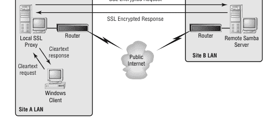

图中显示了两个企业站点（站点 A 和站点 B），它们通过接入路由器连接到互联网。在站点 A 的接入路由器后面，设置了一台 Linux 服务器作为 SSL 代理。站点 A 局域网中的一台典型 Windows SMB 客户端将其 SMB 请求指向本地 SSL 代理，然后该代理在 OpenSSL 隧道内将连接中继到站点 B 内部的 Samba 服务器。站点 B 的服务器也以加密响应进行回复，而站点 A 的 SSL 代理则将其明文中继回 Windows 客户端。这确保了 SMB 流量受到保护，至少是在通过公共互联网传输时。但请注意，SMB 流量在站点 A 的本地网络内是明文传输的。

**为 Samba-SSL 创建证书颁发机构** 设置任何 SSL 应用的第一步是创建一个证书颁发机构 (CA)，以颁发用于两个端点相互认证所需的数字证书。首先，确保您的系统上安装了 OpenSSL：

```text
[ramon]$ rpm -q openssl
openssl-0.9.5a-14
```

然后，您需要使用以下命令为 CA 创建一个新的目录。首先创建将存储 Samba CA 的目录：

```text
[ramon]$ sudo mkdir /etc/samba/CA
[ramon]$ cd /etc/samba/CA
```

此 CA 签发的每个证书都将包含一个序列号。通过在文件 `/etc/samba/CA/serial` 中添加文本 `"01"`，您正在初始化 CA 将用于分配序列号的文件：

```text
[ramon]$ sudo echo "01" > serial
```

`index.txt` 文件用于 CA 维护证书数据库，必须简单地创建为空：

```text
[ramon]$ sudo cp /dev/null index.txt
```

接下来，您需要创建一个适合您需求的适当的 OpenSSL 配置文件。首先将原始 `/usr/share/ssl/openssl.cnf` 文件复制到 `/etc/samba/CA` 目录：

```text
[ramon]$ sudo cp /usr/share/ssl/openssl.cnf openssl.cnf
```

现在，编辑新创建的 `openssl.cnf` 文件以包含这些新设置：

```text
dir             = /etc/samba/CA                  # Where everything is kept
new_certs_dir   = $dir                            # default place for new certs.
certificate     = $dir/ca-cert.pem                # The CA certificate
private_key     = $dir/ca-key.pem                 # The private key
```

注意，您只是将默认基础 CA 目录更改为您之前为 Samba 创建的目录（`/etc/samba/CA`）。您还定义了 CA 的证书和密钥将分别驻留在 `/etc/samba/CA/ca-cert.pem` 和 `/etc/samba/CA/ca-key.pem` 中。


接下来，发出 `openssl` 命令以生成 CA 的私钥 (`ca-key.pem`) 及其 X.509 证书 (`ca-cert.pem`)：

```bash
[ramon]$ sudo openssl req -new -x509 -keyout ca-key.pem -out ca-cert.pem -days 365 -config openssl.cnf
```

现在您可以为 Samba 服务器本身创建一个新的证书，并使用 CA 的私钥对其进行签名。输入以下命令：


```bash
[ramon]$ sudo openssl req -nodes -new -x509 -keyout server-key.pem -out newreq.pem -days 365 -config openssl.cnf
[ramon]$ sudo openssl x509 -x509toreq -in newreq.pem -signkey server-key.pem -out tmp.pem
[ramon]$ sudo openssl ca -config openssl.cnf -policy policy_anything -out server-cert.pem -infiles tmp.pem
```

第一条命令为 Samba 服务器创建私钥 (`server-key.pem`) 和证书签名请求 (`newreq.pem`)。第二条和第三条命令获取证书签名请求并使用 CA 的私钥对证书进行签名。生成的 Samba 证书文件保存为 `server-cert.pem` 文件。

您还需要为客户端（SSL 代理）创建一个证书，因为客户端和服务器都需要相互认证。使用以下命令创建此证书：

```bash
[ramon]$ sudo openssl req -nodes -new -x509 -keyout proxy-key.pem -out newreq.pem -days 365 -config openssl.cnf
[ramon]$ sudo openssl x509 -x509toreq -in newreq.pem -signkey proxy-key.pem -out tmp.pem
[ramon]$ sudo openssl ca -config openssl.cnf -policy policy_anything -out proxy-cert.pem -infiles tmp.pem
```

现在您拥有了名为 `proxy-cert.pem` 和 `server-cert.pem` 的客户端和服务器证书，以及相应的私钥文件 `proxy-key.pem` 和 `server-key.pem`。请注意，您需要将 `proxy-cert.pem` 和 `proxy-key.pem` 文件复制到代理机器上。关于这些文件的放置，您将在本章后面的“下载和安装 SSL 代理”部分中了解更多内容。

恭喜！您现在已经完成了通过 SSL 传输 SMB 请求所需的 OpenSSL 配置。接下来，您需要通过输入 `/etc/samba/smb.conf` 文件中的适当指令来告知 Samba 此配置的存在。这是下一节的主题。

## 配置 Samba 以支持 SSL

表 8.1 列出了使 Samba 支持 SSL 所需的指令的语法及其含义。

| 指令 | 含义 |
| :--- | :--- |
| `ssl = [yes\|no]` | 添加 SSL 支持。 |
| `ssl hosts = host1 host2 ..` | 必须始终使用 SSL 连接到此服务器的主机 |
| `ssl hosts resign = host1 host2 ..` | 不使用 SSL 连接到此服务器的主机 |
| `ssl CA certDir` | 证书目录位置 |
| `ssl CA certFile` | 包含所有证书的文件 |
| `ssl server cert` | 服务器证书的位置 |
| `ssl server key` | 服务器私钥的位置 |
| `ssl cyphers` | 在协议协商过程中使用的密码套件 |

使用上一节中创建 CA 密钥和证书的目录，以下 `smb.conf` 语法可以配置您的 Samba 服务器启用 SSL 支持：

```
[global]
ssl = yes
ssl hosts = 209.1.78.
ssl hosts resign = 209.1.78.1
ssl CA certFile = /etc/samba/CA/ca-cert.pem
ssl server cert = /etc/samba/CA/server-cert.pem
ssl server key = /etc/samba/CA/server-key.pem
```

在此示例中，您强制 `209.1.78.0/24` 网络上的所有 SSL 代理使用 SSL，除了 `209.1.78.1` 之外。请注意，虽然 `ssl CA certDir` 允许您在指定目录中拥有多个 CA 证书，但 `ssl CA certFile` 用于所有 CA 证书都在同一个物理文件中的情况。因为您只有一个 CA 证书（您自己的），所以这更适合您。同样的原理也适用于 `ssl server cert` 和 `ssl server key`。

### 下载和安装 SSL 代理

Object Development 的 SSL 代理程序包（其 Web 页面如图 8.6 所示）可以安装在您网络中某台 Linux 服务器上，该服务器将代理所有指向您的远程 Samba 服务器的 SMB 请求。您可以从 `http://www.oddev.eu/Products/ssl\_proxy.html` 下载 SSL 代理程序包。

#### 图 8.6 Object Development 的 SSL 代理 Web 页面

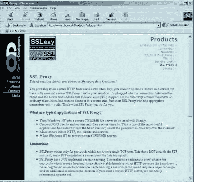

只需向下滚动到页面底部，点击源包名称。一旦您将文件传输到主目录，请输入以下命令：

```python
[ramon]$ ls sslproxy_2000_Jan_29.tar
sslproxy.2000_Jan_29.tar
[ramon]$ gunzip sslproxy_2000_Jan_29.tar.gz
[ramon]$ tar xvf sslproxy_2000_Jan_29.tar
sslproxy.2000_Jan_29/
sslproxy.2000_Jan_29/Makefile
sslproxy.2000_Jan_29/README.txt
sslproxy.2000_Jan_29/dummyCert.pem
sslproxy.2000_Jan_29/sslproxy.c
sslproxy.2000_Jan_29/stdheaders.h
```

由于 SSL 代理以源代码形式提供，您必须使用包含的 `Makefile` 进行编译。然而，在这样做之前，请确保您已安装 `openssl-devel` RPM 软件包，这是 SSL 代理所必需的。该软件包包含用于编译应用程序的 OpenSSL 头文件和库。大多数发行版的标准安装中并不包含 `openssl-devel`，但您应该能够从您喜欢的 RPM 归档中获取最新版本。一旦您获得了 RPM 软件包，请使用以下命令将其安装在您的服务器上：

```
[ramon]$ sudo rpm -i openssl-devel-0.9.5a-14.1386.rpm
```

现在，您已准备好构建 SSL 代理可执行文件。请输入以下命令：

```
[ramon]$ cd sslproxy.2000_Jan_29
[ramon]$ make
gcc -Wall -I/usr/local/openssl/include -O -c sslproxy.c -o sslproxy.o
gcc -Wall -I/usr/local/openssl/include -O -o sslproxy sslproxy.o \
    -L/usr/local/openssl/lib -lssl -lcrypto
[ramon]$ sudo mv sslproxy /usr/sbin/
[ramon]$ sudo chown root:root /usr/sbin/sslproxy
[ramon]$ ls -1 /usr/sbin/sslproxy
-rwxr-xr-x 1 root root 28016 Dec 19 21:35 /usr/sbin/sslproxy
```

现在您已创建可执行文件 `/usr/sbin/sslproxy`，用于接受来自您的私有网络中 Windows 客户端的 SMB 请求，并通过 SSL 隧道将它们转发到公共网络中的远程 SMB 服务器。`sslproxy` 可执行文件接受表 8.2 中列出的命令行选项。

#### 表 8.2 sslproxy 命令行选项

| 选项 | 含义 |
| :--- | :--- |
| `-h` | 显示帮助信息。 |
| `-L local-address` | 代理应绑定的地址（默认为 `0.0.0.0`） |
| `-l port` | 代理应绑定的端口 |
| `-R address` | 要连接的远程 IP 地址 |
| `-r port` | 要连接的远程端口号 |
| `-s` | 作为服务器代理运行 |
| `-n` | 支持 `NetBIOS` |
| `-p protocol` | 要使用的协议：`ssl23, ssl1, ssl3,` 或 `tls1`（默认为 `ssl23`） |
| `-c certificate` | 使用以下证书 |
| `-k keyfile` | 使用以下私钥 |


| -v file | CA 证书的位置 |

要启动 SSL 代理服务，请输入以下命令：

```bash
[ramon]$ sudo sslproxy -l 139 -R tippecanoe -r 139 -s -n -c /etc/ssl/proxy-cert.pem -k /etc/proxy-key.pem
```

此命令监听端口 `139` 上的 `SMB` 请求，并通过 `SSL` 隧道将它们转发到主机名 `tippecanoe`（远程 `SMB` 服务器）。请注意，文件 `/etc/ssl/proxy-cert.pem` 和 `/etc/proxy-key.pem` 是您在上一节中创建的文件。只需将它们复制到代理的 `/etc` 目录中即可。

至此，本章已讨论了 `SMB` 客户端认证、对 `SMB` 请求应用访问控制的方方面面，甚至展示了如何保护穿越公共网络的 `SMB` 流量。为了结束关于 `Samba` 安全的话题，让我们来看看 `Samba` 的最新功能之一：它能够作为 `Windows NT` 域的主域控制器。

### 将 Samba 用作 Windows NT 主域控制器

上一节关于用户认证和访问控制讨论了允许 `Samba` 将一组客户端凭据传递给域控制器进行认证的功能。在 `Windows NT` 认证模型中，用户可以使用“域”认证登录到任何 `NT` 工作站，其中本地工作站依赖于一组域控制器来持有整个域的认证、访问控制和策略。被指定为主要认证者的 `NT` 主机称为`主域控制器`（`PDC`），而其下属则称为`备份域控制器`（`BDC`）。

`Samba` 不仅可以作为现有 `NT PDC` 的客户端；它实际上可以被配置为充当 `PDC`，并处理来自网络中 `Windows NT` 主机和其他 `Samba` 服务器的授权和访问控制请求。虽然本书撰写时的当前版本（`2.0.7`）提供实验性的 `PDC` 支持，但 `2.1` 版本（在您阅读本书时可能已发布）计划将其作为标准功能纳入。

> **注意**
>
> `Samba 2.0.7` 不支持 `Windows 2000` 登录。只有 `Windows NT 3.51 SP5+` 和 `4.0 SP4+` 机器才能向 `Samba` 的 `PDC` 进行认证。

`Samba PDC` 支持包括将新的 `Windows NT` 客户端机器添加到域中，并为这些机器上的用户提供域认证。可以使用“服务器管理器”和“用户管理器”工具分别在 `Windows NT` 主机上查看这些账户。`Samba` 允许远程更新机器和用户密码。支持功能列表中未包含的是在 `Samba PDC` 和另一个域控制器之间建立信任关系的能力，以及充当 `BDC` 的能力。

下一节将详细解释如何配置标准的 `Samba` 安装以充当 `PDC`。

#### 设置 Samba PDC

首先，确保修改您的 `smb.conf` 文件中的 `[global]` 部分，以使用密码加密。您还需要使用 `Samba PDC` 启用域登录。以下示例中启用了这两项功能：

```ini
[global]
    encrypt passwords = yes
    workgroup = ACCOUNTING
    domain logons = yes
```

接下来，在 `Samba` 服务器上创建机器账户，以便它知道如何与 `Windows NT` 客户端主机交互。使用 `NT` 客户端的 `NetBIOS` 名称创建一个 `/etc/passwd` 条目，并在末尾添加 `$`。例如，以下条目是名为 `acct_server1` 的 `NT` 客户端的机器账户：

```text
acct_server1$:*:305:100:Accounting NT Server 1:/dev/null:~/bin/false
```

接下来，你需要使用以下命令向单独的 `Samba` 密码文件（通常命名为 `/etc/samba/smbpasswd`）中添加一个条目：

```bash
[ramon]$ sudo smbpasswd -a -m acct_server1
Added user acct_server1.
```

在 `NT` 主机的 `acct_server1` 上，运行“域用户管理器”并允许所有用户本地登录。同时，运行“网络设置”控制面板工具，将你的域更改为 `ACCOUNTING`（或者你在 `smb.conf` 文件中设置的任何名称）。`NT` 主机将欢迎你加入新域，并要求你重启电脑。

当 `NT` 机器恢复运行后，按 `Ctrl+Alt+Del` 并观察登录对话框弹出。在“域”下应该有两个条目：`NT` 主机的 `NetBIOS` 名称和你刚刚创建的 `Samba` 域（`ACCOUNTING`）。输入一个存在于 `/etc/samba/smbpasswd` 文件中的用户名和密码组合。如果第一次一切都正常工作，认证成功后你应该能访问桌面。如果登录不成功，请确保：

- 用户名/密码组合存在于 `Samba` 服务器的标准 Linux `/etc/passwd` 文件中（如果启用了 `shadow` 密码支持，则还包括 `/etc/shadow`）。
- 你已为请求代表用户进行认证的 `NT` 主机在 `/etc/samba/smbpasswd` 中成功创建了条目。

> **注意** 当你将不需要登录到 Linux 服务器的域用户添加到 `/etc/passwd` 时，务必通过在密码字段中插入星号（`*`）来禁用其账户，并使用 `/bin/false` 作为其 `shell`。

`Samba` 的 `PDC`（主域控制器）功能甚至允许你分配域管理员用户，这些用户在登录本地 `NT` 系统并使用 `Samba` 域进行认证时，可以被授予完整权限。只需在 `smb.conf` 的 `[global]` 节中添加以下行：

```ini
domain Admin Group = @admins
```

然后在 Linux 的 `/etc/group` 文件中创建一个名为 `admins` 的组，其中包含你希望授予管理员权限的用户列表。此外，`Samba` 的 `PDC` 功能支持使用 `NT` 登录脚本，这些脚本是小型的 `MS-DOS` 批处理风格可执行脚本，每次用户登录本地 `NT` 主机时都会运行。通过在 `smb.conf` 的 `[global]` 节中添加以下行：

```ini
logon script = scripts%U.bat
```

以及如下所示的 `[netlogon]` 节：

```ini
[netlogon]
comment = Domain login service
path = /home/samba/login
public = no
writable = no
browsable = no
```

你正在指定在 `scripts` 目录中（相对于 `[netlogon]` 节中指定的目录）存在一个文件，其名称根据相应的用户名（`$U` 变量替换）命名，扩展名为 `.bat`。例如，以下示例显示 `/home/samba/login/scripts` 目录包含三个分别属于用户 `alice`、`bob` 和 `charlie` 的登录脚本：

```bash
[ramon]$ ls -1 /home/samba/login/scripts
total 3
-rw-r--r-- 1 root root 152 Dec 20 23:14 alice.bat
-rw-r--r-- 1 root root 130 Dec 20 23:14 bob.bat
-rw-r--r-- 1 root root 122 Dec 20 23:14 charlie.bat
```

尽管你正在对所有用户的这些脚本的可用性做出一般性陈述，但如果某个特定用户没有对应的脚本，也不会产生错误。

包含自定义壁纸、桌面布局和快捷方式等参数的 `NT` 用户配置文件会在用户注销域时存储在该用户的 Linux 主目录中，以便下次重新登录时恢复。

> **警告** 重要的是确保登录脚本由 `root` 所有，且除了 `root` 以外任何人都不可写。一个全局可写的脚本可能会被攻击者利用，在你的所有 `Windows` 用户桌面上执行随机命令。这可能会带来灾难性的后果。

这就结束了我们对 `Samba` 文件共享服务器安全功能的讨论。虽然该软件包提供了令人惊叹的一系列配置和可用功能，但集中的 `smb.conf` 文件使得管理安全功能变得容易。`Samba` 使那些在 Linux 培训上投入了资金的公司能够解决其 `Windows` 文件共享需求，而无需在数据中心中引入新种类的服务器操作系统。与任何其他复杂的服务器软件包一样，在配置服务时必须格外小心，系统管理员应密切关注新发现的任何可能危及系统安全的漏洞。

### 总结

`Samba` 提供了许多配置参数，允许你运行紧凑的安装环境，但一如既往，魔鬼在于细节。你应该从使用 `SSL` 保护 `SWAT` 管理工具开始，以避免配置文件遭受不必要的窃听攻击。

接下来，你需要根据你将提供的共享性质以及用户群体的身份，决定使用哪种类型的认证。如果你需要让来宾用户访问共享，`共享模式认证` 是唯一可行的替代方案。如果你的用户群体是已知且可信的，并且你预先知道他们的用户名，`用户模式认证` 是更好的选择。


访问控制在 Samba 服务器的安全性中可能发挥根本性作用。利用 `valid users` 指令将共享限制为仅允许应该访问 Linux 服务器内特定文件的用户。如果你正在将 Samba 服务器集成到现有的 Windows NT 域中，你可能需要考虑使用 `服务器` 或 `域` 模式认证，以利用域控制器上已经存在的用户数据库。或者，可以配置 Samba 本身作为你的主域控制器。

最后，如果你的用户将访问远程 Samba 服务器，你应该关注 SMB 流量的隐私性，因为它通过互联网主干传输。OpenSSL 可以与 SSL Proxy 软件包配合使用，利用安全套接字层（SSL）保护 Samba 通信。

本章结束了关于应用程序安全性的讨论。下一章“网络层防火墙”将启动本书的第 4 部分“周边安全”，专门介绍防火墙和其他周边防御应用程序。

# 第 4 部分

## 周边安全

内容概要：

- 理解周边防御概念
- 选择防火墙类型
- 使用 `ipchains` 和 `iptables` 构建网络层防火墙
- 使用基于 Linux 的传输层防火墙
- 安装和配置 NEC SOCKS5 代理服务器
- 理解应用层防火墙
- 使用 TIS 防火墙工具包保护你的周边

# 网络层防火墙

本书的第 4 部分“周边安全”专门讨论防火墙。防火墙软件的主要功能是通过过滤、转发、重定向或记录穿过连接着私有网络和公共互联网的 Linux 服务器的连接请求，来执行周边安全规则。

## 防火墙：概述

防火墙可以通过多种方式实现，始于 OSI 模型中的三层：网络层、传输层和应用层。让我们来看看在这些三层部署防火墙的优缺点：

**网络层防火墙** 也称为数据包过滤网关，这些设备检查进入防火墙任何接口的每个 IP 数据包，并根据其源或目的 IP 地址、TCP/UDP 端口号或 IP 有效载荷类型采取适当的行动。典型的可用操作包括：

- 丢弃（不转发）
- 允许（根据服务器的路由表转发到下一跳）
- 记录（在丢弃或允许之前记录已看到该数据包的事实）


数据包过滤防火墙在概念上易于理解，部署也相对容易，但它们缺乏深入检查传入数据包的能力，从而无法基于数据包中包含的应用程序类型做出更明智的决策。例如，你不能部署网络层防火墙来根据传入用户的 ID 或内部用户试图访问的 Web URL 来筛选流量。

**传输层防火墙** 通过检查（并理解）实际的 TCP 或 UDP 会话，传输层防火墙可以做出更有根据的访问决策，并允许安全/网络管理员将用户认证作为授予或拒绝访问的标准。虽然几乎不可能将用户与网络层会话关联起来，但传输层防火墙可以将用户名与传输会话匹配，这不仅让你知道谁在使用什么服务，还让你能够记录每个穿过防火墙的传输请求。

然而，这种优势是有代价的：传输层防火墙通常要求用户修改其程序或客户端软件，使其意识到防火墙的认证需求。

**应用层防火墙** 在应用层做出访问决策允许你根据想要提供的每个服务器应用的需求来定制防火墙。应用层防火墙插入到客户端和服务器之间的会话中，必须能够完全理解所处理的协议。这个概念称为 `代理`。例如，Web 代理必须能够处理 HTTP 请求，就好像它是实际的目标服务器一样。这允许你检查 Web 客户端请求的实际 URL，并相应地授予或拒绝访问。

应用层防火墙的缺点是你需要为每个希望控制其访问的应用程序配置、部署、监控和维护一个防火墙进程，而不是对所有连接使用单一的防火墙技术（例如，数据包过滤防火墙）。

与其他任何安全机制一样，最好使用三层中所有防火墙的组合来实现你的安全策略，以避免暴露于任何一层特有的漏洞。

本章讨论了网络层防火墙的最新技术水平。第 10 章“传输层防火墙”和第 11 章“应用层防火墙”将向上移至 OSI 堆栈，检查传输层和应用层可用的防火墙。

术语 `防火墙` 也许是信息安全领域最为人熟知的概念。它让人联想到一个不可逾越的对象，其在网络中的存在本身就确保了你不会成为互联网恶意的受害者，

不幸的是，许多网络管理员必须为此忍受痛苦。然而现实是，防火墙并不能确保针对不断变化的威胁提供即时防护。此外，即使是最简单的防火墙，其配置也相当复杂。正因如此，当前许多正在使用的防火墙都存在配置错误，而且绝大多数防火墙都配置不足。

与实体砖墙不同，网络防火墙不仅要保护内部网络免受入侵，还必须允许用户访问外部资源，同时允许某些连接返回至这些用户。这听起来是一个简单的概念，但其实现往往具有挑战性。

不过，好消息是，Linux 本身就可以轻松充当高效的防火墙设备。Linux 内核具有原生能力，可以检查系统接收到的数据包头。`iptables` 工具提供了对数据包过滤、网络地址转换（NAT）以及状态检测的完全控制，其中状态检测是根据先前建立的流（如外发的 `telnet` 请求）的上下文来决定是否接受或拒绝数据包的。

状态检测能力的经典示例是，它允许防火墙仅当本地主机发起 `ftp-control` 连接（TCP 端口 21）时，才允许入站的 `ftp-data` 连接（TCP 端口 20）。通过记住来自特定内部 IP 地址的外发连接的状态，防火墙仅在外发 `ftp-control` 连接仍处于 `ESTABLISHED`（已建立）状态时，才允许入站的 `ftp-data` 连接。

`iptables`/`ip6tables` 与内核支持的结合，使 Linux 成为一个保护网络边界非常稳固的平台。

### 作为防火墙平台的 Linux

那么，你为什么应该选择 Linux 平台而不是其他竞争产品（包括开源和商业产品）呢？归根结底，你是在寻求对你网络边界的最佳保护。因此，在深入讨论如何设置 Linux 防火墙之前，让我们简要谈谈为什么你会有这样做的动机。以下是 Linux 平台相对于其竞争产品的主要优势：

- **统一的管理**：使用 Linux 服务器充当防火墙设备并没有什么神奇之处，除了你需要运行一系列影响内核数据包过滤（可能还包括网络地址转换（NAT））的命令外。你作为 Linux 管理员的培训和经验可以应用于防火墙的管理。你熟悉并理解 Linux，这是当出现问题时你最有力的保护手段。
- **通用硬件**：与某些使用专有（即昂贵）且有时晦涩难懂的硬件的商业防火墙设备不同，Linux 防火墙可以使用现成的 PC 兼容系统、PowerPC 或 Sparc/Ultra 机器构建。这使得在发生故障时，维护备件和维修系统变得更加容易。
- **稳健的内核级过滤**：虽然 Linux 使用用户级工具来配置其防火墙功能，但其数据包过滤能力的核心是在内核中实现的，这更安全且更高效。
- **经过验证的平台**：内核和用户工具在全球范围内得到广泛部署，它们享受成千上万位敬业开发者的持续增强和支持。漏洞会被及时发现并公开，补丁通常可以在几小时内提供。
- **性能**：由于原生支持快速以太网甚至某些 WAN 技术（ISDN、T1），Linux 操作系统能够跟上你的公司用于访问互联网的几乎任何类型的连接。瓶颈可能在于该连接本身，即使你考虑了防火墙检查到达其接口的每个数据包所需的时间。
- **成本**：使用开源操作系统以及通用硬件，Linux 防火墙在总体成本上通常是赢家，往往比许多大型商业产品表现更好。不出所料，这些商业防火墙中更具成本效益的那些通常基于 Linux 操作系统，如 Watchguard Firebox ([http://www.watchguard.com](http://www.watchguard.com)) 和 Xsentry Internet Firewall 软件包 ([http://www.trustix.com](http://www.trustix.com))。

然而，选择支持 Linux 防火墙也有几个缺点；以下是其中两个：

- **支持**：我不会去争论开源与商业之间那个老生常谈的话题，但事实是，许多企业仍然对依赖开源系统进行保护感到不安。虽然 Linux 操作系统有大量的支持服务，但大多数商业厂商提供的防火墙应用支持无疑对你的 CIO（首席信息官）更具吸引力。
- **应用捆绑**：虽然有一些开源软件包为用于控制数据包过滤的命令行工具提供了图形用户界面（GUI），但商业领域在提供全面适用的防火墙应用方面走得更远。这些应用通常包括安装和卸载脚本、GUI 以及一套监控、日志记录和报告工具。但这具有相对的价值，除非你的公司缺乏安装更繁琐的“自建”Linux 替代方案所需的专业知识。

如果你已经分析了这些利弊，并且仍准备好使用 Linux 来保护你的网络，那么请继续阅读！下一节将介绍数据包过滤的概念，这是 Linux 防火墙在 `network` 层保护你边界的核心方式。

### 数据包过滤

数据包过滤的基本步骤如下：

1. 数据包到达其中一个接口。
2. 在接口剥离其数据链路层头部后，它将该网络层负载传递给内核。
3. 内核检查数据包的头部（IP 地址、端口），并根据一组已知规则决定是丢弃它还是转发它。此操作可以接近实时进行，并且对用户是完全透明的。


数据包过滤并不专属于防火墙，因为任何 `Linux` 主机都可以被配置为执行此操作，但对于构建边界控制设备（即防火墙）最为有用。可以使用最新内核的数据包过滤支持将 `Linux` 服务器配置为充当具有成本效益的防火墙。事实上，即使是一台平均配置的机器（配备 `48MB` 内存和非常小磁盘的入门级 `Pentium`），也被证明足以在进行数据包过滤和地址转换的同时跟上以太网速度。

数据包过滤的主要优点在于，它是一种高效且无侵入性的方式，可为你的网络增加安全性。与代理级防火墙（在第 10 章中讨论）和应用层防火墙（在第 11 章中讨论）不同，用户不需要知晓数据包过滤防火墙的存在，也不需要对任何出站服务进行身份验证。

数据包过滤的一个重要缺点在于，它无法为动态获取地址的远程用户提供安全访问（通过 `bootp` 或 `DHCP` 使用拨号账户）。第二个缺点是缺乏用户级别的认证授权，特别是当远程主机容纳大量用户时。

然而，最成功的安全方法是多层防御，数据包过滤应在网络的整体防御中发挥关键作用。下一节将解释网络地址转换（`NAT`）的概念，这在大多数 `Linux` 防火墙中通常与数据包过滤结合使用。

### 遗产：`ipfwadm` 和 `ipchains`

从内核版本 `1.2.1` 开始，`Linux` 提供了多种实用工具来配置内核用于接受或丢弃 `IP` 数据包的规则。该实用工具最初由 `Alan Cox` 和 `Jos Vos` 的 `ipfwadm` 实用工具体现，它基于 `BSD` 的 `ipfw` 实用工具，并且

曾与内核版本 `1.2` 至 `2.1` 兼容。`ipfwadm` 的最后一个版本发布于 `1996` 年 `7` 月。从内核版本 `2.1.102` 及更高版本开始，`ipfwadm` 已被 `Paul “Rusty” Russell` 和 `Michael Neuling` 开发的 `ipchains` 所取代，后者解决了 `ipfwadm` 的一些局限性，具体包括：

- `32` 位计数器，此前无法追踪进入高速网络接口的数据包
- 无法充分处理 `IP` 分片
- 除 `UDP` 和 `TCP` 外，不支持其他传输层协议
- 不支持逆向规则，即查找条件的相反面（例如，`-i ! eth0`）。

如果你的 `Linux` 发行版仅支持 `ipfwadm`，说明你运行的是一个旧系统，应该升级到更新的版本。大多数最新的 `Linux` 发行商都在其标准发行版中包含了 `ipchains` 实用工具。下一节将解释如何使用 `ipchains` 命令，并包含一些实际案例，说明如何使用它来构建网络层防火墙。

#### 使用 `ipchains`

`ipchains` 的名称源于 `Linux` 内核在接收网络层数据包时会参考三条独立的链（或规则序列）这一事实。`Linux` 内核内置了三条链：

- `INPUT` 链：输入链处理到达服务器某个接口并绑定到本地主机的数据包。
- `OUTPUT` 链：输出链处理由本地系统发起并绑定到远程主机的数据包。
- `FORWARD` 链：转发链处理到达服务器某个接口并绑定到远程主机的数据包。

这三条链中的每一条都可以包含一组基于源/目标地址、`TCP/UDP` 端口或协议 ID 定义访问控制的规则。通过指定一组强制执行安全策略条款的规则，你可以使用 `Linux` 内核作为底层系统，并使用 `ipchains` 作为配置工具来构建防火墙设备。让我们来看看 `ipchains` 命令的语法。

`ipchains` 实用工具使用以下语法：

```
ipchains command chain rule-specifications [options] -j action
```

`command` 字段用于维护给定链的规则列表，并定义例如你是在添加规则、删除规则，还是仅仅列出该链中已定义的所有规则。表 9.1 列出了 `ipchains` 支持的命令列表。

##### 表 9.1 `ipchains` 命令

| 开关 | 含义 |
|---|---|
| `-A` | 向链添加规则（追加到链的末尾）。 |
| `-D` | 从链中删除规则。 |
| `-C` | 创建新链。 |
| `-R` | 替换链中的现有规则。 |
| `-L` | 列出链中的所有规则。 |
| `-I` | 在链中插入编号规则。 |
| `-F` | 刷新链中的所有规则（清空链）。 |
| `-Z` | 将所有链上的数据包和字节计数器清零（重置）。 |
| `-N` | 创建新链。 |
| `-X` | 删除用户定义的链。 |
| `-P` | 将链的策略设置为给定的目标。 |
| `-E` | 重命名链。 |
| `-M` | 查看当前伪装（`masquerade`）的连接。 |
| `-C` | 将给定数据包与选定的链进行检查。 |
| `-S` | 更改用于伪装的超时值。 |

`chain` 字段可以是 `INPUT`、`OUTPUT` 或 `FORWARD`，也可以是用户创建的链（在使用 `-C` 命令时）。关于用户创建的链，稍后在本节中你会学到更多知识。

`rule-specifications` 字段允许你为每个数据包指定一条或多条规则。每个传入的数据包都会与包含在每个规则中的参数进行比较，如果找到匹配项，则对该数据包执行相应的操作。表 9.2 列出了 `ipchains` 规则可用的构建参数集合。

##### 表 9.2 `ipchains` 规则指定参数

| 参数 | 含义 |
|---|---|
| `-p [! ] protocol` | 要匹配的协议 ID。可以是 `tcp`、`udp`、`icmp`，或 `/etc/services` 中服务的任意数字或字母表示。 |
| `-s [! ]address [ /mask ]` | 要匹配的源地址。可以是主机名、`IP` 地址，或 `network/mask` 格式的网络名称。 |
| `--sport [ port : [ port ] ]` | 源端口或源端口范围的指定。 |
| `-d [! ]address [ /mask ]` | 要匹配的目标地址。此处适用与 `-s` 参数相同的规则。 |
| `--dport [ port : [ port ] ]` | 目标端口或目标端口范围的指定。 |
| `-j target` | 当规则找到匹配时执行的操作（例如，`accept`、`drop`）。注意，`target` 除了是操作名称外，还可以是用户指定的链或内置链。 |
| `-i [! ]interface` | 接收数据包的接口，例如 `eth0`。 |
| `-o [! ]interface` | 发送数据包的接口，例如 `eth0`。 |
| `[! ] -f` | 数据包是更大的分片中后续的分片。 |
| `-y` | 仅匹配设置了 `SYN` 位的 `TCP` 数据包。 |

表 9.2 中列出的参数允许你通过简单地在参数前加上感叹号 `[!]`，来定义源/目标 `IP` 地址、端口、协议 ID 和接口的任何组合，以及这些条件的反向条件。

最后，`ipchains` 命令需要被告知对每个匹配给定规则的数据包采取什么操作。`action` 字段前需加上 `-j` 选项（其字面意思是*跳转*），并且可以是以下之一：

- `chain`：这可以是用户定义的链。这允许你在另一条链内“调用”一条链，类似于子程序调用另一个子程序以执行定义的操作的情况。
- `accept`：让数据包通过。
- `deny`：静默丢弃数据包。
- `reject`：丢弃数据包，并通过 `ICMP` 消息通知发送方。
- `masq`：修改（*伪装*）数据包源 `IP` 地址，使其看起来像是从本地主机发起的。此操作仅适用于转发链和用户定义的链。
- `redirect`：即使数据包的目标是远程主机，也将数据包转发到本地套接字。此操作仅适用于输入链和用户定义的链。
- `return`：退出当前链并返回到调用链。

#### `ipchains` 示例

让我们看看一些 `ipchains` 命令的示例。考虑一台名为 `watchtower.example.com` 的 `Linux` 服务器，具有以下接口：

- `eth0`：`63.54.66.1`（公共接口）
- `eth1`：`38.110.200.1`（私有接口）

让我们开始使用以下命令清除三条内置链中所有先前指定的规则：

```
ipchains -F input
ipchains -F output
ipchains -F forward
```

为了建立一个策略，使链中未被特定规则匹配的所有数据包都被拒绝，请使用以下命令：

```
ipchains -P input REJECT
ipchains -P output REJECT
ipchains -P forward REJECT
```

上述三个命令建立了一个限制性策略，你需要明确定义允许通过防火墙的流量类型。假设你的安全策略允许来自任何公共主机的传入邮件、`HTTP` 和 `telnet` 连接。你通过向转发链添加相应的规则来强制实施这一点：


```
ipchains -A forward -s 0.0.0.0/0 -d 38.110.200.0/24 -dport smtp -j ACCEPT
ipchains -A forward -s 0.0.0.0/0 -d 38.110.200.0/24 -dport http -j ACCEPT
ipchains -A forward -s 0.0.0.0/0 -d 38.110.200.0/24 -dport telnet -j ACCEPT

ipchains -A forward -s 38.110.200.0/24 -d 0.0.0.0/0 -sport smtp -j ACCEPT
ipchains -A forward -s 38.110.200.0/24 -d 0.0.0.0/0 -sport http -j ACCEPT
ipchains -A forward -s 38.110.200.0/24 -d 0.0.0.0/0 -sport telnet -j ACCEPT
```

注意，前三条规则将匹配传入连接，而后三条规则将匹配这些连接的传出响应。由于你只向转发链添加了规则，你尚未允许任何连接到 Linux 防火墙本身。也许你希望能够对服务器进行 `telnet` 以进行维护，但仅限于来自已知内部主机（IP 地址为 `38.110.200.10`，理想情况下是系统管理员的工作站）。以下两条规则将允许此操作：

```
ipchains -A input -s 38.110.200.10 -dport telnet -j ACCEPT
ipchains -A output -d 38.110.200.10 -sport telnet -j ACCEPT
```

与前面的示例一样，你需要允许 `telnet` 流量的传入访问，但也需要允许响应的传出访问。

### 现状：Netfilter

最后，假设你想要通过确保所有离开内部网络的流量都具有正确的源地址来防止数据包伪造：

```
ipchains -A forward -i eth1 -s !38.110.200.0/24 -j REJECT
```

这条命令使用了一条反置规则，声明所有进入服务器接口 `eth1`（私有接口）且不包含 `38.110.200.0` C 类网络源 IP 地址的流量都应当被拒绝。

截至 Linux 内核 2.4（本书撰写时的最新稳定版本），曾经由 `ipfwadm` 和 `ipchains` 提供的功能现在由 `Netfilter` 及其 `iptables` 用户空间工具提供。我建议在 2.4 内核的机器上部署你的 Linux 防火墙，并使用 `Netfilter` 包进行数据包过滤。这是下一节的讨论主题。

Linux 内核 2.4 包含许多特性和稳定性增强，使其成为一个非常稳健的防火墙平台。该内核版本最显著的改进之一是数据包过滤子系统，现在被称为 `Netfilter`。`Netfilter` 的开发主要由 `Watchguard Technologies` 资助。这家美国公司开发和销售基于 Linux 平台的商用防火墙设备，以及基于其防火墙平台的安全服务。图 9.1 显示了 `Netfilter` 项目主页，位于 `http://netfilter.kernelnotes.org`。该网站提供

-   `Netfilter` 项目团队成员及其贡献的信息
-   `iptables` 下载
-   关于 Linux 网络、数据包过滤、网络地址转换以及 `Netfilter` 架构的文档，提供英文及其他几种语言版本
-   `Netfilter` 常见问题解答（`FAQs`）
-   关于与 `Netfilter` 相关的邮件列表的信息

边界安全

第四部分

#### 图 9.1 Netfilter 项目主页

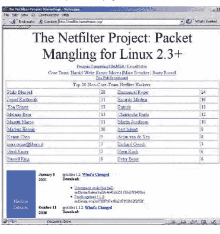

下一节将解释如何利用新的 `Netfilter` 支持配置你的 Linux 内核，使用 Linux 服务器构建网络层防火墙。

#### 配置 Netfilter

为了将 `Netfilter` 支持配置到内核中，安装 2.4 内核源代码，并在内核配置的 `make config` 阶段对 `CONFIG_NETFILTER` 问题输入 `Y`。

> **注意** 内核配置的详细细节超出了 Linux 安全书的范围。有关 Linux 内核配置的更多信息，请参阅 Vicki Stanfield 和 Roderick W. Smith 编写的 *Linux System Administration*（Sybex, 2001）。

默认情况下，Linux 系统被配置为网络主机——而非路由器。定义 Internet 标准的 RFC 要求主机*不*转发数据包。然而，为了让 Linux 系统充当防火墙，它必须转发数据包。实际上，为了让 Linux 系统充当防火墙，它必须首先充当路由器。因此，一旦内核配置为支持过滤，你可以通过将 `ip_forward` 开关设置为 `true` 来启用 IP 转发。这可以通过将变量设置为 1 来实现。一种方法是通过 `/proc` 文件系统设置 `ip_forward` 开关的值，如下例所示：

```
echo 1 > /proc/sys/net/ipv4/ip_forward
```

每次系统重启时，`ip_forward` 开关都会重置为 0，必须显式重置为 1。在启动脚本（如 `/etc/rc.d/rc.local`）中添加 `echo` 行以将开关重置为 1。一些 Linux 发行版，例如 `Red Hat` 和 `Caldera`，试图通过提供网络启动脚本的参数来简化此过程，该参数显式设置 `ip_forward` 开关。例如，在 `Red Hat 7` 系统上，在 `/etc/sysctl.conf` 文件中设置 `net.ipv4.ip_forward` 会将 `ip_forward` 开关设置为相应的值。以下示例将 `ip_forward` 设置为 1：

```
[ramon]$ head -2 /etc/sysctl.conf
# Enables packet forwarding
net.ipv4.ip_forward = 1
```

在 `Caldera` 系统上，可以通过在 `/etc/sysconfig/network` 文件中为 `IPFORWARDING` 设置值来设置 `ip_forward` 值。如果 `IPFORWARDING` 设置为 `true` 或 `yes`，`ip_forward` 将被设置为 1。如果设置为 `false` 或 `no`，`ip_forward` 将被设置为 0。以下示例将 `ip_forward` 设置为 1 以启用转发：

```
[ramon]$ cat /etc/sysconfig/network
NETWORKING=yes
IPFORWARDING=yes
HOSTNAME=ibis.foobirds.org
```

个人建议，我推荐使用 `echo` 命令直接设置 `/proc/sys/net/ipv4/ip_forward`。各个厂商添加的用于简化此开关设置的扩展功能往往会增加任务的复杂性，因为这些扩展各不相同。`echo` 命令在所有 Linux 发行版上工作方式相同。

> **注意** `Netfilter` 内核特性通过允许你使用 `iptwadm` 和 `ipchains` 创建数据包过滤规则，提供了向后兼容性。

###### iptables

`iptables` 是 Rusty Russel 的 `Netfilter` 包的组成部分，它是你用来影响三个内置网络层内核过滤链（`input`、`output` 和 `forward`）变更的用户空间实用工具。作为 `ipchains` 实用工具的演进，`iptables` 仅在 2.3 和 2.4 Linux 内核上运行，并在许多重要方面与 `ipchains` 不同：

-   内置参数（`INPUT`、`OUTPUT` 和 `FORWARD`）的名称从小写变为大写。
-   `-i`（接口描述符）标志现在指定*传入*接口，并且仅在 `input` 和 `forward` 链中有效。如果你需要在 `forward` 或 `output` 链的规则中使用接口描述符，请改用 `-o` 标志。
-   `iptables` 的 `-y` 标志（用于匹配设置了 SYN 位的 IP 数据包）现在是 `--syn`。
-   你现在可以在列出单个链时将其清零（使用 `-Z` 选项）。（此功能在 `iptables` 中曾不起作用。）
-   清零内置链会清除策略计数器（也是一个 bug 修复）。
-   `REJECT` 和 `LOG` 链操作现在是扩展目标（独立内核模块）。
-   链名称现在最多可以是 31 个字符。
-   `iptables` 的 `MASQ` 链现在称为 `MASQUERADE`，并使用不同的语法（参见“网络地址转换”一节）。

##### 图 9.2 Linux 内核数据包过滤内置链

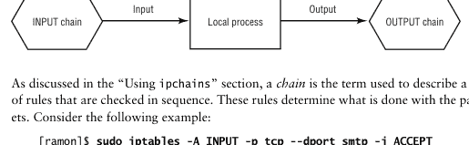

如“使用 `iptables`”一节所述，*链*是用来描述按顺序检查的一组规则的术语。这些规则决定如何处理数据包。考虑以下示例：


```bash
[ramon]$ sudo iptables -A INPUT -p tcp --dport smtp -j ACCEPT
[ramon]$ sudo iptables -A INPUT -j DROP
```

这个简单示例向`input`内置链添加了两条规则。第一条规则匹配所有传输层协议为`TCP`且目标`TCP`端口为`25`（互联网邮件或`SMTP`）的数据包。如果数据包匹配此规则，`Netfilter`将接受该数据包。

第二条规则是一个`捕获所有规则`（有时称为`隐身规则`，因为它将服务器隐藏于所有未明确允许直接与其通信的外部系统之外）。捕获所有规则指示`Netfilter`丢弃所有其他`input`链流量。前一个示例中的两条规则可用于确保你的邮件服务器仅接受旨在连接至`SMTP`端口的连接。

> **注意** `Netfilter` 框架相较于`2.4`之前`Linux`内核中旧有的数据包过滤支持，最重要的增强之一是对`input`和`output`链的处理。在`Netfilter`之前，无论数据包最终是绑定到其他系统（路由）还是本地系统（本地处理），内核都会对所有从网络驱动程序接收到的数据包咨询`input`链。`output`链也适用同样的情况，即转发的和源自本地的数据包都适用。这迫使网络管理员对`input`链应用非直观的规则，以考虑这两种类型的数据包。使用`Netfilter`后，只有绑定到本地处理的数据包才受`input`链约束，只有源自本地主机并绑定到其他主机的数据包才受`output`链约束。

`iptables`及其前身（`ipfwadm`、`ipchains`）满足相同的需求：每次系统重启时，将一组数据包过滤规则重新安装到内核中。由于内核没有任何非易失性存储，你需要在每次系统启动时使用`iptables`脚本重新初始化你的数据包过滤策略。由于这些规则不会在系统重启后保留，你必须将`iptables`命令放在一个脚本文件中，并将该脚本放入`/etc/rc.d/init.d`目录中。

##### 使用 iptables

并非所有`Linux`发行版都默认附带`iptables`。只需浏览你喜欢的`RPM`仓库（我最喜欢的是`www.rpmfind.net`）并按如下方式安装最新版本：

```
[ramon]$ sudo rpm -i iptables-1.1.2-1386.rpm
```

此命令在`/usr/lib`中安装了一系列共享库，安装`iptables`的手册页，以及主可执行文件`/sbin/iptables`。

在调用`iptables`命令时，你必须始终拥有`root`权限，因为它实际上是在向正在运行的内核写入链规则。

`iptables`命令的一般命令行语法如下：

```
iptables -[ADC] chain rule-specifications [options]
iptables -[RI] chain rulenum rule-specifications [options]
iptables -D chain rulenum [options]
```

###### iptables

```text
iptables -L [chain] [options]
iptables -N chain
iptables -P chain target [options]
iptables -E old-chain-name new-chain-name
```

命令行开关及其含义列于表 9.3 中。

| 开关 | 含义 |
| :--- | :--- |
| `-L` | 列出链中的所有规则。 |
| `-N` | 创建新链。 |
| `-P` | 将链的策略设置为给定的目标。 |
| `-E` | 重命名链。 |
| `-t table` | 选择要操作表。目前共有三种：`filter`（默认）、`nat`（网络地址转换）和`mangle`（专用数据包转换）。 |
| `-A` | 向链中添加规则（追加到链的末尾）。 |
| `-D` | 从链中删除规则。 |
| `-C` | 创建新链。 |
| `-R` | 替换链中现有的规则。 |
| `-I` | 在链中插入带编号的规则。 |
| `-F` | 清空链中的所有规则（清空链）。 |
| `-Z` | 将所有链上的数据包和字节计数器清零（重置）。 |
| `-X` | 删除用户定义的链。 |

`iptables`命令的`options`字段可以取表 9.4 中列出的值之一。

####### 表 9.4 iptables 命令行选项

| 选项 | 含义 |
| :--- | :--- |
| `--verbose` | 显示丰富（详细）的输出。 |
| `--numeric` | 以数字格式输出`IP`地址（不进行`DNS`查找）。 |
| `--exact` | 在输出中展开数字。 |
| `--line-numbers` | 在列出规则时显示行号。 |

##### iptables 规则规范

`iptables`命令的真正威力在于它使用丰富的规则集来匹配特定类型流量的能力。每个从服务器转发、到达服务器或由服务器发出的数据包，都会与相应链（`forward`、`input`和`output`）的规则集进行比较。如果数据包匹配该规则，则会执行指定的操作（由`-j action`选项定义）。表 9.5 列出了用于`iptables`命令中`rulespecifications`部分的参数。

###### 表 9.5 iptables 规则规范参数

| 参数 | 含义 |
| :--- | :--- |
| `-p [!]protocol` | 要匹配的协议 ID。它可以是`tcp`、`udp`、`icmp`，或者`/etc/services`中服务的任何数字或字母表示形式。 |
| `-s [!]address[/mask]` | 要匹配的源地址。它可以是主机名、`IP`地址，或以`network/mask`格式表示的网络名称。 |
| `--sport [port:[port]]` | 源端口或源端口范围的指定。 |
| `-d [!]address[/mask]` | 要匹配的目的地址。这里适用与`-s`参数相同的规则。 |
| `--dport [port:[port]]` | 目的端口或目的端口范围的指定。 |
| `-i [!]interface` | 接收数据包所经过的接口，如`eth0`、`ppp0`等。 |
| `-o [!]interface` | 发送数据包所经过的接口，如`eth0`、`ppp0`等。 |
| `[!] -f` | 数据包是更大的分片数据包的第二个或后续片段。 |

请注意，对于表 9.5 中列出的每个参数，前导的感叹号`[!]`指示`iptables`查找不符合该标准的数据包。`iptables`的规则规范参数与`ipchains`可用的参数非常相似，它们包括匹配传入数据包协议 ID（`-p`）、源地址和目的地址（`-s`和`-d`）以及源端口和目的端口号（`-sport`和`-dport`）的选项。

除了这些基本参数外，你还可以使用特定于协议的规则，为特定类型的数据包（例如，`tcp`、`udp`和`icmp`）指定扩展匹配参数。例如，下面这条`iptables`语句将匹配并允许所有携带`echo-request`类型的`ICMP`数据包（`ping`应用程序使用的数据包类型）。

```bash
iptables -A INPUT -p icmp --icmp-type echo-request -j ACCEPT
```

上一条命令的反向操作是

```bash
iptables -A OUTPUT -p icmp --icmp-type echo-reply -j ACCEPT
```

这里允许本地系统使用`echo-reply`回复`echo-request`，从而使你的系统能够正确响应`ping`请求。

表 9.6 列出了`iptables`中包含的`TCP`、`UDP`和`ICMP`流量类型对应的特定于协议的参数。

###### 表 9.6 iptables 特定于协议的数据包匹配参数

| 参数 | 含义 | 协议类型 |
| :--- | :--- | :--- |
| `--sport [! port:[port]]` | 匹配具有给定源端口或来自给定`port:port`范围的数据包。 | `tcp`, `udp` |
| `--dport [! port:[port]]` | 匹配具有给定目的端口或来自给定`port:port`范围的数据包。 | `tcp`, `udp` |
| `--port [! port]` | 匹配源端口和目的端口相等的数据包。 | `tcp`, `udp` |
| `--tcp-flags [! mask comp]` | 匹配具有指定`TCP`标志的数据包。标志包括`SYN`、`ACK`、`FIN`、`RST`、`URG`、`PSH`、`ALL`和`NONE`。 | `tcp` |
| `[!] --syn` | 匹配设置了`SYN`位且清除了`ACK`和`FIN`位的`TCP`数据包。 | `tcp` |
| `--tcp-option [! number]` | 如果数据包设置了`TCP`选项，则匹配。 | `tcp` |


| `--icmp-type [! type-name]` | 如果数据包具有给定的 ICMP 类型，则匹配。 | `icmp` |

此外，`iptables` 允许你加载所谓的扩展数据包匹配模块。这些类似于可以添加到基本 `iptables` 软件包的外部插件，以动态扩展其匹配数据包的能力。为了使用其中一个模块扩展 `iptables` 命令的语法，只需使用 `-m module` 选项即可。

标准 `iptables` 发行版中包含以下扩展数据包匹配模块：

- `owner`：`owner` 模块用于匹配具有本地数据包创建者特征的数据包。因此，它仅适用于 `output` 链。
- `state`：`state` 模块允许访问此数据包的连接跟踪状态。
- `tos`：`tos` 模块匹配 IP 头部中服务类型（type-of-service）字段的八位。
- `limit`：`limit` 模块调节规则应匹配传入数据包的速率。它最常用来限制数据包进入接口的速率，以避免拒绝服务攻击。

表 9.7 列出了在 `-m module` 开关之后可用于构建规则的参数。最左列包含该参数所属的模块。

###### 表 9.7 iptables 扩展数据包匹配参数

| 参数 | 含义 | 扩展模块 |
| :--- | :--- | :--- |
| `--uid-owner userid` | 如果数据包由具有给定用户 ID 的进程创建，则匹配。 | `-m owner` |
| `--gid-owner groupid` | 如果数据包由具有给定组 ID 的进程创建，则匹配。 | `-m owner` |
| `--pid-owner processid` | 如果数据包由具有给定进程 ID 的进程创建，则匹配。 | `-m owner` |
| `--sid-owner sessionid` | 如果数据包由具有给定会话组的进程创建，则匹配。 | `-m owner` |
| `--state state` | 匹配以下状态之一：`INVALID`、`ESTABLISHED`、`NEW` 或 `RELATED`。 | `-m state` |
| `--tos tos` | 匹配标准 IPv4 数据包中八位服务类型（TOS）字段。 | `-m tos` |
| `--limit rate` | 最大平均数据包速率。用于限制特定类型数据包的最大频率。速率必须具有以下后缀之一：`/second`、`/minute`、`/hour` 或 `/day`。默认为 `5/hour`。 | `-m limit` |
| `--limit-burst number` | 最大初始数据包数量。用于限制给定类型数据包的最大突发数量。默认为 `5`。 | `-m limit` |

例如，假设你的防火墙保护一台私有服务器，该服务器的主要任务是提供 Web 内容，但也为少数客户运行 FTP 服务器。你希望允许无限制的 HTTP 流量到达该服务器：

```bash
iptables -A FORWARD -p tcp -dport 80 -j ACCEPT
```

但你希望将 FTP 连接限制为每 30 秒一次（或每分钟两次）：

```bash
iptables -A FORWARD -p tcp --syn -dport 21 -m limit --limit 2/minute -j ACCEPT
iptables -A FORWARD -p tcp -dport 21 -j ACCEPT
```

请注意，除了 `-m limit` 扩展匹配外，在前一个示例中的第一条命令中还匹配了 `--syn` 类型的连接。这确保你只对连接请求进行速率限制。其余的 FTP 流量由第二条命令接受。

如您所见，`iptables` 命令具有非常复杂的语法。下一节介绍了一些使用 `iptables` 的示例，描述了许多现实世界中的网络架构场景，并提供了每种情况下建议使用 `iptables` 的命令。

### 防火墙典型场景示例

以下示例场景应能涵盖当今最主流的网络架构，从简单的拨号按需连接，到包含专用路由器和非军事化区（DMZ）的复杂场景，后者允许你在不危及私有网络安全的前提下提供公共服务。

#### 单宿主拨号服务器

大多数小型企业或分支机构拥有单一的非专用互联网连接，并且不希望任何人反向进入他们的网络或防火墙。此外，这些临时连接中的许多是宽带连接（有线互联网），其介质由当前连接的所有订阅者共享。这是入侵和窃听的温床，因此在此类场景中必须始终包含防火墙保护。

此外，大多数使用 DSL 或有线连接的家庭用户通常在其网络上拥有多台主机，并希望从这些主机访问公共互联网。Linux 通过 Netfilter 的 masquerading（伪装）特性提供 NAT 网络地址转换。考虑以下示例（如图 9.3 所示），你的拨号服务器有两个接口：

- `ppp0`，与你的 ISP 之间的拨号按需点对点协议连接
- `eth0`，连接到你私有 LAN 的快速以太网连接

**图 9.3** 单宿主拨号服务器架构

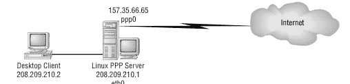

让我们为该场景创建一个 `iptables` 配置。请查看清单 9.1。

**清单 9.1** 单宿主拨号服务器

```
iptables -N protect
iptables -A protect -m state --state ESTABLISHED,RELATED -j ACCEPT
iptables -A protect -m state --state NEW -i ppp0 -j ACCEPT
iptables -A protect -j DROP
iptables -A INPUT -j protect
iptables -A FORWARD -j protect
```

第一行定义了一个名为 `protect` 的新链，你将在此执行所有过滤。（这样做是为了方便，以免你需要在多个内置链中输入相同的过滤规则。）第二行指示 `iptables` 允许任何传入拨号服务器的数据包，只要它们是先前打开连接的响应（`ESTABLISHED,RELATED`）。第三行允许新连接通过防火墙转发，但前提是该连接并非来自 `ppp0` 接口；因此，它必须来自服务器上的另一个也是唯一的接口 `eth0`。这确保了它是一个出站连接。第四行以一条静默规则结束 `protect` 链，确保任何不匹配先前规则的流量都被防火墙丢弃。

清单 9.1 中的最后两行不属于新建的 `protect` 链，这些行中的 `-A` 选项已清楚表明了这一点。这两行规则是将到达 `input` 和 `forward` 链的数据包转发到 `protect` 链。请注意，你完全没有限制 `output` 链，因此你允许任何源自拨号服务器本身的出站连接。

#### 双宿主防火墙：公共地址和私有地址

在公司中心站点和一些较大的分支机构中，你通常会发现支持全天候互联网连接的专用路由器。最直接的周边安全架构要求防火墙设备与路由器到 LAN 的连接**串联**放置。这样的设备确保所有进出互联网的流量都经过包过滤防火墙检查。考虑图 9.4 中描绘的示例架构，其中本地网络为 `208.209.210.0/24`，路由器的公共接口为 `157.35.66.65`。

**图 9.4** 双宿主防火墙架构


> **注意** 防火墙的公共接口和路由器的私有接口不需要可路由地址，因为它们的连接本质上是点对点的。你使用 `10.0.0.0/24` 网络进行此连接。

让我们考虑一种策略（见清单 9.2），允许 SSH 入站访问，同时阻止其他所有类型的请求。所有类型的出站 TCP 连接仍然被允许。入站 ICMP 流量仅限于回显请求（服务 `0`）。

**清单 9.2** 双宿主防火墙架构：SSH 入站服务


# Flush all the rules out of the chains

```
iptables -F INPUT
iptables -F OUTPUT
iptables -F FORWARD
```

# Set the default policy for the FORWARD chain to deny all

```
iptables -P FORWARD deny
```

# Block all incoming traffic coming from public interface (eth0)

```
iptables -A INPUT -i eth0 -j DROP
```

# Block all outgoing traffic going out the public interface (eth0)

```
iptables -A OUTPUT -o eth0 -j DROP
```

# Instruct Netfilter to accept fragmented packets (-f)

```
iptables -A FORWARD -f -j ACCEPT
```

# Accept incoming TCP packets from established connections
# (--state ESTABLISHED,RELATED)

```
iptables -A FORWARD -m state --state ESTABLISHED,RELATED -j ACCEPT
```

# Accept incoming TCP connections to SSH arriving at eth0

```
iptables -A FORWARD -p tcp -i eth0 -d 208.209.210.0/24 --dport ssh -j ACCEPT
```

# Accept all outgoing TCP connections entering the private interface (eth1)

```
iptables -A FORWARD -p tcp -i eth1 -j ACCEPT
```

# Accept all outgoing UDP connections entering the private interface (eth1)

```
iptables -A FORWARD -p udp -i eth1 -j ACCEPT
```

# Accept incoming ICMP packet of 'echo reply (=0)' type (ping replies)

```
iptables -A FORWARD -p icmp -i eth0 -d 208.209.210.0/24 \
    --icmp-type 0 -j ACCEPT
```

# Accept all outgoing ICMP connections entering the private interface (eth1)

```
iptables -A FORWARD -p icmp -i eth1 -j ACCEPT
```

# Drop all other traffic in the FORWARD chain

```
iptables -A FORWARD -j DROP
```

请注意，最后一行实际上并不需要，因为你在脚本顶部已为 `forward` 链建立了拒绝策略（默认拒绝所有，除非特别允许）。不过，谨慎起见总是个好主意。

接下来，让我们通过仅允许 `SSH`、`WWW`、`SMTP` 和 `DNS` 出站服务来限制上述策略（见清单 9.3）。`粗体` 行是与清单 9.2 中先前场景相比的更改。

**清单 9.3** 双宿主防火墙架构：仅 `SSH` 入站服务，以及 `SSH`、`WWW`、`SMTP` 和 `DNS` 出站服务

```
# Flush all the rules out of the chains
iptables -F INPUT
iptables -F OUTPUT
iptables -F FORWARD

# Set the default policy for the FORWARD chain to deny all
iptables -P FORWARD deny

# Block all incoming traffic coming from public interface (eth0)
iptables -A INPUT -i eth0 -j DROP

# Block all outgoing traffic going out the public interface (eth0)
iptables -A OUTPUT -o eth0 -j DROP

# Instruct Netfilter to accept fragmented packets (-f)
iptables -A FORWARD -f -j ACCEPT

# Accept incoming TCP packets from established connections
# (--state ESTABLISHED,RELATED)
iptables -A FORWARD -m state --state ESTABLISHED,RELATED -j ACCEPT

# Accept incoming TCP connections to SSH arriving at eth0
iptables -A FORWARD -p tcp -i eth0 -d 208.209.210.0/24 --dport ssh -j ACCEPT

# Accept outgoing TCP connections to SSH, WWW, SMTP only
iptables -A FORWARD -p tcp -i eth1 --dport ssh,www,smtp -j ACCEPT

# Accept incoming UDP packets as response from DNS service (port 53)
iptables -A FORWARD -p udp -i eth0 --sport domain -j ACCEPT

# Accept outgoing UDP connections to port 53 (DNS) only
iptables -A FORWARD -p udp -i eth1 --sport domain -j ACCEPT

# Accept incoming ICMP packet of 'echo reply (0)' type (ping replies)
iptables -A FORWARD -p icmp -i eth0 -d 208.209.210.0/24 \
    --icmp-type 0 -j ACCEPT

# Accept all outgoing ICMP connections entering the private
# interface (eth1)
iptables -A FORWARD -p icmp -i eth1 -j ACCEPT

# Drop all other traffic in the FORWARD chain
iptables -A FORWARD -j DROP
```

请注意，与 `SSH` 和 `telnet` 等 `TCP` 服务不同，你无法有效地将返回的 `UDP` 流量限制为反映已建立出站连接的数据包。这意味着你需要允许防火墙接受所有源端口为 `53`（`DNS`——域名解析服务）的 `UDP` 流量。

#### 带有非军事化区（DMZ）的三宿主防火墙

更复杂的网络架构包含一个三宿主防火墙，包括一个公共接口、一个私有接口以及一个服务于非军事化区（`DMZ`）的第三个接口。`DMZ` 允许你在一定程度上控制公共服务，同时不允许匿名用户进入你的私有网络空间。图 9.5 展示了三宿主防火墙，它在图 9.4 描绘的架构基础上增加了一个新的网络 `64.65.66.0/24`，用于通过两台服务器（`Web` 和邮件）服务 `DMZ`。

##### 图 9.5 带 DMZ 的三重宿主防火墙架构

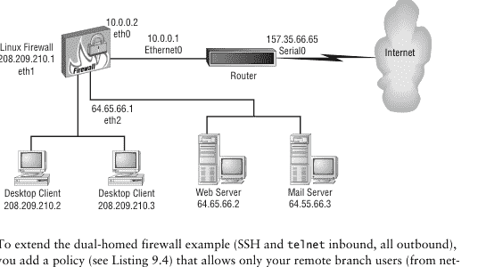

为了扩展双宿主防火墙示例（`SSH` 和 `telnet` 入站，所有出站），你需要添加一条策略（参见 列表 9.4），该策略仅允许你的远程分支用户（来自网络 `128.129.130/24`）访问 `DMZ` `Web` 服务器，同时授予 `DMZ` 邮件服务器不受限制的网络访问。`加粗` 的行是相对于上一个场景（列表 9.3）的更改。

##### 列表 9.4 带 DMZ 的三重宿主防火墙架构示例 iptables 脚本


```bash
# Flush all the rules out of all three default chains
iptables -F INPUT
iptables -F OUTPUT
iptables -F FORWARD

# Set the default policy for the FORWARD chain to deny all
iptables -P FORWARD deny

# Block all incoming traffic coming from public interface (eth0)
iptables -A INPUT -i eth0 -j DROP

# Block all outgoing traffic going out the public interface (eth0)
iptables -A OUTPUT -o eth0 -j DROP

# Instruct Netfilter to accept fragmented packets (-f)
iptables -A FORWARD -f -j ACCEPT

# Accept incoming TCP packets from established connections
# (-state ESTABLISHED,RELATED)
iptables -A FORWARD -m state -p tcp --state ESTABLISHED,RELATED -j ACCEPT

# Accept incoming TCP connections to SSH arriving at eth0
iptables -A FORWARD -p tcp -i eth0 -d 208.209.210.0/24 --dport ssh -j ACCEPT

# Accept incoming TCP connections to SSH arriving at eth0
iptables -A FORWARD -p tcp -i eth0 -d 208.209.210.0/24 --dport ssh -j ACCEPT

# Accept incoming TCP connections to DMZ SMTP server (64.65.66.3)
iptables -A FORWARD -p tcp -i eth0 -d 64.65.66.3 --dport smtp -j ACCEPT

# Accept incoming TCP connections to Web server from remote branch only
iptables -A FORWARD -p tcp -i eth0 -s 128.129.130.0/24 -d 64.65.66.2 -dport:www -j ACCEPT

# Accept all outgoing TCP connections received via both eth1 and eth2
# (the private and the DMZ interfaces respectively)
iptables -A FORWARD -p tcp -i eth1,eth2 -j ACCEPT

# Accept all outgoing UDP connections received via both eth1 and eth2
# (the private and the DMZ interfaces respectively)
iptables -A FORWARD -p udp -i eth1,eth2 -j ACCEPT

# Accept incoming ICMP packet of `echo reply` (`0`) type (ping replies)
iptables -A FORWARD -p icmp -i eth0 -d 208.209.210.0/24 --icmp-type 0 -j ACCEPT
iptables -A FORWARD -p icmp -i eth0 -d 64.65.66.0/24 --icmp-type 0 -j ACCEPT

# Accept all outgoing ICMP connections received from either the
# private interface (eth1) or the DMZ interface (eth2)
iptables -A FORWARD -p icmp -i eth1, eth2 -j ACCEPT

# Drop all other traffic in the FORWARD chain
iptables -A FORWARD -j DROP
```

在列表 9.4 中，你只是向前向链添加了两条规则，一条允许所有到邮件服务器（`64.65.66.3`）的 SMTP 流量，另一条允许来自 `128.129.130.0/24` 的源流量连接到 DMZ Web 服务器（`64.65.66.2`）的 80 端口。注意，你还必须允许 ICMP 响应进入 `eth0` 并定向到 DMZ，并通过 DMZ 接口 `eth2` 退出。

### 防范已知攻击

除了对内部主机实施访问控制的能力外，`Netfilter` 和 `iptables` 还可以用于通过过滤与攻击指纹匹配的数据包来防范特定类型的 Internet 攻击。本节描述了用于解决这些已知漏洞的若干示例 `iptables` 语句。

#### 地址欺骗

许多防火墙配置允许在验证数据包头部的源字段中包含来自专用网络的地址后转发该数据包。问题在于，攻击者很容易合成一个“欺骗”数据包，该数据包生成自他们的网络但携带你的源地址。通过使用 `iptables` 命令（如下所示）要求来自本地网络的源地址的数据包必须从连接到本地网络的接口接收，从而保护你的站点免受地址欺骗：

```bash
iptables -A FORWARD -s internal_network -i public_interface -j DROP
```

此命令向前向链添加了一条规则，该规则匹配源自内部网络但通过公共接口进入系统的流量。通过添加此命令，你强制 `Netfilter` 丢弃到达你防火墙公共接口的欺骗数据包。

例如，考虑之前在图 9.4 中描绘的双宿主防火墙架构，其中本地网络是 `208.209.210.0/24`，路由器的公共接口是 `157.35.66.65`。该防火墙的地址欺骗规则如下所示：

```bash
iptables -A FORWARD -s 208.209.210.0/24 -i eth0 -j DROP
```

此规则检查到达公共接口（`eth0`）的数据包，如果它们携带（专用）`208.209.210.0/24` 网络中的源地址，则静默丢弃它们。

#### 碎片攻击（Smurf Attack）

`smurf` 攻击是通过向内部网络的广播地址发送 ICMP 回显请求（`ping`）数据包来实施的。数据包的源被伪造为 `smurf` 攻击目标地址，该目标会被所有内部主机的 ICMP 回显响应淹没。

以下 `iptables` 命令应通过阻止伪造的 ICMP 回显请求进入你的网络来防范 `smurf` 攻击：

```bash
iptables -A FORWARD -p icmp -d internal_network_broadcast_address -j DROP
```

此命令向前向链添加了一条规则，该规则匹配进入防火墙任何接口的、目的地为你的内部 LAN 广播地址的任何 ICMP 数据包。当匹配到此规则时，数据包执行 `DROP` 动作。例如，在之前图 9.4 中描绘的网络中，你将使用以下命令：

```bash
iptables -A FORWARD -p icmp -i eth0 -d 208.209.210.255 -j DROP
```

在这种情况下，你正在寻找目的地为 `208.209.210.255`（即 `208.209.210.0/24` 网络的广播地址）的 ICMP 流量。

#### Syn-Flood 攻击

`syn-flood` 攻击是通过向主机发送大量 TCP 连接请求（设置 `SYN` 标志）并抑制正常的 `SYN-ACK` 响应来实施的，从而试图消耗其所有可用的数据结构，而这些结构正忙于跟踪这些半打开的连接。

使用 `limit` 外部匹配模块，你可以使用以下 `iptables` 命令将 TCP `SYN` 请求的接受速率限制为每秒一次：

```bash
iptables -A FORWARD -p tcp --syn -m limit --limit 1/s -j ACCEPT
```

每秒一个 TCP `SYN` 请求的速率对于大多数 Internet 服务器来说是可接受的，但它限制入站 `SYN` 请求的发生次数足够多，以确保你的系统始终有足够的可用资源来处理合法连接。

#### 端口扫描攻击

许多端口扫描应用程序试图通过向给定的端口范围发送 `SYN` 或 `FIN` 信号并期望对未激活的端口收到 `RST` 信号来识别你系统中所有开放的 TCP 和 UDP 端口。你可以使用以下 `iptables` 命令将此活动限制为每秒一次：


```bash
iptables -A FORWARD -p tcp --tcp-flags SYN,ACK,FIN,RST RST -m limit --limit 1/s -j ACCEPT
```

此命令向前向链添加了一条规则，该规则匹配到达防火墙时 `SYN`、`ACK` 和 `FIN` 标志未设置且 `RST` 标志已设置的 `TCP` 流量。当数据包匹配此描述时，它仅以每秒一次的速率被接受。

#### Ping-of-Death 攻击

通过发送异常大且异常频繁的 `ICMP` 回显（`ping`）请求，可能会终止某些操作系统的运行。这被称为 `ping-of-death` 攻击。以下 `iptables` 命令将此类 `ping` 的接受限制为每秒一次：

```bash
iptables -A FORWARD -p icmp --icmp-type echo-request -m limit --limit 1/s -j ACCEPT
```

事实上，我建议你使用以下命令完全在防火墙处阻止 `ICMP` 请求

```bash
iptables -A FORWARD -p icmp --icmp-type echo-request -j DROP
```

除非你有合法需求需要从外部通过 `ping` 访问你的主机。

### 网络地址转换

当前已安装的连接 `Internet` 的主机面临的一个问题是网络地址的短缺。`IP` 版本 `4` 限制为 $2^{32}$ 个唯一地址。虽然 40 亿个 `IP` 地址可能看起来足够多，但由于子网划分和不连续分配，其中许多实际上是不可用的。此外，许多企业从未觉得有必要将其网络连接到公共 `Internet`，因此他们使用了来自不可路由块（`RFC 1819`）的地址，这些地址是为非 `Internet` 连接网络预留的。

当面临将私有编号网络与 `Internet` 整合的任务时，你必须做出一个重要选择：重新编号或转换。一方面，你可以从你的 `Internet` 服务提供商处请求一个可路由的 `IP` 块，并经历重新编号（通常还包括重新子网划分）整个网络的痛苦过程；或者，如果你的连接需求适度，你可以使用网络地址转换（`NAT`）。

`NAT` 的优势是双重的：一方面，你可以自由选择使用的编号方案，同时仍然允许你的用户连接到公共 `Internet`。另一方面，如果你使用不可路由的内部地址，入侵者不像如果主机自然可路由那样容易访问你的内部主机，特别是当它们隐藏在 `NAPT` 后面时，`NAPT` 是一种稍后描述的一对多 `NAT`。

`NAT` 涉及在将数据包发送到其目的地之前修改数据包的源地址。这需要 `NAT` 设备跟踪此修改，以便在收到响应时可以反转该步骤。有三种类型的网络地址转换，取决于 `NAT` 设备如何跟踪转换：`NAPT`、静态 `NAT` 和 `LSNAT`。

网络地址端口转换 (`NAPT`)

`NAPT` 也被称为多对一 `NAT`，最适合仅能使用单个公共地址的网络网关。`NAT` 设备接受来自私有客户端的出站连接请求，并使用两项信息跟踪每个连接：

- 内部主机的私有 `IP` 地址

- `NAT` 设备用作该请求传输层端口号的源端口

这使得 `NAT` 设备能够正确路由返回流量，即使有两个内部客户端连接到同一外部服务器。部署 `NAPT` 会将整个私有网络隐藏在一个公共地址之后，从而减少你在互联网上的暴露面，并极大地减少你对可路由地址空间的需求。`NAPT` 的主要缺点是你无法在内部网络中托管任何服务，因为 `NAPT` 设备无法接受来自互联网的入站请求。如果在内部网络中托管服务是必要条件，请使用静态 `NAT`。

静态 `NAT`

也称为一对一 `NAT`，静态 `NAT` 是最简单的情况，其中单个公共地址映射到单个私有地址。必须预先配置 `NAT` 设备以执行此映射。例如，与 `NAPT` 不同，在 `NAPT` 中你可以让整个网络隐藏在一个地址之后，但由于你需要为它们分配公共等效地址，因此必须预先知道要保护哪些地址。

负载均衡网络地址转换 (`LSNAT`)

作为普通静态网络地址转换的扩展，`LSNAT` 允许你向公共互联网宣告单个地址，同时对该地址发出的请求由多个内部主机处理。连续的请求以轮询方式分配给内部地址池，从而实现对入站连接的负载均衡效果。这在部署位于非军事区 (`DMZ`) 的 `Web` 服务器群时非常有用，其中所有服务器都可以包含你 `Web` 内容的完全副本。随着需求增加，只需添加额外的服务器，并将新的私有地址注册到你的 `NAT` 设备中的绑定表中。对外界而言，它仍然看起来只有一个 `Web` 服务器。

#### 使用 iptables 配置 NAT

考虑图 9.3 中描绘的网络架构。如果你的内部网络不包含可路由地址，并且你仍希望从私有主机连接到互联网，则你需要执行 `NAT`。对于具有单个可路由地址的小型网络，最流行的方法是 `NAPT`，也称为伪装 (`masquerading`) 或隐藏 (`hiding`)。只需将清单 9.5 中的行添加到你的 `iptables` 配置中。

**清单 9.5** `iptables` NAPT 配置示例

```
iptables -t nat -A POSTROUTING -o ppp0 -j MASQUERADE
```

请注意，清单 9.5 中的命令使用 `-t nat` 选项。大多数 `iptables` 命令操作 `filtering` 表（包含内置链 `input`、`output` 和 `forward`）。`NAT` 依赖于另一个 `Netfilter` 表，适当地命名为 `nat`，其中包含内置链 `prerouting`、`postrouting` 和 `output`。这些链具有以下特性：

- `prerouting` 链是数据包进入系统时立即尝试匹配数据包的链。

- `postrouting` 链是在基于目的地的路由决策做出后尝试匹配数据包的链。

- `output` 链是在基于目的地的路由决策做出之前匹配本地生成流量的链。

`-o ppp0` 选项指示 `iptables` 在数据包即将通过 `ppp0` 接口发出之前应用 `MASQUERADE` 规则，以便服务器上的其他进程看到具有原始源地址的数据包。这是一个重要的点，因为它意味着应用于该数据包的数据包过滤规则也将看到具有原始源地址的数据包。在编写 `iptables` 规则时请记住这一点。

清单 9.5 中的示例对出站数据包执行 `NAPT`，使用分配给 `ppp0` 的地址作为 `masquerade-as` 地址。如果你想使用 `nat` 表，并将特定的可路由地址（例如，`208.209.210.1`）静态绑定到一个不可路由的私有地址（例如，`10.10.10.1`）怎么办？你可以通过指定清单 9.6 中的语法使用静态 `NAT`。

**清单 9.6** `iptables` 静态 NAT 配置示例

```
iptables -t nat -A POSTROUTING -s 10.10.10.1 -o eth0 -j SNAT --to-
208.209.210.1
iptables -t nat -A PREROUTING -s 208.209.210.1 -i eth0 -j DNAT --to-
10.10.10.1
```

清单 9.6 中的第一条命令确保源自 `10.10.10.1` 的数据包的源字段在离开接口 `eth0` 之前更改为 `208.209.210.1`。第二条命令在数据包到达 `eth0` 时且路由发生之前执行相反的目的地转换。

负载均衡 `NAT` (`LSNAT`) 可以通过简单指定 `-j DNAT` 规则来实现，在该规则中，你从单个入站地址到多个目的地地址执行目的地 `NAT`。例如，考虑这种情况：你在公共地址 `208.209.210.1` 上托管了一个热门 `Web` 服务器，但希望将该服务器的传入负载分担给相同的服务器 `10.10.10.1`、`10.10.10.2` 和 `10.10.10.3`。只需修改上一个示例中的命令，如清单 9.7 所示。

**清单 9.7** `iptables` LSNAT 配置示例

```
iptables -t nat -A POSTROUTING -s 10.10.10.1 -o eth0 -j SNAT --to
208.209.210.1
```

```
iptables -t nat -A PREROUTING -s 208.209.210.1 -i eth0 -j DNAT --to
10.10.10.1-10.10.10.3
```

清单 9.7 和清单 9.6 之间唯一的区别在于，第二条规则将传入的 `208.209.210.1` 目的地转换为范围 `10.10.10.1`–`10.10.10.3`，而不是单个地址 `10.10.10.1`。

### 总结

构建 `Linux` 防火墙在概念上很容易，但魔鬼在细节中。本章带你了解了数据包过滤的一般概念及其在 `Linux` 内核中的实现。你学习了两种用户空间工具，可以用来定义必要的过滤规则：`ipchains`（随内核 `2.1` 引入），以及较新的 `iptables`（随内核 `2.3` 引入）。你查看了许多详细的网络场景，并看到了几个反映不同安全策略的 `iptables` 配置示例。

虽然部署 `Linux` 防火墙的初始成本可能低于许多商业替代品，但制定配置以反映你的安全策略需要仔细关注细节。数据包过滤是你第一层周边防御，但全面的安全姿态也将利用传输层和应用层的保护。在本书的下一章中，我们将把重点转移到传输层防火墙，届时你将深入了解 `SOCKS` 代理协议。

## 10

## 传输层防火墙


虽然在网络安全层进行过滤相当直接且易于实施，但有时需要更细粒度的身份验证和授权。例如，你可能希望允许所有用户通过`SMTP`访问互联网，但只允许你的市场部门访问`Web`主机。在这种情况下，网络访问可能根据请求者的身份授予或拒绝。传输层防火墙使代理内部用户的出站连接成为可能，从而控制互联网访问。

与数据包过滤器相比，传输层防火墙提供两个明显的优势：它们以用户级别控制对公共网络资源的访问，同时通过将企业的互联网暴露面减少到代理服务器的单个公共`IP`地址。通过在网络的进出处设置单一入口点，你可以集中记录所有用户针对每项特定服务（`Web`、邮件、`FTP`等）的活动。另一方面，代理防火墙通常要求你在用户工作站上使用定制的“感知代理”网络客户端软件。此外，由于你需要同时跟踪用户和服务，代理防火墙通常比简单数据包过滤防火墙更难设置和维护。

如果你的安全策略定义了具有不同权限的不同用户组，或者你负责提供基于每个应用的详细网络使用情况，我强烈建议你考虑部署代理防火墙。数据包过滤根本无法以便您拥有足够的控制权来执行此类策略，而您获得的日志将无法深入查明所使用的具体应用程序类型。

本章定义了代理服务器的概念，并描述了用于构建基于标准的代理防火墙的`SOCKS`框架。它还描述了`NEC`的`SOCKS5`的安装和配置，这是`Linux`发行版中一种免费可用的`SOCKS`协议实现。

### 代理服务器

代理设备会检查请求者的身份验证凭据，并在授予或拒绝网络访问请求之前查阅访问控制规则列表。该规则集应采用默认拒绝的立场，即除非有规则明确授予访问权限，否则应拒绝访问。如果访问被授予，代理设备将代表请求者与外部主机建立所需的连接。外部主机随后会响应代理设备的地址，因此，跟踪所有未处理的网络请求以及这些响应应指向哪些内部主机是代理的职责。图 10.1 说明了代理服务器设备处理`HTTP`访问请求的运行情况。

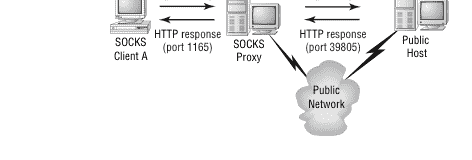

有两种不同类型的代理服务器：

- **传输层代理服务器**

代理服务器在`ISO`堆栈中位于网络层之上，无论接收到的应用程序流量类型如何，它们都在公共`TCP/UDP`端口上接受所有连接请求。传输层代理服务器也被称为*电路层代理服务器*，因为它们服务于在用户应用程序和目标主机之间建立*虚电路*，而不检查被代理的*数据包*的*有效载荷*。在图 10.1 中，`SOCKS`代理服务器需要维护足够的状态信息，以识别是哪个内部主机请求了特定的外部连接。在图 10.1 中，该服务器将源端口为 39805 的传入`HTTP`响应映射到首先发起请求的`SOCKS`客户端 A 的 1165 端口。

- **应用层代理服务器**

代理服务器被定制为仅处理特定的应用程序流量，通常通过特定于每个应用程序的`TCP/UDP`端口号进行访问。这些代理服务器通常比其传输层对应物更“智能”，但它们依赖于应用程序的事实使其灵活性大大降低，且全面性差得多。

> **注意** 第 11 章“应用层防火墙”重点介绍了`TIS`防火墙工具包，这是一种流行的实现，依赖于应用层代理技术。

### `SOCKS` 协议

互联网工程任务组（`IETF`）标准`SOCKS`（`SOCK-et-S`）协议定义了代理防火墙系统设计和运行的通用框架。这是一项通用规范，用于描述私有网络中感知代理的客户端与充当防火墙的代理服务器之间的交互，该代理服务器通过将客户端请求中继到公共互联网来充当防火墙。

`SOCKS`协议背后的主要驱动力是它的普及性；当今大多数可用的网络应用程序都内置了对`SOCKS`代理的支持，从而无需分发特殊的客户端软件或修改用户当前用于访问互联网的过程。此外，`SOCKS`代理服务器允许网络管理员使用标准管理基础设施来保护和记录广泛的网络应用程序。实际上，`SOCKS`规范允许客户端应用程序使用相同的传输层端口号（例如，`TCP` 1080）来对用户进行身份验证并建立通信。

目前有两种版本的`SOCKS`协议在使用。本章的下一节将讨论它们之间的差异。

#### `SOCKS4` 与 `SOCKS5`

当前的`SOCKS`实现`SOCKS5`基于该协议的早期版本（`SOCKS4`），最初由 David Koblas 发布，并由`NEC USA, Inc.`网络系统实验室（`NSL`）的 Lee Ying-Da 进行了扩展。虽然`SOCKS4`是一个功能完整的协议定义，但它缺乏对强身份验证的支持，而强身份验证是代理系统安全运行的必要功能。这一限制促使`IETF`着手制定`SOCKS5`标准（`RFC1928`），在 Koblas 和 Lee 的原始工作基础上添加了许多新功能，包括以下各项：

- 具有多种身份验证方法的强身份验证
- `DNS`查询的透明代理
- 使用`GSS-API`（`RFC1961`）进行消息完整性和隐私保护
- 有限的`UDP`流量支持

此外，`SOCKS5`移除了客户端应用程序必须使用`SOCKS`库重新编译才能感知代理的要求。`SOCKS5`实现现在附带一个动态库，`Linux`客户端应用程序可以在运行时加载，从而消除了修改客户端代码的任何需要。

#### 你需要 `SOCKS` 吗？

在某些情况下，基于`SOCKS`的代理服务器是防火墙的最合适选择。通常，如果您需要根据用户的凭据而不是客户端的`IP`地址来控制网络访问，代理防火墙是一个显而易见的选择。以下情况仅仅是需要基于用户凭据的访问控制的那些情况的一个示例，这些需求可以很容易通过`SOCKS`代理来满足：

- 您有一些应用程序用户全天都需要`telnet`和`ftp`访问，但只允许在下班后访问`Web`浏览器。
- 您有一些网络客户端，其`IP`地址永远不应允许通过防火墙。
- 您有许多应用程序用户，但只有一个可路由到互联网的`IP`地址。
- 您需要跟踪您的员工访问了哪些`URL`，并且您需要阻止其中的一些`URL`。
- 您被限制使用单宿主防火墙（只有一个网络接口）。

### `NEC SOCKS5` 代理服务器

`NEC NSL`的`SOCKS`参考实现是应用层安全领域的先驱，它提供了一个基于流行的`SOCKS`协议第 5 版的全功能代理服务器应用程序。本章将引导您完成编译、安装和配置`Linux`版本`NEC`的`SOCKS5`实现的过程。它还描述了如何使用`SOCKSCap`，这是一个基于`WinSock`的库，为那些不原生支持`SOCKS`的`Microsoft Windows`应用程序提供无缝的`SOCKS`支持。

`SOCKS`防火墙实现的核心是在`Linux`服务器上运行的`SOCKS5`守护进程。此守护进程需要在一个具有到内部网络和公共互联网清晰`IP`网络路径的主机上运行。这通过以两种模式之一配置您的防火墙主机来实现：

- **单宿主**：单宿主系统在一个网络段上有一个接口，该段可以同时到达私有网络和公共网络。
- **双宿主**：双宿主系统有两个接口，一个用于公共网络，一个用于私有的受信任网络。

`SOCKS5`可以用于这两种配置中的任何一种，尽管双宿主防火墙通常更简单，便于设置和维护，因此更安全。

`Linux`发行版默认不包含`SOCKS5`包，因此您需要以`RPM`格式或作为源代码的`tar`存档来获取它。我是从`www.rpmfind.net`获取的。

#### 使用 `RPM` 安装 `SOCKS5`

使用带有`-q`（或`--query`）选项的`rpm`命令来查看您的系统上是否已经安装了`SOCKS5`：

```
[ramon]$ rpm -q socks5
socks5-1.0r08-1
```

如果`SOCKS5`已经安装，但您希望将已安装的包升级到较新的版本，请使用带有新版本的包的`-U`（或`--upgrade`）选项：

```
[ramon]$ sudo rpm -U socks5-1.0r11-1.i386.rpm
[ramon]$ rpm -q socks5
socks5-1.0r11-1
```

除了基础服务器包（`SOCKS5`）之外，我还建议安装另外三个`RPM`包：

- `SOCKS5 Linux`客户端（`socks5-clients`）
- `SOCKS5`共享库封装器（`runsocks`）
- `SOCKS5`开发环境（`socks5-devel`）

使用以下命令安装这三个包：

```
[ramon]$ sudo rpm -i socks5-clients-1.0r11-1.i386.rpm
[ramon]$ sudo rpm -i runsocks-1.0r11-1.i386.rpm
[ramon]$ sudo rpm -i socks5-devel-1.0r11-1.i386.rpm
```

`SOCKS5 RPM`模块依赖于`libc.so.X`和`libpthread.so.X`这两个库，因此请确保您的`glibc`包（这两个库所在之处）是最新的。

如果您更喜欢自行编译`SOCKS5`软件，下一节将描述如何从源码发行版配置和编译`SOCKS5`。

#### 编译最新 `SOCKS5` 发行版

`SOCKS5 Linux`发行版可以从`NEC`的网站`http://www.socks.nec.com/cgi-bin/download.pl`下载源码格式（见图 10.2）。


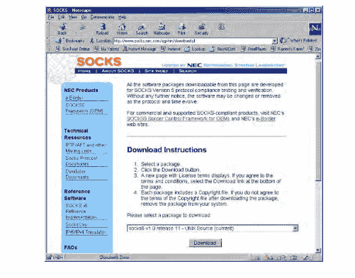

除了免费提供的参考实现外，NEC 的 `NSL` 还提供了一个完全受支持的商业 `SOCKS5` 产品，名为 `e-Border`。关于 `e-Border` 的更多信息（包括如何下载），请访问 `http://www.socks5.nec.com`（见图 10.3）。

##### 图 10.3 NEC 的 e-Border：一个商业 SOCKS5 实现

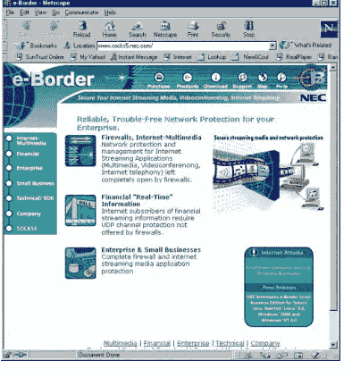

下载 `gnu-zip` 压缩的发行版文件后，请使用列表 10.1 中的步骤解压缩并解压归档文件。

##### 列表 10.1 创建 SOCKS5 源代码目录

```bash
[ramon]$ ls
socks5-v1.0r11.tar.gz

[ramon]$ gunzip socks5-v1.0r11.tar.gz
[ramon]$ ls
socks5-v1.0r11.tar
[ramon]$ tar xf socks5-v1.0r11.tar
[ramon]$ cd socks5-v1.0r11
[ramon]$ ls -l
total 234
-rw-rw- 1 ramon users 22907 Aug 16 11:38 ChangeLog
-rw-rw- 1 ramon users 3495 Feb 3 1999 Copyright
-rw-rw- 1 ramon users 4753 Jul 16 1998 INSTALL
-rw-rw- 1 ramon users 3439 Oct 20 1999 Makefile.in
-rw-rw- 1 ramon users 10883 Feb 4 1999 README
-rw-rw- 1 ramon users 2454 May 27 1999 acconfig.h
-rw-rw- 1 ramon users 10692 May 27 1999 aconfig.m4
drwxr-xr-x 7 ramon users 1024 Aug 16 11:38 clients
-rwxr-xr-x 1 ramon users 148397 Aug 2 1999 configure
-rw-rw- 1 ramon users 9885 Aug 2 1999 configure.in
drwxr-xr-x 2 ramon users 1024 Aug 16 11:38 doc
drwxr-xr-x 2 ramon users 1024 Aug 16 11:38 examples
drwxr-xr-x 2 ramon users 1024 Aug 16 11:38 include
-rwxr-xr-x 1 ramon users 4772 Jan 25 1999 install-sh
drwxr-xr-x 2 ramon users 1024 Aug 16 11:38 lib
drwxr-xr-x 4 ramon users 1024 Aug 16 11:38 man
drwxr-xr-x 2 ramon users 1024 Aug 16 11:38 patches
drwxr-xr-x 2 ramon users 1024 Aug 16 11:38 server
drwxr-xr-x 2 ramon users 1024 Aug 16 11:38 shlib
-rw-rw- 1 ramon users 29 Nov 15 1996 stamp-h.in
drwxr-xr-x 2 ramon users 1024 Aug 16 11:38 test
```

在这个 `SOCKS5` 版本（`v1.0`，第 11 次发行）中，有十个子目录：

-   `clients`：示例 Linux `SOCKS5` 客户端
-   `doc`：通用产品文档
-   `examples`：示例配置文件
-   `include`：头文件
-   `lib`：`SOCKS5` 静态库的源代码
-   `man`：手册页
-   `patches`：针对源代码的独立（且可选）补丁
-   `server`：`SOCKS5` 服务器的源代码
-   `shlib`：共享 `SOCKS5` 库的源代码

此外，还有一些发行信息文件（例如 `ChangeLog` 和 `Copyright`）、一个 `README` 文档以及一个名为 `configure` 的 shell 脚本文件，这是本书下一节的主题。

一旦文件成功解压到新的 `socks5-v1.0r11` 目录中，就可以开始构建 `SOCKS5` 守护进程了。

> **注意** 您需要一个 ANSI 兼容的 C 编译器来编译和安装 `SOCKS5` 发行版。您的 Linux 发行版中提供的 GNU `gcc` 编译器应该可以正常工作。

大多数软件包源码发行版向用户提供多个选项，允许您将软件包定制到您当前的环境。下一节描述了编译前配置 `SOCKS5` 源码的可用选项。

#### Linux 编译参数

在主源目录中查找 `configure` shell 脚本：

```bash
[ramon]$ ls -l configure
-rwxr-xr-x 1 ramon users 148397 Aug 2 1999 configure
```

不带任何命令行选项运行 `configure` 脚本以创建默认的编译文件集，如列表 10.2 所示。

##### 列表 10.2 执行 SOCKS5 configure 脚本


```bash
[ramon] $ ./configure
loading cache ./config.cache
checking for gcc2... (cached) gcc
checking for gcc... (cached) gcc
checking whether the C compiler (gcc ) works... yes
checking whether the C compiler (gcc ) is a cross-compiler... no
checking whether we are using GNU C... (cached) yes
checking whether gcc accepts -g... (cached) yes
checking how to run the C preprocessor... (cached) gcc -E
checking whether gcc needs -traditional... (cached) no
checking for working const... (cached) yes
checking for inline... (cached) inline
checking for ranlib... (cached) ranlib
checking for a BSD compatible install... (cached) /usr/bin/install -c
checking for makedepend... (cached) true
checking for autoconf... (cached) autoconf
checking for autoheader... (cached) autoheader
checking for fcntl.h... (cached) yes
checking for memory.h... (cached) yes
checking for unistd.h... (cached) yes
checking for string.h... (cached) yes
checking for strings.h... (cached) yes
checking for bstring.h... (cached) no
checking for varargs.h... (cached) yes
checking for stdarg.h... (cached) yes
checking for stdlib.h... (cached) yes
checking for time.h... (cached) yes
checking for syslog.h... (cached) yes
checking for ifaddrs.h... (cached) no
checking for crypt.h... (cached) yes
checking for sys/stat.h... (cached) yes
checking for sys/param.h... (cached) yes
checking for sys/signal.h... (cached) yes
checking for sys/resource.h... (cached) yes
checking for sys/socket.h... (cached) yes
checking for sys/utio.h... (cached) yes
checking for sys/time.h... (cached) yes
checking for sys/wait.h... (cached) yes
checking for sys/tytchars.h... (cached) yes
checking for sys/ipc.h... (cached) yes
checking for sys/bitypes.h... (cached) yes
checking for sys/mbuf.h... (cached) no
checking for sys/sem.h... (cached) yes
checking for sys/select.h... (cached) yes
checking for sys/file.h... (cached) yes
checking for sys/ioctl.h... (cached) yes
checking for sys/fcntl.h... (cached) yes
checking for sys/filio.h... (cached) no
checking for sys/sockio.h... (cached) no
checking for sys/termios.h... (cached) yes
checking for sys/termiol.h... (cached) no
checking for termios.h... (cached) yes
checking for termio.h... (cached) yes
checking for sys/un.h... (cached) yes
checking for netinet/in_systm.h... (cached) yes
checking for net/route.h... (cached) yes
checking for machine/endian.h... (cached) no
checking for paths.h... (cached) yes
checking for nl_types.h... (cached) yes
checking whether time.h and sys/time.h may both be included... (cached) yes
checking for ANSI C header files... (cached) yes
checking for dirent.h that defines DIR... (cached) yes
checking for opendir in -ldir... (cached) no
checking for main in -lsocket... (cached) no
checking for main in -ldl... (cached) yes
checking for main in -lld... (cached) no
checking for main in -lsvld.... (cached) no
checking for setupterm in -ltermcap... (cached) no
checking for setupterm in -lcurse... (cached) yes
checking for gethostbyname in -lc... (cached) yes
checking if we can use -lnsl... (cached) no
checking for shared libc... (cached) libc.so.6
checking for shared libnsl... (cached) libnsl.so.1
checking for shared libsocket... no
checking for shared libresolv... (cached) libresolv.so.2
checking for shared libdgc... no
checking for pid_t... (cached) yes
checking for size_t... (cached) yes
checking return type of signal handlers... (cached) void
checking whether sockaddr_un has sun_len... (cached) no
checking for sig_atomic_t... (cached) yes
checking for cc_t... (cached) yes
checking for sig_t... (cached) yes
checking for getpassphrase... (cached) no
checking for sys_errlist... (cached) yes
checking for dlopen... (cached) yes
checking for shl_load... (cached) no
checking for setupterm... (cached) yes
checking for tgeterm... (cached) yes
checking for gethostbyname2... (cached) yes
checking for gethostbyname_r... (cached) yes
checking for gethostbyaddr_r... (cached) yes
checking for getpwnid_r... (cached) yes
checking for getservbyname_e_r... (cached) yes
checking for memset... (cached) yes
checking for memcpy... (cached) yes
checking for memmove... (cached) yes
checking for strchr... (cached) yes
checking for strrchr... (cached) yes
checking for strdup... (cached) yes
```


## 292 第 10 章 传输层防火墙

```
checking for strerror... (cached) yes
checking for bcopy... (cached) yes
checking for bcmp... (cached) yes
checking for bzero... (cached) yes
checking for index... (cached) yes
checking for rindex... (cached) yes
checking for setenv... (cached) yes
checking for putenv... (cached) yes
checking for unsetenv... (cached) yes
checking for getenv... (cached) yes
checking for getdomainname... (cached) yes
checking for rresvport... (cached) yes
checking for sendmsg... (cached) yes
checking for setuid... (cached) yes
checking for setgid... (cached) yes
checking for setpgrp... (cached) yes
checking for getifaddrs... (cached) no
checking for waitpid... (cached) yes
checking for flock... (cached) yes
checking for dgettext... (cached) yes
checking for sigaction... (cached) yes
checking for sigprocmask... (cached) yes
checking for re_comp... (cached) yes
checking for strspn... (cached) yes
checking for getcwd... (cached) yes
checking for vfork... (cached) yes
checking for herror... (cached) yes
checking for getopt... (cached) no
checking for getopt... (cached) yes
checking for vprintf... (cached) yes
checking whether setpgrp takes no argument... (cached) yes
checking for finger... (cached) /usr/bin/finger
checking for traceroute... (cached) /usr/sbin/traceroute
checking for ping... (cached) /bin/ping
checking shared library support... lflags: -shared cflags: -fpic
creating ./config.status
creating Makefile
creating lib/Makefile
creating test/Makefile
creating shlib/Makefile
creating shlib/runcsocks
creating server/Makefile
creating server/stopsocks
creating include/Makefile
creating clients/Makefile
creating clients/pt/Makefile
creating clients/ftcp/Makefile
creating clients/linger/Makefile
creating clients/archie/Makefile
creating clients/telnet/Makefile
creating clients/telnet/libtelnet/Makefile
creating stamp-h
creating include/config.h
include/config.h is unchanged
```

此时，您可能需要考虑指定一些命令行开关以根据您的需求定制软件。表 10.1 列出了所有配置选项、它们的作用以及每个选项的 `Linux` 默认值。

##### 表 10.1 `SOCKS5` 配置选项

| 配置选项 | 描述 | 默认值 |
| :--- | :--- | :--- |
| `--prefix=*PREFIX*` | 指定安装根目录。 | `/usr/local` |
| `--with-krb5[*=path*]` | 指定 `Kerberos5` 身份验证支持，并指示 `SOCKS5` 在 `path` 中查找 `Kerberos` 库。 | `N/A` |
| `--with-ident[*=path*]` | 指定 `Ident` 身份验证支持，并指示 `SOCKS5` 在 `path` 中查找 `Ident` 库。 | `N/A` |
| `--with-debug` | 启用调试模式。有助于排查编译问题。 | `N/A` |
| `--with-srvpidfile=*filename*` | 指定 `SOCKS5` 存储进程 ID 的文件。 | `/tmp/socks5.pid` |
| `--with-srvpwdfile=*filename*` | 指定服务器用户名/密码身份验证文件。 | `/etc/socks5.passwd` |
| `--with-srvdfile=*filename*` | 指定服务器 `Ident` 文件。 | `/tmp/socks5.ident` |
| `--with-srvconf=*filename*` | 指定自定义服务器配置文件。 | `/etc/socks5.conf` |
| `--with-libconf=*filename*` | 指定自定义客户端配置文件。此文件确定在 `Linux` 服务器上本地运行的带有 `SOCKS5` 字段的客户端应用的默认设置。 | `/etc/libsocks5.conf` |
| `--with-default-port=*number*` | 指定 `SOCKS` 端口号。 | `1080` |
| `--with-default-server=*hostname*` | 指定默认 `SOCKS5` 服务器。 | `localhost` |
| `--with-syslog-facility=*facility*` | 指定默认 `syslog` 设施。 | `LOG_DAEMON` |

除非您的目录结构将所有本地构建的软件包保留在单独的目录中，否则我建议您接受表 10.1 中指示的默认选项。例如，如果您希望所有 `SOCKS5` 文件都位于 `/usr/local/socks5` 下，请使用以下命令：

```
[ramon]$ ../configure --prefix=/usr/local/socks5
```

> **警告** 配置选项 `--with-paswd` 可用于允许 `SOCKS5` 使用标准的 `Linux` `/etc/passwd` 文件进行用户身份验证。然而，我强烈不推荐这样做，因为网络客户端与 `SOCKS5` 服务器之间的用户/密码交换通过网络以明文形式传输。这是危险的，应避免。

#### 未随附于 `SOCKS5` 的软件

表 10.1 中显示的两个 `SOCKS5` 配置选项要求您预先安装额外的软件：

##### `Kerberos5` 身份验证（`--with-krb5[=path]`）

`SOCKS5` 的默认客户端身份验证仅仅是用户名和密码。如果您希望服务器使用扩展的 `Kerberos5` `GSS-API` 身份验证（参见 `RFC1961`），您必须提供自己的 `Kerberos5` 库。如果您正在运行支持 `RPM` 的 `Linux` 发行版，只需验证 `Kerberos5` 库软件包是否已安装，如下所示：

```
[ramon]$ rpm -q krb5-devel
krb5-devel-1.1.1-9
```

##### `Ident`（`--with-ident[=path]`）

某些网络服务仅在客户端能够提供其身份时才可访问，即使在穿越 `SOCKS5` 防火墙后也是如此。`Ident` 标准（`RFC1413`）提供了一个框架，用于将扩展的客户端身份验证信息传递给公共网络服务。为了为 `NEC` `SOCKS5` 添加 `Ident` 支持，应从 `ftp://ftp.lysator.liu.se/pub/ident` 下载 `Ident` 库和服务器源代码。或者，`RPM` 用户可以验证是否已安装 `Ident` 支持文件，如下所示：


```
[ramon]$ rpm -q pidentd
pidentd-2.8.5-3
[ramon]$ rpm -q libident
libident-0.22-1
```

#### 构建 SOCKS5 服务器二进制文件

一旦执行了 `configure` 脚本，您就可以开始编译源代码了。输入以下命令：

```
[ramon]$ make all
```

此命令构建 SOCKS5 发行版的所有组件：

- SOCKS5 服务器

- SOCKS5 静态库和共享库

- 客户端应用程序

> **警告** Red Hat Linux 5.0 使用存在 `getservbyport` 模块缺陷的 `glibc`（2.0.5）版本。这会导致 SOCKS5 守护程序因段错误而崩溃。您可以通过在启动守护程序之前设置环境变量 `$SOCKS5_NOSERVICE_NAME` 来绕过此问题。

如果编译成功且没有看到任何错误或警告，请继续进入安装阶段。这需要以 `root` 用户身份执行，因此不要忘记在命令前加 `sudo`（第 2 章“系统安装和设置”解释了 `sudo` 实用程序）：

```
[ramon]$ sudo make install
```

除非您通过 `configure` 命令的 `--prefix` 选项指定其他位置，否则此命令会将所有 SOCKS5 二进制文件、库、客户端和配置文件安装到 `/usr/local` 目录中。

> **警告** 包含在 SOCKS5 发行版中的修改版 `telnet` 客户端需要具有 `tgetent` 或 `setupterm` 的 `tcmalloc`、`curses` 或 `ncurses` 开发库。要编译 `telnet` 客户端，请安装 `ncurses` 或 `tcmalloc` 开发库（例如，`ncurses-devel-4.2.18.1386.rpm`）。

#### 配置 SOCKS5 服务器

一旦成功安装该发行版，就该开始配置服务器了。SOCKS5 服务器的默认主配置文件是 `/etc/socks5.conf`。用户负责从头创建此文本文件，尽管该发行版的 `examples` 目录下提供了许多示例文件。每当启动 SOCKS5 守护程序时，或在执行过程中接收到 `SIGHUP` 信号时，都会参考 `socks5.conf` 文件。

首先仔细查看此文件的手册页：

```
[ramon]$ man socks5.conf
```

`/etc/socks5.conf` 文件包含以下部分中描述的指令。

##### ban 指令

可以使用 `ban` 指令指示 SOCKS5 服务器忽略来自特定客户端地址的连接请求，此外还可以忽略来自该地址的特定源端口的连接。

**语法** `ban source-host source-port`

`ban` 指令的参数如下：

- `source-host` 是应禁止连接的 IP 地址或主机名。

- `source-port` 是应禁止连接的端口号。

##### ban 指令

以下是使用 `ban` 指令的一些示例：

- 忽略来自主机 `192.168.32.11` 源端口 `555` 的请求：

  ```
  ban 192.168.32.11 555
  ```

- 忽略来自所有主机源端口 `555` 的所有请求：

  ```
  ban - 555
  ```

- 忽略来自主机 `192.168.32.11` 的所有请求：

  ```
  ban 192.168.32.11 -
  ```

`ban` 指令在您允许网络中所有客户端访问，但需排除少数特定地址时特别有用。

##### auth 指令

由于 SOCKS5 支持多种身份验证方法，您需要指定想要使用的方法。请注意，只有当您使用 `Kerberos` 支持配置源代码时（使用 Table 10.1 中描述的 `--with-krb5` 选项），才能使用 `Kerberos` 身份验证方法。默认情况下，SOCKS5 仅支持用户名/密码身份验证。您可以为网络中每个源主机和源端口的组合选择不同的身份验证方法。

**语法**: `auth source-host source-port auth-methods`

`auth` 指令的参数如下：

- `source-host` 是指定使用指定身份验证方法的目标 IP 地址或主机名。

- `source-port` 是指定使用指定身份验证方法的请求端口号。

- `auth-methods` 是以下一项或多项的逗号分隔列表：

  - `k` (=Kerberos)

  - `u` (=username/password)

  - `n` (=none)

  - `-` (=any)

**示例**: 以下是使用 `auth` 指令的一些示例：

- 在所有主机上使用任何可用的身份验证方法：

  ```
  auth - - -
  ```

- 在所有主机上使用用户/密码身份验证，并在主机 `192.168.32.11` 上使用 `Kerberos`：

  ```
  auth - - u
  auth 192.168.32.11 - k
  ```

- 尝试使用用户/密码身份验证，失败则回退到无身份验证：

  ```
  auth - - n,u
  ```

如果您省略 `auth` 指令，服务器将接受任何身份验证方法。我建议您始终利用 SOCKS 身份验证支持，至少为所有内部客户端使用用户名/密码身份验证。在保护网络时，安全永远不嫌多。

##### interface 指令

使用 `interface` 指令来定义服务器上可用的接口，并告知 SOCKS5 哪些接口是公共的，哪些是私有的。如果您的服务器是单宿主的（单一网络接口），则完全无需指定此指令。在每一行接口定义中，您都在告知代理服务器只监听符合指定主机和/或端口规范的客户端请求。

**语法**: `interface net port interface-address`

`interface` 指令的参数如下：

- `net` 是允许向相关接口发送请求的 IP 地址的网络。

- `port` 是允许客户端向相关接口发送请求的端口号。

- `interface-address` 可以是 IP 地址或 Linux 接口描述符（例如 `eth0`）。

**示例**: 对于一个多宿主服务器（具有 `eth0` 和 `eth1` 接口），本地子网（`192.168.32.0/24`）通过服务器的公共接口（`eth1`，地址为 `198.41.0.6`）进行代理，请使用以下示例：

```
interface 192.168.32.0/24 - eth0
interface - - eth1
```

或者，使用其等价形式：

```
interface 192.168.32.0/24 - 192.168.32.1
interface - - 198.41.0.6
```

别忘了为服务器上的每个网络接口包含一个 `interface` 指令，因为这会告诉 SOCKS5 服务器应在哪些接口上期望看到哪些地址。这可以防止外部攻击者进行欺骗，或冒充内部地址以获取对 SOCKS5 服务器的访问权限。如果不存在 `interface` 指令，SOCKS5 将假设服务器是单宿主的。

##### proxy-type 指令

某些网络架构要求 SOCKS5 代理请求必须穿过另一个代理才能到达公共网络。这种情况在 Figure 10.4 中有所说明，其中 SOCKS5 代理请求穿过 SOCKS4 代理到达互联网。在这些情况下，第一个服务器必须作为 SOCKS5 客户端连接到第二个服务器。`proxy-type` 指令决定第一个服务器使用哪种 SOCKS 协议来联系第二个服务器。

###### Figure 10.4

SOCKS5 请求在前往外部 Web 服务器途中穿过 SOCKS4 服务器

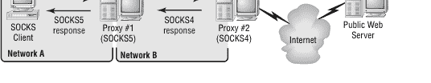

**语法**: `proxy-type dest-host dest-port proxy-server-address`

在此语法中，`proxy-type` 可以是以下之一：

- `Socks4` (= SOCKS version 4)

- `Socks5` (= SOCKS version 5)

- `NoProxy` (= direct connection, no proxying)

`proxy-type` 指令的参数如下：

- `dest-host` 是要代理的主机或网络的 IP 地址。

- `dest-port` 是要代理的请求端口号。

- `proxy-server-address` 是发送请求的代理主机的 IP 地址。

###### 示例

考虑 Figure 10.4 中的配置。代理 #1 是双宿主的，地址为 `192.168.32.1` 和 `192.168.64.1`。它保护网络 A（`192.168.32.0/24`），并且必须通过代理 #2（`192.168.64.1`，一个 SOCKS4 服务器）进行代理才能到达公共网络。代理 #1 的配置如下：

```
noproxy 192.168.32.1 - -
noproxy 192.168.64.0/24 - -
socks4 - - - 192.168.32.254
```


请注意，当请求的目标地址位于其本地网段（`192.168.32.0/24` 和 `192.168.64.0/24`）内时，您必须指示代理 #1 不要联系代理 #2。这是一种常见的配置，其中网络 A 中的主机需要与网络 B 进行防火墙隔离，但网络 A 中的主机必须通过它才能访问互联网。

### `permit/deny` 指令

一旦 `SOCKS5` 服务器对尝试连接的客户端进行了身份验证，它必须在授予代理请求之前参考其访问控制配置。您可以使用 `permit` 指令或 `deny` 指令来指示服务器根据请求的来源和目的地允许或拒绝连接请求。

**语法**:

```
permit auth cmd src-host dest-host src-port dest-port [user-list]
deny auth cmd src-host dest-host src-port dest-port [user-list]
```

在此语法中，参数如下：

- `auth` 是身份验证类型（`u` 表示用户名/密码，`k` 表示 Kerberos，或 `n` 表示无）。
- `cmd` 是已验证用户允许执行的命令。
- `src-host` 是作为请求来源匹配的 IP 地址或主机名。
- `dest-host` 是作为请求目的地匹配的 IP 地址或主机名。
- `src-port` 是作为请求来源匹配的端口号。
- `dest-port` 是作为请求目的地匹配的端口号。
- `user-list` 是允许穿越服务器的用户列表。（此字段是可选的。）

#### 示例

以下是使用 `permit/deny` 指令的一些示例：

- 仅授予 `192.168.32.0/24` 网络中的用户使用您的代理服务器：
  ```
  permit - - 192.168.32.0/24 - - - -
  ```

- 进一步将您的代理服务器的使用限制为仅 HTTP 流量：
  ```
  permit - - 192.168.32.0/24 - - 80 -
  ```

- 扩展您的策略，仅允许使用经过 Kerberos 身份验证的使用您的代理：
  ```
  permit k - 192.168.32.0/24 - - 80 -
  ```

- 仅接受 alice, bob, 和 charles 使用代理：
  ```
  permit k - 192.168.32.0/24 - - 80 alice,bob,charles
  ```

- 添加一条规则，拒绝所有其他代理请求（推荐）：
  ```
  deny - - - - - -
  ```

> **警告** 虽然这可能有助于调试您的初始配置，但切勿将服务器配置为使用宽泛的 `permit` 指令（全破折号）。这样的配置会带来严重的安全风险，因为它使您的服务器完全开放，让恶意入侵者可以“隐藏”在您的服务器背后攻击第三方站点。

### `set` 指令

`SOCKS5` 服务器使用多个环境变量来控制其执行，主要是为了确定它应写入日志文件的调试信息级别。您可以使用 `set` 指令在守护程序启动时初始化任何 `SOCKS5` 环境变量。

**语法**: `set environment-variable value`

`set` 指令的参数如下：

- `environment-variable` 是您想要设置的 `SOCKS5` 环境变量的名称。Table 10.2 包含了所有 `SOCKS5` 环境变量的列表。
- `value` 是您想要分配给指定环境变量的值。

**示例**: 要将 `SOCKS5` 密码文件从 Linux 默认的 `/etc/socks5.passwd` 更改为 `/usr/local/etc/socks5.passwd`，请使用以下 `set` 指令：

```
set SOCKS5_PWDFILE /usr/local/etc/socks5.passwd
```

### 理解 `socks5.conf` 模式匹配

`SOCKS5` 配置文件语法支持多种正则表达式，以便在指定主机名、端口号、身份验证方案、代理命令和用户定义时提供灵活性。本节描述了在 `socks5.conf` 配置文件中指定命令行参数的一般约定。

#### 主机模式

`SOCKS5` 配置文件中的大多数条目引用主机名或 IP 地址。您可以互换使用主机名或 IP 地址。使用主机名的优点是，当您重命名主机时无需修改配置文件。使用主机名的缺点是，名称查找可能会暂时不可用，这会影响 `SOCKS5` 服务。使用主机名的优点是

使用 IP 地址的优点在于，你无需担心 DNS 解析问题。但如果你过度依赖 IP 地址，每当将服务器迁移到新网络或重新编号任何网络客户端时，你就必须修改 `SOCKS5` 配置文件。

##### 表 10.2 `SOCKS5` 服务器环境变量

| 变量名 | 值 | 默认值 | 描述 |
|---|---|---|---|
| `SOCKS5_BINDINTFC` | 主机:端口 | `0.0.0.0` | `SOCKS5` 服务器运行所在的主机和端口号。 |
| `SOCKS5_CONFFILE` | 文件名 | `/etc/socks5.conf` | 服务器配置文件。 |
| `SOCKS5_DEMAND_IDENT` | N/A | N/A | 强制客户端响应服务器的 Ident 身份验证请求。 |
| `SOCKS5_ENCRYPT` | N/A | N/A | 在使用 GSS-API 时使用加密。 |
| `SOCKS5_FORCE_ENCRYPT` | N/A | N/A | 强制客户端对数据进行加密。 |
| `SOCKS5_IDENTFILE` | 文件名 | `/tmp/socks5.ident` | Ident 信息文件。 |
| `SOCKS5_MAXCHILD` | 值 | `64` | 同时存在的服务子进程的最大数量。 |
| `SOCKS5_NOIDENT` | N/A | N/A | 省略 Ident 请求。 |
| `SOCKS5_NOINTCHK` | N/A | N/A | 省略完整性检查。 |
| `SOCKS5_NONETMASKCHECK` | N/A | N/A | 忽略服务器的主机掩码检查。 |
| `SOCKS5_REVERSEMAP` | N/A | N/A | 将地址映射到主机名。 |
| `SOCKS5_SERVICE_NAME` | N/A | N/A | 将端口号映射到服务器名称。 |
| `SOCKS5_PASSWD` | 密码 | N/A | 用于服务器间身份验证的密码。 |
| `SOCKS5_USER` | 用户名 | N/A | 用于服务器间身份验证的用户名。 |
| `SOCKS5_PIDFILE` | 文件名 | `/tmp/socks5.pid` | 用于存储正在运行的服务器进程 ID 的文件。 |
| `SOCKS5_PWD_FILE` | 文件名 | `/etc/socks5.passtwd` | 服务器密码文件的位置。 |
| `SOCKS5_TIMEOUT` | 分钟 | `15` | 空闲连接的最大持续时间。 |
| `SOCKS5_UDP_PORTRANGE` | 端口 1-端口 2 | N/A | 用于代理 UDP 请求的源端口范围。 |
| `SOCKS5_V4SUPPORT` | N/A | N/A | 接受 `SOCKS4` 协议请求。 |

表 10.3 列出了 `SOCKS5` 识别的主机模式。

##### 表 10.3 `socks5.conf` 主机模式

| 模式 | 描述 |
| :--- | :--- |
| IP地址/掩码 | 带有四八位组掩码的 IP 地址。 |
| `*` | 通配符（匹配所有地址）。 |
| `a.b.c.d` | IP 地址必须完全匹配。 |
| `a.b.c` | 匹配 IP 地址的前三个八位组。 |
| `.domain.com` | 主机名必须以 `.domain.com` 结尾。 |
| `host.domain.com` | 主机名必须完全匹配。 |

**端口模式** `SOCKS5` 允许你根据连接请求中的源端口和目标端口选择适当的操作。你通常会使用目标端口。我建议在配置文件中使用的每个端口的名称都录入到 `/etc/services` 中。这使得配置文件更具可读性，并能防止端口编号中常见的输入错误。表 10.4 列出了 `SOCKS5` 识别的端口模式。

**表 10.4** `socks5.conf` 端口模式

| 模式 | 描述 |
| :--- | :--- |
| 端口名称 | 根据 `/etc/services` 中的服务名称 |
| 端口号 | 端口号（必须完全匹配） |
| `*` | 通配符（匹配所有端口号） |
| `[x,y]` | 从 `x` 到 `y` 的端口号范围 |

**认证模式** 使用单个字母来指示 `SOCKS5` 使用可用的身份验证类型之一（见表 10.5）。用户名和密码是最简单的身份验证形式，且仅需很少的额外配置即可工作。Kerberos 5 支持必须编译在 `SOCKS5` 服务器可执行文件中。始终使用用户名/密码或 Kerberos 身份验证。

**表 10.5** `socks5.conf` 认证模式

| 模式 | 描述 |
| :--- | :--- |
| `u` | 用户名/密码 |


| `k` | Kerberos 5（当 GSS-API 支持已编译时） |
| `n` | 无身份验证 |
| `n, k, u` | 多种身份验证方法（最后一种优先使用） |
| `*` | 通配符（匹配所有身份验证方法） |

**命令模式** 除了基于用户和基于主机的身份验证外，SOCKS5 还允许你有选择地指定客户端允许通过服务器执行的命令。表 10.6 展示了这些命令的模式。请注意，与身份验证方法一样，你可以指定包含任何命令组合的逗号分隔列表。

**表 10.6** *`socks5.conf` 命令模式*

| 模式 | 描述 |
| :--- | :--- |
| `c` | 连接 (Connect) |
| `b` | 绑定 (Bind) |
| `u` | UDP |
| `p` | Ping |
| `t` | 路由跟踪 (Traceroute) |
| `c, b, p` | 多个命令（任意组合） |
| `*` | 通配符（匹配所有命令） |

#### SOCKS5 密码文件

让 SOCKS5 客户端在通过代理服务器传输时始终使用用户名和密码进行身份验证总是一个好主意。要启用此功能，你需要在服务器上创建和维护一个密码文件。该文件的格式很直观，每个用户有一行纯文本。每一行以用户名开头，接着是一个或多个空格，然后是分配给该用户的密码。以下摘录包含 SOCKS5 密码文件中的三个示例行：

```
alice    myKat_4
bob      $sh0t5
charlie  MandMs
```

请注意，与标准 Linux 密码文件不同，SOCKS5 密码以明文出现；即未加密且未哈希。为了最小化该密码文件的暴露风险，不应允许任何用户登录到 SOCKS5 服务器主机，且对其访问应进行密切监控。确保该文件具有必要的最小权限也很重要。它只需要 `root` 用户具有读写权限，其他任何组或用户均无访问权限。当你首次创建该文件时，使用以下命令设置权限：

```
[ramon]$ sudo chmod 600 /etc/socks5.passwd
```

请记住，为了让服务器识别新添加（或修改）的用户名/密码组合，你需要重启 SOCKS5 守护进程或向 SOCKS5 进程 ID 发送 `SIGHUP` 信号。

#### 启动和停止 SOCKS5 服务器

主 SOCKS5 守护进程应用程序（默认位于 `/usr/local/bin/socks5`）必须始终运行，以便你的服务器可以代理传入的连接。该进程监听一个预先指定的端口（默认为 1080），内部客户端可以在此联系它以请求代理服务。SOCKS5 守护进程可以以四种不同的模式启动：

- **独立**：独立模式是大多数 Linux 网络服务器的默认模式。系统从通常的启动目录（例如 Red Hat 的 `/etc/rc.d/init.d`）启动单个 `socks5` 进程。当守护进程收到连接请求时，它会生成一个单独的进程来处理该请求，从而释放原始监听者以接受后续的连接请求。当子进程不再需要时会被清理。独立模式并非最佳，但我建议最初选择此模式，因为跟踪服务器实例简化了调试初始配置的过程。

- **预叉**：为每个连接生成单独的 SOCKS5 实例是一个昂贵的过程，应尽量避免。预叉模式允许你启动多个 `socks5` 进程的副本。在 Linux 中，预叉进程的默认数量是 64。这是一个很好的初始设置。如果你的系统不专门用于运行 SOCKS5 并且将运行其他网络服务，请将该数量减少到 32。（参见表 10.7 中列出的 `-n` 选项。）预叉是不支持线程的非 Linux 系统运行服务器的首选模式。

- **inetd**：可以将 SOCKS5 添加到 `/etc/inetd.conf`，以便在主 `inetd` 守护进程接收到 SOCKS5 端口上的请求时执行它。这或许是配置守护进程最有效率低的方式，因为它是产生最大开销的模式。

- **线程化**：线程化模式是在 Linux 系统上启动 SOCKS5 守护进程的最佳模式。利用 Linux 对 POSIX 线程的支持，守护进程可以作为线程化应用程序启动。

与其他任何 Linux 可执行文件一样，在调用 SOCKS5 服务器时，你可以在命令行上指定多种开关。表 10.7 列出了与 `socks5` 可执行文件配合使用的命令行选项：

**表 10.7** *`socks5` 命令行选项*

| 选项 | 描述 |
| :--- | :--- |
| `-I` | 从 `inetd` 运行守护进程。 |
| `-f` | 在前台运行（用于调试非常有用）。 |
| `-p` | 运行预分叉守护进程。 |
| `-n` | 最多分叉 `n` 个进程。 |
| `-t` | 运行线程化守护进程。 |
| `-d` | 以调试模式运行。 |
| `-S` | 将所有输出发送到 `stderr` 而不是 `syslog`。该选项对于调试也很有用。 |

例如，要在前台启动服务器并启用调试，请使用以下命令：

`[ramon]$ sudo /usr/local/bin/socks5 -f -d`

要以预分叉模式启动服务器，并设置初始的 32 个子进程，请使用以下命令：

`[ramon]$ sudo /usr/local/bin/socks5 -p -n 32`

要停止服务器，只需使用表 10.8 中描述的标准命令行选项之一执行脚本 `/usr/local/bin/stopsocks`（参见清单 10.3）。

**清单 10.3** *`stopsocks` 脚本*

```bash
#!/bin/sh

KILL=kill
PORT=
PIDFILE=${SOCKS5_PIDFILE-/tmp/socks5.pid}

if [ "$#" != "0" ] ; then
    if [ "$1" = "-p" ] ; then
        if [ "$#" != "1" ] ; then
            shift
            PORT=$1
            shift
        fi
    fi
fi

if [ -z "$PORT" ] ; then
    FILE=${PIDFILE} - 1080
else
    FILE=${PIDFILE} - $PORT
fi

if [ ! -f "$FILE" -a "$#" != "2" ] ; then
    echo "PID file $FILE does not exist"
    exit
fi

case $# in
0)
    SIGNAL="HUP"
    PID="cat $FILE"
    ;
1)
    SIGNAL=$1
    PID="cat $FILE"
    ;
2)
    SIGNAL=$1
    PID=$2
    ;
*)
    echo "usage: $0 [-p port] [signal] [pid]"
    exit 1;
    ;;
esac

case "$SIGNAL" in
"HUP")
    $ ( K I L L ) - H U P $( P I D )
    ;;
' -1')
    $ ( K I L L ) -1$( P I D )
    ;;
*)
    $ ( K I L L ) $ ( S I G N A L ) - $ ( P I D )
    rm $F I L E
    ;;
esac
```

请注意，Linux 实用工具 `killall` 通常以与 `stopsocks` 相似的方式工作，但它缺乏在你在不同 TCP 端口上运行多个服务器时停止特定 SOCKS5 服务器的能力。只有在 `stopsocks` 命令中使用 `-p` 选项才能轻松完成此操作。

**表 10.8 `stopsocks` 脚本命令行选项**

| 选项 | 描述 |
| :--- | :--- |
| `-INT` | 优雅地停止 SOCKS5 守护进程。 |
| `-KILL` | 突然停止 SOCKS5 守护进程的运行。 |
| `-HUP` | 强制 SOCKS5 守护进程重新读取其配置文件。 |
| `-p=port` | 停止在指定端口上运行的服务器。 |
| `pid` | 服务器进程 ID。 |

要停止 PID 为 1245 的服务器，请使用以下命令：

`[ramon]$ sudo /usr/local/bin/stopsocks -INT 1245`

要强制端口 1080 上的服务器读取其配置，请使用以下命令：

`[ramon]$ sudo /usr/local/bin/stopsocks -HUP -p 1080`

##### The `runsocks` 脚本

SOCKS5 发行版附带一个编译选项，用于构建动态链接库 (`/usr/local/lib/libsocks5_sh.so`)，该库可与 SOCKS5 服务器一起被原生 Linux 客户端应用程序使用。脚本 `/usr/local/bin/runsocks` 通过将 SOCKS5 动态库的位置添加到标准 Linux `$LD_LIBRARY_PATH` 的前面来工作，并有效地使任何标准 Linux 网络客户端“SOCKS 化”，即用 SOCKS5 等效项替换对常用 Berkeley Sockets 系统调用的引用。


请注意，`runsocks` 脚本仅对已编译以支持动态加载共享库的客户端有效。构建为包含静态库的应用程序无法由 `runsocks` 执行。清单 10.4 展示了如何使用 `runsocks` 配合标准 Linux `ftp` 客户端，通过代理服务器 (`proxy.example.com`) 联系远程 FTP 服务器 (`public.example.com`)。请注意，在 `runsocks` 执行之前需要设置三个环境变量：`$SOCKS5_SERVER`、`$SOCKS5_USER` 和 `$SOCKS5_PASSWD`。这些变量指定使用哪个代理服务器，以及用于向代理服务器认证的 `username` 和 `password`。这些变量也可以在 `libsocks5.conf` 文件中定义，该文件将在下一节中详细说明。

**清单 10.4 使用 runsocks 脚本**

```bash
[ramon]$ export SOCKS5_SERVER=proxy.example.com
[ramon]$ export SOCKS5_USER=ramon
[ramon]$ export SOCKS5_PASSWD=mypassword
[ramon]$ runsocks ftp public.example.com
220 public FTP server (Version wu-2.4.2-VR(17))
Mon Apr 19 09:21:53 EDT 1999) ready.
Name (public.example.com,ramon): 
331 Password required for ramon.
Password:
230 User ramon logged in.
Remote system type is UNIX.
Using binary mode to transfer files.
ftp>
```

##### SOCKS5 共享库配置

为了控制 SOCKS5 库的执行以及经过 SOCKS 化的客户端的运行，你必须首先创建一个配置文件，通常命名为 `/etc/libsocks5.conf`。此文件的内容类似于本章前面讨论的 `/etc/socks5.conf` 中的代理类型指令。此文件的主要目的是定义哪些目标主机应通过代理访问，哪些目标主机应直接寻址。考虑 `libsocks5.conf` 文件中的以下行：

```text
socks5    192.168.32.1
no proxy  192.168.32.0/24
```

此示例指定客户端在所有情况下都使用 SOCKS5 代理到服务器 `192.168.32.1`，除非目标位于 `192.168.32.0` 网络（本地局域网）内，在这种情况下应建立直接连接。

除了控制共享库本身的配置外，用户还可以设置多个环境变量，以便将库的执行量身定制到他们的环境中。表 10.9 包含这些环境变量中最常用的几个。

**表 10.9 libsocks5.conf 环境变量**

| 变量名 | 值 | 默认值 | 描述 |
| :-- | :-- | :-- | :-- |
| `SOCKS5_USER` | 用户名 | N/A | 用于服务器认证的用户名。 |
| `SOCKS5_PASSWORD` | 密码 | N/A | 用于服务器到服务器认证的密码。 |
| `SOCKS5_SERVER` | 主机:端口 | 按 `libsocks5.conf` | 覆盖要使用的 SOCKS5 服务器。 |
| `SOCKS5_ENCRYPT` | N/A | N/A | 指定在使用 GSS-API 时使用加密。 |

到目前为止，本章描述了 SOCKS5 服务器以及配置 Linux 客户端连接到服务器的能力。然而，大多数 Linux 服务器也被期望为其他平台提供服务。以下部分解释 Windows 客户端如何利用基于 Linux 的代理防火墙。

##### 配置 Windows SOCKS5 客户端

虽然为 SOCKS5 客户端修改 Linux 环境相当简单，但通常也有强烈的需求让基于 Windows 的客户端使用代理服务器连接到公共 Internet。你显然无法修改每个 Windows 应用程序以使用 SOCKS5 库，因此你需要一个垫片（shim），一个网络驱动程序，它将插入 WinSock TCP/IP 堆栈并拦截所有连接请求。SOCKS5 开发者使用 `SOCKSCap` 增强了 Linux 服务器的功能，这是一个基于 Windows 的应用程序，实际上使任何符合 WinSock 标准的 Windows 应用程序“SOCKS 化”。

可以从 NEC USA 的网站以即装即用格式获取 `SOCKSCap`，当 Windows 用户需要访问 SOCKS5 服务器外部的 `host` 时，可以在后台执行它。要安装和配置 `SOCKSCap`，只需遵循以下简单步骤：

1. 从 `www.socks.nec.com` 下载自解压的 `SOCKSCap` 二进制文件。

2. 双击二进制文件并按照安装向导的说明操作。

3. 安装完成且没有错误后，启动应用程序。首次执行时，它会提示你输入初始配置（见图 10.5）。尽管 `SOCKSCap` 支持 SOCKS4 和 SOCKS5 协议，但我强烈建议尽可能对所有客户端使用 SOCKS5。不要忘记在设置窗口的底部勾选 `Username/Password` 复选框。


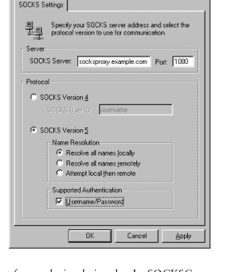

4. 从这一点开始，只需从开始菜单调用 `SOCKSCap` 应用程序即可。当配置为 SOCKS5 时，`SOCKSCap` 会提示你输入 SOCKS5 用户名/密码（如图 10.6 所示）。这是 `SOCKSCap` 代表你所有启用 SOCKS5 的应用程序使用的认证信息。

###### 图 10.6 SOCKSCap 用户身份验证对话框

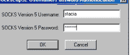

5. 输入身份验证信息后，标准的 `SOCKSCap` 面板将显示出来。在该面板中，你可以添加希望通过 SOCKS5 启动的新应用程序。例如，你可能希望将安全 Shell（SSH）客户端进行 SOCKS 化。只需点击“新建”按钮，并指定 SSH 应用程序的路径和工作目录（参见图 10.7）。这将把 `ssh32` 添加到由 `SOCKSCap` 控制的 SOCKS 化应用程序列表中。

###### 图 10.7 添加一个新的应用程序以通过 SOCKSCap 启动

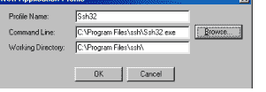

6. 此时，你已准备好在 `SOCKSCap` 下启动新应用程序。只需在 `SOCKSCap` 中点击该应用程序的图标，右键单击并选择“运行 Sockslified”，如图 10.8 所示。从此以后，用户将以 `Stacia` 身份向 Linux 代理进行身份验证，密码将是输入到身份验证框中的那个。若要停止 SOCKS 化应用程序的执行，只需像平常一样退出该应用程序即可。只要应用程序符合 Winsock 标准，`SOCKSCap` 就可以控制任意数量的网络应用程序。

##### SOCKS5 IPv4 到 IPv6 转换器

SOCKS5 参考实现中附带的一个鲜为人知但很有用的附加功能，是能够弥合网络中 IPv4 主机和 IPv6 主机之间的差距。目前，这是通过对标准 SOCKS5 服务器发行版打补丁来实现的，尽管 NEC 计划最终在标准 SOCKS5 发行版中加入 IPv6 到 IPv4 的转换支持。

名为 `Socks5-Trans` 的转换器通过接受 IPv4 和 IPv6 请求来工作，这些请求可以通过单独的接口（作为多宿主机服务器）或同一物理接口（在单宿主配置中）接收。这实际上允许你逐步将 IPv6 部署到网络上，同时利用 SOCKS5 提供的安全功能。

下载并解压标准 SOCKS5 软件包后，你需要下载提供转换服务的独立软件补丁；在本书撰写时，该文件名为 `socks5-trans-v1.3-patch.gz`。将补丁文件放入软件包的主源目录中，并按照以下步骤解压并应用它：

```bash
[ramon]$ ls  *patch*
socks5-trans-v1.3-patch.gz
[ramon]$ gunzip socks5-trans-v1.3-patch.gz
[ramon]$ ls  *patch*
socks5-trans-v1.3-patch
[ramon]$ patch -p < ./socks5-trans-v1.3-patch
```

这将修改 IPv6 支持和 IPv4 到 IPv6 转换所需的所有源代码文件。

当存在 `Socks-Trans` 时，有一些额外的 `configure` 脚本选项需要考虑。表 10.10 列出了最重要的选项。

###### 表 10.10 Socks-Trans 配置选项

| 配置选项 | 描述 | 默认值 |
|---|---|---|
| `--enable-ipv6` | 启用 IPv6 协议支持。 | 如果在 Linux 安装中检测到，默认启用支持。 |


| `--disable-ipv6` | 禁用 IPv6 协议支持。 | 如果在 Linux 安装中检测到，默认启用支持。 |

| `--enabled-mapped-addresses` | 启用对 IPv4 映射 IPv6 地址的支持。（详情见 RFC2133。） | N/A |

| `--disable-mapped-addresses` | 禁用对 IPv4 映射和 IPv6 映射地址的支持。 | N/A |

| `--with-ipv6-ping=PATH` | 指定 IPv6 专用的 ping 命令。 | `ping6` |

| `--with-ipv6-traceroute=PATH` | 指定 IPv6 专用的 traceroute 命令。 | `traceroute6` |

此外，`/etc/socks5.conf` 文件还有一行 IPv6 专用配置：

```
filter name auth cmd src-host dest-host src-port dest-port user-list
```

这一行中的参数如下：

- `name` 是自定义过滤器的类型。（Socks-Trans 1.3 版仅支持 `ftv6`）。这些过滤器提供了某些与 IPv4 和 IPv6 存在巨大差异的应用程序所需的转换规则。例如，`ftv6` 允许 IPv4（RFC959）的 FTP 协议实现与其 IPv6 对应项（RFC1639）互操作。

- `auth` 是身份验证方法的列表（`n`, `k`, `u`, `-`）。

- `cmd` 是由过滤器应用的命令。

- `src-host` 是源主机的 IP 地址。

- `dest-host` 是目标主机的 IP 地址。

- `src-port` 是源主机的端口号。

- `dest-port` 是目标主机的端口号。

- `user-list` 是过滤器应应用的用户列表。

例如，要允许你的任何内部 IPv4 客户端连接到任何外部 IPv6 FTP 服务器，请使用以下配置行：

```
filter ftpv6 k c - - - ftp
```

Socks-Trans 是一个很好的过渡工具，你可以使用它来弥合已经修改为使用 IPv6 的主机与仍保留在 IPv4 上的主机之间的差距。

### 总结

传输层代理是一种方便的方法，可以使用单个公共地址和中心管理点来控制公共网络访问，包括用户身份验证和连接日志记录。SOCKS5 的构建、配置和维护都很简单，并且能够适应不同的网络拓扑和配置，包括 IPv4 和 IPv6 客户端必须共存的环境。

网络管理员可以选择重新编译具有 SOCKS5 支持的网络客户端，使用现有的 Linux 客户端和动态链接库，或者通过安装提供的 SOCKSCap 启动器简单地使用现有的 Windows 客户端。你还有选择通过更改用户程序而不是客户端本身来代理网络应用程序。这是第 11 章“应用层防火墙”的主题。

## 应用层防火墙


第 10 章“传输层防火墙”讨论了传输层代理，其中许多 TCP 和 UDP 服务使用 SOCKS 协议共享代理设备上的一个公共传输层端口。这种设备被视为电路级防火墙，其中几个应用程序共享由 SOCKS 协议定义的公共代理框架。

传输层防火墙的一种替代方法是内部网络上的每种应用程序类型连接到防火墙上的独立代理过程，该防火墙专门用于转发特定类型应用程序流量的连接。这类防火墙被称为应用层防火墙，也是本章讨论的主题。

应用层代理允许防火墙为其设计用于处理的应用程序定制每个代理过程。然后，它可以支持特殊的缓存、身份验证或访问控制，以满足应用程序的需求。应用层防火墙通过不允许在其公共接口上建立任何连接来保护专用网络免受不受信任的公共 Internet 的侵害。事实上，即使来自内部网络，允许的连接也仅限于防火墙正在运行应用代理过程的那些连接。与任何防火墙设备一样，应使用基本的全拒绝原则，即默认拒绝所有服务，必须显式允许特定服务。

此外，应阻止通过防火墙的所有连接，除了你的安全策略书面允许的那些连接。

本章介绍 TIS 防火墙工具包，它或许是最受欢迎的自由可用的应用层代理防火墙示例，或者更准确地说，是一组你可以使用的工具和配置实践，以构建符合你特定应用层安全需求的防火墙。

### FWTK：TIS 防火墙工具包

防火墙工具包（FWTK）是一个在互联网上自由提供的完整应用层防火墙软件包。FWTK 可以编译并在 Linux 服务器上运行，无需对源代码进行任何修改。FWTK 最早于 1993 年向公众发布，由 Trusted Information Systems (TIS) 编写，TIS 现在是 Network Associates International 的一部分，其资金来自美国政府通过高级研究计划局（ARPA）提供的支持。现在已经是互联网安全传奇人物的 Marcus Ranum 主导了 FWTK 的开发项目。FWTK 最终成为 TIS Gauntlet 的种子，TIS Gauntlet 是首个商业可用的应用层代理防火墙产品。

FWTK 项目的目标是提供一套集成的代理过程，它们将接受来自流行服务（如 SMTP、Telnet、FTP 和 HTTP）的内部连接，然后代表内部主机向 Internet 主机请求连接。基本框架是可扩展的，并且易于扩展，允许随着新的 Internet 服务和应用程序变得流行而简单地添加新的代理。在过去八年中，FWTK 非常受欢迎；来自六大洲的下载量已超过 50,000 次。

虽然 FWTK 软件以源代码形式免费提供，但未经 TIS 书面许可，你不得分发它或向他人提供。但是，只要用于非商业目的且仅在你的公司内部内部使用，你被允许使用它，甚至可以修改它以满足你自己的需求。

有一些有价值的 FWTK 网络资源，包括 `http://www.fwtk.org` 网站（见图 11.1），该网站提供了 Keith Young 信息丰富（且最新）的常见问题解答（FAQ）。还有一个用于 FWTK 讨论的邮件列表。要订阅此邮件列表，请向 `majordomo@lists.nai.com` 发送一条消息，消息正文中包含文本“subscribe fwtk-users”。订阅后，你可以向 `fwtk-users@lists.nai.com` 发送邮件列表消息。

### 图 11.1 Web 上的 FWTKit 信息中心

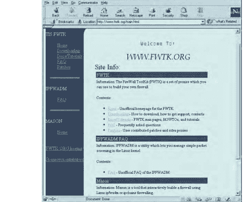

### 安装 FWTKit 防火墙工具包

由于许可协议中有特殊的条款和条件，FWTKit 只能通过 TIS FTP 站点以 FTP 方式下载。在实际下载软件之前，您必须阅读许可协议、表示同意，并在其网站上登记您的身份。请通过阅读位于 `ftp://ftp.tislabs.com/firewall/toolkit/LICENSE` 的文本文件来启动此流程。

在您审阅了该许可协议并认为可以接受后，请向地址 `fwtk-request@tislabs.com` 发送一封电子邮件，邮件正文内容仅包含单词 "accepted"。该邮件将由 TIS 的邮件系统自动处理，系统会给您回复一封邮件，其中包含下载软件的准确位置；该目录位置是任意的，且仅存在大约 12 小时。列表 11.1 包含了一个您将从 TIS 收到的确认您请求的电子邮件示例。

#### 列表 11.1 TIS 对许可协议的邮件确认


```text
From: fwtk-req@tislabs.com
Date: Wed, 24 Jan 2001 08:18:08 -0500 (EST)
To: rhontanon@sybex.com
Subject: Response to your fwtk-request request

Thank you for your interest in our Firewall Toolkit. You will find
the current source in the following 'hidden' directory on
ftp.tislabs.com:
/pub/firewalls/toolkit/dist/fwtk-02d13d

Please change directory directly to the entire path provided. This
directory will exist for at least 12 hours. If you are unable to
download before this time period expires, you can send another
request to fwtk-request@tislabs.com to receive a new path.

If you are unable to establish a connection on ftp.tislabs.com,
your IP address may not have the appropriate reverse mapping of
address to hostname in the Domain Name System.

As a security precaution, we do not allow connections to our ftp
server that do not have this DNS information properly configured. Please
contact your System Administrator in regard to correcting
this.

~NAI Labs
```

**注意** 请注意，为了能够下载`FWTK`软件，您的主机必须具有有效的反向`DNS`（`PTR`）记录。如果您的`IP`地址无法匹配到已知的宿主名，`TIS` `FTP`服务器将不允许您访问。

一旦您收到电子邮件（只需 5-10 分钟），请登录`TIS` `FTP`站点（参见列表 11.2）并进入消息正文中指定的目录。您需要（以二进制形式）下载两个文件：

- 主`FWTK`发行版（`fwtk.tar.Z`）

- 文档存档（`fwtk-doc-only.tar.Z`）

#### 列表 11.2 从`TIS` `FTP`站点下载`FWTK`

```text
[ramon]$ ftp ftp.tislabs.com
Connected to portal.gw.tislabs.com.
220 portal FTP server (Version 5.60auth/njfr) ready.
500 'AUTH GSSAPI': command not understood.
Name (ftp.tislabs.com:hontanon): anonymous
Password:
230 Guest login ok, access restrictions apply.
Remote system type is UNIX.
Using binary mode to transfer files.
ftp> cd /pub/firewalls/toolkit/dist/fwtk-02d13d
ftp> dir fw*
227 Entering Passive Mode (192,94,214,101,194,195)
150 Opening ASCII mode data connection for /bin/ls.
-rw-r-- 1 179 10 423991 Sep 13 1996 fwtk-doc-only.tar.Z
lrwxrwxrw x 1 0 1 13 Feb 27 1998 fwtk.tar.Z -\>
^? fwtk2.1.tar.Z
-rw-r-- 1 179 10 481055 Mar 2 1998 fwtk2.1.tar.Z
226 Transfer complete.
ftp> get fwtk-doc-only.tar.Z
local: fwtk-doc-only.tar.Z remote: fwtk-doc-only.tar.Z
227 Entering Passive Mode (192,94,214,101,194,190)
150 Opening BINARY mode data connection for fwtk-doc-only.tar.Z
(423991 bytes).
226 Transfer complete.
423991 bytes received in 3.2 seconds (1.3e+02 Kbytes/s)
ftp> get fwtk.tar.Z
local: fwtk.tar.Z remote: fwtk.tar.Z
227 Entering Passive Mode (192,94,214,101,194)
150 Opening BINARY mode data connection for fwtk.tar.Z (481055
bytes).
226 Transfer complete.
481055 bytes received in 3.1 seconds (1.5e+02 Kbytes/s)
ftp> quit
```

> **注意** 截至本书撰写时，`FWTk`的最新版本为`2.1`，该版本可追溯到`1998`年初。`FWTk`的开发是一项志愿活动，尽管过去三年没有资源投入其中，但它仍然出奇地健壮，即使按照今天的安全标准来看也是如此。

下载这两个文件后，只需解压缩并提取其内容。源码和文档存档都会将文件写入`fwtk`目录：


```
[ramon]$ uncompress fwtk-doc-only.tar.Z fwtk.tar.Z
[ramon]$ tar xf fwtk-doc-only.tar
[ramon]$ tar xf fwtk.tar
[ramon]$ cd fwtk
[ramon]$ ls -l
total 88
-rw-f----- 1 ramon users 15984 Feb 5 1998 CHANGES
-rw-f----- 1 ramon users 1465 Nov 4 1994 DISCLAIMER
-rw-f----- 1 ramon users 5846 Mar 12 1997 LICENSE
-rw-f----- 1 ramon users 989 Nov 4 1994 Makefile
-rw-f----- 1 ramon users 2591 Mar 4 1997 Makefile.config
-rw-f----- 1 ramon users 2660 Feb 5 1998 Makefile.config.aix3
-rw-f----- 1 ramon users 2626 Mar 4 1997 Makefile.config.dcosf
-rw-f----- 1 ramon users 2571 Mar 4 1997 Makefile.config.hpux
-r-r---r-- 1 ramon users 3014 Jan 13 1998 Makefile.config.linux
-rw-f----- 1 ramon users 2696 Mar 4 1997 Makefile.config.sco5
-rw-f----- 1 ramon users 2928 Mar 4 1997 Makefile.config.solaris
-rw-f---r-- 1 ramon users 2600 Jul 15 1997 Makefile.config.sunos
-rw-f----- 1 ramon users 6969 Feb 26 1998 README
drwxr-x--- 2 ramon users 1024 Mar 1 1998 auth
-rw-f----- 1 ramon users 3219 Nov 4 1994 auth.h
drwxr-x--- 2 ramon users 1024 Mar 1 1998 config
drwxr-xr-x 3 ramon users 1024 Sep 12 1996 doc
-r-r------- 1 ramon users 5389 Mar 1 1998 firewall.h
-rwxr-x--- 1 ramon users 791 Sep 5 1996 fixmake
drwxr-x--- 2 ramon users 1024 Mar 1 1998 ftp-gw
drwxr-x--- 2 ramon users 1024 Mar 1 1998 http-gw
drwxr-x--- 2 ramon users 1024 Mar 1 1998 lib
drwxr-x--- 2 ramon users 1024 Mar 1 1998 netacl
drwxr-x--- 2 ramon users 1024 Mar 1 1998 plug-gw
drwxr-x--- 2 ramon users 1024 Mar 1 1998 rlogin-gw
drwxr-x--- 2 ramon users 1024 Mar 1 1998 snapd
drwxr-x--- 2 ramon users 1024 Mar 1 1998 snapd
-rw-f-- 1 ramon users 5526 Mar 26 1996 syssexits.h
drwxr-x--- 2 ramon users 1024 Mar 1 1998 tn-gw
drwxr-x--- 5 ramon users 1024 Jan 18 1997 tools
drwxr-x--- 2 ramon users 1024 Mar 1 1998 x-gw
```

正如您所见，`FTWK` 发行版包含了若干预配置的 `Makefile.config` 示例，适用于多个流行的操作系统，包括 `Linux`。还请留意，每个代理的源代码（如 `ftp-gw`、`http-gw` 等）都存放在不同的子目录中。首先，使用以下命令保留原始的 `Makefile.config` 文件，并将提供的 `Makefile.config.linux` 文件移动至其原处：

```
[ramon]$ mv Makefile.config Makefile.config.ORIG
[ramon]$ cp Makefile.config.linux Makefile.config
```

> **提示** 如果您正在 `Red Hat 7.0` 上构建 `FTWK`，您将需要编辑生成的 `Makefile.config` 文件，并将 `XLIBDIR` 变量的值从 `/usr/X11/lib` 更改为 `/usr/X11R6/lib`。此外，您还需要将 `AUXLIB` 的值设置为 `~/lcrypt`，将 `DBMLIB` 的值设置为 `~/ndbm`。

现在，您可以使用以下两条命令编译、链接并安装该程序包：

```
[ramon]$ make
[ramon]$ sudo make install
```

我发现 `man` 手册页默认情况下不会被安装，因此我手动将它们复制到了相应位置：

```
[ramon]$ cd doc/man
[ramon]$ sudo cp *.8 /usr/share/man/man8/
[ramon]$ sudo cp *.5 /usr/share/man/man5/
[ramon]$ sudo cp *.3 /usr/share/man/man3/
```

`FTWK` 程序包会将其可执行文件和配置文件都安装到 `/usr/local/etc` 目录树中。以下是 `FTWK` 程序包完全安装后，该目录应有的样子：

```
[ramon]$ ls -1 /usr/local/etc

total 14960
-rwxr-xr-x 1 root root 1954587 Jan 28 14:28 ftp-gw
-rwxr-xr-x 1 root root 2073268 Jan 28 14:28 http-gw
-rwxr-x--- 1 root root 362 Jan 28 14:28 mqueue
-rwxr-xr-x 1 root root 1777157 Jan 28 14:28 netacl
-rw-f--r-- 1 root root 3101 Jan 28 14:28 netperm-table
-rwxr-xr-x 1 root root 1866661 Jan 28 14:28 plug-gw
-rwxr-xr-x 1 root root 1912963 Jan 28 14:28 rlogin-gw
-rwxr-xr-x 1 root root 1794972 Jan 28 14:28 smap
-rwxr-xr-x 1 root root 1697757 Jan 28 14:28 snapd
-rwxr-xr-x 1 root root 1944219 Jan 28 14:28 tn-gw
-rwxr-xr-x 1 root root 217794 Jan 28 14:28 x-gw
```

`FTWK` 开发者采用了`分而治之`的方法来进行安全软件设计。他们没有创建一个单一的庞大工具，而是开发了独立的程序包，这些程序包独立工作并提供独立的服务（例如 `FTP`、`Telnet` 和 `HTTP`）。这种选择的优点在于，漏洞很可能只影响其中一个程序包，因此只会危及在您的 `Linux` 系统上运行的单个服务。这使得每个 `FTWK` 组件都足够简单，系统管理员可以完全理解它们，甚至在必要时，您还可以通过阅读组件的源代码来验证其完整性和正确性。本章稍后将对这些应用程序逐一进行讨论。目前，请确保这些文件存在于 `/usr/local/etc` 目录中。

本章的下一部分将指导您完成使系统充当应用层防火墙的过程，并配置 `FTWK` 环境以通过您的 `Linux` 服务器提供代理服务。该过程中的第一步是理解 `FTWK` 架构。

### FTWK 架构

部署成功的应用层代理防火墙始于设计网络的整体架构并决定防火墙的放置位置。这与在网络中的适当位置放置网络层防火墙同样重要。让我们来看看在 `Linux` 服务器上部署 `FTWK` 的两种流行选项：单宿主代理防火墙和双宿主代理防火墙。

#### 单宿主代理防火墙

如果您除了网络层防火墙设备（例如，`Linux` 内核的 `Netfilter` 防火墙或带有访问控制列表的路由器）之外还要部署一个应用层防火墙，请将 `FWTK` 代理服务器用作网络防火墙 `DMZ` 段上的堡垒主机，如图 11.2 所示。

##### 图 11.2 单宿主 FWTK 架构

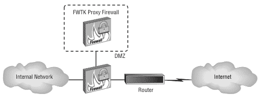


要使用此架构，请确保您的代理被配置为接受在同一个以太网接口上的内部代理请求，该接口将被用于将请求转发到 Internet。不要担心使用单一接口可能使您的服务器容易受到地址欺骗；网络层防火墙会处理地址过滤。

#### 双宿主代理防火墙

如果应用层防火墙将是您控制网络访问的唯一方法，我建议您将 `FWTK` 代理服务器设置为从公共 Internet 进入内部网络的唯一入口点。这可以通过部署双宿主代理防火墙来实现，其中一个接口位于您的内部网络上，另一个接口位于与您的 Internet 接入路由器下游接口所在的同一网段，如图 11.3 所示。

##### 图 11.3 双宿主 `FWTK` 架构


双宿主代理防火墙配置的优势在于，只要您不打算在防火墙的两个接口之间进行任何网络层路由（我强烈不建议这样做），内部网络上的主机就不必使用合法的 IP 地址。

选定 `FWTK` 的架构后，该是配置那些执行安全策略并保护内部网络资源的组件的时候了。这是下一节的话题。

### 配置 `FWTK` 防火墙工具包

网络层防火墙（如第 9 章“网络层防火墙”中所述）与应用层防火墙之间的根本区别在于在内部和外部接口之间转发数据包的方法。网络层防火墙依赖内核在 IP 层做出转发决策，而应用层防火墙依赖应用堆栈上的代理来桥接通常甚至不直接可路由的网络。

为了增强代理服务器的整体安全态势，请确保在其内核上禁用所有 IP 转发。这将防止任何流量在网络层通过代理服务器泄漏。为了确保这一点，您需要发出以下命令将 `ip_forward` 开关设置为 `false` 以禁用 IP 转发：

```text
echo 0 > /proc/sys/net/ipv4/ip_forward
```

系统每次启动时都需要执行此命令。为了确保这一点，我建议将上述行添加到 `/etc/rc.d/rc.local`。

此外，请确保您的服务器没有监听任何除安全策略允许的连接以外的连接。专门使用您的应用层防火墙将内部连接代理到公共网络（例如，Internet）。一旦您禁用了该服务器上所有多余的服，发出 `netstat` 命令查看它仍在监听哪些服务：

```text
[ramon]$ netstat --inet -a | grep LISTEN
tcp 0 0 *:ssh *:  LISTEN
```

此示例输出（我使用 `grep` 将其过滤为仅显示处于 LISTEN 状态的连接）显示，只有 Secure Shell (`SSH`) 连接被允许进入代理服务器。（`SSH` 将在下一章第 12 章“虚拟专用网络”中讨论。）

> **注意** 我强烈建议您不要在 `FWTK` 防火墙服务器上维护用户账户。您的密码文件越小，您受到入侵者攻击的风险就越小。

禁用转发并将监听服务减少到最低限度后，该是配置 `FWTK` 的时候了。`FWTK` 配置位于一个名为 `/usr/local/etc/netperm-table` 的中心文件中。此文件包含两种不同类型的规则：

- `NetACL` 规则，控制哪些客户端可以访问哪些代理服务
- `Gateway` 规则，指定 `FWTK` 中提供的每个代理服务特定的各种配置参数

#### `NetACL` 规则

`NetACL` 本身并不是一个代理，而是其他 `FWTK` 服务的支持工具。`NetACL` 在功能上类似于 `TCP` Wrappers（在第 4 章“网络服务配置”中讨论），它基于请求连接的客户端的特性，为 `TCP` 服务提供访问控制和日志记录。但 `NetACL` 的真正威力在于它可以根据请求客户端的身份选择不同的响应应用程序。例如，您可能希望配置防火墙，使得每当您的工作站请求 23 端口的服务时，您在服务器上获得常规 telnet 守护进程（`telnetd`）。然而，每当普通用户请求相同的服务时，您希望他们获得 `FWTK` 提供的 telnet 代理应用程序（`tn-gw`）而不是常规守护进程。首先，将清单 11.3 中的行插入 `/etc/xinetd.d/telnet` 文件中。

##### 清单 11.3 telnet 的 xinetd 配置

```
service telnet
{
        flags           = REUSE
        socket_type     = stream
        wait            = no
        user            = root
        server          = /usr/local/etc/netacl
        server_args     = in.telnetd
        log_on_failure  ++ USERID
        disable         = no
}
```

将清单 11.4 中的行插入 `inetd` 配置文件 `/etc/inetd.conf`。

##### 清单 11.4 telnet 的 `inetd` 配置

```
telnet    stream    tcp     nowait    root    /usr/local/etc/netacl   netacl  in.telnetd
```

请注意，不是直接使用 `server` 指令调用守护进程，而是调用 `/usr/local/etc/netacl` 并将守护进程名称（`in.telnetd`）作为服务器参数传递。别忘了发出以下命令重启 `xinetd`：

```bash
[ramon]$ sudo /etc/rc.d/xinetd restart
```

或其 `inetd` 等效命令：

```bash
[ramon]$ ps aux | grep inetd
root   466  0.0  0.0  1348   0 ?  SW Mar17  0:00 [inetd]
[ramon]$ sudo kill -HUP 466
```

然后，根据以下格式在 `/usr/local/etc/netperm-table` 文件中添加适当的配置：

```text
netacl-daemon: [permit-hosts|deny-hosts] host-description [-exec &command]
```

其中 `daemon` 是 `server_args` 下指定的服务器可执行文件的名称（参见清单 11.3），`host-description` 是一个或多个 IP 地址（或网络），`command` 是服务器可执行文件的完整路径。清单 11.5 包含 `/usr/local/etc/netperm-table` 文件的一个摘录，说明了 telnet 服务的 `NetACL` 配置示例。

##### 清单 11.5 在 netperm-table 中定义 `NetACL` 规则

```text
netacl-in.telnetd: permit-hosts 127.0.0.1 -exec /usr/sbin/in.telnetd
netacl-in.telnetd: permit-hosts 10.0.0.50 -exec /usr/sbin/in.telnetd
netacl-in.telnetd: permit-hosts 10.0.0.* -exec /usr/local/etc/tn-gw
netacl-in.telnetd: deny-hosts *
```

清单 11.5 中的配置指定，每当防火墙接收到针对 `TCP` 23 端口（telnet）的连接时，它应该检查连接客户端的 IP 地址。如果尝试连接的主机是本地主机（127.0.0.1）或您工作站的 IP 地址（10.0.0.50），您应该看到常规的 telnet 响应（来自常规守护进程）。您 10.0.0.* C 类网络中的所有其他客户端都应被引导至 `FWTK` telnet 代理（`tn-gw`）。其他任何主机（匹配 `host-description` 中 \* 的那些）将被拒绝服务。`tn-gw` 和其他网关代理将在下一节中讨论。

#### Gateway 规则

除了 `NetACL` 实用工具外，`FWTK` 还包含许多专门的应用层代理，它们作为单独的可执行文件安装在 `/usr/local/etc` 目录中。这些包括以下代理：

- `tn-gw`：用于处理交互式终端连接的 Telnet 代理
- `ftp-gw`：用于处理文件传输协议（FTP）连接的 FTP 代理
- `http-gw`：用于处理到 Web 服务器的 HTTP 连接的 HTTP 代理
- `plug-gw`：一种通用代理，可配置为处理任何类型的传输层连接
- `smap`：用于处理互联网邮件服务器连接的 SMTP 代理

让我们更详细地看看每个应用层代理可用的规则。

### tn-gw：Telnet 代理

前一节描述了 `NetACL` 规则，并使用 telnet 作为示例来说明其工作原理。`FWTK` telnet 代理默认位于 `/usr/local/etc/tn-gw`。


您需要配置 `xinetd` 或 `inetsd` 服务，使其使用 `tn-gw` 代理而不是原生的 `telnet` 服务。如果您的服务器使用 `xinetd`，请创建一个名为 `/etc/xinetd.d/telnet` 的文件，其内容如清单 11.6 所示。

#### 清单 11.6 telnet 的 xinetd 配置

```
service telnet
{
    flags         = REUSE
    socket_type   = stream
    wait          = no
    user          = root
    server        = /usr/local/etc/tn-gw
    log_on_failure  ++ USERID
    disable       = no
}
```

如果您使用 `inetsd`，请将清单 11.7 中显示的这行添加到 `/etc/inetsd.conf` 文件中。

#### 清单 11.7 telnet 的 inetsd 配置

```
telnet stream tcp nowait root /usr/local/etc/tn-gw tn-gw
```

Telnet 代理的基本操作如下：

1. 用户会被告知（可能是在您的安全策略中），应通过 `telnet` 连接到代理防火墙的私有接口（或唯一接口），而不是目标系统。

2. 用户将获得以下提示（受访问控制和身份验证的限制）：

   ```
   [ramon]$ telnet fwtK-internal.example.com
   Trying 10.0.0.2...
   Connected to fwtK-internal.
   Escape character is '^]'.
   Welcome to the TIS Firewall Toolkit TELNET Proxy!
   tn-gw->
   ```

3. 用户在提示符处输入外部 `telnet` 命令：

   ```
   tn-gw-> connect anyhost.anydomain.com
   Trying 203.204.205.206 port 23...
   Connected to anyhost.anydomain.com.
   Escape character is '^]'.
   Red Hat Linux release 7.0 (Guinness)
   Kernel 2.2.16-22 on an i686
   login:
   ```

4. 用户继续通过代理连接，直到输入远程逃逸命令。此时，到远程系统和代理服务器的连接都将断开。

除了配置 `NetACL` 之外，还可以使用 `/usr/local/etc/netperm-table` 文件来控制 `FWTK` `telnet` 代理的行为。对于 `telnet` 代理，有几个 `/usr/local/etc/netperm-table` 配置参数需要您了解。该代理在配置文件中的通用格式为 `tn-gw: attribute-group`，其中 `attribute-group` 可以采用以下格式之一：

- `authserver host port`：此格式指定运行身份验证服务器的主机和端口。身份验证服务器的配置在本章稍后的“在 `FWTk` 中使用强身份验证”部分中有介绍。
- `denial-msg file`：此格式指定包含一条文本消息的文件，当用户没有使用代理所需权限时显示该消息。
- `help-msg file`：此格式指定包含一条文本消息的文件，当用户向代理请求帮助时显示该消息。
- `welcome-msg file`：此格式指定包含一条文本消息的文件，当用户成功登录到代理时显示该消息。
- `denydest-msg file`：此格式指定包含一条文本消息的文件，当用户被禁止连接到请求的目标时显示该消息。
- `directory directory`：此格式指定在执行代理命令前更改默认根目录（`chroot`）的目录。
- `userid user`：此格式指定代理应运行所使用的用户 ID。
- `groupid group`：此格式指定代理应运行所使用的组 ID。
- `prompt prompt`：此格式指定代理使用的提示符。
- `timeout seconds`：此格式指定代理终止连接的闲置时间（以秒为单位）。
- `permit-hosts host-description [-dest-host-description] [-auth][-passok]`：此格式指定允许使用代理的主机（`host-description`），以及允许其代理到的目的地（`-dest-host-description`）、是否需要提供 `authsrv` 身份验证（`-auth`）以获得使用代理的权限，以及是否允许其修改密码（`-passok`）。`authsrv` 身份验证将在本章稍后详细讨论。
- `deny-hosts host-description`：此格式指定不允许使用代理的主机。

例如，考虑清单 11.8 中显示的 `tn-gw` 配置部分。此示例执行了几个重要步骤：

- 指定包含拒绝、欢迎和帮助消息文本的文件。
- 请求在闲置 10 分钟后终止连接。
- 允许来自 `10.0.0.0/24` 网络中客户端的代理连接，但仅限于目的地为 `63.64.65.0/24` 网络的连接。
- 不允许来自其他任何主机的代理请求。

#### 清单 11.8 在 netperm-table 中定义 tn-gw 规则

```
tn-gw: deny-msg        /usr/local/etc/tn-deny.txt
tn-gw: welcome-msg     /usr/local/etc/tn-welcome.txt
tn-gw: help-msg        /usr/local/etc/tn-help.txt
tn-gw: timeout         600
tn-gw: permit-hosts    10.0.0.* -dest 63.64.65.*
tn-gw: deny-hosts      *
```

请注意，清单 11.8 包含 `deny-hosts` 属性组的专用版本：

```
tn-gw: deny-hosts unknown
```


该属性强制代理对客户机的 IP 地址执行反向 DNS 查找，以寻找有效的主机名（在 DNS 术语中称为 `PTR` 记录）。如果不存在这样的绑定，连接将被拒绝。

### ftp-gw：FTP 代理

`ftp-gw` FTP 代理的工作方式与 `tn-gw` 非常相似。让我们先从指导您的 `xinetd` 或 `inetd` 服务使用 `ftp-gw` 而不是原生 FTP 服务开始。如果您的服务器正在使用 `xinetd`，请通过创建一个名为 `/etc/xinetd.d/ftp` 的文件来实现，其内容如清单 11.9 所示。

#### 清单 11.9 FTP 的 xinetd 配置

```
service ftp
    {
        flags           = REUSE
        socket_type     = stream
        wait            = no
        user            = root
        server          = /usr/local/etc/ftp-gw
        log_on_failure  += USERID
        disable         = no
    }
```

如果您使用 `inetd`，请将清单 11.10 中显示的这行添加到 `/etc/inetd.conf` 文件中。

#### 清单 11.10 FTP 的 inetd 配置

```
ftp stream tcp nowait root /usr/local/etc/ftp-gw ftp-gw
```

以下是 FTP 代理的工作原理：

1. 用户会被告知（可能是在您的安全策略中），应将其 FTP 客户端指向代理防火墙的私有接口（或唯一接口），而不是目标系统。为了建立到公共 FTP 服务器（例如 `ftp.sybex.com`）的连接，用户首先输入以下内容（假设 `fwtvk-internal.example.com` 是对应于您的代理防火墙私有接口的主机名）：

   ```
   [ramon]$ ftp fwtvk-internal.example.com
   Connected to fwtvk-internal.
   220 fwtvk-internal.example.com FTP proxy (Version V2.1) ready.
   ```

2. 用户向 FTP 代理提供用户名和要 FTP 到的远程主机名。请注意以下响应中的 `user@remote-hostname` 格式：


   ```
   Name (fwtk-internal:ramon): `anonymous@ftp.sybex.com`
   331-(---GATEWAY CONNECTED TO ftp.sybex.com---)
   331-(220- kermit WAR-FTPD 1.67-04 Ready)
   331-(220 Please enter your user name.)
   331 User name okay. Give your full Email address as password.
   Password:
   230 User logged in, proceed.
   ftp>
   ```

3. 用户继续通过代理连接，直到输入远程逃逸命令（例如，FTP 中的 `bye`）。此时，到远程系统和代理服务器的连接都将断开。

FTP 代理的 `/usr/local/etc/netperm-table` 配置参数与其 Telnet 对应物非常相似：

```
ftp-gw: attribute-group
```

在此格式中，`attribute-group` 可以是用于 `tn-gw` 的任意构造（参见前一节），除了以下例外：

```
permit-hosts host-description [-dest host-description] [-auth (operation1 operation2..)] [-authall] [-log [operation1 operation2..]]
```

此格式指定允许使用代理的主机（`host-description`），以及允许其代理到的目的地（`-dest host-description`），以及它们是否应为特定类型的 FTP 操作提供 authsrv 身份验证（`-auth`），例如检索文件（RETR）或上传文件（STOR）。`-authall` 属性强制代理用户为所有 FTP 操作进行身份验证。

此外，您可以指示 `ftp-gw` 将通过 `syslog` 记录尝试执行 FTP 协议支持的任何类型操作（例如，`RETR`、`STOR` 等）的所有尝试。

例如，考虑清单 11.11 中的 `/usr/local/etc/netperm-table` 配置。此示例为代理 FTP 连接指定 10 分钟的闲置超时，并允许 `10.0.0.0/24` 块发起 FTP 连接。您将通过本地 `syslog` 设施记录在远程 FTP 服务器上检索和存储文件的所有尝试。

#### 列表 11.11 在 `netperm-table` 中定义 `ftp-gw` 规则

```text
ftp-gw:  timeout 600
ftp-gw:  permit-hosts 10.0.0.* -log { RETR STOR }
```

**提示** `RLOGIN` 代理服务器（`rlogin-gw`）的功能与 `Telnet` 网关（`tn-gw`）几乎完全相同。然而，我建议避免使用 `RLOGIN` 代理服务器，因为越来越少的外部系统支持此协议，且难以实现安全保护。因此，本书不会详细介绍该主题。

### `http-gw`：`HTTP` 代理

`http-gw` 代理可用于将内部 Web 浏览器的 `HTTP` 请求中继到公共网络上的 Web 服务器。你需要修改 `inetd`（或 `xinetd`）配置，以确保当在防火墙的 80 端口收到连接请求时，会启动一个 `http-gw` 会话。如果你的服务器使用 `xinetd`，请创建一个名为 `/etc/xinetd.d/http` 的文件，内容如列表 11.12 所示。

#### 列表 11.12 `HTTP` 的 `xinetd` 配置

```text
service http
{
       flags           = REUSE
       socket_type     = stream
       wait            = no
       user            = root
       server          = /usr/local/etc/http-gw
       log_on_failure  += USERID
       disable         = no
}
```

如果使用 `inetd`，请将列表 11.13 所示的行添加到 `/etc/inetd.conf` 文件中。

#### 列表 11.13 `HTTP` 的 `inetd` 配置

```text
http stream tcp nowait root /usr/local/etc/http-gw http-gw
```

重新启动 `inetd`（或 `xinetd`）后，你的防火墙将开始代表内部客户端接受 `HTTP` 请求。图 11.4 展示了 `Netscape Communicator` 上的 `HTTP` 代理配置。图 11.5 展示了如何在 `Microsoft Internet Explorer` 中配置 `HTTP` 代理。

在这两个示例中，你正在指示浏览器将传入的 `HTTP` 连接代理到 `fwtk-internal.example.com` 的 80 端口，该主机名对应于 `FWTK` 代理服务器的内部（私有）接口。请注意，你在 `Exceptions`（例外）框中输入了 `internal.com` 域。这指示浏览器不要使用此代理连接到主机名以 `internal.com` 结尾的主机。假设这些是内部主机，无需经过代理服务器的**仔细审查**。

#### 图 11.4 `Netscape Communicator` `HTTP` 代理配置

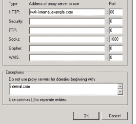

#### 图 11.5 `Microsoft Internet Explorer` `HTTP` 代理配置

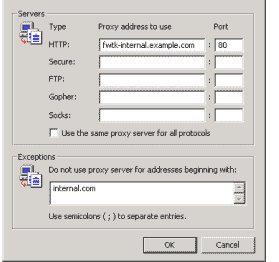

`HTTP` 代理的 `/usr/local/etc/netperm-table` 配置参数与其 `telnet` 等价项相似：

```text
http-gw: attribute-group
```

在此格式中，`attribute-group` 可以使用与 `tn-gw` 相同的构造，但存在以下差异：

- `default-policy option [options]` 此格式指定应用于活动内容的过滤规则。`options` 值可以是以下之一：

  - `-java, -nojava` 这些选项决定是允许 `Java` 内容穿越代理防火墙（`-java`）还是阻止它（`-nojava`）。

  - `-javascript, -nojavascript` 使用这些设置来允许 `JavaScript` 内容穿越代理防火墙（`-javascript`）或阻止它（`-nojavascript`）。

  - `-activex, -noactivex` 这些设置控制是允许 `ActiveX` 控件（`-activex`）还是阻止它们（`-noactivex`）。

### `plug-gw`：通用 `TCP` 代理

`plug` 代理（即 `plug-gw`）是一种通用的传输层代理机制，用于为 `FWTK` 代理没有原生支持的应用程序提供隧道。`plug` 的工作原理是接受来自私有侧指定 `TCP` 端口的流量，并根据一组访问控制规则将请求转发到公共侧指定的目标 `IP` 地址和 `TCP` 端口。这种情况适用于你不需要真正应用层代理提供的精细控制和日志记录，但仍希望保持内部和外部网络完全分离的情况（例如，因为你的内部网络没有使用合法的 `IP` 地址）。

与其他任何 `FWTK` 代理一样，`plug-gw` 在 `/usr/local/etc/netperm-table` 中查找其配置。除了 `tn-gw` 中概述的标准构造外，`plug-gw` 代理还支持以下构造：

```text
port port-id host-description [-plug-to-host host-name]
```

此构造指定用于转发连接的规则。当请求通过 `port-id` 进入时，`host-description` 会与请求的 `IP` 地址进行匹配。如果匹配成功，连接将转发到 `-plug-to-host` 选项中指定的主机名。

例如，考虑一种情况，你希望内部主机能够连接到你的 `ISP` 的 `NNTP` 服务器以获取新闻。你的网络使用私有地址，并且你希望控制 `NNTP` 访问，以便你的 `ISP` 的新闻服务器仅从单个公共地址（即你的代理防火墙的公共地址）接收连接。你可以简单地指示用户将其新闻阅读器指向 `TCP` 端口 119（防火墙的标准 `NNTP` 端口，该端口随后将请求转发到你 `ISP` 的 `NNTP` 服务器的 119 端口）。以下 `/usr/local/etc/netperm-table` 条目可实现此功能：

```text
plug-gw: port 119 10.0.0.* -plug-to nntp-server.example.com
```

此条目将来自网络 `10.0.0.0/24` 的所有指向防火墙 119 端口的请求重定向到服务器 `nntp-server.example.com` 的相同端口。


**注意** 这在处理限制客户 NTP 连接仅来自少量 IP 地址的 ISP 时特别有用。实际上，你始终都会从同一个地址连接，即 `FWTK` 防火墙的外部地址。

### smap：SMTP 邮件代理

`FWTK` 包含一个名为 `smap` 的 SMTP 应用代理，它使用 `smap` 可执行文件接受传入的邮件连接。邮件消息缓存在防火墙系统中，直到定期运行的 `smapd` 可执行文件将其取走。`smap` 随后将传入的消息交给本地邮件传输代理（MTA），通常是 `Sendmail`。

这种存储并转发处理防止了潜在的攻击者获得对本地 MTA 的实时访问，从而降低了诸如 `Sendmail` 守护进程缓冲区溢出等流行漏洞的风险。`smap` 应用每 60 秒（默认设置）唤醒一次，并在对邮件头部执行详尽检查后，仅将暂存的邮件转发到本地 MTA，任何格式错误或可疑的邮件都不会被转发。

你需要在服务器上配置 `inetd`（或 `xinetd`），以确保当在代理服务器外部接口的 25 端口（SMTP）收到连接请求时，会启动一个 `smap` 会话。要实现此功能，只需在列表 11.6 或 11.7 中将 `tn-gw` 替换为 `smap` 即可。

接下来，确保你已使用适当的 `smap`/`smapd` 配置配置了 `/usr/local/etc/netperm-table` 文件。配置文件中 `smap` 代理行的一般条目类型为

```
smap: attribute-group
```

除了 `tn-gw` 中概述的标准属性外，`attribute-group` 字段还可以采用以下构造：

```
directory directory
```

此构造指定 `smap` 在 `smapd` 处理之前存储传入消息的目录。

你还可以通过使用以下类型的行来配置 `smapd` 守护程序的操作：

```
smapd: attribute-group
```

有五种专门用于 `smapd` 配置的构造：

- `directory directory` 此构造指定 `smapd` 应查找由 `smap` 仿造的传入消息的目录。
- `sendmail program` 此构造指示 `smapd` 使用 `program` 中的邮件传输代理（例如，`Sendmail`）将邮件递送到其目的地。
- `badadmin user` 此构造指定 `smapd` 服务器应将无法递送的邮件转发给的用户。
- `baddir directory` 此构造指定 `smapd` 服务器保存无法正常递送的仿造邮件的目录。
- `wakeup seconds` 此构造指示 `smapd` 守护程序在 `seconds` 指定的间隔内唤醒并处理等待的邮件队列。默认情况下，`smapd` 每 60 秒唤醒一次。

### 在 FWTK 中使用强身份验证

在配置 `FWTK` 代理之一时，管理员可以选择强制用户在请求远程连接之前先向代理服务器本身进行身份验证。例如，`netperm-table` 行

```
tn-gw: permit-hosts 204.205.206.* -dest safehost.example.com -auth
```

声明 `204.205.206.0/24` 网络中任何主机上的用户都可以连接到 `telnet` 网关并连接到主机名 `safehost.example.com`，但前提是用户必须首先使用有效的凭证集（`-auth` 选项）向代理进行身份验证。

`authsrv` 子系统负责处理 `FWTK` 中的这种类型的身份验证。

#### authsrv

`authsrv` 守护程序是 `FWTK` 任何代理均可使用的身份验证设施。它维护一个数据库，其中包含每个已知代理用户的记录。该记录由以下字段组成：

- `Username` 用户名字段是描述每个代理用户的唯一用户描述。
- `User Group` 用户组字段是用户所属的主要组。
- `Full Name` 全名字段表示用户的名字，格式为名字、中间名首字母、姓氏（例如，`Ramon J. Honton`）。

##### 最近一次成功的代理登录

最近一次成功的代理登录字段包含用户对代理成功登录的最后一次日期的引用。

##### 该用户将使用的身份验证机制

支持以下身份验证机制：

- `RSA SecurID` 挑战/响应和计时令牌身份验证
- `Digital Pathways` 的安全网络密钥（`SNK`），一种挑战响应系统
- `BellCore` 的 `S/Key` 一次性密码系统
- 可重复使用的密码

可以通过在 `authsrv` 实用程序命令中指定 `proto` 选项的适当值，指示 `authsrv` 使用上述其中一种机制来对特定用户进行身份验证（参见表 11.1 中的 `proto` 命令语法）。

无论为每个用户定义的身份验证机制如何，都可以通过使用本节后面描述的 `authsrv` 管理实用程序，由 `authsrv` 守护进程处理用户条目的创建、修改、禁用或删除。

让我们在 `/etc/xinetd.d/authsrv` 文件中输入适当的配置，开始配置 `authsrv` 守护进程（参见清单 11.14）。

###### 清单 11.14 authsrv 的 xinetd 配置

```
service authsrv
{
    flags             = REUSE
    socket_type       = stream
    wait              = no
    user              = root
    server            = /usr/local/etc/authsrv
    log_on_failure    += USERID
    disable           = no
}
```

如果你的系统使用 `inetd`，请将清单 11.15 中的行添加到 `/etc/inetd.conf` 文件中。

###### 清单 11.15 authsrv 的 inetd 配置

```
authsrv stream tcp nowait root /usr/local/etc/authsrv authsrv
```

请注意，为了让服务器将 `authsrv` 关键字识别为服务，你必须在 `/etc/services` 中创建如下 `authsrv` 条目：

```
authsrv     7777/tcp
```

在重启 `xinetd` 服务后，你将拥有一个正在监听 TCP 端口 `7777` 连接的可用 `authsrv` 守护进程。在你的 `/usr/local/etc/netperm-table` 文件中定义 `authsrv` 选项。配置文件中的一般条目类型为

```
authsrv: attribute-group
```

除了为 `tn-gw` 概述的标准属性外，`attribute-group` 字段还可以采用以下其中一种构造：

- `directory directory` 此构造指定在执行代理命令之前用作工作目录的目录。
- `badsleep seconds` 此构造指定连续五次身份验证失败的用户应被阻止再次进行身份验证的时间（以秒为单位）。
- `database path` 此构造指定身份验证数据库文件的路径。
- `nobogus true` 此构造指定当尝试使用不存在的用户登录时，身份验证服务器是否应报告该行为。
- `[permit | deny]-operation [user users | group groups] service destination [options] [time start end]` 此构造指定在一天中的特定时间是否允许或拒绝特定用户或组的某些操作。
- `secureIDhost firewall` 此构造指定用于 `RSA SecureID` 身份验证的防火墙名称。

例如，考虑清单 11.16 中 `/usr/local/etc/netperm-table` 的摘录。本示例中的此配置：

- 指示 `authsrv` 仅允许来自本地防火墙主机的连接，这是一个好主意。
- 显示数据库文件位于目录 `/usr/local/etc/fw-authdb` 中。
- 显示身份验证失败的用户应被禁止使用该服务 `20` 分钟。
- 指示 `authsrv` 报告使用不存在的用户登录的尝试。

###### 清单 11.16 在 netperm-table 中定义 authsrv 规则

```
authsrv: permit-hosts localhost
authsrv: database /usr/local/etc/fw-authdb
authsrv: badsleep 1200
authsrv: nobogus true
```


下一步是手动输入 `authsrv` 命令（作为 `root` 用户）在数据库中创建用户。假设你想创建一个新用户名 `toro`，它将使用密码身份验证。正如你在清单 11.17 中看到的，你进入 `authsrv` 界面，并立即由 `authsrv#` 提示符欢迎你。在该提示符下，你首先添加新用户 `toro`，并附上其全名 (Toro T. Bravo)。默认情况下，新用户是禁用的，因此你需要显式启用新输入的用户 (`enable toro`)。然后，你指定 `toro` 用户名将使用的身份验证协议。最后，你指定要使用的初始密码。`list` 命令允许你查看当前位于 `authsrv` 数据库中的用户。

###### 清单 11.17 在 `authsrv` 身份验证数据库中创建新用户

```
[ramon]$ sudo /usr/local/etc/authsrv
authsrv# list
Report for users in database
user           group       longname     status proto    last
----           -----       ------       -----  ------   ----
authsrv# adduser toro 'Toro T. Bravo'
ok - user added initially disabled
authsrv# enable toro
enabled
authsrv# proto toro password
changed
authsrv# pass toro 'scP@ssw0rd'
Password for toro changed.
authsrv# list
Report for users in database
user           group       longname     status proto    last
----           -----       ------       -----  ------   ----
toro                  Toro T. Bravo  y    passw    never
authsrv# exit
```

表 11.1 列出了 `authsrv` 界面中可用的所有命令。

###### 表 11.1 `authsrv` 命令

| 命令 | 描述 |
| :--- | :--- |
| `adduser user [full-name]` | 将用户添加到身份验证数据库中，可选全名。 |
| `deluser user` | 从身份验证数据库中移除用户。 |
| `disable user` | 禁用身份验证数据库中的用户。 |
| `enable user [onetime]` | 启用之前已被禁用的用户。如果存在 `onetime` 选项，用户仅在再次进行身份验证时被禁用。 |
| `display user` | 显示指定用户的状态、身份验证协议和最后登录时间。 |
| `group user group` | 将用户分配到指定组。 |
| `list group` | 显示组中的所有成员。 |
| `passwd user [passwd-text]` | 将用户的密码设置为可选的 `passwd-text`。如果未提供 `passwd-text`，系统将提示你输入。 |
| `proto user protocol` | 设置用户的身份验证协议。协议字段必须具有以下其中一个值：`secureid` (RSA SecureID 令牌身份验证)、`snk` (Digital Pathways 安全网络密钥)、`skey` (BellCore S/Key 一次性密码系统) 或 `password` (传统可重复使用密码)。 |
| `rename user newuser [full-name]` | 将用户名 `user` 更改为 `newuser`，如果提供全名则同时更改全名。 |
| `exit` | 退出 `authsrv` 实用程序。 |

现在，你已准备好在 `/usr/local/etc/netperm-table` 中配置带有 `auth` 选项的代理。例如，考虑清单 11.18 中 FTP 代理 (`ftp-gw`) 的配置。第一行指示 FTP 代理通过联系本地主机上的 TCP 端口 7777 来对用户进行身份验证。第二行允许受信任网络 `10.0.0.0/24` 使用 FTP 代理，但要求选择上传文件 (FTP `STOR` 操作) 的用户进行身份验证。最后一行要求所有其他 (不受信任) 用户向代理进行身份验证。

###### 清单 11.18 在 `ftp-gw` 规则中使用 `authsrv` 身份验证

```
ftp-gw: authserver localhost 7777
ftp-gw: permit-hosts 10.0.0.* -auth {STOR}
ftp-gw: permit-hosts * -authall
```

### 总结

本章重点关注 `FWTk` 防火墙工具包，这是一组可用于构建你自己应用层防火墙的进程和配置文件。通过在上一章讨论的 `SOCKS` 代理之上运行一层，`FWTk` 工具包可以添加一些高级访问控制机制，使安全管理员能够对需要支持的每个应用程序应用不同的访问规则。

`FWTK` 为最流行的 Linux 网络应用程序（如 `Telnet`、`FTP`、`HTTP` 和 `SMTP`）提供了现成的代理，以及可用于通过防火墙转发任意应用程序的通用代理。`snap/smapi` 代理提供了一种真正的存储转发邮件传输机制，其中邮件可以在防火墙处暂存，并异步转发到目标系统。

本章结束了关于周边安全和防火墙设备的讨论。本书的下一个也是最后一部分将关注在当今全球化和流动办公环境中日益重要的主题：远程访问和身份验证。

## 第 5 部分

### 远程访问与认证

内容概览：

- 理解 `VPN` 技术和 `IPsec` 协议
- 使用 `FreeS/WAN` 实现 `IPsec VPN`
- 使用 `PoToP` 将 Linux 配置为 `PPTP` 服务器
- 用 `OpenSSH` 替代 `Telnet`
- 配置 `Kerberos V5` 认证系统
- 使用 `OPIE` 实现一次性密码
- 了解 Linux 可插拔认证模块（`PAMs`）

### 12 虚拟专用网络

当你以为你已经掌握了多层安全的基本知识，并且你的 Linux 网络受到良好策略和一系列机制的保护时，远程访问的出现使得安全工作变得更加充满挑战。随着 20 世纪走向尾声，局域网（`LANs`）的概念也随之终结。传统的办公室扩展到了家庭办公室，而现在它已被虚拟办公室所取代。你的用户不再满足于通过调制解调器池拨号上网来获取邮件；他们现在期望你将网络边界扩展到他们的笔记本电脑、家庭电脑，甚至个人数字助理（`PDAs`），并采用有线和无线技术。

挑战在于拥抱全球远程访问模型，同时不牺牲网络的安全性。重点应在于制定一套全面的安全策略，涵盖用户不在公司地点时的情况，并包括明确的认证、授权和访问控制规定。

本书的第 5 部分“远程访问与认证”包含两章，探讨了漫游用户和远程工作者这个勇敢的新世界，并描述了一系列可部署的软件包和配置，以提供便捷的远程访问，同时确保数据的隐私和完整性。本章专门讨论虚拟专用网络（`VPNs`）。由于相比专用私有网络设施具有明显的经济优势，且 `VPN` 启用技术的普及性，该技术普遍被认为是在未来三到五年内 `IP` 网络中发展最快的领域。第 13 章涵盖“强用户认证”的主题，这一概念与安全的远程访问和虚拟专用网络息息相关。

让我们通过解释 `VPN` 的概念并介绍你需要了解的基本术语，直接开始吧。

### `VPN` 入门

考虑一家名为 `ACME Enterprises` 的公司，它有四个不同的地理位置：波士顿的销售部、华盛顿的工程部、丹佛的人力资源部和洛杉矶的市场部。在传统的广域网（`WAN`）模型中，`ACME` 的 IT 部门将不得不租用、维护和支持六条专用 `WAN` 链接，以构建一个全网状网络，并支付与距离敏感的电信费用，以确保其四个分支机构之间的完全连接。（图 12.1 说明了这种情况。）很有可能其中至少两个位置（销售部和市场部）需要访问互联网，因此 `ACME` 的 IT 部门还将不得不租用两条到最近 `ISP` 枢纽的专用电路。

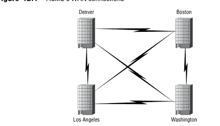

这种设置并非理想。波士顿（销售部）和洛杉矶（市场部）分支拥有两条独立的租赁线路，分别用于私有数据和互联网访问。而这仅仅是开始。这种方法真正的低效体现在 `ACME` 决定向新地点扩展业务时。假设 `ACME` 在西雅开设了一家制造工厂。IT 部门现在必须购买从西雅图到所有四个现有分支的专用线路。此外，`ACME` 开设的分支越多，通过专用租赁线路将它们连接到现有地点的成本就变得越高昂。

虚拟专用网络利用互联网的普遍性，提供了一种成本效益高、不受距离影响的替代方案，以取代私有 `WAN` 链接。建立 `VPN` 有两个步骤：

- 通过购买具有*本地存在点*（`POP`，也称为*枢纽*）的 `ISP` 连接，将所有分支连接到互联网。
- 一旦所有分支都可以通过互联网相互到达，便在现有的互联网 `IP` 基础设施上建立*虚拟*链接，以确保数据在分支间传输时的机密性和完整性。


图 12.2 展示了 ACME WAN 网络使用 VPN 设计的情况。

**图 12.2** ACME 的 VPN 连接

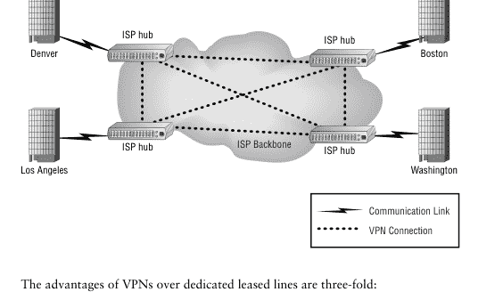

与专用租赁线路相比，VPN 的优势有三点：

### 距离无关的连接成本

无论其他分支位于何处，每个新的公司分支都可以使用互联网连接与其他分支相连，这一事实降低了成本。本地回路（`local loop`）的成本被降至最低，并且通常包含在 ISP 的月度费用中。此外，一些 ISP 对批量连接订单提供折扣，且现在所有办公室也都拥有互联网访问，但在某些情况下这可能不是一个优势。

### 拓扑无关的连接成本

企业广域网有这三种类型：

- `hub-and-spoke`（中心辐射型），所有分支仅连接到中央办公室
- `fully meshed`（完全网状型），所有分支彼此完全互连。
- `partially meshed`（部分网状型），分支根据业务需求彼此连接。

使用 VPN 技术部署时，完全网状拓扑实现了最大的节省。由于每个新分支只是简单地连接到互联网，接入第二个分支的成本与接入第 20 个或第 200 个分支的成本相同。

### 复用现有互联网连接

互联网连接如今对于开展业务来说，与传真机和快递服务一样必要。VPN 技术允许你的企业使用单一电路进行私有企业通信和一般互联网访问，前提是你已正确配置了这两种流量类型的隔离（本章稍后将详细讨论）。

> **警告** 无论你打算使用 ISP 电路进行仅 VPN 连接，还是 VPN+互联网连接，你都应通过安装防火墙设备来保护你的网络边界。第 9、10 和 11 章分别展示了如何设计、部署和维护网络层、传输层和应用层的防火墙。

VPN 技术的核心是将 VPN 流量封装在正常 IP 流量内的能力，以便在数据通过公共互联网传输时保护私有数据。两种独立的安全协议已成为封装和保护 VPN 数据的替代方案：

- IETF 的 `IP 安全（IPsec）`
- 微软公司的 `点对点隧道协议（PPTP）`

下面两部分专门讨论这两个规范。

### IP 安全协议（IPsec）

在 `RFC 2401` 至 `2412` 中详细定义，IP 安全框架（简称 `IPsec`）是 IETF 对互联网社区长期呼吁此类标准的回应。虽然仅在 `IPv6` 实现中为强制项，但 `IPsec` 已在许多 `IPv4` 协议栈中得到应用，大多数网络安全软件供应商都在某种程度上采纳了 `IPsec` 技术。`IPsec` 并不强制规定特定的加密或哈希技术，而是一个框架，用于连接双方为该会话选择安全参数。这使得 `IPsec` 标准更具耐久性，因为它可以容纳新的数据隐私、完整性和认证算法，以替代那些已过时或被认为存在漏洞的现有算法。

在交换 `IPsec` 格式的数据包之前，两个对等体必须就安全关联（`SA`）达成一致，其中包含一组参数，包括：

- 加密算法
- 密钥过期时间
- 封装类型
- 压缩

虽然这种协商可以手动进行，产生静态 `SA`，但更安全和实用的建立这些参数的方式是使用互联网密钥交换（`IKE`）协议。当两个 `IPsec` 对等体支持 `IKE` 时，只要它们有相互认证的方法，就可以在实际安全通信发生前即时协商 `SA`。这种认证是使用共享秘密（在每一端预加载）或包含数字证书的公钥基础设施完成的。会话密钥（这些是临时的）的实际协商基于著名的 `Diffie-Hellman` 算法。

会话密钥协商过程始于连接的两端各自生成一对私钥/公钥，并相互共享其公钥。接下来，两端使用自己的秘密密钥和远程公钥作为输入进行数学计算。这是 `Diffie-Hellman` 算法的关键部分，因为此计算应在两端产生相同的结果。虽然这个共享值可用于加密实际的传输数据，但更高效的做法是其中一个端点生成一个对称密钥，使用之前计算中的共享值对其进行加密，然后将其发送到另一个端点，该端点对其进行解密并存储。此对称密钥随后可用于作为在 `SA` 协商阶段协商的对称算法的会话密钥。对称加密算法的一些例子包括 `DES`、`Triple DES`、`IDEA` 和 `Blowfish`。

一旦 `SA` 就位且两端就会话密钥达成一致，实际的安全数据交换就可以进行。`IPsec` 的核心是它能够将一个私有 IP 数据包完全封装到另一个 IP 数据包中，或者在其头部附加足够的信息以确保其完整性。让我们仔细看看这两个选项。

#### IP 认证头

当你的流量通过互联网传输时，它会受到多种漏洞的影响，其中包括攻击者修改你的 IP 数据包内容的漏洞。

#### IP 认证头

在当前互联网模型中，采用一种存储转发架构，这意味着你的数据包在被保证穿过一系列你无法控制的中继系统时，内容可能会发生变化。为确保 IP 数据包的内容在传输过程中不被篡改，一种方法是添加一个包含原始数据包状态单向哈希值的头部。这个头部被称为认证头（`AH`）。如果攻击者修改了数据包，接收方会意识到这一点，因为头部中包含的哈希值与数据包结束状态不匹配。

IETF 为此 `AH` 创建了一个正式的协议，该协议由支持 `IPsec` 的发送方在数据包发送前插入到 IP 头部和 TCP 头部之间（见图 12.3）。该字段包含若干供远端处理的索引和参数，但 `AH` 的核心是一个使用整个 IP 数据包作为输入计算出的哈希值。虽然 `IPsec` 通常旨在容纳新的哈希算法，但 `RFC 2402` 规范要求实现必须支持 `MD5` 和 `SHA-1` 算法以符合标准。

##### 图 12.3 IPsec AH 数据包格式


#### IP 封装安全载荷（ESP）

虽然 `AH` 解决了 IP 数据包完整性和认证的问题，但它并未解决机密性问题。在许多情况下，你需要确保没有人在数据包经由不可信网络传输时非法访问你 IP 数据包的载荷。IP 封装安全载荷（`ESP`）规范允许安全网关在私有出站数据包经由公共互联网传输之前对其进行完全封装。这可以通过两种方式进行：`ESP` 传输模式和 `ESP` 隧道模式。

##### ESP 传输模式

你可以使用 `ESP` 传输模式来保护在两个实施 `IPsec` 安全性的安全网关之间交换的 IP 数据包的载荷。当使用 `ESP` 传输模式时，安全网关会在原始 IP 头部和 TCP 头部之间插入一个 `ESP` 头部（见图 12.4）。该头部包含指向两个安全网关之间协商的安全联盟（`SA`）的指针，以及指向端点应预期的下一个 `ESP` 数据包的指针。


在 TCP 头部和 TCP 载荷之后，安全网关插入一个 `ESP` 尾部，其中包含可变数量的填充字符，以确保待保护的数据包具有固定长度。

最后，安全网关附加一个由整个 `ESP` 数据包（减去认证值）作为输入计算出的哈希值组成的 `ESP` 认证值。其工作方式类似于 `AH` 协议，并确保数据包的完整性。

请注意，`ESP` 对原始 TCP 头部和载荷的内容进行加密，并确保整个 `ESP` 数据包的认证。

##### ESP 隧道模式

请注意，`ESP` 传输模式保护原始数据包的 TCP 头部和 TCP 载荷，但不保护原始 IP 头部。如果需要确保整个原始 IP 数据包的机密性、完整性和认证，则应选择 `ESP` 隧道模式。`ESP` 隧道模式有效地将整个 IP 数据包封装并插入到一个全新的数据包中，该新数据包的源 IP 地址通常是执行 `IPsec` 封装的安全网关的外部可达地址。

图 12.5 中展示的 `ESP` 隧道模式数据包格式与用于 `ESP` 传输模式的格式类似，不同之处在于原始 IP 头部也被认证和加密。


`ESP` 隧道模式的另一个优点是，来自 `IPsec` 保护网络的数据包不需要使用合法的互联网地址，因为当数据包在 Internet 上传输时，这些地址会被有效地“隐藏”。

虽然 `ESP` 规范（定义在 `RFC 2406` 中）允许使用新的加密算法，但它还要求符合 `IPsec` 的实现必须支持 `DES` 加密算法，以及本章前面“IP 认证头”部分提到的 `MD5` 和 `SHA-1` 认证算法。由于 `DES` 算法的强度最近受到质疑，大多数 `IPsec` 软件供应商通常支持更强大的加密算法，如 `3DES`、`IDEA` 和 `Blowfish`。

通常情况下，Linux 开源社区挺身而出，开发了一个稳健的 `IPsec` 标准实现。`FreeS/WAN` Linux `IPsec` 软件包是本章下一节的讨论主题。

# FreeS/WAN

项目负责人 John Gilmore 于 1996 年启动了 `FreeS/WAN` 开发，旨在“保护 5% 的互联网流量免受被动窃听”。因此，Free Secure Wide Area Network（`FreeS/WAN`）的目标是利用标准的 IETF `IPsec` 协议，使每个 Linux 服务器都成为支持 VPN 的主机，以确保 IP 通信的机密性、完整性和认证。由于曾经严格的美国对加密材料出口的限制，`FreeS/WAN` 的早期大部分开发工作在美国境外进行。事实上，为了安全起见，`FreeS/WAN` 开发人员也避免了任何美国公民或居民的协助。

### 获取 FreeS/WAN


`FreeS/WAN` 软件在 `GPL` 许可协议下以源代码格式提供。虽然少数 `Linux` 发行版（例如 `SuSE`、`Connectiva` 和 `Polished`）将 `FreeS/WAN` 软件包作为标准安装的一部分提供，但大多数发行版都没有，尤其是基于美国的发行版。在安装 `FreeS/WAN` 的过程中有很多内容需要学习，因此我建议你从官方网站下载源代码发行版并自行构建。`FreeS/WAN` 可从 `http://www.freeswan.org` 获取（见图 12.6）。


你可以通过 `FreeS/WAN` 网站上的链接下载发行版，或者使用以下命令直接从 `FTP` 站点获取：

```bash
[ramon]$ cd /usr/src
[ramon]$ sudo ftp ftp.xs4all.nl
Connected to reflectix.xs4all.nl.
220 Reflectix.xs4all.nl FTP server (Version wu-2.6.1(12) Tue Oct 10 18:09:22 CEST 2000) ready.
Name (ftp.xs4all.nl:ramon): anonymous
331 Guest login ok, send your complete e-mail address as password.
Password:
230-Welkom op de FTP server van XS4ALL
230------------------------------------------------
230 Guest login ok, access restrictions apply.
Remote system type is UNIX.
Using binary mode to transfer files.
ftp> cd pub/crypto/freeswan
250 CWD command successful.

ftp> get freeswan-1.8.tar.gz
local: freeswan-1.8.tar.gz remote: freeswan-1.8.tar.gz
227 Entering Passive Mode (194,109,6,26,80,118)
150 Opening BINARY mode data connection for freeswan-1.8.tar.gz
(1447587 bytes).
226 Transfer complete.
1447587 bytes received in 96.2 secs (15 Kbytes/sec)
ftp> bye
```

下一步是解压缩并展开你刚下载的存档文件：

```bash
[ramon]$ sudo tar -xzf freeswan-1.8.tar.gz
[ramon]$ cd freeswan-1.8
```

在进行 `FreeSWAN` 安装之前，请确保你的系统上已安装 `gmp-devel` `RPM` 包。这是 `GNU` 高精度数学库。大多数发行版都带有 `libgmp.so` 库，但你只有头文件 `gmp.h`，而它只随 `gmp-devel` 包提供。以下命令在你的系统上安装 `gmp-devel` 包的 `RPM` 版本：

```bash
[ramon]$ sudo rpm -i gmp-devel-3.0.1-5.i386.rpm
```

现在你准备好安装 `FreeSWAN` 软件本身了。安装 `FreeSWAN` 软件的第一步是构建一个修改过的 `Linux` 内核。

### 安装 FreeS/WAN

`FreeS/WAN` 软件发行版有四个基本组成部分：

- 内核源代码补丁和添加项

- 称为 `pluto` 的 `IKE` 守护程序

- 一组管理该软件包的脚本

- 手册页和配置文件

首先安装内核补丁。进入 `/usr/src/freeswan` 目录并输入 `make xgo` 命令：

```bash
[ramon]$ cd /usr/src/freeswan-1.8
[ramon]$ sudo make xgo
```

要安装 `FreeS/WAN` 软件，你需要一个有效的源代码树，因为 `make xgo` 命令会重新构建内核。我建议你下载你发行版的内核源代码（包括头部文件）并先构建一个标准内核，然后再运行 `make xgo`。下载内核源代码和头部文件可以让你在修改内核以适合 `FreeS/WAN` 的需求之前熟悉内核构建过程。这可以节省你调试与内核构建相关问题所需的精力。`make xgo` 命令需要与任何内核构建过程相同的输入。对内核进行适合你的系统硬件的更改，并保存配置更改。

> **警告**：即使你没有修改任何默认内核值，也要确保保存配置更改。

当你退出 `make xgo` 命令的图形界面时，系统将开始使用新补丁重新编译内核。根据 `CPU` 速度、系统的 `RAM` 量以及磁盘驱动器的类型，这可能花费几分钟到几个小时不等。在编译结束时，你应该看到以下两行：

```bash
make[1]: Leaving directory `/usr/src/linux-2.2.16`
utils/errcheck out.kbuildd
```

如果你的结果不同，那么内核构建中很可能出现了问题。检查 `out.kbuildd` 文件以获取有关该问题的信息。如果一切正常，从同一目录使用以下命令完成内核安装过程：

```bash
[ramon]$ sudo make kinstall
```

这相当于执行以下传统的内核构建步骤：

```bash
make
make install
make modules
make modules_install
```

与上一步相同，如果一切顺利，您应该会在屏幕底部看到以下两行：

```bash
make[1]: Leaving directory `/usr/src/linux-2.2.16`
utils/errcheck out.kinstall
```

如果您之前已经构建并安装过此版本的内核（我强烈建议这样做），则您的 `/etc/lilo.conf` 文件不需要修改。只需重新运行 `lilo` 命令即可：

```bash
[ramon]$ sudo /sbin/lilo
```

然后重启系统。启动时，您应该会看到类似以下的信息：

```bash
klips_debug:ipsec_tunnel_init: initialisation of device: ipsec0
```

并且您应该验证 `IKE` 守护进程（`pluto`）是否处于活动状态：

```bash
[ramon]$ ps -ef | grep pluto
root 490 1 0 20:43 ? 00:00:00 /usr/local/lib/ipsec/pluto --deb
```

此外，您可能还需要确保您的系统现在至少有一个虚拟 `IPsec` 接口：

```bash
[ramon]$ ifconfig ipsec0
ipsec0 Link encap:IPip Tunnel HWaddr
NOARP MTU:0 Metric:1
RX packets:0 errors:0 dropped:0 overruns:0 frame:0
RX packets:0 errors:0 dropped:0 overruns:0 carrier:0
collisions:0 txqueuelen:10
```

如果一切就绪，请继续下一节，开始配置您的 `IPsec` 连接！

### 配置 FreeS/WAN

如果您已经走到这一步，您的系统当前已启用 `IPsec`，并准备好配置以与其他 `Linux` 服务器建立安全连接。

本节使用图 12.1 和图 12.2 中描述的 `WAN` 与 `IPsec` 场景作为示例。假设您在丹佛（`Denver`）和波士顿（`Boston`）的位置都部署了 `Linux` 服务器作为边界设备，用于执行网络层过滤。该场景的概念图如图 12.7 所示。

**图 12.7** 使用 `Linux` `FreeS/WAN` 实现专用 `VPN` 连接


挑战在于将丹佛和波士顿的服务器配置为安全网关，使它们能够充当 `IPsec` 隧道的端点，从而保护从丹佛局域网（`LAN`）到波士顿局域网的所有流量，反之亦然。请注意，尽管两个安全网关的公共接口都具有互联网可路由地址（`DENVER` 为 `65.66.67.10`，`BOSTON` 为 `65.55.76.11`），但它们的内部地址是不可路由的（分别为 `10.10.10.1` 和 `10.20.20.1`）。只要使用 `ESP` 隧道模式并在安全网关处执行网络地址转换（`NAT`），这不会对 `IPsec` 路由造成问题。

首先，让我们确保 `DENVER` 和 `BOSTON` 都配置为转发 `IP` 数据包。在两个网关的 `/etc/rc.local` 脚本中插入以下行：

```bash
echo '1' > /proc/sys/net/ipv4/ip_forward
```

#### 编辑 ipsec.secrets 文件


接下来，编辑 `/etc/ipsec.secrets` 文件，以建立一组用于认证所有远程对等方的密钥：

```bash
[ramon]$ sudo cat /etc/ipsec.secrets
##### 预共享密钥
65.66.67.10 65.55.76.11 : PSK '0x6c75ff4e_726ffd6f_08e0d143_3d31cd8e_1279a10c_44f0eb1c_0398b736_c50647f2'
##### RSA 私钥
10.0.0.1 10.0.0.2: RSA {
    Modulus: xcce0dfafeb7b00d6d8ac7988f1831e...
    PublicExponent: 0x03
    PrivateExponent: x889d5ea7547a7aabe6f657698...
    Prime1: xe8fa28491068933b4b58920ffde71fdb a...
    Prime2: xe12c294a7d3cfa110cacc332073e95166...
    Exponent1: x9b517030b59b0cd232b0acaa944bf...
    Exponent2: x961d70dc537dfc0b5dc87776af7f0e...
    Coefficient: x261e965745e79966d4216ce281c7...
}
```

> 注意：在上面的示例中，以 `...` 结尾的行为了简洁已合并。

`/etc/ipsec.secrets` 文件中条目的格式为

`index1 index2 ... index-n : [PSK|RSA] 'secret-key'`

其中 `index1`、`index2` 等可以是以下构造之一：

- 数字 IP 地址（例如，`65.66.67.10`）
- 完全合格域名（例如，`peer6.example.com`）
- `username@domain`（例如，`roaming@example.com`）
- 通配符 `%any`

要建立 Pluto IKE 连接，两个对等方必须在配置文件中拥有共同的预共享密钥或有效的 RSA 密钥。

`PSK` 字面量代表*预共享密钥*，并表明将使用共同秘密进行端点认证。秘密随后紧跟其后，必须用双引号括起来；只要 IKE 连接两端的秘密完全相同，秘密可以是任意长度的字符串。不过，我建议秘密至少 256 位长。要生成合适的共享秘密，您可以使用 FreeS/WAN 提供的 `ipsec` 工具，形式如下：

```bash
[ramon]$ ipsec rambits 256
```

`0xf075a446_67ae0660_c3abe12_f55ce414_4e24bb74_08ad82d_695e0abb_09fb7d7f`

然后，您可以将此字符串用双引号括起来，并通过将其添加到两个 `/etc/ipsec.secrets` 文件中，将其放置在 IKE 连接的两端。

> **警告** 在创建或修改两个对等方处的 `/etc/ipsec.secrets` 文件时，请务必使用安全的远程终端，以避免在编辑文件时泄露秘密。

`RSA` 字面量表示正在使用 RSA 秘密密钥，并用于 IKE 认证。RSA 密钥也可以使用 `ipsec` 工具生成，形式如下：

```bash
[ramon]$ ipsec rsasigkey 2048

# RSA 2048 bits    ipsec-peer.example.com   Mon Apr 16 22:51:33 2001
# for signatures only, UNSAFE FOR ENCRYPTION
# pubkey=0x0103cece0dafefb7b800...
#IN KEY 0x4200 4 1 QPM7A36/re4ANbYrHmI/
Wc2cYMeTJ0fF6115gKT9DYbe8kX2zj"CAOey
# (0x4200 = auth-only host-level, 4 = IPSEC, 1 = RSA)
Modulus: xccec0dafefb7b800d68dac7988f673671831e4c939f17ad62e60293f4
361
PublicExponent: 0x03
# everything after this point is secret
PrivateExponent: x889d5ea7547a7aab39ec585105f4e4cef6576986826a0fac8ec
995
Prime1: xe8fa28491068933b4b58902ffde71fdb7a70599117bf30d86c9cd7ac966
e88
Prime2: xe12c2947d3cfac110caccb32073e951166c05714be9e0d7e40f788e388c
540
Exponent1: x9b517030b59bc0d2323b0caaa944bfe7c4ae660ba7f75e9dbe851db
5b2
Exponent2: x961d70dc537dfc0b5dc87776af7f0e0ef2ae4ab87f0d408f6df5a5b42
Coefficient: x261e965745e79666d421c6e281c7ed76d7253a3a5047be88739ad4f
f18
```

请注意前面的示例中，`2048` 是密钥的位数长度。我建议至少使用 2048 位的密钥。要使用此 RSA 密钥配置您的主机，只需将上述命令的结果复制并加上花括号放入您的 `/etc/ipsec.secrets` 文件中：

```
##### RSA 私钥
10.0.0.1 10.0.0.2 : RSA {
    Modulus: xccec0dfafeb7b00d6d8ac7988f1831e... 
    PublicExponent: 0x03
    PrivateExponent: x889d5ea7547a7aabe657698...
    Prime1: xe8fa28491068933b4b58902ffde71fdba...
    Prime2: xe12c2947d3cfa110cacb33207e95166...
    Exponent1: x9b517030b59b0cd232b0acaa94bf...
    Exponent2: x961d70dc537dfc0b5cd87776af7f0e...
    Coefficient: x261e965745e79966d4216ce281c7...
}
```

上面的示例显示了一个用于将本地主机 `10.0.0.1` 认证到远程对等方 `10.0.0.2` 的 RSA 密钥。

> **注意** `/etc/ipsec.secrets` 文件的语法规定，任何跨越多行的密钥内容都必须缩进。

Pluto 扫描 `/etc/ipsec.secrets` 文件时，首先查找最具体的索引，然后默认使用更通用的匹配方式来处理本地主机和远程对等方，遵循以下通用规则：

- 如果未指定索引，该条目将适用于任何主机和对等方组合。
- 如果指定了单个索引，如果主机地址与该索引匹配，则使用该条目（不考虑对等方地址）。
- 如果指定了多个索引，只有当主机和对等方在索引列表中都能找到匹配项时，才使用该条目，顺序任意。

例如，本节前面显示的 `/etc/ipsec.secrets` 文件指定了本地主机 `65.66.67.10` 与远程对等方 `65.55.76.11` 之间（或反之）使用的共享秘密。

> **警告** 保护 `/etc/ipsec.secrets` 文件免受窃听极其重要。如果入侵者得知任何给定连接的共享秘密，他们就可以轻松冒充远程对等方并窃取您的信息。`/etc/ipsec.secrets` 文件应仅由所有者（`root`）可读。

#### 编辑 `ipsec.conf` 文件

`/etc/ipsec.conf` 文件是 FreeS/WAN 的主配置文件；所有 IPsec 对等连接的控制和配置信息都在此文件中定义。`ipsec.conf` 文件分为三个独立的部分：

- 基本配置部分，在此处定义适用于整个 FreeS/WAN 安装的设置。该部分以独占一行的关键字 `config setup` 开始。
- 连接默认值配置部分，在此处包含将应用于所有 IPsec 连接（隧道）的参数。该部分由行 `conn %default` 标记。
- 连接特定配置部分，在此处可以指定仅应用于指定隧道的参数。请注意，对于想要定义的每个隧道，都有一个连接特定配置部分。使用字符串 `conn ipsec-tunnel` 开始一个连接特定配置部分，其中 `ipsec-tunnel` 指一对 IPsec 对等体。本节的示例中引用了 `denver-boston`。这是本地主机（`DENVER`）和远程对等体（`BOSTON`）之间隧道的名称。可以使用任何字符串来引用隧道，但使其具有意义会更有帮助。

`ipsec.conf` 文件的第一部分定义了适用于 FreeS/WAN 应用程序的一般配置参数。清单 12.1 包含了一个 `ipsec.conf` 文件的第一部分，以 DENVER 安全网关的配置为例。


### 清单 12.1 在 `/etc/ipsec.conf` 文件中定义基本配置参数

```
# basic configuration
config setup

    # virtual and physical interfaces for IPSEC, normally a single
    # `virtual-physical' pair, or a (quoted!)  list of pairs.  In the
    # simple case, where you only want to run IPSEC on one interface,
    # the virtual (ipsec0) shouldn't need changing but the physical
    # (eth99) will (to the interface connecting to the public network,
    # network, e.g. eth0 or ppp0 or something like that).
    # `This must be correct' or almost nothing will work.
    interfaces="ipsec0=eth0"

    # KLIPS debugging output.  'none' for none, 'all' for lots
    klipsdebug=none

    # Pluto debugging output.  'none' for none, 'all' for lots
    plutodebug=none

    # connections to load into Pluto's internal database at startup
    plutoload=denver-boston

    # connections for Pluto to try to negotiate at startup
    plutostart=denver-boston

    # Close down old connection when new one using same ID shows up.
    uniqueids=yes
```

`klipsdebug` 和 `plutodebug` 选项指示 FreeS/WAN 记录调试信息。除非怀疑某些问题，否则请将它们设置为 `none`。默认情况下，FreeS/WAN 通过 `daemon.error` 设施向 syslog 发送大量调试输出。`plutoload` 和 `plutostart` 命令要求系统在启动时加载并协商 `denver-boston` 连接。`plutoload` 和 `plutostart` 设置可以防止系统在面对 BOSTON 系统的第一条连接时产生 IKE 开销。最后，`uniqueids` 变量设置为 `yes`，以确保不会同时打开到同一远程子网的两个连接。

`ipsec.conf` 文件中的第二部分（参见清单 12.2）定义了一组默认值，适用于文件中后续定义的每个连接。

### 清单 12.2 在 `/etc/ipsec.conf` 文件中定义连接的默认值

```
# defaults for subsequent connection descriptions
conn %default
# How persistent to be in (re)keying negotiations (0 means very).
keyingtries=0
# How to authenticate gateways
authby=secrets
```

如注释所示，`keyingtries` 参数定义本地端尝试与远程端重新建立连接的次数。除非你正在对系统进行初始配置且不确定是否正确设置了各项内容，否则没有理由不将其设置为 `0`（一个表示“持续重试”的特殊值）。在这种情况下，将其设置为 `1`（意味着“尝试重新建立连接一次，如果失败则放弃”）是一个好主意。

`authby` 参数定义了用于认证远程 IKE 对等体的方法。支持的值为：

- `rsa`：使用 RSA 数字签名
- `secret`：使用预共享密钥

RSA 密钥是 Pluto IKE 的首选认证方法，特别是在 2000 年 9 月 RSA 关于其公钥技术的专利过期后更是如此。

最后，让我们看看 `ipsec.conf` 中实际定义 IPsec 连接的部分。在阅读隧道本身的配置时，请注意左右命名是任意的。这只是一项便利措施，以便你可以轻松可视化哪些地址属于连接的哪一端。使用这种左右命名法，你可以转到 BOSTON 网关并定义一个镜像的 `ipsec.conf` 配置。最终，每个网关根据 `ipsec.conf` 中指定的地址及其自身接口上配置的地址来确定它是左边还是右边。如果右边或左边都不匹配本地接口，Pluto 将报告错误 "unable to orient connection."。清单 12.3 包含了 `ipsec.conf` 中 `conn` 部分的示例。

### 清单 12.3 在 `/etc/ipsec.conf` 文件中定义 IPsec 连接

```
# Tunnel from Denver to Boston
conn denver-boston
    # left security gateway (public-network address)
    left=65.66.67.10
    # next hop to reach right
    leftnexthop=65.66.67.11
    # subnet behind left
    leftsubnet=10.10.10.0/24
    # RSA key for left
    leftrsakey=0x0103ccec0dfafeb7b000d...
    # right security gateway (public-network address)
    right=65.55.76.10
    # next hop to reach left
    rightnexthop=65.55.76.11
    # subnet behind right
    rightsubnet=10.20.20.0/24
    # RSA key for right
    rightsakey=0x0103b81976c76cb5e1e4...
    auto=start
```

清单 12.3 中的配置只是对图 12.7 中使用的接口的列举，从左侧安全网关开始，它是 DENVER Linux 服务器的公网地址。`leftnexthop` 是 DENVER 网关必须发送数据包以将其转发到 BOSTON 网关的路由器地址。请注意，这通常是 ISP 提供的接入路由器的内部地址。`leftsubnet` 只是丹佛 ACME LAN 内部主机（位于 Linux 服务器后方）使用的地址。`leftrsakey` 包含 DENVER 网关用于 IKE 认证的 RSA 密钥的公钥部分。

**警告** 虽然保护 FreeS/WAN 中使用的 RSA 密钥公钥部分的隐私并非必要，但你确实需要验证在 `rightsakey` 和 `leftrsakey` 中使用的密钥的完整性，理想情况下通过带外方法（当面或通过电话联系）。这是为了保护你免受中间人攻击，在这种攻击中，入侵者用他们自己的密钥替换真实的公钥，意图冒充你的对等体并拦截发送给这些对等体的信息。

图 12.8 显示了涉及到的每个实体，并标有 `ipsec.conf` 文件中相应的定义。

**图 12.8 使用 Linux FreeS/WAN 实现专用 VPN 连接：`ipsec.conf` 术语**


**注意** 虽然你有选项在 `ipsec.conf` 文件中使用完全限定域名，但我建议仅使用 IP 地址。这消除了与 DNS 解析的配置和可用性相关的任何漏洞。

恭喜！你刚刚在两个站点之间安装了一个 VPN 连接，希望这将为你所在的公司节省大量的专用 WAN 链路费用。但在继续之前，让我们确保你的 VPN 连接正在正常工作。

### 测试配置

为确保隧道的两端配置正确，并且 `leftsubnet` 上的主机确实正在使用丹佛-波士顿（Denver-Boston）隧道与 `rightsubnet` 上的主机进行通信，请在 DENVER 网关上（例如）执行以下命令：

```bash
[ramon]$ sudo ipsec auto --up denver-boston
[ramon]$ sudo ipsec auto --down denver-boston
[ramon]$ sudo ipsec look
```

重启连接后，最后一个命令的输出结果应与以下内容相似：


```text
athena.example.com Sun Feb 4 22:51:45 EST 2001
---------------------------
10.10.10.0/24 -> 10.20.20.0/24 => tun0
    x20
    0
5.55.76.10
->
esp
0
x
20
20
65.55.76.10
---------------------------
tun0
0
x
20
00
65.55.76.10 IPv4_Encapsulation: dir=out 65.66.67.10 ->
65.55.76.10
esp
0
x
20
30
65.66.67.10 3DES-MD5-96_Encryption: dir=in
iv=0
x
2 Cbca 5 ba4 2 ff bb seq=0 bit=0
x
000 000 00 win=0 flags=0
x
0
0>
esp
0
x
20
20
65.55.76.10 3DES-MD5-96_Encryption: dir=out
iv=0
x
2 Cbca 5 ba4 2 ff bb seq=0 bit=0
x
000 000 00 win=0 flags=0
x
0
0>

Destination Gateway Netmask Flags MSS Window irtt Iface
10.10.10.0 0.0.0.0 255.255.255.0 U 1500 0 0 eth1
10.20.20.0 65.55.76.10 255.255.255.0 UG 1404 0 0 ipsec0
```

如果您看到类似的报告，说明您的`FreeS/WAN`安装已正确配置。

## 点对点隧道协议 (PPTP)

`IPsec`作为一个在`IETF`支持下开发的基于标准的框架，使其成为迄今为止实施最广泛的`VPN`技术。此外，由于`IPsec`是符合标准的`IPv6`实现的强制性组成部分，随着新`IP`版本的普及，其`popularity`只会不断增加。但在虚拟专用网络领域还有其他一些竞争协议，它们也获得了`Linux`社区的一定支持。其中之一就是`PPTP`。

`PPTP`是在`Microsoft`公司的支持下开发的，它是`IPsec`的替代方案，旨在提供一种方式，将内部网络数据包通过互联网隧道传输给远程办公用户。`PPTP`使用点对点协议（`PPP`）作为隧道传输的基础，因此所有`PPTP`实现都依赖于现有的（或捆绑的）`PPP`安装。虽然`PPTP`主要是一个数据包封装标准，但它包括在两个领域添加连接安全性的规定：

- **认证**：`PPTP`使用`PPP`设备通常支持的认证方法，包括微软和第三方设备（如`PAP`（密码认证协议）），实际上后者并不安全，以及`CHAP`（挑战握手认证协议），包括其微软和`Shiva`变体。

- **隐私**：微软定义了一个可选加密协议，用于在`PPTP`数据包载荷穿越不受信任网络时保护其隐私。微软点对点加密（`MPPE`）协议使用`RC4`加密算法，以密码为种子生成加密会话密钥。

`PPTP`客户端（通常是`Windows`笔记本电脑或家庭用户）直接与位于企业局域网边缘的`PPTP`服务器交互，如**图 12.9**所示。


一旦`PPTP`客户端建立了`IP`连接性，通常是通过`PPP`连接到`ISP`最近的远程访问服务器（`RAS`），它使用`PPTP`消息（运行在`TCP`之上）与`PPTP`服务器建立连接并协商一组隧道地址。`PPTP`服务器上的`PPP`过程会为生成的`PPP`隧道分配本地地址和远程地址。在用户成功认证后，从端到端建立一个通用路由封装（`GRE`）会话，以维持刚刚协商好的`PPP`连接。只有在这些步骤完成后，两个对等端才能开始交换`IP`数据包。请注意，`PPP`封装的`IP`数据包的地址由两个端点协商，不一定必须是合法的互联网地址。

> **注意**：虽然`PPTP`规范总体上是可靠的，但微软的实现近年来受到了审查。虽然已经进行了一些改进，但我建议您快速浏览 [http://www.counterpane.com/ppp-faq.html](http://www.counterpane.com/ppp-faq.html) 以获取更多关于此争议的信息。

尽管`Microsoft`在其`Windows`平台中捆绑了客户端和服务器实现，但`Linux`有一个开源的`PPTP`服务器，可以与`Windows`提供的客户端互操作。这种实现称为`PopTop`，将在下一节中讨论。

### PopTop

`PopTop`是`PPTP`协议的一个实现，包括一个`Linux`移植版本以及许多其他`UNIX`变体。它由以下部分组成：

- 一个简单的守护程序（`pptpd`）

- 一个名为 `/etc/pptpd.conf` 的配置文件

- 一组手册页和支持文档。

`PopTop`与`Microsoft Windows 95`、`98`、`NT`和`2000`客户端兼容。其主页可以在 [http://pptop.linux.com](http://pptop.linux.com) 找到，通过在该网站订阅可以访问一个非常活跃的邮件列表。

#### 下载 PopTop

`PopTop`在大多数`RPM`格式软件包存储库中均可用。只需下载最新发行版并按以下方式安装：

```bash
[ramon]$ sudo rpm -i pptpd-1.1.1-1.i686.rpm
```

您将在 `/usr/sbin/pptpd` 中看到主要的`PPTP`守护程序可执行文件，并在 `/etc/pptpd.conf` 中看到一个示例配置文件。

为确保已安装`PPP`（需要版本`2.3.5`或更高版本），请执行以下命令：

```bash
[ramon]$ rpm -q ppp
ppp-2.3.11-7
```

#### 配置 PopTop

让我们从配置`PPP`层开始。编辑 `/etc/ppp/options` 文件并确保其包含以下选项：

- `name athena`：这是本地系统的名称。

- `auth`：此选项要求对等端进行认证。

- `require-chap`：此选项指定仅接受`CHAP`认证。

- `proxyarp`：此选项在此系统的`ARP`（地址解析协议）表中添加一条条目，包含对等端的`IP`地址和本系统的以太网地址。

`require-chap`设置确保`PPP`要求远程端使用`CHAP`算法进行认证。避免使用`PAP`，因为它以明文形式发送用户名和密码（未加密或未哈希）。此外，`proxyarp`设置指定`PPTP`服务器监听远程用户的代理请求，并相应地转发数据包。

您还应该设置一些基本认证。让我们通过在 `/etc/ppp/chap-secrets` 中创建以下形式的条目开始：

```text
alice athena     'alicepassWord'      10.20.20.100
bob   athena     'bobpassWord'        10.20.20.101
charlie athena   'charliepassWord'    10.20.20.102
```

使用这些设置，现在您会接受`alice`的`CHAP`认证请求，密码为 `alicepassWord`。第二个字段只是对本地服务器（`athena`）的引用。第四个字段包含将分配给用户端`PPP`连接的`IP`地址。

最后，创建 `/etc/pptpd.conf` 文件并插入以下示例值：

```text
localip 192.168.1.1
remoteip 10.20.20.100-254
```

`localip`值可以对所有连接相同；它仅仅是用于支持所有传入`PPTP`连接的`PPP`隧道的本地端。虽然本地端可以是通用的，但要求远程端具有唯一地址。`remoteip`行指定了传入客户端将用于此目的的`IP`地址范围。

> **注意**：如果您允许的 `remoteip` 范围不够大以容纳足够的并发用户，超过分配数量的连接将被拒绝。

#### 运行 PopTop

配置好`PPP`层和`PPTP`守护程序后，确保该进程在每次系统启动时启动：

```text
/usr/sbin/pptpd
```

请注意，如果从终端调用，`pptpd`守护程序会自动将自己放入后台。别忘了设置`Linux`服务器以转发数据包：

```bash
echo 1 > /proc/sys/net/ipv4/ip_forward
```

`PPTP`在`Linux`服务器上使用目的端口`TCP 1723`和`IP`协议`ID 47`在控制连接建立后交换数据。如果您使用`Iptables`在网络层过滤数据包，则需要允许这两个端口通过过滤器。


**图 12.10** 展示了 `PPTP` 协议的一个典型用法。`ACME` 的一位远程用户正在酒店房间内，拨入当地 `ISP`。该用户已与枢纽站的 `RAS` 建立 `PPP` 会话，该会话通过 `IP` 端到端连接到 `ACME` 的波士顿 `PPTP` 服务器。如果认证成功，远程用户会在笔记本电脑上看到地址为 `10.20.20.100` 的虚拟接口。此接口在波士顿局域网中“看起来”就像一个本地接口。这使得远程用户可以访问本地网络 `10.20.20.0/24` 中的资源，就像笔记本电脑物理连接在该网络上一样。


### 在 Windows 2000 上配置 PPTP 客户端

以下是如何配置用户的 `Windows 2000 Professional` 系统以连接到您刚刚构建的 `Linux` `PPTP` 服务器。

#### 首先选择 开始 > 设置 > 网络和拨号连接

双击 `新建连接` 图标。单击 `下一步`，然后选择 `通过 Internet 连接专用网络`（参见图 12.11）。输入 `PPTP` 服务器的 `IP` 地址。

##### 图 12.11 在 Windows 2000 上设置 PPTP


当系统提示连接可用性时，单击 `仅对我自己` 并为连接命名。在连接之前，单击 `属性` 按钮并选择 `安全` 选项卡（参见图 12.12）。

##### 图 12.12 在 Windows 2000 上设置 PPTP 安全设置


从对话框顶部的 `数据加密` 下拉菜单中选择 `可选加密`。单击 `允许这些协议`，并确保取消选中 `PAP`。返回登录用户名和密码对话框并单击 `连接`。现在，你应该能够像在网络上一样访问 `10.20.20.0/24` 中的其他资源！

**注意** 请注意，`Windows` 的 `PPTP` 客户端实现在连接建立后，会将笔记本电脑的默认路由通过 `PPTP` 服务器引导。这意味着，如果笔记本电脑用户希望同时访问 `Internet` 资源和私有资源，`PPTP` 服务器必须有一种将内部数据包路由到 `Internet` 的方式。

## Secure Shell (SSH)

安全外壳（`SSH`）协议最初由赫尔辛基理工大学的 `Tatu Ylönen` 开发。`SSH` 包和协议规范提供了一种比传统远程会话和文件传输协议（如 `telnet` 和 `rlogin`）更安全的选择。`SSH` 协议支持远程主机的身份验证，从而最大限度地减少了通过 `IP` 地址欺骗或 `DNS` 操纵进行客户冒充的威胁。此外，`SSH` 支持多种秘密密钥加密协议（`DES`、`3DES`、`IDEA` 和 `Blowfish`），以确保整个通信过程的隐私，从最初的用户名/密码交换开始。

`SSH` 在应用层提供虚拟专用连接，包括交互式登录协议（`ssh` 和 `sshd`）以及安全文件传输功能（`scp`）。我强烈建议你将 `telnet` 和 `rlogin` 禁用，转而使用 `SSH`。关于 `telnet`、`rlogin` 和 `rsh` 的挽歌，参见图 12.13。（`rsh` 是 `SSH` 的不安全等价物。）

### 图 12.13 telnet、rlogin 和 rsh 的挽歌


`Linux` 版本的 `SSH` 可免费下载，它包含客户端和服务器软件。此外，还有几种优秀的基于 `PC` 的 `SSH` 客户端实现也是免费提供的。

### SSH 的工作原理

考虑这样一个例子：客户端试图通过 `SSH` 访问 `Linux` 服务器。在 `Linux` 服务器上运行的 `SSH` 守护程序和 `SSH` 客户端都有一个预先计算好的公钥/私钥对，构成了它们的 `SSH` “身份”。以下是基本的连接步骤：

- 客户端绑定到一个高本地端口，并连接到服务器的 `22` 端口。
- 客户端和服务器商定要使用的 `SSH` 版本。这是必要的，因为 `v.1` 和 `v.2` 不兼容。
- 客户端请求服务器的公钥和主机密钥。
- 客户端和服务器商定要使用的加密算法，例如 `3DES` 或 `IDEA`。
- 客户端生成会话密钥，并使用服务器的公钥对其进行加密。
- 服务器解密会话密钥，使用客户端的公钥重新加密它，并将其发送回客户端以进行验证。
- 用户在由会话密钥加密的数据流中向服务器进行身份验证。

此时，连接已建立，客户端可以继续在服务器上交互式操作，或向服务器传输/从服务器接收文件。请注意，步骤 7（客户端身份验证）可以通过多种方式进行（用户名/密码、`Kerberos`、`RSA` 等）。第 13 章“强用户身份验证”更深入地讨论了强身份验证的话题。

市面上有许多 `SSH` 实现，但其中有一款受 `GPL` 保护开源版本脱颖而出：`OpenSSH`。

### OpenSSH

虽然 `SSH` 的原始实现是免费提供的，但从 `v.1.2.12` 开始，许可证变得越来越限制性，最终成为一种商业产品，目前由 `Data Fellows, Inc.` 提供。开源社区意识到 `SSH` 概念在公共领域中的价值太高，于是着手进行有组织的工作，将 `SSH` 重写为一个免费的衍生版本。从 1999 年开始，`Björn Grönvall`，以及后来的 `OpenBSD` 开发团队，接手了原始的 `v.1.2.12` 实现，并使其演变成后来被称为 `OpenSSH` 的版本。两年多后，`OpenSSH` 现在已经是第 2 版，并且支持令人印象深刻的平台系列，包括 `Linux`。`OpenSSH` 第 2 版不再使用曾经拥有专利的 `RSA` 公钥算法进行身份验证，并修复了循环冗余校验（`CRC`）问题，该问题曾损害了标准版本 1 中的完整性检查。

> **警告** 在许多旧的 `SSH v.1` 实现中已发现多个漏洞。建议仅使用 `SSH v.2` 软件。

让我们来看看如何在你的 `Linux` 服务器和其他 `Linux` 客户端上安装和配置 `OpenSSH`。

#### 获取 OpenSSH

`OpenSSH` `RPM` 包通常可以在你喜欢的 Web 存储库（如 `www.rpmfind.net`）中轻松找到。请查找以下三个包：

- `openssh-2.5.2p2-1.7.2-i386.rpm` 包含
    - 手册页
    - 配置文件
    - 关键生成工具
- `openssh-server-2.5.2p2-1.7.2-i386.rpm` 包含
    - `sshd` 守护程序
    - 启动文件
    - `sftp` 服务器
- `openssh-clients-2.5.2p2-1.7.2-i386.rpm` 包含
    - `ssh` 客户端
    - `sftp` 客户端

一旦你获得了这三个包，就可以安装它们（或者根据情况升级它们），使用以下命令：

```
[ramon]$ sudo rpm -i openssh-2.5.2p2-1.7.2-i386.rpm
[ramon]$ sudo rpm -i openssh-server-2.5.2p2-1.7.2-i386.rpm
[ramon]$ sudo rpm -i openssh-clients-2.5.2p2-1.7.2-i386.rpm
```

#### 配置 OpenSSH

主要的 `OpenSSH` 守护程序配置文件位于 `/etc/ssh/sshd_config`。此文件中的条目形式如下：

`变量`   `值`

表 12.1 列出了 `sshd_config` 文件中最常用的变量。

##### 表 12.1 `/etc/ssh/sshd_config` 变量

| 选项 | 含义 | 默认值 |
| :--- | :--- | :--- |
| `AllowTcpForwarding` | 指定是否允许 TCP 转发。 | 是 |
| `AllowUsers user1 user2...` | 指定允许 SSH 访问的用户（排他性）。 | 允许所有用户 |
| `DenyUsers user1 user2...` | 指定禁止 SSH 访问的用户（排他性）。 | 未禁止任何用户 |
| `Ciphers cipher1, cipher2...` | 指定要使用的加密密码（SSH v.2）。 | `3des-cbc`, `blowfish-cbc`, `arcfour`, `cast128-cbc` |
| `DSAAuthentication` | 指定是否允许 DSA 身份验证（SSH v.2）。 | 允许 |
| `IgnoreRhosts` | 指定是否应忽略 .rhosts 和 .shosts。 | 是 |
| `KerberosAuthentication` | 指定是否允许 Kerberos 身份验证。 | 是 |
| `PasswordAuthentication` | 指定是否允许密码身份验证。 | 是 |
| `PermitEmptyPasswords` | 指定是否应允许空密码。 | 否 |


| `PermitRootLogin` | 指定是否应允许通过 SSH 进行 root 登录。 | 是 |
| :--- | :--- | :--- |
| `Protocol 1 [,2]` | 指定 SSH 守护程序是否应支持 SSH 协议的 v.1 和/或 v.2。 | 仅 v.1 |
| `RhostsAuthentication` | 指定 `.rhosts` 身份验证是否足以验证客户端。 | 否 |
| `RSAAuthentication` | 指定是否允许 RSA 身份验证。 | 是 |
| `SkeyAuthentication` | 指定是否允许 S/Key 身份验证。 | 是 |
| `StrictModes` | 指定 SSH 是否应在接受登录之前检查用户文件及主目录的文件模式和所有权。 | 是 |

选择最适合你环境的设置，并始终包含以下设置：

- `IgnoreRhosts` yes
- `RhostsAuthentication` no
- `StrictModes` yes

前两个设置确保从不单独使用 `rhosts` 身份验证。这种身份验证依赖于服务器上的 `$HOME/.rhosts` 文件或 `/etc/hosts.equiv` 文件中存在相应的条目。这非常不安全。你还应该启用 `StrictModes`，以防范用户将其主目录设为全局可写，因为这会带来明显的安全漏洞。

以下是一个完整的 `sshd_config` 文件示例，我通常在 Linux 服务器上使用该文件：

```
[ramon]$ more /etc/sshd_config
# This is ssh server systemwide configuration file.

IgnoreRhosts yes

RhostsAuthentication no

StrictModes yes

AllowTcpForwarding no

Protocol 2

PermitRootLogin no

RSAAuthentication yes

PasswordAuthentication no
```

请注意，前三行在之前已经讨论过。此外，我禁用了 TCP 连接转发，因为这使得追踪用户通过 SSH 隧道传输连接变得困难，可能导致安全漏洞。我还将使用的协议版本限制为 v.2，即使我的 `sshd` 守护进程也编译为接受 v.1；这是因为在 v.1 中发现了多个漏洞。然后，我进一步限制通过 SSH 进行的 root 登录，这是为防止攻击者获取远程 root 访问权限而采取的额外措施；我随时可以普通用户身份登录并使用 `sudo`。最后，在上述示例的最后两行中，通过禁用密码认证，我将认证方法定义为仅基于 RSA 密钥。RSA 认证易于管理，且完全不需要用户暴露其密码。

除了服务器配置文件外，SSH 还包含一个客户端配置文件（`/etc/ssh/ssh_config`），用于设置希望使用 `ssh` 应用程序的客户端的默认值。表 12.2 列出了 `/etc/ssh/ssh_config` 文件中最有用的指令。

##### 表 12.2 /etc/ssh/ssh_config 指令

| 选项 | 含义 | 默认值 |
| :--- | :--- | :--- |
| `BatchMode` | 在无人值守脚本中禁用 SSH 的用户名/密码提示。 | N/A |
| `Ciphers` | 指定要使用的加密算法（SSH v.2）。 | 3des-cbc, blowfish-cbc, arcfour, cast128-cbc |
| `Compression` | 指定是否使用压缩。 | N/A |
| `CompressionLevel` | 要使用的压缩级别（1=最快 至 9=最好）。 | 6 |
| `DSAAuthentication` | 指定是否应尝试 DSA 认证（SSH v.2）。 | N/A |
| `FallBackToRsh` | 指定如果 `ssh` 不成功，连接是否应回退到普通的 `rsh`。 | N/A |
| `KerberosAuthentication` | 指定是否应尝试 Kerberos 认证。 | N/A |
| `PasswordAuthentication` | 指定是否应尝试密码认证。 | N/A |
| `Protocol` | 指定 SSH 客户端是否应尝试 SSH 协议的 v.1 和/或 v.2。 | 1,2 |
| `RhostsAuthentication` | 指定是否应尝试 `.rhosts` 认证。 | N/A |
| `RSAAuthentication` | 指定是否应尝试 RSA 认证。 | N/A |
| `SKeyAuthentication` | 指定是否应尝试 S/Key 认证。 | N/A |
| `StrictHostKeyChecking` | 绝不自动将远程主机密钥添加到 `$HOME/.ssh/known_hosts`。依赖其存在以确保连接成功。 | N/A |

在这些客户端选项中，您应始终指定以下设置：

```
RhostsAuthentication no
FallBackToRsh no
StrictHostKeyChecking yes
```

前两项设置禁用了 `rhosts` 认证和不安全的 `rsh` 命令的使用。第三项设置强制您的客户端预先知道远程主机的公钥。这使得入侵者无法实施中间人攻击，冒充您试图连接的服务器。缺点是，您必须收集您通常连接的所有服务器的所有主机密钥，并将它们存储在你的 `$HOME/.ssh/known_hosts` 文件中。

#### 关于 RSA 认证

截至 2000 年 9 月，RSA Security, Inc. 不再持有 RSA 公钥认证算法的专利。这意味着您可以在客户端机器上创建一对公钥/私钥 RSA 密钥，并将公钥分发给您希望安全认证的任何 Linux 服务器的管理员。

首先运行 `ssh-keygen` 以在主目录中生成密钥对。此命令作为普通用户运行。您的每个用户都应运行 `ssh-keygen` 以创建他们自己的密钥集。以下是 `ssh-keygen` 命令的一个示例：

```
[ramon]$ ssh-keygen
Generating RSA key: Key generation complete.
Enter file in which to save the key (/home/ramon/.ssh/identity):
Enter passphrase (empty for no passphrase):
Enter same passphrase again:
Your identification has been saved in /home/ramon/.ssh/identity.
Your public key has been saved in /home/ramon/.ssh/identity.pub.
The key fingerprint is:
b7:35:6b:f9:4a:7b:40:f4:70:30:d2:4a:98:5c:25:00
ramon@redhat.example.com
```

`ssh-keygen` 命令生成两个身份文件，如清单 12.4 所示。

##### 清单 12.4 由 `ssh-keygen` 命令创建的身份文件

```
[ramon]$ cd $HOME/.ssh
[ramon]$ ls -l identity*
-rw-------  1 ramon   users    540 Feb  7 17:01 identity
-rw-r--r--  1 ramon   users     344 Feb  7 17:01 identity.pub
[ramon]$ more identity.pub
1024  35
2390480234952851043183643051819290088224038895772645807372356589735
37083178043675381748121970375946993871941884887547481017847954020737
163386241481285585013471308852361826616046589881194193949102793923
5137895964935103899640241917125040533909054580817125603441182010953
71662846509718109183189   ramon@redhat.example.com
```

这两个文件的用途如下：

- `$HOME/.ssh/identity` 文件包含您的 RSA 密钥的私钥部分。在任何情况下，您都不应与他人共享此文件。
- `$HOME/.ssh/identity.pub` 是您应提供给需要访问的远程 SSH 系统管理员的文件。当远程 SSH 服务器允许 RSA 认证（使用表 12.1 中的 `RSAAuthentication` 指令）时，您登录系统时无需输入密码。


在远程系统上，只需将 `identity.pub` 的完整内容粘贴到相应用户的 `$HOME/.ssh/authorized_keys` 文件中。例如，假设您希望使用 RSA 认证从 `caldera.example.com` 和 `redhat.example.com` 以 `ramon` 身份登录到 `suse.example.com`。只需获取 `caldera.example.com` 和 `redhat.example.com` 上 `identity.pub` 文件的内容，并将它们插入到 `suse.example.com` 的 `.ssh/authorized_keys` 中，如下所示：

```
[ramon]$ more .ssh/authorized_keys
1024  35  26176632424407803465195431089535298792515594463718945638870
09604555778782718989579135711356899802512356584624119858367310429373
619374038515642525995896839408208733045515172702470073209042978615
060322444446644529326292l876776658946288815292526320347023048092384
080921427992348792734979234701 ramon@caldera.example.com

1024 35 239048023495285104318364350181929090082244038957726458073723
565897353708317804367538174812197037594693987194l8848857474810l78479
54020737l6338624148l285585501347l3088523618l26l6l60458988l194l99349l
027939235137895964935l038996402419l71l520040453399005458087l2560344ll
802109537l6628465097l8l09183l89 ramon@redhat.example.com
```

请注意，您在远程机器上使用了两个不同的用户名（`caldera.example.com` 上的 `ramon` 和 `redhat.example.com` 上的 `ramon`）。只要您将这些密钥正确输入到 `suse.example.com` 的 `.ssh/authorized_keys` 文件中，这样完全没有问题。

#### 使用 OpenSSH

第一次启动 `sshd` 守护进程时，您会看到以下内容：

```
[ramon]$ sudo /etc/rc.d/init.d/sshd start
Generating RSA keys:  Key generation complete.
Your identification has been saved in /etc/ssh/ssh_host_key.
Your public key has been saved in /etc/ssh/ssh_host_key.pub.
The key fingerprint is:
96:26:e0:4b:4e:9b:28:6d:e7:b9:92:65:lb:7a:7c:09 root@redhat.example.com
Generating DSA parameter and key.
Your identification has been saved in /etc/ssh/ssh_host_dsa_key.
Your public key has been saved in /etc/ssh/ssh_host_dsa_key.pub.
The key fingerprint is:
09:92:6c:84:28:54:8b:45:7d:a7:d6:76:80:ld:2l:b2 root@redhat.example.com
Starting sshd: [ OK ]
```

如前所述，守护进程知道这是它第一次运行，并创建了两组密钥，即 RSA 和 DSA 密钥，以兼容旧版本。从现在开始，`sshd` 守护进程将使用这些密钥向远程主机进行身份验证，类似于在用户级别使用 RSA 进行身份验证的方式。

RSA 密钥存储在以下文件中：

- `/etc/ssh/ssh_host_key`（私有部分）

- `/etc/ssh/ssh_host_key.pub`（公有部分）

DSA 密钥位于以下文件中：

- `/etc/ssh/ssh_host_dsa_key`（私有部分）

- `/etc/ssh/ssh_host_dsa_key.pub`（公有部分）

现在，你已准备好通过 22 端口接受 SSH 连接。请确保位于 OpenSSH 服务器前面的任何外围安全设备都允许对 TCP 22 端口的入站连接。

SSH 客户端接受许多命令行选项。表 12.3 列出了其中最重要的一些。

**表 12.3：** `ssh` 客户端命令行选项

| 选项 | 含义 |
|:-----------|:-----------|
| `-l user` | 以用户名 `user` 登录。 |
| `-i file` | RSA 身份验证的身份文件（而非 `$HOME/.ssh/identity`）。 |
| `-v` | 显示详细输出（对调试很有用）。 |
| `-V` | 显示版本号。 |
| `-q` | 不显示任何消息（安静模式）。 |
| `-c [3des` `blowfish]` | 选择一种加密算法。 |
| `-C` | 启用压缩。 |
| `-o option` | 仅为当前会话指定一个选项（使用与 `/etc/ssh/ssh_config` 相同的格式）。 |

例如，要使用 Blowfish 加密算法以 `root` 用户身份连接到远程 SSH 服务器 `remote.example.com`，请使用以下命令：

```bash
[ramon]$ ssh -l root -c 'blowfish' remote.example.com
root@remote.example.com's password:
Last login: Wed Feb 7 16:55:33 2001 from redhat.example.com
remote:~ #
```

或者，要连接到同一服务器并关闭 `StrictHostKeyChecking` 选项（列在表 12.2 中），请使用以下命令：

```bash
[ramon]$ ssh -l root -c 'blowfish' -o StrictHostKeyChecking=no \
remote.example.com
Warning: Permanently added 'remote.example.com,209.207.155.67' (DSA)
to the list of known hosts.
root@remote.example.com's password:
Last login: Wed Feb 7 17:03:37 2001 from redhat.example.com
remote:~ #
```

请注意，本地 SSH 客户端已警告你，你已从远端接收到一个 DSA 主机密钥。如果你需要禁用 `StrictHostKeyChecking` 选项，我建议你与服务器管理员一起检查结果主机密钥的有效性（最好在离线状态下进行）。

### 总结

本章介绍了虚拟专用网络的概念以及该技术在你的 Linux 网络中日益普及的作用，尤其是如果你的公司有几个需要互联的分支机构的话。IPsec 规范已被普遍接受为实现 VPN 端点的首选方案，并且 FreeS/WAN Linux 实现包含了你将其作为生产解决方案推出的所有必要功能。

对于受保护内部资源的远程访问，PPTP 协议允许你利用大量可能已安装的符合 PPTP 标准的 Windows 远程用户。与强制你推出专有客户端的 VPN 技术相比，这是一个巨大的优势。虽然 Windows 2000 现在附带 IPsec 功能，但较旧的 Windows 版本（95、98 和 NT）缺乏成熟的 IPsec 客户端。PopTop Linux PPTP 包现在处于 1.1 版本，并且为基于 Windows NT 或 2000 的 PPTP 服务器提供了一个很好的替代方案。

安全外壳（SSH）是你 Linux 服务器的必备补充，特别是当你需要交互式登录并使用密码认证时。虽然 SSH 对用户名/密码交换进行了加密，但使用 RSA 身份验证进一步确保了你不在线路上暴露密码信息。

下一章将本书收尾，探讨使用秘钥技术、一次性密码以及 Linux 如何为异构认证机制提供无缝支持等强认证问题。

# 强用户身份验证

大量安全漏洞是由于通过窃听和暴力猜测攻击窃取认证凭证（密码或其他密钥）所致。本章通过介绍两种强身份验证机制来解决这两个问题：Kerberos 密钥身份验证系统和 S/Key 一次性密码系统。


从定义上讲，强身份验证与传统用户名/密码身份验证的区别在于所使用的凭证类型以及这些凭证的暴露程度。`Kerberos` 系统通过消除明文密码的交换来增强 `Linux` 服务器的安全性。`Kerberos` 用户本地获取加密票据，并使用该票据向其他网络资源进行身份验证。这消除了每次请求网络服务时都需要提供明文密码的需求。`S/Key` 系统仍然依赖于常规的用户名/密码交换，但它对每个访问请求使用不同的密码，从而消除了窃听的风险。

此外，本章介绍了可插拔身份验证模块（`PAM`）功能。`PAM` 是一个框架，它提供一个配置点，系统和安全管理员可以从中请求运行在 `Linux` 服务器上的所有网络应用程序使用身份验证机制。

让我们通过仔细看看 `Kerberos` 身份验证系统来开始。

## `Kerberos`

`Kerberos` 最初由 `MIT` 的 `R.M. Needham` 和 `M.D. Schroeder` 设计，其名称来源于希腊神话中守护阴间入口的三头犬。在现实生活中，`Kerberos` 是一种基于密钥的服务，用于用户和服务的强身份验证。`Kerberos` 允许用户以 `Kerberos` 票据的形式一次性请求其凭证，然后使用此票据向网络上任何启用 `Kerberos` 的服务器进行身份验证，而不是为网络上的每个服务器提供单独的身份验证凭证。用户和服务器都依赖中央密钥分发中心（`KDC`）来获取和认证票据。

与标准用户名/密码身份验证相比，`Kerberos` 的主要优势是密码永远不会在网络中暴露。这是通过使用 `Kerberos` 参与者（包括人类、服务器和 `Kerberos` 中央机构）之间的共享密钥来实现的。在交换身份验证凭证之前，它们总是被加密以确保隐私。

图 13.1 让你了解 `http://web.mit.edu/kerberos/www/` 上的 `Kerberos` 主页上有什么内容。

`图 13.1` `Kerberos` 主页


`Kerberos` 与许多技术系统一样，拥有描述其组件和功能的专用语言。在深入探讨 `Kerberos` 协议的工作原理之前，让我们定义一些将在本章中使用的关键术语：

`主体` 是使用 `Kerberos` 身份验证的用户或服务器程序（服务）。

`密钥分发中心（KDC）` `KDC` 是一个物理安全的服务器，包含一个数据库，其中包括系统中的所有主体及其主密钥。

`主密钥` 是 `KDC` 与系统中每个主体之间共享的密钥。

`凭证` 是主体向服务或 `KDC` 提供的加密身份验证证据，用于身份验证。

`票据` 是一种特殊类型的凭证，允许主体登录到特定服务。

`票据授予票据` `TGT` 是一种特殊类型的凭证，由服务代表用户请求特定于服务的票据（例如，登录到给定的服务器）。

`区域` 是在共同管理域下的 `Kerberos` 主体、服务器、服务和 `KDC` 的集合。（区域的概念类似于 `DNS` 域。）

`Linux` `Kerberos` 系统由三个部分组成：

`密钥分发中心` `KDC` 是 `Kerberos` 身份验证的核心。正如本节前面所述，它包含所有 `Kerberos` 参与者（主体）的数据库。`KDC` 通常也用于托管管理守护进程（`kadm`），该守护进程允许授权主体使用 `Kerberos` 身份验证远程管理 `Kerberos` 数据库。

`Kerberos 化服务` `Kerberos` 化服务是流行 `Linux` 服务器守护进程（如 `Telnet`、`FTP`、远程登录和远程 `Shell`）的直接替代品。`Kerberos` 化服务已被修改为使用 `Kerberos` 身份验证，但它们提供你习惯的所有其他功能。

`Kerberos 化客户端` `Kerberos` 化客户端是上一段中描述的 `Kerberos` 化服务的配套客户端。它们在功能上等同于传统的 `Telnet`、`FTP` 和远程登录客户端，并且可以用于连接到非 `Kerberos` 化服务。

用户（`Alice`）、其本地工作站（`Atlantis`）以及远程 `Telnet` 服务器（`Challenger`）之间典型的 `Kerberos` 交互过程如下所示（部分步骤已简化）：

1. `Alice` 登录到她的本地工作站（`Atlantis`）。
2. `Alice` 向 `Atlantis` 提供她的 `Kerberos` 密码。
3. `Atlantis` 代表 `Alice` 向 `KDC` 请求 `TGT`。
4. `KDC` 验证 `Alice` 的主密钥，并在适当的情况下颁发 `TGT`。
5. `Alice` 请求登录到 `Challenger`。
6. `Atlantis` 向 `KDC` 出示 `TGT`，并请求获取 `Challenger` 的票证。
7. `KDC` 回复给 `Alice` 用于登录 `Challenger` 的票证。
8. `Atlantis` 使用该票证连接到 `Challenger`。
9. `Challenger` 验证票证的有效性。
10. 在适当的情况下，`Challenger` 允许 `Alice` 连接。

图 13.2 说明了这些步骤。请注意，图中的数字与列出的步骤相对应。

### 图 13.2 `Alice` 使用 `Kerberos` 身份验证连接到 `Challenger`


在继续之前，让我们对这次交换做一些观察：

- `KDC` 预先了解 `Alice` 的密码。
- `KDC` 为 `Alice` 的主密钥是从该密码派生的。
- `KDC` 与 `Atlantis` 共享一个秘密密钥。
- `Atlantis` 和 `KDC` 之间的所有交换均使用此秘密密钥进行加密。

在解释 `Kerberos` 协议的工作原理时，经常会出现的一个问题是：“`TGT` 的目的是什么？”本质上，`TGT` 被授予 `Kerberos` 主体（`Alice`），以便 `KDC` 不必记住有关 `Alice` 请求的任何信息。这一点很重要，因为它使 `KDC` 免于需要保留状态信息，例如当前已身份验证到特定服务的主体的列表。当 `KDC` 将 `TGT` 发送给 `Alice` 时，它会在 `TGT` 中包含过期日期、会话密钥以及其他 `Kerberos` 运行所需的易失性数据项。通过不在 `KDC` 本身上保留这些项目，`Kerberos` 系统可以在 `KDC` 突然损坏或完全故障时通过简单的将未来的票证请求重定向到配备有静态身份验证数据库副本的备用 `KDC` 来幸存。

`Kerberos` 相对于标准用户名/密码身份验证服务的优势有两点：

- `隐私性` 当用户使用 `Kerberos` 对服务进行身份验证时，他们不会在网络中暴露任何明文密码。此外，`Kerberos` 使用共享秘密密钥进行身份验证，这大大促进了整个会话（包括数据传输）的加密。
- `便利性` 一旦用户获得 `Kerberos` 票证，他们可以将其展示给多个支持 `Kerberos` 的服务，次数不限，直到票证过期。

`Kerberos` 自其创立以来就已以开源形式提供。下一节解释了如何下载 `Kerberos` 的 `Linux` 版本（包括其所有组件）以及如何安装和配置它以支持您 `Linux` 服务器上的密钥身份验证。

### 配置 `Kerberos` 域控制器 (`KDC`)

配置 `Kerberos` 身份验证环境有三个不同的阶段：

1. 首先，您需要配置您的 `Kerberos` `KDC`，它监听来自 `Kerberos` 客户端的票证请求。
2. 接下来，您必须用您将要寻求身份验证的 `Kerberos` 主体填充 `KDC` 上的数据库。
3. 最后，您必须配置您的支持 `Kerberos` 的服务器，使其利用 `Kerberos` 身份验证来支持 `Telnet` 和 `FTP` 等流行服务。

所有 `Kerberos` 系统都需要正确的软件。如果您的系统上没有安装 `Kerberos`，在开始配置之前，您需要查找并下载三个软件包：

- `krb5-libs-1.2.1-8`：库
- `krb5-workstation-1.2.1-8`：工作站二进制文件
- `krb5-server-1.2.1-8`：服务器二进制文件

这些软件包以 `RPM` 格式可从您喜爱的仓库中轻松获取。请注意，在安装 `krb5-workstation-1.2.1-8.i386.rpm` 之前必须先安装 `krb5-server-1.2.1-8.i386.rpm`，因为它是其中一个依赖项。请按以下顺序执行命令来安装这三个软件包：

```
[ramon]$ sudo rpm -i krb5-libs-1.2.1-8
[ramon]$ sudo rpm -i krb5-workstation-1.2.1-8.i386.rpm
[ramon]$ sudo rpm -i krb5-server-1.2.1-8.i386.rpm
```

通过创建主 `KDC` 开始 `Kerberos` 配置。首先，查看 `/etc/krb5.conf` 文件。这是通用的 `Kerberos` 配置文件，分为几个部分或块（stanzas）。这些部分的每一部分都从一个标题开始，后跟多个变量赋值：

```
[stanza heading]
    variable1 = value
    variable2 = value
... 
```


随服务器包提供的示例 `/etc/krb5.conf` 文件是进行配置的良好起点。请特别注意 `[logging]` 和 `[realms]` 部分。`[logging]` 部分指示 KDC 和 Kerberos 管理服务器将日志事件发送到特定文件或设备。在 `[logging]` 部分中定义的变量如下：

- `admin_server` 指定管理服务器执行日志记录的目标文件或设备。
- `kdc` 指定 KDC 服务器应记录其事件的目标文件或设备。
- `default` 指定在缺少 `admin_server` 或 `kdc` 条目时如何进行日志记录。

这些变量要使用的值可以如下：

- `FILE=filename` 指定常规 Linux 文件。
- `STDERR` 指定标准错误日志。
- `CONSOLE` 指定 Linux 控制台。
- `DEVICE=devicename` 指定除文件以外的 Linux 设备。
- `SYSLOG[:<severity>[:<facility>]]` 指定向日志记录到指定设备的指定严重级别。

列表 13.1 显示了一个示例 `[logging]` 部分，它将 KDC、管理服务器和其他事件记录到三个单独的文件中。

#### 列表 13.1 `krb5.conf` 的 `[logging]` 部分

```
[logging]
default = FILE:/var/log/krb5libs.log
kdc = FILE:/var/log/krb5kdc.log
admin_server = FILE:/var/log/kadmin.log
```

`krb5.conf` 中的 `[realms]` 部分包含一个或多个由以下语法分隔的信息块：

```
[realms]
REALM_NAME_1 = (
    variable1 = value
    variable2 = value
)
REALM_NAME_2 = (
    variable1 = value
    variable2 = value
)
...
```

每个 `REALM_NAME_N` 部分使用与 `[logging]` 部分类似的变量：

- `admin_server` 指定运行给定域的管理服务器的主机名称。
- `kdc` 指定运行给定域的 KDC 的主机名称。
- `default_domain` 指定此域中主机所属的默认域。

列表 13.2 展示了一个包含单个域定义（`HONTANON.COM`）的 `[realms]` 部分的示例，其中 KDC 和管理服务器都运行在主机 `kerberos.hontanon.com` 上。请注意，端口号在主机之后指定，以将 KDC 服务（TCP 端口 80）与管理服务（TCP 端口 749）分开。

#### 列表 13.2 `krb5.conf` 的 `[realms]` 部分

```
[realms]
HONTANON.COM = {
    kdc = kerberos.hontanon.com:88
    admin_server = kerberos.hontanon.com:749
    default_domain = hontanon.com
}
```

`krb5.conf` 中的 `[domain_realms]` 部分定义了从任何主机名到该主机提供的服务的 Kerberos 域名称的转换。例如，列表 13.3 显示了一个 `[domain_realms]` 部分，它定义以 `hontanon.com` 或 `anyhostname.hontanon.com` 结尾的主机属于 `HONTANON.COM` 域。

#### 列表 13.3 `krb5.conf` 的 `[domain_realms]` 部分

```
[domain_realms]
  .hontanon.com = HONTANON.COM
  hontanon.com = HONTANON.COM
```

#### KDC 配置文件 (`kdc.conf`)

现在让我们看看随 Kerberos 服务器包提供的 Kerberos KDC 配置文件 (`/var/kerberos/krb5kdc/kdc.conf`)。这是 KDC 查找特定于任何单一域的配置信息的文件。默认文件是一个良好的起点，但有两个部分需要您特别注意：

`[kdcdefaults]` 部分包含所有域的默认信息。以下变量是这些默认值的典型示例：

- `ac1_file` 指向用于定义到 KDC 的访问控制列表 (ACLs) 的文件。此文件将在本章后面详细描述。
- `dict_file` 指向包含因太弱而不允许使用的密码列表的文件。
- `admin_keytab` 指向 Kerberos 管理服务器用于身份验证到数据库的 keytab 文件的位置。此文件将在本章后面详细描述。

`[realms]` 部分类似于前面描述的部分 `krb5.conf` 文件中的等效部分，并通常包含以下变量定义：

- `master_key_type` 是用于保护 KDC 主密钥通信的加密类型。
- `supported_enctypes` 是对 KDC 为此领域支持的所有加密类型的引用。

列表 13.4 展示了一个典型 `kdc.conf` 文件的完整内容。

##### 列表 13.4 典型 `kdc.conf` 文件的内容

```
[ramon]$ more /var/kerberos/krb5kdc/kdc.conf
[kdcdefaults]
  acl_file = /var/kerberos/krb5kdc/kadm5.acl
  dict_file = /usr/dict/words
  admin_keytab = /var/kerberos/krb5kdc/kadm5.keytab

[realms]
  HONTANON.COM = {
    master_key_type = des-cbc-crc
    supported_enctypes = des-cbc-crc:normal des3-cbc-raw:normal
    des3-cbc-sha1:normal des-cbc-crc:v4 des-cbc-crc:afs3
  }
```

您可能希望为您的 KDC 创建类似的配置。在我的服务器上，我还设置了一个 DNS 别名 `kerberos.hontanon.com`，指向我的服务器 IP 地址，这主要为了方便起见。这样，如果需要更改服务器平台的 IP 地址，我不必更改配置文件，只需通过 DNS 修改主机名指向新地址即可。

#### `kdb5_util` 实用程序

`kdb5_util` 实用程序随 Kerberos 服务器软件包一起提供，允许您对 Kerberos 认证数据库执行管理程序。您可以使用 `kdb5_util` 创建数据库、添加新的主体（人类和机器），以及修改和删除这些主体。

让我们先从使用 `kdb5_util` 实用程序创建 KDC 数据库开始，如列表 13.5 所示。

##### 列表 13.5 使用 `kdb5_util` 创建 KDC 数据库

```
[ramon]$ sudo /usr/kerberos/sbin/kdb5_util create -r HONTANON.COM -s
Initializing database '/var/kerberos/krb5kdc/principal' for realm
'HONTANON.COM',
master key name 'K/M@HONTANON.COM'
You will be prompted for the database Master Password.
It is important that you NOT FORGET this password.
```

输入 KDC 数据库主密钥：

重新输入 KDC 数据库主密钥以验证：

列表 13.5 中的命令会提示您输入 Kerberos 主密钥（您应该选择一个难以猜到的单词，包含混合大小写字母和数字），并创建以下文件：

- `/var/kerberos/krb5kdc/principal`：这是一个 Kerberos 数据库文件。
- `/var/kerberos/krb5kdc/principal.kadm5`：这是 Kerberos 管理数据库。
- `/var/kerberos/krb5kdc/principal.kadm5.lock`：这是与 Kerberos 管理数据库相关的锁定文件。
- `/var/kerberos/krb5kdc/.K5.HONTANON.COM`：此文件称为 `stash`（暂存文件），是主密钥的本地副本，用于在启动 `kadm5d` 和 `krb5kdc` 守护进程之前对 KDC 进行自认证。

> **警告** 应严格保护 `stash` 文件，并且该文件的所有者和读取权限应仅授予 `root` 用户。`stash` 文件不应是您常规备份方案的一部分，因为这会迫使您保护备份介质的隐私（备份介质中会包含 KDC 的主密钥）。

#### `kadm5.acl` 文件


查看 `kadm5.acl` 文件，它通常位于 `/var/kerberos/krb5kdc` 中。此文件定义了哪些主体被允许使用 `kdb5_util` 修改数据库的哪些部分。您需要在此文件中至少有一个 Kerberos 主体，以及该主体的权限列表。`kadm5.acl` 文件中条目的格式如下：

```
principal permissions [target-principal]
```

这些字段具有以下含义：

-   `principal` 是一个使用以下语法的条目：

    ```
    primary/instance@REALM
    ```

    其中 `primary` 是用户名（例如，以下示例中的 `ramon`），`instance` 定义特定角色（例如，以下示例中的 `admin`），而 `REALM` 对应一个 Kerberos 领域（例如，以下示例中的 `HONTANON.COM`）。例如，完整的主体指定为 `ramon/admin@HONTANON.COM`。

-   `permissions` 字段可以由表 13.1 中列出的一个或多个字符组成。

| 选项 | 含义 |
| :--- | :--- |
| `a` | 允许添加主体。 |
| `A` | 禁止添加主体。 |
| `d` | 允许删除主体。 |
| `D` | 禁止删除主体。 |
| `m` | 允许修改主体。 |
| `M` | 禁止修改主体。 |
| `c` | 允许更改主体的密码。 |
| `C` | 禁止更改主体的密码。 |
| `i` | 允许对数据库进行查询。 |
| `I` | 禁止对数据库进行查询。 |
| `l` | 允许列出主体或策略。 |
| `L` | 禁止列出主体或策略。 |
| `*` | 允许所有权限。 |

-   `target-principal` 是一个可选字段，您可以使用它将某些操作限制为仅适用于指定的主体。

例如，如果您有一个主体 `alice/admin@HONTANON.COM`，它只需要列出 Kerberos 数据库中的所有主体并更改其密码，您可以使用以下条目：

```
alice/admin@HONTANON.COM cl
```

为了授予主体 `bob/admin@HONTANON.COM` 仅对主体 `*/root@HONTANON.COM`（`HONTANON.COM` 领域中具有 `root` 实例的任何主体）的所有访问权限，您应添加以下行：

```
bob/admin@HONTANON.COM    *    */root@HONTANON.COM
```

为了授予主体 `ramon/admin@HONTANON.COM` 修改任何主体的所有数据库字段的权限，请添加以下行：

```
ramon/admin@HONTANON.COM *
```

#### `kadmin.local` 实用程序

接下来，您需要使用 `kadmin.local` 实用程序向 Kerberos 数据库添加管理员。此实用程序是 Kerberos 管理服务器的命令行界面，并且必须在与 Kerberos KDC 相同的主机上执行。您选择添加的管理员主体必须存在于 `kadm5.acl` 文件中。

一旦进入 `kadmin.local` 实用程序，将出现一个 `kadmin.local:` 提示符，您可以在此指定以下命令之一：

-   `addprinc principal`：此命令向数据库添加新的主体。
-   `delprinc principal`：此命令从数据库删除现有的主体。
-   `modprinc principal`：此命令允许您修改现有的主体。
-   `renprinc new old`：此命令将主体从 `old` 重命名为 `new`。
-   `cpw principal`：此命令允许您更改主体的密码。
-   `getprinc principal`：此命令显示主体的记录。
-   `listprincs`：此命令列出数据库中的所有主体。
-   `ktadd -k keytab principal [principal]`：此命令向 `keytab` 添加一个或多个主体。
-   `ktremove -k keytab principal [principal]`：此命令从 `keytab` 中删除一个或多个主体。

要创建管理员 `ramon/admin@HONTANON.COM`，请输入以下命令。在此示例中，`addprinc` 命令向 Kerberos 数据库添加了一个具有管理员权限的新主体。

```
[ramon]$ sudo /usr/kerberos/sbin/kadmin.local
Authenticating as principal root/admin@HONTANON.COM with password.
kadmin.local: addprinc ramon/admin@HONTANON.COM
Enter password for principal "ramon/admin@HONTANON.COM":
Re-enter password for principal "ramon/admin@HONTANON.COM":
Principal "ramon/admin@HONTANON.COM" created.
```

接下来，您需要创建一个 `kadm5` keytab。Keytab 只是一个密钥，将由 Kerberos 管理守护程序（`kadm5d`）用于在授予管理员访问 Kerberos 数据库权限之前解密管理员的 Kerberos 票据。注意，您将创建 keytab 的两个主体是：`kadmin/admin` 和 `kadmin/changepw`。这两个主体在数据库首次生成时由 Kerberos 自动创建。您像之前一样使用 `kadmin.local` 命令来创建 keytab，如列表 13.6 所示。

##### 列表 13.6 使用 `kadmin.local` 创建 keytab

```
[ramon]$ sudo /usr/kerberos/sbin/kadmin.local
Authenticating as principal root/admin@HONTANON.COM with password.
kadmin.local: ktadd -k /var/kerberos/krb5kdc/kadm5.keytab kadmin/admin
Entry for principal kadmin/admin with kvno 4, encryption type DES-cbc mode with CRC-32 added to keytab /var/kerberos/krb5kdc/kadm5.keytab.
Entry for principal kadmin/admin with kvno 4, encryption type Triple DES cbc mode raw added to keytab /var/kerberos/krb5kdc/kadm5.keytab.
Entry for principal kadmin/changepw with kvno 4, encryption type DES cbc mode with CRC-32 added to keytab /var/kerberos/krb5kdc/kadm5.keytab.
Entry for principal kadmin/changepw with kvno 4, encryption type Triple DES cbc mode raw added to keytab /var/kerberos/krb5kdc/kadm5.keytab.
```

`ktadd` 命令使用 `-k` 开关调用，后跟 keytab 文件的位置。此文件应与 `kdc.conf` 文件中 `admin_keytab` 变量的值匹配（本节前面示例中的 `/var/kerberos/krb5kdc/kadm5.keytab`）。

现在，您可以使用以下命令启动主 KDC 守护程序和管理守护程序：

```
[ramon]$ sudo /usr/kerberos/sbin/krb5kdc
[ramon]$ sudo /usr/kerberos/sbin/kadmin
```

输入这些命令后，进程将分叉并移至后台，从而释放您的终端以用于其他工作。如果您希望这些进程在系统启动时开始运行，您可以将脚本的符号链接添加到以下目录：

-   `/etc/rc.d/init.d/krb5kdc`
-   `/etc/rc.d/init.d/kadmin`

并添加到 `/etc/rc.d/rc5.d` 目录。

> **注意** 如果可能，请专门分配一台系统来执行 KDC 功能。在 KDC 上运行其他服务（FTP、WWW 和 SMTP）会增加 Kerberos 数据库通过这些额外服务的漏洞被破坏的风险。

### 填充 KDC 数据库


一旦 Kerberos 服务器启动并运行，你就可以开始添加希望进行身份验证的主体（principals）。你使用 `kadmin` 工具来填充 Kerberos 数据库。这与 `kadmin.local` 工具非常相似。事实上，唯一的区别在于，`kadmin.local` 工具必须在 KDC 上执行，而 `kadmin` 可以远程执行，并使用 Kerberos 身份验证来授予对 KDC 数据库的远程访问权限。

你可以使用以下命令添加新的主体：

```
kadmin: addprinc principal
```

例如，要添加用户名 `ramon` 并创建一个初始密码，请执行以下操作：

```
[ramon]$ /usr/kerberos/sbin/kadmin
Authenticating as principal ramon/admin@HONTANON.COM with password.
Enter password:
kadmin: addprinc alice
Enter password for principal "alice@HONTANON.COM":
Re-enter password for principal "alice@HONTANON.COM":
Principal "alice@HONTANON.COM" created.
```

请注意，为了使用 `kadmin` 命令，你必须以主体 `ramon/admin@HONTANON.COM` 的身份进行身份验证，该主体已被授予修改 Kerberos 数据库的管理权限。

一旦为特定用户创建了主体，他们就可以通过发出 `kpasswd` 命令自行更改其 Kerberos 密码：

```
[alice]$ kpasswd
Password for alice@HONTANON.COM:
Enter new password:
Enter it again:
Password changed.
```

### 配置启用 Kerberos 的服务器

一旦你成功配置了 KDC 并将希望进行身份验证的主体的信息填充到其数据库中，现在就是启用服务器在用户请求访问特定服务时使用 Kerberos 身份验证的时候了。

第一步是让 KDC 数据库了解你希望进行身份验证的服务器和服务。你必须为每个服务/服务器组合创建一个主体。

例如，要允许服务器 `caldera.hontanon.com` 同时使用 Kerberos 身份验证进行 Telnet 和 FTP 守护进程服务，你需要创建以下主体：

```
host/caldera.hontanon.com
ftp/caldera.hontanon.com
```

`host/caldera.hontanon.com` 主体用于 Telnet、`rsh` 和 `rlogin` 服务的身份验证。你可以使用 `kadmin` 工具中的 `addprinc` 命令将这些主体添加到数据库中，正如前一节所述。有关详细信息，请参见列表 13.7。

#### 列表 13.7 使用 kadmin 将主体添加到 KDC 数据库

```
[ramon]$ kadmin
Authenticating as principal ramon/admin@HONTANON.COM with password.
Enter password:
  kadmin:  addprinc host/caldera.hontanon.com
Enter password for principal 'host/caldera.hontanon.com@HONTANON.COM':
Re-enter password for principal 'host/caldera.hontanon.com@HONTANON.COM':
  kadmin:  addprinc ftp/caldera.hontanon.com
Enter password for principal 'ftp/caldera.hontanon.com@HONTANON.COM':
Re-enter password for principal 'ftp/caldera.hontanon.com@HONTANON.COM':
Principal 'ftp/caldera.hontanon.com@HONTANON.COM' created.
```

你已经在 KDC 的数据库中创建了合适的 `host` 和 `ftp` 主体，但你仍然必须启用 `caldera.hontanon.com` 服务器以通过 KDC 针对这两个服务进行身份验证。进行身份验证的服务器（`caldera.hontanon.com`）需要在本地 `/etc/krb5.keytab` 中存储相应主体（`host`, `ftp`）的 keytabs。你在 `kadmin` 工具中使用 `ktadd` 命令创建 keytab 文件，如列表 13.8 所示。

#### 列表 13.8 使用 kadmin 创建 keytab 文件（/etc/krb5.keytab）

```
[ramon]$ sudo /usr/kerberos/sbin/kadmin -p ramon/admin
Authenticating as principal ramon/admin with password.
Enter password:
  kadmin:  ktadd host/caldera.hontanon.com
encryption type DES cbc mode CRC-32 added to keytab WRFILE:/etc/krb5.keytab

Entry for principal host/caldera.hontanon.com with kvno 8, encryption type Triple DES cbc mode raw added to keytab WRFILE:/etc/krb5.keytab
kadmin: ktadd ftp/caldera.hontanon.com
Entry for principal ftp/caldera.hontanon.com with kvno 2, encryption type DES cbc mode with CRC-32 added to keytab WRFILE:/etc/krb5.keytab.
Entry for principal ftp/caldera.hontanon.com with kvno 2, encryption type Triple DES cbc mode raw added to keytab WRFILE:/etc/krb5.keytab.
```

请注意，你在目标服务器（`caldera.hontanon.com`）上运行 `kadmin` 命令，该服务器必须配置为指向 `kerberos.hontanon.com` 上的 `kadmin` 守护进程。这在 `/etc/krb5.conf` 文件的 `[realms]` 部分中定义，如前一节“配置 Kerberos 域控制器 (KDC)”中所述。你必须以 root 身份（使用 `sudo`）执行命令，并使用 `-p` `ramon/admin` 选项指定你要使用哪个主体来获得对 Kerberos 数据库的管理权限。

从输出中可以看出，`ktadd` 命令将适当的 keytab 条目添加到目标服务器上的 `/etc/krb5.keytab` 文件。在这种情况下，`caldera.hontanon.com` 应该已准备好对 `ftp`、`telnet`、`rsh` 和 `rlogin` 使用 Kerberos 身份验证。

下一步是修改目标服务器的网络设置，以使用网络守护进程的 `Kerberized`（Kerberos 化）版本。如果你的系统使用 `/etc/inetd.conf` 来生成服务，请添加以下行：

```
ftp stream tcp nowait root /usr/kerberos/sbin/ftpd ftpd -a -l
telnet stream tcp nowait root /usr/kerberos/sbin/telnetd telnetd -a valid
kshell stream tcp nowait root /usr/kerberos/sbin/kshd kshd -ec
eklogin stream tcp nowait root /usr/kerberos/sbin/klogind klogind -ec
```

请注意，根据发行版的不同，你可能需要在服务器的 `/etc/services` 文件中添加以下 Kerberos 特定条目（Red Hat 7.0 和 Caldera eServer 2.3 包含此条目，但 SuSE 7.0 不包含）：

```
eklogin 2105/tcp # Kerberos encrypted rlogin
```

如果你使用的是 `xinetd`，请使用以下格式（`ftpd` 作为示例）：


#### 1. FTP 服务配置示例

```
[ramon]$ more /etc/xinetd.d/ftp
service ftp
{
    flags = REUSE
    socket_type = stream
    wait = no
    user = root
    server = /usr/kerberos/sbin/ftpd
    server_args = -a -l
    log_on_failure += USERID
    disable = no
}
```

请注意，你在调用 `/usr/kerberos/sbin/ftpd` 时指定了 `-l` 和 `-a` 参数。让我们仔细看看这些 Kerberized 服务中每一个的可用选项。对于这些服务中的每一个（`ftp`、`telnet`、`kshell` 和 `klogin`），你将了解 Kerberos 版本服务器特有的命令行选项。

### 2. 各服务命令行选项详解

#### 2.1 `ftpd`

Kerberos FTP 服务器允许你将服务器上的文件通过 TCP 连接进行传输。表 13.2 包含调用 `/usr/kerberos/sbin/ftpd` 守护进程时特有的 Kerberos 命令行选项。

##### 表 13.2 Kerberos `ftpd` 守护进程命令行选项

| 选项 | 含义 |
|---|---|
| `-A` | 仅允许可以通过 `ftp` `AUTH` 机制进行身份验证的用户连接。如果它们需要，则提示输入密码。 |
| `-a` | 仅允许可以通过 `ftp` `AUTH` 机制进行身份验证且被授权无需密码即可连接到 FTP 服务器的用户连接。 |
| `-C` | 除非用户出示 Kerberos 身份验证凭据，否则应提示用户输入密码。 |
| `-r` `realmfile` | 指定要使用的 Kerberos 域。（默认值为 `/etc/krb5.conf` 中 `default realm` 变量的值。） |

我建议你使用以下选项调用 `ftpd`：

`ftpd` `-a -l`

此命令强制用户使用 Kerberos 身份验证来访问 FTP 服务器，而不是使用他们的用户名/密码组合。此外，`-l` 选项（非 Kerberos 特定）指示 `ftp` 守护进程每当用户身份验证失败时向 `syslog` 写入事件。

#### 2.2 `telnet`

Telnet 服务器的 Kerberos 版本使用表 13.3 中列出的命令行选项。

##### 表 13.3 Kerberos `telnet` 守护进程命令行选项

| 选项 | 含义 |
|---|---|
| `-a debug` | 启用身份验证调试代码。 |
| `-a user` | 仅当远程用户能够提供有效的身份验证信息以识别远程用户，并且被允许无需提供密码即可访问指定帐户时，才允许连接。 |
| `-a valid` | 仅当远程用户能够提供有效的身份验证信息以识别远程用户时，才允许连接。如果远程用户不被允许自动访问指定帐户，`login(1)` 命令将提供所需的任何额外用户验证。 |
| `-a none` | 不需要身份验证信息（默认）。 |
| `-a off` | 完全禁用身份验证。 |

我建议您使用以下选项调用 `telnet`：

`telnet -a valid`

该命令强制远程用户在移交到 `login` 程序进行交互式访问之前提供适当的 Kerberos 身份验证。

#### 2.3 `kshd`

`kshd` 守护进程是 Linux 标准自带的 `rshd` 远程 Shell 服务器的 Kerberized（Kerberos 支持）版本。表 13.4 列出了调用 `kshd` 命令时可用的选项。

##### 表 13.4 Kerberos `kshd` 守护进程命令行选项

| 选项 | 含义 |
|---|---|
| `-A` | 不为 `stderr` 连接分配保留端口。 |
| `-C` | 要求客户端在初始认证器中提供初始连接信息的密码校验和，例如客户端试图访问的用户名。 |
| `-e` | 要求客户端支持加密。 |
| `-M` `realm` | 指定要使用的 Kerberos 域。（默认值是 `/etc/krb5.conf` 中 `default_realm` 变量的值。） |

我建议您使用以下选项调用 `kshd`：

`kshd -e -c`

该命令通过加密所有交换的数据包来确保连接的私密性。此外，`-c` 选项可以防止攻击者更改初始连接信息。

#### 2.4 `klogind`

表 13.5 列出了 `rlogind` 的 Kerberos 实现（`klogind`）特有的选项。

##### 表 13.5 Kerberos `klogind` 守护进程命令行选项

| 选项 | 含义 |
|---|---|
| `-A` | 不为 `stderr` 连接分配保留端口。 |
| `-C` | 要求客户端在初始认证器中提供初始连接信息的密码校验和，例如客户端试图访问的用户名。 |
| `-e` | 要求客户端支持加密。 |
| `-P` | 始终提示用户输入密码。 |
| `-p` | 如果 Kerberos 身份验证未成功，则提示输入密码。 |
| `-M` `realm` | 指定要使用的 Kerberos 域。（默认值是 `/etc/krb5.conf` 中 `default_realm` 变量的值。） |

我建议您使用与 `kshd` 相同的选项调用 `klogind`：

`klogind -e -c`

不要使用 `-P` 或 `-p` 选项。Kerberos 身份验证应该是此服务唯一的身份验证模式。

### 3. 管理 Kerberos 凭据

非特权用户通过与 Kerberos 系统交互来管理用于请求网络服务的 Kerberos 票据。有四个命令用于此目的：

- `klist`：`klist` 命令显示您当前持有的 Kerberos 票据列表。票据信息保存在 `/tmp/krb5cc_XXX` 文件中，其中 `XX` 是您在 Linux 服务器上的 `UID`。
- `kinit`：`kinit` 命令从 `KDC` 请求票据授予票据，并将其保存在 `/tmp/krb5cc_XXX` 文件中，以便由 `klist` 命令检查。
- `kdestroy`：`kdestroy` 命令删除您当前持有的任何 Kerberos 票据。
- `kpasswd`：`kpasswd` 命令更改您当前的 Kerberos 密码（该密码保护与您主体关联的主密钥）。

清单 13.9 包含一个示例，展示了用户获取和显示 Kerberos 票据授予票据的过程。

#### 清单 13.9 使用 `klist` 获取和显示 TGT

```
[ramon] $ klist
klist: No credentials cache file found (ticket cache FILE:/tmp/krb5cc_500)

Kerberos 4 ticket cache: /tmp/tkt500
klist: You have no tickets cached
[ramon] $ kinit
Password for ramon@HONTANON.COM:
[ramon] $ klist
Ticket cache: FILE:/tmp/krb5cc_500
 Default principal: ramon@HONTANON.COM


    Valid starting        Expires          Service principal
    02/24/01 17:50:05     02/25/01 03:49:52     krbtgt/HONTANON.COM@HONTANON.COM


Kerberos 4 ticket cache: /tmp/tkt500
klist: You have no tickets cached
```

用户 `ramon` 使用 `klist` 命令显示其凭据，但他目前还没有任何凭据。然后他运行 `kinit` 并获取了一个 `TGT`，但他只有在提供了保护其主体主密钥的密码后才能获得。再次调用 `klist` 命令发现，用户名 `ramon` 现在在其凭据缓存中有一个 `TGT`。

> **NOTE** 请注意，`klist` 命令同时报告版本 5 和版本 4 的票据。这是因为标准 `RPM` Kerberos 软件包包含对较旧的 Kerberos v4 协议的支持。

默认情况下，`kinit` 命令试图获取主体 `user@REALM` 的 `TGT`，其中 `user` 是请求票据的用户名，`REALM` 是 `/etc/krb5.conf` 文件中 `default_real` 变量的值。要获取其他主体的票据，请在命令行上指定主体名称，如下例所示：

```
[ramon]$ kinit alice@SYBEX.COM
```

`klist` 命令显示您刚获取的票据有效期至 2001 年 2 月 25 日凌晨 3:39（从现在起 10 小时）。如果您想丢弃此票据，请使用 `kdestroy` 命令从缓存中删除它（参见清单 13.10）。

#### 清单 13.10 使用 `kdestroy` 从缓存中删除票据


```
[ramon]$ kdestroy
[ramon]$ klist
klist: No credentials cache file found (ticket cache FILE:/tmp/krb5cc_500)

Kerberos 4 ticket cache: /tmp/tkt500
klist: You have no tickets cached
```

最后，非特权成员应定期使用 `kpasswd` 命令更改其 Kerberos 密码，以最大程度地减少其暴露风险。如清单 13.11 所示，使用 `kpasswd` 实用程序与使用标准 Linux `passwd` 命令几乎相同。

#### 清单 13.11 使用 `kpasswd` 更改 Kerberos 密码

```
[ramon]$ kpasswd
kpasswd: No credentials cache file found getting principal from: cache
[ramon]$ kinit
Password for ramon@HONTANON.COM:
[ramon]$ kpasswd
Password for ramon@HONTANON.COM:
Enter new password:
Enter it again:
Password changed.
```

请注意，为了发出 `kpasswd` 命令，您需要拥有一个未过期的 TGT。这是合理的，因为您需要此 TGT 来向 KDC 证明是您正在发出 `kpasswd` 命令，并且您需要 TGT 来在传输过程中加密新密码。

> **WARNING** 选择一个良好的密码并定期更改它极其重要。与您的标准 Linux 密码不同，Kerberos 密码可用于获取访问其他服务的票据，以代表您进行操作，因此入侵造成的潜在损害要大得多。

### 使用 Kerberos 允许他人访问您的账户

授予账户临时访问权限是 Linux 服务器上 Kerberos 身份验证最有用的功能之一。通过在您的主目录中创建 `.k5login` 文件，您可以授予其他用户临时访问权限，而无需提供您的密码。相反，只需将他们的主体名称（每行一个）添加到 `.k5login` 文件中以允许他们访问，如下例所示：

```
[ramon]$ more .k5login
alice@HONTANON.COM
bob@SYBEX.COM
```

如果 Alice 或 Bob 成功获取了其主体的票据，他们将允许登录到您的账户。此功能还可以通过在 `/.k5login` 中简单输入其主体名称来授予非特权用户临时的 `root` 访问权限（假设您的 `root` 用户主目录为 `/`）。这既避免了泄露 `root` 密码，也避免了在网络上暴露密码。

### 使用启用 Kerberos 的应用程序

一旦用户拥有 TGT，他们就可以使用多种 Kerberized 应用程序访问远程服务，而无需向每个服务进行身份验证。Linux Kerberos 发行版附带修改版的最受欢迎的网络客户端：`telnet`、`ftp`、`rlogin`、`rsh` 和 `rcp`。让我们看看这些应用程序在 Kerberos 中的用法。

#### telnet

Kerberos 使用表 13.6 中列出的命令行选项扩展了标准 Linux 命令。

表 13.6 Kerberos telnet 客户端命令行选项

| 选项 | 含义 |

|---|---|

| `-k realm` | 请求指定 realm 以外的票据，该 realm 由 `*/etc/krb5.conf*` 文件中的 `*default_realm*` 变量指定。 |

| `-K` | 进行身份验证但不登录。 |

| `-a` | 使用您的凭据和本地用户名执行自动登录（客户端不会提示输入用户名）。 |

| `-x` | 启用加密。 |

例如，请考虑列表 13.12 中的命令序列。

##### 列表 13.12 获取 Kerberos 票据以配合使用经过 Kerberos 改造的 telnet 客户端

```
[ramon]$ hostname
atlantis.hontanon.com
[ramon]$ kinit ramon@HONTANON.COM
Password for ramon@HONTANON.COM:
[ramon]$ klist
Ticket cache: FILE:/tmp/krb5cc_501
Default principal: ramon@HONTANON.COM

   Valid starting     Expires     Service principal
02/24/01 20:59:12    02/25/01 06:59:12    krbtgt/HONTANON.COM@HONTANON.COM

Kerberos 4 ticket cache: /tmp/tkt501
klist: You have no tickets cached
[ramon]$ telnet -x -a -k HONTANON.COM challenger
Trying 163.109.21.167...
Connected to challenger (163.109.21.167).
Escape character is '^]'.
Waiting for encryption to be negotiated...
[ Kerberos V5 accepts you as `ramon@HONTANON.COM' ]
done.
Last login: Sat Feb 24 20:58:07 from atlantis
You have mail.
[ramon]$ exit
logout
Connection closed by foreign host.
[ramon]$ klist
Ticket cache: FILE:/tmp/krb5cc_501
Default principal: ramon@HONTANON.COM

   Valid starting     Expires     Service principal
02/24/01 20:59:12    02/25/01 06:59:12    krbtgt/HONTANON.COM@HONTANON.COM
02/24/01 20:59:29    02/25/01 06:59:12    host/challenger@HONTANON.COM

Kerberos 4 ticket cache: /tmp/tkt501
klist: You have no tickets cached
```

该序列始于主机 `atlantis.hontanon.com`，此时用户 `ramon` 没有任何 Kerberos 票据。`ramon` 随后使用 `kinit` 命令请求主体 `ramon@HONTANON.COM` 的 TGT。接着，`ramon` 使用经过 Kerberos 改造的 `telnet` 客户端登录到机器 `challenger.hontanon.com`。由于 `ramon` 在 `telnet` 命令中包含了 `-x` 选项，因此建立了一个加密连接。

在退出 `challenger` 会话后，用户 `ramon` 现在拥有额外的 Kerberos 票据：

```
02/24/01 20:59:29 02/25/01 06:59:12 host/challenger@HONTANON.COM
```

这是本地主机（`atlantis`）向 KDC 请求的票据，用于获取对 `challenger` 的 `telnet` 访问权限。请注意，你可以使用该票据访问 `challenger`，直到 2001 年 2 月 25 日上午 6:59。在那时，当你尝试执行 `telnet` 操作时，系统将要求你再次运行 `kinit`（以获取新票据）。

#### ftp

与 `telnet` 命令类似，经过 Kerberos 改造的 `ftp` 客户端有两个与其标准 Linux 版本不同的命令行选项。它们列在表 13.7 中。

**表 13.7** Kerberos ftp 客户端命令行选项

| 选项 | 含义 |

| :--- | :--- |

| `-k *realm*` | 请求 `/etc/krb5.conf` 文件中 `default_realm` 变量未指定的其他领域的票据。 |

| `-x` | 启用加密。 |

就像普通的 `ftp` 客户端一样，文件 `.netrc` 用于自动化连接建立过程：

```
[ramon]$ cat .netrc
machine ftp.uu.net login anonymous password rhontanon@sybex.com
machine ftp.netscape.com login anonymous password rhontanon@aol.com
default login ramon
```

前述示例中 `.netrc` 文件的前两行定义了特定远程 FTP 服务器的默认用户名/密码。此示例中的最后一行定义了用于所有其他主机的默认用户名。请查看列表 13.13 中涉及经过 Kerberos 改造的 `ftp` 客户端的典型命令序列。


### 列表 13.13 获取 Kerberos 票据以配合使用经过 Kerberos 改造的 `ftp` 客户端

```
[ramon]$ hostname  
atlantis.hontanon.com
[ramon]$ kinit ramon@HONTANON.COM
Password for ramon@HONTANON.COM:  
[ramon]$ klist  
Ticket cache: FILE:/tmp/krb5cc_501
Default principal: ramon@HONTANON.COM

	Valid starting		Expires		Service principal
02/24/01 21:20:59	02/25/01 07:20:59	krbtgt/HONTANON.COM@HONTANON.COM

Kerberos 4 ticket cache: /tmp/tkt501
klist: You have no tickets cached
[ramon]$ ftp -x challenger
Connected to challenger.
220 challenger.hontanon.com FTP server (Version 5.60) ready.
334 Using authentication type GSSAPI; ADAT must follow
GSSAPI accepted as authentication type
GSSAPI authentication succeeded
200 Data channel protection level set to private.
232 GSSAPI user ramon@HONTANON.COM is authorized as ramon
Remote system type is UNIX.
Using binary mode to transfer files.
ftp> pwd
257 "/home/ramon" is current directory.
ftp> bye
221 Goodbye.
[ramon]$ klist  
Ticket cache: FILE:/tmp/krb5cc_501
Default principal: ramon@HONTANON.COM

	Valid starting		Expires		Service principal
02/24/01 21:20:59	02/25/01 07:20:59	krbtgt/HONTANON.COM@HONTANON.COM
02/24/01 21:21:10	02/25/01 07:20:59	ftp/challenger@HONTANON.COM

Kerberos 4 ticket cache: /tmp/tkt501
klist: You have no tickets cached
```

与 `telnet` 示例一样，`ftp` 会话是加密的。此外，请注意，在退出会话并查看你的 Kerberos 凭据后，你现在拥有以下形式的票据：

```
02/24/01 21:21:10  02/25/01 07:20:59  ftp/challenger@HONTANON.COM
```

这是 `atlantis` 向 `KDC` 请求以访问 `challenger` 的 FTP 服务的票据。

### `login`, `rsh`, 和 `rcp`

表 13.8 列出了经过 Kerberos 改造的 `login`、`rsh` 和 `rcp` 客户端中的 Kerberos 特定命令行选项。

**表 13.8** Kerberos `login`, `rsh`, and `rcp` 客户端命令行选项

| **选项** | **含义** |
|---|---|
| `-k realm` | 请求 `/etc/krb5.conf` 文件中 `default_realm` 变量未指定的其他领域的票据。 |
| `-x` | 启用加密。 |

通过一个示例可以最好地说明这三类客户端的用法。让我们首先建立到主机名称 `challenger` 的加密 `rlogin` 会话，如列表 13.14 所示。

### 列表 13.14 获取 Kerberos 票据以配合使用经过 Kerberos 改造（且加密）的 `rlogin` 客户端

```
[ramon]$ hostname
atlantis.hontanon.com
[ramon]$ kinit ramon@HONTANON.COM
Password for ramon@HONTANON.COM:
[ramon]$ klist
Ticket cache: FILE:/tmp/krb5cc_501
Default principal: ramon@HONTANON.COM

   Valid starting     Expires     Service principal
02/24/01 21:29:54   02/25/01 07:29:54 krbtgt/HONTANON.COM@HONTANON.COM

Kerberos 4 ticket cache: /tmp/tkt501
klist: You have no tickets cached
[ramon]$ rlogin -x challenger
This rlogin session is using DES encryption for all data transmissions.
Last Login: Sat Feb 24 21:29:33 from atlantis.hontanon.com
You have mail.
[ramon]$ exit
logout
Connection closed.
[ramon]$ klist
Ticket cache: FILE:/tmp/krb5cc_501
Default principal: ramon@HONTANON.COM

   Valid starting     Expires     Service principal
02/24/01 21:29:54  02/25/01 07:29:54 krbtgt/HONTANON.COM@HONTANON.COM
02/24/01 21:30:06  02/25/01 07:29:54 host/challenger@HONTANON.COM

Kerberos 4 ticket cache: /tmp/tkt501
klist: You have no tickets cached
```

重要的是要注意，`rlogin`、`rsh` 和 `rcp` 应用程序使用与 `telnet` 相同类型的主机/主机名称票据：

```
02/24/01 21:30:06  02/25/01 07:29:54 host/challenger@HONTANON.COM
```

接下来，你使用经过 Kerberos 改造的 `rsh` 应用程序，通过 Kerberos 认证从远程主机获取文件列表（参见列表 13.15）。

### 列表 13.15 使用 Kerberos 认证从远程主机获取文件列表

```
[ramon]$ rsh -x challenger.hontanon.com ls -l /usr/local/etc/*-gw
This rsh session is using DES encryption for all data transmissions.
-rwxr-xr-x 1 root root 1954587 Jan 30 21:22 /usr/local/etc/ftp-gw
-rwxr-xr-x 1 root root 2073268 Jan 30 21:22 /usr/local/etc/http-gw
-rwxr-xr-x 1 root root 1866661 Jan 30 21:22 /usr/local/etc/plug-gw
-rwxr-xr-x 1 root root 1912963 Jan 30 21:22 /usr/local/etc/ftpd-rlogin-gw
```

最后，你使用随发行版提供的经过 Kerberos 改造的 `rcp` 客户端从远程主机复制多个文件。在下例中，第一个命令在加密通道中复制文件，而第二个命令发出远程 shell 请求（同样加密）以验证文件是否已成功传输（参见列表 13.16）。

### 列表 13.16 使用经过 Kerberos 改造的 `rcp` 客户端从远程主机复制文件

```
[ramon]$ rcp -x file* ramon@challenger.hontanon.com:/tmp/
[ramon]$ rsh challenger.hontanon.com ls -l /tmp/file*
-rw-r--r--    1 ramon    users      4522 Feb 24 21:37 /tmp/file1
-rw-r--r--    1 ramon    users      4522 Feb 24 21:37 /tmp/file2
-rw-r--r--    1 ramon    users      4522 Feb 24 21:37 /tmp/file3
```


这结束了关于 `Kerberos` 认证系统的讨论。下一节将介绍用于一次性密码的 `S/Key` 和 `OPIE` 系统。

## `S/Key` 和 `OPIE`

使用传统认证的主要缺点之一是，如果攻击者获得了密码，他们就能冒充该用户。但如果密码每次都不同呢？一次性密码的概念激发了 `Bellcore` 工程师设计 `S/Key` 系统。通过使用由小秘密密钥（例如密码）引导的哈希算法，`S/Key` 系统允许你使用预定义的密码序列登录到 `Linux` 服务器，每个密码仅使用一次。

该方案的成功取决于这样一个事实：如果知道了当前密码，预测下一个密码极其困难。这是通过一个强大的哈希函数（基于 `MD4` 算法）实现的，该函数使用密码作为种子值。然后生成一组八字节密码序列并将其转换为六个英文单词。每次用户想要登录服务器时，必须使用此六词序列作为密码。

服务器首先期望序列中的最后一个密码，然后期望其余的密码按相反顺序排列。这意味着，如果攻击者获得了当前密码，他们必须猜测序列中的前一个密码，这意味着要逆转哈希函数。鉴于 `MD4` 算法的强大性，这是极其困难的。

1994 年，美国海军研究实验室（`NRL`）接受了 `S/Key` 概念，并使用更强的 `MD5` 哈希算法重新实现了它。所谓的 `OPIE` 系统（在所有地方使用一次性密码）还引入了许多错误修复，并包含了一个比原始 `Bellcore S/Key` 安装系统更容易的安装系统。

### 安装 `OPIE`

`OPIE` 系统的 `RPM` 发行版通常可以从您喜欢的 `Linux` 软件源中直接获取。只需下载最新的软件包并使用以下命令进行安装：

```
[ramon]$ sudo rpm -i opie-2.32-5.i686.rpm
```

### 配置 `OPIE`

您需要在 `Linux` 服务器上完成三项任务才能让 `OPIE` 运行。首先，创建一个名为 `/etc/opieaccess` 的文件，以定义哪些网络客户端被允许使用常规密码，以及哪些网络客户端被允许使用一次性密码。默认情况下，`OPIE` 允许使用常规密码和一次性密码，您可能希望至少保留一个主机用于登录时使用常规密码，以防在生成一次性密码时遇到问题。这应该是本地主机（即控制台）。

`/etc/opieaccess` 文件的一般格式为：

`action` `network` `mask`

`action` 字段的值可以是 `permit` 或 `deny`。`network` 和 `mask` 字段指定了该操作适用的网络。考虑以下示例：其中允许本地主机 (127.0.0.1) 以及整个 163.179.251.0 C 类网络使用常规密码，但主机 163.179.251.1 除外；该主机以及所有未指定的其他主机必须提供 `OPIE` 响应以应对质询，才能成功登录：

```
[ramon]$ more /etc/opieaccess
permit 127.0.0.1 255.255.255.255
permit 163.179.251.0 255.255.255.0
deny 163.179.251.1 255.255.255.255
```

其次，您需要用 `OPIE` 登录程序（`/usr/sbin/opielogin`）替换标准的 `Linux` `/bin/login` 程序。只需输入以下命令：

```
[ramon]$ cd /bin
[ramon]$ sudo mv login login.ORIG
[ramon]$ sudo cp /usr/sbin/opielogin /bin/login
[ramon]$ ls -l /bin/login
-rwxr-xr-x 1 root root 16508 Feb 26 22:34 /bin/login
```

第三，最后，您需要使用 `opiepasswd` 实用工具为您想要通过 `OPIE` 进行身份验证的每个用户创建初始密钥。您可以以 `root` 身份为他们设置初始密码。在下面的示例中，您使用 `-c` 选项表示您正在安全终端上（您只应在系统控制台上设置密码）。您还指定了 `-n 15` 选项，以强制 `opiepasswd` 为用户名 `alice` 生成 15 个一次性密码：

```
[ramon]$ sudo opiepasswd -c -n 15 alice
Adding alice:
Only use this method from the console; NEVER from remote. If you are using telnet, xterm, or a dial-in, type ^C now or exit with no password.
Then run opiepasswd without the -c parameter.
Using MD5 to compute responses.
Enter new secret pass phrase:
Again new secret pass phrase:
ID alice OTP key is 15 re6667
BEER HANG ONTO DEAD WEAR DANE
```

或者，您可能希望依靠用户自己设置密码：

```
[alice]$ opiepasswd -c -n 15
Adding alice:
Only use this method from the console; NEVER from remote. If you are using telnet, xterm, or a dial-in, type ^C now or exit with no password.
Then run opiepasswd without the -c parameter.
Using MD5 to compute responses.
Enter new secret pass phrase:
Again new secret pass phrase:
ID alice OTP key is 15 re6667
BEER HANG ONTO DEAD WEAR DANE
```

这与前一个示例中的命令相同，但由于用户 `alice` 本人执行该命令，她不需要 `root` 权限。

**警告** 仅当您使用安全终端登录时，才使用 `opiepasswd` 命令，该终端是物理连接到目标系统的，通常是系统控制台。如果以明文形式暴露，秘密短语可能会遭到窃听，这将使使用一次性密码认证的目的完全落空。

如您所见，`opiepasswd` 命令有三个参数：

```
opiepasswd -c -n sequence username
```

这些字段具有以下含义：

- `-c` 参数通知该实用工具您正在使用安全终端，并且可以通过此连接设置短语。
- `-n sequence` 参数设置序列中的一次性密码数量（更多相关信息将在下一节中介绍）。
- `username` 告知 `opiepasswd` 它正在为其初始化秘密短语的用户名。

### 使用 `OPIE`

现在您已经为 `Alice` 初始化了 `OPIE` 登录，她准备好登录到目标系统并使用质询/响应一次性密码进行身份验证。由于您安装了 `OPIE` 专用的 `/bin/login` 程序，任何交互式访问守护进程，例如 `telnet` 或 `rlogin`，都强制 `Alice` 使用 `OPIE` 响应来应对质询，除非她试图登录的网络已被包含在 `/etc/opieaccess` 文件中。在这种情况下，她要么发出响应，要么使用她的常规 `Linux` 密码。

如果 `Alice` 位于主机 `atlantis` 并希望使用 `OPIE` 登录到远程主机 `challenger`，她将看到列表 13.17 中显示的提示符。

#### 列表 13.17 使用 `OPIE` 登录到远程主机

```
[alice]$ hostname
atlantis
[alice]$ telnet challenger
Trying 192.168.1.2...
Connected to challenger (192.168.1.2).
Escape character is '^].'
Red Hat Linux release 7.0 (Guinness)
Kernel 2.2.16-22 on an i686
login: alice
otp-md5 15 re6667 ext
Response:
```

此时，`alice` 有两个选项。第一个选项是在她自己的系统（`at1antis`）上使用另一个 `xterm` 窗口中的 `otp-md5` 实用工具，如列表 13.18 所示。

#### 列表 13.18 在 `xterm` 窗口中使用 `otp-md5` 实用工具

```
[alice]$ hostname
at1antis
[alice]$ otp-md5 15 re6667 ext
Using the MD5 algorithm to compute response.
Reminder: Don't use opiekey from telnet or dial-in sessions.
Enter secret pass phrase:
BEER HANG ONTO DEAD WEAR DANE
```

`otp-md5` 实用工具只是使用 `MD5` 哈希算法生成一次性密码。它有两个参数：


`otp-md5` `sequence` `seed`

`sequence` 是 `otp-md5` 实用工具用于将种子哈希为一次性密码（响应）的 MD5 迭代次数。请注意，`sequence` (15) 和 `seed` (re6667) 都包含在先前示例中的质询中。一旦计算出响应，Alice 只需从 at1antis 窗口中剪切它，并将其粘贴到 challenger 窗口中的提示符处，如下所示：

```
login: alice
otp-md5 15 re6667 ext
Response: BEER HANG ONTO DEAD WEAR DANE
Last Login: Tue Feb 27 15:38:47 from at1antis
You have mail.
```

Alice 的第二个选项是预先打印一定数量的一次性密码，并随身携带整个序列。她可以通过指定 `-n sequence` 选项来使用 `otp-md5` 实用工具完成此操作，如列表 13.19 所示。

#### 列表 13.19 使用 `otp-md5` 实用工具预先打印一次性密码

```
[alice]$ otp-md5 -n 15 15 re6667
Using the MD5 algorithm to compute response.
Reminder: Don't use opiekey from telnet or dial-in sessions.

Enter secret pass phrase:

1: SAP GRAD COT BOWL BOLD TASK
2: OLAF DATA JIIVE COLD REIN TIRE
3: GRID TAR FUNK FIND TWIG TOAD
4: HAP WILD KONG TWIT HYNN HERS
5: GAIL SUNK READ CLAW HALL DAR
6: EDIT RUDY SAN BAG HATH SUE
7: TOW LEO DUAL TINA HATE BUB
8: BEAN ROVE SALT BOSE RECK BOLT
9: TOE MITE GAM GINA REB RODIE
10: HACK MARC JAY CEIL SUM DARE
11: SIRE AD IONS RUE RASH LUB
12: TROOD BOGY CEIL GREW NIL LUND
13: TEN DUB SAD MORT FORE REB
14: YET MART VEND IOWA TOE MONK
15: BEER HANG ONTO DEAD WEAR DANE
```

或者，如果 Alice 希望打印出列表以便随身携带，她将输入以下命令：

```
[alice]$ otp-md5 15 re6667 ext | lp
```

请注意，每次 Alice 使用她的 OPIE 响应成功登录 challenger 时，序列号都会减一。因此，下次她将被提示第 14 个质询。

如您所见，为了设置 OPIE，需要预先做不少工作，但一旦准备就绪，与常规用户名/密码认证相比，其优势是显而易见的：再也不必以明文形式暴露用户密码了。

# 可插拔认证模块 (PAMs)

随着网络感知的 Linux 应用大量涌现，身份验证已成为一个重要问题。传统上，Linux 应用程序开发人员将他们自己的身份验证机制包含在程序中，范围从无身份验证（例如，TFTP）到强力的 Kerberos 和 S/Key 身份验证（例如，telnet）。将身份验证硬编码到每个应用程序中有一些缺点：

- 用户被强制使用特定的身份验证模式。
- 更改身份验证机制需要重新编译应用程序。
- 系统管理员必须管理异构的身份验证机制。

最初由 Sun Microsystems 开发的可插拔身份验证模块（PAM）框架允许管理员控制网络应用的身份验证参数。开发人员只需遵循 PAM 标准并调用随 PAM 提供的一组动态库。目前，所有主要的 Linux 发行版都包含 PAM 支持，且越来越多的网络应用正在使用 PAM 进行身份验证。

PAM 系统由两部分组成：

- 一组动态链接的共享库（模块），通常安装在 `/lib/security` 或 `/usr/lib/security` 中
- 一组配置文件，通常安装在 `/etc/pam.d/` 中

网络应用程序的开发人员（例如 `login`）只需在用户被授予 shell 之前的代码中指定需要进行身份验证即可。作为系统管理员，您可以使用 `/etc/pam.d/login` 配置文件完全控制要在 `login` 允许用户访问其 shell 之前让用户接受哪种类型的身份验证。

PAM 负责的任务分为四个类别或管理组：

- 身份验证管理，其中 PAM 确定用户是否声称自己是某个人。这可以通过简单的方法（如标准用户名/密码）、更复杂的方法（如质询-响应身份验证）或使用基于时间的硬件令牌卡来实现。
- 账户管理，其中 PAM 基于账户信息提供验证服务。此管理组关注的问题包括
    - 用户密码是否已过期？
    - 该用户是否属于允许访问特定服务的正确组？
- 密码管理，其中 PAM 负责更新与用户关联的认证令牌。一旦用户通过身份验证，如果之前的密码已过期，密码管理组会提示用户输入新密码。
- 会话管理，其中 PAM 在授予用户访问资源的准备阶段或就在服务被撤回之前执行多项任务。会话管理任务包括记录事件、挂载主目录等。


### 安装 PAM

尽管 PAM 已成为大多数 Linux 发行版中的标准软件包，但建议确保您拥有最新版本。要更新现有的 PAM 安装，请输入以下命令：

```
[ramon]$ rpm -q pam
pam-0.72-26
[ramon]$ sudo rpm -U pam-0.72-37.i386.rpm
[ramon]$ rpm -q pam
pam-0.72-37
```

上述示例表明您正在运行标准的 Red Hat 7.0，它附带 PAM 0.72-26。此系统现已使用 RPM 命令升级到版本 0.72-37。

### 配置 PAM

PAM 针对每种类型的网络服务都会查阅一个配置文件。所有文件都是 `/etc/pam.d/service` 类型，其中 `service` 是待验证的网络服务名称。

> **注意** `/etc/pam.d/other` 文件具有特殊含义，因为它总是在查阅特定于相关服务的文件之后被查阅。

例如，控制 ftp 程序身份验证的文件位于 `/etc/pam.d/ftp`。

这些文件中的每一行都遵循以下格式：

```
module-type control-flag module-path arguments
```

让我们更仔细地看看这四个字段：

`module-type` PAM 模块可以是以下四种类型之一：

- `auth`
- `account`
- `session`
- `password`

这些模块类型中的每一种都对应前一节中描述的四个基本 PAM 管理组之一。

`control-flag` 由于模块通常被堆叠并顺序执行，`control-flag` 字段决定了单个模块的成功或失败对返回给应用程序的整体身份验证结果有何影响。此字段可以是以下之一：

- `required`：此模块中的失败会导致整体身份验证失败。执行继续到剩余模块。
- `requisite`：此值与 `required` 含义相同，但如果结果为失败，模块序列的执行将停止。
- `sufficient`：此模块中的成功足以导致整体身份验证成功。如果序列中没有其他 `required` 模块，执行将停止。
- `optional`：此模块的成功对于整体成功不是必需的。

`module-path` 这指定了可动态加载对象文件本身的路径名，例如 `/lib/security/pam_access.so`。

`arguments` 此字段是在 PAM 调用可加载模块时传递给该模块的命令行参数列表。这是一个可选字段，因为许多可加载模块不接受任何命令行参数。以下参数适用于所有模块：

- `debug`：`debug` 参数将调试信息发送到 syslog。
- `no_warn`：`no_warn` 参数强制模块抑制向应用程序发出警告消息。
- `use_first_pass`：`use_first_pass` 参数指示模块不要提示用户输入密码。相反，模块应使用先前输入的密码（来自前一个模块）。如果不起作用，用户未通过身份验证。
- `try_first_pass`：`try_first_pass` 参数类似于 `use_first_pass` 参数，但如果之前的密码失败，则会提示用户输入密码。

### PAM 示例

让我们首先查看 `/etc/pam.d/other` 文件，该文件在所有 PAM 身份验证请求在查阅更具体的配置文件之后都会被检查。请参阅清单 13.20 中的示例。

清单 13.20 `/etc/pam.d/other` 文件示例


```
[ramon]$ sudo more /etc/pam.d/other
#PAM=1.0
auth    required    /lib/security/pam_deny.so
account required    /lib/security/pam_deny.so
password required /lib/security/pam_deny.so
session required /lib/security/pam_deny.so
```

清单 13.20 中的条目确保当没有针对该服务的更具体的 `/etc/pam.d/` 文件时，访问特定服务的尝试将被拒绝。`pam_deny.so` 模块只是使针对它的任何身份验证尝试失败。

考虑清单 13.21 中更复杂的示例。此示例说明了用于在 Linux 主机上验证 `sshd` 服务的 PAM 配置。

清单 13.21 `sshd` 服务的 PAM 配置

```
[ramon]$ sudo more /etc/pam.d/sshd
#%PAM-1.0
auth required /lib/security/pam_stack.so service=sshd
system-auth
auth required /lib/security/pam_nologin.so
account required /lib/security/pam_stack.so service=sshd
system-auth
password required /lib/security/pam_stack.so service=sshd
system-auth
session required /lib/security/pam_stack.so service=sshd
system-auth
session required /lib/security/pam_limits.so
session optional /lib/security/pam_console.so
```

第一个调用的模块是 `pam_stack`。这仅仅是包含另一个服务栈的一种方式，在本例中为 `/etc/pam.d/system-auth`。这相当于通过在一个代码列表中整个包含一个头文件，使用 `#include` 指令。`pam_limits` 模块用于设置在用户会话中可以获得的系统资源限制，例如最大打开文件数、最大并发进程数等。最后，`pam_console` 模块仅在用户物理登录到系统控制台时授予用户某些特权。

由于上一个示例包含了 `system-auth` 服务（使用 `pam_stack` 模块），让我们看看清单 13.22 中 `/etc/pam.d/system-auth` 文件里该服务的配置。

清单 13.22 `system-auth` 服务的 PAM 配置

```
[ramon]$ sudo more /etc/pam.d/system-auth
#%PAM-1.0
auth sufficient /lib/security/pam_unix.so likeauth nullok md5 shadow
auth required /lib/security/pam_deny.so
account sufficient /lib/security/pam_unix.so
account required /lib/security/pam_deny.so
password required /lib/security/pam_cracklib.so retry=3
password sufficient /lib/security/pam_unix.so nullok use_authtok md5 shadow
password required /lib/security/pam_deny.so
session required /lib/security/pam_unix.so
```

这个特定文件之所以重要，是因为它被 `/etc/pam.d` 目录中的其他几个文件所引用。它包含以下可加载的 PAM 模块：

- **`pam_unix`**：`pam_unix` 模块用于验证 Linux 用户身份，并根据用户在 `/etc/passwd` 和 `/etc/shadow` 文件中的条目（在适用时）设置其凭据。（此模块在附录 B“PAM 模块参考”中有更详细的说明。）在上一个示例中，`pam_unix` 模块显示了以下可选参数：

  - **`nullok`**：`nullok` 参数允许将密码从空密码更改。

  - **`md5`**：`md5` 参数使用 MD5 函数进行加密，而不是使用传统的 `crypt` 调用。

  - **`use_authtok`**：`use_authtok` 参数强制该模块将 `new_password` 设置为之前堆叠的密码模块提供的密码。例如，你可以在 `pam_unix` 之前调用 `pam_cracklib`（一个密码强度检查模块），并希望 `pam_unix` 使用由 `pam_cracklib` 设置的密码（参见本节末尾的示例）。

  - **`shadow`**：`shadow` 参数启用使用 `/etc/shadow` 文件进行密码验证。（有关影子密码优势的解释，请参见第 2 章“系统安装和设置”。）

- **`pam_cracklib`**：`pam_cracklib` 模块依赖于 `cracklib` 例程来检查用户密码的强度。即使 `cracklib` 例程认为该密码合格，它还会执行一些额外的检查，以确保新密码：
    - 不是旧密码的回文
    - 不是仅更改了旧密码大小写
    - 与旧密码过于相似
    - 太短
    - 是旧密码的旋转版本
    - 在过去已经使用过（之前使用的密码保存在 `/etc/security/opasswd` 文件中）

`pam_cracklib` 模块可以使用以下参数调用：

- `retry=n`：此参数指定该模块请求新密码（用于强度检查）的默认次数。

- `minlen=n`：此参数指定新密码加 1 后的最小可接受长度。

- `difok=n`：此参数指定新密码中必须不出现在旧密码中的字符数量。

例如，考虑来自 `/etc/pam.d/passwd` 文件的以下示例：

```
password    required    pam_cracklib.so retry=3 minlen=8 difok=3
password    required    pam_unix.so use_authtok nullok md5
```

该文件展示了如何通过堆叠两个模块为 Linux `passwd` 实用程序定义认证策略。`pam_cracklib` 模块提示用户输入新密码（用户必须输入两次以确保输入正确），并检查新密码以确保其强度足够。请注意，用户有三次机会输入一个好密码，该密码至少需要七个字符长，并且至少有三个字符不在旧密码中。

然后调用 `pam_unix` 模块，但通过使用 `use_authtok` 参数，你确保用户不会再次被提示输入密码。相反，使用他们刚刚输入到 `pam_cracklib` 中的密码。

### 总结

本章描述了三强用户和服务器认证中的三个重要概念。`Kerberos` 系统是一种经过验证的客户端-服务器设施，使用加密凭据进行认证。它为在明文通信通道上暴露秘密密钥和密码的问题提供了优雅的解决方案。虽然配置 `Kerberos KDC` 可能很耗时，但其好处不仅是更安全的基础设施，而且是一种可扩展且可集中管理的简单认证方案。

用于用户认证的 `S/Key` 和 `OPIE` 机制采用了一种独特的密码管理方法——它们使用一次性密码。这从根本上消除了攻击者窃听当前凭据的风险，因为那些凭据永远不会再次被使用。使用强大的加密散列函数，使用用户口令作为种子值生成一串密码。`S/Key` 和 `OPIE` 使用消息摘要算法，使得从当前密码推导 `next`（下一个）密码在密码学上是不可行的。由于每个密码都与前一个密码相关，为了进一步降低攻击者根据密码历史推导出密码的可能性，认证时按相反顺序使用密码。

可插拔认证模块（PAM）框架是一套共享库和配置文件，允许系统管理员使用单个实用程序和一组配置文件来管理多个网络应用的认证。这简化了管理员和开发人员的工作，因为新的网络应用无需包含执行用户认证的源代码。相反，它们只需要调用 PAM 库中包含的一个可加载模块。

# 附录

- 其他信息来源
- PAM 模块参考

# 其他信息来源

以下互联网网站应成为你每日晨间浏览习惯的一部分。这并不旨在成为资源列表的完整汇总，但足够全面，可以确保你获得足够的信息以保持在安全威胁的前列。

### 安全行业协会

- `www.sans.org` 成立于 1989 年，SANS 研究所是一个拥有 96,000 名成员的合作研究和教育机构，面向安全专业人员以及系统和网络管理员。该网站提供有关安全教育、认证、出版物和新闻更新的有用资源。

> 注意 别忘了从 SANS 网站订购你的 `network_security_roadmap` 海报。它应该挂在每个 Linux 管理员的墙上。


* **www.goccs1.com**：该网站是计算机安全研究所（Computer Security Institute）的总部，该研究所是多项行业调查和出版物的发行方，包括 Frontline 终端用户意识通讯。他们提供多种研讨会，并每年举办两场关于网络和信息安全的大会。

### Linux 信息网站

* **www.linuxsecurity.com**：该网站是有关 Linux 操作系统安全信息的优秀信息中心。有用功能包括今日提示（Today’s Tip）、每日新闻版块以及一套组织良好的资源，包括评测、安全公告和深度文章。

* **www.lwn.net**：该网站是 Linux 每周新闻（Linux Weekly News）的所在地。尽管安全不是其排他性焦点，但在这个经常更新网站上有很好的覆盖。

### Linux 供应商网站

* **www.redhat.com/support/errata**：Red Hat 的网站包含指向 Red Hat Linux 发行版的安全公告、软件包增强和 bug 修复的链接，可追溯到 4.0 版本。

* **www.calderasystems.com/support/security**：只需事实：该网站包含 Caldera eDesktop 和 eServer 发行版的安全公告以及有关安全补丁和修复的信息。

* **www.debian.org/security**：Debian 的安全信息网站包含当前和存档的安全警报，可追溯到 1998 年，以及有关 Debian 发行版安全修复的信息。它还包括有关 PGP 密钥和如何加入邮件列表的信息。

* **www.suse.de/security**：SuSE 的安全公告网站包括 SuSE 两个邮件列表的安全公告、PGP 密钥、安全补丁和 bug 信息，一个用于安全讨论，另一个用于安全更新公告。

* **www.turbolinux.com/security**：该网站包含 TurboLinux 的安全更新和修复，并链接到两个安全邮件列表，一个用于讨论与 TurboLinux 发行版相关的安全问题，另一个用于接收安全警报和更新。

### 安全公告

* **www.cert.org**：最初的安全公告信息中心，CERT 协调中心位于软件工程研究所（Software Engineering Institute），这是一个由卡内基梅隆大学运营的联邦资助研究和开发中心。CERT 研究安全漏洞，提供事件响应服务，并在其网页上及其邮件列表中发布安全公告。

* `csrc.nist.gov`：本网站是美国国家标准与技术研究院（NIST）计算机安全资源中心的所在地。这是进行安全测试、认证、验证以及高级加密研究的优质资源。该网站包含关于高级加密标准（AES）的信息，AES 是备受期待的老牌数据加密标准（DES）的替代方案。

### 安全杂志

* `www.scnmagazine.com`：《SC 杂志》在 50 多个国家发行，是发行量最大的安全出版物。目前提供三个不同的版本：北美版、国际版和亚太地区版。实用的信息网络安全新闻服务（简称 Infoscnews）提供每日行业新闻，包括漏洞公告。符合条件的申请人可申请免费订阅。

* `www.infosecuritymag.com`：《信息网络安全》杂志是专题文章和的产品评论的良好结合。该杂志的贡献者包括行业顶尖专家。Security Wire 新闻页面每日更新。符合条件的申请人可申请免费订阅。

### 安全邮件列表

* `www.cert.org/contact_cert/certmaillist.html`：拥有超过 100,000 个电子邮件地址的订阅基础，CERT 通告邮件列表是跟踪安全漏洞信息最有效的单一资源。所有消息均使用 PGP 签名以验证真实性。

* `www.securityfocus.com/bugtraq/archive`：BugTraQ 邮件列表是一个经过审核的信息安全漏洞列表。与 CERT 邮件列表相比，其中包含更多的主观信息和一般性讨论，但订阅它依然非常有用。

* `lists.gnec.net/firewalls`：Firewalls 邮件列表是一个用于讨论互联网防火墙安全系统及相关问题的论坛，内容涵盖互联网防火墙安全系统的设计、构建、运行、维护和理念。

* `www.nfr.com/mailman/listinfo/firewall-wizards`：Firewall-Wizards 安全邮件列表是一个经过审核的关于防火墙和安全相关问题的列表，由安全先驱 Marcus J. Ranum 维护。列表的主题往往偏概念性，但也经常讨论一些实际主题。


## PAM 模块参考

本附录提供了部分可插拔身份验证模块（PAMs）的实现细节。第 13 章“强用户身份验证”详细描述了 Linux PAM 功能，并解释了如何使用 PAM 模块来控制网络应用的客户端身份验证。本附录将帮助您决定哪些模块在确保您的 Linux 服务器安全性方面最有效。

本附录中每个特定模块的章节描述了该模块的功能、该模块适用的管理组，以及模块的配置参数，并包含说明该模块建议使用方法的示例。

### 概述

PAM 模块执行四类身份验证任务，称为管理组：

#### 认证（Authentication）

PAM 确定用户是否为其声称的身份。如果需要认证，PAM 会提示用户输入名称或密码。这可以通过简单方法（如标准用户名/密码）、更复杂的方法（如质询-响应认证）或基于时间的硬件令牌卡来实现。

#### 账户（Account）

PAM 基于账户信息提供验证服务。此管理组关注的问题包括：用户密码是否已过期？该用户是否属于允许访问特定服务的正确组？

#### 密码（Password）

PAM 负责更新与用户关联的身份验证令牌所需的任何更新。一旦用户通过认证，如果之前密码已过期，此管理组会提示用户输入新密码。

#### 会话（Session）

在授予用户资源访问权限之前，或在服务即将撤回之前，PAM 执行多项操作。会话管理任务包括记录事件、挂载主目录等。

有关这些管理组的更多信息，请参阅第 13 章。

PAM 为每种要认证的网络服务类型查询一个配置文件。这些配置文件命名为 `/etc/pam.d/service`，其中 `service` 是要配置的网络应用程序名称（例如，`ftp`、`Samba` 和 `sshd`）。在查询相关服务后，`/etc/pam.d/other` 文件始终会被查询。

配置文件中的每一行具有以下格式：

```
module_type control_flag module_path arguments
```

这些字段具有如下含义：

#### module_type

PAM 模块可以是四种类型之一；这些类型与本附录前面描述的管理组相对应：

* `auth`
* `account`
* `session`
* `password`

#### control_flag

由于 PAM 模块通常按顺序堆叠执行，`control_flag` 字段确定单个模块的成功或失败对返回给应用程序的整体认证结果有何影响。此字段可以有以下几个值：

* `required`: 此模块中的失败会导致整体认证失败。执行将继续到剩余的模块。
* `requisite`: 此值的含义与 `required` 相同，但如果结果为失败，模块序列的执行将停止。
* `sufficient`: 此模块中的成功足以导致整体认证成功。如果序列中没有其他必需的模块，则执行停止。
* `optional`: 此模块的成功对于整体成功来说并非必要。

#### module_path

此字段包含与模块本身关联的动态加载对象文件的路径名，例如，`/lib/security/pam_access.so`。

#### arguments

此字段是传递给可加载模块的命令行参数列表，当该模块被 PAM 调用时使用。由于许多可加载模块不接收任何命令行参数，因此这是一个可选字段。本附录中每个特定模块的章节都列出了该模块的参数。

### pam_access 模块

此模块基于多个可定制参数提供登录访问控制，包括用户的登录名、主机或域名、互联网地址或网络号，甚至直接连接终端登录的终端线路名称。`pam_access` 模块控制哪个用户可以从哪个位置登录。登录成功和失败都通过 `syslog` 设施记录。

`pam_access` 模块用于账户管理任务。它只接受一个参数，`accessfile`，它定义了包含 `pam_access` 配置信息的文件的绝对路径。例如，假设您通过指定 `/etc/pam.d/login` 中的以下行来使用 `pam_access` 进行登录设施的身份验证：

```
account required pam_access.so accessfile=/etc/security/access.conf
```

在此示例中，`accessfile` 参数被定义为 `/etc/security/access.conf`，这是默认值。因此，在这种情况下，该参数实际上并非必需，但在 `/etc/pam.d/login` 文件中包含它会使示例更加完整。（因为这是默认值，本节将在讨论的其余部分将 `accessfile` 参数定义的文件称为 `access.conf`。）


当尝试登录时，`access.conf`文件会被扫描，以找到匹配请求来源的第一个条目。`access.conf`文件使用以下语法：

```
permission:users:origins
```

这些字段具有如下含义：

**permission**

`permission`字段包含`+`（加号）以授予列出用户的访问权限，或`-`（减号）以拒绝他们的访问权限。

**users**

`users`字段标识谁试图获得访问权限。它是一个由一个或多个以下项组成的列表：

- 登录名

- 组名

- 关键字`ALL`，它匹配所有内容

- 关键字`EXCEPT`，与其他值配合使用以从先前定义的集合中排除某些值，例如`ALL EXCEPT`

- 形式为`user@host`的模式，当登录名称匹配用户部分且主机部分匹配本地机器名称时匹配成功

**origins**

`origins`字段标识访问尝试的来源。结合`users`字段和`origins`字段，`pam_access`模块可以控制谁登录以及他们从哪里登录。此字段包含一个或多个以下内容的列表：

- 非网络登录的`Linux tty`名称

- 主机名

- 域名，必须以句点(`.`)开头

- 主机地址

- 互联网网络号，必须以句点(`.`)结尾

- 关键字`ALL`，匹配任何内容

- 关键字`EXCEPT`，与其他值配合使用以从先前定义的集合中排除某些值，例如`192.168.12 EXCEPT 192.168.12.251`

- 关键字`LOCAL`，匹配任何不包含句点(`.`)的主机名

让我们看看`access.conf`文件中的一些示例行，以说明如何组合权限、`users`和`origins`值来创建访问控制。以下一行禁止控制台登录到除少数账户外的所有账户：

```
--ALL EXCEPT wheel shutdown sync::LOCAL
```

下一行禁止用户以特权`wheel`组身份登录，除非这些用户从可以使用非完全限定域名访问的主机或`sybex.com`域名中的主机登录：

```
--wheel:ALL EXCEPT LOCAL .sybex.com
```

下一行意味着某些账户不允许从任何地方登录：

```
--contro101 contro102 service fieldsvc :ALL
```

#### pam_cracklib 模块

`pam_cracklib`模块在密码被接受之前提供强度检查。该模块提示用户输入密码，并根据系统字典和一组识别潜在易受攻击密码选择的规则检查其强度。默认情况下，`pam_cracklib`提示输入单个密码，检查其强度，然后，如果认为其足够强，再次提示输入密码以验证第一次是否正确输入。

除了`cracklib`库提交潜在密码所执行的检查外，`pam_cracklib`模块还检查密码是否：

- 回文：新密码是旧密码的回文吗？

- 简单的大小写更改：新密码只是旧密码的大小写更改吗？

- 过于相似：新密码与旧密码是否过于相似？这主要由一个参数`difok`控制，它定义了新密码必须与旧密码不同的最小字符数；默认值为 10 个字符或新密码长度的一半，以较小者为准。为了避免尝试更改长且复杂的密码时相关的查找开销，提供了`difignore`。可以使用此参数指定在新密码长度达到某个值之前忽略`difok`值的最小长度。`difignore`的默认值为 23。

- 过于简单：新密码是否太短？这由五个参数控制：`minlen`、`dcredit`、`ucredit`、`lcredit`和`ocredit`。（见本节稍后对这些参数的说明。）

- 旋转：新密码是旧密码的旋转版本吗？

- 已经使用过的密码：该密码是否已被此用户使用过？请注意，`Linux`将之前使用过的密码存储在`/etc/security/opasswd`文件中。

如果所有这些检查都成功，密码将传递给后续模块，作为新的身份验证令牌安装。

`/etc/pam.d/system-auth`文件中典型的`pam_cracklib`条目具有以下语法：

```
password control_flag pam_cracklib.so arguments
```

传递给`pam_cracklib`模块的参数可以是以下一个或多个：

- `debug`: 此参数使`pam_cracklib`模块将调试信息写入`syslog`。请注意，即使设置了此选项，`pam_cracklib`也不会将密码信息写入日志文件。

- `type=XXX`: 此参数用为`XXX`定义的值替换以下提示中的“UNIX”一词：“New UNIX password:”和“Retype UNIX password:”。

- `retry=N`: 此参数是该模块向用户请求新密码（用于强度检查）的默认次数。默认值为 1。如果在`N`次尝试后用户仍未输入通过强度测试的密码，模块将终止。使用此参数可以增加默认的`N`次次数。

- `difok=N`: 此参数更改新密码中必须不存在于旧密码中的字符数的默认值 10。此外，如果新密码中有一半的字符不同，则无论如何都会接受新密码。

- `minlen=N`: 此参数设置新密码加一的最小可接受大小。除了新密码中的字符数外，对于每种不同类型的字符（其他、大写、小写和数字）都会给予额外的长度信用（+1）。此参数的默认值为 9，这对于所有字符都是同一类型的旧式`Unix`密码来说是合适的。但是，对于利用`MD5`系统增加的额外安全性而言，默认值 9 可能太低。请注意，`cracklib`库本身有一对长度限制，一个是硬编码的“太短”限制（4），另一个是定义的界限（6），将在不参考`minlen`的情况下进行检查。如果你希望允许短至五个字符的密码，要么不使用此模块，要么重新编译`cracklib`库，然后重新编译此模块。

- `dcredit=N`: 此参数是新密码中包含数字的最大信用值。如果你的数字少于或等于`N`个，每个数字算作 +1 以满足当前的`minlen`值。`dcredit`的默认值为 1，这是`minlen`值小于 10 时的推荐值。

- `ucredit=N`: 此参数是新密码中包含大写字母的最大信用值。如果你的大写字母少于或等于`N`个，每个字母算作 +1 以满足当前的`minlen`值。`ucredit`的默认值为 1，这是`minlen`值小于 10 时的推荐值。

- `lcredit=N`: 此参数是新密码中包含小写字母的最大信用值。如果你的小写字母少于或等于`N`个，每个字母算作 +1 以满足当前的`minlen`值。`lcredit`的默认值为 1，这是`minlen`值小于 10 时的推荐值。

- `ocredit=N`: 此参数是新密码中包含非字母数字字符的最大信用值。如果你的其他字符少于或等于`N`个，每个字符算作 +1 以满足当前的`minlen`值。`ocredit`的默认值为 1，这是`minlen`值小于 10 时的推荐值。

- `use_authtok`: 此参数用于强制`pam_cracklib`模块不提示用户输入新密码，而是使用先前堆叠的密码模块提供的密码。

让我们看看`/etc/pam.d/system-auth`文件中的一些条目示例，以说明`pam_cracklib`模块的使用。以下一行采用`pam_cracklib`的所有默认设置，但允许用户三次尝试提供强密码：

```
password required pam_cracklib.so retry=3
```

下一个示例定义密码至少包含 14 个字节，对于数字给予两个字节的额外信用，对于其他字符给予两个字节的额外信用。新密码必须至少包含三个在旧密码中不存在的字节：

```
password required pam_cracklib.so minlen=15 dcredit=2 ocredit=2 difok=3
```

#### pam_deny 模块

`pam_deny`模块始终通过`PAM`框架向应用程序返回负面的身份验证结果。因此，它可能适用于默认条目，以确保拒绝所有身份验证的立场。

`/etc/pam.d/other`文件中的条目具有以下格式：

```
module_type control_flag pam_deny.so
```

此模块不接受命令行参数。对于`pam_deny`，`module_type`值可以是以下之一：

- `account`

- `auth` (用于身份验证)

- `password`

- `session`

以下是`/etc/pam.d/other`文件中`pam_deny`使用示例的几行：

```
auth required pam_deny.so
account required pam_deny.so
password required pam_deny.so
session required pam_deny.so
```

这四个条目阻止用户通过任何使用`PAM`身份验证、账户、密码和会话管理组的应用程序访问系统。

#### pam_group 模块

`pam_group`模块根据用户名和试图访问的终端来分配用户组身份，并考虑请求发起时的时间段。


`pam_group` 模块不提供用户身份验证。相反，它在身份验证模块的凭证阶段将用户组身份授予该用户。用户组身份基于用户申请的服务。用户组身份以文本形式列在 `/etc/security/group.conf` 文件中，该文件包含格式如下所示的行（规则）：

`services ; ttys ; users ; times ; groups`

这些字段具有以下含义：

- `services`：此字段是一个受此规则影响的服务名称列表。

- `ttys`：此字段是一个终端名称列表，指明哪些终端被该规则覆盖。

- `users`：此字段是一个用户名列表，表示该规则适用于这些用户。

- `times`：此字段是一个时间列表，表示该规则适用的时间段。每个元素的格式是一个日间范围。日期通过一系列双字符项指定。例如，`MoTuSa` 表示周一、周二和周六。请注意，重复的日期会相互抵消；换句话说，`MoTuMo` 表示周二，而 `MoWk` 表示除周一以外的所有工作日。有效的双字符组合如下：
    - `Mo`：周一
    - `Tu`：周二
    - `We`：周三
    - `Th`：周四
    - `Fr`：周五
    - `Sa`：周六
    - `Su`：周日
    - `Wk`：所有工作日
    - `Wd`：所有周末日（周六和周日）
    - `A1`：一周中的全部七天
- `times` 字段的时间范围部分是一对 24 小时制的时间，格式为 `HHMM`，由连字符分隔，指示规则的开始和结束时间。如果结束时间小于开始时间，则假定应用于次日。

例如，`Mo1800-0300` 表示允许的时间是从周一晚上 6 点到第二天早上 3 点。

- `groups`：此字段是一个组列表，如果其他四个字段发现与请求匹配，则应将这些组的成员资格授予用户。

请注意，`pam_group` 模块与标准 Linux `/etc/group` 文件并行工作。如果基于 `pam_group` 的行为授予用户任何组的成员资格，这些资格将作为 `/etc/group` 中条目的附加项授予。

`pam_group` 模块不接受命令行参数。`/etc/pam.d/login` 文件的格式如下：

```
account    control_flag    pam_group.so
```

考虑在 `/etc/pam.d/login` 文件中包含以下条目时使用 `pam_group` 模块：

```
account   required     pam_group.so
```

将上一行与以下 `/etc/security/group.conf` 示例配合使用：

- 在 `ttyS0` 上运行 `/bin/bash`，用户 `operator` 获得 `wheel` 和 `privileged` 组的成员资格：

```
/bin/bash ; ttyS0 ; operator ; * ; wheel, privileged
```

- 在 `ttyS*` 上运行 `/bin/bash`，只要登录时间在上午 9 点到下午 6 点之间，任何用户都会获得 `daystaff` 组的成员资格：

```
/bin/bash ; ttyS* ; * ; Wk0900-1800 ; daystaff
```

#### `pam_limits` 模块

`pam_limits` 模块设置用户会话中可获取的系统资源限制。`pam_limits` 模块根据配置文件中定义的限度（通常是 `/etc/security/limits.conf` 文件）来限制授予成功通过身份验证的用户的资源。该配置文件包含以下类型的行：

```
domain type item value
```

这些字段具有以下含义：

- `domain` 可以是以下之一：
    - 一个用户名
    - 一个组名，使用 `@group` 语法
    - 通配符 `*`，代表默认条目
- `type` 可以是以下之一：
    - `hard`：用于执行硬性限制。这些限制由超级用户设置并由 Linux 内核强制实施。用户不能将其对系统资源的需求提高到此等值以上。
    - `soft`：用于执行软性限制。这些限制是用户可以在现有硬性限制所允许的范围内向上或向下调整的限制。使用此标记指定的值可以被视为正常系统使用的默认值。
- `item` 可以是以下之一：
    - `core`：最大核心文件大小 (KB)
    - `data`：最大数据大小 (KB)
    - `fsize`：最大文件大小 (KB)
    - `memlock`：最大锁定在内存中的地址空间 (KB)
    - `nofile`：允许打开的最大文件数
    - `rss`：最大常驻集大小 (KB)
    - `stack`：最大堆栈大小 (KB)
    - `cpu`：最大 CPU 时间（分钟）
    - `nproc`：允许的最大进程数
    - `as`：地址空间限制 (KB)
    - `maxlogins`：允许此用户登录的最大次数
    - `priority`：运行用户进程的优先级
- `value` 是对应于 `items` 之一的数字或字母字面值。

`/etc/pam.d/login` 文件中的条目格式如下：

```
session    control_flag    pam_limits.so    arguments
```

`pam_limits` 模块的有效命令行参数如下：

- `debug`：使用详细日志记录到 `syslog`。

- `configuration`：此参数是包含此模块配置信息的文件的绝对路径。默认值为 `/etc/security/limits.conf`。

考虑在 `/etc/pam.d/login` 文件中包含以下条目时使用 `pam_limits`：

```
session    required    pam_limits.so    configuration=/etc/limits.conf
```

由于你使用了 `configuration` 参数来更改默认的 `/etc/security/limits.conf`，请将上一行与以下 `/etc/limits.conf` 示例配合使用：

- 以下行使用 `pam_limits` 将所有用户的核心文件大小限制为 0KB：

```
*          soft          core                0
```

- 接下来的两行使用 `pam_limits` 将 `staff` 组成员的最大进程数限制为 20，登录次数限制为 4：

```
@staff     hard        nproc               20
@staff     hard        maxlogins           4
```

- 下一行为用户名 `alice` 施加 10000KB 的软性 `rss` 限制：

```
alice      soft        rss                 10000
```

#### `pam_pwdb` 模块

`pam_pwdb` 模块提供了密码数据库库（`pwdb`）的通用接口。`pam_pwdb` 模块的用法因具体的管理组而异：

**Account**

当用作账户功能时，`pam_pwdb` 模块建立用户账户和密码的状态。对于密码，`pam_pwdb` 可能会向用户提供更改密码的建议，甚至可能推迟向用户提供该服务，直到他们建立了新密码为止。

**Authentication**

当用作身份验证功能时，`pam_pwdb` 模块确定在什么条件下应该使用用户提供的密码来将其身份验证到请求的服务。

**Password**

当用作密码功能时，`pam_pwdb` 模块更新用户的密码。使用 `libpwdb`，此模块可以将用户的密码从一个数据库移动到另一个数据库。

**Session**

当用作会话功能时，`pam_pwdb` 模块将用户名和服务类型记录到 `syslog` 中。消息会在用户会话的开始和结束时记录。

`pam_pwdb` 模块通常用于像 `/etc/pam.d/login` 这样的服务，其语法如下：

```
module_type control_flag pam_pwdb.so arguments
```

你可以与 `pam_pwdb` 模块一起使用的参数因具体的管理组而异。

##### Account

账户管理组的参数如下：

- `debug`：此选项使 `pam_pwdb` 模块将诊断信息写入 `syslog`。

##### Authentication

身份验证管理组的参数如下：

- `debug`：此选项使模块将诊断信息写入 `syslog`。

- `try_first_pass`：此参数强制 `pam_pwdb` 模块尝试使用之前堆叠的身份验证模块的密码，前提是该密码也满足此模块的要求。

- `use_first_pass`：此参数强制 `pam_pwdb` 模块尝试使用之前堆叠的身份验证模块的密码，实际上从不向用户提示输入。请注意，如果没有可用密码或密码不合适，用户将被完全拒绝访问。

- `nullok`：默认情况下，如果用户的密码为空，`pam_pwdb` 模块不允许用户访问该服务。`nullok` 参数覆盖了此默认设置。


- `nodelay`：默认情况下，`pam_pwdb` 模块请求大约一秒的失败延迟。`no_delay` 参数劝阻身份验证组件在整体身份验证失败时请求延迟。

- `likeauth`：此参数使 `pam_pwdb` 模块在被调用作凭证设置模块和身份验证模块时返回相同的值。这有助于允许 `libpam` 在你的 PAM 配置文件的身份验证组件中采取合理的执行路径。

##### Password

密码管理组的参数如下：

- `debug`：此选项使模块将诊断信息写入 `syslog`。

- `nullok`：默认情况下，如果用户的密码为空，`pam_pwdb` 模块不允许用户访问该服务。`nullok` 参数覆盖了此默认设置。

- `not_set_pass`：此参数通知 `pam_pwdb` 模块不要关注或获取来自 `to` 或其他堆叠的密码模块（同一服务中存在的其他身份验证模块）的旧或新密码。

- `use_authtok`：此参数强制 `pam_pwdb` 模块将新密码设置为先前堆叠的密码模块提供的密码。

- `try_first_pass`：此参数强制 `pam_pwdb` 模块尝试使用之前堆叠的身份验证模块的密码，前提是该密码也满足此模块的要求。

- `use_first_pass`：此参数强制 `pam_pwdb` 模块尝试使用之前堆叠的身份验证模块的密码，并实际上不提示用户输入一个。请注意，如果没有可用的密码或密码不适当，用户将被完全拒绝访问。

- `md5`：使用 MD5 算法加密密码。

- `bigcrypt`：使用 Compaq 对传统 Linux `crypt` 函数的 `C2` 扩展来加密密码。

**Session** 会话管理组不需要任何参数。

在 `/etc/pam.d/login` 中，您可以使用 `pam_pwdb` 确保进入的用户的账户和密码仍然有效：

```
account       required      pam_pwdb.so
```

您还可以在认证阶段使用 `pam_pwdb` 模块。以下示例允许使用之前堆叠模块提供的密码：

```
auth          required      pam_pwdb.so try_first_pass
```

#### pam_rootok 模块

`pam_rootok` 模块允许 root 用户在不输入密码的情况下访问服务。如果用户的用户 ID 设置为 0（Linux root 用户的标准用户 ID），则 `pam_rootok` 模块将对该用户进行身份验证。

`pam_rootok` 模块接受一个命令行参数 `debug`，该参数使模块将诊断信息写入 `syslog`。`/etc/pam.d/su` 文件中的条目格式如下：

```
auth          control_flag    module_path [debug]
```

`/etc/pam.d/su` 中的以下行允许 root 用户在无需输入密码的情况下 `su` 到普通用户，同时通过 `debug` 参数将诊断信息写入 `syslog` 实用程序：

```
auth          sufficient    pam_rootok.so  debug
auth          required      pam_unix.so
```

#### pam_secruity 模块

`pam_secruity` 模块检查 root 用户是否正在从安全终端登录。如果 root 不是从安全终端登录，除非 `PAM_TTY`（包含请求终端描述符的环境变量）被设置为 `/etc/secruity` 文件中列出的字符串，否则 root 的身份验证将失败。对于所有其他用户，身份验证成功。

若要强制 root 用户使用安全终端，请将以下指令作为文件的第一行添加到 `/etc/pam.d/login`：

```
auth required pam_secruity.so
```

#### pam_unix 模块

`pam_unix` 模块是标准的 Unix 身份验证模块。它使用系统库的标准调用来检索和设置账户信息以及执行身份验证。通常，这些信息从 `/etc/passwd` 文件获取，如果启用了 shadow，则也从 `/etc/shadow` 文件获取。

`pam_unix` 模块可用的参数因相关管理组而异。

##### Account

账户管理组的参数如下：

- `debug`：此选项使模块将诊断信息写入 `syslog`。

- `audit`：此选项强制将额外的（更严谨的）信息写入 `syslog`。

##### Authentication

认证管理组的参数如下：

- `debug`：此参数使 `pam_unix` 模块将诊断信息写入 `syslog`。

- `audit`：此参数强制将额外的（更严谨的）信息写入 `syslog`。

- `use_first_pass`：此参数强制 `pam_unix` 模块尝试使用之前堆叠的身份验证模块的密码，实际上从不提示用户输入。请注意，如果没有可用的密码或密码不适当，用户将被完全拒绝访问。

- `try_first_pass`：此参数强制 `pam_unix` 模块尝试之前堆叠的身份验证模块的密码，以查看是否也满足此模块的要求。

- `nullok`：默认情况下，如果用户密码为空，`pam_unix` 模块不允许用户访问服务。`nullok` 参数覆盖此默认设置。

- `nodeley`：默认情况下，`pam_unix` 模块请求失败时延迟大约一秒。`nodeley` 参数阻止认证组件在整体身份验证失败时请求延迟。

##### Password

密码管理组的参数如下：

- `debug`：此参数使 `pam_unix` 模块将诊断信息写入 `syslog`。

- `audit`：此参数强制将额外的（更严谨的）信息写入 `syslog`。

- `nullok`：默认情况下，如果用户密码为空，`pam_unix` 模块不允许用户访问服务。`nullok` 参数覆盖此默认设置。

- `not_set_pass`：此参数通知该模块不要关注或提供来自/流向其他堆叠密码模块的旧密码或新密码。

- `use_authtok`：此参数强制该模块将新密码设置为之前堆叠的密码模块提供的密码。

- `try_first_pass`：此参数强制 `pam_unix` 模块尝试之前堆叠的身份验证模块的密码，以查看是否也满足此模块的要求。

- `use_first_pass`：此参数强制 `pam_unix` 模块尝试使用之前堆叠的身份验证模块的密码，实际上从不提示用户输入。请注意，如果没有可用的密码或密码不适当，用户将被完全拒绝访问。

- `md5`：此参数用于强制模块使用 MD5 算法而不是传统的 Linux `crypt` 函数进行密码加密。

- `nodelay`：默认情况下，`pam_unix` 模块请求失败时延迟大约一秒。`nodelay` 参数阻止认证组件在整体身份验证失败时请求延迟。

- `bigcrypt`：此参数强制模块使用 Compaq 对标准 Linux `crypt` 函数的 `C2` 扩展加密密码的前八字符以外的部分。

- `shadow`：此参数指示加密密码保存在 `/etc/shadow` 文件中。

- `nis`：此参数指示应使用 Sun 的网络信息系统 (NIS) 来设置新密码。

- `remember=N`：此参数接受一个子参数，即要记住（保存）的每个用户之前使用的密码数量。Linux 将这些密码存储在 `/etc/security/opasswd` 中，以防止用户使用最近选择的密码。

##### Session

会话管理组不需要任何参数。

文件 `/etc/pam.d/system-auth` 通常包含以下类型的条目：

```
auth        sufficient        pam_unix.so md5 shadow
auth        required          pam_deny.so
account       sufficient        pam_unix.so
account       required          pam_deny.so
password      required          pam_cracklib.so retry=3
password      sufficient        pam_unix.so use_authtok md5 shadow
password      required          pam_deny.so
session       required          pam_unix.so
```

前例中的条目说明了如何使用 `pam_unix` 身份验证模块作为 `sufficient` 模块，并以 `pam_deny` 作为 `required` 模块作为备份，以便无法正确通过身份验证的请求不被授予访问权限。


`auth` 和 `password` 模块（前例中的第五行和第六行）都使用 `md5` 和 `shadow` 选项调用 `pam_unix`。请注意，在 `password` 模块（第六行）中，`pam_unix` 具有 `use_authtok` 参数，该参数强制模块将新密码设置为由 `pam_cracklib` 模块（直接堆叠在 `pam_unix` 之上）提供的密码。

### 索引

给读者的注意：在整个索引中，加粗的页码表示主题的主要讨论。斜体的页码表示插图。

*   `A`
    *   `-A` 选项
        *   在 `ftpd` 中，403
        *   在 `ipchains` 中，253
        *   在 `iptables` 中，262
        *   在 `kadm5.acl` 中，397
        *   在 `klogind` 中，406
        *   在 `kshd` 中，405
    *   `-a` 选项
        *   在 `ftpd` 中，403
        *   在 `kadm5.acl` 中，397
        *   在 `netstat` 中，121–122
        *   在 `telnet` 中，404, 409
    *   `%a` 模式，115
    *   `%A` 模式，115
    *   `a` 属性掩码字符，85
    *   `accept` 动作，255
    *   `access.conf` 文件，188
    *   访问控制
        *   在 `Apache` 服务器中，198–202
        *   作为目标，15–16
        *   在 `Samba` 服务器中，229–234
    *   `access_log` 文件，204
    *   访问日志。参见 日志
    *   `access_times` 关键字，102
    *   `account-flags` 字段，229
    *   账户。参见 用户账户安全
    *   `ACK` 标志，276
    *   `acl_file` 变量，394
    *   `actions`
        *   在 `ipchains` 中，255
        *   在 `opieaccess` 中，416
        *   在 `swatchrc` 中，70
        *   在 `syslog.conf` 中，67
    *   `add` 命令，194
    *   `add user script` 指令，233
    *   `AddModule` 指令，196
    *   `addrprn` 命令，398, 400–401
    *   地址欺骗，21, 275
    *   `adduser` 命令
        *   在 `authsrv` 中，341
        *   在 `dbmanage` 中，194
    *   `admin_keytab` 变量，394, 399
    *   `admin_server` 变量，392–393
    *   Advanced Encryption Standard (AES)，14
    *   `ADVANCED_EXCLUDE_TCP` 变量，150
    *   `ADVANCED_EXCLUDE_UDP` 变量，150
    *   `ADVANCED_PORTS_TCP` 变量，150–151
    *   `ADVANCED_PORTS_UDP` 变量，150–151
    *   高级安全设置对话框，372, 372
    *   高级隐形扫描检测模式，149
    *   AES (Advanced Encryption Standard)，14
    *   AHs (authentication headers)，351–352, 352

## 全部

*   `ALL` 模式，115

### Allow

*   `Allow from` 指令，201
*   `Allow these Protocols`（允许这些协议）选项，373
*   `allow trusted domain`（允许受信域）指令，233
*   `AllowOverride` 指令，199–200
*   `AllowTcpForwarding` 选项，376
*   `AllowUsers` 选项，376

### Apache

#### Apache HTTP 服务器

*   186, 187
*   应用日志录入，204–205
*   配置，187–188
*   访问控制，198–202
*   身份验证，188–198
*   加固，202–204

#### Apache-SSL

*   215–216, 216

### A

*   `APOP` 身份验证，167–169
*   防火墙应用程序捆绑，250
*   应用层防火墙，248
*   描述，317–318
*   `FWTK`. 参见 `FWTK`（防火墙工具包）
*   应用层代理服务器，283
*   应用日志，204–205
*   应用安全，27
*   Arbitrary Precision Math（任意精度数学）库，356
*   `arguments`（参数）字段，423
*   `–armor` 选项，180
*   安全策略中的同意，11
*   星号 (`*`)
    *   在 `kadm5.acl` 中，397
    *   在消息优先级中，67
*   `–atcp` 选项，151
*   Atkins, Todd，68
*   `attack-check` 插件，127
*   攻击者类型，17–18
*   攻击，18
    *   地址欺骗，21
    *   缓冲区溢出，19
    *   `CGI` 脚本入侵，19
    *   密码分析与暴力破解，24–25
    *   拒绝服务，20–21
    *   窃听，21–22
    *   获取 `Root` 权限，20
    *   会话劫持，21
    *   特洛伊木马，22–24, 114
    *   `Web` 服务器，19
*   审计，11–13, 78–79
    *   实施 `root` 用户，12
*   网络，125–126
*   使用 `Nessus`. 参见 `Nessus` 系统
*   使用 `Nmap`，140–143
*   使用 `TARA`，144–148
*   相关工具，126–127
*   密码，87–91
*   使用 `tripwire`，79
    *   配置，81–82
    *   安装，79–81
    *   策略文件，82–86
    *   运行，86–87
*   `–audit` 选项，151
*   `auth` 指令，297–298
*   `auth` 选项，370
*   `auth` 模式，304
*   `AuthAuthoritative` 指令，191–192
*   `authby` 参数，364
*   `AuthConfig` 选项，200
*   `AuthDBAuthoritative` 指令
    *   在 `mod_auth_db` 中，195
    *   在 `mod_auth_digest` 中，197
*   `AuthDBGroupFile` 指令，195
*   `AuthDBMAuthoritative` 指令，193
*   `AuthDBMGroupFile` 指令，193
*   `AuthDBMUserFile` 指令，193
*   `AuthDBUserFile` 指令，195
*   `AuthDigestDomain` 指令，197
*   `AuthDigestFile` 指令，197
*   `AuthDigestGroupFile` 指令，197
*   身份验证，28, 298
    *   `Apache` 服务器，188
        *   `mod_auth` 模块，188–192
        *   `mod_auth_db` 模块，195–196
        *   `mod_auth_dbm` 模块，193–195
        *   `mod_auth_digest` 模块，196–198
    *   失败情况
        *   日志记录，63–64
        *   在 `swatchrc` 中，70–71
    *   作为目标，15–16
    *   在 `PAMs` 中，421
    *   `PPTP`，368
    *   限制，13
    *   幽灵账号，111, 377
    *   `RSA`，380–382
    *   在 `Samba` 中，220, 227–229
    *   `SMTP`，158–160
    *   在 `SOCKS5` 中，297–298, 312–313, 313
    *   在 `sshd_config` 中，376–377
    *   强身份验证，387
        *   `FWTk`，338–343
        *   `Kerberos`. 参见 `Kerberos` 身份验证，415–420
        *   `OPIE`，415–420
        *   `PAMs`，420–426
*   身份验证头 (AHs)，351–352, 352
*   该用户要使用的身份验证机制字段，339
*   `AuthGroupFile` 指令，191–192
*   `AuthName` 指令
    *   在 `mod_auth` 中，189, 191–192
    *   在 `mod_auth_db` 中，195
    *   在 `mod_auth_digest` 中，193
    *   在 `mod_auth_digest` 中，197
*   外网授权，6
*   `authorized_keys` 文件，381
*   `Samba` 中的授权服务，220
*   `authsrv` 格式，330
*   `authsrv` 守护进程，338–343
*   `authsrv` 文件，339, 341
*   `AuthType` 指令
    *   在 `mod_auth` 中，189, 191–192
    *   在 `mod_auth_db` 中，195


- 在 `mod_auth_dbm` 中，193

- 在 `mod_auth_digest` 中，197

- `AuthUserFile` 指令，189, 191–192

- 可用性作为目标，16

### B

- `sudo` 中的 `-b` 选项，49

- `b` 模式，305

- `b` 属性掩码字符，85

- `--background` 选项，133

- 备份域控制器 (BDCs)，241

- `badadmin` 结构，338

- `baddir` 结构，338

- `badsleep` 结构，340

- `ban` 指令，296–297

- 堡垒主机，4–5, 5

- `BatchMode` 选项，378

- BDCs（备份域控制器），241

- `beep` 变量，90

- `bell` 动作，70

- Bernstein, Dan，164

### C

- `-c` 选项
  - 在 `htdigest` 中，198
  - 在 `httppasswd` 中，190
  - 在 `kadm5.acl` 中，397
  - 在 `klogin` 中，406
  - 在 `kshd` 中，405
  - 在 `opiepasswd` 中，418
  - 在 `ssh` 中，383
  - 在 `sslproxy` 中，240

- `-C` 选项
  - 在 `ftpd` 中，403
  - 在 `ipchains` 中，253
  - 在 `iptables` 中，262
  - 在 `kadm5.acl` 中，397
  - 在 `ssh` 中，383

- `c` 模式，305

- `c` 属性掩码字符，85

- `ca-cert.pem` 文件，236

- `[CA_default]` 部分，208

- `ca-key.pem` 文件，236

- `CACERT` 命令，162

- Caldera 发行版，33, 34

- Caldera 站点，432

- 读卡器，26

- CAs（证书颁发机构），16
  - 在 IMAP 中，174–175, 175–176
  - 用于 `mod_ssl`，207–210, 210–211
  - 用于 Samba 服务器，235–236
  - 在 `sendmail` 中，160–161

- `catchall` 规则，261

- `cattach` 命令，58

- `cdetach` 命令，58

- CERT Advisory 邮件列表，433

- CERT 协调中心，23, 432

- `CERT_DIR` 命令，162

- `CERT_PATH` 命令，162

- 证书颁发机构 (CAs)，16
  - 在 IMAP 中，174–175, 175–176
  - 用于 `mod_ssl`，207–210, 210–211
  - 用于 Samba 服务器，235–236
  - 在 `sendmail` 中，160–161

- `Certificate` 窗口，211, 211

- 证书
  - 在 IMAP 中，174–175, 175–176
  - 在 `mod_ssl` 中，207, 211–215, 214–215

- `Certificates` 窗口，210, 210

- CFS（加密文件系统），56
  - 配置，57
  - 安装，56–57
  - 使用，58

- CGI（通用网关接口）脚本
  - 在 Apache 服务器中，203
  - 入侵，19

- `cgi-bin` 目录，19

- `chain` 动作，255

- `chain` 字段，253

- 链，252, 260

- 挑战握手身份验证协议 (CHAP)，368, 370

- 挑战/响应身份验证模式 (CRAM)，159

- `chap-secrets` 文件，370

- `check` 命令，194

- `--check` 选项，87

- 校验和，23

- `chmod` 命令，51

- `chroot` 命令，113

- `Ciphers` 选项，376

- 电路层代理服务器，282

- 电路级防火墙，317

- `--clearsign` 选项，180

- 客户端
  - Kerbezied，389
  - SOCKS5，311–313, 312–314

- `cmkdir` 命令，58

- COAST 项目，9

- 代码页，223

- `command` 字段，252

- `command` 模式，305

- 商用硬件，249–250

- 通用网关接口 (CGI) 脚本
  - 在 Apache 服务器中，203
  - 入侵，19

- 编译 SOCKS5，286–296, 286–287

- `Compression` 选项，379

- `CompressionLevel` 选项，379

- Computer Oracle and Password System (COPS)（计算机神谕与密码系统），144

- Computer Security Institute（计算机安全协会），431

- Computer Security Resource Center（计算机安全资源中心），433

- 机密性作为目标，13–14

- `CONFIG_` 选项，39–40

- `--config-file` 选项
  - 在 `nesswd` 中，133
  - 在 `swatchr` 中，72

- `CONFIG_IP_FORWARD` 选项，40

- `CONFIG_IP_ROUTER` 选项，40

- `CONFIG_NETFILTER` 选项，258

- `CONFIG_SYN_COOKIES` 选项，40

- `configure` 脚本，289

- 配置
  - Apache 服务器，187–188
    - 访问控制，198–202
    - 身份验证，188–198
  - CFS，57
  - FreeSWAN，358–359, 359
  - FWTK，326–327
  - GnuPG，178–180
  - IMAP 服务器，172–174
  - `inetd`，97–99
  - John the Ripper，90
  - 启用 Kerberos 的服务器，400–406
  - `logcheck` 工具，73–77
  - `mod_ssl`，207
    - 证书颁发机构，207–210, 210–211
    - 自签名证书，211–215, 214–215
  - NAT，278–280
  - Nessus 系统，130–132, 134–139, 134–140
  - Netfilter，258–259
  - OpenSSH，375–380
  - OPIE 系统，416–418
  - PAMs，422–423
  - PopTop，370
  - PortSentry，150–151
  - Qpopper，169–171, 170
  - SOCKS5，296–305, 299
    - 客户端，311–313, 312–314
    - 共享库，310–311
  - Samba 服务器的 SSL，236–237
  - `sudo` 实用程序，48
  - `swatch`，69–71
  - TARA，145–146
  - TCP Wrappers，114–119
  - `tripwire`，81–82
  - `xinetd`，100–105

- Connect to a Private Network Through the Internet（通过互联网连接到私有网络）选项，372

- 连接成本，VPN，349–350

- Apache 服务器中的内容树，188

- `control-flag` 字段，423

- COPS（计算机神谕与密码系统），144

- 核心转储大小限制，54

- 成本
  - 数据泄露的成本，9
  - 防火墙的成本，250
  - VPN 的成本，349–350

- `cpw` 命令，398

- `crack` 工具，16

- 密码破解，44

- `cracklib` 例程，425–426

- CRAM（挑战/响应身份验证模式），159

- CRAM-MDS，159

- Kerberos 中的凭证，389, 406–409

- `logcheck` 的 `cron`，77

- 密码分析攻击，24–25

- 加密文件系统 (CFS)，56
  - 配置，57
  - 安装，56–57
  - 使用，58

- CSI/FBI 计算机犯罪与安全调查，41

- 邪教成员，17–18

- `Cyphers` 选项，378

### D

- `-d` 选项
  - 在 `inetd` 中，97
  - 在 `kadm5.acl` 中，397
  - 在 `socks5` 中，307

- `-D` 选项
  - 在 `ipchains` 中，253
  - 在 `iptables` 中，262
  - 在 `kadm5.acl` 中，397
  - 在 `nessusd` 中，133

- `-d` 参数
  - 在 `ipchains` 规则中，254
  - 在 `iptables` 规则中，264

- `%0d` 模式，116

- `d` 属性掩码检查器，84

- `daemon.error` 设施，364


- 数据加密标准 (DES)，14, 56

- 数据目标

  - 可用性，16

  - 机密性，13–14

  - 完整性，14–15

- 数据使用策略，11–12

### 索引

- 数据库构建，340

- `dbmanage` 实用工具，194

- DDoS（分布式拒绝服务）攻击，20

- Debian 发行版，36, 37

- Debian 站点，432

- `ncrtd` 中的调试，97

- 蜜罐（decoys），18

- `--decrypt` 选项，180

- `default_domain` 变量，393

- 默认密码，26

- `default-policy` 格式，336

- `default_realm` 变量，408

- `default` 变量，392

- `dbmanage` 中的 `delete` 命令，194

- `popauth` 中的 `delete` 选项，171

- `delete user` 脚本指令，233

- 删除未使用的账户，44

- `elprine` 命令，398

- `deluser` 命令，341

- 非军事区（DMZ），5, 6

  - 用于外部网络，6, 7

  - 在 `FWTK` 中，325

  - 配备三重宿主防火墙，272–275, 273

- `denial-msg` 格式，330

- 拒绝服务（DoS）攻击，16, 20–21, 100

- 拒绝服务插件，135

- `deny` 操作，255

- 全面拒绝策略，317

- `Deny from` 指令，201

- `Deny from all` 指令，199

- `deny-hosts` 格式，331

- `deniest-msg` 格式，331

- `DenyUsers` 选项，376

- 依赖列表，40

- DES（数据加密标准），14, 56

- 描述性 root 提示符，42

- 目的字段，67

- 回拨调制解调器，26

- `dict_file` 变量，394

- 字典攻击，25, 88

- Diffie, Whitfield, 14

- Diffie-Hellman 算法，351

- 摘要认证文件，197–198

- `digest-file` 文件，198

- `DIGEST-MD5`，159

- 摘要，15

- 数字证书

  - 在 `IMAP` 中，174–175, 175–176

  - 在 `mod_ssl` 中，207, 211–215, 214–215

- 数字签名，15

  - 比较，78–79

  - 用于特洛伊木马防护，23

- `directory` 构建

  - 在 `authsrv` 中，340

  - 在 `snap` 中，337

  - 在 `snapd` 中，338

- `directory` 格式，331

- `DirectoryIndex` 指令，203

- `disable` 命令

  - 在 `authsrv` 中，342

  - 在 `xinetd` 中，101

- `--disable-ipv6` 选项，315

- `--disable-mapped-addresses` 选项，315

- 禁用

  - 非活动账户，41

  - `rohosts` 认证，111

  - 跨 `NFS` 挂载的 root 访问，42


- 自主访问控制方法，198

- 心怀不满的员工，29, 41

- `display` 命令，342

- 分析器（dissectors），152

- 距离无关连接成本，349

- 分布式拒绝服务（DDoS）攻击，20

- 发行版，32

  - `Caldera`，33, 34

  - `Debian`，36, 37

  - `Red Hat`，33

  - `SuSE`，34–35, 35

  - `Turbolinux`，35, 36

- 分而治之安全方法，324

- DMZ（非军事区），5, 6

  - 用于外部网络，6, 7

  - 在 `FWTK` 中，325

  - 配备三重宿主防火墙，272–275, 273

- `Samba` 服务器中的域模式，232–233

- `mod_auth` 中的域，192

- DoS（拒绝服务）攻击，16, 20–21, 100

- `--dport` 参数

  - 用于 `ipchains` 规则，254

  - 用于 `iptables` 规则，264–265

- `DSAAuthentication` 选项

  - 在 `ssh_config` 中，379

  - 在 `sshd_config` 中，376

- DSO（动态共享对象），196

- 双宿主防火墙，269–272, 269

  - 在 `FWTK` 中，325–326, 325

  - `SOCKS5`，285

- `dumpfile` 变量，132

- 动态共享对象（DSO），196

**E**

- `e-Border` 产品，286, 287

- 电子邮件。参见 电子邮件

- `-e` 选项

  - 在 `klogind` 中，406

  - 在 `kshd` 中，405

- `-E` 开关

  - 在 `ipchains` 中，253

  - 在 `iptables` 中，262

- 窃听，21–225

- `echo` 操作，70

- `echo` 请求数据包，275

- 编辑策略，12–13

- `EDITOR` 变量，82

- EFF（电子边疆基金会），25

- 出口过滤器，21

- 电子边疆基金会（EFF），25

- 电子邮件，157–158

  - `GnuPG`，177–178

    - 配置，178–180

    - 安装，178

    - 使用，180–183

  - `IMAP`（互联网邮件访问协议），171–172

    - 为其配置服务器，172–174

    - 为其安装服务器，172

    - 使用，174–177, 175–176

  - `POP3`，167

    - 其中的 `APOP`，167–169

    - 其中的 `Qoppper`，169–171, 170

  - `Postfix`，166–167

  - `Qmail`，164–166

  - `Sendmail`，158

  - 其中的 `SMTP` 认证，158–160

  - 其中的基于 `TLS` 的 `SMTP`，160–165

- `--email-report` 选项，87

- `EMAILREPORTINGLEVEL` 变量，82

- 紧急启动磁盘，38

- 空密码字段，45

- 启用除危险插件外的所有插件选项，135

- `enable` 命令，342

- `--enable-ipv6` 选项，315

- `-enable-mapped-addresses` 选项，315

- 封装安全载荷（ESP），352–354, 353–354

- `-encrypt` 选项，180

- 加密，14–15

  - 文件系统，55

    - 加密文件系统，56–58

    - `Practical Privacy Disk` 驱动程序，58–61

  - 在 `IPsec` 中，350–351

  - 在 `Nessus` 中，131

  - 用于密码，88

  - 在 `Samba` 中，227–228, 234, 234

  - 在 `SSH` 中，373

  - 用于 `swat`，226

- 安全策略的强制执行，11–12

- Engelschall, Ralf S., 205

- `error_log` 文件，204–205

- ESP（封装安全载荷），352–354, 353–354

- `/etc/exports` 文件，42

- `/etc/fstab` 文件，52

- `/etc/group` 文件，45, 242

- `/etc/gshadow` 文件，45

- `/etc/hosts.allow` 文件

  - 用于 `portmapper`，112

  - 用于 `swat`，225

  - 用于 `TCP Wrappers`，114

- `/etc/hosts.deny` 文件

  - 用于 `portmapper`，112

  - 用于 `potsentry`，152

  - 用于 `swat`，225

  - 用于 `TCP Wrappers`，114

- `/etc/hosts.equiv` 文件，111

- `/etc/httpd/conf` 目录，188

- `/etc/httpd/conf/digest-file` 文件，198

- `/etc/httpd/conf/serial` 文件，209

- `/etc/httpd/conf/ssl.cert/server.cert` 文件，211

- `/etc/httpd/conf/ssl.key/server.key` 文件，211

- `/etc/inetd.conf` 文件，97–99, 224, 327, 334, 339

- `/etc/initab` 文件，106

- `/etc/ipsec.secrets` 文件，359–362

- `/etc/krb5.conf` 文件，392–394, 402

- `/etc/krb5.keytab` 文件，401

- `/etc/lilo.conf` 文件，358


- `/etc/logcheck` 目录，73–75

- `/etc/logcheck/logcheck.hacking` 文件，73–74, 77

- `/etc/logcheck/logcheck.violations` 文件，75–77

- `/etc/rotate.d/syslog` 脚本，65

- `/etc/mail/sendmail.cf` 文件，159

- `/etc/mail/sendmail.mc` 文件，159, 162

- `/etc/modules/mod_digest.so` 文件，196

- `/etc/nessus/nessusd.conf` 文件，132

- `/etc/opieaccess` 文件，416, 418

- `/etc/pam.d` 目录，421–422, 425

- `/etc/pam.d/login` 文件，421

- `/etc/pam.d/other` 文件，423

- `/etc/pam.d/system-auth` 文件，424–425

- `/etc/passwd` 文件

  - 用于 Apache 服务器，192

  - 破解其中的密码，44

  - 用于 Samba 服务器，227–228

  - 用于 shadow 密码，45–47

- `/etc/pop.auth` 文件，171

- `/etc/portsentry/portsentry.conf` 文件，150–151

- `/etc/ppp/chap-secrets` 文件，370

- `/etc/ppp/options` 文件，370

- `/etc/pppd.conf` 文件，369–370

- `/etc/profile` 文件，54

- `/etc/rc.d` 目录，105–110

- `/etc/rc.d/init.d` 目录，226

- `/etc/rc/rc3.d` 目录，107

- `/etc/samba/CA/serial` 文件，235

- `/etc/samba/smb.conf` 文件，223–224, 228–230, 233

- `/etc/samba/smbpasswd` 文件，228–229

- `/etc/security` 文件，43

- `/etc/services` 文件，120–121, 224, 339, 402

- `/etc/shadow` 文件，45–47

- `/etc/socks5.conf` 文件，296, 301–305, 315

- `/etc/ssh/ssh_config` 文件，378–380

- `/etc/ssh/ssh_host_dsa_key` 文件，383

- `/etc/ssh/ssh_host_dsa_key.pub` 文件，383

- `/etc/ssh/ssh_host_key` 文件，383

- `/etc/ssh/ssh_host_key.pub` 文件，383

- `/etc/ssh/sshd_config` 文件，375–378

- `/etc/sudoers` 目录，48

- `/etc/sysconfig/network` 文件，259

- `/etc/syslog.conf` 文件，64–68, 77

- `/etc/xinetd.conf` 文件，100–105

- `/etc/xinetd.d` 目录，172

- `/etc/xinetd.d/telnet` 文件，339

- `/etc/xinetd.d/ftp` 文件，332

- `/etc/xinetd.d/http` 文件，334

- `/etc/xinetd.d/popper` 文件，169–170

- `/etc/xinetd.d/swat` 文件，225

- `/etc/xinetd.d/telnet` 文件，327, 329

- Etheral 工具，152

  - 安装，152

  - 使用，153–154, 153

- 事件日志记录，119

- `--exact` 选项，263

- `--examine` 选项，72

- 感叹号 (`!`)

  - 用于 ipchains 规则，254–255

  - 用于 iptables 规则，264

- `exec` 操作，70

- 执行权限，51

- VPN 的现有连接，350

- `exit` 命令，342

- 密码过期，41, 42, 44

- 导出密码，209

- `exports` 文件，42

- 扩展数据包匹配模块，265

- 扩展服务，10–11

- 外部网络（extranets），6, 7

**F**

- `socks5` 中的 `-f` 选项，307

- `-f` 参数

  - 用于 ipchains 规则，254

### 索引

- F

  - `FallbackToRsh` 选项，379–380

  - Farmer, Dan，126, 144

    - 文件和目录权限，50

      - 核心转储大小限制，54

      - `suid` 和 `sgid`，51–53, 53

      - `umask` 设置，53–54

  - `Fileinfo` 选项，200

  - 文件系统加密，55

    - 加密文件系统（Cryptographic File System），56–58

    - 实用隐私磁盘（Practical Privacy Disk）驱动程序，58–61

  - FIN 信号，276

  - `finger` 服务，99

    - 在 GnuPG 中，179

    - 在 `mod_ssl` 中，213–215

    - 在 TCP 中，142

  - Firewall-Wizards 安全邮件列表，433

  - 防火墙，7, 247–249

    - 应用层，248, 317–318。另见 FWTK（防火墙工具包）

    - 网络层。另见网络层防火墙

    - 在安全策略中，10

    - 支持，249–251

    - 传输层，248, 281–282

      - 代理服务器，282–283, 282。另见 SOCKS5 代理服务器

      - SOCKS 协议，283–284

  - Firewalls 邮件列表，433

    - 前向链，252

    - 转发规则，100

  - FreeS/WAN（自由安全广域网），354–355

    - 配置，358–359, 359

    - 安装，357–358

    - 其中的 `ipsec.conf`，363–366, 366

    - 其中的 `ipsec.secrets`，359–362

    - 获取，355–356, 355

    - 测试，367

  - `frequentcheck.sh` 软件包，73

  - 前面板锁，26

  - `fstab` 文件，52

  - `ftp` 文件，332

  - `ftp-gw` 代理，332–334

  - `ftp` 服务

    - Kerberized（Kerberos 化的），411–413

    - 替代品，99

  - `ftpd` 守护进程，403

  - 全名字段，338

  - 全网格拓扑，350

- G

  - FWTK（防火墙工具包），318, 319

    - 其中的体系结构，324–326, 325

    - 其中的身份验证，338–343

    - 配置，326–327

    - 其中的网关规则，328–338, 335

    - 安装，319–324

    - 其中的 NetACL 规则，327–328

  - `g` 属性掩码字符，84

  - 网关规则，328–338, 335

  - 通用路由封装（GRE）会话，368

  - `getprinc` 命令，398

  - `g--gid-owner` 参数，266

  - Gilmore, John，354

  - Gimp Toolkit（GTK）软件包，129–130

  - `globall` 标题，228

  - `gmp-devel` 软件包，356

  - GnuPG（GNU 隐私卫士），14, 177–178

    - 配置，178–180

    - 安装，178

    - 使用，180–183

  - 目标

    - 数据和服务可用性，16

    - 数据保密性，13–14

    - 数据完整性，14–15

    - 用户身份验证和访问控制，15–16

  - GPG。另见 GnuPG（GNU 隐私卫士）

  - `gpg` 实用工具，180

  - GRE（通用路由封装）

    - 会话，368

  - Gronvall, Björn，374

  - `group` 命令


### G

- `group` 指令，202
- `group` 文件，45, 242
- `groupid` 格式，331
- 组
    - 在 `Apache` 服务器中，195
    - 其中的成员资格，43
    - 其中的权限，51
- `Gshadow` 文件，45
- `GTK`（`Gimp Toolkit`）软件包，129–130
- `guest only` 指令，230–231

### H

- `-h` 选项
    - 在 `slproxy` 中，239
    - 在 `sudo` 中，49
- `%h` 模式，115
- `%H` 模式，116
- `harden_suse` 实用工具，34
- 加固 `Apache` 服务器，202–204
- 哈希函数，415
- `Hellman, Martin`，14
- `help-msg` 格式，330
- `--help` 选项，72
- 隐藏信息，8
- 隐藏
    - 在 `Apache` 服务器中，203
    - 在 `NAT` 中，278
- 劫持，会话，21
- `[homes]` 指令，233–234
- 主机模式，301–303
- `hosts.allow` 文件
    - 用于 `portmapper`，112
    - 用于 `swat`，225
    - 用于 `TCP Wrappers`，114
- `hosts.deny` 文件
    - 用于 `portmapper`，112
    - 用于 `PortSentry`，152
    - 用于 `swat`，225
    - 用于 `TCP Wrappers`，114
- `hosts.equiv` 文件，111
- `Nmap` 中的主机，141
- `.htaccess` 文件，188–189, 198–202
- `htdigest` 命令，197–198
- `httpasswd` 命令，188, 190
- `.htpasswd` 文件，202
- `http` 文件，334

### I

- `http-gw` 代理，334–336, 335
- `http-rman` 工具，99
- `HTTP` 服务，185
    - `Apache` 服务器。另见 `Apache HTTP` 服务器
        - `Apache-SSL`，215–216, 216
        - `mod_ssl`，205–206, 206
        - 配置，207–215, 210–211, 214–215
    - 安装，206–207
- `httpd.conf` 文件，187, 202
- 集线器-分支拓扑，350
- 集线器，349
- `Hudson, Tim`，205
- 人类安全，28
- `-HUP` 选项，309
- `-i` 选项
    - 在 `iptables` 中，260
    - 在 `kadm5.acl` 中，397
    - 在 `ssh` 中，383
- `-I` 选项
    - 在 `ipchains` 中，253
    - 在 `iptables` 中，262
    - 在 `kadm5.acl` 中，397
    - 在 `socks5` 中，307
- `-i` 参数
    - 用于 `ipchains` 规则，254
    - 用于 `iptables` 规则，264
- `I` 属性掩码字符，84
- `--icmp-type` 参数，265
- `ident` 软件，295
- 身份文件，381
- `identity.pub` 文件，381
- `idle` 变量，90
- `Ignore` 选项，70
- `IgnoreRhosts` 选项，376–377
- `IKE`（互联网密钥交换）协议，351
- `IMAP`（互联网邮件访问协议），171–172
    - 为其配置的服务器，172–174
    - 为其安装的服务器，172
    - 使用，174–177, 175–176
- `imap` 文件，173
- `imapd-2000` 软件包，172
- `imaps` 文件，173–174
- `import` 命令，194
- “通过入侵来提升网站安全性”，126
- 非活动账户，41
- `index.txt` 文件，209, 235
- `Indexes` 选项，200
- `--inet` 选项，121–122
- `inetd.conf` 文件，97–99, 224, 327, 334, 339
- `inetd` 守护进程，96–99
- `SOCKS5` 中的 `inetd` 模式，306
- `Information Security` 杂志，433
- 入口过滤器，21
- `inittab` 文件，106
- 输入链，252
- 内部人员攻击，18, 41
- `install.cfg` 文件，80
- 安装
    - `CFS`，56–57
    - `Etherail`，152
    - `FreeS/WAN`，357–358
    - `FWTK`，319–324
    - `GnuPG`，178
    - `IMAP` 服务器，172
    - `John the Ripper`，88–89
    - `logcheck`，73
    - `mod_ssl`，206–207
    - `Nessus`，128–130
    - `Nmap`，141
    - `OPIE`，416
    - `PAMs`，422
    - `PortSentry`，149–150
    - `PPDD`，59–60
    - `Qpopper`，169
    - `Samba` 服务器，223
    - `SOCKS5`，285–286
    - `SSL` 代理，238–240, 238
    - `sudo` 实用工具，47–48
    - `swatch`，69
    - `TARA`，144–145
    - `TCP Wrappers`，113–114
    - `tripwire`，79–81
    - `xinetd`，100
- `instances` 关键字，102
- `-INT` 选项，309
- 完整性作为目标，14–15
- `interface` 指令，298–299
- 互联网密钥交换（`IKE`）协议，351
- 互联网邮件访问协议（`IMAP`），171–172
    - 为其配置的服务器，172–174
    - 为其安装的服务器，172
    - 使用，174–177, 175–176
- 内网服务，10–11
- 内网，8
- 安全策略中的引言，10
- `invalid users` 指令，234
- `IP` 身份验证头，351–352, 352
- `IP` 封装安全负载（`ESP`），352–354, 353–354
- `ip_forward` 开关，258–259
- `IP` 转发，326
- `IP` 安全协议（`IPsec`），350–351
    - 其中的 `IP` 身份验证头，351–352, 352
    - 其中的 `IP` `ESP`，352–354, 353–354
- `ipchains` 实用工具，252–257
- `IPFORWARDING` 设置，259
- `ipfw` 实用工具，251
- `ipfwadm` 实用工具，251–252
- `ipsec.conf` 文件，363–366, 366
- `ipsec.secrets` 文件，359–362
- `iptables` 实用工具，249, 259–261, 260
    - 其命令行选项，261–263
    - 用于 `NAT` 的，278–280
    - 其规则规范，263–267


- IPv4 到 IPv6 转换器，314–316

### J

- `ipchains` 中的 `-j` 选项，254–255
- `john.ini` 文件，90
- `john.por` 文件，91
- John the Ripper 工具，88
    - 配置，90
    - 安装，88–89
    - 运行，91
- 随意使用者，17

### K

- `-k` 选项
    - 在 `ftp` 中，411
    - 在 `login`、`rsh` 和 `rcp` 中，413
    - 在 `sslproxy` 中，240
    - 在 `telnet` 中，409
- `telnet` 中的 `-K` 选项，409
- `k` 模式，304
- `.k5login` 文件，409
- `kadmin5.acl` 文件，396–398
- `kadmin` 实用工具，400
- `kadmin.local` 实用工具，398–400
- `kadmind` 守护进程，398
- `kdb5_util` 实用工具，395–396
- KDC（Kerberos 域控制器）
    - 配置，391–394
    - 数据库填充，400
    - `kadm5.acl`，396–398
    - `kadmin.local`，398–399
    - `kdb5_util`，395–396
    - `kdc.conf`，394–395
    - Kerberos 支持的服务器，400–406
- KDC（密钥分发中心），388–389
- `kdc.conf` 文件，394–395
- `kdc` 变量，392–393
- `[kdcdefaults]` 部分，394
- `kdestroy` 命令，407–408
- Kerberos 身份验证，388–391, 388, 390
    - 其中的凭证，406–409
    - 其中的 KDC 配置。另见 KDC（Kerberos 域控制器）配置
    - Kerberos 支持的应用程序，389, 402, 409–415
        - 用于 SOCKS 的，295
    - Kerberos 支持的服务器，400–406
- `KerberosAuthentication` 选项
    - 在 `ssh_config` 中，379
    - 在 `sld_config` 中，376
- 基于内核的过滤，250
- `kernel-headers` 软件包，38
- 内核安全选项，38–41
- `kernel-source` 软件包，38
- 密钥分发中心（KDC），388–389
- 密钥指纹，179
- `keyingtries` 参数，364
- 密钥环，178
- 密钥。另见加密
    - 在 GnuPG 中，178–180
    - 在 Kerberos 中，388–389
    - 在 RSA 中，360–362, 364, 366, 383
- `keytabs`，398
- 关键字，69
- `KILL_HOSTS_DENY` 变量，150–151
- `-KILL` 选项，309
- `KILL_ROUTE` 变量，150
- `KILL_RUN_CMD` 变量，150
- Kim, Gene，79
- `kinit` 命令，407, 411
- `klipsdebug` 选项，364
- `klis` 命令，406–408
- `klogind` 守护进程，406
- Koblas, David，283
- `kpasswd` 命令，400, 407–408
- `krb5.conf` 文件，392–394, 402
- `krb5.keytab` 文件，401
- `krb5kdc` 目录，396
- `kshd` 守护进程，405
- `ktadd` 命令，398–399, 401

### L

- `kremove` 命令，398
- `-l` 选项
    - 在 `kadm5.acl` 中，397
    - 在 `ssh` 中，383
    - 在 `sslproxy` 中，239
    - 在 `sudo` 中，49
- `-L` 选项
    - 在 `ipchains` 中，253
    - 在 `iptables` 中，262
    - 在 `kadm5.acl` 中，397
    - 在 `sslproxy` 中，239
- `l` 属性掩码字符，84
- `LAN-Manager-password` 字段，229
- 最后一次成功的代理登录字段，339
- `LATEPROMPTING` 变量，82
- Latham, Allan，58
- Laurie, Ben，215
- 分层方法，25
    - 应用安全，27
    - 人类安全，28
    - 网络安全，27
    - 外围安全，27-28
    - 物理安全，26
    - 远程访问和认证，28
    - 系统安全，27
- Lee, Ying-Da，283
- 密码长度，44, 45
- `/lib/security` 目录，421
- `libsocks5.conf` 文件，310-311
- FWTk 的许可协议，319-320
- `lifo` 命令，40, 358
- `lifo.conf` 文件，358
- `--limit-burst` 参数，267
- `limit` 模块，266
- `limit external` 匹配模块，276
- `Limit` 选项，200
- `--limit` 参数，267
- `--line-numbers` 选项，263
- Linux 信息网站，432
- Linux Weekly News（Linux 周刊），432
- `linxconf` 实用工具
    - 用于账户过期，41, 42
    - 用于密码长度，44, 45
- `list` 命令，342
- `--list-keys` 选项，180
- `--list-secret-keys` 选项，180
- `--listen` 选项，133
- `lisprins` 命令，398
- Nmap 中的存活主机，141
- Load-Sharing Network Address Translation (LSNAT)（负载共享网络地址转换），278-279
- `LOCAL` 模式，115
- `localip` 值，370
- `LOG` 链动作，260
- `log_on_failure` 关键字，102-103
- `log_on_success` 关键字，102
- `log_on_type` 关键字，102
- `logcheck.hacking` 文件，73-74, 77
- `logcheck.sh` 程序，73
- `logcheck` 工具，73
    - 配置，73-77
    - 安装，73
    - 运行，77-78
    - 与 `swatch` 的比较，78
- `logcheck.violations` 文件，75-77
- `logfile` 变量，132
- `[logging]` 部分，392-393
- `login` 文件，421
- `login` 程序，416–417
- `login` 服务，99
- 登录脚本，243
- 日志
    - 在 Apache 服务器中，204–205
    - 审查，26
    - 在 `sudo` 中，49–50
    - 系统日志，63–64
    - 使用 `logcheck`，73–78
    - 使用 `swatch`，68–72
    - 使用 `syslog`，64–68
    - 在 TCP Wrappers 中，119
- `logtail` 程序，73
- `LOOSEDIRECTORYCHECKING` 变量，82
- LSNAT (Load-Sharing Network Address Translation)（负载共享网络地址转换），278–279

### M

- `-m` 选项
    - 用于 `iptables` 规则，265, 267
    - 在 `kadm5.acl` 中，397
- `-M` 选项
    - 在 `ipchains` 中，253
    - 在 `kadm5.acl` 中，397
    - 在 `logind` 中，406
    - 在 `kshd` 中，405
- `m` 属性掩码字符，85
- MacGuffin 加密算法，56
- 杂志，433
- 磁卡读卡器，26
- mail. 参见电子邮件
- `mail` 动作，70
- mail transport agents (MTAs)（邮件传输代理），337
- mailing lists（邮件列表），433–434


- `maillog` 文件，65
- `MAIL.METHOD` 变量，82
- `MAILNOVIOLATIONS` 变量，82
- `MAILPROGRAM` 变量，82
- 维护人员，监控，26
- `make config` 命令，38–39
- `make dep` 命令，40
- `make genkey` 命令，212
- `make modules` 命令，40
- `make modules_install` 命令，40
- `Make New Connection`（新建连接）图标，372
- `make testcert` 命令，213
- `make xgo` 命令，357
- `make zlmage` 命令，40
- `makedb` 实用工具，195–196
- `mod_ssl` 的 `Makefile`，211
- 强制访问控制方法，198–199
- 多对一 `NAT`，278
- `masq` 动作，255
- `MASQ` 链，260
- `masquerade-as` 地址，279
- `MASQUERADE` 链，260
- 伪装（`Masquerading`），278
- `master_key_type` 变量，394
- `Kerberos` 中的主密钥，389
- `md5` 参数，425
- `MD5` 哈希算法，415
- `messages` 文件，64, 77
- `Microsoft Point-to-Point Encryption (MPPE)` 协议，24, 368
- 减号（`-`）属性掩码字符，84
- `mkbootdisk` 命令，38
- `mod_auth` 模块，188–192
- `mod_auth_db` 模块，195–196
- `mod_auth_dbm` 模块，193–195
- `mod_auth_digest` 模块，196–198
- `mod_digest.so` 文件，196
- `mod_ssl`，205–206, 206
    - 配置，207
    - 证书颁发机构，207–210, 210–211
    - 自签名证书，211–215, 214–215
    - 安装，206–207
- `modprinc` 命令，398
- `module-path` 字段，423
- `module-type` 字段，422
- 监控
    - 实施，12
    - 网络监控，148–149
        - 使用 `Etheral` 进行监控，152–154, 153
        - 使用 `PortSentry` 进行监控，149–152
    - 在物理安全中，26
    - 在安全策略中，11
    - 系统日志监控，63–64
    - 使用 `logcheck` 监控，73–78
    - 使用 `swatch` 监控，68–72
    - 使用 `syslog` 监控，64–68
- `mount` 服务，57
- `MPPE (Microsoft Point-to-Point Encryption)` 协议，24, 368
- `MS-CHAP v.1` 认证算法，24
- `MTAs (mail transport agents)`（邮件传输代理），337

### N

- `-n` 选项
    - 在 `opiepasswd` 中，418
    - 在 `sockd` 中，307
    - 在 `sslproxy` 中，240
- `n` 模式，304
- `ro` 属性掩码字符，84
- `-N` 开关
    - 在 `ipchains` 中，253
    - 在 `iptables` 中，262
- `name` 选项，370
- 名称解析，220
- `NAPT (Network Address Port Translation)`（网络地址端口转换），278
- `NASL (Nessus Attack Scripting Language)`（Nessus 攻击脚本语言），128
- `NAT (network address translation)`（网络地址转换），277–280
- `Needham, R.M.`，388
- `nessus-adduser` 实用工具，130–131
- `Nessus Attack Scripting Language (NASL)`（Nessus 攻击脚本语言），128
- `Nessus` 系统，127–128
    - 配置，130–132, 134–139, 134–140
    - 安装，128–130
    - 运行，133–139, 134–140
- `nessusd.conf` 文件，132
- `nessusd` 守护进程，128, 132–133
- `Nessus Host` 选项卡，135, 135
- `NetACL` 规则，327–328
- `NetBEUI (NetBIOS Extended User Interface)` 协议，221, 221
- `NetBIOS (Network Basic Input Output System)` 协议，219–221, 221
- `Netfilter`，257–258, 258
    - 配置，258–259
    - 使用 `iptables`，259–267, 260
- `netperm-table` 文件，327-328, 330, 333, 336-337, 340, 343
- `netstat` 命令，23-24, 121-122
- `Network Address Port Translation (NAPT)`（网络地址端口转换），278
- `network address translation (NAT)`（网络地址转换），277-280
- 网络审计，125-126
    - 使用 `Nessus`。参见 `Nessus` 系统
    - 使用 `Nmap`，140-143
    - 使用 `TARA`，144-148
    - 工具，126-127
- `Network Basic Input Output System (NetBIOS)` 协议，219-221, 221
- `Network Connection Wizard`（网络连接向导），372, 372
- 网络图表，10
- 网络文件，259
- `Network File System (NFS)`（网络文件系统），111
    - 在 `CFS` 中，57
    - 跨网络的 `root` 访问权限，42
- 网络层防火墙，247-248
    - 用于攻击
        - 地址欺骗，275
        - 死亡之 `Ping`，277
        - 端口扫描器，276
        - `Smurf`，275-276
        - `Syn` 泛洪，276
    - 双宿主，269-272, 269
    - `ipchains`，252-257
    - 和 `ipfwadm`，251-252
    - 和 `NAT`，277-289
    - `Netfilter`，257-258, 258
        - 配置，258-259
        - 使用 `iptables`，259-267, 260
    - 用于包过滤，251
    - 单宿主，268-269, 268
    - 三宿主，272-275, 273
- `Network Mapper (Nmap)` 工具，130, 140-141
    - 安装，141
    - 操作，141-143
- `Network Security Roadmap` 海报，431
- 网络，27
    - 防火墙。参见网络层防火墙
    - 监控，148-149
        - 使用 `Ethereal`，152-154, 153
        - 使用 `PortSentry`，149-152
- `Neuling, Michael`，252
- `"New Directions in Cryptography"`（《密码学的新方向》），14
- `NFS (Network File System)`（网络文件系统），111
    - 在 `CFS` 中，57
    - 跨网络的 `root` 访问权限，42
- `Nmap` 工具，130, 140-141
    - 安装，141
    - 操作，141-143
- `NNTP` 服务器，336-337
- `no_access` 关键字，102
- `no_root_squash` 选项，42
- `No Special Device File Support`（无特殊设备文件支持）选项，53
- `nobogus` 结构，340
- `nosuid` 选项，52, 53
- `npasswd` 实用工具，16
- `NT-password` 字段，229
- `nullok` 参数，425
- `-numeric` 选项，263

### O

- `ssh` 中的 `-o` 选项，383
- `-o` 参数
    - 用于 `ipchains` 规则，254
    - 用于 `iptables` 规则，264
- 模糊性，基于模糊性的安全，8
- 安全政策中的官方同意，11
- 一次性密码，415–416
- 一对一 `NAT`，278
- `only_from` 关键字
    - 在 `swat` 中，225
    - 在 `xinetd.conf` 中，102
- `OpenLinux`，33, 34
- `OpenSSH`，374–375
    - 配置，375–380
    - 获取，375


- 其中的 RSA 认证，380–382
- 使用，382–384

- OpenSSL
  - 在 IMAP 中，172
  - 在 `mod_ssl` 中，205, 207
  - 用于 Samba 服务器，234, 234
  - 用于 swat，226

- `openssl.cnf` 文件，208

- `openssl` 命令，161, 208–209, 212–213, 215, 236

- `openssl-devel` 软件包，239

- Openwall 项目，88

- OPIE 系统，415–416
  - 配置，416–418
  - 安装，416
  - 使用，418–420

- `opieaccess` 文件，416, 418

- `opiepasswd` 实用工具，417–418

- Optional Encryption（可选加密）选项，373

- `options` 文件，370

- Options 选项，200

- `other` 文件，423

- 其他权限，51

- `otp-md5` 实用工具，419–420

- 输出链，252

- 溢出，缓冲区，19

- Apache 服务器中的 owner 登录，202

- owner 模块，265

#### P

- `-p` 选项
  - 在 klogind 中，406
  - 在 sock5 中，307
  - 在 sslproxy 中，240
  - 在 stopsocks 中，309

- `-P` 选项
  - 在 ipchains 中，253
  - 在 iptables 中，262
  - 在 klogind 中，406

- `-p` 参数
  - 用于 ipchains 规则，254
  - 用于 iptables 规则，263–264

- p 模式，305

- `%p` 模式，116

- p 属性掩码字符，84

- 数据包分析器，152

- 包过滤网关，247–248

- 包过滤器，8

- `pam_cracklib` 模块，425–426

- `pam_limits` 模块，424

- `pam_unix` 模块，425

- PAMs (Pluggable Authentication Modules)（可插拔认证模块），420–421
  - 配置，422–423
  - 示例，423–426
  - 安装，422

### 索引

#### P

- PAP (Password Authentication Protocol, 密码认证协议), 368

- PARANOID 模式, 115

- 部分网状拓扑, 350

- 口令短语 (passphrases)
  - 在 GnuPG 中, 178
  - 在 `mod_ssl` 中, 212
  - 在 Nessus 中, 134–135, 134
  - 在 tripwire 中, 80

- `passwd` 命令, 342

- `passwd` 文件
  - 用于 Apache 服务器, 192
  - 破解其中的密码, 44
  - 用于 Samba 服务器, 227–228
  - 其中的影子密码 (shadow passwords), 45–47

- Password Authentication Protocol (PAP, 密码认证协议), 368

- SOCKS5 的密码文件, 305–306

- `PasswordAuthentication` 选项
  - 在 `ssh_config` 中, 379
  - 在 `sshd_config` 中, 376

- 密码
  - 在 Apache 服务器中, 188–191, 195–196
  - 审计, 87–91
  - 在身份验证中, 15
  - 过期, 41, 42, 44
  - 良好实践, 44–45, 45
  - 在 IMAP 中, 175
  - 在 Kerberos 中, 388, 400
  - 在 `mod_ssl` 中, 209
  - 在 OPIE 中, 415–417
  - 在 PAM 中, 421
  - 在 Samba 服务器中, 227–228, 231
  - 用于屏幕保护程序, 26
  - 影子密码, 45–47
  - 在 SOCKS5 中, 305–306, 312

- `$PATH` 变量, 42–43

- 模式匹配
  - 在 SOCKS5 中, 301–305
  - 在 swatch 中, 70

- PDCs (Primary Domain Controllers, 主要域控制器), 240–243

- PEM (Privacy Enhanced Mail, 隐私增强邮件) 格式, 162

- PEM-编码, 212

- 性能
  - CFS 的性能, 56
  - 防火墙中的性能, 250

- 周边安全, 27–28

- `perl-Date-Calc` 模块, 69

- `perl-File-Tail` 模块, 69

- `perl-Time-HiRes` 模块, 69

- 权限, 50
  - 在 Apache 服务器中, 202
  - core dump 大小限制, 54
  - suid 和 sgid, 51–53, 53
  - umask 设置, 53–54

- `perm/deny` 指令, 300–301

- `permit-hosts` 格式, 331, 333

- `PermitEmptyPasswords` 选项, 376

- `PermitRootLogin` 选项, 376

- PGP (Pretty Good Privacy, 实用保密程序), 14, 177

- PGPi, 177

- 电话线路, 26

- 物理安全, 10–11, 26

- `-pid-owner` 参数, 266

- `ping-of-death` 攻击, 277

- `smurf` 攻击中的 `ping` 数据包, 275

- `Pipe` 动作, 70

- PKI (Public Key Infrastructure, 公钥基础设施), 16

- `plug-gw` 代理, 336–337

- Pluggable Authentication Modules (PAMs, 可插拔认证模块), 420–421
  - 配置, 422–423
  - 示例, 423–426
  - 安装, 422

- `plugins_folder` 变量, 132

- `Plugins` 选项卡, 135–137, 136

- 加号 (`+`) 属性掩码字符, 84

- `plutodebug` 选项, 364

- `plutoload` 命令, 364

- `plustart` 命令, 364

- Point-to-Point Tunneling Protocol (PPTP, 点对点隧道协议), 24, 367–369, 368

- points of presence (POPs, 存在点), 349

- 策略编辑, 12–13

- 策略文件, 82–86

- POP (Post Office Protocol, 邮局协议) V.3, 167
  - 其中的 APOP, 167–169
  - 其中的 Qopfer, 169–171, 170

- `pop.auth` 文件, 171

- `popauth` 命令, 171

- POPs (points of presence, 存在点), 349

- PopTop 协议, 25, 369
  - 配置, 370
  - 下载, 369
  - 运行, 371–373, 371–372

- `port` 结构体, 336

- `--port` 选项
  - 用于 iptables 规则, 265
  - 在 nessusd 中, 133

- SOCKS5 中的端口模式, 304

- 端口扫描器攻击, 276

- Nmap 中的端口扫描, 141

- `portmapper` 服务, 57, 111–112

- 服务端口, 10

- `portsentry.conf` 文件, 150–151

- `PortSentry` 工具, 149
  - 配置, 150–151
  - 安装, 149–150
  - 使用, 151–152

- Post Office Protocol (POP, 邮局协议) V.3, 167
  - 其中的 APOP, 167–169
  - 其中的 Qopfer, 169–171, 170

- Postfix, 166–167

- PPDD (Practical Privacy Disk driver, 实用隐私磁盘驱动程序), 58–59
  - 安装, 59–60
  - 使用, 60–61

- `ppdd-1.2` 目录, 60

- PPTP (Point-to-Point Tunneling Protocol, 点对点隧道协议), 24, 367–369, 368

- `pppd.conf` 文件, 369–370

- `pppd` 守护进程, 371

- Practical Privacy Disk driver (PPDD, 实用隐私磁盘驱动程序), 58–59


### 安装
- 使用, 59–60
- 使用, 60–61

### 预共享密钥
- 预共享密钥, 360

### 选项
- `--prefix` 选项, 293

### 预 fork 模式
- 预 fork 模式 (`preforking mode`), 306

### PGP
- `Pretty Good Privacy (PGP, 实用保密程序)`, 14, 177

### PDC
- `Primary Domain Controllers (PDCs, 主要域控制器)`, 240–243

### Principal 文件
- `principal` 文件, 396
- `principal.kadn5` 文件, 396
- `principal.kadmn5.lock` 文件, 396

### Kerberos
- Kerberos 中的 principals, 389, 396, 398, 400–401

### 原则
- 最小权限原则, 166

### 服务
- 打印服务, 220

### 字段
- `priority` 字段, 66–67

### 隐私
- 在 Kerberos 中, 391
- 在 PPTP 中, 368
- 在 Samba 服务器中, 234–235, 234

### PEM 格式
- `Privacy Enhanced Mail (PEM, 隐私增强邮件)` 格式, 162

### 地址
- 双宿主防火墙中的私有地址, 269–272, 269
- 双宿主防火墙中的公有地址, 269–272, 269

### 加密
- 私钥加密, 14
- 公钥加密, 14

### 私钥
- 在 Nessus 中, 134
- 在 Samba 服务器中, 236

### 网络
- 私有编号网络, 277

### 文件系统
- `/proc` 文件系统, 259

### 进程
- Postfix 中的进程, 166

### 文件
- `profile` 文件, 54

### 格式
- `prompt` 格式, 331

### 命令
- `proto` 命令, 342

### 关键字
- `protocol` 关键字
  - 在 `inetd.conf` 中, 98
  - 在 `xinetd.conf` 中, 101

### 选项
- `Protocol` 选项
  - 在 `ssh_config` 中, 379
  - 在 `sshd_config` 中, 377

### 代理
- 代理服务器, 8, 282, 282
  - `SOCKS5`。参见 `SOCKS5` 代理服务器类型, 282–283
- 代理, 248
- `proxy-type` 指令, 299–300
- `proxyarp` 选项, 370

### 密钥
- `PSK` 密钥, 360

### 认证
- 公钥认证, 134

### PKI
- `Public Key Infrastructure (PKI, 公钥基础设施)`, 16

### 公钥
- 公钥环, 178
- 公钥/私钥对, 178–180

### Q
#### 选项
- `ssh` 中的 `-q` 选项, 383

#### 邮件
- `Qmail`, 164–166

#### Qopfer
- `Qopfer`
  - 配置, 169–171, 170
  - 安装, 169
  - 使用, 171
- `qopfer` 文件, 169–170

### R
#### 选项
- `-r` 选项
  - 在 `ftpd` 中, 403
  - 在 `ipchains` 中, 253
  - 在 `iptables` 中, 262
  - 在 `sslproxy` 中, 240

#### 选项
- `sslproxy` 中的 `-R` 选项, 240

#### 人物
- `Ranum, Marcus J.`, 318, 433

#### 守护进程
- `rc.d` 守护进程, 105–110

#### 请求
- `rnp`, 经过 Kerberosis 处理的, 413–415

#### 选项
- `--read-pipe` 选项, 72

#### 领域
- Kerberos 中的 `realms`, 389

#### 部分
- `[realms]` 部分
  - 在 `kdc.conf` 中, 394–395
  - 在 `krb5.conf` 中, 392–394

#### 发行版
- `Red Hat` 发行版, 33
- `Red Hat` 站点, 432

#### 关键字
- `redirect` 关键字
  - 在 `ipchains` 中, 255
  - 在 `xinetd.conf` 中, 103

#### 电源
- 冗余电源, 26

#### 表达式
- 正则表达式
  - 用于日志监控, 68
  - 在 `SOCKS5` 中, 301

#### 动作
- `reject` 动作, 255, 260

#### 访问
- 远程访问, 28
  - 实施, 12
  - 在安全策略中, 10
  - 虚拟专用网络。参见 虚拟专用网络 (`VPNs`)

#### 调用
- `remote procedure calls (RPCs, 远程过程调用)`, 111

#### 值
- `remotep` 值, 370

#### 命令
- `rename` 命令, 342
- `reprin` 命令, 398

#### 变量
- `REPORTLEVEL` 变量, 82

#### 选项
- `require-chap` 选项, 370

#### 指令
- `Require` 指令, 189
- `Require valid-user` 指令, 192

#### 动作
- `return` 动作, 255

#### 认证
- `rhossts` 认证
  - 禁用, 111
  - 在 `sshd_config` 中, 377

#### 选项
- `Rhossts Authentication` 选项
  - 在 `ssh_config` 中, 379–380
  - 在 `sshd_config` 中, 377

#### 应用程序
- `login` 应用程序
  - 替代方案, 373
  - 经过 Kerberosis 处理的, 413–414

#### 守护进程
- `login` 守护进程, 111

#### 服务器
- `RLOGIN` 代理服务器, 334

#### 访问
- 通过 `NFS` 挂载的 `root` 访问, 42
- `root` 权限泄露, 20
- `root` 登录限制, 43
- `root` 密码, 22
- `root` 提示符, 42
- `root` 用户限制, 42

#### 日志
- 日志文件轮转, 65

#### 人物
- `Rowland, Craig`, 73

#### 服务
- `RPC` 服务, 111–112
- `RPCs (remote procedure calls, 远程过程调用)`, 111

#### 系统
- `RPM` 包管理系统, 33

#### 认证
- `RSA` 认证, 380–382
- `RSA` 密钥, 360–362, 364, 366, 383

#### 选项
- `RSA Authentication` 选项
  - 在 `ssh_config` 中, 379
  - 在 `sshd_config` 中, 377

#### 应用程序
- `rsh` 应用程序, 经过 Kerberosis 处理的, 413–414

#### 信号
- `RST` 信号, 276

#### 规则
- `rules`
  - 在 `ipchains` 中, 253–257
  - 在 `iptables` 中, 260, 263–267
- `rules` 变量, 132

#### 选项
- `Run Socksfied` 选项, 313
- `runlevels`, 106
- `runsocks` 脚本, 309–310

#### 人物
- `Russell, Paul`, 252

### S
#### 系统
- `S/Key` 系统, 415–416

#### 选项
- `-s` 选项
  - 在 `socks5` 中, 307
  - 在 `slproxy` 中, 240

#### 参数
- `-s` 参数
  - 用于 `ipchains` 规则, 254
  - 用于 `iptables` 规则, 263–264

#### 字符
- `s` 属性掩码字符, 84

#### 开关
- `ipchains` 中的 `S` 开关, 253

#### 脚本
- `S2owhod` 脚本, 108–109

#### 应用程序
- `safe-finger` 应用程序, 117

#### 算法
- `SAFER-SK128` 加密算法, 56

#### 工具
- `SAINT (Security Administrator's Integrated Network Tool, 安全管理员集成网络工具)`, 126
- `Samba`, 219–222, 221–222
  - 其访问控制, 229–234
  - 其证书颁发机构, 235–236
  - 安装, 223
  - 其软件包, 223
  - 其隐私, 234–235, 234
  - 为其提供 `SSL Proxy`, 238–240, 238
  - 其中的 `SSL` 支持, 236–237
  - 为其提供 `SWAT`, 224–227, 224
  - 其用户认证, 227–229
  - 作为 `Windows NT PDC`, 240–243
- `Samba-SSL`, 为其提供证书颁发机构, 235–236
- `Samba Web Administration Tool (SWAT, Samba Web 管理工具)`, 99, 224–227, 224
- `SANS Institute`, 431
- `SARA (Security Auditor's Research Assistant, 安全审计员研究助手)`, 126–127
- `SAs (security associations, 安全关联)`, 353
- `SASL (Simple Authentication and Security Layer, 简单认证和安全层)`, 159
- `saslpasswd` 实用工具, 159
- `SATAN (Security Administrator's Tool for Analyzing Networks, 网络分析安全管理员工具)`, 126

#### 变量
- `save` 变量, 90

#### 杂志
- `SC Magazine`, 433

#### 变量
- `SCAN_TRIGGER` 变量, 151

#### 计划
- `logcheck` 的调度计划, 77

#### 人物
- `Schneider, Bruce`, 24
- `Schroeder, M.D.`, 388


- 屏幕保护程序
    - 受密码保护的，26
    - 限制，13
- `ScriptAlias` 指令，203
- 脚本
    - 在 Apache 服务器中，203
    - 由其造成的入侵，19
    - 在 Samba 中，243
- `secccheck` 脚本，34
- 秘密密钥环，178
- `smb.conf` 中的部分，228
- `secure` 文件，64
- Secure Shell（`SSH`，安全外壳协议），373–374，373
    - `OpenSSH`。参见 `OpenSSH`
    - 其操作，374
- Secure Sockets Layer（`SSL`，安全套接层），16
    - 在 `IAP` 中，76，177
    - 在 `sendmail` 中，205
    - 用于 Samba 服务器，234，234，236–237
    - 用于 `sendmail`，160
    - 用于 `SWAT`，226
- `secretdhost` 结构体，340
- `security` 文件，43
- Security Administrator's Integrated Network Tool（`SAINT`，安全管理员集成网络工具），126
- Security Administrator's Tool for Analyzing Networks（`SATAN`，网络分析安全管理员工具），126
- 安全公告，432–433
- Security Announcements 网站，432
- `security` associations（`SAs`，安全关联），353
- Security Auditor's Research Assistant（`SARA`，安全审计员研究助手），126–127
- 基于隐晦的安全，8
- `security` 指令，229，231
- 安全信息网站，432
- 安全机制实现，11–12
- 安全策略制定，9–11
- Security 选项卡，372，372
- 安全行业协会，431
- 自签名证书，207，211–215，214–215
- `Sendmail`，158
    - 其中的 `SMTP` 认证，158–160
    - 其中的 `SMTP` over `TLS`，160–165

### S

- `sendmail.cf` 文件，159
- Sendmail 联盟（Sendmail Consortium），158
- `sendmail` 构造（construct），338
- `sendmail` 守护进程（daemon），65
- `sendmail.mc` 文件，159，162
- `serial` 文件
    - 在 `/etc/httpd/conf` 中，209
    - 在 `/etc/samba/CA` 中，235
- `server_args` 关键字，102
- `SERVER_CERT` 命令，162
- `server.cert` 文件，211
- `server-cert.pem` 文件，236
- `SERVER_KEY` 命令，162
- `server.key` 文件，211
- `server-key.pem` 文件，236
- `server` 关键字，102
- Server Manager 实用工具，241
- 服务器消息块（SMB）协议，219–220
- Samba 服务器中的服务器模式，231–232
- `server program` 字段，98
- `server program arguments` 字段，98
- 服务器端包含（SSIs），203–204
- 服务可用性目标，16
- 服务名称字段
    - 在 `inetd.conf` 中，98
    - 在 `xinetd.conf` 中，101–103
- `services`，95–96
    - 为其配置 `chroot`，113
    - 为其配置 `inetd`，96–99
    - 支持 Kerberos 认证的，389
    - 为其使用 `netstat`，121–122
    - 为其使用 `portmapper`，111–112
    - 为其分配端口，10
    - 为其配置 `rc.d`，105–110
    - 为其配置 `rhosts` 认证，111
    - 为其使用 `services` 文件，120–121
    - 为其使用 TCP Wrappers，113
        - 配置，114–119
        - 事件日志记录，119
        - 安装，113–114
    - 为其使用 `xinetd`，100–105
- `services` 文件，120–121, 224, 339, 402
- 会话劫持，21
- 会话管理，421
- `set` 指令，301
- `setuid`，164
- `tripwire` 中的严重性级别，83–86
- `sgid` 权限，51–53
- `shadow` 参数，425
- `shadow` 文件，45–47
- `shadow` 组，45
- `shadow` 密码，45–47
- Samba 服务器中的 `shmod` 模式，229–231
- 共享库
    - 在 PAMs 中，421
    - 在 SOCKS5 中，310–311
- `shell` 服务，99
- `shims`，311
- 短密码，44, 45
- `-show` 选项，91
- `--sid-owner` 参数，266
- `--sign` 选项，180
- 签名快照，79
- 签名，15
    - 比较，78–79
    - 用于特洛伊木马防护，23
- 简单认证和安全层（SASL），159
- 单宿主防火墙，268–269
    - 在 `FWTk` 中，325
- `SOCKS5`，285

### T

- Site Security Handbook，9
- `SkeyAuthentication` 选项，377, 380
- `smap` 代理，337–338
- `smapd` 守护进程，337–338
- SMB（服务器消息块）协议，219–220
- `smb.conf` 文件，223–224, 228–230, 233
- SMB 数据包，220
- `smbpasswd` 文件，228–229
- `smbpasswd` 实用工具，228
- Sendmail 中的 SMTP 认证，158–160
- TLS 上的 SMTP（`STARTTLS`），160–164
- FWTk 中的 SMTP 代理，337–338
- 嗅探攻击，275–276
- 快照编号，166
- `socket` 类型字段
    - 在 `inetd.conf` 中，98
    - 在 `xinetd.conf` 中，101
- SOCKS 协议，283–284
- Socks-Trans 转换器，314–315
- `SOCKS5_variables`，302–303, 311
- `socks5.conf` 文件，296, 301–305, 315
- `socks5` 守护进程，306–307
- SOCKS5 代理服务器，284–285
    - 编译，286–296
    - 配置，296–305
    - 客户端，311–313
    - 共享库，310–311
    - 安装，285–286
    - 用于 IPv4 到 IPv6 的转换器，314–316
    - 密码文件，305–306
    - 启动和停止，306–310
- SOCKSCap 应用程序，311–312
- Spafford, Gene，79
- 垃圾邮件（spam），158
- 专用系统账户，43
- 间谍，18
- 欺骗（spoofing），21, 275
- 打印代理文件（spooler file），65
- `--sport` 参数
    - 用于 `ipchains` 规则，254
    - 用于 `iptables` 规则，263–265
- `smb.conf` 中的方括号（`[]`），228
- `srm.conf` 文件，187
- `SSH`（安全外壳协议），373–374
    - `OpenSSH`。参见 `OpenSSH`
    - 运行，374
- `ssh_config` 文件，375–380
- `ssh_host_dsa_key` 文件，383
- `ssh_host_dsa_key.pub` 文件，383
- `ssh_host_key` 文件，383
- `ssh_host_key.pub` 文件，383
- `ssh-keygen` 命令，380–381
- `sshd` 守护进程，373, 382
- `SSIs`（服务器端包含），203–204
- `SSL`（安全套接字层），16
    - 在 `IMAP` 中，176, 177
    - 在 `mod_ssl` 中，205
    - 用于 Samba 服务器，234, 236–237
    - 在 `sendmail` 中，160
    - 用于 `swat`，226
- `ssl` 指令，237
- SSL 代理，238–240
- `sslproxy` 程序，239–240
- `SOCKS5` 中的独立模式，306


### S

- `smb.conf` 中的段（tanzas），228
- 启动扫描（Start the Scan）选项，137
- 任务文件，396
- `statd` 服务，57
- 状态信息，391
- `state` 模块，266
- `--state` 参数，266
- 有状态检查（stateful inspection），249
- 静态 NAT，278
- 状态屏幕，137, 138
- `stderr` 进程，97
- 隐蔽规则（stealth rule），261
- 粘滞位（sticky bit），52
- `stopsocks` 脚本，307–309
- 存储转发（store-and-forward）处理，337
- `StrictHostKeyChecking` 选项，380, 384
- `StrictModes` 选项，377
- 强认证，387
    - 在 `FWTk` 中，338–343
    - Kerberos。参见 Kerberos 认证
    - OPIE，415–420
    - PAMs，420–426
- `stunnel.pem` 文件，226
- `stunnel` 实用工具，226
- `sudo.log` 文件，49–50
- `sudo` 实用工具，47
    - 配置，48
    - 安装，47–48
    - 日志文件，49–50
    - 使用，48–49
- `suid` 权限，51–53
- 摘要窗口，138
- `supported_encryptes` 变量，395
- SuSE 发行版，34–35
- SuSE 站点，432
- SWAT（Samba Web 管理工具），99, 224–227
- `swat` 文件，225
- `swatch` 工具，68–69
    - 配置，69–71
    - 安装，69
    - 与 `logcheck` 对比，78
    - 其中的模式匹配，70
    - 运行，71–72
- `swatchrc` 文件，69–70
- 对称密钥加密，14
- `syn-flood` 攻击，20
    - 防火墙防护，276
    - `PortSentry` 防护，151
- `--syn` 参数，265
- SYN 信号，276
- `syslog.conf` 文件，55, 64–68, 77
- `syslog` 日志，68
- `syslog` 脚本，65
- `syslog` 实用工具，55, 64–65
- `syslogd` 守护进程，55, 64, 68
- `SYSLOGREPORTING` 变量，82
- `system-auth` 服务，424–425
- 基于系统的审计工具，126
- 系统控制台，将 `root` 登录限制于此，43
- 系统安装和设置，31–32
    - 其中的发行版选择，32–37
    - 文件和目录权限，50–54
    - 文件系统加密，55–61
    - 内核安全，38–41
    - `syslog` 安全，55
    - 用户账户安全，41–44
        - 在 PAMs 中，421
        - 其中的密码，44–45
        - 其中的 `shadow` 密码，45–47
        - 其中的 `sudo` 实用工具，47–50
- 系统日志，63–64
    - 使用 `logcheck`，73–78
    - 使用 `swatch`，68–72
    - 使用 `syslog`，64–68
- 系统安全，27
- `-t` 选项
    - 在 `iptables` 中，262
    - 在 `socks5` 中，307
- `t` 模式，305
- `t` 属性掩码字符，84
- `--tail-file` 选项，72
- `talk/n-talk` 服务，99
- TARA（Tiger Auditor’s Research Assistant）工具，144
    - 配置，145–146
    - 安装，144–145
    - 使用，146–148
- 目标选择（Target Selection）选项卡，136–137
- TCP 指纹识别，142
- `--tcp-flags` 参数，265
- `--tcp-option` 参数，265
- TCP 扫描，141–142
- TCP Wrappers，113
    - 配置，114–119
    - 其中的事件日志记录，119
    - 安装，113–114
- 特洛伊木马（Trojan Horse），22, 114
- `tcpd` 守护进程，117
- `tcpdchk` 实用工具，117–118
- `tcpdmatch` 实用工具，118–119
- 泪滴（tear drop）攻击，20
- `telnet` 客户端，410
- `telnet` 文件，327, 329
- Telnet 代理，329–332
- `telnet` 服务，99
    - 替代方案，373
    - Kerberos 版本，404–405, 409–410
    - 用于其 NetACL 规则，327–328
    - 在 `xinetd.conf` 中，104
    - 测试 TCP Wrapper 配置，117–119
- TGTs（票据授予票据），389, 391, 409
- SOCKS5 中的线程模式，306
- 3DES 加密算法，56, 58
- 节流操作（throttle action），70
- 票据授予票据（ticket-granting-tickets, TGTs），389, 391, 409
- Kerberos 中的票据，388–389
- Tiger Auditor’s Research Assistant（TARA）工具，144
    - 配置，145–146
    - 安装，144–145
    - 使用，146–148
- `Tiger_Check` 选项，145
- Tiger 脚本，144
- `tigerlc` 文件，145–146
- `tigexp` 实用工具，148
- 时间服务，99
- 超时格式，331
- 超时设置，13
- TIS Gauntlet 应用程序，318
- TLS（传输层安全协议），205
- 启用 TLS 的邮件传输系统，160
- `/tmp` 目录，52
- `tn-gw` 代理，329–332
- Tomcat 项目，186
- 与拓扑无关的连接成本，350
- `tos` 模块，266
- `--tos` 参数，266
- 传输层防火墙，248, 281–282
    - 代理服务器，282–283。另见 SOCKS5 代理服务器，SOCKS 协议，283–284


### T

- 传输层安全协议（TLS），205
- ESP 中的传输模式，353, 353
- 特赖德尔，安德鲁，220
- 日志监控的触发器，68
- 三宿主防火墙，272–275, 273
- 警报（Tripwire）二进制文件，85
- 警报（Tripwire）数据文件规则，85
- 警报（Tripwire）工具，79
    - 配置，81–82
    - 安装，79–81
    - 策略文件，82–86
    - 运行，86–87
- 特洛伊木马，22–24, 114
- 信任链模型，177
- 信任关系，233
- 西里戈蒂斯，帕诺斯，100
- ESP 中的隧道模式，353–354, 354
- 图博（Turbolinux）发行版，35, 36, 432
- `tw.pol` 文件，86
- `TW` 变量，80
- `twadmin` 实用工具，81
- `twcfg.txt` 文件，81
- `twpol.txt` 文件，82–86

### U

- `sudo` 中的 `u` 选项，49
- `u` 模式，304–305
- `u` 属性掩码字符，84
- 非应邀商业电子邮件（UCE），158
- UDP 端口 514，68
- `UID` 字段，229
- `--uid-owner` 参数，266
- `ulimit` 命令，54
- `umask` 设置，53–54
- `uniqueids` 变量，364
- `UNKNOWN` 模式，115
- 非应邀商业电子邮件（UCE），158
- `update` 命令，194
- `--update` 选项，87
- `--update-policy` 选项，87
- 更新时间字段，229
- `use_auidhook` 参数，425
- 用户账户策略，10, 12
- 用户账户安全，41–44, 42
    - 在 PAMs 中，421
    - 其中的密码，44–45, 45
    - 其中的影子密码，45–47
    - 其中的 `sudo` 实用工具，47–50
- `user` 指令，202
- `user` 字段
    - 在 `inetd.conf` 中，98
    - 在 `smbpasswd` 中，229
- 用户组字段，338
- `user` 关键字，102
- 用户管理器，241
- 域用户管理器，242
- Samba 服务器中的用户模式，231
- 用户权限，51
- 用户规则部分，131–132
- 用户 ID 格式，331
- 用户名字段，338


- 用户名/密码选项，`312`

- 用户名
  - 在 `Apache` 服务器中，`188`
  - 在 `Qopop` 中，`170, 170`
  - 在 `Samba` 服务器中，`227, 231`
  - 在 `SOCKS5` 中，`305, 312`

- `users` 变量，`132`

- `/usr/lib/security` 目录，`421`

- `/usr/local/etc/authsrv` 文件，`339, 341`

- `/usr/local/etc/netperm-table` 文件，`327–328, 330, 333, 336–337, 340, 343`

- `/usr/share/ssl/certs/stunnel.pem` 文件，`226`

- `/usr/spool/tigger/bin` 目录，`145`

- `/usr/spool/tigger/logs` 目录，`145`

- `/usr/spool/tigger/work` 目录，`145`

- `/usr/TSS` 目录，`80–81`

### V

- `-v` 选项
  - 在 `ssh` 中，`383`
  - 在 `sslproxy` 中，`240`
  - 在 `sudo` 中，`49`
  - 在 `tpcdchk` 中，`117`

- `ssh` 中的 `-V` 选项，`383`

- 有效用户指令，`231`

- `/var/kerberos` 目录，`396`

- `/var/kerberos/krb5kdc/kdc.conf` 文件，`394–395`

- `/var/log/boot.log` 文件，`65`

- `/var/log/maillog` 文件，`65`

- `/var/log/messages` 文件，`64, 77`

- `/var/log/secure` 文件，`64`

- `/var/log/spooler` 文件，`65`

- `/var/log/sudo.log` 文件，`49–50`

- 供应商站点，`432`

- 维内玛，维耶茨耶，`113, 126, 166`

- `--verbose` 选项，`263`

- `--verify` 选项，`180`

- `--version` 选项，`72`

- 版本
  - 限制，`13`
  - 安全策略的，`10`

- `view` 命令，`194`

- 虚电路，`282`

- 虚链接，`349`

- 虚拟专用网络（`VPNs`），`28, 347–350, 348–349`

- `Free5/6/7/8/9/10`
  - `–with-srvpidfile` 选项，`293`
  - `–with-srvpwdfile` 选项，`294`
  - `–with-syslog-facility` 选项，`294`

- `wordfile` 变量，`90`

- 包装器，`TCP`。参见 `TCP` 包装器

### X

- `X.509` 证书
  - 在 `mod_ssl` 中，`213, 215`
  - 在 `Samba` 服务器中，`236`

- `-x` 选项
  - 在 `ftp` 中，`411`
  - 在 `login`、`rsh` 和 `rcp` 中，`413`
  - 在 `telnet` 中，`409`

- `-X` 开关
  - 在 `ipchains` 中，`253`
  - 在 `iptables` 中，`262`

- `xinetd.conf` 文件，`100–105`

- `xinetd` 守护进程，`100`
  - 配置，`100–105`
  - 安装，`100`

- `XML-Apache`，`186`

- `Xsentry` 互联网防火墙软件包，`250`

### Y

- `iptables` 中的 `-y` 选项，`260`

- `ipchains` 规则的 `-y` 参数，`254`

- 伊洛宁，塔图，`373`

- 扬，埃里克，`205`

- 您的证书窗口，`174, 175`

### Z

- `-Z` 选项
  - 在 `ipchains` 中，`253`
  - 在 `iptables` 中，`260, 262`

- 齐默曼，菲尔，`177`
