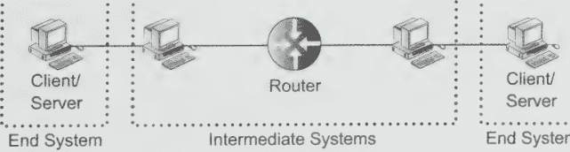
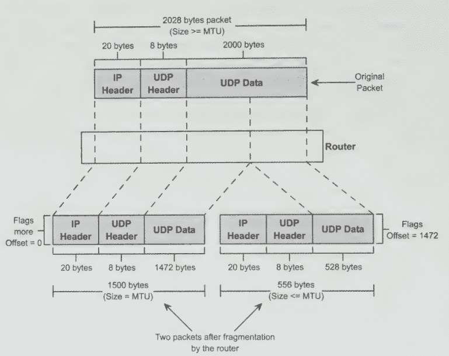
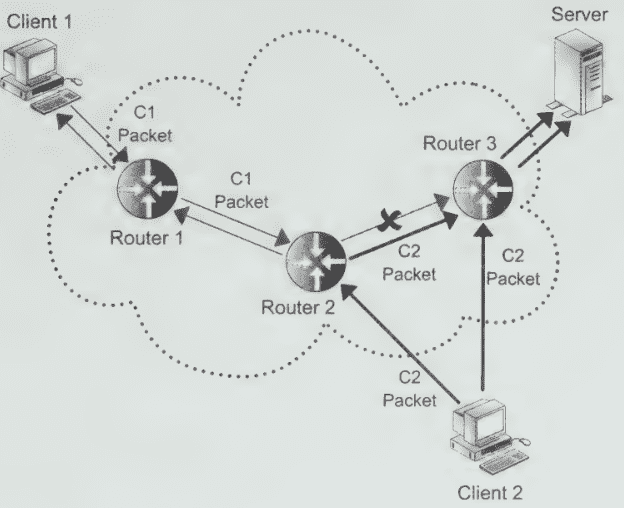
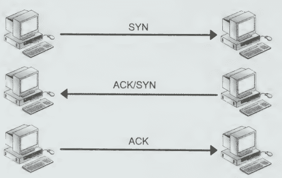
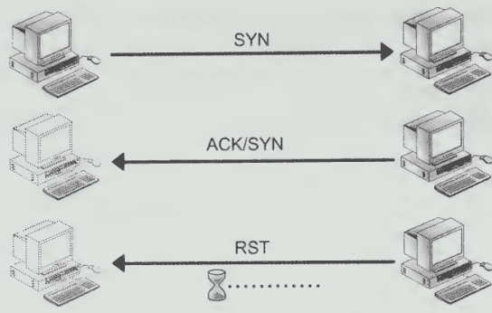
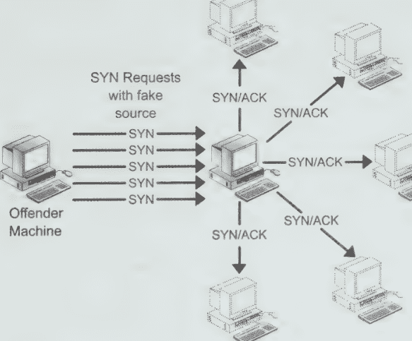
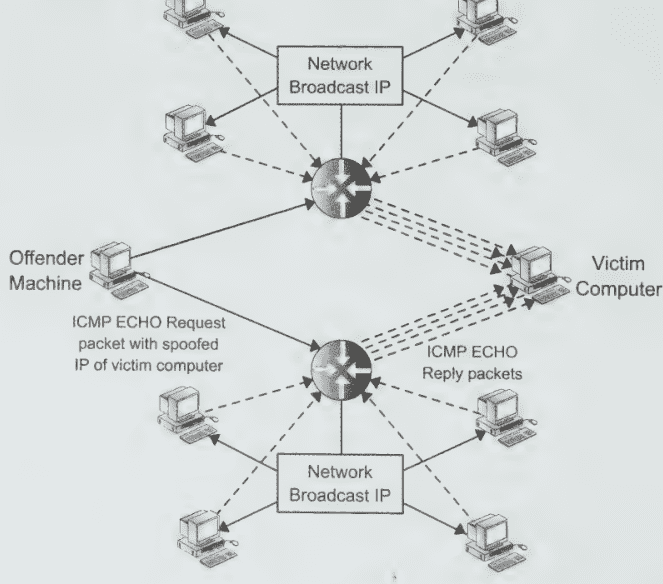
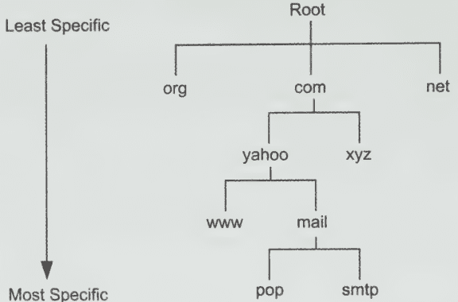

# Linux 安全（网络）


# 关于作者

Shadab Siddiqui 是 NIIT, Inc. 知识解决方案业务（KSB）部门的教学设计人员。他是 Sun 认证 Java 程序员。他开发过多个基于计算机的教程（CBT）和基于网络的教程（WBT），并编写过其他书籍。他开发了涵盖多种技术领域的学习材料，如 `Windows 2000` 网络、`JSP`、`J2EE` 和 `Linux` 等。这些学习材料的开发是为了满足从网络管理员到程序员不同学习者的需求。

NIIT 是一家全球性的培训和软件机构，为个人和组织提供定制化和包式的多媒体教育软件产品及培训、培训需求识别（TNI）、系统集成、软件解决方案（用于、工程和制造业）、IT 咨询和应用软件开发。

NIIT 课程的成功在于其独特的教育方法。NIIT 的知识解决方案业务为各种受众构思、研究并开发所有课程材料。每门 NIIT 课程都有明确的目标。完成课程后，学习者应该能够完成一系列任务。

除了是一个大型软件开发和咨询部门外，NIIT 还拥有世界上最大的学习材料开发设施之一。NIIT 使用面对面培训、视频辅助教学、基于计算机的培训（CBT）和基于互联网的培训（IBT），在信息技术领域每年培训超过 150,000 名高管和学习者。NIIT 曾入选吉尼斯世界纪录，一年培训人数最多的记录！

NIIT 开发了超过 10,000 小时的导师引导培训（ILT）以及超过 3,000 小时的基于互联网的培训和基于计算机的培训。通过培训方法的创新使用以及对研发的承诺，NIIT 一直处于计算机教育和培训的前沿。

NIIT 与 `Microsoft`、`Computer Associates`、`AT&T`、`NETg`、`Sybase`、`Intersol` 和 `Information Builders` 等公司建立了战略合作伙伴关系。


https://archive.org/details/linuxsecurity0000sidd

- 总结 . . . . . . . . . . . . . . . . . . . . . . . . . . . 220
- 检验你的理解 ........................................................................................ 321
- 多选题 .......................................................................... 403
- 短答题 ................................................................................................. 404
- 答案 ................................................................................................................. 404
- `Bastille Linux` . . . . . . . . . . . . . . . . . . . . . . . . . . . 452
  - `Bastille Linux` 的特性 . . . . . . . . . . . . . . . . . . . . . 452
  - `Apache 2.0` . . . . . . . . . . . . . . . . . . . . . . . . . . . 453
  - `Apache 2.0` 中的新模块 . . . . . . . . . . . . . . . . . . . . . 453
  - 增强模块 . . . . . . . . . . . . . . . . . . . . . 454
  - `qmail` . . . . . . . . . . . . . . . . . . . . . . . . . . . 455
  - `sendmail` 对比 `qmail` . . . . . . . . . . . . . . . . . . . . 456
- 索引 . . . . . . . . . . . . . . . . . . . . . . . . . . . . . . . . . . . 457

# 引言

本书为你提供了关于 `Linux` 安全的全面知识。本书面向熟悉 `Linux` 概念，但现在希望在 `Linux` 安全功能方面建立坚实基础的读者。假设这些读者已经了解一些 `Linux` 和网络概念，例如网络协议、网络服务器等。本书包含了详细信息，以帮助你加固 `Linux` 环境，并在关键章节的末尾提供了问题，让你能够检查自己的理解情况。

第 1 章到第 5 章涵盖了 `Linux` 环境中的安全基础。这些章节将为你提供 `Linux` 安全概述，以及在安装和管理 `Linux` 时需要采取的注意事项。书的这部分还概述了你可以用于保护数据的各种身份验证和加密技术。

第 6 章到第 9 章涉及 `Linux` 环境下的网络安全。在书的这部分讨论了各种可能的网络攻击，并为你提供了防止这些攻击的指南。保护网络服务器——例如 `Apache` Web 服务器、`FTP` 服务器、`Sendmail`、`DNS` 和 `SAMBA`——是书中这部分的核心。

第 10 章到第 13 章重点关注防止入侵和数据恢复。在这些章节中，你将获得一份详尽的入侵迹列表。你将学习使用各种工具和安全实用程序来检测和避免入侵。对于系统管理员来说，定期维护日志是一个良好的习惯。日志可以提供有关攻击你系统的方法的迹象，有时你还可以获得有关攻击者的信息。第 12 章“系统日志”教导了你制作备份的重要性。你会意识到，如果由于系统崩溃或其他原因丢失数据，备份是多么重要。本章讨论了你可以用于维护备份的各种商业和非商业工具。

最后，本书还包含了几个附录。附录包括 `Linux` 最佳实践和 `Linux` 安全的常见问题解答。书末尾还包含了一个关于 `Linux` 未来的附录。

# 如何使用本书

本书的结构旨在促进你的学习并让你更好地掌握此处涵盖的内容。书中使用的各种约定和特殊元素包括：

- **提示（Tips）**。提示用于提供特殊的建议或不寻常快捷方法。
- **注释（Notes）**。注释提供可能感兴趣的额外信息，但这些信息对于执行当前任务并非必不可。
- **警告（Cautions）**。警告用于提醒你，如果错误执行任务可能会导致灾难性的结果。
- **新术语定义**。所有新术语均用斜体表示并随后给出定义。

# 第 1 章 `Linux`：概述

## `Linux` 的起源

`Linux` 是一种由芬兰赫尔辛基的学生 Linus Torvalds 开发的类 Unix 操作系统。Linus 对 `Minix` 感兴趣并决定开发一个超越 `Minix` 标准的系统。`Minix` 是由 Andrew Tanenbaum 为教学设计的类 Unix 系统（《Operating Systems: Design and Implementation》， Prentice Hall, 1997）。`Linux` 在 1991 年发布了内核 0.02，最初托管在 `Minix` 上。

`Linux` 可用于各种目的，包括：

- 网络
- 应用开发
- 用户终端平台

`Linux` 因源代码免费可用而迅速流行。成千名程序员修改了 `Linux` 以满足个人需求。`Linux` 的免费可用使其成为其他操作系统的低成本替代方案。

## 优势

自推出以来，`Linux` 受深受各类用户欢迎。许多调查认为 `Linux` 是全球增长最快的操作系统之一。这里列出了其流行的优点：

- **成本**。许多供应商免费发行 `Linux`，因此没有许可证费用。某些供应商对 `Linux` 收费，但与其他操作系统相比，价格非常低。
- **稳定性**。由于频繁发布补丁，`Linux` 非常稳定。成千名程序员审查源码以提高性能、消除漏洞、增强安全并确保稳定性。结果是 `Linux` 安全问题通常就能解决。补丁很快可用，有时在检测到几小时内就会发布到互联网。在商业供应商（如 `Sun`、`HP` 和 `IBM`）甚至承认问题之前，修复程序通常已经可用。
- 没有任何其他操作系统曾经历过 `Linux` 所经历的深度审查。`Linux` 的稳定性通过多年连续运行某些应用程序得到了测试。而在其他操作系统上运行时，这些应用程序往往需要频繁重启。
- **支持**。应对 `Linux` 相关问题的支持是免费且易于获得的，因为参与者包括商业分发商、顾问以及非常活跃的用户和开发者社区。你可以联系 `Linux` 用户小组（`LUGS`）邮件列表来解决你的疑问。此外，你还可以找到详尽的参考文档。另一个额外优点是 `Linux` 不限于单一供应商。源码的可用性意味着用户和支持者能够快速有效地找到技术问题的根。这与其他操作系统形成对比，后者依赖 OS 供应商修复漏洞。
- **可移植性**。大多数 `Linux` 系统基于标准 PC 硬件，`Linux` 支持广泛的 PC 设备。`Linux` 最初是为基于 `386/486` 的 PC 开发的。现在，`Linux` 支持广泛的其他类型的计算机，包括 `Alpha`、`Power PC`、`680x0`，


`SPARC`、`ARMs`、`DEC Alphas`、`Sun Sparcs`、`M68000` 计算机、`MIPS`、`Strong Arm` 处理器，以及从 `PDA` 到超级计算机的各种尺寸系统。

- 定制。你可以根据自己的硬件和软件需求修改 `Linux`。因此，你可以为你的计算机配置 `Linux` 以获得最佳的利用率。例如，`Linux` 可以同时运行 `SMB` 协议和 `AppleTalk` 协议。

- 工具与应用。`Linux` 拥有满足你需求的工具和应用程序。大多数 `Linux` 发行版都包含了从 `Apache` Web 服务器到 `GIMP` 图形编辑器的程序。这些大多数应用程序和工具都是免费提供的。

创建高度稳定的 `Linux` 系统的工作正在进行中。配置适当的 `Linux` 内核配合配置恰当的软件通常可以运行数百天而无需重启计算机。


> 注意

你可以在以下网站获取更多关于 `Linux` 流行程度的信息：

- `www.linux-mag.com`

- `http://counter.li.org`

- `www.idc.com`

- `www.nwfusion.com`

- `http://linuxtoday.com`

接下来，我将解释 `Linux` 的架构。

## `Linux` 架构

`Linux` 基于 `UNIX` 架构。它符合 `POSIX` 标准，并支持大多数为 `UNIX` 制定的标准。因此，`UNIX` 和 `Linux` 的基本架构和许多特性是相同的。事实上，`Linux` 经常被视为 `UNIX` 的另一个版本。`Linux` 支持的文件系统也与 `UNIX` 文件系统相似。两者具有相似的目录结构。

# `Linux` 架构 第 1 章

基于 `UNIX` 的 `Linux` 架构如图 1-1 所示。


图 1-1 `Linux` 架构

由于这些相似性，你可以轻松地将 `UNIX` 应用程序移植到 `Linux` 平台。`Linux` 及其使用的 `GNU` C 库在设计时考虑了应用程序的移植性。`Linux` 还实现了在 `UNIX` 的 `System V` 接口定义 (`SVID`) 和 软件发行版 (`BSD`) 变体中找到许多功能，但并不在所有情况下都遵循它们。通常情况下，`Linux` 的设计旨在与 `UNIX` 实现兼容，并使应用程序移植变得更容易。在许多实例，这些应用程序得到了改进，然后在 `Linux` 操作系统上实现。

> 注意

`GNU` 是 "GNU's Not UNIX"（`GNU` 不是 `UNIX`）的递归缩写，读作 "guh-NEW"，`GNU` 是 1984 年启动的 `GNU` 项目的成果，旨在开发一种类 `UNIX` 操作系统。

接下来让我为您提供关于 `Linux` 源码免费提供的更多细节。

## `Linux` - 开源

`Linux` 是根据 `GNU` 通用公共许可证（`GPL`）开发的；因此，它的源代码可以自由分发。`Linux` 被说是在互联网上开发的，因为全球成千上万的开发者看到了它并添加了功能。这些开发者测试了 `Linux`，报告了漏洞，同时也协助了消除这些漏洞。结果，`Linux` 已成为一个非常稳定的系统。

埃里克·雷蒙德（`Eric Raymond`）就 `Linux` 开发过程写了一篇名为《大教堂与集市》（`The Cathedral and the Bazaar`）的文章。大教堂和集市是发布软件的两种方法。在文中，雷蒙德讨论了 `Linux` 内核开发如何使用集市方法，即尽可能快速、频繁地发布代码；从而允许大量的外部输入带来快速改进。

> 埃里克·雷蒙德是 `VA Linux Systems` 董事会成员，这是一家领先的 `Linux` 硬件和系统公司。他是开源倡议（`Open Source Initiative`）的联合创始人，这是一个在黑客社区和商业社区之间建立桥梁以传播开源开发方法的组织。要了解更多关于埃里克·雷蒙德的信息，请访问 `tuxedo.org/~esr/resume.html`。

遵循大教堂方法的应用程序代码比根据集市方法发布的代码更稳定，发布频率也较低。这种方法为核心开发小组之外的人提供的贡献机会较少。

采用集市方法的项目并不意味着在设计阶段就向所有人开放代码。然而，一旦开发者完成了代码调试，将代码向所有人开放是合理的，这样越来越多的人就可以参与到发现和修正错误的过程中。这确保了错误能够被修复。

你可以将 `Linux` 作为服务器、工作站以及各种应用程序的开发平台。现在我将讨论 `Linux` 可以扮演的各种角色。

## `Linux`：服务器


Linux 与 UNIX 一样，是互联网服务器优秀的操作系统，包括 Web、电子邮件和 FTP 服务器。Linux 与 UNIX 一样，是互联网服务器优秀的操作系统，包括 Web、电子邮件和 FTP 服务器。Linux 与 UNIX 一样，是互联网服务器优秀的操作系统，包括 Web、电子邮件和 FTP 服务器。Linux 与 UNIX 一样，是互联网服务器优秀的操作系统，包括 Web、电子邮件和 FTP 服务器。Linux 与 UNIX 一样，是互联网服务器优秀的操作系统，包括 Web、电子邮件和 FTP 服务器。Linux 与 UNIX 一样，是互联网服务器优秀的操作系统，包括 Web、电子邮件和 FTP 服务器。Linux 与 UNIX 一样，是互联网服务器优秀的操作系统，包括 Web、电子邮件和 FTP 服务器。Linux 与 UNIX 一样，是互联网服务器优秀的操作系统，包括 Web、电子邮件和 FTP 服务器。Linux 与 UNIX 一样，是互联网服务器优秀的操作系统，包括 Web、电子邮件和 FTP 服务器。Linux 与 UNIX 一样，是互联网服务器优秀的操作系统，包括 Web、电子邮件和 FTP 服务器。Linux 与 UNIX 一样，是互联网服务器优秀的操作系统，包括 Web、电子邮件和 FTP 服务器。Linux 与 UNIX 一样，是互联网服务器优秀的操作系统，包括 Web、电子邮件和 FTP 服务器。Linux 与 UNIX 一样，是互联网服务器优秀的操作系统，包括 Web、电子邮件和 FTP 服务器。Linux 与 UNIX 一样，是互联网服务器优秀的操作系统，包括 Web、电子邮件和 FTP 服务器。Linux 与 UNIX 一样，是互联网服务器优秀的操作系统，包括 Web、电子邮件和 FTP 服务器。Linux 与 UNIX 一样，是互联网服务器优秀的操作系统，包括 Web、电子邮件和 FTP 服务器。Linux 与 UNIX 一样，是互联网服务器优秀的操作系统，包括 Web、电子邮件和 FTP 服务器。Linux 与 UNIX 一样，是互联网服务器优秀的操作系统，包括 Web、电子邮件和 FTP 服务器。Linux 与 UNIX 一样，是互联网服务器优秀的操作系统，包括 Web、电子邮件和 FTP 服务器。Linux 与 UNIX 一样，是互联网服务器优秀的操作系统，包括 Web、电子邮件和 FTP 服务器。Linux 与 UNIX 一样，是互联网服务器优秀的操作系统，包括 Web、电子邮件和 FTP 服务器。Linux 与 UNIX 一样，是互联网服务器优秀的操作系统，包括 Web、电子邮件和 FTP 服务器。Linux 与 UNIX 一样，是互联网服务器优秀的操作系统，包括 Web、电子邮件和 FTP 服务器。Linux 与 UNIX 一样，是互联网服务器优秀的操作系统，包括 Web、电子邮件和 FTP 服务器。Linux 与 UNIX 一样，是互联网服务器优秀的操作系统，包括 Web、电子邮件和 FTP 服务器。Linux 与 UNIX 一样，是互联网服务器优秀的操作系统，包括 Web、电子邮件和 FTP 服务器。Linux 与 UNIX 一样，是互联网服务器优秀的操作系统，包括 Web、电子邮件和 FTP 服务器。Linux 与 UNIX 一样，是互联网服务器优秀的操作系统，包括 Web、电子邮件和 FTP 服务器。Linux 与 UNIX 一样，是互联网服务器优秀的操作系统，包括 Web、电子邮件和 FTP 服务器。Linux 与 UNIX 一样，是互联网服务器优秀的操作系统，包括 Web、电子邮件和 FTP 服务器。Linux 与 UNIX 一样，是互联网服务器优秀的操作系统，包括 Web、电子邮件和 FTP 服务器。Linux 与 UNIX 一样，是互联网服务器优秀的操作系统，包括 Web、电子邮件和 FTP 服务器。Linux 与 UNIX 一样，是互联网服务器优秀的操作系统，包括 Web、电子邮件和 FTP 服务器。Linux 与 UNIX 一样，是互联网服务器优秀的操作系统，包括 Web、电子邮件和 FTP 服务器。Linux 与 UNIX 一样，是互联网服务器优秀的操作系统，包括 Web、电子邮件和 FTP 服务器。Linux 与 UNIX 一样，是互联网服务器优秀的操作系统，包括 Web、电子邮件和 FTP 服务器。Linux 与 UNIX 一样，是互联网服务器优秀的操作系统，包括 Web、电子邮件和 FTP 服务器。Linux 与 UNIX 一样，是互联网服务器优秀的操作系统，包括 Web、电子邮件和 FTP 服务器。Linux 与 UNIX 一样，是互联网服务器优秀的操作系统，包括 Web、电子邮件和 FTP 服务器。Linux 与 UNIX 一样，是互联网服务器优秀的操作系统，包括 Web、电子邮件和 FTP 服务器。Linux 与 UNIX 一样，是互联网服务器优秀的操作系统，包括 Web、电子邮件和 FTP 服务器。Linux 与 UNIX 一样，是互联网服务器优秀的操作系统，包括 Web、电子邮件和 FTP 服务器。Linux 与 UNIX 一样，是互联网服务器优秀的操作系统，包括 Web、电子邮件和 FTP 服务器。Linux 与 UNIX 一样，是互联网服务器优秀的操作系统，包括 Web、电子邮件和 FTP 服务器。Linux 与 UNIX 一样，是互联网服务器优秀的操作系统，包括 Web、电子邮件和 FTP 服务器。Linux 与 UNIX 一样，是互联网服务器优秀的操作系统，包括 Web、电子邮件和 FTP 服务器。Linux 与 UNIX 一样，是互联网服务器优秀的操作系统，包括 Web、电子邮件和 FTP 服务器。Linux 与 UNIX 一样，是互联网服务器优秀的操作系统，包括 Web、电子邮件和 FTP 服务器。Linux 与 UNIX 一样，是互联网服务器优秀的操作系统，包括 Web、电子邮件和 FTP 服务器。Linux 与 UNIX 一样，是互联网服务器优秀的操作系统，包括 Web、电子邮件和 FTP 服务器。Linux 与 UNIX 一样，是互联网服务器优秀的操作系统，包括 Web、电子邮件和 FTP 服务器。Linux 与 UNIX 一样，是互联网服务器优秀的操作系统，包括 Web、电子邮件和 FTP 服务器。Linux 与 UNIX 一样，是互联网服务器优秀的操作系统，包括 Web、电子邮件和 FTP 服务器。Linux 与 UNIX 一样，是互联网服务器优秀的操作系统，包括 Web、电子邮件和 FTP 服务器。Linux 与 UNIX 一样，是互联网服务器优秀的操作系统，包括 Web、电子邮件和 FTP 服务器。Linux 与 UNIX 一样，是互联网服务器优秀的操作系统，包括 Web、电子邮件和 FTP 服务器。Linux 与 UNIX 一样，是互联网服务器优秀的操作系统，包括 Web、电子邮件和 FTP 服务器。Linux 与 UNIX 一样，是互联网服务器优秀的操作系统，包括 Web、电子邮件和 FTP 服务器。

## NNTP

网络新闻传输协议 (NNTP) 基于请求-响应模型。新闻分发基于广播技术。与消息协议不同，NNTP 是一次性发送到多个主机，而不是特定的主机。NNTP 用于将消息从新闻组发送到 Linux 计算机，以及从用户发送到新闻组。这些消息存储在新闻组或新闻网络服务器上。NNTP 支持读取新闻组、发布新文章以及在新闻服务器之间传输文章的过程。

## Linux 中的网络支持

在如今的环境下，没有哪个操作系统能够在缺乏高效能力和更易于网络管理支持的情况下取得成功。Linux 为你提供了这两项功能。互联网的使用是 Linux 操作系统开发的支柱。因此，网络支持在开发阶段就已经包含在内。此外，由于各种程序员对 Linux 进行了持续的研发活动，它已经超越了各种现有的操作系统。Linux 为其他操作系统（如 Macintosh、DOS、Windows 和 OS/2）提供了全面且无缝的支持。

Linux 的一些高级网络特性包括：

- 支持 `TCP/UDP/IP` 协议族

- 内核中添加了许多新功能

- 支持服务质量 (`QoS`)

- 使用 `ipchains` 实现防火墙

- 使用通用路由加密 (`GRE`) 隧道实现 `VPN`

- 使用 `netlink` sockets 实现高级路由

## 桌面上的 Linux

Linux 的支持者声称它是 Windows 的完美桌面替代品。Linux 是普通桌面用户、全职互联网用户及其他人的合法操作系统。它满足大多数用户的需求。但有时，某些应用程序或工具可能在 Linux 上不受支持。例如，AutoCAD 等 CAD 程序可能无法按预期工作。

Linux 具有许多使其成为工作站的特征。Linux 支持以下内容：

- 多用户工作站

- Web 浏览器（Mozilla/Konqueror/Netscape/Opera）

- 应用程序（如文字处理、表格、图形应用和游戏）

- 打印机

- 即插用硬件设备

- `X Windows` `GUI` 界面

- 数千其他免费获取的软件应用程序

## 作为开发平台的 Linux


Linux 也可以作为开发平台。它支持各种编程语言和脚本语言，例如 `Perl`、`PHP`、`Python`、`C++`、`gtk`、`ASP`、`Java` 和 `TCL`。Linux 支持使用这些语言开发应用程序所需的编译器和其他工具。下列表列出了其中一些语言的简要描述：

- `Perl`。`Perl` 是一种脚本语言。`Perl` 脚本可用作 `CGI` 脚本并嵌入到 `HTML` 代码中。`Perl` 满足广泛的编程需求。该语言经过了广泛的测试和尝试。`Perl` 的优势是它的字符串解析能力，而缺点是它的源代码看起来很难以管理。

- `Python`。`Python` 是一种解释型、面向对象的语言。`Python` 脚本具有非常明确结构，源代码看起来比 `Perl` 简单得多。虽然 `Python` 报告了一些安全疑虑，但对每种语言都是如此。

- `PHP`。超文本预处理处理器 (`PHP`) 是一种服务端脚本语言，在过去几年中获得了巨大的关注。这种受欢迎程度的原因之一是 `PHP` 操纵数据类型的能力以及在与数据库交互时的易用性。简单的源代码和在 Web 上的易于实现使得 `PHP` 成为网站上执行动态任务的最佳选择。

- `Java` 是一种基于“编写一次，随处运行”理念的编程语言。`Java` 虚拟机 (`JVM`) 使 `Java` 程序运行在任何机器上。你只需要将编译后的 `Java` 代码传输到目标机器即可。Linux 支持 `Java`、`Servlets`、`JSP`、`applets` 以及相关技术。`Servlets` 和 `JSP` 用于创建动态 Web 页面。`servlet` 和 `JSP` 代码在服务器上执行。`Applets` 是在客户端浏览器上执行的 `Java` 程序。

- `C/C++`。`C` 和 `C++` 语言非常流行，对程序员来说无需介绍。Linux 支持这些语言的编译器。例如，`gcc` 是这些语言的编译器。Linux 本身是用 `C/C++` 编写的。

## 总结

在本章中，你学习了 Linux 的特性。Linux 是一个免费分发的操作系统。你学习了 Linux 如何作为服务器、工作站以及开发平台。你还学习了 Linux 支持的协议，包括 `FTP`、`Gopher`、`HTTP`、`IP`、`SMTP`、`TCP`、`Telnet`、`SSH` 和 `NNTP`。你还学习了 Linux 的网络功能以及它如何作为工作站。最后，你查看了 Linux 作为 `Perl`、`C`、`C++` 和 `Java` 等语言开发平台的能力

# 第 2 章：Linux 安全概述

在现代世界，电子媒体越来越多地用于通信和数据存储。随着电子数据交换的增加，对共享数据和信息的威胁也增加了。威胁是多方面的，从竞争对手跟踪通信到存储质的物理损坏。

本章提供了帮助你有效应对这些威胁的指南。在本章中，我将讨论安全基础、对安全的需求以及你为了保护计算机上的数据可以采取的措施。我还会讨论适用于 Linux 环境的安全问题。

## 对安全的需求

在现代世界，电子媒体越来越多地用于通信和数据存储。随着电子数据交换的增加，对共享数据和信息的威胁也增加了。威胁是多方面的，从竞争对手跟踪通信到存储质的物理损坏。

本章提供了帮助你有效应对这些威胁的指南。在本章中，我将讨论安全基础、对安全的需求以及你为了保护计算机上的数据可以采取的措施。我还会讨论适用于 Linux 环境的安全问题。

入侵者分为几类。根据他们的意图和可能造成的破坏可以对他们进行分类。

以下是入侵者的分类列表：

- 好奇心型入侵者：试图收集信息，例如你的系统配置和设置、存储在你的系统中的数据等。好奇型入侵者并不意图要破坏你的系统和数据；他们的唯一目的是获取存储在你的系统中的关键信息。

- 恶意型入侵者：与好奇型入侵者不同，他们意图要破坏你的数据和系统。一旦他们获得了系统的访问权限，就会执行破坏性活动，例如篡改 Web 页面、破坏系统数据等。这些入侵者的目的仅仅是破坏；他们不会利用你系统中的数据来获取自身的利益。

- 竞争者型入侵者：尝试访问你计算机上的数据。他们利用这些数据获取业务利益，并在市场竞争中占据优势。他们访问数据的目的是获取你与业务相关的数据，对其进行分析，洞察你未来的业务计划，并将其为己所用。

- 借用者型入侵者：缺乏执行自身活动所需的资源。他们入侵你的系统是为了使用你的资源来满足他们的需求。

- 越界者型入侵者：通常攻击与网络上其他计算机连接良好的系统。他们试图通过一台连接良好的计算机来攻击并使用网络中其他计算机的资源。网关是此类入侵者的首要目标。

随着互联网在通信和数据交换中使用的日益增加，确保你的系统免受通过互联网发生的攻击变得至关重要。

Linux 环境的安全可以分为四个级别：

- 物理安全

- 数据安全

- 网络安全

- 账户安全

在本章中，我将详细讨论每种安全级别。

## 第 2 章：物理安全

物理安全是你需要实施的基础安全。你需要考虑人员访问你系统的物理性等因素。家庭用户可能不需要对计算机进行物理安全防护。在办公环境中，系统的物理安全更为关，，因为它们包含了对你的业务敏感的数据。在这种环境下，你可以采取安全措施，例如安装视频监控和聘用安保人员。

你为系统提供的物理安全基于安全需求和预算。例如，你绝对不会在一台仅加载了游戏的计算机上提供高标准的物理安全。具有关键和机密数据的计算机需要高标准的物理安全。在办公环境中，有人只需通过走到用户的桌前并操纵数据就能访问系统。

### 物理安全的常见预防措施

你可以采取多种措施保护你的 PC 设备。某些方法廉价且易于实施，而另一些则昂贵且复杂。以下是这些措施中的：

- 在工作场所使用视频监控。摄像头应该是隐藏的，且不易被察觉。

- 将备份介质存安全的地方。如果可能，制作备份的副本并分开存储。

- 旅行时妥善照顾你的计算机和其他设备。

- 锁定 CPU 机箱盖以防任何部件被盗，例如主板或硬盘。

- 离开时将设备锁在安全的地方。

- 安装安全报警器。

- 聘用安保人员保护你的设备。

- 限制对关键和昂贵设备的访问。使用指纹扫描仪和语音识别等安全措施。

- 购买具有内置安全功能的计算机和设备。

- 将最易受到攻击的服务器（如网关）安装在独立的计算机上。

我在上面列出了一些你为物理安全应该采取的预防措施，但物理安全还有很多其他内容。物理安全的其他方面包括：

- 计算机锁

- `BIOS` 安全

- 引导加载程序（`Boot Loader`）安全

- `xLock` 和 `vLock`

- 检测物理安全受损

### 计算机锁

使用锁可以防止系统硬件组件被盗。如果你离开计算机时未对其加锁，小偷可以打开你系统的 CPU 并盗走硬件部件，如主板和 RAM 芯片。他们甚至可能损坏你的系统到无法修复的程度。在这两种情况下，你都丢失了关键数据以及昂贵的组件。在办公环境中，有人只需走到用户的桌前并操纵数据就能轻松访问系统。市面上存在各种锁，可以保护你的系统。在离开计算机时锁定控制台可以保护你的工作。这种方法并非无懈可击，你可以通过锁定控制台来保护系统。

### `BIOS` 安全

基本输入输出系统（`BIOS`）是一个决定计算机如何启动的程序。`BIOS` 管理操作系统与硬件之间的通信。`BIOS` 通过允许设置密码来保护计算机。用户需要提供此密码才能登录。然而，`BIOS` 提供的安全非常薄弱，很容易被破解，因为 `BIOS` 制造商提供的默认密码对黑客来说是已知的，如果不更改他们就可以轻松启动系统。你也可以配置 `BIOS` 使不从软盘启动。虽然通过 `BIOS` 保护并不安全，但它可以起到威慑作用。这会让攻击者花费更多时间，并且极有可能留下痕迹。

### 引导加载程序安全

你可以为各种 Linux 引导加载程序设置密码。然而，这些密码并非无懈可击，它们只能延迟攻击者。入侵者可以绕过密码并启动系统。为了防止入侵者利用这种技术，请禁用从软盘启动。

### `xLock` 和 `vLock`

有时你可能需要离开工作站。当你离开时，任何人都可以来到你的工作站查看你正在处理的文件。你可以通过锁定控制台来防止这种情况。允许你锁定控制台的两个程序是 `xlock` 和 `vlock`。

- `xlock` 是 X 显示锁。`xlock` 锁定计算机的显示器。你可能需要提供密码来解锁显示器。`xlock` 于支持 X 的 Linux 发行版。

- `vlock` 锁定虚拟控制台。它可以锁定计算机上的部分或全部虚拟控制台。如果你只锁定控制台，你可以继续使用其他控制台。锁定控制台可以防止他人篡改你的工作，但不能阻止他们执行以下操作：

  - 重启你的计算机

  - 从网络上的其他计算机访问你的计算机并引起问题

  - 完全退出 X 系统并进入虚拟控制台提示符

## 第 2 章 LINUX 安全：概述

检查是否有物理篡改的迹象，例如划痕或显示器或 CPU 偏离原始位置。入侵者经常试图清除任何入侵痕迹。他们可能会修改日志文件以删除由攻击引起的日志条目。然而，除非他们极其小心，否则他们会留下一些证据，例如日志的最后修改时间戳。因此，如果你怀疑有任何入侵，就应该仔细分析日志。你还可以在不同的位置维护日志文件的副本并对其进行保护。如果你不在受保护的环境中存储日志，那么日志数据可能几乎毫无用，因为入侵者极有可能会对其进行修改。


有一个名为`syslog`的守护进程，可以用于记录你计算机上的活动。你可以配置`syslog`将数据自动发送到中央`syslog`服务器。然而，使用`syslog`的缺点是它发送到`syslog`服务器的日志条目是明文的。它没有加密。因此，任何监控你网络的未经授权的用户都可以访问正在传输的数据。使用`syslog`守护进程还有一个风险：`syslog`服务器不验证日志条目的来源。它接受来自网络中任何声称是本地主机的计算机的日志条目。你应该检查`syslog`服务器中的日志，查看是否存在以下入侵迹象：

- 不熟悉的日志条目
- 日志中异常的日期和时间记录
- 表明计算机已重启或重新启动的日志
- 来自未知主机的登录尝试

你现在已经了解如何从物理上保护你的系统。接下来我将讨论如何保护计算机上的数据。

## 保护数据

数据保护对你的业务至关重要。数据丢失的原因有很多。你可能会因为硬盘崩溃、病毒攻击、硬件故障或入侵者的攻击而丢失数据。防止数据丢失的一种方法是进行定期备份。你可以在各种存储介质上备份，例如磁带、其他硬盘和墨盒。备份介质的选择取决于备份数据所需的存储空间以及你可用的资源。数据冗余是防止数据丢失的另一种措施。数据冗余将数据写入几块磁盘中，这些磁盘可能分布在不同的位置。相同的数据会被相互复制。

## 数据安全 第 21 章

这将确保即使其中一块磁盘崩溃，你的数据也是完好的。冗余磁盘阵列（`RAID`）让你能够以非常廉价的方式执行数据冗余。

你应该考虑制作多个备份副本，并将备份存储在不同的物理位置。考虑一种情况：你将备份数据存储在工作场所，但发生了如洪水或地震等不幸的事件。在这种情况下，你将丢失原始数据和备份数据。在不同位置存储备份将帮助你在这种情况下恢复数据。

许多组织提供应急恢复服务。这些组织提供诸许多服务，如在不同的物理位置存储备份数据，并在你的工作场所无法使用时为你提供计算机和设施。

你还可以制定一份灾难恢复计划。该计划将包含有关如何、何时以及何地进行备份的细节，并包括为了保护该备份介质以及在发生灾难时恢复数据而需要采取的措施。除了这些项目之外，计划还应该提到在工作场所维修期间如何继续运行业务。计划应该使你能够执行所有的业务活动。计划应该让每位相关用户知晓，并且应该是开放并定期更新的。

许多程序都内置了数据恢复功能。如果你在网络上有几台服务器，可以配置服务器之间互相备份数据。这将确保在其中一台服务器崩溃时数据不会丢失。

### 注意

有时，未经授权的用户可以重启你的计算机，导致任何未保存的数据丢失。为了防止这种情况发生，你可以使用`/etc/shutdown.allow`文件，该文件包含一个授权重启计算机的用户名列表。当用户尝试使用`Ctrl+Alt+Del`键启动系统时，`Linux`会查找此文件以确定该用户是否有权限启动系统。

## 安全删除数据

你制作备份是为了防止数据丢失。然而，有时你不再使用它们，但需要确保你的业务竞争对手或任何其他未经授权的用户无法访问该数据。然而，仅仅删除文件并不能确保专家用户无法恢复它。当你删除数据时，引用数据仍然存在于内存中，直到它被其他数据物理覆盖。此时，被删除的文件可能可以通过复杂的数据恢复工具进行恢复。为了销毁敏感数据，你可以使用程序多次用虚拟数据覆盖被删除的文件。当然，如果系统是报废或回收而不是转售，那么防止数据被恢复的可靠方法是物理损坏硬盘以使其无法修复。

## 数据加密

到目前为止讨论的安全措施在保护你的数据和`PC`以及防止入侵者方面有很大帮助。然而，如果入侵者在你采取了所有安全措施后仍然能够访问你的数据，他们就可以轻松地读取和理解你的数据。防止这一点的一种方法是对关键数据进行加密。你可以加密存储在计算机上的数据，也可以加密通过网络传输的数据。

加密是通过应用某些算法转换数据的过程，使得除了拥有可以反转先应用算法的用户之外，任何人都无法读取。将加密数据还原回原始形式的过程被称为解密。在网络上传输数据时，加密数据特别为安全。如果入侵者获取了正在传输的数据，他将无法使用该数据，因为他没有解密算法。

你将在第 5 章“加密与身份验证”中学习更多关于加密的知识。

接下来，我们将查看如何保护网络。

## 网络安全

在现代，越来越多的人连接到网络，越来越多的组织转向以网络为核心的业务。此类业务很容易受到那些为了未经访问而具有不同目的的入侵者的攻击，例如业务竞争。有很多工具可以帮助你进行网络安全。其中一些工具随`Linux`操作系统提供。

### 防火墙

每个网络都包含一些用于网络正常运行的计算机。`防火墙`就是其中一种用于网络安全的计算机。`防火墙`用于将机构的内网与互联网隔离开。`防火墙`用于检查不同网络之间计算机的通信。让我先为您解释一下与`防火墙`相关的术语。这些如下：

- 堡垒机 (`Bastion host`)
- 路由器 (`Router`)
- 军事化区 (`Demilitarized Zone`)
- 代理 (`Proxy`)

#### 堡垒机

堡垒机是一种用于控制组织内网与互联网之间访问的计算机。堡垒机通常运行类`Linux`操作系统。这些主机的配置为仅执行其特定的任务。所有其他不必要且未使用的服务都已关闭。

#### 路由器

路由器是一种用于连接多个网络的计算机。路由器还处理额外功能，例如管理其所连接网络的流量。

#### 军事化区 (DMZ)

`DMZ`是网络内部的一个主机或一个小型网络。它充当中立区域；也就是说，它既不被信任也不被不信任。它通常位于组织的内网和外部网络之间。它防止网络外的用户直接访问网络内计算机上的数据。`DMZ`网络上的主机接收来自内部用户的请求，并为这些请求创建会话。

#### 代理

代理服务器是充当互联网与用户之间媒介的服务器。能够从互联网获取文档的计算机可以配置为代理服务器，而内网上的其他计算机可以配置为代理客户端。因此，当代理客户端需要访问互联网资源时，它们向代理服务器发送请求。代理服务器使用代理客户端提供的`URL`，从互联网获取资源，然后将其传递给代理客户端。这样，内网上的所有主机都可以在不连接互联网的情况下访问互联网资源。

访问服务器（如防火墙和网关）应经过仔细考虑后配置。这些服务器是你网络的入口。因此，黑客会尝试访问这些服务器，因为一旦进入，就可以访问网络上的所有主机。

`防火墙`有三种基本类型：

- 应用网关
- 数据包过滤
- 混合系统

这些将在接下来的三个章节中讨论。

#### 应用网关

应用网关或代理网关在`网络`中充当代理服务器。允许应用程序作为代理服务器运行的软件位于`OSI`模型的应用层。默认情况下，应用网关阻止本地网络与互联网之间的流量。需要对其配置以允许流量通过。

#### 数据包过滤

数据包过滤是一种路由器开启访问控制列表（`ACL`）的技术。您可以使用`ACL`在网络中实施安全策略。`ACL`决定了您允许互联网或其他网络的计算机对您的内部网络拥有何种访问权限，反之亦然。如果未开启`ACL`，路由器将无任何限制地通过所有发送给它的流量。

数据包过滤的额外开销比应用网关小。因此，数据包过滤技术的工作速度比应用网关更快。

数据包过滤技术使用`OSI`参考模型的传输层或会话层。使用较低级使其能够支持新的应用程序。这种对新应用程序的支持是自动的。然而，使用数据包过滤器的缺点是你无法确定数据包的来源。为了克服这一缺点，您可以使用不同的技术来识别数据包过滤器的来源。方法之一是对本地网络或互联网使用不同层的数据包过滤器。

#### 混合系统

许多供应商正在开发兼具应用网关和数据包过滤技术优势的系统。应用网关是安全的，而数据包过滤技术更快速、更灵活。在这些系统中，应用网关批准新的连接请求。数据包过滤确保属于已验证连接的数据包能够通过。

您应该定期检查系统上运行的访问策略、安全性和服务。系统应仅运行执行所需任务必须的服务。如果您在系统上配置了`防火墙`，则不应将其作为邮件服务器、`Web`服务器等。以下是配置`防火墙`时需要执行的一些检查项：

- 禁用不再需要的服务。
- 通过停止`IP`转发服务，防止系统使用路由数据包。
- 使用运行`防火墙`的最新版本软件。应该建立`防火墙`策略。该策略应指定为防止攻击而要执行的操作。
- 应该限制对系统和网络管理工具的访问。
- 您应该定期检查您的系统和网络状态。任何异常活动都可能是入侵的迹象。

在配置`防火墙`时要万分小心，因为它们是你网络的入口。`防火墙`更容易受到入侵攻击。确保您在配置之前以及定期检查你的`防火墙`策略。

### 防止身份欺骗

计算机可以使用相同的主机名来模仿网络上的另一个主机，这意味着它可以伪装成你网络上一个受信任的计算机。

您可以通过修改网络中主机计算机上的系统文件来阻止这一点。主机应配置为关闭源路由。进入你网络的入站数据包应经过适当过滤。这将确保任何数据包的源`IP`地址都不会与你网络上的主机地址相同。如果发现此类数据包，应将其丢弃。

### 安全协议

你应该在网络上使用安全协议。以下是你可以使用的两种安全协议：

- `SSH`
- `SSL`

这些协议将在后续章节中描述。

#### SSH

安全外壳（`SSH`）协议用于保护`IP`网络上的远程连接。`SSH`通过在传输时对数据进行加密确保安全。`SSH`程序实现了对主机的远程管理。`SSH`旨在替代`Telnet`、`rsh`和`scp`。

#### SSL

安全套层（`SSL`）协议由`Netscape`开发，为通信应用程序提供隐私和可靠性。`SSL`协议运行在`TCP/IP`之上，`TELNET`、`FTP`或`HTTP`之下。`SSL`实现了数据加密、服务器和客户端认证。


`SSL`是一个分层协议。它有两个层：`SSL`握手协议和`SSL`记录协议。`SSL`握手协议创建客户端与服务器之间的安全通信。记录协议封装了高层信息。使用`SSL`的优点包括加密安全、可靠性和互操作性。

## FTP安全

以下是您应该遵循的安全指南：

- 在不需要时禁用`FTP`服务。根据您的需求，可以禁用整个服务或为某些用户提供访问。

- `/etc/passwd`文件包含了没有访问`FTP`服务的用户列表。该文件应该定期维护和监控。

- 维护`FTP`相关活动的日志。

- 分配给`FTP`用户的访问权限应尽可能限制。

## 调制解调器安全

如果您使用调制解调器连接互联网，出于安全考虑，应该配置密码。访问互联网的用户必须提供此密码才能通过。为此：

- 配置`/etc/passwd`文件。

- 验证密码不可被猜测。

- 不要为多个用户分配相同的密码。

- 在用户不再需要访问时禁用账户。

- 在断开连接后注销。

## Windows客户端

网络通常包含微软客户端，它们最可能使用`NetBIOS`或其他不安全的网络协议。`NetBIOS`是在网络上发布共享名称、用户名和主机名的协议。建议对工作站禁用`NetBIOS`。在网络需要`NT`服务器的情况下，`NT`服务器应该有两个网卡。一个网卡应该是内部的。配置网卡后，可以禁用`NetBIOS`到`TCP/IP`。这将防止入侵者通过`TCP/IP`访问您的网络。一旦入侵者通过`TCP/IP`访问您的网络，他们就可以轻松获取关于你的网络的信息。除了执行这些任务外，你还应该考虑在路由器和防火墙上禁用端口`137`到`139`。

## 网络监控

请密切并定期监控你的网络。你应该随时关注网络状态，以便检测任何形式的入侵。监控还可以帮助你检测异常系统活动，例如高系统负载、磁盘使用增加、网络变慢、不熟悉的进程等。有很多工具用于网络监控。某些工具如`KServermon`、`Sysmon`和`NetSaint`最初是其他平台开发的，然后移植到`Linux`。

## 禁用不必要和未经授权的服务

默认情况下，`Linux`可能会运行若干服务。这些服务为用户提供了广泛的功能。你应该关闭你不需要的服务。运行不必要的服务会带来未经授权的用户访问这些服务并损害你系统的风险。你网络中运行未经授权服务的计算机可能会为黑客提供访问系统的机会。你应该创建并实施一项策略来扫描你网络中主机的端口。端口扫描有助于你检测网络中的安全漏洞。入侵者在网络中寻找易受端口是常见做法。有几种扫描工具可以帮助你完成这项任务。

## 域名服务安全

对网络中的`DNS`信息进行监控和定期更新对于网络安全至关重要。网络中主机的`DNS`信息有助于你监控网络并确保安全。如果入侵者尝试连接你的网络，你可以通过检查其主机的`DNS`记录来识别他。如果没有相应的`DNS`记录，则表明是一个未经授权的主机。各种服务可以协助你拒绝未经授权主机的连接权限。这些服务通过查找`DNS`记录来验证主机。

## 网络信息服务

网络信息服务(`NIS`)是一种分布式访问系统，网络上`NIS`客户端访问的每个主机都要向名为`NIS master`的中央服务器请求访问权限。`NIS`是一种通用客户端/服务器数据库系统。它通过网络共享包含各种数据库文件中的账户信息，例如`/etc/passwd`和`/etc/group`文件。

`NIS`维护一个可以通过网络访问的中央密码数据库。这减轻了与多个主机和用户相关的管理负担。如果没有`NIS`，用户账户必须在每个主机上维护。在大量计算机上维护账户信息可能会导致问题。例如，你无法确定在一个主机上更改的密码是否反映到其他主机上。网络上的每个主机都配置为使用`NIS`服务器进行认证，而不是使用自己的本地密码数据库。

## 账户安全

账户安全涉及保护和维护计算机及网络上各种用户的账户。在`Linux`环境中，为不同的用户和组创建账户，每个账户都有与其相关的访问权限和许可。高权限用户（如管理员）的账户比普通用户拥有更多的访问权限。

`Linux`系统支持两种用户：

- `Root`用户

- 普通用户

`Root`用户拥有系统所有的管理权限。`Root`用户负责执行所有管理任务，例如创建分区、安装和升级软件、创建用户账户等。另一方面，普通用户是使用你系统提供的服务的用户。`Root`用户为普通用户分配所需的权限。这些权限设置在为每个用户创建的家目录下。用户无法访问另一个用户的家目录。

当你以`root`用户身份登录时必须小心。考虑一种你不小心删了一些关键系统文件的情况。因此，只有在需要执行特定的`root`任务时才以`root`身份登录。执行常规任务时，你应该以普通用户登录。

## 密码安全

在选择密码时，选择不容易猜测的密码非常重要。

公司应该有密码的标准指南。你不应该使用常用单词作为密码，因为黑客很容易猜到这些常用词。有很多程序可以通过尝试字典中的成千上万个单词来测试密码安全性。如果密码是字典中找到的单词，你的安全性将形同虚设。

你应该鼓励网络上的用户定期更改密码。你应该尝试破解你网络中主机的密码，以确保密码足够强大。配置账户在指定次数的未登录尝试后禁用。这将阻碍那些试图通过猜密码进入你系统的黑客。

许多供应商提供的系统带有默认密码。大多数黑客都知道这些默认密码。你可以在将系统分配给用户时更改默认密码来消除默认密码问题。你可以在分发给用户之前为每个系统创建唯一的默认密码，并要求用户更改密码。

`/etc/passwd`文件包含你的密码。为了防止有人破解文件，请创建影子密码（`shadow passwords`）。影子密码用于保护系统密码，使包含影子密码的文件仅对`root`运行员可读。影子密码用星号`*`替换`passwd`文件中的加密密码。将密码移动到影子文件中加密密码被解密的概率更低，因为只有`root`用户有权访问影子文件。要检查你的系统上是否启用了影子密码，请使用命令：

```
ls /etc/shadow
```

如果该文件尚未创建，你将收到以下消息：

```
ls /etc/shadow: No such file or directory
```

如果你正在使用或计划使用影子密码，可以使用`pwconv`实用工具，它是`Shadow Suite`工具的一部分。如果影子文件不存在，`pwconv`工具将创建它。如果影子文件存在，`pwconv`通过向影子文件添加不存在的密码并删除`passwd`文件中不再存在的密码，将其与`passwd`同步。`pwconv`实用工具还会更新任何密码年龄。`pwconv`实用工具允许你移除影子密码并将`passwd`恢复到原始状态。

某些硬盘可以配置为需要密码。在开始使用硬盘之前需要输入此密码。如果不提供密码，你将无法使用硬盘。然而，这确保了硬盘上的数据不被触动，因为除了拥有密码的人之外，没有人可以访问硬盘上的文件。

账户安全可以针对三类用户实施。这些如下：

- `Root`账户（根账户）

- 宾客账户（游客账户）

- 用户账户

现在我将详细讨论这些类别中的每一类。

## Root 账户

`Root`用户是`Linux`系统中最强大的用户。他们拥有执行所有管理任务的权限。这意味着当你为用户分配`root`账户或者你自己登录`root`用户时，需要格外小心。少数人拥有`root`账户访问权限时最容易追踪更改和安全违反。以下是关于`root`账户安全的指南：

- `root`账户的密码应该非常强。它们应该只被信任的用户知道。

- 只有在必要时才登录`root` shell。完成工作后立即退出`root` shell。

- 只有`root`应该被分配`UID 0`。

- 非`root`账户不应具有根目录的任何写权限。

- `root`账户的临时文件应放在其他账户提供读写访问的目录中。

在执行`root`特定的任务后，你应该立即退出`root` shell。在`root` shell中你必须极其小心。`root`用户犯的一个微小错误都可能对整个系统造成灾难性的影响。你拥有`root`权限的时间越短，系统就越安全。以`root`身份登录时避免损害`Linux`系统的几种技巧如下：

## 第 2 章 LINUX 安全：概述

- 当怀疑某个可能破坏系统的命令用法时，请从手册页获取该命令的完整信息。如果可能，请使用不会损坏系统的选项运行命令。

- 即使你拥有`root`用户的权限，也只在需要时登录`root`账户。例如，你需要执行某些管理任务。在执行常规任务时，如果可能，你应该以普通用户身份登录。可以使用`su`命令临时切换到`root`账户。在使用`su`命令时，你需要提供`root`登录名和`root`密码。`su`命令的语法所示：

```
su [option]...[user] [arg]...
```

## 注意事项

如果未指定用户，默认用户为`root`。

- `root`用户不应使用`rex`工具。这些是黑客的首要目标。`root`用户也不应该为自己创建`.hosts`文件。

- `root`用户可以登录的终端列在安全文件中。你不应该修改此文件的内容。

## SUDO


`sudo` 可用于为用户提供 Linux 系统的 root 权限。然而，提供给他们的 root 权限根据其需求受到限制。`sudo` 的缺点是你只能执行有限的任务。例如，在你的系统上挂载和移除各种介质、重启服务器以及添加新用户。`sudo` 在允许 root 访问之前会提示输入密码。此外，像 `/bin/cat` 这样的程序可以用于覆盖文件。这可能导致 root 被利用。因此，`sudo` 可以被视为一种问责机制。

## 账户安全

# 第 3 章

## 宾客账户

宾客账户是为临时用户以及你网络的非常规用户创建的。然而，这些用户应该是信任的。你应该定期监控这些账户。删除任何不再使用的宾客账户。你也可以为宾客账户设置有效期。此外，你可以配置宾客账户的密码在指定后过期。分配给宾客账户的密码应该是强密码。

## 用户账户

以下是处理用户账户的一些指南：

- 不要共享用户账户。
- 不再使用的账户应该被删除。此外，你应该考虑禁用已知账户的登录。这些账户不需要交互式登录。
- 为你网络中的账户分配强密码。
- 非常规用户（如宾客账户）应该具有受限的 shell。

用户账户应提供最少权限。这些权限应该足够让用户执行所有所需的任务。以下是一些指南：

- 应该仔细地分配权限和权利。
- 识别用户需要登录的时间和地点。
- 使用标准的用户名命名模式。
- 你不应该创建一个公共用户账户。

以下是监控和确保用户账户安全的指南：

- 你应该定期维护活动日志。
- 定期检查日志。
- 创建备份策略来备份关键数据。
- 副本应存储在安全位置。

你应该定期和随机地检查日志。在发生意外事件（如重启）时检查日志。你可以对日志文件使用 `tail` 命令来检查文件末尾，这样你就不需要遍历所有的条目。事实上，你可能想写一个短脚本，对每个日志文件运行 `tail` 命令并将所有结果写入一个输出文件，这样你就可以一次扫描最新内容。或者，你可以使用 `Logcheck` 这样的工具来简化识别安全违规的过程。

## 账户安全

# 第 2 章

日志文件可能会变得非常大，特别是在服务器上。为了防止日志文件填满分区中的所有可用空间并导致系统崩溃，要么限制日志文件的最大，要么将日志文件移动到单独的分区。

# 第 2 章 LINUX 安全：概述

- 包含用户登录详情的记录（如登录时间和地点）存储在 `/log/wtmp` 和 `/run/utmp` 文件中。您应该检查这些文件，以寻找入侵者的登录尝试。
- 系统文件中针对用户和组的 SUID 和 SGID 权限应根据其需求提供。滥用这些权限可能会损害您的系统。这是因为这些权限赋予了用户特殊特权。使用 SUID 程序进入系统是黑客的常用手段。因此，您应该定期监控这些权限。您可以使用 `chmod` 命令更改 SUID 和 SGID 权限。然而，如有必要，您可以恢复这些权限。`chmod` 命令的语法如下：

```bash
chmod [ugo.] [+=] [rwx]
```

上述语法中的 `[uoga]` 选项决定了为文件所有者 (u)、文件组中的用户 (g)、不在文件组中的其他用户 (o) 以及所有用户 (a) 设置的权限。`[+=]` 选项用于添加或移除权限。您可以分配权限 (+)、移除权限 (-)，或指定唯一的可用权限 (=)。读 (r)、写 (w) 和执行 (x) 是分配给用户或组的权限。读、写、执行权限可以分别用数字 4、2 和 1 表示。因此，6 将代表读 (4) 权限和写 (2) 权限。请考虑此命令：

```bash
chmod 664 test.txt
```

此命令等同于以下命令：

```bash
chmod u+rw g+w o+r test.txt
```

- 对所有用户都有写权限的文件可能会成为您网络中的主要安全漏洞。黑客可以轻松修改这些文件并利用它们损害您的系统。您应该在系统中查找此类文件，并移除这些文件的全局写权限。以下是搜索文件的命令：

```bash
root find / -perm -2 ! -type f -ls
```

- 查找系统中没有所有者的文件。这些文件有被黑客丢进您系统中的可能性。您可以使用以下命令找到这些不需要的文件：

```bash
root find / -nouser -o -nogroup -print
```

## 账户安全

- `.rhosts` 文件用于远程用户登录到您的系统。该文件应根据您的需求进行安全配置。您可以通过执行以下命令找到 `.rhosts` 文件：

```bash
root# find /home -name .rhosts -print
```

- 系统文件的权限应根据您的需求分配。向未经授权的用户分配读或写权限可能会导致问题。

### 设置 umask

`umask` 命令可设置文件创建模式。从安全角度来看，附加到文件系统的权限非常关键。应该谨慎分配读或写权限。您通过 `umask` 命令指定的设置适用于所有用户。这是因为这些设置保存在 `/etc/profile` 文件中。`umask` 是文件掩码的八进制补码。可以通过从 777 中减去所需的掩码来计算掩码。如果您提供的 `umask` 为 777，则没有任何用户拥有读、写或执行权限。root 的 `umask` 应该是 777。这将禁用其他用户的读、写和执行权限。可以使用 `chmod` 命令更改用户或组的权限。

表 2-1 给出了通过执行 `ls -1` 命令获取的各种文件权限的描述。

| 表 2-1：文件权限 |

| 权限 | 描述 |
| --- | --- |
| `-r` | 允许文件所有者读取访问。 |
| `-w` | 允许所有者修改或删除文件。 |
| `-x` | 允许所有者执行程序。 |
| `-s` | 使用有效用户 ID 执行。 |
| `-S` | 使用有效组 ID 执行。 |
| `-rw--T` | 禁用最后修改时间的更新。这种权限通常交换文件需要。 |

表 2-2 给出了通过执行 `ls -1` 命令获取的各种目录权限的描述。

| 权限 | 描述 |
| --- | --- |
| `dr-` | 允许您列出目录的内容。但您无法读取文件属性。 |
| `d-x` | 允许您进入目录并在完整路径中使用它。 |
| `d-x-t` | 防止具有写权限的用户删除文件。此权限通常用于 `/tmp`。 |

> 注意

- 系统文件应由 root 所有。
- 系统文件通常以 640 模式创建。您可以根据需要更改此模式。
- 除 root 之外的用户和组不应对系统文件具有写权限。

我已经讨论了您在实施物理、网络和账户安全时可以采取的各种措施和行动。然而，有时入侵者可能会比您更聪明并突破安全。您应该能够检测到入侵并通过修补安全漏洞来恢复安全。因此，入侵检测是我们下一个讨论的话题。

## 总结

在本章中，您查看了 Linux 环境的各种安全方面。我们讨论了独立环境和网络环境中安全的需求。您查看了一些

# 第 2 章 LINUX 安全：概述

## 答案

## 多选题答案

- 1. `vlock` 锁定你 Linux 计算机中的部分或全部虚拟终端。
- 2. `chmod 664 test.txt` 命令等同于 `chmod +rw g+rw o+r test.txt`，因为读取权限等于 4 且等于 2。
- 3. `/etc/shutdown.allow` 包含一个允许重启计算机的用户名列表。
- 4. 堡垒机控制控制机构内网与互联网之间的访问。
- 5. `NIS` 不在网络上共享 `/etc/allow` 文件中包含的信息。
- 6. `linuxconf` 可用于 `LILO` 的密码保护。
- 7. `powconv` 工具在影子文件不存在时会创建影子文件（shadow file）。
- 8. `POP` 防止任何人在没有密码的情况下启动计算机。
- 9. 包含用户登录记录的文件是 `/var/log/utmp` 和 `/var/run/utmp`。

## 简答

- 1. `root# find / -nouser -o -nogroup -print`
- 2. `Secure Shell (SSH)` 协议用于在 IP 网络上保护远程访问连接。`SSH` 协议通过在网络上传输时加密数据来确保安全。`SSH` 程序使得通过互联网对网络主机进行远程管理成为可能。

`Secure Socket Layer (SSL)` 协议在两个通信应用程序之间提供隐私性和可靠性。`SSL` 协议运行在 `TCP/IP` 之上，其他高层协议（如 `TELNET`、`FTP` 或 `HTTP`）之下。`SSH` 实现了数据加密、服务器和客户端身份验证以及消息认证。使用 `SSL` 的优点包括加密安全性、可靠性、互操作性、扩展性和效率。

# 第 3 章

## Linux 发行版与安装

在本章中，你将学习各种 Linux 发行版。你还将查看 Linux 操作系统的不同安装介质。此外，你将学习 Linux 中的分区和文件系统，并了解如何使用 `Kickstart` 机制实现 Linux 安装的自动化。

## Linux 发行版

目前有多种 Linux 发行版，例如 `Debian`、`Red Hat`、`Caldera` 和 `SuSE`。这些发行版都针对不同类型的用户。


在选择发行版之前，你需要考虑你所有的需求，例如预期用途。你可以通过各种 Linux 邮件列表（如 `caldera-users-digest` 和 `debian-user`）向 Linux 社区寻求建议。此外，你可以参考位于 `http://www.distrowwatch.com` 上的各种 Linux 发行版对比报告。你也可以向安装过 Linux 的人员寻求帮助和建议。

现在我将讨论以下 Linux 发行版：

- Red Hat
- MandrakeSoft
- Caldera
- Debian
- Corel
- SuSE

## Red Hat

Red Hat 由 Bob Young 和 Marc Ewing 于 1994 年建立。Red Hat 是 Linux 操作系统开发、部署和管理的领导者。Red Hat 的解决方案涵盖了 Red Hat Linux 操作系统、开发者和嵌入式技术、培训、管理服务以及技术支持。他们还为从嵌入式设备到 Web 服务器的互联网基础设施设备提供开源解决方案。

Red Hat 向所有人开放其产品的源代码。使用该软件的开发者可以对软件源代码进行工作并进行改进。Red Hat 通过一个名为 `Red Hat Network` 的互联网平台向其客户交付其开源创新。

## MandrakeSoft

1998 年 11 月，几位 Linux 爱好者进行了在线讨论并创立了 MandrakeSoft。MandrakeSoft 的策略是向所有级别的用户推广 Linux，从初学者到专家，从个人到企业用户。它提供广泛的服务，例如改进的软件和硬件以及为 Linux 环境开发的包管理器。

MandrakeSoft 凭借其 `Linux-Mandrake` 发行版已成为开源软件和 Linux 领域的国际标准。几个因素，如 Linux 的源以及 `Linux-Mandrake` 发行版在 40 多种语言中的可用性促进了公司的增长。

`Linux-Mandrake` 目前在其发行版中包含超过 2300 个应用程序。它提供易于安装和使用的发行版。`Linux-Mandrake` 快速可靠。`Linux-Mandrake` 产品包括操作系统、相关程序、安装工具、完整文档和技术支持。

## Caldera

Caldera 总部位于犹他州奥伦（Orem），在全球 18 个国家设有 20 个办公室，包括美国、德国、英国、巴西、南非和一些亚洲国家。Caldera 的基础设施延伸到 82 个国家，在全球范围内拥有超过 15000 个经销商。Caldera 是第一个 Linux 增值值商（VAR）渠道。

Caldera 通过其 `OpenLinux`、`OpenUNIX` 和 `SCO OpenServer` 产品线和服务，为企业实现了统一的 Linux 和 UNIX 平台解决方案的开发、部署和管理。Caldera 解决方案将与 UNIX 相关的性能、扩展性和信心以及与 Linux 相关的灵活性相结合。因此，Caldera 为中小企业、零售业务、电信和其他垂直市场提供了集成解决方案。Caldera 解决方案分为两个业务线：平台业务线和服务线。

- **平台业务线。** 平台业务线支持 `Caldera Volution`，它是 Caldera Linux、开发工具和管理产品的集合。该平台支持 Linux 和 UNIX 系统的管理。

- **服务业务线。** 服务业务线负责在平台上提供广泛的服务。

## Debian

Debian 项目由 Ian Murdock 于 1993 年 8 月 16 日创立。当 Ian 开始这个项目时，Linux 的概念还是新的。他希望 Debian 项目是免费可用的。它始于一个小黑客小组，逐渐成长为一个组织良好的社区。

Debian 发行版对每个开发者和用户。Debian 的特点是：

- 唯一的非商业 Linux 发行版。
- 软件包之间的强依赖确保了升级的一致性。

Debian 包含许多软件包。`Debian GNU/Linux` 发行版是 Debian 项目的主要产品。该发行版支持多种处理器类型，如 Intel `i386` 及以上、`PowerPC`、`IBM S/390`、`Spar`。

Debian 促进了公共利益软件（`SPI`）的形成，这是一个总部位于纽约的非营利组织。`SPI` 帮助硬件和软件公司。

## SuSE

`SuSE Linux` 是全球领先的基于 Linux 解决方案供应商之一。SuSE 还提供 Linux 部署解决方案。

SuSE 为客户提供广泛的咨询、技术和其他服务。它拥有最大的开源解决方案团队。

现在你已经熟悉了不同的 Linux 发行版，我将讨论如何使用各种介质安装 `Red Hat Linux`。

## 安装 Red Hat Linux

在本节中，你将查看用于安装 `Red Hat Linux` 的各种介质。你可以使用以下介质安装 `Red Hat Linux`：

- `CD-ROM`
- `NFS`
- 硬盘
- `FTP`

### CD-ROM 安装

用于安装 Linux 发行版的介质之一是 `CD-ROM`。从 `CD-ROM` 安装 `Red Hat Linux` 请遵循以下步骤：

1. 在安装类型列表中选择本地 `CD-ROM`，然后点击确定。当提示驱动器类型时；指定你使用的是 `SCSI`、`IDE/ATAPI` 还是专用的 `CD-ROM` 驱动器。

2. 在选择 `SCSI` 驱动器时显示的列表中选择 `SCSI` 卡。选择 `SCSI` 卡后，系统将询问你是想选择 `AUTOPROP` 还是为 `SCSI` 卡指定选项。

3. 选择 `AUTOPROP`。这会导致程序扫描你的 `SCSI` 卡，并在发现该卡后启用 `SCSI` 支持。安装程序现在定位 Red Hat `CD-ROM` 并开始安装。

### NFS 安装

对于 `NFS` 安装，你需要一台现有的、支持并导出 `ISO-9660` 文件系统的 Linux 计算机。否则，你需要镜像一个带有目录树的红帽（Red Hat）发行版。你需要将 `/RedHat` 目录导出到网络中准备安装红帽 Linux 的计算机上。这台计算机必须连接到以太网网络上，因为你无法通过拨号链路进行 `NFS` 安装。

这里列出了 `NFS` 安装期间的一些重要步骤：

- 1. 选择以太网卡。这确保加载了适当的驱动程序。
- 2. 从列表中选择网卡。
- 3. 有时，你的计算机可能会停止响应。在这种情况下，按下 `Ctrl+Alt+Del` 重启计算机。
- 4. 系统随后会搜索网卡。成功检测到网卡后，系统会提示你提供一些信息，例如 `TCP/IP` 详情、`NFS` 服务器名称、网络、网关地址和 `DNS` 服务器。
- 5. 在最后一个屏幕上，指定 `NFS` 服务器名称。你还需要指定包含 Linux 发行版的目录路径。

### 硬盘安装

在硬盘安装期间，包含红帽发行版的分区根目录必须具有 `/RedHat` 目录。在主操作系统 (`DOS`) 分区上，`/RedHat` 的路径应为 `C:\RedHat`。你可以从光光盘或 `FTP` 服务器获取红帽发行版。

在 `MS-DOS` 文件系统中，你不需要确保 `package.rpm` 的名称没有被截断。你需要确保 `/RedHat/base` 目录包含了从光驱盘或 `FTP` 服务器复制的所需文件。你还应该确保在 `/RedHat/RPM` 目录中存在 `package.rpm` 文件。现在你可以从该分区进行安装或升级了。如果你没有选择支持 `PCMCIA`，则需要插入另一块磁盘。

# 安装红帽 Linux 第 3 章 51

### FTP 安装

你也可以通过 `FTP` 服务器安装红帽 Linux。要通过 `FTP` 服务器安装 Linux，你需要指定 `FTP` 服务器和路径。如果你正通过互联网上的 `FTP` 服务器安装 Linux，这可能需要一段时间时间，因为 `/RedHat/RPMS` 目录非常大。如果连接断开，你需要重新开始 Linux 安装。因此，建议在低带宽的网络上，先将安装文件拷贝到硬盘上，然后从那里进行 Linux 安装。

`FTP` 安装与 `NFS` 安装类似。你需要指定以太网卡和其他信息，例如你计算机的 `TCP/IP` 详情、`FTP` 服务器名称、目录路径等。你可以提供一个存有红帽安装程序的 `FTP` 服务器，或者输入红帽目录和其中一个红帽镜像站地址。选择一个距离你所在地最近且处理请求数量最少的服务器。如果未检测到硬件，你可能需要手动指定计算机上用的硬件。

对于 `FTP` 安装，你需要单张软盘和一个包含所有文件的服务器。只需镜像你所需的目录结构，然后在提供用户名和密码后，通过 `FTP` 服务器对其进行访问即可。这些文件应该是只读的，不应赋予写入权限。

`FTP` 安装还可以用 `Kickstart` 工具实现自动化。（欲了解更多信息，请参阅本章后半部分的“自动化安装：Kickstart”章节。）此外，你还可以通过删除不需要的包来执行自定义安装。`FTP` 服务器应该是安全的。如果你使用公共 `FTP` 服务器，请确保该网站在主发行版网站上被列为安全服务器。

### 自定义 FTP、NFS 或硬盘安装

在使用 `FTP`、`NFS` 和硬盘安装系统时，自定义待安装包列表是一个可选选项。你可以将文件从光驱拷贝到硬盘，并使用自定义包列表从那里安装 Linux。要从 `FTP` 或 `NFS` 服务器安装，你需要拥有网络上服务器的 `root` 权限。


在某些情况下，你可能需要执行自定义安装；例如当你通过低带宽连接通过 FTP 安装红帽 Linux 时。要进行自定义安装，你需要执行以下操作：


# 第 3 章 LINUX 发行版与安装

1. 获取 `/base/comps` 文件，该文件为你提供了完整安装通常包含的包列表。
2. 从 `/base/comps` 下载你想要安装的包。
3. 编辑 `/base/comps` 文件，使其包含你需要安装的包的条目。已安装的 `RPM` 包应在该文件中指定。
4. 内核在系统启动期间检测连接到计算机的硬件。
5. 屏幕出现一条消息，询问你是否有彩色屏幕，然后向你显示欢迎界面。点击 `OK` 按钮继续。
6. 接下来，系统会提示 `PCMCIA`。
7. 在选择支持 `PCMCIA` 选项后，将显示一个屏幕，需要在其中指定你需要执行的安装类型。选择安装类型后，安装向导将引导你完成安装过程。

## comps 文件

红帽安装程序使用 `/RedHat/base/comps` 文件来确定每个类别的安装在 `/RedHat/RPM` 目录中有哪些包。该文件被组织成各种类别。`comps` 文件可以用于不同的 Linux 版本，因为它只包含包名称部分。

用户需要文件 `Base` 部分中列出的所有软件包。例如，有三种类型的网络：

- 基础 (`Plain`)
- 管理 (`Management`)
- 拨号 (`Dial-up`)

在计算机上安装包可能取决于系统中其他包可用。你需要确保依赖关系。当构建 `RPM` 包时，`RPM` 会尝试确定运行该包需要安装哪些包。例如，如果你可以访问现有红帽服务器，确定依赖关系的方法是 `telnet` 登录并查询包。

# 验证包完整性 第 3 章 53

`libc` 和 `termcap` 包是操作系统基础系统的组成。因此，你必须确保 `libc` 和 `termcap` 包存在，以便安装 `bash`。在安装完整个基础系统后，你就可以启动系统。

## 验证包完整性

攻击者可以创建看起来非常像正版包的 `RPM`。找到信任位置文件的 `MD5` 校验非常困难。通常，所有 `RPM` 发行文件都经过签名，这易于验证它们的正确性。然而，某些包没有签名，这使得未经授权的人很容易在发行站点更改包而不被察觉。未经授权的人无需修改或添加包文件即可引起问题。相反，他们只需要添加一个预/后安装恶意脚本，该脚本以 `root` 权限运行并能够损坏系统。因此，用户必须确保下载的 `RPM` 经过了签名。如果可能，还应验证 `MD5` 校验和。

## 木马病毒 CD/发行版

任何拥有刻录机的人都可以访问 Linux 发行版的公共发行网站并刻录安装 CD。此外，根据通用许可协议，他们对这些 Linux 发行版进行修改并分发。以帮助你的名义，恶意发行者可能会给你感染木马病毒的 CD。因此，购买原始发行 CD 或自己制作安装 CD 更为安全。如果你从网上下载修改过的 Linux 发行版，请注意，许多 `FTP` 搜索程序可能会发现该服务器拥有并可以从那里下载文件。最好只从经过验证的服务器下载。

## 自动化安装：Kickstart

`RedHat` Linux 有一个名为 `Kickstart` 的实用程序。`Kickstart` 允许你自动化完成大多数 `RedHat` Linux 的安装步骤。以下是你可以自动化的部分步骤：

- 选择语言
- 配置网络
- 选择键盘类型
- 安装引导加载程序
- 磁盘分区
- 创建文件系统
- 选择鼠标
- 配置 X 窗口服务器
- 选择时区
- 选择软件包

如果你安装过 Linux，就会知道这些步骤本质上是手动安装 `RedHat` Linux 系统时最重要的步骤。`Kickstart` 允许你通过在配置文件中指定安装信息（install-information）来脚本化安装过程。

完成安装过程后，你可以指定一个 shell 级命令列表，这些命令将由 `Kickstart` 执行。你还可以自动安装未作为 `RedHat` Linux 一部分发布的额外软件，并执行为了获得完全运行系统而可能需要进行的其他任务。

`Kickstart` 安装有两种方法：

- 第一种方法是将 Linux 配置文件拷贝到 `RedHat` 启动软盘中。
- 第二种方法是使用普通的启动软盘启动计算机。在此之后，你可以从网络获取 `Kickstart` 的配置文件。

这两种方法适用于不同类型的网络。对于带有 `DHCP` 服务器的网络，不需要在 `Kickstart` 配置文件中定义单独的 `IP` 地址。因此，如果网络有 `DHCP` 服务器，`Kickstart` 启动软盘可以包含配置文件。如果网络上的每台计算机都必须配置固定 `IP` 地址，则应该使用普通的安装软盘并手动添加 `IP` 地址。

在两种情况下，你都需要以下内容：

- Intel (`i386`) 类计算机
- `Kickstart` 配置文件
- `RedHat` 启动磁盘
- `IP` 地址的 `DNS` 条目

### 配置文件

如果你想通过网络获取配置文件，必须通过 `NFS` 导出它。这是当前版本 `Red Hat` 支持的访问方法。配置文件允许你指定不同的 `NFS` 服务器。你可以通过 `BOOTP/DHCP` 服务器静态或动态地配置 `IP` 地址。

配置文件有三个主要部分：

- 系统信息
- `RedHat` 软件包
- 安装后 shell 命令

有关配置文件的更多信息可以参考 `misc/src/install/ks.samp` 和 `doc/README.ks` 文件。这些文件位于 `i386` `RedHat` 发行版目录下。

以下是配置文件中一些可用指令的列表：

- `Lang`。此指令配置 Linux 的语言。
- `Network`。此指令配置网络选项。
- `NFS`。此指令指定 `NFS` 服务器。
- `Keyboard`。此指令指定键盘类型。
- `Zerombr`。此指令清除 `MBR` 并移除磁盘上的引导加载程序。
- `Clearpart`。此指令清除现有的分区。
- `Part`。此指令对硬盘进行分区。
- `Install`。此指令对 `RedHat` Linux 进行全新安装。
- `Mouse`。此指令设置使用的鼠标。
- `Timezone`。此指令设置时区。
- `Rootpw`。此指令设置初始 `root` 密码。
- `Lilo`。此指令安装 `LILO` 引导加载程序。
- `%packages`。此指令安装软件包。
- `%post`。此指令执行安装后的 shell 命令。
- `Cdrom`。此指令从 CD-ROM 安装。
- `Device`。此指令指定连接到计算机的设备详情。
- `Upgrade`。此指令升级现有的安装。
- `Xconfig`。此指令配置 X Windows 服务器、显卡和显示器。

`%packages` 指令表示配置文件中软件包部分的开始。要在计算机上安装的软件包在 `kickstart` 文件的此部分中指定。你可以通过指定 `RPM` 的名称来安装单个软件包，通过指定组名来安装软件包组。

可以安装的软件包列表可以在 `RedHat/base/comps` 文件中找到，该文件是 `Red Hat` 发行版的一部分。`RedHat/base/comps` 文件包含软件包组。一个软件包组包含相关软件包的列表。`%packages` 部分期望软件包组名（以 `@` 符号为缀）或单个软件包名。你不需要在 `kickstart` 文件中指定软件包版本、发布版本和平台。`RedHat/base/comps` 文件的简略版本列在此：

```
Base
perl
mkbootdisk
linuxconf
gd
ldconfig
```

### 要安装的软件包

```
chkconfig
ntsysv
mktemp
setup
setuptool
filesystem
MAKEDEV
SysVinit
alpha: aboot
apmd
ash
at
end
0 Printer Support
chkfontpath
lpr
mpage
rhs-printfilters
end
```

`RedHat/base/comps` 文件中的组列表以数字 `0` 或 `1` 开头，后跟组名。关键字 `end` 标记该组的结束。标记为 `1` 的组默认会被安装。管理员可以通过修改 `RedHat/base/comps` 文件来定义新组或修改现有组。编辑 `RedHat/base/comps` 文件为定制 `Red Linux` 安装提供了另一种手段。

在 `RedHat` 发行版的顶层目录下，名为 `base/comps` 的文件中定义了许多组。以下是其中一些组：

- X Windows 系统
- Base
- Mail/WWW/News 工具
- DOS/Windows 连接
- 打印机支持
- 图形处理
- 文件管理器
- Web 服务器
- DNS 服务器
- SMB (Samba) 连接
- C 开发
- 开发库
- C++ 开发
- X 开发
- IPX/Netware 连接
- 匿名 FTP/Gopher 服务器
- Postgres 服务器
- 网络工作站
- 带 X windows
- 额外文档

### 安装后 shell 命令

此部分在手动安装过程中没有直接对应项。在这里，指定了安装完成后应执行的 shell 命令序列。`%post` 指令标志着该部分的开始，如下所示：


```
%post
ln -s
```

### 从 Kickstart 安装 Linux

使用启动软盘启动要安装 Linux 的计算机，而不是在提示符处按回键。使用 `Kickstart`，你可以自动化手动安装涉及的步骤。这意味着你可能会看到手动安装期间出现的对话框。你的网络接口可能未被检测到，可能会提示你输入 `IRQ` 和 `I/O` 地址。

你可以通过以下组合键切换控制台来检查 `Kickstart` 的进度：

- `Alt-F1`：安装对话框
- `Alt-F2`：shell 提示符
- `Alt-F3`：安装日志（安装程序的消息）
- `Alt-F4`：系统日志（内核的消息）
- `Alt-F5`：其他消息

### 监控 boot/supp 磁盘

RedHat 启动磁盘 `boot.img` 是 MS 格式并使用 `SYSTEM` 程序启动。补充磁盘 `supp.img` 是 Linux 文件系统。如果你的 Linux 内核支持 loop 文件系统，你可以将这些文件挂载到文件系统中并进行访问：

```
### mkdir -p /mnt/boot /mnt/supp
### mount -o loop -t msdos boot.img /mnt/boot
### mount -o loop supp.img /mnt/supp
```

现在你应该能够在 `/mnt/boot` 和 `/mnt/supp` 下查看并操作相应的文件。旧版本的 `mount` 可能不支持 `-o loop` 选项。在这种情况下，你需要为每个文件显式配置环回设备。在挂载 ext2 文件系统时，你可能也需要显式使用 `-t ext2` 选项。如果你使用的是最新的 Linux 发行版，则不必担心不支持 `-o` 选项。

## Linux 分区

硬盘被划分为一个或多个分区，分区是为某些操作系统保留的硬盘部分。分区概念允许你拥有双启动机制。例如，你可以在硬盘的一个分区上运行 MS-DOS，在另一个分区上运行 Linux。

主引导记录 (MBR) 是磁盘的第一个柱面、第一个磁头和第一个扇区。引导记录用于启动系统，而分区表包含了有关你的分区的位置和大小的信息。

分区有三种类型：

- 主分区
- 扩展分区
- 逻辑分区

主分区类型是最常用的类型。一个驱动器最多支持四个主分区。然而，分区表的大小是有限的。可以使用扩展分区来克服这一限制。扩展分区充当逻辑分区的容器。扩展分区不包含任何数据。单个扩展分区可以覆盖整个驱动器。

在此分区内，你可以创建多个逻辑分区。但是，每个驱动器可能只有一个扩展分区。只有当磁盘不用于启动时，扩展分区才应该覆盖整个驱动器。扩展分区在 `/dev` 内部有一个地址。在 Linux 中，虽然扩展分区被分配了驱动器标签，但扩展分区本身无法被挂载。然而，一旦在扩展分区创建了逻辑分区，就可以挂载各个逻辑分区。

## 调整当前分区的大小

如果你的驱动器目前被其他操作系统的分区占用，你需要删除并调整这些分区以为 Linux 分配空间。在不删除分区的情况下，没有安全或可靠的方法可以调整现有分区的大小。然而，GNU 社区正在 `www.gnu.org/software/parted/` 进行一项有趣的实验。在任何情况下，在重新划分驱动器分区之前，你应该备份系统。重新划分驱动器后，你可以重新安装原始软件。

以下是你可以用于管理分区的两个命令：

- `fdisk`。
- `cfdisk`。

在接下来的章节中，我将详细讨论这些命令。

## 自动安装：KICKSTART

### fdisk

你使用 `fdisk` 命令来创建和操作分区表。`fdisk` 命令用于 DOS 类型的分区。此外，它也兼容 BSD 或 SUN 磁盘标签。卷头不应被任何分区覆盖。如果你这样做，分区表将会丢失。

你可以在 DOS 类型的分区表中创建许多分区。在扇区 0 中，有空间用于描述四个分区，这些分区被称为主分区。其中一个是扩展分区。这四个主分区的编号范围从 1 到 4。逻辑分区从数字 5 开始。

几何结构指定了每个磁道的磁头数和扇区数。`fdisk` 命令会自动尝试获取磁盘几何结构。这不一定是物理磁盘的几何结构；但是，这是 MS-DOS 用于分区表的磁盘几何结构。如果你的电脑上只有 Linux，那么你不应该有任何问题。另一方面，如果你的电脑上安装了多个操作系统，你应该在 Linux 以外的操作系统中运行 `fdisk` 命令。你应该这样做来至少创建一个分区。

当你启动 Linux 时，操作系统会尝试通过读取分区表来获取有关磁盘几何结构的信息。会检查分区表条目的的完整性。这发生在打印分区表时。该检查是为了确保逻辑起始和结束点与物理起始和结束点相同。该检查还确保了分区的起始和结束点是柱面边界。这对于第一个分区可能不是必要的。

### cfdisk

`cfdisk` 命令用于对硬盘驱动器进行分区。为了写入分区表，`cfdisk` 需要磁盘的几何结构。如果磁盘没有被其他操作系统访问，你可以安全地接受 `cfdisk` 选择的默认值。

现在我将解释 `cfdisk` 命令使用的几何结构。首先，检查分区表以确定更改过它的上一个程序所使用的几何结构。如果分区表为空、包含垃圾数据或未显示出一致的几何结构，则引用内核。

`cfdisk` 命令从磁盘驱动器读取当前分区表。如果无法读取，则生成错误消息。由于错误的几何信息，也可能显示错误消息。你可以通过 `cfdisk` 的 `-z` 选项解决这个问题。

主显示由四个部分组成：

- `Header`。此部分包含程序名称和版本号。此外，它包含了驱动器和几何结构信息。
- 分区。此部分显示当前分区表。
- 命令行。此部分包含可用命令。
- 警告行。此部分包含警告信息。

当前分区用反色显示。`fdisk` 命令可以创建主或逻辑分区。文件系统类型显示在文件系统部分。如果分区对齐柱面边界，在尺寸处会出现一个星号。

以下是可用命令列表：

- `bb`。此命令切换当前分区的引导标记。
- `dd`。此命令删除当前分区。
- `gg`。此命令更改磁盘几何结构。
- `hh`。此命令打印帮助屏幕。
- `mm`。此命令最大化磁盘使用。
- `nn`。此命令从空闲空间创建新分区。如果分区类型为主或逻辑，将创建一个主或逻辑分区。另一方面，如果分区类型为 `Pri/Log`，将提示要创建的分区类型。
- `pp`。此命令将分区表打印到屏幕或文件。
- `qq`。此命令退出程序。
- `tt`。此命令更改分区上的文件系统类型。
- `uu`。此命令更改分区大小的单位。
- `WW`。此命令将分区表写入磁盘。此命令可能会破坏磁盘上的现有数据。因此，你应该谨慎地使用此命令。运行此命令时，将提示确认。
- `??`。此命令打印帮助屏幕。


提示

你可以用大写或小写字母输入所有命令。

## 安装引导程序

为了在没有引导盘的情况下启动红帽 Linux，你需要安装引导程序。两种常用的引导程序是 GRand Unified Bootloader (`GRUB`) 或 LiNux LOader (`LILO`)。`GRUB` 是随 Red Hat Linux 7.2 引入的软件引导程序，可用于启动电脑上的 Red Linux。它还可以启动其他操作系统，例如 Windows 9x。

如果你在 Linux 安装期间没有安装引导程序，你需要引导盘或第三方引导程序来启动 RedHat Linux 系统。当你决定安装引导程序时，必须首先确定它应该安装在哪里。引导程序可以安装在两个位置：

- 主引导记录 (MBR)
- 根分区的第一个扇区

# 第 3 章 LINUX 发行版与安装

## 根分区的第一个扇区

## GRUB

`GRUB` 是一个引导程序，可以加载多种开源操作系统和专有操作系统。`GRUB` 的设计旨在解决启动计算机的复杂性。

`GRUB` 的重要特性之一是灵活性。`GRUB` 可以解释文件系统和内核可执行格式。你只需指定内核的文件名及其所在的驱动器即可加载内核。为了让 `GRUB` 知道驱动器和文件名，你可以手动通过命令行界面输入它们，也可以使用菜单界面。你可以通过菜单界面轻松选择要启动的操作系统。`GRUB` 加载一个预先存在的配置文件，允许你自定义菜单界面。

`GRUB` 的目标列如下：

- 对于终端用户来说，基本功能应该是简单易用的。
- 丰富的功能以支持内核专家和设计师。
- 对 FreeBSD、NetBSD、OpenBSD 和 Linux 的启动具有后兼容性。`GRUB` 通过链加载功能支持 DOS、Windows NT 和 OS/2 等专有内核。

除了这些要求外，`GRUB` 还具有以下特性：

- 识别多种可执行格式
- 支持非多启动内核
- 加载多个模块
- 加载配置文件
- 提供菜单界面
- 灵活的命令行界面
- 支持多种文件系统类型
- 支持自动解压缩
- 访问任何已安装设备上的数据
- 独立于驱动器几何结构转换
- 检测所有安装的 RAM
- 支持逻辑块地址（LBA）模式
- 支持网络启动
- 提供备用引导程序

除了使用 `GRUB` 或 `LILO` 之外，你还可以以下选项启动 Linux 计算机：


- `LOADLIN`。你可以使用`LOADLIN`从`MS-DOS`加载`Linux`。如果你有副本，你需要`Linux`内核和一个初始`RAM`磁盘才能在`MS-DOS`分区上使用`LOADLIN`。你可以通过替代方法启动`Linux`然后将内核复制到`MS-DOS`分区来实现这一点。`LOADLIN`可以从`ftp://metalab.unc.enc/pub/Linux/system/boot/dualboot/`以及相关的镜像站点获取。

- `SYSLINUX`。`SYSLINUX`是一个与`LOADLIN`非常相似的`MS-DOS`程序。它也可以从`ftp://metalab.unc.enc/pub/Linux/system/boot/loaders/`以及相关的镜像站点获取。

- 某些商业引导程序。你也可以使用商业引导程序加载`Linux`。商业引导程序的示例有`System Commander`和`Partition Magic`。你可以从`www.v-com.com/product/sc7_ind.html`购买`System Commander`。`Partition Magic`可以从`www.checkmark.com.au/PartitionMagic.htm`购买。

## `LILO`

由`Werner Almesberger`编写的`LILO`程序是`Linux`最常用的引导程序。`LILO`可启动各种内核。`LILO`将内核配置信息存储在文件中。大多数`Linux`发行版都将`LILO`作为默认引导程序。此外，`LILO`非常灵活。

在典型配置中，启动计算机后会显示启动提示。启动提示将显示一段时间，以便你选择合适的操作系统。如果你不提供任何输入，`LILO`将启动默认操作系统。当`LILO`启动系统时，它使用`BIOS`调用从磁盘加载`Linux`内核。这意味着内核应该可以通过`BIOS`访问。

如果你需要超过`/boot`选项的1024柱面限制，应该使用`LILO`的`LBA32`。如果你有一个支持`LBA32`扩展以启动1024柱面限制以上操作系统的系统，你应该将`/boot`分区放在此限制之上。如果安装程序尚未从你的`BIOS`检测到此扩展，你应该选择此选项。

`LILO`在启动时不读取文件。`lilo.conf`中的路径名是在安装期间解析的。这发生在调用`/sbin/lilo`文件时。在安装期间，程序会构建列出某些扇区的表。这些扇区被加载操作系统的文件使用，这意味着这些文件应该位于`BIOS`可访问的分区中。文件通常位于`/boot`目录。因此，只需要通过`BIOS`访问你`Linux`系统的根分区。

每当对`LILO`设置进行任何修改时，都需要重新安装引导程序。在编译内核时，应该重新安装`LILO`。`lilo.conf`文件有一个引导指令。该指令告诉`LILO`关于主引导程序的位置的信息。该位置可以是以下二者之一：

- `MBR`

- `Linux`根分区

如果你的计算机上安装了多个操作系统，你应该将根分区指定为可启动的。这可以通过使用`fdisk`命令（带`-a`选项）和`cfdisk`命令（带`-b`选项）来实现。

即使你已经安装了另一个操作系统，也可以将`LILO`安装到`MBR`。例如，如果你将`Windows NT 4.0`作为计算机上的第一个操作系统安装，那么`NT`的引导程序将被放入`MBR`。因此，当你将`LILO`安装到`MBR`时，`LILO`会重写`NT`的引导程序。现在当你启动计算机时将无法启动`NT`。你可以通过编辑`/etc/lilo.conf`文件为`NT`添加新条目来解决这个问题。当你重启系统时，`LILO`菜单下会出现新的`NT`条目。

`lilo.conf`中的`linear`关键字解决了几何结构问题。`linear`允许内核从超过1024柱面的磁盘启动。这通常被称为`LBA32`模式。

## 注意

如果有多个分区，必须指定从哪个分区启动。这是通过使用`lilo.conf`文件中的`root`指令完成的。

`lilo.conf`中的`linear`关键字解决了几何结构问题。`linear`允许内核从超出`BIOS`的磁盘启动。

## `Linux`文件系统

在`Linux`文件系统中，系统中的每个资源都被视为文件。设备被视为文件。这里列出了一些设备文件：

- `/dev/dsp`：该文件代表数字处理器，作为产生声音的软件与声卡之间的接口。

- `/dev/fd0`：该文件第一个软磁盘驱动器。如果你有多个驱动器，它们将按顺序编号。

- `/dev/fb0`：该文件代表第一个缓冲区。缓冲区是软件和图形硬件之间的抽象层。因此，应用程序不需要识别硬件。它们只需要知道如何与缓冲区驱动程序的应用程序编程接口（`API`）通信。

- `/dev/hd[a-d]`：该文件是主`IDE`控制器上的主`IDE`驱动器。驱动器`/dev/hdb`是主控制器上的从驱动器。驱动器`/dev/hdc`和`/dev/hdd`是辅助控制器上的主从设备。每个磁盘被划分为分区。分区1到4是主分区，分区5及以上是扩展分区内的逻辑分区。

# `LINUX`文件系统

第3章

- `/dev/ht0`。此文件代表第一个`IDE`磁带驱动器。随后的驱动器编号为`ht1`、`ht2`等。

- `/dev/js0`。此文件是第一个模拟摇杆。随后的摇杆编号为`js1`、`js2`等。数字摇杆被称为`djs0`、`djs1`等。这些是字符设备。

- `/dev/lp0`。此文件是第一个并行打印机设备。随后的打印机编号为`lp1`、`lp2`等。

- `/dev/loop0`。此文件是第一个回环设备（`loopback device`）。回环设备用于将像块设备（`block devices`）一样挂载未位于其他块设备（如磁盘）上的文件系统。例如，如果你想挂载一个`iso9660` `CD-ROM`镜像而不将其刻录到`CD`中，你需要使用回环设备。这通常对用户是透明的，并通过`mount`命令处理。

- `/dev/md0`。此文件是第一个元磁盘组（`metadisk group`）。元磁盘与独立冗余阵列（`RAID`）设备有关。元磁盘设备是从0开始并顺序编号的块设备。

- `/dev/mixer`。此文件是`Open Sound System`（`OSS`）驱动程序的一部分。它是一个字符设备。

- `/dev/null`。此文件像黑洞一样，你可以向它发送数据。这些数据永远不再可见。发送到`/dev/null`的任何内容都会被永久删除。这非常有用，例如你想运行一个命令但不想在终端上有任何反馈。它是一个字符设备。

- `/dev/psaux`。此文件是`PS/2`鼠标端口。这是一个字符设备。

- `/dev/pda`。这些文件代表并行端口`IDE`磁盘。它们的名称与内部`IDE`控制器上的磁盘（`/dev/hd*`）相似。它们是块设备。第一个设备是`/dev/pda`。该设备上的分区通过在设备的次设备号（`minor number`）上加上分区号来找到。

- `/dev/pcd0`。此文件是一个并行端口`CD-ROM`设备。它们从0开始编号。所有块设备都在主节点46上。驱动器`/dev/pcd0`位于从节点0，随后的驱动器位于从节点1、2、3等。

# `LINUX`发行版与安装

- `/dev/pt0`。此文件是一个并行端口磁带设备。磁带没有字符；因此它们是顺序编号的。它们是主节点96字符设备。从节点号从`/dev/pt0`的0开始，`/dev/pt1`为1，以此类推。

- `/dev/port0`。此文件是一个原始并行端口。连接到并行端口的大多数设备都有驱动程序。这是一个直接访问端口的设备。它是一个字符设备。

- `/dev/random`或`/dev/urandom`。这些文件是内核随机数生成器。生成器`/dev/random`是非确定性生成器，这意味着无法从前面的数字推测出下一个数字。

- `/dev/zero`。当你每次从此设备读取时，它返回零。这非常有用，例如当你需要一个固定长度的文件但不在乎其内容时。

在`Linux`中处理文件系统时要小心。你应该采取以下预防措施：

- 永远不要在根目录下存储文件，除非必不可，否则永远不要在根目录下创建新目录。

- 使用你的主目录（`/home/<username>`）来存储数据。你可以创建子目录来组织数据。

- `Linux`下的目录和文件名是大小敏感的。如果你在输入目录或文件名时写错了大小写，大小敏感可能会导致问题，例如文件丢失。

为`Linux`设置分区与为其他操作系统（如`MS-DOS`）设置分区非常相似。要创建`Linux`分区，请使用`Linux`版本的`fdisk`程序。创建好分区后，你可以在它们上创建文件系统。这使得分区可以被`Linux`系统使用。

## `Linux`文件系统简介

`Linux`使用单一的分层级文件系统布局。它使用与`UNIX`相同的反向树型目录层次结构。顶部有一个根目录，其他目录分布在根目录之下。`/`是`Linux`中目录结构的根。

# `LINUX`文件系统简介

在`Linux`文件系统中，你必须挂载分区或设备才能使用它。这可能不是访问分区和设备最简单的方法，但它提供了极大的灵活性。这里给出了`/`的列表：

- `bin/`

- `etc/`

- `lost-found/`

- `proc/`

- `tmp/`

- `boot/`

- `home/`

- `mnt/`


## 目录结构

- `/root/`
- `/usr/`
- `/dev/`
- `/opt/`
- `/sbin/`
- `/var/`

每一个这些目录都将被详细讨论。

## `/dev`（设备）

Linux 中的设备分为两类：字符设备和块设备。字符设备是指一次读取一次输入的设备。字符设备的示例有键盘、鼠标和串口。块设备（如硬盘和 `CD-ROM`）以块的形式读写信息进行 `I/O` 操作。Linux 下的驱动程序由两个数字指定——主号（`major number`）和次号（`minor number`）。主号识别设备类型，次号识别该设备的特定接口。所有设备文件都存储在`/dev`中。`/dev`目录的一些常用文件列在这里：

- `audio`. 声卡
- `audio1`. 第二块声卡
- `cdrom`. 指向`CD-ROM`的链接
- `console`. 控制台
- `psaux`. `PS/2` 鼠标端口
- `pda`. 并行端口`IDE`磁盘
- `pcd0`. 并行端口`CD-ROM`设备
- `mixer`. `OSS`驱动器
- `null`. 黑洞设备
- `pt0`. 并行端口磁带设备
- `port0`. 原始并行端口
- `random`. 随机数生成器
- `zero`. 返回零设备

### 硬件检测器

硬件检测工具用于检测您系统上的各种硬件设备。这里讨论了其中一些工具：

- `pnpdump`. 用于检查任何即插用外设。
- `isapnp`. 用于配置`PnP`卡。

## 网络

某些网络工具包括以下这些：

- `ifconfig`. 用于添加或删除网络接口。
- `route`. 用于操作您的内核`IP`路由表。

## 模块

这些是用于执行内核相关活动的一些模块：

- `insmod`. 用于插入内核模块。
- `lsmod`. 用于列出内核模块。
- `rmmod`. 用于移除内核模块。

## 通用系统管理

这里列出了某些通用管理工具：

- `init`. 从存储在`/etc/inittab`文件中的脚本创建进程。
- `pidof`. 用于查找运行中程序的进程`ID`（`PID`）。
- `shutdown`. 用于关闭系统。

## `/bin`（实用的二进制文件）

`/bin`目录包含使系统可用的程序。然而，`/bin`目录中的程序对于维持系统运行并非绝对必要。这些实用程序列在下一节。

## 第 3 章 LINUX 发行版与安装

## `Shell`

`Shell`可以是以下之一：

- `ash`
- `bash`
- `csh`
- `sh`
- `tcsh`
- `zsh`

## 文件系统操作

`/bin`目录包含许多文件系统实用程序。某些实用程序列在表 3-2 中。

| 表 3-2：文件系统实用程序 |
| :--- |
| `cat` | `chgrp` | `chmod` | `chown` |
| `cp` | `dd` | `df` | `echo` |
| `grep` | `gunzip`/`gzip` | `ln` | `ls` |
| `mkdir` | `mknod` | `more` | `mount` |
| `mv` | `pwd` | `rm` | `rmdir` |
| `sync` | `tar` | `touch` | `umount` |
| `vi` | `zcat` | | |

## 进程处理器

`/bin`目录包含管理各种进程的实用程序。其中一些实用程序如下：

- `kill`. 用于终止进程。
- `nice`. 以修改后的调度优先级运行程序。
- `ps`. 用于报告进程状态。

## LINUX 文件系统简介

# 第 3 章

## `/etc`（系统配置）

`/etc`目录包含各种程序的配置文件。`etc`目录中的某些配置文件列在这里：

- `X11/.`. 这是`X Windows`配置目录。
- `aliases`. 这是`sendmail`的别名。
- `bashrc`. 该文件包含`bash`的系统级函数和别名。
- `crontab`. 该文件包含用于调度任务的任务表。
- `csh.cshrc`. 该文件包含`csh`用户的系统级函数。
- `exports`. 该文件包含关于正在导出的`NFS`文件系统的信息。
- `fstab`. 该文件包含静态文件系统信息。
- `group`. 该文件是用户组文件。
- `hosts`. 该文件包含已知主机列表，以简化域名服务器查找。
- `hosts.allow`, `hosts.deny`. 这些文件是网络操作的访问控制文件。
- `inetd.conf`. 这是`inetd`的配置文件。
- `inittab`. 该文件是`init`的配置文件。
- `ld.so.conf`. 该文件包含`ldconfig`检查的库目录列表。
- `lilo.conf`. 这是`lilo`配置文件。
- `motd`. 该文件包含当日消息（`message of the day`）。
- `passwd`. 该文件包含关于系统密码的信息。
- `profile`. 该文件包含系统级环境设置。
- `resolv.conf`. 该文件是主机解析器配置文件。
- `services`. 该文件包含网络服务列表。
- `skel/.`. 这是添加新用户的骨架目录。
- `sysconfig/.`. 此目录包含（`RedHat`）额外的系统配置文件。

## `/proc`（Linux 性能分析与调优）

`/proc`目录是内核数据结构的接口。该伪文件系统中的大多数文件都是只读。此目录包含代表系统上运行进程的子目录。每个子目录都根据其代表的进程的`ID`命名。每个子目录包含这些文件和子目录：

- `cmdline`. 持有进程的命令行。
- `cwd`. 这是指向进程当前工作目录的链接。
- `environ`. 包含进程环境变量。
- `exe`. 这是指向所执行的二进制文件的链接。
- `fd`. 这是一个子目录，包含进程已打开的每个文件的一个条目。条目以文件描述符命名，并指向实际文件的符号链接。
- `maps`. 这是一个包含当前映射的内存区域及其访问权限的文件。
- `mem`. `mem`文件指向访问它的进程的内存。
- `stat`. 该文件包含关于进程的状态信息。

`/proc`中的其他文件和目录包括：

- `cpuinfo`. 这是`CPU`及其依赖于系统架构的项目集合。只有两个常用条目是`CPU`和`BogoMIPS`。`CPU`显示当前使用的`CPU`。`BogoMIPS`是一个系统常量，在内核初始化期间计算。
- `devices`. 这是主号和设备组的文本列表。
- `dma`. 正在使用的注册`ISA`直接内存访问（`DMA`）通道列表。
- `filesystems`. 这是内核中编译的不同文件系统类型的文本列表。
- `interrupts`. 这是主号和设备组的文本列表。
- `ports`. 这是使用的主号和设备组的文本列表。
- `kcore`. 该文件代表系统的内存。

## LINUX 文件系统简介

# 第 3 章

- `kmsg`. 包含系统消息。
- `ksyms`. 该文件包含符号定义。
- `loadavg`. 给出时间平均负载。
- `meminfo`. 包含关于空闲内存的信息。
- `modules`. 此目录包含已加载的模块。
- `net/.`. 此目录包含用于网络的文件。
- `pci`. 这是`PCI`设备的列表。
- `scsi/.`. 此目录包含用于`SCSI`的文件。
- `self`. 此目录指向进程本身。
- `sys/.`. 此目录包含内核变量。
- `version`. 该文件标识内核版本。

## `/tmp`（临时存储）

如果您正在解压数据，但合并后的数据对于您的文件系统来说太大，您需要一些临时空间来存储临时数据。`/tmp`目录旨在用作临时存储。它通常会被删除以保持系统整洁。因此，你不应该在此目录中留下重要文件，因为其内容变化很大。

## `/var`（可变文件存储）

`/var`目录持有大小、时间或内容可变的文件。它通常根据目录中文件的类型分为其他目录。其他目录可能包括：

- `catman`. 此目录包含带有预格式化手册页的子目录。
- `games`. 此目录存储游戏相关文件。
- `lib`. 此目录用于存储各种应用程序的信息。`locate`工具在此处存储查找表。
- `lock`. 需要临时锁定文件的程序将文件放在这里。
- `log`. 此目录存储系统日志。
- `run`. 各种进程`ID`和其他杂信息存储在这里。
- `spool`. 此目录包含各种应用程序的池，每个程序都有自己的子目录。最常见的池化程序是邮件和打印。
- `tmp`. 此目录存储关于运行程序的临时信息。

## `/root` 和 `/home/user`（主目录）

`/root`目录是超级用户用户的用户的目录。它通常包含与系统管理任务的文件和工具。此目录仅对`root`用户和其他管理员账户具有读取权限。每个用户都有一个用户名和`/home`中的目录。用户可以在这里放置任何类型的文件，并设置权限，以精确确定他们想要允许谁访问其数据。

# LINUX 文件系统简介

## `/mnt` (临时挂载点)

`/mnt`目录是一个临时挂载点。有时，它包含用于不同类型文件系统的子目录。

## `/lost+found` (丢失找回)

`/lost+found`目录用于存储文件系统在清理文件系统时无法识别的文件。如果你意外丢失了某些数据，请在此目录中查找。

## `/usr` (应用程序)

`/usr`目录用于存储应用程序。`/usr`目录通常包含以下子目录：

- `lib/.` 该目录包含特定应用程序的库。


- `sbin/`。该目录包含对系统运行并非至关重要，但如果没有它们，系统功能将受到极大削弱的二进制文件。例如，该目录中可用的某些二进制文件包括`crond`、`l1pd`、`edquota`、`makewhatis`和`traceroute`。

- `bin/`。大多数应用程序的二进制文件都存存在此目录中。

- `etc/`。该目录包含应用程序的配置文件。

- `tmp/`。该目录是应用程序的临时存储空间。

此外，`/usr`还包含了一些没有系统级对应项的目录。其中一些目录列在此处：

- `X11`或`X1R6/`。该目录代表`X`窗口应用程序层次结构。

- `dict/`。该目录包含一个字典。

- `doc/`。该目录包含`/usr/bin`中应用程序的文档。

- `games/`。该目录包含游戏程序。

- `include/`。该目录包含用于软件开发的文件。

- `info/`。该目录供`info`命令使用。对于某些应用程序，可以使用`info`命令代替`man`命令。

## 第 3 章 LINUX 发行版与安装

- `man/`。该目录包含帮助手册页（`man` pages）。

- `src/`。该目录包含应用程序的源代码。Linux 内核存储在此。

`/usr/share`目录包含可以在各种应用程序之间共享的数据。`/usr`目录可以包含各种实用，如`awk`、`emacs`、`gettext`、`lyx`和`vim`。此外，该目录还可以包含此处列出的子目录：

- `afterstep/`
- `automake/`
- `games/`
- `icons/`
- `magic`
- `termino/`
- `zoneinfo`

然而，某些信息和应用程序针对特定的计算机网络。例如，你需要不同的应用程序来运行办公版和家庭版局域网。`/usr/local`目录为这些信息提供了存储。`/usr/local`目录通常是一个完整的文件系统。因此，`/usr/local`目录可能会包含`bin`、`etc`、`games`、`include`、`info`、`lib`、`man`、`sbin`和`src`目录。有时，共享和专有的配置文件位于`/usr/local/share`目录。人们还会将Web服务器等应用程序存储在`www`下，将数据库存储在`mysql`下。

## 总结

在本章中，你学习了各种Linux发行版，如`Red Hat`、`MandraSoft`、`Debian`、`Core`和`SuSE`。接下来，你学习了Linux的不同安装方法。你可以通过光盘、`NFS`、硬盘驱动器和`FTP`安装Linux。你还可以使用`Kickstart`特性来自动化安装过程。使用`Kickstart`，你可以自动化语言、键盘、时区、软件包和鼠标选择等任务。

## 检验你的理解程度

第 3 章

接下来，你查看了Linux中的文件系统和驱动器分区。你学习了`fdisk`和`cfdisk`工具，它们用于管理系统中的分区。我详细讨论了两种流行的启动加载程序：`LILO`和`GRUB`。`LILO`是Linux最常用的启动加载程序。`LILO`可以引导内核。它将内核相关信息存储在纯文本文件中。你可以使用`LILO`启动`MS DOS`、`Linux`、`FreeBSD`等。`GRUB`是一种可以通过链式加载加载各种自由操作系统和专有操作系统的启动加载程序。`GRUB`的设计旨在解决启动个人计算机的复杂性问题。

最后，你探索了Linux文件系统。`/`是文件系统的根目录。根目录包含几个标准目录。我们对这些标准目录以及每个目录的内容进行了详细的考虑。

## 检验你的理解程度

### 单选题

1. `Red Hat`安装程序使用________文件来确定`/RedHat/RPMS`目录中每个待安装软件包类别的可用程序包。

   - a. `/RedHat/comps`
   - b. `/RedHat/comp`
   - c. `/RedHat/base/comps`
   - d. `/RedHat/base/comp`

2. ________和________软件包组Linux操作系统基础系统的一部分。

   - a. `libc`
   - b. `termcap`
   - c. `lib`
   - d. `termpack`

3. 选择配置文件的三个主要部分。

   - a. 系统信息 (`System info`)
   - b. `RedHat`软件包
   - c. 安装后`shell`命令
   - d. 安装前`shell`命令

4. 可安装软件包列表可以在________文件中找到。

   - a. `/RedHat/base/comps`
   - b. `/RedHat/comps`
   - c. `/RedHat/base/packages`
   - d. `/RedHat/packages`

5. 在`Kickstart`安装期间，使用哪个按键组合查看系统日志控制台？

   - a. `Alt+F1`
   - b. `Alt+F2`
   - c. `Alt+F3`
   - d. `Alt+F4`

6. 哪个目录包含帮助手册页？

   - a. `/etc`
   - b. `/dev`
   - c. `/bin`
   - d. `/usr`

7. 哪个目录包含帮助手册页？

   - a. `/etc`
   - b. `/dev`
   - c. `/bin`
   - d. `/usr`

## 答案

### 单选题答案

1. `/RedHat/base/comps`
2. `libc`, `termcap`
3. 系统信息、`RedHat`软件包、安装后`shell`命令
4. `/RedHat/comps`
5. `Alt+F3`
6. `/usr`
7. `/bin`

## 一般管理

### 第 4 章

## 查找信息

有时，你需要搜索特定的文件——例如在某日期后修改的文件——以生成统计表示等。Linux提供的搜索命令可以有效地从系统中提取此类信息。管理员为此目的使用的某些命令有`grep`、`find`、`locate`、`finger`、`which`、`whereis`和`updated`。

## find

`find`命令在目录及其子目录下搜索文件。`find`命令通过评估表达式搜索目录树。

`find`的语法如下：

```
find [path] [expression]
```

`[path]`参数指定搜索匹配`[expression]`文件的目录。如果没有指定路径，则使用当前目录搜索文件。同样，如果没有给出表达式，则使用表达式`-print`，它会将输出打印到屏幕上。如果搜索成功，`find`命令返回状态`0`。如果发生错误，则返回大于`0`的值。例如，要在当前目录搜索所有`.txt`扩展的文件，执行以下命令：

```
find *.txt
```

同样，要查找根目录下在过去三天内访问过的所有文件，执行以下命令：

```
find -atime 3
```

你可以使用`find`命令搜索可能因未经授权的用户活动或某些病毒活动产生的文件。在入侵检测的情况下，此命令也可用于检测特定期间内修改的文件。

# 第 4 章 LINUX 系统管理

`grep`命令的输入可以以后文件名、另一个命令的输出或直接作为参数的形式提供。`grep`命令接受多个参数来对输入数据进行搜索。`grep`命令的语法所示：

```
grep [options] [search_text] [filenames]
```

这里列出了`grep`命令的一些重要参数：

- `-n`. 此参数返回包含搜索短语的行以及行号。
- `-v`. 此参数返回不包含搜索短语或单词的输出。
- `^<word>`. 此参数返回所有以`<word>`开头的行。
- `<word>$`. 此参数返回所有以`<word>`结尾的行。

## slocate

`slocate` (安全位置定位) 命令是`GNU Locate`命令的安全增强版本。`Secure locate`提供了一种安全的方法，用于索引和快速搜索计算机上的文件。它使用增量编码来压缩数据库以加快搜索速度。该命令还存储了文件的权限和所有权详情，以便用户无法查看其没有权限访问的文件。`slocate`命令的语法如下：

```
slocate [options] [path] [search_string]
```

## finger

`finger`命令显示有关用户的信息。以下列表告诉您`finger`命令的选项及其显示的用户信息。

## 通用管理

### 第 4 章

- `-s`. 此选项显示用户的登录名、真实姓名、终端名称、写入状态、空闲时间、登录时间、办公室位置和办公电话。登录时间以月、日、小时和分钟的形式显示。未知设备以及不存在的空闲和登录时间将以单个星号显示。
- `-l`. 此选项显示多行格式的输出，列出`-s`选项描述的所有信息。该选项还显示用户主目录的详情、电话号码、登录`shell`、邮件状态以及用户目录下的`.plan`、`.project`和`.forward`文件的内容。

假设你创建了一个名为`John`的用户，并想查看他的信息。要做到这一点，你可以执行以下命令：

```
-ls john
```

上一个命令的输出看起来所示：

```
Login: john             Name: (null)
Directory: /home/john  Shell: /bin/bash
Never logged in.
No mail.
No Plan.
```

当未授权的用户使用`finger`命令时，可能会泄露用户信息。因此，应该限制其使用。


## which

`which` 命令显示 shell 命令的完整路径。该命令接受一个或多个参数。对于命令的每个参数，它会将执行文件的完整路径打印到标准输出。这些执行文件在 shell 提示符输入参数时被执行。`which` 命令使用与 `bash(1)` 相同的算法在环境变量 `PATH` 列出的目录搜索可执行文件或脚本。此命令在检测木马时非常有用。管理员可以找到内存中存在的木马的具体位置。此工具还可以帮助验证特定服务文件的正确位置。

例如，执行以下命令：

```
which which
```

命令的输出所示：

```
which alias ! /usr/bin/which --tty-only --read-alias --show-dot --show-tilde
/usr/bin/which
```

## whereis

`whereis` 命令定位命令的二进制文件、源代码和手册页文件。提供的名称首先会剥离开头的路径组件和任何后缀扩展名。然后 `whereis` 在你的 Linux 计算机的系统目录列表中定位所需的程序。

如果你执行以下命令：

```
whereis
```

将显示以下输出：

```
whereis: /usr/bin/whereis
```

## updatedb

`updatedb` 程序更新 `locate` 数据库。`updatedb` 只是 `locate` 的链接，意味着带有 `-u` 选项。

这里显示 `updatedb` 的使用示例：

```
updatedb -uv
```

## 系统诊断

有多种命令用于系统诊断。这些命令允许你获取有关计算机的信息——例如，正在使用的磁盘空间。一些系统诊断命令包括 `df`, `du`, `free`, `ipcs`, `tload`, `runlevel` 和 `vmstat`。这些命令将在本节中进行详细解释。

### 通用管理 第 4 章 93

## df

`df` 命令用于生成磁盘空间使用报告。`df` 命令显示文件系统上的可用磁盘空间。如果你不提供任何文件名，`df` 命令将显示挂载文件系统的可用空间。磁盘空间默认以 1K 显示，除非设置环境变量 `POSIX_CORRECT`，则使用 512 字节块。

`df` 命令的语法如下：

```
df [options] [filesystems] [files]
```

在语法中，`filesystems` 是文件系统所在的设备名称、文件系统挂载的目录或文件系统的相对路径名。`files` 参数指定不是挂载点的文件或目录。

`df -a` 命令的输出所示：

| Filesystem | 1k-blocks | Used | Available | Use% | Mounted on |
| :--- | :--- | :--- | :--- | :--- | :--- |
| `/dev/hda1` | 3028552 | 2703660 | 324892 | 95% | `/` |
| `none` | 0 | 0 | | `/proc` |
| `devfs` | 0 | 0 | | `/proc/bus` |
| `none` | 0 | 0 | | `/dev/pts` |
| `automount(pid=505)` | 0 | 0 | | `/misc` |

## du

`du` 命令报告指定文件或目录所占用的磁盘空间。`du` 命令的语法如下：

```
du [OPTION] [FILE]
```

如果没有参数，`du` 命令报告当前目录的磁盘空间。通常，磁盘空间以 1024 字节为单位打印，但可以覆盖。以下是 `du` 的示例输出：

```
4 ./bash_logout
4 ./bash_profile
4 ./bashrc
32 /etc
24 /root
```

## free

`free` 命令显示计算机中空闲和使用的内存。该命令显示物理内存和交换内存的空闲与使用总量——以及内核使用的共享内存和缓冲区。`free` 命令的语法如下：

```
free [options]
```

`free -b` 命令的输出所示：

| total | used | free | buffers | cached |
| :--- | :--- | :--- | :--- | :--- |
| `Mem:` | 129781760 | 12539408 | 4452352 | 10875692 | 16285696 |
| `-/+ buffers/cache:` | 0 | 80613376 | 4916384 | |
| `Swap:` | 108339200 | 5545984 | 10273216 | |

## ipcs

`ipcs` 命令提供进程具有读取权限的进程间通信 (IPC) 设施信息。`ipcs` 命令的语法所示：

```
ipcs [options]
```

`-i` 允许指定特定的资源 ID。仅打印此 ID 的信息。资源指定如下：

- `m` 共享内存
- `q` 消息队列
- `s` 信号量数组
- `a` 所有

全可以使用这些选项指定格式：

- `t` 时间
- `p` `pid`
- `c` 创建者
- `l` 限制
- `u` 总结

`ipcs -a` 命令的输出所示：

```
--- 共享内存段 ---

key shmid owner perms bytes nch status
0x00000000 8193 root 777 196608 2
0x00000000 11266 root 777 196608 2
0x00000000 29699 root 777 196608 2
0x00000000 32772 root 777 196608 2
0x00000000 410629 root 777 196608 2
0x00000000 218119 root 777 196608 2
0x00000000 221192 root 777 196608 2

--- 信号量数组 ---

key semid owner perms nsems status

--- 消息队列 ---

key msqid owner perms used-bytes messages
```

## runlevel

`runlevel` 命令用于查找当前和之前的系统运行级别。运行级别是 Linux 中各种功能和服务的可用的阶段。该命令首先读取系统 `utmp` 文件定位运行级别记录。

```
runlevel
```

## init

你使用 `init` 命令更改 Linux 中的运行级别。运行级别的设置信息可以在 `/etc/inittab` 文件中找到。该文件的抽象所示：

```
# 默认运行级别。RHS 使用的运行级别为：
#
# 0 - 停止（不要将 initdefault 设置为此）
# 1 - 单用户模式
# 2 - 多用户，没有 NFS。如果你的计算机没有连接网络，则与运行级别 3相同。
# 3 - 全多用户模式
# 4 - 未使用
# 5 - X11
# 6 - 重启（不要将 initdefault 设置为此）

id:5:initdefault:
# 系统初始化。
si::sysinit:/etc/rc.d/rc.sysinit
# 在每个运行级别运行的任务。
ud::once:/sbin/update
# 捕获 CTRL-ALT-DELETE
ca::ctrlaltdel:/sbin/shutdown -t3 -r now
# 当我们的 UPS 告诉我们断电时，假设我们还有几分钟
# 的剩余电力。安排在 2 分钟后关机。
# 这当然假设你已经安装了备用电源并且你的
# UPS 连接并正常工作。
# 如果在关机启动前恢复电源，则取消关机。
pr:12345:powerwait:/sbin/shutdown -c "Power Restored; Shutdown Cancelled"
# 在标准运行级别运行 getty
1:2345:respawn:/sbin/mingetty tty1
2:2345:respawn:/sbin/mingetty tty2
3:2345:respawn:/sbin/mingetty tty3
4:2345:respawn:/sbin/mingetty tty4
5:2345:respawn:/sbin/mingetty tty5
6:2345:respawn:/sbin/mingetty tty6
```

更改运行级别的语法显示在此：

```
init <runlevel_number>
```


服务在计算机启动时会在特定的运行级别启动。当启动过程完成后，`/etc/init` 文件中定义的所有服务都应该在适当的运行级别启动。`init` 文件中的 `initdefault` 动作决定了系统启动后应该进入的运行级别。`sysinit` 动作由系统在任何启动或启动条目之前执行。此命令为管理员节省了故障排除和灾难恢复期间重启计算机的大量精力和时间。

## tload

`tload` 命令以图形模式显示系统平均负载。该命令向指定的终端打印当前平均系统负载的图表。`-scale` 选项允许为显示指定垂直刻度，这意味着较小的值表示较大的刻度，反之亦然。`-delay` 选项设置图表更新之间的延迟（秒）。`tload` 命令的语法显示在此处：

```
tload [-V] [-scale] [-d delay] [tty]
```

`tload` 命令的输出打印到指定的 `[tty]`。

## vmstat

`vmstat` 命令报告虚拟内存统计数据。该命令报告有关进程、内存、分页、块 I/O、陷阱（traps）和 CPU 活动的信息。此命令产生的第一份报告给出了自上次重启以来的所有平均值。

# 第 4 章 LINUX 系统管理

`vmstat` 命令的语法如下：

```
vmstat [-n -V] [delay] [count]
```

在语法中，`-n` 选项使头部只显示一次。`-v` 选项显示版本信息，`delay` 指定更新之间的秒数，而 `count` 是更新次数。

`vmstat` 命令的输出显示在此：

| procs memory swap io system cpu |
| :--- |
| r b w swpd free buff cache si so bo | bo in cs us sy id |
| 0 0 0 5392 3492 15268 29108 0 0 0 1 113 18 0 0 100 |

## 进程控制

用于控制 Linux 计算机上运行进程的某些命令包括 `fuser`、`kill`、`killall`、`ps`、`ptree` 和 `top`。

## fuser

`fuser` 命令通过使用指定的文件或文件系统显示进程的进程 ID (PID)。当执行 `fuser` 命令时，会在输出的每个文件后显示一个字母。这些字母表示对文件的访问情况。你可以用于访问类型的字母列在下方：

* `c` 表示当前目录。
* `e` 表示正在运行的可执行文件。
* `f` 表示这是一个已打开的文件。
* `r` 表示该文件是根目录。
* `m` 表示该文件已映射或共享。

如果没有指定的文件被访问——或者在发生致命错误的情况下，`fuser` 命令将返回非零退出码。

## kill

`kill` 命令用于终止进程。`kill` 命令向需要终止的进程发送信号。该命令还必须包含需要终止的应用程序的进程 ID (pid)。由于某种原因 `kill` 命令未能终止应用程序，则可以使用更强制的 `-9` 信号来强制终止应用程序。

# 通用管理 第 4 章 99

`kill` 是终止进程的一种强力方式。如果你没有在 `kill` 命令中指定信号，则会发送 `TERM` 信号。未捕获该信号的进程将被 `TERM` 信号杀死。现代 shell 中也提供了类似于 `kill` 的程序。

## killall

`killall` 命令通过名称杀死进程。该命令向所有运行的进程发送信号。如果没有指定信号名称，则默认为 `SIGTERM`。信号可以通过名称或数字指定。例如，通过名称指定的信号可以写为 `-HUP`，而通过数字指定的信号可以写为 `-1`。`HUP` 和 `1` 是相同的。信号 `0` 只能通过数字指定。如果你在命令中指定斜杠，它将杀死从指定文件执行的进程。如果没有进程被杀死，`killall` 命令将返回非零值。

## ps

`ps` 命令用于识别进程状态。该命令提供了当前进程的进程 ID 和 TTY 号等信息。`ps` 命令的输出显示在此：

| PID | TTY | TIME | CMD |
| :--- | :--- | :--- | :--- |
| 13238 | pts/1 | 00:00:00 | bash |
| 13415 | pts/1 | 00:00:00 | ps |

## pstree

`pstree` 命令显示进程树。运行中的进程以树的形式显示。树以 `pid` 或 `init` 为根。如果你在命令中指定了用户名，将显示由该用户拥有的进程。`pstree` 命令的输出显示在此：

```
init
+--atd
|+--automount
|+--crond
|+--gdm
|  +--gnome-session
|  |  +--gnome-terminal
```

## top

`top` 命令显示 CPU 密集型任务。该命令提供持续更新的进程列表。`top` 命令可以根据 CPU、内存使用和运行时间排序。此外，它允许通过交互式界面操作进程。

## 用户管理

用户管理无疑是系统管理员待办事项重点。你可能需要从计算机或网络中添加、修改和删除用户。在讨论执行这些任务的实际命令之前，我介绍一些包含通用信息的文件的目录。

* `/etc/useradd`。该文件包含新用户的默认设置。`useradd` 文件的内容如下：

```
# useradd defaults file
GROUP=100
HOME=/home
INACTIVE=-1
EXPIRE=
SHELL=/bin/bash
SKEL=/etc/skel
```

* `/etc/login.defs`。该文件包含新用户的默认登录详情。`login.defs` 文件的内容如下：

```
# REQUIRED
# 邮箱所在的目录，或相对于主目录的文件。如果你定义了两者，MAIL_DIR 优先级更高。
# QMAIL_DIR 用于 Qmail
#QMAIL_DIR Maildir
MAIL_DIR /var/spool/mail
#MAIL_FILE .mail
```

* 密码年龄控制：

```
# PASS_MAX_DAYS 可以使用的最大日数。
# PASS_MIN_DAYS 密码更改之间的最小天数。
# PASS_MIN_LEN 最小接受的密码长度。
# PASS_WARN_AGE 密码过期前的警告天数。
PASS_MAX_DAYS 99999
PASS_MIN_DAYS 0
PASS_MIN_LEN 5
PASS_WARN_AGE 7
```

* `useradd` 中自动选择 `uid` 的最小/最大值：

```
UID_MIN 500
UID_MAX 60000
```

* `groupadd` 中自动选择 `gid` 的最小/最大值：

```
GID_MIN 500
GID_MAX 60000
```

* 如果定义了，此命令将在删除用户时运行。它应该移除任何属于用户的 `at`、`cron`、打印作业等。

## 通用管理

## 第 4 章 103

```bash
# 要删除的用户（作为第一个参数传递）。
#
#USERDEL_CMD /usr/sbin/userdel_local
#
# 如果 useradd 默认为用户创建家目录
# 在 RH 系统上，是这样的。此选项与 useradd 命令行中的 -m 标志进行逻辑或（OR）。
#
CREATE_HOME yes
```

* `/etc/group`。此文件包含所有用户组的计算机组信息。
* `/home`。此目录指定每个用户的家目录。
* `/etc/skel`。此目录构成了所有新用户的蓝图。当创建一个新用户时，都会为该用户的家目录创建此初始目录结构。

现在你已经准备好使用帮助你管理用户和组的命令。这里列出了其中一些命令：

* `useradd`
* `usermod`
* `userdel`
* `groupadd`
* `groupdel`
* `groupmod`

接下来的章节将详细讨论这些命令。

## useradd

`useradd` 命令用于创建或更新新的用户信息。`useradd` 命令的语法如下：

```bash
useradd [-c comment] [-d home_dir] [-e expire_date] [-f inactive_time] [-g initial_group] [-G group,...]] [-m [-k skeleton_dir] -M [-p passwd] [-s shell] [-u uid [-o]] [-n] [-r] login
useradd -D [-g default_group] [-b default_home] [-f default_inactive] [-e default_expire_date] [-s default_shell
```

第二种语法使用了 `-D` 选项。当你按照第二种语法执行 `useradd` 命令时，将根据命令中指定的值创建一个新用户。系统提供了一些默认值。根据命令行选项的不同，新用户账户的详细信息将根据需要输入系统文件，创建家目录并复制初始文件。Red Hat Linux 提供的此命令版本在向系统添加每个用户时，会为添加到系统的每个用户创建一个组，除非给出了 `-n` 选项。

这里提供一个 `useradd` 命令的示例：

```bash
useradd -p user$123 David
```


此示例创建了一个名为 David 的用户并设置了用户的密码。

## usermod

`usermod` 命令用于修改用户账户。`usermod` 命令的语法如下：

```bash
usermod [-c comment] [-d home_dir [-m]] [-e expire_date] [-f inactive_time] [-g initial_group] [-G group,...] [-l login_name] [-p passwd] [-s shell] [-u uid [-o]] [-L|-U] login
```

记住在执行 `usermod` 命令时，你不能更改当前登录用户的用户名。你应该确保没有由正在更改账户的用户拥有的进程。

## userdel

`userdel` 命令用于删除用户账户和相关文件。`userdel` 命令的语法如下：

```bash
userdel [-r] login
```

`userdel` 命令修改系统账户文件并删除引用 `login` 的条目。`login` 必须存在。如果用户当前登录，此命令将不允许你从计算机中删除任何网络信息服务（NIS）属性。这必须在 NIS 服务器上执行。

## 通用管理

第 4 章 105

这里给删除用户 David 的命令：

```bash
userdel -r David
```

## groupadd

`groupadd` 命令创建一个新组。`groupadd` 命令的语法如下：

```bash
groupadd [-g gid [-o]] [-r] [-f] group
```

当你执行此命令时，会根据命令指定的细节创建一个新组。新组将根据需要更新到系统文件中。

## groupdel

`groupdel` 命令用于删除组。`groupdel` 命令的语法如下：

```bash
groupdel group
```

此命令修改系统账户文件，删除引用该组的所有条目。你必须手动检查所有文件，以确保没有留在命名组中的。

## groupmod

`groupmod` 命令用于修改组。你可以修改组的属性，例如组 ID 和组名。`groupmod` 命令的语法如下：

```bash
groupmod [-g gid [-o]] [-n group_name ] group
```

此命令反映了命令行上指定的更改。你已经看到了各种管理用户和组的命令。有关用户的信息存储在 `/etc/skel` 目录中。此目录包含确定用户设置的文件。你可以通过执行以下命令查看 `/etc/skel` 目录的内容：

```bash
ls -la /etc/skel
```

显示以下输出：

```
total 40
drwxr-xr-x 2 root root 4096 Feb 27 21:27 ..
drwxr-xr-x 5 root root 4096 May 11 14:55
-rw-r---- 1 root root 24 Aug 22 .bash_logout
-rw-r---- 1 root root 230 Aug 22 .bash_profile
-rw-r---- 1 root root 124 Aug 22 .bashrc
-rw-r---- 1 root root 688 Aug 25 .emacs
drwx-xr-x 2 root root 4096 Feb 27 21 .kde
-rw-r---- 1 root root 321 Aug 14 .kderc
-rw-r---- 1 root root 365 Aug 15 .screenrc
drwx-xr-x 5 root root 4096 Feb 27 21 Desktop
```

`.bash_profile` 文件存储了在执行 `bash` 时运行的环境变量和程序。这些环境变量和函数仅针对当前登录的用户，不影响其他用户。与影响所有用户的全局配置文件 `/etc/profile` 不同，`.bash_profile` 仅影响用户。查看 `.bash_profile` 的命令如下：

```bash
cat /etc/skel/.bash_profile
```

显示 `.bash_profile` 文件的内容：

```bash
## .bash_profile

# 获取别名和函数
if [ -f ~/.bashrc ]; then
    .bashrc
fi

# 用户特定环境和启动程序
PATH=$HOME/bin
BASH_ENV=$HOME/.bashrc
USERNAME="*"
```


# 通用管理

## 进程控制

在神话中，`daemon` 指超生物。在 `Linux` 中，守护进程是在后台运行的不可见程序。守护进程没有连接到任何终端，因为不期望它的输出。守护进程的常见功能是：

- 服务其他程序
- 发布其他程序需要的信息
- 帮助其他程序访问资源
- 允许程序相互通信

用户可能永远不需要了解守护进程。但对于管理员来说，守护进程的知识是至关重要的。可以使用以下任何方法调用守护进程：

- 启动时的脚本
- 启动时的 `init` 方法 (Wait, `init` is a command/field. Add backticks.)

- 守护进程通常与网络端口相关。网络端口是特定守护进程发送或接收信息的隔离通道。例如，`http` 守护进程将连接到端口 `80`。因此，如果 `http` 服务器连接到端口 `80`，并且有一个域名（例如 `www.abc.com`）托管在其上，输入 `http://www.abc.com:80` 将浏览器中显示相同的输出。

某些默认端口已分配给不同的守护进程，如下：

- `HTTP` 端口 `80` (Protocol/Service name)
- 邮件邮局协议 (`POP`) 端口 `110`
- 简单邮件传输协议 (`SMTP`) 端口 `25`
- 文件传输协议 (`FTP`) 端口 `21`
- `Telnet` 端口 `23`

`/etc/services` 文件应该包含有关系统上端口和守护进程的信息。

## 第 4 章 Linux 管理 (Renaming to avoid conflict, or merging? I will keep "## 进程控制" and put the inetd stuff there. The header "## 第 4 章 Linux 管理" seems redundant or a section break. I will remove the redundant chapter header and integrate the content.)

Actually, looking at the structure, `## 进程控制` covers daemons. The next section `## 第 4 章 Linux 管理` talks about `inetd` which controls daemons. Then `## 通用管理` again lists more daemons. Then `## Linuxconf`.
I will structure it as:
`# 通用管理`
`## 进程控制`
`## Linuxconf`
`### Config（配置）`
`### Control（控制）`
`### 状态`

The `inetd` description belongs to `## 进程控制`.
The list of specific daemons (`klogd` etc.) belongs to `## 进程控制`.

Revised Plan:
`# 通用管理`

`## 进程控制`
(Definition of daemon)
(Calling daemons: `init`)
(Network ports: `http`, `POP`, `SMTP`, `FTP`, `Telnet`, `/etc/services`)
(`inetd` mechanism: `/etc/inetd`, fields `Service`...)
(Standard daemons: `fingerd`...)
(Other daemons: `klogd`, `lpd`...)

`## Linuxconf`
(Intro)
(Aliases: `domainname`...)
(Interface)

`### Config（配置）`
(Network: `Client tasks`...)
(User accounts...)
(File systems...)
(Boot mode: `LILO`...)

`### Control（控制）`

`### 状态`
(Status menu)
(Code block placeholder)

Let's draft the content with formatting.

Note on `init`: "启动时的 init 方法". `init` is a process/command. Add backticks.
Note on `HTTP`: "HTTP 端口80". `HTTP` is a protocol. Add backticks.
Note on `www.abc.com`: Domain name. Usually not backticked unless part of a URL string in code. Here it's in text. I'll leave `www.abc.com` plain, but `http://www.abc.com:80` backticked as a URL/command argument.

Note on `**Service。**`: Becomes `` `Service`. ``
Note on `**Socket_type.****`: The input has `**Socket_type.****` (four stars at end? No, `**Socket_type.****` means `**Socket_type.**` + `**`? Or `**Socket_type.**` followed by `**`? Looking at raw text: `**Socket_type.**** 可以是...` It looks like `**Socket_type.**` then `**`? No, likely `**Socket_type.**` (Bold text) followed by `**` (Start of next bold? No).
Raw: `- **Socket_type.**** 可以是以下值之一...`
It seems `Socket_type.` is bolded. The trailing `**` might be a typo for closing bold, or opening next bold.
Pattern: `**Service。** 这是...` (Bold "Service.", then space, then text).
Pattern: `**Socket_type.**** 可以是...` (Bold "Socket_type."? Then `**`? Maybe it's `**Socket_type.**` and the user made a typo with extra stars).
I will interpret `**Socket_type.****` as `**Socket_type.**` (Bold) and remove the extra stars. Result: `` `Socket_type`. ``
Same for `**Protocol.****` -> `` `Protocol`. ``
`**Wait/nowait.****` -> `` `Wait/nowait`. ``
`**User.**` -> `` `User`. ``
`**Program.**` -> `` `Program`. ``
`**Argument.****` -> `` `Argument`. ``

The list of daemons:
`- **fingerd.**` -> `- `` `fingerd` ``.`
`- **gated.**` -> `- `` `gated` ``.`
...
`- klogd.` (No bold in original for klogd? Original: `- klogd. 此守护进程...` No bold stars in source for klogd list. I will just add backticks to `klogd`.)

Linuxconf Aliases:
`- domainname. 打印...` -> `- `` `domainname` ``.`
`- dnsconf.` -> `- `` `dnsconf` ``.`
...
`- Linuxconf.` -> `- `` `Linuxconf` ``.`
`- The WWW Interface.` -> `- **The WWW Interface**.` (Keep bold, not a command).
Wait, `Linuxconf` alias `Linuxconf`? "- Linuxconf. 激活 Linuxconf 的主菜单。"
`Linuxconf` is the command.
`domainname` is a command.
`dnsconf` is a command.
`fixperm` is a command.
`fsconf` is a command.
`hostname` is a command.
`passwd` is a command.
`netconf` is a command.
`userconf` is a command.
`The WWW Interface` is a feature/menu, not a command.

Menu items in Config:
`- **Client tasks（客户端任务）。**` -> `- **Client tasks**（客户端任务）。` (Keep bold, not tech identifier).
`- **Routing and gateways（路由和网关）。**` -> Keep bold.
...
`- **Host name search path（主机名搜索路径）。**` -> Keep bold.
`- **Network Information service（网络信息服务）。**` -> Keep bold.
`- **Remote mail servers（远程邮件服务器）。**` -> Keep bold.
`- **Server tasks（服务器任务）。**` -> Keep bold.
`- **Misc（杂项）。**` -> Keep bold.

User Accounts:
`- **Normal（普通）。**` -> Keep bold.
`- **Special（特殊账户）。**` -> Keep bold.
`- **Policies（策略）。**` -> Keep bold.

Boot Modes:
`LILO` -> Backticks.
`runlevel` -> Backticks.

Config Options:
`TCP/IP`, `DNS`, `NIS`, `IPX`, `PPP`, `SLIP`, `RARP`, `DHCP`, `NFS`, `UUCP`, `POP` -> Backticks.

Table:
`root` -> Backticks.

Code block at end:
The source ends with:
```
图 4-15 中的屏幕显示了内核启动消息。

```
[/content]
```
There is an empty code block. I will output:
```

```
(Empty code block)

Wait, the source text provided in the prompt:
`[content]`
` ``` `
(Empty line)
`## 通用管理`
...
`图 4-15 中的屏幕显示了内核启动消息。`
` `
` ``` `
`[/content]`

The first ` ``` ` in source might be part of the prompt structure or a stray character.
The last ` ``` ` is before `


### Linux 版本 2.4.7-10

`linux version 2.4.7-10 (bccfile-strips.devel.redhat.com) (gcc version`

`BIOS-provided physical RAM map up`

`BIOS-e280: 0000000000000000 - 000000009fc0 (usable)`

`BIOS-e280: 00000000000009fc00 - 00000000a000e000 (reserved)`

`--e280: 0000000000000000 - 0000000001000000 (reserved)`

`BIOS-e280: 0000000000000000 - 0000000007fe0000 (usable)`

`BIOS-e280: 0000000000000aea00 - 0000000100000000 (reserved)`

`Scanning bios for SMT signature`

`On mode O totalpages: 32512`

`zone(0): 4096 pages`

`zone(1): 28416 pages`

`Kernel command line: auto BOOT_IMAGE=linux root=-301 BOOT_FILE=/boot/vm`

`Initializing CPU0`

`Detected 498.4 MHz processor.`

`图 4-15` 内核启动消息屏幕。

## RedHat 包管理器

`RedHat Package`管理器 (`rpm`) 是一个强大且灵活的包管理器。您可以使用 `rpm` 来构建、安装、查询、验证、更新和卸载各种软件包。一个包由文件的存档组成。包还包含其他信息，例如名称、版本、发布版本和软件包的描述。使用 `rpm` 安装软件包的语法所示所示：

```
rpm -i [install_options] <package_file>
```

使用 `rpm` 升级软件包的语法如下：

```
rpm -u [install_options] <package_file>
```

上述命令将升级已安装在计算机上的软件包。当执行该命令时，软件包的旧版本将从计算机中删除。上述命令中的 `<package_file>` 可以指定为 FTP 服务器或 HTTP URL。软件包将在开始安装之前将从指定位置下载。

您可以使用 `rpm` 命令的 `-q` 选项来获取有关包的信息：

```
rpm -q [query_options]
```

可以指定打印包的格式。

您还可以使用 `rpm` 管理器验证软件包。`rpm` 管理器通过比较已安装包的详细信息与存储在 `rpm` 管理器中的原始包来验证软件包。软件包还通过比较每个文件的大小、MD5 和、权限、类型、所有者和组来通过验证。`rpm` 命令验证软件包的语法如下：

```
rpm -V -Y --verify [verify-options]
```

`rpm` 签名检查命令的一般形式所示：

```
rpm --checksig <package_file>
```

上述命令将检查软件包 `<package_file>` 的 PGP 签名以确保其完整性和来源。PGP 配置信息从配置文件读取。执行此操作后，您可以通过发布以下命令构建软件包：

```
rpm -b|t [build-options] <package_spec>
```


在上述语法中，如果使用 `spec` 文件构建软件包，则使用 `-b` 参数。同样，如果 `rpm` 需要在压缩的 `tar` 包中检查以供使用的 `spec` 文件，则使用 `-t` 参数。第二个参数 `0` 是。

## 管理工具

有许多实用程序用于管理计算机。在本节中，我们将讨论：

### YaST

`Yet Another Setup (YaST)` 是一个允许用户管理系统的图形界面。`YaST` 为许多任务提供了友好的界面。

### Sudo

`Sudo` 允许用户以 `root` 权限运行命令。它用于管理系统。可用功能包括：

- `Sudo` 可以配置为允许用户。
- `Sudo` 可以配置为记录尝试。
- `Sudo` 可以配置为需要密码。
- `Sudo` 可以配置超时时间。

## 管理工具 第4章 123

`Sudo` 接受以下行选项：

- `-L`: `-L` 选项用于显示默认值列表。
- `-h`: `-h` 选项用于打印用法信息。
- `-v`: `-v` 选项用于验证用户的时间戳。
- `-k`: `-k` 选项用于验证用户的时间戳。
- `-K`: `-K` 选项用于删除用户的时间戳。
- `-b`: `-b` 选项用于告诉 `Sudo` 在后台运行命令。
- `-p`: `-p` 选项用于覆盖默认密码提示。
- `-c`: `-c` 选项用于通过指定的登录类运行指定的命令。
- `-a`: `-a` 选项用于验证不同身份验证类型的用户。
- `-u`: `-u` 选项用于以 `root` 用户以外的用户运行指定的命令。
- `-s`: `-s` 选项用于运行 `SHELL` 环境变量指定的 `shell`。
- `-H`: `-H` 选项用于将 `HOME` 环境变量设置为指定用户的目录。
- `-P`: `-P` 选项用于存储用户的未修改组向量。
- `-S`: `-S` 选项用于从标准输入设备接受密码。

# Super

`Super` 是一个用于为用户和组提供不同级别系统管理权限的工具。除了赋予用户访问权限外，你还可以指定访问时间以及脚本的访问级别。你赋予的访问级别至关重要。例如，对普通命令赋予 `setuid` 权限可能会导致意外的后果。`Debian` 包含了 `super`，并且 `contrib` 目录中也有可用的 `rms`。这是一个强大的工具，但要正确实现它需要投入大量的精力。`super` 的主要分发站点是 `ftp://ftp.ucolick.org/pub/users/will/`

## 远程管理

只管理一台服务器的管理员可以负担起单独使用本地管理工具的代价，但管理网络上许多客户端和其他主机的网络管理员无法离不开管理工具。你可能需要远程管理你的 `Linux` 计算机以及网络上的其他主机。远程管理工具甚至允许管理员在虚拟窗口中查看远程计算机的桌面。有很多工具和实用程序可以帮助你从远程维护系统。在本节中，我将讨论以下远程管理工具：

- `VNC`
- `Webmin`
- `cfengine`

## VNC

虚拟网络计算 (`VNC`) 是一种远程显示系统，允许你查看计算桌面环境——不仅是在运行它的计算机上，也可以从远程位置查看。

用户使用 `VNC` 查看器查看运行在不同计算机上的 `Linux` 环境。运行 `Linux` 环境的计算机可以在远程位置。`VNC` 的某些功能列在这里：

- 状态不存储在 `VNC` 查看器中。这意味着你可以切换到不同计算机上的 `VNC` 查看器，重新连接到桌面并完成你正在执行的任务。你正在执行的任务的所有信息都将保持完好。

- `VNC` 是一个小而简单的实用程序。它的大小约为 `150KB`，可以从软磁盘存储和运行。
- 不需要安装。
- 它是平台无关的。`VNC` 协议可以移植到任何平台。
- `VNC` 是可共享的。许多 `VNC` 查看器可以共享一个桌面。
- 它是免费的。它根据 `GNU` 许可证分发。

`VNC` 协议用于连接 `VNC` 查看器和服务器。这是一种用于远程访问 `GUI` 的协议。`VNC` 协议基于远程帧缓冲区 (`RFB`) 模型。因此，帧缓冲区在 `VNC` 查看器上更新。它几乎几乎所有的操作系统和应用程序。

`VNC` 协议的设计目标是让客户端的需求非常小。它可以与各种硬件配合使用。`VNC` 客户端的实现已经简化。

你可以同时为多个用户运行 `Xnc` 服务器。每个用户由一个 `VNC` 桌面表示。这些桌面类似于 `X` 显示。在 `X` 显示中，有一个包含若干 `X` 应用程序的根窗口。

## 连接的建立与关闭

当 `VNC` 客户端和 `VNC` 服务器之间建立连接时，服务器将使用挑战-响应方案向客户端请求身份验证。在挑战-响应方案中，用户会被提示输入密码。用户提供的密码将通过验证，服务器和客户端开始交换信息。服务器与客户端之间的连接是无状态的。

`VNC` 协议使用端口 `59xx`，其中 `xx` 是服务器的显示号。例如，运行在显示号为 `1` 的计算机上的 `VNC` 服务器将使用端口 `5911` 监听客户端。你也可以配置 `VNC` 服务器运行在你的本地主机上。这可以通过在远程服务器上配置服务器用于监听客户端的端口号来实现。

## VNC 的安全防护

如前一节所述，`VNC` 使用挑战-响应系统来提供安全的用户身份验证。密码不会通过网络发送进行身份验证。然而，一旦建立连接，查看器和服务器之间的通信就是未加密的。因此，任何未经授权的用户都可以轻松获取正在交换的数据。为了确保安全，你应该通过安全通道（如 `SSH`）对 `VNC` 协议进行隧道传输。

`SSH` 使用公钥加密正在传输的数据。`SSH` 在 `Linux` 平台上免费可用。它为你提供了一个安全的 `shell`，为远程计算机显示登录窗口。

## 压缩

除了保护 `VNC` 之外，`SSH` 还可以压缩 `VNC` 服务器和 `VNC` 客户端之间发送的数据。如果你的计算机和服务器之间的链路很慢，这特别有用。在发生加密的快速链路上这也有帮助。加密过程需要一些时间，可能会减慢链路。因此，使用 `SSH` 可以帮助减少花费在加密的时间。

## Webmin

`Webmin` 是一种 `Linux` 管理工具，为你提供了一个基于 `Web` 的界面来执行管理任务。它提供了对负责你的 `Linux` 计算机维护和运行的管理模块的访问。

初学者非常喜欢 `Webmin`，因为它可以从单一位置管理几乎所有的管理任务。你不需要记忆或记录带有许多众多选项和长文件路径的可执行命令。

## 安装

`Webmin` 是 `CGI` 脚本的集合。默认情况下，`Webmin` 运行在端口号 `1000`。然而，你可以在安装期间指定另一个端口号。`Webmin` 支持如 `Red Hat`、`Solaris`、`Debian`、`SCO` 和 `Mac OS X` 等发行版。

你 `Linux` 计算机上的每个服务或程序都通过一组模块连接。如果你想从 `Webmin` 控制的应用程序不支持，你可以为该应用程序构建新模块。

`Webmin` 根据 `BSD` 许可证分发。然而，如果你为它构建了模块，这些模块可以使用你选择的任何许可证分发。因此，`Linux` 社区可以对 `Webmin` 进行升级和修改。你可以从 `www.webmin.com/webmin` 下载 `Webmin`。

# Webmin 界面

要访问 `Webmin`，你需要访问安装时指定的 `IP` 地址和端口号。默认为 `10000`。例如，你可以在浏览器地址栏输入以下内容来打开 `Webmin`：

```
http://<computer_name>:10000
```


提示输入用户名和密码。身份验证后，将显示`Webmin`界面。`Webmin`界面见图 4-16。


图 4-16 `Webmin` 界面。

`Webmin` 界面有多个标签页，提供了对各种 `Webmin` 模块的访问：

- 系统：管理用户、引导级服务、防火墙和系统日志
- 网络：管理网络接口、`DNS`、`DHCP`、邮件服务器和路由
- 存储：管理文件系统、磁盘分区和磁盘配额
- 服务器：管理 Web 服务器 (`apache`, `nginx`)、邮件服务器 (`postfix`) 等
- 数据库：管理 `MySQL`、`PostgreSQL` 和其他数据库系统
- 硬件：管理 `CPU` 信息、内存和硬件设备
- 服务：管理 `cron` 任务、备份和其他后台任务


图 4-17 服务器界面。

- 系统：提供对各种系统级模块的访问
- 网络：提供对网络相关模块的访问
- 存储：提供对存储相关模块的访问
- 服务器：提供对服务端应用程序的访问
- 数据库：提供对数据库管理模块的访问
- 硬件：提供对硬件相关模块的访问
- 服务：提供对服务相关模块的访问

可以使用 `cfengine` 自动执行的一些任务列如下：

- 挂载文件系统
- 编辑文本文件
- 检查和配置网络接口
- 创建和维护符号链接
- 管理垃圾文件
- 检查并设置文件的权限和所有权
- 执行用户脚本和 `shell` 命令行

## 总结

在本章中，你学习了 `Linux` 运维的各个方面。我讨论了若干种用于信息搜索、系统诊断以及进程和守护进程控制的命令。你查看了其中一些命令的输出。

`Linuxconf` 是一个用于 `Linux` 操作系统系统的精细管理系统。在本章中，你探索了 `Linuxconf` 中提供的管理客户端、服务器、用户和文件系统的众多选项。

本章还讨论了 `rpm`，它是一个强大且灵活的软件包。你可以使用 `rpm` 来构建、安装、查询、验证、更新和卸载各种软件包。

有时，你需要工具和实用程序来远程管理你的 `Linux` 计算机以及网络上的其他主机。本章讨论了此类工具——`VNC`、`Webmin` 和 `cfengine`。`VNC` 是一种远程显示系统，允许你查看计算桌的桌面环境。`Webmin` 提供了一个带有各种模块的 Web 界面。这些模块直接与你 `Linux` 计算机上的标准程序和服务通信。`cfengine` 使用声明式语言构建系统，用于设置和维护连接到 `TCP/IP` 网络的 `BSD` 和类 `System-5` 操作系统。

# 检验理解

## 多选题

1. 下列哪个是 `SMTP` 的默认端口？
   a. `110`
   b. `25`
   c. `21`
   d. `23`

2. 哪个命令会生成以下输出？
```
cs r b w swpd free buff cache si so bi bo in cs us sy id
0 0 0 5392 3492 15268 29108 0 0 0 1 113 18 0 0 100
```
   a. `vmstat`
   b. `finger`
   c. `df`
   d. `free`

3. `Linuxconf` 主菜单包含以下哪些选项？
   a. `control`
   b. `config`
   c. `status`
   d. `settings`

4. 下列哪项可以允许你管理用户账户？
   a. `control`
   b. `config`
   c. `status`
   d. `settings`

5. `________` 是一种显示系统，允许你不仅可以在运行它的计算机上查看桌面环境，还可以从远程位置查看。
   - a. `Webmin`
   - b. `Yast`
   - c. `cfengine`
   - d. `Yast`

# 简答题

1. 系统管理员 `Edward` 需要通过 浏览器访问 `Webmin`。他需要执行哪个命令？此外，简要讨论 `Webmin` 提供的以下接口：
   - `System`（系统）
   - `Servers`（服务器）

2. 列出一些可以使用 `cfengine` 自动执行的任务。

## 答案

### 多选题答案

1. `SMTP` 的默认端口是 `25`。
2. 给定的输出通过执行 `vmstat` 命令获得的。
3. `Linuxconf` 主菜单中的选项有 `config`、`control` 和 `status`。
4. `config` 菜单为你提供了管理用户账户的选项。
5. `VNC` 是一种远程显示系统，允许你不仅可以在运行它的计算机上查看桌面环境，还可以从远程位置查看。

# 简答题

1. 从 浏览器运行 `Webmin` 的命令是在地址栏中输入以下地址：
```
http://<computer_name>:10000
```


**System interface**：`System`选项卡管理计算机或服务器环境内的任务，包括磁盘配额、`NIS`、`PAM`、`syslog`、添加用户、管理`cron`、管理`NFS`以及更改启动服务、进程和重启机器。

**Servers**：`Servers`选项卡允许你管理服务器，例如`Apache`、`BIND`、`DHCP`、`sendmail`、`Squid`等。

2. 此处出了可以使用`cfengine`自动执行的一些任务：

- 检查并配置网络接口。
- 编辑文本文件。
- 创建和维护符号链接，包括从单个命令创建多个链接。
- 检查并设置文件的权限和所有权。
- 管理占用系统的垃圾文件。
- 系统化和自动地挂载文件系统。
- 检查重要文件和文件系统是否存在。
- 控制用户脚本和`shell`命令行的执行。


# 第 5 章 加密与身份验证

加密和身份验证是你用于保护数据以及建立用户和客户端身份的方法。加密通过将数据转换为难以理解的形式来确保数据安全。另一方面，身份验证建立了用户和客户端的身份，并确保只有授权用户才能访问数据。在本章中，你将查看各种让你的`Linux`环境安全的加密和身份验证方法，并学习`Linux`中用于加密数据和身份验证用户的可用工具。

# 加密

加密是将数据转换为易读格式的过程。原始数据称为明文，加密后的数据称为密文。加密方法有简单或复杂之。简单加密包括替换、旋转和打乱字母。复杂加密则包括对字母、单词或短语应用复杂的算法。

你可以通过解密过程将密文转换回明文。要从密文中恢复明文，你需要使用解密密钥。解密密钥是另一种反向操作的算法。

解密密钥是另一种算法，它反转了应用于密文的算法。这种加密过程也称为加密学。加密有两种主要类型：

- 单密钥加密
- 公钥加密

后续章节将详细讨论这些内容。

## 单密钥加密

单密钥加密也称为对称加密。在这种类型的加密中，数据的加密和解密使用同一个密钥。发送方和接收方都应该拥有该密钥。

开发了多种密钥算法。本章讨论的一些包括：

- 数据加密标准 (`DES`)
- 三重加密标准 (`3DES`)
- 国际加密算法 (`IDEA`)

### 数据加密标准

`DES`是一种使用密钥加密数据的分组密码算法。数据被分为 64 位块，密钥长度为 56 位。加密过程涉及多轮置换。虽然`DES`曾是一种标准，但由于其密钥较小，现在被认为是不安全的，容易受到暴力攻击。


> **注意**
> `DES`起于 1977 年的`IBM`，被美国国防部采用。

### 三重加密标准

`3DES`是`DES`的演进，它对每个数据块应用三次`DES`算法。这增加了密钥长度，比标准`DES`更安全。数据使用第一个密钥加密，使用第二个密钥解密，再次使用第三个密钥加密。

### 国际加密算法

`IDEA`是由瑞士联邦理工学院的薛磊家和`James Massey`开发的一种对称分组密码。`IDEA`的设计旨在便于软件和硬件实现。由于其强度和可靠性，`IDEA`现在被全球许多银行和行业使用。

## 公钥加密

公钥加密使用一对密钥而不是单个密钥来进行加密和解密。在这个过程中，一个密钥用于加密，另一个密钥用于解密。这种过程被称为非对称加密，因为两个密钥基于不同的算法。

在公钥加密中，其中一个密钥免费分发给用户。这个密钥被称为公钥，用于加密。另一个密钥称为私钥，用于解密目的并由所有者保留。使用公钥加密的数据只能用对应的私钥解密。反之，使用私钥加密的数据只能用对应的公钥解密。

获取它的方法是使用私钥来解密经`RSA`加密的对称密钥。使用大数生成公钥和私钥使得这种加密算法非常缓慢。

## 哈希函数

哈希函数是一种转换技术，接受输入并返回一个字符串，该字符串被称为哈希值。哈希函数将字符串转换为一种不可逆的形式。哈希与加密的区别在于，加密的数据是可以解密的，但一旦对数据应用了哈希，就无法转换回原始形式。这里列出了哈希函数的一些基本要求：

- 输入可以是变长的。
- 输出具有固定长度。
- 哈希值应该易于计算。
- 转换必须是单向的。这意味着你无法从哈希值推导出原始值。

一种众名的哈希函数是消息摘要（`MD`）。

### 消息摘要

麻省理工学院的罗纳德·里维斯特（`Ronald L. Rivest`）教授创建了`MD`算法。如下：

- `MD2`。在该算法中，首先对消息进行填充，使其长度是 16 字节的倍数。在消息后附加一个 16 字节的校验和，并在生成的消息上计算哈希值。这是于 1989 年开发的。
- `MD4`。在该算法中，对消息进行填充以确保其长度加上 64 位是 512 位的倍数。然后将消息原始长度的 64 位二进制表示连接到消息上。消息以 512 位为块进行处理，每个块在三个不同的轮中处理。这是于 1990 年开发的。
- `MD5`。`MD5`是里维斯特在 1991 年开发的。它基本上与`MD4`相同，但包含了更多的安全特性。该算法由四个不同的轮组成，其设计与`MD4`略有不同。消息摘要的大小以及填充要求与`MD4`相同。

`MD5`是一种用于验证数据完整性的算法。`MD5`通过创建 128 位消息摘要来验证数据完整性。它旨在用于数字签名应用，这些应用要求在用密钥加密数据之前，通过安全方法对其进行压缩。根据`MD5`标准，当应用`MD5`算法时，几乎不可能用不同的数据产生相同的输出。

尽管这三种算法结构相似，但`MD2`是针对 8 位机器优化的。另外两种算法`MD4`和`MD5`是针对 32 位机器优化的。`MD5`算法是`MD4`的扩展，它很快，但并非绝对安全。相比之下，`MD5`没有`MD4`算法那么快，但它为数据安全提供了更高的可靠性。

除了加密之外，保护您数据的另一种方法是限制用户对系统的访问。应允许经过身份验证的用户访问。轻量级目录协议（`LDAP`）是可用的验证方法之一。下一节将讨论`LDAP`。

## `LDAP`

`LDAP`是一种用于访问目录服务的客户端/服务器协议。目录服务类似于数据库，但包含更多描述性和基于属性的信息。目录服务可以是局部的或全局的，提供对受限用户组或更广泛组的访问。提供目录服务有多种方法，不同的方法允许在目录中存储各种信息。它们还规定了如何引用、查询和更新信息。

在`Linux`中，`LDAP`目录服务器的守护进程称为`slapd`。`slapd`进程运行在不同的`UNIX`平台上。另一个名为`slurpd`的守护进程执行从`LDAP`服务器的复制。`slurpd`守护进程允许服务器利用缓存优势并与数据库进行并发管理。

> **NOTE**
> `slurpd`守护进程负责`LDAP`服务器之间的复制。

运行`slapd`的命令在此：

```
/usr/local/etc/libexec/slapd <option>*
```


在给定的命令中，`<option>` 可以替换为以下任何选项：

- `-f`。此选项用于指定 `slapd` 守护进程的备用配置文件。
- `-n`。此选项用于指定用于日志和其他用途的服务名称。
- `-l`。此选项用于指定 `syslog` 设施的本地用户。
- `-u user` 和 `-g group`。这些选项用于指定用户和组。
- `-r`。此选项用于指定运行目录。
- `-d`。此选项用于设置 `slapd` 调试级别。要访问 `LDAP` 服务，`LDAP` 客户端必须首先对自己进行身份验证。如果客户端身份验证成功，服务器将检查客户端是否具有访问服务所需的权限。此过程被称为访问控制。

在 `LDAP` 中，支持三种类型的验证：

- 匿名（Anonymous）。在这种类型验证中，客户端被视为匿名的。
- 简单（Simple）。在此类型验证中，客户端的全限定名称和密码将以明文格式发送到服务器。这种机制是不安全的，因为密码是以明文发送的。
- `SASL` 验证（SASL Authentication）。身份验证和安全层（`SASL`）规定了一种挑战-响应协议，客户端和服务器之间交换数据。挑战-响应协议用于建立一个安全层，后续通信将在该层上进行。

## 加密与验证

本节讨论了通过 `LDAP` 进行验证。另一种常见方法涉及使用密码。

## 密码套

在 `Linux` 系统上，用户信息和密码存储在 `/etc/passwd` 文件中。密码使用哈希技术进行加密。加密后的密码和用于加密密码的值都存储在 `/etc/passwd` 文件中。存储加密密码的优点是极难获取原始密码。因此，如果有人成功窃取了您的 `/etc/passwd` 文件，这个人也无法解密密码。最多可以尝试猜测原始密码，然后通过计算其哈希值并与 `/etc/passwd` 文件中的哈希进行比较来确认。关于此类攻击的更多信息请见第 7 章“单词列表攻击”部分。

当用户尝试登录时：

1. 首先，从 `passwd` 文件中检索密码哈希。
2. 接下来，对用户提供的密码进行加密。
3. 然后，将用户提供的密码的加密形式与从 `passwd` 文件中检索的加密密码进行匹配。

在 `passwd` 文件中存储加密密码并不是完全安全的。黑客使用字典攻击等技术来获取密码。在 `passwd` 文件中存储用于加密密码的值也是风险的，因为未经授权的用户一旦获得 `/etc/passwd` 文件，就可以轻松获取它。除了密码外，`/etc/passwd` 文件还包含用户 ID 和组 ID 等信息，这些信息被许多系统程序使用。因此，`/etc/passwd` 文件必须对应用程序具有读取权限。如果你拒绝读取权限，`ls -l` 命令将显示 ID 而不是用户名。

以下是 `ls -l` 的示例输出：

```
root:x:0:0:root:/root:/bin/bash

daemon:x:1:1:daemon:/sbin:/usr/sbin/nologin

bin:x:2:2:bin:/bin:/usr/sbin/nologin

sys:x:3:3:sys:/dev:/usr/sbin/nologin

sync:x:4:65534:sync:/bin:/bin/sync

games:x:5:60:games:/var/games:/usr/sbin/nologin

man:x:6:12:man:/var/cache/man:/usr/sbin/nologin

lp:x:7:7:lp:/var/spool/lp:/usr/sbin/nologin

mail:x:8:8:mail:/var/mail:/usr/sbin/nologin

ud:x:9:9:ud:/var/newsu:/usr/sbin/nologin

proxy:x:13:13:proxy:/root:/usr/sbin/nologin

data:x:33:33:data:/root:/usr/sbin/nologin

list:x:38:38:list:/var/list:/usr/sbin/nologin

irc:x:39:39:ircd:/var/run/ircd:/usr/sbin/nologin

backup:x:42:42:backup:/var/back:/bin/bash

www-data:x:33:33:www-data:/var/www:/usr/sbin/nologin

list-data:x:39:39:list-data:/var/list:/usr/sbin/nologin

irc:x:100:100:irc:/var/run/irc:/usr/sbin/nologin

ircd:x:101:101:ircd:/existent:/usr/sbin/nologin

gnats:x:101:101:gnats:/var/lib/gnats:/usr/sbin/nologin

nobody:x:65534:65534:nobody:/root:/usr/sbin/nologin

u-data:x:334:334:u-data:/var/www:/usr/sbin/nologin

nobody:x:65534:65534:nobody:/nonexistent:/usr/sbin/nologin

system_account:x:999:999:system_account:/var/lib/systemd:/usr/sbin/nologin
```

在上述输出中，注意第三列的值为 0，这是 `root` 用户的 UID。

密码套件的一个缺点是不安全的。用户对 `passwd` 文件具有读取权限，这可能成为一个安全漏洞。你可以通过使用 Shadow 套件解决这个问题。Shadow 套件帮助你更有效地保护密码。

## Shadow 套件

Shadow 套件将密码存储在另一个文件中：`/etc/shadow`。没有用户拥有 `shadow` 文件的读取权限。只有 `root` 用户对该文件具有读写权限。将密码移动到 `/etc/shadow` 可以防止黑客获取它们。

# 第 5 章加密与身份验证

- 终端服务器使用该计算机通过网络文件系统 (`NFS`)、`NIS` 或其他方法验证用户。
- 该计算机运行其他验证用户的软件，且没有可用的 Shadow 版本。

显示了安装了 Shadow 套件后 `passwd` 文件的示例输出：

```
root:x:0:root,9810541423,9810541423,913091830219:::/bin/csh

user1:x:506::home/user1:/bash

john:x:507::/home/john:/bin/bash
```

注意 `passwd` 文件中条目的格式如下：

`[username]:[UID]:[GID]:[full_name]:[directory]:[shell]`

在上述述格式中：

- `[username]` 是用户的登录名。
- `[passwd]` 是用户的加密密码。
- `[UID]` 是用户 ID。
- `[GID]` 是用户的组 ID。
- `[full_name]` 是用户的全名。
- `[directory]` 是用户的家目录。
- `[shell]` 是用户的登录 shell。

现在我们查看 `/etc/shadow` 文件中的示例条目：

```
root:$S1YgmpABES9Y3ghhaqZsdY0ZrMNwBN:11767:0:99999:7::

user1:$3ghhaqZsdY40mrtUyT8ZnwCPMN:11818:0:99999:7::

john:ABEXES9YutopJYrMMiHAsWJtZnwBNPuR:11821:0:99999:7::
```


注意 `/etc/shadow` 文件中条目的格式如下：

`[username]:[passwd]:[last]:[may]:[warn]:[expire]:[disabled]:[reserved]`

在上述格式中：

- `[username]` 是用户名。
- `[passwd]` 是加密密码。
- `[last]` 是自 1970 年 1 月 1 日以来最后一次更改密码的天数。
- `[may]` 是密码可以修改前的天数。
- `[must]` 是密码必须更改后的天数。
- `[warn]` 是密码过期前警告用户的天数。
- `[expire]` 是密码过期后账户被禁用的天数。
- `[disable]` 是自 1970 年 1 月 1 日以来账户被禁用的天数。
- `[reserved]` 是预留字段。

`shadow` 文件中的密码通常使用 `crypt` 加密函数进行加密。`crypt` 函数是基于 DES 算法的密码加密函数。

## Shadow Suite 版本

有多个版本的 Shadow 套件可用。此处列出如下：

- `Shadow-3.3.1` 是第一个发布的版本。
- `Shadow-3.3.1-2` 是针对 Linux 的特定补丁，包含了对 `Shadow-3.3.1` 版本的进一步增强。
- `Shadow-mk` 是专门为 Linux 打包的。
- `Shadow-4.0.0.14` 是 Shadow 套件的最新版本。

然而，Shadow 版本 3.3.1、3.3.1-2 和 `shadow-mk` 的登录程序中存在安全问题。这些版本不检查登录名的长度。这会导致缓冲区溢出，从而导致计算机崩溃。这种缓冲区溢出可能允许系统上的账户所有者利用此缓冲区和共享库获取 `root` 权限。这使得带有这些版本 Shadow 套件的计算机容易受到攻击。

Shadow 套件使用以下命名约定：

```
shadow-YYMMDD.tar.gz
```

在上述语法中，`YYMMDD` 是套件的发布日期。

Shadow 套件可以从以下站点获取：

- `ftp://ftp.icm.edu.pl/Linux/shadow-current.tar.gz`
- `ftp://iguana.fi/pub/linux/shadow-current.tar.gz`
- `ftp://ftp.cin.net/usr/all/shadow-current.tar.gz`
- （此处原文省略）

## 警告

你不应使用比 `shadow-9629` 更旧的版本，因为早期版本存在登录问题。

## Shadow Suite 内容

Shadow 套件包含 `su`、`login`、`newgrp`、`chsh` 和 `id` 的替换程序。我们将讨论每一个程序。

## SU

`su` 命令允许一个用户变成另一个用户。`su` 命令的语法为：

```
su [OPTION] [USER]
```

以下是 `su` 命令支持的选项：

- `--login`
- `-c=COMMAND`
- `-f`
- `-m --preserve-environment`
- `--shell=SHELL`
- `--help`
- `--version`

通过执行 `su` 命令，用户的组 ID 被更改为 `USER`。如果没有给出 `USER`，则使用超级用户。如果 `USER` 有密码，`su` 会提示密码。如果由普通用户提供了 `root` 密码，则切换到 `root` 用户。该命令在 `telnet` 会话期间特别有用。

## login

`login` 命令在登录过程中使用。如果你没有给 `login` 命令提供任何参数，会提示用户名。如果在 `/etc/passwd` 中指定了限制，则必须满足这些限制。否则登录将被拒绝并生成 `syslog`。对于 `root` 用户，登录详情必须存在于 `/etc/secure` 文件。之后，系统将向用户请求密码。你可以配置用户被拒绝之前的失败尝试次数。

## passwd

`passwd` 命令更新用户的令牌。`passwd` 命令的语法为：

```
passwd [-k] [-i] [-u] [-d] [-S] [username]
```

`passwd` 命令参数的描述如下：

- `-k`。此选项用于指示仅更新过期密码。
- `-i`。此选项仅限 `root` 用户锁定指定账户。
- `-u`。此选项仅限 `root` 用户解锁指定账户。
- `-d`。此选项是禁用账户密码的快捷方法，将账户设置为无密码。
- `-S`。此选项向 `root` 用户显示指定账户密码的状态。

## newgrp

`newgrp` 命令用于更改用户的组。当你使用 `newgrp` 命令切换新组后，你保持登录并继续使用当前目录。然而，你对各种文件和目录的访问权限取决于用户的权限。`newgrp` 命令的语法所示：

## chfn

`chfn` 命令用于更改用户的信息，例如用户的姓名和工作电话，存储在 `/etc/passwd` 文件中。这些信息通过 `finger` 命令显示。`chfn` 命令的语法为：

```
chfn [-f] [-o] [-p] [-h] [-u] [-v] username
```

`chfn` 命令的参数如下：

- `-f`。指定用户的全名。
- `-o`。指定用户的办公室号码。
- `-p`。指定用户的办公室电话。
- `-h`。指定用户的家庭电话。
- `-u`。显示 `chfn` 命令的用法。
- `-v`。显示 `chfn` 程序的版本信息。

## chsh

`chsh` 命令用于更改登录 shell。如果命令行上没有指定 shell，`chsh` 会提示输入。`chsh` 命令将接受系统上任何执行文件的完整路径。然而，如果 shell 未列在 `/etc/shells` 文件中，将发出警告。`chsh` 命令的语法为：

```
chsh [-s] [-l] [-u] [-v] username
```

`chsh` 命令的参数如下：

- `-s`。`-s` 选项用于指定登录 shell。
- `-l`。`-l` 选项列出所有可用的 shell。
- `-u`。`-u` 用于打印帮助。
- `-v`。`-v` 选项用于显示版本信息。


## id

`id` 命令打印指定用户或当前用户的用户 ID 和组 ID。`id` 命令的语法显示在此：

```
id [option] [username]
```

参数选项接受的值如下：

- `-g`。打印组 ID。
- `-G`。打印补充组。
- `-u`。打印用户 ID。
- `--help`。显示帮助。
- `--version`。显示版本信息。

Shadow 套件包还包含新程序，例如 `chage`、`newusers`、`dpasswd`、`gpasswd`、`useradd`、`usdel`、`usermod`、`groupadd`、`groupdel`、`groupmod`、`groups`、`pwck`、`grpok`、`lastlog`、`pwconv` 和 `punconv`。此外，还包含了 `shadow.library` 用于编写和编译需要访问用户密码的程序。还有一个登录程序的配置文件，安装在 `/etc/login.defs`。

## 加密与身份验证

- `-E`。此选项用于设置用户账户的过期日期。
- `-W`。此选项用于设置在更改密码前的警告天数。

## newusers

`newusers` 命令用于批量更新和创建新用户或组。它从 `passwd` 文件（通常是标准密码文件）中读取用户名和密码对。这些信息用于更新一组现有用户或创建新用户。该命令的语法如下：

```
newusers [ new_users ]
```

## gpasswd

`gpasswd` 命令用于管理 `/etc/group` 文件。`gpasswd` 命令的各种语法如下：

```
gpasswd group
gpasswd -a user group
gpasswd -d user group
gpasswd -R group
gpasswd -r group
gpasswd [-A user,...] [-M user,...] group
```

此处讨论了 `gpasswd` 命令的参数：

- `-a` 选项用于将用户添加到组中。
- `-d` 选项用于从组中删除用户。
- `-r` 选项用于移除组密码。
- `-A` 选项用于定义组管理员。只有系统管理员可以使用此选项。
- `-M` 选项用于定义成员，并拥有组管理员和成员的所有权限。

`lastlog` 命令格式化并打印在上次登录期间创建的日志文件 `/var/log/lastlog` 的内容。它从 `lastlog` 文件中打印用户名、端口号和最后登录时间。`lastlog` 命令的语法如下：

```
lastlog [-u uid] [-t days]
```


`-u` 选项导致仅打印用户名。`-t` 选项将打印最近的登录情况——范围为指定的天数。如果用户从未登录过，则打印消息`Never logged in`。此处给出了命令的示例输出：

| Username | Port | From | Latest |
| --- | --- | --- | --- |
| root | pts/2 | :0 | Tue May 14 11:15:02 +0530 2002 |
| bin | | | `Never logged in` |
| daemon | | | `Never logged in` |
| adm | | | `Never logged in` |
| lp | | | |
| user1 | tty2 | | Mon Mar 18 14:55:02 +0530 2022 |
| David | tty3 | | Mon Mar 18 14:56:05 +0530 2002 |
| John | tty4 | | Wed Mar 20 14:12:49 +0530 2002 |

## `pwconv` 和 `pwunconv`

`pwconv` 和 `pwunconv` 命令对普通密码文件和影子文件`/etc/passwd` 和`/etc/shadow` 操作。`pwconv` 命令根据`/etc/passwd` 文件中的信息创建`/etc/shadow` 文件。用户名、密码和密码过期详情等信息均取自`/etc/passwd` 文件。

如果`/etc/shadow` 文件已存在，运行`pwconv` 命令将触发以下任务：

- `/etc/passwd` 文件中的条目

## SHADOW 软件包

## 安装 Shadow 套件

你可以通过两种方式安装 Shadow 套件。首先，你可以使用以下`rpm` 命令的语法进行安装，如下：

```
rpm -i <package_name>
```

另一种安装方法涉及分为如下分类的步骤：

- 安装前步骤
- 安装步骤

### 安装前步骤

安装前的步骤列于此处：

1. 首先，你需要从镜像站点获取 Shadow 套件的归档文件。获取的包是`tar` 格式并使用`gzip` 压缩。要解压包，你需要输入：

```
tar -xzvf shadow-current.tar.gz
```

> 注意
> 软件包应解压到`/usr/src/shadow-YYMMDD` 目录。

2. 接下来，你需要复制`Makefile` 和`config.h` 文件。要复制这些文件，请执行以下命令：

```
cp Makefile.linux Makefile

cp config.h.linux config.h
```

3. 为原始程序制作备份。你需要备份的程序有`/bin/sin`, `/bin/login`, `/usr/bin/passwd`, `/usr/bin/newgrp`, `/usr/bin/chfn`, `/usr/bin/chsh` 和`/usr/bin/id`。此外，备份`/etc/passwd` 文件。

4. 执行以下命令编译软件包中的可执行文件：

```
make all
```

### 安装步骤

安装过程列于此处：

1. 确保你带有一张可启动磁盘。如果系统在安装期间停止响应，可能需要此磁盘。
2. Shadow 套件中程序的帮助手册页（manual pages）不会被 Shadow 套件包替换。这些页面在 Shadow 套件安装期间不会自动更新，需要删除。其中某些包括：
    - `chfn.1`
    - `chsh.1`
    - `login.1`
    - `passwd.5`
    - `su.1`
3. 执行以下命令：
    ```
    make install
    ```
4. 运行`pwconv` 命令从`/etc/passwd` 文件创建`/etc/shadow` 文件。

## 可插身份验证模块 (PAM)

可插身份验证模块（PAM）是一个框架，允许身份验证方法与使用它们的应用程序分离。这允许管理员在不重新编译应用程序的情况下更改验证方法。

PAM 支持四种类型的模块：

- `auth`：此模块验证用户的身份。
- `account`：此模块检查用户是否允许登录（例如根据登录时间）。
- `session`：此模块处理环境的设置和清理（例如设置目录、记录日志）。
- `password`：此模块更新用户的密码。

PAM 的配置位于`/etc/pam.d/` 目录。每个服务都有自己的配置文件，其中指定了应该使用哪些模块。

### `[control_flag]`

`control_flag` 指定了模块执行成功或失败时要执行的操作。相似类型的模块堆叠在一起，并由`control_flags` 为它们分配优先级。这些模块的执行顺序在`/etc/pam.conf` 文件中指定。列表中最早的项将首先执行。

控制标记的语法显示在此：

```
value1 = action1 value2 = action2
```

这种语法让管理员对用户身份验证过程具有更大的控制权。

在上述语法中，`value1` 或`value2` 可以具有以下值：

- `Success`（成功）
- `open_err`
- `symbol_err`（符号错误）
- `service_err`（服务错误）
- `system_err`（系统错误）
- `buf_err`（缓冲区错误）
- `perm_denied`（权限拒绝）
- `auth_err`（认证错误）
- `cred_insufficient`（权限不足）
- `authinfo_unavailable`（认证信息不可用）
- `user_unknown`（用户未知）
- `maxtries`（最大尝试次数）
- `new_authtok_reqd`（需要新认证令牌）
- `acct_expired`（账户过期）
- `session_err`（话错误）
- `cred_unavailable`（凭不可用）
- `cred_expired`（凭过期）
- `cred_err`（凭错误）
- `no_module_data`（无模块数据）
- `conv_err`（转换错误）
- `authtok_err`（认证令牌错误）
- `authtok_recover_err`（令牌恢复错误）
- `authtok_lock_busy`（令牌锁定繁忙）
- `authtok_disable_aging`（禁用令牌老化）
- `try_again`（重试）
- `ignore`（忽略）
- `abort`（中止）
- `authtok_expired`（令牌过期）
- `module_unknown`（模块未知）
- `bad_item`（无效项）
- `default`（默认）

默认值可用于为未显式定义的返回值设置操作。

控制标记的`action1` 或`action2` 参数可以具有以下六值：

- `ignore`（忽略）
- `ok`（通过）
- `done`（完成）
- `bad`（错误）
- `die`（退出）
- `reset`（重置）

还可以指定一个正整数`n` 作为操作，表示需要跳过当前类型的后续模块。此参数允许管理员开发具有不同执行路径的复杂模块栈。

### `[module_path]`

此参数代表动态加载对象文件的路径，该文件通常是可插入模块。如果路径以`/` 开头，则假设为完整路径。否则，指定的模块路径将附加到默认路径`/usr/lib/security` 之后。

# 可插入身份验证模块 (PAM)

### `[arguments]`

当模块被调用时，参数会传递给该模块。有效参数通常是可选的，并且特定于任何给模块。无效参数会被模块忽略。然而，当遇到无效参数时，模块会向`syslog (3)` 写入错误。

到目前为止，你已经查看了`pam.conf` 文件的格式。PAM 还可以另一种进行配置——使用`/etc/pam.d/` 目录下的配置文件。`/etc/pam.d/` 目录下的文件格式与`pam.conf` 文件的格式相似，如下：

```
module-type control-flag module-path arguments
```

`pam.conf` 文件结构与`/etc/pam.d/` 目录下的文件之间的唯一区别是，后者不存在`[service_name]`。这是因为服务名称已分配给了配置文件。例如，`/etc/pam.d/login` 文件包含了登录服务的配置。`/etc/pam.d/login` 文件的内容显示在此：

```
auth      required      /lib/security/pam_securetty.so

auth      required      /lib/security/pam_stack.so service=system-auth

auth      required      /lib/security/pam_stack.so service=nologin.so

account   required      /lib/security/pam_stack.so service=system-auth

password  required      /lib/security/pam_stack.so service=system-auth

session   required      /lib/security/pam_stack.so service=system-auth
```


`session` `optional` `/lib/security/pam_console.so`

这种配置方法相比单文件方法具有许多优势。我列出了一些优势：

- 更易于维护。
- 解析速度更快。
- 配置文件可以被限制。
- 管理更简单。

## `Kerberos`

`Kerberos` 是一种通过密码学提供身份验证的网络协议，由麻省理工学院 (`MIT`) 设计。它为网络中的用户提供安全性。

`Kerberos` 认证过程如下：

1. 客户端向票据分发中心 (`KDC`) 请求票据。
2. 票据授予据 (`TGT`) 为客户端创建的。
3. 收到 `TGT` 后，客户端使用密码进行加密。

我将讨论 `Kerberos` 的某些方面：

- `Kerberos` 身份
- 票据管理
- 密码管理

## `Kerberos` 身份

`Kerberos` 身份是一个可以授予票据的标识。它分为三部分：主（`primary`）、实例（`instance`）和领域（`realm`）。

- 主：身份的第一部分。
- 实例：身份的实例。
- 领域：身份所属的域名。

## 票据管理

可以使用 `Kerberos` 执行以下票据管理任务：

- 获取票据
- 查看票据
- 销毁票据

### 获取票据

如果你使用 `kinit` 程序，会自动发放票据。但如果你使用不同的登录程序，你需要显式获取票据。`kinit` 程序的语法如下：

```
Shell% kinit [options] [optional_realm]
```

`[options]` 可以具有以下值：

- `-f`：如果你想创建一个可以转发的票据，则使用此选项。
- `-I`：此选项用于指定票据的生命周期。

### 查看票据

你可以使用 `klist` 程序查看你的票据。`klist` 程序的语法如下：

```
Shell% klist
```

输出格式如下：

```
Ticket cache: /tmp/file1

Default principal: user@abc.com

Valid starting  Expires      Service principal

XX/XX/XX        XX/XX        XXXXXX
```

在上述格式中，加粗的输出关键部分解释如下：

- `Ticket cache`：指定票据文件的位置。
- `Default principal`：指定默认的 `Kerberos` 身份。
- `Valid starting`：指定票据有效的起始日期和时间。
- `Expires`：指定票据过期的日期和时间。
- `Service principal`：描述 `TGT` 的主和实例。

你可以使用 `-f` 选项查看适用于你的票据的标记。这些标记如下：

- `F`：票据可以转发。
- `f`：票据已转发。
- `P`：票据可以代理。
- `p`：票据是代理。
- `D`：票据可以后日期。
- `d`：票据已设置后日期。
- `R`：票据可以续期。
- `i`：票据无效。

### 销毁票据

当你不再需要票据时，应该销毁它们。这可以防止未经授权的用户误用。你可以使用 `kdestroy` 程序来销毁票据。如果 `kdestroy` 无法找到或销毁任何票据，它将生成错误信息。

## 密码管理

密码是 `Kerberos` 用于建立客户端身份的唯一身份验证机制。如果恶意用户获取了你的密码，他们就可以通过验证并操纵你的数据。因此，选择一个良好的密码并保持安全至关重要。你还应该经常更改密码。

### 修改密码

要更改 `Kerberos` 密码，你可以使用 `kpasswd` 程序。该程序会提示你输入旧密码。旧密码是为了确保你是一个合法用户。密码验证后，系统会提示你输入两次新密码。如果输入的两次新密码之间不匹配，将会显示错误信息。使用 `kpasswd` 程序的语法如下：

```
Shell% kpasswd
```

## 为你的账户授予访问

有时，你需要向不同的用户授予你的账户访问权限。在不向其他用户提供密码的情况下提供访问，你可以在家目录下创建一个 `.klogin` 文件。这是一个文本文件，可能存在于家目录下。它包含了有权登录账户的实体（`principals`）列表。列出的实体可以在没有任何限制的情况下登录并使用该账户。然而，其他用户在各自的 `Kerberos` 域（`realms`）中拥有 `Kerberos` 票据。

## 总结

在本章中，你了解用于保护 `Linux` 环境安全的加密和身份验证技术。你可以使用两种加密来实现数据安全：单密钥加密和公钥加密。除了加密之外，哈希也可以用于保护数据。`哈希`是一种将字符串转换为不可逆形式的技术。你学习了最流行的哈希函数 `MD5`。身份验证限制了用户对你系统和网络上关键数据的访问。我在本章中详细讨论的身份验证机制是 `LDAP`、`Shadow Suite`、`Kerberos` 和 `PAM`。

## 检查你的理解

### 单选题

1. 哪个配置文件允许你设置登录默认值？
   - `login.defs`
   - `passwd`
   - `shadow`
   - `logon.defs`

2. 当 `/etc/shadow` 文件存在时，运行 `pwconv` 命令时会触发以下哪些任务？
   - `/etc/passwd` 文件中存在但 `/etc/shadow` 文件中不存在的条目被添加到 `/etc/shadow` 文件。
   - `/etc/shadow` 中存在但 `/etc/passwd` 中不存在的条目从 `/etc/shadow` 文件中删除。
   - `/etc/shadow` 中存在且 `/etc/passwd` 中也存在的条目从 `/etc/shadow` 文件中删除。
   - 两个文件中共同条目的密码详情从 `/etc/passwd` 文件复制到 `/etc/shadow` 文件。

3. 选择 `Linux PAM` 支持的模块。
   - `Authentication`（身份验证）
   - `Shadow`
   - `Session`（会话）
   - `Password`（密码）

4. 执行查看票据的命令。
5. 执行更改 `Kerberos` 密码的命令。

## 简答

1. `Edward` 无法理解 `pam.conf` 文件条目的格式。向他解释该格式。
2. 简述这些密钥算法：
   - `DES`
   - `3DES`
   - `IDEA`
3. 讨论 `PAM` 模块。

## 答案

### 单选题

1. `logon.defs` 文件允许你设置登录默认值。

2. 运行 `pwconv` 命令且存在 `/etc/shadow` 时，触发的任务如下：
   - `/etc/passwd` 中存在但 `/etc/shadow` 文件中不存在的条目被添加到 `/etc/shadow` 文件。
   - `/etc/shadow` 中存在但 `/etc/passwd` 中不存在的条目从 `/etc/shadow` 文件中删除。
   - 两个文件中共同条目的密码详情从 `/etc/passwd` 文件复制到 `/etc/shadow` 文件。

3. `Linux-PAM` 支持的模块是 `authentication`（身份验证）、`session`（会话）和 `password`（密码）。

4. 查看票据的命令如下：

```
Shell% klist
```

5. 更改 `Kerberos` 密码的命令是：

```
Shell% kpasswd
```


## 简答

- 1. Edward 无法理解 `pam.conf` 文件条目的格式。向他解释该格式。
2. 简述这些密钥算法：
  - `DES`
  - `3DES`
  - `IDEA`
3. 讨论 PAM 模块。

## 开放系统互连 (OSI)

### 第 6 章 171


图 6-1 OSI 参考模型。

OSI 参考模型的层级如下：

- 物理层
- 数据链路层
- 网络层
- 传输层
- 会话层
- 表示层
- 应用层

在接下来的章节中，我将解释这些层中的每一层。

## 物理层

物理层本质上是网络设备的硬件支持层。该层提供电气和功能性特性，用于初始化、维护和停用物理网络链路。网络链路发送数据比特流，并仅以单个比特位的形式理解信息。网络中使用的电缆是 OSI 模型物理层运行的组件的一个示例。

### 第 6 章 网络基础

物理层负责网络中的以下组件：

- 传输媒体
- 信号手段
- 计时和时钟
- 同步串行通信

网络安全不仅限于入侵；在设置网络时还需要选择正确的硬件类型。因此，尽管物理层在安全网络中可能看起来不是非常重要的部分，但你不能忽视它。例如，低质量的电缆可能会节省初始基础设施成本，但从长远来看，它会导致最好的协议（如 `UDP`）出现数据丢失，并引起其他可靠协议的网络性能问题。因此，你应该始终使用标准的网络设备，并避免为网络使用奇特的配置——即使投资标准的网络组件会让你的网络预算略高。

## 数据链路层

数据链路层是 OSI 模型的第二个基础层。它为网络实体之间的数据交换提供了功能方法。该层以字符的形式理解数据，并允许你初始化和维护链路连接。在 OSI 模型此层运行的组件示例是电气电子工程师学会（IEEE）的标准，即 `IEEE 802.3` 或以太网。以太网是局域网广泛接受的标准，它可以容纳多达 1024 个节点。如果距离更远，则使用基于高级数据链路控制（`HDLC`）的网络。

## 网络层

从网络管理员的角度来看，网络层是一个重要的层。该层封装了 OSI 模型的大多数上层，并为上层中的两个网络组件之间提供点对点交互。该层的某些组件（如 `IP`、路由器和 `ICMP`）对网络安全非常重要。这些组件将在接下来的章节中讨论。

## 互联网协议

互联网协议 (`IP`) 运行在 OSI 模型的第三层，并为运行在模型更高级别的协议提供封装设施。其示例如图 6-2 所示。

| `IP` 头部 | `ICMP` 头部 | `ICMP` 数据包数据 |
| :--- | :--- | :--- |
| | `ICMP` 数据包 | |

图 6-2 在 `IP` 协议中封装 `ICMP` 数据包。

`IP` 协议使用数据报在分组交换网络上进行通信。在分组交换网络中，通过网络的每一个数据包都被视为一个独立的实体。数据包包含一个头部信息部分，其中包含接收者的地址以及关于包内数据的其他重要细节。中间系统（如路由器，将在下一节讨论）使用此头部信息将数据包转发到正确的路径，或者在数据包无法转发时返回错误消息。`IP` 数据报如图 6-3 所示。

| 版本 (4 位) | 头部长度 |
| :--- | :--- |
| 服务类型 (1 字节) | |
| 包长度 (2 字节) | |
| 标识符 (2 字节) | |
| 标志 (3 位) | 分片偏移 (13 位) |
| 生存时间 (1 字节) | |
| 协议号 (1 字节) | |
| `IP` 头部校验和 (2 字节) | |
| 源 `IP` 地址 (4 字节) | |
| 目的 `IP` 地址 (4 字节) | |
| 选项 | |
| 用户数据或封装的数据包 | |


图 6-3 `IP` 数据报的结构。

以下是 `IP` 数据包头部的结构：

- **版本**。这是 `IP` 的版本。
- **`IP` 头部长度**。此字段包含 `IP` 头部的大小。请注意，此字段仅包含 `IP` 头部的长度，而不包含封装在 `IP` 包内部的所有头部的总长度。
- **服务类型**。此字段通常设置为零，定义了预期从网络中获得的服务“质量”。
- **包大小**。此字段包含数据包的总大小，它是头部大小和封装在 `IP` 包中的所有头部大小之和。
- **标识符**。这个 2 字节字段用于分片数据包。
- **标志**。这个 3 位字段用于分片。关于分片的更多信息可以在“路由器”章节中找到。
- **分片偏移**。这个 13 位字段指示分片的位置。
- **生存时间**。这个 1 字节字段限制数据包的跳数次数。
- **协议号**。这个 1 字节字段识别下一层协议（如 `UDP`）。
- **`IP` 头部校验和**。这个 2 字节字段用于校验头部。
- **源 `IP` 地址**。这个 4 字节字段标识发送者。
- **目的 `IP` 地址**。这个 4 字节字段标识接收者。
- **选项**。此字段用于可选功能，尽管很少使用。
- **用户数据或封装的数据包**。这是包的实际负载。

## 开放系统互连 (OSI)

### 第 6 章 175

路由器是不直接作为服务器或客户端的计算机或设备。路由器运行在 OSI 模型的网络层 (L3)。它们将数据转发到预期的接收者。从物理角度来看，路由器由带有两个网卡的计算机组成。这些网卡都支持 `IP`。路由器接收来自接口的数据包并将其转发到相应的网络接口。收到的所有包都有数据链路 (L2) 协议头部。路由器移除这些头部并为包添加新的数据链路头部。在数据包添加新头部后，可以使用相应的网络接口进行传输。

路由器在读取网络层头部或 `IP` 头部之前决定：

- 是否转发数据包？
- 转发到哪个网络接口？

路由涉及一系列步骤。这些步骤如下：

1. 路由器接收数据包。
2. 提取包的头部信息。
3. 提取包的单元 `IP` 地址。
4. 如果包的大小大于最大传输单元 (`MTU`) 且包的头部信息设置了不分片 (`DF`) 标志，则丢弃该包。向原始发送者发送失败消息。
5. 如果包的大小大于 `MTU` 但未设置 `DF` 标志，则将数据包拆分为更小的分片。
6. 通过搜索路由器内部的路由表找到包的最佳路径。
7. 如果原始包的大小大于 `MTU`，则通过相应的网络接口发送小分片。否则，将其转发到其目的地址。
8. 包分片在目的地被收集并重组。

路由表的格式与网络网桥和交换机中的表相同。区别在于路由器是通过计算机的 `IP` 地址而不是 `MAC` 硬件地址来标识的。

# 开放系统互连 (OSI) 第6章 177

路由表无非是一个已知 `IP` 目的地址列表以及用于到达这些目的地的相关网络接口。路由器还提供了默认网络接口的设置。该接口可用于路由表中未提及的所有地址。路由器还提供数据包过滤器。数据包过滤器简单地丢弃不需要的数据包，这可能会导致网络不必要的过载。过滤器可以作为防火墙使用，并且可以在路由器之外阻止不支持的协议。这种防火墙在某种程度上可以提供基本安全，防止未经授权的用户通过远程计算机进入网络。

路由的基本目的是将数据包从一个 `IP` 网络转发到另一个 `IP` 网络。路由器通过 `IP` 地址及其相关子网掩码的逻辑与（`AND`）操作确定网络的广播 `IP` 目的。如果路由器配置不当，当数据包发送到网络广播地址时，可能会发生严重的安全威胁。如果转发大量数据包，你的网络可能会面临网络过载的问题。

路由器通常用于连接不同类型的网络。路由器可以连接使用完全不同链路方法的网络。例如，`HDLC` 链路可以将广域网（`WAN`）连接到基于以太网的局域网（`LAN`），如图 6-4 所示。



图 6-4 路由器在网络中的作用。

这里需要注意的是，这些网络中的每一个都有不同的 `MTU`（最大传输单元）。这是由于两个网络的数据包大小优化级别不同。因此，每当数据包来自具有较大 `MTU` 网络并需要进入较小 `MTU` 网络时，路由器将根据目的网络的规范对数据包进行分片。`IP` 数据包分片如图 6-5 所示。

# 178 第6章 网络基础



图 6-5 `IP` 数据包分片。

重要的角色（例如中介角色）使路由器成为互联网配置中不可缺的一部分。这些角色也使得路由器容易受到黑客攻击。

随着许多计算机访问互联网，相关的协议需要一种网络错误报告机制来确定到达目的地的更好路由。互联网控制消息协议（`ICMP`）满足了这一点。接下来，我首先解释 `ICMP`，然后介绍该协议中存在的漏洞。

## 互联网控制消息协议

互联网上的所有路由器和服务器都提供 `ICMP` 服务。`ICMP` 是一种错误报告协议，用于通知源计算机数据包在传输过程中或到达目的地时发生的任何问题。诸如目的服务器未响应、目的主机太忙、`IP` 数据包头损坏等问题，都由 `ICMP` 处理。`ICMP` 也是建立网络后第一个测试的媒介。因此，管理员经常使用此协议来验证网络服务器的健康状态。考虑图 6-6 所示的示例来理解 `ICMP` 服务的工作原理。



图 6-6 `ICMP ECHO` 请求和响应。

你在图 6-6 中可以看到以下项目：

1. 客户端计算机 `Client1` 发送此数据包并将其转发到 `Router2`。
2. 路由器 `Router1` 接收此数据包，并意识到数据包太大，无法进入下一个网络，且其设置了 `DF` 标志。
3. `Router2` 调用 `ICMP` 服务器并向 `Client1` 发送消息说明问题。
4. 在另一种情况下，`Client2` 建立连接并发送数据包。
5. `Router3` 接收到数据包。
6. `Router3` 发送 `ICMP`。

你会看到以下项：

- `ICMP ECHO` 请求和响应。
- `ICMP` 响应文在传输过程中发送到 `Client1`。
- `ICMP` 响应文在响应 `Client` 文后发送到 `Client1`。
- `ICMP` 响应文在传输中发送到 `Client1`。
- `ICMP` 响应文在响应 `Client` 文后发送到 `Client1`。
- 响应文。
- `MPMP` 文文发送到 `Client1`。
- `ICMP` 响应文在传输过程中发送到 `Client1`。
- `ICMP` 响应文在响应 `Client` 文后发送到 `Client1`。
- `ICMP` 响应文在传输中发送到 `Client1`。
- `ICMP` 响应文在响应 `Client` 文后发送到 `Client1`。
- `ICMP` 响应文在传输过程中发送到 `Client1`。
- `ICMP` 响应文在响应 `Client` 文后发送到 `Client1`。
- `ICMP` 响应文在传输中发送到 `Client1`。
- `ICMP` 响应文在响应 `Client` 文后发送到 `Client1`。
- `ICMP` 响应文在传输中发送到 `Client1`。
- `ICMP` 响应文在响应 `Client` 文后发送到 `Client1`。
- `MP` 响应文。

## 注意

> 尽管 `IP` 协议负责可靠通信，但 `IP` 本身并不是可靠的。这仅仅是因为网络硬件本身不可信赖。

`ICMP` 协议的目的是为源计算机提供反馈，而不是确保 `IP` 的可靠性。

- `ping` 应用是 `ICMP` 服务器的客户端接口。
- `ping` 应用是验证另一计算机运行状态的最简单方法。
- `ping` 应用还可以使用参数收集有关性能的各种属性的信息。
- 性能通过测量数据包从客户端到服务器再返回客户端完成往返所需的时间来确定。

## 传输层

OSI 参考模型的第四层是传输层。该层通过将数据包封装在网络层数据包中来实现两个系统之间的数据传输。传输层的两个重要组件是 `TCP` 和 `UDP` 协议，将在本节中详细讨论。

## TCP

`TCP` 是一种面向连接且可靠的传输协议。面向连接的协议意味着想要通信的两个主机必须在实际数据交换之前建立连接。在 `TCP` 中，连接通过三次握手建立。`TCP` 为每个段中的每个数据包分配序列号，并对接收到的所有数据向发送者发送确认。`TCP` 为 `IP` 协议的上层隐藏了复杂的网络细节。

## TCP 数据包中的信息字段

典型的 `TCP` 数据包包含以下六个带有实际数据的字段：

- 同步序列号 (`SYN`)。此字段仅在涉及握手的三个步骤中有效。序列号由接收主机读取并存储为客户端计算机的第一个序列号。`TCP` 序列号是 32 位数字，范围从 0 到 4294967295 (`2^32`)。
- 确认 (`ACK`)。此字段通常被设置。`TCP` 头部中的确认字段包含假设的下一个序列号。该字段也是对前一个数据包接收数据的确认。
- 重置 (`RST`)。此字段告知另一计算机连接已删除且所有内存结构已刷新。

# 第 6 章 网络基础

- 紧急 (`URG`)。此字段通知另一台计算机按优先级处理数据。
- 推送 (`PSH`)。此字段通知另一台计算机尽快将数据传递给相关的应用程序，而不是将数据放入队列。此标志位通常在交互式连接中设置，例如 `Telnet`、`rlogin` 以及其他应用程序。
- 完成 (`FIN`)。此字段通知另一台计算机数据传输完成，但主机仍开放接收数据。

## 用户数据报协议 (UDP)

美国国防部（`DoD`）开发了 `UDP` 以供 `IP` 使用。与 `TCP` 不同，`TCP` 会首先尝试与服务器建立可靠连接，而 `UDP` 基于“尽力而为机制”的概念。然而，由于以下原因，`UDP` 是一个不可靠的通信协议：

1. 丢失的数据包不会产生错误。
2. 重复的数据包不会产生错误。
3. 无法保证数据包已安全到达目的地。

简单来说，`UDP` 是一种单向协议——从客户端发送的数据彻底消失了。客户端将永远不会收到关于该数据包的任何后续信息。

尽管 `UDP` 提供了一些可靠性，但终端接收者会拒绝传输过程中损坏的数据包。检查此类丢失是上层应用程序的责任。此外，由于 `UDP` 不需要数据包确认，网络负载在某种程度上得到了减轻。

`UDP` 的数据包结构非常简单，如图 6-7 所示。

| 2 字节源端口 | 2 字节目的端口 | 2 字节 `UDP` 长度 | 2 字节 `UDP` 校验和 | 数据包数据（如果有） |
| :--- | :--- | :--- | :--- | :--- |

图 6-7 `UDP` 数据包的结构。

## 开放系统互连 (OSI)

`UDP` 头部由四个字段组成，每个字段长度两个字节：

- 源端口
- 目的端口
- `UDP` 数据长度
- `UDP` 校验和

`UDP` 不适用于许多应用程序，尽管该协议的简单性为那些不需要极高可靠性的应用程序提供了性能优势。此类应用程序的一个示例是视频和音频内容流的应用。

## 什么是端口？

端口（`Port`）是网络中经常使用的一个术语。无论你的计算机在线还是离线，你的计算机都有许多开放的通道，各种程序或其他计算机可以连接到这些通道。这些通道被称为端口。显然，如果你的计算机没有连接到网络，只有本地程序能够访问这些端口。然而，一旦计算机联网，网络上的任何人可以在他们的远程计算机上执行客户端程序以连接到这些端口。

端口是两台计算机之间为了交换信息而创建的通道。计算机可以有很多开放端口来接收连接请求。例如，一个拥有 `HTTP`、`SMTP`、`POP`、`FTP` 和 `Telnet` 服务的服务器可以开启五个端口。`HTTP`、`SMTP`、`POP`、`FTP` 和 `Telnet` 的默认端口号分别为 80、25、110、21 和 23。这些端口不是硬件组件，而是像你计算机内存中的虚拟站。所有计算机都拥有这些端口，包括你用来访问互联网的服务器。

当计算机启动时，会虚拟地创建许多端口。它们保持开放状态，并寻找运行在远程或本地计算机上的程序。如果另一台计算机想要连接到你计算机上的某个端口，它可以通过两种方式实现：通过提供端口地址进行连接，或者通过扫描开放端口。

有时，你的计算机会乐意将端口号提供给另一台计算机以建立连接。在其他时候，另一台计算机可能只是猜测或尝试一个通用的端口。然而，黑客也可能选择从远程位置通过你的计算机运行端口扫描。端口扫描器（`Port scanner`）是一种允许用户搜索服务器正在监听的所有端口的软件。当使用此类程序时，用户只需输入目标计算机的 `IP` 地址，扫描器就会给出该服务器监听的所有端口的报告。

> 注意：
> 端口扫描器有两种类型：*隐身（`stealth`）* 和 *普通（`normal`）*。隐身端口扫描器发现开放端口的效率较低，但它可以躲避入侵检测系统、防火墙和 `ISP` 管理人员。相反，普通扫描器可以提供更多关于开放端口的信息，被管理员使用是因为它们不需要在自己的网络中隐藏。

## 会话层和表示层

会话层是 OSI 模型中的第五层，它为会话服务提供通道，例如：

- **`Telnet`**。`Telnet` 是一种用于远程登录和从虚拟终端操作远程计算机的协议。
- **`FTP`**。`FTP` 用于在连接的计算机之间传输文件。

这些协议都会维护用户从登录到注销的会话。会话层支持一种有助于构建计算机间响应对话的功能。该功能允许双向同步或交替跨网络操作。

表示层支持一种通用语法，并提供从一种网络类型到另一种网络类型的转换。该层还允许通过名称而非难以记忆的地址来引用计算机。表示层定义了应用程序如何使用网络。表示层的组件示例是 `SMB` 协议。`SMB` 协议在 `Windows` 和 `UNIX` 网络中提供命名设施和文件共享功能。

## 应用层

应用层是 OSI 模型中的顶层。

## 简答

1. `TCP` 使用双向通信系统进行数据传输。每当数据包从一台计算机发送到另一台计算机时，接收者都会向发送者发送一个确认接收。这种方法向原始发送者确认了通信是成功的。这种机制使得 `TCP` 成为一种可靠的协议。
2. 特定的数据包只能在其所属的层中传输。如果一个应用层数据包需要在基于 `IP` 的网络中传输，该应用层数据包必须封装在 `IP` 数据包内部。封装是将上层数据包封装在低层协议的包头头部的过程。

# 第 7 章

## 网络攻击

互联网上的漏洞可能会使政府、企业和个人用户面临风险。没有人能想象到互联网会增长成今天这样一个庞大、复杂且动态的互联网络结构。互联网具有清晰的边界，且没有中央命令控制。

在设计互联网时，安全性并不是首要考虑。互联网的目标是成为一个具有分布式控制和责任的开放系统。此外，互联网上的用户被期望能够相互信任。

由于安全问题仍然没有得到很好的理解，软件开发人员、网络管理员甚至终端用户也没有给予高度重视。因此，为了确保信息的完整性、可用性和隐私性，特别是在互联网上。

此外，互联网是虚拟的，而非物理的。这意味着它没有地理状态、位置或定义的边界。传统的物理安全规则无法在互联网上应用。相反，需要新的技术和创新思维来理解互联网的工作原理和漏洞。

随着安全服务的发展，入侵者也变得组织化。入侵者在软件发布几周内就能发现漏洞。此外，入侵者倾向于使用开放架构的方法。高度复杂且易用的入侵者工具正在互联网上开发和分发。尽管用户可能只是下载这些工具来实验黑客攻击，但他可能无意中掉入陷阱成为攻击的受害者。

互联网正以非常快的速度增长。网络已经变得互联，入侵工具也变得先进，这意味着你的机器的安全性更多取决于其他计算机的安全性，而不是你自己的安全性。

在本章开始之前，我将概述网络攻击、不同类型的攻击者、攻击可能的动机、可能的漏洞以及避免网络攻击的基本措施。随后，我将详细讨论各种类型的攻击。

## 攻击的定义

### 第 7 章 191

攻击是指对已知或未知的网络或服务器尝试执行以下操作之一：

- 破坏或不利地影响性能
- 获取秘密信息
- 销毁或替换信息
- 非法阻止用户访问资源
- 限制或防止合法用户访问资源

一旦你网络上的计算机连接到互联网，它就为你的本地网络打开了一个所有互联网用户都可以窥视的窗户。你网络的大多数访问者不会对“橱窗购物”感兴趣。然而，少数访问者可能会查看你并不打算供公众使用的数据。一些仅仅为了好奇而进行实验的访问者可能会尝试强行打开窗户并溜进来。这种“溜入”的结果可能从令人尴尬到组织严重的数据损失不等。例如，你可能在某个清朗的早晨发现，你服务器上所有 `Web` 网站的内容已被替换为淫秽信息。另一个严重损失可能是你的服务器在过去的 12 小时或更长时间无法访问，并且你所有的机密数据都被窃取并从系统中抹除。

即使是这里提到的威胁也存在一段时间了，但目前还没有软件是可以免受所有攻击的。格言是，每个软件产品都有漏洞或安全漏洞。其中一些已经被发现并利用了，剩下的仍在等待被发现。然而，互联网的发展不能因为害怕网络攻击而停止。由于担心安全威胁，合法用户也可能被拒绝服务。

网络安全的唯一目的是提供一种受控的方法来访问你的网络。在受控访问和不受控访问之间划定界限可能是困难。例如，配置不当的 `Ping` 服务器互联网控制消息协议（`ICMP`）可能会损害即使是精心规划的防火墙安全系统。同样，配置不当的防火墙系统可能导致 `Web` 服务器无法使用。

# 第 7 章 网络攻击

攻击可以在任何时间从任何地方发起。当数据准备发送、正在传输或正在接收时，你的信息可能会受到攻击。因此，终端用户以及管理员都需要采取预防措施防止网络攻击。

## 谁是攻击者？

正如前面的章节所讨论的，一个典型的计算机网络有三类用户：管理员、普通用户和外部人员。以下是对这些用户的描述：

- **管理员**。网络或计算机的管理员是具有访问或修改网络或计算机的最高权限的用户。管理员有可以访问计算机和网络的所有资源。管理员创建用户、应用安全更新并为网络确定安全策略。管理员还负责确保网络不会出现任何问题，并能随时访问它。这意味着管理员不需要攻击自己的网络。相反，攻击者是试图成为网络管理员的普通用户或外部人员。
- **普通用户**。普通用户是任何被提供用户名和密码并有权登录服务器或网络的用户。这种类型的用户对服务器通常有限的访问权限。例如，用户目录的磁盘空间、电子邮件、`Telnet`、`SSH` 等访问是受限的。授予普通用户的权限取决于网络的安全性。
- **外部人员**。外部人员是对服务器或网络未知的个人，并且没有登录服务器或网络的权限。同样，匿名 `FTP`、开放代理 `SMTP`、`ICMP` 和 `HTTP` 等服务也提供给外部人员。

## 攻击的动机

### 第 7 章 193

## 攻击背后的动机

你永远无法确定攻击的确切动机。然而，攻击的几种常见原因如下：

- **破坏或不利地影响计算机**。个人恩怨、无意错误或挫败可能会引发攻击者对你的系统发动攻击。一些影响服务器性能的攻击示例是洪水、垃圾邮件和分布式拒绝服务（`DoS`）攻击。见本章后的“外部攻击”。
- **获取秘密信息**。在这些攻击中，攻击者想要你计算机上的某些机密信息。此类攻击通常是基于字典或词列表的密码或暴力破解攻击。更多关于此类攻击的信息可以在“密码攻击”部分找到。
- **销毁或替换信息**。未能从网络获取信息的攻击者可能会直接销毁所有可用信息。攻击者可能会发动密码攻击，或利用安装在你计算机上的程序中的已知漏洞。
- **非法使用资源**。试图发送电子邮件的攻击者可能会随机使用你的 `SMTP` 服务器来转发邮件。或者他可能在你的计算机上运行程序，从互联网收集数据、处理并发送到其他位置。
- **限制合法用户访问资源**。在这些攻击中，攻击者针对你的计算机并在你的系统中部署木马。这些木马可能会阻止用户访问其计算机上的资源。

## 攻击的类型

网络可以从内部或外部受到攻击。分别被称为内部攻击和外部攻击。在本节中，我将详细讨论这两种攻击。

# 第7章 网络攻击

## 内部攻击

内部攻击通常从服务器或网络内部发起。它们可能被用于降低服务器性能，或获得对网络或服务器的未经授权的访问。此类攻击的示例包括密码文件破解攻击和木马攻击。让我们详细检查其中的一些攻击。

### 木马程序

木马的历史可以追溯到一个希腊神话中的木马，在那只看起来像精美礼物的木马里，躲着了一支危险的军队。木马的行为与之相似。通俗来说，木马是看起来像实用工具或游戏，但具有恶意意图的恶意程序。例如，你下载并展示给孩子看的可执行卡通文件，其中可能包含一个破坏你磁盘上所有数据的程序。

如果木马存储在你的磁盘上但无法执行，那么它是无害的。然而，当你运行木马时，问题就出现了。木马在执行时可能什么都不显示，直接返回命令行提示符，或者显示一条令人困惑的错误信息。如果该程序真的是木马，你就陷入了麻烦。一个强大的木马可以给黑客提供比管理员更多的控制权。木马可以像守护进程（`daemon`）一样在后台运行。但与守护进程不同，木马服务于攻击者而不是管理员。

木马更严重的影响在于，它们方便了那些本不会懒意窥探你系统的黑客。互联网上有许多可用程序可以搜索被木马感染的服务器。任何拥有此类扫描器的人都可以充分利用木马。

进入一台被木马感染的计算机并不需要一位大师级的黑客。可能使用木马入侵你电脑的人并不是核物理学家，也不是老练的网络犯罪分子。通常情况下，他们是一些认为黑入电脑是一项可以展示其实力的个人成就的爱好者。许多此类黑客的知识仅比被入侵服务器的管理员多一点点。首先，黑客知道系统被感染了，其次，黑客知道如何使用该木马！

单用户操作系统长期以来受到木马的威胁。然而，在 `Linux` 这样的多用户环境中，如果采取了适当的预防措施，损害可以得到显著控制。

## 攻击类型

### 注意

所有管理员都应该记住这一点：“永远不要以 `root` 身份运行未知的可执行文件。更进一步，除非出于特定目的，否则永远不要以 `root` 身份登录。”

在讨论了木马攻击之后，我现在将讨论木马的类型；即远程访问工具（`RAT`）、密码提取器、键盘记录器以及基于已知协议的木马。

### 远程访问工具

`RAT` (`Remote Access Tools`) 木马在你的计算机上运行一个类似守护进程的服务。该守护进程使攻击者能够连接到你的计算机并在你的系统上执行任何命令。即使你扫描服务器上运行的服务，木马也可能带有描述被列出来，例如“`Linux` 内核需要”，这样新手管理员就永远不会关闭它。

大多数木马不是自传播的。因此，除非你运行权限错误的程序，否则木马不会引起麻烦。然而，当你运行程序时，你会自动触发木马。木会将自己复制到一个安全位置，重命名，并将其添加到 `/etc/services` 文件的中间。

每个 `RAT` 木马都运行在特定的端口（类似于守护进程）。因此，通过搜索特定的开放端口，木马扫描器可以发现 `RAT` 木马的存在。因此，木马扫描器可以帮助管理员发现计算机上的木马。

### 密码提取器

密码提取器是在后台运行的木马，它们通过尝试恢复了装有 `Linux` 的用户账户密码来非法占用系统资源。此类木马更容易被检测，因为它们会在各种日志文件和运行进程列表中显示出大量活动。

### 键盘记录器

键盘记录器也是记录每个输入字符的守护进程。这些日志可以通过电子邮件发送或发布给攻击者。键盘记录器并不简单地记录在控制台上输入的数据。强大的木马甚至可以记录在 `Telnet` 终端、`VNC` 会话、`rlogin` 会话等处输入的字符。

除了记录命令和输入的字符外，键盘记录器还可以记录用户会话期间读取、写入或显示的所有内容。例如，键盘记录器可以记录以下行的输出：

```


```
cat /etc/passwd
```

上述命令可以使活跃的木马记录整个`passwd`文件的内容，并通知黑客哪些未使用影子（`shadowed`）文件的账户。这些账户稍后可以通过暴力破解来恢复原始密码并获得服务器的访问权限。我将在本章稍后的“密码攻击”部分讨论密码提取攻击。

## 基于已知协议的木马

基于已知协议的木马并不难检测，但可能会造成严重损害。此类木马会像已知服务一样安装自己。例如，基于`Telnet`的木马可以删除你当前安装的`Telnet`服务器，并重新定义指向自己的所有链接。木马还会保留服务名称“`Telnet Server`”以避免检测。此外，木马可以挂钩端口`23`（`Telnet`的默认端口）。每当用户尝试登录时，用户的账户信息将被存储或发送给攻击者。木马更容易检测和消除。你应该检查空闲期间的`Telnet`服务器日志，寻找木马用于存储信息的文件。找到文件后，重新安装原始的`Telnet`服务器即可解决问题。类似类型的木马可以在`FTP`、`SMTP`、`POP`和其他常用协议上运行。

## 密码攻击

大多数`Linux`发行版以哈希值（`hashes`）存储密码。正如第 5 章“加密与身份验证”中所述，哈希无法还原回原始形式。你还学习了在基于哈希的身份验证中，输入的哈希与存储的哈希值进行比较。然而，这并不意味着你可以随意分发哈希密码并期望没人能逆向。如果你的密码没有加密且攻击者成功提取了`/etc/passwd`文件，他们就可以从该文件中尝试密码。

`/etc/passwd`文件存储了用户名、哈希密码以及相关数据。如果哈希值无法恢复原始密码，攻击者可以使用程序计算单词列表的哈希，并与存储的哈希进行比较以找到正确密码。单机比较哈希可能需要很长时间，特别是当单词列表巨大时。因此，攻击者可以使用漏洞主机的资源并行运行来数倍加速攻击。

密码攻击可以分为四大类。每类猜测或提取密码的方法都不同。分类如下：

- 单词列表或字典攻击
- 暴力破解攻击
- 单词列表与暴力破解攻击结合
- 内部洪水攻击

让我详细解释上述每个分类。

### 单词列表或字典攻击

单词列表或字典攻击针对`/etc/passwd`文件。程序使用字典或单词列表，这些列表包含了可能的密码列表。许多破解工具使用单词列表，且字典可以在互联网上免费下载。破解工具读取文件中的每个单词并计算其哈希。该哈希与`/etc/passwd`文件中的哈希进行比较。这个过程很耗时，但坏密码很容易破解。因此，良好的密码对于保持系统安全至关重要。你可以在下一章学习更多关于良好密码的知识。

### 暴力破解攻击

暴力破解攻击不基于任何列表或字典。相反，这些攻击基于密码规则。暴力破解程序根据提供的规则，按顺序尝试猜测密码。例如，典型的密码规则可以是以下之一：

# 198 第 7 章 网络攻击

- 密码最小长度 = `2`
- 密码最大长度 = `2`
- 密码可以包含字母 = 是
- 密码可以包含数字 = 否
- 密码区分大小写 = 是

上述标准指示攻击程序计算从`AA`到`ZZ`的所有单词的哈希值。

这个过程所花费的时间比词列表攻击猜测密码要多得多，即使这些密码不是弱密码。如果使用多台计算机并行搜索密码，暴力破解攻击将非常有效。此类攻击还会生成特定的账户，而不是系统上的账户，否则

## 流行的密码破解工具

网上有很多可以免费下载的密码破解工具。以下是几个非常受欢迎的工具：

- `Crack`。`Crack`是一个`Perl`脚本，它结合了字典法和暴力破解法来破解密码。该程序运行非常快，并在`rsh`或其他相关工具的帮助下同时在多个主机上运行。`Crack`需要一个词表来进行高效的密码猜测。该程序还尝试通过简单的逻辑使用多种密码组合来破解选择不当的密码。例如，该脚本采用的一些方法会检查密码的小写和大写字母选项、重复用户名，并在用户名末尾添加两三位数字。该脚本可以在互联网上免费下载，对管理员也很有用——因为它可以帮助他们在别人发现弱密码之前先找到它们。

- `John the Ripper`。这可能是网上最受欢迎的密码攻击工具。该程序可以免费下载，并可以在`Windows`和`Linux`平台上运行。这些程序使用复杂的算法来加速猜测过程，并破解基于`DES`加密的密码。

- `Xcrack`。`Xcrack`与`Crack`一样是一个`Perl`脚本，使用词表来攻击`/etc/passwd`文件。该脚本是一个轻量级密码攻击器，不会进行大量的猜测。相反，它只是尝试生成词表哈希值并与用户密码比较。该程序效率不高，但对于极其糟糕的密码效果良好。

## 攻击类型

该任务将非常耗时。例如，它们可以针对使用`Linux`标准安装创建的默认用户。

上述讨论的两种攻击类型——木马和密码攻击可以结合以提高内部攻击的有效性。大多数用户使用包含文本和数字字符的密码（例如`danger34`），并认为它们是好密码。然而，结合词表和暴力破解攻击可以轻松提取这类密码。这些程序利用了词表以及判定标准。这种攻击的主要优点是跳过了许多用户可能不会使用的低概率密码。

## 词表与暴力破解攻击结合

## 内部洪水攻击

内部洪水攻击利用管理员未检查的漏洞。经过验证的用户执行这些攻击以利用管理员犯下的错误。例如，管理员常见的错误是将用户日志文件保留在`Linux`的启动分区上。用户对服务进行递归和频繁的请求会导致日志文件变得巨大，并最终堵塞服务器。如果用户的家目录在启动分区上，也会导致此类攻击。此外，某些没有磁盘配额的用户可以运行简单的`shell`脚本来填充分区空间，导致计算机停止响应。

内部洪水还可以通过向远程服务器发送极大量的电子邮件或其他类型的请求来引发。这些请求会严重过载服务器。

## 外部或网络攻击

外部攻击从计算机外部实施。这些攻击通常旨在降低服务器性能，或将服务器推向极限，在此时服务器会崩溃，然后可以被用于获取数据。在大多数情况下，攻击者对受害者计算机没有或权限未授权访问。外部攻击有很多类型：

- 通用网关接口 (`CGI`) 攻击
- 拒绝服务 (`DoS`)
- 邮件轰炸
- 邮件垃圾邮件
- 伪造/欺诈邮件
- `TCP` `SYN` 洪水攻击和 `IP` 欺骗

后续章节将详细讨论这些攻击。

## `CGI` 攻击

`CGI`是允许浏览器与运行在`Web`服务器上的程序通信的机制。`CGI`词组的意思是：

- `Common`（通用）。无论人们使用什么平台或软件，都是广泛提供的东西。
- `Gateway`（网关）。两个设备或组件（如`Web`浏览器和服务器）通信的方法。
- `Interface`（接口）。运行在后台运行的服务器的“前端”。例如，当填写并提交`HTML`表单时，`CGI`脚本可能会将数据提交到服务器，然后发送到另一个目标。

`CGI`是`Web`服务器的一项强大功能，它允许`Web`服务器向用户显示信息。此外，`CGI`利用了计算机的能力。支持`CGI`的`Web`服务器让用户对`Web`服务器显示具有一定程度的控制。

谨慎实现`CGI`程序可以使`Web`服务器更加通用。网站可以提供动态信息、交互页面、用户友好的`Web`界面和其他功能。然而，粗心使用`CGI`会导致服务器出现安全漏洞。每个`Web`服务器都使用一个用户名进行操作。当你以“`nobody`”身份运行`Web`服务器时，`CGI`脚本是潜在的安全威胁。以“`nobody`”身份运行的被破坏`CGI`脚本仍有足够的权限收集并泄露系统关键数据，或检查稍后用于破坏主机的网络信息。编写不当的`CGI`应用可能对`Web`用户拥有无限控制权。因此，不担心`CGI`安全性的系统管理员应该预期其基础设施被滥用、由于恶意攻击导致网络停机以及机密数据丢失。

编写`CGI`脚本和应用程序时，应对对互联网服务器保持同样的谨慎和关注，因为每个`CGI`脚本都是通服务器的网关。

# 200 第 7 章 网络攻击

## 攻击类型

`CGI`脚本的问题在于每个脚本都呈现出一套可利用的漏洞。`CGI`脚本以两种方式呈现安全威胁：

- 它们可能会或无意中显示有关主系统的秘密信息，帮助攻击者入侵。
- 黑客可以欺骗允许从`Web`界面输入的`CGI`脚本。

接受数据的`CGI`应用的缺点是黑客可以欺骗它们执行任何想要的命令。安全漏洞的产生是因为许多命令解释器理解特殊字符。如果表单正确处理特殊字符并将其提交给编写不当的`CGI`应用程序，提交可能会导致损坏。

例如，黑客可以构造一个表单并将表单字段设置为：

```
` /etc/passwd highack@illegal.org #`
```


这种表单输入可能是关键的安全漏洞。如果程序员没有对表单输入进行检查，这可能会损害数据或产生不想要的结果。

没有对用户输入数据进行有效检查的 `CGI` 应用可以通过 `Web` 浏览器导致崩溃。例如，假设 `HTML` 表单使用 `GET` 方法接收数据并将其提交给 `CGI` 程序。通过在文本字段中放入大量垃圾文本，可以崩溃该 `CGI` 程序，导致 `CGI` 应用发生缓冲区溢出，甚至导致 `CGI` 程序崩溃。

## `DoS` 攻击

黑客世界的流行词汇是 `DoS`，拒绝服务（`Denial of Service`）的缩写。这种攻击完全如其名所示——它拒绝合法用户对服务的访问。`DoS` 攻击已成为互联网战争中一种非常危险的武器。

## 202 第 7 章 网络攻击

`DoS` 攻击可以造成以下破坏：

- 泛洪网络并阻塞合法网络流量
- 破坏两台计算机之间的通信，并防止所有人访问某项服务
- 防止授权用户访问计算机上的服务
- 阻塞特定系统上的所有服务

拒绝服务攻击（`DoS attacks`）实施简单，且非常有效。攻击者试图通过向某服务提供超过其处理能力的任务量来使其瘫痪。例如，如果你有一个每秒能够接收或发布 5,000 个页面的 `Web` 服务器，那么一次 `DoS` 攻击可能会发送 50,000 个虚假请求。这意味着许多真实的页面访问请求会被过载的服务器拒绝。该服务器甚至可能停止响应并冻结。通常情况下，`DoS` 攻击针对的是易于访问的目标，例如 `HTTP` 服务器、路由器或网络网关。

`DoS` 服务攻击已成功用于对付某些带宽充足的网络服务器，例如 `Yahoo` 和 `MSN`。这些攻击导致服务器短时间内停止服务。一个计划良好的 `DoS` 攻击可以击垮互联网上资源最丰富的服务器。

`DoS` 攻击可以与木马程序结合使用以倍增攻击强度。攻击者可以安排一组木马计算机来攻击受害者。`DoS` 攻击的底层原理是：攻击者发送给受害者计算机的实际请求是常见的请求，但由于请求数量极高，服务器无法轻易区分攻击请求和真实用户请求，从而导致拒绝服务。

`DoS` 攻击更具危险性的方面是，攻击者只需要发送极少的数据。这些数据在到达计算机时会被极大放大，以至于即使是高带宽服务器也无法处理。这种 `DoS` 攻击利用了 `IP` 地址伪造以及其他技术。

`DoS` 攻击可以精确地针对网络上的特定服务。为了使 `DoS` 攻击有效，可能会识别并针对计算机的不可再生或稀缺资源。根据攻击目标的不同，`DoS` 攻击可以分为三类：

## 攻击类型 第 7 章 203

- 利用稀缺或不可再生资源的攻击
- 破坏或更改目标网络系统配置的攻击
- 试图对网络硬件造成物理损坏的攻击

在深入了解这些 `DoS` 攻击的细节之前，你需要理解什么是 `IP` 伪造。

## `IP` 伪造

`IP` 伪造是一种在网络上隐藏你身份的方法。任何计算机都可以使用公共代理服务器来隐藏其原始身份。大多数协议（如 `TCP`）都是双向通信协议。互联网上的许多攻击利用了双向协议的可靠性来攻击使用这些协议的服务器。

代理服务器是你计算机与你正在访问的 `Web` 网站之间的一种存储缓冲区。`Web` 网站并不一定需要使用 `HTTP` 协议。`Web` 网站可以是匿名 `FTP` 服务器、`POP` 邮件服务器、`SMTP` 或 `IMAP` 服务器等。在你的计算机和终端资源之间使用代理与不使用代理服务器的主要功能区别在于：对你请求的响应不会直接发送给你；而是先到达代理服务器，然后从那里中继传给你。

代理服务器使用了著名的**缓存**概念。缓存无非在本地存储已访问数据的方法。代理可以在本地存储文件。因此，每当用户请求这些文件时，代理服务器无需从 `Web` 网站下载，只需检查文档是否已更新，并从本地存储提供。这种代理服务器的机制可以有效提升网络性能。

许多 `Web` 网站会记录访问者的 `IP` 地址，以追踪他们在页面间的移动并监控访问者趋势。你对每个页面的访问都可以记录在数据库中，稍后用于生成人口统计数据或收集有关你的信息。

人们开发了一种解决方案来防止 `Web` 网站提取有关你身份的信息。该解决方案以公共代理服务器的形式出现。这些代理服务器对互联网上的所有人免费且开放。在许多国家都有大量的公共代理服务器。其中一些要求用户登录 `Web` 网站才允许匿名使用代理。要获取互联网上的免费代理服务器列表，可以尝试搜索“public proxies”或“free proxies”。

## 204 第 7 章 网络攻击

匿名 `HTTP` 代理服务器不会向用户访问的 `Web` 网站转发 `HTTP` 头部变量 `HTTP_X_FORWARDED_FOR`。这确保了访问者的隐私，因为 `Web` 网站无法记录你的 `IP` 地址。

其他高阶匿名 `HTTP` 服务器会阻止更多几个头部到达 `Web` 网站。例如，可以阻止 `HTTP_X_FORWARDED_FOR`、`HTTP_VIA` 和 `HTTP_PROXY_CONNECTION` 变量以提供匿名性。这确保目标 `Web` 网站甚至不知道你正在通过代理进行重定向。


> 注意
> 为你的浏览器安装公共代理相当简单。需要在浏览器配置选项中输入正确的代理服务器信息。然而，在使用代理时要小心。

## 第7 章 网络攻击

两个服务共同产生极大量的数据包。结果是，两台计算机（中间计算机和受害者）耗尽了它们之间所有可网络带宽，这意味着网络上的所有其他计算机在通信时都会遇到困难。当此类攻击针对同一网络上的许多计算机时，攻击的影响可能是毁灭性的。

### 不消耗带宽的对网络进行 `DoS` 攻击

拒绝服务（`DoS`）攻击可以导致系统拒绝合法用户的访问，而无需实际入侵受害者系统或阻塞其带宽。这个概念听起来可能非常奇怪。其解释在于 `TCP/IP` 协议的基础以及操作系统处理这些协议的方式。此类 `DoS` 攻击会在受害者服务器上创建许多“半开放”连接。

在解释这种攻击之前，让我先给您概述两台计算机之间是如何建立 `TCP` 连接的。`TCP` 使用三阶段机制在两台计算机之间建立连接。假设拥有客户端程序的计算机 `X` 想要与拥有服务器程序的计算机 `Y` 建立连接。两台计算机建立连接的过程如图 7-1 所示。



图 7-1 建立 `TCP` 连接。

如上所示，创建 `TCP` 连接涉及以下步骤：

1. `X` ---`SYN`---> `Y`
2. `X` <---`SYN/ACK`--- `Y`
3. `X` ---`ACK`---> `Y`

让我来解释一下这每一个步骤：

- **步骤 1**。客户端通过将 `SYN` 标志设置为开启来通知服务器它需要一个连接。`SYN` 标志的唯一目的是通知服务器该标志的状态。服务器计算机也会回复服务器确认序列号字段是有效的。因此，服务器必须检查序列号并记录下来。`TCP` 头部中的序列号字段被设置为其初始序列号（`ISN`）。
- **步骤 2**。服务器接收此分段并用其自己的 `ISN` 响应；`SYN` 标志被设置为开启。服务器还回回一个确认（`ACK`）作为对客户端第一个分段的接收。此 `ACK` 的值为客户端的 `ISN+1`。
- **步骤 3**。客户端接收到其数据的确认（`ACK`）以及服务器的 `ISN`。

如果这三个步骤成功完成，连接即告建立，并且可以开始数据传输。

然而，当 `DoS` 攻击计算机发起步骤 1 时，情况发生了显著变化。在步骤 2 中，为客户端计算机分配了一个空间来存储连接详情。在步骤 1 中，向服务器发送 `SYN` 时，攻击计算机伪造了其地址并使用错误的源地址发送连接请求。在步骤 2 中，服务器计算机将 `SYN-ACK` 包发送到错误的地址。这个错误的地址必须是一个不存在的地址；否则，由于我稍后解释的原因，攻击将不会有效。然而，服务器现在处于一种无处可去的尴尬境地。服务器仍在等待最后的步骤 3 确认 `ACK` 包，而该包将永远不会到来。这就是图 7-2 所示的半开放连接。

## 第7 章 网络攻击



图 7-2 半开放连接。

服务器系统内存中有一个数据结构。该数据结构描述了所有尚未被服务器批准或拒绝的连接。每个数据结构的大小都是有限的，并占用系统内存空间。过多的半开放连接会填满这个空间。当这个空间最终被填满时，服务器将不再接受任何新连接，导致拒绝服务。

每个服务器通常对每个挂起的连接都有超时设置。这意味着过一段时间后，半开放连接将从系统内存中丢弃，这也有助于受害者计算机恢复一些。持续运行的攻击会导致受害者服务器的性能出现巨大缺口。在多服务器协调攻击中，受害者计算机接收到的伪造请求将多于已过期的请求。

因此，`DoS` 攻击导致服务器拒绝合法用户的访问，而从未入侵系统或阻塞其带宽。计算机可能由于缺少可用空间而崩溃或停止响应。黑客攻击你计算机的力道和强度不受黑客所用带宽的影响。黑客利用内核数据结构来建立不完整的网络连接。因此，入侵者甚至可以通过拨号连接进行攻击。

现在让我们回到之前未完成的一点——伪造地址必须是不存在的地址。这是必要的，如果地址存在，接收到 `SYN/ACK` 包的计算机将向受害者计算机返回一个 `RST packet`（数据包）。我们已经讨论过，在 `TCP` 信息字段中，`RST` 字段会发送一个包含连接终止消息的标志。当包含 `RST` 字段的分段到达受害者计算机时，该地址的系统内存将被释放。如果许多或所有假地址都是可达的，攻击的影响将降至最低。

如果地址不存在，`TCP/IP` 组合的 `IP` 部分将使用 `ICMP` 通知 `TCP` 产生初始 `SYN` 的计算机不可用。然而，`TCP` 会认为这些错误是瞬时的，并将它们的解决留给网协议（`IP`）。`IP` 将继续尝试重新路由数据包，直到最终到达主机不存在。到此时，会有更多的伪造请求到达服务器。

使用半开放连接的 `DoS` 攻击示例如图 7-3 所示。



图 7-3 使用半开放连接的 `DoS` 攻击。

在此插图中，`X` 是违规计算机，`Y` 是受害者服务器，`Z` 是 `X` 伪造的不存在的地址。`X`、`Y` 和 `Z` 之间发生了以下交互序列：

## 第7 章 网络攻击

1. `X` 向 `Y` 发送许多包含虚假地址 `Z` 的连接请求。
2. `Y` 对每个连接请求发送 `ACK` 响应，但 `ACK` 回复被发送到 `Z` 地址。由于 `Z` 是不存在的地址，实际上没有人接收到这些请求。
3. `Y` 持续尝试发送包，最终决定终止连接请求（`RST`）。

最终，`Y` 耗尽了所有内存来适应虚假连接。每当连接超时并发送 `RST` 请求时，`X` 就会发来更多的连接请求，`Y` 就会瘫痪。

`SYN` 包的源地址不可用。因此，发起攻击的系统位置未知。受害者计算机没有方法找到数据包的真实来源，因为网络根据目标地址转发数据包。

### 目标网络系统配置的 `DoS` 攻击

配置不当的计算机可能会受到攻击，攻击不仅会导致计算机失效，还可能修改配置文件以获得对计算机的进一步访问。此类攻击可能会更改你的网络路由器的路由信息，导致整个网络无法访问。

此外，许多网站在其安全策略中包含某些方案，在尝试登录失败次数后拒绝账户访问。典型的设置是在失败三到五次后锁定账户。入侵者可能会利用这一概念来获利，并进行虚假攻击使用许多用户账户登录；服务器最终将拒绝这些用户的访问，即使他们尝试登录。黑客可以阻止甚至 `root` 用户使用系统。管理员能够重新登录系统将非常耗时。为了克服此类情况，管理员应该有一个备选的登录计划。

# 攻击类型 第 7 章 21

攻击类型。通过发送特定大小的 `ping` 包，可以崩溃或重启远程计算机。这是一个严重的问题，因为它可以在远程计算机上很容易复现。这种攻击更严重的方面是，攻击者除了 `IP` 地址外，不需要了解目标计算机的任何信息，这意味着如果攻击者选择在 Internet 上随机挑选远程计算机，将会有很多计算机瘫痪。包括 `Linux` 在内的许多操作系统已经发布了针对此类攻击的补丁，但仍然存在许多有漏洞的操作系统（特别是 `Windows 95`）。

这种攻击利用了许多 `ICMP` 服务器中的一个漏洞，这些服务器无法处理大于 `64Kb`（准确来说是 `65,536` 字节）的数据包。`ping` 包的默认大小仅为 `64` 字节。从理论上来说，`65,536` 字节的 `IP` 数据包是无效的，但由于路由器的分片能力，这是可能的。问题发生在分片重组为原始数据包时。它会导致某些 `ICMP` 服务器上的缓冲区溢出，导致各种操作系统重启、内核崩溃（`kernel panic`）或挂起。

大多数真实的 `ping` 接口都不会允许发送超过 `64Kb` 的包。然而，因为编写 `ICMP` 客户端接口并不困难，你可以在 Internet 上找到许多恶意 `ping` 接口实现。

## 注意

`RFC-791` 定义了 `IP` 数据包的结构。根据这些定义，单元 `IP` 数据包的大小不能超过 `65,535` 字节（即 `2^16-1`）。这是最大数据包大小，并包含头部信息。当不使用特殊参数更改数据包时，头部默认长度为 `20` 字节。大于最大尺寸的包必须被拆分成更小的块，稍后重组回原始形式。对于以太网设备，`MTU` 通常是 `1,500`。

`ICMP ECHO` 请求被封装在 `IP` 数据包中，它包含 `8` 字节的头部信息。因此，封装 `ICMP ECHO` 请求的 `IP` 数据包结构可以拆分为如下：

- `20` 字节 `IP` 头部
- `8` 字节 `ICMP ECHO` 头部
- `ping` 包中的 `xx` 字节数据

这些数据包组件之和不能超过 `65,535` 字节。因此，从根本上说，`ping` 包的大小（不包括头部）不能超过 `65,507` 字节。

# 第 7 章 网络攻击

正如已经讨论过的，利用中间计算机的分片能力可以发送更大的包。分片概念依赖于每个分片中的偏移量（`offset`），以确定每个分片在重组时的位置。因此，可以将偏移量与适当的分片大小相结合，使得最后一个分片的偏移量与大小之和大于 `64Kb`。接收计算机在接收到所有分片之前无法开始重组数据包。这导致了接收计算机中 `16` 位内部变量溢出的可能，从而可能导致系统崩溃、重启、内核崩溃等。

值得注意的一点是，`ping` 并不是唯一可以使用这种手段的程序。根源在于基础的低层 `IP` 协议，因此可以被任何能够发送 `IP` 数据包的服务所利用。此类服务的示例包括 `TCP`、`UDP`、`Telnet`、`HTTP` 等。明确地说，任何监听你服务器的端口对这种攻击都是开放的。即使是那些没有被监听的端口也是脆弱的！

封禁 `ping` 程序或以某种方式禁用 `ICMP` 并不能解决上述问题。正确的解决方案是如果内核尚未过补丁，则对其应用可用的补丁。

要确定你的系统是否存在漏洞，可以 `ping` 你的计算机。如果你的计算机重启、挂起或显示“`kernel panic`”，你应该立即寻找补丁。如果尚无补丁（这极不利），你可以考虑封禁分片 `ping`。这将允许你常用的 `64` 字节 `ping` 正常工作，同时阻止所有大于你链路 `MTU` 的 `ping`。

# `Smurf DoS` 攻击

“`Smurf` 攻击”是针对主机的网络层攻击范畴中较新的一种类型。`Smurf` 拒绝服务攻击使用伪造的 `ICMP ECHO` 包并将其指向 `IP` 广播地址。

正如已经讨论过的，`ICMP` 用于向发送者计算机提供错误反馈。你可以使用 `ICMP` 来确定网络上计算机的功能。`ICMP ECHO` 请求发送到远程计算机。在收到请求包后，远程计算机返回 `ICMP` 回复包。我已经在 `ping` 应用中讨论过这种机制的实现。你可以向单台计算机发送包，也可以将其广播到网络中的计算机。如果你从局域网内的计算机发送一个指向网络 `IP` 广播地址的包，该包将传递到网络上的所有计算机。另一方面，如果包是从局域网外的计算机发送的，该包将广播到网络上的所有计算机。

## 攻击类型

第 7 章 213

网络广播地址将目标设置为网络部分，并将地址中主机部分的每个位置填充二进制 `1`。例如，网络 `10.0.0.0` 的 `IP` 广播地址是 `10.255.255.255`。如果你的网络有一个包含 `256` 个子网的 `A` 类子网，`10.50` 子网的 `IP` 广播地址将是 `10.50.255.255`。也可以从主机全零的网络地址生成广播响应，例如 `10.50.0.0`。

# 表 7-1：网络广播的示例

| `IP` 地址 | 子网掩码 | 网络号 | 广播地址 |
|---|---|---|---|
| `9.9.9/10` | `255.0.0.0` | `9.0.0` | `9.255.255.255` |
| `179.133.7/10/24` | `255.255.255.0` | `179.133.7` | `179.133.7.255` |
| `119.6.255.2/16` | `255.255.0.0` | `119.6.0.0` | `119.6.255.255` |

`Smurf` 攻击向各种网络的 `IP` 广播地址发送 `ICMP ECHO` 包以增加对目标计算机的影响。攻击计算机通常从中间网络外部发送这些包。`Smurf` 攻击涉及三个主体：攻击计算机或攻击者、中间网络和目标受害者。攻击的传播方式使得未被攻击者针对的中间网络成为攻击的部分受害者。攻击过程可以拆分为：

- **步骤 1**。攻击者向一个网络（中间网络）的广播地址发送 `ICMP ECHO` 请求。此 `ICMP ECHO` 请求的源 `IP` 地址显然是目标受害者。
- **步骤 2**。网络上的所有计算机都收到此 `ICMP` 请求。
- **步骤 3**。收到请求后，网络上的每台计算机都会生成 `ICMP` 回复并发送到源 `IP` 地址。
- **步骤 4**。产生了大量的网络流量，受害者计算机在毫无防备的情况下被大量的 `ICMP` 回复包冲击。

# 第 7 章 网络攻击

这种攻击的副作用也会影响中间网络。当 `ICMP` 回复包在整个网络中生成并发送时，会发生严重的网络拥塞。

当使用多个中间网络组织此类攻击时，攻击的影响会倍增。这种攻击的一个重要特征是，攻击者使用的带宽远小于拥塞的带宽。这是由于中间网络产生的垃圾内容被放大。

图 7-4 描述了 `Smurf` 攻击，这应该让你更好地理解攻击在 Internet 上是如何发生的。



图 7-4 “`smurf`” 攻击。

## 攻击类型

第 7 章

如图 7-4 所示，攻击者同时向两个网络的 `IP` 广播地址发送两个 `ICMP ECHO` 请求（`ping`）。这两个数据包都包含来自受害者计算机的伪造 `IP` 地址。这两个网络上的所有主机都会接收 `ICMP ECHO` 请求，并通过发送 `ICMP ECHO` 回复进行响应。因此，流量会随着响应的主机数量倍数增加。如果中间网络是多访问广播类型，可能有成千上万台计算机对每个数据包做出响应。

类似的攻击“碎片攻击”（`fraggle`）通过发送 `UDP` 包来产生此类流量。此类攻击的主要目标是 `IRC` 服务器，因为它们频繁使用 `UDP`。受到这种攻击影响的两个双方是中间网络和受害者计算机。中间网络受到影响是因为它们产生了高流量，而受害者计算机受到影响是因为它收接收了大量的此类流量。

## 邮件轰炸与垃圾邮件

当滥用者向特定地址反复发送相同或非常相似的电子邮件消息时，就会发生邮件轰炸。垃圾邮件是轰炸的一种变体，指的是同时向许多用户发送电子邮件消息。将这些电子邮件消息引导到拥有大量订阅者的邮件列表可以增加攻击的规模。

发送的电子邮件消息包含虚假的来源或“回执”地址。因此，当收件者回复邮件时，邮件服务器无法找到虚假地址，导致 `SMTP` 服务器将消息留在待处理队列中。`SMTP` 会每几秒持续尝试发送一次消息，直到最终决定丢弃该消息。

邮件炸弹可能针对特定的邮件地址，这些地址只需要一个触发器就能在它们之间引发邮件大战。假设有几个邮件地址设置了自动回复或假期信息。假设攻击者准备了一个包含 `10` 个此类邮件地址的列表。攻击者发送几封邮件，收件者和发送者属性从这 `10` 个邮件地址中选择。收到邮件后，收件人邮箱将向原始收件者发送自动回复。当这种情况发生在两个以上的邮件地址时，就会产生大量的不必要的网络流量。随着目标邮件账户数量增加，这种增长呈指数级增长。尽管已经开发了许多方法，但许多邮件服务器仍然受到其影响。


# 第 7 章 网络攻击

垃圾邮件非常难以遏制，因为拥有有效电子邮件地址的用户可以向任何其他有效邮件地址、新闻组、邮件列表或公告板服务发送邮件消息。计算机要判断邮件是垃圾邮件还是真实信息也非常困难。

当大量电子邮件消息被定向到或通过单个站点时，该站点可能会由于网络连接过载或系统崩溃而遭受拒绝服务（`DoS`）攻击。由于多次发布和相关的日志文件条目，带宽和磁盘空间被浪费。

## 邮件伪造攻击

邮件伪造被定义为伪装发送者的身份，以从受害者处获取某些关键信息。受害者收到的邮件消息看起来来自某一个源，但实际上是从另一个源发送的。邮件伪造在技术上是一种低级攻击，试图欺骗访问账户的人而不是欺骗计算机。伪造攻击试图欺骗邮件收件者释放敏感信息，例如用户密码等。

一些常用的技巧采用以下形式：

- 一封邮件消息看起来来自你的系统管理员，要求你提供账户密码以便对你的个人资料进行紧急修改等。
- 收到来自管理员的邮件，要求用户将密码更改为特定字符串，否则将面临账户停用。
- 收到一封邮件声称来自权威人士，要求用户向他们发送密码文件的副本或其他敏感信息。

攻击的基础在于 `SMTP` 没有规定验证邮件发送者的规定。如果不采取适当的预防措施，未经授权的人可以使用他们的 `SMTP` 服务器中继伪造的邮件消息。

## 病毒与蠕虫

在 `Linux` 和其他基于 `UNIX` 的系统中，安全控制是操作系统的根本部分。这确切意味着绝大多数使用 `root` 权限的用户不被允许在计算机上自由执行任务。普通用户的访问权限非常有限，因此通过用户登录会话进入系统的受病毒文件并没有多少数据可以被破坏。

# 用于网络攻击的工具

第 7 章

在极罕见的 `Linux` 病毒中，有一种流行的病毒被称为 `bliss`。这是一个很不错的病毒，而且还带有卸载选项！除非以 `root` 身份运行，否则病毒无法影响系统。

虽然病毒对 `Linux` 用户来说并不困扰，但蠕虫在基于 `UNIX` 的系统中广泛存在。自从引起全球恐慌的第一个莫里斯网络蠕虫爆发以来，蠕虫就频繁出现。网络蠕虫利用了 `sendmail` 包的漏洞。较新的、先进的 `Linux` 蠕虫利用了 `imapd`、`sendmail`、`WU-FTPD` 和其他守护程序的微小错误。

蠕虫成功的原因是它们依赖瞬时爆发且不自我托管；它们只是不断地爆发和增殖。此外，与 `Dos` 和其他形式的入侵攻击不同，蠕虫不针对特定的计算机。蠕虫的目标是连接到受感染网络的“每一台”计算机。当目标未更新时，蠕虫的效力最高。

蠕虫是自我复制的脚本。然而与病毒不同，它们不需要用户触发。

## 用于攻击网络的工具

网络工具是广泛存在的复杂应用程序。这些工具带有用户友好的界面。因此，即使是新手也可以使用它们来攻击其他计算机。此类工具被称为分布式系统攻击工具。攻击者可以涉及大量的工具安装并利用这些计算机的资源攻击一个或多个受害者网络。在本节中，我将介绍此类工具并探索如何使用它们。

# 网络攻击

### `Trinoo`

`Trinoo` 是一种用于远程服务器协调攻击的软件。该工具允许用户向受害者计算机发动协调 `UDP` 洪流，导致合法用户因连接过载遭受拒绝。由于该工具被广泛使用，它可以增强攻击效果。一个典型的 `Trinoo` 攻击团队包括几台服务器和大量的客户端计算机。

一个典型的 `Trinoo` 攻击可以分为四个步骤：

1. 入侵者连接到端口 `27665/tcp` 的主节点并提供攻击细节。
2. 主节点连接到端口 `27444/udp` 的许多守护程序。
3. 多个守护程序向目标计算机传播 `UDP` 洪流。`Trinoo` 守护程序的二进制文件包含一个或多个 `Trinoo` 主节点的 `IP` 地址。
4. 守护程序在执行时宣布自己的可用。守护程序通过发送一个带有 `HELLO` 字符串的 `UDP` 包来实现。该字符串被发送到 `Trinoo` 主节点的 `IP` 地址。

`Trinoo` 主节点将已知守护程序的列表存储在一个名为 `(dot-dot)` 的加密文件中。该文件和主节点二进制文件存储在同一目录下。你配置 `Trinoo` 主节点使其向守护程序发送请求以确定其可用性。守护程序通过向 `Trinoo` 主节点发送 `UDP` 包来响应这些请求。`UDP` 包包含 `PONG` 字符串。

`Trinoo` 运行在一系列标准之上，其中一些是已知并列在表 7-2 中的。

表 7-2：`Trinoo` 运行标准

| 应用 | 类型 | 端口 |
|---|---|---|
| `Trinoo` 主服务器 | `TCP` | `27665` |
| `Trinoo` 主服务器 | `UDP` | `31335` |
| `Trinoo` 守护进程 | `UDP` | `27444` |

在主服务器向其他 `Trinoo` 客户端守护进程发布攻击之前，攻击者需要密码才能连接到 `Trinoo` 主服务器。`Trinoo` 并不会为攻击者单独维护一个密码数据库。相反，它在主执行文件中隐藏了加密的密码。主服务器在 `TCP 27665` 端口上监听，以允许攻击者连接到 `Trinoo` 服务。另一个主服务器运行在 `UDP 31335` 端口上，但该主服务器只监听 `Trinoo` 客户端计算机。`Trinoo` 客户端守护进程运行在 `UDP 27444` 端口上。

如今互联网上有多种 `Trinoo` 变体。其中某些已知可以对 `Trinoo` 客户端实施 `IP` 欺骗，而另一些则是简单的洪水攻击者。即使没有 `IP` 欺骗，攻击也会同时从许多计算机发出。最后，`Trinoo` 守护进程以许多名称聚集，但最常用的是 `ns`、`http`、`rpc.trino`、`trix`、`rpc.irix` 和 `irix`。

# 部族泛洪网络 (`TFN`)

`TFN` 攻击是一种高级 `DoS` 攻击工具，可以从一个或多个源向一个或多个目标发起协调的 `DoS` 攻击。除了 `Trinoo` 支持的 `UDP` 洪水外，`TFN` 还支持许多攻击方法。`TFN` 也支持 `TCP SYN` 洪水、`ICMP ECHO` 请求洪水、`ICMP` 定向广播 `DoS` 攻击以及 `IP` 地址欺骗。

`TFN` 网络可以雇佣数百个 `TFN` 客户端和主服务器来对特定计算机发起攻击。`TFN` 提供了一个命令行界面，用于向 `TFN` 守护进程发送各种命令。`TFN` 主服务器通过将命令封装在 `ICMP ECHO` 响应包中与 `TFN` 守护进程通信。两个字节的二进制值嵌入在 `ID` 字段中，参数嵌入在数据部分。使用 `TFN` 并不像使用 `Trino` 那样简单，但通过几次尝试，中间网络用户可以确定控制 `TFN` 的方法。

为了使用 `TFN`，`TFN` 主服务器要求攻击者提供守护进程 `IP` 列表。`TFN` 程序无法自动搜索网络中的客户端进程。然而，互联网上还有其他独立程序可以进行这种搜索。据报道，`TFN` 网络支持自动更新机制和文件的远程复制。

## 总结

服务器的实用性与其提供的可用功能数量成正比。遗憾的是，机器的脆弱性与其服务器向合法用户提供的功能数量也成正比。在本章中，你学习了现代网络中存在的各种漏洞。你还学习了基本网络协议中的微小漏洞如何被利用，从而在假设非常安全的平台上制造混乱。网络攻击工具正变得异常组织化和智能化。在今天潜在的敌对网络环境中，可以采取某些措施使入侵者的任务变得非常困难。

在第 10 章“`Linux` 网络防御与入侵检测”中，我将讨论网络防御策略、安全策略、防火墙以及其他协助管理员防止攻击并在网络受到攻击时进行恢复的各种工具。

# 检验你的理解

# 多选题

1. 基于字典的暴力攻击针对网络或计算机的哪个组件？
   a. 网络带宽
   b. 计算机的密码文件
   c. 计算机的内存
   d. 以上都不是

2. 下面哪项正确定义了 `CGI` 脚本？
   a. 在后台持续运行的守护进程或服务
   b. 将计算机中运行的各种服务连接到信任网络的应用程序
   c. 连接两个不同网络的硬件组件
   d. 可以为 `Web` 页面添加动态功能的脚本

3. `Trinoo` 是一种示例：
   a. 基于词列表或字典的攻击。
   b. `SYN` 洪水攻击
   c. 基于 `UDP` 的 `DoS` 攻击
   d. 利用 `ICMP` 客户端/服务器传输机制漏洞的 `DoS` 攻击

4. 服务器上的这些服务一个处理来自客户端的 `ping` 请求？
   a. `DNS`
   b. `ICMP`
   c. `HTTP`
   d. `FTP`

5. 下面哪项正确描述了 `Smurf` 攻击？
   a. 它使用了 `TCP SYN` 洪水技术。
   b. 它向广播地址发送大量的 `ICMP ECHO` 请求。
   c. 它针对计算机的密码文件。
   d. 它是一种基于字典的攻击。

## 答案

1. b
2. d
3. c
4. b
5. b

# 第 8 章：`Web` 服务器

# `HTTPD` 守护进程

# 第 8 章 `APACHE WEB` 服务器

当以独立模式运行时，`httpd` 守护进程会创建一个进程池来处理请求。要停止该守护进程，你需要向初始父进程发送一个 `TERM` 信号。该进程的进程 ID (`PID`) 会写入一个文件中，如配置文件所示。该文件通常是 `/var/run/httpd.pid`。

以下是 `httpd` 守护进程在独立模式下运行的示例：

```


```
cat /var/run/httpd.pid

ps -aux | grep httpd

root      830 0.0 0.1 10724 184 ? S 13:09 0:00 /usr/sbin/httpd -

apache    846 0.0 1.5 10852 1988 ? S 13:09 0:00 /usr/sbin/httpd -

apache    847 0.0 1.4 10816 1780 ? S 13:09 0:00 /usr/sbin/httpd -

apache    848 0.0 1.4 10816 1784 ? S 13:09 0:00 /usr/sbin/httpd -

apache    849 0.0 1.4 10816 1784 ? S 13:09 0:00 /usr/sbin/httpd -

apache    850 0.0 1.5 10852 1988 ? S 13:09 0:00 /usr/sbin/httpd -

apache    851 0.0 1.4 10816 1784 ? S 13:09 0:00 /usr/sbin/httpd -

apache    852 0.0 1.4 10816 1784 ? S 13:09 0:00 /usr/sbin/httpd -

apache    853 0.0 1.4 10816 1784 ? S 13:09 0:00 /usr/sbin/httpd -

root     2515 0.0 0.4 1520 684 pts/2 S 16:22 0:00 grep httpd
```

在前面的示例中，请注意第一个命令的输出 `/var/run/httpd.pid`。它显示了父 `httpd` 守护进程的 `PID`。下一个命令显示了所有运行中的 `httpd` 守护进程。你可以使用 `/etc/rc.d/init.d` 目录下的脚本来启动 `httpd` 服务。

`httpd` 守护进程不应以 `root` 用户运行。更好的想法是创建一个新用户，并在 Apache 的主配置文件 `/etc/httpd/conf/httpd.conf` 中的 `user` 指令中定义该用户。该指令告诉 Apache 以该用户身份运行。Apache 将拥有该用户所被授予的所有权限。因此，该用户不应有权访问非公用的文件。

`user` 指令也可以用在 `<virtualhost>` 块内。这意味着只有此主机的 `CGI` 在执行时将具有不同的用户 `ID`。只有在 Apache 上启用了 `suExec` 封装器功能时才能使用该指令。下一节将详细讨论 `suExec` 封装器。

## suEXEC

某些管理员倾向于以 `nobody` 用户身份运行 `httpd` 守护进程。此选项有其自身的优缺点。主要优点是 Apache 的访问权限将非常有限，从而将安全威胁降到最低。缺点是某些允许分布式权限系统的实用程序（如 `suExec`）实现起来会更困难。

`suEXEC` 是 Apache 中的一个工具，允许以与运行 Apache 父线程的用户不同的用户名来执行 `CGI`。它允许服务器上的不同用户在执行 `CGI` 脚本时具有不同级别的权限。所有的 `CGI` 脚本都以单个用户名运行，这导致该用户有潜在可能访问系统上其他用户的 `cgi-bin/` 目录。为了解决这个问题，可以启用 `suEXEC`。启用此功能意味着所有拥有 `CGI` 文件的用户将以自己的用户 `ID` 运行。这样做的好处是，每个 `CGI` 文件的访问权限将限制在编写这些 `CGI` 的用户范围内。

## httpd.conf 文件

`httpd.conf` 文件是 Apache 服务器的配置文件。它是一个文本文件，包含许多配置选项。可以通过添加、注释、取消注释和删除文件中存在的选项来配置这些选项。该文件基于最初由 Rob McCool 开发的 NCSA 服务器配置文件。

编辑 Apache 配置文件是配置 Apache 服务器最常用的方法。然而，只有经验丰富的 Web 服务器管理员才会这样做。新用户可能会发现很难理解此文件中指定的选项。

### 指令 (Directives)

在检查 `httpd.conf` 文件中存在的选项之前，其操作方式类似于编程语言。指令可以被视为给 Apache 服务器的指示，帮助 Apache 以特定方式运行并定位要使用的资源。然而，指令并不控制 Apache 的动作。Apache Web 服务器管理员应该理解指令的用途和用法。

指令可以分为两类：

- 核心指令 (Core directives)
- 插件提供的指令

在我们开始之前，我将简要讨论这些类型的指令。

#### 核心指令 (Core Directives)

正如名称所示，核心指令对于 Apache 服务器至关重要。它们被编译到执行代码中并默认可用。

#### 插件提供的指令 (Directives Supplied by add-on)

有许多插件可以配合 Apache 使用。当你安装这些插件时，它们提供的指令对服务器可用。

### httpd.conf 文件的布局

`httpd.conf` 中的配置指令被分为三个部分。这些部分便于你查找：

- 全局环境部分 (Global Environment)
- 主服务器部分 (Main server)
- 虚拟主机部分 (Virtual Hosts)

#### 全局环境部分 (Global Environment Section)

此部分包含全局影响服务器的指令。这些指令对于 Apache 的运行至关重要。

## ServerType 指令

`ServerType` 配置有两种模式：`inetd` 或 `standalone`。`inetd` 模式仅支持 Unix 平台。`httpd.conf` 中的 `ServerType` 指定如下：

```
# ServerType is either inetd, or standalone
```

## ServerRoot 指令

`ServerRoot` 指令是服务器配置、错误和日志文件所在的目录树顶部。如果你打算将其放在 NFS（或其他网络）挂载的文件系统中，请阅读 `LockFile` 文档（位于：`http://www.apache.org/docs/mod/core.html#lockfile`）；

你在此指令中指定的路径是本地系统，如下：

```
ServerRoot "/usr/local/apache"
```

## LockFile 指令

`LockFile` 指令用于指定锁文件的路径。当 Apache 通过以下两个选项编译时，会使用锁文件：

- `USE_FCNTL_SERIALIZED_ACCEPT`
- `USE_FLOCK_SERIALIZED_ACCEPT`

你应该保留此指令的默认值。然而，如果锁文件位于 NFS 挂载的文件系统中，则应相应更改锁文件的默认路径。这里给出一个 `LockFile` 指令示例：

```
# LockFile 指令设置了当 Apache 编译为 USE_FCNTL_SERIALIZED_ACCEPT 或
# USE_FLOCK_SERIALIZED_ACCEPT 时使用的文件的路径。此指令通常应该保持其默认值。更改它的主要原因是日志目录是 NFS 挂载的，因为锁文件必须存储在本地磁盘上。主服务器进程的 PID 会自动附加到文件名中。
```

```
#LockFile /usr/local/apache/logs/httpd.lock
```


# HTTPD.CONF 文件 第8章 231页

## PidFile 指令

每当 Apache 启动时，都会为它分配一个 PID（进程 ID）。随后，该 PID 会存储在一个文件中。你使用 `PidFile` 指令来指定存储 Apache Web 服务器 PID 的文件路径。然而，只有当你将 `ServerType` 指令的值配置为 `standalone`（独立）时，此文件才会被使用。这是一个 `PidFile` 指令示例：

```
# PidFile: 服务器启动时应在此文件中记录其进程识别号。
PidFile /usr/local/apache/logs/httpd.pid
```

在上述摘录中，为 PID 设置的路径为 `/usr/local/apache/logs/httpd.pid`。如果你使用的是 Apache 的标准安装，该路径将是 `/var/run/httpd.pid`。

## ScoreBoardFile 指令

`ScoreBoardFile` 指令用于指定 `httpd.scorefile` 的位置。此文件存储了有关内部服务器进程的信息。它决定了 Apache Web 服务器调用的父进程和子进程之间如何通信：

```
# ScoreBoardFile: 用于存储内部服务器进程信息的文件。
# 并非所有架构都需要此项。如果你的架构需要（你会通过在运行
# Apache 时会创建此文件来得知），那么你*必须*确保
# 没有两个 Apache 实例共享同一个 scoreboard 文件。

ScoreBoardFile /usr/local/apache/logs/httpd.scoreboard
```

在上述摘录中，`ScoreBoardFile` 指令指定的路径为 `/usr/local/apache/logs/httpd.scoreboard`。

并不是所有架构都需要配置 `ScoreBoardFile` 指令。要确定你正在使用的架构是否需要 `ScoreBoardFile` 指令，请执行以下步骤：

- 启动 Apache 服务器。
- 搜索名为 `httpd.scoreboard` 的文件。

如果你找到了这个文件，意味着你的架构需要配置 `ScoreBoardFile` 指令。如果你正在使用 `ScoreBoardFile` 指令，你应该确保在任何给定时间没有一个 Apache 实例在使用该文件。

## ResourceConfig 和 AccessConfig 指令

`ResourceConfig` 和 `AccessConfig` 指令分别用于存储 `srm.conf` 和 `access.conf` 文件的路径。这些文件用于 1.3.4 之前的 Apache 版本。对于较后版本的 Apache，建议将所有指令存储在单个文件中。

尽管 `srm.conf` 和 `access.conf` 文件不再需要，但它们仍然是 Apache 分发包的一部分。这些文件仅包含注释，你可以通过将 `/dev/null` 指定为 `ResourceConfig` 和 `AccessConfig` 指令的文件名来安全地移除它们。这样做将忽略这些指令。考虑以下摘录：

```
# 在标准配置中，服务器将按照以下顺序处理 httpd.conf（此
# 文件，由 -f 命令行选项指定）、srm.conf 和 access.conf
# 后两个文件现在分发为空文件，因为建议将所有
# 保持在单个文件中以保持简单性。

# 下方注释掉的值是内置默认值。你可以通过使用 "/dev/null"
#（针对 Unix）或 "null" 作为指令的参数来让服务器
# 完全忽略这些文件。

#ResourceConfig conf/srm.conf
#AccessConfig conf/access.conf
```

在上述摘录中，注意 `ResourceConfig` 和 `AccessConfig` 指令默认是被注释掉的。

## 注意

如果你为这些指令指定一个目录作为值，Apache Web 服务器将解析指定目录下存在的所有文件。Apache 假设指定目录中的文件都是配置文件。因此，为了避免指定目录中的所有杂乱文件都被加载为配置文件，你应该保持指定目录为空。

# HTTPD.CONF 文件 第8章 233页

## Timeout 指令

`Timeout` 指令指定了 Apache 在超时之前等待的时间间隔。`Timeout` 指令指定了以下情况的时间：

- 等待 GET 请求。
- 等待 POST 请求。
- 响应。

```
# Timeout: 超前等待的秒数。
Timeout 300
```

在 Apache 1.2 之前的版本中，该指令的默认值为 120。

## KeepAlive 指令

`KeepAlive` 指令用于指定 Apache 是否允许持久连接。HTTP/1.1 使用了一种名为持久连接的机制。持久连接允许客户端在给定时间内建立多个连接。

```
# KeepAlive: 是否允许每个连接多于
# 一个请求。设置为 "Off" 以禁用。
#
KeepAlive On
```

默认情况下，`KeepAlive` 指令设置为 `On`。`On` 意味着允许持久连接。然而，如果你不想使用持久连接，可以将其值设置为 `Off`。

## MaxKeepAliveRequests 指令

你可以指定每个连接允许的最大请求数。如果你启用了 `KeepAlive` 指令，则需要此项。你可以使用 `MaxKeepAliveRequests` 指令指定发送到服务器的最大请求数。可以为此指令分配一个数值来指定请求数。如果你正在使用持久连接，建议确保在给定时间内没有超过一个 Apache 实例在使用该文件。

```
# MaxKeepAliveRequests: 每个连接允许的最大
# 请求数。设置为 0 则无限。

MaxKeepAliveRequests 100
```

`MaxKeepAliveRequests` 指令的默认值为 100。

## KeepTimeout 指令

`KeepTimeout` 指令用于指定 Apache 等待下一个请求的时间。

```
# KeepTimeout: 等待下一个请求
# 的秒数。

KeepTimeout 15
```

该指令的默认值为 15 秒。

## MinSpareServers 和 MaxSpareServers 指令

`MinSpareServers` 和 `MaxSpareServers` 指令用于指定在给定时间内空闲等待请求的最小服务器数量和最大进程数量。这些指令中指定的数字并不决定在给定时间内连接到服务器的最大客户端数量。

```
# 服务器池大小调节。与其让你猜测需要多少
# 进程，Apache 会根据看到的负载进行动态调整——也就是说，
# 它尝试维持足够的服务器进程来处理当前负载，以及一些
# 空闲服务器来处理瞬时负载（例如来自单个浏览器的多次请求）。

# 它通过定期检查有多少服务器在等待
# 请求来实现。如果少于 MinSpareServers，它就会创建一个新的空闲。如果超过 MaxSpareServers，某些就会消失。

MinSpareServers 5
MaxSpareServers 10
```

## StartServers 指令

`StartServers` 指令允许你指定启动期间创建的子进程数量。然而，Apache 在决定任何给定时间应该运行多少子进程之前会考虑服务器负载。因此，你可能不需要编辑此指令的值，可以安全地保持该指令的默认选项不变。

```
# 初始启动的服务器数量——应该是一个合理的
# 估计数字。

StartServers 5
```

在前面的提取内容中，`StartServers` 指令分配的默认值为 5。这意味着在启动时将自动创建 5 个子进程。

## MaxClients 指令

`MaxClients` 指令帮助你指定在任何给定时间内同时连接的客户端最大数量：

- 对运行的服务器总数的限制，即对能够同时连接的
- 客户端数量的限制
- 一旦超过此限制，客户端将会被拒绝在外，因此不应将其设置得太低。
- 它的主要目的是作为一种抑制机制，防止失控的服务器在崩溃运行时拖垮整个系统……

```
MaxClients 150
```


在上述`MaxClients`指令的提取内容中，默认值为`150`。这意味着在任何时刻，Apache 处理的并发连接数都不会超过`150`个。如果有更多的连接，它们将进入队列。队列中连接的数量取决于`ListenBacklog`指令。

## `MaxRequestsPerChild`指令

`MaxRequestsPerChild`指令用于指定每个子进程处理的最大请求数：

- `MaxRequestsPerChild`：每个子进程在退出之前允许处理的请求数量。当 Apache（以及可能使用的库）泄漏内存或其他资源时，子进程将退出以避免长时间使用产生的问题。在大多数系统上，这并不需要，但少数系统（如 Solaris）的库存在明显的泄漏。对于这些平台，将其设置为`10000`或左右的值；设置为`0`则表示不限制。

- 注意：此值不包括每个连接初始请求之后的保持连接（keepalive）请求数。例如，如果一个子进程处理了一个初始请求和`10`个后续的“保持连接”请求，它在数项限制中仅计为`1`个请求。

```
MaxRequestsPerChild 0
```

### 动态共享对象 (DSO) 支持

为了能够使用作为 DSO 构建的模块功能，你必须在此位置放置相应的`'LoadModule'`行，以便其中包含的`#`指令在被使用之前是可用的。`#`请阅读`http://httpd.apache.org/docs/dso.html`文件以`#`关于 DSO 机制的更多详细信息，并运行`'httpd -l'`获取`#``http`二进制文件中所有就绪的内置`#`（静态链接的因此可用）模块的列表。`#`注意：模块加载的顺序非常重要。在没有专家建议的情况下，`#`不要更改下方的顺序。`###`示例：`###``LoadModule foo_module libexec/mod_foo.so`

```
LoadModule vhost_alias libexec/mod_alias.so
LoadModule env_module libexec/mod_env.so
LoadModule config_log_module libexec/mod_log_config.so
LoadModule mime_magic_module libexec/mod_mime.so
LoadModule mime_module libexec/mod_mime.so
LoadModule negotiation_module libexec/mod_negotiation.so
LoadModule status_module libexec/mod_status.so
LoadModule info_module libexec/mod_info.so
LoadModule includes_module libexec/mod_include.so
LoadModule autoindex_module libexec/mod_autoindex.so
LoadModule dir_module libexec/mod_dir.so
LoadModule cgi_module libexec/mod_cgi.so
LoadModule asis_module libexec/mod_asis.so
LoadModule imap_module libexec/mod_imap.so
LoadModule action_module libexec/mod_actions.so
LoadModule speling_module libexec/mod_speling.so
```

上述提取内容显示`LoadModule`指令用于指定需要加载的模块。

## `AddModule`指令

`AddModule`指令用于重新填充模块列表。在`LoadModule`部分中指定的模块也应该有相应的`AddModule`条目：

```
# 从所有可用模块（静态和共享模块）重构完整的模块列表，
# 以实现正确的模块执行顺序。
# [每当你更改上方的 LOADMODULE 部分时，请更新此处]

ClearModuleList

AddModule mod_vhost_alias.c

AddModule mod_env.c

AddModule mod_log_config.c

AddModule mod_mime_magic.c

AddModule mod_mime.c

AddModule mod_negotiation.c

AddModule mod_status.c

AddModule mod_info.c

AddModule mod_autoindex.c

AddModule mod_dir.c

AddModule mod_cgi.c

AddModule mod_asis.c

AddModule mod_imap.c

AddModule mod_actions.c

AddModule mod_speling.c

......此处还有更多行......
```

这是一个`AddModule`条目的片段。

## `ExtendedStatus`指令

`ExtendedStatus`指令用于指定是否跟踪每个请求的扩展状态信息。如果你已经在服务器中启用了状态模块，则配置此指令是有用的：

```
# ExtendedStatus 控制当调用 server-status 处理程序时

## Apache 是生成“完整”状态信息 (ExtendedStatus On)

## 还是生成基本信息。默认值为 Off。

#

ExtendedStatus On
```

在提取内容中，默认值为`Off`。

## Server Options

### 主服务器配置

主服务器配置由用于定义参数的所有指令组成。

## `Port`指令

`Port`指令用于指定 Apache 监听的端口：

```
# Port: httpd 监听的端口。你必须以 root 运行 httpd

# 然后它将切换。
```

- `Port`指令用于指定 Apache 监听的端口。
- 有时，你想使用 SSL 进行数据安全传输。在这种情况下，你需要指定端口号：

```
<IfDefine HAVE_SSL>

Listen 80

Listen 443

</IfDefine>
```

`<IfDefine>`和`</IfDefine>`指令用于检查是否需要 SSL。

## `User`和`Group`指令

`User`和`Group`指令用于存储 Apache 的默认用户。例如，

```
# 如果你希望以不同的用户或组运行 httpd，你必须以 root

# 运行 httpd，然后它将切换。

User/Group：运行 httpd 的用户/组名称或数字。

# 在 SCO (ADT 3) 上使用 "nobody" 和 "nogroup"。

# 在 HPUX 上你可能无法使用 nobody，建议是

# 创建用户 www 并使用该用户。

# 注意，当（无符号）Group 的值大于 60000 时，某些

# 内核拒绝 setgid(Group) 或 setcmtl(IPC_SET)；

# 在这些系统上不要使用 User www！

User www

Group www
```

## `ServerAdmin`指令

`ServerAdmin`指令用于指定电子邮件地址。该邮箱属于服务器管理员，当客户端遇到问题时可以使用它可以联系服务器管理员：

```
# ServerAdmin: 你的地址，服务器出现问题时应发送

# 电子邮件。此地址出现在某些服务器生成的页面上，

# 如错误文档。

ServerAdmin@localhost.localdomain
```

## `ServerName`指令

`ServerName`指令指定服务器名称。该名称用于创建 URL 重定向。如果你在安装时没有指定服务器名称，默认使用值`localhost`。例如，

```
# ServerName 允许你设置一个返回给客户端的主机，

# 如果它与程序获取的主机不同（例如，使用 "www"

# 而不是主机的真实名称）。
```


## 第 8 章 APACHE WEB 服务器

# 注意：你不能随意发明主机名并希望它们能够工作。你在这里
# 定义的名称必须是对应你主机的有效 DNS 名称。如果你不理解
# 这一点，请咨询你的网络管理员。
# 如果你的主机没有注册的 DNS 名称，请在此处输入其 IP 地址。
# 无论如何，你都必须通过其地址（例如 `http://123.45.67.89/`）来访问，
# 这使得重定向能够合理的方式工作。

# `127.0.0.1` 是 TCP/IP 本地回环地址，通常命名为 `localhost`。你的
# 机器始终通过此地址识别自己。如果你仅将 Apache 用于
# 本地测试和开发，可以使用 `127.0.0.1` 作为服务器名。

```
ServerName localhost.localdomain
```

如果你想指定 `localhost` 以外的域名，请小心你所指定的名称。在 `ServerName` 指令中指定的域名应该是一个有效且已注册的 DNS 名称。最好，域名名采用以下格式：

```
servername.domainname
```

## `DocumentRoot` 指令

`DocumentRoot` 指令用于指定 Web 服务器的文档根目录。文档根目录是所有 Web 相关文件存储的地方：

# `DocumentRoot`：你从中提供文档服务的目录。
# 默认情况下，所有请求都从此目录中获取，但可以使用
# 符号链接和别名（aliases）指向其他位置。

```
/var/www/html
```

分配给 `DocumentRoot` 目录的默认值为 `/var/www/html`。然而，你可以在编译 Apache 时指定一个替代位置。

### `<Directory>` 和 `</Directory>` 指令：目录配置

`<Directory>` 和 `</Directory>` 指令用于包含其他指令。这些指令仅适用于 `<Directory>` 指令中指定的目录。

# `HTTPD.CONF` 文件 第 8 章 243

# 对于 Apache 可以访问的每个目录，都可以根据在该
# 目录（及其子目录）中允许和/或禁用的服务和功能
# 进行配置。

# 首先，我们将“默认”值配置为一组非常严格的
# 权限集。

```
<Directory />
Options FollowSymLinks
AllowOverride None
</Directory>
```

在此摘录中，注意在起始的 `<Directory>` 标签内指定了目录 `/`（根目录）。根目录是 Linux 文件系统的顶层目录。在 `<Directory>` 和 `</Directory>` 中指定的所有指令将仅适用于根目录。

在 `<Directory>` 和 `</Directory>` 指令中，还指定了两个名为 `Options` 和 `AllowOverride` 的指令。`Options` 指令用于指定指定目录可用的功能。当 `Options` 指令被设置为 `FollowSymlinks` 值时，表示服务器将遵循指定目录中的符号链接。

`AllowOverride` 指令用于指定 `.htaccess` 文件中哪些选项可以被覆盖（override）。`.htaccess` 文件用于为用户指定权限和身份验证服务。当 `AllowOverride` 指令的值设置为 `None` 时，所有的 `.htaccess` 文件都将被忽略。

### `<Directory>` 和 `</Directory>` 指令：文档根目录的配置

`httpd.conf` 文件的下一部分用于为文档根目录配置 `<Directory>` 指令。

# 注意，从现在起，你必须特异地允许
# 启用特定的功能——所以如果某些功能没有按照你
# 预期的那样工作，请确保你已经在下方
# 特异地启用了它们。

# 这应该更改为你设置的 `DocumentRoot` 的任意值。

# 第 8 章 APACHE WEB 服务器

```
#
<Directory "/var/www/html">
# 也可以是 "None", "All" 或 "Indexes"
# "Includes", "FollowSymLinks", "ExecCGI", 或 "MultiViews" 的任何组合
#
# 注意 "MultiViews" 必须“显式地”命名——"Options All"
# 不会提供它。
#
    Options Indexes FollowSymLinks MultiViews
#
# 这控制目录中的 .htaccess 文件可以覆盖哪些
# 选项。也可以是 "All"，或 "Options", "FileInfo"
# "AuthConfig" 和 "Limit" 的任何组合
#
    AllowOverride None
#
# 控制谁可以从此服务器获取内容。
#
    Order allow,deny
    Allow from all
</Directory>
```

在前面的示例中：

- 为 `Options` 指令指定了两个值。第一个值 `Indexes` 在没有指定默认 Web 页面的情况下，会显示包含文档根目录中所有内容的目录列表。不应使用 `Indexes` 选项。显示文档根目录的内容意味着向访问者展示网站的整个目录结构，包括你不想使用的目录。虽然可以使用 `.htaccess` 文件等单独保护目录，但在系统管理中的良好做法是始终允许访问那些必要的部分，并阻止所有其他部分，而不是相反（即保护需要被保护的内容并留一切一切可访问）。
- `AllowOverride None` 选项表示 `.htaccess` 文件将被忽略。

`Order` 指令用于指定指定目录的默认访问状态。该指令还用于指定 `Allow` 和 `Deny` 指令使用的顺序。

### `UserDir` 指令

当用户从客户端计算机访问 Web 服务器时，会在用户的家目录后追加一个目录。`UserDir` 目录用于指定此目录的名称。

```
# UserDir：当接收到用户请求时，附加到用户家目录
# 的目录名称。
#
<IfModule userid.c>
    UserDir public_html
</IfModule>
```

从前面的摘录可以看出，`UserDir` 指令被赋值为 `public_html`。此外注意使用了 `IfModule` 指令。`IfModule` 指令是一个条件指令。换句话说，条件指令包含 `IfModule` 指令中。如果你想对 `UserDir` 实施用户控制，需要取消以下配置行的注释。在启用此指令时，不应该为根用户启用它。以下是一个示例：

```
# 对于这些目录是只读的站点。
#
<Directory /home/*/public_html>
# AllowOverride FileInfo AuthConfig Limit
# Options MultiViews Indexes SymOwnerMatch IncludesNoCGI
# <Limit GET POST>
#    Order allow,deny
#    Allow from all
# </Limit>
# <LimitExcept GET POST>
#    Order deny,allow
#    Deny from all
# </LimitExcept>
</Directory>
```

# `HTTPD.CONF` 文件 第 8 章 245
# 章 APACHE WEB 服务器

## `DirectoryIndex` 指令

`DirectoryIndex` 指令指定了当客户端指定目录名结尾的斜杠 `/` 时，Web 服务器应该搜索哪些资源。如果指定了一个文件名，本地 URL 指向该文件并显示其内容。然而，如果指定了多个文件，服务器将返回在目录中找到的第一个文件。如果你没有指定资源或文件并且设置了 `Indexes`，服务器将返回其自身的目录列表。

- `DirectoryIndex`：作为预写 HTML 目录索引的文件名。用空格分隔多个项。

```
<IfModule mod_dir.c>
  DirectoryIndex index.html
</IfModule>
```

在前面的摘录中，`DirectoryIndex` 指令指定了多个文件。在保护 Apache 时，不应使用 `Indexes` 选项。

## `AccessFileName` 指令

`AccessFileName` 是一个重要的指令，用于访问控制和确保安全。此外，`AccessFileName` 指令用于指定在允许访问目录资源之前，在每个目录中检查的文件名。`AccessFileName` 指令的语法如下所示：

- `AccessFileName`：在每个目录中查找用于访问控制信息的文件名。

```
AccessFileName .htaccess
```


上述`httpd.conf`文件的摘录表明`AccessFileName`指令被赋值为`.htaccess`。

# `HTTPD.CONF`文件

# 第 8 章 27

## `CacheNegotiatedDocs` 指令

`CacheNegotiatedDocs` 指令允许代理缓存内容协商的文档。这样做允许防火墙后的客户端提取缓存的文档，从而节省了时间和带宽。

```
+   # CacheNegotiatedDocs: 默认情况下，Apache 会对每个根据内容
# 协商的文档发送 'Pragma: no-cache'。这要求代理
# 服务器不要缓存该文档。取消对以下行的注释将禁用
# 这种行为，并允许代理缓存这些文档。
#
#CacheNegotiatedDocs
```

## `UseCanonicalName` 指令

规范名称（canonical name，简称规范名）是 Web 服务器使用的主要名称。然而，在某些情况下，你可能想为 Web 服务器指定多个主机名。这可以通过为现有的规范名称创建别名（aliases）来实现。`UseCanonicalName` 指令允许你指定是否要为服务器使用规范名称。

```
+   # UseCanonicalName: (1.3 版本新增) 开启此设置时，每当
# Apache 需要构建一个自引 URL（即一个指向回响应
# 来源服务器的 URL）时，它将使用 ServerName 和
# Port 来形成一个“规范”名称。关闭此设置时，Apache
# 将尽可能使用客户端提供的主机名:端口。
# 这也会影响 CGI 脚本中的 SERVER_NAME 和 SERVER_PORT。
#
UseCanonicalName On
```

## `TypeConfig` 指令

`TypeConfig` 指令设置了包含 MIME 类型详细信息的配置文件的位置。这些详细信息包括文件扩展名到关联内容类型的映射。建议不要更改 MIME 类型配置文件。

```
+   # TypesConfig 描述了在何处 mime.types 文件（或等效文件）
# 所在的位置。
#
```

```
<IfModule mod_mime.c>
```

# 第 8 章 APACHE Web 服务器

`TypesConfig /usr/local/apache/conf/mime.types`
`</IfModule>`

## `DefaultType` 指令

客户端可能会请求一个服务器无法识别其 MIME 类型的文档。在这种情况下，服务器将使用默认 MIME 类型来响应请求。`DefaultType` 指令指定了 Web 服务器使用的默认 MIME 类型。

```
# DefaultType 是服务器在无法通过其他方式确定
#（例如通过文件名扩展名）时，为文档使用的默认 MIME 类型。
# 如果你的服务器主要包含文本或 HTML 文档，"text/plain"
# 是一个很好的值。如果你的内容大部分是二进制文件，如应用程序
# 或图像，你可能想使用 "application/octet-stream" 代替，
# 以防止浏览器尝试将二进制文件当作文本
# 进行显示。
```

```
DefaultType text/plain
```

此节选表明 `DefaultType` 指令被赋值为值 `text/plain`。这意味着服务器使用的默认 MIME 类型是纯文本。

## `HostnameLookups` 指令

此指令负责指定是否启用 DNS 查询。DNS 查询用于记录客户端的名称。然而，启用此选项会显著降低慢速度，因为每个客户端请求都会向 DNS 服务器发起一次查询请求。因此，`HostnameLookups` 默认被禁用。

```
# HostnameLookups: 记录客户端的名称或仅记录 IP 地址
# 例如，www.apache.org (开启) 或 204.62.129.132 (关闭)。
# 默认是关闭的，因为对于网络而言，让人们必须
# 有意识地开启此功能会更好，因为开启它意味着
# 每个客户端请求都将导致向域名服务器产生至少一次
# 查询请求。
```

```
HostnameLookups Off
```

# `HTTPD.CONF` 文件 第 8 章 249

在前述节选中，`HostnameLookups` 指令通过指定值 `Off` 被禁用了。

## `ServerSignature` 指令

`ServerSignature` 指令建议在生成错误消息时，在文档末尾包含服务器签名。这只有在为指令指定 `On` 的值时才会发生。如果你指定值为 `Off`，服务器将不会生成服务器签名。

```
+   # 可选地，在服务器生成的页面（错误文档、FTP 目录列表）
# 中添加一行包含服务器版本和虚拟主机名的内容，
# mod_status 和 mod_info 输出等，但不包括 CGI 生成的文档。
# 设置为 "EMail" 还可以包含一个指向 ServerAdmin 的 mailto: 链接。
# 设置为以下之一：On | Off | EMail
#
ServerSignature On
```

## `EBCDICConvert` 和 `EBCDICConverters` 指令

`EBCDICConvert` 和 `EBCDICConverters` 用于配置扩展位制进制交换码（EBCDIC）。EBCDIC 是一种用于将字符表示为数字的编码。它被 IBM 架构广泛使用。`httpd.conf` 文件中 EBCDIC 的对应条目所示：

```
+   # 使用 EBCDIC 码进行 EBCDIC 配置，目前支持之一：
#（仅用于大型机）日立西门子：BS2000/OS, IBM 的 OS/390 以及 IBM 的 TPF!!
# 下面的默认配置假设“文本文件”
# 存储在 EBCDIC 中（这样你就可以使用普通的 POSIX 工具
# 如 grep 和 sort 对它们进行操作），而“二进制文件”
# 则与 ASCII 机器具有相同的字节进行存储。
#
# 使用 EBCDIC 码进行 EBCDIC 配置，目前支持之一：
#（仅用于大型机）日立西门子：BS2000/OS, IBM 的 OS/390 以及 IBM 的 TPF!!
# 下面的默认配置假设“文本文件”
# 存储在 EBCDIC 中（这样你就可以使用普通的 POSIX 工具
# 如 grep 和 sort 对它们进行操作），而“二进制文件”
# 则与 ASCII 机器具有相同的字节进行存储。
```

# 第 8 章 APACHE Web 服务器

## `Alias` 指令

`Alias` 指令允许 Apache 将文档存储在 `DocumentRoot` 以外的位置。你可以指定任意数量的别名。指定别名的格式如下：

`Alias aliasname actualname`

在这里，`aliasname` 代表别名，而 `actualname` 代表文件的实际位置。以下节选显示了 `httpd.conf` 中对应的 `Alias` 条目。

```
# Aliases: 在此处添加你需要的任意别名（无限制）。
# Alias fakename realname
```

```
<IfModule mod_alias.c>
# 注意，如果 fakename 包含结尾斜杠，则服务器将要求
# URL 中包含它。因此示例中只有 "icons/"。如果 fakename
# 以斜杠结尾，则 realname 也必须以斜杠结尾。如果 fakename
# 省略结尾斜杠，则 realname 也必须省略。
#
# Alias /icons/ "/usr/local/apache/icons/"
<Directory "/usr/local/apache/icons/">
Options MultiViews
AllowOverride None
</Directory>
```

此 `Alias` 即使在你更改了 `DocumentRoot` 时也会映射 `/manual/` 文档树。如果你不想提供在线文档，可以注释掉它。

```
Alias /manual/ "/var/www/html/manual/*"
<Directory "/var/www/html/manual/*">
Options Indexes FollowSymlinks MultiViews
AllowOverride None
Order allow,deny
Allow from all
</Directory>
```

```
# ScriptAlias 这控制哪些目录包含服务器脚本。
# ScriptAlias 基本上与 Alias 相同，不同在于
# realname 目录中的文档被视为应用程序并在请求时
# 由服务器运行，而不是作为发送给客户端的文档。
# 关于结尾 "/*" 的规则与 Alias 指令相同。
ScriptAlias /cgi-bin/ "/var/www/cgi-bin/"
# "/var/www/cgi-bin" 应根据你实际存在的 ScriptAliased
# CGI 目录进行更改。
<Directory "/var/www/cgi-bin">
```


```
Options None
Order allow,deny
Allow from all
```

```
</Directory>
```

```
</IfModule>
```

# 别名结束。

## `Redirect` 指令

`Redirect` 指令将客户端重定向到备位置。这在你从站点中删除某些文档时非常有用。当发生这种情况时，指向该文档的 URL 将停止工作。为了将用户重定向到备位置，你需要在 `Redirect` 指令中使用旧 URL 以及新 URL。`Redirect` 指令的条目如下：

```
# Redirect 允许你告诉客户端曾经存在于
# 你的服务器命名空间但现在已不再的文档。这允许你告诉
# 客户端去哪里寻找重定位后的文档。
# 格式: Redirect old-URI new-URL
```

## 用于目录列表的指令

用于目录列表的指令在 `httpd.conf` 文件中占据了大量的空间。你可以使用若干条指令来自定义服务器上的目录列表。以下列表讨论了其中一些指令：

- `Indexes` 该指令指定了目录索引的行为。`IndexOptions` 指令包含几个选项，这些选项决定了目录索引的行为。

- `AddIconByEncoding` 该指令在经过编码的文件旁边显示图标。

- `AddIconByType` 该指令在根据 MIME 类型的文件旁边显示图标。

- `AddIcon` 该指令根据文件类型在不同的文件旁边显示图标。

- `DefaultIcon` 正如名称所示，`DefaultIcon` 指令指定了用于未识别类型文件的默认图标。

- `AddDescription` `AddDescription` 指令指定为索引目录一部分的每个文件显示一个描述。

- `ReadName` 该指令用于将文件附加到索引列表的末尾。

- `HeaderName` 该指令指定将文件添加到索引列表的头部。

- `IndexIgnore` 该指令指定了一个文件列表，你不希望这些文件与索引目录中的其他文件一起显示。

## HTTPD.CONF 文件 第 8 章 253

考虑以下 `httpd.conf` 文件的摘录，它生成了服务器生成的目录列表：

```
# 控制服务器生成的目录列表显示的指令。
#
<IfModule mod_autoindex.c>
#
# FancyIndexing 决定你是否想要花哨的目录索引或标准的
#
IndexOptions FancyIndexing
#
# AddIcon 指令告诉服务器对于不同的
# 文件或文件名扩展名显示哪个图标。这些仅在
# FancyIndexed 目录中显示。
#
AddIconByEncoding(CMP, /icons/compressed.gif) x-compress -gzip
AddIconByType(TXT, /icons/text.gif) text*/
AddIconByType(IMG, /icons/image2.gif) image*/
AddIconByType(SND, /icons/sound2.gif) audio*/
AddIconByType(VID, /icons/movie.gif) video*/
AddIcon /icons/binary.gif .bin .exe
AddIcon /icons/binhex.gif .hqx
AddIcon /icons/tar.gif .tar
AddIcon /icons/world2.gif .wrl .gz .vrm .iv
AddIcon /icons/compressed.gif .Z .z .tgz .gz .zip
AddIcon /icons/a.gif .ps .ai .eps
AddIcon /icons/layout.gif .html .shtml .pdf
许多行已删除...
```

## 用于文档类型的指令

`httpd.conf` 部分使用的若干条指令允许你配置文档类型的选项。该部分的主要指令在以下列表中进行了讨论：

- `Encoding.` 该指令将文件名扩展名映射到相应的编码类型。

- `AddLanguage.` 该指令将文件扩展名映射到指定的的内容语言。

## 第 8 章 APACHE WEB 服务器

- `LanguagePriority.` 该指令指定了相对于其他语言具有优先级的语言。

- `AddHandler.` 该指令将文件扩展名映射到处理程序名称。

以下 `httpd.conf` 文件的摘录显示了文档类型的可配置选项：

```
# 文档类型。
#
<IfModule mod_mime.c>
# AddEncoding 允许某些浏览器（Mosaic/X 2.1+）即时解压缩信息。注意：并非所有浏览器都支持此。
# 尽管名称相似，以下 Add* 指令与上述 FancyIndexing 自定义指令毫无关系。
#
AddEncoding x-compress Z
AddEncoding x-gzip gz tgz
#
# AddLanguage 允许你指定文档的语言。
#
AddLanguage da
AddLanguage nl
AddLanguage en
et
</IfModule>
# 文档类型结束。
```

## `Action` 指令

`Action` 指令用于指定一个操作。当请求被触发时，它会激活一个脚本。

## `MetaDir` 指令

## HTTPD.CONF 文件 253

`MetaDir` 指令用于指定元信息文件的位置。元信息文件存储对用户隐藏的信息。在 Apache 上下文中，元信息文件用于包含额外的标头

## 第 8 章 APACHE WEB 服务器

```
# 在发送文档时包含
#
#MetaDir .web
```

## `MetaSuffix` 指令

该指令用于指定元信息文件的后缀名。以下是 `httpd.conf` 文件的摘录，其中包含 `MetaSuffix` 指令：

```
# MetaSuffix: 指定包含
# 元信息的文件的文件名后缀。
#
#MetaSuffix .meta
```

值 `.meta` 被分配给 `MetaSuffix` 指令。这表示元信息文件的后缀为 `.meta`。

## `ErrorDocument` 指令

`ErrorDocument` 指令用于指定 Web 服务器在遇到问题或错误时采取的操作。该指令可以配置为，使得：

- 当遇到错误时显示一条消息。
- 发生本地 URL 重定向。客户端指定的 URL 被重定向到本地 URL，从而解决问题或错误。
- 客户端指定的 URL 被重定向到外部 URL，从而解决问题或错误。

以下 `httpd.conf` 文件的摘录显示了为 `ErrorDocument` 指令设置的默认选项：

```
# 可自定义的错误响应（Apache 样式）
# 这些响应有三种格式
#
# 1) 纯文本
#ErrorDocument 500 "The server made a boo boo."
# 注意。开头的单个引号 (") 将其标记为文本，它不会被输出
#
# 2) 本地重定向
```

## HTTPD.CONF 第 8 章

```apache
# ErrorDocument
ErrorDocument 404 /missing.html
# 重定向到本地 URL /cgi-bin/handler.pl
# 注意：你可以使用服务器端包含重定向到脚本或文档。
# 重定向
ErrorDocument 301 http://other-server.com/info.html
# 注意：许多与请求相关的环境变量将不可用。
```

`ErrorDocument` 指令默认是被注释掉的。然而，你应该为 `ErrorDocument` 指令指定值。这样在发生错误时，可以为用户提供适当的解释。

## `BrowserMatch` 指令

`BrowserMatch` 指令用于根据 HTTP 请求头 `User-Agent` 来定义环境变量：

根据浏览器进行自定义

```
<IfModule mod_setenv>
# 以下指令会修改正常的响应行为。第一条指令禁用了 Netscape 2.x 以及伪造该字器的器的 keepalive（持久连接）。
# 第二条指令用于 Microsoft Internet Explorer 4.0，它的 HTTP/1.1 实现存在缺陷，且当用于 301 或 302（重定向）响应时，无法正常支持 keepalive。
BrowserMatch "Mozilla/2*" keepalive
BrowserMatch "MSIE 4.0*" keepalive
# 以下指令针对无法解析基础 1.1 响应的违反 HTTP 规范浏览器禁用 HTTP/1.1 响应。
BrowserMatch "RealPlayer 4.*"
BrowserMatch "Java/*"
BrowserMatch "JDK/*" 
</IfModule>
# 浏览器自定义指令结束
```

上述提取的内容显示了如何使用 `BrowserMatch` 指令根据浏览器类型自定义浏览器行为。`BrowserMatch` 有助于在通过特定浏览器访问时触发服务器的特殊响应。

## 允许服务器状态报告

若要允许显示服务器状态报告，你需要取消以下几行的注释：


```apache
# 允许服务器状态报告，URL 为 http://servername/server-status
# 将 ".your-domain.com" 修改为匹配你的域名以启用。

<Location /server-status>
SetHandler server-status
Order deny,allow
Deny from all
Allow from .your-domain.com
</Location>
```

出于安全考虑，上述行默认是被注释掉的。

## 允许远程服务器配置

你需要取消以下提取内容中的可配置行，以允许生成远程服务器配置报告：

```apache
# 允许远程服务器配置报告，URL 为 http://servername/server-info（需要加载 mod_info.c）
# 将 ".your-domain.com" 修改为匹配你的域名以启用。

<Location /server-info>
SetHandler server-info
Order deny,allow
Deny from all
Allow from .your-domain.com
</Location>
```

## 代理服务器指令

你需要取消以下提取内容中的可配置行，以便将 Apache 配置为代理服务器：

```apache
# 代理服务器指令。取消以下几行的注释以启用代理服务器：

<IfModule mod_proxy.c>
ProxyRequests On

<Directory proxy*>
Order deny,allow
Deny from all
Allow from .your-domain.com
</Directory>

# 启用/禁用 HTTP/1.1 "Via: headers" 的处理。
# "Full" 添加服务器版本；"Block" 移除所有传出的 Via: 头部。
# 设置为之一：Off | On | Full | Block

ProxyVia On

# 若要同时启用缓存，请编辑并取消以下几行的注释：
# (没有 CacheRoot 则不进行缓存)
CacheRoot "/usr/local/apache/proxy"
CacheSize 5
CacheGcInterval 4
CacheMaxExpire 24
CacheLastModifiedFactor 0.1
CacheDefaultExpire 1
NoCache a-domain.com another-domain.edu joes.garage-sale
</IfModule>
# 代理指令结束。
```

## 虚拟主机

Apache 允许你运行虚拟主机。在单个服务器上，你可能需要运行多个服务，每个服务都有不同的主机名，并且看起来是完全独立的站点。虚拟主机允许你这样做。虚拟主机用于托管多个站点。有两种类型：

### 基于 IP 的虚拟主机

在基于 IP 的虚拟主机中，每个虚拟主机都有自己的 IP 地址。某些操作系统允许使用 `ifconfig` 命令为单个接口提供多个 IP 地址。

选择 IP 地址后，你应该更新 DNS，以便浏览器将主机名转换为对应的地址。你需要在 DNS 中添加的是一个地址记录。更新 DNS 后，你需要配置 Apache 对不同地址做出不同的响应。告诉 Apache 应该监听哪些地址和端口有两种方法：

- 使用 `BindAddress` 指令指定单个地址或端口。
- 使用 `Listen` 指令指定任意数量的特定地址或端口。

例如，如果你在 IP 地址 `172.17.2.3` 端口 `80` 上运行主服务器，并在 IP `172.17.2.4` 端口 `8000` 上运行虚拟主机，你可以如下使用 `Listen` 指令：

```apache
Listen 172.17.2.3:80
Listen 172.17.2.4:8000
```

这里提供了一个虚拟主机配置的示例：

```apache
<VirtualHost 172.17.0.0>
DocumentRoot /www/vhost1
ServerName www.mywebsite.com
</VirtualHost>
```

上述条目应放在 `httpd.conf` 文件中。你需要将 IP 数字替换为所需的 IP 地址。

如果你没有在配置文件中指定 `<VirtualHost>` 节，Apache 将按照默认设置，以相同的方式处理来自不同地址和端口的请求。处理请求的默认行为在 `httpd.conf` 文件的主服务器配置部分指定。除非你进行覆盖，否则所有虚拟主机都会继承主服务器的行为。

每当请求到达时，Apache 都会通过使用目标 IP 地址和端口信息来查找虚拟主机。如果找到匹配的主机，Apache 将根据虚拟主机配置处理请求。如果未找到匹配的虚拟主机，则将根据主服务器配置处理请求。

### 基于名称的虚拟主机

基于名称的虚拟主机配置方式与基于 IP 的虚拟主机非常相似。请求到达的 IP 地址在 `<VirtualHost>` 指令中指定，而主机名在 `ServerName` 指令中指定。通常会有多个 `<VirtualHost>` 节处理同一个 IP 地址。要告诉 Apache 基于名称的请求是否应到达特定的 IP 地址，需要使用 `NameVirtualHost` 指令。`ServerAlias` 指令允许虚拟主机处理多个非 IP 主机名。

配置文件中的 `VirtualHost` 指令用于为每个虚拟主机设置 `ServerAdmin`、`ServerName`、`DocumentRoot`、`ErrorLog` 以及 `TransferLog` 或 `CustomLog` 配置指令的不同值：

```apache
<VirtualHost www.premierpressbooks.com>
ServerAdmin webmaster@email.com. premierpressbooks.com
DocumentRoot /groups/premierpressbooks/www
ServerName www.premierpressbooks.com
ErrorLog /groups/premierpressbooks/logs/error_log
TransferLog /groups/premierpressbooks/logs/access_log
</VirtualHost>
```

```apache
<VirtualHost www.premierpress.org>
ServerAdmin webmaster@mail.abc.org
DocumentRoot /groups/premierpress/www
ServerName www.premierpress.org
ErrorLog /groups/premierpress/logs/error_log
TransferLog /groups/premierpress/logs/access_log
</VirtualHost>
```

你可以在 `VirtualHost` 指令中使用几乎任何使用的配置指令。例外是控制进程创建的指令以及其他少数指令。

### 注意

在指定日志文件的写入位置时，你应该注意某些安全风险。如果写入日志文件的目录对启动 Apache 用户以外的用户开放，可能会导致安全问题。

你必须指定服务器上接受主机请求的 IP 地址。这是通过 `NameVirtualHost` 指令配置的。在服务器上的任何 IP 地址都可以的情况下，可以使用 `*` 作为 `NameVirtualHost` 指令的参数。例如，假设 `www.premierpress.tld` 和 `www.premierpressbooks.tld` 都指向服务器正在监听的 IP 地址。此时你应该在 `httpd` 中添加以下条目：

```apache
NameVirtualHost *
<VirtualHost *>
ServerName www.premierpress.tld
DocumentRoot /www/premierpress
</VirtualHost>

<VirtualHost *>
ServerName www.premierpressbooks.tld
DocumentRoot /www/premierpressbooks
</VirtualHost>
```

## 目录访问控制

请求到达时，服务器首先检查其使用的 IP 地址是否匹配 `NameVirtualHost` 指令。如果是，服务器将查看每个具有匹配 IP 地址的 `<VirtualHost>` 节，并尝试找到 `ServerName` 或 `ServerAlias` 匹配请求主机名的 `<VirtualHost>` 节。

如果服务器找到了匹配的 `<VirtualHost>` 节，它将使用该虚拟主机的配置。当 IP 地址匹配 `NameVirtualHost` 指令时，将使用主服务器的默认主机配置。如果你想为不匹配任何虚拟主机的请求设置特殊配置，只需将该配置放在 `<VirtualHost>` 节中并列出即可。

## 目录访问

Apache 允许如下所示控制目录：

```apache
<Directory "/www/html">
```


`AllowOverride None`

`Options None`

`</Directory>`

```

`<Directory>` 指令的优点是当你进行更改时不需要重启服务器。

### `.htaccess` 文件

`.htaccess` 文件会对每个请求进行求值。如果 `.htaccess` 文件存在语法错误，只会影响部分 Web 空间。

### `.htaccess` 的工作

如果请求资源是磁盘上的文件，它将执行内部目录遍历。通过目录遍历，Apache 会检查其内部的 `<Directory>` 容器列表。它可能还会搜索目录下的 `.htaccess` 文件。

## `.htaccess` 文件中的指令

Apache 指令分为七不同的类别，所有类别都可以在配置文件中出现。然而只有五类类别可以在 `.htaccess` 文件中使用。为了让 Apache 仅接受每个目录文件中的指令，目录设置必须允许该指令类别被覆盖。可以在 `.htaccess` 文件中使用的五类指令如下：

- `AuthConfig`：这些指令可用于控制处理 Web 页面安全的指令，例如 `AuthName`、`Satisfy` 和 `Require` 指令。
- `FileInfo`：这些指令控制文件的处理方式。
- `Indexes`：这些指令影响文件列表。
- `Limits`（原文为 `Limit`）：这些指令与安全相关。
- `Options`：这些指令支持杂项选项，例如 `ContentDigest` 和 `XBitHack`。

一个特殊指令 `AllowOverride` 指定了目录树中允许覆盖的类别。该指令仅在服务器配置文件有效。`AllowOverride` 指令接受以下类别：

- `All`：列出所有类别。以下两个语句等效：
```
AllowOverride AuthConfig FileInfo Indexes Limits Options
AllowOverride All
```
- `None`：禁用指定目录及其子目录对 `.htaccess` 文件的处理。一旦指定了此关键字，Apache 将不再搜索 `.htaccess` 文件。

`AccessFileName` 指令允许你更改 `.htaccess` 的名称。例如：

```
AccessFileName my.htaccess
```

`.htaccess` 的示例可见于图 8-1：


图 8-1 一个基于 `.htaccess` 的身份验证框示例。

# 第8 章 APACHE WEB 服务器

这里给出了示例 `.htaccess` 文件的内容：

```
UserFile /Directory1/.htpasswd

AuthGroupFile /dev/null

AuthName "Group is null"

AuthType Basic
```

```
<Limit GET>

require valid-user

</Limit>
```

在上述示例中，`AuthGroupFile` 为空。如果你有多个用户，则使用此指令。当用户被提示输入密码时，`AuthName` 的文本会显示给用户。`AuthType` 指明明将使用基础认证（Basic authentication）。

密码文件 `.htpasswd` 位于 `UserFile` 指令中。该文件包含用户名和密码列表。请记住，Linux 系统的用户名和密码与认证方案中使用的用户名和密码之间没有关系。你可以使用 `htpasswd` 命令创建 `.htpasswd` 文件。`htpasswd` 命令的语法如下：

```
htpasswd -c .htpasswd [username]
```

图 8-2 显示认证请求失败的示例输出。


图 8-2 一个基于 `.htaccess` 的认证失败示例。

# 目录访问控制

## 摘要认证 (Digest Authentication)

Apache 中有两个模块提供摘要认证：

- `mod_digest`：该模块通过使用 MD5 认证启用用户认证。
- `mod_auth_digest`：该模块也通过使用 MD5 认证启用用户认证。然而，它比 `mod_digest` 提供了更多功能，且更安全。

以下是一个 `Location` 指令的示例，它指定了一个受摘要认证保护的 URL：

```
<Location /MyDirectory/>

AuthType Digest

AuthName "MyDirectory Authenticated"

AuthDigestDomain /MyDirectory/ /protected/

AuthDigestFile /web/auth/.password.md5

Require group WebAdmin

</Location>
```

## CGI 安全

通用网关接口（CGI）充当外部应用程序与 Web 服务器之间的接口。CGI 程序在运行时于服务器上执行。服务器将输出发送给客户端。

由于 CGI 程序在服务器上执行，且程序的输出取决于客户端的输入和请求，因此你需要小心注意系统的安全性。你不应该让一个请求以可能会损害你系统的方式通过并执行 CGI 程序。

每次事务都涉及各种组件。这里列出了其中一些组件：

- 发送请求的客户端
- 客户端发送的请求
- CGI 脚本
- 数据库（如果需要）

使用 CGI 涉及两种类型的安全风险：

- 有时

为了确保 CGI 安全，你应该采取的一些措施包括：

- 确保 CGI 脚本具有所需的权限。你可以通过 `chmod` 命令来实现此。
- 你可以将 CGI 脚本放置在一个包装脚本（wrapper script）中。包装器能够执行某些关键任务，例如对脚本进行检查以及更改 CGI 输出的所有者。
- 你应该彻底检查提交给 CGI 程序的表单（FORM）的所有元素。你还应该检查通过表单提交给 CGI 脚本的内容。如果你将表单中的信息作为在服务器上执行的命令参数，那么检查内容将变得至关重要。
- 你应该将脚本的访问限制在特定的 IP 地址或用户名。你可以确保 `HTTP_REFERER` 环境变量设置为服务器名称或可以访问 CGI 脚本的服务器名称。`HTTP_REFERER` 变量并不总是设置的并且可以被伪造。因此，你不应该依赖它来满足所有的安全需求。

# `cgi-bin` 目录

CGI 脚本通常存储在 `cgi-bin` 目录。将 CGI 脚本存储在中央位置更安全且方便，因为你只需要对一个目录应用限制。你应该将 `cgi-bin` 目录的访问权限限制仅适用于这些信息的用户。

CGI 脚本存储在扩展名为 `*.cgi` 的文件中。你应该这样配置 Apache 服务器，使其不接受 `*.cgi` 文件之外的任何文档请求。你不应该在 `cgi-bin` 目录中留下任何重要文件。

# 保护 Apache 服务器

## CGI 应用与 CGI 脚本

CGI 应用程序是用编译器编译的二进制可执行程序。这些程序可以从命令行执行并具有执行权限。CGI 程序对 Apache 及其模块的依赖程度较低。此类程序可以是需要其他外部库执行的动态应用程序，也可以是包含了所有所需库的巨型静态应用程序。

CGI 应用的一个缺点是，有时在系统经过库升级后，应用程序可能会变得不稳定。静态 CGI 程序不受此问题的影响。然而，静态 CGI 程序还有另一个问题：由于所有所需的库都嵌入在静态 CGI 程序中，此类 CGI 程序在编译后可能会变得非常巨大。

CGI 脚本是与 CGI 应用执行完全相同工作的程序源码。区别在于 CGI 应用程序是编译后的程序，而 CGI 脚本是程序的源码。CGI 脚本每次被调用时都会被编译。与 CGI 应用程序相比，CGI 脚本更容易管理。CGI 脚本存在安全风险，如果文件权限设置不正确，恶意用户可以下载脚本并扫描文件的源代码以获取敏感数据，例如密码、目录名称等。

# 保护 Apache 服务器

你应该确保非 `root` 用户无法修改 Apache。只有 `root` 用户应该具有写入权限。文件、目录及其父目录必须只能由 `root` 用户写入。你还应该类似地保护 `httpd` 可执行文件。你应该防止用户修改 `.htaccess` 文件，这会覆盖安全功能。这里是一种方法：

在服务器配置中添加以下条目：

```
<Directory>

AllowOverride None

</Directory>
```


这将防止在所有特定启用的目录之外使用 `.htaccess` 文件。

## 保护服务器包含 (SSI)

`SSI` 给系统带来了若干安全风险。服务器负载会增加，`Apache` 会解析所有启用了 `SSI` 的文件，无论这些文件中是否存在 `SSI` 指令。这种负载的增加并不显著，但它会显著影响共享环境。

`SSI` 风险与 `CGI` 相同。`SSI` 文件可以执行 `CGI` 脚本或程序，这可能导致系统安全问题。这里是防止 `SSI` 文件安全威胁的一些措施：

- 应该使用 Linux 提供的 `suEXEC` 工具。此功能允许以不同于调用 Web 服务器的用户 ID 运行 `CGI` 和 `SSI` 程序。
- 为 `.html` 或 `.htm` 文件启用 `SSI` 是有风险的。`SSI` 文件应具有独立的扩展名，例如传统的 `.shtml`。这有助于你减少服务器负载并管理文件。
- 禁止从 `SSI` 页面运行脚本和程序。为了实现，请将 `Options` 指令中的 `Includes` 替换为 `IncludesNOEXEC`。

你应该考虑将 `CGI` 限制在特定目录。这样做允许管理员控制这些目录。对这些目录的用户写入权限的用户的用户。此外，管理员应该对每个新的 `CGI` 脚本或程序进行测试。

## 默认访问

`Apache` Web 服务器提供默认访问。这意味着服务器可以遍历整个文件系统来响应客户端请求。为了解决这个问题，在服务器配置中添加以下条目：

```
<Directory />

  Order Deny,Allow

  Deny from all

</Directory>
```

# 第 8 章总结

前一个条目将禁止对文件系统的默认访问。你可以添加适当的 `<Directory>` 标签来允许对特定目录的访问。例如，考虑以下代码：

```
<Directory /usr/users/*/*/public_html>

Order Deny,Allow

Allow from all

</Directory>

<Directory /usr/local/httpd>

Order Deny,Allow

Allow from all

</Directory>
```

在使用 `<Location>` 和 `<Directory>` 指令时应要小心。如果指定，`<Location>` 指令可以覆盖 `<Directory>` 指令。如果你使用的是 `Apache` 1.3 或更高版本，建议在服务器配置文件中包含以下行：

`UserDir disabled root`

## 总结

`Apache` Web 服务器是一个受欢迎的服务器，具有许多优势，例如高级功能、更好的性能以及免费提供的源代码。`http.conf`、`srm.conf` 和 `access.conf` 是 `Apache` 的三个配置文件。然而，`srm.conf` 和 `access.conf` 文件已不再使用。`Apache` 的所有配置选项都指定在 `http.conf` 文件中，该文件包含几个决定 `Apache` Web 服务器设置的指令。本章详细介绍了几个指令。

你可以在 `Apache` 上运行多个虚拟主机。虚拟主机的概念允许你在同一台计算机上运行多个 Web 服务。虚拟主机有两种类型：基于 IP 的虚拟主机和基于名称的虚拟主机。在本章中，我详细讨论了这些类型。我还解释了 `.htaccess` 文件。`.htaccess` 文件是一个包含 `Apache` 指令的文本文件。这些指令适用于 `.htaccess` 文件所在目录中的文档，也适用于该文件的所有子目录。

# 检验你的理解

### 单选题

1. 在 `Apache` 当前版本中，哪一个文件包含了控制服务器提供给客户端的文档规范的指令？
    - `httpd.conf`
    - `srm.conf`
    - `access.conf`
    - `ftpaccess.conf`

2. `http.conf` 文件包含哪些部分？
    a. 全局环境部分
    b. 主服务器配置部分
    c. 主主机部分
    d. 虚拟环境部分
    e. 虚拟主机部分

3. `ServerRoot` 指令用于指定配置、错误和日志文件的所在位置。

4. `ResourceConfig` 和 `AccessConfig` 指令分别存储 `srm.conf` 和 `access.conf` 文件的路径。

# 短答题

1. 什么是 `Listen` 指令？讨论 `Listen` 指令所包含的值。

2. 解释可以用于 `.htaccess` 文件的五类指令。

## 答案

### 单选题答案

1. `httpd.conf` 文件包含了控制服务器提供给客户端的文档规范的指令。

2. `http.conf` 文件的部分为：
    - a. 全局环境部分
    - b. 主服务器配置部分
    - d. 虚拟环境部分

3. `ServerRoot` 指令指定了配置、错误和日志文件的位置。

4. `ResourceConfig` 和 `AccessConfig` 指令分别存储 `srm.conf` 和 `access.conf` 文件的路径。

# 短答题

1. `Listen` 指令用于指定 `Apache` 监听客户端的 IP 地址。`Listen` 指令可以包含三个值中的任何一个：
    - 此值表示 `Apache` 将监听服务器机器上配置的所有 IP 地址。
    - IP 地址。此值代表服务器所使用的 IP 地址。你只能指定一个 IP 地址。
    - 域名。此值代表一个完全限定域名，可以在 `BindAddress` 指令中指定。此值表示 `Apache` 将仅监听指定的互联网域名。

2. 可用于 `.htaccess` 文件的五类指令是：
    - `AuthConfig`。这些指令用于控制处理 Web 页面安全的指令，如 `AuthName`、`Satisfy` 和 `Require` 指令。
    - `FileInfo`。这些指令控制文件的处理方式。
    - `Indexes`。这些指令影响文件列表显示。
    - `Limit`。这些指令与安全有关。但是，它们通常涉及非自愿控制，例如通过 IP 地址控制访问。
    - `Options`。这些指令支持杂选项，例如 `ContentDigest` 和 `XBitHack`。

# 第 9 章

其他网络服务器

在第 8 章中，我详细讨论了 `Apache` Web 服务器。在本章中，我将讨论以下附加的网络服务器：

- `FTP` 服务器
- `Sendmail`
- `DNS`
- `SAMBA`

# FTP 服务器

文件传输协议 (FTP) 用于在互联网上传输文件。当你从互联网下载文件时，你实际上是将文件从互联网上的某台计算机传输到你的计算机上。

`Wuarchived` 或 `wu-ftpd` 是互联网上 Linux 系统上最流行的 `FTP` 守护进程，由 `Chris Myers` 在华盛顿大学开发。在配置 `FTP` 服务器时，你可能需要编辑以下文件：

- `/etc/ftpaccess`。此文件启用用户访问 `FTP`。你可以配置此文件以允许特定的组访问 `FTP`。
- `/etc/thosts`。此文件启用或禁用来自各种主机的访问。
- `/etc/ftpusers`。此文件包含允许访问的用户列表。

## 设置 FTP 账户

`FTP` 一一直是攻击的目标。配置 `FTP` 时需要小心。`FTP` 用户不应赋予 shell。此部分提供了创建新用户的步骤。

从在 `/etc/passwd` 中创建新用户开始。执行以下命令：

```bash
mkdir /home/ftp

useradd -d /home/ftp -s /dev/null ftpuser2

passwd ftpuser2
```

`mkdir` 命令创建了 `/home/ftp` 目录。此后将使用 `useradd` 命令将新用户 `ftpuser2` 添加到服务器。使用 `passwd` 命令为 `ftpuser2` 设置密码。

下一步是限制 `FTP` 用户的访问。为了这样做，你需要编辑 `/etc/shells` 文件如下：

```
/bin/bash

/bin/sh

/bin/ash

/bin/tcsh

/bin/csh

/dev/null
```

注意最后一条语句，`/dev/null`。此语句将添加一个不存在的 shell。

接下来，你需要编辑 `/etc/passwd` 文件。`etc/passwd` 文件中 `ftpuser2` 的原始条目所示：

```
ftpuser2:x:502:502::/home/ftp:/bin/bash
```

上述条目应修改为：

```
ftpuser2:x:502:502::/home/ftp:/dev/null
```


需要在每个需要 FTP 的系统上进行上述修改。完成上述修改后，为 FTP 用户创建了伪 shell，限制他们对系统的访问。

## FTP 服务器配置文件

FTP 服务器的有效运行需要以下配置文件：

- `ftpaccess`
- `ftpusers`
- `ftphosts`
- `pgroups`
- `ftpconversion`

接下来的章节将讨论其中一些文件。

## `ftpaccess`

`ftpaccess` 文件是 `Wu-ftpd` 服务器的主配置文件。该文件管理 FTP 服务器的用户与其他安全相关问题。你应该将此文件放在 `/etc` 文件夹中。该文件的默认位置是 `/etc/ftpaccess`。

这里讨论 `ftpaccess` 文件的重要指令：

- `deny` 指令将不允许访问地址为 `<address>` 的主机。如果任何指定的主机尝试连接，将显示 `<message>`：`deny <address> <message>`。

- 以下指令将用户和组作为访客用户/组或真实用户/组：

  ```
  guestgroup <groupname> [<groupname> _]
  guestuser <username> [<username> _]
  realgroup <groupname> [<groupname>_]
  realuser <username> [<username> _]
  ```

- `tcpwindow` 指令通过设置 TCP 窗口大小来控制网络流量：`tcpwindow <size> [<class>]`

- `timeout` 指令用于指定各种时间限制：
  `timeout [accept | connect | data | idle | maxsize | RFC931] <seconds>`

- `file-limit` 指令限制指定用户类中的用户可以传输的文件数量：
  `file-limit <raw> <in|out|total> <count> [<class]>`

- `data-limit` 指令用于指定指定用户类中的用户可以传输的数据限制（以字节）：
  `data-limit <in|out|total> <count> [<class]>`

- `limit-time` 指令用于设置会话的时间限制：
  `limit-time <*anonymous|guest> <minutes>`

- `limit` 指令用于将用户类限制为指定的用户数量。当用户被拒绝访问时，将显示错误消息 `<message>`：
  `limit <class> <n> <times> <message_file>`

- `notretrieve` 指令用于拒绝传输指定的文件：
  `notretrieve [absolute|relative] [class=<classname>] ... [-] <filename> <filename> ...`

- `allowretrieve` 指令允许检索指定的文件：
  `allowretrieve [absolute|relative] [class=<classname>] ... [-] <filename> <filename> ...`

- `login` 指令用于指定允许的失败登录次数。默认值为 5：
  `login <fails>`

- `log commands` 指令允许记录用户的单个命令。`<typelist>` 可以是匿名（`anonymous`）、访客（`guest`）和真实（`real`）：
  `log commands <typelist>`

- `log transfers` 指令允许你记录匿名和真实 FTP 用户的的文件传输。`<directions>` 对于入站传输可以使用 `TO` 值，对于出站传输可以使用 `FROM` 值：
  `log transfers <typelist> <directions>`

- `log security` 指令允许你记录真实、匿名和访客用户违反安全规则的情况：
  `log security <typelist>`

以下指令用于启用或禁用执行指定任务的能力。这些值的每个默认值均为：

- `chmod <yes|no> <typelist>`
- `dele <yes|no> <typelist>`
- `overwrite <yes|no> <typelist>`
- `rename <yes|no> <typelist>`
- `umask <yes|no> <typelist>`

`passwd-check` 指令用于对匿名 FTP 用户强制执行类型的密码检查：
`passwd-check <none|trivial|rfc822> <enforce|warn>`

`upload` 指令用于指定目录 `<dirglob>` 是否允许上传：
`upload [absolute|relative] [class=<classname>...] [-] <root-dir> <dirglob> <yes|no> <owner> <group> <mode> [dirs|nodirs] [<d-mode>]`

`throughput` 指令用于限制指定目录下的下载传输速率：
`throughput <root-dir> <subdir-glob> <file-glob-list> <bytes-per-second> <bytes-per-second-multiply> <remote-glob-list>`

以下指令允许指定被拒绝访问 FTP 服务器的 `UID` 和 `GID` 值：

- `deny-uid <uid-range> [...]`
- `deny-gid <gid-range> [...]`
- `allow-uid <uid-range> [...]`
- `allow-gid <gid-range> [...]`

以下指令用于指定真实用户和访客用户是否可以访问 FTP 服务器上其家目录之外的内容：

```
restricted-uid <uid-range> [...]
restricted-gid <gid-range> [...]
unrestricted-uid <uid-range> [...]
unrestricted-gid <gid-range> [...]
```


# 匿名 FTP

**第9章**

- 根据可用磁盘空间限制传输的数据总量。
- 确保启用日志记录，以便尽早发现滥用行为。

可以通过以下站点获取此类修改版 FTP 守护程序的公共资源：

- `wuarchie.wustl.edu` - `ftp/packages/wuarchie-ftpd`
- `ftp.uu.net` - `ftp/systems/unix/bsd-sources/libexec/ftpd`
- `gatekeeper.dec.com` - `ftp/pub/DEC/gwtools/ftpd.tar.Z`

## 受保护目录

如果您的站点计划提供文件上传服务（drop off service），则可以使用受保护目录来控制访问。受保护目录允许您限制匿名 FTP 用户的访问。如果您向匿名 FTP 用户提供文件上传服务，那么受保护目录将更有用。尽管这种方法无法保证完全的保护，但它已被许多站点有效使用。

您应该通过仅赋予匿名用户执行权限（execute permission）来保护顶层目录 `-ftp/incoming`。这将允许匿名用户进入不同的目录。通过这种方式，您可以将用户的视图限制在目录内容上。

## 使用单个磁盘驱动

考虑挂载为 `-ftp/incoming` 的单个文件系统传输的数据量。如果可能，专用一个磁盘驱动器并挂载为 `-ftp/incoming`。应定期监控 `-ftp/incoming` 目录以确保其不被滥用。

## 匿名 FTP 警告

在配置匿名 FTP 之前，请采取以下预防：

- **责任**：您对存储在您的域名上的文件负责。这包括由您上传的文件以及匿名 FTP 用户上传的文件。

# 第9章 其他网络服务器

- **数据传输**：所有的 FTP 下载都将用于计算您账户的总数据传输量。如果传输的数据超过限制，您可能会产生费用。
- **磁盘空间**：如果您允许人们向您的站点上传文件，您应该跟踪磁盘空间的使用情况。

## FTP 安全

以下列表提供了您可以使用来保护 FTP 服务器的措施：

- 确保您已正确配置了 `/etc/ftusers` 文件。该文件应包含不允许访问 FTP 服务器的用户列表。
- 如果您需要禁用匿名 FTP，应从密码文件中删除匿名 ftp 用户。此外，请验证系统上未安装 `anftp-version.i386.rpm` 软件包。
- 谨慎授予上传权限。用户不应能够上传到 `dev`、`bin` 和 `lib` 等目录。您可以通过编辑 `/etc/ftpaccess` 来修改上传权限。
- 使用 `nonretrieve` 指令来拒绝传输选定的文件或目录。

## Sendmail

电子邮件已成为现代时代最简单、最快速的通信方式。在互联网上，大多数服务器运行 UNIX 操作系统或其派生版本（如 BSD、Linux 和 SunOS）。Sendmail 是这些系统用于处理电子邮件的程序。要使用 sendmail，您需要安装 `sendmail` 和 `sendmail-cf` 软件包。

Sendmail 能够在邮件用户代理（UA）和邮件传输代理（MTA）之间路由或投递邮件。UA 是您可能用于读取和发送电子邮件的程序；MTA 是使用特定网络协议或语言在主机之间移动邮件的程序。Sendmail 可以很容易地配置以适应新的 UA 和 MTA，仅需细微的配置更改。

当发送者想要发送消息时，它会向 sendmail 发出请求。`sendmail` 程序分两个不同阶段运行：

- 在第一阶段，它收集消息并将其作为发送者的请求存储起来。
- 在第二阶段，它将消息投递给接收者。

如果在第二阶段处理过程中发生错误，sendmail 会创建并返回一条邮件。该邮件提供了发生错误的详细信息和/或错误来源。当遇到可以重试的错误时，sendmail 将消息放入消息队列。当遇到无法恢复的错误时，将自动路由并将邮件发送给发送者。

### 配置文件

sendmail 程序使用许多配置文件。这些文件位于 `/etc/mail` 目录。我将讨论其中一些配置文件：

- **Makefile**：此文件在执行 `make` 命令时使用。运行 `make` 可能会导致创建没有条目的数据库（.db）文件。`make` 命令会创建数据库文件。Makefile 的内容如下：

```
all: virtustable.db access.db domaintable.db mailertable.db

.db : %

	@makemap hash $@ $<$

clean:

	@rm -f *.db *
```

- **helper**：当您输入 `HELP` 命令时，sendmail 显示的文本文件。
- **relay-domains**：此文件指定计算机将中继的域名。
- **sendmail.mc**：此文件包含 `m4` 宏预处理器程序。`m4` 程序被 sendmail 用于生成 sendmail 配置文件。在运行时，此宏程序会生成 `sendmail.cf` 配置文件：

```
divert(-1)

dnl This is the macro config file used to generate the /etc/sendmail.cf
```


## 第 9 章 其他网络服务器

- 使用 `sendmail` 限制 `shell` (`smsh`) 程序来限制在 `.forward`、`aliases` 和包含文件中可以执行的程序。
- 使用 `SafeFileEnvironment` 选项限制文件系统主机的写入位置。

## 域名系统

当计算机在网络中相互连接时，您需要唯一地标识每台计算机。目前，使用 IP 地址是最广泛接受的识别系统。每台计算机都被分配了一个唯一的 IP 地址。你可以通过 IP 地址来查找计算机。

我将在本章的下一节详细讨论 IP 地址。然而，使用 IP 地址的缺点是难以记忆。想象一下，如果你被记住 50 台计算机的 IP 地址，将有多困难。替代方案是使用主机名，因为主机名更容易记忆。例如，记住 `www.yahoo.com` 比记住 32 位的 IP 地址容易得多。然而，你需要一种将主机名转换为 IP 地址以及反之的机制。之所以需要这种机制是因为主机名会被统一转换为 IP 地址。实现这种机制的服务被称为域名系统（DNS）。

在互联网的早期阶段，维护互联网上计算机唯一主机名的责任交给了斯坦福研究中心的网络信息中心（SRI-NIC）。最初，他们创建了一个单一的文件 `hosts.txt`，其中包含了主机名到 IP 地址的映射。互联网各地的网站管理员都应该定期向 SRI-NIC 反馈其主机名或 IP 地址状态的任何变化。

这产生了许多问题：

- 文件随着互联网的增长而增大。一段时间后，维护该文件变得极其困难。
- 随着连接互联网的计算机数量增加，保证主机名的唯一性变得越来越不实际。

这些缺点产生了对层次级命名结构和主机名分布式管理等的需求。这导致了被称为 DNS 的查找设施的演变。它是一个用于将主机名映射到相应 IP 地址的分布式数据库。分布式数据库的概念意味着单一组织将不再负责主机名到 IP 地址的映射。

接下来的几节将讨论 DNS 的基本概念。

## IP 地址

IP 地址是分配给网络中每台计算机的唯一 32 位名称。分配了 IP 地址的计算机被称为主机（host）。该 IP 地址用于识别网络上的主机。

IP 地址由四个用点隔开的 8 位数字组成；例如 `172.17.20.10`。这种技术被称为点表示法（dot-notation）。地址的一部分用于识别计算机所属的网络。地址的其余部分则标识系统本身。地址分为分为三类：

- A 类
- B 类
- C 类

A 类用于非常大的网络，而 B 类地址用于中等规模的网络。C 类地址分配给主机少于约 250 台的小型网络。

## 域名空间

主机名分为若干部分，称为领域（domains）。领域的设计采用层次结构。顶级域（top-level domains）指的是网络所属的组织类型，而子域则进一步标识主机所在的特定网络。

域名空间也是一个层次化的树形结构，如图 9-1 所示。



图 9-1 域名空间的示例。

在搜索主机时，DNS 树按升序遍历，从叶子节点开始向根节点移动。因此，位于左侧的节点比右侧的节点更具体。例如，`www.abc.com` 中的节点 `abc` 比 `com` 节点更具体。

在完全限定域名（FQDN）中，主机名由最左侧的标签指定。右侧下一个标签定义了主机所属的本地域。本地域也可以另一个域的一部分或子域。因此，从左向右移动时，命名的具体性降低。这一过程一直持续到树根。

点（`.`）是根域，是树的起点。在 DNS 中，记录被指定为域名的最后一个字符。域是域名空间中的一部分。考虑以下示例：

有四个域名：

- `abc.com`
- `abc.net`
- `xyz.com`
- `pqr.org`

在这些域名中，仅涉及七个领域。这些领域列在这里：

- `abc`
- `abc`
- `xyz`
- `pqr`
- `com`
- `net`
- `org`

顶级域（TLD）是直接从树根分支出来的域。在前面的示例中，`com`、`net` 和 `org` 是顶级域。

子域（subdomain）是位于 DNS 层次树中位置较靠的子域。例如，这里有三个域名：

- `www.abc.com`
- `pop.abc.com`
- `somethingelse.abc.com`

在这三个域名中，`www`、`pop` 和 `somethingelse` 是 `com` 域的子域。因此，可以得出，除根域外，所有域都是其他域的子域。

DNS 主服务器是维护一个或多个区域（zones）的主机名和 IP 地址数据库的计算机。建议设置 DNS 从服务器，它们可以与主服务器同步，以便在主服务器故障时作为备份名称服务器。

在执行反向解析（inverse resolution，即将 IP 地址映射到主机名的功能）时，DNS 从左节点向右节点移动。与主机名相反，IP 地址的点表示法在向右移动时变得更具体。因此，DNS 中的 IP 地址以反序表示以处理这种情况。IP 地址的顶级域（TLD）是 `in-addr.arpa`。这种技术简化了反向解析过程，现在该过程转变为通过 DNS 主机名查找对应的 IP 地址。

## DNS 服务器提供的服务

DNS 服务器是网络中至关重要的组件。它是互联网上流行的名称解析服务。DNS 服务器的一些功能如下：

- 提供主机名解析为网协议（IP）地址的机制。此过程被称为正向查找。
- 提供从 IP 地址查找主机的机制。被称为反向查找。
- 提供类似目录的查找能力，以检索有关其他 DNS 服务器、规范名称（Canonical Names）、邮件交换器（MX）等的信息。
- 允许按域名对机器进行逻辑分组。
- 将命名机器组织成高效的层次结构。
- 本质上是分布式的，增加了健性和可靠性。

## DNS 组件

网络中的 DNS 实现有三个主要组件：数据库、客户端和服务器。这些组件讨论如下：

- 数据库包含 DNS 树和资源记录（RR）。RR 指定域名。数据库本质上是分布式的，由域名空间（基本上是 DNS 树）和资源记录组成。RR 定义了域名空间内的域名。
- DNS 客户端包含函数或软件例程，代表应用程序从域名空间请求信息。DNS 客户端也称为解析器（resolvers），因为它们将函数分组到解析器库中。解析器库向名称服务器发送查询，接受答案，并将其传回特定的应用程序。客户端包含了从 DNS 获取信息的方法。应用程序使用该客户端。
- `服务器`。DNS 中的服务器被称为名称服务器（Name Server）。这些服务器管理域名空间的部分内容，并协助客户端在 DNS 树中查找信息。此外，服务器可以用作委托点，以识别对给定域内子域名具有权限的其他名称服务器。

## DNS 事务

DNS 事务在互联网上是经常发生的。以下列表讨论了两种最常见的事务类型：

- `DNS 区域传输`。在此类事务中，会在备份或辅助 DNS 服务器中同步新的/更新的域名。辅助 DNS 服务器会定期将其序列号（serial number）与主服务器的序列号进行比较。如果主服务器上的序列号更新，则辅助服务器将下载区域的新副本。这被称为区域传输。你将在本章稍后的部分学习更多关于区域的知识。
- `DNS 查询/响应`。在此类事务中，客户端发送 DNS 查询，服务器通过 DNS 响应进行回复。客户端通常选择三个域名服务器来发送查询。这些服务器是 ISP 提供的客户端计算机上定义的默认服务器。系统会逐一检查这些服务器，直到你获得所需的结果。查询会一直通过名称服务器传递，直到生成有效的响应。如果名称服务器无法解析查询，它可以将查询转发到另一个名称服务器。在这种情况下，查询将继续通过服务器，当找到答案时，它会被发送回原始名称服务器。答案首先由原始服务器缓存，然后发送回客户端。

DNS 服务器和客户端之间发生的 DNS 查询和响应包含五个部分。以下列表讨论了这些部分：

- `头部部分`。该部分包含有关消息类型的信息以及消息中存在的其他部分的信息。

可以使用 `/etc/rc.d/init.d/` 目录下的普通守护控制脚本启动、停止或重启 BIND 守护进程。每当名称服务器启动或重启时，检查系统日志中的错误和警告被认为是一种良好的做法。守护控制脚本中的无效指令或选项可能会导致名称服务器发生错误，导致其无法启动或意外停止。

要启动 `named` 守护进程，可以使用以下命令：

```bash
/etc/rc.d/init.d/named start
```

现在，在 RHL 中重启服务器，可以使用以下命令：

```bash
/etc/rc.d/init.d/named reload
```

要停止已运行的 `named` 守护进程，可以使用以下命令：

```bash
/etc/rc.d/init.d/named stop
```

强制终止 BIND 的命令如下：

```bash
kill -9 `cat /var/run/named.pid`
```


# BIND 配置

BIND 的配置文件存储在 `/etc` 目录下，命名为 `named.conf`。它是一个文本文件，你可以用它配置 BIND 的各个方面。BIND 还带有一个 shell 脚本可以将旧版本的 BIND 4 配置文件转换为新格式的 BIND。在升级 BIND 时，此脚本非常有用，因为 BIND 4 的配置文件格式（`named.boot`）与 BIND 8 及以上版本完全不同。

# 全局选项

`named.conf` 文件的全局选项部分允许你配置以下指令：

-   `directory`。此指令定义了存储 `named.conf` 中指定的所有相对路径的基目录。
-   `pid-file`。此指令存储 named 服务进程 ID (PID) 文件的名称。
-   `allow-query`。此指令指定了可以向服务器发送 DNS 查询的计算机范围。该指令接受单个 IP、IP 范围和任何关键字作为值参数。
-   `allow-transfer`。此指令指定了可能复制数据库的主机。此选项可以限制 BIND 服务器中的区域传输。其参数与 `allow-query` 指令的参数相似。

BIND 主配置文件全局选项部分的示例如代码所示：

```
options {
    directory        "/var/named";
    pid-file          "/var/run/named.pid";
    allow-query      { any };
    allow-transfer   { 172.17.100/50 };
}
```

-   `directory` 指令指定 BIND 的默认区域目录为 `/var/named`。
-   `pid-file` 指令指定当 named 服务运行时，其进程 ID 应该存储在 `/var/run/named.pid` 文件中。
-   `allow-query` 指令指定任何客户端都可以与服务器进行 DNS 事务。
-   `allow-transfer` 指令指定 BIND 仅允许向 IP 地址在 `172.17.100/50` 范围内的服务器进行 DNS 传输事务。

# 区域

区域是域名空间中的子集。该子集在主名称服务器中维护。建议同时拥有一个或多个辅助名称服务器以作备份。根据域名的所有权或权限，DNS 主服务器可以配置为管理整个域、一个域及其所有子域，或域中的任何部分。

## 主区域

主区域用于对未缓存域名的查询生成权威记录。主区域中给出的主机名是权威记录。这里是 BIND 中主区域条目的示例：

```
zone "premierpress.com" {
    type    master;
    file    "db.premierpress";
};
```

## 辅助区域

辅助服务器在主服务器发生故障时从主服务器加载区域信息。BIND 中辅助区域条目的示例所示：

```
zone "premierpress.com" {
    type    slave;
    masters { 172.17.100.1 };
    file    "db.premierpress";
};
```

## 根区域

根区域是每个安装中的默认区域。当配置的区域无法解析查询时使用它。这里的类型是 `hint`。根区域的示例代码为：

```
zone "." {
    type    hint;
    file    "named";
};
```

## 环回区域

虽然环回区域不是强制要求的，但它们总是指定的。X Window 系统中的许多程序使用本地套字进行协作进程间的通信（IPC）。这些套字绑定到 `127.0.0.1`。环回区域不应该是辅助的。

```
"1.0.0.127.addr.arpa"
```

# 资源记录 (RR)

DNS 资源记录 (RR) 包含域名的所有信息。它定义了域名的所有属性，例如 IP 地址或邮件路由。

一个 DNS RR 有六个字段：

```
<NAME>, <TYPE>, <CLASS>, <TTL>, <RD Length>, 和 <RDATA>
```

以下列表了这些字段：

-   `Name`。该字段指定了 RR 所的 DNS 名称，称为所有者名称。
-   `Type`。该字段是一个 2 字节的值，指定资源记录中定义的资源类型。该字段是必要的，因为一个 DNS 名称可以有多种类型的 RR。
-   `Class`。定义了 RR 记录的协议字段。例如 `IN`，代表 Internet（互联网）。
-   `Time To Live (TTL)`。该字段是名称服务器缓存 RR 的时间（以秒为单位）。零 TTL 表示服务器不缓存该 RR。
-   `RD Length`。该字段是 RDATA 字段的字节数。
-   `RDATA`。该字段是一个资源数据字段，是 NAME 字段指定的实体映射的值。它对于每种类型的 RR 都是唯一的。

# BIND 第 9 章 303

| 记录类型 | 说明 | 用途 |
| :--- | :--- | :--- |
| NS | 域名服务器记录 | 表示某个区域的域名服务器。例如：`IN NS ns1.abc.com`。`IN NS ns2.abc.com`。 |
| SOA | 区域起始记录 | 指定有关该区域的许多属性，例如域名称（正向或反向）、管理联系人、区域的序列号、刷新间隔等。 |
| CNAME | 规范别名记录 | 定义一个别名并将其映射到绝对（规范）名称。例如：`IN CNAME mail` |
| MX | 邮件交换记录 | 用于将给定域名或主机的电子邮件重定向到另一个主机。例如：`xyz.com IN MX 0 mail.abc.com` |

# 区域起始 (SOA) 记录

区域起始 (SOA) 记录是每个区域的第一部分。该记录包含关于特定区域的信息。该部分还指定了该服务器是特定区域的权威服务器。以下列表简要讨论了包含区域信息的各种属性：

-   **序列号 (Serial number)**。用于控制版本。序列号代表完整日期加上用于单日内顺序修订的额外两个数字。
-   **刷新 (Refresh)**。此属性是从从域名服务器在检查主域名服务器的序列号之前应等待的延迟时间。
-   **重试 (Retry)**。此属性是从从域名服务器在刷新失败后，重新刷新数据库之前应等待的延迟时间。
-   **过期 (Expire)**。此属性是从从域名服务器在未从主服务器获得刷新的情况下，提供 DNS 信息时应使用的上限限制。

# 304 第 9 章 其他网络服务器

-   **最小生存时间 (Minimum time to live)**。此属性指定了区域内记录有效的秒数。各种 DNS 服务器中对于该记录的所有缓存条目都应在此时间限制后过期。

接下来的代码示例显示了 SOA 部分的一个示例：

```
IN          SOA         xyz.root.xyz.com (
                               1997022700 ;      Serial
                             28800 ;      Refresh
                             14400 ;      Retry
                             3600000 ;      Expire
                             86400 )      Minimum time to live
```

# 轮询负载均衡

之前章节中提到的所有配置都存储在一个单一数据库文件中。如果一个域名包含多个主机，或者域之间存在逻辑隔离，可以将一个域名划分为多个域名。可以通过以下步骤实现多个域名：

1.  在 `named.conf` 文件中将子域名配置为像普通区域一样。
2.  在其数据库文件中指定主域。
3.  在 `/var/named` 中创建子域名数据库文件。

此外，你可以对负载较均衡的服务器使用轮询负载均衡。这允许通过复制 `A` 记录来均匀分布所有入站请求。轮询负载均衡的示例如样本所示：

```
WWW         0       IN      A       192.102.44.1
WWW         0       IN      A       192.102.44.2
WWW         0       IN      A       192.102.44.3
```

> 注意 `Web` 服务器的流量会根据 `A` 记录的复制而增加。同时，服务器故障的概率也会以相同的因子增加。

## nslookup

`nslookup` 是 Linux 中可用一个程序，你可以用它向 DNS 发送查询。`nslookup` 程序可以以两种模式运行：

-   交互模式
-   非交互模式

`nslookup` 程序的语法如下：

```
nslookup [ -option ... ] [ host-to-locate | - [ server ] ]
```


这两种模式将在接下来的章节中讨论。

## 交互模式

交互模式允许用户查询域名服务器获取有关各种主机和域的信息，或打印域中的主机列表。在交互模式下，用户可以查询域名服务器获取信息，例如某个域中的主机。当命令行中没有给出参数时，交互模式是使用的默认模式。此模式允许用户在 `nslookup` 程序运行时输入命令。在交互模式下执行程序后，用户可以按下 `Ctrl+c` 组合键输入若干命令。接下来的章节将讨论一些常用的命令。

### `host [servername]`

如果使用 `host` 命令而不带 `[servername]` 参数，则查询将在 `resolv.conf` 配置文件提到的默认服务器上进行。否则，查询将使用 `host` 命令中指定的 `servername` 进行。

如果 `host` 是 Internet 地址且查询类型为 `A` 或 `PTR`，则返回主机的名称。然而，如果 `host` 是一个名称且不包含末尾的点，则会在名称后附加默认域名。此行为取决于 `options domain,searchlist,defname` 和 `search` 的状态。要查询不在当前域中的主机，请在名称后加上句号。返回的主机名是一个 IP 地址，且查询为 `A` 或 `PTR` 类型。相反，如果只返回主机名，则域名会被添加到主机名中。

### `server <servername>`

`server` 命令用于将默认服务器更改为命令中指定的服务器。

### `finger [hostname]`

`finger` 命令用于连接到主机计算机上的 `finger` 服务器，并检索该主机的 `finger` 信息。如果 `finger` 守护进程未运行，则无法通过其他原因检索信息，命令将返回错误。

### `ns [option] domainname`

`ns` 命令用于返回主机名和 Internet 地址信息。`ns` 命令从 DNS 服务器返回特定域的信息。可以使用此命令的几个选项列在此处：

- `qtype.` 此参数用于指定类型。类型包括 `A`, `CNAME`, `HINFO`, `MINFO`, `MX`, `NS`, `PTR`, `SOA`, `TXT`, `UNINFO`, `WKS`, `ANY`, `AXFR`, `MB`, `MF`, `NULL`。默认类型为 `A`。
- `a.` 此参数用于检索特定域的别名。
- `d.` 此参数用于列出域的所有可用记录。
- `h.` 此参数用于查找主机的硬件和操作系统信息。
- `s.` 此参数用于列出主机上运行的服务。
- `?.` 此参数用于显示帮助。它包含了显示可用命令的部分。
- `exit.` 此参数用于退出程序。

## 非交互模式

在非交互模式下，程序打印请求的主机。当第一个参数是要查询的名字且第二个可选参数是服务器时，程序以非交互模式运行。

## BIND 安全

最初安全并没有被认为是 DNS 的一部分，因为 DNS 的主要目的是帮助用户通信。它是为公众设计的，因此在设计时没有限制谁可以查询服务器。但随着 Internet 的演进，出现了许多使用 IP 地址和主机名作为允许或拒绝用户访问依据的应用程序。因此，确保信息的正确变得非常重要，安全性成为了 DNS 的一部分。对于依赖 Internet 与客户或其他公司通信的组织来说，引入安全性增加了风险。

然而，DNS 面临许多问题。其中一些将在接下来的章节中讨论。

## 缓存污染

缓存污染是 DNS 面临的主要问题之一，特别是旧版本的 `BIND`。每当 DNS 服务器收到无法通过其缓存解析的查询时，它可以将其传递给另一个 DNS 服务器。如果 DNS 服务器将查询传递给包含错误信息的服务器，原始服务器将缓存来自第二个服务器的响应，导致缓存污染。缓存污染的恶意形式也称为 DNS 欺骗。

在欺骗中，控制 DNS 服务器的用户试图强制目标 DNS 服务器查询他们的服务器。一旦目标服务器查询，其缓存就会被污染。早期的 `BIND` 非常容易受到此类攻击。

> 注意
> 在 1997 年 7 月，`Eugene Kashpureff` 为了抗议 `InterNIC` 对 DNS 服务器的控制，污染了全球主要服务器的缓存，导致所有指向 `www.internic.net` 的请求都落到了属于 `AlterNIC` 的站点。这是因为 `BIND` 会缓存来自另一个服务器的任何响应而不检查其真实性。

## 第9章 其他网络服务器

缓存投毒会导致两个主要问题，如下列表所示：

- 针对特定域名向被投毒的服务器发送请求可能会导致失败。这被称为拒绝服务。
- 控制恶意服务器的人可以轻松地对任何查询它的服务器进行投毒，并充当可信源。这可能具有非常な危害，特别是对于那些在互联网上提供信用卡号和到期日期的人来说。这被称为伪装。

### 主机欺骗

除了缓存投毒外，恶意用户可以对一个查询使用数百个 DNS 响应，而查询服务器将在不进行验证的情况下接受它们。这被称为缓存泛洪。

其他 DNS 服务器攻击还包括通过区域传输泄露信息。主机名可以揭示有关主机的某些信息，以及其操作系统。这些信息对于其竞争性主机可能有用。可以使用 DNS 工具通过一个特定域名的不同 IP 地址来持续查询服务器。未使用的 IP 地址可以用于伪造服务器并充当该网络的主机。如果另一个系统被配置为信任整个 IP 网络，它就容易受到使用受信 IP 网络中未使用 IP 地址的攻击者的攻击。处理此问题的方法是永远不要让你的机器信任整个网络；而是显式地提到网络中可以信任的主机。

### 限制查询

如所述，DNS 是为公共用途设计的，因此早期版本的 `BIND` 不包含任何限制查询源的选项。

后来，当人们意识到安全的重要性时，从第 8 版本开始增加了 `allow-query` 等子语句。`allow-query` 指令既可以作为全局选项，也可以在特定的主/从部分中使用。你之前在本章的“BIND 配置”部分中已经学习过 `allow-query`。

以下代码显示了 `allow-query` 的示例：

```
options {
    allow-query { 192.49.49/30; 192.59.59/30; };
}
```

以下代码显示了在你想保护的区域中限制查询的示例：

```
zone "premierpress.com" IN {
    type            slave;
    masters         { 172.17.100.1 }
    file            "db.premierpress";
    allow-query "XYZ-NET";
}
```

### 限制区域传输

限制区域传输被认为比限制查询更重要。如果你再次查看“BIND 配置”部分，你会发现一个 `allow-transfer` 语句，它可以通过指定允许复制数据库的主机来限制区域传输。

通过在主区域中使用 `allow-transfer` 语句，可以控制能够传输主区的从服务器数量。这里显示了 `allow-transfer` 语句的示例：

```
zone "premierpress.com" IN {
    type            master;
    file            "db.premierpress.com";
    allow-transfer { 172.32.32.2; 172.42.42.4; };
}
```


上述指令也可以用于从服务器和全局配置。通过在从服务器中使用它们，你可以限制在该特定从服务器上能够进行区域传输的黑名单。

## 以最小权限运行 `BIND`

`BIND` 应该在系统上拥有最少权限的用户或组下运行。这些权限应该恰好足够让名称服务器运行。如果攻击者进入了以 `root` 身份运行 `BIND` 的系统，攻击者将利用 `root` 权限执行任何命令，这可能非常危险。

## 第 9 章 其他网络服务器

`BIND` 8.1.2 及更高版本提供了在权限较少的用户或组下运行 `BIND` 的功能。

## `BIND` 版本

`BIND` 一直在进化。新版本绝对比其早期版本更安全。始终建议安装最新版本的 `BIND`。管理员应该跟踪 Web 上可用的最新版本。在 `isc.org` 上，你可以发现 `BIND` 的最新版本。由于安全问题，公钥加密是必要的。

使用非对称哈希函数不会让攻击者知道 `BIND` 的版本。这种功能在 8.2 及更高版本的 `BIND` 中可用。

## 事务签名

事务签名（`TSIG`）用于安全区域、查询和动态更新。在 `BIND` 8 中，`TSIG` 是使用 `dnskeygen` 程序创建的。

由于加密算法通常需要更多时间，因此加密整个消息非常耗时。签名和验证消息用于消息。`TSIG` 使用一种名为 `HMAC-MD5` 的变体来计算哈希值。`MD5` 哈希技术被广泛用于密码。`TSIG` 通过输入数据来计算哈希值。

这种密钥对于发送者和接收者具有以下优势：

- 它确保消息来自可靠的源。
- 它确保消息在签名后未被篡改。

## `BIND` 章节 9

一旦 `TSIG` 记录和消息准备好，接收者可以通过解密签名来验证它。如果哈希值匹配，消息被认为是真实的。

## `DNS` 安全扩展 (`DNSSEC`)

`DNSSEC` 是 1994 年成立的工作组（`WG`）为了解决困扰服务器的问题而提供的扩展。该工作组的主要目标是为区域提供身份验证和完整性。公钥加密的需求源于以下问题：

- 维护过多密钥的麻烦。
- 一旦有人访问服务器，就可以轻松检索密钥。

## 公钥加密

公钥加密用于计算机之间的安全事务。计算机首先创建一个密钥对。该密钥对是用非对称算法生成的，一个密钥用于解密数据，另一个用于加密数据。

制作密钥对后，可以将公钥发布给任何想要与计算机通信的人。为了与计算机通信，使用接收计算机的公钥加密消息。接收消息时，计算机使用其私钥进行解密。因此，如果私钥保存安全，只有真实的计算机将只会读取消息。

# `SAMBA`

`SAMBA` 是一种用于提供类似 `Windows` 网络服务的开源软件，例如文件和打印机共享。`SAMBA` 让基于 `UNIX` 的设备运行得像一台 `Windows NT` 服务器，提供 `NT` 服务器在网络上所提供的许多服务。

`SAMBA` 基本上是通用互联网文件系统 (`CIFS`) 的 `UNIX` 版本，微软使用它来提高 `Windows NT` 和 `Windows 98` 操作系统之间的兼容性。`SAMBA` 最初由 `Andrew Tridell` 于 1992 年设计并开发。之所以被称为 `SAMBA`，是因为该名称包含了 `SMB`，这是它所使用的底层协议。现在，`SAMBA` 在 `Andrew Tridell` 的指导下作为一个开放项目进行开发和维护。`SAMBA` 的官方网站为 `www.samba.org`。

`SAMBA` 项目的目标是监控微软在 `CIFS` 中进行的更改，并在 `SAMBA` 中提供相同的服务和功能。多年来，通过各种真实世界的测试证明，`SAMBA` 的性能显著优于微软的 `CIFS` 实现。

# `SAMBA` 服务

`SAMBA` 服务器提供的各种服务列在如下：

- 文件和打印机共享。文件和打印机共享是最广泛使用的 `SAMBA` 服务。这些服务使得非常容易地通过服务器检索文件，或通过连接到网络的任何打印机进行打印。
- `WINS` 服务器。`WINS` 服务器是用于 `Windows` 网络的 `NetBIOS` 节点服务器 (`NBNS`)。
- 用户身份验证与授权。用户身份验证通过密码或域完成。本章稍后会详细说明。
- 浏览支持。`SAMBA` 使用 `NetBIOS` 节点服务器来提供浏览支持。`SAMBA` 还可以充当局域网的主浏览器（`Master Browser`）。
- 类 `FTP` 选项。通过其类 `FTP` 的 `SMB` 客户端功能可以访问其他操作系统的各种资源。

除了这些功能外，`SAMBA` 还可以使用在本章后面讨论的工具执行各种管理功能。`SAMBA` 中的所有通信主要通过服务器消息块 (`SMB`) 协议完成。

# `SAMBA` 服务器

`SAMBA` 使用了两个主要的服务器：

- `nmbd`。该服务器是 `NetBIOS` 节点服务器。该服务器的目的是帮助在网络上浏览资源。如果需要，`nmbd` 服务器也可以充当 `WINS` 服务器。
- `smbd`。该服务器是 `SMB` 服务器，主要用于用户身份验证、授权以及文件和打印机共享。这是通过使用 `SMB` 协议实现的。

# `SMB` 协议

`SMB` 协议是一种服务器-客户端响应协议。所有可用于网络的 `Windows` 操作系统——如 `Windows 3.11`、`Windows 95`、`Windows 98`、`Windows ME`、`Windows NT`、`Windows 2000` 和 `Windows XP`——都可以作为服务器、客户端或两者运行 `SMB`。该协议主要用于连接不同操作系统的系统，例如 `Windows`、`Linux` 等。

`SAMBA` 在 `TCP/IP` 之上运行 `SMB`，底层是 `NetBIOS`。每当 `SMB` 客户端启动并需要知道指定主机的 `IP` 地址时，它会在网络上广播其查询。它以客户端 `NetBIOS` 信息的格式从 `nmbd` 服务器获取回复。在这种情况下，`nmbd` 充当 `WINS` 服务器并记录网络中连接的所有主机。这确保了网络免于因 `SMB` 客户端发出的广播导致饱和。

# `SAMBA` 安装

`SAMBA` 支持多种 `Linux` 发行版和其他 `UNIX` 变体，如 `Solaris`、`NetBSD`、`UNIXWARE`、`HP-UX`、`Digital UNIX`、`SCO Open Server`、`IRIX (SGI)`、`SunOS`、`AIX`、`AULTRIX`、`BSDI` 等。

你可以从 `www.samba.org` 下载最新版本的 `SAMBA`。`SAMBA` 发行版还附带有安装手册和其他文档。

# `SAMBA` 配置

`SAMBA` 服务器的主配置文件是 `smb.conf`。默认情况下，该文件位于 `/etc/samba` 目录。此文件提供了许多指令，你可以设置它们来启用或禁用 `SAMBA` 的各种功能。同一个配置文件还允许用户在 `SAMBA` 中添加新的共享目录。

`smb.conf` 分为若干子部分，每个部分由方括号 (`[ ]`) 包围的标题开头。部分包含的参数采用 `name =` 的形式。

这里显示了 `smb.conf` 文件部分的示例：

```ini
[global]

workgroup = domain_name

[share1]

comment = Linux SAMBA Server

path = /users/sbuser1

read only = yes
```

上述行是服务器运行所需的 `smb.conf` 文件的最少行数。`smb.conf` 文件中的选项讨论如下：

- `[global]`。此选项描述了控制服务器的全局设置。
- `[share1]`。当你需要定义 `SMB` 客户端可以访问的新共享时使用此选项。
- `comment`。`comment` 指令指定的标签将作为共享名称显示在用户的网络邻域。
- `path`。此指令指定要共享的目录名称。

列表中还讨论了其他从安全角度来看重要的指令：

- `public`。这是一个布尔指令，可以接受 `yes` 或 `no` 参数。如果设置了此指令，来宾用户能够访问该共享。
- `browsable`。这也是一个布尔指令，如果设置了它，网络用户能够在浏览列表中看到该共享。

# 打印机共享

所有安装的打印机都定义在 `/etc/printcap` 文件中。只允许 `SAMBA` 用户使用这些打印机。但可以更改为仅允许特定的打印机。以下代码显示了全局示例：

```ini
[printer]

comment = printer

path = /spool/samba

browsable = no

public = yes

writable = yes
```

你可以使用以下选项定义特定用户，代码所示：

```ini
valid users = user
```

# 挂载 `SMB` 文件系统

`Linux` 专门支持挂载 `SMB` 文件系统。这是由于 `Linux` 获得了内核的支持。挂载的 `SMB` 文件系统可以像普通文件系统一样使用。用于挂载文件系统的命令如下：

```bash
mount //server1/share /mnt/SMBfs -o username=user
```

在前面的示例中，`share` 连接到 `server1`。

- `printable`。此指令告诉 `SAMBA` 该设备是一个打印机。
- `users`。此指令接受用户名作为参数。列表列出的用户被允许访问共享资源。
- `group`。此指令存储允许访问此特定资源的组名。

# `SAMBA` 第 9 章 317

挂载也可以在系统启动时自动完成。这是通过在 `/etc/fstab` 文件中添加以下行实现的：

```


`//server1/share /mnt/SMBfs cifs defaults,username=user 0 0`

# SAMBA 客户端工具

SAMBA 客户端的一些工具非常有用且易用。这些工具将在后续章节讨论。

# `nmblookup`

`nmblookup` 工具用于查询 WINS 服务器。此外，它用于列出主机，工作原理类似于 DNS 中的 `nslookup`。要列出特定主机，使用以下语句：

```
nmblookup -U server -R 'machine_name'
```

要列出网络上的所有主机，使用以下语句：

```
nmblookup \*
```

上述语句使用 `*` 进行广播，但应在其前面加一个反斜杠 `\` 以防止被 shell 扩展。

# 318 第9章 其他网络服务器

如你所见，用户名和密码字段之间用冒号隔开。这样列出密码是不安全的，因为任何可以检索到以前命令的人都能轻松地访问密码。

## SAMBA 安全

安全性一直是 SAMBA 服务器的一个主要关注点。SAMBA 提供了多个选项，允许管理员安全地设置文件共享。SAMBA 安全可以分为四个级别来学习：

- 共享级安全
- 用户级安全
- 服务器级安全
- 域级安全

现在我将详细讨论这些选项中的每一个项。

## 共享级安全

在网络工作组（`workgroup`）中设置的每个共享都可以是自由共享，也可以需要访问密码的共享。SAMBA 支持这两种共享。当用户需要访问一个不需要密码的共享时，只需在连接请求中带有该共享即可。然而，如果共享名称在允许访问之前需要密码，则客户端需要发送共享名称和密码。

请注意，此类共享没有关联用户名。SAMBA 中有两种类型的共享级安全选项。每个共享都需要独立的身份验证。因此，如果某个服务器上有 10 个共享，且单个客户端需要访问它们，则客户端计算机必须进行 10 次身份验证。

这些共享类似于 Windows 98 中可以与密码关联的共享。唯一的区别是 SAMBA 使用 UNIX 的用户名和密码的身份验证，而不是 Windows 的共享名和密码的身份验证组合。这种安全模式的一个主要优势是，为了连接到 SAMBA 服务器，不需要为每个相应的 Windows 账户准备 UNIX 账户。

## 用户级安全

这是一种基于用户的验证方案。在此安全级别，当用户连接到服务器时，服务器并不知道用户想要访问哪个共享。因此，在用户成功验证身份进入服务器之前，不涉及任何共享名称。身份验证仅基于用户名和密码进行。通过用户级安全，每个客户端只需要身份验证一次，无论该用户想要访问多少个共享。登录后，所有具有所需权限的共享都对用户可用。SAMBA 服务器使用 `/etc/passwd` 文件的标准验证来验证每个用户。如果安装并启用了 `shadow` 软件包件，则除了 `/etc/passwd` 还会使用 `/etc/shadow`。

或者，如果在 `smb.conf` 文件中设置 `encrypt password = yes`，SAMBA 使用 `smb.passwd` 文件来验证用户。

管理员可以通过保持 `/etc/passwd` 同步来减少一些工作量。然而，只有在所有用户都有 shell 权限且未使用 `shadow` 软件包的情况下才应该这样做。如果计算机上的任何用户没有 shell 权限，这将阻止所有这些用户访问 SAMBA 共享。这是因为哈希密码被一个 `*` 代替。同样，如果正在使用 `shadow` 软件包，`/etc/passwd` 文件中的哈希密码会被 `*` 替换。

## 服务器级安全

服务器级安全模式与用户模式安全模式几乎相同。唯一的异常是身份验证不是在同一台服务器内执行。使用独立的 SMB 服务器来验证用户。这可以是台 Windows NT 计算机、SAMBA 服务器或任何完全兼容 SMB 协议的服务器。可以在 `smb.conf` 文件的全局部分通过以下指令指定用于执行身份验证的服务器：

```
server = <SERVERNAME>
```

`<SERVERNAME>` 应该是 SMB 计算机的有效 `Netbios` 名称。

然而，服务器级安全有一个主要的缺点。SAMBA 主要用于让 Linux 支持 Windows 文件共享功能。当 SAMBA 连接到远程服务器时，连接在身份验证完成后不会关闭。连接将保持活动，直到请求身份验证的 SAMBA 守护进程发送关闭连接请求或请求的守护进程死亡。在这两种情况下，都需要长时间的活动连接。如果身份验证服务器是域控制器（`PDC`）。

## 域级安全

当 SAMBA 连接到远程服务器时，连接在身份验证完成后不会关闭。连接将保持活动，直到请求身份验证的 SAMBA 守护进程发送关闭连接请求或请求的守护进程死亡。在这两种情况下，都需要长时间的活动连接。

与共享级安全不同，一旦用户在域级安全中通过验证，就不再需要为共享提供票据了。

域级安全模式不需要 SAMBA 服务器保持持续连接。

## 总结

在本章中，我讨论了 Linux 中使用的重要服务器。我还解释了保护这些服务器的方法。在章节的前半部分，我讨论了 FTP 和 `sendmail` 的概念和选项。在后半部分，我解释了 DNS 和 SAMBA 等服务器。

## 检验理解

### 理解理解

### 单选题

1. 为什么需要 DNS 服务器？
   a. 它允许根据名称识别计算机。
   b. 它允许在互联网上共享文件。
   c. 它允许在计算机之间传输文件。
   d. 它为许多计算机提供用户名和密码验证。

2. 哪些服务允许 Linux 用户参与网络？
   a. `Apache` 服务器
   b. `Sendmail` 服务器
   c. `ICMP` 服务器
   d. SAMBA 服务器

3. 文件传输协议以加密格式发送所有数据。
   a. 正确
   b. 错误

4. `Sendmail` 是：
   a. 为 Linux 服务器中的每个用户收集电子邮件的服务器。
   b. 用于接收来自 Windows 网络电子邮件的服务器。
   c. 向当前连接服务器的所有用户广播即时消息或电子邮件的服务器。
   d. Linux 中简单邮件传输协议的实现。

5. Linux 中 DNS 服务器的替代方案
   a. 在 `/etc/hosts` 文件中写入互联网上计算机的名称和 IP 地址。
   b. 在 `/etc/host.allow` 文件中写入互联网上服务器的名称。
   c. 在你的 Linux 计算机上安装 SAMBA 服务器。
   d. 互联网上的计算机可以像与 DNS 服务器一样进行交互。

6. SMB 协议最初是为……开发的
   a. Windows 网络
   b. UNIX 网络
   c. Linux 网络
   d. ISO 参考模型规范

## 答案

### 单选题答案

1. a
2. d
3. b
4. d
5. a
6. b


## 第 10 章

Linux 网络防御与入侵检测

在本章中，我将讨论网络防御和入侵检测。这些是网络管理员的首要且关键的任务。我还会讨论各种 Linux 服务、监控工具、安全协议，以及你可以使用的一些安全工具。这些工具和服务可以帮助你检测入侵并保护你的网络网络。在本章的最后，你将获得一个安全清单。

## Linux 服务与监控

Linux 提供了几个程序用于监控在 Linux 系统上运行的服务。在本节中，我将讨论以下程序：

- `netstat`
- `ps`
- `lsof`

## `Netstat`

`netstat` 用于打印有关 Linux 网络子系统的信息。`netstat` 命令用于查看网络连接、路由表、接口统计、伪装连接和多播成员关系。

此处显示了 `netstat` 命令的不同语法格式：

```
netstat {address_family_options} [-tcp| -t] [-udp| -u] [-raw| -w] [-listen| -l] [-all| -a] [-numeric| -n] [-symbolic| -N] [-extend| -e][-extend| -e] [-timers| -o] [-program| -p] [-verbose| -v] [-continuous| -c]
```

上述语法中的 `{address_family_options}` 参数可以取以下取值：

```
[-protocol={inet,unix,ax25,netrom,ddp},...}] [-unix| -x] [-inet| -ip] [-ax25] [-ipx] [-netrom] [-ddp]
```


## netstat

以下是 `netstat` 命令参数的描述：

- `-route, -r`. 此选项用于显示内核路由表。
- `-groups, -g`. 此选项用于显示 IPv4 和 IPv6 的成员信息。
- `-interface, -i`. 此选项显示所有接口或指定接口的网络接口表。
- `-masquerade, -M`. 此选项用于显示伪装连接列表。
- `-statistics, -s`. 此选项显示协议的汇总统计数据。
- `-verbose, -v`. 此选项用于开启详细模式。
- `-numeric, -n`. 此选项用于以数字形式显示地址。
- `-continuous, -c`. 此选项打印每秒刷新一次的信息。
- `-timers, -o`. 此选项显示有关网络计时器的信息。
- `-program, -p`. 此选项显示程序名和 socket 所属的 PID。
- `-listening, -L`. 此选项仅显示监听的 socket。
- `-all, -a`. 此选项显示所有 socket。
- `-F`. 此选项用于从 FIB 打印路由信息。
- `-C`. 此选项打印路由信息。

如果没有指定参数，`netstat` 将显示打开的 socket 列表。此处显示了不带任何参数的 `netstat` 命令的示例输出：

Active Internet connections (w/o servers)

| Proto | Recv-Q | Send-Q | Local Address | Foreign Address | State |
| :--- | :--- | :--- | :--- | :--- | :--- |
| tcp | 0 | 126 | premier.ltb.in.ni:telnet | 172.17.65.103:2018 | ESTAB |
| tcp | 0 | @ | premier.ltb.in.ni:telnet | 172.17.65.103:1389 | ESTAB |

Active UNIX domain sockets (w/o servers)

| Proto | RefCnt | Flags | Type | State | I-Node | Path |
| :--- | :--- | :--- | :--- | :--- | :--- | :--- |
| unix | 1 | [ ] | STREAM | CONNECTED | 1461 | 0000007b |
| unix | 1 | [ ] | STREAM | CONNECTED | 1170 | 000000062 |
| unix | 13 | [ ] | DGRAM | | 475 | /dev/log |
| unix | 0 | [ ] | DGRAM | | 2297 | |
| unix | 0 | [ ] | DGRAM | | 2126 | |
| unix | 1 | [ ] | STREAM | CONNECTED | 1465 | /tmp/root/ |
| unix | 1 | [ ] | STREAM | CONNECTED | 1406 | /tmp/root/ |
| unix | 1 | [ ] | STREAM | CONNECTED | 1171 | /tmp/.unix/ |
| unix | 0 | [ ] | DGRAM | | 1169 | |
| unix | 1 | [ ] | STREAM | CONNECTED | 1131 | /tmp/.unix/ |
| unix | 0 | [ ] | DGRAM | | 531 | |
| unix | 0 | [ ] | DGRAM | | 490 | |

## ps

`ps` 命令用于获取当前运行进程的状态。该命令的语法为：

```
ps [options]
```

根据产生的输出，`ps` 命令的选项分为以下几组：

- 简单进程选择。允许你查看进程的简单列表。此选项允许根据输出对进程进行选择。选项包括 `-A` `-d` `-e` `-g` `-n` `-x`。
- 进程选择。此选项允许根据格式对进程选择。选项包括 `-C` `-H` `-o` `-p` `-u` `-w`。
- 输出格式控制。此选项允许自定义输出。选项包括 `-c` `-f` `-m` `-n` `-r` `-s`。
- 输出修改器。此选项允许调整输出。选项包括 `-b` `-K` `-s` `-t` `-u` `-w`。
- 信息。此选项允许查看版本信息。选项包括 `-h` `-v` `-V`。

## lsof

`lsof` 命令用于列出打开的文件。该命令的语法为：

```
lsof [options]
```

以下是 `lsof` 命令的选项：

- `-a`. 此选项添加选择。
- `-b`. 此选项阻止可能阻塞 `lsof` 的内核操作。
- `-C`. 此选项显示内核文件系统。
- `-d`. 此选项选择按逗号分隔的文件。
- `-D`. 此选项 `lsof` 指定目录。
- `-g`. 此选项显示进程组标识 (PGRP)。
- `-i`. 此选项选择指定的 Internet 地址。
- `-k`. 此选项指定内核。
- `-l`. 此选项禁用用户 ID 转换为登录名。
- `-m`. 此选项指定 `/dev/kmem`。
- `-M`. 此选项显示 TCP 和 UDP 端口的注册信息。
- `-n`. 此选项禁用网络数字转换为主机名。抑制转换可以使 `lsof` 运行得更快。
- `-N`. 此选项显示 NFS 文件。
- `-o`. 此选项显示文件偏移。它将 `SIZE/OFF` 列改为 `OFFSET`。`-o` 和 `-s` 选项是互斥的，即你不能同时指定它们。
- `-s`. 此选项允许你指定文件偏移后打印的十六位数。0 值指示 `lsof` 使用所有偏移的格式。
- `-O`. 此选项可以避免内核操作阻塞 `lsof`。
- `-p`. 此选项选择 ID 数字在逗号分隔集合中的文件。
- `-P`. 此选项禁用端口号转换为端口名。当主机名解析无法正常工作时，这非常有用。
- `-R`. 此选项用于显示父进程 ID (PPID)。
- `-s`. 此选项用于显示文件大小。它将 `SIZE/OFF` 列改为 `SIZE`。如果文件大小为 0 字节，则不显示。
- `-S`. 此选项用于指定秒的超时限制。它也可以用于指定内核函数（如 `lstat` 和 `readlink`）的值。这些内核函数可能会导致死锁。最小值为 2，默认值为 15。
- `-t`. 此选项显示进程标识符。
- `-u`. 此选项列出属于具有登录名和用户 ID 数字的逗号分隔集合的用户的文件。
- `-U`. 此选项列出 UNIX socket 文件。
- `-v`. 此选项显示版本信息。此外，它还会显示其他信息，如修订号、`lsof` 二进制文件的构建时间等。
- `-w`. 此选项可用于启用或禁用警告信息。

## 安全协议

第 10 章

## 安全协议

在互联网时代，当业务交易日益通过网络进行时，你需要对正在传输的数据进行安全保护。黑客和未经授权的用户不断攻击网络。你可以阻碍黑客进行此类行为的一种方法是使用安全协议。以下是目前常用的两种安全协议：

- 安全套接层 (SSL)
- 安全外壳 (SSH)

### SSL

SSL 协议由网景（Netscape）开发。SSL 在通信的应用程序之间提供隐私性和可靠性，并防止对网络数据进行未经授权的访问。它为服务器和客户端提供加密以及消息认证服务。SSL 是一个分层协议。它运行在 `TCP/IP` 协议之上、高层协议（如 `Telnet`、`FTP` 或 `HTTP`）之下。

SSL 的某些特性如下：

- 密码学安全性。SSL 在通信双方之间建立安全连接。在初始握手后，使用对称加密来定义密钥。
- 可靠性。SSL 建立一个可靠的连接。消息传输包括使用带密钥的消息认证码 (MAC) 进行完整性检查。使用安全哈希函数进行 MAC 计算。
- 互操作性。SSL 使不同的应用程序能够成功交换加密消息。
- 可扩展性。SSL 提供了一个框架，允许在需要时引入新的公钥和加密方法。
- 相对效率。加密操作往往是高度密密 CPU 的。因此，SSL 协议包含了缓存和压缩等选项，这些选项可以减少需要从头建立的连接数量，并减少网络活动。

### SSL 密码规格

SSL 协议支持不同的加密算法。它使用对称加密算法（如 DES、RC4 和三重 DES）进行数据加密，并支持公钥加密算法（如 RSA、DSS 和 KEA）。

SSL 位于可靠传输层（如 `TCP`）之上、应用层之下。它获取要发送的应用程序数据，将其分割成易于管理的分块，进行压缩，对数据应用 MAC，进行加密，并传输结果。当接收到数据时，会发生相反的过程：数据被解密、验证、解压缩、重组并交付到应用层。

SSL 协议有两个重要的状态：

- SSL 会话状态
- SSL 连接状态

SSL 会话状态具有以下参数：

- 会话 ID (`Session ID`)。用于识别会话状态的任意字节。
- 远端证书 (`Peer certificate`)。对方的 `X509.v3` 证书。
- 压缩方法 (`Compression method`)。压缩算法的定义。
- 密码套方法 (`Cipher method`)。传输应用程序数据时使用的密码学和 MAC 算法的定义。
- 主密钥 (`Master secret`)。客户端和服务器之间共享的秘密值。
- 可恢复 (`Is resumable`)。指示该会话是否可以用于其他连接的标志。

连接状态由以下组件组成：

- 服务器和客户端随机数
- `SERVER-MAC-WRITE-SECRET`
- `CLIENT-MAC-WRITE-SECRET`
- `SERVER-WRITE-KEY`
- `CLIENT-WRITE-KEY`
- 初始向量
- 序列号

每个连接仅与一个会话相关，但一个会话可能包含不同的连接。连接状态定义 MAC 参数，而会话状态定义了一组可用于各种连接的加密参数。每个会话具有以下四个状态：

- 当前的读操作状态
- 当前的写操作状态
- 等待的读操作状态
- 等待的写操作状态

当握手协议完成后，等待状态将变为当前状态。你将在下一节中查看握手协议。

SSL 有两个主要层：

- SSL 握手协议
- SSL 记录协议

### SSL 握手协议

SSL 握手协议也称为密钥交换协议，负责在客户端和服务器之间建立安全通信。它验证客户端和服务器的身份，并协商加密算法和加密密钥。

通过 SSL 握手协议的通信分为几个阶段：

- 服务器对客户端的身份验证。
- 服务器与客户端之间加密算法的协商。
- 客户端对服务器的身份验证。
- 使用公钥加密交换加密参数。
- 建立加密 SSL 连接。

服务器和客户端之间交换不同类型的 SSL 握手协议消息：

- `client_hello`
- `server_hello`
- `server_certificate`
- `server_key_exchange`
- `certificate_request`
- `server_hello_done`
- `client_certificate`
- `client_key_exchange`
- `certificate_verify`
- `change_cipher_spec`
- `finished`

所有这些消息将在接下来的几节中讨论。

#### `client_hello`

当客户端首次尝试与服务器建立会话时，它向服务器发送 `client_hello` 消息。此消息包含以下参数：

- 版本 (`Version`)。这是客户端的 SSL 版本。
- 随机数 (`Random`)。这是客户端生成的随机数据值。
- 会话 ID (`Session ID`)。这是会话标识符。客户端可以使用此 ID 在会话中建立新连接。
- 密码套 (`CipherSuite`)。这是客户端支持的密钥交换算法列表。
- 压缩方法 (`Compression Method`)。这是客户端支持的压缩算法列表。

#### `server_hello`

客户端响应 `client_hello` 消息发送 `server_hello` 消息。`server_hello` 消息的参数与 `client_hello` 消息相同。版本包含了客户端建议的版本。头部包含了服务器支持的版本。如果找到会话 ID，服务器将创建一个新的会话 ID 并执行握手：

#### `server_certificate`

服务器使用 `server_certificate` 向客户端验证自己的身份。服务器在发送 `server_hello` 消息后立即向客户端发送证书。

#### `server_key_exchange`

当证书不包含公钥时，发送 `server_key_exchange` 消息。通常，公钥是从证书中提取的。SSL 支持以下算法：

- `RSA`
- 固定 `Diffie-Hellman`
- 临时 `Diffie-Hellman`
- 匿名 `Diffie-Hellman`

#### `certificate_request`

服务器使用 `certificate_request` 消息验证客户端。服务器从客户端获取证书并建立客户端身份。

#### `server_hello_done`

发送 `server_hello_done` 消息表示服务器已完成参数的发送。发送此消息后，服务器等待客户端的响应。

#### `client_certificate`

当服务器请求证书时，客户端向服务器发送 `client_certificate` 消息。如果客户端没有证书，则发送 `no_certificate` 警告。

#### `change_cipher_spec`

#### `finished`

在服务器和客户端相互发送 `finished` 消息后，SSL 握手协议完成，应用程序数据可以通过建立的安全通道进行传输。

### SSL 密码规格协议

SSL `Cipher Spec` 协议用于 SSL 握手协议的最后阶段。该协议将通信的服务器和客户端从等待状态移动到当前状态。因此，客户端和服务器现在将使用加密和 MAC 算法。

### SSL 警告

该协议告知连接过程中发生的错误。警告有两个级别：

- 致命警告 (`Fatal alert`)
- 警告警告 (`Warning alert`)

如果发生致命警告，连接将立即终止。同一会话的其他连接可以继续，但此会话 ID 将标记为无效，以便在该会话上建立新连接。

### SSL 记录协议

SSL 记录协议负责封装在基础 `TCP/IP` 协议之上的高层协议的数据。在 SSL 中，所有传输的数据都封装在一个名为记录的单元中。记录由头部和数据组成。头部包含记录的信息，并在数据之前传输。记录头部将在下一节讨论。

#### SSL 记录头部

每个 SSL 记录都有一个五字节长的头部。头部字段如下：

- 类型 (8 位)。此字段指示记录的数据类型。此外，头部指定了高层协议将处理记录数据。不同的类型如下：
    - `change_cipher_spec`
    - `alert`
    - `handshake`
    - `application_data`

- 版本（16 位）。此字段指定 SSL 协议版本。
- 长度（16 位）。此字段指定记录数据的长度。

#### SSL 记录数据

SSL 记录的记录数据部分包含了通过 SSL 传输的实际数据。在传输之前，记录数据会经过以下四个阶段：

- 分段
- 压缩
- 应用 MAC
- 加密

##### 分段

数据首先被切分成较小的片段。在这个阶段，数据被切分成 $2^{14}$ 字节或更小的 `SSLPlaintext` 记录。

##### 压缩

在此阶段，在握手阶段定义的压缩算法会压缩给定的 `SSLPlaintext` 进行压缩。压缩过程中不会丢失任何数据。生成的压缩后数据为 `SSLCompressed`。`SSLCompressed` 的长度不能超过 $2^{14} + 1024$。

##### 应用 MAC

在此阶段，MAC 会被附加到 `SSLCompressed` 数据上。MAC 是通过对数据应用身份验证方案而获得的认证标签或校验和。MAC 可以使用相同的密钥生成和验证。因此，这可以确保只有预期的接收者才能验证 MAC。用于计算 MAC 的哈希算法源自密码套。SSL 支持两种哈希函数算法：

- `MD5`，128 位哈希
- `SHA`，160 位哈希

##### 加密

此阶段可以使用两种类型的加密算法：

- 流加密
- 块加密

当使用流加密算法时，不需要填充。当使用块加密时，数据块需要是块大小的倍数。如果数据块不是块大小的倍数，则使用填充来填充数据块的长度。

### SSL 的优势

这里提供了 SSL 提供的一些优势：

- 防止身份欺骗
- 防止乱码攻击
- 防止消息重放
- 防止剪切和粘贴攻击
- 防止密码套回滚攻击
- 防止版本回滚攻击
- 防止字典攻击
- 防止流量攻击
- 防止短块攻击

### SSH

SSH 通过加密所有传输的机密数据（包括密码、二进制文件和管理命令）来确保互联网上连接的安全性。SSH 能够通过互联网对网络主机进行安全的远程管理。

SSH 提供了以下类型的安全保护：

- 数据安全
- 网络安全

#### 数据安全

SSH 在传输过程中对数据进行加密。它可以与 `POP3`/`IMAP3`/`SMTP` 客户端和服务器配合使用。如果用户使用数据嗅探器，他可以在 `Telnet` 会话期间捕获数据。SSH 通过以加密形式传输数据解决了这一问题。此外，SSH 还提供了防止未经授权访问数据的安全保护。它提供了一种强用户验证手段。

#### 网络安全

网络安全涉及保护网络设备，包括保护路由器、防火墙、交换机以及连接到网络的计算机。SSH 通过加密密码和其他数据来确保互联网连接的安全性。它在不安全的网络上提供了强认证和安全通信。

SSH 协议由三层组成：

- 传输层
- 用户认证层
- 连接层

##### 传输层

该层运行在不安全的 `TCP/IP` 网络上。传输层提供服务器认证、数据机性和完整性。

SSH 传输层提供以下服务：

- 加密
- 主机认证
- 数据完整性保护

SSH 可能提供数据压缩。在建立连接期间协商加密机制和密钥。目前支持以下加密算法：

- `CBC` 模式下的 `3DES`
- `CBC` 模式下的 `Blowfish`
- `CBC` 模式下的 `IDEA`
- `CBC` 模式下的 `CAST-128`

传输层通过在每条消息中包含一个根据数据包内容计算的 MAC 来保护数据完整性。

公钥算法用于服务器认证。目前定义了以下公钥格式：

- `Simple DES`
- `X.509` 证书
- `SPKI` 证书
- `OpenPGP` 认证

##### 用户认证层

用户认证层运行在传输层协议之上。该层对服务器对客户端进行认证。SSH 用户认证协议依赖传输层来保证数据完整性。它还假设传输协议已经认证了服务器机器，建立了加密通信通道，并为该会话计算了唯一的会话标识符。

SSH 支持以下认证方法：

- 无认证
- 公钥认证
- 密码认证
- 基于主机的认证

服务器发起认证过程，该过程经过以下阶段：

- 服务器向客户端发送支持的认证方法列表。
- 客户端为当前应用选择最方便的方法并将其名称返回给服务器。进一步的消息交换取决于所选的认证方法。
- 如果服务器接受认证请求，它将向客户端发送消息并启动请求的服务。

##### 连接层

连接层运行在用户认证层之上。该层允许在单个 SSH 连接上开启安全通道。这些通道可以用于广泛的服务，例如现有协议和新协议的透明隧道。它提供了交互式登录会话、远程命令执行、转发的 `TCP/IP` 连接和转发的 `X11` 连接。尽管该协议主要作为 `RSH` 命令的替代品，但它灵活得多。它可以封装并转发任何其他协议。

## 入侵检测

入侵者会攻击并损害你的系统、数据和利益。作为系统管理员，你有责任能够检测到此类行为。识别攻击的过程被称为入侵检测。此类入侵检测工具和安全措施的集合被称为入侵检测系统 (IDS)。

有多种类型的入侵机制可用：

- **基于网络的入侵检测**。这种机制由工具组成，用于在网络中搜索指示入侵的模式。
- **基于主机的入侵检测**。这种机制涉及在每个主机上执行入侵检查。你需要寻找入侵迹象，例如日志中的可疑条目。这种机制涉及大量的开销。因此，管理员并不倾向于使用它。
- **日志文件监控**。这种机制涉及检查日志文件中的指示入侵的事件。
- **文件完整性检查**。这种机制涉及检查文件完整性。这对于入侵者修改了你的文件的情况非常有帮助。某些病毒会导致计算机上出现可疑文件并修改其他文件。

### 入侵的通用迹象

入侵者通常会留下入侵尝试的迹象，可以进行追踪。这里列了一些入侵迹象：

- 登录失败尝试以及在异常时间对异常账户的登录。
- 存在非由管理员创建的账户。
- 失败的 `su` 尝试。
- 文件和软件的时间戳被修改。文件大小发生意外。磁盘上出现异常文件。文件权限更改。
- 尝试登录长时间使用的账户。
- 系统性能出现意外下降。
- 系统日志被修改。日志中包含可疑条目。
- 系统上意外运行的某些进程。对机器上可用服务的重复探测。
- 某些未知计算机尝试连接到网络上的主机和服务器。来自远程主机的重复登录尝试。
- 确保你用于入侵检测的工具没有被修改过。请使用最新版本的工具。
- 检查服务器和远程主机上的文件及数据完整性。
- 检查连接到你系统的硬件。计算机上连接了可疑设备可能是入侵的迹象。

有多种工具可以帮助你检测入侵。其中一些工具是免费的，而另一些开发者会对他们的工具收费。在接下来的章节中，你将介绍其中的一些工具。

### 入侵检测工具

通常，入侵检测是通过检查文件（如日志文件）完成的。病毒攻击入侵会导致文件大小和时间戳发生变化。入侵检测的第一步是查找系统中是否存在可疑文件。你甚至应该寻找丢失或可能被篡改的系统文件。以下内容允许你搜索最近被修改的文件：

检查本地文件是否存在可能的木马、丢失文件，以及大小发生意外增加或减少的文件，是检测入侵最简单的方法。有几种工具可以验证文件的完整性：

- `Tripwire`
- 红帽软件包管理器 (`RPM`)
- 数据包嗅探器 (`Packet Sniffers`)

#### Tripwire

`Tripwire` 是一种对二进制文件和配置文件进行完整性检查的工具。`Tripwire` 将这些文件与已知良好值的数据库进行对比作为参考。因此，文件的任何更改都将被检测到。

`Tripwire` 相比其他工具所需的空间更少。你可以将其存储在软盘上。因此，为了避免 `Tripwire` 本身被篡改，你应该将其存储在软盘上。在设置好 `Tripwire` 之后，你应该定期运行它。你还可以添加一个 `crontab` 条目，每天晚上从软盘上运行 `Tripwire`，并在第二天晨通过邮件将结果发给你。

你应该跟踪系统上被修改的文件。许多文件可能由于黑客活动而被修改。

#### 使用 RPM

`RPM` 程序可以用于验证安装在你系统上的软件包。通过使用 `RPM`，你可以确定软件包是否已损坏，或者是否由于入侵丢失了任何组件。在这种情况下，`RPM` 将报告验证失败。

可以使用以下命令验证你系统上的文件：

```bash
```


`root# rpm -Va`

你还必须确保未经授权的用户没有更改 RPM 的二进制文件。你可以将 RPM 配合 PGP 来检查软件包的签名。因此，每当向系统添加新的 RPM 时，都需要对 RPM 数据库进行存档。

## 数据包嗅探器

入侵者可以通过在受攻击主机上使用数据包嗅探器轻松访问你计算机上的主机。数据包嗅探器监听以太网端口，数据包流中的密码和登录等信息。数据包嗅探器会创建网络流量日志。因此，密码等关键信息会被数据包嗅探器记录。入侵者可以利用这些日志进入你的系统。你可以通过 `SSH` 等方法加密密码来避免这种情况。如果你正在使用 `syslog` 将数据发送到中央日志服务器，请考虑使用 `syslog` 的安全实现，它会在发送数据之前进行加密和压缩。

## 网络安全工具

有多种工具可以帮助你检测网络中的入侵。这些工具也有助于确保你的网络安全。现在我将讨论以下网络安全工具：

- `Snort`
- `nmap`
- `spidmap`
- 防火墙 (`Firewall`)

## `Snort`

`Snort` 是由 `Martin Roesch` 开发的一种网络入侵检测系统。`Snort` 可用于通知管理员入侵尝试。`Snort` 易使用，并且有很多命令行选项可用。`Snort` 可以配置为三个主要部分：

- 嗅探器 (`Sniffer`)
- 数据包记录器 (`Packet logger`)
- 网络入侵检测 (`Network intrusion detection`)

### 嗅探器模式 (`Sniffer Mode`)

嗅探器从网络读取数据包并在控制台上显示它们。以下命令用于打印 `TCP/IP` 头：

```bash
./snort -v
```

上述命令将运行 `Snort` 并仅显示 `IP` 和 `TCP/UDP/ICMP` 头。如果你还需要查看传输中的应用数据，请执行以下命令：

```bash
./snort -vd
```

上述命令会显示包数据以及头部。如果你需要获取更多信息，请执行以下命令：

```bash
./snort -vde
```

### 数据包记录模式 (`Packet Logger Mode`)

数据包记录模式用于记录数据包。为了记录数据包，你需要指定目录：

```bash
./snort -l /
```

### 网络入侵检测模式 (`Network Intrusion Detection Mode`)

网络入侵检测模式允许 `Snort` 分析网络流量以匹配用户定义的规则。要启用网络入侵检测系统 (`IDS`)，请执行以下命令：

```bash
snort -A
```

# 网络安全工具

第 10 章 347

- 过滤（`Filter`）意味着端口已通过防火墙、过滤器或其他任何手段保护。这些过滤活动防止了 `nmap` 确定端口是否开放。
- 未过滤（`Unfiltered`）意味着端口是关闭的，且没有防火墙或过滤器能够确定该端口。

`nmap` 命令的选项可以组合。某些选项适用于特定的扫描模式。`nmap` 会尝试捕获并警告用户不支持的选项组合。这里给出了 `nmap` 命令的某些选项及其解释：

- `-P0`. 启用网络扫描，使得通过防火墙的 `ICMP` echo 请求或响应不被允许。
- `-PT`. 使用 `TCP` ping 来确定正在运行的主机。此选项在保持运行中主机扫描效率的同时，允许你扫描封禁了 ping 包的网络/主机。
- `-PS`. 对于 `root` 用户，使用 `SYN` 连接请求包代替 `ACK` 包。
- `-P1`. 使用 `ICMP` echo 请求包。它会找到正在运行的主机，并查找你网络上的子网定向广播地址。
- `-PB`. 同时使用 `ACK` 和 `ICMP` 包。因此，你可以检测到可以过滤其中一种包的防火墙。此选项是默认的 ping 类型。
- `-O`. 通过 `TCP/IP` 指纹识别激活远程主机识别。指纹识别机制用于确定你正在扫描的系统类型。
- `-I`. 通过 `ident` 协议开启反向扫描。`ident` 协议允许显示通过 `TCP` 连接的任何进程的所有用户名，即使该进程未发起连接。
- `-f`. 使请求的 `SYN`、`FIN`、`Xmas` 或 `NULL` 扫描产生微小的分片 `IP` 数据包。`TCP` 头被拆分到多个包中，以使入侵检测变得难以进行。
- `-v`. 提供有关正在进行的活动的信息。
- `-h`. 显示 `nmap` 使用选项的快速参考。
- `-p <端口范围>`. 指定你想要扫描的端口。

# `SpiderMap`

`Spidermap` 是一个 `perl` 脚本集合。`Spidermap` 为你提供了一套扫描网络的工具。这些工具具有诸如为每个网络自定义数据包速率和扫描类型等功能，从而提高了效率。

# 组件

`SpiderMap` 工具包包含三个主要组件：

- `Breakdown`
- `Spidermap`
- `nlogdb`

# `Breakdown`

该脚本接收 `IP` 地址列表作为输入，然后提示用户提供有关每个网络的特定信息。这允许为特定任务预定义扫描。

# `SpiderMap`

该脚本读取由 `breakdown` 生成的配置文件，执行扫描，并将原始输出导出到文件中，供 `createdb` 脚本使用。

## `nlogdb`

`nlogdb` 脚本读取 `spidermap` 的 `nmap` 输出并将其复制到 `Nlog` 文件中。`Nlog` 是一个日志文件，可多种用途，例如计划网络分析和为另一组工具提供输入。

## 防火墙

`Firewall` 是一种网络审计工具。该工具确定特定网关允许通过的传输协议。`Firewall` 发送 `IP` 存时间（`TTL`）大于目标网关的 `TCP` 或 `UDP` 包。如果网关允许流量，它会将数据包转发到下一跳。在下一跳中，数据包将过期并发送“传输中 `TTL` 超”消息。如果网关不允许流量，它将丢弃数据包。你可以通过发送和记录数据包来确定网关上的访问列表。

# 防火墙 第 10 章 349

`Firewalk` 有两个阶段：

- 网络发现阶段
- 扫描阶段

在网络发现阶段，获取 `IP` `TTL`。要获得正确的 `TTL`，你需要确定跳数。你通过向目标主机发送递增 `TTL` 的数据包来实现这一点。在确定网关跳数后，你可以移动到下一阶段：扫描阶段。

在扫描阶段，`Firewalk` 发送 `TCP` 或 `UDP` 包并设置超时。如果在计时器过期之前收到响应，则该端口被认为是开放的。如果没有收到响应，则该端口被认为是关闭的。

虽然扫描对于检测入侵是必要的，但你需要保护网络免受外部威胁。在采取行动保护你的网络之前，扫描是毫无用处的。将你的网络暴露在外部世界无疑会鼓励黑客攻击你的网络。防止外部用户访问内部资源的一种方法是使用防火墙。

## 防火墙

防火墙是位于网络网关服务器上的一系列相关程序，保护私有网络资源免受外部世界的影响。例如，一个企业可以使用防火墙防止其内部资源被外部访问。防火墙可以根据规则设置。防火墙最基本的操作是数据包过滤。规则可以执行以下操作：

- 过滤（`Filtering`）：防火墙可以根据规则过滤子网或特定的 `TCP` 或 `UDP` 端口。第 10 章 Linux 网络防御与入侵检测
- 地址转换（`Address`）：防火墙记录 `IP` 地址之间的映射。
- 计数（`Accounting`）：防火墙记录输入和输出包的数量。这些链：
    - 输入链（`Input`）
    - 输出链（`Output`）
    - 转发链（`Forward`）

Linux 可用的两种防火墙系统是 `ipchains` 和 `iptables`。这些将详细讨论。

## `ipchains`

你可以使用 `ipchains` 设置、维护和检查防火墙规则。这些分为四类：

- 输入链
- 输出链
- 转发链
- 用户定义链

对于这些类别，都有独立的规则表。使用 `ipchains` 的语法如下：

```
ipchains -ADC chain [options]

ipchains -RI chain [options]

ipchains -O chain [options]

ipchains -LF [chain]
```

# 防火墙 第 10 章 351

```
ipchains -P chain [options]

ipchains -M [L | S ]
```

防火墙规则指定数据包通过的标准。如果数据包不匹配，则检查链中的下一个规则。如果数据包匹配规则，则由目标值决定下一个规则。目标可以是用户定义链的名称或以下特殊值：

- `ACCEPT`：此值允许数据包通过。
- `DENY`：此值丢弃数据包。
- `REJECT`：此值与 `DENY` 值相同，但它更容易调试，因为它会向发送者发送 `ICMP` 消息指示包已丢弃。
- `MASQ`：此值仅适用于转发和用户定义链。只有在内核编译时定义了 `CONFIG_IP_MASQUERADE` 才能使用。
- `REDIRECT`：此值适用于链。只有在 Linux 内核编译时定义了 `CONFIG_IP_TRANSPARENT_PROXY` 才能使用。
- `RETURN`：这是规则的目标值。

与 `ipchains` 程序一起的一些的一些如下：

- `A`：此选项用于在所选链的末尾追加规则。当源或目标名称解析为多个地址时，会为每个地址组合添加规则。
- `D`：此选项用于从链中删除规则。
- `R`：此选项用于替换链中的规则。如果源或目标名称解析为多个地址，则命令将失败。
- `I`：在所选链中插入一个或多个规则。
- `L`：此选项用于列出链中的规则。
- `F`：此选项用于删除链中的规则。


# 第 10 章 LINUX 网络防御与入侵检测

## IPTables

你可以使用 `iptables` 来设置、维护和检查 Linux 内核中指定的 IP 数据包过滤规则表。表包含两种类型的链（`chains`）：

- 内置链（`Built-in chains`）
- 用户定义链

每个链由一组规则组成。这些规则匹配一组数据包。规则决定了当发现与规则匹配的数据包时要采取的操作。`IPTables` 的用法在此所示：

```
iptables [-ADC] chain rule-specification [options]
iptables [-RI] chain rule-specification [options]
iptables -D chain ruleenum [options]
iptables [-LFZ] [chain] [options]
iptables [-NX] chain
iptables -P chain target [options]
iptables -E old-chain-name new-chain-name
```

防火墙规则规定了数据包通过防火墙的标准。如果数据包不匹配规则，则检查链中的下一条规则。目标值（`target`）可以是以下之一：

- `ACCEPT`（接受）
- `DROP`（丢弃）
- `QUEUE`（队列）
- `RETURN`（返回）

共有三个表：`filter`、`nat` 和 `mangle`。任何时刻出现的表取决于内核配置选项和存在的模块。这些表描述如下：

- `filter`。这是默认表，包含三个内置链：
    - `INPUT`。该链用于对进入的数据包进行检查。
    - `FORWARD`。该链用于对传出的数据包进行检查。
    - `OUTPUT`。该链用于对发往其他计算机的数据包进行检查。
- `nat`。该表用于发现新连接的情况。它由三个内置链组成：
    - `PREROUTING`。该链用于修改传入的数据包。
    - `OUTPUT`。该链用于修改传出的数据包。
    - `POSTROUTING`。该链用于修改计划输出的数据包。
- `mangle`。该表用于特殊的数据包修改。它有两个内置链：
    - `PREROUTING`。该链用于在路由之前修改传入的数据包。
    - `OUTPUT`。该链用于在路由之前修改本地生成的数据包。

`iptables` 命令的选项列在此：

- `A`。此选项用于在链末尾追加规则。当数据包的源和/或目的映射到多个地址时，会为每个地址组合添加一条规则。
- `D`。此选项用于从链删除规则。
- `R`。此选项用于替换链中的规则。
- `I`。此选项用于在链中插入规则。
- `L`。此选项用于列出链中的规则。

即使防火墙允许建立连接，你仍然需要确保客户端访问它们请求的服务。不同客户端的信任程度不同。每个客户端都有不同的需求。在为它们提供资源访问之前，你需要分析客户端的信任和需求。实现此目的的一种机制是使用 TCP Wrappers（TCP 封装器）。

## TCP Wrappers

TCP Wrapper 可用于提供服务，如访问控制、限制和请求日志记录。TCP封装器（TCP wrappers）通过检查访问控制列表（`ACL`）来确定是否允许连接。它还会向守护进程 `syslogd` 提交日志记录。如果服务未受限制，`tcppd` 会调用相应的列表。访问列表用于确定受限的服务。被调用的守护进程会验证服务并在 `syslog` 中写入条目。

TCP Wrappers 通过使用两个文件来实现访问控制：

- `/etc/hosts.allow`。该文件包含允许列表。
- `/etc/hosts.deny`。该文件包含拒绝列表。`/etc/hosts.allow` 文件是允许列表，而 `/etc/hosts.deny` 是拒绝列表。这些文件中的允许和拒绝列表决定了对通过 `tcpd` 的所有服务所施加的限制。

你可以将 TCP Wrappers 用于 `UDP` 和 `TCP` 服务。然而，这些服务应该通过中央守护进程调用。

## 路由安全

路由器允许数据包在源主机和目的主机之间流动的计算机。路由器通过读取数据包头来识别数据包。路由器引用配置表来决定数据包应该去哪里。配置表是信息的集合：

- 指向特定地址的连接
- 识别出的连接的优先级
- 处理流量的规则

Linux 提供了各种路由包。我将在接下来的章节中讨论其中几个。

## routed

`routed` 是 Linux 可用的标准路由包之一。它只支持 `RIP` 协议，这是所有路由协议中最简单的一种。在 `RIP` 中，路由器简单地向邻居路由器广播它们的路由表。路由表的广播会导致产生一个包含互联网上每个目的地条目的路由表。这种方法在小型安全网络之外既不安全又低效。对其进行安全防护是不可能的。你可以防火墙拦截 `RIP` 用于传输数据的 `520` 和 `521` 端口。然而，这样做可能会导致拦截你所需的路由，且黑客仍然可以欺造路由。因此，不建议运行此服务。

### GateD

你可以使用 `GateD` 软件管理内部和外部协议。`GateD` 比 `routed` 更高级的路由软件。它支持：

- `RIP` 版本 `1` 和 `2`
- `DCN` `HELLO`
- `OSPF` 版本 `2`
- `EGP` 版本 `2`
- `BGP` 版本 `3`-`4`

路由协议分为两个大类：

- 内部协议（`Interior protocols`）。这些协议用于在自治系统内部交换信息。
- 外部协议（`Exterior protocols`）。这些协议用于在自治系统之间交换信息。

`GateD` 支持以下内部协议：

- `RIP`
- `OSPF`
- `ISIS`

## RIP

路由信息协议（`RIP`）是最常用的内部协议。`RIP` 选择跳数最小的路径。`RIP` 接受的最长路径为 `15` 跳。如果跳数超过 `15`，则认为目的不可达，`GateD` 会丢该路由。

## OSPF

开放最短路径优先（`OSPF`）是一种用于在 `IP` 网络内确定最短和最快路由的协议。它由互联网工程任务组设计，作为内部网关协议（`IGP`）来取代 `RIP`。

`OSPF` 的优势如下：

- `OSPF` 网络中的任何变化都可以快速纳入。
- `OSPF` 具有层次结构。它使用区域 `0` 作为层次结构的顶部。
- `OSPF` 是一种链路状态算法，支持变长子网掩码（`VLSM`）。
- `OSPF` 在区域内使用组播。
- `OSPF` 仅发送更新的路由表部分。`OSPF` 不发送整个表。
- `OSPF` 网络可以进行逻辑划分以减小路由表的大小。可以通过使用区域来实现。路由汇总可以进一步减少表的大小。
- `OSPF` 与特定厂商无关。它是一个开放标准。

## ISIS

中间系统中间系统（`ISIS`）协议是一种与 `OSPF` 类似的协议。`ISIS` 使用链路状态算法和最短路径算法。`ISIS` 网络的组件如下：

- 端系统（`End systems`）。这些通常是用户设备。
- 中间系统（`Intermediate systems`）。这些是路由器。
- 区域（`Areas`）。这些是本地组织的用户。
- 域（`Domains`）。这些是区域的集合。

`ISIS` 最初是为路由国际标准/无连接网络协议（`ISO/CLNP`）数据包而开发的 `IGP`。与 `GateD` 分发的 `ISIS` 版本也可以路由 `IP` 数据包。

外部协议在自治系统之间交换信息。自治系统之间的网关通过使用外部路由协议进行通信。`GateD` 支持两种外部协议：

- 外部网关协议（`EGP`）
- 边界网关协议（`BGP`）

## EGP

`EGP` 协议用于在自治系统网络中的两个网关之间交换路由信息。它被用于交换路由表信息。路由表包含以下内容：

- 已知路由器的列表
- 它们可以到达的地址
- 与到每个路由器路径相关的成本度量

路由表中的项决定了最佳可用路由的选取。路由器每隔 `120` 到 `480` 秒的固定间隔轮询其邻居。邻居通过发送其完整的路由表来做出响应。

## BGP

`BGP` 正在取代 `EGP` 成为外部协议。与 `EGP` 类似，`BGP` 同样在自治系统之间交换可达性信息。然而，`BGP` 提供了比 `EGP` 更多的功能。它使用路径属性来提供有关每条路由的更多信息。这些路径属性有助于选择最佳路由。`BGP` 支持非分级拓扑结构。它可以用于实现等效的自治系统的网络结构。

`BGP` 主机通过 `TCP` 协议进行通信。这些主机发送路由表的更新部分。`BGP` 使用 `IBGP` 与自治网络通信。自治网络维护着两个路由表：

- 一个用于内部网关协议的表
- 一个用于 `IBGP` 的表

## MRT

多线程路由工具包 (`MRT`) 工具包可用于构建各种工具，从路由守护进程到 `BGP` 故障注入和流量生成测试包。`MRT` 提供了如下功能：

- 并行轻量级进程
- 多处理器支持
- 共享内存

`MRT` 软件促进了实验性路由协议和域策略算法的添加和原型设计。这归功于软件面向对象和模块化的设计。

你可以使用 `MRT` 应用和库执行以下操作：

- 作为你网络连接的主干路由软件。
- 同时处理任务，例如：
    - 路由策略通信
    - 路由策略计算
    - `RIB` 的维护
- 生成和分析路由统计数据
- 生成 `Internet` 路由实时图形地图
- 捕获 `BGP` 对等会话并实时监控
- 记录并重放事件序列，例如路由故障


MRT 首先读取配置文件来配置路由协议、路由对等和路由策略。默认情况下，配置文件为 `/etc/mrtd.conf`。MRT 读取配置文件并扫描内核以查找现有路由。随后 MRT 扫描内核接口列表并启动路由协议通信。此外，MRT 监听 `mrt` 服务端口 `mrtd`，以供使用 Telnet 连接的用户。

MRT 工具包包含两个大类工具：

- 路由工具
- 网络性能测量工具

## 路由工具

路由工具的组件列在此：

- `MRTd`。一个支持 `RIPng`、`BGP4+`、多个 `RIBs` 以及 `RIP1/2` 的守护进程。`MRTD` 读取路由器配置文件并支持类似路由器的 Telnet 接口。
- `BGPsim`。一个 `BGP4+` 流量模拟器。
- `SBGP`。一个简单的 `BGP4+` 节点和监听器。
- `Route_BtoA`。将二进制 MRT 消息转换为 ASCII。
- `Route_AtoB`。将 MRT 消息的 ASCII 转换为二进制 MRT 格式。二进制 MRT 消息可以导入其他 MRT 程序，包括 `SBGP` 和 `BGPSim`。

你可以从命令行或 Linux 启动/自启动脚本调用 MRT 程序。在调用 MRT 程序后，基于 MRT 的工具会在 TCP 端口上监听用户的 Telnet 连接。该 TCP 端口在 `/etc/services` 中指定。可以使用配置文件或工具配置 MRT 程序。配置文件的提取也可用于指定密码。这里给出了配置文件的提取：

```
telnet 172.17.0.0 mrtd
MRT version 1.5.2 ALPHA June 10, 2002
User Access Verification
[71] password> ***
[71] mrtd>
```

默认情况下，MRT 程序将 Telnet 限制在回环地址或本地机器的接口地址。

有各种命令用于用户管理和配置。这些命令包括：

- `show config`。查看配置
- `show version`。查看版本
- `show threads`。查看线程
- `config`。进入配置模式
- `enable`。进入启用模式
- `write`。保存内存配置
- `reboot`。重启应用程序
- `help`。显示所有命令
- `exit`。退出

MRT 程序默认将 Telnet 限制在回环地址或本地机器的接口地址。

使用 `mrtd` 的语法如下：

```
mrtd [-v] [-n] [-f] [-l] [-r] [-m]
```

每个路由协议都由相应的守护进程处理。BGP 的架构使其通过路由路由来提供可达性。BGP 还为每个协议提供了用户接口。

# 第 10 章 Linux 安全检查清单

`Zebra` 有不同的系统管理方法。`Zebra` 支持的用户类型包括：

- 正常模式用户。这些用户可以查看系统状态。
- 启用模式用户。这些用户可以修改配置。

每个路由协议都有相应的守护进程。它负责更改路由表并重新分发。

# Linux 安全清单

系统管理员需要定期执行某些任务以保护他们的系统。在本节中，你查看了安全 Linux 的清单。以下是你可以执行以降低风险的任务：

- 更新软件补丁
- 检查日志文件并调查异常

未使用的运行服务是黑客的主要目标。你往往会忘记正在运行但未使用的服务，而这些正是黑客攻击的服务。有一些简单的方法可以防止这种情况。你可以移动到存储初始化文件的目录。初始化文件通常位于 `/etc/rc.d/init.d`。你可能想要关闭的服务包括：

# 第 10 章 Linux 网络防御与入侵检测

- `identd`
- `lpd`
- `linuxconf`
- `netfs`
- `portmap`
- `routed`
- `rstatd`
- `rusersd`
- `rwalld`
- `rwhod`
- `sendmail`
- `ybind`
- `ypasswdd`
- `ypserving`

你可以通过注释 `/etc/inetd.conf` 文件中的行来关闭某些必要的 `inetd` 服务。

## 总结

在本章中，你学习了 Linux 环境下网络防御和入侵检测的各个方面。我讨论了 `netstat`、`ps` 和 `lsof` 等工具。安全协议对于保护你的网络至关重要。`SSL` 和 `SSH` 是最常用的安全协议。我在本章中深入讨论了这些协议。

检测主机计算机上的入侵尝试是系统管理员的主要任务。我列出了入侵尝试的一些迹象，并为你提供了常用的检测方法。除此之外，本章还详细解释了入侵检测工具，如 `Tripwire`、`RPM` 和包嗅器。

以及在 Linux 环境下执行数据包过滤检查的 `IPTables` 程序。路由器是确保数据包传输到目的地的设备。本章详细讨论了作为路由的安全工具，如 `GateD`、`MRT` 和 `Zebra`。

此外，本章还为你提供了一份 Linux 安全检查清单。该清单包含了你可以采取的保护 Linux 环境免的步骤。

## 检验你的理解

### 单选题

- 1. 使用哪个命令可以查看网络连接、路由表、接口统计、伪装连接和多播组情况？
  a. `netstat`
  b. `ps`
  c. `lsof`

- 2. 使用哪个命令可以列出打开的文件？
  a. `netstat`
  b. `ps`
  c. `lsof`

- 3. 下列组件中，哪一个负责封装高层级协议的信息？
  a. `SSL` 握手协议
  b. `SSL` 记录协议
  c. `SSH` 握手协议
  d. `SSH` 记录协议

- 4. 选择 `SSL` 记录的头部字段：
  a. 类型 (`Type`)
  b. 版本 (`Version`)
  c. 长度 (`Length`)
  d. 协议 (`Protocol`)

- 5. 将记录数据在传输之前经过的以下阶段进行排序。
  a. 应用 `MAC` (`Applying MAC`)
  b. 分段 (`Fragmentation`)
  c. 加密 (`Encryption`)
  d. 压缩 (`Compression`)

- 6. `SSH` 协议由哪三层组成？
  a. 传输层
  b. 用户认证层
  c. `SSH` 握手层
  d. 连接层

## 简答

- 1. 系统管理员 `Edward` 决定在其中使用 `Snort` 作为网络入侵检测工具。向他解释 `Snort` 可以配置的模式。执行命令以显示数据包数据以及头部。`Edward` 需要将日志目录指定为当前目录下的 `snort_log`。你还需要解释如何启用网络入侵检测系统 (`NIDS`) 并指定 `snort_rules` 为规则文件。帮助他完成所有这些操作。

- 2. 网络管理员 `Stephen` 正在向管理层提议，出于安全考虑在网络中使用 `SSH` 协议。他需要向他们解释 `SSH` 协议的不同层级。帮助他完成。

## 答案

### 单选题答案

- 1. 使用 `netstat` 命令查看网络连接、路由表、接口统计、伪装连接和多播组情况。
- 2. 使用 `lsof` 命令列出打开的文件。
- 3. `SSL` 记录协议（`SSL Record Protocol`）负责封装高层级协议的信息。
- 4. 类型（`Type`）、版本（`version`）和长度（`length`）是 `SSL` 记录的头部字段。
- 5. 记录数据传输之前经过的阶段顺序如下：
  1. 分段
  2. 压缩
  3. 应用 `MAC`
  4. 加密

## 简答答案

- 1. `Snort` 是一种网络入侵检测系统，用于通知管理员入侵尝试。`Snort` 易于使用，有许多命令行选项。`Snort` 有三种主要的配置模式：

  嗅探器模式（`Sniffer`）。这种模式从网络读取数据包并在控制台上显示它们。

  数据包日志模式（`Packet logger`）。这种模式用于将数据包记录到文件中。你需要指定日志目录，`Snort` 将自动切换到数据包日志模式。

  ```
  ./snort -vd
  ```

  ```
  ./snort -dev -1 ./snort_log
  ```

  网络入侵检测（`Network Intrusion Detection`）。这种模式允许 `Snort` 分析网络流量，以匹配用户定义的规则集和操作。要启用网络入侵检测系统（`NIDS`）模式，请执行以下命令：

  ```
  ./snort -dev -l /log -n 172.17.1.0/24 -c snort_rules.conf
  ```

- 2. `SSH` 协议由三层组成：

  - 传输层（`Transport Layer`）。该层提供服务器认证、数据机密性和完整性。`SSH` 传输层提供了加密的完整性。
  - 用户认证层（`User authentication layer`）。该层运行在传输层之上。该层包含了特定架构的代码。它支持加密的会话。
  - 连接层（`Connection layer`）。该层运行在文件系统之上。该层提供了各种服务。它包含了主要的内核代码。

## 第 11 章

Linux 内核

内核是 Linux 操作系统的核心。它控制着操作系统提供的服务。内核负责以下任务：

- `CPU` 调度
- 进程管理
- 内存管理
- 设备控制、文件接口
- 安全性
- 进程间通信
- 内存统计

Linux 带有内核的源码。系统管理员可以根据需求定制内核。定制内核的原因包括：

- 系统的修改
- 内存使用的优化
- 速度和性能的


内核遵循命名约定。偶数版本是稳定的，奇数版本是不稳定的。正在开发的内核支持所有可用功能。

内核存储在 `/src/linux` 目录。内核源码分布在不同的子目录中。某些子目录的描述如下：

- `arch`：包含所有特定架构的内核代码。`arch` 的子目录基于 Linux 支持的架构。
- `include`：包含头文件。构建内核需要这些文件。像 `arch` 目录一样，它也有许多子目录。
- `init`：包含内核的初始化代码。
- `mm`：包含内存管理代码。特定架构的内存管理代码存储在此目录。
- `drivers`：存储设备驱动程序。驱动程序是操作系统与硬件设备之间的接口。
- `ipc`：存储进程间通信代码。
- `modules`：存储内置模块。
- `fs`：存储文件系统代码。该目录下的子目录代表一个支持的文件系统。
- `kernel`：存储主要的内核代码。
- `net`：存储内核的网络代码。
- `lib`：包含内核的库代码。
- `scripts`：包含用于配置内核的脚本。

如上述列表，内核的目录结构非常复杂。以下是在内核树中搜索特定主题的指南：

- 系统启动与初始化：在系统启动期间，引导加载程序将内核加载到内存。控制权交给内核。加载命令位于 `arch/i386/kernel/head.S` 文件。
- 内存管理：内存管理的代码可以在 `mm` 目录中找到。`mm/memory.c` 文件包含处理缺页的代码。内存映射和页缓存代码可以在 `mm/filemap.c` 中找到。`mm/buffer.c` 文件实现了缓冲区。
- 内核：你可以在 `kernel` 中找到相关的通用代码。特定架构的代码位于 `arch/*/kernel` 中。`kernel/sched.c` 文件实现了调度器。

## 第 11 章 LINUX 内核

- PCI。PCI 伪驱动可以在 `drivers/pci/pci.c` 文件中找到。你可以在 `/linux/pci.h` 文件中找到系统级定义。
- 进程间通信。System V 进程间通信 (IPC) 对象包括名为 `ipc_perm` 的数据结构。该数据结构可以在 `include/linux/ipc.h` 文件中找到。`ipc/msg.c` 文件实现了 System V 消息。
- 中断处理。处理内核中断的代码通常特定平台。例如，Intel 中断处理代码位于 `arch/i386/kernel/irq.c` 中。
- 设备驱动程序。Linux 的驱动源码可以分类如下：
    - `/block`。这些是块设备驱动程序，例如 IDE 和 SCSI。要查看所有设备是如何初始化的，你应该查看 `drivers/block/genhd.c` 中的 `device_setup()` 方法。
    - `/char`。字符设备（如串口和鼠标）可以在这里找到。
    - `/cdrom`。CDROM 设备（如 Soundblaster CDROM）可以在此目录下找到。
    - `/pci`。此目录包含 PCI 伪驱动的源码。可以在这里查看 PCI 子系统的映射和初始化。
    - `/scsi`。你在这里找到所有的 SCSI 代码。此外，你还会找到 Linux 支持的 SCSI 设备的驱动程序。
    - `/net`。你可以在此目录下找到网络设备驱动，例如 DECChip 21040 PCI 以太网驱动。
    - `/sound`。声卡驱动存储在此目录中。
- 文件系统。`fs/ext2/` 目录包含 EXT2 文件系统的源码。数据结构定义可用 `include/linux/ext2_fs.h`、`ext2_fs_i.h` 和 `ext2_fs_sb.h` 文件。`include/linux/fs.h` 描述了虚拟文件系统数据结构，`fs/buffer.c` 实现缓冲区缓存。
- 网络。网络代码位于 `include/net`。BSD 和 4 INET 套接字代码分别位于 `net/socket.c` 和 `net/ipv4/af_inet.c`。`net/core` 提供通用的协议支持代码。网络设备驱动可以在 `drivers/net` 中找到。

## 模块

### 模块说明

- 模块。Linux 模块代码位于 `kernel` 和 `modules` 包。`kernel/modules.c` 文件包含内核代码。`include/linux/module.h` 文件包含数据结构。`include/linux/kerneld.h` 文件包含 `kerneld` 守护进程消息。

内核具有模块化结构。内核的各种功能和特性可以通过模块来使用。我将在下一节讨论模块。

### 模块详解

模块是一个对象文件，包含了与特定设备接口或执行特定任务的函数。模块的使用使得内核更小，并只将最基础的内容编译进内核。模块还彻底改变了内核的编译。你不再需要将每个驱动程序编译进内核。你可以根据需要简单地启用或禁用模块。

内核在与名为 `kerneld` 的程序通信时使用模块的功能，该程序在启动时运行。当内核接收到使用模块的请求时，内核检查模块是否已加载到内存中。如果没有加载，内核会将模块加载到内存中。如果模块在特定时间内未被使用，`kerneld` 也会将其移除，该时间是可以配置的。

模块的概念是有优势的，但你应该注意以下几点：

- 频繁使用的设备和启动过程中需要的设备不应作为模块使用。这些设备必须编译进内核。
- 如果你将模块编译进内核，它可能会消耗更多内存。然而，这比一个使用 CPU 和 IO 资源不断加载和卸载模块的系统要好。
- 你应该将设备模块化，例如软磁盘、CD-ROM 和并行端口。这些设备不是经常使用，就是使用很短时间。
- 你不应该将频繁模块模块化。

## 构建内核

Linux 内核包含了各种硬件和文件系统的驱动程序。Linux 系统上的每个硬件组件都有自己的模块。如果你向计算机添加了硬件，你需要向内核添加相应的模块。你可能还想启用或禁用某个模块。你可以通过使用 `modprobe` 命令来实现此。

修改内核是一个三步骤的过程：

- 编辑内核，包括添加或删除模块
- 构建或编译内核
- 安装内核

在重新配置内核之前，你应该保存当前设置。这将允许你在重新配置内核时出错时恢复设置。

## 获取内核和模块信息

内核配置由可用的模块决定。要查看当前加载的模块列表，执行以下命令：

```
modprobe -l
```

这里给出上述查看模块列表命令的示例输出：


## 第 11 章 LINUX 内核

- **PCI**。PCI 伪驱动可以在 `drivers/pci/pci.c` 文件中找到。你可以在 `/linux/pci.h` 文件中找到系统级定义。

- **进程间通信**。System V 进程间通信 (IPC) 对象包括名为 `ipc_perm` 的数据结构。该数据结构可以在 `include/linux/ipc.h` 文件中找到。`ipc/msg.c` 文件实现了 System V 消息。

- **中断处理**。处理内核中断的代码通常特定平台。例如，Intel 中断处理代码位于 `arch/i386/kernel/irq.c` 中。

- **设备驱动程序**。Linux 的驱动源码可以分类如下：
    - `/block`。这些是块设备驱动程序，例如 IDE 和 SCSI。要查看所有设备是如何初始化的，你应该查看 `drivers/block/genhd.c` 中的 `device_setup()` 方法。
    - `/char`。字符设备（如串口和鼠标）可以在这里找到。
    - `/cdrom`。CDROM 设备（如 Soundblaster CDROM）可以在此目录下找到。
    - `/pci`。此目录包含 PCI 伪驱动的源码。可以在这里查看 PCI 子系统的映射和初始化。
    - `/scsi`。你在这里找到所有的 SCSI 代码。此外，你还会找到 Linux 支持的 SCSI 设备的驱动程序。
    - `/net`。你可以在此目录下找到网络设备驱动，例如 DECChip 21040 PCI 以太网驱动。
    - `/sound`。声卡驱动存储在此目录中。

- **文件系统**。`fs/ext2/` 目录包含 EXT2 文件系统的源码。数据结构定义可用 `include/linux/ext2_fs.h`、`ext2_fs_i.h` 和 `ext2_fs_sb.h` 文件。`include/linux/fs.h` 描述了虚拟文件系统数据结构，`fs/buffer.c` 实现缓冲区缓存。

- **网络**。网络代码位于 `include/net`。BSD 和 4 INET 套接字代码分别位于 `net/socket.c` 和 `net/ipv4/af_inet.c`。`net/core` 提供通用的协议支持代码。网络设备驱动可以在 `drivers/net` 中找到。

## 模块

- **模块**。Linux 模块代码位于 `kernel` 和 `modules` 包。`kernel/modules.c` 文件包含内核代码。`include/linux/module.h` 文件包含数据结构。`include/linux/kerneld.h` 文件包含 `kerneld` 守护进程消息。

内核具有模块化结构。内核的各种功能和特性可以通过模块来使用。我将在下一节讨论模块。

模块是一个对象文件，包含了与特定设备接口或执行特定任务的函数。模块的使用使得内核更小，并只将最基础的内容编译进内核。模块还彻底改变了内核的编译。你不再需要将每个驱动程序编译进内核。你可以根据需要简单地启用或禁用模块。

内核在与名为 `kerneld` 的程序通信时使用模块的功能，该程序在启动时运行。当内核接收到使用模块的需求，内核检查模块是否已加载到内存中。如果没有加载，内核会将模块加载到内存中。如果模块在特定时间内未被使用，`kerneld` 也会将其移除，该时间是可以配置的。

模块的概念是有优势的，但你应该注意以下几点：

- 频繁使用的设备和启动过程中需要的设备不应作为模块使用。这些设备必须编译进内核。
- 如果你将模块编译进内核，它可能会消耗更多内存。然而，这比一个使用 CPU 和 IO 资源不断加载和卸载模块的系统要好。
- 你应该将设备模块化，例如软磁盘、CD-ROM 和并行端口。这些设备不是经常使用，就是使用很短时间。
- 你不应该将频繁模块模块化。

## 构建内核

在学习了内核编译以及模块有多用之后，现在是时候讨论如何构建内核了。

Linux 内核包含了各种硬件和文件系统的驱动程序。Linux 系统上的每个硬件组件都有自己的模块。如果你向计算机添加了硬件，你需要向内核添加相应的模块。你可能还想启用或禁用某个模块。你可以通过使用 `modprobe` 命令来实现此。

修改内核是一个三步骤的过程：

- 编辑内核，包括添加或删除模块
- 构建或编译内核
- 安装内核

在重新配置内核之前，你应该保存当前设置。这将允许你在重新配置内核时出错时恢复设置。

## 获取内核和模块信息

内核配置由可用的模块决。要查看当前加载的模块列表，执行以下命令：

```
modprobe -l
```

这里给出上述查看模块列表命令的示例输出：

```
/lib/modules/2.2.16-22/fs/autofs.o
/lib/modules/2.2.16-22/fs/binfmt_aout.o
/lib/modules/2.2.16-22/net/ipv4/af_inet.c
```


`/lib/modules/2.2.16-22/fs/autofs.o`
`/lib/modules/2.2.16-22/fs/binfmt_aout.o`
`/lib/modules/2.2.16-22/fs/binfmt_aout.o`
`/lib/modules/2.2.16-22/net/ipv4/af_inet.c`
`/lib/modules/2.2.16-22/net/ipv4/af_inet.c`
`/lib/modules/2.2.16-22/net/ipv4/af_inet.c`
`/lib/modules/2.2.16-22/net/ipv4/af_inet.c`
`/lib/modules/2.2.16-22/net/ipv4/af_inet.c`
`/lib/modules/2.2.16-22/net/ipv4/af_inet.c`
`/lib/modules/2.2.16-22/net/ipv4/af_inet.c`
`/lib/modules/2.2.16-22/net/ipv4/af_inet.c`
`/lib/modules/2.2.16-22/net/ipv4/af_inet.c`
`/lib/modules/2.2.16-22/net/ipv4/af_inet.c`
`/lib/modules/2.2.16-22/net/ipv4/af_inet.c`
`/lib/modules/2.2.16-22/net/ipv4/af_inet.c`
`/lib/modules/2.2.16-22/net/ipv4/af_inet.c`
`/lib/modules/2.2.16-22/net/ipv4/af_inet.c`
`/lib/modules/2.2.16-22/net/ipv4/af_inet.c`
`/lib/modules/2.2.16-22/net/ipv4/af_inet.c`
`/lib/modules/2.2.16-22/net/ipv4/af_inet.c`
`/lib/modules/2.2.16-22/net/ipv4/af_inet.c`
`/lib/modules/2.2.16-22/net/ipv4/af_inet.c`
`/lib/modules/2.2.16-22/net/ipv4/af_inet.c`
`/lib/modules/2.2.16-22/net/ipv4/af_inet.c`
`/lib/modules/2.2.16-22/net/ipv4/af_inet.c`
`/lib/modules/2.2.16-22/net/ipv4/af_inet.c`
`/lib/modules/2.2.16-22/net/ipv4/af_inet.c`
`/lib/modules/2.2.16-22/net/ipv4/af_inet.c`
`/lib/modules/2.2.16-22/net/ipv4/af_inet.c`
`/lib/modules/2.2.16-22/net/ipv4/af_inet.c`
`/lib/modules/2.2.16-22/net/ipv4/af_inet.c`
`/lib/modules/2.2.16-22/proc/kernel/`

## 准备内核

在实际启动内核之前，你应该：

你可能想获取你正在使用的内核版本。获取它的命令是：

```bash
uname -r
```

## 选择模块

接下来，你需要选择要启用或禁用的模块。执行此操作的步骤是：

+ 以 `root` 用户登录并移动到 `/src/linux` 目录。
+ 打开内核编辑工具。两个常用的工具是：
    + `menuconfig`。`menuconfig` 的界面显示在图 11-1。
    
    
    
    图 11 `menuconfig` 工具。
    + `xconfig`：这是一个桌面工具。`xconfig` 工具显示在图 11-2。
    
    
    
    图 11-2 `xconfig` 工具。
+ 一旦你调用编辑工具，请根据需要编辑内核。
+ 退出编辑工具。当你这样做时，文件 `/usr/src/linux/.config` 会被创建。`/usr/src/linux/.config` 文件包含了内核的配置选项。

## 构建内核

接下来，你需要构建内核。构建内核的步骤如下：

+ 选择要启用的模块，然后生成依赖文件。
  生成依赖文件的命令如下
  ```bash
  make dep clean
  ```
+ 创建内核镜像。如果你想让镜像文件使用 `gzip` 压缩，输入以下命令：
  ```bash
  make zimage
  ```
  否则，如果你想让镜像文件使用 `bzip2` 压缩，请执行以下命令：
  ```bash
  make bImage
  ```
+ 安装内核模块。要执行此操作，你需要执行以下命令：
  ```bash
  make modules_install
  ```

在你执行这些步骤之后，你就可以安装内核了。安装内核，请执行以下步骤：

+ 将 `zimage` 和 `bImage` 重命名为 `vmlinux<version>`。将此文件移动到根分区。通常，内核存储在 `/boot` 目录。
+ 将新内核添加到启动管理器中。
+ 创建一个可启动的恢复磁盘。

# 重新编译内核

在向 Linux 系统中添加某些硬件后，你可能需要重新编译内核。在 Linux 系统的安装过程完成后，你也应该重新编译内核。

修改内核的另一个原因是为你的系统定制其某些数据结构。你可能需要执行的修改包括增加内核可以支持的进程数量，以及修改某些缓冲区的大小。要修改内核，你需要内核源代码。你可以从互联网上的各种网站获取源代码。对于从 CD-ROM 安装 Linux 的用户，源代码可以作为发行版的一部分找到。

重新编译内核时需要记住的某些准则如下：

- 你应该检查内核将要安装的目录。某些源码会将内核安装到由内核版本指定的目录，而不是 `linux` 目录。你可以通过执行以下命令来检查内核的安装目录：
  ```bash
  tar -txvf source_filename
  ```


`上述命令`将列出 `source_filename` 中包含的所有文件和目录。如果它们要安装到 Linux 以外的目录，你必须在 `/usr/src` 目录中创建一个名为 `linux` 的符号链接。该链接应指向包含新源码的目录。

- 永远不要删除旧源码。如果新版本工作不正常，你可能需要重新编译旧的内核版本。

# 内核安全

你可以在内核配置过程中配置各种选项来保护内核。这里讨论了其中一些选项：

- `CONFIG_FIREWALL`。如果你打算在 Linux 计算机上运行任何防火墙，则应设置此选项。如果计算机仅作为客户端计算机使用，你应该指定 `no` 值。如果你在此处指定 `yes` 值，你将获得一个包过滤器。包过滤器可以根据类型、源和目的阻塞网络流量。

# 内核安全

- `CONFIG_IP_FORWARD`。此选项实际上使你的计算机变成一台路由器。如果你指定 `yes` 值，则启用此选项。如果你的计算机在网络上，IP 转发是不安全的，因为数据将直接从一台计算机转发到另一台计算机。如果启用，此选项可能会破坏你网络上的防火墙。

- `CONFIG_SYN_COOKIES`。启用此选项允许合法用户使用名为 SYN cookies 的挑战协议进行连接。TCP/IP 网络容易受到被称为 SYN 洪水的攻击。SYN 洪水会防止远程用户在会话期间连接到你的计算机。

- `CONFIG_IP_FIREWALL`。此选项允许你过滤本地网络的数据包。你需要为此选项分配 `yes` 值，以便使用 IP 伪装、IP 数据包日志和计数以及 IP 透明代理。

- `CONFIG_IP_TRANSPARENT_PROXY`。此选项允许你重定向本地网络流量。

- `CONFIG_NCPFS_PACKET_SIGNING`。此选项允许你保护数据包。

- `CONFIG_IP_FIREWALL_NETLINK`。此选项允许你使用 `ipchools` 工具将到达 Linux 防火墙的数据包复制到可选的用户空间监控软件中。监控软件随后检测攻击并采取适当措施。

- `CONFIG_FILTER`。此选项允许程序向套接字挂载过滤器。这将允许内核决定是否允许或拒绝数据通过套接字。

# 应用内核补丁

内核的增量升级以补丁的形式提供。补丁本质上是文本文件，包含了两个内核版本之间的差异列表。内核补丁文件包含了从一个内核版本到下一个版本的所有文件之间的差异。使用补丁的好处是它们减少了下载时间和空间。

要应用补丁，你可以使用 `patch` 命令。`patch` 命令期望一个文件作为参数，补丁应应用于该文件。

# `patch` 命令

`patch` 命令用于将不同的文件应用到原始文件。`patch` 命令的语法如下所示：

```
patch [options] [originalfile [patchfile]]
```

`patch` 命令接收一个名为 `patchfile` 的补丁文件，该文件包含差异列表。列表中的差异被应用于一个或多个原始文件，生成补丁后的版本。补丁文件包含需要补丁的文件名。你也可以在命令行上指定要补丁的文件。但一次只能指定一个文件。

例如，使用 `patch_file` 补丁 `original_file`，请使用以下命令：

```
patch original_file patch_file
```


上述命令将 `patch_file` 补丁应用于 `original_file`。命令完成后，会创建一个名为 `original_file.orig` 的文件作为原始文件的备份。在继续之前，我将详细讨论 `patch` 命令。

`patch` 命令的各种选项列如下：

- `-b` 或 `--backup`。此选项指定在补丁操作期间应备份原始文件。当你备份一个不存在的文件时，会创建一个空且不可读的备份文件。
- `--backup-if-mismatch`。此选项指示 `patch` 命令在补丁与文件不完全匹配时备份文件。除非 `patch` 符合 POSIX 标准，否则这是默认值。
- `--no-backup-mismatch`。此选项指示 `patch` 命令在补丁与文件不完全匹配时不备份文件。如果 `patch` 符合 POSIX 标准，这是默认值。
- `-P` 或 `--prefix=pref`。此选项指定在生成简单补丁时向文件名中添加前缀 `pref`。
- `--binary`。此选项指示 `patch` 命令以二进制模式读取和写入所有文件，标准输出和 `/dev/tty` 除外。
- `-d dir` 或 `--directory=dir`。此选项指示 `patch` 命令立即更改目录。
- `-D define` 或 `--ifdef=define`。此选项使用 `#ifdef ... #endif` 结构进行更改。

# 第 11 章总结

- `--dry-run`。此选项打印应用补丁的结果，但实际上不会更改任何文件。
- `--e` 或 `--ed`。此选项将补丁文件解释为 `ed` 脚本。`ed` 是一个文本编辑器实用程序。
- `--E` 或 `--remove-empty-files`。此选项删除空文件和目录。
- `--g num` 或 `--get=num`。此选项确定对 RCS 和 SCCS 控制的文件所采取的操作。此外，它还控制当文件为只读且匹配默认版本时补丁的动作。
- `--ipatchfile=patchfile`。此选项从 `patchfile` 读取补丁。
- `--l` 或 `--ignore-whitespace`。此选项松散匹配模式，忽略空白符。

另一个缺点是，你需要应用所有补丁进行升级。例如，要升级一个落后三个版本的内核版本，你需要应用三个补丁。再次获取整个源码比进行升级要容易得多也快得多。

## 总结

在本章中，我们查看了内核的各个方面。内核是 Linux 操作系统的核心，提供了操作系统与底层硬件交互的机制。内核源码是免费提供的。你可以根据需要修改和定制内核。模块根据你的需求提供各种功能。在本章中，我讨论了升级和构建内核的步骤。我还详细讨论了补丁。补丁是内核的增量升级。

# 检验理解

### 单选题

1. 启用或禁用模块的命令是什么？
   a. `patch`
   b. `modprobe`
   c. `modAdd`
   d. `moduleprobe`

2. 按照正确顺序安排修改内核涉及的步骤。
   a. 构建或编译内核。
   b. 修改内核。
   c. 安装内核。

3. 生成依赖文件的命令是什么？
4. 下面哪个内核配置选项可以有效地使你的计算机变成路由器？
   a. `CONFIG_IP_FORWARD`
   b. `CONFIG_FIREWALL`
   c. `CONFIG_SYN_COOKIES`
   d. `CONFIG_IP_FORWARD`

5. 哪个选项允许你将 Linux Box 配置为本地 TCP/IP 网络的包过滤防火墙？
   a. `CONFIG_IP_FORWARD`
   b. `CONFIG_FIREWALL`
   c. `CONFIG_SYN_COOKIES`
   d. `CONFIG_IP_FORWARD`

### 简答

1. 简述以下内核配置选项：
   - `CONFIG_FIREWALL`
   - `CONFIG_IP_FORWARD`
   - `CONFIG_SYN_COOKIES`

2. 讨论 `/usr/src/linux` 目录下的以下子目录：
   - `arch`
   - `include`
   - `mm`
   - `drivers`
   - `fs`
   - `scripts`

## 答案

### 单选题答案

1. `modprobe` 是启用或禁用模块的命令。
2. 修改内核的正确顺序如下：
   b. 编辑内核。
   a. 构建或编译内核。
   c. 安装内核。
3. 生成依赖文件的命令是：`make dep clean`
4. 允许你有效地将计算机变为路由器的选项是 `CONFIG_IP_FORWARD`。
5. 允许你将 Linux 节点配置为本地 TCP/IP 网络数据包过滤防火墙的选项是 `CONFIG_IP_FIREWALL`。

# 第 11 章 Linux 内核

### 简答

1. 此处解释了内核配置选项：

   - `CONFIG_FIREWALL`. 如果你打算在 Linux 计算机上运行任何防火墙，则应设置此选项。如果计算机仅作为客户端使用，则应指定为无值。

   - `CONFIG_IP_FORWARD`. 此选项实际上使你的计算机变成路由器。如果你指定值为 `yes`，则启用此选项。如果你的计算机在网络上，则 IP 转发是不安全的，因为数据将直接从一台计算机转发到另一台计算机。

   - `CONFIG_SYN_COOKIES`. 此选项如果启用，允许合法用户通过名为 SYN cookies 的挑战协议进行连接。TCP/IP 网络容易受到所谓的 SYN 洪水攻击。SYN 洪水攻击会防止合法的远程用户在会话期间连接到你的计算机。

2. 此处提供了 `/usr/src/linux` 目录的一些子目录的描述：

   - `arch`. 该目录包含所有特定架构的内核代码。它有进一步的子目录，每个支持的架构有一个；例如，`i386` 和 `alpha`。

   - `include`. 该目录包含构建内核代码所需的大部分包含文件。与 `arch` 目录一样，它有各种子目录。

   - `mm`. 该目录包含内存管理代码。在该目录下存储了特定架构的内存管理代码。

   - `drivers`. 该目录存储设备驱动程序。设备驱动程序是操作系统与硬件设备之间的接口。

   - `fs`. 该目录存储文件系统代码。该目录下的子目录代表受支持的文件系统。

   - `scripts`. 该目录包含配置内核时使用的脚本。

# 第 12 章 系统日志

在攻击发生后，没有什么能比一份记录了攻击完整时间顺序和描述的综合日志更具揭示性了。这些信息在系统日志中被记录并定期更新。

日志是追踪过去的入侵者和管理系统的有效且简便的方法，可以防止“入侵”事件再次发生。它们提供了问责机制和追踪线索，可以防止任何未来的黑客保持匿名状态。除了协助追踪入侵者外，日志还具有内在功能，例如跟踪在系统上定期运行的作业、备份、启动信息以及其他重要任务。

作为敏感数据的主要归档，这些日志自动成为任何想要掩盖其系统入侵痕迹的智能黑客的首要目标。假设任何黑客都不会考虑干涉这些文件，将是低估了黑客的能力，黑客最近在创新性破坏和隐蔽性方面表现出了极大的敏锐性。

任何系统管理员面临的最大挑战是日志中信息的隔离，并决定哪些信息足够重要以便记录，哪些信息应该丢弃。系统管理员应该非常小心，确保这些文件对大多数用户不可访问，并且保持不可追踪。

# 什么是日志文件？

日志文件是活动记录器。计算机中进行的每项操作，无论成功还是导致错误，都会记录在日志中。这种顺序记录被称为记录（logging）。

在任何计算机中，操作或活动可以是通用系统活动，也可以是特定服务的。同样，日志可以是通用系统日志或特定服务的日志。这里列出了日志的几种用途：

- 帮助入侵检测
- 创建人口统计报告
- 创建系统总结报告

任何 Linux 系统中的日志文件存在于不同的目录中。默认情况下，最重要的日志文件存储在 `/var/log` 目录。如果在安装期间对某些软件包进行了自定义，日志文件也可能出现在其他目录。除非另有说明，否则所有重要系统日志的访问权限由系统管理员保留。所有用户日志都可以由各自日志的所有者和超级用户修改。此外，特定服务的日志可以由相应的服务守护进程写入或追加。

# 重要日志文件

如前所述，日志文件可以是通用活动日志或特定服务的日志。后续章节将详细讨论你的 Linux 系统中存在的一些且从网络安全角度来看重要的日志文件：

- 系统日志
- 内核日志
- Apache Web 服务器日志

Linux 节点中的系统日志由系统日志守护进程 (`syslogd`) 和内核日志守护进程 (`klogd`) 完成。日志配置（包括日志参数和基本规则）存储在 `/etc/syslog.conf` 文件中。所有日志消息通常被重定向并存储在 `/var/log` 目录。这里列出了一些常见的系统日志：

- `boot.log`. 此文件包含系统启动期间服务启动和停止的所有消息。

- `cron`. 此文件用于存储 `cron` 守护进程生成的消息。我们可以看到每个作业的开始时间，以及执行期间可能发生的任何错误信息。

  注意：Cron 作业是调度在系统中按固定间隔运行的特定进程。

- `error_log`. 此文件包含系统中运行的进程所生成的错误消息信息。
- `dmesg`. 此文件包含系统启动期间生成的有关硬件初始化的消息。它对于调试硬件故障特别有用。
- `maillog`. 此文件记录 `sendmail` 守护进程的消息和活动。

  注意：`sendmail` 守护进程是一个用于发送和接收电子邮件的服务。该服务在第 9 章“其他网络服务器”中已有更详细的讨论。

- `messages`. 此文件存储系统中各种进程（如 `apmd` 和 `xinetd`）生成的消息。
- `secure`. 此文件是最重要的日志文件之一，可以帮助你打击系统上的攻击者。它包含了所有登录到你系统的远程主机数据，包括尝试登录你系统的尝试。`secure` 文件中的任何差异都表明安全泄露。
- `xferlog`. 此文件存储了在你的 `ftp` 服务器上传输、上传、下载和下载的文件。
- `wtmp`. 此文件包含当前登录你系统的人的信息以及他们每个人正在做什么。
- `lastlog`. 此文件包含登录你系统的每个用户的最后登录时间和日期。

除了这些文件外，系统中还存在其他日志；这些日志也存储在 `/var/log` 目录。这里列出了其中一些：

- `httpd`. 所有 Apache 的消息都存储在此文件中。只有当你的系统中安装了 Apache Web 服务器时，才会创建此文件。
- `news`. 来自互联网新闻服务的消息存储在此文件中。
- `samba` 或 `log.smb`. 由 SAMBA 服务器生成的消息存储在此文件中。

  > 注意
  > SAMBA 是一种服务器，允许 Linux 计算机伪装成 Windows 计算机并使用 SMB 协议访问所有共享文件和打印机。SAMBA 在第 9 章“其他网络服务器”中进行了更详细的讨论。

- `uucp`。来自 UNIX-to-UNIX 复制协议守护进程的状态消息存储在此文件中。

## 通用系统日志

通用系统日志主要由系统活动日志和内核日志组成。这两类日志都由 `syslogd` 软件包附带的两个守护进程管理。这两个守护进程列举如下：

- `syslogd`
- `klogd`

`/var/log` 目录下的几乎所有的日志文件都由 `syslogd` 维护和更新。`syslogd` 的功能是接受来自其他进程的消息，按其类型和优先级进行排序，并将信息写入相应的日志文件。

`syslogd` 提供了以下优势：

- 提供了一个集中式日志设施，而不是一个每个程序独立写入日志的分布式日志系统。
- 节省了急需的系统资源，并提供了易用性，因为任何人都可以根据自己的优先级配置 `syslogd`。
- 日志可以维护在远程计算机上。这一功能对于处理庞大计算机网络的管理员来说特别方便。如果任何黑客侵入系统，他们无法更改或删除任何日志文件，因为日志文件没有存储在同一台计算机上。

除了处理系统内部生成的本地消息外，`syslog` 守护进程还可以接受通过局域网或互联网连接到系统的其他计算机的消息。

## `syslogd` 安装

在开始安装之前，检查是否已经安装了 `syslogd` 版本是重要的。要验证这一点，请在命令行提示符处输入以下命令：

```


## 系统日志配置与管理

执行命令：
```
rpm -q syslogd
```

如果没有安装，您可以从`www.rpmfind.net`或您`Linux`发行版的主站下载适用于您的`Linux`发行版的`syslogd rpm`文件。

### 提示

如果通过`/etc/init.d/syslog`脚本安装了`syslog`守护进程和`klog`守护进程，它们会在系统启动时自动启动。

也可以手动执行`syslog`脚本以执行操作，例如手动启动、停止、重启或查看状态。执行此操作的命令如下：

```
/etc/rc.d/init.d/syslog start | restart | status
```

## 守护进程

每个系统都有自己的需求。因此，日志的级别和优先级可能会随系统而异。默认情况下，`syslog`守护进程根据配置文件`/etc/syslog.conf`工作。然而，可以对该文件进行编辑以适应特定需求。

要编辑`syslog.conf`文件，需要以超级用户身份登录。因此，如果您已经登录系统，请输入`su`成为`root`用户。然后使用任何文本编辑器（如`pico`或`vi`）打开配置文件`/etc/syslog.conf`。

要查看与编辑`syslog.conf`文件相关的全部命令集，请输入以下命令：

```
man syslogd
```

`syslogd`手册将显示在屏幕上。

## 重要日志文件

要写入`syslog.conf`文件，您必须理解并恰当地修改两个字段：

- **选择字段（selector field）。** 定义要记录哪些信息。
- **动作字段（action field）。** 定义将信息记录到哪里。

## 选择字段

选择字段指定了要记录的消息的类型和优先级，以及可能与选择性记录相关的特征。因此，选择字段必须包含此处列出的两个子字段中的一个：

- 消息类型
- 消息优先级

### 消息类型

消息类型也称为*设施（facility）*，可以是以下内容之一：

- `kern.` 该设施用于跟踪内核消息。
- `cron.` 这是一个守护进程，可用于调度任务在特定时间段运行。选择字段中的`cron`设施跟踪来自`cron`系统的消息。
- `daemon.` 该设施用于跟踪来自额外系统守护进程的消息。
- `auth.` 该设施用于跟踪来自系统的授权消息。它本质上是一种安全功能，可以跟踪每个使用`Linux`验证方案的程序。
- `lpr.` 该设施用于跟踪打印机系统(`lpd`)。
- `authpriv.` 这是一个跟踪安全和授权消息的安全功能。
- `mail.` 用于跟踪所有的邮件系统消息。
- `news.` 用于跟踪互联网新闻服务消息。
- `uucp.` 用于跟踪`UNIX-to-UNIX`复制协议的消息。

## 第12章 系统日志

### 消息优先级

除非您想将输出与其他消息隔离开，否则该字段的类型不是必须的。在系统产生大量消息的情况下，它是很有用的。

优先级参数的类型如下：

- `alert.` 用于表示发生严重故障，需要用户立即关注。
- `crit.` 表示致命性问题并要求迅速采取行动。
- `debug.` 提供当前运行进程的调试和输出信息。
- `emerg.` 表示紧急状态。
- `err.` 这些消息由系统上发生的错误组成；通常为`STDERR`。
- `info.` 提供关于您指定的任何程序的信息（文本消息）。
- `notice.` 用于生成标准消息。
- `warning.` 如果函数无法完成，则提供标准警告消息。

### 动作字段

动作字段指定了系统对通过第一个字段（消息类型）收集的信息所应执行的任务。输出目标可以是从文件到用户的任何内容。各种选择如下：

- 写入文件。目标名称包含目标文件名；例如`/var/log/kern`。
- 写入控制台。目标为`/dev/console`。
- 通过管道。目标是使用`mkfifo`命令创建的命名管道；例如`/var/log/output`。
- 到远程系统。目标是远程系统的 ID，例如专用日志服务器；例如`@localhost`。
- 写入组或用户。目标包含`UID`、`GID`或`*`（表示将消息发送给所有用户）。

## 写入 syslog.conf 的示例

以下是`syslog.conf`的一个示例。

在下面的列表中，以`#`开头的行表示注释。

```
# 将所有内核消息写入日志文件

kern.*                              /var/log/kern

# 将所有 authpriv 消息写入屏幕

authpriv.*                         /dev/console

# 将所有 cron 消息写入日志文件

cron.*                              /var/log/cron

# 紧急消息发送到所有地方并记录在另一个系统

*.emerg

# 直到这些消息还没有优先级字段

# 在新闻或邮件错误时

news.=crit                        /var/log/newscrit.log

news.=err                          /var/log/newserr.log

mail.=crit                        /var/log/mailcrit.log

mail.=err                          /var/log/mailer.log

#(消息类型和优先级)          (目标文件或动作字段)
```

在前面的列表中，注意包含记录两个字段（选择字段和动作字段）规则的行由冒号分隔：

## 将日志消息重定向到专用日志主机或服务器

要将消息发送到日志主机或日志服务器，只需将动作字段替换为符号`@`以及日志主机的标识符或名称。给出一个示例：

```
# 记录级别为 info 或更高的任何内容（邮件除外）

# 不记录私有授权消息

*.info:mail.none;news.none;authpriv.none;cron.none  @loghost

# authpriv 文件保留保留访问权限

authpriv.*                         @loghost

# 在一处将所有邮件和新闻消息写入日志主机

mail.*;news.*                      @loghost
```

```
# 将所有内核消息记录到日志主机
kern.* @loghost
```

使用上述配置将允许一个系统的`syslog`将其日志消息导出到另一个日志主机或远程系统，以提高安全性。日志发送后，它们将由运行在目标系统上的系统日志守护进程（`system-logging daemon`）处理。

这还为日志主机提供了便于迁移和传输。如果你想更改日志主机，只需将日志主机别名替换为新日志主机系统的名称，而无需单独编辑每台计算机的`syslog.conf`。

## Apache 服务器日志

`Apache Web`服务器日志由`httpd`守护进程写入。存储`apache`日志的默认目录为`/var/log/httpd/apache/`。`Apache`会生成两个重要的日志文件：

- `access_log`
- `error_log`

## access_log

此文件存储了由`Apache`服务器处理的常规访问活动。`apache`配置文件提供了几个可以修改的指令和节，以便在日志文件中存储更多或更少的信息。`access_log`文件中特定行的默认列包含以下信息：

- 访问者的`IP`地址。这是向浏览器发送请求的客户端机器的`IP`地址。
- 事件的时间和日期。此列指定了事件发生的时间日期。日志中提到的时间和日期根据服务器的系统时设置。
- 命令和请求。此列记录了请求类型、被请求的文档以及服务器发送的内容类型头（`content-type header`）。
- 状态码。这是记录的事件的结果代码。服务器根据事件的结果生成这些代码。结果代码将在章的后续部分详细讨论。

## 重要日志文件 第 12 章

这里列出了典型的`apache`访问日志文件示例。这只是文件的一部分：

```
203.94.248.151 - - [01/Apr/2002:00:56:53 -0600] GET /HTTP/1.1 200 -

203.94.248.151 - - [01/Apr/2002:00:56:54 -0600] GET /pc_header.css HTTP/1.1 200 -

203.94.248.151 - - [01/Apr/2002:00:56:55 -0600] GET /fws.gif HTTP/1.1 200 -

203.94.248.151 - - [01/Apr/2002:00:56:56 -0600] GET /pc_header.css HTTP/1.1 304 -

203.94.248.151 - - [01/Apr/2002:00:56:57 -0600] GET /fws1.gif HTTP/1.1 203 -
```


203.94.248.151 - - [01/Apr/2002:00:56:58 -0600] GET /pc_header.css HTTP/1.1 304 -

203.94.248.151 - - [01/Apr/2002:00:56:59 -0600] GET /fws2.gif HTTP/1.1 204 -

203.94.248.151 - - [01/Apr/2002:00:57:00 -0600] GET /pc_header.css HTTP/1.1 303 -

203.94.248.151 - - [01/Apr/2002:00:57:01 -0600] GET /fws1.gif HTTP/1.1 303 -

203.94.248.151 - - [01/Apr/2002:00:57:02 -0600] GET /pc_header.css HTTP/1.1 303 -

203.94.248.151 - - [01/Apr/2002:00:57:03 -0600] GET /fws3.gif HTTP/1.1 303 -

203.94.248.151 - - [01/Apr/2002:00:57:04 -0600] GET /pc_header.css HTTP/1.1 303 -

203.94.248.151 - - [01/Apr/2002:00:57:05 -0600] GET /fws4.gif HTTP/1.1 300 -

203.94.248.151 - - [01/Apr/2002:00:57:05 -0600] GET /pc_header.css

在上述提取的内容中，你可以看到 `access_log` 文件的输出是由之前讨论的字段组成的。如果你拆分并分析上述文件中的某一行，你可以找到关于系统的详细列表，如下：

203.94.248.151 - - [01/Apr/2002:00:56:53 -0600] GET /HTTP/1.1 200 -

203.94.248.151 - - [01/Apr/2002:00:56:54 -0600] GET /pc_header.css HTTP/1.1 200 -

203.94.248.151 - - [01/Apr/2002:00:56:55 -0600] GET /fws.gif HTTP/1.1 200 -

203.94.248.151 - - [01/Apr/2002:00:56:56 -0600] GET /pc_header.css HTTP/1.1 304 -

203.94.248.151 - - [01/Apr/2002:00:56:57 -0600] GET /fws1.gif HTTP/1.1 203 -

203.94.248.151 - - [01/Apr/2002:00:56:58 -0600] GET /pc_header.css HTTP/1.1 304 -

203.94.248.151 - - [01/Apr/2002:00:56:59 -0600] GET /fws2.gif HTTP/1.1 204 -

203.94.248.151 - - [01/Apr/2002:00:57:00 -0600] GET /pc_header.css HTTP/1.1 303 -

203.94.248.151 - - [01/Apr/2002:00:57:01 -0600] GET /fws1.gif HTTP/1.1 303 -

203.94.248.151 - - [01/Apr/2002:00:57:02 -0600] GET /pc_header.css HTTP/1.1 303 -

203.94.248.151 - - [01/Apr/2002:00:57:03 -0600] GET /fws3.gif HTTP/1.1 303 -

203.94.248.151 - - [01/Apr/2002:00:57:04 -0600] GET /pc_header.css HTTP/1.1 303 -

203.94.248.151 - - [01/Apr/2002:00:57:05 -0600] GET /fws4.gif HTTP/1.1 300 -

203.94.248.151 - - [01/Apr/2002:00:57:05 -0600] GET /pc_header.css

如前所述，`apache` 服务器生成状态码并将其记录到 `access_log` 文件中。状态码完整列表如下：

- `200`。操作成功。
- `201`。`POST` 请求已发出并完成。
- `202`。服务器接受了请求。
- `203`。服务器仅部分满足了请求。
- `204`。请求已接受但无法返回任何数据。
- `300`。客户端请求的数据最近已移动。
- `301`。客户端请求的数据在替代 URL 找到。
- `302`。服务器建议了一个替代位置。
- `303`。服务器无法修改相关数据。
- `400`。无法处理的错误请求。
- `401`。客户端尝试访问未授权的数据。
- `402`。已设置支付。
- `403`。完全被禁止访问。
- `404`。在请求的位置未找到文档。
- `500`。内部服务器错误，服务器可以恢复。
- `501`。客户端请求了服务器不支持的操作。
- `502`。服务器过载。
- `503`。等待另一个服务返回信息。

访问日志在安全方面起着重要作用。管理员可以从这些日志中提取有关 Web 服务器的有用信息并做出相应更改。例如，通过分析访问日志，管理员可以发现网站的所有页面是否被搜索引擎索引。如果日志显示对并非公共使用的面的访问，管理员可以在 `robots.txt` 文件中添加相关指令。该文件存在每个网站的根目录下，搜索引擎爬虫会遵循文件中提到的指南。`Apache` 访问日志还可以用于生成访问者统计报告；例如，分析流行用户趋势、最常访问页面、从未访问页面等的脚本。此类报告对于网站管理员非常有用，并可以帮助修复网站中的许多逻辑错误。

## error_log

`error_log` 文件存储了 `Apache` 服务器处理的所有导致错误响应的活动。这些错误可能由于多个原因。这里显示了一些常见的错误：

- 网站访问者执行的带有错误的脚本
- 指向缺失文件的链接（也称为断链）
- 由于错误模块引起的内部服务器错误
- 可能由于 `apache` 守护进程无法读取或提供的文件链接导致的拒绝访问错误

`Apache` 的默认错误日志包含以下字段：

- 日期和时间。错误发生时的主机时间和日期。
- 消息类型。此列指定了生成的错误类型；例如，消息可以是通知（`notice`）或错误（`error`）。
- 错误原因。这通常是一个解释错误原因的短语或句子。
- 服务名称。导致错误的服务名称。这通常是 `Apache` 后跟版本号。
- `Apache` 响应。此列指定了产生错误的操作。

`Apache` 错误日志的一个提取如下：

```
[ May 17 19:53:55 2002] [alert] unique_id: unable to gethost("big.com")

[ May 17 20:00:45 2002] [notice] Apache/1.3.24 (UNIX) configured

[ May 17 20:08:42 2002] [error] [client 272.133.68.143] password mismatch

[ May 18 16:07:49 2002] [notice] SIGHUP received. Attempting to restart

[ May 18 16:07:50 2002] [notice] Apache/1.3.24 (UNIX) configured

[ May 22 21:12:37 2002] [crit] (98)Address already in use: make_sock: could not bind to port 80
```


## 日志分析示例

我选取日志中的一行来讨论每一列：

```
Fri May 17 20:00:45 2002] [notice] Apache/1.3.24 (UNIX) configured – resuming operations
```

- `[Fri May 17 20:00:45 2002]` 是错误发生的时间。
- `[notice]` 是生成的消息类型。
- `Apache/1.3.24 (UNIX) configured` 是产生响应的服务名称。
- `Resuming operations` 是 Apache 采取的操作。

## 配置 Apache 日志

可以配置 Apache 日志存储特定信息。此功能可以移除日志中的不必要信息或生成更详细的日志文件。Apache 服务器提供了 `LogFormat` 指令来实现目的，可以在主配置文件 `/etc/httpd/conf/http.conf` 中指定。

以下参数可以使用 `LogFormat` 指令：

- `%b`。作为请求结果发送的字节数。此大小不包含头部大小。
- `%f`。添加一个存储被请求的文件名的列。
- `%h`。指定在每行中存储客户端的地址。
- `%l`。如果服务器使用 `inetd` 服务，则在日志文件的每行中记录用户名。
- `%P`。添加外部服务的进程 ID（`Process ID`），如果它被用于为客户端提取任何信息。
- `%p`。添加 Apache 服务器响应的端口号。
- `%r`。记录客户端请求的第一行。
- `%s`。存储请求的状态码。

## 第12 章

- `%t`。这存储根据服务器系统时钟记录请求的时间。
- `%T`。这存储服务器完成请求的响应时间。
- `%u`。当使用身份验证模块时，这存储客户端计算机的远程用户名。
- `%U`。这记录客户端计算机请求的原始 `URL`。在 Apache Web 服务器中实现 `URL` 映射时，该参数非常重要。
- `%v`。这添加了请求信息的虚拟主机名。

`LogFormat` 指令可以用于 Apache 配置文件的主部分，也可以用于 `<VIRTHOST>` 段落内部，以记录特定主机的所有事务。

## sendmail 日志

Sendmail 服务用于处理 Linux 系统中的电子邮件。我已经在第 9 章中详细讨论过此服务。该服务还会定期在名为 `maillog` 的日志文件中生成日志数据，该文件位于默认日志目录 `/var/log/` 中。所有的 sendmail 日志都是根据 sendmail 主配置文件 `sendmail.cf` 中设置的完成的。通过在系统上配置 sendmail 可以修改此文件来更改当前的日志级别。然而，最好让程序保持其默认值，因为它对邮件和错误信息提供了足够的覆盖。

每当 sendmail 启动时，就会生成此处列出的日志条目并输入 `/var/log/maillog` 文件：

```
Jun 3 20:39:06 localhost sendmail[853]: alias database /etc/aliases rebuilt by root
```

```
Jun 3 20:39:06 localhost sendmail[853]: /etc/aliases: 40 aliases, longest 10 bytes, 39
```

## 日志过滤

日志过滤是一个用于从日志文件中删除垃圾数据的过程。此类垃圾数据可能是由于无意的递归操作、攻击尝试或配置不当的 `cron` 任务产生的。这些意外会导致日志文件变得极其巨大且充满无用数据。这些数据可能会占据日志文件的大部分，并显著影响从这些日志中提取的统计数据。

可以根据以下标准进行日志过滤：

- **模式匹配**。这涉及删除日志中具有共同模式的行。例如，大量带有虚假 IP 地址的用户尝试访问某个特定的不存在的文件。
- **基于时间段的过滤**。此过程涉及删除在特定时间范围内记录的特定记录集。例如，当在服务器上进行某些测试时，日志中可能会记录大量数据。除非测试完成，否则这些数据是无用的。如果管理员知道这段时期的时间范围，就可以安全地从主日志中删除这些条目。
- **基于源过滤**。基于源的过滤通过删除所有源于标识客户端源的日志条目来实现。这种过滤通常发生在远程暴力攻击之后。

## 管理日志文件的工具

在单台计算机或非常小的网络中，生成的日志量大部分是内在的，因此规模很小。处理这些少量的日志不会遇到任何问题；但在大型网络或通过 Internet 公开访问的 Web 服务器中，由于进出系统的流量巨大，会产生海量日志。任何练的系统管理员都应该定期对日志进行排序、备份和轮转。有多种日志轮转方法；下一节讨论的一种被称为 `logrotate`。

## logrotate

`logrotate` 是一个允许管理员管理系统上日志文件的软件包。`logrotate` 程序可以执行系统日志的各种功能，例如此处列出的：

- **轮转日志文件**。这是一个将日志文件复制到新位置并在原始位置留一个空白文件的过程。此过程有助于将日志文件分成更小的块。
- **压缩日志文件**。此过程涉及压缩轮转过程中复制的旧日志文件。这节省了服务器的磁盘空间，资源是有限的。
- **备份日志文件**。这是一个收集原始位置或轮转阶段创建的所有日志条目的过程。这些文件被单独存放，以便稍后恢复原始日志或进行分析。
- **导出系统日志**。这是一个从主服务器释放磁盘空间并将日志存储在更廉价介质上的过程。当服务器崩溃时，这是一个重要的资产。导出的日志不会受到原始服务器中任何问题的影响；因此，在某种程度上可以用于发现问题。

`logrotate` 的特殊设计是为了方便管理大量流量的系统管理员。`logrotate` 是管理 Linux 服务器的一项关键过程，因为日志文件是不断增长的。如果管理不当，高流量会导致服务器出现问题。

一个典型的 `logrotate` 配置：

```
/log/messages {
  rotate 3
  daily
  notifempty
  postrotate    /sbin/kill -9 syslog
  endscript
}
```


日志过滤 第12 章 401

重要的 `logrotate` 配置指令列表如下：

- `compress`：该关键字如果出现在集合中，则告诉 `logrotate` 程序使用 `gzip` 压缩旧日志文件。
- `nocompress`：此关键字指示 `logrotate` 最终文件不需要压缩。
- `create [owner] [group]`：当 `logrotate` 轮转旧日志文件时，它会在原地创建一个新文件。`create` 命令用于指定新文件的模式、所有者或组权限。
- `ncreate`：此指令用于指定 `logrotate` 不创建新文件。
- `daily`：此 `daily` 指令用于指定 `logrotate` 每天轮转日志。
- `weekly`：此 `weekly` 指令指定 `logrotate` 每周轮转日志。
- `monthly`：此 `monthly` 指令指定 `logrotate` 每月轮转日志。
- `errors <e-mail address>`：此指令用于指示所有错误日志应发送到指定的电子邮件地址。
- `mail <e-mail address>`：此指令用于指定 `logrotate` 将最终文件（轮转和压缩后）发送到的电子邮件地址。
- `nomail`：此指令用于指示 `logrotate` 不需要将最终文件发送到任何地方。
- `ifempty`：此指令用于指定如果指定的日志文件为空，则 `logrotate` 应该轮转它们。
- `notifempty`：此指令用于指定如果日志文件为空，则 `logrotate` 不应轮转它。
- `nolddir`：此指令用于指示 `logrotate` 在其当前所在的旧目录中轮转日志文件。
- `olddir <directory>`：此指令用于声明 `logrotate` 将轮转后的日志文件移动到指定的目录。
- `rotate n`：此指令用于指定 `logrotate` 在发送或删除指定文件之前轮转该文件的次数。

# 系统日志

- `size [size Mb/Kb]`：此指令用于指定在 `logrotate` 对文件进行轮转之前，允许的最大大小限制。该值可以以兆字节或字节为单位表示。
- `endcript`：此指令用于在配置文件中声明指定日志文件中特定部分的结束。

`logrotate` 程序是一个至关重要的软件包，必须安装在每个具有大量流量活动的 Linux 服务器上。一旦完成 `logrotate` 的配置，该程序可以通过以下两种方式使用：

- 手动执行。当服务器活动异常低或极高时，手动执行只有一个优势。管理员可以根据服务器的需求手动执行该程序。但当服务器活动正常时，这可能会变成一个困难的选择，因为即使任务可以很容易地自动化，每次也都需要手动操作。
- 作为 `cron` 任务（定时任务）自动执行。在正常情况下，应优先考虑这种形式的运行。自动化日志轮转过程对管理员有很大帮助，因为他们不需要手动完成这项工作。在单台服务器上，这可能看起来不是什么，但对于一个同时管理许多服务器的数据中心来说，这可以是一个降低成本和增强安全性的关键因素。

## 总结

在本章中，你学习了日志文件是强大的资产，可以帮助系统管理员检测服务器中的许多问题。你还学习了如果对日志管理不当，这些非常有用的资产很容易让数据淹没你。当这种数据溢出发生时，可能会给服务器带来许多问题，并可能产生安全漏洞。异常巨大的日志或忽略此类大文件的管理员可能会错过重要信息，从而在后期导致问题。自动过滤此类日志解决了这一问题。这些自动过滤器会为你工作，通过你所需的信息实时向你发出警告。

# 第 12 章 理解检查

## 多项选择

1. `sendmail` 的默认日志文件是
    a. `/var/log/sendmail.log`
    b. `/etc/sendmail/sendmail.log`
    c. `/var/log/mailog`
    d. `/var/sendmail/sendmail.log`

2. 关于 Apache 错误日志，以下哪项是正确的？
    a. 在 Apache 错误日志的每个条目之后，Apache 都会重启或停止。
    b. 错误日志报告的每个错误都是由 Apache 守护引起的。
    c. Apache 错误日志中的每个条目都包含一个从 200 到 503 等的错误代码。
    d. Apache 错误日志无法使用 `logrotate` 进行轮转。

3. 指出这些关于 `logrotate` 的陈述哪些是正确的：
    a. `logrotate` 可以更改 Linux 中大多数守护进程日志文件的默认值。
    b. `logrotate` 可以在轮转后压缩日志文件。
    c. `logrotate` 无法与内核日志配合使用。
    d. `logrotate` 不应在 Linux 的启动分区存储备份文件。

4. 关于 FTP 日志，这些陈述哪些是正确的？
    a. 如果客户端使用浏览器输入 `ftp://ftp.sitename.com` 访问 FTP 服务器，则不会为这些事务生成 FTP 日志。
    b. 匿名 FTP 下载或上传不会生成 FTP 日志。
    c. FTP 日志可以由 `syslog` 守护进程生成。

5. Apache 访问日志存储了导致错误的事件以及错误代码。
    a. 正确
    b. 错误

## 简答

1. 简要描述 Apache 错误日志。
2. 简要描述日志过滤。

## 答案

### 多项选择答案

1. `sendmail` 的默认日志文件是 `/var/logs/maillog`。
2. 无。
3. b 和 d。
4. c。
5. Apache 访问日志存储了导致错误的事件以及错误代码：正确。

### 简答答案

1. Apache 错误日志用于存储 Apache 处理的任何事件期间发生的所有错误。这些错误日志包含许多字段，包括一个指示错误级别的字段。错误日志中存储的其他字段是日期/时间、错误原因、导致错误的服务名称以及 Apache 对此错误的响应操作。
2. 日志过滤是一个从日志文件中删除数据的过程。日志过滤根据三个标准进行，例如基于模式的匹配、基于时间的匹配和基于源的匹配。

# 第 13 章 系统备份

在最后几章中，我讨论了可能针对你的在线服务器的各种攻击、采取预防措施，以及在 Linux 中加固服务以防御此类攻击。Linux 安全中同样重要的部分是数据备份，它是任何安全策略中不可或缺的一部分。如果你在一个文档中有一份非常重要的信息想不惜代价地保留它，那么逻辑解决方案就是保留它的另一个副本！这正是数据备份的含义：所有备份都是原始数据的副本，可以以后作为灾难恢复操作的一部分。良好的备份安排可以节省大量的时间和金。

## 概述

数据丢失可能由于多种原因引起，而不仅仅是网络攻击。以下是几种可能性：

- **硬件故障。** 包括存储设备在内的硬件设备很容易故障，可能是由于制造缺陷或电源不稳。此类故障会导致数据丢失。
- **无意的数据删除。** 管理员或其他特权用户或系统可能会无意中修改或删除关键数据。
- **错误的软件。** 配置错误的软件或带有 Bug 的应用程序可能会导致数据丢失。
- **自然灾害。** 洪水、地震等自然灾害会对数据中心以及相应的存储数据造成破坏。

备份数据有许多原因。这些包括 Linux 操作系统本身的性质。Linux 是一个多用户、多任务的操作系统。因此，在任何时刻许多系统文件都可能是打开状态，并且数据每毫秒都会写入磁盘。此外，Linux 还维护着有关其当前状态和文件系统的信息。当系统意外停止时，系统文件和表格可能会从内存中丢失。因此，这些文件应该频繁写入磁盘。

可以通过多种方式进行备份。管理员应该根据组织的需求选择备份计划。例如，计算机学院计算机实验室的管理员不需要备份所有示例数据库，但他可能需要备份不同节点的配置文件，以便在需要时将计算机重置为初始状态。同样，管理 Web 托管服务器的管理员不仅需要备份配置文件，还需要备份用户主目录、数据库和其他相关文件。

## 备份类型

应该按照固定间隔进行备份。显然，如果你不定期进行，备份的意义就会丢失。你进行备份的间隔取决于你的需求。例如，如果你为了自己的目的使用 Linux 机器，你可以在认为重要时进行备份。如果系统被许多用户使用，则应该决定定期在何地进行备份。根据需求，备份分为两种类型：

- **全备。** 这种备份将文件系统的所有内容（包括所有文件）复制到备份介质。它不保留过去的备份记录。全备所需的备份介质通常等于文件系统的大小。
- **差异备份。** 这种备份只复制自上次备份以来修改的文件。
- **增量备份。** 这种备份只自上次全备或增量备份以来修改或创建的文件。对于大多数用户较少、通过互联网访问电子邮件或新闻组且文件系统变化类似的系统，建议使用这种备份。

## 备份介质

同样，你可以从多种备份介质中进行选择。介质范围从磁带到移动硬盘，从光驱驱动器到 `WORM` 驱动器（写一次多次读），从卡带系统到软盘。所有这些备份介质都有自己的优势。你可以选择最适合你需求的一种。

当你连接到网络时，首先想到的备份介质是网络上的另一个系统。你也可以为你的系统添加另一块硬盘并将其作为全量备份。

最常用的备份介质是磁带，因为其成本低、易于存储、便于携带且速度快。然而，它的局限性在于你需要一个磁带机才能使用磁带进行备份。或者，你可以使用可拆卸硬盘——例如，`Iomega Bernoulli` 或 `ZIP` 驱动器。这些存储在保护性盒内的盘片系统可以从主系统中取出并存储在另一个地方。许多拆卸卡盒的成本比磁带卡盒便宜。拆卸卡盒的成本取决于容量、制造商和技术。

磁光卡带系统是 3.5 英制的卡带系统，可以放入小型驱动器单元。这些系统提供了更高的安全性，某些系统的甚至可能比某些磁带机便宜。磁光卡带系统具有更长的寿命。如今也有一些价格较高但容量接近 2.4GB 的系统。

`CD-ROM` 和 `WORM`（一次写多次读）驱动器也很流行，但它们不能重复使用，仅用于归档目的。`CD` 用于重要文件的永久存储。它们可以存储高达 750MB 的数据。最后，你也可以使用软盘来备份小文件。使用软盘的缺点是介质不可靠且容量非常小。你需要极其小心地处理软盘，因为它们非常容易损坏。

## 自动化备份 – `cron`

在支持多用户且数据频繁更改的系统中，你应该按照固定间隔调度备份。这种在特定时间对重复任务的调度可以由管理员手动完成，通过维护手动备份日志来记录未来和历史备份。备份调度可以使用 `cron` 设施来实现自动化，以设置精确的备份时间。

Linux 中的 `cron` 设施将调度信息存放在 `/etc` 目录下的系统 `crontab` 文件中，使用的格式如下：

```
```


# 概述

第 13 章 409 页

上述格式中的分钟、小时、日、月和星期几组件可以分配数值。例如，日期的取值可以是 1 到 31。你也可以使用通配符，例如 `*`。考虑以下示例：

```
00 15 * * * echo 'Time to make backup and log off'
```

上述语句将在每天下午 3 点显示“Time to make backup and log off”的消息。这里给出示例 `crontab` 文件的内容：

```
SHELL=/bin/bash
PATH=/sbin:/bin:/usr/sbin:/usr:/usr/bin
MAILTO=root
HOME=/
```

```
# run-parts
01 * * * * run-parts /etc/cron.hourly
02 4 * * run-parts /etc/cron.daily
22 4 * * 0 run-parts /etc/cron.weekly
42 4 1 * run-parts /etc/cron.monthly

# sysstat
0 * * * 0,6 /usr/lib/sa/sa1 600 6 &
5 19 * * * /usr/lib/sa/sa2 -A &
```

除了 `crontab` 文件外，Red Hat 在 `/etc` 目录下还有其他子目录。这里列出了其中一些子目录：

| | | | | | | |
|---|---|---|---|---|---|
| drwxr-xr-x | 2 | root | 4096 | Feb 27 21:45 | cron.daily |
| drwxr-xr-x | 2 | root | 4096 | Feb 27 21:20 | cron.hourly |
| drwxr-xr-x | 2 | root | 4096 | Aug 8 2000 | cron.monthly |
| drwxr-xr-x | 2 | root | 4096 | Feb 27 21:24 | cron.weekly |

这些目录包含可以每天、每小时、每月或每周执行的可执行文件。可执行文件所在的目录名称暗示了执行的时间。例如，放置在 `/etc/cron.daily` 目录中的可执行文件将每天执行一次。

# 备份工具

Linux 支持许多备份数据的工具；每种工具都有其优缺点。这些是非商业工具，在任何 Linux 发行版中均可用，并包含了各种命令行工具（如 `tar` 和 `cpio`）以及基于文本的工具（如 `Amanda`）。

# 非商业备份工具

以下工具可以从互联网免费下载，也可以由 Linux 默认提供：

- `tar` 和 `gzip`
- `cpio`
- `AMANDA`
- `rsync`
- `Burt`

接下来的章节将详细介绍这些工具。

# tar

`tar` 是一个用于将文件和目录保存到归档介质的命令，以后可以恢复。正如名称所示，`tar`（磁带归档）创建一个归档文件，这是一个包含许多文件的单个大实体。`tar` 命令的语法如下：

```
tar switch modifiers files
```

在上述语法中，`files` 是你需要归档的文件或目录。你可以归档文件、目录或整个文件系统。上述语法中的 `switch`（开关）决定了 `tar` 读取或写入备份介质的方式。你一次只能指定一个开关。表 13-1 解释了用于 `tar` 命令的开关。

## 表 13-1 tar 开关

| 开关 | 说明 |
|---|---|
| c | 创建新的归档。 |
| r | 追加到现有归档。 |
| t | 列出归档的内容。 |
| u | 将更新过的文件加入归档。 |
| x | 从归档中提取。 |

`tar` 命令中的修饰符（modifiers）控制归档及其使用方式。表 13-2 解释了用于 `tar` 命令的修饰符。

## 表 13-2 tar 修饰符

| 修饰符 | 说明 |
|---|---|
| A | 绝对文件名。 |
| b | 指定块因子。 |
| e | 防止分割。 |
| f | 指定文件名或设备。 |
| F | 指定卷。 |
| k | 指定卷大小。 |
| 1 | 显示未解析链接错误。 |
| n | 表示介质不是磁带。 |
| p | 归档时保留权限。 |
| v | 归档时列出文件。 |
| w | 操作后等待用户输入。 |
| z | 指定使用 gzip 压缩的介质。 |
| j | 指定使用 bzip2 压缩的介质。 |

除了开关和修饰符，你还可以为 `tar` 命令指定一些选项（options）。表 13-3 解释了用于 `tar` 命令的选项。

## 表 13-3 tar 选项

| 选项 | 说明 |
|---|---|
| -directory | 指定 tar 命令首先切换的目录路径。 |
| -exclude | 允许指定不需要备份的目录。 |
| -label | 将备份信息存入归档本身。 |

我将通过一些示例来帮助理解 `tar` 命令的使用。考虑以下命令：

```
tar -cvpf /dev/tape /
```

上述命令在磁带 `/dev/tape` 上创建一个归档，并将整个文件系统复制其中，前提是文件系统的小于小于带容量。指定的开关和修饰符创建新的归档、在归档时列出文件、保留权限并允许指定归档介质设备。

以下命令从归档恢复整个文件系统：

```
tar -xvpf /dev/nst /
```

上述命令恢复所有文件，因为没有指定特定的文件。如果你想恢复特定文件 `/usr/mojo1/myfile`，请执行以下命令：

```
tar -xvpf /dev/nst /usr/mojo1/myfile
```

以下命令可以在 `/archive` 文件系统上对整个 Linux 系统进行备份，排除了 `/proc` 伪文件系统、`/mnt` 中的任何挂载文件系统、`/archive` 文件系统以及 Squid 较大的缓存文件（这些文件不需要备份）：

```
tar -cvpf /archive/backup_date '%Y-%m-%d' -directory / -exclude=mnt exclude=proc exclude=/archive exclude=/var/pool/squid
```

除了熟悉的开关和修饰符外，上述命令通过对反引号编码来推导出归档名称。`.tar` 是 `tar` 文件的常见命名约定。注意 `-directory` 选项如何将当前目录切换到

# 备份工具 第 13 章

在开始创建归档之前。`-exclude` 选项告诉 `tar` 不要备份指定的空和目录。最后，点字符 (`.`) 指定 `tar` 备份当前目录下的所有内容。

> 注意：在备份文件系统时，你不应该包含 `/proc` 伪文件系统。`/proc` 中的内容不是文件，而是指向内核数据结构的文件类链接。因此，备份这些内容会浪费备份介质的空间。

如果你想为磁带驱动上的备份集指定标签，可以使用 `-label` 选项，如以下命令所示：

```bash
tar -cvpf /dev/tape -label="Backup created on date '+%d-%B-%Y'.*" -directory / -exclude=mnt -exclude=proc -exclude=/var/spool/squid
```

在磁带上写数据时，需要指定块因子（blocking factor）。块因子决定了写入磁带的数据量。如表 13-2 所示，你可以在以下命令中使用通过 `b` 修饰符来指定块因子：

```bash
tar -cvfb /dev/tape 20 /www
```

前述命令在磁带驱动器创建一个 `/www` 目录的归档，块因子为 20。大多数磁带的最大块因子为 20。但是，你可以修改此值。

你用于归档的磁带可能不足以容纳整个归档。在这种情况下，你必须使用 `k` 修饰符来指定每张磁带的大小。该参数以千字节为单位指定磁带的大小。例如：

```bash
tar --c -v -b fk 20 -f /dev/nst0 -k 122880 /www
```

在前面的示例中，磁带驱动器的容量被指定为 122880KB。

# 配合 tar

为了节省备份介质上归档文件的空间，你可以使用 `gzip` 命令压缩归档。`gzip` 命令的语法如下：

```bash
gzip -9 archive-name.tar
```

在前述命令中，`archive-name.tar` 是带有 `.tar` 扩展名的归档名称。你也可以通过执行以下命令使用 `tar` 命令本身来压缩归档：

```bash
tar -zcvpf /archive/backup-date +%d.%B-%Y.tar.gz -directory / -exclude=proc -exclude=var/spool/squid .
```


前述命令由于 `z` 修饰符创建了压缩归档。压缩归档的常用命名是 `tar.gz`。


> 注意：归档到磁带时不应使用 `z` 修饰符，因为如果磁带某部分的数据损坏，你将丢失整个归档。

为了从压缩归档中解压并提取文件（使用前面的命令），可以使用以下命令：

```bash
tar -zxvpf /archive/backup-07-June-2002.tar.gz
```

前述命令提取压缩归档中的所有文件，并保留原始文件权限和所有者。如果你不想提取归档中的所有文件，可以指定想要恢复的文件，如以下命令所示：

```bash
tar -zxvpf /archive/backup-07-June-2002.tar.gz exclude=profile etc/usr01
```

前述命令从归档中恢复 `etc/profile` 和 `usr/usr01` 文件。

# Cpio

`cpio` 允许你将文件复制到 cpio 归档。该命令支持以下三种模式：

- 拷贝模式（Copy mode）。在此模式下，`cpio` 通过标准输入设备读取文件创建归档。归档文件写入标准输出设备。
- 输入模式（Copy in mode）。在此模式下，`cpio` 从使用导出模式创建的归档中读取文件。
- 通过模式（Pass mode）。在此模式下，`cpio` 将文件从一个位置复制到另一个位置。文件从标准输入读取，并写入 `directory` 参数指定的目录中。

后续章节将详细讨论这些模式。

# 导出模式（Copy Out Mode）

通过使用 `cpio` 命令的 `-o` 选项指定导出模式。导出模式的语法如下：

```bash
cpio -o [ aABCPLPV ] [ -C bufsize ] [ -H header ] [ -O file ] [-M message ]
```

表 13-4 描述了导出模式使用的选项。

| 选项 | 描述 |
| :--- | :--- |
| `-a` | 此选项用于指定归档文件的访问时间。 |
| `-A` | 此选项用于将文件添加到现有的归档中。 |
| `-B` | 此文件用于将块大小设置为 5120 字节。 |
| `-C` | 此选项以 ASCII 格式写入 cpio 头信息。 |
| `-L` | 此选项跟踪符号链接。 |
| `-V` | 此选项启用详细输出。 |
| `-Z` | 此选项使用 gzip 格式压缩归档。 |
| `-C bufsize` | 此选项设置 `bufsize`。 |
| `-H header` | 此选项指定头信息。 |
| `-O file` | 此选项指定输出文件。 |
| `-M message` | 此选项指定消息。 |

在前面的命令中，`cpio -p` 获取管道传递给它的文件，并将这些文件（`-l` 选项）复制到另一个目录（`mydir`），并根据需要创建目录（`-d` 选项）。`-m` 选项保留修改时间。`-depth` 选项可用于为 cpio 指定路径。通过这种方式，你可以消除 cpio 在只读目录下创建文件时可能遇到的问题。

## AMANDA

Advanced Maryland Automated Network Disk Archiver (AMANDA) 是一种基于客户端/服务器架构的备份程序，支持大多数 UNIX 和 Windows 主机。AMANDA 允许你设置单个主备份服务器，将多个主机备份到单个备份驱动器。AMANDA 通常与磁带驱动器配合，也可以与光驱或 CD-ROM 驱动器配合。

AMANDA 指令每个客户端备份程序写入标准输出，输出会被收集并传输到磁带服务器。这允许 AMANDA 对数据添加压缩和加密。多个客户端同时备份到磁盘上一个或多个区域的文件中。一个独立的进程会将这些数据写入磁带，以实现最大吞吐量。

AMANDA 支持多种磁带存储设备。它还支持多种磁带库、后带机和机器人，以防止无人值守的操作。备份过程中挂起的客户端会被记录并跳过。如果磁带上发生错误，仍会备份，但仅备份到临时磁盘。在处理错误后，可以将备份传输到磁带。

AMANDA 支持硬件和软件压缩。软件压缩可以在磁带服务器或客户端服务器执行。客户端的软件压缩可以减少网络流量，服务器端可以减少客户端 CPU 负载。如果备份文件需要以加密格式保留，客户端可以使用 `Kerberos` 进行身份验证。使用 `Kerberos` 也可以加密 `dump` 镜像。如果不可 `Kerberos`，可以使用 `amanda` 认证（它类似于 `.hosts` 认证），或者配置 AMANDA 使用 `.hosts`。AMANDA 兼容 `TCP Wrappers` 和防火墙等安全工具。

由于 AMANDA 使用标准工具创建 `dump` 镜像和软件压缩，当 AMANDA 软件不可用时，可以使用普通的 UNIX 工具（如 `mt`、`dd` 和 `gzip`）来恢复 `dump` 镜像。如果 AMANDA 可用，它会首先在磁带服务器上找到所需的磁带，然后在磁带上找到 `-dump` 镜像。

## 备份工具 第 13 章

AMANDA 可以配置为控制备份操作的所有方面，并提供许多调度选项。典型的配置是执行周期性的全备份，并在之间进行部分备份。AMANDA 配置的其他一些功能包括：

- 周期存档备份。AMANDA 允许你在离开主站的站点进行全备份。
- 仅增量备份。AMANDA 可以配置为执行增量备份，其中全备份在 AMANDA 之外执行（例如必须离开网络的关键区域），或者对于可以从供应商介质轻松恢复的区域不进行全 `dump`。
- 仅全量备份。AMANDA 可以配置为每次运行都发生完全变化的区域执行全备份，例如数据库或关键区域，如果这些区域存储在单个存档中，在紧急情况下可以很容易地处理。
- 支持多个配置。如果有多个磁带驱动器，AMANDA 也可以同一台磁带服务器上支持多个配置。例如，周期存档备份配置可以与正常的每日全备份配置同时运行。配置文件分别存储在 `/var/amanda/etc/amanda/normal/` 和 `/var/amanda/etc/amanda/archive/`。

## 获取和安装 AMANDA

你可以从 `www.amanda.org` 网页或 `ftp.amanda.org/pub/amanda/` 匿名 FTP 获取 AMANDA。AMANDA 的典型版本是一个 `gzip` 压缩的 `tar` 文件，易于下载和安装。下载后，必须阅读 `README`、`docs/INSTALL` 和 `docs/SYSTEM.NOTES` 文件以获取有关设置 AMANDA 的最新信息。

安装 AMANDA 你可能还需要其他几个包。你应该找到并安装表 13-7 中列出的包。

## 第 13 章 系统备份

| 表 13-7 相关包 | 包 | 获取地址 | 描述 |
| :--- | :--- | :--- | :--- |
| GNU tar 1.12 或更高版本 | `www.gnu.org` | 用于 root 身份运行 GNU tar 的 setuid 封装。 | |
| Samba 1.9.1 或更高版本 | `www.samba.org` | 需要以 root 身份运行 dump 程序的系统的 setuid 封装。 | |
| Perl 5.004 或更高版本 | `www.perl.org` | 这种脚本语言。 | |
| GNU readline 2.2 或更高版本 | `www.gnu.org` | readline 库提供命令行历史和编辑。 | |
| GNU awk 3.0.3 或更高版本 | `www.gnu.org` | 此 GNU 版本的 awk 用于。 | |
| gnuplot 3.5 或更高版本 | `Dartmouth.edu/pub/gnuplot` | 此 gnuplot 库是一个图形工具。 | |

| 程序 | 描述 |
| :--- | :--- |
| `usr/local/sbin/amcheck` | 这是 AMANDA 的完整性检查器。 |
| `usr/local/libexec/dumper` | 执行客户端通信。 |
| `usr/local/libexec/planner` | 收集估值。 |
| `usr/local/libexec/killpgrp` | 杀死以 root 身份运行的 dump 程序。 |
| `usr/local/libexec/rundump` | 需要以 root 身份运行 dump 供应商程序的系统 setuid 封装。 |
| `usr/local/libexec/runtar` | 用于 root 身份运行 GNU tar 的 setuid 封装。 |

如果主机之间由防火墙隔离，在配置 AMANDA 时可以使用 `--portrange` 控制用于数据传输的 TCP 端口。例如，对于 50000 和 50100，条目如下：

```
# ./configure --with-portrange=50000,50100
```

来自磁带服务器的 UDP 请求不受影响。防火墙应允许流量通过 AMANDA 端口（通常为 10080）。

```
Amanda 10080/udp
```


`Amanda` `10082/tcp`

`Amidxtape` `10083/tcp`

## 422 第 13 章 系统备份

应为每个客户端在`/etc/inetd.conf`文件中添加条目：

```
amanda dgram udp wait Amanda /PATH/libexec/amandad amandad
```

所有`AMANDA`控制程序都使用`Amanda`服务在客户端上执行功能。如果你想使用`amrecover`工具，需要在磁带服务器主机上添加以下条目：

```
amandix stream tcp nowait Amanda /PATH/libexec/amindxd amidindxd
amidxtape stream tcp nowait Amanda /PATH/libexec/amidxtaped amidxtaped
```


Amanda 服务允许你访问目录。`amidxtape` 服务允许远程访问磁带设备。

## 配置 AMANDA

安装完成后，你需要配置 AMANDA 以供使用。首先应该决定使用哪台机器作为磁带服务器。如果想执行服务器压缩，磁带服务器机器应该能够承受该负载。该机器应该能够直接访问磁带设备，且该介质的容量足够处理意外的负载。

首先应该根据总磁盘使用量和全量备份的频率估计备份大小，以计算磁带容量。AMANDA 必须配置为非回绕磁带设备。

可以通过以下方法之一在 AMANDA 和磁带设备组之间建立链接：

- 将 AMANDA 用户设为磁带设备所有组的成员。
- 为 AMANDA 用户创建一个新组。应将磁带设备的所有权移交给该组。

如前所述，可以选择在客户端或磁带服务器上使用软件压缩。或者，可以选择在磁带设备硬件上压缩转储镜像。软件压缩允许 AMANDA 跟踪使用情况并对镜像大小进行更好的估计。然而，硬件压缩比 CPU 资源更高效。

如果可能，应该在磁带服务器上为 AMANDA 分配一些保留磁盘空间（`holding disk space`）。保留空间允许 AMANDA 在磁带写入时同时进行多次转储。这大大缩短了备份时间。为了实现高效备份，应该有足够的保留空间来容纳两个大型镜像，这样当一个镜像正在转储到保留磁盘时，另一个镜像可以转储到磁带上。

有三个用户可编辑的文件控制 `Amanda` 的行为，并存储在配置目录 `/var/Amanda/etc/Amanda` 中。这些包括：

- `amanda.conf`。这是主配置文件。它包含了为你的站点自定义 `Amanda` 的参数。
- `disklist`。该文件列出了要备份的宿主机和磁盘分区。
- `tapelist`。该文件列出了当前活动状态的磁带。

`amanda.conf` 文件有许多控制 AMANDA 程序行为的参数。所有这些参数都有默认值。如果默认值不合适，可以更改这些默认值。可能需要更改的一些参数如表 13-9 所示。

## 表 13-9 amanda.conf 文件中的参数

| 参数 | 说明 |
|---|---|
| `org` | 此参数指定 AMANDA 电子邮件报告的主题文本。 |
| `mailto` | 此参数指定通过电子邮件发送的 AMANDA 报告的接收者。 |
| `dumpcycle` | 此参数指定在多少天后进行全量备份。 |
| `runperscycle` | 此参数指定 AMANDA 在一个转储周期内运行的次数。 |
| `tapecycle` | 此参数决定磁带周期。 |
| `runtapes` | 此参数指定每次运行的磁带数量。在此指定的值应比 `dumpcycle` 期间的运行次数多一。 |
| `dumpuser` | 此参数指定 AMANDA 用于运行备份的用户名。 |
| `tapetype` | 此参数指定磁带介质类型。 |
| `netusage` | 此参数用于指定分配给 AMANDA 的网络带宽。 |
| `labelstr` | 此参数指定用于标记磁带的表达式格式。 |

每个保留磁盘都应在 `amanda.conf` 文件的 `holdingdisk` 部分进行配置。该部分中的每个选项见表 13-10。

## 表 13-10 holdingdisk 部分中的选项

| 选项 | 说明 |
|---|---|
| `comment` | 此选项包含保留磁盘的详细信息。 |
| `directory` | 此选项包含保留区域的路径。默认值为 `/dumps/Amanda`。 |
| `use` | 此值包含该保留磁盘区域可以使用的空间量。如果分区专供 AMANDA 使用，可以将此值设置为负数。这指示 AMANDA 使用所有可用空间减去该值。 |
| `chunksize` | 此值包含保留磁盘的分块大小。如果值为负数，大于保留磁盘大小的转储将直接写入磁带。正数值会导致保留磁盘中的转储被拆分为 `chunksize` 值大小的分块。 |

备份选项可以在配置文件中指定。配置文件的 `dumptype` 部分包含备份选项。这些选项可能用于配置各种设置，例如使用压缩、记录备份结果等。

`amanda.conf` 文件可以定义多种磁带介质。磁带介质的特性可以在 `amanda.conf` 文件的 `tapetype` 部分进行设置。在设置 `tapetype` 定义后，设置 `tapetype` 参数以引用它。

如果没有使用任何特殊硬件来挂载磁带（例如 `tapetype` 定义），请设置 `tapetype` 参数以引用它。

# 备份工具

## 第 13 章

- `amlabel`。用于在磁带上写入 AMANDA 格式的标签。`Amanda` 磁带应该使用 `amlabel` 进行标记。
- `amcheck`。用于验证磁带驱动器中的磁带。它还会验证文件系统是否准备好进行备份。`amcheck` 可以在 `amanda` 运行之前通过 `cron` 可选择运行，以便在未采取纠正措施时发出邮件警告。
- `amadmin`。执行管理任务，例如确定恢复文件系统需要哪些磁带、强制主机对选定的磁盘进行备份，以及查看调度平衡（`schedule balance`）信息。
- `amtape`。执行磁带库库控制操作，如加载特定磁带、弹出磁带和扫描磁带架。
- `amverify`。用于检查 AMANDA 备份磁带是否存在错误。`amverify` 为 GNU tar 格式的备份提供支持。
- `amrtape`。当磁带完全损坏时，可以使用 `amrtape` 从磁带列表（`tapelist`）和 AMANDA 数据库中删除该磁带。
- `amstatus`。给出正在运行的 `amdump` 的状态。`amstatus` 也可以在 `amdump` 运行后使用，用于生成使用了多少 `dumper`、什么延迟了进程等统计信息。

## rsync

Rsync 是一种允许执行更快速文件传输的实用程序。该工具使用 Rsync 远程更新协议来提高文件传输速度。它执行增量文件传输。因此，两组文件之间的差异将通过高效的校验和搜索算法在网络链上进行传输。以下是从 Rsync 手册页中提取的一些额外功能：

- 支持复制链接、设备、所有者、组和权限
- 类似于 GNU tar 的 `exclude`（排除）和 `exclude-from`（从中排除）选项
- CVS 排除模式，用于忽略与 CVS 忽略的相同文件
- 可以使用任何透明远程 shell，包括 `rsh` 或 `ssh`
- 不需要 `root` 权限
- 文件传输的流水线化（`Pipelining`）以减少延迟成本
- 支持匿名或经过身份验证的 Rsync 服务器（镜像的理想选择）

## 第 13 章 系统备份

## Burt

Burt 是一种备份恢复工具，是 Tcl/Tk 8.0 的扩展，旨在为各种数据源执行备份和恢复。它提供了一个使用 Tcl 构建的交互式用户界面，为管理提供了更大的灵活性。Burt 的主要特点是它提供了一个内置在强大脚本语言中的 I/O 引擎，解决了许多与大型安装备份相关的问题。

今天大多数的网络安装运行着各种操作系统。大多数用户希望将数据存储在硬盘上。此外，在我们节奏飞快的世界里，网络管理员面临着增加备份速度的持续压力。Burt 的诞生是为了解决这些问题。Burt 的主要功能如下：

- 允许在长期介质（如磁带）上存储和跟踪数据
- 允许备份介质上存储的数据具有最大的完整性和可靠性
- 提供一种无人运行备份的机制
- 允许管理员创建完全自定义的界面
- 允许并行数据备份流直接运行到磁带提供以实现更快的备份

## 商业化备份工具

除了免费提供的工具外，某些备份工具以商业形式提供。这些包括：

- `BRU`
- `Backup Professional`
- `CTAR`
- `Arkeia`
- `Legato NetWorker`
- `EssentialServer`

接下来的章节将详细介绍这些工具。

## BRU

备份与恢复工具（BRU）是一个相当古老的备份工具。该工具以灵活的格式提供了多种功能，提供命令行界面和 GUI 界面。图形界面允许更容易的管理并可以轻松地自动化。它支持全备、增量备份和差异备份，以及目录索引，并可以写入文件或磁带驱动器。

## Backup Professional

`Backup Professional` 是一种客户端/服务器备份工具，允许手动和自动备份。它是一个企业级备份和灾难恢复系统。它支持超过 9 台服务器和 20 多个操作系统。手动运行时，`Backup Professional` 允许注册的客户端从备份用户代理（`UA`）进行备份。备份 `UA` 可以同时存在于客户端和服务器上。客户端上的备份 `UA` 可以为自己请求备份。另一方面，服务器 `UA` 也可以为自己以及客户端请求备份。

当客户端向服务器发送备份请求时，服务器读取请求并将其放入任务表。根据备份所需资源的可用性执行备份。

可以执行三种类型的备份：

- **主备份（`Master Backup`）**：这种备份归档了指定客户端上的完整数据。
- **增量备份（`Incremental Backup`）**：这种备份归档自上次主备份执行后修改的数据。
- **选择性备份（`Selective Backup`）**：这种备份仅指定选定的文件。

`Backup Professional` 文件恢复/验证工具用于将文件和目录恢复到客户端机器并验证之前的备份。关于 `Backup Professional` 的文档和其他信息可以在网站 `www.unitrends.com` 获取。

## CTAR

压缩磁带归档器（CTAR）为 UNIX 系统和仅限 UNIX 网络提供了稳如磐石的备份恢复解决方案。它允许从各种存储介质（如磁带、软磁盘或附加硬盘）备份和恢复文件。一个关键参数控制 CTAR 执行的操作。功能名称和修饰符。像 `Backup Professional` 一样，CTAR 可用于 `www.unitrends.com`。

CTAR 可归档和恢复文件。它为 UNIX 系统提供了备份和恢复解决方案。CTAR 可跨多种介质归档和恢复。CTAR 的架构使其能够处理多种需求。

## Arkeia

Arkeia 是另一种简化数据保护的工具。`www.arkeia.com` 支持各种平台并易于安装配置。Arkeia 的其他功能包括：

- 速度。Arkeia 使用多流技术提供高速度。
- 可靠性。Arkeia 使用目录跟踪数据和元数据。
- 用户友好。软件由三个部分组成：服务器、客户端和图形用户界面（`GUI`）。

## Legato NetWorker

全球许多企业客户使用 `Legato NetWorker` 来保护关键业务数据，并跨平台简化、集中和自动化备份与恢复。这些平台包括 UNIX、Windows、Linux 和 NetWare 平台，以及 DAS、NAS 存储和 SAN 环境。`NetWorker` 基于开放灵活的客户端/服务器架构，通过提供强大的文件保护来减少管理开销。`Legato NetWorker` 的文档、软件和其他细节可以通过 `www.legatonetworker.com/products/networker` 获取。

## EssentialServer

`EssentialServer` 是一种允许执行数据备份、存储和恢复的设备。它提供了增加 80GB 到 960GB 数据存储容量和跨平台共享的解决方案。基于浏览器的界面使其易于设置。简单的安装向导引导完成安装过程。`EssentialServer` 具有强大、可靠且可扩展的架构、快速的网络性能和高效的多平台文件共享。此外，通过 Web 界面即可管理。它还提供了方便的灾难恢复。

- 支持非 Linux 客户端的备份。`EssentialServer` 包含了客户端备份软件，允许 Windows 和 Macintosh 用户自动将其本地文件备份到 `EssentialServer`。
- 全集成备份。备份功能完全集成在 `EssentialServer` 硬件中。磁带驱动器、CD-RW 驱动器和备份软件易于管理和使用。
- 快速、简单的恢复。`EssentialServer` 允许从备份介质恢复完整数据。它还提供了一个用户友好的交互式界面用于恢复文件。

- 可靠的 NAS 存储。`EssentialServer` NAS 型提供了快速且经济的数据存储以及多平台文件共享。您可以根据自己的需求配置 `EssentialServer`。

- 四级保护与安全。`EssentialServer` 提供不同级别的保护。因此，当使用 `EssentialServer` 时，可以获得增强的安全性。要备份的数据存储在用户的计算机上。这些数据被复制到 `EssentialServer`。接下来，它们在 RAID 驱动器上进行镜像或条列处理；最后，它们被备份到磁带或光盘。

## 总结

系统管理员的首要任务之一是进行定期备份。强大的操作系统（如 Linux）也可能面临硬件故障、断电、自然灾害或其他不可预见问题带来的灾难。这些问题可能是由人为错误导致文件发生非预期更改，或者在某些情况下导致关键文件删除。定期备份可以保护免受此类灾难。在本章中，学习了各种用于备份的商业和非商业工具。必须智能地选择一种备份机制，为单个工作站以及服务器上的数据提供最大的安全保障。

## 检验你的理解

### 单选题

1. 下列哪项是基于客户端/服务器的网络备份工具？
   a. AMANDA
   b. tar
   c. rsync
   d. cpio

## 第 13 章检验你的理解

2. AMANDA 中的哪个程序为您提供了一个交互式界面，用于浏览 AMANDA 索引文件？
   a. amrestore
   b. amrecover
   c. amcheck
   d. amverify

3. Backup Professional 支持哪些类型的备份？
   a. 选择性备份
   b. 主备份
   c. 增量备份
   d. 以上所有

### 简答题

1. 选择性备份和增量备份之间有什么区别？
2. 备份日志如何帮助管理备份？
3. 请列举一种硬件设备的商业备份工具。

## 答案

### 单选题答案

1. a, c。AMANDA 和 rsync 都是基于客户端/服务器的网络备份工具。
2. amrecover 为您提供了一个交互式界面来浏览 AMANDA 索引文件，并允许选择用于恢复文件的磁带。在某些情况下，它还可以运行 amrestore 和系统恢复程序（如 tar）。
3. Backup Professional 允许进行三种类型的备份。主备份归档指定客户端上的完整数据。增量备份归档自上次主备份执行后修改的数据。选择性备份仅归档选定的文件。Backup Professional 文件恢复/验证工具用于将文件和目录恢复到客户端机器上，并验证之前的备份。

### 简答题

1. 选择性备份可以是增量备份的一种形式。在进行增量备份时，备份的是自上次备份以来修改过的区域。可以手动执行此操作，也可以通过允许增量备份自动化的备份工具来实现自动化。选择性备份是指只备份所选文件的备份。显然，这些文件是那些频繁更改的文件。
2. 备份日志帮助管理员跟踪有关备份的各种细节。这些可能包括在磁带上写入磁带内容的详细信息，维护一个记录备份日期、所使用的备份磁带名称、正在备份的文件系统、执行的备份类型等的登记。
3. EssentialServer。

## 附录 A

Linux——最佳实践

## Linux 分区

在 Linux 安装期间需要设置 Linux 分区。在划分硬盘时务必妥善处理。应该确保 Linux 的任何组件都没有安装在 Linux 的启动分区中。Linux 的启动分区不应包含可以被普通用户修改的文件系统。以下是关于不应出现在启动分区的文件系统或目录的一些指南：

- 不应将用户日志文件放在启动分区中。这些日志文件有时巨大，可能会耗尽系统的所有空间。这可能导致 Linux 崩溃。
- 包含关键系统组件和配置的文件系统应存储在单独的分区。这样，如果用户数据分区损坏，系统的其余部分仍然是安全的。
- 带有系统二进制文件的分区应挂载为只读，以防止任何人对其进行修改。这样做的一个可能的缺点是在升级时需要更多精力。
- 根目录需要额外关注。它不应被 `root` 以外的用户修改。需要完全限制用户对该目录的访问。
- 所有备份文件都应该位于单独的分区上，或者如果有足够的资源，存放在单独的分区上。

## /home 目录

`/home` 目录包含用户的家目录，用户对这些目录具有写权限。电子邮件客户端程序也将电子邮件存储在此目录中。该文件系统的增长可能非常迅速。如果任何用户的磁盘配额有限，空间过度使用可能会导致很多问题。

## 通用最佳实践 附录 A 437

在处理 `/home` 目录时，应该采取以下注意事项：

- 将 `/home` 目录存储在与启动分区的分开分区。用户目录可能会变得巨大，将它们存储在启动分区中会对 Linux 系统造成损坏。
- 将 `/home` 目录存储在单独的分区上可以限制用户创建指向 `/home` 目录以及该目录内部文件的硬链接。硬链接是指向文件实际 INODE 的链接。
- `/home` 目录应该以 `nosuid` 模式挂载。
- 如果可能，还将 `/home` 目录挂载为 `noexec`。虽然这是一个良好的安全措施，但它会给用户带来许多限制。

## 通用最佳实践

这里列出了一些最佳实践：

- 确保从安全且真实的网站下载软件。作为额外的预防措施，在安装之前验证安装校验和（如 PGP 或 MD5 签名）。
- 根据将存储的数据设置分区大小。包含可写数据的分区应有额外空间。
- 确保分区方案和安全策略有完备的文档并妥善保存。阅读文档后，新管理员应该能够毫不费力地恢复系统。文档应指明所需的服务详情、所有运行服务的配置位置、认证方案、备份服务器详情以及恢复程序。

## 停止所有未使用的服务

在 Linux 系统中，只有运行的服务是可能受到攻击的。安装在服务器上但未在启动时或手动启动的服务不会受到网络攻击。管理员

## 438 附录 A LINUX-最佳实践

应该仔细分析服务器上所需的服务并停止其他服务。除了这些服务之外，管理员应尽量避免运行可以通过任何方式远程利用且不使用任何加密的服务。以下列表提供了一些建议不在 Linux 上运行的服务：

- `login`。允许远程会话。
- `rstat` 提供内核性能统计。
- `usersd` 提供当前登录到系统的用户信息。
- `tftpd` 用于计算机之间的文件传输。`tftpd` 不支持任何身份验证机制，因此它可以仅传输公共访问的文件。
- `talkd` 允许远程用户相互通信。该程序允许两个或多个远程登录的用户从一个用户的终端屏幕复制并粘贴数据到另一个用户的屏幕上。
- `fingerd` 提供大多数网络站点 `finger` 程序的接口。该程序显示当前系统或特定用户的友好且详细的状态报告。
- `uscp` 用于在系统之间复制文件。

要停止不需要的服务，需要在 `/etc/inet.conf` 文件中进行更改。可以通过在服务前面放置 `#` 号来关闭它。这会防止服务在下次系统启动时启动。

# 选择你的密码

密码应该足够强大，以至于不会被人猜到。破解密码的唯一方法是使用暴力攻击。通过选择更长的密码并在密码中使用更广泛的字符集，可以使暴力攻击变得不切实际。以下是在选择密码时可以记住的几点指南：

- 登录名不应与密码有任何关系。其他常见错误包括登录名的反转、大写、重复和带有数字的形式。
- 密码不应包含任何形式的名字（名、姓氏或中间名）。它也不应包含配偶、孩子、宠物狗的名字、车牌号、电话、家庭地址或任何可能被轻易猜到的信息。
- 密码不应全是字母或全是数字。包含大小写字母、数字和标点符号组合的密码很难被猜或破解。
- 不要使用语言目录中的单词。暴力攻击通常基于语言和名称数据库。
- 选择更长的密码。密码的长度应大于六字符。
- 选择一个易于记忆且不需要写下来的密码。最喜爱的歌曲中某行每个单词的首字母可以作为一个很好的密码。
- 选择那些不需要看键盘就能飞快打出的密码。

除了这些指南外，还应该定期更改密码。某些安全建议委员会鼓励每 30 天更改一次密码。

# 定期更新

系统中运行的所有服务都应该定期更新。管理员应该订阅流行的安全建议列表（例如 `www.cert.org`），以保持对所有版本更新和安全补丁的关注。系统中所有运行的服务必须在升级可用后立即更新。

# 附录 A LINUX最佳实践

运行旧系统等同于向攻击者开放邀请。黑客可以很容易地知道正在使用的版本，因为大多数服务会在各种命令的输出中显示版本号。

# 备份

应该对关键文件进行定期备份。没有任何安全软件或策略是 100% 安全的。如果系统被破坏，恢复系统的唯一方法是使用备份。每个存储介质都有有限寿命。旧的备份介质应定期验证并用新的介质替换。

# 启用 Shadow Suite

Shadow Suite 是一个很好的安全工具，可以阻止攻击者尝试下载密码文件。应该使用 Shadow Suite 来保护与密码相关的信息。

# BIND

以下是关于 BIND 的指南：

- 如果在服务器中维护主服务器，请确保适当修改 `/etc/named.conf` 以限制区域传输。`allow-transfer` 选项应显式提到主服务器的 IP 地址。
- 如果系统上运行从服务器或辅助服务器，所有的区域传输都应受到限制。`allow-transfer` 选项在文件中指令所在的位置不应有任何内容。
- 确保 `named` 已经被根锁（chrooted）。
- 确保 DNS 服务器中的所有事件都通过 syslog 妥善记录。`/etc/rc.d/init.d/syslog` 应该包含以下行：

```


`daemon syslog-a /home/dns/dev/log.`

# Sendmail

以下是关于`sendmail`的指南：

-   邮件中继仅允许完全限定域名和子域名。应修改`/etc/mail/access`文件包含有效的中继网络。
-   检查`/etc/sendmail.cf`文件，确保SMTP`vry`和`expn`已关闭。
-   确保POP/IMAP服务器是可用的最新稳定版本。
-   在`/etc/hosts.allow`中设置TCP包装，仅允许向授权网络进行邮件传输。
-   通过修改`/etc/sendmail.cf`文件设置域名伪装。
-   设置SSL包装以保护POP/IMAP连接。


# LINUX 最佳实践

运行旧系统等同于向攻击者开放邀请。黑客可以很容易地知道你正在使用的版本，因为大多数服务会在各种命令的输出中显示版本号。

# 备份

你应该对你的关键文件进行定期备份。没有任何安全软件或策略是100%安全的。如果系统被破坏，恢复系统的唯一方法是使用备份。每个存储介质都有有限寿命。旧的备份介质应定期验证并用新的介质替换。

# 启用 Shadow Suite

`Shadow Suite`是一个很好的安全工具，可以阻止攻击者尝试下载你的密码文件。你应该使用`Shadow Suite`来保护与密码相关的信息。

# BIND

以下是关于`BIND`的指南：

-   如果在服务器中维护主服务器，请确保适当修改`/etc/named.conf`以限制区域传输。`allow-transfer`选项应显式提到主服务器的IP地址。
-   如果你的系统上运行从服务器或辅助服务器，所有的区域传输都应受到限制。`allow-transfer`选项在文件中指令所在的位置不应有任何内容。
-   确保`named`已经被根锁（chrooted）。
-   确保DNS服务器中的所有事件都通过`syslog`妥善记录。`/etc/rc.d/init.d/syslog`应该包含以下行：

```
daemon syslog-a /home/dns/dev/log.
```


# Sendmail

以下是关于 `sendmail` 的指南：

- 邮件中继仅允许完全限定域名和子域名。应修改 `/etc/mail/access` 文件包含有效的中继网络。
- 检查 `/etc/sendmail.cf` 文件，确保 SMTP `vry` 和 `expn` 已关闭。
- 确保 POP/IMAP 服务器是可用的最新稳定版本。
- 在 `/etc/hosts.allow` 中设置 TCP 包装，仅允许向授权网络进行邮件传输。
- 通过修改 `/etc/sendmail.cf` 文件设置域名伪装。
- 设置 SSL 包装以保护 POP/IMAP 连接。


# 常见问题

## 附录 B 常见问题

Q. 我想关闭所有不使用的服务，但如何发现哪些服务正在运行？

A. 你可以使用 `ps aux` 命令获取运行中的进程列表。你也可以使用 `psf` 或 `psfw` 来获得更好的树形输出。使用 `netstat` 也是列出服务的好方法。`netstat` 的选项包括：

- `a`. 该选项列出监听连接的服务。
- `ltp`. 该选项列出监听端口的服务。

Q. 为什么使用 Telnet 连接计算机被认为是不安全的？

A. Telnet 是一种非常不安全的通信方式。数据没有加密，任何监听连接的黑客都可以获取重要信息，如密码。这是因为所有数据都以明文形式发送。因此，建议使用 `SSH` 等安全方法。

Q. 我的电脑被黑客入侵了。我现在该怎么办？

A. 在你的电脑被黑客入侵后，你的目标应该是减少对系统造成的损害，并制定一份安全的恢复方案。首先，将电脑断开网络。这可以防止黑客进一步损害系统。你应该记录日志文件以确定攻击方法。如果你的数据严重损坏，你应该使用备份将数据替换为正确的副本。你还应该寻找导致攻击的系统漏洞。

Q. 我如何使用 TCP 包装来增强安全性？

TCP 包装用于为服务提供访问控制。它们可以用来显式列出哪些主机可以使用该服务。它通过两个列表来控制访问：

## 附录 B 447

- `/etc/hosts.allow`。此文件包含允许访问服务的用户列表。
- `/etc/hosts.deny`。此文件包含拒绝访问服务的用户列表。

这些配置用于接受或丢弃请求的连接。TCP wrapper 还为您提供记录所有发生活动写入日志的额外功能。

Q. 我想测试我的电脑是否有漏洞。是否有工具可以用于此目的？

A. 有许多工具可用于此目的，使用这些工具从网络内部和外部检查系统被认为是一种良好的做法。以下是工具列表：

- SATAN（网络分析系统管理员工具）
  该工具可以通过 `http://www.porcupine.org/satan/` 获取。
- SAINT（安全管理员集成网络工具）
  该工具可以通过 `http://www.wwdsi.com/saint/` 获取。
- Nmap
  该工具可以通过 `http://www.insecure.org/nmap/` 获取。
- 还有像 `Nessus` 这样的工具可用。

Q. 木马是病毒吗？我的系统会对它们产生脆弱性吗？

A. 木马与病毒不同。木马是有害的看似有用的程序。与病毒不同，木马不会自我复制。它们的目标是在您的系统中创建一个安全漏洞，从而让黑客访问该系统。

Q. Linux 如何管理密码？

A. 在 `Linux` 中，密码不是加密的。它们使用 `MD5` 等哈希算法进行哈希处理；这些哈希值是唯一的，无法还原为原始文本。当您在 `Linux` 中输入密码时，会生成其哈希值并与存储密码的哈希值进行比较。如果值匹配，则允许访问；否则拒绝访问。

## 附录 B LINUX 常见问题

Q. 我如何能够让我的 `Linux` 内核更安全？

A. 可以通过多种方式配置 `Linux` 内核使其更安全。这里列出了其中一些配置：

- `CONFIG_FIREWALL`。此选项启用基于内核的防火墙。如果您将执行此配置的预期主机作为客户端机器，则不需要此选项。
- `CONFIG_IP_FIREWALL`。使用此选项启用内核对基于包过滤的防火墙的支持。此选项允许您使用诸如 IP 伪装、IP 透明代理和 IP 日志等功能。包过滤在网络层进行。因此，包过滤仅使用 IP 数据包头中的源地址、目的地址、类型和协议以及端口信息来决定是否允许数据包通过。
- `CONFIG_IP_FORWARD`。此选项启用主机上的 IP 转发，使其能够充当路由器。如果根据网络的计划安全架构使用，此选项可以让你避免对硬件路由器的需求。但如果在依赖防火墙安全的受保护网络上启用此选项，它可能会成为网络安全最大的漏洞，因为该主机可以在不通过防火墙的情况下将 IP 数据包转发到外部网络。
- `CONFIG_SYN_COOKIES`。此选项用于保护系统免受 SYN 洪水攻击。启用时，TCP/IP 栈使用 SYN cookie 协议来建立连接。尽管这种挑战协议对 SYN 洪水攻击非常有效，但如果服务器繁忙，可能会导致客户端机器产生错误报告。SYN cookie 默认不启用。
- `CONFIG_IP_MASQUERADE`。使用此项启用 TCP 和 UDP 数据包的伪装。伪装基本上是网络地址转换（NAT），防火墙将传出包的源 IP 地址更改为自己的地址，并将入包的目的 IP 地址更改为内部网络主机的实际目的地址。您需要启用 IP 转发才能使用此选项。

## 附录 B

Q. 禁用入站或出站 ping 会使我的 `Linux` 更安全吗？

A. 虽然拒绝入站 ping 不会让您的系统变得不可见，但它确实可以防止 ping 扫描和某些拒绝服务攻击。入站 ping 可用于泛洪您的网络或简单检测您的存在。

出站 ping 可被某些木马利用，向基地广播它们在主机中的存在。虽然出站 ping 在某些情况下有用，但如果不需要，应该禁用。

Q. `identd` 如何影响安全？

A. `identd` 用于识别您网络中产生麻烦的用户。（注：原文此后存在大量重复文本，翻译已按要求去重）。

# 附录 C LINUX 的未来

- `mod_ssl`。该模块为 `OpenSSL` 提供的 `SSL/TLS` 加密协议提供了接口。
- `mod_dav`。该模块实现了 HTTP 分布式授权与版本控制（DAV）规范，用于发布和维护网页内容。
- `mod_charset_lite`。该实验性模块允许字符翻译或重编码。
- `mod_file_cache`。该模块为 `Apache 1.3` 中的 `mmap_static` 功能添加了更高级的缓存能力。

# 增强模块

以下是 `Apache 2.0` 中的一些改进模块：

- `mod_auth_digest`。该模块提供了使用共享内存进行跨进程会话缓存的额外支持。
- `mod_headers`。该模块可用于修改 `mod_proxy` 使用的请求头。与之前的版本相比，该模块在 `Apache 2.0` 中更加灵活。
- `mod_proxy`。代理模块已完全重写，以利用新的过滤器基础设施并实现符合 `HTTP/1.1` 标准的代理，该代理非常可靠。
- `mod_autoindex`。该模块用于配置自动索引目录列表，通过启用使用 HTML 表格来实现更整洁的格式。自动目录允许对排序进行更精细的控制，包括版本排序和目录列表的通配符过滤。
- `mod_include`。该模块包含允许更改 `SSI` 元素默认开始和结束标签的指令。它还允许在主文件中进行错误和时间格式配置。
- `mod_auth_dbm`。该模块通过 `AuthDBMType` 支持多种类型的类 `DBM` 数据库。这种类似于指令的形式设置了用于存储密码的数据库文件类型。默认数据库类型在编译时确定。

# qmail

`qmail` 是一个安全且可靠的邮件传输代理（MTA）。根据 2001 年 10 月进行的一项调查，`qmail` 是仅次于 `sendmail` 的最流行的 `SMTP` 服务器。该信息可访问 `http://cr.yp.to/qmail.html`。最近，它正在快速追赶 `sendmail`。以下是 `qmail` 提供的优势：

- 安全
- 可靠
- 高效
- 简单

邮件列表管理功能是 `qmail` 的优势之一。它允许执行以下操作：

- 随心欲地处理自己的邮件列表。
- 轻松设置邮件列表所有者。
- 以 `sendmail` 两倍的速度递送消息。
- 防止邮件列表循环。
- 构建巨大的邮件列表。邮件列表中的用户数量没有任何限制。
- 轻松处理别名和转发。

为了确保 `qmail` 的安全性，已经采取了一些基本的预防措施。其中一些措施列在此：

- `qmail` 不将程序和文件视为地址。在 `qmail` 中，`qmail` 将功能分布在不同的程序中，这些程序之间互不信任。因此，即使入侵者获取了某些程序的访问权限，也无法获得系统的完全控制。
- `qmail` 保持尽可能简单。系统的功能越多，越容易受到攻击。因此，`qmail` 仅提供了最少量的所需的功能。

# sendmail 对比 qmail

`sendmail` 存在一些安全问题。它一直是黑客的目标，并检测出了许多安全漏洞。用户通常以最小的安全性配置 `sendmail`，使其容易受到攻击。`qmail` 比 `sendmail` 更安全、更高效。`qmail` 用户报告的安全相关问题更少。

`sendmail` 拥有海量功能。结果是用户仅使用了其中 30% 到 40% 的功能。`sendmail` 提供的许多服务仍未使用，但它们持续消耗你的系统资源。相比之下，`qmail` 复杂度较低，且所有功能都被或多或少地使用。此外，与 `sendmail` 文档相比，`qmail` 文档更简单易于理解。

# 索引

# 符号

- `symbol`, 56
- `(`反引号`), 201
- `3DES` (三重数据加密标准), 137
- `access` evaluating, 15
- `users`, 15
- 访问控制列表. *另见* `ACL` 访问文件, 291
- `access_log` 文件, 392-394
- `AccessConfig` 指令, 232
- `AccessFileName` 指令, 246, 266
- 访问 (Apache) 默认配置, 272
- 目录, 265-271
- 指令, 267-268
- 账户安全, 16, 30-40. *另见* `accounts`; 32
- 文件权限, 39-40
- 文件系统, 37-39
- 手册页命令, 34
- `passwd` 命令, 31-32
- 密码, 31-33
- `root` 账户, 33-34
- `Shadow Suite`, 31
- `SUDO` 命令, 34
- 用户账户, 35-40
- 用户, 34
- 日志, 36
- 用户 ID, 33
- 写权限, 33. *另见* 账户安全; 添加用户, 103-104
- 删除, 104-105
- `FTP` 服务器, 278-279
- 宾客, 35
- `root`, 33-34
- 用户, 35-40
- 文件系统, 37-39
- 日志, 36
- `ACL` (访问控制列表)
- 防火墙, 25-26
- `TCP wrappers`, 353-354
- `Action` 指令, 255
- `actions` (日志文件), 390
- 添加账户, 103-104
- `AddModule` 指令, 238-239
- `add-on` (Apache), 228
- 管理, 88
- 守护进程, 107-109
- `FTP` 服务器, 285
- `Linuxconf`, 109-111
- 配置, 112-118
- 控制面板, 118
- 状态, 119
- 管理用户, 101-106
- `groupadd` 命令, 105
- `groupdel` 命令, 105
- `groupmod` 命令, 105-106
- `useradd` 命令, 103-104
- `userdel` 命令, 104-105
- 网络, 109-111
- 进程, 98-101
- `killall` 命令, 98
- `ps` 命令, 99
- `pstree` 命令, 99-100
- `top` 命令, 100-101
- 远程, 124
- `cfengine`, 129-130
- `VNC`, 124-126
- `Webmin`, 126-130
- `RPM`, 120-121
- 搜索, 88-92
- `find`, 89
- `finger` 命令, 90-91
- `grep` 命令, 89-90
- `slocate` 命令, 90
- `updatedb` 命令, 92
- `whereis` 命令, 92
- `which` 命令, 91-92
- 系统诊断, 93-98
- `df` 命令, 93
- 磁盘空间, 93-94
- `du` 命令, 93-94
- `free` 命令, 94
- `init` 命令, 75, 96-97
- `ipcs` 命令, 94-95
- 内存, 94
- `runlevel` 命令, 96
- `tload` 命令, 97
- `vmstat` 命令, 97-98
- `Sudo`, 121-123
- `Super`, 124
- `YaST`, 121
- 老旧密码, 32
- `alert` 协议, 335
- `alg` (MDs), 139-140
- `Alias` 指令, 250-252
- `aliases` 文件, 291
- `allow-query` 指令, 308
- `Apache`
- 认证页面, 266
- `CGI` 安全, 269-271
- 配置文件. 查看 `httpd.conf`
- 配置
- 默认访问, 272
- 写权限, 271
- 守护进程启动脚本, 225
- 摘要认证, 269
- 指令
- `AccessConfig`, 232
- `AccessFileName`, 246, 266
- `Action`, 255
- `AddModule`, 238-239
- `Alias`, 250-252
- `BrowserMatch`, 257-258
- `CacheNegotiatedDocs`, 247
- `DefaultType`, 248
- 目录, 242-265
- 目录列表, 252-253
- `DirectoryIndex`, 246
- 文类型, 253-255
- `DocumentRoot`, 242
- `EBCDICConvert`, 249-250
- `EBCDICConvertByType`, 249-250
- `ErrorDocument`, 256-257
- `ExtendedStatus`, 233
- `Group`, 241
- `HostnameLookups`, 248-249
- `IfDefine`, 240
- `IfModule`, 245-248
- `KeepAlive`, 233
- `KeepAliveTimeout`, 234
- `Listen`, 237
- `LoadModule`, 237-238
- `LockFile`, 230
- `MaxClients`, 236
- `MaxKeepAliveRequests`, 233-234
- `MaxRequestsPerChild`, 236-237
- `MaxSparseServers`, 234-235
- `MetaDir`, 255-256
- `MetaSuffix`, 256
- `MinSparseServers`, 234-235
- `NameVirtualHost`, 263-265
- `PidFile`, 231
- `Port`, 240
- 代理服务器, 259
- `Redirect`, 252
- `ResourceConfig`, 232
- `ScoreBoardFile`, 231-232
- 服务器状态, 258
- `ServerAdmin`, 241
- `ServerName`, 241-242
- `ServerRoot`, 229-230
- `ServerSignature`, 249
- `ServerType`, 229
- `StartServers`, 235-236
- `Timeout`, 203
- `TypeConfig`, 247-248
- `UseCanonicalName`, 247
- `UserDir`, 245-246
- `VirtualHost`, 263-265

# 460 索引

- 配置, 422-425
- 安装, 419-492
- 运行, 425-427
- 备份, 410-418
- `Arkeia`, 430
- 分配权限（目录）, 73
- 非对称加密, 138-139
- 攻击. *参见* `hackers`
- 攻击者, 192
- 定义, 191
- 电子邮件
  - 邮件炸弹, 215-216
  - 垃圾邮件, 215-216
  - 伪造, 216
  - 外部, 199-215
  - 内部, 194-199
  - 动机, 193
- 网络, 199-215
  - 带宽, 205-206
  - `CGI`, 200-201
  - `DoS`, 201-215
  - `fraggle`, 215
  - IP 伪骗, 203-204
  - 死亡之源, 210-212
  - 资源, 205-210
  - `smurf`, 212-215
  - 系统配置, 210-215
  - 木马程序, 202
- 网络
  - 分布式系统攻击, 217-220
  - `TFN`, 219-220
  - `Trinoo`, 218-219
- 密码, 196-199
  - 暴力破解, 197-199
  - 破解 (`Crack`), 198
  - 字典攻击, 197
  - 内部洪泛, 199
  - + `John the Ripper`, 198
  - 逆向工程, 197
  - 字典列表, 197
  - `Xcrack`, 198
- 木马程序, 194-196
  - 键盘记录器, 196
  - 密码提取器, 195
  - 协议, 196
  - `RATs`, 195
- 病毒, 216-217
- 蠕虫, 216-217
- 验证. *参见* `passwords`; 套件
- 摘要, 269
- `Kerberos`, 160-163
  - 密码, 163
  - 主体, 160-161
  - 票据, 161-163
- 验证页面 (Apache), 266
- `AutoCAD` 支持, 11
- 自动化备份, 408-409

# B

- + 反反符 (`^`), 201
- `Backup Professional`, 429
- 备份
  - `AMANDA`, 418-427
  - 命令, 426-427
  - 配置, 422-425
  - 安装, 419-492
  - 运行, 425-427
  - 归档, 410-418
  - `Arkeia`, 430
  - 自动化, 408-409
  - `Backup Professional`, 429
  - `BRU`, 429

# 索引 461

- `Burt`, 428
- `CTAR`, 429-430
- 数据, 406
- 数据安全, 20
- 差分, 407
- `EssentialServer`, 431
- 全量, 407
- `gzip` 命令, 413-414
- 增量, 407
- `Legato NetWorker`, 431
- 介质, 407-408
- `rsync`, 427
- `tar` 命令, 410-414
- 类型, 407
- 带宽 (`DoS` 攻击), 205-206
- `base/comps` 文件, 52
- 堡垒主机, 24
- `bazaar` 内核, 6
- `Berkeley Internet Name Domain`. 参见 `BIND`
- `Berkeley` 软件发 (`BSD`), 5
- `BGP` (边界网关协议), 357
- `/bin` 文件, 74-76
- 二进制文件, 74-76
- `/bin/cat` 程序, 34
- `BIND` (`Berkeley Internet Domain Name`)
  - 缓存洪泛, 308
  - 缓存投毒, 307-308
  - 配置, 299-304
  - 全局选项, 299, 300
  - 负载均衡, 304
  - `RR`, 302-304
  - `SOA`, 303-304
  - 区域, 300-301
- 数字数字签名, 292
- `DNSECs`, 311
- `DoS`, 308
  - 安装, 298
  - 伪装, 309-310
  - 公钥加密, 311-312
  - 查询, 308
  - 伪骗, 307-308
  - 启动, 298
  - 停止, 298-299
  - `TSIGs`, 310-311
  - 验证消息, 312
  - 版本, 310
  - 区域传输, 309
  - `BIOS`, 18
  - `bliss` 病毒, 217
  - 块设备, 71
  - 邮件炸弹, 215-216
  - 引导加载程序
    - `GRUB`, 64-65
    - `LILO`, 65-68
    - `Partition Magic`, 65
    - 主板, 67-68
    - 速度, 67
    - 系统命令行, 65
    - `/boot/grub/grub.conf`, 67-68
  - 启动数据, 21
  - 软盘, 19
  - 浏览器, 16
  - 边界网关协议 (`BGP`), 357
  - 边界, 61
  - `Browser/Match` 指令, 257-258
  - 浏览器支持, 11
  - `BRU` (`Backup and Restore`), 429
  - `BSD` (`Berkeley Software Distribution`), 5
  - 暴力破解攻击, 197-199
  - 构建内核, 372-376
  - `menuconfig`, 373-374
  - 编译, 376
  - `xconfig` 工具, 374

# 索引 489

- `iptables`, 352-353
- 数据包, 350
- 协议, 335
- `DMA`, 78
- 字符设备, 71
- 列表, 361-362
- `Checkmark` 网站, 65
- 校验和 (`MD5`), 53
- `hfn` 命令, 148
- `chmod` 命令, 270
- `chsh` 命令, 148
- 密文, 136
- 客户端
  - 解析器, 296
  - 客户端-服务器协议, 140-142
  - `Windows`, 28-29
  - 指令
    - `AMANDA`, 426-427
    - `cfdisk`, 60-62
    - `chage`, 149-150
    - `chmod`, 270
    - 配置, 298
    - `cpio`, 414-418
    - `df`, 93
    - `du`, 93-94
- `fdisk`, 60-62
- `find`, 89
- `finger`, 90-91, 306
- `free`, 94
- `gpasswd`, 150
- `grep`, 89-90
- `groupadd`, 105

# C

- `C++`, 12
- 缓存洪泛, 308
- 缓存投毒, 307-308
- `CacheNegotiatedDocs`, 247
- 缓存数据 (`IP` 伪骗), 203-204
- `CAD` 支持, 11
- `Caldera`, 47-48
- `Caldera Users Digest`, 46
- `Caldera Vol`, 48
- 相机, 18
- 大小敏感
  - 命令, 分区, 63
  - 文件名, 70
  - 类别, 黑客, 16
  - “The Cathedral and the Bazaar”, 6
  内核, 66
- `CD Writer`, 18
- `CD-ROM` 驱动器, 408
- 安装 `Red Hat`, 49
- `cfdisk` 命令, 60-62
- `cfengine`, 129-130
- `CGI` (`Common Gateway Interface`), 200
- `Apache` 安全, 269-271
- 攻击, 200-201
- 脚本, 11
- 命令, 149-150
- `ipchains`, 350-351

# 索引 463

- `groupdel`, 105
- `groupmod`, 105-106
- 组, 151
- `grpck`, 151
- `gzip`, 413-414
- 主, 305
- `id`, 149
- `init`, 75, 96-97
- `ipc`, 94-95
- `kill`, 98-99, 299
- `killall`, 99
- `lastlog`, 151-152
- `linux ks`, 58
- `login`, 147
- `ls`, 306
- `ls /etc/shadow`, 31
- `ls -l`, 39-40
- `isof`, 327-328
- `make`, 298
- 手册页, 34
- `mkdir`, 279
- `modprobe`, 372
- `netstat`, 324-326
- `newgrp`, 147
- `newusers`, 150
- `nmlook`, 317
- 分区, 62-63
- 密码, 31-32, 147, 279
- `patch`, 378-379
- `ps`, 99, 326-327
- `pstree`, 99
- `pwck`, 151
- `pwconv`, 152
- 惩罚, 38
- `rootlevel`, 96
- 服务器, 306
- `slocate`, 90
- `smbclient`, 317
- `su`, 34, 147
- `tail`, 36
- `tar`, 410-414
- `top`, 100-101
- `umask`, 37-39
- `updatedb`, 92
- `useradd`, 103-104
- `userdel`, 104-105
- `vmstat`, 97-98
- `where`, 92
- `which`, 91-92
- `Common Gateway Interface`. 参见 `CGI`
- 竞争者, 16
- 编译器, `gcc`, 12
- 编译内核, 376
- 组件, `DNS`, 296-297
- `comps` 文件, 52-53
- 计算机锁, 18
- 配置文件, 55-56
- 配置 (`Apache`), 224-225
- 命令, 298
- `AMANDA`, 422-425
- 默认访问, 272
- 日志, 396-397
- `BIND`, 299-304
- 全局选项, 299-300
- 负载共享, 304

# 索引 464

- `RR`, 302-304
- `SOA`, 303-304
- 区域, 300-301
- `/etc`, 77
- 文件系统, 26
- 防火墙, 26
- `FTP` 服务器, 278-288
- `ftp` 访问文件, 280
- `ftp` 转换文件, 284-285
- `ftp` 用户文件, 284
- 主机, 27
- 内核, 376-377
- `Linuxconf`, 112-118
- `PAM`, 156-159
- 密码, 28
- `SAMBA` 服务器, 315-316
- `sendmail` 服务器, 288-292
- `htpd.conf` 文件, 240-259
- 远程, 258
- 虚拟主机, 262-263
- 连接状态, 330
- 控制面板, `Linuxconf`, 118
- 核心指令, `Apache`, 228
- 成本, 3
- `cpio` 命令, 414-418
- `CPU`, 18
- 破解, 198
- 崩溃, `shadow suite`, 145
- `crontab` 文件, 408-409
- 加密功能, 145
- 加密. 参见 加密
- `CTAR` (`Compressing Tape Archiver`), 429-430
- `Ctrl+Alt+Del` 键, 21
- 好奇入侵者, 16
- 定义 `Red`, 51-53
- 柱体边界, 61

# D

- 守护进程. 参见 程序
- 管理, 107-109
- `Apache` 启动脚本, 225
- `BIND`. 参见 `BIND`
- `htpd`, 225-227
- `inetd`, 108
- 键盘记录器, 196
- `klogd`, 385-392
- `RATs`, 195
- `slapd`, 140-142
- `slogd`, 385
- `slurped`, 140-142
- `syslog`, 20
- `syslog`, 353-354, 387-392
- `Trino`, 218-219

# data

- 备份, 406
- 缓存 (`IP` 伪骗), 203-204
- 删除, 22
- 加密, 136
- 丢失, 81
- 安全, 16-22
- 数据删除, 22
- 加密, 22
- `RAID`, 21
- 重启, 21
- 数据加密标准 (`DES`), 189
- 数据链路层 (`OSI`), 172
- 数据冗余, 20
- 数据库, 更新, 92
- `Debian`, 48
- `Debian User`, 46
- 解密. 参见 加密
- 解密密钥, 136
- 默认用户, 34
- `DefaultType` 指令, 248

# 索引 465

- + 删除
- 账户, 104-105
- 数据, 22
- 去军事化区 (`DMZs`), 24
- 拒绝服务. 参见 `DoS`
- `DES` (数据加密标准), 137
- 桌面支持, 10-11
- 检测入侵. 参见 入侵检测
- `/dev` 文件, 68-73
- 开发内核, 6
- 开发平台, 11-12
- 设备
  - 账户安全, 32
  - 块, 71
  - 字符, 71
  - 文件, 68-70
  - 硬件设备, 75
- `df` 命令, 93
- 诊断. 参见 系统
- 字典攻击, 197
- 差分攻击, 407
- 摘要, 验证, 269
- 数字签名, 312
- 直接内存访问 (`DMA`) 通道, 78
- 指令. 参见 命令
- `AccessConfig`, 232
- `AccessFileName`, 246
- 操作, 255
- `AddModule`, 238-239
- 附加模块 (`Apache`), 228
- `Alias`, 250-252
- 允许查询, 308
- `Apache`, 228
- `BrowserMatch`, 257-258
- `CacheNegotiatedDocs`, 247
- + `DefaultType`, 248
- 目录, 242-245, 65
- 目录列表, 252-253
- 目录索引, 246
- 文档类型, 253-255
- `DocumentRoot`, 242
- `EBDICConvert`, 249-250
- `EBDICConvertByType`, 249-250
- `ErrorDocument`, 256-257
- 扩展状态, 239
- 文件, 300
- `ftpass` 文件, 280-284
- `ftpconversions` 文件, 284-285
- `ftpusers` 文件, 284
- 组, 241
- `HostnameLookups`, 248-249
- `.htacces` 文件, 267-268
- `IfDefine`, 240
- `IfModule`, 245-246
- `KeepAlive`, 233
- `KeepAliveTimeout`, 234
- `Listen`, 237
- `LoadModule`, 237-238
- `LockFile`, 230
- `LogFormat`, 397
- `MaxClients`, 236
- `MaxKeepRequests`, 233-234
- `MaxRequestsPerChild`, 236-237
- `MaxSparseServers`, 234-235
- `MetaDir`, 255-256
- `MetaSuffix`, 256
- `MinSparseServers`, 234-235
- `NameVirtualHost`, 263-265
- `%packages`, 56
- `PidFile`, 231
- `Port`, 240
- `%post`, 58
- 代理服务器, 259

# 466 索引

- 重定向 (`Redirect`), 252
- 资源配置 (`ResourceConfig`), 232
- `SAMBA` 服务器, 315-316
- 板文件 (`ScoreBoardFile`), 231-232
- 服务器状态报告 (`server status reports`), 258
- 服务器管理员 (`ServerAdmin`), 241
- 服务器名称 (`ServerName`), 241-242
- 服务器根目录 (`ServerRoot`), 229-230
- 服务器签名 (`ServerSignature`), 249
- 服务器类型 (`ServerType`), 229
- 启动服务器 (`StartServers`), 235-236
- 超时 (`Timeout`), 233
- 类型配置 (`TypeConfig`), 247-248
- 使用规范名称 (`UseCanonicalName`), 247
- 用户 (`user`), 226
- 用户 (`User`), 241
- 用户目录 (`UserDir`), 245-246
- 虚拟主机 (`VirtualHost`), 263-265
- 目录 (`directories`)。另请参见 文件；文件系统
- `Apache`, 224-225
- 访问 (`access`), 265-271
- 指令 (`directives`), 267-268
- 大写敏感性 (`case sensitivity`), 70
- `/etc/mail`, 289
- `/etc/pam.d`, 156-159
- 层级 (`hierarchy`), 内核, 369
- 列出 (`listing`), 252-253
- 权限 (`permissions`), 分配, 70
- 根用户 (`root`), 80
- 服务 (`LDAP`), 140-142
- 用户账户 (`user accounts`), 37-39
- `/usr/src/linux`, 368
- `/var/log`, 36
- 遍历 (`walking`), 266
- 目录指令 (`Directory directive`), 242-245, 265
- 目录索引指令 (`DirectoryIndex directive`), 246
- 禁用 (`disabling`)
- `NetBIOS`, 28
- 服务 (`services`), 29
- 磁盘 (`disks`)
- 磁盘修复器 (`disk fixers`), 74
- 挂载 (`mounting`), 59
- 空间 (`space`), 93-94
- 锁定 (`dis, locking`), 19
- 分布式系统攻击 (`distributed system attacks`), 217-220
- 发行 (`distributions`), 46
- `Caldera`, 47-48
- `Debian`, 48
- 下载木马 (`downloading Trojans`), 53
- `Mandrakesoft`, 47
- 红帽系统 (`Red Hat`), 46-47
- 引导加载程序速度 (`boot loader speed`), 67
- 光光 (`CD-ROM`), 49
- 定制 (`customizing`), 51-53
- `FTP`, 51
- `GRUB` 引导加载程序 (`GRUB boot loader`), 64-65
- 硬盘 (`hard drive`), 50
- 安装 (`installing`), 49-53
- `Kickstart` 工具 (`Kickstart utility`), 54-63
- `LILO` 引导加载程序 (`LILO boot loader`), 65-68
- 挂载磁盘 (`mounting disks`), 59
- `NFS`, 50
- 软件包 (`packages`), 56-58
- 分区 (`partitions`), 59-63
- `Shell` 指令 (`shell commands`), 58
- `SMP` 主板 (`SMP motherboards`), 67-68
- `SuSE`, 49
- 网站 (`Web site`), 46
- `Distrowatch` 网站, 46
- `DMA`（直接内存访问）通道 (`DMA (Direct Memory Access) channels`), 78
- `DMZ`（非军事化区） (`DMZs (Demilitarized Zones)`), 24
- `DNS`（域名服务）, 29, 292-312
- `BIND`。参见 `BIND`, 298
- 缓存洪水 (`cache flooding`), 308

# 467 索引

- 缓存污染 (`cache poisoning`), 307-308
- 组件 (`components`), 296-297
- 数字签名 (`digital signatures`), 312
- `DNS` 扩展 (`DNSECs`), 311
- 域名层级 (`domain hierarchy`), 293-296
- `DoS`（拒绝服务）, 308
- 点记法 (`dot notation`), 293
- `IP` 地址 (`IP addresses`), 293
- 伪装 (`masquerading`), 308
- `nslookup`, 305, 306
- 特权 (`privileges`), 309, 310
- 公钥加密 (`public key encryption`), 311-318
- 查询 (`queries`), 297-309
- 资源记录 (`Resource Records`), 296
- 服务 (`services`), 296
- `SOA`, 298
- 伪欺攻击 (`spoofing`), 307-308
- 事务 (`transactions`), 297-298
- `TSIGs`, 310-311
- 验证消息 (`verifying messages`), 312
- 版本 (`versions`), 310
- 区域传输 (`zone transfers`), 297, 309
- `DNS` 安全扩展 (`DNSECs`), 3
- 文档类型指令 (`document type directives`), 253-255
- 文档支持 (`documentation support`), 3
- 文档根目录指令 (`DocumentRoot directive`), 242
- 域名服务。参见 `DNS`
- 域级安全 (`domain-level security`), 320
- 域名 (`domains`)
- `DNS` 层级 (`DNS hierarchy`), 293-296
- 子域名 (`subdomains`), 295
- `DoS`（拒绝服务） (`Denial of Service`), 201-215
- 带宽 (`bandwidth`), 205-206
- `DoS`, 308
- 碎片化攻击 (`fraggle`), 215
- 死亡之 `ping` (`Ping of Death`), 210-212
- 资源 (`resources`), 205-210
- 鲤鱼攻击 (`smurf`), 212
- 系统配置 (`system configuration`), 210-215
- 木马 (`Trojans`), 202
- 点记法 (`dot notation`), 293
- 下载 (`downloading`), 53
- 驱动器 (`drives`), 408
- `du` 命令, 93-94
- `EBCDIC` 转换指令 (`EBCDICConvert directive`), 249-250
- `EBDDIC` 类型指令 (`EBDDICByType directive`), 249-250
- `EGP`（外部网关协议）, 357
- 电子邮件 (`e-mail`)。参见 `sendmail`
- 炸弹攻击 (`bombing`), 215-216
- 垃圾邮件攻击 (`spamming`), 215-216
- 伪欺攻击 (`spoofing`), 216
- 加密 (`encryption`)
- `3DES`, 137
- 非对称加密 (`asymmetric cryptography`), 138-139
- 密文 (`cipher text`), 136
- 加密 (`cryptography`), 136
- 数据 (`data`), 136
- 数据安全 (`data security`), 22
- 解密密钥 (`decryption key`), 136
- `DES`, 137
- 数字签名 (`digital signatures`), 312
- 哈希值比较 (`hashing comparison`), 139
- `IDEA`, 138
- 密码 (`passwords`), 142-143
- 公钥 (`DNS`), 311-312
- 公钥加密 (`public key cryptography`), 138-139
- `RSA`, 138
- 单密钥加密 (`single key cryptography`), 136-138
- 对称加密 (`symmetric key cryptography`), 136-138
- 错误报告 (`ICMP`), 178-181
- 错误日志文件 (`error_log file`), 395-396
- 错误文档指令 (`ErrorDocument directive`), 256-257

# 468 索引

- 基础服务器 (`EssentialServer`), 431
- `/etc` 文件 (`etc files`), 77
- `/etc/d_passwd` 文件, 28
- `/etc/defaults/useradd` 文件, 101-102
- `/etc/ftpusers` 文件, 28
- `/etc/group` 文件, 103
- `/etc/inetd` 文件, 108
- `/etc/lilo.conf` 文件, 67-68
- `/etc/login.defs` 文件, 102-103
- `/etc/mail` 目录, 289
- `/etc/pam.conf` 文件, 156-159
- `/etc/pam.d` 目录, 156-159
- `/etc/passwd` 文件, 142-143
- `/etc/printcap` 文件, 316
- `/etc/shadow` 文件, 143-145
- `/etc/shutdown.allow` 文件, 21
- `/etc/skel` 文件, 103
- `/etc/syslog.conf` 文件, 36
- 评估 (`evaluating`)
- 访问 (`access`), 15
- 风险 (`risk`), 15
- 可执行程序 (`Apache`), 224
- 扩展状态指令 (`ExtendedStatus Directive`), 239
- 外部网关协议 (`EGP`), 357
- 外部攻击 (`external attacks`)。参见 网络
- 二进制文件 (`binaries`), 74-76
- 配置 (`configuring`), 77
- 设备文件 (`device files`), 68
- 设备 (`devices`), 71-73
- 层级 (`hierarchy`), 70-82
- 回环地址 (`loopback`), 59
- 丢失文件 (`lost+found`), 81
- 预防措施 (`precautions`), 70
- 性能分析 (`profiling`), 78-79
- 根目录 (`root directories`), 80
- `SAMBA` 服务器, 316-317
- 临时挂载点 (`temporary mount point`), 81
- 临时存储 (`temporary storage`), 79
- 用户账户 (`user accounts`), 37-39
- 工具 (`utility`), 76
- 变量文件 (`variable file`), 80
- 文件传输协议 (`File Transfer Protocol`)。参见 `FTP`
- 文件 (`files`)。参见 目录
- 访问 (`access`), 291
- 别名 (`alias`), 291
- `Apache` 服务器日志, 225
- 基础/组件 (`base/comps`), 52
- `/bin`, 74-76
- `/boot/grub/grub.conf`, 67-68
- 组件 (`comps`), 52-53
- 配置 (`config`), 55-56, 77
- 配置 (`Apache`), 224-225
- 计划时任务 (`crontab`), 408-409
- 数据删除 (`data deletion`), 22
- `/dev`, 68-73
- `/etc`, 77
- `/etc/d_passwd` 文件, 28
- `/etc/defaults/useradd`, 101-102
- `/etc/ftpusers`, 28
- `/etc/group`, 103
- `/etc/inetd`, 108
- `/etc/lilo.conf`, 67-68

# F

- 设施 (`facilities`), 日志文件, 389
- `fdisk` 命令, 60-62
- `fdisk` 程序, 74
- `FQNs`（全限定域名）, 294
- 特性 (`features`), 网络, 102
- 指令 (`directive`), 300
- 文件系统 (`file systems`)。参见 目录
- 文件应用程序 (`file applications`), 81-82

# 469 索引

- `/etc/pam.conf`, 156-159
- `/etc/passwd`, 142-143
- `/etc/printcap`, 316
- `/etc/shadow`, 143-145
- `/etc/shutdown.allow`, 21
- `/etc/skel`, 103
- `/etc/syslog.conf`, 36

# 470 索引

- `/etc/login.defs`, 102-103
- 用户列表 (`users list`), 28
- `ftpaccess` 文件, 280-284
- `ftpconversions` 文件, 284-285
- `ftpusers` 文件, 284
- 完整备份 (`full backups`), 407
- 全限定域名 (`FDQNs`), 294
- 功能 (`functions`)
- 加密 (`crypt`), 145
- 哈希 (`hashing`)

- 主机 (`host names`), 27
- 端口扫描 (`scanning ports`), 183-184
- 握手协议 (`handshake protocol`), 331-334
- 硬盘 (`hard drives`), 安装红帽系统, 50
- 硬件 (`hardware`)。参见 设备
- 哈希值 (`hash values`), 139
- 哈希 (`hashing`)
- 加密比较 (`encryption comparison`), 139
- 功能 (`functions`), 139-140
- 密码 (`passwords`), 142-143
- 帮助文件 (`Apache`), 225
- 帮助文件 (`helpfile file`), 289
- 层级 (`hierarchy`)
- 目录 (`内核`), 369
- 域名 (`DNS`), 293-296
- 文件系统 (`file systems`), 70-82
- `/home` 文件, 103
- `/home/user` 文件, 80
- `host` 命令 (`host command`), 305
- 主机查找指令 (`HostnameLookups directive`), 248-249

# G

- `GateD` 程序 (`GateD program`), 355-357
- `gcc`, 12
- 通用公共许可证 (`General Public License`), 6
- 全局环境 (`httpppd.conf` 文件), 229-239
- `GNU` (`GNU's Not UNIX`), 5
- 通用公共许可证 (`General Public License`), 6
- 项目 (`project`), 48
- 网站 (`Web site`), 60
- `gpgassword` 命令, 150
- `grep` 命令, 89-90
- 组指令 (`Group directive`), 241
- `groupadd` 命令 (`groupadd command`), 105
- `groupdel` 命令 (`groupdel command`), 105
- `groupmod` 命令 (`groupmod command`), 105-106
- `groups` 命令 (`groups command`), 151
- `gprpck` 命令 (`gprpck command`), 151
- `GRUB` 引导加载程序 (`GRUB boot loader`), 64-65
- 客宾账户 (`guest accounts`), 35
- `gzip` 命令 (`gzip command`), 413-414

# H

- 黑客 (`hackers`), 192。另请参见 攻击
- 类别 (`categories`), 16

## 472 索引

### 指令
- `AccessConfig`, 232
- `AccessFileName`, 246
- `Action`, 255
- `AddModule`, 238-239
- `Alias`, 250-252
- `BrowserMatch`, 257-258
- `CacheNegotiatedDocs`, 247
- `DefaultType`, 248
- `Directory`, 242-245
- 目录列表, 252-253
- `DirectoryIndex`, 246
- 文档类型, 253-255
- `DocumentRoot`, 242
- `EBCDConvert`, 249-250
- `EBCDConvertByType`, 249-250
- `ErrorDocument`, 256-257
- `ExtendedStatus`, 239
- `Group`, 241
- `HostnameLookups`, 248-249
- `IfDefine`, 240
- `IfModule`, 245-246
- `KeepAlive`, 233
- `KeepAliveTimeout`, 234
- `List`, 237
- `LoadModule`, 237-238
- `LockFile`, 230
- `MaxClients`, 236
- `MaxKeepAliveRequests`, 233-234
- `MaxRequestsChild`, 236-237
- `MaxSparseServers`, 234-235
- `MetaDir`, 255-256
- `MetaSuffix`, 256
- `MinSpareServers`, 234-235
- `PidFile`, 231
- `Port`, 240
- 代理服务器, 259
- `Redirect`, 252
- `ResourceConfig`, 232
- `ScoreBoardFile`, 231-232
- 服务器状态报告, 258
- `ServerAdmin`, 241
- `ServerName`, 241-242
- `ServerRoot`, 229-230
- `ServerSignature`, 249
- `ServerType`, 229
- `StartServers`, 235-236
- `Timeout`, 233
- `TypeConfig`, 247-248
- `UseCanonicalName`, 247
- `User`, 241
- `UserDir`, 245-246
- 全局环境, 229-239
- 布局, 228
- 服务器配置, 240-259
- 远程, 258
- 虚拟主机配置, 260
- 混合防火墙, 26
- 超文本预处理器, 11
- 超文本传输协议 (`HTTP`), 28
- `ICMP` (网际控制消息协议), 173-175, 178-181
- `id` 命令, 149
- `IDC` 网站, 4
- `IDEA` (国际数据加密算法), 138
- `IDS` (入侵检测系统), 340
- `iffig`, 75
- `IfDefine` 指令, 240
- `IfModule` 指令, 245-246
- `IGP` (内部网关协议), 355-356
- 增量备份, 407

## 索引 473

- `inetd` 守护进程, 108
- `init` 命令, 75, 96-97
- `insmod`, 75
- 安装
- `AMANDA`, 419-422
- `BIND`, 298
- 红帽 (`Red Hat`), 49-53
- `CD-ROM`, 49
- 定制, 51-53
- `FTP`, 51
- 硬盘硬盘, 50
- `Kickstart` 工具, 54-63
- 挂载磁盘, 59
- `NFS`, 50
- 软件包, 56-58
- 分区, 59-63
- 终端命令, 58
- `SAMBA` 服务器, 314
- `shadow` 套件, 153-154
- 进程间通信 (`IPC`), 94-95
- 内部网关协议 (`IGP`), 355-356
- 间接系统到间接系统 (`ISIS`) 协议, 356
- 内部攻击, 194-199
- 内部洪水攻击, 199
- 国际数据加密算法 (`IDEA`), 138
- 网际控制消息协议, 173-175, 178-181
- 网际协议。参见 `IP`
- 互联网软件基金会 (`ISC`) 网站, 298
- 互联网蠕虫, 217
- 入侵者。参见 攻击
- 入侵检测, 340
- `i.g.` 驱动程序, 408
- `IP` (网络协议), 173-175
- `DNS` 服务器, 293
- `OSI`, 173-175
- 数据包，防火墙, 349-350
- 物理安全, 19-20
- `ip` (进程间通信), 94-95
- `ipchains`, 94-95
- `iptables`, 350-351
- 防火墙, 348-349
- `nlogdb`, 348
- `nmap`, 346-347
- 数据包嗅探器, 343
- 物理安全, 19-20
- `RPM`, 343
- `Snort`, 344-346
- `Tripwire`, 342
- 特洛伊马, 91
- 入侵检测系统 (`IDS`), 340
- `omega` 驱动程序, 408

## 索引 474

# J

- `Java` 虚拟机 (`JVM`), 12
- `JSP`
- `Java` 虚拟机 (`JVM`), 12
- `Java`, 217
- `Java` 虚拟机 (`JVM`), 122
- `John the Ripper`, 198

# K

- `KDC` (密钥中心), 16
- `KeepAlive` 指令, 233
- `KeepAliveTimeout` 指令, 234
- `Kerberos`, 160-163
- 内核构建, 372-376
- 开发, 6
- 防火墙, 376
- 目录层次, 369
- 位置, 368
- 模块, 371
- 补丁, 377-379
- 搜索, 369-371
- 内核日志守护进程, 385-392
- 密钥中心 (`KDC`), 160
- 密钥记录器, 196
- 密钥交换协议, 331-334
- 关键字, , 67
- `Kickstart` 工具, 54-63
- `kill` 命令, 98-299
- `kill` 工具, 76
- `killall` 命令, 99
- `kinit` 程序, 161
- `klist` 程序, 162
- `klogd` 守护进程, 385-392
- `kpasswd` 程序, 163
- `kpg` 包, 375

# L

- `lastlog` 命令, 151-152
- `OSI` 层, 170-171
- 数据链路, 172-181
- 表示层, 184
- 会话层, 184
- 传输层, 181-184
- `LDAP` (轻级目录协议), 140-142
- 跨越者, 16
- `Legato NetWorker`, 431
- 安全级别, 16
- 库文件, 74
- `ibc` 软件包, 53
- 文件系统, 74。参见 `PAM`
- `libtercap` 软件包, 53
- 轻量级目录协议 (`LDAP`), 140-142
- `LILO`, 32, 74
- `LILO` 引导加载程序, 65-68
- `nilo.conf` 文件, 32
- 线性关键字, 67
- `linux ks` 命令, 58
- `Linux Today` 网站, 4

## 索引 475

- `Linux` 用户组 (`LUGs`), 3
- `Linuxconf`, 109-111
- 配置, 112-118
- 控制面板, 118
- 状态, 119
- `Linux-Mag` 网站, 4
- `Listen` 指令, 237
- 监听，端口, 183-184
- 负载均衡 (`BIND`), 304
- 启动加载器, 19
- `LOADIN` 程序, 65
- 加载 *参见 启动*
- `LoadModule` 指令, 237-238
- 内核位置, 368
- `LockFile` 指令, 230
- 计算机, 18
- 显示, 19
- 日志文件, 384-385
- 操作, 390
- `Apache`, 392-397
- 访问日志, 392-394
- 配置, 396-397
- 错误日志, 395-396
- 守护进程, 387-392
- 过滤, 397
- 列表, 385-387
- 管理, 398-402
- 重定向消息, 391-392
- 日志检查工具, 36
- 日志格式指令, 397
- 文件, 384
- 登录命令, 147
- 日志轮转软件包, 398-402
- 日志, 账户, 327, 63
- 查找, 296
- 环回系统, 59
- 环回区域, 301
- 找到的文件, 81
- `ls` 命令, 306
- 目录, 327

## 索引 476

# M

- `Mandrak`, 47
- 定制, 345
- 主引导记录 (`MBR`), 60
- 区域, 300
- `MaxClients` 指令, 236
- `MaxKeepAliveRequests` 指令, 233-234
- `MaxRequestsChild` 指令, 236-237
- `MaxSparseServers` 指令, 234-235
- 主引导记录 (`MBR`), 60
- `MD5` 校验和, 53
- 备份, 407-408
- 内存空闲, 94
- 配置工具, 372-374
- `Merlin` 技术网站, 431
- 消息摘要 (`MDs`), 139-140
- 邮件传输代理 (`MTA`), 288
- 身份验证, 269
- 内核, 371
- 配置, 156-159
- 安全性, 16
- 密文, 275
- 密文, 276
- 密文, 277
- 密文, 278
- 密文, 279
- 密文, 280
- 密文, 281
- 密文, 282
- 密文, 283
- 密文, 284
- 密文, 285
- 密文, 286
- 密文, 287
- 密文, 288
- 密文, 289
- 密文, 290
- 密文, 291
- 密文, 292
- 密文, 293
- 密文, 294
- 密文, 295
- 密文, 296
- 密文, 297
- 密文, 298
- 密文, 299
- 密文, 300
- 密文, 301
- 密文, 302

# N

- 名称服务器, 297
- `named.conf` 文件, 299
- 命名规范, 263-265
- 虚拟主机, 263
- 密文, 255-256
- 密文, 256
- 密文, 257
- 密文, 258
- 密文, 259
- 密文, 260
- 密文, 261
- 密文, 262
- 密文, 263
- 密文, 264
- 密文, 265
- 密文, 266
- 密文, 267
- 密文, 268
- 密文, 269
- 密文, 270
- 密文, 271
- 密文, 272
- 密文, 273
- 密文, 274
- 密文, 275
- 密文, 276
- 密文, 277
- 密文, 278
- 密文, 279
- 密文, 280
- 密文, 281
- 密文, 282
- 密文, 283
- 密文, 284
- 密文, 285
- 密文, 286
- 密文, 287
- 密文, 288
- 密文, 289
- 密文, 290
- 密文, 291
- 密文, 292
- 密文, 293
- 密文, 294
- 密文, 295
- 密文, 296
- 密文, 297
- 密文, 298
- 密文, 299
- 密文, 300
- 密文, 301
- 密文, 302

## 478 索引

- `IP`, 173-175
- 层, 170-171
- 应用, 185
- 数据链路, 172
- 网络, 172-181
- 物理层, 171-172
- 表示层, 184
- 会话层, 184
- 传输层, 181-184
- 端口, 183-184
- 路由器, 175-178
- `TCP`, 181-182
- `UDP`, 182-183
- `OSPF` (最短路径优先) 协议, 355-356
- 覆盖文件, 34
- `PAP` (特权访问密码), 32
- `Partition Magic`, 65
- 分区
    - 命令, 62-63
    - `Kickstart`, 59-63
    - 主分区, 61
- `passwd` 命令, 31-32, 279, 147
- `passwd` 文件, 144
- 密码. 另参 身份验证；`shadow`
- `suite` 套件
    - 账户安全, 31-33
    - 年龄, 32
    - 攻击, 196-199
        - 暴力破解, 197-199
        - `Crack`, 198
        - 字典攻击, 197
        - 内部洪水, 199
        - `John the Ripper`, 98
        - 反向工程, 197
        - 词列表, 197
        - `Xcrack`, 198
- 启动, 18
- 配置, 28
- 加密, 142-143
- 哈希处理, 142-143
- `Kerberos`, 163
- `LILO`, 32
- 检索器, 195
- 屏幕保护程序, 32
- `shadow` 密码, 31
- `shadow` 套件, 143-154
    - `chage` 命令, 149-150
    - `chfn` 命令, 148
    - `chsh` 命令, 148
- 崩溃, 145
- `gpassword` 命令, 150
- `groups` 命令, 151
- `grpeck` 命令, 151

# P

- 软件包
    - 下载, 53
    - 安装, 56-58
    - `kpg`, 375
    - `libc`, 53
    - `libtercap`, 53
    - `logrotate`, 398-402
    - `RPM`, 120-121
    - `%packages` 指令, 56
- 数据包
    - 链, 350
    - 过滤, 防墙, 25-26, 349-350
    - 转发, 175-178
    - `ICMP`, 173-175
    - 路由器, 354
    - 嗅探器, 343
- `PAM` (可插身份验证模块)
    - 配置, 156-159
    - 模块, 155-156

# 索引

- `id` `lastlog`, 149
- 上一个命令, 151-152
- `login` 命令, 147
- 命名规范, 145
- `newgrp` 命令, 147-148
- `newusers` 命令, 150
- `passwd` 命令, 147
- `pwck` 命令, 151
- `pwconv` 命令, 152
- `punconv` 命令, 152
- `su` 命令, 146-147
- `Telnet` 会话, 146-147
- 版本, 145-146
- 网站, 146
- 检测, 19-20
- 软盘, 19
- 锁定显示, 19
- `PidFile` 指令, 231
- `pidof`, 75
- 死亡之源 (`Ping of Death`), 210-212
- 平台开发, 11-12
- 平台业务线, 48
- 可插身份验证模块. 另参 `PAM`
- `npdump`, 75
- `POP` 邮局协议 (`Post Office Protocol`), 8
- 开机密码 (`Power On Password`), 32
- `Port` 指令, 240
- 硬件可移植性
- 端口
- `patch` 命令, 378-379
- 补丁
    - 内核, 377-379
    - 稳定性, 3
- `PDC` (主域控制器), 320
- 企鹅, 2
- `Perl`, 11
- `Crack`, 198
- `Xcrack`, 198
- 权限
    - 目录, 73
    - 文件, 39-40
    - `sendmail` 服务器, 291-292
    - 用户, 33
    - 写入, 33
- 配置 `Apache`, 271
- 搜索, 38
- 监听, 183-184
- `RATs` (远程访问工具), 195
- 扫描, 29, 183-184
- `POSIX` 兼容性, 4-5
- `%post` 指令, 58
- 开机密码 (`POP`), 32
- 预防措施, 文件系统, 70
- 表示层 (`OSI`), 184
- 主域控制器 (`PDC`), 320
- 主分区, 61
- `Kerberos` 主体, 160-161
- `SAMBA` 服务器, 316
- 日志文件, 390
- 特权访问密码 (`PAP`), 32
- 权限, `DNS`, 309-310
- `/proc` 文件, 78-79, 413
- `PHP`, 11
- 物理层 (`OSI`), 171-172
- 物理安全, 16-20
- 启动加载器, 19
- 启动密码, 18
- 计算机锁, 18
- 管理, 98-101
- `kill` 命令, 98
- `killall` 命令, 99
- `ps` 命令, 99
- `pstree` 命令, 99-100
- `top` 命令, 100
- 调度, 385
- 工具, 76
- 文件系统性能分析, 78-79
- `AMANDA`, 418-427
- 命令, 426
- 配置, 422-425
- 安装, 419-422
- 运行, 425-427
- `/bin/cat`, 34
- `BIOS`, 18
- 磁盘修复器, 74
- `fdisk`, 74
- 解密, 163
- 去碎片, 74
- 碎片化, 74
- 可执行文件 (`Apache`), 324
- 防火墙, 348-349
- `fsck`, 74
- `ifconfig`, 75
- `init`, 75, 96-97
- `insmod`, 75
- 破坏, 163
- `int`, 161
- 列表, 162
- 密码, 163
- `ilo`, 32, 74
- `lsmod`, 74
- `mkfs`, 74
- `MTA`, 288
- `nbd`, 348
- `nmap`, 346-347
- `nslookup`, 305-306
- 数据包嗅探器, 343
- `pidof`, 75
- `pdump`, 75
- `rmmod`, 75
- `route`, 75
- 路由, 355-357
- `MRT`, 357-360
- 路由的, 354
- `Zebra`, 360-361
- `SGID`, 37
- 关, 75
- `Snort`, 344-346
- `Spemap`, 348
- `SUID`, 37
- `LINUX`, 65
- `Tripwire`, 342
- `UA`, 288
- `BGP`, 357
- 客户端-服务器, 140-142
- 定义, 170
- `EGP`, 357
- `FTP`, 7
- `HTTP`, 8
- `ICMP` (`OSI`), 178-181
- `IGP`, 355-356
- `ISIS`, 356
- `Kerberos`. 另参 `Kerberos`
- `LDAP`, 140-142
- `NetBIOS`, 禁用, 28
- `NNTP`, 10
- `OSPF`, 355-356
- `POP`, 8
- `RIP`, 355
- 安全, 27
- 服务器, 7-110
- `SMB`, 314
- `SMTP`, 9
- `SNMP`, 8
- `SSH`, 9, 27, 337-340
- `SSL`, 27, 329-337
- 警告协议, 335
- 更改密码规范, 335
- 握手协议, 331-334
- 密钥交换协议, 331-334
- 记录协议, 335-337
- 状态, 330, 331
- `TCP`, 181-182
- `Telnet`, 9, 196
- 木马, 196
- `UDP`, 182-183
- 代理服务器, 259
- 防火墙, 24-26
- `IP` 欺骗, 203-204
- 不透明, 204
- 公共, 203
- `Raymond, Eric`, 6
- 重启. 另参 启动
- 编译内核, 376
- 记录协议 (`SSL`), 335-337
- `Red Hat`, 46-47
- 启动加载器速度, 67
- `GRUB` 启动加载器, 64-65
- 安装, 49-53
- `CD-ROM`, 49
- 定制, 51-53
- `FTP`, 51
- 硬盘, 50
- `Kickstart` 工具, 54-63
- 挂载磁盘, 59
- `NFS`, 50
- 软件包, 56-58
- 分区, 59-63
- `Shell` 命令, 58
- `LILO` 启动加载器, 65-68
- `SMP` 主板, 67-68
- `Red Hat`, 47
- `RedHat` 包管理器. 另参 `RPM`
- 重定向指令, 252
- 冗余阵列 (`RAID`), 21
- 参考模型 (`OSI`). 另参 `OSI`
- 区域域文件, 229
- 远程访问工具 (`RATs`), 195
- 远程管理, 124
- `cfengine`, 129-130
- `VNC`, 124-126
- `Webmin`, 126-130
- 远程服务器配置, 258
- 解析器, 296
- `ps` 命令, 99, 326-327
- `ps` 工具, 76
- `pstree` 命令, 99-100
- 公钥加密, 138-139, 311-312
- 公共代理服务器, 203
- `pwck` 命令, 151
- `pwconv` 命令, 152
- `pwconv` 工具, 31
- `Python`, 11

## Q-R

- 查询, `DNS`, 297, 305-309
- `RAID` (冗余阵列), 21
- `RAM` 芯片, 18
- `RATs` (远程访问工具), 195
- 资源记录 (`RR`), 296, 302-304
- `ResourceConfig` 指令, 232
- `DoS` 攻击, 205-210
- 检索器 (密码), 195

## S

- 反向工程 (密码), 197
- 反向查找, 296
- 反向工程, 197
- `hosts` 文件, 34
- `RIP` (路由信息), 355
- 风险, 15
- `rmmod`, 75
- `root` 账户, 33-34
- `root` 目录, 73
- `/root` 文件, 78
- `root` 区域, 301
- `route`, 75
- 路由程序, 354
- 路由器, 175-178
- 防火墙, 24-26
- `OSI`, 171-172
- 数据包, 343
- 路由任务, 385
- 路由信息, 355
- `Gate`, 355-357
- `MRT`, 357-360
- 路由的, 354
- `Zebra`, 360-361
- `SGID`, 37
- 关, 75
- `Snort`, 344-346
- `Spemap`, 348
- `SUID`, 37
- `LINUX`, 65
- `Tripwire`, 342
- `UA`, 288
- `BGP`, 357
- 客户端-服务器, 140-142
- 定义, 170
- `EGP`, 357
- `FTP`, 7
- `HTTP`, 8
- `ICMP` (`OSI`), 178-181
- `IGP`, 355-356
- `ISIS`, 356
- `Kerberos`. 另参 `Kerberos`
- `LDAP`, 140-142
- `NetBIOS`, 禁用, 28
- `NNTP`, 10
- `OSPF`, 355-356
- `POP`, 8
- `RIP`, 355
- 安全, 27
- 服务器, 7-110
- `SMB`, 314
- `SMTP`, 9
- `SNMP`, 8
- `SSH`, 9, 27, 337-340
- `SSL`, 27, 329-337
- 警告协议, 335
- 更改密码规范, 335
- 握手协议, 331-334
- 密钥交换协议, 331-334
- 记录协议, 335-337
- 状态, 330, 331
- `TCP`, 181-182
- `Telnet`, 9, 196
- 木马, 196
- `UDP`, 182-183
- 代理服务器, 259
- 防火墙, 24-26
- `IP` 欺骗, 203-204
- 不透明, 204
- 公共, 203
- `Raymond, Eric`, 6
- 重启. 另参 启动
- 编译内核, 376
- 记录协议 (`SSL`), 335-337
- `Red Hat`, 46-47
- 启动加载器速度, 67
- `GRUB` 启动加载器, 64-65
- 安装, 49-53
- `CD-ROM`, 49
- 定制, 51-53
- `FTP`, 51
- 硬盘, 50
- `Kickstart` 工具, 54-63
- 挂载磁盘, 59
- `NFS`, 50
- 软件包, 56-58
- 分区, 59-63
- `Shell` 命令, 58
- `LILO` 启动加载器, 65-68
- `SMP` 主板, 67-68
- `Red Hat`, 47
- `RedHat` 包管理器. 另参 `RPM`
- 重定向指令, 252
- 冗余阵列 (`RAID`), 21
- 参考模型 (`OSI`). 另参 `OSI`
- 区域域文件, 229
- 远程访问工具 (`RATs`), 195
- 远程管理, 124
- `cfengine`, 129-130
- `VNC`, 124-126
- `Webmin`, 126-130
- 远程服务器配置, 258
- 解析器, 296
- `ps` 命令, 99, 326-327
- `ps` 工具, 76
- `pstree` 命令, 99-100
- 公钥加密, 138-139, 311-312
- 公共代理服务器, 203
- `pwck` 命令, 151
- `pwconv` 命令, 152
- `pwconv` 工具, 31
- `Python`, 11

# 484 索引

- 网站, 314
- `sendmail`
  - 配置, 288-292
  - 权限, 291-292
  - 服务器级安全, 319
  - 状态报告, 258
- `ServerSignature` 指令, 249
- `ServerType` 指令, 229
- 业务线, 48
- 服务
  - 禁用, 29
  - `DNS`, 296
  - `SAMBA` 服务器, 313-314
- `Servlets`, 12
- 会话层 (`OSI`), 184
- 会话状态, 330
- `SGID` 程序, 37
- 影子密码, 31
- `shadow` 套件。另见 身份验证；密码, 31
  - 安装, 153-154
- `NIS`, 143
  - 密码, 143-154
  - `change` 命令, 149-150
  - `chfn` 命令, 148
  - `chsh` 命令, 148
  - 崩溃, 145
  - `gpwwd` 命令, 150
  - `groups` 命令, 151
  - `gprpck` 命令, 151
  - `id` 命令, 149
  - `lastlog` 命令, 151-152
  - `login` 命令, 147
  - 命名规范, 145
  - `newgrp` 命令, 147-148
  - `newusers` 命令, 150
  - `passwd` 命令, 147
  - `pwck` 命令, 151
- `pwconv` 命令, 152
- `punconv` 命令, 152
- `su` 命令, 146-147
- `Telnet` 会话, 146-147
- 版本, 145-146
- 网站, 146
- 级安全, 318
- `shell` 命令, 58
- 关机程序, 75
- 简单认证与安全层 (`SASL`), 141
- 简单邮件传输协议 (`SMTP`), 99
- 简单网络管理协议 (`SNMP`), 8
- 单密钥加密, 136-138
- `slapd` 守护进程, 140-142
- 从属区, 301
- `slocate` 命令, 90
- `slogd` 守护进程, 385
- `slurpd` 守护进程, 140-142
- `SMB` 协议, 314
- `smb.conf` 文件, 315
- `smbclient` 命令, 317
- `smbd`, 314
- `mbpasswd` 文件, 319
- `SMTP` (简单邮件传输协议), 99
- `smurf` 攻击, 212-215
- `SNMP` (简单网络管理协议), 8
- `Snort`, 344-346
- `SOA` (权威起始记录), 298
  - `BIND`, 303-304
- 公共利益软件 (`SPI`) 公司, 48
- 空间，磁盘, 93-94
- 垃圾邮件 (电子邮件), 215-216
- 速度，引导加载程序, 67

# 索引

- `SPI` (公共利益软件) 公司, 48
- `Spidermap`, 348
- 伪装, 27
  - `DNS`, 307-308
  - 邮件, 216
  - `IP`, 203-204
- `SSH` (安全 Shell), 9, 27, 337-340
- `SSI` (`Apache`), 272
- `SSL` (安全套接层), 22, 329
  - 警告协议, 335
  - 更改加密协议, 335
  - 握手协议, 331-334
  - 密钥交换协议, 331-334
  - 记录协议, 335-337
  - 状态, 330-331
- 稳定性，补丁, 3
- 启动 `BIND`, 298-299
- `StartServers` 指令, 235-236
- 权威起始记录 (`SOA`), 298
  - `BIND`, 303-304
- 状态 (`SSL`), 330-331
- 支持
  - `AutoCAD`, 11
  - 浏览器, 11
  - `CAD`, 11
  - 桌面, 10-11
  - 文档, 3
  - 网络, 10
  - `SuSE`, 49
- `SVID` (System V 接口定义), 5
- 对称密钥加密, 136-138
- `SYSLINUX` 程序, 65
- `syslog` 守护进程, 20
- `syslog` 守护进程, 353-354, 387-392
- `Sysmon`, 29
- 系统
  - 管理。另见 `PAM`
  - `DoS` 攻击, 210-215
  - 日志, 36
  - `System Commander`, 65
  - 系统诊断, 93-98
  - `df` 命令, 93
  - 磁盘空间, 93-94
  - `du` 命令, 93-94
  - `free` 命令, 94
  - `init` 命令, 75, 96-97
  - `ipcs` 命令, 94-95
  - 内存, 94
  - `runlevel` 命令, 96
  - `tload` 命令, 97
  - `vmstat` 命令, 97-98
  - 状态
    - `Linuxconf`, 119
    - 服务器, 258
    - 停止 `BIND`, 298-299
  - 存储
    - 临时, 79-80
    - 变量文件, 80
    - 字符串 (`strings`), 139
    - `su` 命令, 34, 146-147
    - 子域名, 295
    - `Sudo` (超级用户), 121-123
    - `UDO` 命令, 34
    - `suEXEC`, 226-227
    - `SUID` 程序, 37
    - `Super`, 124
    - 超级用户, 34, 146-147
    - 系统日志守护进程, 385-392
    - `System V` 接口定义 (`SVID`), 5

# T

- `Tab` 键, 67
- 表
  - `iptables`, 352-353
  - 路由器, 354
- `tail` 命令, 36
- `Tanenbaum, Andrew`, 2
- 磁带, 408
- `tar` 命令, 410-414
- `TCP` (传输控制协议), 181-182
  - 封装器, 353-354
  - `TCP/IP`, `NetBIOS` 绑定, 28
  - `Telnet` 协议, 9
  - 服务器日志
    - 木马, 196
    - `shadow` 套件, 146-147
    - 临时挂载点, 81
    - 临时存储, 79-80
  - 密文, 136
  - `TFN` (真实网络), 219-220
  - `TGT` (票据), 160
  - `Ticket Granting Ticket` (`TGT`), 160
  - 票据 (`Kerberos`), 161-163
  - `TLDs` (顶级域名), 295
- `load` 命令, 97
- `/tmp` 文件, 79-80
- 工具
  - `top` 命令, 100-101
  - 顶级域名 (`TLDs`), 295
  - `Torvalds, Linus`, 2
  - 跟踪入侵者, 384
  - 事务签名 (`TSIGs`), 310-311
  - 事务 (`DNS`), 297-298
  - 传输层 (`OSI`), 181-184
  - `True Flood Network` (`TFN`), 219-220
- `Trino`, 218
- 三重数据加密 (`3DES`)
- `Tripwire`, 342
- 木马, 194-196
- 检测 `DoS` 攻击, 202
- 下载, 53
- 日志记录器, 196
- 密码取取, 195
- 协议, 196
- `TSIGs` (事务签名), 310-311
- `Tuxedo` 网站, 6
- `TypeConfig`, 247-248

# U

- `UA` (用户代理), 288
- `UDP` (用户数据报协议), 182-183
- `umask`, 37-39
- `Unitrends` 网站, 429
- `UNIX`, 5
- `updated` 命令, 92
- 更新数据库, 92
- `UseCanonical` 指令, 247
- `User Agent` (`UA`), 288
- `User Datagram Protocol` (`UA`), 182-183
- `User` 指令, 241
- `useradd` 命令, 103-104, 279
- `userdel` 命令, 104-105
- 用户级安全, 319
- `usermod` 命令, 104
- 用户。另见 账户安全
- 备份
  - `Archiva`, 430
  - `Backup Professional`, 429
  - `BCRYPT`, 429-430
  - `CT`, 429-430
  - `EssentialServer`, 431
  - `Legato Network`, 431
  - `Logcheck`, 36
  - `menuconfig`, 373-374
  - `reec`, 34
  - `shadow` 套件, 31
  - `xxconfig`, 374

# 索引 487

- 访问, 15
- 账户, 35-40
- 默认, 34
- `FTP` 列表, 28
- `groupadd` 命令, 105
- `groupdel` 命令, 105
- `groupmod` 命令, 105-106
- `useradd` 命令, 103-104, 279
- `userdel` 命令, 104-105
- `usermod` 命令, 104
- 权限, 37
- `shadow` 套件, 146-147
- `/usr` 文件, 81-82
- `/usr/src/linux` 目录, 368
- 用程序
  - 管理
    - `Sudo`, 121-123
    - `Super`, 124
  - `YaST`, 71
  - 文件系统, 76
  - `Kickstart`, 54
  - `kill`, 76
  - `nice`, 76
  - 进程, 76
  - `ps`, 76
- `pwconv` 命令, 31
- `punconv` 命令, 31
- `rsync`, 427

# V

- `VA Linux` 系统, 6
- 增值服务 (`VAR`) 渠道, 47
- 哈希, 139-140
- 变量存储, 80
- `/var/log` 目录, 36
- `V-Com` 网站, 65
- 版本
  - `DNS`, 310
  - `shadow` 套件, 145-146
  - 虚拟控制台, 19
  - 虚拟内存, 97
  - 虚拟桌面 (`VNC`), 124-126
  - 虚拟主机指令, 263-265
  - 虚拟主机表文件, 291
  - 病毒, 216-217
  - `vlock`, 19
  - `vmstat` 命令, 97-98
  - `VNC` (虚拟桌面), 124-126
  - `Volusion`, 48
  - 漏洞评估, 15

# W

- 遍历目录, 266
- `Web` 浏览器支持, 11
- `Web` 服务器。另见 服务器
- 网站

- `xconfig` 工具, 374
- `Xcrack`, 198
- `xlock`, 19

#

- `Archiva`, 430
- `Checkmark`, 65
- 发行版, 46
- `Distrowatch`, 46
- `GNU`, 60
- `IDC`, 4
- `YaST` (另一个设置工具), 121
- 另一个设置工具 (`YaST`), 121
- `ISC`, 298
- `Linux Today`, 4
- `Linux-Mag`, 4
- `Merlin Technologies`, 431
- `Metalab`, 65
- `NWFusion`, 4
- `RPMFind`, 388
- `SAMBA`, 314
- `shadow` 套件, 146
- `Tuxedo`, 6
- `Unitrends`, 429
- `V-Com`, 65
- `Webmin`, 126-130
- `whereis` 命令, 92
- `which` 命令, 91
- `Windows` 客户端, 28
- 字典列表攻击, 197
- 工作组, 311
- `WORM` 驱动器, 408
- 蠕虫, 216-217
- 封装器 (`TCP`), 353-354
- 写入权限, 33
- 配置 `Apache`, 291
- 搜索, 38
- `Zebra` 程序, 360-361
- `ZIP` 驱动器, 408
- 区域 (`DNS`)
  - `BIND`, 300-301
- 传输, 297, 309
