# Linux 服务器秘籍

## 献词

*献给我一生中遇到的最好的人：*

*Elizabeth Wangari。*

## 作者简介

`Alberto Gonzalez` 是红帽公司（`Red Hat`）的首席架构师，在 `IT` 领域拥有 20 多年的经验，主要专注于云计算和基础设施领域，尤其是开源软件。他目前致力于混合云技术的教学和内容创作。`Alberto` 此前已用西班牙语撰写了两本书，一本关于 `Ansible`，另一本关于 `Docker`。

## 审阅者简介

`Harshal Lakare` 是一名拥有 11 年以上经验的 `Linux` 管理员。他在系统管理方面拥有深厚的背景，并精通多种 `Linux` 发行版。`Harshal` 擅长故障排除和问题解决，且目光敏锐、注重细节。他也是一名团队协作者，乐于与他人合作以实现共同目标。在业余时间，`Harshal` 喜欢阅读并紧跟该领域的最新趋势。总体而言，`Harshal` 是一位才华横溢且敬业的 `Linux` 管理员，致力于交付高质量的工作并帮助团队取得成功。

## 致谢

我要感谢 `BPB` 出版社的团队在写作过程中给予我的帮助。对于非英语母语者来说，这是一项挑战，但他们在整个过程中协助我创作出了这本我引以为傲的书。他们在全程提供了支持，理解在写作过程中提出的变更和新增加的主题。

我还要感谢我的家人和朋友；他们理解写一本书需要投入大量我原本应留给他们的时间。这本书就是这一努力的成果。

## 前言

本书涵盖了如何管理 `Linux` 服务器，从基础任务到高级任务，从安装流行的 `Linux` 发行版开始，经过用户和软件管理，再到安装和管理数据库和文件共享等高级服务。本书将引导你了解与自动化、容器和 `DevOps` 理念相关的新兴技术。书中还涵盖了公有云和私有云，以及混合云对企业为何是一个重要概念的原因。

`[第 1 章](#)` 是 `Linux` 的入门介绍。本章解释了操作系统的历史，`Linux` 在大多数现有设备上的使用情况，以及 `Linux` 作为主要操作系统的 `IT` 领域。本章还介绍了最新的可用功能，并讨论了 `Linux` 光明的未来。

`[第 2 章](#)` 涉及 `Linux` 安装。它描述了针对流行发行版提供的不同支持级别。它还详细介绍了可用的安装方法，并逐步指导如何安装流行的 `Linux` 发行版。

`[第 3 章](#)` 介绍了命令行界面（`CLI`），这是用户操作或管理 `Linux` 系统时的主要组件。本章涵盖了与命令输入和输出相关的基本命令和概念。用于识别系统资源的命令通过不同的示例进行了详细说明。

`[第 4 章](#)` 展示了如何在 `Linux` 上管理用户和软件。它描述了 `Linux` 上用户和组的工作方式。通过多个示例，本章描述了如何在 `Ubuntu Server` 或 `Red Hat Enterprise Linux` 等系统上安装软件。

`[第 5 章](#)` 涵盖了如何管理文件、目录和进程。它描述了 `Linux` 上的目录结构、权限以及如何访问文件。本章还涵盖了特殊字符和正则表达式，以及在终端上工作时的关键概念。还描述了流行的编辑器和文件管理器。本章的最后部分侧重于进程管理和优先级。

`[第 6 章](https://example.com/chapter6)` 解释了如何监控系统资源。描述用于查询 `CPU`、内存、磁盘和网络使用率的命令，并附有多个示例。本章涵盖了用于限制可用资源使用的配额和限制。

`[第 7 章](https://example.com/chapter7)` 涵盖网络基础，并解释如何配置 `Linux` 系统上的网络。它还讨论了管理 `IP` 地址的命令，并通过不同的示例展示了路由。此外，还涵盖了高级网络配置，如绑定（`bonding`）、网桥（`bridges`）和虚拟交换机。

`[第 8 章](https://example.com/chapter8)` 重点在于 `Linux` 系统的安全部分。它讨论了可用的不同防火墙解决方案，以及如何确保服务得到正确保护免受非授权访问。描述了不同的工具以监控流量和系统中的变化。

`[第 9 章](https://example.com/chapter9)` 详细介绍了 `Linux` 上可用的流行网络服务以及提供这些服务的相关软件。像 `DHCP`、`DNS` 和 `SSH` 这样的服务通过示例和关联命令进行了详细说明。

`[第 10 章](https://example.com/chapter10)` 涉及 `Linux` 上的文件共享解决方案。它描述了 `NFS`、`SMB` 和 `FTP` 协议，以及提供服务和客户端工具的软件。

`[第 11 章](https://example.com/chapter11)` 涵盖 `Linux` 系统上可用的流行数据库。本章描述了关系型数据库和 `NoSQL` 数据库之间的区别。对于关系型数据库，详细介绍了 `MySQL` 和 `MariaDB` 等解决方案；对于 `NoSQL` 数据库，描述了 `MongoDB`。

`[第 12 章](https://example.com/chapter12)` 详细阐述了什么是自动化以及如今其重要性。本章解释了如何通过 `shell` 脚本开发和诸如 `Python` 等编程语言进行自动化。详细介绍了用于执行简单和高级自动化任务的流行工具 `Ansible`。

`[第 13 章](https://example.com/chapter13)` 详细描述了容器和应用程序现代化。解释了运行容器的软件，如 `Docker` 和 `podman`，并附有多个使用示例。解释了 `Kubernetes` 的基础入门知识。解释了持续集成和持续交付（`CI/CD`）等新实践，并通过不同的示例描述了用于这些实践的软件。

`第 14 章` 解释了备份和恢复及其在企业层面的重要性。描述了不同的开源解决方案。涵盖了名为 `Bacula` 和 `Relax and Recover (ReaR)` 的开源软件解决方案的安装、使用及示例。

`第 15 章` 涵盖一个新概念：多云管理。本章描述了可用的流行公有云，如 `AWS`、`GCP` 和 `Azure`，以及它们提供的服务。基础设施即代码（Infrastructure as code）的概念以及用于管理多云的软件 `Terraform` 也通过多个示例进行了详细说明。

`第 16 章` 涉及基础设施即服务（`IaaS`）。它详细说明了私有云的组件以及混合云的工作原理。详细解释了名为 `OpenStack` 的流行 `IaaS` 解决方案，并附有多个示例。

## 代码包和彩色图片

请遵循以下链接下载本书的`代码包`和`彩色图片`：

`https://rebrand.ly/372e55`

本书的`代码包`也在 `GitHub` 上托管，地址为 `https://github.com/bpbpublications/Linux-Server-Cookbook`。如果有代码更新，将在现有的 `GitHub` 仓库中进行更新。

我们在 `https://github.com/bpbpublications` 上提供了来自我们丰富图书和视频目录的`代码包`。快来看看吧！

## 勘误

我们在 `BPB` 出版物中对自己的作品引以为豪，并遵循最佳实践以确保内容的准确性，从而为订户提供愉悦的阅读体验。我们的读者是我们的镜子，我们利用他们的反馈来反思并改进在出版过程中可能出现的任何人为错误。为了维持质量并帮助我们联系到可能因任何意外错误而遇到困难的读者，请写信至：

`errata@bpbonline.com`

`BPB` 出版物大家庭非常感谢您的支持、建议和反馈。

您知道吗，`BPB` 提供每本已出版图书的电子书版本，并提供 `PDF` 和 `ePub` 文件？您可以在 `www.bpbonline.com` 升级为电子书版本。作为纸质书客户，您有权获得电子书副本的折扣。欲了解更多信息，请通过 `business@bpbonline.com` 与我们联系。在 `www.bpbonline.com`，您还可以阅读一系列免费技术文章，订阅各类免费通讯，并获取 `BPB` 图书和电子书的专属折扣和优惠。

## 盗版

如果您在互联网上发现我们作品的任何非法副本，我们很感激您能向我们提供该地址或网站名称。请通过 `business@bpbonline.com` 与我们联系，并附上相关材料链接。

## 如果您有意成为作者

如果您在某个领域拥有专业知识，并且有兴趣撰写或参与编写书籍，请访问 `www.bpbonline.com`。我们已与成千上万像您一样的开发者和科技专业人士合作，帮助他们向全球科技社区分享见解。您可以提交一般申请，申请我们正在招募作者的特定热门话题，或者提交您自己的想法。

## 评论

请留下评论。阅读并使用完本书后，为何不在购买本书的网站上留下评论？潜在的读者可以看到并利用您客观的观点来做购买决定。在 `BPB`，我们可以了解您对我们产品的看法，我们的作者也可以看到您对书籍的反馈。谢谢！

有关 `BPB` 的更多信息，请访问 `www.bpbonline.com`。

# 第 1 章

## Linux 简介

### 引言


2021 年 8 月 25 日，Linux 庆祝了自 Linus Torvalds 发布关于他设计的新操作系统的消息以来 30 周年。在这三十年中，IT 行业经历了巨大的进步和变化。Linux 成为并巩固了行业中最重要的操作系统地位。

在本章中，我们将描述 Linux 对公司为何至关重要、其最新功能以及使用案例。

## 结构

在本章中，我们将讨论以下主题：

- Linux 的地位

- Linux 在 IT 行业主要部门的应用
  - 软件
  - 设备和基础设施
  - 信息技术和商业服务
  - 新兴技术
  - 电信服务
- Linux 的最新功能
- Linux 与其他操作系统的比较
- Linux 光明的未来

## Linux 的地位

如今，没有连接到互联网的设备（如手机、平板电脑或个人电脑），我们就无法理解我们的日常生活，无论是访问 Web 服务器还是使用应用程序阅读电子邮件、在搜索引擎（如 Google）中查找信息，或购买您需要的产品。

手机和平板电脑最常见的操作系统是 Android，它是 Linux 的一个变体。人们日常使用的流行服务，如邮件服务器或 Web 服务器，几乎都运行在 Linux 发行版系统上。为这些服务提供互联网访问的其他设备通常也运行 Linux。

大量专业开发人员、IT 专业人士和普通用户也将 Linux 作为其主要操作系统。Linux 目前是桌面环境中第三受欢迎的操作系统。

Linux 始于 1991 年 Linus Torvalds 的个人项目。开发工作是在 MINIX（一种类 Unix 操作系统）上完成的。第二年，X 窗口系统被移植到 Linux 上，帮助其获得重要地位。以下是对重要版本发布的简要时间线：

- 第一个稳定版本于 1994 年发布。
- 2.0 版本于 1996 年发布。
- 2.2 版本于 1999 年发布，2.4 版本于 2001 年发布，2.6 版本于 2003 年发布。
- 3.0 版本于 2011 年发布。
- 4.0 版本于 2015 年发布，5.0 版本于 2019 年发布，6.0 版本于 2022 年发布。

历史上其他与 Linux 相关的重要事件如下：

- Debian 始于 1993 年。
- Red Hat Linux 于 1994 年发布。
- Ubuntu 于 2004 年发布。
- Android 1.0 版本于 2008 年发布。
- 自 2017 年起，全球最快 500 台超级计算机名单（Top500）中的所有机器都运行 Linux。

## Linux 在 IT 行业主要部门的应用

### 软件

Linux 是运行企业环境中应用程序和服务的知名平台。但 Linux 并不局限于服务器；它是信息技术行业及其通用领域（例如：

- 软件
- 设备和基础设施
- 信息技术和商务服务
- 新兴技术
- 电信服务

）的关键组成部分。

该领域包括为业务或客户市场开发软件，例如互联网应用程序、系统软件、数据库、管理、家庭娱乐等。从历史角度来看，开发人员与系统管理员之间，以及开发人员与应用程序运行的环境之间都存在鸿沟。

现代开发方法论基于系统管理员和程序员之间的平衡与关系。`DevOps` 的概念是一套将软件开发（`Dev`）与 IT 运维（`Ops`）结合起来的实践。它旨在改善系统开发生命周期，并以高软件质量提供持续交付。

`DevOps` 方法论基于多个称为*工具链*的工具，并通过 Linux 在不同的阶段进行部署。本书将涵盖其中的一些工具。下图对此进行了说明：


- **规划：** 此阶段是对所需活动的定义。
  - `Jira` 是该阶段最流行的工具之一，可以在 Linux 上运行。一些开源替代品包括 `Taiga` 和 `Kanboard`。

- **创建：** 此阶段包括编码、构建以及与源代码仓库的集成，以及持续集成。
  - 一些流行的工具如下：
    - 用于编码的集成开发环境（`IDE`）：`Vim`、`Emacs` 和 `Visual Studio Code`。
    - 用于仓库和打包：`JFrog Artifactory`、`Sonatype Nexus`、`Gitlab`。
    - 用于构建和持续集成：`Maven`、`Jenkins` 和 `Gitlab CI`。

- **验证：** 此阶段确保软件的质量。在此阶段，会执行与安全、集成和性能相关的不同测试。
  - 一些流行的工具如下：
    - 测试工具：`Selenium`、`Appium`、`Cypress` 和 `JMeter`。
    - 缺陷跟踪：`Bugzilla`、`Redmine` 和 `Mantis BT`。
    - 代码审查：`Gerrit`、`Gitlab` 和 `ReviewBoard`。
    - 安全：`OWASP ZAP`、`OSSEC` 和 `SonarQube`。

- **打包：** 验证阶段完成后，发布版本即可部署到具有与生产环境相似特征的系统；这种环境称为阶段环境或预生产环境。
  - 流行工具包括 `Docker` 以及在创建阶段描述的其他工具。

- **发布：** 这是 DevOps 方法论中最重要的阶段之一，包括软件到生产环境的编排和部署。
  - 容器平台：`Docker` 和 `Kubernetes`。
  - 流行的持续开发工具：`goCD` 和 `ArgoCD`。

- **配置：** 此阶段包括基础设施配置和管理，以及基础设施即代码工具。
  - 流行工具示例：`Ansible`、`Puppet` 和 `Terraform`。

- **监控：** 此阶段检查应用程序的性能监控和最终用户体验。
  - 流行工具示例：`Prometheus` 和 `Grafana`、`Elastic Search`、`Zabbix` 和 `Nagios`。

由于 Linux 提供的可靠性、可定制性和性能，公司使用 Linux 来开发和运行软件。Linux 为运行关键应用程序和面向客户的应用程序提供了安全的环境。

### 设备和基础设施

Linux 不仅限于物理服务器或虚拟机。相反，它存在于每种类型的设备中，一些示例如下：

- 像流行的树莓派（Raspberry PI）这样的小型计算机
- 平板电脑、Chromebook 和电子阅读器
- 电视和流媒体设备
- 路由器和其他网络设备
- 超级计算机：Top 500 排名中的超级计算机都使用 Linux

过去二十年来，企业基础设施经历了巨大的变革。例如，存储和网络设备以前是封闭式专有平台，采用单体式实现，但现在已经转变为模块化、开放式实现、虚拟化或容器化环境。*软件定义的基础设施* 这一术语是计算、存储和网络资源变革的结果。Linux 在部署服务中发挥了关键作用，效率相同甚至更高。

`软件定义的算力（SDC）`：也称为虚拟化，它是算力功能被虚拟化并与运行它的硬件抽象化的过程。一个流行的虚拟化解决方案是 `KVM`。

- **软件定义的网络（SDN）：** 一种使网络管理更灵活、更简单的网络架构，SDN 通过将控制平面与数据平面抽象化来集中管理。SDN 架构的核心元素——控制器——在 Linux 系统中运行。一些流行的解决方案是 `OpenvSwitch`、`OVN` 和 `OpenDayLight`。
- **软件定义的存储（SDS）：** 一种向端点提供动态存储的架构，独立于可用的底层硬件。一些流行的解决方案是 `Ceph` 和 `FreeNAS`。

### 信息技术和商务服务

IT 服务包括提供商提供的服务和集成，例如咨询和信息管理。该领域还包括数据处理和外包服务，包括自动化服务。

#### 商务服务

IT 公司提供的商务服务已从实施和维护阶段过渡到提供服务和集成解决方案。目前，“即服务”（as-a-service）概念是商务服务中最重要的概念之一，特别是随着云计算的普及。提供“即服务”的三种流行类型中，Linux 是关键组件：

- **软件即服务（SaaS）**：该服务提供应用程序，其后端的一切都由提供商管理。这包括与存储、网络、虚拟化、服务器、操作系统和运行时相关的所有内容。在此类别中，流行的电子商务 Web 服务、文档共享和编辑或在线编辑器也包括在内。
- **平台即服务（PaaS）**：该服务提供了在由提供商完全管理的平台上运行自有应用程序的可能性。在此场景中，仅应用程序和数据由客户管理。为了该目的，提供了构建、测试和运行应用程序的环境。一些示例包括 `OpenShift`、`Heroku` 和 `PaaS`，以及由云提供商提供的服务，如 `AWS Elastic Beanstalk`、`Google App Engine` 或 `WindowsAzure`。


- **基础设施即服务（IaaS）**：该服务提供客户为最终用户提供解决方案所需的基础设施。网络、存储、服务器、虚拟化（如果需要）、操作系统以及提供解决方案所需的其他元素由`IaaS`的管理员（即请求它的客户端）管理。流行的私有`IaaS`包括`OpenStack`，流行的公共解决方案包括`DigitalOcean`、`Rackspace`，以及公共云（如`AWS`、`Google Cloud`、`IBM Cloud`和`Microsoft Azure`）提供的服务。

下图比较了这三种流行类型，并指出了由客户管理的元素以及由服务提供商管理的元素：

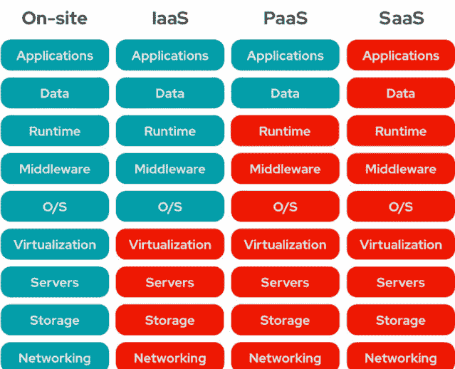

*图 1.2：本地、IaaS、PaaS 和 SaaS 之间的区别。来源：红帽*

### 自动化服务

自动化和集成服务是实施解决方案的关键部分。通过自动化解决方案，公司可以设计和实施流程，以减少人为干预，包括应用程序发布、提供新服务或扩展现有服务。像`Ansible`和`Terraform`这样的流行自动化工具被广泛用于促进新服务的编排和集成。

## 新兴技术

## 技术接入与数字服务

对于世界上大多数人口来说，访问技术和数字服务是*数字革命*（也称为*第三次工业革命*）最大的成就。IT 行业随着新技术和创新不断演变和改变，目前，我们是*想象时代（第四次工业革命，工业 4.0）*的一部分，其趋势是自动化和数据交换。一些主要的尖端技术如下：

- **人工智能 (AI)、机器学习 (ML) 和深度学习：** 人工智能是计算机科学的一个子领域，它探索机器如何模仿人类智能。机器学习是从已见数据中学习并创建模型以从数据进行预测的科学。深度学习是机器学习的一个子集，其中人工神经网络从大量数据中学习。有用于`AI/ML`的开源工具和库可用；一些例子是`TensorFlow`、`Keras`、`Scikit`和`PyTorch`。

- **大数据：** 这是一个术语，用来描述大量的或复杂的数据，这些数据可以是结构化的或非结构化的。如今，该术语“技术”指的是用于分析、处理和提取数据信息的软件工具。`Apache Hadoop`和`Apache Spark`是此类中两个最流行的解决方案。

- **增强现实 (AR) 和虚拟现实 (VR)：** 增强现实是一种实时体验，与存在于真实世界中但由计算机生成的感知信息虚拟增强的对象进行交互。虚拟现实是一种由计算机提供的人工环境体验。一些开源选项是`ARToolKit+`、`ARCore`和`AR.js`。

- **物联网 (IoT)：** 这项技术指的是嵌入传感器和软件并能够从互联网传输和接收数据的物理对象的连接。这包括汽车、家用电器（*智能家居*）、相机和其他常见设备。有适用于物联网的许多 Linux 发行版：`Ubuntu Core`、`Raspberry Pi OS`和`Yocto 项目`（用于创建自定义嵌入式基于 Linux 的系统）。

- **边缘计算：** 这项技术是将计算拓扑分布到更接近数据源的地方。这是*物联网*和 5G 连接（在下一节中描述）的关键部分。对于*基础设施即服务*和*混合云*，多个运行在`Linux`上以提供边缘计算的解决方案：用于虚拟化的`OpenStack`和用于容器的`Kubernetes`是最流行的。

## 电信服务

该领域包括与电信相关的通信设备和服务。过去几十年中，该行业经历了巨大的转型。从*2G*（*第二代*）移动网络基础设施基于*全球移动系统*（`GSM`），始于 1991 年，主要用于通话和短信，演进到基于名为*通用移动通信系统*（`UMTS`）的网络架构的*第三代*（*3G*），始于 2001 年，并提供互联网接入。最近，2009 年，*第四代*（*4G*）移动基础设施出现，这为当今移动设备可用的数据速率带来了巨大差异，允许通过*长期演进*（`LTE`）标准宽带通信技术对多媒体内容、视频和语音通话进行高带宽访问。

电信服务的第一次实现是在使用硬件驱动手段的封闭专有平台上。这迫使公司为一家的许可和硬件付费，同时拥有单一的架构。向使用可互换系统和多厂商平台的模块化迁移，为`Linux`和开源打开了机会。不同电信基础设施向虚拟化基础设施的最近迁移，以及*网络功能*的虚拟化，使`Linux`成为该转型中操作系统的主要参与者。

2019 年，一种新的宽带技术标准代际，即`5G`，应运而生，为用户提供更快的速度传输和新功能，以及前面描述的尖端技术，如物联网(`IoT`)和*增强现实*(`AR`)。这些新功能包括传感器和嵌入式设备所需的低延迟，以及更好的可用性和覆盖范围。第五代实施基于云服务，其中发生从虚拟化网络功能到容器化网络功能的转型。在这种转型中，Linux 和开源技术是实施的关键部分。

## Linux 的最新特性

Linux 一直在演变并实施新特性，基于来自新的尖端技术和行业需求。Linux 内核是操作系统的核心，提供应用程序和硬件之间的接口，并提供多种功能。Linux 发行版发布包括内核的最新版本和不同工具的最新版本。一些流行的最新 Linux 特性包括以下内容：

- **实时补丁 (Live patching)**：允许保持 Linux 服务器更新到最新内核版本，而不需要重启系统，这是之前所必需的。该功能已经存在多年，但最新版本的发行版包含了用于此功能的成熟工具。该功能的一些实施包括`Ksplice`、`Kpatch`、`Livepatch`和`KernelCare`。

- **ExFAT 支持**：最新版本的 Linux 内核支持闪存中流行的 Windows 文件系统。

- **控制组 (v2)**：一种机制，用于限制和隔离资源（例如 CPU、内存和磁盘 I/O）的过程或过程集合。诸如`Docker`、`systemd`和`libvirt`等软件使用此机制。

- **Nftables**：这种低级防火墙解决方案已成为许多发行版的默认设置，取代了流行的`iptables`。该软件提供网络数据包的过滤和分类。

- **eBPF**：是一种技术，可以在 Linux 内核中运行沙箱化程序，而无需更改内核源代码或加载内核模块。

## Linux 与其他操作系统的比较

使用其他操作系统，主要是`Microsoft Windows`的客户主要问题之一是关于为什么应该使用 Linux 以及与其安装和维护相关的复杂性的原因。与其他操作系统相比，在服务器、台式机或设备上使用 Linux 的最大优势如下：

- **开源**：Linux 内核、库和应用程序的源代码可供每个人审查、协作并创建新内容与他人分享。

- **免费**：Linux 的下载和安装是免费的，同时可以从 IT 行业最先进的公司获得支持。

- **易于安装和维护**：任何流行 Linux 发行版的安装都是一项容易的任务，可以由普通用户或高级管理员执行。Linux 系统的维护所需的工作量比`Microsoft Windows Server`等更少，因为执行更新软件或更新 Linux 发行版等任务的复杂性更低。

- **软件安装**：由于包管理器及其周围的实用工具，在 Linux 上安装软件比其他操作系统更容易。仓库包含可用的软件，安装包的实用工具在我们执行软件安装时解析所需的依赖关系。

- **成熟、稳定和安全**：在其存在的 30 多年中，Linux 已经证明它是可用的最成熟和安全的操作系统。从小型公司到最大的跨国公司，所有都坚定地致力于使用 Linux 在其上运行关键应用程序。

- **通用硬件**：与其他操作系统相比，运行 Linux 的要求并不要求拥有最新的硬件。Linux 可以在旧系统、具有较少资源的新嵌入式系统或虚拟机上运行，而无需分配大量的内存或 CPU 核心。

- **定制化**：与其他操作系统相比，Linux 提供了更多的选项来根据普通用户的愿望或系统管理进行定制。Linux 中的一切都可以配置为所需的参数。

## Linux 的光明前景

如前所述，Linux 目前是各个 IT 领域的关键因素，并且随着企业对开源的依赖以及 Linux 所提供功能的支持，它将继续成为大多数新兴技术解决方案的操作系统。在不久的将来，容器将继续被用于部署新服务；像`ARM`这样的新架构将更广泛地进入市场，并且随着企业持续从本地基础设施向云端迁移，公有云和云的使用将继续增长。目前普遍可用的发行版具有以下特点：

- **架构**：Linux 内核适用于大多数架构；一些示例包括：`ARM/ARM64`、`IA-64`、`MIPS`、`PowerPC`、`RISC-V`和`x86`。

- **云镜像就绪**：大多数 Linux 发行版提供可在公共云（`AWS`、`Azure`和`Google Cloud`）和私有云（`OpenStack`）中直接启动的云就绪镜像。

- **容器镜像**：Linux 发行版提供用于运行容器的官方镜像，例如使用`Docker`或`Kubernetes`。

## 结论

在过去几十年以及当下，Linux 一直是 IT 领域最重要的操作系统。未来将在新兴技术领域带来新的创新，Linux 将成为其中大多数实现的不可或缺的，甚至可能是主要的组成部分。普通桌面用户越来越习惯于将 Linux 发行版作为主要操作系统使用，而开发人员也决定从其他操作系统迁移到 Linux。

## 关键事实


- Linux 是世界上最流行的操作系统。
- Linux 适用于大多数可用的架构。
- Linux 在所有主流云平台上可用。
- 大多数新兴技术都在使用 Linux。
- 容器基于 Linux。

## 问题

1. 所有世界 500 强最快超级计算机列表中的超级计算机都运行 Linux。
   - a. 正确
   - b. 错误
2. Android 是 Linux 的一个修改版本。
   - a. 正确
   - b. 错误
3. SaaS 代表什么？
   - a. Service as a Service（服务即服务）
   - b. System as a Service（系统即服务）
   - c. Software as a Service（软件即服务）
4. PaaS 代表什么？
   - a. Programming as a Service（编程即服务）
   - b. Platfomr as a Service（平台即服务，注：原文拼写为 Platfomr）
   - c. Program as a Service（程序即服务）
5. IaaS 代表什么？
   - a. Innovation as a Service（创新即服务）
   - b. Integration as a Service（集成即服务）
   - c. Infrastructure as a Service（基础设施即服务）

## 答案

1. a
2. a
3. c
4. b
5. c

# 第 2 章

## 安装 Linux

### 引言

安装 Linux 发行版是一项简单的任务，所需时间不多。目前积极维护的发行版数量超过 300 个，每个发行版都具有相同的主要组件（Linux 内核以及通用系统和系统库），但用途和特定的系统工具有所不同。不同发行版之间的差异通常与包管理器、桌面环境和系统服务（如防火墙和网络服务）有关。

流行的 Linux 发行版可以安装在不同的架构和设备上。其他发行版则经过优化，专门用于特定环境，例如 Raspberry Pi Linux OS（用于 Raspberry Pi 设备）或 OpenWrt（用于路由器）。

流行网站 `distrowatch.com` 包含活跃发行版的列表，其中提供了有关当前版本、支持的架构、默认包含的软件以及其他许多有用信息。

本章将重点介绍流行发行版的安装，特别是因为它们对企业有支持。它涵盖了可用的安装方法、安装步骤、高级选项以及这些发行版之间的差异。

### 结构

在本章中，我们将讨论以下主题：

- Linux 支持级别
- 安装方法
- 常见安装步骤
- 高级安装步骤
- Debian GNU/Linux
- Ubuntu Server
- Red Hat Enterprise Linux
- CentOS 和 CentOS Stream
- Rocky Linux 和 Alma Linux
- SUSE Linux Enterprise Server 和 openSUSE
- 其他具有商业支持的发行版

## Linux 支持类型

了解服务器的用途是决定使用哪个 Linux 发行版的最重要因素。需要运行高可用服务、关键任务应用程序，或需要运行在特定发行版中经过认证的应用程序的客户，将需要一个商业发行版，由具备高级工程技能的专业人员提供支持。提供专业支持的主要公司及其关联发行版如下：

- Red Hat 提供 Red Hat Enterprise Linux，具有三个支持级别：
  - 自助支持：访问 Red Hat 产品以及客户门户中的知识库和工具。
  - 标准支持：在工作时间内访问工程师支持。
  - 高级支持：针对高严重性问题，提供 24 × 7 全天候的工程师支持访问。
- Canonical 为 `Ubuntu Server` 提供商业支持，有两个选项：
  - `Ubuntu Advantage for Applications`：为开源数据库、日志、监控和聚合服务（LMA）、服务器和云原生应用程序提供安全和支持。
  - `Ubuntu Advantage for Infrastructure`：为开源基础设施提供安全和 IaaS 支持。
- SUSE 为 SUSE Linux Enterprise Server 提供两种商业支持：
  - 标准版：包括软件升级和更新，通过聊天、电话和网络提供 12 × 5 的无限支持。
  - 优先版：与标准版支持相同，但提供 24 × 7 全天候支持。
- Oracle 为 `Oracle Linux` 提供两种商业支持：
  - 基本支持：包括 24 × 7 全天候的电话和在线支持，包括对使用 `Oracle Clusterware`、`Oracle Linux 负载均衡器` 和 `Oracle 的 Docker 容器运行时` 的高可用性提供支持。
  - 高级支持：在基本支持的基础上，增加了 `Oracle Linux 虚拟化管理器`、`Oracle Linux 的 Gluster 存储` 和 `Oracle Linux 软件集合` 等应用程序的支持。

其他流行的服务器发行版拥有安全团队来处理严重漏洞，而 bug 和问题则由志愿者提供支持。

- Debian：安全团队在下一个稳定发行版发布后，大约一年时间内仍为稳定发行版提供支持。
- Alma Linux：CloudLinux 致力于支持 `AlmaLinux` 10 年，包括稳定且经过彻底测试的更新和安全补丁。
- Rocky Linux：提供坚实的基础稳定性，定期更新以及 10 年的支持生命周期，且全部免费。

选择要安装的发行版和版本时，与支持相关的另一个重要关键点是 `长期支持（LTS）` 服务。这对于运行关键应用程序的公司至关重要，因为在这种情况下，升级发行版并不总是可行或推荐的，并且在长时间内获得支持的要求是必不可少的。

## Red Hat Enterprise Linux 的长期支持

随着 Red Hat Enterprise Linux 版本 8 的引入，Red Hat 将 RHEL 产品阶段从四个简化为三个阶段：完全支持（五年）、维护支持（五年）和扩展生命周期阶段（两年）。下图显示了 Red Hat 支持的生命周期：


图 2.1：Red Hat Enterprise Linux 的生命周期支持。来源：Red Hat

## Ubuntu Server 的长期支持

对于每个 `Ubuntu LTS` 版本，Canonical 维护基础软件包，并在 10 年的时间内提供安全更新。生命周期包括前五年的维护期和五年的 `扩展安全维护（ESM）`。下图显示了 Ubuntu 支持的生命周期：

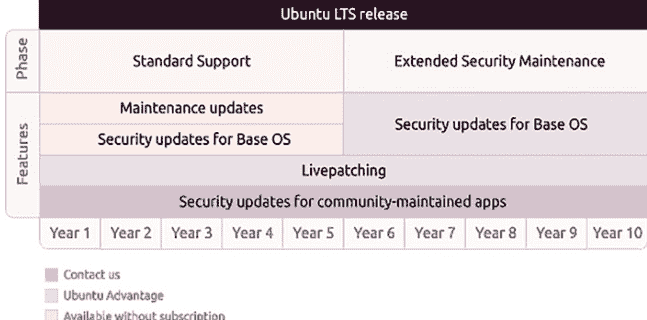

图 2.2：Ubuntu Server 的生命周期支持。来源：Ubuntu

## SUSE Linux Enterprise Server 的长期支持

长期服务包支持是对现有 SUSE Linux Enterprise Server 订阅的补充。LTS 包支持提供以下选项：

- 当您推迟或延迟迁移到最新的服务包时，额外提供 12 到 36 个月的缺陷解决和支持。
- 通过延长支持阶段提供额外 12 至 36 个月的技术支持。

下图展示了 SUSE 支持生命周期：

| 最新服务包（SP）的常规支持 | 附带 LTSS 的前一版本 SP 的常规支持 | 附带 LTSS 的延长支持 |
| :--- | :--- | :--- |
| 第 1–5 年<br>第 6–7 年<br>第 8–10 年 | 第 4–10 年 | 第 10–13 年 |

> 图 2.3：SUSE Linux Enterprise Server 的长期服务包支持。来源：SUSE。

## Oracle Linux 长期支持

Oracle Linux 版本 5、6、7 和 8 的高级支持（Premier Support）在发布日期后可用 10 年。在此之后，可以通过 Oracle Linux 延长支持将支持期延长数年，随后是终身维持支持。

## 安装方法

Linux 发行版根据目标对象和需求包含多种不同的安装方法。这些目标对象的一些示例如下：

- 可以访问物理裸金属节点的本地服务器。
- 无法进行物理访问的远程服务器。
- 大量本地或远程的物理服务器，无论是否可以进行物理访问，由于服务器数量庞大，无法进行手动安装。
- 虚拟机。

根据需求，常见的安装方法如下：

- 完整安装 DVD 或 USB：用于安装的镜像包含正常安装的所有必需组件，网络访问是可选的。


- `DVD`、`CD` 或 `USB` 进行最小化安装：该镜像包含启动安装所需的最少文件，其余过程需要访问互联网以下载所需的软件包，或访问本地网络中的存储库。
- `PXE` 服务器：预启动执行环境允许在物理服务器或虚拟机的启动过程中安装 `Linux`。此过程需要配置有 `PXE` 服务器、`DHCP` 服务、包含安装文件的 `TFTP` 服务以及 `syslinux` 引导加载程序的服务器或设备。对于现代服务器，另一种选择是使用 `iPXE`，此时可以用包含安装文件的 `Web` 服务器替换 `TFTP` 服务器。
- 基于系统或云镜像的安装：这些镜像已预装了发行版，可直接使用。这些镜像通常用于云平台`虚拟化`平台。这些镜像可以根据用户的需求重新配置，或者在首次启动时进行系统自定义。

当加载安装程序时，安装方法包括以下形式：

- 基于图形用户界面（`GUI`）的安装。
- 基于文本的安装。
- 高级安装，包括无需用户交互的自动安装。

## 常见安装步骤

除了与特定配置相关的情况外，所有 `Linux` 发行版的安装过程都相似。常见的安装步骤如下：

1. 下载安装介质并写入 `CD/DVD/USB`，或通过网络启动。
2. 使用介质启动系统。
3. 指定安装的接口类型：`GUI` 或 `TUI` 安装。
4. 为安装程序选择一种语言。指定的语言将在安装过程中使用，并且在某些情况下，安装后会被配置为主要语言。
5. 时钟和时区配置。指示时钟的位置和时区，以便在安装期间及安装完成后调整系统设置。
6. 键盘配置。在此步骤中，配置安装期间及安装完成后使用的键盘布局。
7. 网络配置。此步骤包括为系统使用的计算机名和域名。可以自定义接口网络配置，设置为自动（`DHCP`）或静态 `IP` 配置。
8. 存储配置。在此步骤中，选择磁盘目标，并配置分区布局，指示是使用整个磁盘还是使用分区布局。
9. 指定 `root` 密码并创建新用户。安装完成后，强烈建议使用非管理员用户，此步骤包括创建一个用户并设置安全密码。
10. 指定存储库并指示要安装的软件。此时，指定存储库（远程或本地），并根据系统用途安装软件，例如桌面环境、`Web` 服务器和 `SSH` 服务器软件。
11. 开始安装。在此阶段，对磁盘进行分区，并安装核心软件和附加软件。接下来，配置网络并创建指定的用户。
12. 完成安装。最后一步用于完成安装并配置引导加载程序。安装完成后，应重新启动系统以从已安装的发行版启动。

本章将描述三种带有基本安装步骤的安装方式：`Debian`、`Ubuntu Server` 和 `Red Hat Enterprise Linux`。其他流行发行版将仅作描述，并解释可用的版本。

## 高级安装步骤

在安装期间，有三个常见的高级安装步骤：

- `链路聚合`：允许将多个以太网接口组合成一个逻辑链路，以在主动-被动模式或主动-主动模式下并行工作，以叠加可用吞吐量。在 `Linux` 中，用于接口链路聚合的术语是绑定（`bonding`）或组队（`teaming`）。
    - 高可用性的冗余可以配置为轮询（`round-robin`）或活动备份（`active backup`）。
    - 要叠加吞吐量，需要使用并配置链路聚合控制协议（`LACP`，`802.1AX` 或 `802.3ad`），并在系统以及网络接口所连接的交换机中进行配置。
- `卷管理器`：`Linux` 发行版使用 `LVM` 工具作为卷管理器，`LVM` 代表逻辑卷管理（`Logical Volume Management`）。使用 `LVM` 提供了比传统分区更多的灵活性和高级功能。安装程序通常提供使用 `Linux` 统一密钥设置（`LUKS`）加密磁盘内数据的选项。
- `数据冗余`：一种将数据分布在多个磁盘上的技术，使同一信息的多个副本同时存储在多个位置。`RAID` 代表独立磁盘冗余阵列（`Redundant Array of Independent Disks`），通常在硬件级别实现。然而，`Linux` 提供了使用软件重新配置此功能的可能性。根据所需的冗余和性能级别，有不同的 `RAID` 级别可供使用，其中常见的级别如下：
    - `RAID-1` 或镜像模式：两个或多个磁盘组合成一个卷，所有块都被复制到所有磁盘上。除一个磁盘外，所有磁盘都可以故障，数据仍然可以访问。
    - `RAID-5`：最流行且最实用的 `RAID` 模式，这需要三个或更多磁盘。数据将在磁盘之间分布，但不会进行镜像。即使一个磁盘故障，数据仍可用。故障磁盘的数据可以使用奇偶校验方法重新计算。
    - `RAID-6`：`RAID-5` 的扩展，使用多个磁盘（要求至少四个）。在此级别下，两个磁盘可以故障，数据仍然可以访问。

备用磁盘是存储冗余的重要组成部分，特别是对于 `RAID-5` 和 `RAID-6`。这些磁盘不用于分发数据，而是处于待命状态，如果活动磁盘之一发生故障，则由它们填充。

## Debian GNU/Linux

`Debian GNU/Linux` 是 `Linux` 服务器中最受欢迎的发行版之一，这归功于其提供的稳定性。该发行版是志愿者努力创建的一个自由且高质量的发行版，附带一系列应用程序。

`Debian` 是第一个包含名为 `dpkg`（`Debian Package`）的软件包管理的 `Linux` 发行版，用于轻松的安装、更新和移除。它也是第一个能够无需重新安装即可升级的发行版。

要获取用于安装的镜像，请导航到以下网站，该网站提供了不同的选项：`https://www.debian.org/distrib/`。安装方法的选项如下：

- 小型安装镜像：此安装需要互联网连接才能完成。这也称为网络安装。
- 完整安装镜像：它包含更多的软件包，使安装速度更快，且不依赖于互联网连接。有 `DVD` 和 `CD` 镜像的选项。
- `Live CD`：可以从 `CD`、`DVD` 或 `USB` 启动 `Debian` 系统而无需安装。该镜像将在内存中启动 `Linux` 发行版，并且可以在不对磁盘进行任何更改的情况下进行测试。测试后，`Live CD` 将允许我们在磁盘上执行安装。
- 云镜像：与其他 `Linux` 发行版一样，`Debian` 提供预装版本的镜像，可在私有或公共云中运行。例如，用于 `OpenStack` 的 `QCOW2/RAW` 镜像、用于 `Amazon EC2` 的 `AMI` 镜像或使用 `AWS Marketplace`，以及在 `Azure Marketplace` 上的 `Microsoft Azure` 镜像。

### 安装菜单

从 `Debian` 安装器映像启动服务器时显示的第一个屏幕，指示了所需的安装类型。下图显示了安装器的第一个屏幕：

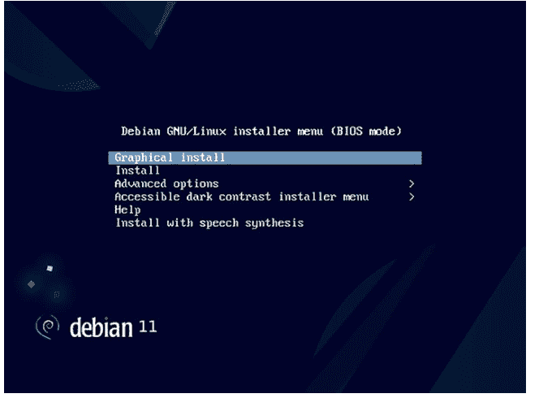

图 2.4：`Debian` 安装器菜单

在菜单中选择“图形化安装”条目后，安装器将继续显示下一步骤并继续流程。

### 选择语言

在指定使用哪种安装用户界面后，第一步是指定安装过程中使用的语言。如图所示，该语言将在系统安装完成后作为默认语言使用。

### 选择位置

在指定安装过程中使用的语言并作为默认语言设置后，下一步是选择要使用的位置。该位置将用于设置时区和系统区域设置。如果所需位置不在列表中，可以选择“其他”，然后指定大洲/地区以及国家。

### 配置键盘

正确指示位置后，下一个配置项是键盘的键盘映射（`Keymap`）。在此步骤中按下“继续”将开始加载系统不同组件（存储、网络和其他设备）的模块，并尝试使用 `DHCP` 自动配置网络。

### 配置网络

当使用 `DHCP` 时，此步骤包括两部分：为系统指定主机名并指示要使用的域名。下图显示了输入主机名和域的向导步骤：

请输入此系统的主机名。

主机名是一个单词，用于在网络中标识您的系统。如果您不知道主机名应该是什么，请咨询您的网络管理员。如果您正在设置自己的家庭网络，则可以随意填写。

主机名：

`debian`

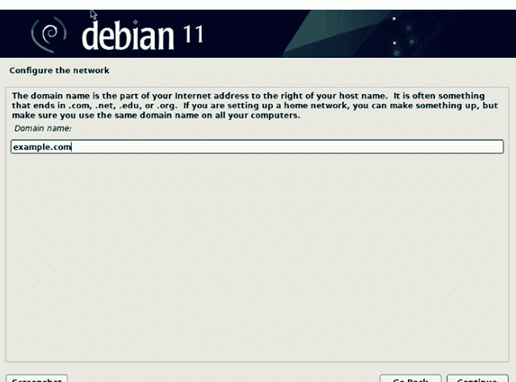

图 2.5/2.6：配置网络

如果网络未通过 `DHCP` 自动配置，则在设置主机名和域名后，应指定手动静态 `IP`。下图显示了配置静态 `IP` 的步骤：

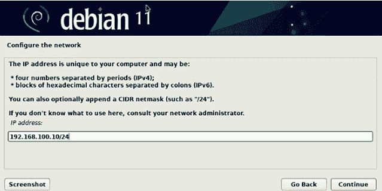

图 2.7：配置网络

### 设置用户和密码

配置完网络后，接下来的步骤是为 `root` 用户设置密码。密码必须是安全的，否则将不被接受。如果在此步骤中未设置密码，`root` 账户将被禁用，而即将创建的普通用户账户将有可能使用 `sudo`（允许委托管理任务权限的命令）运行命令或切换到 `root`。

在为 `root` 用户设置密码或留空以禁用该用户后，下一步是设置要创建的新用户信息。第一个对话框是指定新用户的全名。需要第二个信息是新用户的用户名。该用户名将用于登录系统。在确定账户的用户名后，将指定密码。

### 配置时钟

下一步是配置系统的时钟。对于某些系统和在进行故障排除的系统管理员来说，保持时间与正确时间同步非常重要。

### 分区磁盘

安装器允许手动分区磁盘或使用向导选项。强烈建议使用 `LVM` 以拥有动态分区并在管理磁盘和分区时具有更大的灵活性。下图显示了分区磁盘的步骤：


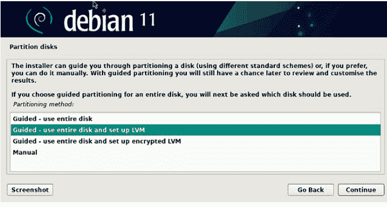


指示分区方法后，会列出系统中可用的磁盘列表，以指定在哪个磁盘上创建分区。一旦选择要在其中执行安装的磁盘，安装器会提供某些分区选项（如果选择了向导选项）。下图显示了分区选项：

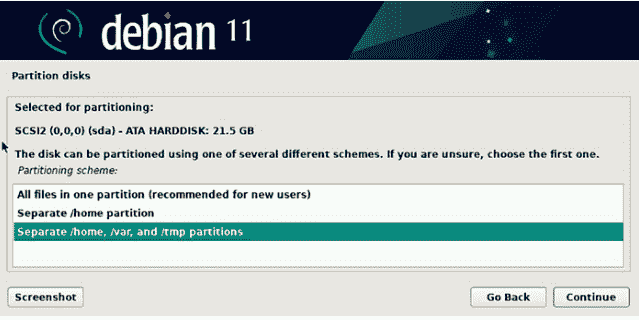

图 2.9：分区磁盘

与存储相关的下一步是确认将在磁盘上执行的操作。在进行下一步之前，确保选择正确的磁盘非常重要。下图显示了确认步骤：

在配置逻辑卷管理器之前，将更改以下设备的磁盘分区表：`SCSI 2 (0,0,0) (sda)`。写入更改到磁盘并配置 LVM？

- [x] 否

- [ ] 是


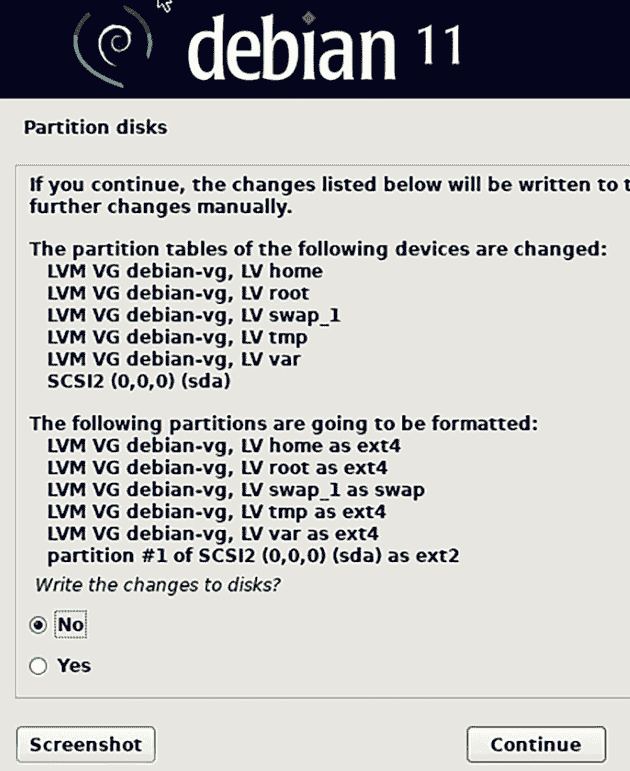

图 2.10/2.11：分区磁盘

### 安装基础系统和软件

分区过程完成后，安装器将在磁盘上安装基础系统，并配置分区。在此步骤中，将安装和配置 Linux 内核、系统工具、库和服务。当基础系统所需的最小软件包安装完成后，可以扫描额外的安装介质或跳过该过程。然后需要配置包管理器，指定 Debian 归档文件的镜像国家和要使用的服务器。下图显示了配置步骤：

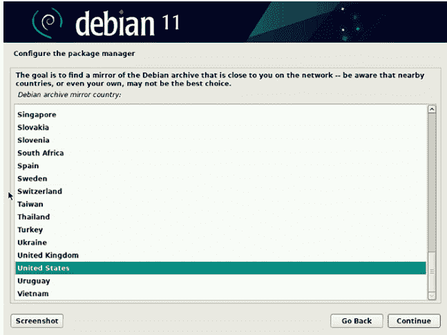

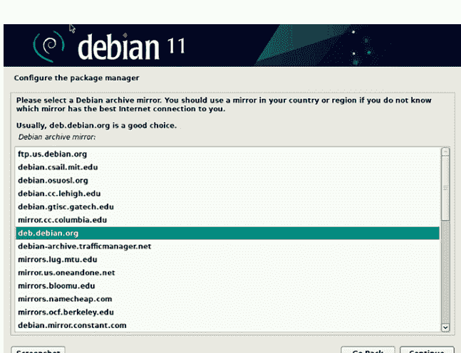

如果需要代理来访问互联网存储库，安装器提供了指定 `HTTP` 代理以及（如果需要）使用该代理的用户名和密码的选项。安装器将从服务器存储库获取软件包列表，并继续安装基础系统。选择系统核心后，安装器提供选项来指定过程中要安装的软件，如下所示：

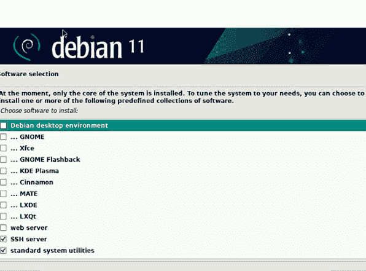

图 2.14：软件选择

### 安装 GRUB 引导加载器

基础系统和所选软件安装完成后，安装的最后一步是在磁盘上安装引导加载器。`统一高级启动加载程序（GRUB）`是 Linux 系统中主要的引导加载器。下图显示了确认步骤：

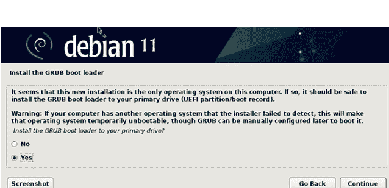

图 2.15：安装 GRUB 引导加载器

接受 GRUB 安装后，将列出设备和分区的列表，以确认引导加载器将安装在哪里。安装将完成，可以重启系统到新的系统，确保移除安装介质以便从本地磁盘启动。

启动系统将显示 GRUB 菜单，在此可以引导到 Debian，引导到不同的发行版（如果它们安装在不同的分区中），或以恢复模式或不同的内核版本（高级选项）启动 Debian。

## Ubuntu 服务器

Ubuntu 是最受欢迎的桌面发行版。它使用与 Debian 相同的包管理器（`dpkg`）。与 Debian 相比，Ubuntu 提供了更快的发布生命周期，可用最新版本的软件。Ubuntu 的发行商 Canonical 公司提供了如前所述的商业支持。

Ubuntu 通过官方网址 `https://ubuntu.com/download/` 提供发行版变体，包括以下选项：

- **Ubuntu 桌面版**：此变体在 PC 和笔记本电脑中最受欢迎，提供为期五年的保证支持，包括免费的安全和维护更新。

- **Ubuntu Pro**：此变体针对亚马逊 AWS、微软 Azure、谷歌云平台、IBM 云和 Oracle 等云提供商进行了优化并通过认证。

- **Ubuntu Core**：此选项针对物联网（IoT）和边缘设备进行了优化。

- **Ubuntu Server**：如前所述，支持期为 10 年。常用于私有或公共数据中心，并支持多种架构。

### 安装菜单

当服务器从 Ubuntu 安装程序映像启动时，出现的第一屏将开始安装或测试系统内存。Ubuntu Server 不包含用于安装的图形用户界面。下图显示了安装程序的第一屏：

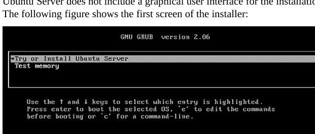

图 2.16：Ubuntu 安装菜单

### 选择安装语言

在指定 `安装 Ubuntu Server` 选项后，安装程序将进入下一步，以指定安装使用的语言。

### 键盘配置

安装过程的下一步是指定键盘配置：布局变体。

## 安装基础

在指定布局和变体后，安装向导将显示 Ubuntu Server 可能的安装选项类型：默认安装或最小化安装（用于用户不被期望登录到系统的场景）。以下截图显示了选项及其描述：

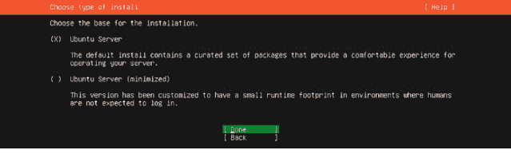

图 2.17：选择安装类型

## 网络连接

下一步是网络配置。如果使用 `DHCP`，将显示分配的 `IP`。如果没有 `DHCP`，则需要手动配置 `IP` 以访问软件源。在此步骤中，可以配置绑定接口。下图显示了使用 `DHCP` 自动配置网络的示例：

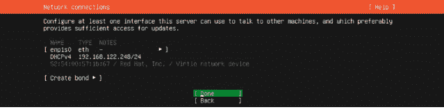

图 2.18：网络连接

配置完网络接口后，如果需要访问互联网，可以配置代理。

## 配置 Ubuntu 软件源镜像

软件源镜像是一个包含用于安装及系统安装后安装软件的包的网络服务器。安装程序将基于系统位置自动检测最近的软件源镜像 `URL`，并允许用户指定替代镜像。

### 引导存储配置

Ubuntu 安装程序允许在使用引导存储布局或创建自定义布局时指定如何配置存储。还可以指定系统是否使用逻辑卷管理器（LVM），这是默认选择，以及 LVM 是否使用 Linux 统一密钥设置（LUKS）进行加密。下图显示了此步骤的一个示例：

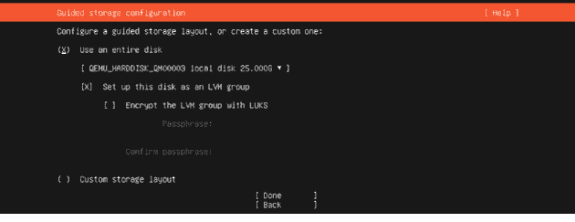

图 2.19：引导存储配置

选择引导选项和 LVM 后，下一步将显示将应用于磁盘的分区布局。还可以自定义要创建的分区、挂载点、大小以及逻辑卷的名称。下图显示了默认分区：

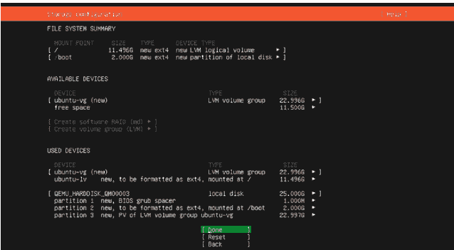

图 2.20：存储配置

### 配置文件设置

确认磁盘布局后，下一步与新用户创建相关，需指定姓名、用户名和密码。服务器名称也将在此步骤中指定。下图显示了需要填写的字段：

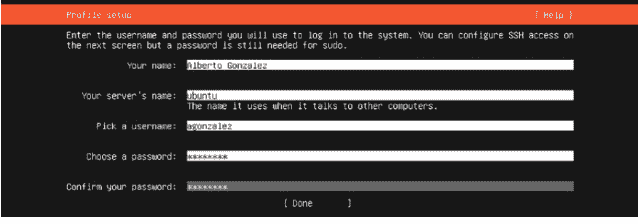

图 2.21：配置文件设置

### SSH 设置

安装程序将询问是否安装并启用 OpenSSH 服务器以便进行远程管理。如果系统不是本地系统，建议启用此功能，以便可以远程管理。

## 特色服务器 Snap

Snap 是由 Canonical 开发的软件打包和部署系统。Snaps 是自包含的应用程序，包括运行服务或应用程序所需的库。在处理 Snaps 时，有四个重要概念：`snap` 是应用程序包格式和执行应用程序的命令；`snapd` 是用于管理和维护的后台服务；`snapcraft` 用于创建定制应用程序和 snaps 的市场；最后，`Snap Store`（[https://snapcraft.io/store](https://snapcraft.io/store)）。下图显示了一些可用的 snaps：

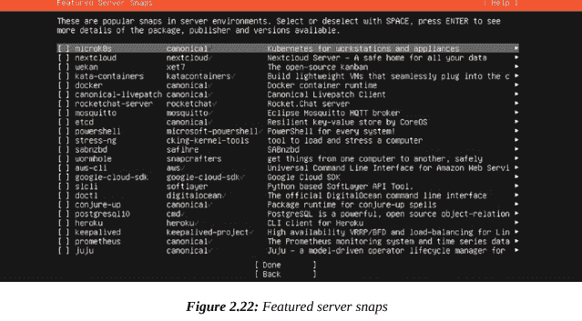

选择所需的 Snaps 后，安装将开始下载并安装安全更新。安装完成后，可以查看安装过程的完整日志，或重启系统以启动安装在磁盘上的 Ubuntu 服务器。

Ubuntu Server 安装，如上所述，不会设置 root 密码；它创建一个用户并设置系统权限，使该用户可以使用 `sudo` 执行管理任务。系统重启后，可以使用安装过程中创建的用户登录。

## Red Hat Enterprise Linux

Red Hat Enterprise Linux 是全球领先的企业级 Linux 平台，广泛用于数据中心基础设施、虚拟化和容器。如前所述，RHEL 是由 Red Hat 开发和支持的商业开源 Linux 发行版，面向商业市场。

RHEL 使用 `RPM 包管理器 (RPM)` 进行包管理，该系统也用于许多发行版，如 CentOS、Fedora、Oracle Linux、AlmaLinux 或 Rocky Linux。

Red Hat Enterprise Linux 的安装映像可在网站获取：[https://access.redhat.com/downloads/](https://access.redhat.com/downloads/)。访问软件源需要订阅，如果目的是开发，可以申请免费的 Red Hat Developer 订阅，或者可以使用 60 天试用期在订阅前试用 RHEL。


RHEL 提供三种安装映像：

- **二进制 DVD：** 包含所有必需的包，无需任何额外的软件源。在没有互联网访问时很有用。
- **Boot ISO：** 此映像包含安装的基本包，但需要活动网络连接以访问额外的包软件源。
- **KVM 客户映像：** 用于 KVM/QEMU 虚拟机的管理程序，如 Red Hat OpenStack（或社区 OpenStack）或 Red Hat Virtualization（或 oVirt 项目）。

### 安装菜单

当服务器从 Red Hat Enterprise Linux 安装程序映像启动时，出现的第一屏允许我们安装和测试介质或进行故障排除。下图显示了安装程序的第一屏：

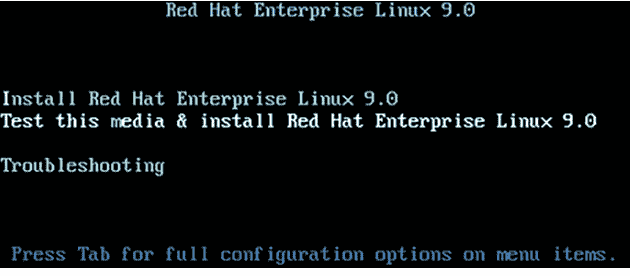

*图 2.23：RHEL 安装菜单*

在菜单中选择图形安装条目，将引导安装程序进入下一步，如下所示。

### 选择语言

指定使用哪种安装用户界面后的第一步是指定在安装过程中使用的语言。该语言也将作为系统安装后的默认语言。

### 安装摘要

选择语言后，安装程序显示一个仪表板，展示开始安装前的配置要求。一些配置会自动检测（即，网络配置和安装源），其他配置需要手动指定（注册、磁盘分区和用户密码）。仪表板的一个示例显示在下图中：

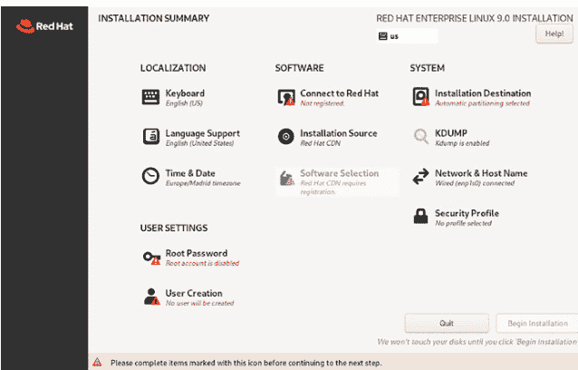

*图 2.24：安装仪表板*

此步骤所需的步骤如下：

1. 使用订阅所需的用户名/密码连接到 Red Hat。
2. 确认用于安装的磁盘和期望的分区。
3. **软件选择：** 指定将安装在系统中的软件。
4. 设置 `root` 用户的密码。
5. 创建一个普通用户。

其他可配置的选项如下：

- 网络配置。
- 配置键盘布局。
- 配置时区、时间和日期。
- 其他选项，如内核转储（`kdump`）和安全配置。

## 连接红帽（Red Hat）

若要订阅系统红帽，可以使用红帽账户登录或使用激活密钥。用户可以指定系统的用途，这是一个可选配置，但在安装期间建议进行指定，以确保附加正确的订阅。系统用途可以在安装期间或安装后使用 `syspurpose` 命令进行指定。

## 安装目标

红帽企业 Linux 安装程序会自动选择可用于安装的磁盘之一。需要确认将在哪个磁盘上执行安装，并且可以自动或手动配置分区布局。在安装过程中可以加密数据。当选择自动布局时，将使用 `LVM`。安装目标的示例如图 2.25 所示：

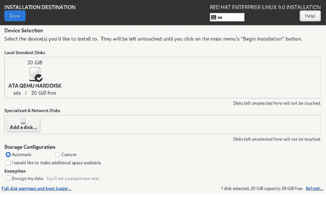

图 2.25：安装目标

## 软件选择

在此步骤中，可以指示要安装在系统中的基础环境和附加软件。下图显示了基础环境和附加软件可用的选项：

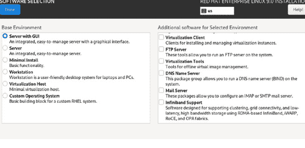

### Root 密码

设置 `root` 密码是安装期间的必要步骤。默认选项是锁定 `root` 账户使其不被使用，并且 `SSH` 不使用 `root` 连接系统。

### 用户创建

如果设置了 `root` 密码，则用户创建并非强制要求，但强烈建议执行。完成所有要求后，“开始安装”按钮将被启用，并且可以开始安装。

### 安装进度

如果使用了引导 ISO，安装程序将下载所需的软件包；或者，安装程序将使用二进制 DVD 中的软件包进行系统安装。服务器已准备好重启，并且可以使用 `root` 用户或创建的用户登录。

### CentOS 和 CentOS Stream

社区企业操作系统（`CentOS`）Linux 是一个流行的生产就绪 Linux 发行版，与其上游源红帽企业 Linux 兼容。2014 年至 2020 年间，`CentOS` 独立于 RHEL，并发布了 `CentOS Linux 7` 和 `8` 版本。

2020 年 12 月，红帽决定结束 `CentOS` 开发，并将重点转向 `CentOS Stream` 的开发。`CentOS Stream` 是上游发行版 `Fedora` 和下游 RHEL 开发之间的中间流发行版。`CentOS Linux 7` 的支持持续到 2024 年中，而 `CentOS Linux 8` 不再获得支持。

`CentOS Stream` 的支持与 RHEL 支持生命周期保持一致，提供对红帽企业 Linux 下一个发布版本的开发流的早期访问。安装步骤和映像如前所述可用。安装介质可以从网站下载：`https://www.centos.org/centos-stream/`。在红帽做出决定后，出现了两个主要发行版以覆盖 `CentOS` 领域：由 `CentOS` 原始联合创始人推出的 `Rocky Linux`，以及由 `CloudLinux` 公司推出的 `AlmaLinux`。以下将介绍这两个发行版。

## Rocky Linux 和 Alma Linux

`Rocky Linux` 是一个开源企业操作系统，旨在与 RHEL 100% 兼容，并由社区开发。`CentOS` 的原始创始人 `Gregory Kurtzer` 在红帽关于 `CentOS` 的决定后，决定创建 `Rocky Linux`。官方 `Rocky Linux` 在其网站上提供安装映像：`https://rockylinux.org/download`。`CloudLinux`，即 `CloudLinux OS` 的创建者，决定创建一个独立的、完全免费的、与 RHEL 8 及未来版本完全兼容的发行版。可以从以下网站下载 ISO：`https://mirrors.almalinux.org/isos.html`。这两个发行版都包含工具和命令，用于从 `CentOS` 迁移到 `Rocky Linux` 或 `AlmaLinux`。安装过程使用与红帽企业 Linux 所示相同的向导。下图显示了 `AlmaLinux` 和 `Rocky Linux` 安装程序的界面：

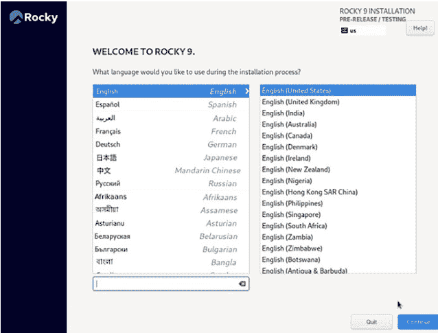


*图 2.27/2.28：AlmaLinux 和 RockyLinux 安装程序向导*

## SUSE Linux enterprise server 和 openSUSE

`SLES` 发行版由 `SUSE` 开发，`SUSE` 是一家总部位于德国的跨国开源软件公司。它使用 `RPM` 作为包管理系统。可以在以下网站找到安装映像：[https://www.suse.com/download/sles/](https://www.suse.com/download/sles/)

`SUSE` 提供两个非商业版本的 `SLES`，称为 `Leap` 和 `Tumbleweed`，由 `openSUSE` 项目维护。其中第二个，`Tumbleweed`，是一个滚动发布版本，软件更新更频繁。可以从网站下载：[https://get.opensuse.org/](https://get.opensuse.org/)。下图显示了这两个版本之间的区别：


*图 2.29：OpenSUSE Tumbleweed 和 Leap 的区别。来源：SUSE*

## 其他流行发行版

其他流行的服务器发行版如下：

- **Oracle Linux (OL)：** 红帽企业 Linux 的一个衍生版本，由 `Oracle` 公司提供商业支持和维护。
- **Gentoo：** 一个流行的发行版，因为软件是为将要使用的系统编译的，而不是像其他发行版那样基于预编译的二进制软件。
- **Arch Linux：** 一个滚动发布发行版，没有主要版本，所有新版本的软件或内核都可用，且安装器映像每两个月更新并发布一次。

## 结论

Linux 是最具可定制性的操作系统之一，安装简便，并提供来自社区和公司专业支持的众多发行版。

安装不需要专业知识，允许初学者拥有安全且高效的系统。专家用户可以在安装期间使用高级功能，在安装后拥有生产就绪的服务器。

决定 Linux 发行版需要考虑不同的因素，包括支持年限、新版本的发布生命周期，或要使用的包管理器。

## 关键事实

- 有大量的 Linux 发行版可用。
- 一些 Linux 发行版提供商业支持。
- Linux 安装是一个简单的过程。
- Linux 发行版使用包管理器进行软件管理。

## 问题

1. 哪些流行的 Linux 发行版使用名为 `RPM` 的包管理器？
    - a. 红帽企业 Linux
    - b. `Alma Linux`
    - c. `Rocky Linux`
2. `Debian` 和 `Ubuntu` 使用的是什么包管理器？
    - a. `Pacman`
    - b. `YaST`
    - c. `DPKG`
3. 是否可以在没有 `DHCP` 服务器的情况下安装 Linux 发行版？
    - a. 真
    - b. 假
4. 是否可以在没有互联网连接的情况下安装 Linux？
    - a. 真
    - b. 假

## 答案

1. a, b 和 c
2. c
3. a
4. a

# 第 3 章


# 使用命令行界面

## 介绍

要管理本地或远程 `Linux` 服务器，了解 **命令行界面 (CLI)** 至关重要。这种基于文本的界面用于在 `Linux` 发行版中执行不同的任务，从简单的任务（如创建目录）到高级任务（如配置网络和存储）。用户连接到 `Linux` 控制台，指示执行所需任务的命令以及该操作所需的选项和参数。

在本章中，将描述可用于运行命令的不同终端，以及用于识别系统组件和系统信息的配置和命令。本章还将探索命令如何将输出显示在显示器上、如何重定向该输出，以及如何使用它作为另一个应用程序的输入方法。

## 结构

在本章中，我们将讨论以下主题：

- `Linux` 控制台和提示符
- 基本首个 CLI 命令的使用
- 用于识别资源的 CLI 命令
- 用于列出元素的 CLI 命令
- 标准流和管道的解释
- 用于数据流的 CLI 命令

## Linux 控制台和提示符

### Linux 命令行

`Linux` 命令行被称为 `终端`、`控制台` 或 `Shell`。以下是访问命令行的几种方式：

- 使用 `Linux` 内核提供的内部 `Linux` 控制台，可在系统本地访问。提供登录服务的软件称为 `getty`，现代发行版包含一个名为 `agetty` 的默认替代项。
- 使用系统图形环境提供的终端，命令将在系统运行的环境中执行。一些例子包括 `GNOME` 终端、`Konsole` 或 `Terminator`。
- 从另一个控制台连接的远程终端，通常使用 `SSH` 协议。

当系统启动且未安装图形界面时，会出现一个 `Linux` 终端，用于输入用户名和密码。传统上，有六个可用的控制台，可以通过键盘组合 `Ctrl+Alt+F1` 到 `Ctrl+Alt+F6` 使用。这种行为是可配置的，某些发行版使用 `Ctrl+Alt+F2` 到 `Ctrl+Alt+F7`。

当系统已安装并启用图形界面时，系统将默认显示该界面。使用前面描述的组合键 `Ctrl+Alt+F1` 到 `Ctrl+Alt+F6`，将显示原生 `Linux` 控制台，而 `Ctrl+Alt+F7` 将返回图形界面。某些发行版使用 `Ctrl+Alt+F1` 实现相同目的。

### 软件终端

在 `Linux` 中，主要有以下两种软件终端：

- `电传打字机 (tty)`：允许与操作系统进行直接交互，处理键盘输入并使用屏幕输出。
- `伪终端 (pty)`：伪终端表现为使用两个伪设备端点的常规 `TTY`。在使用图形界面或连接到远程系统时，会使用这种伪终端。

### Linux 提示符

当登录完成，或者使用来自图形环境的终端时，会出现一个用于输入命令的输入框，表明系统已准备好接受任务。此输入被称为 `Linux` 提示符，它会在每次显示时展示用户名、系统名称和当前目录。以下插图展示了 `Linux` 提示符的格式：


**图 3.1：提示符格式示例**

在此示例中，在执行 `Shell` 的命令之前，请确保提供以下信息：

- 执行命令的用户显示在 `@` 之前。
- 执行命令的系统显示在 `@` 之后。
- 当前目录显示在系统名称之后。
- 命令将由非管理员用户执行，由 `$` 指示。对于管理员用户，符号 `#` 将替换美元符号 `$`。

在以下图（图 3.2）中，用户名为 `agonzalez` 的用户正在系统 `ubuntu` 上工作（该系统可以是本地或远程），并且当前位于目录 `/tmp`。此用户是普通用户，由输入命令前的美元符号指示。请参阅下图：


**图 3.2：普通用户的提示符示例**

`Linux` 中的管理员用户通常被称为 `root`。在以下示例中，可以在同一系统和目录下观察提示符与普通用户有何不同。下图展示了 `root` 用户的 `Linux` 提示符示例：

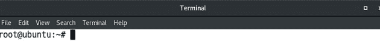

**图 3.3：root 用户的提示符示例**

### Shell 和命令元素

读取用户命令的解释器称为 `Shell`；在许多发行版中最受欢迎且默认使用的是 `bash`。在 `Linux` 系统中运行命令时，需要考虑五个重要元素：

1. **要执行的命令**：这可以是系统命令（例如，`mkdir` 用于创建目录）、`Linux` 终端的内部函数（例如，`alias` 用于创建命令快捷方式），或用户应用程序（如 `firefox`）。命令可以通过三种不同方式指定：
   - 使用命令名称而不指明其位置。系统已配置了一些目录来查找指定的命令，输入命令后将按顺序检查路径以确定该命令是否可用。
   - 使用命令所在的完整路径，无论用户当前位于哪个目录，例如：`/usr/bin/mkdir`。
   - 使用相对于用户所在目录的路径，例如：`../bin/firefox`。在此示例中，命令 `firefox` 位于用户所在顶层目录下的一个名为 `bin` 的子目录中。
     - 如果用户位于 `/home/agonzalez/Documents/` 并运行上述指示的命令，它将执行 `/home/agonzalez/bin/firefox`。两个点 `..` 表示父目录。
     - 特殊字符 `~` 表示用户的家庭目录。如果家庭目录是例如 `/home/agonzalez/`，则指定 `~/bin/firefox` 将扩展为 `/home/agonzalez/bin/firefox`。
2. **命令的选项**：如果需要更改命令行为，这可能是一个或多个选项。某些选项可能是必需的。
   - 命令 `ls` 用于列出当前目录的内容，将显示文件和目录的名称。使用选项 `-l` (`ls -l`) 将显示更多详细信息，如文件权限、大小和所有者。
   - 某些选项可以以短格式 (`-a`) 或长格式 (`--all`) 指示，注意长格式使用两个连字符而不是一个。使用此选项时，命令 `ls` 会显示隐藏目录（以点开头的目录）。
   - 命令的一个重要选项通常是 `-h` 或 `--help`，用于获取有关命令语法的详细信息，包括可能的选项和参数。
3. **命令的参数**：某些命令需要参数才能执行任务，而对于其他命令，参数是可选的或不接受参数。
   - 命令 `mkdir` 需要一个参数来指示需要创建哪个目录。
   - 命令 `ls` 列出当前目录的内容，但通过指定目录作为参数，它将显示该目录的内容。
   - 命令 `uptime` 将显示系统已运行的时长，但不接受任何参数。

在某些命令中，选项和参数的顺序是可以互换的，但建议先指定选项，然后指定参数。图 3.4 展示了使用选项和参数运行命令的一些示例。

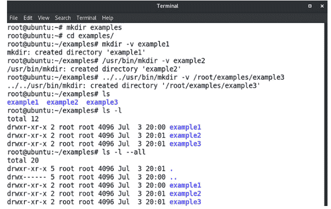

## 基本 CLI 命令的使用

如前所述，`Linux` 控制台和提示符始终显示用户当前工作的目录和系统。`Linux` 发行版提供了一些命令以提供更多信息，例如用户所在的完整目录，或获取系统的当前时间和日期。

### 命令 pwd

命令 `pwd` (`print working directory`) 显示用户所在的绝对当前目录。提示符通常显示相对目录。即使该命令有一些选项，通常也不带任何选项或参数使用它。处理具有相同名称的多个目录可能会存在问题并导致意外错误。命令 `pwd` 有助于确保任务在所需的目录中执行。

在以下示例中，目录 `examples` 存在于用户 `root` 和用户 `agonzalez` 的主目录内部。命令 `pwd` 的输出将提供目录的完整路径，以避免混淆。下图展示了该命令的使用：

```bash
root@ubuntu:~# cd examples/
root@ubuntu:~/examples# pwd
/root/examples
root@ubuntu:~/examples# logout
agonzalez@ubuntu:~$ pwd
/home/agonzalez/examples
```

**图 3.5：命令 pwd 输出示例**

### 命令 whoami

命令 `whoami` 提供简单的输出：当前用户的名称。此命令不接受选项或参数。它通常用于脚本内部，典型用例是出于安全原因确保不是管理员用户（`root`）正在运行脚本。下图是该命令输出的示例：

```bash
agonzalez@ubuntu:~$ whoami
agonzalez
```

**图 3.6：命令 whoami 输出示例**

### 命令 hostname

命令 `hostname` 提供有关将执行命令的系统的名称和域的信息。命令 `hostname` 接受以下部分选项，图 3.7 展示了不同选项的一些输出示例：

### 命令 hostname

命令 `hostname` 显示系统的主机名。下表描述了该命令的常用选项。

| 短选项 | 长选项 | 信息 |
|---|---|---|
| `-d` | `--domain` | 显示 `DNS` 域的名称。 |


|-f|--fqdn / --long|显示完全限定域名 (FQDN)。|
|-i|--ip-address|显示主机名的网络地址。|
|-I|--all-ip-addresses|显示主机的所有网络地址。|
|-s|--short|显示不带域的短主机名。|

表 3.1：命令 `hostname` 的常用选项

```bash
root@ubuntu:~# hostname
ubuntu.example.com
root@ubuntu:~# hostname --short
ubuntu
root@ubuntu:~# hostname --long
ubuntu.example.com
root@ubuntu:~# hostname -i
192.168.122.101
root@ubuntu:~# hostname -I
192.168.122.101 10.0.0.240
```

图 3.7：命令 `hostname` 输出示例

### 命令 `man`

当用户想要获取有关某个主题（例如命令或系统文件）的信息时，该命令是最有用的命令之一。调用 `man` 的最简单方式是提供一个参数以获取所需的文档；例如：`man mkdir` 将显示命令 `mkdir` 的文档。下图说明了这一点：

**名称**

`mkdir` - 创建目录

**概要**

`mkdir` [`OPTION`]... `DIRECTORY`...

**描述**

如果 `DIRECTORY`(ies) 尚不存在，则创建它们。

长选项的必需参数对于短选项也是必需的。

- `-m`, `--mode`=`MODE`

  设置文件模式（类似 `chmod`），而不是 `a=rwx` - `umask`

- `-p`, `--parents`

  即使目录已存在也不报错，根据需要创建父目录

- `-v`, `--verbose`

  为每个创建的目录打印一条消息

- `-Z`

  将每个创建目录的 SELinux 安全上下文设置为默认类型


图 3.8：运行命令 `man mkdir` 的示例

手册页分为九个编号部分：

| 章节号 | 章节描述 |
| :--- | :--- |
| 1 | 可执行程序或 shell 命令 |
| 2 | 系统调用（由内核提供的函数） |
| 3 | 库调用（程序库中的函数） |
| 4 | 特殊文件（通常位于 `/dev` 中） |
| 5 | 文件格式和约定，例如 `/etc/passwd` |
| 6 | 游戏 |
| 7 | 杂项（包括宏包和约定） |
| 8 | 系统管理命令（通常仅限 `root` 使用） |
| 9 | 内核例程 [非标准] |

表 3.2：手册页章节编号

主题名称可以属于不同的部分；例如，`mkdir` 可以如前所述是一个可执行程序，默认情况下它会显示第一部分编号的信息。然而，`mkdir` 也是一个系统调用，其信息位于第二部分。要指定章节编号，选项如下：

- `man 2 mkdir`
- `man mkdir.2`
- `man "mkdir(2)"`

### 命令 `cd`

命令 `cd`（改变目录）是终端中常用工具之一，用于在目录之间导航。该工具不是一个二进制应用程序；相反，它是当前使用的 shell 的一个内置功能。命令 `cd` 的常见用法如下：

- **无参数：** 目录将更改为用户的主目录。
- **带绝对路径：** 目录将更改为指定的完整路径。
- **带相对路径：** 相对路径将扩展为绝对路径。
- **带连字符参数 (-)：** 将移动到用户之前所在的目录。

在下图中，常见用法显示如下：

```bash
root@ubuntu:/tmp# pwd
/tmp
root@ubuntu:/tmp# cd
root@ubuntu:~# pwd
/root
root@ubuntu:~# cd examples/
root@ubuntu:~/examples# cd /tmp/
root@ubuntu:/tmp# cd -
/root/examples
```

图 3.9：在目录之间移动的示例

### 命令 `history`

在 shell 中工作会导致在系统生命周期内编写大量命令以执行不同的任务。作为管理员或普通用户，回顾已执行的命令或按顺序重复另一个命令是很有趣的。工具 `history` 列出之前由调用它的用户执行的命令。默认情况下，它保存之前执行的 1000 个命令。常用的选项是 `-c` 用于清除历史记录列表，`-i` 用于将更改写入文件（默认命名为 `.bash_history`）。以下截图显示了在本章中执行的一些命令：

```bash
root@ubuntu:~/examples# history
    1  mkdir examples
    2  cd examples/
    3  mkdir -v example1
    4  /usr/bin/mkdir -v example2
    5  ../../usr/bin/mkdir -v /root/examples/example3
    6  ls
    7  ls -l
    8  ls -l --all
    9  pwd
```


可以通过编写感叹号（`!`）来重复上一条命令，或者使用感叹号和 history 输出中的数字来重复特定命令（例如 `!9` 以运行来自图 3.10 输出的命令 `pwd`）。

### 命令 `uptime`

这个简单的工具显示了关于当前时间、系统运行时间、当前登录的用户数以及过去 1 分钟、5 分钟和 15 分钟的系统负载平均值的宝贵信息。此命令不接受任何参数，有用的选项是 `-p`（`--pretty`），用于仅显示正常运行时间信息。下图显示了输出示例：

```bash
root@ubuntu:~# uptime
    20:16:03 up  4:36,   5 users,  load average: 0.00, 0.00, 0.00
root@ubuntu:~# uptime -p
up 4 hours, 36 minutes
```


## 识别资源的 CLI 命令

Linux 发行版包含一些用于识别系统资源的系统命令。安装后通常可以使用这些实用程序，并且运行以下命令不需要安装任何软件包。这些命令提供了有关系统中可用的 CPU、RAM 和设备的信息。

### 命令 `lscpu`

此命令显示有关系统中存在的 CPU 数量、线程、核心、插槽以及高级信息的详细信息。此命令不需要任何参数，选项仅用于高级信息（例如，选项 `--json`（`-J`）将以 JSON 格式显示输出）。下图显示了物理服务器的输出示例：


```text
root@ubuntu:~# lscpu
Architecture:               x86_64
CPU op-mode(s):             32-bit, 64-bit
Byte Order:                 Little Endian
CPU(s):                     8
On-line CPU(s) list:        0-7
Thread(s) per core:         2
Core(s) per socket:         4
Socket(s):                  1
NUMA node(s):               1
Vendor ID:                  GenuineIntel
BIOS Vendor ID:             Intel(R) Corporation
CPU family:                 6
Model:                      142
Model name:                 Intel(R) Core(TM) i7-8650U CPU @ 1.90GHz
BIOS Model name:            Intel(R) Core(TM) i7-8650U CPU @ 1.90GHz
Stepping:                   10
CPU MHz:                    2100.000
CPU max MHz:                4200.000
CPU min MHz:                400.000
BogoMIPS:                   4224.00
Virtualization:             VT-x
L1d cache:                  32K
L1i cache:                  32K
L2 cache:                   256K
L3 cache:                   8192K
NUMA node0 CPU(s):          0-7
```

图 3.12：命令 `lscpu` 的输出示例

上一张图片展示了命令 `lscpu` 的输出示例，其中显示了 CPU 架构、CPU 数量、每核心线程数、每插槽核心数以及插槽编号。其他有用信息，如型号、型号名称和 CPU 速度，都有详细说明。

### 命令 `lshw`

此命令列出系统中存在的硬件，并允许过滤要显示的类别。默认情况下，命令 `lshw` 显示系统中可用的所有硬件，例如内存配置、固件版本、主板配置、CPU 和 PCI 设备。

该工具以文本格式显示输出，但使用选项可以以不同格式显示输出：HTML（`-html`）、XML（`-xml`）和 JSON（`-json`）。可以使用选项 `-class`（`-c`）过滤设备类别（class）；一些常见的类别包括网络、磁盘、处理器和系统。下图显示了个人计算机的输出示例：

```text
root@ubuntu:~# lshw -c network -short
H/W path      Device        Class       Description
=====================================================
/0/100/1c.6/0 wlp4s0       network     Wireless 8265 / 8275
/0/100/1f.6   enp0s31f6     network     Ethernet Connection (4)
/b            enp14s0u1     network     Ethernet interface
```

图 3.13：使用命令 `lshw` 以短模式列出网络设备的示例

### 命令 `free`

命令 `free` 显示系统中空闲和已用内存的数量。此命令不接受任何参数，常用选项是按不同单位显示内存（例如：`--giga` 表示千兆字节，`--tera` 表示太字节），或者以人类可读格式（`-h`/`--human`）显示，而不是通常作为默认格式的兆字节。输出还将显示与可用的交换（虚拟内存）相关的信息。显示的列如下：

| 列 | 列描述 |
| :--- | :--- |
| `total` | 总安装内存 |
| `used` | 已用内存（`used = total -- free -- buffers - cache`） |
| `free` | 未用内存 |
| `shared` | 被 `tmpfs`（一种虚拟内存文件系统）使用的内存 |
| `buffers` | 被内核缓冲区使用的内存 |
| `cache` | 被页面缓存使用的内存 |
| `buff/cache` | `buffers` 和 `cache` 的总和 |
| `available` | 估算可用于新申请的内存量。 |

表 3.3：命令 `free` 的列

操作系统（不仅限于 Linux）中的内存是一个复杂的话题，需要高级知识来了解内存如何在不同的进程之间预留和共享。列 `free` 和 `available` 提供了系统内存是否耗尽的良好概览。下图展示了一台物理服务器的示例输出：

```bash
root@ubuntu:~# free -h
              total        used        free      shared  buff/cache   available
Mem:           31Gi        11Gi       5,8Gi       2,7Gi        13Gi        16Gi
Swap:          31Gi          0B        31Gi
```

图 3.14：命令 `free` 以人类可读格式输出的示例

### 命令 `df`

命令 `df`（disk free）报告文件系统的磁盘空间使用情况。如果没有参数，该命令将显示所有文件系统及其挂载点的信息，并且指定一个参数将限制输出到该文件系统或挂载点。用于过滤结果的常用选项如下：

| 选项 | 选项描述 |
| :--- | :--- |
| `-h` / `--human-readable` | 以人类可读格式显示信息，而不是以 KB 显示。 |
| `-i` / `--inodes` | 显示分区中的文件数量和可用数量。 |
| `-l` / `--local` | 排除已挂载的远程分区。 |
| `-t` / `--type=TYPE` | 过滤文件系统列表以匹配指定的 `TYPE`。 |
| `-T` / `--print-type` | 显示文件系统类型。 |
| `-x` / `--exclude-type=TYPE` | 过滤文件系统列表以排除指定的 `TYPE`。 |

表 3.4：命令 `df` 的常用选项

下图展示了以人类可读格式和文件系统类型信息的示例输出。以下图是虚拟机的示例输出：

```bash
root@ubuntu:~# df -hT
Filesystem            Type   Size  Used Avail Use% Mounted on
tmpfs                 tmpfs  393M  1.2M  392M   1% /run
/dev/mapper/ubuntu--vg-ubuntu--lv
                     ext4     12G  5.0G  5.7G  47% /
tmpfs                 tmpfs  2.0G     0  2.0G   0% /dev/shm
tmpfs                 tmpfs  5.0M     0  5.0M   0% /run/lock
/dev/vda2             ext4   2.0G  126M  1.7G   7% /boot
tmpfs                 tmpfs  393M  4.0K  393M   1% /run/user/1000
```

图 3.15：命令 `df` 的输出示例

### 命令 `lspci`、`lsusb` 和 `lsblk`

这三个常用命令用于显示以下信息：

- `lspci`：是显示系统中 PCI 总线信息以及连接到它们的设备的实用工具。通过使用选项 `-v`、`-vv` 或 `-vvv` 可以获取更多信息（更多的 `v` 表示更详细的输出）。

- `lsusb`：是显示系统中 USB 总线信息以及连接到它们的设备的实用工具。此命令接受选项 `-v` 以显示更高级的信息。

- `lsblk`：是列出所有可用或指定块设备信息、显示设备的分区、标签和分区 ID 的实用工具。可以指定参数将输出过滤到指定的设备（例如，`/dev/sda`）。

## 用于列出元素的 CLI 命令

有两个常用命令用于列出和查找系统中的文件、目录、链接或块设备等元素：`ls` 和 `find`。

### 命令 `ls`


命令`ls`列出文件和目录的信息，如果没有指定参数，则列出当前目录。此命令有很多选项；一些最有用选项在下面的表格中描述：

| 选项 | 选项描述 |
| :--- | :--- |
| `-a` / `--all` | 显示隐藏文件和目录（以点开头） |
| `-c` / `--color=WHEN` | 指示何时给输出上色，可以是 `always`、`auto` 或 `never`。 |
| `-d` / `--directory` | 列出目录本身而不是其内容。 |
| `-h` / `--human-readable` | 以人类可读格式显示大小，使用更可读的单位。 |
| `-l` | 使用长列表格式，包括所有者、大小和权限。 |
| `-r` / `--reverse` | 排序时反转顺序 |
| `-R` / `--recursive` | 递归列出子目录。 |
| `-S` | 按文件大小排序，最大的文件将首先显示。 |
| `-t` | 按时间排序，最新的文件/目录将首先显示。 |
| `-1` | 每行列出一个文件，而不是按列显示（当选项 `-l` 未使用时） |

表 3.5：命令`ls`的常用选项

图 3.16 展示了命令`ls`按大小排序（`-S`）并以反转模式（`-r`）、使用长格式（`-l`）和人类可读格式（`-h`）的输出。

```bash
root@ubuntu:~/examples# ls -lhSr
total 12K
drwxr-xr-x 2 root root 4.0K Jul  3 20:01 example3
drwxr-xr-x 2 root root 4.0K Jul  3 20:27 example2
drwxr-xr-x 2 root root 4.0K Jul  3 20:00 example1
-rw-r--r-- 1 root root 1.0M Jul  3 20:27 file1M.bin
-rw-r--r-- 1 root root 2.0M Jul  3 20:58 file2M.bin
-rw-r--r-- 1 root root   10M Jul  3 20:29 file10M.bin
```

图 3.16：命令`ls`的输出示例

### 命令 find

命令`find`在系统中搜索文件、目录或其他对象。如果没有选项和参数，此命令将递归列出当前目录下的所有元素。它强制先指定路径，然后指定过滤表达式。存在多个选项和组合，下表显示了一些最常用的选项：

| 选项 | 选项描述 |
| :--- | :--- |
| `-amin n` | 文件在`n`分钟前被访问过，或访问次数多于或少于`n`次。 |
| `-atime n` | 文件在`n*24`小时前最后一次被访问，或访问次数多于或少于`n`次。 |
| `-cmin n` | 文件在`n`分钟前被修改过，或修改次数多于或少于`n`次。 |
| `-ctime n` | 文件在`n*24`小时前最后一次被修改，或修改次数多于或少于`n`次。 |
| `-mmin n` | 文件在`n`分钟前被修改过，或修改次数多于或少于`n`次。 |
| `-mtime n` | 文件在`n*24`小时前最后一次被修改，或修改次数多于或少于`n`次。 |
| `-name pattern` | 使用模式过滤文件或目录的名称 |
| `-perm mode` | 按权限过滤，可用于查找易受攻击的文件 |
| `-size n[kMG]` | 文件使用的空间少于、多于或恰好`n`个单位。 |
| `-type c` | 过滤文件类型，部分选项包括：<br>• `b`：块特殊<br>• `c`：字符特殊<br>• `d`：目录<br>• `f`：文件<br>• `l`：链接 |
| `-user username/userid` | 文件属于指定的用户或用户 ID。 |
| `-xdev` | 不降入其他文件系统上的目录。 |

表 3.6：命令`find`的常用选项

数字`n`可以与`+n`（大于`n`）、`-n`（小于`n`）一起使用，仅使用`n`表示恰好该值。可以使用选项`-delete`、`-exec`命令（作为示例）对结果执行不同的操作，或者使用`-ls`或`-print0`等选项格式化输出。下图展示了如何过滤大于 1 MB 的文件：


图 3.17：命令`find`的输出示例

## 标准流解释

在 Linux 系统中，当执行命令时，存在三个相关的流：一个是用于数据输入，一个是用于数据输出，一个是用于诊断或错误输出。这些流与一个名称和一个相关的整数关联，如下表所示：

| 整数 | 名称 | 流描述 |
| :--- | :--- | :--- |
| 0 | `stdin` | 标准输入流，应用程序使用此流接收数据。 |
| 1 | `stdout` | 标准输出流，使用此流显示信息。 |
| 2 | `stderr` | 标准错误流，使用此流显示诊断信息或错误。 |

表 3.7：流的信息和相关的整数

当命令需要用户输入数据时，应用程序将使用`stdin`读取用户输入以引入请求的数据。当应用程序向用户返回信息时，它会将其发送到标准输出（`stdout`），如果有错误或诊断信息需要显示，则会使用标准错误（`stderr`）。以下插图显示了标准流的信息：

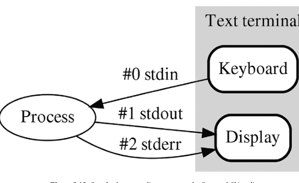

图 3.18：标准流图示例。来源：维基媒体

默认行为是使用键盘作为输入，显示器作为输出，但可以修改此行为以使用不同的输入源或将输出重定向。要修改它们，下表描述了不同的选项：

| 流 | 修饰符 | 命令示例 |
| :--- | :---: | :--- |
| 标准输入 (0) | `<` | `read HOSTNAME </etc/hostname` |
| 标准输出 (1) | `1>` `>` | `pwd 1>hostname`<br>`pwd > hostname` |
| 标准错误 (2) | `2>` | `ls nonexistent 2>error.log`<br>`ls nonexistent 2>&1` |
| 标准输出 (1) 和标准错误 (2) | `&>` | `ls /etc/services nonexistent &>output.log` |

表 3.8：修改流选项。

命令（shell 函数）`read`会要求用户输入一个值，并将其保存为作为参数指定的变量；在示例中，变量名为`HOSTNAME`。使用小于号（`<`）改变默认行为时，将不会询问用户，而是从文件中读取数据。下图展示了如何更改标准输入的默认行为：

```
root@ubuntu:~# read HOSTNAME
user input here
root@ubuntu:~# echo $HOSTNAME
user input here
root@ubuntu:~# read HOSTNAME </etc/hostname
root@ubuntu:~# echo $HOSTNAME
ubuntu.example.com
```

图 3.19：`read` 命令要求用户输入，但也可能从文件读取输入

如前所示，`pwd`命令在屏幕上显示用户所在的当前目录。使用大于号（`>`或`1>`）会将输出重定向到文件，创建该文件或覆盖其内容。在以下示例中，使用`cat`命令查看文件内容。使用两个大于号（`>>`）会将内容追加到现有文件中，如果文件不存在则创建该文件。下图展示了如何将标准输出重定向到文件：

```
root@ubuntu:~/examples# pwd
/root/examples
root@ubuntu:~/examples# pwd >pwd1.txt
root@ubuntu:~/examples# cat pwd1.txt
/root/examples
root@ubuntu:~/examples# pwd 1>pwd2.txt
root@ubuntu:~/examples# cat pwd2.txt
/root/examples
```

图 3.20：一个命令的输出可以使用 `>` 或 `1>` 重定向到一个文件

当文件在屏幕上显示错误时，这意味着使用的不是正常的输出信息流，而是不同的输出流。在以下示例中，展示了默认行为，以及如何将单个流（使用 `2>`）、两个流（使用 `2>` 和 `>`）的输出重定向，或如何组合它们（使用 `&>`）。下图展示了如何将标准错误流重定向到文件或标准输出流。


```
root@ubuntu:~/examples$ ls pwd1.txt pwd3.txt
ls: cannot access 'pwd3.txt': No such file or directory
pwd1.txt
root@ubuntu:~/examples$ ls pwd1.txt pwd3.txt 2>error1.txt
pwd1.txt
root@ubuntu:~/examples$ cat error1.txt
ls: cannot access 'pwd3.txt': No such file or directory
root@ubuntu:~/examples$ ls pwd1.txt pwd3.txt 2>error2.txt >good.txt
root@ubuntu:~/examples$ cat error2.txt
ls: cannot access 'pwd3.txt': No such file or directory
root@ubuntu:~/examples$ ls pwd1.txt pwd3.txt &>everything.txt
root@ubuntu:~/examples$ cat everything.txt
ls: cannot access 'pwd3.txt': No such file or directory
pwd1.txt
```

> 图 3.21：标准错误可以重定向到一个文件，也可以与标准输出结合

一个命令的输出可以作为另一个命令的输入，这被称为`管道`。这意味着一个命令的`标准输出`可以被重定向为另一个命令的`标准输入`，然后该命令再传递给下一个命令，依此类推。两个命令并行执行；第二个命令会等待第一个命令完成发送标准输出。用于`管道`的字符是竖线（在 Linux 中被称为`管道符`）：`command1 | command2` 或更多，如 `command1 | command2 | command3 | commandN`。下面的插图展示了标准输入和输出流如何通过管道在进程之间进行通信。请参阅下图：

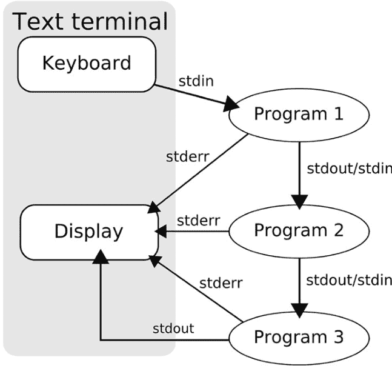

*图 3.22：管道图示例。来源：维基媒体*

在下图中，一个命令（`cat`）的输出将作为另一个命令（`head`）的输入，而另一个命令（`nl`）将从第二个命令的`标准输出`中接收`标准输入`数据。这种组合将显示文件的前 10 行（`head` 命令），并对输出结果进行编号（`nl` 命令），来源是文件`/etc/services`（`cat` 命令）。

```
root@ubuntu:~# cat /etc/services | head | nl
     1  # Network services, Internet style
     2  #
     3  # Updated from https://www.iana.org/assignments/service-names-port-numbers/service-names-port-numbers.html .
     4  #
     5  # New ports will be added on request if they have been officially assigned
     6  # by IANA and used in the real-world or are needed by a debian package.
     7  # If you need a huge list of used numbers please install the nmap package.
     8
     9  tcpmux        1/tcp           # TCP port service multiplexer
    10  echo          7/tcp
```

*图 3.23：使用三个命令的管道示例*

## 用于数据流的 CLI 命令

有三个简单而重要的标准命令用于操作标准流：`echo`、`read` 和 `tee`。

### echo 命令

这个简单的命令显示一行文本。它常用于显示变量的值、创建带有内容的文件，或向现有文件追加数据。最常用的选项是 `-n`，用于不在行尾添加换行符。在下图中，展示了命令 `echo` 的不同用法：

```
agonzalez@ubuntu:~$ echo "Show some text and value of variable $HOME"
Show some text and value of variable /home/agonzalez
agonzalez@ubuntu:~$ echo "Create a file" > example.txt
agonzalez@ubuntu:~$ echo "Append content to file" >> example.txt
agonzalez@ubuntu:~$ cat example.txt
Create a file
Append content to file
```

*图 3.24：echo 命令示例及使用 cat 命令显示文件内容*

### read 命令

如前所述，此命令要求用户从标准输入中引入一个值，并将其保存到一个变量中。一些常用选项包括 `-p` 用于添加提示文本，以及 `-t` 用于指定用户应提供输入的超时时间。在下图中，展示了 `read` 命令的用法：

```
agonzalez@ubuntu:~$ read -p "Introduce username: " USERNAME
Introduce username: testuser
agonzalez@ubuntu:~$ echo $USERNAME
testuser
```


### tee 命令

重定向标准输出的一个局限性是无法指定两个目标，例如显示器和文件。使用 `tee` 命令可以实现这一目标，其中标准输出将被显示，同时创建一个包含输出的文件。使用选项 `-a` 会将内容追加到现有文件中。在下图中，展示了 `tee` 命令的用法：

```
agonzalez@ubuntu:~$ lsusb | tee lsusb.txt
Bus 002 Device 001: ID 1d6b:0003 Linux Foundation 3.0 root hub
Bus 001 Device 002: ID 0627:0001 Adax Technology Co., Ltd QEMU USB Tablet
Bus 001 Device 001: ID 1d6b:0002 Linux Foundation 2.0 root hub
agonzalez@ubuntu:~$ cat lsusb.txt
Bus 002 Device 001: ID 1d6b:0003 Linux Foundation 3.0 root hub
Bus 001 Device 002: ID 0627:0001 Adax Technology Co., Ltd QEMU USB Tablet
Bus 001 Device 001: ID 1d6b:0002 Linux Foundation 2.0 root hub
```


## 结论

在 Linux 控制台上的操作对于系统管理至关重要。了解如何运行命令以及指定所需的选项和参数非常重要。通过 `man` 命令访问文档，或使用选项 `-h` 或 `--help`，将极大地帮助了解可用的选项和参数。Linux 发行版提供了一些命令来识别系统中可用的资源。

标准流的概念以及如何更改输入和输出的默认行为对于在命令之间传递数据至关重要，在本书后续章节中，这一重要性将在其他章节中进一步体现。

## 关键知识点

- 命令行是管理 Linux 系统的最佳方式。
- Linux 提供了许多命令来识别资源。
- 存在三种标准流：输入、输出和错误。
- 可以重定向输出。
- 一个命令的输出可以作为另一个命令的输入。

## 问题

1. 哪个命令用于显示当前目录？
   a. `whoami`
   b. `path`
   c. `pwd`
2. 哪个命令用于获取内存信息？
   a. `df`
   b. `free`
   c. `du`
3. 哪个命令用于获取磁盘总使用量？
   a. `df`
   b. `free`
   c. `du`
4. 哪个命令用于请求用户数据并保存到变量中？
   a. `read`
   b. `prompt`
   c. `input`
5. 哪个命令用于在标准输出中显示并保存到文件？
   a. `pipe`
   b. `tee`
   c. `export`

## 答案

1. c
2. b
3. a
4. a
5. b

# 第 4 章

## 用户管理与软件管理

### 简介


在学习了如何使用 `Linux 终端`执行不同任务之后，本章将讨论如何管理用户。还将探索用于创建、修改和删除用户的不同命令。本章描述的另一个重要主题是如何操作用户组，如何将其分配给用户，以及主用户组和次用户组之间的区别。

本章的第二部分侧重于软件管理。正如在 `Linux 安装` 章节中所述，两种流行的包管理器是 `RPM` 和 `DEB`。`RPM` 被红帽企业版 Linux 及其衍生发行版（如 SUSE 或 CentOS）使用，而 `DEB` 被 Debian 及其衍生发行版（如 Ubuntu Server）使用。本章将深入探讨这些包管理器，包括用于操作它们的命令。

最后一部分涉及服务，概述了它们在 Linux 上的工作原理，以及如何操作它们，例如启用/禁用、启动、停止或重启它们。

### 结构

在本章中，我们将讨论以下主题：

- 用户和用户组简介
- 用户账户的最佳实践
- 管理用户的命令
- 管理用户组的命令
- `RPM` 和 `DEB` 包格式简介
- 操作 `RPM` 包的命令
- 操作 `DEB` 包的命令
- 服务简介

### 用户与用户组简介

在安装 Linux 发行版时，会创建一个名为 `root` 的管理员用户。出于安全原因，建议创建一个新用户使用 `sudo` 登录并执行管理任务。

不同发行版的基于 Linux 的云映像也包含默认用户。此用户未设置密码，连接它的唯一方法是使用私钥 SSH 密钥。这将在网络与安全章节中介绍。云映像的典型登录名是 `cloud-user`（用于大多数基于 `RPM` 的发行版）、`ec2-user`（用于 Amazon Web Services 中的 Linux 系统），或特定于发行版（CentOS 系统中的 `centos`，或 Ubuntu Server 中的 `ubuntu`）。

Linux 中的用户不仅保留给人类登录，还有通常与服务或应用程序关联的系统用户。Linux 用户由数字 ID (`uid`) 标识：安装期间预定义的用户使用 0 到 99 之间的范围，而使用安装的服务和应用程序创建的系统用户将使用 100 到 999 之间的范围。普通用户将拥有更大的范围，从 1,000 到 6,000。`uid` 0 保留给 `root` 用户。

Linux 还有一个用户组列表，用户是它们的成员。用户总是与一个主用户组关联，并可选地与多个次用户组关联。这些用户组有助于将文件和应用程序的权限与多个用户关联。与用户一样，存在在 Linux 发行版安装期间或安装新服务或应用程序时创建的系统用户组。用户组也由数字 ID (`gid`) 标识，范围与用户相同：安装期间创建的预定义用户组为 0–99，安装服务和应用程序时创建的系统用户组为 100–999，普通用户组为 1,000–6,000。`root` 用户拥有自己的名为 `root` 的用户组，其 `gid` 为 0。

管理员可以使用可用的系统工具创建、管理和删除用户及用户组。Linux 将用户、密码、用户组以及用户组密码的信息存储在文件中。以下四个主要文件用于保存信息：

- `/etc/passwd`：包含系统中本地可用用户列表。该文件以冒号 (`:`) 分隔，包含以下字段：
  - `username`：用户登录名，最大长度为 32 个字符。
  - `password`：它将包含字母 `"x"`，表示密码存储在 `/etc/shadow` 中。也可以将密码加密后存储在此文件中，尽管强烈不建议这样做。
  - `user id (uid)`：与用户关联的唯一数字 `id`。
  - `group id (gid)`：作为主用户组引用 `/etc/group` 文件中用户组的数字 `id`。
  - `用户信息`：如今，此字段包含用户的完整姓名。历史上，这些字段包含姓名、位置、电话号码和办公室号码，并用逗号分隔。
  - `主目录`：用户数据存储主目录的完整路径。
  - `Shell`：要使用的 `shell` 的完整路径。系统用户将使用 `/sbin/nologin`、`/usr/sbin/nologin` 或 `/bin/false` 以避免它们像普通用户一样登录。普通用户通常使用 `/bin/bash`、`/bin/sh` 或其他流行的替代品，如 `/bin/zsh`。

- `/etc/shadow`：此文件包含系统中本地用户的密码信息和过期数据。此文件应受到保护，且非管理用户无法读取。它包含由冒号 (`:`) 分隔的九个字段：
  - `username`：`/etc/passwd` 中存在的用户
  - `encrypted password`：通常由 `passwd` 命令自动填写的密码。
  - `date of last password change`：此字段有三种可能的值：
    - 空表示用户没有过期日期。
    - 0 值表示用户登录后必须更改密码。
    - 以自 1970 年 1 月 1 日 00:00 UTC 以来的天数表示的整数，指示上次更改密码的时间。
  - `minimum password age`：用户允许再次更改密码前必须等待的最小天数。空字段和值 0 意味着需要最小的密码更改时间。
  - `maximum password age`：用户必须更改密码的最大天数。下次登录时应要求用户更改密码。空字段意味着没有最大密码年龄、没有密码警告期，也没有密码不活动期。
  - `password warning period`：密码即将过期前的天数，在此期间应警告用户。空字段和值 0 意味着没有密码警告期。
  - `password inactivity period`：密码过期后仍应接受密码的天数。
  - `account expiration date`：账户过期日期，以自 1970 年 1 月 1 日 00:00 UTC 以来的天数表示。
  - `reserved field`：此字段当前未使用。

- `/etc/group`：此文件定义系统用户组。它包含由冒号 (`:`) 分隔的以下字段：
  - `group name`：用户组名称
  - `password`：一个 `"x"`，表示密码存储在 `/etc/gshadow` 文件中，如果需要则留空。
  - `group id (gid)`：一个数字 `id`。
  - `user list`：属于此用户组作为其中一个次用户组的用户列表，由逗号分隔。

- `/etc/gshadow`：此文件包含用户组的密码，以及用户组的管理员和成员。此文件应受到保护，仅管理员可读取。由冒号 (`:`) 分隔的字段如下：
  - `group name`：来自 `/etc/shadow` 的用户组名称
  - `encrypted password`：通常由 `gpasswd` 命令自动填写的密码
  - `administrators`：管理员用户列表，以逗号分隔。这些用户可以更改用户组的密码和成员。
  - `members`：成员用户列表，以逗号分隔。应与 `/etc/group` 中的列表匹配。

文件 `/etc/login.defs` 定义了与用户和用户组相关不同参数的默认值，如用户 `id` 范围、用户组范围、密码过期默认值以及默认主目录权限。`表 4.1` 中显示了文件内容的示例：

| 选项 | 值 |
| :--- | :--- |
| `MAIL_DIR` | `/var/spool/mail` |
| `UMASK` | `022` |
| `HOME_MODE` | `0700` |
| `PASS_MAX_DAYS` | `99999` |
| `PASS_MIN_DAYS` | `0` |
| `PASS_MIN_LEN` | `5` |

# 表 4.1：/etc/login.defs 中的选项

| 选项 | 值 |
|---|---|
| `PASS_WARN_AGE` | `7` |
| `UID_MIN` | `1000` |
| `UID_MAX` | `60000` |
| `SYS_UID_MIN` | `201` |
| `SYS_UID_MAX` | `999` |
| `GID_MIN` | `1000` |
| `GID_MAX` | `60000` |
| `SYS_GID_MIN` | `201` |
| `SYS_GID_MAX` | `999` |
| `CREATE_HOME` | `yes` |
| `USERGROUPS_ENAB` | `yes` |
| `ENCRYPT_METHOD` | `SHA512` |

在安装 Linux 发行版时，会配置一个 Linux 标准基础（`LSB`）。该基础包含预定义的用户和组数量，其中大多数具有历史意义，但在现代系统中并不使用。表 4.2 显示了新安装的 `Ubuntu Server` 中配置的用户：

## 表 4.2：Ubuntu Server 中创建的默认用户

| 用户名 | UID | 主 GID | 用户信息 | 主目录 | Shell |
|---|---|---|---|---|---|
| `root` | `0` | `0` | `root` | `/root` | `/bin/bash` |
| `daemon` | `1` | `1` | `daemon` | `/usr/sbin` | `/usr/sbin/nologin` |


| `bin` | 2 | 2 | `bin` | `/bin` | `/usr/sbin/nologin` |
| `sys` | 3 | 3 | `sys` | `/dev` | `/usr/sbin/nologin` |
| `sync` | 4 | 65534 | `sync` | `/bin` | `/bin/sync` |
| `games` | 5 | 60 | `games` | `/usr/games` | `/usr/sbin/nologin` |
| `man` | 6 | 12 | `man` | `/var/cache/man` | `/usr/sbin/nologin` |
| `lp` | 7 | 7 | `lp` | `/var/spool/lpd` | `/usr/sbin/nologin` |
| `mail` | 8 | 8 | `mail` | `/var/mail` | `/usr/sbin/nologin` |
| `news` | 9 | 9 | `news` | `/var/spool/news` | `/usr/sbin/nologin` |
| `uucp` | 10 | 10 | `uucp` | `/var/spool/uucp` | `/usr/sbin/nologin` |
| `proxy` | 13 | 13 | `proxy` | `/bin` | `/usr/sbin/nologin` |
| `www-data` | 33 | 33 | `www-data` | `/var/www` | `/usr/sbin/nologin` |
| `backup` | 34 | 34 | `backup` | `/var/backups` | `/usr/sbin/nologin` |
| `list` | 38 | 38 | Mailing List Manager | `/var/list` | `/usr/sbin/nologin` |
| `irc` | 39 | 39 | `ircd` | `/run/ircd` | `/usr/sbin/nologin` |
| `gnats` | 41 | 41 | Gnats Bug-Reporting System (admin) | `/var/lib/gnats` | `/usr/sbin/nologin` |
| `nobody` | 65534 | 65534 | `nobody` | `/nonexistent` | `/usr/sbin/nologin` |

用户 `nobody` 是一个特殊用户，当某些服务不想使用专用用户来运行应用程序时会使用它。安装过程中也会创建一个名为 `nobody` 的组，正如表 4.3 中显示的 Ubuntu Server 中创建的默认组所示：

## 表 4.3：Ubuntu Server 中创建的默认组

| 组 | GID | 组 | GID | 组 | GID | 组 | GID |
|---|---|---|---|---|---|---|---|
| `root` | 0 | `news` | 9 | `floppy` | 25 | `irc` | 39 |
| `daemon` | 1 | `uucp` | 10 | `tape` | 26 | `src` | 40 |
| `bin` | 2 | `man` | 12 | `sudo` | 27 | `gnats` | 41 |
| `sys` | 3 | `proxy` | 13 | `audio` | 29 | `shadow` | 42 |
| `adm` | 4 | `kmem` | 15 | `dip` | 30 | `utmp` | 43 |
| `tty` | 5 | `dialout` | 20 | `www-data` | 33 | `video` | 44 |
| `disk` | 6 | `fax` | 21 | `backup` | 34 | `plugdev` | 46 |
| `lp` | 7 | `voice` | 22 | `operator` | 37 | `staff` | 50 |
| `mail` | 8 | `cdrom` | 24 | `list` | 38 | `games` | 60 |

### 用户账户的最佳实践

对于人类用户账户，建议保护账户使用强密码并应用过期规则。如果可能，也建议禁用密码登录（例如在 SSH 中），改为仅使用 SSH 私钥/公钥进行登录。

保持每个系统所需用户的列表非常重要，并移除系统不需要的用户，以避免密码泄露或漏洞，这些都可能影响我们的基础设施。另一件需要跟踪的重要事情是用户和组的归属映射，从而确保用户不属于他不应该加入的组。

使用 `Ansible` 等工具自动化用户的管理和维护，将有助于管理员保持系统安全且易于维护。

### 管理用户的命令

#### 命令 `id`

这个简单的命令显示有关用户及其所属组的信息。可以在不输入任何参数的情况下执行此命令以获取执行该命令的用户的信息。此外，通过指定一个用户作为参数，用户可以查看该用户的组信息。命令 `id` 的常用选项显示在表 4.4 中：

| 选项 | 描述 |
|:---------------------------------------|:----------------------------------------------------|
| `-g, --group` | 仅打印有效组 ID |
| `-G, --groups` | 打印所有组 ID |
| `-u, --user` | 仅打印有效用户 ID |

表 4.4：命令 `id` 的常用选项

在图 4.1 中，展示了不带选项和参数但带有其他用户参数以及使用前述选项的输出示例，如下所示：

```bash
agonzalez@ubuntu:~$ id
uid=1000(agonzalez) gid=1000(agonzalez) groups=1000(agonzalez),4(adm),24(cdrw),27(sudo),30(dip),46(plugdev),110(lxd)
agonzalez@ubuntu:~$ id root
uid=0(root) gid=0(root) groups=0(root)
agonzalez@ubuntu:~$ id -u
1000
agonzalez@ubuntu:~$ id -g
1000
agonzalez@ubuntu:~$ id -G
1000 4 24 27 30 46 110
```

图 4.1：使用命令 `id` 的输出示例

#### 命令 `useradd` 和 `adduser`

命令 `useradd` 是在所有 Linux 发行版中可用的命令，旨在创建用户。某些发行版，例如 Ubuntu Server，提供了一个工具 `adduser` 来帮助用户交互式地输入用户信息。在一些其他发行版中，例如 Red Hat Enterprise Linux，执行命令 `adduser` 时会调用命令 `useradd`。

默认值（在文件 `/etc/default/useradd` 中指定）可以使用命令 `useradd -D` 列出，如图 4.2 所示：

```bash
root@ubuntu:~# useradd -D
GROUP=100
HOME=/home
INACTIVE=-1
EXPIRE=
SHELL=/bin/sh
SKELETON=/etc/skel
CREATE_MAIL_SPOOL=no
```

图 4.2：命令 `useradd` 的默认选项示例

此命令唯一需要的参数是要创建的用户名。命令 `useradd` 的常用选项显示在表 4.5 中：

| 选项 | 描述 |
| :--- | :--- |
| `-C, --comment COMMENT` | 通常用于指定用户的完整姓名。 |
| `-d, --home-dir HOME_DIR` | 用户的主目录，而不是使用 `/home/<username>` |
| `-g, --gid GROUP` | 用户的主组名或组 ID。 |
| `-G, --groups GROUP1,GRP2` | 用户的辅助组列表，用逗号分隔。 |
| `-k, --skel SKEl_DIR` | 使用的骨架目录，而不是 `/etc/skel`。 |
| `-m, --create-home` | 如果用户的主目录不存在，则创建它。 |
| `-r, --system` | 创建系统账户而不是普通用户。GID 将不同。 |
| `-s, --shell SHELL` | 用户登录 Shell 的路径。 |
| `-u, --uid UID` | 用户 ID 的数值。对于迁移用户很有用。 |
| `-U, --user-group` | 创建一个与用户同名的组，并将其设置为用户的主组。 |

表 4.5：命令 `useradd` 的常用选项

在图 4.3 中，创建了一个名为 `testuser` 的用户，指定了前表中的一些选项，以及使用命令 `id` 的选项：

```bash
root@ubuntu:~# useradd -c "Test User" -G syslog -m testuser
root@ubuntu:~# id testuser
uid=1001(testuser) gid=1001(testuser) groups=1001(testuser),113(syslog)
```

图 4.3：使用 `useradd` 创建用户 `testuser` 的示例。


#### 命令 `adduser`

命令`adduser`，当作为单独工具可用时，通常不使用任何选项。然而，常用选项在表 4.6 中描述：

| 选项 | 描述 |
| :--- | :--- |
| `--home DIR` | 主目录，而不是默认目录。 |
| `--shell SHELL` | 默认 Shell，而不是默认的 Shell。 |
| `--no-create-home` | 不创建主目录。 |
| `--gecos GECOS` | 指定用户信息 |
| `--gid ID` | 指定主组 ID 或名称。 |

*表 4.6：命令`adduser`的常用选项*

*图 4.4* 显示了使用命令`adduser`时的输出和交互：

```bash
root@ubuntu:~# adduser testuser2
Adding user 'testuser2' ...
Adding new group 'testuser2' (1002) ...
Adding new user 'testuser2' (1002) with group 'testuser2' ...
Creating home directory '/home/testuser2' ...
Copying files from '/etc/skel' ...
New password:
Retype new password:
passwd: password updated successfully
Changing the user information for testuser2
Enter the new value, or press ENTER for the default
Full Name []: Test User2
Room Number []:
Work Phone []:
Home Phone []:
Other []:
Is the information correct? [Y/n]
```

*图 4.4：使用`adduser`创建用户`testuser2`的示例*

#### 命令 `usermod`

命令`usermod`允许在创建用户后修改用户的大部分参数。唯一需要的参数是要修改的用户名。常用选项与`useradd`类似，描述在表 4.7 中：

*表 4.7：`usermod` 命令的常用选项*

| 选项 | 描述 |
| :--- | :--- |
| `-a, --append` | 将用户添加到辅助组。仅可与 `-G` 选项一起使用 |
| `-c, --comment COMMENT` | 通常用于指定用户的完整名称。 |
| `-d, --home HOME_DIR` | 用户的新登录目录。 |
| `-g, --gid GROUP` | 用户的新主组名或组 ID。 |
| `-G, --groups GROUP1,GRP2` | 用户辅助组的列表，以逗号分隔。 |
| `-l, --lock` | 锁定用户密码。 |
| `-m, --move-home` | 将用户主目录的内容移至新位置。 |
| `-s, --shell SHELL` | 用户新登录 Shell 的路径。 |
| `-U, --unlock` | 解锁用户密码。 |

在*图 4.5* 中，将为之前创建的用户`testuser2`添加一个名为`syslog`的辅助组：

```bash
root@ubuntu:~# usermod -G syslog testuser2
root@ubuntu:~# id testuser2
uid=1002(testuser2) gid=1002(testuser2) groups=1002(testuser2),113(syslog)
```

*图 4.5：使用`usermod`为用户`testuser2`添加辅助组的示例*

#### `lslogins` 命令

命令`lslogins`是一个用于显示系统中可用用户信息的现代命令。如果不指定任何参数或选项，它将列出所有用户以及最后登录的信息；如果密码被锁定，还会显示该用户正在运行的进程数。这在*图 4.6* 中有所展示：

```bash
root@ubuntu:~# lslogins

  UID USER          PROC PWD-LOCK PWD-DENY LAST-LOGIN GECOS
   0 root          108   0        0        root
   1 daemon        0     0        1        daemon
   2 bin           0     0        1        bin
 112 usbmux        0     0        1        usbmux daemon,,,
1000 agonzalez     5     0        0  12:21 agonzalez,12,1234,12345678
1001 testuser      0     0        1        Test User
1002 testuser2     0     0        0        Test User2,,,
```

*图 4.6：`lslogins` 命令的输出示例（截断）*

如果将现有用户之一作为参数指定，将显示关于该账户的详细信息，如*图 4.7* 所示：

```bash
root@ubuntu:~# lslogins agonzalez
Username:             agonzalez
UID:                  1000
Gecos field:          agonzalez,12,1234,12345678
Home directory:       /home/agonzalez
Shell:                /bin/bash
No login:             no
Password is locked:   no
Password not required: no
Login by password disabled: no
Password encryption method: SHA-512
Primary group:        agonzalez
GID:                  1000
Supplementary groups: lxd,adm,cdrom,sudo,dip,plugdev
Supplementary group IDs: 110,4,24,27,30,46
Last login:           12:21
Last terminal:        pts/0
Last hostname:        192.168.122.1
Failed login:         Jul01/22:31
Failed login terminal: ssh:totty
Hushed:               no
Password expiration warn interval: 7
Password changed:     Jun26/00:00
Maximum change time:  99999
Running processes:    5

Last logs:
12:59 sudo[1476]: pam_unix(sudo-i:session): session closed for user root
12:59 su [1492]: (to root) agonzalez on pts/0
12:59 su [1492]: pam_unix(su-l:session): session opened for user root(uid=0) by agonzalez(uid=1000)
```


`lslogins` 命令的一些常用选项列于*[表 4.8](#table-4.8)* 中：

| 选项 | 描述 |
| :--- | :--- |
| `-a, --acc-expiration` | 显示上次密码更改日期和账户过期日期。 |
| `-f, --failed` | 显示用户最近登录失败尝试的数据。 |
| `-g, --groups=groups` | 仅显示属于指定组的用户数据。 |
| `-l, --logins=logins` | 仅显示在 `logins` 中指定登录名的用户数据。以逗号分隔。 |
| `-p, --pwd` | 显示与密码登录相关的信息。 |
| `-u, --user-accs` | 显示用户账户和隐藏的系统用户。 |


#### `who` 和 `w` 命令

命令`who`显示登录到系统的用户信息。示例如下，见*[图 4.8](#figure-4.8)*：


```
root@ubuntu:~# who
agonzalez tty1
2022-07-23 12:21
agonzalez pts/0
2022-07-23 12:21 (192.168.122.1)
```

图 4.8：`who` 命令的输出示例。

命令 `w` 不仅显示登录到系统的用户信息，还显示他们正在执行的主命令，如图 4.9 所示：

```
root@ubuntu:~# w
13:15:56 up 58 min,  2 users,  load average: 0.01, 0.11, 0.07
USER     TTY      FROM             LOGIN@  IDLE   JCPU   PCPU  WHAT
agonzalez tty1       -              12:21   54:57  0.05s  0.03s  -bash
agonzalez pts/0  192.168.122.1     12:21   0.00s  0.10s  0.02s  sshd: agonzalez
```

图 4.9：`w` 命令的输出示例。

#### `userdel` 命令

该命令用于从系统中删除本地用户。它需要一个参数来指定要删除的用户。该命令最常用的选项显示在表 4.9 中：

| 选项 | 描述 |
| --- | --- |
| `-f, --force` | 此选项强制删除用户账户，即使该用户仍处于登录状态。 |
| `-r, --remove` | 删除用户主目录中的文件。 |

表 4.9：`userdel` 命令的常用选项

在图 4.10 中，删除了用户 `testuser2` 及其文件：

```
root@ubuntu:~# userdel -r testuser2
userdel: testuser2 mail spool (/var/mail/testuser2) not found
```

图 4.10：删除用户 `testuser2` 及其主目录的示例。

#### `passwd` 命令

此命令用于操作本地用户的密码和密码过期日期。使用 `useradd` 命令创建用户后，必须运行此命令来设置该用户的密码。管理员或普通用户可以在不带参数的情况下运行此命令来更改自己的密码。最常用的选项显示在表 4.10 中：

| 选项 | 描述 |
| --- | --- |
| `-l, --lock` | 锁定用户密码，仅 `root` 可用。 |
| `-u, --unlock` | 解锁用户密码。 |
| `-e, --expire` | 用户将在下次登录时被迫更改密码。 |
| `-n, --minimum DAYS` | 最小密码有效期，以天为单位。 |
| `-x, --maximum DAYS` | 最大密码有效期。 |
| `-w, --warning DAYS` | 提前多少天，用户将收到密码即将过期的警告。 |
| `-l, --inactive DAYS` | 密码过期后经过多少天账户将变为非活动状态并应被禁用。 |
| `-S, --status` | 输出关于密码状态的简短信息。 |

表 4.10：`passwd` 命令的常用选项

在图 4.11 中，展示了如何为某个用户设置密码以及如何锁定账户（命令 `passwd -S` 显示字母 `L` 表示已锁定）：

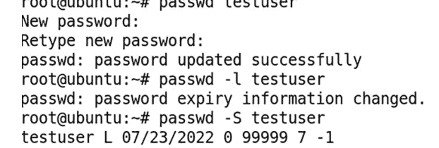

图 4.11：`passwd` 命令使用的输出示例。

#### `chage` 命令

此命令用于更改用户密码过期信息。常用选项显示在表 4.11 中：

| 选项 | 描述 |
|---|---|
| `-d, --lastday LAST_DAY` | 设置密码上次更改的日期。 |
| `-E, --expiredate EXPIRE_DATE` | 设置用户账户不再可访问的日期。 |
| `-I, --inactive INACTIVE` | 设置密码过期后账户被锁定前的非活动天数。 |
| `-l, --list` | 显示账户老化信息。 |
| `-m, --mindays MIN_DAYS` | 设置密码更改之间的最小天数为 `MIN_DAYS`。 |
| `-M, --maxdays MAX_DAYS` | 设置密码有效期的最大天数。 |
| `---, --warndays WARN_DAYS` | 设置更改密码前的警告天数。 |

表 4.11：`chage` 命令的常用选项

在图 4.12 中，用户 `testuser` 被迫在下次登录时更改密码，并显示了关于账户的信息：

```
root@ubuntu:~# chage -d 0 testuser
root@ubuntu:~# chage -l testuser
Last password change                  : password must be changed
Password expires                      : password must be changed
Password inactive                     : password must be changed
Account expires                       : never
Minimum number of days between password change  : 0
Maximum number of days between password change  : 99999
Number of days of warning before password expires : 7
```

图 4.12：使用 `chage` 命令的示例。

#### `last` 命令

此命令将显示登录系统的用户列表。可以使用表 4.12 中所示的一些选项来过滤输出：

| 选项 | 描述 |
| --- | --- |
| `-n, --limit number` | 告诉 `last` 显示多少行。 |
| `-p, --present time` | 显示在指定时间在线的用户。 |
| `-R, --nohostname` | 抑制显示主机名字段。 |
| `-s, --since time` | 显示自指定时间以来的登录状态。 |
| `-t, --until time` | 显示截至指定时间的登录状态。 |

表 4.12：`last` 命令的常用选项

在图 4.13 中，我们仅看到用户日志的最后三条条目：

```
root@ubuntu:~# last -n 3
agonzalez pts/0  192.168.122.1  Sat Jul 23 12:21  still logged in
agonzalez tty1    Sat Jul 23 12:21  still logged in
reboot  system boot  5.15.0-40-generic Sat Jul 23 12:17  still running

wtmp begins Sun Jun 26 20:41:10 2022
```

图 4.13：使用 `last` 命令的示例

### 用于操作组的命令

#### `groupadd` 命令

该命令将向系统添加一个本地组。表 4.13 展示了两个常用选项：

| 选项 | 描述 |
| :-- | :-- |
| `-g, --gid GID` | 组 ID 的数值。在迁移时很有用。 |
| `-r, --system` | 创建一个系统组。 |

表 4.13：`groupadd` 命令的常用选项

如图 4.14 所示，创建了一个名为 `example` 的新组：

```
root@ubuntu:~# groupadd example
```

图 4.14：使用 `groupadd` 命令的示例。

#### `groups` 命令

此简单命令显示调用该命令的用户所属的组。指定参数将显示该用户所在的组。图 4.15 展示了两种场景：

```
root@ubuntu:~# groups
root
root@ubuntu:~# groups agonzalez
agonzalez : agonzalez adm cdrom sudo dip plugdev lxd
```

图 4.15：使用 `groups` 命令的示例。

#### `groupmod` 命令

`groupmod` 命令允许修改指定组的某些参数。表 4.14 展示了常用选项：

| 选项 | 描述 |
| :-- | :-- |
| `-g, --gid GID` | 组的新组 ID。 |
| `-n, --new-name NAME` | 组的新名称。 |

表 4.14：`groupmod` 命令的常用选项

如图 4.16 所示，之前创建的组 `example` 被重命名为 `writers`：

```
root@ubuntu:~# groupmod -n writes example
```

图 4.16：使用 `groupmod` 命令的示例。

#### `groupdel` 命令


此命令用于删除系统中的组，唯一必需的参数是要删除的组名。如图 4.17 所示，之前重命名的组被删除：

```
root@ubuntu:~# groupdel writes
```

图 4.17：使用 `groupdel` 命令的示例。

#### `gpasswd` 命令

此命令管理 `/etc/group` 和 `/etc/gshadow` 文件。每个组都可以拥有管理员、成员和密码。必需参数是要操作的组名，表 4.15 展示了最常用选项：

| 选项 | 描述 |
| :--- | :--- |
| `-a, --add user` | 将用户添加到指定的组。 |
| `-d, --delete user` | 将用户从指定的组中移除。 |
| `-r, --remove-password` | 从指定的组中移除密码。 |
| `-R, --restrict` | 限制对指定组的访问。 |
| `-A, --administrators user,...` | 设置管理员用户列表。 |
| `-M, --members user,...` | 设置组成员列表。 |

表 4.15：`gpasswd` 命令的常用选项

如图 4.18 所示，创建了一个名为 `writers` 的组，其中用户 `a Gonzalez` 被设置为该组的管理员，并且为该组设置了密码：

```
root@ubuntu:~# groupadd writers
root@ubuntu:~# gpasswd -A a Gonzalez writers
root@ubuntu:~# gpasswd writers
Changing the password for group writers
New Password:
Re-enter new password:
```

图 4.18：使用 `gpasswd` 命令的示例

#### `newgrp` 命令

此命令允许用户成为某个组的一部分，无论是因为他们知道该组的密码，还是因为他们本来就是该组的成员但在登录系统时未加入该组。唯一必需的参数是要加入的组名；如果需要密码，系统将提示输入。如图 4.19 所示，用户 `testuser` 使用密码加入 `writers` 组：

```
testuser@ubuntu:~$ groups
testuser syslog
testuser@ubuntu:~$ newgrp writers
Password:
testuser@ubuntu:~$ groups
writers syslog testuser
```


## RPM 和 DEB 包格式简介

Linux 发行版使用打包系统来简化安装新软件、更新软件或卸载软件的过程。这些打包系统负责解决所需的依赖关系，并提供验证状态的可能性。

一个包由文件归档和元数据组成，用于安装和删除归档文件。元数据包括辅助脚本、文件属性和关于该包的描述性信息。大多数发行版提供两种类型的包：

- **二进制包**：用于封装要安装的软件。

- **源码包**：包含生成二进制包所需的源代码及其他一切内容。

最常用的发行版使用两种流行的包管理器和格式：`RPM 包管理器` 和 `Debian 包`。

`RPM 包管理器 (RPM)` 是一个开放式的打包系统，运行在 `Red Hat Enterprise Linux` 以及其他 Linux 发行版（如 `Fedora`、`CentOS`、`Alma Linux` 和 `Rocky Linux`）上。有不同工具用于操作 `RPM 包管理器 (RPM)`：

- **`rpm`**：用于查询、安装、升级或从系统中删除包的主要工具。在查询或卸载时，该命令将使用本地 `RPM` 数据库；在安装或升级包时，它将使用扩展名为 `.rpm` 的本地文件。

- **`yum (Yellowdog Updater Modified)`**：用于从软件仓库获取、安装、删除和查询包的主要工具。该工具负责下载软件包及安装请求软件所需的依赖关系。它允许更新或升级整个系统。

- **`dnf (Dandified YUM)`**：`YUM` 的最新版本，与 `YUM` 命令和选项保持兼容。它比原始的 `yum` 更快，扩展性更强，并且能更好地解决依赖关系。

`Debian` 包是 `Debian`、`Ubuntu` 及其衍生版本的包格式。包的扩展名为 `.deb`。操作 `Debian` 包的主要工具如下：

- **`dpkg`**：用于查询、安装、构建和删除 `Debian` 包的主要工具。它是低级命令 `dpkg-query`（用于列出）和 `dpkg-deb`（用于安装软件）的前端。

- **`apt-get`**：处理软件仓库中包的流行工具之一。它允许安装、更新、重新安装和删除系统中的软件。

- **`apt-cache`**：此命令用于在软件仓库中搜索包。系统会保留可用包列表的本地副本，该工具将查询此本地数据库以搜索包、搜索包内的文件或获取关于包的信息。

- **`apt`**：提供包管理的高级接口。使用该命令简化了仅使用一个命令来进行安装（`apt-get` 任务）或包的操作以及搜索或获取包信息（`apt-cache` 任务）的过程。

## 操作 RPM 包命令

### `rpm` 命令

如前所述，此命令是操作 `RPM` 包的主要命令。它包含多个选项，具体取决于所需的操作。表 4.16 展示了主要操作和语法：

| 操作 | 语法 |
|---|---|
| 查询和验证 | `rpm -q/--query [选择选项] [查询选项] [包]` |
| 安装包 | `rpm -i/--install [安装选项] package.rpm` |
| 升级包 | `rpm -U/--upgrade [安装选项] package.rpm`<br />`rpm -F/--freshen [安装选项] package.rpm` |
| 重新安装包 | `rpm --reinstall [安装选项] package.rpm` |
| 删除包 | `rpm -e/--erase 包名` |

表 4.16：`rpm` 命令的操作和语法

最常用的全局选项是 `-v`（`--verbose`），适用于所有操作。关于选择选项和查询选项及其描述，请参考表 4.17：

| 选择选项 | 描述 |
|---|---|
| `-a, --all [选择器]` | 查询所有已安装的包或按选择器筛选 |
| `-f, --file 文件` | 查询拥有指定的已安装文件的包。 |
| `-p, --package package.rpm` | 查询包文件而非已安装的包。 |
| `--whatrequires 包` | 查询依赖于指定包的包。 |
| `--whatconflicts 包` | 查询与指定包冲突的包。 |
| `--changelog` | 显示该包的更改信息。 |
| `--conflicts` | 列出与所查询包冲突的包。 |
| `-i / --info` | 获取关于该包的信息。 |
| `-l / --list` | 列出包内的文件 |
| `-R / --requires` | 列出该包所依赖的包。 |

表 4.17：选择选项和查询选项

以下是查询包的一些示例：

- 图 4.20 是查询系统中所有以单词 `kernel` 开头的包的示例：

```
[root@rhel ~]# rpm -qa kernel*
kernel-tools-libs-5.14.0-70.13.1.el9_0.x86_64
kernel-core-5.14.0-70.13.1.el9_0.x86_64
kernel-modules-5.14.0-70.13.1.el9_0.x86_64
kernel-5.14.0-70.13.1.el9_0.x86_64
kernel-tools-5.14.0-70.13.1.el9_0.x86_64
```

图 4.20：使用模式查询已安装包的输出示例。

- 图 4.21 展示了获取指定包（`jq`）信息的示例：

```
[root@rhel ~]# rpm -ql jq
Name    :
```

## `yum` 和 `dnf` 命令。

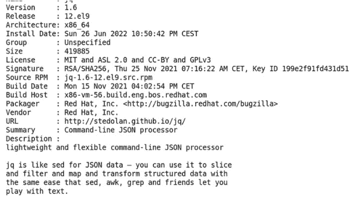

图 4.21：获取已安装包信息的输出示例

图 4.22 展示了检查系统中某个已安装文件的属主包：

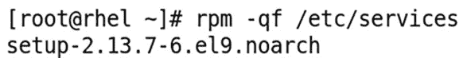

图 4.22：查询文件属主的输出示例。

图 4.23 展示了查询 `.rpm` 文件并列出依赖项：

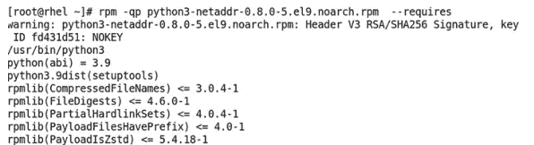

图 4.23：列出包依赖项的输出示例。

图 4.24 列出了包内的文件：

```
[root@rhel ~]# rpm -ql grub2-pc
/boot/grub2/grub.cfg
/boot/loader/entries
/etc/dnf/protected.d/grub2-pc.conf
/etc/grub2.cfg
```

图 4.24：列出已安装包创建的文件输出示例。


在安装、升级和删除时，表 4.18 中显示的下述选项是最常用的：

| 选项 | 说明 |
| :--- | :--- |
| `--force` | 等同于同时使用 `--replacepkgs`、`--replacefiles` 和 `--oldpackage`。 |
| `-h`, `--hash` | 在解包软件包归档时显示进度。 |
| `--nodeps` | 在安装或升级软件包之前不执行依赖项检查。 |
| `--oldpackage` | 允许升级将新软件包替换为旧软件包。 |
| `--replacefiles` | 即使软件包会替换其他已安装软件包的文件，也安装这些软件包。 |
| `--replacepkgs` | 即使系统中已安装了某些软件包，也安装这些软件包。 |
| `--test` | 不安装软件包；仅检查并报告潜在冲突。 |

表 4.18：安装、升级和删除的选项

安装、更新、重新安装和卸载软件包的一些示例如下所示：

-   图 4.25 展示了从本地文件安装包。

```
[root@rhel ~]# rpm -ihv lftp-4.9.2-4.el9.x86_64.rpm
warning: lftp-4.9.2-4.el9.x86_64.rpm: Header V3 RSA/SHA256 Signature, key ID f431d5
1: NOKEY                                            ############ [100%]
Verifying...                                            ############ [100%]
Preparing...                                            ############ [100%]
Updating / installing...
1:lftp-4.9.2-4.el9                                    ############ [100%]
```

图 4.25：从本地文件安装包的输出示例。

-   从本地文件升级软件包，如图 4.26 所示：

```
[root@rhel ~]# rpm -Uvh vim-minimal-8.2.2637-16.el9_0.2.x86_64.rpm
warning: vim-minimal-8.2.2637-16.el9_0.2.x86_64.rpm: Header V3 RSA/SHA256 Signature,
        key fd431d51: NOKEY
Verifying...                                                       ################################# [100%]
  Preparing...                                                       ################################# [100%]
Updating / installing ...
 1:vim-minimal-2:8.2.2637-16.el9_0.2########################################## [ 50%]
Cleaning up / removing...
 2:vim-minimal-2:8.2.2637-15.el9#*############################################## [100%]
```

图 4.26：从本地文件升级软件包的输出示例。

`-U`（`--upgrade`）和 `-F`（`--freshen`）之间的区别在于，第一个选项如果之前未安装该软件包，则会安装该软件包；第二个选项如果系统中没有前一个版本，则不执行任何操作。两者在升级现有软件包时都会先卸载旧版本，然后安装新版本。

-   图 4.27 展示了重新安装现有软件包：

```
[root@rhel ~]# rpm --reinstall -vh vim-minimal-8.2.2637-16.el9_0.2.x86_64.rpm
warning: vim-minimal-8.2.2637-16.el9_0.2.x86_64.rpm: Header V3 RSA/SHA256 Signature,
        key ID fd431d51: NOKEY
Verifying...                                                       ################################# [100%]
  Preparing...                                                       ################################# [100%]
Updating / installing ...
 1:vim-minimal-2:8.2.2637-16.el9_0.2########################################## [ 50%]
Cleaning up / removing...
 2:vim-minimal-2:8.2.2637-16.el9_0.2########################################## [100%]
```

图 4.27：使用本地文件重新安装软件包的输出示例。

-   图 4.28 展示了从系统中移除已安装的软件包。

```
[root@rhel ~]# rpm -q lftp
lftp-4.9.2-4.el9.x86_64
[root@rhel ~]# rpm -ehv lftp
Preparing...                                                       ################################# [100%]
Cleaning up / removing...
 1:lftp-4.9.2-4.el9                                                   ################################# [100%]
[root@rhel ~]# rpm -q lftp
package lftp is not installed
```

图 4.28：从系统中移除软件包的输出示例。

## `yum` 和 `dnf` 命令

这两个命令都与软件源配合使用，也可以选择与本地文件配合使用。包含系统软件源信息的目录是 `/etc/yum.repos.d/`。其中包含扩展名为 `.repo` 的文件，存储软件源的信息。以下是 Red Hat Enterprise Linux 9 的软件源定义示例：

```
[rhel-9-for-x86_64-baseos-rpms]
name = Red Hat Enterprise Linux 9 for x86_64 - BaseOS (RPMs)
baseurl =
https://cdn.redhat.com/content/dist/rhel9/$releasever/x86_64/baseos/os
enabled = 1
gpgcheck = 1
gpgkey = file:///etc/pki/rpm-gpg/RPM-GPG-KEY-redhat-release
sslverify = 1
sslcacert = /etc/rhsm/ca/redhat-uep.pem
sslclientkey = /etc/pki/entitlement/3068237762125458331-key.pem
sslclientcert = /etc/pki/entitlement/3068237762125458331.pem
metadata_expire = 86400
enabled_metadata = 1
```

运行命令 `dnf repolist` 将显示系统中已启用的软件源，如图 4.29 所示：

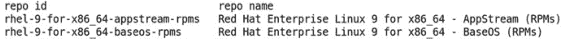

图 4.29：列出系统中已启用软件源的输出示例

命令 `dnf` 和 `yum` 的语法为：`yum [选项] 操作 [参数]`。常用的操作如表 4.19 所示：

| 操作 | 说明 |
|---|---|
| `autoremove` | 删除所有作为依赖项安装但已不再需要的软件包。 |
| `check-update` | 检查系统中已安装的软件包是否有可用的更新。 |
| `distro-sync` | 执行更新发行版到最新可用版本所需的操作。 |
| `download` | 在当前目录下载指定的软件包。 |
| `downgrade` | 将指定的软件包降级到之前可用的最高版本。 |
| `info` | 显示有关指定软件包的信息。 |


### 命令操作说明

| `install` | 安装指定的软件包及其所需的所有依赖项。也可以指定位于本地系统或 Web 服务器上的 `.rpm` 文件。通过以字符 `@` 为前缀，可以安装软件包组。 |
| `list` | 显示所有已安装的软件包以及系统中已启用的软件源中可用的软件包。 |
| `makecache` | 下载并缓存系统中已启用软件源的元数据。 |
| `provides` | 查找提供指定文件或目录的软件包。 |
| `reinstall` | 重新安装指定的软件包。 |
| `remove` | 删除指定的软件包。 |
| `search` | 搜索特定的软件包。 |
| `upgrade` | 将系统或指定的软件包升级到最新可用版本。 |

*表 4.19：命令 `dnf` 和 `yum` 的操作*

*表 4.20* 展示了部分常用的全局选项：

| **选项** | **说明** |
| :--- | :--- |
| `--downloadonly` | 仅下载软件包及依赖项，而不执行安装。 |
| `--show-duplicates` | 如果软件源为同一软件包提供多个版本，则列出所有版本。默认 `dnf/yum` 仅显示最新版本。 |
| `-v`, `--verbose` | 显示调试信息。 |
| `-y`, `--assumeyes` | 不询问用户是否确认操作。 |

*表 4.20：命令 `dnf` 和 `yum` 的常用全局选项*

### 使用 `dnf` 命令执行的任务示例

在以下图中，展示了使用 `dnf` 命令执行的不同任务：

- *图 4.30* 检查是否有可用的软件包更新：

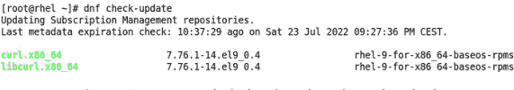

*图 4.30：检查可更新软件包的输出示例。*

- 将 Linux 发行版升级到最新可用版本。

  - *图 4.31* 显示输出的第一部分是事务摘要信息：

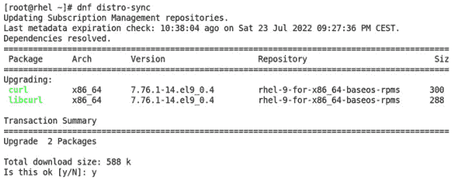

- 确认操作后，输入 `y` 或使用选项 `-y/--assumeyes`，接下来显示的是软件包下载进度，如 *图 4.32* 所示：

```
Downloading Packages:
(1/2): libcurl-7.76.1-14.el9_0.4.x86_64.rpm                  86 kB/s  | 288 kB   00:03
(2/2): curl-7.76.1-14.el9_0.4.x86_64.rpm                      90 kB/s  | 300 kB   00:03
---------------------------------------------------------------------------------------------
Total                                                   176 kB/s  | 588 kB   00:03
Running transaction check
Transaction check succeeded.
```

> *图 4.32：命令 `dnf distro-sync` 示例输出的第二部分。*

- 输出的最后一部分是关于事务的信息，包括每个软件包的安装、清理和验证过程。这在 *图 4.33* 中进行了说明：

```
Running transaction test
Transaction test succeeded.
Running transaction
  Preparing        :                                             1,
  Upgrading        : libcurl-7.76.1-14.el9_0.4.x86_64            1,
  Upgrading        : curl-7.76.1-14.el9_0.4.x86_64               2,
  cleanup          : curl-7.76.1-14.el9.x86_64                   3,
  cleanup          : libcurl-7.76.1-14.el9.x86_64                4,
  Running scriptlet: libcurl-7.76.1-14.el9.x86_64                4,
  Verifying        : curl-7.76.1-14.el9_0.4.x86_64               1,
  Verifying        : curl-7.76.1-14.el9.x86_64                   2,
  Verifying        : libcurl-7.76.1-14.el9_0.4.x86_64            3,
  Verifying        : libcurl-7.76.1-14.el9.x86_64                4,
Installed products updated.

Upgraded:
  curl-7.76.1-14.el9_0.4.x86_64        libcurl-7.76.1-14.el9_0.4.x86_64

Complete!
```

> *图 4.33：命令 `dnf distro-sync` 示例输出的最后部分。*

- 从软件仓库下载名为 `dmicodec` 的软件包到当前目录但不安装它，如 *图 4.34* 所示：

```
[root@rhel ~]# dnf download dmicodec
Updating Subscription Management repositories.
Last metadata expiration check: 23:27:22 ago on Sat 23 Jul 2022 09:27:36 PM CEST.
 dmicodec-3.3-7.el9.x86_64.rpm                                28 kB/s |  93 kB    00:03
[root@rhel ~]# ls -l dmicodec-3.3-7.el9.x86_64.rpm
-rw-r--r--. 1 root root 95279 Jul 24 20:55 dmicodec-3.3-7.el9.x86_64.rpm
```

> *图 4.34：下载软件包的输出示例。*

- 从软件仓库安装名为 `traceroute` 的软件包到系统中。这在 *图 4.35* 中进行了展示：

```
[root@rhel ~]# dnf install -y traceroute
Updating Subscription Management repositories.
Last metadata expiration check: 10:49:53 ago on Sat 23 Jul 2022 09:27:36 PM CEST.
Dependencies resolved.

 Package                  Arch       Version               Repository               Size

Installing:
 traceroute               x86_64     3:2.1.0-16.el9        rhel-9-for-x86_64-baseos-rpms 61 k

Transaction Summary
Install  1 Package

(omitted)
Installed:
 traceroute-3:2.1.0-16.el9.x86_64

Complete!
```


- 在软件仓库中搜索名为 `firefox` 的软件包，如 [图 4.36](figure-4.36) 所示。

```
[root@rhel ~]# dnf search firefox
Updating Subscription Management repositories.
Last metadata expiration check: 10:57:35 ago on Sat 23 Jul 2022 09:27:36 PM CEST.
============================================================================ Name & Summary Matched: firefox =============
firefox.x86_64 : Mozilla Firefox Web browser
```


- [图 4.37](figure-4.37) 说明了如何检查哪个软件包提供了文件 `/etc/sensors3.conf`：

```
[root@rhel ~]# dnf provides /etc/sensors3.conf
Updating Subscription Management repositories.
Last metadata expiration check: 10:58:09 ago on Sat 23 Jul 2022 09:27:36 PM CEST.
1m sensors-3.6.0-10.el9.x86_64 : Hardware monitoring tools
Repo        : rhel-9-for-x86_64-appstream-rpms
Matched from:
Filename    : /etc/sensors3.conf
```


- 移除之前安装在系统中的名为 `traceroute` 的软件包，如 [图 4.38](figure-4.38) 所示：

```
[root@rhel ~]# dnf remove -y traceroute
Updating Subscription Management repositories.
Dependencies resolved.

 Package                  Arch       Version               Repository               Size

Removing:
 traceroute               x86_64     3:2.1.0-16.el9        @rhel-9-for-x86_64-baseos-rpms     108 k

Transaction Summary
Remove  1 Package

Freede space: 108 k
```


```
Running transaction check
Transaction check succeeded.
Running transaction test
Transaction test succeeded.
Running transaction
  Preparing      : traceroute-3:2.1.0-16.el9.x86_64                  1/1
  Erasing        : traceroute-3:2.1.0-16.el9.x86_64                  1/1
Running scriptlet: traceroute-3:2.1.0-16.el9.x86_64                  1/1
  Verifying      : traceroute-3:2.1.0-16.el9.x86_64                  1/1
Installed products updated.

Removed:
  traceroute-3:2.1.0-16.el9.x86_64

Complete!
```


## 操作 DEB 软件包的命令

### dpkg 命令

该命令是处理 Debian 软件包文件的主要工具，包括安装、获取信息或从系统中移除它们。表 4.21 列出了执行不同任务时 `dpkg` 命令最常用的选项：

| 选项 | 描述 |
|---|---|
| `-i`, `--install` `file.deb\|-a\|--pending` | 安装软件包。 |
| `-r`, `--remove` `package\|-a\|--pending` | 移除已安装的软件包，保留配置文件。 |
| `-P`, `--purge` `package...\|-a\|--pending` | 卸载（如果已安装）并从系统中移除配置文件。 |
| `--configure` `package...\|-a\|--pending` | 配置尚未配置的软件包。 |
| `-V`, `--verify` `[package-name...]` | 验证软件包的完整性。 |
| `-C`, `--audit` `[package-name...]` | 执行数据库有效性和一致性检查。 |
| `-I`, `--info` `archive [control-file...]` | 显示软件包的信息。 |
| `-l`, `--list` `package-name-pattern` | 列出与给定模式匹配的软件包。 |
| `-S`, `--status` `package-name` | 报告指定软件包的状态。 |
| `-L`, `--listfiles` `package-name` | 列出从 `package-name` 安装到系统中的文件。 |
| `-S`, `--search` `filename-search-pattern` | 在已安装的软件包中搜索文件名。 |

表 4.21：`dpkg` 命令最常用的选项

对于前四个选项，可以指定选项 `-a` 或 `-pending`（代替软件包名称）来操作那些未完全安装或配置的软件包。

在下图中，展示了针对 Debian 软件包的各种操作：

- 获取 `lftp` 软件的一个 `.deb` 文件的信息，如图 4.39 所示：

```
root@ubuntu:~# dpkg -I lftp 4.9.2-1build1 amd64.deb
new Debian package, version 2.0.
size 720478 bytes: control archive=1818 bytes.
15 bytes, 1 lines config
1732 bytes, 32 lines control
1279 bytes, 20 lines md5sums
Package: lftp
Version: 4.9.2-1build1
Architecture: amd64
Maintainer: Ubuntu Developers <ubuntu-devel-discuss@lists.ubuntu.com>
Installed-Size: 1912
Depends: libc6 (>= 2.34), libgnutls30 (>= 3.7.2), libidn2-0 (>= 2.0.0), libreadline8 (>= 6.0
), libstdc++6 (>= 5), libtinof6 (>= 6), zlibig (>= 1:1.1.4), netbase
Recommends: ssh-client | openssh-client
Section: net
Priority: optional
Homepage: https://lftp.tech
Description: Sophisticated command-line FTP/HTTP/BitTorrent client programs
Lftp is a file retrieving tool that supports FTP, HTTP, FISH, SFTP, HTTPS,
FTPS and BitTorrent protocols under both IPv4 and IPv6. Lftp has an amazing
set of features, while preserving its interface as simple and easy as possible.
```

图 4.39：获取本地 `.deb` 文件信息的输出示例。

- 从本地文件安装名为 `lftp` 的软件，如图 4.40 所示：

```
root@ubuntu:~# dpkg -i lftp 4.9.2-1build1 amd64.deb
Selecting previously unselected package lftp.
(Reading database ... 108789 files and directories currently installed.)
Preparing to unpack lftp 4.9.2-1build1_amd64.deb ...
Unpacking lftp (4.9.2-1build1) ...
Setting up lftp (4.9.2-1build1) ...
Processing triggers for man-db (2.10.2-1) ...
```

图 4.40：安装本地 `.deb` 文件到系统的输出示例。

- 列出名为 `pci.ids` 的软件包创建的文件，如图 4.41 所示：

## 3. 列出系统中所有安装包

如*图 4.41*所示，命令 `dpkg -L` 列出特定软件包创建的文件。示例输出：


```
root@ubuntu:~# dpkg -L pci.ids
/.
/usr
/usr/share
/usr/share/doc
/usr/share/doc/pci.ids
/usr/share/doc/pci.ids/changelog.Debian.gz
/usr/share/doc/pci.ids/copyright
/usr/share/misc
/usr/share/misc/pci.ids
```

*图 4.41：列出特定软件包创建的文件输出示例。*

## 4. 列出系统中所有已安装的软件包

列出系统中所有已安装的软件包，如*图 4.42*所示：

```
root@ubuntu:~# dpkg -l
Desired=Unknown/Install/Remove/Purge/Hold
| Status=Not/Inst/Conf-files/Unpacked/halF-conf/Half-inst/trig-aWait/Trig-pend
||/ Err?(none)/Reinst-required (Status,Err: uppercase=bad)
||/ Name Version Architecture
+++-========================-================-==============-===============
ii adduser 3.118ubuntu5 all
ii amd64-microcode 3.20191218.1ubuntu2 amd64
ii apparmor 3.0.4-2ubuntu2 amd64
ii apport 2.20.11-0ubuntu82.1 all
ii apport-symptoms 0.20 all
ii apt 2.4.5 amd64
ii apt-utils 2.4.5 amd64
ii base-files 12ubuntu4 amd64
ii base-passwd 3.5.52build4 amd64
ii bash 5.1-6ubuntu1 amd64
ii bash-completion 1:2.11-5ubuntu1 all
```

*图 4.42：列出系统中已安装软件包输出示例。*

## 5. 使用模式过滤已安装软件包列表

使用模式过滤已安装软件包的列表，如*图 4.43*所示：

```
root@ubuntu:~# dpkg -l "distro-info*"
Desired=Unknown/Install/Remove/Purge/Hold
| Status=Not/Inst/Conf-files/Unpacked/halF-conf/Half-inst/trig-aWait/Trig-pend
||/ Err?=none/Reinst-required (Status,Err: uppercase=bad)
||/ Name Version Architecture Description
+++==================-===============-====================================
ii distro-info 1.1build1 amd64 provides information about the distributions
ii distro-info-data 0.52ubuntu0.1 all information about the distributions' release
lines 1-7/7 (END)
```

*图 4.43：过滤系统中已安装软件包列表输出示例。*

## 6. 搜索创建文件的已安装软件包

搜索哪些已安装软件包创建了文件`/etc/sudo.conf`，如*图 4.44*所示：

```
root@ubuntu:~# dpkg -S /etc/sudo.conf
sudo: /etc/sudo.conf
```

*图 4.44：查询系统中文件所属软件包输出示例。*

## 7. 移除之前安装的软件包

移除之前安装的名为`lftp`的软件。配置文件将保留在系统中，如*图 4.45*所示：

```
root@ubuntu:~# dpkg --remove lftp
(Reading database ... 108812 files and directories currently installed.)
Removing lftp (4.9.2-1build1) ...
Processing triggers for man-db (2.10.2-1) ...
```

*图 4.45：从系统中移除软件包输出示例。*

## 8. 移除已删除软件包的配置文件

移除卸载软件`lftp`时之前保留的配置，如*图 4.46*所示：

```
root@ubuntu:~# dpkg --purge lftp
(Reading database ... 108790 files and directories currently installed.)
Purging configuration files for lftp (4.9.2-1build1) ...
```

*图 4.46：移除剩余配置文件输出示例。*

# 命令 `apt-get`, `apt-cache`, 和 `apt-file`

这三个命令与在文件`/etc/apt/sources.list`或文件`/etc/apt/sources.list.d/`中配置的存储库协同工作。存储库文件包含一个存储库列表，每个存储库指定其适用于二进制软件包（`deb`）还是源代码（`deb-src`），以及存储库的地址、发行版版本以及该存储库中软件的类型（`main`代表自由软件，`restricted`代表非自由软件。这里“自由”一词的语境与开源有关，而非指费用）。以下示例展示了代号为`jammy`的Ubuntu服务器存储库条目：

```
deb http://es.archive.ubuntu.com/ubuntu jammy main restricted
deb http://es.archive.ubuntu.com/ubuntu jammy-updates main restricted
```

命令`apt-get`用于使用软件存储库安装、更新或移除软件。常用操作如*表 4.22*所示：

| 操作 | 描述 |
| :----- | :---------- |
| `update` | 从源重新同步软件包索引文件。 |
| `upgrade` | 安装系统中当前安装的所有软件包的最新版本。 |
| `dist-upgrade` | 升级与发行版核心相关的软件包。 |
| `install` | 安装指定的软件包。 |
| `reinstall` | 重新安装指定的软件包。这是使用`install --reinstall`的别名。 |
| `remove` | 移除指定的软件包。 |
| `purge` | 移除指定的软件包及其相关的配置文件。 |
| `source` | 获取源代码而非二进制软件包。 |
| `download` | 将软件包下载到当前目录。 |
| `clean` | 清理与软件存储库信息相关的本地文件。 |
| `autoremove` | 自动移除不再需要作为依赖项安装的软件包。 |

*表 4.22：命令`apt-get`的操作*

命令`apt-get`的一些常用选项如*表 4.23*所示：

| 选项 | 描述 |
| :----- | :---------- |
| `-q`, `--quiet` | 减少输出中的信息。 |
| `-s`, `--dry-run` | 不对系统执行任何更改；相反，模拟将要执行的操作。 |
| `-y`, `--yes` | 不询问确认所请求的任务。 |

*表 4.23：命令`apt-get`的常用选项*

以下各图提供了使用`apt-get`执行先前所示操作的示例：

#### 更新软件包索引的本地副本

从存储库更新软件包索引的本地副本，如*图 4.47*所示：

```
root@ubuntu:~# apt-get update
Hit:1 http://es.archive.ubuntu.com/ubuntu jammy InRelease
Hit:2 http://es.archive.ubuntu.com/ubuntu jammy-updates InRelease
Hit:3 http://es.archive.ubuntu.com/ubuntu jammy-backports InRelease
Hit:4 http://es.archive.ubuntu.com/ubuntu jammy-security InRelease
```

*图 4.47：更新本地软件包索引输出示例*

#### 安装新的软件包

从软件存储库安装名为`vsftpd`的新软件包，如*图 4.48*所示：


```bash
root@ubuntu:~# apt-get install -y vsftpd
Reading package lists... Done
Building dependency tree... Done
Reading state information... Done
The following additional packages will be installed:
  ssl-cert
The following NEW packages will be installed:
  ssl-cert vsftpd
0 upgraded, 2 newly installed, 0 to remove and 0 not upgraded.
Need to get 140 kB of archives.
After this operation, 391 kB of additional disk space will be used.
Get:1 http://es.archive.ubuntu.com/ubuntu jammy/main amd64 ssl-cert all 1.1.2 [17.4 kB]
Get:2 http://es.archive.ubuntu.com/ubuntu jammy/main amd64 vsftpd amd64 3.0.5-0ubunt1 [123 kB]
Fetched 140 kB in 1s (98.1 kB/s)
Preconfiguring packages ...
Selecting previously unselected package ssl-cert.
(Reading database ... 108814 files and directories currently installed.)
Preparing to unpack .../ssl-cert_1.1.2_all.deb ...
Unpacking ssl-cert (1.1.2) ...
Selecting previously unselected package vsftpd.
Preparing to unpack .../vsftpd_3.0.5-0ubunt1_amd64.deb ...
Unpacking vsftpd (3.0.5-0ubunt1) ...
Setting up ssl-cert (1.1.2) ...
Setting up vsftpd (3.0.5-0ubunt1) ...
Created symlink /etc/systemd/system/multi-user.target.wants/vsftpd.service → /lib/systemd/system/vsftpd.service.
```

*图 4.48：软件包安装输出示例*

#### 移除之前安装的软件包

移除之前安装的软件包 `vsftpd`，如*图 4.49*所示：

```bash
root@ubuntu:~# apt-get remove -y vsftpd
Reading package lists... Done
Building dependency tree... Done
Reading state information... Done
The following package was automatically installed and is no longer required:
ssl-cert
Use 'apt autoremove' to remove it.
The following packages will be REMOVED:
vsftpd
0 upgraded, 0 newly installed, 1 to remove and 0 not upgraded.
After this operation, 326 kB disk space will be freed.
(Reading database ... 108880 files and directories currently installed.)
Removing vsftpd (3.0.5-0ubunt1) ...
Processing triggers for man-db (2.10.2-1) ...
```

*图 4.49：软件包移除输出示例*

#### 自动移除不再需要的依赖软件包

自动移除不再作为依赖项需要的软件包，如*图 4.50*所示：

```bash
root@ubuntu:~# apt-get autoremove
Reading package lists... Done
Building dependency tree... Done
Reading state information... Done
The following packages will be REMOVED:
ssl-cert
0 upgraded, 0 newly installed, 1 to remove and 0 not upgraded.
After this operation, 65.5 kB disk space will be freed.
Do you want to continue? [Y/n]
```

*图 4.50：自动移除不再需要的软件包输出示例*

（读取数据库... 当前已安装 100820 个文件和目录。）

正在移除 `ssl-cert` (1.1.2) ...

正在处理 `man-db` (2.10.2-1) 的触发器...


命令 `apt-cache` 用于查询从软件仓库获取的包的本地索引。常用操作如表 4.24 所示：

| 操作 | 描述 |
| :----- | :---------- |
| `show` | 显示关于特定包的信息。 |
| `search` | 在索引中搜索特定模式。 |
| `depends` | 列出指定包所需的依赖项。 |

表 4.24: `apt-cache` 命令的操作

下面提供了 `apt-cache` 常见用法的图示和示例：

- 获取包 `firefox` 的信息，如图 4.51 所示：


```
root@ubuntu:~# apt-cache show firefox
Package: firefox
Architecture: amd64
Version: 1:1snap1-0ubuntu2
Priority: optional
Section: web
Origin: Ubuntu
Maintainer: Ubuntu Mozilla Team <ubuntu-mozillateam@lists.ubuntu.com>
Bugs: https://bugs.launchpad.net/ubuntu/+filebug
Installed-Size: 255
Provides: gnome-www-browser, iceweasel, www-browser, x-www-browser
Pre-Depends: debconf (>= 0.5) | debconf-2.0
Depends: firefox-dbgsym (<< 1:1snap1), firefox-dev (<< 1:1snap1), firefox-geckodriver (<< 1:1snap1), firefox-mozsymbols (<< 1:1snap1)
Replaces: firefox-dbgsym (<< 1:1snap1), firefox-dev (<< 1:1snap1), firefox-geckodriver (<< 1:1snap1), firefox-mozsymbols (<< 1:1snap1)
Filename: pool/main/f/firefox/firefox_1snap1-0ubuntu2_amd64.deb
Size: 72292
MD5sum: 4cfb8522595425213edbd344d0dfa6b6
SHA1: ec27ebdf84c2d918ad669cfc94f1163b5937c4dfb66
SHA256: d6ccd2ef5cc7291364ab49bb9e57d68a4ac993488ae561bb67ed31dd6b17659cc
SHA512: 35cb18af4766668b7735713277786946fe2f90abba2f5cabd55f73124de672645a07ac9a6e12ca66677d892f07356f3a90d8c521b5b657b394949b146601f2a
Description-en: Transitional package - firefox -> firefox snap
This is a transitional dummy package. It can safely be removed.
.
firefox is now replaced by the firefox snap.
Description-md5: 28593f0124b124447f7e30b88c6717ba4
Translators:
The Ubuntu l10n Team <ubuntu-devel@lists.
```


- 搜索模式为`^ansible`的包（名称或描述以单词`ansible`开头），如图 4.52 所示：

```
root@ubuntu:~# apt-cache search ^ansible
ansible - Configuration management, deployment, and task execution system
ansible-core - Configuration management, deployment, and task execution system
ansible-lint - lint tool for Ansible playbooks
ansible-mitogen - Fast connection strategy for Ansible
shade-inventory - Ansible inventory script for OpenStack clouds
```


- 显示包`python3-urllib3`的依赖项，如图 4.53 所示：

```
root@ubuntu:~# apt-cache depends python3-urllib3
python3-urllib3
  Depends: <python3:any>
    python3
  Depends: python3-six
  Recommends: ca-certificates
  Suggests: python3-cryptography
  Suggests: python3-idna
  Suggests: python3-openssl
  Suggests: python3-socks
```


命令`apt`是命令`apt-get`和`apt-cache`的前端。该命令可用的操作如表 4.25 所示：

| 操作 | 等效命令 | 操作 | 等效命令 |
| :--- | :--- | :--- | :--- |
| `update` | `apt-get update` | `reinstall` | `apt-get install` |
| `upgrade` | `apt-get upgrade` | `remove` | `apt-get remove` |
| `full-upgrade` | `apt-get dist-upgrade` | `purge` | `apt-get purge` |
| `install` | `apt-get install` | `autoremove` | `apt-get autoremove` |
| `search` | `apt-cache search` | `show` | `apt-cache show` |


## 服务介绍

Linux 服务（或有时称为`daemon`）是在后台运行以执行某些任务或等待某些事件的应用程序或一组应用程序。有些服务可以执行某些应用程序，当它们完成时，服务就会停止。例如，配置系统网络的服务就是这种情况。其他服务则持续运行，等待提供某些资源；例如，`SSH`服务正等待用户连接并提供登录服务器的可能性。

大多数 Linux 发行版使用名为`systemd`的服务管理器，它是历史悠久且广受欢迎的`SysV init`守护进程的替代品。当 Linux 发行版启动时，执行的第一项进程是`systemd`，它将负责启动系统中已启用并在启动时启用的其他服务。

`systemd`是一整套应用程序，旨在统一不同 Linux 发行版中的服务配置和行为。管理服务的主要命令是`systemctl`，常用操作描述如表 4.26 所示：

| 操作 | 描述 |
| :--- | :--- |
| `list-units` | 列出系统中可用的`unit`（服务、挂载点、设备和套接字）。 |
| `status` | 检查指定`unit`的状态。 |
| `show` | 显示指定`unit`的属性。 |
| `start` | 启动指定的`unit`。 |
| `stop` | 停止指定的`unit`。 |
| `reload` | 指定的`unit`将重新加载配置。 |
| `restart` | 停止并启动指定的`unit`。 |
| `enable` | 启用指定的`unit`，使其在系统启动时启动。 |
| `disable` | 禁用指定的`unit`，使其在系统启动时不启动。 |

表 4.26: `systemctl`的操作

在下述图示中，列出了命令`systemctl`的一些操作示例：

- 检查名为`cron`的服务的状态，如图 4.54 所示：

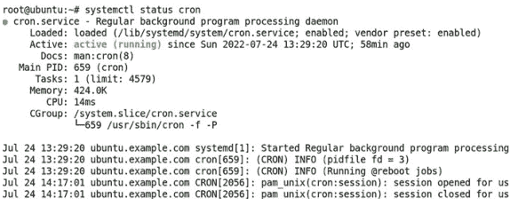

图 4.54: 关于某个服务状态的输出示例。

- 禁用当前已启用的服务，如图 4.55 所示：

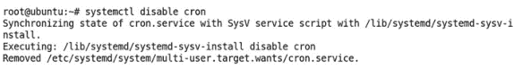

图 4.55: 禁用服务的输出示例。

- 启用一个已禁用的服务，如图 4.56 所示：


```
root@ubuntu:~# systemctl enable cron
Synchronizing state of cron.service with SysV service script with /lib/systemd/systemd-sysv-install.
Executing: /lib/systemd/systemd-sysv-install enable cron
Created symlink /etc/systemd/system/multi-user.target.wants/cron.service → /lib/systemd/system/cron.service.
```

> 图 4.56: 启用服务的输出示例。

## 结论

管理用户和组是 Linux 管理员和管理系统的常规用户的主要任务之一。Linux 提供了易于使用的工具来执行所有与用户和组相关的任务，例如创建、查询、修改或删除。

在操作 Linux 发行版时需要的其他重要知识是了解如何在系统中安装和管理软件。理解包格式、软件仓库以及可用工具是配置系统、安装新软件并在其上安装新服务的必要技能。服务通常是后台运行的应用程序，执行某些任务或为普通用户提供某些服务。

## 关键事实

- 用户和组信息存储在纯文本文件中。
- 密码经过加密，并保存在仅管理员可访问的文件中。
- Linux 发行版提供了多种工具来操作用户和组。
- 发行版的包格式有助于新软件的安装过程并更新系统。
- 软件仓库保存软件和库，使其可以从系统中访问，并且系统工具可以安装软件。
- 服务是后台运行的进程，执行某些操作或等待提供功能。

## 问题

1. `useradd` 命令的哪个选项用于创建用户目录？

   a. `-h`, `--create-home`

   b. `-m`, `--create-home`

   c. `-d`, `--create-directory`

2. 以下哪些命令不用于操作 RPM 包？

   1. b
   2. b
   3. b
   4. a 和 c
   5. b

# 第 5 章

## 管理文件、目录和进程

### 简介

本章将介绍如何操作文件、目录和进程。在 Linux 中，一切皆文件，例如常规文件和文档，或者设备，如硬盘、USB 设备，以及进程间通信和网络通信。进程信息也可以通过文件来访问。

本章的第一部分将描述 Linux 发行版中的目录结构，以更好地解释目录层次结构以及最重要目录的功能。

本章的第二部分旨在描述 Linux 中文件、目录和应用程序的权限机制。将展示用于操作文件和目录的命令，例如创建、删除或过滤内容等操作的示例。同时，还将描述用于操作权限的命令。

本章的第三部分将介绍如何使用常见的编辑器，这是操作 Linux 服务器所需的必备知识。这部分包括使用基本编辑器和更高级编辑器的示例和技巧。此外，还会描述文件管理器，它们能够以交互方式在目录之间导航。

本章的最后部分将展示 Linux 发行版中的进程如何工作，以及如何设置权限，允许或不允许执行，具体取决于尝试运行进程的用户或组。将描述用于更改进程优先级的命令，并附上不同的示例。

### 结构

在本章中，我们将讨论以下主题：

- Linux 目录结构
- 权限
- 访问文件及理解 Linux 上的文件
- 特殊字符
- 正则表达式
- 文件编辑器和文件管理器
- 进程管理
- 操作进程优先级

## Linux 目录结构

Linux 发行版具有通用的布局目录结构，其中每个目录都有特定的用途。主目录称为根目录，用斜杠 `/` 表示。其他目录都位于该目录之下。图 5.1 展示了标准的文件系统层次结构标准 (FHS)：


如前图所示，目录以斜杠 `/` 开头，随后是目录的名称，例如 `/bin/`。如果一个目录是另一个目录的一部分，则再次使用斜杠 `/` 进行分隔。例如，目录 `/usr/share/` 表示 `share/` 目录位于 `usr/` 目录下，而 `usr/` 又位于根目录 `/` 下。目录以斜杠 `/` 结尾来表示。可以不指定最后一个斜杠来引用目录，但通常这是一个好的实践，以避免文件名之间的混淆。

现代发行版对标准 FHS 进行了一些更改，以简化目录结构，并为新功能添加了新目录：

- 目录 `/bin/` 是目录 `/usr/bin/` 的链接，不再包含不同的内容。
- 目录 `/lib/` 是目录 `/usr/lib/` 的链接。
- 目录 `/lib32/`（用于 32 位库）和 `/lib64/`（用于 64 位库）是目录 `/usr/lib32/` 和 `/usr/lib64/` 的链接。
- 目录 `/sbin/` 是目录 `/usr/sbin/` 的链接。
- 一个新目录 `/sys/` 包含有关设备、驱动程序和内核功能的信息。
- 一个新目录 `/run/` 包含与可用内存相关的临时文件系统，运行时可用的数据存储在此处。该目录在启动过程中被清空。

### 存储应用程序的目录

当使用软件包 (`deb` 或 `rpm`) 安装软件时，有两个主要目录用于存储应用程序。这些目录如下：

- `/usr/bin/`（链接到 `/bin/`）：它包含常规软件，系统中的任何用户都可以执行它们。之前审查的一些命令，如 `mkdir` 或 `groups`，就存储在这里。
- `/usr/sbin/`（链接到 `/sbin/`）：它包含系统中管理员使用的软件。之前审查的一些命令，如 `useradd` 或 `groupadd`。

另一个可能包含未使用 Linux 发行版软件包安装的软件的目录是 `/usr/local/bin/`。

### 存储用户文件的目录

常规用户会在目录 `/home/` 内拥有自己的目录。该目录仅由用户或管理员访问，并与其余用户隔离。例如，用户 `agonzalez` 的默认主目录将是 `/home/agonzalez/`。对于 `root` 用户的主目录是 `/home/` 目录的一个例外。该管理员用户的主目录标记为 `/root/`。重要的是不要将 根目录（`/`）和 `root` 的主目录（`/root`）混淆。

### 存储配置的目录

在系统中全局存储配置的主要目录是 `/etc/`，它包含系统工具和服务的配置，如前所述。该目录包含配置文件和包含配置的子目录。表 5.1 中列出了几个文件配置示例：

| 文件 | 描述 |
| :--- | :--- |
| `passwd, group` | 包含用户列表和组信息 |
| `resolv.conf` | 包含 DNS 解析配置 |
| `hosts` | 包含 DNS 名称和 IP 之间的映射列表 |
| `fstab` | 包含文件系统和挂载点配置 |
| `sudoers` | 包含管理员命令的定义，常规用户可以执行这些命令。 |

表 5.1：`/etc/` 目录内的文件示例

表 5.2 中列出了几个目录配置示例：

| 目录 | 包含 |
| :--- | :--- |
| `default/` | 应用程序的一些默认配置 |
| `systemd/` | `systemd` 的定义和配置 |
| `ssl/` | 公共和私有 SSL 证书及配置。 |
| `security/` | 与系统和用户相关的安全配置。 |

表 5.2：`/etc/` 目录内的目录示例

由常规用户执行的一些应用程序使用其主目录中名为 `.config` 的目录（在 Linux 中，以点 `.` 开头的目录是隐藏的）来存储不同应用程序的配置。其他应用程序使用自己的目录来存储配置。

- `Chromium` 浏览器将在 `/<home>/<username>/.config/chromium/` 下存储配置和临时文件
- `SSH` 工具将在 `/home/<username>/.ssh/` 目录下存储配置。

### 存储库的目录

Linux 应用程序使用库来执行不同的操作。这些库可能已经存在于系统中，或者是已安装的库，当向系统中安装新软件时会自动作为依赖项安装。一些库是由 Linux 内核提供的虚拟库。存放库的目录如下：

- `/usr/lib/`, `/usr/lib64/`, 和 `/usr/lib32/`（这些目录分别链接到 `/lib/`, `/lib64/`, 和 `/lib32/`）：对系统中的所有应用程序全局可访问。
- `/usr/local/lib/`, `/usr/local/lib64/`, 和 `/usr/local/lib32/`：包含不使用 Linux 发行版软件包安装的软件所使用的库。

需要提及的是，目录 `/var/lib` 的目的不是包含库，而是应用程序的一些可变状态信息。

### 存储可变数据的目录

包含非静态数据的顶层目录是 `/var/`。内部的标准目录如表 5.3 所示：

| 目录 | 包含 |
| --- | --- |
| `backups/` | 备份应用程序的副本存储在此处 |
| `cache/` | 不同应用程序的临时文件。 |


| `crash/` | 如果某个应用程序崩溃，会在此目录中生成文件。 |

| `lib/` | 应用程序的可变状态信息。 |

| `local/` | 通过非常规 Linux 发行版软件包安装的应用程序的可变数据。 |

| `lock/` | 指示应用程序正在使用某些资源的锁定文件。 |

| `log/` | 日志文件和其中的目录。 |

| `mail/` | 用户的本地邮件文件 |

| `opt/` | 可选文件 |

| `run/` | 指向 `/run/` 目录的链接 |

| `spool/` | 包含稍后应处理的文件，例如打印作业。 |

| `tmp/` | 临时目录 |

### 存储用户数据的目录

如图 5.1 所示，目录 `/usr/` 包含面向用户的数据和应用。目录 `/usr/lib/`、`/usr/lib32/`、`/usr/lib64/`、`/usr/bin/` 和 `/usr/sbin/` 之前已作介绍。`/usr/` 下的其他重要目录如表 5.4 所示：

### 表 5.4：`/usr/` 目录下的其他目录

| 目录 | 内容 |

| :--- | :--- |

| `include/` | 从源代码编译软件所需的文件。 |

| `local/` | 与 `/usr` 结构相同，但用于非通过 Linux 发行版包安装软件。 |

| `libexec/` | 内部应用程序，可被其他程序执行，但不供普通用户直接使用。 |

| `src/` | 应用程序或 Linux 内核的源代码。 |

| `share/` | 与系统架构无关的应用程序数据。例如文档、字体、公共全局证书、图标、应用程序插件等。 |

### 存储系统数据信息和引导文件的目录

由于 Linux 中的一切都作为文件表示，Linux 发行版有一些特殊目录包含关于设备、硬件和进程的信息。内核核心和包含驱动程序的引导文件也存储在特殊目录中。这些目录如表 5.5 所示：

### 表 5.5：存储系统数据信息和引导文件的目录

| 目录 | 内容 |

| :--- | :--- |

| `/boot/` | 内核和引导文件，包括引导加载程序（例如 `grub`）的配置文件。 |

| `/dev/` | 引用系统中可用设备的文件列表，例如磁盘设备（主磁盘为 `/dev/sda`）或虚拟设备如 `/dev/random` 用于生成随机数据。标准输入、输出和错误在此处反映为 `/dev/stdin`、`/dev/stdout` 和 `/dev/stderr`。 |

| `/proc/` | 进程和内核信息。每个进程都有一个相关的内部目录，包含有关执行的信息。其他文件包含有关系统的信息，例如 `/proc/cpuinfo`，其中包含有关系统 `CPU` 的详细信息。 |

| `/sys/` | 设备、驱动程序和内核特性。例如，子目录 `/sys/class/net/` 包含有关网络设备的信息。 |

当进程在系统中运行时，会在 `/proc/` 目录内创建一个包含分配给该进程 ID 的子目录。例如，ID 为 `687` 的进程将拥有一个专用目录 `/proc/687/`。在该目录内部，有包含有关进程有用信息的文件和目录。表 5.6 显示了其中最常用的内容：

### 表 5.6：`/proc/` 目录中与进程相关的目录和文件

| 目录/文件 | 描述 |

| :--- | :--- |

| `/proc/PID/cmdline` | 命令行参数。 |

| `/proc/PID/cpu` | 当前及最后执行所在的 CPU。 |

| `/proc/PID/cwd` | 指向当前工作目录的链接。 |

| `/proc/PID/environ` | 环境变量的值。 |

| `/proc/PID/exe` | 指向该进程可执行文件的链接。 |

| `/proc/PID/fd` | 包含所有文件描述符的目录。 |

| `/proc/PID/maps` | 可执行文件和库文件的内存映射。 |

| `/proc/PID/mem` | 该进程持有的内存。 |

| `/proc/PID/root` | 指向该进程根目录的链接。 |

| `/proc/PID/stat` | 进程状态。 |

| `/proc/PID/statm` | 进程内存状态信息。 |

| `/proc/PID/status` | 人类可读形式的进程状态。 |

## 权限

在 Linux 系统中，每个文件和目录都为用户所有者、组所有者成员以及不属于该组的其余用户定义了访问权限。可用的权限包括：读取、写入和执行。对于目录而言，如果用户能够读取内部内容，则执行权限具有相应的含义。

权限可以用单个字符或数字表示。表 5.7 显示了可用的权限及其表示方法：

### 表 5.7：权限的符号和八进制表示

| 权限 | 符号表示 | 八进制表示 |

| :--- | :---: | :---: |

| 读取 | `r` | `4` |

| 写入 | `w` | `2` |

| 执行 | `x` | `1` |

在以符号表示法分配权限时，所有者用字符 `u` 表示，组所有者用字符 `g` 表示，其他用户用字母 `o` 表示。权限 `u=rwx`、`g=rw`、`o=r` 表示：

- 用户所有者能够读取（`r`）、写入（`w`）和执行（`x`）该文件。

- 与该文件关联的组成员能够读取和写入文件，但不能执行它。

- 其他用户可以读取文件，但不能写入或执行它。

权限 `u=rwx`、`g=rx`、`o=` 表示：

- 用户所有者能够访问目录（`x`），能够读取内容（`r`）并创建新文件（`w`）。

- 与该目录关联的组成员能够访问目录（`x`）并能够读取目录内容（`r`），但不能写入新文件。

- 其他成员将无法访问该目录，因为他们没有执行权限（`x`）。

八进制表示法是要分配的权限之和。例如，`read`（读取）和 `write`（写入）权限由数字 `6` (`4+2`) 表示。第一位数字代表用户所有者，第二位代表组所有者，最后一位代表其他用户。之前展示的字符表示法及其他示例在表 5.8 中进行了说明：

### 表 5.8：权限转换示例

| 符号表示 | 转换 | 八进制表示 |

|---|---|---|

| `u=rwx,g=rw,o=r` | `u=4+2+1,g=4+2,o=4` | `764` |

| `u=rwx,g=rx,o=` | `u=4+2+1,g=4+1,o=0` | `750` |

| `u=rwx,g=rwx,o=rx` | `u=4+2+1,g=4+2+1,o=4+1` | `775` |

| `u=rw,g=rw,o=r` | `u=4+2,g=4+2,o=4` | `664` |

带有 `-l` 选项的命令 `ls` 将显示文件和目录的权限。第一个字符将指示文件类型：

- `-` 字符表示这是一个常规文件。

- 字母 `d` 表示这是一个目录。

- 字母 `l` 表示这是一个符号链接。

- 字母 `c` 表示这是一个字符设备

- 字母 `p` 表示这是一个管道

- 字母 `s` 表示这是一个套接字

- 字母 `b` 表示这是一个块设备。

在文件类型之后，接下来的三个字符表示用户所有者的权限，然后接下来的三个字符表示组所有者的权限，最后三个字符表示其他用户的权限。`图 5.2` 展示了不同权限和文件类型的一些示例：

```
root@ubuntu:~# ls -ld /etc/{,passwd,shadow} /dev/{vda,console} /run/snapd.socket
crw-rw---- 1 root tty 5, 1 Jul 25 17:40 /dev/console
brw-rw---- 1 root disk 252, 0 Jul 25 17:40 /dev/vda
drwxr-xr-x 97 root root 4096 Jul 24 15:31 /etc/
-rw-r--r-- 1 root root 1838 Jul 24 13:32 /etc/passwd
-rw-r----- 1 root shadow 1198 Jul 24 13:32 /etc/shadow
srw-rw-rw- 1 root root 0 Jul 25 17:40 /run/snapd.socket
```

`图 5.2：不同类型的文件及相关权限。`

第三列指示用户所有者，第四列指示组所有者。例如，对于图中的文件 `/etc/shadow`，用户 `root` 具有该文件的读取和写入权限，`shadow` 组中的成员具有只读权限。出于安全原因，其他用户无权访问该文件，因为该文件包含加密密码。

查看文件或目录权限的另一种方法是使用命令 `stat`，该命令将显示更多相关信息，例如文件何时被修改、更改（权限或所有者）、创建或访问。`图 5.3` 展示了使用文件 `/etc/passwd` 的一个示例：


```
root@ubuntu:~# stat /etc/passwd
File: /etc/passwd
Size: 1838 Blocks: 8 IO Block: 4096 regular file
Device: fd00h/64768d Inode: 397042 Links: 1
Access: (0644/-rw-r--r--) Uid: ( 0/root) Gid: ( 0/root)
Access: 2022-07-30 09:55:03.691999361 +0000
Modify: 2022-07-24 13:32:07.456812114 +0000
Change: 2022-07-24 13:32:07.456812114 +0000
Birth: 2022-07-24 13:32:07.45681214 +0000
```

*图 5.3：命令 `stat` 的输出示例。*

默认权限取决于系统或用户文件创建掩码值。默认值定义在文件`/etc/login.defs`中，通常定义为`002`。此值将应用于文件的完全权限（`666`）和目录的完全权限（`777`），导致默认情况下创建的文件权限为`664`，目录权限为`775`。`bash`实用程序`umask`允许我们查看和修改`file-creation mask`值。*图 5.4*展示了创建文件和目录时的默认`umask`值及权限：

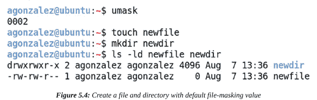

*图 5.5*展示了如何使用`umask`修改默认文件掩码值，以及它如何影响新文件和目录的权限：

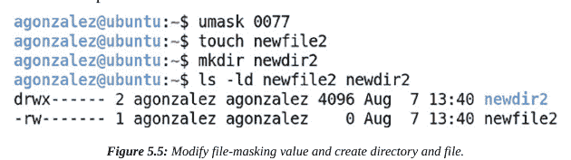

在*图 5.3*和*5.4*中，出现了四个数字，因为 Linux 还提供了一些名为*set user identity*（`setuid`）、*set group identity*（`setgid`）和*sticky bit*的特殊权限。*表 5.9*展示了这些权限的表示及其含义：

| 权限 | 符号 | 数字 | 描述 |
| :--- | :--- | :--- | :--- |
| setuid | s (在用户执行权限位) | 4 | 应用程序将始终以拥有该应用程序的用户身份执行。 |
| setgid | s (在组执行权限位) | 2 | 如果是应用程序，它将作为拥有该应用程序的组执行。如果是目录，在内部创建的文件将具有与该目录关联的组。 |
| sticky bit | t (在其他执行权限位) | 1 | 此权限限制对目录中文件的删除。 |

*表 5.9: 权限在符号和八进制中的表示*

命令`passwd`是使用特殊权限`setuid`的应用程序示例。任何用户都可以执行此命令来修改自己的密码，但执行操作将以`root`用户的身份进行，以便能够修改`/etc/passwd`和`/etc/shadow`文件。图 5.6 展示了如何使用`stat`命令来显示文件的八进制和字符表示：

```
root@ubuntu:~# stat -c "%a %A" /usr/bin/passwd
4755 -rwsr-xr-x
```

*图 5.6: `stat` 命令输出示例*

在 Debian 及其衍生发行版中，命令`change`（注：原文此处可能笔误，实际应指`chage`）具有特殊权限`setgid`。普通用户运行此命令时，将使用该文件`/usr/bin/chage`关联的组拥有者，并可以通过该组访问`/etc/shadow`文件。图 5.7 展示了`chage`命令的权限：

```
root@ubuntu:~# stat -c "%a %A" /usr/bin/chage
2755 -rwxr-sr-x
```

*图 5.7: `stat` 命令输出示例*

图 5.8 展示了在具有`setgid`特殊权限关联的目录与普通目录中创建文件的区别。在具有`setgid`权限的目录中创建的文件将保留其创建所在目录的组。在没有该权限的默认行为下，意味着使用用户的主组。

```
agonzalez@ubuntu:~$ ls -ld specialdir/ regulardir/
drwxr-xr-x 2 agonzalez adm 4096 Jul 30 19:48 regulardir/
drwxr-sr-x 2 agonzalez adm 4096 Jul 30 19:48 specialdir/
agonzalez@ubuntu:~$ touch regulardir/file
agonzalez@ubuntu:~$ ls -l regulardir/file
-rw-rw-r-- 1 agonzalez agonzalez 0 Jul 30 19:53 regulardir/file
agonzalez@ubuntu:~$ touch specialdir/file
agonzalez@ubuntu:~$ ls -l specialdir/file
-rw-rw-r-- 1 agonzalez adm 0 Jul 30 19:53 specialdir/file
```

*图 5.8: 在普通目录和具有特殊权限的目录中创建文件的输出示例*

`sticky bit`最常见的例子是临时目录`/tmp/`。所有用户都可以在此目录中写入，但用户只能删除自己的文件，而不能删除其他用户的文件（管理员除外，管理员可以删除任何文件）。图 5.9 展示了`/tmp/`目录如何具有`sticky`权限（`t`），即使文件由用户的组拥有。在此情况下，由于用户所有者不同，因此无法删除：

```
agonzalez@ubuntu:~$ ls -ld /tmp/

drwxrwxrwt 12 root root 4096 Jul 30 19:58 /tmp/
\agonzalez@ubuntu:~$ ls -l /tmp/deleteeme
\agonzalez@ubuntu:~$ rm /tmp/deleteeme

-rw-rw-r-- 1 testuser agonzalez 0 Jul 30 19:57 /tmp/deleteeme
rm: cannot remove '/tmp/deleteeme': Operation not permitted
```


图 5.10 演示了如果是一个未设置`sticky bit`的目录，同样的文件是如何被删除的：

```
agonzalez@ubuntu:~$ ls -l deleteeme
\agonzalez@ubuntu:~$ rm -v deleteeme

-rw-rw-r-- 1 testuser agonzalez 0 Jul 30 20:03 deleteeme
removed 'deleteeme'
```


由于安全原因，系统中由`root`用户或`root`组拥有并使用`setuid`或`setgid`特殊权限的文件，需要限制在特定的系统工具中。任何其他使用这些权限的软件都是从普通用户升级权限的潜在风险。使用`find`命令，可以找到具有`setuid`权限（`4xyz`）和`setgid`权限（`2xyz`）的文件。图 5.11 展示了在系统中搜索具有特殊权限分配的文件的输出：

```
root@ubuntu:~# find /usr/bin/ -perm /4000
/usr/bin/su
/usr/bin/newgrp
/usr/bin/sudo
/usr/bin/chfn
/usr/bin/umount
/usr/bin/chsh
/usr/bin/gpasswd
/usr/bin/mount
/usr/bin/pkexec
/usr/bin/passwd
/usr/bin/fusermount3
```

```
root@ubuntu:~# find /usr/bin/ -perm /2000
/usr/bin/write.ul
/usr/bin/wall
/usr/bin/crontab
/usr/bin/expiry
/usr/bin/ssh-agent
/usr/bin/chage
```

*图 5.11: 列出具有特殊权限的文件输出示例。*

## Linux 中文件的访问与理解

如前所述，在 Linux 系统中，一切皆文件。为了理解如何访问文件以读取内容、操作内容以及删除文件，需要管理并操作 Linux 服务器。本节将专注于如何为文件和目录分配所有者、用户和组，如何设置权限，以及如何访问文件并过滤或格式化内容。

### 命令 chown 和 chgrp

更改用户所有者和组所有者的主要命令是`chown`。管理员用户可以使用此命令修改文件和目录的所有者。相比之下，普通用户只能修改文件和目录的组，且仅限于目标组是用户所属组之一。表 5.10 展示了所有可能的语法选项：

| 语法 | 描述 |
| :--- | :--- |


### 命令 chown

| 语法 | 描述 |
| :--- | :--- |
| `chown user:group file(s)/dir(s)` | 更改指定文件和/或目录的用户和组所有者。 |
| `chown user file(s)/dir(s)` | 更改指定文件和/或目录的用户所有者。 |
| `chown user: file(s)/dir(s)` | 与上一个语法相同。 |
| `chown :group file(s)/dir(s)` | 更改指定文件和/或目录的组所有者。 |

*表 5.10: 命令 `chown` 的可能语法*

可以使用名称或 `group id`（组 ID）来指定用户和组。旧版本的 `chown` 命令使用点 (`.`) 作为分隔符，而不是冒号 (`:`)。虽然它仍然是有效的分隔符，但不再推荐使用。参数可以是文件、目录，或由空格分隔的文件和/或目录列表。`chown` 命令的常用选项如 *表 5.11* 所示：

| 选项 | 描述 |
| :--- | :--- |
| `-C, --changes` | 显示已执行的操作，但仅显示更改部分。 |
| `-v, --verbose` | 显示所有已执行的操作，包括被跳过的部分。 |
| `--reference=SOURCE` | 从指定的源复制所有者和组所有者。 |
| `-R, --recursive` | 更改指定目录中所有文件和子目录的所有权限。 |

*表 5.11: 命令 `chown` 的常用选项*

*图 5.12*、*5.13* 和 5.14 展示了使用 `chown` 命令的示例：

- 尝试以普通用户身份更改文件的所有者：

```
agonzalez@ubuntu:~$ ls -l example.txt
-rw-rw-r-- 1 agonzalez agonzalez 37 Jul 3 19:27 example.txt
agonzalez@ubuntu:~$ chown testuser example.txt
chown: changing ownership of 'example.txt': Operation not permitted
```

*图 5.12: 使用命令 `chown` 的输出示例*

- 以普通用户身份更改文件的组所有者：

```
agonzalez@ubuntu:~$ ls -l example.txt
-rw-rw-r-- 1 agonzalez agonzalez 37 Jul 3 19:27 example.txt
agonzalez@ubuntu:~$ groups
agonzalez adm cdrom sudo dip plugdev lxd
agonzalez@ubuntu:~$ chown :root example.txt
chown: changing group of 'example.txt': Operation not permitted
agonzalez@ubuntu:~$ chown -v :sudo example.txt
changed ownership of 'example.txt' from agonzalez:agonzalez to :sudo
```


- 以管理员身份递归地更改目录的用户和组所有者。

```
root@ubuntu:/tmp# chown -R -v agonzalez:agonzalez snap/
changed ownership of 'snap/lxd/22911' from root:root to agonzalez:agonzalez
changed ownership of 'snap/lxd/22923' from root:root to agonzalez:agonzalez
changed ownership of 'snap/lxd/common' from root:root to agonzalez:agonzalez
changed ownership of 'snap/lxd/current' from root:root to agonzalez:agonzalez
changed ownership of 'snap/lxd' from root:root to agonzalez:agonzalez
changed ownership of 'snap/' from root:root to agonzalez:agonzalez
```


命令 `chgrp` 用于仅更改文件和目录的组所有者。其语法为 `chgrp [选项] 组 文件/目录`。选项与 `chown` 命令相同。

### 命令 chmod

该命令用于更改文件和目录的权限。它允许我们使用符号或八进制表示法来指定权限。正如前文关于权限的描述，符号表示法具有如下语法：`u=权限,g=权限,o=权限`，而八进制表示法可以包含三个数字，或者在需要指定特殊权限时包含四个数字。

命令 `chmod` 可以使用等号字符（`=`）替换当前权限，或使用加号（`+`）增加更多权限来操作当前权限，或使用减号字符（`-`）移除权限。该命令 `chmod` 允许使用加号（`+`）添加权限或使用减号（`-`）删除权限，而无需替换等号（`=`）。同样，`chmod` 允许仅指定要修改的权限，而不必指定所有组件。此外，`chmod` 允许使用字母 “`a`” 来设置、添加或删除所有组件的权限。

此命令的选项与命令 `chown` 的选项相同（参见 *表 5.11*）。*图 5.15*、*5.16* 和 *5.17* 展示了使用命令 `chmod` 的不同示例：

- 指定用户具有读写权限，组仅具有读权限，其他用户无任何权限。

```
agonzalez@ubuntu:~$ chmod -v u=rw,g=r,o= example.txt
mode of 'example.txt' changed from 0664 (rw-rw-r--) to 0640 (rw-r----);
```


- 移除组所有者的读权限：

```
agonzalez@ubuntu:~$ chmod -v g-r example.txt
mode of 'example.txt' changed from 0640 (rw-r-----) to 0600 (rw-------)
```


- 使用八进制表示法指定用户和组具有读写权限，其他用户具有读权限：

```
agonzalez@ubuntu:~$ chmod -v 644 example.txt
mode of 'example.txt' changed from 0600 (rw-------) to 0644 (rw-r--r--)
```


为了理解文件和目录的*执行*权限，*图 5.18* 和 *5.19* 展示了不同的示例：

- 为文件添加执行权限以便其能够被执行：

```
agonzalez@ubuntu:~$ stat -c "%a %A" appl
664 -rw-rw-r--
agonzalez@ubuntu:~$ ./appl
-bash: ./appl: Permission denied
agonzalez@ubuntu:~$ chmod -v u+x appl
mode of 'appl' changed from 0664 (rw-rw-r--) to 0764 (rwxrw-r--)
agonzalez@ubuntu:~$ ./appl
Example application
```


- 移除目录的执行权限以禁止访问内部文件：


```
agonzalez@ubuntu:~$ ls -ld regulardir/ regulardir/*
drwxr-xr-x 2 agonzalez adm      4096 Jul 30 19:53 regulardir/
-rw-rw-r-- 1 agonzalez agonzalez    0 Jul 30 19:53 regulardir/file
agonzalez@ubuntu:~$ chmod -v a+x regulardir/
mode of 'regulardir/' changed from 0755 (rwxr-xr-x) to 0644 (rw-r--r--)
agonzalez@ubuntu:~$ ls -ld regulardir/ regulardir/*
ls: cannot access 'regulardir/file': Permission denied
drw-r--r-- 2 agonzalez adm 4096 Jul 30 19:53 regulardir/
```

图 5.19：使用 `chmod` 移除执行权限的示例。

### 命令 `cat`

此命令用于查看一个或多个文件的内容。该内容将在标准输出中显示，并且如前所述，可以重定向到另一个文件或通过管道传递给另一个命令。此命令的常用选项如表 5.12 所示：

| 选项 | 描述 |
| :--- | :--- |
| `-b, --number-nonblank` | 对非空行进行编号 |
| `-n, --number` | 对非空行和空行进行编号 |

表 5.12：命令 `cat` 的常用选项

图 5.20 展示了如何查看文件内容以及如何对行进行编号：

```
agonzalez@ubuntu:~$ cat /etc/legal
The programs included with the Ubuntu system are free software;
the exact distribution terms for each program are described in the
individual files in /usr/share/doc/*/copyright.

Ubuntu comes with ABSOLUTELY NO WARRANTY, to the extent permitted by
applicable law.

agonzalez@ubuntu:~$ cat -n /etc/legal
     1
     2  The programs included with the Ubuntu system are free software;
     3  the exact distribution terms for each program are described in the
     4  individual files in /usr/share/doc/*/copyright.
     5
     6  Ubuntu comes with ABSOLUTELY NO WARRANTY, to the extent permitted by
     7  applicable law.
     8
```

图 5.20：使用命令 `cat` 的示例

### 命令 `head` 和 `tail`

命令 `head` 用于查看文件的开头部分，而命令 `tail` 用于查看文件的末尾部分。默认情况下，它显示前 10 行或后 10 行。可以使用 `-X`（例如，`-20`）或 `-n X`（例如 `-n 20`）来指定不同的行数。

命令 `tail` 有一个常用且实用的选项，用于继续跟踪文件中新追加的数据。此选项用于跟踪日志文件以检查实时状态。

图 5.21 和 5.22 展示了不同的示例：

- 查看文件 `/etc/passwd` 的前五行：

```
root@ubuntu:~# head -n5 /etc/passwd
root::x:0:0:root:/root:/bin/bash
daemon::x:1:1:daemon:/usr/sbin:/usr/sbin/nologin
bin:x:2:2:bin:/bin:/usr/sbin/nologin
sys:x:3:3:sys:/dev:/usr/sbin/nologin
sync::x:4:65534:sync:/bin:/bin/sync
```

图 5.21：使用命令 `head` 的示例

- 查看文件 `/var/log/syslog` 的最后五行并等待追加的数据：

```
root@ubuntu:~# tail -n5 -f /var/log/syslog
Jul 31 07:57:53 ubuntu systemd[1]: Finished Daily apt upgrade and clean activities.
Jul 31 07:57:53 ubuntu systemd[1]: apt-daily-upgrade.service: Consumed 1.408s CPU time.
Jul 31 08:06:11 ubuntu rsyslogd: [origin software="rsyslogd" swVersion="8.2112.0" x-pid="666" x-info="https://www.rsyslog.com"] rsyslogd was HUPed
Jul 31 08:17:01 ubuntu CRON[6872]: (root) CMD (   cd / && run-parts --report /etc/cron.hourly)
Jul 31 09:17:01 ubuntu CRON[6321]: (root) CMD (   cd / && run-parts --report /etc/cron.hourly)
```

图 5.22：使用命令 `tail` 的示例

## 特殊字符

在 Linux 控制台中使用命令涉及使用一些对 shell 具有特定含义的特殊字符。前文已描述了一些特殊字符，例如波浪号 (`~`) 代表主目录，大于号 (`>`) 和小于号 (`<`) 代表标准输入和输出，以及竖线 (`|`) 代表数据管道。其他间接展示的特殊字符包括用于指定选项的连字符 (`-`)，用于指定或分隔目录的斜杠 (`/`)，以及用于分隔命令、选项和参数的空格符号。表 5.13 展示了在 shell 中操作时其余的特殊字符：

| 特殊字符 | 描述 |
|---|---|
| `\` | 转义特殊字符 |
| `$` (美元符号) | 用于访问变量数据 |
| `"` (双引号) | 保护双引号之间的所有内容不被视为特殊字符，并允许评估变量。 |
| `'` (单引号) | 与双引号类似，但不允许评估变量。 |
| `#` (井号) | 在 shell 中以井号开头的行被标记为注释。 |
| `&` (and) | 用于在后台执行进程。将在本章稍后描述。 |
| `?` (问号) | 仅匹配一个字符 |
| `*` (星号) | 匹配一个或多个字符。 |
| `[ ]` (方括号) | 字符范围 |
| `{ }` (花括号) | 指定不同的选项 |
| `( )` (圆括号) | 启动一个子 shell |
| `;` (分号) | 在一行中分隔多个命令。 |

表 5.13：特殊字符列表及描述

图 5.23 到 5.24 通过实际示例展示了这些特殊字符的使用：

- 使用双引号和转义字符 (`\`) 来访问名称中包含空格的文件：

```
agonzalez@ubuntu:~$ ls filename with spaces
ls: cannot access 'filename': No such file or directory
ls: cannot access 'with': No such file or directory
ls: cannot access 'spaces': No such file or directory
agonzalez@ubuntu:~$ ls -l "filename with spaces"
-rw-rw-r-- 1 agonzalez agonzalez 0 Jul 31 10:29 'filename with spaces'
agonzalez@ubuntu:~$ ls -l filename\ with\ spaces
-rw-rw-r-- 1 agonzalez agonzalez 0 Jul 31 10:29 'filename with spaces'
```

图 5.23：使用特殊字符的示例。

- 使用双引号和单引号处理变量时的区别：

```
agonzalez@ubuntu:~$ echo "My shell is $SHELL"

My shell is /bin/bash

agonzalez@ubuntu:~$ echo 'My shell is $SHELL'

My shell is $SHELL
```

图 5.24：使用特殊字符的示例。

- 例如，使用井号 (`#`) 来避免执行命令，这有助于将内容保存在历史记录中而不执行它。参见图 5.25：


`agonzalez@ubuntu:~$ #this command is not executed`

`agonzalez@ubuntu:~$`

图 5.25：使用特殊字符的示例。

- 使用问号和星号来匹配文件和目录，如图 5.26 所示：

`agonzalez@ubuntu:~$ ls example.???`

`example.bin example.doc example.txt`

`agonzalez@ubuntu:~$ ls example.*`

`example.bin example.doc example.docx example.txt`

图 5.26：使用特殊字符的示例。

- 使用方括号来指定要匹配的字符范围。可以使用连字符来指定范围，如图 5.27 所示：

`agonzalez@ubuntu:~$ ls example[1234].txt`

`example1.txt example2.txt example3.txt example4.txt`

`agonzalez@ubuntu:~$ ls example[5-9].txt`

`example5.txt example6.txt example7.txt example8.txt example9.txt`

图 5.27：使用特殊字符的示例。

- 使用花括号可以指定不同的选项；如图 5.28 所示，这两个命令被评估为相同：

`agonzalez@ubuntu:~$ ls /etc/passwd /etc/shadow /etc/group`

`/etc/group /etc/passwd /etc/shadow`

`agonzalez@ubuntu:~$ ls /etc/{passwd,shadow,group}`

`/etc/group /etc/passwd /etc/shadow`

图 5.28：使用特殊字符的示例。

- 使用括号可以打开一个`子 shell`来运行命令，如图 5.29 所示：

`agonzalez@ubuntu:~$ echo "Current directory is $(pwd)"`

`Current directory is /home/agonzalez`

图 5.29：使用特殊字符的示例。

- 使用分号可以在一行中运行多个命令，如图 5.30 所示：

`agonzalez@ubuntu:~$ echo "Command 1" ; echo "Command 2"`

`Command 1`

`Command 2`

图 5.30：使用特殊字符的示例。

有一些特殊字符可以组合使用以获得特殊功能，如我们之前讨论的那样。例如，`双大于号`（`>>`）用于追加数据或符号，而`与大于号`（`&>`）用于重定向`标准输出和错误`。另外三个常用选项在表 5.14 中描述：

| 特殊字符 | 描述 |
| :--- | :--- |
| `\|\|` (双竖线) | 如果第一个命令失败，则执行指示的第二个命令 |
| `&\&` (双与号) | 如果第一个命令正确执行，则执行第二个命令。 |
| `--` (双连字符) | 指示命令行选项的结束。 |

表 5.14：特殊字符组合。

`图 5.31` 展示了这些特殊字符组合的用法：

`agonzalez@ubuntu:~$ failcommand || echo "First command failed"`

`failcommand: command not found`

`First command failed`

`agonzalez@ubuntu:~$ echo "Good command" || echo "This is never executed"`

`Good command`

`agonzalez@ubuntu:~$ failcommand && echo "This is never executed"`

`failcommand: command not found`

`agonzalez@ubuntu:~$ echo "Good command" && echo "First command succeeded"`

`Good command`

`First command succeeded`

`agonzalez@ubuntu:~$ ls -l -b.txt`

`ls: invalid option -- 'b'`

`Try 'ls --help' for more information.`

`agonzalez@ubuntu:~$ ls -l -- -b.txt`

`-rw-rw-r-- 1 agonzalez agonzalez 0 Jul 31 13:30 -b.txt`


### 正则表达式

正则表达式是用于匹配字符串中字符组合的模式。这些表达式可以是简单的，也可以是使用复杂模式的先进的。本节将重点介绍用于过滤文件内容的简单表达式。有三种类型的正则表达式：基本（`BRE`）、扩展（`ERE`）和`Perl (PCRE)`。这里仅以前两种为例进行介绍。`基本`类型的一些特殊字符在表 5.15 中展示：

| 特殊字符 | 描述 |
| :-- | :-- |
| `.` (点) | 匹配任意元素 |
| `^` (脱字符) | 匹配序列的开始。 |
| `$` (美元符号) | 匹配序列的结束。 |


对于`高级`类型，可以匹配字符的重复和条件。这些类型的特殊字符在表 5.16 中展示：

| 特殊字符 | 描述 |
| :-- | :-- |
| `*` (星号) | 零次或多次重复 |
| `+` (加号) | 一次或多次重复 |
| `?` (问号) | 零次或一次重复 |
| `[m]` | 恰好 `m` 次重复 |
| `[m,n]` | 在 `m` 到 `n` 次之间重复 |
| `\|` (竖线) | 匹配左侧或右侧表达式。 |

表 5.16：简单正则表达式示例。

### `grep` 命令

`grep` 命令是一个强大的工具，具有使用正则表达式匹配文本的不同可能性。`GREP` 代表 `G lobal S earch , a R egular E xpression and P rint`（全局搜索，一个正则表达式并打印）。此命令默认使用基本正则表达式（`BRE`），但通过使用选项 `-E` 可以使用高级表达式（`ERE`），选项 `-P` 用于 `Perl` 表达式（`PRE`），但这不在本书范围内。

`grep` 命令的语法如下：`grep [选项] 模式 文件(s)`。表 5.17 展示了可用的常用选项：

| 选项 | 描述 |
| :--- | :--- |
| `-F, --fixed-strings` | 将模式解释为固定字符串，而不是正则表达式。 |
| `-e pattern, --regexp=pattern` | 指定模式的选项，可以重复此选项以匹配多个模式。 |
| `-f file, --file=file` | 从指定文件中获取模式。 |
| `-i, --ignore-case` | 在模式中忽略大小写区别。 |
| `-v, --invert-match` | 反转匹配的含义，显示不匹配的行。 |
| `-w, --word-regexp` | 确保模式与整个单词匹配。 |
| `-c, --count` | 不显示输出，而是显示为每个文件找到的匹配次数。 |
| `-r, --recursive` | 读取指定目录下的所有文件。 |
| `-R, --dereference-recursive` | 与 `-r, --recursive` 相同，但如果目录是符号链接，也会跟随它们。 |

表 5.17：`grep` 命令的常用选项。

图 5.32 到 5.36 展示了使用基本模式和不同 `grep` 选项的不同示例：

- 在文件 `/etc/passwd` 中行的任何位置搜索文本 `daemon`：

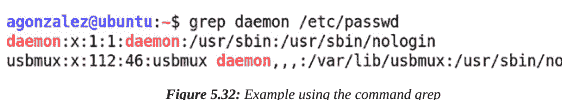

- 在文件 `/etc/passwd` 中行的开头搜索文本 `daemon`：

`gonzalez@ubuntu:~$ grep ^daemon /etc/passwd`

`daemon:x:1:1:daemon:/usr/sbin:/usr/sbin/nologin`

图 5.33：使用 `grep` 命令的示例。

- 计算 `/etc/passwd` 中包含单词 `bash` 的行数：

`gonzalez@ubuntu:~$ grep -c bash /etc/passwd`

`3`

图 5.34：使用 `grep` 命令的示例。

- 过滤长度为用户名为五个字符的用户。任意五个字符后跟 `":x"`：

`gonzalez@ubuntu:~$ grep ^.....x: /etc/passwd`

`games:x:5:60:games:/usr/games:/usr/sbin/nologin`

`proxy:x:13:13:proxy:/bin:/usr/sbin/nologin`

`gnats:x:41:41:Gnats Bug-Reporting System (admin):/var/lib/gnats:/usr/sbin/nologin`


`uuid:x:108:114::/run/uuidd:/usr/sbin/nologin`

图 5.35：使用 `grep` 命令的示例

*   计算 `/etc/legal` 中有多少行是空的，并使用选项 `-v` (`--invert-match`) 显示内容并忽略空行；模式 `^$` 意味着行开始和结束都没有任何内容：

```
gonzalez@ubuntu:~$ grep -c $ /etc/legal

3

gonzalez@ubuntu:~$ grep -v ^$ /etc/legal

The programs included with the Ubuntu system are free software;

the exact distribution terms for each program are described in the

individual files in /usr/share/doc/*/copyright.

Ubuntu comes with ABSOLUTELY NO WARRANTY, to the extent permitted by

applicable law.
```

图 5.36：使用 `grep` 命令的示例

图 5.37 到 5.41 展示了使用高级模式和不同 `grep` 选项的不同示例：

*   检查文件内容并过滤以字母 `r` 开头，后跟字母 `o`（可选）或多个 `o`，并以字母 `t` 结尾的行：

```
gonzalez@ubuntu:~$ cat text

rt

rot

roo
```

### `grep` 命令

*   检查文件内容并筛选以字母 `r` 开头，后跟字母 `o` 或若干 `o`，且以字母 `t` 结尾的内容：

```
agonzalez@ubuntu:~$ grep -E ro*t text
rt
rot
root
```

图 5.37：使用 `grep` 命令的示例

*   检查文件内容并筛选以字母 `r` 开头，后跟字母 `o` 或若干 `o`，且以字母 `t` 结尾的内容：

```
agonzalez@ubuntu:~$ grep -E ro+t text
rot
root
```

图 5.38：使用 `grep` 命令的示例

*   检查文件内容并筛选以字母 `r` 开头，后跟可选的字母 `o`，且以字母 `t` 结尾的内容：

```
agonzalez@ubuntu:~$ grep -E ro?t text
rt
rot
```

图 5.39：使用 `grep` 命令的示例

*   检查文件内容并筛选以字母 `r` 开头，后跟两个字母 `o`，且以字母 `t` 结尾的内容。筛选以字母 `p` 开头，后跟 1 或 2 个字母 `e`，且以字母 `n` 结尾的内容：

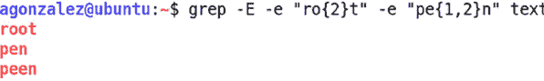

图 5.40：使用 `grep` 命令的示例

*   以两种不同的方式查找单词 `agonzalez` 和 `root`：

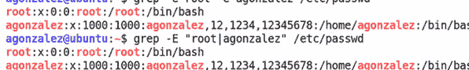

图 5.41：使用 `grep` 命令的示例

### `awk` 命令

`AWK` 是一种模式扫描和处理语言。工具 `awk` 使用正则表达式来匹配行，并允许打印部分字段。该命令有许多选项和复杂操作的可能性；图 5.42 和 5.43 仅展示了一些实际应用案例：

*   打印使用 `shell bash` 的用户名：

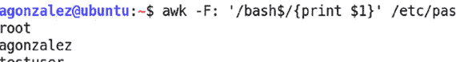

图 5.42：使用 `awk` 命令的示例

*   搜索字符串 `/home` 并打印用户名、主目录和 `shell` 所在的列：

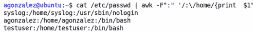

图 5.43：使用 `awk` 命令及其 `cat` 命令输出的示例

### 格式化输出

Linux 提供了多个工具来格式化文件内容或另一命令的输出。这些命令是 `coreutils` 软件包的一部分，该软件包在 Linux 发行版中默认安装。表 5.18 展示了一些常用命令及其描述：

| 命令 | 描述 |
| :--- | :--- |
| `nl` | 为文件的行编号 |
| `sort` | 对文本文件的行进行排序 |
| `tac` | 以反序显示指定文件 |
| `tr` | 转换或删除字符 |
| `sed` | 过滤和转换文本 |
| `rev` | 逐字符反转行 |
| `wc` | 统计单词和行数 |
| `fmt` | 简单的最优文本格式化程序 |
| `uniq` | 省略或报告重复行 |
| `join` | 基于公共字段连接两个文件的行 |
| `paste` | 合并文件的行 |
| `shuf` | 生成随机排列 |

表 5.18：用于格式化输出的常用命令

图 5.44 到 5.55 分别为每个命令提供了一个示例：

*   使用 `nl` 为一个文件中的行编号：

```
agonzalez@ubuntu:~$ nl /etc/legal
1 The programs included with the Ubuntu system are free software;
2 the exact distribution terms for each program are described in the
3 individual files in /usr/share/doc/*/copyright.
4
5 Ubuntu comes with ABSOLUTELY NO WARRANTY, to the extent permitted by applicable law.
```

图 5.44：`nl` 命令的输出示例

*   使用 `sort` 进行字母顺序排序：

```
agonzalez@ubuntu:~$ awk -F":" ' /bash$/{print $1}' /etc/passwd | sort
agonzalez
root
testuser
```

图 5.45：`sort` 命令的输出示例

*   使用 `tac` 以反序查看文件：

```
agonzalez@ubuntu:~$ tac /etc/legal
applicable law.
Ubuntu comes with ABSOLUTELY NO WARRANTY, to the extent permitted by
individual files in /usr/share/doc/*/copyright.
the exact distribution terms for each program are described in the
The programs included with the Ubuntu system are free software;
```

图 5.46：`tac` 命令的输出示例

*   使用 `tr` 转换文本中的字符：

```
agonzalez@ubuntu:~$ echo "UXXER CASE LINE" | tr '[A-Z]' '[a-z]' | tr 'x' 'p'
upper case line
```

图 5.47：`tr` 命令的输出示例

*   使用 `sed` 转换文本中的表达式：

```
agonzalez@ubuntu:~$ cat /etc/hostname
ubuntu.example.com

agonzalez@ubuntu:~$ cat /etc/hostname | sed 's/example.com/localdomain/'
ubuntu.localdomain
```

图 5.48：`sed` 命令的输出示例

*   使用 `rev` 逐字符反转行：

```
agonzalez@ubuntu:~$ echo "Hello world" | rev
dlrow olleH
```

图 5.49：`rev` 命令的输出示例

*   使用 `wc` 统计一个文件的行数、单词数和字符数：

```
agonzalez@ubuntu:~$ wc /etc/legal
8  38 267 /etc/legal
```

图 5.50：`wc` 命令的输出示例

*   使用 `fmt` 格式化输出，将段落重新排版为 60 字符宽度：

```
agonzalez@ubuntu:~$ fmt -w 60 /etc/legal
The programs included with the Ubuntu system are free software;
the exact distribution terms for each program are described in
the individual files in /usr/share/doc/*/copyright.
Ubuntu comes with ABSOLUTELY NO WARRANTY, to the extent permitted
by applicable law.
```

图 5.51：`fmt` 命令的输出示例

*   使用 `uniq` 从输出中移除重复行。重复行必须是相邻的：


```
agonzalez@ubuntu:~$ cat uniq.txt
one
two
three
two
one
agonzalez@ubuntu:~$ cat uniq.txt | sort | uniq
one
three
two
```

图 5.52：`uniq` 命令的输出示例

- 使用 `join` 将两个具有公共字段的文件组合起来：

```
agonzalez@ubuntu:~$ cat names.txt
1 Alberto
2 John
3 Linus
agonzalez@ubuntu:~$ cat lastname.txt
1 Gonzalez
3 Torvalds
agonzalez@ubuntu:~$ join names.txt lastname.txt
1 Alberto Gonzalez
3 Linus Torvalds
```


- 使用 `paste` 逐行合并两个文件：

```
agonzalez@ubuntu:~$ cat names1.txt
Alberto
Linus
John

agonzalez@ubuntu:~$ cat lastname1.txt
Gonzalez
Torvalds

agonzalez@ubuntu:~$ paste names1.txt lastname1.txt
Alberto Gonzalez
Linus Torvalds
John
```


- 使用 `shuf` 随机排序行：

```
agonzalez@ubuntu:~$ shuf /etc/passwd | head -1
apt:x:100:65534::/nonexistent:/usr/sbin/nologin
agonzalez@ubuntu:~$ shuf /etc/passwd | head -1
systemd-resolve:x:102:103:systemd Resolver,,,:/run/systemd:/usr/sbin/nologin
```


## 文件编辑器和文件管理器

编辑文件是在 Linux 系统上操作时的常见任务之一。编辑配置文件、开发脚本或应用程序、创建文档等内容或任何其他与文件相关的任务都是常规工作。为此，有可用的可视化编辑器（如 `GEdit`、`Visual Studio` 和 `Kate` 等示例）以及基于文本的编辑器，后者由于通常已经存在于要管理的本地或远程服务器上，因此更受欢迎。最流行的编辑器如下：

- `nano`： 一个小型且友好的编辑器。它允许快速编辑文件，具备打开多个文件、语法高亮和行编号等功能。

- `vi` 和 `vim`： `vi` 是 Linux 中最流行的编辑器之一。尽管它很复杂，但它被大多数需要高级编辑功能的 Linux 用户所使用。`vim`（VI Improved）通过增强传统的 `vi` 并添加多窗口、语法高亮和可视选择等功能。

- `emacs`： 与 `VI` 一样，这个编辑器也很复杂，但被许多用户使用。该编辑器最大的优势是可扩展性，它不仅用作文件编辑器，还作为集成浏览器、文件管理器、邮件阅读器、`git` 集成等大量功能的工具套件。

本节将介绍它们各自的基础知识。编辑器 `nano` 在运行并传入参数 `names.txt` 后的界面如图 5.56 所示：

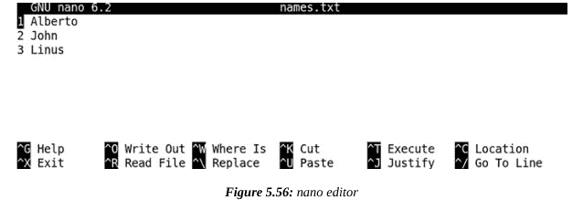

屏幕底部指示了可用操作，这些操作可通过 `Ctrl`+键 访问。例如，要写入更改，需按 `Ctrl+O`。要退出编辑，组合键为 `Ctrl+X`。图 5.57 显示了编辑器 `vim`。`VIM` 编辑器具有三种模式：

- 普通模式（Normal mode）： 在此模式下，可以写入更改、退出应用程序、复制行、粘贴行以及执行其他相关操作

- 插入模式：在此模式下，可以写入文件。

- 可视模式：在此模式下，可以选择多行或多列。


若要开始操作文件并进入插入模式，需要按下以下按键之一：`i`（用于在光标处插入）、`A`（用于在光标后追加）、`I`（用于在行首追加）或 `A`（用于在行尾追加）。

修改完成后，若要保存更改或放弃更改，需按 `Esc` 键返回普通模式。常见操作如下：

- 输入 `:wq` 或 `:x` 以保存并退出编辑器

- 若未做修改，输入 `:q` 以退出编辑器

- 输入 `:q!` 以放弃更改

图 5.58 展示了编辑器 `emacs`：

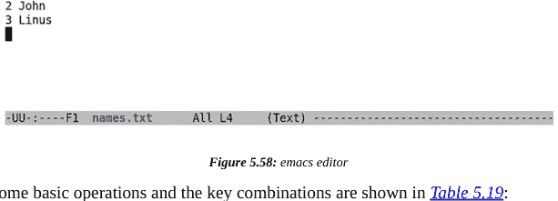

表 5.19 展示了一些基本操作和按键组合：

| 按键组合 | 描述 |
| --- | --- |
| `CTRL-x CTRL-c` | 退出 `emacs`。 |
| `CTRL-x CTRL-s` | 保存文件但不退出。 |
| `CTRL-x u` | 撤销更改 |

表 5.19: `emacs` 的按键组合

文件管理器是一种用于在不同目录之间导航并在其中进行操作的（如创建文件或删除文件）工具。大多数桌面界面都包含一个可视化的文件管理器。在 Linux 控制台中，目录之间的导航以及目录或文件的创建是通过系统可用的命令完成的。控制台文件管理器使得导航和执行基本操作更加容易。

文件管理器 `mc`（GNU Midnight Commanders）是最流行的一款，图 5.59 展示了该文件管理器的一个示例：

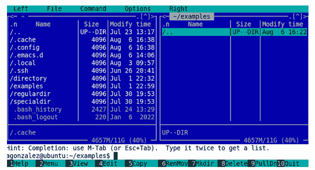

图 5.59: `mc` 文件管理器

使用此文件管理器可以在两个目录之间进行操作，例如在左侧目录（左窗格）和右侧目录（右窗格）之间移动或复制文件。

## 进程管理

进程是一个正在执行的程序。每个进程都被分配了一个进程 ID（`pid`），并且如前所述，会有一个位于 `/proc` 内的目录与之关联。该目录将包含有关进程的信息，例如应用程序是如何被调用的（`cmdline` 文件）、指向其调用所在目录的符号链接（`cwd` 文件）、进程的环境变量（`environ` 文件）以及包含应用程序所用文件链接的目录（`fd` 目录）。

要列出系统中正在运行的进程，使用 `ps` 命令；该命令通常与以下选项之一一起调用：

| 选项 | 描述 |
| :--- | :--- |
| `ps a` | 列出与终端关联的所有正在运行的进程 |
| `ps au` | 使用面向用户的格式 |
| `ps aux` | 显示没有关联终端的进程 |
| `ps -e` | 显示所有进程 |
| `ps -ef` | 以完整格式列表显示所有进程。 |

表 5.20: Linux 中断信号

图 5.60 展示了 `ps` 命令的输出示例：

```
agonzal+@ubuntu:~$ ps u
USER     PID %CPU %MEM    VSZ   RSS TTY      STAT START   TIME COMMAND
agonzal+  20949  0.0  0.1   9388  6048 pts/0  Ss   Aug02   0:00 -bash
agonzal+  26628  0.0  0.1   9144  5700 pts/1  Ss   14:53   0:00 -bash
agonzal+  26699  0.0  0.0 10892  3856 pts/1  S+   14:57   0:00 top
agonzal+  26707  0.0  0.0 10460  3248 pts/0  R+   14:57   0:00 ps u
```

图 5.60: `ps` 命令的输出示例

一个交互式命令 `top` 用于列出进程，它包含将在下一章中描述的系统资源信息。图 5.61 展示了该命令显示的信息：


```
top - 15:33:12 up 11 days, 21:52,  2 users,  load average: 0.00, 0.00, 0.00
Tasks: 119 total,   1 running, 118 sleeping,   0 stopped,   0 zombie
%Cpu(s):  0.0 us,   0.0 sy,   0.0 ni,100.0 id,   0.0 wa,   0.0 hi,   0.0 si,   0.0 st
MiB Mem :  3925.7 total,  1526.7 free,  261.0 used, 3138.0 buff/cache
MiB Swap: 2244.0 total,  2244.0 free,    0.0 used. 3371.7 avail Mem
 
PID USER     PR  NI    VIRT    RES   SHR S  %CPU %MEM     TIME+ COMMAND
25197 root     20   0       0      0     0 S   0.0  0.3   0:01.06 kworker/0+
    1 root     20   0 175876 12884  8112 S   0.0  0.3   0:11.01 systemd
    2 root     20   0       0      0     0 S   0.0  0.0   0:00.16 kthread
    3 root      0 -20      0      0     0 I   0.0  0.0   0:00.00 rcu_gp
```

*图 5.61: `top` 命令的输出示例*

命令 `pidof` 用于列出指定命令的**进程 ID** 很有用。**图 5.62** 展示了正在运行的 `top` 命令的 *pid*，并使用 `ps` 命令的选项 `-q` 来过滤该 `id`：

```
agonzalez@ubuntu:~$ pidof top
26699
agonzalez@ubuntu:~$ ps -ef -q $(pidof top)
UID    PID   PPID C STIME TTY          TIME CMD
agonzal+  26699  26628 0 14:57 pts/1    00:00:02 top
```

*图 5.62: `pidof` 命令的输出示例*

Linux 上有两种类型的进程：

- **前台进程**：该进程与调用它的用户进行交互。该进程会使用*标准输入*、*标准输出*或*标准错误*进行交互。在此期间，正在运行*shell*的进程不会接受其他命令。

- **后台进程**：该进程不与用户交互，通常由系统执行。由于用户可以运行后台进程，*shell* 将允许用户执行其他命令。

正在运行的进程可以接受信号中断。常见的信号如*表 5.21*所示：

| 信号 | 信号 ID | 按键组合 | 描述 |
|:---------|:----------|:----------------|:------------|
| `SIGHUP` | 1 | | 检测到挂起，用于重新加载应用程序配置。 |
| `SIGINT` | 2 | `Ctrl-C` | 键盘中断 |
| `SIGQUIT` | 3 | `Ctrl-D` | 从键盘退出 |
| `SIGKILL` | 9 | | 杀死信号 |
| `SIGSTOP` | 17,19,23 | `Ctrl-Z` | 停止进程 |

*表 5.21: Linux 中断信号*

可以使用 `Ctrl-C` 终止正在运行的*前台进程*；如果它正在等待*输入*，可以使用 `Ctrl-D` 结束*标准输入*等待，并使用 `Ctrl-Z` 将会停止进程。可以使用命令 `kill` 向*后台*进程发送信号中断，其语法如下：`kill [-signal | -s signal] pid`。

一些示例如下：

- 终止进程：`kill -9 1234`
- 停止进程：`kill -s SIGSTOP cat`

要在*后台*执行进程，在命令中包含符号 `&`。可以使用名为 `jobs` 的*内置命令*来列出在*后台*运行的当前用户的进程，如**图 5.63**所示：

```
agonzalez@ubuntu:~$ sleep 30 &
[1] 26717
agonzalez@ubuntu:~$ sleep 60 &
[2] 26718
agonzalez@ubuntu:~$ jobs
[1]-  Running            sleep 30 &
[2]+  Running            sleep 60 &
```

*图 5.63: 在后台运行命令的示例及 `jobs` 命令的输出示例。*

正在*前台*运行的进程可以先停止它（`Ctrl-Z`），然后运行命令 `bg` 将其发送到*后台*，如**图 5.64**所示：

```
agonzalez@ubuntu:~$ sleep 120
^Z
[1]+  Stopped            sleep 120
agonzalez@ubuntu:~$ jobs
[1]+  Stopped            sleep 120
agonzalez@ubuntu:~$ bg
[1]+ sleep 120 &
agonzalez@ubuntu:~$ jobs
[1]+  Running            sleep 120 &
```

*图 5.64: 后台和前台进程的示例。*

可以使用命令 `fg` 将进程从*后台*移到*前台*。可以通过添加参数 `%N` 来指定 `id`（对命令 `bg` 同样适用）；*图 5.65* 展示了一个示例：

```
agonzalez@ubuntu:~$ sleep 30 &
[1] 26721
agonzalez@ubuntu:~$ sleep 60 &
[2] 26722
agonzalez@ubuntu:~$ fg %1
sleep 30
```

*图 5.65: 使用命令 `fg` 的示例。*

当用户会话关闭时，后台进程会被*终止*。为了避免这种行为并保持进程运行，Linux 提供了两个选项：

- 运行名为 `disown` 的*内置命令*，以将*后台*运行进程与当前用户分离。
- 使用应用程序 `nohup` 执行*后台进程*，例如：`nohup myapplication &`。

### 操作进程优先级

Linux 使用*调度器*来分配资源以执行系统中的任务。某些进程需要比其他进程拥有更高的优先级，特别是那些访问系统资源或 Linux 核心的进程。有两种类型的进程如下：

- *实时进程*：这些进程具有按时间运行而不被任何其他进程打断的能力。这些进程的系统优先级范围在 1（低）和 99（高）之间。
- *常规进程*：这些进程可以被拥有更高优先级的其他进程打断，这些进程需要访问系统资源。这些进程具有一个 *nice* 值，指示获取资源的优先级。这些值的范围是从 -20（高优先级）到 +19（低优先级）。

普通进程的默认 *nice* 值为 0。只有管理员可以指定负值（更高优先级）。

`ps` 命令的 `-l` 选项和 `top` 命令会显示正在运行的进程的优先级和 *nice* 值。本节将重点介绍如何更改进程的 *nice* 值。

*图 5.66* 展示了使用 `-l` 选项的 `ps` 命令的输出示例，用于显示*优先级*和 *nice* 值：

```
agonzalez@ubuntu:~$ ps -l -q $(pidof top)
F S  UID   PID  PPID C PRI  NI ADDR SZ WCHAN     TTY          TIME CMD
0 S 1000 26798 26628 0  80  0 - 2723 do_sel pts/1    00:00:00 top
```

*图 5.66：列出优先级和 `nice` 值的输出示例。*

使用 `-p` 选项和 `pid` 的 `top` 命令会筛选到该进程，并显示如下所示的*图 5.67*中的示例：


```
top - 16:19:09 up 11 days, 22:38,  2 users,  load average: 0.00, 0.00, 0.00
Tasks:  1 total,   0 running,   1 sleeping,   0 stopped,   0 zombie
%Cpu(s):  0.0 us,  0.0 sy,  0.0 ni,100.0 id,  0.0 wa,  0.0 hi,  0.0 si,  0.0 st
MiB Mem :  3925.7 total,  1534.6 free,   253.0 used,  2138.1 buff/cache
MiB Swap:  2244.0 total,  2244.0 free,     0.0 used.  3379.7 avail Mem

    PID USER     PR  NI  VIRT   RES  SHR S  %CPU  %MEM  TIME+ COMMAND
   26798 agonzal+  20   0 10892  3900 3212 S   0.3   0.1  0:00.41 top
```

`图 5.67：显示优先级和 nice 值的 top 命令输出示例。`

`ps` 命令显示的优先级为 `100 - nice 值`，而 `top` 命令显示的优先级为 `20 + nice 值`。

`nice` 命令允许以不同的 `nice 值` 执行命令，而 `renice` 命令允许更改正在运行的进程的 `nice 值`。`图 5.68` 至 `5.69` 展示了使用这些命令的一些示例：

- 以不同的 `nice 值`（更低的优先级值）运行 `sleep` 命令：

```
agonzalez@ubuntu:~$ nice -n 15 sleep 600 &
[1] 26907

agonzalez@ubuntu:~$ ps -l -q $(pidof sleep)
F S  UID   PID  PPID C PRI  NI ADDR SZ WCHAN    TTY          TIME CMD
0 S 1000 26907 20949 0  95  15 - 1547 hrtime pts/0  00:00:00 sleep
```

`图 5.68：使用 nice 命令的示例`

- 更改正在运行的进程的 `nice 值`。普通用户只允许降低 `nice 值`：

```
agonzalez@ubuntu:~$ renice -n 16 $(pidof sleep)
26907 (process ID) old priority 15, new priority 16
agonzalez@ubuntu:~$ ps -l -q $(pidof sleep)
F S UID PID PPID C PRI NI ADDR SZ WCHAN TTY TIME CMD
0 S 1000 26907 20949 0 96 16 - 1547 hrtimer pts/0 00:00:00 sleep
```

`图 5.69：使用 renice 命令的示例`

## 结论

管理文件、目录和进程是管理和使用 Linux 系统的必备知识。本章涵盖了使用系统工具创建和操作文件和目录的所有基础知识及更高级的选项。

文件和目录权限是保护文件和目录免受未授权访问的重要因素。文中描述了不同的工具，用于为用户和组所有者以及其他人分配文件和目录的所有权和权限。

文中描述了流行的文件编辑器和文件管理器，以展示如何使用不同的工具编辑文件、创建目录并在系统的不同目录中导航。

文中描述了 Linux 中的进程，并展示了进程执行时优先级的重要性以及修改默认优先级的命令。

## 关键事实

- Linux 拥有默认的目录结构布局。

- 每个文件和目录都有三种权限：读、写和执行。

- 文件和目录的权限可以设置给文件所有者、组所有者或其他人。

- 有多个命令可用于格式化输出。

- 有多个实用的文件编辑器和文件管理器可供选择。

## 问题

1. 哪个系统目录保存系统日志？

   1. `/var/log/`

   2. `/tmp/`

   3. `/sys/log`

2. `u=rwx, g=rwx, o=rx` 对应的八进制表示是什么？

   1. `664`

   2. `775`

   3. `777`

3. 使用什么命令来计算行数、单词数和字符数？

   1. `wc`

   2. `count`

   3. `sed`

4. 在 `VI(M)` 的普通模式下，如何退出不保存更改？

   1. `:x`

   2. `:wq`

   3. `:q!`

5. `nice` 值的有效范围是多少？

   1. `-20 到 19`

   2. `-19 到 20`

   3. `0 到 100`

## 答案

1. 1

2. 2

3. 1

4. 3

5. 1

# 第 6 章

**监控系统资源**

## 简介

本章介绍如何监控系统资源。它将介绍现代系统中 CPU 和内存的工作原理，以及可用于检查状态并进行故障排除（在出现错误或过载时）的常用工具。

为了避免应用程序停机，磁盘使用率和可用空间也是需要监控的重要资源。文中将描述不同的工具，用于检查当前状态并检测磁盘的物理状态。

在 Linux 系统中，监控网络已成为最重要的任务之一，尤其是随着系统引入复杂网络以提供虚拟机和容器连接性之后。

本章的最后一部分重点介绍磁盘配额和资源限制，帮助用户在普通用户可访问系统时保护系统，避免资源耗尽。

## 结构

在本章中，我们将讨论以下主题：

- 监控 CPU 资源

- 监控内存资源

- 监控磁盘使用率和可用空间

- 监控网络资源

- 配额和限制

## 监控 CPU 资源

**中央处理器（CPU）**，即处理器，执行系统接收的指令。在现代系统中，有三个重要概念需要理解，以便监控和解释从工具接收的数据：

- CPU 插座（CPU 插槽）：是计算机 `主板` 上接受 CPU 芯片的安装位。

- CPU 核心：独立的处理单元，用于读取和执行指令。在现代系统中，一个 `CPU` 包含多个核心。

- CPU 线程：`线程` 是操作系统指令的队列。现代系统启用 `超线程`，允许两个线程。

例如，如果一个系统有两个插座，每个 CPU 有四个核心，并启用了 `超线程`，它将拥有可用的八个核心和 16 个线程。它能够每个周期执行八条操作系统指令，但每个周期最多可以拥有 16 个任务的 `队列`。

针对物理服务器的高级概念名为 **非统一内存访问（NUMA）**。这种架构将内存划分为相对于处理器的本地内存和远程内存。CPU 访问分配的本地内存的性能优于使用 `互连` 访问远程内存。`图 6.1` 展示了一个具有两个 NUMA 节点的表示，每个节点有一个 CPU 插座和四个核心：


### 获取 CPU 信息

`第 3 章，使用命令行界面` 中描述的 `lscpu` 命令显示了与 CPU 插座、核心、线程和 NUMA 相关的重要信息。`图 6.2` 展示了一个具有两个 CPU 插座，每个插座有八个核心的节点。

```
[root@server ~]# lscpu|grep --color=never -E "^(CPU\(|Thread|Core|Socket|NUMA)" CPU(s): 32 Thread(s) per core: 2 Core(s) per socket: 8 Socket(s): 2 NUMA node(s): 2 NUMA node0 CPU(s): 0-7,16-23 NUMA node1 CPU(s): 8-15,24-31
```

`图 6.2：使用 lscpu 命令获取 CPU 信息。`

`lstopo-no-graphics` 命令是包 `hwloc` 的一部分，提供了 NUMA 架构以及 CPU 与本地内存之间关联的极佳可视化效果。`图 6.3` 说明了同一台服务器（如 `图 6.2` 所示）该命令的输出示例：

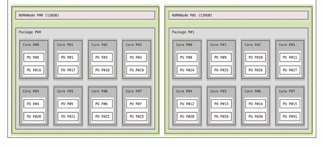

`图 6.3：lstopo-no-graphics 命令的输出示例。`

文件 `/proc/cpuinfo` 包含所有处理器（`核心/线程`）的列表，并带有每个处理器的详细信息。`图 6.4` 展示了一个使用 `grep`、`sort` 和 `uniq` 创建报告示例，显示每个插座中有多少个 CPU：

```
[root@server ~]# grep "physical id" /proc/cpuinfo |sort|uniq -c 16 physical id : 0 16 physical id : 1
```

`图 6.4：从文件 /proc/cpuinfo 获取信息`

其他用于获取处理器信息的示例命令如下：

- `lshw -class processor` (`lshw -class processor -short`)

### 理解系统负载和平均负载


系统负载衡量的是计算机系统所执行的计算工作量。平均负载表示一段时间内的系统负载。一个负载为 `140%` 的处理器表示它过载了 `40%`，正如一个负载为 `30%` 的处理器在观察期间 `70%` 的时间处于空闲状态。`CPU` 负载由一个小数表示，例如 `1.40` 表示 `140%`，`0.30` 表示 `30%`。

理解 `Linux` 中 `CPU` 负载的一个常见类比与交通有关。单核 `CPU` 就像道路中的一条车道。拥有更多核心和 `CPU` 就像拥有更多车道，这样负载可以在它们之间舒适地分配。这在*图 6.5*中进行了说明：


*图 6.5：处理器、负载与交通的类比*

通过拥有多个可用 `CPU`，任务将分布在不同的 `CPU` 之间，负载将与 `CPU` 数量相关。对于拥有四个处理器的系统，如果系统负载为 `3.00`，则表明它正在使用 `66.67%` 的可用 `CPU` 资源。

### 命令 `uptime` 和文件 `/proc/loadavg`

此命令在第 3 章“使用命令行界面”中已作描述，用于查看系统运行了多久，以获取简单的概览。`uptime` 命令显示系统的 `CPU` 平均负载。`Linux` 系统上的平均负载以 `1` 分钟、`5` 分钟和 `15` 分钟为周期表示。图 6.6 说明最后 `1` 分钟的平均值为 `0.13`，最后 `5` 分钟为 `0.07`，最后 `15` 分钟为 `0.01`：

```
[root@server ~]# uptime
16:44:42 up 73 days, 10:00, 2 users,  load average: 0.13, 0.07, 0.01
```


大多数命令打开文件 `/proc/loadavg` 以获取有关系统负载的信息。该文件的前三列包含上述周期的信息；第四列以斜杠（`/`）分隔，指示有多少进程正在访问 `CPU` 以及有多少进程正在系统中执行；最后一列指示最后分配的进程 ID。图 6.7 展示了文件 `/proc/loadavg` 的内容示例：


### 命令 `top`

`top` 命令提供系统的动态实时信息。在第 5 章“管理文件、目录和进程”中，该命令被介绍用于列出系统中正在运行的进程。所显示信息的头部部分与系统资源使用情况相关，如图 6.8 所示：

```
top - 13:33:43 up 74 days, 6:49, 2 users, load average: 0.08, 0.05, 0.05
Tasks: 466 total, 2 running, 463 sleeping, 1 stopped, 0 zombie
%Cpu(s):  0.0 us,  0.3 sy,  0.0 ni, 99.7 id,  0.0 wa,  0.0 hi,  0.0 si,  0.0 st
MiB Mem: 257568.8 total,  23417.0 free, 184388.5 used,  49763.3 buff/cache
MiB Swap:      0.0 total,      0.0 free,      0.0 used.  67273.6 avail Mem
```

*图 6.8：`top` 命令输出头部示例*

`top` 命令头部前三行显示的信息如下：

- 正常运行时间（`Uptime`）、登录用户数量以及系统负载平均值。与 `uptime` 命令的输出相同。

- 正在运行的进程数量列表，指示有多少个正在使用 `CPU`，以及有多少个处于睡眠（`sleeping`）、停止（`stopped`）和僵尸（`zombie`，意指不接收中断，通常需要通过重启系统才能恢复）状态。

- 系统中所有 `CPU` 的使用率百分比，其使用类别如下：

    - `us` (`user`)：运行（不带 `nice` 值）用户进程的时间。
    - `sy` (`system`)：运行内核进程的时间。
    - `ni` (`nice`)：运行（带有 `nice` 值）用户进程的时间。
    - `id` (`idle`)：空闲花费的时间。
    - `wa` (`input/output wait`)：等待输入/输出完成的时间。

`top` 命令有不同的可视化选项（按 `h` 键获取更多选项）；例如，按 `1` 键将显示每个 `CPU` 的信息，按 `2` 键将显示每个 `CPU` 插槽（`NUMA` 节点）的信息。图 6.9 和 6.10 展示了这两个示例：

- 按 `1` 键显示的显示效果（截断输出）：

```
top - 13:45:20 up 74 days, 7:00, 2 users, load average: 0.00, 0.03, 0.04
Tasks: 467 total, 1 running, 465 sleeping, 1 stopped, 0 zombie
%Cpu0  :  0.0 us,  0.0 sy,  0.0 ni,100.0 id,  0.0 wa,  0.0 hi,  0.0 si,  0.0 st
%Cpu1  :  0.0 us,  0.0 sy,  0.0 ni,100.0 id,  0.0 wa,  0.0 hi,  0.0 si,  0.0 st
%Cpu2  :  0.0 us,  0.0 sy,  0.0 ni,100.0 id,  0.0 wa,  0.0 hi,  0.0 si,  0.0 st
%Cpu3  :  0.0 us,  0.0 sy,  0.0 ni,100.0 id,  0.0 wa,  0.0 hi,  0.0 si,  0.0 st
%Cpu4  :  0.0 us,  0.0 sy,  0.0 ni,100.0 id,  0.0 wa,  0.0 hi,  0.0 si,  0.0 st
%Cpu5  :  0.3 us,  0.3 sy,  0.0 ni, 99.7 id,  0.0 wa,  0.0 hi,  0.0 si,  0.0 st
%Cpu6  :  0.3 us,  0.3 sy,  0.0 ni, 99.7 id,  0.0 wa,  0.0 hi,  0.0 si,  0.0 st
%Cpu7  :  0.0 us,  0.0 sy,  0.0 ni,100.0 id,  0.0 wa,  0.0 hi,  0.0 si,  0.0 st
%Cpu8  :  0.0 us,  0.0 sy,  0.0 ni,100.0 id,  0.0 wa,  0.0 hi,  0.0 si,  0.0 st
%Cpu9  :  0.0 us,  0.0 sy,  0.0 ni,100.0 id,  0.0 wa,  0.0 hi,  0.0 si,  0.0 st
%Cpu10 :  0.3 us,  0.0 sy,  0.0 ni, 99.7 id,  0.0 wa,  0.0 hi,  0.0 si,  0.0 st
```

- 按 `2` 键显示的显示效果：

```
top - 13:45:45 up 74 days, 7:01, 2 users, load average: 0.00, 0.02, 0.04
Tasks: 467 total, 1 running, 465 sleeping, 1 stopped, 0 zombie
%Cpu(s):  0.0 us,  0.2 sy,  0.0 ni, 99.8 id,  0.0 wa,  0.0 hi,  0.0 si,  0.0 st
%Cpu0:  0.0 us,  0.0 sy,  0.0 ni, 99.9 id,  0.0 wa,  0.0 hi,  0.0 si,  0.0 st
%Node1:  0.0 us,  0.5 sy,  0.0 ni, 99.5 id,  0.0 wa,  0.0 hi,  0.0 si,  0.0 st
```

*图 6.10：`top` 命令输出头部示例*

### 命令 `atop` 和 `htop`

这些命令是传统 `top` 命令的现代替代方案。图 6.11 展示了 `atop` 应用的外观，其中包含更多与系统相关的信息：


```
ATOP - server 2022/08/13 13:55:33 -- -zombie---- 10s elapsed
PRC sys 1.10s user 0.12s #proc 473 #zombie 0 no proccct
CPU sys 7% user 1% irq 1% idle 3193% wait 0%
CPU avg1 0.06 avg5 0.11 avg15 0.09 csw 9950 intr 7455
MEM tot 251.5G free 22.6G buff 1.0M slab 7.8G numode 2
SWP tot 0.0M free 0.0M swcac 0.0M vmcom 313.3G vmlim 125.8G
PAG numamig 0 migrate 543 swim 0 swout 0 oomkll 0
DSK transport sda busy 0% read 0 write 7 avio 0.14 ms
NET transpot tccpi 5 tcpc 5 udpi 0 udpo 0
NET network xpl 29 xpo 7 ipfrw 0 deliv 6
NET eth1 0% pcki 72 pcko 6 si 4 Kbps so 1 Kbps
NET eth2 0% pcki 68 pcko 0 si 3 Kbps so 0 Kbps

PID SYSCPU USRCPU RDELAY VGROW RGROW RDGSK WRDSK CPU CMD 1/4
247 0.99s 0.00s 0.00s 0B 0B 0B 0B 16% ksmd
83078 0.02s 0.10s 0.00s 0B 0B 0B 0B 1% qemu-kvm
2120339 0.03s 0.01s 0.00s 0B 0B 0B 0B 0% atop
36944 0.00s 0.01s 0.00s 0B 0B 0B 0B 0% vbvncd
1531 0.01s 0.00s 0.00s 0B 0B 0B 0B 0% NetworkManager
248 0.01s 0.00s 0.00s 0B 0B 0B 0B 0% khugepaged
83095 0.01s 0.00s 0.00s 0B 0B 0B 0B 0% vhоst-83078
91418 0.01s 0.00s 0.00s 0B 0B 0B 0B 0% kvm-pit/91396
281928 0.01s 0.00s 0.00s 0B 0B 0B 0B 0% kvm-pit/281867
2115603 0.01s 0.00s 0.00s 0B 0B 0B 0B 0% kworker/0:2-ev
```

`atop` 命令示例外观（图 6.11）

图 6.12 展示了 `htop` 应用的外观，其中包含 CPU 使用率的概览：

```
0[0.7%] 4[0.0%] 8[0.0%] 12[6.0%] 16[0.0%] 20[0.0%] 24[0.0%] 28[0.0%]
1[0.7%] 5[0.7%] 9[0.0%] 13[0.0%] 17[0.0%] 21[0.7%] 25[0.0%] 29[0.0%]
2[0.7%] 6[0.0%] 10[0.0%] 14[0.0%] 18[0.7%] 22[0.0%] 26[0.0%] 30[0.0%]
3[0.7%] 7[0.0%] 11[0.0%] 15[0.0%] 19[0.0%] 23[0.0%] 27[0.0%] 31[0.0%]
Mem:|||||||||||||||||180G/252G  Tasks: 65, 178 thr, 406 kthr; 2 running
Swap:|||||||||||||||||||||0K/0K  Load average: 0.11 0.12 0.09
Uptime: 74 days, 07:09:18
```

```
Main          1270
PID USER         PRI NI VIRT  RES SHR S CPU% MEM% TIME+    COMMAND
2119928 root      20 0 226M 5628 3432 R 1.3 0.0 0:00.16 htop
83078 qemu      20 0 21.6G 16.3G 10620 S 0.7 6.4 4:018:13 /usr/lib/exec/q
83100 qemu      20 0 21.6G 16.3G 10620 S 0.7 6.4 7:49:20 /usr/lib/exec/q
1 root      20 0 247M 15252 8824 S 0.0 0.0 1:26.89 /usr/lib/system
1147 root      20 0 142M 34104 18656 S 0.0 0.0 12:55:10 /usr/lib/system
1192 root      20 0 106M 10496 6592 S 0.0 0.0 0:13.50 /usr/lib/system
1271 root      20 0 6717M 5552 4828 S 0.0 0.0 0:04.33 /usr/bin/rpcbind
1272 root      16 -4 129M 2672 1812 S 0.0 0.0 1:07.97 /sbin/auditd
1273 root      16 -4 129M 2672 1812 S 0.0 0.0 0:00.32 /sbin/auditd
1334 root      20 0 9098M 7404 6072 S 0.0 0.0 0:12.27 /usr/lib/system
1337 root      20 0 9505M 9420 7000 S 0.0 0.0 0:12.81 /usr/lib/system
1347 root      20 0 122M 5612 4768 S 0.0 0.0 24:42.40 /usr/sbin/irqbalance
```

```
F1 Help F2 Setup F3 Search F4 Filter F5 Tree F6 Sort F7 Nices F8 Ice F9 Kill F10 Quit
```

`htop` 命令示例外观（图 6.12）

### 命令 `mpstat`

此命令是 `sysstat` 包的一部分，需要安装才能使用。该应用程序报告与处理器相关的统计信息。图 6.13 展示了一个未指定任何选项或参数的输出示例：

```
[root@server ~]# mpstat
Linux 4.18.0-305.30.1.el8_4.x86_64 (server) 13/08/22 x86_64 (32 CPU)

14:00:47 CPU %usr %nice %sys %iowait %irq %soft %steal %guest %gnice %idle
14:00:47 all 0.05 0.00 1.86 0.27 0.19 0.17 0.00 8.16 0.00 89.32
```

`mpstat` 命令输出示例（图 6.13）

`mpstat` 命令允许使用选项 `-N` 来指定 NUMA 节点，以及选项 `-P` 来指示要显示统计信息的处理器。该应用可用的参数是 `interval`（间隔）和 `count`（计数），这将每 `interval` 秒生成 `count` 数量的报告。图 6.14 展示了一个示例，用于每 6 秒生成五个报告：

#### 图 6.14：`mpstat` 命令的输出示例

显示的列如表 6.1 所示：

| 列 | 描述 |
|:---|:---|
| `CPU` | 处理器编号。 |
| `%usr` | 在用户级别（应用程序）发生的 CPU 利用率。 |
| `%nice` | 以 `nice` 优先级在用户级别发生的 CPU 利用率。 |
| `%sys` | 在系统级别（内核）发生的 CPU 利用率。 |
| `%iowait` | 系统具有未完成的磁盘 I/O 请求期间，CPU 空闲的时间。 |
| `%irq` | CPU 处理硬件中断所花费的时间。 |
| `%soft` | CPU 处理软件中断所花费的时间。 |
| `%steal` | 当 Hypervisor 正在处理另一个虚拟处理器时，虚拟 CPU 非自愿等待所花费的时间。 |
| `%guest` | CPU 运行虚拟处理器所花费的时间。 |
| `%gnice` | CPU 运行 `nice` 客户机所花费的时间。 |
| `%idle` | 系统没有未完成的磁盘 I/O 请求期间，CPU 空闲的时间。 |

#### 表 6.1：`mpstat` 命令的列描述

### 命令 `sar`

`系统活动报告器` (`SAR`) 也是 `sysstat` 软件包的一部分。此命令可以收集、报告或保存系统活动信息。要查看 CPU 信息，请使用 `-u` 选项并指定所需的报告频率和次数，类似于 `mpstat`。图 6.15 说明了示例：


```
[root@server ~]# sar -u 2 5
Linux 4.18.0-305.30.1.el8_4.x86_64 (server) 13/08/22 _x86_64_ (32 CPU)

14:14:37 CPU %user %nice %system %iowait %steal %idle
14:14:39 all 0,03 0,00 0,20 0,00 0,00 99,69
14:14:41 all 0,00 0,00 0,34 0,00 0,00 99,64
14:14:43 all 0,05 0,00 0,30 0,00 0,00 99,66
14:14:45 all 0,00 0,00 0,30 0,02 0,00 99,69
14:14:47 all 0,03 0,00 0,25 0,00 0,00 99,70
Average: all 0,02 0,00 0,29 0,00 0,00 99,68
```

图 6.15：`sar` 命令的输出示例

使用选项`-q`时，还会显示系统的平均负载，如图 6.16 所示：

```
[root@server ~]# sar -q 2 5
Linux 4.18.0-305.30.1.el8_4.x86_64 (server) 13/08/22 _x86_64_ (32 CPU)

14:25:11 runq-sz plist-sz 1davg-1 1davg-5 1davg-15 blocked
14:25:13 0 645 0,09 0,09 0,09 0
14:25:15 0 645 0,17 0,10 0,09 0
14:25:17 0 645 0,17 0,10 0,09 0
14:25:19 0 645 0,17 0,10 0,09 0
14:25:21 0 645 0,24 0,12 0,10 0
Average: 0 645 0,17 0,10 0,09 0
```

图 6.16：`sar` 命令的输出示例

### 命令 `iostat`

这是`sysstat`软件包中的另一个命令，用于显示有关 CPU 和磁盘的信息。使用选项`-c`时，会将输出限制为 CPU 信息，如图 6.17 所示：

```
[root@server ~]# iostat -c
Linux 4.18.0-305.30.1.el8_4.x86_64 (server) 13/08/22 _x86_64_ (32 CPU)

avg-cpu: %user %nice %system %iowait %steal %idle
8,20 0,00 2,21 0,27 0,00 89,32
```

图 6.17：`iostat` 命令的输出示例

## 监控内存资源

随机存取存储器 (RAM) 是物理系统中有限且通常昂贵的资源。了解系统和应用程序如何使用内存是必备知识，以便能够管理系统并避免在运行关键应用程序时出现问题。

Linux 系统包含内存管理，负责向进程提供动态分配的内存部分，并在应用程序结束时释放该部分。内存管理提供以下功能：

- 提供比物理可用内存更多的选项。例如，使用`swap`，利用磁盘空间来增加可用的内存空间。
- 每个进程都被分配虚拟地址空间，并与其他进程隔离。
- 内存映射，其中文件的内容链接到进程的虚拟地址。
- 为进程公平分配内存。
- 进程间的共享虚拟内存，例如用于正在使用的库。

在 [第 3 章，使用命令行界面](#) 中解释的命令`free`是查看系统当前状态的主要工具。用于从`kernel`获取内存信息的文件是`/proc/meminfo`，[图 6.18](#)（输出截断）展示了内部复杂内容的示例：

```
[root@server ~]# cat /proc/meminfo
MemTotal:      263750488 kB     Writeback:             0 kB    VmallocChunk:      0 kB
MemFree:       23652996 kB     AnonPages:       180445696 kB     Percpu:          69504 kB
MemAvailable:  68818260 kB     Mapped:          112424 kB     HardwareCorrupted:     0 kB
Buffers:          1972 kB     Shmem:           4196320 kB     AnonHugePages:   13256704 kB
Cached:         48141820 kB    KReclaimable:    3070832 kB     ShmemHugePages:      0 kB
SwapCached:          0 kB    Slab:            8222324 kB     ShmemPmdMapped:      0 kB
Active:         162465792 kB   SReclaimable:    3070832 kB     FileHugePages:       0 kB
Inactive:        66132548 kB   SUnreclaim:      5151492 kB     FilePmdMapped:       0 kB
Active(anon):    159808276 kB  KernelStack:       10864 kB     HugePages_Total:     0 kB
Inactive(anon):    24763492 kB  PageTables:       545028 kB     HugePages_Free:      0 kB
Active(file):      2577516 kB   NFS_Unstable:          0 kB     HugePages_Rsvd:      0 kB
Inactive(file):    41369056 kB  Bounce:                0 kB     HugePages_Surp:      0 kB
Unevictable:         0 kB    WritebackTmp:          0 kB     Hugepagesize:      2048 kB
Locked:              0 kB    CommitLimit:     131875244 kB     Hugeltlb:            0 kB
MemTotal:          0 kB    Committed_AS:    328596212 kB     DirectMap4k:    4670164 kB
SwapFree:          0 kB    VmallocTotal:    34359738367 kB    DirectMap2M:    242677760 kB
Dirty:             108 kB    VmallocUsed:        0 kB    DirectMap1G:    230608672 kB
```

图 6.18：文件`/proc/meminfo`的内容示例

可以使用例如命令`lshw`获取有关物理内存的信息，如图 6.19](#)（截断）所示：


### 命令 `lshw`

```
[root@server ~]# lshw -c memory -short |grep -v empty
H/W path   Device     Class     Description
/===============================================================================
/0/0                        memory    64KiB BIOS
/0/2a                       memory    256GiB System Memory
/0/2a/0                     memory    32GiB DIMM DDR4 Synchronous 2667 MHz (0.4 ns)
/0/2a/3                     memory    32GiB DIMM DDR4 Synchronous 2667 MHz (0.4 ns)
/0/2a/6                     memory    32GiB DIMM DDR4 Synchronous 2667 MHz (0.4 ns)
/0/2a/9                     memory    32GiB DIMM DDR4 Synchronous 2667 MHz (0.4 ns)
/0/2a/c                     memory    32GiB DIMM DDR4 Synchronous 2667 MHz (0.4 ns)
/0/2a/f                     memory    32GiB DIMM DDR4 Synchronous 2667 MHz (0.4 ns)
/0/2a/12                    memory    32GiB DIMM DDR4 Synchronous 2667 MHz (0.4 ns)
/0/2a/15                    memory    32GiB DIMM DDR4 Synchronous 2667 MHz (0.4 ns)
```

`lshw` 命令的输出示例（图 6.19）

### 命令 `vmstat`

此命令报告有关虚拟内存统计信息的信息。生成的第一个报告给出了自上次重新启动以来的平均值。图 6.20 展示了未指定任何选项或参数的输出示例：

```
[root@server ~]# vmstat
procs -------------------memory---- ---swap--- -----io---- -system-- ------cpu------
 r  b  swpd   free   buff   cache   si   so    bi     bo   in     cs   us  sy  id  wa  st
 0  0      0 23668764  1672 51212792    0    4     52      0      0    8   2  89   0   0
```

`vmstat` 命令的输出示例（图 6.20）

与可用内存相关的字段如表 6.2 所示：

| 列 | 字段 | 描述 |
| :--- | :--- | :--- |
| Procs | `r` | 可运行进程的数量 |
| | `b` | 阻塞等待 I/O 完成的进程数量。 |
| Memory | `swpd` | 使用的虚拟内存量。 |
| | `free` | 空闲内存量。 |
| | `buff` | 用作缓冲区的内存量。 |
| | `cache` | 用作缓存的内存量。 |
| | `inact` | 非活动内存量。（`-a` 选项） |
| | `active` | 活动内存量。（`-a` 选项） |
| Swap | `si` | 从磁盘交换入的内存量（/s）。 |
| | `so` | 交换到磁盘的内存量（/s）。 |

`vmstat` 命令的字段描述（表 6.2）

使用选项 `-w`（`-wide`）时，数据将以宽格式输出进行可视化，选项 `-s`（`-stats`）则显示事件计数器统计信息。图 6.21 展示了使用选项 `-a`（活动/非活动内存）以及选项 `-w` 和 `-S`（显示单位）时的输出结果：

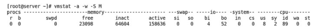

`vmstat` 命令的输出示例（图 6.21）

### 命令 `top`、`htop` 和 `atop`

这些命令提供的示例信息展示在图 6.22–6.24 中：

-   `top` 命令的内存信息：

    

    `top` 命令中的内存信息示例（图 6.22）

    可以按下 `m` 键来切换内存信息的显示。

-   `htop` 命令的内存信息：

    

    `htop` 命令中的内存信息示例（图 6.23）

-   `atop` 命令的内存信息：

    

    `atop` 命令中的内存信息示例（图 6.24）

`PSI` 代表压力停滞信息（Pressure Stall Information），它包含与 CPU、内存和输入/输出相关的资源压力百分比。值 `memsome` 和 `memfull` 表示整个间隔期间的压力百分比。值 `ms` 和 `mf` 显示过去 10、60 和 300 秒内的三个百分比（仅在窗口尺寸较大时显示）。

### 命令 `sar`

命令 `sar` 很有用，可用于创建一段时间内的报告，以查看内存使用情况，如图 6.25 所示：

```bash
root@ubuntu:~# sar -r 5 2
Linux 5.15.0-43-generic (ubuntu.example.com) 08/13/22 .x86_64. (2 CPU)

19:43:10 kbmemfree kbavail kbbmemused %memused kbbuffers kbcached kbcommit %commit
kbactive kbinact kbdirty
19:43:15 1997052 3476112 211724 5,27 98884 1523420 511164 8,09
787008 905576 0
19:43:20 1997052 3476112 211724 5,27 98884 1523420 511164 8,09
787008 905576 0
Average: 1997052 3476112 211724 5,27 98884 1523420 511164 8,09
787008 905576 0
```

`sar` 命令的输出示例（图 6.25）

### 每个进程的内存使用情况

当进程运行时，它被分配三个内存值：

-   虚拟内存：包括所有代码、数据和共享库。
-   保留内存：驻留大小（Resident size），即使用的非交换物理内存。
-   共享内存：与其他进程共享的内存。

图 6.26 展示了在按下 `M`（`shift-m`）键按内存使用量排序后，`top` 命令输出片段的示例：

```text
| PID USER PR NI VIRT RES SHR S %CPU %MEM TIME+ COMMAND
|282441 qemu 20 0 70,6g 64,2g 12980 S 0,0 25,5 91484:59 qemu-kvm
|281431 qemu 20 0 70,6g 53,4g 13144 S 0,0 21,2 53283:06 qemu-kvm
|281867 qemu 20 0 70,6g 43,1g 13268 S 0,0 17,1 40395:58 qemu-kvm
|91344 qemu 20 0 37,2g 28,6g 13552 S 0,0 11,4 41616:33 qemu-kvm
|89631 qemu 20 0 37,2g 25,3g 13072 S 0,0 10,0 52131:50 qemu-kvm
|91396 qemu 20 0 37,2g 23,3g 13320 S 0,0 9,3 39959:53 qemu-kvm
|83078 qemu 20 0 21,2g 16,0g 10620 S 1,0 6,4 2419:43 qemu-kvm
```

`top` 命令的输出示例（图 6.26）

使用长格式（`aux`）的 `ps` 命令显示了进程的内存使用情况。图 6.27 展示了一个过滤特定进程的示例输出，其中 `VSZ`（虚拟大小）和 `RSS`（驻留集大小，保留内存）以千字节显示：


```bash
[root@server ~]# ps aux -q 282441
USER PID %CPU %MEM VSZ RSS TTY STAT START TIME COMMAND
qemu 282441 89.1 25.5 74079692 67366884 ? Sl Jun03 91484:59 /usr/libexec/qemu-kvm -name
```

图 6.27：`ps` 命令的输出示例

命令 `pmap`，加上进程 ID 参数，显示关于保留内存和共享内存的高级输出。

### 内存不足管理

当应用程序在 Linux 中执行时，它会预留内存空间，但通常不会使用全部空间。这使得 Linux 能够执行比可用内存更多的应用程序，预期应用程序使用的内存将少于可用内存。Linux 包含一个管理器，用于检测系统使用的内存是否超过应有的量，并自动终止正在使用内存的非关键进程。

每个进程都有一个关联的`score`；分数越高，表明该进程被终止的可能性越大。进程的分数存储在 `/proc/<pid>/oom_score` 文件中。

## 监控磁盘使用和可用空间

存储是导致系统瓶颈的输入/输出元素之一，这是由于在同一个存储设备上执行了大量操作或由于物理问题造成的。Linux 提供了工具来检查使用和可用空间、输入/输出操作的磁盘统计信息以及存储设备的物理状态。

命令 `lshw` 可用于列出系统中的物理存储组件，例如 `RAID` 控制器或 `SATA` 控制器。图 6.28 显示了物理服务器信息的示例：

```bash
[root@server ~]# lshw -c storage -short
H/W path Device Class Description
/==========================================
/0/100/11.4 storage C610/X99 series chipset 5SATA Contro
/0/100/14/0/e/2 storage Mass storage device
/0/100/1f.2 storage C610/X99 series chipset 4-port SATA
/0/100/1f.5 storage C610/X99 series chipset 2-port SATA
/0/2/0 scsi1 storage MegaRAID SAS-3 3108 [Invader]
/0/8f scsi0 storage
```

图 6.28：`lshw` 命令的输出示例

同一命令可用于列出连接到服务器的存储设备，例如物理磁盘（可以是配置为 `RAID` 的虚拟磁盘）或虚拟磁盘（例如，用于远程 CD/软盘的`模拟磁盘`）。图 6.29 显示了之前说明的同一服务器的示例：

```bash
[root@server ~]# lshw -c disk -short
H/W path Device Class Description
/==========================================
/0/2/0/2.0.0 /dev/sda disk 799GB MR9361-8i
/0/8f/0.0.0 /dev/sdb disk 1474KB Virtual Floppy
```


一些新的现代系统使用称为`非易失性内存快速存储（Non-volatile Memory Express，NVMe）`的新接口协议，该协议改进了之前名为`高级主控制器接口（Advanced Host Controller Interface，AHCI）`的协议，提供了降低延迟和改进并行任务处理的特性。图 6.30 显示了使用 `NVMe` 的系统上命令 `lshw` 的输出：

```bash
[root@server2 ~]# lshw -c disk -short
H/W path      Device             Class          Description
==========================================================
/0/100/1d.2/0/0  /dev/ng0n1       disk           NVMe disk
/0/100/1d.2/0/1  /dev/nvme0n1     disk           512GB NVMe disk
/0/0/0.0.0       /dev/sda         disk           SD/MMC
/0/0/0.0.0/0     /dev/sda         disk
```


命令 `lsblk` 显示关于磁盘和分区的信息。图 6.31 显示了之前使用的物理服务器的输出示例：

```bash
[root@server ~]# lsblk -a
NAME   MAJ:MIN RM  SIZE RO TYPE MOUNTPOINT
sda      8:0    0  744,7G  0 disk
├─sda1   8:1    0  744,6G  0 part /
└─sda2   8:2    0   64M   0 part
sdb      8:16   1   1,4M   0 disk
```


在使用`逻辑卷管理器（Logical Volume Manager，LVM）`或使用`Linux 统一密钥设置（Linux Unified Key Setup，LUKS）`加密磁盘的系统中，命令 `lsblk` 将提供有关配置的有用信息，如图 6.32 所示：

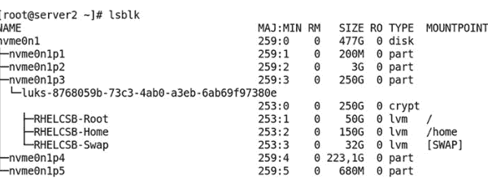

图 6.32：`lsblk` 命令的输出示例

### 命令 iostat

此命令是 `sysstat` 软件包的一部分，该软件包之前已针对 CPU 使用率进行了描述，通常用于输入/输出统计信息。统计信息显示物理存储设备、每秒传输次数（`tps`）、每秒读取和写入的数据，以及观察期间读取和写入的数据。图 6.33 显示了输出示例；选项 `-y` 排除与系统启动以来平均值相关的第一条目：


图 6.33：`iostat` 命令的输出示例

### 命令 iotop

此实用程序类似于 `top` 命令，但仅与输入/输出相关。应该安装此工具（`iotop` 软件包）。图 6.34 显示了应用程序的外观：

### 命令 iotop

```
总磁盘读取 : 22.31 K/s | 总磁盘写入 : 11.15 M/s

实际磁盘读取 : 22.31 K/s | 实际磁盘写入: 11.15 M/s

TID PRIO 用户 磁盘读取 磁盘写入 换入 IO% 命令

2137334 be/4 qemu 0.00 B/s 52.05 K/s 0.00 % 1.50 % qemu-kvm -na-p=on [worker]

2137341 be/4 qemu 0.00 B/s 11.15 K/s 0.00 % 0.84 % qemu-kvm -na-output [worker]

2137325 be/4 qemu 0.00 B/s 26.02 K/s 0.00 % 0.73 % qemu-kvm -na-p=on [worker]

2137313 be/4 qemu 0.00 B/s 156.14 K/s 0.00 % 0.41 % qemu-kvm -na-p=on [worker]

2137359 be/4 qemu 0.00 B/s 0.00 B/s 0.00 % 0.14 % qemu-kvm -na-output [worker]
```

图 6.34: `iotop` 命令的输出示例

显示的信息对于检测哪个应用程序正在执行更多的输入/输出操作以及读写任务的速度非常重要。

### 命令 atop

此命令之前已用于描述 `CPU` 使用率，它提供了有关系统中本地和远程存储使用的详细概述。图 6.35 说明了显示的信息如下：

```
SWP | 总计 32.0G | 可用 32.0G | swcac 0.0M | vmcom 17.5G | vmlim 47.5G |

LVM | 4ab0-a3eb-6a | 繁忙 6% | 读取 0 | 写入 232 | 平均IO 2.70 ms |

LVM | RHELC5B-Home | 繁忙 6% | 读取 0 | 写入 175 | 平均IO 3.19 ms |

LVM | RHELC5B-Root | 繁忙 1% | 读取 0 | 写入 3 | 平均IO 22.7 ms |

DSK | nvme0n1 | 繁忙 6% | 读取 0 | 写入 220 | 平均IO 2.85 ms |
```

图 6.35: `atop` 命令中的磁盘信息示例


以下字段显示在表 6.3 中（较大的终端尺寸会显示所有字段）：

| 字段 | 描述 |
| --- | --- |
| `busy` | 单元忙于处理请求的时间占比 |
| `read` | 发出的读取请求数量 |
| `write` | 发出的写入请求数量 |
| `discd` | 发出的释放（discard）请求数量 |
| `KiB/r` | 每次读取的千字节数（Kibbytes） |
| `KiB/w` | 每次写入的千字节数（Kibbytes） |
| `KiB/d` | 每次释放（discard）的千字节数（Kibbytes） |
| `MBr/s` | 读取吞吐量（每秒百万字节数，Mebibytes） |
| `MBw/s` | 写入吞吐量（每秒百万字节数，Mebibytes） |
| `avq` | 平均队列深度 |
| `avio` | 请求所需的寻道、延迟和数据传输的平均毫秒数。 |

**表 6.3: 命令 `atop` 的字段描述**

### 命令 `smartctl`

现代磁盘包含一个名为**自我监测、分析和报告技术（S.M.A.R.T）**的监控系统，其中包含不同的指标以预测硬件故障。主要命令是 `smartctl`，指定磁盘后会显示与磁盘相关的扩展信息。图 6.36 和 6.37 使用不同的选项来过滤显示的信息，以减少输出行数：

- 图 6.36 显示磁盘信息，包括型号/序列号和固件版本：

```
[root@server2 ~]# smartctl -i /dev/nvme0n1

smartctl 7.1 2020-04-05 r5049 [x86_64-linux-4.18.0-372.9.1.el8.x86_64] (local build)

Copyright (C) 2002-19, Bruce Allen, Christian Franke, www.smartmontools.org

=== 信息部分开始 ===

型号编号: INTEL SSDPEKKF512G8L

序列号: PHHH04800BY5512H

固件版本: L15P

PCI 供应商/子系统 ID: 0x8086

IEEE OUI 标识符: 0x5cd2e4

控制器 ID: 1

命名空间数量: 1

命名空间 1 大小/容量: 512.110.190.592 [512 GB]

命名空间 1 格式化 LBA 大小: 512

命名空间 1 IEEE EUI-64: 5cd2e4 259140262f

本地时间是: 2022 年 8 月 14 日 星期日 12:11:25 CEST
```


- 显示包含已写入和读取的数据、温度以及与其他使用空间相关的信息的 SMART 信息，如图 6.37 所示：

```
[root@server2 ~]# smartctl -A /dev/nvme0n1

smartctl 7.1 2020-04-05 r5049 [x86_64-linux-4.18.0-372.9.1.el8.x86_64] (local build)

Copyright (C) 2002-19, Bruce Allen, Christian Franke, www.smartmontools.org

=== SMART 数据部分开始 ===

SMART/健康信息 (NVMe Log 0x02)

关键警告: 0x00

温度: 33 摄氏度

可用备用空间: 100%

可用备用空间阈值: 12%

使用百分比: 8%

数据读取单元: 66.386.661 [33.9 TB]

数据写入单元: 58.888.607 [30.1 TB]

主机读取命令: 567.421.451

主机写入命令: 1.875.052.632

控制器忙碌时间: 68.306

电源循环次数: 2.921

通电小时数: 11.370

非安全关机次数: 161

媒体和数据完整性错误: 0

错误信息日志条目: 0

警告组件温度时间: 0

关键组件温度时间: 0
```

**图 6.37: 命令 `smartctl` 的输出示例**

使用选项 `-l error` 将显示由 SMART 监控系统检测到的错误。

### 命令 `fio` 和 `hdparm`

这些命令可用于查询存储设备的读/写速度，是检测磁盘问题的有用工具。命令 `hdparm` 带有选项 `-tT` 的输出显示在图 6.38 中：

```
[root@server2 ~]# hdparm -tT /dev/nvme0n1

/dev/nvme0n1:

测试缓存读取: 10064 MB 用时 1.99 秒 = 5047.98 MB/秒

测试缓冲磁盘读取: 3074 MB 用时 3.00 秒 = 1024.60 MB/秒
```

**图 6.38: 命令 `hdparm` 的输出示例**

命令 `fio` 是一个灵活的输入/输出测试器。它比 `hdparm` 更先进，因为它允许我们指定执行 I/O 操作的线程和进程数量。图 6.39（输出已截断）展示了该命令使用四个作业测试随机读写时的运行情况：

```
[root@server2 ~]# fio --randrepeat=1 --ioengine=libaio --direct=1 --gtod_reduce=1 --name=test --filename=test.fio --bs=4k --iodepth=64 --size=4G --readwrite=randrw --numjobs=4

test: (g=0): rw=randrw, bs=(R) 4096b-4096b, (W) 4096b-4096b, (T) 4096b-4096b, ioengine=libaio, iodepth=64

...

fio-3.19

正在启动 4 个进程

test: 布局 IO 文件 (1 个文件 / 4096MiB)

作业: 4 (f=4): [m(4)][96.2%] r=384MiB/s,w=383MiB/s [r=98.2K,w=98.2K iops] [eta 00m:02s]

运行状态组 0 (所有作业):

  读取: bw=164MiB/s (171MB/s), 40.8MiB/s-41.0MiB/s (42.8MB/s-42.9MB/s), io=8192MiB (8590MB), run=49990-50089msec

 写入: bw=164MiB/s (171MB/s), 40.9MiB/s-40.9MiB/s (42.9MB/s-42.9MB/s), io=8192MiB (8590MB), run=49990-50089msec

磁盘统计 (读取/写入):

 dm-1: ios=207688/2076846, merge=0/0, ticks=703954/4020718, in_queue=11051672, util=99.53%, aggrios=2097185/

 2100015, aggmerge=0/0, aggticks=7047507/4054918, aggrin_queue=11102425, aggrutil=98.54%

 dm-0: ios=2097185/2100015, merge=0/0, ticks=7047507/4054918, in_queue=11102425, util=98.54%, aggrios=2097185/

 2098583, aggmerge=0/1459, aggticks=6444743/3063238, aggrin_queue=9507982, agrutil=98.31%

 nvme0n1: ios=2097185/2098583, merge=0/1459, ticks=6444743/3063238, in_queue=9507982, util=98.31%
```

**图 6.39: 命令 `fio` 的输出示例**

### 命令 `df` 和 LVM 命令

在第 3 章 使用命令行界面中描述的命令 `df` 显示磁盘空闲空间和使用情况。如果系统使用 LVM（逻辑卷管理器），检查状态的命令如下：

- `vgdisplay`: 如图 6.40 所示，显示卷组信息：

```
[root@server2 ~]# vgdisplay 2>/dev/null

 --- 卷组 ---

  VG 名称       RHELC5B

  系统 ID

  格式        lvm2

  元数据区域   1

  元数据序列号 11

  VG 访问   读/写

  VG 状态   可调整大小

  最大 LV      0

  当前 LV      3

  打开的 LV     3

  最大 PV      0

  当前 PV      1

  活动 PV      1

  VG 大小     499,98 TiB

  PE 大小     4,00 MiB

  总 PE    131067903

  已分配 PE / 大小 59392 / 232,00 GiB

  空闲 PE / 大小 131008511 / <499,76 TiB
```


`VG UUID` `wNqZcz-C2xE-xtfV-fFJn-Oe6n-QA5W-3Q13oz`

*图 6.40: 命令 `vgdisplay` 的输出示例*

- `pvdisplay`: 如图 6.41 所示，显示物理卷的各种属性：

```
[root@server2 ~]# pvdisplay 2>/dev/null

--- 物理卷 ---

 PV 名称              /dev/mapper/luks-8768059b-73c3-4ab0-a3eb-6ab69f973804

 VG 名称               RHELC5B

 PV 大小               499,98 TiB / 不可用 3,00 MiB

 可分配           是

 PE 大小               4,00 MiB

 总 PE              131067903

 空闲 PE               131008511

 已分配 PE          59392

 PV UUID               WfAU4u-qd07-cyEw-L8cV-y4KA-xnRe-psIRNm
```


- `lvdisplay`: 如图 6.42 所示，显示逻辑卷信息：

```
[root@server2 ~]# lvdisplay 2>/dev/null

--- 逻辑卷 ---

 LV 路径                /dev/RHELC5B/Home

 LV 名称                Home

 VG 名称                RHELC5B

 LV UUID                XkTEn3-dReS-F7TZ-4WTt-YjxN-Ffmt-0JA6ZN

 LV 写访问        读/写

 LV 创建主机, 时间 localhost, 2019-05-30 08:57:28 +0200

 LV 状态              可用

# 打开                 1

 LV 大小                150,00 GiB

 当前 LE             38400

 段               3

 分配             继承

 预读扇区     auto

- 当前设置为     256

 块设备           253:2
```


## 监控网络资源

网络是避免瓶颈需要监控的核心组件之一。本节将关注网络设备统计数据，以检查带宽使用并检测数据包丢失。本节侧重于通用统计，而即将介绍的网络配置章节将包括用于检查端到端连接状态的工具。

`lshw` 命令提供系统中以太网设备的信息，图 6.43 展示了物理系统的示例输出：

```
[root@server ~]# lshw -c network -short
H/W path Device Class Description
=============================================
/0/100/1/0 eth0 network Ethernet Controller 10-Gigabit X540-AT
/0/100/1/0.1 eth1 network Ethernet Controller 10-Gigabit X540-AT
/0/100/2/0 eth2 network Ethernet Controller 10-Gigabit X540-AT
/0/100/2/0.1 eth3 network Ethernet Controller 10-Gigabit X540-AT
```

图 6.43：`lshw` 命令的输出示例

目录 `/sys/class/net/` 包含每个物理接口和虚拟接口的链接列表。每个链接都指向一个包含该接口信息（如配置和统计信息）的目录。图 6.44 展示了 `/sys/class/net/eth0` 所指向的目录（即 `/sys/devices/pci0000:00/0000:00:01.0/0000:01:00.0/net/eth0`）中的文件：

```
[root@server eth0]# ls
addr_assign_type link_mode proto_down
address dev_port master queues
addr_len dormant mtu speed
broadcast duplex name_assign_type statistics
brport flags netdev_group subsystem
carrier gro_flush_timeout operstate testing
carrier_changes ifalias phys_port_id tx_queue_len
carrier_down_count ifindex phys_port_name type
carrier_up_count iflink phys_switch_id uevent
device ixgbe-mdio-0000:01:00.0 power upper_baremetal
```

图 6.44：`/sys/class/net/` 中网络设备的示例内容

目录 `statistics/` 包含有关该设备接收和流量信息的信息。

### ethtool 命令

此命令允许查询或控制网络和硬件设置。使用此命令，可以为以太网设备启用某些功能，例如自协商或默认速度。它需要接口作为参数，默认情况下，如果不指定任何选项，它将显示与网络接口相关的有用信息，如图 6.45 所示：

```
[root@server ~]# ethtool eth0
Settings for eth0:
Supported ports: [ TP ]
Supported link modes:
100baseT/Full
1000baseT/Full
10000baseT/Full
Supported pause frame use: Symmetric
Supports auto-negotiation: Yes
Supported FEC modes: Not reported
Advertised link modes:
100baseT/Full
1000baseT/Full
10000baseT/Full
Advertised pause frame use: Symmetric
Advertised auto-negotiation: Yes
Advertised FEC modes: Not reported
Speed: 1000Mb/s
Duplex: Full
Auto-negotiation: on
Port: Twisted Pair
PHYAD: 0
Transceiver: internal
MDI-X: Unknown
Supports Wake-on: umbg
Wake-on: g
Current message level: 0x00000007 (7)
drv probe link
Link detected: yes
```


输出中包含一些重要信息：

- 接口的当前速度。

- 接口支持的链路模式。

- 通告的链路模式是从接口所连接的交换机接收到的。

- `双工（Duplex）` 配置以及是否启用了 `自协商（Auto-negotiation）`。

- 接口是否检测到 `链路（Link detected）`。

### nmon 命令

`nmon` 命令是一个流行的工具，用于获取系统中资源的一般统计信息，并专门用于网络监控。运行该应用程序后，按下键 `$n$` 将显示网络统计信息，如图 6.46 所示：


### traceroute、tracpath 和 mtr 命令

通常，网络故障排除需要与流量流相关的网络知识。这三个工具都接受目标 IP 作为参数，以确保所有中间网关正常工作。*图 6.47 – 6.49* 展示了尝试访问 IP `8.8.8.8`（Google 的 DNS）时的使用情况：

- `traceroute` 命令（属于 `traceroute` 软件包的一部分）使用 ICMP 协议打印到网络的路径数据包跟踪。*figure 6.47* 展示了用于 IPv6 的 `traceroute6` 命令的使用示例：


```
[root@server ~]# traceroute 8.8.8.8
traceroute to 8.8.8.8 (8.8.8.8), 30 hops max, 60 byte packets
1 169.254.163.26 (169.254.163.26) 0.555 ms 0.669 ms 0.862 ms
2 ael07.ppr01.wdc04.networklayer.com (169.55.118.184) 0.851 ms 1.221 ms 0.7: 5 ms
3 86.76.3fa9.ip4.static.sl-reverse.com (169.63.118.134) 0.520 ms 80.76.3fa9.ip 4.static.sl-reverse.com (169.63.118.128) 0.314 ms 86.76.3fa9.ip4.static.sl-reve se.com (169.63.118.134) 0.479 ms
4 ael7.cbs02.eq01.wdc02.networklayer.com (169.45.18.232) 1.407 ms ael6.cbs02. eq01.wdc02.networklayer.com (169.45.18.230) 1.346 ms ael7.cbs02.eq01.wdc02.netwo klayer.com (169.45.18.232) 1.351 ms
5 ae29.bbr02.eq01.wdc02.networklayer.com (50.97.17.147) 0.738 ms 0.734 ms ae: 0.bbr01.eq01.wdc02.networklayer.com (50.97.17.149) 0.721 ms
6 23.10.6132.ip4.static.sl-reverse.com (50.97.16.35) 0.745 ms 72.14.2221.28 (7. 14.2221.28) 0.502 ms 23.10.6132.ip4.static.sl-reverse.com (50.97.16.35) 0.775 ms
7 108.170.246.1 (108.170.246.1) 0.822 ms * *
8 dns.google (8.8.8.8) 0.709 ms 0.738 ms 0.454 ms
```

*图 6.47：`traceroute` 命令的输出示例*

- `traceroute` 和 `traceroute6` 命令（属于 `iputils` 软件包的一部分）跟踪到网络的路径，发现该路径上的最大传输单元（`MTU`）。像`no reply`这样的消息表明路径上的路由器或交换机未提供信息。指示一个随机的 `UDP`，信息显示将类似于*figure 6.48*：

```
[root@server2 ~]# traceroute -n 8.8.8.8 -p 33434
1?: [LOCALHOST]
	pmtu 1492
1:	192.168.1.1											1.029ms
1:	192.168.1.1											0.677ms
2:	no reply
3:	no reply
4:	212.166.147.22											13.179ms asymm {
5:	no reply
6:	8.8.8.8														13.160ms reached
Resume:	pmtu 1492 hops 6 back 10
```

*图 6.48：`traceroute` 命令的输出示例*

- `mtr` 命令（属于 `mtr` 软件包的一部分）是一种网络诊断工具，它结合了 `traceroute` 和 `ping` 的功能，用于调查主机和目的主机之间的网络连接。*图 6.49* 显示了以 `8.8.8.8` 为参数时的示例外观：


图 6.49：`mtr` 命令的输出示例

- `mtr` 和 `traceroute` 之间的主要区别在于，`mtr` 是交互式的，并且持续测试连接以检测是否存在任何数据包丢失或路径组件到达时间的峰值。

## 配额与限制

Linux 系统管理员的目标之一是保护系统，这需要设置限制和配额，以免系统资源耗尽。Linux 有两种通用方式来限制用户对资源的消耗：

- **配额（Quotas）**：限制用户和组的磁盘空间。这可以用于限制用户可以消耗的空间或限制他们可以拥有的文件总数。

- **限制（Limits）**：限制用户不同资源的可能性，例如打开文件数、进程数或内存使用量。

### 配额

磁盘配额应用于文件系统以及用户和/或组。文件系统需要配置为跟踪每个用户和组消耗的文件及大小。可以为特定用户或组限制总大小和文件数量，设有两个限制：

1. **软限制（Soft limit）**：指示宽限期的开始。例如，如果软限制为 `1 GB`，宽限期为两天，则用户可以在两天内超过该限制。在宽限期结束后，用户将无法添加更多文件，直到删除文件使其低于限制为止。

2. **硬限制（Hard limit）**：用户无论如何都不能拥有超过指定限制的数量。

在系统中启用配额之前，必须在文件系统中启用用户或组配额，这需要为配额进行配置。默认情况下未启用。为此，需要打开文件 `/etc/fstab`，并在第四列中添加单词 `usrquota` 和/或 `grpquota`，如图 6.50 所示：

```
# /etc/fstab: static file system information.
#
# Use 'blkid' to print the universally unique identifier for a
# device; this may be used with UUID= as a more robust way to name devices
# that works even if disks are added and removed. See fstab(5).
#
# <file system> <mount point>   <type>  <options>       <dump>  <pass>
# / was on /dev/ubuntu-vg/ubuntu-lv during curtin installation
/dev/disk/by-iddm-uuid-LVM-BZrwBMRT0nAcI1QcZonwGQRHUKMzm1pJGLbA2z6NSilzWCGpNy88g55A5G5Eq1fi / ext4 defaults,usrquota,grpquota 0 1
```

图 6.50：`/etc/fstab` 文件内容示例

之后，需要重新挂载文件系统以应用新配置。在这种情况下，已配置在挂载于 `root` (/) 的文件系统上：`mount -o remount,rw /`。可以不带任何选项运行命令 `mount`，以确保配额已启用，如图 6.51 所示：

```
root@ubuntu:~# mount -o remount,rw /
root@ubuntu:~# mount |grep quota
/dev/mapper/ubuntu--vg-ubuntu--1v on / type ext4 (rw,relatime,quota,usrquota,grpquota)
```

图 6.51：使用 `mount` 命令重新挂载并检查状态

在文件系统上启用配额后，需要创建文件 `aquota.user` 和/或 `aquota.group` 以跟踪用户和组的配置和使用情况。创建这些文件的方式是通过带有选项 `-u`（用于用户）、`-g`（用于组）和 `-m`（在此任务期间不将其重新挂载为只读）的命令 `quotacheck`。安装 `quota` 软件包后，`quotacheck` 命令即可使用，如图 6.52 所示：

```
root@ubuntu:~# quotacheck -ugm /
root@ubuntu:~# ls -l /aquota*
-rw------- 1 root root 9216 Aug 14 14:46 /aquota.group
-rw------- 1 root root 8192 Aug 14 14:46 /aquota.user
```


在文件创建之后，需要使用 `quotaon` 命令启用配额，如 *图 6.53* 所示：

```
root@ubuntu:~# quotaon -v /
/dev/mapper/ubuntu--vg-ubuntu--lv [/]: group quotas turned on
/dev/mapper/ubuntu--vg-ubuntu--lv [/]: user quotas turned on
```


在系统中启用配额后，有两种方式为单个用户或组设置配额：


1. `edquota` 命令：它会打开编辑器以设置用户（`-u user`）或组（`-g group`）的配额。
2. `setquota` 命令：它用于更新用户或组的配额。

`图 6.54` 展示了如何使用 `setquota` 为普通用户设置配额（空间使用量的软限制为 200MB，硬限制为 220M，且无文件数量限制），以及如何使用 `repquota` 命令列出当前状态：

```
root@ubuntu:~# setquota -u agonzalez 200M 220M 0 0 /
root@ubuntu:~# repquota -s /
*** Report for user quotas on device /dev/mapper/ubuntu--vg-ubuntu--lv
Block grace time: 7days; Inode grace time: 7days
User used soft hard grace used soft hard grace
root -- 6352M 0K 0K 138k 0 0
man -- 1440K 0K 0K 146 0 0
_apt -- 24K 0K 0K 4 0 0
systemd-network -- 276K 0K 0K 5 0 0
systemd-timesync -- 4K 0K 0K 2 0 0
pollinate -- 4K 0K 0K 2 0 0
syslog -- 1676K 0K 0K 17 0 0
tss -- 4K 0K 0K 1 0 0
landscape -- 8K 0K 0K 3 0 0
agonzalez -- 160K 200M 220M 61 0 0
```


如果用户试图使用超过 220MB（硬限制）的空间，系统将不允许创建更多文件。`图 6.55` 使用名为 `dd` 的命令生成一个大小为 300MB 的文件：

```
agonzalez@ubuntu:~$ dd if=/dev/random of=file300M bs=4M count=60
dd: error writing 'file300M': Disk quota exceeded
55+0 records in
54+0 records out
230522880 bytes (231 MB, 220 MiB) copied, 9.70586 s, 23.8 MB/s
```

图 6.55：使用 `dd` 命令测试磁盘配额

### 限制

Linux 允许限制用户在会话期间可以使用的资源。定义这些限制的主要文件是 `/etc/security/limits.conf`，其中包含以下字段：

- `domain`（域）：可以是用户名、带有前缀 `@` 的组名、代表所有用户的星号（`*`），或由冒号（`:`）分隔的 `uid` 或 `gid` 范围。
- `type`（类型）：接受的值包括 `soft`（软限制）和 `hard`（硬限制）。
- `item`（项目）：一个要限制的元素，见表 6.4

| 限制项 | 描述 |
|---|---|
| `core` | 限制核心文件大小（KB） |
| `data` | 最大数据段大小（KB） |
| `fsize` | 最大文件大小（KB） |
| `memlock` | 最大锁定在内存中的地址空间（KB） |
| `nofile` | 最大打开文件数 |
| `rss` | 最大常驻内存集大小（KB） |
| `stack` | 最大堆栈大小（KB） |
| `cpu` | 最大 CPU 时间（分钟） |
| `nproc` | 最大进程数（见下文给出的说明） |
| `as` | 地址空间限制（KB） |
| `maxlogins` | 该用户的最大登录次数 |
| `maxsyslogins` | 系统上的最大登录次数 |
| `priority` | 运行用户进程的优先级 |
| `locks` | 用户可持有的最大文件锁数量 |
| `sigpending` | 最大待处理信号数 |
| `msgqueue` | POSIX 消息队列使用的最大内存（字节） |
| `nice` | 允许提升到的最大 nice 优先级值：`[-20, 19]` |
| `rtprio` | 最大实时优先级 |


用户可以使用 `ulimit` 命令来检查已应用的限制，如 `图 6.56` 所示：

```
agonzalez@ubuntu:~$ ulimit -a
    real-time non-blocking time  (microseconds, -R) unlimited
    core file size          (blocks, -c) 0
    data seg size           (kbytes, -d) unlimited
    scheduling priority             (-e) 0
    file size               (blocks, -f) unlimited
    pending signals             (-i) 15251
    max locked memory       (kbytes, -l) 502268
    max memory size         (kbytes, -m) unlimited
    open files                   (-n) 1024
    pipe size            (512 bytes, -p) 8
    POSIX message queues     (bytes, -q) 819200
    real-time priority             (-r) 0
    stack size              (kbytes, -s) 8192
    cpu time               (seconds, -t) unlimited
    max user processes              (-u) 15251
    virtual memory          (kbytes, -v) unlimited
    file locks                      (-X) unlimited
```


在 `图 6.57` 中，管理员限制了用户进程的数量。用户可以使用名为 `ulimit` 的内置 shell 命令来设置自己的限制，但始终设置为低于默认值或该用户特定值的数值：

```
root@ubuntu:~# echo "agonzalez          hard  nproc     10" >> /etc/security/limits.conf
root@ubuntu:~# su - agonzalez
agonzalez@ubuntu:~$ ulimit -u
10

agonzalez@ubuntu:~$
agonzalez@ubuntu:~$ ulimit -u 5
agonzalez@ubuntu:~$ ulimit -u
5
```


如果用户将自己设置的限制设为五个进程后，试图运行超过该数量的进程，他们将收到错误，如 `图 6.58` 所示：

```
agonzalez@ubuntu:~$ sleep 50&
-bash: fork: retry: Resource temporarily unavailable
```

图 6.58：测试用户限制

## 结论

在本章中，我们了解了如何审查资源。避免系统中出现中断非常重要。Linux 提供了高级别和低级别工具来获取资源信息，以便能够预测未来的问题。限制普通用户可以消耗的资源是避免磁盘满载或 CPU 或内存过载的一项必要任务。

## 关键事实

- 有多个命令可用于获取资源使用情况的信息。
- CPU 负载通过三个平均间隔表示：1 分钟、5 分钟和 15 分钟。
- 在 Linux 上可以为用户和组设置配额。
- Linux 提供了限制用户或组可消耗资源的功能。

## 问题

1. 哪个命令提供与 `CPU` 信息相关的最佳信息？
   - a. `lscpu`
   - b. `cpuinfo`
   - c. `cpuid`

2. 假设只有一个 CPU，一个核心，没有线程，负载 0.55 意味着什么？
   - a. 155% 的使用率
   - b. 5.5% 的使用率
   - c. 55% 的使用率

3. 哪个文件包含内存使用信息和统计？
   - a. `/dev/meminfo`
   - b. `/sys/meminfo`
   - c. `/proc/meminfo`

4. 使用哪个命令从 S.M.A.R.T 获取信息？
   - a. `smartinfo`


- b. `smartctl`
- c. `smartdump`

- 5. 哪个命令有助于获取到达目的地的路径的实时统计信息？
  - a. `mtr`
  - b. `tracepath`
  - c. `traceroute`
- 6. 使用哪个命令生成关于配额的报告？
  - a. `repquota`
  - b. `showquota`
  - c. `infoquota`
- 7. 用户可以使用 `ulimit` 显示和设置自己的限制。
  - a. 正确
  - b. 错误

## 答案

- 1. a
- 2. c
- 3. c
- 4. b
- 5. a
- 6. a
- 7. a

# 第 7 章

## 网络配置

### 简介

网络是企业核心部分之一。它涉及多个元素，如服务器、交换机、路由器和电缆。理解流量如何在 Linux 中流动以及可能的配置，对于以高效的方式提供服务、降低成本、瓶颈和停机时间至关重要。

Linux 服务器既允许简单的配置，也允许高级配置。本章将涵盖如何在不同的 Linux 发行版中配置网络，以及聚合、网桥和虚拟局域网（VLAN）等高级特性。

### 结构

在本章中，将讨论以下主题：

- 网络简介
- 基本网络配置
- 路由
- 高级网络配置

### 网络简介

现代系统在大多数任务上依赖于网络，例如安装新软件、更新系统，或在本地或远程提供服务。Linux 作为最安全的操作系统，在硬件、内核空间（Kernel space）和用户空间（user space）之间具有不同的抽象层。*图 7.1* 展示了各种 Linux 操作系统层：


作为 Linux 系统管理员，理解网络的基本概念至关重要，这涵盖了从流量如何由物理设备管理到数据如何呈现给最终用户的全过程。`开放系统互连模型`（`Open Systems Interconnection Model`，即 `OSI` 模型）描述了通用的标准通信协议。该模型定义了以下七个抽象层：

- `物理层（第1层）`：负责设备中数据的传输和接收，例如系统中的以太网设备、电缆或路由器中的端口。
- `数据链路层（第2层）`：提供不同节点之间的数据传输。例如，同一局域网内两台服务器之间的通信。
- `网络层（第3层）`：将数据从一个网络的一个节点传输到另一个网络的不同节点。这需要节点在不同第2层（数据链路）之间路由流量。
- `传输层（第4层）`：使用协议（如 `UDP` 或 `TCP`）进行数据传输。
- `会话层（第5层）`：维护并同步两个节点之间的连接。
- `表示层（第6层）`：格式化和转换待使用的数据，例如数据加密/解密或压缩/解压。
- `应用层（第7层）`：用户与之交互的应用程序层。

[图 7.2](#) 展示了 `OSI` 模型中不同层之间的流量流动：


图 7.2：`OSI` 模型层流量流动。来源：`Wikipedia`

在过去几十年里，网络经历了演变，从最初的通信发展到新技术的采用。早期的通信主要是在物理服务器之间通过交换机和路由器进行的。当时的主导流量是*南北向*数据流，即系统与局域网外部的设备进行通信。

随着虚拟化技术的普及，服务迁移到虚拟机中带来了通信方面的新挑战，从而增加了*东西向*流量，这指的是同一网络内部不同服务之间的通信。

容器的采用增加了系统之间的流量，并且先进的网络配置和先进的网络实现（如软件定义网络和*隧道协议*）已成为当今服务器配置时所需的知识。

另一个重要的转变是大型企业的网络架构转向称为 `Spine Leaf` 的新架构，该架构提高了流量效率并减少了由传统架构可能引起的瓶颈。图 7.3 展示了传统架构与新架构之间的区别：传统架构具有三层（接入层、汇聚层和核心层），存在并行流量方面的限制；而新架构具有网状连接，具备高带宽和低延迟特性：


*图 7.3：传统架构与 Spine Leaf 架构。来源：Aruba Networks*

过去几年里另一个重要变化是 `IPv6` 的引入，这是最新的互联网协议版本。这个新版本使用 `128` 位地址代替了 `IPv4` 中的 `32` 位地址。`IPv6` 在局域网中的使用仍然有限，但互联网服务提供商（`ISP`）和大型企业的采用已成为现实。

## 物理层（第1层）

第 6 章“监控系统资源”介绍了如何使用 `lshw` 命令列出系统上可用的以太网设备。同一章还介绍了 `ethtool` 命令，用于获取状态信息，例如是否检测到链路以及可用的速度。

`ip` 命令取代了传统且已弃用的 `ifconfig` 命令在 Linux 中用于列出接口信息的操作。指定 `link` 作为参数时，将列出网络接口的物理信息，如图 7.4 所示：

```text
root@ubuntu:~# ip --color=auto link
1: lo: <LOOPBACK,UP,LOWER_UP> mtu 65536 qdisc noqueue state  UNKNOWN mode DEFAULT group default qlen 1000
    link/loopback 00:00:00:00:00:00 brd 00:00:00:00:00:00
2: enp1s0: <BROADCAST,MULTICAST,UP,LOWER_UP> mtu 1500 qdisc fq_codel state UP mode DEFAULT group default qlen 1000
    link/ether 52:54:00:ce:80:b8 brd ff:ff:ff:ff:ff:ff
3: enp7s0: <BROADCAST,MULTICAST> mtu 1500 qdisc noop state DOWN mode DEFAULT group default qlen 1000
    link/ether 52:54:00:07:3a:f8 brd ff:ff:ff:ff:ff:ff
```


`ip link` 命令的输出包含重要信息。Linux 发行版包含一个名为 `lo` 的本地接口，用于系统内部的通信，例如 `TCP/UDP` 连接。在现代系统中，物理接口的格式为 `en`（*以太网设备*）+ `p[PCI` *总线号*] + `s[插槽` *号*]`，而过去则使用 `ethX`（其中 `X` 是从 0 开始的数字）。

输出结果将指示接口是 `UP`（检测到链路且接口在系统中处于活动状态）还是 `DOWN`（未检测到链路或接口在系统中未激活）、`MTU`（*最大传输单元*，通常默认为 1,500）以及 `MAC` 地址（用于识别单个网络设备）。

`MAC` 地址是配置网络接口时的重要值，例如在使用动态主机配置协议（`DHCP`）时分配静态 `IP`，或在使用预启动执行环境（`PXE`）进行网络安装时。

局域网内节点之间的通信需要知道目的节点的 `MAC` 地址。为了知道某个节点的 `MAC` 地址，Linux 会向网络发送一个数据包，询问谁拥有该目的 `IP` 地址。当获取到该信息后，它会在一个包含 `IP` 地址与 `MAC` 地址映射关系的表中存储此关系。参数 `neigh`（取代了历史命令 `arp`）显示该表信息，如图 7.5 所示：

```text
root@ubuntu:~# ip --color neigh
192.168.122.1 dev enp1s0 lldaddr 52:54:00:81:84:22 REACHABLE
192.168.122.145 dev enp1s0 lldaddr 52:54:00:a2:cb:2a REACHABLE
```


## 数据链路层（第2层）

命令 `ip` 可用于显示第 2 层信息、`IP` 地址和网络掩码。添加参数 `address`（或 `a`）可显示分配给接口的地址，如 *图 7.6* 所示：


```text
root@ubuntu:~# ip --color=auto address
1: lo: <LOOPBACK,UP,LOWER_UP> mtu 65536 qdisc noqueue state UNKNOWN group default qlen 1000
    link/loopback 00:00:00:00:00:00 brd 00:00:00:00:00:00
    inet 127.0.0.1/8 scope host lo
        valid_lft forever preferred_lft forever
    inet6 ::1/128 scope host
        valid_lft forever preferred_lft forever
2: enp1s0: <BROADCAST,MULTICAST,UP,LOWER_UP> mtu 1500 qdisc fq_codel state UP group default qlen 1000
    link/ether 52:54:00:ce:80:b8 brd ff:ff:ff:ff:ff:ff
    inet 192.168.122.101/24 metric 100 brd 192.168.122.255 scope global dynamic enp1s0
        valid_lft 3414sec preferred_lft 3414sec
    inet6 fe80::5054:ff:ce:8bb8/64 scope link
        valid_lft forever preferred_lft forever
3: enp50: <BROADCAST,MULTICAST> mtu 1500 qdisc noop state DOWN group default qlen 1000
    link/ether 52:54:00:07:3a:f8 brd ff:ff:ff:ff:ff:ff
```


接口 `lo` 始终分配并配置为 IP 127.0.0.1，网络掩码为 255.0.0.0（/8）。前文 *图 7.6* 显示了一个名为 `enp1s0` 的接口，配置为 IP 192.168.122.101，网络掩码为 255.255.255.0（/24），*广播 IP* 为 192.168.122.255。

名为 `enp1s0` 的接口被分配了一个 IPv6 本地地址（以 `fe80` 开头），子网掩码为 /64。*图 7.7* 展示了一个配置了 IPv6 地址的接口示例：

```text
root@lab:~# ip --color -6 address show dev eth0
2: eth0: <BROADCAST,MULTICAST,UP,LOWER_UP> mtu 1500 st1de UP qlen 1000
    inet6 2001:41d0:1:ee26::1/128 scope global
        valid_lft forever preferred_lft forever
    inet6 fe80::225:90ff:fe22:424a/64 scope link
        valid_lft forever preferred_lft forever
```


## 网络层（第3层）

第3层需要有关如何访问非本地网络的信息。这包括访问网络外部的默认网关，以及在需要时访问其他网络的特定网关。带有 `route` 参数的 `ip` 命令会列出当前的目标地址和网关表。*图 7.8* 展示了一个示例：

```text
root@ubuntu:~# ip --color route
default via 192.168.122.1 dev enp1s0 proto dhcp src 192.168.122.101 metric 100
192.168.122.0/24 dev enp1s0 proto kernel scope link src 192.168.122.101 metric 100
```

*图 7.8：命令 `ip route` 的输出示例*

在图 7.8 所示的示例中，默认网关为 192.168.122.1。它将被用作所有目的地址非 192.168.22.0/24 的通信的跳板。如果通信目标是本地网络中的某个 IP 地址，则网关不参与，通信将是直接的。图 7.9 展示了 IPv6 的一个示例：

```
root@lab:~# ip --color -6 route
2001:41d0:1:ee26::1 dev eth0 proto kernel metric 256 pref medium
2001:41d0:1:eef::ff:ff:ff:ff dev eth0 metric 1024 pref medium
fe80::/64 dev eth0 proto kernel metric 256 pref medium
default via 2001:41d0:1:eef::ff:ff:ff:ff dev eth0 metric 1024 pref medium
```

*图 7.9：命令 `ip route` 配合 IPv6 的输出示例*

命令 `ip route` 允许一个称为 `get` 的有用额外参数，用于获取关于如何访问指定 IP 的信息。图 7.10 展示了两个示例，第一个关于网络外部的 IP，第二个关于本地网络中的 IP：

```
root@ubuntu:~# ip --color route get 8.8.8.8
8.8.8.8 via 192.168.122.1 dev enp1s0 src 192.168.122.101 uid 0
  cache
root@ubuntu:~# ip --color route get 192.168.122.241
192.168.122.241 dev enp1s0 src 192.168.122.101 uid 0
  cache
```

*图 7.10：命令 `ip route get` 的输出示例*

正如第 6 章“监控系统资源”中所述，有几种工具可以检查从系统到目标 IP 的流量跳板，例如 `traceroute`、`tracempath` 或 `mtr`。协议互联网控制报文协议（ICMP）位于第 3 层；该协议被前文提到的命令以及流行命令 `ping` 使用。该命令对于检查与本地和远程 IP 的连接性非常有用。

### 传输层（第 4 层）

该层依赖于用于数据传输的协议。传输协议可以是有状态的，例如传输控制协议（TCP），也可以是无状态的，例如用户数据报协议（UDP）。有状态连接确保数据正确发送，并等待传输完成。有状态连接的一个示例是 HTTP 请求。无状态连接发送数据并等待回复，但不确保通信完整性。无状态连接的一个示例是 DNS 请求。

传输层依赖于 IP 地址和端口来发起连接，这需要指定目标 IP 和目的端口。本地系统会分配一个随机端口用于通信。某个服务将在特定 IP 和定义的端口上监听新连接。Linux 中的端口范围（与**互联网号码分配机构**建议的不同）在 *表 7.1* 中定义：

| 范围 | 描述 |
| :--- | :--- |
| 0-1023 | *系统端口*（知名端口）。只有由系统用户执行的服务/应用程序才能监听这些端口。 |
| 1024-32767 | 其余服务的非特权端口 |
| 32768-60999 | 动态和/或私有端口。也称为临时端口。 |

*表 7.1：端口范围描述*

文件 `/etc/services` 包含已知服务及其分配端口的列表。Linux 提供了一个名为 `sysctl` 的工具，可用于查询或修改系统参数，包括这些端口范围。*图 7.11* 显示了这两个参数及其值：

```
root@ubuntu:~# sysctl -a |grep --color=never -e local_port -e ip_unprivileged
net.ipv4.ip_local_port_range = 32768    60999
net.ipv4.ip_unprivileged_port_start = 1024
```

*图 7.11：命令 `sysctl` 的输出示例*

可以使用命令 `socket statistics`（`ss`）列出系统中当前活动的连接，它正在取代传统命令 `netstat`。*图 7.12* 展示了使用选项 `-t`（`-tcp` 用于筛选 TCP 连接）和 `-n`（`--numeric` 用于显示数字形式的端口和 IP）的示例：


```
root@ubuntu:~# ss -tn
State Recv-Q Send-Q   Local Address:Port    Peer Address:Port  Process
ESTAB   0    0   192.168.122.101:22   192.168.122.1:50086
ESTAB   0    0   192.168.122.101:22   192.168.122.145:38134
ESTAB   0    0   192.168.122.101:22   192.168.122.1:46006
ESTAB   0    0   192.168.122.101:53530   192.168.122.145:22
```

*图 7.12：命令 `ss` 的输出示例*

*图 7.12* 中的上述示例显示了以下连接：

- 两条来自 IP `192.168.122.1` 到本地系统（其 IP 为 `192.168.122.101`）端口 22 的连接，这是 `SSH` 的端口。如 *图 7.11* 所示，每个连接使用系统设置的端口范围内的随机端口。
- 一条来自 IP `192.168.122.145` 到本地系统端口 22 的连接。
- 一条由本地系统发起（`192.168.122.101`，随机生成的端口为 `53530`），指向 IP `192.168.122.145` 和端口 22 的连接。

### 会话层、表示层和应用层（第 5、6、7 层）

这三个层属于软件层，它们为最终用户发起并服务数据。例如，使用命令 `curl` 建立 `HTTPS` 连接时，会发起一个与 Web 服务器的会话（第 5 层），处理 `SSL` 连接以及数据压缩/解压缩（第 6 层），并执行可视化（第 7 层）。*图 7.13* 是命令 `curl` 输出的一个示例：

```
root@ubuntu:~# curl -v https://ifconfig.me 2>&1| grep -e "onnect" -e "5.22"
* Connected to ifconfig.me (34.160.111.145) port 443 (#0)
* SSL connection using TLSv1.3 / TLS_AES_256_GCM_SHA384
* Connection state changed (HTTP/2 confirmed)
* Copying HTTP/2 data in stream buffer to connection buffer after upgrade: len=0
* Connection #0 to host ifconfig.me left intact
5.224.10.27
```

*图 7.13：命令 `curl` 的输出示例*

### 基本网络配置

Linux 系统中的网络配置，与其他配置一样，是在纯文本文件中定义的。历史上，配置这些文件并非易事，且容易引发配置错误，从而导致停机。最近的发行版包含用于管理网络的高层命令，帮助系统管理员配置基本或高级设置。这些解决方案确保了语法和配置的正确性。

`Red Hat` 发行版及其衍生版本（如 `CentOS Stream` 或 `Rocky Linux`）使用 `NetworkManager` 系统守护进程来管理网络设备连接。`Ubuntu` 发行版使用 `Netplan` 和 `Systemd-networkd` 执行基于 `YAML` 文件的配置。

### Red Hat 系系统中的网络配置

在旧版本的 `Red Hat` 系系统中，当使用手动配置时，网络配置文件位于目录 `/etc/sysconfig/network-scripts/` 下。文件名以 `ifcfg-` 为前缀，后接接口名称，包含该接口的配置。以下代码展示了 `ifcfg-ens3` 文件内容的示例，用于配置接口 `ens3` 使用 `DHCP`：

```
TYPE=Ethernet
PROXY_METHOD=none
BROWSER_ONLY=no
BOOTPROTO=dhcp
DEFROUTE=yes
IPV4_FAILURE_FATAL=no
IPV6INIT=yes
IPV6_AUTOCONF=yes
IPV6_DEFROUTE=yes
IPV6_FAILURE_FATAL=no
NAME=ens3
UUID=02cc87e6-dc7c-4c9e-a530-f908611c7f5e
DEVICE=ens3
ONBOOT=yes
```

在新版本中，`NetworkManager` 使用目录 `/etc/NetworkManager/system-connections` 来存储配置。以下代码展示了名为 `enp1s0.nmconnection` 的文件示例，用于配置接口 `enp1s0` 使用 `DHCP`：

```
[connection]
id=enp1s0
uuid=320f6572-672b-33c8-9014-b0fb087ae1a2
type=ethernet
autoconnect-priority=-999
interface-name=enp1s0
timestamp=1656276248
[ethernet]
[ipv4]
method=auto
[ipv6]
addr-gen-mode=eui64
method=auto
[proxy]
```

`NetworkManager` 包含若干用于查询、管理设备和连接配置的命令。命令 `nmcli` 用于在命令行执行操作，命令 `nmtui` 用于在控制台的图形界面中执行操作。

#### 命令 nmcli

此命令行工具用于控制 `NetworkManager` 并查询状态。该命令允许第一个参数指示要管理的组件，其中配置网络的常用选项在表 7.2 中描述：

| 参数 | 描述 |
| :--- | :--- |
| `general` | 一般状态和设置主机名 |
| `connection` | 管理连接 |
| `device` | 管理由 `NetworkManager` 管理的设备 |
| `monitor` | 监控 `NetworkManager` 的变化 |

*表 7.2：命令 `nmcli` 的第一个参数选项*

参数 `general` 显示系统的一般状态，如图 7.14 所示：

```
[root@rhel ~]# nmcli general
STATE        CONNECTIVITY  WIFI-HW  WIFI     WWAN-HW  WWAN
connected    full          enabled  enabled  enabled  enabled
```

*图 7.14：命令 `nmcli` 的输出示例*

参数 `connection` 在没有其他参数的情况下，列出系统中配置并由 `NetworkManager` 管理的连接。可以使用参数 `connection show` 后接连接名称来列出所有配置选项，如图 7.15 所示：

```
[root@rhel ~]# nmcli connection
 NAME               UUID                                  TYPE      DEVICE
 enp1s0             320f6572-672b-33c8-9014-b0fb087ae1a2  ethernet  enp1s0
[root@rhel ~]# nmcli connection show enp1s0 | grep IP4.
IP4.ADDRESS[1]:    192.168.122.145/24
IP4.GATEWAY:       192.168.122.1
IP4.ROUTE[1]:      dst = 192.168.122.0/24, nh = 0.0.0.0, mt = 100
IP4.ROUTE[2]:      dst = 0.0.0.0/0, nh = 192.168.122.1, mt = 100
IP4.DNS[1]:        192.168.122.1
```

*图 7.15：命令 `nmcli` 的输出示例。*

如果可能，请指定参数以添加连接、修改连接或删除连接等。图 7.16 展示了一些常见操作：


```
[root@rhel ~]# nmcli c add type ether con-name "test" ifname enp7s0 ip4 "10.10.0.22/24"
 Connection 'test' (f67e84a5-a754-4268-92ff-0d501a70d9ac) successfully added.
[root@rhel ~]# nmcli connection
 NAME   UUID                                  TYPE      DEVICE
 enp1s0 320f6572-672b-33c8-9014-b0fb087ae1a2  ethernet  enp1s0
 test   f67e84a5-a754-4268-92ff-0d501a70d9ac  ethernet  enp7s0
[root@rhel ~]# nmcli c modify test ip4 "10.10.10.23/24"
[root@rhel ~]# nmcli connection delete test
 Connection 'test' (f67e84a5-a754-4268-92ff-0d501a70d9ac) successfully deleted.
```

*图 7.16：命令 `nmcli` 的输出示例。*

*表 7.3* 展示了一些在基本网络配置和操作中常见操作的示例：

| 操作 | 命令 |
| --- | --- |
| 添加具有静态 IP、网关和 DNS 的新连接 | `nmcli c a type ether con-name "test" ipv4.method manual ip4 "10.10.10.23/24" gw4 "10.10.10.1" ipv4.dns "10.10.10.2"` |
| 停用连接 | `nmcli connection down "test"` |
| 启用连接 | `nmcli connection up "test"` |
| 向现有连接追加 DNS 服务器 | `nmcli con modify "test" +ipv4.dns 8.8.8.8` |
| 移除 IP 地址 | `nmcli con modify "test" -ipv4.addresses "10.10.4/24"` |

*表 7.3：`nmcli` 示例命令*

#### 命令 `nmtui`

该工具以可视化的方式帮助配置系统中的连接和设备，并进行查询。运行命令 `nmtui` 会显示*图 7.17* 所示的菜单：


图 7.17：命令 `nmtui` 的界面。

第一个选项 *Edit a connection*（编辑连接）会列出连接，并允许创建新连接或编辑现有连接。*图 7.18* 显示了该列表及可用的操作：


*图 7.18：`nmtui` 中的“编辑连接”菜单。*

使用 `Tab` 键，可以在可用连接和右侧菜单之间导航。在 `<Edit...>` 上按该键将显示所选连接的配置，如 *图 7.19* 所示：


*图 7.19：`nmtui` 中的“编辑连接”对话框。*

添加新连接时，可以指定接口是使用 DHCP 还是 *静态 IP* 配置，以及 DNS 和网关配置。根据系统和接口的需求，也可以禁用 IPv4 或 IPv6。

### Debian 和 Ubuntu 上的网络配置

Debian 使用基于文件的配置来管理网络。定义网络配置的主要文件是 `/etc/network/interfaces`，以下代码块展示了一个静态 IP 配置的示例：

```
# The loopback network interface
auto lo
iface lo inet loopback
# The primary network interface
auto eth0
iface eth0 inet static
    address 37.139.7.55
    netmask 255.255.255.0
    gateway 37.139.7.1
    dns-nameservers 8.8.4.4 8.8.8.8 209.244.0.3
```

可以执行命令 `man interfaces` 来获取该文件中可能的语法和不同的配置。在配置完文件后，需要运行命令 `systemctl restart networking` 重启 `networking` 服务。

Ubuntu 发行版使用 `netplan` 来定义网络配置。这些文件采用 YAML 格式定义，位于 `/etc/netplan/` 目录中。**图 7.20** 展示了 `netplan` 中的配置如何被 `systemd-networkd`（默认）或 `NetworkManager` 使用：


*图 7.20：Netplan 示意图。来源：Canonical。*

在安装期间，会创建一个名为 `00-installer-config.yaml` 的文件，其中包含安装过程中指定的配置。以下代码块展示了一个示例：

```
# This is the network config written by 'subiquity'

network:
  ethernets:
    enp1s0:
      dhcp4: true
  version: 2
```

以下代码块展示了静态 IP 配置的示例：

```
network:
  version: 2
  renderer: networkd
  ethernets:
    enp7s0:
      addresses:
        - 10.10.10.2/24
      nameservers:
        addresses: [10.10.10.1, 1.1.1.1]
      routes:
        - to: default
          via: 10.10.10.1
```

命令 `netplan` 有两个主要参数：

- `try`：尝试 `/etc/netplan/` 文件中定义的配置，并要求用户确认新配置。如果用户不接受新设置或在 120 秒内未做出回应，配置将被还原。
- `apply`：将 `/etc/netplan/` 文件中定义的配置应用到系统。

*图 7.21* 展示了运行命令 `netplan try` 的输出：

```
root@ubuntu:/etc/netplan# netplan try
Do you want to keep these settings?

Press ENTER before the timeout to accept the new configuration

Changes will revert in 100 seconds
Configuration accepted.
```

*图 7.21：命令 `netplan` 的输出示例*

### 路由

另一个重要的网络概念是路由，即选择到达网络的路径。Linux 系统可以定义规则以使用不同的网关访问网络。此外，Linux 系统可以被配置为同一网络中其他系统的路由器。

如前所述，使用参数为 `route` 的命令 `ip` 可以列出系统中配置的路由。可以使用网络文件、`netplan` 或 `NetworkManager` 定义静态路由器。表 7.4 展示了配置内容或定义路由的命令：

| 元素 | 内容 / 命令 |
| :--- | :--- |
| Debian 的 `interfaces` 文件 | `allow-hotplug enp1s0` <br> `iface enp1s0 inet dhcp` <br> `up ip route add 192.168.10.0/24 via 192.168.122.10 dev enp1s0` <br> `up ip route add 192.168.11.0/24 via 192.168.122.11 dev enp1s0` |
| Ubuntu 的 `netplan` 配置 | `network:` <br> `  ethernets:` <br> `    enp1s0:` <br> `      dhcp4: true` <br> `      routes:` <br> `        - to: 192.168.10.0/24` <br> `          via: 192.168.122.10` <br> `        - to: 192.168.11.0/24` <br> `          via: 192.168.122.11` <br> `  version: 2` |


| Red Hat 的 `route-eth0` 示例 | `192.168.10.0/24 via 192.168.122.1 dev eth0` <br> `192.168.11.0/24 via 192.168.122.1 dev eth0` |

| 使用 `nmcli` 进行 `NetworkManager` 操作 | `nmcli con mod test +ipv4.routes "192.168.10.0/24 192.168.122.10,192.168.11.0/24 192.168.122.11"` |

表 7.4：路由配置

配置静态路由后，命令 `ip route` 的输出示例如图 7.22 所示：


图 7.22：命令 `ip` 的输出示例。

配置 `Linux` 系统作为路由器时，如果使用的是同一个接口来将从源客户端到目的地的流量重定向，则通常不需要高级配置。使用不同接口则需要了解与安全防火墙相关的知识，这在下一章中有所描述。

系统中用于确定是否允许转发流量的参数由 `sysctl` 配置中的键 `net.ipv4.ip_forward` 定义。出于安全考虑，默认情况下它是禁用的（值为 `0`），可以使用命令 `sysctl` 临时启用它，或使用文件 `/etc/sysctl.conf` 永久启用。

图 7.23 到 7.26 展示了如何检查和配置 `IP` 转发，并确保该 `Linux` 系统作为路由器正常工作：

- 检查名为 `ubuntu` 的服务器上系统参数 `ip_forward` 的值：

```
root@ubuntu:~# sysctl net.ipv4.ip_forward
net.ipv4.ip_forward = 0
```

图 7.23：命令 `sysctl` 的输出示例。

- 配置名为 `rhel` 的系统使用 `ubuntu` 系统的 `IP`（`192.168.122.101`）作为网关，并尝试访问一个外部 `IP`（`Google` 的 `DNS` `IP` `8.8.8.8`）：

```
[root@rhel ~]# ip route del default
[root@rhel ~]# ip route add default via 192.168.122.101
[root@rhel ~]# ping -c1 8.8.8.8
PING 8.8.8.8 (8.8.8.8) 56(84) bytes of data.

--- 8.8.8.8 ping statistics ---
1 packets transmitted, 0 received, 100% packet loss, time 0ms
```

图 7.24：使用命令 `ip` 操作及命令 `ping` 的输出示例。

- 在名为 `ubuntu` 的系统中启用 `ip forwarding`（`IP` 转发）：

```
root@ubuntu:~# sysctl net.ipv4.ip_forward=1
net.ipv4.ip_forward = 1
```

图 7.25：命令 `sysctl` 的输出示例

- 从节点 `rhel` 尝试使用 `ping` 命令以确保通信可行：

### 高级网络配置

```
[root@rhel ~]# ping -c1 8.8.8.8
PING 8.8.8.8 (8.8.8.8) 56(84) bytes of data.
64 bytes from 8.8.8.8: icmp_seq=1 ttl=118 time=34.9 ms

--- 8.8.8.8 ping statistics ---
1 packets transmitted, 1 received, 0% packet loss, time 0ms
rtt min/avg/max/mdev = 34.929/34.929/34.929/0.000 ms
```

图 7.26：`ping` 命令的输出示例

与路由相关的另一个重要主题，尤其对于企业而言，是动态路由。这种类型的路由会实时调整；用于传输 `IP` 数据包的通路取决于不同的条件，如最短路径或最佳可用性。`边界网关协议 (BGP)` 和 `开放式最短路径优先 (OSPF)` 等协议是动态路由的一些流行示例。

#### 链路聚合 (绑定)

现在管理 `Linux` 系统需要三种重要的高级网络配置：

- 向最终用户提供服务点系统需要特殊的网络配置，以避免瓶颈并减少网络停机发生的可能性。这涉及配置链路聚合（绑定）的知识。

- 使用虚拟化技术运行虚拟机的系统需要配置网络桥接，以提供连通性和流量隔离。`Linux` 提供工具来创建所谓的 `Linux` 桥接，或使用一些工具（如 `Open vSwitch`）使用虚拟交换机。

- 在一个网络内部管理多个网络需要与 `虚拟局域网 (VLAN)` 和配置 `Linux` 系统访问这些网络相关的知识。

#### 链路聚合 (绑定)

绑定指的是将多个网络连接聚合为一个。其目的是拥有高可用性连接，允许其中一个连接故障而不造成任何停机。使用名为 `LACP (802.3ad)` 的协议，不仅可实现高可用性聚合，还可以聚合可用的流量带宽。该协议要求拥有支持此协议的交换机，并配置连接到系统的端口。

图 7.27 展示了一个使用 `nmtui` 定义新绑定（组合两个接口 `enp7s0` 和 `enp8s0`）的示例，从而创建一个新的虚拟绑定接口 `bond0`：


运行 `ip` 命令列出接口将显示物理接口和新的绑定接口。物理接口将显示其所属绑定的名称。请参见图 7.28：

```
[root@rhel ~]# ip -c -a | tail -10
3: enp7s0: <BROADCAST,MULTICAST,SLAVE,UP,LOWER_UP> mtu 1500 qdisc fq_codel master bond0 state UP group default qlen 1000
    link/ether 52:54:00:10:65:8d brd ff:ff:ff:ff:ff:ff
4: enp8s0: <BROADCAST,MULTICAST,SLAVE,UP,LOWER_UP> mtu 1500 qdisc fq_codel master bond0 state UP group default qlen 1000
    link/ether 52:54:00:10:65:8d brd ff:ff:ff:ff:ff:ff permaddr 52:54:00:c8:55:25
5: bond0: <BROADCAST,MULTICAST,MASTER,UP,LOWER_UP> mtu 1500 qdisc noqueue state UP group default qlen 1000
    link/ether 52:54:00:10:65:8d brd ff:ff:ff:ff:ff:ff
    inet 10.0.0.218/24 brd 10.0.0.255 scope global dynamic noprefixroute bond0
       valid_lft 3474sec preferred_lft 3474sec
    inet6 fe80::6777:ae7a:a30a:bf68/64 scope link noprefixroute
       valid_lft forever preferred_lft forever
```

图 7.28：`ip` 命令的输出示例

在特殊目录 `/proc/net/bonding/` 内创建一个文件，其名称与绑定接口相同，其中包含与配置相关的信息。

```
Ethernet Channel Bonding Driver: v5.14.0-70.17.1.el9_0.x86_64
Bonding Mode: load balancing (round-robin)
MII Status: up
MII Polling Interval (ms): 100
Up Delay (ms): 0
Down Delay (ms): 0
Peer Notification Delay (ms): 0

Slave Interface: enp7s0
MII Status: up
Speed: Unknown
Duplex: Unknown
Link Failure Count: 0
Permanent HW addr: 52:54:00:10:65:8d
Slave queue ID: 0

Slave Interface: enp8s0
MII Status: up
Speed: Unknown
Duplex: Unknown
Link Failure Count: 0
Permanent HW addr: 52:54:00:c8:55:25
Slave queue ID: 0
```

上述代码块展示了图 7.28 中显示的先前绑定的示例，这是一种采用负载均衡模式的配置。

#### 网络桥接


# 网络桥接

网络桥接允许在单个设备中聚合多个网络或网络段。网络桥接不同于路由；这种聚合发生在第 2 层（*数据链路层*）。网络桥接在虚拟化中很流行，当多个虚拟机连接到同一设备时，但可以是不同网络的一部分。*图 7.29* 说明了几个虚拟机如何可以连接到 Linux 桥接，其成员是网络设备 `enp7s0`：


*图 7.29：网络桥接示意图示例。*

可以使用 `ip` 命令手动创建 *Linux 桥接*，也可以使用 `bridge` 命令检查状态。*图 7.30* 展示了使用示例：

```
root@ubuntu:~# ip link add name bridge0 type bridge
root@ubuntu:~# ip link set bridge0 up
root@ubuntu:~# ip link set enp7s0 master bridge0
root@ubuntu:~# bridge link
3: enp7s0: <BROADCAST,MULTICAST,UP,LOWER_UP> mtu 1500 master bridge0 state forwarding priority 32 cost 100
```

*图 7.30：创建桥接后 bridge 命令的输出示例*

使用 *NetworkManager*，可以利用 `connection add` 参数创建桥接。*图 7.31* 用一个示例说明了这一点：

```
[root@rhel ~]# nmcli connection add type bridge ifname bridge0 con-name bridge0
Connection 'bridge0' (8c583fd0-9e9f-471f-9bd1-6884baa40cd9) successfully added.
[root@rhel ~]# nmcli con add type bridge-slave ifname enp7s0 master bridge0
Connection 'bridge-slave-enp7s0' (4e40de6e-4953-4037-af3-90170f54caea) successfully added.
[root@rhel ~]# nmcli con up bridge-slave-enp7s0
Connection successfully activated (D-Bus active path: /org/freedesktop/NetworkManager/ActiveConnection/6)
[root@rhel ~]# nmcli con up bridge0
Connection successfully activated (D-Bus active path: /org/freedesktop/NetworkManager/ActiveConnection/7)
```

图 7.31：`nmcli` 命令的输出示例

使用 `netplan`，可以创建 Linux 桥接，如下例所示：

```
network:
    version: 2
    renderer: networkd
    ethernets:
        enp7s0:
            dhcp4: no
    bridges:
        bridge0:
            dhcp4: yes
            interfaces:
                - enp7s0
```

*Open vSwitch (OVS)* 是一个开源项目，用于操作虚拟交换机。如今，推荐使用 `OVS` 代替 *Linux 桥接*，因为其灵活性、效率以及与更多隧道协议（*VXLAN*、*GRE*、*等等*）的兼容性。它还可以与 *软件定义网络* 解决方案集成。[图 7.32](#) 展示了使用 `OVS` 作为虚拟机的网络桥接时两个主机之间的通信：

# 主机 1

# 主机 2


> 图 7.32：Open vSwitch 示意图示例。来源：Open vSwitch

*图 7.33* 展示了使用包 `openvswitch-switch`（在 Ubuntu 存储库中）或包 `openvswitch2.17`（在 RHEL 9 中）中包含的命令 `ovs-vsctl` 配置 *Open vSwitch* 的示例：

```
root@ubuntu:~# ovs-vsctl add-br bridge0
root@ubuntu:~# ovs-vsctl add-port bridge0 enp7s0
root@ubuntu:~# ovs-vsctl show
c0899923-16fa-4b08-9585-682b950a39b7
Bridge bridge0
Port enp7s0
Interface enp7s0
Port bridge0
Interface bridge0
type: internal
ovs_version: "2.17.2"
```

图 7.33：`ovs-vsctl` 命令的输出示例。

#### 虚拟局域网 (VLAN)

虚拟局域网（Virtual LANs）是在物理网络内创建独立逻辑网络的方法。逻辑网络之间的分离使用称为 `VLAN ID` 的标签完成，它是 0 到 4,095 之间的一个数字。此 `VLAN ID` 是网络数据包的一部分。图 7.34 展示了 `VLAN` 数据包的结构：


图 7.35 中的示例说明了如何使用 `nmcli` 配置接口以使用 `VLAN ID` 10 进行连接：

```
[root@rhel ~]# nmcli c a type vlan con-name vlan10 ifname vlan10 dev enp8s0 id 10
Connection 'vlan10' (89043841-7476-44db-9b7a-d657f63c5195) successfully added.
[root@rhel ~]# nmcli con show vlan10 | grep -i '^vlan
vlan.id:
 vlan.parent: enp8s0
 vlan.id: 10
 vlan.flags: 1 (REORDER_HEADERS)
 vlan.ingress-priority-map: --
 vlan.egress-priority-map: --
```

## 结论

网络是 Linux 服务器的核心组成部分之一。现代服务依赖于网络，当涉及虚拟化和容器时，需要具备高级功能的相关知识。本章涵盖了从网络基本概念到最先进技术（如网桥和虚拟局域网）的主题。

## 关键事实

- 需要掌握 `OSI` 模型知识以理解流量流向。

- Linux 提供了多种工具来检查连接性。

- 网络配置通过 `Network Manager` 或 `netplan` 进行设置。

- Linux 通过简单的工具简化了高级网络配置。

## 问题

- `OSI` 模型包含多少层？

    - 五层

    - 七层

    - 九层

- 路由位于哪一层？

    - 第一层

    - 第二层

    - 第三层

- 在 Ubuntu 服务器上配置网络的默认工具是什么？

    - `netplan`

    - `NetworkManager`

    - `systemd`

- `NetworkManager` 中用于文本用户界面的命令是哪个？

    - `nmtui`

    - `nmcli`

    - `nmui`

- 哪个键需要启用才能实现 `IP` 转发？

    - `net.ipv4.forwarding`

    - `net.ipv4.ip_forwarding`

    - `net.ipv4.ip_forward`

- 哪个目录包含有关绑定（bonding）信息的文件？

    - `/sys/net/bonding/`

    - `/proc/net/bonding/`

    - `/dev/net/bonding/`

## 答案

1. b

2. c

3. a

4. a

5. c

6. b

# 第 8 章：安全

### 引言

向最终用户提供服务会带来潜在的安全风险，例如数据泄露或未授权访问。尽管 Linux 是最安全的操作系统之一，但仍需避免对服务或系统本身的非预期访问。为了保护系统，主要有两个重要要点：保持系统更新以规避针对系统软件的攻击，以及通过限制通过网络访问系统的人员来保护系统。

本章侧重于使用防火墙进行网络安全，并通过配置限制对不同服务的访问。Linux 还提供了一些不同的工具，以阻止不需要的软件执行并检查系统是否被入侵。

### 结构

在本章中，我们将讨论以下主题：

- 安全简介

- Linux 上的防火墙配置

- 服务安全

- 网络监控

## 安全简介


Linux 系统管理员的主要任务之一是保持系统更新，并保护系统本身或应用程序免受非预期访问。`[第 4 章：用户管理和软件管理]` 描述了如何创建用户和组，以及如何使用权限限制对文件和目录的访问。通过使用特殊权限检查文件来保护系统，以避免不必要的权限提升，这一点非常重要。保护系统免受默认安装后风险的过程被称为*加固（hardening）*。

网络安全利用这些知识来保护系统免受远程访问，无论是来自同一网络内的用户或系统，还是来自外部网络通过互联网的攻击者。与网络相关的主要安全措施是在 Linux 系统上使用防火墙。即使网络受到网络防火墙的保护，使用自己的防火墙来保护系统以创建双重防护仍然很重要。

从历史上看，Linux 中的防火墙配置是一项复杂的任务，需要关于*`iptables`* 的知识，这是一种用于维护 Linux 内核中过滤规则的工具。现代发行版包含高层工具来管理防火墙规则，帮助管理员和普通用户轻松地管理防火墙规则。

根据使用的 Linux 发行版不同，默认防火墙工具也会有所不同。Red Hat Enterprise Linux 及其衍生版（如 CentOS Stream 或 Rocky Linux）依赖 *`Firewalld`* 项目进行防火墙管理。Ubuntu 发行版使用*简化的防火墙（Uncomplicated Firewall, `ufw`）*作为默认配置工具，以简化防火墙配置。

现代发行版中防火墙解决方案的默认后端是*`nftables`*，它取代了传统的*`iptables`*。可以使用*`nft`*命令来管理或列出系统中配置的规则。


*图 8.1 展示了数据包流经 Linux 网络的情况*

Linux 服务实现了它们自己的安全配置。例如，*`SSH`* 服务允许配置为不允许使用管理员用户 *`root`* 登录，或者仅允许使用*SSH 公钥/私钥*进行连接。另一个例子是 NFS 服务器，它限制导出的目录到特定的 IP/网络范围，并允许启用身份验证。

Linux 发行版提供的另一种保护解决方案称为*强制访问控制（Mandatory Access Control, MAC）*策略。这种安全是一种主动方法，有助于保护系统免受已知和未知漏洞的影响。这些策略强制规定应用程序和用户可以执行的操作，例如访问目录、使用的端口或执行的操作。例如，它保护 Web 服务器访问非默认目录，或拒绝 Web 服务器到远程位置的连接。

Red Hat Enterprise Linux 及其衍生版提供 `Security-Enhanced Linux (SELinux)` 来支持 `访问控制安全策略`。Debian 和 Ubuntu 依赖 `AppArmor` 解决方案作为 `强制访问控制（MAC）`。

Linux 中与*加固*相关的其他安全管理示例包括：

- 磁盘加密：使用 `Linux 统一密钥设置（LUKS）` 对硬盘进行加密。

- 安全用户访问：包括 `可插拔认证模块（PAM）` 配置、用户*限制*配置、`sudo` 配置以及用户审计等。

- 限制文件系统权限：可以限制哪些目录可以包含可执行文件，以及哪些目录应为只读。

Linux 发行版提供了符合三种流行安全认证的可能性，这些认证通常是公共部门公司或处理敏感数据公司的要求：

- `联邦信息处理标准出版物（FIPS）`：由 `美国国家标准与技术研究院（NIST）` 发布，`FIPS 140-2` 规定了密码模块的安全要求。

- `互联网安全中心（CIS）`：它发布与服务相关的基准。他们提供 `可扩展配置检查清单描述格式（XCCDF）` 格式的基准，可被不同工具使用。

- `安全技术实施指南（STIG）`：由 `信息系统机构（DISA）` 为 `美国国防部（DoD）` 开发，STIG 包括加固 Linux 发行版的配置设置等安全控制措施。

## Linux 上的防火墙配置

安装过程中执行的常见任务之一是配置防火墙。确保防火墙配置安全的考虑因素如下：

- 默认阻止；如果没有特定规则，则应拒绝连接。

- 仅为服务打开所需的端口，并指定这些端口的协议。

- 限制来自特定 IPv4 或 IPv6 地址的连接。

- 将规则应用于系统中的特定网络接口。

- 限制连接速率以避免攻击。

- 使用自动化解决方案（例如 `Ansible`）自动化防火墙规则。

### Firewalld

`Firewalld` 提供了动态管理的防火墙，其中区域定义了网络连接或接口的信任级别。使用 `firewalld` 的一个主要优点是能够在不重启服务的情况下更改规则。它使用 `Desktop Bus (D-Bus)` 作为消息总线系统，这是一种应用程序之间通信的简单方式。`Firewalld` 支持多种后端。*图 8.2* 说明了其结构：


*图 8.2：firewalld 架构。来源：firewalld*

命令 `firewall-cmd` 与服务 `firewalld` 通信，以操作规则和区域。该服务将使用定义的后台，默认为 `nft`，来配置指定的规则。

`firewalld` 的默认配置文件位于 `/etc/firewalld/firewalld.conf`。以下代码包含默认配置值的示例：

```
DefaultZone=public
CleanuponExit=yes
CleanupModulesOnExit=no
Lockdown=no
Ipv6_rpfilter=yes
IndividualCalls=no
LogDenied=off
FirewallBackend=nftables
FlushAllOnReload=yes
RFC3964_Ipv4=yes
```

可以使用选项 `--state` 或通过命令 `systemctl` 来检查 `firewalld` 服务的状态。*图 8.3* 展示了运行这两个选项的情况：


默认情况下，`firewalld` 为不同目的预定义了一些区域。*表 8.1* 展示了区域名称及其描述：

| 区域 | 描述 |
| :--- | :--- |
| `drop` | 任何传入网络数据包都被丢弃，且没有响应。只允许传出网络连接。 |
| `block` | 任何传入网络连接都被拒绝，IPv4 使用 `icmp-host-prohibited` 消息，IPv6 使用 `icmp6-adm-prohibited` 消息。只允许在本系统内发起的网络连接。 |
| `public` | 用于公共区域。您不信任网络上的其他计算机不会伤害您的计算机。只接受选定的传入连接。 |
| `external` | 用于启用了伪装的外部网络，特别是路由器。您不信任网络上的其他计算机不会伤害您的计算机。只接受选定的传入连接。 |
| `dmz` | 用于位于您的非军事区（DMZ）中、可公开访问但对内部网络访问受限的计算机。只接受选定的传入连接。 |
| `work` | 用于工作区域。您主要信任网络上的其他计算机不会伤害您的计算机。只接受选定的传入连接。 |
| `home` | 用于家庭区域。您主要信任网络上的其他计算机不会伤害您的计算机。只接受选定的传入连接。 |
| `internal` | 用于内部网络。您主要信任网络上的其他计算机不会伤害您的计算机。只接受选定的传入连接。 |
| `trusted` | 接受所有网络连接。 |

*表 8.1：firewalld 中的预定义区域*

可以使用选项 `--get-zones` 来列出可用区域。`--get-active-zones` 仅列出活动区域，包括分配给这些区域的接口。选项 `--get-default-zone` 打印连接和接口的默认区域。*图 8.4* 展示了所描述选项的输出示例：

```
[root@rhel ~]# firewall-cmd --get-zones
block dmz drop external home internal nm-shared public trusted work
[root@rhel ~]# firewall-cmd --get-active-zones
public
    interfaces: enp1s0 bridge0 bond0 enp7s0 enp8s0 vlan10
[root@rhel ~]# firewall-cmd --get-default-zone
public
```

*图 8.4：使用 firewall-cmd 命令获取区域的输出示例*

选项 `--list-all` 列出与默认区域（默认为 `public`）相关的信息，例如允许的服务和分配的接口。可以通过使用选项 `--zone=name` 来指定另一个区域的信息。*图 8.5* 和 *8.6* 展示了这两个示例：


```
[root@rhel ~]# firewall-cmd --list-all
public (active)
target: default
icmp-block-inversion: no
interfaces: bond0 bridge0 enp1s0 enp7s0 enp8s0 vlan10
sources:
services: cockpit dhcpv6-client ssh
ports:
protocols:
forward: yes
masquerade: no
forward-ports:
source-ports:
icmp-blocks:
rich rules:
```

```
[root@rhel ~]# firewall-cmd --list-all --zone=trusted
trusted
target: ACCEPT
icmp-block-inversion: no
interfaces:
sources:
services:
ports:
protocols:
forward: yes
masquerade: no
forward-ports:
source-ports:
icmp-blocks:
rich rules:
```

图 8.5、8.6：获取默认区域和特定区域的信息

可以使用选项 `--set-default=name` 更改默认区域。为了允许连接到系统，有多个选项允许来自不同源到不同端口或服务的连接。`表 8.2` 描述了一些常用选项：

| 选项 | 描述 |
| :--- | :--- |
| `--add-port=port/protocol` | 允许连接到指定的端口和协议。 |
| `--add-service=service` | 允许连接到指定的服务。 |
| `--add-interface=interface` | 将接口分配给默认区域或指定的区域。 |
| `--add-source=subnet/mask` | 允许来自指定的 IP 或子网的连接。 |

`表 8.2：配置区域的选项`

可以使用 `--remove-port`、`--remove-service`、`--remove-interface` 和 `--remove-source` 从默认区域或指定区域中删除配置。要获得接受，连接、源和目标应在区域中允许。图 8.7 展示了这些选项的一些使用示例：

```
[root@rhel ~]# firewall-cmd --add-port=80/tcp
success
[root@rhel ~]# firewall-cmd --add-service=https
success
[root@rhel ~]# firewall-cmd --remove-interface=vlan10
success
[root@rhel ~]# firewall-cmd --add-interface=vlan10 --zone=trusted
success
[root@rhel ~]# firewall-cmd --add-source=10.0.0.0/24 --zone=trusted
success
```

`图 8.7：使用 firewall-cmd 操作区域`

在图 8.7 中，执行了以下操作：

- 允许到端口 `80/tcp` 的连接。
- 允许到服务器 `https` (`443/tcp`) 的连接。
- 从默认区域中移除名为 `vlan10` 的接口。
- 将名为 `vlan10` 的接口添加到 `trusted` 区域。
- 将网络 `10.0.0.0/24` 作为 `trusted` 区域中的允许源添加。

`firewalld` 中的更改保存在内存中（运行时配置），直到它们被转换为永久规则。作为永久添加的选项（使用 `--permanent`）在配置通过选项 `--reload` 重新加载之前不会生效。图 8.8 展示了永久规则仅在配置重新加载后才应用：

```
[root@rhel ~]# firewall-cmd --add-service=http --permanent
success
[root@rhel ~]# firewall-cmd --list-all |grep services
    services: cockpit dhcpv6-client ssh
[root@rhel ~]# firewall-cmd --reload
success
[root@rhel ~]# firewall-cmd --list-all |grep services
    services: cockpit dhcpv6-client http ssh
```

`图 8.8：向 firewalld 添加永久规则`

未转换为永久规则的规则将在使用选项 `--reload` 或重启服务 `firewalld` 时丢失。可以使用选项 `--runtime-to-permanent` 将 `runtime` 规则转换为永久规则。`图 8.9` 展示了如何使用该选项：

```
[root@rhel ~]# firewall-cmd --add-port=443/tcp
success
[root@rhel ~]# firewall-cmd --runtime-to-permanent
success
```

`图 8.9：将运行时规则转换为永久规则`

`firewall-cmd` 中的其他常用选项可以在 `表 8.3` 中看到：

| 选项 | 描述 |
| :----------- | :---------------------- |
| `--list-services` | 仅列出默认或指定区域中允许的服务。 |
| `--get-services` | 列出所有预定义服务。 |
| `--list-all-zones` | 获取所有区域的详细信息，即使它们不是活动的。 |
| `--list-ports` | 列出允许的端口。 |
| `--new-zone=name` | 创建一个新的区域。 |

`表 8.3：命令 firewall-cmd 的常用选项`

### uFW

`简化防火墙（uFW）` 是 Ubuntu 的默认防火墙配置工具。它有助于在系统中创建防火墙规则。默认情况下，它最初是禁用的。可以通过参数 `status` 检查当前状态，并通过参数 `enable` 激活它，如 `图 8.10` 所示：

```
root@ubuntu:~# ufw status
Status: inactive
root@ubuntu:~# ufw enable
Command may disrupt ssh connections. Proceed with operation (y/n)? y
Firewall is active and enabled on system startup
```


可以使用参数 `allow` 并指示要允许的端口来允许新的连接。参数 `deny` 用于关闭连接。可以指定协议（参数 `proto`）、源（参数 `from`）、目标 IP（`to`）和目标端口（`port`）。`图 8.11` 展示了一个示例，允许向所有人开放端口 `22`，并向特定 IP 开放端口 `80`：

```
root@ubuntu:~# ufw allow 22
Rule added
Rule added (v6)
root@ubuntu:~# ufw allow proto tcp from 192.168.122.145 to any port 22
Rule added
```


当 `ufw` 配置了规则时，参数 `status` 会列出它们。可以添加 `verbose` 作为第二个参数，以获取有关默认操作的信息，如 `图 8.12` 所示：

```
root@ubuntu:~# ufw status verbose
Status: active
Logging: on (low)
Default: deny (incoming), allow (outgoing), disabled (routed)
New profiles: skip

To                    Action                From
--                    -----                 ----
22                    ALLOW IN              Anywhere
22/tcp                ALLOW IN              192.168.122.145
22 (v6)               ALLOW IN              Anywhere (v6)
```


一些应用程序在目录`/etc/ufw/applications.d/`内创建其使用端口的定义。以下代码显示了`openssh-server`应用程序的定义：

### 伪装（Masquerading）

在*第 7 章 网络配置*中，我们学习了如何配置 Linux 服务器作为路由器。使用`IP 转发`，可以将 Linux 系统用作网关来访问其他网络。但这仅在未涉及`网络地址转换 (NAT)`时才可行。例如，在节点具有 IP`192.168.122.10`且网关为`192.168.122.1`，并且网络`192.168.122.0/24`中的节点使用网关`192.168.122.10`且启用了`IP 转发`的场景下，这种通信是可能的。

如果涉及`一对一多网络地址转换`，即来自一个网络的连接被重定向到另一个网络，则需要执行`伪装`来进行该连接。`图 8.14`展示了流量流动和`IP 伪装`过程：


图 8.14：IP 伪装示意图

上述两种防火墙解决方案，`firewalld`和`ufw`，都允许为区域或接口启用伪装。图 8.15 展示了如何使用`firewall-cmd`命令的`--add-masquerade`选项来启用它：

```sh
[root@rhel ~]# firewall-cmd --list-all |grep -i masquerade
    masquerade: no
[root@rhel ~]# firewall-cmd --add-masquerade --permanent
success
[root@rhel ~]# firewall-cmd --reload
success
[root@rhel ~]# firewall-cmd --list-all |grep -i masquerade
    masquerade: yes
```

图 8.15：使用`firewall-cmd`启用伪装

使用`ufw`需要手动编辑两个文件，并禁用/启用防火墙：

- 编辑文件`/etc/default/ufw`，并将键`DEFAULT_FORWARD_POLICY`的值设置为`ACCEPT`。
- 编辑文件`/etc/ufw/before.rules`以添加以下行（在`COMMIT`行之前）：
  - `-A POSTROUTING -s 192.168.122.0/24 -o eth0 -j MASQUERADE`
- 执行命令：`ufw disable && sudo ufw enable`。

### 服务安全性

确保系统在谁可以访问服务方面保持安全非常重要。防火墙是安全的第一道屏障，指示在网络连接中谁拥有访问权限以及访问什么。以下是一些与服务相关的安全建议：

- 禁用不需要服务的。某些服务在安装过程中被启用，建议监控系统正在运行的服务并禁用那些不需要的服务。
- 配置服务以监听特定接口。应用程序通常监听所有可用接口，这可能因防火墙接受通过其中一个接口的所有通信而导致安全线程问题。
- 如果未使用 IPv6，请将其关闭。某些网络不使用 IPv6，在这种情况下，建议不在服务上使用它，以避免非预期的访问。
- 启用日志记录和审计。对于用户将连接和操作的服務，启用日志记录和审计至关重要。建议使用集中式日志服务，以便创建报告和警报通知。
- 使用`入侵检测系统 (IDS)`。此服务检测对系统的潜在入侵。
- 使用安全模型。像`SELinux`和`AppArmor`这样的软件通过缓解未授权的访问和攻击来保护系统。

### 禁用不需要的服务

要列出已启用的服务，可以使用带有`list-unit-files`参数的命令`systemctl`，并使用选项`--type=service`和`--state=enabled`进行过滤，如`图 8.16`所示：

```
root@ubuntu:~# systemctl list-unit-files --state=enabled --type=service
UNIT FILE                    STATE  VENDOR PRESET
apparmor.service             enabled enabled
atop.service                 enabled enabled
atopacct.service             enabled enabled
blk-availability.service     enabled enabled
cloud-config.service         enabled enabled
cloud-final.service          enabled enabled
cloud-init-local.service     enabled enabled
cloud-init.service           enabled enabled
console-setup.service        enabled enabled
cron.service                 enabled enabled
dmesg.service                enabled enabled
e2scrub_reap.service         enabled enabled
```

图 8.16：使用`systemctl`列出系统中已启用的服务

要列出系统中正在运行的服务，请使用参数`list-units`以及选项`--type=service`和`--state=running`，如图 8.17 所示。

```
root@ubuntu:~# systemctl list-units --type=service --state=running
UNIT LOAD ACTIVE SUB DESCRIPTION
atop.service loaded active running Atop advanced performance mo
atopacct.service loaded active running Atop process accounting daem
cron.service loaded active running Regular background program p
dbus.service loaded active running D-Bus System Message Bus
getty@tty1.service loaded active running Getty on tty1
irqbalance.service loaded active running irqbalance daemon
ModemManager.service loaded active running Modem Manager
multipathd.service loaded active running Device-Mapper Multipath Devi
networkd-dispatcher.service loaded active running Dispatcher daemon for system
ovs-vswitchd.service loaded active running Open vSwitch Forwarding Unit
```

图 8.17：使用命令`systemctl`列出系统中正在运行的服务

### 列出监听所有接口的服务

命令`ss`可用于列出监听所有接口的服务。为了监听所有接口，对于 IPv4 使用特殊的本地 IP`0.0.0.0`，对于 IPv6 使用`[::]`。`图 8.18`展示了使用`ss`过滤这些 IP 的输出示例：

```
root@ubuntu:~# ss -tunlp 'src = 0.0.0.0 or src = [::]'
Netid State Recv-Q Send-Q Local Address:Port Peer Address:Port
Process
tcp LISTEN 0 128 0.0.0.0:22 0.0.0.0:*
users:("sshd",pid=874,fd=3))
tcp LISTEN 0 511 *:80 *:
users:("apache2",pid=2416,fd=4),("apache2",pid=2415,fd=4),("apache2",pid=2414,fd=4))
tcp LISTEN 0 128 [::]:22 [::]:*
users:("sshd",pid=874,fd=4))
```

图 8.18：命令`ss`的输出示例


在上面的示例中，服务 `sshd` 和 `apache2` 正在监听所有接口。每个服务定义了不同的配置文件和选项来指示在哪个接口上监听。例如，对于 SSH 服务器，选项名为 `ListenAddress`；对于 `Apache2`，选项为 `Listen`。

### 服务日志记录

传统上，服务使用自己的日志文件来存储与进程、访问或其他信息相关的信息。例如，`Apache2` 使用目录 `/var/log/httpd/` 或 `/var/log/apache2/` 来记录对 Web 服务器的访问，这对于分析对服务的非预期访问非常有用。其他服务使用系统中的系统日志服务来在其上存储日志。在 Linux 上用于此目的更流行的服务是 `syslog-ng`。

现代基础设施使用集中式日志聚合服务，系统将系统和日志流传输到该服务。流行的日志收集器包括 `logstash` 和 `fluentd` 项目。使用集中式日志系统简化了网络中所有 Linux 系统和服务的日志过滤和警报创建。项目 `Grafana` 和 `Kibana` 是日志可视化的流行解决方案。

### 入侵检测系统

Linux 提供了多种流行的入侵检测系统选项，例如检测文件完整性、连接攻击或对系统的未授权访问。这些选项的一些示例如下：

- `Tripwire`：检测未授权的文件系统更改。
- `Fail2ban`：保护 Linux 系统免受暴力破解攻击。它通过读取日志并配置防火墙来阻止尝试攻击的 IP 地址来工作。
- `Snort`：网络入侵检测系统检查所有传入和传出网络活动，并识别可能表明攻击的可疑模式。

安装 `tripwire`（在软件仓库中使用 `tripwire` 包）后，需要使用命令 `tripwire` 的选项 `--init` 来启动数据库。图 8.19 展示了一个输出示例：

```
root@ubuntu:~# tripwire --init 2>/dev/null
Please enter your local passphrase:
Parsing policy file: /etc/tripwire/tw.pol
Generating the database...
*** Processing Unix File System ***
The object: "/dev/hugepages" is on a different file system...ignoring.
The object: "/dev/mqueue" is on a different file system...ignoring.
The object: "/dev/pts" is on a different file system...ignoring.
The object: "/dev/shm" is on a different file system...ignoring.
The object: "/proc/sys/fs/binfmt_misc" is on a different file system...ignoring.
Wrote database file: /var/lib/tripwire/ubuntux.example.com.twd
The database was successfully generated.
```

图 8.19：命令 `tripwire` 的输出示例

选项 `--check` 将显示自数据库创建以来在文件系统中所做的修改。例如，如果在 `/usr/bin/` 中创建一个文件，该部分“Unix 文件系统”将显示以下信息：

```
=================================================================
Object Summary:
=================================================================
----------------------------------------------------------------
----------------------------------------------------------------
# Section: Unix File System
----------------------------------------------------------------
----------------------------------------------------------------
Rule Name: Other binaries (/usr/bin)
Severity Level: 66
----------------------------------------------------------------
    Added:
    "/usr/bin/malware"
    Modified:
    "/usr/bin"
```

服务 `fail2ban` 通过读取日志文件来检测可能的暴力破解攻击。保存配置的主要目录是 `/etc/fail2ban`。例如，SSH 连接会读取日志 `/var/log/auth.log` 以检测可能的密码暴力破解攻击。使用参数 `status` 和指定服务的命令 `fail2ban-client` 将提供有关被封禁 IP 的信息，如图 8.20 所示：

```
root@ubuntu:~# fail2ban-client status sshd
Status for the jail: sshd
|- Filter
|  |- Currently failed: 1
|  |- Total failed:    7
|   `-- File list:     /var/log/auth.log
`- Actions
  |- Currently banned: 1
  |- Total banned:    1
  `-- Banned IP list:  192.168.122.145
```

图 8.20：命令 `fail2ban-client` 的输出示例

被拒绝的 IP 将被添加到系统的防火墙后端中。图 8.21 展示了其如何添加到 `nft` 表中：

```
root@ubuntu:~# nft list chain filter f2b-sshd
table ip filter {
    chain f2b-sshd {
        ip saddr 192.168.122.145 counter packets 29 bytes 1200 reject
        counter packets 713 bytes 49060 return
    }
}
```

图 8.21：命令 `nft` 的输出示例

`Snort` 是一套强大的网络入侵检测与防御系统，利用不同的规则来检测未经授权的访问。可用的规则可以在官方网站上找到，`https://www.snort.org/`。运行指定了使用选项 `-c` 进行配置的 `snort` 命令，将处理传入和传出连接并显示可能的攻击。以下代码块显示了一个输出示例：

```
Commencing packet processing (pid=5993)
08/28-21:11:04.609587 [**] [1:1421:11] SNMP AgentX/tcp request [**]
[Classification: Attempted Information Leak] [Priority: 2] {TCP}
192.168.122.145:43439 -> 192.168.122.101:705
08/28-21:11:04.712143 [**] [1:1421:11] SNMP AgentX/tcp request [**]
[Classification: Attempted Information Leak] [Priority: 2] {TCP}
192.168.122.145:43440 -> 192.168.122.101:705
08/28-21:11:06.307016 [**] [1:1418:11] SNMP request tcp [**] [Classification: Attempted Information Leak] [Priority: 2] {TCP} 192.168.122.145:43439 -> 192.168.122.101:161
08/28-21:11:06.407381 [**] [1:1418:11] SNMP request tcp [**] [Classification: Attempted Information Leak] [Priority: 2] {TCP} 192.168.122.145:43440 -> 192.168.122.101:161
```

## 安全模型


安全模型提供用于支持访问安全策略的机制。`Red Hat Enterprise Linux` 及其衍生发行版使用 `SELinux`，而 `Debian` 及其衍生发行版使用 `AppArmor` 软件。这两种解决方案都集成到 `Linux 内核`中以增强系统的安全性。

`SELinux（Security Enhanced Linux）` 为系统中的应用程序、进程和文件定义访问控制。通过使用安全策略，规则定义了哪些内容可访问以及哪些内容不可访问。例如，`SELinux` 规则可以定义应用程序可以使用哪些目录，或者哪些端口可以用于监听连接。

`SELinux` 有三种状态，如下所示：

- `enforcing` 用于保护并确保规则得到遵守。
- `permissive` 将显示警告但允许操作。
- `disabled` 表示在系统中不使用策略。定义状态的主要配置是 `/etc/selinux/config`。

命令 `getenforce` 显示当前状态，命令 `setenforce` 用于在状态之间切换。命令 `sestatus` 提供更多信息。8.22 图 显示了这些命令的输出：

```
[root@rhel ~]# getenforce
Permissive
[root@rhel ~]# setenforce Enforcing
[root@rhel ~]# sestatus
SELinux status:                 enabled
SELinuxfs mount:               /sys/fs/selinux
SELinux root directory:        /etc/selinux
Loaded policy name:            targeted
Current mode:                  enforcing
Mode from config file:         enforcing
Policy MLS status:             enabled
Policy deny_unknown status:    allowed
Memory protection checking:    actual (secure)
Max kernel policy version:     33
```

`SELinux` 使用上下文（也称为标签）进行工作，它具有多个字段：`user`、`role`、`type` 和 `security level`。在下文的 8.23 图中，具有上下文 `httpd_t` 的服务 `Apache` 可以访问具有上下文 `httpd_sys_content_t` 的目录 `/var/www/html/`。然而，`Apache` 无法访问具有上下文 `mysqld_db_t` 的目录 `/data/mysql/`。


8.23 图：SELinux 上下文权限

`SELinux` 提供的另一种保护是服务可以使用的端口。使用带有参数 `port` 和选项 `-l` 的命令 `semanage`，可以列出可用于服务的所有端口。在下文的 8.24 图示例中，展示了 Web 服务器可以使用哪些端口以及如何向列表中添加新端口：

```
[root@hel ~]# semanage port -l |grep ^http_port_t
http_port_t                   tcp      80, 81, 443, 488, 8008, 8009, 8443, 9000
[root@hel ~]# semanage port -a -t http_port_t -p tcp 3333
[root@hel ~]# semanage port -l |grep ^http_port_t
http_port_t                   tcp      3333, 80, 81, 443, 488, 8008, 8009, 8443,
9000
```

8.24 图：命令 `semanage` 的输出示例

默认情况下，`SELinux` 不允许 Web 服务器守护进程连接到外部目标。命令 `getsebool` 显示当前状态，命令 `setsebool` 允许更改值。下文的 8.25 图展示了这两个命令的用法：

```
[root@rhel ~]# getsebool httpd_can_network_connect
httpd_can_network_connect --> off
[root@rhel ~]# setsebool httpd_can_network_connect on
[root@rhel ~]# getsebool httpd_can_network_connect
httpd_can_network_connect --> on
```

8.25 图：命令 `getsebool` 的输出示例

`SELinux` 的主日志是文件 `/var/log/audit/audit.log`，其中包含有关策略拒绝的操作以及其他与规则相关的审计信息。以下代码块显示了一个被拒绝操作的示例；`php-fpm` 命令在上下文 `httpd_t` 下尝试建立连接：

```
type=AVC msg=audit(1661798089.332:209): avc: denied { name_connect }
for pid=2948 comm="php-fpm" dest=443
scontext=system_u:system_r:httpd_t:s0
tcontext=system_u:object_r:http_port_t:s0 tclass=tcp_socket
permissive=0
```

`AppArmor` 在 `Ubuntu` 上默认安装并加载。在其他发行版中，可以从软件仓库安装它。`AppArmor` 使用应用程序的配置文件来确定应用程序所需的文件和权限。`AppArmor` 有两种执行模式：`complaining/learning` 将记录违规行为，而 `enforced/confined` 将强制执行策略。命令 `apparmor_status` 显示有关加载了多少配置文件以及有多少处于强制模式的信息。8.26 图 显示了输出示例：

```
root@ubuntu:~# apparmor_status | grep -v "^ "
apparmor module is loaded.
31 profiles are loaded.
31 profiles are in enforce mode.
0 profiles are in complain mode.
0 profiles are in kill mode.
0 profiles are in unconfined mode.
0 processes have profiles defined.
0 processes are in enforce mode.
0 processes are in complain mode.
0 processes are unconfined but have a profile defined.
0 processes are in mixed mode.
0 processes are in kill mode.
```

8.26 图：Ubuntu 22.04 上命令 `apparmor_status` 的输出示例

配置文件是位于 `/etc/apparmor.d/` 目录下的简单文本文件。它通过用点号 (.) 替换斜杠 (/) 来引用完整路径。例如，文件 `/etc/apparmor.d/usr.bin.tcpdump` 引用的命令是 `/usr/bin/tcpdump`。

`AppArmor` 的日志位于 `/var/log/dmesg` 文件中，可以直接访问，或通过命令 `dmesg` 访问。配置文件 `/etc/apparmor.d/usr.bin.tcpdump` 定义了一些拒绝规则：

```
# for -F and -w
audit deny @{{HOME}}/*.\* mrwkl,
audit deny @{{HOME}}/*.\* rw,
audit deny @{{HOME}}/*/*/* mrwkl,
audit deny @{{HOME}}/bin/ rw,
audit deny @{{HOME}}/bin/** mrwkl,
```

如果用户试图在这些路径中的任何一个使用命令 `tcpdump` 打开文件，操作将失败，并且会记录如所示的日志（见图 8.27）：


```
root@ubuntu:~# tcpdump -r ./test.cap
tcpdump: /root/.test.cap: Permission denied
root@ubuntu:~# dmesg | tail -1
[ 2187.389656] audit: type=1400 audit(1661799780.098:46): apparmor="DENIED" operation="open" profile="tcpdump" name="/root/.test.cap" pid=2414 comm="tcpdump" requested_mask="r" denied_mask="r" fsuid=0 ouid=109
```

### 图 8.27：测试 AppArmor 配置文件

可以使用命令`aa-complain`和`aa-enforce`（属于软件包`apparmor-utils`的一部分），通过传递路径作为参数并设置模式为`complain`（警示）或`enforce`（强制）来实现。图 8.28 展示了使用`aa-complain`后，如何读取文件：

```
root@ubuntu:~# aa-complain /usr/bin/tcpdump
Setting /usr/bin/tcpdump to complain mode.
Warning: profile tcpdump represents multiple programs
Warning: profile tcpdump represents multiple programs
root@ubuntu:~# tcpdump -r ./test.cap | head -1
reading from file /root/.test.cap, link-type EN10MB (Ethernet), snapshot length 262144
19:01:39.118195 IP ubuntu.example.com.ssh > gateway.37748: Flags [P.], seq 3026 165642:3626165774, ack 4280410004, win 501, options [nop,nop,TS val 2640140061 ecr 1533190480], length 132
```

### 图 8.28：使用命令 aa-complain

## 网络监控

网络监控是指持续或在特定时间段内观察流量流以检测问题。它也可用于检测攻击或执行与系统网络配置相关的故障排除。本节将重点介绍流行的工具`tcpdump`和`wireshark`。

命令`tcpdump`是一个强大的命令行数据包分析器，可以将捕获的数据保存到文件或从文件读取数据。它允许读取特定接口或系统中所有接口的流量。该命令可以附带选项和参数执行，它将显示第一个网络接口生成的流量。命令`tcpdump`中的参数用于指定过滤器，例如，仅捕获来自特定`IP`的数据包。常用选项在以下表中解释：

| 选项 | 描述 |
|---|---|
| `-A` | 以 ASCII 格式打印每个数据包（不包括其链路层头部）。 |
| `-c count` | 在接收到 `count` 个数据包后退出。 |
| `--count` | 在读取捕获文件时，仅在标准错误输出中打印数据包计数，而不是解析/打印数据包。 |
| `-D, --list-interfaces` | 打印系统上可用的网络接口列表以及 `tcpdump` 可以捕获数据包的接口。 |
| `-e` | 在每条 dump 行中打印链路层头部。对于调试协议信息很有用。 |
| `-i interface`<br>`-i interface=interface` | 使用指定的接口，或使用关键字 `any` 表示所有接口。 |
| `-n` | 不将地址转换为名称。 |
| `-r file` | 从文件读取数据包。 |
| `-w file` | 将原始数据包写入文件，而不是打印出来。 |
| `-v` | 详细输出 |

*表 8.4：命令 `tcpdump` 的常用选项*

以下各图展示了使用命令`tcpdump`的不同示例。

- 列出系统中可用的所有接口，如*图 8.29*所示：

```
root@ubuntu:~# tcpdump --list-interfaces
1.enplso [Up, Running, Connected]
2.enp7s0 [Up, Running, Connected]
3.bridge0 [Up, Running, Connected]
4.any (Pseudo-device that captures on all interfaces) [Up, Running
5.10 [Up, Running, Loopback]
6.bluetooth-monitor (Bluetooth Linux Monitor) [Wireless]
7.nflog (Linux netfilter log (NFLOG) interface) [none]
8.nfqueue (Linux netfilter queue (NFQUEUE) interface) [none]
9.dbus-system (D-Bus system bus) [none]
10.dbus-session (D-Bus session bus) [none]
11.0vs-system [none, Disconnected]
```

图 8.29：命令 `tcpdump` 的输出示例

- 捕获接口`bridge0`的流量，不解析`IP`和端口，并为每个数据包显示额外信息（选项`-e`），在接收到一个数据包后退出。参见图 8.30：

```
root@ubuntu:~# tcpdump -i bridge0 -n -e -c 1
tcpdump: verbose output suppressed, use -v(v)... for full protocol decode
listening on bridge0, link-type EN10MB (Ethernet), snapshot length 262144 byte:
20:00:01.759016 52:54:00:c8:55:25 > ff:ff:ff:ff:ff:ff, ethertype ARP (0x0806),
length 42: Request who-has 10.0.0.220 tell 10.0.0.218, length 28
1 packet captured
4 packets received by filter
0 packets dropped by kernel
```

图 8.30：命令 `tcpdump` 的输出示例

- 使用选项`-w`捕获流量并将其保存到一个文件中，并使用选项`-r`进行读取，如图 8.31 所示：

```
root@ubuntu:~# tcpdump -i bridge0 -n -e -c 1 -w example.cap
tcpdump: listening on bridge0, link-type EN10MB (Ethernet), snapshot length 26214:
bytes
1 packet captured
2 packets received by filter
0 packets dropped by kernel
root@ubuntu:~# tcpdump -r example.cap
reading from file example.cap, link-type EN10MB (Ethernet), snapshot length 26214:
20:04:08.503198 IP 10.0.0.218 > ubuntu.network-1: ICMP echo request, id 2, seq 1,
length 64
```

图 8.31：命令 `tcpdump` 的输出示例

命令`tcpdump`的参数是用于定义过滤器的表达式。其中一些流行过滤器定义在表 8.5 中：

| 过滤器 | 描述 |
| :---------------- | :------------------------------------ |
| `[src / dst] host` | 过滤主机，可选择指示它是源(`src`)还是目标(`dst`)。 |
| `[src / dst] net` | 过滤网络，可选择指示它是源(`src`)还是目标(`dst`)。 |
| `[src / dst] port` | 过滤端口，可选择指示它是源(`src`)还是目标(`dst`)。 |
| `[src / dst] portrange` | 过滤端口范围，可选择指示它是源(`src`)还是目标(`dst`)。 |
| `tcp / udp / icmp` | 过滤指定的其中一种协议 |
| `arp` | 过滤 `arp` 协议 |

*表 8.5：* 命令`firewall-cmd`的常用选项


完整的过滤器可通过运行命令 `man pcap-filter` 获取。可以使用特殊单词“and”和“or”来组合多个表达式。`图 8.32` 展示了一个过滤 IP 10.0.0.28 和端口 80 的示例：

```
root@ubuntu:~# tcpdump -i bridge0 -n “src host 10.0.0.218 and port 80” -c 1
tcpdump: verbose output suppressed, use -v[v]... for full protocol decode
listening on bridge0, link-type EN10MB (Ethernet), snapshot length 26144 bytes
20:21:24.923973 IP 10.0.0.218.53772 > 10.0.0.220.80: Flags [S], seq 2901927797, wi n 64240, options [mss 1460,sackOK,TS val 2755969774 ecr 0,nop,wscale 7], length 0
1 packet received by filter
0 packets dropped by kernel
```

`图 8.32：` 命令 `tcpdump` 的输出示例

`Wireshark` 是另一种流行的数据包分析解决方案。该解决方案包括一个名为 `tshark` 的命令行工具，其工作方式类似于 `tcpdump`，以及一个图形用户界面 (GUI)，用于帮助检查数据包中的信息。`图 8.33` 展示了过滤端口 80 和 IP 10.0.0.218 的命令 `tshark` 的输出示例：

```
root@ubuntu:~# tshark -i bridge0 -f “tcp port 80 and src host 10.0.0.218” -c1
Running as user “root” and group “root”. This could be dangerous.
Capturing on ’bridge0’
** (tshark:4334) 20:37:13.112691 [Main MESSAGE] -- Capture started.
** (tshark:4334) 20:37:13.112998 [Main MESSAGE] -- File: “/tmp/wireshark_bridge04 CRNR1 pcapng”
1 0.000000000 10.0.0.218 → 10.0.0.220 TCP 74 58456 → 80 [SYN] Seq=0 Win=64 240 Len=0 MSS=1460 SACK\_PERM=1 TSval=2756921357 TSecr=0 WS=128
1 packet captured
```

`图 8.33：` 命令 `tshark` 的输出示例。

`图 8.34` 展示了 `Wireshark` 界面的外观：


`图 8.34：Wireshark 命令的方面示例`

## 结论

安全是服务器配置中的关键部分。本章涵盖了 Linux 发行版中的主要安全要素。防火墙是主要保护机制之一，保持规则更新至关重要。文中介绍了 `firewalld` 和 `ufw` 解决方案，并描述了不同的示例。现代系统提供不同的服务，保护这些服务以避免未授权访问非常重要。文中描述了不同的建议，并解释了本章中用于监控流量的工具。

## 关键事实

- 在 Linux 上安装和配置防火墙是一项简单的任务。

- Linux 系统可以作为其他系统的网关。

- 应用程序可以在所有可用接口上的端口监听。

- `SELinux` 是一种高级访问控制解决方案。

- 可以使用 `tcpdump` 或 `wireshark` 等解决方案进行网络数据包分析。

## 问题

1. 哪个解决方案取代了传统的 `iptables`？
   - a. `ebtables`
   - b. `nftables`
   - c. `bpfables`

2. 管理 `firewalld` 的主要命令是什么？
   - a. `firewall-cmd`
   - b. `firewall-cli`
   - c. `firewall`

3. 哪个目录包含 `ufw` 的应用程序定义？
   - a. `/etc/ufw.d/`
   - b. `/etc/ufw/applications.d/`
   - c. `/var/lib/ufw/applications/`

4. 在 IPv4 中，使用哪个 IP 地址表示在所有接口上监听？
   - a. `255.255.255.255`
   - b. `1.1.1.1`
   - c. `0.0.0.0`

5. 使用哪两个命令来检查 `SELinux` 是否已启用？
   - a. `getenforce`
   - b. `sestatus`
   - c. `selinux_status`

6. `tcpdump` 命令中的哪个选项用于以 ASCII 形式打印数据包内容？
   - a. `-v`
   - b. `-A`
   - c. `--ascii`

7. `wireshark` 的 CLI 命令是什么？
   - a. `wireshark-cli`
   - b. `wshark`
   - c. `tshark`

## 答案

1. b

2. a

3. b

4. c

5. a 和 b

6. b

7. c

# 第 9 章

## 网络服务

### 简介

本章将介绍 Linux 服务器通常提供的流行网络服务。针对不同需求可用的服务数量众多；本章将重点介绍三种主要服务：动态主机配置协议（DHCP）、域名系统（DNS）以及使用 Secure Shell 或 Secure Socket Shell (SSH) 的远程访问。

提供动态 IP 分配的网络服务 DHCP 是所有基础设施中的核心服务之一。该服务通常由网络设备提供，但在现代架构中，它基于虚拟化和容器。该服务基于 Linux 解决方案。

另一个核心网络服务是 DNS，它是基础设施软件的关键组件。需要提供该服务时，必须了解其工作原理及其不同的配置。

当需要对 Linux 系统进行远程访问时，SSH 是流行且使用最广泛的方法。本章将描述配置该服务的不同选项，以及客户端如何用于不同的用例。将涵盖私钥和公钥以提高系统的安全性。

本章最后一部分将介绍其他流行服务以及与之相关的 Linux 流行软件。

### 结构

在本章中，我们将讨论以下主题：

- DHCP 服务和客户端

- DNS 服务和客户端

- SSH 服务和 SSH 客户端

- SSH 私钥和公钥

- 检查可用的网络服务

- 其他流行的网络服务

### DHCP 服务和客户端

动态主机配置协议（DHCP）是一种协议，用于自动将互联网协议（IP）地址分配给网络中的设备。第 7 章《网络配置》介绍了网络的不同层。第一层称为物理层，负责设备中数据的传输和接收。该层没有用于在节点之间发送数据的 IP 地址。因此，它是基于物理地址的。当未配置静态 IP 的设备启动时，它会向网络请求获取 IP 地址。为此请求，它使用用户数据报协议（UDP）发送查询，目的端口为 67，客户端端口号为 68，然后等待响应。这可以在图 9.1 中看到：


这个被称为 `discover`（发现）的请求被发送到网络中的所有设备，期望到达 DHCP 服务器，如前文图 9.1 所示。由于该层没有 IP，数据包将发送到特殊地址 `FF:FF:FF:FF:FF`，并且节点将指定其希望获取 IP 地址的 MAC 地址。在以太网数据包中，特殊 IP `0.0.0.0` 将被包含为源 IP，广播 IP `255.255.255.255` 将作为目的地址。以下是 `tcpdump` 输出片段的示例：

```text
16:28:34.690916 52:54:00:1a:9c:c4 > ff:ff:ff:ff:ff:ff, ethertype IPv4
(0x0800), length 342: (tos 0x10, ttl 128, id 0, offset 0, flags [none],
proto UDP (17), length 328)
  0.0.0.0.68 > 255.255.255.67: [udp sum ok] BOOTP/DHCP, Request from
52:54:00:1a:9c:c4, length 300, xid 0x746de14f, Flags [none] (0x0000)
    Client-Ethernet-Address 52:54:00:1a:9c:c4
    Vendor-rfc1048 Extensions
      Magic Cookie 0x63825363
      DHCP-Message (53), length 1: Discover
      Hostname (12), length 6: "ubuntu"
```


DHCP 服务将在网络中监听，等待请求。当收到 `discover` 请求时，它将检查配置范围内是否有可用的 IP。它还会检查执行请求的 `MAC 地址`是否有特定配置，例如分配了特定的 IP。如果 DHCP 服务可以向请求者提供 IP，则它会发送响应以回应原始的 IP 地址请求，提供其中一个 IP 并指示其 `MAC 地址`。这个响应被称为 `offer（提供）`。这可以在 `图 9.2` 中看到：


*图 9.2：DHCP 服务提供 IP*

以下 `tcpdump` 输出片段展示了 DHCP 服务向请求 IP 的节点发送的 `offer` 响应。在这种情况下，DHCP 服务提供的 IP 为 `192.168.122.175`，通信来自 DHCP 服务器的 `MAC 地址`：

```
16:28:37.694583 52:54:00:d8:cd:26 > 52:54:00:1a:9c:c4, ethtype IPv4
(0x0800), length 342: (tos 0xc0, ttl 64, id 3269, offset 0, flags
[none], proto UDP (17), length 328)

192.168.122.1.67 > 192.168.122.175.68: [udp sum ok] BOOTP/DHCP, Reply,
length 300, xid 0x746de14f, Flags [none] (0x0000)
Your-IP 192.168.122.175
Server-IP 192.168.122.1
Client-Ethernet-Address 52:54:00:1a:9c:c4
Vendor-rfc1048 Extensions
DHCP-Message (53), length 1: Offer
Server-ID (54), length 4: 192.168.122.1
Lease-Time (51), length 4: 3600
Subnet-Mask (1), length 4: 255.255.255.0
BR (28), length 4: 192.168.122.255
Default-Gateway (3), length 4: 192.168.122.1
Domain-Name-Server (6), length 4: 192.168.122.1
```

此时，客户端将获取可用的 IP 以及其他信息，如默认网关、DNS 信息和子网。它还指示了 IP 需要更新的频率；在上一示例中，这个时间是 3,600 秒。如果客户端希望使用此 IP，它们需要发送另一个名为 `request（请求）` 的请求才能使用它。这可以在 `图 9.3` 中看到：


*图 9.3：客户端请求提供的 IP*

以下片段展示了请求数据包的示例：

```
16:28:37.694766 52:54:00:1a:9c:c4 > ff:ff:ff:ff:ff:ff, ethertype IPv4 (0x0800), length 342: (tos 0x10, ttl 128, id 0, offset 0, flags [none], proto UDP (17), length 328)
    0.0.0.68 > 255.255.255.67: [udp sum ok] BOOTP/DHCP, Request from 52:54:00:1a:9c:c4, length 300, xid 0x746de14f, Flags [none] (0x0000)
    Client-Ethernet-Address 52:54:00:1a:9c:c4
    Vendor-rfc1048 Extensions
      DHCP-Message (53), length 1: Request
      Server-ID (54), length 4: 192.168.122.1
      Requested-IP (50), length 4: 192.168.122.175
      Hostname (12), length 6: "Ubuntu"
```

当 DHCP 服务收到请求时，它将回复确认。这个确认被称为 `acknowledge（确认）`，可以在 `图 9.4` 中看到：


### 图 9.4：DHCP 服务确认 IP 的使用

以下摘录显示了`确认（acknowledge）`数据包的内容：

```
16:28:37.696436 52:54:00:d8:cd:26 > 52:54:00:1a:9c:c4, ethertype IPv4
(0x0800), length 342: (tos 0xc0, ttl 64, id 3270, offset 0, flags [none], proto UDP (17), length 328)
192.168.122.1.67 > 192.168.122.175.68: [udp sum ok] BOOTP/DHCP, Reply,
length 300, xid 0x746de14f, Flags [none] (0x0000)
    Your-IP 192.168.122.175
    Server-IP 192.168.122.1
    Client-Ethernet-Address 52:54:00:1a:9c:c4
    Vendor-rfc1048 Extensions
        DHCP-Message (53), length 1: ACK
        Server-ID (54), length 4: 192.168.122.1
        Lease-Time (51), length 4: 3600
        Subnet-Mask (1), length 4: 255.255.255.0
        BR (28), length 4: 192.168.122.255
        Default-Gateway (3), length 4: 192.168.122.1
        Domain-Name-Server (6), length 4: 192.168.122.1
        Hostname (12), length 6: "ubuntu"
```

现在，客户端可以分配并在使用`租约时间（Lease time）`指定的时间内使用该 IP。在那段时间结束后，客户端需要发送请求以续租。`图 9.5` 展示了 `DHCP` 过程的示意图：


`图 9.5`：`DHCP` 示意图。来源：`Wikimedia`

## Linux DHCP 服务器和客户端

Linux 上最流行的 DHCP 服务器是`互联网体系结构顾问委员会（Internet Systems Consortium, ISC）`，称为 `dhcpd` 服务。其首次发布于 1999 年，在过去几十年中是最成熟且使用最广泛的服务之一。另一种流行的解决方案是 `dnsmasq`，它是一个轻量级的 DNS、TFTP 和 DHCP 服务器。

在基于 `DEB` 包的发行版上安装 `ISC-DHCPd` 需要安装 `isc-dhcp-server` 和 `isc-dhcp-client`（用于客户端工具）软件包。在基于 `RPM` 包的发行版中，名称分别为 `dhcp-server` 和 `dhcp-client`。该服务的主要配置文件是 IPv4 的 `/etc/dhcp/dhcpd.conf` 和 IPv6 的 `/etc/dhcp/dhcpd6.conf`。这些文件包含全局配置、子网定义、主机配置以及其他配置，例如类、池和本书未涵盖的`共享网络（shared-network）`声明。全局配置是以分号结尾的行，用于定义不同的选项，如下面的默认配置摘录所示：

```
# option definitions common to all supported networks...
option domain-name "example.org";
option domain-name-servers ns1.example.org, ns2.example.org;
default-lease-time 600;
max-lease-time 7200;
```

对于子网定义，它将指示子网和子网掩码，以及该子网的具体配置，配置项位于花括号（`{}`）之间。在以下针对子网 `192.168.100.0/24` 的示例中，将有 25 个 IP 地址可用，DNS 服务器为 `1.1.1.1`，网关为 `192.168.100.1`，以及其他选项：


```
subnet 192.168.100.0 netmask 255.255.255.0 {
    range 192.168.100.25 192.168.100.50;
    option domain-name-servers 1.1.1.1;
    option domain-name "mycompany.com";
    option subnet-mask 255.255.255.0;
    option routers 192.168.100.1;
    option broadcast-address 192.168.100.254;
    default-lease-time 600;
    max-lease-time 7200;
}
```

可以为某个客户端指定特定参数。为此，使用关键字 `host`，后跟标签和所需选项，如下面的摘录所示：

```
host rhelysystem {
    hardware ethernet 52:54:00:57:d0:9f;
    fixed-address 192.168.100.222;
}
```

配置文件设置完成后，在基于 Ubuntu/Debian 的系统上需要启动（或重启）的服务是 `isc-dhcp-server`，而在基于 RHEL 的系统上是 `dhcpd`。使用 `journalctl` 命令查看系统日志，可以获取有关请求和已分配 IP 地址的信息，如下面的摘录所示：

```
dhcpd[1151]: Server starting service.

dhcpd[1151]: DHCPDISCOVER from 52:54:00:57:d0:9f via enp8s0

dhcpd[1151]: DHCPOFFER on 192.168.100.222 to 52:54:00:57:d0:9f via enp8s0

dhcpd[1151]: DHCPREQUEST for 192.168.100.222 (192.168.100.1) from 52:54:00:57:d0:9f via enp8s0

dhcpd[1151]: DHCPACK on 192.168.100.222 to 52:54:00:57:d0:9f via enp8s0
```

作为测试 `DHCP 请求` 的客户端，`dhclient` 工具提供了一种可能性，即用动态 IP 配置一个接口，而不是使用系统配置（使用文件、`NetworkManager` 或 `netplan`）。此工具允许指定选项 `-v` 以启用详细日志记录。选项 `-r` 用于释放当前租约并停止该接口的客户端运行。图 9.6 展示了使用示例，并显示了输出：

```
[root@rhel ~]# dhclient -v enp7s0
Internet Systems Consortium DHCP Client 4.4.2bi
Copyright 2004-2019 Internet Systems Consortium.
All rights reserved.
For info, please visit https://www.isc.org/software/dhcp/

Listening on LPF/enp7s0/52:54:00:57:d0:9f
Sending on LPF/enp7s0/52:54:00:57:d0:9f
Sending on Socket/fallback
DHCPDISCOVER on enp7s0 to 255.255.255.255 port 67 interval 5 (xid=0x464c887f)
DHCPOFFER of 192.168.100.222 from 192.168.100.1
DHCPREQUEST for 192.168.100.222 on enp7s0 to 255.255.255.255 port 67 (xid=0x464c887f)
DHCPACK of 192.168.100.222 from 192.168.100.1 (xid=0x464c887f)
bound to 192.168.100.222 -- renewal in 284 seconds.
```

### 图 9.6：命令 dhclient 的输出示例

DHCP 服务器在文件中保存租约的路径，对于 IPv4 是 `/var/lib/dhcp/dhcpd.leases`，对于 IPv6 是 `/var/lib/dhcp/dhcpd6.leases`。对于软件 `dnsmasq`，需要安装同名的软件包。主要配置是 `/etc/dnsmasq.conf`，它不仅用于 DHCP 配置，还用于 DNS 和 TFTP。该文件也可以包含 IPv6 配置。提供 DHCP 服务的配置示例如下面的摘录所示：

```
listen-address=192.168.100.1
domain=mycompany.com
dhcp-range=192.168.100.25,192.168.100.50,2h
dhcp-host=52:54:00:57:d0:9f,192.168.100.222
dhcp-option=option:router,192.168.100.1
dhcp-option=option:dns-server,1.1.1.1
```

服务启动后，当接收到请求时，日志将出现在 `journalctl` 中。以下摘录显示了为配置了特定 IP 的主机分配 IP 的情况：

```
ubuntu dnsmasq-dhcp[1889]: DHCPDISCOVER(enp8s0) 192.168.100.222 52:54:00:57:d0:9f
ubuntu dnsmasq-dhcp[1889]: DHCPOFFER(enp8s0) 192.168.100.222 52:54:00:57:d0:9f
ubuntu dnsmasq-dhcp[1889]: DHCPREQUEST(enp8s0) 192.168.100.222 52:54:00:57:d0:9f
ubuntu dnsmasq-dhcp[1889]: DHCPACK(enp8s0) 192.168.100.222 52:54:00:57:d0:9f
```

`dnsmasq` 的租约文件是 `/var/lib/misc/dnsmasq.leases`。

### DNS 服务和客户端

域名系统（DNS）是一项将域名转换为 IP 地址并反向转换的服务。其结构基于层次结构，顶层包含根名称服务器。目前，这些根名称服务器是位于世界不同地区的 13 台服务器。这些服务器的语法为 `letter.root-servers.org`，其中的字母目前从 `a` 到 `m`。向根名称服务器的第一个查询是为了获取顶级域（TLD）的服务器，这些服务器负责层次结构中的第二级。这些服务器与顶级域相关联，例如 `.com`、`.net` 和 `.org`，国家代码 TLD（例如 `.in`、`.es` 和 `.jp`），以及新的 TLD（例如 `.tech` 和 `.space`）。这些顶级域服务器将提供指定域名的域服务器。这些域名负责提供所查询域名或子域名的答案。DNS 可以包含指示子域其他名称服务器的复杂配置。图 9.7 展示了包含两个域名示例的层次结构：


图 9.7：DNS 层次结构示例

查询使用 UDP 协议，目标端口为 `53`。DNS 服务可以运行在不同的模式下：

- `权威（Authoritative）`：负责一个或多个域名，并仅回答与此相关的查询。
- `转发（Forwarding）`：DNS 服务不负责任何域名，所有请求都转发给 `上游` DNS 服务器。
- `缓存（Cache）`：类似于 `转发`，但为客户端请求保留缓存。这是一种流行配置，旨在避免对上游服务器进行多次请求。

可以组合不同的模式，例如在同一个服务器上组合 `权威` 模式和 `缓存` 模式。该 DNS 服务将回答其负责域名的查询。对于其余域名，它将请求转发到配置的 `上游` DNS 服务器，并缓存客户端请求。

新技术和现代软件依赖于 DNS 才能正确运行。软件需要在服务之间通信以及从仓库拉取所需的软件制品（如容器镜像）时，具备正确的内部和外部解析能力。

在 DNS 服务器中配置的 DNS 记录有不同的类型，如表 9.1 所示：

### Linux DNS 服务器和客户端

| 记录类型 | 描述 |
|---|---|
| `A` | 将主机名解析为 IP |
| `AAAA` | 将主机名解析为 IP，适用于 IPv6。 |
| `CNAME` | 指定主机名的别名 |
| `PTR` | 将 IP 解析为主机名 |
| `NS` | 指定域名或子域名的名称服务器。 |
| `MX` | 指定域名或子域名的邮件服务器。 |
| `SRV` | 指定特定服务的主机和端口。 |
| `TXT` | 指定主机名的文本记录。用于检查域名所有者以及不同的域名配置。 |
| `SOA` | 代表“权威起点”（start of authority），并提供域名的管理员信息以及上次更新和刷新时间的信息。 |

*表 9.1：DNS 记录类型*


`A` 和 `AAAA` 记录允许使用星号 (`*`) 来创建通配符记录。例如，创建指向 IP `192.168.122.22` 的通配符记录 `*.dev.example.com` 时，DNS 服务器将响应该子域名下所有主机名的查询，并返回该 IP。在这个例子中，主机名 `web.dev.example.com` 或 `something.dev.example.com` 都会解析到同一个 IP。

目前流行的 DNS 服务软件是 `Bind 9`，由 `Internet Systems Consortium` (ISC) 提供。`Bind` 的最初发行版本是 1986 年，但它会定期更新。如前所述，一个流行且轻量级的替代方案是 `dnsmasq`。

在基于 Ubuntu 的系统上安装 `Bind 9`（通常也称为 `named`）时，服务器包名为 `bind9`，客户端工具包名为 `bind9-utils`。在 Red Hat Enterprise Linux 及其衍生版本中，DNS 服务器包名为 `bind`，客户端工具包名为 `bind-utils`。安装包后，服务名称为 `named`，主要配置文件对于 `bind9` 包是 `/etc/bind/named.conf`，对于 `bind` 包则是 `/etc/named.conf`。在 Ubuntu 中，默认的 `named.conf` 包含其他文件，用于定义选项和 `zones`（区域）：

```
include "/etc/bind/named.conf.options";
include "/etc/bind/named.conf.local";
include "/etc/bind/named.conf.default-zones";
```

在 Red Hat Enterprise Linux 中，默认 `named.conf` 的内容包括选项以及对默认 `zones` 的引用：

```
options {
    listen-on port 53 { 127.0.0.1; };
    listen-on-v6 port 53 { ::1; };
    directory    "/var/named";
    (...) ... omitted ...
    allow-query      { localhost; };
    (...) ... omitted ...
};
logging {
    channel default_debug {
        file "data/named.run";
        severity dynamic;
    };
};
zone "." IN {
    type hint;
    file "named.ca";
};
include "/etc/named.rfc1912.zones";
include "/etc/named.root.key";
```

`Bind` 9 中的选项定义了不同的设置，例如 `DNS 服务` 将在哪个 `IP 地址` 上监听查询（`listen-on` 和 `listen-on-v6`），保存数据的主目录（`directory`），谁被允许使用该服务（`allow-query`），以及定义 `上游服务器`（`forwarders`）。可以定义 `forwarders` 部分，以指示当域名不是由该服务管理时，将请求转发给哪些上游 `DNS 服务器`。

```
forwarders {
    1.1.1.1;
    1.0.0.1;
};
```

`zone`（区域）指的是域名定义，默认情况下包括对 `root nameservers`（根名称服务器）的引用和本地配置。管理员将生成包含定义的新文件，并将其包含在配置中。`zone` 定义的示例如下：

```
zone "example.com" {
    type master;
    file "/etc/bind/db.example.com";
};
```

区域内引用的文件将包含域名的定义（`SOA` 记录）以及该域名的其他记录。定义示例如下：

```
@   IN  SOA  dns.example.com. root.example.com. (
                        2022090401      ; serial
                        1D        ; refresh
                        1H        ; retry
                        1W        ; expire
                        10M )     ; minimum
example.com.    IN  NS      dns.example.com.
example.com.    IN  NS      dns2.example.com.
dns             IN  A       10.20.0.2
dns2            IN  A       10.20.0.3
@               IN  MX      10 mx1.example.com.
@               IN  MX      20 mx2.example.com.
www             IN  A       10.20.0.100
web             IN  CNAME   www
mx1             IN  A       10.20.0.102
mx2             IN  A       10.20.0.103
```

此示例配置定义了以下内容：

- `SOA` 记录定义了：
  - 主 DNS 服务器是 `dns.example.com`
  - 域的联系邮件是 `root@example.com`
  - 该 `zone` 的最后更新时间是 2022-09-04，最后两位数字表示同一天的更新次数。
  - 服务器间（当服务器配置为主/从模式时）同步 `zone` 的 `refresh`（刷新）时间。
  - 如果从服务器无法与主服务器通信，何时重试。
  - 如果无法与主服务器通信，从服务器认为 `zone` 仍然有效的时间长度。
  - 如果客户端查询不存在的记录，指定客户端在再次检查前收到相同消息的间隔时间。
- 该域的 `name` server（`NS` 记录）是 `dns.example.com` 和 `dns2.example.com`
- 名称服务器的 IP 地址分别是 `10.20.0.2` 和 `10.20.0.3`。
- 该域的邮件服务器是 `mx1.example.com` 和 `mx2.example.com`
- 邮件服务器解析为 `10.20.0.102` 和 `10.20.0.103`。
- 域名 `www.example.com` 解析为 `10.20.0.100`。
- 别名域名 `web.example.com` 将解析为分配给 `www.example.com` 的 IP 地址。

关于区域定义的一些注意事项如下：

- `@` 符号引用已配置的域名。
- 域名引用，例如用于 `NS` 或 `MX` 的，需要以点 (`.`) 结尾。

对于反向解析，使用特殊域名 `Address and Routing Parameter Area` (`*.arpa`)。区域定义的示例如下：

```
zone "0.20.10.in-addr.arpa" IN {
    type master;
    file "/etc/bind/db.0.20.10";
};
```

文件 `/etc/bind/db.0.20.10` 内容的示例如下：

|  |  |  |  |  |  |
|---|---|---|---|---|---|
| @ | IN | SOA | dns.example.com. | root.example.com. | ( |
|  |  |  | 2020012511 | ; serial |  |
|  |  |  | 1D | ; refresh |  |
|  |  |  | 1H | ; retry |  |
|  |  |  | 1W | ; expire |  |
|  |  |  | 10M ) | ; minimum |  |
| @ | IN | NS | dns.example.com. |  |  |
| @ | IN | NS | dns2.example.com. |  |  |
| 2 | IN | PTR | dns.example.com. |  |  |
| 3 | IN | PTR | dns2.example.com. |  |  |
| 100 | IN | PTR | www.example.com. |  |  |


该包包含两个用于检查配置和区域语法的命令：`named-checkconf` 和 `named-checkzone`。如果发现问题，将以输出形式报告。服务配置完成后，可以使用 `systemctl reload named` 重新加载配置而无需重启服务。

推荐的用于查询和进行 DNS 相关故障排除的工具称为 `dig`，它包含在 `Bind 9` 的客户端包中。此命令允许我们执行不同的查询并指示使用哪个服务器。还可以增加显示的信息量，使其成为确保配置符合预期的完美工具。图 9.8 展示了一个使用 `localhost` 服务器查询域名的简单示例：

```
root@ubuntu:~# dig @localhost www.example.com

; <<>> DiG 9.18.1-1ubuntu1.1-Ubuntu <<>> @localhost www.example.com
; (1 server found)
; global options: +cmd
; Got answer:
; ->>HEADER<<- opcode: QUERY, status: NOERROR, id: 9117
; flags: qr aa rd ra; QUERY: 1, ANSWER: 1, AUTHORITY: 0, ADDITIONAL: 1

; OPT PSEUDOSECTION:
; EDNS: version: 0, flags:; udp: 1232
; COOKIE: 3da76ab6d281d779010000006314b74009ab8cf6eb6cbdd6 (good)
; QUESTION SECTION:
; www.example.com. IN A

; ANSWER SECTION:
www.example.com. 10800 IN A 10.20.0.100

; Query time: 0 msec
; SERVER: 127.0.0.1#53(localhost) (UDP)
; WHEN: Sun Sep 04 14:33:36 UTC 2022
; MSG SIZE rcvd: 88
```


可以添加参数 `+short` 来仅显示答案，而不显示与查询相关的信息。图 9.9 展示了具有不同记录类型的具体查询：

```
root@ubuntu:~# dig @localhost SOA example.com +short
dns.example.com.example.com. root.example.com. 2022090401 86400 3600 86400 86400 10800
root@ubuntu:~# dig @localhost NS example.com +short
dns.example.com.
dns2.example.com.
root@ubuntu:~# dig @localhost MX example.com +short
20 mx2.example.com.
10 mx1.example.com.
root@ubuntu:~# dig @localhost CNAME web.example.com +short
www.example.com.
root@ubuntu:~# dig @localhost A web.example.com +short
10.20.0.100
```


命令 `dig` 允许包含选项 `+trace` 作为参数，这将显示所有查询和详细信息，对于故障排除和理解查询过程中的所有步骤非常有用。图 9.10 到 9.13 展示了输出的不同部分：

- 执行查询以获取 `www.ubuntu.com` 的 IP 地址。第一次查询是获取根域名服务器，如 9.10 图所示：

```
root@ubuntu:~# dig +trace A www.ubuntu.com

; <<>> DiG 9.18.1-1ubuntu1.1-Ubuntu <<>> +trace A www.ubuntu.com
; global options: +cmd
.			7190	IN	NS	g.root-servers.net.
.			7190	IN	NS	i.root-servers.net.
.			7190	IN	NS	b.root-servers.net.
.			7190	IN	NS	l.root-servers.net.
.			7190	IN	NS	j.root-servers.net.
.			7190	IN	NS	h.root-servers.net.
.			7190	IN	NS	a.root-servers.net.
.			7190	IN	NS	k.root-servers.net.
.			7190	IN	NS	e.root-servers.net.
.			7190	IN	NS	m.root-servers.net.
.			7190	IN	NS	d.root-servers.net.
.			7190	IN	NS	c.root-servers.net.
.			7190	IN	NS	f.root-servers.net.
;; Received 239 bytes from 127.0.0.53#53(127.0.0.53) in 0 ms
```

9.10 图：`dig` 命令的输出示例

- 输出的第二部分是向 `.com` 顶级域（TLD）的特定域名服务器之一发起查询以获取其名称服务器。这可以在 9.11 图中看到：

```
com.			172800	IN	NS	e.gtld-servers.net.
com.			172800	IN	NS	b.gtld-servers.net.
com.			172800	IN	NS	f.gtld-servers.net.
com.			172800	IN	NS	j.gtld-servers.net.
com.			172800	IN	NS	m.gtld-servers.net.
com.			172800	IN	NS	i.gtld-servers.net.
com.			172800	IN	NS	g.gtld-servers.net.
com.			172800	IN	NS	a.gtld-servers.net.
com.			172800	IN	NS	g.gtld-servers.net.
com.			172800	IN	NS	h.gtld-servers.net.
com.			172800	IN	NS	l.gtld-servers.net.
com.			172800	IN	NS	k.gtld-servers.net.
com.			172800	IN	NS	c.gtld-servers.net.
com.			172800	IN	NS	d.gtld-servers.net.
com.			86400	IN	DS	30989 8 2 E2D3C916F6DEAC73294E82
com.			86400	IN	RRSIG	DS 8 1 86400 20220917040000 20220904030000 20826 . n+t2f4RsIC6pIaAYX5UTMBTaqRLXJPOaQMTIyYhuOtxPSZpcZpcZqF1VUIv rthM73 07sj sRN/3gHp80u6R9dZ3JgGj3d9FK473ut0tq0uYks1UC8Lm Z7cOhE/0OqCFuWY3N8ONVvhJ1Czw40 yLBVK6OfIcdYUms1Xu5XDCjq4pIvw 36/A7EZI1FdEVVNK3DBHY66I1LezcjxlFoF1mFU53222muVHEPglImg6A sY hkZXVXuV0mUvUBQuY0hqBeQ20ULwDHVKFfv6g6r6WXLdG1CXC9D2DZVRS rqaq10s88T8FePBnEgBJVfywxFs4a0DnziqQq99pK8IbmFD1AYoIXDPv xnJrjw=
;; Received 1174 bytes from 192.58.128.30#53(j.root-servers.net) in 39 ms
```

9.11 图：`dig` 命令的输出示例

- 输出的第三部分是向其中一个顶级域（TLD）名称服务器发出的请求，查询该域的名称服务器是什么，在此情况下为 `ubuntu.com`。请参见 9.12 图：


```
ubuntu.com.                  172800  IN  NS  ns1.canonical.com.
ubuntu.com.                  172800  IN  NS  ns2.canonical.com.
ubuntu.com.                  172800  IN  NS  ns3.canonical.com.
CK9PQJMG874LJREF7EFN843Q0VITB8Sm.com. 86400 IN NSEC3 1 1 0 - CKQ02D6N4I7E0H8NA30
NS61O48J8UIAG5 NS SOA RRSIG DNSKEY NSEC3PARAM
CK9PQJMG874LJREF7EFN843Q0VITB8Sm.com. 86400 IN RRSIG NSEC3 8 2 86400 202209080424
38 20220901031438 32298 com. I5h+JXdKpB/qul9pUo+yThIAw+iHbD21Ls/ddJrfNWelFIN3Jug8Tr
Hrwv wnjBXLAH47wmMnPFXtB4Lt1hHKg64xerIXO25VJCAgliNSFLQJJyBFL mE2tFLYJPr2ti8cZmwg
DtCFxwDtdbxpdgpKZHClLyfJMrKKfge2u4/KQ5r M4Qiq1kaqSAw+d+REC5TSMmVtwE6FVgj1YJDLUKeXOwLXG
H+M==
8941O8AM9NDQ8VM84GPASGQDUOHFLF5I.com. 86400 IN NSEC3 1 1 0 - 894J39AAFLJBJGQD8T8
RTC3G6UCBA2H NS DS RRSIG
8941O8AM9NDQ8VM84GPASGQDUOHFLF5I.com. 86400 IN RRSIG NSEC3 8 2 86400 202209080554
30 20220901044436 32298 com. b/PgCZmBhZTTKQGHuphfKDYaydzVm4tJct6hMPf79uD/32SOXK
tc82 JRSZVa9J6vW6U05Fm2y3D0HbQp4Yi1AFPOYd5jb/0L2vw+A5Ouzb 69mtsPvdBHR0X9cQCwM
0KGHIBmIYwanMmM/xX85szXQvZdno+LOyQKAY KRKNI2vLY4RsrXZ/8Qo63DST9UZ4RbDTN2f01VH
Baq==
;; Received 776 bytes from 192.33.14.30#53(g-tld-servers.net) in 47 ms
```


- 最后一步是向该域的一个名称服务器查询有关主机信息，如 9.13 图所示：

```
www.ubuntu.com.              60      IN  A   185.125.190.20
www.ubuntu.com.              60      IN  A   185.125.190.21
www.ubuntu.com.              60      IN  A   185.125.190.29
ubuntu.com.                  172800  IN  NS  ns3.canonical.com.
ubuntu.com.                  172800  IN  NS  ns1.canonical.com.
ubuntu.com.                  172800  IN  NS  ns2.canonical.com.
;; Received 186 bytes from 185.125.190.66#53(ns2.canonical.com) in 47 ms
```


`Bind 9` 允许使用高级功能，如动态更新记录（无需更新配置）以及高级配置，例如针对同一区域提供不同的响应，具体取决于执行查询的人。例如，针对外部用户的同一区域将回复一些公共地址，如果查询是来自内部网络的，它将回复私有地址。

软件 `dnsmasq` 可用于以简单的配置来设置 DNS 域，通常用于配置网络中的内部域。如前所述，主要配置文件是 `/etc/dnsmasq.conf`，DNS 的一个配置示例如下所示：

```
auth-zone=example.com
auth-server=dns.example.com,10.20.0.1
auth-sec-servers=dns2.example.com
auth-soa=2022090401, root.example.com, 1200, 120, 604800
local=/example.com/192.168.122.43
domain=example.com
host-record=dns.example.com,10.20.0.2
host-record=dns2.example.com,10.20.0.3
host-record=www.example.com,10.20.0.100
mx-host=example.com,mx1.example.com,10
mx-host=example.com,mx2.example.com,20
host-record=mx1.example.com,10.20.0.102
host-record=mx2.example.com,10.20.0.103
cname=web.example.com,www.example.com
```

其他流行的用于 DNS 查询的客户端实用工具如下：

- `host` 命令：它显示关于执行的查询的简单输出。

  ```bash
  root@ubuntu:~# host -t ns example.com  localhost
  Using domain server:
  Name: localhost
  Address: 127.0.0.1#53
  Aliases:
  
  example.com name server dns.example.com.
  example.com name server dns2.example.com.
  ```

  *9.14 图：`host` 命令的输出示例*

- `nslookup` 命令：它可以作为交互式命令或简单的命令行请求命令来使用。

  - 使用参数指定服务器和查询类型：

    ```bash
    root@ubuntu:~# nslookup -type=NS example.com localhost
    Server:      localhost
    Address:     127.0.0.1#53
    
    example.com      nameserver = dns.example.com.
    example.com      nameserver = dns2.example.com.
    ```

    *9.15 图：`nslookup` 命令的输出示例*

  - 使用该命令的交互模式：

    ```bash
    root@ubuntu:~# nslookup
    > server localhost
    Server: localhost
    Default server: localhost
    Address: 127.0.0.1#53
    > set type=NS
    > example.com
    Server:            localhost
    Address:           127.0.0.1#53
    
    example.com    nameserver = dns.example.com.
    example.com    nameserver = dns2.example.com
    ```

    *9.16 图：`nslookup` 命令的输出示例*

### SSH 服务和 SSH 客户端

网络协议**安全外壳**或**安全套接字外壳**（SSH）为用户提供了一种安全的方式，以远程访问 Linux 系统。该系统可以在同一网络、不同网络中，或者可以通过互联网访问。使用的端口是 `22`，使用的协议是**传输控制协议（TCP）**。该协议于 1995 年推出，版本为 1（SSH-1）；在 2006 年，版本 2（SSH-2）被采用为标准。

`SSH` 最流行的实现是一个名为**OpenSSH**的实用工具套件。它包括服务器和客户端实用工具。其他实用工具使用 SSH 协议提供不同的功能；最流行的功能是使用**安全复制**（`scp`）或 `rsync` 在服务器之间复制文件。另一个流行的选项是**SSH 文件传输协议**（`SFTP`），它是**文件传输协议**（`FTP`）的替代方案。


名为`sshd`的SSH服务包含在名为`openssh-server`的包中；客户端`ssh`（通常在所有Linux发行版中默认安装）是`openssh-client`包的一部分（在某些发行版中为`openssh-clients`）。服务器的主要配置文件是`/etc/ssh/sshd_config`。以下代码块显示了Ubuntu服务器系统中默认未注释的选项：

```
Include /etc/ssh/sshd_config.d/*.conf
KbdInteractiveAuthentication no
UsePAM yes
X11Forwarding yes
PrintMtd no
AcceptEnv LANG LC_*
```

子系统`sftp /usr/lib/openssh/sftp-server`

`PasswordAuthentication yes`

表 9.2 描述了可在`sshd_config`文件中配置的一些常用选项：

| **SSH 选项** | **描述** |
|---|---|
| `AllowTcpForwarding` | 指定是否允许 TCP 转发。选项为`yes`（默认）、`no` 和`local`。 |
| `AllowUsers` | 以空格分隔的允许的用户名列表。 |
| `AuthenticationMethods` | 指定允许的认证方法。 |
| `Ciphers` | 指定允许的加密算法。多个加密算法必须用逗号分隔。 |
| `DenyGroups` | 以空格分隔的拒绝的组名列表。 |
| `DenyUsers` | 以空格分隔的拒绝的用户名列表。 |
| `DisableForwarding` | 禁用所有转发功能，包括 X11、`ssh-agent(1)`、TCP 和`StreamLocal`。 |
| `ListenAddress` | 指定应监听的本地地址。 |
| `PasswordAuthentication` | 指定是否允许密码认证。默认为`yes`。 |
| `PermitRootLogin` | 指定`root`是否允许登录。参数必须是`yes`、`prohibit-password`、`forced-commands-only` 或`no`。默认为`prohibit-password`。 |
| `Port` | 指定监听的端口号。默认为 22。 |
| `Subsystem` | 配置外部子系统（例如，文件传输守护进程）。 |
| `UseDNS` | 指定是否应将客户端 IP 解析为主机名。 |
| `UsePAM` | 启用可插拔认证模块接口。 |
| `X11Forwarding` | 指定是否允许 X11 转发。参数必须是`yes` 或`no`。默认为`no`。 |

*表 9.2：SSH 客户端选项及描述*

在安装 SSH 服务器期间，会生成私钥和公钥，它们位于`/etc/ssh/`目录中。这些密钥使用不同的加密算法。文件名的格式为`ssh_host_ALGORITHM_key` 和`ssh_host_ALGORITHM_key.pub`：

- **ECDSA：** 代表**椭圆曲线数字签名算法**，使用椭圆曲线加密。
- **Ed25519：** EDSA 代表**爱德华兹曲线数字签名算法**，`Ed25519` 是使用`SHA-512` 和`Curve25519` 的签名方案。
- **RSA：** 代表**Rivest-Shamir-Adleman**，是 SSH 中广泛使用的私钥/公钥算法。

系统中客户端的全局配置文件位于`/etc/ssh/ssh_config`。然而，通常用户会在`~/.ssh/config`文件中定义自己的客户端配置。以下常用选项可用，如表 9.3 所示：

| **选项** | **描述** |
|---|---|
| `Host` | 将选项限制于该主机。 |
| `Match` | 将选项限制于匹配该模式的参数。 |
| `Ciphers` | 指定允许的加密算法及其优先级顺序。 |
| `ForwardAgent` | 指定与认证代理的连接。 |
| `Hostname` | 指定要登录的实际主机名。 |
| `IdentityFile` | 指定读取用户`ECDSA`、`Ed25519` 或`RSA` 认证身份的文件。 |
| `Port` | 指定连接远程主机所使用的端口号。 |
| `ProxyCommand` | 指定用于连接服务器的命令。 |
| `ProxyJump` | 指定一个或多个跳板代理，形式为`[user@][host:port]` 或`ssh` URL。 |
| `User` | 指定登录所使用的用户。 |

*表 9.3：SSH 选项及描述*

SSH 服务器可作为堡垒主机或跳板机，用于连接无法从外部访问的内部服务器。`ProxyCommand` 和`ProxyJump` 参数即用于此目的。客户端配置示例如下所示：

```
Host 192.168.122.43
  User agonzalez
  IdentityFile ~/.ssh/id_rsa
  Port 22
Match User cloud-user
  IdentityFile ~/.ssh/id_rsa_cloud_user
  Port 2222
Host *
  User admin
  IdentityFile ~/.ssh/id_rsa_admin
  Port 22
```

使用 SSH 进行通信需要目标主机、端口（默认为 22）以及用于连接的用户名（如果未定义，将使用运行该命令的用户名）。如果 SSH 服务允许密码认证，则当未使用 SSH 私钥/公钥时，可以通过指定用户密码来登录。这一概念将在本章后续部分介绍。

首次连接到远程目标时，SSH 客户端会询问用户 SSH 服务器指纹是否符合预期，以及用户是否希望继续连接。**图 9.17** 显示了所示消息的一个示例：

```
[root@rhel ~]# ssh 192.168.122.43
The authenticity of host '192.168.122.43 (192.168.122.43)' can't be established.
ED25519 key fingerprint is SHA256:y4Jc7BdqKxwZvVxFrsj59/YkdiJ23F/tneG9pQzILYWa.
This key is not known by any other names
Are you sure you want to continue connecting (yes/no/[fingerprint])?
```

*图 9.17：命令`ssh` 的输出示例*

如果对此提示的回答是`yes`，则**指纹**将被添加到`~/.ssh/known_hosts`文件中，并在后续连接中进行检查。如果指纹相同，则不会有任何提示。文件`known_hosts` 的内容将包含 IP 地址和指纹列表；以下示例显示了上述指纹关系：

```
192.168.122.43 ssh-ed25519
    AAAAC3NzaC1lZDI1NTE5AAAAIC1YjZSS/Ek7pK6AQeC0I/kjHgzmJJkQxDNmEcTdNrN5m
```

如果对此提示的回答不是`yes`，则连接将被关闭。客户端`ssh` 允许使用`-v` 选项来增加详细程度。可以指定多次（最多 3 次）以提高调试级别。以下摘录显示了一个连接示例，其中公钥未被接受，但服务器允许使用密码进行连接：

```
[root@rhel ~]# ssh -v 192.168.122.43
OpenSSH_8.7p1, OpenSSL 3.0.1 14 Dec 2021
debug1: Reading configuration data /root/.ssh/config
debug1: /root/.ssh/config line 1: Applying options for 192.168.122.43
debug1: Reading configuration data /etc/ssh/ssh_config
(… Omitted …)
debug1: Connecting to 192.168.122.43 [192.168.122.43] port 22.
debug1: Connection established.
debug1: identity file /root/.ssh/id_rsa type 0
debug1: identity file /root/.ssh/id_rsa-cert type -1
debug1: Local version string SSH-2.0-OpenSSH_8.7
debug1: Remote protocol version 2.0, remote software version OpenSSH_8.9p1 Ubuntu-3
```


```
(... omitted ...)
debug1: kex: algorithm: curve25519-sha256
debug1: kex: host key algorithm: ssh-ed25519
(... omitted ...)
debug1: Server host key: ssh-ed25519
SHA256:y4Jc7BDqKxwzVxFRsJ59/YkdJ23F/tneG9pQzLLYW4
(... omitted ...)
debug1: Host '192.168.122.43' is known and matches the ED25519 host key.
debug1: Found key in /root/.ssh/known_hosts:1
(... omitted ...)
debug1: Authentications that can continue: publickey,password
debug1: Next authentication method: publickey
debug1: Offering public key: /root/.ssh/id_rsa RSA
SHA256:ewmC9n\LMXVmqxFkROaYf/IVmicjw3nsJ2PxBi24qi+TE explicit
debug1: Authentications that can continue: publickey,password
debug1: Next authentication method: password
gonzalez@192.168.122.43's password:
```

如果认证成功，远程系统的`shell`控制台将会出现，以便输入将在远程节点上执行的命令。可以将命令作为参数传递给`ssh`命令，从而使其在远程节点上执行，并在执行后注销。图9.18展示了如何连接到系统并仅执行一条命令，而不是打开会话：

```
[root@rhel ~]# ssh 192.168.122.43 uname -a
gonzalez@192.168.122.43's password:
Linux ubuntu 5.15.0-47-generic #51-Ubuntu SMP Thu Aug 11 07:51:15 UTC 2022 x86_64 x86_64 x86_64 GNU/Linux
```


可以使用`-i`选项和包含私钥的文件来指定另一个 SSH 私钥。私钥的权限需要设置为 `0600` 或 `0400` 以进行保护。如果权限过于开放，将会显示以下消息，并且该密钥将不被使用：

```
WARNING: UNPROTECTED PRIVATE KEY FILE!
Permissions 0640 for '/root/.ssh/id_rsa' are too open.
It is required that your private key files are NOT accessible by others.
This private key will be ignored.
Load key "/root/.ssh/id_rsa": bad permissions
```

### SSH 公钥与私钥

公钥密码学，也称为非对称密码学，是一种使用一对密钥的系统：公钥是用于分发以允许访问系统的密钥，而私钥则不应共享，并应在发起连接的系统上保持安全。`SSH`连接中使用这对密钥的步骤如下：

1. 客户端向远程主机发起连接。

2. 客户端将公钥的标识发送给`SSH`服务器。

3. 远程主机检查尝试连接的用户在`authorized_hosts`文件中是否接受了该密钥。

4. 如果密钥被接受，一条消息（挑战字符串）将使用公钥进行加密。

5. 客户端解密从远程主机收到的消息，并将其发送回远程主机。

6. 如果远程主机确认消息正确，则接受连接。

生成密钥对的命令是`ssh-keygen`。此命令默认生成`~/.ssh/id_rsa`和`~/.ssh/id_rsa.pub`文件。可以使用选项`-t`来指定其他类型（`ecdsa`、`ed25519`等）。使用选项`-f`，可以指定生成密钥对的路径。图9.21显示了密钥生成的输出：

```
root@ubuntu:~# ssh-keygen -t rsa
Generating public/private rsa key pair.
Enter file in which to save the key (/root/.ssh/id_rsa):
Enter passphrase (empty for no passphrase):
Enter same passphrase again:
Your identification has been saved in /root/.ssh/id_rsa
Your public key has been saved in /root/.ssh/id_rsa.pub
The key fingerprint is:
SHA256:ZJy6NsJ0mOIGverVg60PZN5JDfesb7GxvJ6AQk+HVSy root@ubuntu
The key's random art image is:
+----[RSA 3072]----+
|   o.E.o  |
|  .B B .  |
|  .+0@+   |
|  .0o.0... |
|  *0O+ .S  |
| .+O**0. O .|
|  +.O+=  0  |
|  .+-. .O.  |
|  .......   |
+----[SHA256]-----+
root@ubuntu:~#
```

图 9.21：`ssh-keygen` 命令的输出示例

`OpenSSH` 客户端软件包包含一个有助于将公钥分发到远程服务器的工具，该命令是`ssh-copy-id`。参数是远程主机，以及可选的连接用户名。图 9.22 显示了一个示例：

```
root@ubuntu:~# ssh-copy-id agonzalez@192.168.122.226
/usr/bin/ssh-copy-id: INFO: Source of key(s) to be installed: "/root/.ssh/id_rsa.pub"
The authenticity of host '192.168.122.226 (192.168.122.226)' can't be established

ED25519 key fingerprint is SHA256:70vP8rjZwnor69oaX8xkBXeEKH7rbP+57ox87sTk3w.
This key is not known by any other names
Are you sure you want to continue connecting (yes/no/[fingerprint])? yes
/usr/bin/ssh-copy-id: INFO: attempting to log in with the new key(s), to filter out any that are already installed
/usr/bin/ssh-copy-id: INFO: 1 key(s) remain to be installed -- if you are prompted now it is to install the new keys
gonzalez@192.168.122.226's password:
Number of key(s) added: 1

Now try logging into the machine, with: "ssh 'agonzalez@192.168.122.226'"
and check to make sure that only the key(s) you wanted were added.
```

图 9.22：`ssh-copy-id` 命令的输出示例

将密钥分发到远程主机后，可以连接远程节点而无需输入密码。在远程主机中，文件`authorized_keys`将追加公钥，如图 9.23 所示：


```
root@ubuntu:~$ ssh agonzalez@192.168.122.226 "cat ~/.ssh/authorized_keys"
ssh-rsa AAAAB3NzaC1yc2EAAAAADAQABAAAB6QcXt9vXkIvKCzS5hSL4mqVlCtF9eQKWqKANLJMQXVqd
whY3fAndCLL85D9mHDheqYKNSseabZAFn+JLoLEczcrrm21UxJTRA93jK0rn5gPTeLSGV6UIJwRrtq5+
t8LuVaALRLi8XK76JqU281flhQgLlqfOwqUyBpa/ao/dUI9EdiqLlUe2DaOTgK8LE8hDF8pUsHp4xcs+
TjO1PwT77hKmO9XsT7n+FpRhX404/bQ/kIagXdlB1oj/P3LHnpXsoO09vw6FCCACgI4n0K9e9xbL3Zv2
EJlNVquIjBXLIwmfNCRGz6OOGZxMZXRoIDhRXO4Xks3HAGA93Z0KoD08jOHuOUJhEcccG168K55X8L
eMDouD46hiSQDZDYZCs4nJKp03O7K03U+ygRILLWBykypEqCZ/Bn95S1U08fGX3JGJo+FPV++fw46MPxzA
9Wehl$sql2LaSbn6AxvxrvVts3C0FSzEHIJHPsNC6sl16y0qyXS0N+Rea+9MxnFSpDMO= root@ubuntu
```

图 9.23：`authorized_keys` 文件的内容示例

### 检查可用的网络服务

如第 7 章，网络配置中所述，可以使用命令 `ss` 来列出应用程序执行所在系统中正在运行的不同服务。

文件 `/etc/services` 包含流行服务和端口列表，以及所使用的协议（`tcp` 或 `udp`）。例如，在以下摘录中，显示了 `SSH`、`DNS（domain）` 和 `DHCP（bootps/bootpc）` 服务的定义：

```
ssh         22/tcp    # SSH Remote Login Protocol
domain      53/tcp    # Domain Name Server
domain      53/udp
bootps      67/udp
bootpc      68/udp
```

要检测某个主机或网络中可用的网络服务，`nmap` 工具在 Linux 系统中最受欢迎。此工具用于扫描一个系统或子网中可用的端口。指定 IP 后，它将扫描已知端口以查找开放端口。图 9.24 显示了一个简单的扫描输出：

```
[root@rhel ~]# nmap 192.168.122.43
Starting Nmap 7.91 ( https://nmap.org ) at 2022-09-04 21:20 WEST
Nmap scan report for ubuntu (192.168.122.43)
Host is up (0.00028s latency).
Not shown: 998 closed ports
PORT    STATE SERVICE
22/tcp  open  ssh
53/tcp  open  domain
MAC Address: 52:54:00:3D:10:25 (QEMU virtual NIC)

Nmap done: 1 IP address (1 host up) scanned in 0.14 seconds
```

图 9.24：`nmap` 命令的输出示例

可以扫描子网，通过参数指定子网和掩码。例如，`nmap 192.168.122.0/24`。命令 `nmap` 包含多个用于高级扫描的选项，例如尝试所有端口或获取每个服务的信息。在图 9.25 中，使用选项 `-sV` 获取服务版本：

```
[root@rhel ~]# nmap -sV --allports 192.168.122.43
Starting Nmap 7.91 ( https://nmap.org/ ) at 2022-09-04 21:28 WEST
Nmap scan report for ubuntu (192.168.122.43)
Host is up (0.000030s latency).
Not shown: 997 closed ports
PORT     STATE SERVICE    VERSION
22/tcp open  ssh        OpenSSH 8.9p1 Ubuntu 3 (Ubuntu Linux; protocol 2.0)
53/tcp open  domain     dnsmasq 2.86
80/tcp open  http       Apache httpd 2.4.52 ((Ubuntu))
MAC Address: 52:54:00:30:10:25 (QEMU virtual NIC)
Service Info: OS: Linux; CPE: /o:linux:linux_kernel

Service detection performed. Please report any incorrect results at https://nmap.org/submit/.
Nmap done: 1 IP address (1 host up) scanned in 6.30 seconds
```


### 其他流行的网络服务

Linux 发行版允许提供大量不同的服务。其中一些最流行的服务在表 9.4 中描述，并附有与之相关的流行软件包名称：

| 网络服务 | 描述 | 流行软件 |
| :------------ | :------------ | :------------ |
| NTP | 网络时间协议软件可以作为客户端保持系统时间同步，也可以作为服务保持客户端时间同步。 | - `ntpd`<br>- `chrony` |
| IMAP | 互联网消息访问协议用于从邮件服务器检索电子邮件消息。 | - `Dovecot`<br>- `Cyrus` |
| SMTP | 简单邮件传输协议用于邮件传输。 | - `Exim`<br>- `sendmail`<br>- `Postfix` |
| SNMP | 简单网络管理协议用于收集和整理有关受管理设备的信息。 | - `snmpd` |
| Kerberos | 一种用于认证服务的认证协议。 | - `krb5-server` |
| LDAP | 轻量级目录访问协议用于组织有关组织、个人和其他资源的数据。 | - `openldap` |
| Syslog | 此协议用于某些软件将日志发送到中央服务器。 | - `rsyslog` |
| RFB (vnc) | Remote Framebuffer. Used for graphical remote administration. | • `tightvnc`<br>• `realvnc` |
| RDP | Remote Desktop. A desktop protocol for remote control. | • `Xrdp server` |

表 9.4：其他网络服务及 Linux 常用软件

与文件共享相关的其他协议将在即将发布的章节中介绍，包括`网络文件系统（NFS）`、`服务器消息块（SMB）`、`文件传输协议（FTP）`以及`简单文件传输协议（TFTP）`。

## 结论

在本章中，我们了解了核心网络服务的工作原理，以及系统管理员日常任务所需的关联软件。本章介绍了三个最重要的服务：`DHCP`，这是服务器启动所必需的；`DNS`，这是服务器和应用程序所必需的；以及`SSH`，这是系统管理员管理远程系统所必需的。

知道配置文件的存储位置以及可用的不同选项，将使管理员能够保护系统并提供高质量的服务。本章还描述了 Linux 中其他流行的服务及相关软件。

## 关键事实

- 网络服务是 Linux 的重要组成部分。
- `DHCP` 服务器向网络提供 `IP` 地址。
- `Bind 9` 是最流行的 `DNS` 服务器解决方案之一。
- 公钥/私钥是 `SSH` 最安全的身份验证方式。

## 问题

1. 从`DHCP 服务器`获取`IP 地址`涉及多少个步骤？
    - a. 2
    - b. 6
    - c. 4

2. 在 `DHCP` 请求过程中使用哪两个端口？
    - a. `66`
    - b. `67`
    - c. `68`

3. `Bind 9` 配置文件的文件名是什么？
    - a. `named.conf`
    - b. `bind.conf`
    - c. `bind9.conf`

4. 在命令`dig`中，使用哪个参数可以获取完整的查询信息？
    - a. `+debug`
    - b. `+trace`
    - c. `+verbose`

5. 使用哪个命令将公钥复制到远程主机？
    - a. `ssh-copy-key`
    - b. `ssh-keygen`


c. `ssh-copy-id`

## 答案

1. c
2. b 和 c
3. a
4. b
5. c

# 第 10 章

## 文件共享

### 引言

建议在集中位置存储文件，并在企业内的用户和服务器之间共享文件是常规任务。例如，服务器可以将一些生成的文件存储在集中共享位置，用户可以访问服务来获取文件。另一个用例是为服务提供集中存储，例如用于容器的映像注册表。

如今，随着云服务商提供文件共享服务，如 `Dropbox` 或 `Google Drive`，在企业外部使用文件共享并不那么流行。希望将文件安全地保留在自身基础设施内部并控制文件访问权限的公司必须安装并配置文件共享解决方案。企业级别的另一个流行用例是利用文件共享来存储备份或为微服务提供动态存储。

本章的第一部分将介绍 Linux 中最流行的文件共享技术，称为 **网络文件系统**（`NFS`）。`NFS` 是一种流行的分布式文件系统协议，不仅用于向最终用户共享文件，也用于系统之间或不同消费服务的共享。本章介绍了如何安装和配置共享目录以及访问这些目录的客户端选项。

本章的第二部分介绍了流行的共享协议 **服务器消息块**（`SMB`），该协议在 `Windows` 和 `Linux` 中均有使用。本章将涵盖名为 **`Samba`** 的程序套件，包括安装、配置以及访问共享目录的客户端工具。

本章的最后部分将介绍一个曾经流行的协议 **文件传输协议**（`FTP`），涵盖该服务流行解决方案及客户端的安装。还将描述 **简单文件传输协议**（`TFTP`）及其使用场景（即它在哪里被使用）。

### 结构

在本章中，我们将讨论以下主题：

- `NFS` 服务和客户端
- `SMB` 简介
- `Samba` 服务和客户端
- `FTP` 服务器和客户端
- `TFTP` 简介

## NFS 服务和客户端

网络文件系统（`NFS`）是一种由 `Sun Microsystems` 于 1984 年开发的分布式文件系统协议。该协议的现代版本是版本 4，称为 `NFSv4`，取代了之前的版本 2（`NFSv2`）和版本 3（`NFSv3`）。`NFS` 是 `Linux` 系统中向客户端共享数据的最流行协议。其他存储解决方案，如网络附加存储和存储系统，允许使用 `NFS` 协议共享可用存储。`NFS` 服务器如图 10.1 所示：

``

`Linux` 中的 `NFS` 实现包括若干提供服务所需的认证和访问共享数据的服务。表 10.1 显示了所需的服务及其使用的端口：

| 服务 | 描述 |
| :--- | :--- |
| `nfsd` | `NFS` 服务器，它响应来自客户端的请求。它使用端口 `2049/udp` 或 `2049/tcp`。 |
| `rpcbind` | 将远程过程调用（`RPC`）程序编号转换为通用地址的服务器。客户端连接到 `rpcbind` 以确定请求应发送的地址。此服务使用 `111/udp` 或 `111/tcp`。在 `NFSv4` 上不需要此服务。 |
| `rpc.mountd` | 用于版本 2 和版本 3 以实现从客户端挂载目录。版本 4 仅使用 `nfsd`。 |
| `rpc.nfsd` | 提供满足客户端 `NFS` 请求所需的辅助服务。 |
| `lockd` | 实现了 `NFSv3` 使用的网络锁定管理器（`NLM`）协议，用于在服务器上锁定文件。 |
| `rpc.statd` | 实现了网络状态监视器（`NSM`）协议，该协议在服务器重启时通知客户端。 |
| `rpc.idmapd` | 为 `NFSv4` 服务器和客户端提供名称、本地用户 ID 和组 ID 之间的映射。 |

**表 10.1：`NFS` 服务及描述**

现代 **`NFSv4`** 定期更新新版本和新功能。例如，版本 4.1 包括 **并行 `NFS`（`pNFS`）**，版本 4.2 包括 **服务器端克隆和复制** 功能。重要的是要考虑某些客户端仅接受特定版本（3、4）或次要版本（4.0、4.1）的 `NFS` 协议。

### NFS 服务器

**高级包工具（`APT`）** 仓库中包含 `NFS` 服务器的包称为 **`nfs-server`**。在使用 `RPM` 包管理器的系统中，服务器和客户端包含在名为 **`nfs-utils`** 的包中。在两种系统中，安装后的主要 **`systemd`** 服务名为 **`nfs-server`**。

配置服务的主要文件是 `/etc/nfs.conf`，在此可以配置不同的值，例如要使用的 IP 协议（`tcp` 和/或 `udp`）或要启用的 `NFS` 版本（2、3、4、4.0、4.1 和 4.2）。以下摘录显示了 `nfsd` 服务特有的参数，默认情况下这些参数被注释如下：

```
[nfsd]
# debug=0
# threads=8
# host=
# port=0
# grace-time=90
# lease-time=90
# udp=n
# tcp=y
# vers2=n
# vers3=y
# vers4=y
# vers4.0=y
# vers4.1=y
# vers4.2=y
# rdma=n
# rdma-port=20049
```

默认情况下，`NFS` 服务将在 **`2049`**/`tcp` 上进行监听，并支持版本 3、4 以及所有子版本。文件 `/lib/systemd/system/nfs-server.service` 定义了与 `NFS` 服务相关的服务，如下所示：

```
[Unit]
Description=NFS server and services
DefaultDependencies=no
Requires=network.target proc-fs-nfsd.mount
Requires=nfs-mountd.service
Wants=rpcbind.socket network-online.target
Wants=rpc-statd.service nfs-idmapd.service
Wants=rpc-statd-notify.service
Wants=nfsdclt.service
After=network-online.target local-fs.target
After=proc-fs-nfsd.mount rpcbind.socket nfs-mountd.service
After=nfs-idmapd.service rpc-statd.service
After=nfsdclt.service
Before=rpc-statd-notify.service
# GSS services dependencies and ordering
Wants=auth-rpcgss-module.service
After=rpc-gssd.service gssproxy.service rpc-svcgssd.service
[Service]
Type=oneshot
RemainAfterExit=yes
ExecStartPre=-/usr/sbin/exportfs -r
ExecStart=/usr/sbin/rpc.nfsd
```

### NFS 配置与导出

```
ExecStop=/usr/sbin/rcs.nfsd 0

ExecStopPost=/usr/sbin/exportfs -au

ExecStopPost=/usr/sbin/exportfs -f

ExecReload=-/usr/sbin/exportfs -r

[Install]

WantedBy=multi-user.target
```

若要禁用旧版本，需要编辑文件 `/etc/nfs.conf` 并将参数 `vers3` 的值指定为 `no`。由于 `NFSv4` 不需要与 `rpcbind` 相关的服务，以下命令将禁用这些服务，避免它们在系统启动时执行：

```
systemctl mask --now rpc-statd.service rpcbind.service rpcbind.socket
```

服务 `nfsd` 使用文件 `/etc/exports` 来定义通过 `NFS` 协议导出的目录。该文件中的每个目录都关联有一个选项列表和一个访问控制列表。目录可以导出给以下对象：

- 单一主机：指定完整限定域名以及 `IPv4` 或 `IPv6` 地址。
- 网络：这将导出给指定子网内的所有主机，格式为 `address/netmask`。子网掩码可以使用点分十进制格式指定，例如 `255.255.255.0`，或者使用掩码长度，例如 `/24`。
- 使用通配符的模式：可以使用星号 (`*`) 或问号 (`?`) 来定义模式。例如，`*.example.com`。
- **网络信息服务 (`NIS`) 网络组**：使用格式 `@netgroup` 进行使用。

可以同时属于多个定义的主机将优先匹配第一个匹配的定义。表 10.2 描述了一些常用的导出选项：

| 选项 | 描述 |
| :-------: | :-------: |
| `ro` | 共享目录将以 *只读* 方式导出。 |
| `rw` | 共享目录将被导出，允许写入。 |
| `async` | 允许不直接写入磁盘，从而提高性能，但如果不干净的服务器重启会导致数据丢失。 |
| `sync` | 只有在确保数据写入后，才响应客户端请求。 |


### NFS 导出选项

| fsid | 使用 ID 标识要导出的目录。 |
| :--- | :--- |
| `no_subtree_check` | 不检查子目录是否与导出目录位于同一文件系统。这是较新版本中的默认设置。 |
| `subtree_check` | 确保子目录与导出目录位于同一文件系统。 |

默认情况下，NFS 服务器不允许`root`用户以`uid` 0 访问。相反，会被分配一个不同的 ID，称为`nobody uid`。普通用户通常可以本地访问他们的文件，但在某些情况下，由于用户在远程服务器上不存在，这是不可能的。不同的映射选项在表 10.3 中描述：

### NFS 映射选项

| 映射选项 | 描述 |
| :--- | :--- |
| `root_squash` | 将`uid`/`gid`为 0 的请求映射到匿名`uid`/`gid`。这是默认选项。 |
| `no_root_squash` | 关闭`root`压缩。 |
| `all_squash` | 将所有`uid`和`gid`映射到匿名用户。 |
| `no_all_squash` | 与`all_squash`选项相反。这是默认选项。 |
| `anounid`和`anongid` | 这些选项显式设置匿名账户的`uid`和`gid`。默认值为 65534。 |

以下代码块展示了`/etc/exports`文件内容的示例，用于将目录以读写（`rw`）选项导出到内部子网`192.168.122.0/24`，并以只读（`ro`）选项导出到子网`10.10.10.0/16`。

```
/storage 192.168.122.0/24(rw,sync,no_subtree_check) 10.10.10.0/16(ro,no_subtree_check)
```

更新文件`/etc/exports`后，必须执行命令`exportfs`以重新加载内容并共享新目录、更新共享目录或停止共享先前共享的目录。选项`-a`用于导出或取消导出所有目录；选项`-r`用于重新导出所有目录，选项`-u`用于取消导出一个或多个目录。选项`-v`显示执行的操作，如图 10.2 所示：

```
root@ubuntu:~# exportfs -r -v
exporting 192.168.122.0/24::/storage
exporting 10.10.0.0/16::/storage
```

旧版本与版本 4 之间的最大区别如下：

- 旧版本是无状态的；在`NFSv4`中，关于对象的信息由服务器维护。
- 版本 4 通过支持`Kerberos` 5 认证改进了安全性。
- 版本 4 与网络防火墙具有更好的兼容性。
- 版本 4 包含伪文件系统支持。
- 锁操作是协议的一部分，而不是独立的服务（`lockd`）。

本章不涵盖使用`Kerberos` 5 或虚拟文件系统进行的身份验证。

### NFS 客户端

并没有一个被认为是 NFS 客户端的命令，但命令`showmount`用于查询 NFS 服务器，而命令`mount`用于挂载来自 NFS 服务器的共享目录。命令`showmount`显示服务器信息，选项`-e`（`--exports`）显示导出目录的列表及其导出位置（IP 或子网）。此命令要求启用`NFSv3`版本，并且防火墙允许`rpcbind`连接。图 10.3 显示了输出示例：

```
[root@rhel ~]# showmount -e 192.168.122.43
Export list for 192.168.122.43:
/storage 10.10.0.0/16,192.168.122.0/24
```

对于版本 4，即`NFSv4`，可以挂载根目录（`/`）以列出服务器导出的目录。图 10.4 显示了一个示例：

```
[root@rhel ~]# mount -t nfs4 192.168.122.43:/ /mnt
[root@rhel ~]# ls /mnt
storage
```

客户端可以使用以下语法的命令`mount`手动将共享目录挂载到本地系统：

```
mount -t nfs|nfs4 -o options remotserver::/shared /exported
```

挂载 NFS 共享时可以指定的常用选项如下：

- `vers=n`（或`nfsvers`）：指定要使用的 NFS 协议版本。现代系统默认使用版本 4.2。
- `soft`/`hard`：指示客户端与服务器失去通信时的恢复行为。如果选择`hard`，连接将无限期重试，这是默认选项。如果指定选项`soft`，则不会重试连接。
- `rsize`/`wsize`：读请求或写请求的大小。
- `proto`：指定要使用的协议传输`tcp`或`udp`。在版本 4 中，建议使用`tcp`。
- `port`：要使用的端口，默认为 2049。

图 10.5 展示了如何挂载前面显示的导出目录的示例，以及不带任何参数的`mount`命令如何显示默认选项：

```
[root@rhel ~]# mount -t nfs4 192.168.122.43:/storage /exported
[root@rhel ~]# mount | grep /exported
192.168.122.43:/storage on /exported type nfs4 (rw,relatime,vers=4.2,rsize=524288,wsize=524288,namlen=255,hard,proto=tcp,timeo=600,retrans=2,sec=sys,clientaddr=192.168.122.226,local_lock=none,addr=192.168.122.43)
```

默认情况下，目录是以选项`root_squash`导出的，此选项不允许客户端的`root`用户在挂载的目录中写入。当`用户 ID`或其`组 ID`之一被允许写入时，普通用户始终可以在目录中写入。图 10.6 说明了在共享目录中创建新文件的过程：

```
[agonzalez@rhel exported]$ groups
nfsusers wheel agonzalez
[agonzalez@rhel exported]$ ls -ld /exported/
drwxrwx---. 2 root nfsusers 4096 Sep 10 21:17 /exported/
[agonzalez@rhel exported]$ touch newfile
[agonzalez@rhel exported]$ ls -l
total 0
-rw-r--r--. 1 agonzalez nfsusers 0 Sep 10 21:17 newfile
```


对于 NFS 共享，文件`/etc/fstab`的语法如下：

```
server:/directory /mntpoint nfs4 rw 0 0
```

## SMB 简介

协议`服务器消息块 (SMB)`最初开发于 1983 年，提供网络中文件和打印机的共享访问。微软在 1996 年发布了一些修改后的协议 1.0 版本，名为`通用互联网文件系统 (CIFS)`。该提案从未被接受，微软随后停止使用`CIFS`，并继续开发`SMB`的新版本。协议`SMB`使用`TCP`协议上的端口 445 以及用于`NetBIOS`通信的`TCP`端口 139。

与`NFS`类似，`SMB`协议具有不同的协议版本，这些版本被引入不同的`Windows`版本中。版本 2.0 于 2006 年在`Windows Vista`和`Windows Server` 2008 中引入，发布了允许与其他系统互操作的规范。版本 2.1 在`Windows 7`和`Windows 2008 R2`中引入。协议版本 3.0 随`Windows 8`和`Windows Server` 2012 引入。新版本为 3.0.2 和 3.1.1，包含在最新的`Windows`和`Windows Server`版本中。

## Samba 服务器和客户端

`SMB`协议的规范是专有的，最初是封闭的。随着版本 2.0 的发布，该协议变得可用，允许开发人员创建软件以与该协议及`Windows`系统互操作。

1991 年，一个名为`Samba`的项目开始为`Unix`系统实现`SMB`/`CIFS`解决方案，几年后，该项目成为了一个流行项目


曾用于在 Linux 上创建文件共享服务器。`Samba` 项目提供客户端工具来访问服务器，既可以访问文件也可以访问打印机。2003 年发布的版本 3 能够作为成员加入 `Active Directory`。新版本 `Samba`（4.x）支持最新的 `SMB` 协议，并包含协议提供的现代功能。这些功能的一些示例如下：

- `NetBIOS` over `TCP/IP`

- `WINS` 服务器（也称为 `NetBIOS` 名称服务器）

- 安全账户管理器

- 本地安全机构

- `NTLM`（`NT` 局域网管理器）

`图 10.7` 展示了 `Samba` 架构的示意图：


`图 10.7：Samba 架构示意图。来源：Samba`

### `Samba` 服务器

`Samba` 服务器，名为 `smbd`，向 `Windows` 客户端提供文件共享和打印服务。该服务器包含在 `samba` 软件包中，在 `APT` 和 `RPM` 软件仓库中名称相同。配置该服务的主要文件是 `/etc/samba/smb.conf`，其中包含全局配置参数以及共享（目录和打印机）的定义。`Ubuntu` 系统中的默认配置如下所示：

```ini
[global]
    workgroup = WORKGROUP
    server string = %h server (Samba, Ubuntu)
    log file = /var/log/samba/log.%m
    max log size = 1000
    logging = file
    panic action = /usr/share/samba/panic-action %d
    server role = standalone server
    obey pam restrictions = yes
    unix password sync = yes
    passwd program = /usr/bin/passwd %u
    passwd chat = *Enter\new\s*\password:* %\n\n
    *Retype\snew\s*\password:* %\n\n
    *password\supdated\ssuccessfully* .
    pam password change = yes
    map to guest = bad user
    usershare allow guests = yes
[printers]
    comment = All Printers
    browseable = no
    path = /var/spool/samba
    printable = yes
    guest ok = no
    read only = yes
    create mask = 0700
[print$]
    comment = Printer Drivers
    path = /var/lib/samba/printers
    browseable = yes
    read only = yes
    guest ok = no
```

在全局配置中，工作组名称定义为 `WORKGROUP`，并定义了日志目录 `/var/log/samba/`，以及其他与用户相关的选项。配置了两个默认共享，`printers` 和 `print$`，但来宾用户无法访问它们。要定义新的共享，应在文件 `smb.conf` 中添加一个新部分，例如，将目录 `/storage` 共享给用户以便写入，将 `/public` 共享为只读：

```ini
[storage]
    comment = storage directory
    path = /storage
    browseable = Yes
    read only = No
[public]
    comment = Public directory
    path = /public
    browseable = Yes
    read only = Yes
```

修改文件 `smb.conf` 后，可以使用命令 `testparm` 来确保语法和选项有效。如果文件内容正确，它将在屏幕上显示内容。然而，如果发现任何问题，它会报告位置，如图 10.8 所示：

```text
root@ubuntu:~# testparm -v /etc/samba/smb.conf
Load smb config files from /etc/samba/smb.conf
Error loading services.
```

`图 10.8：命令 testparm 的输出示例`

`Samba` 套件还提供名为 `smbcontrol` 的命令，该命令向 `smbd` 发送消息。通常使用该命令的参数 `reload-config` 来重新加载配置，或使用参数 `shutdown` 来停止服务。例如，命令 `smbcontrol smbd reload-config` 会向服务 `smbd` 发送消息以重新加载配置文件内容。

`Samba` 提供命令 `smbpasswd` 来管理访问该服务的用户和密码。用户将映射到本地用户，这意味着分配给本地用户的用户 ID 和组 ID 将用于访问客户端请求的目录。命令 `smbpasswd` 具有选项 `-a`，用于向允许访问系统的 `Samba` 用户添加新用户，如图 10.9 所示：

```text
root@ubuntu:~# smbpasswd -a agonzalez
New SMB password:
Retype new SMB password:
```

`图 10.9：命令 smbpasswd 的输出示例`

用户存储在目录 `/var/lib/samba/private/` 中的私有数据库中。`Samba` 提供命令 `pdbedit`，使用选项 `-L` 列出数据库中的用户，使用选项 `-v` 获取关于用户的详细信息。图 10.10 显示了这两个选项的使用情况：

```text
root@ubuntu:~# pdbedit -L
agonzalez:1000:agonzalez
root@ubuntu:~# pdbedit -L -v
------------------
Unix username:    agonzalez
NT username:    
Account Flags:    [U          ]
User SID:    S-1-5-21-1583416681-3049946014-381383256-1001
Primary Group SID:    S-1-5-21-1583416681-3049946014-381383256-513
Full Name:    agonzalez
Home Directory:    \\UBUNTU\agonzalez
HomeDir Drive:    
Login Script:    
Profile Path:    \\UBUNTU\agonzalez\profile
Domain:    UBUNTU
Account desc:    
Workstations:    
Munged dial:    
Logon time:    0
Logoff time:    Wed, 06 Feb 2036 15:06:39 UTC
Kickoff time:    Wed, 06 Feb 2036 15:06:39 UTC
Password last set:    Sat, 10 Sep 2022 21:53:01 UTC
Password can change:    Sat, 10 Sep 2022 21:53:01 UTC
Password must change:    never
Last bad password    :    0
Bad password count :    0
Logon hours    :    FFFFFFFFFFFFFFFFFFFFFFFFFFFFFFFFFFFFFF
```

`图 10.10：命令 pdbedit 的输出示例`

可以配置 `Samba` 服务器使用不同的认证源，例如 `轻量级目录访问协议`（`LDAP`）。`Samba` 还可以作为 `Active Directory 域控制器`运行，提供 `DNS` 服务和 `Kerberos` 认证。本书仅涵盖作为文件共享的 `Samba`。

### `Samba` 客户端

`Samba` 软件套件包含不同的命令，用于作为 `SMB` 协议的客户端。最常用的命令是 `smbclient`，它是 `RPM` 软件仓库中软件包 `samba-client` 和 `DEB` 软件仓库中软件包 `smbclient` 的一部分。该命令用于连接 `SMB` 服务以访问资源。除非使用选项 `-L`（`--list`），否则该命令以交互模式工作。图 10.11 和 10.12 显示了语法和不同的用法：


- 列出服务器 `192.168.122.43` 的共享资源，如 *图 10.11* 所示：

```
[root@rhel ~]# smbclient -L //192.168.122.43/ -U agonzalez
Password for [SMB\ agonzalez]:
Sharename    Type    Comment
---------    ----    -------
print$       Disk    Printer Drivers
storage      Disk    Storage directory
public       Disk    Public directory
IPC$         IPC     IPC Service (ubuntu server (Samba, Ubuntu))
SMB1 disabled -- no workgroup available
```

*图 10.11：命令 `smbclient` 的使用示例*

- 交互式访问 Samba 服务器并列出 `storage` 目录的内容，如 *图 10.12* 所示：

```
[root@rhel ~]# smbclient //192.168.122.43/storage/ -U agonzalez%Start123
Try "help" to get a list of possible commands.
smb: \> dir
       D    0 Sat Sep 10 21:17:56 2022
       D    0 Sat Sep 10 22:43:09 2022
       N    0 Sat Sep 10 21:17:56 2022  newfile
   11758760 blocks of size 1024. 5635424 blocks available
```

*图 10.12：命令 `smbclient` 的使用示例*

可以使用 `mount` 命令在 Linux 系统中挂载远程 `SMB` 资源。当类型为 `cifs`（或 `smb3`）时，`mount` 命令会将请求重定向到命令 `mount.cifs`。命令 `mount.cifs` 是名为 `cifs-utils` 的软件包的一部分。一些常用选项如下：

- `username` (或 `user`)：指定连接服务器使用的用户名。

- `password` (或 `pass`)：指定用户名对应的密码。

- `domain` (或 `dom` 或 `workgroup`)：指定用户的域（工作组）。

- `credentials` (或 `cred`)：指定包含用于向服务器认证的用户名和密码的文件。也可以指定域。

- `ro`：以只读方式挂载。

- `rw`：以读写方式挂载。

- `sec`：使用的安全模式；某些选项为 `krb5`、`krb5i`、`ntlm` 和 `ntlmv2`。

- `vers`：指定协议版本。

*图 10.13* 展示了挂载之前共享资源的示例，指定用户名和密码作为选项。命令 `mount` 的输出用于列出默认选项：

```
[root@rhel ~]# mount -t cifs -o rw,username=agonzalez,password=Start123 \
> //192.168.122.43/storage/ /exported
[root@rhel ~]# mount |grep "/exported"
//192.168.122.43/storage/ on /exported type cifs (rw,relatime,vers=3.1.1,cache=strict,username=agonzalez,uid=0,noforceuid,gid=0,noforcegid,addr=192.168.122.43,file_mode=0755,dir_mode=0755,soft,nounix,serverino,mapposix,rsize=4194304,wsize=4194304,bsize=1048576,echo_interval=60,actimeo=1)
```

*图 10.13：命令 `mount` 的使用示例*

建议使用选项 `credentials` (或 `cred`) 来指定一个受保护的文件，其中包含用户名和密码。该文件的一个示例如下：

```
username=agonzalez
password=Start123
```

## FTP 服务器和客户端

文件传输协议（FTP）是一种历史悠久的协议，最早于 1971 年发布。它主要用于向最终用户共享文件。如今，FTP 的流行度较低，主要用于公开分发软件。该

FTP 协议将控制连接（登录和命令）与数据连接（文件传输）分离。该协议使用 `21/tcp` 端口进行控制通信，并使用 `20/tcp` 端口进行数据传输。可以使用 `SSL/TLS` 来保护该协议，通常称为 `FTPS`，并使用 `989/tcp` 和 `990/tcp` 端口。

FTP 协议可以工作于两种不同的模式：

- 主动模式：客户端连接到 `21/tcp` 端口，并指示用于数据传输的本地端口。服务器将数据发送到指定端口。如果涉及防火墙，这可能是一个问题，因为此类通信通常是不被允许的。

- 被动模式：此模式用于避免防火墙问题。客户端发送一个名为 `PASV` 的信号，服务器响应一个 `IP` 地址和端口以开始数据通信。

图 10.14 展示了两种模式之间的区别：

### 主动模式

FTP 客户端打开一个随机端口（>1023），然后向 FTP 服务器发送它正在监听的端口号。


### 被动模式

FTP 客户端打开一个随机端口（>1023），然后向 FTP 服务器发送它正在监听的端口号，请求被动连接。


> 图 10.14：FTP 的主动模式和被动模式。来源：思科

提供 FTP 服务最流行的软件称为 `vsftpd`。该名称代表 `very secure FTP daemon`（非常安全的 FTP 守护进程）。主要配置文件是 `/etc/vsftpd.conf`，Ubuntu 服务器中的默认选项如下所示：

```
listen=NO
listen_ipv6=YES
anonymous_enable=NO
local_enable=YES
dirmessage_enable=YES
use_localtime=YES
xferlog_enable=YES
connect_from_port_20=YES
secure_chroot_dir=/var/run/vsftpd/empty
pam_service_name=vsftpd
rsa_cert_file=/etc/ssl/certs/ssl-cert-snakeoil.pem
rsa_private_key_file=/etc/ssl/private/ssl-cert-snakeoil.key
ssl_enable=NO
```

选项 `listen` 指示服务将以独立模式（`YES`）还是使用 `systemd`（`NO`）运行。选项 `local_enable` 指示本地用户是否可以登录，而选项 `anonymous_enable` 指定 `guest` 用户是否可以连接到该服务。

FTP 服务器的功能之一是，用户连接到服务时，可以访问其主目录中的文件。他们可以从服务器下载、创建目录或上传文件。

在 Linux 系统中访问 FTP 服务最流行的客户端软件是 `lftp`。该客户端允许执行 FTP 的常规任务，但还允许访问其他协议，如 `Hypertext Transfer Protocol` (HTTP)、`Hypertext Transfer Protocol Secure` (HTTPS)、`File transferred over Shell protocol` (FISH) 和 `Secure File Transfer Protocol` (SFTP)。它还支持 `BitTorrent` 协议。必须指定的参数是目标地址；如果目标地址是 `IP` 地址，则默认使用 `FTP` 作为协议。对于其他协议，需要指定方法，例如 `ftps://` 或 `http://`。用于身份验证的选项是 `-u`，用于指定用户名，可选地指定由逗号 (,) 分隔的密码。图 10.15 展示了一个示例：

```
[root@rhel ~]# lftp 192.168.122.43 -u agonzalez,Start123
lftp agonzalez@192.168.122.43:~> ls
-rw-rw-r--    1 1000    1000           9 Sep 11 17:08 notes.txt
lftp agonzalez@192.168.122.43:~>
```


命令`lftp`使用交互式模式与服务器进行交互。表 10.4 描述了一些常用选项：

| 命令 | 描述 |
|:---:|:---:|
| `ls [args]` | 列出服务器当前目录的内容，或者可以指定要列出的目录。 |
| `cd` | 更改服务器上的目录。 |
| `lcd` | 更改本地客户端上的目录。 |
| `get` | 从`FTP 服务器`下载文件。 |
| `mget` | 下载多个文件。 |
| `put` | 将文件上传到`FTP 服务器`。 |
| `mput` | 上传多个文件。 |
| `mkdir` | 在服务器上创建目录。 |
| `rmdir` | 从服务器上删除目录。 |

表 10.4：LFTP 命令

命令`lftp`接受选项`-e`来执行命令或命令组合，其中可以包含用于退出交互式模式的命令`quit`。请参阅图 10.16 获取示例：

```
[root@rhel ~]# lftp 192.168.122.43 -u agonzalez,Start123 -e "get notes.txt;quit"
9 bytes transferred
[root@rhel ~]# ls -l notes.txt
-rw-r--r--. 1 root root 9 Sep 11 18:08 notes.txt
```

图 10.16：命令`lftp`的用法示例

可以使用选项`-d`来对与`FTP 服务器`的通信进行`调试`；下面的代码块显示了向`vsftpd`服务器输出的通信内容：

```
---- Resolving host address...
---- IPv6 is not supported or configured
---- 1 address found: 192.168.122.43
---- Connecting to 192.168.122.43 (192.168.122.43) port 21
---- 220 (vsFTPD 3.0.5)
---> FEAT
<--- 211-Features:
<--- EPRT
<--- EPSV
<--- MDTM
<--- PASV
<--- REST STREAM
<--- SIZE
<--- TVFS
<--- 211 End
---> AUTH TLS
<---  530 Please login with USER and PASS.
---> USER agonzalez
<---  331 Please specify the password.
---> PASS start123
<---  230 Login successful.
---> PWD
<---  257 "/home/agonzalez" is the current directory
---> PASV
<---  227 Entering Passive Mode (192,168,122,43,35,39).
----  Connecting data socket to (192.168.122.43) port 8999
----  Data connection established
---> LIST
<---  150 Here comes the directory listing.
----  Got EOF on data connection
----  Closing data socket
-rw-rw-r--   1 1000   1000          9 Sep 11 17:08 notes.txt
<---  226 Directory send OK.
---> QUIT
<---  221 Goodbye.
----  Closing control socket
```

## TFTP 简介

这个简单的协议，`Trivial File Transfer Protocol (TFTP)`（简单文件传输协议），通常用于在系统启动时向远程节点提供文件。该协议主要用于在`裸机`节点上执行自动安装。它没有登录或访问控制机制，其正常用途是在专用网络中。所使用的协议是`User Datagram Protocol (UDP)`（用户数据报协议），端口为`69`。

该协议通常与`Preboot Execution Environment (PXE)`（预启动执行环境）一起使用，`PXE`允许系统从网络引导并加载启动介质。这些启动介质可以存储在`TFTP`服务器中。现代系统可以使用`iPXE`，它允许使用`HTTP`服务器而不是`TFTP`服务来存储启动介质。图 10.17 展示了`PXE/TFTP`的概述：


> 图 10.17：`PXE/TFTP` 概述。来源：维基百科

## 结论

在大多数企业中，与用户和网络中的其他设备共享文件是必需的。用户和应用程序可以在中央共享位置存储数据，例如个人文件或备份。中央服务器负责保护文件免受未经授权的访问，并且可以用于纳入定期备份中。

本章涵盖了最重要的协议，即`NFS`和`SMB`，包括服务的安装和客户端的使用。还涵盖了`FTP`协议，展示了服务器的安装和客户端的使用。

## 关键事实

- `NFS` 协议是 Linux 系统中最受欢迎的协议。
- `SMB` 协议主要用于与 Windows 系统互操作。
- `FTP` 曾是分享目录给用户的一种流行协议。
- `TFTP` 是一种用于存储文件以通过 `PXE` 进行自动安装的协议。

## 问题

1. 配置 `NFS` 服务器的默认文件是什么？
    a. `/etc/nfs.conf`
    b. `/etc/nfsd.conf`
    c. `/etc/nfs/nfsd.conf`

2. 哪个文件包含导出目录的配置？
    a. `/etc/exportfs`
    b. `/etc/exports`
    c. `/etc/share.conf`

3. `Samba` 服务的主要配置文件是什么？
    a. `samba.conf`
    b. `smbd.conf`
    c. `smb.conf`

4. 用于作为 `SMB` 协议客户端操作的命令是什么？
    a. `smbtree`
    b. `smbclient`
    c. `smbget`

5. `FTP` 服务器使用哪些端口？
    a. `19/tcp`
    b. `20/tcp`
    c. `21/tcp`

## 答案

1. a
2. b
3. c
4. b

# 第11章

## 数据库

### 简介

数据库是存储在计算机系统中的数据的一个有序集合。该数据库由`数据库管理系统（DBMS）`控制。数据、`DBMS` 和相关的应用程序被称为`数据库系统`。应用程序使用数据库来存储数据，以便在需要时能够检索。本章将介绍数据库的基础知识以及关系型数据库与`非关系型（NoSQL）`数据库解决方案之间的区别。

语言`结构化查询语言（SQL）`被用于所有关系型数据库。本章将解释如何在关系型数据库中查询、插入和修改数据。将涵盖不同的示例来演示该语言的用法。

本章将重点关注`MariaDB`，因为它是最流行的开源关系型数据库之一。它将涵盖该服务的安装、配置、备份和恢复。还将介绍客户端访问该服务的流程以及如何操作数据，例如创建数据库、表以及插入数据。还将介绍一个名为`SQLite`的轻量级解决方案库数据库。

对于 `NoSQL`，将解释名为`MongoDB`的数据库。本章将涵盖安装并回顾配置。将描述作为客户端访问和操作数据的方法。

### 结构

在本章中，我们将讨论以下主题：

- 关系型数据库
- 结构化查询语言 (`SQL`)
- `MariaDB` 服务器
- `MariaDB` 客户端和任务
- `SQLite`
- `NoSQL` 数据库
- `MongoDB` 数据库
- `MongoDB` 客户端和任务

### 关系型数据库

关系型数据库是大多数需要存储结构化数据的应用程序（如 Web 应用程序或服务）的流行解决方案。关系型数据库基于`关系模型`。在该模型中，数据被组织成一个或多个表。每个表都包含行和列。行通常被称为`记录`，列被称为`属性`。每一行将包含若干属性，并有一个唯一键来识别每一行。参考图 11.1：


图 11.1：记录与属性之间的关系

每一列（`属性`）都将分配一个名称、预期的数据类型（例如，数字或字符串）以及最大尺寸。一列将指示是否必须引入数据，以及是否需要在表中保持唯一。在记录的列中分配的数据被称为`字段`。表 11.1 中描述了常用的列类型：

| 类型 | 描述 |
| :--- | :--- |
| `CHAR` | 固定宽度 `n` 个字符的字符串。 |
| `VARCHAR` | 最大尺寸为 `n` 个字符的可变宽度字符串。 |
| `BOOLEAN` | 可以存储值 `TRUE` 和 `FALSE`。 |
| `INTEGER` | 用于整数的数值类型。 |
| `FLOAT / DOUBLE` | 用于浮点数的数值类型。 |


### 列类型说明

| 类型 | 描述 |
| :--- | :--- |
| `DECIMAL` | 精确的定点数。 |
| `DATE` | 用于日期值。 |
| `TIME` | 用于时间值。 |
| `TIMESTAMP` | 用于时间和日期组合。 |

*表 11.1：列类型及描述*

表可以定义哪些列将被用作**主键**。这个**主键**将用于定义行之间的唯一值。这个键可以是一个包含唯一数据的列（例如，学生表的身份证号），或者是一个将自动生成唯一值的列。在一个表中只能定义一个主键。*图 11.2* 展示了一个主键的示例：


*图 11.2：主键示例*

**主键**不能为空，并且需要在表中保持唯一。表中的其他列可以可选地定义为**唯一键**或**外键**：

- **唯一键**：这不允许列中存在重复值。例如，在学生表中，电话号码应该是唯一的。一个表可以有多个**唯一键**。参考*图 11.3*：


- **外键**：允许指定来自另一个表中列的值。它确保不允许指定在引用列中不存在的值。例如，表中的一个科目记录不能引用教师表中不存在的教师。一个表可以定义多个**外键**。参考*图 11.4*：


### 关系类型

关系是不同表之间的逻辑连接。一个表的记录（行）可以引用或被另一个不同表的记录引用。有三种可能的关系：

- **一对一关系 (1:1)**：一条记录只能引用一个元素。例如，一个国家只有一个首都。参考图 11.5：


- **一对多关系 (1:N)**：一条记录可以被许多元素引用。例如，一个国家有几个城市，但一个城市只能属于一个国家。参考图 11.6：


- **多对多关系 (M:M)**：多条记录可以被许多元素引用。例如，一个国家可以有几种官方语言，而一种语言可以在许多国家作为官方语言。这种情况需要一个中间表来保持关系。参考图 11.7：


### 流行的免费关系型数据库

最流行的免费关系型数据库如下：

- **MariaDB**：灵活且强大的关系型数据库管理系统 (RDBMS)。它是在 *Oracle* 收购 *Sun Microsystems* 之后从 **MySQL** 项目分支出来的。**MariaDB** 完全遵循 **GNU 通用公共许可证** (GPL)。

- **PostgreSQL**：一个具有高级功能的强大数据库系统。与 **MariaDB** 相比，更适合大型数据库。

- **SQLite**：软件开发者嵌入到其应用程序中的库。

### 事务与 ACID 原则

数据库系统需要保证事务可靠地处理。确保事务正确完成的原则被称为 **ACID**，它代表：

- **原子性 (Atomicity)**：确保事务中的所有操作要么全部发生，要么全都不发生。

- **一致性 (Consistency)**：数据库在事务之前和之后必须保持一致。

- **隔离性 (Isolation)**：多个事务独立发生，互不干扰。

- **持久性 (Durability)**：保证一旦事务提交，即使系统发生故障，它也将可用。

针对数据库的四个主要操作是：**创建**、**读取**、**更新**和**删除**，这些操作被称为 **CRUD** 操作。

#### 结构化查询语言 (SQL)

这种声明式语言用于管理存储在 RDBMS 中的数据。它可以用于创建、操作和查询数据。虽然 SQL 有定义的标准，但不同供应商之间的实现并不一定遵循这些标准。

语句对数据库引擎执行操作。语句以分号 (`;`) 结尾。SQL 语句分为五类：

- **数据定义语言 (DDL)**：用于定义数据库模式。可以创建、修改或删除数据库中的一个对象。例如，数据库或表。可用的主要语句如下：
    - `CREATE`：用于创建新对象。关键字 `CREATE` 后跟要创建的对象（例如，`DATABASE` 或 `TABLE`）和期望的名称。
    - `DROP`：删除数据库系统中的现有对象。
    - `ALTER`：修改数据库系统中的现有对象。
    - `TRUNCATE`：删除指定表中所有对象。
    - `RENAME`：重命名数据库系统中的现有对象。

- **数据查询语言 (DQL)**：用于查询数据库系统内的数据。用于查询数据的语句是 `SELECT`。

- **数据操纵语言 (DML)**：用于操纵表内的数据。可用的主要语句如下：
    - `INSERT`：用于向表中插入数据。
    - `UPDATE`：用于修改表中的数据。
    - `DELETE`：用于删除表中的记录。

##### 数据控制语言（DCL）

用于操作数据库系统中的权限、许可及其他访问控制规则。常用主要语句如下：

- `GRANT`：允许访问数据库系统内部的对象。

- `REVOKE`：撤销之前已允许的某个主体对数据库系统内部对象的访问权限。

##### 事务控制语言（TCL）

用于向数据库系统启动事务。常用语句包括：

- `START TRANSACTION`：针对数据库启动一组不同操作的新事务。

- `COMMIT`：表示该组操作的事务已完成。

- `ROLLBACK`：丢弃从该事务开始以来发送的所有操作。

*图 11.8* 展示了不同的语句类别：


SQL 语法对大小写不敏感。语句可以以小写、大写或混合形式书写。为了便于阅读，建议 SQL 关键字使用大写，而对象和提供的数据使用小写。以下是部分常用命令语法的描述。

#### `CREATE` 语句

该语句用于创建指定类型的对象。语法如下：

```
CREATE [ OR REPLACE ] <object_type> [ IF NOT EXISTS ] <object_name> [ <object_type_properties> ] [ <object_type_params> ]
```

例如，要创建一个名为 `school` 的新数据库，其中将包含表和其他对象，语法如下：

```
CREATE DATABASE school;
```

创建表时，需要定义列以及每列的定义。以下示例创建一个名为 `students` 的表，包含三列，其中一列被定义为 `PRIMARY KEY`（主键）。

```
CREATE TABLE students (id INTEGER PRIMARY KEY, name CHAR(20), lastname CHAR(50));
```

#### `DROP` 语句

该语句用于删除指定类型的对象。语法如下：

```
DROP <object_type> [ IF EXISTS ] <identifier> [ CASCADE | RESTRICT ]
```

例如，要删除之前创建的名为 `students` 的表，应使用以下语法：

```
DROP TABLE students;
```

#### `ALTER` 语句

该语句用于修改对象。语法如下：

```
ALTER <object_type> <object_name> <actions>
```

例如，要在之前创建的表中添加一个名为 `phone` 的新列，可以使用以下语法：

```
ALTER TABLE students ADD COLUMN phone CHAR(20) UNIQUE;
```

#### `INSERT` 语句

该语句用于向表中插入数据；语法如下：

```
INSERT INTO <target_table> [ ( <target_col_name> [ , … ] ) ]
{
    VALUES ( { <value> | DEFAULT | NULL } [ , … ] ) [ , ( … ) ] |
    <query>
}
```

例如，要向之前创建的名为 `students` 的表中插入一名新学生，以下语法将执行此操作：


```sql
INSERT INTO students
VALUES(1, "Alberto", "Gonzalez", "64543210");
```

可以仅指定将提供数据的列，如下例所示：

```sql
INSERT INTO students(id, name, lastname)
VALUES(2, "John", "Doe");
```

在上一示例中，`phone` 字段将被设置为 `null`。如果该列被配置为不可为空，则会抛出错误，并且插入操作不会执行。

#### `SELECT` 语句

该语句用于从数据中查询数据。可以查询所有数据，也可以筛选特定值。还可以显示所有列，或指定要列出的列。`SELECT` 的简单语法如下：

```sql
SELECT [ * | column_list ]
    [FROM table_references]
    [WHERE where_condition]
```

以下示例将查询 `students` 表中 `name` 列包含值 `Alberto` 的记录：

```sql
SELECT * FROM students WHERE name = "Alberto";
```

#### `UPDATE` 语句

该语句用于更新表中已存在的行，语法如下所示：

```sql
UPDATE <target_table>
SET <col_name> = <value> [ , <col_name> = <value> , ... ]
[ FROM <additional_tables> ]
[ WHERE <condition> ]
```

以下示例将更新 `name` 字段为 `Alberto` 的用户的 `phone` 字段。由于该字段不是 `unique`（唯一），如果名称重复，此操作可能会更新多条记录。

```sql
UPDATE students SET phone = "657225520" WHERE name = "Alberto";
```

#### `DELETE` 语句

该语句用于从现有表中删除行。语法如下：

```sql
DELETE FROM <table_name>
[ WHERE <condition> ]
```

在大多数情况下，使用 `WHERE` 子句来限制要删除的记录是很重要的。如果未指定，所有记录都将被删除。以下示例删除 `id` 与数字 1 关联的学生。

```sql
DELETE FROM students WHERE id = 1;
```

#### `GRANT` 语句

向用户账户和角色授予权限。语法较为复杂且取决于所使用的数据库系统，基本语法如下：

```sql
GRANT privilege
ON object_type
TO user_or_role;
```

例如，当用户 `agonzalez` 从 `localhost` 连接到之前创建的名为 `school` 的数据库时，要为其提供完全访问权限，以下语法将执行此操作：

```sql
GRANT ALL_PRIVILEGES ON school.* TO 'agonzalez@'localhost';
```

#### `REVOKE` 语句

移除用户或角色的权限。简化语法如下所示：

```sql
REVOKE privilege ON object_type FROM user_or_role
```

例如，要移除之前通过 `GRANT` 分配的权限，以下语句将执行此操作：

```sql
REVOKE ALL PRIVILEGES ON school.* FROM 'agonzalez@'localhost';
```

### MariaDB 服务器

要安装 MariaDB 服务器，需要安装包 `mariadb-server`，该包在所有流行的 Linux 发行版中均可用。在 Ubuntu 和 Debian 衍生发行版中安装时，将启动服务并使其在启动时自动启动。该服务的名称为 `mariadb.service`。红帽企业 Linux（Red Hat Enterprise Linux）发行版及其衍生版本需要使用 `systemctl` 命令进行启动和启用。

重要的是要注意 MariaDB 是 MySQL 的一个分支（fork），某些命令和配置文件是通用的。例如，服务路径 `/usr/sbin/mysqld` 是指向二进制文件 `/usr/sbin/mariadbd` 的链接。

该服务的主要配置文件是 `my.cnf`。其位置因所使用的 Linux 发行版而异：

- Ubuntu、Debian 及其衍生版本：位于目录 `/etc/mysql/` 内。此文件是文件 `/etc/alternatives/my.cnf` 的链接，而该文件同时又是文件 `/etc/mysql/mariadb.cnf` 的链接。
- 红帽企业 Linux 及其衍生版本：文件位于目录 `/etc/` 内。

文件 `my.cnf` 是一个入口配置，用于指示包含服务全局配置的目录。以下代码显示了 Ubuntu 服务器中 `my.cnf` 的内容：

```ini
[client-server]
socket = /run/mysqld/mysqld.sock
!includedir /etc/mysql/conf.d/
!includedir /etc/mysql/mariadb.conf.d/
```

以下代码显示了红帽企业 Linux 系统中 `/etc/my.cnf` 文件的内容：

```ini
[client-server]
!includedir /etc/my.cnf.d
```

图 11.9 展示了这两种发行版的目录结构：


图 11.9：Ubuntu 和红帽企业 Linux 上的目录内容

文件 `50-server.cnf`（用于 Ubuntu 系统）和 `mariadb-server.cnf`（用于 RHEL 系统）包含与服务器相关的配置。以下代码显示了 Ubuntu 发行版中的默认配置：

```ini
[server]
[mysqld]
pid-file                    = /run/mysqld/mysqld.pid
basedir                     = /usr
bind-address                = 127.0.0.1
expire_logs_days              = 10
character-set-server          = utf8mb4
collation-server              = utf8mb4_general_ci
[embedded]
[mariadb]
[mariadb-10.6]
```

表 11.2 展示了配置文件中可用的选项组及其描述：

| 组 | 描述 |
|---|---|
| `[client-server]` | 被所有 MariaDB 客户端和 MariaDB 服务器读取的选项。 |
| `[server]` | 被 MariaDB 服务器读取的选项。 |
| `[mysqld]` | 被 `mysqld` 读取的选项，包括 MariaDB 服务器和 MySQL 服务器。 |
| `[mysqld-X.Y]` | 被特定版本的 `mysqld` 读取的选项，包括 MariaDB 服务器和 MySQL 服务器。 |

表 11.2：选项组及其描述

| 选项组 | 描述 |
| :--- | :--- |
| `[mysqld-10.4]` | 例如，`[mariadb]`。由 MariaDB 服务器读取的选项。 |
| `[mariadb]` | 由 MariaDB 服务器读取的选项。 |
| `[mariadb-X.Y]` | 由特定版本的 MariaDB 服务器读取的选项。例如，`[mariadb-10.4]`。 |
| `[mariadbd]` | 由 MariaDB 服务器读取的选项。从 MariaDB 10.4.6 开始可用。 |
| `[mariadbd-X.Y]` | 由特定版本的 MariaDB 服务器读取的选项。例如，`[mariadbd-10.4]`。从 MariaDB 10.4.6 开始可用。 |
| `[galera]` | 由 MariaDB 服务器读取的选项，但仅当编译时包含 Galera 集群支持时有效。 |

MariaDB 服务器默认在传输控制协议 (TCP) 上使用 3306 端口。服务将在匹配 `bind-address` 指定的接口的所有接口上监听，或者如果指定的 IP 为 `0.0.0.0`，则将在所有接口上监听。该包包含以下三个用于启动服务的命令：

- `mariadbd`：由服务 `mariadb.service` 使用的主要服务。
- `mariadbd-multi`：在运行服务器数据库服务的系统中，需要将此命令替换为默认命令。
- `mariadbd-safe`：用于在 `systemd` 之外启动服务。此方法用于启动故障排查或恢复失败的数据库服务器。


# MariaDB 配置与服务管理指南

## 使用 `--print-defaults` 显示配置

可以使用 `--print-defaults` 选项配合 `mariadbd`（或 `mysqld`）命令，在屏幕上显示从配置文件读取的选项，如图 11.10 所示：

```
root@ubuntu:~# mariadbd --print-defaults
mariadbd would have been started with the following arguments:
--socket=/run/mysqld/mysqld.sock --pid-file=/run/mysqld/mysqld.pid --basedir=/usr
--bind-address=127.0.0.1 --expire_logs_days=10 --character-set-server=utf8mb4 --collation-server=utf8mb4_general_ci
```

图 11.10：`mariadbd` 命令输出示例

## 服务执行身份与日志重定向

服务 `mariadbd`（或 `mysqld`）以用户 `mysql` 和组 `mysql` 的身份执行。当服务启动时，日志会根据之前描述的配置文件重定向到 `journald` 或文件 `/var/log/mariadb/mariadb.log`。以下代码显示了启动后显示的信息示例。

```
Starting MariaDB 10.6.7 database server...
2022-09-18 21:06:11 0 [Note] /usr/sbin/mariadbd (server 10.6.7-MariaDB-2ubuntu1.1) starting as process 3083 ...
2022-09-18 21:06:11 0 [Note] InnoDB: Compressed tables use zlib 1.2.11
2022-09-18 21:06:11 0 [Note] InnoDB: Number of pools: 1
2022-09-18 21:06:11 0 [Note] InnoDB: Using crc32 + pclmulqdq instructions
2022-09-18 21:06:11 0 [Note] InnoDB: Initializing buffer pool, total size = 134217728, chunk size = 134217728
2022-09-18 21:06:11 0 [Note] InnoDB: Completed initialization of buffer pool
2022-09-18 21:06:11 0 [Note] InnoDB: 128 rollback segments are active.
2022-09-18 21:06:11 0 [Note] InnoDB: Creating shared tablespace for temporary tables
2022-09-18 21:06:11 0 [Note] InnoDB: Setting file './ibtmp1' size to 12 MB. Physically writing the file full; Please wait ... 
2022-09-18 21:06:11 0 [Note] InnoDB: File './ibtmp1' size is now 12 MB.
2022-09-18 21:06:11 0 [Note] InnoDB: 10.6.7 started; log sequence number 42479; transaction id 14
2022-09-18 21:06:11 0 [Note] InnoDB: Loading buffer pool(s) from /var/lib/mysql/ib_buffer_pool
2022-09-18 21:06:11 0 [Note] Plugin 'FEEDBACK' is disabled.
2022-09-18 21:06:11 0 [Note] InnoDB: Buffer pool(s) load completed at 220918 21:06:11
2022-09-18 21:06:11 0 [Warning] You need to use --log-bin to make --expire-logs-days or --binlog-expire-logs-seconds work.
2022-09-18 21:06:11 0 [Note] Server socket created on IP: '127.0.0.1'.
2022-09-18 21:06:11 0 [Note] /usr/sbin/mariadbd: ready for connections.
Version: '10.6.7-MariaDB-2ubuntu1.1' socket: '/run/mysql/mysql.sock' port: 3306 Ubuntu 22.04
```

已启动 `MariaDB` 10.6.7 数据库服务器。

## 存储引擎

数据库系统使用存储引擎将数据存储在磁盘上。存储引擎具有不同的可用特性，性能因用例而异。*表 11.3* 列出了适用于 `MariaDB` 的四种更流行的引擎：

表 11.3：引擎及其描述列表。

| 引擎 | 描述 |
| :--- | :--- |
| `InnoDB` | 从 `MariaDB 10.2` 开始作为默认存储引擎。对于早期版本，`XtraDB` 是 `InnoDB` 的性能增强分支，通常更受青睐。 |
| `XtraDB` | `MariaDB 10.1` 及更早版本的最佳选择。 |
| `MyISAM` | 最旧的存储引擎，也是早期 `MySQL` 和 `MariaDB` 版本中以前的默认引擎。 |
| `Aria` | 基于遗留 `MyISAM` 的改进引擎。 |

### `InnoDB` 的优点

`InnoDB` 的优点如下：

- 它是事务性的，非常适合 **在线事务处理 (OLTP)** 工作负载。
- 它符合 **原子性、一致性、隔离性** 和 **持久性** (ACID) 标准。
- 在混合读写工作负载中表现良好。
- 支持在线数据定义语言 (DDL)。

## `mariadb-admin` 工具

`MariaDB 服务器` 包中包含一个名为 `mariadb-admin (mysqladmin)` 的工具，用于管理服务。它可以用于：

- 监控 `MariaDB` 正在执行的操作。
- 获取 `MariaDB 服务器` 的使用统计信息和变量。
- 创建和删除数据库。
- 重置日志、统计表。
- 终止长时间运行的查询。
- 停止服务器。
- 重新加载配置。
- 启动和停止辅助节点（当使用高可用性或复制时）。
- 检查服务是否响应。

语法为 `mariadb-admin action [arguments]`。表 11.4 展示了一些常用操作：

表 11.4：`mariadb-admin (mysqladmin)` 命令的操作及其描述。

| 操作 | 描述 |
| :--- | :--- |
| `create database_name` | 创建新数据库 |
| `debug` | 指示服务器将调试信息写入日志或 `journald`。 |
| `drop database_name` | 删除数据库 |
| `extended-status` | 返回所有状态变量及其值 |
| `kill id` | 终止客户端线程 |
| `password newpw` | 将管理员的旧密码更改为新密码。 |
| `ping` | 检查服务是否存活。 |
| `processlist` | 显示数据库服务器中活动的线程列表。 |
| `reload` | 重新加载权限配置。 |
| `refresh` | 刷新所有表并关闭和打开日志文件。 |
| `shutdown` | 向服务发送信号以停止它。 |
| `status` | 给出来自服务器的简短状态信息。 |
| `variables` | 打印可用的变量。 |
| `version` | 返回版本和来自服务器的状态。 |

图 11.11 至 11.15 展示了使用 `mariadb-admin` 命令执行多个操作的示例，并显示了输出结果。

- 图 11.11 中可以看到 `MariaDB` 服务器的版本和简短状态：


```
root@ubuntu:~# mariadb-admin version
mariadb-admin Ver 9.1 Distrib 10.6.7-MariaDB, for debian-linux-gnu on x86_64
Copyright (c) 2000, 2018, Oracle, MariaDB Corporation Ab and others.

Server version		10.6.7-MariaDB-2ubuntu1.1
Protocol version		10
Connection		Localhost via UNIX socket
UNIX socket		/run/mysqld/mysqld.sock
Uptime:			44 min 30 sec

Threads: 1 Questions: 67 Slow queries: 0 Opens: 33 Open tables: 26 Queries:
per second avg: 0.025
```


- 图 11.12 中可以看到关于服务器的简短状态信息：

```
root@ubuntu:~# mariadb-admin status
Uptime: 2786  Threads: 1  Questions: 68  Slow queries: 0  Opens: 33  Open tables: 26  Queries per second avg: 0.024
```


- 若要检查服务是否已启动，请参阅图 11.13：

```
root@ubuntu:~# mariadb-admin ping
mysqld is alive
```


- 若要列出客户端及其执行的任务，请参阅图 11.14：

```
root@ubuntu:~# mariadb-admin processlist
| Id | User  | Host    | db  | Command | Time | State     | Info                | Progress |
+----+-------+---------+-----+---------+------+------------+-----------------------+----------+
| 42 | root  | localhost |     | Query   | 0    | starting  | show processlist    | 0.000    |
```


- 若要为用户 `root` 设置新密码（默认为空，仅可从本地主机访问），请参阅图 11.15：

```
root@ubuntu:~# mariadb-admin password Start123
```


- 若要请求停止服务器，请参阅图 11.16：

```
root@ubuntu:~# mariadb-admin shutdown
root@ubuntu:~# mariadb-admin ping
mariadb-admin: connect to server at 'localhost' failed
error: `Can't connect to local server through socket '/run/mysqld/mysqld.sock' (2)
Check that mariadb is running and that the socket: '/run/mysqld/mysqld.sock' exists'
```


### MariaDB 客户端和任务

访问 `MariaDB` 服务器的客户端使用 `mariadb-client` 包的一部分。访问服务器的命令是 `mariadb`（或 `mysql`），表 11.5 展示了常用选项：

| 选项 | 描述 |
| :--- | :--- |
| `-e`, `-execute=name` | 执行语句并退出。 |
| `-h`, `-host=name` | 连接到指定的主机，而不是使用 `Unix Socket`。 |
| `--max-allowed-packet=num` | 发送到服务器或从服务器接收的最大数据包长度。默认值为 `16 MB`，最大值为 `1 GB`。在导入大文件时使用此选项非常有用。 |
| `-p`, `-password[=name]` | 连接服务器时使用的密码。 |
| `-P`, `-port=num` | 用于连接端口，替代默认的 `3306`。 |
| `--print-defaults` | 输出客户端选项列表。 |
| `-u`, `-user=name` | 如果登录用户不是当前用户，则指定登录用户名。 |
| `-v`, `-verbose` | 显示更多信息。 |
| `-V`, `-version` | 输出版本信息并退出。 |

表 11.5：`mariadb` (`mysql`) 命令的常用选项

客户端可以以两种不同的模式工作：

-   **交互模式：** 连接到数据库服务器后，用户可以编写多条语句来操作服务器，并通过编写 `QUIT` 命令来退出客户端。
-   **一次性模式：** 客户端从标准输入读取一条或多条语句，将它们发送到服务器执行，然后退出客户端执行。

客户端允许指定一个参数来指定要使用的数据库。如果未指定，则与服务器的连接将不使用数据库，用户需要手动（使用 `USE` 语句）指定要操作的数据库。用户可以在数据库之间切换。

图 11.17 显示了以 `root` 用户身份从数据库服务器运行客户端是不必要的，并且也不需要提供用户名和密码。

```
root@ubuntu:~# mariadb
Welcome to the MariaDB monitor.  Commands end with ; or \g.
Your MariaDB connection id is 31
Server version: 10.6.7-MariaDB-2ubuntu.1 Ubuntu 22.04

Copyright (c) 2000, 2018, Oracle, MariaDB Corporation Ab and others.

Type 'help;' or '\h' for help. Type '\c' to clear the current input statement.

MariaDB [(none)]>
```

> 图 11.17：命令 `mariadb` 的输出示例

`MariaDB`（和 `MySQL`）允许使用 `CREATE USER` 语句创建用户。其简单语法如下：

```
CREATE [OR REPLACE] USER user_specification [authentication_options]
```

图 11.18 展示了如何创建名为 `agonzalez` 的用户，密码为 `P@ssw0rd`。

该用户将仅从 IP `192.168.122.226` 通过该密码访问。

```
MariaDB [(none)]> CREATE USER agonzalez@192.168.122.226 IDENTIFIED BY 'P@ssw0rd';
Query OK, 0 rows affected (0.007 sec)
```

> 图 11.18：在 `MariaDB` 上创建用户的示例

客户端可以使用指定的认证参数并从允许的主机进行连接。可以指定字符 `%` 以接受来自所有源 IP 地址的连接。图 11.19 显示了从远程系统连接到数据库的示例：

```
[agonzalez@rhel ~]$ mysql -uagonzalez -pP@ssw0rd -h192.168.122.43
Welcome to the MariaDB monitor. Commands end with ; or \g.
Your MariaDB connection id is 31
Server version: 10.6.7-MariaDB-2ubuntu1.1 Ubuntu 22.04

Copyright (c) 2000, 2018, Oracle, MariaDB Corporation Ab and others.

Type 'help;' or '\h' for help. Type '\c' to clear the current input statement.

MariaDB [(none)]>
```


> 图 11.19：连接到远程 MariaDB 服务器的示例

`SHOW DATABASES` 语句列出用户可用的数据库。创建的用户仅对名为`information_schema`的数据库具有读取权限，该数据库包含关于数据库和表的信息。其他权限需要由管理员授予。图 11.20 展示了列出可用数据库的输出示例。


管理员（或具有创建新数据库特定权限的用户）可以使用`CREATE DATABASE` 语句创建数据库。创建数据库后，可以使用`GRANT`为现有用户分配权限。图 11.21 说明了数据库创建和权限分配。


为普通用户授予权限后，用户将能够看到被授予访问权限的数据库。图 11.22 说明了设置权限后的输出。

图 11.22：MariaDB 输出示例

用户可以使用`USE` 语句后跟想要工作的数据库名称，在数据库之间切换。选择数据库后，用户可以在该数据库内部创建表或执行其他任务，例如查询现有表。图 11.23 显示了切换到数据库`school`并在其中创建表的示例。

```
MariaDB [(none)]> USE school;
Database changed
MariaDB [school]> CREATE TABLE students  (id INTEGER PRIMARY KEY, name CHAR(20),
lastname CHAR(50));
Query OK, 0 rows affected (0.024 sec)
```

图 11.23：MariaDB 输出示例

要列出数据库内部可用的表，使用的语句是`SHOW TABLES`，它将列出当前数据库内部的表，如图 11.24 所示。

```
MariaDB [school]> SHOW TABLES;
+--------------------+
| Tables_in_school   |
+--------------------+
| students           |
+--------------------+
1 row in set (0.001 sec)
```

图 11.24：MariaDB 输出示例。

可以使用`DESCRIBE` 语句后跟表名，以获取列列表及其类型定义。图 11.25 显示了使用之前创建的表时该语句的输出。

```
MariaDB [school]> DESCRIBE students;
+----------+-----------+------+-----+---------+-------+
| Field    | Type      | Null | Key | Default | Extra |
+----------+-----------+------+-----+---------+-------+
| id       | int(11)   | NO   | PRI | NULL    |       |
| name     | char(20)  | YES  |     | NULL    |       |
| lastname | char(50)  | YES  |     | NULL    |       |
+----------+-----------+------+-----+---------+-------+
3 rows in set (0.001 sec)
```

图 11.25：MariaDB 输出示例

图 11.26 展示了`INSERT` 语句的使用以及主键的重要性。

```
MariaDB [school]> INSERT INTO students VALUES(1, "Alberto", "Gonzalez");
Query OK, 1 row affected (0.001 sec)

MariaDB [school]> INSERT INTO students VALUES(1, "John", "Doe");
ERROR 1062 (23000): Duplicate entry '1' for key 'PRIMARY'
```

图 11.26：MariaDB 输出示例

使用`SELECT` 语句，可以获取表中的所有记录或部分信息，如图 11.27 所示：

```
MariaDB [school]> SELECT * FROM students;
+------+------+----------+
| id | name | lastname |
+------+------+----------+
| 1 | Alberto | Gonzalez |
+------+------+----------+
1 row in set (0.002 sec)

MariaDB [school]> SELECT name FROM students;
+--------+
| name |
+--------+
| Alberto |
+--------+
1 row in set (0.002 sec)
```

图 11.27：MariaDB 输出示例

MariaDB 客户端包包含一个名为`mariadb-dump`（`mysqldump`）的命令，用于导出数据库（或特定表）的内容，以生成包含重建该数据库所需指令的文件。以下摘录展示了使用该命令生成的内容示例：

```
--
-- Table structure for table `students`
--
DROP TABLE IF EXISTS `students`;
/*!40101 SET @saved_cs_client = @@character_set_client */;
```

```sql
/*!40101 SET @saved_cs_client     = @@character_set_client */;
/*!50503 SET character_set_client = utf8mb4 */;
CREATE TABLE `students` (
  `id` int(11) NOT NULL,
  `name` char(20) DEFAULT NULL,
  `lastname` char(50) DEFAULT NULL,
  PRIMARY KEY (`id`)
) ENGINE=InnoDB DEFAULT CHARSET=utf8mb4;
/*!40101 SET character_set_client = @saved_cs_client */;

--
-- Dumping data for table `students`
--

LOCK TABLES `students` WRITE;
/*!40000 ALTER TABLE `students` DISABLE KEYS */;
INSERT INTO `students` VALUES (1, 'Alberto', 'Gonzalez');
/*!40000 ALTER TABLE `students` ENABLE KEYS */;
UNLOCK TABLES;
```

`mariadb` 命令（`mysql`）允许使用标准输入来指定要执行的操作。图 11.28 展示了如何使用`mariadb-dump` 导出数据库内容以便重新创建，如何使用标准输入删除现有表，以及如何使用重定向从文件导入内容。

```bash
[agonzalez@rhel ~]$ mariadb-dump -pP@ssw0rd -h192.168.122.43 school > school.sql
[agonzalez@rhel ~]$ echo "DROP TABLE students;" | mariadb -p -h192.168.122.43 school
Enter password:
[agonzalez@rhel ~]$ echo "SHOW TABLES;" | mariadb -p -h192.168.122.43 school
Enter password:
[agonzalez@rhel ~]$ mariadb -pP@ssw0rd -h192.168.122.43 school < school.sql
[agonzalez@rhel ~]$ echo "SHOW TABLES;" | mariadb -p -h192.168.122.43 school
Enter password:
Tables_in_school
students
```

> 图 11.28：使用 mariadb-dump 和 mariadb 命令操作的输出示例

### SQLite

数据库引擎`SQLite` 是一个库，可用作应用程序的内嵌数据库。使用此解决方案，无需运行数据库服务器。数据库将使用一个可以分发的文件。用户可以使用`sqlite` 命令操作数据库，而使用该可用库的应用程序将能够访问数据库文件。


`sqlite` 命令是 `sqlite3` 软件包的一部分（在 Debian 及其衍生发行版中），或者是 `sqlite` 软件包的一部分（Red Hat Enterprise Linux 及其衍生版本）。该软件包的大小不到 1 MB。可以不带任何参数执行该命令，但常见的用法是指定包含数据库和数据的现有文件，或者指定将用作并初始化为数据库文件的空文件。

`SQLite` 客户端可以以交互模式或使用标准输入工作。本章中解释的大多数 `SQL` 语句都可在客户端内部使用。图 11.29 说明了新数据库文件的创建以及在其中创建表的过程。

```bash
root@ubuntu:~# sqlite3 school.db
SQLite version 3.37.2 2022-01-06 13:25:41
Enter ".help" for usage hints.
sqlite> CREATE TABLE students (id INTEGER PRIMARY KEY, name CHAR(20), lastname CHAR(50));
sqlite> INSERT INTO students VALUES(1, "Alberto", "Gonzalez");
sqlite> SELECT * from students;
1|Alberto|Gonzalez
```

图 11.29：`SQLite` 输出示例

在交互模式下，输入 `.help` 即可获得使用客户端可能执行的操作。表 11.6 描述了一些可执行流行选项：

| 操作 | 描述 |
| :--- | :--- |
| `.backup` `FILE` | 将 `DB` 备份到 `FILE` |
| `.changes` `on`/`off` | 显示 `SQL` 更改的行数 |
| `.dbinfo` | 显示数据库的状态信息 |
| `.dump` ?`OBJECTS`? | 以 `SQL` 渲染数据库内容 |
| `.headers` `on`/`off` | 打开或关闭标题显示 |
| `.show` | 显示各种设置的当前值 |
| `.tables` | 列出表名 |

表 11.6：`SQLite` 交互模式的常见操作。

使用 `SQLite` 的优点如下：

- 不需要运行数据库引擎的服务器。
- 数据库文件可以分发到不同的系统，这些系统不需要执行备份和恢复。
- 轻量级数据库，具有大多数基本数据库功能。

`sqlite` 命令有不同的选项来指定所需的输出格式。其中一些选项包括：`--json`、`--list` 和 `--table`。图 11.30 说明了使用标准输入的 `sqlite` 客户端的使用。

```bash
root@ubuntu:~# echo '.tables' | sqlite3 school.db
students
root@ubuntu:~# echo "SELECT * from students;" | sqlite3 --table school.db
+----+---------+----------+
| id | name | lastname |
+----+---------+----------+
| 1 | Alberto | Gonzalez |
+----+---------+----------+
root@ubuntu:~# echo "SELECT * from students;" | sqlite3 --json school.db
[{"id":1,"name":"Alberto","lastname":"Gonzalez"}]
```

图 11.30：`SQLite` 输出示例

## NoSQL 数据库

`NoSQL`（也称为 `non-only-SQL` 或 `非关系型`）数据库以与关系表不同的方式存储数据。这些数据库被称为 `非表格数据库`，并根据其数据模型包含多种类型。流行的数据结构如下：

- `键值对`：最简单的类型，每个对象都分配给一个唯一的键。要获取值，需要指定键。
- `宽列`：它使用表、行和列，但列的名称和格式可能逐行变化。
- `图`：使用图结构进行语义查询，通过 `节点`、`边` 和属性来表示和存储数据。
- `文档`：它以 `JSON` 或 `XML` 格式存储数据。

`NoSQL` 数据库在生成大量数据的应用程序中越来越受欢迎，因为其性能优于关系数据库。用于大数据和实时 Web（如分析）的应用程序是 `NoSQL` 数据库的一些主要用例。其独特功能如下：

- `灵活的架构`：它们不需要具有相同的一组字段和字段的数据类型。
- `横向扩展`：在 `NoSQL` 中，添加节点以分担负载是一项简单的任务。
- `快速查询`：查询 `NoSQL` 比关系数据库更快。
- `对开发人员易于使用`：对于开发人员来说，使用 `NoSQL` 存储结构化或非结构化数据更容易。

一些流行的开源数据库 `NoSQL` 解决方案如下：

- `MongoDB`：一种具有所需的可扩展性和灵活性的文档数据库，以及所需的查询和索引功能。
- `Apache` `Cassandra`：一种旨在为需要快速读取和写入性能的应用程序存储数据的数据库。
- `Apache` `CouchDB`：一种以基于 `JSON` 的文档格式收集和存储数据的文档数据库。
- `Apache` `Hbase`：一个分布式大数据存储库。
- `Redis`：一个内存键值数据结构存储库，可用作数据库、缓存或消息代理。
- `Neo4j`：一个图数据库管理系统。

### MongoDB 数据库

`MongoDB` 是 `Linux` 系统中最受欢迎的 `NoSQL` 数据库之一。`MongoDB` 有以下几种不同的版本：

- `Community` `Server`（社区版服务器）：它是免费的，并适用于 `Windows`、`Linux` 和 `macOS`。
- `Enterprise` `Server`（企业版服务器）：它是免费的，并适用于 `Windows`、`Linux` 和 `macOS`。
- `Atlas`：它作为一种按需的全托管服务提供。`MongoDB` `Atlas` 运行在 `AWS`、`Microsoft` `Azure` 和 `Google` `Cloud` `Platform` 上。

在 `Ubuntu` 上安装 `Community`（社区版）需要以下步骤：

1. 导入公钥以使用 `MongoDB` 软件包存储库。以下命令显示如何执行此操作：

```bash
wget -qO - https://www.mongodb.org/static/pgp/server-6.0.asc | sudo tee /etc/apt/trusted.gpg.d/mongodb.asc
```

2. 在 `/etc/apt/source.list.d/` 中创建一个包含存储库 URL 的存储库文件。以下命令将创建文件 `mongodb-org-6.0.list`：

```bash
echo "deb [ arch=amd64,arm64 ] https://repo.mongodb.org/apt/ubuntu focal/mongodb-org/6.0 multiverse" | sudo tee /etc/apt/sources.list.d/mongodb-org-6.0.list
```

3. 通过运行以下命令重新加载本地软件包数据库：

```bash
sudo apt-get update
```

4. 使用以下命令安装软件包 `mongodb-org`：

```bash
sudo apt-get install -y mongodb-org
```

图 11.31 显示了安装过程的部分输出：

```bash
root@ubuntu:~# apt-get install -y mongodb-org | tail
Adding user mongodb to group mongodb
Done.
Setting up mongodb-org-shell (6.0.1) ...
Setting up mongodb-database-tools (100.6.0) ...
Setting up mongodb-org-mongos (6.0.1) ...
Setting up mongodb-org-database-tools-extra (6.0.1) ...
Setting up mongodb-org-database (6.0.1) ...
Setting up mongodb-org-tools (6.0.1) ...
Setting up mongodb-org (6.0.1) ...
Processing triggers for man-db (2.10.2-1) ...
```

图 11.31：安装 `MongoDB` 的输出示例

在 `Red` `Hat` `Enterprise` `Linux` 上的安装需要像在 `Ubuntu` 步骤中那样配置系统中的存储库。步骤如下：

1. 创建一个包含以下内容的文件 `/etc/yum.repos.d/mongodb-org-6.0.repo`：


```ini
[mongodb-org-6.0]
name=MongoDB Repository
baseurl=https://repo.mongodb.org/yum/redhat/$releasever/mongodb-org/6.0/x86_64/
gpgcheck=1
enabled=1
```

`gpgkey=https://www.mongodb.org/static/pgp/server-6.0.asc`

### 2. 安装 MongoDB 软件包

```
yum install -y mongodb-org
```

*图 11.32* 展示了安装过程的输出结果（部分）：

```
[root@rhel ~]# yum install -y mongodb-org  |  tail -15
Installed products updated.

Installed:
  compat-openssl11-1:1.1.1k-4.el9_0.x86_64
  cyrus-sasl-2.1.27-20.el9.x86_64
  mongodb-database-tools-100.6.0-1.x86_64
  mongodb-mongosh-1.6.0-1.el8.x86_64
  mongodb-org-6.0.1-1.el8.x86_64
  mongodb-org-database-6.0.1-1.el8.x86_64
  mongodb-org-database-tools-extra-6.0.1-1.el8.x86_64
  mongodb-org-mongos-6.0.1-1.el8.x86_64
  mongodb-org-server-6.0.1-1.el8.x86_64
  mongodb-org-tools-6.0.1-1.el8.x86_64

Complete!
```

*图 11.32：安装 MongoDB 的输出示例*

在安装 MongoDB 软件包后，需要使用 `systemctl` 命令安装服务 `mongodb`。*图 11.33* 展示了启动服务后其状态的输出：

```
root@ubuntu:~# systemctl start mongod
root@ubuntu:~# systemctl status mongod
● mongod.service - MongoDB Database Server
   Loaded: loaded (/lib/systemd/system/mongod.service; disabled; vendor preset:)
   Active: active (running) since Wed 2022-09-21 20:26:25 UTC; 3s ago
     Docs: https://docs.mongodb.org/manual
  Main PID: 5531 (mongod)
   Memory: 63.8M
      CPU: 176ms
   CGroup: /system.slice/mongod.service
           └─5531 /usr/bin/mongod --config /etc/mongod.conf

Sep 21 20:26:25 ubuntu systemd[1]: Started MongoDB Database Server.
```

*图 11.33：systemctl 命令的输出示例*

该服务的主要配置文件是 `/etc/mongod.conf`，其中包含关于数据和日志的存储位置以及监听 IP 地址和端口等信息，以及其他与相关的配置。以下代码展示了一个 `Ubuntu` 系统中的默认配置：

```
storage:
    dbPath: /var/lib/mongodb
    journal:
        enabled: true
systemLog:
    destination: file
    logAppend: true
    path: /var/log/mongodb/mongod.log
net:
    port: 27017
    bindIp: 127.0.0.1
processManagement:
    timeZoneInfo: /usr/share/zoneinfo
```

默认情况下，该服务仅在本机监听并使用默认端口 27017。与 MongoDB 的通信使用 TCP。

### MongoDB 客户端和任务

用于连接到 MongoDB 服务的命令客户端是 `mongosh`。在运行 `mongod` 的系统中执行该命令将连接到本地实例，并以交互模式进行操作。默认数据库的名称为 `test`。*图 11.34* 展示了输出示例：

```
root@ubuntu:~# mongosh
Current Mongosh Log ID:  632cba7d008ae278fb5b9f59
Connecting to:          mongodb://127.0.0.1:27017/?directConnection=true&serverSelectionTimeoutMS=2000&appName=mongosh+1.6.0
Using MongoDB:          6.0.1
Using Mongosh:          1.6.0

For mongosh info see: https://docs.mongodb.com/mongosh/

------
   The server generated these startup warnings when booting
  2022-09-22T19:36:22.009+00:00: Using the XFS filesystem is strongly recommended with the WiredTiger storage engine. See http://dochub.mongodb.org/core/product-filesystem
  2022-09-22T19:36:22.360+00:00: Access control is not enabled for the database
Read and write access to data and configuration is unrestricted
  2022-09-22T19:36:22.360+00:00: vm.max_map_count is too low
------
```


如果运行 MongoDB 数据库的系统接受远程连接，则可以使用命令 `mongosh` 连接到远程节点。指定远程节点的参数如下：`mongodb://ip.address:port`。*图 11.35* 展示了连接到远程服务器的示例：

```
[root@rhel ~]# mongosh --quiet mongodb://192.168.122.43:27017/test>
```


可以通过输入 `db` 来检查当前使用的数据库。另一方面，要列出所有可用数据库及其大小，请输入 `show dbs`。*图 11.36* 说明了这两个操作的输出示例：

```
test> db
 test
 test> show dbs
 admin 72.00 KiB
 config 72.00 KiB
 local 72.00 KiB
```

*图 11.36：MongoDB 输出示例*

可以使用语法 `use dbname` 来使用另一个数据库。如果指定的 `dbname` 不是已存在的数据库，将创建一个新数据库。MongoDB 将文档存储在集合中。这些集合类似于关系型数据库中的表。如果指定的 `collection` 不存在，它将被创建。图 11.37 展示了使用 `insertOne` 操作创建名为 `students` 的新数据库和新集合的过程。

```
test> use school
switched to db school
school> db.students.insertOne({
... name: "Alberto",
... lastname: "Gonzalez"
... })
{
 acknowledged: true,
 insertedId: ObjectId("632cd01a414b5296a6629fc4")
}
school>
```


上一个示例在集合 `students` 中插入了一个新学生。可以使用操作 `insertMany` 一次性添加多个文档，如图 *图 11.38* 所示：


```
school> db.students.insertMany([{
... name: "John",
... lastname: "Doe",
... phone: "987654321"
... },
... {
... name: "Jane",
... lastname: "Doe",
... idcard: "1234567A"
... }])
{
 acknowledged: true,
 insertedIds: {
 '0': ObjectId("632cd059414b5296a6629fc7"),
 '1': ObjectId("632cd059414b5296a6629fc8")
 }
}
```


如上一张图所示，每个文档可以定义要插入的记录，并且这些记录不由集合本身固定。这是与关系型数据库的巨大差异。要列出集合内的文档，使用的操作是`find`。图 11.39 和 11.40 展示了使用`find`列出所有记录以及用于过滤数据的使用情况。

- 如图 11.39 所示，列出集合`students`中的所有记录：

```
school> db.students.find()
[
    {
        _id: ObjectId("632cd01a414b5296a6629fc4"),
        name: 'Alberto',
        lastname: 'Gonzalez'
    },
    {
        _id: ObjectId("632cd059414b5296a6629fc7"),
        name: 'John',
        lastname: 'Doe',
        phone: '987654321'
    },
    {
        _id: ObjectId("632cd059414b5296a6629fc8"),
        name: 'Jane',
        lastname: 'Doe',
        idcard: '1234567A'
    }
]
```

*图 11.39：MongoDB 输出示例*

- 要过滤某个记录，请指定所需的键和值，如图 11.40 所示：

```
school> db.students.find({name: 'Jane'})
[
{
    _id: ObjectId("632cd059414b5296a6629fc8"),
    name: 'Jane',
    lastname: 'Doe',
    idcard: '1234567A'
}
]
```

*图 11.40：MongoDB 输出示例*

要更新一个`document`（文档），使用操作`updateOne`或`updateMany`。第一个参数是过滤器，第二个参数是要执行的更新操作。图 11.41 展示了更新一条记录的示例：

```
school> db.school.students.updateOne(
... { name: 'Jane' },
... { $set: { idcard: "A98765" }}
... )
{
  acknowledged: true,
  insertedId: null,
  matchedCount: 1,
  modifiedCount: 1,
  upsertedCount: 0
}
school> db.school.students.find({name: 'Jane'})
[
  {
    _id: ObjectId("632cc745749cabc28746ab8f"),
    name: 'Jane',
    lastname: 'Doe',
    idcard: 'A98765'
  }
]
```

*图 11.41：MongoDB 输出示例*

要从`collection`（集合）中删除一个`document`（文档），使用操作`deleteOne`或`deleteMany`。参数用于指定用于删除记录的过滤器。参见*图 11.42*。

```
school> db.students.deleteOne({name: 'Jane'})
{ acknowledged: true, deletedCount: 1 }
school> db.students.find({name: 'Jane'}).count()
0
```

*图 11.42：MongoDB 输出示例*

`MongoDB`软件包包含命令`mongodump`用于执行备份，以及命令`mongorestore`用于从以前的备份中恢复。*图 11.43*展示了命令`mongodump`的输出结果及创建的目录结构。

```
root@ubuntu:~# mongodump
2022-09-22T22:36:54.838+0000      writing admin.system.version to dump/admin/system.version.bson
2022-09-22T22:36:54.839+0000      done dumping admin.system.version (2 documents)
2022-09-22T22:36:54.839+0000      writing school.students to dump/school/students.bson
2022-09-22T22:36:54.839+0000      done dumping school.students (2 documents)
root@ubuntu:~# tree dump/
dump/
├── admin
│   ├── system.version.bson
│   └── system.version.metadata.json
└── school
    ├── students.bson
    └── students.metadata.json

2 directories, 4 files
```

*图 11.43：MongoDB 命令的输出示例及目录结构*

## 结论

数据库对于大多数应用程序来说是重要的服务。本章介绍了关系型数据库和非关系型数据库的使用。关系型数据库常用于常规用途，例如 Web 应用或服务应用。非关系型数据库则适用于那些不需要严格模型，但要求快速访问数据的应用程序和解决方案。

本章介绍了 Linux 系统上两种最流行的关系型数据库：`MariaDB`（作为 `MySQL` 的一个分支）和 `SQLite`。对于 NoSQL 数据库，所介绍的解决方案是流行的 `MongoDB`。

## 关键事实

- `MariaDB` 是最流行的关系型数据库管理系统之一。
- `SQLite` 是一个数据库库。它是应用程序的完美轻量级解决方案。
- NoSQL 赋予了开发人员自由，其在现代应用程序中的应用非常流行。
- `MongoDB` 是最流行且易于使用的 NoSQL 数据库之一。

## 问题

1. `MariaDB`（及 `MySQL`）的默认主配置文件是什么？
   - a. `mysqld.conf`
   - b. `mariadbd.conf`
   - c. `my.conf`

2. `MariaDB`（及 `MySQL`）的默认端口是多少？
   - a. `3306/tcp`
   - b. `5432/tcp`
   - c. `27017/tcp`

3. 关于 `SQLite`，下列哪项陈述是不正确的？
   - a. `SQLite` 是一个数据库库。
   - b. `SQLite` 数据库文件可以在其他系统中使用。
   - c. `SQLite` 数据库需要运行一个服务。

4. `MongoDB` 使用的默认端口是多少？
   - a. `3306/tcp`
   - b. `5432/tcp`
   - c. `27017/tcp`

5. 有哪些操作可用于在集合中插入文档？
   - a. `insertDocument()`
   - b. `insertOne()`
   - c. `insertMany()`

## 答案

1. c
2. a
3. c
4. c
5. b 和 c

# 第 12 章

## 自动化

### 简介

过去几十年来，随着技术在生活中应用的普及，IT 基础设施的复杂性不断增加。在过去，系统数量仅限于物理系统，并有专门团队负责管理操作系统以及运行在系统上的应用程序。随着虚拟化和云计算的采用，需要管理的系统和元素数量也随之增加。依靠专门团队手动配置系统和应用成为了一项不可能完成的任务。

自动化开始成为一种不可或缺的技术，用于减少人为干预并配置和维护系统和设备。如今，自动化是大多数公司部署系统、配置系统以及部署应用程序等许多不同功能的重要组成部分。保持系统同质化、确保被管理的系统具有正确的配置以及对系统进行更新，也是使用自动化的其他优势。


本章涵盖了不同的自动化选项，从执行简单自动化的传统脚本编写到更先进的工具，如 `Ansible`。

### 结构

在本章中，我们将讨论以下主题：

- IT 自动化简介

- 使用 Shell 脚本进行自动化

- 使用 Python 进行自动化

- 使用 Ansible 进行自动化

### IT 自动化简介

IT 自动化简化了操作，从而减少了人为干预并提高了基础设施管理中执行的各项任务的速度和敏捷性。IT 自动化不仅局限于操作系统，还包括基础设施中任何可配置的元素。一些可以使用自动化进行配置的元素的示例如下：

- 基础设施元素：`Linux`、`Windows`、虚拟化解决方案等。

- 网络设备。

- 安全系统。

- 应用程序和服务。

- 云资源。

IT 自动化不仅限于部署元素，还能够执行设备所需的全生命周期管理。该生命周期通常包括配置供应、配置、扩展和缩减，以及去配置。使用 IT 自动化的优势如下：

- **节省成本**：减少人为干预意味着专业人员可以减少花在重复性任务上的时间，并有可能专注于其他任务。

- **节省时间**：IT 自动化缩短了所有生命周期部分的时间。

- **灵活性**：基础设施的自动化提供了操作当前状态基础设施的灵活性，例如扩展或缩减基础设施，或将应用程序更新到更新的版本。

- **减少错误**：人为干预可能会导致意外停机以及基础设施中的配置错误，这将影响基础设施。IT 自动化减少了可能出现问题的可能性。

- **提高安全性**：良好的自动化实施减少了被入侵的可能性，并且可以帮助实施基础设施的自动修复。

使用 IT 自动化时的一些重要原则如下：

- **保持简单**：自动化任务应解决特定需求，而不是通用需求。复杂的自动化任务会导致灵活性降低，并增加需要人为干预的可能性。

- **幂等性**：确保如果一个系统已经配置好，运行相同的自动化流程不会对系统造成任何修改和停机。

- **命令式与声明式**：命令式模型专注于执行任务以获得期望的结果，而另一方面，声明式模型定义期望的状态。例如：

    - **命令式模型**：运行命令以使用特定选项创建虚拟机。

    - **声明式模型**：使用自动化工具读取期望的虚拟机定义及其状态。它确保其存在且状态是期望的。否则，它将执行必要的操作以获得预期的定义。

- **可变性与不可变性**：传统基础设施在创建后比现代基础设施更具可变性。更新操作系统、库和应用程序曾是系统管理员的常见任务。现代系统，尤其是使用虚拟机和容器时，更有可能被销毁并以分发版或运行在其上的应用程序的新版本重新部署。现代基础设施被视为不可变基础设施。

- **不要重复自己**：最重要的原则之一是能够重用自动化定义的部分内容。自动化工具允许创建可重用的代码部分并在不同项目中使用它。

IT 基础设施内部根据任务目的的不同分为不同的类别。自动化多年来从简单的本地任务通过多个被管理系统演变为当前的状态，其中包括以下类别：

- **配置管理**：这种自动化确保被管理设备具有正确的配置并应用所需的修改，确保不会引起任何中断。这种自动化确保如果在检测到新配置期间有任何问题，将存在回滚更改的可能性。

- **资源供应**：供应资源可能涉及创建新系统，例如虚拟机、虚拟网络或存储。虚拟化和容器的采用使这种自动化变得至关重要。

- **编排**：现代基础设施需要在达到期望状态之前并行配置多个元素。编排负责在基础设施内协调和配置期望状态。

- **基础设施即代码**：期望基础设施的声明式定义，自动化工具将确保完成所有必要任务以实现目标。云计算的普及使使用这种方法学的工具变得流行。

简单的自动化工具可以使用 shell 脚本（也称为 `bash` 脚本）或使用某些流行的编程语言工具，如 `Python` 来执行。`Linux` 提供了多种不同用途的开源 IT 自动化工具：

- **Ansible**：目前最流行的通用自动化工具。基于 `YAML` 定义的 `剧本`，它可以自动化多个元素，如 `Linux` 和 `Windows` 系统、网络设备、云基础设施等等。与其他解决方案相比，其最大的优势之一是不需要 `代理`，并使用 `SSH` 和 `WinRM` 等协议来管理系统。

- **Terraform**：常用于 `基础设施即代码` 的自动化工具之一。它允许在不同的云和虚拟化平台中创建不可变基础设施。

- **Chef**：一种基于默认服务器-客户端架构的配置管理和基础设施自动化工具。

- **Puppet**：使用声明式语言描述期望系统配置的配置管理，这需要基本的编程知识。

## 使用 Shell 脚本实现自动化

`Shell 脚本` 是由 `Linux shell` 执行的一种程序。由于历史上最流行的 `shell` 是 `bash`，因此它也常被称为 `bash 脚本`。`脚本` 包含待执行的各种操作，例如运行命令、设置变量以及在屏幕上显示文本。此外，`脚本` 还可以包含条件和循环。

`Shell 脚本编程` 指的是编写 `shell 脚本` 的过程。这些脚本有助于减少系统中的重复性任务，并在执行过程中帮助创建逻辑。包含这些操作的 `文件` 通常具有 ".sh" 文件扩展名。`脚本` 需要具有执行权限才能被执行，或者可以通过命令 `sh`、`bash` 或其他 `shell` 命令（如 `zsh`、`csh` 或 `ash`）来调用。

`Shell 脚本` 可以调用系统中可用的命令，或调用由 `shell` 提供的 `内置函数`。下面的代码展示了一个使用名为 `read` 的 `内置函数` 和 `Linux` 命令 `echo` 的简单示例。

```sh
#!/bin/sh
read  -p "What is your name? " NAME
echo  "Your name is: $NAME"
```

第一行被称为 `shebang`，它指示哪个可执行文件将解释文件中定义的代码。第二行提示用户输入数据，并将值设置到名为 `NAME` 的变量中。第三行在屏幕上显示文本以及该变量的值。`图 12.1` 展示了执行过程及输出：

```sh
agonzalez@ubuntu:~$ chmod u+x example1.sh
agonzalez@ubuntu:~$ ./example1.sh
What is your name? Alberto Gonzalez
Your name is: Alberto Gonzalez
```

**图 12.1：** 简单的 Shell 脚本示例

在 Shell 脚本中，我们可以包含一个要执行的命令列表，每个命令占一行。正如本书中讨论的那样，也可以使用管道，将一条命令的输出作为另一条命令的输入。在第一个示例中，使用函数 `read` 根据输入设置变量，但在大多数情况下，变量会被设置为固定值或来自某条命令的输出。

变量可以包含字符串或任何数字类型。定义变量很简单：设置所需的变量名，后跟一个等号 (`=`) 以及所需的值。变量名可以是全大写（为提高可读性推荐）、全小写或混合使用。如果包含文本的值中有空格，则必须使用双引号或单引号。这两种选项的区别如下：

- 双引号：会计算内部变量的值。

- 单引号：将引号内的值视为字面量，不进行计算。

下面的代码展示了如何设置两个变量并使用这些变量运行三个不同的命令。

```sh
#!/bin/sh

VARIABLE1=3.14

variable2="PI number is $VARIABLE1"

echo "The number PI is $VARIABLE1"

echo "Content of variable2: $variable2"

echo 'Content of variable2: $variable2'
```

`图 12.2` 展示了上述代码的执行结果，其中演示了双引号和单引号的区别。此外，变量还可以包含另一个变量，如名为 `variable2` 的变量所示：

```sh
agonzalez@ubuntu:~$ ./example2.sh
The number PI is 3.14
Content of variable2: PI number is 3.14
Content of variable2: $variable2
```


如前所述，变量可以使用某条命令的输出值来设置其值。为了执行命令并使用其输出，命令使用的语法应为 `$(command)`。运行命令并获取输出的传统语法是使用 `反引号`，例如 “`command`”。在现代脚本中应避免使用这种传统语法。下面的代码展示了如何使用一条命令的输出设置变量，以及如何在另一条命令内部使用 `$( )` 语法。

```sh
#!/bin/sh
NOW=$(date)
HOURS=5
echo "The date output is: $NOW"
echo "There are $(who | wc -l) users connected"
```

`图 12.3` 展示了前述示例的输出，其中使用了 `date` 和 `uptime` 命令的输出。


```sh
agonzalez@ubuntu:~$ ./example3.sh
The date output is: Sun Oct 23 04:13:10 PM UTC 2022
There are 3 users connected
```


在`shell脚本`中，`第 3 章，使用命令行`中描述的概念同样适用于脚本。特殊字符和转义字符的处理方式与该章节中指示的一致。在程序内部，有一些特殊的变量可以使用。`表 12.1`列出了其中一些最常用的变量：

| 变量 | 描述 |
| :--- | :--- |
| `$0` | 程序文件的名称。 |
| `$1, $2, $n` | 调用时的第一个、第二个或第`n`个参数。 |
| `$#` | 提供给程序的参数数量。 |
| `$@` | 所有传入的参数被视为一个字符串。 |
| `$?` | 上一条已执行命令的退出状态（`-1`、`0`或正数）。 |
| `$$` | 脚本的当前进程 ID。 |

`表 12.1：` Shell 脚本中的特殊变量。

下面的代码展示了一个使用所有特殊变量的`脚本`示例。

```sh
#!/bin/sh
echo "The name of the script is $0"
echo "The number of the arguments are $#"
echo "The first argument value is $1"
echo "The second argument value is $2"
echo "The value for all arguments are: $@"
echo "The current process id is $$"
uptime
echo "The exit status for the command uptime was $?"
notexisting
echo "The exit status for the command notexisting was $?"
```

`图 12.4`展示了一个输出示例，其中向名为`example4.sh`的脚本传递了三个参数：

```sh
agonzalez@ubuntu:~$ ./example4.sh alberto gonzalez rodriguez
The name of the script is ./example4.sh
The number of the arguments are 3
The first argument value is alberto
The second argument value is gonzalez
The value for all arguments are: alberto gonzalez rodriguez
The current process id is 17247
  15:16:59 up 21:00,  1 user,  load average: 0.00, 0.00, 0.00
The exit status for the command uptime was 0
./example4.sh: 10: notexisting: not found
The exit status for the command notexisting was 127
```

`图 12.4：` 在 Shell 脚本中使用特殊变量

使用`shell脚本`的一大优势在于可以使用条件语句。条件语句允许应用程序根据指示的变量或不同表达式做出决策。以下条件判断的语法如下：

- `if/else`语句：它计算`if`中指示的表达式，如果为真，则执行内部指示的操作。如果表达式为`false`，则执行`else`块内的指令。语法如下：

  ```text
  if EXPRESSION; then
      if_statements
  else
      else_statements
  fi
  ```

- `if/elif/else`语句：与前一个类似，但元素`elif`计算的是与`if`不同的表达式。语法如下，它可以包含多个`elif`元素：

  ```text
  if EXPRESSION; then
      if_statements
  elif EXPRESSION2; then
      elif_statements1
  elif EXPRESSION3; then
      elif_statements2
  else
      else_statements
  fi
  ```

- `case/esac 语句`：它计算一个表达式，并匹配定义的不同模式。如果某个模式匹配，则执行定义的语句。语法如下：

  ```text
  case EXPRESSION in
  PATTERN_1)
      STATEMENTS
      ;;
  PATTERN_2)
      STATEMENTS
      ;;
  *)
      STATEMENTS
      ;;
  esac
  ```

作为条件进行评估的`表达式`基于名为`test`的`内置函数`可用的表达式。可以使用方括号（`[`和`]`）包裹表达式，或在单词`test`之后使用。下面的代码展示了两种语法的等效示例：

```sh
if [ $# -ne 1 ]; then
    echo "Number of arguments should be one"
fi

if test $# -ne 1; then
    echo "Number of arguments should be one"
fi
```

`表达式`用于检查和比较。在上面的代码中，检查`-ne`代表`not equal`（不相等）。`表 12.2`展示了最常用的一些检查和比较及其相应的描述：

| 检查项 | 描述 |
| :--- | :--- |
| `-n STRING` | `STRING`的长度非零 |
| `-z STRING` | `STRING`的长度为零 |
| `STR1 = STR2` | 两个字符串相等 |
| `STR1 != STR2` | 两个字符串不相等 |
| `INT1 -eq INT2` | 两个整数相等 |
| `INT1 -ge INT2` | 第一个整数大于或等于第二个整数 |
| `INT1 -gt INT2` | 第一个整数大于第二个整数 |
| `INT1 -le INT2` | 第一个整数小于或等于第二个整数 |
| `INT1 -lt INT2` | 第一个整数小于第二个整数 |
| `INT1 -ne INT2` | 第一个整数不等于第二个整数 |
| `FILE1 -nt FILE2` | `FILE1`比`FILE2`更新（修改日期） |
| `FILE1 -ot FILE2` | `FILE1`比`FILE2`更旧 |
| `-d FILE` | 指定文件存在且为目录 |
| `-e FILE` | 指定文件存在 |
| `-f FILE` | 指定文件存在且为常规文件 |
| `-L FILE` | 指定文件存在且为符号链接 |
| `-r FILE` | 指定文件存在且授予了读权限 |
| `-s FILE` | 指定文件存在且大小大于零 |
| `-w FILE` | 指定文件存在且授予了写权限 |
| `-x FILE` | 指定文件存在且授予了执行权限 |

`表 12.2：` 选项组及说明

可以在检查前使用感叹号（`!`）来反转条件。以下代码展示了一个检查文件是否不存在的示例：

```bash
if [ ! -f /etc/backup.cfg ]; then
	echo "备份配置不存在"
fi
```

表达式可以是不同检查的组合，使用`-a`表示与条件，或`-o`表示或条件。也可以双与号（`&&`）表示与条件，双竖线（`||`）表示或条件。以下代码展示了使用四种可用选项语法的示例：

```bash
if [ $1 != "show" -a $1 != "display" ]; then
	echo "第一个参数应为 'show' 或 'display'"
fi
if [ $1 != "show" ] && [ $1 != "display" ]; then
	echo "第一个参数应为 'show' 或 'display'"
fi
if [ $1 = "show" -o $1 = "display" ]; then
	id $2
fi
if [ $1 = "show" ] || [ $1 = "display" ]; then
	id $2
fi
```

`Shell 脚本`可以包含`exit`指令以在执行的任何点结束执行。`exit`函数允许可选地指定一个数字参数，以指示`退出状态`值。以下代码展示了一个包含所有已复习概念的完整示例：


## Shell 脚本示例

以下脚本展示了基本的参数检查和用户信息获取：

```bash
#!/bin/sh
if [ $# -eq 0 ] || [ $# -gt 2 ]; then
	echo "语法: $0 [ show | display ] user"
	exit 0
elif [ $1 != "show" ] && [ $1 != "display" ]; then
	echo "语法: $0 [ show | display ]"
	exit 0
fi
if [ $1 = "show" -o $1 = "display" ]; then
	if [ $# -eq 2 ]; then
		echo "显示用户 $2 的信息"
		id $2
	else
		echo "未指定用户，显示 $USER 的信息"
		id
	fi
fi
```

`图 12.5` 展示了调用脚本的不同示例，包括不带参数和带有不同参数的情况。

```bash
agonzalez@ubuntu:~$ ./example5.sh
语法: ./example5.sh [ show | display ] user
agonzalez@ubuntu:~$ ./example5.sh show
未指定用户，显示 agonzalez 的信息
uid=1000(agonzalez) gid=1000(agonzalez) groups=1000(agonzalez),4(adm),24(cdrom),2
7(sudo),30(dip),46(plugdev),110(lxd),6000(nfsusers)
agonzalez@ubuntu:~$ ./example5.sh show root
显示用户 root 的信息
uid=0(root) gid=0(root) groups=0(root)
```

`图 12.5：使用不同的条件`

以下代码展示了 `case/esac` 的用法。该脚本将要求用户选择一个选项，如果选择无效，它将显示一条消息。

```bash
#!/bin/sh
echo "可用选项: "
echo "1) 显示连接用户"
echo "2) 显示正常运行时间"
echo "3) 显示日期和时间"
read -p "选择一个选项: " OPTION
case $OPTION in
    1)
        echo "连接用户: "
        who
        ;;
    2)
        echo "正常运行时间: "
        uptime
        ;;
    3)
        echo "日期和时间: "
        date
        ;;
    *)
        echo "指定的选项无效"
        exit 1
        ;;
esac
```

`图 12.6` 展示了前面脚本的执行情况，指示了一个有效选项和一个无效选项，并检查了退出状态。正确执行的脚本返回 `退出状态` 值 0。

```bash
agonzalez@ubuntu:~$ ./example6.sh
可用选项:
1) 显示连接用户
2) 显示正常运行时间
3) 显示日期和时间
选择一个选项: 2
正常运行时间:
15:21:55 已运行 21:05, 1 用户, 负载平均值: 0.00, 0.00, 0.00
agonzalez@ubuntu:~$ echo $?
0

agonzalez@ubuntu:~$ ./example6.sh
可用选项:
1) 显示连接用户
2) 显示正常运行时间
3) 显示日期和时间
选择一个选项: 5
指定的选项无效
agonzalez@ubuntu:~$ echo $?
1
```


### 循环语句

使用 `Shell 脚本` 的另一个优势是可以使用循环来根据条件重复执行任务多次。为此，`Shell 脚本` 提供了以下三个语句：

- **for:** 循环遍历元素列表，并对每个元素执行定义的语句。语法如下：

```bash
for VARIABLE in element1 element2.. elementN
do
    语句
done
```

- **while**: 循环并执行定义的语句，同时某个条件被评估为真。语法如下：

```bash
while [ 条件 ]
do
    语句
done
```

- **until**: 循环并执行定义的语句，同时某个条件被评估为假。语法如下：

```bash
until [ 条件 ]
do
    语句
done
```

以下代码展示了使用 `for` 语句循环遍历传递给脚本的所有参数，以获取所提供用户信息的示例。

```bash
#!/bin/sh
for USER in $@; do
    echo "作为参数指定的用户: $USER"
done
```

以下代码展示了 `while` 语句的用法，在退出应用程序的选项之前，它将持续运行并显示可用选项。

```bash
#!/bin/sh
echo "可用选项: "
echo "1) 显示连接用户"
echo "2) 显示正常运行时间"
echo "3) 退出"
read -p "选择一个选项: " OPTION
while [ $OPTION -ne 3 ]; do
case $OPTION in
    1)
        echo "连接用户: "
        who
        ;;
    2)
        echo "正常运行时间: "
        uptime
        ;;
*)
    echo "指定的选项无效"
    ;;
esac
read -p "选择一个选项: " OPTION
done
```

前面的示例可以重写为使用 `until`，如下面的摘录所示：

```bash
until [ $OPTION -eq 3 ]; do
    语句
done
```

可以使用语句 `break` 来退出循环，使用 `continue` 进入下一次迭代。以下代码展示了使用的示例：

```bash
#!/bin/sh
while [ true ]; do
    echo "可用选项: "
    echo "1) 显示连接用户"
    echo "2) 显示正常运行时间"
    echo "3) 退出"
    read -p "选择一个选项: " OPTION
    if [ $OPTION -eq 1 ]; then
        who
    elif [ $OPTION -eq 2 ]; then
        uptime
    elif [ $OPTION -eq 3 ]; then
        break # 退出循环
    elif [ $OPTION -gt 3 ]; then
        echo "选项无效"
        continue # 进入下一次迭代
    fi
    sleep 1 # continue 语句将跳过此部分
done
```

前面的示例展示了使用井号 (`#`) 符号向代码添加注释的用法。`图 12.7` 展示了前面代码的执行结果。

```bash
agonzalez@ubuntu:~$ ./example11.sh
可用选项:
1) 显示连接用户
2) 显示正常运行时间
3) 退出
选择一个选项: 2
 20:17:02 已运行 1 天, 2:00, 1 用户, 负载平均值: 0.00, 0.00, 0.00
可用选项:
1) 显示连接用户
2) 显示正常运行时间
3) 退出
选择一个选项: 4
选项无效
可用选项:
1) 显示连接用户
2) 显示正常运行时间
3) 退出
选择一个选项: 3
agonzalez@ubuntu:~$
```

`图 12.7：Shell 脚本输出示例`

## 使用 Python 进行自动化

`Python` 是当今最流行的编程语言之一。它是一种高级通用语言，许多系统管理员使用它来开发 `脚本` 以执行自动化任务。`Python` 是一种解释型语言，因此不需要编译源代码。解释器已安装在最流行的 Linux 发行版中。

`Python` 是历史编程语言 `Perl` 的自然替代品，`Perl` 曾广泛应用于 Linux 系统。`Python` 的流行归功于其简单的语法、速度以及可用于执行不同操作的库。学习 Python 的曲线并不复杂，它不仅适用于自动化，也是一种有用的编程语言。

……而是编写新应用程序或修改现有应用程序以添加功能。

本节将介绍 Python 的基础知识，涵盖前面在 Shell 脚本中描述过的相同概念。当前默认的 Python 版本是 3，取代了历史版本 2。以下代码展示了语法的示例：

```python
#!/usr/bin/python3 
name = input("What is your name? ") 
print("Your name is:", name)
```

`图 12.8` 展示了上述示例的执行过程：


```
agonzalez@ubuntu:~$ chmod u+x example1.py 
agonzalez@ubuntu:~$ ./example1.py 
What is your name? Alberto Gonzales 
Your name is: Alberto Gonzales
```

图 12.8：Python 代码执行

Python 中的变量赋值是一个简单的部分，因为不需要指定其包含的数据类型。变量可以包含以下值：

- `字符串`：包含一个字符串。

- `数字`：包含一个数字，可以是整数、浮点数或复数。

- `列表（数组）`：包含一系列元素，每个元素可以是任何类型。包含一个列表作为元素的列表称为嵌套列表。定义使用方括号 `[]`。

- `字典`：一种键值关系。定义使用花括号 `{}`。

为了简化，本书不涵盖 Python 中的其他数据类型。以下示例展示了变量定义以及定义列表和字典的语法：

```python
#!/usr/bin/python3
name = "Alberto Gonzalez"
age = 38
mylist = [1,2,3,5,8]
mydict = {"Name": "Alberto", "Lastname": "Gonzalez"}
```

要访问列表中的一个元素，需要指定一个索引 `id`。要访问 `mylist` 的第一个元素，需要使用 `mylist[0]`。Python 简化了访问特殊元素（如最后一个元素）的操作，可以使用 `mylist[-1]` 来访问。对于字典，需要指定要查询的键。例如，使用 `mydict["Name"]` 将返回关联的值；在这种情况下，是 Alberto。以下代码展示了如何访问不同的变量，并展示了一些 Python 函数，例如 `len`。

```python
#!/usr/bin/python3
age = 38
mylist = [1,2,3,5,8]
mydict = {"Name": "Alberto", "Lastname": "Gonzalez"}
print("The list contains", len(mylist), "elements")
print("The last element of the list is", mylist[-1])
print("Name is {} and lastname is {}".format(mydict["Name"], mydict["Lastname"]))
print("You were born in {}".format(2022-age))
```

图 12.9 展示了上述脚本的执行以及屏幕上显示的输出。

```
agonzalez@ubuntu:~$ ./example2.py
The list contains 5 elements
The last element of the list is 8
Name is Alberto and lastname is Gonzalez
You were born in 1984
```

图 12.9：打印变量和访问数据

Python 编程语言使用模块来实现不同的功能，例如包含数学函数或执行操作系统任务。导入模块的语法使用 `import` 语句。以下代码展示了如何导入名为 `math` 的模块并访问该模块中定义的变量。

```python
#!/usr/bin/python3
import math
print("PI value is:", math.pi)
```

为了执行不同的系统操作并访问脚本执行期间的参数，有两个主要的模块：

- `os`：此模块提供用于执行操作系统任务的函数。

- `sys`：此模块提供对解释器和系统的一些变量的访问。

以下代码展示了如何访问已执行应用程序的参数以及如何运行命令，显示与之前展示的 `Shell 脚本` 相同的信息：

```python
#!/usr/bin/python3
import os, sys
print("The name of the script is", sys.argv[0])
print("The number of the arguments are", len(sys.argv))
print("The first argument value is", sys.argv[1])
print("The second argument value is", sys.argv[2])
print("The value for all arguments are: ", " ".join(sys.argv[1:]))
print("The current process id is", os.getpid())
rc = os.system("uptime")
print("The exit status for the command uptime was", rc)
rc = os.system("notexisting")
print("The exit status for the command notexisting was", rc)
```

图 12.10 展示了执行上述代码的命令输出：

```
agonzalez@ubuntu:~$ ./example4.py alberto gonzalez rodriguez
The name of the script is ./example4.py
The number of the arguments are 4
The first argument value is alberto
The second argument value is gonzalez
The value for all arguments are: alberto gonzalez rodriguez
The current process id is 19590
 18:07:31 up 23:51, 1 user, load average: 0.00, 0.00, 0.00
The exit status for the command uptime was 0
sh: 1: notexisting: not found
The exit status for the command notexisting was 32512
```

图 12.10：执行 Python 以访问参数并执行命令

`Python` 中的条件比 `Shell 脚本` 稍简单，语法更接近自然英语。在 Python 中，缩进很重要，因为不能混合使用制表符和空格进行缩进。`Python` 中的 `if/elif/else` 语法如下：

```
if expression:
 statements
elif:
 statements
else:
 statements
```

`表达式` 可以是组合条件；连接词是“`and`”和“`or`”。以下示例展示了 `Python` 中条件的用法：

```python
#!/usr/bin/python3
import os, sys
if len(sys.argv) == 1 or len(sys.argv) > 3:
    print("Syntax: {} [ show | display ] user".format(sys.argv[0]))
    sys.exit(0)
elif sys.argv[1] != "show" and sys.argv[1] != "display":
    print("Syntax: {} [ show | display ]".format(sys.argv[0]))
    sys.exit(0)
if sys.argv[1] == "show" or sys.argv[1] == "display":
    if len(sys.argv) == 3:
        print("Show info for user", sys.argv[2])
        os.system("id {}".format(sys.argv[2]))
    else:
        user = os.getenv("USER")
        print("No user specified, showing info for", user)
        os.system("id")
```

图 12.11 展示了调用 Python 脚本时不带参数和带不同参数的情况。


图 12.11：使用不同参数执行 Python 脚本

Python 3.10 及更高版本添加了一个称为 `match/case` 的语句，类似于 Shell 脚本中描述的 `case/esac`。以下代码展示了其用法：


```python
#!/usr/bin/python3
import os, sys
print("Options available: ")
print("1) Show connected users")
print("2) Show uptime")
print("3) Show date and time")
option = input("Select an option: ")
match option:
    case "1":
        print("Connected users:")
        os.system("who")
    case "2":
        print("Uptime:")
        os.system("uptime")
    case "3":
        print("Date and time: ")
        os.system("date")
    case _:
        print("Invalid option indicated")
        sys.exit(1)
```

用法与之前描述的`Shell`脚本相同。图 12.12 展示了一个示例：


`Python`简化了循环的语法。与`Shell`脚本一样，`for`和`while`语句可用。语法展示在以下示例中：

- `for`示例：

  ```python
  #!/usr/bin/python3
  import os, sys
  for user in sys.argv[1:]:
      print("User specified as argument:", user)
  ```

- `while`示例：

  ```python
  #!/usr/bin/python3
  import os, sys
  print("Options available: ")
  print("1) Show connected users")
  print("2) Show uptime")
  print("3) Exit")
  # int function convert a string to integer
  option = int(input("Select an option: "))
  while option != 3:
      if option == 1:
          print("Connected users: ")
          os.system("who")
      elif option == 2:
          print("Uptime: ")
          os.system("uptime")
      else:
          print("Invalid option indicated")
          option = int(input("Select an option: "))
  ```

`Python`还有`break`和`continue`语句来改变循环的执行。以下展示了一个菜单应用程序的功能：

```python
#!/usr/bin/python3
import sys, os
import time # used for sleep 1 second
while True:
    print("Options available: ")
    print("1) Show connected users")
    print("2) Show uptime")
    print("3) Exit")
    option = int(input("Select an option: "))
    if option == 1:
        os.system("who")
    elif option == 2:
        os.system("uptime")
    elif option == 3:
        break # Exit the loop
    elif len(sys.argv) > 4:
        print("Option invalid")
        continue # Go to the next iteration
    time.sleep(1) # Continue statement will skip this part
```

## 使用 Ansible 实现自动化

`Ansible`是最受欢迎的自动化工具之一，得益于其易用性以及无需在受管系统中安装代理的特点。`Ansible`不仅能够管理操作系统，还能管理应用程序、网络设备、基础设施以及其他更多内容。该方案的一些优势如下：

- 支持大多数`Linux`发行版。
- 能够管理`Windows`系统。
- 易于学习和使用。
- 不需要在受管设备上安装任何代理。
  - 这带来了更高的安全性，因为无需管理代理版本或服务器服务。
  - 它使用通用协议，如`Secure Sockets Shell (SSH)`或`WinRM`（用于`Windows`节点），不需要开放额外端口，并且可以使用标准认证方法。
- 众多公司参与该项目并创建内容以管理不同的系统。

使用`Ansible`需要了解一些术语。表 12.3 介绍了一些重要术语并提供描述：

| 术语 | 描述 |
|---|---|
| `Playbook` | 在指定节点上执行的`Play`列表。 |
| `Play` | 在`Playbook`中指定的节点上执行的`Task`列表。 |
| `Inventory` | 待管理节点的列表（静态或动态）以及每个节点所需的信息（远程`IP`、用户名、密码等）。 |
| `Host` | 一台用于管理的远程机器。它可以是`Linux`系统、`Windows`系统或网络设备，提供多种选项。 |
| `Task` | 执行某个`Action`的定义。 |
| `Action` | 在`Host`上执行的操作。 |
| `Module` | `Ansible`分发到远程机器的工作单位。这些模块通常用`Python`语言编写。 |
| `Arguments` | 模块所需的值。 |
| `Template` | 一种动态文件，通常用于配置文件，其中变量将被评估。 |
| `Facts` | 关于远程`Host`发现的数据。 |
| `Variable` | 在`Playbook`和模板中静态或动态指定的值。 |
| `Roles` | 一组任务、文件和模板，可在不同项目中重用。 |
| `Collections` | 一种新的打包格式，用于捆绑和分发`Ansible`内容，包括角色、模块等。 |
| `Conditions` | 检查是否需执行某个`Task`的条件。 |

表 12.3：`Ansible`术语表

`Ansible`默认未安装在`Linux`发行版中。如前所述，`Ansible`不使用代理或服务；唯一的安装要求是在作为控制节点的`Linux`系统中安装该工具。对于最新版本的`Ansible`，唯一的要求是拥有`Python 3.8`或更高版本。安装`Ansible`工具的控制节点需要能够与受管节点或用于执行中间连接的跳板机进行通信。

可以使用`Linux`发行版的包管理器或`Python`的包管理器（`pip`）来安装`Ansible`。以下指令用于在`Ubuntu`系统中安装：

```bash
apt-add-repository ppa:ansible/ansible
apt install -y ansible-core ansible
```

安装后，`Ansible`能够运行命令`ansible`并使用选项`--version`来显示已安装的版本，如下面的图 12.13 所示：


```text
agonzalez@ubuntu:~$ ansible --version
ansible [core 2.13.5rc1]
  config file = /etc/ansible/ansible.cfg
  configured module search path = ['/home/agonzalez/.ansible/plugins/modules', '/usr/share/ansible/plugins/modules']
  ansible python module location = /usr/lib/python3/dist-packages/ansible
  ansible collection location = /home/agonzalez/.ansible/collections:/usr/share/ansible/collections
  executable location = /usr/bin/ansible
  python version = 3.10.4 (main, Jun 29 2022, 12:14:53) [GCC 11.2.0]
  jinja version = 3.0.3
  libyaml = True
```

图 12.13：`Ansible` 版本显示示例

### Inventory

`Ansible` 可以管理多个节点，但为此需要定义一个 `Inventory`。此 `Inventory` 将包含要管理的 `hosts` 列表，以及连接系统所需的选项和自动化所需的其他配置。动态 `Inventory` 使用 `Ansible` 插件，这将在第 15 章“多云管理”中涵盖。图 12.14 展示了一个 `Ansible` 示意图：


> 图 12.14：`Ansible` 示意图。来源：`Ansible` 网站。

包含待管理 `hosts` 列表的默认文件是 `/etc/ansible/hosts`。`Inventory` 可以将 `hosts` 分组到不同的组中。还可以为组配置变量，这些变量将应用于组内定义的所有 `hosts`。`Inventory` 文件的格式可以是 INItialization (INI) 或 YAML Ain't Markup Language (YAML)。

以下代码展示了一个 INI 格式 `Inventory` 的示例，这是默认使用的格式，定义了两个名为 `webservers` 和 `observers` 的组，每个组中有四个服务器。

```ini
[webservers]
alpha.example.org
beta.example.org
192.168.1.100
192.168.1.110
[dbservers]
db01.intranet.mydomain.net
db02.intranet.mydomain.net
10.25.1.56
10.25.1.57
```

如在前面的示例中观察到的，`Inventory` 可以包含 DNS 可解析的名称或 IP。组可以定义具有特定亲和性的系统，例如：

- 地理位置：例如，位于同一数据中心、城市或国家的 `hosts`。
- 应用程序：运行类似应用程序的服务器，如 `Web`、数据库、备份等。
- 操作系统或发行版：例如，将 `Linux` 和 `Windows` 系统、`Ubuntu` 和 `Red Hat Enterprise Linux` 系统分开。
- 环境：如开发、测试、生产等。

一个 `host` 可以属于多个组，例如同时属于 `development` 和 `webservers` 组。一个 `host` 可以关联与连接或自动化过程中使用的变量相关的不同参数。参考以下示例：

```ini
[linux]
rhel ansible_host=192.168.122.226 ansible_password=Start123
ubuntu ansible_host=192.168.122.43 ansible_password=Start123
```

前面的示例定义了两个 `hosts`，`rhel` 和 `ubuntu`，以及连接节点所需的 IP 和密码配置。在此情况下，DNS 不需要解析；它们被 `Ansible` 视为别名。前面的示例可以重写，将公共变量定义在组级别而不是 `host` 级别，如下所示：

```ini
[linux]
 rhel ansible_host=192.168.122.43
 ubuntu ansible_host=192.168.122.226
 [linux:vars]
 ansible_user=agonzalez
 ansible_password=Start123
 owner=Alberto
```

在上面的示例中，定义了一个新变量 `ansible_user` 用于指定连接期间要使用的用户。另一个变量 `owner` 不用于定义连接，但在自动化过程中可以被任务或模板使用。一些常用变量列在表 12.4 中：

| 变量 | 描述 |
| :--- | :--- |
| `ansible_host` | 定义用于连接的 DNS 或 IP。 |
| `ansible_port` | 定义用于连接的端口。 |
| `ansible_password` | 出于安全原因，不建议将其设置为明文；它定义用于连接的密码。建议使用私钥/公钥或加密值 (`vault`)。 |
| `ansible_user` | 定义用于连接的用户。 |
| `ansible_connection` | 指定要使用的连接，例如：`ssh`、`local`、`winrm` |
| `ansible_become` | 指示强制权限提升。 |
| `ansible_become_method` | 设置权限提升方法，例如：`su`、`sudo` |
| `ansible_become_user` | 设置通过权限提升要变更的用户。 |
| `ansible_ssh_private_key_file` | 指定用于 `SSH` 连接的私钥。 |
| `ansible_ssh_common_args` | 指定用于 `SSH` 的参数。 |

表 12.4：`Inventory` 中的 `Ansible` 变量

`Ansible` 自动生成两个组：

- `all`：包含 `Inventory` 中定义的所有 `hosts`。
- `ungrouped`：包含不属于任何组的所有 `hosts`。

还可以定义包含另一组的组，如下面的示例所示：

```ini
[production]
anoherost ansible_host=192.168.122.44
[production:children]
linux
windows
[linux]
rhel ansible_host=192.168.122.43
ubuntu ansible_host=192.168.122.226
[windows]
win01 ansible_host=192.168.122.33 ansible_connection=winrm
```

在上面的示例中，组 `production` 将包含三个 `hosts`：`rhel`、`ubuntu` 和 `win01`。节点 `anotherhost` 将是 `ungrouped` 和 `all` 组的一部分。`Ansible` 提供了一个名为 `ansible-inventory` 的命令，用于查询指定的 `Inventory` 并显示配置的 `Inventory`。图 12.15 展示了使用 `--graph` 选项的示例：

```text
agonzalez@ubuntu:~$ ansible-inventory -i /etc/ansible/hosts --graph
@all:
|--@production:
|  |--@linux:
|  |   |--rhel
|  |   |--ubuntu
|  |--@windows:
|     |--win01
|--@ungrouped:
|  |--anotherhost
```

图 12.15：命令 `ansible-inventory` 的输出示例

通过选项 `--graph`，可以将要查询的主机组作为参数指定。选项 `--list` 会包含为主机和主机组定义的变量。图 12.16 展示了一个片段：


```bash
agonzalez@ubuntu:~$ ansible-inventory -i /etc/ansible/hosts --list | head -12

    {
        "_meta": {
            "hostvars": {
                "anotherhost": {
                    "ansible_host": "192.168.122.44"
                },
                "rhel": {
                    "ansible_host": "192.168.122.43",
                    "ansible_password": "Start123",
                    "ansible_user": "agonzalez",
                    "owner": "Alberto"
                }
            }
        }
    }
```


`Ansible` 允许在单独的文件中分离**主机**和**主机组**的变量。为此，可以创建名为 `host_vars` 和 `group_vars` 的两个目录。以下结构展示了一个示例：

```bash
|-/etc/ansible/hosts
|--/etc/ansible/host_vars/
|---/etc/ansible/host_vars/all.yml
|---/etc/ansible/host_vars/rhel.yml
|---/etc/ansible/host_vars/ubuntu.yml
|--/etc/ansible/group_vars/
|---/etc/ansible/group_vars/all.yml
|---/etc/ansible/group_vars/linux.yml
|---/etc/ansible/group_vars/windows.yml
```

`Ansible` 的主机清单文件可以放置在系统的任何位置。因此，主清单文件所在目录不同，结构也会不同，如下所示：

```bash
|-/inventory/production/servers
|--/inventory/production/host_vars/
|---/inventory/production/host_vars/all.yml
|---/inventory/production/host_vars/rhel.yml
|---/inventory/production/host_vars/ubuntu.yml
|--/inventory/production/group_vars/
|---/inventory/production/group_vars/all.yml
|---/inventory/production/group_vars/linux.yml
|---/inventory/production/group_vars/windows.yml
```

将变量分离到不同的文件要求定义必须采用 `YAML` 格式。以下代码展示了 `windows.yml` 文件的示例：

```yaml
ansible_host: 192.168.122.33
ansible_connection: winrm
```

如前所述，主机清单可以是 `YAML` 格式。之前定义的 `INI` 格式的主机清单可以定义如下 `YAML` 格式：

```yaml
all:
  hosts:
    anotherhost:
      ansible_host: 192.168.122.44
children:
  production:
    children:
linux:
  hosts:
    rhel:
      ansible_host: 192.168.122.43
      ansible_password: Start123
      ansible_user: agonzalez
      owner: Alberto
ubuntu:
  ansible_host: 192.168.122.226
  ansible_password: Start123
  ansible_user: agonzalez
  owner: Alberto
windows:
  hosts:
    win01:
      ansible_connection: winrm
      ansible_host: 192.168.122.33
```

主机清单可以包含一系列主机；以下示例在一行中定义了五个 Web 服务器：

```bash
web0[1:5].example.com
```

### 临时（AD-HOC）操作

`Ansible` 提供了 `ansible` 命令来检查与节点的连接或执行简单任务。此任务不保存在任何文件中，也不需要任何文件来读取要执行的任务。语法如下：

```bash
ansible [options] servers|groups|all|ungrouped -m module [-a arguments]
```

用于检查连接的模块名为 `ping`。如果连接正确，将显示单词 "pong"，并且任务将被标记为 `SUCCESS`。如果连接失败，将被标记为 `UNREACHABLE`。图 12.17 展示了这两种场景：

```bash
agonzalez@ubuntu:~$ ansible -i /etc/ansible/hosts -m ping rhel
rhel | SUCCESS => {
  "ansible_facts": {
    "discovered_interpreter_python": "/usr/bin/python3"
  },
  "changed": false,
  "ping": "pong"
}
agonzalez@ubuntu:~$ ansible -i /etc/ansible/hosts -m ping web01.example.com
web01.example.com | UNREACHABLE! => {
  "changed": false,
  "msg": "Failed to connect to the host via ssh: ssh: Could not resolve host name web01.example.com: Temporary failure in name resolution",
  "unreachable": true
}
```


在临时（ad-hoc）模式下使用的其他常见模块如下：

- `command`：在受管节点上执行命令。
- `shell`：在受管节点上执行命令，但使用 shell 配置。
- `copy`：将文件复制到远程节点。

图 12.18 展示了一个使用 `command` 模块和 `copy` 模块的示例。请注意，文件 `/etc/ansible/hosts` 是默认文件；无需指定它们。

```bash
agonzalez@ubuntu:~$ ansible linux -m command -a "uname -r"
rhel | CHANGED | rc=0 >>
5.15.0-48-generic
ubuntu | CHANGED | rc=0 >>
5.14.0-70.22.1.el9_0.x86_64
agonzalez@ubuntu:~$ ansible rhel -m copy -a "src=/etc/hosts dest=/tmp/hosts"
rhel | CHANGED => {
    "ansible_facts": {
        "discovered_interpreter_python": "/usr/bin/python3"
    },
    "changed": true,
    "checksum": "3be3cada0d11b51a5ab9474c501cdff420eec49a",
    "dest": "/tmp/hosts",
    "gid": 1000,
    "group": "agonzalez",
    "md5sum": "b7c136b1987c972de7d0080e12221abe",
    "mode": "0664",
    "owner": "agonzalez",
    "size": 221,
    "src": "/home/agonzalez/.ansible/tmp/ansible-tmp-1666126158.960906-27051-153839661330572/source",
    "state": "file",
    "uid": 1000
}
```

图 12.18：`command` `ansible` 的输出示例


前面的示例在组 `linux` 中定义的所有主机上执行命令 `uname -r`。第二个命令将文件 `/etc/hosts` 从控制节点复制到远程节点，并将文件存储在 `/tmp/hosts`。由于目标文件不存在或内容不同，任务被标记为 `CHANGED`。当文件的内容和属性相当时，文件不会修改，任务被标记为 `SUCCESS`，如图 12.19 所示：

```bash
agonzalez@ubuntu:~$ ansible rhel -m copy -a "src=/etc/hosts dest=/tmp/hosts"
rhel | SUCCESS => {
  "ansible_facts": {
    "discovered_interpreter_python": "/usr/bin/python3"
  },
  "changed": false,
  "checksum": "3be3cada0d11b51a5ab9474c501cdf420eec49a",
  "dest": "/tmp/hosts",
  "gid": 1000,
  "group": "agonzalez",
  "mode": "0664",
  "owner": "agonzalez",
  "path": "/tmp/hosts",
  "size": 221,
  "state": "file",
  "uid": 1000
}
```

图 12.19：`ansible` 命令的输出示例

临时操作（Ad-hoc）仅应在特定场合使用，例如检查连接性或执行快速任务。建议编写包含已定义任务的 `Playbook`，以便在需要时进行重用或修改。

### YAML

这种数据序列化语言是定义应用程序配置的最流行语言之一。其流行性源于可读性；与其他格式如 `XML` 和 `JSON` 相比，创建和操作更容易。在上一节 *主机清单（Inventory）* 中，我们引入了它来定义主机和变量。`Ansible` 中的剧本、任务和变量将以 YAML 定义。以下代码块展示了一段有效的 YAML 代码：

```yaml
---
name: Alberto
age: 38
married: False
technologies:
- Ansible
- Terraform
- Linux
data:
  name: Alberto
  lastname: Gonzalez
...
```

从前面的示例中，可以观察到以下概念：

- YAML 文件以三个短横线（`---`）开始。
- YAML 文件以三个点（`...`）结束。
- 普通变量可以包含字符串（`name`）或数字（`age`）。字符串可以使用双引号或单引号包裹。
- 可以定义布尔变量（`married`）。
- 可以定义包含元素列表的变量（`technologies`）。
- 可以定义包含键和值的字典（`data`）。要访问值，有以下两种方法：
  - `data['name']`
  - `data.name`

可以有复杂的变量，例如列表的列表、字典的列表，或者字典的值可以包含列表，以及其他复杂的组合。YAML 提供了灵活性，可以定义包含多行值或长行的变量。使用特殊字符竖线 (`|`) 和大于号 (`>`)。参考以下示例：

```yaml
---
separated_lines: |
Lorem ipsum dolor sit amet, consectetur adipiscing elit, 
sed do eiusmod tempor incididunt ut labore et dolore magna 
aliqua.  
Ut enim ad minim veniam, quis nostrud exercitation ullamco 
laboris 
nisi ut aliquip ex ea commodo consequat.
joined_lines: >  
Lorem ipsum dolor sit amet, consectetur adipiscing elit, 
sed do eiusmod tempor incididunt ut labore et dolore magna 
aliqua.
```

`Ut enim ad minim veniam, quis nostrud exercitation ullamco laboris nisi ut aliquip ex ea commodo consequat.`

`表 12.5` 展示了该变量的结果（其中 `\n` 是换行的特殊字符）：

|  |  |
|---|---|
| `separated_lines` | Lorem ipsum dolor sit amet, consectetur adipiscing elit, `<br>\nsed do eiusmod tempor incididunt ut labore et dolore<br>` magna aliqua. `\n`<br>\nut enim ad minim veniam, quis nostrud<br>exercitation ullamco laboris `\n`nisi ut aliquip ex ea<br>commodo consequat`\n` |
| `joined_lines` | Lorem ipsum dolor sit amet, consectetur adipiscing elit, sed do eiusmod tempor incididunt ut labore et dolore magna aliqua. Ut enim ad minim veniam, quis nostrud exercitation ullamco laboris nisi ut aliquip ex ea commodo consequat`\n` |

*表 12.5：多行 Ansible 变量示例*

### Ansible 配置

`Ansible` 中的某些设置可以通过名为 `ansible.cfg` 的配置文件进行调节。可以使用命令 `ansible-config` 配合参数 `init` 生成该文件。可以使用选项 `--disabled` 来包含所有可用的选项。选项 `-t all` 包含所有与**插件**相关的选项。配置文件包含不同的部分，以下是一些示例：

- `[defaults]`： `Ansible` 工具的默认选项。
- `[privilege_escalation]`： 权限提升选项，例如 `sudo`。
- `[persistent_connection]`： `SSH` 持久连接的选项。
- `[colors]`： 定义用于不同状态（已更改、错误等）的颜色。
- `[galaxy]`： 公共存储库 `Ansible Galaxy` 的选项。
- `[inventory]`： 清单文件和**插件**的选项。
- `[jinja2]`： 名为 `Jinja2` 的模板系统的选项。
- `[ssh_connection]`： `SSH` 的选项。
- `[tags]`： `Ansible 标签`的选项。

`Ansible` 将尝试按以下顺序定位 `ansible.cfg` 文件：

- 指向 `ansible.cfg` 位置的环境变量 `ANSIBLE_CONFIG`
- 当前目录
- 文件 `~/.ansible.cfg`
- `/etc/ansible/ansible.cfg`

配置中一些常见的选项及其默认值定义在*表 12.6* 中：

| 选项 | 默认值 | 描述 |
| :--- | :--- | :--- |
| `[defaults]` | | |
| `inventory` | `/etc/ansible/hosts` | 默认清单源 |
| `forks` | `5` | 用于执行任务的最大进程数。 |
| `host_key_checking` | `True` | 检查目标主机的主机密钥。 |
| `timeout` | `10` | 连接插件使用的默认超时时间 |
| `[privilege_escalation]` | | |
| `become` | `False` | 切换权限提升的使用 |
| `become_method` | `sudo` | 当“`become`”启用时要使用的权限提升方法。 |
| `become_user` | `root` | 你的远程用户*变为*的用户。 |
| `become_ask_pass` | `False` | 切换以提示输入权限提升密码。 |
| `[ssh_connection]` | | |
| `ssh_args` | `-C -o ControlMaster=auto -o ControlPersist=60s` | 传递给所有 SSH CLI 工具的参数。 |
| `control_path_dir` | `~/.ansible/cp` | 用于*`ControlPath`*的目录。 |

### 剧本 (Playbooks)


# 剧本 (Playbook)

`剧本 (Playbook)` 包含一系列要执行的 `角色 (Plays)`。一个 `角色 (Play)` 定义了要管理的主机以及要在其上执行的 `任务 (Tasks)` 列表。`剧本 (Playbook)` 至少包含一个 `角色 (Play)`。一个 `角色 (Play)` 至少包含一个 `任务 (Task)` 以及连接系统所需的变量和选项。

`剧本 (Playbook)` 的格式为 `YAML`。以下示例展示了一个简单的 `剧本 (Playbook)`，其中包含一个 `角色 (Play)`。

```yaml
---
- name: Configure Linux systems
  hosts: linux
  tasks:
    - name: Copy resolv.conf file
      ansible.builtin.copy:
        src: /etc/resolv.conf
        dest: /etc/resolv.conf
...
```

在上一个 `剧本 (Playbook)` 示例中，定义如下：

- 定义了一个名为 `配置 Linux 系统 (Configure Linux Systems)` 的单个 `角色 (Play)`。
- 选项 `name` 不是必须的，但建议提供。
- `角色 (Play)` 的 `tasks` 将在组 `linux` 中的主机上执行。
- 选项 `hosts` 是必需的。
- `角色 (Play)` 仅包含一个 `task`：
    - `任务 (Task)` 的名称为 `Copy resolv.conf file`。为任务指定名称是一个良好的实践。
    - 使用的 `module` 是 `ansible.builtin.copy`。此 `module` 将文件从控制节点（执行 `Ansible` 的地方）复制到远程主机。复制的文件位于 `/etc/resolv.conf`
        - 最新版本的 `Ansible` 核心模块前缀为 `ansible.builtin`。可以省略它，但当使用其他 `集合 (collections)`（如下所述）时，仍建议使用它。

如前所述，一个 `剧本 (Playbook)` 可以包含多于一个 `角色 (Play)`。以下示例代码展示了两个 `角色 (Plays)`，一个用于配置组 `linux` 中的系统，另一个 `角色 (Play)` 用于配置组 `windows` 中的系统。

```yaml
---
- name: Configure Linux systems
  hosts: linux
  become: True
  tasks:
    - name: Copy resolv.conf file
      ansible.builtin.copy:
        src: /etc/resolv.conf
        dest: /etc/resolv.conf
- name: Configure Windows systems
  hosts: windows
  tasks:
    - name: Install 7-Zip
      chocolatey.chocolatey.win_chocolatey:
        name: 7zip
---
```

`角色 (Play)` 可以定义任务中使用的连接参数和变量。在以下示例中，定义选项的顺序，例如 `become`、`vars` 或 `remote_user`，可以是用户希望的顺序。

```yaml
---
- name: Configure Linux systems
  hosts: linux
  become: True
  remote_user: agonzalez
  vars:
    environment: development
  tasks:
```

创建 `剧本 (Playbook)` 文件后，需要命令 `ansible-playbook` 来执行它。它包含与命令 `ansible` 相同的选项，但它需要一个参数：要使用的文件（通常扩展名为 `.yml` 或 `.yaml`）。`图 12.20` 展示了第一个示例的执行情况：

```
agonzalez@ansible:~/playbooks$ ansible-playbook  playbook1.yaml

PLAY [Configure Linux systems] *****************************************************

TASK [Gathering Facts] *****************************************************
ok: [rhel]
ok: [ubuntu]

TASK [Copy resolv.conf file] *****************************************************
fatal: [ubuntu]: FAILED! => {"changed": false, "checksum": "335e7bdf353788eaa7698edd727e59c9e292c342", "msg": "Destination /etc not writable"}
fatal: [rhel]: FAILED! => {"changed": false, "checksum": "335e7bdf353788eaa7698edd727e59c9e292c342", "msg": "Destination /etc not writable"}

PLAY RECAP *********************************************************************
rhel    : ok=1    changed=0    unreachable=0    failed=1   skipped=0    rescued=0    ignored=0
ubuntu  : ok=1    changed=0    unreachable=0    failed=1   skipped=0    rescued=0    ignored=0
```

*图 12.20：命令 `ansible-playbook` 的输出示例*

前面的示例显示连接是可能的（任务 `收集事实 (Gathering Facts)`），但复制 `resolv.conf` 失败，因为 `/etc` 目录不可写。使用的 `清单 (Inventory)` 配置为使用用户 `agonzalez` 连接。为了能够写入文件 `/etc/resolv.conf`，我们需要使用权限提升。这可以在剧本中配置 (`become`)，或者可以使用命令 `ansible-playbook` 的选项 `-b` (`-–become`)，如 `图 12.21` 所示：

```
agonzalez@ansible:~/playbooks$ ansible-playbook -b  playbook1.yaml

PLAY [Configure Linux systems] ***************************************************

TASK [Gathering Facts] **********************************************************
ok: [rhel]
ok: [ubuntu]

TASK [Copy resolv.conf file] ****************************************************
changed: [ubuntu]
changed: [rhel]

PLAY RECAP *********************************************************************
rhel                                 : ok=2    changed=1    unreachable=0    failed=0    skipped=0    rescued=0    ignored=0
ubuntu                               : ok=2    changed=1    unreachable=0    failed=0    skipped=0    rescued=0    ignored=0
```

*图 12.21：命令 `ansible-playbook` 的输出示例*

`ansible-playbook` 命令显示了在主机上执行任务的结果。

- 如果任务未在系统中修改任何内容，它将被标记为 `ok`。
- 如果任务在系统中进行了修改，它将被标记为 `changed`。
- 如果无法连接到系统，它将被标记为 `unreachable`。
- 如果任务抛出错误，它将被标记为 `failed`。


- 如果任务未在某个主机上执行（因为条件），它将被标记为`skipped`。

- 值`rescued`用于错误处理，而`ignored`用于将不可达主机标记为忽略时。

当执行`剧本 (Playbook)`时，第一个任务是收集`事实 (facts)`。`事实 (facts)`是从系统收集的值，例如操作系统、发行版和`IP`地址等信息。可以在`角色 (Play)`级别使用选项`gather_facts: False`来禁用数据收集，如下例所示：

```yaml
---
- name: Configure Linux systems
  hosts: linux
```

命令`ansible-playbook`包含选项`--list-hosts`和`--list-tasks`，这些选项有助于查看将要使用哪些主机以及`Playbook`中定义的任务。图 12.22 显示了一个输出示例：

```text
agonzalez@ansible:~/playbooks$ ansible-playbook --list-hosts playbook1.yaml

playbook: playbook1.yaml

 play #1 (linux): Configure Linux systems  TAGS: []
  pattern: ['linux']
  hosts (2):
    ubuntu
    rhel
```

`图 12.22：命令 ansible-playbook 的输出示例`

选项`--list-tasks`如图 12.23 所示：

```text
agonzalez@ansible:~/playbooks$ ansible-playbook --list-tasks playbook1.yaml

playbook: playbook1.yaml

 play #1 (linux): Configure Linux systems  TAGS: []
  tasks:
    Copy resolv.conf file  TAGS: []
```

`图 12.23：命令 ansible-playbook 的输出示例`

命令`ansible-playbook`的常用选项如表 12.7 所示：

| 选项 | 描述 |
| :--- | :--- |
| `--syntax-check` | 检查`Playbook`及所需附加文件的语法。它不会执行`Playbook`。 |
| `--check` / `-C` | 以`check`模式执行`playbook`。它会执行任务，但不会修改系统。 |
| `--step` | 对于每个`Task`，询问是否应该执行它。 |
| `--start-at-task` | 从指定的任务（按`name`值）开始执行`Playbook`。这对于恢复失败的`Playbook`很有用。 |
| `--verbose` / `-v` | 启用`详细模式`。可以指定`-vvv`（3）来显示更多信息，以及使用`-vvvv`（4）来显示关于主机连接的更详细信息。 |

`表 12.7：Ansible-playbook 命令的常用选项`

#### 变量

`Ansible`使用变量来管理主机之间的差异。例如，可以只在发行版是特定版本时执行某项任务，而在其他发行版上跳过它。可以直接在`Playbook`、`Inventory`（清单）或文件中定义变量并包含进来，或者在运行`ansible-playbook`时指定变量作为选项。以下是一些变量使用案例的示例：

- 定义应用程序的端口，例如，定义一个变量用于生产环境中`Web`服务器的端口`443`，或开发环境中的`8443`。

- 指定要使用的用户。例如，`Ubuntu`系统使用用户`www-data`，`CentOS`系统使用`apache`。

- 指定配置文件。例如，`Ubuntu`使用`/etc/apache2/apache2.conf`，`CentOS`使用`/etc/httpd/conf/httpd.conf`。

当变量是字符串或模板的一部分时，需要用双大括号将其包裹起来：

```text
{{ variable }}
```

`Ansible`中的`debug`模块允许使用参数`var`显示变量的值，或使用参数`msg`在屏幕上显示一条消息。该模块可用于确保变量的值设置正确。以下代码展示了一个示例：

```yaml
- name: Variable examples
  hosts: localhost
  gather_facts: False
  vars:
    firstname: Alberto
  tasks:
    - name: Show variable name
      ansible.builtin.debug:
        var: firstname
    - name: Show a message
      ansible.builtin.debug:
        msg: "Your name is {{ firstname }}"
```

在上一个示例中，有一些注意事项需要考虑：

- 在`Ansible`中，不必以三破折号开始并以三个点结束。

- 主机`localhost`始终可用，且连接将是本地的（不是`SSH`）。

- 它不会收集`facts`（事实）。

- 定义了一个变量`firstname`，并在两个任务中显示。

之前`Playbook`执行的输出如图 12.24 所示。

```text
PLAY [Variable examples] **********************
TASK [Show variable name] ************
ok: [localhost] => {
  "firstname": "Alberto"
}
TASK [Show a message] ********
ok: [localhost] => {
  "msg": "Your name is Alberto"
}
PLAY RECAP ********************
localhost : ok=2 changed=0 unreachable=0 failed=0 skipped=0 rescued=0 ignored=0
```


可以使用参数`--extra-vars`（`-e`）来覆盖在`Playbook`中定义的变量。图 12.25 中的以下示例展示了选项`--start-at-task`的使用以及如何覆盖变量`firstname`的值。

```text
agonzalez@ansible:~/playbooks$ ansible-playbook playbook2.yaml --start-at-task "Show a message" --extra-vars firstname=John

PLAY [Variable examples]
===================================================================

TASK [Show a message]
===================================================================
ok: [localhost] => {
    "msg": "Your name is John"
}

PLAY RECAP
===================================================================
localhost                  : ok=1    changed=0    unreachable=0    failed=0
skipped=0    rescued=0    ignored=0
```

`图 12.25：使用额外变量的输出示例`

#### 变量优先级

如前所述，`variable`（变量）可以在许多不同的地方定义。如果一个变量在不同地方被定义，`Ansible`将使用优先级更高的定义。在编写`Playbook`时，正确命名变量非常重要，以避免意外覆盖变量。例如，将变量命名为`port`是一个糟糕的选择。如果我们正在为一个应用程序定义端口，那么建议以该应用程序的名称作为前缀，例如`httpd_port`。以下列表展示了优先级的顺序，从最低到最高（最后列出的变量将覆盖所有其他变量）：

- 1. 命令行值（例如，`-u my_user`，这些不是变量）

- 2. 角色默认值（定义在`role/defaults/main.yml`中）

- 3. 库存文件组变量
  - a. 库存`group_vars/all`
  - b. 库存`group_vars/*`

- 4. 库存文件主机变量
  - a. 库存`host_vars/*`

- 5. 主机事实


- 6. Play 选项 `vars`

- 7. Play 选项 `vars_prompt`

- 8. Play 选项 `vars_files`

- 9. 角色变量（定义在 `role/vars/main.yml` 中）

- 10. 块变量（仅适用于块内的任务）

- 11. 任务变量（仅适用于该任务）

- 12. 任务 `include_vars`

- 13. `set_facts` / 注册变量

- 14. 角色（和 `include_role`）参数

- 15. include 参数

- 16. 额外变量（例如，`-e "user=my_user"`）（始终具有最高优先级）

### 处理器

`handler`（处理器）是一个任务，只有当另一个任务触发它时才会被执行。最常用场景之一是定义一个 `handler` 来重启服务。如果配置文件被修改，该任务才会被触发。

要定义一个 `handler`，需要在 `handlers` 部分内定义一个或多个任务。触发操作的任务将使用名为 `notify` 的特殊关键字。一个任务可以通知多个 `handler 任务`。以下代码展示了一个示例：

```yaml
- name: Configure the httpd service
  hosts: rhel
  gather_facts: False
  become: True
  tasks:
    - name: Copy the httpd.conf file
      ansible.builtin.copy:
        src: httpd.conf
        dest: /etc/httpd/conf/httpd.conf
        notify:
          - Restart httpd
  handlers:
    - name: Restart httpd
      ansible.builtin.service:
        name: httpd
        state: restarted
```

前一个示例定义了以下工作流程：

- 要配置的系统是 `rhel` 系统。
- 文件 `httpd.conf` 将被复制到 `/etc/httpd/conf/httpd.conf`
  - 如果目标文件被修改，它将通知 `Restart httpd` 任务。
  - 如果目标文件未被修改，该任务标记为 `ok`。
- `handlers` 部分定义了一个名为 `Restart httpd` 的任务，它将使用 Ansible 的名为 `service` 的模块重启服务 `httpd`。

图 12.26 显示了当文件被修改时执行的输出。

```text
PLAY [Configure the httpd service] ***********************
TASK [Copy the httpd.conf file] ********************
changed: [rhel]

RUNNING HANDLER [Restart httpd] ***********************
changed: [rhel]

PLAY RECAP * *******************************************
rhel               : ok=2      changed=2  unreachable=0  failed=0  skipped=0      rescued=0      ignored=0
```


如果待配置的主机具有正确的配置，则服务不会被重启，以避免所提供的服务出现意外的停机时间。图 12.27 显示了输出：

```text
PLAY [Configure the httpd service] ***********************
TASK [Copy the httpd.conf file] ********************
ok: [rhel]

PLAY RECAP * *******************************************
rhel               : ok=1      changed=0  unreachable=0  failed=0  skipped=0      rescued=0      ignored=0
```


### 包含与导入

处理单个 `Playbook`（剧本）可能涉及许多行，包括变量定义、任务和处理程序（`handlers`）。`Ansible` 允许使用 `tasks`（任务）或 `Play`（剧本）选项将文件拆分并在主文件中包含它们。可执行的语句在 `表 12.8` 中描述：

| 语句 | 描述 |
| :--- | :--- |
| `include_vars` | 任务部分内的一个任务。包含带有变量的 YAML 文件。示例：<br>`tasks:`<br>`#include_vars: variables_httpd.yaml` |
| `vars_files` | 在 `Playbook` 级别可以定义包含 `Playbook` 所需变量的文件。示例：<br>`- name: My playbook`<br>`#hosts: webservers`<br>`#vars_files:`<br>`#variables_httpd.yaml` |
| `import_playbook` | 在 `Playbook` 级别可以包含外部 `Playbooks`（剧本）。示例：<br>`#import_playbook: configure_httpd.yaml`<br>`#import_playbook: configure_mariadb.yaml` |
| `include_tasks` `import_tasks` | 任务部分内的一个任务。它包含（或导入）文件中定义的任务列表。可以向任务传递变量。示例：<br>`tasks:`<br>`#include_tasks: install_httpd.yaml`<br>`#import_tasks: configure_httpd.yaml`<br>`#vars:`<br>`#httpd_port: 443`<br><br>可以在处理程序部分中包含任务。 |
| `include_role` `import_role` | 它在 `tasks`（任务）部分内包含一个 `role`（角色）（如下所述）。示例：<br>`#import_role:`<br>`#name: httpd`<br>`#include_role:`<br>`#name: httpd` |

`表 12.8`：用于变量、任务和角色的文件包含语法及示例。

`Import`（导入）语句在剧本解析时预先处理；而 `include`（包含）语句则在剧本执行期间处理。

### 事实与魔术变量

当 `Ansible` 连接到 `host`（主机）时，默认会收集有关该主机的信息。这些信息称为 `facts`（事实）。一个名为 `ansible_facts` 的特殊变量会被填充有关远程系统的信息，例如操作系统、发行版、IP 地址、系统资源信息等。可以使用模块 `debug`（调试）来打印关于 `ansible_facts` 变量的信息。以下代码显示了 `Ubuntu` 系统的输出示例（已截断，仅显示部分值）：


# 高级文档排版

## 调试任务

```text
TASK [debug]
*********************************************************************
****
ok: [ubuntu] => {
  "ansible_facts": {
    "all_ipv4_addresses": [
      "192.168.122.43",
      "192.168.100.1"
    ],
    "all_ipv6_addresses": [
      "fe80::5054:ff:fe1a:9cc4",
      "fe80::5054:ff:fe8f:d41a"
    ],
    "architecture": "x86_64",
    "discovered_interpreter_python": "/usr/bin/python3",
    "distribution": "Ubuntu",
    "distribution_major_version": "22",
    "distribution_release": "jammy",
    "distribution_version": "22.04",
    "dns": {
      "nameservers": [
        "8.8.8.8"
      ]
    },
    "kernel": "5.15.0-50-generic",
"kernel_version": "#56-Ubuntu SMP Tue Sep 20 13:23:26 UTC
2022",
"memfree_mb": 1806,
"memtotal_mb": 3923,
"nodename": "ubuntu",
"os_family": "Debian",
"processor_count": 2,
}
}
```

上述示例仅显示了 `ansible_facts` 变量中可用的部分选项。该变量包含有关系统的更多信息，例如关于以太网网卡、磁盘和挂载点的详细信息。

`Ansible` 具有一些魔术变量，用户无法直接设置它们，并且 `Ansible` 会根据配置或获取的事实覆盖其值。对于在 `ansible_facts` 中定义的变量，将以前缀 `ansible_` 开头。例如，`ansible_facts` 中的 `os_family` 键可以通过魔术变量 `ansible_os_family` 访问。

### 条件语句

可以使用表达式 `when` 有条件地执行基于任务的操作。指示的条件可以是变量具有特定值或所需的任何比较。在以下任务示例中，仅当 `ansible_distribution` 变量等于 `Ubuntu` 时，该任务才会被执行。

```yaml
- name: Conditionals example
  hosts: linux
  become: True
  tasks:
    - name: Install apache2 package
      ansible.builtin.apt:
        name: apache2
      when: ansible_distribution == "Ubuntu"
```

如果条件被评估为 `false`，则该任务将在特定 `host`（主机）上被跳过。图 12.28 显示了输出示例：

```text
agonzalez@ansible:~/playbooks$ ansible-playbook playbook5.yaml
PLAY [Conditionals example] *****************************************************

TASK [Gathering Facts] ******************************************************
ok: [rhel]
ok: [ubuntu]

TASK [Install apache2 package] **********************************************
skipping: [rhel]
changed: [ubuntu]

PLAY RECAP *******************************************************************
rhel   : ok=1    changed=0    unreachable=0    failed=0    skipped=1    rescued=0    ignored=0
ubuntu : ok=2    changed=1    unreachable=0    failed=0    skipped=0    rescued=0    ignored=0
```


简单的值比较在 *表 12.9* 中描述：

| 表达式 | 描述 | 示例 |
| :--- | :--- | :--- |
| `item1 == item2` | 检查两个元素是否具有相同的值。 | `ansible_distribution == "Ubuntu"` |
| `item1 != item2` | 检查两个元素是否具有不同的值。 | `ansible_distribution != "Ubuntu"` |
| `item1 > item2` | 检查 `item1` 是否大于 `item2` | `ansible_distribution_major_version > 15` |
| `item1 >= item2` | 检查 `item1` 是否大于或等于 `item2` | `ansible_processor_count >= 2` |
| `item1 < item2` | 检查 `item1` 是否小于 `item2` | `ansible_distribution_major_version < 15` |
| `item1 <= item2` | 检查 `item1` 是否小于或等于 `item2` | `ansible_processor_count <= 2` |


`Ansible` 允许更多的逻辑条件，如 *表 12.10* 中所述：

| 表达式 | 描述 | 示例 |
| :--- | :--- | :--- |
| `item1 ~ item2` | 检查 `item1` 是否在 `item2` 的值内部 | `"x86" ~ ansible_architecture` |
| `item1 in item2` | 检查 `item1` 是否在元素列表 `item2` 内部 | `ansible_distribution in ["Ubuntu", "Debian"]` |
| `item1 not in item2` | 检查 `item1` 是否在元素列表 `item2` 外部 | `ansible_distribution not in ["Ubuntu", "Debian"]` |
| `item1 is defined` | 检查变量 `item1` 是否已定义 | `username is defined` |
| `item1 is not defined` | 检查变量 `item1` 是否未定义 | `username is not defined` |

*表 12.10：逻辑条件表达式*

可以使用单词 `and`（与）以及单词 `or`（或）来组合条件表达式。以下示例展示了用法，其中 `task` 是由用户定义的变量：

```yaml
    - name: Install apache2 package
        ansible.builtin.apt:
            name: apache2
        when: ansible_distribution == "Ubuntu" and (
            task is defined and task == "install")
```

### 循环

使用 `Ansible`，可以循环元素并为每个元素执行任务。可以遍历简单列表或复杂变量，例如字典。使用表达式 `loop`，可以遍历简单和复杂元素。以下示例显示了一个简单示例：

```yaml
        - name: Install required packages
            ansible.builtin.apt:
                name: "{{ item }}"
            loop:
                - apache2
                - php
                - php-mysql
```

如前一个示例所示，特殊变量 `item` 包含循环中每个元素的值。图 12.29 显示了前一个任务执行的示例输出：


```text
TASK [Install required packages] ***************************************************
changed: [ubuntu] => (item=apache2)
changed: [ubuntu] => (item=php)
changed: [ubuntu] => (item=php-mysql)
```

*图 12.29：使用循环的输出示例*

以下示例展示了如何循环一个包含要创建的用户名和组的字典列表。为此，使用了模块`user`（用户）。

```yaml
- name: Create users
  ansible.builtin.user:
    name: "{{ item.name }}"
    groups: "{{ item.groups }}"
  loop:
    - {name: "user1", groups: "users"}
    - {name: "user2", groups: "users,sudo"}
```

#### 注册

Ansible 的任务会生成有关执行的信息。可以使用表达式`register`将该信息保存在变量中。在使用模块`command`（命令）或`shell`（shell）时，这特别有用。以下代码显示了一个示例：

```yaml
- name: Run a command
  ansible.builtin.command: hostname -I
  register: hostname_output
- name: Show content of registered variable
  ansible.builtin.debug:
    var: hostname_output
```

图 12.30 显示了`debug`（调试）任务的输出：

任务`[显示已注册变量的内容] ***********************`

```json
ok: [ubuntu] => {
  "hostname_output": {
    "changed": true,
    "cmd": [
      "hostname",
      "-I"
    ],
    "delta": "0:00:00.007307",
    "end": "2022-10-22 17:53:53.924471",
    "failed": false,
    "msg": "",
    "rc": 0,
    "start": "2022-10-22 17:53:53.917164",
    "stderr": "",
    "stderr_lines": [],
    "stdout": "192.168.122.43 192.168.100.1 ",
    "stdout_lines": [
      "192.168.122.43 192.168.100.1 "
    ]
  }
}
```


已注册的变量是一个字典，包含以下常用键：

- `changed`: 指示任务是否更改了系统。
- `cmd`: 执行的命令（如果我们使用了`command`或`shell`）。
- `failed`: 指示任务是否失败。
- `rc`: 退出代码（如果我们使用了`command`或`shell`）。
- `stderr / stderr_lines`: 标准错误输出消息。
- `stdout / stdout_lines`: 标准输出消息。

要访问注册值中的一个`键`，有以下两种选择：

```yaml
- name: 显示变量的 stdout（选项 1）
  ansible.builtin.debug:
    msg: "运行时间: {{ hostname_output.stdout }}"

- name: 显示变量的 stdout（选项 2）
  ansible.builtin.debug:
    msg: "运行时间: {{ hostname_output['stdout'] }}"
```

#### 模板

模板是一个包含变量和不同语句（条件、循环等）的动态文件。这些模板使用 Jinja2 语言，它简化了模板的定义，且 YAML 易于阅读。表 12.11 展示了可在 Jinja2 模板文件中使用的常用语法：

| **类型** | **语法** | **示例** |
| :--- | :--- | :--- |
| 变量 | `{{ variable }}` | `{{ ansible_fqdn }}` |
| 条件 | ``<br>`statements`<br>``<br>`statements`<br>``<br>`statements`<br>`` | ``<br>`警报：这是一个生产系统。`<br>``<br>`这不是一个生产系统。`<br>`` |
| 循环 | ``<br>`statements`<br>`` | `allowed_users:`<br>``<br>`- {{ user }}`<br>`` |
| 注释 | `{# text #}` | `{# 这是一条注释 #}` |

*表 12.11: Jinja2 模板语法*

模块`template`处理 Ansible 工具（如`ansible-playbook`）执行所在地的模板，并将处理后的文件传输到受管主机。以下模板展示了如何填充库存中主机信息的`/etc/hosts`文件。

```
127.0.0.1 localhost localhost.localdomain localhost4
::1           localhost localhost.localdomain localhost6

{{ hostvars[host]['ansible_default_ipv4']['address'] }} {{ host }}

```

处理该模板的示例任务如下：

```yaml
- name: 填充 /etc/hosts
  ansible.builtin.template:
  src: hosts.j2
  dest: /etc/hosts
```

#### 块（Blocks）

Ansible 允许将多个任务分组在一个块（Block）中。这允许指定不同的参数，例如`become`、`become_user`或`user`。用于定义块的表达式是`block`，它包含一个任务列表。以下代码展示了一个使用块的角色示例：

```yaml
- name: 块示例
  hosts: linux
  become: True
  tasks:
    - name: 安装和配置 Ubuntu 系统
      when: ansible_distribution == "Ubuntu"
      block:
        - name: 安装所需的包
          ansible.builtin.apt:
            name: "{{ item }}"
          loop:
            - apache2
            - php
            - php-mysql
        - name: 生成 index.html 文件
          ansible.builtin.copy:
            content: "Hello to {{ ansible_hostname }}"
            dest: /var/www/html/index.html
```

#### 常用模块列表

Ansible 提供了大量的核心模块，以在受管主机上执行各种各样的任务。以下列表显示了`ansible.builtin`集合中的一些模块：

- `add_host`: 向`ansible-playbook`的内存库存添加主机（以及可选的组）。
- `apt`: 管理`apt`包。
- `apt_key`: 添加或移除`apt-key`。
- `apt_repository`: 添加和移除 APT 软件仓库。
- `assemble`: 从片段组装配置文件。
- `assert`: 断言给定的表达式为真。
- `async_status`: 获取异步任务的状态。
- `blockinfile`: 插入/更新/移除由标记行包围的文本块。
- `command`: 在目标上执行命令。
- `copy`: 将文件复制到远程位置。


- `cron`: 管理 `cron.d` 和 `crontab` 条目。

- `debconf`: 配置 `.deb` 包。

- `debug`: 在运行时打印语句。

- `dnf`: 使用 `dnf` 包管理器管理包。

- `dpkg_selections`: `Dpkg` 包选择。

- `expect`: 执行命令并响应提示。

- `fail`: 带有自定义消息地失败。

- `fetch`: 从远程节点获取文件。

- `file`: 管理文件和文件属性。

- `find`: 基于特定标准返回文件列表。

- `gather_facts`: 收集关于远程主机的信息。

- `get_url`: 从 `HTTP`、`HTTPS` 或 `FTP` 下载文件到节点。

- `getent`: 对 UNIX `getent` 工具的一个包装器。

- `git`: 从 `git` 检出部署软件（或文件）。

- `group`: 添加或移除组。

- `group_by`: 基于事实创建 `Ansible` 组。

- `hostname`: 管理主机名。

- `import_playbook`: 导入角色剧本。

- `import_role`: 将角色导入到角色中。

- `import_tasks`: 导入任务列表。

- `include`: 包含任务列表。

- `include_role`: 加载并执行角色。

- `include_tasks`: 动态包含任务列表。

- `include_vars`: 在任务中动态从文件加载变量。

- `iptables`: 修改 `iptables` 规则。

- `known_hosts`: 从 `known_hosts` 文件中添加或移除主机。

- `lineinfile`: 管理文本文件中的行。

- `meta`: 执行 `Ansible` 动作。

- `package`: 通用的操作系统包管理器。

- `package_facts`: 以事实形式提供包信息。

- `pause`: 暂停角色剧本执行。

- `ping`: 尝试连接主机，验证可用的 `python` 并在成功时返回 `pong`。

- `pip`: 管理 `Python` 库依赖。

- `raw`: 执行低级且直接的操作命令。

- `reboot`: 重启机器。

- `replace`: 使用反向引用正则表达式替换文件中的特定字符串实例。

- `rpm_key`: 向 `rpm` 数据库添加或移除 `gpg` 密钥。

- `script`: 传输后在远程节点上运行本地脚本。

- `service`: 管理服务。

- `service_facts`: 将服务状态信息作为事实数据返回。

- `set_fact`: 设置主机变量和事实。

- `set_stats`: 定义并显示当前 `ansible` 运行的统计信息。

- `setup`: 收集关于远程主机的信息。

- `shell`: 在目标上执行 `shell` 命令。

- `slurp`: 从远程节点读取文件内容。

- `stat`: 获取文件或文件系统状态。

- `subversion`: 部署 `subversion` 仓库。

- `systemd`: 管理 `systemd` 单元。

- `sysvinit`: 管理 `SysV` 服务。

- `tempfile`: 创建临时文件和目录。

- `template`: 将模板文件输出到目标主机。

- `unarchive`: 解包归档（可选地从本地机器复制后）。

- `uri`: 与 Web 服务交互。

- `user`: 管理用户账户。

- `validate_argument_spec`: 验证角色参数规范。

- `wait_for`: 在继续之前等待条件满足。

- `wait_for_connection`: 等待直到远程系统可达/可用。

- `yum`: 使用 `yum` 包管理器管理包。

- `yum_repository`: 添加或移除 `YUM` 软件仓库。

### 角色

`角色` 将 `任务`、`变量`、`处理器`、`模板` 和静态文件组织在一个目录中。这种结构可以在不同的项目中复用。包含 `角色` 的目录默认称为 `roles`。内部有一个以角色名称命名的文件夹。`角色` 的目录结构如下：

```
roles/role_name/
├── defaults
│   └── main.yml
├── files
├── handlers
│   └── main.yml
├── meta
│   └── main.yml
├── README.md
└── tasks
    ├── main.yml
    ├── templates
    ├── tests
    │   ├── inventory
    │   └── test.yml
    └── vars
        └── main.yml
```

在每个目录中，`main.yml`（或 `main.yaml`）将在角色被包含或导入时自动加载。每个目录的含义如下：

- `tasks/main.yml`：角色执行的主要任务列表。
- `handlers/main.yml`：用作处理器的任务列表。
- `defaults/main.yml`：角色的默认变量。这些变量具有最低的优先级，可以被任何其他变量轻松覆盖，包括 `inventory` 变量。
- `vars/main.yml`：角色的其他变量。
- `files/`：角色部署的文件。
- `meta/main.yml`：角色的元数据，包括角色依赖关系。

从 `Play` 中，可以在 `Play` 级别使用表达式 `roles` 来包含角色列表。以下代码展示了一个示例：

```yaml
---
- hosts: webservers
  roles:
    - common
    - apache2
```

可以在 `tasks` 部分动态包含角色，使用模块 `include_role`，或者使用模块 `import_role` 进行静态导入。以下代码展示了这两种用法：

```yaml
---
- hosts: webservers
  tasks:
    - name: Import common role
      ansible.builtin.import_role:
        name: common
    - name: Include apache2 role
      ansible.builtin.include_role:
        name: apache2
        vars:
          port: 443
          webdir: "/var/www/html/"
```

### Collections

从 `Ansible` 版本 2.10 开始，引入了一种新的内容分发格式。`Collection` 可以包含 `Playbooks`、`Roles`、`Modules` 和 `Plugins`。主要目标是减少 `Ansible` 核心中的模块数量，并在新的内容分发方式上更加灵活。`Collection` 的格式为 `namespace_name.collection_name`。目录结构如下：

```
ansible_collections/
└── namespace_name
    └── collection_name
        ├── docs/
        ├── galaxy.yml
        ├── meta/
        │   └── runtime.yml
        ├── plugins/
        │   ├── modules/
        │   │   └── module1.py
        │   ├── inventory/
        │   └── .../
        ├── README.md
        ├── roles/
        │   ├── role1/
        │   ├── role2/
        │   └── .../
        └── playbooks/
```

使用 `Collection` 不需要包含或导入它。可以直接在任务中包含，如以下示例所示：

```yaml
- hosts: all
  tasks:
  - namespace_name.collection_name.module1:
      myvar: somevalue
```

可以导入或包含来自 `Collection` 的角色，如以下示例所示：

```yaml
- hosts: all
  tasks:
  - ansible.builtin.import_role:
      name: namespace_name.collection_name.role1
```

#### Ansible Galaxy

`Galaxy` 是一个用于查找和共享 `Ansible` 内容的大本营。它包含大量现成的 `Collection` 和角色。网站地址是 `https://galaxy.ansible.com/`，可以搜索由公司和个人创建和支持的内容。

`Ansible` 带来了命令 `ansible-galaxy`，它允许用户为角色和 `Collection` 创建目录结构，并允许他们从大本营下载和安装角色。创建目录结构的语法如下：

- 对于角色：


`ansible-galaxy role init [--init-path INIT_PATH] role_name`

- 对于 Collection：

`ansible-galaxy collection init [--init-path INIT_PATH] collection_name`

要安装角色或 Collection，使用的参数是 `install`，后跟角色名称（格式为 `owner.role_name`）或 Collection（使用全限定 Collection 名称）。图 12.31 展示了一个用于管理 Apache 的公共角色和一个用于管理 `Postgresql` 的流行 Collection 的安装过程。

```
agonzalez@ansible:~/ag$ ansible-galaxy role install geerlingguy.apache -p roles/
Starting galaxy role install process
- downloading role 'apache', owned by geerlingguy
- downloading role from https://github.com/geerlingguy/ansible-role-apache/archive/3.3.0.tar.gz
- extracting geerlingguy.apache to /home/agonzalez/ag/roles/geerlingguy.apache
- geerlingguy.apache (3.3.0) was installed successfully
agonzalez@ansible:~/ag$ ansible-galaxy collection install community.postgresql -p ansible_collections/
Starting galaxy collection install process
[WARNING]: The specified collections path
'/home/agonzalez/ag/ansible_collections' is not part of the configured Ansible
collections paths
'/home/agonzalez/.ansible/collections:usr/share/ansible/collections'. The
installed collection won't be picked up in an Ansible run.
Process install dependency map
Starting collection install process
Downloading https://galaxy.ansible.com/download/community-postgresql-2.2.0.tar.gz
to /home/agonzalez/.ansible/tmp/ansible-local-22175g2mp_zt0/tmpkqc8qb16/community-postgresql-2.2.0-lldsrxb0
Installing 'community.postgresql:2.2.0' to '/home/agonzalez/ag/ansible_collections/community/postgresql'
community.postgresql:2.2.0 was installed successfully
```


以下 `Playbook` 展示了如何使用角色来配置 `Apache2` 以及使用 Collection 来获取关于 `PostgreSQL` 的信息：

```yaml
- name: Install Apache2 and PostgreSQL
  hosts: linux
  become: true
  tasks:
    - name: Configure Apache2 on Ubuntu
      when: ansible_distribution == "Ubuntu"
      block:
        - name: Install Apache2
          ansible.builtin.include_role:
            name: geerlingguy.apache

    - name: Install Postgres on RHEL system
      when: ansible_distribution == "RedHat"
      block:
        - name: Install postgresql packages
          ansible.builtin.yum:
            name: "{{ item }}"
          loop:
            - postgresql
            - postgresql-server
            - python3-psycopg2
        - name: Initialize database if doesn't exist
          ansible.builtin.command: /usr/bin/postgresql-setup --initdb
          args:
            creates: /var/lib/pgsql/data
        - name: Start the service
          ansible.builtin.service:
            name: postgresql
            state: started
            enabled: true
        - name: Get information
          become_user: postgres
          community.postgresql.postgresql_info:
            register: postgres_info
        - name: Print postgresql version
          ansible.builtin.debug:
            msg: "{{ postgres_info.version.raw }}"
```

## 结论

随着 IT 基础设施中管理元素数量的增长，实施 IT 自动化解决方案变得势在必行。历史上，Shell 脚本以简单的方式执行重复任务被广泛使用。如今，编程语言 `Python` 因其易学性和执行不同任务的高效能而被用于在系统中执行各种任务。当管理多个元素（如网络设备、不同操作系统（Linux 发行版）、应用程序等）时，需要一种自动化工具。最流行的工具是 `Ansible`，因为它易于使用，并且不需要在受管元素上安装特殊的配置或代理。

## 关键事实

- `Shell scripting` 是在系统中执行简单任务的一种简单而强大的方式。

- `Python` 是学习起来最容易用于自动化的编程语言。

- `Ansible` 是管理 IT 基础设施最流行的自动化工具。

## 问题

1. 以 `#!` 开头的脚本第一行的名称是什么？

   a. shebang

   b. 解释器

   c. posix

2. 在 `shell script` 中，用于从键盘输入数据的函数是什么？

   a. input

   b. read

   c. prompt

3. 哪个 `Python` 模块包含 `sleep` 函数？

   a. sys

   b. time

   c. os

4. 哪个 `Ansible` 库存变量定义了用于连接系统的用户？

   a. ansible_user

   b. ansible_username

   c. ansible_login

5. 命令 `ansible-playbook` 中的哪个选项用于启动特定任务？

   a. --skip-previous-tasks

   b. --starting-task

   c. --start-at-task

## 答案

1. a

2. b

3. b

4. a

5. c

## 13. 容器与 CI/CD

### 引言


容器是当前最受欢迎的技术之一。全球各地的公司开始对应用程序和基础设施进行现代化改造，以使其适应云环境以及更敏捷的工作方式。`Docker` 项目的流行推动了 Linux 容器成为一种趋势，许多公司将其采用为部署新应用程序的标准。作为 `Docker` 的替代方案，新的开源容器运行解决方案也广受欢迎，其中 `Podman` 是最流行且使用最广泛的解决方案之一。`Kubernetes` 作为一种编排和高级解决方案，在市场上广受欢迎，而 `Kubernetes` 发行版则提供了另一层支持，帮助开发者和最终用户构建和运行软件。

应用程序的现代化为开发、测试和向生产环境发布软件带来了新的实践，包括以下内容：

- **持续集成 (`CI`)：** 自动将来自多个贡献者的代码变更整合到单个软件项目中的实践。
- **持续交付 (`CD`)：** 代码变更自动准备发布到生产环境的实践。

### 结构

在本章中，我们将讨论以下主题：

- 容器和镜像简介
- `Docker`
- 镜像注册表
- `Podman`
- 容器运行时
- `Kubernetes`
- 持续集成/交付简介
- `Jenkins`、`GitLab CI/CD` 和 `GitHub Actions`

### 容器和镜像简介

容器并非新鲜事物。从历史上看，它们一直用于在用户级别和应用级别隔离资源。在 **Linux** 上，容器之前隔离系统组件的第一种方法被称为 `chroot`（也称为 `jail`）。它用于隔离应用程序和用户，但限制在于无法隔离物理资源（内存、CPU 或设备）。`chroot` 的最早实现始于 20 世纪 80 年代。

自 2000 年以来，出现了新的资源隔离实现，不仅限于 Linux 系统，还包括 UNIX 系统（`BSD 系统`、`Solaris` 和 `AIX`）以及 `Windows`。`Virtualoze` 是一家先驱公司，开发了在操作系统级别隔离资源的软件。该解决方案以公司名称命名，属于专有软件。2005 年，该公司以开源许可证发布了软件 `OpenVZ`。该软件至今仍很受欢迎，并被不同公司使用，尤其是那些提供低成本 **虚拟专用服务器 (`VPS`)** 的公司。

在 2000 年至 2005 年期间，UNIX 系统上的资源隔离技术有所进步。`FreeBSD`（一种 UNIX 操作系统）实现了类似 `chroot` 的 `FreeBSD jail`，但能够隔离资源。2001 年，`Linux-Vserver` 作为 `Virtuozzo` 的免费替代品出现，该解决方案被视为当前容器技术的前身。2004 年，一种最好的资源隔离解决方案之一出现了——`Solaris 区域 (Solaris zones)`。区域 (`zones`) 被认为是在 **Docker** 出现之前最好的资源隔离方案之一。在 2013 年 **Docker** 出现之前，值得一提的资源隔离技术包括：

- 2007 年用于操作系统 `IBM AIX` 的 **工作负载分区 (`WPARs`)**。
- 2007 年用于名为 `HP-UX` 的操作系统 `HP-UX` 的 **容器**。
- 2008 年的 `Linux 容器 (LXC)`。

在 **Docker** 的早期（2013 年和 2014 年），它使用 `LXC` 来运行容器。从 `0.9` 版本开始，它开始使用自己的库（`libcontainer`）来处理容器。

#### 容器与虚拟化

最初，容器的流行引发了关于它与传统 **虚拟化** 有何不同的问题。**虚拟化** 技术包括为物理资源添加一个抽象层，目的是提高资源的使用效率。随着 **虚拟化** 的引入，可以创建多个不同的仿真环境（**虚拟机**）用于不同资源。得益于 **虚拟化**，可以在同一物理系统内部运行具有不同操作系统和隔离资源（CPU、内存和设备）的 **虚拟机**。这使得公司能够通过将运行在不同物理系统中的服务合并到仅一个系统中，并将服务迁移到 **虚拟机**，从而降低成本。有不同种类的 **虚拟化**，但目前最常用的两种如下：

- **完全虚拟化：** 虚拟机无法直接访问物理资源，需要上层来访问它们。一些软件示例如下：
  - `Oracle VirtualBox`
  - `QEMU`
  - `Hyper-V`
  - `VMware ESXi`
- **操作系统级虚拟化：** 这是 **容器** 所在的位置。它是操作系统而非硬件负责隔离资源，并提供创建、操作或管理 **容器**（此处术语替代 **虚拟机**）状态的工具。

请参阅 [图 13.1](#figure-13-1) 以查看硬件虚拟化和操作系统级虚拟化之间的区别：


图 13.1：硬件虚拟化和操作系统级虚拟化之间的区别

#### 容器内容

容器包含运行一个或多个应用程序所需的一切。容器不像 **虚拟机** 那样具有完整的客户机操作系统。容器的尺寸更小，仅包含以下内容：

- **操作系统库：** 仅包括运行应用程序所需的库。例如，对于 Web 服务器应用，如果需要安全连接，则必须包含 `SSL` 库。
- **操作系统工具：** 这可能包含应用程序或故障排除所需的某些工具。
- **运行时：** 需要某些软件在容器内部执行应用程序。例如：
  - 解释器：用于运行 `Python`、`PHP` 或 `Perl` 等应用程序。
  - 用于编译语言（如 `Java` 或 `Go`）的二进制文件。
- **应用程序文件：** 这些类似于需要解释的文件、用于运行应用程序的二进制文件、配置文件或应用程序在容器内执行所需的任何文件。

容器可以在内部执行多个应用程序，但建议将应用程序分离到不同的容器中。微服务的概念包括运行小的独立服务，这些服务可以单独管理。这是为了避免拥有单体式架构的现代化的一部分。将服务分离到不同容器中的一些原因如下：

- 单独监控应用程序。
- 限制应用程序可访问的资源。
- 能够重启应用程序而不影响其他应用程序。
- 扩展/缩减特定应用程序（服务）。

### 镜像

如前所述，容器包含执行应用程序所需的一切。镜像是运行容器和创建子镜像的基础。镜像有不同的层（内核、操作系统所需的最小文件、库以及自定义部分）。基础镜像用于生成其他镜像。图 13.2 展示了基础镜像。


图 13.2：基础镜像。来源：`Docker`

在基础镜像中添加新的软件和文件后，会生成一个包含修改内容的新镜像。图 13.3 展示了应用于基于 `Debian` 的基础镜像的不同层，该镜像配置为安装并准备好使用 Web 服务器。

## Docker

**Docker** 项目是 IT 行业的一场革命，因为它使容器（Containers）的实施变得更加容易。传统上，**虚拟化**（Virtualization）为公司减少基础设施成本和复杂性带来了一股清新的变革之风。然而，它并未解决与应用开发及所部署系统相关的所有问题。在开发生命周期中引入容器（Containers）帮助开发人员（Developers）能够在无需创建特定环境的情况下执行其任务。通过使用 **Docker** 提供的解决方案，他们可以使用自己的工作站或 **IT 团队**（IT team）提供的服务器，在容器（Containers）内部运行自己的应用程序，并生成镜像（Images），这些镜像可以被提升（晋级）到不同的环境（例如 测试、预生产或生产环境 testing, pre-production, or production）。

容器（Containers）的普及和实施还帮助开发人员隔离其应用程序并创建微服务（Microservices），如前所述。这使得开发团队更具灵活性，并降低了对基础设施团队的依赖。随着容器（Containers）的实施和专注于云（Cloud）的新实践，出现了一个名为 `DevOps` 的新角色。

**Docker** 基于一个正在运行的守护进程（Daemon），该进程将监控系统内运行的容器（Containers）的状态。这使其能够执行启动或停止容器等其他任务。**Docker** 适用于 `Linux`、`Windows` 和 `Mac` 系统。**Docker** 有两个主要产品：

- **Docker 引擎**（`Docker engine`）：一种用于构建和应用容器化的开源容器化技术。
- **Docker 桌面版**（`Docker desktop`）：一个用于 `MacOS` 和 `Windows` 机器的应用程序，用于构建和共享容器化应用程序和微服务。


在不同 Linux 发行版中安装 `Docker 引擎`（`Docker Engine`）的步骤详细列在以下链接中：[https://docs.docker.com/engine/install/](https://docs.docker.com/engine/install/)。安装后，系统中会出现一个名为 `docker.service` 的服务，可用于启动、停止或获取状态。当 `Docker 守护进程`（`Docker Daemon`）启动后，可以使用 `docker` 命令对容器和镜像执行不同的任务。

### 运行第一个容器

第一条命令是运行一个示例容器。参考 图 13.5：

```
root@ubuntu:~# docker run hello-world
Unable to find image 'hello-world:latest' locally
latest: Pulling from library/hello-world
2db29710123e: Pull complete
Digest: sha256:e18f0a777aefabe0474671ab3ec3eed0541447c951ab1a6f352a06974245fe7
Status: Downloaded newer image for hello-world:latest

Hello from Docker!
This message shows that your installation appears to be working correctly.

To generate this message, Docker took the following steps:
1. The Docker client contacted the Docker daemon.
2. The Docker daemon pulled the "hello-world" image from the Docker Hub.
   (amd64)
3. The Docker daemon created a new container from that image which runs the
   executable that produces the output you are currently reading.
4. The Docker daemon streamed that output to the Docker client, which sent it
   to your terminal.

To try something more ambitious, you can run an Ubuntu container with:
$ docker run -it ubuntu bash

Share images, automate workflows, and more with a free Docker ID:
https://hub.docker.com/

For more examples and ideas, visit:
https://docs.docker.com/get-started/
```

图 13.5：使用 `Docker` 执行第一个容器

### 获取客户端和服务器的信息

命令 `docker` 允许将 `run` 作为第一个参数来执行一个容器。`容器`（`Container`）基于一个 `镜像`（`Image`），参数 `hello-world` 指示要使用的镜像。输出的第一行表示该 `镜像`（`Image`）此前未被下载。`镜像`（`Image`）会自动下载，然后使用它创建 `容器`（`Container`）。输出的其余部分来自执行过程。显示完消息后，该容器将自动停止。

命令 `docker info` 显示有关客户端和服务器信息。以下代码显示了一个示例输出：

```
root@ubuntu:~# docker info
Client:
 Context:    default
 Debug Mode: false
 Plugins:
  app: Docker App (Docker Inc., v0.9.1-beta3)
  buildx: Docker Buildx (Docker Inc., v0.9.1-docker)
  compose: Docker Compose (Docker Inc., v2.12.2)
  scan: Docker Scan (Docker Inc., v0.21.0)

Server:
Containers: 1
Running: 0
Paused: 0
Stopped: 1
Images: 1
Server Version: 20.10.21
Storage Driver: overlay2
Backing Filesystem: extfs
(omitted)
Logging Driver: json-file
Cgroup Driver: systemd
Cgroup Version: 2
Plugins:
Volume: local
Network: bridge host ipvlan macvlan null overlay
Log: awslogs fluentd gcplogs gelf journald json-file local logentries splunk syslog
Swarm: inactive
Runtimes: io.containerd.runc.v2 io.containerd.runtime.v1.linux runc
Default Runtime: runc
Init Binary: docker-init
containerd version: 1c90a442489720eec95342e1789ee8a5e1b9536f
runc version: v1.1.4-0-g5fd4c4d
init version: de40ad0
(omitted)
Kernel Version: 5.15.0-52-generic
Operating System: Ubuntu 22.04.1 LTS
OSType: linux
Architecture: x86_64
CPUs: 2
Total Memory: 3.832GiB
Name: ubuntu
ID: SEHR:RO0N:MTHA:DFD2:A4S3:56BX:IDC6:NP34:SZ03:7WYD:XYC4:3S5Z
Docker Root Dir: /var/lib/docker
Debug Mode: false
Registry: https://index.docker.io/v1/
Labels:
Experimental: false

Insecure Registries:
127.0.0.0/8

Live Restore Enabled: false
```

上述输出提供了有关 `Docker 客户端`（`Docker Client`）和 `Docker 守护进程`（`Docker Daemon`）的有用信息：

- 客户端已启用的插件包括：`app`（用于运行容器）、`buildx`（用于生成镜像）、`compose`（用于编排）以及 `scan`（用于检查本地镜像中的漏洞）。

- 服务器有一个容器且处于停止状态（即之前示例执行的容器）；它使用名为 `overlay2` 的存储驱动和用于日志记录的 `json-file` 驱动。

- 输出列出了用于卷、网络和日志记录的可用插件。

- 服务器使用名为 `containerd` 的运行时。数据将存储在目录 `/var/lib/docker` 中。

- 输出显示了有关运行该系统的信息，例如发行版版本、`内核`（`Kernel`）版本、可用 CPU 数量和内存。

### 操作容器

命令 `docker` 的参数 `ps` 将列出系统中正在运行的 `容器`（`Containers`）。添加选项 `-a` 将显示已停止的 `容器`（`containers`）。`图 13.6` 显示了一个输出示例：


上述输出包含以下列：

- `容器 ID`（`Container ID`）：当创建 `容器`（`container`）时，会自动为其分配一个 `ID`。长度为 64，但输出仅显示前 12 个字符。

- `镜像`（`Image`）：用于运行 `容器`（`container`）的 `镜像`（`image`）。

- `命令`（`Command`）：在容器内部执行的 `命令`（`command`）。

- `创建时间`（`Created`）：容器创建的时间。

- `状态`（`Status`）：容器的状态；如果容器已退出，将指示其停止时间和状态（0 表示 `容器`（`container`）正常结束）。


- **端口（Ports）**：用于访问*容器*（*container*）提供服务的转发端口。在之前的示例中，没有暴露任何端口。

### 名称（Names）

容器的名称。如果在执行期间未指定名称，系统将分配一个自动生成的名称。

**镜像（Image）** 配置了当它被容器引用时执行的一条命令。使用`docker run`，可以指定要使用的命令，以替代默认命令。通过选项`--name`，可以指定自定义名称。图 13.7 展示了一个使用`debian`镜像并将容器名称设置为`mydeb`的示例。


图 13.7：使用自定义名称和命令运行容器

命令`docker`的参数`ps`允许使用选项`-l`来列出最后执行的容器的信息，如图 13.8 所示：


图 13.8：参数`ps`配合选项`-l`的示例输出

创建容器后，可以与其进行交互。这在故障排除时非常有用。为此使用的选项如下：

- `-tty` (`-t`)：分配一个伪 TTY
- `-interactive` (`-i`)：保持**标准输入（STDIN）**处于打开状态。

图 13.9 展示了如何执行一个新容器并在 shell 控制台内部进行操作：


图 13.9：使用选项`-ti`配合参数`run`的示例

Pod 的`hostname`（主机名）被分配给 Pod 的自动生成的 ID。可以使用选项`--hostname` (`-h`) 为 Pod 指定`hostname`。通过在 shell 中输入命令`exit`退出容器，`container`（容器）将在会话关闭后停止。若要断开与`container`的连接而不使其停止，需要按下`Ctrl-L-P`组合键，然后按下`Ctrl-Q`。

要访问容器生成的日志，需要使用命令`docker`和参数`logs`。可以指定`container`的名称，或者`ID`的长格式（64 个字符）或短格式（12 个字符）。*图 13.10* 显示了来自前一个`container`的日志：

```bash
root@ubuntu:~# docker logs testconsole
root@e67b41d7cc70:~# cat /etc/debian_version
11.5
root@ubuntu:~#
```

*图 13.10：从容器中获取日志的示例*

命令`docker`的参数`inspect`，后跟容器的名称或标识符，将产生一个包含信息的长输出。它会返回详细信息，例如完整的`ID`、执行的命令、创建日期以及网络和存储信息等其他信息，如下面的代码所示（输出已截断）：

```json
[
{
    "Id": "df23a4a05d1d297c70ec1691564b48613293f33217c86309022b2d7fdd9cebd1",
    "Created": "2022-10-30T17:08:05.656823543Z",
    "Path": "/bin/bash",
    "Args": [],
    "State": {
        "Status": "running",
        "Running": true,
        "Paused": false,
        "Restarting": false,
        "OOMKilled": false,
        "Dead": false,
        "Pid": 9277,
        "ExitCode": 0,
        "Error": "",
        "StartedAt": "2022-10-30T17:08:05.853482107Z",
        "FinishedAt": "0001-01-01T00:00:00Z"
    },
    (omitted)
    "Name": "/testconsole",
    (omitted)
    "Config": {
        "Hostname": "e67b41d7cc70",
        (omitted)
        "Image": "debian",
        "Volumes": null,
        "WorkingDir": "",
        (omitted)
    },
    "NetworkSettings": {
        (omitted)
        "Gateway": "172.17.0.1",
        "GlobalIPv6Address": "",
        "GlobalIPv6PrefixLen": 0,
        "IPAddress": "172.17.0.2",
        "IPPrefixLen": 16,
        "IPv6Gateway": "",
        "MacAddress": "02:42:ac:11:00:02",
        "Networks": {
            "bridge": {
                (omitted)
            }
        }
    }
}
]
```

上述输入显示该容器基于镜像`debian`，并且执行的命令是`/bin/bash`。分配的 IP 是 172.17.0.2，网关是 172.17.0.1。该 Pod 将能够使用相同的网络直接访问其他正在运行的容器，并通过网关访问互联网。

**容器（Container）** 可以执行以完成某个操作，并且可以执行在后台。为此，使用的选项是`--detach` (`-d`)。**图 13.11** 展示了一个执行 **容器** 以每 5 秒打印一次当前时间的示例，使容器保持运行，直到它被停止。

```bash
root@ubuntu:~# docker run -dti debian /bin/sh -c "while true; do date; sleep 5;done" 
8875fc67319c4db3b795bb936f0663c7d8a5922222d907bb97a3fc4d0a88662fb
```


使用参数`logs`配合选项`--follow` (`-f`)，可以检查容器的执行进度和生成的日志，如**图 13.12** 所示。

```bash
root@ubuntu:~# docker logs -f 0875fc67319c4db3b
Sun Oct 30 17:28:44 UTC 2022
Sun Oct 30 17:28:49 UTC 2022
Sun Oct 30 17:28:54 UTC 2022
Sun Oct 30 17:28:59 UTC 2022
```

图 13.12：容器示例输出日志

要停止容器，使用的参数是`stop`。Docker 将等待 10 秒直到应用程序停止。如果在此期间未停止，容器将被强制停止。可以使用选项`--time` (`-t`) 后跟秒数来覆盖该等待时间。图 13.13 展示了如何停止之前的容器：

```bash
root@ubuntu:~# docker stop 0875fc67319c4db3b
0875fc67319c4db3b
```

图 13.13：参数`stop`的使用示例

使用之前指示的参数`ps`配合选项`-l`，可以在容器停止后为其设置退出代码。图 13.14 显示了输出示例：

```text
root@ubuntu:~# docker ps -l
CONTAINER ID IMAGE COMMAND CREATED STATUS PORTS NAMES
0875fc67319c debian "/bin/sh -c 'while t... 5 minutes ago Exited (137) about a minute ago blisssful_wing
```

图 13.14：容器退出代码示例

当退出代码大于 128 时，意味着它是意外停止的。在上面的示例中，代码 137 意味着它被强制停止（137-128 = 9），信号为`SIGKILL`（9）。重要的是要记住，分配给容器的 IP 地址将在其停止时释放，并且可以被其他容器重用。

命令`docker`的参数`start`允许重新启动已停止的容器。当它启动时，将从可用 IP 中分配一个新的 IP 地址。

### 暴露容器


默认情况下，容器只能从运行它的宿主机（`Docker`守护程序所在之处）内部访问。安装 `Docker`时，会创建一个名为 `bridge` 的私有网络，并默认使用。默认配置的子网是 `172.17.0.0/16`。图 13.15 展示了如何使用包含 `Apache2` 默认安装的 `httpd` 镜像运行容器。

```bash
root@ubuntu:~# docker run --name mywebserver -dti httpd
Unable to find image 'httpd:latest' locally
latest: Pulling from library/httpd
e9995326b891: Pull complete
ee55cc4d8c8f: Pull complete
bc66eebea7efe: Pull complete
5d0f831dc8cb: Pull complete
e559e5380898: Pull complete
Digest: sha256:5fa96551b61359de5dfb7fd8c9e97e4153232eb520a8e83e2f47fc80dbfc33e
Status: Downloaded newer image for httpd:latest
c6812ed6469ba37a0b3192f3126e4e05497c39360687a0a4b29cbf4071cb0c4e
```

图 13.15：访问容器的示例

**镜像（`Image`）** 从公共仓库下载并 *`container`* 执行后，可以检查容器以获取分配的 IP，如图 13.16 所示：

```bash
root@ubuntu:~# docker inspect mywebserver | grep -m1 '"IPAddress"'
"IPAddress": "172.17.0.2",
```

图 13.16：访问容器的示例

使用该 *IP*，可以访问运行 **`Docker`** 的 **主机（`host`）**。由于此 **容器（`Container`）** 是一个 Web 服务器，可以使用 *`curl`* 工具进行访问。图 13.17 展示了一个示例：

```bash
root@ubuntu:~# curl 172.17.0.2
<html><body><h1>It works!</h1></body></html>
```

图 13.17：访问容器的示例

在许多将在带有 **容器（`Containers`）** 的平台上执行的服务中，我们希望将服务对外暴露。命令 **`docker`** 配合参数 **`run`** 允许两个选项来对外暴露 *容器（`container`）*：

- **`--publish-all`** (`-P`)：将所有暴露的端口发布到随机端口。
- **`--publish`** (`-p`)：手动指定要暴露给 *主机（`host`）* 的端口列表。

使用第一个选项时，**`Docker`** 将检查镜像中配置的要暴露的端口，并为其分配一个随机端口。在图 13.18 中展示的下一个示例中，使用镜像 **`httpd`** 和新选项 **`--publish-all`** 执行了一个新的 **容器（`container`）**。

### Docker 端口发布与容器操作

### 发布端口

```bash
root@ubuntu:~# docker run --publish-all --name mywebserver2 -dti httpd
260307b9f3a9b33fd677bb477191c149658467e08d60d5d28308fb34a8afc93
root@ubuntu:~# docker ps -l
CONTAINER ID    IMAGE     COMMAND      NAMES        CREATED       STATUS      PORT
260307b9f3a9   httpd    "httpd-foreground"   mywebserver2   3 seconds ago   Up 2 seconds   0.0.0.0:49153->80/tcp, :::49153->80/tcp
```

图 13.18：容器随机端口发布示例

在之前的示例中，主机上协议为 `IPv4` 和 `IPv6` 的随机端口 `49153` 将请求重定向到刚刚创建的名为 `mywebserver2` 的容器的 `80` 端口。可以使用 `curl` 命令进行测试，如图 13.19 所示：

```bash
root@ubuntu:~# curl 192.168.122.43:49153
<html><body><h1>It works!</h1></body></html>
```

图 13.19：访问容器示例

使用选项 `--publish` (`-p`) 时，还需要指定将用于重定向的主机端口。有三种格式可用，如表 13.1 所示：

| 格式 | 描述 |
| --- | --- |
| `host_port:container_port` | 将 `host_port` 端口重定向到 `container_port`。服务器中所有可用的 IP 都会在 `host_port` 上监听。 |
| `IP:port_host:port_container` | 与上一格式类似，但只指定一个 IP，该 IP 将监听 `port_host` 端口。 |
| `IP:port_container` | 在此格式中，容器和主机将使用相同的端口。例如，如果容器暴露端口 `8080`，则主机也将使用相同端口。 |

表 13.1：与 `--publish` (`-p`) 选项配合使用的格式

图 13.20 展示了如何运行一个容器，在主机上的 `8080` 端口进行监听，并将请求重定向到容器的 `80` 端口。

```bash
root@ubuntu:~# docker run --publish 8080:80 --name mywebserver3 -dti httpd
a781f01965573a9a33ad6b5ae93333cacb688625376c2650c57c074fd9fccb33
root@ubuntu:~# curl http://192.168.122.43:8080
<html><body><h1>It works!</h1></body></html>
```

图 13.20：容器特定端口发布示例

也可以使用参数 `port`，后跟容器的名称或标识符，来列出已发布的端口，如图 13.21 所示：

```bash
root@ubuntu:~# docker port mywebserver3
80/tcp -> 0.0.0.0:8080
80/tcp -> :::8080
```


*主机* 与 **容器** 之间的通信重定向是通过 `iptables` 实现的。*图 13.22* 展示了如何列出 **`Docker`** 使用的 **`nat`** 表中的规则：

```bash
root@ubuntu:~# iptables -t nat -L DOCKER -v -n
Chain DOCKER (2 references)
  pkts bytes target     prot opt in     out     source          destination
     0    0 RETURN     all  --  docker0 *  0.0.0.0/0       0.0.0.0/0
    1   60 DNAT       tcp  --  !docker0 *  0.0.0.0/0       0.0.0.0/0
               tcp dpt:49153 to:172.17.0.3:80
    1   60 DNAT       tcp  --  !docker0 *  0.0.0.0/0       0.0.0.0/0
               tcp dpt:8080 to:172.17.0.4:80
```


### 容器操作

**`Docker`** 命令包含许多可以执行的操作，用于管理容器。以下列表展示了最常用的参数及其示例。

- **`create`**: 允许在不执行的情况下创建容器。适用于在执行前预定义容器。请参阅*图 13.23*：


```bash
root@ubuntu:~# docker create --publish 8081:80 --name mywebserver4 httpd
baf0feb8087af86f25df3ca639d3e35c7c373b01108fea82f6cde303ea2db18ea
root@ubuntu:~# docker ps -l
CONTAINER ID   IMAGE     COMMAND             CREATED         STATUS    PORTS   NAMES
baf0feb8087a   httpd   "httpd-foreground"   3 seconds ago   Created             mywebserver4
```


- `restart`: 停止并重启一个正在运行的容器。可以指定选项 `--time (-t)` 来指示在强制停止前等待多少秒。请参阅图 13.24：

```bash
root@ubuntu:~# docker restart mywebserver3
mywebserver3
```


- `rename`: 将容器重命名为新名称。请参阅图 13.25：

```bash
root@ubuntu:~# docker rename mywebserver4 web04
root@ubuntu:~# docker ps -l
CONTAINER ID   IMAGE      COMMAND        CREATED         STATUS        PORTS
baf0feb8087a   httpd      "httpd-foreground" 3 minutes ago   Created
web04
```

> 图 13.25：容器重命名示例

- `pause/unpause`: 暂停或恢复在指定容器内运行的进程。请参阅图 13.26：

```bash
root@ubuntu:~# docker ps -f name=mywebserver3
CONTAINER ID   IMAGE      COMMAND           CREATED          STATUS       NAMES
a781f0196557   httpd      "httpd-foreground" 58 minutes ago  Up 3 minutes (Paused)   mywebserver3
0.0.0.0:8080->80/tcp, :::8080->80/tcp
root@ubuntu:~# docker unpause mywebserver3
mywebserver3
root@ubuntu:~# docker ps -f name=mywebserver3
CONTAINER ID   IMAGE      COMMAND           CREATED          STATUS       PORTS
a781f0196557   httpd      "httpd-foreground" 58 minutes ago  Up 4 minutes 0.0.0.0:8080->80/tcp, :::8080->80/tcp
mywebserver3
```

> 图 13.26：容器暂停和恢复示例

- `kill`: 强制停止容器。可选参数为 `-signal (-s)`，用于指定要使用的信号；默认值为 `SIGKILL`。请参阅图 13.27：

```bash
root@ubuntu:~# docker kill mywebserver3
mywebserver3
root@ubuntu:~# docker ps -f name=mywebserver3 -a
CONTAINER ID   IMAGE      COMMAND           CREATED       STATUS
a781f0196557   httpd      "httpd-foreground" 2 hours ago   Exited (137) 1 second ago
mywebserver3
```

> 图 13.27：终止容器示例

- `top`: 显示在容器内运行的进程列表及其详细信息。可以在容器的名称或标识符后添加 `ps` 命令的选项。请参阅图 13.28：

```bash
root@ubuntu:~# docker top mywebserver2 -o user,pid,%cpu,command
USER       PID    %CPU    COMMAND
root       10993  0.0     httpd -DFOREGROUND
www-data   11023  0.0     httpd -DFOREGROUND
www-data   11024  0.0     httpd -DFOREGROUND
www-data   11025  0.0     httpd -DFOREGROUND
```

> 图 13.28：使用 top 参数示例

- `rm`: 删除已停止的容器，除非指定了选项 `--force` (`-f`)。使用选项 `--volumes` (`-v`) 时，将删除与该容器关联的卷（如下文所述）。请参阅图 13.29：

```bash
root@ubuntu:~# docker stop mywebserver2; docker rm mywebserver2 mywebserver2
```

图 13.29：删除容器示例

- `exec`: 在正在运行的容器内执行命令。请参阅图 13.30：

```bash
root@ubuntu:~# docker rename mywebserver web
root@ubuntu:~# docker exec web grep "^Listen /usr/local/apache2/conf/httpd.conf
Listen 80
```

图 13.30：在运行中的容器中执行命令示例

- 常用选项如下：

  - `--detach` (`-d`): 在后台执行命令。
  - `--interactive` (`-i`): 交互模式以输入命令
  - `--tty` (`-t`): 分配一个伪 TTY。

```bash
root@ubuntu:~# docker exec -ti web /bin/bash
root@c6812ed46a9b:/usr/local/apache2# grep "DocumentRoot conf/httpd.conf
DocumentRoot "/usr/local/apache2/htdocs"
root@c6812ed46a9b:/usr/local/apache2#
```

图 13.31：访问容器示例

- `export/import`: 参数 `export` 对运行中或已停止的容器进行备份，并生成包含其内容的 `tar` 文件。请参阅图 13.32：

```bash
root@ubuntu:~# docker export web -o web.tar
root@ubuntu:~# ls -lh web.tar
-rw------- 1 root root 140M Oct 30 20:52 web.tar
```

图 13.32：导出容器示例

要导入容器，我们首先需要从备份创建一个镜像，然后使用该镜像创建一个容器。请参阅图 13.33：

```bash
root@ubuntu:~# docker import web.tar mywebimage:0.1
sha256:3508309e393de8538254463727ee660ca80dfdc62717c63e2e876662ebc3c4c51
root@ubuntu:~# docker run -ti mywebimage:0.1 /usr/local/apache2/bin/httpd -v
Server version: Apache/2.4.54 (Unix)
Server built: Oct 25 2022 03:59:05
```

图 13.33：将容器作为镜像导入示例

- `inspect`：该参数在前文已有说明；选项 `--format` (-f) 允许从详细信息中访问特定数据。所需的格式为 `{{ .Category.Element}}`。图 13.34 展示了一些示例：


```bash
root@ubuntu:~$ docker inspect -f "{{ .Config.Hostname }}" web
c6812ed6469b
root@ubuntu:~$ docker inspect -f "{{ .NetworkSettings.IPAddress }}" web
172.17.0.2
root@ubuntu:~$ docker inspect -f "{{ .NetworkSettings.MacAddress }}" web
02:42:ac:11:00:02
root@ubuntu:~$ docker inspect -f "{{ .State.Status }}" web
running
```


*   默认情况下，当容器被移除时，容器内部的数据会丢失。可以在`容器`内部实现持久化存储。使用选项`--volume`（`-v`），可以指定服务器（`Docker 守护进程`正在运行的服务器）上的一个目录，该目录将被挂载到`容器`内部。`图 13.35`展示了如何使用`主机`上的目录来存储容器将使用的`HTML`文件。

```bash
root@ubuntu:~$ mkdir /web/
root@ubuntu:~$ echo "File stored in the host" > /web/index.html
root@ubuntu:~$ docker run -dtiv /web:/usr/local/apache2/htdocs -p 8081:80 httpd
4ef4b6434ed1bf2ba80ca64f3d752fe8dd8d7d1e406511e11f7d940697d65a ea7f
root@ubuntu:~$ docker inspect -f "{{ .Mounts }}" 4ef4b6434ed1bf2
[{bind /web /usr/local/apache2/htdocs true private}]
root@ubuntu:~$ curl -s http://localhost:8081
File stored in the host
```


*   命令`docker`具有`volume`参数，用于列出、创建和删除系统中的卷。`图 13.36`展示了如何创建一个卷，该卷可以通过目录`/var/lib/docker/volumes/`进行访问，以及如何通过选项`--volume`指定将其挂载到容器上。

```bash
root@ubuntu:~$ docker volume create myweb
myweb
root@ubuntu:~$ echo "From vol" > /var/lib/docker/volumes/myweb/_data/index.html
root@ubuntu:~$ docker run -dtiv myweb:/usr/local/apache2/htdocs -p 8082:80 httpd
e06bfdcd80ab31af456fe217b8e10de5550bb24b800d5a4232dd0775c65a38
root@ubuntu:~$ curl -s http://localhost:8082
From vol
```


### Docker 服务器统计和事件

通过`Docker 客户端`（命令`docker`），可以获取`Docker 守护进程`的使用统计信息。可以使用参数`stats`来获取正在运行的`容器`的统计数据、所有`容器`（`-a|all`）或指定容器列表的统计数据。`图 13.37`展示了输出示例：

```text
root@ubuntu:~# docker stats --no-stream
CONTAINER ID    NAME    CPU %    MEM USAGE / LIMIT    MEM %    NET I/O
BLOCK I/O    PIDS
c6812ed6469b    web    0.00%    16.34MiB /  3.832GiB    0.42%    10.6kB / 626B
0B / 24.6kB    82
```

`图 13.37`：*使用参数`stats`的输出示例*

客户端还提供选项以可视化生成的事件或在实时查看服务器上正在发生的事情。使用的参数是`events`，选项如下：

*   `--filter (-f)`：使用指定过滤器过滤输出。
*   `--since`：显示从指定日期开始的记录。
*   `--until`：显示直到指定日期的记录。

如果未指定选项，客户端将等待新事件出现，并将其显示在屏幕上。选项`--filter (-f)`允许不同的过滤器，最常见的包括：

*   `container=container`：按容器（名称或标识符）过滤。
*   `event=action`：按事件类型过滤。
*   `image=image`：按镜像（名称或标识符）过滤。
*   `label=key or label=value`：按标签过滤。
*   `type=[container | image | volume | network | daemon]`：按生成事件的对象的类型过滤。
*   `volume=volume`：按卷（名称或标识符）过滤。
*   `network=network`：按内部`Docker`网络（名称或标识符）过滤。
*   `daemon=service`：按服务（名称或标识符）过滤。

`图 13.38`展示了针对特定时段以及与`image`相关的任务进行过滤的示例，显示了前文描述的导入镜像示例。

```text
root@ubuntu:~# docker events --since '2022-10-30T20:56:37' --filter type=image
2022-10-30T20:56:37.602250603Z     image tag sha256:3508309e393de8538254463727e6e60ca8fdcd62717c63e2e876662ebc3c4c51    (name=myweb:0.1)
2022-10-30T20:56:37.602284773Z     image import sha256:3508309e393de8538254463727e6e60ca8fdcd62717c63e2e876662ebc3c4c51    (name=sha256:3508309e393de8538254463727e6e60ca8fdcd62717c63e2e876662ebc3c4c51)
```

> 图 13.38：使用参数 events 的输出示例

### 镜像仓库

Docker 允许创建自定义镜像并将其发布到私有或公共镜像仓库。镜像可以存储在本地，以便发布到仓库。镜像具有名称和标签。标签有助于指定应用程序或基础系统的版本，例如`httpd:2.4`或`ubuntu:22.04`。标签还可以指定字符串以指示基于名称的版本，例如`ubuntu:jammy`或`ubuntu:latest`（始终使用`Ubuntu`可用的最新镜像）。在创建镜像时，用户可以无限制地指定所需的标签。

生成镜像主要有以下两种选项：

*   **将容器转换为镜像：** 这种生成方式是手动任务，需要配置容器。这是不太推荐的选项。使用`Docker`客户端时，有以下两种可用选项：

    *   使用前文描述的`export`和`import`参数。

    *   使用`commit`和`tag`参数。`图 13.39`展示了一个示例：

        ```text
        root@ubuntu:~# docker commit mywebserver3
        sha256:619992f21a8ebcdda4cef9ee2d6e20b0139092268f39cf9f19dd393e83f20d4d
        root@ubuntu:~# docker tag 619992f21a8e imagewebserver3:0.1
        root@ubuntu:~# docker images | head -2
        REPOSITORY TAG IMAGE ID CREATED SIZE
        imagewebserver3 0.1 619992f21a8e 20 seconds ago 145MB
        ```

    *   `图 13.39`：使用`commit`参数的示例

*   **使用模板：** 通常命名为`Dockerfile`的文件用作`Docker`命令`build`参数的参考。

以下是一个`Dockerfile`的示例：


```dockerfile
FROM ubuntu:latest
RUN apt-get update && apt-get install -y apache2
RUN echo "Image generated" > /var/www/html/index.html
COPY test.html /var/www/html/test.html
EXPOSE 80
CMD /usr/sbin/apache2ctl -D FOREGROUND
```

前一个示例中使用的指令如下：

- `FROM`：指示要配置的基础镜像。有效的 Dockerfile 必须以此指令开始。
- `RUN`：在基础镜像内部执行命令。每个 `RUN` 为镜像生成一个层；建议将它们分组并减少此类指令的数量。
- `COPY`：将文件复制到基础镜像内部。文件需要相对于 `Dockerfile` 所在的目录。
- `EXPOSE`：指定当使用此镜像的容器使用选项 `--publish-all` (`-P`) 时，将暴露哪个端口或哪些端口。
- `CMD`：当容器启动并使用此镜像时执行的默认命令。

要从 `Dockerfile` 模板构建镜像，使用带有 `build` 参数的 `docker` 命令。指定目标镜像名称和标签的选项是 `--tag` (`-t`)。参数 `build` 需要一个包含 `Dockerfile` 的上下文目录。`图 13.40` 展示了上一个示例的构建过程：

```text
root@ubuntu:~# docker build /root/ubuntuapache2/ -t ubuntuapache2:0.1
Sending build context to Docker daemon 3.072kB
Step 1/6 : FROM ubuntu:latest
---> cdb68b455a14
Step 2/6 : RUN apt-get update && apt-get install -y apache2
---> Using cache
---> e456d9e2e1f3
Step 3/6 : RUN echo "Image generated" > /var/www/html/index.html
---> Using cache
---> dd122fabfbfc
Step 4/6 : COPY test.html /var/www/html/test.html
---> Using cache
---> 99dfd22d79d5
Step 5/6 : EXPOSE 80
---> Using cache
---> 14efd05a5ac0
Step 6/6 : CMD /usr/sbin/apache2ctl -D FOREGROUND
---> Running in 50b7a218682d
Removing intermediate container 50b7a218682d
---> f1715312940c
Successfully built f1715312940c
Successfully tagged ubuntuapache2:0.1
```

`图 13.40`：构建新镜像的示例

参数 `history` 后跟一个镜像，将显示每一层及其执行的任务。`图 13.41` 展示了使用之前构建的镜像的示例。

```text
root@ubuntu:~# docker history ubuntuapache2:0.1

IMAGE     CREATED    CREATED BY      SIZE

f1715312940c 5 days ago /bin/sh -c #(nop)  CMD ["/bin/sh" -c"] /usr... 0B

14efd05a5ac0 5 days ago /bin/sh -c #(nop)  EXPOSE 80 0B

99dfd22d79d5 5 days ago /bin/sh -c #(nop)  COPY file:34aeb59838c5612... 10B

dd122fabfbfc 5 days ago /bin/sh -c echo "Image generated" > /var/ww... 16B

e456d9e2e1f3 5 days ago /bin/sh -c apt-get update && apt-get install... 147MB

cdb68b45541a 13 days ago /bin/sh -c #(nop)  CMD ["bash"] 0B

<missing> 13 days ago /bin/sh -c #(nop) ADD file:ba96f963b0bfd429a0... 77.8MB
```

`图 13.41`：使用参数 `history` 的输出示例

生成的镜像将在本地可用，并且可以基于它创建容器。`图 13.42` 展示了一个示例：

```text
root@ubuntu:~# docker images | head -2

REPOSITORY  TAG  IMAGE ID     CREATED  SIZE

ubuntuapache2  0.1  f1715312940c  4 minutes ago  225MB

root@ubuntu:~# docker run -dti -p 8888:80 ubuntuapache2:0.1

856cc9dfb66eaf9dd5400ba69a953a28a4d039ce798c5dc21fa6002ac703fb9b

root@ubuntu:~# curl http://localhost:8888/

Image generated

root@ubuntu:~# curl http://localhost:8888/test.html

Test file
```

`图 13.42`：从生成的镜像创建容器的示例

`Dockerfile` 中可用的其他有用语句在表 13.2 中有描述：

| 语句 | 描述 |
| :--- | :--- |
| `LABLE` | 向镜像添加元数据。例如维护者、软件版本或其他任何信息。 |
| `ADD` | 向镜像中添加文件。与 `COPY` 的区别有两点：<br>• 如果指定的是目录，则只复制内容而不包括父目录。<br>• 如果要添加的文件是压缩文件，它将自动解压。 |
| `ENTRYPOINT` | 默认情况下，容器用于执行使用 `/bin/sh` 指定的命令。使用此语句可以更改此行为，将其他命令指定为入口点。 |
| `VOLUME` | 指定要创建以实现持久化存储的卷。 |
| `USER` | 指定用于执行 `Dockerfile` 中指定命令的用户。 |
| `WORKDIR` | 设置容器内的工作目录。 |
| `ENV` | 设置镜像内的环境变量。 |
| `ARG` | 指定可以使用 `--build-args` 选项接受的参数。 |
| `HEALTHCHECK` | 指定健康检查测试，以确保容器正常工作。 |

### 表 13.2：`Dockerfile` 中可用的语句

生成镜像后，可以将其发布到公共注册表，例如 <https://hub.docker.com> 或 <https://www.quay.io>。可以创建免费账户用于个人使用并存储已创建的镜像。也有针对公司的其他计划。创建账户后，可以使用 `docker` 命令的 `login` 参数在发布所需的镜像之前执行登录操作。`图 13.43` 显示了登录 `Docker Hub` 的示例。

```text
root@ubuntu:~# docker login docker.io
Login with your Docker ID to push and pull images from Docker Hub. If you don't have a Docker ID, head over to https://hub.docker.com to create one.
Username: linuxservercb
Password:
WARNING! Your password will be stored unencrypted in /root/.docker/config.json.
Configure a credential helper to remove this warning. See
https://docs.docker.com/engine/reference/commandline/login/#credentials-store
Login Succeeded
```

### 图 13.43：登录 `Docker Hub` 的示例

登录成功后，需要按照目标存储库的正确格式对镜像进行标记。对于 `Docker Hub`，格式为 `docker.io/USERNAME/name:image:tag`。当镜像具有正确的名称后，`publish` 参数将上传并在存储库中创建该镜像。`图 13.44` 显示了标记和发布任务：


```
root@ubuntu:~# docker tag ubuntuapache2:0.1 docker.io/linuxservercb/ubuntuapache
root@ubuntu:~# docker push docker.io/linuxservercb/ubuntuapache
Using default tag: latest
The push refers to repository [docker.io/linuxservercb/ubuntuapache]
ddf96998d2d7: Pushed
0ff7c267b89e: Pushed
bcebf94eb56: Pushed
7ea4455e747e: Mounted from library/ubuntu
latest: digest: sha256:58557aced96f8d9371782e92ba6e418e15ea0992e4c83c8659f6f21cee
d26381 size: 1155
```

### 图 13.44：将镜像推送到 Docker Hub 的示例

镜像发布后，该镜像将在 `Docker Hub` 门户中可用。由于该镜像未指定任何镜像标签，因此它在本地和注册表中都被标记为 `latest`。图 13.45 显示了已发布镜像的 `Docker Hub` 门户：


### 图 13.45：Docker Hub 门户示例

该镜像可以从另一个系统下载，如图 13.46 所示。

```
[root@rhel ~]# docker pull linuxservercb/ubuntuapache
Using default tag: latest
latest: Pulling from linuxservercb/ubuntuapache
301a8b74f71f: Pull complete
ceabe2bc817b: Pull complete
ec49d2122720: Pull complete
76f631053f2e: Pull complete
Digest: sha256:58557aced96f8d93717829e2ba6418e15ea0992e4c83c8659f6f21cead26381
Status: Downloaded newer image for linuxservercb/ubuntuapache:latest
docker.io/linuxservercb/ubuntuapache:latest
```

### 图 13.46：从公共存储库拉取镜像的输出示例

与容器一样，镜像也可以通过检查来获取有关它的详细信息。使用参数 `image inspect`，后跟镜像 ID 或名称，信息将显示在屏幕上。以下代码（截断）显示了之前下载的镜像的输出：

```
[
    {
      "Id":
      "sha256:f1715312940c0c43b4c5d7b01d78a4106d4532df429611fd993887da6de71
      584",
      "RepoTags": [
        "linuxservercb/ubuntuapache:latest"
      ],
      "RepoDigests": [
        "linuxservercb/ubuntuapache@sha256:58557aced96f8d937178
        29e2ba6e418e15ea0992e4c83c8659f6f21cead26381"
      ],
      (omitted)
      "Config" : {
        (omitted)
        "Cmd" : [
          "/bin/sh",
          "-c",
          "/usr/sbin/apache2ctl -D FOREGROUND"
        ],
        "Image":
        "sha256:14efd05a5ac026c330095be5c09f8bcfd0b6c82da8dc2853c7aaeaf4e
        9c1e19",
      },
      "Architecture" : "amd64",
      "OS" : "linux",
      "Size" : 225124187,
      "VirtualSize": 225124187,
      (omitted)
    },
    "RootFS" : {
      "Type": "layers",
      "Layers": [
        "sha256:7ea4455e747ead87d6cc1c4efaf3a79530a931a0856a9f9ce9ac2d8
        d45bd3c28",
        "sha256: bcebbf94eb56506a9f1f6bc38f5a6bbf1fc74d03af0cb44eb137ad6
        e107279fa",
        "sha256:0ff7c267b89e80ad4571a737758fa48f57a80cbddc52351bbab565c
        70b875c77",
        "sha256:ddf9698d2d70c418c2abe60746ff92b58dffdd16fa68d3fd4cdca
        9366c5a85"
      ]
    },
    (omitted)
  }
]
```

可以运行私有的 `镜像注册表`，以便不全局发布生成的镜像。这通常是企业内部开发的自定义应用所必需的。运行私有 `镜像注册表` 有不同的替代方案；最流行且最简单的方式是使用 `Docker` 提供的镜像。该镜像的名称和版本为 `registry:2`。要在系统外部暴露它，需要使用 SSL 证书来接受来自远程源的连接。以下代码用于生成自签名证书：

```
openssl  req   -newkey rsa:4096 -nodes -sha256 -keyout certs/domain.key \ -addext  "subjectAltName = DNS:registry.example.com" \ -x509 -days 365 -out certs/domain.crt \ -subj "/C=ES/ST=Madrid/L=Madrid/O=example/OU=com/CN=registry.example.com"
```

使用 `docker` 及其参数 `run` 执行镜像注册表，使用镜像 `registry:2`。环境变量指定了证书的位置。

```
docker run -d --restart=always --name registry -v "$(pwd)"/certs:/certs \ -e REGISTRY_HTTP_TLS_CERTIFICATE=/certs/domain.crt \ -e REGISTRY_HTTP_TLS_KEY=/certs/domain.key \ -p 5000:5000 registry:2
```

要将镜像发布到专用的 `镜像注册表`，必须指定服务器的 DNS 名称或 IP，后跟服务运行所在的端口。图 13.47 显示了如何标记和发布镜像：


### 图 13.47：将镜像推送到本地注册表的示例

非官方存储库应添加到文件 `/etc/docker/daemon.json` 中。需要重启守护进程才能获取新配置。之后，可以从配置的注册表中发布和拉取镜像。

## Podman

`Podman` 是 `Docker` 的一种替代方案，在红帽企业 Linux（`Red Hat Enterprise Linux`）系统及其衍生版本中越来越受欢迎。两者之间最大的区别在于 `Podman` 不使用守护进程（`Daemon`）来运行容器。每个容器都是独立执行的，并被分配到一个独立的 `systemd` 配置中。这使得可以独立管理每个容器，此外，如果主守护进程被重启或意外停止，容器也不会受到影响，而这在 `Docker` 中是可能发生的。

如果在系统中安装 `Podman`，将替换已安装的 `Docker`，反之亦然。安装可以基于 Linux 发行版的仓库，例如使用 `apt` 或 `dnf` 命令。与 `Podman` 关联的命令称为 `podman`。该命令与 `docker` 命令具有相同的语法，除了少数细微差别外。用于运行容器的镜像与 `Docker` 使用的镜像相同；这些镜像使用名为开放容器计划（`Open Container Initiative`, `OCI`）的格式。图 13.48 展示了用于创建新容器的 `run` 参数。


```
[root@server ~]# podman run -dti -p 80:80 httpd
✓ docker.io/library/httpd:latest
Trying to pull docker.io/library/httpd:latest...
Getting image source signatures
Copying blob e559e5380898 done
Copying blob bc66ebea7efe done
Copying blob ee55cc448c8f done
Copying blob e9995326b091 done
Copying blob 5d0f831d3c0b done
Copying config fe8735c23e done
Writing manifest to image destination
Storing signatures
1668129b120866e8a0fc5bbc911195d6d9d52c8b89466d1ec2e7eb579fbd2de
```

图 13.48：使用 `podman` 运行容器的示例

`Podman` 解决方案带有两个用于镜像构建和镜像分发的命令：`buildah` 和 `skopeo`。这些需要单独安装，并且也包含在软件仓库中。第一个命令使用 `Dockerfile` 模板构建目标镜像，第二个命令是一个强大的操作镜像的工具。图 13.49 展示了 `buildah` 命令，使用之前用于 `docker build` 的相同 `Dockerfile`。

```
[root@server buildahexample]# buildah build -t ubuntuapache2:0.2 .
STEP 1/6: FROM ubuntu:latest
STEP 2/6: RUN apt-get update>/dev/null &&  apt-get install -y apache2 >/dev/null
debconf: delaying package configuration, since apt-utils is not installed
STEP 3/6: RUN echo "Image generated" > /var/www/html/index.html
STEP 4/6: COPY test.html /var/www/html/test.html
STEP 5/6: EXPOSE 80
STEP 6/6: CMD /usr/sbin/apache2ctl -D FOREGROUND
COMMIT ubuntuapache2:0.2
Getting image source signatures
Copying blob f4a670ac65b6 skipped: already exists
Copying blob 39f73f3d6bd1 done
Copying config 7efad98509 done
Writing manifest to image destination
Storing signatures
--> 7efad98509c
Successfully tagged localhost/ubuntuapache2:0.2
7efad98509cf7729d8b8a0d9668f3cea8a881c1555008f40e7030639bbe d1f1b
```

图 13.49：使用 `buildah` 命令的示例

工具 `skopeo` 允许在不同的仓库之间操纵、检查、签名和传输容器镜像。图 13.50 展示了如何使用 `skopeo` 检查位于仓库中的镜像：

```
[root@server ~]# skopeo inspect docker://docker.io/linuxservercb/ubuntuapache:latest
{
  "Name": "docker.io/linuxservercb/ubuntuapache",
  "Digest": "sha256:58557aced96f8d93717829e2ba6418e15ea0992e4c83c8659f6f21cead26381",
  "RepoTags": [
    "latest"
  ],
  "Created": "2022-11-01T21:27:15.186242452G",
  "DockerVersion": "20.10.21",
  "Labels": null,
  "Architecture": "amd64",
  "Os": "Linux",
  "Layers": [
    "sha256:301a8b87471f8f53a31e9c7e7fed5001ead5cb8f95bc2911c1cd266e060698d7",
    "sha256:cea0e2bcb017bb08e2c992e1d18ed553cfffcc2f b361e2475b3918c37087e25c2",
    "sha256:ec49d2122720a942642eda30d278620e8261db7dce5878322e904540b23881",
    "sha256:76f631053f2eef7b53ca36a172d52ada5a172efb92a1ff244efe53a5031b1b9d9"
  ],
  "Env": [
    "PATH=/usr/local/sbin:/usr/local/bin:/usr/sbin:/usr/bin:/sbin:/bin"
  ]
}
```

图 13.50：使用 `skopeo` 命令的示例

使用 `skopeo` 的另一个有用任务是在不同的仓库之间复制镜像。这在拥有一个与某些官方仓库隔离的私有仓库时很有用，从而能够在无法直接访问互联网的环境中执行安装。图 13.51 展示了一个将 `ubuntu:latest` 镜像复制到私有仓库的示例：

```
[root@server ~]# skopeo copy docker://docker.io/ubuntu:latest \
> docker://registry.example.com:5000/ubuntu:latest \
> --dest-tls-verify=false
Getting image source signatures
Copying blob e96e057aae67 done
Copying config a8780b506f done
Writing manifest to image destination
Storing signatures
```

图 13.51：使用 `skopeo` 命令的示例

### 容器运行时

如前所述，`Docker` 和 `Podman` 是在不同平台上运行容器的解决方案。在底层，它们使用`容器运行时`来实现这一目的。它们还负责网络附加、底层存储、镜像传输和执行监督。

目前有不同的可用选项，如下所示：

- `runc`：根据 OCI 规范，在 Linux 上生成和运行容器的 CLI 工具。这是 `Docker` 使用的默认选项。
- `crun`：一个快速且低内存占用的 OCI 容器运行时，完全用 C 语言编写。这是 `Podman` 使用的默认选项。
- Mirantis 容器运行时 (`MCR`)：前身为 Docker Engine—Enterprise，它是公司 Mirantis 在购买 Docker Enterprise 后支持的运行时。

`容器运行时接口` (`CRI`) 是一个插件，允许 `Kubernetes` 使用各种 `容器运行时`。两个主要流行的选项如下：

- `containerd`：该运行时可作为 Linux 和 Windows 的守护进程提供，可以管理其宿主系统的完整容器生命周期。
- `CRI-O`：一个针对 `Kubernetes` 的轻量级容器运行时。

## Kubernetes

如果 `Docker` 通过简化容器采用和应用现代化改造了 IT 行业，那么 `Kubernetes` 则更进一步，颠覆了行业的工作方式、应用部署方式以及应用现代化的方向。`Kubernetes` 提供了容器编排，而 `Docker` 曾尝试通过 `Docker Swarm` 项目来实现。然而，其限制和功能不足使得 `Kubernetes` 成为完美的容器编排解决方案。

`Kubernetes` 为您提供了一个框架，以弹性方式运行分布式系统。它负责应用的扩展和故障转移，提供部署模式，等等。Kubernetes 提供以下功能：

- `服务发现和负载均衡`：可以使用 DNS 名称或它们自己的 IP 地址暴露容器。
- `存储编排`：允许您自动挂载您选择的存储系统，例如本地存储、公有云提供商等。
- `自动发布和回滚`：使用 `Kubernetes` 可以描述已部署容器的期望状态，并且它可以在受控速率下将实际状态更改为期望状态。


- **自动容器分发**：`Kubernetes`由一组节点组成，可用于运行容器化任务。每个容器定义其所需的 CPU 和内存 (RAM) 量。`Kubernetes`可以将容器适配到您的节点上，以充分利用您的资源。

- **自我修复**：`Kubernetes`重启失败的容器，替换容器，终止对用户定义的健康检查无响应的容器，并且在它们准备好服务之前不会向客户端广播它们。

- **密钥和配置管理**：`Kubernetes`允许您存储和管理敏感信息，例如密码、`OAuth 令牌`和 `SSH 密钥`。您可以部署和更新密钥以及应用程序配置，而无需重新构建容器镜像，也无需在堆栈配置中暴露密钥。

`Kubernetes`是许多用例和不同规模企业的完美平台。但 `Kubernetes`并不是一个 `平台即服务 (PaaS)`，后者包含了开发者构建和运行应用所需的一切。市场上出现了基于 `PaaS` 的 `Kubernetes` 解决方案，并以 `Kubernetes 发行版` 的形式分发。流行的解决方案如下：

- **红帽 OpenShift 容器平台**：一种面向开发者的全栈自动化运维和自助服务 provisioning，让团队更高效地协作，将想法从开发推向生产。其社区支持的姊妹项目名为 `OKD`。

- **红帽 OpenShift Dedicated**：在 `Amazon Web Services (AWS)` 和 `Google Cloud` 上提供的托管红帽 OpenShift 服务。减少运维复杂性，专注于构建和扩展为您的业务增加更多价值的应用程序，提供即开即用的应用程序平台。

- **VMware Tanzu**：为任何 `Kubernetes` 提供简化的自助开发者体验，符合开发团队的首选实践和工作流程，同时自动化基础设施、打包和安全方面的繁琐工作。

- **Rancher**：一种用于在任何位置、任何提供商上部署和运行集群的管理工具。

- **Google Container Engine (GKE)**：一个托管的、生产就绪的环境，用于运行容器化应用程序。

- **Amazon Elastic Kubernetes Service (EKS)**：一种托管服务，符合经过认证的 `Kubernetes` 标准，可在 `AWS` 和本地环境上运行 `Kubernetes`。

- **Mirantis Kubernetes Engine**：提供一种快速方式，以便在任何环境中大规模部署云原生应用程序。

- **Canonical Kubernetes**：基于 `Ubuntu` 构建，将安全性与最佳的价格性能相结合。

## 持续集成/交付简介

随着容器使用和新敏捷原则引入的新工作方法的到来，软件生命周期中也出现了两个新概念：

- **持续交付 (CD)**：自动化整个软件发布过程。`CD` 背后的理念是，每当开发人员将变更提交到版本控制解决方案时，软件就会在适当的目标环境中构建和测试。如果工作流正确完成，新版本即可准备发布。这种方法缩短了进入生产环境的时间，降低了成本，并降低了发布存在漏洞或无法正常工作软件的风险。`图 13.52` 展示了工作流示例：


图 13.52：使用命令 `skopeo` 的示例

- **持续集成 (CI)**：软件通常由在本地或专用开发环境中工作的开发人员编写。当开发出新功能时，它会发布到版本控制系统，并进行测试。**持续集成**是指定期将开发人员的副本合并到一个共同目标以进行使用的实践。

当自动执行生产环境发布时，引用了一个名为 **持续部署** 的概念。有许多开源项目可用于 **持续交付和集成**，其中最流行的是：

- **Jenkins**：它帮助自动化软件开发中与构建、测试和部署相关的部分，促进持续集成和持续交付。

- **CircleCI**：一个持续集成和持续交付平台，可用于实施 `DevOps` 实践。

- **GoCD**：帮助自动化并简化构建-测试-发布周期，实现 `产品` 无忧无虑的持续交付。

- **GitLab CI/CD**：您可以使用 `Auto DevOps` 自动构建、测试、部署和监控您的应用程序。

其他流行的基于托管的 CI/CD 解决方案如下：

- **Travis CI**：这是一种托管的持续集成服务，用于构建和测试托管在 `GitHub` 和 `Bitbucket` 上的软件项目。

- **GitHub Actions**：一种允许自动化构建、测试和部署管道的 CI/CD。可以创建工作流，为仓库中的每个拉取请求构建和测试，或将合并的拉取请求部署到生产环境。

## Jenkins, Gitlab CI/CD, 和 GitHub Actions

本节将介绍三个最重要的 CI/CD 解决方案：**Jenkins**、**Gitlab CI/CD** 和 **GitHub Actions**。

### Jenkins

**Jenkins** 在 2011 年因其易于部署、配置以及 `Subversion` 和 `Git` 等不同版本控制系统的集成而变得流行。该工具帮助自动化软件开发中的构建、测试和部署部分。多年来，它是用于 **持续集成** 和 **持续交付** 的最流行工具，被公司和普通用户所使用。

**Jenkins** 的安装是一个简单直接的过程，不同的安装方法可以在官方网站上找到：[https://www.jenkins.io/doc/book/installing/](https://www.jenkins.io/doc/book/installing/)。安装完成后，可以使用网站执行所有必需的配置。`图 13.53` 显示了安装后的仪表板：


图 13.53：Jenkins 仪表板

在创建新作业时，会出现一个向导，用于指定将创建的项目类型、名称以及不同的选项。图 13.54 显示了创建 CI/CD 工作流时所需的 `Pipelines` 的可用选项。


图 13.54：Jenkins 新项目选项

`Pipeline` 需要一个 `Jenkinsfile`（声明式 Pipeline）来定义要执行的阶段和作业。语法定义在网站上：https://www.jenkins.io/doc/book/pipeline/。以下代码显示了一个简单示例：

```groovy
pipeline {
    agent any
    stages {
        stage('Build') {
            steps {
                echo 'Building...'
            }
        }
        stage('Test') {
            steps {
                echo 'Testing..'
            }
        }
        stage('Deploy') {
            steps {
                echo 'Deploying...'
            }
        }
    }
}
```

以下展示了从 `Dockerfile` 构建镜像、测试并将其推送到内部镜像注册表的示例：


```groovy
node { git branch: 'main',
    url: 'https://github.com/agonzalezrh/linuxservercb' }

pipeline {
    agent any;
    stages {
        stage('Build') {
            steps {
                script {
                    image = docker.build("builddfromjenkins")
                }
            }
        }
        stage('Test') {
            steps {
                script {
                    docker.image('buildfromjenkins:latest').withRun('-p 8888:80')
                    {
                        sh 'curl localhost:8888'
                    }
                }
            }
        }
        stage('Deploy') {
            steps {
                script {
                    docker.withRegistry('http://registry.example.com:5000', '') {
                        image.push("${env.BUILD_NUMBER}")
                        image.push("latest")
                    }
                }
            }
        }
    }
}
```

`Jenkins` 将显示工作流的状态，如图 13.55 所示：


### GitLab CI/CD

`GitLab` 版本控制的开源自托管解决方案包含内置的 `CI/CD` 工具，允许创建 `Pipelines` 来结构化工作流。一个 pipeline 具有以下两个主要组件：

- **Jobs（作业）**：定义要做什么。例如，编译代码。
- **Stages（阶段）**：定义何时运行作业。例如，在代码编译后运行测试。

*图 13.56* 展示了一个与**持续集成**和**持续交付**相关的工作流示例。


`Pipelines` 以 `YAML` 格式定义，并在项目级别进行定义。`GitLab` 门户的左侧菜单允许您定义工作流。*图 13.57* 显示了与 `CI/CD` 相关的左侧菜单选项：


*图 13.57：`GitLab` 的 `CI/CD` 左侧菜单选项*

以下代码展示了从 `Dockerfile` 构建镜像并将其推送到内部注册表的示例，与 `Jenkins` 相同。

```yaml
stages:                # List of stages for jobs, and their order of execution
- build
- test
- deploy
build-job:              # This job runs in the build stage, which runs first.
stage: build
script:
- builddah build -t ubuntuapache2:dev .
- echo "Compile complete."
unit-test-job:         # This job runs in the test stage.
stage: test    # It only starts when the build stage completes
correctly.
script:
- podman run -dti --name test -p 8889:80 ubuntuapache2:dev
- sleep 5
- curl localhost:8889
- podman stop test
- podman rm test
deploy-job:             # This job runs in the deploy stage.
stage: deploy           # It only runs when *both* jobs complete successfully.
script:
- podman tag ubuntuapache2:dev
registry.example.com:5000/ubuntuapache2:fromgitlab
- podman push --tls-verify=false
registry.example.com:5000/ubuntuapache2:fromgitlab
```

当在仓库中执行新提交时，`Pipeline` 会被执行，并且 `GitLab` 门户将显示执行状态。[图 13.58](#fig:13.58) 展示了一个示例：


*图 13.58：`GitLab` `CI/CD` 管道示例*

### GitHub Actions

## 结论

如今，**容器**已成为 IT 行业的主要技术。对于系统管理员、开发人员以及 *DevOps* 从业者来说，深入了解其背后的技术原理及其使用方法至关重要。**Docker** 和 **Podman** 帮助用户运行容器、创建镜像并执行**持续集成**。需要多个容器、微服务以及高级功能的架构，要求具备**Kubernetes**的相关知识；如果需要一个*平台即服务*（Platform-as-a-Service），则必须选择一个基于**Kubernetes**的解决方案，例如 **Red Hat OpenShift 容器平台**。

**持续集成**和**持续交付**是加速软件开发过程、减少 bug 以及促进同一团队中开发人员协作的主要方法。市面上有各种不同的开源工具，并可与基于云的解决方案相结合，团队需要根据自身需求自行选择最合适的工具。

## 关键事实

- **容器**并非一项新技术，但 **Docker** 使其普及开来。
- **Docker** 本身不是一项技术，而是一个用于运行**容器**的高级套件。
- **Docker** 采用客户端-服务器架构；**Podman** 运行容器时不需要服务器。
- 可以拥有内部的（私有的）**镜像仓库**来存储生成的镜像。
- 有多种工具可用于执行**持续集成**，其中 **Jenkins** 是使用最广泛的工具之一。

## 问题

1. **容器**比**虚拟机**占用更少的资源。这句话是对还是错？
   - a. 对
   - b. 错

2. 一个**镜像**在同一时间只能被一个**容器**使用。这句话是对还是错？
   - a. 对
   - b. 错

3. 哪个命令参数用于创建容器而不执行它？
   - a. `create`
   - b. `run`
   - c. `add`

4. **Podman** 套件中哪个命令部分用于构建镜像？
   - a. `buildman`
   - b. `buildar`
   - c. `buildah`

5. **Jenkins** 上声明式 **Pipeline** 的默认名称是什么？
   - a. `Pipefile`
   - b. `Jenkinsfile`
   - c. `Workflowile`

## 答案

1. a

2. b

3. a

4. c

5. b

# 第 14 章

## 备份与恢复

### 引言

备份是在特定时间点创建数据副本的过程，目的是以便将来能够恢复数据。恢复是从备份中恢复数据、回退到数据的旧版本或重新安装缺失数据的过程。备份需要良好的定义，以及规划并定期执行任务，以确保副本的完整性。

本章涵盖了可用于备份的不同策略及其对恢复的影响。讨论了可以存储备份的存储介质，以及保护副本免受可能灾难影响的不同位置。备份解决方案包含多种功能以优化过程，例如通过压缩减小存储大小以及去除重复项等功能。本章详细介绍了两款流行软件：`Bacula` 和 `Relax and Recover` (`ReaR`)。

### 结构

在本章中，我们将讨论以下主题：

- 备份和恢复简介
- 备份存储介质
- 备份类型


- 备份源
- 备份策略
- 备份解决方案功能
- `Bacula`
- `Relax-and-recover (ReaR)`

### 备份和恢复简介

备份过程，以及随之而来的恢复过程，随着IT 行业的巨大变革而演变。大型企业拥有专门的团队来配置目标环境和客户端，并负责相关规划。良好的备份规划对于避免数据丢失、加速恢复时间以及定期执行任务以确保恢复的可行性至关重要。

备份策略需要定义以下因素：

- 包含的数据：出于多种原因，这是一个重要的决策，例如备份所需的大小，以及所需的恢复时间。例如，备份可以包含系统的所有文件，或者仅包含在系统使用全新的`操作系统`安装重新安装后恢复服务所需的文件。
- 频率：定义备份执行的频率至关重要。规划应包括每个环境的频率，如每天、每周、每月或指定的其他周期。
- 使用的备份方法：有多种制作副本的方法，本章将对此进行探讨。这包括全量、差异或增量备份等。
- 备份时间窗口：备份可能是一个耗时较长的过程，尤其是全量备份，并且可能消耗资源和网络带宽。决定执行备份的时间窗口是规划中需要考虑的一个因素。
- 备份存储介质：备份通常生成多个副本以应对灾难场景。可以使用不同的介质进行存储，例如`磁带`、`共享存储`或`云存储`。
- 保留策略：备份规划应定义数据保留期限，超过该期限后，副本将被删除以节省存储介质空间。

对于恢复，定义恢复过程中的重要因素如下：

- 恢复将如何执行：备份可以包含恢复系统所需的所有数据，或者仅包含提供某项服务所需的数据。
- 恢复过程是否将在同一系统中进行（如果可能的话），或者在系统中进行，这一点定义很重要。
- 恢复速度要求：从备份中恢复数据可能需要更长的时间，具体取决于所使用的策略。因此，计划应包括可接受的从副本恢复文件和服务的时间。
- 恢复程序：包含在备份中的每个系统、服务或元素都应关联一个恢复程序，以防数据丢失。
- 恢复测试计划：没有定期恢复测试的备份无法确保恢复程序是正确的。

总的恢复目标由以下两个术语定义：

- 恢复时间目标 (`RTO`)：为了避免不可接受的后果，恢复服务中断的最大持续时间。例如，对于非关键环境，可以是数小时或数天；对于关键环境，可以以分钟为单位指定。
- 恢复点目标 (`RPO`)：由于事故导致数据丢失的最大目标时间段。

`图 14.1` 展示了一个代表`RTO/RPO`术语的图表：


图 14.1：`RPO/RTO` 术语表示。来源：维基百科。

重要的是要指出，分布式存储解决方案（如 `Ceph`）、高可用性系统或镜像技术（如 `RAID`）并不是备份解决方案，它们不能替代保护数据的适当策略。如今，随着容器和云采用的普及，确保数据受到保护的策略已经演变。本书中涵盖的不同概念，如自动化、微服务、`基础设施即代码`和 `DevOps`，有助于将需求纳入备份，这是服务使用者唯一使用的数据。在现代基础设施上重建环境是一项快速且容易的任务，但备份和恢复对数据的重要性仍然非常重要。

在以下情况下可能需要恢复任务：

- 从本地副本快速恢复：例如，如果自动化正在部署服务的新配置且该配置无效，则可以恢复之前的版本。
- 从备份解决方案恢复文件：数据丢失可能由人为错误、应用程序行为异常、外部攻击或硬件损坏（如磁盘问题）引起。
- 恢复完整系统：这可能包括恢复虚拟机或物理系统。现代备份解决方案允许对运行中的系统进行快照，并可以在同一系统或新系统中恢复它。

## 备份的存储介质

首先，企业备份存储在物理磁带上，其中单个文件包含在副本中。恢复过程需要找到存放待恢复数据的正确磁带，然后将其从那里复制到系统。更现代的解决方案基于`磁带库`（也称为`磁带机器人`），其中包含多个磁带，并自动挂载所需的磁带以执行备份或恢复。`虚拟磁带库`（`VTL`）模拟`磁带库`，其后端是一个常规存储系统，如硬盘。使用磁带的最大优势之一，即使是在今天，是可以在异地（原始数据所在的以外的位置）轻松存储它们。

磁带作为备份存储介质的流行一直持续到 21 世纪第一个十年。硬盘成本的降低和`云存储`的引入，以及不同的工作方法，如`DevOps`，减少了企业中使用磁带。`网络存储`解决方案，如`NFS`、`iSCSI`和`NAS`，用于存储备份数据。尽管如此，在另一个位置（例如不同的`数据中心`）保留一份与原始数据分离的副本仍然很重要。

现代环境使用`对象存储`来存储数据，包括备份数据。公共云提供经济实惠的存储来存储`对象`。`对象存储系统`将非结构化数据放置于常规文件系统之外。要存储的`对象`（文件）不能被修改，只能用版本替换。一些可用的选项如下：

- `Amazon Web Services (AWS)` 提供一种称为 `Amazon S3 Glacier` 的廉价归档和备份解决方案。
- `Microsoft Azure` 提供 `Azure 归档存储` 服务。
- `Google Cloud` 提供用于归档和备份的 `云存储` 解决方案。
- 私有云 `OpenStack` 提供解决方案 `Swift`。
- 软件定义存储解决方案 `Ceph` 有一个名为 `Rados Gateway (RGW)` 的组件，用于提供`对象存储`服务。

## 备份类型

主要有以下三种备份类型：

- 完全备份：它包含所有要复制的数据。这并不意味着整个系统都会被复制；而是意味着指定要复制的所有数据都将包含在执行的备份中。主要优势和劣势如下：
  - 优势：因为包含所有数据，所以恢复时间很快。
  - 劣势：所需空间很大，并且每次执行的备份都需要全部空间。例如，如果要保存的数据是 1 TB，并且需要 30 个不同的备份，总大小将是 30 TB。
- 增量备份：仅传输自上次执行的备份以来更改的数据。此操作减少了所需空间。主要优势和劣势如下：
  - 优势：执行`增量备份`所需的 空间和时间大幅减少。
  - 劣势：恢复需要更多时间，因为需要遍历多个已执行的备份。
- 差异备份：此方法仅传输上次`完全备份`与执行备份时刻之间的差异。主要优势和劣势如下：
  - 优势：恢复过程比`增量`备份需要更少的引用；它只需要`完全备份`和特定的`差异备份`。
  - 劣势：副本的大小比`增量`备份大。

`表 14.1` 展示了备份调度的一个示例，其中`完全备份`在周日执行，这通常不会影响服务或最终用户。在其余日子中，使用`增量备份`。

| 星期 | 备份类型 | 备份大小 | 总备份大小 |
| :--- | :--- | :--- | :--- |
| 星期日 | 完全备份 | 1 TB | 1 TB |
| 星期一 | 增量备份 | 20 GB | 1.02 TB |
| 星期二 | 增量备份 | 100 GB | 1.12 TB |
| 星期三 | 增量备份 | 200 GB | 1.32 TB |
| 星期四 | 增量备份 | 500 GB | 1.82 TB |
| 星期五 | 增量备份 | 80 GB | 1.90 TB |
| 星期六 | 增量备份 | 100 GB | 2 TB |
| 星期日 | 完全备份 | 2 TB | 4 TB |

`表 14.1：完全备份和增量备份示例`

要从在周三执行的备份中恢复数据（例如，目录的所有内容），需要星期日的备份（`完全备份`）、星期一（`增量`）、星期二（`增量`）和星期三（`增量`）的备份。

`表 14.2` 展示了使用`差异备份`的相同示例。

| 星期 | 备份类型 | 备份大小 | 总备份大小 |
| :--- | :--- | :--- | :--- |
| 星期日 | 完全备份 | 1 TB | 1 TB |
| 星期一 | 差异备份 | 20 GB | 1.02 TB |
| 星期二 | 差异备份 | 120 GB (100+20) | 1.14 TB |
| 星期三 | 差异备份 | 320 GB (200+120) | 1.46 TB |
| 星期四 | 差异备份 | 820 GB (500+320) | 2.28 TB |
| 星期五 | 差异备份 | 900 GB (820 + 80) | 3.18 TB |
| 星期六 | 差异备份 | 1 TB (900 + 100) | 4.18 TB |
| 星期五 | 完整备份 | 2 TB | 6.18 TB |

`表 14.2：完整备份和差异备份示例`


可以观察到，使用`差异备份`所需的`备份`总大小比使用`增量备份`要大。这种方法的优势在于，要从周三的`备份`中恢复文件，只需要一份周日（`完整备份`）和周三（`差异备份`）的副本即可。

## 备份来源

如前所述，`备份`是复制受保护数据的过程。根据要保存的数据不同，存在不同的策略和存储介质。以下是一些可以备份的元素示例：

-   `静态文件`：这些是通常需要包含在内的常见元素。这些文件通常不经常修改，只复制新文件。例如，复制可以包括应用程序或最终用户使用的文件。

-   `动态文件`：这些文件经常被修改，例如日志文件或自动生成的文件（例如导出的`数据库`）。

-   `块设备`：`备份`可以包括设备中的全部数据，例如整个磁盘或分区。

-   `虚拟机`：可以通过两种不同的方式对完整的`虚拟机`进行`备份`：

    -   使用`hypervisor`（宿主程序），它可以创建`快照`（特定时间点的数据副本）并将其导出为常规文件以包含在副本中。

    -   安装`备份客户端`以执行内部数据的完整复制。

-   `容器`：它们本身不被复制，仅复制与其相关的数据（例如`Volumes`（卷））。

-   `数据库`：数据库备份可以通过两种主要方式完成：

    -   将内容和数据库结构导出为常规文件，以包含在`备份`中。

    -   直接复制相关文件，从而确保副本中的数据不会损坏。这种方法可以有以下两个选项：

        -   `热备份`：在执行备份时，`数据库`仍在运行。

        -   `冷备份`：先停止`数据库`以执行基于文件的复制。

## 备份策略

确定`备份策略`对于在发生数据丢失或任何可能的灾难事件时保护数据至关重要。有不同的策略可用于减轻灾难情况，如下所示：

-   `3-2-1 规则`：该策略由三份副本组成，其中两份位于同一站点但使用不同的介质，`备份`在此处执行以加快数据的可能恢复速度。第三份副本是`异地`的（不同位置），以便在灾难情况下拥有安全的副本。

-   `远程备份`：将`备份`发送到远程服务，该服务通常不由原始地点的所有者管理。例如，使用`备份即服务`或`对象存储解决方案`。

-   `站点到站点备份`：此策略总是将数据复制到当前地点之外的异地。两个站点由相同的所有者管理。

-   `灾难恢复`是指拥有一个与主要地点不同的第二地点，那里的服务通常已准备好被提升为主用。这种方法需要配置站点间的复制。实施`灾难恢复站点`的最大优势如下：

    -   减少停机时间，且次要站点能够快速恢复服务。

    -   数据损失减少到最后一次复制，通常只需几秒或几分钟。

    -   当事件解决后，可以回到主站点。

### 备份解决方案功能

`备份解决方案`包含多种功能，以提高性能、减少所需空间并增加存储数据的安全性。一些流行的功能如下：

-   `文件锁定`：解决方案应能在文件正在被使用时（例如日志文件或数据库数据）仍进行复制。

-   `数据过期`：过时的数据可以在保留期结束后自动删除。此功能减少了存储介质所需的存储空间。

-   `压缩`：压缩可以由`备份解决方案`完成，也可以直接应用于存储介质，例如`磁带`中的内置压缩。

-   `去重`：`备份解决方案`最先进功能之一是在存储介质中避免数据重复。如果多个系统具有相同的数据（例如使用相同的操作系统），则存储介质中只存储一份数据副本。

-   `复制分发`：副本可以分布在不同的位置；`备份解决方案`负责在接收来自客户端的数据后，将其正确分发到不同的位置，确保它们不在同一位置。

-   `加密`：另一个先进功能是对`备份`中保存的数据进行加密。`加密`需要更多的资源，并会减慢复制和恢复的速度。然而，在某些环境中，这是强制要求。

-   `多路复用`：`备份解决方案`负责接收来自多个源的数据并妥善存储。

-   `暂存`：对于某些存储介质，首先使用中间存储来存储介质。通常，将数据复制到`磁带`需要临时使用磁盘，然后再将所有数据发送到`磁带`。

当所有数据写入`磁带`后，临时数据将从磁盘中删除。

### Bacula

这是可用的最好的开源`备份`产品之一。该解决方案包括社区和商业支持，是小型和企业级公司的完美选择。使用`Bacula`的一些好处如下：

-   提供 `GUI` 和 `CLI` 界面。

-   广泛的备份级别和技术，包括`完整`、`差异`和`增量`备份。

-   能够轻松备份和恢复整个系统或单个文件。

-   支持 `AWS S3` 的`云备份`。

-   在 `Linux/Unix` 系统上使用快照的能力。快照可以自动创建并用于备份文件。

-   使用命令行和/或 `GUI` 来执行和控制备份过程。

-   为您的 `Linux` 数据存储使用`分区备份`，保留这些磁盘的精确图像以便于管理和恢复。

-   完全支持磁带备份，并允许其与各种不同的磁带驱动器、自动装载机和自动更换机一起工作。还包括 `VTL`（虚拟磁带库）支持。

-   自行开发的去重功能。

#### Bacula 安装

`Bacula` 安装需要使用`数据库`来存储配置以及关于客户端和副本的所有必要信息。可用的选项是 `MariaDB`（`MySQL`）和 `PostgreSQL`。当`数据库`可用时，安装程序会配置使用它所需的一切。以下说明适用于使用 `Ubuntu 22.04` 的系统（在撰写本书时，`Bacula` 尚未在 `Ubuntu` 官方软件库中提供）：

```bash
# Create repository file
echo "deb [arch=amd64] https://bacula.org/packages/5bd703346c037/debs/13.0.1 jammy main" | tee /etc/apt/sources.list.d/Bacula-Community.list

# Add GPG key as trusted
wget -qO - https://www.bacula.org/downloads/Bacula-4096-Distribution-Verification-key.asc | gpg --dearmor > /etc/apt/trusted.gpg.d/bacula.gpg

# Install mariadb-client and bacula-mysql packages
apt install mariadb-client bacula-mysql
```

#### Bacula 服务

`Bacula` 由以下五个主要组件或服务组成：

-   `Bacula Director`：`Bacula Director` 服务是监督所有备份、恢复、验证和归档操作的程序。

-   `Bacula Console`：`Bacula Console` 服务是允许管理员或用户与 `Bacula Director` 通信的程序。

-   `Bacula File`：此服务（也称为客户端程序）是安装在要备份的机器上的软件程序。

-   `Bacula Storage`：这些服务由执行文件属性和数据在物理备份介质或卷上的存储和恢复的软件程序组成。

-   `Catalog`：这些服务由负责维护所有已备份文件的文件索引和卷数据库的软件程序组成。

`图 14.2` 展示了 `Bacula` 的组件：

以下示例配置被添加到了默认配置中（在常规情况下，应根据实际需求对默认配置进行完全重新配置）。

创建 `/backup` 目录，将权限授予用户和组 `bacula`，并配置 `bacula-sd.conf` 文件以创建一个新的 `Device`（设备）。

```bash
mkdir /backup
chown bacula:bacula /backup
cat >>/opt/bacula/etc/bacula-sd.conf <<EOF
```

```
Device {
    Name = Backupdir
    Media Type = File
    Archive Device = /backup
    LabelMedia = yes;
    Random Access = Yes;
    AutomaticMount = yes;
    RemovableMedia = no;
    AlwaysOpen = no;
    Maximum Concurrent Jobs = 5
}
EOF
```

配置文件 `bacula-dir.conf` 以定义：

-   一个新的名为 `bacula-sd` 的 `Storage`（存储）。

-   一个新的名为 `OnlyEtc` 的 `FileSet`（文件集），仅用于复制 `/etc` 目录。

-   一个新的名为 `EtcDaily` 的 `Schedule`（计划），每天于晚上 10 点执行。

-   一个新的名为 `EtcBackup` 的 `Job`（作业）。


- 一个新的名为`rhel-fd`的`Client`（客户端）。

```bash
SDPW=$(grep -m1 Password /opt/bacula/etc/bacula-sd.conf |awk '{print $3}')
cat >>/opt/bacula/etc/bacula-dir.conf <<EOF
```

```
Storage {
    Name = bacula-sd
    Address = 192.168.122.43
    Device = Backupdir
    Media Type = File
    Password = $SDPW
}

FileSet {
    Name = "OnlyEtc"
    Include {
        Options {
            signature = MD5
        }
        File = /etc
    }
}

Schedule {
    Name = "EtcDaily"
    Run = Full daily at 22:00
}

Job {
    Name = "EtcBackup"
    JobDefs = "DefaultJob"
    Enabled = yes
    Level = Full
    FileSet = "OnlyEtc"
    Schedule = "EtcDaily"
    Client = rhel-fd
    Storage = bacula-sd
}

Client {
    Name = rhel-fd
    Address = 192.168.122.226
    FDPort = 9102
    Catalog = MyCatalog
    Password = "MyStrongPassword"
    File Retention = 30 days
    Job Retention = 3 months
    AutoPrune = yes
}
EOF
```

配置完成后，应重启服务。

```bash
systemctl restart bacula-fd.service
systemctl restart bacula-sd.service
systemctl restart bacula-dir.service
```

### 客户端安装

客户端需要安装包`bacula-client`。在以下示例中，使用的是`Red Hat Enterprise Linux`（红帽企业版 Linux）系统，该软件包包含在官方仓库中。操作步骤如下：

```bash
firewall-cmd --add-service=bacula-client --permanent
firewall-cmd --reload
yum install -y bacula-client
cat > /etc/bacula/bacula-fd.conf <<EOF
Director {
  Name = bacula-dir
  Password = "MyStrongPassword"
}
FileDaemon {
  Name = rhel-fd
  Fport = 9102
  WorkingDirectory = /var/spool/bacula
  Pid Directory = /var/run
  Maximum Concurrent Jobs = 20
  Plugin Directory = /usr/lib64/bacula
}
Messages {
  Name = Standard
  director = bacula-dir = all, !skipped, !restored, !saved
}
EOF
systemctl enable --now bacula-fd
```

### `bconsole` 命令

位于`Bacula Server`（Bacula 服务器）上的命令`bconsole`是获取`Backup`（备份）信息、运行作业以及执行其他任务的主要命令。执行该命令后，将进入交互模式，可以运行所需的命令。图 14.3 显示了执行`status director`命令以获取`Bacula Director`（Bacula 主控台）信息后的输出结果。

```
root@bacula:~# bconsole
Connecting to Director bacula:9101
1000 OK: 10002 bacula-dir Version: 13.0.1 (05 August 2022)
Enter a period to cancel a command.
*status director
bacula-dir Version: 13.0.1 (05 August 2022) x86_64-pc-linux-gnu-bacula-enterprise
ubuntu 22.04
Daemon started 12-Nov-22 19:24, conf reloaded 12-Nov-2022 19:24:12
Jobs: run=0, running=0 mode=0,0
Crypto: fips=N/A crypto=OpenSSL 3.0.2 15 Mar 2022
Heap: heap=1,097,728 smbytes=349,477 max_bytes=352,116 bufs=423 max_bufs=435
Res: njobs=4 nclients=2 nstores=3 npools=3 ncats=1 nfiles=3 nscheds=3

Scheduled Jobs:
Level     Type        Pri Scheduled         Job Name        Volume
====================================================================
==
Full      Backup      10  12-Nov-22 22:00 EtcBackup       *unknown*
Incremental Backup    10  12-Nov-22 23:05 BackupClient1   *unknown*
Full      Backup      11  12-Nov-22 23:10 BackupCatalog   *unknown*
====

Running Jobs:
Console connected using TLS at 12-Nov-22 19:29
No Jobs running.
====

No Terminated Jobs.
====
```

图 14.3：使用`bconsole`显示`Bacula Director`状态的示例

要获取某个客户端的信息并检查通信是否正常，引入的命令是`status client`。此时会显示已配置的客户端列表，选择正确的客户端后，系统将提供相关信息。图 14.4 显示了节点`rhel-fd`的一个示例。

```
*status client
The defined Client resources are:
1: bacula-fd
2: rhel-fd
Select Client (File daemon) resource (1-2): 2
Connecting to Client rhel-fd at 192.168.122.226:9102

rhel-fd Version: 11.0.1 (05 February 2020) x86_64-redhat-linux-gnu redhat Enterprise 9.0
Daemon started 12-Nov-22 19:26, Jobs: run=0 running=0.
Heap: heap=733,184 smbytes=199,392 max_bytes=199,392 bufs=104 max_bufs=104
Sizes: boffset_t=8 size_t=8 debug=0 trace=0 mode=0,0 bwlimit=0kB/s
Crypto: fps=N/A crypto=OpenSSL
Plugin: bpipe-fd.so cdg-fd.so

Running Jobs:
Director connected at: 12-Nov-22 19:31
No Jobs running.
====

Terminated Jobs:
====
```

图 14.4：使用`bconsole`显示`Bacula`客户端状态的示例

要执行已定义的`Job`（作业），命令为`run`，客户端将询问应执行哪一个作业。图 14.5 展示了一个示例：


```
*run
Automatically selected Catalog: MyCatalog
Using Catalog "MyCatalog"
A job name must be specified.
The defined Job resources are:
        1: BackupClient1
        2: BackupCatalog
        3: RestoreFiles
        4: EtcBackup
Select Job resource (1-4): 4
Run Backup job
JobName: EtcBackup
Level: Full
Client: rhel-fd
FileSet: OnlyEtc
Pool: File (From Job resource)
Storage: bacula-sd (From Job resource)
When: 2022-11-12 19:34:22
Priority: 10
OK to run? (yes/mod/no): yes
Job queued. JobId=1
```

> 图 14.5：使用 `bconsole` 运行 `Bacula` 作业的示例

当作业完成，表明复制正确或报告任何错误时，可以使用命令`messages`获取最新信息。图 14.6 展示了一个输出示例：

```
12-Nov 20:14 bacula-dir JobId 13: Bacula Enterprise bacula-dir 13.0.1 (05Aug22):
Build OS:
x86_64-pc-linux-gnu-bacula-enterprise ubuntu 22.04
JobId:
13
Job:
EtcBackup.2022-11-12_20.14.52_03
Backup Level:
Full
Client:
"rhel-fd" 11.0.1 (05Feb20) x86_64-redhat-linux-gnu,redhat,Enterprise 9.0
FileSet:
"OnlyEtc" 2022-11-12 19:34:24
Pool:
"File" (From Job resource)
Catalog:
"MyCatalog" (From Client resource)
Storage:
"bacula-sd" (From Job resource)
Scheduled time:
12-Nov-2022 20:14:50
Start time:
12-Nov-2022 20:14:54
End time:
12-Nov-2022 20:14:55
Elapsed time:
1 sec
Priority:
10
FD Files Written:
1,003
SD Files Written:
1,003
FD Bytes Written:
21,126,497 (21.12 MB)
SD Bytes Written:
21,238,253 (21.23 MB)
Rate:
21126.5 KB/s
Software Compression:
None
Comm Line Compression:
62.7% 2.7:1
Snapshot/VSS:
no
Encryption:
no
Accurate:
no
Volume name(s):
Vol-0001
Volume Session Id:
1
Volume Session Time:
1668284067
Last Volume Bytes:
42,558,716 (42.55 MB)
Non-fatal FD errors:
0
SD Errors:
0
FD termination status:
OK
SD termination status:
OK
Termination:
Backup OK
```

> 图 14.6：使用 `bconsole` 显示消息的示例

要获取作业列表及其状态，需要执行的命令是`list jobs`。图 14.7 展示了输出示例：

| JobId | Name | StartTime | Type | Level | JobFiles | JobBytes | JobStatus |
| :--- | :--- | :--- | :--- | :--- | :--- | :--- | :--- |
| `*` | `EtcBackup` | `2022-11-12 20:14:54` | `B` | `F` | `1,003` | `21,126,497` | `T` |

> 图 14.7：使用 `bconsole` 列出 `Bacula` 作业的示例

可以在不使用交互模式的情况下使用`bconsole`，通过管道将执行的操作发送到标准输入。在图 14.8 中，展示了一个使用管道获取客户端`rhel-fd`信息的示例。

### Relax-and-Recover (ReaR)

该软件是一个开源的裸机灾难恢复解决方案。它易于安装、配置和使用，用于恢复系统。此解决方案会生成一份随时可用的系统副本。它支持多种启动介质（`ISO`、`PXE`、`USB` 或 `eSATA`）和多种网络协议（`nfs`、`cifs`、`ftp` 或 `http`），以及各种备份策略（`Symantec Netbackup`、`EMC Networker` 等）。

生成的文件可以包含在另一个备份解决方案中，例如`Bacula`，以便在需要时使用。恢复是一个两步过程：挂载启动介质以及从中央服务器或存储设备传输数据。

使用`ReaR`的最大优势之一是该解决方案使用系统工具来执行备份。以下示例使用中央`NFS`存储来保存数据和`ISO`镜像以供使用。安装只需从软件仓库安装`rear`软件包即可。安装后，需要配置的文件是`/etc/rear/local.conf`，如下所示（以`Red Hat Enterprise Linux`系统为例）：

```bash
yum install -y rear
cat >/etc/rear/local.conf <<EOF
OUTPUT=ISO
BACKUP=NETFS
BACKUP_URL="nfs://ubuntu/storage"
EOF
```

`ReaR` 解决方案提供了`rear`命令以执行不同的操作。参数`mkbackup`将初始化备份过程，在上面的示例中，它将生成一个`ISO`镜像，并将数据复制到用于恢复过程中的使用。命令`rear mkbackup -v`的示例输出如下：


## Relax-and-Recover 2.6 / 2020-06-17

```text
Running rear mkbackup (PID 153257)
Using log file: /var/log/rear/rear-rhel.log
Running workflow mkbackup on the normal/original system
Using backup archive
'/var/tmp/rear.0fPsx7MCTd1P1TS/outputfs/rhel/backup.tar.gz'
Using autodetected kernel '/boot/vmlinuz-5.14.0-70.22.1.el9_0.x86_64' as kernel in the recovery system
Creating disk layout
Overwriting existing disk layout file
/var/lib/rear/layout/disklayout.conf
Using guessed bootloader 'GRUB' (found in first bytes on /dev/vda)
Verifying that the entries in
/var/lib/rear/layout/disklayout.conf are correct ...
Creating recovery system root filesystem skeleton layout
Cannot include default keyboard mapping (no 'defkeymap.*' found in /lib/kbd/keymaps)
To log into the recovery system via ssh set up /root/.ssh/authorized_keys or specify SSH_ROOT_PASSWORD
Copying logfile /var/log/rear/rear-rhel.log into initramfs as '/tmp/rear-rhel-partial-2022-11-13T09:46:37+00:00.log'
Copying files and directories
Copying binaries and libraries
Copying all kernel modules in /lib/modules/5.14.0-70.22.1.el9_0.x86_64 (MODULES contains 'all_modules')
Copying all files in /lib*/firmware/
Testing that the recovery system in /var/tmp/rear.0fPsx7MCTd1PlTS/rootfs contains a usable system
Creating recovery/rescue system initramfs/initrd initrd.cgz with gzip default compression
Created initrd.cgz with gzip default compression (424497692 bytes) in 21 seconds
Making ISO image
Wrote ISO image: /var/lib/rear/output/rear-rhel.iso (418M)
Copying resulting files to nfs location
Saving /var/log/rear/rear-rhel.log as rear-rhel.log to nfs location
Copying result files '/var/lib/rear/output/rear-rhel.iso /var/tmp/rear.0fPsx7MCTd1PlTS/tmp/VERSION /var/tmp/rear.0fPsx7MCTd1PlTS/tmp/README /var/tmp/rear.0fPsx7MCTd1PlTS/tmp/rear-rhel.log' to /var/tmp/rear.0fPsx7MCTd1PlTS/outputfs/rhel at nfs location
Making backup (using backup method NETFS)
```

### 创建 tar 归档

`'/var/tmp/rear.OfPsx7MCTd1P1TS/outputfs/rhel/backup.tar.gz'`

已归档 `1867 MiB` [平均 `10929 KiB/sec`] 成功

已归档 `1867 MiB`，耗时 `176 秒` [平均 `10866 KiB/sec`]

退出 `rear mkbakup (PID 153257)` 及其子进程

...

运行退出任务

### 在 NFS 服务器系统中

在**NFS 服务器**系统中，会创建一个以客户端名称命名的目录，其中包含 `ISO` 映像文件、一个用于在**恢复**过程中执行还原的 `backup.tar.gz` 文件，以及两个记录复制信息的日志文件（`rear-node.log` 和 `backup.log`）。*图 14.13* 展示了创建的文件：

```
root@ubuntu:~# ls -lh /storage/rhel/
total 2.3G
-rw------- 1 nobody nogroup 5.3M Nov 13 09:50 backup.log
-rw------- 1 nobody nogroup 1.9G Nov 13 09:50 backup.tar.gz
-rw------- 1 nobody nogroup 202 Nov 13 09:47 README
-rw------- 1 nobody nogroup 418M Nov 13 09:47 rear-rhel.iso
-rw------- 1 nobody nogroup 132K Nov 13 09:47 rear-rhel.log
-rw------- 1 nobody nogroup 0 Nov 13 09:50 selinux.autorelabel
-rw------- 1 nobody nogroup 268 Nov 13 09:47 VERSION
```


### 本示例中的恢复过程

本示例中的**恢复**过程包括启动用于恢复的系统，或者启动一个作为替换的新系统，并使用生成的 `ISO` 映像。它将自动挂载 `NFS` 存储以传输 `backup.tar.gz`，并执行必要的操作将**恢复**系统至其原始状态。*图 14.14* 展示了系统启动时的启动菜单：


*图 14.14：ReaR 的启动菜单示例*

选项 `Automatic Recover rhelp`（自动恢复 rhelp）将自动执行恢复系统所需的所有操作，且无需进行更多询问。*图 14.15* 展示了初始化**恢复**过程的示例。


```
Start system layout restoration...
Skipping /dev/sda (disk) as it has already been created.
Skipping /dev/sda2 (part) as it has already been created.
Skipping /dev/sda2 (part) as it has already been created.
Creating LVM PV /dev/sda2
Restoring LVM VG 'rhel'
Sleeping 3 seconds to let udev or systemd-udevd create their devices ...
Creating filesystem of type xfs with mount point / on /dev/mapper/rhel-root.
Mounting filesystem /
Creating filesystem of type xfs with mount point /boot on /dev/sda1.
Mounting filesystem /boot
Creating swap on /dev/mapper/rhel-swap
bash layout created.
Restoring from '/var/lib/rear/TBF9F6cPtu8RHH/outputs/rhel/backup.tar.gz' (restore log in /var/lib/rear/restore/recover.backup-.tar.gz.571.restore.log) ...
Restored 5361 MiB (avg. 133095 KiB/sec) OK
Restored 5361 MiB in 42 seconds (avg. 130707 KiB/sec)
Restoring finished tierify backup restore log messages in /var/lib/rear/restore/recover.backup.tar.gz.571.restore.log)
Created 327MiB /mnt/local/autoreplace_file - after reboot SELinux will relabel all files
Recreating directories (with permissions) from /var/lib/rear/recovery/directories_permissions_owner_group
Migrating /dev-by-id mappings in certain restored files in /mnt/local to current disk-by-id mappings ...
Migrating restored network configuration files according to the mapping files ...
Running mkinitrd ...
RUNNING:

Cannot create initrd (found no initrds in the recreated system).
Checking the recreated system (mounted at /mnt/local)

and decide yourself, whether the system will boot or not.

Skip installing GRUB Legacy boot loader because GRUB 2 is installed (grub-probe or grub2-probe exist).
Installing GRUB2 boot loader...
Determining where to install GRUB2 (no GRUB2_INSTALL_DEVICES specified)
Found possible boot disk /dev/sda - installing GRUB2 there
[Finished 'recover'. The target system is mounted at '/mnt/local'.
Exiting rear recover (PID 571) and its descendant processes ...
Running exit tasks

'rear recover' finished successfully.

1) Unia Relax-and-Recover log file(s)
2) Go to Relax-and-Recover shell
3) Reboot.
Select what to do
```


## 结论

良好的备份计划定义了策略、需要执行的恢复测试以及要使用的存储介质，并指定了恢复时间目标 (RTO) 和恢复点目标 (RPO)。通常，在企业中，备份往往被低估，只有当灾难发生时才会被视为优先事项。

随着云及新技术如容器的采用，备份仍然至关重要，但方法有所不同。可以使用自动化从头重建新系统，应用程序以映像形式存储。因此，只需存储所需的数据即可。

市面上有多种商业备份解决方案，例如 `EMC Networker`、`HP Data Protector` 或 `Symantec NetBackup`。此外，还有成熟的、提供支持的开源解决方案可供使用。本章主要介绍了 `Bacula` 作为主要的开源解决方案，以及 `Relax-and-Recover (Rear)` 作为完美的裸机灾难恢复解决方案。

## 关键事实

- 良好的备份计划对于避免灾难性状况至关重要。

- 需要经常测试恢复，以确保副本和恢复协议的完整性。

- 现代系统需要重新思考应在备份中存储哪些内容。

- 灾难恢复计划对于关键环境是有用且必需的。

- `Bacula` 是一个成熟的、适用于企业级的开源备份解决方案。

- 在*裸机*环境中，`Relax-and-Recover (Rear)` 是完美的解决方案。

## 问题

1. 差异备份比增量备份占用更少的空间。

   - a. 正确

   - b. 错误

2. 3-2-1 规则包括三份副本、两种不同的存储介质，以及一份异地副本。

   - a. 正确

   - b. 错误

3. 在备份解决方案中，避免数据重复的功能叫什么名称？

   - a. `reduplication`

   - b. `deduplication`

   - c. `multiplexing`

4. 在 `Bacula` 中，用于获取信息和运行作业的主要命令是什么？

   - a. `bacula`

   - b. `bacula-cli`

   - c. `bconsole`

5. 命令 `rear` 中用于执行备份的参数是什么？

   - a. `backup`

   - b. `mkbackup`

   - c. `run`

## 答案

1. b

2. a

3. b

4. c

5. b

# 第 15 章

## 多云管理

### 引言

正如本书所述，许多公司通过迁移到虚拟化（不仅包括计算，还包括网络和存储）以及容器化环境来现代化其 IT 基础设施。另一个重大转变是从本地基础设施迁移到公有云。这种迁移带来了许多优势，但也有一些需要考量的因素。

在多个云环境（如 `Amazon Web Services`、`Microsoft Azure`、`Google Cloud` 或 `Alibaba Cloud`）中工作带来了自动化和环境管理方面的新挑战。将私有云（如 `OpenStack`）与公共提供商结合被称为混合云。

本章将重点介绍不同的云提供商、它们提供的不同服务以及它们之间的比较。它将描述使用公有云的优势以及劣势。它还将描述管理多云的不同策略以及为此使用自动化工具 `Terraform`。

### 结构

在本章中，我们将讨论以下主题：

- 云提供商简介

- 云服务

- 多云管理

- 基础设施即代码

- `Terraform`

### 云提供商简介

云提供商负责提供要消费的各种服务。云提供商在过去几十年中已经从提供简单的计算服务和存储服务发展到提供数百种服务。云提供商负责所有基础设施，包括存储、网络、计算和安全。目前提供的一些分类服务如下（`Amazon Web Services` 提供的类别）：

- 基础设施软件：此类别中的服务提供与基础设施相关的解决方案。

  - 备份和恢复：用于存储和备份的服务。

  - 数据分析：用于数据分析的服务。

  - 高性能计算：高性能计算服务。


- **迁移：** 用于迁移项目的服务。

- **网络基础设施：** 用于创建网络解决方案的服务。

- **操作系统：** `Linux` 和 `Windows` 操作系统的映像。

- **安全：** 基础设施的安全服务。

- **存储：** 与存储相关的服务。

- **DevOps：** 此类别中的服务提供专注于开发人员及开发团队的工具。
  - **敏捷生命周期管理：** 用于敏捷开发的服务。
  - **应用开发：** 用于应用开发的服务。
  - **应用服务器：** 用于应用开发的服务器。
  - **应用堆栈：** 用于应用开发的堆栈。
  - **持续集成和持续交付：** 用于 `CI/CD` 的服务。

- **基础设施即代码（IaC）：** 用于基础设施的服务。

- **问题与 Bug 跟踪：** 开发团队用于跟踪和管理软件缺陷的服务。

- **监控：** 用于监控运行中软件的服务。

- **日志分析：** 用于日志记录和分析的服务。

- **源代码控制：** 用于管理和维护源代码控制的工具。

- **测试：** 用于软件自动化测试的服务。

- **业务应用：** 该类别中的服务有助于业务的运营。
  - **区块链：** 用于区块链的服务。
  - **协作与生产力：** 用于启用协作的服务。
  - **联络中心：** 用于在组织中启用联络中心的服务。
  - **内容管理：** 专注于内容管理的服务。
  - **CRM（客户关系管理）：** 专注于客户关系管理的工具。
  - **电子商务（eCommerce）：** 提供`电子商务`解决方案的服务。
  - **电子学习（eLearning）：** 提供`电子学习`解决方案的服务。
  - **人力资源：** 用于在组织中启用`人力资源`功能的服务。
  - **IT 业务管理：** 用于在组织中启用`IT 业务管理`功能的服务。
  - **商业智能：** 用于在组织中启用商业智能的服务。
  - **项目管理：** 用于项目管理的工具。

- **机器学习：** 该类别中的服务提供机器学习算法和模型包。

- **物联网（IoT）：** 用于创建物联网相关解决方案的服务。

- **桌面应用：** 该类别中的服务提供与基础设施相关的解决方案。

- **数据产品：** 该类别中的服务是一组基于文件的数据。

当前市场上最受欢迎的**云服务提供商**主要有以下几个：

- **Amazon Web Services (AWS)：** **云服务**领域的先驱，占据市场主导地位。

- **Microsoft Azure：** 市场上第二大**云服务提供商**，与使用`Microsoft`产品的公司具有良好的集成能力。

- **Google Cloud Platform (GCP)：** `Google`在云市场近年来增长迅速，是第三大平台。

- **Alibaba Cloud（阿里云）：** 这是市场排名第四的提供商，属于中国巨头`阿里巴巴集团`的一部分。

在**私有云**解决方案中，最流行的开源方案是`OpenStack`。`OpenStack`是一个成熟的解决方案，得到了包括`Red Hat`、`Mirantis`和`Canonical`在内的多家公司的支持。选择一个**云服务提供商**需要考虑诸多因素，其中一些重要因素如下：

- **成本节约：** 迁移和现代化改造基于成本的降低。由于**云服务提供商**负责维护基础设施，因此他们会确保只为用户正在使用的服务付费。每个**云服务提供商**根据地区、所用服务以及使用情况提供不同的价格。

- **可用性：** 大多数**云服务提供商**提供不同的区域和可用性区域，但在某些特定情况下，这可能会成为取决于使用场景的决策因素。

- **服务：** 在**云**市场竞争中，大多数提供商提供的服务相似。但在做出决策时，特定和高级的服务可能产生差异化影响。

- **易用性：** 一些**云服务提供商**比其他提供商更用户友好，包括文档的丰富程度和`API`的使用体验。

- **迁移：** 取决于`本地（On-Premise）`提供的服务，某些**云服务提供商**更适合执行向**云服务**的迁移。

### 优势

与在`本地（On-Premise）`基础设施上运行服务相比，使用**云服务提供商**具有多个优势。向**云**迁移的主要原因如下：

- **服务等级协议（SLA）：** 大多数**云服务提供商**保证在启用不同可用性区域时，服务 99.99% 的时间可用。

- **服务目录：** 在**云服务提供商**中，可以在同一门户中运行`虚拟机`、`容器`，并拥有`负载均衡器`或`备份解决方案`等数百种其他选项。云服务提供商还可以立即启用更多服务。

- **基础设施：** 最终用户不再需要维护基础设施，包括物理组件（服务器、路由器、线缆等）和虚拟组件（路由、网络、存储等）。

- **灵活性：** 可以根据所提供服务的需求，动态更改分配的资源。

- **可扩展性：** 可以手动或自动按需添加更多的计算能力、存储空间或服务。

- **可访问性：** **云服务提供商**通过**互联网**提供对不同服务的访问，使其能够直接向最终用户提供服 务。

- **安全性：** **云服务提供商**提供的解决方案是安全的，并提供提高安全性的替代方案，如存储加密、私有网络和防火墙。

与任何解决方案一样，使用**云服务提供商**，尤其是公共云，也伴随着一些问题。其中一些如下：

- **成本：** 尽管使用**公共云**的主要原因之一是降低成本，但错误的规划、糟糕的工作流实施以及不良的现代化改造可能会导致服务运行成本增加，进而推高**公共云**的成本。在迁移过程中，明确需求、规划可能的成本并监控服务的使用情况至关重要。

- **供应商锁定：** 迁移到**公共云**意味着需要适应和使用提供商提供的服务。这可能会减少未来转向更适合公司的其他解决方案的可能性。

- **控制力降低：** 虽然由提供商管理基础设施是一个优势，但如果您无法控制所提供服务的不同要素，这也可能成为一个劣势。

- **支持：** **云服务提供商**提供的支持无法满足某些公司的需求，特别是在新服务的实施过程中，因为所需时间往往超过预期。

### 云服务

让我们现在讨论一些云服务。

#### Amazon Web Services (AWS)

`AWS` 从 2006 年开始提供其首批服务。截至本书撰写时，其全球基础设施包含 29 个区域，每个区域拥有多个可用性区域（AZ），共计 93 个可用性区域。最新估计表明，`AWS` 占据了**云服务**市场 34% 的份额。`Amazon Web Services`提供的一些主要服务如下：

- **Amazon Elastic Compute Cloud (EC2)：** 用于运行`虚拟机`的服务，并允许在**云**上运行`裸金属`节点。
  - `EC2` 提供了市场上大多数可用的**Linux 发行版**选项，包括`Red Hat Enterprise Linux`、`Ubuntu`或`Debian`。
  - `Amazon 机器映像（AMI）`包含用于运行 `EC2` 实例的操作系统。
  - 运行 `EC2` 实例需要指定**安全组**，这是`防火墙`规则的定义。
  - 可以根据`虚拟机`的需求指定不同的`存储`选项。
  - **密钥对** 定义了用于远程访问`实例`的 `SSH` `公钥`。

- **Amazon Virtual Private Cloud (VPC)：** 允许在其上创建`虚拟网络`以运行实例。这构建了一个私有且隔离的网络。作为一个常规的`网络`，它包含`子网`、`路由`和`IP 地址`等元素。

- **Elastic IP：** 该地址是从`互联网`访问`EC2 实例`的公共地址。此`IP`可以附加到运行中的实例，也可以从其中分离。

- **Amazon Simple Storage Service (S3)：** 一种提供可扩展性、数据可用性、安全性和性能的对象存储服务。

- **Amazon Elastic Beanstalk：** 用于部署和扩展 Web 应用的服务。

- **Amazon Relation Database Service (RDS)：** 用于在云中设置、操作和扩展数据库的服务。可用选项如下：
  - 兼容`MySQL`的`Amazon Aurora`。
  - 兼容`PostgreSQL`的`Amazon Aurora`。
  - `MySQL`、`MariaDB`、`PostgreSQL`、`Oracle`和`SQL Server`。

- **Amazon DynamoDB：** 快速、灵活的 `NoSQL` 数据库服务，可在任意规模下提供高性能。


- `Amazon Elastic Container Service (ECS)`：一种全托管的容器编排服务，简化了容器化应用的部署、管理和扩展。

- `Amazon Elastic Kubernetes Service (EKS)`：用于在 AWS 云和当地数据中心运行 `Kubernetes` 的服务。

- `Amazon Elastic Load Balancing (ELB)`：一种将传入应用程序流量分配到多个目标的服务。

`Amazon CloudFront`：一项专为高性能和安全而构建的内容分发网络（CDN）服务。

- `Amazon Route 53`：一项高可用且可扩展的域名系统（DNS）Web 服务。

- `Amazon Lambda`：一项无服务器的事件驱动型计算服务，允许代码在无需配置或管理服务器的情况下，几乎为任何类型的应用程序或后端服务运行。

- `AWS 身份和访问管理（IAM）`：安全地管理身份以及对 `AWS` 服务和资源的访问权限。

#### 微软 Azure

`Microsoft Azure` 于 2008 年启动，并于 2010 年正式发布。该名称于 2014 年被采用，此前名为 `Windows Azure`。在撰写本书时，共有 60 个可用区域。最新的估计认为 `Microsoft Azure` 拥有 21% 的市场份额。提供的主要服务如下：

- `Azure 虚拟机（Virtual Machines）`：用于运行虚拟机的服务。它能够运行 `Linux` 发行版或 `Windows Server`。

- `Azure` 市场包含经过认证的操作系统和应用程序，可供运行。

- 通过创建虚拟机，可以在众多选项中指定：
  - 大小（CPU 和内存）
  - 存储类型和大小
  - 认证方式（例如 `SSH` 公钥）
  - 配置防火墙规则
  - 要附着的虚拟网络（`Vnet`）。

- `Azure 虚拟网络（VNet）`：用于管理私有网络的服务。虽然它与数据中心中的传统网络相似，但它带来了 `Azure` 基础设施的额外优势，如规模、可用性和隔离性。

- `Azure` 将外部地址称为 `Public IP`（公网 IP），这些地址可以附加到 `虚拟机`。

- `Azure Blob 存储（Blob Storage）`：一种云对象存储解决方案。它专为存储海量非结构化数据而优化。非结构化数据是指不遵循特定数据模型或定义的数据，例如文本或二进制数据。

- `Azure Web 应用（Web Apps）`：一个基于 `HTTP` 的服务，用于托管 Web 应用程序、`REST API` 和移动后端。

- `Azure 云服务（Cloud Services）`：使用 `Azure 服务管理器（Azure Service Manager）` 创建高可用、无限扩展的云应用程序和 API。

- `Azure 资源管理器（Resource Manager）` 是 `Azure` 的部署和管理服务。它提供了一个管理层，使您可以创建、更新和删除 `Azure` 账户中的资源。

- `Azure SQL`：在现代 SQL 云数据库家族上进行迁移、现代化改造和创新
  - `SQL Server Stretch Database`：它将 `Microsoft SQL Server 2016` 中的热数据和冷数据事务动态扩展到 `Microsoft Azure`。
  - `Azure Database for MySQL`：一种在微软云中的关系数据库服务，专为开发人员构建，由 `MySQL 社区` 版提供支持。
  - `Azure Database for PostgreSQL`：一种基于开源 `Postgres` 数据库引擎的关系数据库服务。
  - `Azure SQL Database Edge`：一种针对物联网（`IoT`）和 `IoT Edge` 部署优化的关系数据库引擎。

- `Azure Cosmos DB`：具有 `SLA 支持`的速度和可用性、自动即时扩展性以及面向 `MongoDB` 和 `Cassandra` 的开源 `API` 的快速 NoSQL 数据库。

- `Azure Kubernetes Service` (`AKS`)：通过内置的代码到云流水线，提供在 `Azure`、数据中心或边缘开发云原生应用的最快方式。

- `Azure 容器实例（Container Instances）`：在托管、无服务器的 `Azure` 环境中按需运行 `Docker` 容器。

- `Azure 负载均衡器（Load Balancer）`：以高性能和低延迟方式对互联网和私有网络流量进行负载均衡。

- `Azure 内容分发网络（CDN）`：提供快速分发内容的全局解决方案。减少网站、移动应用和流媒体的加载时间。

- `Azure DNS`：使用 `Microsoft Azure` 基础设施提供名称解析的 DNS 域名托管服务。

- `Azure 函数（Functions）`：为 `Azure` 提供无服务器计算。

- `Azure 活动目录（Active Directory，AD）`：一种企业身份服务，提供单点登录和多因素身份验证。

#### Google 云平台

Google 云平台于 2009 年开始以预览形式提供一些服务。它在 2011 年作为通用可用性（GA）版本发布。在撰写本书时，它有 35 个区域和 106 个可用区。最新的估计认为 Google 云平台拥有 11% 的市场份额。提供的主要服务如下：

- `Compute Engine`：安全且可定制的计算服务，用于在 Google 基础设施上创建和运行虚拟机。
  - `Compute Engine` 提供许多预配置的公共镜像，具有兼容的 `Linux` 或 `Windows` 操作系统。
  - 通过创建实例，可以在众多选项中指定：
    - 分配的资源（CPU 和内存）
    - 存储类型和大小。
    - 配置防火墙规则。
    - 认证方式（例如 `SSH` 公钥）
    - 要附着的网络（`VPC`）。

- `虚拟私有云（Virtual Private Cloud，VPC）`：跨越所有区域的全局虚拟网络。整个组织使用单个 `VPC`，在项目内保持隔离。
  - `Google Cloud` 使用术语 `external IP`（外部 IP）来指代可从外部访问的公网 IP。

- `Cloud Storage（云存储）`：用于存储非结构化数据的托管服务。存储任意数量的数据，并随时检索。

- `Google App Engine`：构建单体服务器端渲染的网站。`App Engine` 支持多种流行开发语言，并提供一系列开发者工具。

- `Cloud SQL`：为 `MySQL`、`PostgreSQL` 和 `SQL Server` 提供完全托管的关系数据库服务。

- `Cloud Spanner`：具有无限扩展性、强一致性和高可用性的完全托管关系数据库。

- `Datastore`：适用于 Web 和移动应用的高可扩展 NoSQL 数据库。

- `Kubernetes Engine（GKE）`：一种自动部署、扩展和管理 `Kubernetes` 的简单方式。

- `Cloud Load Balancing（云负载均衡）`：在 `Google Cloud` 上进行高性能、可扩展的负载均衡。

- `Cloud CDN`：具有全球规模和覆盖范围的快速、可靠的 Web 和视频内容分发。

- `Cloud DNS`：从 Google 全球网络提供可靠、弹性且低延迟的 DNS 服务，具备注册、管理和提供域名所需的一切功能。

- `Cloud Functions（云函数）`：无需管理服务器或容器，即可在云中运行代码，使用我们可扩展、按使用付费的 `函数即服务（FaaS）` 产品。

- `身份和访问管理（Identity and Access Management，IAM）`：允许管理员授权谁可以对特定资源执行操作。

#### 阿里云

阿里云于 2009 年开始提供不同服务。在撰写本书时，它有 24 个区域和 74 个可用区。最新的估计认为阿里云拥有 5% 的市场份额。提供的主要服务如下：

- `弹性计算服务（Elastic Compute Service）`：在云上运行虚拟机的服务。

- `阿里云市场（Alibaba Cloud Marketplace）` 包含多个可在云上即开即用的操作系统、发行版和应用程序。

- `专有网络（Virtual Private Cloud）`：一种提供隔离云网络服务的虚拟私有云服务，以便在安全环境中操作资源。

- `对象存储服务（Object Storage Service，OSS）`：完全托管的对象存储服务，可从任何位置存储和访问任意数量的数据。

- `企业级分布式应用服务（Enterprise Distributed Application Service）`：针对多种应用程序部署选项和微服务解决方案的 PaaS 平台。


- `ApsaraDB RDS`：是一种稳定、可靠且可扩展的在线关系数据库服务，构建在 `Apsara` 分布式文件系统之上。
  - `ApsaraDB RDS for MySQL`：一种完全托管的在线数据库服务，支持 `MySQL` 5.5、5.6、5.7 和 8.0。
  - `ApsaraDB RDS for PostgreSQL`：一种按需提供的 `PostgreSQL` 数据库托管服务，具备自动化监控、备份和灾难恢复功能
  - `ApsaraDB RDS for SQL Server`：一种按需提供的 `SQL Server` 数据库托管服务，具备自动化监控、备份和灾难恢复功能

- `PolarDB-X`：旨在解决超大规模并发、海量数据存储和大型表性能瓶颈等数据库挑战。

- `ApsaraDB for MongoDB`：一种安全、可靠且弹性可扩展的云数据库服务，支持自动监控、备份和按时间点恢复。

### 云服务

- `弹性容器实例`：一种敏捷且安全的无服务器容器实例服务。

- `阿里云容器服务 Kubernetes 版`（`ACK`）：一种基于 `Kubernetes` 的服务，通过在云上运行容器化应用为企业确保高效性。

- `负载均衡`（`SLB`）：将网络流量分配给后端服务器组，以提高服务能力和应用程序可用性。

- `阿里云 CDN`：一种快速、稳定、安全且可定制的内容分发服务，用于加速向全球用户分发内容。

- `阿里云 DNS`：一种安全、快速、稳定且可靠的基础 `DNS` 服务。

- `函数计算`：一个安全且稳定的无服务器计算平台。

- `访问控制`（`RAM`）：允许您集中管理 `阿里云` 服务和资源的访问权限。

网站 `https://comparecloud.in/` 列出了各项服务以及主流公共云服务商（包括 `IBM 云`、`Oracle 云` 和 `华为云`）的对应服务。图 15.1 展示了包含上述部分服务比较的表格：

| `AWS` | `Azure` | `Google 云` | `阿里云` |
| :--- | :--- | :--- | :--- |
| `Amazon EC2` | `Azure 虚拟机` | `Compute Engine` | `阿里云 ECS` |
| `Amazon 弹性容器服务`（`ECS`） | `Azure Kubernetes 服务`（`AKS`） | `容器服务` | |
| `Amazon 弹性 Kubernetes 服务`（`EKS`） | `Azure 容器实例` | `容器服务 for Kubernetes` | |
| `运行在 AWS 上的 Red Hat OpenShift` | `Red Hat OpenShift` | | |
| `Amazon S3` | `Azure Blob 存储` | `Cloud Storage` | `对象存储服务` |
| `Amazon S3 Glacier` | `Azure 归档存储` | `Cloud Storage` | `对象存储归档` |
| `Amazon S3 Glacier` | `Azure 冷存储` | | |
| `Amazon Aurora` | `Azure SQL 数据库` | `Cloud SQL` | `云数据库 RDS MySQL 版` |
| `Amazon RDS` | `Azure MySQL 数据库` | | `云数据库 RDS SQL Server 版` |
| | `Azure PostgreSQL 数据库` | `Cloud SQL` | `云数据库 RDS PostgreSQL 版` |
| | `Azure 边缘数据库` | `Cloud Spanner` | `分布式关系型数据库服务`（`DRDS`） |
| `Amazon DynamoDB` | `Azure CosmosDB` | `Cloud Datastore` | `云数据库 MongoDB 版` |
| `Amazon DynamoDB 加速器`（`DAX`） | `表格存储` | `Cloud Firestore` | `表格存储` |
| `Amazon Keyspaces`（`Apache Cassandra`） | `Azure 时序洞察` | | |
| `Amazon VPC` | `Azure VNet` | `虚拟私有云` | `虚拟私有云` |
| `Amazon CloudFront` | `Azure CDN` | `Cloud CDN` | `阿里云内容分发网络` |
| `Amazon Route 53` | `Azure Front Door` | | |
| | `Azure DNS` | `Cloud DNS` | `阿里云 DNS` |
| `弹性负载均衡` | `Azure 负载均衡器` | `Cloud 负载均衡` | `负载均衡` |
| `AWS 身份与访问管理`（`IAM`） | `Azure Active Directory` | `Cloud IAM` | `访问控制` |
| | | `Cloud 身份感知代理` | |

图 15.1：云服务比较

## OpenStack

云解决方案 `OpenStack` 是一个开源平台，通常部署在本地环境中以构建 `私有云`。这一成熟方案始于 2010 年，被不同行业的数千家企业使用。它可以与现有的基础设施（如存储或网络）进行集成。

`OpenStack` 提供的服务与 `公有云` 方案中最常用的服务类似。`OpenStack` 的核心服务在以下列表中描述：

- `Nova`：提供了一种方式来配置计算实例（也称为 `虚拟机`）。

- `Neutron`：负责创建和管理虚拟网络基础设施，包括由 `OpenStack` 管理的设备的网络、交换机、子网和路由器。

- `Keystone`：提供 `API` 客户端认证和多租户授权。

- `Horizon`：提供基于 `Web` 的用户界面，用于访问 `OpenStack` 服务，包括 `Nova`、`Swift`、`Keystone` 等。

- `Cinder`（块存储服务）：为 `Nova` 虚拟机提供卷的服务。

- `Glance`（镜像服务）：用户可以上传和发现用于 `虚拟机` 的镜像的服务。

- `Swift`（对象存储服务）：一个高可用、分布式且最终一致的对象/二进制大对象存储。

- `Ironic`：用于配置 `裸金属`（而非虚拟）机器的服务。

- `Heat`：使用声明式模板格式编排组合云应用程序的服务。

参考 `图 15.2` 查看 `OpenStack` 组件：


`OpenStack` 还可选提供其他有用的服务：

- `Octavia`：为 `OpenStack` 提供网络负载均衡。

- `Barbican`（密钥管理服务）：提供机密数据的存储、配置和管理。

- `Manila`：提供共享文件系统即服务的服务。

- `Designate`：一种开源的 `DNS` 即服务实现。

不同的公司提供针对 `OpenStack` 的商业支持。一些示例如下：

- `Red Hat OpenStack 平台`：与 `Red Hat Enterprise Linux` 共同设计，以确保稳定且可投入生产环境的云。

- `Canonical` 的 `Charmed OpenStack`：一个针对价格性能进行优化的企业云平台，旨在运行关键任务工作负载。结合 `Ubuntu`，它满足行业最高的安全、稳定性和质量标准。

- `Mirantis` 的 `Kubernetes OpenStack`：提供高性能和可扩展的 `IaaS`，利用 `Kubernetes` 的能力部署、运行和扩展裸金属私有云，提供极其可靠且高度可扩展的私有云解决方案。

- `VMware 集成 OpenStack`（`VIO`）：由 `VMware` 支持的 `OpenStack` 发行版。借助 `VIO`，客户可以利用现有的 `VMware` 投资和技术专长，在 `VMware` 技术之上快速部署生产级 `OpenStack` 云。

## 多云管理

仅使用一家 `云服务商` 的最大缺点之一是会被锁定在该供应商的服务和成本中。`多云管理` 的概念是指一套工具和流程，让我们能够使用超过一家 `云服务商`，并根据需求（如成本或可用性）部署不同的服务。需要分配的服务可以是简单的，例如运行在 `虚拟机` 上的应用程序，也可以是复杂的，例如 `Kubernetes 集群`。

如今，越来越多的公司开始使用超过一家 `云服务商`，原因如下：

- `降低成本`：在云上运行服务的成本可能因供应商而异。如果公司已经为其主要服务选定了一家提供商，它可以通过使用不同的提供商来降低某些其他服务的成本。

- `可用服务`：大多数提供商提供相同的服务，但特定的服务可能是选择与主要提供商不同的另一家提供商的原因。

- `可用性`：大多数提供商在大量区域可用，但为特定国家或地区的用户提供服务的特定可用区可能是将服务部署在不同提供商的原因。

`多云管理` 的工具可以分为三类：

- `基础设施自动化工具`：这些工具可用于在多个 `云服务商` 中部署服务或应用程序。一些示例如下：
  - `Terraform`：在本章后面描述，`Terraform` 用于连接并在多个提供商中部署服务。
  - `Ansible`：允许以简单的方式在不同的提供商中执行不同的操作。


### 云服务商解决方案

一些服务商提供与不同服务商互操作的服务。

- **Google Anthos**：为混合云和多云环境提供一致的开发和运维体验。
- **Azure Arc**：一个扩展 `Azure` 平台的桥梁，帮助你在数据中心、边缘以及多云环境中灵活地构建应用程序和服务。

#### 基础设施即代码（Infrastructure as Code）

随着**云**的采用，关于如何快速且灵活地部署新基础设施出现了新的需求。部署方式主要有以下两种：

- **声明式（Declarative）**：这种方法描述要**做什么**，而不涉及具体的控制流，以达到期望的*基础设施*状态。在出现专门的基础设施部署工具之前，这是最常用的方法。它包括使用针对特定平台的管理工具，例如：
    - **AWS 命令行界面（AWS CLI）**：用于通过命令行与 `AWS` 服务交互的工具。使用 `aws` 命令，可以创建不同的服务，如 `VPC`、`EC2` 实例或负载均衡器等。
    - **Google Cloud CLI (gcloud)**：一组用于创建和管理 `Google Cloud` 平台资源的工具。
    - **Azure 命令行界面（CLI）**：一组用于创建和管理 `Azure` 资源的命令。
    - **阿里云 CLI**：包含 `aliyun` 命令，用于交互并管理你的阿里云资源。
    - **Openstack CLI**：`OpenStackClient` 项目提供了一个统一的命令行客户端，通过易于使用的命令 `openstack` 访问项目 `API`。

- **命令式（Imperative）**：在这种方法中，它描述了目标*基础设施*应该是**什么样**的。使用的工具将读取期望的定义，并确保最终状态是合适的。与声明式方法相比，这种方法有几个优势，如下所示：
    - **幂等性（Idempotent）**：该过程可以执行多次；如果资源状态与定义不一致，它会被修改。
    - **灵活性**：根据新需求可以更新定义，并且目标环境也会随之更新。
    - **移除**：由于该工具负责正确的移除操作，删除定义的基础设施是一个直接的动作。

大多数流行的*自动化工具*都提供了使用**命令式**方法与**云服务商**进行交互的可能性。例如，`Ansible` 可以使用模块来查找合适的 `AMI` 镜像，定义 `SSH` 密钥，并创建 `EC2` 实例。`Ansible` 将使用特定的库来与 `AWS` 的 `API` 通信，该库称为 `boto3`。下面的示例展示了一个在 `AWS` 上创建不同资源的*剧本（Playbook）*：

```yaml
- name: Create an EC2 Instance using Ubuntu Server image
  hosts: localhost # API calls are from the system who Ansible is executed
  gather_facts: False
  tasks:
  - name: Create a VPC to be used by instances
    amazon.aws.ec2_vpc_net:
      name: net_iac_example
      cidr_block: 10.10.0.0/16
      register: r_net_vpc
  - name: Create a Subnet to be used by instances
    amazon.aws.ec2_vpc_subnet:
      vpc_id: "{{ r_net_vpc.vpc.id }}"
      cidr: 10.10.0.0/24
      register: r_subnet_vpc
  - name: Create a Key using the public one in the system
    amazon.aws.ec2_key:
      name: iac_key
      key_material: "{{ lookup('file', '~/.ssh/id_rsa.pub') }}"
      register: r_keypair
  - name: Get Ubuntu 22.04 AMIs
    amazon.aws.ec2_ami_info:
      filters:
        name: "ubuntu/images/hvm-ssd/ubuntu-jammy-22.04*"
      register: r_images
  - name: Create an instance with a public IP address
    amazon.aws.ec2_instance:
      name: "ubuntu01"
      key_name: "iac_key"
      instance_type: t2.nano
      security_group: default
      network:
        assign_public_ip: true
      image_id: "{{ r_images.images[-1].image_id }}" # Latest available
      vpc_subnet_id: "{{ r_subnet_vpc.subnet.id }}"
      tags:
        Environment: Testing
```

这个剧本可以执行多次，它会确保所有资源都按定义参数创建。使用 `Ansible` 以及其他逐步执行的自动化工具的一个缺点是移除过程。需要创建另一个以相反顺序运行的剧本，因为在上述示例中，如果不先移除服务器和子网，就无法移除 `VPC`。下面的示例展示了删除的正确顺序：

```yaml
- name: Unprovision an Infrastructure
  hosts: localhost # API calls are from the system who Ansible is executed
  gather_facts: False
  tasks:
  - name: Get instance to be removed
    amazon.aws.ec2_instance:
      filters:
        "tag:Name": "ubuntu01"
      register: r_instance
  - name: Remove existing instance
    amazon.aws.ec2_instance:
      state: absent
      instance_ids:
      - "{{ r_instance.instances[0].instance_id }}"
  - name: Remove existing Key
    amazon.aws.ec2_key:
      name: iac_key
      state: absent
  - name: Get VPC to be removed
    amazon.aws.ec2_vpc_net_info:
      filters:
        "tag:Name": "net_iac_example"
      register: r_vpc_net
  - name: Remove existing Subnet
    amazon.aws.ec2_vpc_subnet:
      cidr: 10.10.0.0/24
      vpc_id: "{{ r_vpc_net.vpcs[0].id }}"
      state: absent
  - name: Remove existing VPC
    amazon.aws.ec2_vpc_net:
      name: net_iac_example
      cidr_block: 10.10.0.0/16
      state: absent
```

**云服务商**提供了一种*基础设施即代码*的编排模板系统。通过基于提供的模板编写定义，可以创建资源并进行管理。最大的优势是基于模板创建资源，而这由**云服务商**自动管理，而不是由工具管理。编排系统还负责解决依赖关系，如果在发生移除请求时，它会按正确顺序执行。最大的缺点是语法，通常比单纯使用自动化工具更复杂，并且因云服务商而异。常见服务商的可用选项如下：


- `AWS CloudFormation`：创建一个描述所需所有 `AWS` 资源（如 `Amazon EC2` 实例或 `Amazon RDS` DB 实例）的模板，`CloudFormation` 负责根据定义进行资源预配和配置。

- `Google Cloud Deployment Manager`：一个基础设施部署服务，自动化创建和管理 `Google Cloud` 资源。它还编写灵活的模板和配置文件，并使用它们创建包含多种 `Google Cloud` 服务的部署。

- `Azure Resource Manager`：`Azure` 的部署和管理服务。它提供一个管理层，允许在 `Azure` 账户中创建、更新和删除资源。

- `阿里云资源编排服务（ROS）`：`ROS` 模板语法在模板中定义云计算资源和资源依赖关系。

一个基于 `Ansible` 剧本的 `AWS` 编排模板示例如下：

```yaml
Parameters:
    ParamInstanceType :
        Description: A flavor to be used for the instance
        Default: t2.nano
        Type: String
    ParamKeyValue:
        Description: SSH Public Key value
        Default: none
        Type: String
Resources:
    NetIac:
        Type: AWS::EC2::VPC
        Properties:
            CidrBlock: 10.10.0.0/16
            EnableDnsSupport: 'true'
            EnableDnsHostnames: 'true'
            Tags:
                - Key: Name
                  Value: net_iac_example
    SubnetIac:
        Type: AWS::EC2::Subnet
        Properties:
            VpcId: !Ref NetIac
            CidrBlock: 10.10.0.0/24
    UserKey:
        Type: AWS::EC2::KeyPair
        Properties:
            KeyName: UserKey
            PublicKeyMaterial: !Ref ParamKeyValue
    Ubuntu01:
        Type: "AWS::EC2::Instance"
        Properties:
            ImageId: "ami-043a52c87b956fc71"
            InstanceType: !Ref ParamInstanceType
            KeyName: !Ref UserKey
            NetworkInterfaces:
                - AssociatePublicIpAddress: "true"
                  DeviceIndex: "0"
                  SubnetId: !Ref SubnetIac
                  Tags:
                    - Key: Name
                      Value: ubuntu01
```

一旦创建好 `编排模板`，`自动化工具`就可以使用 `云服务商` 的 `API` 来启动编排。下面的示例展示了 `Ansible` 如何使用模块 `amazon.aws.cloudformation` 来完成此目的：

- `name`：使用 `CloudFormation` 创建资源

#### Cloudformation 示例

```
hosts: localhost

gather_facts: False

tasks:

  - name: Create a Cloudformation Stack

    amazon.aws.cloudformation:

      stack_name: "ansible-cloudformation"

      state: "present"

      template: "cloudformation.yaml"

      template_parameters:

        ParamKeyValue: "{{ lookup('file', '~/.ssh/id_rsa.pub') }}"
```

在这种情况下，`AWS Cloudformation` 服务负责执行模板中定义的操作，并确保依赖关系和语法正确。操作完成后，资源即提供给提供商可用。`图 15.3` 展示了使用上述模板在 `AWS` 上创建的资源示例。


`图 15.3：AWS Cloudformation 仪表板`

这些资源可以作为独立资源进行删除，即删除创建的 `堆栈`。在 `Ansible` 中，只需将 `state` 参数从 `present` 更改为 `absent` 即可。本节中展示的用例仅用于演示目的，并且缺少某些资源，例如提供外部连接的 `安全组` 和 `Internet Gateway`。

在本章的下一节中，将介绍 `Terraform`，并观察它如何改进与 `基础设施即代码` 相关的通用 `自动化工具`。`Terraform` 不需要使用 `编排模板`，并自动负责资源的创建和解除配置。

#### Terraform

`Terraform` 是一个由 `HashiCorp` 创建的用于 `基础设施即代码` 的开源自动化工具。借助此解决方案，可以以快速且可预测的方式创建、修改和删除基础设施。使用 `Terraform`，还可以自动管理多个 `云提供商`、传统基础设施以及不同的服务，例如 `Kubernetes`。

`Terraform` 最大的优势在于它使定义的基础设施的供给、更新和解除配置变得轻松。`Terraform` 依赖于称为提供程序的插件与云提供商、SaaS 提供商和其他 API 进行交互。每个提供程序都会添加一组 `Terraform` 可管理的资源类型和/或数据源。

`图 15.4` 展示了一个 `Terraform` 图表：


部分由 `HashiCorp` 官方维护和支持的提供程序如下：

- `Amazon Web Services (AWS)`：管理 `AWS` 资源的生命周期，包括 `EC2`、`Lambda`、`EKS`、`ECS`、`VPC`、`S3`、`RDS`、`DynamoDB` 等。

- `Microsoft Azure`：使用 `Azure Resource Manager API` 进行生命周期管理。它由 `Microsoft` 的 `Azure` 团队和 `HashiCorp` 的 `Terraform` 团队维护。

- `Google Cloud Platform (GCP)`：管理 `GCP` 资源的生命周期，包括 `Compute Engine`、`Cloud Storage`、`Cloud SQL`、`GKE`、`Cloud Functions` 等。该提供程序由 `Google` 的 `Google Terraform 团队` 和 `HashiCorp` 的 `Terraform` 团队共同维护。

- `Kubernetes`：管理所有 `Kubernetes` 资源，包括 `Deployments`、`Services`、`自定义资源（CRs 和 CRDs）`、`Policies`、`Quotas` 等。

- `VMware vSphere`：管理 `VMware vSphere` 资源的生命周期，包括 `虚拟机`、`ESXi 主机`、`数据存储`、`vSwitches` 等。

合作伙伴也为 `Terraform` 提供提供程序，这些提供程序文档完善且得到支持。一些提供程序的示例如下：

- `Alibaba Cloud`：用于与支持 `Alibaba Cloud` 的众多资源进行交互。

- `Cloudflare`：用于与支持 `Cloudflare` 的资源进行交互。

- `OVH`：用于与支持 `OVHcloud` 的众多资源进行交互。

- `VMC`：用于使用支持 `VMware Cloud on AWS` 的资源配置混合云基础设施。

社区也在共享和协作，拥有大量可用的提供程序。门户 `Registry Terraform`（<https://registry.terraform.io/browse/provider>）提供了它们的完整列表。


`Terraform` 可以安装在多种 Linux 发行版和操作系统中使用。安装完成后，对所需基础设施进行供给有三个阶段：

- **编写（Write）**：此阶段包括在一个或多个云提供商或服务中定义所需的资源。
- **计划（Plan）**：该工具将创建一个描述基础设施的计划，定义将在目标平台上创建、更新或删除的内容。
- **应用（Apply）**：当计划任务获得批准后，此阶段将在平台上执行所需的更改。

图 15.5 展示了 `Terraform` 工作流程：


图 15.5：`Terraform` 工作流程。来源：`Terraform`

`HashiCorp` 提供了一项名为 `Terraform Cloud` 的解决方案，这是一种用于自动化的环境，可替代使用本地系统。`Terraform Cloud UI` 提供了由 `Terraform` 项目管理的资源的详细视图，并提供了对每个 `Terraform` 操作的增强可视化。

##### 安装

安装 `Terraform CLI` 是一个简单的任务。以下步骤定义了 `Ubuntu` 系统上的安装过程：

```bash
wget -0- https://apt.releases.hashicorp.com/gpg | gpg --dearmor | sudo tee /usr/share/keyrings/hashicorp-archive-keyring.gpg
echo "deb [signed-by=/usr/share/keyrings/hashicorp-archive-keyring.gpg] https://apt.releases.hashicorp.com $(lsb_release -cs) main" | sudo tee /etc/apt/sources.list.d/hashicorp.list
sudo apt update && sudo apt install terraform
```

##### 在 AWS 上运行简单的 Web 服务器

`Terraform` 中的定义是扩展名为 `.tf` 的纯文本文件。为了简化此示例，所有定义都放在同一个文件中，而不是分布在多个文件中（推荐的做法）。`AWS` 上已配置了一个名为 `iac-vpc` 的现有 `VPC`。文件 `main.tf` 的内容如下：

```hcl
data "aws_ami" "ubuntu" {
  most_recent = true
  filter {
    name   = "name"
    values = ["ubuntu/images/hvm-ssd/ubuntu-jammy-22.04-amd64-server-*"]
  }
  owners = ["099720109477"] # Canonical
}

data "aws_vpc" "iac-vpc" {
  cidr_block = "10.0.0.0/16"
  tags = {
    Name = "iac-vpc"
  }
}

data "aws_subnet" "iac-subnet" {
  vpc_id     = data.aws_vpc.iac-vpc.id
  cidr_block = "10.0.0.0/20"
}

data "aws_security_group" "allow_http" {
  vpc_id     = data.aws_vpc.iac-vpc.id
  tags = {
    Name = "allow_http"
  }
}

resource "aws_instance" "web01" {
  ami                   = data.aws_ami.ubuntu.id
  instance_type         = "t3.micro"
  subnet_id             = data.aws_subnet.iac-subnet.id
  associate_public_ip_address = true
  vpc_security_group_ids = [data.aws_security_group.allow_http.id]
  key_name = "UserKey"
  user_data = <<-EOF
#!/bin/bash
sudo apt update -y
sudo apt install apache2 -y
sudo echo "Hello from AWS" | sudo tee /var/www/html/index.html
EOF
  tags = {
    Name = "web01"
  }
}

output "instance_ip_addr" {
  value = aws_instance.web01.public_ip
}
```

关键字 `data` 用于 `Terraform` 从提供程序查询数据，关键字 `resource` 将创建定义的资源。`output` 关键字用于打印所需的值。在一个包含 `Terraform` 所需定义和文件的目录中，需要执行 `terraform init` 以安装执行任务所需的提供程序和其他资源。以下输出显示了 `AWS` 提供程序的安装情况。

```text
Initializing the backend...

Initializing provider plugins...

- Finding latest version of hashicorp/aws...
- Installing hashicorp/aws v4.41.0...
- Installed hashicorp/aws v4.41.0 (signed by HashiCorp)

Terraform has created a lock file `.terraform.lock.hcl` to record the provider selections it made previously. Include this file in your version control repository so that Terraform can guarantee to make the same selections by default when you run “terraform init” in the future.

Terraform has been successfully initialized!

You may now begin working with Terraform. Try running the “terraform plan” to see any changes that are required for your infrastructure. All Terraform commands should now work.

If you ever set or change modules or backend configuration for Terraform, rerun this command to reinitialize your working directory. If you forget, other commands will detect it and remind you to do so if necessary.
```

在初始化定义文件所在的目录后，下一个可选步骤是执行 `terraform plan`，以检查语法和依赖项，并显示将执行的任务。以下输出显示了一个示例：

```text
data.aws_vpc.iac-vpc: Reading...
data.aws_ami.ubuntu: Reading...
data.aws_vpc.iac-vpc: Still reading... [10s elapsed]
data.aws_ami.ubuntu: Still reading... [10s elapsed]
data.aws_ami.ubuntu: Read complete after 11s [id=ami-0a3e4ec6adf694c3f]
data.aws_vpc.iac-vpc: Still reading... [20s elapsed]
data.aws_vpc.iac-vpc: Read complete after 23s [id=vpc-065e086222c706994]
data.aws_security_group.allow_http: Reading...
data.aws_subnet.iac-subnet: Reading...
data.aws_subnet.iac-subnet: Read complete after 0s [id=subnet-0faf005c6d517ae9b]
data.aws_security_group.allow_http: Read complete after 0s [id=sg-04313711a4beec2f7]
```


Terraform 使用所选的提供程序生成了以下执行计划。资源操作由以下符号指示：

+ 创建

Terraform 将执行以下操作：

### `aws_instance.web01` 将被创建

```
+ resource "aws_instance" "web01" {
  + ami                           = "ami-0a3e4ec6adf694c3f"
  + arn                           = (known after apply)
  + associate_public_ip_address   = true
  + availability_zone             = (known after apply)
  + cpu_core_count                = (known after apply)
  + cpu_threads_per_core          = (known after apply)
  + disable_api_stop              = (known after apply)
  + disable_api_termination       = (known after apply)
  + ebs_optimized                 = (known after apply)
  + get_password_data             = false
  + host_id                       = (known after apply)
  + host_resource_group_arn       = (known after apply)
  + id                            = (known after apply)
  + instance_initiated_shutdown_behavior = (known after apply)
  + instance_state                = (known after apply)
  + instance_type                   = "t3.micro"
  + ipv6_address_count            = (known after apply)
  + ipv6_addresses                = (known after apply)
  + key_name                      = "UserKey"
  + monitoring                    = (known after apply)
  + outpost_arn                   = (known after apply)
  + password_data                 = (known after apply)
  + placement_group               = (known after apply)
  + placement_partition_number    = (known after apply)
  + primary_network_interface_id  = (known after apply)
  + private_dns                   = (known after apply)
  + private_ip                    = (known after apply)
  + public_dns                    = (known after apply)
  + public_ip                     = (known after apply)
  + secondary_private_ips         = (known after apply)
  + security_groups               = (known after apply)
  + source_dest_check             = true
  + subnet_id                     = "subnet-0faf005c6d517ae9b"
  + tags                          = {
      "Name" = "web01"
    }
  + tags_all                                = {
      "Name" = "web01"
    }
<<OMITTED>>
  }
```

计划：添加 1 个，修改 0 个，销毁 0 个。

输出变更：

  + `instance_ip_addr` = (known after apply)

> **注意：您未使用 `-out` 选项保存此计划，因此如果您现在运行 `terraform apply`，Terraform 无法保证完全执行这些操作。**

如果在提供的定义中没有发现错误，则可以执行 `terraform apply` 以将该定义部署到目标环境。以下输出展示了前面示例的示例输出：

```
<<OMITTED>>
Do you want to perform these actions?
  Terraform will perform the actions described above.
  Only 'yes' will be accepted to approve.
Enter a value: yes
aws_instance.web01: Creating...
aws_instance.web01: Still creating... [10s elapsed]
aws_instance.web01: Still creating... [20s elapsed]
aws_instance.web01: Creation complete after 28s [id=i-0c5d6e9700ea03a06]
Apply complete! Resources: 1 added, 0 changed, 0 destroyed.
Outputs:
  instance_ip_addr = "18.159.48.0"
```

`图 15.6` 显示了连接到前一个示例中显示的外部 IP 地址的 80 端口的输出：

```
root@ubuntu:~/ec2instance# curl 18.159.48.0
Hello from AWS
```

> `图 15.6：访问部署在 AWS 上的 Web 服务器的示例`

##### 在 Google Cloud Platform 上运行简单的 Web 服务器

在以下使用 `Terraform` 的示例中，使用的提供程序是 `GCP`，并且采用相同的思路。创建一个 `虚拟机`，它将运行一个 Web 服务器。以下代码显示了 `Terraform` 定义。


```hcl
provider "google" {
  project = "linuxserver-9mtgt"
  region  = "europe-southwest1"
}

resource "google_compute_firewall" "allow-http" {
  name     = "allow-http"
  network  = "iac-net"
  allow {
    protocol = "tcp"
    ports    = ["80"]
  }
  source_ranges = ["0.0.0.0/0"]
  target_tags   = ["http"]
}

resource "google_compute_instance" "ubuntu02" {
  name        = "ubuntu02"
  machine_type = "e2-medium"
  zone        = "europe-southwest1-a"
  tags        = ["http"]
  boot_disk {
    initialize_params {
      image = "ubuntu-os-cloud/ubuntu-2204-lts"
    }
  }
  network_interface {
    network = "iac-net"
    access_config {}
  }
  metadata_startup_script = <<'EOF'
#!/bin/bash
sudo apt update -y
sudo apt install apache2 -y
sudo echo "Hello from GCP" | sudo tee /var/www/html/index.html
EOF
  }
  output "instance_ip_addr" {
    value = google_compute_instance.ubuntu02.network_interface.0.access_config.0.nat_ip
  }
}
```

图 `15.7` 显示了连接到与虚拟机关联的外部 IP 地址的输出。

### 输出：

```
instance_ip_addr = "34.175.75.227"
root@ubuntu:~/gcpinstance$ curl 34.175.75.227
Hello from GCP
```

*图 `15.7`：访问部署在 GCP 上的 Web 服务器的示例*

#### 在 Microsoft Azure 上运行简单的 Web 服务器

我们需要对 **Microsoft 提供程序** 采用相同的思路。以下示例代码执行的操作与之前其他提供程序观察到的相同：


```hcl
data "azurerm_resource_group" "iac" {
  name      = "openenv-45lhc"
}
data "azurerm_subnet" "iac-subnet" {
  name                 = "iac-subnet"
  resource_group_name = data.azurerm_resource_group.iac.name
  virtual_network_name = "iac-net"
}
resource "azurerm_public_ip" "ubuntu03-fip" {
  name         = "ubuntu03-ip"
  location     = data.azurerm_resource_group.iac.location
  resource_group_name = data.azurerm_resource_group.iac.name
  allocation_method  = "Static"
}
resource "azurerm_network_security_group" "iac-sg" {
  name     = "iac-sg"
  location = data.azurerm_resource_group.iac.location
  resource_group_name = data.azurerm_resource_group.iac.name
  security_rule {
    name                          = "SSH_HTTP"
    priority                      = 100
    direction                     = "Inbound"
    access                        = "Allow"
    protocol                      = "Tcp"
    source_port_range             = "*"
    destination_port_ranges       = ["22", "80"]
    source_address_prefix         = "*"
    destination_address_prefix = "*"
  }
}
resource "azurerm_network_interface" "main" {
  name     = "iac-nic"
  location = data.azurerm_resource_group.iac.location
  resource_group_name = data.azurerm_resource_group.iac.name
  ip_configuration {
    name                  = "testconfiguration1"
    subnet_id             = data.azurerm_subnet.iac-subnet.id
    private_ip_address_allocation = "Dynamic"
    public_ip_address_id            = azurerm_public_ip.ubuntu03-fip.id
  }
}
resource "azurerm_virtual_machine" "main" {
    name                         = "ubuntu03"
    location                     = data.azurerm_resource_group.iac.location
    resource_group_name          = data.azurerm_resource_group.iac.name
    network_interface_ids = [azurerm_network_interface.main.id]
    vm_size                      = "Standard_DS1_v2"

    delete_os_disk_on_termination = true

    storage_image_reference {
        publisher = "Canonical"
        offer     = "0001-com-ubuntu-server-jammy"
        sku       = "22_04-lts"
        version   = "latest"
    }

    os_profile_linux_config {
        disable_password_authentication = false
    }

    os_profile {
        computer_name  = "ubuntu03"
        admin_username = "ubuntu"
        admin_password = "Password1234!"

        custom_data = <<-EOF
                    #!/bin/bash
                    sudo apt update -y
                    sudo apt install apache2 -y
                    sudo echo "Hello from Azure" | sudo tee
                    /var/www/html/index.html
                    EOF
    }
    tags = {
      Name = "web01"
    }
    storage_os_disk {
      name = "rootdisk"
      caching = "ReadWrite"
      create_option = "FromImage"
      managed_disk_type = "Standard_LRS"
    }
}
output "instance_ip_addr" {
  value = azurerm_public_ip.ubuntu03-fip.ip_address
}
```

图 15.8 显示了外部 IP 地址（例如）以及对其的访问。

### 输出

```
instance_ip_addr = "172.173.177.139"
root@ubuntu:~/azureinstance# curl 172.173.177.139
Hello from Azure
root@ubuntu:~/azureinstance#
```

*图 15.8：访问部署在 Azure 上的 Web 服务器的示例*

#### 使用 Cloudflare 配置 DNS

在以下示例中，使用 Cloudflare 提供程序配置 Round-Robin DNS 记录，以将一个子域指向之前创建的三个端点。

```hcl
resource "cloudflare_record" "www-aws" {
  zone_id = "7b02797059c3d78208a18ba3210e36e7"
  name = "iac"
  value = aws_instance.web01.public_ip
  type = "A"
}
```

```hcl
resource "cloudflare_record" "www-gcp" {
  zone_id = "7b02797059c3d78208a18ba3210e36e7"
  name     = "iac"
  value  =
     google_compute_instance.ubuntu02.network_interface.0.access_config.0.nat_ip
  type     = "A"
}
```

```hcl
resource "cloudflare_record" "www-azure" {
  zone_id = "7b02797059c3d78208a18ba3210e36e7"
  name     = "iac"
  value = azureresourcegroup_publicip.ubuntu03-fip.ip_address
  type    = "A"
}
```

*图 15.9* 显示了所配置的子域的解析结果。


```
root@ubuntu:~/cloudflare# dig +short iac.muclova.com
40.112.55.95
52.59.223.51
34.175.55.219
root@ubuntu:~/cloudflare# curl iac.muclova.com
Hello from AWS
root@ubuntu:~/cloudflare# curl iac.muclova.com
Hello from GCP
root@ubuntu:~/cloudflare# curl iac.muclova.com
Hello from Azure
```

*图 15.9：访问 Cloudflare 子域的示例*

## 结论

`云` 的采用带来了一些与其相关的优势和挑战。本章涵盖了流行提供商及其提供的常见服务。在特定的 `云` 环境中工作会带来供应商锁定（vendor lock-in）的限制。自动化工具和管理系统允许管理多个云并在它们之间分发服务，从而节省成本并减少对单一提供商的依赖。本章介绍了如何使用 `Ansible` 部署基础设施，并描述了如何使用 `Terraform` 进行多云应用程序部署。

## 关键知识点

- `AWS` 是最大的 `云提供商`，也是该领域的先驱。

- `Microsoft Azure` 和 `Google Cloud Platform` 在过去几年中不断增长，并获得了市场份额。

- `阿里云` 是亚洲最大的提供商之一。

- 可以将 `Ansible` 用作 *基础设施即代码* 工具，逐步定义要在目标提供商中执行的任务。

- `Terraform` 是一种特定的 *基础设施即代码* 工具，拥有数百个提供商，可用于操作公共云和私有云。

## 问题

1. `AWS` 中 *对象存储服务* 的名称是什么？

    a. S3

    b. EC2

    c. RDS

2. `Microsoft Azure` 中 NoSQL 数据库的名称是什么？

    a. Azure MongoDB

    b. Azure Cosmos DB

    c. Azure NoSQL DB

3. `Google Cloud` 提供的即服务函数的名称是什么？

    a. Cloud Functions

    b. GCP Functions

    c. Google Functions

4. `OpenStack` 中用于网络的组件名称是什么？

    a. nova

    b. cinder

    c. neutron

5. 执行 `terraform` 以应用定义是声明式还是命令式方法？

    a. 声明式

    b. 命令式

## 答案

1. a

2. b

3. a

4. c

5. b

# 第 16 章

### 基础设施即服务

### 简介

本章将详细介绍 `基础设施即服务 (IaaS)` 是什么及其不同的用途。这种 `云` 类型按需提供计算、存储和网络资源（以及其他资源）。用户将访问平台以请求所需的虚拟资源。

前一章解释了流行 `公共云` 提供的常见服务，并介绍了 `OpenStack` 作为一种 `私有云` 解决方案。本章将深入了解 `私有云` 的可用选项以及 `混合云` 这一术语。

本章将描述如何操作 `OpenStack` 平台，并解释运行 `虚拟机` 并访问它们所需的所有元素。

### 结构

在本章中，我们将讨论以下主题：

- 基础设施即服务

- 私有云

- 混合云

- OpenStack 作为 IaaS

- 在 OpenStack 上运行虚拟机

### 基础设施即服务

`基础设施即服务` 的概念是将传统本地数据中心中的资源转换为基于 `云` 模式的基础设施。在这种模式中，资源被虚拟化并向用户提供以进行消费。该服务提供的一些重要特性如下：

- 一个自助服务 API，用于执行新请求、查询或操纵资源。

- 一个基于 Web 的自助服务门户，以简化操作。

- 高可用性服务，以提供尽可能高的正常运行时间。

- 复制存储的数据以避免数据丢失。

- 物理资源优化，以提供所提供虚拟资源的最佳性能。

- 通过密钥管理和数据加密确保数据安全。

虚拟化的主要组件，以提供给消费者，如下所示：

- `计算资源`：在受控环境中运行 `虚拟机`。

- `网络资源`：网络、子网、交换机、防火墙和路由器可用作虚拟元素。

- `存储资源`：可以消费磁盘、文件系统或对象容器。

在 `基础设施即服务` 中，提供商负责管理底层物理资源，而用户仅负责管理虚拟组件和所消费虚拟资源的配置，例如创建的虚拟机的操作系统或在其上运行的应用程序。图 16.1 展示了基础设施即服务的图示：


## 私有云

在 `私有云` 中，资源仅通过互联网或专用网络共享给特定的用户或组织。公司决定使用 `私有云` 的原因可能如下：

- `隐私`：某些企业要求数据和资源由其自行负责。

- `成本控制`：如果未正确控制或估算 `公共云` 的成本，其费用可能会增加。拥有 `私有云` 后，成本是固定的，与使用量无关。

- `多云`：如前一章所述，可以拥有 `私有云` 来进行开发和测试，而在生产环境中使用 `公共` 云。

`私有云` 需要一个或多个专职团队来负责管理基础设施（如服务器、物理网络设备、数据中心等）、提供服务的平台以及所提供服务的支撑。这些团队还负责在需要时扩展基础设施，以向最终用户提供更多资源。

`私有云` 中的底层基础设施必须确保以下几点考虑：

- 系统资源，如内存和 CPU，应满足使用平台的租户的需求。

    - `超分（Overcommitment）` 是一种用于提供比可用资源（内存或 CPU）更多的资源的技术。在大多数情况下，`虚拟机` 并未使用分配给它们的全部资源。

- 不同网络之间的流量应出于安全原因进行隔离，同时避免瓶颈。例如，存储网络不应影响 `虚拟机` 的流量。

- 基础设施应以 `高可用性` 模式运行。这通过具有冗余设备（如电源、以太网卡、交换机等）来减少 `单点故障 (SPoF)`。

`私有云` 是一个复杂的环境，需要良好的架构设计和维护计划，以避免意外的停机和服务降级。目前有不同用于构建 `私有云` 的开源企业级项目；一些流行的示例如下：

- `OpenStack`：一种 `云计算` 解决方案，旨在向最终用户提供多种服务。

- `Ceph`：一种软件定义存储解决方案，提供块、文件和对象存储。

- `Open Virtual Network (OVN)`：基于 `Open vSwitch`（一种分布式虚拟多层交换机实现）的软件定义网络解决方案。

`公共云` 提供了拥有本地 `私有云` 并与 `公共云` 集成的可能性。选项和描述如下：

- `Azure Stack`：一组产品，将 `Azure 服务` 和功能扩展到客户选择的环境中——从 `数据中心` 到 `边缘位置`。硬件需要由 `Azure` 认证。

- `AWS Outposts`：可以在本地运行 `AWS 服务` 并连接到本地 `AWS 区域` 中提供的广泛服务。硬件需要直接从 `AWS` 购买。

- `Google Anthos`：允许在 `Google Cloud`、现有的本地环境或公共云环境中构建和管理现代应用程序。它实现了本地环境和云环境之间的一致性。

- `阿里云 Apsara Stack`：一种专为需要高度可用且灵活的 `混合云` 解决方案的企业级客户设计的全栈云解决方案。硬件需要由 `阿里云` 认证。

## 混合云

`混合云` 一词指不同环境之间计算、存储、网络和服务的组合。它通常是 `私有云` 和 `公共云` 之间的组合。如前一章所述，使用多个 `云` 的原因之一是为了避免供应商锁定以及降低成本。现代应用程序需要一个开发和测试环境，因为开发者很难使用本地系统。

`混合` 环境中的 `私有云` 可用于该目的：开发新应用程序并对其进行测试。`持续集成 (CI)` 和 `持续交付 (CD)` 可用于开发过程。发布

在测试和必要的审批完成之后，部分应用可以在`公有云`上运行。

`公有云提供商`提供了通过安全且私密的连接在两个环境之间进行通信的可能性。`图 16.2` 展示了一个混合云架构图：


## OpenStack 作为 IaaS

在上一章中，对`OpenStack`进行了介绍，其中包括核心组件列表和其他有用组件。本节将涵盖`OpenStack`的架构、主要用例，以及其相对于`公有云`的优势。

在一个`OpenStack`集群中，有两种主要提供计算服务的节点类型：

- `控制节点（Controller nodes）`：这些是运行数据库、队列服务、负载均衡器以及通过`API`访问的`OpenStack`服务的服务器。这些节点包括网络和存储服务。


### 计算节点与存储节点
- **计算节点（Compute nodes）**：它们运行`虚拟机`，并负责其正常运行。

根据用例和需求，集群中还可能包含其他类型的节点，例如：

- **块存储节点（Block storage nodes）**：负责存储供`虚拟机`使用的称为`卷（Volumes）`的数据的节点。
- **对象存储节点（Object storage nodes）**：负责对象存储的节点；它存储供`虚拟机`使用的`镜像`以及其他非结构化数据。

### OpenStack 架构示例
`图 16.3` 展示了一个`OpenStack`架构示例。它包括核心节点（控制器和计算节点）以及可选节点（块存储和对象存储）。请参阅以下图片：


**图 16.3：OpenStack 架构**

### 网络配置
`OpenStack` 上的网络配置对于开发或概念验证集群来说可以很简单，而对于生产用途集群来说则可能非常复杂。当使用网络隔离时，在生产就绪的安装中需要以下六种主要网络：

- **控制平面（Control Plane）**（也称为配置网络/Provisioning）：在开发或不使用网络隔离的安装中，作为唯一的网络使用。在生产就绪的环境中，此网络用于配置和管理。
- **内部 API（Internal API）**：用于服务之间与`服务 API`的通信。例如，`nova` 服务（负责计算）使用该网络与 `neutron` 服务（负责网络）进行通信。
- **租户网络（Tenant）**：被`虚拟机`用于东西向流量（`虚拟机`之间的通信）和南北向流量（来自集群外部或去往集群外部的流量）。
- **存储网络（Storage）**：由向`OpenStack`提供存储的系统生成及流向这些系统的流量。
- **存储管理网络（Storage Management）**：`存储`系统中各相关系统内部使用的流量。
- **外部网络（External）**：用于提供来自集群外部的外部访问。`网络`用于提供外部地址，以便用于`API`、`Web 访问`以及访问在 `OpenStack` 上运行的实例。

可以配置一个名为`管理网络（Management）`的额外网络，用于访问需要管理的集群节点，通常该网络仅由管理集群的团队可访问。`图 16.4` 展示了`OpenStack`的网络布局：


**图 16.4：OpenStack 网络布局。来源：Red Hat**

### 安装工具
`OpenStack` 的安装是一个复杂的过程，但现有可用的安装工具使这一过程变得更容易。两个主要的流行选项如下：

- **TripleO (OpenStack On OpenStack)**：该项目旨在安装、升级、扩展和操作`OpenStack`。安装包括一个称为`undercloud（底云）`的节点，这是一个单节点的`OpenStack`安装，它进一步有助于安装称为`overcloud（顶云）`的`OpenStack`集群。`图 16.5` 展示了一个 `TripleO` 示意图：


- **OpenStack Charms**：此选项使用`Metal-As-A-Service (MAAS)`和 `Juju` 项目。`MAAS` 项目用于配置裸机系统，而 `Juju` 用于在节点上部署 `OpenStack` 服务。

### 高可用性组件
`OpenStack` 使用开源项目来提供所提供服务的高可用性。用于提供可靠服务的项目如下：

- **Pacemaker**：一个流行的适用于 `Linux` 的`高可用性`资源管理器。它负责确保配置的某些服务在控制节点上可用。服务可以配置为主动-被动或主动-主动模式。如果它检测到某些应用程序或节点无响应，它负责将一个节点提升为主动节点。`Pacemaker` 管理的资源如下：
    - `Gala`：使用同步复制的 `MySQL/MariaDB` 多主集群。
    - `Haproxy`：负责为 `OpenStack` 提供的服务执行负载均衡。
    - `RabbitMQ`、`Qpid` 或 `ZeroMQ`：用于在服务之间协调操作和状态信息的消息队列服务。
    - `虚拟 IP（Virtual IPs）`：与应用程序关联的 IP 地址，当应用程序从一个服务器移动到另一个服务器时，该地址随应用程序移动。它允许客户端始终调用相同的 IP 地址，而无需猜测应用程序在哪里运行。
- **Memcached**：用于缓存`身份验证服务（Identity Service）`的令牌。
- **Redis** 或 **MongoDB**：这些 NoSQL 数据库用于遥测服务（Telemetry Service）。

控制节点通常有三个，以保证系统的正确功能并为服务提供高可用性。计算节点的数量取决于每个节点的资源和最终用户的需求。目前 `OpenStack` 有以下五个主要用例：

- **电信公司（Telco Companies）**：这些公司需要提供大型高性能和高带宽向客户提供电信服务。`OpenStack` 提供了不同的选项来提高性能，例如实时内核和大页（`Huge Pages`）。对于数据路径网络，可以使用 `SRIOV` 或 `DPKD` 等其他解决方案。
- **服务提供商（Service Providers）**：这类公司需要灵活性来创建、扩展和删除服务。`OpenStack` 是降低运营成本的良好解决方案。
- **开发（Development）**：拥有私有云有助于开发人员加快进程并进行测试。
- **人工智能和机器学习（AI/ML）**：这些技术需要访问特殊硬件来执行操作，例如图形处理单元（`GPU`）。`OpenStack` 是一个运行虚拟机以使用虚拟 GPU（`vGPUS`）的完美平台。
- **边缘计算（Edge Computing）**：当前的趋势是去中心化基础设施，以便在不同位置拥有节点来执行任务。`OpenStack` 允许安装并包含边缘节点。

### 在 OpenStack 上运行虚拟机
要在 `OpenStack` 上操作，需要提供执行身份验证的地址、有效的用户名、密码以及要使用的项目。身份验证是针对 `Keystone` 执行的，`Keystone` 使用端口 `5000/tcp` 或 `1300/tcp`（受 `TLS` 保护）来接受请求。可以通过以下三种不同的方式向 `OpenStack` 命令行客户端指定身份验证数据：

- 使用文件 `clouds.yaml`，该文件可以包含多个安装的不同配置。环境变量 `OS_CLOUD` 或选项 `--os-cloud` 用于指定要使用的身份验证。该文件可以位于以下目录中，第一个目录具有更高的优先级：
    - 当前目录内。
    - `~/.config/openstack` 目录内
    - `/etc/openstack` 目录内

- 使用终端中的环境变量来指定值。一些变量的示例如下：
    - `OS_AUTH_URL`：客户端将对其执行身份验证的`端点` URL。
    - `OS_PASSWORD`：指定用户名的密码。
    - `OS_PROJECT_NAME`：身份验证期间使用的项目名称。
    - `OS_USERNAME`：用于指定执行身份验证的用户名。

- 使用客户端的参数选项，其中一些如下：
    - `--os-auth-url`：客户端将对其执行身份验证的`端点` URL。
    - `--os-password`：指定用户名的密码。
    - `--os-project-name`：身份验证期间使用的项目名称。
    - `--os-username`：用于指定执行身份验证的用户名。

下面的代码块展示了文件 `clouds.yaml` 的示例内容，其中配置了两个集群：

```yaml
clouds:
  production:
    auth:
      auth_url: "https://production.osp.example.com:13000"
      username: "regularuser"
      project_name: "webproject"
      user_domain_name: "Default"
      password: "complexpassword"
      region_name: "regionOne"
      interface: "public"
      identity_api_version: 3
  developmnt:
    auth:
      auth_url: "http://development.osp.example.com:5000"
      username: "admin"
      project_name: "devapps"
      user_domain_name: "Default"
      password: "supersecretpassword"
      region_name: "regionOne"
      interface: "public"
      identity_api_version: 3
```


客户端 `OpenStack` 为集群中执行任务的不同可用服务提供了多个参数。若要列出可用服务，可以使用参数 `service list`（服务列表）。*图 16.6* 展示了一个示例：

```
[stack@undercloud ~]$ openstack --os-cloud development service list

+----------------------------------+----------------+------------------------+
| ID                               | Name           | Type                   |
+----------------------------------+----------------+------------------------+
| 00360677d68c24480d7cd8a5713ac43  | cinderv2       | volumev2               |
| 017f36b8b36f4cb8a64dc4b4d4099f7a | swift          | object-store           |
| 13c5a514ed134bb88d86fef0dbf11151 | octavia        | load-balancer          |
| 21a6de95593f4b00b807d1cb37d92516 | keystone       | identity               |
| 311ef0d661fc436c88d1fe5fd3e41633 | placement      | placement              |
| 885d2f1720dd4ad c85a4d964e665b2b5 | neutron        | network                |
| 9267e15a501f43c0895385830626082d  | heat           | orchestration          |
| a95e9fea9beb40ebbc3848992ecd080a  | nova           | compute                |
| afed1bfc0d8549c2b8b8d4c8c7099bd   | glance         | image                  |
| d5cab5fc41ab4aa49f1797237b8d1e2c  | manila lv2     | sharev2                |
| d97993c4a4094115bc2b8e5b74b64722  | cinderv3       | volumev3               |
| dc05703398584e6bb7a1bf2fe9978d61  | manila         | share                  |
| ec46c861365bb4f2e8600183ec029affc | heat-cfn       | cloudformation         |
| f79308b62f9547e9b0d306d24b6097c5  | barbican       | key-manager            |
+----------------------------------+----------------+------------------------+
```


通过使用参数 `catalog`，可以获取服务和*终端点 URL*；使用 `catalog list` 可以列出目录，使用 `catalog show` 可以获取特定服务的信息。*图 16.7* 展示了 `nova` 服务的示例。

```
[stack@undercloud ~]$ openstack --os-cloud development catalog show nova
```

| 字段 | 值 |
| :--- | :--- |
| `endpoints` | `regionOne` \| `public`: `http://10.0.0.150:8774/v2.1` \| `internal`: `http://172.17.0.150:8774/v2.1` \| `admin`: `http://172.17.0.150:8774/v2.1` |
| `id` | `a95e9fea9beb40ebbc3848992ecd080a` |
| `name` | `nova` |
| `type` | `compute` |


客户端使用 `public` 终端点访问集群，服务使用 `internal` 终端点（位于 `internal API` 网络中），并且某些管理任务使用 `admin` 终端点执行。

### 镜像

要运行*虚拟机*，需要使用包含所需操作系统的*镜像*。用于上传、操作或删除*镜像*的项目称为 `Glance`。常用的磁盘格式如下：

- `QCOW2`（`QEMU` 写时复制版本 2）：是 `KVM` 虚拟机管理程序使用的主要格式，也是 `OpenStack` 中使用的格式。其大小经过压缩，支持动态调整大小，并且可以从基础镜像运行多个*虚拟机*，同时仅存储差异部分。

- `RAW`：这是一种非结构化磁盘镜像；它包含磁盘的完整大小。当使用 `Ceph` 作为存储后端时，需要此格式。

- `VMDK`（`Virtual Machine Disk`，虚拟机磁盘）：许多虚拟机管理程序支持此格式，包括 `Vmware ESXi`。

- `VDI`（`Virtual Disk Image`，虚拟磁盘映像）：`VirtualBox` 和 `QEMU` 支持的格式。

创建*镜像*需要指定磁盘格式和容器格式。当镜像没有元数据时，容器格式为 `bare`。*图 16.8* 展示了为 `Debian 10` 创建镜像的过程。

```bash
[stack@undercloud ~]$ export OS_CLOUD=development
[stack@undercloud ~]$ openstack image create --container-format bare \
>      --disk-format qcow2 --file debian-10-openstack-amd64.qcow2 debian10
```


命令输出包含有用的信息，包括创建镜像的 `id`、`size` 和 `status` 等属性。*表 16.1* 展示了输出的示例（已截断）：

| 字段 | 值 |
| :--- | :--- |
| `checksum` | `b2e5db66e58c16546a4b561eeaf2d5274` |
| `container_format` | `bare` |
| `created_at` | `2022-12-04T19:04:57Z` |
| `disk_format` | `qcow2` |
| `file` | `/v2/images/01805448-4401-47a3-930b(…)` |
| `id` | `01805448-4401-47a3-930b-1d38f2324514` |
| `min_disk` | `0` |
| `min_ram` | `0` |
| `name` | `debian10` |
| `owner` | `7690147846bb4f24b724a940673d6ce8` |
| `properties` | `direct_url='swift+config://01805448(…)` |
| `protected` | `False` |
| `schema` | `/v2/schemas/image` |
| `size` | `665426944` |
| `status` | `active` |
| `tags` | |
| `updated_at` | `2022-12-04T19:05:03Z` |
| `virtual_size` | `None` |
| `visibility` | `shared` |


*表 16.2* 展示了与*镜像*相关的典型任务。

| 参数 | 描述 |
| :--- | :--- |
| `image list` | 列出已定义的现有 `images`（镜像）。 |
| `image delete` | 删除现有的 `image`（镜像）。 |
| `image show` | 显示指定 `image`（镜像）的所有信息。 |
| `image set` | 更新与指定 `image`（镜像）相关的参数。 |


表 16.2: 与镜像相关的典型任务

#### 规格

要运行`虚拟机`，必须指定所需的资源。为此，在创建过程中会指定一个`规格`。`规格` 包含`虚拟机`将关联的`虚拟 CPU` 数量、内存和磁盘大小。`图 16.9` 展示了创建一个名为 `m1.small` 的规格的过程：

```
[stack@client ~]$ openstack flavor create m1.small --ram 2048 --disk 20 --vcpus 1
+---------------------------+---------------------------+
| Field                     | Value                     |
+---------------------------+---------------------------+
| OS-FLV-DISABLED:disabled  | False                     |
| OS-FLV-EXT-DATA:ephemeral | 0                         |
| disk                      | 20                        |
| id                        | 639b81ea-07ee-4fd3-a934-cde57870ff58 |
| name                      | m1.small                  |
| os-flavor-access:is_public| True                      |
| properties                |                           |
| ram                       | 2048                      |
| rxtx_factor               | 1.0                       |
| swap                      |                           |
| vcpus                     | 1                         |
+---------------------------+---------------------------+
```

`图 16.9：创建规格的输出示例`

数据位于名为 `nova` 的计算服务中。可以使用参数 `server resize` 调整现有`虚拟机`的大小。`表 16.3` 展示了与`规格`相关的典型任务。

| 参数 | 描述 |
| :--- | :--- |
| `flavor list` | 列出已定义的现有 `flavors`（规格），包括资源值。 |
| `flavor delete` | 删除现有的 `flavor`（规格）。 |
| `flavor show` | 显示指定 `flavor`（规格）的所有信息。 |
| `flavor set` | 无法更改已定义的资源，只能更改其他项目，例如描述。 |

`表 16.3：与规格相关的典型任务`

### 网络架构

`OpenStack` 的`网络`部分是一个复杂的要素。提供网络功能的服务称为 `neutron`。这是由于需要隔离项目和租户的网络。主要有以下两种类型的网络：

- `Overlay Networks`（叠加网络）：这些虚拟网络是 `OpenStack` 内部的，流量通过 `租户` 网络进行封装。两种最常见的封装类型如下：
  - `Virtual Extensible LAN`（`VXLAN`，虚拟可扩展局域网）：一种封装协议，利用隧道技术提供数据中心连接，将二层连接延伸到底层三层网络之上。
  - `Generic Network Virtualization Encapsulation`（`GENEVE`，通用网络虚拟化封装）：在 `OVN` 中使用的封装协议。它旨在解决早期规范中 `perceived limitations`（感知到的局限性），并支持 `VXLAN` 的所有功能。

要访问`叠加网络`，必须从物理网络（`external` 或 `public` 网络）到该网络执行 `Network Address Translation`（`NAT`，网络地址转换）。在 `OpenStack` 中，用于此目的的 `IP 地址` 称为 `Floating IPs`（浮动 `IP`）。

- `Provider Networks`（提供者网络）：这些是连接到集群节点上的物理网络。`虚拟机` 可以直接附加到这些网络，类似于其他`虚拟化平台`，从而允许直接访问它们。

`图 16.10` 展示了 `OpenStack` 中 `网络` 架构的复杂性，在本例中使用的是 `VXLAN` 隧道。

- 提供商虚拟网络
- 租户物理网络
- 自助虚拟网络
- 提供商物理网络

图 16.10：使用 `VXLAN` 的 `OpenStack` 网络架构。来源：`OpenStack`

采用 `OVN` 简化了基础设施，但需要更多关于`软件定义网络`（`SDN`） 如何工作的知识，以将逻辑部分与数据路径分离。图 16.11 展示了涉及的组件：


### 集成 OVN 的网络服务


图 16.11：使用 `VXLAN` 的 `OpenStack` 网络架构。来源：`OpenStack`

### 虚拟机的网络

要在 `OpenStack` 上运行`虚拟机`，它必须连接到`网络`。该网络至少应关联一个`子网`。可以配置`子网`以向连接到它的`虚拟机`提供 `DHCP` 地址。参数 `network create` 用于创建网络，该网络可以是叠加网络或提供商网络。参数 `subnet create` 用于在内部创建子网。图 16.12 创建了一个提供商网络，用作浮动 `IP` 的外部网络。

```bash
[stack@client ~]$ openstack network create external --share --external \
>   --provider-physical-network datacentre \
>   --provider-network-type flat
```

图 16.12：创建外部网络的示例命令

以下命令的输出包括 `id`、`status` 以及与创建的网络相关的信息。请参阅表 16.4：

| 字段 | 值 |
| :--- | :--- |
| `admin_state_up` | `UP` |
| `availability_zone_hints` | |
| `availability_zones` | |
| `created_at` | `2022-12-04T19:44:24Z` |
| `description` | |
| `dns_domain` | |
| `id` | `8229579d-1427-4b74-bb89-1d7a16cfac5f` |
| `location` | `cloud='development', project.domain_id=, project.domain_name='Default', project.id='7690147846bb4f24b724a940673d6ce8', project.name='admin', region_name='regionOne', zone=` |
| `mtu` | `1500` |
| `name` | `external` |
| `port_security_enabled` | `True` |
| `project_id` | `7690147846bb4f24b724a940673d6ce8` |
| `provider:network_type` | `flat` |
| `provider:physical_network` | `datacentre` |
| `provider:segmentation_id` | `None` |
| `qos_policy_id` | `None` |
| `revision_number` | `1` |
| `router:external` | `External` |
| `segments` | `None` |
| `shared` | `True` |
| `status` | `ACTIVE` |
| `subnets` | |
| `tags` | |
| `updated_at` | `2022-12-04T19:44:24Z` |

表 16.4：创建网络的输出示例。

物理网络通过地址为 `10.0.0.0/24` 的子网进行连接。图 16.13 显示了附加到之前创建的网络的子网创建示例。


```bash
[stack@client ~]$ openstack subnet create subexternal --no-dhcp \
> --network external --subnet-range 10.0.0.0/24 \
> --allocation-pool start=10.0.0.220,end=10.0.0.230 \
> --gateway 10.0.0.1 --dns-nameserver 8.8.8.8
```


子网默认启用 `DHCP` 进行创建；选项 `--no-dhcp` 用于禁用它。前一条命令的输出如表 16.5 所示：

| 字段 | 值 |
| --- | --- |
| `allocation_pools` | `10.0.0.220-10.0.0.230` |
| `cidr` | `10.0.0.0/24` |
| `created_at` | `2022-12-04T20:10:50Z` |
| `description` | |
| `dns_nameservers` | `8.8.8.8` |
| `enable_dhcp` | `False` |
| `gateway_ip` | `10.0.0.1` |
| `host_routes` | |
| `id` | `229b4e9e-35aa-47db-8f30-8ad1dcd50608` |
| `ip_version` | `4` |
| `location` | `cloud='development', project.domain_id=, project.domain_name='Default', project.id='7690147846bb4f24b724a940673d6ce8', project.name='admin', region_name='regionOne', zone=` |
| `name` | `subexternal` |
| `network_id` | `8229579d-1427-4b74-bb89-1d7a16cfac5f` |
| `prefix_length` | `None` |
| `project_id` | `7690147846bb4f24b724a940673d6ce8` |
| `tags` | |
| `updated_at` | `2022-12-04T20:10:50Z` |

表 16.5：创建子网的输出示例

图 16.14 展示了创建供虚拟机使用的叠加网络。

```bash
[stack@client ~]$ openstack network create overlay_network
[stack@client ~]$ openstack subnet create sub_overlay_network \
> --network overlay_network --subnet-range 172.16.0.0/24
```

图 16.14：创建网络和子网的示例命令

从网络创建来看，需要注意的是，当创建叠加网络时，`MTU` 小于 `1500`，因为一些字节被保留用于封装，并且前例中的封装类型为 `GENEVE`。请参阅表 16.6：

| 字段 | 值 |
|---|---|
| `mtu` | `1442` |
| `provider:network_type` | `geneve` |

表 16.6：与叠加网络相关的子网字段。

表 16.7 显示了与网络和子网相关的典型任务。

| 参数 | 描述 |
|---|---|
| `network list` | 列出已创建的现有网络，包括为其配置的子网。 |
| `network delete` | 删除未使用的网络。 |
| `network show` | 显示指定网络的所有信息。 |
| `network set` | 设置子网的不同参数，例如名称或描述。 |
| `subnet list` | 列出已创建的现有子网。 |
| `subnet delete` | 删除未使用的子网。 |
| `subnet show` | 显示指定子网的所有信息。 |
| `subnet set` | 设置子网的不同参数 |

表 16.7：与网络和子网相关的典型任务

### 路由

创建网络后，可以将虚拟机连接到叠加网络，但它将与集群外部隔离。为了将外部网络与私有网络连接，需要创建一个虚拟路由器。参数 `router create` 用于创建虚拟路由器。请参阅图 16.15：

```bash
[stack@client ~]$ openstack router create router_private -c id -c status
+-------+----------------------------------+
| Field | Value                            |
+-------+----------------------------------+
| id    | 51ac2c9c-54d6-4eab-9572-c1dcfd3e1d84 |
| status | ACTIVE                            |
+-------+----------------------------------+
```


为了指定连接到虚拟路由器的外部网络，使用参数 `set` 和选项 `--external-gateway`。使用参数 `router add subnet`，可以将子网添加到路由器。图 16.16 显示使用之前创建的路由器的操作：

```bash
[stack@client ~]$ openstack router set --external-gateway external router_private
[stack@client ~]$ openstack router add subnet router_private sub_overlay_network
```


表 16.8 显示了与路由器相关的典型任务

| 参数 | 描述 |
| :--- | :--- |
| `router remove subnet` | 从路由器中删除现有的子网。 |
| `router list` | 列出已创建的现有路由器。 |
| `router delete` | 如果现有路由器未在使用，则将其删除。 |
| `router show` | 显示指定路由器的所有信息。 |
| `router set` | 设置路由器的不同参数，例如名称或描述。 |
| `router unset` | 取消配置一些参数，例如外部网关。 |


### 安全组

安全组是一组应用于虚拟机的防火墙规则。默认情况下，`OpenStack` 仅允许出站流量。当创建项目时，会创建一个安全组并作为默认值关联。管理员和用户可以向安全组添加规则，或者创建一个新的安全组并将规则添加到其中。图 16.17 显示了允许连接到端口 `22`（`SSH`）的示例：

```bash
[stack@client ~]$ openstack security group create allowssh -c id
+----+-----------------------------------------+
| Field | Value                                 |
+----+-----------------------------------------+
| id  | 7af16f2c-b257-4c78-8d56-cd7397843976  |
+----+-----------------------------------------+

[stack@client ~]$ openstack security group rule create  --ingress \
>  --ethertype IPv4 --protocol tcp --dst-port 22 allowssh -c id
+----+-----------------------------------------+
| Field | Value                                 |
+----+-----------------------------------------+
| id  | 97a95b9d-1946-4c21-9d96-961088d521994  |
+----+-----------------------------------------+
```

图 16.17：创建安全组并允许 `SSH` 的示例

表 16.9 显示了与安全组相关的典型任务。

| 参数 | 描述 |
|---|---|


| `security group list` | 列出已创建的现有安全组。 |

| `security group delete` | 删除现有的安全组。 |

| `security group show` | 显示指定安全组的所有信息，包括分配的规则。 |

| `security group set` | 设置安全组的不同参数，例如名称或描述。 |

| `security group rule delete` | 从安全组中删除现有的安全组规则。 |

表 16.9：与安全组相关的典型任务

### 公钥

为了访问虚拟机，必须使用 SSH 密钥认证方法。为 Linux 发行版提供的云映像没有默认密码。OpenStack 允许上传公钥以注入虚拟机，从而允许远程访问。请参阅图 16.18：

```bash
[stack@client ~]$ openstack keypair create --public-key ~/.ssh/id_rsa.pub mykey
+------------+------------------------------------------------------+
| Field | Value                                      |
+------------+------------------------------------------------------+
| fingerprint | f1:1a:36:55:5c:7f:38:5f:ef:2b:5d:85:61:1b:d8:e6 |
| name | mykey                                      |
| user_id | 6c1f154be7c14eb3b137e73910fad113           |
+------------+------------------------------------------------------+
```

### 虚拟机

在拥有可用的网络、已定义的 `规格` 以及包含所需操作系统的 `镜像` 后，即可运行 `虚拟机`。该计算服务被称为 `nova`。安全组可以是项目中的 `默认` 组，也可以是集群中创建的自定义组。可选地，可以指定要使用的公钥。使用参数 `server create` 进行创建。`图 16.19` 展示了创建过程的示例：

```
[stack@Client ~]$ openstack server create myfirstvm --network overlay_network \
> --flavor m1.small --image debian10 \
> --key-name mykey --security-group allowssh --wait
```


使用选项 `--wait`，该命令将创建 `虚拟机`，或者显示创建失败的原因。输出包括分配的 `IP 地址` 以及其他有用信息。`表 16.10` 展示了上述命令的输出示例：

| 字段 | 值 |

| :--- | :--- |

| `OS-DCF:diskConfig` | `MANUAL` |

| `OS-EXT-SRV-ATTR:instance_name` | `instance-00000004` |

| `OS-EXT-STS:power_state` | `Running` |

| `OS-EXT-STS:task_state` | `None` |

| `OS-EXT-STS:vm_state` | `active` |

| `OS-SRV-USD:launched_at` | `2022-12-05T18:49:38.000000` |

| `addresses` | `overlay_network=172.16.0.64` |

| `adminPass` | `f8P3jTtgBffZ` |

| `config_drive` | |

| `created` | `2022-12-05T18:49:21Z` |

| `flavor` | `m1.small` |

| `hostId` | `ce58aff5b3d82cc6e61b(..)` |

| `id` | `ab12fad7-5dca-(..)` |

| `image` | `debian10 (..)` |

| `key_name` | `mykey` |

| `name` | `myfirstvm` |

| `security_groups` | `name='allowssh'` |

| `status` | `ACTIVE` |

| `updated` | `2022-12-05T18:49:38Z` |

| `user_id` | `6c1f154be7c14eb3b137e73910fad113` |

| `volumes_attached` | |

表 16.10：创建服务器时的输出字段示例

可以通过参数 `server list` 查看正在运行的虚拟机，如 `图 16.20` 所示：

```bash
[stack@client ~]$ openstack server list -c Name -c Status -c Networks -c Image
+-------+--------+--------------------------+---------+
| Name  | Status | Networks                 | Image   |
+-------+--------+--------------------------+---------+
| myfirstvm | ACTIVE | overlay_network=172.16.0.64 | debian10 |
+-------+--------+--------------------------+---------+
```

图 16.20：列出虚拟机示例

表 16.11 展示了与安全组相关的常见任务。

| 参数 | 描述 |

| :--- | :--- |

| `server delete` | 删除现有的虚拟机。 |

| `server show` | 显示指定虚拟机的所有信息。 |

| `server set` | 设置虚拟机的不同参数，例如名称或描述。 |

| `server console log show` | 显示虚拟机在启动过程期间相关的日志。 |

| `server stop` | 停止虚拟机。 |

| `server reboot` | 重启虚拟机。 |

表 16.11：与虚拟机相关的常见任务

### 浮动 IP

连接到 Overlay 网络的虚拟机无法从集群外部访问。为了获得与外部世界的连接，需要在外部网络中创建浮动 IP 并将其附加到虚拟机。使用参数 `floating ip create` 创建一个新的浮动 IP，以便稍后在 `虚拟机` 上使用。使用参数 `server add floating ip` 将该 `IP` 附加到 `虚拟机`。`图 16.21` 展示了该过程：

```
[stack@client ~]$ openstack floating ip create external -c floating_ip_address
+-------------+-----------------+
| Field       | Value           |
+-------------+-----------------+
| floating_ip_address | 10.0.0.225 |
+-------------+-----------------+
[stack@client ~]$ openstack server add floating ip myfirstvm 10.0.0.225
[stack@client ~]$ openstack server list -c Name -c Status -c Networks
+-------------+--------+-------------------------------------------------
| Name        | Status | Networks                                          |
+-------------+--------+-------------------------------------------------
| myfirstvm   | ACTIVE | overlay_network=172.16.0.64, 10.0.0.225 |
+-------------+--------+-------------------------------------------------
```

`图 16.21`：`创建和分配浮动 IP`

现在，可以使用从外部网络分配的 `IP 地址` 访问该 `虚拟机`。`图 16.22` 展示了使用默认用户名 `debian` 和正确的 SSH 密钥进行连接的过程。


```
[stack@client ~]$ ssh -i ~/.ssh/id_rsa debian@10.0.0.225
The authenticity of host '10.0.0.225 (10.0.0.225)' can't be established.
ECDSA key fingerprint is SHA256:EV5U2j3dr/G0V1ggm/8w99SM8n0u03bZ052vj0TB/8.
Are you sure you want to continue connecting (yes/no/[fingerprint])? yes
Warning: Permanently added '10.0.0.225' (ECDSA) to the list of known hosts.
Linux myfirstvm 4.19.0-22-cloud-amd64 #1 SMP Debian 4.19.260-1 (2022-09-29) x86_64

The programs included with the Debian GNU/Linux system are free software;
the exact distribution terms for each program are described in the
individual files in /usr/share/doc/*/copyright.

Debian GNU/Linux comes with ABSOLUTELY NO WARRANTY, to the extent
permitted by applicable law.
debian@myfirstvm:~$
```

`图 16.22`：`使用浮动 IP 进行连接`

在`虚拟机`内部，可用的唯一`IP`是在`Overlay 网络`中分配的那个，因为`浮动 IP`是由`OpenStack`管理的`NAT 地址`。`图 16.23`展示了`ip`命令的输出。

```
debian@myfirstvm:~$ ip a s dev eth0
2: eth0: <BROADCAST,MULTICAST,UP,LOWER_UP> mtu 1442 qdisc pfifo_fast state UP group default qlen 1000
    link/ether fa:16:3e:7f:8e:18 brd ff:ff:ff:ff:ff:ff
    inet 172.16.0.64/24 brd 172.16.0.255 scope global dynamic eth0
        valid_lft 41997sec preferred_lft 41997sec
    inet6 fe80::f816:3eff:fe7f:8e18/64 scope link
        valid_lft forever preferred_lft forever
```

`图 16.23`：`虚拟机内部可用的 IP`

`表 16.12`展示了与`浮动 IP`相关的常见任务。

| 参数 | 描述 |
| :--- | :--- |
| `floating ip list` | 列出现有的浮动 IP。 |
| `floating ip delete` | 删除现有的浮动 IP。 |
| `floating ip show` | 显示指定浮动 IP 的所有信息。 |
| `floating ip set` | 设置浮动 IP 的不同参数，例如关联的端口。 |
| `server remove floating ip` | 将浮动 IP 从虚拟机分离。 |

表 16.12：与浮动 IP 相关的常见任务

### 持久化存储

默认情况下，`虚拟机`的根磁盘具有临时存储。这是在`云`环境中运行的常见行为，持久数据通常位于单独的磁盘上。项目`cinder`允许创建卷并将其附加到`虚拟机`。使用参数`volume create`创建一个`卷`，以便稍后与参数`server volume add`一起使用。`图 16.24`展示了一个示例：

```
[stack@client ~]$ openstack volume create --size 10 firstvolume

+---------------------------+-----------------------------------------+
| Field                     | Value                                   |
+---------------------------+-----------------------------------------+
| attachments               | []                                      |
| availability_zone         | nova                                    |
| bootable                  | false                                   |
| consistencygroup_id       | None                                    |
| created_at                | 2022-12-05T19:20:33.000000             |
| description               | None                                    |
| encrypted                 | False                                   |
| id                        | 1d0a2b f9-c10d-4b17-8c85-fff9f9da5cee |
| migration_status          | None                                    |
| multiattach               | False                                   |
| name                      | firstvolume                             |
| properties                |                                         |
| replication_status        | None                                    |
| size                      | 10                                      |
| snapshot_id               | None                                    |
| source_volid              | None                                    |
| status                    | creating                                 |
| type                      | tripleo                                  |
| updated_at                | None                                    |
| user_id                   | 6c1f154be7c14eb3b137e73910fad113       |
+---------------------------+-----------------------------------------+

[stack@client ~]$ openstack server add volume myfirstvm firstvolume
```

`图 16.24：创建卷并将其附加到虚拟机`

在`虚拟机`内部，无需重启，磁盘即可用于使用。`图 16.25`展示了实例内部`lsblk`命令的输出，显示了新磁盘(`vdb`)：

```
debian@myfirstvm:~$ lsblk
  NAME    MAJ:MIN RM  SIZE RO TYPE MOUNTPOINT
  vda     254:0    0   20G  0 disk
  └─vda1  254:1    0   20G  0 part /
  vdb     254:16   0   10G  0 disk
```

`图 16.25：实例内部 lsblk 命令的输出示例`


`表 16.13` 展示了与*卷*相关的常见任务。

| 参数 | 描述 |
| :--- | :--- |

### 编排

如前一章所述，与**公共云**中的*编排*相关，可以在`OpenStack`上编写模板来执行资源创建。编排服务器被称为`Heat`。**以下模板**创建一个新的*虚拟机*并分配一个*浮动 IP*和一个*卷*：

```yaml
heat_template_version: rocky
description: Provision a instance with a floating ip
parameters:
    KeyName:
        description: Name of an existing SSH keypair
        type: string
    InstanceName:
        description: Name of the instance
        type: string
    FlavorSize:
        description: The flavor required for the instance
        type: string
        default: "m1.small"
    ImageName:
        description: The name of an image to deploy
        type: string
        default: "debian10"
    PrivateNet:
        type: string
        description: Private Network
    ExternalNet:
        type: string
        description: External Network
    SecurityGroup:
        type: string
        description: Security group
        default: "default"
    VolumeSize:
        type: number
        description: Size of the volume to be created.
        default: 1
resources:
    instance:
        type: OS::Nova::Server
        properties:
            flavor: { get_param: FlavorSize }
            image: { get_param: ImageName }
            key_name: { get_param: KeyName }
            name: { get_param: InstanceName }
            networks:
                - port: { get_resource: instance_port }
    instance_port:
        type: OS::Neutron::Port
        properties:
            network: { get_param: PrivateNet }
            security_groups:
                - { get_param: SecurityGroup }
    instance_external:
        type: OS::Neutron::FloatingIP
        properties:
            floating_network: { get_param: ExternalNet }
            port_id: { get_resource: instance_port }
    volume:
        type: OS::Cinder::Volume
        properties:
            size: { get_param: VolumeSize }
            name: dataVolume
            description: Cinder Volume Test
    instance_volume:
        type: OS::Cinder::VolumeAttachment
        properties:
            instance_uuid: { get_resource: instance }
            volume_id: { get_resource: volume }
            mount_point: /dev/vdb
outputs:
    instance_external_ip:
        description: Floating IP address of instance in External network
        value: { get_attr: [ instance_external, floating_ip_address ] }
```

使用`stack create`来处理模板并创建资源。选项`--parameter (-p)`用于以`key=value`格式传递参数。下图 16.26 展示了使用上一模板创建虚拟机的示例：


```bash
[stack@client ~]$ openstack stack create firststack -t example.yaml \
> --parameter InstanceName=newvm --parameter KeyName=mykey \
> --parameter ExternalNet=external --parameter PrivateNet=overlay_network \
> --parameter FlavorSize=m1.small --parameter SecurityGroup=allowssh \
> --parameter ImageName=debian10 --parameter VolumeSize=5 --wait
2022-12-05 20:34:24Z [firststack]: CREATE_IN_PROGRESS Stack CREATE started
2022-12-05 20:34:24Z [firststack.instance.port]: CREATE_IN_PROGRESS state changed
2022-12-05 20:34:25Z [firststack.volume]: CREATE_IN_PROGRESS state changed
2022-12-05 20:34:25Z [firststack.instance.port]: CREATE_COMPLETE state changed
2022-12-05 20:34:26Z [firststack.instance]: CREATE_IN_PROGRESS state changed
2022-12-05 20:34:26Z [firststack.instance.external]: CREATE_IN_PROGRESS state changed
2022-12-05 20:34:27Z [firststack.volume]: CREATE_COMPLETE state changed
2022-12-05 20:34:29Z [firststack.instance.external]: CREATE_COMPLETE state changed
2022-12-05 20:34:32Z [firststack.instance]: CREATE_COMPLETE state changed
2022-12-05 20:34:32Z [firststack.instance.volume]: CREATE_IN_PROGRESS state changed
2022-12-05 20:34:43Z [firststack.instance.volume]: CREATE_COMPLETE state changed
2022-12-05 20:34:43Z [firststack]: CREATE_COMPLETE Stack CREATE completed successfully
+----------------+---------------------------------------+
| Field          | Value                                 |
+----------------+---------------------------------------+
| id             | 569b3ded-c7d9-4ac4-a1a9-df3603d7c010 |
| stack_name     | firststack                            |
| description    | Provision a instance with a floating ip |
| creation_time  | 2022-12-05T20:34:23Z                |
| updated_time   | None                                  |
| stack_status   | CREATE COMPLETE                       |
| stack_status_reason | Stack CREATE completed successfully |
+----------------+---------------------------------------+
```


通过参数 `stack output list`，可以获得模板中 `outputs` 部分的列表；通过参数 `stack output show`，可以可视化其值。在之前的示例中，配置的*浮动 IP*被设置为显示。图 16.27 展示了之前创建的*堆栈*的*输出*：

```bash
[stack@client ~]$ openstack stack output list firststack
+------------------+------------------------------------------------------------+
| output_key       | description                                                |
+------------------+------------------------------------------------------------+
| instance_external_ip | Floating IP address of instance in External network    |
+------------------+------------------------------------------------------------+
[stack@client ~]$ openstack stack output show firststack instance_external_ip
+---------------+----------------------------------------------+
| Field         | Value                                        |
+---------------+----------------------------------------------+
| description   | Floating IP address of instance in External network |
| output_key    | instance_external_ip                         |
| output_value  | 10.0.0.228                                   |
+---------------+----------------------------------------------+
[stack@client ~]$ ssh -i -/.ssh/id_rsa debian@10.0.0.228 lsblk
NAME    MAJ:MIN RM  SIZE RO TYPE MOUNTPOINT
vda     254:0    0   20G  0 disk
└─vda1  254:1    0   20G  0 part /
vdb     254:16   0    5G  0 disk
```

图 16.27：堆栈输出值示例

表 16.14 展示了与堆栈相关的典型任务。

| 参数 | 描述 |
|---|---|
| `stack list` | 列出现有的堆栈。 |
| `stack delete` | 删除现有的堆栈及其创建的资源。 |
| `stack show` | 显示指定堆栈的所有信息。 |
| `stack update` | 使用模板的新版本更新现有的堆栈。 |

表 16.14：与堆栈相关的典型任务

### 仪表板

组件 `Horizon` 负责为用户提供用于自助操作的 Web 仪表板。*图 16.28* 展示了一个外观示例：


## 结论

*混合云*是一种将*私有云*与*公共云*结合起来的热门架构。这背后有很多原因，例如降低成本和提高灵活性。本章介绍了什么是*基础设施即服务*，并详细介绍了作为*云*解决方案的 `OpenStack`。

## 关键事实

- `基础设施即服务` 允许将本地基础设施转换为 `云` 就绪的基础设施。

- `私有云` 可以与 `公共云` 结合一起运行。这种结合被称为 `混合云`。

- `OpenStack` 是构建 `云` 的最重要的开源项目。

## 问题


1. 在 `OpenStack` 上计算服务的名称是什么？

   - a. `glance`
   - b. `nova`
   - c. `neutron`

2. 以下哪项是最流行的存储开源解决方案之一？

   - a. `cifs`
   - b. `ceph`
   - c. `nfs`

3. 是否可以直接连接到附加在覆盖网络上的 `虚拟机` 的 `IP` 地址。真还是假？

   - a. 真
   - b. 假

4. 使用哪个项目来创建持久卷？

   - a. `glance`
   - b. `swift`
   - c. `cinder`

5. 在 `OpenStack` 上创建新堆栈使用哪些参数？

   - a. `stack create`
   - b. `heat create`
   - c. `template create`

## 答案

- 1. b
- 2. b
- 3. b
- 4. c
- 5. b

# 索引

### 符号

- `/etc/group` 文件 68
- `/etc/gshadow` 文件 68
- `/etc/passwd` 文件 67
- `/etc/shadow` 文件 67

### A

- 访问控制安全策略 203
- `ACID`（原子性、一致性、隔离性、持久性） 286
- `Active Directory`（活动目录） 268
- `Active Directory` 域控制器 272
- 地址与路由参数区（`.arpa`） 241
- `AD-HOC` 操作 346
- 高级主机控制器接口（`AHCI`） 158
- 高级安装步骤 19
  - 数据冗余 19
  - 链路聚合 19
  - 卷管理器 19
- 高级网络配置 193
  - 链路聚合（绑定） 193, 194
  - 网桥 195-197
  - 虚拟局域网（`VLAN`） 198
- 高级数据包工具（`APT`） 261
- 阿里云 458, 464
- `Alma Linux` 15, 39
- `ALTER` 语句 288
- `Amazon Elastic Kubernetes Service`（`EKS`，`Amazon` 弹性 `Kubernetes` 服务） 415
- `Amazon S3 Glacier` 433
- `Amazon Web Services`（`AWS`，`Amazon` 网络服务） 415, 433, 457, 460
  - `Amazon CloudFront` 461
  - `Amazon DynamoDB` 460
  - `Amazon Elastic Beanstalk` 460
  - `Amazon Elastic Compute Cloud`（`EC2`，`Amazon` 弹性计算云） 460
  - `Amazon Elastic Container Service`（`ECS`，`Amazon` 弹性容器服务） 460
  - `Amazon Elastic Kubernetes Service`（`EKS`，`Amazon` 弹性 `Kubernetes` 服务） 461
- `Amazon Elastic Load Balancing`（`ELB`，`Amazon` 弹性负载均衡） 461
- `Amazon Lambda` 461
- `Amazon Relation Database Service`（`RDS`，`Amazon` 关系数据库服务） 460
- `Amazon Route 53` 461
- `Amazon Simple Storage Service`（`S3`，`Amazon` 简单存储服务） 460
- `Amazon Virtual Private Cloud`（`VPC`，`Amazon` 虚拟私有云） 460
- `AWS Identity and Access Management`（`IAM`，`AWS` 身份与访问管理） 461
- `Ansible` 318
  - 执行自动化 338, 339
- `ansible-playbook` 命令 355
- `Apache Cassandra` 305
- `Apache CouchDB` 305
- `Apache Hbase` 305
- `Arch Linux` 41
- 人工智能（`AI`） 8
- 非对称加密 252
- 增强现实（`AR`） 8
- `Azure` 归档存储 433

### B

- 后台进程 137
  - 执行 138
- 备份过程 429, 430
  - 完整备份 433
  - 增量备份 433, 434
  - 解决方案特性 436, 437
  - 数据源 435
  - 存储介质 432
  - 策略 436
- `Bacula` 437
  - 客户端安装 442
  - `bconsole` 命令 443-447
  - 组件 439, 440
  - 安装 438
  - 服务 438
- `Bacula Console` 服务 438
- `Bacula Director` 服务 438
- `Bacula File` 服务 438
- `Bacula Storage` 服务 438
- 裸机节点 278
- `bash` 45
- 基本 `CLI` 命令
  - `cd` 命令 50
  - `history` 命令 51
  - `hostname` 命令 48
  - `man` 命令 49, 50
  - `pwd` 命令 47, 48
  - `uptime` 命令 52
  - `whoami` 命令 48
- 大数据 8
- 二进制 `DVD` 35
- 二进制包 82
- 引导 `ISO` 35
- 边界网关协议（`BGP`） 192

### C

- `Canonical` 14, 16
- `Canonical Kubernetes` 415
- 目录 438
- `CentOS stream` 39
- 中央处理单元（`CPU`） 144
  - 获取信息 145, 146
  - 平均负载 147
  - 系统负载 146
- `CFEngine` 318
- `Chef` 318
- `CircleCI` 417
- 数据流用的 `CLI` 命令
  - `echo` 命令 62
  - `read` 命令 62
  - `tee` 命令 62
- 资源识别用的 `CLI` 命令
  - `df` 命令 55
  - `free` 命令 54
  - `lsblk` 命令 56
  - `lspci` 命令 52, 53
  - `lshw` 命令 53
  - `lspci` 命令 55
  - `lsusb` 命令 55
- 列出元素用的 `CLI` 命令
  - `find` 命令 57
  - `ls` 命令 56
- `Cloudflare` 491
- 云镜像 20
- `CloudLinux` 15
- 云提供商 456
  - 优势 458, 459
  - 阿里云 458
  - `Amazon Web Services`（`AWS`，`Amazon` 网络服务） 457
  - 商业应用 457
  - 数据产品 457
  - 桌面应用 457
  - `DevOps` 456
  - `Google Cloud Platform`（`GCP`，谷歌云平台） 458
  - 基础设施软件 456
  - `IoT` 457
  - 机器学习 457
  - `Microsoft Azure` 458
- 云存储 432
- `atop` 命令 149
- `awk` 命令 129
- `bconsole` 命令 443
- `cat` 命令 120, 121
- `chgrp` 命令 119
- `chmod` 命令 119, 120
- `chown` 命令 117, 118
- `edquota` 命令 170
- `fio` 命令 162
- `grep` 命令 126-128
- `hdparm` 命令 162
- `head` 命令 121
- `htop` 命令 150
- `iostat` 命令 153
- `ip` 命令 178
- `last` 命令 121
- `lftp` 命令 275
- 命令行界面（`CLI`） 43
- `mpsat` 命令 151
- `netplan` 命令 190
- `nmcli` 命令 185, 186
- `nmtui` 命令 186, 187
- `pmap` 命令 157
- `ps` 命令 157
- `sar` 命令 152
- `setquota` 命令 170
- `DEB` 包用的命令
  - `apt-cache` 命令 96-100
  - `apt-file` 命令 96
  - `apt-get` 命令 96-98
  - `dpkg` 命令 93-96
- 组操作用的命令
  - `gpasswd` 命令 81, 82
  - `groupadd` 命令 80
  - `groupdel` 命令 81
  - `groupmod` 命令 81
  - `groups` 命令 80
  - `newgrp` 命令 82
- `RPM` 包用的命令
  - `dnf` 命令 88-92
  - `rpm` 命令 84-87
  - `yum` 命令 88-92
- 用户管理用的命令
  - `adduser` 命令 72-74
  - `chage` 命令 78, 79
  - `id` 命令 71, 72
  - `last` 命令 79
  - `lslogins` 命令 75, 76


- `passwd` 命令 77, 78
- `useradd` 命令 72
- `userdel` 命令 77
- `usermod` 命令 74
- `w` 命令 77
- `who` 命令 77
- `sqlite` 命令 303
- `top` 命令 148, 149
- `uptime` 命令 147
- 通用互联网文件系统（`CIFS`） 267
- 社区企业版操作系统（`CentOS`）Linux 39
- 容器运行时 413
- 容器运行时接口（`CRI`） 414
- 容器 382
  - 内容 384
  - 运行示例容器 388
  - 与虚拟化技术的对比 383
- 内容分发网络（`CDN`） 461
- 持续交付（`CD`） 381, 416
- 持续部署 417
- 持续集成（`CI`） 381, 416
- `CPU` 核心 144
- `CPU` 资源
  - 监控 144
- `CPU` 插槽（`CPU` 插座） 144
- `CPU` 线程 144
- `CREATE` 语句 288
- `CRUD` 操作 286
- `crun` 414

### D

- 数据库管理系统（`DBMS`） 281
- 数据控制语言（`DCL`） 287
- 数据定义语言（`DDL`） 286
- 数据操作语言（`DML`） 287
- 数据查询语言（`DQL`） 286
- `Debian` 15
- `Debian` GNU/Linux 20
- `Debian` GNU/Linux 安装
  - 安装基础系统 26
  - 配置时钟 24
  - 安装 `GRUB` 引导加载程序 28, 29
  - 安装程序 21
  - 配置键盘 22
  - 选择语言 21
  - 选择位置 21, 22
  - 配置网络 22, 23
  - 配置包管理器 27
  - 磁盘分区 24, 25
  - 安装软件 26
  - 设置用户和密码 24
- `Debian` 包 83
  - `apt` 83
  - `apt-cache` 83
  - `apt-get` 83
  - `dpkg` 83
- 深度学习 8
- `DELETE` 语句 290
- 桌面总线（`D-Bus`） 205
- `DevOps` 3
- 磁盘空间监控 157, 158
  - `atop` 命令 160, 161
  - `df` 命令 163
  - `fio` 命令 162
  - `hdparm` 命令 162
  - `iostat` 命令 159
  - `iotop` 命令 160
  - `lsblk` 命令 159
  - `lshw` 命令 158
  - `smartctl` 命令 161, 162
- `distrowatch.com` 13
- `dnf` 83
- `Docker` 382, 387
  - 获取客户端和服务器信息 388-391
  - 容器操作 399-402
  - 公开容器 396-398
  - 容器操作实践 391-396
  - 服务器统计信息和事件 402, 403
- `Docker` 客户端 391
- `Docker` 守护程序 388, 391
- `Docker` 桌面版 388
- `Docker` 引擎 387
- `Docker Hub` 门户 407
- `Docker Hub` 仓库 425
- 域名系统（`DNS`） 235-237
  - Linux `DNS` 服务器和客户端 237-245
- `dpkg`（`Debian` 包） 20
- `DROP` 语句 288
- 动态主机配置协议（`DHCP`） 228-232
  - Linux `DHCP` 服务器和客户端 232-235

### E

- 边缘计算 8
- `Edwards` 曲线数字签名算法 248
- 椭圆曲线数字签名算法 247
- `emacs` 133
- 扩展安全维护（`ESM`） 16

### F

- 文件
  - 格式化输出 129-132
  - 文件编辑器 133
- `/etc/login.defs` 文件 69
- 文件管理器 135
- `mc` 文件管理器 135
- 文件管理器 133
- `/proc/loadavg` 文件 148
- 文件
  - 访问 117
- 文件系统层次结构标准（`FHS`） 106
- 文件传输协议（`FTP`） 246, 260, 273-276
- 通过 `Shell` 协议传输文件（`FISH`） 275
- 防火墙配置 204
- `firewalld` 204-210
  - 伪装 211, 212
  - Uncompleted Firewall（`ufw`） 210, 211
- 前台进程 137
  - 执行 138
- 外键 283, 284
- 第四代（`4G`） 9

### G

- `Galaxy` 376
- `Gento` 41
- `GitHub Actions` 417, 424-426
- `GitLab CI/CD` 417, 421, 422
- 全球移动通信系统（`GSM`） 9
- `GNU` 通用公共许可证（`GPL`） 285
- `GoCD` 417
- `Google Cloud Platform`（`GCP`，谷歌云平台） 458, 463
  - 云 `CDN` 464
  - 云 `DNS` 464
  - 云函数 464
  - 云负载均衡 464

### C

- 云 `Spanner` 464
- 云 `SQL` 463
- 云存储 463
- 计算引擎 463
- 数据存储 464
- `Google App Engine` 463
- 身份和访问管理 (`IAM`) 464
- `Kubernetes` 引擎 (`GKE`) 464
- 虚拟私有云 (`VPC`) 463
- `Google` 容器引擎 (`GKE`) 415

### G

- 全局统一引导加载程序 (`GRUB`) 28
- `GRANT` 语句 290
- 图形用户界面 (`GUI`) 18, 223

### H

- 处理器 360
- 混合云 499
- 超文本传输协议 (`HTTP`) 275
- 超文本传输安全协议 (`HTTPS`) 275
- 超线程 144

### I

- 镜像仓库 386, 403-411
- 镜像 385, 386
- 基础设施即服务 (`IaaS`) 6, 495, 496
- 基础设施即代码 469-477
- `INSERT` 语句 289
- 安装
  - 高级安装步骤 19
  - 步骤 18
- 安装方法 17, 18
  - 完整安装 `DVD` 或 `USB` 17
  - 最小化安装 17
  - `PXE` 服务器 17
  - 基于系统或云镜像的安装 17
- 互联网控制消息协议 (`ICMP`) 181
- 物联网 (`IoT`) 8
- 互联网协议 (`IP`) 地址 228
- 互联网体系结构联合会 (`ISC`) 232, 237
- `IP` 转发 211
- `ISC-DHCP` 232
- `IT` 自动化 316
  - 优势 316
  - 原则 317
  - 任务 317, 318
  - 工具 318
  - 使用 `Python` 331-337
  - 使用 `shell` 脚本 319-322
- `IT` 自动化，使用 `Ansible`
  - `AD-HOC` 操作 346-348
  - `Ansible` 配置 350, 351
  - `Ansible Galaxy` 376, 377
  - 块 370
  - 集合 375, 376
  - 条件语句 364-366
  - 事实 362-364
  - 处理器 360, 361
  - `include` 和 `import` 361, 362
  - 清单 340-346
  - 循环 366, 367
  - 模块 371
  - 执行 338, 339
  - `Playbook` 352-356
  - 注册 367, 369
  - 角色 373, 374
  - 模板 368
  - 变量优先级 359
  - 变量 357, 358
  - `YAML` 348-350

### J

- `Jenkins` 417, 418

### K

- `Kerberos` 272
- 行业关键领域，`IT` 行业
  - 设备和基础设施 5, 6
  - 新兴技术 7, 8
- 信息技术和商业服务 6, 7
- 软件 3, 4, 5
- 电信服务 8, 9
- `Kubernetes` 414, 415
- `Kubernetes` 发行版 415
- `KVM` 客户机镜像 35

### L

- 轻量级目录访问协议 (`LDAP`) 272
- 限制 169-173
  - 硬性限制 169
  - 软性限制 169
- `Linux`
  - 控制组 (v2) 10
  - `eBPF` 10
  - `ExFAT` 支持 10
  - 特性 9
  - 未来 11
  - 安装 13
  - 实时修补 9
  - 规模 2
  - `Nftables` 10
  - `IT` 行业关键领域 3
  - 与操作系统对比 10, 11
- `Linux` 控制台 44
- `Linux` 目录结构 106, 107


### 存储应用程序的目录
108

### 存储配置的目录
108, 109

### 存储用户数据的目录
110

### 存储库的目录
109

### 存储系统数据信息和引导文件的目录
111

### 存储用户文件的目录
108

### 存储可变数据的目录
110

### Linux 内核
9

### Linux 提示符
44

#### 示例
45-47

### Linux 服务
100

### Linux 标准基础 (LSB)
69

### Linux 支持类型
14

### Linux 统一密钥设置 (LUKS)
159, 203

### 实时 CD
20

### 逻辑卷管理器 (LVM)
159

### 长期演进 (LTE)
9

### 长期支持 (LTS)
15

### 循环
366

### LVM 命令

#### lvdisplay
164

#### pvdisplay
164

#### vgdisplay
163

### M

### 机器学习 (ML)
8

### 强制访问控制 (MAC)
203

### 多对多关系
285

### MariaDB
281, 285

### MariaDB 客户端和任务
298-303

### MariaDB 服务器
291-297

### 伪装
212

### match/case 类似
335

### 最大传输单元 (MTU)
168

### 内存资源，监控
153, 154

#### 命令 atop
156

#### 命令 htop
156

#### 命令 sar
156

#### 命令 top
155

#### 命令 vmtstat
154, 155

#### 内存管理
157

#### 内存使用
156, 157

### Microsoft Azure
458, 461

#### Azure 活动目录 (AD)
463

#### Azure Blob 存储
462

#### Azure 云服务
462

#### Azure 容器实例
462

#### Azure 内容交付网络 (CDN)
462

#### Azure Cosmos DB
462

#### Azure DNS
463

#### Azure 函数
463

#### Azure Kubernetes 服务 (AKS)
462

#### Azure 负载均衡器
462

#### Azure SQL
462

### Azure 虚拟机
461

### Azure 虚拟网络 (VNet)
461

### Azure Web 应用
462

### Mirantis 容器运行时 (MCR)
414

### Mirantis Kubernetes 引擎
415

### MongoDB
305, 306

#### 客户端和任务
308-312

#### 版本
306

#### 安装
306-308

### 多云管理
468, 469

### N

### nano
133

### Neo4j
305

### 网络
176

### 网桥
195

### 网络配置
183

#### 在 Debian 和 Ubuntu 上
188-190

#### 在基于 Red Hat 的系统上
183-185

### 网络文件系统 (NFS)
259-261

### 网络信息服务 (NIS) netgroup
264

### 网络互连
164

### 网络入侵检测系统
215

### 网络监控
221-224

### 网络资源，监控
164, 165

#### 命令 ethtool
165, 166

#### 命令 mtr
168

#### 命令 nmon
166

#### 命令 tracelpath
168

#### 命令 traceroute
167

### 网络服务
254-256

### 网络存储
432

### NFS 客户端
265-267

### NFS 服务器
261-265

### NFSv4
260

### 非关系型 (NoSQL)
281

### 非表格数据库
305

### 非统一内存访问 (NUMA)
144

### 非易失性内存标准 (NVMe)
158

### NoSQL
305

#### 数据结构
305

#### 特性
305

#### 开源数据库解决方案
305

### O

### 对象存储服务
433

### 一对多关系
285

### 一对一关系
284

### 开放式最短路优先 (OSPF)
192

### OpenSSH
246

### OpenStack
466

#### 作为 IaaS
499-504

#### 运行虚拟机
504-507

### openSUSE
41

### 开放式系统互连模型
176

#### 应用层
177, 183

#### 数据链路层
176, 179, 180

#### 网络层
176, 180, 181

#### 物理层
176, 178, 179

#### 表示层
176, 183

#### 会话层
176, 183

#### 传输层
176, 181, 182

### 开放虚拟交换机 (OVS)
197

### Oracle
15

### Oracle Linux (OL)
41

#### 长期支持
17

### P

### Pacemaker
503

### 并行 NFS (pNFS)
261

### 权限
112-116

### 流水线
418, 419

### 平台即服务 (PaaS)
6, 415

### Playbook
352

### 可插拔身份验证模块 (PAM)
204

### Podman
411

#### 安装
411-413

### PostgreSQL
286

### 预启动执行环境 (PXE)
278

### 主键
283

### 私有云
497, 498

### 私钥
252

### 进程优先级

#### 操作
139

#### 实时进程
139

#### 常规进程
139

### 进程管理
136

#### 后台进程
137

#### 前台进程
137

### 伪终端 (pty)
44

### 公有云
498

### 公钥
252

### 公钥密码学
252

### Puppet
318

### Python
331

#### 自动化，执行
331-337

### Q

### 配额
169, 170

### R

### Rados 网关 (RGW)
433

### RAID 级别

#### RAID-1 或镜像模式
19

#### RAID-5
20

### Rancher
415

### 随机存取存储器 (RAM)
153

### 实时进程
139

### 恢复目标
431

### 恢复点目标 (RPO)
431

### 恢复时间目标 (RTO)
431

### Red Hat
14

### Red Hat Enterprise Linux
34, 35

#### 长期支持
15

### Red Hat Enterprise Linux 安装
35

#### 安装目标
37

#### 选择语言
36

#### 进度
38

#### 连接 Red Hat
37

#### root 密码
38

#### 软件选择
38

#### 摘要
36

#### 创建用户
38

### Red Hat OpenShift 容器平台
415

### Red Hat OpenShift Dedicated
415

### Redis
305

### 正则表达式
125

### 常规进程
139

### 关系型数据库管理系统 (RDBMS)
285

### 关系型数据库
282, 283

### 放松并恢复 (Rear)
448–451

### 恢复过程
429–431

### 恢复任务
432

### REVOKE 语句
291

### Rivest-Shamir-Adleman
248

### Rocky Linux
15, 39

### root
45

### 路由
190–192

### RPM 包管理器 (RPM)
34, 83

### rpm 工具
83

### runc
413

### S

### Samba
260–268

#### 架构
268

### Samba 客户端
272, 273

### Samba 服务器
268–271

### 示例容器

#### 运行
388

### 安全复制 (scp) 或 rsync
246

### 安全文件传输协议 (SFTP)
275

### 安全 Shell 或安全套接字 Shell (SSH)
246–252

#### 私钥
252–254

#### 公钥
252–254

### 安全
202, 203

### 安全增强型 Linux (SELinux)
203

### 安全模型
217

### SELECT 语句
289, 290

### 自检、分析和报告技术 (S.M.A.R.T)
[161](#page-161-0)

### SELinux (增强安全性的 Linux)
[217-220](#page-217-0), [220](#page-220-0)

#### 状态
[218](#page-218-0)

### 服务器消息块 (SMB)
[260](#page-260-0), [267](#page-267-0)

### 服务
[100](#page-100-0)

### Systemd
[101](#page-101-0), [102](#page-102-0)

#### 服务安全
[213](#page-213-0)


- 入侵检测系统 `[215](#page-215-0), [216](#page-216-0), [217](#page-217-0)`

- 禁用非必需服务 `[213](#page-213-0), [214](#page-214-0)`

- 安全模型 `[217](#page-217-0), [218](#page-218-0)`

- 服务日志记录 `[214](#page-214-0), [215](#page-215-0)`

- 监听服务，在接口中列出 `[214](#page-214-0)`

- 外壳控制台 `[251](#page-251-0)`

- 外壳脚本 `[319](#page-319-0)`
  - 优势 `[322](#page-322-0)`
  - 条件判断 `[322-330](#page-322-0)`

- 外壳编程 `[319](#page-319-0)`

- `snap` `[33](#page-33-0)`

- `snapcraft` `[33](#page-33-0)`

- `snapd` `[33](#page-33-0)`

- Snap 商店 `[33](#page-33-0)`

- `Snort` `[217](#page-217-0)`

- 软件即服务 (SaaS) `[6](#page-6-0)`

- 软件定义计算 (SDC) `[5](#page-5-0)`

- 软件定义网络 (SDN) `[6](#page-6-0)`

- 软件定义存储 (SDS) `[6](#page-6-0)`

- 源包 `[82](#page-82-0)`

- 特殊字符 `[122-125](#page-122-0)`

- 脊叶架构 `[178](#page-178-0)`

- `SQLite` `[281](#page-281-0), [286](#page-286-0), [303](#page-303-0), [304](#page-304-0)`

- SSH 连接 `[252](#page-252-0)`

- SSH 文件传输协议 (SFTP) `[246](#page-246-0)`

- 标准流 `[58-61](#page-58-0)`

- 结构化查询语言 (SQL) `[281](#page-281-0), [286](#page-286-0)`

- `SUSE` `[15](#page-15-0)`

- SUSE Linux Enterprise Server
  - 长期支持 `[16](#page-16-0)`

- SUSE Linux Enterprise Server (SLES) `[41](#page-41-0)`

- 系统活动报告器 (SAR) `[152](#page-152-0)`

### T

- 电传打印终端 (tty) `44`

- 模板 `369`

- `Terraform` `318, 477-479`
  - DNS，使用 Cloudflare 配置 `491, 492`
  - 安装 `479`
  - 简单的 Web 服务器，在 AWS 上运行 `480-485`
  - 简单的 Web 服务器，在 GCP 上运行 `486, 487`
  - 简单的 Web 服务器，在 Microsoft Azure 上运行 `488, 491`

- 基于文本的界面 (TUI) `18`

- 第三代 (3G) `9`

- 第三次工业革命 `7`

- 线程 `144`

- 工具链 `3`

- 顶级域名 (TLD) `235`

- 事务控制语言 (TCL) `287`

- 传输控制协议 (TCP) `181, 246, 293`

- `Travis CI` `417`

- `TripleO` `502`

- 简单文件传输协议 (TFTP) `260, 278`

- `tshark` `223`

### U

- `Ubuntu`

- URL `29`

- Ubuntu Core `29`

- Ubuntu Desktop `29`

- Ubuntu Pro `29`

- Ubuntu Server `29`
  - 长期支持 `16`

- Ubuntu Server 安装 `29`
  - 配置存档镜像 `31`
  - 基础 `30`
  - 特色服务器 snap `33, 34`
  - 引导式存储配置 `31, 32`
  - 键盘配置 `30`
  - 选择语言 `30`
  - 网络连接 `31`
  - 配置文件设置 `33`
  - SSH 设置 `33`

- 无代码防火墙 (ufw) `210`

- 无代码防火墙 (ufw) `202`

- 唯一键 `283`

- 通用移动通信系统 (UMTS) `9`

- UPDATE 语句 `290`

- 用户账户
  - 最佳实践 `71`

- 用户数据报协议 (UDP) `181, 228, 278`

- 用户和组 `66, 67`

### V

- 变量 `359`

- `vi` `133`

- `vim` `133`
  - 模式 `134`

- 虚拟化 `383`
  - 完全虚拟化 `383`
  - 操作系统级虚拟化 `383`

- 虚拟局域网 (VLANs) `193, 198`

- 虚拟机 `383`

- OpenStack 上的虚拟机
  - 仪表盘 `526`
  - 实例规格 (flavors) `509`
  - 浮动 IP `519-521`
  - 镜像 `507, 508`
  - 网络 `512-515`
  - 网络架构 `510, 511`
  - 编排 `522-526`
  - 持久存储 `521, 522`
  - 公钥 `517`
  - 路由 `515, 516`
  - 运行 `504-507`
  - 安全组 `516, 517`
  - 虚拟机 `518, 519`

- 虚拟专用服务器 (VPS) `382`

- 虚拟现实 (VR) `8`

- 虚拟磁带库 (VTL) `432`

- VMware Tanzu `415`

- `vsftpd` `274`

### W

- 工作负载分区 (WPARs) `383`

### X

- X11 转发机制 `252`

### Y

- YAML `348`

- `yum` `83`

### Z

- 区域 `239`
