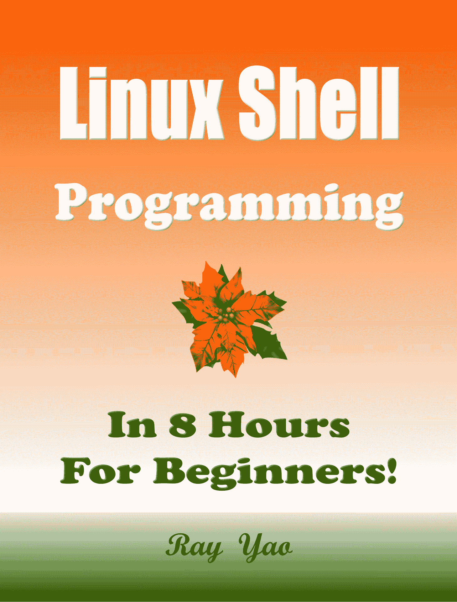

# Linux Shell 编程：8 小时入门，初学者指南！





## 关于作者
Ray Yao
- 美国 Zend 认证 PHP 工程师
- 美国 Sun 认证 JAVA 程序员
- 美国 Oracle 认证 SCWCD 开发人员
- 美国 CompTIA 认证 A+ 专业人士
- Microsoft 认证 ASP. NET 专家
- Microsoft 认证 MCP 专业人士
- Microsoft 认证 TECHNOLOGY 专家
- 美国 CompTIA 认证 NETWORK+ 专业人士


## 前言
本书涵盖了所有必要的 Linux Shell 语言知识。你可以快速轻松地掌握 Linux Shell 编程的核心技能。

本书为初学者提供了超过 60 多个实战示例，并包含了针对大学考试、工程师认证考试以及工作面试的测试与答案。


# 源代码下载

本书提供了源代码下载；你可以下载源代码以便更好地学习，或者将源代码复制到你喜爱的编辑器中测试程序。

下载链接：[`forms.aweber.com/form/11/1793939911.htm`](https://forms.aweber.com/form/11/1793939911.htm)

注意：本书仅适合初学者，不适合有经验的程序员。

- 第 1 小时
- 什么是 Linux Shell?
- Shell 脚本编程
- 第一个 Shell 脚本
- Shell 注释
- 多行注释
- Shell 变量
- 变量名
- 只读变量
- 删除变量
- 变量输入
- 第 2 小时
- Shell 字符串 (1)
- Shell 字符串 (2)
- 字符串连接
- 字符串长度
- 提取子字符串
- 关于 `expr…`
- 搜索索引
- Shell 参数
- 内置参数
- 第 3 小时
- Shell 数组
- 访问元素
- 获取所有元素
- 数组长度
- Printf 命令
- 转义序列
- 第 4 小时
- 运算符
- if…then…else…fi
- 算术运算符
- 比较运算符
- 布尔运算符
- 第 5 小时
- 字符串运算符
- 文件运算符
- “echo” 命令
- 第 6 小时
- Test 命令
- [[  ] 符号](#part0046.xhtml)
- 测试相等性
- 测试存在性
- 测试空字符串
- Shell 函数
- 带参数的函数
- 返回值
- 第 7 小时
- if..then ..elif..then..else
- For 循环
- While 循环
- Until 循环
- Case 语句
- Break 命令
- Continue 命令
- 第 8 小时
- Select 语句
- I/O 重定向
- 输出重定向
- 追加重定向
- 输入重定向
- 文件描述符
- Here Document
- 包含文件
- 附录 1
- 内置参数表
- Printf 命令表
- 转义序列表
- 比较运算符表
- 布尔运算符表
- 字符串运算符表
- 文件运算符表
- I/O 重定向表
- 附录 2
- 测试
- 答案
- 推荐书籍

# 第 1 小时

## 什么是 Linux Shell?
shell 是用户和内核之间的接口。shell 是允许用户与操作系统交互的命令行解释器。shell 是允许用户与操作系统交互的命令行解释器。shell 是允许用户与操作系统交互的命令行解释器。shell 是允许用户与操作系统交互的命令行解释器。shell 是允许用户与操作系统交互的命令行解释器。shell 是允许用户与操作系统交互的命令行解释器。shell 是允许用户与操作系统交互的命令行解释器。shell 是允许用户与操作系统交互的命令行解释器。shell 是允许用户与操作系统交互的命令行解释器。shell 是允许用户与操作系统交互的命令行解释器。shell 是允许用户与操作系统交互的命令行解释器。shell 是允许用户与操作系统交互的命令行解释器。shell 是允许用户与操作系统交互的命令行解释器。shell 是允许用户与操作系统交互的命令行解释器。shell 是允许用户与操作系统交互的命令行解释器。shell 是允许用户与操作系统交互的命令行解释器。shell 是允许用户与操作系统交互的命令行解释器。shell 是允许用户与操作系统交互的命令行解释器。shell 是允许用户与操作系统交互的命令行解释器。shell 是允许用户与操作系统交互的命令行解释器。shell 是允许用户与操作系统交互的命令行解释器。shell 是允许用户与操作系统交互的命令行解释器。shell 是允许用户与操作系统交互的命令行解释器。例如，shell 是允许用户与操作系统交互的命令行解释器。shell 是允许用户与操作系统交互的命令行解释器。shell 是允许用户与操作系统交互的命令行解释器。shell 是允许用户与操作系统交互的命令行解释器。shell 是允许用户与操作系统交互的命令行解释器。shell 是允许用户与操作系统交互的命令行解释器。shell 是允许用户与操作系统交互的命令行解释器。shell 是允许用户与操作系统交互的命令行解释器。shell 是允许用户与操作系统交互的命令行解释器。shell 是允许用户与操作系统交互的命令行解释器。shell 是允许用户与操作系统交互的命令行解释器。shell 是允许用户与操作系统交互的命令行解释器。shell 是允许用户与操作系统交互的命令行解释器。shell 是允许用户与操作系统交互的命令行解释器。shell 是允许用户与操作系统交互的命令行解释器。shell 是允许用户与操作系统交互的命令行解释器。shell 是允许用户与操作系统交互的命令行解释器。shell 是允许用户与操作系统交互的命令行解释器。shell 是允许用户与操作系统交互的命令行解释器。shell 是允许用户与操作系统交互的命令行解释器。shell 是允许用户与操作系统交互的命令行解释器。shell 是允许用户与操作系统交互的命令行解释器。shell 是允许用户与操作系统交互的命令行解释器。shell 是允许用户与操作系统交互的命令行解释器。shell 是允许用户与操作系统交互的命令行解释器。shell 是允许用户与操作系统交互的命令行解释器。shell 是允许用户与操作系统交互的命令行解释器。shell 是允许用户与操作系统交互的命令行解释器。shell 是允许用户与操作系统交互的命令行解释器。shell 是允许用户与操作系统交互的命令行解释器。shell 是允许用户与操作系统交互的命令行解释器。shell 是允许用户与操作系统交互的命令行解释器。shell 是允许用户与操作系统交互的命令行解释器。shell 是允许用户与操作系统交互的命令行解释器。shell 是允许用户与操作系统交互的命令行解释器。shell 是允许用户与操作系统交互的命令行解释器。shell 是允许用户与操作系统交互的命令行解释器。shell 是允许用户与操作系统交互的命令行解释器。shell 是允许用户与操作系统交互的命令行解释器。shell 是允许用户与操作系统交互的命令行解释器。shell 是允许用户与操作系统交互的命令行解释器。shell 是允许用户与操作系统交互的命令行解释器。shell 是允许用户与操作系统交互的命令行解释器。shell 是允许用户与操作系统交互的命令行解释器。shell 是允许用户与操作系统交互的命令行解释器。shell 是允许用户与操作系统交互的命令行解释器。shell 是允许用户与操作系统交互的命令行解释器。shell 是允许用户与操作系统交互的命令行解释器。shell 是允许用户与操作系统交互的命令行解释器。shell 是允许用户与操作系统交互的命令行解释器。shell 是允许用户与操作系统交互的命令行解释器。shell 是允许用户与操作系统交互的命令行解释器。shell 是允许用户与操作系统交互的命令行解释器。shell 是允许用户与操作系统交互的命令行解释器。shell 是允许用户与操作系统交互的命令行解释器。shell 是允许用户与操作系统交互的命令行解释器。shell 是允许用户与操作系统交互的命令行解释器。shell 是允许用户与操作系统交互的命令行解释器。shell 是允许用户与操作系统交互的命令行解释器。shell 是允许用户与操作系统交互的命令行解释器。shell 是允许用户与操作系统交互的命令行解释器。shell 是允许用户与操作系统交互的命令行解释器。shell 是允许用户与操作系统交互的命令行解释器。shell 是允许用户与操作系统交互的命令行解释器。shell 是允许用户与操作系统交互的命令行解释器。shell 是允许用户与操作系统交互的命令行解释器。shell 是允许用户与操作系统交互的命令行解释器。shell 是允许用户与操作系统交互的命令行解释器。shell 是允许用户与操作系统交互的命令行解释器。shell 是允许用户与操作系统交互的命令行解释器。shell 是允许用户与操作系统交互的命令行解释器。shell 是允许用户与操作系统交互的命令行解释器。shell 是允许用户与操作系统交互的命令行解释器。shell 是允许用户与操作系统交互的命令行解释器。shell 是允许用户与操作系统交互的命令行解释器。shell 是允许用户与操作系统交互的命令行解释器。shell 是允许用户与操作系统交互的命令行解释器。shell 是允许用户与操作系统交互的命令行解释器。shell 是允许用户与操作系统交互的命令行解释器。shell 是允许用户与操作系统交互的命令行解释器。shell 是允许用户与操作系统交互的命令行解释器。shell 是允许用户与操作系统交互的命令行解释器。shell 是允许用户与操作系统交互的命令行解释器。shell 是允许用户与操作系统交互的命令行解释器。shell 是允许用户与操作系统交互的命令行解释器。shell 是允许用户与操作系统交互的命令行解释器。shell 是允许用户与操作系统交互的命令行解释器。shell 是允许用户与操作系统交互的命令行解释器。shell 是允许用户与操作系统交互的命令行解释器。shell 是允许用户与操作系统交互的命令行解释器。shell 是允许用户与操作系统交互的命令行解释器。shell 是允许用户与操作系统交互的命令行解释器。## Shell 脚本编程


### 示例 1.5
```bash
#!/bin/bash
myVar="C# in 8 Hours"
readonly myVar
myVar="Scala in 8 Hours"    # 修改变量值
```
输出：
(错误信息如下:)
```
test. sh: line 4: myVar: readonly variable
```
解释：
`readonly myVar` 将 `myVar` 设置为只读。输出是一个错误信息。在 `myVar` 变为只读变量后，对 `myVar` 值的任何更改都会导致错误。

## 删除变量
`unset` 命令可以删除变量。

```bash
unset variable
```

### 示例 1.6
```bash
#! /bin/sh
myVar="C++ in 8 Hours"
unset myVar        # 移除变量
echo $myVar
```
输出：
(无输出)
解释：
变量被移除后，该变量不再存在，其值也不复存在。因此，你不会看到任何输出。

## 变量输入
变量的值可以由用户从键盘输入。

```bash
read variable
```

### 示例 1.7
```bash
#! /bin/sh
echo "Please input your name. "
read myInput         # 输入值将存储在 myInput 中
echo "Hi! Your name is: $myInput"  # 假设我输入我的名字：Ray Yao
```
输出：
Please input your name.
Ray Yao
Hi! Your name is Ray Yao
解释：
假设我输入了名字：Ray Yao。`read myInput` 将输入值存储在 `myInput` 中。`echo "Hi! Your name is: $myInput"` 显示了输入值。

# 第 2 小
## Shell 字符串 (1)
字符串被单引号包裹。

```bash
str='This is a string'
```
*   单引号内的任何字符将以其原始格式打印。
*   单引号内的字符串变量是无效。

### 示例 2.1
```bash
#! /bin/sh
var=Andy
str='Hello, $var'    # 单引号字符串
echo $str
```
输出：
Hello, $var
解释：
`'Hello, $var'` 是一个单引号字符串。单引号内的任何字符将以其原始格式打印。

## Shell 字符串 (2)
字符串被双引号包裹。

```bash
str="This is a string"
```
*   双引号内的任何字符将通过其返回值打印。
*   双引号内的字符串变量是有效的。

### 示例 2.2
```bash
#! /bin/sh
var=Andy
str="Hello, $var"       # 双引号字符串
echo $str
```
输出：
Hello, Andy
解释：
`"Hello, $var"` 是一个双引号字符串。双引号内的任何字符将通过其返回值打印。

## 连接字符串
我们可以使用双引号连接两个字符串。

### 示例 2.3
```bash
#! /bin/sh
str1="Kotlin"
str2="in 8 Hours"
myString="$str1 $str2"     # 连接两个字符串
echo $myString
```
输出：
Kotlin in 8 Hours
解释：
`"$str1 $str2"` 使用双引号将两个字符串连接为一个字符串。

## 字符串长度
我们可以通过 `#` 符号获取字符串的长度。

```bash
#string
```

### 示例 2.4
```bash
#! /bin/sh
str="jQuery in 8 Hours"
echo ${#str }      # 获取字符串的长度
```
输出：
17
解释：
`#str` 可以获取字符串的长度。字符串长度为 17 个字符（包括空格）。

## 提取子字符串
我们可以从字符串中提取子字符串。

```bash
string : start : length
```
*   `start`: 提取从此索引开始。
*   `length`: 提取的大小。

### 示例 2.5
```bash
#! /bin/sh
str="DjanGo in 8 Hours"
echo ${str:4:16 }     # 提取子字符串
```
输出：
Go in 8 Hours
解释：
`"str: 4: 16"` 从从索引 4 开始提取子字符串，提取长度为 16。

## 关于 `expr…`
`expr…` 是一个表达式，用于计算。

```bash
expr…
```
注意：`` ` 是反引号，而不是单引号。`` ` 键位于键盘的最左侧。

### 示例 2.6
```bash
#! /bin/sh
x=100
y=200
z=`expr $x + $y`       # 一个表达式
echo "The sum is $z"
```
输出：
The sum is 300
解释：
`expr $x + $y` 是一个表达式，计算结果将赋值给 `z`。
注意：`` ` 是反引号，而不是单引号。`` ` 键位于键盘的最左侧。

## 搜索索引
我们可以找到字符串中字符首次出现的索引。

```bash
expr index "string" character
```
注意：`` ` 是反引号，而不是单引号。`"string"` 是一个参数，用于搜索字符的索引。`"character"` 是一个参数。

### 示例 2.7
```bash
str="Kotlin in 8 Hours"
expr index "$str" o
```
输出：
10
解释：
`expr index "$str" o` 查找字符 "o" 的索引。


## 数组操作

| `array_name[@]` 或 `array_name[*]` |

### 示例 3.2
```bash
#!/bin/bash
my_array[0]=Java
my_array[1]=Ruby
my_array[2]=Html
my_array[3]=Rust
echo "All elements are: ${my_array[@] }"
echo "All elements are: ${my_array[*] }"
```
**输出：**
```
All elements are: Java  Ruby  Html  Rust
All elements are: Java  Ruby  Html  Rust
```
**解释：** `my_array[@]` 或 `my_array[*]` 可以获取数组的所有元素。

### 数组长度
`#array_name[@]` 或 `#array_name[*]` 可以获取的长度。

| `#array_name[@]` 或 `#array_name[*]` |

### 示例 3.3
```bash
#!/bin/bash
my_array=(PHP MySQL in 8 Hours)
length1=${#my_array[@] }
length2=${#my_array[*] }
echo $length1
echo $length2
```
**输出：**
```
5
5
```
**解释：** `#my_array[@]` 或 `#my_array[*]` 可以获取数组的长度。

## Printf 命令

`printf` 是 Shell 中用于格式化输出的命令。

| `printf` `type` `variables` |

`type` 是用于格式化输出的参数。

| 类型 | 描述 |
| :--- | :--- |
| `%b` | 以二进制值打印 |
| `%d` | 以整数值打印 |
| `%f` | 以浮点值打印 |
| `%o` | 以八进制值打印 |
| `%s` | 以字符串值打印 |
| `%x` | 以十六进制值打印 |

例如：
- `%10s` 表示格式化为最大宽度为 10 个字符的字符串
- `%-10s` 表示格式化为最大宽度为 10 个字符的字符串（`-` 符号表示左对齐，无 `-` 则表示右对齐）
- `%8. 2f` 表示格式化为浮点值，`8` 表示 8 位整数，`2` 表示 2 位小数
- `%-8. 2f` 表示格式化为浮点值，`8` 表示 8 位整数，`2` 表示 2 位小数（`-` 符号表示左对齐，无 `-` 则表示右对齐）

### 示例 3.4
```bash
printf "%-10s %-7s %-8s\n" Name Age Weight
```
**输出：**
```
Name      Age     Weight
```
**解释：**
- `%-10s` 被 `Name` 替换，`Name` 被格式化为最大 10 个字符的字符串，左对齐。
- `%-7s` 被 `Age` 替换，`Age` 被格式化为最大 7 个字符的字符串，左对齐。
- `%-8s` 被 `Weight` 替换，`Weight` 被格式化为最大 8 个字符的字符串，左对齐。
- `\n` 用于换行。

### 示例 3.5
```bash
#!/bin/bash
printf "%-10s %-7s %-8s\n" Name Age Weight
printf "%-10s %-7d %-5. 2f\n" Andy 18 91.8843
printf "%-10s %-7d %-5. 2f\n" Tomy 19 95.4675
printf "%-10s %-7d %-5. 2f\n" Rosy 17 80.8563
```
**输出：**
```
Name      Age     Weight
Andy      18      91.88
Tomy      19      95.47
Rosy      17      80.86
```
**解释：**
- `printf "%-10s %-7d %-5. 2f\n" Andy 18 91.8843` 格式化了三个参数 `Andy`、`18`、`91.8843`。
- `%-10s` 被 `Andy` 替换，`Andy` 被格式化为最大 10 个字符的字符串，左对齐。
- `%-7d` 被 `18` 替换，`18` 被格式化为最大 7 位数字的整数类型，左对齐。
- `%-5. 2f` 被 `91.88` 替换，`91.88` 被格式化为最大 5 位整数、2 位小数的浮点类型，左对齐。
- `\n` 用于换行。

## 转义序列

`\` 反斜线字符可以用于转义字符。
- `\a` 输出警报。
- `\n` 将内容输出到下一行。
- `\r` 使回车。
- `\t` 使制表符。
- `\f` 将内容输出到下一页。
- `\'` 输出单引号。
- `\"` 输出双引号。

### 示例 3.6
```bash
#!/bin/bash
printf "%s %s \'%s\' \n" He said OK
printf "%d\t %d\n" 10 100
printf "%s\n %s\n" 
```
**输出：**
```
He said 'OK'
10	100
```
**解释：**
- `%\'` 输出单引号。
- `%d\t` 输出数字和制表符。
- `%s\n` 输出字符串。

## 运算符

Shell 与其他编程语言一样支持多种运算符，包括：算术运算符、关系运算符、布尔运算符、字符串运算符。

| `expr…` |

`expr…` 是一个表达式。

### 示例 4.1
```bash
#!/bin/bash
sum=`expr 100 + 20`
echo "The sum is: $sum"
```
**输出：**
```
The sum is: 120
```

## if 语句

`if...then...else...fi` 当条件为真时执行代码，否则执行 else。

### 示例 4.2
```bash
#!/bin/bash
a=10
b=20
if [ $a == $b ]; then
  echo "a is equal to b"
else
  echo "a is not equal to b"
fi
```
**输出：**
```
a is not equal to b
```
**解释：** `[ $a == $b ]` 比较 `a` 和 `b`。`==` 是比较运算符。

## 算术运算符

| 运算符 | 操作 |
| :--- | :--- |
| `+` | 加法 |
| `-` | 减法 |
| `*` | 乘法 |
| `/` | 除法 |
| `%` | 取模 |
| `=` | 赋值 |
| `==` | 检查相等 |
| `!=` | 检查不等 |

### 示例 4.3
```bash
#!/bin/bash
a=100
b=20
result=`expr $a + b`
echo "a + b : $result"
result=`expr $a - b`
echo "a - b : $result"
result=`expr $a * b`
echo "a * b : $result"
result=`expr $a / b`
echo "a / b : $result"
result=`expr $a % b`
echo "a % b : $result"
```
**输出：**
```
a + b : 120
a - b : 80
a * b : 2000
a / b : 5
a % b : 0
```

## 比较运算符

| 运算符 | 检查 |
| :--- | :--- |
| `-eq` | 等于 |
| `-ne` | 不等于 |
| `-gt` | 大于 |
| `-ge` | 大于 |
| `-lt` | 小于 |
| `-le` | 小于 |

比较表达式返回真或假。

### 示例 4.4
```bash
#!/bin/bash
a=100
b=200
if [ $a -eq $b ]; then
  echo "$a -eq $b is equal to b"
else
  echo "$a -eq $b is not equal to b"
fi
if [ $a -ne $b ]; then
  echo "$a -ne $b is not equal to b"
else
  echo "$a -ne $b is equal to b"
fi
if [ $a -gt $b ]; then
  echo "$a -gt $b is greater than b"
else
  echo "$a -gt $b is not greater than"
fi
if [ $a -lt $b ]; then
  echo "$a -lt $b is less than b"
else
  echo "$a -lt $b is not less than b"
fi
if [ $a -ge $b ]; then
  echo "$a -ge $b is greater than or equal to b"
else
  echo "$a -ge $b is less than b"
fi
if [ $a -le $b ]; then
  echo "$a -le $b is less than or equal to b"
else
  echo "$a -le $b is greater than b"
fi
```
**输出：**
```
100 -eq 200 is not equal to b
100 -ne 200 is not equal to b
100 -gt 200 is not greater than
100 -lt 200 is less than b
100 -ge 200 is less than b
100 -le 200 is less than or equal to b
```

### 示例 4.5
```bash
#!/bin/bash
a=100
b=200
if [ $a -eq $b ]; then
  echo "$a -eq $b is equal to b"
else
  echo "$a -eq $b is not equal to b"
fi
## (剩余逻辑遵循相同模式)
```
*(注：示例 4.5 输出演示了表格中所有比较运算符的逻辑).*


### 示例 4.6

```bash
#!/bin/bash
x=true
y=false
if [ $x -a $y ]      # -a 表示“与”
then
    echo flase
fi
if [ $x -o $y ]      # -o 表示“或”
then
    echo true
fi
if [ !$x ]          # ! 表示“非”
then
    echo flase
fi
```

输出：
```
flase
true
flase
```

### 解析：
| true -a true;返回 true; | true -a false;返回 false; | false -a false;返回 false; |
| true -o true;返回 true; | true -o false;返回 true; | false -o false;return false; |
| ! false;返回 true; | ! true;返回 false; | |

# 第 5 小时：字符串运算符

| 运算符 | 检查项 |
| :--- | :--- |
| `=` | 如果两个字符串相等，返回 true . |
| `!=` | 如果两个字符串不等相等，返回 true . |
| `-z` | 如果字符串长度为零，返回 true . |
| `-n` | 如果字符串长度不为零，返回 true |
| `$` | 如果字符串不为空，返回 true . |

### 示例 5.1

```bash
#!/bin/bash
a="Java"
b="Ruby"
if [ $a = $b ]      # 检查 a 是否等于 b
then
    echo "$a = $b ?  a is equal to b"
else
    echo "$a = $b ?  a isn't equal to b"
fi
if [ $a != $b ]      # 检查 a 是否等于 b
then
    echo "$a ! = $b ?  a isn't equal to b"
else
    echo "$a ! = $b ?  a is equal to b"
fi
if [ -z $a ]      # 检查字符串长度是否为 0
then
    echo "-z $a ?  The string length is 0"
else
    echo "-z $a ?  The string length isn't 0"
fi
if [ -n "$a" ]        # 检查字符串长度是否不为 0
then
    echo "-n $a ?  The string length isn't 0"
else
    echo "-n $a ?  The string length is 0"
fi
if [ $a ]        # 检查字符串是否为空
then
    echo "$a ?  The string isn't empty"
else
    echo "$a ?  The string is empty"
fi
```

输出：
```
Java = Ruby ?  a isn't equal to b
Java ! = Ruby ?  a isn't equal to b
-z Java ?  The string length isn't 0
-n Java ?  The string length isn't 0
Java ?  The string isn't empty.
```

### 解析：
| `=` | 如果两个字符串相等，返回 true . |
| `!=` | 如果两个字符串不等相等，返回 true . |
| `-z` | 如果字符串长度为零，返回 true . |
| `-n` | 如果字符串长度不为零，返回 true |
| `$` | 如果字符串不为空，返回 true . |

## 文件运算符
文件运算符用于检测 Linux 文件的各种属性。

| 运算符 | 检查项 |
| :--- | :--- |
| `-d file` | 如果对象是目录，返回 true . |
| `-f file` | 如果对象是文件，返回 true . |
| `-p file` | 如果对象是管道，返回 true . |
| `-r file` | 如果对象是可读文件，返回 true . |
| `-w file` | 如果对象是可写文件，返回 true . |
| `-x file` | 如果对象是可执行文件，返回 true . |
| `-e file` | 如果对象是空文件，返回 true . |
| `-s file` | 如果对象不是空文件，返回 true . |
| `-b file` | 如果对象是块设备文件，返回 true . |
| `-c file` | 如果对象是字符设备文件，返回 true . |

### 示例 5.2
假设文件 `myFile.sh` 不存在，但仍然检查该文件的属性。

```bash
#!/bin/bash
file="/root/myFile.sh"
if [ -r $file ]      # 检查对象是否可读
then
    echo "The object is readable"
else
    echo "The object isn't readable"
fi
if [ -w $file ]      # 检查对象是否可写
then
    echo "The object is writable"
else
    echo "The object isn't writable"
fi
if [ -x $file ]      # 检查对象是否可执行
then
    echo "The object is executable"
else
    echo "The object isn't executable"
fi
if [ -f $file ]      # 检查对象是否为文件
then
    echo "The object is a file"
else
    echo "The object isn't a file"
fi
if [ -d $file ]      # 检查对象是否为目录
then
    echo "The object is a directory"
else
    echo "The object isn't a directory"
fi
if [ -s $file ]      # 检查对象是否不是空文件
then
    echo "The object isn't empty"
else
    echo "The object is empty"
fi
if [ -e $file ]      # 检查文件是否存在
then
    echo "The file exists"
else
    echo "The file doesn't exist"
fi
```

输出：
```
The object isn't readable
The object isn't writable
The object isn't executable
The object isn't a file
The object isn't a directory
The object is empty
The file doesn't exist
```

### 解析：
假设 `root` 目录下没有 `myFile.sh`，但我们仍然检查该文件的属性。回顾以下运算符：
| `-d` | 如果对象是目录，返回 true |
| `-f` | 如果对象是文件，返回 true |
| `-r` | 如果对象是可读文件，返回 true |
| `-w` | 如果对象是可写文件，返回 true |
| `-x` | 如果对象是可执行文件，返回 true |
| `-e` | 如果对象存在，返回 true |
| `-s` | 如果对象不是空文件，返回 true |

## `echo` 命令
`echo` 命令用于输出内容。这里是它的用法。

### 转义字符
```bash
#!/bin/bash
echo "Hello World"
```
输出：
```
Hello World
```

### 变量
```bash
#!/bin/bash
book="Shell"
echo "$book is great"
```
输出：
```
Shell is great
```

### 同行输出
```bash
#!/bin/bash
echo -e "Hello\nWorld" # -e 开启转义
```
输出：
```
Hello
World
```

### 输出到文件
```bash
#!/bin/bash
echo "Hello" > myFile # > 重定向到文件
```
（此时创建了 myFile）

### 原始格式
```bash
#!/bin/bash
echo 'He said: OK!' # 使用单引号
```
输出：
```
He said: OK!
```

### 执行结果
```bash
#!/bin/bash
echo date # 使用双引号而非单引号
```
输出：
```
Thu Aug 22 09:01:19 UTC 2023
```

### 用户输入
```bash
#!/bin/bash
echo "Please type your name:"
read name # read 接受用户输入
echo "My name is $name"
```
输出：
```
Please type your name:
My name is Ray Yao
```

# 第 6 小时：test 命令
`test` 命令用于检查条件是否真。它可以测试三个方面：数字、字符和文件。`[]` 用于执行运算。

| test 测试数字 / 字符 / 文件 |
| :--- |
| `[]` 符号用于执行运算。 |

### 示例 6.1
```bash
#!/bin/bash
num1=10
num2=20
if [ $num1 -eq $num2 ]
then
    echo 'Two numbers are equal.'
else
    echo 'Two numbers are not equal.'
fi
```
输出：
```
Two numbers are not equal.
```
### 解析：
`test $num1 -eq $num2` 测试两个数字的相等性。在表达式中，`=` 两边不能有空格。

### 示例 6.2
```bash
#!/bin/bash
x=100
y=200
z=$[x + y]
echo "The result is： $z"
```
输出：
```
The result is： 300
```
### 解析：
`[x + y]` 执行运算。注意：`=` 两边不能有空格。

## 测试相等性
`test` 命令可以测试两个字符串是否相等。

### 示例 6.3
```bash
#!/bin/bash
str1="Java"
str2="JavaScript"
if test $str1 = $str2
then
    echo 'Two strings are equal!'
else
    echo 'Two strings are not equal!'
fi
```
输出：
```
Two strings are not equal!
```
### 解析：
`test $str1 = $str2` 测试两个字符串的相等性。

## 测试存在性
`test` 命令可以测试文件是否存在。

### 示例 6.4
```bash
#!/bin/bash
## 假设 theFile .sh 不存在。
if test -e /root/theFile.sh      # -e 检查存在性
then
    echo 'The file exists!'
else
    echo ' The file doesn't exist! '
fi
```
输出：
```
The file doesn't exist!
```
### 解析：
假设 `theFile.sh` 不存在。`test -e /root/theFile.sh` 测试文件是否存在。

### 测试空字符串
`test` 命令可以测试字符串是否为空。

### 示例 6.5
```bash
#!/bin/bash
## 假设 “$myString” 尚未被赋值。
if test -n "$myString"      # -n 检查非空字符串
then
    echo "It's not an empty string."
else
    echo "It's an empty string. "
fi
```
输出：
```
It's an empty string.
```
### 解析：
由于 `myString` 没有被赋值任何值，它是一个空字符串。


### 示例 6.6

```bash
#! /bin/bash
myFunction() {
    # define a function
    echo "jQuery in 8 Hours"
}
echo "Before calling the function. "
myFunction     # call the function
echo "After calling the function. "
```
**输出：**
```
Before calling the function.
jQuery in 8 Hours
After calling the function.
```
**解释：**
`myFunction(){ }` 定义了一个函数。`myFunction` 调用了该函数。

## 带参数的函数

在调用函数时，你可以将参数传递给函数体。例如，将第一个参数传递给 `${1}`，将第二个参数传递给 `${2}` ...

### 示例 6.7
```bash
#! /bin/bash
myFunction(){
  echo "The first parameter is: ${1} ! "
  echo "The second parameter is: ${2} ! "
  echo "The third parameter is: ${3} ! "
  echo "The fourth parameter is: ${4} ! "
  echo "All parameters are: $* ! "
}
myFunction Kotlin in 8 Hour     # pass four parameters
```
**输出：**
```
The first parameter is: Kotlin !
The second parameter is: in !
The third parameter is: 8 !
The fourth parameter is: Hours !
All parameters are: Kotlin in 8 Hours !
```
**解释：**
`${1}` 接收第一个参数，`${2}` 接收第二个参数。`$*` 显示所有参数。`myFunction Kotlin in 8 Hour ` 调用了函数并传递了四个参数。

## 返回值

`return` 可以向 `$?` 返回一个值。`$?` 显示返回值。（在某些机器上，`$?` 只显示显示 0 到 255 之间的值。）

| function_name { return value } |
| :--- | :--- |
| `$?` | # 显示返回值 |

### 示例 6.8
```bash
#! /bin/bash
add(){
    # define a function
    x=100
    y=155
    z=`expr $x + $y`
    return $z    # returns the value to $ ?
}
add      # call the function
echo "The sum of two numbers is $? "
```
**输出：**
```
The sum of two numbers is 255
```
**解释：**
`return $z` 将值返回给 `$?`。`$?` 显示返回值。（在某些机器上，`$?` 只显示 0 到 255 之间的值。）

### 示例 6.9
```bash
#! /bin/bash
myFunction(){
  echo "Please enter the first number:"
  read x          # assume entering 80
  echo "Please enter the second number:"
  read y          # assume entering 90
  z=`expr $x + $y`
  return $z       # returns a value to $ ?
}
myFunction
echo "The return value is $?"
```
**输出：**
```
Please enter the first number:
80
Please enter the second number:
90
The return value is 170
```
**解释：**
`return $z` 向 `$?` 返回一个值。`$?` 显示返回值。

# 7 小 if .. then .. elif .. then .. else

`if...then…elif…else` 在条件为真时执行代码，在条件为假时执行该代码。

### 示例 7.1
```bash
#! /bin/bash
x=100
y=80
if [ $x == $y ]
then
  echo "x is equal to y"
elif [ $x -gt $y ]
then
  echo "x is greater than y"
else
  echo "x is less than y"
fi
```
**输出：**
```
x is greater than y
```
**解释：**
`elif` 表示 `else…`。`elif [ $x -gt $y ]` 测试 `$x` 是否大于 `$y`。

## For 循环

`For loop` 通过指定的项目重复执行代码块。

| for var in item1 item2… do code1 code2… |

### 示例 7.2
```bash
#! /bin/bash
for var in 1 2 3
do
  echo "The number is: $var"
done
```
**输出：**
```
The number is: 1
The number is: 2
The number is: 3
```
**解释：**
`for var in 1 2 3` 在 `var=1`、`var=2`、`var=3` 时重复执行代码。

### 示例 7.3
```bash
#! /bin/bash
for str in Rust 8
do
  echo $str
done
```
**输出：**
```
Rust
8
```
**解释：**
`for str in Rust 8` 在 `str=Rust`、`str=8` 时重复执行代码。

## While 循环

`while loop` 在条件为真时循环执行代码。

| while condition code done |

### 示例 7.4
```bash
#! /bin/bash
counter=1
while(( $counter<=4 )) # run 4 times
do
  echo $counter
  counter=`expr $counter + 1`
done
```
**输出：**
```
1
2
3
4
```
**解释：**
`($counter<=4)` 是测试条件，如果条件为真，最多循环四次。`While Loop` 语句用于连续输入，但如果你想结束输入，请按 `<ctrl + d>` 退出程序。

### 示例 7.5
```bash
#! /bin/bash
echo 'Please enter a name: '
while read book # accepts the input from user
do
  echo "OK! $book!"
  echo "If quit, please press <ctrl + d>."
done
```
**输出：**
```
Please enter a name: 
PHP
OK! PHP!
```
**解释：**
`while read book` 接受用户的连续输入。你可以根据需要多次输入。

## Until 循环

`until loop` 在条件为假时循环执行代码，在条件为真时退出循环。

| until condition code done |

### 示例 7.6
```bash
#! /bin/bash
n=0
until [ $n -ge 4 ] # will quit the loop if true
do
  echo $n
  n=`expr $n + 1`
done
```
**输出：**
```
0
1
2
3
```
**解释：**
`until [ $n -ge 4 ]` 在 `$n` 等于 4 时退出循环。

## Case 语句

`case statement` 是多重选择。`case statement` 将值与模式匹配。如果匹配成功，则执行匹配命令。

| case value in pattern1) code1;; pattern2) code2;; pattern3) code3;; pattern*) code4;; # match nothing, run this esac |

### 示例 7.7
```bash
#! /bin/bash
echo 'Please input a number between 1 to 4:'
read num
case $num in
  1)
    echo 'You have input 1';;
  2)
    echo 'You have input 2';;
  3)
    echo 'You have input 3';;
  4)
    echo 'You have input 4';;
  *)
    echo 'Your number is not between 1 to 4';;
esac
```
**输出：**
```
Please input a number between 1 to 4:
2
You have input 2
```
**解释：**
假设我们输入数字 2，它匹配第二个 case，因此执行了第二个代码。

## Break 命令

`break` 关键字用于根据条件停止循环的运行。

| break |

### 示例 7.8
```bash
#! /bin/bash
num=0
while(( $num<=8))
do
  if [ $num == 3 ]
  then
    break # quit the while loop
  fi
  num=`expr $num + 1`
done
echo $num
```
**输出：**
```
3
```
**解释：**
如果 `$num` 为 3，程序将运行 `break` 命令并退出循环。

## Continue 命令

`continue` 命令用于停止当前迭代，忽略后续代码，然后继续下一次循环。

| continue |

### 示例 7.9
```bash
#! /bin/sh
nums="1 2 3 4 5 "
for n in $nums
do
  if [ $n -eq 3 ]
  then
    continue # run the next for
  fi
  echo $n
done
```
**输出：**
```
1
2
4
5
```
**解释：**
注意：没有 3。如果 `$n` 为 3，则执行 `continue` 运行下一次 `for` 循环。

## Select 语句

`select statement` 允许用户选择项目以满足条件。`select` 语句通常与 `case` 语句配合使用。

| select var in item1 item2... do |

### 示例 8.1
```bash
#! /bin/bash
echo "Please select a number between 1 to 4:"
echo "Input 4 to exit."
select choice in 1 2 3 4  # select one number
case $choice in
  1)
    echo "You choose 1";;
  2)
    echo "You choose 2";;
  3)
    echo "You choose 3";;
  4)
    echo "You choose 4 to exit"
    break;;
  *)
    echo "Enter error! "
    break;;
esac
done
```
**输出：**
```
Please select a number between 1 to 4:
Input 4 to exit.
1) 1
2) 2
3) 3
4) 4
? 2
You choose 2
? 4
You choose 4 to exit
```
**解释：**
假设我们第一次输入 2，第二次输入 4。`?` 是输入提示符，你可以输入数字。

# I/O 重定向

Linux Shell 系统命令从终端获取输入并将结果输出传回终端。命令通常从标准输入读取数据并向标准输出数据。重定向命令如下：

| 命令 | 描述 |
| :--- | :--- |
| command > file | 将输出重定向到文件。 |
| command < file | 将输入重定向到文件。 |
| command >> file | 将输出追加到文件。 |
| n > file | 将文件 n 重定向到文件 |
| n >> file | 追加文件 n 到文件 |
| n >& m | 合并输出 m 和文件 n |
| n <& m | 合并输入文件 m 和文件 n |
| << tag | 将标签之间的内容作为输入。 |


“File n”, “File m”意味着文件描述符为 `0`、`1` 或 `2` 的文件。`0` 表示标准输入 (STDIN)，`1` 表示标准输出 (STDOUT)，`2` 表示标准错误 (STDERR)。

## 输出重定向
输出重定向：使用 `>` 执行命令并将输出内容存储到文件中。

| `command > file` |

### 示例 8.2
```bash
echo "R in 8 Hours" > myFile
cat myFile # “cat”查看 myfile 内容
```
**输出：**
`R in 8 Hours`
**解释：** `echo "R in 8 Hours" > myFile` 将输出重定向到 `myFile`。你需要使用 `cat` 命令来查看 `myFile` 的内容。(rsrc3M2.jpg)

## 追加重定向
如果你不想覆盖文件内容，请使用 `>>` 将内容追加到文件末尾。

| `command >> file` |

### 示例 8.3
```bash
echo "R in 8 Hours" > myFile
echo "It is good! " >> myFile
cat myFile # “cat”查看 myfile 内容
```
**输出：**
`R in 8 Hours`
`It is good!`
**解释：** `echo "It is good! " >> myFile` 将内容追加到 `myFile`。(rsrc3M3.jpg)

## 输入重定向
输入重定向：使用 `<` 从文件获取输入。

| `command < file` |

### 示例 8.4
```bash
wc < myFile # myFile 在上一页创建。
```
**输出：**
`2 7 25`
**解释：** `wc < myFile` 从 `myFile` 获取输入。`wc` 统计文件中行数、单词和字符数。
- `2`：两行。
- `7`：七个单词。
- `25`：字符（包括空格）。
`myFile` 是上一页创建的文件。

## 文件描述符
当每个 Linux 命令执行时，它们会打开三个文件：

1. **标准输入文件 (stdin)：** `stdin` 的文件描述符为 `0`，Shell 程序默认从 `stdin` 读取数据。
2. **标准输出文件 (stdout)：** `stdout` 的文件描述符为 `1`，Shell 程序默认向 `stdout` 写入数据。
3. **标准错误文件 (stderr)：** `stderr` 的文件描述符为 `2`，Shell 程序向 `stderr` 流写入错误信息。

### 示例：
`command < file` 将 `stdin` 重定向到文件。
| `$ command < file` |

示例：`command > file` 将 `stdout` 重定向到文件。
| `$ command > file` |

示例：从 `infile` 文件读取输入，将输出写入 `outfile`。
| `$ command < infile > outfile` |

## Here Document（在此文档中）
Here Document 用于将文件内容重定向到命令。

| `command << delimiter delimiter` |

第二个分隔符必须位于最左侧，前面不能有字符，后面也没有字符。

### 示例 8.5
```bash
#! /bin/bash
cat << DOC # DOC 定义了一个 Here Document
AngularJS in 8 Hours
JavaScript in 8 Hours
Visual Basics in 8 Hours
DOC
```
**输出：**
`AngularJS in 8 Hours`
`JavaScript in 8 Hours`
`Visual Basics in 8 Hours`
**解释：** `cat << DOC...DOC` 是一种特殊的重定向模式，将文件内容重定向到命令。`cat` 显示文件内容。`DOC` 是分隔符。你可以指定其他字符作为分隔符。`DOC...DOC` 定义了一个 Here Document。

### 示例 8.6
```bash
#! /bin/bash
wc << EOF # wc 统计行、单词、字符数
AngularJS in 8 Hours
JavaScript in 8 Hours
Visual Basics in 8 Hours
EOF
```
**输出：**
`3 13 68`
**解释：** `wc << EOF...EOF` 将文档内容重定向到 `wc`。`wc` 用于统计行、单词和字符数。`EOF` 是分隔符，定义了一个 Here Document。
- `3`：表示 3 行。
- `13`：表示 13 个单词。
- `68`：表示 68 个字符（包括空格）。

## 包含文件
Shell 可以将外部脚本文件包含到当前文件中。

| `source ./external_file` |

`./` 定位外部文件。我们将创建两个文件作为示例。

**(1) 文件 `file1.sh` 如下：**
### 示例 8.7
```bash
#! /bin/bash
url ="http://www.lulu.com/spotlight/Ray_Yao"
```
**(2) 文件 `file2.sh` 如下：**
### 示例 8.8
```bash
#! /bin/bash
source ./file1.sh # 包含外部文件
echo "The website of Ray Yao is： $url "
```
**输出：**
`The website of Ray Yao is： http://www.lulu.com/spotlight/Ray_Yao`
**解释：** `source ./file1.sh` 包含了一个外部文件。

## Printf 命令
`printf` 用于格式化输出。

## 转义序列
- `%b`: 二进制
- `%d`: 进制
- `%f`: 浮点
- `%o`: 八进制
- `%s`: 字符串
- `%x`: 十六进制
- `\n`: 新行
- `\a`: 警报
- `\r`: 回车
- `\t`: 制表符
- `\f`: 分页

`printf` 用于格式化输出。

| 类型 | 描述 |
| :--- | :--- |
| `%b` | 二进制 |
| `%d` | 进制 |
| `%f` | 浮点 |
| `%o` | 八进制 |
| `%s` | 字符串 |
| `%x` | 十六进制 |

## 比较运算符
Linux Shell 拥有比较运算符：

| 运算符 | 检查 |
| :--- | :--- |
| `-eq` | 等于 |
| `-ne` | 不等于 |
| `-gt` | 大于 |
| `-ge` | 大于等于
| `-lt` | 小于 |
| `-le` | 小于等于 |

## 布尔运算符
使用逻辑运算符后，结果将为真或假。

| 运算符 | |
| :--- | :--- |
| `-a` | 与 (AND) |
| `-o` | 或 (OR) |
| `!` | 非 (NOT) |

## 字符串运算符
| 运算符 | 检查 |
| :--- | :--- |
| `=` | 字符串相等 |
| `!` | 字符串不相等 |
| `-z` | 字符串长度为 0
- `-n` | 字符串长度不为 0 |

## 参数
Shell 中内置参数：

| 参数 | 描述 |
| :--- | :--- |
| `$0` | 脚本名称 |
| `$#` | 参数总数 |
| `$*` | 所有参数 |
| `$@` | 作为参数的所有参数 |
| `$$` | 当前进程 ID |
| `$?` | 上一个命令的状态 |
| `$!` | 上一个后台进程 |

## 文件运算符
文件运算符用于检测文件的各种属性。

| 运算符 | 检查 |
| :--- | :--- |
| `-d` | 是否为目录 |
| `-f` | 是否为文件 |
| `-p` | 是否为管道 |
| `-r` | 是否可读文件 |
| `-w` | 是否可写文件 |
| `-x` | 是否为可执行文件 |
| `-e` | 是否存在 |
| `-s` | 是否非空 |
| `-b` | 是否为块设备文件 |
| `-c` | 是否为字符设备文件 |

## I/O 重定向图
Linux Shell 系统命令从终端获取输入并将输出发送回终端。命令通常从标准输入读取数据，向标准输出写入数据。重定向命令如下：

| 命令 | 描述 |
| `command > file` | 将输出重定向到文件。 |
| `command < file` | 将输入重定向到文件。 |
| `command >> file` | 将输出追加到文件。 |
| `n > file` | 将文件 n 重定向到文件 |
| `n >> file` | 将文件 n 追加到文件 |
| `n >& m` |合并输出文件 m 和文件 n |
| `n <& m` |合并输入文件 m 和文件 n |
| `<< tag` | 将标签之间的内容作为输入。 |


# 附录 2：测试

请选择正确答案。

(01) 填充 `# 填充字符作为多行注释`
```bash
comment 1
comment 2
comment 3...EOF
```
A. EOF
B. `#EOF`
C. `<<EOF`
D. `: <<EOF`

(02)
```bash
#! /bin/sh
str1="Kotlin"
str2="in 8 Hours"
myString="$str1 fill in $str2" # 连接两个字符串
echo $myString
```
A. `+`
B. `-`
C. 无 (nothing)
D. `concat`

(03) 访问数组元素的语法是 fill in ?
1. `$(array_name[index])`
2. `${array_name[index]}`
3. `array_name(index)`
4. `array_name{index}`

(04)
```bash
#! /bin/bash
sum= fill in expr 100 + 200 fill in
echo "The sum is: $sum"
```
A. 双引号 (double quotes)
B. 单引号 (single quotes)
C. 反引号 (back quotes)
D. 无 (nothing)

(05) 参数 `-s file` 检查 fill in ?
A. 如果对象不是空文件，返回 true。
B. 如果对象是空文件，返回 true。
C. 如果对象是块设备文件，返回 true。
D. 如果对象是字符设备文件，返回 true。

(06)
```bash
#! /bin/bash
if test fill in /root/myFile.sh # 检查 myFile 是否存在
then
  echo 'The file exists! '
else
  echo ' The file doesn't exist! '
fi
```
A. `-o`
B. `-e`
C. `-n`
D. `-s`

(07) `if fill in condition fill then encode1 elsecode2 fi`
A. `( )`
B. `{ }`
C. `[ ]`
D. 无 (nothing)

(08) `# 将输出重定向到 myFile`
```bash
echo "R in 8 Hours" fill in myFile
```
A. `->`
B. `>`
C. `in`
D. `to`

(09)
```bash
#! /bin/sh
echo "Please input your name. "
fill in myInput # 输入值将存储在 myInput
echo "Hi! Your name is: $myInput"
```
A. `input`
B. `var`
C. `$myInput=`
D. `read`

(10)
```bash
#! /bin/sh
str="jQuery in 8 Hours"
echo fill in # 获取字符串的长度
```
A. `str.length()`
B. `length(str)`
C. `${#str}`
D. `[$#str]`

(11) `fill in` 可以获取数组的所有元素。
1. `array_name[@]`
2. `array_name[#]`
3. `array_name[%]`
4. `array_name[&]`

(12)
| 运算符 | 运行 |
| :--- | :--- |
| `+` | 加 |
| `-` | 减 |
| `fill in` | 乘 |
| `/` | 除 |

A. `*`
B. `\*`
C. `X`
D. `\x`

(13)
```bash
#! /bin/sh
echo fill in "Go \c " # 开启转义开关
echo "in 8 Hours"
```
A. `-a`
B. `-o`
C. `-s`
D. `-e`

(14)
```bash
#! /bin/bash
if test fill in "$myString" # 检查空字符串
then
  echo "It's not an empty string."
else
  echo "It's an empty string."
fi
```
A. `-o`
B. `-e`
C. `-n`
D. `-s`

(15) `until` 循环在指定条件为 `fill in` 时执行代码块，如果条件变为为 `fill in`，则退出循环。
1. true, true
2. true, false
3. false, false
4. false, true

(16) 如果你不想覆盖文件内容，请使用 `fill in` 符号将内容追加到文件末尾。
A. `>>`
B. `->`
C. `=>`
D. `>=`

(17)
| 参数 |or |
| :--- | :--- |
| `fill in` | 返回文件名 |
| `$#` | 返回参数的总数 |
| `$*` | 返回用户输入的所有参数 |
| `$@` | 返回用户输入的所有参数 |

A. `$n`
B. `$0`
C. `$f`
D. (%)

(18)
```bash
#! /bin/bash
arr=(PHP in 8 Hours)
length= fill in # 获取数组的长度
echo $length
```
A. `arr.length()`
B. `length(arr)`
C. `size(arr)`
D. `${#arr[@]}`

(19)
| `true -a true; 返回 true;` | `true -a false; 返回 false;` | `false -a false; 返回 false;` |
| `false -a true; 返回 false;` | `true -a true; 返回 false;` | `! true -a true; 返回 false;` |
| `! true -a false; 返回 true;` | `! false -a true; 返回 true;` | `! false -a false; 返回 true;` |
| `true -a true; 返回 true;` | `true -a false; 返回 false;` | `true -a false; 返回 false;` |
| `false -a true; 返回 false;` | `false -a false; 返回 false;` | `false -a false; 返回 false;` |

1. true, true
2. true, false
3. false, false
4. false, true

(20)
```bash
#! /bin/bash
add(){
  # 定义函数
  x=100
  y=155
  z=`expr $x + $y`
  return $z # 返回值
}
add # 调用函数
echo "The sum is: " " 显示 显示```
```
A. `$

B. `$`

. `$**
D. `$?`

(21)
```bash
#! /bin/bash
echo 'Please input a number between 1 to 4:'
read num
case $num in
  1) echo 'You have input 1' fill in
  2) echo 'You have input 2' fill in
  3) echo 'You have input 3' fill in
  4) echo 'You have input 4' fill in
  *) echo 'Your number is not between 1 to 4' fill in
esac
```
A. `;`
B. `;;`
C. `;;;`
D. `;;;;`

(22)
```bash
#! /bin/bash
fill in # 计算行、字、字符数
```
1. `num << DOC`
2. `ls << DOC`
3. `wc << EOF`
4. `cat << EOF`

(23)
```bash
#! /bin/bash
fill in ./file.sh # 外部文件 "file1.sh"
echo "The website of Ray Yao is： $url "
```
A. `include`
B. `import`
C. `resource`
D. `source`

# 答案
| 01. D |
| 02. C |
| 03. B |
| 04. C |
| 05. A |
| 06. B |
| 07. C |
| 08. B |
| 09. D |
| 10. C |
| 11. A |
| 12. B |


# 注意
本书仅供初学者阅读，不适合有经验的程序员。

## 源代码下载链接
[https://forms.aweber.com/form/11/1793939911.htm]()

## 推荐书籍
- [8 小时精通高级 C++编程](https://www.amazon.com/-/e/B0863BQT8T)
- [8 小时精通高级 JAVA 编程](https://www.amazon.com/-/e/B0863BQT8T)
- [初学者 AngularJS 编程](https://www.amazon.com/-/e/B0863BQT8T)
- [C# 面试与认证考试](https://www.amazon.com/-/e/B0863BQT8T)
- [初学者 C# 编程](https://www.amazon.com/-/e/B0863BQT8T)
- [C# 编程：包含 100 个问答](https://www.amazon.com/-/e/B0863BQT8T)
- [C++ 面试与认证考试](https://www.amazon.com/-/e/B0863BQT8T)
- [初学者 C++ 编程](https://www.amazon.com/-/e/B0863BQT8T)
- [编程面试：1000 问答](https://www.amazon.com/-/e/B0863BQT8T)
- [8 小时精通 Django 编程](https://www.amazon.com/-/e/B0863BQT8T)
- [8 小时精通 Go 编程](https://www.amazon.com/-/e/B0863BQT8T)
- [HTML CSS 面试与认证考试](https://www.amazon.com/-/e/B0863BQT8T)
- [初学者 HTML CSS 编程](https://www.amazon.com/-/e/B0863BQT8T)
- [JAVA 面试与认证考试](https://www.amazon.com/-/e/B0863BQT8T)
- [初学者 JAVA 编程](https://www.amazon.com/-/e/B0863BQT8T)
- [JAVA 编程：包含 100 个问答](https://www.amazon.com/-/e/B0863BQT8T)
- [JavaScript 50 个实用程序](https://www.amazon.com/-/e/B0863BQT8T)
- [JavaScript 面试与认证考试](https://www.amazon.com/-/e/B0863BQT8T)
- [初学者 JavaScript 编程](https://www.amazon.com/-/e/B0863BQT8T)
- [JQuery 面试与认证考试](https://www.amazon.com/-/e/B0863BQT8T)
- [初学者 JQuery 编程](https://www.amazon.com/-/e/B0863BQT8T)
- [8 小时精通 Kotlin 编程](https://www.amazon.com/-/e/B0863BQT8T)
- [Linux 命令行](https://www.amazon.com/-/e/B0863BQT8T)
- [Linux 面试与认证考试](https://www.amazon.com/-/e/B0863BQT8T)
- [8 小时精通 Linux Shell 编程](https://www.amazon.com/-/e/B0863BQT8T)
- [初学者 MySQL 编程](https://www.amazon.com/-/e/B0863BQT8T)
- [Node](https://www.amazon.com/-/e/B0863BQT8T)
- [8 小时精通 js 编程](https://www.amazon.com/-/e/B0863BQT8T)
- [PHP 面试与认证考试](https://www.amazon.com/-/e/B0863BQT8T)
- [初学者 PHP MySQL 编程](https://www.amazon.com/-/e/B0863BQT8T)
- [8 小时精通 PowerShell 编程](https://www.amazon.com/-/e/B0863BQT8T)
- [Python 面试与认证考试](https://www.amazon.com/-/e/B0863BQT8T)
- [初学者 Python 编程](https://www.amazon.com/-/e/B0863BQT8T)
- [Python 编程：包含 100 个问答](https://www.amazon.com/-/e/B0863BQT8T)
- [初学者 R 编程](https://www.amazon.com/-/e/B0863BQT8T)
- [初学者 Ruby 编程](https://www.amazon.com/-/e/B0863BQT8T)
- [8 小时精通 Rust 编程](https://www.amazon.com/-/e/B0863BQT8T)
- [8 小时精通 Scala 编程](https://www.amazon.com/-/e/B0863BQT8T)
- [Visual Basic 面试与认证考试](https://www.amazon.com/-/e/B0863BQT8T)
- [初学者 Visual Basic 编程](https://www.amazon.com/-/e/B0863BQT8T)

