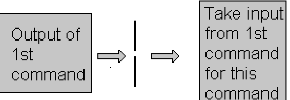
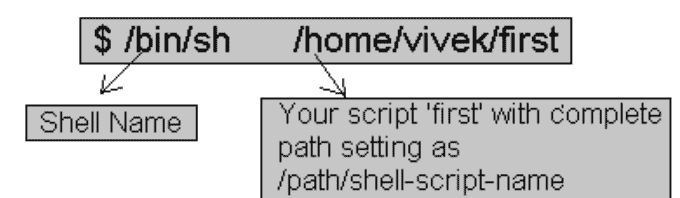
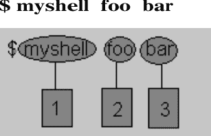

# Linux Shell 脚本入门指南


# Shell 脚本教程

- `Shell` 算术

- 命令行处理（命令行参数）

- 为什么需要命令行参数

- 退出状态

- 文件名简写或元字符（即通配符）

- 编程命令

  - `echo` 命令

  - `Shell` 脚本中的决策判断（即 `if` 命令）

  - `test` 命令或 `[ expr ]`

  - `Shell` 脚本中的循环

  - `case` 语句

  - `read` 语句

- 更多高级 `Shell` 脚本命令

  - `/dev/null` - 用于发送程序的无效输出

  - 本地和全局 `Shell` 变量 (`export` 命令)

  - 条件执行，即 `&&` 和 `||`

  - I/O 重定向和文件描述符

  - 函数 (`Functions`)

  - 用户界面和对话工具 (`dialog` utility)

  - `trap` 命令

  - `getopts` 命令

  - 更多 `Shell` 脚本示例（练习题:-)

## 序言

本教程专为初学者设计。本教程通过展示一些 `Shell` 程序示例来解释 `Shell` 编程的基础知识。它不是 `Shell` 的帮助文档或手册。在阅读本教程时，你会发现手册非常用（在提示符处输入 `man bash` 查看帮助页）。手册包含了你所需的所有必要信息，但它没有提供让思路更清晰的示例。因此，本教程包含了关于 `Shell` 所有特性的示例。我假设你至少具备 `Linux` 的基本知识，例如基础命令如如何创建、删除文件/目录，如何使用 `vi` 或 `mcedit` 编辑器以及如何登录系统。在开始 `Linux` 脚本编程之前，你必须了解：

* 内核

* `Shell`

* 进程

* 重定向符、管道、过滤器等

## 什么是内核 (Kernel)

内核是 `Linux` 操作系统的核心。它管理 `Linux` 操作系统的资源。资源是指 `Linux` 中可用的功能。例如：存储数据的功能、在打印机上打印数据、内存、文件管理。内核决定谁来使用这些资源、使用多久以及何时使用。它运行你的程序（或设置执行二进制文件）。它是 `Linux` 内存驻部分。它的性能任务包括：

* I/O 管理

* 进程管理

* 设备管理

* 文件管理

* 内存管理

## 什么是 Linux Shell

计算机理解由 `0` 和 `1` 组成的语言，称为二进制。在计算早期，指令是使用二进制语言提供的，这对于我们所有人来说都难以阅读和编写。因此，操作系统中有一个特殊的程序叫做 `Shell`。`Shell` 接受你的英语指令或命令，并将其翻译成计算机原生的二进制语言。

这就是 `Shell` 为我们所做的


# Linux Shell 脚本教程

你输入命令，`shell` 将其转换为


它是为用户交互提供的环境。`Shell` 是一个命令行行语言解释器，用于执行从标准输入设备（键盘）或文件读取的命令。`Linux` 可能使用最流行的 `Shell` 之一（在 `MS-DOS` 中，`Shell` 的名称 `COMMAND.COM` 也用于相同目的，但它没有我们的 `Linux Shell` 那么强大！）

| `Shell` 名称 | 开发者 | 来源 | 备注 |
|---|---|---|---|
| `Bash` (`Bourne-Again Shell` ) | `Brian Fox and Chet Ramey` | 自由软件基金会 | `Linux` 最常用的 `Shell`。它是免费软件。 |
| `CSH` (`C Shell`) | `Bill Joy` | `C shell` 的语法和用法与 `C` 语言语言非常相似。 | |
| `KSH` (`Korn Shell`) | `David Korn` | `AT & T Bell` 实验室 | |

上述任何 `Shell` 都会从用户（通过键盘或鼠标）读取命令并告诉 `Linux` 操作系统用户想要什么。如果我们从键盘输入命令，它被称为命令行界面（通常在 `$` 提示符前面）。此提示符取决于你设置或由系统管理员设置的 `Shell` 和环境，因此你可能会得到不同的提示符）

注意：通过以下命令查找你的 `Shell` 类型：

```
$ echo $SHELL
```

## 如何使用 Shell

要使用 `shell`（登录系统后立即开始使用你的 `shell`），你只需简单地输入命令。以下是常用命令列表。

## Linux 常用命令

注意，以下命令仅供新用户或初学者。其目的是如果你使用这些命令，你将更熟悉你的 `shell`；其次，如果你想获取有关该命令的更多信息或帮助，请尝试以下命令。例如，要查看与 `date` 命令相关的帮助或选项，请尝试

```
$ date --help
```

或者查看与 `ls` 命令相关的帮助或选项（在这里你将看到分屏帮助，因为 `ls` 的内容很大）

```
$ ls --help
```

该命令的语法：

```
man bash
```

该命令的语法：

```
$ ls --help
```

该命令的语法：

```
man command-name
```

注意：输入以下命令查看发生了什么

```
$ ls --help
man command-name
```

在 `MS-DOS` 中，你可以通过输入 `/?` 来获取帮助，如下：

```
C:\> dir /?
C:\> date /?
C:\> help
C:\> time
C:\> help
```

## Linux 命令

| 目的 | 命令 | 语法 | 示例（在 $ 提示符前） |
|---|---|---|---|
| 查看日期 | `date` | `$ date` | |
| 查看谁正在使用系统 | `who` | `$ who` | |
| 打印工作目录 | `pwd` | `$ pwd` | |
| 查看当前目录的文件列表 | `ls` or `dirs` | `$ ls` | |
| 创建文本文件 注意：按住 `CTRL` 键 | `cat { name }` | `$ cat myfile` | |
| 查看文件 | `cat { name }` | `$ cat myfile` | |
| 逐屏显示 | `more { name }` | `$ more myfile` | |
| 移动或重命名文件/目录 | `mv {file1} {file2}` | `$ mv sales.99` | |
| 创建各种链接的文件 | `ln {oldfile} {newfile}` | `$ ln Page1` | |
| 删除文件 | `rm file1` | `$ rm myfile` | |

## Linux Shell 脚本

| 描述 | 命令 | 语法 | 示例 |
|---|---|---|---|
| 删除给定目录/子目录中的所有文件。谨慎使用。 | `rm -rf {dirname}` | `$ rm -rf oldfiles` | |
| 修改文件权限 `u` - 所有者 `g` - 组 `o` - 其他用户 `a` - 所有用户 `+` 设置权限 `-` 删除权限 `r` - 读取权限 `w` - 写权限 `x` - 执行权限 | `chmod {u|g|o|a}{+-} {r|w|x} {filename}` | `$ chmod u+x,g+wx,o+` 为名为 `myscript` 的文件设置权限：创建该文件或目录的用户（`u`）拥有权限（`u+x`）。文件组也可以写入和执行该文件（`g+wx`）。其他人无法修改它；因为我们没有给他们 `w`（写权限）（`o+x`）。 | |
| 读取你的邮件 | `mail` | `$ mail` | |
| 查看当前登录人员（即你自己） | `who am i` | `$ who am i` | |
| 登出 | `logout` (或 `CTRL+D`) | `$`（注意：它可能会要求你输入登录密码，在这种情况下此功能由系统管理员禁用） | |
| 向其他人员发送邮件 | `mail {user-name}` | `$ mail ashish` | |
| 计算给定文件的行、单词和字符数 | `wc {file-name}` | `$ wc myfile` | |
| 搜索匹配模式的文件行 | `grep {word-to-lookup} {filename}` | `$ grep fox myfile` | |
| 按照以下顺序排序文件 `-r` 反转正常顺序 `-n` 数字排序 `-nr` 逆向数字排序 | `sort -r -n -nr {filename}` | `$ sort myfile` | |

## 什么是进程 (Processes)

进程是你的 `PC` 执行的任何程序或任务。例如，`ls -IR` 是一个列出当前目录及其所有子目录下文件的命令或请求。它就是一个进程。进程是执行某些任务的程序（用户给出的命令）。在 `Linux` 中，当你启动进程时，它会给出一个数字（称为 `PID` 或进程 `ID`），`PID` 从 `0` 到 `65535`。

## 为什么需要进程

`Linux` 是一个多用户、多任务的操作系统。这意味着如果你愿意，你可以可以同时运行两个以上的进程。例如，为了查找系统中有多少文件，你可以输入如下命令：

```
$ ls / -R | wc -l
```


此命令将花费时间搜索你系统上的所有文件。因此，你可以在后台运行此类命令，或者通过输入命令如`$ ls / -R | wc -l &`同时运行。命令末尾的符号`&`告诉`shell`启动命令（`ls / -R | wc -l`）并在后台运行，然后立即执行下一个命令。运行中进程的实例称为进程，`shell`输出的数字称为进程 ID (PID)，此 PID 可用于引用特定的运行进程。

## 与进程相关的 Linux 命令

`注意`：你只能杀死由你自己创建的进程。管理员几乎可以杀死 95-98% 的进程。但某些进程无法被杀死，例如`VDU`进程。

## 标准输出/输入重定向或输入-输出重定向

大多数命令都在屏幕上给出输出或从键盘获取输入，但在 Linux 中，可以将输出发送到文件或从文件中读取输入。例如，`ls`命令给出输出到屏幕；要将`ls`命令的输出发送到文件，使用`$ ls > filename`。这意味着将`ls`命令的输出放入文件名。有三个重定向符号`>>`、`>`。

### (1) `>` 重定向符号

`语法：Linux-command > filename`

将 Linux 命令的结果输出到文件。注意，如果文件已存在，它将被覆盖，并创建一个新文件。例如，要发送`ls`命令的输出，输入`$ ls myfiles`，如果'myfiles'文件存在于当前目录中，它将被覆盖且不会有任何类型的警告。（如果我想把输出发送到一个已经存在的文件，并想保留文件信息而不丢失之前的信息/数据怎么办？请阅读下一个重定向符号）

### (2) `>>` 重定向符号，Linux-command >> filename

将 Linux 命令的结果输出到文件的`末尾`。注意，如果文件已存在，它将被打开并将新的输入信息/数据写入文件末尾，而不会丢失之前的信息/数据。如果文件不存在，则会创建一个新文件。例如，要将`date`命令的输出发送到已存在的文件，输入`$ date >> myfiles`。

### (3) `<` 重定向符号，Linux-command < filename

从文件而不是键盘为 Linux 命令获取输入。例如，要为`cat`命令获取输入，输入`$ cat < myfiles`。

## 管道 (Pipes)

管道是一种将一个程序的输出连接到另一个程序的输入的方法，而不需要任何临时文件。



## Linux Shell 教程

管道本质上是一个临时存储位置，一个命令的输出存储其中，然后作为第二个命令的输入。管道用于运行多个命令（来自同一行的多个命令）。

`语法：command1 | command2`

| 使用管道的命令 | 管道的意义或用途 |
|--- |--- |
| $ ls | more | 在这里 `ls` 命令的输出作为 `more` 命令的输入，以便一次打印一整屏的内容。 |
| $ who | sort | 在这里 `who` 命令的输出作为 `sort` 命令的输入，以便它打印排序后的用户列表。 |
| $ who | wc -l | 在这里 `who` 命令的输出作为 `wc` 命令的输入，以便它可以打印登录系统的用户数量。 |
| $ ls | wc -l | 在这里 `ls` 命令的输出作为 `wc` 命令的输入，以便它可以打印当前目录下的文件数量。 |
| $ who | grep raju | 在这里 `who` 命令的输出作为 `grep` 命令的输入，如果该用户已登录，则会打印特定的用户名，否则不打印（用于查看特定用户是否登录）。 |

## 过滤器 (Filter)

如果一个 Linux 命令从标准输入接受输入并在标准输出上产生输出，则被称为过滤器。过滤器对输入进行某种处理并给出输出。例如，假设我们有一个 100 行的文件`hotel.txt`，我们想从`hotel.txt`的第 20 行打印到第 30 行并将结果存储到名为`hlist`的文件中。

```
$ tail +20 < hotel.txt | head -n30 > hlist
```

## Shell 编程简介

Shell 程序是一系列 Linux 命令。Shell 脚本就像 MS-DOS 中的批处理文件，但比 MS-DOS 批处理文件更强大。Shell 脚本用于创建自己的命令，以节省时间并自动化某些任务。

## Linux 中的变量

- `系统变量`：由 Linux 自身创建并维护。变量类型使用大写字母定义。

- `用户自定义变量 (UDV)`：由用户创建并维护。变量类型使用小写字母定义。

## 一些系统变量

你可以通过输入如`set`等命令查看系统变量。一些重要的系统变量有：

| 系统变量 | 意义 |
| --- | --- |
| BASH=/bin/bash | 我们的 shell 名称 |
| BASH_VERSION=4.1.7 | 我们的 shell 版本 |
| COLUMNS=80 | 屏幕的列数 |
| HOME=/home/vivek | 我们的主目录 |
| LINES=25 | 屏幕的行数 |
| LOGNAME=students | 我们的登录名 |
| OSTYPE=Linux | 我们的类型 |
| PATH=/usr/bin:/bin | 我们的路径 |
| PS1=\$u@\h:\$ | 我们的提示符 |
| PWD=/home/students | 我们当前的工作目录 |
| SHELL=/bin/bash | 我们的 shell 名称 |
| USERNAME=vivek | 当前登录到此处的的用户 |

`注意`：上述某些内容在你的 PC 上可能有所不同。你可以打印上述任何一个内容：

`echo $USERNAME`

`echo $HOME`

警告：不要修改系统变量，这有时会导致问题。

## 如何定义用户自定义变量 (UDV)

定义 UDV 使用以下语法

`语法：variename=value`

注意：这里 'value' 被赋值给 'variename'，且 Value 必须在 `=` 的右侧。例如：

```
$ no=10 # 这是正确的
$ 10=no # 错误，Value 必须在 = 的右侧
```

要定义值为 'Bus' 的变量 'vech'

```
$ vech=Bus
```

要定义值为 10 的变量 'n'

```
$ n=10
```

## 变量命名规则（UDV 和系统变量）

(1) 变量名必须以字母数字或下划线 (_) 开头，后跟一个或多个字母数字。例如。有效的 shell 变量如下：

```
HOME
SYSTEM_VERSION
vech
no
```

(2) 给变量赋值时，不要在等号两侧留空格。例如。以下变量声明没有错误：

```
$ no=10
```

但以下情况会有问题：

```
$ no =10
$ no= 10
$ no =10
```

(3) 变量大小写敏感，就像 Linux 文件名一样。例如。

```
$ no=10
$ No=11
$ NO=20
$ no=2
```

以上都是不同的变量名，因此为了打印 20，我们需要使用 `$ echo $NO` 而不是以下任何一个：

```
$ echo $no  # 将打印 10 而不是 20
$ echo $No  # 将打印 11 而不是 20
$ echo $nO # 将打印 2 而不是 20
```

(4) 你可以定义空变量（空变量是在定义时没有值的变量）。例如。

```
$ vech=
$ vech=""
```

尝试打印它的值 `$ echo $vech`，这里将不显示内容，因为变量没有值，即空变量。

(5) 不要使用 `?`、`.*` 等符号来命名你的变量。

## 如何打印或访问 UDV（用户自定义变量）的值

打印或访问 UDV 使用以下语法

`语法：$varilename`

例如。打印变量 'vech' 的内容

```
$ echo $vech
```

它将打印 'Bus'（如果之前定义为 `vech=Bus`）。打印变量 'n' 的内容 `$ echo $n`

它将打印 '10'（如果之前定义为 `n=10`）。

警告：不要尝试 `$ echo vech`（这会打印字符串 'vech'）和 `echo $n`（这会打印 n 而不是 '10'），你必须使用 `$ echo` 加上变量名。

问题 1：如何定义值为 10 的 x 并在屏幕上打印它

```
$ x=10
$ echo $x
```

## Linux 脚本教程：定义变量 x 值为 Rani 并打印到屏幕

Q.2. 如何定义变量 x

```
$ x=Rani
$ echo $x
```

Q.3. 如何打印两个数字之和，假设是 6 和 3

```
$ echo 6 + 3
```

这会打印 6 + 3，而不是和 9。为了在 shell 表达式中执行或进行数学运算，语法如下：

`语法：expr op1 operator op2`

- 减法

- 除法

+ 加法

其中，`op1` 和 `op2` 是任何整数（不带小数点的数字），运算符可以是：


`%` 取模（Modular），用于寻找余数，例如 `20 / 3 = 6`，寻找余数则为 `20 % 3 = 2`（记住它是整数计算）

`*` 乘法

```
$ expr 6 + 3
```

现在它将打印和，结果为 `9`。但是

```bash
$ expr 6-3
```

这无法正常工作，因为数字和运算符之间需要空格（参见 Shell 算术）。

### Q.4. 如何定义两个变量 `x=20`, `y=5` 然后打印 `x` 和 `y` 的除法（即 `x/y`）

```
$ x=20
$ y=5
$ expr x / y
```

### Q.5. 修改上述内容并将 `x` 和 `y` 的除法结果存储到变量 `z` 中

```
$ x=20
$ y=5
$ z=expr x / y
$ echo $z
```

注意：对于第三语句，请阅读 Shell 算术。

## 如何编写 shell 脚本

现在我们编写第一个脚本，它将在屏幕上打印“Knowledge is Power”。编写 shell 脚本，你可以使用 Linux 中的文本编辑器，如 `vi` 或 `medit`，或者使用 `cat` 命令。这里我们使用 `cat` 命令，你可以使用上述任何文本编辑器。首先输入以下 `cat` 命令，其余文本内容所示：

```bash
$ cat > first
#
## My first shell script
#
## clear
echo "Knowledge is Power"
```

按 `Ctrl + D` 保存。要执行它，输入命令

```
$ ./first
```

这会导致报错，因为我们没有为脚本 `first` 设置执行权限；要执行此，输入命令：

```
$ chmod +x first
$ ./first
```

第一个屏幕将清空，然后屏幕上将打印 `Knowledge is Power`。要打印变量的消息，我们使用 `echo` 命令，`echo` 命令的一般形式如下

```
echo "Message"

echo "Message variable1,variable2....variableN"
```

## 如何运行 Shell 脚本

由于文件的安全性，在 Linux 中，Shell 脚本的创建者默认 own 执行权限。如果我们希望像命令一样运行 shell 脚本，我们需要执行两步：

- (1) 使用 `chmod` 给脚本赋予执行权限

语法：`chmod +x shell-script-name`

或 语法：`chmod +x 777 shell-script-name`

- (2) 使用 `./your-shell-program-name` 运行你的脚本

例如。

```
$ ./first
```

这里 `'./'`（点）是命令，与 shell 脚本配合使用。点（`.`）指示当前在相同的 shell 中执行要执行命令，即无需在内存中加载另一个 shell。你也可以尝试以下语法来运行 Shell 脚本：

语法：`bash your-shell-program-name`

或 `/bin/sh your-shell-program-name`

```
$ bash first
$ /bin/sh
```

注意，运行脚本需要你处于创建脚本的同一个目录下，如果你在不同的目录，你的脚本将无法运行（因为路径设置）。例如，你的主目录是（使用 `$ pwd` 查看当前工作目录）`/home/vivek`。当你创建一个脚本 `'first'` 后，在创建脚本后你移动到了另一个目录，假设为 `/home/vivek/Letters/Personal`。现在如果你尝试执行脚本，它将无法运行，因为 `'first'` 在 `/home/vivek` 目录，而不是当前目录。要解决这个问题有两种方法：第一种，当你从其他目录运行脚本时，指定脚本的完整路径，例如输入以下命令：

```bash
$ /bin/sh /home/vivek/first
```



现在每次你在其他目录工作时都要提供所有详细信息，这需要时间且你必须记住完整路径。另一种方法是如果你注意到所有程序（可执行文件形式）都被标记为可执行，并且可以从任何目录通过输入如下命令从提示符直接执行：

```bash
$ cc mypr.c
$ cal
```

这是如何工作的？所有可执行文件都安装在 `/bin` 目录下，该目录被设置在 `PATH` 设置中。当你在提示符输入任何命令名称时，`shell` 会在其所在的部分查找命令（作为内部命令，它是 `shell` 的一部分，始终可以执行），如果找到将执行它。如果未找到，它将查找当前目录，如果找到，`Shell` 将查找 `PATH` 设置，并在所有提到的目录中查找请求的可执行文件，否则给出消息。

## 为什么需要命令行参数

## Linux 脚本教程

让我们以 `rm` 命令为例，它用于删除文件。但你想删除哪个文件以及你如何调用 `rm` 命令呢（命令甚至不会询问你要删除的文件名）。因此，我们如下所示编写命令：

```bash
$ rm {file-name}
```

这里 `rm` 是命令，`file-name` 是你想删除的文件。通过这种方式调用 `rm` 命令指定你想删除的文件，是通过指定 `file-name` 与命令进行通信。你也可以向脚本传递命令行参数，使其更加用户友好。但在脚本中如何处理或访问命令行参数呢？

让我们以 `ls` 命令为例

```bash
$ ls -a *
```

这个命令有一个命令行参数 `-a`，`/*` 是另一个。对于 脚本，

```bash
$ myshell foo bar
```



- `1` 脚本名称，即 `myshell`

- `2` 传递给 `myshell` 的第一个命令行参数，即 `foo`

- `3` 传递给 `myshell` 的第二个命令行参数，即 `bar`

在 `shell` 中，如果我们想引用这些命令行参数，按照如下方式引用：

- `1` `myshell` 是 `$0`

- `2` `foo` 是 `$1`

- `3` `bar` 是 `$2`

这里 `$$` 的和将是 `2`（因为 `foo` 和 `bar` 是两个参数）。请注意，此时可以使用 `$0..$9` 这 `9` 个参数，你也可以通过 `*` 引用所有参数（它会展开为 `$0,$1..$9`）。现在尝试为命令编写以下内容：脚本 ($0$)、参数个数（即 `$$`）以及实际参数（即 `$1,$2` 等）。

| 脚本名称 | 脚本的参数个数 | 实际参数 ($1..$9) | | | | | |
|---|---|---|---|---|---|---|---|
| $0 | | $1 | $2 | $3 | $4 | | |
| sum | 2 | 1 | 2 | | | | |
| math | 3 | 4 | 7 | | | | |
| d | 0 | | | | | | |

## Linux 脚本教程

| | | | | | | | |
|---|---|---|---|---|---|---|---|
| bp | 3 | | -5 | myf | +20 | | |
| ls | 1 | | * | | | | |
| cal | | 0 | | | | | |
| findBS | | 4 | | 8 | 24 | BIG | |

例如，现在我们将编写脚本来打印命令行参数，并查看如何访问它们

```
$ cat > demo
```

```bash
#!/bin/sh
#
## 演示命令行参数的脚本
#
echo "Total number of command line argument is $$#"
echo "$0 is script name"
echo "$1 is first argument"
echo "$2 is second argument"
echo "All of them are :- $*@"
```

按下 `ctrl+O` 保存上述脚本，现在赋予其可执行权限

```
$ chmod +x demo
$ ./demo Hello World
$ cp demo ~/bin
$ demo
```

注意：在此之后，对于你按顺序使用上述命令的任何脚本，我不再向你展示所有上述内容。

# (5)退出状态

在 Linux 中，默认执行特定命令时，它会返回两种值（这些值用于判断命令是否成功：如果返回值为零 (`0`)，表示命令成功；如果返回值为非零 (`>0`)，表示命令失败或发生了某种执行命令/脚本错误）。此值被称为该命令的退出状态（Exit Status）。要确定此状态，我们使用 shell 的 `$?` 值。例如。

```bash
$ rm unkfile
它将显示如下错误
rm: cannot remove ~unknowfile: No such file or directory
在此之后，如果你输入命令 `$ echo $?`
它将打印一个非零值(`>0`) 表示错误值。现在输入命令
$ ls
$ echo $?
它将打印 0 表示命令成功。尝试以下命令并记录下方的退出状态
$ expr 1 + 3
$ echo $?
```

```bash
$ echo Welcome
$ echo $?
```

```bash
$ wildwestcanwork?
$ echo $?
```


## Linux Shell 教程

```bash
$ date
$ echo $?
```

```bash
$ echo $?
```

### if-then-fi 决策

`if-then-fi` 用于脚本中的决策。在 shell 脚本中做出任何决策之前，你必须了解以下类型，因为要在提示符启动 Linux 计算器程序。

```bash
$ bc
```

执行此命令后，`bc` 启动并等待你的命令，即给它一些计算，例如输入 `5 + 2`。

```bash
5 + 2
```

`7` 是 `bc` 的响应，即 `5 + 2` 的加法结果，你甚至尝试：

```bash
5 - 2
```

```bash
5 / 2
```

现在如果你输入如下内容 `5 > 2` 会发生什么：

```bash
5 > 2
```

`0`（零）是 `bc` 的响应。为什么？在这里它比较 `5` 和 `2`，如下：如果 `5` 大于 `2`（如果我问你问题，你的答案是 `YES`），在 Linux 中（`bc` 通过显示 `0` (零) 值给出这个 `YES`）。这意味着即使在 Linux Shell 中进行任何类型的比较，它也只给出两个答案：是 或否。

| Linux Shell 值 | 含义 | 示例 |
| :--- | :--- | :--- |
| 零值 (`0`) | 是/真 | `0` |
| 非零值 (`> 0`) | 否/假 | `-1, 32, 55` 等任何非零值 |

在 `bc` 中尝试以下内容以消除你的疑惑，并记录 `bc` 的响应：

```bash
5 > 12
```

```bash
5 == 10
```

```bash
5 != 2
```

```bash
5 == 5
```

```bash
12 < 2
```

| 表达式 | 对我们的含义 | 你的答案 | BC 的响应（即 Linux Shell 用零和非零值表示） |
| :--- | :--- | :--- | :--- |
| `5 > 12` | `5` 是否大于 `12` | `NO` | `0` |
| `5 == 10` | `5` 是否等于 `10` | `NO` | `0` |
| `5 != 2` | `5` 是否不等于 `2` | `YES` | `1` |
| `5 == 5` | `5` 是否等于 `5` | `YES` | `1` |
| `1 < 2` | `1` 是否小于 `2` | `Yes` | `1` |

现在我们将看到，如果是 shell 脚本中用于决策的条件，如果给定的条件为真，则执行 `command1`。

**语法：**

```bash
if condition
then
command1 如果 condition 为真或 condition 的
退出状态为 0（零）
...
...
fi
```

## Linux 脚本教程

这里的 `condition` 无非就是两个值之间的比较，为了进行比较，我们可以使用 `test` 或 `expr` 语句，甚至也可以使用状态。表达式无非就是值的比较、关系运算符（如 `>`, `<`, `<>` 等）和数学运算符（如 `+`, `-`, `/` 等）。以下是表达式的所有示例：

```bash
$ 5 > 2
$ 3 + 6
$ 3 * 65
$ a < b
$ c > 5
$ c > 5 + 30 -1
```

输入以下命令（假设你有一个名为 `foo` 的文件）：

```bash
$ cat foo
$ echo $?
```

`cat` 命令在成功时返回 零 (`0`)，这可以如下所示用于 `if` 条件中，编写 shell 脚本如下：

```bash
$ cat > showfile
#!/bin/sh
#
## 打印文件的脚本
if cat $1
then
echo -e "\n\nFile $1, found and successfully echoed"
fi
```

现在运行它：

```bash
$ chmod +x showfile
./showfile foo
```

这里：

```bash
$ ./showfile foo
```

我们的脚本名称是 `showfile` (`$0`)，`foo` 是参数（即 `$1`）。现在我们按照如下方式进行比较 `if cat $1`（即 `if cat foo`）。现在如果 `cat` 命令找到了 `foo` 并且成功显示出来，意味着我们的 `cat` 命令成功了且状态为 `0`（表示成功），所以我们的条件也是真，因此 shell 执行了 `echo -e "\n\nFile $1, found and successfully echoed"`。现在如果 `cat` 命令没有成功，它将返回一个非零值（表示某种失败），我们的 shell 就会跳过 `echo -e "\n\nFile $1, found and successfully echoed"`。

现在尝试为以下内容回答答案：

1. 创建以下脚本

```bash
$ cat > trmf
#
## 测试
if $1
then
echo "$1 deleted"
```

（按下 `Ctrl+S` 保存）

```bash
$ chmod +x trmf
```

现在回答以下内容：

A) 如果磁盘上有一个名为 `foo` 的文件，执行命令 `rm foo` 会输出什么。

B) 如果磁盘上不存在文件，执行命令 `rm bar` 会输出什么。

C) 如果你输入 `./rm bar` 会输出什么。

（`test` 命令或 `[ expr ]` 用于检查表达式是否为真，如果为真则返回零 (`0`)，否则返回非零 (`0`) 表示假）。语法：`test` 或 `[ expression ]`

我们将编写脚本来确定参数是否为正。编写脚本如下：

```bash
$ cat > ispositive
#!/bin/sh
## 检查参数是否为正的脚本
#
if test $1 -gt 0
then echo "$1 number is positive"
fi
```

如下方式运行：

```bash
$ chmod +x ispositive
$ ispositive 5
```

这里输出：`5 number is positive`

```bash
$ispositive -45
```

这里输出：`什么都没有打印`

```bash
$ispositive
```

这里输出：`invalid: test -gt: unary operator expected` 是 shell 生成的，为了避免此错误，我们检查是否提供了命令行参数。（参见脚本 8 脚本）。

`test` 或 `[ expr ]` 适用于：

1. 整数（不带小数点）
2. 文件类型
3. 字符字符串

### 在 Shell 中使用运算符进行数学运算

| Shell 中的运算符 | 含义 | 普通算术/数学语句 | 但在 Shell 中 |
| :--- | :--- | :--- | :--- |
| `-eq` | 等于 | `5 == 6` | `if test 5 -eq 6` 或 `if expr [ 5 -eq 6 ]` |
| `-ne` | 不等于 | `5 != 6` | `if test 5 -ne 6` 或 `if expr [ 5 -ne 6 ]` |
| `-lt` | 小于 | `5 < 6` | `if test 5 -lt 6` 或 `if expr [ 5 -lt 6 ]` |
| `-gt` | 大于 | `5 > 6` | `if test 5 -gt 6` 或 `if expr [ 5 -gt 6 ]` |
| `-ge` | 大于等于 | `5 >= 6` | `if test 5 -ge 6` 或 `if expr [ 5 -ge 6 ]` |

注意：`==` 表示等于。

用于字符串比较时：

| 操作符 | 含义 |
| :--- | :--- |
| `string1 == string2` | `string1` 等于 `string2` |
| `string1 != string2` | `string1` 不等于 `string2` |
| `string1` | `string1` 不为空或未定义 |
| `-n string1` | `string1` 不空且存在 |
| `-z string1` | `string1` 为空且存在 |

Shell 还会测试文件和目录类型：

| 测试项 | 含义 |
| :--- | :--- |
| `-s file` | 非空文件 |
| `-f file` | 存在或普通文件且不是目录 |
| `-d dir` | 目录存在且不是文件 |
| `-w file` | 可写文件 |
| `-r file` | 只读文件 |
| `-x file` | 是可执行文件 |

### 逻辑运算符

逻辑运算符用于同时组合两个或多个条件：

| 操作符 | 含义 |
| :--- | :--- |
| `! expression` | 逻辑非 (`NOT`) |
| `expression1 -a expression2` | 逻辑与 (`AND`) |
| `expression1 -o expression2` | 逻辑或 (`OR`) |

### if...else...fi

如果给定的条件为真，则执行 `command1`，否则执行 `command2`。

**语法：**


## Linux 脚本教程

```bash
if condition
then
    command1 如果条件为真或如果条件的退出状态
    状态为 0 (零)
    ...
else
    command2 如果条件为假或如果条件的退出状态
    状态为 >0 (非零)
    ...
fi
```

例如。编写如下脚本：

`$ cat > isnnump_n`

```bash
#!/bin/sh

#
## Linux 脚本教程
## 检查参数是否为正数或负数的脚本
if [ $# -eq 0 ]
then
  echo "$0 : 你必须提供一个整数"
  exit 1
fi

if test $1 -gt 0
then
  echo "$1 数字是正数"
else
  echo "$1 数字是负数"
fi
```

按照以下方式尝试：

```bash
$ chmod +x isnnump_n
$ isnnump_n 5
这里输出： 5 数字是正数
$ isnnump_n -45
这里输出： -45 数字是负数
$ isnnump_n
这里输出： ./isnnump_n : 你必须提供一个整数
$ isnnump_n 0
这里输出： 0 不是负数
```

首先我们查看是否没有提供命令行参数，如果是它将打印错误信息 "$isnnump_n :"，`if` 语句检查给脚本的参数数量 (`$#`) 是否不等于 (`-eq`) 0。如果我们向脚本传递了任何参数，则该语句为假；如果没有提供命令行参数，则该语句为真。`echo` 命令即 `echo "$0 : 你必须提供一个整数"`


1 将打印脚本名称

2 将打印这条错误信息

最后语句 `exit 1` 导致程序以退出状态 1 正常终止（非零意味着脚本未成功运行）。最后一个示例运行 `$ isnnump_n 0` 给出的输出为 "0 不是负数"，因为参数并不 `> 0`，因此条件为假，它被视为负数。为了避免这种情况，请将第二个语句替换为 `if test $1 -ge 0`。

### (9) 多级 if-then-else

语法：

```bash
if condition
then
  条件为零 (真 0)
  执行到 elif 语句为止的所有命令
elif condition1
  condition1 为零 (真 0)
  执行到 elif 语句为止的所有命令
elif condition2
  condition2 为零 (真 0)
  执行到 elif 语句为止的所有命令
else
上述条件、cond1、cond2 均为假（即以上所有均为非零或假）
执行到 fi 之前的所有命令
fi
```

例如。编写脚本为 `$ cat > #!/bin/sh`

```bash
# # 测试 if..elif..else 的脚本 # # if [$1 -gt 0] then echo "$1 是正数" [$1 -lt 0] then echo "$1 是负数" [$1 -eq 0] then echo "$1 是零" echo "糟糕！$1 不是数字，请输入数字" fi
```

尝试上面的脚本使用 `chmod +x $elf -2 -$elf $elf` 这里是最后一个示例运行的输出：`/elf: [-gt: unary operator expected /elf: [-lt: unary operator expected /elf: [-eq: unary operator expected $1 不是数字，请提供数字。..` 上述程序错误是预期的，因此会出现 `/elf: [-gt: unary operator expected`，但我们的程序仍然会通过提供消息“糟糕！A 不是数字，请输入数字。”来通知我们这一点。

计算机可以一遍又一遍地执行指令，直到满足特定条件。一组被重复执行的指令组被称为循环。

## Shell 脚本中的循环

(a) for 循环语法：

```bash
for { 变量名 } in { 列表 }
do
    对列表中的每个项目执行一次，直到列表
    未完成（重复 do 和 done 之间的所有语句）
done
```

假设，

`$ cat > testfor`

```bash
for i in 1 2 3 4 5
do
    echo "欢迎 $i 次"
done
```

如下所示运行：

`$ chmod +x testfor`

`./testfor`

`for` 循环创建了变量 `i`，并从从 1 到 5 的数字列表中为 `i` 分配了一个名称。Shell 将为 `i` 的每次赋值执行 `echo` 语句。（这通常被称为迭代）。此过程将持续到列表中的所有项目都执行完毕，由于这个原因，它将重复 5 次 `echo` 语句。例如：现在尝试如下脚本：

`$ cat > mtable`

```bash
#!/bin/sh
#
## 测试 for 循环的脚本
#
#
if [$# -eq 0]
then
echo "错误 - 命令行参数缺少数字"
echo "语法 : $0"
echo "用于打印指定数字的乘法表"
exit 1
fi
n=$1
for i in 1 2 3 4 5 6 7 8 9 10
do
echo "$n * $i=`expr \* $n`"
done
```

保存并运行：

`$ chmod +x mtable`
`$ ./mtable`

对于第一次运行，上述程序打印指定数字的乘法表，其中 `i = 1, 2 ... 10` 依次乘以 `n`（这里命令行参数为 7），产生如下乘法表：

`7 * 1 = 7`
`7 * 2 = 14`
..
`7 * 10 = 70`

对于第二次运行，它将打印消息 -
错误 - 命令行参数缺少数字
语法 : `./mtable`
用于打印指定数字的乘法表

发生这种情况是因为我们没有提供想要生成乘法表的指定数字。在这里我们展示了脚本的错误信息、语法和用法。如果你的程序接受某些参数，这是一个好主意，让用户知道此脚本的用途以及如何使用。注意，为了终止脚本我们使用了 `exit 1` 命令，它接受 1 作为参数（表示错误，因此脚本终止）。

(b) while 循环
语法：

```bash
while [ 条件 ]
do
    command1
    command2
    command3
..
done ...
```

只要给定的条件为真，循环就会执行。例如。上面的 `for` 循环程序可以使用 `while` 循环写成：

```bash
$cat > nt1

#!/bin/sh

#
## 测试 while 语句的脚本
#

if [ $# -eq 0 ]
then
echo "错误 - 命令行参数缺少数字"
echo "语法 : $0"
echo "用于打印指定数字的乘法表"
exit 1
fi

n=$1
i=1
while [ $i -le 10 ]
do
echo "$n * $i=`expr \* $n`"
ni=`expr $i +1`
done
```

保存并尝试：

`$ chmod +x nt1`

`./nt1`

上述循环解释如下：

| 语句 | 说明 |
| :--- | :--- |
| `n=$1` | 将命令行参数赋值给变量 `n`。（这里设置为 7） |
| `i=1` | 将 `i` 初始化为 1 |
| `while [ $i -le 10 ]` | 这是我们的循环条件，如果 `i` 小于 10，则执行 `do` 和 `done` 之间的所有语句 |
| `do` | 开始循环 |
| `echo "$n * $i=`expr \* $n`"` | 打印乘法表如 `7 * 1 = 7` ... `7 * 10 = 70` |
| `ni=`expr $i + 1`` | 将 `i` 增加 1 并结果赋值给 `i`。（即 `i+1`） |
| `done` | 如果 `i` 不小于 10，循环在此停止。 |

根据上述讨论关于循环的几点：

(a) 首先，循环中的变量必须初始化，接下来开始执行。

(b) 在每次迭代开始时都会进行测试（条件）。

(c) 循环体结束于一个修改值的语句。

### (11) case 语句

`case` 语句是多级 `if-else` 语句的良好替代方案。它允许你对一个变量匹配多个值。它更容易易读和编写。

语法：

```bash
case $变量名 in
    模式1)
        ...
        命令;
    模式2)
        ...
        命令;
    命令
    ..
    命令;
    命令
    ..
esac
```

`变量名` 与模式进行比较，直到找到匹配项。Shell 随后执行到两个相邻分号为止的所有语句。默认是 `*)`，如果没有找到匹配项，则执行它。例如。创建一个如下脚本：

通过 `CTRL+D` 保存：

```bash
$ chmod +x car
$ car van
$ car car
$ car Maruti-800
```


# Linux Shell 教程

在这里我们将检查 `$1`（第一个命令行参数）如果没有设置则将 `rental` 变量赋值为 "未知车辆"，如果给了值则将其给定值。`$Rental` 与模式进行比较，直到找到匹配项。在这里，第一次运行它匹配到，并将显示输出 `Rs.10 per k/m`。第二次运行它打印“For car Rs.20 per k/m”。对于最后一次运行，`Maruti-800` 没有匹配项，因此执行默认的即 `*)`，它会打印“对不起，我无法为你找到 Maruti-800”。注意需要 `esac` 来表示 `case` 语句的结束。

## (12) read 语句

从键盘获取输入并存储到变量。

```bash
语法: read variable1,variable2,...variableN
$ cat > sayH
```

创建脚本

```bash
#
## 从键盘读取你的名字的脚本.c
echo "请输入你的名字:"
read fname
echo "Hello $fname, 让我们做朋友吧!"
```

按照如下方式运行：

```bash
$ chmod +x sayH
./sayH
```

此脚本首先询问你的名字，然后等待用户输入名称。用户从键盘输入名称（输入名称后必须按回车键 `ENTER`），输入的名称将被存储（赋值）到变量 `fname` 中。

## (13) 文件名缩写或元字符（即通配符）

- `*` 或 `?` 或 `[...]` 其中一种缩写字符。

- `*` 匹配任何字符串或字符组。

  例如 `$ ls *` 将显示所有文件，`$ls a*` 将显示所有以 'a' 开头的文件，`$ls *.c` 将显示所有扩展名为 `.c` 的文件，`$ls ut*` 将显示所有扩展名为 `.c` 但文件名前两个字母为 'ut' 的文件。

- `?` 匹配任何单个字符。

  例如 `$ ls ?` 将显示单个字母的文件名，`$ls fo?` 将显示所有文件名长度为 3 个字符且以 `fo` 开头的文件。

- `[...]` 匹配括号内的任意一个字符。

  例如 `$ ls [abc]*` 将显示所有以 a、b、c 字母开头的文件。

- `[..]` 一对由连字符分隔的字符表示一个范围：

  例如 `$ ls /bin/[a-c]*` 将显示所有以字母 a、b 或 c 开头的文件。

```text
/bin/arch      /bin/bsh       /bin/chod      /bin/cp
/bin/ash       /bin/cat       /bin/chown     /bin/cpio
/bin/ash.static  /bin/bash      /bin/chgrp     /bin/consolechars /bin/sh
```

但是

```bash
$ ls /bin[!a-o]*
$ ls /bin[!^]*
```

如果 `[` 后的第一个字符是 `!` 或 `^`，则匹配任何未包含括号内的字符，即不显示以 a,b,c,e..o 开头的文件，如：

```text
/bin/ps           /bin/rvri       /bin/touch     /bin/view
/bin/pwd          /bin/riev      /bin/sort      /bin/wcomp
/bin/red          /bin/sayHello  /bin/tty       /bin/umount   /bin/xconf
/bin/remadmin     /bin/sed        /bin/su        /bin/uname     /bin/ypdomomain
/bin/rm           /bin/setserial /bin/sync      /bin/userconf /bin/zcat
/bin/rmdir        /bin/sfxxload   /bin/tar       /bin/usleep
/bin/rpm          /bin/sh        /bin/tsch      /bin/vi
```

## (14) command1;command2

用一行运行两个命令。例如 `$ date; who` 将先打印日期，然后打印当前登录的用户。注意，你不能用 `$ date who` 来实现相同目的，你必须在 `date` 和命令之间加上分号。

## 高级 Shell 脚本命令

### /dev/null 用于发送程序的未发送输出

这是一个特殊的 Linux 文件，用于发送程序/命令中任何不需要的输出。

`语法: command > /dev/null`

例如 `> /dev/null`，此命令的输出不会显示在屏幕上，而是发送到这个特殊文件中。

`/dev` 目录包含其他文件。该目录中的文件大多代表外围设备，如磁盘、软磁盘、声卡、行打印机等。

### 局部和全局变量 (export 命令)

通常我们所有的变量都是局部的。局部变量可以在同一个 shell 中使用，如果你加载另一个 shell 副本（通过提示符处的 `/bin/bash`），那么新 shell 将忽略旧的所有变量。例如，考虑以下示例：

```bash
$ vech=Bus
echo $vech
Bus
$ /bin/bash
$ echo $vech

注意：-打印了空行
$ vech=Car
echo $vech
Car
$ exit
$ echo $vech
Bus
```

| 命令 | 含义 |
|------|---|
| `$ vech=Bus` | 在第一个 shell 中创建一个值为 `Bus` 的新局部变量 `'vech'` |
| `echo $vech` | 打印 `vech` 的内容 |
| `$/bin/bash` | 现在在内存中加载第二个 shell（它会忽略所有旧 shell 的变量） |
| `echo $vech` | 打印 `vech` 的内容 |
| `$ vech=Car` | 在第二个 shell 中创建一个值为 `Car` 的新局部变量 `'vech'` |
| `echo $vech` | 打印 `vech` 的内容 |
| `$ exit` | 退出第二个 shell 返回到第一个 shell |
| `echo $vech` | 打印 `vech` 的内容（现在你可以看到第一个 shell 的变量及其值了） |

我们可以将旧 shell 的变量复制到新 shell（即第一个 shell 的变量），这被称为全局变量。要实现这一点，使用 `export` 命令

`语法: export variable1,variable2,...variableN`

例如 `$ export vech=Bus`

```bash
$ vech=Bus
Bus
```

| 命令 | 含义 |
|---|---|
| `$ vech=Bus` | 在第一个 shell 中创建一个值为 `Bus` 的新局部变量 `'vech'` |
| `echo $vech` | 打印 `vech` 的内容 |
| `$/bin/bash` | 现在在内存中加载第二个 shell（它会忽略所有旧 shell 的变量） |
| `echo $vech` | 打印 `vech` 的内容 |
| `$ vech=Car` | 在第二个 shell 中创建一个值为 `Car` 的新局部变量 `'vech'` |
| `echo $vech` | 打印 `vech` 的内容 |
| `$ exit` | 退出第二个 shell 返回到第一个 shell |
| `echo $vech` | 打印 `vech` 的内容（现在你可以看到第一个 shell 的变量及其值了） |

我们可以将旧 shell 的变量复制到新 shell（即第一个 shell 的变量），这被称为全局变量。要实现这一点，使用 `export` 命令

`语法: export variable1,variable2,...variableN`

例如 `$ export vech=Bus`

```bash
$ vech=Bus
Bus
```


- `*` 或 `?` 或 `[...]` 其中一种缩写字符。
- `*` 匹配任何字符串或字符组。
  例如 `$ ls *` 将显示所有文件，`$ ls a*` 将显示所有以 'a' 开头的文件，`$ ls *.c` 将显示所有扩展名为 `.c` 的文件，`$ ls ut*` 将显示所有扩展名为 `.c` 但文件名前两个字母为 'ut' 的文件。
- `?` 匹配任何单个字符。
  例如 `$ ls ?` 将显示单个字母的文件名，`$ ls fo?` 将显示所有文件名长度为 3 个字符且以 `fo` 开头的文件。
- `[...]` 匹配括号内的任意一个字符。
  例如 `$ ls [abc]*` 将显示所有以 `a`、`b`、`c` 字母开头的文件。
- `[..]` 一对由连字符分隔的字符表示一个范围：
  例如 `$ ls /bin/[a-c]*-` 将显示所有以字母 `a`、`b` 或 `c` 开头的文件。

```
/bin/arch      /bin/bsh       /bin/chod      /bin/cp
/bin/ash       /bin/cat       /bin/chown     /bin/cpio
/bin/ash.static  /bin/bash      /bin/chgrp     /bin/consolechars /bin/sh
```

但是

`$ ls /bin[!a-o]*`

`$ ls /bin[!^]*`

如果 `[` 后的第一个字符是 `a` 或 `^`，则匹配任何未包含括号内的字符，即不显示以 `a`,`b`,`c`,`e`..`o` 开头的文件，如

```
/bin/ps           /bin/rvri       /bin/touch     /bin/view
/bin/pwd          /bin/riev      /bin/sort      /bin/wcomp
/bin/red          /bin/sayHello  /bin/tty       /bin/umount   /bin/xconf
/bin/remadmin     /bin/sed        /bin/su        /bin/uname     /bin/ypdomomain
/bin/rm           /bin/setserial /bin/sync      /bin/userconf /bin/zcat
/bin/rmdir        /bin/sfxxload   /bin/tar       /bin/usleep
/bin/rpm          /bin/sh        /bin/tsch      /bin/vi
```

## (14) command1;command2

用一行运行两个命令。例如 `$ date; who` 将先打印日期，然后打印当前登录的用户。注意，你不能用 `$ date who` 来实现相同目的，你必须在 `date` 和命令之间加上分号。

## 高级 Shell 脚本命令

## /dev/null 用于发送程序的未发送输出

这是一个特殊的 Linux 文件，用于发送程序/命令中任何不需要的输出。

语法: `command > /dev/null`

例如 `$ > /dev/null`，此命令的输出不会显示在屏幕上，而是发送到这个特殊文件中。

`/dev` 目录包含其他文件。该目录中的文件大多代表外围设备，如磁盘、软磁盘、声卡、行打印机等。

## 局部和全局变量 (export 命令)

通常我们所有的变量都是局部的。局部变量可以在同一个 shell 中使用，如果你加载另一个 shell 副本（通过提示符处的 `/bin/bash`），那么新 shell 将忽略旧的所有变量。例如，考虑以下示例：

```
$ vech=Bus
echo $vech
Bus
$ /bin/bash
$ echo $vech

注意：- 打印了空行
$ vech=Car
echo $vech
Car
$ exit
$ echo $vech
Bus
```

| 命令 | 含义 |
|------|---|
| `$ vech=Bus` | 在第一个 shell 中创建一个值为 `Bus` 的新局部变量 `'vech'` |
| `echo $vech` | 打印 `vech` 的内容 |
| `$ /bin/bash` | 现在在内存中加载第二个 shell（它会忽略所有旧 shell 的变量） |
| `echo $vech` | 打印 `vech` 的内容 |
| `$ vech=Car` | 在第二个 shell 中创建一个值为 `Car` 的新局部变量 `'vech'` |
| `echo $vech` | 打印 `vech` 的内容 |
| `$ exit` | 退出第二个 shell 返回到第一个 shell |
| `echo $vech` | 打印 `vech` 的内容（现在你可以看到第一个 shell 的变量及其值了） |

我们可以将旧 shell 的变量复制到新 shell（即第一个 shell 的变量），这被称为全局变量。要实现这一点，使用 `export` 命令

语法: `export variable1,variable2,...variableN`

例如 `$ export vech=Bus`

```
$ vech=Bus
Bus
```

## Linux Shell 教程

```
语法: read variable1,variable2,...variableN
$ cat > sayH
```

创建脚本

```
#
## 从键盘读取你的名字的脚本.c
echo "请输入你的名字:"
read fname
echo "Hello $fname, 让我们做朋友吧!"
```

按照如下方式运行：

```
$ chmod +x sayH
./sayH
```

此脚本首先询问你的名字，然后等待用户输入名称。用户从键盘输入名称（输入名称后必须按回车键 `ENTER`），输入的名称将被存储（赋值）到变量 `fname` 中。

## (13) 文件名缩写或元字符（即通配符）

- `*` 或 `?` 或 `[...]` 其中一种缩写字符。
- `*` 匹配任何字符串或字符组。
  例如 `$ ls *` 将显示所有文件，`$ ls a*` 将显示所有以 'a' 开头的文件，`$ ls *.c` 将显示所有扩展名为 `.c` 的文件，`$ ls ut*` 将显示所有扩展名为 `.c` 但文件名前两个字母为 'ut' 的文件。
- `?` 匹配任何单个字符。
  例如 `$ ls ?` 将显示单个字母的文件名，`$ ls fo?` 将显示所有文件名长度为 3 个字符且以 `fo` 开头的文件。
- `[...]` 匹配括号内的任意一个字符。
  例如 `$ ls [abc]*` 将显示所有以 `a`、`b`、`c` 字母开头的文件。
- `[..]` 一对由连字符分隔的字符表示一个范围：
  例如 `$ ls /bin/[a-c]*-` 将显示所有以字母 `a`、`b` 或 `c` 开头的文件。

```
/bin/arch      /bin/bsh       /bin/chod      /bin/cp
/bin/ash       /bin/cat       /bin/chown     /bin/cpio
/bin/ash.static  /bin/bash      /bin/chgrp     /bin/consolechars /bin/sh
```

但是

`$ ls /bin[!a-o]*`

`$ ls /bin[!^]*`

如果 `[` 后的第一个字符是 `a` 或 `^`，则匹配任何未包含括号内的字符，即不显示以 `a`,`b`,`c`,`e`..`o` 开头的文件，如

```
/bin/ps           /bin/rvri       /bin/touch     /bin/view
/bin/pwd          /bin/riev      /bin/sort      /bin/wcomp
/bin/red          /bin/sayHello  /bin/tty       /bin/umount   /bin/xconf
/bin/remadmin     /bin/sed        /bin/su        /bin/uname     /bin/ypdomomain
/bin/rm           /bin/setserial /bin/sync      /bin/userconf /bin/zcat
/bin/rmdir        /bin/sfxxload   /bin/tar       /bin/usleep
/bin/rpm          /bin/sh        /bin/tsch      /bin/vi
```

## (14) command1;command2


# Shell 脚本高级特性与函数定义

## 复合命令执行

用一行运行两个命令。例如 `$ date; who` 将先打印日期，然后打印当前登录的用户。注意，你不能用 `$ date who` 来实现相同目的，你必须在 `date` 和命令之间加上分号。

## 重定向到 /dev/null

`/dev/null` 是一个特殊的 Linux 文件，用于丢弃程序或命令中不需要的输出。

语法：`command > /dev/null`

例如 `$ > /dev/null`，此命令的输出不会显示在屏幕上，而是发送到这个特殊文件中。

`/dev` 目录包含其他文件。该目录中的文件大多代表外围设备，如磁盘、软磁盘、声卡、行打印机等。

## 局部变量与全局变量（export 命令）

通常我们所有的变量都是局部的。局部变量可以在同一个 shell 中使用，如果你加载另一个 shell 副本（通过提示符处的 `/bin/bash`），那么新 shell 将忽略旧的所有变量。例如，考虑以下示例：

```bash
$ vech=Bus
echo $vech
Bus
$ /bin/bash
$ echo $vech

# 注意：打印了空行
$ vech=Car
echo $vech
Car
$ exit
$ echo $vech
Bus
```

| 命令 | 含义 |
| :--- | :--- |
| `$ vech=Bus` | 在第一个 shell 中创建一个值为 `Bus` 的新局部变量 `vech` |
| `echo $vech` | 打印 `vech` 的内容 |
| `$ /bin/bash` | 现在在内存中加载第二个 shell（它会忽略所有旧 shell 的变量） |
| `echo $vech` | 打印 `vech` 的内容 |
| `$ vech=Car` | 在第二个 shell 中创建一个值为 `Car` 的新局部变量 `vech` |
| `echo $vech` | 打印 `vech` 的内容 |
| `$ exit` | 退出第二个 shell 返回到第一个 shell |
| `echo $vech` | 打印 `vech` 的内容（现在你可以看到第一个 shell 的变量及其值了） |

我们可以将旧 shell 的变量复制到新 shell（即第一个 shell 的变量），这被称为全局变量。要实现这一点，使用 `export` 命令。

语法：`export variable1,variable2,...variableN`

例如 `$ export vech=Bus`

```bash
$ vech=Bus
Bus
```

## 标准错误重定向

用户，这意味着必须将我们的错误信息打印到 `stderr` 而不是 `stdout`。为了解决这个问题，将上面的 `echo` 语句替换如下：

```bash
echo "Error : Number are not supplied" 1>&2
echo "Usage : $number1 number2" 1>&2
```

现在，如果你这样运行：

```bash
$ ./demoscr > er1
Error : Number are not supplied
Usage : ./demoscr number1 number2
```

它将在 `stderr` 上打印错误信息而不是 `stdout`。`echo` 语句末尾的 `1>&2` 将标准输出 (`stdout`) 重定向到标准错误 (`stderr`) 设备。

语法：`command 1>&destination`

# Shell 函数

函数是一系列指令/命令。函数在 shell 中执行特定的活动。定义函数使用以下格式：

```bash
function-name ()
{
  command1
  command2
  ....
  commandN
  return
}
```

其中 `function-name` 是你的函数名，用于执行这些命令。`return` 语句将终止函数。例如，在提示符处输入 `SayHello()`：

```bash
$ SayHello()
echo "Hello $LOGNAME, Have nice computing"
return
```

现在只需输入其名称即可执行此 `SayHello()` 函数：

```bash
$ SayHello
Hello Helix, Have nice computing
```

通过这种方式可以调用你的函数。注意，重启电脑后你将丢失此 `SayHello()` 函数，因为它是为该会话创建的。为了解决这个问题并将自己的函数添加到 `/etc/bashrc` 文件中，注意添加此文件时必须以 `root` 身份登录。以下是带有 `today()` 函数的 `/etc/bashrc` 文件示例，它用于自动化你的某些日常任务，打印格式化的日期。

首先以 `root` 登录，或者如果你已经以你的名字登录（登录不是 `root`）并想切换到 `root` 账户，可以输入以下命令，当提示输入 `root`（管理员）密码时：

```bash
$ su
password:
```

现在打开文件（注意：你的提示符已从 `$` 变为 `#`，表示你现在是 `root`）：

```bash
## vi /etc/bashrc
## mcedit /etc/bashrc
```

编辑文件内容示例：

```bash
#
## today() 用于打印格式化的日期
#
## 在 $ 提示符处输入运行此函数
## 由 Vivek 添加以便在 Linux 中显示函数
#
```

```bash
today() {
  echo This is a `date +"%A %d in %B of %Y (%r)"`
  return
}
```

保存文件并退出，在所有修改之后，你的文件可能如下：

```bash
## /etc/bashrc
## 系统级函数和别名
## 环境内容放在 /etc/profile
## 出某些未知原因，bash 拒绝在某些
## 我无法弄定的情况下继承 PS1
## 将 PS1 放在这里可以确保它每次都会被加载。
PS1="[\u@\h \W]\$ "
```

```bash
#
# today() 用于打印完全格式化的日期
#
## 在 $ 提示符处输入运行此函数
## 由 Vivek 添加以便在 Linux 中显示函数
today() {
  echo This is a `date +"%A %d in %B of %Y (%r)"`
  return
}
```

要完全运行该函数，请在 `$` 提示符处注销退出（或按 `CTRL + D`）两次（注意，如果你使用 `su` 命令登录 `root` 账户），然后登录并输入 `$ today`，通过这样 `today()` 就对系统中的所有用户可用。

如果你想为特定用户添加特定函数，请如下所示打开家目录下的 `.bashrc`：

```bash
## vi .bashrc
OR
## mcedit .bashrc
```

在文件末尾向 `.bashrc` 添加以下内容：

```bash
SayBuy() {
  echo "Buy $LOGNAME! Life never be be the same, until you log again!"
  echo "Press a key to logout . ."
  read
  return
}
```

保存文件并退出，在所有修改之后，你的文件可能如下：

```bash
## .bashrc
#
## 用户特定的别名和函数
## 加载全局定义

if [ -f /etc/bashrc ]; then
  . /etc/bashrc
fi

SayBuy() {
  echo "Buy $LOGNAME! Life never be the same, until you log again"
  echo "Press a key to logout . ."
  read
  return
}
```

要运行函数 `SayBuy`，通过这种方式 `SayBuy()` 仅对你的登录有效，而对所有用户无效。仅在目录文件 `.bashrc` 中添加用户特定的别名和函数。

提示：如果你想在注销时显示某些消息或执行某些操作，打开家目录下的 `.bash_login` 文件并在此处添加内容。例如，当我注销时，我想显示消息 `Buy!` 然后使用 `vi` 等文本编辑器打开你的 `.bash_login` 文件并添加语句：

```bash
echo "$LOGNAME, Press a key . ."
read
```

保存文件并退出。在 `$` 提示符处按 `CTRL + D`（或退出）两次来测试此功能（按键将退出）。

## 用户界面和对话框工具

良好的程序/shell 脚本必须与用户交互。有两种方式在提示符处使用。例如：使用 `echo` 和 `read` 来读取输入到变量。

```bash
$ chmod +x userite
$ userite
```

你的好名字：

Vivek

你的好年龄：

25

Hello Vivek，明年你将 26 岁。

即使你可以创建菜单与用户交互，首先显示菜单选项，让用户选择菜单项，然后根据选择的菜单项采取相应的行动，这种技术在下面的脚本显示：


# Linux Shell 脚本教程

## 创建菜单并根据所选菜单项采取行动的脚本

### 菜单项

```bash
while :
do
  clear
  echo "----------------------------------"
  echo "                主菜单"
  echo "----------------------------------"
  echo "[1] 显示日期/时间"
  echo "[2] 显示当前目录下的文件"
  echo "[3] 显示日历"
  echo "[4] 打开编辑器写字"
  echo "[5] 退出/停止"
  echo "=================================="
  echo -n "输入你的菜单选择 [1-5]: "
  read
  case $choice in
    1) echo "今天是 `date`，按任意键.."; read ;;
    2) echo pwd -ls -l; echo "按任意键.."; read ;;
    3) cal; echo "按任意键.."; read ;;
    4) echo "打开编辑器..."; read ;;
    5) echo "正在退出..."; exit ;;
    *) echo "无效选择"; read ;;
  esac
done
```

上述语句在下表中解释：

| 语句 | 解释 |
| :--- | :--- |
| `while : do` | 开始无限循环 |
| `clear` | 清空终端屏幕 |
| `echo` | 在屏幕上显示文本 |
| `read` | 获取用户输入 |
| `case $choice in` | 根据变量开始条件分支 |
| `1)` | 情况 1 |
| `;;` | 分隔符 |
| `esac` | 结束 `case` 块 |
| `done` | 结束 `while` 循环 |

创建了一个功能性菜单，用于与用户交互。用户可以选择选项，脚本将执行相应的操作。

## Linux Shell 教程

| 语句 | 含义 |
|---|---|
| `sel=$?` | 获取 `dialog` 工具的退出状态 |

```bash
case $sel in
0) echo "You select to delete file";
1) echo "You select not delete file";
255) echo "Canceled by you pressing [Escape] key";
esac
```

## 使用 dialog 工具使用 inputbox 

```bash
$ cat > dia4
dialog --title "To take input from you" --backtitle "Linux Shell Script Tutorial" --inputbox "Enter your name" 8 60 2>/tmp/input$$
sel=$?
na=$(cat /tmp/input$$)
case $sel in
0) echo "Hello $na"; ;
1) echo "Cancel is Pressed"; ;
255) echo "[ESCAPE] key pressed"; ;;
esac
rm -f /tmp/input$$
```

`Inputbox` 用于获取用户输入。这里的答案是将用户的输入重定向。但我们把输入的名称存储在哪里呢？通过 `dialog` 命令末尾的 `` `2>/tmp/input$$` `` 语句，这意味着将屏幕输出发送到文件 `` `/tmp/input.$\$` ``，稍后我们可以检索这个输入并将其存储在变量 `` `na=$(cat /tmp/input$$)` `` 中。`inputbox` 的退出状态如下：

| Inputbox 退出状态 | 含义 |
|---|---|
| `0` | 命令执行成功 |
| `1` | 用户按取消按钮 |
| `255` | 用户按了退出键 |

现在我们将编写脚本使用 `dialog` 工具创建菜单，以下是菜单项日期/时间、日历编辑器，以及每个菜单项的操作如下：

| 菜单项 | 动作 |
|---|---|
| `Date/time` | 显示当前日期/时间 |
| `Calendar` | 显示日历 |
| `Editor` | 启动 `vi` 编辑器 |

## 如何使用 dialog 创建小菜单

```bash
$ cat > smenu
#
# 使用 dialog 创建小菜单
## dialog --backtitle "Linux Shell Script Tutorial " --title "Main Menu" --menu "Moving with [UP] [DOWN],[Enter] to Select" 15 50 3
Date/time "Shows Date and Time" 
Calendar "To see calendar"
Editor "To start vi editor" 2>/tmp/menuitem$$

menuitem=$(cat /tmp/menuitem$$)
opt=$?

case $menuitem in
  Date/time) date;;
  Calendar) cal;;
  Editor) vi;;
esac

rm -f /tmp/menuitem$$
```

保存并运行：

`$ chmod +x smenu`

在这里 `--menu` 选项用于 `dialog` 工具来创建菜单，菜单选项接受接受：

| 菜单选项 | 含义 |
|--- |--- |
| `"Moving using [UP] [DOWN][Enter] to Select"` | 这是菜单前显示的文本 |
| `15` | 框的高度 |
| `50` | 框的宽度 |
| `3` | 菜单的高度 |
- `Date/time "Shows Date and Time"` | 第一个项称为 `tag1`（即 `Date/time`），菜单项的描述称为 `item1`（即 `"Shows Date and Time"`）
- `Calendar "To see calendar "` | 第一个项称为 `tag2`（即 `Calendar`），菜单项的描述称为 `item2`（即 `"To see calendar"`）
- `Editor "To start vi editor "` | 第一个项称为 `tag3`（即 `Editor`），菜单项的描述称为 `item3`（即 `"To start vi editor"`）
- `2>/tmp/menuitem$$` | 将选中的菜单项（`tag`）发送到此临时文件

创建菜单后，用户通过按回车键选择项目，所选选项被重定向到临时文件。接下来从临时文件中检索此菜单项，随后的 `case` 语句将比较菜单项并对选定的菜单项采取相应步骤。如你所见，`dialog` 工具比传统的 `read` 和 `echo` 语句强大。`dialog` 工具唯一的问题是运行缓慢。

## trap 命令

现在考虑以下脚本：

`$ cat > testsign`

`ls -R`

保存并运行：

`$ chmod +x testsign`

`$ ./testsign`

现在运行此脚本时按下 `ctrl + c`，脚本将终止。这里的 `` `trap "CTRL+C"` `` 作为信号，每个信号将其输出发送到系统中运行的所有进程。现在考虑以下 shell 脚本：

# Linux 教程


# Shell 脚本教程

## 捕捉信号，版本 1

```bash
$ cat > testsign1

Take_input()
{
recno=0
clear
echo "Appointment keeper Application for Linux"
echo -n "Enter your database file name : "
read filename

if [ ! -f $filename ]; then
  echo "Sorry, $filename does not exist, Creating $filename database"
  echo "Appointment keeper database file" > $filename
fi

echo "Data entry start date: \$(date)\` >> /tmp/input$$

## 设置一个无限循环
#
while :;
do
  echo -n "Appointment Title:"
  read na
  echo -n "Appoint time:"
  read ti
  echo -n "Any Remark:"
  read remark
  echo -n "Is data okay (y/n) ?"
  read ans

  if [ $ans = y -o $ans = Y ]; then
    recno=$(expr $recno + 1)
    echo "$recno.$na $ti$remark" >> /tmp/input0$$
  fi

  echo -n "Add next appointment (y/n)?"
  read ans

  if [ $ans = n -o $ans = N ]; then
    cat /tmp/input0$$ > $filename
    rm -f /tmp/input0$$
  fi
done

}

trap "Take_input" CTRL+C
Take_input
```

## 动物属性脚本

- `-a` 动物年龄
- `-s` 动物性别
- `-w` 动物体重
- `-d` 演示值（如果使用了上述任何选项，这些值不会被读取）

```bash
$ cat > ani

# 用法: ani -n -a -s -w -d

# help_ani() 用于打印帮助信息

help_ani()
{
echo "Usage: $0 -n -a -s -w -d"
echo "Options: 这些是可选参数"
echo "-n 动物名称"
echo "-a 动物年龄"
echo "-s 动物性别"
echo "-w 动物体重"
echo "-d 演示值（如果使用了上述任何选项"
echo "其值将不会被读取）"
exit 1
}

# 开始主程序

# 为变量设置默认值

isdef=0

a=Moti

age="2 Months"

sex=Male

weight=3Kg

# 如果没有参数

if [ $# -lt 1 ]; then
    help_ani
fi

while getopts n:a:s:w:d opt
do
	case "$opt" in
	n) na="$OPTARG";
	a) age="$OPTARG";
	s) sex="$OPTARG";
	w) weight="$OPTARG";
	d) isdef=1;
	\) help_ani;
	esac
done

if [ $isdef -eq 0 ]
then
    echo "Animal Name: $na, Age: $age, Sex: $sex, Weight: $weight (用户定义模式)"
else
    na="Pluto Dog"
    age=3
    sex=Male
    weight=20kg
    echo "Animal Name: $na, Age: $age, Sex: $sex, Weight: $weight (演示模式)"
fi
```

保存并按照如下方式运行：

+ `$ chmod +x ani`

```bash
$ ani -n Lassie -a 4s Female -w 20Kg
$ ani -a 4s Female -n Lassie -w 20kg
$ ani -n Lassie -s Female -w 20kg -a 4
$ ani -w 20kg -s Female -n Lassie -a 4
$ ani -w 20kg -s Female
$ ani -n Lassie -a 4
$ ani -n Lassie
$ ani -a 2
```

看由于使用了 `getopts`，我们可以以不同的风格传递命令行参数。以下是 `ani` 脚本的无效选项

+ `$ ani -nLassie-a4 -sFemale -w20kg`

此处选项和其值之间没有空格。

```bash
$ ani -nLassie-a 4 -s Female -w 20kg -c Mammal
```

`-c` 不是选项之一。

## 更多 Shell 脚本示例（供你练习：--)

首先尝试作为练习编写这个 shell 脚本，如果遇到任何问题或想查看此脚本的示例答案，请打开填充了此教程的 shell 脚本。

`Q.1.` 如何编写一个 shell 脚本来相加两个作为命令行参数提供的数字，如果没有提供这两个数，则显示错误及其用法。
答案：参见 `Q1` shell 脚本。

`Q.2.` 编写脚本从三个数字中找到最大的数。数字作为命令行参数提供。如果提供的参数不足，则打印错误。
答案：参见 `Q2` shell 脚本。

`Q.3.` 编写脚本使用 `while` 循环打印数字 5,4,3,2,1。
答案：参见 `Q3` shell 脚本。

`Q.4.` 编写脚本，使用 `case` 语句执行以下基础数学运算
+ `+` 加法
- `-` 减法
* `*` 乘法
/ `/` 除法

脚本名称必须为 `q4`，其工作方式如下
`$ q4 20 / 3`，同时检查命令行参数是否足够
答案：参见 `Q4` shell 脚本。

`Q.5.` 编写脚本显示当前日期、时间、用户名和当前目录。
答案：参见 `Q5` shell 脚本。

`Q.6.` 编写脚本反序打印给定数字，例如。如果数字是 123，它将打印为 321。

# Linux 教程

答案：`Q.7.` 编写打印所有数字之和。例如，如果数字是 123，其所有数字之和将是 1+2+3=6。
答案：`Q7` Shell 脚本。

`Q.8.` 如何在 Linux 中执行实数（带小数点）计算
答案：使用 Linux 的 `bc` 命令

`Q.9.` 如何在 shell 中执行实数计算并将结果存储到
答案：使用命令如，`$ echo 5.12 + 2.5 | bc`，在这里我们将 `echo` 命令的输出作为 5.12 + 2.5。

`Q.10.` 编写在 shell 中执行实数计算并将结果存储到第三个变量中，假设 `a=5.66, b=8, c=a+b`
答案：`Q10` Shell 脚本。

`Q.11.` 编写脚本判断文件是否存在，文件名作为命令行参数提供。
答案：`Q11` Shell 脚本。

`Q.12.` 编写脚本判断指定的命令行参数 (`$1`) 是否包含 `*` 符号

```bash
$ /bin  # (注：原文 /1 应为 /bin)
此处 $1 是 /bin，但检查是否存在 "*" 符号，它不应该打印出要求的
/bin/*
$ /bin
```

答案：`Q12` Shell 脚本。

`Q.13.` 编写脚本反序打印数字，例如。如果数字是 123，它将打印为 321。
答案：`Q13` Shell 脚本。

`Q.14.` 编写脚本实现 `get` 语句，你的脚本应该理解以下内容：
`Q14`
- `-c` 清屏
- `-d` 显示当前目录下的文件列表
- `-m` 开始 `]`
- `-e` 开始 `[`

答案：`Q14`

`Q.15.` 编写一个名为 `Hello` 的脚本，将其放入名为 `.bash_profile` 的启动文件中，它应该在你登录时运行并根据系统时间打印以下消息之一：
- Good Morning（早上好）
- Afternoon（下午好）
- Good Evening（晚上好）

答案：`Q15` Shell 脚本。

`Q.16.` 如何编写脚本，打印消息 `"Hello World"` 并加粗以及不同的颜色，使用 `echo` 命令。
答案：`Q16` Shell 脚本。

`Q.17.` 编写一个后台进程，在屏幕右下角持续打印当前时间，用户可以在 `$` 提示符处正常操作。

`Q.18.` 使用 `dialog` 工具实现菜单。根据选择菜单项的操作如下

| 菜单项 | 目的 | 菜单项的操作 |
|---|---|---|
| 日期/时间 | 查看当前时间 | 日期时间必须在信息对话框中显示 |
| 日历 | 查看当前日历 | 日历必须在信息对话框中显示 |


### 操作说明

| 删除 | 删除文件 | 首先询问文件所在的目录，如果没有则假设当前目录，然后显示该目录的文件，让用户选择文件，然后确认是否要删除文件，如果回答是则删除文件，删除时报告错误 |
| :--- | :--- | :--- |
| 退出 | 退出此脚本 | 退出菜单驱动程序即此脚本 |

注：为所有操作创建函数，例如显示时间的 `show_datetime()`。答案：`Q1`

### Q.19. 编写脚本显示各种系统配置

1. 当前登录用户及其姓氏
2. 当前的 `shell`
3. 你的家目录
4. 你的操作系统类型
5. 你的路径设置
6. 你的工作目录
7. 显示当前登录人数
8. 关于你的操作系统和版本、发布号、内核版本
9. 显示所有可用 `shell`
10. 显示鼠标设置
11. 显示 `CPU` 信息如处理器类型、速度等
12. 显示内存信息
13. 显示硬盘信息如大小、缓存、型号等
14. 文件系统（已挂载）

答案：参见 `Q19 Shell 脚本`。

---

全部！感谢阅读。本教程到此结束，但 `Linux` 编程环境非常大且富有成果（通过上面的 `shell` 脚本，你应该继续阅读更高级的主题和书籍。如果你对联系方式有任何建议、新想法或问题，请随时联系我）。

我的邮箱是 `gite-vivek@usa.net`。

© 1998-2000 FreeOs.com (i) Pvt. Ltd. 版权所有。
