# Linux 智能家居初学者指南

MythTV、MisterHouse 以及更多

Neil Cherry

Linux 家用自动化专家

作者：Neil Cherry

## 关于作者

Neil Cherry 自 1978 年以来一直从事计算机、计算机电子和软件工作。他从 1982 年起就一直在研究 X10。1992 年，当朋友送给他一个 X10 计算机接口后，他开始实现家居自动化，并在 1996 年创立了 Linux 家用自动化网站（`www.linuxa.com`）。当不在骑自行车或摆弄家居自动化时，他在新泽西州中城中顿部的 AT&T 研究实验室担任测试工程师。可以通过邮件 `linuxa@linuxa.com` 与他联系。

## 关于贡献者

Terry Collings 是位于宾夕法尼亚东部 TAC Technology 的所有者。他为各种客户提供 Linux 咨询和培训服务。Terry 曾在当地几所学院担任兼任教员，教授 A+Network+ 认证课程。他还教授过 UNIX、Linux、TCP/IP 和 Novell 网络课程。Terry 是《Red Hat Linux 4 For Dummies》的作者，合著了三版本的《Red Hat Networking and System Administration》，并为多本 Linux 书籍做过贡献。他曾担任以下书籍的技术编辑：《KDE Bible》、《The Samba Book》、《UNIX Weekend Crash》、《Red Hat Linux 9 For Dummies》、《Solaris 9 For Dummies》、《Fedora 2 For Dummies》以及《Linux Timesaving Techniques For Dummies》。

Gurdy Leee 是《OpenOffice For Dummies》的合作者、《Free Software For Dummies》的技术编辑，以及其他五本畅销书的合作者。他还是一位获奖软件工程师。

## 作者致谢

（此处作者的致谢内容）

## 目录

- 第十八章：远程访问你的 MisterHouse 控制 ................313
- 第十九章：你可以自动化的（几乎）十个酷炫家务 ...................333
- 第二十章：值得关注的十个小设备 ................................339

## 第一章：探索家庭自动化的可能性 ...................................... 9

- 家庭自动化的功能............................................................................................... 9
- 控制你的环境............................................................................................... 10
- 随处享受娱乐.................................................................................. 15
- 监控天气............................................................................................... 18
- 构建智能手机系统.................................................................................. 20
- 利用 Linux 的优势............................................................................................... 21
- 你的自动化工具...............................................................................................

### 在旧硬件上使用新软件..................................................................... 23

### 选择 Linux 发行版.................................................................................................. 23

### 选择硬件..................................................................................................... 24

### 基于 Linux 的家庭自动化软件.................................................................. 25

### 关于 X10............................................................................................... 25

### 用于 ActiveHome、HomeDirector................................................................................... 25

#### way X10 设备....................................................................................................... 26

### 用于 X10 设备的软件（CM17）........................................................... 29

### 家庭网络............................................................................................... 31

### 数字视频录像机和媒体中心.................................................. 32

### 运动检测............................................................................................... 33

### 远程控制............................................................................................... 33

### 智能电话系统............................................................................... 33

### 天气............................................................................................... 34

### 摄像头、家庭安全和视频会议....................................................... 34

### 寻找更多软件................................................................................ 35

### 使用底层软件处理棘手工作............................................................ 35

### 装饰工作................................................................................ 36

## 第三章：开启无线化 ............................................................ 39

- 无线网络 101.................................................................. 39
- 无线硬件组件............................................................................... 41
- 无线网络标准：802.11............................................................... 42
- Linux 无线支持...................................................................... 43
- 使用 NdisWrapper............................................................... 45
- 开始之前...................................................................... 46
- 硬件设置............................................................................... 46
- NdisWrapper 驱动程序........................................................... 48
- 配置 NdisWrapper........................................................ 49
- 编译自定义内核............................................................ 50
- 备份你当前的内核.................................................. 51
- 编译过程.................................................................................. 52
- 配置 LILO............................................................................... 58
- 配置 GRUB............................................................................... 60
- 使用 WPA-Supplicant......................................................... 61
- 编译 WPA-Supplicant....................................................... 62
- 配置 WPA-Supplicant...................................................... 62
- 安装启动脚本....................................................... 64

## 第四章：创建一个无线接入点 ............................................ 67

- 发现 Linksys WRT54GL.................................................. 67
- 发现 OpenWrt........................................................................... 69
- 准备安装和配置 WAP.................................. 71
- 局域网信息............................................................................... 73
- 广域网信息............................................................................... 75
- 无线信息....................................................................... 77
- 将你的 WAP 升级到 OpenWrt.................................................. 78
- 配置你的 WAP...................................................................... 81
- 游览 OpenWrt............................................................................... 85

## 第5章：免费路由网络流量 ...................................................89

- IP 路由简述................................................................................................89
- 熟悉 Quagga...............................................................................................92
- 通过包管理器安装 Quagga...............................................................................93
- 编译并安装 Quagga......................................................................................96
- 在你的 WRT54GL 上安装 Quagga.......................................................................................98
- 使用 Quagga 进行路由...............................................................................................................99
- 配置 Quagga...............................................................................................................100
- 关于路由.......................................................................................................................103

## 第6章：使用 MythTV 构建个人视频录像机 .......................113

- 构建你的 MythTV PVR..........................................................................................114
- 选择硬件................................................................................................114
- 安装 MythTV...............................................................................................................115
- 配置 MySQL...............................................................................................................117
- 配置 MythTV 后端服务器...............................................................................117
- 配置 MythTV 前端服务器..............................................................................122
- 观看电视...........................................................................................................................125


## 管理你的录制

## 安排录制计划

## 观看你的录制

## 删除录制

## 管理你的媒体

## 使用 MythTV 播放音乐

## 使用 MythTV 播放视频

## 使用 MythTV 查看图片幻灯片

## 第7章：无线音乐流

- 选择硬件和软件
- 配置你的系统
- 安装和配置媒体服务器
- 连接并配置 D-Link 媒体客户端
- 选择你的音乐格式
- 使用 Grip 刻录 CD 并编码音乐文件
- 流传输你的音频

## 第8章：玩转摄像头的乐趣

- 使用摄像头分享乐趣
- 安装 CamStream
- 使用 CamStream 在电脑上查看你的摄像头
- 享受视频会议的乐趣
- 安装 Ekika
- 配置 Ekika
- 电话
- 通过平移和旋转观察周围
- 让你的摄像头工作起来
- Asterisk 101
- 拨号计划
- 上文
- 准备食材
- 组装硬件部件
- 配置 SPA-3000
- 另一半的生活：软件
- 拨打智能电话

## 第10章：让 Linux 为你天气

- 选择气象站硬件和软件
- 构建气象站
- 安装气象站软件
- 配置气象站程序
- 制作气象站线
- 配置额外的气象站设置
- 挂载气象站
- 将你的天气数据发布到网上

## 第11章：获取在线天气信息

- 在桌面获取天气数据
- 从浏览器获取天气数据
- 使用 MyTV 获取天气数据
- 设置 MyWeather
- 查看你的 MyWeather 信息
- 安装恒温器控制
- 安装 TXB16 恒温器
- 安装双恒温器 X10 系统
- 安装恒温反馈控制器
- 在温暖的房子中醒来
- 通过控制加热省钱
- 使用 X10 恒温器系统省钱
- 通过 Linux DIY 分区项目省钱

### 第 13 章：介绍 X10 家庭自动化

- 介绍 X10 电力线载波
- X10 PC 接口
- X10 模块（极简）列表
- 购买 X10 设备
- 构建入门套装
- 软件：编译 Heyu
- 硬件
- 模块设置
- X10 的酷玩法
- 鸡蛋计时器
- 日出、日落
- X10 驱动的打印机
- 排除 X10 故障
- 常见问题
- 定位问题

### 第 14 章：使用 X10 进入无线世界

- 熟悉 X10 接口
- 收集工具
- 软件
- 硬件
- 设置 X10 无线网络
- 设置 X10 收发器
- 启动 Apache http 服务器 (httpd)
- 安装 BlueLava
- 安装 BottleRocket


- 配置 BlueLava .......................................................................................256
- 使用你的无线 X10 网络 ................................................................258

### 第 15 章：使用 MisterHouse 控制你的房屋 ...................................261

- 介绍 MisterHouse ................................................................................262
- MisterHouse 接口 ............................................................................263
- 所以 MisterHouse 能做什么？ ..........................................................................263
- 安装 MisterHouse ...................................................................................265
- 以 root 身份登录 .......................................................................266
- 安装过程 ................................................................................................266
- 为设置准备 MisterHouse.................................................................. 268
- 设置 MisterHouse...................................................................................................... 272
- 启动 MisterHouse............................................................................................................... 272
- 修改参数....................................................................................................... 274
- 重启 MisterHouse........................................................................................................... 275
- 使用 MisterHouse 获取你喜欢的漫画................................................ 276
- 错综复杂的小径迷宫......................................................................................... 279
- 获取你所需的内容...................................................................................................... 281
- 为 MisterHouse 设置 X10............................................................................................... 282
- 创建 MisterHouse 表...................................................................................................... 284
- 发送与接收 X10 命令............................................................................... 287
- 创建 X10 宏............................................................................................................... 289
- `x10_test.pl`............................................................................................................................... 290
- 禁用用户代码................................................................................................................ 291
- `x10_il.pl`.................................................................................................................................. 292
- 294......................................................................................................................

### 第 17 章：使用网页界面进行远程控制 ................................................ 297

- 探索 MisterHouse 主网页.................................................................. 297
- 访问并控制 X10.................................................................................................. 300
- 使用 HTML 模板............................................................................................................... 302
- Web 和 HTML 简史....................................................................................... 303
- 使用 HTML 模板创建网页............................................................................................... 304
- 介绍 My MH 网页................................................................................................ 305
- 安装天气报告页............................................................................................... 306
- 添加天气报告按钮........................................................................................... 308

### 第 18 章：远程访问你的 MisterHouse 控制 ............................................ 313

- 保护你的家庭网络...................................................................... 315
- 管理 Linux.................................................................................................................. 316
- 用 `ssh` 和 `sftp` 替换 `telnet` 和 FTP....................................................................... 316
- 理解公钥和私钥............................................................................... 317
- 访问 `ssh` 系统............................................................................................................. 318
- 设置加密密钥....................................................................................................... 319
- 使用 `iptables` 进行锁固........................................................................................... 321
- 理解 `iptables.sh` 脚本.................................................................. 321
- 安装 `iptables.sh` 脚本....................................................................................... 323
- 使用 PuTTY 连接............................................................................................................... 324
- 安装 PuTTY...................................................................................................... 324
- 使用 PuTTYgen 生成 `ssh` 密钥............................................................... 326
- 构建隧道..................................................................................................... 328

## 第 19 章：（近乎）十个可以自动化的酷炫任务 ............. 333

- 控制温室...............................................................................333
- 用电脑给草坪浇水...............................................................334
- 检查纸质邮件...............................................................................334
- 黑入你的贝斯鱼（你懂的，那条大嘴鲈鱼比利利）。................................335
- 打开和关闭百叶窗帘...........................................................335
- 当你不在家时让芬多出去散步.......................................................336
- 从网上看你的孩子..............................................................336
- 通过家居自动化减肥...............................................................................337
- 在寒冷的早晨加热汽车座椅..........................................................338
- 音乐流媒体客户端..................................................................................339
- 流媒体客户端和服务器...............................................................340
- 独立打印服务器................................................................................340
- 忍者相机支架......................................................................................341
- 远程控制你的设备...........................................................................341
- 插座式火箭...............................................................................342
- 通用遥控器...............................................................................342
- 运动探测器...........................................................................................343
- 诺基亚 770 网络平板电脑...............................................................344
- INSTEON 系统..............................................................................344
- 系统要求...............................................................................345
- 在 Linux 下使用 CD...............................................................................345
- 你会发现...............................................................................346
- 如果你遇到了问题（关于 CD 的）................................................350

# 引言

欢迎阅读《Linux 智能家居教程》（Linux Smart Homes For Dummies）。拥有和运行 Linux 智能家居意味着使用标准个人电脑、Linux 及其大量的开源工具来控制和监控家周围的设备和信息。拥有 Linux 智能家居还意味着亲力亲为并亲手操作 —— 涉及代码、硬件以及其间的一切。如果你不是硬件达人，别担心；我不会让你掏出烙铁去制作一个新界面。如果你不是软件达人，别担心；我不会布置编程作业。你的限制在于你的想象力、你的钱包，以及你的配偶允许你折腾的程度。你可以从小开始，逐步构建一个更大的系统。这并不关乎花费巨资，尽管我尽量让它看起来尽可能专业。有些家居自动化看起来像廉价的修补（电线到处乱挂），或者看起来像是最后时刻拼凑出来的。我妻子可接受不了那种。

家居自动化具有很高的极客价值，有很多酷的玩具。在基础阶段，家居自动化包括开关灯和某些电器。后来，增加了如安全系统、火火报警、喷淋控制和气候控制（HVAC，即加热、通风和空调）等功能，由系统控制。随着互联网的到来，现在也涉及到信息和通信（数据和语音网络）。虽然这本书没有涵盖关于家居自动化的所有知识——毕竟那是一个宏大的话题，而这仅仅是一本书——但它为你提供了一个坚实的起点。

以下是你通过这本书可以做的事情：

- 构建一个无线网络并连接到互联网。第二部分涵盖了如何在电脑中安装无线网卡、设置无线访问点，以及路由和连接互联网。
- 通过添加服务器来控制你的电视和音乐，随心所欲录录和播放电视节目，并在家里任何地方听音乐。


- 使用软件私有交换机（PBX）构建更好的自动应答机。
- 使用你自己的气象站和软件监控天气，收集并显示本地和网络天气预报。
- 通过 Linux 使用 X10 和 X 无线模块控制灯和电器。
- 使用家居自动化服务器 `MisterHouse`。它可以控制和监控新的接口，例如红外遥控（IR）和 X10；此外，新的接口正在不断添加。你可以从任何网络浏览器中舒适地监控和手动控制 `MisterHouse`。
- 使用 IR 从遥控器舒适地控制你的娱乐和家居自动化系统。
- 从互联网的任何地方安全地访问你的家居自动化。

这本书并不适合所有人，因为它是为 Linux 用户准备的。对于其他 UNIX 用户（如 BSD 用户和 Sun 用户）来说，如果他们足够聪明能发现区别，它可能会很有用。我从 Linux 的角度来描述一切。如果你是 Windows 用户，那么这本书你真的没机会了（但你可以查看 Wiley 出版的 Danny Brier 和 Pat Hurley 编写第二版《智能家居》）。为了使用这本书，我希望你：

- 了解一点 Linux 操作系统、你所安装的发行版，以及已安装并运行的 Linux 内核版本。有很多发行版，例如 Fedora、Debian、Red Hat、SUSE、Ubuntu 和 Slackware。你还会看到许多版本的 Linux 内核，但如果你使用的是最近发行版，那么就是 2.4 或 2.6。
- 至少安装了这些工具：
  - GNU 编译器
  - 开发库
  - Perl 编程语言
  - Perl 模块
  如果你安装了这些，就没问题。
- 知道如何作为普通用户和 root 用户登录。
- `bash` shell
- 熟悉通过切换目录来操作操作系统。
- 有一个喜欢的编辑器并知道如何使用添加、删除、搜索等基本命令。（不能使用 Windows 换行符！）
- 愿意购买一些硬件。例如，你需要额外的 USB 端口。如果硬件是免费的就好了，但这是可能的：大部分并不贵。我无法告诉你哪里购买大多数物品，但 X10 兼容产品可以在 smarthome.com 购买，那里提供了优质的选择、服务和价格。（我不为他们工作；我有满意的客户。）大多数物品也可以通过在线商店或在线拍卖购买。如果你竞价或搜索，通常可以在二手设备上省钱。无论如何，你都可以使用搜索引擎通过几个关键词找到购买或竞价各种物品的信息。

## 本书的结构

《傻瓜 Linux 智能家居》（Linux Smart Homes For Dummies）分为七部分。你不需要按照顺序阅读，甚至不需要阅读某个章节中的所有内容。你可以使用目录和索引来查找你需要的信息，并快速找到答案。在本节中，我将简要介绍每部分包含的内容。

### 第一部分：探索家庭自动化的可能性

第一部分探索了家庭自动化的可能性，以及自动化应用程序的趣味与功能。你将了解到如何控制你的环境、娱乐自己以及天气天气。你将学会如何为工具箱配备一些优秀的软件，这些软件可以在旧版硬件上运行（当然，也适用于新硬件）。这部分将帮助你找到 HA（家庭自动化）软件，获取驱动、守护进程，并使用 GUI 前端对粗糙的内容进行美化。

### 第二部分：无线网络

到处都是线，但我的妻子可有她的意见！第二部分完全关于无线网络。你将深入研究添加无线网卡、驱动程序以及 Linux 支持工具。接下来，你将添加一个支持其他操作系统的无线接入点（咳，Windows，咳咳）。最后，与“大咖们”一起进行路由：你将学习如何为网络添加动态路由。

### 第三部分：借助 Linux 的小帮助娱乐你的大脑

有了自己的天气资源，观测天气变得简单了。在第四部分中，你将关注本地实时天气（使用单总气象站，即 Oww）并获取互联网天气预报。你学习如何控制家中的恒温器。再也没有没带伞的借口了。

### 第四部分：X10 家庭自动化

这是我利用老牌 X10 协议控制世界的计划的一部分，利用灯光、家电器、计算机接口和无线模块作为许多家庭自动化项目的构建模块。第五部分将向你介绍一些控制灯光和家电的硬件，以及让 Linux 控制、监控和调度设备事件所需的软件。准备好控制世界吧！

### 第五部分：控制和保护你的自动化网络

### 第六部分：十项全能

太棒了！每一本优秀的“傻瓜”系列书都有一个“十项全”，这一本也不例外。在这里，你会找到十个可以自动化的任务（第 19 章）和精巧的家庭自动化小设备（第 20 章）。为极客们提供更多玩具。

### 图标说明

#### 提示 (TIP)

提示图标指向可能让你的工作更容易的有用信息。

#### 记住 (REMEMBER)

此图标标记了一个通用且实用的事实——你可能想记住以便日后使用。

#### 警告 (WARNING)

警告图标强调了潜在的危险。通过这个图标，我在告诉你注意并谨慎操作。

#### 技术细节 (TECHNICAL STUFF)

当你看到这个图标时，你就知道附近有技术内容。如果你觉得自己不太懂，可以跳过这些信息。

#### 光盘 (ON THE CD)

此图标强调了你可以在随书 CD 中找到的产品和软件。

## 从这里开始

在完美的世界里，你可以遵循书中的指令并让一切尝试成功，但这个世界并不完美。如果你只是遇到任何问题、发现任何错误、有建议，或者只是想讨论 Linux 智能家居，请访问 Linux HA（这里的 HA 是 home automation 而不是 ha）网站：www.linuxha.com/FD。在那里，你可以找到最新的软件、各种支持网站的链接，以及本书和 Linux 家庭自动化的支持论坛。如果你需要联系作者，请发送电子邮件至 linuxha@linuxha.com。

### 将未来带回家

Rich Tennant 著 第 5 波


> “我正在”

让你的家智能化是非常兴奋的。第一部分探索了家庭自动化的可能性。你将了解到如何控制你的环境、娱乐自己以及天气天气。你将学会如何为工具箱配备一些优秀的软件，这些软件可以在旧版硬件上运行（当然，也适用于新硬件）。这部分将帮助你找到 HA（家庭自动化）软件，获取驱动、守护进程，并使用 GUI 前端对粗糙的内容进行美化。

### 第 1 章：探索家庭自动化的可能性

#### 本章内容

家中的每个房间可能提供了自动化的可能性。最著名的用途可能是开关灯。

- 自动化浇灌草坪、开关窗帘、控制灯光和家电器——甚至控制电加热器。
- 使用运动传感器开启户外的泛光灯和摄像头。或者在房间内行走时开启室内灯光，创建自动门铃等。
- 使用水传感器在你在家或离开时通知你管道漏水，无论是小问题还是严重的。（为什么不让它打电话通知你呢？）
- 通过互联网或电话远程控制灯光和家电器。
- 远程调整恒温器，以便在到达之前让家里温暖。
- 对热进行分区并自动调整，使你使用的区域更舒适，未使用的区域更节能。
- 在家里范围内无线传输你的娱乐内容。例如，成为你的 DJ，将电脑上播放的 MP3 歌曲发送到家中的任何音响或电视上。或使用客厅的平板电视观看电脑上播放的视频。
- 使用手机进行家庭通信，具备数字接待员、语音邮件、呼叫转移、等叫等功能。
- 使用 Linux `Ekika` 应用程序与朋友、家人和同事进行视频会议；更多信息请参见第 8 章。
- 使用摄像头建立家庭监控系统。
- 通过摄像头和互联网远程监控家中。
- 设置电脑在你所在地区或你指定的任何区域发生风暴时通过邮件或拨打你的手机/传呼机提醒你。

#### 控制你的环境

基本上，任何可以插入电源或接线开关的电器或灯光，都可以通过名为 X10 的系统远程开关（或调光，如果适用）。

X10 信号通过您家中的电源线发送和接收，并由特制的 X10 模块进行解释。X10 模块有两种基本类型：用于白炽灯的灯具模块（它可以让您的灯光调光）和电器模块（不支持调光，*您可是不不想调暗咖啡机的亮度*）。这些模块有各种形状和大小。它们看起来可能像白色的小盒子，如图 1-1 所示的灯具模块；可能看起来像普通的墙壁插座；或者看起来像灯座，例如 Socket Rocket。


要使用 X10 模块，只需将灯具（或电器）插入其中，或将灯泡拧入其中，然后将模块插入（或接线至）墙壁插座，或将其拧入灯座。这些 X10 模块会解释 X10 信号并判断该信号是否是发送给它们的，如果是，它就可以根据信号相应地开启、关闭或调光。

使用 X10 技术，家中的每种电器和每个灯都可以实现自动化和控制。X10 信号不会干扰任何电气系统，因为交流电流每秒变换 60 次相位，而 X10 信号是在相位之间的空隙时间运行的！

要发送信号来控制您的 X10 模块，您可以使用以下任何一种或它们的组合：

- 遥控器：它与插入墙壁的收发机配合工作。在您的遥控器上按下相应的控制按钮，告诉收发机需要开启或关闭哪些电器，以及哪些灯光需要调暗或调亮。
- 运动传感器：运动传感器在检测到运动时发出信号，您可以设置运动传感器的收发机向 X10 模块发送 X10 信号（例如开启灯光）或向电器（如摄像头）。
- 其他传感器：水传感器可以检测泄漏并使风铃响起，雨水传感器可以延迟给草坪浇水。它们的工作方式与运动传感器类似。
- 拨号键控制器：此设备通过触控信号控制 X10 模块，因此您可以通过手机控制系统。
- 桌面控制器：这种廉价的控制器插入墙壁即可，无需收发机控制 8 到 16 个 X10 模块。
- 电脑：可以通过以下方式通过电脑软件控制您的 X10 模块：
  - 通过电脑通过电源线发送和接收 X10 信号。例如，图 1-2 所示的 `CM11A` 计算机接口可以使用 Linux 家庭自动化软件控制您的模块。可以在 www.x10.com 以 49.99 美元购买入门套装。
  - 让您的电脑充当遥控器使用。`Firecracker` 计算机接口（也称为 `CM17A`）兼容 Linux 家庭自动化软件。这种方式仅支持单向通信。可以在 www.x10.com 以 39.99 美元购买入门套装。

您可以使用 `CM11A` 计算机接口配合免费的 Linux 软件控制您的 X10 模块。


#### 使用 Linux 软件控制 X10 模块

通过将 X10 系统计算机化，您拥有了创建复杂宏的能力，这些宏可以根据多个 X10 设备的输入运行，例如：如果在早上 8:00 到 8:15 之间走道衣柜（您存放外套的地方）检测到运动，则打开车库门。或者您可以将系统连接到互联网，这样您就可以在全球任何地方操作它，无需支付电话费。

通过电脑控制系统，您还可以其他控制器可能不支持的功能，例如使用互联网从世界上任何地方控制您的 X10 系统，或使用电脑操作可以给您致电的智能手机系统（例如您的地下室传感器）。

`CM11A` 接口可以由多个程序控制，如图 1-3 所示的 `MisterHouse` 或 `Heyu`。有关如何将电脑设置到 X10 模块的更多信息，请参阅第 13 章。

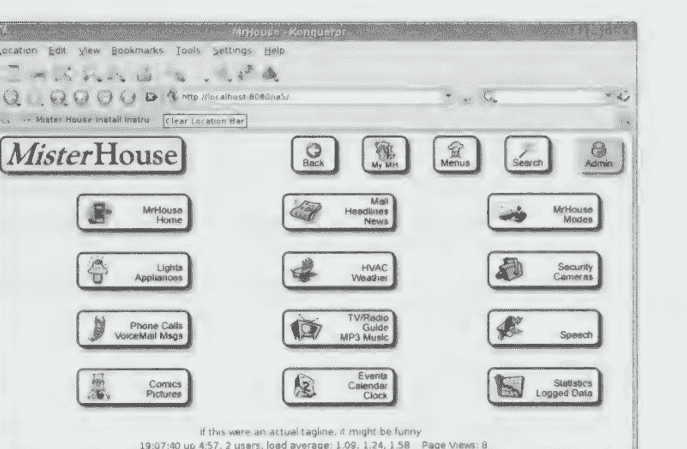

图 1-3：使用 `MisterHouse` 远程控制您的 X10 电器，甚至可以通过互联网控制。

#### 使用 X10 的趣味且实用方法

X10 的用途非常多，仅限于想象力。有关如何开始构建您的家的信息，请查看第 13 章。

X10 的一些实用或仅仅有趣的用途包括：

- 使用 X10 用于大门、门铃。
- 使用 X10 用于安全。
- 使用 X10 用于照明。
- 使用 X10 用于娱乐。
- 使用 X10 用于卧室。
- 使用 X10 用于浴室。
- 使用 X10 用于厨房。
- 使用 X10 用于客厅。
- 使用 X10 用于花园。
- 使用 X10 用于车库。
- 使用 X10 用于地下室。
- 使用 X10 用于阁楼。
- 使用 X10 用于办公室。
- 使用 X10 用于婴儿房。
- 使用 X10 用于客房。
- 使用 X10 用于露台。
- 使用 X10 用于甲板。
- 使用 X10 用于游泳池。
- 使用 X10 用于浴缸。
- 使用 X10 用于壁炉。
- 使用 X10 用于空调。
- 使用 X10 用于加热器。
- 使用 X10 用于风扇。
- 使用 X10 用于百叶窗。
- 使用 X10 用于窗帘。
- 使用 X10 用于遮光帘。
- 使用 X10 用于吊扇。
- 使用 X10 用于空气净化器。
- 使用 X10 用于除湿机。
- 使用 X10 用于吸尘器。
- 使用 X10 用于洗衣机。
- 使用 X10 用于洗碗机。
- 使用 X10 用于烤面包机。
- 使用 X10 用于咖啡机。
- 使用 X10 用于微波炉。
- 使用 X10 用于搅拌机。
- 使用 X10 用于搅拌器。
- 使用 X10 用于慢炸锅。
- 使用 X10 用于电饭煲。
- 使用 X10 用于面包机。
- 使用 X10 用于水龙头。
- 使用 X10 用于制冰机。
- 使用 X10 用于咖啡机。
- 使用 X10 用于葡萄酒冷却器。
- 使用 X10 用于啤酒桶。
- 使用 X10 用于鸡尾酒机。
- 使用 X10 用于智能电视。
- 使用 X10 用于平板电脑。
- 使用 X10 用于电脑。
- 使用 X10 用于打印机。
- 使用 X10 用于扬声器。
- 使用 X10 用于路由器。
- 使用 X10 用于调制调器。
- 使用 X10 用于智能网枢。
- 使用 X10 用于智能助手。
- 使用 X10 用于智能灯。
- 使用 X10 用于智能插座。
- 使用 X10 用于智能扬声器。
- 使用 X10 用于智能摄像头。
- 使用 X10 用于智能锁。
- 使用 X10 用于智能恒温器。
- 使用 X10 用于智能百叶窗。
- 使用 X10 用于智能窗帘。
- 使用 X10 用于智能传感器。
- 使用 X10 用于智能开关。
- 使用 X10 用于智能电器。
- 使用 X10 用于智能烤箱。
- 使用 X10 用于智能冰箱。
- 使用 X10 用于智能冷冻柜。
- 使用 X10 用于智能洗衣机。
- 使用 X10 用于智能烘干机。
- 使用 X10 用于智能烤面包机。
- 使用 X10 用于智能微波炉。
- 使用 X10 用于智能水壶。
- 使用 X10 用于智能搅拌机。
- 使用 X10 用于智能混合器。
- 使用 X10 用于智能烤架。
- 使用 X10 用于智能空气炸锅。
- 使用 X10 用于智能空调。
- 使用 X10 用于智能空气净化器。
- 使用 X10 用于智能除湿机。
- 使用 X10 用于智能吸尘器。
- 使用 X10 用于智能拖地机器人。
- 使用 X10 用于智能割草机。
- 使用 X10 用于智能喷淋器。
- 使用 X10 用于智能泳池泵。
- 使用 X10 用于智能浴缸加热器。
- 使用 X10 用于智能壁炉。
- 使用 X10 用于智能大门。
- 使用 X10 用于智能安全摄像头。
- 使用 X10 用于智能安全探测器。
- 使用 X10 用于智能安全锁。
- 使用 X10 用于智能安全警报器。
- 使用 X10 用于智能安全灯。
- 使用 X10 用于智能安全传感器。
- 使用 X10 用于智能运动传感器。
- 使用 X10 用于智能门传感器。
- 使用 X10 用于智能窗户传感器。
- 使用 X10 用于智能水传感器。
- 使用 X10 用于智能漏水传感器。
- 使用 X10 用于智能烟雾传感器。
- 使用 X10 用于智能温度传感器。
- 使用 X10 用于智能湿度传感器。
- 使用 X10 用于智能光传感器。
- 使用 X10 用于智能光光传感器。
- 使用 X10 用于智能运动探测器。
- 使用 X10 用于智能门探测器。
- 使用 X10 用于智能窗户探测器。
- 使用 X10 用于智能水探测器。
- 使用 X10 用于智能漏水探测器。
- 使用 X10 用于智能烟雾探测器。
- 使用 X10 用于智能温度探测器。
- 使用 X10 用于智能湿度探测器。
- 使用 X10 用于智能光探测器。

X10 产品通常很便宜，您可以在以下地方找到它们：

- 使用 X10 用于家庭自动化。
- 使用 X10 用于智能家居安全。
- 使用 X10 用于智能家居照明。
- 使用 X10 用于智能家居能源。
- 使用 X10 用于智能家居娱乐。
- 使用 X10 用于智能家居舒适。
- 使用 X10 用于智能家居便利。
- 使用 X10 用于智能家居电器。
- 使用 X10 用于智能家居花园。
- 使用 X10 用于智能家居办公室。
- 使用 X10 用于智能家居婴儿房。
- 使用 X10 用于智能家居客房。
- 使用 X10 用于智能家居露台。
- 使用 X10 用于智能家居甲板。
- 使用 X10 用于智能家居游泳池。
- 使用 X10 用于智能家居浴缸加热器。
- 使用 X10 用于智能家居壁炉。
- 使用 X10 用于智能家居大门。
- 使用 X10 用于智能家居安全摄像头。
- 使用 X10 用于智能家居安全探测器。
- 使用 X10 用于智能家居安全锁。
- 使用 X10 用于智能家居安全警报器。
- 使用 X10 用于智能家居安全灯。
- 使用 X10 用于智能家居安全传感器。
- 使用 X10 用于智能家居运动传感器。
- 使用 X10 用于智能家居门传感器。
- 使用 X10 用于智能家居窗户传感器。
- 使用 X10 用于智能家居水传感器。
- 使用 X10 用于智能家居漏水传感器。
- 使用 X10 用于智能家居烟雾传感器。
- 使用 X10 用于智能家居温度传感器。
- 使用 X10 用于智能家居湿度传感器。
- 使用 X10 用于智能家居光探测器。

### 随地无线传输电视和音响信号

这里有一个问题：你喜欢的音乐在电脑上，但你想在休息房里听。或者，你有 MythTV 在电脑上，但你想从沙发上上看。

4. 调整无线视频发送器和接收器的平直天线，使它们相互面对。

它们之间有墙也没关系。只需假装墙不存在即可。

5. 开启你的无线视频发送器和接收器连接的任何设备并尽享吧！

如果信号没有你预期的那么强，尝试调整天线的角度，或更改发送器和接收器的通道号。它们的数字必须相同。

使用无线视频发送器，你可以轻松地将电脑上的 MP3 音乐无线地传输到家中的任何音响或电视上——或者是在池边。无线视频发送器也是一个音频发送器。若要连接你的电脑，以便在任何电视或音响上远程播放你电脑上的音频，请按照以下步骤操作：


- 1. 将视频接收器的白色和红色 RCA 连接器插入任何带有此类设备的音响或电视的 RCA 音频输入（`Audio In`）接口。

如果你需要，可以使用同轴电缆。

- 2. 如果你的电脑有用于音频输出（`Audio Out`）的 RCA 接口，将你的红色和白色 RCA 线缆插入其中；如果它有可以螺接同轴电缆的视频输出卡，请连接一根同轴电缆。然后跳到第 5 步。

- 3. 如果你的电脑没有兼容 RCA 插头或同轴电缆的音频输出接口，请寻找或购买一个带有音频输入和输出接口的音响调音器，并放在电脑附近。

- 4. 购买一端是耳机插头的电缆，将另一端插入电脑的耳机接口，并将两个 RCA 插头插入音响背部的音频输入（`Audio In`）接口。

- 5. 将白色和红色 RCA 线缆插入音响背部的音频输出（`Audio Out`）接口，并将白色和红色 RCA 线缆的另一端插入无线视频发送器。

- 6. 将你的视频发送器和接收器的通道号设置为相同的数字——任何你喜欢的数字——或效果最好的数字。

- 7. 遵循前述章节“从任何电视、音响或 CD 播放器无线发送电视和音响信号”中的第 4 到第 5 步。

Linux 桌面面上有很多界面易用的 MP3 播放器可以使用。`XMMS`、`MPlayer` 或 `Zinf Audio Player` 是其中几个。这些任何播放器都可以与此系统配合。

### 使用 X10 遥控器控制你的 Linux MP3 播放器

你可以通过距离 50–100 英尺（甚至穿墙）的手持遥控器控制在电脑上的 `XMMS` MP3 播放器。这种遥控器被称为 `Anywhere Remote`，可以控制以下：

- 歌曲选择
- 播放/停止/快进/暂停
- 音量/静音
- 平衡

`Anywhere Remote` 是一款通用遥控器，可以实现以下功能：

- 控制你的电视、CD 播放器、DVD、有线盒和卫星接收器。
- 控制距离 50–100 英尺且可穿墙的 X10 模块（如果你配合 `TM751` 或 `RS501` 收发器使用，这些设备可在 `www.x10.com` 购买，价格约 13 美元）。
- 如果你具备以下条件，可以在距离 50–100 英尺且穿墙的情况下远程控制你电脑上的 MP3 播放器：
  - 一台 `TM751` 或 `RS501` 收发器，价格约 13 美元。
  - `XMMS` 音频软件随大多数 Linux 桌面发行版一起，如图1-4 所示。
  - 能够发送和接收 X10 信号的电脑。参考“使用 Linux 软件控制 X10 模块”部分。
  - 一个名为 `x10mp3` 的程序。

`x10mp3` 是一款运行在 Linux 中的免费软件，可以在 `http://x10mp3.sourceforge.net` 下载。该软件是 Windows 程序 `Boom 2000` 的 Linux 版本，该程序用于控制 `Anywhere Remote`。

如果你拥有以下设备，可以使用无线视频发送器在距离 50–100 英尺且穿墙的情况下远程控制你电脑上的 MP3 播放器：

- 一台 `TM751` 或 `RS501` 收发器，价格约 13 美元。
- `XMMS` 音频软件随大多数 Linux 桌面发行版一起，如图1-4 所示。
- 能够发送和接收 X10 信号的电脑。参考“使用 Linux 软件控制 X10 模块”部分。
- 一个名为 `x10mp3` 的程序。

`x10mp3` 是一款运行在 Linux 中的免费软件，可以在 `http://x10mp3.sourceforge.net` 下载。该软件是 Windows 程序 `Boom 2000` 的 Linux 版本，该程序用于控制 `Anywhere Remote`。

当你使用无线视频发送器时，可以在距离 50–100 英尺且穿墙的情况下远程控制你电脑上的 MP3 播放器。这种无线视频发送器也可以在 `ebay.com` 找到 `Anywhere Remote`，价格约 10 美元。

如果你拥有以下设备，可以使用无线视频发送器在任何电视或音响上远程播放你的音乐：

- 一台 `TM751` 或 `RS501` 收发器，价格约 13 美元。
- `XMMS` 音频软件随大多数 Linux 桌面发行版一起，如图1-4 所示。
- 能够发送和接收 X10 信号的电脑。参考“使用 Linux 软件控制 X10 模块”部分。
- 一个名为 `x10mp3` 的程序。

`x10mp3` 是一款运行在 Linux 中的免费软件，可以在 `http://x10mp3.sourceforge.net` 下载。该软件是 Windows 程序 `Boom 2000` 的 Linux 版本，该程序用于控制 `Anywhere Remote`。

当你使用无线视频发送器时，可以在距离 50–100 英尺且穿墙的情况下远程控制你电脑上的 MP3 播放器。这种无线视频发送器也可以在 `ebay.com` 找到 `Anywhere Remote`，价格约 10 美元。

如果你拥有以下设备，可以使用无线视频发送器在任何电视或音响上远程播放你的音乐：

- 一台 `TM751` 或 `RS501` 收发器，价格约 13 美元。
- `XMMS` 音频软件随大多数 Linux 桌面发行版一起，如图1-4 所示。
- 能够发送和接收 X10 信号的电脑。参考“使用 Linux 软件控制 X10 模块”部分。

图 1-4：

| | | | |
|---|---|---|---|
| 1. | | 42 |
| 2. | | 02 |
| 3. | | 32 |
| 4. | | 00 |
| 5. | | 30 |
| 6. | | 00 |
| 7. | | 30 |
| 8. | | 00 |
| 9. | | 15 |
| 10. | | 00 |
| 11. | | 30 |
| 12. | | 00 |
| 13. | | 27 |
| 14. | | 52 |
| 15. | | 19 |

如果你想在电视上查看视频，可以使用无线视频发送器。这种无线视频发送器也可以在 `ebay.com` 找到 `Anywhere Remote`，价格约 10 美元。

如果你拥有以下设备，可以使用无线视频发送器在任何电视或音响上远程播放你的音乐：

- 一台 `TM751` 或 `RS501` 收发器，价格约 13 美元。
- `XMMS` 音频软件随大多数 Linux 桌面发行版一起，如图1-4 所示。

查看天气状况。

如果你想在电视上查看视频，可以使用无线视频发送器。这种无线视频发送器也可以在 `ebay.com` 找到 `Anywhere Remote`，价格约 10 美元。

如果你拥有以下设备，可以使用无线视频发送器在任何电视或音响上远程播放你的音乐：

- 一台 `TM751` 或 `RS501` 收发器，价格约 13 美元。
- `XMMS` 音频软件随大多数 Linux 桌面发行版一起，如图1-4 所示。

查看天气状况。

如果你想在电视上查看视频，可以使用无线视频发送器。这种无线视频发送器也可以在 `ebay.com` 找到 `Anywhere Remote`，价格约 10 美元。

如果你拥有以下设备，可以使用无线视频发送器在任何电视或音响上远程播放你的音乐：

- 一台 `TM751` 或 `RS501` 收发器，价格约 13 美元。
- `XMMS` 音频软件随大多数 Linux 桌面发行版一起，如图1-4 所示。

查看天气状况。

如果你想在电视上查看视频，可以使用无线视频发送器。这种无线视频发送器也可以在 `ebay.com` 找到 `Anywhere Remote`，价格约 10 美元。

如果你拥有以下设备，可以使用无线视频发送器在任何电视或音响上远程播放你的音乐：

- 一台 `TM751` 或 `RS501` 收发器，价格约 13 美元。
- `XMMS` 音频软件随大多数 Linux 桌面发行版一起，如图1-4 所示。

查看天气状况。

如果你想在电视上查看视频，可以使用无线视频发送器。这种无线视频发送器也可以在 `ebay.com` 找到 `Anywhere Remote`，价格约 10 美元。

如果你拥有以下设备，可以使用无线视频发送器在任何电视或音响上远程播放你的音乐：

- 一台 `TM751` 或 `RS501` 收发器，价格约 13 美元。
- `XMMS` 音频软件随大多数 Linux 桌面发行版一起，如图1-4 所示。

查看天气状况。

如果你想在电视上查看视频，可以使用无线视频发送器。这种无线视频发送器也可以在 `ebay.com` 找到 `Anywhere Remote`，价格约 10 美元。

如果你拥有以下设备，可以使用无线视频发送器在任何电视或音响上远程播放你的音乐：

- 一台 `TM751` 或 `RS501` 收发器，价格约 13 美元。
- `XMMS` 音频软件随大多数 Linux 桌面发行版一起，如图1-4 所示。

查看天气状况。

如果你想在电视上查看视频，可以使用无线视频发送器。这种无线视频发送器也可以在 `ebay.com` 找到 `Anywhere Remote`，价格约 10 美元。

如果你拥有以下设备，可以使用无线视频发送器在任何电视或音响上远程播放你的音乐：

- 一台 `TM751` 或 `RS501` 收发器，价格约 13 美元。
- `XMMS` 音频软件随大多数 Linux 桌面发行版一起，如图1-4 所示。

查看天气状况。

如果你想在电视上查看视频，可以使用无线视频发送器。这种无线视频发送器也可以在 `ebay.com` 找到 `Anywhere Remote`，价格约 10 美元。

如果你拥有以下设备，可以使用无线视频发送器在任何电视或音响上远程播放你的音乐：

- 一台 `TM751` 或 `RS501` 收发器，价格约 13 美元。
- `XMMS` 音频软件随大多数 Linux 桌面发行版一起，如图1-4 所示。

查看天气状况。

## 第一章：探索家庭自动化可能性

天气站的尺寸和价格范围很大。大约 25 美元，你可以获得一个显示室内外温度的设备。大约 50 到 100 美元，你可以获得一个无线连接设备。这些天气站自带每分钟更新一次的显示器。寻找天气站的好地方是 `weatherbarn`。

如果你想通过温度、风速、风向、湿度、气压、降雨、风寒等传感器读取户外的天气状况，你可以购买这种天气站约为 200 到 500 美元。将天气站连接到电脑还可以让你共享和处理天气数据。有关安装自己的天气站的更多信息，请参见第 10 章。

### 从互联网获取天气报告

获取天气信息的另一种方法是让电脑从互联网自动收集信息。这允许你即时访问以下：

- 你地区的当前天气
- 你指定的任何其他区域的当前天气，如果你想跟踪全国或全球的家人，这可能很有用
- 未来几天的天气预报
- 强风暴警报

获取最新和持续天气信息的四种流行方式如下：

- 在你的 Linux 桌面安装并使用应用程序：这是一个运行在桌面上的微型应用程序，它可以告诉你温度、风速和方向，并使用代表一般天气状况的图标。如果你双击应用程序，会弹出一个显示更多信息的窗口，如图 1-5 所示。
- 为 `Firefox` Web 浏览器安装扩展程序，自动为你提供最新和未来的天气信息：如果你是经常上网的用户，在浏览器上查看天气可能是很有用的。你可以看到代表当前和未来天气的图标，以及你区域的多普勒雷达弹出屏以及强风暴图标。知道何时预计会有强风暴是一个极其实用的功能——特别是如果你住在移动房屋中。
- 从 `MythWeather` 获取天气更新：`MythTV` 的主要功能是满足你对个人录像机（`PVR`）的需求，但 `MythTV` 还有一个名为 `MythWeather` 的程序，你可以用它获取当前天气和长期预报。通过 `MythTV` 菜单中选择“天气”选项访问 `MythWeather`：更多信息请参阅第6章和第11章。
- 使用 `Stormiren` 通过电子邮件或手机/寻真机短信接收风暴报警：此程序会自动检查国家气象局关于你指定的县或多个县的风暴信息。如果存在严重天气警报，它会向你发送电子邮件并向手机或寻真机发送即时消息。有关 `Stormiren` 的更多信息，请访问其首页 `http://storms.net`。

## 创建复杂的电话系统

复杂的电话系统，比如企业使用的可以自动路由电话的系统，现在可以在家里使用了！这些系统的安装费用通常约为400美元，但一个需要这种系统而又没有钱购买的程序员可以自己创建一个。

## 探索家的可能性

他将其作为一个名为 `Asterisk` 的开源程序提供给他人，从那时起已有300多名程序员对其做出了贡献。`Asterisk` 是企业最好的电话系统之一，由于它需要精通 Linux 的人员来安装，因此又创建了一个基于 `Asterisk` 的系统供家庭使用：`Asterisk@Home`。

`Asterisk@Home` 具有以下功能：

- 数字接线员，自动路由电话。例如，可以将电话转接到你的手机或你孩子的手机上。
- 等待呼叫并播放音乐。
- 转发电话。
- 带有 Web 访问功能的语音邮件。

在家里运行 `Asterisk` 需要以下物品：

- 专用计算机（旧硬件也可以）。
- 宽带连接——越快越好。
- `VoIP`（IP语音）线路，通过互联网工作，每月费用约为10美元，但大多数价格在100美元以上。

`Asterisk` 还可以配合 `MythHouse` 使用，`MythHouse` 是一种控制 X10 模块等内容的免费软件应用程序。有关运行 `Asterisk` 的更多信息，请参阅第9章。

## 利用 Linux 优势

Linux 处于家庭自动化的前沿。使用 Linux 让你能够：

- 省钱：大多数 Linux 软件免费使用、免费分发、免费修改，甚至可以免费出售。
- 接触家庭自动化的前沿：例如，`Asterisk` 是企业可用的顶级电话系统之一。`MythHouse` 提供了任何专有软件都不具备的功能。此外，`MythTV` 让你可以建立免费且功能丰富的类 `TiVo` 系统。
- 探索各种可能性：存在许多家庭自动化软件，但你无法在不付费的情况下尝试专有软件，这限制了你对它的探索。有了 Linux，你可以探索任何你想探索的内容而无需担心财务压力。
- 为自由软件的增长做贡献：你可以通过编写新功能（如果你是程序员）、在论坛上帮助新手、建议新功能等，为改进家庭自动化领域做出贡献。

在通用公共许可许可证（`GPL`）等流行许可证下发布的 Linux 软件，其源代码可供任何人改进和添加功能。通过这种方式，它可以由专业人士和业余爱好者共同推动进步。世界各地程序员添加的新功能使软件的增长就像由一个商业计划设计并由带薪程序员每天投入工作的一样高效。此外，它的设置和维护成本仅是类似的专有软件成本的一小部分。

对某些人来说，Linux 是一种爱好，但它也可以是一份职业。精明的创业者有很多许多赚钱的机会。以下只是几种可能性：

- 为客户搭建 `Asterisk` 电话系统
- 创建可通过互联网访问的家庭监控系统
- 为客户提供高性能视频流服务

Linux 软件提供了广泛的家庭自动化可能性，这些可能性正变得非常强大，并在许多领域应用。

由于源代码免费可用，世界各地的程序员会迅速修复程序中的漏洞。这通常使得自由软件比专有软件更健壮。此外，它更容易受到病毒和其他恶意软件的影响，因为 Linux 的灵感来自 `UNIX` 操作系统， `UNIX` 自古以来就内置了安全性，而不是在系统建立后才添加的。

使用 Linux 进行家庭自动化可能需要你具备更多知识，但从长期来看，会更加令人满意且回报。

## 第2章 用 Linux 软件填充你的家庭自动化工具箱

在本章中

- 让旧硬件在新软件上发挥作用
- 检查最好的基于 Linux 的智能家居软件
- 从命令行控制软件
- 使用图形用户界面装饰软件

大量的免费 Linux 软件适用于家庭自动化的各个方面。在本章中，我将指出一些你可以用来将房子变成真正智能家居的极佳软件，并告诉你在去哪里获取这些软件。

## 在旧硬件上使用新软件

Linux 的一个伟大特性是，你可以选择你需要的的部分并根据你的需求进行塑造。如果你还没有选择要运行的简单任务，你可能会发现可以使用精简或轻量级的 Linux 版本（例如 `Damn Small Linux`），这样你地下室的旧电脑就有足够的性能来完成工作。通过这种方式，你可以让那些毫无用的电脑焕发新生。是时候重启它们了。

## 选择 Linux 发行版

本章介绍的软件适用于许多发行版。如果你还没有选择要使用的 Linux 版本，这里是一些不错的选择：

- `Ubuntu` (`ubuntu.com`)：`Ubuntu` 是目前流行的发行版之一。与其他列出的类似，`Ubuntu` 提供免费下载，并有一个你可以咨询的大社区。`Ubuntu` 每六月发布新版本。
- `Gentoo` (`gentoo.org`)：`Gentoo` 是一个基于源码的发行版，这意味着不是简单地安装预编译的二进制代码，而是从源码编译每一个部分。你的计算机可能需要长时间，但这个过程让你对 Linux 环境有更多的控制权。
- `Fedora Core` (`fedora.redhat.com`)：`Fedora Core` 是一个广泛使用的、经过测试发行，由著名的 Linux 公司之一 `Red Hat` 赞助。`Fedora Core` 提供了稳定与前沿软件的有趣混合。
- `SUSE Linux` (`opensuse.org`)：`SUSE Linux` 是一种高质量的 Linux 发行版，起源于德国，现在由 `Novell` 赞助。`SUSE Linux` 以其完善、对细节的关注以及易于使用的 `YaST` 配置工具而闻名。

## 寻找基于 Linux 的家居自动化软件

目前有很多免费的基于 Linux 的家居自动化软件包，这非常棒，但由于可用软件在完成程度和实用性上各不相同，挑选出你需要的可能具有挑战性。此外，家居自动化领域是一个包含多种功能的大世界，包括以下软件软件包：

- 对灯光、家电等设备的自动化设备控制。
- 自动化数字视频录制和流媒体。
- 运动检测。
- 远程控制。
- 天气数据测量和恒温器控制。


- 智能电话系统
- 用于家庭安全和视频会议的摄像头

涵盖的内容很多，但如果你知道如何选择，将它们整合在一起并不困难。因此，我在这里为你提供一些最佳软件选择建议以及快速入门的技巧。在书的其余部分，我将向你详细介绍如何设置、配置和自定义所有内容以满足你的喜好。

## 关于 X10

X10 是一种标准，它利用家中的电线来通信并控制灯光、家电器和其他兼容设备。X10 信号是短的射频脉冲，代表数字信息并传输在你的电源线上。由于 X10 使用现有的电力，你不需要为家设备重新布线即可实现设备自动化——你只需将 X10 模块插入现有的插座，然后将你的灯具、家电或其他设备插入 X10 模块即可。

X10 设备有多种类型。目前 Linux 支持最广泛的是：

- CM11A：CM11A 由 X10 Ltd. (www.x10.com) 制造。该公司销售 CM11A 作为其 ActiveHome 套件的一部分（但不包括 ActiveHome Pro 套件）。CM11A 也作为 IBM Home Director 销售。因此，用于 CM11A 的软件与 ActiveHome 和 Home Director 设备兼容，并与英国版的 CM11A（称为 CM12U）兼容。你电脑上的串口通过串口线连接到 CM1A 设备，该设备插入墙上插座并通过你的家庭电源线控制其他 X10 设备。
- CM17A：这个小型 X10 计算机接口的大小大约相当于无花饼干（Fig Newton）。它也被称为 X10 Firecracker。它将射频（RF）信号从你电脑的串口传输到无线接收器，通过你的家庭电源线控制你的 X10 设备。Firecracker 可从 www.x10.com 获取。

你有许多免费的 Linux 软件包可以自动化控制家中的 X10 设备。在接下来的章节中，我列出了一些流行且成熟的软件包。使用这些软件包时，自定义编程代码有时是有用的，因此我也列出了编写这些程序的计算机语言。

## 用于 ActiveHome、HomeDirector 和 Firecracker 设备的软件

如果你开始尝试家居自动化，可能想购买 ActiveHome 套件或 HomeDirector 套件，其中包含 CM11A 设备，它可以让你的电脑发送和接收 X10 信号。或者你可能想使用 Firecracker 设备，它可以让你的电脑像 X10 遥控器一样工作。Firecracker 设备和 ActiveHome 套件都可以在 www.x10.com 获取。（在网站上搜索 Firecracker 或 ActiveHome kit。）你可能可以在 eBay 上找到 HomeDirector。有很多程序可以与 CM11A 和 CM17A 接口。MisterHouse 可能是最令人惊的，正如我在这里演示的那样。更多关于 MisterHouse 的信息，请参阅第 15 章和第 16 章。

在 www.x10.com 销售的新 ActiveHome 入门套件使用 CM15A，目前没有针对它的 Linux 兼容软件。

## MisterHouse

MisterHouse (http://misterhouse.sourceforge.net) 是一个非常全面的家居自动化程序。它具有良好的 Web 界面，如图 2-1 所示，你可以从任何 Web 浏览器对其进行控制和监控。MisterHouse 是一个有趣的程序，可以以下功能：

- 根据你的语音输入向 X10 设备发送命令。（是的，你可以对着电脑说话来打开百叶窗、浇草坪、开关灯、开关音响或电视、运行你的 VCR、下载股票报价等许多功能。你对它说话，它就能理解，并执行你设置的任何响应功能。）
- 响应来自 X10 传感器的输入，例如运动传感器或温度传感器。
- 作为定时器（和日历）工作，在适当的时间发送 X10 指令来开关 X10 设备。
- 使用免费的文本转语音软件进行公告。
- 使用 IBM 免费的 ViaVoice 识别引擎响应语音命令。
- 自动读写电子邮件和 Web 页面。
- 通过 AIM、MSN 或 Jabber 发送和接收即时消息。
- 读写 Web 页面向你显示即将进行的节目。
- 控制你的 VCR、X10 机器人等。

MisterHouse 使用 Perl 语言编写，如果你想进行自定义，这非常容易。

## Project WISH 和 x10Web

Project WISH (http://wish.sourceforge.net) 为 X10 协议实现通用驱动程序，目前支持 CM11A、Firecracker 以及其他一些设备。这种方法的优势是，你可以使用带有连接收发器的单一应用程序。

Project WISH 有两个版本：

- x10dev（版本 1.X），适用于 Linux 内核 2.4 的驱动程序。
- x10dev-2（版本 2.X），适用于 Linux 2.6+ 的驱动程序。该版本适用于较新的内核，但可能包含 bug。

Project WISH 驱动程序用 C 语言编写。如图 2-2 所示，Project WISH 可以与其 x10Web 软件包一起使用，该软件包在浏览器中为你提供三个图形界面（GUI）：两个用于部署你的家庭网络，另一个根据其收集的温度数据显示温度报告。

## Heyu

Heyu (heyu.org) 是一个基于命令的程序，你可以用它控制灯光和电器。它用 C 语言编写。你可以使用 Heyu 将事件计划和宏存储在 CM11A 的内存中，它在连接到设备时可以执行这些。在第 13 章中，你将使用 Heyu 构建一个入门 X10 套件。

## BlueLava

BlueLava (www.sgtwilko.f9.co.uk/blueava) 是用 Perl 编写的 CGI 脚本，让你通过 Web 页面控制你的 X10 设备，如图 2-3 所示。该脚本作为多个命令行程序的前端，包括 Heyu、BottleRocket、Flit 和 Project WISH。

## 第一章：用 Linux 软件填充你的家庭自动化工具箱

## BottleRocket

BottleRocket (www.linuxa.com/bottlerocket) 是一个用于 Firecracker 设备的命令行界面，用 C 语言编写。如果你愿意，可以使用 BlueLava、WMX10 或 CGI-x10 作为 BottleRocket 的基于 Web 的前端。

## CGI-x10

CGI-x10 (http://bubba.org/?option=cgi-x10) 是 BottleRocket 的 CGI 接口。它用 Perl 语言编写。图 2-4 显示了它创建的 Web 界面。

图 2-4：CGI-x10 为 BottleRocket 软件提供了简单的 Web 界面，使其易控制 Firecracker 设备。

## Flipit

Flipit (www.lickey.com/flipit) 是一个基于命令行的控制 Firecracker 设备的简单程序。它用 C 语言编写。如果你不想从命令行运行 Flipit，可以使用 BlueLava 作为 Flipit 的网页前端。

## TK10

TK10 (http://mywebpages.comcast.net/jfilerunner/tk10.html) 是 BottleRocket 的图形用户界面前端，如图 2-5 所示。它看起来像是 www.x10.com 的 Firecracker 套件中的 HR12A 控制器。TK10 用 Tcl/Tk 编写。

## wm10

wm10 (www.cs.uml.edu/~jhawkins/wm10) 是一个 WindowMaker/AfterStep 应用。它是一个非常小的程序，运行在桌面缩略图大小的窗口中，允许你通过 BottleRocket 控制 X10 模块。对于命令行程序 BottleRocket 来说，这是一个很好的图形界面。（WindowMaker 和 AfterStep 是许多 Linux 发行版中常见的窗口管理器。）wm10 用 C 语言编写。

## 家庭网络

你的家庭电脑对家庭自动化至关重要，因为如果你使用正确的软件配置网络，你的整个网络就会变成类似巨大的计算机，家里任何一台电脑都可以访问所有电脑的资源。然后你可以快速地将文件传输到任何电脑，从任何电脑上网，从家中的任何电脑流媒体媒体到任何其他电脑，远程控制连接到电脑的设备等。GNU Zebra 是将你的家庭网络变为自动化动力源的良好选择。

## GNU Zebra

GNU Zebra (www.zebra.org) 是一种用于在计算机网络上路由信息的免费、高性能软件。它以比传统网络软件更快的路由数据包。它还高度模块化，为每个路由协议使用独立的进程。这使得维护和升级变得非常容易，每个协议都可以单独升级，而其他协议和路由器仍保持在线。GNU Zebra 用 C 语言编写。有关如何使用 GNU Zebra 将你的计算机网络转换为高速运行的设备的信息，请参阅第 5 章。

## Quagga

Quagga (www.quagga.net/about.php) 是 GNU Zebra 的分支。一些开发者想要通过自己的开发团队来并改进 GNU Zebra，而不是与 GNU Zebra 的开发团队合作。目前，Quagga 与 GNU Zebra 几乎相同，尽管这在未来可能会发生变化。

## 数字视频录制机和媒体中心

通过正确的软件，你可以将一台或多台家庭电脑变成像 TiVo 那样的数字视频录制机。免费软件包 MythTV 是此的良好选择。在第 6 章中，我们将向你展示如何使用 MythTV 构建自己的视频录制机。

## MythTV

MythTV (www.mythtv.org) 是一个免费的 Linux 软件包，允许你在家庭网络上的多台电脑上录制和播放电视节目。通过 MythTV，你可以执行操作：

- 暂停、快进和倒回“直播”电视。
- 自动检测并跳过广告。
- 播放 DVD。
- 提取、分类和播放音频文件。（提取音频文件是将数据从一种格式复制到另一种格式，例如从 CD 音频文件复制到 MP3 文件。）
- 读取 RSS 新闻馈送。
- 随时查看天气信息。
- 以及更多等等……

MythTV 还提供一个电子节目指南，用于切换频道和选择你想要录制的节目。

MythTV 用 C++ 编程语言编写。

## KnoppMyth

请注意，默认安装过程会重新划分你的硬盘，擦除其中的所有内容。请务必先备份任何你需要保留的内容。

## 运动检测

你可以使用一个或多个摄像头配合运动检测软件来检测，例如每当有人进入你家时。你可以设置将这些数据发送 MisterHouse 等程序，在每次此类发生时自动通知你。

Motion (www.lavrsen.dk) 是一个监控一个或多个摄像头并检测运动的软件包。例如，通过 Motion，你可以流视频。Motion 用 C 语言编写。

## 远程控制

你可以使用 Linux 软件通过红外控制你的电脑。LIRC (www.lirc.org) 代表 Linux Remote Control；它是一组解码红外信号的 Linux 软件包。

## 智能电话系统

使用 Asterisk 等免费软件，你可以将你的家庭电话变为智能电话系统，具备来电显示、呼叫转移等功能。你甚至可以让人等候并让他们听音乐！

## Asterisk

Asterisk (www.asterisk.org) 是一种具有许多功能的 PBX 软件，包括语音邮箱、电话会议、呼叫队列、三方通话、来 ID 服务等。（PBX 是私有分支交换，一种允许分机之间以及与外部连接的私人电话交换机。）Asterisk 用 C 语言编写。有关将 Asterisk 作为自动化系统部分的更多信息，请参阅第 9 章。

## Asterisk@Home

Asterisk@Home (http://asteriskathome.sourceforge.net) 是一个旨在让家庭用户通过基于 Web 的图形界面轻松设置和运行 Asterisk PBX 的项目。它为你提供了 FreePBX，这是一个基于 Web 的图形界面，让你无需编辑配置文件即可配置 Asterisk。

## 天气

你可以使用免费的 Linux 软件建立自己的家庭气象站，成为你所在社区的气象学家。

One-wire weather (Oww; http://oww.sourceforge.net) 是 Dallas Semiconductor 1-Wire 天气站的 Linux 接口。（1Wire 是 Dallas Semiconductor 设计的一种低成本计算机系统。）通过家庭气象站和 One-wire weather，你可以监控、记录和传输风速、风向、温度、降水、湿度、压力和其他天气数据。它通过单线传输电源和低速数据。该软件用 C 语言编写。

## 摄像头、家庭安全和视频会议

通过此软件，你可以设置摄像头监控家中的房间或用于视频会议——让你的家更安全，开展业务等。

## CamStream

CamStream (www.smcc.demon.nl/camstream) 让你能够在 Web 页面中查看摄像头或在局域网中 ftp 传输。你可以从单个摄像头或多个摄像头流图像。

## Ekiga

Ekiga (www.ekiga.org)，原名为 GnomeMeeting，是一款免费的 Linux 软件，它让你能够通过互联网进行免费的视频通话和语音通话。它也可以通过少量费用拨打普通电话。Ekiga 是一个精良且经过验证的程序，而且易于使用。它有一个配置向导（Configuration Druid，类似于向导），可以引导你逐步完成设置，并让你毫不费力地开始使用（希望如此）。关于 Ekiga 的更多信息，请参阅第 8 章。

## 寻找更多软件

市面上还有很多其他的 Linux 家庭自动化软件。关于各种用于家庭自动化的 Linux 软件详细列表，请访问我的 Linux 自动化自动化页面：www.linuxha.com/athome/index.html#Software。

## 使用低级软件处理繁琐工作

我在这里讨论的一些软件（例如 Heyu）是没有任何花哨功能的，没有图形界面，并在终端窗口的命令行中运行。如果这对你来说像听天书一样，其实它并没有听起来那么糟糕。你可能习惯了运行那些带有窗口和菜单、并通过电脑鼠标控制的程序。终端窗口是一个模拟在窗口、菜单和鼠标出现之前的旧式基于文本的计算机的程序。通常你可以从菜单中选择来打开终端。例如，如果你正在运行带有 KDE 桌面环境的 Linux，你可以通过选择 KDE:System:Terminal (Console) 来调出一个终端窗口。然后会出现一个窗口，你可以在其中输入命令。你在窗口中输入命令的当前位置被称为命令行。例如，如果你已经在电脑上安装了 Heyu，在终端窗口的命令行中，你可能会输入：

```bash
heyu on al1
```

这将运行带有参数 `on` 和 `al1` 的程序 Heyu，从而让 Heyu 开启位于位置 `al1` 的设备。

要运行我在这里讨论的一些软件，你可能需要通过在终端窗口执行某些命令来从源代码进行编译。计算机程序的源代码是计算机程序员编写的一系列指令，用于指导计算机执行某些操作。这组指令通过一个称为编译器的特殊程序转换为可以直接控制计算机硬件的数字代码。这些数字代码被称为对象代码。因此，为了将程序的源代码编译成对象代码，然后将程序安装到你的计算机并形成可以运行的形式，你可能需要在终端窗口中输入一系列命令，例如如下：

```bash
./configure
make
make install
```

请注意，对于特定的程序你可能需要输入不同的内容，但通常情况下，你会在随附自带的标记为 `README`、`INSTALL` 或类似文件的文件中找到编译程序的指令。然后计算机将逐行处理这些源代码并将其编译成对象代码。当完成这一切后，你就应该能够运行你的程序了。

## 为粗糙的工作进行修饰

从命令行运行程序可能像驾驶一辆带手动挡位的汽车一样。你可以这样做，但这很费力。如果这不能吸引你，通常我在这里讨论的命令行驱动程序可以使用图形用户界面（或 GUI）进行“修饰”，使它们变得更易用。例如，你可以通过 MisterHouse 提供的网页界面控制 Heyu。你可以使用 x10Web 提供的两个图形界面之一来控制 Project WISH。你可以使用 BlueLava 作为 Heyu、BottleRocket、Flipit 或 Project WiSH 的 GUI。你可以使用 Asterisk@Home 通过 FreePBX 网页界面对 Asterisk 进行装饰，以此类推。在某些情况下，直接从命令行发布命令可能更简单，但通常情况下，从其中一个 GUI 控制一切要容易得多。

## 第二部分：无电线连接多台计算机

## Rich Tennant 著：《第五波》

> “就是这样！我们要为家里安装无线网络了。”

## 在这一部分中...

你可以尽情享受的同时也摆脱线缆！在第二部分中，你将发现关于构建无需接线的网络设置的所有知识。你将了解到无线网卡，以及让智能家居无线化的所需的程序和 Linux 无线支持工具。我将向你如何添加无线接入点，我甚至讨论如何为你的网络添加动态路由。

## 第三章

## 无线化

## 本章内容

- 介绍无线网络
- 开始使用 NdisWrapper
- 编译自定义内核
- 了解 WPA-Supplicant

无线网络非常流行，这并非毫无理由：它让与计算机的工作变得简单。通过无线网络，你可以构建一个高速网络设置，让你能够自由移动。在公司，我有一套无线设置（室内和室外），并随身携带工作。在家里办公时，我不再受困于办公室。我可以在家里或后院走动并继续工作。我仍然有各种必须连线到局域网的计算机。然而，对于我想移动的计算机，或者当我把计算机放在没有 LAN 布线的地方时，无线效果非常好。

我在本章开头介绍了无线网络的基础知识。然后我将向你如何选择网卡、升级你的 Linux 内核、安装无线驱动程序，以及配置和安全你的无线网络适配器（NIC）。

## 无线网络基础 101

做出无线决策的起点是收集一些物品。（不要急着购买，仅仅因为这样不方便。了解无线网卡和 Linux 不需要它。）是你需要的通用列表：


- **无线接入点 (WAP)：** WAP 是你网络的中心。（参见图 3-1 常见的网络设置。）它将有线网络连接到无线网络。大多数 WAP 有许多其他有用功能，例如网络共享和安全性。网络共享功能允许多台计算机通过 ISP 提供的单一 IP 地址访问互联网。有很多无线供应商，你在购买前需要做研究。

图 3-1：网络图。

`Linksys WRT54GL` 是我在第四章中使用的路由器（V1 到 V4，不是 V5 或 GC）。Linux 社区在扩展原始开源代码以提供强大的路由器功能方面做得非常出色。其他供应商提供型号，但我在这里不介绍它们（尽管有一些）。在购买 WAP 之前，请查看该章节，其中包含了对各种版本的警告，以及关于 WAP 是什么以及它能为你做什么的讨论。

- **每台连接的计算机所需的无线网络适配器 (NIC)**：我推荐四种类型的卡：PCMCIA 卡、mini-PCI 卡、USB 卡和 PCI 卡。详细信息请参见下一节“无线硬件组件”。

- **每种网卡相应的驱动程序：** 如果你能够为你的网卡找到原生驱动程序（为 Linux 编写的），那么我建议你使用它。（我不涵盖原生驱动。）如果你找不到原生驱动，请使用 `NdisWrapper`；它在其他方法都失效时提供更好的性能和支持。

- **你正在连接的计算机：** 这是不言而喻的。我将在下一节中进一步介绍计算机。

## 有线与无线网络的比较

有线网络是设置家庭网络的简单方法。通常，如果配置得当，它是相对安全的。我的网络是有线和无线设备的混合。对于固定在一个地方的硬件（如我的电视、台式机和服务器）使用电缆连接。我的笔记本电脑让移动变得更容易。我不再受困于办公室。我可以在外面享受好天气的同时继续工作。无线让移动变得更容易。对于大型网络，有线和无线计算机的混合是可以接受的。对于小型家庭网络，无线应该是足够了。

## 无线网络标准：802.11

好了，你已经有了电脑，确定了要用哪一台，现在是时候选择无线标准（你的网卡所支持的那种）了。在商店里，你会看到很多包装精美的盒子，上面写着可爱的术语（极客行话）。通常，制造商会说明该设备支持的无线网络标准。你只需要确保购买的所有网络硬件至少支持同一种标准即可。无线标准定义了所使用的协议、信息传输速度、使用的频率、通道数量等。你不需要了解所有细节，因为我会帮你缩小到仅一种选择。目前有四个值得关注的标准，它们是：

- 802.11a, 54 Mbps：企业主要使用的标准。
- 802.11b, 11 Mbps：这是较旧的标准。
- 802.11g, 54 Mbps：当前标准。
- 802.11n, 108 Mbps：正在开发的最新标准。

速度（Mbps，每秒兆比特）是理论最大速度。“n”标准尚未完善。大多数供应商都在推销 pre-n 设备，我还没有看到很多可选的卡。为了增加趣味性，还有带有单线和多天线的无线接入点（WAP）。多天线设置为 MIMO（多入多出）。我有一个天线的 pre-n WAP（运行 `OpenWrt` 的 `Netgear WGT634U`），但大多数新-n WAP 都拥有 MIMO。

这部分的难点在于，我在你阅读这本书之前就写好了它。此时，802.11g 标准是最流行的。大多数“g”设备也支持“b”标准。如果无线设备——支持 802.11b 和 802.11g 的 WAP 和网卡（有时写作 802.11b/g）——遇到仅支持 802.11b 的设备和 802.11b/g 设备的混合，所有人都会降级到较慢的 802.11b 标准。如果你邻居有旧设备且近到能被你的设备发现，这会很头疼。802.11n 标准可能解决这个问题，但我不确定。大多数供应商将提供其 802.11n 设备与 802.11g 及 802.11b 设备的兼容性。在本章的剩余部分，我将介绍我拥有的 802.11g 设备，它是目前定义的标准。

## Linux 无线支持

Linux 的无线支持非常混乱，但正在改进。当你想要在 Windows 下构建无线网络时，你购买一个网卡，它附带驱动程序。然而，你不会在 CD 上找到任何开源的 Linux 驱动。这是因为网卡供应商与芯片制造商签署了保密协议，这意味着源代码必须保持封闭（专有）。一段时间以来，许多人归咎于芯片制造商，声称他们不会与开源软件（OSS）社区共享芯片信息。

这个问题似乎是联邦通信委员会（FCC，通信监管机构之一）规则之一的副作用。该规则基本上规定用户不能修改软件定义无线电设备的功率设置。如果所有的芯片信息都发布出来，该设置将是用户可以修改的。

那么这让你处于什么境地？嗯，OSS 社区是一群很棒的伙伴，社区通过逆向工程分析了驱动的操作。似乎某些制造商也很有办法。他们已经想出了遵守法律的同时仍帮助 OSS 社区的方法。针对几种芯片组，有许多 OSS 驱动；有一家销售驱动的软件供应商；还有一个 `NdisWrapper` 包，它通过 Windows 驱动程序涵盖了其他一些网卡以与 Linux 内核建立接口。这太棒了！

所以你现在在这里，准备选择一个芯片组和网卡。或者，芯片组和网卡可能已经为你选好了。这发生在你有一台想在 Linux 下使用的 Windows 机器时（你已经购买了用于 Windows 的 IC）。你的选择有：

- `Linuxant` (www.linux.com)：销售许多芯片组的商业驱动程序。
- `Linux-wireless` (www.linux.org)：对网卡的支持。

## Linux、网卡和芯片组

所以为什么 Linux 支持？嗯，OSS 社区是一群很棒的伙伴，社区通过逆向工程分析了驱动的操作。似乎某些制造商也很有办法。他们已经想出了遵守法律的同时仍帮助 OSS 社区的方法。针对几种芯片组，有许多 OSS 驱动；有一家销售驱动的软件供应商；还有一个 `NdisWrapper` 包，它通过 Windows 驱动程序涵盖了其他一些网卡以与 Linux 内核建立接口。这太棒了！

所以你现在在这里，准备选择一个芯片组和网卡。或者，芯片组和网卡可能已经为你选好了。这发生在你有一台想在 Linux 下使用的 Windows 机器时（你已经购买了用于 Windows 的 IC）。你的选择有：

- `Linuxant` (www.linux.com)：销售许多芯片组的商业驱动程序。
- `Linux-wireless` (www.linux.org)：对网卡的支持。

所以为什么 Linux 支持？嗯，OSS 社区是一群很棒的伙伴，社区通过逆向工程分析了驱动的操作。似乎某些制造商也很有办法。他们已经想出了遵守法律的同时仍帮助 OSS 社区的方法。针对几种芯片组，有许多 OSS 驱动；有一家销售驱动的软件供应商；还有一个 `NdisWrapper` 包，它通过 Windows 驱动程序涵盖了其他一些网卡以与 Linux 内核建立接口。这太棒了！

## 第三章：开启无线网络

正如你所见，有很多选择。不幸的是，我来得及时决定必须使用 `NdisWrapper`，因为我的笔记本配备了 Broadcom 芯片组。好消息是，如果你发现其他驱动都不起作用，可以退回到 `NdisWrapper`。

## 开始使用 NdisWrapper

`NdisWrapper`（位于 SourceForge 上）是一种无线网络软件，用于在 Windows 设备驱动程序和 Linux 内核之间建立接口。它允许 Linux 内核使用 Windows 设备驱动程序作为 Linux 的驱动程序。它帮了我：我有一台运行 Windows 的新笔记本（我正在上面写的这台），我在机器上加载了 Fedora 4。我的内置以太网网卡工作正常，但我想要使用无线网卡。通过研究，我发现当时没有针对内置 Broadcom 芯片组的开源驱动，我无法将其更换为其他卡，因为 BIOS 不支持 Broadcom 以外的。

这就是 `NdisWrapper` 派上用场的地方：我按照网站说明编译了内核、`NdisWrapper`，并添加了 `WPA-Supplicant` 来处理连接 `WRT54GS` WAP 所需的无线安全。现在，我运行 Linux 的笔记本连接到了我的无线网络（耶！）。驱动是 Broadcom 提供的 Windows 驱动。是的，`NdisWrapper` 项目中一些很有办法的人想出了将 Windows NDIS 驱动接入 Linux 内核的方法。

网卡。NDIS 标准至今仍用于 Windows 网卡（NIC）设备驱动。在接下来的章节中，我将向你展示如何使用 `NdisWrapper` 建立无线网络。

## 开始之前

你需要准备一些东西。以下是你需要的清单：

- 软件（光盘上未找到，视发行版而定）
- Windows 2000 或 XP 驱动程序（通常随网卡提供）
- Linux 内核源码
- Linux 内核开发环境
- PCMCIA 程序包（如果你有 PCMCIA 无线网卡）
- 无线工具
- 软件（光盘上提供）
- `NdisWrapper`
- `WPA-Supplicant`
- 硬件
- 无线网卡
- 无线接入点
- 以太网线
- 家庭网络和/或 接入

光盘上未提供的软件是你的 Linux 发行版（如 Fedora、Debian 或 Slackware）或网卡附带的软件。如果你已经安装了开发环境、PCMCIA 程序包和无线工具以外的所有内容。（在命令行提示符下输入 `ifconfig` 并回车。如果收到 `command not found` 消息，则你需要安装 wireless-tools。）如果尚未安装，请使用你发行版的包管理器进行安装（例如 `yum`、`yumex`、`synaptic`、`dpkg` 或 `apt-get`）。

## 硬件设置

你需要将网卡硬件安装到计算机中。请遵循网卡提供的说明进行操作。如果你的网卡不是 PCMCIA 或 USB 卡，你需要关闭电脑。在安装网卡之前，请确保执行了正确的关机程序。我还建议拔掉电源线。有些电脑看起来已关机但实际上仍处于开启状态。此时，你可能想安装 WAP 硬件以及任何有线网络连接。在第 4 章中，我将解释如何设置 WAP（使用 `WRT54GL` 和 `OpenWrt` 软件）。

先决信息：

- **IP 网络地址和掩码：** IP 网络地址是最容易获取的信息；大多数人使用预留的私有网络地址之一（更多细节请参考 RFC1918）。我建议使用 192.168.0.0（掩码为 255.255.255.0）。这允许你的网络上有多多 254 台设备。IP 地址 192.168.0.1 到 192.168.0.254 供使用，而 192.168.0.0 和 192.168.0.255 留作特殊用途。我选择这个网络是因为许多新设备默认都使用这个网络地址。

- **服务标识符 (SSID)：** SSID 是 802.11 网络用于广播 WAP 存在的 ID。关于允许广播 SSID 是否是一个好主意，目前存在一些争议。这基本上归结为一点：如果你不广播，脚本小子（业余者）就看不见，但这阻止不了更专业的攻击者。我使用广播是因为它让我的朋友的机器更容易运行起来，也让诊断变得稍微简单一点。

- **无线通道号：** 你必须选择一个无线通道号。在美国，默认情况下，大多数无线设备使用 6 通道。在我的社区里，有八个 WAP 在我的范围内。这通常意味着在我的无线设备周围 150 英尺范围内有一个正在广播其 SSID 的 WAP。这也意味着至少有七个其他用户正在使用同一个通道。这就像和 14 个人对话——不是所有人都能同时说话。通过选择另一个通道，你可能可以将对话限制在你的设备上。如果你不想遇到性能问题，并且在搜索 WAP 时发现许多 SSID，你就必须进行实验。

- **安全模式（WPA 预共享密钥/WPA Radius/WEP）：** 你必须选择一种安全模式。你可以设置为“无”（none），这是不安全的，因为任何走在街上的路如果愿意，可以使用你的无线连接来做不法事。你可以设置 WEP，这比无安全稍微好一点点。（WEP 可以被攻击者在几分钟内轻松破解。）或者，你可以使用 WPA 预共享密钥、Radius 或 WPA Radius（Radius 和 WPA Radius 都需要服务器）。我使用 WPA 预共享密钥，仅仅是因为我不想设置 Radius 服务器。

- **口令或共享密钥：** 最后一项是口令、共享密钥或两者都有（取决于安全模式）。这些密钥就像密码。这些是你希望保持私密的信息。仅与必须连接到你无线网络的人共享。

## NdisWrapper 驱动程序

与编译内核相比，编译 `NdisWrapper` 要简单得多！

只需在命令行提示符下输入以下内容：

1. 输入 `su` 成为 root 用户。当提示密码时，输入 root 的密码。
2. 输入 `cd` 并回车切换到 root 的家目录。
3. 输入 `tar xvf ndiswrapper.tar.gz` 解压 ndiswrapper 程序包。
4. 进入 ndiswrapper 目录。
5. 运行 `make`。
6. 运行 `make install`。

（注意：原文步骤的 OCR 文本严重损坏且重复；根据标准的 `NdisWrapper` 安装程序和上下文，逻辑已清理为反映：解压、进入目录、`make` 和安装。）

## 配置 NdisWrapper

在从光盘拷贝 Windows 驱动程序后，你就可以配置 `NdisWrapper` 了。按照以下步骤操作：

1. 将（网卡自带）光盘插入你的光驱。如果它没有挂载，在命令行提示符处输入 `mount /dev/cdrom /mnt/disk` 并回车。
2. 输入 `cd /mnt/disk` 并回车切换到挂载的磁盘目录。
3. 寻找你网卡的 Windows 驱动程序。你需要搜索光盘。搜索以 .inf 结尾的文件。你可以使用命令 `find . -name "*.inf"` 来帮助。
4. 找到候选后，切换到包含 XP（优先）或 2000 驱动的目录并输入 `file *.inf`。该目录将包含扩展名为 .inf 和 .sys 的文件。你应该看到至少一个 `file` 命令描述为 Windows INF 文件的文件。记住该文件名，稍后要用。在我的示例中使用 `bcm15a.inf`。
5. 使用 `NdisWrapper` 安装 Windows 驱动程序，输入 `ndiswrapper -i bcm15a.inf` 并回车。这将读取 `bcm15a.inf` 文件，找到设备驱动，然后将它们安装到 Linux 下正确的目录下。（启动 Linux 时不需要 Windows 光盘。）
6. 验证已安装的驱动程序，输入：

```
ndiswrapper -l
Installed drivers:
bcm15a driver installed, hardware present
```

这告诉你 `NdisWrapper` 已安装 `bcm15a` 驱动，且硬件存在。（`NdisWrapper` 在机器上找到了网卡。）如果遇到错误，你可能进入了错误的内核。检查你的工作，并确保你正在新内核上。（输入 `uname -a` —— 如果是今天编译的，输出应该显示今天的日期。）

7. 通过输入 `modprobe ndiswrapper` 并回车，使用 `modprobe` 将 ndiswrapper 驱动加载到内核中。

这部分可能看起来有点困惑。之前的命令在你的硬盘上安装了 Windows 驱动程序。现在你已经在内核中安装了 `NdisWrapper` 驱动。该驱动在 Windows 驱动周围封装了一个接口，以便 Linux 可以与网卡（NIC）通信。

8. 输入 `dmesg | grep ndiswrapper` 并按回车，确保 `NdisWrapper` 驱动安装正确。

这将返回一些关于模块安装的信息，让你能够双检一切是否正常。

9. 输入 `ndiswrapper -m` 并按回车，为 ndiswrapper 创建模块别名。

在我的示例中，我使用了博通 Airforce 54g 驱动（`bcmwl51a`）。在 XP 目录中，我找到了许多 .inf 文件。`bcmwl5a.inf` 文件是唯一被识别为 Windows .inf 文件的文件（类型文件 `file *`），所以这就是我要选择的那一个。

## 编译自定义内核

好了，如果你正在阅读这里，可能意味着你需要构建一个自定义内核（即你添加了未编译进默认内核的驱动或其他特性的内核）。如果你在编译 `NdisWrapper` 期间（“NdisWrapper 驱动”部分的第 6 步）没有收到警告，则不需要编译自定义内核，你可以进入“开始使用 WPA-Supplicant”部分。如果你是因为其他原因在这里的，例如你需要一个具有新特性的内核，请继续阅读。

构建你的第一个内核来支持新硬件或其他特性。这个过程并不那么可怕，并不是因为其困难，而是因为速度缓慢且令人沮丧。你绝对不应该做的事情是进入配置文件（使用 `xconfig`）并开始同时关闭许多东西。你应该一次一次地逐渐进行更改。构建内核的正确方法与三点相关：你使用的 Red Hat、Fedora、Debian 等；你使用的内核版本（2.4 或 2.6）；以及你使用的引导加载程序（LILO 或 GRUB）。尽管我这里提供了这些说明，我仍然建议使用你喜欢的搜索引擎，并带有以下参数：kernel compile or build、你的内核版本号（2.4 或 2.6），以及你正在使用的发行版。在构建新内核之前，再次检查你的操作说明。这可以节省无数小时的沮丧时间。虽然我对所展示的信息很有信心，但在我写这些内容和你阅读内容之间可能会发生新的变化。此外，你需要确保正确处理引导加载程序。我所知的两种是 LILO 和 GRUB。还有其他的，但它们并不常见。我在本章后面的部分记录了 LILO 和 GRUB。

此外，作为最后的预防，在开始构建新内核之前，下载并刻录一张恢复光盘。使用你喜欢的搜索引擎，参数为 `Linux recovery CD`。


# 大多数 Linux 发行版将新构建的内核放入 `/boot`

在我的示例中，我把它们放在那里。我只描述了针对 2.4 或 2.6 内核的 Fedora 构建、针对 2.4 或 2.6 内核的 Debian 构建，或者原生 2.4 或 2.6 内核的构建。（原生内核与任何发行版没有关联。）这应该涵盖所有人。基于 Fedora 的发行版，如 Red Hat 和 CentOS。Debian 的说明应该涵盖基于 Debian 的发行版，如 Ubuntu 和 Knoppix。

## 备份你当前的内核

在开始编译自定义内核之前，花时间为你正在运行的内核创建一个备份副本。如果在创建自定义内核的过程中出现任何问题，你会庆幸自己这么做了。要备份你的自定义内核，请遵循以下步骤：

1. 在命令行输入 `uname -r`。

这将返回你的内核版本。我的返回的是 `2.6.15-1.1833_FC5`，我在整个示例中都使用它。你需要内核版本，以便知道备份哪个版本。

2. 输入以下命令切换目录到 `/boot`：

```
cd /boot
```

3. 复制你的旧内核。（在我的示例中使用 `vmlinux-2.6.15-1.1833_FC5`）。

```
cp vmlinux-2.6.15-1.1833_FC5 vmlinux-2.6.15-1.1833_FC5.bak
```

如果你遗漏了这个文件（内核），那么你就遇到了我无法为你解决的问题（抱歉）。这可能意味着你使用的是特殊的发行版，你需要对此进行进一步的调查（Google 是你的朋友）。

4. 复制你的旧 initrd 文件。（在我的示例中使用 `initrd-2.6.15-1.1833_FC5`）。

```
cp initrd-2.6.15-1.1833_FC5 initrd-2.6.15-1.1833_FC5.bak
```

这一步对于支持 initrd 的内核非常重要。它从内核 2.6 开始引入，所以对于使用 2.6 内核的机器非常重要。

5. **复制你旧的 System.map 文件。（在我的示例中使用 `System.map-2.6.15-1.1833_FC5`）。**

```
cp System.map-2.6.15-1.1833_FC5 System.map-2.6.15-1.1833_FC5.bak
```

6. **复制你旧的配置文件。（在我的示例中使用 `config-2.6.15-1.1833_FC5`）。**

```
cp config-2.6.15-1.1833_FC5 config-2.6.15-1.1833_FC5.bak
```

在我的示例中，我处理了引导加载程序。我在本章的后续章节中详细说明了 LILO 和 GRUB。

## 第 54 节 第二部分：不连接线缆连接多台计算机

5. 再次切换目录；在命令行中输入：

```bash
cd ../BUILD/kernel-2.6.12/linux-2.6.12/
```

6. 从 configs 目录复制相应的配置文件：

```bash
cp configs/kernel-2.6.12-i586.config config.bak
```

如果你不确定，就像我在这里做的那样，复制 i586 版本即可。

7. 运行 sed 命令将 4k 栈替换为 8k 栈：

```bash
cat config.bak | \
sed -e '\(CONFIG_LOCALVERSION)=\"*PC5*/' | \
sed -e '\(CONFIG_4K_STACKS).*\/ 1 is not set/' .config \
cp Makefile Makefile \
sed -e '\(EXTRAVERSION) = - prep.\/EXTRAVERSION = -1.1390/' \
make Makefile >Makefile
```

sed 后面的一串乱码是一个正则表达式字符串，用于找到被注释的行并取消注释。如果你需要对内核进行其他更改（例如包含其他驱动程序），现在是操作的好机会。（在第 8 步之前输入 `make xconfig`。）如果你不确定，继续按照我的说明操作。

8. 执行 `make oldconfig` 以接受当前的更改：

```bash
make oldconfig
```

9. 运行 `make rpm`，取决于你机器的速度，这可能需要很长时间：

```bash
make rpm
```

在我那无品牌的 1.6 GHz 机器上，花了大约半小时。

10. 当 make 命令终于完成（且没有错误）时，切换目录：

```bash
cd /usr/src/redhat/RPMS/i386/
```

11. 使用 rpm 命令安装新内核：

```bash
rpm -ivh kernel-2.6.12.1390-1.i386.rpm
```

12. 现在切换目录到 `/boot`：

```bash
cd /boot
```

你那闪亮的新内核就在这里，等待你重启投入服务。先不要重启！你还有几个步骤。

13. 运行 `mkinitrd` 命令：

```bash
mkinitrd initrd-2.6.i42-1.1390_PC5 2.6.12-1.1390_PC5
```

## 第 3 章：无线化

此命令创建用于预加载内核模块的初始内存磁盘镜像。

14. 切换目录到 grub 并跳转本章的“配置 GRUB”部分，继续完成重启前的最后步骤：

```bash
cd grub/
```

## Debian 2.6

这些命令的路径与 Fedora 命令相同。（详情请参考前述的一组步骤。）我知道这些命令略有不同，但它们仍然执行了配置（`make menuconfig`）、编译和安装内核的基本步骤。再次强调，在完成 LILO 指令之前不要重启。打开一个终端窗口（命令行提示符）并按所示输入这些命令：

1. `apt-get install kernel-package ncurses-dev fakeroot`
2. `cd /usr/src`
3. `wget http://www.kernel.org/pub/linux/kernel/v2.6/linux-x2.6.16.tar.bz2`
4. `tar xjf linux-2.6.16.tar.bz2`
5. `cd linux-2.6.16/`
6. `cp config config.bak`
7. `cat config.bak | sed -e '/s\(CONFIG_4KSTACKS\).**/# \1 is not set/g' .config`
8. `make menuconfig`
9. `make-kspkg clean`
10. `fakeroot make-kspkg --revision=custom.1.0 kernel-image`
11. `cd ../`
12. `deb http://www.backports.org/debian/woody module-init-tools initrd-tools procs`
13. `apt-get update`
14. `apt-get install module-init-tools initrd-tools procs`
15. `dpkg -i kernel-image-2.6.16.custom.1.0_i386.deb`
16. `cd /boot/`
17. `mkinitrd -o /boot/initrd.img-2.6.16 2.6.16`

你现在快完成了，但先不要重启！进一步指令请参见“配置 LILO”部分。

## Linux 内核版本信息

如果你使用如 Fedora 这样的发行版，你可能注意到与 Linux 内核版本相关的许多数字。输入 `uname -r` 查看我具体指的是什么。例如，Fedora Core 5 使用的内核是 `2.6.15-12054_FC5`。以下是将其翻译为有用信息的方法：官方发布版 (2054)。对于发行版版本 FC5，下划线就像一个分隔符。在本章中，我将这些数字称为 V（版本）、P（补丁级别）、S（子版本级）、E（额外版本）和 L（本地版本）。

如果你理解其中一条信息，就可以避免进一步的困惑。当有人问你正在运行什么版本的 Linux 时，不要说 Fedora FC5 或 Debian。Fedora 和 Debian 是发行版。Linux 的版本就是我在这里解释的内容。所以，如果有人问你内核是什么版本，说 `2.6.15-12054_FC5`。2.6 是主版本，15 是补丁级别，12054 是子版本级，FC5 是额外版本。这些是发行版内部的。

## Debian 2.4

这些命令遵循与 Debian 2.6 命令相同的路径。我知道命令略有不同，但它们仍然执行了配置（`make menuconfig`）、编译和安装内核的基本步骤。再次强调，在完成 LILO 指令之前不要重启。

1. `apt-get install kernel-package ncurses-dev fakeroot`
2. `cd /usr/src`
3. `wget http://www.kernel.org/pub/linux/kernel/v2.6/linux-x2.6.16.tar.bz2`
4. `tar xjf linux-2.6.16.tar.bz2`
5. `cd linux-2.6.16/`
6. `cp config config.bak`
7. `cat config.bak | sed -e '/s\(CONFIG_4KSTACKS\).**/# \1 is not set/g' .config`
8. `make menuconfig`
9. `make-kspkg clean`
10. `fakeroot make-kspkg --revision=custom.1.0 kernel-image`
11. `cd ../`
12. `deb http://www.backports.org/debian/woody module-init-tools initrd-tools procs`
13. `apt.get update`
14. `apt-get install module-init-tools initrd-tools procs`
15. `dpkg -i kernel-image-2.6.16.custom.1.0_i386.deb`
16. `cd /boot/`
17. `mkinitrd -o /boot/initrd.img-2.6.16 2.6.16`

你现在快完成了，但先不要重启！进一步指令请参见“配置 LILO”部分。

## Linux 内核版本信息

如果你使用如 Fedora 这样的发行版，你可能注意到与 Linux 内核版本相关的许多数字。输入 `uname -r` 查看我具体指的是什么。例如，Fedora Core 5 使用的内核是 `2.6.15-12054_FC5`。以下是将其翻译为有用信息的方法：官方发布版 (2054)。对于发行版版本 FC5，下划线就像一个分隔符。在本章中，我将这些数字称为 V（版本）、P（补丁级别）、S（子版本级）、E（额外版本）和 L（本地版本）。

如果你理解其中一条信息，就可以避免进一步的困惑。当有人问你正在运行什么版本的 Linux 时，不要说 Fedora FC5 或 Debian。Fedora 和 Debian 是发行版。Linux 的版本就是我在这里解释的内容。所以，如果有人问你内核是什么版本，说 `2.6.15-12054_FC5`。2.6 是主版本，15 是补丁级别，12054 是子版本级，FC5 是额外版本。这些是发行版内部的。

## Debian 2.4

这些命令遵循与 Debian 2.6 命令相同的路径。我知道命令略有不同，但它们仍然执行了配置（`make menuconfig`）、编译和安装内核的基本步骤。再次强调，在完成 LILO 指令之前不要重启。

1. `apt-get install kernel-package ncurses-dev fakeroot`
2. `cd /usr/src`
3. `wget http://www.kernel.org/pub/linux/kernel/v2.6/linux-x2.6.16.tar.bz2`
4. `tar xjf linux-2.6.16.tar.bz2`
5. `cd linux-2.6.16/`
6. `cp config config.bak`
7. `cat config.bak | sed -e '/s\(CONFIG_4KSTACKS\).**/# \1 is not set/g' .config`
8. `make menuconfig`
9. `make-kspkg clean`
10. `fakeroot make-kspkg --revision=custom.1.0 kernel-image`
11. `cd ../`
12. `deb http://www.backports.org/debian/woody module-init-tools initrd-tools procs`
13. `apt-get update`
14. `apt-get install module-init-tools initrd-tools procs`
15. `dpkg -i kernel-image-2.6.16.custom.1.0_i386.deb`
16. `cd /boot/`
17. `mkinitrd -o /boot/initrd.img-2.6.16 2.6.16`

## Vanilla 2.6

这些命令与 Fedora 2.6 命令非常相似。虽然命令略有不同，但它们适用于那些被 Fedora 2.6 覆盖的用户。

1. `cd /usr/src`
2. 下载 XX.tarball，XX 是你的代码。
3. `bzip2 -dc linux-2.6.0 | tar x -`
4. `cp old.config .config`
5. `make oldconfig`
6. `make`
7. `make modules_install`
8. `cp arch/i386/bzImage /boot/vmlinuz-2.6.0`
9. `cp System.map /boot/System.map-2.6.0`

先不要重启！请查看“配置 LILO”或“配置 GRUB”部分。要确定你使用的是 LILO 还是 GRUB，使用以下命令：

- `type lilo` and press Enter.
- `type grub` and press Enter.

## Vanilla 2.4

内核不断更新；我在这些步骤中使用 kernel-2.4.y 表示当前版本。这些命令与 Fedora 2.6 类似。在完成 LILO 或 GRUB 指令之前不要重启。

```bash
1. wget http://www.kernel.org/pub/linux/kernel/v2.4/linux-2.4.y.tar.gz
2. mv linux-2.4.y.tar.gz /usr/src/
3. cd /usr/src/
4. tar -xzvf linux-2.4.y.tar.gz
5. cd linux-2.4.x
6. make xconfig
7. make dep
8. make
9. make modules
10. make module_install
11. make install
12. make clean
```

你快要完成了，但先不要重启！请查看“配置 LILO”或“配置 GRUB”部分获取进一步指令。要确定你使用的是 LILO 还是 GRUB，使用以下命令：

- `type lilo` and press Enter.
- `type grub` and press Enter.

## 第 3 章：无线连接

以下是这些代码行的解释：

- 第一条目是你的备份条目。我之前让你制作了文件的副本（在章前面的“备份你的当前内核”部分中）。
- 镜像行包含你新自定义内核的名称 (`vmlinuz-V.P.S-E.L`)，某些内核可能没有 `-E.L` 结尾，你可以在你的 `/boot` 目录下找到它们。最好双重检查并确保文件确实存在于该目录。
- 标签行将在启动时打印，让你选择使用哪个内核。
- initrd 行仅用于 2.6 内核，所以如果你使用的是 2.4 内核，则不需要包含该行。因此，你可以删除它，或者在行前加一个 `#` 将其注释掉。
- 最后一行，即根条目，告诉 LILO 从哪个磁盘启动。如果你有疑问，请使用已安装的（原始）条目作为示例。其中一个必须有效，否则你将无法进入 Linux。
- 3. 确保 LILO 文件中有 prompt（提示）和 timeout（超时）命令，并且它们没有被注释掉。

以井号 (`#`) 开头的行是被注释掉的。

- 4. 确保 timeout 是选择内核的合理时间长度。

我通常使用 30 秒左右。

- 5. 当你对所有设置都满意时，保存文件。
- 6. 执行此命令：

```
/sbin/lilo
```

如果没有错误，你就可以准备重启了。如果出现错误，请检查在之前的步骤中输入的路径/文件名是否正确，或者文件是否确实在你认为的所在的位置。（例如，使用命令 `ls /boot/initrd-V.P.S-E.L` 来检查是否存在 `initrd-v.p.s-e.file`。）

- 7. 以 root 身份登录并输入以下内容：

```
reboot
```

- 8. 当你确认新内核工作正常后，可以回去编辑 `/etc/lilo.conf` 文件，并将默认行修改如下所示：

```
default = "Linux Smart Homes For Dummies"
```

## 第二部分：无电线连接多台计算机

引号中的测试内容可以是任何你想要的。只需确保它符合逻辑，并且与你想要作为默认内核的内核标签匹配。（参见第 2 步中的标签条目）。再次，确保你已保存文件。

- 9. 在你完成第 8 步的更改后，输入：

```
/sbin/lilo
```

这将使你的更改永久化，这样下次启动时会自动启动到此内核。

要了解更多关于 LILO 的信息，请在命令行输入 `man lilo` 或 `info lilo`。

## 配置 GRUB


# GRUB 启动加载器配置

GRUB 是我 Linux 机器启动加载器的首选。它有很多非常实用的选项可以从错误中恢复（例如拼写错了内核名称）。当你拼写错误时，可以在启动提示符处进行操作；如果你无法修复错误，那将是非常糟糕的事情——因为你需要加载 Linux 来修复问题，但又因为拼写错误而无法加载 Linux……GRUB 解决了这个问题。

## 备份与编辑配置

1. 备份一份 `/boot/grub/grub.conf` 文件。
2. 调出你最喜欢的编辑器并编辑 `/boot/grub/grub.conf`。在文件末尾添加以下行：

```
#
title Backup Kernel
root (hd0,0)
kernel /vmlinuz-2.6.15-1.1833_FC5.bak root=LABEL=/ rhgb quiet
initrd /initrd-2.6.15-1.1833_FC5.bak
#
title Linux Smart Home For Dummies
root (hd0,0)
kernel /vmlinuz-2.6.15-1.1833_FC5 root=LABEL=/ rhgb quiet
initrd /initrd-2.6.15-1.1833_FC5
```

## 配置说明

以下是这段代码执行的操作：

- `title` 行包含要在启动提示符（提示符的图形版或文本版）中显示的字符串。
- 下一行 `root` 告诉 GRUB 从哪个磁盘启动。如果你有疑问，请使用原始条目作为示例。那个必须有效，否则你将无法进入 Linux。
- 紧随其后的一行 `kernel` 告诉 GRUB 在哪里寻找新内核 (`vmlinuz-V.P.S-E-L`)，它可以在你的 `/boot` 目录下找到。我总是建议双重检查（输入 `ls -l /boot`），确保你的拼写正确且文件确实存在于该目录。
- 下一行 `initrd` 被 2.6 内核使用。如果你使用的是 2.4 内核，可以跳过添加此行。你可以删除该行，或者在行前加一个 `#` 将其注释掉。

## GRUB 关键设置

3. 确保 GRUB 文件中有 `prompt` 和 `timeout` 命令，并且它们没有被注释掉。以井号 (`#`) 开头的行是被注释掉的。
4. 确保 `timeout` 是选择内核的合理时间长度。我通常使用 30 秒左右。
5. 当你对所有设置都满意时，保存文件。
6. 执行此命令：

```
grub-install /dev/hda
```

如果没有报错，你就可以准备重启了。如果出现错误，请检查在之前的步骤中输入的路径/文件名是否正确，或者文件是否确实在你认为的所在的位置。（例如，使用命令 `ls /boot/initrd-V.P.S-E.L` 来检查是否存在 `initrd-v.p.s-e.file`。）

7. 以 root 身份登录并输入以下内容：

```
reboot
```

8. 当你确认新内核工作正常后，可以回去编辑 `/etc/lilo.conf` 文件，并将默认行修改如下所示：

```
default = "Linux Smart Homes For Dummies"
```

# 第二部分：无线连接多台计算机

## 安装启动脚本

现在你已进入最后一部分：启动脚本。启动脚本会在启动时引入网络，以便你可以直接使用。我已将启动脚本包含在 CD 中，你需要根据你的家庭设置对其部分内容进行编辑。按照以下说明操作即可：

1. 如果你还不是 root 用户，通过输入 `su -` 切换到 root 用户（`su` 代表 switch user）：

```bash
su -
```

当提示输入密码时，输入 root 的密码。

2. 输入以下命令将 rc 文件从 CD 复制到 `/etc/rc.d/`：

```bash
cp /media/disk/chapter03/rc.wifi /etc/rc.d/rc.wifi
```

3. 输入以下命令将文件权限更改为所有者可读/写/执行：

```bash
chmod 700 /etc/rc.d/rc.wifi
```

`700` 告诉 Linux 只有所有者可以读取、写入或执行该文件。其他人（组和其他用户）将无法对该文件进行任何操作。要了解 `chmod` 命令，请在命令行输入 `man chmod`。

4. 使用你喜欢的编辑器打开 `/etc/rc.d/rc.wifi`，并对脚本顶部部分进行修改：

```bash
WLAN='lan0'
ADDRESS='static'
# 这台机器无线接口的 IP 地址
IP='192.168.2.17'
## 默认网关地址
GATEWAY='192.168.2.254'
```

```bash
## 必须与你的 WAP 匹配
SSID='YOUR_SID_HERE'
```

```bash
## 必须与你的 WAP 匹配
CHANNEL='6'
```

这可以根据你的需求对脚本进行定制：

- 我建议保持 `WLAN` 变量不变。（任何带有 `=` 的内容都是 shell 变量。）
- 将 `ADDRESS` 变量更改为你希望无线设备使用的 IP 地址。只需修改单引号之间的字符串即可（例如，将 `'192.168.2.17'` 更改为 `'192.168.0.4'`）。我在示例中使用的是 `192.168.2.17`；我的网络是 `192.168.2.0`，子网掩码为 `255.255.255.0`。
- `GATEWAY` 变量包含连接互联网的网关（路由器）的 IP 地址。在我的示例中，它是 `192.168.2.254`。我为 WAP 的 LAN 设置了这个 IP 地址，它是我的互联网网关。
- `SSID` 是我 WAP 中使用的 SSID，通道 6 是美国销售的 802.11 设备的默认通道。如果你因为家里有很多其他 WAP 导致你的设备出现问题，我建议使用其他通道，否则保持不变。

5. 使用你喜欢的编辑器打开 `/etc/init.d/network`，将 `/etc/rc.d/rc.wifi` 脚本添加到 `/etc/init.d/network` 脚本中，找到类似于下面的代码段：

```bash
## 初始化网络硬件。如果你的网络驱动程序是模块
## 你没有手动加载它，这将延迟到热插系统
## 加载下面的模块之后。
if [ -x /etc/rc.d/rc.inet1 ]; then
  /etc/rc.d/rc.inet1
fi
```

6. 在此部分之后（在 `;;` 之前），添加以下代码：

```bash
## 我的无线卡
if [ -x /etc/rc.d/rc.wifi ]; then
  /etc/rc.d/rc.wifi
fi
```

7. 完成后，保存更改并退出编辑器。
8. 当你对所有更改都无问题时，可以重启进入最新的内核。你的无线网络应该会启动。

# 第 3 章：无线化

# 第 4 章：创建无线接入点

## 本章内容

- 了解无线接入点 (WAP)
- 打开 OpenWrt 软件
- 升级 Linksys WRT54GL
- 配置你的接入点
- 游览 OpenWrt

在第 3 章中，我向你介绍了无线网络（802.11 a, b, g 和 n）。如果你需要复习或者还没读过，可以去看看。别担心，虽然第 3 章的信息对于安装 OpenWrt 软件并非完全必要，但了解无线接入点 (WAP) 是无线网络的中心仍然是有益的。虽然计算机可以通过 ad-hoc 模式（某种“任何人都可以直接连接到任何人”）连接，但大多数无线网络都是以基础设施模式设置的。基础设施模式以 WAP 为中心点，所有客户端（例如你的 PC）都连接此处。在本章中，我将展示如何使用 Linksys WRT54GL 作为运行 OpenWrt 固件（基于 Linux）的 WAP。我很想描述其他设置，如 SNMP（获取 WAP 统计信息的方法）、FreeRADIUS（用于增加安全 RADIUS 服务器）和 `tcpdump`（网络嗅探器），但本章没有足够的空间涵盖这些内容。我将在下一章介绍 Quagga 动态路由套件。

## 发现 OpenWrt

WRT54GL 是一个 WAP，宽带路由器。WRT54GL 是一个具有四端口交换机功能、支持 802.11b 和 802.11g 的无线接入点。WRT54GL 有时被称为路由器。WRT54GL 运行 Linux，并提供许多功能，支持许多 WAP 设备。你可以通过 OpenWrt 软件轻松实现这一点：本质上，你可以将 WRT54GL 作为 WAP 或桥接器。但注意，桥接需要两个 WAP，因此我不介绍这一点。OpenWrt Wiki (http://wiki.openwrt.org) 可以提供有关设置桥接 WAP 的帮助。

几年前，Linksys 推出了 WRT54G 系列 WAP 防火墙路由器，并使用 Linux 操作系统。WRT54GL 具有以下特性：

- 200 MHz 32 位 MIPS 处理器
- 16MB 内存
- 4MB 闪存（WAP 的文件系统）
- 802.11 接入点
- 内置四端口交换机
- WAN/接口端口
- 仅使用 3 瓦

WAP 的主要目的是从链路中接收数据包并将其传输到无线或局域网。WRT54GL 像许多防火墙一样，可以将数据包发送到互联网。此外，防火墙允许某些类型的流量进入并连接到防火墙后的计算机。我将在后面的“游览 OpenWrt”部分展示如何操作。我的示例允许 `ssh`（安全外壳）连接到你的 Linux 终端。

过去，你必须购买一个名为无线以太网桥接（无缩写）的独立无线设备，以便有线设备（如有线游戏机）连接到无线网络并回到有线网络（摆脱电线真是个加分项！）。该设备将两个网络连接起来。你可以通过 OpenWrt 软件轻松实现这一点：本质上，你可以将 WRT54GL 作为 WAP 或桥接器。通过使用第三方固件，OpenWrt 确实支持许多 WAP。在拍卖网站上可以找到很多 Linksys 的二手设备。

## 硬件支持对比

| 产品名称 | 是否支持？ |
| :--- | :--- |
| WRT54GC | 否 |
| WRT54GL | 是 |
| WRT54G (v1.0 - v4.0) | 是 |
| WRT54G (v5.0) | 否 |
| WRT54GS (v5.0) | 否 |
| WRT54GS (v1.0 - v4.0) | 是 |
| WRT54GP | 否 |

性价比最高的路由器位于这两个模型之间：

- **受 OpenWrt 支持的 WRT54GL**：WRT54GL 与 WRT54G v4.0 非常相似。如果你使用的是为 WRT54G v4.0 的代码，你可以直接使用 WRT54G v4.0 的代码，因为它们是相同的。
- WRT54GL 是容易获取的。但请注意，不要将 WRT54GL 与 v5.0 或 GC 型混淆，后者在货架上也能找到，且属于 GC 产品线。如果你发现两个几乎相同的 RTK 芯片但价格不同，那么便宜的那个是 GC 或 v5.0。WRT54GL 的盒子上清楚地写着型号：“Model No.: WRT54GL。”它的正面还有一个绿黑相间的图案，上面写着“Open Source（开源）”。
- **受 OpenWrt 支持的 WRT54GS (v1.0 - v4.0)**：该系列中的 GS 部分拥有更大的内存。不要在 WRT54GL 上为它安装软件；内存可能不足。
- 从 G 和 GS 系列的 v4.0 版本开始，Linksys 改进了性能，因此此列表中最佳的硬件选择是 WRT54GS v4.0。它具有最好的性能以及最丰富的 RAM 和闪存存储。

其他模型处于已支持、正在开发中或不支持的状态。请访问 OpenWrt 网站获取更多硬件详情（http://wiki.openwrt.org/TableOfHardware）。

## 准备安装和配置你的 WAP

在开始之前，你需要准备以下材料：

- Linksys WRT54GL WAP：我在上一节中讨论了 WAP。
- OpenWrt 固件：White Russian RC5（在 CD 中）。
- 无线网络网卡 (NIC)：如果你正在安装无线网卡，请按照制造商的说明正确安装。
- 适用于你操作系统的配置且正常的驱动：使用 Linux 驱动程序或 NdisWrapper（更多详情请参见第 3 章）。
- 此处显示的第 4 章工作表：该工作表（在下一页）用于记录所有正确配置 WAP 所需的信息。图表（下方）显示了典型的无线设置。某些信息将由你自己创建，另一些从你的 ISP（互联网服务提供商）获取。在你查看信息时，我会进一步解释。

我也将工作表包含在 CD 中，你可以将其打印（如果需要）并填写数据。它名为 `Chapter4_worksheet.pdf`。


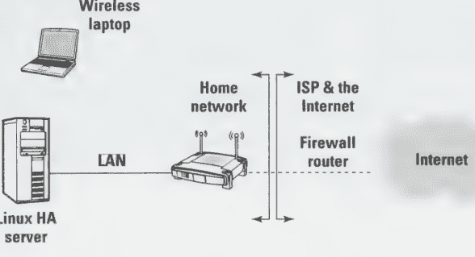

## 配置工作表

### LAN 工作表

| 主机名: | |
| :--- | :--- |
| Root 密码: | |
| IP 地址: | |
| 子网掩码: | |
| 默认网关: | |
| DNS 服务器(s): | |

### WAN/互联网连接工作表

| 连接类型: | |
| :--- | :--- |
| IP 地址: | |
| 子网掩码: | |
| 网关: | |
| 重新拨号策略: | |
| 重新拨号超时: | |
| 用户名: | |
| 密码: | |
| MTU: | |
| DNS 服务器(s): | |

### 无线工作表

| 启用: | |
| :--- | :--- |
| SSID: | |
| 信道: | |
| 密钥: | |
| 加密类型: | |

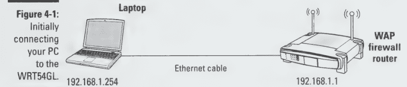

> **注意**：我无法在书中教你网络科学。我可以提供默认值让你无需理解就能使用网络。如果你对网络感兴趣，可以查看 Doug Lowe 编写的第7版《Networking For Dummies》，或 Kathy 编写的第3版《Home Networking For Dummies》（Wiley 出版）。

## LAN 信息

由于你正在创建一个局域网，你需要选择一个 IP、掩码和网关。你的 WAP 默认地址是 `192.168.1.1`，掩码是 `255.255.255.0`，网关是 `192.168.1.1`（WAP 的地址）。此网络（`192.168.1.0` 和掩码 `255.255.255.0`）是 RFC1918（私有互联网分配）的一部分，用于家庭网络，并有时被称为私有空间。这意味着你无法共享这个网络的信息（路由）因为其他人可能也会使用这个空间。WAP 的防火墙提供了一种翻译私有地址到互联网的方法。以下是工作表上的信息列表以及简要说明：

- **主机名**：你想给 WAP 起的名字。有些人使用名称，另一些不使用。这是你的选择。
- **Root 密码**：在 WAP 上登录 root 需要的密码。你需要它来配置 WAP。同样，这是你的选择。
- **IP 地址**：默认是 `192.168.1.1`。网络上的第一个设备（WAP）获得第一个地址 (`.1`)，所以它的地址是 `192.168.1.1`。下一个设备获得 `.2`，以此类推。
- **子网掩码**：默认是 `255.255.255.0`。在这个网络上你可以使用的最大地址是 `254`。`255` 用于广播消息。广播消息确保网络上的每个人都能看到它。掩码帮助识别地址（`192.168.1.0`）中的网络部分和主机地址（`1`）。参见第 5 章中的 IP 地址。
- **默认网关**：默认是 `192.168.1.1`。网关被称为默认路由。如果你不知道如何获取 IP 地址，你的请求将发送到网关，网关会尽力处理。对于 LAN 上的 PC 也是如此。
- **DNS** 代表域名系统。这是一个存储与域名（如 `wiley.com`）相关信息的系统。它用于将人类理解的名称转换为 IP 地址。如果你没有本地 DNS（你自己设置的），请留空。


如果你理解 IP 网络，不需要使用默认值，我建议使用地址空间 `172.16.0.0` 到 `172.31.255.255`，以及 `10.0.0.0` 到 `10.255.255.255`，因为许多 ISP 在他们的网络中使用了这些地址。在两个地方看到同一个 IP 网络会让人困惑。


你的 WAP 为你执行地址转换 (NAT)，这样 ISP 就看不到你的私有网络。这能保持网络正常工作。如果这对你来说没有意义，别担心。你可以使用默认值，它可以运行。

## 但我的 Linux PC 不在 192.168.1.0

如果你已经有一个家庭网络且其未使用 `192.168.1.0` IP 网络，你需要为你的 Linux PC 添加该网络的虚拟接口。好消息是，你不需要添加任何额外的硬件或执行大量的命令即可添加此网络。只需打开终端输入 `su` 并回车。在提示时输入 root 密码，然后输入 `ifconfig eth0:1 192.168.1.9` 并回车。你刚刚为 Linux 服务器添加了第二个网络。现在你可以使用 PC 上的浏览器连接 WAP。这是必要的，因为当你将 WAP 参数设置为出厂默认值时，它会重置为 `192.168.1.1`。你并不总是需要 `eth0:1` 接口——只有在你将 WAP 恢复默认时需要。

## WAN 信息


在 WAN/互联网部分，OpenWrt 支持这些连接类型：None、DHCP、Static 和 PPPoE。在这里，我解释这些连接类型（参见工作表上的“连接类型”），并根据类型描述其他设置。

## None

None 类型适用于那些不会将 WAP 连接到本地网络以外的任何地方的用户。你将其用于本地网络的有线和无线连接。你可以通过从命令行重新配置 WAP 来利用额外的端口（互联网端口）。你可以在本章晚些时候配置好 WAP 后这样做。然后，访问其 URL：`http://wiki.openwrt.org/OpenWrtDocs/Configuration`。进入网页的“以太网交换机配置”部分，并按照网页将 WAP 配置为“所有端口 (VLAN)”。

连接类型：None

WAN/互联网部分就是这些了。简单越好。工作表中 WAN/互联网部分的其余部分不需要填写内容（所以直接留空即可）。


# 第 2 部分：在无线的情况下连接多台电脑

## DHCP

DHCP 连接类型适用于 ISP 提供 DHCP 的用户。我正在使用这种设置。我的电缆带提供商通过 DHCP 向我提供了所有信息（IP 网络、IP 地址、子掩码、DNS 服务器和网关）。

连接类型：DHCP

屏幕上还提供了输入 IP 地址和网络掩码的地方。这些是可选的，我必须警告你，即使你知道自己的 IP 地址和掩码，它们也可能会发生。因此，我不建议填写它们。

## 静态

Static 连接类型适用于 ISP 提供静态 IP 地址（IP 地址永不更改）的用户。

连接类型：Static

你从 ISP 处需要的所有内容。ISP 未提供的任何内容应留空。以下是你应该获取的列表：

- IP 地址：由你的 ISP 提供
- 网络子掩码：由你的 ISP 提供
- 默认网关：由你的 ISP 提供
- DNS 服务器：由你的 ISP 提供（你可以有多个）

## PPPoE

PPPoE 连接类型（基于以太网的点对点协议）适用于宽带提供商通过 PPPoE 提供连接的服务的用户。

连接类型：PPPoE

PPPoE 与 DHCP 类似，因为大部分信息是动态的。PPPoE 具有可以提供 IP 地址、掩码、网关和 DNS 服务器列表的机制。但 ISP 会为你提供一些信息。任何未提供的内容都可以留空，或使用我提到的默认值。以下是列表：

- 重拨策略：（默认值是保持活动 Keep Alive）
- 重拨超时：（默认值是 30）
- 用户名：由你的 ISP 提供
- 密码：由你的 ISP 提供
- MTU：（默认值是 1500）

# 第 4 章：创建无线接入点

如果你的 ISP 支持 Linux，它将为你提供所有这些信息。如果不支持，你可能需要在搜索引擎上稍微搜一下，以找到某些参数（例如 MTU）。否则，默认参数应该可以工作。

## 无线信息

你需要很多信息，起初你可能想从简单开始——即保持简单：

- 无线接口：启用
- ESSID 广播：显示
- ESSID：设置为 Linksys 的其他内容
- 无线信道：6
- 模式：接入点（也称为基础设施模式）
- 加密类型：禁用

这将让你运行起来。它将允许你测试 WAP（无线接入点）中的硬件以及你用于连接无线网络的 PC。但我不建议保持这种状态。这种设置非常不安全，至少有四位邻居在使用它。因此，在你检查完一切后，进行正确的数据设置：

- 无线接口（默认值是启用）：如果你不需要无线接口，请禁用它，否则请启用。这是本章的重点。
- ESSID 广播（默认值是显示）：现在，关于是否广播你的 ESSID 有一些争议。我的观点是，广播会让客人更容易找到我的 WAP，所以……
- ESSID（默认值是 Linksys；更改此项！）：现在主题变得简单多了。大多数购买 WAP 的人都会将其保持默认设置（我也可以获取他们的密码）。我的建议是将其更改为独特的内容，因为这样更容易使用，而且你不会纳闷为什么无法连接到 Linksys。
- 无线信道（默认值是 6）：在信道方面，保持默认值即可。如果你有很多邻居在使用 6 号信道，请尝试其他数字，直到找到一个可用的。
- 模式（默认值是接入点）：将模式设置为接入点，因为这是你需要的设置方式。
- 加密类型（默认值是禁用；你真的应该启用它）：这目前是一种安全的加密类型，但它需要在你的 PC 上进行更多工作才能正确设置它。对于我最喜欢的主题——加密类型，我建议至少使用 WPA-PSK。之前我建议禁用，但那仅是为了初始设置。在你设置运行正常后，我建议将其更改为启用。额外的工作值得它带给你的安全感。
- 密钥或共享密钥：你的选择有 WPA 预共享密钥、WEP。WEP 是一个你需要安装的服务器（可用软件包之一）。我没有在书中介绍它，所以请不要使用 WEP 设置。当你选择密钥时，确保它是一个不会被轻易猜到的体面密钥。如果你禁用了加密类型，可以跳过此项。

如果你正在使用阻止 JavaScript 的应用程序（例如 Firefox 中的 NoScript），请确保你为此网站（`http://192.168.1.1/`）启用了它。没有它，你无法对 OpenWrt 的 Web 界面做任何事情，因为它依赖于 JavaScript。


## 将 WAP 升级到 OpenWrt

这些指令假设你正在为 WAP 使用原始的 Linksys 固件。如果你使用的是其他第三方固件，指令将会有不同，我建议你访问该第三方的网站查看说明。如果你已经配置了 WAP，请确保你复制了重要信息，如 IP 地址、掩码、DNS、主机名、ESSID、信道号、加密类型和密钥。你可以使用工作表写下你的现有信息。现在你需要将 WAP 重置为出厂默认设置。在你检查好一切后，请将 WAP 重置为出厂默认设置。


PPPoE 升级完成后，路由器会自动重启。只需等待路由器重启即可。当你的路由器完成升级后，它会自动重启。当你的路由器完成升级后，它会自动重启。

# 第 4 章：创建无线接入点

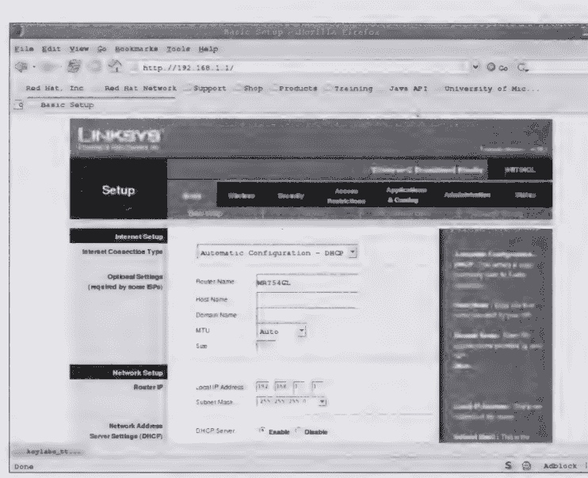

图 4-2：Linksys 设置页面。

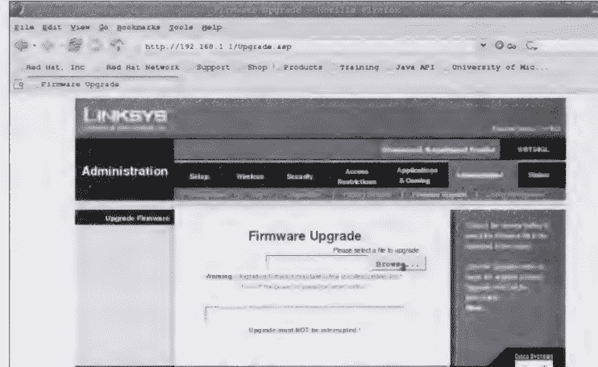

图 4-3：固件升级。

12. 点击“浏览”（Browse）并在 CD 中查找二进制文件：`openwrt-open-wrt-wrt54g-squashfs.bin`。

它位于 `chapter04/OpenWRT/bin` 目录下。

13. 选择“升级”（upgrade）并等待。（参见图 4-4）。

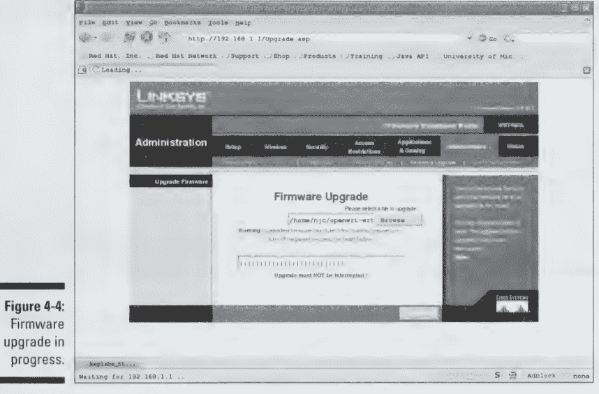

在电脑旁耐心等待！

这需要几分钟时间。（实际上花了不到五分钟，但感觉像过了一个世纪那么久。）

## 配置你的 WAP

在 WRT54GL 上安装好 OpenWrt 后（见上一节），你就可以对其进行配置。只需按照以下步骤操作：

1. 在浏览器中打开 URL `http://192.168.1.1/`

   你将看到 OpenWrt 欢迎界面。（参见图 4-5）。

2. 点击页面顶部的 `>>Router Info-<<`（路由器信息）链接。

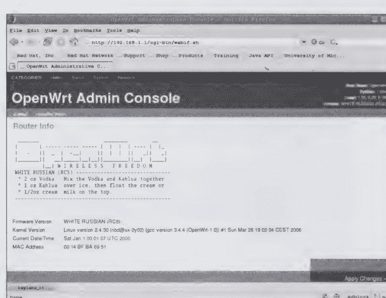

图 4-5：OpenWrt 欢迎页面。

路由器将要求你为 root 设置新密码。root 是你的登录名（全小写）。

3. 仔细输入你的密码（每个输入框输入一次）。完成后，点击“保存更改”（Save Changes）按钮。

4. 点击白色的“Systems”（系统）链接。

5. 从你的工作表中输入你的主机名（hostname）。

你可以将其命名为任何你喜欢的名称。

6. 将 `boot_wait` 改为“Enable”（启用）。

7. 将“Language”（语言）项更改为你选择的语言。

8. 点击“应用更改”（Apply Changes）链接，然后点击“保存更改”按钮。

9. 点击“Network”（网络）链接。

   你将看到 LAN 配置界面。（参见图 4-6。）

10. 从你的 LAN 工作表中输入 IP 地址、子网掩码（netmask）和默认网关。

你也可以添加本地 DNS 服务器（如果有）。大多数家庭都没有 DNS 服务器。是的，我有一个；我有许多设备。

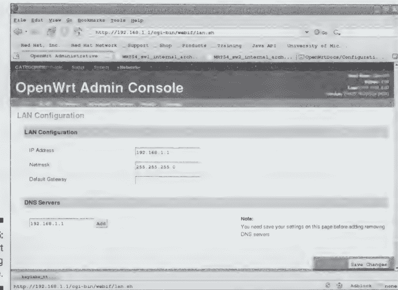

图 4-6：OpenWrt LAN 配置页面。

11. 点击“保存更改”按钮。

此时**不要**点击“应用更改”链接，因为这可能会导致你的连接中断。

12. 重新连接浏览器，并输入登录 ID (root) 和密码（你刚刚输入的密码）。

13. 点击“WAN”链接。

    你将看到 WAN 配置界面。（参见图 4-7）。

14. 选择你的连接类型，并从工作表中输入你的 WAN/Internet 信息。

页面外观将发生变化以匹配连接类型。

15. 点击“保存更改”按钮。

16. 点击“Wireless”（无线）链接。

    你将看到 LAN 配置界面。（参见图 4-8。）

17. 输入无线工作表中的信息，点击“应用更改”，然后点击“保存更改”。

现在，你可以将互联网网线连接到 WAP 的 Internet 端口。

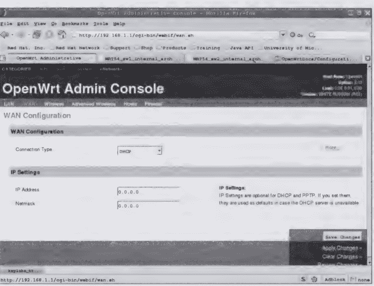

图 4-7：OpenWrt WAN 配置页面。

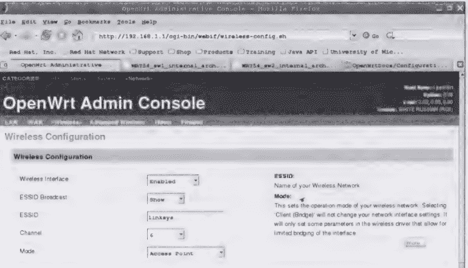

图 4-8：OpenWrt 无线配置页面。

## 熟悉 OpenWrt

配置好 WAP 后，你可能想对它进行一个初步了解。如果你想查看命令行界面，打开终端窗口并输入 `ssh root@192.168.1.1`（将 IP 地址替换为你的新 LAN IP 地址）。我没有描述这一点，因为 Web 界面会涵盖你的大部分需求，但知道它的存在也是很好的。在浏览器中输入 URL `http://192.168.1.1/`（将 IP 地址替换为你的新 LAN IP 地址），你将看到一个输入登录 ID 和密码的请求。输入 root 和密码。之后，你将看到主网页。（参见图 4-5）该页顶部有这些链接：

- Info（信息）：这是图 4-5 主页上显示的通用信息，在本文章的前面的部分出现过。
- Status（状态）：此链接显示你的路由器在连接（Connections）、LAN 和无线（Wireless）方面的状态。（参见图 4-9）
- System（系统）：点击此链接查看系统设置、密码以及已安装的软件和固件升级。（参见图 4-10）。
- Network（网络）：点击此链接查看 LAN、WAN、DHCP 和防火墙（Firewall）设置。（参见图 4-6）。

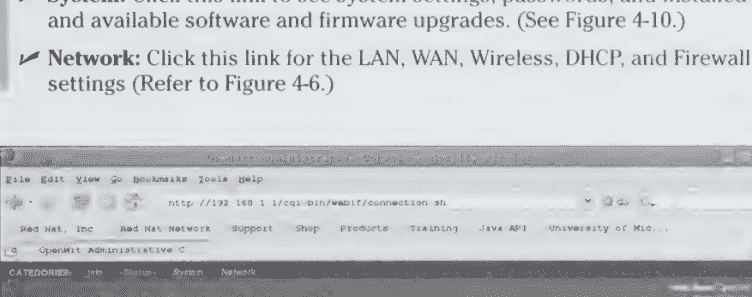

### OpenWrt 管理台

| ip address (IP地址) | MTU | HW address (硬件地址) | Mask (掩码) | Device (设备) |
| :--- | :--- | :--- | :--- | :--- |
| 192.168.1.1 | 1500 | 00:00:5E:63:CA | 255.255.255.0 | - |
| 192.168.1.10 | 1500 | 00:00:5E:63:FF | 255.255.255.0 | vlan2 |
| 192.168.1.17 | 1500 | 00:00:5E:63:FF | 255.255.255.0 | - |
| 192.168.1.19 | 1500 | 00:00:5E:63:CA | 255.255.255.0 | br0 |
| 192.168.1.24 | 1500 | 00:00:5E:63:CA | 255.255.255.0 | wlan1 |

### 到路由器的连接

| Active Internet connections (活动互联网连接) | Forward (转发) | State (状态) |
| :--- | :--- | :--- |
| Fetch-Recv-Send-Q | 192.168.1.1:32902 | TIME_WAIT |
| trp | 192.168.1.1:32903 | ESTABLISHED |
| trp | 192.168.1.1:32908 | TIME_WAIT |
| trp | 192.168.1.1:32909 | TIME_WAIT |
| trp | 192.168.1.1:32915 | ESTABLISHED |
| trp | 192.168.1.1:32916 | TIME_WAIT |
| trp | 192.168.1.24:33239 | TIME_WAIT |

图 4-9：OpenWrt 状态页面。

```
http://192.168.1.1/cgi-bin/luci/connection.ah
```

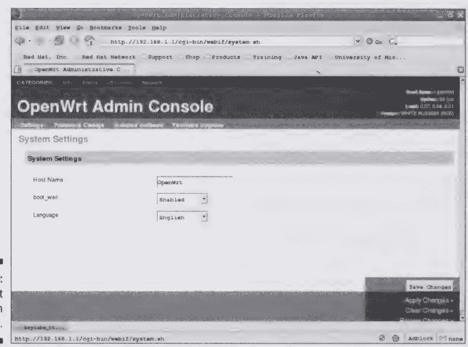

图 4-10：OpenWrt 系统页面。

OpenWrt 的特点之一是页面是分散的。一切都保持简单。

我想引导你注意的两个屏幕。第一个是“Configured Hosts”（已配置的主机）屏幕，通过点击“Network”（网络）链接和“Hosts”（主机）链接进入。此页面有一个“Static IP Addresses”（静态 IP 地址）部分（用于 DHCP），如图 4-11 所示。在这里，你可以输入 MAC 地址（通常在设备上，如 IP 摄像头）并为其分配 IP 地址。输入这些信息可以确保设备每次获得相同的 IP 地址。而 DHCP 可以分配任何可用地址。你输入 MAC 地址（看起来像这样：`AA:00:04:00:01`）和 IP 地址并点击“Add”（添加）按钮。在我的网络中，有一长串摄像头、打印机和其他设备。了解任何带有 Web 服务器设备的 IP 地址是非常重要的，因为你无法猜到。

第二个屏幕是“Firewall Configuration”（防火墙配置）。要查看它，点击“Firewall”链接（位于 Hosts 链接旁边）。在第 18 章中，我将教你如何在 Linux 服务器上设置 ssh，以便你从互联网的任何地方安全地访问它。要这样做，你必须在防火墙上开一个洞。

通常情况下，ssh 使用端口 22，但该端口很快就会受到攻击，因此建议你使用另一个端口，例如 13218（这是第 18 章的示例）。在防火墙设置处（参见图 4-12），从“New Rule”（新规则）下拉列表中选择“Forward”（转发）并点击“Add”按钮。现在，选择“Destination Ports”（目标端口）并点击“Add”按钮。这会添加一个新字段。在此字段中，输入端口号 13218；在“Forward”字段中，输入你的 Linux 服务器的 IP 地址；在“Port”字段中，输入 13218。当你对连接满意时，点击保存按钮。

我想指出一个重要的链接：“Installed Software”（已安装软件）链接。从主页，点击“System”（系统）链接，然后点击“Installed Software”链接。你将看到已安装和可用软件的列表。点击“Update Package Lists”（更新软件包列表）以获取可用内容的更新列表。然后向下滚动过已安装部分查看可用部分。那是一个非常令人深刻的列表。请记住，如果用于软件包的闪存内存只剩下约 2MB，你就无法安装它。此外，要小心删除软件包；在删除任何东西之前先思考。如果你删除了重要的内容，可能会让你的 WAP 变成“砖头”（一块无用的设备）。


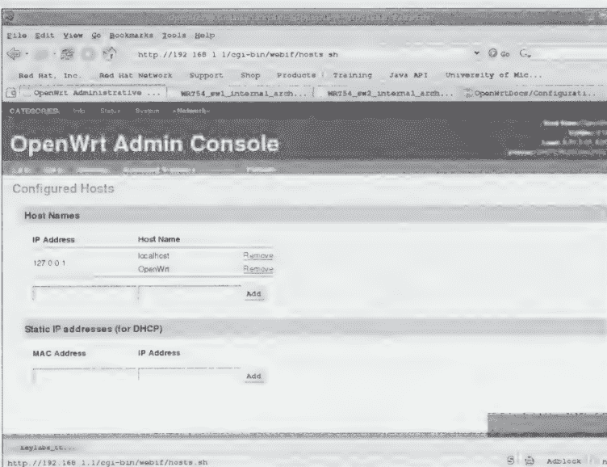

图 4-11：在此输入你的 IP 地址以确保一致性。

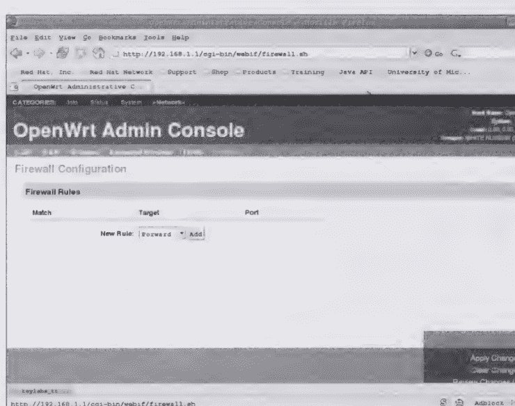

图 4-12：OpenWrt 防火墙页面。

# 第 5 章：免费路由网络流量

本章

- 熟悉 Quagga
- 通过包管理器安装 Quagga
- 编译并安装 Quagga
- 在你的 WRT54GL 上安装 Quagga
- 了解路由
- 配置 Quagga
- 关于路由的路由

让我非常快速地对本章设定一个预期。如果你指望这章能帮助你的思科认证互联网专家 (CCIE) 学习，那么它并不会有那么帮助。在有限的空间内，我只能向你介绍 Quagga 路由套件和少量的 IP 网络知识。我将讨论限制在 IPv4（当前标准）而非 IPv6（新标准），以减少混淆程度。对于普通家庭用户来说，这可能过头了。但对于智力上好奇的人来说，这很有趣。（是的，我知道，这是一种奇怪的乐趣。）

在某些地方，为了简洁，我跳过了一些细节。我想彻底解释，但那样做将花费几个章节来讲解 IP 网络。如需更多信息，请查阅 Doug Lowe 编写的《网络傻瓜指南》第 7 版以及 Kathy Iveens 编写的《家庭网络傻瓜指南》第 3 版（均由 Wiley 出版公司出版）。

## IP 路由简要介绍


家庭用户对 IP 路由的需求非常简单。你通常输入一个 URL，数据包就会到达那里，无需过多。有时你无法到达——某个网站被“击穿”（当有太多用户同时访问某个网站时）。这时你可能会进入 shell（命令行提示符）并尝试运行命令 `traceroute somehost` 查看是否可以访问该网站。你可能会注意到输入的名称被转换成了数字，你会看到几行带有各种信息的数字。从名称到数字的转换是由域名系统 (DNS) 完成的。TCP/IP 和 IP 处理从你的 PC 到端点再返回的部分。当你的 PC 拥有 IP 号时，它会检查路由表并将其发送到下一个位置的适当设备。该路由器执行相同的操作，以此类推。

在本章的代码行中，你将看到长长的文本列表——**粗体文本**是你可以在命令行（终端）中输入的命令。如果你输入了命令，需要在输入命令后按回车键。在命令之前，你会看到一个提示符；按下回车键后，你会看到命令的输出。它看起来应该和列表相似。这与在命令行操作完全一样。


如果你正在运行 Linux 设备，并且它连接到了宽带路由器（WRT54GL 无线接入点的另一种名称；在本章中我称之为路由器），你可能会在本地路由表中看到类似列表 5-1 的内容。

## 列表 5-1：Linux PC 上的典型路由信息

```
$ route -n
Kernel IP routing table
Destination Gateway Genmask Flags Metric Ref Use Interface
192.168.1.1 0.0.0.0 255.255.255.0 U 0 0 eth0
169.254.0.0 0.0.0.0 255.255.255.0 U 0 0 eth0
0.0.0.0 192.168.1.254 0.0.0.0 UG 0 0 eth0
```

此设置用于默认路由（目标 0.0.0.0 和子网掩码 Genmask）。如果你的 Linux PC 没有到你尝试访问的网络的特定路由，PC 将其流量发送到默认路由指向的网关 (192.168.1.254)。网关查看其路由表，执行相同的查找，并尝试解析路由。此过程不断重复，直到流量到达目的地或该流量不存在路由。这之所以运行良好，是因为智能路由设备（路由器）位于你的 ISP 中，并且拥有大量关于如何从这里到那里的信息。

在小型网络（比你的典型家庭网络大）中，默认路由将不起，因为没有路由器拥有所有其他网络的信息。一种解决方案是创建静态路由。在 Linux 中，你可以像列表 5-2 所示那样操作。

## 列表 5-2：在 Linux 下创建静态路由

```
$ route add -net 192.168.100.0/24 gw 192.168.1.32
$ route
Kernel IP routing table
Destination Gateway Genmask Flags Metric Ref Iface
192.168.100.0 192.168.1.32 255.255.255.0 UG 0 0 eth0
192.168.1.0 0.0.0.0 255.255.255.0 U 0 0 eth0
169.254.0.0 0.0.0.0 255.255.0.0 U 0 0 eth0
0.0.0.0 192.168.1.254 0.0.0.0 UG 0 0 eth0
```

通过第一条路由命令，我向路由表中添加了到网络 192.168.100.0 的静态路由。`/24` 意味着它是 24 位掩码或 255.255.255.0（在二进制中是 24 位 1）。如果 Linux 想要将数据包发送到 192.168.100.0 网络上的设备，它会将数据包发送到 192.168.1.32。192.168.1.32 不再将这些数据包发送到 192.168.1.254 路由器。

# 第 5 章：免费路由网络流量

## 熟悉 Quagga

Quagga 是一种生活在南非的已灭绝斑马动物。Quagga 也是一种路由软件。之所以起这个名字是因为原始路由套件是 Zebra。石原 Kunhiro 启动了 Zebra 项目，旨在为 Linux 引入动态路由支持。2003 年，Quagga 项目 (www.quagga.net) 发生了分支（从原始项目分离），因为 Kunhiro 在 Zebra 项目上的工作似乎变慢了。Quagga 继续运行，但似乎停止了更新。Quagga 目前维护者是 Paul Jakma、Vincent Jardin、Andrew Schorr、Haas Tepper、Greg Troxel 和 David Young。


Quagga 套件是一个路由包，包含了以下路由协议的软件：

- 路由信息协议 (RIP)：被称为内部网关协议 (IGP)。IGP 用于在自治系统（如由一家公司控制的企业网络）中进行路由。RIP v1 和 v2 支持 IPv4（互联网上当前使用的 IP 和寻址方案）；RIPng（下一代 RIP）支持 IPv6（IPv4 的替代品，规模更大、更好且更安全）。
- 开放路径优先算法 (OSPF)：这也是一种 IGP。OSPFv2 支持 IPv4；OSPFv3 支持 IPv6。
- 间系统路由 (IS-IS)：该协议是一种 IGP，`isisd`（Linux IS 路由守护进程）支持 IPv4 和 IPv6。
- 边界网关协议 (BGP)：BGP 是外部网关协议 (EGP)，用于在自治系统（每个由不同的公司控制）之间进行路由。BGP 是互联网的路由协议，它具有良好的扩展性，可以处理路由表（在本书期间，路由表已有超过175,000 条路由）。`nbpd`（Linux BGP 路由守护进程）支持 IPv4 和 IPv6。

如果你正将 Linux 机器连接到公司网络，可能会使用 OSPF 或 RIP（很可能是 v2）。如果你正将 Linux 网络连接到会与你共享路由条的 ISP，请使用 BGP。对于家庭使用，OSPF 或 RIP 即可。

## 通过包管理器安装 Quagga

我刚刚注意到，许多软件包（包括 Quagga）现在以更易于通过发行版的包管理器进行安装（无需编译）的形式出现。虽然提供的包可能不是最新、最强大的测试版本（这可能是一件好事），但它是一个与你的发行版兼容的版本。包管理器使得安装软件包变得更加简单。它还负责安装或升级新软件所依赖的任何其他包。如果你使用发行版的包管理器，请尽管使用。由于我正在使用 Fedora，所以我将用它作为示例。

你需要做的第一件事是确认你的发行版是否有提供该包。对于 Fedora FC5，你可以使用 `yum` 命令，如列表 5-3 所示。在这里，我正在搜索包 `quagga`，`yum` 将在在线数据库中搜索包含 `quagga` 的名称和描述。

### 列表 5-3：使用 yum 搜索 Quagga 的结果

```
$ yum search quagga
Loading 'installonlyn' plugin
Searching Packages:
Setting up repositories
core [1/3]
extras [2/3]
updates [3/3]
Reading repository metadata in from local files

quagga-contrib.i386      0.98.5-4      core
Matched from:
quagga-contrib
contrib tools for quagga
Contributed/3rd party tools which may be of use with quagga.
http://www.quagga.net

quagga.i386                0.98.5-4                core
Matched from:
quagga
Quagga 是一款管理基于 TCP/IP 路由协议的免费软件。它采用多服务器和多线程的方法来解决当前复杂的复杂性。
Quagga 支持 BGP4、BGP4、OSPFv2、OSPFv3、RIPv1、RIPv2 和 RIPng。
Quagga 旨在用作路由服务器（Route Server）和路由反射器（Route Reflector）。它不是一个工具包，它在新的架构下提供了完整的路由功能。Quagga 设计上为每个协议提供了一个进程。
Quagga 是 GNU Zebra 的分支。
http://www.quagga.net

quagga-devel.i386        0.98.5-4                core
Matched from:
quagga-devel
quagga 开发的头文件和对象文件
quagga-devel 包包含开发 OSPF-API 和 quagga 应用程序所需的头文件和对象文件。
```

如果你的查询（即你搜索的内容；在本例中为 `quagga`）太宽，你可能会得到一个不相关的软件包列表。这时，你需要更改查询以使其更明确（例如使用文件 `quagga.i386`、`quagga-contrib.i386` 和 `quagga-devel.i386`，列表 5-3 包含了三个文件 `quagga-contrib.i386`，它们恰好与 Quagga 直接相关。因为描述匹配了所有源代码，而你可能不需要，所以它是可选的。还有额外的选项可以进一步查询软件包。使用包管理器的手册页（也称为 man pages）获取有关可用选项的信息。

要在 Fedora FC5 上安装软件包，输入 `yum` 命令，如列表 5-4 所示。在这里我正在安装 `quagga-devel.i386` 包，这是为了在我 PC 上运行 Quagga 我想要的三个包之一。

### 列表 5-4：使用 yum 安装 quagga-devel.i386

```
# yum install quagga-devel.i386
Loading 'installonlyn' plugin
Setting up Init Process
Setting up repositories

core 100% |==========================| 1.1 kb [1/3]
core                                               00:00
extras                              100% |==========================| 1.1 kb [2/3]
extras                                               00:00
updates                                               00:00
=================================================
updates                              100% |==========================| 951 B [3/3]
Reading metadata from local files
primary.xml.gz                       100% |==========================| 223 kb 00:00
updates **************************************** 714/714
Added 314 new packages, 329 old in 3.29 seconds
Parsing package arguments
Resolving Dependencies

-- Population transaction set with selected packages. Please wait.
--> Downloading header for quagga-dev to pack into transaction set.
quagga-dev 100% |==========================| 13 kb 00:00
--> Package quagga-dev.0.98.5-4 to be updated
--> Running transaction check

依赖已解析
| Package | Arch | Version | Repository | Size |
| :--- | :--- | :--- | :--- | :--- |
| Installing: quagga-dev | | 0.98.5-4 | core | 455 k |
Transaction Summary
===================================
Install 1(s)
Update 0(s)
Remove 0(s)
Total download size: 455 k
Is this ok [y/N]? y
Downloading Packages:
(1/1) quagga-dev 100% |=========================| 455 kb 00:00
Running Transaction
Installing quagga-devel-0.98.5-4
********* [1/1]
Transaction Succeeded!
```

## 编译并安装 Quagga

Quagga 默认通过配置脚本设置除了 IS-IS 以外的所有协议。还有更多选项，只需运行 `./configure --help` 即可查看。大多数情况下默认选项是很好的。如果你知道想要哪些支持，则不需要禁用它们。我不建议禁用 zebra 管理（`--disable-zebra`），因为它管理你的路由表。它还允许在路由协议之间重新发布信息（是的，你可以运行多个路由协议）。此外，启用 vtysh 可以配置 Quagga 和你的路由协议变得容易得多。

1. 打开终端。
2. 在提示时输入 `su`。
3. 输入 `tar xvf quagga-0.99.3.tar.gz`。
4. 输入 `cd quagga-0.99.3`。
5. 输入 `./configure --enable-vtysh`。这可以一次性配置 Quagga 所有的文件。
6. 输入 `make`。这会编译所有必要的文件。
7. 输入 `make install`。在这里你安装手册页、路由守护进程以及 Quagga 的辅助程序。
8. 打开你喜欢的编辑器，打开 `/etc/services` 文件，并在文件末尾添加以下行：

```
zebrasrv      2600/tcp    # zebra service
zebra         2601/tcp    # zebra vty
ripd         2602/tcp    # RIPD vty
ripngd       2603/tcp    # RIPng vty
ospfd        2604/tcp    # OSPF vty
bgpd         2605/tcp    # BGP vty
ospf6d       2606/tcp    # OSPF6 vty
ospfapi      2607/tcp    # ospfapi
isis        2608/tcp    # ISIS vty
```


`/etc/services` 文件将名称与各种 TCP 和 UDP 端口关联（例如端口 25 上的电子邮件）。Quagga 需要支持守护进程的配置。

## 第 2 部分：无线连接多台计算机

### 在你的 WRT54GL 上安装 Quagga

如果你已经在 WRT54GL 上安装了 OpenWrt，那么你就可以安装 Quagga。它是 OpenWrt 添加的额外功能之一（我在第 4 章中提到过它）。只需按照以下步骤操作：

1. 打开浏览器访问 WRT54GL 的 URL。我的仍然是 `http://192.168.1.1/`
2. 使用用户名 `root` 和你选择的密码登录。
3. 点击“系统”链接，然后查看“已安装软件”链接。
4. 向下滚动找到 `quagga-bgpd` 部分（它最多位于页面末尾）；如果找不到，请回到页面顶部并点击“更新软件包列表”链接。

这将更新可用的软件包。你需要连接到互联网才能正常工作。当你找到这些链接时，你应该会看到类似于图 5-2 所示的屏幕。注意图 5-2 中缺少了 `quagga`、`quagga-ospfd` 和 `quagga-vtysh` 包。这是因为我安装了它们，并且它们在我的 WRT54GL 和 Linux PC 之间运行。

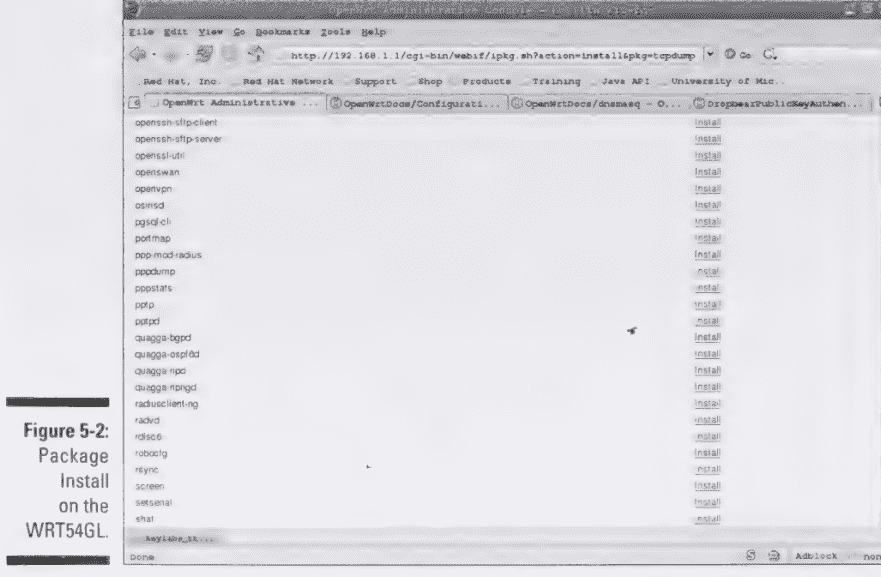

### 第 5 章：免费路由网络流量

5. 安装 `quagga` 软件包（你必须安装），然后安装 `quagga-vtysh` 软件包（我强烈建议安装）。
6. 决定安装哪些协议，然后对于每个软件包，点击软件包名称旁边的“安装”链接，等待其完成，并选择下一个软件包。

在本章的“配置 Quagga”部分中，我提到了 OSPF 协议守护进程（在 Linux 下运行的程序，请参见“熟悉 Quagga”章节查看协议列表）。你可以运行多个守护进程；只需记住每个守护进程都会占用宝贵的内存（RAM）和闪存空间，请明智选择。

完成后，你需要使用 ssh，在终端中输入 `ssh root@192.168.1.1` 并按回车连接到你的 WRT54GL。

调整 IP 地址以满足你的需求。

### 使用 Quagga

Quagga 站点有几个守护进程，其中两个用于监控和维护路由守护进程（`watchquagga` 和 `zebra`）。其余是交换路由信息的守护进程：

- `watchquagga` 是一个看门狗程序，用于监控 Quagga 路由守护进程的状态。如果某个守护进程死亡（崩溃）或无响应，`watchquagga` 会重启该守护进程。
- `zebra` 是处理内核路由表管理以及在不同路由协议之间重新发布的守护进程。
- `ripd` 是管理 RIP 版本 1 (RFC1058) 和版本 2 (RFC2453) 的守护进程。它支持 IPv4。
- `ripng` 管理 RIPng (RFC2080)。它支持 IPv6。
- `ospfd` 管理 ospfv2 (RFC2328)。它支持 IPv4。
- `ospf6d` 管理 ospfv3 (RFC2740)。它支持 IPv6。
- `isisd` 是管理 IS-IS (RFC1195) 的守护进程。它支持 IPv4 和 IPv6。
- `bgpd` 管理 BGPv4 (RFC1771)。它支持 IPv4 和监控。
- `vtysh` 是用于调试、监控和配置所有路由守护进程及 Zebra 的命令行。它非常像 DEC 和 Cisco 路由器的命令行。

在这里，我冒昧地只包含了一个相关的 RFC 引用，因为有很多（特别是 BGP）。你可以看到，支持多种路由协议。通过 `zebra` 守护进程，你可以运行多个守护进程并将路由协议重新发布到其他进程中，包括静态路由。

### 配置 Quagga

每个守护进程都有自己的端口和配置文件，你可以使用 `telnet` 连接到每个端口并单独配置守护进程。端口分配可以在 `/etc/services` 列表中找到（在安装过程中添加了它们，我在前面的“编译和安装 Quagga”中描述过）。这种方法很麻烦，因为你需要单独配置每个守护进程，而且调试和监控命令只能在 `zebra` 守护进程上输入。Quagga 为你提供了一个解决方案：`vtysh` 命令可以同时连接到所有守护进程。从命令行提示符输入列表 5-5 中的 `vtysh` 命令。

#### 列表 5-5：vtysh 命令

```
$ vtysh

Hello, this is Quagga (version 0.9.3).

Copyright 1996-2005 Kunhiro Ishiguro, et al.

Quagga# 

clear           重置功能
configure       配置 vty
copy            从一个到另一个
debug           调试功能（参见'undebug'）
disable         关闭
end             退出当前模式并返回上一级
exit            退出当前模式并返回上一级
list            打印命令列表
no              取消命令或设置默认值
ping            发送 echo 信息
quit            退出当前模式并返回上一级
show            显示运行信息
sh              打开 ssh 连接
start-shell     启动 Unix shell
telnet          打开 telnet 连接
terminal        设置终端参数
traceroute      追踪路由到
undebug         禁用调试功能（参见'debug'）
write           将运行配置写入内存，network 或 terminal

Quagga#
```

当你连接后，可以输入许多不同的命令。我演示了列表 5-5 中的帮助命令 (`?`)。命令使用 Tab 键补全，因此你只需要输入少量的字符即可生成唯一的命令。按下 Tab 键后会出现命令的结果，或者如果你再次按下 Tab，会推荐可能的补全。一个示例命令是 `running-config`，我将其缩写为 `sh run`（列表 5-6）。此命令显示运行配置（相对于 `startup-config`）。

#### 列表 5-6：show run 命令及其结果

```
Quagga# sh run

Building configuration...

Current configuration:

!
hostname Quagga
hostname ospfd
log syslog
!
password cisco
enable password cisco
!
interface eth0
 ip ospf cost 10
 ipv6 nd suppress-ra
!
interface lo
!
interface sit0
 ipv6 nd suppress-ra
!
router ospf
 ospf router-id 0.0.0.1
 network 192.168.1.0/24 area 0.0.0.0
 network 192.168.24.0/24 area 0.0.0.0
!
line vty
!
Quagga#
```

这两个主机名（Quagga 和 ospfd）有点奇怪（我稍后会解释），否则这些命令对于配置过 DEC 或 Cisco 路由器的人来说很熟悉。OSPF 命令是 OSPF 特有的。BGP、RIP 和 IS-IS 都有各自的独特命令。`hostname`、`log`、`service`、`password`、`enable` 和 `line` 命令是全局命令。要开始配置路由器，输入如列表 5-7 所示的 `conf t` 命令。

#### 列表 5-7：conf t 命令及其结果

| 命令 | 说明 |
|---|---|
| access-list | 添加访问列表项 |
| bgp | BGP 信息 |
| debug | 调试功能（参见'undebug'） |
| dump | 转储数据包 |
| enable | 修改密码参数 |
| end | 结束当前模式并切换到上一级 |
| exit | 退出当前模式并切换到上一级 |
| hostname | 设置系统名称 |
| interface | 选择要配置的接口 |
| ip | IP 信息 |
| ipv6 | IPv6 信息 |
| key | 认证密钥管理 |
| line | 配置终端行 |
| log | 日志控制 |
| no | 取消命令或设置默认值 |
| password | 分配终端连接密码 |
| route-map | 创建路由映射或进入路由映射模式 |
| router | 手动设置路由器 |
| router-id | 设置路由器 ID |
| service | 设置多进程服务 |
| table | 配置目标路由表 |
| username | 配置用户 |

在输入 `conf t`（`configure terminal` 的缩写）并按回车后，你将进入路由器的配置编辑器。注意提示符发生了更改。此提示符告诉你你正在编辑什么，类似于模式描述。你输入 `?`（帮助）来显示可用命令。在 `int eth0` 中；提示符从 `Quagga(config)` 变为 `Quagga(config-if)`。这是因为我从全局模式 `(config)` 切换到了接口模式 `(config-if)`。然后我可以输入必要的命令来配置接口。要返回全局模式，我可以通过 `end` 命令退出配置会话，或者输入另一个命令（例如 `router ospf`）进入另一个模式。

### 路由概述

现在你已经对如何在 Quagga 中进行跳转有了大致的了解，现在是时候来看一个具体的实际路由示例了。图 5-3 显示了我构建的内容：

- 我选择了 OSPF 路由协议，并没有什么特别的原因，只是因为我当时正在使用它。这个设置包含了三个 OSPF 区域：area 1、3 和 area 0。
- 宽带路由器没有参与 OSPF 路由；它只是在执行常规的默认路由。它包含了两个通往 192.168.1.0 和 192.168.2.0 网络的静态路由。这些是必须的；如果路由器不知道如何到达路由，它将丢弃数据包。
- 我名为 Quagga 的 Linux 高可用服务器参与了两个 OSPF 区域（0 和 3），并正在重新发布默认路由。
- 称为 OpenWrt 的 WRT54GL 也参与了两个区域（0 和 1）。

列表 5-8 包含了我从服务器 Quagga 获取的信息。此时，我的 OSPF 已经启动、运行并正在交换 OSPF 信息。我从接口配置的信息开始，然后查看了 Linux 内核路由表。接着，我通过 `vtysh` 命令连接到 Quagga 服务器上的路由进程。我显示了运行配置及其对路由表的视图以及一些 OSPF 信息。

#### 列表 5-8：Linux PC 上的各种网络命令

```
[root@Quagga ~]# ifconfig

eth0      Link:Ethernet Haddr 00:11:22:33:44:55
       inet addr:192.168.24.1 Bcast:192.168.24.255 Mask:255.255.255.0
       inet6 addr:fe80::211:22ff:de3:4355/64 Scope:Link
       UP BROADCAST RUNNING MULTICAST MTU:1500 Metric:1
       RX packets:490515 errors:0 dropped:0 overruns:0 frame:0
       TX packets:406717 errors:0 dropped:0 overruns:0 carrier:0
       collisions:0 txqueuelen:1000
       RX bytes:49051549 (46.8 MiB) TX bytes:48340714 (46.1 MiB)

eth0:1    Link:Ethernet Haddr 00:11:22:33:44:55
       inet addr:192.168.1.19 Bcast:192.168.1.255 Mask:255.255.255.0
       UP BROADCAST RUNNING MULTICAST MTU:1500 Metric:1
       Interrupt:18 Base address:0xa000

lo        Link:Local Loopback
       inet addr:127.0.0.1 Mask:255.0.0.0
       inet6 addr ::1/128 Scope:Host
       UP LOOPBACK RUNNING MTU:16384 Metric:1
       RX packets:906005 errors:0 dropped:0 overruns:0 frame:0
       TX packets:906005 errors:0 dropped:0 overruns:0 carrier:0
       collisions:0 txqueuelen:0
       RX bytes:11751977 (11.2 MiB) TX bytes:11751977 (11.2 MiB)
```

```
[root@Quagga ~]# route -n

Kernel IP routing table
Destination     Gateway         Genmask         Flags Metric Ref  Use Iface
192.168.0.0     192.168.24.24   255.255.255.0   UG    0      0      0 eth0
192.168.2.0     192.168.1.1     255.255.255.0   UG    20     0      0 eth0
192.168.1.0     0.0.0.0         255.255.255.0   U     0      0      0 eth0
0.0.0.0         0.0.0.0         255.255.255.0   U     0      0      0 eth0
192.169.0.0     0.0.0.0         255.255.255.0   U     0      0      0 eth0
165.0.0.0       0.0.0.0         255.0.0.0       UG    0      0      0 eth0
0.0.0.0         192.168.24.24   0.0.0.0         UG    0      0      0 eth0
```

```
[root@Quagga ~]# vtysh

Hello, this is Quagga (version 0.9.3).
Copyright 1996-2005 Kunihiro Ishiguro, et al.
```

```
Quagga# sh run

Building configuration...
Current configuration:
!
hostname Quagga
log syslog
!
service advanced-vty
!
password Zebra
enable password Zebra
!
interface eth0
 ip ospf cost 10
 ipv6 nd suppress-ra
!
interface lo
!
interface sit0
 ipv6 nd suppress-ra
!
router ospf
 ospf router-id 0.0.0.1
 network 192.168.1.0/24 area 0.0.0.0
 network 192.168.24.0/24 area 0.0.0.3
 default-information originate always metric 110
!
ip forwarding
!
line vty
!
Quagga# sh ip route
Codes: K - kernel route, C - connected, S - static, R - RIP, O - OSPF, I - ISIS, B - BGP, > - selected, * - FIB
```

```
K* 0.0.0.0/0 192.168.24.24, eth0
C* 127.0.0.0/8 is directly connected, lo
K* 169.254.0.0/16 is directly connected, eth0
O 192.168.1.0/24 [110/10] is directly connected, eth0, 02:18:07
C* 192.168.1.0/24 is directly connected, eth0
O 192.168.2.0/16 [110/20] via 192.168.1.1, eth0, 02:01:46
O 192.168.24.0/24 [110/10] is directly connected, eth0, 02:15:09
C* 192.168.24.0/24 is directly connected, eth0
K* 100.0.0.0/24 is directly connected, 192.168.24.254, eth0
```

```
Quagga# sh ospf route

OSPF routing table
N 192.168.1.0/24 [10] area 0.0.0.0 attached to eth0
```


N 192.168.2.0/24 [20] area 0.0.0 via 192.168.1.1, eth0

N 192.168.24.0/24 [10] area 0.0.0 attached to eth0

R 0.0.0.3 [10] area 0.0.0, ABR, ASBR via 192.168.1.1, eth0

### 列表 5-8 (续)

```
Quagga# sh ip ospf neighbor
| Neighbor ID | Dead Time | Address | Interface |
|---|---|---|---|
| 0.0.0.3 | Full/Backup 0/365s | 192.168.1.1 | eth0:1 |
```

`Quagga# quit`

现在是查看列表 5-9 中显示的另一个路由器了。这些信息的唯一区别在于，我必须先使用 `ssh` 才能到达 OpenWrt。登录后，我执行了与之前相同的命令。

### 列表 5-9：WRT 上的各种网络命令

```
root@Quagga ~]# ssh root@192.168.1.1
root@OpenWrt:~ ifconfig
br0 link:Ethernet Haddr:AA:BB:CC:EE
inet addr:192.168.1.1 broadcast:192.168.1.255 netmask:255.255.255
UP BROADCAST RUNNING MULTICAST MTU:1500 Metric:1
RX packets:50560 errors:0 dropped:0 overruns:0 frame:0
TX packets:5486 errors:0 dropped:0 overruns:0 carrier:0
collisions:0 txqueue:0
RX bytes:194261 (1.8 MiB) TX bytes:646914 (631.7 KIB)

eth1 link:Ethernet Haddr:AA:BB:CC:EE
UP BROADCAST RUNNING PROMISC MULTICAST MTU:1500 Metric:1
RX packets:27415 errors:0 dropped:0 overruns:0 frame:0
TX packets:7339 errors:0 dropped:0 overruns:0 carrier:0
collisions:0 txqueue:1000
RX bytes:4307536 (4.1 MiB) TX bytes:775963 (757.7 KIB)

eth1 link:Ethernet Haddr:AA:BB:CC:EE
UP BROADCAST RUNNING ALL MULTICAST MTU:1500 Metric:1
RX packets:0 dropped:0 overruns:0 frame:178852
TX packets:13182 errors:11 dropped overruns:0 carrier:0
collisions:0 txqueue:1000
RX bytes:0 (0.0 B) bytes:2104674 (2.0 MiB)
Interrupt:2 Base address:0x5000
Link encap:local Loopback
addr:127.0.0.1 Mask:255.255.0.0
UP BROADCAST RUNNING MTU:16436 Metric:1
RX packets:0 dropped:0 overruns:0 frame:0
TX packets:0 dropped:0 overruns:0 carrier:0
collisions:0 txqueuel:0
RX bytes:0 (0.0 B) bytes:0
```

## 108 第二部分：无线连接多台计算机

### 列表 5-9（续）

```
!
password Zebra
enable password Zebra
!
interface br0
!
interface eth0
!
interface eth1
!
interface lo
!
interface vlan0
!
interface vlan1
 ip address 192.168.2.1/24

router ospf
 ospf router-id 0.0.0.2
 network 192.168.1.0/24 area 0.0.0.0
 network 192.168.2.0/24 area 0.0.0.1
!
ip forwarding
!
line vty
!
OpenW# sh ip route
Codes: K -内核路由, C - 连接的, S - 静态, R - RIP, O - OSPF, I - ISIS, B - BGP, / - 选择路由, * - FIB路由

* 0.0.0.0/0 [110/110] via 192.168.1.19, br0, 01:03:21
C 127.0.0.0/8 is directly connected, C
 O 192.168.1.0/24 [11/10] is directly connected, O 02:05:48
C 192.168.2.0/24 [10/10] is directly connected, br0
O 192.168.2.0/24 is directly connected, vlan1, 02:05:57
C 192.168.24.0/24 [10/20] via 192.168.1.19, br0, 02:05:48
OpenW# sh ip ospf routing table =
============ OSPF 路由器路由表 ==========
N 192.168.1.0/24 [10] area: 0.0.0.0
  directly attached to br0
  [10] areas: 0.0.0.1
N 192.168.2.0/24
  directly attached to vlan1
  [20] areas: 0.0.0.0
N IA 192.168.24.0/24
  via 192.168.1.19, br0

========== OSPF 路由器路由表 ==========
R 0.0.0.1
  [10] area: 0.0.0.0, ABR, ASBR
  via 192.168.1.19, br0
```

## 第 5 章：免费路由网络流量

```
========== OSPF 外部路由表 ==========
N E2 0.0.0.0/0         [20/110] tag: 0
                    via 192.168.1.19, br0

OpenWrt# sh ospf neigh

Neighbor ID      Pri State       Dead Time      Interface
RaXmt RqstL DBsM
0.0.0.1         1 Full/DR      00:00:33      192.168.1.19
                 br0:192.168.1.11 0             0
OpenWrt# quit
root@OpenWrt:~# exit
Connection to 192.168.1.1 closed.
[root@Quagga #-]
```

列表 5-8 和 5-9 显示了运行环境中的实际数据。这里有一点需要记住：在我的 Linux 服务器 Quagga 上，发现开启 IP 转发是必要的。要在命令行开启它，请输入：

```
echo "1" >/proc/sys/net/ipv4/ip_forward
```

这将启用转发，直到下次重启。要使其永久生效，请编辑 `/etc/sysconfig/network` 并在文件末尾添加此行：

```
FORWARD_IPV4 = YES
```

在 Fedora 下，你需要编辑 `/etc/sysctl.conf`。只需像我在这行中所做样，将 0 改为 1：

```
net.ipv4.ip_forward = 1
```

然后，在下次重启时，内核将启用 IP 转发。

## 第三部分

借助 Linux 的小帮助娱乐你的大脑

Rich Tennant 著的《第五波》

> “MythTV 最棒的地方在于，我能比以前多回答 50% 的‘危险一路答’竞赛题。”

## 在这一部分中...

这一部分有一场派对，邀请你参加。在这里你将设置一个名为 MythTV 的数字视频录制机，在 TwonkyMedia 的帮助下控制全家的媒体，并开始使用 USB 摄像头。剩下的工作就是邀请你的朋友过来，并确保有人带披萨和墨西哥玉米——这你可以在设置好 Asterisk（智能手机系统）后完成。

你还在等什么？是时候开始这一部分了！

## 第 6 章

### 使用 MythTV 构建个人视频录制机

## 本章内容

- 构建你的个人视频录制机 (PVR)
- 观看电视
- 管理你的录制内容
- 管理你的媒体

我喜欢使用 Linux 作为操作系统的原因之一是它提供了大量的开源免费软件。我使用的其中一个程序就是 MythTV；通过它，我将一台旧的、很少使用的电脑变成了个人视频录制机 (PVR)，现在它是我家里使用最频繁的电脑之一。

大多数人知道什么是 PVR，许多人拥有像 TiVo 这样的版本或电缆/卫星公司提供的专有 PVR。有了 PVR，你可以随时随地暂停直播并录制你任何想要的内容。

# 116 第三部分：借助 Linux 的帮助让你的大脑获得娱乐

- 如果你计划在系统中使用遥控器（可能是你的采集设备附带的），请安装 `LIRC` 软件包。详细信息请访问 www.mythtv.org/docs/mythtv-HOWTO-8.html。（你并不需要遥控器；可以使用键盘命令来控制 MythTV。）
- 确保你的系统硬盘上有空闲空间。你需要这些空间来存储电视录像。你可能需要为此目的至少留出 20GB 的空闲空间。（MythTV 程序将使用约 100MB。）
- 在你的系统上创建一个名为 `mythtv` 的用户。你将以该用户登录并配置和运行 MythTV。
- 创建目录 `/mnt/store`。这是 MythTV 保存你录像的地方。
- 确保你的系统上已安装 `mysql`。如果尚未安装，你需要安装它。
- 在你的系统上启用 NTP。这确保了你的系统时间是准确的。
- 确保你的系统已更新到最新的软件包。你可以运行 `yum upgrade` 来执行此操作。
- 设置供 `yum` 使用的 `atprms` 和 `freshrps` 仓库。你可以编辑 `/etc/yum/conf` 文件，也可以在 `/etc/yum/yum.repos.d` 中为每个仓库放置一个配置文件。

在代码示例中，第一个字符表示命令提示符。美元符号 (`$`) 表示非 root 用户。井号 (`#`) 表示 root 用户。你不需要输入这些字符——只需要输入这些字符后面的文本。

现在你准备好开始安装了；只需按照以下步骤操作：

1. 打开终端窗口并以 root 身份登录。
2. 在命令提示符处输入

```
# yum install mythtv-suite
```

安装程序将扫描 rpn 仓库并找到必要的软件包以及任何所需的依赖项。

3. 当系统询问你是否想要安装选定的软件包时，回答 `Yes` 继续。

当安装程序显示 `Complete!` 且命令提示符返回时，安装已完成。下一步是配置 MySQL。

# 第 6 章：使用 MythTV 构建个人视频录制机 117

## 配置 MySQL

为了让 MythTV 正常工作，你必须安装、正确配置并运行 MySQL。如果你还没有安装 MySQL，请立即安装。如果你已经安装了，请继续配置。首先，你希望 MySQL 在每次启动 PC 时都启动。你可以以 root 用户身份执行以下命令来确保 MySQL 启动：

```
# chkconfig mysql on
```

然后你可以通过输入以下命令立即启动 MySQL：

```
# service mysqld start
```

现在，你需要通过输入以下命令为 MySQL 设置 root 密码。确保在 'Enter desired password here' 处使用你自己的密码。（单引号是必须的。）

```
# mysql -u root mysql
mysql> UPDATE user SET Password=PASSWORD('Enter your desired password here') WHERE user='root';
mysql> FLUSH PRIVILEGES;
mysql> quit
```

然后你必须通过输入以下命令创建 MythTV 将使用的数据库：

```
$ mysql -u root -p /usr/share/doc/mythtv-0.18.1/database/mc.sql
```

（当出现提示时，输入你之前设置的密码。）

你现在准备好配置 MythTV 了。

## 配置 MythTV 后端服务器

要配置 MythTV 后端服务器，你需要运行一个名为 `mythtv-setup` 的程序。只需按照以下步骤操作：

1. 以你之前创建的 `mythtv` 用户登录。（参考我在“安装 MythTV”部分中列出的准备任务。）
2. 从终端提示符处输入以下命令：

```
$ mythtv-setup
```

程序启动并打开一个窗口，询问你是否想要清除采集卡设置。

3. 选择 `Yes` 并按回车。

接下来系统会询问你是否想要清除通道设置。

4. 选择 `Yes` 并按回车。

程序打开主设置菜单，其中列出了五个选项：

- General（通用）
- Capture Cards（采集卡）
- Video Sources（视频源）
- Input（输入）
- Channel Editor（通道编辑器）

你已经运行了 `mythtv-setup` 程序。

## 调整主设置

在很多情况下，你不需要更改默认设置。在下面的小节中，我将简要解释这五个菜单选项，并详细说明你需要更改的内容，并在必要时提供插图。使用上下方向键在菜单和额外页面之间移动；按回车或空格键进行选择。

## General（通用）

你使用这些设置来设置后端服务器的 IP 地址和端口号以及其他设置。由于你正在设置的既是 MyTV 系统后端又是前端的 PC，因此不需要更改任何设置。选择 `General` 会打开八个额外页面。随意打开它们并查看它们的用途。记住，在此处的配置中你不需要更改任何设置。按 `Esc` 到主设置。

## Capture Cards（采集卡）

选择 `Cards` 选项会打开一个显示你的采集内容的页面。由于这是第一次，没有配置任何卡，`New Card`（新卡）处于亮选状态。按空格键选择。

1. 使用上或下方向键选择 `Card Type`（卡类型）并选择进入卡的信号。信号可能是 `Composite`（复合信号）或 `S-Video`。
2. 在 `Video Device`（视频设备）字段中输入任何需要的更改，通常为 `/dev/video0`，你的音频设备应该是 `/dev/dsp`。
3. 按回车接受你的更改，然后按 `Esc` 返回主菜单。

## Video Sources（视频源）

选择 `Video Sources` 选项会打开一个显示视频源的窗口。因为这是你第一次来到这里，还没有设置任何视频源，`New video source`（新视频源）处于亮选状态。按空格键或回车。

要配置视频源，请按照以下步骤操作：

1. 使用上或下方向键选择 `Video Source Name`（视频源名称）字段并输入你想给此源命名的名称。我将其命名为 Dish Network，因为我从那里获取节目。
2. 分别在 `User ID` 和 `Password` 字段中输入你的用户名和密码。
3. 在相应字段中输入用户 ID 和密码后，选择 `Retrieve Lineups`（获取列表）并按回车。
4. 选择 `Finish`（完成）并按回车。

你的视频源现在显示在视频源列表中。按 `Esc` 返回主设置。

## Input（输入）

在 `Input` 设置中，你需要指定采集设备的输入类型。这是视频源之一。当前亮选位于你刚刚配置的卡上，因此按空格键或回车打开 `Connect Source to Input`（连接源到输入）窗口。

## 第 6 章：使用 MythTV 构建个人视频录制器

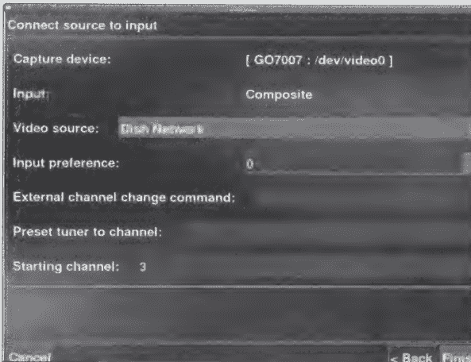

使用向上或向下方向键将高亮移动到“视频源”（Video Source）字段，然后使用向右或向左方向键选择你在上一节中配置的视频源。按空格键或回车键接受你的选择。输入连接现在出现在连接列表中。按 `Esc` 键返回主设置菜单。

## 频道编辑器 (Channel editor)

你不需要对频道列表进行更改，因为这些内容是从你之前注册的 Zap2it 服务导入 MythTV 的。你可以根据需要进行任何更改。按空格键或回车键进入“频道”（Channels）窗口。将高亮移动到你想要编辑的频道上并按空格键或回车键。完成后，务必按空格键或回车键以你的更改。

按 `Esc` 键退出 MythTV 设置程序。

## 填充节目指南

你需要用你的设置和节目指南信息填充 MythTV 数据库。在命令行提示符中，通过发布以下命令启动 MythTV 后端服务器：

```
mythbackend &
```

这会启动后端服务器并在后台运行。当命令行提示符返回时，发布以下命令：

```
$ mythfilldatabase
```

此程序将根据你在“视频源”部分中订阅的 Zap2it 数据库，将节目指南信息填充到数据库中。此过程需要一些时间，请耐心等待。几分钟后，命令行提示符会返回，配置几乎全部完成。接下来，你需要启动 MyTV 前端。

## 配置 MyTV 前端服务器

在配置好 MyTV 后端服务器并用电视节目列表填充节目指南后，你就可以启动 MyTV 前端服务器了。可以通过发布以下命令启动 MyTV 前端：

```
$ mythfrontend
```


此命令启动前端服务器并为你提供访问 MyTV 系统的界面。如果目前为止一切顺利，你应该看到一个与图 6-4 类似的窗口。


# 第6 章：使用 MythTV 构建个人视频录制器

这是 MythTV 主菜单，从这里你可以从许多媒体选项中进行。MythTV 主菜单提供 11 个选项。这些选项是：

- **电视 (TV)**：选择此选项查看与观看和录制电视相关的其他选项。
- **音乐 (Music)**：选择此选项查看与选择和播放音乐相关的其他选项。
- **视频 (Videos)**：选择此选项可让你获得与系统中存储的视频相关的额外选项。
- **DVD**：选择此选项可以控制你的 DVD 播放器以播放或刻录 DVD。
- **图像 (Images)**：选择图像将显示你在 PC 上存储的任何图像，并让你显示幻灯片。
- **游戏 (Games)**：MythTV 程序目前不支持此菜单选项。
- **天气 (Weather)**：选择天气将显示你当地的当前天气状况以及未来几天的预报。
- **新闻订阅 (News Feeds)**：选择此选项从你配置的源获取新闻信息。
- **网页 (Web)**：选择此选项浏览到你配置的互联网位置。
- **电话 (Phone)**：要使用此服务，你必须订阅 SIP 服务器。如果你正在使用 VoIP 服务，你将知道这是什么。否则，你无法使用此功能。
- **设置 (Setup)**：选择设置将提供配置前十项选择的选项。

通常你可以在不更改 MythTV 前端设置的情况下开始使用 MythTV 看电视。但如果你想播放系统中存储的音乐或观看视频或查看幻灯片，你必须进行更多的配置。只需从 MythTV 主菜单进入“设置”，打开 MythTV 前端设置，如图 6-5 所示。

MythTV 前端设置菜单上有 14 个配置选项。以下列表显示了这些选项并描述了它们用途：

- **通用 (General)**：你可以在这里修改的设置包括数据库配置设置和音频设备设置。还包括与启动和停止系统相关的系统设置、自动运行用于节目列表的 mythdatabase 程序以及系统日志。

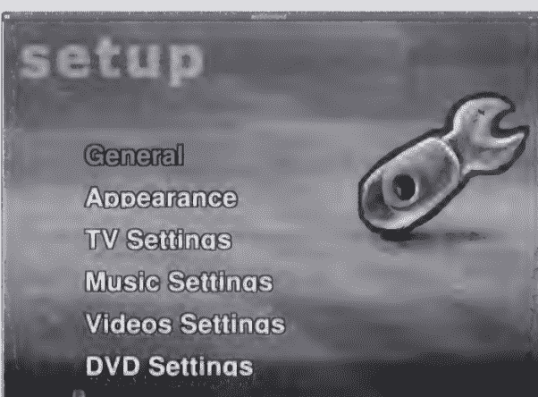

图 6-5：用于配置媒体选项的 MythTV 前端菜单

- **外观 (Appearance)**：这些设置控制 MythTV 在显示器上的外观。你可以从许多不同的主题中选择，并更改字体大小、语言以及日期时间格式。
- **电视设置 (TV Settings)**：选择此选项可以让你设置与观看和录制电视相关的参数。你还可以设置节目指南显示的偏好，并设置录制方案。
- **音乐设置 (Music Settings)**：在此区域，你可以设置音乐文件所在位置的路径。你还可以配置音乐播放器的性能并选择音乐编码选项。
- **视频设置 (Video Settings)**：在此区域，你可以设置视频文件所在位置的路径。你还可以配置默认视频播放器并选择视频文件类型和编码选项。
- **DVD 设置 (DVD Settings)**：DVD 设置菜单让你配置你的 DVD 设备并设置播放器设置。你还可以配置 DVD 刻录和转码选项。
- **图像设置 (Image Settings)**：在图像设置中，你可以指定图像目录的路径，以及从连接设备（如 CD 或数码相机）导入图像的路径。
- **游戏设置 (Game Settings)**：MythTV 目前未使用此菜单选项。
- **天气设置 (Weather Settings)**：在这里你可以选择显示天气数据的位置。你还可以在公制和英制单位之间切换。
- **新闻设置 (News Settings)**：在此区域，你可以从接收信息的服务列表中进行选择。
- **网页设置 (Web Settings)**：在这里你可以为想要查看的网站创建书签。你还可以选择使用的浏览器。
- **电话设置 (Phone Settings)**：选择此选项可以让你配置 SIP 服务器 URL 以及其他连接参数。

## 观看电视

到这里你可能在想：“我已经花了这么多配置硬件、安装和配置 MythTV，什么时候能上看电视呢？”好了，等待结束了。开始看电视：

- 从 MythTV 前端主菜单，高亮 TV 并按空格键或回车键打开电视菜单。
- 菜单上的第一个选项是电视。
- 在 TV 高亮时按空格键或回车键。

系统显示默认频道，通常是节目列表中的第一个（或最低）频道。如果一切顺利，你将看到显示的频道。你可以使用向上向下方向键切换频道。


如果你使用的是外部电视调谐器（例如来自缆公司或卫星供应商的设备），你需要更改该设备上的通道。可以让 MythTV 控制外部调谐器设备，但这种配置过于复杂，书中无法详述。要获取 MythTV 的完整指南，请参阅 MythTV 网站 `www.mythtv.org`。

## 管理你的录制

如果你想查看你所在区域有哪些节目以及时间，你可以查看在线日程。节目信息在后端服务器配置期间会被下载并放入你的数据库中。

## 安排你的录制

从日程中，你可以选择想要录制的节目并设置录制选项。要进入日程，将高亮移动到 Schedule 并按空格键或回车键；然后在 Guide 高亮上按空格键或回车键。你会看到一个类似于图 6-6 的列表。

# 第三部分：借助 Linux 的帮助娱乐你的大脑


图 6-6：MythTV 中的电视节目列表显示。

使用左、右、上、下箭头键在列表中进行导航。当高亮位于你想要录制的节目时，按空格键或 Enter 键进入可以设置录制选项的屏幕。在此页面上，你有许多选项可以选择。将高亮停在某个选项上，然后按右/左箭头键查看所选选项的额外选择。做出选择后，请务必点击“保存设置”（Save Settings）。主日程表重新出现，你选择的节目将被标记，表示已安排录制。你可以根据需要录制任意数量的节目。

## 观看录制内容

录制了一些节目后，你可能想观看它们。你可以通过从 MythTV 主菜单选择“TV”，然后选择“观看录制”（Watch Recordings）来实现。出现的“选择观看的录制”（Select a Recording to Watch）窗口将显示可查看的录制节目。使用箭头键高亮你的选择，然后按空格键或 Enter 键开始观看节目。

## 删除录制内容

录制了几个节目后，你可能想删掉其中的一些。你可以通过从 MythTV 主菜单选择“TV”，然后点击“删除录制”（Delete Recordings）来实现。出现的“选择永久删除的录制”（Select a Recording to Permanently Erase）屏幕将显示可删除的录制节目。使用箭头键高亮你的选择，并按空格键或 Enter 键删除录制。系统将提示你确认删除录制。根据你的意愿选择“是”或“否”。

# 第 6 章：使用 MythTV 构建个人视频录制机

## 管理你的媒体

通过 MythTV，你可以看电视、暂停和恢复直播、安排录制，并完成典型 PVR（个人视频录制机）可以做的一切。然而，你可以做的比典型 PVR 提供的多得多。你可以将 MythTV 作为系统中所有媒体的控制中心。你可以使用 MythTV Music 菜单组织并播放所有的音乐文件。你可以使用 Video 菜单选项播放存储在系统中的视频，并使用 Images 菜单组织并显示所有图像的幻灯片。在本节中，我将为你快速介绍这些项目。

## 使用 MythTV 播放音乐

MythTV 让你能够组织和播放存储在系统中的音乐文件；例如，你可以用它来播放从 CD 中刻制的 MP3 文件。不过，在使用音乐播放器之前，你必须输入包含音乐文件的目录位置。方法如下：

1. 从 MythTV 主菜单，选择 `设置（Setup） > 音乐设置（Music Settings） > 通用设置（General Settings）`。
2. 在“存放音乐的目录”（Directory to Hold Music）字段中输入音乐文件的路径。
3. 点击“下一步”（Next），然后点击“完成”（Finish），最后按两次 Esc 返回主菜单。
4. 从主菜单中，选择 `音乐（Music） > 选择音乐（Select Music）`。
5. 使用箭头键高亮你想播放的音乐，并按空格键进行选择。
6. 完成后按 Esc 返回音乐菜单。
7. 从音乐菜单中选择“播放音乐”（Play Music）。
8. 要停止播放音乐，按 Esc。

你所选的音乐将开始播放。

## 使用 MythTV 播放视频

MythTV 让你能够组织和播放存储在系统中的视频文件。在使用视频播放器之前，你需要输入包含视频文件的目录位置。方法如下：

1. 从 MythTV 主菜单，选择 `设置（Setup） > 视频设置（Videos Settings） > 通用设置（General Settings）`。
2. 在“存放视频的目录”（Directory That Holds Videos）字段中输入视频文件的路径。
3. 两次“下一步”（Next），然后点击“完成”（Finish），并按两次 Esc 返回 MythTV 主菜单。
4. 从主菜单中，选择 `视频（Videos） > 浏览视频（Browse Videos）`。
5. 使用上、下箭头键找到你想播放的视频，并按空格键进行选择。
6. 完成后按 Esc 返回视频菜单。

## 使用 MythTV 查看图像幻灯片

MythTV 让你能够组织和查看存储在系统中的图像文件幻灯片。在使用图像查看器之前，你需要输入包含图像文件的目录位置。方法如下：

1. 从 MythTV 主菜单，选择 `设置（Setup） > 图像设置（Images Settings）`。
2. 在“存放图像的目录”（Directory That Holds Images）字段中输入图像文件的路径。
3. 点击“完成”（Finish）然后按 Esc 返回 MythTV 主菜单。
4. 从主菜单中选择 `图像（Images）` 打开图像页面，你可以在那里看到你的图像。
5. 使用箭头键在图像之间导航。
6. 按空格键或 Enter 键查看高亮图像的全屏视图。按 Esc 返回缩略图查看器。
7. 按 M 键激活屏幕左侧的菜单。
8. 使用上或下箭头高亮你的菜单选择，并按空格键或 Enter 键进行选择。
9. 要停止幻灯片，按 Esc。
10. 从缩略图查看器按 Esc 退出图像查看器。

# 第 7 章

## 无线流传输音乐

**本章内容**

- 选择硬件和软件
- 配置你的系统
- 选择你的音乐格式
- 刻录 CD
- 流传输音频

## 选择硬件和软件

将音频流传输到家中不同位置的首要考虑因素是你的无线网络。在本章中，你将查看一些可能性。我将向你展示选择的解决方案以及如何设置它。

有了家庭网络，设置将变得简单得多。有两个部分需要设置：服务器端和客户端。服务器端由向网络提供媒体流传输的硬件和软件组成。我将在“安装和配置媒体服务器”部分介绍服务器端。客户端是从网络接收媒体流传输的硬件设备。我将在“连接和配置 D-Link 客户端”部分介绍客户端。

以下是你实现目标所需的列表：

- 运行 Linux 的 PC（媒体服务器）。
- 媒体服务器软件。
- 格式正确的音频文件（通常为 MP3、WMA 或 OGG）。
- 设置为客户端的 PC 或专用客户端系统。专用客户端通常是硬件设备，例如 D-Link DSM-320 或 Netgear MP101。
- 家庭音响系统。

我的媒体服务器 PC 是几年前构建的系统。系统规格如下：

- AMD Athlon 1800
- 1GB pc133 RAM
- 80GB 硬盘
- 10GB 硬盘
- DVD/CD 刻机
- AC 97 声卡
- 10/100 以太网适配器

如你所见，系统不需要是最先进、强大的也可以作为媒体服务器运行。使用带有 PIII 或更高处理器的近期 Pentium 类 PC 可能获得良好的性能。

服务器运行名为“TwonkyMedia”的媒体服务器软件，这是从 TwonkyVision 网站下载的。该公司提供免费的音乐服务器，以及一个可以流传输视频和照片幻灯片的完整媒体服务器。我最初使用免费的服务器软件，但升级到了完整版以利用流传输和幻灯片功能。媒体服务器软件完整版的价格为 15 欧元，约合 17 美元。下载软件的网站位于 `www.twonkyvision.de`。

# 第7 章：无线流媒体传输 131

我所有的音乐文件都是 MP3 格式，以便与便携式 MP3 播放器最大的兼容。所有的便携式音乐播放器都能播放 MP3 文件，某些还可以播放 OGG 或 WMA。我没有找到可以同时播放这三种（MP3、OGG 或 MP3 和 WMA）的播放器。为了获取 MP3 文件，我将 CD 刻录为 WAV 文件，然后使用名为 Grip 的程序将其编码为 MP3。（有关 Grip 的更多信息，请参阅本章后半部分的“使用 Grip 刻录 CD 和编码音乐文件”）。

在复制 CD 时，请务必考虑版权问题。通常，终端用户会对录制内容制作一份副本作为存档。我不是版权专家，所以如果你对这类问题有任何疑问，我建议在网络上搜索更多信息。

这就是我为音乐流媒体系统服务端设置的所有内容。现在你需要查看客户端，它的的设置起来更加简单。

我决定使用一种符合通用即插即用（UpnP）流媒体标准的专用媒体客户端。任何同样符合此标准的软件都能与此设备配合。某些媒体客户端仅接收音频，而某些客户端则接收视频和静态照片。这些媒体客户端之间的价格差异并不大，因此我建议购买带有额外功能的媒体客户端。

我选择 D-Link DSM-320 作为我的媒体客户端，原因有两个：

- 它被 TwonkyVision 网站列为其 Linux 媒体软件的支持设备。找到明确支持的硬件总是一个好主意。如果你选择已知与 Linux 兼容的设备，可以节省大量的时间和烦恼。
- 它在我当地的电子商店正在促销。在折扣价的基础上，制造商还提供了返现，使得成本比购买仅音乐客户端便宜几美元。除了接收流媒体音频外，D-Link 媒体服务器还可以接收 MPEG 和 AVI 视频以及 JPEG、GIF 和 PNG 幻灯片。返现后 D-Link 媒体服务器的成本低于 160 美元。我的媒体流媒体（不包括家庭商店）的总成本约为 175 美元。

如果你想获得高质量的音频，你需要一个放大器或接收器来连接媒体客户端的音频输出。简单的解决方案是将音频连接到你的家庭音响系统，这样声音就可以通过音响器播放，就像你通过直接连接的 CD 播放器或其他音频源一样。


# 132 第三部分：在 Linux 的帮助下娱乐你的大脑

## 配置你的系统

要配置你的系统，你需要在存放媒体文件的 PC 上下载、安装并配置 TwonkyVision 媒体服务器。然后按照所需的步骤将 D-Link 媒体客户端连接到家庭影院系统，并配置其连接到我的家庭网络。

## 安装和配置媒体服务器

在 Linux PC 上运行媒体服务器相对简单。但首先，你必须下载并安装它。请按照以下步骤操作：

1. 打开 浏览器并访问 `www.twonkyvision.de/UPnP/download-trial.html`。
2. 点击 Linux x86 链接将文件下载到你的 PC。
3. 将内容解压到创建的文件夹中，并运行 `twunkymedia-trial` 脚本。

TwonkyVision 媒体服务器现在正在运行，你将使用浏览器继续配置服务器。你将指定文件路径并为服务器设置性能参数。

- 在地址栏中输入 `http://127.0.0.1:9000`。

出现 TwonkyVision 媒体服务器的状态页面，如图 7-1 所示。页面左侧有一列图标；这些图标链接到配置页面，这些页面的名称与图标对应。点击图标将在主页的右侧框架中打开页面。

简而言之，以下列表解释了这些图标的作用，包括一些需要立即注意的细节：

- **Status（状态）**：当你登录媒体服务器 Web 页面时，状态页面是默认显示的页面。此页面提供了有关服务器的信息，例如服务器名称、连接的客户端、正在提供的内容、内存使用情况以及使用的网络接口。
- **Content（内容）**：这是你可以指定服务器所用语言的页面。尽管更重要的是，该页面是你指定内容目录位置的地方。这些信息告诉服务器去哪里查找（或不要去查找）你想要提供的音乐、照片和视频。

# 第7 章：无线流媒体传输 133

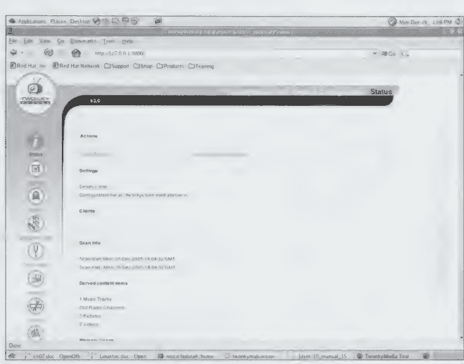

图 7-1：Twonky-Vision 媒体服务器的状态页面。

在 Content Locations（内容位置）框中，务必输入你想要扫描内容的目录。你可以输入用逗号分隔的多个目录位置。你可以保持此页面上的其余设置不变，你的服务器将正常工作。完成后务必点击 Save Changes（保存更改）。

如果你将媒体放在单个目录中并在该目录下运行服务器启动脚本，媒体服务器将自动扫描此目录。

# 134 第三部分：在 Linux 的帮助下娱乐你的大脑

- **Tree builder（树生成器）**：此页面是可以精炼树形结构的地方。你可以为你的树指定额外的名称，例如艺术家（Artist）、流派（Genre）等。
- **Network（网络）**：在网络页面上，你可以指定服务器的 IP 地址以及影响媒体服务器的其他设置。通常情况下，你的服务器无需更改此页面设置即可工作。
- **Clients（客户端）**：在客户端页面上，你可以指定连接到服务器的特定客户端的 IP 地址。（在此页面上，我了我使用的客户端的 IP 地址。）
- **Performance（性能）**：性能页面是可以更改流缓冲区大小的地方。


在任何向文本框输入信息或更改任何设置的页面上，务必点击 Changes（更改）。从状态页面开始，应用你所做的的所有更改。

媒体服务器现在已完成配置并准备好提供内容。你可以开始设置客户端了。

## 连接和配置 D-Link 媒体客户端

你可以按照这些简单的步骤将媒体服务器连接到音视频设备和家庭网络。只需要为网络输入正确的设置，以便 D-Link 单元连接到你的网络。

1. 从箱中取出 D-Link 单元，并使其背面面向你。


## 第 7 章：无线流媒体音乐

2. 连接适当的音视频连接线缆。你可以使用复合视频或分量视频连接，以及数字同轴、数字光纤或复合音频连接。连接类型在 D-Link 单元上有标记。参考你的音响和视频组件的文档，并为你的系统使用相应的连接。

3. 确保天线已安装在单元背面。

4. 插入电源线并开启 D-Link 客户端。

出现带有设置向导的欢迎屏幕。

5. 按 D-Link 遥控器上的 `Enter` 键。

6. 使用向下键高亮“下一步”（`Next`）并按下 `Enter`。

7. 显示“选择您的网络连接”（`Select Your Network Connection`）屏幕，显示网络类型为“无线”（`Wireless`）。

8. 使用向下键高亮“下一步”（`Next`）并按下 `Enter`。

下一个屏幕将显示您的网络 SSID。

9. 使用遥控器上的上和下方向键高亮您的 SSID 并按下 `Enter`。

屏幕将显示您当前的无线设置（参见图 7-2）。

根据您的网络设置情况，您可能需要在此页面上进行更改。例如，如果您正在使用 WEP，则应该在此页面上启用 WEP 并输入适用于您网络的密钥。要启用 WEP，高亮 WEP 项目，在遥控器上按 `Enter`，并使用向上和向下方向键更改设置；然后按 `Enter`。

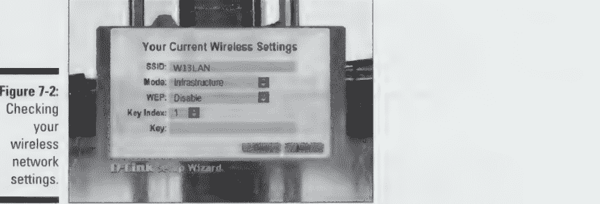

10. 在完成连接无线网络所需的必要更改后，高亮“下一步”（`Next`）并按下 `Enter`。

显示的下一个屏幕是“您的当前网络设置”（`Your Current Network Settings`）屏幕，如图 7-3 所示。默认情况下，系统使用 DHCP 获取您网络的 IP 信息。

要查看带有图标信息的微型帮助提示，请将光标悬停在图标上。

11. 如果您想使用 DHCP，高亮“下一步”（`Next`）并按下 `Enter` 继续。

如果您没有 DHCP 服务器或只是想设置自己的 IP 信息，则可以在此页面上进行操作：

a. 高亮 DHCP 项目，在遥控器上按下 `Enter`。

b. 使用方向键选择“静态 IP”（`Static IP`），然后按下 `Enter`。

c. 请务必在相应的字段中输入适用于您网络的 IP 信息。

d. 完成后，高亮“下一步”（`Next`）并按下 `Enter`。

出现“请选择媒体服务器”（`Please Select a Media Server`）屏幕。最后一步是从列表中选择您的媒体服务器。

12. 高亮“下一步”（`Next`）并按下 `Enter`。

出现最后一个屏幕，并指示设置过程已完成。

13. 按“完成”（`Done`）退出设置并进入媒体服务器主菜单，如图 7-4 所示。

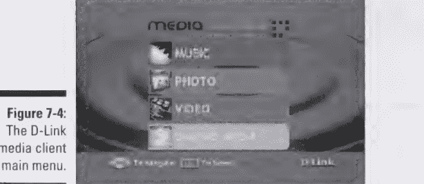

媒体客户端现在已配置好连接到您的网络，并应该显示图 7-5 所示的主菜单。您可以选择“音乐”（`Music`）、“照片”（`Photo`）、“视频”（`Video`）或“在线媒体”（`Online Media`）来显示相应区域的内容。在下一节中，您将发现如何添加一些音乐内容。

### 选择您的音乐格式

您决定使用的音乐格式在很大程度上取决于媒体客户端支持的格式类型。幸运的是，D-Link 媒体客户端支持多种格式：

- **MP3:** MP3 格式是互联网传输音频和在便携式音乐播放器上播放最广泛使用的格式。这是大多数用户的最佳选择。MP3 格式的文件以 `.mp3` 扩展结尾。

- **WMA:** WMA 格式由 Windows Media Player 和一些其他音乐播放器使用。WMA 格式的文件以 `.wma` 扩展结尾。

- **WAV:** 这是大多数 Windows 音频程序使用的标准文件类型。刻到 PC 的 CD 音乐文件通常保存为 WAV 文件。WAV 格式的文件以 `.wav` 扩展结尾。

- **OGG Vorbis:** OGG Vorbis 是一种开源音频格式。OGG Vorbis 文件以 `.ogg` 扩展结尾。

选择音乐格式时的另一个考虑因素是除了家庭系统外，您是否会在其他媒体播放器上使用这些文件。如果您将使用便携式音乐播放器，请选择 MP3 或 WMA 作为音乐格式，因为这些类型的播放器通常都能播放这两种格式。在我的系统中，我使用 MP3 格式，并向您展示如何刻 CD 并创建 MP3 文件。

### 使用 Grip 刻 CD 和编码音乐文件

一个名为 Grip 的程序允许您将 CD 刻为 WAV 文件并将其编码为 MP3。如果您运行 Fedora Core、Red Hat Enterprise Linux 或 SUSE，可以使用 Yum 轻松安装 Grip 程序。如果您使用 Debian 或其派生版本，可以使用 APT 安装它。例如，在我的系统中，我在 `root` 命令提示符下输入：

```bash
yum install grip
```

Yum 会搜索任何依赖项并作为 Grip 安装的一部分进行安装。当命令提示符返回时，Grip 已安装并准备好使用。您可以通过在命令提示符处输入 `grip` 或从系统菜单中选择来运行它。在我的 Fedora Core 4 系统上，可以选择“应用程序；音频与视频；Grip”。无论您如何启动程序，都会显示图 7-5 所示的屏幕。

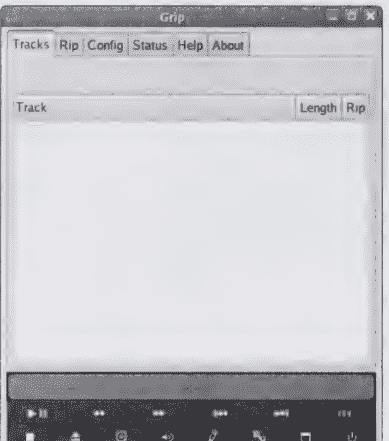

当 Grip 启动时，它会显示 CD 格式。在以下步骤中，我将向您展示如何设置：

1. 点击“刻录”（`Rip`）标签页打开。

2. 高亮媒体服务器。

3. 高亮媒体服务器。

4. 点击“编码”（`Encode`）标签页。

5. 高亮媒体服务器。

6. 点击“刻录”（`Rip`）标签页。

7. 选择您要刻制的曲目。

8. 点击“编码”（`Encode`）按钮。

9. 当整个过程完成时。

10. 将文件移动到目录。


### 流传输音频

本章的步骤应该为您设置好媒体服务器和客户端。在本节中，您将检查一切是否正常，然后尝试一些音频。

通过以下 `ps` 命令检查您的媒体服务器是否正在运行：

```bash
ps ax | grep media
```

系统返回类似下面的信息：

```
3384 pts/1 S1    0:00 /mnt/ide2/mymedia/twonkymedia -D
3411 pts/1 S+    0:00 grep media
```

运行 `ps` 命令的结果显示媒体服务器正在运行。您还可以通过打开 Web 浏览器并在地址栏输入 `http://127.0.0.1:9000` 来检查媒体服务器。如果服务器运行，您将看到媒体服务器状态页面。

当您确定媒体服务器正在运行时，可以使用客户端。如果客户端连接到网络并检测到媒体服务器，它将显示主菜单屏幕（参见图 7-5）。

使用遥控器上的方向键高亮“音乐”（`Music`）。按下 `Enter` 并导航目录树直到找到您刻制和编码的文件。高亮您想听的歌曲并按下 `Enter`。

您的选择将开始通过音响系统播放。您还会看到一个显示当前正在播放曲目的显示。

恭喜您！您现在在家里设置了一个流媒体音乐服务器。如果您遵循我的建议并使用相同的 D-Link 客户端，您还可以从同一系统中查看所有照片的幻灯片并观看视频。

## 第 8 章：玩转摄像头

### 本章内容

- 在 Linux 下设置摄像头
- 自动将摄像头图像上传到你的网站
- 免费进行视频会议
- 使用平移和俯仰观察
- 使用摄像头让你的家更智能

摄像头非常有趣，而且非常实用。本章将向你展示如何使用 Linux 和摄像头按照设定的时间间隔自动将新图像上传到你的网站，让你在离开家时也能监控家里情况、进行免费的视频通话等。

### 分享摄像头带来的乐趣

你可以使用 Linux 和摄像头在网络上进行流传输图像（流传输图像就是实时传输它们）。你可以利用摄像头的图像流进行各种酷炫的操作。

- 你可以在宝宝的活动围栏附近设置一个婴儿摄像头，向世界直播他/她的各种顽皮作剧。
- 如果你正在装修房子，可以设置一个家庭摄像头，让亲戚们看到你的装修进度。
- 你可以在和奶奶通电话的同时，向她传输你们家人的图像。
- 当你离开家时，可以留意家里。

CamStream 是一个简单、实用的 Linux 程序，它可以让你轻松完成所有这些事情，因此它是你 Linux 摄像头之旅的良好起点。

### 安装 CamStream

像 CamStream 这样的网络流软件通常不包含大多数 Linux 发行版的标准应用程序中，因此你可能需要从作者的网站获取源代码并为你的电脑进行编译来安装它。在此之前，你可能想检查你是否有一个合适的软件驱动程序——这是摄像头的基础软件，使你的摄像头能够配合 Linux 应用程序。

### 寻找摄像头驱动程序

在本章中，示例使用了常用的摄像头，如罗技 QuickCam Pro 4000 和罗技 Orbit。如果你使用的是不同型号的摄像头，请查看 `www.linux.com/howtos/Webcam-HOWTO/hardware_driver#MODELS` 中的 Webcam HOWTO，查看你的摄像头是否受 Linux 内核支持；如果不支持，查看应该使用哪种驱动程序并获取。

内核是软件的核心，负责协调你计算机的运行。

Webcam HOWTO 是一个极好的资源，列出了数十种摄像头型号以及支持你摄像头的 Linux 内核模块或驱动程序的名称。如果你找不到想要的信息，该 HOWTO 提供了其他查找位置的建议；如果不起作用，你可以访问 `www.google.com/linux` 并搜索“driver”以及你的摄像头名称——例如，这可能会带你进入一个可以找到并下载 Linux 驱动网站。

并不是所有摄像头都能兼容 Linux，有些摄像头的驱动程序仍在开发中并可能存在 Bug，但你很有机会为你的摄像头找到良好的驱动程序。不过，如果你正在购买摄像头，值得先花时间做些研究，以确保它有良好的驱动程序。

### 设置 Synaptic 仓库

如果你正在使用 Ubuntu，可以使用安装 Linux 发行版时包含的包管理器。要做到这一点，你必须首先设置对 Linux 发行版网络软件源的访问，以便轻松获取你需要的驱动程序（如果它尚未是你 Linux 内核的一部分）。

要指定让 Synaptic 使用的软件源，请遵循以下步骤：

1. 如果你使用的是带有默认桌面的 Ubuntu（即 Gnome），从桌面面板选择 `System:Administration:Synaptic Package Manager`（系统管理：Synaptic 包管理器）。如果你使用的是 Kubuntu 桌面，在 K Menu 中选择 `System:Package Manager (Synaptic Package Manager)`。会出现以 root 身份运行的对话框。

2. 输入管理员密码并点击 `OK`。出现 Synaptic 包管理器窗口。

3. 选择 `Settings`（设置）。出现 `Software Preferences`（软件偏好）对话框。

4. 点击 `Add`（添加）。出现 `Edit Repository`（编辑存储）对话框。它有一个下方带有复选框的弹出菜单。

5. 在 `Repository`（存储）弹出菜单中，选择第一项并勾选所有复选框。点击 `OK`。对话框消失。

6. 在 `Software Preferences` 对话框中，点击 `Add`。再次出现 `Edit Repository` 对话框。

7. 从存储弹出菜单中，选择 `Ubuntu Security`（Ubuntu 安全）选项（数起第二个），然后勾选所有复选框。点击 `OK`。

8. 在 `Software Preferences` 对话框中，点击 `Add`。再次出现 `Edit Repository` 对话框。

9. 从存储弹出菜单中，选择 `Ubuntu Updates`（Ubuntu 更新）选项（数起第三个），然后勾选所有复选框。点击 `OK`。

10. 在 `Software Preferences` 对话框中点击 `OK`。`Software Preferences` 对话框消失。

11. 选择 `Edit:Reload Package Information`（编辑：重新加载软件包信息）。现在，你的计算机可以使用所有的 Ubuntu 软件源。

### 使用 Synaptic 安装软件

接下来，你可能想安装摄像头的驱动程序。要使用 Synaptic 安装软件，可以遵循以下步骤：

1. 如果你使用的是带有默认桌面的 Ubuntu（即 Gnome），从桌面面板选择 `System:Administration:Synaptic Package Manager`。如果你使用的是 Kubuntu 桌面，在 K Menu 中选择 `System:Package Manager (Synaptic Package Manager)`。出现以 root 身份运行的对话框。

2. 输入管理员密码并点击 `OK`。出现 Synaptic 包管理器窗口。

3. 选择 `Edit:Search`（编辑：搜索）。出现 `Find`（查找）对话框。（见图 8-1。）

4. 在你寻找的软件名称中输入（例如 `pwc`）并点击 `Search`。`pwc` 是飞利浦摄像头驱动程序的缩写，是整个系列摄像头的通用驱动之一，包括许多罗技摄像头。

如果包含该软件的软件可用，它将出现在 Synaptic 列表中。

5. 如果你需要的软件可用但未安装，在列表中选择它并选择 `Mark For Installation`（标记为安装）。

6. 要安装已标记的软件包，选择 `Edit:Apply Changes`（编辑：应用更改）。出现摘要对话框，询问是否要应用更改。

7. 点击 `Apply` 按钮。`Downloading Package` 窗口出现并消失，`Applying Changes` 对话框出现，然后应用更改。

8. 在 `Changes Applied` 对话框中点击 `Close`。

### 下载、编译和安装 CamStream 软件

如果你使用 Synaptic 包管理器获取 CamStream 软件（正如在本章早前的“使用 Synaptic 安装软件”中所述），你可能会发现它不在 Ubuntu 仓库中。如果你使用 google.com 上的搜索引擎，你会发现可以在 `www.smcc.demo/camstream` 下载 CamStream 的源代码。

要将 CamStream 源代码编译为计算机可以运行的格式，你需要打开终端并输入 `cd` 以及你保存 CamStream 的目录——例如 `cd directory/camstream`——然后按 Enter。这些操作将你的位置切换到要工作的目录。然后输入 `configure`，按 Enter，并看着大量代码在终端流过（希望它结束时没有留下任何关于无法完成配置的注释，例如缺少驱动程序或你需要查找并安装的应用程序模块）。然后你可以输入 `make`，按 Enter，并看着代码流过（或者休息一下），你的计算机正在将源代码编译为更容易理解的对象代码。当完成后，如果编译成功，你可以输入 `make install` 并看着代码流过，软件将安装到硬盘的相应目录中。

广播视频为 30 fps。在 Web 上进行流时，你可能想选择较慢的帧率，因为许多人的互联网速度不足以处理高帧率。

### 各种控制

- 显示上一张快照
- 按固定间隔拍摄快照


图 8-2：CamStream 窗口。

#### 配置

图 8-3：你可以在视频设置对话框中调整你的视频图像。

| 尺寸与帧率 | 视频控制 | 调整 | 飞利浦扩展 |
|---|---|---|---|
| 尺寸 | subOCIF(128x96) | | 3.7 fps | 15 fps |
| OSIF(160x120) | | 5 fps | 20 fps |
| OCIF(174x144) | | 7.5 fps | 25 fps |
| CIF (320x240) | | 10 fps | 30 fps |
| CIF (352x288) | | | | |
| VGA (640x480) | | | | |

3. 要调整亮度、对比度、伽马和饱和度，点击“视频控制”选项卡，并在那里通过滑块进行调整。

- **伽马**是一条描述图像中灰色调看起来明暗程度的曲线。
- **饱和度**是色调强度的量。高饱和度图像色彩鲜艳，低饱和度图像则呈灰色，几乎没有颜色。
- **亮度**定义了图像中的白色量。
- **对比度**定义了亮色调有多亮以及暗色调有多暗。

4. 如果你的电脑连接了多个摄像头或电视调谐器，你可以点击“调整”选项卡并选择你想查看的摄像头或调谐器。

5. 如果你的摄像头是飞利浦摄像头（以及许多流行的罗技摄像头一样），你可以点击“飞利浦扩展”选项卡来调整图像的光照、降噪和压缩。

### 将摄像头图像发送到其他计算机

CamStream 以你指定的速度生成一系列静态图像，并将它们保存在计算机的硬盘上，或通过 FTP 发送到你指定的另一台计算机的硬盘上。

要发送文件并在另一台计算机上查看，请按照以下步骤操作：

1. 点击 CamStream 窗口中的“配置”按钮。（参考图 8.3）。出现“快照设置”窗口。

2. 选择所需的文件格式单选按钮，例如 JPEG、PNG、PPM 或 BMP，然后在“文件名”（`Basename`）文本框中输入文件名。

3. 如果需要，你可以选择这三个选项之一：

    - **重用文件名（覆盖）**：选择此单选按钮，这样每次创建图像时，它都会覆盖具有相同名的图像。
    - **在文件名中包含时间戳**：选择此单选按钮将使时间和日期成为每张新图像文件名的一部分。
    - **顺序编号**：选择此单选按钮，每张图像将按顺序编号。

4. 如果你想修改默认设置，在“最大序列号”文本框中输入一个数字。

如果计算机生成的图像超过了最大序列号，计算机将删除旧文件并创建新文件；如果你从未超过你指定的限制，则不会如此。

5. 如果你想让 CamStream 将图像保存在硬盘上的主目录，请勾选快照设置对话框底部的“保存到磁盘”复选框；如果你想让 CamStream 将图像发送到另一台计算机，请勾选 FTP 复选框。


你可以根据需要同时选择“保存到磁盘”和“FTP 到服务器”。如果你选择 FTP 路径，你需要执行以下操作：

- a. 点击快照设置对话框中的“FTP 设置”按钮，指定发送图像的计算机。出现“FTP 设置”对话框。
- b. 输入主机名、用户名、密码，以及（可选）要发送图像的计算机的路径，如图 8-4 所示。主机名是 FTP 服务器的名称，例如 `ftp.example.com`，或其 IP 地址，例如 `192.0.168.55`。用户名和密码是你想要登录的账户。路径指定了图像保存在服务器硬盘上的位置。你想要发送图像的计算机需要运行 FTP 服务器以便接收图像。
- c. 点击 FTP 设置对话框中的“确定”。FTP 设置对话框消失。

图 8-4：你可以在 CamStream 的 FTP 设置对话框中指定传输图像的位置。

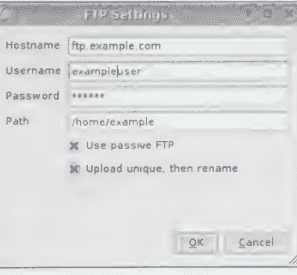

6. 点击快照设置对话框中的“确定”。快照设置对话框消失。CamStream 开始发送连续的快照到……（等等，原文是“到……你指定的”）。

7. 点击 CamStream 窗口中的“按间隔拍摄快照”按钮。出现“定时设置”对话框。

8. 指定你想要的间隔秒数或分钟。点击“确定”。定时设置对话框消失。

### 为图像添加时间戳

要添加时间戳，点击 CamStream 窗口中的“配置”按钮。然后在“快照设置”窗口中，选择“在文件名中包含时间戳”。

### 在浏览器上查看你的图像

要将文件发送到另一台计算机，请勾选 FTP 复选框。如果你选择 FTP 路径，你需要执行以下操作：

- a. 点击快照设置对话框中的“FTP 设置”按钮，指定发送图像的计算机。出现 FTP 设置对话框。
- b. 输入主机名、用户名、密码，以及（可选）要发送图像的计算机的路径，如图 8-4 所示。主机名是 FTP 服务器的名称，例如 `ftp.example.com`，或其 IP 地址，例如 `192.0.168.55`。用户名和密码是你想要登录的账户。路径指定了图像保存在服务器硬盘上的位置。你想要发送图像的计算机需要运行 FTP 服务器以便接收图像。
- c. 点击 FTP 设置对话框中的“确定”。FTP 设置对话框消失。

### 将摄像头图像发送到其他计算机

CamStream 以指定的速度生成一系列静态图像，并将它们保存在计算机的硬盘上，或通过 FTP 发送到你指定的另一台计算机的硬盘上。

要发送文件并在另一台计算机上查看，请遵循以下步骤：

1. 点击 CamStream 窗口中的“配置”按钮。（参考图 8.3）。出现快照设置窗口。
2. 选择所需的文件格式单选按钮，例如 JPEG、PNG、PPM 或 BMP，然后在“文件名”文本框中输入文件名。
3. 如果需要，你可以选择这三个选项之一：
    - **重用文件名（覆盖）**：选择此单选按钮，这样每次创建图像时，它都会覆盖具有相同名的图像。
    - **在文件名中包含时间戳**：选择此单选按钮将使时间和日期成为每张新图像文件名的一部分。
    - **顺序编号**：选择此单选按钮，每张图像将按顺序编号。
4. 如果你想修改默认设置，在“最大序列号”文本框中输入一个数字。

如果计算机生成的图像超过了最大序列号，计算机将删除旧文件并创建新文件；如果你从未超过你指定的限制，则不会如此。

5. 如果你想让 CamStream 将图像保存在硬盘上的主目录，请勾选快照设置对话框底部的“保存到磁盘”复选框；如果你想让 CamStream 将图像发送到另一台计算机，请勾选 FTP 复选框。

你可以根据需要同时选择“保存到磁盘”和“FTP 到服务器”。如果你选择 FTP 路径，你需要执行以下操作：

- a. 点击快照设置对话框中的“FTP 设置”按钮，指定发送图像的计算机。出现 FTP 设置对话框。
- b. 输入主机名、用户名、密码，以及（可选）要发送图像的计算机的路径，如图 8-4 所示。主机名是 FTP 服务器的名称，例如 `ftp.example.com`，或其 IP 地址，例如 `192.0.168.55`。用户名和密码是你想要登录的账户。路径指定了图像保存在服务器硬盘上的位置。你想要发送图像的计算机需要运行 FTP 服务器以便接收图像。
- c. 点击 FTP 设置对话框中的“确定”。FTP 设置对话框消失。

6. 点击快照设置对话框中的“确定”。快照设置对话框消失。CamStream 开始发送连续的快照到……
7. 点击 CamStream 窗口中的“按间隔拍摄快照”按钮。出现定时设置对话框。
8. 指定你想要的间隔秒数或分钟。点击“确定”。定时设置对话框消失。

### 为图像添加时间戳

要添加时间戳，点击 CamStream 窗口中的“配置”按钮。然后在“快照设置”窗口中，选择“在文件名中包含时间戳”。

### 在浏览器上查看你的图像

（此处后续文本包含大量重复、错误和乱码，已根据上下文进行了逻辑清理和翻译）

（注：由于 OCR 识别错误，原文包含大量重复、断裂句子和页眉/页脚。我已根据上下文提供了逻辑清理后的版本。）

## 创建网页

以下是使用简单 HTML 创建网页的方法。（HTML 是超文本标记语言，用于创建网页）。你可以将此代码输入到你的文本编辑器中，创建一个自动刷新的网页。

```html
<!DOCTYPE HTML PUBLIC "-//W3C//DTD HTML 4.0//TRANSITIONAL//EN">
<html>
<head>
  <title>CamStream Pix</title>
  <meta http-equiv="REFRESH" content="1;url=chapter8.html">
</head>
<body>
  
</body>
</html>
```

你可以随意将 CamStream Pix 替换为你自己的标题。在编辑器中选择“文件 > 存储”，将代码保存为网页。将其命名为 `chapter8.html`。HTML 代码部分 `url=chapter8.html` 指定浏览器应在 1 秒后加载网页。如果你将其改为 `5;url=chapter8.html`，浏览器将在 5 秒后加载名为 `chapter8.html` 的页面。

发布一个持续显示摄像头图像的网页（即使你只是想展示给少数朋友或家人看）的简单方法是支付廉价的 Web 托管服务。例如，从如 `www.godaddy.com` 这样的注册商获取你自己的域名（如 `www.example.com`），只需 8 美元或每月几美元，godaddy.com 将托管你的网站。你可以通过 FTP 上传你的 `chapter8.html` 版本。（请确保设置好快照设置对话框，如前面的“将摄像头图像发送到其他计算机”章节所述。）

# 第 9 章：设置智能手机系统

## 本章内容

- 介绍智能手机系统
- 入门
- 安装硬件和软件
- 拨打智能电话

欢迎使用 Asterisk，它是用于电话应用的开源工具包以及一个功能全的通话处理服务器。通俗来说，它就像企业使用的一些高级电话设备，但它具有更多功能，而且更容易供像你我这样的人设置使用。你可以将 Asterisk 作为独立系统使用（这也是我在本章中向你展示的用法），或者将其作为现有 PBX 或 IP 电话（VoIP）方案的辅助（你可能会在未来几年内开始使用）。你可以使用 AGI（Asterisk 网关接口）添加电话应用程序。电话应用程序允许你执行各种酷炫的操作，例如通过电话获取或控制主从机软件（我在第六部分介绍的软件）的状态，或者从互联网获取天气或其他信息并通过电话收听。

基本上，Asterisk 就是你的智能手机系统。它拥有许多功能，并支持很多硬件。除非你的家里人口非常多，否则你可能并不需要其中很多功能。事实上，Asterisk 的功能非常强大，我只能涵盖其能力的一小部分。如果这听起来像是在推卸责任，我很抱歉，但为了对起 Asterisk，我应该专门写一本书来看它；相反，在本章中为你介绍了基础知识。

> **注意**：在本章中，我涵盖的内容足以让你开始使用分机、语音邮箱以及通过电话拨打和接收通话的能力。我做了大部分配置决策，这样更容易学习这些材料。这属于那种不幸的情况：你需要在正确理解和使用这些内容之前先对它们有一定的经验。当然，为了获得经验，你必须学习这些内容。通过利用我的经验，你可以更快地开始使用 Asterisk，因为我为你提供了一个可以扩展的基础。

## Asterisk 101

电话行业有很多奇怪的名字、术语和 TLA（三字母缩写）。遗憾的是，这导致了许多困惑，但我需要使用这些名称和缩写（抱歉）。

**请记住**

此列表解释了我最常用的名称和缩写：

- **ATA**（模拟电话适配器）：该设备接收电话和/或来自运营商的电缆，允许你连接到 IP 网络和 VoIP 服务器（如 Asterisk）。
- **FXO**（外线接口）：连接到电话公司交换机的接口。你将来自运营商的电缆插入 FXO 端口。也称为线路端口。
- **FXS**（外线中站）：连接到电话的接口。你将电话的电缆插入 FXS 端口。也称为端口。
- **PBX**（私有分支交换）：位于企业内部的电话交换机。
- **POTS**（普通电话业务）：任何与非 VoIP 电话业务相关的内容，例如 POTS 线路，即你从当地电话公司获取的电话业务和电缆。
- **PSTN**（公共交换电话网）：电话公司的网络。
- **SIP**（会话发起协议）：VoIP 中使用的协议之一。
- **电话技术**（Telephony）：电话行业使用的技术。电话技术是所有用于从你的电话拨打给他人电话的发送内容的统称。
- **VoIP**（IP 语音）：通过互联网等 IP 网络拨打电话的一种方式。

本章涉及的设置包括 Asterisk 1.2 版本的软件和 Sipura SPA-3000 硬件。SPA-3000 是一种 ATA，允许你连接电话并将你的电话连接到本地 PSTN 网络（这就是你正在构建的）。它实际上就像一个箱子里的两个设备。SPA-3000 的优点之一是，当 Asterisk 不工作或停电时，你仍然可以拨打和接收通话。这是一个重要功能，可以防止你与可能对现代技术不感冒（玩具！）的配偶产生矛盾。我设置了一个拨号计划，它适用于任何北美电话设置（美国和加拿大）。

## 拨号计划

拨号计划是一组规则，它接收模式并指示设备对其执行某些操作。通常，这项工作由电话公司完成，因此你的电话只需将你拨打的所有内容直接发送到电话公司的交换机进行处理。没有 PBX 的情况下，你对从家里拨出的号码做不了什么。

首先，你需要规划想要拨打什么模式。在我的拨号计划描述中，我用 `X` 代替单个数字。对于美国的大部分地区，你需要类似这样的设置：

- 7 位本地拨号（`XXXX-XXX`）
- 10 位本地拨号（`XXX-XXXX-XXXX`）以处理重叠拨号
- 11 位长途拨号（`1-XXX-XXXX-XXX`）
- 功能电话（`*XX`）
- 紧急电话（`911` 或 `311`）或信息查询（`411`）
- 话务员协助（`0`）
- 国际拨号（`01XXX ...`）
- 长途回拨（`1010XXX ...`）
- 内部分机（`XXXXX`）

## 请问号码是多少？

让我解释一下拨号计划是如何配合 Asterisk 工作的。通常，你拨打一个号码，由电话公司处理。它有计划并知道如何处理。在没有 PBX 的情况下，你对从家里拨出的号码做不了什么。

首先，你需要规划想要拨打什么模式。在我的拨号计划描述中，我用 `X` 代替单个数字。对于美国的大部分地区，你需要类似这样的设置：

- 7 位本地拨号（`XXXX-XXX`）
- 10 位本地拨号（`XXX-XXXX-XXXX`）以处理重叠拨号
- 11 位长途拨号（`1-XXX-XXXX-XXX`）
- 功能电话（`*XX`）
- 紧急电话（`911` 或 `311`）或信息查询（`411`）
- 话务员协助（`0`）
- 国际拨号（`01XXX ...`）
- 长途回拨（`1010XXX ...`）
- 内部分机（`XXXXX`）


## 第 9 章：设置智能手机系统

### 本章内容

- 介绍智能手机系统
- 入门
- 安装硬件和软件
- 拨打智能电话

欢迎使用 Asterisk，它是用于电话应用的开源工具包以及一个功能全的通话处理服务器。通俗来说，它就像企业使用的一些高级电话设备，但它具有更多功能，而且更容易供像你我这样的人设置使用。你可以将 Asterisk 作为独立系统使用（这也是我在本章中向你展示的用法），或者将其作为现有 PBX 或 IP 电话（VoIP）方案的辅助（你可能会在未来几年内开始使用）。你可以使用 AGI（Asterisk 网关接口）添加电话应用程序。电话应用程序允许你执行各种酷炫的操作，例如通过电话获取或控制主从机软件（我在第六部分介绍的软件）的状态，或者从互联网获取天气或其他信息并通过电话收听。

基本上，Asterisk 就是你的智能手机系统。它拥有许多功能，并支持很多硬件。除非你的家里人口非常多，否则你可能并不需要其中很多功能。事实上，Asterisk 的功能非常强大，我只能涵盖其能力的一小部分。如果这听起来像是在推卸责任，我很抱歉，但为了详述 Asterisk，我应该专门写一本书来讲它；相反，在本章中为你介绍了基础知识。

> **注意**：在本章中，我涵盖的内容足以让你开始使用单个分机、语音邮箱以及通过电话拨打和接收通话的能力。我做了大部分配置决策，这样更容易学习这些材料。这属于那种不幸的情况：你需要在正确理解和使用这些内容之前先对它们有一定的经验。当然，为了获得经验，你必须学习这些内容。通过利用我的经验，你可以更快地开始使用 Asterisk，因为我为你提供了一个可以扩展的基础。

### Asterisk 101

电话行业有很多奇怪的名字、术语和三字母缩写词（TLAs）。遗憾的是，这导致了许多困惑，但我需要使用这些名称和缩写（抱歉）。

**请记住**

此列表解释了我最常用的名称和缩写：

- **ATA**（模拟电话适配器）：该设备接收电话和/或来自运营商的电缆，允许你连接到 IP 网络和 VoIP 服务器（如 Asterisk）。
- **FXO**（外线接口）：连接到电话公司交换机的接口。你将来自运营商的电缆插入 FXO 端口。也称为线路端口。
- **FXS**（外线中站）：连接到电话的接口。你将电话的电缆插入 FXS 端口。也称为端口。
- **PBX**（私有分支交换）：位于企业内部的电话交换机。
- **POTS**（普通电话业务）：任何与非 VoIP 电话业务相关的内容，例如 POTS 线路，即你从当地电话公司获取的电话业务和电缆。
- **PSTN**（公共交换电话网）：电话公司的网络。
- **SIP**（会话发起协议）：VoIP 中使用的协议之一。
- **电话技术**（Telephony）：电话行业使用的技术。电话技术是所有用于从你的电话拨打给他人电话的发送内容的统称。
- **VoIP**（IP 语音）：通过互联网等 IP 网络拨打电话的一种方式。

本章涉及的设置包括 Asterisk 1.2 版本的软件和 Sipura SPA-3000 硬件。SPA-3000 是一种 ATA，允许你连接电话并将你的电话连接到本地 PSTN 网络（这就是你正在构建的）。它实际上就像一个箱子里的两个设备。SPA-3000 的优点之一是，当 Asterisk 不工作或停电时，你仍然可以拨打和接收通话。这是一个重要功能，可以防止你与可能对现代技术不感冒（玩具！）的配偶产生矛盾。我设置了一个拨号计划，它适用于任何北美电话设置（美国和加拿大）。

### 拨号计划

拨号计划是一组规则，它接收模式并指示设备对其执行某些操作。通常，这项工作由电话公司完成，因此你的电话只需将你拨打的所有内容直接发送到电话公司的交换机进行处理。没有 PBX 的情况下，你对从家里拨出的号码做不了什么。

首先，你需要规划想要拨打什么模式。在我的拨号计划描述中，我用 `X` 代替单个数字。对于美国的大部分地区，你需要类似这样的设置：

- 7 位本地拨号（`XXXX-XXX`）
- 10 位本地拨号（`XXX-XXXX-XXXX`）以处理重叠拨号
- 11 位长途拨号（`1-XXX-XXXX-XXX`）
- 功能电话（`*XX`）
- 紧急电话（`911` 或 `311`）或信息查询（`411`）
- 话务员协助（`0`）
- 国际拨号（`01XXX ...`）
- 长途回拨（`1010XXX ...`）
- 内部分机（`XXXXX`）

### 请问号码是多少？

让我解释一下拨号计划是如何配合 Asterisk 工作的。通常，你拨打一个号码，由电话公司处理。它有计划并知道如何处理。在没有 PBX 的情况下，你对从家里拨出的号码做不了什么。

### 模式匹配规则

- **Z**：匹配单个数字，2 到 9 之间的任意数字。
- **X**：匹配单个数字，0 到 9 之间的任意数字。
- **XX**：匹配任意 2 位数字（但不超过 2 位数字）。
- **XX.**：匹配任意 3 位或更多数字、0 到 9 之间的任意数字、`*` 或 `#`。
- **_**：意味着将随后的模式视为数字，而不是字面字符串。
- **[:]**：匹配括号内列表中的任何内容（单数字）。
- **[2-6]**：匹配 2 到 6 范围内的单个数字。
- **[2-69]**：匹配 2 到 6 或 9 范围内的单个数字。
- 连字符只能存在于括号 `[]` 内部。
- 规则中不要使用空格。

SPA-3000 不使用 N 和 Z 模式。相反，它使用列表 `[]` 规则。Asterisk 将其拨号计划存储在 `/etc/asterisk.conf` 目录下的一个文件中（参见本章稍后的示例）。SPA-3000 使用 Web 界面输入其拨号计划。其拨号计划位于 Line 1 标签页（稍后见图 9-4）和 PSTN 标签页（同样在图 9-6 中）。`_`（下划线）不被 SPA-3000 使用，它在 Asterisk 中的用法相当令人困惑。VoIP 引入了 IP 拨号的概念，电话号码不是数字，而是要拨打电话的名称或 IP 地址。`_` 告诉 Asterisk 将随后的模式视为数字。在 IP 拨号中，要匹配的模式将是一个字符串，并且需要精确匹配。由于现在不会使用 IP 拨号，只需确保你的 Asterisk 扩展都以 `_` 扩展开头即可。我将在本章稍后详细介绍 `s`。

### 上下文

Asterisk 在拨号计划中增加了“上下文”（context）的概念。上下文是一个带有名称的扩展组，以便于识别。这允许你将拨号计划划分为不同的部分。可以使用 `include =>` 命令将不同的上下文包含在（或拉入）一个上下文中。被包含的上下文的所有扩展现在都是拉入它们的上下文的一部分。这允许你创建常用的扩展并在许多地方使用它们，如列表 9-1 所示。

#### 列表 9-1：来自 `/etc/asterisk/extensions.conf` 的 from-pstn 上下文

```
; - 来自 PSTN 的通话 ]------------------------------------
[from-pstn]
; 包含项的时间列表为
; <context><time range|<days of week|>
; <days of month>|<months>
  include => daytime:8:00-22:59|*|*
  include => nighttime:23:00-7:59|*|*
```

`from-pstn` 上下文处理所有来自电话公司的入站电话。它包含了另外两个上下文：daytime 和 nighttime。这些 `include` 语句带有条件参数 `(|8:00-22:59|*|*)` 和 `(|23:00-7:59|*|*)`，这些参数是可选的。这告诉 Asterisk 在指定时间段包含此上下文。如果没有条件参数，你可以创建处理节假日公告和其他精彩功能的上下文。

这两个设备（SPA-3000 被视为两个设备）都已向 Asterisk 注册。位于 `/etc/asterisk` 目录下的 `sip.conf` 文件包含了 Line 1（你插入电话的地方）和 PSTN（电话公司）的注册信息。在 PSTN 注册信息下有 `context = from-pstn` 语句。这就是被分配的 `from-pstn` 上下文。当 Asterisk 接收到电话时，通话将遵循 `from-pstn` 上下文提供的规则。其他设备可以使用相同或不同的上下文。

对于你的设置，有两个主要的上下文：from-pstn 和 from-sip。`from-pstn` 上下文处理来自 PSTN 的通话，通话遵循上下文中的规则决定如何处理它们。`from-sip` 上下文处理发往和来自你的扩展的通话。在一个文中配置的扩展在另一个文中是未知的，除非通过 `include =>` 语句将其包含在文中。列表 9-2 显示了 `extensions.conf` 的部分（我不得不尝试让它适应长度）。它是拨号计划（包括两个上下文和扩展）的良好示例。

#### 列表 9-2：来自 `/etc/asterisk/extensions.conf` 的 stexten 宏

```
; Some变量
PHONE1 = SIP/2201
MAIL1 = 2201

[macro-stexten]
; ${ARG1} - 扩展（可以使用 ${MACRO_EXTEN}）
; ${ARG2} - 要振铃的设备（们）

exten => s,1,Dial(${ARG2},20)
exten => s,2,Goto(s-${DIALSTATUS},1)
exten => s-NOANSWER,1,Voicemail(u${ARG1})
exten => s-NOANSWER,2,Goto(default,s)
exten => s-BUSY,1,Voicemail(b${ARG1})
exten => s-BUSY,2,Goto(default,s,1)
exten => s_,1,Goto(s-NOANSWER,1)
exten => a,1,VoicemailMain(${ARG1})

; - 来自 PSTN 的通话 ]
[pstn]
include => daytime|8:00-22:59|*|*
include => nighttime|23:00-7:59|*|*
```

所以，你现在拥有了第一个匹配所有一个或多个数字的分机，第二个精确匹配 2201 的分机，以及第三个匹配两个或更多数字的分机。正如你所看到的，顺序是不同的，如果你不小心，可能会将所有电话都发送到语音信箱。（是的，即使分机 2201 也匹配第一条规则！）

### 准备材料

好了，技术术语就够了 —— 我头都疼了。现在是时候配置硬件，然后安装 Asterisk 软件并对其进行配置了。硬件部分需要在互联网上进行一些搜索。我建议你使用搜索引擎来找到最低价。在写本书时，SPA-3000 的价格低于 100 美元（美国）。好消息是，你可以在没有硬件的情况下开始安装软件。在获得硬件之前，你无法拨打电话，但你可以尝试各种命令。

此列表描述了你需要的物品，不包括 PC 要求（我在“运行 Asterisk 需要多大的 PC？”侧边栏中讨论过）：

- **软件（在光盘上）**
    - 我替换的配置文件
    - Asterisk 软件，1.2 版本 (`asterisk-1.2.0.tar.gz`)
- **硬件**
    - Sipura SPA-3000 ATA
    - 一个运行 Linux 带有以太网卡的 PC
    - 普通按键电话
    - PSTN 服务（来自电信公司的电话线）
    - 两根 R-J11 电话线
    - 一根以太网线
- **可选**


- 一个来叫显示器和一个额外的 RJ-J11 电话线
- 一个应答机和一个额外的 RJ-J11 电话线

# 第三部分：在 Linux 的帮助下娱乐你的大脑

## 停！

Linksys ATA —— SPA-3102 在我写此之后才上市，当你读到这里时，SPA-3000 可能已经买不到了。这通常是个坏消息，但我有了新的 SPA-3102，它的表现似乎与 SPA-3000 基本相同 —— 至少对于本章的需求而言。要了解是否有任何相关的更改，请访问我的网站 (www.linuxxa.com/)，我将根据需要发布更新。

你必须先有一个可以工作的网络。通常，你在安装时设置它。来叫显示器和应答机是可选的。我妻子希望在应答机上留下留言，因此我配置了 Asterisk：响铃四声后进入语音信箱，响铃三声后进入应答机。当然，在晚上 11 点之后，你将接到 Asterisk 而不是应答机。我妻子对此非常满意。

光盘上的各种文件包含了我对你的 Asterisk 文件副本所做的的配置更改。不用担心原始文件；它们在安装期间会被重命名为 `.bak` 扩展名，这样你可以将我的更改与原始文件进行对比。文件位于 `/etc/asterisk` 目录。

## 将硬件部分组合在一起

图 9 显示了正确组装的硬件（记住应答机是可选的）。SPA-3000 也附带了安装说明；两份说明都可以正常工作。你需要自己购买。我建议使用你最喜欢的搜索引擎来寻找好价格。电话是按键电话，而不是老式的拨号电话。SPA-3000 无法识别拨号电话的脉冲。（奇怪的是，尽管电话上已经没有拨盘了，竟然还有这么多人说你要“拨号”电话号码。）家庭网络可以简单如一个带有以太网卡的 Linux 服务器，通过交叉以太网线连接到 SPA-3000 的以太网端口。图 9 显示了使用了以太网集线器或交换机，这是推荐的方法。

SPA-3000 是一个连接 PSTN、你的电话和 VoIP 服务（在这种情况下为 Asterisk）的网关设备。SPA-3000 的工作是将来自电话或 PSTN 的通话转换为 IP，反之亦然。这个设备为你完成了大部分困难工作。从技术上讲，SPA-3000 不需要 Asterisk 即可工作，但它是家庭环境中配合 Asterisk 使用极极接口。SPA-3000 有四个端口：一个以太网端口、一个 FXO 端口（电话线路端口）、一个 FXS 端口（电话端口）和一个电源端口。

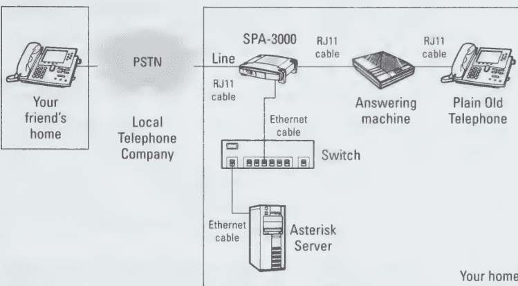

图 9-1：组装好的系统。

SPA-3000 是一个非常有趣的 ATA。它有几个有用功能，第一个是当断电时，SPA-3000 将 PSTN 通话传递到线路 1，将线路 1 通话传递到 PSTN。这意味着即使停电且你的 Asterisk 服务器宕机，你仍然可以拨打和接收外部电话。你将无法拨打任何分机，但你可以拨打外部世界。除了妥善处理断电和/或与 Asterisk 服务器连接丢失外，SPA-3000 还可以直接拨打 911。

## 配置 SPA-3000

在配置 SPA-3000 之前，你需要一些信息。第一个是 IP 地址。下一个是掩码。光盘上的各种文件包含了我对你的 Asterisk 文件副本所做的配置更改。不用担心原始文件；它们在安装期间会被重命名为 `.bak` 扩展名，这样你可以将我的更改与原始文件进行对比。文件位于 `/etc/asterisk` 目录。

- 需要的网络信息：
    - 路由器的 IP 地址
    - 子网掩码
    - 网关地址

- SPA-3000 设置：
    - IP 地址
    - 子网掩码
    - 网关地址

- 安全设置：
    - 管理密码
    - 用户密码

你第一个需要访问的标签是 System 标签，如图 9-2 所示。只需填写 `Admin Passwd` 和 `User Password` 字段。你可以将这些字段留空，但这并不安全 —— 任何访问你网络上 Web 浏览器的人都可以对你的配置进行更改。几乎所有其他字段都是空的，这没关系。要保存更改，点击 Web 页面底部的 `Submit All Changes` 按钮（尽管你可能需要滚动才能看到它）。

### Line 1 选项卡

在 Line 1 选项卡中，你需要进行更改，以便你的电话可以扩展为 2201 并与 Asterisk 服务器通信。你必须对四个部分进行更改。在 Line 1 选项卡的顶部，确保 `Enable`（启用）设置为 `Yes`（是）。然后向下滚动到 `Proxy and Registration`（代理与注册）部分。（见图 9-3）。在这里，你配置 Line 1 与你的 Asterisk 服务器通信。现在处理以下设置：

- `Proxy`: `<Asterisk IP Address>`
    将 `<Asterisk IP Address>` 替换为你的 Asterisk 服务器的 IP 地址（即你的 Linux IP 地址）。
- `Use Outbound Proxy`: `No`
- `Use OB Proxy in Dialog`: `No`
- `Register`: `Yes`
- `Make Call Without Reg`: `No`
- `Register Expires`: `30`
- `Ans Call without Registration`: `Yes`

图 9-3：Line 1 选项卡。

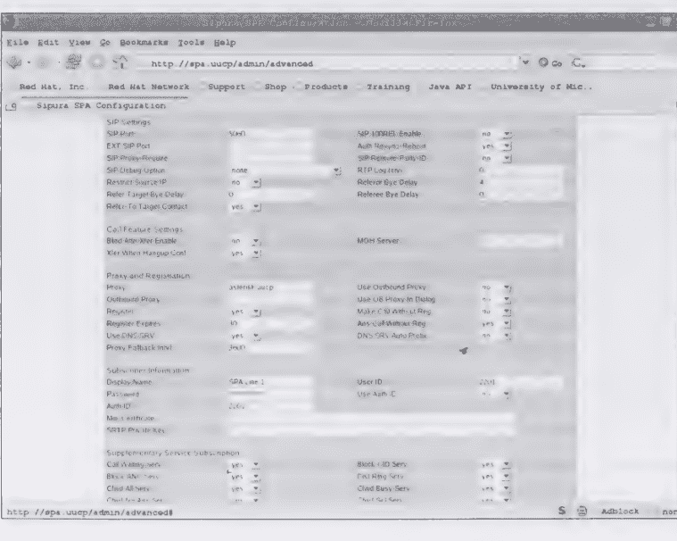

### 第9 章：设置智能手机系统

你还需要对 `Subscriber Information`（订阅者信息）部分进行更改：

- `Display Name`: `SPA Line 1`
- `User ID`: `2201`
- `Password`: `2201`

你可以将 `Display Name`（显示名称）字段更改为任何你喜欢的。它是你的内部呼叫 ID。你无法更改电话公司发送的内容，因为那是位于公司的系统中。现在继续到 `Audio Configuration`（音频配置）部分并进行这些更改：

- `Preferred Codec`: `G.711u`
- `Silence Supp Enable`: `No`
- `Use Pref Codec Only`: `Yes`

现在向下滚动到 `VoIP Fallback to PSTN`（VoIP 回退到 PSTN）部分，并将 `Auto PSTN Fallback` 设置为 `Yes`。这允许你在 Asterisk 服务器负载过载时向 PSTN 拨打电话。你可以将 `Display Name` 字段（你的内部 ID）更改为任何想要的内容，而 Line 1 选项卡的最后部分是拨号计划。（见图 9-4）

```
[[2-79]11S0:<@gw0>|xx|00|2xxx|[2-9] xxxxxxxxxxxxxS0|xxxxxxxxxxxx.)
```

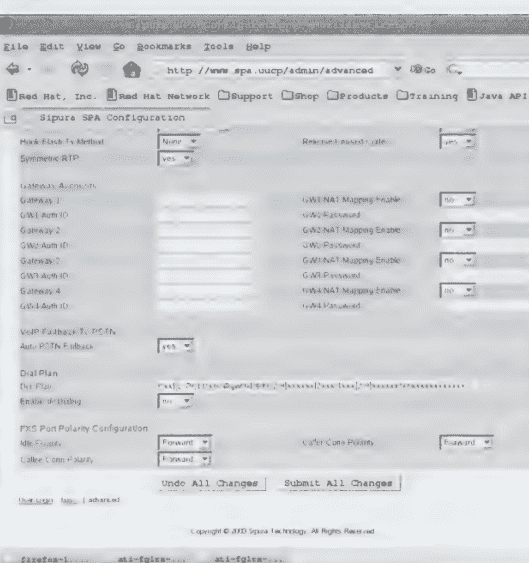

图 9-4：Line 1 选项卡拨号计划部分。

要保存更改，点击网页最底部的 `Submit All Changes`（提交所有更改）按钮。

虽然其余更改很难解释（或者花费太长时间），但我将解释这个拨号计划。首先，我需要告诉你们关于 SPA-3000 拨号计划的规则。拨号计划（括号内的所有内容）通过管道符号 `|` 分成若干部分。每个部分描述了一个匹配特定模式（电话号码）的表达式，并描述了如何处理它。以下是 SPA-3000 拨号计划规则的解释：

- `(:)`: 拨号计划。
- `| |`: 表达式分隔符。
- `1`: SPA-3000 匹配精确按键。（有效按键为 1 到 9、0、* 和 #）。
- `x`: SPA-3000 匹配任何数字（0 到 9）。
- `[:]`: SPA-3000 匹配数字列表中的单个数字。
- `[2-9]`: SPA-3000 匹配范围内的任何单个数字（始终在括号内使用）。
- `S0`: SPA-3000 立即匹配上一个表达式。
- `<a>`: SPA-3000 将拨号表达式 a 替换为表达式 b。
- `<@gw0>`: SPA-3000 将匹配的字符串发送到列出的网关。
- `.`: SPA-3000 匹配一个或多个按键，无论它们是什么。

我使用了替换命令插入了表达式 `@gw0`（即 PSTN 网关）。这告诉 SPA-3000 将通话发送到 PSTN 端口。此外，我使用了括号 `[2-9]`，包含了一个表示 2 到 9 之间任何单个数字的列表。以下是拨号计划的功能：

- `[2-7]11S0:<@gw0>`: SPA-3000 直接将 211、311、411、511、711 和 911 发送到 PSTN，无延迟。
- `**`: SPA-3000 将以 `*` 开头加两个数字的数字（例如 `*69`）发送到 Asterisk 服务器。
- `0`: SPA-3000 将 `0` 直接发送到 Asterisk 服务器。
- `00`: SPA-3000 将 `00` 直接发送到 Asterisk 服务器。
- `2xxx`: SPA-3000 将任何以 `2` 开头的四位数字直接发送到 Asterisk 服务器。
- `[2-9]xxxx`: SPA-3000 将任何以 2 到 9（包含）之间的任何数字开头的七位数字（例如 `5551212`）直接发送到 Asterisk 服务器。


- `1xxx[2-9]xxxxxxxxS0`: SPA-3000 将任何以 `1` 开头且第 5 位在 2 到 9（包含）之间的 11 位数字（例如 `172355251212`）立即发送到 Asterisk 服务器。
- `xxxxxxxxxx.`: SPA-3000 将任何 13 位或更长的数字发送到 Asterisk 服务器。

好了，这很困难！拨号计划很简单，但为了让它们正常工作需要花费大量思考。我为什么不使用 `x` 呢？嗯，SPA-3000 在匹配 2 位（或更多）数字序列后很快就会发送该号码。当序列到达 Asterisk 时，Asterisk 会尝试为它收到的数字输入匹配拨号计划。这可能不是你的本意。

Sipura 为他们的产品赢得了许多赞誉。他们成功地将许多功能整合进了 Web 界面。你可以通过调整 Web 界面中的各种参数在世界任何地方使用 SPA-3000。遗憾的是，这种功能意味着复杂性。Sipura 有一份非常好的 87 页说明书介绍使用方法，遗憾的是，你需要理解所有的术语并阅读整本手册。

### PSTN Line 选项卡

PSTN Line 选项卡（见图 9-5）的配置与 Line 1 选项卡的配置非常相似。因此，你从最顶部开始，通过将 `Line Option` 设置为 `enable` 来启用线路。

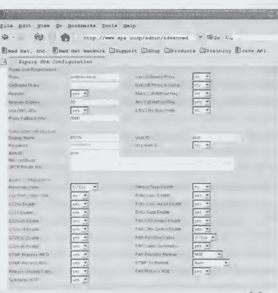

接下来，跳转到 `SIP Settings` 部分。你需要更改端口，因为 Line 1 已经使用 5060。将 SIP 端口设置为 5061。

向下滚动到 `Proxy and Registration` 部分并进行以下更改：

- `Proxy`: `<Asterisk IP Address>`
    将 `<Asterisk IP Address>` 替换为你的 Asterisk 服务器的 IP 地址。
- `Use Outbound Proxy`: `No`
- `Use OB Proxy in Dialog`: `Yes`
- `Register`: `Yes`
- `Register Expires`: `30`

现在向上滚动到 `Subscriber Information` 部分并进行这些更改：

- `Display Name`: `PSTN`
- `User ID`: `pstn`
- `Password`: `pstn`
- `User Auth`: `No`

移动到 `Audio Configuration` 部分并在 `Preferred codec` 中输入 `G711u`。

- `Silence Supp Enable`: `No`
- `Use Pref Codec Only`: `Yes`

现在拨号计划再次出现（见图 9-6）。这次情况变得容易了一些。因此向下滚动到 `Dial Plans` 部分并进行以下更改：

- `Dial Plan 1`: `([2-7]11S0:<@Asterisk IP Address>)`
    将 `<Asterisk IP Address>` 替换为你的 Asterisk 服务器的 IP 地址。
- `Dial Plan 2`: `([2-7]11S0|**|00|2xxx|[2-9]xxxx)`

我会解释拨号计划，但在还有一些更改之后。向下滚动到 `VoIP-To-PSTN Gateway Setup`：

- `VoIP-To-PSTN Gateway Enable`: `Yes`
- `VoIP-To-PSTN Dialing`: `Yes`
- `VoIP-To-PSTN Caller DP`: `8`

点击网页最底部的 `Submit All Changes` 按钮。

## 第 9 章：设置电话系统

- 6. **输入 `make clean` 并按回车**以确保你从干净的状态开始，避免出现各种错误。
    你可以忽略屏幕上出现的任何警告。
- 7. **输入 `make linux26` 并按回车**来编译 Asterisk 程序。
    会有大量信息在屏幕上滚动。只要没有错误，你就可以安全地忽略这些信息。屏幕显示示例见图 9-8。（因为内容有好几页，我进行了裁剪。）
- 8. **输入 `make install` 并按回车**。如果前面的命令没有错误，它会将所有 asterisk 文件安装到正确的位置。


- 9. **输入 `make samples` 并按回车**创建示例配置文件。

这些文件存储在 `/etc/asterisk` 中。

你必须拥有 root 权限才能正确运行 Asterisk。

在编译安装完成后（可以忽略警告），你可以验证 Asterisk 是否真的工作：

- 1. 在命令提示符处**输入 `asterisk -vvvc` 并按回车**。

这是测试 Asterisk 是否正确编译和安装的方法。你会看到大量信息飞闪而过，然后出现一个提示符：

```
hostname*CLI>
```

如果你现在还不懂它们，不要担心。

- 2. **输入 `help` 并按回车**获取帮助信息（信息会滚出屏幕）。

- 3. **要退出 Asterisk 的命令行提示符，只需在提示符处输入 `quit` 并按回车**。

这里是一些实用的命令：

- 要正确启动 Asterisk，你可以通过 init.d 脚本让它在系统重启时自动启动（我已经为你设置好了），或者通过输入 `asterisk` 并按回车来启动（你需要 root 权限）。Asterisk 会启动并在后台运行。如果一切顺利，你只会看到提示符返回。

- 要进入 Asterisk 命令行，输入 `asterisk -r` 并按回车。（记住这个命令，它非常常用。）

- 要停止 Asterisk，在 Asterisk 命令行中输入 `stop now` 并按回车。这将立即停止 Asterisk 并挂断所有通话。

- 如果只是简单退出 Asterisk 命令行界面但仍让 Asterisk 继续处理业务，请输入 `quit` 并按回车。目前，我建议使用 `stop now` 命令。你稍后可以通过 `asterisk` 并按回车来重启 Asterisk。

## 对 Asterisk 进行（必要的）更改

为了简化 Asterisk 的安装，我冒昧地在 `spa-asterisk.rpm` 文件中提供了大部分更改。只需输入 `sh /media/disk/chapter09/ast_install.sh` 并按回车即可安装我的配置文件。

在 `/etc/asterisk` 目录下，你可以找到备份的原始配置文件（扩展名为 `.bak`）以及已安装好的新文件。这并不意味着你就可以跳过编辑文件，而是意味着你不需要手动输入数百行配置信息。只要你位于美国或加拿大，这些都很好，因为你可以立即启动 Asterisk 并开始使用（没错，太棒了！）。对于世界其他地区的用户，你需要进行一些编辑以符合你的需求。关于这些文件的更多细节，请访问 `.asteriskdocs.org`。

说到编辑，现在是时候根据你的电话需求更改一些东西了。打开你喜欢的 Linux 编辑器，编辑 `/etc/asterisk/extensions.conf` 文件。不要使用 Windows 编辑器 - 它会丢失行尾符，给你带来无尽的神奇问题。搜索以下行：

```
AREACODE = 732
```

将 732 修改为匹配你的区号（电话号码 1 之后的前三个数字；例如 1-732-555-1212 中的 732）。现在你可能很幸运，不需要拨打十位数字就能拨通本地号码。如果你是那少数幸运的人之一（我就不是），你需要注释掉处理添加区号的代码行，并取消其之前行的注释。首先，搜索 `${ARECODE}`。代码看起来应该像列表 9-4 所示。

### Listing 9-4：来自 `/etc/asterisk/extensions.conf` 的 to-pstn Context 部分

- 如果你仍可以使用 7 位拨号，请取消下一行的注释，并注释掉其后的行。

- `exten => _XXXXX, 1, Dial(SIP/${EXTEN})`

- `exten => _XXXXX, 1, Dial(SIP/1n${ARECODE})${EXTEN})`

- `exten => _XXXXX, 2, Goto(s-(${DIAL&STATUS}),1)`

- `exten => _XXXXX-NOANSWER, 1, Voicail(u($VM))`

- `exten => _XXXXX-NOANSWER, 2, Goto(default,s1)`

- `exten => _XXXXX-BUS, 1, Voicail(u($VM))`

- `exten => _XXXXX-BUS, 2, Goto(default,s1)`

要注释掉某行，只需在行开头插入一个分号（`;`）。要取消某行的注释，删除该行中的分号。在取消注释时，我建议将分号替换为空格以保持代码整洁。这会让代码更易读。

## 对 Asterisk 进行（可选的）更改

本节是可选的。你可以跳到下一节。你不需要进行任何进一步的更改。我描述了如何添加另一个分机。我已经在 `extensions` 文件中添加了 201 分机，配置了语音信箱使 201 拥有一个掩码，并配置了 SIP 文件使 SPA-3000 的 Line 1 能被正确识别。这样，你将来就可以添加更多设备了。既然你已经正确配置了 SPA-3000，请利用这些信息添加到 SIP 配置文件中。打开你的编辑器，编辑 `/etc/asterisk/sip.conf` 文件，并向下滚动直到看到 9-5 中的节内容（该文件并不大）。你可能不需要做任何更改，但如果需要，这里是检查错误的好地方。

### Listing 9-5：来自 `/etc/asterisk/sip.conf` 的 SIP 分机 201

```
[201]
username = 201
secret = 201
type = friend
host = dynamic
port = 5060
context = from-internal
callerid = "SPA3000"
mailbox = 201
nat = never
dtmfmode = rfc2833
caninvite = yes
qualify = yes
insecure = all
disallow
allow = ulaw
```

你可能想打开浏览器访问 SPA-3000 并进入 Line 1 标签页（参考图 9-3）。我稍微跳跃了一下以便让你快速完成浏览器操作，我的顺序选择如下：

- 1. 在浏览器中，向下滚动到 Subscriber Information 部分，你可以在那里找到 User ID 和 Password 字段。它们分别对应 SIP 配置中的 `username` 和 `secret`。在你的编辑器中，你会看到 `type` 行。

- 2. 在浏览器中，SIP Settings 部分（位于标签顶部），确保 SIP port 设置为 5060。这应该与 `sip.conf` 中 201 条目的端口设置匹配。这是大多数设备的默认设置（你没有更改 Line 1 的设置）。

你现在完成了浏览器操作。从这里开始，你只需要查看 9-5 中的编辑内容。

- 3. 201 条目中的下一个重要检查行是 `context`。`from-internal` 是你将放置的 context。它位于 `/etc/asterisk/extensions.conf` 文件。`context` 告诉 Asterisk 去哪里查找这些分机方案。

- 4. 接下来是 `callerid`，它仅供 Asterisk 内部使用。你可以根据喜好设置，但请保持上面的格式。`mailbox` 设置应该匹配用户名（本例中为 201）。

- 5. 如果你有 IP 电话（`sip.conf` 中的多个条目），你可能选择让这些设备使用同一个信箱而不是多个。例如，每个分机可以这样设置信箱：`mailbox = 201`。这为分机设置了 201 信箱。

- 6. 当你在局域网上使用 IP 电话时，将 `nat` 项设置为 `yes`。如果你需要将其设置为 `yes`，请准备好面对许多问题并进行自定义工作以使其运行。

- 7. `dtmfmode` 是设备特定的设置，因此你需要匹配设备的设置（在设备配置中）。对于 SPA-3000，它是 `rfc2833`。

- 8. `caninvite` 非常重要。首先设备必须支持此选项（SPA-3000 支持）。设置为 `yes` 允许 IP 电话通过先向 Asterisk 发送信息启动对话。当两个电话都连接后，它们可以通话而无需 Asterisk 充当中间人。这减轻了服务器的负载。

- 9. （可选）将接下来两个参数 `quality` 和 `insecure` 设置为 `yes`。这样做我在 Asterisk 命令行时可以看到更多信息。我建议将它们设置为 `yes`。

- 10. 注意列表 9-5 的最后两行；这些行涉及设备支持的编码（用于将你的声音翻译成数据的代码）。

## 第 9 章：设置智能手机系统 181

建议始终将第一行设置为首选（`disallow = all`）。然后列出允许的解码器。我选择仅允许 `ulaw`，SPA-3000 支持 G711（Line 1 标签页，Audio 部分）。虽然 SPA-3000 支持许多不同的解码器，但每种解码器都有局限性。通过在 SPA-3000 上使用 G711，我避免了 Asterisk 服务器在不同代码之间进行转码（这非常消耗 CPU）。

现在你已经有了一个 SIP 条目，需要一个分机。在 `from-sip` 上下文中，你会添加分机，其配置如列表 9-6。

## 列表 9-6：来自 `/etc/asterisk/extensions.conf` 的分机 2201

```
2201
exten => 2201,1,Dial(SIP/2201,20)
exten => 2201,2,Voicemail(u2201)
exten => 2201,3,Hangup
exten => 2201,102,Voicemail(b2201)
exten => 2201,103,Hangup
```

列表 9-6 中的分机是 2201。该拨号计划的工作与列表 9-4 中 `from-pstn` 上下文中之前的拨号计划完全相同。区别在于，你并没有使用 `s` 扩展，而是使用了一个与拨号计划关联的实际分机。该拨号计划有趣的部分是 `voicemail` 命令。第一个留言是在无人接听时。分机前的 `u` 告诉 `voicemail` 命令播放“无人”消息。`b` 则播放“忙碌”消息。

语音邮箱是 Asterisk 最容易配置的部分。只需用编辑器打开 `/etc/asterisk/voicemail.conf` 文件，并在文件末尾添加一行，如列表 9-7 所示。

## 列表 9-7：`/etc/asterisk/voicemail.conf` 中的语音邮箱条目

```
;Line 1 用于 SPA-3000
2201 => 1234,Neil Cherry,asterisk@linuxha.uccp,attach=yes
```

根据你的姓名、密码（1234）以及发送音频文件的正确电子邮件地址进行相应调整。第一个数字是语音箱对应的分机。第二个数字是你从电话输入以访问此邮箱所需的密码。接下来是用户 ID（名称），然后是用于发送已收到消息通知的电子邮件地址。最后部分是将副本附加到电子邮件的选项。如果你不想在收到语音留言消息时发送电子邮件，请设置 `attach=no`。发送电子邮件和附件的能力取决于正常工作的 e-system。

## 第三部分：在 Linux 的帮助下让大脑娱乐

## 拨打智能电话

当一切设置完毕并准备好使用时，你就可以拨打电话了。在本章前面的“安装和编译 Asterisk”部分，我让你停止了 Asterisk 的运行。你需要重启它，因为你对 Asterisk 做了更改。如果你已经以 root 身份登录，请跳到第 2 步；否则，按照如下步骤从第 1 步开始：

- 1. 输入 `su -` 并按回车，当出现提示符时，输入 root 的正确密码。

- 2. 输入 `asterisk` 并按回车。

你将看到 root 提示符。看起来好像什么都没有发生，这没关系。Asterisk 正在后台运行。

- 3. 输入 `asterisk -r` 并按回车。

你将看到 `Hostname*CLI>`，其中 `Hostname` 将是你的机器名称。

- 4. 在 Asterisk 提示符下，输入 `sip show users` 并按回车。

你会看到类似下面的输出：

```
mozart*CLI> sip show users
Username Secret Accountcode Def.Context      ACL NAT
2201    2201     2201             from-internal   No  No
pstn     pstn     pstn             from-sip-pstn   No  No
```

这向你展示了你有 2 个用户（分机）。

- 5. 输入 `sip show peers` 并按回车。

```
mozart*CLI> sip show peers
Name/username Host      Dyn ACL Mask      Port Status
2201/2201    192.168.1.192 D      255.255.255.255 5060 OK (4 ms)
pstn/pstn      192.168.1.197 D      255.255.255.255 5061 OK (16 ms)
```

这向你展示了两个 SIP 对端的状态。在这种情况下，Asterisk 可以与你通信并显示为正常。

- 6. 输入 `dialplan show from-sip` 并按回车。

```
mozart*CLI> dialplan show from-sip
[ 'from-sip' created by 'pbx_config' ]
  '2201' => 1. Macro(stexten|SIP/2201)
      [pbx_config]
  Include =>           'to-pstn'
```

## 第 9 章：设置智能手机系统 183

拨号计划的工作方式完全相同……（后续文本）

## 第 10 章

## 让 Linux 为你监测天气

## 本章内容

- 选择气象站硬件和软件
- 搭建气象站
- 配置气象站程序
- 安装气象站
- 将你的天气数据发布到网络

你可以用 Linux 做的一个非常酷的项目是建立你自己的气象站。有了自己的气象站，你就可以从家门口获取天气状况。你再也不用受于电视天气预报员的喜怒了。你不需要去寻找最新的天气数据，也不需要等到某个特定时间查看。有了气象站，你只需看一眼 PC 屏幕就可以随时读取天气数据。这有多酷？（嗯，你可以通过你的气象站确切地知道它有多酷！）

## 选择气象站硬件和软件

在决定建立自己的气象站之后，你会有某些问题需要考虑。首先，你必须决定使用哪些硬件和软件。一如既往，我建议你寻找已知与 Linux 兼容并已被他人使用的软件和硬件。如果你选择了他人已成功使用的设备和程序，可以节省大量的时间和精力。

## 第 IV 部分：让 Linux 关注天空

在我为气象站选择硬件之前，我查看了可以在 Linux 上运行的可用程序。首先，我决定了使用什么程序，并确定了哪些硬件可以与程序配合。然后，我根据性价比决定了具体的兼容硬件。我将基于 Linux 的气象站软件搜索范围缩小到两个程序：

- **Weather Display**，可在 `www.weather-display.com` 获取：在 Weather Display 网站有一份支持的硬件列表，并支持许多气象站。
- **Oww (One-wire weather)**，可在 `http://www.sourceforge.net` 获取：Oww 程序旨在与一种类型的气象站配合：德州仪器半导体 1-Wire 系统。我研究了德州仪器半导体 1-Wire 系统，发现它可靠、易于设置、价格非常合理且易于获得。

1-Wire 系统在 Weather Display 网站上列为支持的系统，但不支持该软件的 Linux 版本。因此，如果使用 Weather Display 程序，我就无法使用这种类型的硬件。列出的其他支持硬件比 One Wire 系统更贵。

Oww 程序设计用于与德州仪器半导体 1-Wire 系统配合，因此我决定使用该程序来读取数据。现在我已经选好了要使用的软件和硬件，可以下载并安装软件，并在订单中发送硬件。

我从 AAG Electronica 购买了气象站硬件。你可以从它的网站 `www.aagelectonica.com` 订购所有组件。带有风向标、风速计（测量风速）和温度传感器的基础气象站为 79 美加运费。我选择增加额外的气压、室内温度和湿度传感器。我还买了一个雨量计，以便跟踪我所在位置的雨量。气象站的总成本（包括运费）为 339 美。下单后大约一周内到达。你可以查看 AAG Electronics 网站是否有适用于你气象站的其他传感器或设备。我在这里列出的传感器是气象站中常用的。

## 搭建气象站

在使用气象站之前，你必须对组件进行组装并进行一些电气连接。我将在本节中演示如何操作。

**注意：** 打开包含气象站单元、风向标、风速计杯、测试电缆和串口适配器的箱子。还包括我订购的测量压力、室内温度、湿度和雨量的额外传感器。包中的最后一项是用于安装包含风向标、风速计和温度传感器的主单元的铝棒。箱内没有组装说明，但幸运的是公司网站上有可下载的说明。

在使用气象站之前，你必须对组件进行组装并进行一些电气连接。我将在本节中演示如何操作。

打开包含气象站单元、风向标、风速计杯、测试电缆和串口适配器的箱子。还包括我订购的测量压力、室内温度、湿度和雨量的额外传感器。包中的最后一项是用于安装包含风向标、风速计和温度传感器的主单元的铝棒。箱内没有组装说明，但幸运的是公司网站上有可下载的说明。

在使用气象站之前，你必须对组件进行组装并进行一些电气连接。我将在本节中演示如何操作。


# 搭建气象站

打开包含气象站单元、风向标、风速计杯、测试电缆和串口适配器的箱子。还包括我订购的测量压力、室内温度、湿度和雨量的额外传感器。包中的最后一项是用于安装包含风向标、风速计和温度传感器的主单元的铝棒。箱内没有组装说明，但幸运的是公司网站上有可下载的说明。

在使用气象站之前，你必须对组件进行组装并进行一些电气连接。我将在本节中演示如何操作。

## 安装气象站软件

在我为气象站选择硬件之前，我查看了可以在 Linux 上运行的可用程序。首先，我决定了使用什么程序，并确定了哪些硬件可以与程序配合。然后，我根据性价比决定了具体的兼容硬件。我将基于 Linux 的气象站软件搜索范围缩小到两个程序：

- **Weather Display**，可在 `www.weather-display.com` 获取：在 Weather Display 网站有一份支持的硬件列表，并支持许多气象站。
- **Oww (One-wire weather)**，可在 `http://www.sourceforge.net` 获取：Oww 程序旨在与一种类型的气象站配合：德州仪器半导体 1-Wire 系统。我研究了德州仪器半导体 1-Wire 系统，发现它可靠、易于设置、价格非常合理且易于获得。

1-Wire 系统在 Weather Display 网站上列为支持的系统，但不支持该软件的 Linux 版本。因此，如果使用 Weather Display 程序，我就无法使用这种类型的硬件。列出的其他支持硬件比 One Wire 系统更贵。

Oww 程序设计用于与德州仪器半导体 1-Wire 系统配合，因此我决定使用该程序来读取数据。现在我已经选好了要使用的软件和硬件，可以下载并安装软件，并在订单中发送硬件。

我从 AAG Electronica 购买了气象站硬件。你可以从它的网站 `www.aagelectonica.com` 订购所有组件。带有风向标、风速计（测量风速）和温度传感器的基础气象站为 79 美加运费。我选择增加额外的气压、室内温度和湿度传感器。我还买了一个雨量计，以便跟踪我所在位置的雨量。气象站的总成本（包括运费）为 339 美。下单后大约一周内到达。你可以查看 AAG Electronics 网站是否有适用于你气象站的其他传感器或设备。我在这里列出的传感器是气象站中常用的。

## 配置 Oww 软件

在使用气象站之前，你必须对组件进行组装并进行一些电气连接。请参阅说明（参见本章较早之前的“安装气象站软件”部分）获取更具体的安装和防水说明。下载的说明易于操作；如果你遵循了防水建议，你的气象站可能不会出现进水等任何问题。

当你安全地挂载了气象站并将其连接到 PC 后，就可以开始使用了。回到你的 PC，在命令提示符中输入以下命令：

```
# Oww
```

你将看到一个与图 10-10 类似的显示界面。你的工作完成了，现在你将随时知道门外确切的天气。

### 配置串口设备

1. 在 Oww 主界面上选择“编辑：设备”（Edit: Devices）来查看“设备”对话框，如图 10-2 所示。

   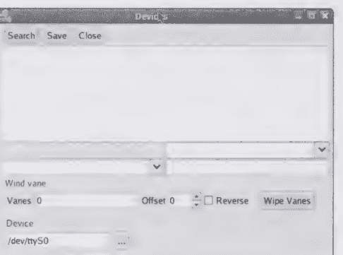

   图 10-2：在设备对话框中指定串口。

2. 在设备对话框左下角的“设备”（Device）字段中，输入气象站连接的串口。

   在我的系统中，我使用 `/dev/ttyS1`，因此我需要在设备字段中输入此内容。

3. 点击屏幕顶部的搜索（Search）按钮。

   会弹出一个与图 10-3 类似的对话框，显示检测到的设备。如果你只是使用没有任何额外传感器的主机，你将看到列出的三个设备：风向标（Vane）、温度计（Thermometer）和风速计（Anemometer）。

4. 点击保存（Save）保存你的设备设置，然后点击关闭（Close）返回 Oww 主界面。

   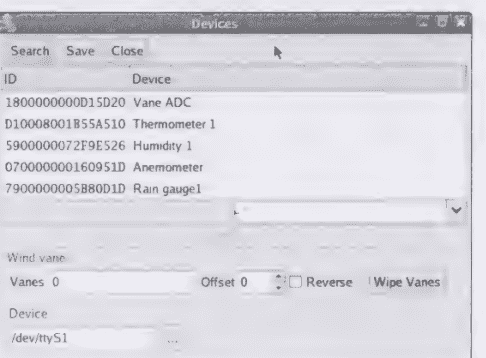

   图 10-3：气象软件检测到的设备。

你现在应该能看到显示的温度传感器读数。

你可以旋转风速计的叶罩并转动风向标，看看是否也能获得这些设备的读数。

如果你能看到已连接设备的读数，说明气象站正在工作。如果你没有看到设备的读数，请双检查你指定的串口和测试线连接，然后重试。

### 制作气象站电缆

气象站的组装、测试和基本配置几乎完成。你现在需要制作并测试将气象站放置在户外时实际用于连接的电缆。

你可以使用任何四芯线（例如标准电话线）来制作电缆。你应该使用未端接头的线，并在上面压上你自己的 RJ-11 接头。电缆的长度取决于你的安装位置以及距离 PC 的距离。电缆的另一个良好选择是 Cat 5 以太网线。如果你决定使用以太网线，你将使用四对线中的一对，并用 RJ-11 接头终止电缆端。在电缆两端装好 RJ-11 接头后，你可以使用万用表测试电缆每端的导通性。确保你的电布线是直通的，没有交叉。这意味着引脚 1 到 4 应该位于电缆的同一端。

尽管气象站使用了标准的电话型 RJ-11 接头，但你不能通过端接电话线来实现连接。所以不要买 25 英英或 50 英利的延长线并认为它可行，因为事实并非如此。电话线是交叉线，这意味着引脚 2 和 3 是交叉的，因此电缆一端的引脚 2 是电缆另一端的引脚 3，反之亦然。这种电缆无法与气象站配合。你必须使用直通线——意味着引脚 2 和 3 没有交叉——来制作连接。


### 配置额外的气象站设置

为了让气象站正常工作，你必须指定 PC 使用的正确串口。你还需要验证连接到串口的设备已正确识别并正常工作。还有额外的参数可以更改天气数据的显示和监控方式。这些参数可以通过“设置”（Setup）菜单获取。在本节中，我将向你展示菜单以及你可以对其做什么。选择“编辑”（Edit:）打开 Oww 设置对话框，如图 10-4 所示。（将鼠标光标悬停在区域上查看该区域的弹出窗口）。

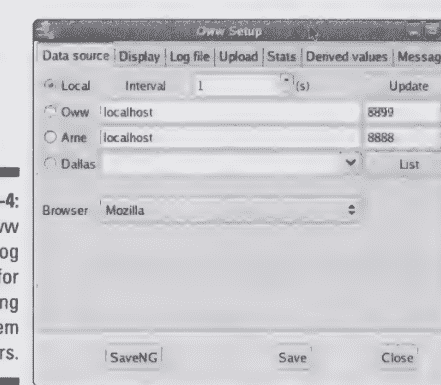

图 10-4：用于更改参数的 Oww 设置对话框。

Oww 设置对话框有七个标签页可选：

- **数据源（Data Source）：** 这是打开对话框时显示的默认标签页。在此页上，你可以选择天气数据的来源。
  - 如果气象站连接到运行 Oww 的 PC，你应该选择“本地”（Local）（这是默认设置）。
  - 如果气象站连接到另一台运行 Oww 的 PC，选择“Oww”并指定该 PC 的主机名。你可以指定端口号，但在大多数情况下你不应更改默认设置。
  - 如果气象站连接到运行 Arne Henriksen 基于 Windows 的 SServer 的 PC，选择“Arne”并指定该 PC 的主机名。你可以指定端口号，但在大多数情况下你不应更改默认设置。
  - 如果你将读数上传到由 Dallas Semiconductor 运行的服务器，点击“列表”（List）按钮获取当前的贡献站列表。选择“Dallas”单选按钮，并从下拉列表中选择一个站点。你还可以选择更新间隔以及仪器读数之间的秒数，并选择用于查看的浏览器。

- **显示（Display）：** 显示标签页上的设置会影响数据的呈现。你可以选择英制或公制单位的数据。你还可以选择查看风向标和风速计。

- **日志文件（Log File）：** 在日志文件标签页上，你可以指定消息级别。日志级别与消息类型相同，决定了写入日志文件的信息量。调试文件包含程序未正常运行的信息，用于诊断原因。

- **上传（Upload）：** 在上传标签页上，你可以控制上传间隔。你还可以选择“每日”、“每周”或“每月”。

- **统计（Stats）：** 在统计标签页上，你可以重置计数。

- **消息（Messages）：** 在图 10-9 所示的消息标签页中，你可以选择想要接收的消息类型。从“无”或列表顶部的消息开始，其余选项提供更多细节。良好的选择是“错误”（Errors）和“警告”（Warnings）。

## 将你的气象数据发布到网上

如果你愿意，可以将气象数据发布到互联网，让任何人看到。你可以通过几种方式实现这一点：

一种方法是将数据上传到 Oww Setup 对话框中 Upload 选项卡显示的任服务之一。（参考图 10-7。）

另一种方法是编写脚本，获取你记录的天气数据并从中生成 Web 页面。幸运的是，你不需要自己编写脚本；这些工作已经完成了。实际上，编写 Oww 程序的同一个人已经创建了脚本来获取天气数据并将其发布在网上。如果你感兴趣，可以查看 `http://oww.sourceforge.net/plotting.html` 了解安装脚本的所有细节。

# 第 11 章：获取在线天气信息

## 本章内容

- 在桌面上查看天气数据
- 从浏览器获取天气信息
- 使用 MythTV 获取天气信息

第 10 章涵盖了如何在家中设置气象站，以便你始终能够访问家门外最新的天气数据。但假设你无法或只是不想设置气象站。你仍然可以从几个不同的来源获取关于你所在区域的实时气象数据。在本章中，我将向你展示三个气象数据来源，以及如何设置它们来提供你所需的所有天气数据。

## 在桌面上获取天气数据

Linux 有许多桌面环境可用，但最常用的是 GNOME 和 KDE。如果你运行 GNOME 作为你的桌面，请一定要查看可安装的精美 Weather 小组件（applet）。因为你可以自定义 GNOME Weather 小组件显示任何位置，所以你可以随时关注你所在区域或你想了解任何其他位置的最新状况。要安装和使用 Weather 小组件，请执行以下操作：

1. 在 GNOME 桌面上，将光标置于顶部或底部面板上，右键点击并选择“Add to Panel”（添加到面板）。
2. 向滚动小组件列表，勾选 Weather Report 以选择它，然后点击“Add to it”将其添加到面板。

这将打开图 11-1 所示的“Add to Panel”对话框。

Weather 小组件将以包含问号的小黑框形式出现在面板上。问号表示 Weather 小组件正在等待配置。

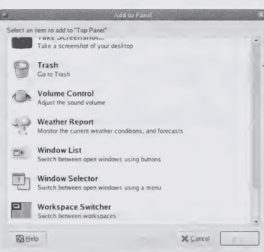

图 11-1：在 GNOME 桌面面板上添加小组件。

3. 将光标置在 Weather 小组件上，右键点击并选择“Preferences”（偏好）。

会出现 Weather Preferences 对话框（见图 11-2），并选中了 General 选项卡。在这里，你可以设置更新间隔，设置温度、风速、压力和可见度的显示单位，并启用雷达显示地图。

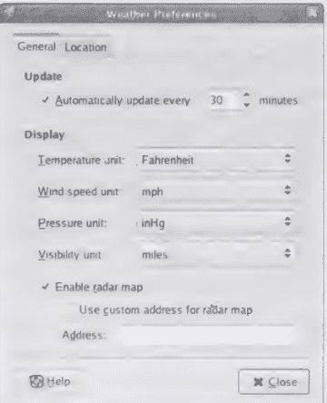

图 11-2：设置 Weather 小组件的偏好。

在 Display（显示）区域中，你可以看到显示温度、风速、压力和可见度的测量单位。

1. 点击当前单位右侧的箭头查看可用单位。根据需要选择你偏好的单位。
2. 在完成 General 选项卡上的操作后，点击 Location 选项卡。（见图 11-3）。

图 11-3：选择显示天气状况的位置。

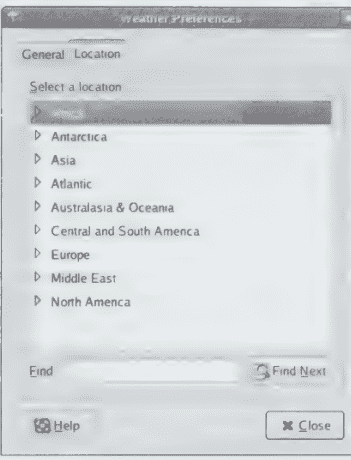

6. 点击你所在大陆旁的箭头以展开列表并选择其他位置。

在我的案例中，我选择了北美，然后是美国，宾夕法尼亚州，最后是阿伦登根（Allentown）。你应该选择你想查看天气状况的位置。

7. 完成偏好设置后点击 Close（关闭）。

Weather 小组件中的小问号将变为显示你所选位置当前状况的图标，温度显示在图标旁边。

现在你已经设置了 Weather 小组件，可以使用它来获取指定位置的信息。你只需通过查看面板上的图标和温度，就可以随时获得天气状况的大致情况。但通过点击图标打开对话框，你可以获得更多信息，如图 11-4 所示。

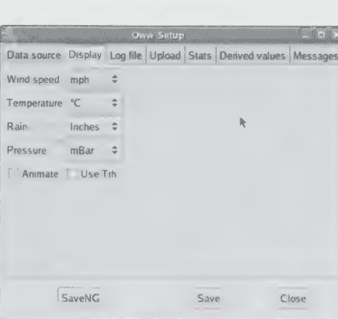

图 11-4：查看天气详情。

如图 11-4 所示，Weather 小组件提供了你所在位置的天气预报。点击 Forecast 选项卡可以获取你所在位置的详细预报。该对话框见图 11-5。

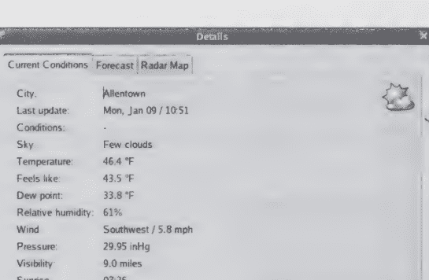

图 11-5：天气预报。

除了显示天气状况，点击 Radar 选项卡可以获取你请求位置的雷达图。该对话框在图 11-6 所示。

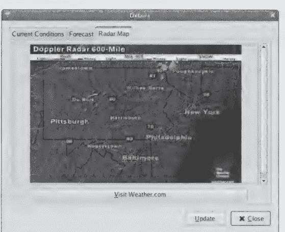

图 11-6：雷达图。

你可以点击 Weather.com 按钮跳转到天气网站，无论你何时运行它。

无论你何时运行它，点击 Update 按钮都可以刷新它显示天气数据。

## 从浏览器获取天气数据

Firefox 浏览器提供许多插件，一种可以为你的浏览器提供天气信息。该插件名为 Forecastfox，在使用它之前你需要先安装它。请执行以下操作：

1. 打开 Firefox。
2. 从主菜单选择 Tools > Extensions。

会出现 Extensions 对话框，如图 11-7 所示。

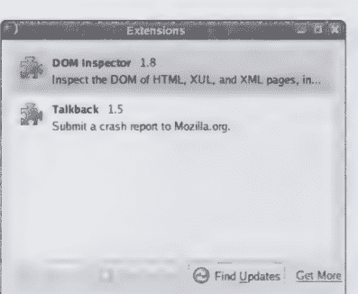

图 11-7：为 Firefox 添加扩展程序。

3. 点击 Extensions 对话框右下角的 Get More 链接。

会出现 Firefox Add-Ons 页面。

4. 滚动找到 Forecastfox 并点击它。
5. 点击 Install Now。
6. 插件完成后，关闭浏览器。
7. 重新打开浏览器。

会出现 Forecastfox Options 对话框（见图 11-8）。

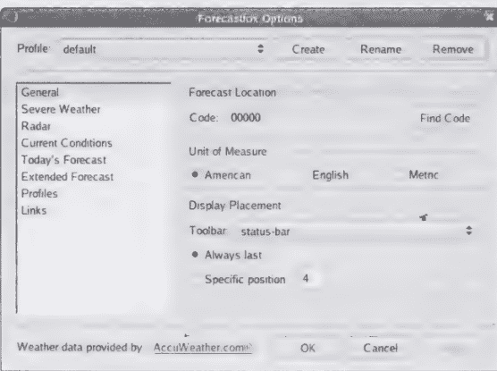

图 11-8：设置浏览器扩展程序的选项。


## 第 11 章：获取在线天气信息

8. 在 `Code` 字段中输入你的邮编并点击 `Apply`。

如果你不知道邮编，点击 `Find Code` 按钮，输入城市并点击 `Search`。当你搜索的城市出现在列表中，选中它并点击 `OK`。

9. 点击 `Apply`。

四个图标出现在浏览器状态栏右侧，如图 11-9 所示。从左开始，这些图标分别代表雷达图、当前状况、明天预报和后天预报。你可以将光标置在图标上查看该图标的弹出信息。例如，如果你将光标置在雷达图图标上，会弹出一个小窗口显示当前雷达图。


你可以通过 `Forecastfox Options` 对话框（参考图 11-8，即你在步骤 8 中设置邮编的地方）控制图标的显示方式。如果你对 `Forecastfox` 的外观满意，可以保持现有设置。但有许多自定义选项，我将在接下来介绍。

要打开 `Forecastfox Options` 对话框，右键点击任何 `Forecastfox` 图标并从列表中选择 `Options`。当 `Forecastfox Options` 对话框出现时（参考图 11-8），显示的是 `General` 选项卡，在此页面上你可以创建配置文件，为每个配置选择不同的选项。在我的系统中，我为几个不同的城市命名了配置，并设置显示选项每几分钟切换一次配置。通过这样做，我只需扫一眼浏览器左下角就能知道这些城市在不同时间段的天气。

### Forecastfox 选项详解

你还可以通过输入城市代码来选择想要接收气象数据的城市。对于美国城市，你可以输入邮政编码。点击“查找代码”（`Find Code`）按钮可以输入城市名称，搜索该城市的代码。你可以在搜索框中输入美国和国际城市的名称。

你可以通过点击偏好旁边的按钮来选择气象数据的单位。最后，你可以点击工具栏（`Toolbar`）字段右侧的箭头设置 `Forecastfox` 图标的显示位置，并在以下项目上选择所需的位置：

- **极端天气（`Severe Weather`）**：点击此选项将打开一个页面，你可以在那里启用或禁用极端天气图标和工具提示的显示。你还可以选择只显示图标、图标加标签，或仅显示标签。

  极端天气警报默认开启，每当你所选的任何位置（仅限美国）存在极端天气警报时，`Forecastfox` 显示中就会出现一个警报滑块和一个带有感叹号的红色图标。

- **雷达（`Radar`）**：选择雷达将带你进入雷达选项页面。在该页面上，你可以启用或禁用雷达和工具提示的显示。你还可以将显示选项设置为图标、标签或图标加标签。

- **当前状况（`Current Conditions`）**：选择当前状况将带你进入当前状况选项页面。在该页面上，你可以启用或禁用当前状况和工具提示的显示。你还可以将显示选项设置为图标、标签或图标加标签。

- **今日预报（`Today's Forecast`）**：选择此选项将带你进入今日预报选项页面。在该页面上，你可以启用或禁用当前状况和工具提示的显示。你可以将显示选项设置为图标、标签或图标加标签。注意此页面的“切换到”（`Switch To`）区域，在这里你可以选择在今日预报不再可用用的下午 3 点之后显示什么内容。

- **长期预报（`Extended Forecast`）**：选择长期预报将带你进入长期预报选项页面。在该页面上，你可以启用或禁用当前状况和工具提示的显示。你还可以将显示选项设置为图标、标签或图标加标签。该页面上的额外选项允许你设置想要接收的未来几天的预报。如果你更改了此默认值，每增加一个数字，都会出现相同的图标。

- **配置文件（`Profiles`）**：选择配置文件将带你进入配置文件选项页面。在该页面上，你可以选择切换你的配置文件并设置切换分钟数。我为不同的城市创建了几个配置文件，并选择每 5 分钟切换一次，这样我就可以检查居住城市的天气。此外，在此页面上，你可以通过选择该选项并指定用于查找导入配置文件的目录或导出的文件存放位置来导入和导出配置文件。

### 链接设置

**链接：** 当你右键点击任何 `Forecastfox` 图标时，会弹出一个包含链接的菜单。此页面的设置允许你决定链接如何打开。

除了提供打开“选项”（`Options`）对话框的功能外，图标的右键菜单还提供了更多选择，如图 11-10 所示。从此菜单，你可以访问 `Forecastfox` 首页或 `AccuWeather` 网站。你可以强制 `Forecastfox` 重新加载气象数据，如果你创建了任何配置文件，还可以导入或导出它们。如果你创建了配置文件，还可以通过选择“切换配置文件”（`Switch to Profile`）选项告诉 `Forecastfox` 加载不同的配置文件。

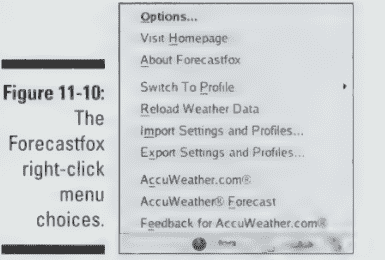

我建议你尝试 `Forecastfox` 选项对话框中的不同设置。这是熟悉它的最好方法，你将很快发现应用你的选择后的效果。

## 使用 MythTV 获取气象数据

你的桌面和浏览器并不是获取气象信息的唯一来源。在第 6 章中，我讨论了 `MythTV` 程序以及如何为你的系统进行安装和配置。`MythTV` 的主要功能之一是满足你对个人视频录制器（`PVR`）的需求。但 `MythTV` 还有一个名为 `MythWeather` 的程序，你可以通过选择 `MythTV` 主菜单中的天气（`Weather`）选项来访问它。在本节中，我将告诉你如何使用 `MythTV` 获取当前天气状况和长期预报。

### 设置 MythWeather

确保 `MythTV` 正在运行，并且可以看到主菜单。要正确配置 `MythWeather` 以显示你所需位置的气象数据，请按照以下步骤操作：

1. 从 `MythTV` 主菜单中，选择设置（`Setup`）：天气设置（`Weather Settings`）。

   这将打开天气设置对话框。（见图 11-11。）默认选中了“天气单位”（`Weather Units`）选项。

   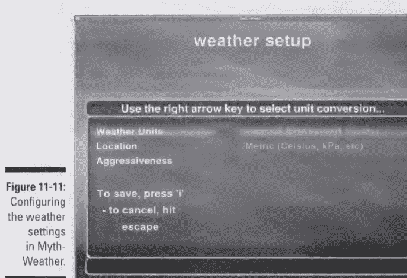

   图 11-11：在 `MythWeather` 中配置天气设置。

2. 使用右箭头键将高亮条向右移动，将其放在你的选择上，以选择测量单位。然后将高亮条移回左。

3. 将高亮条向下移动到“位置”（`Location`）选项，并使用右箭头键将高亮向右移动。

4. 使用向上和向下箭头将高亮移动到你想要使用的城市名称的首字母上。

5. 对于以该字母头的城市，使用右箭头键将高亮向右移动。

6. 使用向下箭头滚动城市列表直到找到目标城市。

7. 当你找到城市后，双击左箭头键将高亮移动到“位置”（`Location`）。

8. 使用向下箭头将高亮移动到“连接”（`connection`）。

9. 使用右箭头键将高亮向右移动。

10. 使用向上和向下箭头将高亮移动到“速度”（`speed`）。

11. 按键保存你的更改。

`MythWeather` 设置程序尝试连接 `weather.com` 获取你位置的气象数据。如果系统成功连接，你将看到一些页面。

12. 按 `Esc` 返回 `MythTV` 主菜单。

### 查看你的 MythWeather

从 `MythTV` 主菜单中，你可以随时选择天气（`Weather`）选项来查看天气。选择天气后，会出现类似图 11-12 所示的当前状况。

图 11-12：天气显示当前状况。

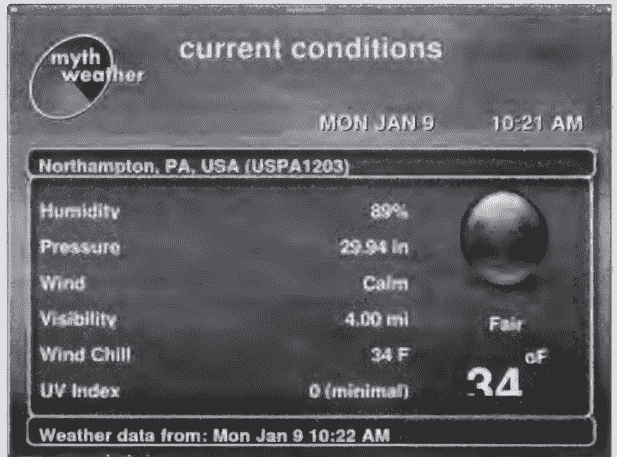

当前状况显示大约 15 秒，然后显示变为长期预报。大约 15 秒后，长期预报被今日预报取代。最后，在 15 秒后，今日预报会被显示所选位置的多普勒雷达图取代。


> **提示** 如果你不想等待页面更改，可以使用左箭头或右箭头键按需切换页面。

## 第 12 章：通过温控器保持舒适

**本章内容**

- 安装和使用 X10 通信温控器 TX16
- 安装 X10 温度控制
- 使用 X10 温控回设控制器
- 理解 Linux Zoning 项目
- 通过减少暖空调成本节省费用

你是否曾在离开城市后忘记关家里的暖气？或者更糟糕，你是否忘记开启它，导致水管可能冻裂？（我曾经历过这种情况，不得不让邻居在圣诞节的雪地中走我一趟！）X10 温控器允许你即使不在家里也能更改家中的温度。当你从长途旅行（即使是短途旅行）回来，想在进入家门之前变暖时，X10 温控器特别好。

本章介绍了如何安装和使用可以通过计算机、远程控制设备或触按控制器进行远程操作的温控器。它还查看了 `Linux Zoning` 项目，该项目允许 DIY 爱好者对你的暖空调系统进行分区，以获得最大的舒适度和成本效益。

所有这些系统的一个要求是，你不是使用简单的小柴炉供暖。

### 安装温控器控制器

为了远程加热你的家中，你可能想要安装一个可以使用 X10 操作的温控器控制器。使用 X10 控制温控器可以让你以以下方式控制供暖：

- 使用遥控器（如万能遥控器或钥匙扣式遥控器），如果你在距离温控器 25 到 50 英范围内，可以升高或降低温度。
- 使用免费的 Linux 程序（如 `MisterHouse`）与你的 X10 模块通信，通过设置定时器或通过互联网进行调整来升高或降低温度。
- 使用拨号控制器（`touch-tone controller`）通过电话远程更改加热或冷却设置。

以下是使用 X10 远程控制加热的几种方法：

- 安装 X10 通信型温控器。花费约 260 美元，你可以将现有的温控器更换为与 X10 通信的温控器。这种温控器被称为 X10 通信温控器 `TXB16`。它可以控制任何家庭 HVAC（暖、通风和空调系统），包括燃气/电力、热泵或辐射地暖。该型号由 `www.smarthome.com` 销售。
- 安装一个使用两个温控器和一个万能模块（`Universal Module`）的系统。将一个温控器设置为你的舒适温度（例如 69 华度），将另一个温控器设置为你不在家或睡觉时的温度（例如 55 华度）。在 69 度的温控器上连接一个 X10 万能模块，以便对其进行远程控制。
- 安装 X10 温控器设回值控制器（`Thermostat Set-back Controller`）。温控器设回控制器是一种位于你温控器下方的设备，它可以让你的家里比平时更热。这可能是远程控制温控器最简单的解决方案，因为不需要电工安装。温控器设回值控制器由 `www.x10.com` 销售。它们消耗能量极少，并通过降低供暖费用来节省大量开支。

### 安装 TXB16 温控器

由 `Residential Control Systems, Inc.` 制造的 X10 通信温控器 `TXB16` 型可能是随时随地控制你温度的最复杂的解决方案。它包括：

- 一个壁挂显示单元（替换你现有的温控器）
- 一个控制单元（连接到你的 HVAC 系统）
- 一个插式的 `TW-523` 模块（这是一个双向 X10 电器模块）
- 一根连接模块与控制单元的电缆
- 一个电源

壁挂显示单元具有：

- LCD 温度显示器
- 手动设置温度的按钮
- 一个检查模式（加热、冷却或关闭）的按钮
- 一个手动启动风扇的按钮

图 12-1 显示了壁挂单元及其功能的图。使用 `TXB16` 温控器，你可以使用标准的 X10 命令（由房屋代码、单元代码以及开启或关闭信号组成）远程更改温度设定点值。设定点值是你为加热模式和冷却模式设置的温度。你可以使用 X10 遥控器、拨号控制器或使用带有 X10 接口（如运行 X10 兼容软件 `MisterHouse` 的 `CM11A`）的电脑来远程更改每个设定点值。

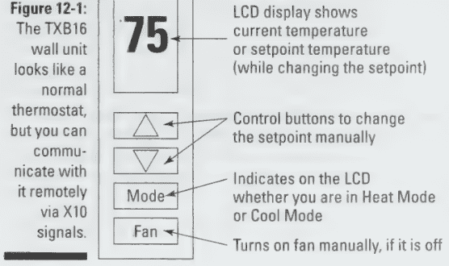

> **警告** 除非你有相关资质，否则不要自己接线温控器。请聘请专业人士或清楚自己在做什么的人来连接温控器。

如果你住在冬季会结冰的地区，则要求此温控器也安装第二个温控器。第二个温控器可以是你现有的温控器，并且需要至少设置为 40 华度——取决于你的管道的位置，可能更高。

出于明显原因，`TXB16` 温控器应该由具有 HVAC 经验的人安装。但在安装之后，以下是如何设置它并从遥控器进行操作的方法：

1. 开启控制单元背面的 #4 号开关。控制单元背面有四个或八个开关，取决于你拥有的是哪种型号。前三个开关和第五个（如果有的话）由你的供暖承包商设置，它们的开启/关闭状态取决于你拥有什么种的供暖系统，例如单级或双级加热。
2. 如果尚未插入，请插入一个收发器来控制你的 X10 遥控器。X10 遥控器可以在此处获取：`www.x10-store.com/unlerepu.html`。控制它的收发器可以在此处获取：`www.x10-store.com/pat01.html`。你也可以在 `www.x10.com` 和 `www.smarthome.com` 找到它们。
3. 通过以下步骤将你的 X10 遥控器设置为房屋代码 B：
   a. 按下 X10 遥控器上的 `X10` 按钮。
   b. 按住 `SETUP` 按钮直到 LED 灯常亮，然后释放。
   c. 按 2，然后按 `ENTER`。
   
   现在你的 X10 遥控器应该已设置为房屋代码 B。
4. 为你的 `TXB16` 设置温度，从表 12-1 中选择与你想要设置的温度对应的单元代码并在遥控器上按下该数字，然后按下 `Channel +`（表示开启）或 `Channel -`（表示关闭），取决于你的温度位于表 12-1 的哪一列。`TXB16` 温控器上的温度会发生变化。或者如果你按下模式代码，模式会改变。

#### 表 12-1：TXB16 温度与模式代码对照表

| 房屋代码 | 单元代码 | 开启 |
| :--- | :--- | :--- |
| B | 1 | 72° |
| B | 2 | 73° |
| B | 3 | 74° |
| B | 4 | 75° |
| B | 5 | 76° |
| B | 6 | 77° |
| B | 7 | 78° |
| B | 8 | 79° |
| B | 9 | 80° |
| B | 10 | 81° |
| B | 11 | 82° |
| B | 12 | 83° |
| B | 13 | 84° |
| B | 14 | 86° |
| B | 15 | 88° |
| B | 16 | 90° |

| 房屋代码 | 单元代码 | 关闭 |
| :--- | :--- | :--- |
| B | 1 | 系统 |
| B | 2 | 加热模式 |
| B | 3 | 冷却模式 |
| B | 4 | 自动模式 |
| B | 5 | 40° |
| B | 6 | 60° |
| B | 7 | 62° |
| B | 8 | 63° |
| B | 9 | 64° |
| B | 10 | 65° |
| B | 11 | 66° |
| B | 12 | 67° |
| B | 13 | 68° |
| B | 14 | 69° |
| B | 15 | 70° |
| B | 16 | 71° |

现在，你可以使用 X10 遥控器、拨号控制器或使用带有 X10 接口（如运行 X10 兼容软件 `MisterHouse` 的 `CM11A`）的电脑来远程更改 `TXB16` 温控器上的温度。


# 第12章：通过恒温器控制保持舒适

| 房屋代码 | 单元代码 | 开启 (On) |
| :--- | :--- | :--- |
| B | 1 | 72° |
| B | 2 | 73° |
| B | 3 | 74° |
| B | 4 | 75° |
| B | 5 | 76° |
| B | 6 | 77° |
| B | 7 | 78° |
| B | 8 | 79° |
| B | 9 | 80° |
| B | 10 | 81° |
| B | 11 | 82° |
| B | 12 | 83° |
| B | 13 | 84° |
| B | 14 | 86° |
| B | 15 | 88° |
| B | 16 | 90° |

| 房屋代码 | 单元代码 | 关闭 (Off) |
| :--- | :--- | :--- |
| B | 1 | 系统 (System) |
| B | 2 | 加热模式 (Heat) |
| B | 3 | 冷却模式 (Cool) |
| B | 4 | 自动模式 (Auto) |
| B | 5 | 40° |
| B | 6 | 60° |
| B | 7 | 62° |
| B | 8 | 63° |
| B | 9 | 64° |
| B | 10 | 65° |
| B | 11 | 66° |
| B | 12 | 67° |
| B | 13 | 68° |
| B | 14 | 69° |
| B | 15 | 70° |
| B | 16 | 71° |

现在，你可以使用 `X10` 遥控器、拨号控制器或使用带有 `X10` 接口（如运行 `X10` 兼容软件 `MisterHouse` 的 `CM11A`）的电脑来远程更改 `TXB16` 温控器上的温度。由 `Residential Control Systems, Inc.` 制造的 `X10` 通信温控器 `TXB16` 型可能是无论你在何处都能控制温度的最复杂的解决方案。它包括：

- 一个壁挂显示单元（替换你现有的温控器）
- 一个控制单元（连接到你的 `HVAC` 系统）
- 一个插式的 `TW-523` 模块（这是一个双向 `X10` 电器模块）
- 一根连接模块与控制单元的电缆
- 一个电源

壁挂显示单元具有：

- 一个 `LCD` 温度显示器
- 手动设置温度的按钮
- 一个检查模式（加热、冷却或关闭）的按钮
- 一个手动启动风扇的按钮

图 12-1 显示了壁挂单元及其功能的图。使用 `TXB16` 温控器，你可以使用标准的 `X10` 命令（由房屋代码、单元代码以及开启或关闭信号组成）远程更改温度设定点值。设定点值是你为加热模式和冷却模式设置的温度。你可以使用 `X10` 遥控器、拨号控制器或使用带有 `X10` 接口（如运行 `X10` 兼容软件 `MisterHouse` 的 `CM11A`）的电脑来远程更改每个设定点值。


> **警告**：除非你有相关资质，否则不要自己接线温控器。请聘请专业人士或清楚自己在做什么的人来连接温控器。

> **注意**：如果你住在冬季会结冰的地区，则要求此温控器也安装第二个温控器。第二个温控器可以是你现有的温控器，并且需要至少设置为 40 华氏度——取决于你的管道的位置，可能更高。

出于明显原因，`TXB16` 温控器应该由具有 `HVAC` 经验的人安装。但在安装之后，以下是如何设置它并从遥控器进行操作的方法：

1. 开启控制单元背面的 `#4` 号开关。控制单元背面有四个或八个开关，取决于你拥有的是哪种型号。前三个开关和第五个（如果有的话）由你的供暖承包商设置，它们的开启/关闭状态取决于你拥有什么种的供暖系统，例如单级或双级加热。
2. 如果尚未插入，请插入一个收发器来控制你的 `X10` 遥控器。`X10` 遥控器可以在此处获取：`www.x10-store.com/unlerepu.html`。控制它的收发器可以在此处获取：`www.x10-store.com/pat01.html`。你也可以在 `www.x10.com` 和 `www.smarthome.com` 找到它们。
3. 通过以下步骤将你的 `X10` 遥控器设置为房屋代码 `B`：
   a. 按下 `X10` 遥控器上的 `X10` 按钮。
   b. 按住 `SETUP` 按钮直到 `LED` 灯常亮，然后释放。
   c. 按 `2`，然后按 `ENTER`。
   现在你的 `X10` 遥控器应该已设置为房屋代码 `B`。
4. 为你的 `TXB16` 设置温度，从表 12-1 中选择与你想要设置的温度对应的单元代码并在遥控器上按下该数字，然后按下 `Channel +`（表示开启）或 `Channel -`（表示关闭），取决于你的温度位于表 12-1 的哪一列。`TXB16` 温控器上的温度会发生变化。或者如果你按下模式代码，模式会改变。

| 房屋代码 | 单元代码 | 开启 (On) |
| :--- | :--- | :--- |
| B | 1 | 72° |
| B | 2 | 73° |
| B | 3 | 74° |
| B | 4 | 75° |
| B | 5 | 76° |
| B | 6 | 77° |
| B | 7 | 78° |
| B | 8 | 79° |
| B | 9 | 80° |
| B | 10 | 81° |
| B | 11 | 82° |
| B | 12 | 83° |
| B | 13 | 84° |
| B | 14 | 86° |
| B | 15 | 88° |
| B | 16 | 90° |

| 房屋代码 | 单元代码 | 关闭 (Off) |
| :--- | :--- | :--- |
| B | 1 | 系统 (System) |
| B | 2 | 加热模式 (Heat) |
| B | 3 | 冷却模式 (Cool) |
| B | 4 | 自动模式 (Auto) |
| B | 5 | 40° |
| B | 6 | 60° |
| B | 7 | 62° |
| B | 8 | 63° |
| B | 9 | 64° |
| B | 10 | 65° |
| B | 11 | 66° |
| B | 12 | 67° |
| B | 13 | 68° |
| B | 14 | 69° |
| B | 15 | 70° |
| B | 16 | 71° |

现在，你可以使用 `X10` 遥控器、拨号控制器或使用带有 `X10` 接口（如运行 `X10` 兼容软件 `MisterHouse` 的 `CM11A`）的电脑来远程更改 `TXB16` 温控器上的温度。由 `Residential Control Systems, Inc.` 制造的 `X10` 通信温控器 `TXB16` 型可能是无论你在何处都能控制温度的最复杂的解决方案。它包括：

- 一个壁挂显示单元（替换你现有的温控器）
- 一个控制单元（连接到你的 `HVAC` 系统）
- 一个插式的 `TW-523` 模块（这是一个双向 `X10` 电器模块）
- 一根连接模块与控制单元的电缆
- 一个电源

壁挂显示单元具有：

- 一个 `LCD` 温度显示器
- 手动设置温度的按钮
- 一个检查模式（加热、冷却或关闭）的按钮
- 一个手动启动风扇的按钮

图 12-1 显示了壁挂单元及其功能的图。使用 `TXB16` 温控器，你可以使用标准的 `X10` 命令（由房屋代码、单元代码以及开启或关闭信号组成）远程更改温度设定点值。设定点值是你为加热模式和冷却模式设置的温度。你可以使用 `X10` 遥控器、拨号控制器或使用带有 `X10` 接口（如运行 `X10` 兼容软件 `MisterHouse` 的 `CM11A`）的电脑来远程更改每个设定点值。


## 安装双温控器 X10 系统

除非你运行能够充分利用 `TXB16` 双向功能的软件（目前 `Linux` 不支持），你可能想要建立一个更简单更便宜的系统来远程控制温控器。

主意有两个温控器——都独立连接到炉——只要其中任何一个开启，炉就会启动。一个温控器设置为你的舒适温度，另一个温控器设置为你不在家或睡觉时的温度。这个温控器连接到一个 `X10` 万能模块。`X10` 万能模块允许来自舒适温度温控器的信号来启动炉，你可以使用万能遥控器、拨号控制器、`X10` 定时器或你的电脑向万能模块发送 `X10` 信号来将其开启或关闭。

万能模块安装简单，尽管你可能仍然需要电工来安装额外的温控器。除非你有相关资质，否则我们不建议自己接线。万能模块安装在一个温控器与通往 `HVAC` 系统的导线之间，如图 12-2 所示。

万能模块售价 18.99 美元，可在 `http://www.x10.com/products/x10_um506.htm` 获取。安装万能模块的方法如下：

1. 使用螺丝刀将红色房屋代码调到你想开启或关闭的房屋代码。相反，你可以选择一个房屋代码或将遥控器编程到该房屋代码。遥控器编程到房屋代码的指令列在前一章的步骤 3 中。
2. 使用螺丝刀将黑色单元代码拨盘调到遥控器未使用的单元代码。


3. 将位于通用模块（`Universal Module`）左下角的“瞬间/连续”滑块移到右侧。这允许连续接触，这意味着例如发送一个 `X10 On` 命令会让通用模块持续开启，使得恒温器指令持续提供给 `HVAC` 系统，直到接收到 `X10 Off` 命令。`X10 Off` 命令的情况亦反之。
4. 如果你希望在每次执行 `X10 On` 或 `Off` 命令时都听到蜂鸣声，将通用模块右下角的滑块设置为中间位置；如果你希望静音操作，则将其设为右侧。
5. 将低流线连接到通用模块。一根线连接到恒温器，另一根连接到 `HVAC` 系统。如果你不具备资质且不能完全确定自己在做什么，请让专业电工来处理。
6. 插入通用模块。
7. 将通用模块开关拨到关闭位置。为了实现持续运行，没有必要将其开启。

## 第四部分：关注天空

如果你的恒温器无预兆地开启或关闭，你可能想看看你的邻居是否在家。

## 安装恒温器回调控制器

恒温器回调控制器（`Thermostat Setback Controller`）是一种类似于微型热板的设备，位于恒温器下方的墙上，插入 `X10` 家电器模块或 `X10` 墙壁插座，让你通过控制恒温器的温度来控制你的 `HVAC` 系统。它耗电极少，当它开启时，会根据你的设置持续将恒温器的温度升高约 5 到 10 度。它可以通过电脑、`X10` 拨号控制器、`X10` 定时器、`X10` 通用遥控器等进行控制。它在 `www.x10.com` 的售价约为 19.99 美元。

恒温器回调控制器通过以下四种方式控制你的供暖和冷却：

- 要降低温度，向恒温器回调控制器发送 `X10` 信号。
- 要提高温度，向恒温器回调控制器发送 `X10 Off` 信号。
- 要增加空调制量，向恒温器回调控制器发送 `X10` 信号。
- 要减少空调制量，向恒温器回调控制器发送 `X10 Off` 信号。

安装你的恒温器回调控制器，请执行以下操作：

1. 将你的恒温器回调控制器安装在恒温器下方。
2. 将其插入 `X10` 家电器模块或 `X10` 墙壁插座模块（也称为 `Super Socket`）。
3. 使用螺丝刀将模块代码设置为与你的遥控器匹配的代码。
4. 使用螺丝刀将模块代码设置为你自动化系统的可用代码。

## 在温暖的房屋中醒来

`X10` 恒温器系统可以使用 `X10` 定时器以可编程恒温器的方式运行，或者让你的电脑进行定时。关于如何用电脑自动化你的 `X10` 模块的更多信息，请参见第 16 章。`X10` 小型定时器（外观像小闹钟，可以作为带有贪睡功能的闹钟使用）售价约为 30 美元，每天可以对一组 `X10` 设备进行两次定时。

你可以编写电脑或 `X10` 小型定时器的程序，按以下方式控制你的恒温器系统：

- 如果你使用的是我之前描述的恒温器-`X10` 控制系统，你可以向连接到恒温器上的通用模块发送带有舒适温度的信号，并在在你醒来前半小时开始加热你的家中。你还可以在睡觉后一小时发送一个信号，让你在睡觉前有时间暖暖身体。
- 如果你使用的是恒温器回调控制器（前一节描述），在你醒来前半小时，你可以向它发送一个信号，让恒温器不再认为温度比实际高，并开始加热房屋。然后你可以在睡觉后一小时发送一个信号。
- 如果你使用的是由 `X10` 控制的恒温器，你可以发送 `X10` 代码在你醒来前将温度重置为你想要的实际数值，并可以在睡觉后发送另一个 `X10` 代码设置为更低的温度。

## 通过受控供暖省钱

能源公司表示，将恒温器调低 4 度每月可以节省 35 到 50 美元的电费。因此，如果你在你整天不在家或在家里睡觉时将其调低 10 度，你可能会节省大量的钱。随着能源价格飙升，精细化热管理是一个好方法。

如果你有一个通用遥控器，甚至是一个钥匙扣遥控器，或者最好的是一个了解你日程的电脑——例如你计划何时在家，何时需要工作或出差——那么你就可以在出门时按几个按钮控制你的锅炉或空调，或者将你的日程程序到电脑里。对于回家，除非你已经将日程电脑化，否则你可以使用拨号控制并通过电话发送 `X10` 信号，在你进门时让你的家里再次变暖。

`X10` 恒温器还有其他考虑因素。例如，如果你只是出门很短，调高调低温度省钱吗？如果是的话，能省多少？

另一种省钱的方法是对供暖进行分区。`DIY` 分区项目提供了大量关于省钱的信息。该项目的地址为：`http://diy-zoning.sourceforge.net`。

## 使用 X10 恒温器系统省钱

以前人们认为，通过受控供暖省钱的最佳方法是将恒温器设定在一个单一温度（即你能忍受的最低温度），并在整天保持该温度，除非你度假。这种观点认为增加房屋温度需要更多能量。然而，最近的研究表明，保持房屋温度恒定比改变温度更节省能量。这意味着如果你住在一个具有大量热质量的房屋中（如砖块、石头、混凝土），你可以通过不改变温度来省钱。

## 通过 DIY 分区项目省钱

供暖分区让你能够以不同的温度维持房屋不同区域的加热或冷却。你通过将房屋划分为功能区，并使用远程开启或关闭的电子风门来实现这一点，如图 12-3 所示。在开始 `DIY` 分区之前，请确保你彻底理解了分区项目提供的所有信息。以这种方式对房屋分区需要被视为一种爱的劳动，而不是一项任务。如果你感兴趣，尽管去尝试。只要不要力过范围。

## DIY 区域分区能为你提供什么

`DIY Zoning` 是一款 `Linux` 软件，可以自动控制风扇的开启和关闭，以及用于运行你 `HVAC`（暖通、通风与空调）系统的许多其他自动化功能。它可以处理任意数量的区域，并兼容任何供暖系统。

`DIY Zoning` 还是关于如何最简单、最有效地对热量和空调进行分区的信息库。你可以在 `http://diy-zoning.sourceforge.net` 找到它。

`DIY Zoning` 软件可以实现以下功能：

- 维持家中每个区域的温度控制。
- 为家设定温度变化计划。
- 允许你通过互联网监控并控制任何区域的温度。
- 当空气过滤器堵塞时发出报警。（它会在过滤器实际堵塞时告诉你，而不是仅仅根据时间建议更换。）
- 如果你的供暖或冷却系统工作过载，会发出警告。
- 让一个或多个区域保持在恒定的单一温度，无论家中其他部分的温度如何。
- 允许你关闭某个区域的供暖或冷却。这对于不需要空调的房间特别有用。
- 当你外出时，自动计算如何优化节约——取决于你离开的长短，通过降低温度还是保持恒定温度。

## 自动手做的优缺点

为什么要对你的供暖进行分区？你为什么要这样做？

**缺点**：首先，自己对家里进行分区是一项大量工作。除非你有 `HVAC` 专业人士，否则有一条非常陡峭的学习曲线。目前，`Linux DIY Zoning` 项目是针对那些非常有能力的 `DIY` 爱好者的，尽管未来，项目负责人希望提供一个专业的软件包和支持。

> **注意**：为了让你了解 `DIY Zoning` 的理念以及涉及的工作量，他们的主页上有一句引用：“业余人士建造了方舟。泰坦尼克号是由专业人士建造的。”这意味着如果正确使用 `DIY` 建议，你可以比 `HVAC` 专业人士在供暖和冷却系统分区方面做得更好。它还意味着做这事的学习曲线和学习建造方舟一样陡峭。（但诺亚做到了，你也可以！）

**优点**：对你的供暖和冷却系统进行适当分区有许多益处。而让 `HVAC` 专业人士操作的成本可能是巨大的、惊人的或天文数字，取决于你房屋的大小和你的收入水平。你可以做得便宜得多。

通常情况下，你的供暖承包商会平衡你的供暖系统，以便让家中每个房间在他处理的那个特定时间段获得相同的温度。所以，如果他在早上平衡了热量，而下午阳光烈射在你房屋的西侧时，西侧的房间会比东侧的房间暖得多。如果你自己对家里进行分区并平衡供暖，你就可以享受一天的每一刻——而不只是某个特定的时间。

## 使用电子风叶板和温度传感器

你如何平衡家中的供暖和空调，使其始终保持平衡？你如何确保家中的区域不会比其他区域更热或更冷，除非你这样做？一种方法是使用自动风门，它可以增加或减少进入通风口的热量或冷量。这些风门可以连接到 `X10` 模块（例如 `X10` 通用模块），并使用 `X10` 温度传感器进行控制。

电子风叶板可以在 `www.smarthome.html` 购买。它们的价格大约在 109 美元到 169 美元之间。

潜在用于 `DIY` 分区的温度传感器有三种样式和不同的价格范围：

- **精致且做工良好，但需要 Linux 驱动程序**：这看起来像一个墙开关，但开关处是一个小的、圆的、外观良好的传感器。这些传感器可以在 `www.smarthome.com/1522.html` 购买，每个大约 85 美元。
- **没那么精致，更笨重，但有 Linux 驱动程序**：温度传感器可以在 `www.ubittolink.com` 购买。传感器包含在一个长、宽、深只有几厘米的小矩形盒子里。你可以买两个各带一个传感器的盒子，价格为 85 美元。
- **最不精致，提供 DIY 说明**：如果你有电子学背景，你可能想自己制作温度传感器，只要它们可以放在视线之外。自己制作的成本要低得多，如果你计划创建很多区域，你可能需要很多。制作带有 `Linux` 驱动的温度传感器的说明可以在 `www.digitemp.com/building.html` 找到。

在你完成家中的分区工作后，也许这对你来说是一份职业——如果你想全职做这件事的话。

## 第五部分


## 使用家庭自动化 X10 你的环境

Rich Tennant 的第五波


> “罗杰！检查一下缝纫机与电脑的连接。我又看到邮件缝在我的窗帘上了。”

## 在这一部分 . . .

灯、电器和无线模块是简单的构建模块，你可以将其用于许多家庭自动化项目。X10 计算机接口也是简单的构建模块，你可以将其用于许多家庭自动化项目。在第五部分，我向你介绍一些硬件，让你了解灯和电器。

## 第 13 章

## 介绍 X10

**在本章中**

- 发现 X10
- 组合
- 故障排除


我将介绍 X10 的技术细节。对于对 X10 技术比特位感兴趣的人，ACT 的 Phil Kinery 为 HomeToys 在线杂志撰写了一系列非常好的文章（www.hometoys.com/articles.htm#-X10%20Technical%20Series%20by%20Kerry)

那么用 X10 可以做什么呢？这个列表只是 X10 功能的一角：

- 发送开启或关闭命令。最简单的设备（如电器模块）只能处理开启或关闭命令。
- 发送亮度或变暗命令。灯具模块可以支持亮度和变暗命令，以及开启或关闭命令。
- 调节到预设水平。一些更高级的 X10 模块（例如 Smartome 的）支持预设水平。这些模块将跳转到预设水平或调节到你预先程序的预设水平。你可以使用这种特定的 X10 命令作为预设命令或使用扩展命令。基础灯模块无法处理扩展命令，但更贵的模块可以。
- 当变暗不是变暗时？当恒温器之类的设备接收到变暗命令时。相反，恒温会将变暗解释为设定温度的命令。其他设备如安全系统和喷淋控制器也是这样做。

## 第 13 章：介绍 X10 终端自动化

- 从你的电脑向 X10 模块发送信号。这允许你控制一个或多个模块。通常情况下，你可以让 X10 软件自动处理你预配置的命令，但有时，你可能想手动输入命令，这也可以做到。
- 手动操作 X10 模块。X10 遥控单元、单元和开关允许你执行此操作。（手动？）哈！现在你没法用那些了，对吧？好吧，也许你可以用，以防万一。）

发送到模块的命令包含一个地址部分。X10 模块会监听这个地址。模块会忽略地址部分与模块地址不匹配的命令。模块会执行地址部分与你的地址匹配的命令：一个`房屋代码`和一个`单元代码`。`房屋代码`由 A 到 P 之间的一个字母组成，`单元代码`由 1 到 16 之间的数字组成。例如，地址为 A1 的模块代码为 A，单元代码为 1。你如何设置这些代码取决于你如何设置模块：

- 在简单的 X10 模块上，你通过转动两个拨轮来设置地址。一个拨轮设置`房屋代码`（A 到 P），另一个拨轮设置`单元代码`（1 到 16）。默认情况下，新模块的地址设置为 A1。
- 在更高级的模块上，你必须按下特定的按钮序列或发送特定的 X10 命令来设置模块的地址。

每个模块必须有一个地址，多个模块可以具有相同的地址。当带有地址的命令到达时，只有该地址的模块会监听并执行该命令。有关更多地址和代码，请参阅后面的章节“模块设置”。

## 配偶接受度 (Spouse Acceptance Factor)

虽然配偶接受度（SAF）听起来像是个冷笑话，但它并不是。一个对使用家庭自动化感兴趣的人（不是你我和我）可能会出于各种原因愿意容忍初期的尴尬（例如“哇，这太酷了！”因素），但那个人的配偶可能不会那么宽容。配偶只想让它运行良好，并且第一次就能正常工作。这是一件好事，因为它让你在做任何事情之前先思考。我的很多实验在移动到“生产”环境之前，都存在我的电脑房里。通过先实验，你甚至可能发现你的配偶构思想法的速度比你还要快。

## X10 PC 接口

你基础 X10 套件的第一部分之一是 PC 接口。我将在本章后面的部分向你展示如何组装套件。PC 接口允许 Linux PC 上的软件跨越家庭电路发送和接收 X10 命令。

X10 模块和接口具有发射器、接收器和收发器。发射器是发送 X10 命令的设备（如控制台或墙壁开关）。接收器是只接收 X10 命令的设备（如基础家电和灯具模块）。收发器是可以传输也可以接收的设备。所有最新的 X10 接口都是收发器。所有较新的 X10 模块都支持接收命令并对其状态查询发送响应。

有很多 X10 接口可用，其中一些非常老，对任何人来说已经没有实际用途了——除了那些运行了它们多年的人。既然东西还能用，为什么要更换它呢？但对于你来说，只有少数接口在 Linux 下受支持。以下是大多数接口的列表（另有说明外均由 X10 公司提供）：

- `CM11A`：X10 的 RS232 PLC 收发器，是目前最流行的 Linux/X10 接口。`CM11A` 支持扩展命令、扩展数据和较新的预设命令。（这些命令由高端 X10 模块使用）。`CM11A` 能够将 X10 命令和定时事件下载到 EPROM（可擦除编程只读存储器；长期存储），这样即使断电也不会丢失 X10 命令。`CM11A` 可以在没有 Linux 帮助的情况下执行简单的 X10 命令，例如当天事件。
- `CM15A`：最新的候选产品是 `CM15A`，X10 的 USB PLC 和无线收发器。它具有 `CM11A` 的所有功能甚至更多。由于 `CM15` 正好在我开始写这本书时推出，所以在我写作时该控制器的软件很少——它非常有前景。我预计会看到更多软件。
- 电源接口：连接 PC 的智能接口。Powerlink 接口收发器专为智能设计，具有 RS232 或 USB 接口。该控制器有 Linux 软件可用，并支持扩展命令、扩展数据和预设命令。
- `CM17A`：X10 的 RS232 无线发射器。
- `MR26A`：X10 的 RS232 无线接收器。`MR26A`（接收器）和 `CM17A`（发射器）在 `CM11A` 之后发布，结合使用非常有用。它们提供了通过 RS232 端口发送接收的无线接口。
- `CM19A`：X10 的 USB 无线收发器。`CM19A` 可以替换 `MR26A` 和 `CM17A`。遗憾的是，到目前只有 `CM19A` 有 Linux 软件可用。
- `TW253`：X10 的双向电源接口，是最老的接口。通常情况下，它不是为了直接控制而设计的。它通常不受 PC 控制。它可以接收扩展命令、扩展数据或新的预设命令。
- `CP290`：X10 的 RS232 PLC 发射器。它是仅传输设备，且不再售卖（eBay 除外）。我提到它是作为一个警告；有些人因为价格便宜而想购买它。如果你真的买了，你会对它的功能匮乏感到惊讶。

## （极短）X10 模块列表

- `AM466`：标准的三插头电器模块，处理简单的开启和关闭命令。
- `AM486`：标准的双插头电器模块，仅处理开启和关闭命令。
- `LM465`：标准的双插头灯具模块；该模块处理开启、关闭和亮度命令。
- `AM14A`：双插头双向电器模块。除了开启和关闭命令，该模块还可以响应状态查询并支持扩展命令。
- `LM14A`：X10 双插头双向灯具模块。除了正常的灯具支持，该模块还可以响应状态查询并支持扩展命令。
- ApplianceLink 三插头模块：类似于 `AM466`，但是为 Smarthome.com 设计的。
- ApplianceLink 三插头双向模块：类似于 `AM486`，同样为 Smarthome.com 设计的。
- LampLink 三插头调光器：类似于 `LM14A`，为 Smarthome.com 设计的，并支持旧的预设亮度命令。
- LampLink 三插头双向调光器：类似于 `LM14A`，为 Smarthome.com 设计。它有一个三插头插座，并支持旧的预设亮度命令。
- LampLink Plus 双向调光器：类似于 LampLink 三插头双向调光器，但也支持状态查询。
- 继电器模块：这些用于直接控制低电压设备，支持基础的开启和关闭命令。

双向意味着该模块支持双向通信，除了接收 X10 命令外，还可以对 X10 命令发送响应（可以告诉你模块的亮度水平）。其他许多模块只接收 X10 命令，而另一些则是仅传输设备。

# 第 13 章：介绍 X10 家居自动化

质量。你可以找到比预想中多多的设备。你可以直接从 X10 购买（注意开 X10 臭名昭著的弹出广告）或者从 Smarthome.com 等地方购买。我经常从 Smarthome.com 购买，大多数 X10 设备（如果不是全部的话）都能在其网站上找到。尽管我在这章中没有提到 X10 无线技术（我只提到了几个无线接口），X10 公司的无线技术与 X10 公司的 PLC 技术配合工作。以下是各种非无线 X10 设备的列表：

- `WS467`：此 X10 开关可以接收关闭、开启、调暗或调亮的 X10 指令，也可以进行手动控制（类似于普通开关）。
- Mini Controller：这个 8 位桌面控制器带有按钮，可以向一个房屋代码和 8 个单元代码发送开启、关闭、调暗和调亮命令（例如 A1 到 A8，一次只发送一条命令）。
- Maxi Controller：这个 16 位桌面控制器带有按钮，可以向一个房屋代码和 16个单元代码发送开启、关闭、调暗和调亮命令（例如 A1 到 A16，一次只发送一条命令）。
- `Rain8`：此 X10 喷淋系统控制器通过发布 X10 指令控制多达 8 个喷淋区域。
- `TempLoc`：此 X10 根据温度高低发送指令。你也可以轮询该设备并获取当前温度。
- `TBX16 HVAC` 系统：这是一个由 X10 控制的 HVAC 调节器，允许你发送 X10 指令来设置家中的温度。
- Universal Module：该模块通过 X10 控制单个低电压设备（接收开启或关闭指令）。
- Eight Relay Controller Latched（八路锁继电器控制器）：它通过 X10 控制多个低电压设备。
- `TC184W`：这是一个八按钮壁挂式发射器控制器。该模块可以发送预设的 X10 指令，并可以执行场景（按一下按钮发送大量命令）、切换（按一次按钮发送指令，再次按下发送关闭指令），甚至可以发送更复杂的指令。这是我最喜欢的 X10 开关之一！
- `Siren`（报警器）：X10 安全报警器通过响应 X10 信号来工作，为预设的房屋代码关闭巨大的报警器并打开所有灯具模块。

## 构建入门套件

在本章的节节中，我向你介绍了可用设备和技术的基本概念。因此，在本节中，我将开始展示如何组合一个可以与 Linux 工作的 X10 套件。构建入门套件需要以下物品：

- `CM11A`，X10 的 RS232 电力线载（PLC）收发器（PC 接口模块）。
- 一个 X10 家电器模块（优选）或灯具模块（控制设备电源的模块）。
- 你的电脑上有一个可用的 RS232 或 USB 串口。（PC 接口需要插入此处。）
- Heyzu 软件（X10 家居自动化和命令行软件）。

那么，我为什么选择上述组合呢？嗯，我想从一个安装后立即就能使用的实用工具开始。有许多其他程序（我们的网站可以证明这一点）可以与 X10 控制器接口，而 Heyzu 是适用于 Linux、X10 和新用户的较好的软件包之一。请记住，Heyzu 支持的唯一控制器是 `CM11A`，这是一个非常流行的 X10 控制器。灯具和家电器模块是一个很好的起点，在当地的 RadioShack 商店就能买到，因此很容易找到且价格廉价（这是 X10 最大优势）。

## 软件：编译 Heyzu

我已经在 Gentoo 下的 2.6 内核和 Fedora FC2 下的 2.4 内核下测试过 Heyzu，它运行良好。

要在 shell 提示符中编译 Heyzu，只需遵循以下步骤。（更多细节见 CD。）

1. 如果你还没有登录用户（你可能不应该以 root 身份登录），请登录。
2. 当提示输入密码时，输入密码。
   如果你登录 X，将进入默认桌面。如果你登录控制台（或通过 telnet），将进入 shell。
3. 如果你没有使用 GUI，请打开终端命令行窗口。
4. 在终端窗口或 shell 中，输入 `su -`（这是一个连字符，是的，你需要它）并按回车。当提示密码时，输入你的 root 密码。
   通常情况下，除非进行系统管理工作，否则你不应该以 root 身份登录。软件安装就是这些职责之一。
5. 如果你还没有完成，将 CD 插入 驱动器。如果 Linux 没有自动挂载驱动器，输入 `mkdir -p /media/disk; mount /dev/hdc/media/disk` 并按回车。
6. 输入 `cd` 并按回车。
   这将带回到 root 的家目录。
7. 接下来，输入 `tar zxf heyu-2.beta.tgz` 解压文件。
8. 输入 `cd heyu-2.beta` 切换到文件所在目录。
9. 输入 `./Configure` 为你的系统配置 Heyzu。
10. 输入 `make` 编译所有文件。
    你应该能看到关于 make 正在执行的信息。
11. 输入 `make install` 安装所有文件。
12. 输入 `cp /media/disk/x10config /etc/hezu/x10.conf` 配置文件。
13. 使用你喜欢的编辑器编辑 `/etc/hezu/x10.conf`。
14. 找到并修改以 `LATITUDE` 和 `LONGITUDE` 开头的行。
15. 修改完成后，保存文件。

在你已正确编译并安装后（参见上一节），下一步是连接硬件：

1. 将你的 `CM11A` 和串口线连接到串口（你在第 13 步中配置的）。我使用的是 `/dev/ttyS0`。
2. 取你的灯具模块或家电器模块，设置其房屋代码和单元代码。工厂默认是 A1，对于测试没问题，但我建议用其他的。了解如何设置模块最简单的方法是查看用户手册。如果你到这一步没有报错，你就可以了。（真酷！）

## 模块设置

X10 模块安装非常简单：只需设置房屋和单元代码（旋转每个旋钮直到设置好），插上电器，并将模块插入墙上。模块几乎就可以使用了。某些供应商使用按键界面来设置设备（例如某些 Smarthome 模块），或使用特定的序列 X10 指令来设置模块（例如 ACT）。规划如何充分利用整个房屋和单元代码并不困难。有些人使用一个或两个房屋代码（A 到 P）以及所有的单元代码（1 到 16）。其他人像我一样，将每个房屋代码分配给房屋的房间或空间，这样我就知道东西在哪里。参见表 13-1 的当前设置示例。

| 表 13-1 我的 X10 房屋代码分配 |
| :--- | :--- | :--- | :--- |
| 房屋代码 | 房间描述 | 房屋代码 | 房间描述 |
| A | 测试 | I | 主浴室 |
| B | 书房 | J | 卧室 1 |
| C | 电脑房 | K | 卧室 2 |
| D | 浴室（楼下） | L | 主卧室 |
| E | 客厅 | M | 车库 |
| F | 餐厅 | N | 后院 |
| G | 餐厅 | 0 | 前院 |
| H | 厨房 | P | 杂用途 |

# 第 13 章：介绍 X10 智能家居

X10 模块有一个地址，即`房屋代码`和`单元代码`，需要进行设置。默认情况下，`房屋代码`设置为 A，`单元代码`设置为 1。这对于测试来说没有问题，但对于实际使用，我建议你更改它。你甚至可以在同一个房屋和单元代码上设置多个模块。当附近的邻居也在使用 X10 并且使用了和你相同的地址时，有趣的事情就开始了。虽然这通常不是问题，因为收发器的信号并不强，但有时会发生冲突。如果你和邻居是朋友并能达成妥协，这并不糟糕。如果你有一个脾气不好的威尔逊先生作为邻居，你需要一个房屋屏蔽器，让认证电工来安装它可能是个好主意。

以下是关于 X10 房屋和单元代码的一些规则：

- 初始尽量避免使用房屋代码 A、B 和 P。房屋代码 A 是默认值。社区里的任何人都可能将模块设置为默认值，因为他们其他人可能在使用。房屋代码 B 和 P 只需点击即可设置，是下一个可能被使用的代码。将它们用于测试或不重要的自动化任务。房屋代码 M 有点奇怪。当 X10 设备“发疯”时，它们会发送连续的 M13 或“所有单元关闭”命令，或者它们认为自己看到了这些命令。通过不使用 M，或者至少不使用 M13，你可以避免在调试 M 房屋代码上的问题时产生混淆。因为你在 M 上没有任何设备，所以你就知道是某个 X10 设备失控了。
- 你可以将不同的模块设置为相同的房屋和单元代码。这允许许多设备同时开启或关闭、调光或增强。
- 你可以将不同类型的模块（例如灯具模块和电器模块）设置为相同的房屋和单元代码。发送到电器模块的调光命令将被忽略，但灯具模块会对该命令做出响应。

## 使用 X10 能够做的酷炫事情

在上一节“构建入门工具包”中，我带你学习了设置接口、模块和软件的流程。完成这些步骤后，你要做的下一件事就是开始享受乐趣——即实际上使用 X10。列举几个 X10 可以做的事，你可以设置一个蛋蛋计时器、设置设备在日出和日落左右开启的时间，并允许由 X10 控制你打印机的电源。（听起来不错吧？我希望这就是这一节为你准备的内容。）

# 第 238 第五部分：通过家居自动化让 X10 定义你的环境

最基本的 Hey 命令是开启（on）和关闭（off）。现在，虽然在命令行输入命令很有用，但拨动开关来开关要简单得多。当然，除非你离家几英里并且正在远程开关设备。（当然，这会降低你的 SAF！更多关于这种现象的信息，请查看本章的“配偶接受因子”侧边栏。）使用 X10 发送命令，只需在命令行输入以下内容：

```
heyu command housecodeunit
```

只需将 `command` 替换为命令（如 on 或 off），并将 `housecodeunit` 替换为房屋和单元，例如 a1。


蛋蛋计时器和 CUPs（通用 UNIX 打印系统）后端脚本使用电器模块。你可能可以用灯具模块代替蛋蛋计时器，但不要在打印机使用灯具模块。

千万不要在任何带有电源适配器（将交流电转换为直流电电源）或具有活动电子设备的设备（如电视、计算机或音响）上使用灯具模块。这些设备并不是为了调光而设计的，使用灯具模块可能会损坏设备（有时是非常缓慢地）。灯具模块应仅用于可调光的物品。普通灯泡（非低电压类型）和某些荧光灯是可调光的（包装上会有此类说明）。

## 蛋蛋计时器


# 蛋蛋计时器脚本

这个小程序的出现是因为我处于一个 EPROM 时代，擦除一个 EPROM 需要大约 5 分钟（是的，我仍然需要 EPROM）。我坐在那里等 5 分钟过去，所以我创建了一个名为 `et` 的脚本。不，不是 E.T！这是 egg timer 的缩写。基本上，你可以在 X10 电器模块上输入命令，等待 5 分钟，然后再次关闭。在我的 `x10.conf` 文件中，将 egg timer 设置为别名（要控制的 X10 模块的地址）。列表 13-1 显示了该脚本，它实际上并不复杂（大部分是注释）。

## Listing 13-1: 蛋蛋计时器脚本

```bash
#!/bin/bash
## Egg Timer

## Help message
if [ $# -ne 1 ]; then
    echo "Usage $0 TIME"
    echo
    echo "Start the egg timer X10 module and turn"
    echo "it off TIME minutes later Where TIME"
    echo "can be an integer or a decimal (to"
    echo "get minutes and seconds"
    echo "Example"
    echo   "$(0) 1.5"
    echo "This will turn on the egg timer X10"
    echo "module and then turn it off 1 minute"
    echo "and 30 seconds later (90 seconds)"
    exit 1
fi

Arg1=$(1)
Arg1=${Arg1:-"0"} # 如果没有参数，则设置为 0

## bc 是一个二进制计算器
# 对 $(Arg1) 乘以 60 进行简单的数学运算。
Time=`echo "$(Arg1)*60" | bc | cut -d "." -f1`

## 开启 eggtimer X10 模块
# eggtimer 别名必须在 X10.conf
# 文件中定义
heyu eggtimer

# 将下一个命令放入后台，这样我们不需要
# 等待它完成，它将在
# $(Time) 秒后触发
(sleep $(Time); heyu eggtimer) &
echo "The Egg timer will go off $(Time) seconds."
```

你不需要手动输入这个。它在 CD `/media/disk/chapter13/eggtimer et` 中。对于这些步骤，我假设你仍然登录且 CD 仍然挂载。（如果没有，请按照前文“软件：编译 Huey”章节中的步骤 1 到 4 操作。）

基本上，你可以在 X10 电器模块上输入命令，等待 5 分钟，然后再次关闭。在我的 `x10.conf` 文件中，将 `egg timer` 设置为别名（即要控制的 X10 模块的地址）。列表 13-1 显示了该脚本，它实际上并不复杂（大部分是注释）。

# 第 13 章：介绍 X10 自动化

关键脚本在于该脚本。它很小，并使用 `at` 命令在日出或日落时运行其他脚本。内容如下：

```bash
: #
BINPATH=/usr/local/bin
# 返回日出时间，例如 05:27
SUNRISE=$BINPATH/sunrise
# 返回日落时间，例如 20:23
SUNSET=$BINPATH/sunset
```

```bash
# 在日出时运行脚本（时间每天变化）
at $(SUNRISE) -m v -f $(BINPATH)/sunrise.sh
# 在日落时运行脚本（时间每天变化）
at $(SUNSET) -m v -f $(BINPATH)/sunset.sh
```

`at` 命令是一个程序，用于调度调度在未来特定时间执行的命令或脚本（命令组）。超级用户（root）默认允许使用此命令。要允许你自己和其他用户使用 `at` 命令，请编辑 `/etc/at.allow` 文件。如需了解关于 `at` 的更多信息，请进入 shell 提示符并输入 `man at`。

`at` 命令是一个非常有用的命令。基本上，它设置了一个你想要在特定时间运行的命令——在这种情况下，是日出和日落。日出时，运行 shell 脚本 `sunrise.sh`（你在 `sunrise.sh` 中想要在日出时运行的命令），日落时，运行 shell 脚本 `sunset.sh`（你在 `sunset.sh` 中想要在日落时运行的命令）。

日出和日落脚本都可以包含其他 UNIX 命令（任何你想要的）。你不需要将它们限制在 Heyu。`sunset.sh` 脚本中包含了播放 Reveille（晨报号）的命令，而日落脚本包含了播放 Taps（熄止号）的命令。使用其中任一个命令（Reveille 或 Taps），只需取消注释（删除行开头的井符号 `#`）即可。在安装日出/日落包后，可以在 `/usr/share/sounds/` 找到这两个声音文件。

为了使日出/日落自动化完整，你需要将太阳脚本添加到 `crontab` 文件中，并每天在午夜后（凌晨 12:01 或 00:01）运行它。首先，确保你以用户身份登录而非 root。在命令行中，输入 `crontab -e` 并将以下行添加到文件末尾：

```bash
# 计算日出/日落时间并在这些
# 时间点进行调度
1 0 * * * /usr/bin/sun.sh
```

使用 `cron` 程序在特定的时间和日期按固定的间隔调度执行命令和脚本（命令组）。这些命令可以在分钟、小时、日期、星期或这些选项的任何组合上运行。要向 cron 添加命令，请使用 `crontab` 命令进入编辑器编辑你的 crontab 文件。如需了解关于 `cron` 和 `crontab` 的更多信息，进入 shell 提示符并输入 `man cron` 或 `man crontab`。若要在特定时间调度一次命令，请使用 `at` 命令。（输入 `man at` 获取更多信息。）

# X10 驱动的打印机

我的 CUPS（通用 UNIX 打印机系统）打印设置是：我的 HP682C 远程连接到 HP Jetdirect EX 打印机服务器。这样设置是为了我和妻子可以从许多台电脑共享一台打印机。（别问有多少；太多了。）我使用 Samba 与 Windows 共享打印机，使用 CUPS 与我的其他 Linux 共享。我们可以从家中的任何电脑打印，页面从一个地方出来。很棒吧？

虽然共享一台打印机是个好主意，但一直开启它非常浪费能量。这里想法：将 X10 与 CUPS 结合，仅在需要时打开打印机。（我在大量研究后找到了这个答案。）通过添加一个后端程序，我可以发送打印作业，并在打印作业发送到打印机之前让打印机运行结束脚本。任务完成后，后端脚本会关闭打印机。

## 你需要的东西

为了利用 X10 和打印功能，你需要一些东西。好消息是，大部分你可能已经有了。以下是本部分需要的：

- CUPS 软件
- 在 CUPS 下安装并运行的打印机
- 我的 X10 后端脚本
- 一个 X10 设备模块

# 常见问题

我所说的“常见”，并不是指你会经常遇到这些问题。我只是说，如果你遇到了问题，它很可能是以下之一：

- **相位问题：** 在美国，大多数家庭采用分相供电系统。这意味着从电力公司引入了两条 120V AC 线路，且每个相位是独立的。这两个相位被分配到保险丝盒，然后分配到房子的一半区域。如果你正在使用 X10 且半个房子似乎没有信号，你可能需要一个 X10 相位耦合器或放大相位耦合器。如果你的房子大于 2,500 平英尺，你需要放大相位耦合器。我的房子只有 1,800 平英尺，但我发现我需要一个放大相位耦合器。你可以从 Smarthome.com 等在线商店购买相位耦合器。

- **信号衰减：** 这被称为“黑洞”或“信号吸入器”——信号进去就出来。随着 X10 信号穿过你的房屋，信号会变弱。这是因为各种信号吸入设备吸尽了无助信号的生命。某些设备比其他设备更糟糕。电视、娱乐系统、电脑和外设是臭名昭著的 X10 黑洞。解决方案是将这些设备连接在滤波器上，例如插式噪声滤波器。你可以在购买模块的同一个地方购买滤波器。

- **UPS 或备用电源：** 电源会产生三个问题。第一个问题是将 X10 模块放在 UPS（不间断电源）后面。这是不通的，因为 UPS 会过滤掉任何噪声（非 X10 的 AC 信号），而 X10 看起来就像噪声。这里的解决方案不要将 X10 放在 UPS 后面。第二个问题是 UPS 可能会成为黑洞。额定合适的过滤器可以解决这个问题。第三个问题是尝试用 UPS 在断电时替代 AC。这在大多数 UPS 上都是不可行的，因为 UPS 仅近似了 AC 的波形。它足以为电脑设备提供临时电源，但对于 X10 来说还不够。

- **婴儿监视器：** 使用交流电无线婴儿监视器和对讲机都会对 X10 造成问题。唯一的解决方案是不使用监视器或对讲机。

- **全屋阻断器：** 有时 X10 信号会从邻居家里进入你的家。全屋阻断器可以阻止你的 X10 信号（使用你的电线）离开家，并防止外部的 X10 进入你的家。你可以从 Smarthome.com 等在线商店购买全屋阻断器。在我使用 X10 的所有时间里，我还没有遇到过和我用同一个变压器的人也使用 X10。但如果遇到了，我可能需要一个全屋阻断器来防止邻居的信号进入我的家。全屋阻断器无法阻止无线 X10 信号进入或离开家，因为无线 X10 不使用家中的电气系统。

- **卡死的 CM11A：** 这个电源有时会让我抓狂。我所在地区的电力并不理想，所以偶尔会出现电压波动或停电。当恢复恢复后，CM11A 通常无法正常工作。修复方法是使用某种能在 AC 上发送 X10 信号的设备。当 CM11A 看到信号时，它就卡住了。我最喜欢的让 CM11A 解锁的设备是我的 X10 遥控器和 RR501（X10 无线）。或者，你也可以使用微控制器（X10 PLC）。

- **本地控制：** 某些电器模块支持名为“本地控制”的功能。此功能允许用户手动关闭设备，然后打开。它允许允许电流通过模块。然而，有时本地控制会给路由器和壁炉等设备带来问题。解决方案之一是增加一根扩展线，并将设备和一个贴有胶带的传感器的小 7 瓦夜灯插在上面。另一种解决方案是打开模块并夹上一个二极管。可以在 Ido Bartana 的网页上找到更多信息：www.geocities.com/ido_bartana。在那里，你可以找到关于如何进行修改的说明、警告和图片。

- **调光器与 X10：** 廉价的墙开关调光器电学噪声非常大，会对 X10 引起各种问题。有时，当调光器在使用时，X10 无法工作。其他时候，它会导致 X10 模块发热，从而缩短 X10 模块的寿命。解决方案：尝试另一个调光开关。

## 注意你的额定值！

每个 X10 设备都有一个电气额定值，说明它可以处理多少功率。安培、马力和瓦是功率的单位，每个家用设备（如灯、电视或风扇）在设备标签上都有功率额定。为什么会有不同的额定值？嗯，每种电器都有不同的启动和运行功率特性。你的家庭布线、保险丝和开关可以很好地处理这些，但 X10 模块的电子元件比较困难。避免损坏模块电子元件的最佳方法是不超过额定值。RadioShack 重型电器模块 (21-684B) 可以处理：

| 负载类型 | 额定值 |
| :--- | :--- |
| 电阻负载（加热器） | 15A (安培) |
| 电机负载 | 1/3 HP (马力) |
| 白炽灯 | 500W (瓦) |
| 电视 | 400W |

# 故障排除

如果你打算将 X10 用于任何比节日灯更复杂的用途，我建议买一个 ESM1-X10 信号计。这个廉价的设备可以节省你大量时间。它显示信号强度，并有一个指示信号良好的 LED。**图 13-1：** ESM1-X10 信号计。

如果你没有 ESM1，你可以通过以下步骤测试每个电路：

- 按顺序在保险丝处一个一个关闭每个电路。不要关闭连接有 CM11A 或 X10 模块的电路。
- 测试 X10 设备，看问题是否消失以及设备是否正常工作。测试时，只需向模块的地址发送 X10 命令。
- 如果设备没有开始工作，打开电路，并继续下一个（保险丝处的下一个开关）。
- 当你找到问题电路时，将其打开，并开始一个一个拔掉电路中的设备，直到找到罪魁祸首。

通常情况下，从电视、娱乐系统、电脑等具有活动电子元件的设备开始。当你找到罪魁祸首时，给它插上噪声滤波器，这应该就能解决问题。

如果你有 ESM1，你不需要关闭电路。先将 ESM1 插入与 CM11A 相同的电路中。然后，在命令行运行此 shell 脚本（它在光上，名为 `debug_x10`）：

```bash
#!/bin/bash
while true # 无限循环
do
    heyu on m13 # 你不是在用 M13 吗？！
done
```

这向电路中发送非常连续的 X10 数据包。良好的信号接近 5v；X10 信号的最小值为 100mv。低于此值的就不是良好信号。只需将 ESM1 移动到每个电路，直到一个一个拔掉电路上的设备直到发现信号微弱或不存在。当你有了良好的信号时。噢，记得把所有东西插回去，以避免和配偶闹矛盾。

# 第 14 章：使用 X10 实现无线化

## 本章内容

- 使用 X10 接口
- 选择软件和硬件
- 启动网络运行

欢迎使用 X10 无线，这是 X10 的另一半。如果你读过第 13 章，你将对 X10 中用到的概念的一些熟悉。如果没有，别担心——我会解释足够的内容，让你为使用 X10 无线打下坚实的基础。在上章中，我讨论了如何在家庭交流电系统上使用 X10 PLC（电力线载波）技术。X10 PLC 模块和控制器需要插入电源，以便利用 X10 控制插入模块的设备（如灯具）。请参图 14-1 了解 X10 无线的典型家庭设置。

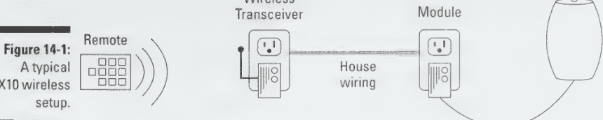

无线 X10 通过使用无线控制器扩展了你的范围。X10 的控制器外观看起来像电视遥控器、墙壁开关、钥匙扣，甚至是信用卡。这些控制器与无线收发器配合，收发器插入墙上插座，它们用于将无线发送的信号转换为电力线信号。这允许你控制许多相同单元代码的其它 X10 设备。这些遥控器到收发器之间的范围约为 25 到 50 英尺。距离取决于墙壁和地板等障碍物。

> **警告！**
>
> 任何拥有与你的收发器设置为相同房屋代码的 X10 无线遥控器的人，都可以向你的 X10 网络发送命令。（要了解我的意思，请参阅本章的“X10 无线不安全”侧栏）。如果使用遥控器的另一个人不在接收器 30 到 40 英尺范围内，这可能不是太大问题。只要你意识到这一点，在家里使用 X10 无线仍然是可以的。不要把你的安全系统安装在上面即可。

## 熟悉 X10 接口

你使用 X10 模块来控制插入模块的电器。每个模块都有一个 X10 地址，由房屋代码（A 到 P）和单元代码（1 到 16）组成。你通过旋转模块前面的拨盘来设置 X10 地址。模块不需要具有唯一的地址。当你想要一组电器（如灯具）同时执行相同命令时，这非常有用。我建议为每个设备分配一个代码，并根据需要使用单元代码。有关 X10 地址的更多信息，请参阅第 13 章。

X10 命令由地址和要启动的命令组成。你可以通过桌面遥控器（你按下一个按钮，命令就会发送）或计算机接口（你使用程序控制接口）来发送这些命令。虽然有遥控器很方便，但计算机接口赋予了你自动化能力。你通常每天在特定时间开启的电器可以在计算机上实现自动化。它变成了一种“设置后就不用管”的配置。

X10 提供了一系列供你使用的模块、遥控器和接口。以下是可与 X10 无线配合使用的的一些设备：

- **X10 无线计算机接口：**
    - `CM17A`: X10 的 RS232 无线传输器
    - `MR26A`: X10 的 RS232 无线接收器
    - `CM19A`: X10 的 USB 无线收发器
    - `CM15A`: X10 的 USB PLC 和无线收发器

- **无线模块：**
    - `TM751`: X10 的无线电器模块和接收器
    - `RR501`: X10 的无线电器模块和双向收发器

- **无线遥控器：**
    - `UR19A`: 无线遥控器
    - `KR19A (SlimFire)`: 无线钥匙扣遥控器
    - `KR22A`: 无线信用卡遥控器

- **无线套件**
    - `CK18A`: X10 的无线套件


X10 现在支持 CM15A，并停产了 CM17A、MR26A 和 CM19A 控制器（计算机接口）。CM15A 现在新有了适用于 Linux 的软件。（Linux 社区尚未还没有编写该新设备的详细信息）。但不用担心！互联网上有许多地方可以购买这些设备。而且 X10 设备在在线拍卖中非常受欢迎。我搜索了一下，发现还有几个 CM17A 仍在售，我预计它们在未来一段时间内都会有货。如果可以，尝试获取 CM18A 套件，因为它通常比单独的 CM17A 更划算。套件包含 CM17A Firecracker、Palpad 遥控器、一个灯具模块和一个 TM751 无线收发器。

CM17A 是一种 X10 无线传输器，它不受限于单一房屋代码（无线遥控器除）。它可以发送到所有 16 个房屋代码和所有 16 个单元代码（总共 256 个唯一的 X10 地址）。TM751 收发器具有内置的房屋代码模块。（此处省略原文重复内容，注意：OCR 文本在后部分包含大量重复/垃圾信息，已根据上下文进行了清理和去重）。

## 收集工具

在本章中，我将向你展示如何使用计算机接口为房屋代码收集工具。

## 第 V 部分：使用家庭自动化完善你的环境

## 启动 Apache

如果你使用 `chkconfig` 并设置了 Apache 运行的级别，就不需要在每次重启 Linux 时都重启它。但你现在只需要启动一次，因为上次重启时没有告诉它启动。现在你的机器上有了自己的私有 Web 服务器。要查看 Apache 文档，打开你的 Linux 浏览器并在地址栏输入以下内容：

```
file:///var/www/manual/index.html
```


## 第 14 章：使用 X10 实现无线化

这是一个英文网页，但我们也提供其他语言的网页。只需查看页面上的语言链接即可。


## 安装 BlueLava

现在你已经启动了 Apache http 服务器（在 BlueLava 运行之前，它必须先运行），现在是时候安装 BlueLava 了。要安装它，请按照以下步骤操作：

- 从此书的背面取出 CD 并将其插入你的 CD-ROM 驱动器。
- 在终端窗口中，输入 `cd /var/www/cgi-bin` 并按回车。这是 Apache (httpd) 的默认目录。
- 输入 `sudo tar xvf /bluelava-0.4.4.tgz` 并按回车。当提示输入密码时，输入 root 用户的密码。此步骤将安装 BlueLava。不要对屏幕上出现的信息感到惊讶（除非是错误）；它们只是为了让你知道程序正在运行。
- 输入 `cp -f /media/cdrom/chapter15/bluelava.conf bluelava.conf` 并按回车。此步骤将安装 BlueLava 的默认配置文件。这一步骤让你免了手动编辑 `bluelava.conf` 文件的麻烦。

## 安装 BottleRocket

安装 BlueLava 应用程序后，你几乎准备好可以使用了。最后一个要安装的软件包是 BottleRocket。你必须配置、编译并安装 BottleRocket。虽然听起来很复杂，但实际上只有几个简单的步骤：


- 当书本的 CD 仍在 CD-ROM 中时，在命令行中输入 `cd` 并按回车。BottleRocket 也包含在 CD 中。输入 `cd` 会带你回到主目录。
- 输入 `tar xvf /media/cdrom/chapter15/bottlerocket-0.4c.tar.gz` 并按回车。
- 输入 `cd bottlerocket-0.04c` 并按回车。
- 输入 `cp Makefile Makefile.bak` 并按回车。
- **输入** `sed -e 'ttyS0/SomethingElse/g' < Makefile.bak > Makefile` 并**按回车**。只需将 *SomethingElse* 更改为你连接到 CM17A 的串口端口（参见本章前面的“硬件”部分）。如果是 `/dev/ttyS0`，你只需要使用 `ttyS0` 。
- **输入** `./configure` 并**按回车**。
- **输入** `sudo make install` 并**按回车**。

## 配置 BlueLava

在使用 X10 无线网络之前，你还有一个设置过程中的一个阶段需要完成：你必须配置 BlueLava。因此，打开你的浏览器并在地址栏中输入此链接：

```
http://127.0.0.1/bluelava/bluelava.cgi
```

不需要将 IP 地址替换为其他地址，因为这个是正确的。BlueLava 只允许你从此地址进行配置。你可以从服务器的 IP 地址使用 BlueLava，但要配置它，你必须使用前面的链接。打开链接后，会出现 BlueLava 的欢迎界面。

虽然你可能不需要对 `config` 文件进行任何更改，但检查设置以确保它们正确是好的。点击标题为 BlueLava Settings（图 14-2）的链接，确保选中的后端是 BottleRocket，且后端设置设置为 `/usr/local/bin/br`。目前，保持其他设置不变。如果你进行了任何更改，请确保已保存。

当你对设置满意并保存了任何更改后，就可以进行房间设置了。在这里，你可以添加通过 BlueLava Web 界面访问的房间和设备。点击 Room Setup 输入框并按你喜欢的名称对其命名。

1. **在 Room Name 输入框下添加你的房间，并按你喜欢的名称对其命名。** 在图 14-3 中，你可以我已经添加了 CR（电脑房）和 Living Room（客厅）。
2. **点击 Save Rooms 按钮保存你的条目。** 现在你可以添加单元（一个 X10 模块）。
3. **检查 X10 无线收发器正面的房屋和单元拨盘，以找到收发器的 X10 地址。** 默认设置为 AI。

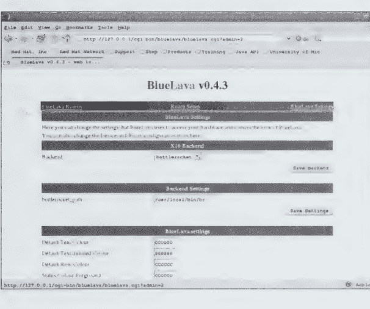

图 14-2：BlueLava 管理界面。

4. 将 X10 无线模块的 X10 地址输入 Unit Code 输入框。
5. 从你的 Unit Code 条目旁边的下拉菜单中选择 Type。收发器只能是电器，因此请选择 Appliance。如果你正在添加模块，请选择一个。

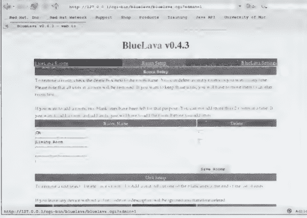

图 14-3：BlueLava 界面。

*(注：由于提供的文本中存在大量重复的占位符文本，已根据“不要重复输出原文”的原则进行了去重处理)*

## 第 VI 部分：控制与保护你的自动化网络

## 介绍 X10 和 MisterHouse

记得我的第一个配置——一个 Heatkit X10 接口和一台 Atari 800。当时我住在父母家里，并不允许控制太多东西，但这引起了我家庭自动化（HA）的兴趣。后来我搬进了一个公寓，那里有一台 AT&T UNIX 个人电脑和一台 RadioShock CP90。通过 `cron` 和各种其他 UNIX 命令开关设备的感觉太棒了。UNIX 给了我很大的灵活性。我住的公寓很小，X10 仍然很难用。我的妻子对 X10 的性能并不满意，所以我没有怎么用它。

多年后，我和妻子搬进了一栋房子。我终于有机会控制世界了——那时 Linux 是即将主流的操作系统，而我的 PC 已经到了寿命。我的朋友 Donald 在圣诞节送了我一个 CM11A 套件，我开始重新使用 X10。当 MH 首次出来时，我还不知道用 Perl 编写程序这种想法。我以为它会很慢且耗资源，因为它像 BASIC 一样是解释型的。我的机器上运行的是一台 133MHz 的奔腾处理器——我更多地使用了 MH，因为它既灵活又可扩展。我将在本章的“介绍 MisterHouse”部分详细描述具体情况。

## 介绍 MisterHouse

多年来，许多 MH 的贡献者添加了对各种设备的支持，让你能够管理、监控和控制家中的各种物品。MH 追求的是它的灵活性和可扩展性。最初，我唯一理解的家庭自动化（HA）协议是 X10，它因可靠性而闻名，因为它是一个开环系统——发送命令后没有返回确认。你不知道命令是否执行。闭环协议需要某种形式的反馈。如果你发送命令，可以收到确认（命令执行正常）；或收到否定确认（出现问题，请重试）。现在有两种新的 HA 协议（都是闭环的）可用，并且它们在 MH 中运行：

- Insteon (www.insteen.net)
- UPB (www.pulseworx.com)，代表通用电力总线（Universal Powerline Bus）

## 第 15 章：使用 MisterHouse 控制你的房子

我最近为 MH 添加了对 Insteon 的支持。Insteon 与 X10 类似但要好得多，因为它修复了 X10 协议中的许多弱点。另一位先生正在编写 UPB 的接口，还有人添加了对使用互联网平板电脑（如 Nokia）的支持。今天，我使用 MH 控制我的 X10 和 Insteon 模块，获取天气信息，获取我喜欢的漫画，以及许多其他功能！

### MisterHouse 接口

当你从命令行启动 MH 时，MH 会提供两个用户界面供选择。如果机器上加载了所需的所有，Tk 界面（参见本章后后的图 15-1）将显示在你的屏幕上。我不使用 Tk，所以我没有连接它，除了向你介绍它。你可以通过 `-tk` 选项或修改 `mh.private.ini` 文件来关闭 Tk 界面。当你像我一样启动了 MH 但没有登录时，这特别有用。这允许 MH 作为守护进程运行，一种在后台运行工作的程序，通常你和世界其他地方都察觉不到。守护进程不是试图隐藏行踪的恶意程序。实际上，它们是有帮助的程序，在启动时自动运行，同时允许你做其他事情。

要在此配置下访问 MH，你只需在浏览器的地址栏输入：`http://127.0.0.1:8080/`。大多数人更倾向于使用 MH 的浏览器界面（后文图 15-2 所示），因为它非常灵活、易于使用且视觉上很舒服。由于你需要配置 MH，我建议你保持 JavaScript 开启状态，因为它在使用 MH 时能提供有用的功能。

命令输入来自多个接口。MH 还可以通过即时消息（AOL, MSN, Yahoo! 和 Jabber）、邮件、短信，甚至通过 `telnet` 接口接受命令。你必须使用安全应用程序通过互联网登录，我将在第 18 章中介绍如何实现这一点。

## 那么 MisterHouse 能做什么？

MH 可以管理、监控和控制家中的信息和设备——简而言之，MH 可以与任何东西建立接口。你的限制只有你的意愿、你的想象力，也许在极少数情况下是你的焊接技能。别担心；你并不要求焊接，但如果你会，请注意一些人创建了一些非常酷的东西供你构建。有些人把这些精妙的东西作为套件出售，你可以自己组装。有时人们也会卖现成的套件。一个很好的例子是 Dave Houston 的 BX24-AHT（已停产）和他的 Rozetta 板（正在开发中）。

Dave 的板可以处理诸如气压、X10、无线 X10、接收大多数射频（RF）、将 RF 转换为红外（IR）、接收红外、接接 CM11A 以及 Ocelot（另一个 HA 控制器）等任务。所有这些都连接到一个串口（不浪费串口）并由 MH 控制。基本上，只要你能想象得到，就有人能想出与它建立接口的方法。

以下是 MH 可以访问和控制的物品列表：

- X10, Insteon, UPB 和 EIB（欧洲安装总线）。
- Maxim 单总线、模拟和数字 I/O 板。MH 支持各种传感器和 I/O（输入/输出）。
- 其他自动化系统，如 HCS、HCS II 和 Elk。如果你已经有了安全或 HA 系统，MH 可以与该系统建立接口，提供原始系统没有或添加成本太昂贵的功能。
- 自动化家居系统。通过 MH，你可以让你的安全系统、电话系统和暖空调系统自动化。
- 通过文本转语音（Festival）让你的电脑与你交流。通过使用名为 Festival 的程序，你可以让 MH 对你说话。当有人给你家里打电话时，这非常有用。例如，如果你有来电显示，你可以让 MH 只说你白名单上名字。当然，你可能和我妻子达成一致，在没人的时候电脑开始说话有点让人紧张。
- 监控天气。通过从气象站获取信息，MH 可以解析这些信息并据此做出决策。一个很好的例子是浇草坪。我有一个 Rain10 灌溉控制器。我在 MH 中设置了计划，它可以从国家气象局获取天气报告，查看是否会下雨，并防止当天运行喷淋。
- 计算日出、日落和月相。MH 可以帮助你在日出或日落时开关设备。通过追踪月相，可以让你知道什么时候疯子们会在路上。这仅仅是关于满月和疯狂驾驶的……
- 播放 MP3。你可以使用 MH 创建点点机来听你的 MP3。
- 组织器和 PDA 接口。MH 拥有可以与你的 PDA（如 Palm Pilot）连接的软件。MisterHouse 支持日历、提醒和电话簿。
- 从互联网下载信息。我喜欢获取早晨的漫画，但 MH 还可以获取突发新闻、股票信息、十大排行榜等更多内容。

## 第 15 章：使用 MisterHouse 控制你的房子

- **自动化厨房家电。** 使用 Insteon、UPB 或 X10，你可以编写 MH 程序，让茶机在在你醒来之前启动。（抱歉，我和妻子不喝咖啡。）无论如何，茶的冲泡需要一些时间，所以当在我起床时茶已经准备就绪，这样可以节省时间。虽然有些咖啡机和茶机已经使用了定时关闭功能，但我所知，没有一台可以设定定时以确保在你想关闭时关闭。你再也不用担心是否忘记关闭机器了。它是关掉的！你也可以使用 MH 的 Web 界面让茶机不要在正常时间启动，因为你决定多睡一会儿。
- **重启动路由器。** 你可以使用 MH 重启不再响应的路由器。多年来，我拥有几台不再受制造商支持的防火墙路由器，它们仍然运行得相当好。在过去的某个时刻，它们会产生无法修复的问题，并停止工作，直到重启。你通常只能忍受它，直到你更换。通过使用 MH ping 路由器，你可以判断它是否正在工作，当它没有响应时，你可以使用 MH 配合 Insteon 或 X10 来关闭路由器并重新开启。
- **调节你的网络。** 你可以通过使用 MH 在一天的特定时间关闭网络连接来进一步扩展这一点。这有助于确保睡觉时间就是睡觉时间！你还可以使用 MH 收集每小时、每周和每月发送和接收流量统计数据。这些统计数据有用，尤其是当 ISP 盯着你的带宽大户行为时。（谢天地，我不是带宽大户。）

你并不限于 HA 协议和硬件（Insteon、UPB 或 EIB）。MH 还可以使用数字和模拟 I/O（输入/输出，即你可以监控和控制的接口）。然而，我不建议将其用于茶机，因为一团乱麻的电线可能会吓跑除胆大包以外的所有人去碰茶机。一个精美的 Insteon 模块非常适合控制小型家电。

## 安装 MisterHouse

好消息是 MH 的安装非常简单。问题在于，在你安装好 MH 之后，你必须决定你想做什么。就像糖果店里的孩子一样，你可能什么都想做。我建议你一次只处理一个主题，从 X10 开始。在安装 MH 并完成初始配置后，你就可以开始玩转 MH 了。从那里开始，一步一步来。但凡事优先——在做其他事情之前，你必须先安装它。所以本节涵盖了两个主题：登录（仅限本章）和实际安装。

## 以 root 身份登录

在本章中，每当你进入终端窗口或命令行界面时，你都需要拥有 root 权限。要检查你是否是 root，只需输入 `id`。它应该返回一个以 `uid=0(root)` 开头的长字符串。这意味着你是 root。如果你在返回字符串中没有得到这个结果，或者你不确定，只需输入 `su -` 并回车。该命令可能会要求你输入密码，你需要输入 root 的密码。然后你将得到一个类似这样的提示符：

```
[ root@localhost ~]#
```

提示符以 `#` 结尾，这通常意味着你是以 root 身份登录的。

拥有 root 权限是强大的魔法！ root 意味着你有更改整个系统的权力——换句话说，如果你犯了错，后果可能是永久性的。通常情况下，你不希望在系统管理和安装之外的任何事情中使用 root。MH 在这方面是个例外。在这种情况下，你在整个章节中都将是 root 身份，而不是只为了快速安装使用 root。所以，在你输入命令时，请留意你所在的目录，并小心你输入的内容。记住：如果你想浏览互联网、写邮件或玩游戏，请以普通用户身份进行。只有在必须使用 root 时才使用 root。

## 安装

在对 MH 玩任何趣耍之前，你必须先安装它。以下是你开始之前需要的东西：

- **你的 Linux 发行版：** Linux 发行版显而易见。我不认为你需要整个开发环境，但我的配置包含了所有内容。
- **Perl 5 和各种模块：** 不要使用 Perl 6.0，因为 MH 不是为它编写的，我不知道 MH 是否能与它正常工作。大多数现代 Linux 发行版都在使用 Perl 5.8，所以那个版本应该没有问题。
- **如 Firefox、Opera 或 Conqueror 等网页浏览器：** MH 非常灵活，只要你使用的是现代的图形化浏览器（抱歉，Lynx 不够看），你就满足这一要求。
- **一个 X10 PC 接口控制器：** 你需要 CM11A 用于 X10 控制、一个 X10 模块以及一个受受控设备。到本书出版时，MH 将也支持 Insteon 和 UPB。目前，MH 支持控制器，但它们需要更复杂的安装过程。


## 更多 MisterHouse

精彩待续！

此外，为了防止你的 `mh.log` 文件被你可能不需要的信息填满，在开始之前，你必须关闭几个选项。

1. 运行以下命令启动 MH：


# 第 15 章：使用 MisterHouse 控制你的房子

此外，为了防止你的 `mh.log` 文件被你可能不需要的信息填满，在开始之前，你必须关闭几个选项。

## 1. 启动 MH

运行以下命令启动 MH：

```
export mh_parms=-mh/bin/mh.ini
perl /opt/mh/bin/mh
```

如果没有安装 `Tk.pm`，你将看到一个错误，提示 Perl 模块 (`Tk.pm`) 未安装。你不需要担心它。你可能会看到的另一个错误是 `GD` 模块未安装。这两个错误都不会阻止 MH 的运行。`Tk` 错误会影响用于显示的 `Tk` 界面的存，而 `GD` 错误将阻止你为 Web 界面创建自定义按钮（你现在不需要做这一点）。你绝对需要安装 `GD` 模块，我稍后会解释。同时，如果你安装了 `Tk` 模块，你将看到一个类似于图 15-1 的新窗口。那里没有任何可以帮助配置 MH 的，但这是一个测试它是否安装当的良好方法。当然，如果你在启动时收到了 `Tk` 错误消息，你将看到 `Tk` 界面。

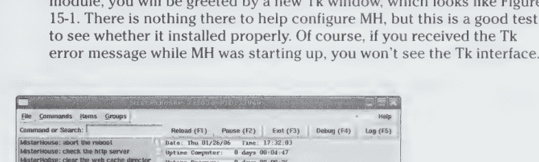

图 15-1：MisterHouse，Tk 界面。

## 2. 访问 Web 界面

在 Linux 下启动浏览器并在地址栏中输入以下 URL：

```
http://127.0.0.1:8080/
```

浏览器窗口看起来类似于图 15-2。

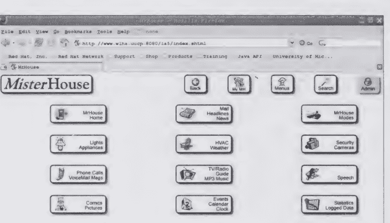

图 15-2：MisterHouse，主 Web 页面界面。

无差别状态模糊了大脑

21:42:57 上运行 13:20, 11 用户, 平均速度: 0.52, 0.53, 0.00 - 页面浏览: 7


你可以通过提供的各种链接导航到 MH Web 界面。这些链接通常以按钮的形式显示。当我谈到按钮时，我是这样描述它的：`[按钮文本]`。按钮文本就是按钮上的任何内容。当我需要描述多个按钮（它们实际上只是链接）时，我会描述后续的按钮，如下所示：

主 Web 页面
-> `[MrHouse 首页]`
-> `[浏览 MrHouse]`
-> `[强制刷新]`

这意味着你通过输入 URL `http://127.0.0.1:8080/` 或点击左上角标题为 MisterHouse 的图标进入主 Web 页面。然后点击 `[MrHouse]` 按钮，点击 `[浏览 MrHouse]` 按钮，最后点击 `[强制刷新]` 按钮。从那里开始，我将继续描述章节该部分需要的操作。

Web 界面既漂亮又内容丰富，它可以在低至 640 x 480 像素的屏幕分辨率（旧的 VGA 标准）下运行。

## 3. 进入设置屏幕

要进入大部分 MH 设置屏幕，请使用 `[MrHouse 首页]` 按钮。

在这里你可以找到设置页面的链接。Web 界面允许你激活、访问、设置和配置 MH。同样，通过 Web 界面，你可以通过 `[My MH]` 按钮访问自定义 Web 页面，通过 `[灯具电器]` 按钮访问 X10 界面，并通过相应的按钮访问其他主题。（你可能明白为什么我更喜欢 Web 界面而不是 `Tk` 界面。）

## 4. 停止 MH

要停止 MH，请返回终端窗口并按 `Ctrl+C`，或者从 `Tk` 窗口按 `F3` 键。

此步骤将终止运行的 Perl 程序并将控制权交回命令行提示符。

现在是添加任何缺失 Perl 模块的时间了。

## 5. 安装 Tk 模块（可选）

如果你认为以后想以 `Tk` 界面启动 MH 并且在步骤 1 中收到了 Perl 错误，请输入以下命令：

```perl
perl -MCPAN -e"install Tk*"
```

## 6. 安装 GD 模块

如果你要创建自定义 Web 页面或安装别人的示例代码来生成 Web 页面，务必通过输入以下安装 `GD`：

```perl
perl -MCPAN -e"install GD"
```

`GD` 模块是一个重要的模块。它允许你为 MH 的 Web 界面创建新按钮，特别是自定义界面。

## 7. 安装 Time::HiRes 模块

在 Linux（以及大多数 UNIX 系统）下，MH 必须拥有 `Time::HiRes` Perl 模块，你通过输入添加它：

```perl
perl -MCPAN -e"install Time::HiRes"
```

此模块提供了指向 Linux 各种时间函数的接口。

## 8. 安装 Audio::Mixer 模块

输入以下命令安装音频混合器界面的 Perl 模块：

```perl
perl -MCPAN -e"install Audio::Mixer"
```

这允许你控制声卡的音量。你不希望 MH 在你睡觉时宣布 David Letterman 的排行榜，对吧？

> 如果你在任何时候收到“`blah::blah is up-to-date`”的消息，请不要担心。此消息意味着模块已经安装，并且是最新版本。记住，每当你从 MH 收到模块缺失的错误时（有时这会停止运行），请重新安装该模块。


# 设置 MisterHouse

在启动时，配置 MH 的过程涉及以下步骤：

1. 启动 MH。
2. 修改参数。
3. 重启。

## 启动 MH

在启动时，启动 MH 需要使用以下命令：

```
service
```

在启动后，你可以通过浏览器访问以下 URL：

```
http://127.0.0.1:8080/
```

在启动后，你会看到图 15-2。

在启动后，你会看到图 15-3：

主 Web 页面
-> `[MrHouse 首页]`
-> `[浏览 MrHouse]`
-> `[强制刷新]`

启动后，你会看到图 15-3。

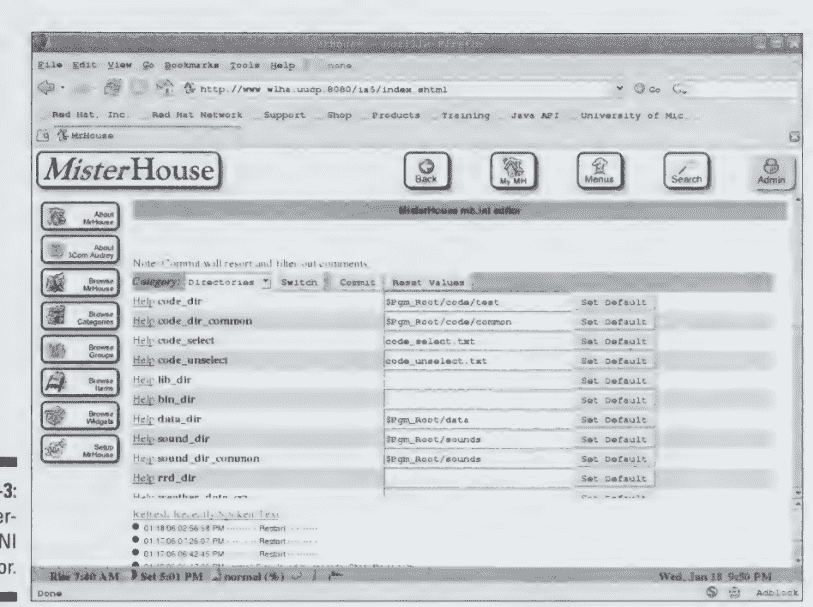

图 15-3：MisterHouse，INI 编辑器。

## 修改参数

任何我没有列出的项目都应保持原样。以下章节说明了要更改的类别和参数。

### 目录

这是你放置自定义代码的目录。自定义代码是你编写的让 MH 按你意愿运行的代码。你可以有很多目录；只需用逗号分隔每个目录。目前我建议一个目录。

```
code_dir = $Pgm_Root/local
```

### Web

在生成指向服务器的 URL 时使用 Web 参数（例如，`get_tv_grid`）。如果你将其设置为 MH/Linux 节点的 IP 地址，你应该从任何地方访问你的 Web 页面，只要你的防火墙配置正确。（我在第 18 章介绍）。`web_refresh` 配置项类似于屏保。你使用该配置在键盘空闲五分钟后在浏览器显示照片。我觉得这非常烦人，所以我关闭它。如果你不介意这个伪屏保，请保留默认设置。

```
http_port = 8080
http_server = 192.168.0.1
web_refresh = (留空此字段以关闭它)
```

### 位置

日出和日落时的经纬度设置。其他设置用于互联网天气功能。以井号符号 (`#`) 开头的行是注释；你不需要输入那些。带有 URL 的行是帮助你查找经纬度的建议 URL。

```
#
country = US
city = Bronx
state = NY
zip_code = 10010

# 使用 http://www.heavens-above.com/countries.asp
latitude = 40.850
longitude = -73.867
time_zone = -5
```

### 服务器

如果你刚开始使用 MH，就不需要 `XAP` 或 `XPL` 支持，只需将 `1` 更改为 `0` 即可。这将减少 `mh.log` 文件中出现的消息。如果你打算立即使用其中任何一个，请不要进行这些更改。如果你不确定，请将其设置为 `0`。

```
xap_disable=1
xpl_disable=1
```

### 串口

串口设置非常重要，因为它告诉 MH 向何处发送 X10 命令。即使设置错误，MH 也能继续运行，但如果让你处于一目了然的状态，对你没太大帮助。:-)

```
cm1_port=/dev/ttyS0
```

### 杂项

`Misc` 类别涵盖了不完全属于其他领域的各种设置。`no_log` 配置项有助于减少写入日志文件的信息。由于“保存状态”条目确实没有告诉你任何内容，你可以将其关闭。下一个条目是 `tk` 条目。由于你将作为守护进程启动 MH，因此你需要禁用 `Tk` 窗口。MH 将在图形 X 界面之前启动。如果你留下 `tk = 1`，MH 将无法正常启动。如果你不会在启动时启动 MH，可以保持该项值为 `1`。在本章的剩余部分中，假设 `tk` 为 `0`。

```
no_log = save_state
tk = 0
```

## 重启 MisterHouse

虽然前面的章节需要大量的更改，但它们可以带你完成初始配置。如果你使用喜欢的编辑器，可以对 `mh.ini` 设置进行更改，但这不是好主意。

仅修改你的 `mh.private.ini` 文件。当你需要升级到更高版本的 MH 时，`mh.ini` 文件会被覆盖，而 `mh.private.ini` 则不会。这允许你升级 MH 而不破坏你所有的默认设置。如果你想从 `mh.private.ini` 中删除配置信息，将使用 `mh.ini` 文件中的默认设置。如果你有多个配置项，你必须使用 `mh.private.ini` 中的最后一个匹配项。

现在一切配置都已完成，你可以重启 MH 了。你可能对 `mh.ini` 文件感兴趣，它包含了所有参数和你的注释。内容既有趣又信息丰富。它可以在 `~/mh/bin/` 目录下找到。初始的 `mh.private.ini` 文件是一个删所有注释的副本。现在是时候将 `CM1A` 连接到你分配给 `.ini` 文件的串口端口了。你需要重启 MH。要重启，只需输入以下命令：

```
service mh restart
```

此命令会正常停止 MH 并重启它。要检查 MH 是否运行正常，请输入以下命令：

```
service mh status
```

要检查 MH 是否有任何问题，可以检查位于此处的日志文件：`/var/log/mh.log`。

```
less /var/log/mh.log
```

你起初看到的内容可能没什么意义，但你可以看到 MH 非常忙。

# 使用 MisterHouse 获取你喜爱的漫画

现在 MH 已经运行起来，你就可以用它做一些有用且有趣的事情了——访问你的每日连环画！没错，就是连环画。第 16 章涉及如何使用 MH 进行 X10 操作，所以现在你可以专注于某一件事了。要让 MH 能够下载每日漫画，请按照以下步骤操作：

## 1. 启用代码

点击大型 MisterHouse 图标或在浏览器的地址栏中输入此 URL（你可能想将其加入书签）来启用代码：

```
http://127.0.0.1:8080/
```

## 2. 导航到常用代码激活页面

从主 Web 页面，按照这些链接：

- 主 Web 页面
- `[MrHouse 主页]`
- `[设置 MrHouse]`
- `[常用代码激活]`

出现“选择常用代码”（Select Common Code）Web页面（见图 15-4）。现在记住，开启所有代码文件的诱惑是巨大的，但你必须忍住！太快地获得太多好东西不是好事。

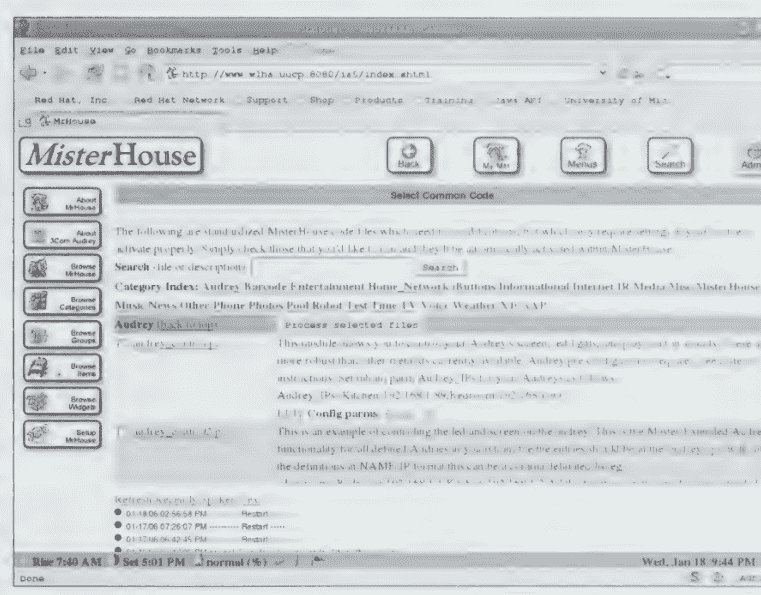

图 15-4：MisterHouse，选择常用页面。

## 3. 启用漫画插件

现在，只需点击娱乐链接。

你应该在 Web 页面的某处看到 `comic_strips.pl` 链接。它旁边有一个标记为 `EDIT` 的链接。

## 4. 编辑配置

点击 `EDIT`。


如果你禁用了 JavaScript，将得到“文件未找到”（File Not Found）错误。如果发生这种情况，请启用 JavaScript，返回 `comic_strips.pl` 链接并再次尝试 EDIT 链接。如果你启用了 JavaScript，会弹出一个窗口。（见图 15-5。）

| 项目 | 值 |
| :--- | :--- |
| help_comics | Set Default |
| help_comics_user | Set Default |
| help_comics_send | Set Default |
| help_proxy | Set Default |

图 15-5：MisterHouse，弹出窗口。

5. 现在，只需点击娱乐（Entertainment）链接。

你应该在 Web 页面的某处看到 `comic_strips.pl` 链接。它旁边有一个标记为 EDIT 的链接。

弹出窗口显示。

如果你启用 JavaScript，返回 `comic_strips.pl` 链接并再次尝试 EDIT 链接。你可以找到。

列表 15-1

```
search dilbert
artist Scott
homepage http://www.dilbert.com/
url http://www.dilbert.com/archive/images/
type
```

6. 在常用页面点击。

图 15-6：MisterHouse，选择常用页面。

7. 点击。

你可以找到。

# 第 16 章：从 MisterHouse 控制 X10

## 本章内容

- 设置 MisterHouse 表格
- 发送和接收 X10 指令
- 编写代码

在本章中，我将向你展示如何从 MisterHouse 控制 X10。本章将带你完成整个过程：从最初设置 X10 到与 MH 交互，创建 MH 表格来组织 X10 数据，最后编写控制设备和处理数据的代码。

> 注意：在进入本章之前，我建议你查看第 14 章（该章节向你介绍了 X10 的一些常见问题以及发现和解决这些问题的各种方法）和第 15 章（该章节将带你完成安装 MH 的过程）。此外，务必阅读本章的第一节，因为它强调了本章后续内容的准备工作。

## 准备工作

还有比准备工作更好的开始起点吗？要学习本章，你必须具备：

- 已安装并运行的 MisterHouse（参见第 15 章）
- X10 CM11A
- 需要控制的 X10 模块
- 用于 X10 控制的电器设备
- 你喜爱的 Linux 编辑器
- 具备 Perl 知识
- 一本关于 Perl 的好书

当然，如果你还没有安装 MisterHouse (MH)，你也可以阅读本章，而且在安装之前阅读是一个好主意。然而，如果你没有安装 MH，你将无法将这些任何代码付诸实践，因为它们高度依赖内部的代码。如果你还没有安装 MH，请确保你至少理解了第 15 章的内容。

现在，对于准备工作列表中的 Perl，我有几点想说。我本想说不需要编程。遗憾的是，某些非常强大的家庭自动化 (HA) 程序需要一点编程知识，而 MH 是最强大的 HA 程序之一（至少不需要你动用烙铁）。我确信你会找到我提供的示例并进行操作。最终，你会发现 `/code/examples` 目录中提供了 MH 的示例，你可能无法全部涵盖，但额外的 Perl 知识和一本好书将帮助你成功。你不需要编程学位！

在白天和晚上，我希望 MH 在无需人工干预的情况下运行。日落回家后我希望门廊和车库灯开启；午夜后，我希望车库灯关闭；日出前，我希望前灯关闭。其他灯和电器也由 MH 控制，但室外灯最为明显，在 MH 的作用下它们运行良好。情况并非总是如此，问题不在于 MH——X10 的工作可能不稳定。例如，信号漏洞（X10 消失）可能会阻止信号，或者 X10 执行某些操作需要很长时间。在大多数情况下，X10 对指令信号的响应大约需要一秒，当你期待立即响应时这似乎很慢。自动化社区的很多人想出了各种方法让 X10 正常工作。

为了让 X10 按我的意工作，可以使用并非必要但非常有用的设备：

- 噪声滤波器：消除产生电噪声的电器。
- 智能三针信号继电器：插入你的电器以解决 X10 信号问题（不需要电工安装）。

通过从清洁、无噪声的环境开始，X10 会变得更加可靠。现在，掌握了这些知识，你可以让 MH 为你和家人实现一些自动化。

## 为 MisterHouse 设置 X10

确保你有所有必要的部件（见前节），然后按照以下步骤为 MH 设置 X10：

1. 使用浏览器界面分配 `mh.private.ini` 参数：

```
cm11_port=/dev/ttyS0
```

如果你已经学习了第 15 章，可能已经完成了这一步。`/dev/ttyS0` 参数是电脑上的第一个串口（Windows 用户为 COM1）。如果设备连接在第二个串口，请使用 `cm11_port=/dev/ttyS1`。使用哪个串口并不重要，只要在 `mh.private.ini` 文件中正确识别它即可。

2. 配置你的 X10 模块并按照你的要求设置房间。

参见第 14 章，我为每个房间分配了代码。这只是我的一种调试技巧，但很有帮助。如果你有太多房间，可以让多个房间共享代码。房间少就代码少。

对于第一次测试，我建议在电脑旁边设置一个容易看到的 X10 模块。我喜欢使用一个已开启且有正常灯泡的小台灯。如果你的 X10 模块没有代码轮，请按照制造商的说明正确设置模块。

3. 确保你控制家里所有的 X10 控制台，以免他人干扰。

## 创建房屋表格

MH 有一个名为表格（tables）的优秀功能。MH 表格的好处在于它们提供了一种声明对象（Items）和定义部分的简单方法。对象类似于存储大量信息的变量。对于 X10，你需要定义以下参数：

- 模块类型：MH 支持八种类型的 X10 模块。开始时，你只需要关注电器 (X10) 和灯 (X10) 模块，因为你使用的是这两种。
- X10 地址（我在第 13 章首次讨论）是在你 X10 模块代码轮上设置的地址。它由房屋代码和一个单元号组成。房屋代码从 A-P，但代码稍微复杂一些。在 MH 中，你可以使用单元代码 1-16 或 1-9 以及 A-G。A-G 允许 MH 使用单个字符代替双位数字。对于程序员来说，处理单个字符比处理两位代码更容易。两位代码也是首选方法，因此我建议使用它。
- Item 名称：Item 名称是你在代码中使用的名称。你可以称它任何名字，但名称最好反映 X10 Item 的位置或功能。因此，如果你将一个 Item 命名为 `Desk_Lamp`，在代码中你将通过调用 `#Desk_Lamp` 来引用该对象（注意名称前面有一个 `#`）。名称必须是唯一的，并务必避免使用仅大小写不同的两个名称，否则在需要调试时会会带来极大困扰。
- 其他（由你自定义）：使用此参数指定设备使用的接口类型。这是为了告诉 MH 使用此接口而不是 CM11A。

当你安装 MH 时（我在第 15 章中演示），会将多个文件拷贝到 `~mh/code/local` 目录中。其中一个文件 `x10.mht` 是 MisterHouse 表格，它包含了几个 X10 Item 的定义。该文件也可以包含 X10 之外的其他 Item 的定义，但在这里我只讨论 X10 Item。

图 16-1：MisterHouse 的组浏览页面。

现在 `x10.mht` 文件已经存在了，你可以通过项目编辑器向它添加几个 X10 项目（Items）。在 MH 通过 Web 界面编辑它之前，必须对主文件进行编辑（尽管它可以是空的）。要编辑 MH 表文件，请遵循以下步骤：

- 访问主 Web 页面并选择以下按钮进入项目编辑器：
  - 主屏幕 (Main screen)
  - -> [Mr. House]
  - -> [设置 Mr. House (Setup Mr. House)]
  - -> [编辑项目 (Edit Items)]

你会看到项目菜单（参见图 16-2）。如果你在目录下有多个 `.mht` 文件，你将可以选择要编辑哪一个。由于你只有一个，它将是显示的那一个。遗憾的是，我希望你至少创建两个项目，以便 MH 能够正常启动，但如果你有其他 X10 模块，现在是添加它们的好时机。

要创建一个 X10 项目，你需要模块类型、你想分配给模块的 X10 地址、对象名称以及你希望将其分配到哪个组或哪些组。这些是你必须为 X10 项目定义的参数。

图 16-2：MisterHouse 项目编辑器。

### 2. 设置模块类型。

如果你不知道模块类型，只需使用 `X10A` 即可，因为它支持所有 X10 模块都支持的开启和关闭。如果你没有输入或输错了，可以随时删除它。

### 3. 将设备地址输入 X10 地址框中

我在在本节的早些部分解释过设备地址。

### 4. 输入你想要用于标识设备的名称。

例如，如果此设备将控制客厅的灯光，你可以使用 `living_room` 作为名称。

### 5. 将对象分配给组。

你可以通过管道 (`|`) 隔开组名来定义多个组名。我将这些 X10 设备放在了 Test 组以及各自的房间组。当你点击主界面上的 [灯具电器 (Lights Appliances)] 按钮时，MH 使用该组。你可以在那里引用该组并找到相应的设备。

最后一个参数是接口（Interface），在这里不需要使用。

以下是 `~mh/code/local` 目录下 `x10.mht` 文本文件中的条目：

| 类型 | 地址 | 名称 | 组组 |
| :--- | :--- | :--- | :--- |
| X10A | C2 | Desk_Lamp | Test, Computer_Room |
| X10I | OE | Front Porch | Test, Outside |
| X10I | B1 | Table_Lamp | Test, Living_Room |

第一行是注释；任何以 `#` 开头的行都是注释。任何以 `#` 开头的行都会被 MH 用作文档。这两行已经为你输入好了。最后一行是我希望通过你现在 Web 浏览器中的项目来输入的。不要担心在输入信息时出错——你可以纠正它。你也可以选择用你喜欢的编辑器编辑该文件。如果你愿意，只需复制你在这里看到的信息并保存文件。要进入项目菜单 Web 页面，输入上述代码中最后一行的所有数据，然后使用下拉菜单为 `X10I` 选择 X10 灯 (X10I) 选项。在接下来的三个框中填入上述代码最后一行的剩余数据，并留空最后一个框。那是接口字段，当你填好数据并感到满意后，点击创建（Create）按钮。要使更改生效，你需要点击重载（Reload）链接。

6. 修改任何你不喜欢的参数——项目名称除外。

记住，前两个项目已经在代码中使用了。（这只是为了提供供你遵循的示例）目前我不建议现在删除前两个条目，因为我已将它们用于安装在用户代码目录 (`~mh/code/local/`) 中的代码中。你在第 5 步中添加的任何内容都可以方便地更改或删除，因为目前没有代码在使用这些项目名称。

7. 点击创建（Create）按钮保存任何更改；然后点击重载（Reload）链接使更改生效。

8. 查看从 MH 表文件 (`x10.mht`) 创建的新文件。

你可以在这里找到它：`~mh/code/local/x10.php`。在第 5 步中的保存避免了你手动输入所有内容。不要编辑 `.php` 文件——它们是由 MH 使用相应 `.mht` 文件中的信息创建的，并且会被重写。

## 发送和接收命令

在发送命令之前，你必须自动化设备。有了 X10 设备，你可以自动化很多事情。例如，你可以自动化灯光使其在一天中的特定时间开启和关闭。你还可以自动化恒温器，根据你的偏好调整温度。你甚至可以自动化安全系统，在你离开房屋时自动布防。

自动化的好处显而易见。它可以节省你的时间和精力，还可以让你的生活更舒适、更安全。在本章中，我们将学习如何使用 X10 来自动化你的家居。我们将从学习如何设置 X10 设备开始，然后转向如何创建复杂的自动化程序。

在 `x10_macro.pl` 文件中，我定义了项目 `$MacroA9on` 和 `$MacroA9off`。它们比变量稍微复杂一点，但在本章中你可以将其视为变量。

我使用了 `Serial_Item`，因为我使用的字符串将从串口设备接收。当 X10 设备（如控制台）发送命令 `A9 off` 时，MH 会检查该命令并将其存储为 `X9AK`。MH 在命令前加上 `X` 变成 `X9AK`。A9 是 X10 地址 (A9)，而 AK 是 MH 存储 Off (A0) 的方式。

当你的代码检查 `$MacroA9on` 时，只有当 MH 看到 `X9AK` (A9)，它才会返回 true。当 `state_now` 返回 true 时，MH 的下一行代码将打印消息：打开台灯 Desk_Lamp。如果 MH 看到 `X9AK` (A9)，它将执行第二个 `if` 语句并最终关闭台灯。

### x10_test.pl

下一块代码将用于 telnet 接口。它并不华丽，但很好地说明了这一点。你不需要输入代码，因为你已经在第 15 章中安装了。这次，这里是完整的代码：

```perl
$my_test = new Cmd('A','B');
if ($state = $my_test) {
    if ($state eq 'A') {
        print_log "You ran test A, turning on the Lamp";
        set $Desk_Lamp 'on';
    }
    elsif ($state eq 'B') {
        print_log "You ran test B, turning off the Lamp";
        set $Desk_Lamp 'off';
    }
}
```

这段代码定义了两个命令：运行测试 A 和运行测试 B。MH 支持语音，但遗憾的是 Linux 没有可用的语音转文本接口。你可以使用 Festival 让 MH 说话（文本转语音）。目前，希望 Sphinx 项目 (http://sphinx.net/) 很快能解决这个问题。通常，语音软件会将语音转换为文本，然后 MH 将执行定义为 Run test A 的测试命令。

要使用这段代码，打开终端窗口并输入以下内容：

```
telnet 127.0.0.1 1234
```

你将看到一个提示符 (mh)，你可以在其中输入命令（例如 Run test A）。执行时，第一条命令会将消息打印到日志文件 (`/var/log/mh.log`) 并打开台灯 `Desk_Lamp`（之前在 x10 文件中定义为 C2）。第二个命令执行相同的操作，但它会关闭台灯。如果你配置了 X10 设备为 C2，输入这些命令将打开并关闭设备。如果没有配置任何设备，命令会被发送但没有任何在监听。无伤大雅。

### 禁用用户代码

这些信息看起来可能有点反直觉，但它们很重要。在 "x10.pl" 部分，我向你展示了如何创建自己的 Perl 代码来根据事件控制 X10。第一个例子是关于开关台灯的一个很好（但烦人）的例子。运行四五次后，我发现它真的很烦人。代码能运行很棒，但一个让你被着走的代码有什么用呢？所以我向你展示如何关闭添加到 MH 中的代码。在点击 Reload Code（重新加载代码）按钮重新加载代码后，新代码将生效。要禁用它，请遵循以下步骤：

1. 打开带有 MH 的浏览器并遵循这些按钮：
   - Main screen（主界面）
   - [Mr. House]
   - [Setup Mr. House]（设置 Mr. House）
   - [User code Activation]（用户代码激活）

你会看到带有各种项目的屏幕（见图 16-3）。

2. 点击 X10 的分类链接（或你将新代码放入任何分类），然后找到你的文件。

任何被选中的项目将被加载；任何取消选择的项目也将加载。

图 16-3：选择用户代码菜单。

3. 选择你想要或不想要的，并点击任何 [Process selected files]（处理选定文件）按钮。

4. 要禁用台灯切换，取消勾选 `x10.pl`。

在让它运行一或两次之前，不要禁用代码，这样你就可以看到它的性能。

### x10.pl

等一下，还有更多！现在是时候创建自己的了。使用你喜欢的编辑器，创建一个名为 `/mh/code/local/x10.pl` 的新文件，它将每隔五秒开关一次台灯。在该文件中，输入以下行：

```perl
# Category=X10
## 每 5 秒切换一次 X10 模块的烦人代码

if(new_second(5)) {
    set Desk_Lamp 'toggle';
}
```


## 290 第 VI 部分：控制和保护你的自动化网络

在 `x10_macro.pl` 文件中，我定义了项目 `$MacroA9on` 和 `$MacroA9off`。它们比变量稍微复杂一点，但在本章中你可以将其视为变量。

我使用了 `Serial_Item`，因为我使用的字符串将从串口设备接收。当 X10 设备（如控制台）发送命令 A9 off 时，MH 会检查该命令并将其存储为 `X9AK`。MH 在命令前加上 `X` 变成 `X9AK`。A9 是 X10 地址 (A9)，而 AK 是 MH 存储 Off (A0) 的方式。

当你的代码检查 `$MacroA9on` 时，只有当 MH 看到 `X9AK` (A9)，它才会返回 true。当 `state_now` 返回 true 时，MH 的下一行代码将打印消息：打开台灯 Desk_Lamp。如果 MH 看到 `X9AK` (A9)，它将执行第二个 if 语句并最终关闭台灯。

### x10_test.pl

下一块代码将用于 telnet 接口。它并不华丽，但很好地说明了这一点。你不需要输入代码，因为你已经在第 15 章中安装了。这次，这里是完整的代码：

```perl
$my_test = new Cmd('A','B');

if ($state = $my_test) {

    if ($state eq 'A') {

        print_log "You ran test A, turning on the Lamp";

        set $Desk_Lamp 'on';

    }

    elsif ($state eq 'B') {

        print_log "You ran test B, turning off the Lamp";

        set $Desk_Lamp 'off';

    }

}
```

## 第 16 章：从 House 控制 X10

这段代码定义了两个命令：运行测试 A 和运行测试 B。MH 支持语音，但遗憾的是 Linux 没有可用的语音转文本接口。你可以使用 Festival 让 MH 说话（文本转语音）。目前，希望 Sphinx 项目 (http://sphinx.net/) 很快能解决这个问题。通常，语音软件会将语音转换为文本，然后 MH 将执行定义为 Run test A 的测试命令。

要使用这段代码，打开终端窗口并输入以下内容：

```
telnet 127.0.0.1 1234
```

你将看到一个提示符 (mh)，你可以在其中输入命令（例如 Run test A）。执行时，第一条命令会将消息打印到日志文件 (`/var/log/mh.log`) 并打开台灯 Desk_Lamp（之前在 x10 文件中定义为 C2）。第二个命令执行相同的操作，但它会关闭台灯。如果你配置了 X10 设备为 C2，输入这些命令将打开并关闭设备。如果没有配置任何设备，命令会被发送但没有任何在监听。无伤大雅。

### 禁用用户代码

这些信息看起来可能有点反直觉，但它们很重要。在 "x10.pl" 部分，我向你展示了如何创建自己的 Perl 代码来根据事件控制 X10。第一个例子是关于开关台灯的一个很好（但烦人）的例子。运行四五次后，我发现它真的很烦人。代码能运行很棒，但一个让你被着走的代码有什么用呢？所以我向你展示如何关闭添加到 MH 中的代码。在点击 Reload Code（重新加载代码）按钮重新加载代码后，新代码将生效。要禁用它，请遵循以下步骤：

1. 打开带有 MH 的浏览器并遵循这些按钮：
   - Main screen（主界面）
   - [Mr. House]
   - [Setup Mr. House]（设置 Mr. House）
   - [User code Activation]（用户代码激活）

   你会看到一个带有各种项目的屏幕（见图 16-3）。

2. 点击 X10 的分类链接（或你将新代码放入任何分类），然后找到你的文件。

   任何被选中的项目将被加载；任何取消选择的项目也将加载。

   图 16-3：选择用户代码菜单。

3. 选择你想要或不想要的，并点击任何 [Process selected files]（处理选定文件）按钮。

4. 要禁用台灯切换，取消勾选 `x10.pl`。

在让它运行一或两次之前，不要禁用代码，这样你就可以看到它的性能。

### x10.pl

等一下，还有更多！现在是时候创建自己的了。使用你喜欢的编辑器，创建一个名为 `/mh/code/local/x10.pl` 的新文件，它将每隔五秒开关一次台灯。在该文件中，输入以下行：

```perl
# Category=X10

## 每 5 秒切换一次 X10 模块的烦人代码

if(new_second(5)) {

    set Desk_Lamp 'toggle';

}
```

如所示输入这些行。在 `set` 命令前面有两个空格，但你可以使用任何你认为舒服的空格或制表符。

我建议保持与你的代码格式一致。`time_now` 格式实际上非常灵活。你可以使用字符串 `"6/6/06 4:00:01"`，它翻译为 2006 年 6 月 6 日凌晨 4 点 1 秒。此外，MH 还有时间相关的变量，例如 `$Time_Sunrise` 和 `$Time_Sunset`。这些变量分别对应日出和日落。这里是它们的用法示例：

```perl
if(time_now($Time_Sunset-0:10)) {

    print_log "Sunset";

    set $Hutch 'on';

}
```

0:10 表示 10 分钟，所以当时间在日落前 <=10 分钟时，MH 会打印日志条目然后打开 Hutch。下一块代码稍微复杂一点，但实际上并没有本章中的其他代码那么糟：

```perl
# Category=Lights

## 与节日 X10 灯控制相关的程序
```

## 第 16 章：从 MisterHouse 控制 X10

```perl
my $DOY;

my $tmp;

$mhHoliday = new Generic_Item;

# 确定现在是什么节日

# 但在午夜之后或重加载或启动时执行

if ($Reload || $Startup || time_now "12:01 AM") {

    # 记得 DOY 从 0 开始

    ($tmp, $tmp, $tmp, $tmp, $tmp, $tmp, $DOY, $tmp) = local(time);

}

# 10月31日前的一周节日灯光 (297 - 304)

if($DOY > 296 || $DOY < 304) {

    set $mhHoliday "holiday"

} else {

    set $mhHoliday "normal";

}
```

```perl
日落，要做的事情太多时间太少...

if(time_now("Time_Sunset-0:10")) {

    print_log "Sunset"

    set $Hutch 'on';

    set $xBench 'on';

    set $xTree 'on';

    set $Desk_Lamp 'on';

    if (state_now $mhHoliday eq "holiday") {

        # 节日灯

        set $x01 'on';

        set $x02 'on';

        set $x03 'on';

        set $x04 'on';

        set $x05 'on';

    } else {

        set $Front_Porch 'on';

    }

}
```


所以，从顶部开始，这里是解释：

- 首先，我添加了一个类别并将代码分配给该类别。我创建了一个“灯”（Lights）类别，因为这个程序控制着我家里各处的灯。例如，我的茶机在“茶”（Tea）类别中，尽管如果能让烤面包机不烤焦，我很想把它放在“早餐”（Breakfast）类别中。

## 第六部分：控制和保护你的自动化网络

接下来，我为 User Code Select 页面添加了描述性注释 (`##`)。

然后我定义了两个变量，`$DOY`（一年中的天数）和 `$tmp`。变量本身并不特别，但它们前面的 `$my` 非常重要，`$my` 表示这些变量具有局部作用域。如果你尝试在另一个用户文件中使用这些变量的值，MH 会抱怨它们未定义，有时甚至不会运行。换句话说，你可以在另一个文件中重用这些变量名，但对变量的更改不会改变另一个文件中的变量（反之亦然）。

下一个定义的是 Item。（记住，Item 就像一个带有额外属性的变量。）这个 Item 是一个通用 Item（generic Item）或基础 Item（从中派生其他 Item，如 `Serial_Item` 的派生类）。注意 `$mhHoliday` 前面没有 `$my`，这意味着它是一个全局变量。我可以在其他文件中使用 `$mhHoliday`，且该值在所有文件中都是相同的。这也意味着其他文件可以更改它的值。

好了，现在你回到了熟悉的代码，即日落代码（我在第13章中首次介绍了它）。这次我增加了一个小转折：除了在日落前 10 分钟执行的代码外，我还添加了代码来检查当天是否是节日。如果是节日的话（`$mhHoliday` 等于 holiday），如果不是，MH 只会打开门廊灯。现在，我可以继续写下去，扩展代码以实现更多功能，但我的页面空间有限，所以你需要发挥想象力编写你自己的代码。

## 第17章：使用 Web 进行远程控制

### 本章内容

- MH 主 Web 页面的操作
- 访问并控制 X10
- 使用 HTML 模板
- 介绍 My MH Web页面

在第18章中，我将讨论访问你的 Linux 终端和 MisterHouse（MH）的方法和程序。在本章中，我将展示如何使用你的 Linux 终端和浏览器来访问 MH。MH 的优点之一是除了其他方法外，它是基于 Web 的，这使得它既简单又直观。另一个优点是，如果你不喜欢某些内容，可以更改它们，即使是主页（见图 17-1 和 17-2）。我没有描述如何更改主页，但我描述了如何创建你自己的 Web 页面。我还描述了主 Web 页面的各种页面。我担心在设置各种选项和程序之前，某些页面不会显示任何有用信息。

### 探索 MisterHouse 主页面

在 MisterHouse 主页面上（见图 17-1），有 18 个按钮和一个信息栏。基本上，页面分为三个部分。顶部部分包含以下按钮：

- **MisterHouse**: 首页按钮。MisterHouse 按钮让你从任何 Web 页面回到主页。
- **Back**: 返回按钮带你回到上一页。如果你尝试使用浏览器内置的返回按钮，你会发现自己到了主页（这有点烦人）。
- **My MH**: My MH 按钮带你进入自定义 Web 页面的页面。我会在本章稍后解释。
- **Menus**: 菜单带你进入各种菜单。
- **Search**: 搜索允许你搜索项目。
- **Admin**: 管理允许你访问管理设置。
- **Lights Appliances**: 设备按钮允许你管理你的电器。
- **HVAC Weather**: 天气按钮提供天气和 HVAC 数据。
- **Security Cameras**: 摄像头按钮允许你查看摄像头。
- **Phone Calls VoiceMail Msgs**: 电话语音邮件允许你管理电话和语音邮件。
- **TV/Radio Guide MP3 Music**: 电视广播指南按钮提供媒体和音乐信息。
- **Speech**: 语音按钮显示语音日志。
- **Comics Pictures**: 漫画按钮显示每日漫画。
- **Events Calendar Clock**: 日历时钟是你的个人日程表。
- **Statistics Data**: 统计显示收集的统计数据。

下一组按钮是页面的中心。该部分包含以下状态按钮：

（图 17-1：主 Web 页面）

在 12 个按钮下方有一个随访问或刷新而改变的可爱装饰。下方是运行时间字符串（uptime string），包含当前时间、以天、小时、分钟为运行时间、当前用户数、平均负载（1 分钟平均、5 分钟平均和 15 分钟平均）以及页面浏览量。

网页底部是 MH 状态栏，它包含日出时间、日落时间、MH 模式、等待邮件数量（如果有）、当前室内温度、当前室外温度、之前的室外温度、内外湿度、风速、风向以及当前日期。

如果你想创建自己的主 Web 页面，你可以这样做，但我不会在书中介绍这一点，因为这是一门高级课程。（你需要在 `mh.private.ini` 文件中进行很多更改）。不过，你可以看一眼我发现的一个看起来不错的页面，`http://127.0.0.1:8080/mh4`。我在图 17-2 中包含了它的图片，作为另一种可选 MH 主 Web 页面的示例。

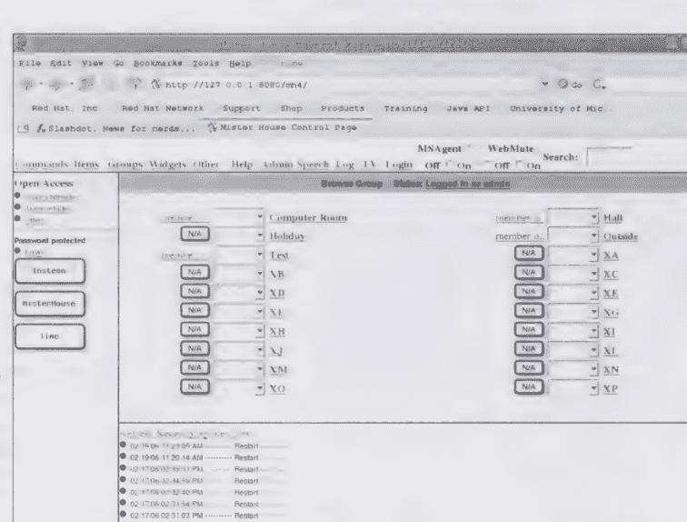

图 17-2：另一种主 Web 页面界面。

### 访问和控制 X10

要访问并控制你的 X10 模块，你需要点击主 Web 页面上的按钮跳转到特定的 Web 页面，在这些页面中你可以查看 X10 模块，找到哪些已开启（或关闭），并进行调整。为了演示，我带你快速浏览“灯具和电器”页面（通过主页面上的“灯具电器”按钮访问），这可能是你经常访问的地方。当你访问该页面时，可以看到不同的组。这些组包含了 MH 认为 X10 模块设置的当前状态，例如开启或关闭。（实际上，这个页面不仅用于 X10。它还适用于任何人构建到 MH 中的任何其他设备，例如 Liston、UPB 或 EIB）。

如果你按照逻辑顺序设置 X10 模块（例如将组分配给房间），你就让它们变得更容易用了。我冒昧将所有 X10 地址添加到了你在第 16 章中安装的 `x10.mht` 文件中。（如果你还没有读那一章，别担心。这一章不依赖于第 16 章，但你将无法通过图片查看我引用的 Web 页面。）如果你已经读了第 16 章，你将看到一个列表（xA 到 XP），如图 17-3 所示。这些名称并不是容易记忆的，但它们是为了供使用的，如果你看到了，可以删除它们。使用分配给 xA-uP 组的任何名称都不需要代码。


图 17-3：组浏览页面。

如果你点击其中一组，你将看到该组的所有成员。我选择了“电脑房”组（见图 17-4），如你所见，它只有一个成员：台灯，这是 X10 模块代码 `test_x10`，它每 30 秒切换一次开关状态。如果你禁用了切换代码（见第 16 章），灯可能是关闭的。我留了代码的开启状态（非常烦人），并在灯开启时截取了屏幕。MH 尝试匹配 X10 模块的当前状态。遗憾的是，X10 有时会“失聪”，或者用户可以手动更改模块状态，又模块可能没有插好。X10 并不直接了解模块，所以它尽力猜测（我发送了命令，所以它必须是这样）。当 Insteon 或 UPB 等较新技术流行后，这种猜测将成为过去，MH 应该能够询问设备状态如何，Web 页面将正确反映其当前状态。尽管有此缺陷，X10 运行相当良好，网页上的信息通常是准确的。

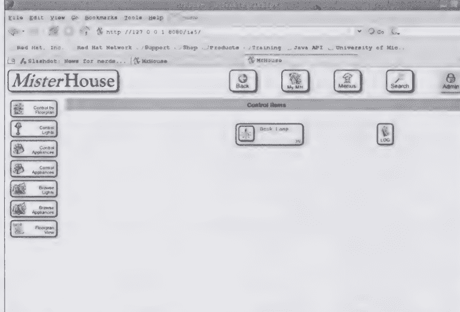

图 17-4：MisterHouse 的控制项目页面。

如果你想更改设备状态，点击按钮状态就会改变。如果是关闭的，它就会开启；如果是开启的，它就会关闭。灯具模块上会有一个箭头，允许你调亮设备。如果灯关着，你必须先开启它才能调暗或调亮。

左侧的菜单按钮提供了访问灯和电器模块的方法。菜单上的几个按钮是多余的（抱歉；这是默认设置），但最后一个按钮“平面图视图”是最有趣的。你可以使用你房屋 `layout` 的图形表示来创建一个自定义房屋平面图，从而查看并控制设备。你可以看到设备的当前状态，并点击平面图对应位置上的设备来开启或关闭。遗憾的是，我还没有时间学习如何使用它，但我很期待解决这个问题。

### 使用 HTML 模板

MH 中使用的一些 HTML（超文本标记语言）代码在遵循标准方面有些松散，目前这没关系，因为浏览器（Firefox、Mozilla、Opera 和 IE）并不强制执行 HTML 标准。但随着新标准对页面组合规则变得越来越严格，浏览器将越来越不接受不符合 HTML 标准的代码。因此总之，“一次到位”是一个很好的准则。考虑到这一点，我为你的 Web 页面创建了一个模板（`template.html`）。无论是使用 Perl 代码生成的静态页面，为了利用 HTML，你需要了解一些。你也可以添加 JavaScript 和 Java，但对于初学者来说那太高级了——就像请 NASA 的工程师来建造花园一样。


#### Web 和 HTML 的简史

Web 的历史可以追溯到 1945 年的想法。现代 Web 可以追溯到 1989 年，当时 Sir Berners-Lee 在 CERN（欧洲核子研究组织）提出了 HyperText。1993 年，最早的浏览器之一 Mosaic 发布。后来，Mosaic 变成了 Netscape。1994 年，W3C（万维网联盟）被建立以制定标准。今天用户认为 HTML 理所当然，因为大多数用户看不到它，但每个页面都是以某种形式组成的。互联网如果没有 HTML。如果你想学习协议的细节，请访问 w3.org 的 W3C 网站。W3C 拥有所有细节。如果你只是在学习 HTML，我不建议访问，但在你熟悉 HTML 之后，这可能有意义。我记得这本书的版本是 3.2。它足够简单，我真的不知道自己在做什么。我基本上看了其他的 Web 页面。当我看到一个喜欢的功能时，我尝试创建那个功能。显然，其他人也这样做。浏览器开始支持各种不符合 HTML 标准的代码，以便浏览器正确渲染大多数页面。有时存在竞争的标准，一个浏览器这样做，另一个用另一种方式。最糟糕的情况是：创建了尚未设置的新 HTML 标签。写这本书时，XHTML（可扩展超文本标记语言）版本 1.1 是最新标准。大多数现代浏览器不再很好地渲染非标准 HTML，但支持 HTML 4.01，所以可以使用。浏览器不会在新标准出现时立即放弃旧标准。相反，它们支持一组标准：HTML 4.01 到 XHTML 1.0 直 1.1。如果你想学习最先进的，学习 XHTML 1.1。如果你只是随手使用，HTML 4.01 可以用一段时间。


不要花太多时间学习 frames，但要学会正确使用 `<div>` 而不是表格。Frames 已废弃（这是“不再使用”的高级说法），表格在布局上不受推荐，但用于表格数据。替代两者的正确方法是使用 `<div>` 标签。对你来说遗憾的是，MH 仍然使用 frames 并且可能会使用一段时间。（是的，我知道，我这么说并不如此。抱歉。）好消息是，对于 MH 对 frames的使用，你可以复制使用 frames 的默认页面。这样你可以与 MH 目前的操作方式保持一致。


#### 使用 HTML 模板创建 Web 页面

为 MH 构建新的 Web 页面时，我建议使用这个 Web 页面作为模板（包含在 CD 中的 `template.html`）：

```html
<!DOCTYPE HTML PUBLIC "//W3C//DTD HTML 4.01 Transitional//EN"
"http://www.w3.org/TR/html4/loose.dtd">
<html>
<head>
  <title>MY_TITLE</title>
</head>
<body>
  <p>Hello world!</p>
</body>
</html>
```

此模板的前两行告知你的浏览器此页面松散符合 HTML 4.01 版本。“松散”部分允许与之前的 HTML 标准产生某些偏差，如果你是 HTML 新手，这会给你一点喘息的空间。4.01 标准相当现代，所以如果你学习了一些新的 HTML 代码，可以尝试一下。别担心；这个模板与 MH 配合得很好。

模板是你开始创建要显示的 Web 页面所需的外壳。这些简短的步骤展示了如何使用此模板：

1. 打开你喜爱的文本编辑器，然后打开模板。
2. 将 MY TITLE 替换为你的 Web 页面的标题。
3. 将剩余文本放在 HTML `<body>`（开始标签）和 `</body>`（结束标签）之间。

在这两个标签之间，你可以使用任何标准的 HTML 标签，如果你不熟悉 HTML，只需从使用段落 `<p></p>` 标签和 `<pre></pre>` 标签开始。段落标签用于在写信或其他文档时创建段落。只需将你的段落放在段落标签之间。任何放置在 `<pre></pre>` 标签之间的文本将按照其当前的格式显示在页面上。例如，如果你从另一个文档剪切文本并粘贴到 `<pre></pre>` 标签中，它将保留原有的格式。我将在下一节（“介绍 My MH 页面”）中使用它来演示如何使用外部程序和 Perl 为 MH 创建内容。

该模板是有效的，你可以在浏览器中使用类似这样的 URL：`file:///opt/mh/web/my_mh/template.html`。你需要使用你的文件路径，文件将出现在你的浏览器中。

在下一节中，我使用了 `<pre></pre>`。通常情况下，HTML 会忽略任何额外的空格标签或换行符，但这些标签之间的任何内容都会被视为预格式文本。你的间距和行尾都将得以保留。

### 介绍 My MH 页面

主 Web 页面（参见图 17-1）有三个框架。你能看到它们吗？如果看不到不要担心；它们的设计就是为了对用户不可见的。这三个框架分别是顶部的按钮、主菜单（中间）和状态栏（底部）。顶部和状态行在整个 MH 过程中通常保持不变（但并非总是如此；标准就是这样）。当你点击 MH 按钮时，会出现一个新页面（参见图 17-5）。


图 17-5：My MH Web 页面界面。

你能看出现在有多少个框架吗？现在五个：原始的三个加上菜单框架内的两个：

- **顶部框架**（原始），具有跨页面顶部的按钮。
- **菜单框架**（原始）位于左侧——显示了一组新按钮。
- **状态栏框架**（原始）位于底部。
- **输出框架**（新），位于中间右侧。输出框架是你希望新创建的 Web 页面出现的地方。
- **语音框架**（新），位于底部但状态行之上。语音框架是显示语音日志的地方。

所以，你的 Web 浏览器中总共有五个框架。你不需要了解太多框架——只需要知道它们在那里，并且你放在框架中的任何内容都不需要使用模板。只需将普通文本和 HTML 标签丢进去即可准备就绪。

当你访问 My MH Web 页面时，它非常无聊。设置它是你的工作。实现这一目标的一种方法是在左侧添加适当的按钮，调用 Web 页面或显示右侧的输出。我在本章其余部分将展示如何操作。首先需要安装一些东西，我将在下一节向你展示，然后添加一个允许你访问报告的按钮（在“添加天气报告”章节中）。

#### 安装天气报告

从国家气象局添加天气报告非常简单。首先，从 CD 将程序复制到你的计算机上：

1. **输入** `cp /media/cdrom/remote_control/nws.pl /mh/web/my_mh/nws.pl` 并**按回车**。
2. **输入** `chmod +x /mh/web/my_mh/nws.pl` 并**按回车**。
3. **输入** `cp /media/cdrom/remote_control/weather /mh/bin/weather` 并**按回车**。
4. **输入** `chmod +x /mh/bin/weather` 并**按回车**。

你还需要确保已安装了 Expect 软件包。因此，对于命令行执行以下操作之一：

- `yum install expect`（针对 Fedora 或 SUSE）
- `apt-get install expect`（针对 Debian）

接下来需要获取你感兴趣的天气报告区域的城市代码。按照以下步骤操作：

1. 在命令提示符下，输入 `telnet rain.underground.com`。
2. 横幅出现后，按回车。
3. 当另一个提示符向你问时，直接按回车。
4. 在主菜单中，按 `1`（美国预报和气候数据）然后按回车。
5. 在城市菜单中，按 `3`（显示所选州的 3 位城市代码）然后按回车。
6. 输入 2 位的州代码 (NY) 然后按回车。
7. 选择一个城市代码（例如 jfk）。
8. 现在按 `X` 并按回车。

现在你已经选择了城市代码，可以尝试从命令行手动运行该命令：

```
$ mh/bin/weather jfk
```


| Temp(F) | Humidity(%) | Wind(mph) | Pressure(in) | Weather |
| :--- | :--- | :--- | :--- | :--- |
| 27 | 31% | 20 | 30.26 | 部分云 |

纽约州纽约市 2 月 19 日晚上 11 点 EST 预报
今晚……主要是今天晚上……风速 10 英里左右开始转云。西风 10 到 15 英里。居民……部分云。气温在 30 度度以上。西风 10 到 15 英里。

我包含了一部分输出，但你明白意思了。我认为它返回了一些很好的信息。将这些信息转换为可以在 Web 页面上显示的内容非常简单。有了这些程序和一些简单的更改，例如在 Web 页面上显示信息，你就可以完成了。

### 添加天气报告

在本节中，我将向你展示如何在 Web 页面上添加一个按钮，以显示这些信息。在更改之前，`menu.html` 的 HTML 如下所示：

```
<base target='output'>

<table height='100%' border='0'>

<body>

<td valign='top' align='left' width='100%'>

<a href='howto.shtml'></a>

<a href='my_menu1.shtml'></a>

<a href='my_menu2.shtml'></a>

</td>

</body>

</table>
```

是的，这就是全部，只是框架的 HTML。记住框架内部的 HTML 不需要模板。

要添加天气报告按钮，请按照以下步骤操作：

1. 使用你喜欢的编辑器打开 Web 页面。文件位于：`~mh/web/my_mh/menu.html`。
2. 在 `</td>` 标签之前插入以下行：
   `<a href='news.pl?jfk' title='National Weather Service for JFK'></a>`

如果你愿意，可以将其写成一行。它只是在这个页面上显示太长了，所以我把它分开了以使其更易读。

3. 将问号后面的城市代码（当前为 `jfk`）更改为你选择的任何城市代码并保存文件。

可以理解，更改 `title` 字符串并替换 `Weather`。`button.pl` 脚本创建按钮的图像。

通过添加步骤 2 中的 HTML 代码，你正在向左侧添加另一个选项。当你将鼠标悬停在按钮上时，MH 会创建一个新的天气报告，会出现标题“National Weather Service for [location]”。

4. 通过编辑 `button.pl` 将按钮名称更改为其他。注意不要在按钮上放太多内容，否则 MH 会缩小字体大小。

# 310 第六部分：控制和保护你的自动化网络

接下来，脚本确定 `$arg` 是否已设置某些内容，如果是，脚本将带有 `$arg` 执行 `weather` 命令。如果 `$arg1` 没有被设置，你将得到一个空的 `$arg1`，天气程序将在没有 `$arg1` 的情况下执行。天气程序将返回新泽西州特伦顿地区的天气。反引号（` `）允许脚本运行这条 Linux 命令并捕获其输出。

`weather` 命令将去获取你请求的城市代码的天气信息。这些数据被返回给此脚本并存储在变量 `$data` 中。

脚本中的下一行包含 `$data = s/\r/g;`，看起来非常奇特。这是 Perl 进行搜索和替换的方法。搜索和替换函数涉及正则表达式。详细信息请参阅“正则表达式 (regex)”侧边栏。

斜杠之间的第一个参数（`\r` 或 ASCII 回车符）将被两个斜杠之间的第二个参数（`()`）替换。此处为空。脚本搜索 `$data`，将第一个参数替换为第二个参数，并将修改后的新字符串返回给 `$data`。

行尾的字母 `g` 表示全局操作（整个字符串）。删除此字母的原因是互联网数据的标准行尾是回车符加换行符（`\r\n`）。`<pre></pre>` 会将回车符和换行符视为两行。这实际上会让所有内容都变成双倍行距，这对于论文很好，但在网页上看起来很糟糕。（Linux 的标准行尾是换行符。）

下一个命令 `$data = s/\n;//` 删除了第一个换行符。之所以是因为我不喜欢第一个空行（好吧，我很挑剔），是因为这个搜索和替换函数的末尾有一个 `g` 命令。如果没有它，命令将对找到的第一个匹配项执行搜索和替换。

下一个命令 `$data .= /*</pre>";` 是 Perl 的另一个有趣之处。`.=` 表示将随后的字符串追加到变量 `$data` 设置的字符串之后。

最后一行将数据中的字符串返回给 MH。

如果你能看到字符串被传回 MH，你会看到这个：

```
<pre>

Weather Conditions at 07:51 PM EST on 16 Feb 2006 for New York JFK, NY.

Temp(F) Humidity(%) Wind(mph) Pressure(in) Weather

=============================================================

45 81% SOUTH AT 15 30.17 Mostly Cloudy

=============================================================

Forecast for New York, NY

829 PM EST Feb 16 2006</pre>
```

# 第 17 章：使用 Web 界面远程控制

...周五东部下午 9 点至下午 6 点生效风警报,...

夜间...部分多云...转变为多云。最低气温在 40 度左右。南风 10 到 15 英里。

```
</pre>
```

我冒昧修剪了数据（它要长得多），但网页上的最终输出看起来就像图 17-6。


图 17-6：
美国国家气象服务的脚本。

可能在手动运行 `weather` 命令时可能注意到，在按下回车键到显示所有信息之间有很长的停顿。嗯，MH 会注意到这一点，这是 MH 告知它正忙于等待某事的方式。一种解决方案是将页面创建放在 MH 之外，但将生成的页面放在适当的 Web 目录中。你可以使用带有 cron 的脚本来实现这一点，指示它在某个奇怪的时间运行命令，并将输出解析为适合 MH 的格式。这样，你将有一个指向输出网页而不是 Perl 脚本的按钮。这样一来，MH 在获取信息时就不会暂停，因为已经有一个现好的网页。我们可以每天运行一次或运行几次 cron 任务。

# 312 第六部分：控制和保护你的自动化网络

## 正则表达式 (regex)

我对类 Unix 的正则表达式 (regex) 了解很少。正则表达式是模式匹配的语法规则。你可能已经熟悉它们了，特别是如果你曾经在目录中搜索过文件名。

在 Linux 中，你只需输入 `*foo*` 即可搜索当前目录下所有文件名中包含片段 `foo` 的文件。如果你使用 `foo*` 你搜索的是所有以 foo 开头的内容；`foo *foo*` 是一个遵循你正在使用的程序规则（很可能是 bash 或 sh）的正则表达式。

Perl 也拥有一套广泛的规则（老天，它们的规则可真多），用于在其脚本中使用正则表达式。这些 Perl 规则涵盖了分组、量化以及各种通配符规则。简单来说，它们非常强大，使得搜索和处理字符串变得简单。不幸的是，它们也非常复杂。关于 Perl 的这个主题有整本书（而不止一本）。在本章创建的小型 MH Perl 中，我使用了一个非常简单的函数，在 Linux 命令下搜索并替换字符串的部分。

`s/X/Z/` 表示“搜索 X 并将其替换为 Z”，对你找到的第一个 Z 执行。

如果我想替换所有的 X，使用 `s/X/Z/g`。行尾的 `g` 表示全局。如果我想在 X 之后插入 Y，使用 `s/X/$Y/`。注意：尽管你在读完侧边栏后可能会想，“坏人会入侵”，但这是可能的。你可以扩展脚本来改变方面。（注：OCR 在此处包含重复错误，已进行清理）。

# 第 18 章
# 远程访问你的家居控制

## 本章
- 保护你的家庭网络
- 管理 Linux
- 替换 telnet 和 FTP
- 使用 iptables
- 使用 PuTTY 连接

欢迎来到荒野，匪徒伏在每一块岩石周围，骗子试图骗走你的收入。这听起来像是一部糟糕西部片的开头，但它可能是今天互联网的描述。实际上，互联网并没有那么糟；标题似乎关注负面（诈骗），而忽略了正面的（新服务、娱乐、新闻和研究）。尽管如此，在今天的互联网上，你必须小心。坏人很有创意，并竭尽尝试访问你的系统。不要认为因为你运行的是 Windows 就很脆弱。在我写这些时，有报告说 Mac OS X 存在严重漏洞，若干 Linux 应用让坏人能够访问你的机器。那么，你该做什么把坏人挡在外面呢？使用常识，不要恐慌，通过设置适当的网络保护、服务器保护管理以及适当的用户工具从外部保护自己。

从家里访问 MH（无论你在读完侧边栏后怎么想，“坏人会入侵”）都是可能的。这不需要花费精力，如果你设置得当，它非常好用。基本上，我假设你在其他地方，比如办公室。你正在使用 Windows 或 Linux 机器，你想给朋友和同事留下深刻印象。（这有极客客价值！）基本上，你启动一个安全壳程序 `ssh` 来连接到你的家庭服务器。然后你启动你的

## 314 第六部分：控制和保护你的自动化网络

并连接到 MH。是的，它很好用，但细节决定成。在这种情况下，细节在于以下方面：

- 1. **设置你的防火墙：** 在家里，你需要在防火墙上打开一个端口，并将该端口发送到你的 MH 服务器（端口转发）。
- 2. **设置你的 MH 服务器：** 你需要为你的 Linux 机器配置正确的 `iptables` 信息，仅允许某些 IP 地址访问你的 MH 服务器。我会在“使用 iptables 进行锁定”部分向你展示如何操作。
- 3. **设置你用于连接家中的 ssh 应用程序：** 你需要正确管理 `ssh` 以及你用于 MH 服务器的 `ssh` 密钥。“使用 PuTTY 连接”部分将引导你完成这一步。

当你完成这些步骤后，你将能够从世界上任何地方连接（取决于你的设置有多严密程度）。

让我给你们讲一个我第一次遇到坏人的故事。首先要理解，我从 1985 年起就开始使用 UNIX 系统了。当 Linux 刚出来时，我在家里的机器上安装了它。当时我在一条虚线上运行 `sendmail` MTA（邮件传输代理）。我对 `sendmail` 的管理有相当的的，直到我收到一封来自未知用户的、关于垃圾邮件的激烈信息。邮件向我报告的情况是，有人占用了我的机器并通过它来回发邮件。结果发现是 `sendmail` 的一个 bug（那时候它确实有很多 bug），但我的机器正在帮助一个垃圾邮件发送者，这已经不重要了。从我开始拨号上网到收到那封说我有问题的邮件，整个过程花不到 15 分钟。

现在让我给你们讲第二个故事。几年后，我需要对我的 Linux 服务器/防火墙箱进行一次全新的重装（从 Linux 1.2 到 2.1 的重大升级）。于是我加载了新版本的 Linux，但忽略了断开宽带连接。我是 @Home 服务的 Beta 测试员。安装完成后几秒钟内，我注意到我的电缆调制调器上有大量流量。我很困惑时，我检查了日志，发现我的 Linux 机器正受到几台服务器的攻击。另一个门禁程序程序（一个用于检查可用网络的程序）。虽然没有人进来，但我确实必须快速锁定我的 Linux 机器并安装最新的补丁以确保安全。在那之后，我购买了一个宽带路由器（防火墙/NAT 箱）。

**教训1:** 如果你连接到互联网，他们就会找到你。链路越快，他们找到得越快。
**教训2:** 始终保持系统补丁更新。
**教训3:** 获取一个防火墙/NAT 路由器来帮助保护你的家庭网络。

## 第 18 章：远程访问你的 MisterHouse 控制器 (315)

### 保护你的家庭网络

保护网络是防止他人隔绝之外同时允许自己进入的重要步骤。你需要能够访问网络，以便远程控制和管理 MisterHouse。本节简要解释了典型的家庭网络并提供了一些通用的安全步骤。

家庭网络化变得越来越流行，因为家里通常有多台电脑。有了无线网络产品，组网比以前任何时候都容易。家里不需要到处拉乱乱的电缆（可见的电缆——非常降低“配偶认可度”），你可以在几分钟内完成设置。在有 Linux 的家里，Windows 和 Linux 同时存在同一个网络并不稀见。这对于所有相关者来说运行得很好——Linux 可以作为服务器、桌面电脑，或者非常容易地切换。Linux 可以非常方便地共享打印机、硬盘空间、互联网访问和其他内容。

我以前通过我的 Linux 服务器共享互联网访问，但我发现如果我为了维护或其他原因关掉服务器，我的家人就会失去互联网连接。今天的宽带路由器（也称为防火墙）提供了卓越的功能，如互联网访问共享、防火墙保护和路由功能。在第 4 章中，我解释了如何使用带有无线网络功能（WAP；无线访问点）的防火墙来构建并保护你的网络。图 18-1 是典型家庭网络设置的好例子。

如果你没有使用我的完全设置，你需要在防火墙上打开一个端口，允许 `ssh` 端口转发到你 Linux 服务器的 IP 地址。通常 `ssh` 的端口是 22，但我建议使用不同的端口。我将在本章稍后的“设置加密密钥”部分进一步讨论这一点。

### 管理 Linux

网络安全的很大一部分是对你的服务器进行适当的配置和维护。这些任务属于系统管理范畴，执行本节中的任务对于确保良好的网络安全至关重要。系统管理可能排在你待办事项中清理垃圾的任务之后，但它实际上非常重要，而且真的没有那么难。记住，你不是在为一家大公司提供支持——只是一个小家庭网络。所以，从这些建议开始吧：

- 仅使用 `root` 账户。
- 确保密码不容易被猜。
- 禁用未使用的服务。
- 卸载未使用的软件。
- 保持安全更新。
- 锁定你的 Linux 机器并安装最新的补丁以确保安全。
- 关注安全告告。

### 用 ssh 和 sftp 替换 telnet 和 FTP

`telnet` 和 `FTP` 是自 1980 年代以来一直存在的工具，用于连接另一台计算机、执行命令并来回传输文件。`telnet` 和 `FTP` 的问题之一是所有信息都是以明文发送的。通过使用名为嗅探器的工具，有人可以捕获会话、保存并分析它以获取用户名和密码。当然，这种工具落入错误的人手中不是好事。今天，许多网络设备仍然使用 `telnet` 进行访问、配置和维护。这是在安全设计的网上进行的，嗅探是不可能的。

为了解决明文传输的问题，`ssh` 出世了。`ssh` 使用加密来隐藏服务器和远程客户端之间传输的数据包中的信息。默认情况下，`ssh` 更安全……此外，`ssh` 和 `sftp` 是 `telnet` 和 `FTP` 的一对一替代品，但它们具有更多功能。通过适当配置，你可以设置 `ssh` 套件，允许你在无需请求密码的情况下连接到远程系统（在 `telnet` 或 `FTP` 中无法实现）。这在脚本中非常有用，因为你通常需要将密码嵌入脚本中以登录远程系统。

这种连接方法的一个缺点是，如果有人入侵了你的账户或偷了你的私钥，他们就可以访问你共享了 `ssh` 密钥的远程系统。

### 理解公钥和私钥

# 318 第六部分：控制和保护你的自动化网络

相比 `telnet`，因为 `telnet` 会话中的所有信息都是以明文传输的。此外，`ssh` 允许你使用公钥/私钥加密对 `ssh` 服务器进行身份验证。公钥/私钥加密默认未启用，如果你想使用，必须手动启用。基本上：在 `ssh` 会话开始时，当用户尝试登录 `ssh` 服务器时，服务器会从远程系统请求公钥，然后将公钥与服务器包含的私钥进行比较。如果密钥匹配，则允许用户访问。设置加密密钥将在本章稍后的“设置加密密钥”部分进行说明。

### 访问 ssh 系统

要访问运行着 `ssh` 的系统，你需要输入以下内容：

```bash
ssh user_id@somesystem.com
```

这将你的电脑以 `user_id` 的身份连接到系统 `somesystem.com`。当然，如果你在该系统上没有账户，你将无法登录。但如果你在登录之前没有设置 `~/.ssh/authorized_keys` 文件，也不要担心。如果你没有密钥或密钥不匹配，`sshd` 会向你索要密码。

`ssh` 提供的额外功能之一是隧道，它允许其他应用程序使用安全隧道连接到你连接的服务器上提供的其他服务。要创建一个隧道来获取 `destination.com` Web 服务器，你需要输入类似下面的命令：

```bash
ssh user_id@somesystem.com -L 7000:destination.com:80
```

该行拆解如下：

- `user_id` 是你的用户 ID。
- `somesystem.com` 是你想要登录的系统名称。
- 你的本地 IP 端口是 7000（这是一个安全的起始端口号）。
- `destination.com` 是连接到的新服务的名称。（你也可以使用 IP 地址代替名称）。你想要连接的服务的端口号是 80。80 端口通常是 Web 服务器端口。

提示：关于隧道的更多细节将在本章稍后的“构建隧道”部分中进行更多介绍。

## 第 18 章：远程访问你的 MisterHouse 控制器

除了隧道和连接性，`ssh` 套件还为你提供了一种通过 `sftp` 和 `scp` 传输文件的方法。要使用 `sftp` 传输文件，你输入如下内容：

```bash
sftp user_id@somysystem.com
```

这会将你登录（如果你没有正确设置密钥，将会提示你输入密码），然后你就可以像普通 `FTP` 一样开始交互式会话。复制文件的另一种方法是使用 `scp`（安全复制）。要使用 `scp`，你输入如下内容：

```bash
scp local_file user_id@somysystem.com:/path
```


这将你本地系统上的文件 `local_file` 复制到 `somysystem.com` 上的 `/path` 目录。如果你想从远程系统复制文件到本地系统，只需反转命令即可。`scp` 的工作方式与本地 `cp` 命令一样，并支持使用所有通配符字符。不要忘记冒号（`:`）。如果你忘记了，你会在本地机器上创建一个文件，或者可能会报错。

## 设置加密密钥

现在你已经知道如何使用 `ssh` 了，是设置密钥的好时机。要在 Linux 下创建密钥，你现在需要执行以下操作：

1. 在 Linux 服务器上打开终端并输入 `ssh-keygen -t rsa -b 2048`。
2. 当被询问将密钥保存在哪里时，接受默认设置。
3. 当提示输入你的短语（passphrase）时，你可以输入一个，也可以留空。

这是你的私钥文件。不要与其他用户共享，也不要将其存储在互联网上。你可能想为它创建一个备份并妥善保存。

为了安全起见，我总是使用短语，但如果没有其他人使用你的系统，你可以跳过短语。（短语非常像密码，通常由字母、数字和特殊字符组成的单个单词，应该相对容易记忆但难以猜测。短语在此基础上进了一步，它不仅仅是一个单词，更像是一个句子。例如 `Cand13d App7e_Dre4m$`，它看起来像 `Candied Apple Dreams`。）

4. 当被要求再次输入短语时，如果你第一次留空了（步骤3），则再次留空；否则，再次输入你的短语。

大小写和标点必须完全匹配。

5. 将文件 `~/.ssh/id_rsa.pub` 复制到远程系统的 `~/.ssh/authorized_keys` 文件中。

当你将 `~/.ssh/id_rsa.pub` 文件的内容复制到远程系统的 `~/.ssh/authorized_keys` 文件时，请确保将其输入到文件末尾的新行中，并且该新条目是连续的一行。它在屏幕上可能会换行显示（那是正常的），但不要让你的编辑器添加换行来断开单行。如果你这样做，`ssh` 将无法工作，你仍然会被要求输入提示。

## 第六部分：控制和保护你的自动化网络

```bash
Deny_str=*ssh deny; *

# [ Permit ]=========================

# 允许这些站点访问我的机器

permit() {

    # 我只想记录对话的开始

    /bin/iptables -A INPUT -s ${1} -p tcp --dport ${PORT} -j LOG --limit \
    --log-level info --log-file ${Permit_str}* \
    --log-options

    /bin/iptables -A INPUT -s ${1} -p tcp --dport ${PORT} -j ACCEPT

}

# [ Deny ]=========================

# 拒绝这些站点访问我的机器

deny() {

    /bin/iptables -A INPUT -s ${1} -p tcp --dport ${PORT} -j LOG \
    --log-level alert --log-file ${Deny_str}* \
    --log-options

    /bin/iptables -A INPUT -s ${1} -p tcp --dport ${PORT} -j DROP

}

# [ 允许列表 ]===================

#permit 127.0.0.8 # 这会被拒绝，我用它来测试

10.2.3.4 # 互联网上的一个特定主机

172.16.0.1/255.255.255.0 # 本地笔记本电脑

192.168.102.20 # 我无线网络上的笔记本

192.168.101.0/255.255.255.0 # 本地内容，整个 192.168.101.0 网络

#

# [ 拒绝列表 ]=========================

deny 0.0.0.0 # 拒绝其他所有人

exit 0

#iptables.sh
```

这是一个名为 `iptables` 的 shell 脚本，它允许和拒绝 IP 地址访问 3218 端口（我的备用 `ssh` 端口）。我在脚本中配置的方法是通过添加以下行来将 IP 网络或主机添加到允许列表中：

```
permit <IP address>
```

这表示特定主机，或者：

```
permit <IP network>/mask
```

这表示特定网络。顺序非常重要，这就是为什么我将允许的 IP 地址放在被拒绝的 IP 地址之前；你可以将其理解为“我允许这个，拒绝其他所有内容”。你不需要在拒绝列表中添加任何内容，因为 `deny` 语句将匹配任何未允许的网络。你需要知道你尝试通信的机器的 IP 地址或网络号和掩码。

如果 IP 地址是静态地址（不使用 DHCP）且没有位于防火墙 NAT 之后，你可以直接使用它的 IP 地址。别担心；你不需要掩码。

## 第 18 章：远程访问你的 MisterHouse 控制

如果 IP 地址位于防火墙 NAT 之后，你需要确定 IP 地址。你可以尝试从目标计算机上访问 URL `www.whatismyipipaddress.com` 来获取 IP 地址。

如果你知道 IP 地址是通过 DHCP 获取的，你可能需要更有创意，因为地址可能会随时更改，你可能需要通过网络号和掩码来包含整个网络。首先，找到该机器当前使用的 IP 地址和掩码。在 Windows 机器上，使用 `ipconfig`；在你的 Linux 机器上，使用 `/sbin/ifconfig`；在你的设备上，你可能需要在其中一个菜单中找到它。然后你可以将其作为 `permit` 的参数，如下所示：

```
permit 10.255.4.13/255.255.252.0
```

或者

```
permit 172.31.94.62
```


第一个 `permit` 是使用 DHCP 的 ISP 的主机的 IP 地址和掩码。第二个是静态主机地址。请注意，在我所有的示例 `permit` 语句中，我使用的是私有地址。这是不允许在互联网上进行路由的 IP 地址空间（尽管法律上，大多数 ISP 在其网络内部使用此地址空间）。请搜索 RFC1918 了解详情。私有 IP 地址包括：

- 10.0.0.0 - 10.255.255.255
- 172.16.0.0 - 172.31.255.255
- 192.168.0.0 - 192.168.255.255

最后一个地址空间通常用于家庭网络设备作为默认地址空间。抱歉我没有放入真实的地址，但如果我放了，它们会被流量淹没，那将就不好了。


## 安装 `iptables.sh` 脚本

要安装此脚本（包含在本书 CD 中），你需要将其添加到你的 `rc.local` 脚本中。该脚本在所有服务启动之后运行。要添加它，请执行以下操作：

1. 打开终端。
2. 输入 `su -` 并输入你的 root 用户密码。
3. 输入 `cp /media/cdrom/chapter18/iptables.sh /etc/` 并按回车。
4. 输入 `chmod +x /etc/iptables.sh` 并按回车。
5. 输入 `echo "/etc/iptables.sh" >> /etc/rc.local` 并按回车。

## 第六部分：控制和保护你的自动化网络

## 第 18 章：远程访问 MisterHouse 控制

以下是我的建议：

- **生成的密钥类型**：保持 SSH-2 RSA 设置。在三种设置中，SSH-2 RSA 是最强的（最难破解），因此使用它是个好主意。如果你必须支持 SSH-1（仅支持 SSH-1 的旧设备），请点击该项。我不建议仅使用 SSH-1；因为它被发现存在缺陷并被认为是弱的。
- **生成的密钥位数**：将位数更改为 2048。安全社区一直在关注攻击这些密钥所需的原始算力，我认为在本书出版后的一年内可能就能破解 1024 位密钥。2048 位密钥在未来的一段时间内仍然是安全的。你可以跃升到 4096 位密钥，但处理密钥（生成和使用）所需的时间会变得非常缓慢。目前而言，2048 位密钥是一个很好的折中方案。

3. 在完成更改后（如果有的话），点击“Generate（生成）”按钮。

对话框发生变化，系统会要求你在应用程序对话框内移动鼠标。

4. 将鼠标移动到该处。

不要担心——这样做是可以的。我建议交替进行缓慢和快速移动，但你应该随机移动。这种随机性有助于生成密钥。整个过程需要几分钟时间，请继续操作直到进度条填充并清除。然后密钥将生成，对话框将重绘并显示大量新信息。

当新信息出现时，你将获得保存公钥和私钥的选项（见图 18-4）。


图 18-4 一个由 PuTTY 生成的密钥。

- 5. （可选）在 `Key Passphrase`（密钥密码短语）文本框中输入密码短语（并在 `Confirm Passphrase`（确认密码短语）文本框中再次输入）。

创建一个密码短语来保护你的密钥通常是明智之举（每当你使用该密钥时系统都会要求输入该密码短语），但如果你需要使用 ssh 工具通过脚本连接到远程系统，不使用密码短语可能是一个好主意。在脚本中添加密码短语会将所需的密码短语暴露在脚本中。

- 6. 点击“Save Key（保存密钥）”保存公钥。

打开一个对话框并提示为密钥命名。在保存公钥时，你可以随心所欲命名，但我建议使用 `.pub` 结尾。

- 7. 在输入文件名后点击“Save（保存）”。

公钥文件包含要添加到远程系统 `~/.authorized_keys` 文件中的公钥。

- 8. 点击“Save Private Key（保存私钥）”保存私钥。

如果你没有输入密码短语，系统会提示你输入一个。你可以选择不输入密码短语继续，或者输入一个你想要的。点击 OK 继续。打开一个对话框并提示你命名。在保存私钥时，PuTTY 使用 `.ppk` 结尾。千万不要与任何人共享你的私钥。如果有人有了你的私钥，他或她就可以冒充你。

- 9. 点击“Save（保存）”保存私钥。

## 构建隧道

在向你展示如何配置隧道之前，我先解释隧道的工作原理。涉及的网络部分有点疯狂，因为你使用一个网络来访问另一个网络，并且涉及到网络地址转换（NAT）。

图 18-5 显示了互联网云左侧的典型用户网络。在那里，ISP（互联网服务供应商）给了用户一个 IP 地址，防火墙正在进行 NAT 以将该 IP 地址共享给用户家里所有的电脑。NAT 将用户 PC 的地址转换为 ISP 提供的网络地址。这是 ISP 知道如何识别的地址。当用户的流量返回时，路由器将 ISP 提供的地址转换为用户的地址。如果互联网上的某人尝试与 ISP 提供的地址通信，除非路由器配置了对其进行某些处理，或者用户已经与该站点建立了会话且这是返回数据，否则该对话将被忽略。这通过让攻击远离用户的 PC 从而提高了安全性。（我将在第 4 章中详细描述此点。）

## 第 18 章：远程访问你的 MisterHouse 控制

无线宽带路由器 1.24.178.15

192.168.101.2


图 18-5：使用 IP 电话 192.168.101.3 使用 PuTTY 和隧道连接到远程服务。

运行带有隧道的 PuTTY 用户

在端口 8080 上运行 MH 的 Linux HA 服务器 192.168.101.1

当允许外部 ssh 流量进入 Linux 家庭自动化服务器时，你必须配置防火墙，将你用于 ssh 的端口从路由器转发到服务器上用于 ssh 流量的端口。此外，服务器配置了 `iptables` 以进一步限制允许连接到服务器的人。

当一切设置完成后，用户可以在其远程笔记本电脑上启动 `PuTTY`，通过输入 IP 地址或利用动态 DNS 服务将主机转换为正确的 IP 地址来连接到路由器。防火墙会将 ssh 会话连接到 Linux HA 服务器，用户可以登录并访问 Linux。此时，`PuTTY` 配置的任何隧道都将可用。

现在，这就是隧道发挥用场的地方。如果你想使用 `PuTTY` 访问 Linux 服务器上的 MH（本章的主题），你可以使用隧道从笔记本电脑的端口 7000（7000 通常是一个未使用的端口，因此是一个安全的起始端口）连接到目标 `192.168.101.1:8080`（MH 的 IP 地址和默认端口）。如果你需要创建第二个隧道来访问摄像头，可以使用源端口 7001（恰好是下一个可用的端口）和目标地址 `192.168.101.1:8080`（MH 的 IP 地址和默认端口）。

## 第七部分：十类技巧篇

Rich Tennant 著，《第五次波浪》

> “你可能不会相信，但我正站在一个 14.4k 的烟囱前。我将在这里呆一整晚来下载这些东西。”

## 在这一部分中……

《傻瓜指南》的“十类技巧”部分就像蛋糕上的糖霜：吃蛋糕并不非得要有糖霜，但有了确实很棒。在第 19 章中，我为你提供了十个可以自动化的任务建议。在第 20 章中，我将为你介绍十种家居自动化设备，它们会让你手痒想要动手改造。

## 第 19 章：（几乎）十种可以自动化的酷炫家务

## 本章内容

- 自动化你的咖啡机、窗帘、喷淋器和温室
- 在没有黑客最爱的“鱼”的情况下大搞作剧
- 即使你不在家，也能给孩子或宠物提供爱心的照顾
- 使用智能冰箱减掉额外的体重

如果每天醒来都能闻到咖啡的香气，那该有多好？如果你看到阳光突然洒进卧室，因为你的窗帘自动打开了，你难道不会很喜欢吗？如果你的狗可以在需要时自己进出房屋，而不需要你的帮助，那又该有多好？当你坐在几英里外工作时，有人帮你看守它或育儿嫂和孩子呢？你难道不喜欢通过家居自动化的帮助来减肥吗？这听起来像《杰森一家人》里的未来房子吗？本章涵盖了所有的家务以及更多——包括帮助创造一条会说话的鱼。

## 控制温室

温室有各种形状和大小。但无论你的温室是由几十个盆栽还是一个英亩土地组成，自动化浇水都能极大地节省时间，而且可能对你的植物更好。

如果你的温室有滴灌系统或喷淋器，你可以花大约 100 美元或更低的价格买一个 X10 控制器。它连接到一个或多个软管上，并通过你的 X10 系统进行操作。浇植物最棘手的部分在于不知道什么时候浇水以及浇多少。水太多会杀死植物，水太少也是如此。植物生长需要根部周围既有水又有空气。除非土壤干燥，否则你永远不要给植物浇水——除非你种的是香蒲草。

使用土壤湿度传感器测试土壤以确保其充分干燥，可能是获得良好结果和健康植物的最好方法。土壤湿度传感器（有时称为张力计）有不同的形状、价格范围和大小。张力计可以埋在盆栽里，也可以埋在地下并连接到控制器上，当张力计记录到土壤干燥时，控制器会自动给你的植物浇水，并在记录到土壤饱和时停止。你可以设置湿润和干燥的参数。第 13 章和第 14 章有更多关于 X10 的信息。

有关张力计的信息，请查看 `www.aid1ld.com/tensiometers.html`。同时查看 `www.aid1ld.com/plantdrip.html` 以获取有关如何自动浇盆栽水的信息。

## 使用电脑浇草坪

为什么用电脑浇草坪是一个好主意？因为你不仅可以省力，而且在几英里外工作时可以看顾它或育儿嫂和孩子。你难道不喜欢通过家居自动化的帮助来减肥吗？这听起来像《杰森一家人》里的未来房子吗？本章涵盖了所有的家务以及更多——包括帮助创造一条会说话的鱼。

## 开启和关闭窗帘

你可以购买的电动帘控制器从 99 美元到几百美元不等。最便宜的控制器之一可能是 Smarthome (`www.smarthome.com/3142.html`)，它看起来像墙上的小盒子。它适用于窗帘或百叶窗，你可以将其连接到 X10。如果你是一个痴迷改造的成本敏感型消费者，可能可以使用无绳螺丝刀自己制作。如果你能廉价地找到所需的零件并且有很多窗帘需要控制，你可能会节省大量的钱。

## 在你不在家时让 Fido 出

根据你的房屋以及狗狗如何进入户外，可能有很多让他进出的自动化解决方案。这里有一个使用自动车库门的快速方法：

- 将车库门的开关更新为 X10 `WS13A` 开关（荧光灯或电器的开关，不适用于白炽灯）。
- 在车库门的两侧放置一个 X10 运动传感器（内部和外部）。
- 使用你的 X10 软件创建一个宏，每当运动检测器感知到运动时，将车库门打开足够让狗狗钻过去的高度。
- 程序设置宏，在一段时间后且只要没有检测到运动，就关闭车库门。

狗狗可以钻过比任何人类爬过去都要小的开口——除非你养的是爱尔兰狼。这允许你的狗狗随心所欲地进出，而不会让车库门开启整天影响观，也不会让任何小偷进入。

## 通过互联网查看孩子

当你离开家时，你想知道你的孩子在做什么？他们可能小到需要育儿嫂，或者大到可以独立生活——但可能仍然想看顾他们。偶尔查看家里可以令父母感到安心——或者可能导致立即打一个电话！

你可以轻松地设置摄像头，并将其放置在可能观察孩子的地方——例如，放置在天花板上？（也许让他们知道爸爸妈妈在看着，从而威慑他们不要去那个地方？当然了，如果猪能飞的话）。关于如何设置单个摄像头并将快照持续上传到网页的说明，已在第 8 章中描述。

单个摄像头可能无法覆盖你想要查看的所有区域。你可能想寻找一些摄像头——一个放在室外，一个放在客厅，别忘了在冰箱上方放一个。

为了让多个摄像头与你的电脑交互，你可以购买发送无线视频信号的无线摄像头。这些设备可以在 `www.x10.com` 获取。无线摄像头需要一个视频接收器来接收图像。它可以连接到电视机，但要在互联网上查看，你需要一个电视调谐器（或带有内置电视显卡）连接到你的 S-video 线缆或同轴电缆，以便你的调谐器能够处理信号。兼容 Linux 的电视调谐器有多种来源——例如，在这个链接中，你可以从 `www.newegg.com` 以 70 美元的价格购买一个 Haumann NetTV401 PCI 接口/FM Tuner卡（有时称为 Haumann TV-Dbx 卡）。或者你可以购买带有内置电视调谐器的显卡。在 `http://linuxtv.org/v4l2ki/index.php/NVIDIA` 以及这里，可以找到支持 Linux 的带电视调谐器的 ATI 和 Nvidia 显卡列表。

由于通过这种方法你的电脑一次只能处理来自一个摄像头的视频信号，你可以通过将每个摄像头插入 X10 电器模块并使用 `MisterHouse` 发送 X10 信号来关闭你想查看的摄像头，从而切换你想要查看的摄像头。

摄像头和电脑由于各种原因突然停止工作，因此在任何涉及孩子安全和舒适的事务上，都不要依赖它们。

## 使用家居自动化减肥

是的，家居自动化非常有趣，以至于你会忘记吃东西。好吧，也许不会。但还有另一种使用你的设备来减肥的方法。

夜间零食会迅速增加体重。被证明有效的一种方法是，在你的冰箱和橱柜上安装某种报警器，你只能在那些关键的晚上零食时间段设置它。或者，如果觉得报警器太过分，用一个连接到 VCR 录像机的摄像头怎么样？这会让每个人对整个家人负责。事实上，你可能想连接一个摄像头和 VCR，以便在你不在家时检查家人在白天的饮食习惯。（这可能会让你大开眼界。）

要连接冰箱报警器，可以在冰箱内放置一个 X10 运动传感器，将其设置为与电器模块相同的房屋代码和单元代码即可达到效果。你可以将音量调得足够低，让它启动时能惊动那个偷零食的人，但不会吵醒家里的其他人。你还可以设置运动检测器发送一个关闭命令，让收音机关闭几分钟（这通常是默认设置）。或者，与其使用收音机，你可以让运动传感器激活一个红蓝交替旋转的警灯。这不会吵醒任何人，但仍然会惊到吃零食的人。如果你使用 X10 摄像头和 X10 VCR，它们可以在运动传感器被触发时开始录制，并设置运动检测器在几分钟后发送关闭命令。

## 在寒冷的早晨加热你的汽车座椅

在冬日的早晨进一辆冷冰冰的汽车可不好受。这里有一个来自友好 X10 社区的好主意。用一个插入家外或车库内 X10 插座的小型电动加热垫来加热你的汽车座椅怎么样？你可以拉一根延长线到汽车并将其连接到加热垫上。然后直接把车门关在加热垫上。（这可能没事，因为车门周围有柔软的氯丁橡胶密封条）。然后安排你的加热垫在你预计需要它之前大约一小时开始加热。你可以享受舒适温暖的驾驶，而不需要等到热量产生时一直冻屁股。

在你去任何地方之前，忘记拔掉加热垫的电源！

## 第 20 章：十个值得关注的设备

## 本章内容

- 流媒体音乐客户端
- 流媒体媒体客户端和服务器
- 独立打印服务器
- 忍者摄像头支架
- 远程控制你的设备
- 插座火箭
- 通用遥控器
- 运动检测器
- 诺基亚 770
- Insteon 控制器

> 他的书介绍了一些酷的设备和程序，你可以用它们控制家里周围的物品，或者让你的生活变得更简单或更有趣。这一章向你展示了另外十个可以用于各种任务的设备或装置。

## 流媒体音乐客户端

我原本计划在这里介绍 Apple AirPort Express。AirPort Express 是一个让你将音乐流传输到带电源扬声器或家庭音响系统的设备。我称之为流媒体音乐客户端，除了 AirPort Express 之外，还有许多此类设备。仅限音乐的客户端包括：

- Linksys
- Netgear
- Roku

## 流媒体媒体客户端和服务器

许多此类设备允许你在家庭网络上流传输视频和音频。如果你在一台电脑上存储了媒体库，这会特别有用。

## 独立打印服务器

独立打印服务器允许你通过网络共享非网络打印机。许多打印机带有并行端口、USB 连接或二者兼有。

## 忍者摄像头支架

在第五部分和第六部分中，你将了解到用于控制和监控家中的 X10 设备。某些 X10 设备是摄像头，你可以将其放置在家中的不同位置，以便监控发生的情况。大多数情况下，摄像头安装在固定支架上，你只能看到摄像头指向的地方。但如果能够让摄像头左右和上下移动，不是很酷吗？

你可以使用适用于 XCam2 摄像头的忍者摄像头支架。安装了 Ninja 后，你可以平移、倾斜和扫描摄像头以获取视图，并设置预设立即将摄像头移动到预设位置。Ninja 支架可以通过遥控器或本地 PC 进行本地控制，你还可以通过 Web 浏览器界面跨互联网控制它们。查看这里的摄像头支架：


www.x10.com/products/x10_vk74a.htm

## 远程控制你的设备

想象一下这个场景。夜色降临，你穿着睡衣在家里。你刚刚锁好门上楼睡觉。这时你发现你忘记关掉客厅的灯了。所以回到楼下去关灯。等等，这难道不是一本关于家庭自动化的书吗？你不应该能够远程关灯吗？是的，你应该可以，而且你确实可以——但前提是你安装了实现这一功能的设备。

家庭自动化的许多非常棒的功能之一是可以在任何地方控制任何设备。你可以安装远程控制的开关和插座，通过有线连接或无线射频（`RF`）发射器进行控制。这样做不是很贵吗？既然你正在让房子自动化，为什么不给灯光和家具加上远程控制呢？你会为自己的这样做感到高兴，当你朋友拜访并向他们展示你的系统时，他们会非常印象深刻。访问 `http://linux.org` 阅读更多关于使用 Linux 家庭自动化的信息，包括远程控制家中的设备。

## 插座火箭

一个奇怪的名字……或者也许不是。插座火箭是一种特定的设备，它可以旋入标准的灯泡底座。然后你再将灯泡旋入这个插座火箭中。经过这个简单的安装，灯光现在就可以被任何 `X10` 遥控器控制了。插座火箭是一种远程控制设备，旨在为现有的灯具和台灯改造远程控制功能。你只需要在每个灯具的灯泡底座上旋入这样一个火箭，就可以轻松地让你家里所有的灯变得可控。插座火箭每个花费 20 美元，你可以找到关于它们的更多信息：

```
www.x10.com/automation/x10_lm15a.htm
```

## 通用遥控器

本节介绍了两种你可以用来控制任何红外（`IR`）以及有时是无线射频（`RF`）设备的远程控制设备。这些设备通常被称为通用遥控器，因为你可以通过“教导”它们学习必要的控制功能来控制任何设备。在大多数情况下，你只需要将通用遥控器置于学习模式，将设备的原始遥控器对着通用遥控器，并按下你想要的功能按钮即可。这里有两个需要的通用遥控器：

- **索尼 RM-AV3000**：这种通用遥控器有点是桌面式和手持式遥控器的混合体。该遥控器有 22 个物理按钮，用于选择预先配置的特定组件类型，例如 `DVD` 或 `VCR`。除了实体按钮外，它还提供了一个 `LCD` 屏幕面板，带有用于控制你通过实体按钮所选设备的按钮。你可以更改任何实体按钮的配置，使其能够控制任何设备，而不仅仅是它被设定为控制的设备。你还可以更改 `LCD` 按钮的控制分配来添加或删除功能。正如我之前解释的，这种遥控器能够从其他设备学习命令。该遥控器的价格约为 200 美元。你可以在这里找到关于该遥控器的详细评论：

```
www.remotecentral.com/av3000
```

- **飞利 ProntoPro NG TSU7000**：这个设备的红外版本售价约 1000 美元，再花 150 美元就可以获得一个还能控制 `RF` 设备的型号。飞利的 `LCD` 屏幕比索尼的大得多，物理按钮也更少。该设备出厂时已预设控制许多类型的设备，如 `VCR`、`DVD` 和任何 `A/V` 设备。当然，你可以更改编程以控制不同的设备。你还可以使用原始设备的遥控器，在指向飞利遥控器时按下按钮来教导它学习新代码。访问此 URL 获取关于该遥控器的详细评论：

```
www.remotecentral.com/tsu7000
```

## 运动探测器

你是否曾经满手地进入一个房间却无法开灯？如果当你进入房间时灯自动开启，离开房间时灯自动关闭，那不是很好吗？好吧，停止幻想吧；这很容易实现。

你可以在家里的任何或所有房间安装运动探测器。然后，当你进入房间时，运动探测器会向监控探测器的控制器发送信号。控制器随后向该房间的灯光发送信号，告诉它们开启。

只要你留在房间内移动，灯就会一直亮着。当你离开房间时，灯不会立即熄灭。控制器监控运动探测器，当探测器不再感应房间内的移动时，它就会停止向控制器发送信号。根据控制器的程序，它可以立即向灯光发送关闭信号的或者，也可以等待一段程序设延迟。无论它是如何工作的，这仍然非常酷。这个 URL 提供了关于所有类型传感器的信息：

```
www.x10.com/automation/motion_sensors.html
```


# 第七部分：十位的部分

## Nokia 770 网络平板电脑

人们越来越频繁用于控制家庭自动化系统的设备之一是 Nokia 770 网络平板电脑。通过这个设备，你可以在任何地方浏览你喜爱的网站并阅读电子邮件。无论你是在家里休息，还是在看孩子的足球比赛，只要你有通过 Wi-Fi 的宽带接入，Nokia 770 网络平板电脑就能让你即时无线访问 Web 并从随地控制你的家。

Nokia 770 网络平板电脑既好用又护眼，设计非常昂贵，采用时尚时尚的拉丝金属盖，以及一个针对在线内容查看优化的超锐宽屏显示器。这个设备有点贵（大约 400 美元），但它物超所值。

Nokia 770 网络平板电脑最好的功能之一是它运行基于 Linux 的 Internet Tablet 2005 软件版本。今年晚些时候计划推出操作系统升级——Internet Tablet 2006 软件版本——它将支持额外的服务，包括网络电话（VoIP）和即时消息。在 PC 评中获取有关此设备的更多信息：

`www.pcmag.com/article2/0,1895,1820232,00.asp`

## INSTEON 系统

INSTEON 是家庭控制和自动化领域的最新发展。它结合了两种网络技术——无线射频（RF）和家里已安装的电源线——创建一个冗余控制网络。这种冗余网络较不容易受到家庭环境中常见的干扰。此外，每个 INSTEON 设备都通过重新传输信号充当继电器，接收通信更加可靠。

INSTEON 设计用于作为 X10 家庭自动化设备的廉价且更稳健的替代品。现有 X10 的用户可以轻松迁移到基于 INSTEON 的网络，同时继续使用他们的 X10 设备。所有 INSTEON 设备都会接受来自 X10 设备的通信。INSTEON 设备包含一个唯一标识符，用于让网络上的其他设备识别它们。当新设备进入网络时，每个设备识别自身并创建一个对等网络，由于每个设备都是对等节点，不需要复杂的控制器，因此网络设置非常简单。

## 附录

### 关于 CD

随书附的 CD 包含了书中讨论的所有软件，以及脚本和配置文件。在附录中，我为你提供了使用 CD 的要求，并描述了它包含的内容。祝使用愉快！

**注意：** CD 上的软件专门为在 Linux 上运行而设计。

### 系统要求

确保你的计算机符合以下最低系统要求。如果你的计算机不符合大多数要求，在使用 CD 内容时可能会遇到问题。

- 配有 Pentium 或更快处理器的 PC。
- 带有 2.4 或 2.6 Linux 内核的 Linux 发行版，例如 Fedora FC 5 或 Debian 3.1。
- 计算机至少安装 32MB 总内存。为了获得最佳性能，我建议安装 128MB RAM。
- 一个或多个空闲串口。
- 至少 500MB 空闲硬盘空间。
- 一个 CD-ROM 驱动器。

如果你需要更多关于基础的信息，请查看 Wiley 出版的这些书籍：《PCs For Dummies》第 10 版（Dan Gookin 著），或 《Linux For Dummies》第 7 版（Dee-Ann Blanc 著）。

### 在 Linux 中使用 CD

要将 CD 中的项目安装到你的硬盘，请按照以下步骤操作：

1. 以 root 身份登录。
2. 将光盘插入电脑的 CD 驱动器。
3. 如果你的电脑启用了自动挂载，请等待 CD 挂载。否则，请按照以下步骤操作：
   - a. 命令行指令：在提示符输入 `mount /dev/cdrom /mnt/cdrom`。此步骤将 cdrom 设备挂载到 `/mnt/cdrom` 目录。如果你的设备有不同的名称，请更改 `cdrom` 为该名称 —— 例如 `cdrom1`。
   - b. 图形界面：右键点击桌面上的 CD-ROM 图标并选择 Mount。此步骤挂载你的 CD-ROM。
4. 浏览 CD 附录中列出的产品并遵循安装说明。
5. 从 CD-ROM 驱动器移除 CD，按照以下步骤操作：
   - a. 命令行指令：在提示符输入 `umount /mnt/cdrom`。
   - b. 图形界面：右键点击桌面上的 CD-ROM 图标并选择 Unmount。此步骤将卸载你的 CD-ROM。

在你安装了所需的程序后，可以小心地将 CD 存放在书的塑料封套内。

## 你将找到

在本节中，我列出了 CD 中包含的每个产品并对其进行了描述。你将在 CD 的目录结构中找到这些项目。

共享软件程序是功能完备的、免费的、试用版本。如果你喜欢特定的程序，可以向作者支付少量费用并获得增强版本和技术支持。免费软件是免费的、应用程序和实用程序。你可以将它们复制到任意数量的 PC 上 —— 但它们没有技术支持。GNU 软件受其自身的许可证限制，包含在 GNU 文件夹中。试用版或演示版通常在时间或功能上有限制（例如无法保存项目）。

## MisterHouse: `www.misterhouse.com`

MisterHouse 是一个开源（GPL 许可）的家居自动化程序，运行在多个操作系统上（甚至是 Mac OS X）。它最初由 Bruce Winter 用 Perl 编写，但经过了社区的增强。Bruce 仍然维护代码，并定期更新（而且它非常敏锐）。家居自动化程序中的瑞士军刀，大多数人开始使用它来控制 X10 模块，但它可以实现更多：监控天气、获取每日新闻、监控家庭安全、获取电子邮件、监控你的无线访问点、控制你的音响 —— 在你发现它可以做什么并开始关注你想做什么之后，你会对其提供的支持感到惊讶。

## Asterisk: `www.asterisk.org`

Asterisk 是一个开源电话 IP PBX 应用。它最初由 Digium 的 Mark Spencer 编写，现在 Mark 与 Asterisk 社区共同维护并贡献代码。它可以用于小型企业或家庭使用。它足够灵活，可以作为带有额外的留言机，通过将电话转发到语音菜单或邮箱来骚扰推销员。或者你可以使用 Asterisk 处理大量用户。

## NdisWrapper: `http://ndiswrapper.sf.net`

NdisWrapper 是一个开源网络驱动封装包，允许你在 Linux 内核中使用 Windows 网卡驱动。许多无线网卡不支持 Linux。这种情况尤其发生在笔记本电脑上，其硬件扩展槽活性较低。为了克服这一限制，Linux 社区的少数成员想出了使用 Windows NDIS（网络驱动接口规范）将 Windows 驱动与 Linux 内核接口连接的方法。当你找不到原生驱动时，至少可以使用这个。

## Heyu: `www.heyu.org`

Heyu 是一个基于文本的程序，通过 CM11A X10 串口控制器发布命令来控制 X10 模块。它可以根据时间或事件调度并发布 X10 命令。它还跟踪已发布 X10 命令的状态。非商业发行、个人和内部业务使用免费授权。它最初由 Daniel B. Suthers 编写，现在由 Charles W. Sullivan 维护。

## MythTV: `www.mythtv.org`

MythTV 是一个运行在 Linux 下的 GPL 许可 PVR（个人视频录制机，类似于 TiVo）软件套件。除了播放和录制功能外，它允许你提前安排录制。MythTV 还支持插件，允许其他程序对其扩展。它最初由 Isaac Richards 编写，现在由他维护并贡献软件。访问网站获取最新更新：

## Quagga: `www.quagga.net`

Quagga 是一个 GPL 许可路由套件，包含了用于 `ripd` (IPv4)、`ripngd` (IPv6)、`ospfd` (IPv4)、`ospf6d` (IPv6) 和 `bgpd` (BGPv4) 的守护进程。Quagga 是 Zebra 的分支，提供对 IPv4 和 IPv6 的支持。Quagga 是一个适用于 Linux 的路由套件，允许将你的 Linux 机器转换为路由器。当前维护者是 John Smith，活跃开发者有 Paul Jakma、Vincent Jardin、Alexander Alexander、James Paris 和 Milan Pikula。

## OpenWrt: `www.openwrt.org`

OpenWrt 是一个基于 Linux 的嵌入式操作系统，主要用于无线路由器。它具有灵活的模块化设计，围绕软件包管理系统构建，允许用户构建定制的固件。OpenWrt 是一个发行版，支持许多硬件平台。当前维护者是 John Smith，其活跃开发者有 Paul Jakma、Vincent Jardin 和 Alexander Alexander。

# Linux 智能家居傻瓜指南

## 如果你遇到了问题（关于 CD 的）

我已尽力编译了可以在大多数具有最低系统要求的计算机上运行的程序。由于你的电脑可能有所不同，某些程序可能因为某些原因无法正常运行。有时，问题只是几个文件位于不同的位置。其他时候，你可能缺少一些基础实用程序（没觉得你需要 C 编译器，对吧？）。如果你遇到问题，请访问网站 (`www.linuxha.com`) 并发布问题。也许其他人也遇到过相同的问题（不可能是拼写错误，对吧？）。无论如何，我都会尽力帮助你让 CD 内容尽快运行起来。

如果你正尝试在 Windows 下使用这些程序，将会产生问题。这些程序是专门为 Linux 设计的。你可能会考虑我在许多 Windows 软件中看到的建议：需要 Windows 98 或更高版本。升级到 Linux；你会为自己的决定感到高兴的。

如果你在光盘（CD-ROM）上遇到困难，请拨打 Wiley 产品技术支持电话 (800) 762-2974。在美国境外，请拨打 (317) 572-3994。你也可以通过 `http://support.wiley.com/` 联系 Wiley 产品技术支持。Wiley & Sons 将仅对安装和其他一般的质量控制项目提供技术支持。对于应用程序本身的技术支持，请咨询程序的供应商或作者。

如需额外订单或查询其他 Wiley 产品的信息，请拨打 (877) 762-2974。

# 索引

## 数字

- `192.168.1.0` IP 网络, 75
- `802.11` 标准, 42–43
- `802.11a` 标准, 42–43
- `802.11b` 标准, 42–43
- `802.11g` 标准, 42–43
- `802.11n` 标准, 42–43
- Asterisk@Home, 21, 34
- ATA (模拟电话适配器), 158
- Atheros, 44
- 音频
  - D-Link 媒体客户端, 连接和配置, 134–136
  - 编码音乐文件, 137–139
  - Grip 程序, 137–139
  - 硬件选择, 129–130
  - 媒体服务器, 安装和配置, 132–134
  - MP3 格式, 131, 137
  - 音乐格式, 选择, 137
  - OGG Vorbis 格式, 137
  - 刻录 CD, 137–139
  - 软件选择, 129–131
  - 流媒体, 139–140
  - 系统配置, 132–136
  - WAV 格式, 137
  - WMA 格式, 137

## A

- AAG Electronica, 188
- ACT AT004 多功能测试仪, 247
- ActiveHome 设备, 26–29
- `acx100`, 44
- Admin 按钮 (MisterHouse), 298
- AM466 模块, 232
- AM486 模块, 232
- AM14A 模块, 232
- 模拟电话适配器 (ATA), 158
- Anywhere Remote, 17–18
- 外观设置 (MyTV), 124
- ApplianceLinc 三脚插模块, 232
- ApplianceLinc 三脚插双向模块, 232
- Asterisk
  - 在 CD 上的, 347
  - 编译, 176–177
  - 计算机硬件, 24
  - 配置, 178
  - 上下文, 161–165
  - 描述, 21, 34
  - 拨号计划, 159–161
  - 拨号, 183–184
  - 硬件, 166–167
  - 安装, 177
  - 打电话, 182–184
  - 可选配置, 179–181
  - 要求, 165–166
  - SPA-3000 配置, 167–175

## B

- 婴儿监视器和 X10, 245
- 后退按钮 (MisterHouse), 298
- 后端服务器配置
  - 视频采集卡设置, 118–119
  - 通道编辑器设置, 121
  - 通用设置, 118
  - 输入设置, 120–121
  - 主设置，调整, 118–121
  - 用于 MyTV, 117–122
  - `nview`, 117–118
  - 节目指南，填充, 122–122
  - 视频源 (Video Sources), 119–120
- 备份当前内核, 51–52
- 备用电源, 245
- BGP (边界网关协议), 92
- `bgpd`, 99
- Billy Bass, 自动化, 335
- BlueLava
  - 在 CD 上的, 348
  - 配置, 256–258
  - 描述, 29, 252
  - 安装, 255–256
- Broadcom, 44
- 内置功能用于 MisterHouse, 288
- CamStream
  - 在 Web 上图像, 150
  - 从互联网获取天气数据, 203–207
  - 使用 PuTTY, 348
  - 使用 Quagga, 348
  - 脚本文件, 240–242
  - 日落, 240–242
  - 系统要求, 345
  - 故障排除, 350
  - TwonkyMedia, 349
  - WPA-Supplicant, 348
- `CGI-x10`, 30
- 通道编辑器查看 (MyTV), 121
- 在不在家时从互联网获取, 336–337
- Billy Bass, 在清冷早晨修改, 338
- 在不在家时从互联网获取加热座椅, 336
- 温室, 333–334
- 草坪，浇水, 344
- 邮件 (蜗牛)，检查, 334–335
- 夜晚，使用闹钟停止, 337
- 窗帘，打开和关闭, 335–336

## C

- CamStream
  - 浏览器，查看 CamStream 图像, 150
  - 安装, 142–145
  - 重新加载页面，创建, 150–151
  - 运行, 146
  - 将文件发送到其他计算机, 148–150
  - 软件, 146
  - 图像，调整, 146–148
- 采集卡 (MyTV), 118–119
- 自动加热座椅, 338
- CD
  - Asterisk 在 CD 上的, 347
  - BlueLava 在 CD 上的, 348
  - BottleRocket 在 CD 上的, 348–349
  - 配置文件, 349
  - 使用 ForecastFox, 347
  - 使用 Heyu, 347
  - 使用 MyTV, 347–348
  - 使用 NdisWrapper, 349
  - 使用 One-wire 天气, 349
  - 使用 OpenWrt, 348
  - 程序, 346–349
- CK18A 套件, 251
- 闭环协议, 262
- CM11A 接口
  - 描述, 25–26
- CM15 接口, 230, 231, 251
- CM17A 接口
  - 描述, 26
- CM19A 接口, 231, 250
- Collins, Terry (Red Hat 网络和系统管理), 316
- 使用 MisterHouse 获取漫画, 276–279
- 漫画 (MisterHouse), 299
- MisterHouse 命令输入, 263
- 命令行运行程序, 35–39
- X10 命令, 238
- 通用 UNIX 打印系统 (CUPS), 242
- 编译
  - Asterisk, 176–177
  - 编译器, 36
  - 自定义内核编译, 52–58
- 配置
  - Asterisk, 178
  - CD 上的配置文件, 349
  - 已配置主机屏幕 (OpenWrt), 86
  - 内容图标 (TwonkyVision), 132–133
  - 上下文, 161–165
- CP290 接口, 231
- `cron` 程序, 242
- CUPS (通用 Unix 打印系统), 242
- 当前状况选项 (ForecastFox), 206
- 派生值标签页 (Oww), 196
- 桌面计算机和无线网络, 41
- 桌面，获取天气数据, 199–203
- DHCP 连接类型, 76
- 拨号计划, 159–161
- 数字视频录制仪和媒体中心, 32
- 优势, 223
- 劣势, 222
- 电子风道, 223
- 功能, 222
- 节省金钱, 221
- 温度传感器, 223
- 动态路由, 92
- DIY 内核项目
  - 备份当前内核, 51–52
  - Debian 2.4, 56–57
  - Debian 2.6, 55

## E

- `802.11` 标准, 42–43
- `802.11a` 标准, 42–43
- `802.11b` 标准, 42–43
- `802.11g` 标准, 42–43
- `802.11n` 标准, 42–43
- 蛋计时器, 238–239
- 八继电器锁存, 233
- 通话, 153–155
- 描述, 35
- 安装, 152
- 电气额定, 246
- 电子风道闸, 223
- ELK-X10 信号, 248
- 编码音乐文件, 137–139
- 加密密钥，设置, 19–31
- 事件日历 (MisterHouse), 299
- 扩展选项 (ForecastFox), 206
- 可扩展文本标记语言 (HTML), 30

## D

- 数据源标签 (Oww), 194
- Debian 2.4, 56–57
- Debian 2.6, 55
- 默认网关, 74
- 默认路由, 90
- 删除 MyTV 记录, 126–127
- D-Link 媒体客户端，连接和配置, 134–136
- 数字视频录制仪和媒体中心, 32
- 优势, 223
- 劣势, 222
- 电子风道, 223
- 功能, 222
- 节省金钱, 221
- 温度传感器, 223
- 动态路由, 92
- DIY 内核项目
  - 备份当前内核, 51–52
  - Debian 2.4, 56–57
  - Debian 2.6, 55
- 数据源标签 (Oww), 194
- Debian 2.4, 56–57
- Debian 2.6, 55
- 默认网关, 74
- 默认路由, 90
- 删除 MyTV 记录, 126–127

## F

- Fedora 2.6, 53–55
- Fedora Core, 24
- Firefox 浏览器, 190–207
- 防火墙配置屏幕 (OpenWrt), 86–87
- Flipit, 30
- 预报在 CD 上, 349
- 当前状况选项, 206
- 扩展选项, 206
- 通用设置, 205–206
- 安装, 203–205
- 链接, 207
- 配置文件选项, 206
- 雷达选项, 206
- 严重天气预报选项, 206
- 今日预报, 206
- FTP, 316–317
- X10 的趣味用途, 13–14
- X10 的功能用途, 13–14

## H

- HA 协议, 264
- 硬件
  - Asterisk, 24, 166–167
  - 音频, 129–130
  - Linux 软件, 204
  - MythTV, 24, 114–115
  - NdisWrapper, 46–47
  - 旧硬件上的新软件, 23–24
  - X10 启动套件, 235–236
  - 天气站, 187–188
  - 无线网络, 41–42
  - X10 无线, 253
- 加热，通过控制节省金钱, 219–223

## G

- MyTV 游戏设置, 124
- 通用选项 (ForecastFox), 205–206
- 通用设置 (MythTV), 118
- Gentoo Linux, 199–203
- GNOME 桌面，详阅 Ekiga
- GNU 通用公共许可证, 22
- GNU 软件, 346
- GNU Zebra, 31–142
- 图形用户界面 (GUI), 36
- 温室，自动化你的, 333–334
- Grip 程序, 137–139
- GRUB 配置, 60–61

## I

- 公钥, 317–318
- `scp`, 317
- `sftp`, 317
- `ssh` 系统, 317, 318–319
- `sshd`, 317
- `telnet`, 316–317
- 隧道技术, 318

## 家庭网络

- 自动化选项, 31–32
- GNU Zebra, 31–32
- Quagga, 32

## 摄像头软件, 144–145
- TwonkyVision, 132–134
- X10 恒温器控制, 212–218
- 已安装软件链接 (OpenWrt), 87
- INSTEON 系统, 344
- Intel, 44
- 内部网关协议 (IGP), 92
- 中域到中域系统 (IS-IS), 92
- Internet
  - 下载信息, 264
  - 历史背景, 303–304
  - 调节使用, 265
  - 天气数据, 19–20, 198
- I/O 板和 MisterHouse, 264
- IP 地址, 47, 74
- IP 路由, 另见 Quagga
  - 路由, 92
  - 域名系统 (DNS), 90
  - 动态路由, 92
  - Linux PC 网络命令, 104–106
  - `nview`, 89–92
  - 静态路由, 90–91
  - WRT54GL 网络命令, 106, 302–305
- iPods, 从其向音响系统无线传输音乐, 170
- `iptables`, 321–324
- `iptables.sh` 脚本
  - 安装, 323–324

## 《傻瓜版家庭网络》(Ivens), 73, 89
- 家庭安全
  - CamStream, 34
  - Ekiga, 34
  - 概述, 34–35
  - 摄像头, 156
- HomeDirector 设备, 26–29
- HomeToys 在线杂志文章 (Kingery), 228
- 主机名, 74
- 房屋代码, Dave (Rosetta 板), 263–264
- HTML 模板
  - 通过 Web 界面控制 MisterHouse, 302–305
  - 概述, 302–303
  - 用其创建的网页, 304–305
- `http` 服务器, 启动, 254–255
- HVAC 加热器按钮 (MisterHouse), 299

## 图像设置 (MythTV), 124
- MythTV 图像幻灯片, 128
- 输入设置 (MythTV), 120–121
- 安装
  - Asterisk, 177
  - 将 CD 目录拷贝到硬盘, 345–346
  - Ekiga, 152
  - ForecastFox, 203–205
  - `iptables.sh` 脚本, 323–324
  - MisterHouse, 265–268
  - MythTV, 115–116
  - Oww (单线天气), 189–197
  - PuTTY, 324–324
  - Quagga, 96–97
  - 气象站软件, 189–197

## J

- Jakma, Paul (Quagga), 92
- Jardin, Vincent (Quagga), 92
- Kingery, Phil (HomeToys 在线杂志文章), 228
- 厨房电器, 增强, 265
- KnoppMyth, 32–33
- KR22A 遥控器, 251
- KR19A (SlimFire) 遥控器, 251

## L

- 家庭网络, 31–32
- 家庭安全, 34–35
- HomeDirector 设备, 26–29
- KnoppMyth, 32–33
- LIRC (Linux 红外线遥控), 33
- 列表, 35
- 低级软件, 35–36
- Motion, 33
- 运动检测, 33
- 单线天气, 34
- 概述, 25
- Project WiSH, 27–28
- 遥控, 33
- 智能电话系统, 33–34
- KT10, 30–31
- 用于视频会议, 34–35
- 用于天气, 34
- 用于摄像头, 33–35
- `wx10`, 31
- Linux-wan 项目, 23
- LIRC (Linux 红外线遥控), 33, 34
- 465 模块, 232
- LM14A 模块, 232
- 位置设置 (MisterHouse), 274–275
- Locke, A. Bruce (LaBue), 255
- Log 标签 (Oww), 194–195
- 以 root 登录, 66
- Logitech QuickCam Orbit 摄像头, 155
- Ivens, Doug (傻瓜版家庭网络), 73, 89
- 低级软件, 35–36
- LampLinc Plus 双向调光器模块, 232
- LampLinc 三脚插调光器模块, 232
- LampLinc 三脚插双向调光器模块, 232
- LAN 信息, 73–74
- 笔记本电脑和无线网络, 42
- 草坪自动化, 334
- MisterHouse 学习曲线, 278–290
- Lights Applications (MisterHouse), 299
- LILO (Linux 加载器), 58–60
- Line 1 标签 (SPA-3000), 170–173
- Firefox 中的链接, 207
- Linksys WRT54GL, 67–69
- Linux 家庭自动化的优势, 21–22
- Linux 内核版本, 56
- 使用 X10 遥控器控制的 Linux MP3 播放器, 17
- Linux PC 网络命令, 104–106
- Linux 软件
  - 管理, 316
  - 选择版本, 23–24
  - 用于此的计算机硬件, 选择, 24
  - Debian Linux, 24
  - Fedora Core, 24
  - Gentoo Linux, 24
  - SUSE Linux, 24
  - Ubuntu Linux, 24
  - 用于控制 X10 模块, 13
  - 在旧硬件上使用新软件, 23–24
- Linux 无线 LAN 支持, 44
- Linux 无线支持, 43–45, 43
- 基于 Linux 的家庭自动化软件。见特定章节
- 用于 ActiveHome 设备, 26–29
- Asterisk@Home, 21, 34
- `CGI-x10`, 30
- 命令行, 从此处运行程序, 32–36
- 数字视频录制机和媒体中心, 32–33
- Flipit, 30
- GNU Zebra, 31–32
- 图形用户界面 (GUI), 36
- Heyu, 25–36

## M

- MadWifi, 44
- Mail Headlines News 按钮 (MisterHouse), 299
- mail (snail), 自动化, 334–335
- 主菜单 (MythTV), 12
- 主网页 (MisterHouse), 297–300
- Maxi Controller, 233
- Max iButtons, 280
- 媒体服务器, 安装和配置, 132–134
- 菜单按钮 (MisterHouse), 298
- Messages 标签 (Oww), 196
- Mini Controller, 233
- mini-PCI 卡, 42
- Misc category (MisterHouse), 275
- MisterHouse 按钮 (MisterHouse), 298
- MisterHouse (MH)。另见通过 Web 遥控 MisterHouse
  - 自动化系统, 264
  - 在 CD 上, 347
  - 带连接的, 228
  - 命令输入, 265
  - 目录, 274
  - HA 协议, 264
  - 家庭自动化系统, 264
  - 安装, 265–268
  - Internet 下载信息, 264
  - Internet 使用, 265
  - I/O 板, 264
  - 厨房电器, 增强, 265
  - MisterHouse 学习曲线, 278–290
  - 位置设置, 274–275
  - 以 root 登录, 66
  - Misc category, 275
  - MP3 播放, 264
  - 作为组织器, 264
  - 概述, 302–303
  - 修改, 274–275
  - 作为 PDA, 264
  - 准备, 265–268
  - 启动, 254–255
  - 路由器, 92
  - 序列设置, 275
  - 设置, 274–275
  - 关于, 264
  - Tk 接口, 263
  - 追踪日出, 264
  - 带月份, 264
  - 用户接口, 263
  - 天气数据, 19–20, 198
  - 网页, 304–305
  - 它的功能, 264
- MisterHouse, 265–268
- 家庭网络, 保护, 311–35
  - `iptables`, 321–324
  - 概述, 302–303
  - PuTTY, 324–324
  - 通过 Web 遥控 MisterHouse, 302–305
- MisterHouse 远程接口, 302–305
- MisterHouse 按钮 (MisterHouse), 298
- 通过 Web 遥控 MisterHouse, 302–305
  - 用其创建的网页, 304–305
  - `http` 服务器, 启动, 254–255
- HVAC 加热器按钮 (MisterHouse), 299

## N

- 状态页面, 85
- 升级你的 WAP, 78–81
- Asterisk 的可选配置, 179–181
- OrbitView 程序, 156
- 组织器, 作为 MisterHouse 时, 264
- `ospfd`, 99
- `ospf6d`, 99
- Oww (单总线天气)
  - 电缆用于, 193
  - 在 CD 上, 349
  - 配置, 191–197
  - 数据源, 194
  - 派生值表, 196
  - 描述, 34, 188
  - 显示表, 194
  - 安装, 189–197
  - Internet, 将你的气象数据放在上面, 198
  - 日志文件标签页, 194–195
  - 消息表, 196
  - 统计表, 195
  - 上传表, 195

## P

- 私有分支交换机 (PBX), 158
- 私钥, 317–318
- X10 产品, 查找, 14–15
- Profiles 选项 (ForecastFox), 206
- 节目指南, 更新, 121–122
- CD 上的程序, 346–349
- Project WiSH, 27–28
- PSTN Line 标签页, 173–175
- 公钥, 317–318
- 公共电话交换网 (PSTN), 158
- 购买 X10 设备, 232–253
- PuTTY
  - 在 CD 上, 348
  - 安装, 324–326
  - 概览, 324
  - 用其生成的 ssh 密钥, 326–328
  - 隧道, 328–330

## Q

- Quagga
  - `bgpd`, 99
  - 在 CD 上, 348
  - 编译, 96–97
  - 配置, 100–102
  - 描述, 32
  - 安装, 96–97
  - `isisd`, 99
  - `ospfd`, 99
  - `ospf6d`, 99
  - 概览, 92–93
  - 用于安装 Quagga 的包管理器, 93–95
  - `ripd`, 99
  - `ripngd`, 99
  - 用其路由, 99–100
- 用于安装 Quagga 的包管理器, 93–95
- 摄像头的 PTZ 功能, 155–156
- `passwd`, 47
- PBX (私有分支交换机), 158
- PC 接口用于, 120–231
- PCI 卡, 41
- PCMCIA 卡, 42
- PDA 接口, 作为 MisterHouse 时, 24
- 性能图标 (TwonkyVision), 134
- 个人视频录制机 (PVR), 113. 另见 MyTV
- X10 的相位问题, 245
- 电话语音邮件消息按钮 (MisterHouse), 299
- 电话设置 (MyTV), 125
- 电话系统. 见智能电话
- 端口 22, 320
- POTS (普通电话业务), 158
- PowerLinc 接口, 230
- PPPoE 连接类型, 76
- Prism, 44
- 私有地址空间, 73

## R

- Radar 选项 (ForecastFox), 206
- 无线图标 (TwonkyVision), 133
- Rain8, 233
- 接收器, 230
- 录制内容, 管理, 125–127
- Red Hat Linux 网络与系统管理 (Collins & Walley), 316
- 正则表达式 (regex), 32
- 继电器模块, 250
- 重新加载网页, 150–151
- 远程控制, 33
- 设备的远程控制, 341–342
- 远程控制软件, 33
- 启动 MisterHouse, 275–276
- RIP (路由信息协议), 92
- `ripd`, 99
- 刻录 CD, 137–139
- root 密码, 74
- 路由器, 重启, 265
- 路由信息协议 (RIP), 92
- 用 Quagga 路由, 99–100
- Rosetta 板 (Houston), 263–264
- RR51 模块, 250
- `rt2xx`, 44

## S

- 调度循环, 125–126
- Schorr, Andrew (Quagga), 92
- `scp`, 317
- CD 上的脚本文件, 349
- 搜索按钮 (MisterHouse), 298
- 安全. 见家庭网络安全; 家庭安全
- 安全摄像头底部 (MisterHouse), 299
- 安全模式 (NdisWrapper), 47
- 用于控制 X10 的传感器, 12
- 串口, 283
- 串口设置 (MisterHouse), 275
- 服务器设置 (MisterHouse), 275
- 服务器, 41
- 服务集标识符 (SSID), 47
- 会话建立协议 (SIP), 158
- 互联网协议 (SIP), 153
- 设置菜单 (MyTV), 123–125
- ServerWeather 选项 (ForecastFox), 206
- `sftp`, 317
- 共享密钥, 47
- 共享软件程序, 346
- 信号注意, 245
- 警报器, 233
- SlimFire (KR19A) 遥控器, 251
- 智能电话系统, Asterisk, 34
  - Asterisk@Home, 34
  - 拨号计划, 159–161
  - 概览, 33, 158
- 智能家居 3 针中继器, 282
- `sniffer`, 317
- Socket Rocket, 342
- 音频, 129–131
- CamStream, 145
- 旧硬件启动套件上用新软件 (X10), 234–235
- 气象站, 187–188
- X10 无线, 35–36
- 源代码, 250
- 上下文, 161–165
- 拨号计划, 159–161
- Line 标签页, 170–173
- PSTN Line 标签页, 173–175
- System 标签页, 169
- SPA-3000, 166
- MisterHouse 的语音能力, 264
- Speech 按钮 (MisterHouse), 299
- `ssh` 系统, 317
- `sshd`, 317
- SSID (服务集标识符), 47
- 独立服务器, 340
- 硬件用于, 235–236
- 代码, 236–237
- 模块设置, 236–237
- 代码, 236–237
- 启动 MisterHouse, 275–276
- 启动脚本, 64–65
- 静态连接类型, 76
- 静态路由, 90–91
- 统计数据标签 (MisterHouse), 299
- 统计标签页 (Oww), 195
- 状态图标 (TwonkyVision), 132
- 状态页面 (OpenWrt), 85
- 流音频, 139–140
- 流媒体客户端, 340
- 流媒体客户端, 339–340
- 日出, 240–242
- 日落, 240–242
- `su`, 31
- Synaptic 用于安装驱动, 142
- Synaptic 仓库设置, 143
- 使用 Synaptic 暂停程序, 144–145
- 隧道, 318–330
- 隧道, 328–330
- Ubuntu, 24
- 通用模块, 251
- USB 卡, 41
- 用户接口, MisterHouse, 263
- 用其生成的 ssh 密钥, 326–328
- 视频输出, 19
- 视频设置 (MythTV), 124
- 视频源 (MythTV), 119
- 查看信息, 128
- VoIP (IP 电话), 153
- `vtysh`, 99
- 天气设置 (MyTV), 124
- 气象站 (Oww), 195
- 气象站, 获取你自己的, 188
- 气象在 Linux 桌面上的, 199
- 通过 Firefox 浏览器获取气象数据, 19, 203–207
- 天气, 34
- 从 Internet 获取气象, 19–20
- 通过 MisterHouse 监控气象, 264
- 天气显示表, 188
- 天气预报按钮, 添加, 308–312
- 天气预报页面, 安装, 306–307
- Web 参数 (MisterHouse), 274
- 摄像头. 见 CamStream
  - 描述, 34–35
  - Ekiga, 34
  - 查找摄像头驱动, 142
  - 使用 Synaptic 暂停程序, 144–145
  - OrbitView 程序, 156
  - 概览, 141
  - 云台功能, 155–156
  - 设置 Synaptic 仓库, 143
  - 用 Synaptic 安装驱动, 142
  - 倾斜功能, 155–156
  - 用于家庭服务, 156
- Weeder Technologies 板, 280
- 全屋阻挡, 245
- 窗帘, 自动开关控制, 335–336
- Winter, Bruce (MisterHouse), 261
- 无线接入点 (WAP)
  - 配置, 81–84
  - 描述, 39–40
  - LAN 信息, 73–74
  - Linksys WRT54GL, 67–69
  - OpenWrt, 69–81
  - 概览, 67
  - 配置要求, 71–73
  - WAN 信息, 75–77
  - 无线信息, 77–78
- 无线网络接口卡 (NIC), 40

## W

- 无线网络。另参见 NdisWrapper
  - 计算机, 40
  - 桌面电脑, 41
  - 驱动程序, 40
  - `802.11` 标准, 42–43
  - 所需硬件组件, 41–42
  - 笔记本电脑, 42
  - Linux 用户软件, 33–45
  - mini-PCI 卡, 42
  - 原生 Linux 驱动程序, 40
  - 概述, 39–41
  - 婴儿监视器, 245
  - 电池备份电源, 245
  - CM11A 接口, 15–26, 230, 231, 246
  - CM15A 接口, 230, 231
  - CM17A 接口, 26, 230
  - CM19A 接口, 231
  - 命令，发送, 238
  - 常见问题, 245–246
  - 用于控制的计算机, 12
  - CP290 接口, 231
  - `cron`, 242
  - 用于控制的桌面控制器, 12
  - 调光器, 246
  - 蛋计时程序, 238–239
  - 八路继电器控制器锁存型, 233
  - 电气额定值, 246
  - PCI 卡, 41
  - PCMCIA 卡, 42
  - 从任何电视或 CD 播放器发送电视和立体声信号, 15–16
  - 服务器, 41
  - 标准, 42–43
  - 传输 MP3 文件, 16
  - USB 卡, 42
  - 在任何电视上查看 Linux 应用程序和视频
  - 有线网络与无线网络对比, 41
  - 无线接入点 (WAP), 39–40
  - 无线网络接口卡 (NIC), 40
  - WPA-Supplicant, 61–65
  - 无线视频发送器, 15–16
- WMA 格式, 137
- `wmix10`, 31
- WPA-Supplicant
  - 在 CD 上, 348
  - 编译, 62
  - 配置, 62–63
  - 概述, 61
  - 启动脚本安装, 64–65
- WRT54GL
  - 网络命令, 106–109
  - 概述, 98–99
- WS467, 233
- X10
  - 功能用途, 13–14
  - 房屋代码, 229
  - 其中的问题排除, 247–248
  - LampLinc Plus 双向调光模块, 232
  - LampLinc 三脚调光模块, 232
  - 用于控制 X10 模块的 Linux 软件, 13
  - LM465 模块, 232
  - LM14A 模块, 232
  - 本地控制, 246
  - 大型控制器 (Maxi Controller), 233
  - 小型控制器 (Mini Controller), 233
  - 模块, 231
  - 用于控制的运动传感器, 12
  - MR26A 接口, 230
  - 概述, 10–12, 25, 228–229
  - PC 接口, 230–231
  - 相位问题, 245
  - PowerLinc 接口, 230
  - 查找产品, 14–15
  - 购买 X10 设备, 232–233
  - 接收器, 230
  - 继电器模块, 232
  - 用于控制的遥控器, 11
  - 用于控制的传感器, 12
  - 衰减, 245
  - 报警器, 233
  - 入门套件, 233–237
  - 日出脚本, 240–242
  - HTML (扩展超文本标记语言), 303
  - XMMS MP3 播放器, 17
  - X10。另参见 X10 无线
  - AM466 模块, 232
  - AM486 模块, 232
  - AM14A 模块, 232
  - ApplianceLinc 三脚模块, 232
  - 日落脚本, 240–242
  - TC184W, 233
  - ThermLinc, 233
  - 用于控制的拨号控制器, 12
  - 调制解调器, 230
  - 发送器, 230
  - 故障排除, 244–248
  - TS523 接口, 231
  - TX816 X10 HVAC 系统, 233
  - 代码, 229
  - 通用模块 (Universal Module), 233
  - UPS, 245
  - 它的功能, 228–229
  - 全屋屏蔽器, 245
  - WS467, 233
  - X10 通信恒温器型号 TX816。参见 TX816
  - 从 MisterHouse 控制的 X10
    - 内置功能列表, 228
    - 参数，定义, 284–287
    - 减少的 X10 需求, 281–292
    - 发送 X10 命令, 287–296
    - 创建 MisterHouse 的表格, 248–287
    - 用户代码, 291–292
    - x10 宏, 289–290
    - `x10_pl`, 292–294
    - `x10_ll1`, 294–296
    - `x10_test`, 290–291
  - X10 烟花设备, 30–31
  - X10 宏, 289–290
  - X10 微型定时器, 219
  - X10 模块，访问与控制, 300–302
  - X10 电力线载波。参见 X10
  - X10 恒温器控制
    - 控制加热，节省费用, 219–223
    - 安装, 212–218
    - 概述, 212
    - 恒温器回调控制器, 218
    - 双恒温器 X10 控制系统, 216–218
    - TXB16 恒温器, 212–215
    - 通用模块, 216
    - 唤醒房屋，到 219
  - X10 无线
    - BlueLava, 255, 256–258
    - BottleRocket，安装, 255–255
    - CK18A 套件, 251
    - CM15A 接口, 250, 251
    - CM17A 接口, 250, 251
    - CM19A 接口, 250, 251
    - 硬件, 253
    - `http` 服务器，启动, 254–255
    - 接口, 250–251
    - KR22A 遥控, 251
    - KR19A (SlimFire) 遥控, 251
    - 模块, 250–251
    - MR26A 接口, 250
    - 概述, 249–250
    - RR501 模块, 250
    - 安全, 250
    - TM751 模块, 250
    - 收发器，设置, 253
    - UR19A 遥控, 251
    - 使用, 258
- `x10mp` (软件), 17
- `x10_pl`, 292–294
- `x10_ll1`, 294–296
- `x10_test`, 290–291
- X10 驱动的打印机, 242–244
- `x10_test`, 290–291
- Young, David (Quagga), 92
- Zebra project (Ishiguro), 92

# 用户许可协议

**请阅读本内容**。在打开本书随附的软件之前，您应该仔细阅读这些条款和条件。这是您与 Wiley Publishing, Inc. 之间的许可协议。通过打开随附软件，您确认已阅读并接受以下条款。如果您不同意且不希望受此类条款约束，请立即将未打开的书和软件退回获取处以获得全额退款。

1. 许可授予。WPI 授予您（个人或实体）非独占许可，使用一份随附的程序（统称为“软件”），仅供您的个人或业务目的用于单台计算机（标准计算机或多用户网络）。软件加载到临时内存（RAM）或安装到永久内存（硬盘、CD-ROM 或其他存储设备）时处于使用状态。WPI 保留此处未授予的所有权利。

2. 所有权。WPI 是书中随附介质上所有权利、所有权和利益的所有者，包括对记录在介质上的软件的版权。软件及其所有所有权相关权利仍归 WPI 及其许可方所有。

3. 使用和传输限制。(a) 您仅可以出于备份或存档目的制作一份软件副本，或 (ii) 将软件传输到单个硬盘，前提是您保留原始副本用于备份或存档。您不可以 (i) 租赁或出租软件，(ii) 通过局域网或其他网络复制或复制软件，或 (iii) 基于软件修改、调整或创建衍生作品。(b) 您不可以对软件进行反向工程、反编译或反汇编。可以在永久的基础上传输软件并使用文档，前提是受让人接受条款和条件且您未保留副本。如果软件是更新或已更新，任何传输必须包含最新的更新和所有之前的版本。

4. 单独程序的使用。您必须遵循本书 CD-ROM 附录或软件介质上每个单独程序的单独要求和限制。这些限制也包含在软件介质上记录的单独许可中。这些限制可能包括在您使用程序一段时间后，用户必须支付注册费或继续使用。通过打开软件，您同意遵守 CD-ROM 附录或软件介质中详细说明的这些单独程序的许可和限制。软件介质上的或书中列出的任何材料均不可以原件或修改形式为了商业目的重新分发。

5. 有限保证。(a) WPI 保证软件和软件介质在购买本书之日起六十 (60) 天内正常使用下没有材料和制造工艺的缺陷。如果 WPI 在保修期内收到材料或制造工艺缺陷的通知，WPI 将更换缺陷的软件介质。(b) WPI 和书的作者不承担所有其他明确或暗示的保证，包括但不限于对软件、其中包含的源代码和/或书中描述的技术的适用性和针对特定用途的适用性的保证。WPI 不保证软件中包含的功能将满足您的要求，或软件的运行将没有错误。(c) 此有限保证赋予了您法律权利，您可能还有根据管辖范围而不同的其他权利。

6. 救济措施。(a) WPI 对材料和制造工艺缺陷的责任以及您的唯一救济应限于更换软件介质，您可以将介质连同副本寄回以下地址 WPI：Software Media Fulfillment Dept., Linux Smart Homes For Dummies, Wiley Publishing, Inc., 10175 Crosspoint Blvd., Indianapolis, IN 46256，或拨打 1-800-762-2974。请留出四到六周交付时间。如果软件故障由于事故、滥用或误用，则此有限保证无效。任何更换的软件介质的保证期为原保修期的剩余时间或三十 (30) 天，以较长者为准。(b) 在任何情况下，WPI 或作者对因使用或无法使用本书或软件而引起的任何损害（包括业务利润损失、业务中断、业务信息丢失或其他任何资金损失的间接损害）不承担责任，即使 WPI 已被告知此类损害的可能性。(c) 由于某些管辖区不允许排除对后果性或附带损害的责任，上述排除或限制可能不适用于您。

7. 美国政府限制权利。美国合众国和/或其机构“美国政府”受 DFARS 52.227-7013 技术数据和计算机软件条款中 (c)(1)(i) 部分所述限制的限制，或 DFARS 52.227-19 商业计算机软件-限制权利条款中第 (1) 和 (2) 小节的限制，以及 NASA FAR 补充中相应的类似条款的限制。

8. 一般。本协议构成了并取代了他们之前所有的口头或书面协议，并不能通过双方专门签署的书面文件进行修改或修订。本协议应优先于任何与之冲突的其他文件。如果本协议中的任何一项或多个条款被任何法院或法庭判定为无效、非法或无法执行，则所有其他条款仍然有效。

## 高效利用 Linux

# Linux 智能家居自动化从未如此简单和有趣！

智能家居是幸福的家园！通过 Linux 让你的家学会许多新花样。你不仅可以为灯光、家电和草坪浇水安排自动化，还可以构建自己的电视录制机、在全屋播放音乐、设置极端天气警报，并从浏览器控制一切。

Neil Cherry 是 AT&T Labs 的一名网络服务测试工程师，也是资深 Linux 爱好者。他是 Linux Home Automation 网站（`www.linuxha.com`）的项目经理。

## 发现如何：

- 建立无线访问点并构建网络
- 构建软件驱动的智能手机系统
- 控制灯光和家电
- 让你的房屋监控天气
- 在线访问你的家居自动化系统

## 附赠 CD-ROM 中包含所有内容

许多开源家庭自动化软件，包括：

- MisterHouse 家庭自动化服务器
- MythTV 个人视频录制机 (PVR)
- OpenWrt 可定制应用程序软件
- PuTTY，一个基于 GUI 的 ssh 客户端
- 无线网络软件：`ndiswrapper` 和 `wpa_supplicant`
- 更多！

## 变得智能吧！
@`www.dummies.com`

伙伴网站

访问 `dummies.com/go/linuxsmarthome`

查找更多关于 Linux 家庭自动化的相关信息链接

关注更新和赠品

详情及完整系统要求，请参 CD-ROM 附录。

ISBN 0-7645-9823-6
